# 重新认识 AI：从通识入门到前沿洞见

# 前言

科技浪潮滚滚向前，人工智能（AI）作为模拟人类智能的关键技术，早已打破实验室的界限，深度融入我们衣食住行的方方面面。从贴心的语音助手、稳健的自动驾驶，到智能家居的联动、精准的医疗辅助诊断，AI 正悄无声息地重塑我们的生活图景与思维模式。近来，多模态 Transformer、ChatGPT 等大模型与 AIGC 技术的爆发，更让“涌现”与“顿悟”般的智能能力浮出水面，极大拓展了人类认知边界，成为辅助大脑决策、提升生活品质的利器。

掌握 AI 知识，已成现代人必备的核心素养；善用 AI 工具，更能开辟无限可能。本书应运而生，旨在为读者构建一张清晰、系统的 AI 通识知识网，助你透彻理解 AI 的核心概念、关键技术、落地应用及未来演进脉络。

全书架构共分四篇十一个项目，层层递进，深入浅出：
*   **认知篇（2项目）：** 奠基夯实，梳理定义、历史脉络、三要素体系与大数据智能基石。
*   **前沿篇（4项目）：** 聚焦热点，剖析智能机器人、自动驾驶、大模型技术逻辑及 AIGC 生成范式。
*   **行业篇（3项目）：** 落地实战，覆盖生活消费、商业制造金融、社会治理医教三大应用版图。
*   **思考篇（2项目）：** 升华反思，直面伦理安全困境，解读全球风险治理政策与法规框架。

编写过程中，我们兼顾通识性与综合性：每项伊始设“导读案例”引入实战场景，以技术渗透讲解，用案例深化认知；每项末尾配习题、实验或讨论，强化内化吸收。建议高校通识课安排 32 学时，教师可按需灵活取舍。

受限于编著水平与技术迭代飞速，书中难免疏漏，恳请各位读者批评指正。

编者 敬上  
2024 年 7 月

---

# · 认知篇 ·

## 项目一 破圈·AI：从概念到未来图景

人工智能是一门交叉学科巨擘，致力于研究、开发能模拟、延伸、辅助人类智能的理论、方法、技术及应用体系。自诞生伊始，便是科研界的“顶流”赛道。2023 年，以 ChatGPT 为标志的大语言模型横空出世，AIGC 生成式创造力惊艳全场，彻底刷新了大众对 AI 能力上限的认知——AI 社会的雏形，已然显现。

**本项目核心导航：**
1.  **溯源定义：** AI 究竟是什么？
2.  **历史回响：** 三起三落的浪潮演进。
3.  **当下坐标：** 技术与产业的真实现状。
4.  **未来罗盘：** 趋势走向与演进逻辑。

### 导读案例：GPT-4 赋能智能客服的质变时刻

**核心看点：** 某头部电商平台接入 GPT-4 重构客服体系，实现了从“机械应答”到“懂业务、懂情绪、懂个性”的质变。

作为 OpenAI 推出的多模态大模型，GPT-4 拥有顶尖的自然语言理解与生成能力，可胜任多元语言任务，为智能客服注入全新基因。

*   **极致响应：** 自然语言交互打破交互壁垒，用户通过文字、语音、图片即可极速完成咨询、下单、售后闭环，等待与解决时间大幅压缩。
*   **懂个性：** 基于历史画像精准推荐，服务从“千人一面”进化为“千人千面”，满意度跃升。
*   **强协同：** 赋能人工坐席，秒级检索知识库、共享经验，人机协作效率指数级提升。

GPT-4 不仅重塑了交互范式与服务流程，更重新定义了服务质量的上限。随技术持续迭代，智能客服的创新边界将无限拓宽。

---

### 1.1 重新定义未来：AI 已悄然“住进”你的生活

提及 AI，许多人联想的是科幻大片。实则，它早已去魅入俗：无人机自主巡航、手机指纹面容秒解锁，无一不是 AI 的具象化身。

**本质解码：** AI 是计算机科学的核心分支，旨在破解智能本质，打造能以类人方式感知、推理、决策、行动的智能体系。

**技术版图：** 横跨机器学习、计算机视觉等核心赛道。
*   **机器学习——大脑皮层：** 让机器从海量数据中挖掘规律、构建模型、预测决策。从人脸识别、NLP 到股市趋势研判，无不依赖其“以数育智”能力。当前大模型更将理解生成推向新高，让人机对话丝滑自然，广告投放精准触达，机器人与自动驾驶潜能全面释放。
*   **计算机视觉——智慧之眼：** 赋予机器“看”与“懂”图像视频的能力，广泛赋能智慧城市、教育、医疗等刚需场景。

**跨界赋能：** 金融风控、智能制造、气候监测、辅助诊疗……机器学习正渗透万物，成为提效、优配、降本的通用引擎。

**一句话总结：** AI 绝非遥不可及的未来式，而是当下进行时。它是基于大数据的新型智能（三要素详见图 1-1），正以前所未有的姿态，重写科技革命剧本。

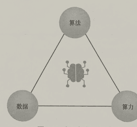

发展从非一日之功：从早期专家系统、机器人雏形，到深度学习、神经网络篡新，再到大语言模型、智能体与具身智能觉醒，每一步都凝聚着先驱者的智慧结晶。如今，大数据、算力爆发托举起前所未有的机遇窗口——ChatGPT 现象级破圈、Robotaxi 加速商业化、医疗金融深度渗透，无不宣告：**AI 时代，实至名归。**

---

### 1.2 一波三折：跨越两次寒冬的三次浪潮

回望史册，AI 之路从非坦途。**三次高涨背后，藏着两次深度低谷**——这非偶然，乃发展规律使然。演进脉络见图 1-2。

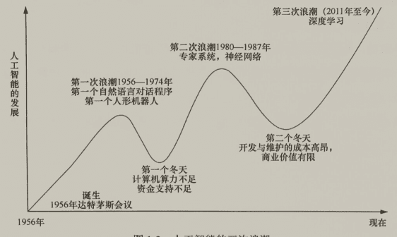

#### 1.2.1 第一浪：逻辑推理的黎明与幻灭（1956–1974）
*   **起势：** 1956 达特茅斯会议敲响号角，“人工智能”概念诞生。学者们雄心勃勃，赋予机器逻辑推理能力，攻克代数几何、英语程序学习，60 年代 NLP 与人机对话突破更将期待推至高峰。
*   **回落：** 算力瓶颈掣肘，加之 1973 年美政府切断无明确目标项目资金，商业化遥遥无期，首次“AI 寒冬”降临。

#### 1.2.2 第二浪：专家系统的实用主义探索与受困（1968–1990）
*   **破局：** 1968 年，斯坦福费根鲍姆开发首个专家系统 DENDRAL，辅助化学家解析分子结构，**首创“知识库”概念**，奠定第二浪基石。
*   **繁荣：** 80 年代领域专家系统规模化落地，用专业知识推导答案，“知识工程”成核心赛道，实用性大增。
*   **瓶颈：** 知识获取难、维护贵、迁移性差、仅限垂直领域。1990 年 DARPA 项目失败，二次寒冬来袭。虽则神经网络同期萌芽，为感知交互埋下伏笔。

#### 1.2.3 第三浪：数据驱动与算力红利下的全面爆发（1993 至今）
*   **理论突围：** 新数学工具与深度学习理论赋能感知智能。
*   **算力腾飞：** 算力指数级跃升，驱动技术极速迭代，感知智能成熟，AI+场景开花结果。
*   **里程碑事件：**
    *   2006 年：深度学习算法重磅提出。
    *   2012 年：AlexNet 横扫 ImageNet，引爆视觉识别革命。
    *   2016 年：AlphaGo 战胜人类顶尖棋手，引全球震动。
    *   2017 年：Google 提出 **Transformer** 架构——并行处理长序列，效率与性能双飞跃，成大模型基石。
    *   2018–2023 年：GPT 系列迭代进化——
        *   GPT-1：奠定预训练+Transformer 范式；
        *   GPT-2：参数激增，生成连贯度质变，因风险一度限制发布；
        *   GPT-3：1750 亿参数，少样本学习涌现，成通用 NLP 基座；
        *   ChatGPT (3.5) ：RLHF 对齐人类偏好，开启自然流畅对话新纪元，应用场景全面开花；
        *   GPT-4：多模态融合，专业测评超越人类均值，逻辑推理与语言能力实现质的飞跃。

**纵深复盘：** 前两浪锤炼逻辑推理（运算智能成熟），第三浪拓展感知维度（语音、视觉、翻译逼近人类水平）。**最振奋人心的前景在于：AI 将持续进化，更懂人意、更懂语境、更懂世界。**

---

### 1.3 以数绘像：AI 产业与技术的“真实坐标”

#### 1.3.1 产业全景：资本热度与规模增速的双重奏

全球 AI 产业正处**高速扩张期**，市场规模与投融资双轮驱动。ML/DL 算法突破催化技术渗透，产业链成熟度显著提升：
*   **上游：** 算力硬件（芯片/传感器）与数据服务筑基。
*   **中游：** 核心技术攻关（框架/模型/算法）聚力。
*   **下游：** 医疗、金融、零售等垂直场景落地开花。

**资本投票：** PitchBook 数据显示，2023 上半年全球 AI 融资 1387 笔，募资 255 亿美元，单笔均值 2605 万美元；AIGC 赛道全年融资超 1900 亿元，月月有笔、笔笔超亿。资金奔涌，确证赛道确定性。

**规模预测：** IDC 指出 2022 年全球 AI IT 支出 1288 亿美元，2027 年将达 4236 亿美元，五年 CAGR 26.9%；前瞻研判 2030 年市场规模将破 1591 亿美元，CAGR 38.1%。增势凶猛，长坡厚雪。

**双极格局：** 中美领跑第一梯队。美领跑融资与通用大模型；中领跑行业应用落地深度。

**政策东风：** 全球政府竞立标杆、建标准、促应用。斯坦福 HAI《2024 AI 指数报告》揭示关键信号：2023 年工业界贡献 51 个著名 ML 模型，学术界仅 15 个——**创新主力已完成历史性易位**；AIGC 投资同比暴涨近 8 倍至 252 亿美元，资本信心达巅峰。

#### 1.3.2 技术实力榜：硬核底座的当下水位

##### 1. 智能硬件：感知神经与算力中枢的双重进化
*   **智能传感器（神经末梢）：** 集成传感+微处理+电路，具初级感知处理力。类型覆盖触觉、视觉、超声、温度、测距等。国际巨头霍尼韦尔、博世、ABB 布局全；国内汇顶（指纹）、昆仑海岸（力觉）等虽有亮点，整体布局相对聚焦。
*   **智能芯片（中枢大脑）：** 高并发算力+主流神经网络算法原生支持。主流阵营：GPU（通用并行）、FPGA（灵活重构）、ASIC（专用极致能效）、NPU（神经网络专用）。
    *   **海外矩阵：** 英伟达 GPU、Google TPU、Intel NNP/VPU、高通骁龙、IBM Power 等构建护城河。
    *   **国产力量：** 海思麒麟、寒武纪 NPU、地平线 BPU、云知声 UniOne 等正加速追赶，打破“卡脖子”困局。

##### 2. 计算机视觉：已具类人分级识别认知机制
具备**高速、高精、高准**三大优势，可满足目标识别、分类、定位、检测、分割全链路需求，广泛部署于视频监控、自动驾驶、人脸/车牌核验、医学影像、机器人导航、工业质检、航空遥感等高价值场景。

**中国力量领跑全球：** 商汤（手机 AI 影像/AR/实名认证）、旷视（视觉算法核心，智慧城市/商业标杆）、云从（金融安防双深耕，成金融领域第一 AI 供应商）、图普（图像识别商业化先锋，聚焦内容审核/商业智能/泛安防）等头部企业，技术攻关与商业闭环双料领先。

##### 3. 智能语音：听说通吃，交互入口的核心钥匙
覆盖**语音识别（ASR，机器之耳）**与**语音合成（TTS，机器之口）**，实现文本/指令与语音信号的智能双向转换。支撑人机语音交互、声控指令、声纹身份验证，深度嵌入智能音箱、车载助手、会议纪要、无障碍辅助等高频刚需场景。

**智能语音赛道火热：巨头集结抢滩登陆**

当前，智能语音技术在消费级终端的落地异常火爆。各大互联网企业纷纷投入重金组建研发阵容，意图借助语音交互这一方便、新颖的入口抢占用户心智。放眼国际，苹果的 Siri、微软的 Cortana 与小冰、谷歌的 Google Now 等产品备受追捧；国内方面，科大讯飞、云知声以及百度、阿里、腾讯等头部大厂亦已深度布局，竞争格局初步形成。

##### 4. 自然语言处理：赋予机器“听懂”与“会说”的能力

自然语言处理（NLP）研究领域广泛，核心可划分为自然语言理解（NLU）与自然语言生成（NLG）两大板块。前者致力于让计算机读懂文本背后的意图与逻辑，后者则旨在让机器能用人类语言连贯地表达观点。从落地场景来看，NLP 已渗透至机器翻译、舆情监控、自动摘要、观点挖掘、字幕生成、文本分类、智能问答、语义匹配等诸多维度。

眼下，一批成熟的商业化产品已面世。例如，亚马逊、Meta（Facebook）及字节跳动等企业，利用该技术为电商平台、社交社区提供评论分级、主题聚类与情感分析功能；翻译领域，谷歌、百度、有道推出了深度智能化的在线翻译服务；科大讯飞、搜狗等则打造了随身多语种翻译硬件。在基础设施层，国外有 Kore.ai、Lingumatics，国内有百度云、腾讯文智、语言云；舆情监测产品方面，美国 Xalted 的 iAcuit、北京朝闻天下的 Wom-Monitor 以及上海创略科技的本果奥博等相继问世。这些产品的涌现，既印证了 NLP 应用版图的持续拓展，也倒逼技术迭代加速。

#### 1.3.3 中国 AI 发展实践：数据红利与政策东风双轮驱动

作为全球规模最大的互联网用户市场，中国积累了海量数据资源，这为 AI 算法的快速迭代提供了“燃料”，也为技术商业化筑牢了根基。

政策层面，中央至地方构建起立体化政策体系全力护航。以《新一代人工智能发展规划》为纲领，明确提出到 2030 年理论、技术、应用整体达世界领先水平、建成全球主要创新中心的战略目标。

企业阵营中，百度、阿里、腾讯将 AI 视为核心护城河，持续加码研发。百度 Apollo 打造自动驾驶开放平台，阿里云 ET 城市大脑赋能城市治理，腾讯 AI 医疗助手深耕就医场景，均在细分赛道斩获标志性成果。初创力量同样不容小觑，商汤科技在计算机视觉、语音识别、智慧安防等领域实现关键突破，并主动出海与国际巨头同台竞技。人才培养端，清华、北大、浙大等名校纷纷设立 AI 学院或研究所，开设专业课程，为产业输送源源不断的创新血液。

### 1.4 AI 演进路线图：七大融合方向与核心趋势

#### 1.4.1 七大跨界融合新赛道

##### 方向 1：AI + 云计算：互为底座，共生共荣
云计算以按需分配算力资源著称，为 AI 处理海量数据、跑通复杂模型、实现分布式训练提供了弹性底座。云技术迭代反过来推动 AI 向高性能、低成本、强扩展、高安全方向演进；同时 AI 通过自动化运维、智能调度、场景创新反哺云服务，拓展市场天花板。典型案例为谷歌云 AI 平台，它打通了数据预处理、模型训练评估、部署监控全链路，并提供丰富预训练模型与自动化工具，大幅降低开发门槛。

##### 方向 2：AI + 物联网：万物互联，智享生活
物联网连接海量感知终端，产出的海量数据经 AI 分析后，可实现设备与系统的智能化决策。智能家居中温湿光气自适应调节，交通物流制造中车货机状态实时预测，皆是典型应用。交互层面，语音、视觉、手势控制重塑人机关系；服务层面，个性化推荐与持续学习提升体验。小米智能音箱即为代表，凭借语音交互串联生态链设备，兼顾内容服务与家居中控。

##### 方向 3：AI + 区块链：信任机器，价值流转
区块链凭借加密共识机制确立数据确权、不可篡改的信任基石，为跨组织数据协作与模型版权保护提供可行路径，激发生态创新活力。AI 则通过机器学习优化链上性能，借助 NLP 与 CV 降低使用门槛，双向奔赴构建可信智能网络。

##### 方向 4：AI + 生物科技：破解生命密码，加速新药研发
生物科技为 AI 提供仿生蓝图——神经网络模拟大脑认知，进化算法借鉴基因机制，群智算法参考昆虫协作。反向来看，AI 以数据挖掘提升生物信息学水平，以图像识别辅助医学诊断。DeepMind 的 AlphaFold 精准预测蛋白质三维结构，为新药设计按下快进键；国内复旦大学马剑鹏团队自研 “OPUS-” 系列软件性能全球领先，构建起全链条 AI 药物研发平台，显著提升研发效率与成功率。

##### 方向 5：AI + 社会科学：洞察群体行为，辅助科学决策
经济学、政治学、心理学等学科为 AI 理解人类社会规则提供理论框架，博弈论、行为经济学助力决策建模，伦理法学筑牢价值对齐防线。AI 则以文本情感分析赋能舆情研判，以网络分析深度刻画社会结构。OpenAI GPT-4 在新闻生产、法学教育、政策研究等社科场景广泛落地，展现出强大的知识服务能力。

##### 方向 6：AI + 艺术文化：机器生成美学，拓展创作边界
GAN、神经风格迁移、深度强化学习等技术，让 AI 能创作绘画、音乐、文学，甚至参与影游互动设计。这不仅丰富了表达形式，也倒逼自然语言生成与计算机视觉向更高维度的审美认知进化，引发关于创作者身份与版权的深层思考。

##### 方向 7：AI + 人类自身：增强感知，探索永生边界
脑机接口、可穿戴设备、生物芯片延伸人类物理机能；情感计算、智能陪伴、自适应教育呵护心理成长。更深层看，超级智能、意识上传、数字永生等概念挑战着生命定义的边界。Neuralink 植入式脑机接口的研发，标志着人机深度融合从科幻走向工程原型。未来关系范式将在协作竞争、共生共存、友善互动中持续演化。

#### 1.4.2 技术趋势与挑战并存

**核心技术演进风向标**
*   **自然语言处理：** 依托 GPT 等大模型持续迭代，机器理解生成能力质变，翻译、问答、创作效能跃升。
*   **计算机视觉：** 识别精度突破瓶颈，赋能医疗影像辅诊、L4 级自动驾驶、智能安防监控。
*   **强化学习：** 通过环境交互自博弈优化策略，成自动化决策、机器人控制、博弈智能核心驱动力。
*   **边缘计算：** 算法下沉终端侧，弱化云依赖，实现低时延、强隐私、实时响应。

**前沿突破三大看点**
1.  **通用人工智能（AGI）：** 具备人类水平泛化能力。2024 年初，北京通用人工智能研究院发布全球首个通用智能体 “通通”，智力达 3-4 岁儿童水平，拥类人价值观，能在无任务指令下自主探索学习。
2.  **跨域深度融合：** 与生物技术、量子计算等硬核学科交叉，催生前所未有的应用范式。
3.  **可解释 AI：** 打开“黑箱”，让决策路径透明化，构建信任基石，推动高风险领域落地。

**必须直面的四大挑战**
*   **数据安全与隐私：** 合规用数成为开发红线，需全生命周期构建防护体系。
*   **算法公平性：** 防止历史偏见放大导致歧视性结果，引入公平性约束与审计机制。
*   **AI 伦理对齐：** 确保机器行为符合人类价值观，需学界、政界、业界共治，制定伦理准则。
*   **普惠与教育：** 降低使用门槛，推广 AI 素养教育，避免技术红利割裂，让普罗大众共享智能时代成果。

### 思考与练习

*   **1-1** 请用自己的话界定 “人工智能” 与 “机器学习” 的内涵与外延。
*   **1-2** 梳理 AI 发展历程中三次关键浪潮的特征与驱动力。
*   **1-3** 如何评估当前 AI 产业技术的成熟度与落地深度？
*   **1-4** 概括上文所述 AI 七大跨界融合方向的核心逻辑。
*   **1-5** 辩证分析 AI 技术面临的困境与未来演进趋势。

### 实战演练：解锁文心一言生产力

**实验背景**
随着 ChatGPT、文心一言、通义千问等大语言模型（LLM）走入寻常百姓家，它们不仅能理解自然语言、模拟人类思维表达，还能在多轮对话中持续进化。无论是学术科研、职场办公还是生活琐事，善用大模型都能显著提效。

**任务清单**（需申请免费账号完成，提示词需明确范围与定义）
1.  **文献检索与资源导航**：如 “推荐 2023 年以来大模型核心论文清单” 或 “零基础自学 Python 书单与学习路径”。
2.  **定制化学习规划**：如 “制定为期两周的 Python 入门计划，细化至每日知识点与实操任务”。
3.  **题库生成与解析**：如 “出一套信息技术应用练习题含详解” 或 “解析特定课程经典习题”。
4.  **公文与报告撰写**：如 “起草某大学夏令营申请信” 或 “撰写国潮服饰消费者画像分析报告”。

**交付物**
整理上述实操过程为 Word 报告，复盘提示词优化策略，结合亲身体会探讨如何将大模型转化为解决实际问题的 “超级助手”。

---

## 项目二 走进人工智能世界

在万物智联的新时代，AI 已渗透汽车、制造、电商、娱乐等民生肌理，亦在机翻、辅助诊断、自动驾驶、智慧家居等专业领域释放核心价值。作为前所未有的变革引擎，AI 正重塑生产生活方式，未来将跃升为核心生产力与创新引擎，驱动经科文全域跨越式发展。

本项目聚焦五大核心版块：
1.  AI 基础认知体系构建；
2.  数据驱动下的 AI 关键技术；
3.  核心算法原理拆解；
4.  AI 落地项目全生命周期实践；
5.  未来应用前沿展望。

### 场景导读：随身的智能助理

**核心看点：** 万物互联背景下，AI 技术全域渗透，重塑便捷生活与高效工作新常态。

智能手机普及催生了移动端 AI 爆发：语音输入打破打字速度上限，图像识别赋能拍照搜题/分类管理，智能推荐基于画像精准分发内容商品，机器翻译消弭跨语种沟通障碍。个人助理类 App 整合日程提醒、备忘录，提升时间管理效能；出行类聚合实时路况、规划导航、网约车服务；医疗健康类记录生理指标、提供问诊挂号闭环。这些应用生动诠释了 “AI 无处不在” 的现实图景。

### 2.1 AI 基础认知体系构建

#### 2.1.1 核心定义溯源

AI 的终极使命是模拟、延伸、拓展人类智能，让机器胜任原本需要人类认知的复杂任务。要读懂 AI，先要拆解 “智能” 本质。

图 2-1 描绘了智能的构成：在知识储备基础上，通过有目的的感知、思考（调用知识）、行动（输出行为）形成闭环。

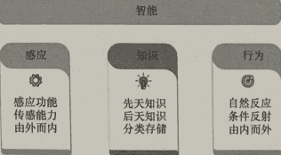

学术界通行定义：人工智能是研究、开发用于模拟、延伸和扩展人的智能的理论、方法、技术及应用系统的技术科学。其目标是让机器具备类人的感知、思考、学习能力。按应用场景维度，AI 可分为……

#### 2.1.2 产业三驾马车：算法、算力、数据

这三要素构成 AI 企业竞争的核心护城河。借用飞机隐喻：
*   **数据是航空燃料：** 海量数据为算法训练提供经验样本，是不可或缺的基础原料。
*   **算力是动力系统：** 在时效窗口内高效执行指令，支撑数据高速流转与模型迭代。
*   **算法是飞控中枢：** 调度数据燃料，转化为算力推力，引导模型朝目标收敛。主流语境下算法特指机器学习算法，尤以深度学习为核心。

机器学习是多学科交叉领域（概率论、统计学、最优化理论等），深度学习则是实现机器学习的关键技术路径，极大拓展了 AI 应用边界。如图 2-2 所示：机器学习是 AI 实现手段，深度学习是机器学习的核心技术实现。

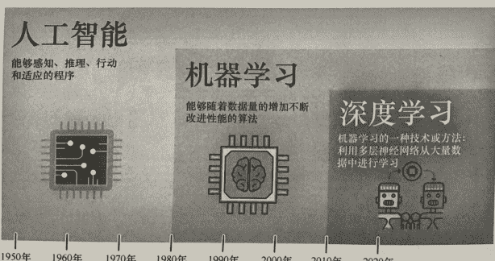

#### 2.1.3 技术体系双轨演进

回溯发展史，AI 技术体系可分为两大谱系：
1.  **知识推理体系：** 聚焦知识表示（将知识机器化）与知识推理（由已知演新知），涉及多元逻辑体系，是赋予机器认知推理能力的基石。
2.  **经验知识模板生成体系：** 以机器学习为主导，从数据中自动提取模式生成模型，是当前主流范式。

# 拆解AI底层逻辑：从技术体系分层到落地项目全流程实操指南

### 2.1 人工智能技术体系分层架构

当下的主流AI技术栈，本质上是一套以机器学习为核心驱动、依托既有数据提炼模型规则的“经验知识模板生成体系”。我们可以将其拆解为三大层级，自底向上支撑起整个智能大厦：

*   **基础设施层（AI 基础层）**：这是地基，汇聚了硬件设施、算力资源与存储系统，为上层建筑提供源源不断的物理动力。
*   **核心技术层（AI 技术层）**：这是中枢，将机器学习与深度学习算法落地为三大核心技能——自然语言处理（NLP）、计算机视觉（CV）与大数据处理。算法是此层技术落地的基石。
*   **场景应用层（AI 应用层）**：这是终点，深入制造、电商、物流、交通、安防、医疗等垂直领域，用技术解决行业痛点，释放生产力红利。

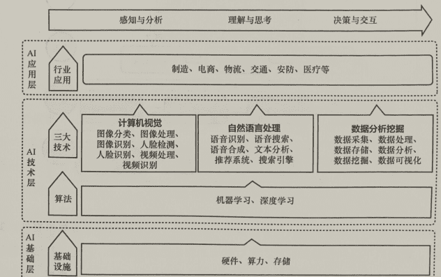

在**自然语言处理**战场上，以ChatGPT为代表的大模型产品，本质是新一代NLP工具，擅长文本生成、问答交互与内容创作；  
在**计算机视觉**领域，模型通过深层隐藏网络的层层训练，获得“慧眼”；  
在**大数据处理**维度，则覆盖了从采集、清洗、存储到分析、挖掘、可视化的全链路技术栈。

#### 2.1.4 人工智能应用开发：从“做什么”到“怎么做”的工程化闭环

AI落地绝非单兵作战，乃是数据、业务场景与工程能力的深度融合，必须在应用价值、技术标准、产品性能、安全隐私四个维度做权衡。

为了实现“用户只提目标，机器自动生成程序”的终极愿景，AI应用开发周期可拆解为四大阶段，环环相扣：

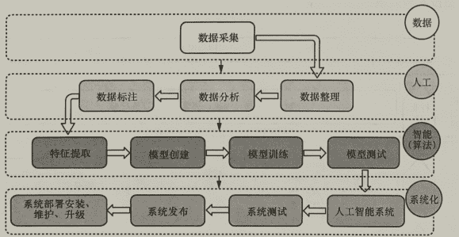

1.  **数据阶段**：攻克高质量源数据采集，为后续铺路。
2.  **人工阶段**：完成数据清洗、分析与标注（自动/半自动），将原始素材炼制成算法可直接“消化”的有效养料。
3.  **智能/算法阶段**：跑通特征提取、建模、训练、测试全流程，产出核心目标模型。
4.  **系统化阶段**：系统集成测试、发布部署、运维迭代，交付可用的智能产品。

总结而言，AI应用是一场复杂的系统工程，需历经多轮部署、反复迭代与精细打磨，每一环都容不得半点马虎，方能交出满足用户期待、性能过硬的答卷。

---

### 2.2 基于大数据的人工智能技术：数据为油，智能为火

#### 2.2.1 大数据的“4V”画像与“3I”计算属性

大数据是AI的“燃料库”，其规模与丰度直接决定模型训练的上限。它有四大显著特征（4V）：

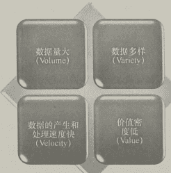

*   **量大（Volume）**：起步即PB、EB、ZB级，未来直指YB、BB，规模呈指数级爆发。
*   **源杂（Variety）**：网络日志、音视频、图片、地理坐标……结构化、半结构化、非结构化数据杂糅共存。
*   **价值密度低（Value）**：数据总量与单位价值往往成反比，大海捞针是常态。
*   **流快（Velocity）**：实时性要求极高，秒级出结果是生死线，迟则贬值，这就是著名的“1秒定律”。

除了宏观特征，大数据计算还内嵌三大独特属性（3I）：

*   **非精确性**：不追求极致精准，只求大方向、大趋势；或因环境动态变化无法精算。在容忍度内降精度，换速度、省资源，但底线质量必须守住。
*   **增量性**：数据流持续涌入，新数据占比极小。若能仅算增量、融合旧果，便能“以小博大”，化整为零。这对框架与算法双重考验，需专门设计增量友好的算法体系。
*   **归纳性**：多源数据融合映射现实“总体”。交叉验证既能补齐稀疏维度，又能约束非精确计算的误差，守住解的质量底线。

#### 2.2.2 双向奔赴：AI赋能数据价值化

换个视角看，大数据若想变现，必须借力AI完成价值化闭环，尤其是深度分析环节，离不开智能算法的加持。

#### 2.2.3 大数据处理全链路：五步走战略

1.  **采集**：从传感器、企业系统、社交网络等多源汇聚。
2.  **预处理**：清洗转换、集成入库，打通异构壁垒。
3.  **存管**：分布式文件系统按策略切片、分散存储于集群节点，保高可用。
4.  **分析挖掘**：浅层用统计看现象，深层靠机器学习挖本质。
5.  **可视化**：转图表、建大屏，让结论直击人心，辅助决策。

#### 2.2.4 数据与智能的共生进化

AI渴望数据，海量优质数据集是算法与深度学习的“必修课”。大数据是基石，机器视觉与深度学习皆建立在海量训练之上，从中归纳可迁移的知识。

*   **洞察隐匿模式**：海量数据分析能揭示人类难察的关联与规律。
*   **多样性与质量定精度**：数据决定模型上限，丰富样本助力泛化，海量参数优化配置。
*   **持续进化**：数据流持续注入，模型终身学习，性能阶跃提升。
*   **千人千面**：推荐系统等场景下，丰富画像让AI读懂偏好，实现精准个性化触达。

---

### 2.3 人工智能算法：模型的数学心法

#### 2.3.1 核心概念与学习范式

机器学习的核心逻辑是：从数据中自动抽取规律（模型），用于预测未知。

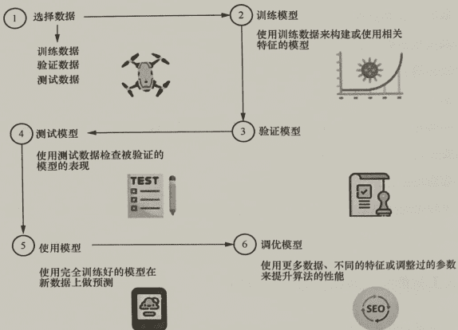

关键术语速记：
*   **特征**：样本的属性向量，区分事物的关键指标。
*   **标签**：样本对应的真实结果，监督学习的“标准答案”。

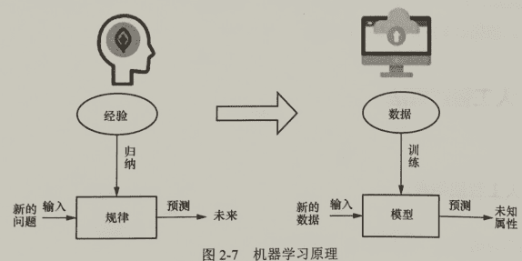

**两大主流范式：**
*   **无监督学习**：无标签数据中自寻结构（分布/关系）。代表作：K-Means、谱聚类、PCA降维。
*   **监督学习**：有标签数据训练映射函数，数据集含特征与标签。代表作：回归、KNN、推荐算法。核心区别在于是否拥有带标签的训练集与测试集。

**实战演示：推荐系统的监督逻辑**
以运动饮料推荐为例。若以“购买意向”为目标，“是否购买”即为标签（已购/未购）。历史数据显示：年轻男性且常运动者（用户1-4）均已购，年轻女性不常运动者（用户5）未购。模型据此学得分类边界：新用户若匹配“年轻男性+常运动”画像，即推荐；否则不推。这就是典型的“特征→标签→分类器→决策”闭环。

#### 2.3.2 一元线性回归：寻找那条“最贴切”的直线

仅含单一自变量与因变量，且呈线性趋势，即一元线性回归。核心任务：求解拟合直线 $Y = WX + b$。

```
Y = WX + b (2-1)
```

$W$为斜率，$b$为截距。目标明确：让预测值尽量贴近真实值，即**最小化均方误差（MSE）损失函数**。

```
\sum_{i=1}^{n}(y_i - y'_i)^2 = \sum_{i=1}^{n}(y_i - (Wx_i + b))^2 (2-2)
```

通过对损失函数求导置零，解析法直接得出 $W$ 与 $b$ 的最优解析解。

```
W = \frac{n\sum x_i y_i - \sum x_i \sum y_i}{n\sum x_i^2 - (\sum x_i)^2} (2-3)
``` ```
b = \frac{\sum y_i}{n} - W\frac{\sum x_i}{n} (2-4)
```

将系数代回原式，最佳拟合直线即告获得。

#### 2.3.3 多元线性回归：高维空间中的“超平面”

自变量增至多个，几何图像变为 $n$ 维空间超平面：$h_\theta(x) = \theta^T x$。

```
h_\theta(x) = \theta^T x^T (2-5)
```

损失函数沿用MSE形式。

```
J(\theta_0, \theta_1, \cdots, \theta_n) = \frac{1}{2n}\sum_{i=1}^{n}(h_\theta(x_i) - y_i)^2 (2-6)
```

参数量激增，解析法力不从心，必须引入**梯度下降法**这一数值优化利器。


**迭代四步走：**
1.  **算梯度**：求当前参数处的损失函数偏导数。
    ```
\frac{\partial}{\partial \theta_j} J(\theta_0, \theta_1, \cdots, \theta_n) (2-7)
```
2.  **定步长**：学习率 $\alpha$ 乘以梯度，得更新幅度。
3.  **判收敛**：若所有参数更新量均小于阈值 $\varepsilon$，停止；否则继续。
4.  **更新参数**：$\theta \leftarrow \theta - \alpha \nabla J(\theta)$，循环回步骤1。
    ```
\theta_j = \theta_j - \alpha \frac{\partial}{\partial \theta_j} J(\theta_0, \theta_1, \cdots, \theta_n) (2-8)
```

#### 2.3.4 逻辑回归：分类边界的“S型”守门员

虽名为回归，实为**二分类**利器。核心是引入 **Sigmoid 函数** 将线性输出压缩至 $(0,1)$ 区间，输出概率。

```
S(x) = \frac{1}{1+e^{-x}} (2-9)
``` 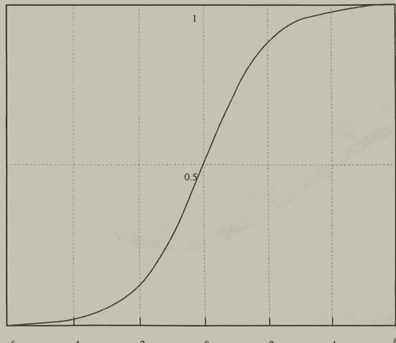

预测函数：$h_\theta(x) = \frac{1}{1 + e^{-\theta^T x}}$。


**原理直观理解**：线性回归得分 $\to$ Sigmoid 变换 $\to$ 概率值 $\to$ 阈值截断（如0.5）$\to$ 类别标签。

损失函数采用**对数似然损失**，惩罚错误预测，奖励自信正确。

$Cost = \sum [-y \log(h) - (1-y) \log(1-h)]$

```
S(x) = \frac{1}{1+e^{-x}} (2-9)
``` (Note: Source has PRE14 before Eq 2-9 and PRE15 before Fig 2-9. Eq 2-11 is Log Loss. I will place PRE tags near their original context.)

参数求解同理，梯度下降法依然适用，高效寻优。

---

### 2.4 人工智能落地项目基本实现过程：从数据到模型的标准化动作

AI工程落地遵循固定范式：特征工程 $\to$ 定义模型 $\to$ 训练模型 $\to$ 测试反馈，四步走天下。

#### 2.4.1 特征工程：数据炼金术

用领域知识与技巧“炼”数据，让特征在算法中发挥最大效能。三板斧：**提取**（挖掘原始信号）、**预处理**（归一化/编码/缺失值填补）、**降维**（PCA等去噪压缩）。

#### 2.4.2 定义模型：确立数学骨架

模型本质是映射函数 $f: X \to Y$。核心在于选型：
*   **线性模型**：可解释性强，适合简单关系。
*   **集成模型**（XGBoost/LightGBM等）：结构化数据霸主，精度高。
*   **神经网络**：非线性拟合王者，擅长图文音视频非结构数据。
*   **SVM**：小样本、高维空间分类利器。

选型需匹配数据特性与业务目标。

#### 2.4.3 训练模型：寻优的迭代博弈

训练即**最小化损失函数**的参数寻优过程。
*   **损失函数**：量化“预测偏离真实的程度”，指引方向。
*   **优化器**：决定参数怎么动（增/减、幅度多大）。常用Adam、RMSprop、Adagrad等自适应优化器，多轮迭代直至参数收敛稳定，即得最优模型。

#### 2.4.4 模型测试与反馈：用指标说话

不同任务看不同指标：
*   **分类任务**：准确率、精确率、召回率、F1-score。
*   **回归任务**：均方误差（MSE）、平均绝对误差（MAE）。

**混淆矩阵**是分类评估的显微镜：

| 核心指标 | 含义 | 业务视角解读 |
| :--- | :--- | :--- |
| **TP (真正例)** | 实为正，预测正 | 精准打击，该抓的抓了 |
| **FN (假负例/漏报)** | 实为正，预测负 | **漏网之鱼**，风险隐患（如病灶未查出） |
| **FP (假正例/误报)** | 实为负，预测正 | **误伤友军**，体验受损（如正常邮件进垃圾箱） |
| **TN (真负例)** | 实为负，预测负 | 正常放行，该放的放了 |

通过TP/FN/FP/TN的组合拳，可精准诊断模型长板短板，指导下一轮迭代优化。

## 模型评估核心指标速览

**准确率** 是最基础的基准，量化全量预测中判对的占比（计算见式 2-12）。数值越逼近 1，模型整体表现通常越优。

```
Accuracy = \frac{TP+TN}{total} (2-12)
```

**精确率** 聚焦“查准度”：在所有被判为正类的样本里，真正为正类的比例几何（式 2-13）。

```
Precision = \frac{TP}{TP+FP} (2-13)
```

**召回率** 关注“查全度”：实际为正类的样本池中，有多少被成功捕获（式 2-14）。

```
Recall = \frac{TP}{TP+FN} (2-14)
```

**F1 分数** 将精确率与召回率通过调和平均融合，单一指标即可反映模型稳健程度（式 2-15）。

```
F1 = \frac{2 \times Precision \times Recall}{Precision + Recall} (2-15)
```

简言之，上述三项指标数值越大，分类能力越强。

**AUC（ROC 曲线下面积）** 提供另一维度视角。ROC 曲线（受试者工作特征曲线）以假正例率（FPR）为横轴、真正例率（TPR）为纵轴，曲线越凸向左上角，分离效果越理想。

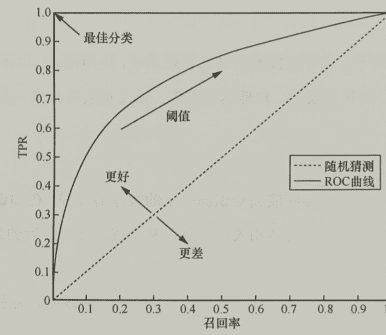

AUC 取值解读：
*   **AUC = 1**：理论上的“完美分类器”，工程实践中极罕见。
*   **0.5 < AUC < 1**：优于随机猜测，经阈值调优后具备实用价值。
*   **AUC = 0.5**：等同随机猜测（抛硬币），无预测意义。
*   **AUC < 0.5**：比瞎猜还差，但若将预测结果反向，即可化腐朽为神奇。

**模型测试与闭环反馈**。评估结果非终点，而是新循环起点：指导特征工程筛选有效变量、校验模型定义合理性、判定训练参数是否最优。若数据质量成瓶颈，测试反馈还能倒逼采集与测点布控环节优化。

---

### 2.5 人工智能未来应用领域展望

#### 2.5.1 知识图谱：结构化知识的“超级中枢”

知识图谱融合图谱构建、实体链接、关系抽取、属性填充、知识推理、可视化、自然语言处理、语义搜索等技术，打造**知识管理系统**，实现结构化存储与高效调用。

- **实体链接**  
  将文本提及“锚定”至图谱实体，让检索直达目标，大幅提升管理效率。

- **关系抽取**  
  从非结构文本挖掘实体间联系，梳理知识脉络，助力深度利用。

- **属性填充**  
  为实体/关系补全细节画像，提升知识颗粒度与精度。

- **知识推理**  
  基于现有规则演绎新知，发掘隐性关联与趋势，盘活存量资产。

- **可视化展示**  
  以图形化方式降维呈现复杂网络，直观高效，降低认知门槛。

- **自然语言处理**  
  打通人机语言壁垒，让录入与查询如同自然对话，提升便捷性。

- **语义搜索**  
  理解意图而非匹配关键词，精准触达所需信息，强化检索体验。

#### 2.5.2 专家系统：将“经验”装进机器

作为 AI 落地最早、成果最丰的分支，专家系统本质是**携带专家知识库与推理机的智能程序**，专攻特定领域疑难杂症。

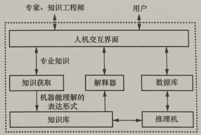

架构包含六大模块：人机交互界面、推理机、知识库、数据库、知识获取模块、解释器。

**工作流**：用户答题 → 推理机匹配规则 → 结论入库 → 最终呈现。解释器可随时追问“为什么问这个”（Why）或“怎么推导的”（How），保证过程透明。知识工程师通过工具持续“灌输”新经验，让系统越用越懂。

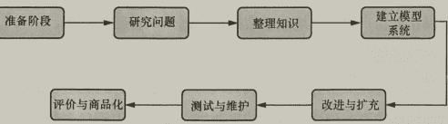

**想用好专家系统，必须满足三个“硬门槛”**：
1.  **有真专家**：领域内公认权威存在（如地震预报因无高精度专家，不适用）。
2.  **靠启发式**：问题无标准算法，依赖专家经验判断（如暴雨预报）。
3.  **知识可显性化**：靠直觉/技能吃饭的领域（如高超手艺）难以建模，不适用。

#### 2.5.3 数字孪生：在虚拟世界“预演”物理全生命周期

数字孪生利用物理模型、传感器流、历史数据，在虚拟空间构建**高保真“数字镜像”**，覆盖实体从制造到报废的全生命周期。集成多学科、多尺度、多概率仿真，核心价值在于**“超前感知”**——实时监控、诊断、预判故障，进而提效、降耗、控本。

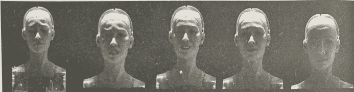

**典型落地场景**：
*   **航空**：飞机全周期数据汇聚成“数字孪生体”，精准预测部件更换周期、评估寿命损耗。
*   **工业**：预测性维护优化停机计划，实时诊断提良率。
*   **智慧城市/交通/能源/楼宇/矿山**：从城市规划推演、交通流预测、能源需求侧管理，到楼宇设备预警、矿山安全监控，均可复用“虚实映射、仿真优化”范式。

#### 2.5.4 物联网实时控制系统：泛在连接的“神经中枢”

依托传感器、执行器、控制器三件套，实现生产全过程的**实时感知、决策、控制**。九大特性直击工业痛点：

| 核心特性 | 价值点 |
| :--- | :--- |
| **多样/开放连接** | 有线无线兼容，开放接口易集成 |
| **广泛/智能处理** | 全量数据采集 + 深度挖掘赋能决策 |
| **高安全性** | 认证、加密、访控多重护航 |
| **易部署、高稳定** | 上手快、长周期无故障运行 |
| **灵活管理** | 远程/本地双模运维 |
| **强实时性** | 毫秒级采控闭环 |
| **低成本、高兼容、低功耗** | 降低准入门槛，适配异构设备，节能环保 |

---

### 习题

- 2-1 什么是人工智能？
- 2-2 人工智能三要素是什么？
- 2-3 简述大数据与人工智能的关系。
- 2-4 人工智能落地项目的基本实现过程是什么？
- 2-5 大数据有哪些关键技术？

### 实验

#### 1. 实验主题
查阅文献，完成人工智能应用和产品的调研报告与答辩 PPT。

#### 2. 实验说明
随着技术演进，AI 应用与产品已渗透学业、工作、创意及日常生活，提供精准、快速、个性化的助力；教学场景下亦显著提升学习效能。

#### 3. 实验内容
- (1) 盘点生活可感知的 AI 应用与产品。
- (2) 结合专业背景，描绘本领域 AI 落地场景。
- (3) 深度剖析：AI 重塑影响最大的产业及核心变革逻辑，给出结论与理由。

#### 4. 提交文档
撰写 Word 报告阐述观点，并据此制作答辩 PPT。

---

## 项目三 智能机器人：具身智能的终极形态

智能机器人 = **自主行动 + 环境感知 + 决策执行**，模拟人类认知闭环。既能听指令、跑流程，也能基于 AI 规则自主决策，已渗透工业、物流、医疗、教育等核心场景。核心技术三驾马车：**机器学习（自我进化）、自然语言处理（人机对话）、计算机视觉（视觉感知）**。

项目模块：**智能体 → 多智能体 → 智能机器人系统**。

### 导读案例

#### 第一个获得公民身份的机器人——索菲亚
要点：索菲亚由香港汉森机器人技术公司开发，拥有橡胶皮肤、62 种微表情、多模态感知（摄像头 + 3D 传感器）、语音/面部识别，能自然对话、记忆互动、表达情绪。2017 年获沙特公民身份，引发全球对 AI 伦理与权利的深度探讨。

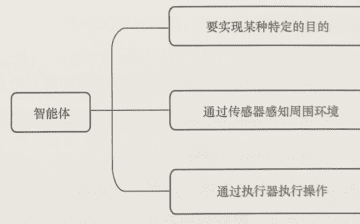

---

### 3.1 智能体：自主进化的“数字生命体”

#### 3.1.1 重新定义：环境中的自主实体
在 AI 视野下，凡**能独立思考、与环境交互**的实体皆可抽象为智能体。它嵌入环境，靠传感器“感知”、效应器“施为”，自主完成既定目标。

#### 3.1.2 四大核心特质
1.  **自主性**：内驱力主导，根据内外状态自我调节，非被动响应。
2.  **反应性**：感知环境变化并及时影响环境，必要时主动出击改局。
3.  **社会性**：具备协作基因，可与人/其他智能体交互、谈判、解决冲突，自然形成多智能体社会。
4.  **进化性**：在博弈与协作中持续学习、适应、迭代。

#### 3.1.3 能力四要素与跨学科落地
**感知**（获取信息）、**决策**（规划执行）、**动作**（物理交互）、**通信**（协作交流）构成核心能力矩阵。

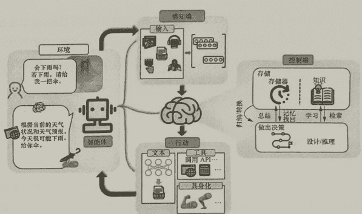

设计涉及 AI、计算机、控制论、机器人学等多学科，且必须**按任务/环境定制化**能力边界与决策逻辑。典型落地：智能物流自主配送、智能家居自适应控制。

#### 3.1.4 商业化实例图谱
*   **工业机器人**：产线装配/焊接/搬运标准化动作。
*   **自动驾驶**：多传感器融合 + CV/ML 实现高阶自主驾驶。
*   **无人机**：GPS/北斗定位 + 飞控系统，覆盖航拍、运输、救援。
*   **智能家居**：语音/图像交互入口，主打安防、节能。

#### 3.1.5 LLM 时代的智能体代理架构
基于大模型的 Agent 成研究新高地，框架三层解耦：

*   **控制端**：大模型核心，承载记忆/知识，负责推理决策。
*   **感知端**：多模态接入（文本/视觉/听觉），打破纯文本瓶颈。
*   **行动端**：决策落地为具体工具调用或物理动作。

#### 3.1.6 场景渗透持续深化
从华为“云网边端协同”的城市/企业/家庭全场景智慧体，到医疗放疗训练、AI 制药加速科研，再到电商兴趣匹配、智能检索、数字娱乐、决策支持系统……智能体正重塑各行各业。

---

### 3.2 多智能体：集体智慧破解复杂难题

#### 3.2.1 定义与本质特征
**多智能体系统（MAS）** = 多个自主智能体通过交互协同，攻克单体无力的大规模复杂问题。它是分布式 AI 的主阵地。

继承单体四大特性外，具备**四大结构性特征**：
*   数据天然分散。
*   计算异步并发/并行。
*   单体认知不完备（信息/能力局限）。
*   **无全局中央控制器**。

**核心博弈**：个体理性（自利最大化）≠ 系统最优。这要求设计**协商机制**，而非集中控制，引导局部最优汇聚成全局最优。

#### 3.2.2 典型协作战场
*   **机器人编队**：多机协同完成复杂作业。
*   **智能交通**：仿真推演优化路网，缓解拥堵。
*   **专家联邦**：跨领域知识融合，联合决策。
*   **分布式预测**：金融/气象多源并行建模，提升精度。

### 核心应用版图展望

- **分布式智能决策**：针对突发事件响应、应急预案制定等时效性要求极高的场景，多智能体协作体系能输出快速、去中心化的决策支撑。
- **虚拟现实交互**：在虚拟仿真环境中，引入多智能体技术可构建更丰富、动态演化的沉浸式交互体验。
- **高可靠实时系统**：面向航空航天装备、医疗关键设备等对稳定性与实时响应零容忍的领域，多智能体架构可显著增强系统鲁棒性与反应效率。

### 3.3 智能机器人

#### 3.3.1 智能机器人分级图谱

依据智能水平高低，智能机器人可划分为三大梯队：传感型、交互型、自主型。

*   **传感型智能机器人**：本体不搭载智能核心，仅配备感知与执行机构。它仰仗外挂视觉、听觉、触觉等传感器采集环境数据，经传输后驱动本体作业，核心模式为“外部大脑指挥、本体执行”。
*   **交互型智能机器人**：具备移动与多模态感知能力，可胜任复杂工艺制造及精细操作。其控制中枢高度智能化，支持通过声光电热等综合信号与人类自然交互，并能依据环境反馈动态调整行为策略。
*   **自主型智能机器人**：代表最高进化形态。能依据环境与自身状态变化自我进化，拥有自主决策、规划与行动能力。内置多源传感器与智能算法，支持感知处理、任务规划及持续自学习。不过，距离拥有自我意识的“超级机器人”，现有技术仍存难以跨越的鸿沟，亟待颠覆性突破。

#### 3.3.2 智能机器人“核心三件套”架构

业界共识：合格的智能机器人须具备**感知**（认知环境）、**行动**（物理响应）、**认知**（决策规划）三大核心要素。具体工程落地为三大硬核模块：

*   **机械躯体**：涵盖机身、机臂、末端执行器等，通过多自由度设计构建灵活作业体系。
*   **感知网络**：分内外部模块，全方位采集本体状态与环境信息。
*   **控制中枢**：通过编程驱动运动，融合计算单元处理多源感知数据，实现精准动作输出。
*   *补充单元*：电源、驱动器、人机交互界面等按需配置，拓展功能边界。

#### 3.3.3 五大核心攻关赛道

智能机器人研发聚焦五大跨学科方向，融合机械、电子、计算机、控制论与人工智能：

1.  **环境感知与认知**：攻克多源感知器件信息获取、融合与语义理解，赋予机器人“读懂世界”能力。
2.  **决策规划与控制**：研究动态环境下的最优决策算法与鲁棒控制策略。
3.  **自然人机交互**：融合语音识别、自然语言处理、计算机视觉，构建高效协作界面。
4.  **持续学习与自适应**：引入终身学习机制，实现性能自我迭代与进化。
5.  **安全与可靠性保障**：建立风险评估与容错机制，守护全生命周期运行安全。

---

### 习题与思考

- **3-1** 请给智能体下定义。
- **3-2** 畅想智能体未来的应用版图。
- **3-3** 如何妥善处理智能机器人与人类的协作与边界关系？

## 项目四 自动驾驶汽车

当下，汽车智能化浪潮加速演进：自动泊车、并线辅助、疲劳监测已成普配。座驾不再是单纯代步工具，而进化为**智能出行第三空间**。无人驾驶将重塑出行安全与效率，其引发的变革远超想象，将深度重构城市图景与生活范式。

**本项目聚焦三大核心看点：**
1.  无人驾驶核心概念与系统拓扑；
2.  AI技术在车载场景的深度落地；
3.  面临的挑战与未来演进路径。

### 导读案例：无人驾驶，启幕智慧出行新纪元

**核心看点**：技术成熟与政策落地双轮驱动，无人驾驶正加速渗透万千场景，兑现“更安全、更便捷”承诺。

*   **谷歌/Waymo**：作为先行者，依托高精地图、多模感知器件与视觉技术，Waymo在凤凰城等地实现收费运营。2024年3月数据显示，其Robotaxi累计行驶数百万公里，零重大事故，安全性获实战验证。
*   **特斯拉 Autopilot**：采用“纯视觉+辅助感知”融合方案，配合端到端神经网络决策，覆盖高快与城市路况。官方数据证实其显著降低事故率。
*   **百度 Apollo**：国产领军者，融合高精地图、大模型与车路协同，“萝卜快跑”已在武汉、重庆、北京、深圳等地开启L4级无人驾驶商业化运营。阿里、腾讯、华为等巨头亦全栈布局，合力推动中国无人驾驶跨越式发展。

---

### 4.1 无人驾驶技术核心解读

随着AI技术迭代，车企全面押注无人驾驶。其核心价值在于**提升安全、释放人力、优化路权**，技术命门锚定在**感知精准度**与**决策大脑**上。车辆通过激光雷达、摄像头、毫米波雷达构建三维数字孪生地图，辅以视觉算法与深度学习，实现对动静态目标的精准识别与博弈决策。

#### 4.1.1 概念界定与分级标准

**无人驾驶**，本质是**“车载计算平台替代人类驾驶员”**。车辆化身“长着轮子的机器人”，利用车载感知器件感知周遭，依据路况、障碍物、周车信息规划轨迹，控制转向与速度，安全抵达终点。

**何为“真无人驾驶”？** 中国标准《汽车驾驶自动化分级》（GB/T 40429—2021）划定六级红线（L0-L5）：

| 等级 | 定义 | 横纵向操控 | 目标监测 | 故障/退出应对 | 运行设计域 (ODD) |
| :--- | :--- | :--- | :--- | :--- | :--- |
| **L0** | 应急辅助 | 人 | 人+系统 | 人 | 受限 |
| **L1** | 部分辅助 | 人+系统 | 人+系统 | 人 | 受限 |
| **L2** | 组合辅助 | **系统** | 人+系统 | 人 | 受限 |
| **L3** | **有条件自动** | **系统** | **系统** | 人(接管后) | 受限 |
| **L4** | **高度自动** | **系统** | **系统** | **系统** | 受限 |
| **L5** | **完全自动** | **系统** | **系统** | **系统** | **无限制** |

**关键分水岭**：L0-L2属**辅助驾驶**，人为主导；L3-L5属**自动驾驶**，系统为主导。
*   **特斯拉 FSD**：覆盖领航辅助、自动变道、泊车、智能召唤、红绿灯识别及城市道路领航。
*   **中国进展**：百度Apollo量产L4车型，多城开放测试与商业化网约车；华为、腾讯、阿里等巨头全栈布局，生态繁荣。

#### 4.1.2 系统拓扑：三大核心链路

仿生人类驾驶模型：**感知层**（眼耳）、**决策层**（大脑）、**执行层**（手脚）。

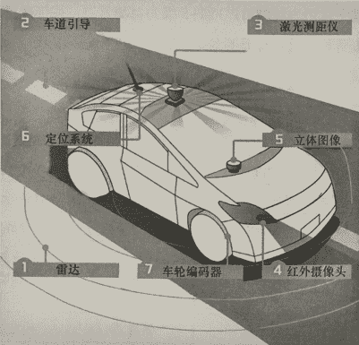

图 4-1 自动驾驶系统组成

**感知层硬核配置：**
1.  **盲区监测雷达**：侧后方物体触发预警。
2.  **车道级感知单元**：后视镜后部识别车道线，精准定位路面边界。
3.  **车顶激光雷达**：数十束激光360°扫描，厘米级测距精度，构建高精三维点云。
4.  **红外夜视系统**：双红外装置穿透黑暗，拓展夜间视野。
5.  **双目立体视觉**：前挡风玻璃双摄输出实时3D路况，标注行人/动物风险。
6.  **融合定位模块**：卫星导航米级定位 + 惯性导航，摄像头识别道路细节。
7.  **车轮速度编码器**：实时监测轮速，辅助里程计定位。

---

### 4.2 AI赋能汽车：感知、决策、执行全链路渗透

AI渗透无人驾驶、语音交互、预测维护、智能导航等全价值链。无人驾驶闭环必经**感知→决策→执行**三阶，环环扣紧AI技术。

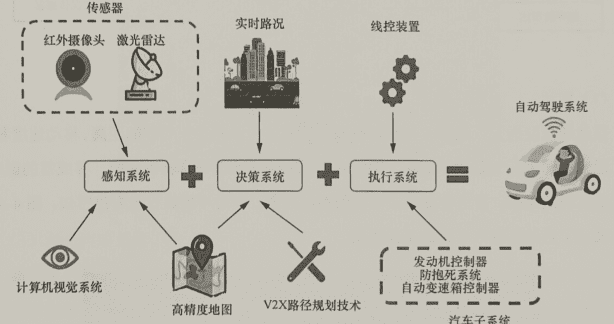

图 4-2 自动驾驶系统组成（功能视角）

*   **感知系统**：多源感知器件（红外、超声波、激光、毫米波、图像）矩阵，实时采集车辆状态与环境动态参数。
*   **决策系统**：感知输出后，融合定位、地图、路况、信号灯等多维约束，从“红灯停”到复杂博弈，输出全局最优轨迹。
*   **执行系统**：决策指令下发，物理控制油门、刹车、转向、灯光，高精度闭环执行。

#### 4.2.1 感知系统：多源融合，构建“数字孪生”视角

感知目标：障碍物位姿、相对速度/意图、可通行区域、交通规则。核心手段：**多传感器数据融合**。

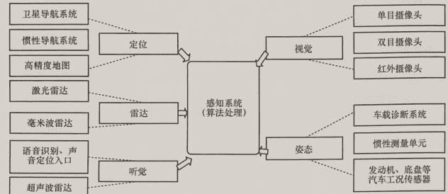

图 4-3 感知系统常见传感器谱系

**(1) 雷达体系：全天候“电子眼”**
原理：发射无线电波接收回波，测距、测速、测向。抗雨雾雪干扰能力强，补全光学短板。

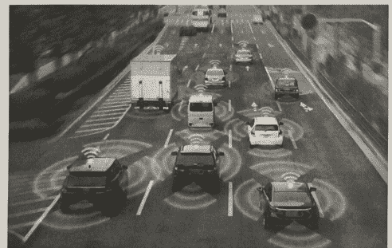

图 4-4 自动驾驶汽车雷达工作场景

*   **前置雷达**（前保险杠/格栅）：主管ACC自适应巡航与AEB碰撞预警。
*   **尾部雷达**（车尾）：倒车/泊车辅助核心。
*   **侧置雷达**（B柱/后翼子板）：盲区监测 (BSD)，守护变道安全。

**(2) 车道保持系统 (LKS)**
挡风玻璃摄像头解析车道线语义，偏离触发转向介入，自动修正回中。


图 4-5 汽车变道时方向盘动作演示

**(3) 激光测距系统 (LiDAR)**
旋转扫描生成高密度三维点云，提供厘米级环境建模与动态目标追踪，是L3+级别标配“制高点”。

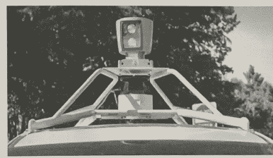

图 4-6 车顶激光测距系统实拍

**(4) 红外摄像头**
主动红外照明 + 红外成像，夜间穿透能力强，驾驶员屏幕高亮显示潜在危险目标。


图 4-7 红外摄像头模组

**(5) 立体视觉**
双目三角测距原理，前挡双摄实时输出稠密视差图，感知行人/车辆三维姿态并预测行为。

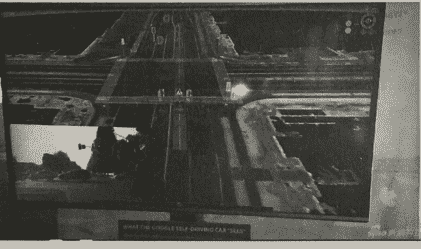

图 4-8 实时三维图像渲染效果

**(6) 导航定位融合系统**
*   **卫星导航 (GNSS)**：空间段/地面段/用户段协同，多星测距解算位置。主流 GPS + 北斗双模。
*   **惯性导航 (INS)**：自主定位，基于IMU(加速度计+陀螺仪)积分推算位姿，无惧隧道/地库信号盲区，与GNSS紧组合互补。

#### 4.2.2 决策系统：从“规划路径”到“博弈智慧”

感知结果经预测模块处理后，送入决策大脑，核心模块见下：

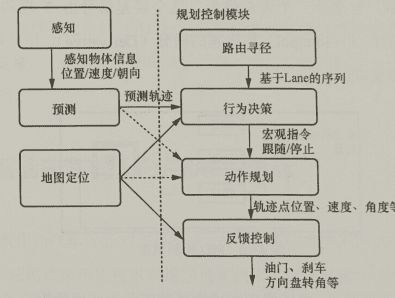

图 4-9 规划控制模型架构

*   **全局路径规划 (宏观)**：给定起止点，在环境模型中搜索无碰撞、可通行、最优性能（时间/能耗/舒适）的全局路径。需解高维非线性优化，约束含障碍物、车道拓扑、曲率/曲率变化率、车辆动力学极限。
*   **战术行为决策 (微观)**：输入：全局路径 + 感知预测 + 高精地图。输出：离散驾驶行为（跟车、换道、停车让行、路口博弈、掉头等）。*例：规划要求保持车道，感知到前车减速 → 行为决策输出“跟车策略”，而非强行变道。*

#### 4.2.3 执行系统：从PID到MPC，极致跟随控制

执行层任务：**精准还原规划轨迹**。评价指标：控制精度与鲁棒性。核心机制：**反馈控制**——实测状态与目标状态作差，输出控制量修正偏差。

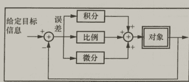

图 4-10 PID 控制原理框图

*   **PID 控制器**：工控领域“常青树”。基于误差比例(P)、积分(I)、微分(D)三项加权。优点：结构简单、调试成熟、稳定可靠。
*   **PID 痛点**：纯反馈机制，无法建模预测**时延**与**非线性动态变化**，在高速、大曲率、强扰动工况下易超调或震荡。

**进阶范式：模型预测控制 (MPC)**

近年无人驾驶控制主流选择。核心逻辑：**在线循环滚动优化**。

1.  **模型驱动前瞻**：依赖车辆动力学模型（运动学/动力学），前瞻预测未来时域内系统演化。
2.  **循环滚动优化**：有限时域内求解开环最优控制序列，**仅执行第一步**，下一采样周期用新状态重新优化（闭环修正）。
3.  **前馈反馈融合架构**：前馈补偿已知参考轨迹/干扰，反馈抵抗模型误差与未知扰动，兼顾响应速度与鲁棒性。

### 前馈-反馈复合控制与模型预测控制（MPC）概述

前馈-反馈复合控制架构融合了前馈的预判优势与反馈的纠偏能力，旨在实现更高阶的过程控制精度与效率。其中，前馈环节负责预判驾驶意图，反馈环节则实时修正车辆动力输出。相较于传统 PID 控制器，模型预测控制（MPC）展现出更强的灵活性与鲁棒性，尤其擅长处理多变量耦合、大时延及严格约束等复杂工况，在自动驾驶决策执行层极具应用潜力。

### 4.3 自动驾驶落地的三大拦路虎

作为汽车智能化的核心赛道，自动驾驶虽借 AI 东风加速演进（如 VR/AR 技术辅助提升驾驶训练与安全性），但距离大规模商用仍存多重阻碍。

**1. 技术攻关：感知与决策的“边界难题”**
尽管算法日趋成熟，实车上路仍面临硬核挑战：高精地图之外的临时路况（施工、限行、内部道路）识别难；面对飘落树叶、塑料袋等“幽灵障碍物”易误触急刹；突发交通管制、事故现场等非结构化场景下，感知盲区与决策最优解难以兼得；此外，高带宽低时延通信网络的依赖性也是短板。

**2. 安全隐患：网络攻击的“达摩克利斯之剑”**
自动驾驶深度绑定互联网（OTA 升级、云端协同、V2X 交互），攻击面随之暴露。一旦遭遇黑客入侵或恶意篡改，导致系统延迟飙升甚至瘫痪，后果不堪设想。

**3. 伦理困境：无解的“电车难题”变体**
当规避风险与保护主体发生冲突（如刹车失灵时：撞向行人保车内人，还是撞向墙体保行人），算法被迫在道德两难中做单选题，引发社会信任危机。

---

### 第 4 章 课后思考题

- **4-1** 非传感器组件是？（A. 摄像头 B. 传声器 C. 雷达 D. 电机）
- **4-2** 激光雷达功能上对应人体哪个器官？（A. 手 B. 脚 C. 眼 D. 头）
- **4-3** 无人驾驶架构不包含哪系统？（A. 感知 B. 监控 C. 决策 D. 执行）
- **4-4** 当前自动驾驶核心栈应用了哪些 AI 技术？
- **4-5** 哪些细分场景最先跑通规模化落地？逻辑何在？
- **4-6** 校园末端物流：自动驾驶车 vs 无人机 vs 其他方案，如何选型？

---

## 项目五 大模型：范式变革与产业新基建

**核心定义**：大模型 = 深度神经网络 + 超大规模参数（百亿至万亿级）+ 海量数据预训练。目标是通过“涌现智能”解决复杂任务，广泛落地于 NLP、CV、语音等领域。虽面临过拟合、泛化瓶颈、算力饥渴等痛点，但可通过正则化、数据增强、分布式训练等工程手段缓解。

**本项目脉络**：大模型演进史 → ChatGPT 解构 → 文心一言/ChatGPT 实战案例。

### 导读案例：5 分钟，让 AI 写首歌

**洞察**：大模型正重塑内容生产范式，成为数字经济核心引擎。
**过往**：创作需专业技能（编曲、填词、试唱、迭代）。
**现在**：外行也能通过“主题+风格”提示词，借 ChatGPT 低门槛产出成品。

**技术溯源**：ChatGPT 基于 GPT 系列演进。GPT 以 Transformer 架构预测下一 Token 分布，在海量语料上学习语言模式。
- GPT-1 到 GPT-4：智能跃迁显著。GPT-4 具备更强创造性、协作性与复杂推理能力，支撑 New Bing 等应用。

**产业全景**：
- **发源**：NLP 领域，三巨头鼎立——Google BERT、OpenAI GPT、百度文心一言，参数破千亿，数据量级指数级增长。
- **演进**：单模态向多模态融合（视觉大模型等），模拟人脑多感知协同，推动 AI 从“感知”迈向“认知”。
- **机遇窗口**：数字经济/元宇宙爆发期，传统 AI 落地受限于“开发门槛高、场景碎片化、标注数据依赖强”。大模型凭借**泛化性、通用性、迁移性**打破僵局，被视为通往 AGI 里程碑，引发“工业革命级”变革，中国全链路布局势在必行。
- **IDC 预判（2023.4）**：大模型将催生新产业范式，依托深度学习平台成“产业智能化基座”，企业需构建“统一 AI 底座 + 专家知识图谱 = 跨场景元能力引擎”。

### 5.1 什么是大模型：从 ChatGPT 现象级爆发看技术分水岭

**时间节点**：
- 2022.11 ChatGPT 面世：强 NLU 能力，赋能聊天、翻译、办公助手。
- 2023.3 GPT-4 发布：行业震动，AI 技术高度再刷新。

**本质拆解**：
大模型 = **预训练** + **大模型**。核心范式转变：海量数据预训练 → **零样本/少样本泛化** → 直接支撑下游任务，无需/少需微调。此类基于自监督学习的“地基模型”为下游应用提供通用能力底座。

**演进三部曲**：
1.  2012 萌芽期（AlexNet 时刻）
2.  2016 AI 1.0 期（感知专用小模型）
3.  2022 AI 2.0 期（ChatGPT 引爆大模型时代，参数量级跃迁：GPT-4 万亿级、PaLM-E 5620 亿参数全球公开最大）
**现状**：国内“百模大战”全面打响，产品迭代周期以周计。

**能力边界**：多模态理解生成（文、图、声），支撑复杂任务。生活入口：智能语音助手、图像识别工具。

**谱系图谱**：
人工智能 → 机器学习 → 深度学习 → 深度学习模型 → 预训练模型 → **预训练大模型** → 预训练大语言模型
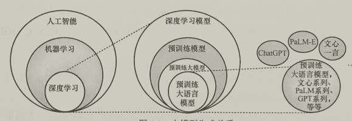
图 5-1 大模型生成关系谱系

**三大重塑性预判**：
1.  **人机交互重构**：自然语言成新编程语言，“提示词工程”成核心生产力。预估 10 年后 50% 岗位为 Prompt 相关，**提问 > 解题**。
2.  **营销服务重构**：极致对话体验 = 客户留存护城河。
3.  **AI Native 应用爆发**：非集成、非接入，而是**原生重写**产品、服务、工作流。未来万物基于大模型开发，垂直行业模型百花齐放，深度融入实体经济，助力中国经济下一个“黄金 30 年”。

**代价与门槛**：数据、算法、算力三位一体的极致堆叠，训练成本高昂。案例：GPT-4 采用 8 专家混合架构（MoE），13 万亿 Token，百日训练，6300 万美元烧出。

**全球格局**：中美双强“千模大战”。大模型 = 新型基建基座 = 国家战略博弈。中国破局路径：**全栈自主创新 + 国产算力底座筑牢**。

**主力玩家图谱**：
| 阵营 | 代表企业 | 核心产品/布局 |
| :--- | :--- | :--- |
| **海外先锋** | OpenAI | ChatGPT 系列、Codex、DALL-E |
| | Google | BERT、Transformer、PaLM、Gemini |
| | Meta | LLaMA、XLM-R、RoBERTa |
| | Microsoft | Azure OpenAI（独家商业化通道） |
| **国内头部** | 百度 | 文心一言、千帆大模型平台 |
| | 阿里巴巴 | 通义千问/万象、ModelScope 魔搭社区（支持 LLaMA2、ChatGLM 等三方） |
| | 华为 | 盘古大模型（政企场景深耕） |
| | 360 | 360 智脑 |

---

### 5.2 ChatGPT 深度解构：技术逻辑、核心优势与已知短板

#### 5.2.1 技术管线：从语料到对话的五步走
1.  **数据预处理**：清洗去噪，构建高质量训练语料。
2.  **模型训练**：Transformer 架构，多轮迭代，压缩语言统计规律。
3.  **输入编码**：Tokenizer 分词 + Embedding 向量化 + 位置编码，映射为模型可读张量。
4.  **模型预测**：自回归式生成，基于上下文概率分布预测下一 Token。
5.  **输出解码**：向量 → 自然语言文本（采样策略：Top-k, Top-p, Temperature 控制确定性/创造性）。

**短期商业化落地四象限**：归纳类文本、代码辅助、图像生成、智能客服。

#### 5.2.2 四大核心优势（GPT-4 级能力）
1.  **生成力强**：长文本连贯性、逻辑性、创造性业界标杆，覆盖客服、教育、内容创作等高价值场景。
2.  **知识库广**：互联网级语料预训练，跨领域知识检索与推理，化身“全能参谋”。
3.  **多语言通**：跨语种理解生成无障碍，天然具备全球化服务基因。
4.  **懂语境、重个性**：多轮对话状态追踪精准，回复贴合人设与隐性意图，拟人感强。

#### 5.2.3 五大不可忽视的局限
1.  **一本正经胡说八道**：训练数据含噪 + 概率生成机制 = 幻觉高发（事实错误、逻辑自洽性破裂）。
2.  **无道德指南针**：无价值观判断，易输出偏见、歧视、违规内容。对齐对抗是长期攻坚战。
3.  **数据隐私雷区**：交互数据回流训练风险、合规挑战（GDPR 等），企业级落地需私有化/联邦学习方案。
4.  **长文健忘症**：上下文窗口虽扩大，但超长依赖建模仍弱，易逻辑断层、重复循环。
5.  **算力黑洞**：万亿参数推理部署门槛极高，中小创新主体被挡门外。蒸馏/量化/剪枝虽可压缩，但常伴随性能损耗。

---

### 5.3 实战案例：大模型如何为业务“降本增效”

#### 案例一：小红书 —— 社交电商闭环的“智能大脑”
**场景**：种草笔记 → 站内直购 → 售后咨询 → 个性化推荐。
- **ChatGPT 接管客服**：自动回复 + 智能工单分流，响应速度与处理效率双提升。
- **文心一言做用户画像**：情感分析 + 行为序列建模（浏览/点赞/评论） → 精准兴趣图谱 → “千人千面”商品分发，提转化、强粘性。

#### 案例二：美团外卖 —— 即时物流网络的“情绪雷达”
**场景**：高频刚需、SKU 复杂、服务链路长。
- **ChatGPT 驱动智能客服**：标准化咨询 7×24 秒级响应，人工席位聚焦疑难复杂工单，成本结构优化。
- **文心一言做舆情洞察**：对海量评价/投诉做细粒度情感极性分析 → 定位痛点（配送慢、口味差、包装烂） → 闭环驱动运营策略迭代，持续刷高满意度。

#### 案例三：智慧学堂 —— 因材施教的“AI 双师模式”
**架构**：文心一言（规划/陪伴端）+ ChatGPT（答疑/知识端）。
- **文心一言**：
    - 个性化学习路径推荐（基于画像、进度、薄弱点）。
    - 学情追踪与反馈闭环（知不知道、会不会、强不强）。
    - **情感计算介入**：监测焦虑/挫败信号 → 触发心理疏导/人工干预预警。
- **ChatGPT**：
    - 自然语言问答系统，秒级解析习题、展开知识延伸，打破时空限制的“随身导师”。

---

### 第 5 章 课后思考与实战作业

**思考题**：
- 5-1 用一句话定义大模型，区别于传统模型的关键在哪？
- 5-2 梳理中国大模型梯队格局，核心竞争力在算力、数据、算法哪层？
- 5-3 画图解释 ChatGPT 推理前向传播全流程。
- 5-4 对标 GPT-4，国产大模型差距主要在哪三项能力？
- 5-5 列举 3 个你身边已落地的大模型应用，分析其商业价值点。

**实验：文心一言“写小说 / 做研报”实战复盘**
1.  **账号准备** & **Prompt 设计**（明确角色、任务、约束、输出格式）。
2.  **选题**：热门网文赛道（如都市爽文、悬疑推理）或 产业研判（新能源车、大模型赛道、银发经济）。
3.  **交互迭代**：多轮对话打磨大纲 → 细化章节/章节 → 润色文风/图表解读。
4.  **评估维度**：
    - 小说：创意新颖度、情节张力、人设立住度、文笔可读性。
    - 报告：行业洞察深度、数据支撑可信度、竞品分析颗粒度、趋势判断前瞻性。
5.  **交付物**：Word 复盘报告（含 Prompt 版本演进、输出对比、评分表、个人总结：如何用大模型提升自我学习/科研效率）。

---

## 项目六 AIGC：生成式 AI 重塑内容生产力

**定义**：AIGC (AI Generated Content) = 用 AI 学习海量分布规律，**自主生成**具有特定风格、知识含量、商业价值的**新内容**（非检索、非拼贴、非简单变换）。产出形态：文本、代码、图像、视频、音频、3D、基因序列等。

**技术驱动**：扩散模型、Transformer、NeRF、3DGS、多模态对齐等底层架构突破，推动生成质量跨越“可用”临界点。

**本项目看点**：AIGC 全模态技术全景图 + 重点行业落地图谱。

### 导读案例

#### 内容平台AIGC暗战：集体狂欢下的冷思考

**核心看点**：AIGC 已全面渗透小红书、微博、知乎等主流内容社区，各家平台在“拥抱”与“围堵”之间走钢丝，策略迥异却暗流涌动。

生成式人工智能的爆发式增长，正以肉眼可见的速度重塑内容生产版图。尽管外界争议不断，但头部平台早已按捺不住入局。以小红书为例，其动作最为激进：自 2023 年 3 月起便秘密组建大模型攻坚组，多条业务线并行攻关落地场景，自研绘图模型 “Trik” 更是直指核心应用层。这套“自研+联合”的组合拳，暴露出其抢占先发制人高地的野心。

同行自然不甘示弱，但打法各有千秋。百家号上线的 “AI 笔记” 主打全流程托管——从润色、扩写到起标题、发动态，试图把创作者变成“监工”；微博则在超级红人节抛出 “AIGC 创作助手”，核心卖点是“懂你”、”懂热点”，承诺复刻大 V 文风、提供选题灵感，甚至包揽剪辑、配音、直播话术等脏活累活。

反观知乎，画风截然不同。它先祭出《社区公告》亮剑：严打未标识、批量倾销的 AI 账号，强制打标、限流、官方兜底打标，姿态极其强硬。然而转身却与壁垒智能合作推出 “知海图 AI” 大模型，上线 “热榜摘要”“搜索聚合” 等功能，实则是以 “工具赋能” 替代 “内容生成”，用更隐蔽的方式完成拥抱。抖音则走向规范化路径，强制要求 AI 内容显性标识、虚拟人实名登记。

这背后折射出的共同困境是：**平台既渴望 AIGC 带来的效率红利，又恐惧其制造的垃圾洪水**。技术层面上，识别 AI 生成内容仍属世界级难题，治理永远滞后于生成。但不管态度如何摇摆，AIGC 作为新物种，其势能已不可逆地向纵深渗透。

---

### 6.1 AIGC 全景扫描

#### 6.1.1 重新定义内容生产：什么是 AIGC

沿袭 PGC（专业生产）、UGC（用户生产）之后，AIGC 被公认为第三代内容生产范式。它的本质是将“创作者”这一角色从碳基生命迁移至硅基智能。标志着 AI 从 1.0 时代（感知理解）跨越至 2.0 时代（生成创造）。核心逻辑极简：输入主题、关键词、风格等约束条件，模型自动产出文本、图像、音频、视频等多模态成品。其价值锚点在于“高质、高效、个性化”，已在媒体、教育、营销、科研等领域全面开花。

这绝非终点。随着模型架构迭代、数据资产增厚，生成上限将持续拔高。跨模态融合是大势所趋：NLP 遇上 CV 实现图文互生，语音识别合成打通听说通道，强化学习、GAN 等技术注入自主进化能力。未来的 AIGC，将是一个能看、能听、能说、能画、会推理的全能创作伙伴。

#### 6.1.2 四大生成维度：AIGC 分类图谱

按输出模态划分，版图清晰切分为四块：

##### (1) 语言生成：会写会算的“笔杆子”
本质是神经网络基于语义概率建模，按任务定向输出文本。已成各行各业的“隐形写手”：
- **金融**：秒读财报研报，吐关键点、出策略；
- **电商**：批量造爆款标题、卖点文案、种草评价；
- **媒体**：自动化生产结构化新闻稿；
- **教育**：代写教案、批改作业、充当 AI 督学；
- **医疗**：辅助写病历、匹配医疗资源。

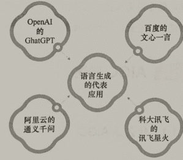

图 6-1 语言生成的代表应用

##### (2) 图像生成：像素级的“造梦师”
涵盖图像合成、以图生图、文生图（Text-to-Image）三大技术路线。从商业设计素材到艺术创作辅助，正在重塑视觉内容供给链。

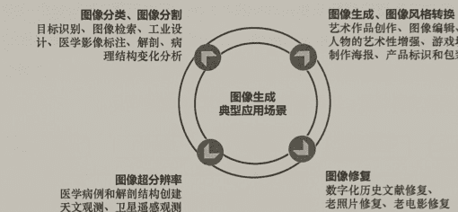

图 6-2 图像生成典型应用场景

##### (3) 音频生成：会说话会唱歌的“声乐库”
核心是波形合成，覆盖 TTS（文本转语音）、语音转换、视觉引导发声、音乐创作四大赛道。按输入分为文本/音频/肌电/视觉驱动；按交互分为非流式（一次性出片，适合有声书）与流式（分段合成、低延迟，适合实时通话）。国内外头部模型已形成梯队竞争态势。

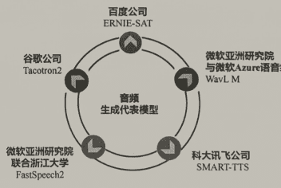

图 6-3 国内外音频生成的代表模型

##### (4) 视频生成：最硬骨头的“导演梦”
输入文本/图像/视频，输出高保真动态画面。涉及识别、剪辑、制作、增强、风格迁移全链路。目前辅助剪辑工具相对成熟，但精细可控、产业化规模仍是待攻关高地。一旦突破，影视、广告、短视频将迎来范式革命。

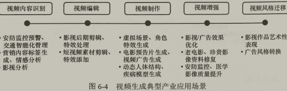

图 6-4 视频生成典型产业应用场景

#### 6.1.3 底座技术拆解：AIGC 的“发动机室”

以游戏场景为切入点，四大支柱技术缺一不可：

| 核心技术 | 角色定位 | 游戏落地场景 | 关键方法论 |
| :--- | :--- | :--- | :--- |
| **机器学习** | **大脑决策中枢** | 训练智能 NPC、机器人，实现状态感知与自主决策 | 监督/无监督/半监督/强化学习 |
| **计算机视觉** | **眼睛感知系统** | 自适应渲染、VR/AR、玩家行为捕捉分析 | 特征提取、分类、检测、语义分割 |
| **自然语言处理** | **语言交互接口** | 智能对话、任务/剧情自动生成、玩家意图理解 | 语音识别、文本分类、情感分析、文本生成 |
| **优化算法** | **效率调度引擎** | 解决探索-利用困境、高维空间搜索、策略迭代 | 遗传、粒子群、蚁群、模拟退火算法 |

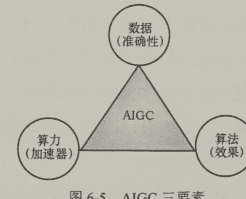

---

### 6.2 场景落地实录：AIGC 正在改写哪些行业？

#### 6.2.1 传媒业：从“辅助工具”进化为“生产主力”

AIGC 已渗透采编传播全链路，重塑媒体融合基因。

**【采编端：效率革命】**
- **录采神器**：语音实时转写+自动润色，记者只需复核定稿。2022 冬奥会，科大讯飞录音笔助力跨语种分钟级出稿。
- **写稿机器人**：算法驱动秒级成稿。2014 年 Quakebot 3 分钟发震稿，中国地震台网机器人更将九寨沟地震稿压缩至 7 秒。
- **智能剪辑**：自动字幕、集锦、拆条、超分、横竖屏转换一键搞定。《人民日报》两会“云剪辑”、央视冬奥“AI 剪辑系统”实战验证：人力成本骤降，版权价值激活。

**【传播端：虚拟主播上岗】**
输入文本即产出“声形神”合一的播报视频。央视频 AI 手语翻译官即是标杆。


图 6-6 虚拟主持人

**三大演进趋势已成定局**：
1.  **疆域拓展**：从新闻台席延伸至晚会、现场报道、天气预报，央地媒体集体入场。
2.  **能力进阶**：多语种、手语播报标配。冬奥百度/腾讯手语数字人推动无障碍观赛。
3.  **形态进化**：2D→3D，驱动从嘴型到全身微表情；生产从 SaaS 平台走向端到端智能化。

#### 6.2.2 影视业：全流程降本增效

| 制作阶段 | AIGC 切入点 | 典型价值 |
| :--- | :--- | :--- |
| **前期创作** | 剧本生成、角色设定、场景概念图 | 打破创作瓶颈，海量方案快速试错 |
| **中期拍摄** | 虚拟布景、智能布光、特效预演、虚拟制片 | 物理空间数字化，不可控风险前置化解 |
| **后期制作** | 智能粗剪、自动配乐、特效批量生成 | 短视频/电影工业化流水线核心动力 |

#### 6.2.3 电商业：重构“人货场”新范式

五大战场全面开花：

1.  **商品展示**：文生图/视频，设计图秒变商品大图，SKU 图成本趋近于零。
2.  **主播塑造**：虚拟数字人 7×24 小时不下播，人设可定制，边际成本极低。
3.  **交易场景**：生成式交互界面，让“买买买”变成沉浸式体验。
4.  **精准营销**：吃透用户画像，自动产出高转化文案、投放策略，实现千人千面。
5.  **智能客服**：大模型驱动对话管理，全天候秒级响应，复购与口碑双提升。

---

### 课后思考与实战

**❓ 思考题**
1.  用一句话定义 AIGC，并阐述其相对于 PGC/UGC 的核心差异。
2.  梳理 AIGC 的四大模态分类及各自典型落地场景。
3.  机器学习、CV、NLP、优化算法在 AIGC 中分别扮演什么角色？
4.  结合传媒/影视/电商任一领域，设计一个 AIGC 创新应用方案。

**🛠 实战演练：通义文生图魔法实验**
- **工具**：阿里达摩院通义文生图大模型。
- **任务**：自学工具 → 编写 Prompt → 多风格生图 → 产出图文报告。
- **交付物**：包含需求描述、生成图片、风格对比的 Word 复盘文档。

---

## 项目七 智能生活：AI 已悄悄住进你的日常

从“猜你喜欢”到“买菜做饭”，从 NPC 到智能管家，AI 正以润物无声之势，重塑生活体验的上限。

**本项目聚焦三大高频领域**：
1.  电商消费新范式
2.  游戏娱乐新交互
3.  智能家居新生态

### 导读案例：AR 试衣 + AI 推荐，重塑购物体验闭环

**痛点直击**：网购衣服最大的坑——**“买家秀 vs 卖家秀”**，本质是无法试穿。

**技术破局**：AR 虚拟试衣镜打破时空限制，让用户在家完成“所见即所得”试穿。AI 推荐系统则基于行为偏好画像，精准匹配款式搭配，从“货找人”进化为“懂你的人找货”。


图 7-1 虚拟试衣镜

**四大重构性影响**：
- **去时空化**：随时随地试衣间；
- **极致个性化**：千人千面的专属买手；
- **决策加速**：三维建模+智能推荐，砍掉犹豫成本；
- **零售重塑**：倒逼品牌/平台全面数智化转型。

---

### 7.1 AI + 电子商务：重新定义“买”与“卖”

#### 7.1.1 实战场景：AI智能客服系统

AI驱动的智能客服系统，旨在提供高效、精准、定制化的服务体验。它能模拟人工应答逻辑，实现全天候7×24小时无间断驻守。此类系统不仅缩短响应周期、优化服务质量，更能有效降本增效。

早期版本仅支持基于预设规则的简单文本回复。随着语音识别与合成技术的突破，系统实现了语音交互，迈向高阶智能化。融合自然语言处理、机器学习等技术，现代智能客服已支持多模态交互，并能精准洞察用户意图，提供定制化服务。相较传统人工席位，其优势显著：

*   **秒级响应**：即时应答，免去排队等待，大幅压缩响应时长。
*   **高并发处理**：突破时空限制，可同步受理海量咨询。
*   **成本优势**：无需薪资、社保等固定投入，大幅节约人力开销。
*   **全程质检**：支持服务质量实时监控与干预，持续提升满意度。

目前，智能客服已接管人工客服的大量基础性工作，具体覆盖：
1.  购物咨询解答（商品介绍、选购建议）；
2.  订单全流程自动化处理（状态查询、物流追踪）；
3.  售后退换货自助引导（流程指引、注意事项）；
4.  投诉反馈快速闭环（需求收集、方案提供、满意度回访）。

头部电商企业普遍部署此类系统，利用语义与关键词分析实现自动应答，显著提升了订单处理、售后服务、投诉处理及数据分析等多维效能。

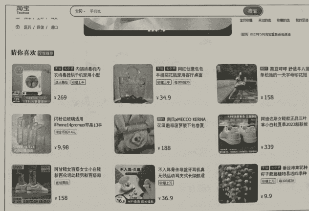

#### 7.1.2 实战场景：智能推荐分发系统

随着电商规模爆发式增长，商品SKU呈指数级上涨，用户决策成本随之攀升。智能推荐分发系统应运而生，成为破解“选择瘫痪”的关键。

该系统整合用户行为、兴趣画像、商品属性及社交关系等多维数据，构建精准用户画像，并通过多算法模型匹配分发商品。它能敏锐捕捉显性与隐性需求，主动触达商品，从而提升购物效率、驱动GMV增长，助力平台精细化运营。

核心分发逻辑包括：
*   **实时关联推荐**：浏览商品时即时推送新品、促销关联品，激发购买冲动。
*   **热度权重排序**：基于销量、好评率等指标动态调序，提升转化率。
*   **交叉营销推荐**：依托历史订单挖掘关联商品（如服装搭配鞋包），拓宽客单价。
*   **地域化适配**：结合物流时效与区域偏好，输出差异化推荐列表。

淘宝“猜你喜欢”板块即为经典范例。该模块占据首页核心流量位，基于浏览、购买、商品属性等多维特征实时计算，推荐结果随用户行为动态迭代。此外，“相似宝贝”、“搜索推荐”等多元入口均深度应用AI技术，重塑个性化购旅。

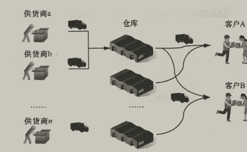

#### 7.1.3 实战场景：库存智能预测与决策

库存是电商运营的“心脏”。缺货导致流量变现失利，积压则吞噬现金流与仓储成本。然而，受季节性、促销、竞品动态等多重复杂变量干扰，精准备货极具挑战。库存周转效率直接映射企业核心竞争力。

库存智能预测引入数据挖掘与AI算法，识别影响订单履约的关键变量，量化其对库存的具体冲击，助力企业优化备货策略、调整销售节奏、最大化利润。在多渠道库存协同等复杂场景下，算法可自动消化海量数据，融合历史销量、竞品动态、天气、节假日等外部因子，输出高置信度的需求预测，为精细化库存决策护航。

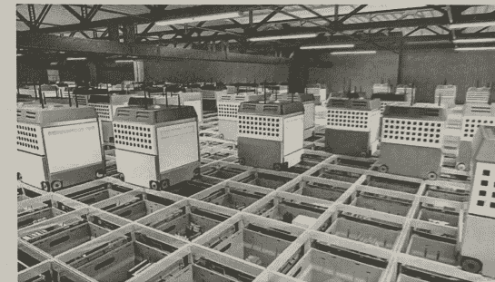

#### 7.1.4 实战场景：货物自动化分拣

订单量激增倒逼分拣环节升级，传统人工作业已难以为继。AI技术赋能智能分拣，为仓储物流带来革命性效能跃升。

智能分拣依托AI与专用设备，实现货物自动识别、分流与归类。设备可高速精准识别标的物，按指令分拨至目标货位/通道，规避人为误差，保障作业准确率与稳定性，广泛服务于物流枢纽。

技术底座融合机器视觉、深度学习、NLP等：机器视觉负责图像采集与特征识别；深度学习赋能海量样本训练与自主决策；NLP支撑语音交互与指令控制。

主流设备矩阵涵盖：
*   **自动化分拣线**：输送带动态调速调向，配合机械手/吸盘及视觉运动控制，完成高精度分拨。
*   **智能物流机器人（AMR）**：激光SLAM导航实现自主避障与路径规划，机械臂执行抓取、搬运、上架等复合动作。
*   **无人仓储体系**：设备协同作业，实现全流程无人化。


#### 7.1.5 实战场景：商品动态定价引擎

在比价透明、竞争白热化的当下，定价不再是静态决策，而是动态博弈的核心杠杆。零售商需实时响应供需与竞品变化，维持价格竞争力。

数据驱动的AI智能定价已成标配。传统模式依赖经验与历史数据，滞后于市场；AI引入机器学习与深度学习，实时解析市场与竞品数据，输出精准灵活的定价策略，实现快速适应。主流模式分两类：

1.  **预测定价模式**：建模“价格-销量”弹性曲线。结合历史销量、需求预测、竞品定价，推演利润/收益最大化价格点。例如，通过模型对比发现降价虽压低单品利润，但能撬动量级销售，从而决策以低价换份额。
2.  **动态定价模式**：实时监控市场脉搏与竞品动作，毫秒级调价。大促溢价收割需求红利；竞品降价跟进防守流量。策略持续迭代，闭环优化。

#### 7.1.6 未来展望：三大前沿演进方向

电商竞争进入深水区，AI与业务融合呈现三大确定性演进趋势：

**(1) 情感计算辅助决策：攻克“冷冰冰”痛点**
现有智能客服缺乏情感感知。情感AI通过分析停留时长、对比浏览、加购行为等微表情数据，推演购买意图与犹豫点，主动介入引导。例如，长时停留触发详细参数对比或优惠券推送；结合历史偏好输出“懂你”的建议，将服务从“响应式”升级为“预测式”。

**(2) 虚拟主播：重构直播带货生产力**
AI驱动的虚拟主播可复刻真人表情动作与语言风格。核心价值在于：7×24小时不间断开播，解决真人体力瓶颈；边际成本趋近零，大幅降本；形象可高度定制化，强化品牌记忆点与互动粘性。未来将成品牌营销标配。


**(3) AIGC商业视觉生成：降本增效的“设计师”**
AI绘图技术基于生成式算法，依据文本提示词批量产出商品主图、详情页素材。延伸应用包括：
*   **创意广告产出**：输入关键词与受众画像，自动生成高转化广告素材。
*   **定制化设计**：C2M模式下，用户输入个性化参数，AI实时生成专属产品外观设计方案。

---

### 7.2 AI+游戏：从辅助工具到核心引擎

#### 7.2.1 演进历程：三次技术跃迁

2016年AlphaGo以4:1击败李世石，以深度学习与强化学习震惊世界，标志着AI在博弈智能上的里程碑，也为游戏AI应用提供了范式参考。

游戏AI应用历经三大阶段：

**阶段一：规则与状态机时代（80年代-90年代初）**
AI主要驱动NPC与敌人基础行为树：基于玩家坐标、血量触发追击/逃跑/攻击；任务完成触发奖励/提示。实现逻辑为硬编码规则与有限状态机（FSM），辅以简单概率随机性，增加不可预测趣味性。

**阶段二：机器学习与神经网络觉醒（90年代-21世纪初）**
应用边界拓展至关卡设计、音效生成等内容生产端。ML与神经网络引入使NPC行为更拟人、策略更多样，显著提升沉浸感。代表作《星际争霸》《雷神之锤》《虚幻竞技场》均深度应用此类技术。

**阶段三：深度学习与强化学习全面爆发（21世纪初至今）**
深度神经网络处理高维复杂状态，强化学习（RL）训练Agent自主决策，使NPC具备长程规划与战术协作能力。同时，CV、ASR、NLP等感知技术落地游戏交互，开启多模态沉浸新纪元。如今，AI已成游戏互动性、可玩性、个性化的核心驱动力，并反哺开发商数据洞察与商业变现。

#### 7.2.2 实战场景：语音合成（TTS）

《王者荣耀》中“五杀”音效的肾上腺素飙升，印证了游戏语音对情绪调动的关键作用。语音广泛用于NPC对话、角色配音、新手引导，是交互反馈的核心通道。

传统配音流程重度依赖人工：编写剧本→选角录制→后期混音，周期长、成本高、迭代难。AI语音合成技术实现“文本秒变语音”：输入文案即可批量生成角色配音，支持音色、语速、情感维度的精细调控，完美适配剧情氛围。开发者可随时修改文本快速试听迭代，极大释放内容生产产能。

#### 7.2.3 实战场景：智能内容安全护盾

随着游戏成主流社交场域，违规言论、外挂作弊、隐私泄露等治理压力指数级上升。人工审核效率低、漏判率高、隐私风险大。

AI审核体系构建“机器初筛+人工复核”防线：
*   **文本风控**：NLP分词、实体识别、情感分析、文本分类，精准拦截涉政、低俗、辱骂内容。
*   **图像风控**：CV与深度学习提取颜色纹理特征，毫秒级识别黄暴广等违规图像。
*   **语音风控**：ASR语音转文本+NLP语义分析，实时净化语音频道。

AI审核不仅提效降本、保障内容安全合规，更通过自动化脱敏处理（语音变声、文本掩码），从技术架构层面守护玩家隐私数据安全，成为游戏生态健康发展的基石。

#### 7.2.4 实战场景：面部动画驱动技术

玩家对角色“演技”要求日益苛刻，传统关键帧手工捏脸、逐帧调表情流程繁琐，难以支撑大规模高品质内容生产。AI面部动画技术成为破局关键，可自动生成细腻微表情、唇形同步与神态动作，显著提升角色真实感与玩家代入感，同时大幅压缩美术人力成本与制作周期。

近年来，在深度学习、神经网络及计算机视觉等AI核心技术的强力加持下，人脸动画技术实现了飞跃式发展。这些前沿技术能够自主从海量面部图像与视频数据中捕捉特征规律，并借助生成模型合成出栩栩如生、自然流畅的人脸动画。图 7-7 直观呈现了AI技术赋能下的游戏角色形象。


图 7-7 AI技术生成的游戏角色示意

以基于生成对抗网络（GAN）的人脸动画方案为例，该技术由生成器与判别器两大神经网络构成。生成器致力于创作逼真的人脸动画，而判别器则负责甄别其与真实人脸的相似度。在双方的博弈训练中，生成器不断进化，显著提升了输出动画的品质。

此外，自然语言处理（NLP）亦可赋能人脸动画生成——只需输入文本描述或语音指令，系统便能自动生成对应动画。其原理在于从指令中提取面部特征，在预置人脸库中检索最佳匹配模板，再经生成算法合成最终动画。

AI驱动的人脸动画技术为游戏开发注入了高效、灵活且智能化的解决方案，显著提升了游戏品质与玩家体验，更为创作者打开了无限的创意空间。借助此技术，游戏角色能精准传逰情感：如面对紧张局势，角色面部细微表情变化可真实传达压迫感，助力玩家深度共情角色内心世界。

#### 7.2.5 实战案例：市场洞察新范式

游戏厂商亟需精准掌握市场动态、竞品数据及用户画像，以制定高效策略。然而，依赖人工的传统调研模式饱受低效、数据偏差大、无法实时追踪等痛点困扰，导致决策层难以捕捉转瞬即逝的市场脉搏。反观AI技术在游戏市场调研中的应用，优势显著：通过自动化采集与分析海量数据，它能输出更精准、更即时的洞察报告，助力开发者精准触达用户需求。具体优势体现在五大维度：

- **效能跃升**：AI可自动化处理海量数据，极大释放人力，大幅提升调研周转率。
- **精准度高**：借助机器学习与NLP等技术，AI能深度挖掘高价值信息，降低噪音干扰。
- **实时感知**：支持7×24小时监测市场风向与用户反馈，第一时间捕捉需求变化。
- **数据广度**：具备处理海量多维数据（下载量、活跃度、评分等）的能力，构建全景式市场视野。
- **成本优化**：减少人工介入与分析开销，显著压降调研预算。

#### 7.2.6 未来演进趋势

- **（1）复刻玩家真实感受**

沉浸感是核心追求：玩家渴望化身游戏世界的一部分，而非单纯操控傀儡。VR技术（如图 7-8 所示 HoloLens 版《我的世界》）让玩家通过头显与手柄实现具身交互；在交互层面，AI通过解析行为、反馈、情感数据，赋予NPC生动交互与对话能力。


图 7-8 HoloLens版《我的世界》交互界面

然而，“模拟真实感受”仍是“AI+游戏”面临的硬核挑战。难点在于玩家行为与情感的高度多样性，且深受文化、年龄、阅历等多重变量影响。破局需依托高阶算法模型、海量数据训练及前沿NLP技术，这将是未来发展的关键攻关方向。

- **（2）剧情与内容的动态自适应**

基于玩家操作数据的机器学习分析，实现剧情走向与游戏内容的自动调控，精准契合个性化需求。

**剧情动态调控**：AI依据游戏进程与表现，实时调整叙事节奏与难度。新手遇阻时，通过增设引导、降低门槛、发放福利化解挫败感；高手过关斩将时，则提升挑战强度与奖励丰度，维持心流体验。这种自适应机制让游戏始终贴合玩家技能成长曲线。

**内容动态重塑**：AI依据行为偏好，动态重组关卡、道具、角色等要素。偏好特定机制？系统自动增加相关玩法与关卡。钟情某角色？剧情线、皮肤、技能随之扩充。此举大幅强化玩家粘性与留存。

- **（3）真实案例的随机游戏化演绎**

该模式将真实案例游戏化、随机化呈现，让玩家在虚拟推演中历练解决复杂问题的实战能力。图 7-9 的破案类游戏即为典型代表。


图 7-9 破案推理类游戏示意

应用前景广阔：商战策略游戏中复刻真实商业博弈，磨练决策力；推理游戏中还原真实谜案，强化逻辑思维；医疗模拟中还原手术场景，锻炼应急处置能力。随着AI迭代，此类体验将更智能、更个性化，并因与现实深度链接，成为连接虚拟与现实、提升认知维度的高效路径。

综上，AI技术极大丰富了游戏表现力与体验深度。但前路并非坦途，开发者需持续攻坚技术与设计难题。同时，必须正视隐私泄露、沉迷风险等潜在副作用，以审慎姿态引导行业健康演进。

### 7.3 智能家居：重塑栖居体验

#### 7.3.1 定义溯源与现状

智能家居以智能化技术重构家庭生活场景，集成传感器、控制器等装置，将家电、照明、安防、环控等设备纳入统一生态，实现生活全维度的智能化跃迁。

1984年，美国联合技术公司在哈特福德 CityPlace Building 首度落地“智能建筑”概念，引发全球建设热潮。历经技术迭代，智能家居已从概念走入寻常百姓家，成为当下不可逆的消费新风尚。智能硬件不再孤立，借力互联网与物联网，解锁个性化、智能化服务新高度。如图 7-10 所示，手机已成为掌控全屋设备的中枢。


图 7-10 手机端远程掌控家居设备

#### 7.3.2 核心技术底座

物联网、云计算、大数据、人工智能四大支柱技术协同发力，赋能远程控制、智能提醒、数据洞察、个性化推荐等多元功能，重塑便捷舒适的居家图景。

- **物联网技术**：打通设备联网通路，实现互联互通、数据共享与远程管控（如手机 App 随心调控灯光空调）。
- **云计算技术**：提供弹性算力与存储底座，支撑远程交互、数据沉淀与深度分析服务。
- **大数据技术**：采集环境参数、能耗数据等，经清洗分析后输出实时监测预警，赋能精准服务。
- **人工智能技术**：扮演“大脑”核心角色。
  - *智能推荐*：依据作息偏好推荐节能方案、自适应调光等。
  - *环境自适应*：设备依实况自主调控温湿度、亮度等参数。
  - *感知交互*：落地图像识别、语音识别，如智能摄像头结合人脸识别实现安防布防。
  - *持续进化*：基于用户反馈与市场需求，设备实现OTA式自我迭代优化。

#### 7.3.3 场景深度：智能安防

智能安防借力人脸识别、行为识别，构建无人值守、全天候、即时响应的立体防护网，超越传统安防的被动局限。图 7-11 为应用示意。


图 7-11 智能安防应用示意图

核心技术双引擎：
- **人脸识别**：摄像头采集人脸特征，与家庭成员库比对，精准判别身份。
- **行为识别**：解析动作轨迹研判异常。如成员外出触发智能门锁自动上锁；摄像头实时巡检，陌生人闯入即触发录像与推送预警。

应用边界持续外拓：
- **职场**：人脸考勤+安防融合，保障办公环境安全。
- **社区**：智能门禁管控人员车辆，异常预警联动物业。
- **公共**：车站机场部署智能监控，协助警务侦控，兼顾火灾等灾害早期预警。

#### 7.3.4 场景深度：智能家电

智能家电植入微处理器、传感器与通信模组，赋予设备“感知—决策—执行”闭环能力，支持本地与远程指令交互，实现数据互通与智管。语音识别与机器学习是智能化跃升的双翼。

- **语音交互**：解放双手，自然语指令直控设备（如调温、调音），大幅降低操作门槛。
- **机器学习赋能预测**：
  - *场景感知*：智能花洒感知环境温湿，自适应调节水温水量，重塑沐浴体验。
  - *习惯学习*：剖析用户偏好预测需求。如归家触发智能音箱播放舒缓乐曲，营造解压氛围。

#### 7.3.5 场景深度：智能养老——银发经济的科技答卷

老龄化浪潮下，传统养老模式面临人力成本高企难题。智能养老融合智能家居与AI，全方位守护老年群体健康与安全，覆盖健康监测、安全防护、生活辅助、精神慰藉四大维度。图 7-12 的智慧居家养老平台即为标杆形态。

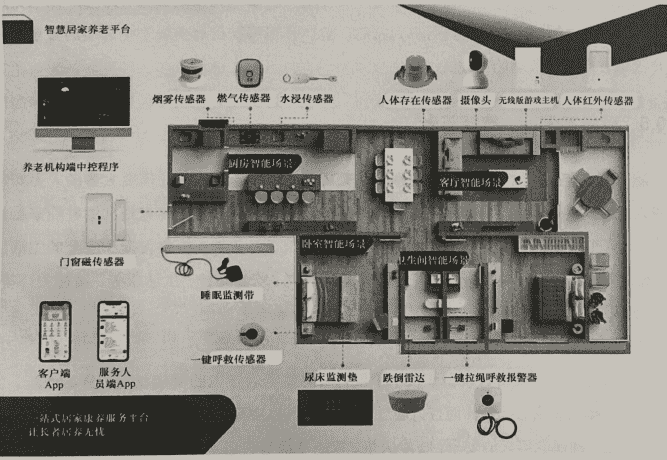

- **（1）健康监测**：智能手环定位轨迹保安全；智能床垫、马桶采集生理指标上云分析，异常即时触达老人、家属、护工及医生，构建“监测-预警-干预”闭环。
- **（2）安全防护**：智能门锁与监控联动，精准识别人员身份与异常行为。入侵触发自动报警取证，筑牢安全防线。
- **（3）生活服务**：语音助手、智能轮椅降低操作门槛；环境系统自动调节温湿光，定制舒适微气候。
- **（4）精神关怀**：AI陪聊机器人、益智游戏缓解孤独；大数据画像推送个性化影音书内容，滋养精神世界。

#### 7.3.6 演进前瞻：从单品智能到全域智慧

智能家居已成生活刚需，兼具舒适、增效与守护属性。技术演进将解锁更广阔应用版图。

- **（1）单品向全屋智能跃迁**
全屋智能成行业共识，企业重心加速下沉。精装房普及为全屋落地提供天然土壤。AI与多元产品组合拳，将持续推高市场渗透率，以系统级集成极致兑现“提效”承诺。

- **（2）交互方式的极简革命**
当前已支持 App、语音、红外、传感器等多模交互（见图 7-13）。未来将向“隐形化”、“零感化”演进。


**Matter协议打破生态壁垒**：跨品牌互联互通成真，单一 App 统御全屋，告别多 App 切换痛点。
**语音交互进阶**：支持免唤醒指令、精准声纹识别与语义理解，交互更拟人。
**手势交互崛起**：悬空手势控控家电，规避油污接触，兼顾卫生与美学。
**传感器驱动的环境自适应**：温湿度传感器辅助空调精控体感；光感/人体感应驱动灯光场景自适应，无感服务无处不在。

- **（3）从“被动响应”向“主动服务”范式转型**
这是必然趋势，旨在还原用户时间与专注力。
**传感器**捕捉行为与环境变量（如作息、光感），驱动设备自主决策。
**边缘智能**下沉算力，本地决策降低延迟、强化隐私。
**家庭AI大脑**统筹全局，实现跨设备协同的主动关怀。

- **（4）迈向家务全自动化**
重复性家务加速外包给机器。智能料理机已代炒菜，但备菜洗碗仍待突破。扫地机器人进化史最具代表性：扫拖一体 → 基站自洗 → 未来向污水自处理、全流程无人化迈进（见图 7-14），终极目标是彻底释放人类双手。


图 7-14 智能扫地机器人进化形态

### 课后思考与实践

**习题**
- 7-1 查阅资料，阐述智能物流机器人分拣搬运的核心实施逻辑。
- 7-2 定义智能推荐系统，并剖析其在电商领域的核心价值。
- 7-3 对比传统模式，总结AI在游戏市场调研中的五大核心优势。
- 7-4 探讨AI技术如何赋能智能家居实现“懂用户、适生活”。

**实验**
- 1. **实验主题**：基于人工智能的智能客服机器人对话实战演练。

## 实战演练：体验京东智能客服机器人

随着电商规模爆发式增长，传统人工客服已难以应对海量、多元的咨询需求。基于自然语言处理（NLP）与机器学习算法构建的智能客服机器人应运而生，它能自动理解语义、精准答疑，为用户带来高效便捷的服务体验。本节将带你实地操作京东商城智能客服，感受AI赋能购物的便利。

### 操作步骤指引

1.  **入口定位**：登录京东商城官网，依次点击右上角“我的京东” → “在线客服”进入对话界面（界面布局参考 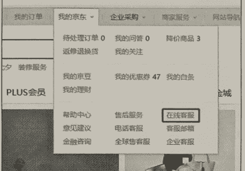 图示）。
2.  **实战对话**：在聊天窗口中向“京东智能客服”发起提问（交互界面见 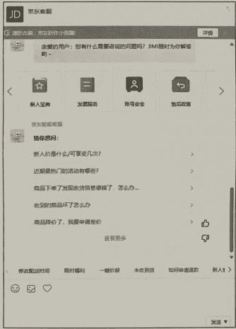），建议完成以下四大核心场景测试：
    *   **选品推荐**：输入“我想学习人工智能，能推荐几本入门书籍吗？”，测试其推荐逻辑与商品关联能力。
    *   **权益查询**：询问“学生身份下单有专属优惠或折扣政策吗？”，核验权益识别与政策匹配准确度。
    *   **售后保障**：提问“收到书籍若有破损/质量问题，退换货流程怎么走？”，考察售后政策检索与引导能力。
    *   **物流时效**：咨询“平台常用哪家物流？预计几天送达？”，评估物流信息整合与预估精度。

### 实验报告撰写要求

实验结束后，需整理为 Word 文档提交，内容须包含：
*   **问题清单与实测结果**：记录上述测试用例的实际回复内容。
*   **深度复盘分析**：结合对话细节，剖析机器人在语义理解、多轮对话连贯性、业务知识覆盖面等维度的表现。
*   **优势与短板总结**：基于亲身体感，归纳当前智能客服在“秒级响应、7×24小时在线、标准化答案输出”等方面的优势，以及“长文本理解偏差、非标准问题灵活性不足、缺乏人文关怀”等待改进空间。

---

# 项目八：AI 重塑商业版图——智能制造与智慧金融深度解析

人工智能正以前所未有的深度渗透商业肌理，成为企业提质增效、重塑核心竞争力的关键引擎。从生产制造的智能化跃迁，到金融服务的全链路智慧化升级，AI 正打破时空边界，以模拟甚至超越人类的认知能力，驱动商业范式革新。

*   **制造端**：AI 融入产线设计、生产管控、质检物流全流程，推动“自动化”向“自主化”进化，实现降本增效与绿色制造双赢。
*   **金融端**：渗透至获客营销、风控决策、客户服务各环节，前端重塑人性化体验，中端赋能精准决策，后端筑牢智能风控防线。

### 本项目核心知识图谱
1.  **智能制造商业范式**：原理、演进、特征、AI 落地场景（自动化产线/预测性维护/智慧工厂）、标杆案例（吉利/华润）、未来图景。
2.  **智慧金融演进脉络**：从 ATM 自助服务到大模型重构，技术迭代驱动业务形态持续进化。

---

## 导读案例：震撼！走进“零人工”的未来工厂

工业 4.0 时代，“无人工厂”不再是科幻概念，而是标配。无人超市、无人驾驶、无人餐厅……新业态层出不穷。让我们聚焦制造业皇冠上的明珠——**国内标杆级无人工厂**，一窥智能制造的终极形态。

*   **菜鸟柔性自动化仓（阿里巴巴）**：引入 AI 协同调度算法，让海量机器人在仓库内有序“起舞”，输出了一套**易部署、强扩展、高效率**的全链路仓储自动化标准化方案，重新定义物流仓储上限。
*   **京东“亚洲一号”无人仓**：实现**入库、存储、分拣、包装全流程 100% 无人化**。搬运机器人、货架穿梭机、分拣机器人、堆垛机器人组成“钢铁军团”，单小时处理量破万件，以极致效率与准确率树立行业标杆。
*   **上海通用金桥工厂（全球灯塔工厂）**：偌大车间仅十余名工程师，指挥 **386 台工业机器人** 协同造车。人机协作模式下，人类从“操作者”进阶为“管理者”，彰显中国制造向高端跃迁的硬核实力。

> **核心启示**：机器人本体、AI 算法、大数据、工业物联网等技术成熟度的同步跃升，为无人工厂落地夯实了技术基石，正深度重塑工业未来。

---

## 8.1 智能制造：工业皇冠上的“智能化”加冕

### 8.1.1 核心内涵与演进史

#### 1. 何为智能制造？
本质是**“人机一体化智能系统”**。智能机器与人类专家协同，赋予制造过程“分析、推理、判断、决策”认知能力，**延伸并部分替代专家脑力劳动**。它超越传统自动化，向**柔性化、智能化、高度集成化**进阶，是工业 4.0 核心、数智融合产物，驱动制造业迈向创新、协调、绿色、开放、共享新阶段。

#### 2. 百年演进：从机械臂到“数字孪生”
智能制造历程与计算机、互联网、物联网、大数据技术迭代深度绑定：
*   **萌芽期（1950s-1980s）**：CAD/CAM 雏形，大规模生产，劳动密集型。
*   **起步期（1981-1990）**：质量管理兴起，机械化探索，仍属劳动密集型。
*   **发展期（1991-2010）**：知识服务融合，柔性化/服务化并举，信息服务型雏形。
*   **成熟期（2010至今）**：新一代信息技术全渗透，步入高阶智能制造新纪元。

#### 3. 五大标志性特征（判断智能化程度的“金标准”）

| 核心特征 | 关键动作 | 核心价值 |
| :--- | :--- | :--- |
| **设备联网（车间物联网）** | 传感器实时采集状态/数据，打通物-物、物-人、物-网连接 | 构建智能制造网络底座与数据基石 |
| **过程低碳（绿色制造）** | 传感器监控能耗异常/峰值，自动调节工艺参数实现“最小能耗换最优效率” | 响应双碳战略，实现洁净化、资源化、低碳化 |
| **数据可视（大数据决策）** | 秒级采集开机率、良率、OEE 等指标；虚拟建模仿真优化流程；偏离标准即时预警 | 从“经验决策”转向“数据驱动”，透明化赋能流程持续改进 |
| **过程透明（神经网络）** | MES 系统支撑工艺仿真、数字化控制、实时监测、自适应控制；机器人/智能装备入线 | 打造精准/敏捷/透明制造能力，设备智能化驱动价值增长 |
| **现场无人（无人工厂）** | 数控中心、机器人、三坐标测量仪组成柔性单元，攻克无人化生产难关 | 释放人力，极致一致性与精度，触手可及的终极形态 |

---

### 8.1.2 AI 驱动制造：全流程渗透的三大核心战场

AI 非单点优化，而贯穿**设计-采购-计划-执行-检测-物流**全价值链。

#### (1) 自动化生产线：从“执行指令”到“自主决策”
*   **生产控制**：数据学习分析 → 精准调参优化 → 提质增效。
*   **质量检测**：计算机视觉/图像识别 → 替代人眼 → 高精度、高节拍、零疲劳。
*   **物流管理**：数据分析预测 → 路径规划/库存优化 → 降本提速。
*   **技术底座**：工业物联网（互联互通/全量采集）+ 大数据（挖掘规律/科学依据）+ AI（自主决策/闭环优化）。
*   **战略意义**：未来制造主航道，重塑成本结构与竞争护城河。

#### (2) 智能维护与故障预测：从“事后修”到“未病治”
*   **设备监测**：实时流数据分析 → 状态精准画像 → 早发现、早预防。
*   **故障预测**：历史模式学习 → 潜在故障推演 → 窗口期内主动干预，规避停机损失。
*   **维护决策**：专家知识图谱+维修档案 → 定制化方案（时机/工艺/备件） → 精准“对症下药”。
*   **进阶价值**：大数据支撑精度，机器学习提速诊断，AI 实现**个性化维护策略**（因机制宜），大幅提升设备可用率（OEE）与全生命周期收益。

#### (3) 智慧工厂规划与管理：从“拍脑袋”到“算最优”
*   **规划端**：产线布局/设备选型/厂房空间 → 仿真推演求解全局最优解 → 效率与人效双升。
*   **管理端**：
    *   *质管*：质量数据建模 → 自动化缺陷检测/预防。
    *   *设管*：运行数字孪生 → 状态感知/预测性维护。
    *   *能管*：能耗曲线预测 → 自动优化能源配比 → 降本减排。
*   **前瞻延伸**：大模型洞察用户需求/市场趋势 → 驱动**C2M 柔性定制**；智能排产/调度/优化 → 企业级资源全局最优配置 → 运营效率跃迁。

---

### 8.1.3 标杆案例：看头部玩家如何“秀肌肉”

#### 1. 吉利西安基地：全球超级智能工厂标杆
*   **全维覆盖**：全架构/全能源/全车系，冲压、焊装、涂装、总装**核心工序 100% 自动化**。
*   **钢铁军团**：**696 台机器人**协同作业，总装仅保留极少人工装配工位。
*   **框架支撑**：智能设计/生产/物流/管理/集成优化五位一体（架构见 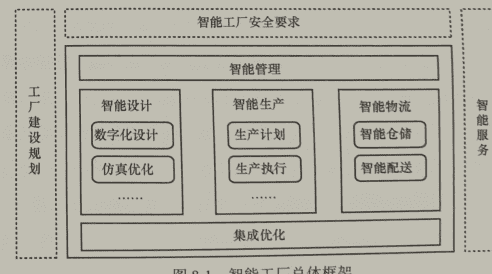），多数字化车间统一调度，数据闭环驱动精准/柔性/高效/节能生产。
*   **实战成果**：极致人效比、一致性质量、快速换型能力，**验证了“黑灯工厂”商业可行性**。（现场实拍见 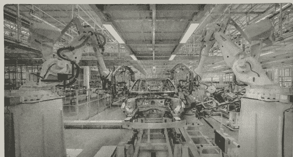）

#### 2. 华润电力：数字孪生赋能“智慧火电”
*   **核心定义**：物理实体在虚拟空间的**实时映射、高保真镜像**（数字镜像/映射），融合 AI/ML 构建动态“真实”模型，支撑全生命周期决策。
*   **工业级应用**：三维仿真展示厂房/产线/设备；融合视频、运行参数、环境、传感器多源数据 → **全数据驱动显示**设备微观结构、复杂动作；实时监测流程/环境/状态 → 复现运转原理 → 为研制、改型、维护、效能评估提供**精准决策依据**。
*   **落地成果**：“双控平台”以智慧地图为载体，空间数据技术落地全厂数字孪生（可视化大屏见 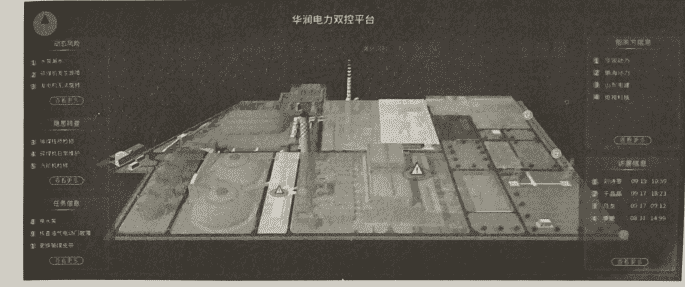），实现“屏上观厂、指尖管控”。

---

### 8.1.4 未来图景：下一代工厂长什么样？

**关键词：全自动、高度互联、绿色可持续、人机共生、3D 打印、AI 大脑。**

*   **极致自动化**：先进机器人/传感器/AI 实现近乎零人工干预的全自主生产。
*   **神经网络化产线**：设备互联互通、信息共享协同，消灭信息孤岛，压降差错与事故率。
*   **原生绿色**：环保材料/工艺减废减排，践行可持续发展。
*   **3D 打印重构供应链**：从备件制造到终端产品直打，压缩供应链层级，降低运输/库存成本，提升精度与设计自由度。
*   **AI 大脑统筹**：深度学习海量数据 → 预测需求/柔性排产/资源最优配置；预测性维护延长设备寿命。
*   **人机新共生**：人类退出重复劳动，转型为**系统监控者、流程设计师、异常决策者**；新岗位催生高技能人才需求，工厂成为技能进化场。
*   **社会级红利**：效率跃升、产业升级、高质量就业创造、生活品质提升。
*   **挑战同在**：数据主权/隐私/工业大数据治理/技术安全伦理，需政产学研用多方共治。

---

## 8.2 智慧金融：重构信任与效率的“新基建”

### 8.2.1 定义与技术底座
**智慧金融 = 大数据 + AI + 云计算 + 区块链 + 大模型**，驱动**产品、风控、获客、服务**全域智能化，使金融更高效、便捷、懂客户，成为行业新增长引擎。

*   **区块链层**：构建信任机器，落地数字货币、智能合约、跨境支付，重塑交易确定性与效率。
*   **大模型层（2023 年拐点）**：ChatGPT 类技术引爆应用井喷——**智能客服/数字员工/语音交互**重塑服务体验；**研报生成/策略回测/投资辅助**赋能机构级决策精度跃升。

### 8.2.2 演进里程碑：从 ATM 到 Agent

#### 里程碑 1：ATM（自动柜员机）——“自助金融”启蒙
*   **背景**：50-60 年代电子技术突破，刚需：打破银行营业时间/空间限制，实现实时存取。
*   **意义**：银行业首个规模化自动化终端，**开启“去柜台化”序章**，极大提升服务可得性，重塑大众金融体验。

*(后续演进节点：网银/手机银行 → 移动支付 → 金融云/大数据风控 → RPA 流程自动化 → 智能投顾/智能风控 → 大模型原生应用……)*

#### 8.2.3 实战案例深度解析

**1. 智能投顾：科技重塑理财新体验**

智能投顾借助人工智能与大数据分析，为投资者量身定制自动化、个性化的投资决策与理财方案，正逐渐成为大众理财的主流选择。其核心优势主要体现在以下几个维度：

*   **决策智能化**：依托机器学习算法，系统能实时吞吐海量市场数据，精准画像投资者风险偏好与目标，输出专属投资策略。
*   **服务千人千面**：用户仅需设定期限、风险承受度等参数，平台即可动态生成并自动再平衡投资组合，实时响应市场波动。
*   **门槛大幅降低**：摒弃传统财管高额起投点与繁琐开户流程，手机端即可轻松入场，普惠金融触手可及。
*   **全天候不打烊**：7×24 小时在线服务，随时查看收益、调仓换股、获取建议，完美适配碎片化时间需求。
*   **透明可见、投教同行**：详尽的持仓报告与风险揭示，配合系统化投教内容，助力用户看清底牌、提升认知。
*   **极致性价比**：自动化运作大幅压缩人力成本，管理费率远低于人工顾问，让收益更多归属投资者。

**2. 智能保险：从“大而全”走向“一人一策”**

传统保险依赖群体统计定价，而 AI 赋能下的个性化保险，聚焦个体差异，实现精准承保与服务：

*   **风险定价更精准**：融合驾驶行为、健康指标等多维数据，车险可依据实际驾驶习惯浮动保费，健康险可结合可穿戴设备监测数据动态定价。
*   **健康管理前置化**：通过实时采集心率、睡眠等生理指标，保险不再仅是事后赔付，更转型为提供定制化健康干预、咨询与激励的全周期管家。
*   **交互体验智能化**：NLP 与情感计算让智能助手读懂客户真实意图，7×24 秒级响应咨询、理赔指引，并根据反馈动态优化服务方案。

**3. 风控与投决：AI 的“左右护法”**

**（1）风险管理：从“人肉审核”到“机器慧眼”**
传统人工核验效率低、主观性强。AI 凭借强模式识别与实时计算力，实现海量数据秒级筛查：
*   **信贷风控升级**：头部科技公司自研模型实现精准评分与违约预警，全流程留痕可溯，风控时效性质变。
*   **合规防线筑牢**：华夏银行等机构引入 AI 反欺诈、反洗钱体系，显著提升识别准度，有效遏制资金流失。

**（2）投资决策：从“主观判断”到“数据驱动”**
克服人工分析耗时、易受情绪干扰的短板，深度学习模型全维度扫描市场信号：
*   **机构实战成果显著**：公募、券商量化团队广泛部署 AI 选股、控险、执行策略，决策效率与超额收益双提升。

---

#### 8.2.4 未来图景：趋势前瞻

未来数年，AI 将在金融版图深度渗透，重塑核心业务流：

| 领域 | 核心演进方向 |
| :--- | :--- |
| **客户服务** | 虚拟助手进化为“超级员工”，多轮对话自然流畅，复杂业务自主闭环。 |
| **风险管理** | 新型模型穿透深层关联，前瞻性预警黑天鹅与灰犀牛，增强抗不确定性韧性。 |
| **信用评估** | 复杂集成学习模型挖掘另类数据，刻画信用画像更立体，授信决策更科学。 |
| **合规科技** | 自动化监测与报表生成，将合规成本转化为可控的技术投入。 |
| **量化交易** | 算法迭代挖掘微观结构机会，高频执行极致低延迟，抢占先机。 |
| **打击黑灰产** | 图计算+多模态融合，精准拓展欺诈、洗钱、恐融犯罪网络全貌。 |
| **智能投顾 2.0** | 引入强化学习与大模型，提供资产配置、税务筹划、传承规划的一站式家族办公室级服务。 |
| **区块链融合** | AI 赋能智能合约形式化验证与链上监管，护航数字货币与 RWA 落地。 |
| **全民投教** | 专属 AI 财务教练，以对话式交互拆解复杂金融逻辑，提升全民财商。 |
| **可解释 AI** | 引入因果推理与注意力可视化，打开“黑箱”，满足监管审计与伦理审查双重要求。 |

---

#### 8.2.5 双刃剑效应：赋能与挑战并存

**核心赋能价值：**

1.  **洞察未来，决策增智**：强算力支撑下的数据挖掘，让市场趋势研判、风险前瞻布局、投资机会捕捉从“凭经验”转向“靠模型”，显著提升确定性。
2.  **服务重构，体验升维**：智能客服打破时空与人力上限，以拟人化交互解决长尾需求，标准化业务秒级办结，复杂业务专家辅助，客户满意度与机构品牌力双升。
3.  **业务重塑，生态新生**：AI 非单点提效，而是催化全价值链重组——从产品设计、渠道触达到运营风控，催生差异化竞争力，驱动金融业从规模扩张转向质效跃迁。

**必须直面的四大挑战：**

*   **数据堡垒战**：海量敏感信息（身份、交易、生物特征）要求全生命周期分级分域加密、脱敏、溯源，权限模型需精细到字段级，杜绝泄露与滥用。
*   **模型风控与合规双重奏**：算法黑箱、数据漂移、对抗攻击等技术风险，叠加监管新规（如《生成式 AI 服务管理暂行办法》），强制要求模型上线前通过压力测试、公平性审计、安全评估，上线后持续监测漂移。
*   **法治轨道上创新**：跨境数据流动、算法歧视、知识产权归属等灰色地带，需法律、合规、业务三方联动，构建“合规内嵌”研发流程。
*   **人才缺口与组织进化**：复合型“懂金融+懂算法+懂工程”人才稀缺。机构需建立“引育留用”全链条体系：高薪揽才、内部转型训练营、技术委员会治理、激励机制对标科技大厂，打造学习型组织应对技术迭代周期缩短带来的技能半衰期危机。

---

### 习题

- **8-1** 请用自己的话定义“智能制造”内涵。
- **8-2** 归纳智能制造区别于传统制造的三大核心特征。
- **8-3** 畅想你心中的“未来工厂”蓝图：关键词、场景与人机协作模式。
- **8-4** 梳理智慧金融从萌芽到爆发的关键演进节点与驱动力。
- **8-5** 对比传统人工顾问，阐述智能投顾的“降本、增效、普惠”三大核心优势。
- **8-6** 识别智慧金融发展面临的“技术、数据、合规、伦理”四大风险维度及应对思路。
- **8-7** 结合具体场景，说明 AI 如何重构金融机构“事前识别、事中监控、事后复盘”全周期风控体系。
- **8-8** 基于技术成熟度曲线，预测 AI 在金融领域未来 3-5 年的落地热点与瓶颈突破方向。

---

### 实战演练：沉浸式体验个性化推荐系统

**【实验主题】** 解码智慧金融“千人千面”推荐引擎实战。

**【实验指引】** 实地走访一家具备智能推荐能力的金融平台（如银行 App、支付宝/微信/云闪付财富频道），全链路体验“画像构建→策略召回→排序呈现→反馈闭环”过程，洞察算法如何重塑获客、活跃、留存业务闭环。

**【操作步骤】**

1.  **选定阵地**  
    确认目标平台已上线推荐模块。本实验选取 **** 所示招商银行 App 为样本。

2.  **行为留痕与召回观测**  
    完成实名登录后，有意识地浏览、搜索、点击、停留不同品类产品（固收理财、权益基金、黄金、养老专区等），记录首屏、猜你喜欢、专题位推荐内容的实时变化。

3.  **推荐质量多维复盘**  
    *   **准度**：推荐标的风险等级、收益特征、期限结构是否匹配隐性偏好？
    *   **多样性**：是否陷入“信息茧房”，不同资产类别、风格覆盖度如何？
    *   **相关性**：上下文关联是否自然（如浏览短债基金后推荐货币基金而非高波股票）？
    *   **增值服务**：是否输出组合配置建议、压力测试报告、风险提示弹窗？

4.  **影响力与边界研讨**  
    *   **用户侧**：决策时长缩短幅度、发现优质长尾产品概率、认知负荷降低程度。
    *   **机构侧**：分发转化率提升、客单价/持仓时长变化、运营人力释放量。
    *   **隐忧**：隐私计算合规性、算法可解释性监管压力、冷启动与长尾商品曝光公平性、同质化推荐导致的系统性风险放大。

**【交付物】** 撰写结构化实验报告（Word），包含：问题设定、操作复现截图、量化/定性分析、个人体感洞见、改进建议与伦理反思。

---

## 项目九 人工智能的社会应用：重塑城市、教育、医疗三大民生版图

AI 正渗透进社会运行的毛细血管，成为破解交通拥堵、医疗资源不均、教育个性化难题的关键变量。本项目聚焦三大高频刚需领域：

1.  **智慧城市**：让城市拥有“感知-思考-进化”的数字神经系统。
2.  **智慧教育**：推动“标准化教学”向“适应性成长”范式跃迁。
3.  **智慧医疗**：构建“以健康为中心”全周期服务生态。

---

### 导读案例：破解城市“潮汐”顽疾，AI 调度显身手

**现象还原：** 早高峰进城向单向拥堵，晚高峰出城向瘫痪——这种显著的方向性、时段性流量失衡，即“城市交通潮汐”。

**成因剖析：**
*   **职住分离极端化**：中心区就业密度高、居住成本高，迫使庞大通勤大军跨越漫长距离，形成单向洪峰。
*   **路网供给刚性滞后**：道路物理扩容速度远慢于机动车保有量增速，高峰期供需剪刀差持续扩大。
*   **规划缺乏弹性设计**：路网层级不明、微循环缺失、瓶颈节点未消解，缺乏应对瞬时峰值的冗余设计。
*   **管理手段静态化**：固定配时信号灯、静态标志标线无法动态适配流向反转，指挥效能低。

**AI 破局逻辑：** 智能交通系统（ITS）接入感知大数据（视频、雷达、浮动车、信令），基于强化学习/数字孪生实现：
*   **潮汐车道动态逆向**：按分钟级调整车道方向，释放反向闲置资源。
*   **区域协同控制**：绿波带随流向平移，主干道通行效率提升 15%-30%。
*   **主动诱导分流**：变情报板+导航推送联动，在上游劝导分流，源头削峰填谷。
*   **应急响应闭环**：事故/突发事件自动检测→生成处置预案→下发指挥指令，分钟级恢复秩序。

**价值锚点：** 以算力替人力、以预测替反应、以全局最优替局部博弈，大幅降低社会通勤成本与碳排放，是“数字孪生城市”落地的标杆场景。

---

### 9.1 智慧城市：从“数字化”迈向“智治化”

#### 9.1.1 核心内涵与中国实践进程

**定义重构：** 智慧城市 ≠ 单纯堆砌传感器与屏幕。它是以**云计算、物联网、大数据、空间地理信息、AI** 为核心技术栈，实现基础设施“会感知”、公共服务“会响应”、社会治理“会预判”、产业经济“会创新”的**新型城市操作系统**。本质是**数据要素×场景应用**驱动的城市可持续进化范式。

**溯源与里程碑：**
*   **2008** IBM 提出“智慧地球”概念，奠定理论基石。
*   **2012** 国家发布《国家智慧城市试点暂行管理办法》，中国探索按下“启动键”。
*   **2013** 首批 103 个试点名单公布，规模化探索拉开帷幕。
*   **2015** 转入落地实施期，从“规划图”变“施工图”。
*   **2016** “十三五”规划明确建设示范性新型智慧城市，顶层设计升级。
*   **2017** 在建数量破 500，全球领跑。
*   **2018** 占全球在建总量 48%，规模优势确立。
*   **2021** “城市大脑”、“数字底座”、“城市数字孪生”成为新基建核心词汇，标志着从“应用叠加”向“平台赋能、数据汇聚、孪生仿真”深水区挺进。
*   **当下** “十四五”规划将新型智慧城市建设上升为国家战略，开启高质量发展新征程。

**四大核心特征画像：**

| 特征维度 | 核心内涵 | 典型场景价值 |
| :--- | :--- | :--- |
| **智能交通** | 全域感知+多模融合+自适应控制 | 缓堵、降事故、提通行效率、降碳排 |
| **智慧能源** | 源网荷储协同+虚拟电厂+碳管理 | 削峰填谷、新能源消纳、双碳目标支撑 |
| **智慧政务** | 一网通办+一网统管+预测性治理 | 提效、透明、响应速度从“天”变“秒” |
| **智慧民生** | 养老监护、文旅融合、应急救援数字化 | 包容性普惠、生活品质可感可及 |

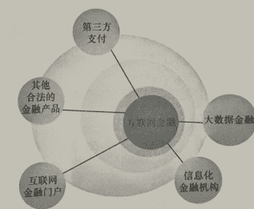


### 智慧城市：重塑城市生命力的三大核心支柱

智慧城市的建设，聚焦于**环保、安全、公共服务**三大维度的智能化升级：
*   **智能环保**：借助实时环境监测网络，对城市生态指标实施动态调控，显著提升环境品质。
*   **智能安全**：整合视频监控、预警报警与应急救援体系，筑牢城市安全防线，强化突发事件响应速度。
*   **智能公共服务**：通过公共设施的智慧化管运，大幅优化市民生活体验，赋能便民利民。

#### 架构底座：四层协同的技术生态
智慧城市遵循“感知—网络—平台—应用”的分层架构逻辑：
1.  **感知层**：织密泛在感知网，实现多源异构数据的全域采集与实时监测。
2.  **网络层**：融合互联网、通信网、广电网及物联网，构建覆盖全城的高速、安全传输通道。
3.  **平台层**：汇聚数据中心与公共支撑平台，赋能数据治理、挖掘与科学决策。
4.  **应用层**：渗透政务、城管、教育、医疗、家居、园区、商业等全场景，直击城市发展水平、民生福祉与区域竞争力核心指标。

#### 9.1.2 实战范式：智慧交通——数据驱动下的城市动脉

交通传感终端（如一卡通、监控探头）捕捉全域出行行为，沉淀地图、定位、客流、路况等多维数据，催生**智能交通技术体系**，重塑三大核心场景：
*   **智慧出行**：实时推送公交时刻、线路规划、路况拥堵、停车余位，让出行“心中有数”。
*   **智慧监管**：覆盖应急指挥、路面监控、营运车辆管控，守护道路秩序。
*   **智慧运营**：赋能出租车调度、车检维修、轨道交通运营，提升供给侧效能。

**价值锚点**：实时采集与处理交通数据，双管齐下**疏堵增效**与**防事故保安**。
**中国成绩单**：
*   **顶层设计**：《交通强国建设纲要》等纲要文件将智能化列为核心指标。
*   **出行普惠**：300+ 地级城市交通一卡通互联互通；网约车、共享单车成主流；北上广武等地落地无人驾驶商业化运营。
*   **物流数字化**：长江、西江、京杭运河主干道电子航道图全覆盖，85%+ 货船依靠电子图领航。
*   **监管闭环**：全国重点营运车辆联网联控系统建成，北斗卫星护航 73 万“两客一危”、620 万货运车辆，监测率破 98%。

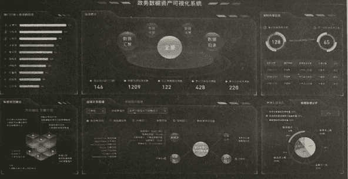

#### 9.1.3 实战范式：智慧政务——数据赋能的治理现代化

智慧政务以物联网、云计算、AI、大数据为引擎，重构**办公、监管、服务、决策**全链路智能化，实现“提质、增效、降本、促发展”。（典型应用见下图）


##### 图 9-1 政务数据资产可视化系统

**五大业务版图**：
1.  **政务大数据**：深挖人口、税务、医疗等高价值数据，支撑科学决策与风险预判。
2.  **电子政务**：搭建门户网站、服务平台，打破时空壁垒，提升办事效能。
3.  **数字化城市管理**：以 IoT 与云计算统筹规划、交通、安防、设施全域治理。
4.  **智慧公共服务**：技术赋能医疗、教育、社区，交付“便捷、高效、个性化”体验。
5.  **政府数字化转型**：推动从“信息化”向“数字化”跃迁，重塑组织形态与政策供给。

**五大鲜明特质**：
*   **数据驱动**：大数据+AI 挖掘价值，决策有据可依。
*   **一站式服务**：单一窗口办结全项业务，终结“多头跑”。
*   **便捷高效**：移动端+互联网，随时随地“掌上办”。
*   **智能管理**：自动识别异常与风险，筑牢廉政防线。
*   **公开透明**：可视化开放数据，阳光权力，增强公信力。

**全域应用图谱**：政务服务“网上办”、政策制定“模拟测”、公共安全“智能防”、社会治理“舆情控”。

#### 9.1.4 实战范式：城市安全——从“平安”迈向“智慧”

平安城市建设起步早、规模大、设备密，衍生出海量存算需求与应急指挥、数字城管等延伸应用。历经“单纯建系统”的 1.0 阶段，现步入**“深化融合、提质增效”**的 2.0 时代。
**智慧型平安城市**锚定**“城市安全”**与**“可视化管理”**双主题，从业务、架构、机制、运维、模式五维发力，显著提升**应急处突能力**，将灾害损失压降至最低，全面跃升城市数字化与应急管理水平，倒逼数据治理能力进阶。

#### 9.1.5 破局之道：直面五大挑战，筑牢标准基石

**挑战矩阵**：
1.  **数据信任危机**：海量采集下的安全防护与隐私合规。
2.  **标准碎片化**：多标准、多平台导致的互操作与共享困境。
3.  **数据孤岛顽疾**：跨部门、跨层级数据融合与价值变现难。
4.  **资金与模式**：巨额投入下的分配效率与可持续商业模式探索。
5.  **参与缺位**：公众参与度低、反馈机制弱，供需错位。

**标准体系建设四步走**：
*   **立框架**：覆盖基设、数据、应用、运管，保全面。
*   **定规范**：细化技术、管理、服务标准，强落地。
*   **建机制**：监督评估、培训宣传并重，促执行。
*   **推国际**：深度参与国际标准制定，提话语权。

---

### 9.2 智慧教育：技术重塑育人新范式

#### 9.2.1 演进脉络：从信息化到智慧化的三级跳
*   **教育信息化（90年代）**：计算机网络打通资源共享与业务协同，提效为主。
*   **教育智能化（21世纪初）**：AI 技术介入，开启个性化、智能化服务探索。
*   **智慧教育（当下）**：云、大、物等新一代技术深度融合，目标直指**资源共享、模式创新、服务智能化**，终极愿景是**智能化、个性化、普惠化**。

#### 9.2.2 实战范式：智慧校园——物理与数字空间的有机融合

依据《智慧校园总体框架》标准，核心在于**“任何人、任何时、任何地”**便捷获取资源与服务。
**架构双基座**：感知网络/智能硬件（物理底座）+ 云端数据中心/软件系统（数字大脑）。
**四大功能板块**：智慧教学环境、智慧教学资源、智慧校园管理、智慧校园服务。
**五大核心特质**：
1.  **数据共享**：打破壁垒，联通协同。
2.  **业务协同**：跨层级平台，提升服务力。
3.  **服务创新**：智能技术重塑交付模式，千人千面。
4.  **决策支持**：大数据画像，辅助科学治校。
5.  **信息安全**：筑牢数据与业务安全防线。

**标杆案例·清华大学**：统一身份认证+一站式服务+全覆盖无线网，深度融合信息化生态；自研“雨课堂”平台，创领线上线下混合式教学新范式。

#### 9.2.3 实战范式：智慧教室——重构师生环境关系的新物种

智慧教室 = 多媒体/网络教室的进化形 = **物联网+云计算+智能技术**构建的**有形物理空间+无形数字空间**双融合体。核心使命：提供**人性化、智能化**互动场域，促进**个性化、开放式、泛在学习**。
**九大子系统矩阵**：教学、显示、考勤、资产、灯光、空调、门窗、通风、监控——全环节感知与调控。

**六大教学范式革新**：
| 传统痛点 | 智慧破局 |
| :--- | :--- |
| 凭经验定策略 | **基于数据的教学**：行为挖掘+大数据分析，动态调整策略，精准画像掌握度。 |
| 效率低、资源滞后 | **高效的教学**：大数据预判需求，教学资源实时触达。 |
| 千篇一律 | **个性化学习**：随堂测即时分析，精准评估能力，落地“一对一”因材施教。 |
| 孤军奋战 | **合作探究学习**：智能匹配同伴，小组协作激活效能。 |
| 围墙封闭 | **动态开放课堂**：打破时空限界，赋能创新与开放。 |
| 设计僵化 | **教学机智课堂**：倒逼教师随机应变，动态优化教学设计。 |

#### 9.2.4 实战范式：校园安全智能管理——用技术托举平安校园

学生自护能力弱、意识淡，校园安全需**超前预警**与**先进管控**。（典型平台见下图）

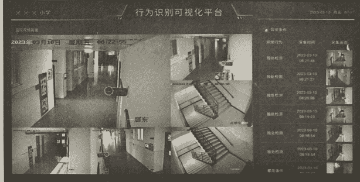

##### 图 9-2 行为识别可视化平台

**六大智能管控体系**：
1.  **出入智能管控**：人脸/一卡通实名登记，降本增效，杜绝漏错登。
2.  **可视化放学**：科学分流引导，消除拥堵隐患，减轻人力疏导压力。
3.  **宿舍管理**：查寝、访客登记、历史留痕，流程标准化。
4.  **无纸化请假**：家校三方联动，动向实时掌握，安全兜底。
5.  **访客管理**：全流程闭环登记，记录可查可导可打印。
6.  **行为分析**：AI 赋能监控“会思考”，自动研判异常行为，问题早发现早处置。

#### 9.2.5 未来图景：智慧教育的四大无限可能
1.  **资源共享无界**：云大物技术打通壁垒，优质资源流动普惠。
2.  **因材施教落地**：AI/机器学习破解“个性化教学”规模化难题，重塑学习体验与效率。
3.  **治理智能化**：技术赋能校园治理现代化，服务师生零距离。
4.  **服务创新不止**：多技术融合催生智能化、个性化教育服务新业态。

---

### 9.3 智慧医疗：守护生命的数字化跃迁

#### 9.3.1 三阶演进：从信息孤岛到智慧生态
*   **医疗信息化（90年代前）**：计算机/网络实现信息基础共享传播。
*   **智能化医疗（90年代）**：AI 技术驱动医疗向智能、个性、普惠转型。
*   **智慧化医疗（21世纪至今）**：云大物融合，医院自建机房网络成常态，信息化管理系统全面铺开，电子病历、自助终端普及惠民。

#### 9.3.2 实战范式：远程医疗——跨越时空的“名医下乡”

**本质**：以计算机、遥感测控技术为基石，释放优质医疗资源（大医院/专科中心）溢出效应，服务边远、海岛、舰船等薄弱场景。
**技术跨越**：从早期电视监护/电话诊断，进化至高速网络下的**数字/图像/语音实时融合传输**，高清实时交互拓展现代医学边界。
**三大核心业态**：远程会诊、医疗教育、多媒体咨询体系。
**核心价值**：患者就地享专家诊疗，**双赢节约时钱成本**。（平台架构见下图）

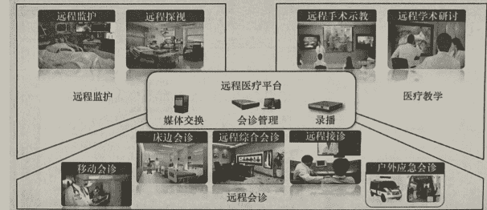

##### 图 9-3 远程医疗平台

**里程碑实战**：
*   **2024.5 全球最远距离手术**：中山医院黄浦院士团队借力 5G，跨越 5200km，远程完成喀什地区经皮冠脉介入机器人手术。
*   **国际合作样本**：武大口腔医院与刚果（金）金沙萨大学医院签约，输出远程会诊、影像诊断、教育、资源共享、双向转诊等全套服务。

#### 9.3.3 实战范式：电子病历——个人健康的“数字护照”

**定义**：基于计算机/健康卡的数字化医疗全记录，涵盖病程、检查、医嘱、手术、护理等原始信息及衍生服务，电子化管控健康全生命周期。（示例见下图）

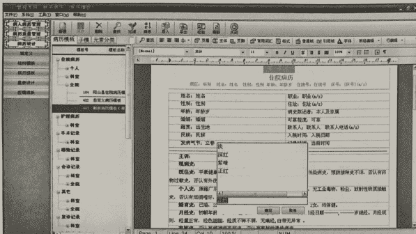

##### 图 9-4 电子病历示例

**双核使命**：
1.  **全时全域获取**：授权主体随时随地调阅完整、准确、及时的健康档案。
2.  **智能决策支持**：按需输出最优健康调整方案与执行计划。

**国家分级评价体系（0-8 级）**：从“无系统”到“健康信息整合、质量持续提升”，倒逼医院以电子病历为核心深化信息化建设。（详见表 9-1）

| 等级 | 核心能力特征 |
| :--- | :--- |
| 0-1 | 无系统 → 独立系统建立 |
| 2-3 | 科室内部交换 → 部门间数据流转 |
| 4 | 全院共享 + 初级决策支持 |
| 5 | 统一数据管理 + 中级决策支持 |
| 6 | 全流程闭环 + 高级决策支持 |
| 7 | 安全质量管控 + 区域共享 |
| 8 | 健康信息整合 + 质量持续迭代 |

**共享实况**：25 省电子健康档案互通，17 省电子病历互通。北京 2024-2026 行动计划将构建门急诊、住院、体检、科研**全市共享电子病历体系**，让“就医更便捷”成真。

#### 9.3.4 实战范式：智能药物设计——AI 重塑新药研发范式

人工智能赋能药物研发（AIDD）充分发挥AI算力优势，为产品设计与流程优化注入新动能，已在化学、医药、生物技术等领域大显身手。得益于医药大数据的沉淀与AI技术的迭代升级，"AI+大数据"模式正精准赋能新药设计，成为推动医药创新跨越式发展的核心引擎。

新药研发链条漫长，涵盖靶点锁定、先导化合物挖掘与优化、候选药物确证、临床前及临床试验等环节，本质上是验证特定靶点在人体内生物学功能的过程。早期药物发现多依赖经验试错、化合物筛选乃至偶然机遇；而现代研发体系中，机器学习在QSAR（定量结构-活性关系）与QSPR（定量结构-性质关系）建模中扮演关键角色。高盛研报曾预测，AI技术有望将新药研发年均成本压降280亿美元。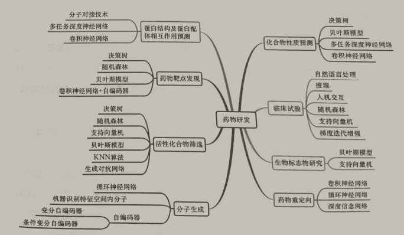 图示直观呈现了AI深度介入新药研发全流程的具体节点。


##### 图 9-5 人工智能参与新药研发的环节

新冠疫情期间，计算机辅助生物计算手段成功筛选出阻断病毒感染的候选分子，拓展了抗疫治疗新思路。AI技术不仅能显著压降药物设计环节的试错成本，更能跳出传统思维定势，生成前所未有的新颖分子骨架，助力新药研发突破结构创新瓶颈。

2020年底，DeepMind旗下AlphaFold攻克蛋白质三维结构预测难题（见下图）。仅隔两年，华盛顿大学David Baker团队在《细胞》刊发成果，借助AI从头设计出能透过细胞膜的大环多肽，为口服药物开发开辟全新赛道。传统药物开发范式面临重构，直接计算药物分子亚结构的愿景正加速照进现实。

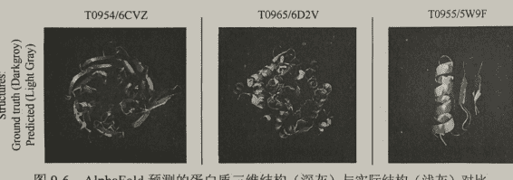

#### 9.3.5 发展前景

《健康中国2030规划纲要》确立以健康城市建设为抓手，随后配套政策密集出台，远程医疗、区域协同、分级诊疗、"互联网+医疗健康"等概念加速落地。智慧医疗作为新型医疗范式，能同步提升医疗质效与效益，有力带动数字经济腾飞。

智慧医疗前景广阔，政策红利叠加社会刚需与技术突破，将加速医疗智能化转型与医院智慧化建设。随着医改深化，相关部门从技术赋能与政策激励双维度发力，推动医疗手段信息化、医疗科技智能化，精准破解行业痛点。国办印发《关于推进医疗联合体建设和发展的指导意见》，明确按病情轻重缓急分级，不同级别医疗机构分工协作，推进从全科向专科的有序转诊，打通电子病历互联互通"最后一公里"。

智慧医疗能有效化解就诊高峰压力，应对老龄化加剧与慢病管理难题。物联网、大数据、云计算、AI等前沿技术筑牢底座，串联医院、医保、社服等多方主体，简化就医服务流程，实现医疗信息在医患间高效流转，大幅跃升医疗运作效能。

### 习题

- 9-1 何为城市交通潮汐现象？
- 9-2 智慧政务涵盖哪些核心维度？
- 9-3 智慧城市建设亟待攻克哪些关键难题？
- 9-4 智慧教育呈现出哪些显著特征？
- 9-5 智慧医疗演进历经哪几个阶段？

### 实验

#### 1. 实验主题

调用文心一言生成代码，于Jupyter在线环境中执行验证。

#### 2. 实验环境

Jupyter在线开发环境、文心一言大模型。

#### 3. 实验说明

（1）利用文心一言自动生成判断闰年代码，复制至Jupyter运行测试。
（2）自主设定编程题目，复现上述流程完成开发，并输出实验报告。

#### 4. 实验内容

（1）提示文心一言生成Python代码，示意图参考下图。

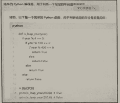

图 9-7 文心一言生成的 Python 代码

（2）登录Jupyter官网，进入JupyterLab在线开发界面，界面如下图。

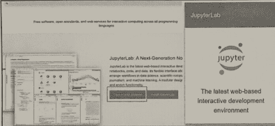

图 9-8 JupyterLab 在线开发环境

（3）将生成代码粘贴至JupyterLab运行调试，输出结果如下图。

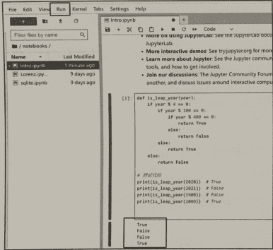

图 9-9 复制代码并运行

#### 5. 提交文档

依据实验步骤自定义编程题目，整理全过程与运行结果为Word报告提交。

## 项目十 人工智能之伦理与安全

人工智能伦理与安全聚焦AI在道德与安全层面的核心议题，涵盖透明可解释、公平无偏见、隐私数据保护、责任归属问责、社会影响与可持续发展、公众参与与道德决策等六大维度。其中，透明可解释要求系统决策可溯源；公平无偏见强调算法反歧视；隐私保护规范数据全生命周期合规；责任问责落实开发者与使用者义务；社会影响关注就业结构变迁；安全性防御恶意滥用风险。唯有妥善回应上述挑战，方能确保AI发展合法合规、造福人类。

### 本项目主要内容：

- (1) AI伦理核心概念、典型问题及成因与对策；
- (2) 传统数据安全与AI数据安全辨析；
- (3) AI相关法律法规体系；
- (4) AI伦理安全深度剖析及全球治理策略对标。

### 导读案例

#### AI光鲜背后的“灰色地带”

核心提示：隐私泄露、算法偏见歧视、技术性失业与贫富分化、人类依赖退化、恶意操纵滥用、黑箱缺乏透明度等构成AI发展的“隐忧”。

曝光案例屡见不鲜：用户购票未付款几分钟内，平台票价暴涨且高于航司官网，疑遭"大数据杀熟"，平台以"系统故障"搪塞；招聘算法虽能高效筛简历、猎人才，却因模型缺陷导致人才同质化，甚至隐性排斥女性、少数族裔；MIT实测揭示亚马逊Rekognition对女性、深肤色人群识别失准；知名数据集ImSitu、COCO在体育、购物等场景标注中固化性别刻板印象（购物关联女性、教练关联男性）。

### 10.1 人工智能伦理

#### 10.1.1 人工智能伦理的概念

AI伦理是探讨AI系统与技术在道德价值层面的问题与原则的交叉学科。它界定了AI全生命周期（开发、设计、部署、使用）应遵循的道德底线与行为准则，旨在保障技术演进始终对齐人类价值观与社会伦理规范。

核心维度解析：

*   **透明性与可解释性**：系统决策逻辑与推理过程可被理解、可被追溯，建立用户与利益相关方信任。
*   **公平性与无偏见**：拒绝对个体/群体的歧视性对待，坚持以公正、多元、无偏数据与算法为基石。
*   **隐私与数据保护**：个人数据处理全流程遵循隐私保护原则，筑牢信息安全防线。
*   **责任与问责**：开发者与使用者需为系统行为后果担责，具备纠错整改能力。
*   **社会影响与可持续发展**：应用导向应促进社会长远健康发展，规避负面外部性。
*   **公众参与与道德决策**：多元主体共治，确保决策纳入广泛伦理考量，平衡各方利益。

#### 10.1.2 人工智能伦理问题

- **(1) 数据隐私与安全博弈**
  AI训练贪婪索取海量数据，收集、存储、使用环节均可能侵犯身份、位置、病历等敏感隐私。破局关键在于：确立收集合法性、强化存储安全性、保障使用透明度，配套完善数据保护法规与技术措施。

- **(2) 偏见与歧视的算法固化**
  训练数据隐含的历史偏见（种族、性别、年龄、地域等）经模型放大，导致决策推荐结果失公允。对策三部曲：构建公平多元数据集、开发去偏校准算法、强化算法审计监管。

- **(3) 就业冲击与贫富裂变**
  自动化替代特定岗位，推高结构性失业风险，加剧收入分配两极分化。应对之道：终身职业技能培训体系重构、社会保障兜底机制完善、机会平等制度供给。

- **(4) 人类依赖与能力退化**
  过度外包认知任务予AI，易导致关键技能丧失，削弱独立性与创造力。教育改革需聚焦：批判性思维、创造性思维、适应性技能培育，倡导人机协作新范式。

- **(5) 恶意操纵与滥用风险**
  深度伪造、舆论操控、网络攻击等黑灰产利用AI作恶。需构建：监管红线与安全技术双重防线，提升公众风险素养与辨识力。

- **(6) “黑箱”困境：缺乏透明与可解释**
  复杂模型决策路径不透明，用户难以理解信任。攻关方向：可解释AI (XAI) 技术研发，打开算法黑箱，实现决策过程可视化、可理解化。

- **(7) 责任归属的模糊地带**
  AI决策影响深远，但责任主体（开发者、制造商、政府、监管方）界限模糊。须建立：多方责任法律伦理框架、独立审计问责机制，实现全流程监管闭环。

#### 10.1.3 人工智能伦理问题产生的原因

成因复杂多元，归纳为六大根源：

- **(1) 数据偏见与不完备性**：训练样本失衡、缺乏代表性，导致模型输出系统性不公。
- **(2) 技术内生局限**：算法黑箱特性、对抗样本脆弱性等技术短板，引发不可预测行为与伦理失守。
- **(3) 监管滞后于技术**：法律伦理框架迭代速度远慢于技术爆发，监管真空催生隐私侵犯等乱象。
- **(4) 商业逐利与利益冲突**：流量变现、市场竞争压力下，伦理合规易被边缘化（如过度采集用户数据）。
- **(5) 社会文化刻板印象内化**：开发者群体同质化、数据标注主观性，将偏见与非包容价值观编码进系统。
- **(6) 治理不透明与公众缺位**：研发部署闭门造车，缺乏公众参与与外部监督，导致信任赤字与抵制情绪。

#### 10.1.4 人工智能伦理的治理路径

当前阶段，治理需构建"七位一体"综合体系：

- **(1) 立法筑基**：出台覆盖全链条专项法规（数据保护、反歧视、透明度、问责制），授权/强化独立监管机构执法权，推动跨国法律标准互认。
- **(2) 立德树范**：发布权威伦理准则与操作指南，涵盖公平、透明、隐私、问责等核心原则，为从业者提供行为罗盘。
- **(3) 技术破局**：攻关可解释算法，研发去偏见数据工程方法，从技术源头内嵌伦理约束。
- **(4) 监管长牙带刺**：设立独立审核机制，对算法公平性、透明度、安全性、合规性进行常态化审计与风险评估。
- **(5) 共治开放**：引入听证会、征询会、咨询委等机制，保障公众知情权、参与权、表达权；强制算法、数据、决策公开，以透明换信任。
- **(6) 育人赋能**：嵌入式伦理教育进课堂、进企业、进政府；推动跨学科融合；全民提升AI素养与权益维护能力。
- **(7) 全球共治与标准统一**：深化国际对话，共筑全球伦理标准；强化跨国合规监管，防范跨境数据流动与应用伦理风险。

#### 10.1.5 人工智能伦理的典型案例

- **(1) 人脸识别的种族识别鸿沟**
  MIT媒体实验室Joy Buolamwini携手微软Timnit Gebru实测微软、IBM、旷视三家商用系统：白人男性误识率<1%，深肤色女性误识率高达35%。非白人群体误判率显著偏高，极易引发误捕、歧视等司法与社会公正危机。

- **(2) “数字鸿沟”导致的隐性偏差**
  波士顿市政府上线"坑洼上报"APP，因老年群体智能机普及率低，导致数据采样偏向年轻人，老年高频步行路段坑洼长期未修。技术红利分配不均，使弱势群体诉求在算法治理中隐身失声。

- **(3) 百度竞价排名医疗争议（魏则西事件）**
  2016年，大学生魏则西因滑膜肉瘤去世，生前通过百度搜索找到武警北京二医院"生物免疫疗法"（实为美国淘汰疗法），耽误病情。舆论聚焦：百度利用流量垄断将商业推广置顶伪装成权威结果，医疗商业化逻辑践踏生命底线。

- **(4) “信息茧房”效应**
  算法推荐机制精准捕获兴趣图谱，持续投喂同质化内容，屏蔽异质信息。今日头条为典型代表：基于阅读历史循环推荐，将用户困于狭窄认知圈层，丧失认知世界的广度与多样性。

### 10.2 人工智能安全

#### 10.2.1 人工智能安全的概念

AI安全是指为抵御安全威胁与攻击，保护AI系统完整性、保密性、可用性而实施的系统性工程。涵盖六大支柱：

*   **机器学习安全**：强化模型鲁棒性，御敌对抗样本与数据投毒。
*   **隐私保护**：保障个人数据合规安全，防泄露、防滥用。
*   **透明度与可解释性**：提升系统可理解性，构建信任基石。
*   **负面偏差与公平性**：消除算法歧视，保障决策公正。
*   **安全评估与认证**：量化风险等级，背书系统可信度。
*   **伦理道德底线**：锚定道德责任，评估社会长远影响。

#### 10.2.2 人工智能安全问题

# AI安全红线：六大核心风险与治理破局全景解析

人工智能技术如火如荼地渗透进各行各业，其安全隐患的辐射范围也随之水涨船高，已成为不容忽视的关键议题。风险主要聚焦于以下六大维度：

**一、 对抗样本攻击：欺骗系统的“隐形眼镜”**
AI系统对对抗性攻击极其脆弱。攻击者只需在输入数据中植入肉眼难辨的微小扰动，便能诱导模型做出错误判断。典型案例中，图像分类器因微量干扰将“猫”误判为“狗”，这种欺骗手段会直接导致系统决策失控、行为异常。

**二、 隐私与数据泄露：裸奔的训练素材**
海量数据是AI训练的燃料，却也埋下隐患。若数据在采集、存储、处理环节缺乏严格防护，一旦泄露，极易被用于精准画像、定向诈骗等针对个人的恶意攻击。

**三、 恶意滥用：技术双刃剑的阴暗面**
生成式AI等技术降低了作恶门槛。从自动化网络攻击、智能化电信诈骗，到批量制造虚假舆论、深度伪造视频，技术滥用正以前所未有的规模冲击社会信任体系。

**四、 “黑箱”难题：不可解释的决策逻辑**
众多前沿算法模型缺乏透明度，决策过程如同“黑箱”般难以追溯。在金融风控、医疗诊断等容错率极低的领域，这种不可解释性直接动摇了系统的公信力，埋下难以量化的安全隐患。

**五、 自主系统失控：被劫持的“自主权”**
自动驾驶汽车、服务机器人等具备自主决策能力的实体，一旦遭遇入侵、篡改或远程劫持，极易演变为物理世界的致命武器，引发人身伤害或财产损失。

**六、 算法偏见与歧视：数据镜像下的不公**
训练数据若存在结构性失衡或历史偏见，模型会忠实复刻甚至放大这些缺陷。招聘筛选系统因历史数据偏向男性而系统性降低女性候选人权重，便是算法歧视在现实映射的典型切片。

---

#### 10.2.3 溯源：AI安全危机为何难解？

AI安全问题成因复杂，非单一技术视角可穷尽，需跨技术、伦理、法律、社会多维复盘，核心诱因集中在六点：

1.  **数据基因缺陷**：模型性能高度依赖数据质量。带有偏见、噪声、分布不均的“劣质燃料”，必然导出有瑕疵的模型行为。
2.  **算法本身存漏洞**：设计逻辑与工程实现中的脆弱性（如对微小扰动过度敏感），为对抗攻击留下可乘之机。
3.  **安全意识缺位**：开发周期中若唯指标、重功能、轻防护，安全建设沦为事后补丁，系统天生带伤上线。
4.  **演进速度失衡**：技术迭代呈指数级加速，安全研究、评估体系、防御对策却常陷入“滞后性困境”，攻防不对等日益凸显。
5.  **人为恶意博弈**：窃密、造谣、投毒、对抗……黑灰产利益链条成熟，主动制造安全事件成为常态化威胁。
6.  **规则真空地带**：监管法规、行业标准、合规指引尚在建设中，缺乏明确红线与操作规范，企业合规无章可循。

---

#### 10.2.4 破局：构建多维共治的AI安全防火墙

治理AI安全是系统工程，需政策、技术、管理、国际合作八大支柱支撑：

*   **立规矩：完善政策法规体系**。立法覆盖开发、部署、应用全链条，聚焦数据隐私、安全审计、责任归属三大核心，为监管执法提供法理依据。
*   **打破壁：推动跨学科协同**。计算机科学、法学、伦理学、社会学专家联手，从技术可行、法律合规、伦理向善、社会接受四维度拟定治理策略。
*   **护数据：筑牢隐私保护防线**。落实数据最小化、脱敏加密、全生命周期访问控制，堵住泄露与滥用路径。
*   **考核标：建立评估认证机制**。引入漏洞扫描、对抗鲁棒性测试、红队演练等量化指标，推行分级分类认证与标识制度。
*   **练内功：强化模型鲁棒性**。常态化开展对抗训练、GAN生成对抗样本注入，提升模型在恶意干扰下的稳健决策能力。
*   **开黑箱：提升透明度与可解释性**。研发可解释算法、配套决策溯源工具，让机器推理过程“看得懂、查得证、可信赖”。
*   **强意识：全员安全赋能**。面向开发者、运维者、终端用户分层开展实战化培训，构建“人人懂风险、人人会防范”的组织免疫力。
*   **谋大局：深化国际标准合作**。参与全球治理规则制定，共享最佳实践，推动跨国互认标准落地，消除监管套利空间。

---

#### 10.2.5 实录：触目惊心的典型事故复盘

**案例一：“算法监工”逼骑手闯红灯**
外卖平台为极致效率，算法将配送时间压缩至物理极限。骑手为避免扣款、差评，被迫超速、闯红灯、逆行——这种“逆算法”求生行为，直接推高事故率。这揭示了当算法渗透劳动管理，人类极易沦为被支配的数据节点。企业需在研发早期植入公平性约束，公众应参与治理发声，共同追问：效率至上下的人类福祉何在？

**案例二：自动驾驶致死案件频发拷问伦理底线**
*   2018年Uber亚利桑那州测试车撞死行人：人类安全员在场却未能接管，暴露“感知-决策-接管”链条断裂风险。
*   2023年旧金山Cruise无人车拖拽行人6米：二次伤害触发监管重锤，凸显极端场景下系统失效的灾难性后果。
*   2023年南京车道线识别失效致撞：驾驶员过度信任L2辅助驾驶酿祸，警示“人机共驾”责任边界模糊的隐患。
这些血案倒逼：技术冗余设计、隐私合规、数据公平、责任清晰归属、法规道德准则，缺一不可。

**案例三：亚马逊AI招聘工具“厌女”事件**
模型训练于过去十年男性主导的简历库，自动降权含“女性”字样的简历。亚马逊最终弃用系统。这警示：历史数据中的结构性偏见，若不经清洗纠偏直接入模，AI将成为制度化歧视的放大器。


图 10-1 人工智能对候选人进行性别筛选示意

---

### 焦点辩题：人脸识别，便利与隐私的博弈边界在哪里？

“刷脸”已成生活标配。杭州野生动物世界将指纹入园强制升级为人脸识别，拒录者不得入园、不予退款。年卡持有者郭兵提起诉讼，历经一审、二审，杭州中院终判：**人脸属高度敏感生物识别信息，商家无权强制采集，应删除用户原有指纹、照片等数据。** “人脸识别第一案”落槌，确立了“最小必要原则”与“知情同意权”在商业场景的强制效力。


图 10-2 基于人脸识别技术的“刷脸”入园场景

---

### 思维训练场

1.  **梳理全景**：请概括人工智能安全风险的六大具体表现形态。
2.  **案例说理**：请列举两个典型的AI伦理失范实例，并简述核心争议点。
3.  **对策施策**：针对AI时代安全困局，请从技术、管理、法律三维度提出系统性对策。
4.  **伦理治理**：如何构建多方参与、全流程覆盖的人工智能伦理治理机制？

---

# 项目十一：AI风险治理——政策法规的全球博弈与中国方案

AI红利与风险并存，其广泛性、复杂性、系统性特征，使得个体权益受损与社会系统性风险同步显现。面对这把“颠覆性双刃剑”，从霍金的“文明终结论”、科林格里奇的“困境”到库兹韦尔的“奇点论”，学界警钟长鸣。风险治理政策不仅是政府施策的依据，更是观察治理理念与实战行动的窗口。本项目深度解析国内外AI风险治理的政策图谱与法律版图。

### 核心看点
*   **政策篇**：全球主要经济体AI战略规划与风险治理专项部署对标解读。
*   **法规篇**：具有约束力的法律法规框架演进与合规实务要点。

---

### 导读：全球AI治理进入“落地实战期”

**核心判断：多方共治成常态，监管落地见真章。**

*   **立法提速**：欧盟推出全球首部专项《人工智能法案》草案，美赋予用户“算法关闭权”，标志性立法标志监管从原则走向强制。
*   **伦理立标**：联合国教科文组织通过首个全球AI伦理协议，国内发布《新一代人工智能伦理规范》，道德红线显性化。
*   **实战练兵**：湖南岳阳破获AI语音机器人辅助网络犯罪案，实战倒逼技术安全标准与应急响应能力跃升。
*   **共治生长**：智库与头部AI企业（如旷视）联合评选“全球十大治理事件”，政府、企业、社组、公众四方合力雏形初现。

**结论**：唯有法治护航、伦理正心、技术强基、共治聚力，方能驾驭AI这匹疾驰骏马，造福人类社会。

---

### 11.1 全球主要经济体AI风险治理政策对标：中美欧三足鼎立

抢占产业制高点与防范安全风险并重，中美欧均将安全治理嵌入国家AI战略顶层设计，依国情差异呈现不同路径。

#### 11.1.1 国外政策图谱：以美欧为代表的双轨制演进

**1. 美国：“部门分散推进+软硬法结合+存量法适配”**

IAPP 2023年报告系统梳理了联邦层面治理矩阵：白宫定调、国会立法、机构执法、司法解释四轮驱动。

**(1) 白宫：确立原则框架与战略导向**
*   **《AI权利法案蓝图》（2022.10）**：确立五大支柱——安全有效、反算法歧视、数据隐私、知情解释、人类兜底，为治理立下“宪法级”原则。
*   **行政令14091（2023.2）**：直指算法偏见，强制联邦机构清理新技术应用中的歧视性设计。
*   **《国家AI研发战略计划》（修订版，2023.5）**：聚焦联邦投资协同；同期OSTP公开征询“风险缓释、权益保护、AI向善”公众意见。

**(2) 国会：渐进式立法与垂类突破**
*   **里程碑法案**：《2020国家AI倡议法案》（2021.1生效）锁定全球领先目标，强制军民融合协同研发。
*   **垂类修法**：如《联邦航空局重新授权法案》植入AI定期审查条款。
*   **新一轮法案潮（2023年密集窗口期）**：
    *   *HR 3044*：政治广告生成式AI透明化、问责化。
    *   *H.Res. 66*：确立安全、伦理、权益、普惠、风控五大立法图腾。
    *   *《禁止监视老板法案》*：禁用自动化决策系统监控员工行为画像。
    *   *《美国数据隐私保护法案》*：纳入“覆盖算法”定义，强制高风险算法影响评估与设计评估双重合规。
    *   *《过滤气泡透明度法案》*：盯上算法推荐排序机制。
    *   *《消费者在线隐私权法案》*：将AI计算过程纳入“算法决策”监管范畴。

**(3) 联邦机构：监管执法前置，标准先行**
*   **NIST（标准局）**：2019年发布联邦参与标准制定计划，后推出《AI风险管理框架（AI RMF 1.0）》，成行业公认实操基准。
*   **FTC（贸易委）**：2020年切入，盯紧生成式AI诱导消费者有害决策（财务、健康、教育、住房、就业）；2023年4月联合CFPB、DOJ民权司、EEOC发布联合声明，承诺以现存执法权力强监管。
*   **NTIA（电信局）**：发布《AI问责制政策征求意见稿》，探索审计、评估、认证信任机制。

**(4) 立法趋势研判：存量法适配优于增量专法**
美监管核心逻辑：不搞《AI专用法》，而用《FTC法案》第5条（反不公平欺诈）、《公平信用报告法》（1970）、《平等信用机会法》（1974）等存量法规，通过司法解释、执法指南覆盖AI新场景。金融信贷模型数十年合规实践，成跨界适用范本。

**2. 欧盟：风险分级立法，全球标准输出者**

# 全球AI立法竞速：欧盟“最严法案”落地，中国构建全维治理体系

2023年，欧洲议会以压倒性优势通过《人工智能法案》授权草案，标志着全球首部综合性AI硬法正式进入三方谈判冲刺阶段。若成员国表决无虞，新规最快将于2024年生效。这部法案以“风险分级”为核心逻辑，确立了严格的准入前置审查与合规义务体系，重点管控高风险AI产品与服务：强制企业保持人工介入算法决策、提交技术档案、建立全周期风险管理机制。

法案划定了“红线”清单，严禁利用潜意识操纵行为、剥削弱势群体脆弱性、实施社会信用评分、在公共场所部署实时远程生物识别技术。这意味着，在欧盟公共空间通刷人脸的商业应用将被全面叫停。针对支撑生成式AI的基础大模型，立法者亦施以严苛限制。违规成本极高——最高可处以全球年营收6%或4500万欧元罚款，二者取其重。

从技术稳健、隐私治理、算法透明、多元公平到社会环境福祉，法案编织起全方位监管网络，并责成成员国设立专职监督机构落实执行。其鲜明的伦理底色贯穿始终：明确以“人本主义与可信AI”为导向，捍卫人类尊严、自由、平等、民主法治等核心价值，将可能导致滥用、侵害健康安全基本权利的技术应用纳入禁令范畴，回应欧盟基本权利宪章确立的反歧视、数据保护、儿童权利等核心诉求。

#### 11.1.2 中国AI风险治理政策矩阵

伴随AIGC技术井喷，社会经济注入强心剂的同时，深度伪造、隐私侵蚀、数据失管、算法偏见等阴影亦随之显现。2023年7月，《生成式人工智能服务管理暂行办法》横空出世，成为全球首部聚焦AIGC领域的专项法规，标志着中国治理进入“有法可依”新阶段。此后，科技伦理、网络安全、个人信息保护、网信内容等多维法规政策密集出台，拼装起立体化、多层次的合规防护墙。

**基础法律“四梁八柱”：**  
《个人信息保护法》（2021.11施行）划定数据处理红线，禁用非法画像侵权，强制算法决策透明可解释；《数据安全法》（2021.9施行）聚焦AI全链路数据安全管控；《网络安全法》第22条强制运营者部署技术防线，含AI在内的新技术应用均须纳入安全事件防范体系。

**算法与深度合成“双专项”精准施策：**  
《算法推荐管理规定》（2022.3生效）建立“事前备案+事中审核+事后评估”闭环：有舆论动员能力的算法10个工作日内须完成备案，定期自查机制、模型、数据、结果，严禁设计诱导沉迷、过度消费等违背伦理模型。《深度合成管理规定》（2023.1生效）直击AIGC核心痛点——强制输入输出双向审核，智能对话、人声合成、人脸生成、沉浸式拟真等高风险功能，必须在显著位置打上“AI生成”显性水印，守住真实性底线。

**伦理标准“软硬结合”：**  
国家新一代AI治理专委会发布《新一代人工智能伦理规范》，以18条具体准则贯穿研发、供应、使用全生命周期；网信标委秘书处配套出台《人工智能伦理安全风险防范指引》，为组织与个人落地伦理合规提供操作手册。

**垂直领域“定制化”监管——以医疗器械为例：**  
药监局系统密集发布《AI医疗器械注册审查指导原则》《AI医用软件分类界定指导原则》《深度学习辅助决策软件审评要点》，从定义界定（基于医疗数据实现医疗意图的独立软件）、数据规范（权威、科学、多样、动态、闭环）、分类分级到全生命周期风险监管，构建起专业化审评体系，明确第三方数据库准入标准，推动产业高质量发展。

**地方立法“先行区”探索：**  
上海《促进人工智能产业发展条例》（2022.10施行）、深圳《人工智能产业促进条例》（2022.11施行，全国首部专项立法）、上海《数据条例》（2022.1施行）等地性法规相继落地，在产业扶持、数据流通、场景开放上大胆试错，为国家立法积累经验。

综上，中国已基本构建起覆盖基础法、专项规、伦理标、行业规、地方例的“1+N+X”AIGC治理体系，为技术向善、产业向强提供坚实法治支撑。未来将持续补齐标准短板，强化执法震慑，推动合规应用生态繇建。

### 11.2 全球主要经济体AI法律版图

#### 11.2.1 国外监管图谱

**1. 美国：志愿性框架主导，战略规划迭代**  
NIST发布《AI风险管理框架》（AI RMF 1.0，2023.1），聚焦降低部署风险、消除偏见、提升可信度，属非强制指南。早期《国家AI研发战略规划》（2016）及《为AI未来做准备》确立“促进创新、原理性应对”基调，历次更新均保持非管制性质，侧重战略引导而非刚性约束。

**2. 欧盟：硬法体系成熟，条例直效性强**  
*GDPR*（2018.5生效）作为全球数据保护“黄金标准”，以条例形式直效27国及英国，守护5亿民众隐私权。  
*《数据治理法案》*（2022.6生效）聚焦制度创新激活数据共享，提升流通效率服务公共政策目标。  
*《AI法案》草案*（2021.4提案）历经博弈推进，确立里程碑地位。  
*《可信赖AI伦理准则》*（2019）确立七大支柱：人类自主监管、技术稳健安全、隐私数据治理、透明度、多元非歧视、社会环境福祉、问责制。

**3. 英国：原则导向“软监管”，鼓励创新留白**  
《促创新AI监管白皮书》（2023.3）确立五大跨部门原则，下放监管权予各部门依场景发布指南，明确“当前不搞严厉立法”，以监管确定性护航创新，强调政府-行业-企业协同治理与全球互操作合作。

**4. 加拿大：立法规范高影响系统，守护数据隐私**  
《人工智能和数据法案》（2022.6）管辖跨省际AI系统商业流转，强制高影响系统降低伤害偏见、公开信息，授权创新部制定政策，严禁持有非法获取个人信息，筑牢隐私防线。

**5. 德国：垂直立法破冰L4级自动驾驶**  
《自动驾驶法案》（2021.7）为L4级高速公路定点商业化运营提供法理依据，细化技术门槛、运行设计域(ODD)、数据处理规范，并设立“无人驾驶特性”技术监察专用体系。

#### 11.2.2 中国数据安全法律体系全景

中国数据安全法治呈现“一部总纲+三大支柱+多维补充”架构：以《国家安全法》为统领，《网络安全法》《数据安全法》《个人信息保护法》构建核心三角，辅以部门规章、行业规范、政策文件填补细节（详见下图）。

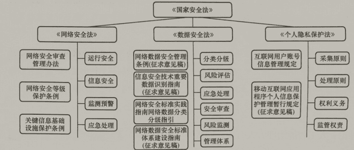

图 11-1 我国数据安全法律体系

**体系实施的六重深远意义：**

1.  **填补监管真空，实现有法可依**——针对泄露、勒索、滥用高发痛点，专法出台回应迫切保护需求。
2.  **筑牢国家安全基石**——应对“大云物移智”新技术与全场景海量数据带来的国家安全挑战，以法治手段提升保障能力。
3.  **激活数据要素价值，赋能数字经济**——确立数据合法合理利用导向，保障有序自由流动，释放关键生产要素红利。
4.  **拓宽保护边界，覆盖全形态数据**——法定数据含电子与非电子形式记录，监管触角延伸至非结构化、离线场景。
5.  **以用促安，良性互动**——鼓励依法开发利用，在流动中发现风险、在应用中完善保护，增进民生福祉。
6.  **深化体制机制，护航数字化转型**——明责主体、统标准、优流程，为智慧城市、数字政府、数字社会建设提供法治基座。

### 讨论聚焦：AI治理人人有责，破题九大关键词

| 维度 | 核心主张 |
| :--- | :--- |
| **透明可解释** | 打开“黑箱”，让用户与开发者读懂决策逻辑，以可解释性构建信任基石。 |
| **隐私守底** | 个人数据处理严守法规与伦理双红线，筑牢数据安全与隐私防线。 |
| **公平反歧视** | 算法决策剥离种族、性别、年龄等偏见因子，保障结果公正无差别。 |
| **法治监管** | 政府与国际组织供给清晰规则，以硬性约束托举社会整体利益。 |
| **伦理审查** | 涉道德敏感场景引入严格伦审机制，确保技术向善符合社会价值观。 |
| **全民素养** | 普及AI认知，提升公众风险感知力，赋能参与治理决策能力。 |
| **全球合作** | 跨国技术需全球标准，联手防范滥用与恶性竞争，构建命运共同体。 |
| **责任追溯** | 故障溯源到人，开发者与使用者共担连带责任，倒逼安全可靠。 |
| **多元共治** | 引入开发者、用户、学者、政府等多方利益相关者共商共建共享。 |
| **动态迭代** | 治理跟上技术迭代节奏，持续监测、敏捷调整，拒绝“一刀切”僵化。 |

### 思考与练习

1.  **风险社会视角**：风险的全球性与隐蔽复杂性分别呈现何种特征？
2.  **理论基石**：AI风险治理理论核心原则包含哪些要素？
3.  **美式路径**：美国在AI风险治理层面推出了哪些政策组合拳？
4.  **主体生态**：中国AI治理主体有哪些？多主体参与平衡度如何评估？
5.  **政策全景**：简述我国人工智能治理政策体系脉络。

# 参考文献

[1] 魏进锋. 一本书读懂 ChatGPT[M]. 北京: 电子工业出版社, 2023.  
[2] 李湃. 智慧城市中大数据时代下物联网技术的运用[J]. 互联网周刊, 2023(01): 74-76.  
[3] 杨音. 互联网时代下的智能家居在未来居住室内空间设计中的应用与发展研究[J]. 上海包装, 2023(01): 84-86.  
[4] 许雪晨, 田佩, 李文军. 新一代人工智能技术（AIGC）: 发展演进、产业机遇及前景展望[J]. 产业经济评论, 2023(04): 5-22.  
[5] 邵昱. ChatGPT 工作原理及对未来工作方式的影响[J]. 通信与信息技术, 2023(04): 113-117.  
[6] 王铁胜. 计算机视觉技术的发展及应用[J]. 信息系统工程, 2022(04): 63-66.  
[7] 程增木. 特斯拉自动驾驶软件系统解析[J]. 汽车维修与保养, 2022(01): 33-35.  
[8] 蒋昌俊. 大智能: 大数据+大模型+大算力[J]. 高科技与产业化, 2023, 29(05): 16-19.  
[9] 陈勇进, 罗洪奕. 以 AI 相伴, 智启未来! 智慧生活新“享”法[J]. 厦门科技, 2022(01): 41-42.  
[10] 丁海涛. 基于用户画像的个性化搜索推荐系统[J]. 电子技术与软件工程, 2020(16): 161-162.  
[11] 王运武, 于长虹. 智慧校园: 实现智慧教育的必由之路[M]. 北京: 电子工业出版社, 2016.  
[12] 杨红云, 雷体南. 智慧教育: 物联网之教育应用[M]. 北京: 华文出版社, 2016.  
[13] 李源, 董童. 5G 智慧教室走进国家开放大学[EB/OL]. 人民网, (2021-06-24)[2024-05-23].