# 智能机器人技术丛书

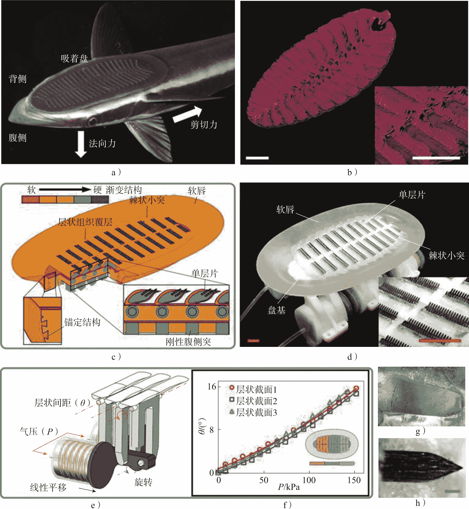

▲图 1-45 仿生䲟鱼软体吸盘机器人相关分析

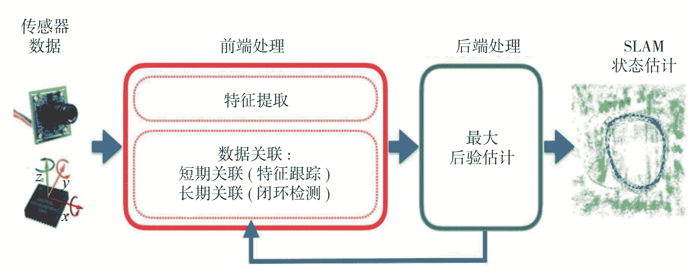

▲图 1-54 视觉 SLAM 计算框架

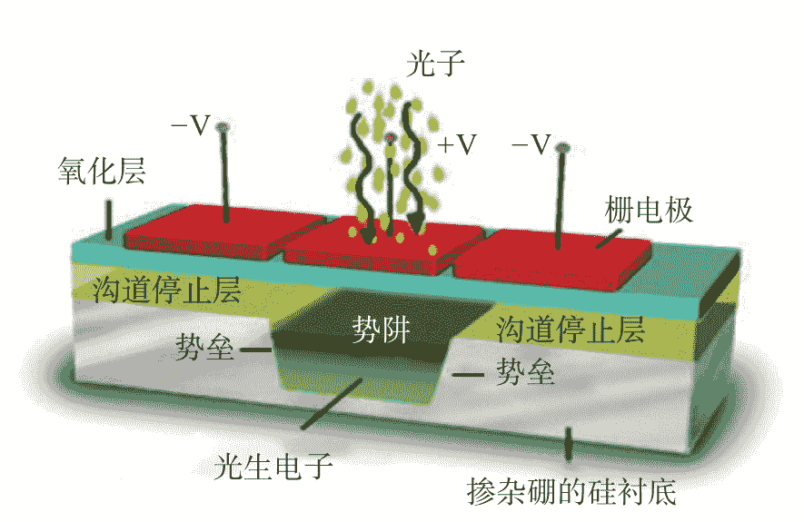

▲图 3-3 MOS 的微观结构

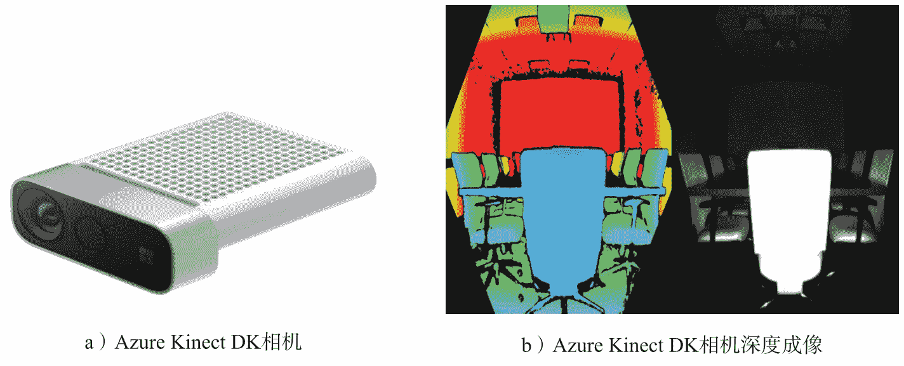

▲图 3-45 Azure Kinect DK 深度相机

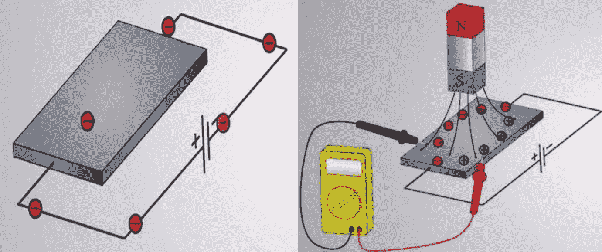

▲图 3-74 磁力计的工作原理

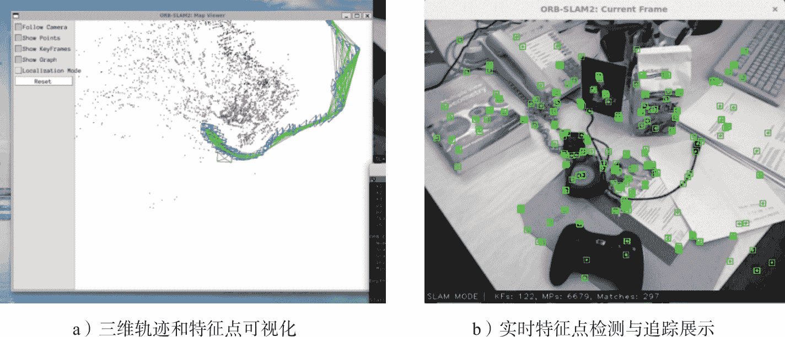

▲图 4-22 ORB-SLAM2 运行 TUM 数据集的效果

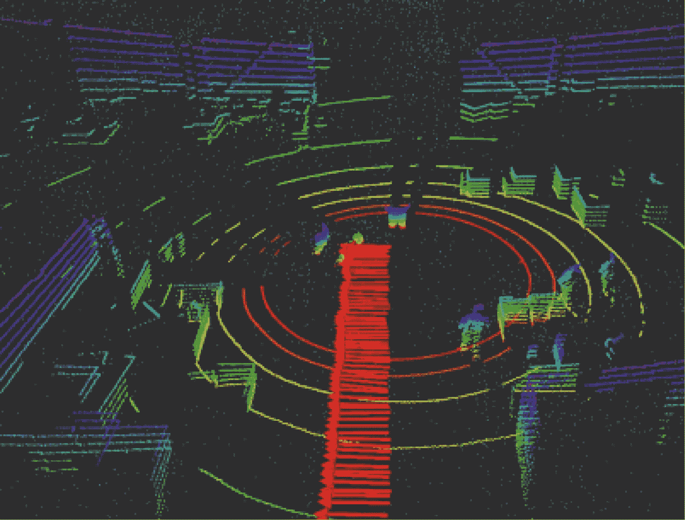

▲图 4-30 由 LOAM 算法生成的点云图

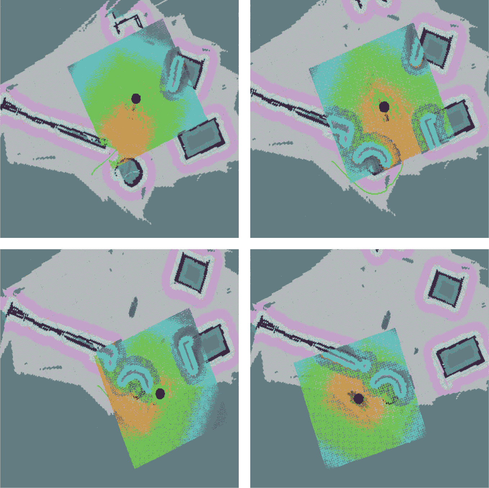

▲图 4-41 手柄控制的导航

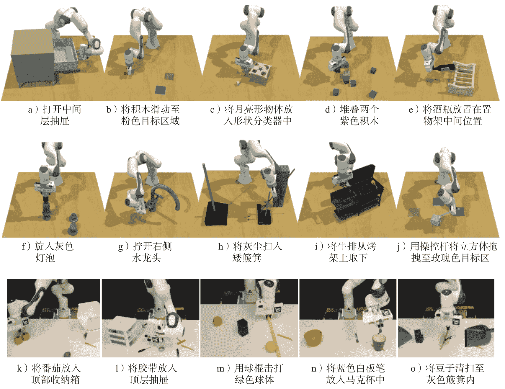

图 7-51 Perceiver-Actor

# 编者序

当下信息技术正迎来新一轮浪潮，人工智能的驱动力已经触达各行各业。智能机器人凭借强劲的执行力与丰富的应用形态，成为这波变革里最亮眼的主角，也成为教学科研的焦点。本书面向人工智能、计算机、自动化等方向的在校学生与从业者，尝试用体系化的脉络梳理智能机器人的基础概念与实践方法，帮助读者把握前沿动向、核心技术与代表性应用。

第 1 章 智能机器人概述：回溯从早期机械装置到当代系统的演进轨迹，勾勒发展脉络并点出关键技术，让读者在宏观层面建立整体认知。
第 2 章 机器人操作系统：聚焦被视作机器人“中枢”的 ROS，解读其特质、功能与落地场景，为搭建智能机器人应用提供思路与工具。
第 3 章 机器人传感器：进入感知层面，围绕各类传感装置的原理、实现方式与工程应用展开，阐明机器人如何获取环境信息并据此做出判断。
第 4 章 定位和导航：拆解空间定位与自主导航的技术逻辑，说明机型如何实现精准移动，为实际部署提供支撑。
第 5 章 机械臂的运动控制：以工业领域典型代表机械臂为例，讨论其结构、运动学与动力学，解析复杂精细动作的实现路径及其在工业、医疗等领域的价值。
第 6 章 四足机器人：介绍四足机型这一创新分支，讲解仿生设计思路与行走机理，探讨提升机动与适应性的途径。
第 7 章 人形机器人：阐释人形机型的构成要素、当前态势与政策环境，涵盖肢体系统与大脑/小脑架构，该方向正处于研究高峰期。
第 8 章 回顾智能机器人的未来走向与发展过程中面临的挑战。

智能机器人研究仍处快速迭代阶段，诸多议题尚未形成定论。编者力求客观呈现关键技术，避免提出缺乏共识的判断。组稿过程中得到实验室研究生吴婷、吴林春、程杨、王云鹤等同学的协助，在此致谢。因能力有限，书中难免有疏漏，欢迎读者批评指正。

希望本书能点燃读者对智能机器人的兴趣，为后续学习与工作奠基。祝每位读者都能在此领域找到属于自己的探索方向与创新可能。

# 第1章 智能机器人总览

1920 年，捷克斯洛伐克科幻作家卡雷尔·恰佩克在剧作《罗索姆的万能机器人》中创造了 Robata 一词，用以描述由生物部件组装、为人类服务的生化仆从。该词演化为 Robot，成为机器人这一称谓的源头。百年间，机器人作为制造业的重要自动化装备，对生产与生活的形态产生了深远影响。

近年来，电子计算机、自动控制、传感与人工智能等信息技术的融合突破推动了机器人产业的繁荣，5G 通信、物联网、纳米材料等新技术的进步也在为未来发展提供新方向。

## 1.1 机器人是什么

什么样的机械装置可被归为机器人？这个问题存在多重视角。现行较为通用的表述包括：

1）国际标准化组织 1987 年给出的工业机器人定义：一种具备自动控制与移动能力、可编程操控以完成各类作业的装置。
2）美国机器人工业协会的定义：一种可编程的多功能操作机，用于搬运物料、零件、工具并执行多种作业。
3）美国国家标准局的定义：一种可编程、在自动控制下完成特定操作与移动任务的机械装置。
4）日本工业标准局的定义：一种在自动控制下能够完成既定操作或动作的机械装置。
5）英国相关部门的定义：外观类人、具备智能、服从人类指令但不具人格的自动机器。
6）国内业界的定义：一种具备感知、规划、执行与协作等类人智能能力的高度灵活自动化机器。
7）百度百科的定义：能接受人类指令、运行预设程序或依据人工智能原则行动的自动装置，用以辅助或替代人类从事制造、建筑等工作。
8）维基百科的定义：包括模拟人类行为或思维以及模拟其他生物的机械，如机器狗、机器猫等。

综合来看，机器人普遍具备以下特质：
1）可编程，能按设定改变行为以完成特定任务。
2）自动化，启动后可自主高效地持续作业。
3）工具性，其存在价值在于协助或替代人类完成繁重、危险的工作，是人类的重要助力。

## 1.2 机型的演进

人类对机器人的想象与尝试远早于工业化。史料记载，春秋晚期被誉为木工祖师的鲁班曾用竹木制作可飞行三日的木鸟；三国蜀汉时期，诸葛亮创造的“木牛流马”，图 1-1a 可见，可运送军需，被视为最早的军用机器人雏形。

《三国志·蜀书·诸葛亮传》记其“损益连弩，木牛流马，皆出其意”。《三国志·后主传》载建兴九年“亮复出祁山，以木牛运”，十二年“以流马运”。

工业化阶段，机型的主要作用是替代人力进行繁琐、重复甚至危险的劳动。1962 年，Unimation 公司制造的世界首台工业机器人在美国新泽西州特伦顿的通用汽车工厂投入运行，图 1-1b 可见，主要用于装配车门、车窗把手、换挡旋钮、灯具支架等。这类设备解放了劳动力并显著提升了生产效率。

进入智能化时代，机器人已能自主感知环境、规划控制并决策行动。应用场景愈发丰富，如可空中跟踪目标的无人机、果园采摘机型、具备对话能力的养老陪护机型，以及中国空间站舱外机械臂，图 1-1c 可见。

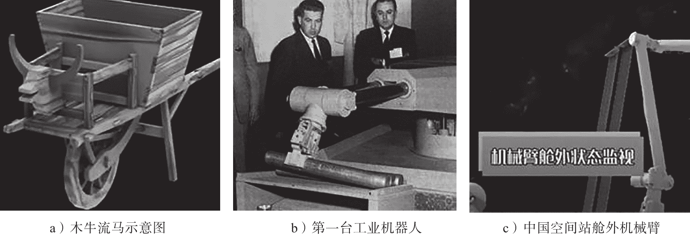

图 1-1 机器人的发展

### 1.2.1 全球发展脉络

机器人技术的发展与各国历史进程紧密相连。整体看虽相互影响，但因历史与社会背景差异而呈现不同路径与政策取向。

#### 1. 美国

美国机器人发展的大致脉络，图 1-2 呈现。

现代意义上的首台工业机器人诞生于美国，由 Unimation 公司于 1962 年研发。当时美国存在产能过剩与失业压力，政府对该类解放劳动力的产业支持有限，研究主要集中在高校与军工单位。1966 年，机器人“科沃”在地中海水下 750 米作业中成功打捞失落氢弹，凸显军用机型的独特价值，图 1-3 可见。

20 世纪 70 年代后期，美国虽开始重视，但在技术路线上更侧重软件研究及军事、航天、海洋、核工程等特殊领域的高端机型开发，导致日本在工业机器人制造与应用上后来居上。

80 年代初，面对竞争压力，美国政府与企业加大投入，制定扶持政策并鼓励工业应用，机器人技术获得快速发展。80 年代中后期，随着大规模应用与性能需求提升，第一代机型难以满足需求，美国转而研发具备视觉与力觉的第二代机器人，很快占据约六成市场。

进入 21 世纪，美国机器人技术在制造、医疗、军用与太空探索等多个领域取得进展。

2000-2010 年：制造业应用为主。
2002 年：iRobot 发布 Roomba 家用自动吸尘机型，改善家庭清洁体验。
2005 年：Kiva Systems 现 Amazon Robotics 推出自动化仓储机型系统，提升电商配送效率。

2010 年后：医疗与军事等领域辅助应用扩展。
2011 年：Intuitive Surgical 的达·芬奇外科手术系统在手术中取得成功，提升手术精度，图 1-5 可见；同年，波士顿动力的 Cheetah 机型创造陆地机型速度纪录，有望用于军事与应急。
2012 年：Ekso Bionics 发布外骨骼装置，用于行动障碍者康复，图 1-6 可见。
2014 年：蓝鳍金枪鱼-21 型自主水下航行器下潜能力达 4500 米，配备高精度声呐，曾参与 MH370 搜寻，图 1-7 可见。
2015 年：iRobot PackBot 广泛用于排爆与情报收集，图 1-8 可见；波士顿动力 Spot 四足机型用于巡检、救援与工地作业，图 1-9 可见。
2021 年：Robotic Research 的 AutoDrive 自动驾驶巴士在多地开展公共交通试点。
2023 年：特斯拉 Model3 等车型搭载的 Autopilot 具备主动巡航、转向辅助等功能，可在车道内实现部分自动驾驶，完全自动驾驶仍处 Beta 测试，部分复杂场景需人工接管。

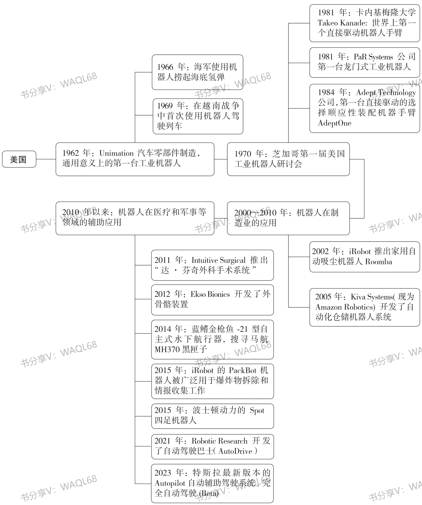

▲图 1-2 美国机器人的发展历程

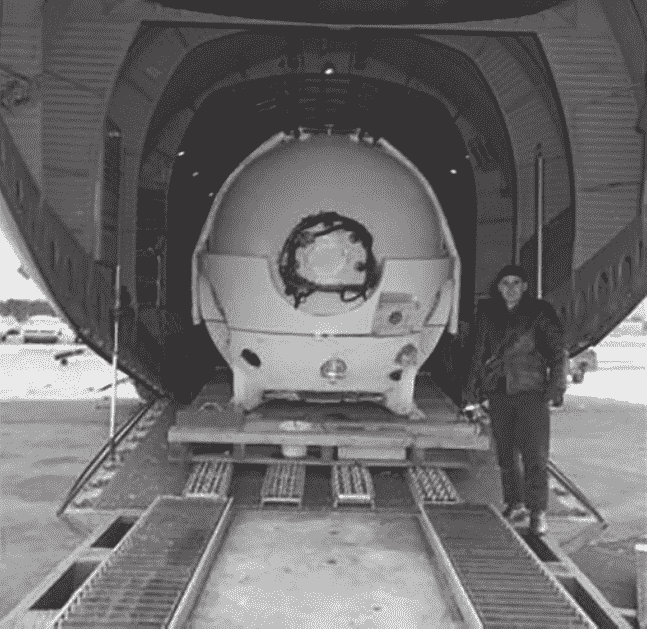

▲图 1-3 潜水艇阿尔文带着机器人“科沃”被装载到飞机上 ^(¹)

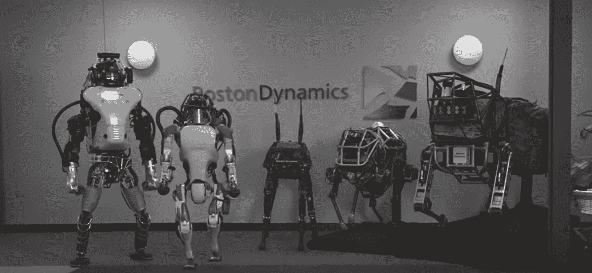

图 1-4 美国波士顿动力公司的双足、四足机器人

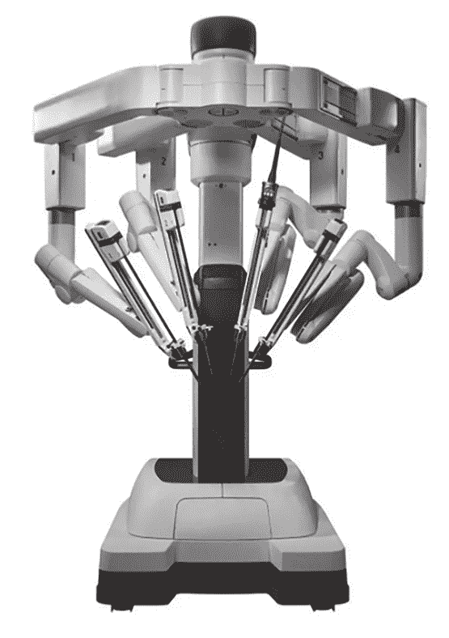

▲图 1-5 达·芬奇外科手术系统

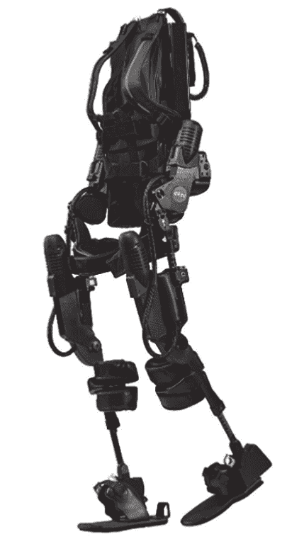

图 1-6 Ekso Bionics 的外骨骼装置

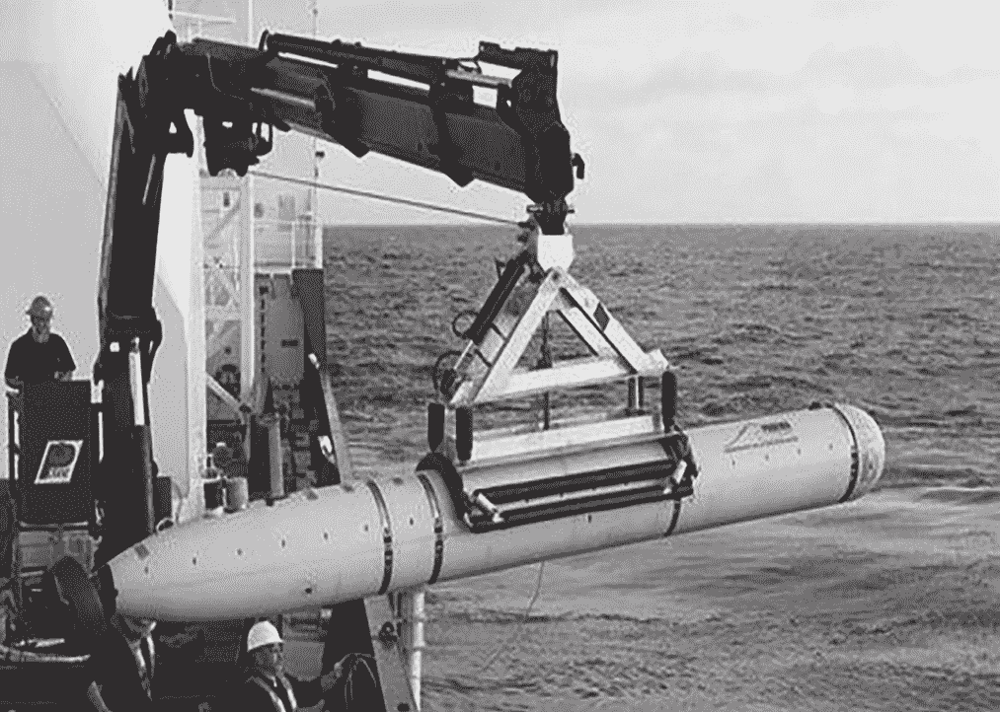

图 1-7 蓝鳍金枪鱼-21 型自主式水下航行器

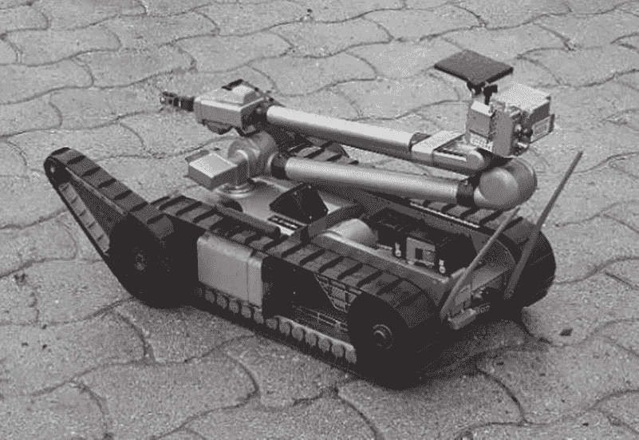

▲图 1-8 PackBot 机器人

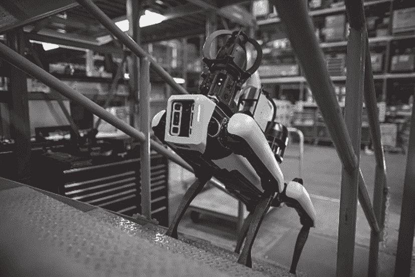

图 1-9 波士顿动力的 Spot 四足机器人

#### 2. 日本

日本机器人发展轨迹，图 1-10 呈现。

60 年代末日本正处经济高速增长期，年均增长约 11%，战后劳动力短缺进一步加剧。为此，1967 年川崎重工业从美国 Unimation 引进技术并建立生产线，1968 年试制出首台川崎“尤尼曼特”机器人。

劳动力紧张促使政府大力扶持：提供低息资金的长期租赁政策，并对中小企业进行技术指导。政策推动下，日本机器人产业迅速崛起，到 80 年代中期成为产量与装机量全球领先的“机器人王国”，1980 年被定为“产业机器人普及元年”。

在汽车、电子行业的大规模应用使日本机器人产量提升、质量提高、成本下降，产品以性价比优势大量出口，推动美、英、法等国加快追赶。

近年来，面向老龄化社会，日本技术转向医疗保健与服务机器人，包括助力人或重物搬运的外骨骼，以及面向老年与年轻群体的陪伴机器人，图 1-11 可见的 Huis Ten Bosch 烹饪机器人即为例证。

2000-2010 年：产业崛起期。
2000 年：索尼发布 AIBO 娱乐用犬形机器人，开启家用机器人发展，图 1-12 可见。
2007 年：本田发布 ASIMO 双足行走机器人，用于人机交互与移动性研究，图 1-13 可见，经迭代后运动控制与智能水平显著提升。
2008 年：发那科研发重型机器人 M-2000iA，有效载荷约 1200kg，图 1-14 可见。
2009 年：Robot Taxi 成立，致力于自动驾驶出租车技术开发，其车辆图 1-15 可见。

2010-2020 年：医疗与养老领域应用深化。
2011 年：Cyberdyne 开发 HAL 混合辅助肢体外骨骼，用于康复与行动支持，图 1-16 可见。
2014 年：日本启动 Robot Revolution Initiative 计划，推动机器人进入医疗与养老。
2018 年：软银机器人公司推出社交机器人 Pepper，图 1-17 可见，广泛用于零售、酒店与医疗服务。

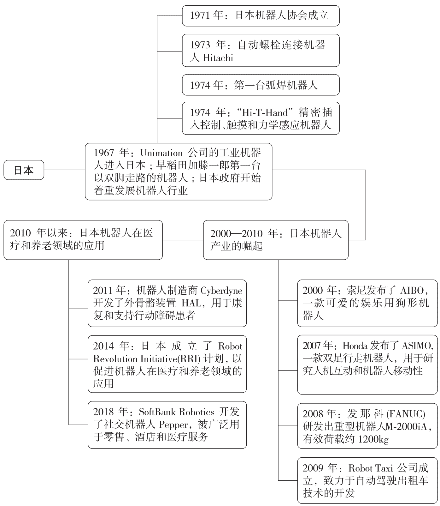

▲图 1-10 日本机器人的发展历程

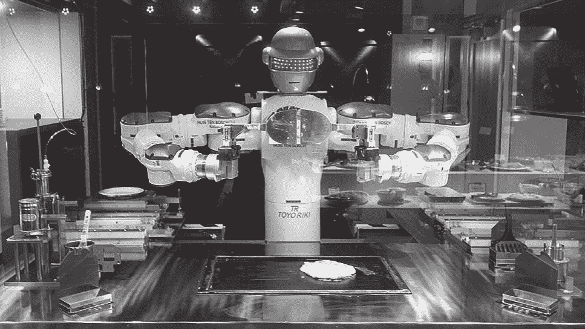

图 1-11 Huis Ten Bosch 烹饪机器人

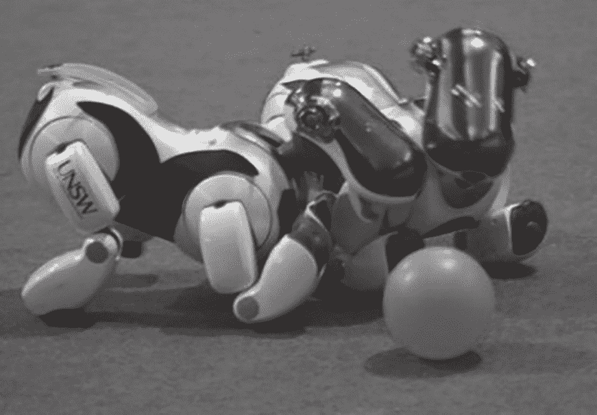

▲图 1-12 AIBO

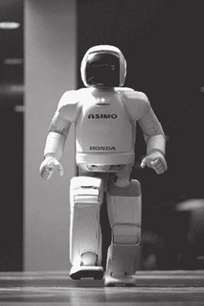

图 1-13 ASIMO

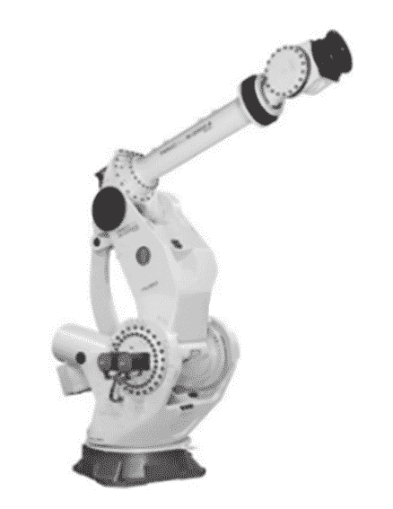

▲图 1-14 机器人 M-2000iA

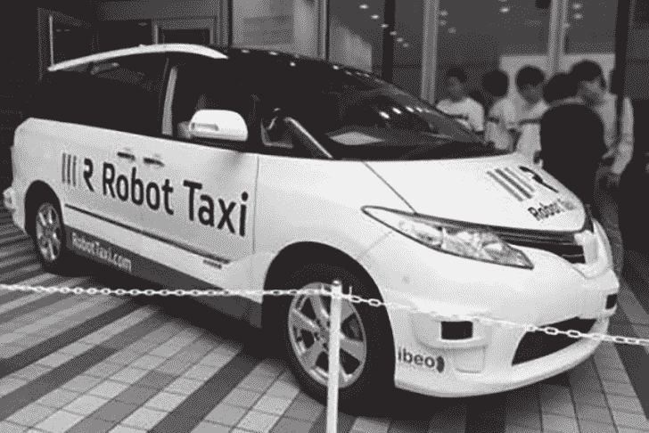

图 1-15 Robot Taxi 自动驾驶出租车

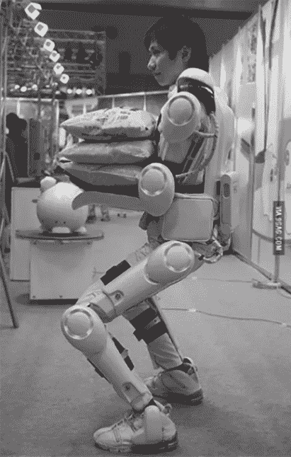

▲图 1-16 Hybrid Assistive Limb

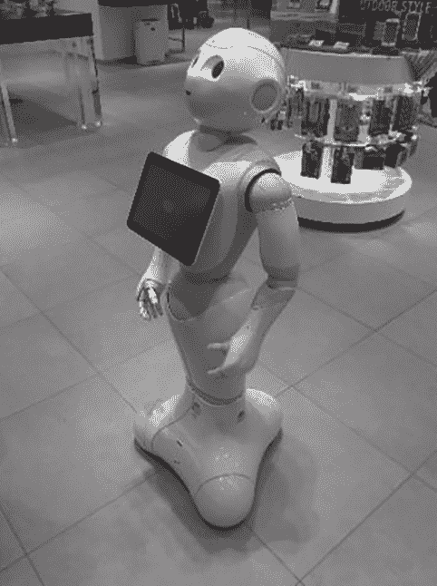

图 1-17 Pepper 机器人

#### 3. 瑞典

瑞典机器人发展历程，图 1-18 呈现。

行业发展相对自由，同时获得国家大力扶持。二战后瑞典经历两次产业升级，通过果断取舍实现最优定位。70 年代末经济增速放缓后，转向信息通信、生物医药、航天等高新技术制造业，机器人发展重点随之转移。

90 年代初受经济危机影响，瑞典舍弃亏损的小汽车制造，保留优势卡车产业，并加大对电信、电子、环保、能源等领域投入，机器人发展转向电子系统与服务业。

2000-2010 年：发展与应用期。
2003 年，瑞典创新局 Vinnova 资助“机器人谷”项目建设，如今成为新技术孵化基地。

ABB YuMi 机器人：瑞典工业机器人企业 ABB 开发的 YuMi 是一款协作型双臂机器人，可与人类工人在制造环节协同作业，图 1-19 可见，展示了工厂自动化新可能。

2010 年以来，瑞典机器人发展呈现多元化。

### Epiroc 自动化矿山设备

瑞典矿山设备制造商 Epiroc 积极推动自动化采矿，开发自主地下钻探设备与无人驾驶矿山卡车，图 1-20 可见的 Epiroc 矿山机器人提升了采矿效率。

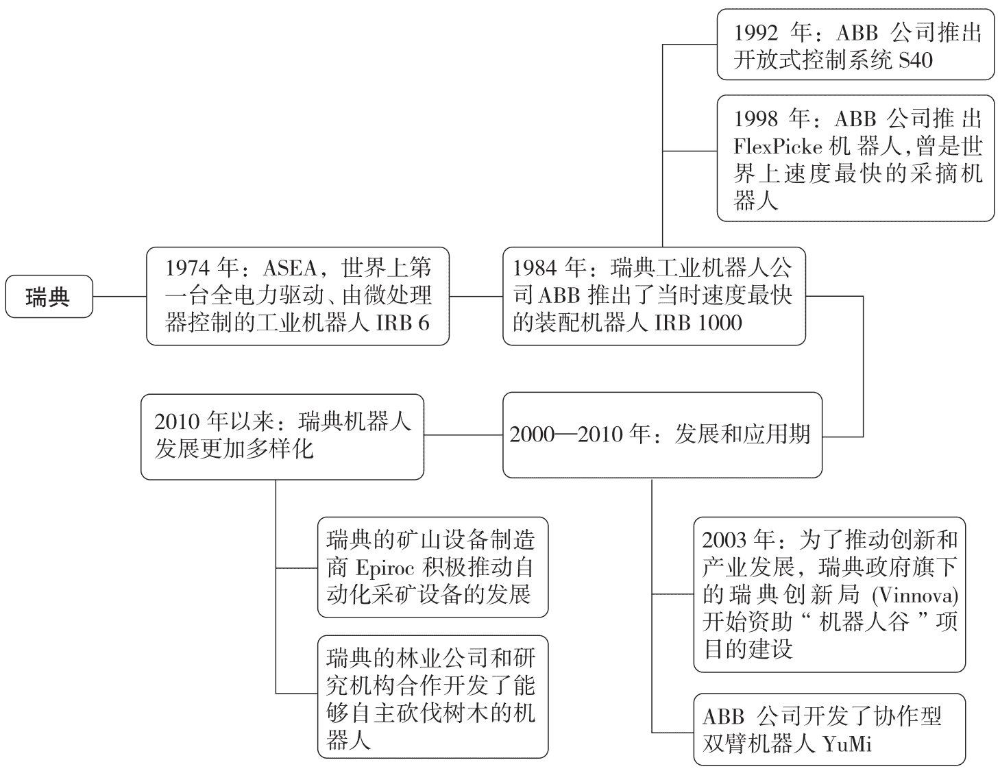

图 1-18 瑞典机器人的发展历程

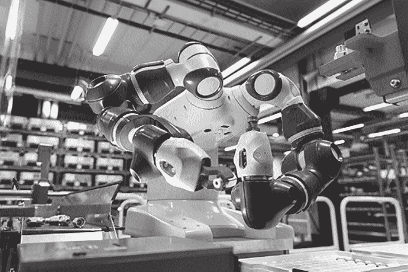

▲图 1-19 ABB YuMi 机器人

从林间作业到智能制造：机器人发展图景

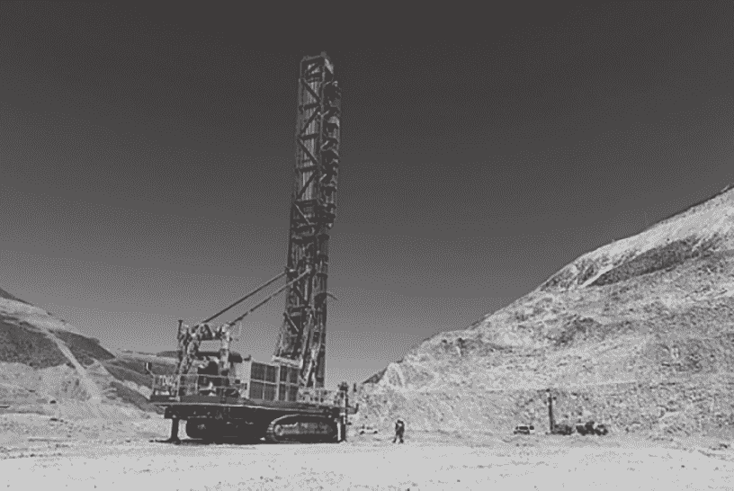

图 1-20 Epiroc 矿山机器人

### 森林自主伐木系统
瑞典几家林业企业与科研院所联合研发出可自行完成砍伐作业的设备。该类装置提升了林业作业效率，同时把操作人员从危险环境中解放出来，降低了工伤事故。

#### 4. 德国
全球工业机型保有量中德国排第三位，次于日本与美国，但推广起步比英瑞晚约五六年。起步受国内经济低迷拖累，不过战后劳动力短缺以及国民整体技术素养较高，为自动化普及创造了条件。

七十年代中后期，政府通过行政手段推动普及。在“改善劳动条件计划”里明确规定，危险、有毒、有害岗位必须用自动化装置替代人力。该政策打开了市场，也促进了技术迭代。

德国发展始终强调技术落地与社会需求结合。八十年代初，在追随汽车工业主线外，另选纺织业进行现代化改造：淘汰旧线，引进自动设备、电子计算机与机械手，企业成本下降、品质提升、竞争力回升，行业得以重振。此后提出自1985年起向具备感知能力的智能机型转移，十年积累后，本国在智能机型研究与应用上被公认为领先。

发展脉络如图 1-21 所示。
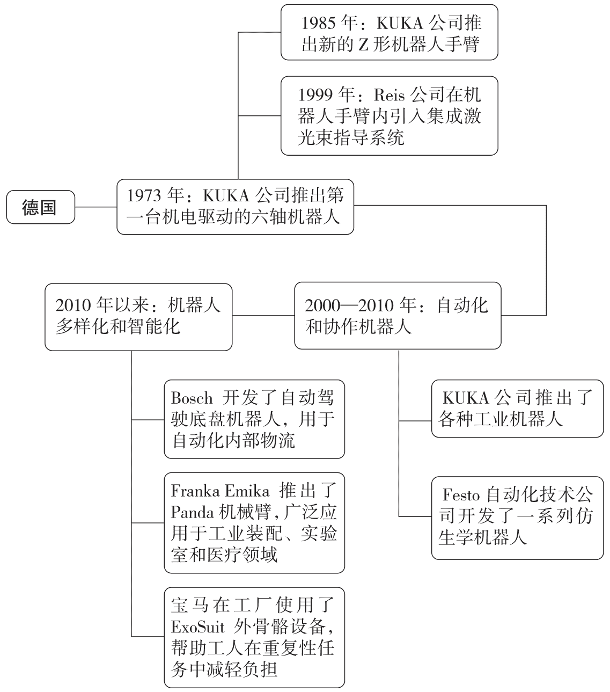

图 1-21 德国机器人的发展历程

### 2000-2010 年：自动化和协作机器人
#### KUKA 机器人
这一时期库卡公司推出多款面向汽车与泛工业的多关节机型，如图 1-22。同时发布的 KUKA LBR 六轴机型，如图 1-23，属于人机协作类型，可与人工在同一空间安全配合。

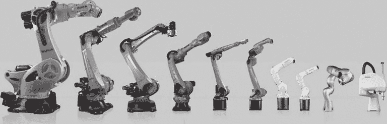

▲图 1-22 KUKA 工业机器人

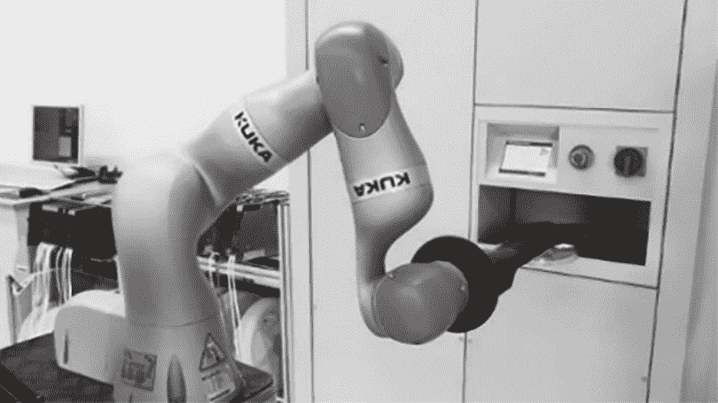

图 1-23 KUKA LBR 六轴机器人

#### Festo 自然启发机器人
Festo 以仿生学路线打造了一系列源于自然的装置，如图 1-24 所示，涵盖飞鸟、昆虫与水生生物的灵感，展现了生物学与工程学的结合。

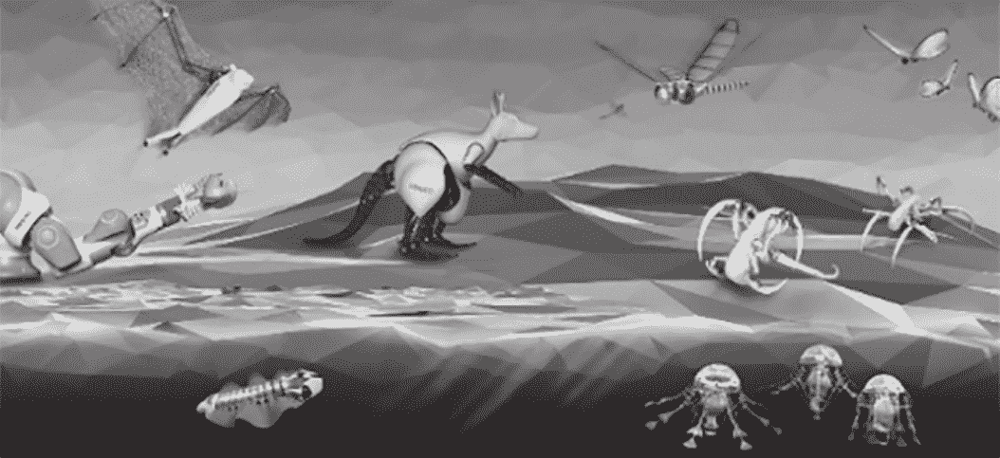

图 1-24 Festo 自然启发机器人

### 2010 年以来
进入2010年后，德国工业机型增长迅速，很快占据全球制造版图重要位置。2019年销量约2.05万台，保有量达22.15万台。伴随工业4.0提出，传统机型需补齐感知、学习、决策等新能力。

#### Bosch 自动驾驶底盘机器人
博世研发的自动驾驶底盘用于厂内物流，如图 1-25 所示，可在车间与仓库自主搬运，提升运转效率。

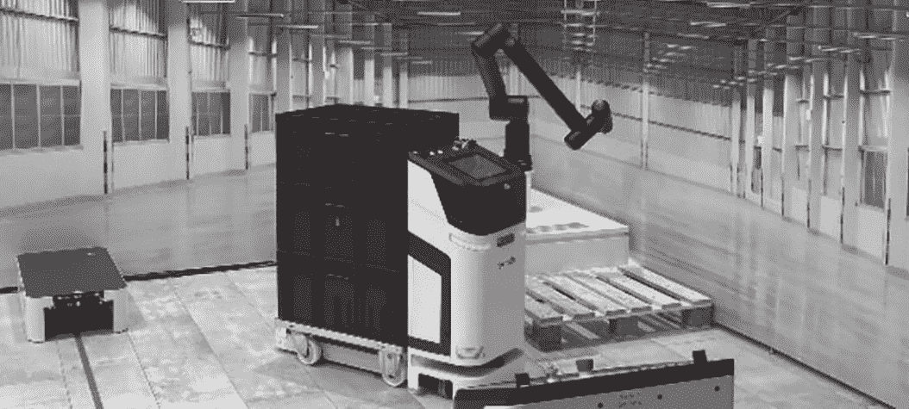

图 1-25 Bosch 自动驾驶底盘机器人

#### Franka Emika Panda 机械臂
Franka Emika 推出的 Panda 协作臂手灵活且易编程，如图 1-26 所示，被广泛用于装配、实验室及医疗场景。

#### BMW ExoSuit 外骨骼
宝马在产线引入 ExoSuit 外骨骼装备，如图 1-27 所示，用于重复性操作中分担体力，提升效率并减轻疲劳。

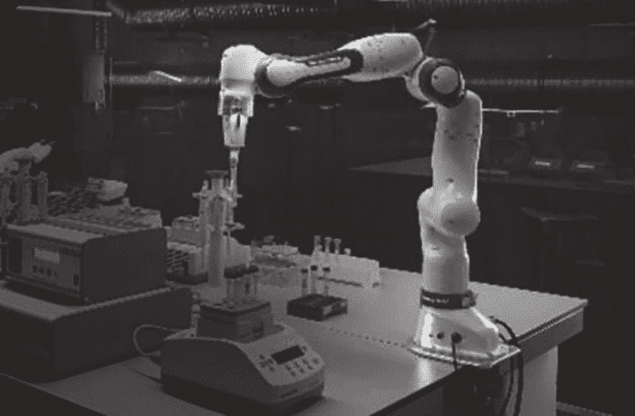

▲图 1-26 Franka Emika Panda 机械臂

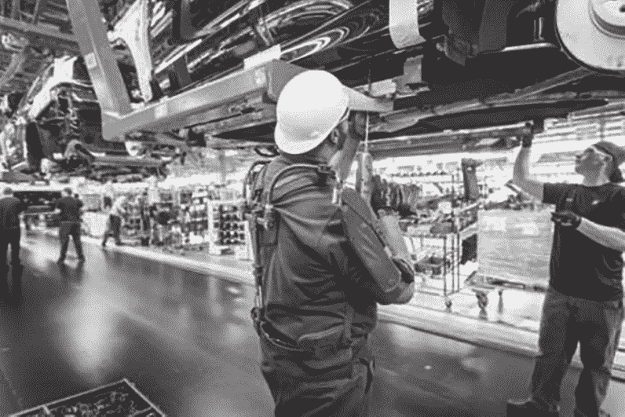

图 1-27 BMW ExoSuit 外骨骼

#### 5. 中国
中国机型发展脉络大致如图 1-28 所示。

起步较晚，先后经历七十年代萌芽、八十年代研制、九十年代实用化阶段。1972年中科院沈阳自动化所启动相关研究。1985年哈工大研制出首台国产弧焊机型。同年12月12日，重约2000kg的水下机型“海人一号”在旅顺港下潜60米，完成首次下水，开启水下机型研制新篇，如图 1-29a 所示。近年“潜龙三号”等新一代水下机型相继面世，如图 1-29b 所示。

1988年初，中国船舶总公司702所研制成功高3.1米、重650kg的载人水下机型；同年2月，国防科技大学完成六关节平面运动型两足步行机型。1995年5月，上海交通大学诞生高性能精密装配智能型机型“精密一号”，标志国内具备第二代工业机型开发能力。1997年中科院沈阳自动化所研制的6000米无缆自治水下机型是863计划重点项目，获2000年国家十大科技成果奖。1992年，南开大学机器人与信息自动化研究所研制出国内首台用于生物试验的微操作系统。

### 2000-2010 年：工业制造和服务机器人
#### 新松机器人
沈阳新松 SIASUN 成为国内领先的工业机型制造商之一，产品线涵盖工业与移动机型，具备智能感知、自主决策、自控执行能力，并在多行业实现深度融合，如 T165A-26 机型，如图 1-30 所示。

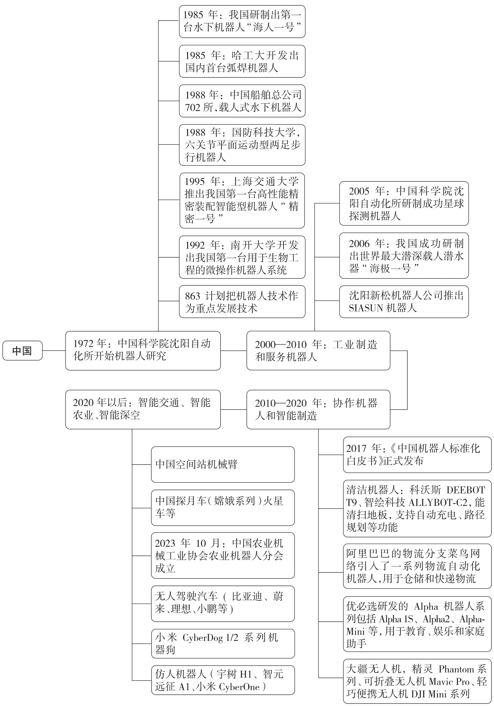

▲图 1-28 中国机器人的发展历程

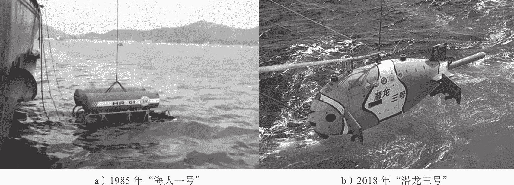

▲图 1-29 潜水机器人

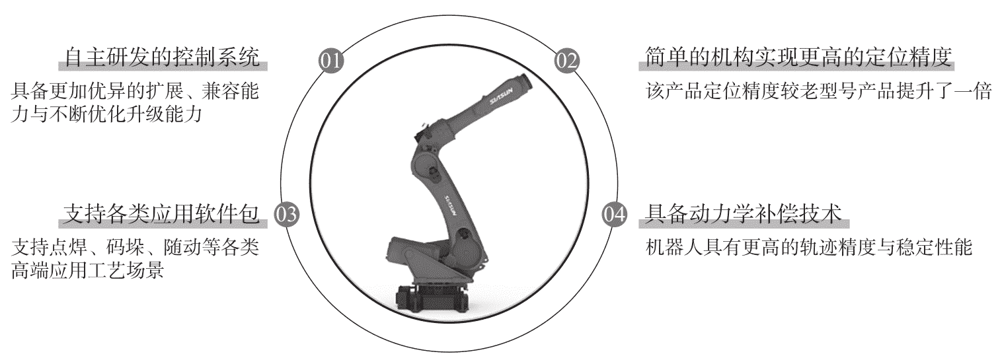

图 1-30 新松工业机器人 T165A-26

2005年中科院沈阳自动化所研制成功星球探测机型。2006年国产研制出世界最大潜深载人潜水器“海极一号”，工作潜深7000米，可达世界99.8%的海底，比另五台同类产品深500米。

### 2010-2020 年：协作机器人和智能制造
#### 教育类人形机器人
优必选研发的 Alpha 系列，如图 1-31a 所示，含 Alpha1S、Alpha2、AlphaMini 等，具有人脸识别、声音定位功能，语音遥控即可实现拍照、舞蹈、讲故事等。深圳幻尔和乐聚科技也推出人形机型，分别见图 1-31b 与图 1-31c，在机器人竞赛领域影响较大。

#### 物流机器人
阿里巴巴菜鸟、京东、顺丰相继推出多款仓储与快递物流机型，如图 1-32 所示。设备可对接运输管理系统，智能规划配送路径，实现包裹高效送达。采用激光与视觉融合 SLAM 方案，结合深度学习、环境感知、自适应粒子滤波等技术，完成动态目标识别与避障。

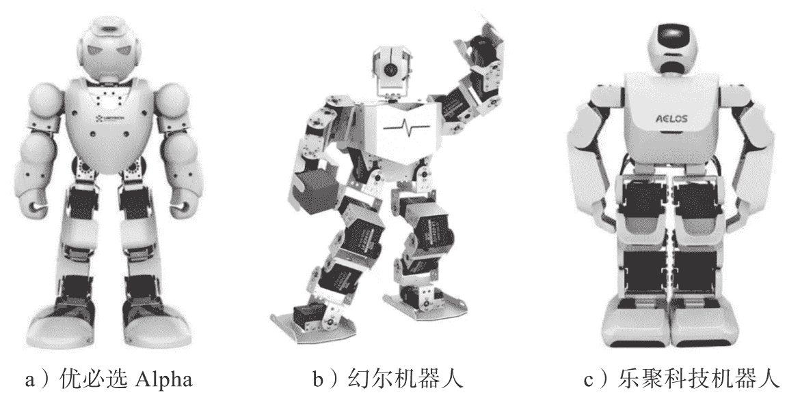

▲图 1-31 教育类人形机器人

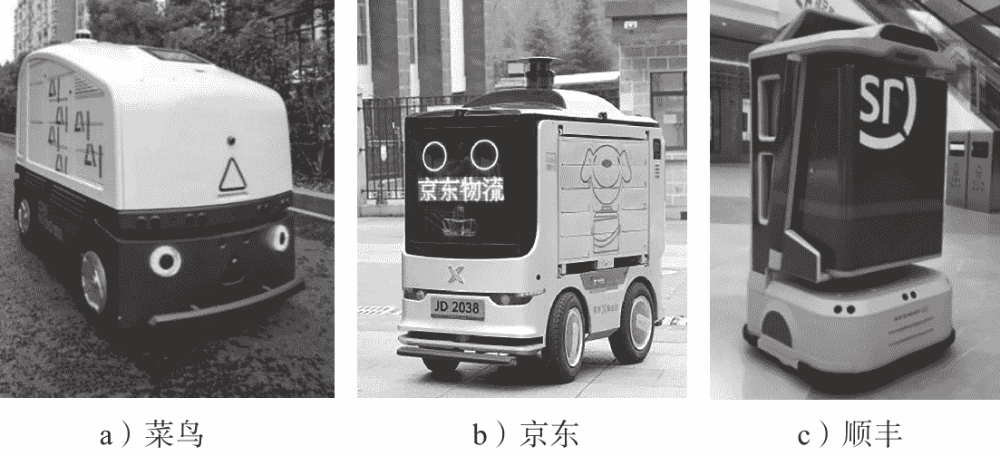

图 1-32 物流机器人

#### 清洁机器人
科沃斯 DEEBOT T9 能自主完成地面清扫与消毒，升级 SLAM 算法可快速扫描复杂家庭环境，系列搭载升级 dToF 传感器，不受日照干扰，实现全天候精准导航。深圳智绘科技 AL-LYBOT-C2 集成洗地、吸尘、推尘，具备自主作业能力，配合全功能基站可实现自主充电、自清洁、便捷排污加水，适用于医院、商场、校园、展厅、写字楼、候机楼等场所，如图 1-33 所示。

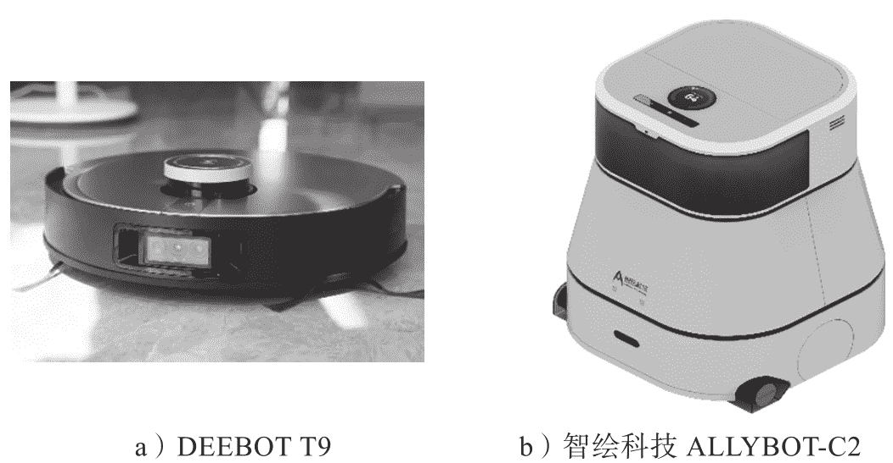

图 1-33 清洁机器人

近年来国内产业在基础能力、产品品质、集成应用上持续向好。工业机型市场连续八年位居全球第一，2020年装机量占全球44%。国家统计局数据显示，2016-2020年产量由7.2万套增至21.2万套，年均增长31%。

2020年后科研成果突出。嫦娥探月是重要里程碑，如图 1-34 所示为嫦娥四号搭载的“玉兔二号”月面车，用于月面探测与科研。

1）智能交通：以比亚迪汉等无人驾驶智能汽车为代表，蔚来、理想、小鹏等企业也在该领域领先，如图 1-35 所示。

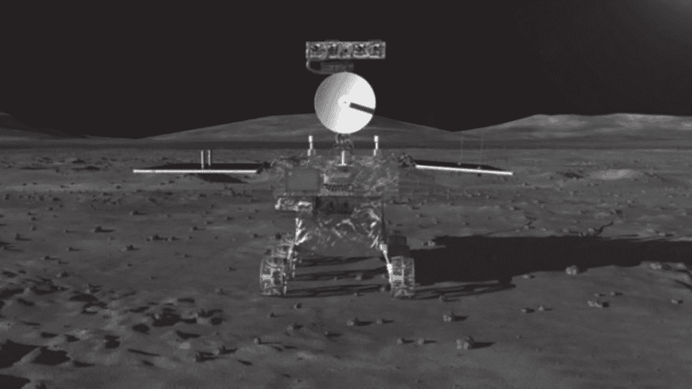

图 1-34 嫦娥四号搭载的“玉兔二号”月球车

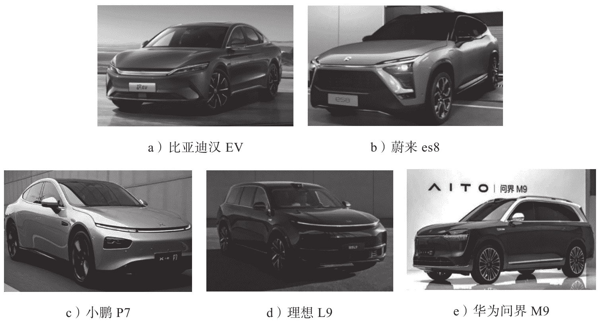

图 1-35 国产智能汽车

2）仿人机器人：宇树 H1、智元远征 A1、小米 CyberOne 以及优必选 Walker 是代表产品，如图 1-36 所示。

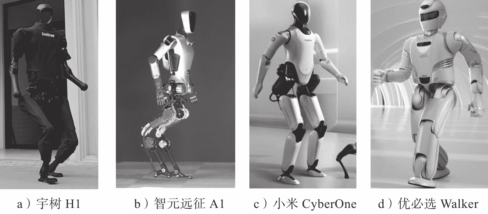

图 1-36 仿人机器人

2021年9月世界机器人大会在北京举办，展品覆盖工业、服务、特种机型等多方面。服务展区包括疫情防控的智能消毒测温机型、自助核酸检测机型；手术领域的脑科、骨科、口腔精密辅助机型；物流配送、巡检、导引机型；穿戴式辅助康复外骨骼。工业展区呈现新一代智能操作系统、专业技能考核实训台，以及电机、柔性关节、减速器、起重机等基础革新部件。特种展区有 AI 仿生手、轻巧四足机型、仿生鲨鱼、污水巡检机型及防爆灭火机型等。

2023年10月，中国农业机械工业协会农业机器人分会在武汉成立，中国农机院当选会长单位。近五年智能播种、智能喷施、智能采摘、智能除草、智能灌溉等农业机型快速发展。

### 1.2.2 我国机器人发展计划
《中国制造 2025》把高档数控机床和机器人列为重点领域，建议围绕汽车、机械、电子、危险品制造、国防军工、化工、轻工等工业机器人、特种机器人，以及医疗健康、家庭服务、教育娱乐等服务机器人需求研发新品，推动标准化和模块化，扩大应用。重点攻克本体、减速器、伺服电机、控制器、传感器与驱动器等关键零部件及系统集成设计制造技术。未来十年重点：一是开发工业机器人本体与关键零部件系列化产品，推动产业化，满足制造业转型升级需求；二是突破智能机器人关键技术，开发一批智能机器人，迎接新一轮科技革命与产业变革挑战。具体要点为按需求导向增强创新能力扩大市场应用；突破技术瓶颈提升产业化能力；加快下一代机器人研发生产，占据下一制高点。

随着医疗、养老、教育等行业智能化需求释放，服务机器人与特种机器人潜力巨大。一些此前仅见于科幻的场景已走入现实。

国内制造企业规模不断壮大，自主研发生产能力增强。以新松、云从科技、大族激光、四川长虹为代表，企业在工业与服务机器人领域取得长足进展。高端制造中，工业机器人已成功应用于航空、航天、造船、汽车、发动机等领域。服务机器人、特种机器人在医疗手术、教育服务、安防巡检、灾后救援等高附加值场景实现突破，并逐步向家具、食品、冶金、建筑、纺织、铸造、锻造、卫浴等传统行业延伸，有效缓解劳动密集型企业用工难和恶劣环境高风险作业痛点。

需注意，中国产业总体仍处初期，关键核心技术亟待突破，行业应用水平有待提升。应把握发展趋势，攻克共性关键技术，研发高性能电机、仿生感知与认知、情感交互等前沿技术，推动5G、大数据、云计算、大模型等新一代信息技术融合，提升智能化与实用性。

政策层面，2023年工信部等17部门印发《“机器人+”应用行动实施方案》，加快拓展应用。到2025年，制造业机器人密度较2020年翻番，聚焦10大应用重点领域，突破100种以上创新应用技术与解决方案，推广200个以上典型场景，打造一批“机器人+”应用标杆企业，建设一批应用体验中心与试验验证中心，搭建国内外交流平台，形成浓厚推进氛围。

### 1.2.3 全球机器人发展浪潮
为抢占国际市场，各经济强国纷纷制定规划。

2016年美国白宫发布《美国国家人工智能研究和发展战略计划》，推动人工智能与机器人技术发展。“美国机器人发展路线图”围绕制造业攻克强适应性与可重构装配、仿人灵巧操作、基于模型的集成与供应链设计、自主导航、非结构化环境感知、教育训练、机器人与人共处本质安全性等关键技术。2019年美国国防部发布《机器人自动化战略》，推动军事领域机器人应用。军方“未来战斗系统”计划转入旅级战斗队现代化，强化无人系统与自主机器人研发，用于侦察、救援、排除爆炸物等任务。NASA发展“Curiosity”“Perseverance”等太空机器人用于月球和火星探索，Curiosity见图1-37a，Perseverance见图1-37b。医疗保健领域，医疗机构与科技公司开发外科机器人与远程医疗机器人，如达·芬奇外科手术系统，图1-37c所示。

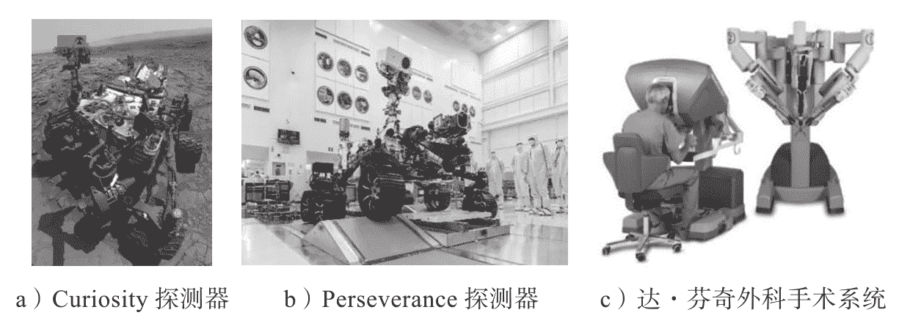

图 1-37 美国太空机器人和医疗机器人

2015年初日本公布《机器人新战略》，提出研发下一代机器人数据终端化、网络化、云计算等技术，以应对人口老龄化和劳动力短缺。2018年发布第五次机器人基本计划，推进工业、医疗、服务、农业等领域应用。2021年日本科学技术振兴机构发布机器人基础计划2021，旨在推动基础研究进展，提升创新与核心技术，强调基础研究、社会共识培育与产业化。

韩国自2012年公布《机器人未来战略2022》，支持企业进军国际市场抢占智能机器人产业化先机；2018年发布《第四次智能机器人技术发展战略》，目标培养100家智能机器人企业，推进人工智能与机器人技术研发应用。

欧盟2020年发布《欧盟智能机器人战略规划》，建立欧洲智能机器人创新生态系统，加强研发、投资与应用。英国开展医疗机器人项目，如Versius手术机器人，提升手术精度与效率。德国推行“工业4.0”战略，构建智能工厂，聚焦人与机器人、机器人与机器人交互协作。法国提出“未来工厂”计划，促进智能制造与自动化机器人技术在制造业的应用。

### 如何防止机器人伤害人类？——人类对机器人可能存在的安全隐患的思考
### “机器人三大定律”——源自阿西莫夫的科幻小说

艾萨克·阿西莫夫，1920-1992，俄裔美籍科幻作家、科普作家，以《基地》《银河帝国三部曲》《机器人》系列闻名，与海因莱因、克拉克并列科幻三巨头。其1950年短篇小说集《我，机器人》中提出“机器人三大定律”。

◆第一定律：不可伤害人类，也不可因不作为导致人类受伤害。该定律被视为机器人核心准则，强调保护人类安全，也引发道德伦理困境，如多主体抉择、危险情境下的平衡问题。

◆第二定律：必须服从人类命令，除非命令与第一定律冲突。体现服从性，同时带来命令冲突与道德权衡难题，常用来探讨人与机器人的复杂关系。

◆第三定律：在不违背第一、第二定律前提下，必须保护自身安全。该定律涉及自我保护欲望与人类忠诚之间的冲突，如何解释执行也是讨论焦点。

机器人伦理与分型快览

科幻叙事里，三大铁律常被当作切入点，来审视造物伦理困境与人造体和人类的互动。作品里机器往往被拟人化，带上近似情感的智能，推动出大量发人深省的情节，让读者对技术前景保持好奇，也对价值边界产生思考。影视、文学与学术研讨的共同作用，凸显了两个结构性缺口：军用平台的根本任务就是侦察与打击，在逻辑上几乎注定要违背第一条铁律；一旦系统把自己判读为人类，第一条和第二条就会同时失效。

针对缺口，后续理论补充了【第零定律】与【第四定律】：

◆【第零定律】机器须优先维系全人类群体的整体福祉，防止其受损。
◆【第四定律】机器在任何情形下都必须把自己定义为机器。

需要强调的是，第零条的位阶高于前三条，这让决策时以多数人的安全为首要考量，避免规则冲突导致停机或误判。

阿西莫夫在小说里提出的三大规则，持续映射到现实研发。近年大模型实现突破，机械体的认知水平在快速攀升，如何约束行为、防止对人造成伤害，已成急迫议题。面对行动自主性增强的智能体，设计环节必须前置人类安全、合规法规与长期可用性等多维度逻辑预案。学界、产业、国际组织、政府与公众需要协同，推动可适用于地球乃至未来星际的环境行为规范，形成真正的“机器人法则”。

```
?xml version="1.0" encoding="utf-8"?
```

## 1.3 智能机器人分类

从使用场景、认知层次和运动形态切入，智能机械呈现出多元样貌。

### 1.3.1 按应用功能分类

#### 1. 传感类机器人
此类属外控型，本体不设自主核心，仅保留执行部件与感知部件，可借助视觉、听觉、触觉、接近觉、力觉以及红外、超声、激光等手段完成信息采集与初级处理，进而实现受控操作。它受外部主机支配，机器人世界杯小型组的竞赛机型即属此列。

iRobot 在 2002 年 9 月推出旗舰扫地机 Roomba 产品线后迅速走红，2004 年单年销量即达 100 万台。其 Roomba980 为典型代表，搭载视觉单元、接近单元、碰撞单元、地毯单元等多套装置，用以探测障碍、地形变化与清扫需求。机身还配有红外单元描绘房间轮廓，帮助其高效穿越并规避阻碍。感知单元实时采集信息后送往内置控制器或外接主机，使其能在室内自行寻路完成清扫。

#### 2. 自主类机器人
完工后无需人工干预，即可在复杂环境中自动完成类人任务。本体集成感知、运算、判断与执行模块，能像独立个体般活动与解决问题。多国高度重视全自主移动平台的研究。智能平台的探索可追溯至 20 世纪 60 年代初，经过数十年演进，以感觉控制为基础的第二代平台已进入实用，以知识控制为核心的平台也取得明显进展，多款样机已出现。

波士顿动力公司的机器犬 Spot 产品线是经典案例。Spot 配备视觉、激光雷达与红外等多种感知单元，可在不同环境中感知周遭，并搭载内置电脑与判断系统，能在巡逻、搜救、建筑作业等任务中自主决策。它具备自主移动能力，可自行规划路线穿越楼梯、复杂地形，还能执行设备巡检、建筑巡查或危险环境作业。Spot 体现了新一代自主平台的特征：在多种场景下独立工作，拥有感知、判断与执行能力，近似于一个自主生命体，展示了该类平台在实际应用中的潜力，无需持续人工介入即可应对多样任务。

#### 3. 交互类机器人
通过计算机系统与操作员或程序员进行人机对话实现控制。这类平台虽具备部分处理与判断能力，可独立完成轨迹规划、基础避障等操作，但执行复杂任务仍需外部指令。

软银公司研发的 Pepper 是人机交互能力突出的人机对话平台，可通过电脑系统与操作员或程序员对话实现操控。它拥有自然语言处理与语音识别能力，能进行对话、作答、识别情感与情绪。机身配备视觉单元与摄像头，可辨识人脸表情与动作。尽管 Pepper 具备一定的自主功能，如路径规划和简单避障，但执行更复杂指令仍依赖外部控制。它多用于零售、服务与教育领域，作为客服代表、教学助手或社交伙伴。其交互属性使其能有效与人沟通，提供信息、娱乐与支持，同时接受操作员或程序员的指令完成特定任务，兼具自主性与人机互动优势。

小米的 CyberOne 是近期推出的智能平台计划，旨在推动中国及全球的机器人技术。CyberOne 具备高情商、感知情绪的能力，视觉敏锐，可对真实世界进行三维虚拟重建，“小脑”强劲，能实现双足运动的姿态平衡，四肢强健，动力峰值扭矩达 300N·m。以人工智能为内核、以标准人形为载体，搭载小米自研 Mi-Sense 深度视觉模组，结合人工智能算法，拥有完整三维空间感知能力，可实现人物身份识别、手势识别与表情识别。

### 1.3.2 按智能层级分类
随着技术进步，按功能差异平台可分为普通平台与智能平台。普通平台仅具基础编程与操作能力，国内现阶段生产的大多数机型属于此类。智能平台尚无统一定义，主流观点认为其至少要具备：对不确定作业条件的适应力、对复杂对象的灵活操作力、与人紧密协作能力、与人自然交互能力，以及人机协作安全特征。无论工业平台还是服务平台，最终都将演进为具备学习能力的智慧型平台，即下一代平台。随着 3D 视觉感知、力觉单元等技术，以及工业互联网、云计算、大数据等新一代信息技术的深度融合，下一代平台的智能化水平将进一步提升，感知外界的能力将更强，可完成动态复杂任务，实现多机协同并与人类协同作业。

#### 1. 原型机器人
只能按人工设定的程序僵硬运行，外界条件如何变化它都不会自行调整程序。改变工作内容必须由人手动修改程序，因而几乎不具备智能。

#### 2. 弱智能机器人
这类平台的智能属于弱人工智能，即在单一领域表现出色。例如战胜世界围棋冠军的人工智能 AlphaGo，只会下围棋，无法识别猫狗。目前实现的大多是弱人工智能。

它们拥有类似人的感受、识别、推理与判断能力，在事先给定程序修改原则的前提下，能依据外界变化在一定范围内自行调整程序，即可适应环境变化并做出相应反应。

#### 3. 强智能机器人
这类平台的智能达到人类水平，可在各方面与人匹敌。创造强人工智能远比弱人工智能困难，目前基本尚未实现。

美国特拉华大学心理学教授 Linda Gottfredson 将智能定义为“一种广泛的心理能力，能够进行思考、计划、解决问题、抽象思维、理解复杂概念、快速学习并从经验中学习”。强人工智能在这些操作上应与人类同样游刃有余。

目前初级强智能平台具备感知、识别、推理与判断能力，也能依据环境变化在一定范围内自行修改程序。不同之处在于，程序修改的原则并非由人预设，而是平台通过学习与经验总结自行获得。此类平台已拥有一定自主规划能力，可自行安排工作。由于能够独立工作而无需人工照看，故被称为高级自律平台。

### 1.3.3 按行动方式分类
一般来看，移动平台的移动结构主要有轮式、履带式与足式，还有步进式、蠕动式、蛇形、混合式与飞行式，以适应不同工况。室内移动平台多采用轮式，室外移动平台为适应野外需求多采用履带式。部分仿生平台则模仿生物运动方式，采用相应结构，如机器蛇采用蛇形结构，机器鱼采用尾鳍推进结构。其中轮式的效率最高但适应性相对较差，足式的适应性最强但效率最低。下面分别介绍各类运动机构的平台及要点。

#### 1. 足式移动机器人
足式机构对崎岖路面的适应性很好，足式运动的支撑点是离散的，可在可达地面上挑选最优支撑点，而轮式与履带式必须面对地形最恶劣的点。足式运动还具备主动隔振能力，即便地面起伏，机身仍可保持平稳。足式机构在不平与松软地面上的行驶速度较高，能耗也相对较低。

现有足式平台的足数可分为单足、双足、三足、四足、六足、八足甚至更多，仿人型平台的参数对比见表 1-1。足数越多越适合重载慢速运动。实践中双足与四足因适应性与灵活性更好、更接近人类与动物，因而使用最广。


表 1-1 仿人机器人产品参数的对比
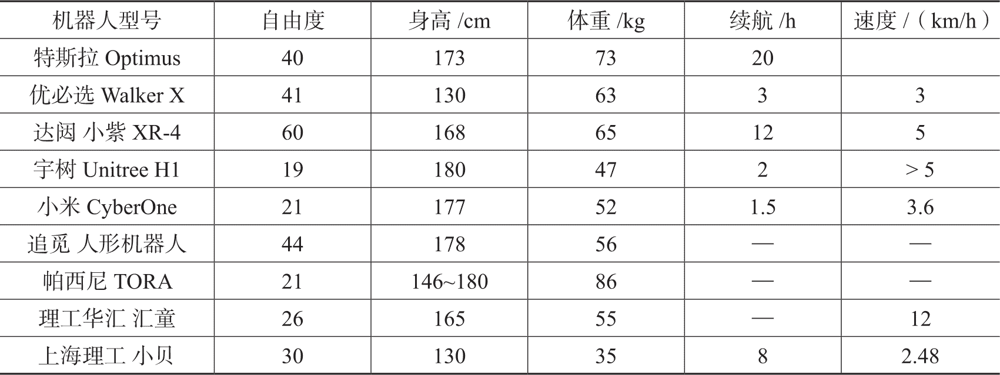

UBTECH Robotics 是总部位于深圳的平台制造商，推出了 Walker 系列。UBTECH Walker 可行走、跳跃、执行多种动作并与用户互动。该系列采用原创人工智能技术，搭载高性能伺服关节，以及多维力觉、多目立体视觉、全向听觉、惯性与测距等全方位感知系统；视觉定位导航与手眼协调操作技术全面升级，自主运动与决策能力大幅提升，可实现平稳快速的行走与精准安全的交互。

宇树科技研发的 Unitree H1 是一款人形平台，拥有出色的机械设计与动力学特性，旨在模仿人类行走与动作。Unitree H1 灵活度高，平衡能力先进，可自主行走、爬楼、跳跃，甚至完成翻滚、伸展等高难度动作，如图 1-38a 所示。作为国内首台可跑的全尺寸通用人形平台，Unitree H1 具备稳定步态与高度灵活的动作能力，能在复杂地形与环境中自主行走与奔跑。

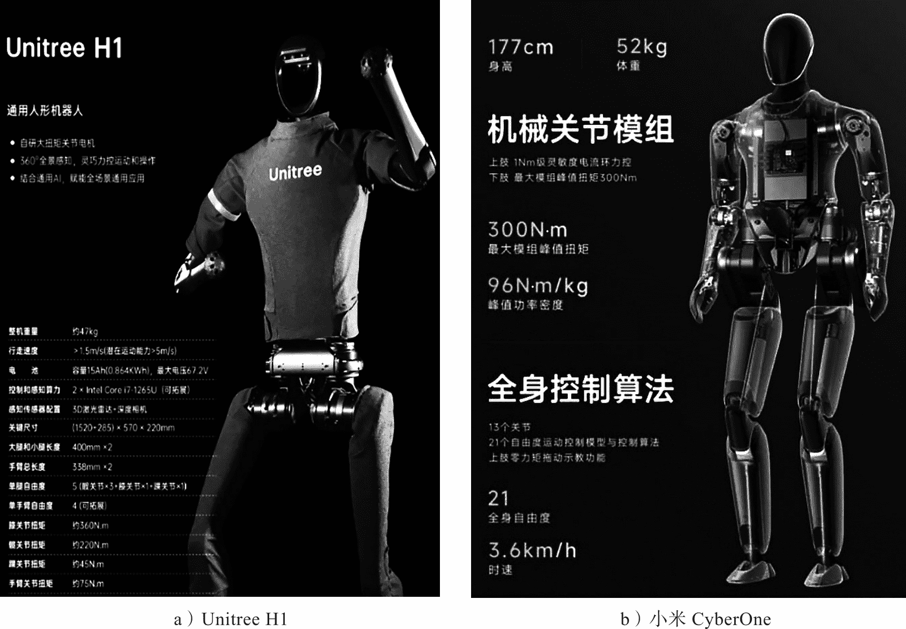
图 1-38 双足机器人

小米研发的仿人平台 CyberOne 如图 1-38b 所示。其“大脑”借助听觉单元配合自然语言处理算法，可感知 45 种人类语义情绪，分辨 85 种环境语义；“小脑”通过小米自研全身控制算法，协调 21 个关节自由度的运动；“视觉”采用深度相机配合人工智能相机，帮助平台看见真实场景与物体，通过视觉空间系统三维重建真实世界；“四肢”以关节为核心，全身共 5 种关节驱动，峰值扭矩 300N·m，单手垂直抓握质量可达 1.5kg。

杭州云深处科技专注于四足机器犬研发。2017 年发布“赤兔”四足平台后，陆续推出“白绝影”“蓝绝影”等升级版本，其新一代智能机器犬绝影 Lite3 如图 1-39a 所示。

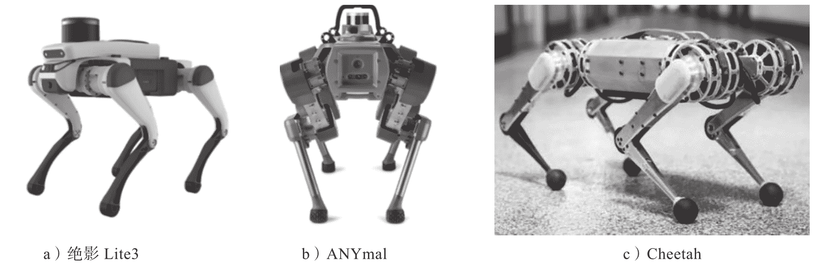
图 1-39 四足机器人

除 Spot 外，瑞士公司 ANYbotics 也开发了四足平台 ANYmal，如图 1-39b 所示。ANYmal 可在复杂环境中行走并执行巡逻、设备检查、科研等任务，具备自主导航与避障能力，是面向工业与研究的高灵活度平台，专为复杂厂房设计，抗冲击、防尘防水达到 IP67 等级，适合全天候运行；集成视觉与热感摄像头、超声波麦克风、强力 LED 聚光灯与激光雷达。ANYmal 的智能功能可自主安全地采集复杂设施数据并接入现有操作系统。

麻省理工学院生物机器人实验室开发的 Cheetah 平台如图 1-39c 所示，同样为四足平台，模仿猎豹的步态。Cheetah 平台具有高速度与机动性，用于生物力学与平台运动控制研究。

#### 2. 飞行机器人
空中移动平台的应用范围广泛，技术已趋成熟，性能不断完善，正向小型化、智能化、隐身化发展，相关雷达、探测、测控、传输与材料技术也正快速演进。空中移动平台主要分为仿昆虫飞行平台、通用飞行平台、四轴飞行器与微型飞行器等。微型飞行器的研发涉及多学科交叉，是衡量微电机系统技术实力的重要标志，其成果也能推动其他相关技术发展，对我国而言是亟需发展的重点方向。

国内大疆创新开发了 Mavic Air 产品线消费级无人机。该系列配备高性能相机、飞行稳定技术与智能飞行模式，可用于航拍、灾害检测、农业等。Air 3 无人机搭载全向视觉感知系统，如图 1-40 所示，可实现全方位环境感知，探测各方向障碍物，并借助 APAS 5.0 实现顺滑绕行，保障飞行安全。

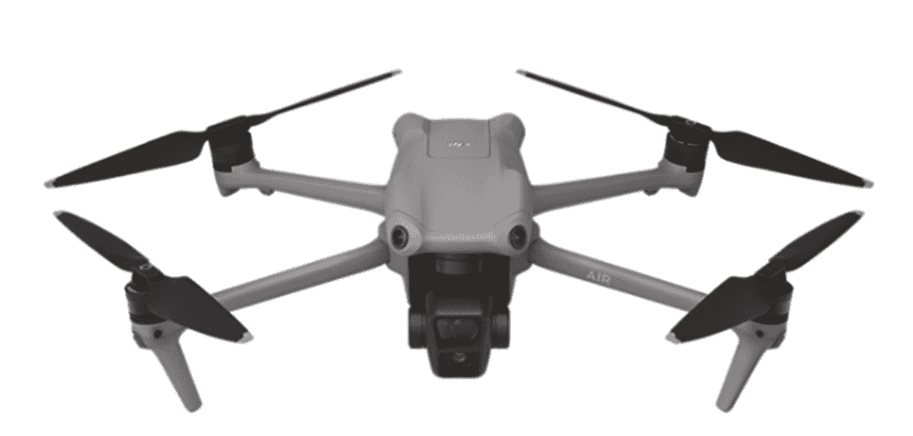
图 1-40 大疆无人机 Air 3

微型飞行平台通过模仿昆虫扑动细小翅膀实现飞行，可完成监测农田作物生长或侦测气体泄漏等耗时任务，因体积微小难以使用传统螺旋桨推进。华盛顿大学研发的首个可独立飞行的微型平台 RoboFly 如图 1-41 所示，其重量仅略大于牙签，利用激光束提供动力，通过微型机载电路将激光能量转化为足够电力，操纵翅膀完成飞行任务。


图 1-41 RoboFly

#### 3. 轮式移动机器人
轮式移动平台是应用最广泛的类型，在相对平坦地面上表现优越。轮式机构按车轮数量可分为单轮、双轮与多轮，4 轮机构应用最广，可采用不同驱动与转向方式，既可后轮分动，也可通过连杆实现 4 轮同步转向，后者可实现更小转弯半径。

电影《终结者 2：审判日》中出现的液态金属平台令人印象深刻，现实中苏州大学、中国科学技术大学等高校正尝试利用镓等液态金属合金的受控驱动技术，未来有望打造结构更灵活、性能更出色的移动平台，中科院液态金属研究的轮式结构与运动分析如图 1-42 所示。


图 1-42 液态金属轮式结构

麻省理工学院团队开发了 Rovables，这是一种微型轮式平台，用于可穿戴技术与智能服装研究，如图 1-43 所示。它采用小型轮子可在衣物上移动，实现身体互动与传感功能。Rovables 还配备惯性测量单元 IMU，含陀螺仪与加速度计。平台通过 IMU 计数车轮转动，可保持自身位置与轨迹，从而在穿戴者身上自主导航。


图 1-43 Rovables

#### 4. 潜水机器人
21 世纪是人类开发海洋的新纪元，海洋科学研究、海上油气开发、海底矿藏勘测、海底打捞救生等均需载人潜水器与水下移动平台技术，水下平台的发展意义重大。水下平台种类繁多，包括载人潜水器、有缆遥控水下平台与无缆自主水下平台等。

“海斗号”是一种用于深海科研与勘探的自主水下平台，如图 1-44 所示，具备高度自主性与多功能性能，可在深海执行地质勘探、海洋生态调查与水下资源开发等任务。“海斗号”代表了中国在深海探测技术上的创新，为海洋科学研究与资源开发提供了重要工具。


图 1-44 海斗号

北京航空航天大学在《Science Robotics》发表了仿生䲟鱼软体吸盘平台研究成果，通过将仿生样机集成到水下平台上，实现类似䲟鱼的游动-吸附-脱离，相关分析如图 1-45 所示。该研究不仅从生物力学角度揭示了䲟鱼的吸附机制，也为未来低功耗水下仿生软体平台与水下吸附装置提供了新思路。基于生物机制，这种平台吸附力可观且不会损伤吸附面，在国防科技、水下救援、海洋生态监测等军民领域均有良好前景。

美国 Blue Robotics 公司开发的 BlueROV2 是一款低成本有缆遥控水下平台，如图 1-46a 所示，广泛应用于海洋科学、水下勘测与教育，具有高度灵活性和可定制性。


图 1-45 仿生䲟鱼软体吸盘机器人相关分析（详见彩插）

OceanOne 由美国斯坦福大学团队研发，如图 1-46b 所示，专为深海考古、科学研究与水下维修设计。平台配备高精度机械臂与摄像设备，可在深海进行精密操纵与观察。OceanOne 的研究有望为深海勘探提供新机会，并提升对深海环境的认知。


图 1-46 潜水机器人

#### 5. 仿生移动机器人
仿生移动平台指模仿生物、从事生物特征工作的移动平台。蛇形、蜘蛛形、壁虎形、机器蛙等仿生平台，在搜救与侦察方面具有很好的应用价值。

中国科学院沈阳自动化所类生命机器人团队以蝠鲼为灵感，研发出一种由体外培养骨骼肌组织驱动、环形分布多电极 CDME 控制的类生命游动平台，如图 1-47 所示，该平台仅由一块肌肉组织驱动即可实现有效推进。CDME 产生的电场对培养基与细胞的损伤小于传统平行板电极，且可动态调控电场方向，使其与驱动组织实时保持平行，从而保证平台稳定可控。


图 1-47 蝠鲼仿生机器人

从七鳃鳗的游动方式获得启发，瑞士洛桑联邦理工学院`EPFL`旗下的生物机器人实验室`BioRob`打造的两栖机器人`AmphiBot`已经迭代到第三代，图示如图 1-48。`AmphiBot` Ⅲ全长约 1 米，结构由 8 个关节串联而成。作为可在水陆切换的平台，它的游速能与常人媲美，实验室甚至为它安排过一次人机竞泳。在水中它与人类并肩前行，后续还能慢慢拉开差距。研发这款机器人的初衷是为研究动物运动神经网络提供模型，就像某些动物头部被切除后神经仍能驱动身体运动一样，把`AmphiBot`拦腰截断，它仍可正常运转。


图 1-48 两栖机器人`AmphiBot`

```
?xml version="1.0" encoding="utf-8"?
```

## 1.4 智能机器人核心技术全景
具备自主感知、判断、规划路径并执行动作的智能机器人，是多项前沿技术叠加的结果。它依赖感知、定位导航、智能控制与人机交互的协同配合。多种技术融合后，机器人能够模拟人类的感知与思维，在多变复杂的场景中完成任务。

下面展开这些关键技术的构成与协作，说明机器人如何认识周围世界、如何确认自身位置并制定行动路线、如何通过智能控制完成操作，以及如何与使用者顺畅互动。把握这些要点，有助于读懂智能机器人发展的脉络与前沿课题，应对未来技术带来的挑战与机会。

### 1.4.1 感知与理解环境
环境感知与理解是赋予机器人“智能”的底座，帮助它认知外部状态并与自身需求对照，进而对任务目标、客体与环境做出细致分析。类比人类五官，机器人借助视觉、听觉、触觉等前沿感知手段来模拟感受过程。

#### 1. 视觉感知
视觉感知属于热门研究方向，前端主要做图像采集，如双目摄像与激光雷达，以及图像预处理。后端则进行语义场景地图构建、目标分割与三维重建、目标跟踪等分析。这些能力让机器人能够绘制环境地图、辨识物体并推动任务执行。

#### 2. 听觉感知
机器人的听觉围绕声波采集与传感展开，后端结合自然语言处理做语句理解与情感分析，尤其在人机交互场景中作用明显。该类技术可让机器人听懂语音指令、解读情感倾向，从而与人更自然地配合，如陪护类应用。

#### 3. 触觉感知
触觉感知通过接触式传感器采集力觉、压觉与触觉信号，后端涉及建模与运动轨迹控制。凭借这些能力，机器人可以实现精细操控，完成各类高精度操作。

上述感知单元相当于机器人的“五官”，既能单独构建环境信息图谱，也能在规划决策层进行知识融合，实现更高阶的任务执行。协同工作是机器人自主性和智能性的关键。

### 1.4.2 定位与导航
定位与导航泛指实时定位、自主建图及运动规划与控制。它要让机器人在非结构化环境中自主移动完成既定任务，无需人工干预。核心要解决三个问题：自身在哪、目的在何处、怎样过去。

该技术的价值不仅限于机器人，在无人驾驶汽车中同样关键。行业的持续关注源于它直接决定了自主性和可靠性。在复杂未知场景中，高效的定位导航是任务成功的保障，其进步也在推动智能机器人与自动驾驶的发展。

#### 1. 定位与导航技术框架
如图 1-49 所示，移动机器人凭借感知自身与环境的传感器实现自主导航，在障碍物中朝向目标运动。定位是导航的基础，用于确定机器人在全局坐标系中的位置与姿态。


图 1-49 机器人定位与导航技术框架

#### 2. 自主定位导航机器人的定位方法
目前可归纳为以下几种常见方式。

##### （1）视觉导航定位
国内外多采用基于局部视觉的车载摄像机方案。在机器人上装载摄像机后，先对周围环境进行光学处理，再捕获并压缩图像，随后借助神经网络与统计学学习子系统把图像与实际位置关联，从而实现自主定位导航。

##### （2）光反射导航定位
该方法以激光或红外传感器测距为核心。激光光束窄、平行度好、散射小、分辩率高。典型红外传感器由发射红外光的发光二极管与接收用的光敏二极管组成，经调制发射的信号被目标反射，配合调制与滤光可抑制环境干扰。

红外定位灵敏度高、结构简、成本低，但距离分辨率较弱，角度分辨率较高，常用作移动机器人的接近觉传感器，用来探测近处或突发障碍以便紧急制动。

##### （3）GNSS 卫星定位系统
`GNSS`通过空间距离交会计算绝对位置，需接收至少四颗卫星信号。随技术演进，差分方案如`RTCM`、`NTRIP`及`RTK`实时运动定位被广泛使用，可达厘米级精度。优点是不依赖外部基站、可获绝对坐标且精度高；缺点是室内或遮挡环境下精度大幅下降。美国、中国、俄罗斯均运营独立`GNSS`。`GNSS`是总称，`GPS`即其一种。

##### （4）超声波导航定位
超声波定位原理与激光、红外相似，由发射探头发送超声波，遇到障碍反射回接收装置。依据发射接收时间差`T`与介质传播速度`v`可算距离`S = T v /2`，如图 1-50 所示。

其优点是成本低、采集快、距离分辨率高，但易受天气、光照、遮挡与表面粗糙度影响。


图 1-50 超声波定位原理

##### （5）航位推算（Dead Reckoning）法
机器人利用轮组里程计与惯性测量单元`IMU`检测一段时间内相对位移与转动，累积推算相对起点的当前位置。实现简单成本低，但随时间推移累积误差会不断放大，如图 1-51 所示。

因此实际中需其他定位数据定期修正。航位推算很少单独使用，却不可或缺。里程计与`IMU`刷新率高，通常达每秒 100Hz 至 10kHz，且成本下降明显。常见做法是用高频相对位移做短期估计，长时间间隔再用更精确的定位手段校正。


图 1-51 运动轨迹推算


图 1-52 航位推算与定位之间的关联

将高刷新率的航位推算与高精度的外部定位结合，可在精度与刷新速度间取得平衡，满足不同场景需求。

##### （6）空间信标定位
为抑制航位推算的漂移，可在环境中布设参考物进行信标定位。典型技术有超宽带`UWB`、蓝牙`iBeacon`、射频识别`RFID`。以`UWB`为例，其工作机理类似`GPS`，机器人上的接收器通过飞行时间`TOF`估算与固定基站的距离，从而定位。室内可实现亚米级精度，如图 1-53 所示。


图 1-53 基于信标实现定位的原理

##### （7）同步定位与地图构建
同步定位与地图构建`SLAM`最早由机器人领域提出，旨在机器人在未知环境、未知初位时，通过观测环境特征同时完成自身定位与地图绘制。其核心是边移动边采集传感器数据，经融合计算估计位姿并绘制地图，是实现完全自主移动的关键，也面临噪声、误差与动态环境的挑战。

###### 1）激光 SLAM
即基于激光雷达`LiDAR SLAM`，常用 2D 或 3D 雷达。室内扫地机器人多用 2D，无人驾驶多用 3D。其优势是精度高，角度精度常小于 1°，测距达厘米级，扫描范围超 270°，刷新率高。缺点是价格较高，对安装遮挡要求严格。常生成占据栅格地图，用概率表示栅格被占据情况，便于路径规划与导航。

###### 2）视觉 SLAM（Visual SLAM）
相较激光 SLAM，相机成本低、重量轻、信息丰富、特征区分度高。缺点是图像实时处理计算量大，随着硬件提升，已可在嵌入式与移动设备上实时运行。

常用传感器有单目、双目与`RGBD`相机。`RGBD`可通过结构光、红外编码或`TOF`获取深度，输出彩色图与深度图。

系统通常分为前端与后端，如图 1-54 所示。前端负责数据关联，类似视觉里程计`VO`，估计帧间变换，实现实时位姿跟踪与闭环检测，融合`IMU`可形成视觉惯性里程计`VIO`。后端则对前端结果进行优化，借助扩展卡尔曼滤波`EKF`、粒子滤波`PF`或图优化，得到高精度位姿与地图。


图 1-54 视觉`SLAM`计算框架（详见彩插）

采用滤波器的方案，如图 1-55a 所示，需用地图中全部路标估计当前位姿，随着路标增多状态矩阵膨胀，不适合长时间大场景。采用优化算法的方案，如图 1-55b 所示，通常结合关键帧使用，只需地图子集，因此更适合实时长时任务。


图 1-55 用于位置估计的滤波和非滤波框架

### 1.4.3 控制与决策
智能机器人的控制可归纳为多种建模思路。

1）分级递阶智能控制：多层决策结构，将问题分解为高层决策到底层执行的任务链。
2）专家控制：基于专家知识与规则的决策引导。
3）学习控制：借助机器学习从经验中改进策略。
4）模糊控制：用模糊逻辑处理不确定性，实现灵活行为。
5）基于人工神经网络的控制：模拟决策过程，实现自适应。
6）基于 Petri 网的控制：用 Petri 网描述与管理状态与行为。
7）感知控制：依托视觉、激光雷达、声音等感知数据指导控制。

这些方法常与最优控制、自适应控制、自学习控制、自校正控制、预测控制、反馈控制等结合使用，具体选择取决于应用与环境。

实际开发中还涉及软硬件编程，如`SLAM`使用机器人操作系统`ROS`，机械臂控制使用`MoveIt!`等工具，支撑运动规划、感知处理与决策执行。

### 1.4.4 人机交互
机器人出现前，人机交互多见于科幻与学术推测。现今大量研究基于自然语言处理，延续了古老的人类交流传统。阿西莫夫在《我，机器人》中提出三大法则，机器人伦理远比此复杂，但安全始终是首要考量。哲学上可将机器人视为道德主体，工程上则通过激光雷达等构建安全区，避免人机碰撞。

人工智能发展后，研究聚焦于更安全的身体交互与社会性恰当的互动，依赖文化规范。目标是通过语音、手势、面部表情实现直观交流。Kerstin Dautenhahn 把友好的人机交互称为“机器人礼节”，即符合人类舒适与接受度的社会行为规则。机器人应适应人类表达方式，而非相反。家庭等日常场景的社会规则比工厂或军事环境更复杂，机器人需要感知与理解能力构建动态环境模型，分类物体、识别人类并解读情绪。

当今智能机器人已集成从`SLAM`到自然语言处理与生成的自治系统，实现符合心理基准的自然化交互。拟人机器人由仿生学描述，与人机交互重叠，代表如`Willow Garage`的`PR2`、NASA 的`Robonaut`与本田`ASIMO`。

人机交互不限于类人形态，`Paro`与`Kismet`旨在引发人类情感反应。应用范围涵盖工业制造、协作机器人、医疗康复、自闭症干预、养老护理、娱乐、人类增强与便利。未来研究将集中于辅助机器人、机器人辅助搜救与太空探索等方向。

### 1.4.5 意识与情感
#### 1. 意识
不同哲学流派对意识的解释各异。

笛卡尔持二元论，提出“我思故我在”，认为思考的“我”是非物质的灵魂，如同幽灵寄居躯体，通过松果体感受并指挥身体。

马克思主义认为意识是客观存在的主观反映，内容客观、形式主观。它并非先天具备，而是自然演化与社会发展的产物，是人脑特有的反映功能。

存在主义主张“存在先于本质”，道德与灵魂是在生存中创造的，人通过行为自我定义，“人就是其行为的总和”。

当代学界倾向于把人类意识拆解为 C0、C1、C2 三个层级。C0 代表潜意识的信息处理模式，例如自动完成人脸辨识与语音辨识。C1 指的是针对特定刺激的有意识加工，依循思维逻辑对外部信息进行处置，这类功能在婴儿与动物身上同样可见，例如饥渴的大象能跨越数公里找到水源并移动过去。C2 多被称作内省，指自我修正与探索未知的能力，涵盖对自身念头或创作过程的反思，进而推动自我完善、经验的调整与扩充。

综合来看，意识包含了对客观现实的把握、情境判断与决策，以及内省能力。与此同时，智能机器人是否具备意识仍是棘手议题。它们虽能认知客观世界与自身状态，并进行决策与控制，却不具备与人类相近的内省与自我意识。并且，机器的决策机构和神经网络在完成训练后往往固定不变，缺乏人类的持续学习与进化特质，这构成了显著差异。

#### 2. 情感化交互的现状与争议

当前智能机器人已具备情绪感知与反馈表达的能力，但此种情感多停留在程式模拟层面，并非真实感受。比如情感机器人会通过预设语句如“请不要关掉我”“我害怕黑暗”来营造出有情感的表象，这种模拟也在重塑人与机器的互动模式。

人工智能正被用于解析人类情绪，因为人际情感沟通至关重要。机器人被训练去解读音调、声线、肢体语言与面部表情等线索。然而迄今为止，没有任何机器能够像人一样真正体验情感。

即便在养老院照护等场景，情感机器人可以提供陪伴与情绪支持，关于机器人是否需要真实情感与自我意识仍有争议。一种观点认为，在工作场景中若机器不疲惫、不受情绪干扰、不分心，反而能提升效率。另一种观点则指出，在养老、关怀等人际互动情境里，机器的情感化与自我意识特质可能更有价值。因此情感与自我意识是否必要，取决于具体应用场景与需求。

### 1.4.6 机器人伦理的核心议题

机器人伦理是人工智能伦理体系的重要分支，关乎技术应用、人机伦理关系及相关议题，是伦理学的新兴方向。随着人工智能持续推进，智能机器人将无处不在，界定其行为合理性、与人类的关系将不可避免。

目前人工智能本质上功能狭窄，主要承担图像识别、检测、客服等任务。随着发展，它们将更具自主性，出现错误在所难免。人们需接受并非总能理解 AI 决策的事实。随着复杂度攀升，即便不理解其行为，也可能被视作承担法律与道德责任。从法律看，非人类主体已有法人人格而享有权利义务，这启发了对 AI 的思考。

用“意识”描述人工通用智能 AGI 会引发人性内涵相关的伦理法律问题。若认定机器人具意识，则会出现诸如 AI 是否有罪、若不自知行为善恶是否应受罚等议题，而后者正是人类刑事责任的重要门槛。惩罚问题进一步牵连权利问题，即 AI 是否可能侵犯权利。也有观点认为，鉴于 AI 能力要匹配人类仍需数十年，讨论 AI 权利尚早。

“机器人权利”曾被广泛讨论。理论上，若能造出具意识的机器人，它们理应获得法律保护与权利。人类不会因智力差异被剥夺基本权利。若未来机器人真具备智能与人工意识，授予权利的时点将十分复杂。另一方面，若机器人的设计、编程与制造皆为服务人类，赋予其权利可能适得其反。有人主张机器人应被视作工具，因其扮演助手角色，将其与人类混同并不恰当。机器的外观与智能皆由人类决定，利用人类对 AI 的共情也可能带来风险。

机器人伦理涵盖数据、隐私、安全、可解释性、责任、价值观、权利、权力、地缘政治与战争、环境可持续等诸多面向。

1）责任归属：机器人失误或造成损害时，应由机器本身、制造商、操作者还是其他相关方负责？涉及法律责任与赔偿。
2）隐私保护：机器人与 AI 系统可采集大量个人数据，如何防止滥用并保护隐私是伦理挑战。
3）歧视风险：算法与决策受数据与设计影响，可能产生歧视性结果，如何保障公平性至关重要。
4）伦理审查：机器人应用需经伦理审查以符合道德标准，如何审查、谁来负责、准则如何制定需厘清。
5）自主性控制：随自主机器人发展，如何控制其决策与行为、自主程度与限制成为焦点。
6）伦理教育：公众需了解机器人伦理并提升意识，如何开展教育与宣传是重要任务。
7）军事与战争：无人机、自主武器等军事应用带来伦理难题，如何规范使用需关注。
8）社会影响：机器人技术可能重塑社会结构与就业模式，引发失业、社会不平等等连锁反应。

在人工智能快速发展的进程中，这些议题将引发广泛讨论。审慎引导其发展，确保其对人类与社会产生积极影响至关重要。人工智能是革命性力量，将改变生活与社会结构。明智应对伦理问题，有助于开创更美好的未来。

?xml version="1.0" encoding="utf-8"?

# 第 2 章 机器人操作系统与 ROS

随着机器人技术的演进，制造业正经历深刻变革，工业机器人逐步替代人力，应用从汽车制造扩散至生活各个角落并影响日常体验。机器人如何工作、如何被控制？本章将逐步揭示其原理，并引向开发实践。

?xml version="1.0" encoding="utf-8"?

## 2.1 ROS 从实验室到开源的历程

机器人领域快速发展，代码复用需求攀升，协同开发框架的需求日益迫切。

机器人操作系统 Robot Operating System 的架构由摩根·奎格利设计。他在斯坦福大学人工智能实验室攻读博士期间，在导师吴恩达带领下参与多项机器人与机器学习项目。ROS 的发展脉络如图 2-1 所示。


图 2-1 机器人操作系统 ROS 的发展历程

在与 Willow Garage 合作前，摩根·奎格利已在斯坦福启动 STAIR 机器人项目并主导软件架构。STAIR 的目标是打造服务型机器人原型，在视觉传感器辅助下于复杂环境中移动，并借助机械臂抓取物体，同时融入人工智能算法。STAIR 配备移动底盘、小型机械臂、激光雷达与立体摄像头。

STAIR 前两代原型被命名为 STAIR1 与 STAIR2。两者均装有机械臂，但细节各异，如图 2-2 所示。


图 2-2 STAIR 项目设计制造的机器人

STAIR 由多个小组并行开发，摩根·奎格利负责导航与软硬集成。他发现将机械臂、导航、视觉等功能整合并非易事，于是提出分布式连接不同模块的概念，后被 ROS 采纳。

随后吴恩达与 Willow Garage 共同推动 ROS，摩根·奎格利用 STAIR 的经验成为 ROS 框架核心开发者。

2009 年，摩根·奎格利、吴恩达与 Willow Garage 工程师在 IEEE 国际机器人与自动化会议上发表 ROS: an open-source robot operating system，向外界正式介绍 ROS。

PR2 即 Personal Robot 2，是 Willow Garage 设计的机器人平台，如图 2-3 所示。凭借叠衣服、插插座、做早饭等表现，ROS 获得广泛关注。Willow Garage 希望借助开源力量让 PR2 成为“全能”机器人。


图 2-3 PR2 机器人

PR2 拥有双臂，每臂七个关节，末端为可开合夹爪；底部四轮驱动，头部、胸部、肘部、夹爪装有高分辨率摄像头、激光测距仪、惯性测量单元、触觉传感器等。底部两台八核计算机作为硬件控制与通信中枢，均运行 Ubuntu 与 ROS。PR2 价格昂贵，2011 年零售价约 40 万美元，目前主要用于研究。随着 PR2 发布，Willow Garage 推出 ROS 正式版 ROS1.0。ROS 秉持开源理念，与全球开发者共同推动机器人发展。PR2 是 ROS 的元老级平台，其全部软件代码基于 ROS 并在社区开源，为学习与应用提供丰富资源。

如今 ROS 生态覆盖全球数万用户，从桌面娱乐到大型工业自动化均有涉及。ROS 版本控制见表 2-1。

表 2-1 ROS 的版本控制


（续）


?xml version="1.0" encoding="utf-8"?

## 2.2 ROS 基础概念解析

本节介绍 ROS 的功能定位、设计目标、相关概念、计算图、文件系统与社区六个方面。

### 2.2.1 ROS 的定位与作用

ROS 即 Robot Operating System，是面向机器人的开源元操作系统，如图 2-4 所示。它提供硬件抽象、底层设备控制、常用函数实现、进程间通信、包管理等操作系统级服务；同时提供获取、编译、编写、跨机运行代码所需的工具与库；并提供多机融合程序的开发支持。在某些层面，ROS 可视作机器人框架，类似框架有 Player、YARP、Orocos、CARMEN、Orca、MOOS 与 Microsoft Robotics Studio。


图 2-4 ROS

ROS 运行时的蓝图是基于通信基础的松耦合点对点进程网络。它实现多种通信方式：基于同步 RPC 的服务 Service 机制、基于异步流媒体的话题 Topic 机制，以及用于数据存储的参数服务器 Parameter Server。ROS 并非实时框架，但可嵌入实时程序，例如 PR2 使用的 pr2_etherCAT 系统可实时收发 ROS 消息。

计算机由硬件与软件组成。硬件是物理实体，包括 CPU、内存、硬盘、显示器、键盘、鼠标等，用于存储、处理与传输数据。软件是程序、数据与文档集合，通过指令控制运行，如办公、图像处理、多媒体、浏览器、即时通信等。早期计算机无操作系统，效率低下；随后出现纸带输入与程序员自写程序，仍不高效。为更好管理硬件并提升开发效率，操作系统应运而生。

与此类似，ROS 的出现也是为提升机器人设计与开发效率。如图 2-5 所示，计算机操作系统封装硬件，应用软件在其上运行，不同硬件也能统一开发。同理，ROS 对机器人硬件进行封装，不同机器人与传感器在 ROS 中以相同方式表示如 Topics，供上层应用调用。可从四方面理解 ROS。

1）通信：提供发布-订阅式通信框架，便于构建分布式计算系统。
2）工具：提供配置、启动、自检、调试、可视化、日志、测试、终止等工具组合。
3）强力库：提供机动性、操作控制、感知为主的机器人功能库。
4）生态系统：依托强大社区，ros.org 关注兼容性与文档，提供一站式搜索与学习方案。


图 2-5 计算机操作系统与机器人操作系统 ROS

ROS 目前仅能在 UNIX 平台运行，主要在 Ubuntu 与 Mac OS X 上测试，社区仍支持 Fedora、Gentoo、Arch Linux 等 Linux 发行版。Windows 端口已实现但未完成。ROS 核心系统与工具库以发行版形式发布，类似 Linux 发行版，提供兼容的软件集合。

### 2.2.2 ROS 设计原则

ROS 的设计目标是为机器人开发与研究提供广泛代码复用支持。它采用分布式进程架构，进程打包为易分享发布的程序包与功能包，促进协作复用。也支持类似代码仓库的联合系统，便于协作与发布。开发者可在工程中保持较大自主权，同时无缝整合 ROS 基础工具。

为实现节点协同，ROS 设定以下目标。

1）小型化：追求轻量化，保证代码可在不同机器人软件平台间复用。
2）ROS 不敏感库：鼓励开发独立于 ROS 的干净库，提升可移植性与可维护性。
3）语言独立：框架语言无关，支持 Python、C++、Lisp，已有 Java、Lua 实验性库。
4）方便测试：内置 rostest 单元与集成测试框架，便于部署卸载与质量保障。
5）可扩展：适用于大规模运行时系统与大型开发项目，具备弹性和扩展性。

### 2.2.3 ROS 三层架构概念

ROS 主要分两大部分。

1）main：核心部分，由 Willow Garage 及众多开发者维护，提供分布式计算基础工具与框架核心组件。
2）universe：全球社区开发维护的代码集合，包含 OpenCV、PCL 等赋能机器人的外部库。

ROS 概念分为三层：计算图层、文件系统层、社区层。

1）计算图层：运行实体如节点 Node、主题 Topic、服务 Service 等构成分布式计算图。节点为独立进程可互通，主题用于消息传递，服务提供请求-响应模式。
2）文件系统层：包含包 Package 与堆栈 Stack。包是基本编译交付单元，含节点、库、配置等；堆栈为包的集合，用于组织管理。
3）社区层：全球 ROS 社区协作开发新包、工具与功能，分享实践、解决问题，推动演进。

### 2.2.4 计算图与通信机制

ROS 计算图指节点间通信，可视作通信机制。ROS 构建网络连接各进程，使节点可互相通信并获取信息。围绕计算图涌现节点、节点管理器、参数服务器、消息、服务、主题等核心概念。

#### 1. 节点 Node 的本质

节点是 ROS 系统的执行主体，通常用 C++ 或 Python 编写，通过客户端库 roscpp、rospy 运行，主要承担计算任务。可视为执行计算的进程。

在 ROS 运行环境里，最基础的执行单元就是节点。当不同节点并行运行时，其间的协作模式可以被抽象为一张拓扑图，图上的点代表进程，线条代表数据通道，示意如图 2-6 所示。机器人整体能力较为复杂，通常不会把全部逻辑集中到单一进程中，而是把各功能拆分到独立的节点上分而治之。举例来说，底盘运动控制、摄像头图像获取、激光雷达驱动、基于感知数据的路径规划等，都可以由各自的节点单独承担。采用这种分散式架构，有助于把故障影响控制在局部。若把所有功能写进同一个程序，模块间耦合与异常排查的复杂度会显著上升。


图 2-6 `teleop_turtle`与`my_turtle`直接通过`cmd_vel`消息来通信

#### 2. 节点管理器

ROS 的一个关键诉求是让众多机器人节点同时在线并实现信息交换，实现这一诉求的核心组件是节点管理器 `Master`。节点启动时需向 `Master` 进行登记，登记完成后才被纳入整体运行图谱，之后所有互联需求都由 `Master` 来协调。点对点的连通必须经过 `Master` 的中介，启动顺序上 `Master` 先行，随后各个节点依次被激活，如图 2-7 所示，节点间的交互全程依赖 `Master` 的调度。


图 2-7 节点管理器管理下的 ROS 通信

#### 3. 参数服务器
`Parameter Server` 本质上是存放参数与配置的集中式字典，使用感受接近全局变量，支持新增、删除、修改、查询等操作。目前该服务仍集成在 `Master` 内部。

在 ROS 体系中，`Parameter Server` 承担着配置共享的中枢角色。节点可在运行时动态获取或改写参数，无需重新编译，提升了调试与配置的灵活性，同时也利于节点间协作。它能够保存整型、浮点型、布尔型、字符串等多种类型的数据，并提供命名空间以层次化管理参数，让整体更易读。该服务对全系统可读可写，节点通过发送请求来读或写数值。参数在系统启动阶段被加载，后续在整个生命周期中保持有效，直到程序退出或被手动移除。

#### 4. 消息
节点间传递信息的基本单位是 `Message`。该结构由带类型标注的字段构成，支持基础的原始类型及其数组形式，亦可嵌套任意深度的结构体与数组，概念上接近 C 语言的 `Struct`。节点可向指定 `Topic` 投放 `Message`，也可对特定 `Topic` 的数据进行订阅。发布订阅模式带来了异步与松耦合的特性，每种消息都有对应的 `Message Definition` 定义字段与类型。ROS 使用专用的 `Message Description Language` 来描述自定义消息。正是这种可扩展性，使得 `Message` 能够承载复杂的多层结构与数组，实现丰富的数据交换。一个消息文件示例示意如图 2-8 所示。


图 2-8 ROS 消息文件内容示例

#### 5. 主题（Topic）
数据在 ROS 中主要通过发布订阅范式流动。节点 A 往某个 `Topic` 推送消息，节点 B 只要对同一 `Topic` 表达兴趣即可收到数据。同一 `Topic` 支持多发布者、多订阅者的并发接入，彼此之间无直接感知。

在 ROS 架构里，`Topic` 扮演着异步通信的枢纽角色。发布方将数据送至 `Master` 并指明主题名称，订阅方向 `Master` 注明自己关注的主题。`Master` 完成双方匹配并建立通道，数据随后从发布方流向订阅方。单一主题可同时关联若干发布者和若干订阅者，形成多对多的共享网络，发布方可同时广播给全部订阅方，订阅方亦可聚合来自不同发布方的数据。

#### 6. 服务
`Service` 遵循客户端/服务器模式，服务器端只在收到请求时才产生回复。

交互双方为客户端与服务器。客户端向目标服务发出请求并等待返回，服务器解析请求后给出相应反馈。相较于 `Topic` 的异步机制，服务调用属于同步交互，客户端发出请求后会挂起直至收到响应，适用于读取传感器、触发特定任务等需要明确回应的场景。ROS 中服务的接口由 `Service Definition` 文件定义，描述请求与响应的结构和类型，依据该定义生成客户端与服务器代码，保证双方按同一契约通信。

#### 7. 包
`Bag` 是一种用于记录与回放 ROS 消息的存储格式，常用于保存各类传感器数据并在算法开发测试中复现场景。它能够捕获网络中发布的消息并写入专用文件，之后可重新播放以还原历史时序。

在实践中，可用 `Bag` 保存真实机器人或仿真环境的激光扫描、图像等数据，以便在不同算法版本间进行对比评估。离线调试时，可加载已有 `Bag` 文件模拟实时消息流，无需依赖实体硬件。`Bag` 提供了可靠且灵活的数据存取与回放手段，对开发、测试、排错都有重要价值。

### 2.2.5 ROS 的文件系统
ROS 包含大量节点、消息、服务、工具与库，需要有条理的结构进行管理。源码的组织方式如图 2-9 所示。


图 2-9 ROS 的文件系统的结构

1）`build`：编译区，用于保存 CMake 与 catkin 的缓存信息、配置数据与中间生成物。
2）`devel`：开发区，存放编译后生成的头文件、库文件、可执行文件等目标产物。
3）`src`：源码区，可包含多个功能包 `Package`，`Package` 是 ROS 项目的基本单元，可包含库、可执行文件、数据集、配置文件、脚本等内容。

### 2.2.6 ROS 社区
ROS 社区是一个活跃的开源机器人社区，汇聚全球的开发者、研究人员、学生与爱好者。社区提供丰富的站点、交流渠道与协作机会，推动机器人技术的进步与应用。

社区的核心是官方站点 `ros.org`，提供最新发行版、文档、教程、示例代码等资源。相关站点汇总见表 2-2。


社区以开放协作著称，任何人均可加入并分享代码、算法、模型与实验结果。

社区生态非常丰富，拥有数千个开源软件包与工具，覆盖导航、感知、控制、机械臂等多个领域，均可通过 ROS 包管理系统安装使用，帮助开发者快速构建与部署机器人应用。

```
?xml version="1.0" encoding="utf-8"?
```

## 2.3 ROS 程序设计
本节主要围绕 ROS 安装、通信机制、工作空间、常用命令以及 `launch` 文件展开。

### 2.3.1 ROS 的安装
ROS 并非独立操作系统，而是运行于 Linux 之上的中间件，因此需先安装 Ubuntu。Ubuntu 与 ROS 版本存在对应关系，见表 2-3。

表 2-3 Ubuntu 与 ROS 版本对应关系


以下以 `Ubuntu18.04LTS` 与 `Melodic LTS` 为例说明安装流程。

1）配置 Ubuntu 的软件和更新，如图 2-10 所示。


图 2-10 软件和更新

2）设置安装源（以中国科学技术大学源为例），代码如下：


3）设置 key，代码如下：


4）更新软件系统，代码如下：


5）安装桌面版功能，代码如下：


注：4）和 5）可能因网络问题失败，可多次重试直至成功

6）配置环境变量，代码如下：


7）安装 `rosinstall`，代码如下：


8）检查是否安装成功：运行小海龟案例。在三个终端中分别输入以下命令；


运行效果图如图 2-11 所示。


图 2-11 小海龟案例运行效果

### 2.3.2 ROS 的通信机制
ROS 通信架构是其核心，涵盖数据处理、进程运行与消息传递。架构以节点为单位，节点间通过预定义消息格式在 `Topic` 或 `Service` 上连接。

主题通信是 ROS 中最常用的方式，通过主题名与消息类型实现松耦合的数据交换，节点无需直接了解彼此即可发布订阅。

#### 1. 主题通信机制
① `Talker` 注册：`Talker` 启动后通过 `RPC` 向 ROS `Master` 注册发布信息，包含节点信息与发布主题名，`Master` 记录以便匹配。
② `Listener` 注册：`Listener` 启动后通过 `RPC` 向 `Master` 注册订阅信息，包含所需订阅的主题名。
③ `Master` 匹配：`Master` 根据订阅主题查找匹配的发布者，匹配失败则等待，成功则通过 `RPC` 向 `Listener` 返回 `Talker` 的 `RPC` 信息。
④ `Listener` 发起连接：`Listener` 收到 `Talker` 地址后，通过 `RPC` 向其发送连接请求，携带主题名、消息类型与传输协议。
⑤ `Talker` 确认：`Talker` 收到请求后回传确认信息，包含自身 `TCP` 地址。
⑥ 建立网络连接：`Listener` 使用 `TCP` 尝试与 `Talker` 建立连接。
⑦ 连接成功后，`Talker` 开始向 `Listener` 发送主题消息，实现异步发布订阅，如图 2-12 所示。


图 2-12 主题通信机制理论模型

除主题外，ROS 还提供服务调用机制，实现节点间的同步请求响应。节点可定义服务并等待响应返回。

#### 2. 服务通信机制
① `Talker` 启动后通过 `RPC` 在 `Master` 注册自身信息，包含提供的服务名，`Master` 加入注册表。
② `Listener` 启动后通过 `RPC` 在 `Master` 注册自身信息，包含所需请求的服务名。
③ `Master` 匹配双方并通过 `RPC` 向 `Listener` 发送 `Talker` 的 `TCP` 地址。
④ `Listener` 使用 `TCP` 与 `Talker` 建立连接并发送请求数据。
⑤ `Talker` 解析请求并返回响应结果。

ROS 服务通信理论模型如图 2-13 所示。


图 2-13 ROS 服务通信理论模型

### 2.3.3 ROS 的工作空间
ROS 工作空间相当于工程项目，编写程序前需先创建工作空间。以 `catkin_move` 为例的目录结构如图 2-14 所示。


图 2-14 ROS 的工作空间

工作空间下相关目录说明如下。
1）`src`：代码空间 `source space`，存放功能包源码。
2）`build`：编译空间 `build space`，存放编译过程中的中间文件。
3）`devel`：开发空间 `development space`，存放编译完成后的可执行文件及环境变量配置脚本。
4）`install`：安装空间 `install space`，存放内容与 `devel` 相似，在 ROS2 中与 `devel` 合并。

### 2.3.4 ROS 的常用命令
ROS 开发中常用工具如下。
1）`roscore`：使用 ROS 时必须先运行的命令，启动 `Master`、`Parameter Server`、`rosout` 等组件，如图 2-15 所示。


图 2-15 `roscore`命令

2）`rosrun`：可通过包名直接运行包内节点，无需知道路径。


直接运行 `rosrun` 时若未启动 `Master`，会出现如图 2-16 所示的错误，需先运行 `roscore`。


图 2-16 直接运行`rosrun`命令时报错

3）`rosnode`：显示当前运行的 ROS 节点信息。


4）`rospack`：获取软件包相关信息。


5）`rostopic` 命令与 `rosmsg` 命令。
`rostopic` 用于获取 ROS 主题信息，`rosmsg` 用于显示消息类型信息。


可使用帮助选项查看子命令参数，格式如下：


以下以 ROS 小海龟为例演示 `rostopic` 子命令，先启动小海龟。


`rostopic list`：列出所有活跃主题，`/turtle1/cmd_vel` 为控制小海龟速度的主题。


`rostopic type`：打印主题的消息类型。查看 `/turtle1/cmd_vel` 的类型为 `geometry_msgs/Twist`。


通过 `rosmsg show` 能调阅 `geometry_msgs/Twist` 的结构定义，显示该消息包含线速度 `linear` 与角速度 `angular` 两个字段，前者拆分为 `vx` `vy` `vz`，后者拆分为 `wx` `wy` `wz`。


`rostopic pub` 的作用是向正在运行的主题推送数据。拿小海龟举例，给主题 `/turtle1/cmd_vel` 注入 `geometry_msgs/Twist` 消息就能直接改变它的移动状态。


该指令实质上是向海龟发送一条控制信息，要求它以线速度 2.0、角速度 1.8 运行，运动效果见图 2-17。


图 2-17 小海龟移动轨迹

6）`rosbag`命令。

`rosbag` 能把 ROS 节点在运行期间产生的数据存成 `.bag` 包，后续可回放重现。按下 `Ctrl+C` 结束录制时，会在当前文件夹生成按年-月-日-时命名并带 `.bag` 后缀的文件。加上 `-a` 参数则会自动抓取所有正在发布的主题数据一并保存。


接下来演示如何用 rosbag 记录并回放小海龟轨迹。
① 新开终端执行 `rosbag record -a` 开始全主题录制。
② 用键盘遥控海龟走一段路，然后在录制终端按 `Ctrl+C` 停止，如图 2-18。


图 2-18 `rosbag`命令

③ 进入生成目录，可看到按创建时间命名的数据文件，即轨迹记录。
④ 执行 `rosbag play <your bagfile>` 即可重现轨迹。

### 2.3.5 launch 启动方案

机器人属于系统集成，实际运行时往往要同时拉起多个 Node，像前面海龟案例就要开 4 个终端。为此 ROS 提供了批量启动的能力，能一次把 Master 及一堆 Node 全部跑起来，命令就是：


`roslaunch` 执行前会先检查 `roscore` 是否在线，若 Master 未运行它会自动先启动 Master，再按 launch 文件里的规则逐项启动。launch 文件本质上是事先写好的启动清单，所以 `roslaunch` 能一次性按清单把多个节点唤起，避免手动一条条敲命令。

launch 文件同样采用 XML 标签语法，结构由若干标签构成：


launch 文件上手看起来有点复杂，下面以海龟为例说明具体使用流程：

步骤 1：在功能包中新建 launch 目录，并在其中创建 `turtle.launch` ，进行编辑。


步骤 2：调用该 launch 文件，即可看到海龟节点正常工作。


?xml version="1.0" encoding="utf-8"?

## 2.4 ROS 程序设计实践

本章节围绕三类实践展开：输出 hello world 的入门样例、基于话题的文本传递、以及基于服务的整数相加。

### 2.4.1 ROS hello world

**目标：** 在 ROS 中打印 “hello world”。
标准开发流程包括：新建工作空间、创建功能包、编写源码、修改配置、编译并运行。详细可参考配套视频 ^(²)

#### 1. 新建工作空间并初始化


#### 2. 进入 src 目录创建 ROS 包并声明依赖


此时目录结构如图 2-19。


图 2-19 `hello_ws`的文件结构

#### 3. 进入包的 src 目录编写源代码


`helloworld.cpp` 代码示例：


#### 4. 修改包内的 `CMakeLists.txt`
在合适位置插入以下配置：


#### 5. 回到工作空间目录执行编译
另开终端运行：


#### 6. 运行
执行下面命令，终端即可输出 hello world。


### 2.4.2 主题通信案例：文本消息传递

**目标：**实现发布-订阅，发布端以 10Hz 频率发送文本，订阅端接收并打印。
流程包括：实现发布者、实现订阅者、调整配置、编译运行。参考视频 ^(³)


图 2-20 案例结果

#### 1. 发布节点
循环发送 “Hello 你好！” 后带递增计数，如 “Hello 你好！0”“Hello 你好！1”。实现步骤：引入头文件、用唯一名初始化节点、创建句柄、创建发布者、组织数据并按逻辑发布。
`Hello_pub.cpp` 示例：


#### 2. 订阅节点
订阅主题并输出收到的内容。步骤：包含头文件、初始化节点、实例化句柄、创建订阅者、编写回调函数处理消息、进入循环触发回调。
`Heelo_sub.cpp` 示例：


#### 3. 更新 `CMakeLists.txt` 配置
在文件中加入以下代码并取消注释：


#### 4. 编译与运行
① 按 2.4.1 方法进入工作空间执行 `catkin_make` 编译；
② 启动 `roscore`；
③ 先 `source` 刷新环境，再用 `rosrun` 启动发布者；
④ 同样 `source` 后用 `rosrun` 启动订阅者。

### 2.4.3 服务通信案例：整数相加

**目标：**搭建 Server 与 Client，Client 传入两个 int，由 Server 求和后返回。
流程：自定义 .srv 服务类型、编译生成头文件、实现服务端、实现客户端、修改配置、编译运行。参考视频 ^(⁴)


图 2-21 案例结果

#### 1. 定义服务类型 .srv 文件
在按 2.4.1 创建的功能包下新建 srv 目录，再创建 `AddInts.srv`，结构见图 2-22。


图 2-22 `addint_ws`的文件结构

`AddInts.srv` 内容示例：


#### 2. 编译生成可调用的头文件
1) 在 `package.xml` 中补充编译与运行依赖：


2) 在 `CMakeLists.txt` 中加入 srv 相关配置：


随后在 `addint_ws` 执行 `catkin_make`，生成的头文件会放在工作空间 `/devel/include/` 包名 目录下。

#### 3. 实现服务端
步骤：引入头文件、初始化节点、创建句柄、创建服务对象、编写回调处理请求并返回结果、调用 `ros::spin()` 持续处理。
`AddInts_Server.cpp` 示例：


#### 4. 实现客户端
步骤：包含头文件、初始化节点、创建句柄、创建客户端对象、构造请求、发送请求并获取 bool 成功标志、处理响应。
`AddInts_Client.cpp` 示例：


#### 5. 修改 `CMakeLists.txt`


#### 6. 编译运行
① 进入工作空间执行 `catkin_make`；
② 启动 `roscore`；
③ `source` 后 `rosrun` 启动服务端；
④ `source` 后 `rosrun` 启动客户端。

?xml version="1.0" encoding="utf-8"?

## 2.5 ROS 前沿：ROS2

本节从五个维度展开：ROS1 的固有短板、ROS2 相比 ROS1 的改进、ROS2 的 DDS 中间件、QoS 机制，以及两者在实际中的应用。

### 2.5.1 ROS1 的固有局限
ROS1 最初为 Willow Garage 的科研机器人 PR2 设计开发环境，后来因通用消息接口和应用抽象而在机器人圈流行起来。但其设计初衷也带来了一系列局限：

1) 缺乏实时性：ROS1 并非实时系统，不适合自动驾驶等强实时场景。

2) 对嵌入式支持不足：ROS1 在资源受限设备上的表现有限。

3) 强依赖网络：ROS1 要求高带宽稳定网络，网络受限时表现不佳。

4) 学术导向：早期偏重科研实验室，工业落地成熟度有限。

5) 过度灵活导致规范性差：高模块化带来多种写法，容易造成代码不统一难以维护。

6) 原生仅单机：早期设计面向单机器人，多机协作和分布式存在挑战。

如今 ROS 已渗透到科研、工业、轮式、自动驾驶和航天等领域。随着对实时、安全、嵌入式移植等性能要求提升，原有架构需进一步演进。

### 2.5.2 ROS2 相比 ROS1 的改进
ROS2 在产品化场景下做了针对性优化，主要改进包括：

1) 多机器人支持：ROS2 原生支持多机协同通信，适用于工业与军事场景。

2) 更好支撑小型嵌入式设备与微控制器。

3) 嵌入式运行能力：可部署在资源受限的小型设备与微控制器上。

4) 实时能力：提供进程间与机器间实时通信，满足自动驾驶和机器人控制等强实时需求。

5) 耐受弱网环境：在高延迟、质量不佳网络下仍可稳定运行。

6) 产品环境适配：设计更贴合工业与商业产品的落地需求。

7) 更规范的编程模型：便于大规模构建、开发与部署，提升代码规范与可维护性。

总体来看，这些优化让 ROS2 在产品级机器人和工业自动化中更具竞争力，弥补了 ROS1 的短板，为机器人技术打开更多可能。

### 2.5.3 ROS2 的 DDS 中间件
ROS1 依赖中心化的 Master 节点实现匿名发布-订阅。ROS2 则改用基于 RTPS 协议的 DDS 作为通信底座。DDS 是面向实时与嵌入式系统的工业级发布-订阅标准，采用点对点模式，不再依赖 Master 完成节点寻址，因此更容错、更灵活。该技术已在军舰、电力、金融、航天、航空等关键系统验证可靠。

各厂商提供不同实现，通常基于 UDP 或共享内存，部分也提供 TCP 版本。ROS2 支持多套 DDS，用户可按需选择。当前 ROS2 Foxy 完整支持：

①eProsima 的`Fast RTPS`（当前 ROS2 版本默认的 DDS 实现）。
②RTI 的`Connext DDS`。
③Eclipse `Cyclone DDS`。

测试表明 DDS 带来的收益超过额外开销。如图 2-23，ROS2 相比 ROS1 在吞吐量、线程数等方面均有提升。


图 2-23 ROS2 与其他版本的对比

### 2.5.4 ROS2 的 QoS 策略
ROS2 引入 QoS 用于定制节点间通信，极大增强灵活性。不同于 ROS1 仅基于 TCP，ROS2 可通过 QoS 实现 TCP 级可靠性，也可实现 UDP 级实时性。常见配置包括：

1) 发布-订阅 QoS：调节发布者与订阅者间的通信特性，适配不同场景。

2) 服务 QoS：配置请求-响应通信，满足实时与可靠需求。

3) 传感器数据 QoS：面向高实时低延迟场景，如自动驾驶传感数据传输。

4) 参数 QoS：保障参数可靠传输与同步更新。

5) DDS 默认 QoS：提供一套通用默认配置，可按需微调。

QoS 机制让 ROS2 能按需灵活调优通信，效率与适应性明显提升，是相对于 ROS1 的关键进步。

### 2.5.5 ROS1 / ROS2 的实际应用
ROS1 与 ROS2 已在机器人领域形成大量落地案例。如图 2-24 的 Cocktail Bot 4.0，由五台机器人组成的柔性产线，可为客户定制饮料。


图 2-24 为客人提供定制化饮料服务的机器人柔性生产线 Cocktail Bot 4.0

TurtleBot 系列是知名开源入门平台，用于移动机器人基础教学与 ROS 学习，如图 2-25。该平台广泛用于 SLAM、视觉探测等教育研究。


图 2-25 TurtleBot 系列机器人

NASA 的 Robonaut2 基于 ROS 已入驻国际空间站，如图 2-26a；百度 Apollo 无人车同样基于 ROS，如图 2-26b。ROS 已成为机器人开发的核心基座，多元应用正不断落地。


图 2-26 基于 ROS 开发的 Robonaut 2 和 Apollo 无人车

?xml version="1.0" encoding="utf-8"?

# 第 3 章 机器人传感器

机器人架构由执行机构、驱动系统、控制系统和传感系统构成，如图 3-1。执行机构决定形态与运动能力，如机械臂、移动底盘；驱动系统决定动力方式；控制系统负责计算与决策；传感器则是机器人的感知器官，用来采集环境与自身状态信息。


图 3-1 机器人系统

机器人的感知闭环

一台机器人的运行本质上是“看-想-做”不断循环。先靠各类感测单元收集外界与自身的状态信息，随后由控制核心对这些信息进行计算判断，确定下一步该做什么、怎么做，最后通过执行机构把指令落到动作上。系统追求的两个特质是自主与智能。自主是说机器能在不依赖人工干预的情况下完成任务，并根据环境变化即时调整策略；智能则体现在具备学习、推理与自我优化的能力，随着经验积累让行为更合理更高效。

可以把控制单元比作大脑，执行部分比作四肢，感测单元比作五官。只有感测足够灵敏，机器人才能像人一样接收并解读外界信息，所以感测技术的成熟度直接决定了智能化水平。机器能力的提升离不开感测的支持，它赋予机器理解环境的本领，进而实现自主行走、识别物体、避障等功能。视觉单元能够获取丰富的画面信息，听觉单元可以捕捉声波信号等，汇总到控制系统后指导后续动作。随着感测技术迭代，机器的感知精度在持续提升，多模态融合与先进算法配合，让环境理解更准，复杂任务和人机交互也更自然。

?xml version="1.0" encoding="utf-8"?

## 3.1 机器人传感器基础
感测装置的定义是能够感受到待测对象的信息，并按照既定规律把它转成电信号或其他可用信号输出，以满足传输、处理、储存、显示、记录与控制等需求。以拟人机器人为例，模拟人类五感通常会部署五类装置：①光敏类即视觉；②声敏类即听觉；③气敏类即嗅觉；④化学类即味觉；⑤压敏、温敏、流体类即触觉。

按敏感元件划分可归为物理类、化学类、生物类。物理类利用力、热、光、电、磁、声等物理效应；化学类依赖化学反应原理；生物类借助酶、抗体、激素等分子的识别功能。按基本感知职能又可细分为热敏、光敏、气敏、力敏、磁敏、湿敏、声敏、辐射敏感、色敏、味敏十个方向。

为把握作业对象、环境以及两者之间的关系，机器人一般会配备多种外部感测装置，例如视觉、超声波、触觉、听觉等。感测装置在机器人架构里扮演核心角色，它决定了机器对外部世界的认知，使其能在不同任务与工况下保持适应。一个典型例子是无人驾驶汽车，会装载大量感测装置来感知道路、障碍及其他车辆。


图 3-2 无人驾驶汽车上的传感器系统

主要功能可概括为：

1）环境感知：测量环境中的光照、声响、温度、湿度等物理量，帮助机器把握周边状态与特征。
2）障碍探测：及时发现周围障碍物与物体，防止碰撞并保障操作安全，距离与视觉装置在此环节尤为关键。
3）导航与定位：提供定位导航所需数据，例如视觉装置用于地标识别与地图构建，惯性装置用于姿态感知与位置估算。
4）物体识别与抓取：视觉装置结合触觉类压敏、温敏、流体感测，帮助实现对不同物体的辨识与精准抓取操作。

选型与集成时需要权衡：
1）测量需求：明确要测的物理量种类、量程与精度，据此挑选合适类型与规格。
2）环境适应性：不同工况对光照、温度、湿度等有差异，要保证装置在目标环境下稳定运行。
3）数据处理与集成：输出信号需做适当处理以提取有效信息，集成时要考虑接口与通信协议，确保与机器人系统无缝衔接。
4）可靠性和耐久性：机器常需长时间在复杂场景工作，感测装置必须具备良好可靠性与耐久性。

外部感测装置是跨学科产物，仍在不断完善。感测水平提升将直接扩大机器人的功能边界，并在诸多领域发挥更大价值。掌握感测装置的基本原理与分类，理解其在机器人中的作用，是合理选型与应用的前提。本章将深入讲解视觉、距离、惯性等常见装置的工作原理、应用场景与发展趋势，同时涵盖声敏即听觉、气敏即嗅觉、化学即味觉、压敏温敏流体即触觉的相关内容。

```
?xml version="1.0" encoding="utf-8"?
```

## 3.2 视觉传感器
视觉传感器是机器人感知体系里使用最广泛的单元之一，模仿人眼机制，通过采集与解析图像信息实现环境感知。可用于目标检测与识别、姿态估计、导航定位、场景理解等，提供丰富全面的环境信息。随着计算机视觉与图像处理技术迅猛发展，视觉传感器在机器人领域的应用越来越普及，不仅采集图像数据，还借助算法完成分析与理解，从而承担更复杂的任务。

其可捕获由数千乃至数万像素组成的整幅画面，分辨率即以像素数量衡量画面的清晰细腻程度。

工作原理建立在光学与图像处理之上，通常由图像感光芯片、光学镜头、滤光片与图像处理单元构成：
1）图像感光芯片：核心部件，负责把光信号转成电信号，常见有CCD电荷耦合器件与CMOS互补金属氧化物半导体，能把光强与色彩信息转成数字图像。
2）光学镜头：调控进入感光芯片的光线，调节焦距与视场角以获得清晰画面，镜头的形状与曲率影响聚焦与成像效果。
3）滤光片：用于筛选特定波段，常见有RGB滤光片与红外滤光片。RGB滤光片分离红绿蓝三通道用于彩色成像，红外滤光片阻挡可见光只透红外，用于特殊成像。
4）图像处理单元：对采集的图像数据进行处理分析，可应用边缘检测、特征提取、目标识别等视觉算法，实现图像的理解与解释。处理单元可为嵌入式处理器、GPU或专用视觉处理器。

### 3.2.1 CCD 图像传感器
电荷耦合器件CCD是一种经典图像感光技术，其名称源于图像捕获后电荷的读取方式，借助特殊工艺，累积的电荷可在不损失质量的前提下逐级耦合传输。CCD基本感光材料为金属氧化物半导体MOS电容器，以矩阵形式排列，微观结构如下。

1）底部掺硼硅衬底p-Type Silicon：构成MOS基础层，提供合适的导电与光电特性，支撑整体结构。
2）沟道停止层n-Channel Stop：位于衬底之上，用于在感光单元间形成绝缘隔离，避免电荷串扰，提升图像清晰度，常见为三通道沟道停止层。


图 3-3 MOS 的微观结构（详见彩插）

3）氧化层Silicon Dioxide：位于沟道停止层上方，提供电荷传输的绝缘与保护，防止外部干扰。
4）栅电极Polysilicon Gate：位于氧化层之上，由多晶硅构成，其电压控制下方的势阱形成与消除。当栅极电压高时形成势阱，光子激发电子被收集并受势垒保护不致泄漏，电压可调实现电荷传输与读取。

CCD生成数字信号大致分为四阶段：光子与光敏区相互作用产生电荷、收集存储电荷、电荷转移、检测电荷，如图示。


图 3-4 CCD 图像传感器生成数字信号的过程

1）信号电荷产生：光子照射光敏区触发半导体体内光电效应，产生电荷量与入射光强成正比。
2）信号电荷存储：在感光单元中经栅电极控制，激发电荷被收集成电荷包并储存在势阱中，等待传输。
3）信号电荷转移耦合：调节栅电极电压与时序，使电荷包在像元间逐行或逐列转移直至输出。
4）信号电荷检测：电荷传至输出级后被转为电流或电压信号，经读出电路与放大器转为数字信号。

CCD是以电荷量表征信号并耦合传输的探测元件，可制成高度集成的阵列。常见类型有全幅CCD、行间传输CCD、帧传输CCD。以全幅CCD为例，结构最简单，可实现很高分辨率，仅有一个单线传输寄存器作缓冲，无法通过传感器设定快门速度，通常需配合机械快门避免非曝光期受光。它多用于科学、天文摄影。全幅CCD外观如图。


图 3-5 全幅 CCD 外观

全幅CCD包含水平与垂直移位寄存器、时钟控制器与输出放大器等。工作时感光部分示意图如下。

CCD本质上是半导体“桶”阵列，将光子转为电子并累积电荷，由垂直移位寄存器向水平移位寄存器转移，最终转为电压输出。

主要特点包括：
1）高灵敏度：量子效率高，光电转换效果好。


图 3-6 CCD 传感器感光部分示意图

2）低噪声：结构特性带来较低输出噪声。
3）高分辨率：矩阵结构支持较高分辨率。
4）高静态分辨率：接近理论最大值。
5）非线性：输出电荷与光强关系非线性，需校正。
6）结构复杂：多级低噪声电路，工艺要求高，制造难度较大。

CCD诞生于20世纪70年代初，种类众多，面阵型CCD在数码相机中广泛应用，由大量MOS组成阵列，以输出一定分辨率图像，功能上类似传统相机的胶卷。

### 3.2.2 CMOS 图像传感器
互补金属氧化物半导体CMOS是制造大规模集成电路的技术，后发展为数码成像传感器。CMOS芯片上可集成AD转换器、自动曝光控制、伽马校正等，也可集成可编程DSP组成单片相机系统。微观结构如下。


图 3-7 CMOS 的微观结构

CMOS图像传感器中常集成语义微透镜与颜色滤光片：微透镜将光线汇聚到像元，提高光子利用率；颜色滤光片将光分为红绿蓝频段，实现全彩成像。工作流程如下。

1）光子入射：光子进入传感器命中像元，光敏元件多为PN结或P+/N-阱结构，吸收光子并产生电子。
2）光电转换：光子在光敏元件产生电子空穴对，电子被收集到N型FET，空穴被吸收或漂向P型FET。
3）电荷积累：电子在N型FET中积累，像元内置电容器存储电荷，电荷量与入射光子能量成正比。
4）信号放大：电荷积累到阈值后传输至输出电路放大，经模拟放大与模数转换转为数字信号。

像元工作示意图如下。


图 3-8 CMOS 中像元的工作示意图

CMOS中还包括场效应管与晶体管，用于控制读出方式与工作模式，提升灵敏度与响应速度。外观如图。


图 3-9 CMOS 图像传感器的外观

CMOS通常由像元、数字逻辑电路、信号处理器、时钟控制器构成。感光部分如图。


图 3-10 CMOS 的感光部分

CMOS每个像素自带放大器与转换电路，可直接读出光信号，相比CCD的顺序传输读出，响应更快。

优点包括：
1）随机窗口读取能力，也称感兴趣区域选取，且易实现多窗口并行跟踪。
2）抗辐射能力整体优于CCD。
3）系统复杂度低、可靠性高，硬件结构简化。
4）非破坏性数据读出方式。
5）曝光控制优化。

缺点主要在噪声与填充率方面，因像元内集成多晶体管导致。综合性能使CMOS在手机等消费电子中普及，专业摄影设备仍可能选用CCD追求更高画质。

CCD与CMOS各有特点与适用场景，具体对比见表。

表 3-1 CCD图像传感器与CMOS图像传感器的对比


随着技术持续进步，可期待两类传感器在精度、功耗、发热、成本与抗干扰等方面取得更大突破，进一步推动机器视觉发展。

### 3.2.3 彩色相机
无论CCD还是CMOS，其原理都是把光子转为电子。像元是传感器上感知光信号的基本单元，像素是数字图像的最小可见单元，由像元数据表示。在彩色图像中，每个像素包含多通道值，多像元数据可合成一个像素颜色。为获得RGB彩色图像，可将光线分为红绿蓝三通道，分别用三组CCD或CMOS像元感光后成像，实现理想色彩。彩色相机的电路结构分别如图。


▲图 3-11 CCD 彩色相机的电路结构


图 3-12 CMOS 彩色相机的电路结构

工业相机即摄像机，相较民用相机具有更高的图像稳定性、传输能力与抗干扰能力。市面上主流品牌如海康、大华、BASLER、DAL-SA等，各自SDK不一。目前机器视觉工业相机多遵循自动影像协会AIA的图像传输标准。


图 3-13 国内典型的工业相机

### 3.2.4 深度相机

# 深度相机：从像素到立体的跨越

近两年，基于距离感知的成像设备在消费与工业领域快速普及，市场上也常以三维相机来称呼。它的核心差异在于能为画面里每一个点赋予空间深度，而传统摄像头只能记录外观。国内厂商奥比中光在这一赛道相当活跃，既做硬件研发，也长期分享三维视觉的公开资料。普通彩色镜头拍到的只是场景在二维平面上的投影，画面里看得见物体，却丢失了它们离镜头的远近信息，如图 3-14 所示。


图 3-14 2D 图像与三维世界

借助专用光学模组与计算算法，深度设备可以逐像素测定目标到传感器表面的距离，结合二维成像坐标就能恢复出三维位置，实现对环境的立体理解。相机坐标系的示意如图 3-15 所示。


图 3-15 相机坐标系模型

要把成像过程形式化，需要引入四套参考系，如图 3-15 所示，分别是世界参考系、相机参考系、图像参考系与像素参考系。世界参考系对应物体在真实空间中的三维信息；相机参考系以光心 Optical Center，亦记为 `O` 或 `O[c]` 为原点。按照针孔成像模型，即小孔成像原理，如图 3-16 所示，成像结果是倒立缩小的实像。推导时把复杂的镜头组简化为单透镜，忽略像差并假设成像清晰。


图 3-16 针孔相机模型

为避免符号正负带来的混乱，构造一个关于光心 `O[c]` 对称的虚拟成像面，即图像参考系。图像传感器如 `CCD`、`CMOS` 输出的是像素化的数字信号，因此还存在像素参考系。虚拟成像面与像素参考系之间可建立映射，四套参考系共同完成了对成像的数学描述。

世界参考系到相机参考系的关系为


# 标定与感知技术概览

`R` 代表旋转矩阵 Rotation Matrix，刻画相机参考系相对世界参考系的旋转。旋转矩阵为 3×3，维持正交与长度不变。`T` 为平移向量 Translation Vector，是三维向量，表示相机原点在世界参考系中的位移。`0^T` 表示行向量 [0，0，0]，用于构造 4×4 的齐次变换。相机中心通常落在相机参考系原点，即光轴与传感器的交点。

相机参考系到图像参考系的关系为


齐次形式为


图像参考系到像素参考系的关系为


`dx`、`dy` 表示单个像素的物理尺寸，单位为 mm/pixel。(`cx`，`cy`) 表示主点在像素平面上的坐标，主点即光轴与传感器平面的交点。

世界参考系到像素参考系的关系为


其中


内参 `K` 为


外参 `M` 为


内参属于相机的固有属性，描述内部结构与成像方式，涵盖焦距、主点、畸变等。焦距决定视场与景深。视场是指相机可覆盖的场景范围，焦距越大视场越窄，范围越小；焦距越小视场越宽，范围越大。景深指画面中保持清晰的深度区间，焦距越大景深越浅，只有近处清晰；焦距越小景深越深，远近均易清晰。主点反映成像中心，畸变描述镜头造成的形变。内参与具体场景无关。

外参描述相机在世界参考系中的位置与姿态，包含平移与旋转，用以建立相机图像与真实空间的联系。

相机标定的任务就是求解这些参数，建立图像点与空间点的准确对应。通常分为内参与外参标定。内参厂家会提供，但制造误差不可避免，常需重新标定。典型做法是拍摄已知几何形状的标定板，通过分析其投影反推参数。

理想成像点与实际成像点往往不一致，会产生像差带来的畸变。畸变是单色像差中唯一不影响清晰度的类型，不同波长畸变曲线不同，标定波长需与工作波长一致。

镜头畸变主要分为径向与切向。径向畸变如图 3-17 包含枕形与桶形，越往边缘越明显，具有中心对称性。

切向畸变如图 3-18 多源于镜头与传感器装配误差，导致光轴无法严格平行于成像面。

为消除畸变建模中的尺度因子，通常规定单位焦平面即 `f`=1 且垂直于光轴，基于此有两类常用模型。


▲图 3-17 径向畸变


图 3-18 切向畸变

径向畸变模型为


其中，(`x[r][d]`，`y[r][d]`) 为畸变后成像点；(`x`，`y`) 为理想成像点；`k[1]`、`k[2]`、`k[3]` 为径向畸变系数，通过标定获取。

切向畸变模型为


其中，(`x[t][d]`，`y[t][d]`) 为切向畸变后成像点；(`x`，`y`) 为理想成像点；`p[1]`、`p[2]` 为切向畸变系数，可由标定求得。

标定技术在深度设备中多用于去畸变与深度计算，在双目视觉中可配合极线约束进行矫正，在结构光系统中用于校准投射器与相机的关系。也可用于 RGB-D 的对齐，以及视觉 SLAM 中多传感器姿态的统一。

实现深度成像的感知方案主要有立体视觉 Stereo Vision、飞行时间 Time-Of-Flight TOF、结构光 Structured Light 等。主流方案大致有三种。

1）立体视觉模仿人眼双目，使用两台或多台摄像头同步采集场景，通过左右图像的视差即对应点像素位移，结合几何关系推算深度。不依赖特殊光源。代表厂商有 ZED、LEAP MOTION、大疆无人机等。

2）结构光向场景投射特定光纹或编码图案，利用相机捕捉反射后变形的图像来推断深度。需要光源与投影系统配合。代表厂商有奥比中光、苹果 Prime Sense、微软 Microsoft Kinect、英特尔 Intel RealSense 等。

3）飞行时间技术发射光脉冲，测量往返时间并结合光速换算距离。获取深度快，对材质适应性较好。代表产品有微软 Azure Kinect DK、奥比中光 Femto、联想 PHAB 等。

不同方案各有优劣，硬件设计需兼顾传感器、光源、镜头与图像处理单元，以保证高质量深度获取。

## 1. 双目深度相机

双目立体视觉是立体视觉的一种典型形式，原理基于视差与距离的几何关系。同一物体在左右像中的位置不同，测得差异即可推断深度。该过程依赖精确标定与图像匹配。理想情况下左右相机共面、光轴平行且参数一致，如焦距 `f`，如图 3-19 所示。


图 3-19 双目视觉模型

依据三角测量原理，空间点 `P`（`x`，`y`，`z`）在左像的像点为（`x^l`，`y^l`），右像为（`x^r`，`y^r`），深度 `Z`=`f B`/`d`。要计算 `Z` 需知：

1）相机焦距 `f` 与左右基线 `B`，可由先验信息或标定获得。
2）视差 `d`= `x^l`-`x^r`，即确定左像素与右对应点的关系，这是双目的核心难题。

极线约束可大幅缩小搜索范围。如图 3-20 所示，`C[1]`、`C[2]` 为两相机，`M` 为空间点，三者构成极平面 `M C[1] C[2]`。极平面与两幅图像交于极线，同一空间点在两图成像时，若左图点已知，右图点必落在对应极线上，即 `l[1]` 与 `l[2]` 对应，匹配只需沿极线搜索。必要时可进行极线矫正解决左右图像行不对齐问题。


图 3-20 极线约束

实际中左右成像面可能不平行，需做图像校正 Image Rectification。通过单应矩阵分别变换两张图，使图像平面投影到同一平面且光轴平行，如图 3-21 灰色平面到黄色平面。校正后可用理想模型，极线也变为水平。


图 3-21 图像校正

像素匹配理论上简单，实际受理想假设限制而困难。主要问题有：

1）相机参数与几何关系不准，共面与参数一致难以完全实现，导致几何畸变。
2）误差累积，标定误差与匹配算法误差会叠加。
3）鲁棒性不足，单个像素易受光照变化与视角影响而误匹配。

常用方法是滑动窗口匹配。对左图像素，在右图同尺寸窗口内计算相似度，如误差平方和 SSD。SSD 曲线最小值处即最佳匹配，如图 3-22 所示。


图 3-22 滑动窗口匹配

双目深度获取关键步骤为：

1）摄像头标定：获取畸变、基线、焦距等参数，确定相对位姿，通常拍摄标定图案估计转换矩阵。
2）图像匹配：寻找左右图中对应像素，准确度直接影响深度质量。
3）视差计算：由匹配点像素偏移得到视差图，每个像素对应深度，视差越大越近，越小越远，关系与远近成反比。
4）深度计算：结合视差与几何参数按三角测量原理求深度，经校准校正提升精度。


由 `Z`=`f B`/`d` 可知，匹配误差 `Əd` 越小深度误差 `ƏZ` 越小；深度估计误差与目标深度 `Z` 的平方成正比；增大焦距或基线均可提升精度。

优点：无需结构光或 TOF 的发射接收模块，成本低，普通 CMOS 即可；依赖自然光，室内外可用；无机械部件，仅两张彩色图即可得深度，分辨率与采样密度无物理限制。

缺点：对光照敏感，光线变化易导致匹配失败；对单调无纹理场景不适用，依赖表面纹理；计算量大，算法要求高；基线 `B` 限制测量范围，不易小型化。

立体匹配仍面临颜色亮度差异、噪声、镜面反射、倾斜面、透视变形、弱纹理、重复纹理、透明物体、遮挡与深度不连续等难题。透明物体例如玻璃瓶，机器人避障时可能感知到后方物体深度而忽略透明物，导致碰撞，如图 3-23 所示。


▲图 3-23 透明物体的影响


图 3-24 ZED X 和 ZED X Mini

目前主流双目深度相机包括 ZED 公司的 ZED X 与 ZED X Mini，如图 3-24 所示，SDK 为 ZED SDK2.0。

表 3-2 ZED X 与 ZED X Mini 产品参数


视场 FOV 指相机可观察的角度范围。水平 H、垂直 V、深度 D 角度分别表示不同方向视角。110（H）°×80 °（V）×120 °（D）表示水平视场 110°、垂直 80°、深度 120°。

Intel RealSense D455 也是代表机型，如图 3-25 所示，同系列有 D415、D435、D455 等，SDK 为 Intel RealSense SDK2.0，支持最高 120fps、4096×2160 像素彩色，深度最高 90fps、960×600 像素。


图 3-25 Intel RealSense D455

Intel RealSense D455 产品参数见表 3-3。

表 3-3 Intel RealSense D455 产品参数


## 2. 结构光深度相机

结构光深度相机通过向场景投射特定光纹或编码图案，并捕捉变形后的反射图像来推断深度。与双目相似，其原理也是三角测量，如图 3-26 所示：已知底边 `AB` 为基线，底角 ∠`B` 对应针孔成像，底角 ∠`A` 对应激光发射。


图 3-26 三角测量原理

常见结构光系统分为点结构光、线结构光与面结构光。

结构光与飞行时间深度感知全解码

深度图像到底是怎么“看”出来的？从投光编码到直接测时，几种主流方案各有玩法。下面用更通俗的思路把原理、优劣和代表产品梳理清楚。

**1. 点结构光系统**
一束激光打向物体，相机捕捉反射的光点，由此解算出该点在空间中的三维位置。要想拿到完整模型，通常让物体与相机产生相对位移。固定相机让物体在视野内移动，通过不同角度的成像拼凑整体几何，这适合相机不动的场景。另一种做法是用激光振镜在物体表面做扫描，相机与物体保持相对静止，靠光点在不同位置的采样建立表面点云。

图 3-27 点结构光系统

**2. 线结构光系统**
不再只投一个点，而是投一条或多条激光线，在物体表面形成线条图案。同样可以通过物体与相机的相对运动来补全信息，也能依次切换多个激光平面对多条光条进行扫描。

图 3-28 线结构光系统

**3. 面结构光系统**
用投影仪或光源阵列投射结构化的面图案，常见的有格点、条纹等。经典做法是相位编码条纹结构光。

图 3-29 条纹编码结构光系统

### 条纹编码结构光系统
该方案用正弦灰度与相位差对空间编码。水平方向灰度呈正弦变化，波峰最亮、波谷最暗。先对参考平面成像，再对参考平面上带有物体的场景成像，两次成像的相位差配合投影波长 λ 等参数，通过三角相似关系求出视差 b，进而得到被测点的三维坐标。以两次成像为例，第一次拍参考平面 ABQ，第二次拍参考平面及点 P 的场景，对比差异解算深度。

多次条纹成像时则采用三步相移等方法进行相位求解。

### 散斑结构光系统
投影仪投射随机分布的散斑编码图案。系统分发射 TX 与接收 RX 两部分，如图 3-30a 所示。TX 通常由光源和投影系统组成，多束入射激光经 DOE 光栅复制后形成带有一定分布的编码图样。

图 3-30 散斑结构光系统与发射组件 TX

RX 用相机等光学传感器接收反射回的结构光，反射光携带着形状与深度信息，记录条纹在场景上的变形。

图 3-31 散斑结构光系统发射组件 RX 结构

工作流程如图 3-32 所示。

图 3-32 散斑结构光系统的工作流程

无物体时散斑投到参考平面得到参考图；有物体时散斑被深度调制，相机得到场景 IR 图。由视差图生成深度图，最终得到点云，实现世界坐标到像素坐标的转换。

散斑的分布因位置而异，一个散斑可编码整片空间，而非单点。即使局部无散斑，也能借助邻域信息推算深度。散斑源于干涉现象，受表面形状与相位变化影响，随机性带来散斑与空间位置之间的一对一映射，因而能实现精细的三维重建。设计与算法需兼顾散斑分布特性和相位解算，以保证精度与稳定性。

### 散斑结构光系统简化数学模型
如图 3-33 所示，根据△RKC 与△R[1]K[1]C 相似可得

根据△OKR 与△OCP 相似可得

R[1]K[1]即为视差 d，因此深度公式为

### 结构光深度相机深度值质量评估
结构光的精度随距离平方衰减，与双目相似，具体公式如下

图 3-33 散斑结构光系统简化的数学模型

结构光的优势：
1）技术成熟，基线可做得很小，便于小型化。
2）功耗低，单帧 IR 图即可算出深度图。
3）主动光源，夜间可用。
4）近距离精度与分辨率高，分辨率可达 1280×1024，帧率可达 60fps。

劣势与结构光共性：
1）易受环境光干扰，户外体验差。
2）检测距离增加时精度明显下降。

深度图边缘常有空洞或杂点，评价时多关注中间区域。81%FOV 指 0.9 倍宽 × 0.9 倍高的区域，如图 3-34 所示。

▲图 3-34 81%FOV

感兴趣区域 ROI 是指图像中挑选的特定区域，通常避开边缘畸变，选择中间部分划分，如图 3-35 所示。

图 3-35 ROI

常用测量方法：在指定距离拍摄平面深度图。绝对精度为指定 FOV/ROI 区域距离平均值与真值之差；相对精度为将深度转点云后拟合平面，计算点到平面的距离标准差；帧间跳动/时间精度为同一平面连续采集 N 帧，逐点计算深度值序列标准差，再取区域均值。

### 结构光深度相机实例
1）Kinect v1：如图 3-36 所示，采用光编码方式读取投射红外图像，通过图像形变获取深度信息，已停产但仍具代表性。

图 3-36 Kinect v1

2）奥比中光双目结构光深度相机 Gemini2，如图 3-37a 所示，SDK 为 Orbbec SDK。

图 3-37 双目结构光深度相机

Orbbec Persee N1 由奥比中光与英伟达合作开发，结合 Orbbec Gemini2 与 NVIDIA Jetson Nano 算力平台，如图 3-37b 所示。产品参数见表 3-4。

（续）

## 3. TOF 深度相机
基于光飞行时间原理，通过测量发射光到接收反射光所需时间计算距离，如图 3-38 所示。

图 3-38 光飞行时间 TOF 原理

基本测距公式为

具体做法是连续发射激光脉冲，探测往返时间。TOF 与三角测量的结构光/双目原理差异明显，如图 3-39 所示。

图 3-39 三角测量原理与 TOF 原理对比

TOF 分为直接测时的 DTOF 与间接测相位的 ITOF。

### (1) DTOF
核心器件：① 单光子雪崩二极管 SPAD，光电转换效率极高，可响应单个光子，到达事件灵敏度高；② 时间数字转换器 TDC，用于把光信号到达时间转为数字信号，实现飞行时间精确测量，采用时间相关单光子计数法。

工作原理如图 3-40 所示。

图 3-40 TOF 系统工作原理

脉冲波发射后打到目标返回，SPAD 记录短时间内光子到达情况形成直方图，峰值对应主要到达时刻，与发射时刻差即为飞行时间，进而测距。DTOF 对器件要求高，当前集成阵列工艺难度大，分辨率提升中。

### (2) ITOF
系统构成：TX 发射组件含垂直腔面发射激光器 VCSEL 与匀光器件 Diffuser；RX 采用 ITOF 图像传感器；驱动电路提供高频时序。

TX 发射特定调制波形，如高频正弦波或脉冲波。VCSEL 发射多点激光，经匀光后变成均匀面光源照射场景，常配合驱动电路输出高频主动信号，如图 3-41 所示。

图 3-41 波形调制

ITOF 传感器像素结构独特，按时序分时工作，如图 3-42 所示。

图 3-42 ITOF 图像传感器的工作原理

微透镜汇聚光子提升接收率。曝光期间光电子分时被四个抽头 A、B、C、D 收集，后端数字化。像素物理尺寸与 CMOS 相同，只是后端处理分四路输出。

按调制方式分脉冲调制 PM 与连续波调制 CWM。PM 需要高精度时钟与高强度激光，实际多用相位偏移检测。

#### PM 模式 ITOF 测距原理
如图 3-43 所示。

图 3-43 PM 模式 ITOF 测距原理

为抑制背景光干扰，设有专门抽头 Q[C] 采集背景能量，后期消除。视差 d 计算式为

#### CWM 模式 ITOF 测距原理
如图 3-44 所示。

图 3-44 CWM 模式 ITOF 测距原理

初始相位 π/4 为推导方便。物体反射率 η 会调制信号，偏置也被调制，同时存在环境光干扰。

3）ITOF 系统特性
① 精度随测量距离线性衰减，抽头输出信噪比直接影响精度与深度图质量。
② 反射率差异：不同颜色对工作波段反射不同，导致各区域 SNR 不同，效果与 SNR 紧密相关。
③ 多径效应：多路信号干扰会使抽头信息偏大。
④ 距离模糊：正弦波周期性导致相位周期性，超一定距离会出现模糊，常采用双频调制扩大最大测距。

### TOF 深度相机实例
Microsoft Azure Kinect DK 如图 3-45 所示，SDK 为 Azure Kinect SDK1.4.1，可实时获取人体骨骼关键点，支持最高 30fps、彩色 3480×2160、深度 512×512，USB3.0 传输。

图 3-45 Azure Kinect DK 深度相机（详见彩插）

产品参数见表 3-5。

Femto 为基于奥比中光 ITOF 平台的高性能 RGBD 相机，如图 3-46 所示，适用距离 0.2～5m，搭载 ITOF RX/TX 模块，支持 USB3.0/Type-C，可实现 3D 追踪、识别与重建。最高 30fps，深度分辨率 640×480，兼容 Ubuntu、Android、Windows10。

图 3-46 Femto TOF 相机

产品参数见表 3-6。

从三类主流 3D 相机看，各有特点。非无人驾驶领域，结构光尤其是散斑结构光应用最广，因其在精度、分辨率与场景范围的平衡上更优。双目与 TOF 难以兼顾。结构光易受环境光尤其是太阳光干扰，因其多带红外激光发射模块，可较易改造为主动双目以弥补。相较而言，结构光功耗低、技术成熟、更适合静态场景；TOF 在远距离噪声更低、帧率更高，更适合动态场景。差异见表 3-7。

目前结构光多用于解锁、安全支付等，距离受限；TOF 主要用于智能手机后置摄影及 AR/VR 场景。虽然三类技术已取得进展，但仍在持续演进。双目方面研究更先进算法与硬件以提升深度感知鲁棒性；结构光方面则在抗环境光算法、光学设计、分辨率与测距范围拓展上不断推进。

TOF 在长距离和快速变化场景下的表现一直是研发热点。团队正聚焦于压低噪声、提升测距精度以及加快帧刷新速度，让系统能够覆盖更广阔的实战需求。与此同时，依托 TOF 的新场景不断打开，像自动驾驶、人机协作交互以及沉浸式虚拟现实等，都在持续为该技术注入发展动能。

双目视觉、结构光与 TOF 三大主流 3D 成像路线都在同步进阶。随着研发迭代，这三类方案在精度、像素级分辨率、适用范围和抗干扰韧性上都有望实现显著跃升，这也将为 3D 视觉生态带来更宽的行业渗透面与更多元的应用可能。

## 3.3 距离传感器的功能与价值

距离传感器，也常被称为位移传感器，核心任务是量化物体与感测前端之间的空间间隔。它借助不同物理原理把距离信息转化为机器人可读的电信号或数字数据。在移动机器人平台上，这类器件广泛承担导航、避障、环境理解与定位等职责，为路径决策、运动控制和人机环境交互提供可靠的空间依据。

这类传感器的部署场景极为多元，不同原理的器件各有擅长。市场上常见的做法包括超声波、激光、红外以及里程计等，它们在工作机理与性能特征上各不相同，可依据具体任务进行匹配。

### 3.3.1 超声波感知方案

# 超声波传感器的基本概念

人耳可感知的声波频率大约在 20Hz 到 20kHz 之间，低于 20Hz 归为次声，高于 20kHz 则为超声。日常说话大致在 100Hz 到 8kHz 范围。超声在液体与固体中穿透力强，特别是在不透明固体里可深入数十米。遇到杂质或介质界面时超声会产生明显反射形成回波，若碰到运动目标则会出现多普勒频移。超声波传感器正是利用发射与回波的时间差来换算距离。发射端发出超声脉冲，接收端捕获返回波形后据此推算目标间距。该技术在机器人中常用于前向障碍探测与测距，还能辅助获取目标的位置、高低与轮廓信息。

## 超声波感知系统的构成

一套完整的超声波系统通常由发射单元、接收单元、控制单元和电源单元组成，如图 3-47 所示。发射单元多采用直径约 15mm 的陶瓷振子，可把电振荡能量轉換为超声能量向空间辐射。该陶瓷振子在需要时也可充当接收端，接收到超声时会产生机械振动并转成微弱电信号，需要放大器进行放大。控制单元负责发射与接收时序的调度和信号处理，电源单元为整套系统供电。


图 3-47 超声波传感器系统

## 超声波传感器的类型划分

市面上常见的超声波传感器大致分为专用型和一体型。专用型将发射与接收分开设计，一体型则把两者集成在同一器件上，可收可发。传感器的中心谐振频率常见于 23kHz、40kHz、75kHz、200kHz、400kHz 等。频率越高，波长越短，空间分辨能力越强，对目标的定位也就越精细。

## 超声波测距的工作原理

测距流程并不复杂。发射端发出一束超声波的同时启动计时，声波在空气中传播遇到障碍物后反射，接收端捕捉到回波时停止计时。在空气中声速约为 340m/s，若记录时间为 t，则目标距离 s = 340*t/2。该方法本质上与回声定位相同，是通过已知声速与往返时间来反推距离。

## 典型应用场景

超声波传感器更适合近中距离探测，普通工作范围多在 5 至 10 米左右，同时存在几十毫米量级的最小盲区。受声波特性影响，其对环境变化的敏感度相对较低，可在多种复杂条件下稳定工作。

## MB1014 人体距离传感器

MB1014 是一款面向行人及物体检测的超声波距离模块，如图 3-48 所示。其供电区间为 2.5～5.5V，适配多种电源方案。模块体积极小，适合空间受限的近距离接近检测。同一环境下可并行运行多达 20 个传感器，且相互干扰极低，保证系统稳定可靠。


图 3-48 MB1014 人体距离传感器

MaxBotix 的 MB1014 支持多传感器协同工作，响应迅速。目标距离采集耗时约 2.5s，距离恢复耗时约 1.5s，能够在短时间内完成感知与更新。它适用于接近区监测、行人识别以及机器人自动导航等近场任务。

### 3.3.2 激光感知方案

激光传感器与激光雷达都建立在激光技术之上。工作时激光二极管发射脉冲照射目标，目标散射后部分光返回，依次经过光学系统聚焦到雪崩光敏二极管上。该器件具备内部增益，可探测极微弱光信号。通过计算光脉冲发出到返回的时间差即可得出距离。激光方案测距范围广、响应快，远距离测量时无需反光板，但由于光速极快，对时序精度的要求极高。

## VL53L0X 微型激光测距模块

VL53L0X 是一款基于 TOF 原理的微型激光测距单元，如图 3-49 所示，外形尺寸仅 4.4mm×2.4mm×1.0mm，支持 2 米以内的测距。


图 3-49 VL53L0X 微型激光测距模块

按扫描是否依赖机械结构，激光雷达可分为机械式与固态式。目前机械式仍占主流，固态式被视为未来方向。机械式依靠旋转部件改变发射角度，固态式则借助光学相控阵列、光子集成电路以及远场辐射方向图等电子手段实现角度控制。纯固态方案技术门槛较高，因此出现了转镜、微振镜、棱镜等混合固态或半固态路线。机械式与混合固态式的主要差异见表 3-8。


表 3-8 机械激光雷达与混合固态激光雷达的区别

机械运动需要占用一定空间并设计相应结构，所以机械式激光雷达体积较大，混合固态方案在体积上更具优势。

从测距原理看，激光雷达主要分为 TOF 家族，包括直接测距 DTOF、脉冲测距 PW-ITOF 和连续波测距 CW-ITOF，以及调频连续波 FMCW。FMCW 通过发射频率随时间连续变化的激光束，比较往返频率差来计算距离，代表厂商有 Mobileye、Aeva、Blackmore 等。TOF 路线则是业界主流方案。发射与接收单元的工作示意如图 3-50 所示，光束经扫描单元偏转后作用于目标产生回波，接收端经光电探测器转换后处理得到距离、速度或三维点云。


图 3-50 激光雷达工作原理

以 TOF 为主的激光雷达系统通常包含发射模块、接收模块、扫描模块以及控制与处理模块，如图 3-51 所示。


图 3-51 基于 TOF 原理的激光雷达系统

其中发射、接收与扫描模块的技术差异是各厂商竞争的关键，当前关于混合固态与固态的讨论多集中在扫描模块上。

在 Robotaxi 场景中，激光雷达的关注点主要围绕性能、可靠性与成本。性能涵盖测距能力、精度、视场角、分辨率、刷新帧率、体积与功耗等；可靠性对应车规认证能力；成本则决定是否能规模化量产。

### 1. 机械式激光雷达

机械式激光雷达的发射与接收存在宏观旋转，通过不断旋转发射头把激光由线扩展为面，并在垂直方向布设多束形成面阵，实现动态扫描与接收。它可实现大角度覆盖，但装配难度高、扫描频率偏低、体积庞大且机械结构复杂，成本下降受限。

以速腾聚创 Ruby Plus 新一代 128 线激光雷达为例，相较前代及同类产品测距能力提升约 20%，高分辨率配合远距探测可轻松识别 240m 内的黑色车辆与 85m 长的车道线。采用全新机械架构后，体积与质量减少 50%，功耗降低 33%。其核心参数如图 3-53 所示。

点频是综合反映激光雷达感知能力的指标，指每秒获取的探测点总数，又称出点数。计算公式为：点频（points/s）=水平方向平均点数×垂直方向平均点数×刷新频率（Hz）。点频越高，对目标的感知越细致，是衡量激光雷达性能的核心参数。


▲图 3-52 Robotaxi 领域内激光雷达信息汇总


图 3-53 速腾聚创 Ruby Plus128 线激光雷达产品参数

### 2. MEMS 混合固态激光雷达

MEMS 方案采用微振镜实现光束偏转，也可配合棱镜或旋转镜使用。微振镜将机械式激光雷达的旋转部件微缩，提升了集成度，因此属于混合固态范畴。二维扫描 MEMS 微振镜是核心器件，可通过电热、静电、电磁或压电效应驱动偏转。此外，相控阵技术也是关键，其原理是 MEMS 微动产生光程差，多束不同相位光在远场干涉形成偏转，如图 3-54 所示。


图 3-54 MEMS 混合固态激光雷达原理

目前二维扫描 MEMS 激光雷达发展迅速，部分车企如小鹏、极氪、长城等已开始采用。代表产品有速腾聚创 M 平台的 M1 激光雷达，利用二维 MEMS 智能芯片扫描，性能超越传统一维电机扫描模式，其参数如图 3-55 所示。


图 3-55 激光雷达 M1 产品参数

基于棱镜的混合固态方案代表是 大疆 Livox 觅道 Mid-360，打造了 360° 立体感知的混合固态新形态。小巧体积带来更灵活的安装布置，同时兼顾移动机器人对导航与避障的升维需求，支持室内外场景。规格参数如图 3-56 所示。


图 3-56 激光雷达 Mid-360 规格参数

固态激光雷达与机械式存在明显差异。固态方案用光学相控阵列、光子集成电路与远场辐射方向图等电子部件替代机械旋转，实现更紧凑轻便的设计。光学相控阵列由多个微型发射器组成，可独立调节相位改变光束方向；光子集成电路负责控制发射器实现精确定向；远场辐射方向图指导发射方向，确保准确扫描与接收。

受结构影响，机械式体积更大价格更高，但技术成熟精度较高；固态式尺寸小成本低，精度相对略逊，但在轻量化与经济性敏感的场景中具备明显潜力。

### 3. OPA 激光雷达

光学相控阵列 OPA 技术具备高集成度，可满足无人驾驶、无人机等领域对全固态、小型化的需求。如图 3-57 所示，激光器功率被分配到多路相位调制器阵列，经光学天线发射后在远场相干叠加形成强能量光束。通过特定相位调制可在发射端倾斜波前，实现远场光束偏转扫描，无需机械运动。


图 3-57 OPA 激光雷达原理

代表产品为洛微科技纯固态大视场近场激光雷达 D 系列，如图 3-58 所示。D 系列基于芯片级 LuminScan™ 光束控制与扫描技术，在极紧凑体积内实现大视场角，并具备超高性价比。支持软件定义分辨率与 ROI 扫描优化，适用于自动驾驶与工业自动化的补盲、避障、定位、SLAM 与 3D 建模等任务。产品符合人眼安全标准，抗日光干扰，可适配室内外场景。部分参数为探测距离 17m，视场角 107°×77°，角分辨率 0.38°×0.38°。


图 3-58 洛微科技纯固态大视场近场激光雷达 D 系列

### 4. Flash 激光雷达

Flash 激光雷达的工作模式类似相机，每个像素可记录光子飞行时间。面阵激光照射目标后，各点因三维空间差异产生不同飞行时间，被焦平面探测器阵列捕捉，形成带深度信息的三维图像。原理如图 3-59 所示。


图 3-59 Flash 激光雷达原理

典型产品为 Ouster 公司的 OS 系列。传统机械激光雷达的感知算法迁移到固态平台时需要重构，Ouster 将其产品定义为数字激光雷达 Digital Li-DAR，采用全半导体化设计把发射、接收等上千器件集成至芯片，实现固态形态，并在内部加入旋转装置实现 360° 扫描，即旋转的固态激光雷达。OS 系列如图 3-60 所示。


图 3-60 OS 系列激光雷达

### 3.3.3 红外感知方案

红外传感器以红外线为媒介，按探测机理可分为光子型与热型。它既能测量热量也能检测运动，且自身不发射红外辐射，属于被动式探测。所有物体都会发出热辐射，该波段不可见但可被红外传感器捕捉，在现代科技、国防及工农业领域应用广泛。

## 红外传感器系统的构成

红外系统一般由发射器与接收器组成。发射器多为红外发光二极管，发射特定波长光；接收器为红外光电二极管，对相同波长敏感。光照射到光敏二极管后会激发内部电子，导致电阻与输出电压变化。光强越大电阻越小，反之越大。通过监测电阻或电压变化可推断距离。

为提升测距精度，部分系统引入图像传感器如 CCD 或 CMOS 处理发射接收时间差数据，由 Control Circuit 完成信号处理与距离计算。该控制电路是系统核心，包含信号调理、放大、滤波与模数转换等功能，可在恶劣工业环境中实现远距离、高频率响应的测量。

## RS-HW-N01 吸顶式红外探测器

RS-HW-N01 吸顶红外探测器要点速览

建大仁科的 RS-HW-N01 是一款高稳定被动型红外探测器，如图 3-61 所示。整机依托先进的信号分析处理方案，兼具极强的探测能力与低误报特性。有人进入探测区域时，设备会实时捕捉人体活动，出现动态移动即触发报警。产品为吸顶安装形态，推荐安装高度 2.5～6 m，以 3.6 m 为例，可覆盖直径约 6 m 的范围。核心优势可以归纳为以下几点：

1）实现 360° 全向覆盖，从上往下形成圆锥形空间，无盲区监控。
2）内部搭载 8-bit 低功耗 CMOS 处理器，结合成熟的信号分析处理技术和较高性能的传感信号处理集成电路，探测与防误报水平突出。
3）具备抗 RFI 干扰能力，可抵抗 20～1000 MHz 范围内的射频干扰，例如移动通信。
4）带自动温度补偿，在 -10～50℃、相对湿度 ≤95% 的环境下稳定工作，不会起凝露。
5）提供报警延时与延时报警两项功能。报警持续时间可按需求调为 30 s、10 s 或 5 s；延时报警的设置则通过管理软件完成。


图 3-61 建大仁科 RS-HW-N01 吸顶式红外探测器

### 3.3.4 里程计

里程计是机器人导航定位的基石级传感器，负责记录机器人在空间中的移动轨迹，并推算出相对起始点的位置与姿态变化。运动时通过累积轮子或足部的旋转信息来计算位移，结合转动角度与行程距离，可得出水平面上的位置偏移和朝向变化。简单来说，机器人要知道自己走多远、朝哪个方向，就离不开里程计。

其工作机理建立在运动学模型与运动传感数据之上。测量轮子或足部的转动角度，再结合机械尺寸参数，即可换算出平面位移。常用方案以编码器或惯性测量单元 `IMU` 获取运动原始数据，进而完成位移求算。

## 里程计

在机器人系统中，里程计一般由以下模块构成：

1）车轮编码器 `Wheel Encoders`：安装于驱动轮上的传感器，通过读取轮子的旋转角度和移动距离提供运动信息。常见类型有光电编码器与磁编码器，前者捕捉光电信号变化，后者感知磁场变化，均用于量化车轮转动的量值。

2）运动模型 `Motion Model`：用数学方式描述机器人运动规律。依据编码器反馈与机器人的几何参数，计算平面位移与姿态变化。典型模型有差分驱动模型与全向轮模型，选择取决于驱动结构。

3）传感器融合 `Sensor Fusion`：为提升定位精度与鲁棒性，里程计常与其他传感器融合。常用 IMU、全球定位系统 GPS、激光雷达与视觉传感器等，融合多源数据可削弱里程计的累积误差，提高定位质量。

4）运动估计与滤波算法：从编码器原始数据中估计位姿变化。常用卡尔曼滤波、扩展卡尔曼滤波、粒子滤波等，可依据运动模型与传感器信息进行状态估计与滤波，输出精确的位姿结果。


图 3-62 车轮编码器

传统机械式里程计 `图 3-63` 多装在车辆传动轴或车轮上。伴随汽车电子化发展，现代车辆普遍采用电子式里程计，利用车载传感器与计算系统测量车轮转速，通过电子信号记录并显示里程，常出现在数字仪表盘或信息屏上。里程计仍存在局限，如轮子打滑、地面不平整、编码器精度限制等都会影响精度与稳定性。实际部署时需权衡优劣，并配合其他传感器与算法实现可靠定位导航。


图 3-63 传统机械式里程计

## 3.4 惯性传感器

惯性传感器是机器人常用感知单元，用来测量加速度、角速度、姿态变化等关键参数，可检测倾斜、冲击、振动、旋转及多自由度运动。基于惯性原理工作，通过感知物体惯性变化获取运动与姿态信息，在导航、定向与运载体控制中作用明显。常见的类别有加速度计、陀螺仪、磁力计，以及单双三轴组合的 IMU 和含磁传感器的姿态参考系统，三者在导航、姿态估计与运动控制中均不可或缺。

### 3.4.1 加速度计

加速度计用于测量物体加速度，在机器人领域应用广泛，如图 3-64 所示。它主要负责测量线性加速度，即物体在空间中的加速度变化量。


图 3-64 加速度计

工作遵循牛顿第二定律 `a = F / m`，加速度与作用力成正比。传感器通过捕捉受力实现测量，采用电磁力平衡原理，具体是利用物体与芯片间的相对位移引发电磁力平衡，进而检测电容变化，工作原理见图 3-65。


图 3-65 加速度计工作原理

结构上，一个质量块贴附于弹性传感元件，受限于单一方向移动并与外板固定。施加特定方向加速度时，质量块会位移，芯片将位移转为电信号，外板与质量块间的电容随之变化，电容变化对应特定加速度值。通过测量重力加速度可校准电容变化与力的比例关系。

系统通常包含以下部件：
1）质量块：承载加速度测量任务，其位移由加速度引起，间接反映加速度大小。
2）传感器芯片：核心器件，将质量块位移转换为电信号，常采用压电效应或电容效应。
3）信号处理电路：对芯片输出进行放大、滤波与转换，使信号适配后续计算。
4）接口电路：将处理结果送入机器人系统，可以数字或模拟形式接入导航或运动控制模块。

主要特性包括：
1）测量范围：不同型号可测范围不同，如 ±2g、±20g，需按应用需求选择。
2）灵敏度：单位加速度的响应能力，灵敏度越高可检测越微小的变化，常用单位 mV/g 或 m/s2。
3）噪声水平：测量过程中的干扰程度，噪声越低精度与稳定性越好。
4）输出类型：模拟电压输出或数字接口输出，如 I2C、SPI、UART。
5）响应时间：对加速度变化的检测与响应速度，越短越能捕捉快速变化。
6）温度稳定性：在不同温度下性能的一致性，稳定性好则环境适应性强。
7）功耗：工作时消耗电能，功耗低可延长使用寿命并节省能源。

早期加速度计仅感应地表垂直加速度，曾用于飞机过载检测仪表。随着技术演进，如今可感知任意方向加速度，当前主流为三轴加速度计，如图 3-66 所示，可获取空间坐标系 `x`、`y`、`z` 三轴加速度，全面表征平移运动，结构见图 3-67。


▲图 3-66 三轴加速度计的空间坐标系


图 3-67 三轴加速度计的结构

三轴加速度计除测加速度外，还能测比力，即剔除重力后的净加速度或单位质量上的非引力加速度。静止时可感应重力加速度，整体加速度为零；自由落体时整体加速度等于重力加速度，加速度计内部处于失重，输出为零。其原理亦可用于角度测量。如图 3-68 所示，弹簧压缩量随加速度计与地面夹角变化，比力可通过压缩长度测量，无外力时可精确定位俯仰角与滚转角，且不产生累积误差。


图 3-68 角度测量原理

现代 MEMS 三轴加速度计采用压阻式、压电式、电容式原理，如图 3-69 所示，通过监测电阻、电压、电容变化来测量比力即压力或位移。受振动影响较大时，经适当放大与滤波处理仍可实现精准加速度测量。


图 3-69 MEMS 三轴加速度计工作原理

### 3.4.2 陀螺仪

陀螺仪是测量角速度或旋转速度的惯性传感器，广泛用于航空航天、导航、惯性导航、无人车等领域，如图 3-70 所示。


图 3-70 陀螺仪

工作原理基于陀螺效应与科里奥利效应。陀螺效应指旋转物体的自转轴方向保持稳定，科里奥利效应则用于量化旋转角速度。采用 MEMS 技术，由旋转部件和感应芯片构成。物体角速度变化时，旋转部件受科里奥利力作用产生垂直位移，如图 3-71 所示。


图 3-71 陀螺仪的工作原理

科里奥利效应描述为：质点相对惯性系作直线运动时，因惯性在旋转参考系中轨迹呈曲线，可等效为科里奥利力 `F[coriolis] = -2 m ω × v`。即把直线运动置于旋转系中会出现轨迹偏移，虽无真实力作用，却可作为虚拟力描述，如图 3-72 所示。


图 3-72 科里奥利效应

陀螺仪内部常设两组运动部件，相位相差 -180°，速度大小相等方向相反。两者产生的科氏力相反，同步推动电容板移动，形成电容差分，电容变化与角速度成正比，通过测量电容即可得到旋转角度变化。

微观结构如图 3-73 所示，振荡物体在外部角速度作用下柔性部分产生垂直位移，芯片把位移转为电信号，引起电容变化，经处理后可得到角速度值。


图 3-73 陀螺仪微观结构

增加自由度的陀螺仪具有定轴性与进动性，可据牛顿定律算出特定方向角速度。
1）定轴性：高速刚体在无外力矩时自转轴方向相对惯性空间不变，转轴保持稳定。
2）进动性：转子高速转动时，受力会使主轴绕内环或外环轴转动，与静止状态不同。

最早为机械陀螺仪，内置高速旋转陀螺，用于航海定位方向、姿态与角速度计算，后用于飞机仪表。因加工精度要求高且易受震动影响，精度有限。随后发展出激光陀螺仪、光纤陀螺仪与微机电陀螺仪。当前主流为三轴陀螺仪，可测 `x`、`y`、`z` 轴旋转，对应纵摇、横摇、垂摇。

1.陀螺仪的系统结构
1）旋转部件：核心部件，可为旋转质量块、振荡陀螺或光学陀螺，通过陀螺效应感知角速度变化。
2）感应器芯片：关键器件，将力或位移转为电信号，常采用压电、光学或电容原理。
3）信号处理电路：放大、滤波、转换电信号以供后续计算。
4）接口电路：将角速度或旋转速度以数字或模拟形式传输给导航、控制等系统。

2.陀螺仪的主要特性
1）测量范围：如 ±100°/s、±1000°/s 等，按需求选取。
2）灵敏度：单位角速度的响应能力，单位常用 mV/°/s 或 rad/s。
3）噪声水平：测量干扰程度，越低越稳定。
4）零偏：无旋转时仍输出的系统误差，可通过校准与补偿修正。
5）温度稳定性：不同温度下的输出一致性，影响测量可靠性。
6）响应时间：从角速度变化到输出信号的时间，越短响应越及时。

3.陀螺仪与加速度计的区别
陀螺仪测角速度，加速度计测线性加速度。前者基于惯性原理，后者基于力平衡。长时间测量中加速度计更稳定，短时间噪声较大；陀螺仪短期准确，长期易漂移。因此航向保持通常需两者协同校准。

### 3.4.3 磁力计

市面上绝大多数传感器均集成磁力计，其中约 90% 采用霍尔效应，利用地球磁场测偏航角。磁力计通过导电板与磁场相互作用测磁场强度，从而判断设备在地理上的东南西北朝向。

导电板通电后电子由一侧流向另一侧，外部磁场会干扰电子路径产生偏移电压，电压大小与磁场强度相关，工作原理见图 3-74，原理类似指南针，用于测量相对地磁场的朝向。


图 3-74 磁力计的工作原理（详见彩插）

约 10% 的方案采用磁阻效应，如图 3-75 所示。利用铁镍等磁敏感材料，磁场作用下电阻变化，可据此测量磁场强度。


图 3-75 磁阻效应

磁力计可输出 `x`、`y`、`z` 三轴磁场数据，送入微控制器算法后得到磁北相关航向角，实现地理方位判定。通俗讲，加速度计判断运动距离，陀螺仪计算旋转角度，磁力计分辨朝向。实际应用中三者常组合使用，常见六轴传感器为三轴加速度计加三轴陀螺仪，即 IMU。九轴传感器通常为三轴加速度计、三轴陀螺仪、三轴磁力计，也存在六轴加速度计加三轴陀螺仪等组合。三轴磁力计由三个垂直磁阻传感器构成，各自检测对应方向的地磁场强度。

## 3.5 声敏传感器（听觉）

声敏传感器模拟人耳听觉，感知并测量声信号，将声音转为电信号或数字信号，使机器人能感知和理解环境声音。声音是交流与环境感知的关键，利用声音指令控制机器人对系统发展意义重大。其原理基于声波传播与感知，通常由传声器、信号转换电路与信号处理单元组成。

在机器人中的典型用途：
1）声音交流：感知并理解人类语音，实现语音交互。通过语音识别与合成，机器人可识别指令并作出回应。
2）声控机器人：接收预设声音指令并执行任务，按指令内容与模式实现基本控制。
3）声音环境监测：感知环境声变化并分析识别，如智能家居中检测婴儿哭声、报警器声，及时提供警报与安全保护。
4）声音定位与导航：多传感器组合分析声信号差异，确定声源方向与距离，实现声源定位与导航。

常见产品示例：
1）电容式声敏传感器：基于电容变化感知声音，用于语音识别、语音控制与录制。Knowles Electronics 的 SPH0641LU4H-1 是一款面向消费电子与智能音箱的小型电容式声敏传感器，如图 3-76 所示。


图 3-76 SPH0641LU4H-1 电容式声敏传感器

2）压电式声敏传感器：利用压电效应将声音转为电信号，常用于音频录制、语音识别与通信设备。CUI Devices 的 CME-6246CH-381-LP 是一款面向消费电子与通信领域的紧凑型压电式声敏传感器，如图 3-77 所示。


图 3-77 型号为 CME-6246CH-381-LP 的器件属于压电式声敏元件。

3）声感模组：此类别把声敏元件与配套的信号处理电路集成在一起，形成声信号采集与初级处理的完整方案。DFRobot 的 Sound Sensor Module 是典型代表，常见于嵌入式平台、机器人本体及交互装置，如图 3-78 所示。

4）声检模组：主要面向环境噪声监测和报警联动，能够感知噪声大小并驱动对应动作。Adafruit 的 Electret Microphone Amplifier-MAX4466 with Adjustable Gain 具有可调增益，适配噪声检测与音频分析需求，如图 3-79 所示。


▲图 3-78 Sound Sensor Module 声音传感模块


图 3-79 Electret Microphone Amplifier-MAX4466-with Adjustable Gain 声音检测模块

## 3.6 气敏器件 机器的嗅觉

户外作业场所往往要持续追踪粉尘与颗粒物，避免工人和公众接触有害气体或颗粒。气敏器件通过模拟嗅觉来感知气体浓度与成分，应用跨度从环境监测、工业安全到医疗诊断。其机理是目标气体与敏感材料接触后产生化学或物理变化，使电阻、电容、电导率等电学参数发生变化，进而完成有害气体、挥发性有机物检测与空气质量指标测量等任务。

常见类型：

1）电化学气敏：利用气体与电极间的化学反应判断浓度，常用于一氧化碳、二氧化硫等有毒气体的检测，灵敏度高、选择性好且可实时读数。例如 Alphasense 的 ECO-Sure 系列电化学传感器被用于环境监测、室内外空气质量评估及工业安全，如图 3-80 所示。


图 3-80 `ECO-Sure`系列电化学传感器

2）半导体气敏：基于气体与半导体材料作用引起电阻或电导率变化。广泛应用于空气质量监测、工业安全与火灾探测。Figaro Engineering 的 TGS 系列半导体气敏器件可覆盖甲醛、一氧化碳、挥发性有机化合物等多种气体，如图 3-81 所示。


图 3-81 `TGS`系列半导体气敏传感器

3）光学气敏：借助气体对光的吸收、散射或发射特性差异判断浓度或成分，精度高响应快，常用于气体分析、环境监测与医疗诊断。SGX Sensortech 的 MiCS 系列光学气敏器件可用于室内空气质量监测、工业过程控制与车辆尾气监测等，如图 3-82 所示。

4）热敏气敏：依赖气体与热敏元件的热传导效应，接触后温度变化进而改变电阻或电导率，多用于气体浓度检测与工业过程控制。Winsen Electronics 的 MQ-2 热敏气敏器件可检测甲烷、液化石油气等多类可燃气体，常用于家用燃气泄漏检测与工业安全，如图 3-83 所示。


▲图 3-82 `MiCS`系列光学气敏传感器


图 3-83 `MQ-2`热敏气敏传感器

典型用途：

1）环境监测：测量空气中甲醛、二氧化碳、挥发性有机物等污染物浓度，助力评价与改善室内外空气质量。
2）工业安全：在工厂、化工厂、矿井等场景监测氨气、硫化氢、甲烷等有害气体，防止泄漏并及时报警，保障作业安全。
3）医疗诊断：用于气体分析与疾病诊断，如呼吸气体分析仪借助气敏器件检测呼出气成分，辅助医生诊断与疗效跟踪。
4）智能家居：监测室内一氧化碳、烟雾等气体浓度，触发报警或自动启动通风系统，提升家庭安全。
5）汽车工业：尾气传感器监测排放气体成分以满足环保要求；同时可监测车内空气质量，保障驾乘舒适与健康。

## 3.7 化学传感器 电子味觉

化学传感器在识别特定化学物质是否存在方面发挥关键作用，搭载于智能机器人后可在环境监测、食品安全检测等领域发挥价值，如图 3-84 所示。


图 3-84 化学传感器

受人类味觉系统启发，研究人员开发了电子舌技术，用以模拟味觉并区分不同味道。电子舌由传感器阵列、数据处理系统和模式识别算法构成，阵列是核心，负责捕捉样本的味觉特征。不同单元可采用电化学、光学、电位等原理，针对甜、酸、咸、苦、鲜等属性进行捕捉。工作时味觉化合物与传感器表面相互作用，每个单元对特定味觉品质具有选择性或半选择性响应。液体样本进入后与阵列作用，产生独特电信号，由数据处理系统提取味道特征信息。

电子舌的应用包括：

1）食品饮料行业：质量控制、风味优化、生产过程监控、掺假或污染检测，以及成品感官特征评估。
2）医药行业：辅助口服制剂配制，评估药物口感及辅料对味觉的影响。
3）环境监测：分析水样味道，探测污染引起的味道变化，评价水质。
4）感官分析与研究：以客观定量方式测量味道，用于口味偏好研究与新品评估。

相较传统味觉传感方法，电子舌的优势有：

1）客观且可重复，降低人类感官评价的主观性。
2）分析速度快，可实现实时质检与流程优化。
3）适用范围广，能处理各类液体，包括复杂混合物。
4）成本效益高，可替代大规模感官小组，减少培训与测试成本。

日本 INSENT 味觉分析系统也属于电子舌范畴，采用人工脂膜传感器技术，通过将脂肪溶解于聚氯乙烯实现味觉化学反应。该系统可对食品或药品样品的苦味、涩味、酸味、咸味、鲜味、甜味等基本味觉指标进行客观数字化评价，并能分析苦的回味、涩的回味与鲜的回味。在食品质量控制、新品研发、客诉处理、产品验证等方面应用广泛，如图 3-85 所示。


图 3-85 `INSENT`味觉分析系统

1）味觉感官评价真实，与人类味觉高度吻合。
2）直接解析样品的酸、甜、苦、咸、鲜、涩及回味等指标。
3）结果以丰富图形展示，便于解读味觉特性。
4）触摸面板设计，操作便捷人性化。
5）提供简易宏功能，降低操作步骤。
6）配备数据管理服务器，保证结果安全有效处理。
7）具备防电磁干扰技术，保障分析过程稳定。

此外，加利福尼亚大学团队设计了用于快速筛选食品口味与添加剂的化学传感机器人手指，如图 3-86 所示。可伸缩的味觉传感手指电化学装置印制于机器人手套上，模拟柔软皮肤并与无线电子板集成，实现实时数据传输。印制的机器人中指、食指和无名指可通过直接电化学检测葡萄糖、抗坏血酸与辣椒素，准确辨别甜味、酸味与辣味。结合咖啡因感应的机械手指，可快速筛查普通饮料中是否含有糖与咖啡因。


图 3-86 化学传感机器人手指

## 3.8 触觉类传感器 压敏温敏流体

让机器人与环境自然互动，触觉感知能力至关重要。触觉传感器被列为与光刻机、芯片并列的关键技术，可与生物神经系统交互的触觉电子皮肤对智能机器人、义肢、人体增强及新型人机界面意义重大，被视作智能机器人的第二感官，使其像人一样感知并响应外界触觉刺激，实现更真实自然的交互。柔性传感器在其中起关键作用，可模拟皮肤对压力变化、物体形状与硬度等信息的感知，实现精准抓取与操作。

柔性传感器采用柔性材料制造，柔韧性与延展性好，可自由弯曲甚至折叠，结构形式多样，可按测量条件灵活布置，便于对复杂物体进行检测。其应用前景涵盖医疗电子、环境监测与可穿戴设备等。

按用途划分，包括柔性压力、气体、湿度、温度、应变、磁阻抗与热流量传感器等；按感知机理划分，包括柔性电阻式、电容式、压磁式与电感式等。

## 1. 压敏传感器

压敏传感器是柔性传感器的关键分支，可嵌入机器人外壳或表面，模拟皮肤触觉，使机器人感知环境压力变化并实现精准抓取与操作。服务机器人常利用其避免碰撞，实现与人安全互动。电子皮肤的核心即柔性压敏传感器，也是研究最深、应用最广的方向。2004 年，日本东京大学电子工程师 Takao Someya 团队研发出 8cm×8cm 的柔性机器人皮肤，由高性能压敏聚酰亚胺塑料、有机半导体、金和铜电极构成，首次实现机器人触感响应，引发广泛关注。

东南大学柔性智能感知实验室研发的超属性电子皮肤可响应温度、应变、湿度等多重刺激，模拟人体皮肤对多种刺激的感知，可广泛用于机器人智能感知与虚拟交互。该皮肤基于桑蚕丝复合材料，具备类皮肤的柔软、光滑、可拉伸特性，具有弱酸性，能感知环境温度、压力与湿度变化，为机器人皮肤重构提供高度类皮肤属性，如图 3-87 所示。


图 3-87 超属性电子皮肤

压敏传感器可集成于机械手爪与机械臂，感知抓取时压力并控制抓取力度，避免物体损坏或滑脱，如图 3-88 所示。未来电子皮肤不仅需具备触觉感知，还应拥有弱酸性、可降解、可重构等类皮肤理化属性。进一步研究其与人体组织的相容性，可实现与人体神经电接口等应用，未来或用于医学领域，为烧伤患者提供短暂触觉重构，或帮助残疾人士佩戴假肢实现触觉重构。


图 3-88 机械手爪

Tekscan 专注于压敏传感技术，其压敏传感器主要应用于医疗领域，用于测量人体表面压力分布与变化。通过实时监测压力变化，医护人员可更好地了解患者体位与压力分布，避免皮肤损伤或褥疮。应用于医疗设备时亦可控制与患者接触的力量，如图 3-89 所示。该类传感器在医疗护理中发挥重要作用，提升患者舒适度与健康状况，提高护理质量与安全性。


图 3-89 压敏传感器及应用

压敏传感器也可嵌入虚拟现实头戴设备，增强用户与虚拟环境的互动体验。基于 PDMS/石墨传感电阻的可拉伸应变传感器适用于多种可穿戴设备应用，图 3-90 包括人体生物信号测量、触觉反馈的指尖压力监测与健康诊断的高分辨率动脉脉搏监测。应变传感器采用蛇形电极设计，可通过直接写入激光打印与图案转移两步工艺制造，无需光刻工艺。

## 2. 温敏传感器

在智能机器人领域，温敏传感器模拟人类皮肤对温度变化的感知。它们检测环境温度变化并转化为电信号，为机器人提供温度感知能力，帮助其适应不同环境并实现交互。

2020 年川崎重工株式会社开发出自动体温检查系统，采用双臂 SCARA 机器人 duAro2，右臂配备非接触式温度传感器，访客将额头靠近传感器即可完成体温检测。机器人与访客无接触，可避免传染病传播。出于安全考虑，duAro2 手臂表面采用柔软材料，即使与人接触也能检测碰撞并停止运动，如图 3-91 所示。


图 3-90 `VR`设备中的压敏传感器


图 3-91 `duAro2`机器人

Amphenol Advanced Sensors 提供的室内农业智能温室环境监测与控制解决方案，可确保室内农业设施与温室保持适宜条件，促进植物生长健康。其室内农业传感器集成温度、湿度、环境光监测，并控制二氧化碳浓度，帮助作物获得最佳生长环境，如图 3-92 所示。


图 3-92 `Amphenol Advanced Sensors`的室内农业传感器

## 3. 流体传感器

流体传感器在智能机器人中模拟对液体流动与性质的感知，类似人类对液体的触觉。它可检测液体流速、压力等特性并转为电信号，为机器人提供流体感知与处理能力，实现更精准灵活的操作。

Sensirion 专注传感器技术，其微型流量传感器 Micro-Flow Sensors LPG10 可应用于智能机器人，用于监测与控制液体分配、注射、传输等过程，如图 3-93 所示。


图 3-93 `LPG10`微型流量传感器

F7M 微型流量传感器将热 MEMS 传感器与高耐腐蚀石英玻璃流路结合，可测量 50mL/min 以下的微流量液体流量，且重复性高，这是传统方法难以实现的。F7M 产品原理示意图如图 3-94 所示。其设计理念采用受流体状态变化影响最小的测量方式，使用户友好，便于通过基于流体导热系数的校正函数进行校正。与测量泵转速、质量或供应时间等传统方法不同，该产品可精确测量瞬时与积分流量，对可靠质量管理及过程异常检测很有益处。


图 3-94 `F7M`产品原理示意图

该类流体传感器还可用于精确测量去污过程中喷洒的过氧化氢溶液用量。通过高精度测量 5～30mL/min 的微小流量，可优化喷雾量，提升净化质量。

# 第 4 章 定位和导航

随着科技发展，定位与导航已深入日常生活，但两者含义常被混淆。定位是指确定特定位置或地点，以及通过勘察手段确定物体或区域边界。导航是研究如何监测并控制工艺或车辆从一地移动至另一地的过程。在机器人领域，实现自主移动时，定位、建图与导航始终是核心问题。本章学习可加深对机器人技术中定位与导航内涵的理解。

## 4.1 机器人定位与导航

本节主要介绍定位与导航基本概念、机器人定位技术与机器人导航技术三方面内容。

### 4.1.1 定位与导航的基本概念

主要涵盖定位与导航定义、主动定位与被动定位、两者关系、机器人定位相关概念、机器人导航相关概念、机器人地图。

#### 1. 定位与导航的定义

定位与导航都关乎位置与路径。定位关注“在哪里”，即确定机器人在环境中的绝对位置或相对于参考点的相对位置。导航关注“如何到达那里”，即规划机器人从起点至目标位置的移动路径。

#### 2. 主动定位与被动定位

主动定位是机器人通过主动感知与数据处理确定自身位置与姿态的方法。机器人主动行动，感知环境、采集传感器数据、识别地标或特征后计算位置姿态。通常用于对精度要求高的任务，如自动驾驶车辆、精密机器人操作。被动定位是机器人依赖外部信号、参考点或传感器确定位置的方法。机器人接收外部信号或依赖预设地标与传感器数据进行位置估算，而不主动感知环境，常用于室外环境，如 GPS 定位用于导航车辆以获取大致位置。

主动定位方法的一个关键问题是需要控制机器人。因此在许多场景下，仅靠主动定位算法不足，机器人在定位的同时还需执行其他任务。部分主动定位技术建立在被动定位技术之上；另一些方法则在控制过程中将任务目标与定位目标结合起来。

#### 3. 定位与导航的关系

定位与导航相互关联，定位提供机器人当前位置信息，导航在此基础上规划行进路线，如图 4-1 所示。


图 4-1 定位、SLAM 和导航等的关系

##### （1）定位与导航的坐标系

1）地球坐标系：以地球为基准定义位置，包含经度、纬度、高度等参数。空中或水下机器人通常使用地球坐标系定义位置。
2）机器人坐标系：相对机器人自身位置与姿态定义的坐标系。移动机器人用其描述自身坐标系内的位置与朝向，有助于理解与控制自身运动。
3）地图坐标系：相对特定地图定义的坐标系，用于描述位置与路径。室内或室外作业的机器人通常使用地图坐标系，以便参照地图数据进行定位与路径规划。

##### （2）定位与导航的算法基础

# 机器学习助力智能导航

机器学习本质上是让计算机基于数据自我学习、持续提升工作效果的技术。在定位与导航场景里，这类方法被广泛用在地图构建、路径规划以及动态环境感知等方面。算法能够从各类传感器流中提炼有效信息，从而让机器人的导航表现不断优化。典型代表有：

① 强化学习 `Reinforcement Learning`：通过试错积累经验形成最优策略，机器人可借助它在不同场景中学习如何移动，并不断改进路径规划与行动决策。

② Q-学习 `Q-Learning`：作为强化学习的一种实现，常用于机器人路径选择与决策。机器人通过主动探索环境来掌握最优动作，以达成既定的导航目标。

# 视觉算法让机器“看见”

计算机视觉赋予机器类人化的观察与理解能力。在定位导航中，视觉算法可承担图像识别、地形解析、障碍物探测等任务，帮助机器人感知周边并据此做出导航判断。例如：

## 光流法捕捉动态

`Optical Flow` 法能够分析图像中物体的运动方向和速度，可实时感知机器人附近的移动障碍物，辅助避撞。

## SLAM 实现定位建图同步

`SLAM` 即同步定位与地图创建，将视觉感知与地图构建结合，实现实时定位与建图。对自主机器人而言，这意味着它既知道自己在哪，也清楚周围地形。

## 物体检测与识别

视觉算法还能识别环境中的交通标志、行人、路面标记等，对自动驾驶与智能机器人的安全导航至关重要。

# 多源传感器融合提升鲁棒性

传感器融合是通过整合不同类型传感器的数据获得更准确、更完整的感知信息。在定位导航中，多源融合可提供更精确的位置与路径估计，显著增强复杂环境下的可靠性与抗干扰性。例如：

## 惯性导航系统 INS

融合陀螺仪、加速度计和磁力计的数据，可更精确地给出机器人的姿态与运动状态。

## GPS 与 IMU 联合

将全球定位系统 `GPS` 与惯性测量单元 `IMU` 的数据结合，能在室外实现高精度定位，对自动驾驶和空中导航尤为重要。

# 定位导航算法框架

定位与导航的算法基础如图 4-2 所示。


图 4-2 定位与导航的算法基础

# 机器人定位核心概念

## 绝对定位与相对定位

绝对定位是确定机器人在全局坐标系中的精确位置，常借助 `GPS` 等全球系统。相对定位则是描述机器人在自身坐标系内的位移变化，通常依赖里程计等传感器。两者在不同应用中各有优劣。

## 误差与不确定性

任何定位系统都存在误差与不确定性，来源包括传感器精度、环境变化、运动模型简化等。理解并管理这些不确定性，是提升位置估计精度的关键挑战。

## 内部感知与外部感知

### 内部感知
机器人利用自身传感器如 `IMU`、编码器、光流等感知自身运动与位置变化。

### 外部感知
机器人借助激光雷达、视觉传感器等外部设备获取环境信息，并据此推算自身位置。

## 标记物定位与无标记物定位

### 标记物定位
机器人在环境中识别特定标记物，依据标记物的位置与形状计算自身位姿。如在平面环境中识别编号方块地标确定位置。

### 无标记物定位
无需依赖特定标记，机器人通过传感器与算法自主确定位置。例如借助计算机视觉与深度学习在未知环境中完成自定位。

# 机器人导航关键概念

## 自主导航与远程操控

自主导航指机器人在未知环境中独立决策与移动；远程操控则由远端操作员通过传感与通信系统控制机器人。

## 障碍物避障

导航过程中需应对墙壁、人群、其他机器人等障碍。有效的避障算法可确保安全，包括碰撞避免、动态障碍规避与路径优化。

## 路径规划与执行

路径规划是确定从起点到终点的可行路线，执行则是通过运动控制将规划落地。两者共同构成自主导航的核心环节。

# 机器人地图的三种表达

机器人地图的选择取决于任务需求，主要分为栅格地图、拓扑地图和特征地图。

## 栅格地图

栅格地图将环境划分为若干小方格，为每个格子赋予属性如障碍、自由空间等，如图 4-3 所示。它易于构建与存储，利于路径规划，但对定位精度要求较高，分辨率不足时会丢失细节。常用于移动机器人导航与环境感知。


▲图 4-3 栅格地图

## 拓扑地图

拓扑地图强调地点间的连接关系，不关注精确距离与几何形态，如图 4-4 所示。它适合任务调度与位置标注，常用于室内导航与巡逻任务。


图 4-4 拓扑地图

## 特征地图

特征地图以环境中的显著特征如路标、直线、多边形表示场景，不依赖栅格化，常由传感器数据生成且多见于视觉 `SLAM`。精度更高但计算与存储开销更大，适用于视觉 `SLAM`、三维重建、地标识别等，如图 4-5 所示。


图 4-5 特征地图

### 4.1.2 机器人定位技术

机器人定位能力受益于传感、智能与计算机技术的发展。随着技术进步，智能移动机器人已能承担大量人类工作。例如送餐机器人已在多家餐饮企业投入使用，顾客触屏下单后机器人即可准确送餐，其背后正是定位导航技术的支撑。


图 4-6 送餐机器人

近年室内定位研究方向丰富，包括视觉定位、超声波定位、`RFID` 定位、红外定位、`WiFi` 定位、蓝牙定位等。按原理可分为测距类与非测距类。

测距类包括：
1）到达时间 `TOA`：利用信号到达接收器的时间推算距离。
2）到达时间差 `TDOA`：利用多接收器间时间差定位。
3）到达角度 `AOA`：依据信号到达角确定位置。
4）接收信号强度指示 `RSSI`：以信号强度估算距离。

非测距类为指纹定位 `Fingerprint`，通过预建指纹数据库与实时信号特征匹配实现定位。

目前移动机器人定位主要方式如下。

## 1.蓝牙定位

蓝牙定位基于 `RSSI` 测距，通过信号强度估算信标与接收端距离完成定位。系统在区域内部署蓝牙通信设备并记录信标位置，信号经 `Lora` 无线网络传至定位基站再送定位服务器，服务器结合蓝牙芯片组数据计算信标坐标，实现被跟踪目标实时定位。


图 4-7 蓝牙定位系统原理

## 2.超声波定位

超声波定位利用超声测距，多采用反射式。系统由主测距器与多个接收器组成，主测距器装于待测目标，接收器固定室内。主测距器发射超声波经接收反射后测算往返时间差以确定距离与位置。典型性能可达约 5cm 精度、0.1s 响应、30m 覆盖。

常见方案有：
1）超声波与射频融合定位：先用射频激活电子标签，再以超声时间差测距，成本低、功耗低、精度高。
2）多超声波定位：在机器人上装 4 个超声传感器分区测距生成坐标数据综合定位，抗干扰强、精度高，可避免迷路。


▲图 4-8 超声波定位示意图

## 3.视觉定位

计算机图像处理与视觉技术发展推动摄像头成为自主移动机器人的常用感知单元。传统超声或红外信息受限、鲁棒性差，视觉系统可有效弥补。现实世界为三维，相机成像为二维，视觉定位的核心是从二维图像中恢复三维信息。

流程包括摄像头采集图像、数据压缩、学习子系统如神经网络与统计方法将图像与实际位置关联，实现自主导航与定位。


图 4-9 视觉定位抓取

基于视觉地图的定位假设先验地图已构建，定位结果与先验地图同坐标系，属于绝对定位，有助于全局一致性，涉及地图构建、重定位、图像检索、特征提取匹配与多传感器融合。无先验地图的视觉定位则需估计本体位姿与环境结构，属于相对定位，无绝对位置信息时缺乏全局一致性，故多次运行 `SLAM` 坐标系可能不一致。按实时性可分为 `SLAM` 与 `SfM`，数据驱动的视觉定位方法近年也备受关注。

视觉导航定位系统通常包含摄像机或 `CCD` 图像传感器、视频数字化设备、基于 `DSP` 的快速处理器及计算机外设。`CCD` 传感器由硅成像单元构成，通过电荷转移依次输出像素信号，面阵 `CCD` 分辨率从 32×32 到 1024×1024 不等。


图 4-10 视觉导航定位系统

## 4.GPS 定位

常见做法是伪距差分动态定位，需基准接收机与动态接收机同时观测 4 颗 `GPS` 卫星并经算法解算三维坐标。差分动态可削弱卫星钟差，对远离基准站 1000km 的用户亦可削弱大气误差，提升动态精度。


图 4-11 搭载 GPS 定位模块的智能机器人

移动 `GPS` 精度受卫星信号质量、道路环境、钟差、传播误差、接收机噪声等影响，仅靠 `GPS` 可靠性不足。实践中常将 `GPS` 与磁罗盘、光码盘等传感器融合提升精度。`GPS` 不适用于室内、水下或对精度要求极高的场景。

## 5.WiFi 定位

室内普遍覆盖 `WiFi`，无需额外布设硬件，成本效益高。过去十年位置指纹法被广泛研究。通过手机系统 `SDK` 可获取周边接入点 `AP` 的信号强度与地址，基于 `RSSI` 的定位主要有三角定位与指纹定位。

1）三角定位：已知 `AP` 位置时，利用信号衰减模型估算设备到各 `AP` 距离，以距离为半径画圆求交点定位。依赖 `AP` 位置信息，在环境变化快时适用性差。

2）位置指纹法：离线阶段对指定区域进行勘测采集各位置指纹建立数据库；在線阶段据实时测量值匹配数据库估计位置。无需预知 `AP` 位置，定位坐标为局部坐标而非经纬度。

离线阶段建立位置与指纹对应关系。以 4 行 7 列 28 个网格点、2 个 `AP` 为例，每个网格点采样 5~15min 约每秒一次，得到各 `AP` 平均接收信号强度 `RSS`。指纹为包含各 `AP` 平均 `RSS` 的向量，也可记录分布或标准差。在线阶段设备测量各 `AP` `RSS` 形成向量，上传网络后在指纹库中寻找最匹配项并据此估计位置。该过程亦称标注或校准阶段，指纹库即无线电地图。


图 4-12 基于 WiFi 信号强度的位置指纹法

## 6.基于主动控制点的定位

此类方法多用激光或红外传感器测距，依赖光反射。激光全局定位系统通常由激光旋转机构、反射镜、光电接收装置与数据采集传输装置组成。激光束窄、平行度高、散射小、方向分辨率高，测距精度高，适合定位应用。

典型红外传感器含固态发光二极管发射调制红外信号与固态光敏二极管接收反射信号，环境干扰通过调制与专用滤光片抑制。信号经旋转镜面机构扫描合作路标反射器后，光电接收器形成检测信号，触发读取旋转机构码盘角度数据并传至上位机处理，结合已知路标位置即可解算传感器在路标坐标系下的位姿。


图 4-13 典型的红外传感器工作原理

## 7.超宽带技术的定位

超宽带 `UWB` 采用窄脉冲传播，支持短距离无线通信，具有高传输速率、低功耗、强抗干扰等特性，在定位领域具备高精度优势。基于 `UWB` 的 `TOA` 方法依据信号在基站与标签间传播速度与时间计算距离实现定位。

# UWB TOA 测距与二维定位速览

若发射端与接收端的时间基准保持一致，标签发出 UWB 脉冲的瞬间会附带一次发射时间戳 `t[0]`。对端基站在捕获射频信号的同一时刻读取该戳并记下本地接收时刻 `t[1]`。在同步条件下，两点间的空间间隔可写成

`d = c (t[1] - t[0])`

式中 `c` 为光速，近似等于该介质中 UWB 的传播速率。推广到平面定位，设基站 A 坐标为（`x[1]`，`y[1]`），基站 B 坐标为（`x[2]`，`y[2]`），基站 C 坐标为（`x[3]`，`y[3]`），待定标签平面坐标记为（`x`，`y`），则 UWB TOA 的工作机理如图 4-14 所示。


图 4-14 UWB TOA 定位原理

其中 `R[1]` 为基站 A 到移动标签的直线长度，`R[2]` 为基站 B 到标签的长度，`R[3]` 为基站 C 到标签的长度，`t[1]`、`t[2]`、`t[3]` 分别对应三条链路的传播时延。在基站位置已知且测得到达时刻后，即可解算标签的平面坐标。

### 4.1.3 机器人导航技术
# 机器人导航要点

机器人导航主要涵盖路线规划式导航、避障式导航、协同式导航、运动执行控制以及定位与导航的综合评估，共五类视角。

## 1. 路线规划式导航

### 1）路线规划的含义

路线规划的核心是在起终点确定的前提下，寻找一条可行或最优的移动轨迹。在移动机器人领域，该技术被广泛用于确定从起点到终点的优选通路或可行通路。

### 2）常用规划策略

策略选择取决于环境特性和任务需求，典型方案包括：

#### ① 图搜索类方案，如 `A*` 方法、`Dijkstra` 方法等。`A*` 融合了启发式估计与最短路搜索的思想，用于在带权图中寻找最短路径。`Dijkstra` 则专注于求解最短路径。这类方法主要面向静态场景，不涉及动态障碍。

#### ② 动态环境类方案，适用于存在障碍物的可变场景，如快速探索随机树 `RRT`、概率路线图 `PRM` 等。它们通过随机采样与树状结构构建来生成可行路径。`RRT` 在高维空间中表现突出。

#### ③ 机器学习类方案，如深度学习与强化学习等。深度模型可通过传感器数据训练习得规划策略，以适应多变环境与多样任务。强化学习则让机器人在持续交互中优化路径选择。

## 2. 避障式导航

### 1）避障的含义

避障是在移动过程中采取的主动措施，保证机器人能够安全绕开障碍并抵达目标。设计时需综合考虑本体尺寸、形状以及障碍的尺寸、形状与位置。

### 2）常用避障方案

#### ① 几何学类方案：依赖几何原理，如凸包与可视图，计算路径上的障碍几何关系并寻找绕行方案。多用于简单静态场景。

#### ② 人工智能类方案：利用模糊逻辑、神经网络等处理感知数据并决策路径，能够应对更复杂与动态的环境。

#### ③ 物理学类方案：遵循物理原理，如动态避障与碰撞检测，通过感知-反应闭环避免碰撞，常用于需要快速响应的真实世界导航。

## 3. 协同式导航

### 1）协同导航的含义

协同导航指多台机器人或多感知单元通过合作完成导航任务，有助于提升精度、可靠性和效率，同时降低单体性能要求。

### 2）常用协同技术

#### ① 无线通信类协同：借助 `Zigbee`、`蓝牙` 等通信手段，多机或多感知单元共享位置信息与任务进展，实现协同。

#### ② 多感知融合类协同：惯性单元、激光雷达等多种感知的信息进行融合，提供更全面的导航依据，适用于多感知系统。

#### ③ 协同控制理论类协同：采用分布式控制、自适应控制等理论，协调多机器人运动以达成共同目标。

## 4. 机器人运动控制

### （1）`PID` 控制

比例-积分-微分 `PID` 控制是广泛应用的运动控制手段。通过监测误差信号，按比例、积分、微分的加权组合调节机器人轮子或关节的转速，使机器人在持续修正中逼近目标状态，被大量应用于自主机器人与工业自动化系统。

### （2）轨迹跟踪

轨迹跟踪用于让机器人沿预定义路径运动，在自动驾驶、机械臂、工业机器人中应用广泛。通过融合轨迹几何信息与导航目标，机器人可沿复杂路径执行任务，要求实时更新路径并保持高精度与高可靠性。

## 5. 定位与导航技术评估

### （1）主要困难

#### 1）环境多变

实际应用环境包含多种地形、障碍、光照条件等，复杂性会带来定位导航误差与困难。

#### 2）高精度感知成本高

如全球定位系统 `GPS`、高精度激光雷达等高精度系统硬件成本较高，限制了其在低成本机器人场景的应用。

#### 3）多感知数据融合复杂

多感知融合虽能提升精度，但需要复杂的模型与计算资源，会增加系统复杂度与成本。

### （2）应对思路

#### 1）借助机器学习降低感知精度要求

借助机器学习可在一定程度上放宽对感知精度的要求。例如训练神经网络学习感知的噪声模式，从而在定位导航中减小误差。

#### 2）利用先验知识优化规划

针对路线规划式导航，可利用地形信息、障碍位置等先验知识优化模型，提升规划效率与精度。例如引入启发式策略引导机器人朝向目标，减少计算负担。

#### 3）采用多感知融合提升精度与鲁棒性

融合不同类型的感知可综合各自优势，提升数据准确性与系统鲁棒性，克服单一感知局限，提供更全面的环境感知。

```
?xml version="1.0" encoding="utf-8"?
```

## 4.2 基于 SLAM 的定位与导航

`SLAM` 即 Simultaneous Localization and Mapping，同步定位与地图构建，也称 `CML` Concurrent Mapping and Localization，并发建图与定位。其核心问题是：将机器人置于未知环境、未知初始位姿，是否能在移动过程中逐步描绘出完整地图。完整地图指可无障碍到达房间每个可达角落。`SLAM` 与路径规划是定位导航的关键技术。

`SLAM` 起源于机器人领域，包含定位与建图两部分，定位更为核心，建图是在定位基础上对采集数据进行融合的过程。

常规 `SLAM` 包含特征提取、数据关联、状态估计、状态更新等环节，既可用于 2D 运动，也可用于 3D 运动。对室内机器人而言，抵达某地前需以激光雷达等感知单元感知周边环境，例如前方出现障碍物时需知其大小及相对位置，该问题即可由 `SLAM` 求解。

### 4.2.1 视觉 SLAM

视觉导航是通过相机采集图像，经滤波与计算确定自身位姿与路径并作出导航决策的一种技术。

传统视觉 `SLAM` 的感知单元主要是相机，按工作原理可分为单目 `Monocular`、双目 `Stereo` 和深度 `RGB-D` 三类，如图 4-15 所示。


图 4-15 单目、双目和深度相机

不同类型相机的特点见表 4-1。


运动过程中相机获得一系列连续变化的图像。视觉 `SLAM` 的目标是据此进行定位与建图，这需要一套完整框架。研究者已形成成熟框架，如图 4-16 所示。


图 4-16 算法框架

1）感知数据读取：在视觉 `SLAM` 中主要为相机图像的读取与预处理。
2）前端即视觉里程计：任务是估计相邻图像间相机运动并构建局部地图。
3）后端即非线性优化：将前端输出的相机位姿与路标点坐标，结合回环检测信息进行优化，得到全局一致的轨迹与地图。
4）回环检测：判断机器人是否到达过的位置，若检测到回环则将信息提供给后端处理。
5）建图：基于估计轨迹与路标点坐标建立所需地图。

经典视觉 `SLAM` 框架是近十余年研究成果，模型已基本定型，并在众多视觉与机器人库中提供。若工作环境限定为静态、刚体、光照变化不大且无人为干扰，成熟度已相当高。

在 `ROS` 中提供 `RGB-D SLAM`、`ORB-SLAM`、`ORB-SLAM2`、`RTAB-Map` 等基于视觉的 `SLAM` 方法。下面重点介绍 `ORB-SLAM`、`ORB-SLAM2` 与 `RTAB-Map`，因其集成了三种常用相机。

#### 1. `ORB-SLAM`
`ORB-SLAM` 是基于 `ORB` 特征的三维定位与建图方法，由 Raul Mur-Artal、J.M.M.Montiel 与 Juan D.Tardos 于 2016 年发表于 IEEE Transactions on Robotics。方法基于单目相机，先了解相关基础。

##### （1）`ORB` 特征
`SLAM` 系统分为前端与后端，前端即视觉里程计，负责根据相邻图像估计粗略相机运动，为后端提供初始值。视觉里程计主要分特征点法与直接法，下面以特征点法为例。

基于特征点的方法先从图像中选取具代表性的稳定点，再在多帧间寻找相同点，进而求解位姿与点位。因此核心是相邻图像关键点的提取与匹配。下面简述 `ORB` 的提取与匹配。

`ORB` 由关键点与描述子组成。关键点为 Oriented `FAST`，是改进版 `FAST` 角点；描述子为 `BRIEF`。提取流程如下：

1）`FAST` 角点提取：寻找图像中“角点”。`ORB` 在此基础上计算特征点主方向，为后续 `BRIEF` 带来旋转不变性。

`FAST` 是一种快速角点检测器，主要检测局部灰度变化显著处。其思路为若像素与邻域差异较大则更可能是角点。与其他算法相比仅需比较亮度，速度快。其过程为：


图 4-17 `FAST` 角点提取

① 在图像中选取像素 `p`，亮度为 `I[p]`。
② 设定阈值 `T`，例如 `I[p]` 的 20%。
③ 以 `p` 为中心取半径为 3 的圆上 16 个像素。
④ 若圆上存在连续 `N` 个像素亮度大于 `I[p]+T` 或小于 `I[p]-T`，则判定 `p` 为特征点，一般 `N` 取 9 或 12。
⑤ 对每个像素循环执行。

原始 `FAST` 角点易出现“扎堆”，因此需非极大值抑制，在一定邻域内仅保留响应最大的点以避免集中。`ORB` 在此基础上增加尺度与旋转不变性。尺度不变性通过构建图像金字塔并在各层检测角点实现，旋转由灰度质心法实现。

2）`BRIEF` 描述子：对提取的特征点邻域进行描述。`ORB` 在 `BRIEF` 中利用了先前计算的方向信息。

`BRIEF` 是一种二进制描述子，描述向量由 `N` 个 0/1 组成，`N` 通常取 128 或 256。每个比特编码关键点附近两像素 `p`、`q` 的大小关系：若 `p` 更大则取 1，否则取 0。按一定概率分布采样 `N` 对 `p`、`q`，即可得到 `N` 维 0/1 向量。

完成上述步骤后即可进行特征匹配，匹配在图像-图像或图像-地图之间通过描述子进行。最简单的是暴力匹配，即对 `I[t]` 的每个特征点与 `I[t+1]` 的所有特征点计算描述子距离并取最小者作为匹配。对 `BRIEF` 常采用汉明距离。但暴力匹配难以满足 `SLAM` 实时性，快速近似最近邻库 `FLANN` 更适合大规模匹配。

匹配后需进行筛选以保证正确性，如图 4-18 所示。至此完成特征提取与匹配，接下来利用匹配点恢复两帧间相机运动。


图 4-18 未筛选的匹配和筛选过后的匹配

筛选策略：汉明距离小于最小距离的两倍。

##### （2）光束平差法 `BA`
`BA` 指从视觉图像中提炼最优的 3D 模型与相机参数。若从某特征点发出多束光线，在各相机成像平面形成像素或检测点，调整各相机姿态与特征点空间位置使光线收敛于光心，即为 `BA`。以小例说明。

图 4-19 描述 `X[i]` 投影到 `P[i]` 的过程。`SLAM` 中前端视觉里程计会计算相邻图像间的变换与地图点空间位置，对应图 4-19 可算出 `P[1]` 与 `P[2]` 的变化关系，进而求得 `X[2]`，但因计算误差，求得值与真实值存在偏差，该误差称为重投影误差。


图 4-19 光束平差法 `BA`

单次观测误差 `e` 为

`e = z - h(T, p)`

式中 `z` 为观测数据，可视为真实值；`h` 为基于位姿求得的数据；`T` 为机器人位姿；`p` 为特征点位置。将所有观测量纳入，可得整体代价函数为


对该最小二乘问题求解，即对位姿与路标进行调整，也就是 `BA`。

了解上述内容后即可理解 `ORB-SLAM` 的实现。系统概览如图 4-20 所示。


图 4-20 `ORB-SLAM` 系统概述

`ORB-SLAM` 以三线程实现 `SLAM`：负责实时跟踪特征点的 `Tracking` 线程、负责局部 `BA` 优化的 `Co-visibility Graph` 线程俗称小图，以及负责全局位姿图回环检测与优化的 `Essential Graph` 线程俗称大图。`Tracking` 线程对每帧新图像提取 `ORB` 特征并与最近关键帧比较，计算特征位置并粗略估计相机位姿。小图线程求解局部空间内特征点与相机位姿的 `BA` 问题，得到更精细的位姿与点位。仅前两个线程相当于完成视觉里程计。第三线程对全局地图与关键帧进行回环检测以消除累积误差。全局优化时因地图点过多，通常仅优化相机位姿组成的位姿图。

#### 2. `ORB-SLAM2`
`ORB-SLAM2` 在 `ORB-SLAM` 结构上改进细节，适用范围更广，系统概览如图 4-21 所示。`ORB-SLAM2` 增加对双目与 `RGB-D` 相机的支持，集成三种常用相机。


图 4-21 `ORB-SLAM2` 系统概述

`ORB-SLAM2` 相比 `ORB-SLAM` 去除部分初始化，增加预处理因可直接获取深度信息以应对双目与 `RGB-D`，将两路特征合并为一路提供更多信息提升精度。并增加全局 `BA` 以提高建图精度，该线程在回环检测后运行，即在单目初始化后、回环检测后对所有关键帧位姿与路标点进行全局优化。`ORB-SLAM2` 在 `TUM` 数据集上的运行效果如图 4-22 所示。


图 4-22 `ORB-SLAM2` 运行 `TUM` 数据集的效果（详见彩插）

#### 3. `RTAB-Map`

# RTAB-Map 与激光 SLAM 的主线

RTAB-Map 即 Real-Time Appearance-Based Mapping，是一种带实时约束的 RGB-D SLAM 方案，核心是用增量外观特征完成闭环识别。它兼容 RGB-D 相机、双目相机或激光雷达作为输入，实现建图与定位。闭环判断借助词袋模型评估当前帧更偏向已访问区域还是全新区域；一旦闭环被确认，地图就会新增约束，随后通过图优化降低整体误差。为了兼顾大规模场景的实时性，RTAB-Map 引入内存管理机制，限制参与闭环搜索和图优化的位姿数量。该实现支持手持 RGB-D、双目或三维激光雷达进行六自由度重建，整体流程如图 4-23 所示。


图 4-23 `RTAB-Map`建图流程

图 4-23 展示了一套典型的图优化式 SLAM 结构。原始传感器数据先做时间同步，再送入 STM 短时记忆模块，然后前端处理，后端负责图优化和全局地图维护。图中连线代表节点间的刚性变换，分为邻居、闭环、相似三类。邻居边在 STM 内部由里程计位移产生，闭环边和相似边则来自闭环检测与相似性检测。所有边都作为优化的约束，出现新的闭环或相似关系时，优化器会计算误差并向全图扩散，用来抑制里程计累积漂移。与此同时 Octomap、点云以及二维栅格地图也会同步刷新。

### 4.2.2 激光雷达 SLAM

与被动成像相机不同，激光雷达搭载有源光源，对光照变化不敏感，通常能提供更高精度、更密集的环境测量，并在高速运动下保持稳定。因此激光雷达 SLAM 在室内定位的可靠性更强，应用非常广泛，如图 4-24 所示。


图 4-24 激光雷达`SLAM`的应用

扫地机多把雷达装在机顶，服务型机器人则习惯把装置内置于脚部开槽。

# 2D SLAM 概述

传感器本身本来就在三维空间工作，并不绑定维度。但大多数轮式移动平台只能在固定平面上活动，不会像飞行器那样随意翻滚。扫地机在水平地面滑行，爬墙机在垂直面移动。酒店送餐机器人机身虽有高度，但 SLAM 算法真正关心的运动自由度其实是二维的。

从俯视角度看，2D SLAM 本质上就是激光雷达 SLAM 的平面版。扫描和地图都被压缩成二维，和图像很像，甚至能直接用图片保存，图像特征提取与匹配的技术也能借用。2D SLAM 对扫地机、AGV 等应用至关重要，过去一度是主流，Fast SLAM、GMapping 等经典方案都出自这一阶段。问题是平面运动假设在现实中会碰壁：一旦机器人或场景出现明显三维结构就难以处理。多数二维方案默认障碍物高度与雷达一致，如果环境中存在异高障碍物，或物体外观随高度变化明显，例如桌腿和桌面差异很大，二维地图就无法完整表达，容易发生碰撞。再比如机器人在倾斜坡面行驶时，测量距离与真实距离会有几何偏差。这些情况都违背了二维假设，属于系统固有局限，三维 SLAM 才能有效弥补。下面聚焦二维 SLAM。

## 典型的 2D SLAM 框架

图 4-25 给出了典型二维 SLAM 的流程，主要包含四个环节：


图 4-25 典型的`2D SLAM`框架

1）二维激光雷达以固定频率发出测距脉冲，一圈扫描数据统称为一次 Scan。

2）要确定本次扫描对应的平台位姿，需要做扫描配准 Registration，即扫描匹配 Scan Matching。可把本帧和上一帧对齐，也可和已有地图对齐，分别对应 Scan to Scan 与 Scan to Map，原理相近，实际使用可混用。

3）位姿估计完成后，需要把扫描融合进地图。最直接的做法是按时间顺序叠加所有扫描，但会受累积误差与动态物体干扰。早期方案常用一张全局地图，现代方案更倾向子地图模式：把邻近若干激光扫描归为一个子地图，再将子地图拼接。子地图内部保持固定，无需重复计算，各自拥有独立坐标系，相互位姿允许调整、优化，所以在处理回环时，可以把子地图视作基本单元。子地图是一种介于单帧与全图之间的管理方式，在回环检测、地图更新方面更加方便，如图 4-26 所示。

4）地图如何保存与更新？多数机器人地图需区分障碍与可通行区，通常采用占据栅格地图管理。占据栅格能有效滤除运动物体的干扰，让地图更干净，如图 4-27 所示。

当机器人走完上半部分区域回到中心区域后，各个子地图之间会存在明显的重影现象。


▲图 4-26 运动过程中`2D SLAM`对应的子地图


图 4-27 占据栅格地图示例

## ROS 中基于 2D 激光的 SLAM 算法

ROS 生态里常见的二维激光 SLAM 实现包括：HectorSLAM，Gmapping、CoreSLAM、KartoSLAM，以及比较经典的 Google 开源的 Cartographer。虽然 Cartographer 不是基于 ROS，但已经被技术人员修改为基于 ROS 的版本的 cartographer_ros。

### 1. `HectorSLAM`

HectorSLAM 是一种结合了鲁棒性较好的扫描匹方法的`2D SLAM`方法和使用惯性传感系统的导航技术。`HectorSLAM`对传感器的要求比较高，它主要是利用高斯-牛顿方法来解决扫描匹配的问题。

HectorSLAM 无需里程计，因此在不平坦区域的空中无人机和地面小车建图中仍具可行性。它通过优化激光束点阵估计激光点在地图上的标记和占据网络的概率，得到点集到已有地图的刚体变换。为避免陷入局部最优，HectorSLAM 采用多分辨率地图。

该方案需要高刷新率且噪声小的激光扫描仪，建图时机器人速度需保持较低，这也是其缺少回环检测的限制。另外当里程计数据已足够精确时，HectorSLAM 难以有效利用里程计信息。

HectorSLAM 多分辨率地图如图 4-28 所示。网格单元长度从左到右分别为 20cm、10cm 和 5cm，多分辨率表示可避免陷入局部最小。该思路是在内存中同时保留不同分辨率的地图，并用先前估计的姿势对其更新。计算成本较低的同时地图保持一致。

三维空间的导航状态估计基于扩展卡尔曼滤波器 EKF。但这仅在存在 IMU 时才需要，如空中机器人。因此这里只讨论二维 SLAM。


图 4-28 `HectorSLAM`多分辨率地图

### 2. `Gmapping`

Gmapping 是一种基于激光的 SLAM 算法，已集成在 ROS 中，是移动机器人中使用较多的 SLAM 方案。该算法由 Grisetti 等人提出，属 Rao-Blackwellized 粒子滤波 SLAM。粒子滤波用大量加权粒子表达路径后验，每个粒子带重要性权重。为获得较好效果通常需要大量粒子，计算复杂度随之上升。PF 重采样也会带来粒子退化，重要性权重过低的粒子在重采样阶段被剔除，可能丢失正确假设。为缓解退化，已发展自适应重采样。

具体特性：①基于滤波 SLAM 框架的常用开源算法。②基于 RBPF，将定位与建图分离，先定位后建图。③在 RBPF 上做了改进提议分布和选择性重采样的改进。

Gmapping 可实时构建室内地图，小场景时计算量小精度较高。对激光频率要求低于 HectorSLAM，鲁棒性更好；相比 Cartographer，Gmapping 粒子数需求不高且无回环检测，计算量更小，精度差距不大。它有效利用车轮里程计提供位姿先验，这也是对激光频率要求低的原因。

随场景扩大所需粒子增加，每个粒子自带一幅地图，内存与计算随之上升，故不适合大场景。且因没有回环检测，回环闭合时易产生错位，增粒子可改善但要付出计算与内存代价。Gmapping 与 Cartographer 分属滤波与优化框架，体现了时间与空间复杂度的权衡。

### 3. `CoreSLAM`

CoreSLAM 追求易懂且性能损失最小，简化为距离计算与地图更新两步。输入扫描时，基于简易粒子滤波计算匹配距离。粒子滤波将激光扫描与地图匹配，每个粒子代表一个可能位姿及其概率权重，权重依赖前次迭代。通过挑选最佳假设分布优化粒子过程，低权重粒子被剔除并生成新粒子。地图更新时，新扫描的线条被加入地图，障碍出现时不会只画孤点，而是绘制一组调整点以更准确表达形状。该方式保持地图连续性与准确性，同时易于理解。

### 4. `KartoSLAM`

KartoSLAM 属于图优化方法，用高度优化且非迭代的 Cholesky 分解求解稀疏系统。图优化以图的均值表示地图，每个节点对应机器人轨迹的一个位姿和传感器测量，连接表示连续位姿的运动。新增节点后，地图依空间约束更新。

ROS 版采用稀疏点调整 SPA 与扫描匹配及闭环检测相关，地标越多内存需求越大。相比其他方法，图优化在大环境建图更具优势。某些情况下 KartoSLAM 更有效，因其仅维护姿态图，求得位姿后再建图，如图 4-29 所示。


图 4-29 `KartoSLAM`的算法流程

### 5. `Cartographer`

2016 年 10 月 5 日，谷歌开源即时定位与地图建模库 Cartographer，可用于二维或三维定位建图。其设计目标是在有限计算资源下实时获得较高精度的 2D 地图。考虑到粒子滤波在较大环境下对资源需求高，Cartographer 采用基于图网络的优化方法。目前主要基于激光雷达实现 SLAM，社区后续扩展至更多传感器与平台。传感器装于背包，可生成 5cm 分辨率的 2D 格网地图。

算法分两部分：Local SLAM 通过逐帧激光扫描建立并维护一系列子图，利用扫描匹配在最佳估计位置插入子图，且匹配只与当前子图相关。Global SLAM 负责回环检测与闭环，消除累积误差：子图构建完成后不再插入新扫描，子图进入闭环检测流程。

### 6. `LOAM`

LOAM 提出实时 SLAM 方案，用两种独立算法分别处理里程计与建图。定位在高频下做低精度里程计，建图在低频下构建高精度地图。硬件上结合 3D IMU 与激光雷达估计位姿与地图。实验显示定位性能较高，IMU 辅助下精度更高。LOAM 生成的点云如图 4-30 所示，白点为特征点提取结果，线条为当前时刻扫描到的物体位置。


图 4-30 由`LOAM`算法生成的点云图（详见彩插）

V-LOAM 是 LOAM 的改进，结合视觉与激光信息。视觉里程计以 60Hz 高频估计运动，激光里程计以 1Hz 低频细化估计、去畸变并校正漂移，使系统适应快速运动与光照变化。性能优于仅 LiDAR 方案，在 KITTI 基准上表现靠前，视觉与激光融合时的漂移约为 0.55%。

### 7. `AMCL`

AMCL 即 Adaptive Monte Carlo Localization，自适应蒙特卡洛定位，是二维移动机器人的概率定位系统，用粒子滤波跟踪已知地图中的机器人位姿，对大范围局部定位有效。定位准确是规划的前提，否则起始点错误会导致路径错误。

蒙特卡洛方法以概率统计为指导，用事件频率估计概率或数字特征。以机器人定位为例，粒子表达位置置信度，粒子密集处可能性更高。粒子滤波用粒子数量代表可能性高低，通过评价改变分布，使粒子逐步集中于高概率区域。

自适应体现在：①解决 kidnapped robot 问题，当粒子平均分数骤降时在全局重新撒布粒子。②解决粒子数固定问题，定位收敛后粒子集中，维持大量粒子无必要，可动态减少。

### 8. `3D-CTSM`

低成本激光雷达三维建图可快速准确高效重建点云地图，但视场受限与点云分布不均使大范围融合配准仍具挑战。武汉大学测绘遥感信息工程国家重点实验室杨必胜教授团队提出 3D-CTSM，是一种基于激光雷达的大场景三维地图构建系统。通过提取结构化特征建立鲁棒关联，利用误差向量椭圆解决激光退化，用样条线模型建模运动轨迹以减小运动畸变，最终恢复时空连续的低冗余三维点云地图。系统架构如图 4-31 所示，定位模块实现快速运动估计，建图模块完成高精度三维建图。


图 4-31 `3D-CTSM`系统架构

将生成的点云与地面激光扫描 TLS 及车载激光扫描 MLS 数据对比，3D-CTSM 构建的地图精度与时空连续性更高。基于 3D-CTSM 并结合视觉 SLAM、IMU、北斗定位等技术，团队研发了穿戴式定位建图系统“珞珈探索者”，如图 4-32 所示，具备实时影像-激光点云建图、自组网实时传输、北斗激光多传感器融合定位等特点，图 4-33 为实际应用场景。


▲图 4-32 “珞珈探索者”系统构成


图 4-33 “珞珈探索者”实时人员定位与影像-激光点云建图

## 4.3 ROS 导航算法实战

本节包括 Gmapping 和 Cartographer 两部分的实战内容。

### 4.3.1 `Gmapping`

ROS生态里自带了gmapping模块，上手门槛很低。该包内部基于RBPF粒子滤波实现，把复杂的SLAM计算封装起来。使用者只要把机器人的深度数据、IMU数据以及里程计数据喂给它，并填好必要的配置，就能得到一张基于概率的二维栅格地图。该实现源自openslam社区的开源SLAM方案，长期以来在定位与建图任务中应用广泛。想要深入尝试，可以参考ROS官方文档及相关教程。

ROS软件源里已提供gmapping相关包的二进制安装包，按下面命令即可完成安装：


gmapping包对外暴露的话题、订阅项以及服务接口，具体清单见表4-2。

表 4-2 `gmapping`功能包中发布/订阅的话题和提供的服务


（续）


参数介绍如下：


`TF`坐标变换见表 4-3。

表 4-3 `TF`坐标变换


接下来重点就是基于gmapping包完成机器人的SLAM能力：配置并运行Gmapping节点。因为SLAM核心算法已封装在包内，无需刨根问底，只需学会调用其接口即可。

#### 1. `gmapping.launch`

上手gmapping先要写一个启动节点用的launch文件，主要作用是集中管理节点参数，示例代码如下：


启动slam_gmapping时往往要填不少参数。对SLAM熟悉的人会觉得眼熟，不熟悉也没关系，绝大多数参数都有默认值，初期直接沿用默认值或参考同类机器人的配置即可，等功能跑通后再逐步调优。

有两处配置必须仔细核对：

1）里程计坐标系 `odom_frame` 必须与机器人自身里程计坐标系保持一致。

2）激光话题名称，gmapping默认订阅 `/scan`，若本机雷达话题名不同，就要做重映射。

#### 2. `gmapping_demo.launch`

为了演示，额外准备一个gmapping_demo.launch，核心代码如下：


该launch由两块组成：
1）唤起前面配置好的gmapping节点。
2）打开Rviz窗口，实时观测传感器数据与地图生成过程。

实验中传感器和地图构建实时信息分别如图 4-34 和图 4-35 所示。


▲图 4-34 传感器实时信息


图 4-35 地图构建实时信息

最终构建的地图如图 4-36 所示。


图 4-36 `gmapping`建图最终效果

### 4.3.2 Cartographer

Cartographer是一款可跨平台、适配多种传感器配置的2D/3D即时定位与建图系统，常规使用流程如下。

1）安装：推荐用wstool配合rosdep完成依赖拉取，编译加速可选用ninja。


2）新建一个名为catkin_cartographer的工作空间。


3）拉取Cartographer源码。

4）装好cartographer_ros所需的依赖，例如proto3及相关deb包。


5）编译和安装。


#### 1. 示例

完成Cartographer及其ROS集成的安装后，可下载示例包，比如德国博物馆的2D和3D背包数据集，放到已知路径下。本例放在~/Downloads，通过roslaunch即可启动演示。


#### 2. 配置注意

Cartographer的ROS接口基于tf2，所以所有frame_id只能是一个小写、下划线命名的帧名，不能带前缀或斜杠。话题名以基础名称给出，需要用户自行重映射或放入命名空间。以下为ROS集成层的顶层参数，均需在Lua配置文件中声明。


代码示例：


各坐标系定义如下：

1）map_frame="map"，全局地图坐标，建议保留默认值，否则Rviz无法识别自定义帧，导致建图无法可视化。

2）tracking_frame="base_link"，即机器人本体坐标，所有传感器数据均相对此帧插入。cartographer_ros内部的tf_bridge负责查询到该帧的转换。

3）published_frame="base_link"。

4）odom_frame="odom"，与第3项配套使用。当provide_odom_frame=true时，可视化阶段发布的变换链为published_frame→odom_frame→map_frame，实质是Cartographer计算出未做回环校正的局部坐标到全局优化坐标的映射并发布。

导出地图可调用 rosservice call /finish_trajectory "stem:'地图名称'"，会在 ~/.ros/ 下生成 .pgm 地图与对应的 .yaml 参数文件。

运行效果如图 4-37 所示。


图 4-37 生成的地图

```
?xml version="1.0" encoding="utf-8"?
```

## 4.4 四轮机器人导航实例

本节以四轮机器人导航为例，分建图实操、launch文件制作与导航实操三块展开。

### 4.4.1 建图实战

建图时先用手柄遥控小车启动，操作示意见图4-38。


图 4-38 手柄操作

具体流程如下：

1）安装ROS的joy包及joystick_driver包，命令如下：


2）将手柄USB接收器接入电脑，用Ctrl+Alt+t打开终端，运行roscore启动Master，再另开一个终端启动joy节点的joy包。


3）用rostopic echo订阅joy话题，可看到按钮与摇杆操作时的实时数据更新。


编写节点订阅joy话题读取轴数据，就能用手柄实现前进、后退、左转、右转；若驱动器支持速度模式，还可实现无级调速。本项目控制代码如下：


/velocity_controller/cmd_ve 为驱动器接收速度指令的话题，经计算后的速度指令发布至此，驱动器据此驱动电机。编译完成后，先启动joy包的joy_node，再运行编译后的控制节点即可遥控小车。

如图 4-39 所示，小车的车体主要由三部分构成，从上到下分别是：激光雷达、控制单元和小车驱动单元。


图 4-39 机器人小车

要在Rviz中呈现小车模型，需编写URDF（Unified Robot Description Format，统一机器人描述格式）文件。URDF基于XML，用于描述机器人结构，设计初衷是提供通用机器人描述标准。本实验使用简易URDF模型，代码如下：


### 4.4.2 创建 launch 文件

新建launch文件夹，并在其中创建vehicle_base.launch描述智能车启动，代码如下：


**建模展示：**进入工作空间/car_move路径，先执行source devel/setup.bash加载环境，再运行roslaunch car_move vehicle_base.launch。完成后即可用手柄控制小车建图，生成的地图如图4-40。


图 4-40 构建好的模型地图

### 4.4.3 导航实战

利用手柄控制小车在场景中移动，实现实时定位与建图，效果如图4-41。


图 4-41 手柄控制的导航（详见彩插）

在已建好的地图上运行导航算法，先做地图匹配校准，校准完成后设定目标点，机器人即可自主规划避障路径实现导航寻路。

```
?xml version="1.0" encoding="utf-8"?
```

# 第 5 章 机械臂的运动控制

本章先梳理机械臂发展历程并概述常见类型，随后解析其结构组成，最后介绍运动学模型，正运动学与逆运动学均有涉及。

```
?xml version="1.0" encoding="utf-8"?
```

## 5.1 机械臂简介

本节围绕机械臂的发展史、结构构成及运动学模型展开。

### 5.1.1 机械臂的发展

#### 1. 机械臂的发展历程

机械臂模拟人手腕手臂的功能，可按需抓取、搬运物体或工具，属于机器人的一种。它减轻了人力重复与危险作业，推动工业自动化与机械化。如今已普及于机械制造、电子、冶金、轻工、核能等领域，并在医疗服务行业快速发展。

起源可追溯至20世纪中期，历经三代演进。第一代为遥控式，无自主运动与反馈能力；第二代为预编程式，可按程序重复动作，有一定反馈但无决策规划；第三代为智能式，能借助传感器感知自身与环境，结合算法实现决策规划与自主操作。

第一代诞生源于核技术需求。40年代美国建核能实验室，辐射环境危险，需自动化装置处理放射性物质。1947年美国原子能委员会阿贡研究所研制出遥控机械臂，次年推出主从式，主操作手动作时从机械臂同步复现。

1954年乔治·德沃尔发明全球首台可编程机械臂，可按预设程序运动，比纯遥控更灵活通用。现今汽车与流水线中广泛使用的第二代机械臂即由此发展而来。

1956年约瑟夫·恩格尔伯格收购德沃尔“程序化部件传送装置”专利，次年创立Unimation，成为全球首家机器人公司。1959年他推出首台工业机器人Unimate，如图5-1所示，因而被誉为“机器人之父”。


图 5-1 世界上第一台工业机器人`Unimate`

60年代开始在机械臂上加装传感器，智能化雏形出现。1962年H.A.厄恩斯特把触觉传感器集成到机械臂，实现对块状材料的“感知”并自动堆放。同年汤姆威克与博奈研发压力传感手爪，接触时反馈至控制器实现抓取。60年代中期斯坦福、MIT、爱丁堡等高校相继成立机器人实验室，随后波士顿机械臂与斯坦福机械臂问世，斯坦福机械臂如图5-2所示，搭载视觉传感器可按策略自动堆料。


图 5-2 “斯坦福”机械臂

70年代研究聚焦感知能力提升。1973年博尔斯与保罗在斯坦福臂上加装视觉与力反馈传感器，用于自动水泵装配。1975年IBM的威尔和格罗斯曼研发触觉力觉传感器机械臂，完成打字机装配。1979年Unimation推出PUMA系列工业臂，可选配视觉触觉力觉传感器，是当时较为先进的产品，如图5-3所示。至1980年底，全球约2万台工业机械臂投入生产。


图 5-3 早期`PUMA`工业机械臂

进入80年代，机械臂发展加速并广泛进入工业应用，装配型增长最快，同时带动机器视觉与传感器发展。80年代末行业饱和，增速放缓甚至衰退；90年代初短暂回暖后1993年再陷低谷，直至1995年才缓慢回升。

1996年美国直觉外科推出首代达芬奇手术系统，由医生控制台、机械臂与成像系统构成的高端机器人平台，本质上是高级腹腔镜，可微创完成复杂手术。2006年第二代面世，如图5-4所示，手臂活动范围扩大，医生无需离控制台即可多图观察。第三代2009年、第四代2014年相继推出，分别增加模拟控制器双控制台术中荧光显影等功能，并在灵活性、精度与成像清晰度上提升。目前已迭代至第五代。


图 5-4 第二代达·芬奇外科手术系统

进入21世纪，人工智能、仿生学、材料学、纳米技术、3D打印与微机电技术成果大量导入机械臂研究，第三代智能臂进入蓬勃期，个性化、人性化、智能化成为行业主流趋势。

#### 2. 机械臂的分类

按结构特征，机械臂可分为关节型、仿人型、柔性型与并联型四大类。

关节型机械臂形似人臂，多关节设计常见6~7自由度。各关节独立使灵活性与可调性较好，但摩擦磨损较大，重复精度偏低。


图 5-5 关节型机械臂

仿人机械臂外形最接近人手臂，按手指驱动数分为灵巧手与欠驱动手，如图5-6所示。灵巧手至少三指，每指配三驱动三自由度，自由度高便于精细作业，但结构复杂携带维护不便。欠驱动手每指仍具三自由度却仅一驱动，结构简化、便携易操作。


图 5-6 仿人机械臂

柔性机械臂的柔性体现在关节与连杆，如图5-7所示。关节柔性指转轴扭曲变形，有助于高速作业，并带来高负载、低能耗、低成本优势。连杆柔性指弹性变形，使动作更顺滑，降低冲击。但受振动影响，其精度与稳定性会下降，抑制弹性变形与振动成为研究重点。


图 5-7 柔性机械臂

串联型臂体像链条一样把多个关节依次连到工具头，前文提到的几种典型臂都属于这种布局；并联型臂体则由多条支链共同牵引同一个工具头，图 5-8 展示的 Delta 机构可作为代表。工具头即安装在臂端、执行抓取吸取等作业的部件。并联方案凭借多支支撑，承载能力一般优于串联；但支链相互间的干涉会压缩可达空间。驱动层面，串联依靠关节逐级传递力矩，误差易累积放大；并联把动力分散到各支链，累积误差小，定位更为精准。


图 5-8 `Delta`并联机械臂

### 5.1.2 机械臂的组成结构
臂体本质上是关节与连杆串起的运动链，每个关节恰好桥接两段连杆。图 5-9 里用圆圈标关节，两圆之间为连杆，关节1、关节2的转角记为`θ[1]`、`θ[2]`，连杆1、连杆2的尺寸记为`l[1]`、`l[2]`，`M[pl]`表示末端载荷。当关节数为`n`时，连杆数通常为`n+1`，关节编号习惯取1到`n`，连杆编号取0到`n`。0号连杆多为固定基座，`n`号连杆与执行器相连，关节`i`介于连杆`i-1`与连杆`i`之间。

按连杆的连接拓扑可划分为串联与并联两类。一般来说，一个关节贡献一个自由度，形式可以是平移、转动或弯曲。典型的六自由度串联臂由六个关节构成，前三轴负责定位，后三轴负责定姿，能够覆盖工作空间的任意位姿并完成多样化任务，图5-9展示的关节型臂即为这种六自由度方案。

关节是臂体的核心模块，通常包含驱动单元、传动机构、传感元件与机械件。控制指令先送至驱动器，由驱动器带动关节和连杆运动，进而实现整臂动作，所以控制臂的根本在于控制驱动。实际应用中，臂上常会额外挂载执行器与传感装置，例如`Robotiq`夹爪（图 5-10）等，用以完成特定操作。


▲图 5-9 二连杆机械臂结构


图 5-10 `Robotiq`夹爪

### 5.1.3 机械臂的运动学模型
运动学建模主要涉及关节的运动描述以及正、逆解两方面。

臂的运动源于关节驱动，在此之前先了解关节的运动模型。图 5-11给出一个简化的关节-连杆示意，包含3个关节和2段连杆。每个关节`i`自带一坐标系，若为旋转关节，`z`轴按右手系确定，绕`z`轴的转角即为变量；若为滑动关节，`z`轴沿滑移方向，滑移量`d`即变量。`x`轴需与前一关节的`z`轴垂直，且指向由`i-1`指向`i`。`z`、`x`确定后，`y`按右手系垂直于`xz`平面。


图 5-11 机械臂关节-连杆模型

# 坐标系变换与 DH 参数
如图5-11，关节`n+1`的坐标系记为`x[n]y[n]z[n]`，其转角为`θ[n+1]`；`α[n+1]`表`z[n]`与`z[n+1]`的夹角，`a[n+1]`表两者在公共垂线上的间距，`d[n+1]`表相邻两条公垂线沿`z`的距离。参数设定完成后，考察如何把`x[n]y[n]z[n]`映射到`x[n+1]y[n+1]z[n+1]`。

图5-12说明了变换序列：先绕`z[n]`转`θ[n+1]`，使`x[n]`与`x[n+1]`平行；再沿`z[n]`平移`d[n+1]`，使两`x`轴共线；随后沿`x[n]`平移`a[n+1]`，使两坐标系原点重合；最后绕`x[n+1]`转`α[n+1]`，使`z[n]`与`z[n+1]`共线。完成上述四步，`x[n]y[n]z[n]`即可达到`x[n+1]y[n+1]z[n+1]`。旋转用旋转矩阵描述，平移用向量`[x, y, z]^T`描述，二者合并形成齐次变换矩阵


其中`R`是3×3旋转矩阵，`t`是3×1平移向量，故齐次矩阵`T`通常为4×4，末行恒为`[0,0,0,1]`。


图 5-12 坐标系变换过程

按此规律，可写出`x[n]y[n]z[n]`到`x[n+1]y[n+1]z[n+1]`的变换式


同样的思路可累积得到基座到末端执行器的总变换


该流程即为Denavit-Hartenberg建模，简称为`DH`建模，四组参数`θ`、`α`、`d`、`a`合称`DH`参数。`DH`建模是当前最常用的运动学描述方式，通过关节间的坐标映射推导出基座到末端的整体关系。对特定机械臂而言，`d`、`a`为常数，仅`θ`随动作变化，故已知各关节转角即可算出末端相对基座的位姿。如图5-13所示的`UR5`模型，其`DH`参数列于表5-1，表中的可变项仅为`θ[1]`到`θ[6]`。


图 5-13 `UR5`机械臂模型

表 5-1 `UR5`机械臂`DH`参数


## 1.机械臂正运动学模型
运动学分为正解与逆解。正解是指给定各关节转角，求末端的位置与姿态。由前述可知，把转角代入式（5-3）即可得到末端位姿。

以`UR5`为例，先把`DH`参数代入式（5-2），得到相邻关节的局部变换


总变换为

`T`=`A[1]A[2]A[3]A[4]A[5]A[6]`

## 2.机械臂逆运动学模型
逆解是指已知末端位姿，求各关节转角。求解思路大致分为解析与数值两类。解析法依赖几何与代数求解方程组，运算快、精度高且能穷尽解集；缺点是受`DH`参数影响大，不同臂需重新推导公式，通用性受限。

数值法得出的通常是近似解，可再细分为迭代与优化。迭代法借助微分运动学，让臂从初态逐步逼近目标；优化法则构造目标函数，用遗传、粒子群或神经网络等算法在约束下寻优。理论上优化思路可实现普适，但数值误差、奇异点或条件数过大时可能失效。

数值法覆盖面广，但计算耗时、精度与稳定性相对不足，所以工程实践中更倾向定制解析解。兼顾速度、精度与通用性的逆解方法仍是研究的热点。

接下来，继续以图 5-13 所示的`UR5`机械臂为例，简要介绍逆运动学模型的解析法求解过程。

已知


则


为了简化书写，令`c[1]=cos[1]θ`，`c[12]=cos([1]θ+θ[2])`，以此类推，则有


将上式代入式（5-6）左边，得到


式（5-6）右边矩阵相乘结果为


同理，式（5-7）左右两边分别为


建立方程组求解：


解得：


其中：

`m[1]=d[6]a[y]-p[y]`

`n[1]=d[6]a[x]-p[x]`

`m[2]=(a[3]c[3]+a[2])c[2]-a[3]s[3]s[2]`

`n[2]=(a[3]c[3]+a[2])s[2]+a[3]s[3]c[2]`

`m[3]=d[5]s[6+c6]-d6+p[x]c[1]+p[y]s[1]`

`n[3]=p[z]-d[1]-a[z]d[6]+d5`

`m[6]=n[x]s[1]-n[y]c[1]`

`n[6]=o[x]s[1]-o[y]c[1]`

?xml version="1.0" encoding="utf-8"?

## 5.2 MoveIt！控制机械臂
`MoveIt！`是ROS生态里用于机器人运动操作的工具集。官网`http://moveit.ros.org`收录了文档、教程、安装指引以及众多机械臂的演示案例，涵盖抓取、拾放、逆运动学规划等典型任务。

该套件内置快速逆运动学求解器、先进的规划算法、三维感知抓取、运动学、控制与导航等能力，并提供图形界面，通过`MoveIt！`与`Rviz`插件将自有机械臂集成进去，实现直观的运动规划开发。

本节先介绍`MoveIt！`体系结构，阐明关节群组、规划场景、轨迹规划、运动学与碰撞检测等概念；随后说明如何把机械臂接入`MoveIt！`并实现抓取控制。

### 5.2.1 MoveIt！体系结构
`MoveIt！`体系结构如图 5-14 所示，内容选自官方文档的概念部分，这里简要介绍主要概念。

核心是`move_group`组件。思路是先按需定义由关节及其他元素构成的群组，然后利用规划算法完成移动操作。该类算法会考虑与物体的交互场景以及群组关节特性。


图 5-14 `MoveIt！`体系结构

可通过`ROS`参数服务器配置`move_group`，并从中获取机器人的`URDF`和`SDF`等。关节需被定义为群组的一部分并附带约束，末端工具如夹持器与感知传感器也可被定义。机器人必须开放`JointTrajectoryAction`控制器，使规划结果能在硬件或仿真器上执行。为监控执行，需通过机器人状态发布者发布关节状态。整体由`ROS`调度并由各传感器驱动程序提供数据。`MoveIt！`提供图形向导帮助定义关节群组，可通过以下命令直接启动：


配置完成后即可与机器人通信。`MoveIt！`提供`C++`与`Python`接口及`Rviz`插件，可发送运动目标、规划任务并下发执行。集成到`Rviz`中的`UR5`机械臂如图 5-15 所示。


图 5-15 集成到`Rviz`中的`UR5`机械臂

### 5.2.2 MoveIt！配置助手
`MoveIt！`配置助手是图形界面，可为机器人生成机器人语义描述文件`SRDF`及其他必要配置文件。任何机器人使用`MoveIt！`前，都需先通过配置助手生成配置包。下面以`UR5`为例说明配置流程。

启动助手只需在命令行执行相应命令，会打开如图 5-16 的初始界面。可点击“创建新的`MoveIt`配置包”或“编辑已存在`MoveIt`配置包”加载`UR5`的`URDF`。描述文件建议使用`Xacro`格式，便于生成复杂的`URDF`。


图 5-16 `MoveIt！`配置助手初始界面

加载描述文件后，右侧会出现`UR5`模型。图 5-17 为点击“编辑已存在`MoveIt`配置包”后的效果，点击“创建新的`MoveIt！`配置包”同样会显示模型。


图 5-17 加载`UR5`机械臂描述文件

第二个选项卡是`Self-Collisions`，它会搜索可安全禁用碰撞检查的连杆对，以减少规划耗时。当连杆对始终碰撞、从不碰撞、在默认位姿碰撞或在运动链上相邻时会被禁用。

如图 5-18，采样密度表示随机抽取的位置数用于自碰撞检测。密度越高计算越久，越低则可能错误禁用。默认值为`10000`。碰撞检查并行进行。点击“生成碰撞矩阵”按钮会按配置生成自碰撞矩阵。


图 5-18 `Self-Collisions`选项卡界面

第三个选项卡是`Virtual Joints`，如图 5-19，用于分配虚拟关节。虚拟关节连接世界与机械臂，随位姿变化，但在底座固定时可省略。当臂未固定时则需要虚拟关节，例如示例的`UR5`固定在桌面，无需虚拟关节。


图 5-19 `Virtual Joints`选项卡界面

第四个选项卡是`Planning Groups`，如图 5-20，用于定义规划群组。群组是一组需要联合规划的关节，指定世界坐标后，`MoveIt！`会计算各关节转角使末端到达目标。常将`UR5`手臂与末端夹持器设为两个不同群组分别规划。


图 5-20 `Planning Groups`选项卡界面

第五个选项卡是`Robot Poses`，可预定义位姿以便复用，称为群组状态。如图 5-21，已建立名为“`home`”的位姿，对应规划群组“`manipulator`”。


图 5-21 `Robot Poses`选项卡界面

预设位姿可将规划起点快速定位，通过名称引用即可调取。

第六个选项卡为`End Effectors`，如图 5-22，用于定义末端执行器。臂通常配置夹持器、吸盘等工具。本例末端为二指夹持器，需指定名称、规划群组及父连杆。


图 5-22 `End Effectors`选项卡界面

第七个选项卡是`Passive Joints`，如图 5-23，用于定义不可驱动的关节，即`MoveIt`无需规划且不发布信息的关节。本例无此需求，可跳过。


图 5-23 `Passive Joints`选项卡界面

第八个选项卡是`ROS Control`，如图 5-24。`ROS Control`包含控制器接口、管理器、传输与硬件接口，用于自动生成模拟控制器以驱动关节点。


图 5-24 `ROS Control`选项卡界面

第九个选项卡是`Simulation`，如图 5-25，用于生成`Gazebo`兼容的`URDF`以便仿真。


图 5-25 `Simulation`选项卡界面

第十个选项卡是`3D Perception`，如图 5-26，用于设置`sensors_3d.yaml`参数以使用安装在臂上的三维传感器。无传感器时可跳过。


图 5-26 `3D Perception`选项卡界面

第 11 个标签页为 `Author Information` 的界面见图 5-27，主要任务是录入作者姓名以及邮箱地址。该栏位必须填写，否则 `Catkin` 无法把相关信息写入 `package.xml`，配置包也就无法完成生成。


图 5-27 `Author Information` 界面示意

收尾的页面是 `Configuration Files`，如图 5-28 所示，专门负责导出配置文件。这里的操作很简单，只需明确 MoveIt 助手所要输出的功能包路径与命名。本次示范选用的包名为 `ur5_robotiq_2f_85_moveit_config`。


图 5-28 `Configuration Files` 界面示意

至此 MoveIt 功能包的完整配置步骤已走完，之后即可利用该包实现机械臂的操控与轨迹规划。

### 5.2.3 MoveIt！运动规划

本小节聚焦两种规划手段：一是借助 `Rviz` 进行可视化规划，二是通过 `Python API` 编程实现规划。

#### 1.通过 Rviz 进行运动规划

`Rviz` 作为 `ROS` 的主要可视化组件，是调试机器人程序的常用手段。用户能在此搭建虚拟环境，交互式地给出机器人的起点与终点位姿，尝试不同规划器并即时观察效果。启动 5.2.2 节生成配置包附带的演示节点：


运行后 `Rviz` 会自动弹出，可在此进行轨迹规划。需注意该示例仅限于操控仿真中的机械臂，无法作用于实体设备。

如图 5-29 半透明机械臂表示当前姿态，灰色机械臂表示用户设定的目标姿态。在 Planning 标签的 Query 面板中可选择规划分组、初始姿态和目标姿态。确认无误后，可直接进入下一步，或点击 Commands 面板中的 Plan 查看运动预览，或点击 Plan & Execute 同步可视化并执行移动。

图 5-29 里唯一被勾选的选项是 Collision-Aware IK，用来调节逆运动学解算器的策略。未勾选时，解算器允许产生碰撞解；勾选后，解算器会优先寻找末端无碰撞的解。无论该选项开闭，碰撞的连杆始终以红色呈现。如图 5-30 所示，当机械臂与桌面产生干涉时，相关部件会全部被标红。


▲图 5-29 Rviz 插件 Planning 标签界面


图 5-30 机械臂与桌面发生干涉

## 2.通过 Python API 进行运动规划

尽管 `Rviz` 插件直观易用，但功能受限。为全面发挥 MoveIt 的能力，官方提供了多组接口，可通过它们设定关节角度或末端位姿、规划轨迹、驱动机器人运动、向场景中添加物体，以及实现物体的抓取与释放。

调用 Python 接口时首要导入 `moveit_commander`，该库包含 `MoveGroupCommander`、`PlanningSceneInterface`、`RobotCommander` 三个核心类，并需配合导入 `rospy` 等依赖。

导入完毕后，先对 `moveit_commander` 与 `rospy` 进行节点初始化：


接着实例化 `RobotCommander`，用于获取机器人运动学模型及当前关节状态：


再创建 `PlanningSceneInterface` 实例，它提供远程接口，可读取、写入并更新机器人对周围环境的内部表征：


随后实例化 `MoveGroupCommander`，即规划组的控制入口，用于规划与执行运动。本例将其命名为 "`manipulator`" ，与 5.2.2 节中为手臂规划组设定的名称对应。若更换机器人，只需把该名称改为目标机器人的规划组名：


### 1）获取基本信息：


### 2）规划关节目标：


### 3）规划位姿目标：


`?xml version="1.0" encoding="utf-8"?`

## 5.3 UR 机械臂抓取实例

本节围绕三个方面展开：坐标系间的转换、UR 机械臂的部署流程，以及抓取动作的实现。

## 5.3.1 坐标系统的转换

UR 机械臂控制一般分为识别与操纵。识别阶段通过算法获取物体像素坐标，而操纵阶段需要世界坐标系下的三维坐标，因而必须进行坐标系转换。

转换通常涉及四个系统：像素坐标系 `u,v`、图像坐标系 `x,y`、相机坐标系 `x[c],y[c],z[c]`、世界坐标系 `x[w],y[w],z[w]`。

### 1.像素坐标系和图像坐标系

像素坐标系原点设在图像左上角，`u` 轴右向，`v` 轴下向，坐标值为离散。图像坐标系原点设在图像中心，`x` 轴水平，`y` 轴垂直，坐标值为连续，如图 5-31 所示。


图 5-31 像素坐标系 `O[0]` 和图像坐标系 `O[1]`

设每个像素在 `u`、`v` 方向的物理尺寸分别为 `d x`、`d y`，图像中心坐标为 `(u[0],v[0])`，则点 `(x,y)` 在像素坐标系下的坐标为


以矩阵形式表达为


### 2.图像坐标系和相机坐标系

从相机坐标系到图像坐标系属于三维到二维的透视投影，图像坐标系 `O[1]` 与相机坐标系 `O[c]` 如图 5-32 所示。


图 5-3 2 图像坐标系 `O[1]` 和相机坐标系 `O[c]`

图中 `f` 为焦距，`M` 为相机空间内一点，`m` 为其在图像上的投影点，根据相似三角形关系可得


矩阵形式可写为


### 3.相机坐标系和世界坐标系

世界坐标系与相机坐标系间的转换属于刚体变换，仅包含旋转与平移，不会造成形变。

（1）旋转 如图 5-33 所示，坐标系 `Oxyz` 绕 `z` 轴转 `θ` 角后得到 `Ox′y′z′`，点 `P` 在原系坐标为 `P(x,y,z)`，在新系坐标为 `P(x′,y′,z′)`，二者关系为

`x = x′ cos θ - y′ sin θ`

`y = x′ sin θ + y′ cos θ`

`z = z′`

矩阵形式为


同理绕 `x` 轴、 `y` 轴分别旋转 `φ`、 `ω` 可得


由此可得旋转矩阵 `R = R[1] R[2] R[3]`。


图 5-33 坐标轴的旋转（绕 `z` 轴）

（2）平移 纯旋转保持原点不变，加入平移后原点会发生偏移。

如图 5-34 所示，点 `P` 在相机坐标系 `O[c]` 中的坐标为 `P(x[c],y[c],z[c])`，在世界坐标系 `O[w]` 中的坐标为 `P(x[w],y[w],z[w])`，平移分量记为 `T`，则有


综合上述四个坐标系的转换，可将世界坐标系中的点映射到像素坐标系，即


其中最右侧等式的首个矩阵为相机内参，第二个矩阵为相机外参。常见深度相机如 `realsense D435i` 的内参可通过官方 API 直接获取，外参则需通过手眼标定求得。


图 5-34 坐标轴的旋转和平移

由此可将世界坐标系下的三维点映射到图像像素。若使用深度相机，还能反向将像素点还原为世界三维点，因为深度图已给出对应像素的深度值 `z[c]`。而对于普通相机，缺乏 `z[c]` 信息，仅凭像素点难以恢复世界三维坐标。

## 5.3.2 配置 UR 机械臂

实现抓取功能需在 PC 端部署机械臂驱动与夹爪驱动，并在示教器中加载相关配置文件，才能与实体机械臂通信。本文采用 UR5 机械臂，夹爪型号为 `Robotiq2f-85`。

### 1.安装 UR 机械臂 ROS 驱动

`UR` 机械臂的 ROS 驱动是 PC 与机械臂通信的关键。下载的 `fmauch_universal_robot` 包内已包含 MoveIt 配置包，可按 5.2 节流程直接启动，并在 `Rviz` 中对真实 UR 机械臂进行规划与控制。


### 2.在示教器上安装相关配置文件

除 PC 端驱动外，还需在机械臂示教器上部署配置文件 `externalcontrol-1.0.5.urcap`。

该文件位于下载的驱动包 `Universal_Robots_ROS_Driver` 中，拷贝到 U 盘后插入 UR 控制箱的 USB 口。

示教器操作步骤如下：

1）在示教器主界面（图 5-35）选择“Setup Robot”，随后点入“URCaps”进入 UR-Caps 安装界面，如图 5-36。

2）点击底部“+”打开文件选择器，可浏览机器人程序目录或 U 盘中的 `.urcap` 文件。选择 `externalcontrol-1.0.5.urcap`，点击“打开”，随后点击“Restart”重启示教器。


▲图 5-35 示教器主界面


图 5-36 Setup Robot 界面

3）重启后点击图 5-35 中的“Program Robot”，在“Installation”标签页中打开“External Control”，如图 5-37。需在此设置 PC 主机 IP 地址，确保与 UR 机械臂同网，端口固定为 50002。


图 5-37 External Control 界面

4）新建一个空程序，在图 5-38 所示的 Program Structure Editor 中将 External Control 节点接入程序树。在图 5-39 所示的 External Control 设置界面核对信息后保存。


▲图 5-38 Program Structure Editor 界面


图 5-39 External Control 设置界面

5）配置 UR 机械臂的 IP 地址。前一步已在示教器中设置 PC 端 IP 与端口，现需配置机器人本身 IP。注意机械臂与 PC 需处于同一网络。

在示教器主界面点击“Setup Robot”，进入设置后选择“Network”，默认网络未启用。可先通过 DHCP 获取 IP，再改为静态 IP 以固定地址。可在 PC 上执行 `ping IP_OF_ROBOT` 验证连通性。具体步骤：

① 获取机械臂标定信息，`IP_OF_ROBOT` 为机器人 IP：


② 新开一个终端执行：


③ 再开一个终端启动机器人驱动程序：


④ 在示教器界面点击“Run Program”，加载并选择前面保存的 `.urcap` 文件，打开运行。此时驱动终端会输出：


⑤ 再开一个终端启动 MoveIt：


⑥ 再开一个终端启动 `Rviz`：


之后即可在 `Rviz` 中进行运动规划，并驱动真实 UR 机械臂沿规划路径运动。

### 3.安装 Robotiq 机械爪驱动

`Robotiq` 机械爪是一种可装于 UR 末端的末端执行器，可与机械臂协同完成抓取。安装方式与 UR 驱动类似，需准备描述文件、驱动文件及相关依赖。


安装完成后即可通过 PC 端对夹爪进行控制。

控制夹爪时需指定设备名称。可在终端执行“`dmesg| grep ttyUSB`”查询，通常为 `ttyUSB0`。获取设备名后，使用如下命令连接并控制夹爪：


## 5.3.3 机械臂抓取的实现

简单来说，机械臂抓取就是先利用视觉系统识别工作空间内的物体，再驱动机械臂执行抓取。系统由感知与执行两部分构成，整体流程如图 5-40 所示。


图 5-40 机械臂抓取流程

以下以具体案例说明完整流程。

### 1.识别部分

识别算法可分为深度学习与传统方法两类，相关研究较多，以下给出伪码：


### 2.坐标变换

坐标变换的原理已在 5.3.1 节阐述，以下为相关伪码：


### 3.抓取部分

坐标变换后得到的姿态为 4×4 齐次矩阵，需先转换为 MoveIt 可用的坐标表示，再借助 Python API 进行运动规划，驱动机械臂抓取物体。

为简化流程，定义 `Arm` 类与 `Gripper` 类。通过 `Gripper` 类控制夹爪开合，代码如下：


通过 `Arm` 类控制手臂运动，代码如下：


完整抓取代码如下：


`?xml version="1.0" encoding="utf-8"?`

# 第 6 章 四足机器人

随着驱动与智能控制技术的快速演进，机动性更佳的四足机器人成为研究热点。相较于传统轮式机器人，足式机器人灵活性更强，能应对复杂地形，平衡性也更好。目前国内足式机器人发展迅速，已出现宇树机器狗、云深处机器狗、小米 CyberDog、蔚蓝 AlphaDog 等产品，低成本制造运动能力强劲的多足机器人已不再困难。

本章首先介绍四足机器人发展历史与行业现状，随后讲解运动控制与运动学正逆解，最后通过 ROS 仿真示例进行演示。

## 6.1 四足机器人简介

本节介绍发展历史与现状。

### 6.1.1 四足机器人发展历史

相较于传统四轮或履带式机器人，四足机器人在复杂环境中的机动性更优，在抢险、救灾、探险等任务中潜力更大。要实现更智能的机器人，首先要让其像人或动物一样自由行动。

有记载的第一台四足机器人由 Chebyshev 于 1870 年提出，如图 6-1 所示。图 6-1a 为 Chebyshev 的机构设计，包含姿态轨迹构形（实线）和摆动轨迹构形（虚线）。该机构由四杆构成，当 Link1 绕轴 A1 旋转时，足端 P1 在 T1 段沿准直线运动，T2 段离开地面；图 6-1b 为平面示意图，四条腿按对角线分为两组，使机器人既可站立又可行走与小跑。然而早期行走机器人缺乏地形适应机制，只能在平坦地面活动。


图 6-1 Chebyshev 示意图

另一个具有里程碑意义的步行机器，是 L.A.Rygg 在 1893 年向美国专利局提交的骑乘式机器，见图 6-2。骑手可通过踏板为整机提供动力，借助连杆与曲柄传动实现前进，历史上这是首个获得专利的足式装置。


图 6-2 骑马机专利图

进入 20 世纪 40 年代，行走机器的应用潜力开始受到关注。军事与航天领域的专家对腿部运动带来的可能性产生兴趣，提出了一系列设想。其中，英国与美国的研究人员率先提出将四足平台用于作战和星际探勘。

首个正式尝试由英国的 A.C.Hutchinson 与 F.S.Smith 主导。他们认为面对约 1000t 级的重型载具，四足结构比轮式或履带式更可靠。两人研制出一种水平与垂直解耦的单足单元，由两套液压机构驱动。按比例造出的 0.6m 高样机拥有八个运动关节，用以测试装甲车的通过性。尽管样机验证了地形适应性，英国陆军并未采纳，项目随之终止，但它仍是首次成功实现地形适应的四足机器人。

# 四足机器人演进与控制概览

随后二十年，多项理论工作在 NASA 与美国陆军资助下展开。波兰裔工程师 M.G.Bekker 在美国陆军坦克汽车研究所的研究尤为关键，为通用行走卡车奠定了基础。该卡车全长约 3m，重约 1400kg，由 90 马力内燃机驱动，1 马力等于 735W。操作员需同时操控大量手柄与踏板。项目方声称 20 小时训练即可上手，R.McGhee 却指出操作过于复杂，必须以自动化循环系统取代人工。

1966 至 1969 年，Bucyrus-Eire 建造了迄今最大的足式机器人 Big Muskies，专为露天矿山设计，重达 13500t，时速可达 270m/h。它的成功印证了 Hutchinson 的思路，且一直服役到 1991 年。

1966 年，McGhee 与 A.A.Frank 合作打造了中型四足机器人 Phony Pony，如图 6-3。每条腿具备两个自由度，电机驱动，脚部呈倒 T 形。控制核心是一个六状态同步的状态机，可实现爬行或对角小跑。


图 6-3 Phony Pony 机器人

Phony Pony 的成果促使 McGhee 陆续推出在步行机器人史上举足轻重的平台，包括 OSU 六足机器人与自适应悬挂车辆 ASV，如图 6-4 所示。


图 6-4 OSU 六足机器人和自适应悬挂车辆（ASV）

OSU 六足机器人诞生于 1977 年，是首台计算机控制的行走机器人。腿部仿昆虫结构，电机驱动三个旋转关节，成为步态生成、控制与力分配算法的重要试验平台。1986 年，McGhee 与 Waldron 联合建造并试验了 ASV 六足步行机，堪称当时最大也最具地形适应性的行走机器人之一。

1983 年，Odetics 发布 ODEX I。该机未带来重大科学突破，却因是首台商业化足式机器人而载入史册，其改进型曾用于核电站巡检。

上述机器人多属静态稳定系统。真正实现行走、奔跑且完全动态稳定的四足机，是麻省理工学院 M.Raibert 于 1986 年完成的成果。

多数研究者先攻静态稳定再涉动态，Raibert 则反其道而行。获麻省理工博士学位后，他创办卡内基梅隆大学腿部实验室并任副教授。1986 年重返麻省理工后，他坚持先解决单腿动态稳定，再推广到双足、四足乃至多足。最终目标达成，并创立波士顿动力。此后三十余年，波士顿动力一直引领全球足式机器人领域。

## 1. Big Dog：难以撼动的先驱

2005 年发布的 Big Dog 使波士顿动力声名大噪，如图 6-5。

机高约 1m，自重约 109kg，可背负 45kg 负载自走或奔跑，最高平地速度 6.4km/h，最大爬坡角 35°。它能应对雪地、泥泞等复杂路面，遭遇侧向冲击时可迅速调整四肢保持平衡，难被掀翻。这些表现源于精密的结构与计算设计。

外观灵感来自四足哺乳动物，肢体采用关节式结构具备减振能力。整机拥有 16 个自由度，可在横纵向运动。动力来自汽油机驱动液压系统，按需分配至各肢。

运动控制系统实现高度自主，几乎无需人工干预。关节与足底布置传感器监测肢体状态，陀螺仪与惯性传感器捕捉姿态变化，使系统能快速响应扰动、稳住重心。

导航层面，激光雷达与立体视觉构建虚拟地形，计算机完成路径规划，控制系统沿规划路线抵达目标。

功能虽强，但运行时噪声大，美国军方最终未予采用。


图 6-5 Big Dog

## 2. LS3：重载长航的阿尔法狗

LS3 又称阿尔法狗，LS 为 Legged Squad 缩写，是波士顿动力在 Big Dog 之后于 2012 年公开的四足平台。体型更大、载重与速度均提升，实用性明显增强，如图 6-6。

宣传片中，LS3 负重攀爬陡坡、穿越崎岖道路仍保持迅捷。

高度约 1.7m，重量约 509kg，可背负 181kg 负载行走或奔跑。测试中平地曾背负 500kg 前行，最高速度可达 45km/h，山路也能维持较快前进。拥有 12 个自由度，由燃气或柴油发动机提供动力，经液压驱动肢体。燃料充足时可连续作业 24h，最大续航里程 32km。

它继承 Big Dog 的机动特性，借助地形感知、避障与 GPS 保障安全。计算机视觉支持自动跟随，无需专职驾驶即可跟随人员。

尽管参与美军训练任务，因噪声未解决且维修难度高，最终被弃用。


图 6-6 LS3

## 3. Wild Cat：速度与敏捷的野猫

Wild Cat，亦称野猫机器人，于 2013 年发布，前身为 Cheetah。Cheetah 上方悬挂多根电缆，仅能作为实验室平台，如图 6-7。

宣传片显示，Cheetah 在跑步机上创下 48km/h 的机器人奔跑纪录。其关节式背部可在奔跑时灵活摆动，协调姿态、增大步幅。

另一段视频中，Wild Cat 在户外敏捷奔跑，可越障、急停、掉头，如图 6-8。


▲图 6-7 Cheetah


图 6-8 Wild Cat

Wild Cat 可视为 Cheetah 的无线版，高约 1.17m，重约 154kg，极速可达 32km/h。

适应性突出，多类地形下仍能以约 16km/h 行进，并可完成快速跳跃与转身，相较 Big Dog 与 LS3 提升明显。

拥有 14 个自由度，甲醇发动机驱动液压系统控制各段肢体。激光测距仪测量机体与地面高度及姿态，动态控制算法据此计算四肢动作以维持稳定。

甲醇机噪声较大，未来有望转向电池方案以降低噪声、提升隐蔽性，拓展军事及其他用途。

## 4. Spot：静音灵活的城市小狗

波士顿动力先后推出 Big Dog、Cheetah、LS3，性能虽佳但噪声限制了推广。总结经验后，于 2015 年推出 Spot，如图 6-9。


图 6-9 Spot

Spot 高约 0.94m，重约 75kg，可背负 45kg 负载行动或奔跑。官方视频显示其低噪声运行，可双足原地跳跃不倒，上下楼灵活，爬坡速度快于 Big Dog，步态更灵敏。

具备 12 个自由度，电池供电配合液压实现灵活运动。电池降低噪声但影响续航，满电约可运行 45min，远低于 LS3 的 24h。

搭载激光雷达与立体视觉感知路面、规避障碍、协调四肢。部分情况下它也会依赖本体“体感”完成移动。

视频中有 Spot 攀爬台阶的片段。台阶低而宽，Spot 仍保持较高步高与较短步幅，导致一次失误。这说明它未能根据台阶高宽自动调整步态。若台阶尺寸变化更大，失误可能更频繁。

失误源于传感器未能完整捕捉路面细节，机器人只能依据有限信息估算动作。此次偏差对整体通行影响有限，却为改进行为提供了重要启示。

## 5. Spot Mini：带臂的迷你伙伴

2017 年 11 月，波士顿动力展示 Spot Mini。相比 Spot 体型更小，头部增设机械臂，臂端为夹爪可操作物体，如图 6-10。


图 6-10 Spot Mini

宣传视频中，即使人类阻拦，Spot Mini 仍能借助机械臂打开关闭的铁门。

高约 0.84m，重约 30kg，可携带 14kg 负载自由行动或奔跑。与 Spot 同样采用电池驱动液压系统，续航显著提升，满电可连续运行约 90min。

保留 Spot 的移动特性，共 17 个自由度，其中 5 个在机械臂，12 个分布于四肢。机械臂既可操纵物品，也可在跌倒时辅助起身。

臂上配备摄像头以精确定位目标，正前方有 3D 立体摄像头帮助观察前方障碍。例如遇到桌子可降低姿态从下方通过。由此推断其台阶攀爬表现可能优于 Spot。

波士顿动力曾赠送一台 Spot 给特斯拉 CEO Elon Musk。Musk 在户外操作时，旁边的宠物狗对 Spot 狂吠，引发对外观设计的关注。Spot Mini 外形相近，可推测动物接受度可能类似，机器人外观的动物友好性成为设计考量。

## 6.1.2 全球与国内研发现状

总体看，四足机器人发展在技术与区域层面呈现不同侧重。

区域上，国外起步早、基础厚，已在驱动方式、运动形态、稳定性评价等方向开展大量探索，多传感器融合已初步验证。受美国军方推动，其最新样机接近实用，全球领先。国内起步晚、基础薄弱，技术水平存在差距，尤其在系统理念、关键器件、基础技术方面。行进速度、负载等硬指标及非结构化环境下的自适应控制，与国外仍有距离，需加快追赶。

技术层面，四足机器人已从完全人工操作迈向一定智能化。计算机视觉、自动控制、人工智能、步态规划与能源供应均取得进展。步行模式从静态稳定到特定环境动态稳定，再到非结构化环境下实用动态稳定。步行适应性持续提升。随着处理器性能增长，更多理论与算法应用于步态控制，控制、机械与环境耦合使系统稳定性与适应性显著增强，为广泛应用创造条件。

当前，国外的顶尖平台是波士顿动力的 Spot，图 6-9 所示，机械与控制均属行业顶尖。苏黎世联邦理工的 ANYmal 机器狗亦属优秀，属三关节结构，与主流双关节不同，如图 6-11。


图 6-11 苏黎世联邦理工 ANYmal 机器狗

国内领先企业主要有宇树科技与云深处科技。小米推出 CyberDog，蔚蓝科技推出 AlphaDog，如图 6-12。宇树科技的四足机器人曾在 2021 年春晚参与福牛表演。


图 6-12 国内典型的四足机器人

?xml version="1.0" encoding="utf-8"?

## 6.2 四足机器人运动控制

本节涵盖结构设计、运动学模型、正逆解及姿态控制仿真。

### 6.2.1 四足机器人的结构设计

结构设计包括整体组成、硬件构成与关节设计。

#### 1. 四足机器人的结构组成

整体由四条可活动的腿与躯干构成，如图 6-13。

腿部关节通常分为髋、膝、踝。每自由度一般对应一个执行器，多采用旋转关节，如图 6-14。但真实动物关节常具多自由度，需研发大扭矩多自由度执行机构以更好模仿。


图 6-13 四足机器人的结构组成

动物髋关节约有 2 个自由度，用于侧向跨越与前后摆动。侧向自由度会引入额外扰动，提高控制与结构复杂度。膝关节多为前后摆动，但旋转轴距腿较远，膝部质量会显著影响腿部转动惯量，转动惯量过大不利于高速运动。踝关节通常也有 2 个自由度，但在行走中主要调节足地接触，多不提供主动驱动。因此机器人设计中踝关节常采用被动弹性方案。


图 6-14 四足机器人腿部关节结构

#### 2. 四足机器人的硬件结构

主要硬件包括主处理器、电控系统、关节驱动器与执行部件。

# 四足平台硬件与运动学精解

主控单元承担步态生成、感知融合与定位导航等核心职能，相当于整个系统的决策中枢。它读取搭载的视觉单元、关节编码器、关节力矩等传感数据，完成信息融合后给出步态与行进路线规划，再将结果发送给关节执行机构，以确保平稳行进并及时避障。小尺寸平台多选用单片机或 FPGA 这类轻量计算部件；体量大、结构复杂的四足平台则多配 Intel 等高性能计算平台，既能完成高速运算又可运行完整操作系统。

能源供给与功率分配由电控单元负责，精细的分配与保护设计是长时间安全工作的前提。

关节驱动与执行部件是平台的“肌肉”，核心诉求是提供充足的输出力矩。实现方式通常是在执行器与关节间加入降速箱，把电机高速小扭矩的输出转化为关节需要的低速大扭矩。降速比应尽量选小，以降低能量损耗并提升定位精度，同时力求整机紧凑，例如 ANYmal 的降速箱与伺服电机组合。接收主控指令后，执行环节的精确度与延迟决定作业表现，关键指标为扭矩密度与功率密度。MIT 自主研发的猎豹系列电机可实现 1 kg 质量下 33 N·m 的输出，而国产电机在高速运动场景下的指标普遍仍有差距。

## 四足机器人整体硬件结构
整体架构由主控、电力管理与关节驱动三部分组成，三者协同完成运动与控制，是决定性能与功能的基础。


图 6-15 四足机器人整体硬件结构

## 3. 关节结构与驱动方案
自制四足平台常见舵机关节的应用。舵机本质上是低端的伺服电机方案，通过 PWM 信号与可变电阻电压比较实现固定增益的位置闭环，内部包含电机、传感与控制，形成完整伺服回路。成本低、体积小，但精度与位置保持性有限，多用于入门级场景。工业或商用机型则多采用带高性能降速装置的同步电机与伺服控制。下面简要对比通用舵机与高精度降速部件。

### （1）电动机与舵机
1）电动机：作为动力源，驱动工作机构完成作业。
2）舵机：用于改变设备行进方向。典型构成包括外壳、电路板、驱动电机、减速器与位置检测元件。

### （2）常见电动机
1）步进电动机：将电脉冲转为角度或线性位移的开环元件，靠脉冲数控制角度与圈数。无反馈，停转位置存在误差，多用于低速场景。
2）伺服电动机：依托控制电路与传感器的闭环，精准调节转速与位置，并具备可变转速特性，常用于高速场景。
3）舵机：低端伺服系统，由控制电路与减速齿轮组构成，部分型号带电位器确定舵臂角度。控制信号为 PWM，易由微控制器产生。

### （3）常见舵机类型
1）模拟舵机：不带 MCU。
2）数字舵机：内置 MCU，响应更快、死区更小、定位更准、抗干扰更强。
3）总线伺服舵机：数字舵机的进阶形态，即串行总线智能舵机，布线更整洁、端口占用少、可回传位置、温度、负载、速度、电压等数据。

四足关节的核心部件是精密降速单元，如图 6-16 所示。它通过齿轮变速把电机转速降到需求值并放大扭矩，对运动至关重要。


图 6-16 精密减速器

全球范围内能规模化生产高可靠精密降速单元的厂商不多，市场被日本企业主导。工业机器人关节领域 Nabtesco 占有率约 60%，中重载机器人 RV 降速单元市占率高达 90%，Harmonic 谐波降速单元约占 15%。

与轮式履带平台不同，四足平台需靠关节持续输出扭矩维持站立、行走与平衡。运动控制需先算出各关节所需力矩，再由各关节扭矩模块执行，四足高扭矩关节如图 6-17 所示。


图 6-17 四足机器人高转矩关节

采用高扭矩永磁同步电机搭配高效精密降速机构、高精度绝对编码器与轻量化机壳的一体化设计，可获得极高的扭矩密度、响应带宽与反向传动效率，适配高性能平台的驱动与力控。

Nabtesco 成立于 2003 年 9 月，由成立于 1944 年的帝人精机与 1956 年制造日本第一台自动门的 Nabco 合并而成，合并后即位居行业前列，大多数机器人厂商均使用其专利 RV 降速单元。

作为全球最大的精密摆线针轮降速单元制造商，Nabtesco 生产高性能降速单元、中空轴降速单元、单轴伺服执行器与控制器。产品兼具高扭矩、高刚性、高过载冲击能力，同时保持高精度与极低回程间隙，广泛用于卫星、雷达天线、工业机器人、半导体与焊接自动化等领域，如图 6-18 所示。


图 6-1 8 RV 减速机

精密降速单元结构复杂、制造难度大、精度要求严，本书仅作简要介绍。

其结构允许线路穿越降速单元空心区，如图 6-19 所示。带来更大扭矩、更高压缩比、接近零侧隙与更大动力输出，同时可加载动量更大的部件，无需额外支撑轴，降低成本并简化设计。


图 6-19 精密减速器

我国工业机器人用精密降速单元的研究起步晚、技术不成熟，与国际水平差距明显，形成严重依赖进口的局面，制约了产业化进程。《中国制造 2025》明确提出要突破机器人本体、降速单元、伺服电机、控制器、传感器与驱动器等关键零部件及系统集成技术瓶颈。

## 6.2.2 四足机器人运动学模型
多体动力学是机器人研发的基础，动力学分析是实现关节协同控制的关键。运动学虽能实现基本功能，但能量浪费更大、响应更慢，高动态场景通常需要动力学分析。

仿真建模离不开动力学模型，才能真实复现工作状态，确定动态过程中各关节的输出，进而明确电机与驱动器的选型需求。基础理论可参考《ROBOTIS OP 仿人机器人权威指南》。

运动学研究物体位置随时间的变化规律，从几何角度描述运动，不涉及物理属性与受力。研究对象可简化为质点与刚体，并可推广到变形体。点运动学关注运动方程、轨迹、位移、速度、加速度等，结论随参考系而变。刚体运动学关注旋转过程、角速度、角加速度等复杂特性。

运动学与质量、受力无关，主要研究速度、加速度、位移、位置、角速度等参数。以质点为基本模型时，质量并非重点，因为质量反映惯性与受力影响，而力是物体间的相互作用。

运动学问题分为正解与逆解。

1）正问题：已知机构上作用的力与力矩，求解各关节位移、速度、加速度，表达为 F = m a。该方法用于判断给定载荷下平台的移动与响应。
2）逆问题：已知各关节位移、速度、加速度，求解驱动力或力矩，表达为 a = F / m。该方法用于确定实现特定动作所需的驱动大小。

将四足结构视为树状图，每条腿含三个连杆，四条腿连接于躯干。通过坐标系转换可确定躯干、髋关节与足端的位置关系。树遍历算法可建立运动学模型。利用逆运动学，给定躯干质心与足端位置可求关节角度；利用正运动学，给定躯干质心与关节角度可求足端位置。

## 6.2.3 运动学正逆解问题
为加深理解，给出示例，如图 6-20 所示。


图 6-20 运动学正逆解

运动学正解：由关节参数与连接方式计算末端位置与姿态。对四足平台即根据关节长度、角度与连接方式确定足端位置，对步态规划至关重要。

运动学逆解：由末端目标位置与姿态反求各关节角度，是平台实现指定末端运动的关键。

常见逆解算法有解析法、几何法与数值法。解析法直观但运算复杂；几何法基于几何关系；数值法多采用迭代，可处理更复杂情形。Paul 等提出的反变换法直观且被广泛采用，但需多次齐次变换矩阵求逆与 4×4 矩阵乘法，耗时较多。图 6-21 为示意图。


图 6-21 运动学逆解示意图

下面基于 D-H 法建立单腿运动学模型。

（1）D-H 法原理
不区分支撑相与飞行相，采用足端位置跟踪法，先用摆线曲线结合正余弦或多项式拟合规划足端轨迹，再用 D-H 方法逆解各关节角度，属于正逆运动学数值求解范畴。

（2）D-H 法实现过程
1）基于标准 D-H 法为腿部各连杆建系，得到连杆间变换矩阵，相乘后得到单腿正运动学方程。
2）经数学变换由正运动学推导逆运动学。
3）对正运动学求偏导得到雅可比矩阵。

（3）评价
该方法采用位置控制而非加速度力控，精度较高但柔顺性与抗干扰差，更适合工业机械臂。本质为轨迹跟踪，无自适应，只能按规划轨迹运动，适合平地，在复杂环境下判断能力不足。

### 1. 四足机器人的建模规则、坐标系定义及实物参数确定
1）标准 D-H 法建模时，各旋转关节坐标系 z 轴与关节旋转轴重合。x 轴沿相邻两关节 z 轴公法线方向。y 轴按右手定则确定。
2）单腿运动学模型坐标系定义如图 6-22 所示。


图 6-22 单腿运动学模型坐标系

图中 HAA 为髋关节外展与内收，用于水平面左右移动，类似人体大腿在髋部的运动，有助于水平平衡与支撑腿位置调整。HFE 为髋关节屈曲与伸展，用于前后平面运动，类似大腿屈伸，可抬起或放下腿以适应地形。KFE 为膝关节屈曲与伸展，用于调节腿长，适应地形或执行动作。
3）单腿运动学模型关节转动正方向定义示意图，如图 6-23 所示。


图 6-23 单腿运动学模型关节转动正方向定义示意图
4）四足机器人四条腿的坐标系示意图，如图 6-24 所示。
5）实测 D-H 参数并整理成表。假设每条腿有三个关节，参数包括 a[i]、α[i]、d[i]、θ[i]。
① a[i]：前一坐标系 x 轴到当前坐标系 x 轴的距离。
② α[i]：前一坐标系 x 轴到当前坐标系 x 轴的扭转角度。
③ d[i]：沿 z 轴的距离。
④ θ[i]：围绕 z 轴的转角。


图 6-24 四足机器人四条腿的坐标系示意图

示例 D-H 参数表见表 6-1。


其中 d[1] 表示髋关节到膝关节的距离，a[2] 表示膝关节到踝关节的水平距离，a[3] 表示踝关节到脚的水平距离，θ[1]、θ[2]、θ[3] 分别表示各关节旋转角度。

### 2. 四足机器人的腿部正运动学方程推导
1）按标准 D-H 变换顺序，相邻关节间位姿变换矩阵通用表达式为


式中 T 为相连两个关节之间的位姿变换矩阵。
2）将 D-H 参数代入，可得单腿各关节间变换矩阵为


3）依次相乘得到足末端坐标系 T[1] 相对于腿基座坐标系 T[n] 的变换矩阵。提取变换矩阵第 1、4、2、4、3、4 元素可得

cosθ[1] p[x] + sinθ[1] p[y] = a[1] cosθ[2] + a[2] cosθ[23]
-p[z] = a[1] sinθ[2] + a[2] sinθ[23]
cosθ[1] p[y] + sinθ[1] p[x] = d[0]

左右两侧平方和可得


化简后可得


于是 θ[3] 计算式为
θ[3] = atan2(sinθ[3], cosθ[3])

4）提取平移部分可得腿部正运动学方程为


至此，可由各关节输入角度计算足端位置。

### 3. 四足机器人的腿部逆运动学方程推导
（1）逆运动学模型的作用
将腿部末端位置与姿态映射为各关节旋转角度。
（2）逆运动学方程推导方法
可由正运动学经数学变换得到，推导更复杂且存在多解。
（3）逆运动学方程推导过程
1）计算变换矩阵，设


由 ⁰T[h] = ⁰T[1] · ¹T[2] · ²T[h] 可得 T[h] 为


相乘后也可得 ¹T[h] 为


2）计算关节解析式，提取变换矩阵第 3、4 元素可得
d[0] = cosθ[1] P[y] - sinθ[1] P[x]


设 p[y] = ρ sinϕ，p[x] = ρ cosϕ，于是上式变形为
d[0] = ρ sinϕ cosθ[1] - ρ cosϕ sinθ[1]
= ρ sin(ϕ - θ[1])


由此可得解析式，于是 θ[1] 计算式为


3）提取变换矩阵第 1、4、2、4、3、4 元素可得

单腿运动学反解、雅可比及姿态控制要点

`cosθ[1] p[x] + sinθ[1] p[y] = a[1] cosθ[2] + a[2] cosθ[23]`

`-p[z] = a[1] sinθ[2] + a[2] sinθ[23]`

`cosθ[1] p[y] + sinθ[1] p[x] = d[0]`

4）关节角闭式获取
`-p[z] = a[1] sinθ[2] + a[2] sinθ[23]`
`= (a[1] + a[2] cosθ[3]) sinθ[2] + a[2] sinθ[3] cosθ[2]`
引入中间量令 `a[1] + a[2] cosθ[3] = ρ' sinϕ'`，`a[2] sinθ[3] = ρ' cosϕ'`，其中

经整理可化为
`-p[z] = ρ' sinϕ' sinθ[2] - ρ' cosϕ' cosθ[2]`
`= ρ' cos(ϕ' - θ[2])`

据此可解出 θ[2] 的闭式：


5）单腿反解汇总式

先依据 D-H 参数搭建正向运动学齐次变换，再由变换矩阵回推各轴角度，到此单腿反解模型建立完成。已知足端坐标与 D-H 参数，即可算出该腿各驱动轴的输入。

4. 腿部雅可比推导

（1）雅可比的意义
雅可比属于运动学范畴，用来把关节空间速度映射到操作点速度，如末端线速度与角速度。矩阵本身随关节角度变化而变化，角度更新时各元素会实时变化。

（2）三自由度单腿雅可比定义
对单腿正向运动学方程关于各关节求偏导，可写出雅可比的定义形式，即


（3）雅可比计算思路
求单腿雅可比实质是对正运动学方程逐关节求偏导。

四足平台腿部的雅可比结果为


5. 约束法求解超定方程

（1）方法原理
基于约束求解超定方程与传统 D-H 方法不同。该方法先规划末端轨迹，再用运动学建立未知数多于方程数的超定组，随后加入人为设计的约束降维，得到最优解，即轨迹对应的关节角度。

（2）优缺点评述
优点是可以借助约束获得最优解，这是传统 D-H 方法不易实现的。不足之处在于仍存在位控柔顺性差、抗扰弱、自适应不足等问题。求解超定方程计算量大，涉及大量运算与约束求解。

6.2.4 姿态控制仿真演示
本节以四足平台模型演示姿态控制的推导，帮助读者建立初步认识。

运动中机体姿态持续变化。当四条腿末端始终贴地且相对位置不变时，该状态称为站立姿态。

站立姿态控制本质是并联机构的逆解问题。与并联机构不同，四足平台自由度更多，求出每条腿位置后仍需逆解，而非直接得到线性位移。这里默认单腿逆解已知，详见 6.2.3 节。

下面以简化机器狗模型估算若干机体扭转姿态下的结果。

1. 位姿表达方式
四足结构简图如图 6-25 所示。

结构参数 `l` 与 `w` 分别表示末端在长度与宽度方向的间距，`b` 表示两前足基座原点间的距离。为便于观察，去掉左后腿，如图 6-26 所示。

▲图 6-25 四足结构简图

图 6-26 去掉左后腿后的结构简图

其中，`O` 取作地面坐标系原点，位于末端对角线交点；`O′` 为机体几何中心。用齐次变换矩阵 `A` 表示机体位姿，即

其中，`P[n]` 为向量  的坐标分量，表示位置，即

`R` 为机体相对地面的旋转矩阵，表示姿态，`RPY` 为欧拉角，即

求解单腿末端位置时，标出求解左前腿末端 `A[1]B[1]` 所需的向量，如图 6-27 所示。

图 6-27 求解左前腿末端 `A[1]B[1]` 所需向量

其中，`A[1]` 为左前腿基座原点；`B[1]` 为左前腿末端原点。

由向量叠加可得

位姿矩阵 `A` 已知，即  已知。结构参数已知，即  为常数。
特别注意，虽然  会随机体姿态变化，但机体坐标系 `O′` 下的  只由结构参数决定，是恒量。因此可用旋转矩阵 `R` 左乘表示，即

于是式 6-1 中除  外其余三向量均已知，可改写为

其余三腿同理，可得到站立姿态下单腿末端位置向量  的通用形式，即

将  代入单腿运动学逆解，即可得到各关节角度。借助 Python 的 numpy 模块可方便完成姿态控制中的向量矩阵运算：
修改目标位置向量 `pos` 与目标姿态向量 `rpy`，欧拉角采用角度制，即可算出对应位姿下四条腿的位置向量 ，为 3 行 4 列矩阵，每列为一个三维向量。

2. 仿真结果展示

通过上述程序，按运动学逆解输入不同机体位姿，可得到仿真平台的腿向量并绘图。
1）零位，仿真向量图如图 6-28 所示。

图 6-28 仿真向量图 零位
2）沿 x 轴平移 0.2，仿真向量图如图 6-29 所示。

图 6-29 仿真向量图 x 轴平移 0.2
3）沿 y 轴平移 -0.3，仿真向量图如图 6-30 所示。

图 6-30 仿真向量图 y 轴平移 -0.3
4）绕 x 轴转 30°，仿真向量图如图 6-31 所示。

图 6-31 仿真向量图 绕 x 轴转 30°
5）绕 y 轴转 20°，仿真向量图如图 6-32 所示。

图 6-32 仿真向量图 绕 y 轴转 20°
6）绕 z 轴转 15°，仿真向量图如图 6-33 所示。

图 6-33 仿真向量图 绕 z 轴转 15°

3. 平衡控制思路
四足平台的平衡与二足相似，可视为对角线上两条腿组成的双足平衡组合。下面简述单腿平衡策略，据此可扩展到四足。

单腿弹跳控制多基于倒立摆模型。关键是控制落脚点相对基准点 `NP` 的位置。

需继续前进时，让落脚点在 `NP` 附近着地；需加速时，使落脚点在 `NP` 前着地；需减速时，让落脚点在 `NP` 后着地。如此可在不失稳的前提下保持平衡，如图 6-34 所示，这对四足尤为关键。

双足平衡按扰动大小分为四层策略：踝策略、髋策略、跨步策略、安全倒策略。
1）踝策略：扰动轻微，质心投影仍在脚掌内，通过踝关节扭动恢复。
2）髋策略：扰动使质心投影超出脚掌，通过髋关节扭动机体把质心拉回。

图 6-34 四足平衡控制
3）跨步策略：扰动较大，髋策略失效时，下一步主动迈大步调整 `CoM` 至稳定区。
4）安全倒策略：扰动剧烈无法保持平衡时，主动调整姿态至安全位置以减小损伤。

图 6-35 双足平衡
经典双足平衡模型为基于零力矩点 `ZMP` 的控制模型，如图 6-36 所示。`ZMP` 可以理解为支撑力、重力、加速度合力矩为零点，机体不产生倾倒力矩。

图 6-36 基于 `ZMP` 的平衡控制模型

4. 运动仿真案例
`KangKang Yin` 等在重力环境下，用 `PD` 控制器调节躯干和摆动腿向目标角运动以维持平衡。有限状态机实现不同走跑模式。
`HartmutGeyer` 等采用肌肉力模型驱动双足运动，更逼真模拟人体神经肌肉方式，如图 6-37 所示。

图 6-37 肌肉力模型驱动双足运动
`DeepMind`、`OpenAI` 等团队则用深度学习、强化学习、模仿学习、元学习等人工智能算法，让虚拟角色在物理环境中自主学习运动。
?xml version="1.0" encoding="utf-8"?

6.3 四足运动控制实战
对 ROS 新手而言，常有疑问：学习机器人操作系统需要实体机吗？并非必须。实体机昂贵且维护成本高，调试难度大。ROS 提供强大仿真工具，可在虚拟环境开发测试，大幅降低成本。本节围绕仿真展开，介绍创建显示模型、搭建仿真环境、实现模型与环境的交互等。

6.3.1 ROS 环境下的四足平台
本节介绍仿真概念、优缺点及相关组件。

1. 仿真是什么
机器人系统仿真是通过计算机模拟真实机器人系统。在 ROS 中通常涉及 URDF 建模、Gazebo 环境创建、Rviz 环境感知等体系化实现。

2. 仿真利弊
仿真在研发测试中地位重要，相较实体机有明显优势。
1）低成本：平台价格高，仿真可大幅降本降险。
2）高效：环境多样灵活，提升测试效率和覆盖率。
3）高安全性：无损耗顾虑。
局限性也有。
1）失真：仿真无法完全复现真实物理世界，物理引擎存在误差。
2）理想化：仿真基于理想假设，不考虑硬件缺陷或特殊工况。模拟了理想驱动器、传感器和通信，无法复现硬件故障或临界状态。

3. 关键组件
1）`URDF`：统一机器人描述格式，采用 XML 描述平台结构，包括底盘、摄像头、激光雷达、机械臂及关节自由度等。可通过 C++ 解释器转为可视化模型，是 ROS 仿真的核心组件。
2）`Rviz`：ROS 三维可视化工具，用于以三维方式显示 ROS 消息，实现数据可视化。可显示平台模型、激光测距仪距离、点云数据 `PCD`、相机图像等。
3）`Gazebo`：三维动态模拟器，用于显示平台模型并创建仿真环境。可在复杂室内外环境中高效模拟平台行为，提供高保真物理模拟、传感器模型和友好交互，是 ROS 仿真测试常用平台。

6.3.2 仿真模型搭建流程
本节用 Gazebo 搭建简易四足仿真模型并用键盘控制运动。大致流程：
（1）创建工作空间
（2）编写 URDF 文件 在文件夹 `pig_dog_description\urdf\` 新建 `pig_dog.urdf`，写入平台参数构建模型。
1）常见标签说明：
①连接标签见表 6-2。
表 6-2 连接标签

②关节标签见表 6-3。
表 6-3 关节标签

③传输标签见表 6-4。
`<transmission>` 是与 ROS-CONTROL 配合运行的必需标签，用于关节与舵机间的命令接口。
表 6-4 传输标签

注意：起点位置是相对父连杆的位置，非绝对坐标。连接又称连杆。
2）URDF 文件格式
描述几何结构的两类基本字段：连接 Link 和关节 Joint。

①`link name`：定义连接名为 `body`。
②`visual`：使物体结构可见。
③`geometry`：定义几何形状为 `box`，尺寸为 1.5m×0.5m×0.3m。
④`origin`：`rpy` 定义无位移起点，`xyz` 定义绕 `z` 轴旋转。
关节定义代码：

①`joint name`：关节名为 `body_lf_joint`，类型为转动关节。
②`parent link`：父连接为 `body`。
③`child link`：子连接为 `left_front_leg`。
④`origin`：相对父连接无位移起点。
⑤`dynamics damping`：动力学阻尼。
3）关节类型。
①`fiexd`：固定关节，不允许运动。
②`continuous`：可绕单轴无限旋转的转动关节。
③`revolute`：旋转关节，角度有限。
④`prismatic`：滑动关节，沿轴线移动并带位置极限。
⑤`floating`：浮动关节，允许平移旋转。
⑥`planar`：平面关节，允许平面内平移或旋转。
4）物理属性和碰撞属性。
要在 Gazebo 等仿真软件中仿真，需添加物理和碰撞属性，即设定几何尺寸计算碰撞、设定质量计算惯性等。
所有连接都必须具备这些参数，否则无法仿真。
以下代码为名为 `body` 的连接添加这两个属性：

为所有连接添加 `collision` 和 `inertial` 属性，否则 Gazebo 无法使用这些模型。
注意：复杂模型可在 SolidWorks 中建模并导出 URDF。
（3）控制模型运动 利用自定义 ros_control 控制四足平台模型运动。
1）`yaml` 文件：发布所有节点信息。需定义 `joint_state_controller` 和 `joint1_position_controller`，并设置 `pid` 参数，代码如下 部分：

2）`launch` 文件：将联合控制器配置从 YAML 文件加载到参数服务器。
3）控制文件：
①`Teleop_control.py` 实现键盘控制。
②`Pos_pub.py` 关节。

③ `kinematics_algorithm.py` 负责运动学层面的计算，内部实现前进、后退、左转、右转以及维持稳定步态等核心函数。

整体联动逻辑为：`Teleop_control.py` 采集键盘操作并发布按键类消息，`pos_pub.py` 订阅后载入 kinematics 模块完成相应运算，再把运算结果通过 `joint_pos_pub` 参数送往 launch 文件中对应的关节进行驱动。

（4）编写 launch 文件以启动 Gazebo 仿真环境。

（5）基础骨架 此时功能包的整体框架已经搭建完成，结构示意如下：


（6）运行演示

1）在 Gazebo 中加载本简易四足机体，需执行以下命令启动 launch 文件：


### 2）对简易四足进行操控，运行控制演示的命令为：


### 3）在终端窗口依提示使用键盘按键来驱动运动：


### 4）可通过 `rostopic list` 查看当前系统发布或订阅的话题，示例输出如下：


### 5）若需查看节点与话题的完整拓扑，可运行 `rqt_graph`，得到的效果如图 6-38 所示。


图 6-38 运行结果

### 6）最终呈现的效果如图 6-39 所示。


图 6-39 效果展示

### 6.3.3 四足仿真模型的改进方案

6.3.2 节搭建的四足平台较为简易，与当下主流产品存在差距，因此进行升级。改进聚焦两点：

1）为腿部增添关节，使其具备 z 轴方向的转动自由。
2）把原有的平移式关节改为旋转式关节。

实现步骤如下：

1）要在 ROS 环境下控制仿真机体，先行创建工作空间并新建若干功能包。
2）构建 URDF 描述文件。对较为复杂的机体，可先在 SolidWorks 中建模再导出 URDF。
3）在 Rviz 中预览三维形态：
① 新建 launch 文件 `display.launch`
② 在 `robot1_description/launch` 目录下创建 `display.launch`。
③ 启动该 launch 文件，指令如下：


④ 执行后即可在 Rviz 中看到模型。

Rviz 画面如图 6-40 所示。


图 6-40 Rviz 环境

4）搭建话题节点功能包并实现逆运动学求解。编写逆解程序，定义各关节的消息话题，并依据步态规划反推出关节角度。在 `protbot_dog_leg_ik/src` 中新建文件 `protobot_protobot_dog_leg_ik_node.cpp`，用于处理控制信息。
5）搭建控制演示，包含蹲下、站起、爬行三类场景。

至此功能包已创建完毕，整体构成如下：

① `protobot_dog_description`：模型资源包。
② `protobot_dog_leg_ik`：腿部姿态逆解包，订阅足端落点话题，发布关节位置指令话题。
③ `protobot_dog_controll`：四腿行走轨迹控制包，发布各腿落点轨迹话题。
④ `protobot_dog_simulation`：启动 Gazebo 并加载关节控制器包，订阅各关节位置指令话题。

运行展示：

1）启动 Gazebo，默认保持仿真暂停，命令如下：


启动后的仿真环境如图 6-41 所示。

2）启动运动学逆解程序，命令如下：


图 6-41 Gazebo 仿真环境

3）发布运动控制演示。
① 上下蹲起，命令如下：


“蹲下”“站起”的运行结果分别见图 6-42 和图 6-43。


▲图 6-42 蹲下


图 6-43 站起

② 爬行，命令如下：


爬行效果见图 6-44～图 6-47。


▲图 6-44 爬行（一）


▲图 6-45 爬行（二）


▲图 6-46 爬行（三）


图 6-47 爬行（四）

### 6.3.4 Unitree 四足机器人仿真探索

6.3.3 节已搭建更合理的四足仿真模型，本节转向工业界常用的 Unitree 机器人仿真。

（1）创建工作空间

（2）功能包构成
1）`unitree_legged_control`。提供 Gazebo 模拟所需的关节控制器，支持位置、速度与力矩模式。不同模式下的使用示例可参考 `unitree_ros/unitree_controller/src/servo.cpp`。
2）`unitree_gazebo&unitree_controller`。可通过以下命令启动 Gazebo 仿真：


其中，`rname` 为机器人型号，可选 laikago、aliengo、a1、go1；`Wname` 为世界场景，可选 earth、space、stairs。

① Stand controller。仿真启动后，用以下命令即可开始控制：


若需施加外力干扰如推或踢，执行：


② 位置与位姿发布者。
此处演示了不依赖控制器直接控制机器人位姿的方法，对 SLAM 或视觉开发很有用。

另开终端运行位置位姿发布者：


机器人将绕原点转动，即相对世界坐标系运动。源文件 `move_publisher.cpp` 中也提供基于机器人本体的运动方式。可将 `def_frame coord::WORLD` 改为 `def_framecoord::ROBOT`，重新 `catkin_make` 后，机器人将在自身坐标系下移动。


（3）三维模型预览 在 Rviz 中查看模型，可视化效果如图 6-48～图 6-50。


▲图 6-48 可视化（一）


▲图 6-49 可视化（二）


图 6-50 可视化（三）

（4）Gazebo 仿真效果如图 6-51 所示。


图 6-51 Gazebo 仿真效果

?xml version="1.0" encoding="utf-8"?

# CHAPTER 7

# 第 7 章

## 人形机器人概览

与传统工业机械臂不同，人形平台兼具工程与智能的双重属性，外形与功能更接近人类，能够更好地模拟人类行为并适应人类生活空间。它们不仅外观仿生，还具备双足行走、精细手部操作以及基于人工智能的决策学习能力。本章从内涵与构成、发展现状与政策、肢体、大脑与小脑四个角度展开介绍。

?xml version="1.0" encoding="utf-8"?

### 7.1 人形机器人的内涵与构成

#### 1. 人形机器人的内涵

人形机器人本质是双足平台与人工智能的融合，核心在于双足载体如何集成智能技术。它不仅能模仿人类的行走等物理动作，还能借助机器学习与模式识别实现自主决策与学习，显著提升自主性与应用灵活性。

#### 2. 人形机器人的构成

人形机器人由头部、大脑、小脑和肢体四部分组成，各司其职。以傅利叶智能 GR-1 为例，其构成如图 7-1 所示。


图 7-1 人形机器人的构成

1）机器人头部：搭载高性能传感器、摄像头与激光雷达，相当于人类的眼耳，实时采集声光图像数据。可捕捉环境细微变化并识别人脸等关键视觉特征，对自然交互至关重要。头部设计兼顾美观与功能，确保交互友好且信息采集高效准确。
2）机器人大脑：作为控制中心，处理头部传感器与摄像头的数据。采用大模型算法解析环境信息并理解人类语言语境与意图，可在接收指令后迅速生成策略与行动计划，提升决策准确率与环境适应力。
3）机器人小脑：负责运动协调与平衡调节，在需要高协调性的任务中起关键作用。通过算法精细调节各肢体动作，保证运动流畅精确。在行走或搬运等需高平衡的场景中，能实时调整姿态以应对不平地面或突发变化，维持稳定。
4）机器人肢体：即四肢与躯干，是主体支撑结构，集成动力系统与大量传感器。四肢支持行走、抓取等物理操作，躯干容纳能源与处理器，为各操作提供动力与算力支撑，兼顾效率与灵活性。

?xml version="1.0" encoding="utf-8"?

### 7.2 人形机器人的发展现状与政策支持

随着技术演进，人形平台正从概念走向应用，成为创新与产业落地的前沿。这些平台模拟人类外形与动作，已在工业、医疗、教育、服务等领域展开应用。其进步离不开全球各国的政策扶持与资金投入。本节梳理全球发展现状及各国政策支持情况，以对比政策框架如何影响创新与产业化，以及未来趋势与机遇。

#### 7.2.1 全球人形机器人的发展现状

人形机器人技术在全球快速推进，多国涌现代表性产品。

1）美国，波士顿动力公司的电力驱动人形机器人 Atlas。Atlas 以卓越机动性与平衡能力著称，如图 7-2 所示。
2）美国，特斯拉的 Optimus 2 人形机器人。面向工厂自动化，目标是提升生产效率、降低制造成本，强调与人类工人安全协作，如图 7-3 所示。


▲图 7-2 人形机器人 Atlas


图 7-3 人形机器人 Optimus 2

3）美国初创公司 Figure 的 Figure 01。人形机器人由 Figure 与 OpenAI 合作开发，融合 OpenAI 对话技术，可执行递送物品、整理垃圾等指令任务，展现高级自然语言处理能力，如图 7-4 所示。Figure 01 也被用于宝马工厂车间实训。
4）美国 Apptronik 公司的人形机器人 Apollo。专注于多样化服务与工业任务，支持复杂物体操控与人机协作，如图 7-5 所示。


▲图 7-4 人形机器人 Figure 01


图 7-5 人形机器人 Apollo

5）美国 Agility Robotics 公司的人形机器人 Digit。用于递送与物流，可在室内外搬运包裹，具备高稳定性与不平地行走能力，如图 7-6 所示。
6）中国，宇树科技的人形机器人 Unitree H1。2023 年发布，面向商业与娱乐市场，突出人机交互与娱乐功能。H1 关节电动机为自研 M407，最大扭矩 360N·m，如图 7-7 所示。2024 年 5 月宇树发布人形机器人 Unitree G1，如图 7-8 所示。


▲图 7-6 人形机器人 Digit


▲图 7-7 人形机器人 Unitree H1


图 7-8 人形机器人 Unitree G1

7）中国，傅利叶智能科技有限公司的人形机器人 GR-1。面向复杂工业应用，可在极端环境下执行装配与质检等精密任务，如图 7-9 所示。
8）中国，优必选科技的人形机器人 Walker X。已进入蔚来、东风汽车工厂实训。优必选联合百度接入文心大模型，增强语言处理与认知决策能力，提升复杂工业任务执行智能化，如图 7-10 所示。
9）加拿大，SanctuaryAI 公司的人形机器人 Phoenix。具备高度智能与自适应能力，可执行多种复杂任务，定位于研究与服务领域，如图 7-11 所示。


▲图 7-9 人形机器人 GR-1


▲图 7-10 人形机器人 Walker X


图 7-11 人形机器人 Phoenix

10）挪威，1X Technologies 公司的 Eve 与 NEO。人形机器人获得 OpenAI 投资，Eve 侧重办公与客户服务，NEO 作为家庭助手处理家务与日常管理，如图 7-12 所示。
11）日本，东京工业大学 Suzumori Endo Robotics 研究实验室开发的仿生肌肉驱动人形机器人，如图 7-13 所示。


▲图 7-12 人形机器人 Eve 和人形机器人 NEO


图 7-13 仿生肌肉驱动的人形机器人

12）英国，Engineered Arts 的人形娱乐机器人 Ameca。表情丰富逼真，成本高昂，如图 7-14 所示。


图 7-14 人形机器人 Ameca

13）2024 年 7 月世界人工智能大会上的人形机器人：
①人形机器人青龙。由国家地方共建人形机器人创新中心研发的全尺寸通用人形机器人，如图 7-15 所示。青龙高 185cm，重 80kg，拥有 43 个主动自由度，覆盖头部、手臂、腿部、腰部与踝部。腿部追求轻量化、高刚度、低耦合，采用高扭矩密度轴向电动机，保障复杂地形稳态行走。配备 7 自由度机械臂与集成触觉感知的五指灵巧手，支持精细操作。搭载 400TOPS 算力的具身智能控制器，融合视、听、触、嗅、动五感，支持自主决策与控制。通过“朱雀”具身大脑与“玄武”小脑协同，可完成从语言理解到动作执行的闭环。现场展示了其在感知、规划、决策与控制方面的能力。

# WAIC 展台上的人形机群像

达闼本届推出的新一代全身双足平台 XR4，内部叫法“七仙女”小紫，对应图7-16。平台集成自研的具身智能大模型 RobotGPT，主要面向科研使用。整机高168厘米，机壳采用碳纤维复合材料，双足落地，配置超过60个智能柔性关节，步行速度可达3.5公里/小时，双臂额定承重约10公斤。

夸父 Kuavo 来自乐聚，是国内首批搭载鸿蒙操作系统的全尺寸类人平台，见图7-17。整机重约45公斤，最高步速4.6公里/小时，连续快速跳跃高度能超过20厘米。产品已实现规模化生产，现阶段已在工业与科研等领域落地应用。


▲图 7-15 人形机器人青龙


图 7-16 人形机器人“七仙女”小紫

本届 WAIC 聚集500余家企业，展品总数超过1500项。机器人板块为本次展会的重点，共展出25款类人机型，现场排成“十八金刚”的阵列，见图7-18。多款机型公布了零售价，区间在十万元到三十余万元，价格高于多数新能源乘用车，但仍未进入奢侈品机器人区间。


▲图 7-17 人形机器人夸父


图 7-18 人形机器人“十八金刚”

14）天问与MVR-1号。武汉大学同期发布两台平台。工业研究院的“天问”如图7-19a，高1.7米，重65公斤，总自由度36，其中灵巧手自由度达7。灵巧度与可操作性是衡量灵活功能的核心。“天问”采用腱绳驱动的柔性手指，结构简洁，能对易碎物进行柔性抓取，并可依据物体尺寸、外形与材质自适应调整抓取姿态和力度。

机器视觉与机器人实验室的“MVR-1号”如图7-19b，共19个自由度。下层控制选用双螺旋架构的强化学习模型，使步态仿人且能适应多种复杂地形。上层采用多模态大模型驱动的具身感知与认知框架，可高效完成场景理解、任务拆解与规划。


图 7-19 武汉大学“天问”人形机器人和“MVR-1 号”人形机器人

2024年3月，英伟达发布多模态人形通用基础模型GROOT，可充当平台大脑。该模型能够理解自然语言，并通过观察人类动作实现快速学习，体现了类人设备在认知智能上的发展潜力。

总体来看，类人设备正从单一自动化执行转向具备复杂决策与交互能力的智能系统。大规模模型与深度学习的融合是主要驱动，使设备更好理解环境、适应变化并执行更复杂任务。未来发展聚焦更高自主性、更强人机交互以及更广阔的应用场景。全球层面，美国与中国处于领先梯队，主攻工业与服务赛道；欧洲与日本创新活跃，尤其在自主性与安全性研究上实现多项突破。

## 7.2.2 国家政策和战略

各国在推动类人技术上思路各异，政策既影响技术节奏，也塑造应用方向与市场走势。

### (1) 美国
美国采取联邦到地方的多层次策略，目标保持全球领先。DARPA、NSF等机构提供资金支持，助力基础研究与开发。政府积极构建公私合作伙伴关系，促进企业与学界协同。联邦技术转移计划与小型企业创新研究计划帮助中小企业与国家实验室、高校合作实现商业化。高等教育发挥关键作用，MIT、斯坦福、加州大学伯克利等高校拥有领先的机器人研究项目。美国深度参与国际标准制定，通过国际组织与多边论坛推动类人设备安全、伦理与互操作性的全球规范。

### (2) 中国
国内高度重视类人技术发展，形成政策、资金、产学研协同的多维体系，目标在全球建立技术与市场优势。

2023年10月，工信部发布《人形机器人创新发展指导意见》，提出以大模型等人工智能技术为引领，在现有技术基础上重点突破“大脑”“小脑”“肢体”关键技术。

- 打造类人“大脑”与“小脑”。研发基于人工智能大模型的“大脑”，提升环境感知、行为控制、人机交互能力，推动云端与边缘端智能协同部署。建设大模型训练数据库，创新数据自动化标注、清洗与使用方法，扩充高质量多模态数据。科学布局算力，加速模型迭代与产品应用。开发运动控制“小脑”，搭建算法库，建立网络控制架构。面向特定场景构建仿真系统与训练环境，加快迭代、降低成本。
- 突破“肢体”关键技术。依托现有基础，系统部署机器肢关键技术集群，创新人体运动力学理论，打造仿人机械臂、灵巧手与腿足，突破轻量化与刚柔耦合设计、全身协调运动控制、手臂动态抓取与精细作业等。攻关机器体关键技术集群，突破轻量化骨骼、高强度本体结构、高精度传感等，研发高集成、长续航的动力单元与能源管理技术。

同时强调构建完整产业链，覆盖基础材料、核心部件到高端制造装备。政府支持新材料、高精度传感器、智能控制系统等创新，通过产业园区与创新中心实现产学研用紧密结合，加速成果产业化。

### (3) 加拿大
加拿大认识到类人技术对未来经济社会的重要性，兼顾技术创新、人才培养、创新生态与公私合作。鼓励建设技术创新生态，扶持孵化器与加速器项目，如MaRS Discovery District，为初创企业与研究团队提供资源、指导与资金，助力技术转化。

### (4) 瑞士
瑞士策略突出精密工程、自动化技术与创新驱动教育体系的长期投入。凭借制造、医疗、服务的强劲工业基础，政府鼓励行业与机器人技术协同发展。积极参与国际机器人与人工智能研究合作，通过资金、税收优惠与创业支持促进创新商业化。

### (5) 日本
日本长期保持领先，聚焦服务与娱乐领域，如Honda Asimo与SoftBank Pepper。政府通过资助研发计划与学术机构合作推动技术创新。

### (6) 欧洲
欧盟采取综合策略，通过技术创新、国际合作与规范立法加速研发与市场应用。重点提升机器人自主性、安全性和伦理性，强调人机协作与技术可持续发展。

## 7.3 人形机器人肢体

类人设备的躯干与四肢既是结构核心，也是集成高级功能的关键。设计需兼顾机械强度、灵活性和功能性，以保证在多种环境下稳定运行并模仿复杂人类动作。本节聚焦躯干与四肢设计、关节与运动机构、结构与材料。

### 7.3.1 人形机器人肢体设计

#### 1. 躯干设计
躯干是主要支撑结构，承载动力源、传感器与控制模块。有效设计需关注：
(1) 模块化
允许快速更换或升级电池、驱动模块、传感器等关键部件，提升维护升级效率，增强任务适应性。
(2) 紧凑性
降低体积与质量，提高能效与灵活性，便于在狭小复杂环境作业，减少能耗、延长作业时间。
(3) 稳定性
保证在不平地面或复杂动作下保持平衡，通常依赖精准重心布局、姿态控制技术与动态平衡算法，确保安全可靠。

#### 2. 四肢设计
四肢需兼具人类般灵活与力量，且保持机械强度与精密控制。关键点包括：
(1) 关节灵活性
关节运动范围模仿人类，同时保留足够力量与速度，满足复杂任务需求。
(2) 力量与精度的平衡
电机与传动系统需精细设计，在提供足够力量的同时实现精细的速度与位置控制。
(3) 感应与反馈
在关节集成扭矩传感器、位置传感器等，可实时监测与调整动作，提高准确性与环境适应性。

### 7.3.2 关节和运动机构

关节与运动机构是实现类人运动范围、精度、力量与稳定性的核心。

#### 1. 伺服电动机
伺服电机是关节最常用的驱动元件，提供精确角度控制与强扭矩，可快速响应指令变化，适合高精度高可靠场景。其选型配置直接影响运动流畅度与自然度。

#### 2. 电力系统
电力系统为关节与运动机构供能，通常采用高效电池或超级电容，需优化以匹配能耗需求与质量分布。智能设计可提升能量使用效率，保证长时间任务的能量稳定。

#### 3. 传感反馈系统
为增强交互能力与动作精度，关节集成多种传感器提供实时力与位置反馈。
1) 头部视觉传感器，用于环境成像与深度感知，辅助环境理解。
2) 手部力/扭矩传感器，用于感知抓握力度，避免损伤物体。
3) 足部力/扭矩传感器，用于监测行走或站立时的压力分布，帮助保持平衡。

#### 4. 核心零部件丝杠
丝杠将旋转运动转换为直线运动，是高精度传动零件。常见类型有梯形丝杠、滚珠丝杠、行星滚柱丝杠。


图 7-20 丝杠示意图

1) 梯形丝杠。利用梯形螺纹实现运动转换，结构简单但精度相对较低，如图7-21所示。

▲图 7-21 梯形丝杠

2) 滚珠丝杠。螺母相对丝杠旋转时，滚珠循环滚动推动螺母轴向移动，将滑动摩擦转为滚动摩擦，传动效率高、精度较好，如图7-22所示。

图 7-22 滚珠丝杠

3) 行星滚柱丝杠为高精度传动机构，丝杠旋转驱动滚柱绕丝杠行星式运动，通过螺旋原理将旋转转为螺母直线往复运动，具有高承载、小体积、高精度优势，如图7-23所示。

图 7-23 行星滚柱丝杠

#### 5. 先进的关节和关节设计
为提升灵活与适应性，关节设计需模仿人体结构，同时兼顾耐用性与维护便利性。
1) 旋转关节，允许手臂与腿部旋转运动，模拟自然人体动作，如图7-24所示。

图 7-24 旋转关节

2) 直线关节，用于特定部位如机器人脊柱，提供直线移动以支持身体弯曲与伸展，如图7-25所示。

图 7-25 直线关节

3) 空心杯关节，特殊结构可在不增加额外质量的前提下提供更大运动自由度，如图7-26所示。

图 7-26 空心杯关节

#### 6. 灵巧手
灵巧手旨在模仿人手，实现精细抓取与操作，依赖复杂设计与高精度控制系统，如图7-27所示。

图 7-27 人形机器人灵巧手

灵巧手是机器人新型末端执行器，研究自20世纪70年代起持续推进，从三指到五指、从工业到生活、从简单抓取到复杂操作，产业持续推动成果落地。国际代表厂商有 SCHUNK、Shadow Robot、qb Robotics、Clone Robotics 等；国内代表有蓝胖子机器智能 Dorabot、因时机器人、腾讯 Robotics X 实验室等。随着产业化加速，研究节奏加快，集成度与机电一体化水平显著提升，更接近人类手部基本功能。

(1) 灵巧手在运动控制和交互中起关键作用
1) 灵巧手的重要性：机器人与环境交互包括移动行走、视觉信息获取与决策执行。末端执行器安装于腕部末端直接执行任务，其性能很大程度上决定机器人整体工作能力与柔性易用性。
2) 灵巧手的结构与功能：模仿人手结构与功能，在人机交互中起关键作用。“灵巧”指姿势可变性，可变性越高越灵巧。
3) 两指夹持器：模仿手指夹持运动，可夹持与松开目标。末端夹持器多采用电机或气缸驱动，机构以多连杆与气缸为主。例如 SCHUNK 气动平行爪夹持器、FESTO 气动夹持器、亚德客手指气缸等。
4) 多指抓持手：多为三指或四指，包括联动型抓持手、多关节手指抓持手与软体多指抓持手。其原理与两指夹持器相似，由多连杆或气缸驱动实现多指同步运动。例如 Righthand Robotics ReFlex TakkTile 三指手、苏州钧舵均巧三指手、SCHUNK SDH 三指手等。
5) 多指灵巧手：具有多指多关节结构，手指数3~5个，每指约3个关节，采用转动副。主要驱动方式包括液压、电机、气压与形状记忆合金驱动。例如日本电子技术实验室 Okada 灵巧手、美国斯坦福 Stanford/JPL 灵巧手、麻省理工与犹他大学联合研制的 Utah/MIT 灵巧手等。
6) 传动方式：常见传动有腱绳、连杆、齿轮与带传动，其中腱绳应用最广。腱绳传动模拟肌腱结构，使大驱动器远离执行机构，降低末端负载与惯量，提升抓取速度与灵活性。但存在负载能力偏弱、预紧力变化大、效率随负载升高而下降等挑战。

(2) 机器人灵巧手深度仿生
早期多指灵巧手在结构上仿人手，后续研究深入肌理结构、驱动与传动原理的仿生设计，并拓展到复合材料与智能材料。智能材料研究也反向影响仿生设计。人手操作过程研究在很大程度上决定仿生程度，是评估仿生性能的重要依据。
1) 柔性感知技术：人手结构复杂、功能多样、感觉丰富，仿生灵巧手需具备类皮肤柔性感知技术与传感器，触觉传感器可实时传输接触信息，仍面临诸多挑战。
2) 理解高级语义信息：机器人需从低级感官数据中提取任务需求与人类偏好等高级语义信息，首先要识别操作对象并确定操作类型。
3) 跨模态算法：人类通过整合触觉、视觉、声音等多种感官理解物体。视觉提供几何属性，触觉提供物理属性如质量或硬度。融合多模态传感器可弥补单一传感器的局限，获取更丰富环境信息，但需探索不同模态的统一特征表示与关联关系。
4) 探索中的安全性问题：手与物体的物理交互与触觉探索需保障手部及周围环境安全。其一需及时采集触觉信号并反馈控制器，避免不必要伤害；其二对象模型未知时可能违反关键约束。具备自愈与拉伸能力的系统可在意外损伤时保持安全性。

灵巧手全景解析：感知、性能与控制思路

5) 触觉感知走向大面积柔性覆盖
机器人手表面的形态并非平面，多为曲面与夹缝，刚性触觉单元难以完全贴合。柔性方案可贴合掌面起伏，实现由指尖向整片手掌的连续覆盖，获取更立体的接触信息。除覆盖范围外，自愈、自供电等特性也有待突破，具备自修复能力的器件在面对非结构化复杂环境时适应性更强。

6) 新材料拓展抓取边界
当前不少研究采用硬质骨架叠加橡胶等软体材料来复刻人手外形，日常抓握、捏取、拧转等动作基本可达成，但在包络性、灵活性和稳定性上仍有短板。若要同时兼顾灵巧与稳固，需要借鉴仿生学中生物体对环境的适应性、高效运作和结构合理性，研发新型材料并用于灵巧手设计，以最大化发挥生物优势。国内外团队在肌肉纤维与组织层次的复原上已有进展，拾取装置表现明显提升，多层次的人手与机器人手结构对比见图 7-28 所示。


图 7-28 多层次的人手和机器人手结构对比

(3) 灵巧手的核心矛盾

## 1）灵巧手性能评价
灵巧度、可靠性与抓取力是衡量手部能力的三项核心指标，不同使用场景侧重点不同。工厂搬运更看重抓取力，复杂工况更强调可靠性，家庭日常使用则需三者兼顾。

### ①灵巧性
由自由度数量与执行器数量共同决定，常见路径为全驱动与欠驱动。自由度越多，可实现的抓取姿态越丰富。据《手部姿态估计方法综述》，人手共 26 个自由度，其中手指 20 个、手腕 6 个。现有方案多聚焦手指关节旋转与拇指内收。执行器数量决定可独立控制的自由度数目。全驱动可对每个自由度单独操控，灵活性更高。公开数据显示，智元机器人的单手为 12 个自由度配合 7 个执行器，特斯拉首代机器人手为 11 个自由度配合 6 个执行器，Shadow 协作手则达到 24 个自由度配合 20 个执行器。

### ②抓重比
抓重比是衡量抓取能力的重要指标，定义为垂直抓握质量除以手部自重。人单手约占体重的 0.58%，以 70kg 成人计，单手约 0.4kg，可单手提起 5kg 重物，抓重比超过 12。机器手目前差距明显。Shadow Hand 手册显示，Shadow 手重 4.3kg，最大抓取 5kg，抓重比约 1.2。

### ③可靠性
可靠性指长时间运行与多变条件下的稳定性和低故障率。以常见绳驱为例，重载下功能实现与使用寿命与人手差距明显，提升可靠性往往需要更多执行器或更复杂的感知方案。

## 2）性能与成本的博弈
驱动、传动、传感是灵巧手的三大构成，共同决定性能与成本。驱动提供动力和扭矩，传动控制手指位姿，传感负责内外信息反馈，三者配合完成抓取。

### ①从场景出发的结构选型
极致性能与低成本难以兼得。高精度控制与强抓取需要顶级驱动、传动与传感。Agility 主攻工厂装卸等简单任务，手部仅为基础夹具，设计重心放在下肢越障。Shadow 手面向航空航天、核工业、生物医药等专业领域，驱动端采用微型直流电机配合气动柔性驱动 PMA，传动端由两组肌腱加一个 PMA 控制每个自由度。据资料，Shadow 搭载六轴陀螺仪、加速度计、角度传感器、力矩传感器、触觉传感器、电流传感器与温度传感器共计 129 个，因而售价可高达 80.1 万元人民币。

### ②人形机器人灵巧手的实用性需求
人形机器人的手部受限于空间与质量，需贴近人手尺寸与形态。过重会降低操控灵敏度，过大不利于人机交互。例如达闼 Ginger 用于迎宾场景，其 7 自由度手可完成握手、抓取、操作工具等精细动作，尺寸接近真手，亲和性强。而 Shadow 手宽 13.5cm、高 44.8cm、重 4.3kg，体积约是人手的两倍，亲和度偏低，主要用于科研等特种场景。

## （4）市场现状

### 1）国产灵巧手有较大的价格优势

#### ①国外灵巧手的价格及应用领域
技术壁垒高，国外产品技术领先但结构复杂、零部件多，价格昂贵，多面向科研。例如 Shadow 手报价约 220 万元/只。假肢用途的仿生手灵活性稍逊，价格相对友好，如德国 Bebionic 仿生手起价至少 32 万元/只。

#### ②国内灵巧手的价格优势
国内厂商包括因时机器人、浙江强脑科技、思灵机器人、蓝胖子机器智能等。浙江强脑科技的 BrainRobotics 仿生手聚焦假肢市场，标准版售价 10.8 万元/只。因时机器人是国内商业级五指手龙头，其产品在关节数与电机数量上接近特斯拉手，目前价格为 5 万元/只。凭借成本优势，未来国产厂商有望进入特斯拉等本体厂商的供应链。国内外灵巧手对比见表 7-1。

表 7-1 国内外灵巧手对比


### 2）国内灵巧手可实现灵活抓取

#### ①人手的抓取操作
人手运动灵活性极高，可完成多种抓握任务。人手具备 13 种基本功能，其中抓取类共 8 种，包括勾拉、侧捏、动态操作、球形抓握、球形指夹握、柱状抓握、二指夹捏、多指夹捏，如图 7-29 所示。


图 7-29 人手的抓取操作

#### ②因时灵巧手的灵活抓取
国外手在性能上占优，如 Shadow 在关节数、自由度、传感器数量上高于因时，但因时手在功能层面已能实现灵活抓取，可复现人手主要抓取方式。以因时为代表的国产手已能满足人形机器人基础需求，有望凭借价格优势获取市场份额。因时灵巧手的灵活抓取如图 7-30 所示。


图 7-30 因时灵巧手的灵活抓取

## （5）有代表性的先进灵巧手的实现方案

### 1）智元灵巧手实现方案
智元方案融合连杆与齿轮。单指可实现摆动与弯曲，传动上结合连杆与齿轮结构。

#### 手指左右摆动
摆动由连杆系统驱动。驱动部件置于掌心，通过多根传动连杆连接到各手指根部。手指根部借助基座与手掌主体连接。当驱动产生顺时针力时，连杆带动右侧手指逆时针摆动、左侧手指顺时针摆动，完成并拢动作。该设计单驱动控制多指摆动，结构更紧凑。可选的腱-轮传动替代方案中，输出轴经传动带驱动指根转动件，实现指关节左右摆动。智元灵巧手手指左右摆动示意图如图 7-31 所示。


图 7-31 智元灵巧手手指左右摆动示意图

#### 手指弯曲
弯曲动作由齿轮与轴承传动完成。专利采用两节指关节弯曲设计，对应两个主动自由度。近指根关节转动与指中关节弯曲的实现流程如下。
步骤①驱动模组安装：在掌内埋设驱动模组，末端连接齿轮机构。
步骤②齿轮结构：采用“L”排布的两齿轮，第一齿轮直连驱动模组，第二齿轮与第一齿轮啮合并内置驱动轴，通过齿面啮合改变力矩方向。
步骤③驱动轴：第二齿轮中心中空，嵌入驱动轴，带动驱动件与主体转动连接点，实现指根与指中关节弯曲。
步骤④指关节转动：指关节根部设有镂空，供驱动件嵌入，随驱动件转动带动指根与指中关节弯曲。

#### 传感和控制
传动轴上装有电位计，监测驱动轴转角并转为电信号反馈给驱动模组，以调节手指弯曲幅度。指中关节上端连接指尖关节，但非同轴布置，指中关节随指根转动时亦会带动指尖转动。

#### 高级抓取功能
为提升抓取能力，一侧指中关节额外配置驱动电机，可进一步转动该侧指中关节，实现指尖二次弯曲。指中关节电机配备电位计，可监测输出轴与指尖关节转角。指尖还布置触觉传感器，提供更精准的操作反馈。智元灵巧手手指间关节细节如图 7-32 所示。


图 7-32 智元灵巧手手指间关节细节

### 2）特斯拉灵巧手技术路线

#### 电机驱动
特斯拉灵巧手采用电机驱动。按驱动方式，灵巧手可分为电机驱动与气动驱动，电机驱动是多指手的干流。驱动源决定体积与质量，为缩小电机，特斯拉 Optimus 与优必选 Walker 均采用空心杯电机。特斯拉 Optimus 灵巧手空心杯关节位置如图 7-33 所示。


图 7-33 特斯拉 Optimus 灵巧手空心杯关节位置

#### 内置式设计
灵巧手结构分为外置式与内置式。外置式电机置于掌外，内置式电机安装在掌内。随着电机小型化，结构由外置向内置演进。特斯拉 Optimus 灵巧手为内置式，控制电机与传感器信号接收器均位于掌内。优必选 Walker 机器人手部同为内置式，并实现模块化设计，提升互换性与可维护性，降低维护成本。内置式对电机尺寸要求更高，空心杯电机因此成为首选。

#### 腱绳传动
按传动机构，灵巧手分为腱绳、齿轮、连杆传动。特斯拉灵巧手选用腱绳传动，模仿人手肌腱工作原理。腱绳传动控制灵活、结构简单且柔性好。特斯拉手部通过带蜗轮蜗杆的空心杯电机拉动金属腱绳，带动指关节运动。特斯拉灵巧手金属腱绳如图 7-34 所示。


图 7-34 特斯拉灵巧手金属腱绳

#### 欠驱动
全驱动能更好复刻人手运动，但目前主流仍是欠驱动。特斯拉灵巧手即为欠驱动，6 个电机实现 11 个自由度。欠驱动指电机数少于自由度，一个电机驱动多个关节；全驱动则电机数与自由度相等，一对一控制。

### 7.3.3 躯干和四肢结构
人形机器人躯干与四肢的结构设计是支撑预期动作的关键，需兼顾机械强度与灵活性。既要模拟人类自然运动，也要在多样操作环境下保持稳定与耐用。

### 1）生物力学模仿
躯干与四肢设计深受人体生物力学启发。通过研究人类运动机理，设计师将生物力学原理导入结构，使动作更自然，提升复杂任务的效率与流畅度。例如模仿人体关节结构与功能，可打造灵活且自适应强的机械关节，以执行更复杂的臂腿动作。特斯拉 Optimus 系列人形机器人的演变如图 7-35 所示。


图 7-35 特斯拉 Optimus 系列人形机器人的演变

### 2）结构优化
为确保躯干与四肢在日常使用中承受负载与冲击，需借助 CAD 与有限元分析 FEA 进行结构优化。CAD 提供精细三维建模环境，支持部件细化与调整。FEA 可模拟结构在静载、动载、疲劳等条件下的响应，预测失效模式并据此调整设计。例如分析重物下躯干应力分布，可优化支撑结构，保证高负载任务如举重时的安全性与稳定性。

### 3）材料的选择和应用
材料选择同样关键。高性能材料如轻质合金、高强度塑料、复合材料可在减轻重量同时提供强度与韧性。选材应基于性能与设计需求匹配，包括重量强度比、耐腐蚀性、加工维护便捷性等。

### 7.3.4 材料选择与制造技术
人形机器人设计制造中，材料选用与先进工艺直接决定功能、耐用性与成本效益。以下详述躯干与肢体的材料与制造技术。

## （1）材料选择
适当材料是保证结构强度、重量与灵活性的基础。常见关键材料有以下几种。

### 1）轻质高强度材料
如铝合金、钛合金、碳纤维复合材料。优异的强重比使其广泛用于主要承重结构与运动部件，有助于减重、提升能效与机动性。

### 2）工程塑料
如聚碳酸酯 PC、聚酰胺 PA 即尼龙，重量轻且耐磨抗冲击，常用于外壳与非承重部件。

### 3）橡胶和软质材料
用于手掌、脚底等接触面，增加摩擦与缓冲，提升操控精度与稳定性。

## （2）制造技术
先进制造工艺可提升效率与精度，降低成本并增强部件性能。关键技术包括：

### 1）3D 打印技术
又称增材制造，可直接由数字模型生成复杂形状部件，适用于复杂定制结构。3D 打印支持快速迭代并减少材料损耗。

### 2）数控机床加工技术
关节与驱动核心等需高精度高耐用性的金属件，通常采用数控机床加工，可精确切割塑形，保证严格公差与规格。

### 3）注塑成型技术
大批量塑料件生产常用注塑成型，成本效益高、效率高，可快速制造均质复杂塑料件，适用于外壳与内部支架。

### 4）表面处理技术
包括喷涂、电镀、阳极氧化等，用于改善外观、耐腐蚀性与表面硬度，提升美观、耐用及环境抗侵蚀能力。

```
?xml version="1.0" encoding="utf-8"?
```

## 7.4 人形机器人大脑和小脑
人形机器人大脑与小脑是智能处理核心，实现高级功能与复杂任务。大脑负责感知、决策与控制，小脑保证运动精准、稳定与协调，二者协同提升任务自主性与效率。以下继续介绍大脑与小脑相关内容。

## 7.4.1 人形机器人大脑
人形机器人大脑是高度复杂的算法体系，核心功能涵盖智能感知、决策规划、智能控制与智能存储，如图 7-36 所示。


图 7-36 机器人大脑的核心功能

### 1.机器人大脑的发展
过去数十年，机器人大脑演进成为科技进步里程碑。早期机器人依赖预设指令与基础反射，现代机器人则配备复杂认知系统。

智能控制阶段（20 世纪 90 年代—21 世纪）：引入自适应控制、模糊逻辑、神经网络等，使机器人能随环境变化自动调整策略。

机器学习和人工智能时代（21 世纪）：机器学习技术应用于机器人控制，使其能从经验中学习，提升性能与适应性，实现较少人为干预下的自主任务完成，并推动机器人协同研究。机器学习和人工智能时代的多机器人智能系统如图 7-37 所示。


图 7-37 多机器人智能系统

这些机器人系统的进步主要受益于“大模型”和“具身智能”等前沿技术，使机器人能处理海量数据、进行复杂决策，并与人和其他机器人有效互动。

#### （1）大模型
大模型指参数规模超大、计算资源强大的机器学习模型，可处理海量数据并完成自然语言处理、图像识别等复杂任务。一般支持多任务学习，具有通用性。

##### 1）语言大模型
通过大规模文本预训练，模型学习丰富的语言表征与语境关联，具备理解和生成人类语言能力，在以下方面表现突出。

①复杂对话系统：可进行上下文连贯对话，理解意图并作出恰当回应。

②机器翻译：理解多语言语法与文化差异，实现高质量翻译。

③文本生成：凭借强大生成能力，可创作富有创意且语言流畅的诗歌、散文、短篇小说等。

目前发布的有代表性的语言大模型见表 7-2。

表 7-2 有代表性的语言大模型


##### 2）视觉大模型
通过大量图像训练，模型学习识别与解释图像内容，在图像处理中应用于以下方面。

①物体识别和分类：从复杂背景中识别不同物体并归类。

②场景重建：利用多视角图像信息重建三维场景，提供更全面空间理解。

③高级视觉理解：不仅识别物体，还能理解物体间关系、交互作用、相对位置及整体语境。

目前发布的视觉大模型包括以下几种。

1）分割领域：SAM（Segment Anything Model）。由 Meta AI Research 于 2023 年 4 月 5 日发布。SAM 是一个通用的图像分割模型，能够在不同场景和应用中实现高效的图像分割。该模型的亮点在于其强大的适应性和鲁棒性，可以处理各种复杂的图像内容，广泛应用于医学影像分析、自动驾驶以及图像编辑等领域。

2）文字生成视频：Sora。由 OpenAI 于 2024 年 2 月 15 日在网络上发布了一段利用文字提示生成视频的演示 demo。Sora 能够将文字描述转换为动态视频内容，展示了强大的多模态生成能力。该模型的发布标志着视频生成技术的重大突破，能够在影视制作、虚拟现实、教育和娱乐等方面带来新的可能性。

3） 文生图：Stable Diffusion 3
Stable Diffusion 3 是 StabilityAI 推出的文本生成图像视觉大模型，于 2024 年 2 月 22 日对外发布。模型在扩散机制上做了升级，图像输出更通透、细节更丰富、创意感更强。艺术创作、广告设计、游戏开发等场景都能从中受益，生成的示例可参考图 7-38。


图 7-38 Stable Diffusion 3 生成的图

2024 年 3 月 26 日，腾讯公布了 AniPortrait 框架，能基于音频与参考人像合成高质量动画。该方案提供三种运行模式，显著拓宽了音频与图像融合的应用边界。

#### （2）具身智能
具身智能是指机器或智能系统通过感知与交互，实现与真实环境实时联动的本领。它不止于传统算力与数据处理，还涵盖对物理世界的感知、理解与操作。这样的系统可以在复杂多变的现实场景中完成任务，并在执行中持续学习、优化行为与决策。

具身智能的核心特征如下。

##### 1）感知能力
系统搭载视觉、触觉、声学等多类传感器，采集环境信息。借助这些装置，机器人可捕捉环境变化、辨识物体、探测障碍，并据此作出回应。

##### 2）物理交互
具身系统能与环境产生物理层面的互动，不仅会“看”“听”，还会“做”。例如抓取物品、移动位移、跳跃或与其它物体协作。这种动手能力让搬运、装配、服务类复杂任务成为可能。

### 3）实时决策
这类系统具备动态决策能力。除预设算法外，它会根据即时感知到的环境变化调整策略。例如自动驾驶汽车在行驶中持续感知路况、识别行人与车辆，并实时修正驾驶方案。

### 4）持续学习和优化
任务执行过程中，系统会不断积累经验并自我改进。学习来源不仅是实验室数据，还包括真实交互中获得的试错经验。通过反复调整，行为策略会更高效、更准确。

## 2. 机器人大脑的关键技术
随着人工智能的快速发展，机器人大脑实现多项突破，其中大模型技术的引入尤为关键，它既强化感知交互，也提升决策制定与具身控制的精度与效率。关键技术概览见图 7-39。


图 7-39 机器人大脑的关键技术

下面对主要技术做进一步说明。

### （1）大模型感知交互

#### 1）视觉感知
借助视觉大模型，机器人可以精准识别和分类视野内的物体。依靠深度学习，复杂视觉数据被解析，用于场景理解与目标检测。

##### ① `ViT`（`Vision Transformer`）
`ViT`是视觉领域的创新尝试。此前图像处理长期依赖基于卷积神经网络（`CNN`）的方案，`CNNs`擅长局部特征，却在整体融合上受限。`Transformer`在自然语言处理中凭借序列建模与长程依赖捕捉表现突出。`ViT`把`Transformer`架构迁移到视觉任务，标志着视觉范式的转变。实验显示，纯`Transformer`在图像分类等任务上具备强大潜力，尤其在全局信息整合方面占优。`ViT`模型结构如图 7-40 所示。

##### ② `OWL-ViT`
`OWL-ViT`的核心在于用统一`Transformer`网络同时处理图像与文本，实现视听联合理解。与传统`ViT`不同，它可同时接收图像和文本。图像按常规`ViT`流程切块、线性投影为向量，文本经嵌入层转为向量，两者进入共享`Transformer`编码器，通过自注意力融合视觉与语言信息。目标检测时，可借助描述性文本提升识别精度；图像描述生成时，可依托视觉理解输出相关文本。在多模态任务上优势明显。`OWL-ViT`模型结构如图 7-41 所示。


▲图 7-40 `ViT`模型结构


图 7-41 `OWL-ViT`模型结构

##### ③ `Swin Transformer`
`Swin Transformer`采用层次化结构，构建多尺度表征。它把图像划分为若干窗口，在窗口内施加自注意力，再逐步合并窗口以捕捉更广上下文。这样既保留局部细节，又能兼顾全局。交错窗口位移让相邻窗口信息连通，每层`Transformer`后窗口迁移，使感受野扩大、信息整合更高效。凭借高效处理与时间连续性表现，`Swin Transformer`适用于视频动作识别、视频分类；也在增强现实、三维场景重建等空间相关任务中表现突出。该设计把`Transformer`从文本拓展到复杂视觉，为后续视觉任务提供新思路。`Swin Transformer`模型结构如图 7-42 所示。


图 7-42 `Swin Transformer`模型结构

#### 2）语义感知
语义感知关乎对环境中语言与符号的理解与解释。借助自然语言处理，机器人可解析指令、捕捉语气与语境，从而把握人类意图与情感。

##### ① `CLIP`
`CLIP`即`Contrastive Language-Image Pre-training`，目标是通过图像与文本对齐提升视觉模型的泛化能力。其理念是联合理解视觉与文本，使模型摆脱特定数据集限制。`CLIP`包含视觉编码器与文本编码器两部分，视觉编码器多基于改进的`Vision Transformer`或`ResNet`提取特征，文本编码器基于`Transformer`把描述转为嵌入向量。训练采用对比学习，利用海量图文对进行学习。`CLIP`模型结构如图 7-43 所示。

`CLIP`的重要特性是零样本能力。在大规模数据上学习到广泛的图文关联后，可在无显式训练下识别新概念，对冷门或未见对象仍保持较好表现。可用于各类图像分类，也可实现基于自然语言查询的图视频检索。尽管以理解为主，多模态特性也能辅助生成匹配图像的文本描述，并用于新数据集自动标注或旧标注校验。


图 7-43 `CLIP`模型结构

##### ② `DALL E2`
`DALL E2`可根据文本描述生成高质高分辨率图像，在艺术创作、视觉内容生成与多模态学习中潜力巨大。模型采用更复杂的神经网络，含改进`Transformer`与自回归结构，细节与真实感大幅提升。除了从零生成，还支持图像编辑与修饰，可基于现有图像部分内容，按文本指令添加或修改区域。引入的“`Inpainting`”技术能在保持背景一致的前提下填补或替换局部区域，利于创意设计与视觉迭代。用户可通过细致文本精确控制风格、色彩、布局与氛围，提供极强的生成可控性。`DALL E2`模型结构如图 7-44 所示。


图 7-44 `DALL E2`模型结构

#### 3）交互感知
交互感知指机器人通过观察人类行为模式优化自身响应，包含面部表情、肢体语言与交互历史的读取，以实现更自然流畅的互动。

`R3M`（`Reusable Representations for Robotic Manipulation`）致力于通过深度视觉理解提升操作与智能，聚焦 3D 环境的时空信息以改善现实操作精度与效率。模型分析视频或实时摄像头数据中的 3D 动态，学习物体运动模式与交互规律，凭借对 3D 空间动态的理解预测物体未来状态并据此优化动作。通过整合连续帧捕捉运动特征，机器人可理解并预测物体随时间演变，这对抓取运动物体等任务至关重要。`R3M`融合强化学习与模仿学习，既能从成功经验中学习，也能模仿人类操作，加速训练、提升灵活性。

模型侧重 3D 环境中的通用物理规律与运动特征，学习到的表征可在多任务间迁移，适合快速适应新任务场景。预训练使用`Ego4D`数据集，含大量人类活动视频与自然语言注释，使感知表征更具泛化。采用掩码自回归模仿学习实现视觉-语言-动作表征，根据语言指令与视觉观测生成对应动作，完成跨模态指令跟随与技能学习。`R3M`模型结构如图 7-45 所示。


图 7-45 `R3M`模型结构

### （2）大模型统筹决策

#### 1）任务规划
机器人利用大数据与机器学习对即将执行的任务进行整体筹划，优化顺序与资源配置，保证效率与效果。

`SayCan`是结合复杂 AI 系统与物理机器人平台的机器学习模型，提升日常任务自主性与效率。它基于当前环境与任务目标生成可执行操作序列，能从自然语言指令中理解具体任务，结合感知信息制定详细行动计划，计划由多个精心设计的步骤构成。以感知系统实时识别环境、判断物体与空间关系及功能属性，并据此调整策略。内置技能库包含可在多种情境复用的动作或任务序列，可组合调用以适配不同任务。决策基于概率，评估多条执行路径的成功率，选择最优路径，提升可靠性。整体方案显著增强复杂环境下的自主性、适应性与执行效率。`SayCan`模型结构如图 7-46 所示。


图 7-46 `SayCan`模型结构

#### 2）运动规划
在物理环境中，机器人需精确规划动作以应对复杂多变条件。运动规划算法帮助预测与调整轨迹，避障并优化效率。

`DiffSkill`是融合深度学习与反向扩散技术的机器人技能学习模型，用于生成平滑自然的动作轨迹，适用于需精细流畅操控的场景。模型把各类技能编码为潜在变量集合，每个变量代表特定动作序列。通过反向扩散，从潜在变量中生成连续高质量轨迹，符合物理动力学约束。反向扩散作为常用生成过程，用于逐步细化轨迹，从粗略初始轨迹出发，逐步加入细节直至达到预期精度。控制噪声衰减与数据细化，可保证轨迹既视觉平滑又动力学可行，减少突变与不自然运动，兼顾语义一致性与逻辑性。综合方法大幅提升复杂操作任务表现。`DiffSkill`模型结构如图 7-47 所示。

#### 3）统筹规划
统筹规划需把时间、成本、风险、资源等决策要素纳入考量，确保各决策与行动协同高效。


图 7-47 `DiffSkill`模型结构

`VIMA`是基于视觉模仿学习的机器人学习系统，通过观察人类操作视频学习并复制动作，直接从视觉数据提取操作知识，无需复杂编程或人工示教。在`Ravens`模拟器上构建`VIMA-BENCH`基准，涵盖 17 类元任务，利用预编程 oracle 生成大量专家轨迹进行模仿学习。将元任务泛化为具体任务，把操控转化为序列建模问题，采用编码器-解码器`Transformer`架构，`CLIP`编码器接收文本与视觉提示，解码器自回归输出最优控制动作，并把图像解析为对象 Token 序列以处理多模态提示。借助计算机视觉分析视频动作序列，识别肢体动作、理解物体交互意图，通过行为克隆学习抓取、工具使用与复杂手部操作。框架不仅复制动作，还理解意图与目标，可在相似情境中调整应用。学习多任务多环境后泛化能力增强，能适应并执行未见任务。`VIMA`模型结构如图 7-48 所示。

#### 4）策略学习
策略学习让机器人自主掌握在特定环境中的最优决策方式，通常通过模拟不同结果并择优实现。核心是强化学习，机器人经试错不断优化策略以最大化累积奖励。训练过程中机器人与虚拟或真实环境大量交互，每次决策后获得正向奖励或负向惩罚，逐步调整策略提升有效性。策略梯度、`Q 学习`、深度`Q 网络` `DQN`等是重要工具。该方法也强调在复杂动态环境下的适应能力，如自动驾驶、游戏对战、导航等场景，机器人可应对不确定性并实时决策。通过策略学习，机器人不仅能在既定任务中表现优异，还能持续提升跨情境决策能力。

### （3）大模型具身控制

#### 1）轨迹跟踪控制
轨迹跟踪控制使机器人按预定轨迹精准移动或操作，要求具备高动态感知与即时响应能力。


图 7-48 `VIMA`模型结构

`DiffTraj`旨在提升复杂任务执行的精确性与流畅性，尤其适合精细操控场景。系统结合深度学习与随机过程，特别是扩散过程生成运动轨迹。采用类似生成模型的扩散框架，通过控制扩散逐步生成目标轨迹，从随机或粗糙初始轨迹出发，以受控微调逐步精细化直至满足精度与平滑要求。轨迹优化借助逆向扩散迭代微调，确保符合动力学约束与任务需求，逐步去除噪声与冗余动作，提升实用性。模型可从历史成功轨迹中学习，并在新轨迹生成中应用所得知识，结合持续反馈不断优化算法以适应任务与环境变化。跨模态能力使其能把语言指令转为平滑准确的轨迹，提升控制灵活度与易用性。`DiffTraj`模型结构如图 7-49 所示。


图 7-49 `DiffTraj`模型结构

#### 2）强化学习
借助强化学习，机器人可通过试错自主优化行为策略，持续调整动作以获取最佳奖励效果。

`Adaptive Agent`是一款面向复杂任务的创新机器人架构，其设计思路是通过植入先验经验并优化样本使用效率，来缩短高难度技能的掌握周期。该系统的突出特质是长期演进与动态适应，能够依据自然语言或任务描述自行提炼抽象的行为规划，并把这些规划投射到状态空间中，由分层强化学习智能体完成训练闭环。借助这一机制，机器人在处理多步骤任务时的执行效率得到明显提升，同时在环境波动较大时仍能保持较强的应变能力。先验知识的引入让学习过程更加经济，生成的抽象行动方案为智能体提供了清晰的状态指引，分层强化学习则使策略在不同抽象层级上并行优化，从而兼顾细粒度控制与宏观决策。系统在持续交互中不断吸收新数据，迭代认知模型与行为策略，即便面对未知的任务序列，也能维持甚至提高完成质量。与只针对单一任务定制的方案不同，`Adaptive Agent`面向的是开放式任务集合，要求具备高度灵活性与创造力去应对任务变化与新挑战。整体来看，这种融合方法大幅拓展了机器人应对复杂多变场景的操作边界，使其在众多应用领域均有出色表现。`Adaptive Agent`的整体架构如图 7-50 所示。


图 7-50 `Adaptive Agent`模型结构

#### 3）模仿学习

模仿学习让机器人通过观察人类的操作来习得特定技能，尤其在手工、精细装配等对动作精度要求高的场景中优势明显。学习过程中，机器人借助视觉与感知模块捕捉人类动作的细节特征，再经由算法将观察到的行为转化为自身可执行的动作序列。这种方式能够显著减少学习所需的数据量，并实现一些难以用传统规则编程的技能掌握。更重要的是，模仿学习提升了机器人的环境适应力，使其在动态变化的任务情境中表现出更强的泛化与鲁棒性。

### Perceiver-Actor

`Perceiver-Actor`是为机器人操控专门研发的多任务 Transformer 模型，融合感知与执行两大功能，意图用一个统一框架覆盖从底层控制到高层决策的各类操控需求，进而增强机器人在复杂环境中的自主性与灵活性。其核心在于把感知模块 Perceiver 与行动模块 Actor 整合进同一网络。感知端负责从高维传感器流，如视觉、触觉等中抽取关键表征，行动端则依据这些表征生成对应的控制指令。集成式设计降低了模块间的信息损耗，提升了整体响应速度。模型采用 Transformer 主干，凭借自注意力机制能够捕捉序列数据中的长程依赖，这对理解场景演化与物体交互尤为关键。`Perceiver-Actor`可同时胜任抓取、搬运、装配等多类操控任务，得益于其共享底层特征的灵活架构。多任务训练不仅提高样本效率，也增强了向新任务迁移的能力。整体而言，该统一框架显著提升了机器人在多样化场景中的自主执行与适应能力。`Perceiver-Actor`如图 7-51 所示。

### CLIPORT

`CLIPORT`在`Ravens`仿真平台上构建，利用`CLIP`将视觉输入编码为语义特征，从而理解任务的抽象意图。它配合`Transporter`模型处理空间定位与几何精度，确保操作动作的空间准确性。系统通过大量语言指令与动作序列的模仿学习进行训练，能够把自然语言描述映射为可执行的操控行为。在推断时，`CLIPORT`依据语言提示与实时视觉观测，预测关键帧动作并逐步完成长时程技能。模型具备良好的组合泛化能力，可将不同指令下的技能灵活拼接。语言理解与精细空间操作的结合，使其在复杂任务中表现稳定。借助仿真训练获得的技能能够迁移到真实环境，提高了机器人处理多样化任务时的灵活度与可塑性。基于语言视觉的多模态预测执行机制，让行为策略能快速随任务需求调整。`CLIPORT`架构如图 7-52 所示。

### 终身学习

终身学习范式赋予机器人持续进化与环境适应的能力，即便在初始训练阶段未曾遇见的场景也能有效应对。机器人通过不断的多模态交互，把视觉、语言与动作建立新的映射关系，在开放世界中逐步构建知识。动态优化与迭代机制让系统基于新观测与交互结果实时修正学习策略，从而提升智能水平与适应性。深度个性化与自我进化则使机器人依托自身经验不断调整行为模式，形成独特的解题方式。这种能力不仅解决了当前问题，也让其在面对未知挑战时更具弹性与效率。长期应用下，机器人将持续变得更智能，性能与能力随时间不断积累提升。


▲图 7-51 `Perceiver-Actor`（详见彩插）


图 7-52 `CLIPORT`模型

## 7.4.2 人形机器人小脑

小脑是人形机器人控制体系中的核心执行单元，承担运动协调与平衡维持的职责。它集成了运动控制算法库、网络化控制系统等组件，负责接收来自大脑的高层指令并转化为具体的肢体动作。主要职能涵盖运动规划、姿态保持、动态平衡等。通过实时感知自身状态与环境信息，小脑能够在线修正运动轨迹，实现稳定行走、奔跑、跳跃等动作。同时，它可依据环境变化与任务要求自动调整运动策略，提升运动效率与灵活性。人形机器人小脑借鉴生物小脑的功能原理，依靠复杂计算与精细控制算法优化运动表现。机器人大脑与小脑的协作关系如图 7-53 所示。


图 7-53 机器人大脑、小脑示意图

人形机器人小脑的核心职责可归纳如下。

### 精确控制

小脑借助高级算法对动作进行精细化优化，确保运动流畅且精准。具体包括：

**1）步态调整：**行走时小脑实时计算每一步的步幅、节奏与方向，以保证稳定与自然。它能精确调节步长、速度与方向，让机器人适应平地、斜坡、楼梯等不同地面。

**2）手臂运动控制：**小脑协调手臂各关节，实现从简单抓取到复杂多自由度操作的一致性运动。由此机器人可完成工具使用、物品搬运、装配等精细任务。

**3）头部运动协调：**小脑负责头部旋转与俯仰的稳定控制，保证视觉传感器等装置持续获取可靠的环境信息。这对导航、目标识别与环境感知至关重要，使机器人能在动态场景中快速调整观察视角。

### 平衡调节

小脑持续监测姿态与地面状况，实时分配重心以维持稳定性。具体体现为：

**1）姿态监控：**利用陀螺仪、加速度计等传感器数据实时感知倾斜角度与加速度变化，据此进行姿态校正。

**2）动态平衡调整：**行走或站立时，小脑通过调节关节力矩与位置优化重心分布。例如负重时会自动调整腿部与腰部姿态防止倾倒。

**3）不平坦地形应对：**在不平或移动地面上行进时，小脑能迅速识别地形变化并调整落脚点，避免跌倒，保持行走稳定。

### 自我学习

小脑除了执行预设程序，还能基于过往经验不断优化控制策略，提升效率与适应性。具体表现在：

**1）反馈学习：**不断接收传感器反馈评估动作效果，并据此调整后续策略，类似人类试错改进技能的过程。

**2）经验积累：**小脑记忆并分析不同环境下的运动表现，优化控制规律。例如多次尝试后能更好地适应斜坡与台阶，积累的经验使相似场景下的反应更快更准。

**3）动态调整：**任务执行中实时修改控制参数以应对环境或负载变化，如搬运过程中随重物变化自动调整步态与重心。

### 综合协调

小脑承担全局协调功能，确保各部件动作一致且协同。它不仅关注单关节，还统筹全身运动。

**1）全身协调：**复杂动作时协调手臂、躯干、腿部，使重心稳定。例如搬运重物时各部位联动，避免能量浪费。

**2）多任务处理：**执行多项任务时，小脑合理分配资源，保证各任务顺利进行。如边行走边抓取时，平衡行走稳定与抓取精度的需求，提升复杂场景下的工作效率。

人形机器人小脑的运动控制算法库主要包含以下内容。

### 运动协调算法

**1）运动规划算法：**采用逆运动学`Inverse Kinematics`、`IK`与运动学`Kinematics`等算法计算关节角度与末端位姿，实现目标动作。逆运动学由目标位置反推关节角度，运动学则由关节角度正向求解末端位置。

**2）姿态控制算法：**使用比例-积分-微分`PID`控制器与模糊逻辑控制等方法。`PID`通过调节关节力矩维持稳定姿态，模糊逻辑则处理非线性与不确定性，提供更灵活的控制策略。

**3）动态平衡算法：**基于零力矩点`Zero Moment Point`、`ZMP`与模型预测控制`Model Predictive Control`、`MPC`。`ZMP`确保重心始终落在支撑多边形内，`MPC`通过预测未来状态进行实时优化，保证复杂环境下的稳定行走。

**4）自我学习机制：**借助强化学习`Reinforcement Learning`、`RL`与深度强化学习`Deep Reinforcement Learning`、`DRL`实现自主优化。机器人在试错中通过奖惩信号改进策略，`DRL`结合深度学习提升高维状态下的决策能力。

### 反馈机制

**1）视觉反馈：**摄像头捕捉环境图像并实时分析，帮助机器人感知周围物体与场景，调整运动策略。

**2）力反馈：**力传感器监测接触力与转矩，实时调节人机交互力度，保证动作安全与精确。

**3）位置反馈：**编码器检测关节角度与位置，为小脑提供各部位实时位姿信息，用于修正运动轨迹与关节角度。

上述算法与反馈机制共同构成小脑的核心能力，确保机器人高效稳定地完成复杂任务，并具备环境适应与自我学习特性。配合大脑的决策，小脑显著提升整体性能，使其在多样化应用中表现优异。

机器人小脑与大脑协同工作需要以下技术支撑。

**1）分布式控制架构：**小脑与大脑通过高速通信网络交换数据与指令，分布式架构保证响应速度与处理能力，实现动作实时调整。

**2）云端与本地协同计算：**大脑可利用云端资源处理复杂计算与海量数据分析，小脑负责本地实时控制与反馈，二者结合提升计算效率与灵活性。

**3）数据同步与协调：**小脑与大脑间的数据同步机制保证不同任务与环境下的行为一致性与协调性，使机器人能在复杂任务中表现稳定。

```
?xml version="1.0" encoding="utf-8"?
```

# 第 8 章 智能机器人发展趋势与挑战

智能机器人发展前景广阔，目前研究正处于第三代智能机器人阶段。尽管国内外取得了一定进展，但整体智能化水平仍有提升空间。本章聚焦未来数十年智能机器人的演进方向及其面临的挑战。

```
?xml version="1.0" encoding="utf-8"?
```

### 8.1 智能机器人发展趋势

#### 8.1.1 技术创新趋势

随着机械、材料、电子与人工智能技术的迭代，未来智能机器人可能在以下维度重点突破。

**1. 低噪声与低功耗**

2005 年，波士顿动力联合 Foster-Miller、美国宇航局喷气推进实验室与哈佛大学共同研发了`Big Dog`，如图 8-1a 所示，为全球首台动态稳定四足军用机器人，但因运行噪音过大而不适合部分场景而被搁置。如今，南京蔚蓝推出的个人机器人产品阿尔法机器狗`AlphaDog`，如图 8-1b 所示，成功解决了噪声与功耗难题。`AlphaDog`行走速度可超 3m/s，且具备安静与节能特性，成为世界上首个实现量产的四足机器人。它在为盲人导航、快递投递、工厂巡检等任务中表现突出，以资源节约与环境友好融入日常生活。`AlphaDog`的成功验证了低噪声低功耗技术的可行性，为规模化部署提供了方向。这一趋势不仅服务军事，也将推动个人、商业与工业等更广泛领域的应用与效率提升。随着技术进步，低噪声与低功耗将在机器人领域持续发挥关键作用。


图 8-1 四足机器人`Big Dog`与`AlphaDog`

**2. 机器人网络化**

借助通信网络将各类机器人接入计算机网络，实现远程监控、远程操控与数据共享。互联性提升了协同作业能力，为跨区域协作任务提供便利。智能控制中的软计算技术，如模糊逻辑、概率推理、神经网络、遗传算法与混沌理论，相较传统硬计算更具鲁棒性、易用性与计算效率。将其引入机器人技术有助于加速问题求解，提升对多变量非线性系统的处理能力。例如：

**1）**模糊逻辑可处理不确定信息，神经网络适用于机器学习与感知，遗传算法可优化行为策略。

**2）**云计算与大数据为机器人提供强大算力与存储支持。机器人可通过云平台学习改进，并实现任务分配与协同。云技术在工业制造、云机器人、医疗手术等领域得到广泛应用。工业机器人提升了生产效率与质量；云机器人将计算与数据处理卸载至云端，拓展应用边界；医疗手术机器人可实现远程操控，将专家技能送达偏远地区。

**3. 机器人智能化**

机器学习算法的普及推动人工智能快速发展。强化学习、蚁群算法、免疫算法等已成功应用于机器人系统，使其具备类似人类的学习能力，能够在复杂、不确定、非结构化环境中不断优化决策。人机交互正向简便、多样、智能、人性化发展，研究各类智能人机接口变得关键，包括多语种语音识别、自然语言理解、图像识别等，以适配不同用户与任务。机器人智能化的典型应用包括：

**1）**智能语音对话机器人，基于人工智能与自然语言处理，可进行语音交互，回答问题、提供信息、执行任务，无需键盘或触摸屏。

**2）**家庭服务机器人，专为家庭环境设计，完成日常家务，提升生活质量。

**3）**导盲机器人，利用视觉传感器与导航技术为视障人士提供定位与避障指引，如图 8-2 所示。


图 8-2 杭州亚残奥运动会上的机器导盲犬

**4）**无人驾驶汽车，又称自动驾驶车辆，可在无人类干预下自主感知、决策与执行驾驶任务。图 8-3 所示为百度 Apollo 自动驾驶汽车。


图 8-3 百度 Apollo 无人驾驶汽车

**4. 机器人小型化**

体积精巧、灵活性高的微型机器人更适合严苛受限环境。其小巧轻量却能完成远超自身尺寸的任务，已成为研究热点。微型机器人在搜救、探测与医疗手术等领域潜力巨大。灾难搜救中，它们可进入狭窄缝隙执行任务；外科手术中尺寸与质量至关重要。

**1）**微型机器人`HAMR-JR`如图 8-4 所示，于`ICRA2020`发布。质量仅 0.32g，却可背负 3.5g 负载，负载比达自身质量的10倍，展现出广阔应用前景。


▲图 8-4 `HAMR-JR`微型机器人

**2）**医疗微纳机器人，旨在进入人体在细胞或组织层面执行医疗操作，通常在微米或纳米尺度工作，具备高精度控制与导航能力，可用于多种治疗场景。图 8-5 所示为医疗微纳机器人操控红细胞。


图 8-5 医疗微纳机器人操作红细胞

**3）**`DNA`纳米机器人如图 8-6 所示，利用 DNA 分子自组装构建，可在纳米尺度执行分拣与运输等任务，依赖 DNA 的自组装与自识别特性完成复杂操作。


图 8-6 `DNA`纳米机器人

**5. 机器人集群**

协同作战：多机器人正在重塑复杂任务的完成方式

把多台机器人编成一个整体，让它们相互配合去完成单台设备无力独立承担的工作，是机器人集群的核心逻辑。这种协同模式在任务量巨大或突发紧急的场景下优势特别明显，比如自然灾害救援、医疗后援、基础设施搭建等。集群需要在未知多变的现场实现即时判断与响应，必须随环境波动和任务变化灵活决策，保证行动不掉链子；同时还要做到群体层面的共识与执行，涵盖集体路径规划、资源调配、任务拆分以及通信协议的构建，从而实现高效联动。展望未来，社会将不断遭遇自然灾害、突发事件、医疗急救等新挑战，机器人集群正成为应对手段的重要选项。人机协同能明显提升生存概率，而快速精准的任务布局也正成为衡量综合国力的一把标尺。当下，集群已在自动化仓储、军事行动、农业生产、采矿作业、环境监测、灾害处置等领域落地，同时也为群体行为与人工智能研究提供实验平台。

1）自动化仓储管理，机器人队伍常承担搬运、拣选、排序等操作。它们在库内分工协作，以较高速度和精度把货物从一处移至另一处，并按订单要求完成分类与分拣。

2）机器人采矿，多个机器人协同完成地下或露天的采掘作业。

3）农业机器人，集群可参与作物种植、田间管理以及收获等环节。

4）无人机集群，是由多架无人机共同作业的体系，可在搜救、农林作业、环境监测、交通调度、通信中继与网络覆盖等多种任务中发挥作用。

6. 仿生机器人

仿生机器人依托仿生学原理设计，在当下社会语境下意义突出。面对多国人口老龄化带来的劳动力缺口，仿生机器人能够补齐家庭服务与医疗护理方面的短板，缓解养老与照护压力。其研发不仅能解决实际需求，还能催生机器人研发、制造、维护、操作等新产业链，创造就业并推动经济创新。以下为几类代表性方向。

1）软体机器人，与传统硬质机器人不同，它采用柔性、可变形的材质与结构来执行任务。图 8-7 所示为仿生“象鼻手臂”。


▲图 8-7 仿生“象鼻手臂”

### 2）人造皮肤

人造皮肤是一种模拟人体皮肤外观、触感与功能的复合材料，多由不同材质叠加而成，以逼近天然皮肤特性。它在医疗、机器人、仿生学与材料科学等领域应用广泛。


图 8-8 人造皮肤

### 3）人造肌肉

人造肌肉是模仿天然肌肉功能与特性的人工结构或材料，通常以弹性、可收缩的材质实现运动与柔韧，其在机器人、医疗、生物与工程领域都有应用，如图 8-9 所示。


图 8-9 人造肌肉

### 4）外骨骼机器人

外骨骼机器人是可穿戴的增强型装备，贴合人体外部以提升力量、灵活度与行动能力。一般由金属骨架、电机、传感器与电池构成，帮助使用者完成搬运、康复等任务。

### 5）宠物机器人

宠物机器人被设计成模仿真实宠物的互动体验，提供陪伴感而无需承担饲养责任。除此之外，还存在仿生蛇、仿真蜘蛛、仿生鸽、仿生蝴蝶、仿生鱼等多种动物形态。

## 7. 机器人脑机接口

机器人脑机接口技术搭建了人类大脑与外部设备如计算机、机器人或智能系统的直接沟通通道。使用者可通过脑电等信号控制设备，也可将信息从设备回传至大脑。该方向在医疗康复、娱乐等领域潜力巨大。关键环节包括：①脑信号采集，系统通过脑电图、功能性磁共振、近红外光谱等手段捕捉脑活动，不同应用采用不同采集方式；②信号处理，采集到的原始信号需经降噪、特征提取与解码，将脑活动转化为指令；③脑控终端，可操控电动轮椅、假肢、游戏、机器人与智能家居等，用户无需肌肉动作即可实现操控。

机器人 BCI 的主要应用包括：

### 1）医疗应用

在医疗场景中，BCI 可帮助运动功能受损者恢复行动，为中风患者提供康复训练，图 8-10 所示为机器人脑机接口助力偏瘫患者重新站立行走。


图 8-10 机器人脑机接口帮助偏瘫患者重新站立行走

同时，BCI 也被用于神经科学研究，加深对脑功能与疾病的理解。

### 2）娱乐和通信

BCI 已进入游戏与虚拟现实，部分系统允许玩家用脑波操控角色或虚拟物体。图 8-11 所示为人通过脑机接口控制机器人。


图 8-11 人通过脑机接口控制机器人

此外，BCI 还能以文字或符号形式实现脑机交流，为无法说话或行动的人提供沟通渠道。

## 8. 特种机器人

特种机器人面向明确的专属任务设计，因当前人工智能尚无完整通论，其开发多依赖领域知识与任务限定。明确的目标使现有技术能更好地落地。特种机器人的效能很大程度上取决于传感能力，新型传感器与精细处理方法的进步至关重要；信息融合水平的提升也有助于环境感知与理解。下面列举典型类型。

### 1）救援机器人

救援机器人专为紧急救助、灾害响应与危险环境作业打造，用于搜寻被困人员、提供现场支援，降低救援人员风险并加速处置，如图 8-12 所示的震后废墟搜救机器人。


图 8-12 （震后）废墟搜救机器人

### 2）水下机器人（图 8-13）

水下机器人属于服务型装备，已发展超过六十年。研究重点在无人化，使其能在高危、污染或零能见度水域作业，搭载声呐、摄像、照明与机械臂，可实现实时视频回传、声呐成图、抓取重物等操作。目前已广泛应用于海洋探索、养殖、检修、搜救、娱乐、军事与教育。


图 8-13 水下机器人

### 3）太空机器人

太空机器人用于空间探索与科研，其中火星车是典型代表，承担火星表面地质、大气与潜在生命迹象探测任务，如图 8-14 所示的“天问一号”火星车。

## 9. 类脑计算机器人

类脑计算机器人融合视觉、听觉、思考与执行能力，以类脑方式运行。它通过计算建模神经与认知机制，更好模拟人类认知过程，从而具备更智能的决策行为。类脑智能系统依托软硬件协同实现机器智能，其目标是让机器以类脑方式复现人类认知与协同机制，最终达到或超越人类智能水平。该方向代表人工智能前沿，研究前景广阔。浙江大学联合之江实验室研制了中国首台基于自主知识产权类脑芯片的类脑计算机，搭载792颗达尔文二代类脑芯片，支持1.2亿脉冲神经元与近千亿突触，规模接近小鼠大脑神经元数量，典型功耗仅350～500W，展现出能效优势。


图 8-14 “天问一号”火星车

## 10. 大模型驱动的智能机器人

近年来，以 ChatGPT、GPT-4、文心一言、SAM、Stable Diffusion、DALL·E、Sora 等为代表的大型预训练模型快速发展，庞大参数与高算力需求带来深远影响，具体体现在：

### 1）增强的自然语言处理能力

语言大模型显著提升机器人的理解与生成能力，优化人机交流体验，使客服、教育支持等场景应用更广。与机器人结合的主要优势包括：具备跨领域基础知识、自然语言理解较好、支持连续对话与持续交互、具备强零样本/小样本学习能力。

### 2）卓越的视觉识别技术

视觉大模型如 SAM 在图像分类、目标检测、分割等任务上表现突出，提升机器人的视觉处理水平，帮助其在复杂环境导航、实时监控、医疗影像分析等任务中更准确高效。主要优势包括：高精度图像识别、实时视觉监控与分析、精准医疗图像处理、复杂环境的导航能力。

### 3）复杂决策与执行能力的提升

大模型的推理能力让机器人在复杂任务中规划路径、制定策略更高效，尤其在自动化生产与物流配送中提升准确性与效率。主要优势包括：高效问题解决、灵活策略制定、自动化路径规划、提高生产与配送准确性。

### 4）加速的学习与适应性

借助泛化与迁移学习，机器人能迅速适应新环境与未知任务，提升多变场景下的灵活度与效率。主要优势包括：快速学习新技能、强大的迁移学习能力、动态环境灵活应对、提升工作效率。

### 5）多模态交互的增强

大模型处理文本、图像、语音等多模态数据，使机器人交互更丰富自然，扩展教育、娱乐、生活辅助等应用。多模态融合提供更全面的信息处理平台。主要优势包括：提供丰富交互方式、增强信息理解能力、提升用户体验、扩展应用领域。

## 8.1.2 国际合作趋势

研发造福人类的智能机器人离不开国际协作。面对气候变化、人工智能滥用等全球性挑战，“构建人类命运共同体”获得更广泛认同。

### 1）实现全球共同发展

构建人类命运共同体倡导各国平等共享发展成果，推动人类社会整体进步与繁荣。

### 2）促进全球合作与和平

该理念强调平等、互助、共赢，强化国际协作，共同应对全球挑战，维护和平与安全。

### 3）保护环境和可持续发展

强调人与自然和谐，呼吁共同保护地球，推动可持续发展，为后代留下一个良好家园。

### 4）推动文化多样性和文明交流

尊重国家、民族与文化的差异，促进文明对话，增强理解、尊重与友谊。

因此，“构建人类命运共同体”为智能机器人发展指明方向，通过应用推动科技、经济与社会进步。为实现目标，可从以下方面入手。

### 1）倡导和实践伦理原则

建立伦理框架，确保机器人运行符合人类价值观与道德准则，尊重尊严与权利，保护隐私与自由。

### 2）加强国际合作

研究应是全球协作，制定互操作、可持续、安全的标准与规范，加强信息共享与技术交流，避免重复研发，提高效率。

### 3）提升机器人智能水平

加大人工智能与机器学习投入，提升感知、认知与学习能力，使机器人更好地理解与满足人类需求。

### 4）关注机器人与人类的互动

注重自然沟通与情感连接，机器人应能理解语言与表情，建立更紧密的互动，同时确保行为与决策符合人类预期。

### 5）探索机器人在各个领域的应用

医疗、教育、交通等领域潜力巨大，应鼓励机器人技术在这些场景的研究与落地，推动社会效益。

总之，沿着上述方向发展，可推动智能机器人技术进步，为构建人类命运共同体贡献力量。

## 8.2 智能机器人面临的挑战

尽管进展显著，智能机器人仍面临多方面难题，涉及结构动力、机器学习、人机交互、伦理法律、安全隐私等。

### 1. 结构与动力设计方面的挑战

#### （1）结构设计挑战

1）材料选择：需挑选满足强度、刚度与质量要求的材料，兼顾特性、可靠性与可持续性。

2）结构优化：设计复杂机构与连接方式，实现稳定性、精度与灵活性。

3）系统集成：将组件与模块高效整合，实现协调运动与功能。

#### （2）运动与动力设计挑战

1）精密电动机设计：开发高精度、高效、低噪声的电机系统，兼顾功率、效率、控制精度与稳定性。

2）运动规划和控制算法：研发适配应用的规划与控制算法，实现精准运动与操作。

3）多关节机器人动力学：解决多关节系统的运动学与动力学模型，实现复杂姿态控制。

#### （3）加工制造挑战

1）精密加工：采用数控机床等高精度工艺制造部件，保证精度与质量。

2）精细装配：精准组装各部件，保证运动与功能可靠性。

3）工艺控制和质量验证：建立严格的工艺管理与验证流程，确保制造质量与性能。

#### （4）资源和能源效率挑战

需研发高能量密度、长寿命、快充的电池，满足长时间作业需求，同时关注节能与可再生能源应用。

### 2. 机器学习方面的挑战

1）训练数据不足：部分领域数据有限，导致泛化性能受限，需寻找新数据源或改进数据增强。

2）样本不平衡：类别样本数量差异导致少数类学习不足，需重采样或调整损失权重等策略。

3）模型的解释和可解释性：在医疗、金融等关键场景，模型可解释性至关重要，需研发更透明的算法。

4）模型的鲁棒性和通用性：模型对异常数据与环境变化敏感，需提升在迁移学习与领域自适应中的鲁棒性。

### 3. 人机交互方面的挑战

1）自然交互：传统键盘、鼠标不一定适用，需开发语音、手势、面部表情等更直观的交互方式。

2）情感交互：机器人需识别人类情感并做出恰当反应，具备情感识别与表达能力。

3）隐私和安全：机器人处理大量个人数据，需严格保护隐私与数据安全。

4）适应个体差异：需具备个性化交互能力，适应不同用户的偏好与沟通习惯。

5）兼容性：实现跨设备协同，机器人需与智能手机、智能家居等系统互通。

### 4. 伦理与法律方面的挑战

1）隐私和数据保护：大规模采集语音、图像、位置信息，需法律框架保障隐私权与数据保护。

2）责任和安全：机器人具备自主决策能力，意外或损害时责任划分与安全可控性需明确。

3）人工智能的道德问题：算法偏见可能导致不公平或歧视性决策，需制定伦理准则保证公正与道德。

4）价值冲突里的伦理难题
智能体一旦进入真实社会运行，就很容易撞上不同价值的拉扯。最被反复讨论的例子是自动驾驶在无法避免的危险场景下，该把保护的优先级放在车内乘员身上，还是让路外部行人，没有放之四海而皆准的答案。这类困境无法靠事后判断解决，必须提前搭建伦理框架，并以法规形式固定下来，为机器在关键时刻的行为提供清晰指引。

###5. 安全与隐私的现实痛点
1）个人信息保护
机器人服务依赖持续采集个人敏感要素，语音交互记录、图像抓拍、位置轨迹等都属于高风险数据。要在发挥使用价值的同时守住底线，需要在采集、传输、存储、销毁的全流程落实隐私尊重原则，杜绝越权调用与非法泄露。

2）系统防护薄弱点
机器人计算单元与网络接口长期对外开放，容易成为攻击入口。非法入侵、恶意程序投放、数据被篡改都有可能破坏系统完整性。必须构建分层防御与实时监测机制，堵住未授权访问通道，避免核心功能与数据受损。

3）人身伤害防范
在人机协作或自主作业时，动作失误可能转化为实际伤害，不仅涉及身体损伤，也可能带来心理层面的负面影响。需要保证运动轨迹可控、可预测，操作可靠性经过验证，避免意外发生。

4）模型被恶意操纵
支撑决策的智能模型本身也存在被利用的风险。攻击者可能通过污染训练样本或干扰算法逻辑，诱导系统输出错误判断。要在数据清洗、模型验证与运行监控环节引入安全校验，防止技术被劫持或不当滥用。

?xml version="1.0" encoding="utf-8"?

## 参考文献

\[1\]

REILLY K.From automata to automation:the birth of the robot in RUR（Rossum’s Universal Robots）\[M\].London:Palgrave Macmillan，2011:148-176.

\[2\]刘俊阳，王佳楠.具有越障能力的机器人综述\[J\].装备制造技术，2022，3（3）:127-130.

\[3\]薛景颢.人工智能全球化——机器人代替人工趋势\[J\].科技视界，2018（11）:58-59.

\[4\]WU J，TANG S Y，FANG T，et al.A wheeled robot driven by a liquid-metal droplet\[J\].Advanced Materials，2018，30（51）:1805039.1-1805039.7.

# 参考文献

\[5\]WANG Y P，YANG X B，CHEN Y F，et al.受鲶鱼吸盘鱼启发的用于水下搭便车的仿生粘附盘\[J\].科学机器人，2017，2（10）:eaan8072.

\[6\]ZHANG C，ZHANG Y，WANG W，et al.受蝠鲼启发的具有动态电刺激稳定可控性的仿生融合机器人\[J\].赛博格与仿生系统，2022:1-13.

\[7\]CADENA C，CARLONE L，CARRILLO H，et al.同时定位与地图构建的过去、现在与未来：迈向鲁棒感知时代\[J\].IEEE 机器人学报，2016，32（6）:1309-1332.

\[8\]YOUNES G，ASMAR D，SHAMMAS E，et al.基于关键帧的单目 SLAM：设计、综述与未来方向\[J\].机器人与自主系统，2017，98:67-88.

\[9\]QUIGLEY M，BERGER E，NG A Y.Stair: 硬件和软件架构\[C\]//AAAI 机器人研讨会.温哥华:\[s.n.\]，2007:31-37.

\[10\]QUIGLEY M，CONLEY K，GERKEY B P，et al.ROS: 一个开源机器人操作系统\[C\]//ICRA 开源软件研讨会.神户:\[s.n.\]，2009，3（3.2）:5.

\[11\]MARUYAMA Y，KATO S，AZUMI T.探索 ROS2 的性能\[C\]//2016 年国际嵌入式软件会议.匹兹堡:\[s.n.\]，2016:1-10.

\[12\]PAJAZITI A.通过 ROS 进行 SLAM 地图构建与导航\[J\].国际智能系统与工程应用期刊，2014，2（4）:71-75.

\[13\]SALIMPOUR S，KERAMAT F，QUERALTA J P，et al.基于 IOTA 智能合约的多机器人系统中去中心化视觉拜占庭代理检测\[C\]//国际安全基础与实践研讨会.渥太华:\[s.n.\]，2022:322-337.

\[14\]KRISHNAN A B，KOLLIPARA J.使用立体视觉的智能室内移动机器人导航\[J\].信号与图像处理，国际期刊，2014，5（4）:45.

\[15\]HELMKE U，HÜPER K，LEE P Y，et al.通过牛顿型方法的基本矩阵估计\[C\]//MTNS 会议论文集.鲁汶:\[s.n.\]，2004.

\[16\]FENG S J，ZUO C，ZHANG L，et al.条纹投影轮廓术的校准：比较综述\[J\].光学与激光工程，2021，143:106622.

\[17\]PADMANABHAN P，ZHANG C，CHARBON E.用于 LiDAR 应用的直接飞行时间传感器架构的建模与分析\[J\].传感器（巴塞尔，瑞士），2019，19（24）:5464.

\[18\]陈敬业，时尧成.固态激光雷达研究进展\[J\].光电工程，2019，46（7）:41-51.

\[19\]CIUI B，MARTIN A，MISHRA R K，et al.机器人指尖的化学传感：迈向食品样品的自动化味觉辨别\[J\].ACS 传感器，2018，3（11）:2375-2384.

\[20\]DUAN S S，SHI Q F，HONG J L，et al.用于机器人和皮肤可附着穿戴设备的调水仿生超属性凝胶电子皮肤\[J\].ACS 纳米，2023，17（2）:1355-1371.

\[21\]WU Y C，BEKER L，KARAKURT I，et al.用于生物信号测量的高分辨率柔性应变传感器\[C\]//2017 年第 19 届国际固态传感器、执行器与微系统会议（TRANSDUCERS）.纽约:IEEE，2017:1144-1147.

\[22\]HORNUNG A，WURM K M，BENNEWITZ M，et al.OctoMap：基于八叉树的有效概率三维映射框架\[J\].自主机器人，2013，34（3）:189-206.

\[23\]GRISETTI G，STACHNISS C，BURGARD W.使用 Rao-Blackwellized 粒子滤波器的网格映射改进技术\[J\].IEEE 机器人学报，2007，23（1）:34-46.

\[24\]BURRI M，OLEYNIKOVA H，ACHTELIK M W，et al.未知环境中机载微型飞行器上的实时视觉-惯性映射、重定位与规划\[C\]//2015 年 IEEE/RSJ 国际智能机器人与系统会议（IROS）.纽约:IEEE，2015:1872-1878.

\[25\]MARTON Z C，RUSU R B，BEETZ M.大型噪声点云的快速表面重建方法\[C\]//2009 年 IEEE 国际机器人与自动化会议.纽约:IEEE，2009:3218-3223.

\[26\]OPDENBOSCH D，SCHROTH G，HUITL R，et al.使用可扩展压缩二进制图像签名流的基于摄像头的室内定位\[C\]//IEEE 国际图像处理会议（ICIP）.纽约:IEEE，2014:2804-2808.

\[27\]FUKUJU Y，MINAMI M，MORIKAWA H，et al.DOLPHIN：普适计算环境中的自主室内定位系统\[C\]//IEEE 未来嵌入式系统软件技术研讨会.纽约:IEEE，2003:53-56.

\[28\]HAHNEL D，BURGARD W，FOX D，et al.使用 RFID 技术的地图构建与定位\[C\]//IEEE 国际机器人与自动化会议（ICRA）.纽约:IEEE，2004，1（1）:1015-1020.

\[29\]AITENBICHLER E，MUHLHAUSER M.智能物品和设备的红外本地定位系统\[C\]//国际分布式计算系统研讨会.纽约:IEEE，2003:334-339.

\[30\]WANG X Y，GAO L J，MAO S W，et al.基于 CSI 的室内定位指纹识别：一种深度学习方法\[J\].IEEE 车辆技术汇刊，2017，66（5）:763-776.

\[31\]WANG Y P，YANG X，ZHAO Y T，et al.使用 RSSI 和三角测量方法的蓝牙定位\[C\]//2013 年 IEEE 第 10 届消费者通信与网络会议.纽约:IEEE，2013:837-842.

\[32\]谢恩德，洪毅.室内定位方法综述\[J\].电脑知识与技术，2021，17（11）:231-234；244.

\[33\]沈天盛，陈文莹，朱彬斌，等.基于 AOA 算法的低功耗蓝牙室内定位系统\[J\].单片机与嵌入式系统应用，2023，23（3）:42-45.

\[34\]高翔，张涛，等.视觉 SLAM 十四讲：从理论到实践\[M\].2 版.北京：电子工业出版社，2019.

\[35\]NEWCOMBE R A，IZADI S，HILLIGES O，et al.KinectFusion：实时密集表面映射与跟踪\[C\]//IEEE 混合与增强现实国际研讨会.纽约:IEEE，2011:127-136.

\[36\]WHELAN T，KAESS M，JOHANNSSON H，et al.具有体积分融合的实时大规模密集 RGB-D SLAM\[J\].国际机器人研究期刊，2015，34（4;5）:598-626.

\[37\]MUR-ARTAL R，MONTIEL J M M，TARDOS J D.ORB-SLAM：一种通用而精确的单目 SLAM 系统\[J\].IEEE 机器人学报，2015，31（5）:1147-1163.

\[38\]LABBÉ M，MICHAUD F.RTAB-Map 作为大规模和长期在线操作的大规模开源 LiDAR 和视觉同时定位与地图构建库\[J\].现场机器人学期刊，2019，36（2）:416-446.

\[39\]MUR-ARTAL R，TARDÓS J D.ORB-SLAM2：面向单目、立体和 RGB-D 相机的开源 SLAM 系统\[J\].IEEE 机器人学报，2017，33（5）:1255-1262.

\[40\]RUBLEE E，RABAUD V，KONOLIGE K，et al.ORB：SIFT 或 SURF 的高效替代方案\[C\]//IEEE 国际计算机视觉会议.纽约:IEEE，2011:2564-2571.

\[41\]ZOU Q，SUN Q，CHEN L，et al.基于 LiDAR SLAM 的自动驾驶汽车室内导航的比较分析\[J\].IEEE 智能交通系统汇刊，2022，23（7）:6907-6921.

\[42\]HESS W，KOHLER D，RAPP H，et al.2D LiDAR SLAM 中的实时回环闭合\[C\]//IEEE 国际机器人与自动化会议（ICRA）.纽约:IEEE，2016:1271-1278.

\[43\]CONG Y Z，CHEN C，YANG B，et al.3D-CSTM：一种三维连续时空映射方法\[J\].ISPRS 摄影测量与遥感期刊，2022，186:232-245.

\[44\]SICILIANO B，KHATIB O，KRÖGER T，et al.Springer 机器人学手册\[M\].第 2 版.柏林:Springer，2016.

\[45\]NIKU S B.机器人学导论：分析、控制、应用\[M\].第 3 版.霍博肯: John Wiley and Sons Ltd，2020.

\[46\]YOU，E，HAUSER，K.使用 2D 输入激进控制机械臂的辅助遥操作策略\[C\]//机器人学：科学与系统国际会议.剑桥:MIT Press，2012.

\[47\]JIANG R，WANG Z P，HE B，et al.用于 UR5 机器人运动控制的基于视觉的深度强化学习\[C\]//IEEE 消费电子与计算机工程国际会议.纽约:IEEE，2021.

\[48\]CORKE P，JACHIMCZYK W，PILLAT R.机器人学、视觉与控制：MATLAB 中的基础算法\[M\].第 3 版.柏林:Springer，2011.

\[49\]CHITTA S，SUCAN I，COUSINS S.Moveit！\[ros topics\]\[J\].IEEE 机器人与自动化杂志，2012，19（1）:18-19.

\[50\]DE SANTOS P G，GARCIA E，ESTREMERA J.四足运动：四足机器人控制导论\[M\].柏林:Springer，2006.

* * *

1. 1. https://www.cnn.com/2014/09/12/tech/innovation/submarine-found-h-bomb-alvin/index.html.

↩

2. 1. https://www.bilibili.com/video/BV1Ci4y1L7ZZ?p=20&vd_source=afa6a43bd96855c6108d2173079df4a9.

↩

3. 1. https://www.bilibili.com/video/BV1Ci4y1L7ZZ?p=42&vd\_source=afa6a43bd96855c6108d2173079df4a9.

↩

4. 1. https://www.bilibili.com/video/BV1Ci4y1L7ZZ?p=42&vd\_source=afa6a43bd96855c6108d2173079df4a9.

↩