# AI 通识入门：从零读懂智能时代

## 引言

伴随新一代信息技术的飞跃，以人工智能为核心的前沿科技已无声融入日常。从“AI+医疗”“AI+出行”到“AI+制造”“AI+金融”，应用场景如潮水般涌现。唤醒“小爱同学”控制家电，超市刷脸秒付，餐厅机器人送餐上菜——这些早已是触手可及的 AI 实景。

产业升级浪潮下，传统行业借 AI 东风加速蝶变，催生出大量复合型岗位，技能门槛全面跃升。培养懂“AI+专业技能”的高素质人才，刻不容缓。职校学子更需尽早认知 AI、掌握应用，抢占先机。

早在 2020 年，教育界即探索“AI 进课堂”，以公共课形式普及认知，引导学生思考技术如何重塑行业图景。开设通识课，旨在激发兴趣、夯实认知、结合专业拆解场景，最终锤炼实践创新力，为拥抱新职业蓄势赋能。

但 AI 作为新兴尖端技术，如何落地课堂、让学生爱听爱学？编写组深入智慧医疗、智能制造、智慧农业等一线调研，对标职教痛点与学生认知规律，精心打磨 8 大项目：从身边应用体验切入，层层递进至知识工程、智慧搜索、机器学习、计算机视觉、智能语音，最后畅想未来。枯燥知识点、技能点、行业案例全融入项目实战，每项目更配手机 APP 实操，以“玩”促学、以“练”悟理。

**本书四大亮点，重塑学习体验：**

### 1. 思政铸魂，润物无声
坚持“为党育人、为国育才”，将家国情怀、科学思维、职业素养有机植入。聚焦“天问一号”登火自主导航、机器视觉探秘火星，引领科学创新；聚焦 AI 修复敦煌壁画、智能语音护方言，守护文化根脉。知识与价值同频共振，育得德智体美劳全面发展的时代新人。

### 2. 场景落地，拒绝空谈
好教材是课程灵魂。本书遵循“认知→理解→分析→畅想”渐进逻辑，契合职校生成长规律。晦涩概念通俗化、图形化娓娓道来，大幅降维难度。案例覆盖医疗、出行、制造、农业、商业五大赛道，精准匹配不同专业需求，助学生洞察产业变局、预判岗位新标。“案例鉴赏”“训练实操”紧扣生活与职场，让技术可感、可用、有共鸣。

### 3. 项目驱动，任务牵引
每项目采用“描述→备知→实施”三段式，“实施”又分“鉴赏案例”“实操训练”。理论夯基、案例透理、实战强技，闭环设计消解畏难情绪，点燃探索激情。

### 4. 资源赋能，融合共享
配套微课视频（扫码即看）、课件、教案、课程标准全套资源，打通线上线下，适配“互联网+职教”新生态。资源获取便捷：微课扫码，其余登录科学出版社官网（www.abook.cn）或邮件索取（360603935@qq.com）。

本书由湖南铁道职业技术学院吴海波、郭外萍主编，高赢、秦金、程翔、周剑、谢云高、张霞、吴家仪合著，刘志成教授审核把关。作为教改探索之作，书籍将随技术迭代动态修订，敬请读者批评指正，共臻完善。

---

## 项目一 沉浸体验：AI 已在你身边

### 学习导引

#### 核心目标
- 概念建立：读懂智慧医疗、智能出行、智能制造、智慧农业、智慧商业五大核心场景内涵。
- 系统拆解：梳理智慧医院/区域卫生/家庭健康三体系，智能交通子系统架构，电子地图数据源，智能制造系统构成，数字农业设施与装备。
- 应用洞察：掌握五大领域 AI 应用现状与前景趋势。
- 精神感悟：解码“天问一号”登火中的 AI 关键力，点燃科创之火。

### 1.1 项目速览
随着“智能+”概念爆发，AI 加速下沉，五大智慧赛道全面开花。本项目聚焦实战，带你一线围观技术如何重塑行业生态。

### 1.2 知识储备站

#### 1.2.1 走进智慧医疗：重构生命防线
**智慧医疗（WITMED）** 依托物联网，融合大数据、AI、区块链，打通患者、医护、机构、设备四端互动，重塑服务质效。核心由**智慧医院、区域卫生、家庭健康**三大系统支撑。

**一、智慧医院系统：数字底座 + 提升应用**

**(1) 数字医院“四梁八柱”**

| 核心系统 | 英文缩写 | 核心使命 | 关键能力 |
| :--- | :--- | :--- | :--- |
| **医院信息系统** | HIS | 统管人流、物流、财流；全周期数据采集加工 | 院级自动化管理中枢 |
| **实验室信息管理系统** | LIMS | 人、事、物、费全管控；实验数据自采自析 | 效率↑ 成本↓ 溯源快 |
| **医学影像存储系统** | PACS | 多模态影像海量存、授权调、辅助诊 | 影像科数字化核心 |
| **医生工作站** | DW | 覆盖门诊/住院全诊疗链路 | 以医行为为中心的作战平台 |

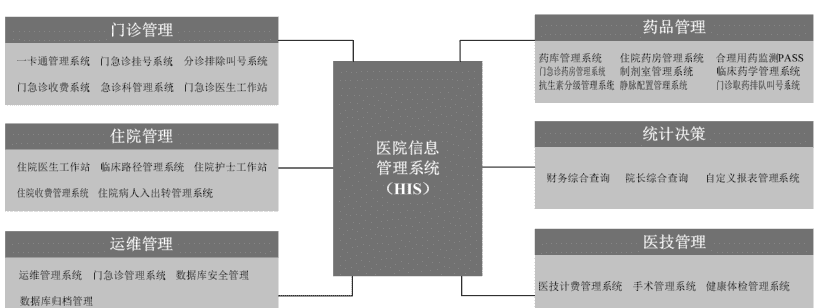

> **图示参考**：HIS 基础架构、LIMS 基础架构

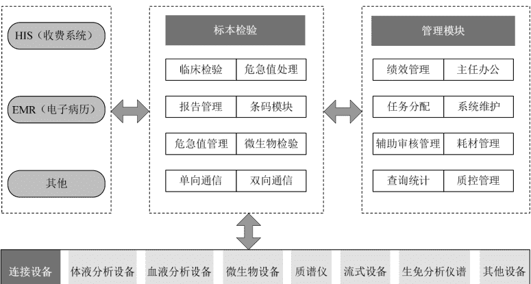

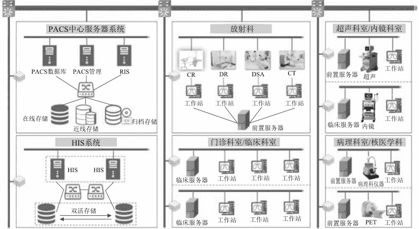

> **图示参考**：PACS 基础架构、门诊医生工作站平台

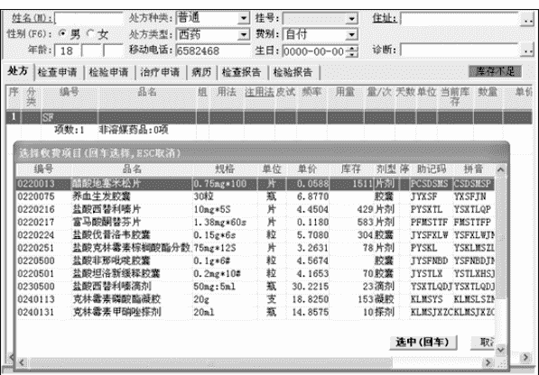

> *注：RIS(放射科系统)、CR/DR/DSA/CT 等影像设备均为 PACS 数据源*

**(2) 提升应用：技术溢出的临床价值**
- **远程探视**：隔离交叉感染，加速康复。
- **远程会诊**：优质资源跨域共享，打破地理壁垒。
- **生命体征监测预警**：重症护理降本增效，守住生命底线。
- **临床决策支持 (CDSS)**：深度研判病历，护航精准诊疗。
- **智慧处方系统**：过敏史/用药史/批次全溯源，慢病管理有据可依。

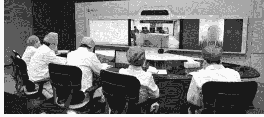

> **图示参考**：远程会诊场景


> **图示参考**：生命体征监测预警场景

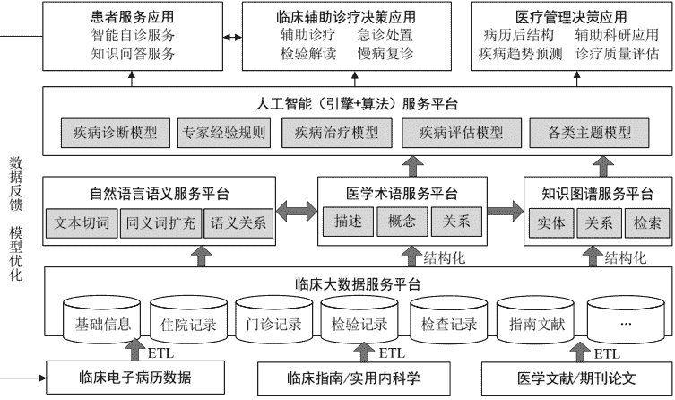

> **图示参考**：临床决策系统架构

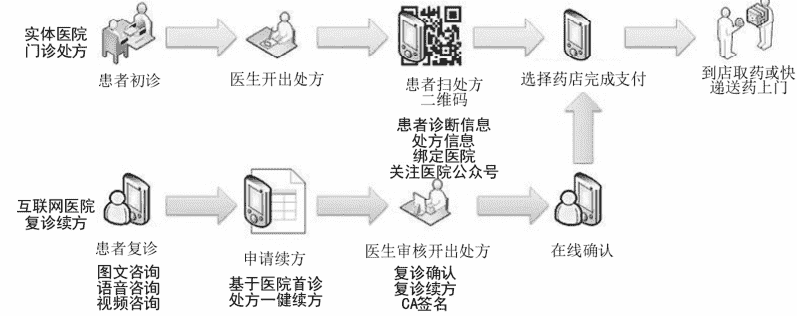

> **图示参考**：智慧处方系统架构

**二、区域卫生系统：织密区域健康网**
- **区域卫生平台**：汇聚社区、医院、科研、监管全域数据；建立电子健康档案（EHR），精准评估风险、干预因素、控费防病。
- **公共卫生体系**：卫生监管 + 疫情发布控制双轮驱动。
- **典型落地**：社区医疗服务系统、科研管理系统、卫生监督管理系统。

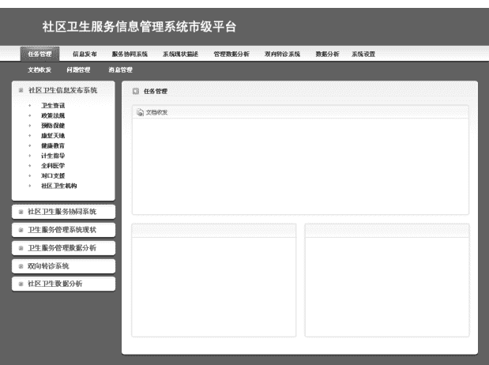

> **图示参考**：社区医疗服务系统

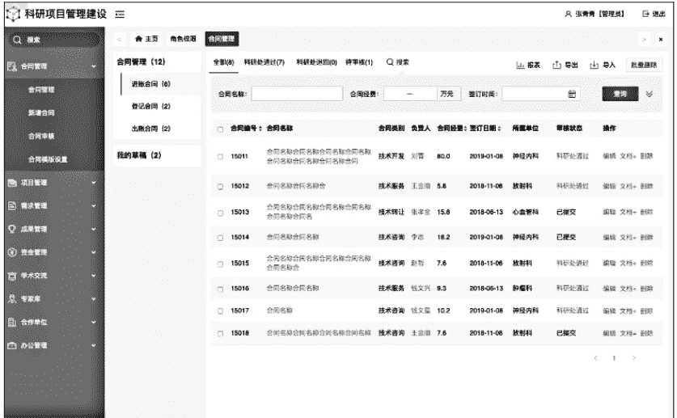

> **图示参考**：科研管理系统

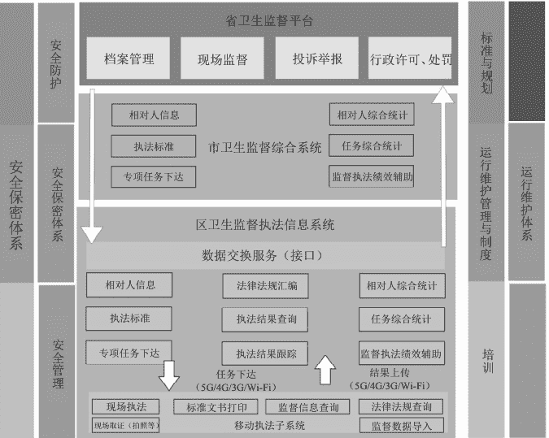

> **图示参考**：卫生监督管理系统架构

**三、家庭健康系统：贴心的“居家医生”**
- **视讯医疗**：破解行动不便就医难。
- **远程照护/健康监测**：慢病、老幼、特殊人群全周期守护。
- **智能服药系统**：用药提醒、禁忌预警、余量感知，依从性零负担。


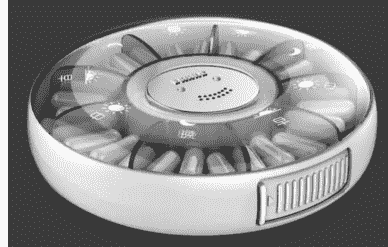

> **图示参考**：远程照护与健康监测、智能服药系统

#### 1.2.2 解码智能出行：重塑城市脉动
**智能出行（智能交通/ITS）** 是智慧城市核心引擎。融合移动互联、云计算、大数据、AI、物联网，实现“线上资源优配、线下高效运行”新业态；借卫星定位、GIS、高性能计算，实时感知路网、精准推送路况；集成驾驶行为分析，输出多模动态导航，赋能管理决策，推动城市降本增效。

**智能交通系统（ITS）三大核心子系统：**

**1. 先进交通信息服务系统 (ATIS)—— 面向出行者**
- **数据源**：路侧/车载/枢纽/停车场/气象传感器矩阵。
- **中枢**：交通信息中心实时清洗融合。
- **服务**：路况、公交、换乘、气象、停车、关联出行资讯全推送。
- **进阶**：车载导航自动规避拥堵、动态优化路径。

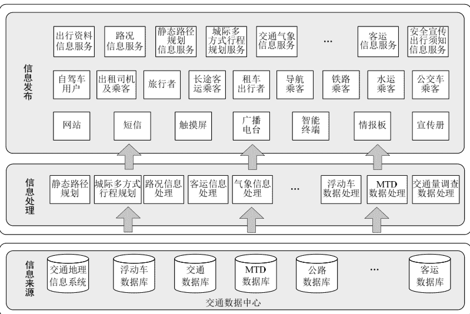

> **图示参考**：ATIS 架构示意（含双雷达微波检测器 MTD）

**2. 先进交通管理系统 (ATMS)—— 面向管理者**
- **职能**：路-车-人三元通信联络；实时监测路况、事故、气象、环境。
- **手段**：信号控制、诱导发布、管制分流、事故处突、应急救援。
- **内核**：先进检测技术 + 计算机信息处理 = 科学决策大脑。

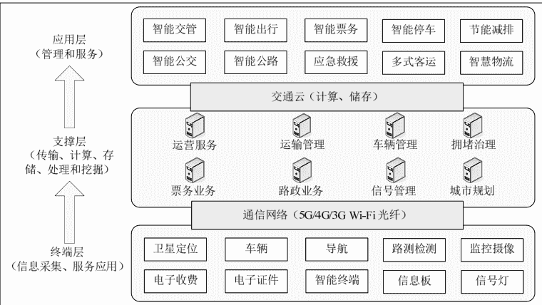

> **图示参考**：ATMS 架构示意

**3. 先进公共交通系统 (APTS)—— 面向公共运输**
- **目标**：安全、便捷、经济、大运量。
- **场景**：
  - 终端侧：PC/电视/站台屏，多渠道咨询与实时到站。
  - 中心侧：依车辆实时状态动态调度发收车，效能与服务双提升。

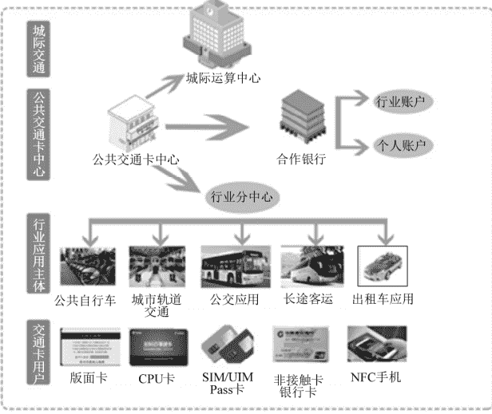

> **图示参考**：APTS 架构示意

> **全球视野**：日本 ITS 最成熟完备，欧美普及度高；中国北上广等一线城市建设提速，北京“四大系统”、广州“三大平台”已成规模，应用版图加速展开。

### 智能交通核心子系统：四大关键支撑体系

**先进车辆控制系统（AVCS）**，详见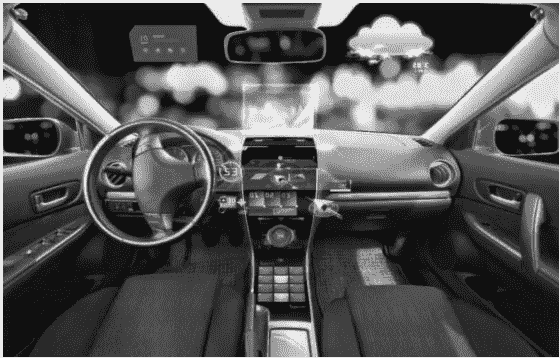。该体系融合了协助驾驶员操控的多元技术矩阵，囊括驾驶预警、辅助操作及避障自驾等功能，旨在护航车辆行驶的安全与高效。


### 图 1-17 AVCS 示例

**货运管理系统（FMS）**，架构参考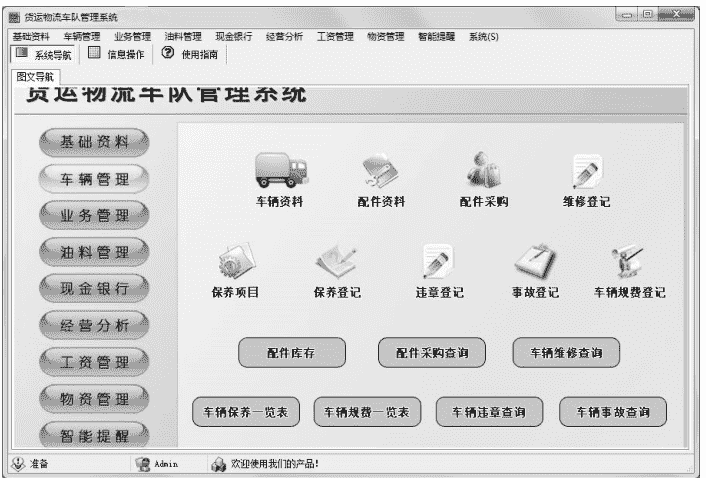。FMS 立足高速公路网络与信息管理平台，引入物流理论实现智能化管控。它深度融合卫星定位、GIS、物流信息及网络通信技术，能有效调度运力，显著提升货运周转效能。


### 图 1-18 FMS 架构示例

**电子收费系统（ETCS）**，结构见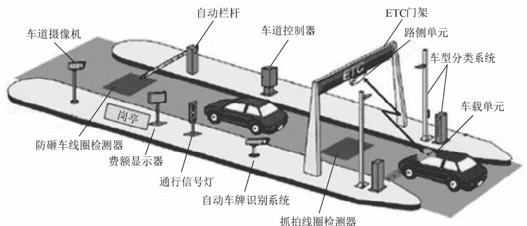。作为当前路桥收费的主流范式，ETCS 依托车载电子标签（OBU）与收费站微波天线的专用短程通信，结合互联网与物联网技术完成银行后台结算，实现车辆“无感”缴费、不停车通行。部署该体系可使车道通行能力跃升 3 至 5 倍。


### 图 1-19 ETCS 结构示例

**紧急救援系统（EMS）**，示意图见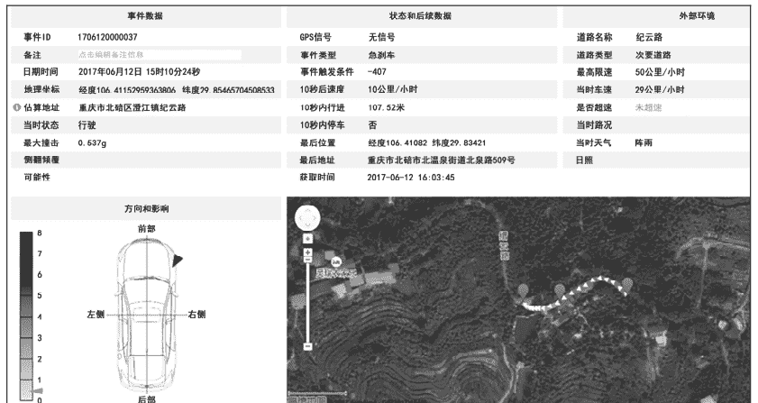。EMS 以 ATIS、ATMS 及专业救援机构为基石，将交通监控中枢与救援力量有机链接，为道路使用者提供故障应急处置、拖车救援、现场医疗及事故车辆清理等全链路服务。


### 图 1-20 EMS 示例

---

## 数字地图全景：四大数据层级构建沉浸体验

电子地图，即**数字地图**，是利用计算机技术以数字化形式存储、检索的地图产品。主流互联网地图产品涵盖百度、高德、搜搜、图吧、天地图等品牌。其数据体系主要由**地理底图、卫星影像、三维模型、街景实景**四大板块构成。

### 地理底图：导航与查询的基石

作为电子地图的核心层，地理底图可视为传统纸质地图的数字化升级版。除基础显示外，它支撑缩放、地址检索、路径规划等核心交互。日常的位置查询、导航规划均依赖此层，主要包含路网、POI（兴趣点）、行政区划、水系、绿地、居住区等要素。

在商业应用中，**路网数据**支撑导航算法，**POI 数据**驱动地址搜索，二者是核心看点。路网采集常通过实车搭载摄像头与北斗/GPS 记录实景（限速牌、路牌等）并后期编辑，或利用卫星遥感矢量化；POI 采集多依靠实地走访与众包模式；行政区划、河流等则多用遥感解译以控制成本。

**路况信息**作为实时交通图层叠加于底图之上，来源有三：
1.  **浮动车数据**：出租车、物流车等搭载北斗/GPS 终端，实时上传时空轨迹至中心平台汇总生成。
2.  **路侧传感器**：实时统计通过车次换算流量。
3.  **UGC 众包数据**：手机地图用户实时反馈，属用户生成内容（UGC），是未来交通感知的主流趋势。

此外，**ETA（预计到达时间）预测**依赖历史大数据训练 AI 模型，再经海量用户实测数据反向校验修正，持续迭代提升精度。

### 卫星影像：弥补矢量盲区的真实视角

**1. 正射影像（DOM）**，见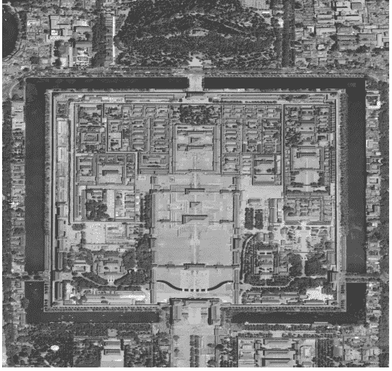。可理解为卫星垂直俯拍的地面正射照片。因矢量底图经抽象处理空间不连续，DOM 能完整呈现地形地貌，有效修正矢量数据的空间误差。


### 图 1-21 正射影像数据示例

**2. 鸟瞰数据**，见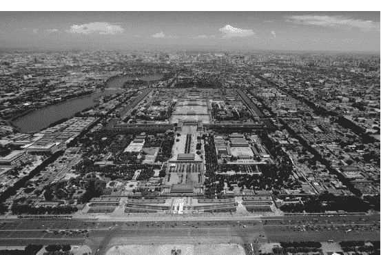。本质为旋转视角的正射影像，通过倾斜角度营造类三维立体视觉效果。


### 图 1-22 鸟瞰数据示例

### 三维演进：从 2.5D 迈向真三维

**1. 假三维（2.5D）**，见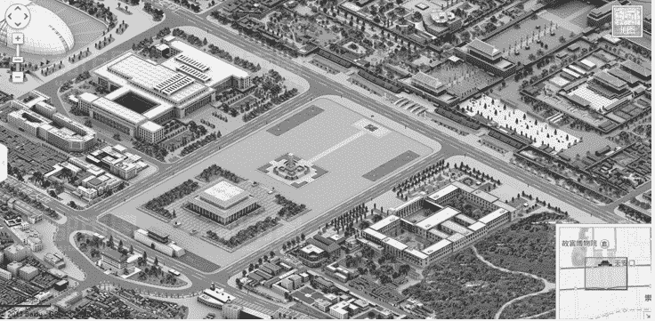。具备立体视觉但仅支持平面平移、不支持旋转，属于过渡形态。在真三维生产更新周期长的当下，它能更直观还原现实，百度地图已应用。


### 图 1-23 假三维数据示例

**2. 二维拔高（2.5D 挤压模型）**，见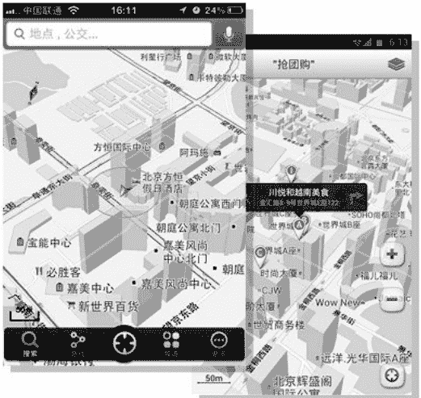。在平面要素赋予高度属性（如楼层数），渲染时实时拉伸为立方体并贴纹理。高德、百度移动端均已支持。


### 图 1-24 二维拔高数据示例

**3. 真三维数据**：目前互联网商用地图尚未大规模落地。

### 街景漫游：身临其境的实地视角

**1. 360° 全景实景**，见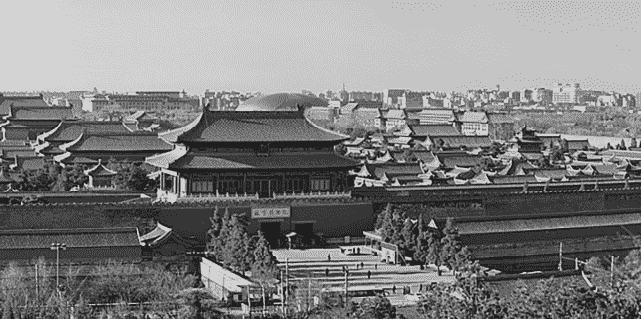。指定点位旋转拍摄拼接，用户可环视周边环境。百度地图已提供该能力。


### 图 1-25 360° 实景数据示例

**2. 街景漫游**，见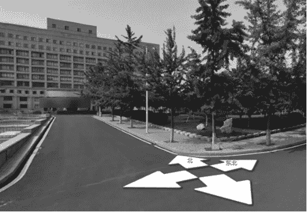。为全景实景的进阶形态，沿道路连续拍摄拼接，支持用户在路网上“虚拟行走”，身临其境查看目标地实景。


### 图 1-26 街景数据示例

---

## 智能制造深度解析：技术矩阵与系统架构

**制造业**是将物料、能源、设备等资源按市场需求转化为工业品与消费品的产业，直接折射国家生产力水平，是区分发达与发展中经济体的关键分水岭。

**智能制造**源于 AI 研究，构建“智能机器+人类专家”的人机一体化系统。它能在制造全过程中执行分析、推理、判断、决策等智能活动。随着产品结构复杂化、功能多元化，设计工艺信息量爆发，生产线信息流激增，倒逼制造技术前沿转向**海量复杂信息的高效处理能力**。先进设备离不开信息输入，柔性制造系统（FMS）一旦断信即停。制造系统正由“能量驱动”转向**“信息驱动”**，不仅要求柔性，更要求智能，以应对爆炸性信息负载。同时，多变市场与激烈竞争要求系统更灵活、敏捷、智能，智能制造地位日益凸显。

广义智能制造包含**智能制造技术**与**智能制造系统**两大维度。

### 一、 关键技术矩阵：感知、定位、融合、安全与协同

当前核心技术矩阵聚焦五大领域：

#### （1）识别技术：工业视觉与射频的双重保障
核心手段包括：
- **射频识别（RFID）**，见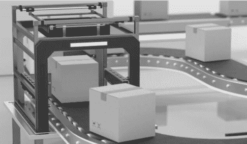：非接触式自动识别。
- **深度三维图像识别**，见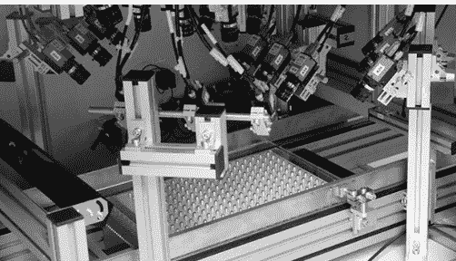：精准获取物料形状、位姿等加工参数，是智能制造感知的关键。
- **物体缺陷自动识别**，见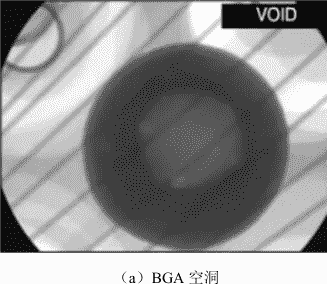-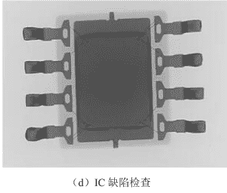：如 BGA（球栅阵列封装）、PCB（印刷电路板）、IC（集成电路）等精密组件的瑕疵自动检测。


### 图 1-27 射频识别示例


### 图 1-28 基于深度三维图像识别示例


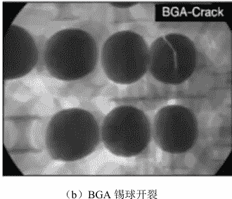
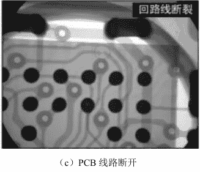


BGA: 球栅阵列封装; PCB: 印刷电路板; IC: 集成电路。

### 图 1-29 物体缺陷自动识别示例

#### （2）实时定位系统（RTLS）：全域资产可视化
按技术路线分三类，见-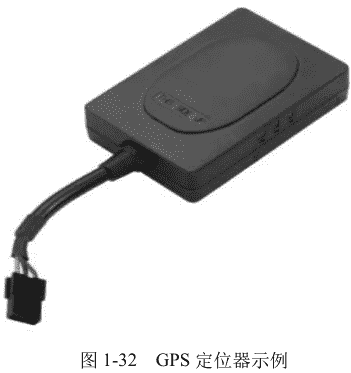：
- **基于 RFID 电子标签**：适合近距离资产盘点。
- **基于超宽带（UWB）定位基站**：亚米级高精度，适合人员/设备精准追踪。
- **基于 GPS 定位器**：适用于室外大范围物流跟踪。
功能覆盖园区资产、人员、物流的查找、记录、监测、控制与调试。


### 图 1-30 电子标签系统示例

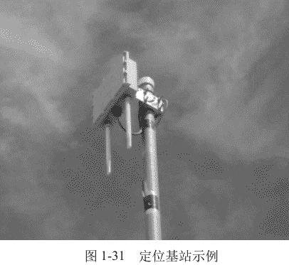

### 图 1-31 UWB 定位基站示例


### 图 1-32 GPS 定位器示例

#### （3）信息物理融合系统（CPPS）：虚实映射的新范式
又称“虚拟网络-实体物理”生产系统，架构见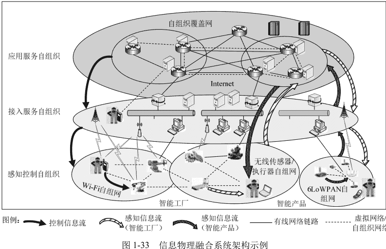。它重构传统制造逻辑：成熟 CPPS 中，每个工件所需服务独立计算；现有设施经数字化改造后，可构建全新生产体系架构。


### 图 1-33 信息物理融合系统架构示例

#### （4）网络安全技术：数字化转型的护城河
制造数字化依托工业互联网，网络普及带来攻击面扩大。成熟智能工厂安全体系需“四位一体”：
1.  **传统 IT 安全子系统**：应对通用信息安全风险。
2.  **工控网络安全子系统**：防护 OT 层专用协议与设备漏洞。
3.  **物联网安全子系统**：管控海量终端接入与数据合规。
4.  **全域安全监管中心**：统一态势感知、策略下发与应急响应。

#### （5）系统协同技术：打破烟囱的效能倍增器
通过大型工程自动化方案规划，使工厂内各异构信息管理系统（ERP、MES、PLM 等）协同运作，实现整体效益最大化。

---

### 二、 智能制造系统：构建企业的“数字孪生大脑”

智能制造系统深度融合互联网、云计算、大数据、AI 与生产管理，模拟专家智能替代延伸人脑力，重塑生产模式，提供工厂可视化与远程运维方案。

其核心特质包含四大维度：
1.  **自组织性**：生产结构随外部扰动自演化，向结构化、多功能化发展，系统功能随环境自适应调整，实现“超柔性”生产，快速响应个性化需求。
2.  **自律性**：主动感知环境与自我状态，自主分析、判断、规划行为。未来将具备更强独立性、主动性与个性化，主动参与跨系统协作。
3.  **虚实融合性**：以数据化手段全流程仿真制造，让生产过程可视、可感、可干预。基于 VR/AR 的新一代展示形态已成标志性特征。
4.  **人机一体化**：引入脑机接口等前沿交互，深度融合人机优势，进一步提升制造“柔性”上限。

**通俗理解**：企业在实现数控机床、工业机器人**自动化**基座上，再构建一套精密的智能**“神经系统”**，架构示意见下表。

| 系统/组件 | 角色隐喻 | 核心职能 |
| :--- | :--- | :--- |
| **ERP 系统** | **大脑** (中枢) | 统筹计划、调配资源、决策支持 |
| **MES** | **脊髓** (中枢) | 连接上下游，掌控生产全过程执行与可视化 |
| **PLC** | **神经突触** | 采集转发信息，直接驱动设备与产线 |
| **现场总线/工业以太网** | **神经纤维** | 数据指令高速传输通道，运行基石 |
| **传感器/RFID/条码** | **神经元** | 感知环境、物流、在制品状态的末梢触角 |

*ERP: 企业资源计划; MES: 制造执行系统; PLC: 可编程逻辑控制器。*

### 图 1-34 智能制造“神经系统”基本架构示例

#### （1）中枢双核：ERP 与 MES 的协同进化

**ERP（企业资源计划）**：企业最高层管理中枢，强调事前控制，核心在于存量资源的优化配置与决策支撑，架构见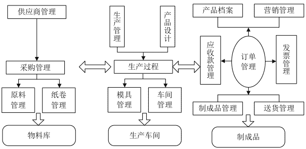。


### 图 1-35 ERP 系统架构示例

**MES（制造执行系统）**：车间层执行中枢，专攻生产调度与管控，破解生产“黑箱”，实现过程可视可控，架构见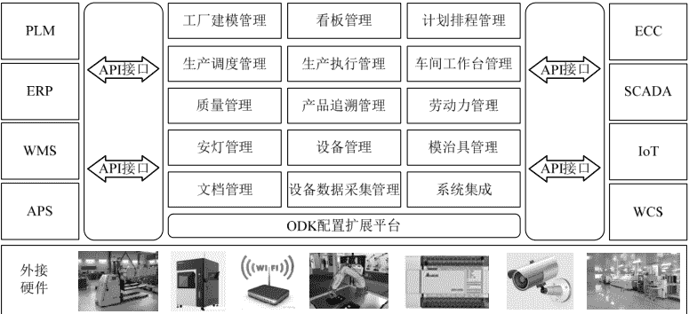。

**打通 ERP 与 MES 数据流，是生产数字化的基石。** 两者虽处核心但各有短板：ERP 管宏观不见微观瓶颈与质量；MES 管执行不触财务销售。构建健康“神经系统”，必须融合双核，形成**计划-控制-反馈-调整**闭环。通过标准化接口实现计划下达、指令分发、实绩回传，让数据在 ERP、MES、过程控制、自动化层间透明、及时、顺畅流动，推动全流程数字化落地。


PLM: 产品生命周期管理; WMS: 仓库管理系统; APS: 高级计划与排程; ECC: 企业控制中心; SCADA: 数据采集与监视控制; IoT: 物联网; WCS: 仓库控制系统。

### 图 1-36 MES 系统架构示例

#### （2）神经突触：PLC 与边缘控制层

# 核心控制单元：工控机与 PLC 的“双子星”架构

工业控制计算机（见图 1-37）与可编程逻辑控制器（PLC，见图 1-38）虽形态各异，却同源于同一核心架构：中央处理器（CPU）、存储单元、输入/输出（I/O）模块、外设接口、通信端口及电源模块。两者均支持按需扩展编程器、打印机等外设，内置逻辑控制与编程功能，足以胜任各类机电装备的驾驭重任。

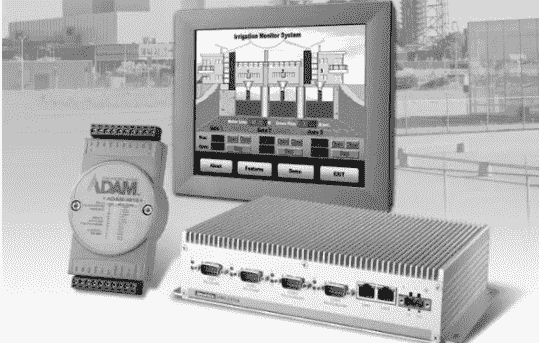

### 图 1-37 工业控制计算机示例

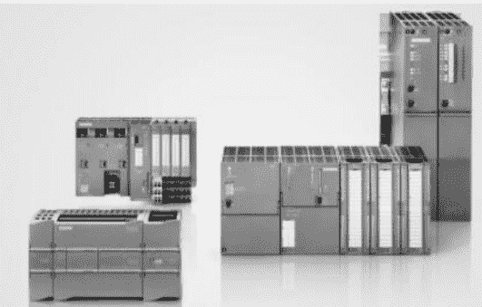

### 图 1-38 PLC 示例

PLC 凭借体积小巧、可靠性高、编程上手快、组态灵活、安装便捷、运行速度快等“六大金刚”优势，早已超越单纯控制器的角色。它化身为生产线的“数据中枢”与“指令枢纽”，宛如神经系统中的**突触**：一端敏锐捕捉现场设备状态，实时回传给上位监控系统（SCADA 或 DCS）；另一端精准接收上层指令，直接驱动现场执行机构动作。

## (3) 感知前哨：智能制造的“神经元”

在智能制造的“神经系统”隐喻中，直接接触物料、在制品、设备本体及现场环境的**传感器**（见图 1-39）、**RFID 标签**与**条码**组件，共同扮演“神经元”角色。

传感器赋予了系统“五感”：能感知被测信息，并将其转化为电信号或其他规格数据输出。RFID 标签则凭借读取迅捷、支持批量群读、实时通讯、可重复使用及数据动态更新等特性，完美契合智能制造刚需。借助 RFID 技术，企业将贴标的物料、刀具、在制品、成品尽纳监管视野，有效遏制缺料短缺，实现物流信息的秒级精准获取。

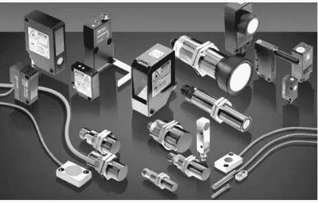

### 图 1-39 传感器示例

## (4) 数据血管：织就“神经纤维”网络

面对研发、计划、生产、工艺、物流、仓储、检测等全链路爆发的海量数据，唯有综合部署现场总线、工业以太网等多元工业通信网络，构筑起健全的“神经纤维”网络，方能保障数据在系统内畅通无阻。工业通信网络大别为**有线**与**无线**两大阵营。

**有线通信**涵盖现场总线、工业以太网、工业光纤网及时间敏感网络（TSN）等。当前现场设备数据采集主力仍是有线网络，以其稳定可靠的实时性，满足生产过程监控的苛刻门槛。

**无线通信**正加速渗透工业采集领域，成为有力补充。技术谱系包括：
*   **短距通信**（RFID、ZigBee、Wi-Fi 等）：服务于车间/厂内传感器读数、资产管理、AGV 联网。
*   **专用工业无线**（WIA-PA、WirelessHART 等）及**蜂窝无线**（4G/5G）：覆盖厂外智能产品、大型远距移动装备、手持终端联网需求。

## (5) 执行躯干：数控机床与工业机器人

智能制造装备是系统的“躯干四肢”，集感知、分析、推理、决策、控制于一体，是先进制造、信息技术与智能技术深度融合的结晶。当前两大核心支柱为**数控机床**与**工业机器人**。

**数控机床**（见图 1-40）本质是搭载程序控制系统的自动化母机。其控制系统能逻辑处理编码指令，经解码输入数控装置，再由运算处理转化为控制信号，驱动机床按图纸精准成型。它完美破解复杂、精密、小批、多品种零件加工难题。

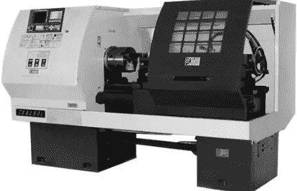

### 图 1-40 数控机床

**工业机器人**（见图 1-41）深耕汽车、电子等制造主战场，按功能细分为点焊、弧焊、搬运/码垛、装配等多元谱系，以高效、精准、持久作业特质，高质量完成焊接、涂装、组装、物流、包装、检测等全工序任务。

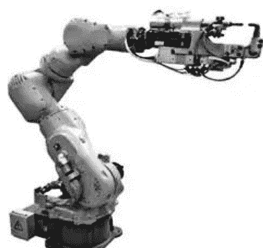

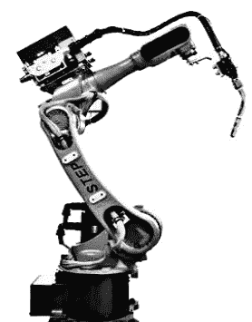

(a) 点焊机器人

(b) 弧焊机器人

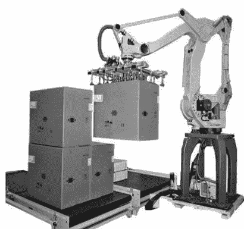

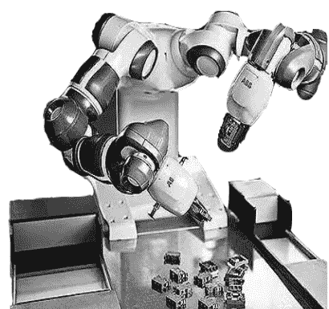

(c) 搬运/码垛机器人

(d) 装配机器人

### 图 1-41 工业机器人示例

---

#### 1.2.4 沉浸体验：AI 赋能智慧农业新范式

农业涵盖种植、林业、畜牧、渔业、副业五大形态，狭义上指代种植业。**智慧农业**以现代科技重塑种植流程，实现无人化、自动化、智能化管控，是农业进化的高阶形态。它直击劳动力成本高企、管理粗放等痛点，以作物生长关键指标为导航，输出标准化农事日历；借助数字基建、智能装备、农业物联网与 AI 技术，精准匹配生长需求，系统优化规划与执行，在效率、产量、品质与利润间寻得最优解。

### 1. 智慧农业的“三驾马车”关键技术

当前核心技术矩阵聚焦三大维度：基于物联网的**感知技术**、基于大数据/云平台的**分析技术**、基于人工智能的**决策技术**。

#### (1) 物联网感知：精细化生产的“千里眼”

感知技术夯实精细化、自动化生产基石，数据精度直接关乎管理决策质量。通过部署无线传感器（见图 1-42）实时采集土壤成分、温湿度、风速风向、光照、CO₂ 浓度等环境参数，配合视频监控捕捉作物长势，经数字化转换汇总后，借传输网络（见图 1-43）即时上传智能管理平台，落实墒情、虫情、苗情、灾情“四情”全维管控。

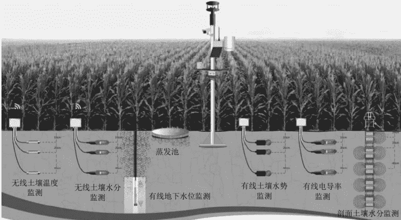

### 图 1-42 无线传感器示例

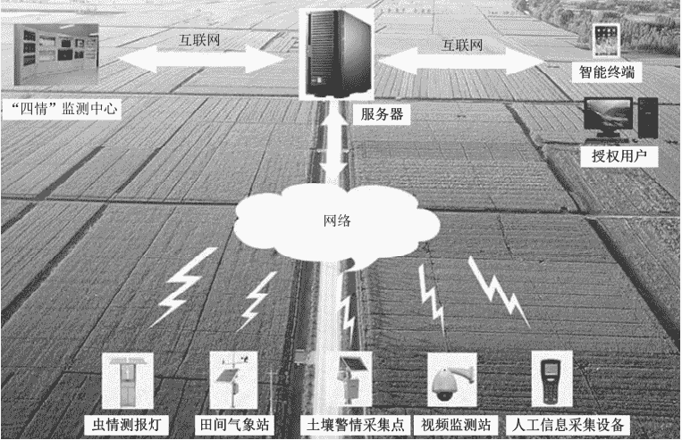

### 图 1-43 无线物联网示例

#### (2) 大数据云平台：驱动生产的“最强大脑”

大数据与云平台分析技术是智慧农业的核心驱动力。其在开放系统中完成数据采集、甄别、标识、入库，再借参数、模型、算法对海量数据组合优化，为生产操作与经营决策赋能。主战场覆盖四大维度：
1.  **环境资源解析**：土地、水利、气象、生物、灾害数据。
2.  **生产过程解析**：种植与养殖全链路数据。
3.  **市场行情解析**：供求、价格、生产资料、流通、国际市场动态。
4.  **宏观管理解析**：国民经济、贸易、国际农产品动态、突发事件等。

实战中，如大田作物管理，通过挖掘海量基因信息流，可高效锁定品种适宜区与抗性表现（见图 1-44、1-45）。

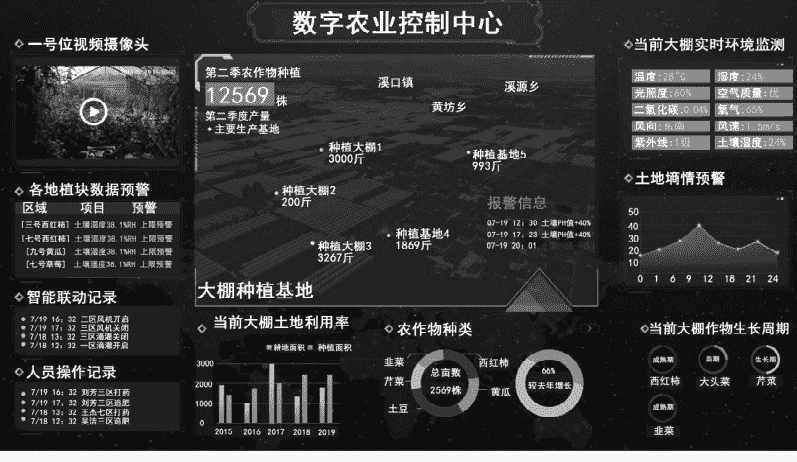

### 图 1-44 基于大数据分析的大田作物种植管理示例

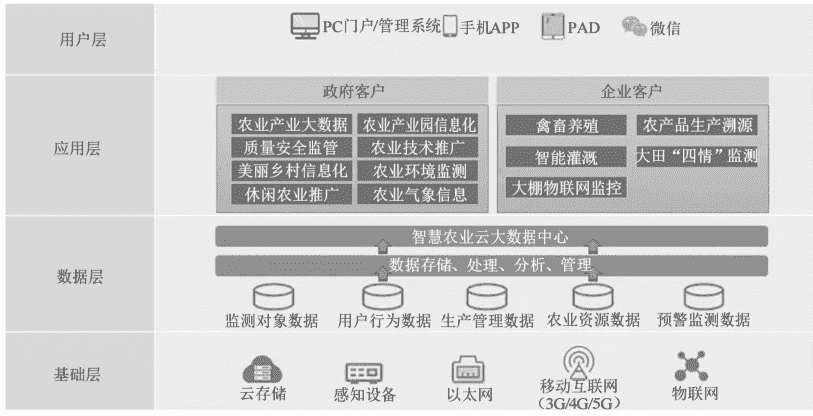

### 图 1-45 农业云平台基本构架示例

#### (3) AI 决策：未来发展的“定海神针”

AI 决策技术是智慧农业的兜底保障与核心进化方向。聚焦种子检测、智能种植、生长管理、土壤灌溉、规划供应链五大场景：

*   **种子检测**（见图 1-46）：种子纯度与安全性直系产量品质。引入图像分析、神经网络等无损检测手段，精准评估种子质量，为增产增质护航。
*   **智能种植**（见图 1-47）：全流程引入智能农机，大幅剥离对人力依赖，推种植迈入智能化自动化新纪元。
*   **生长管理**（见图 1-48）：融合实时与历史数据对比，驱动机器学习/深度学习构建预测模型与管理方案，科学指导防治与生长调控。
*   **土壤灌溉**（见图 1-49）：神经网络结合气候水文数据优选灌溉策略；传感器实时监墒情，配合周期/自动灌溉模式，双赢水效与作物生长环境。
*   **规划与供应链**（见图 1-50）：AI 构建风控模型，科学定产能、定价格、压缩响应周期、降预测偏差、提交付可靠度、增库存周转，全链路降本增效，锻造竞争优势。

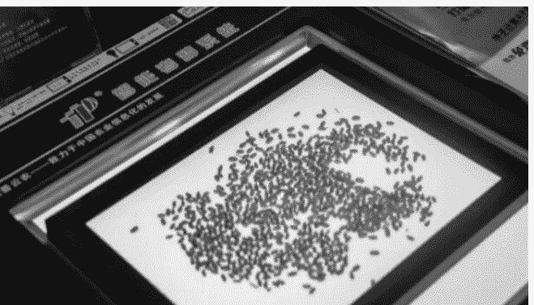

### 图 1-46 种子检测示例

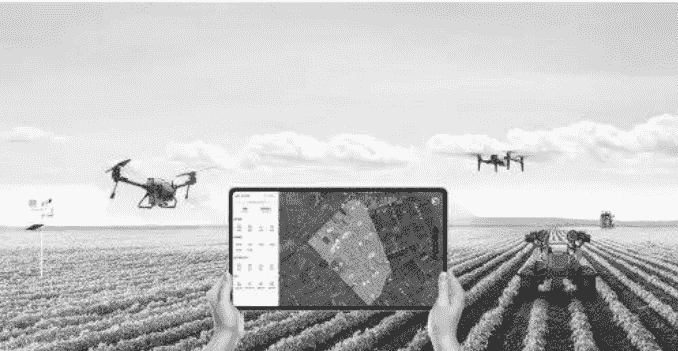

### 图 1-47 智能种植示例

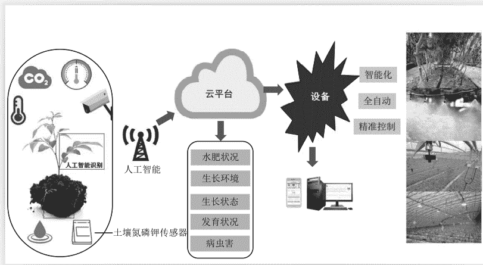

### 图 1-48 作物生长管理系统示例


### 图 1-49 土壤灌溉系统示例


### 图 1-50 农业生产规划与供应链管理系统示例

## 2. 数字农业基建：筑牢“数字底座”

### (1) 农林道路数字化：全生命周期管养新机制

目标直指建设、投用、管养、考核全过程（见图 1-51），核心模块六大件：
1.  **视频采集系统**：前端集采集与处理于一体，实现车辆计数、测速、识牌。
2.  **交通地理信息云平台**：多源异构数据融合互通，成就区域交通“一张图”。
3.  **全网监控管理系统**：全景掌握前端运行态，快速发现排除隐患。
4.  **多数据融合分析系统**：标准化清洗前端数据，自动化挖掘高价值信息推送。
5.  **农村业务子系统**：含智慧农路综合管理、运维支撑平台，最终汇聚交通综合信息平台。
6.  **风光供电系统**：为远离电网、低负荷设备提供稳定绿色能源。


### 图 1-51 农林道路数字化建设示例

### (2) 农田水利数字化：构建水利工程“数字孪生”

同样覆盖全生命周期（见图 1-52），双核驱动：
1.  **数字地图底座**：摸排水库、山塘、骨干渠、田间渠，完成数字化标注勘误。
2.  **“智慧水利”平台**：聚合基础与运行数据，通过入库、上图、视频可控、现场监管四维发力，实现运维全过程数字化闭环。


### 图 1-52 农田水利数字化建设示例

### (3) 农业服务中心数字化：技术推广与监管“双轮驱动”

中心职能聚焦法规宣传与技术推广（见图 1-53），建设双平台：
1.  **农产品市场信息管理平台**：支撑生产数字化，建溯源机制，推产销一体化全链管控。
2.  **数字农业科技创新推广应用平台**：覆盖种植技术推广、环境治理、植保检疫、质量监管、投资品（土壤/农药/肥料）管理，延伸至农民教育与科技培训。


### 图 1-53 农业服务中心数字化建设示例

## 3. 智能农业装备：田间地头的“钢铁先锋”

### (1) 农业无人机：低空视角的“数据猎手”

农业无人机（见图 1-54）搭载卫星导航自动巡航系统与标准相机，航线规划极致覆盖，姿态控制精准成像，为后期图像处理铺路。三大赋能维度：
1.  **宏观巡查**：空中俯瞰速查灌溉异常与土壤问题。
2.  **多光谱透视**：可见光+红外双模成像，揭示肉眼不可见的作物健康隐患。
3.  **时序动态监测**：卫星定位累积影像，还原生长全过程，赋能科学管控。


### 图 1-54 农业无人机示例

### (2) 无人驾驶拖拉机：破解土壤压实的“轻量级选手”

无人拖拉机（见图 1-55）面向低速耕作，融合计算机视觉、激光雷达、卫星导航，自主规避人畜障碍，精准执行任务。其“小身板”蕴含大智慧：轻量化设计打破“重机压土→深耕→更重机→更深压实”的恶性循环，实测可提升产量约 10%，兼顾节油减肥。


### 图 1-55 无人驾驶拖拉机示例

### (3) 农业机器人：具身智能的“新农人”

农业机器人（见图 1-56）是现代农机进化与机器人/自动化技术融合的产物，具备环境感知与自适应能力的多功能特种机器人。其问世重塑传统劳作模式，成为现代农业跃迁的关键引擎。


### 图 1-56 农业机器人示例

---

#### 1.2.5 沉浸体验：AI 重塑智慧商业新生态

商业本质是基于价值认同的货币等价交换，金融业与之紧密共生。**智慧商业**借力互联网、物联网、大数据、AI、区块链，实现商业信息的采集、挖掘、分析全链路智能化，驱动决策科学化、流程合理化、活动高效化，终极指向销售业绩跃升与综合竞争力强化。

商业活动四大基本环节：收购（获取产品）、调运（跨区位移）、储存（时空桥梁）、销售（权转移与变现）。参与方涵盖生产者、经营者、消费者及以银行为核心的金融服务商。服务现代商业的关键技术矩阵，锚定**商品识别智能化、流通可视化、购物场景化、支付便捷化**四大目标。

### 1. 商品识别：数字化身份的“入场券”

条码与射频技术（RFID）广泛应用于标签制作，为识别智能化奠基。**商品标签**区别于包装装潢（后者重美化宣传），专注承载分类、等级、产地、成分、价格等核心身份信息。

*   **(1) 一维条码**

# 商品标识与智慧商业技术解析

## 一、 商品身份证：条码、二维码与电子标签

### 1. 一维条码：商品流通的“通用语言”
一维条码，俗称条形码，本质上是按特定编码规则排列的、宽度各异的黑白条纹组合，用于承载一组信息的图形标识。它能标注商品的产地、厂家、名称、生产日期等核心要素，因此在生产、流通、销售全链路中应用极广。

主流的商品条码多采用 **EAN（欧洲商品编码）标准**。以标准版（EAN-13）为例，其由13位数字构成，逻辑上划分为四段：
- **前缀码（第1-3位）**：标识国家/地区，如690-699代表中国，由国际组织统一分配。
- **厂商识别码（第4-7位）**：标识生产企业，由国家编码机构分配。
- **商品项目码（第8-12位）**：具体区分商品规格、型号，由企业自行编制。
- **校验码（第13位）**：基于前12位算出，用于验证扫描读取的准确性。


### 图 1-57 EAN 条形码结构示意

### 2. 二维条码：信息容量的“跃迁”
二维条码（二维码）是在一维码基础上扩展而来，利用平面几何图形按一定规律记录数据。扫描设备通过识别其横纵维度的二进制逻辑来还原信息。相较于一维码仅能记录数字/字母，二维码可承载网址、图片、文本等复杂数据。

当前最通用的标准是 **QR Code（快速响应码）**，可将其理解为在水平与垂直二维空间分布的存储载体。


### 图 1-58 QR 二维码示例

### 3. 电子标签（RFID）：会“思考”的智能标签
电子标签又称射频标签（RFID Tag）。外观虽可印刷条码，但内部/背面嵌入印制电路与天线，依托 **RFID（射频识别）技术** 实现数据的**非接触式读写**。这是其与传统条码标签的本质区别：条码仅支持“只读”，且无电路结构；电子标签则支持“读写”，且具备穿透性、批量识别、抗污染等优势。


### 图 1-59 电子标签实物示例

### 4. 识别终端：连接物理与数字的“眼睛”
无论是光学扫描条码，还是射频读取RFID，均需依赖专用识别设备（扫描枪、固定式读码器、手持PDA等）完成数据采集与上传。


### 图 1-60 商品标签识别仪器示例

---

## 二、 商品流通可视化：智慧物流的核心价值

**商品流通**是商品从生产领域经购销活动转移至消费领域的过程，是商品价值实现的关键环节。**流通可视化**则指利用技术手段实现对这一过程的实时跟踪与监管。

**智慧物流系统**是实现可视化的核心引擎。它融合智能交通系统（ITS）与商品信息管理系统，以电商模式运作，集成物联网、大数据、云计算等新一代信息技术。其核心能力包括：
- **全链路数据采集**：实时获取商品在仓储、运输、配送等环节的位置、温湿度、震动等状态数据。
- **智能决策支持**：为物流商与客户提供可视化看板、异常预警、路径优化等咨询服务。
- **目标导向**：追求物流环节的精细化、动态化、可视化管理，最终提升运作效率与智能化决策水平。其服务价值远超单纯的“轨迹查询”。

> **概念辨析**：**GTS（GPS Tracking System，GPS追踪系统）**，可简化理解为基于订单单号的轨迹跟踪子系统。


### 图 1-61 基于智慧物流系统的商品流通可视化架构示意

---

## 三、 网上购物进化：从“图文展示”到“沉浸体验”

网上购物的标准流程为：信息检索 → 电子下单 → 网络支付 → 物流履约。

**虚拟现实（VR）技术**的引入，正重塑这一体验。它融合了线下实体购物的“真实感”与线上购物的“便捷性”，构建三维虚拟消费场景。用户佩戴交互设备“进入”虚拟卖场，可360°查看商品细节、模拟试穿/试用、甚至与智能导购实时语音交互，极大提升了决策确定性与消费愉悦度。


### 图 1-62 基于VR技术的沉浸式购物场景示例

**VR技术支撑体系**：
- **核心技术栈**：三维图形生成、多传感器融合交互、高分辨率近眼显示。
- **硬件形态**：需专用头显（HMD）、手柄/手套等交互外设，亦称“图形工作站”。
- **核心功能**：实时渲染高保真虚拟环境，响应用户六自由度（6DoF）动作。

---

## 四、 支付方式革新：技术驱动下的“隐形化”与“智能化”

支付便捷化演进呈现“前端无感、后端智能”双轨并行特征：
- **付款端（C端）**：生物识别（指纹、声纹、人脸、掌静脉）替代密码，完成身份认证与指令确认。
- **收款端（B端/平台）**：大数据、云计算、AI、区块链深度嵌入业务场景，实现风控、营销、清算的智能化闭环。

### 1. 移动支付：普惠金融的“超级入口”
5G加持下，移动支付成基础金融服务首选渠道。以**云闪付、支付宝、微信支付**为代表的中国方案，正输出业务模式、技术标准、平台能力，推动中国移动支出生态“出海”全球化。

### 2. 云计算架构：支撑金融业务的“弹性底座”
**分布式云架构**凭借低时延、数据驻留合规、资源弹性扩容、故障自愈、灰度发布不停机等特性，完美适配“互联网+金融”高并发、强一致、高可用需求，助力企业实现资源配置最优与轻量化运营。


### 图 1-63 分布式云架构拓扑示例

### 3. 区块链：重构信任与清算的“新基建”
区块链以**去中心化账本、智能合约、共识机制**为核心，在支付清算、跨境汇款、数字票据落地：
- **降本增效**：链式存储优化磁盘利用率，清算系统吞吐量提升显著。
- **风险隔离**：有效对冲交易对手信用风险及系统性风险传导。
- **溯源透明**：全节点账本不可篡改，审计合规成本大幅降低。


### 图 1-64 传统支付 vs 区块链支付架构对比

### 4. 大数据驱动：从“流量思维”到“画像思维”
大数据与支付业务深度融合，形成**数据驱动引擎**，贯穿消费、营销、风控、征信全周期：

| 场景 | 核心逻辑 | 关键产出 |
| :--- | :--- | :--- |
| **消费洞察** | 多维标签（年龄、地域、偏好、能力）刻画**用户画像** | 立体用户档案，预测行为意愿基石 |
| **精准营销** | 全息画像（人口、征信、通信、兴趣、位置）+ 存量挖掘建模 | 目标客群圈选、营销策略支撑、商户赋能 |
| **智能风控** | 海量数据训练AI模型 | 全数据、自动化、高时效风控体系 |
| **智能征信** | 实名核验 + 消费信用分析 | 全地域、智能化信用评级体系 |

> **指标补充**：**ARPU（Average Revenue Per User）**，即每用户平均收入，衡量运营商/互联网企业单用户贡献价值的核心指标（单位：元/户·月或 年）。

 

### 图 1-65 用户画像标签体系示例 &nbsp;&nbsp;&nbsp;&nbsp; 图 1-66 基于大数据挖掘的精准营销模型架构

### 5. 人工智能：支付全流程的“智能大脑”
AI通过**生物识别（身份认证）、机器学习（欺诈检测/智能客服/额度审批）、NLP（语义理解）**等技术，实现：
- **便捷性**：免密/免带设备支付（如指纹支付）。
- **安全性**：毫秒级欺诈交易拦截。
- **运营效能**：智能分流、自动化运维。


### 图 1-67 指纹支付交互示例

### 6. 物联网支付：万物互联下的“感知变现”
IoT打通“支付行为”与“物理状态/运营数据”的动态关联：
- **无人零售**：扫码开门 → 商品感知（重力/视觉/射频） → 离场自动结算，重塑“货架即渠道”模式。
- **统一身份**：一户通行多平台，账户体系下沉至设备端。
- **生物特征主导**：多模态生物识别（指纹/虹膜/掌静脉/人脸/声纹）加速淘汰传统密码体系。


### 图 1-68 无人商店运作流程示例

---

## 五、 项目实战：AI重塑行业典型场景鉴赏

### 5.1 智慧医疗：从“经验医学”迈向“精准智医”

#### 案例一：语音电子病历 —— 解放医生双手，重构诊疗记录
**技术内核**：自然语言处理（NLP）+ 语音识别（ASR）+ 医学知识图谱。

**双端价值**：
- **医端（医生）**：
  - **交互革新**：问诊同步语音录入，定制医学麦克风拾音 → 语音转文本 → 结构化生成电子病历。
  - **效率跃升**：告别低头书写，缓解职业倦怠，问诊效率提升30%+。
  - **存档合规**：标准化电子档案便于长期检索、科研复用、质控核查。
- **患端（患者）**：
  - **消除障碍**：解决“医嘱难辨识、方言听不懂、纸质易丢失”痛点。
  - **体验提升**：结构化病历清晰易读，就医满意度显著改善。

**代表厂商图谱**：

| 企业 | 核心产品/方案 | 技术特色与落地场景 |
| :--- | :--- | :--- |
| **Amazon** | Alexa 语音助手 | 集成电子病历（EHR），提供医疗问答、急救指引、医患沟通辅助 |
| **Nuance** | Dragon Medical One | 统计推断+音素语境建模，临床语音导航与文档生成 |
| **Google** | 医疗ASR/深度学习模型 | 专注电子健康记录（EHR）语音转录准确率优化 |
| **科大讯飞** | 智慧医疗全栈方案 | **软硬结合多形态**；核心亮点：口腔/多科室语音病历（ASR+NLU→结构化自动生成） |
| **云知声** | 智能医疗语音录入系统 | 高性能识别引擎，规范录入流程，杜绝复制粘贴隐患，提升数据安全性 |

#### 案例二：AI影像诊断 —— 给医生装上“慧眼”
**痛点直击**：
1. **专家稀缺**：影像科医生缺口大，基层误诊率高（同病异影/异病同影）。
2. **定量盲区**：肉眼难捕捉微小病灶、定量指标（体积、密度、生长率）依赖主观经验。
3. **阅片疲劳**：海量影像数据（单次CT切片数百张）导致读片耗时长、漏诊风险高。

**AI赋能五大核心赛道**：

| 应用方向 | 临床价值 | 典型落地 |
| :--- | :--- | :--- |
| **1. 图像重建/增强** | 低剂量/欠采样条件下重建高质量图像 | **降低辐射伤害**，缩短扫描时间 |
| **2. 智能辅助诊断** | 结节检出、分类、良恶性评分、随访对比 | 肺结节、眼底病、脑卒中、心血管、骨折等全身系统覆盖 |
| **3. 智能靶区勾画** | 放疗前CT器官/肿瘤自动勾画 | **3-5小时 → 分钟级**；提升放疗精度，规避无效照射；已覆盖肺/乳/鼻咽/肝/前列腺/食管/皮肤癌 |
| **4. 病理切片智读** | 细胞级特征学习，辅助病理分级分型 | 宫颈癌、淋巴瘤、白血病等筛查；提效增准，弥补专家经验差 |
| **5. 扩展应用** | 脏器三维重建、超声甲状腺、骨龄评估、骨折细分 | 临床科室日常辅助工具集 |

**头部企业能力矩阵**：

| 企业 | 核心强项 | 代表产品/认证场景 |
| :--- | :--- | :--- |
| **汇医慧影** | 病疾诊断+靶区勾画 | 胸片四大项(气胸/结节/结核/肺块)、主动脉夹层术中测量、骨折诊断、肿瘤自动勾画 |
| **Airdoc** | 多模态诊断+病理 | 眼底/皮肤/脑出血/冠脉/脂肪肝/骨折检测；皮肤/宫颈癌病理筛查 |
| **推理科技** | 胸部/脑卒中/骨病 | 肺结节/气胸/骨折多病灶同步标注；脑卒中出血定位分割量化 |
| **上海工信** | 慢病筛查 | 糖尿病/脑卒中/冠心病/白内障四大慢病筛查平台 |
| **树坤科技** | 胸部/心脏/血管 | 肺癌/头颅CT/冠心病/主动脉疾病(分型/瘤/术前规划) |
| **依图科技** | 全胸部+多专科 | 胸部CT全谱系(肺/纵隔/胸膜)、肺/乳腺癌筛查、儿童生长发育、卒中、甲状腺超声 |
| **连心/医诺** | 放疗靶区勾画 | 智能勾画专用解决方案 |
| **兰丁高科** | 病理细胞学 | 宫颈癌/白血病液基细胞筛查 |
| **智影医疗** | 感染/肿瘤/神退行/病理 | 结核/早期乳腺癌/脑随访/老年痴呆/早期肺结节；病理显微成像结核自动诊断 |

#### 案例三：医疗机器人 —— “手术室里的精密舞者”与“病房里的贴心助手”
**学科交叉**：医学+机器人学+AI+生物力学+材料学+计算机图形学+控制理论+传感技术+VR/AR+大数据。

**四大品类与市场格局**（波士顿咨询数据）：
- **手术机器人**（~60%份额，绝对主力）
- **康复机器人**（外骨骼/智能假肢，次之）
- **非手术诊疗机器人**（配药/放疗/胶囊/影像辅助）
- **医疗服务机器人**（物流/导诊/消毒/陪护，起步期）

**1. 手术机器人：微创外科的“黄金标准”**
- **系统构成**：内窥镜(3D高清视野) + 手术器械(腕式关节/7自由度) + 操作台(主控/从动) + 视觉系统。
- **核心黑科技**：
  - **震颤过滤**：滤除医生手部生理性震颤(~8-12Hz)，操作稳定性达微米级。
  - **动作缩放**：大动作映射微操作(如 3:1/5:1)，实现超人类极限的精细解剖/缝合。
  - **三维沉浸视野**：双通道内窥镜还原立体深度感，解决传统腹腔镜“手眼不协调”痛点。
- **覆盖术式**：
  - 普外科（胃/阑尾/甲状腺/乳腺）
  - 肝胆外科（胆囊/肝门吻合/胆管探查）
  - 妇科（子宫/肌瘤/子宫内膜异位症）
  - 泌尿科（前列腺/肾/输尿管——**应用最成熟、病例最多**）
  - 胸心外科（搏动心冠脉旁路/瓣膜修复/食管肿瘤）

**2. 非手术诊疗机器人：专科自动化的“专项冠军”**
- **配药机器人**：院内药房自动化核心设备。实现**处方审核→分拣计数→包装贴签→传输配送**全流程无人化。价值：零差错率、库存周转率提升40%+、药师释放临床药学服务时间。
- **放疗机器人**：高精度患者体位摆放、呼吸门控同步照射，配合直线加速器实现适形调强/立体定向放疗(SBRT/SRS)。
- **胶囊机器人**：可吞咽微型机器人，搭载相机/传感器/药物仓，经消化道无创完成**全程肠镜检查、靶向给药、活检取样**。
- **影像辅助机器人**：超声/血管造影机械臂，实现远程超声操作、经皮穿刺路径规划与引导，标准化操作消除医生手感差异。

---

> **思考与讨论**：
> 1. 从“语音病历”到“AI阅片”再到“手术机器人”，医疗AI的渗透路径是：**辅助记录 → 辅助判读 → 辅助决策 → 自主执行**。每阶段对算法可靠性、数据质量、临床工作流融合度、监管合规提出了递进式要求。
> 2. **数据孤岛打通**是医疗AI落地的前置条件：影像数据(PACS)、病历数据(EMR/EHR)、病理数据(LIS)、基因组数据需互联互通，才能训练出泛化能力强的多模态大模型。
> 3. **人机协作范式**重塑医生角色：医生从“执行者”转型为“决策者/监督者/训练师”，核心竞争力转向“临床判断力+AI工程化能力”。

## 核心医疗装备：多元机器人矩阵重塑诊疗流程

### 放疗机器人：精准导航，微创高效
放疗机器人凭借图像引导技术，实现了术中实时导航与术后疗效评估的双重保障。这种模式显著降低了手术创伤，大幅提升治疗精度，助力患者加速康复、降低复发风险。其核心架构由影像引导、治疗规划与治疗执行三大子系统协同构成。

### 胶囊机器人：肠胃检查的“无感”革命
作为胃肠道筛查的新范式，胶囊机器人彻底摒弃了传统胃镜插管的痛苦。借助磁控技术，医护人员可在体外远程操控胶囊内镜。受检者全程无需麻醉，即可体验无痛、无创、零交叉感染的检查流程，检查结束后胶囊随消化道自然排出，实现真正的一次性使用。

### 影像辅助机器人：多模态融合的“超级阅片师”
这类机器人致力于打破成像设备的数据壁垒，将X光、MRI、超声、PET等多源影像融合一体，支持360°全景成像与大范围三维重建。更关键的是，搭载AI阅片引擎的机器人可高效闭环“筛查-定位-定量-诊断”全流程，覆盖肺结节、骨龄、乳腺、骨科等十余大高频场景，以极速推理与高准确率，成为AI+医疗落地的标杆场景。

### 康复机器人：银发经济下的战略性刚需
自MIT-MANUS开启上肢康复机器人先河以来，该领域迅速成为学术界与产业界的共同焦点。面对人口老龄化加剧与医疗资源供需矛盾，康复机器人凭借其关乎生命健康的特殊属性与巨大市场潜力，已被多国列入战略性新兴产业序列。

### 医疗服务机器人：释放医护生产力的“隐形助手”
在医护人力短缺的背景下，服务型机器人需求激增。它们专注于承接搬运患者、更换床单、药械配送等高强度、重复性、琐碎的辅助性工作，以高精度、长续航特性显著提升护理单元运转效率，让医护人员回归核心临床诊疗价值。

### 代表性企业版图一览

| 企业名称 | 聚焦赛道 | 标杆产品 |
| :--- | :--- | :--- |
| Intuitive Surgical | 手术机器人 | 达芬奇手术系统 |
| 罗伯特医疗 | 手术机器人 | 消化内镜手术机器人 |
| 博为机器人 | 非手术机器人 | 多功能静脉药物调配机器人 |
| Omnicell&Aesynt | 非手术机器人 | 自动配药/库存管理/麻醉工作站 |
| 璟和机器人 | 康复机器人 | Flexbot多体位智能康复系统 |
| Ekso Bionics | 康复机器人 | 下肢外骨骼辅助系统 |
| 癞瓣科技 | 医疗服务机器人 | 三宝智慧医疗服务机器人 |
| Xenex | 医疗服务机器人 | 脉冲氙灯全光谱紫外消毒机器人 |

---

## 健康管理：从“治已病”向“治未病”的范式跃迁

健康管理的核心逻辑在于借智能终端融合物联网与AI，贯穿全生命周期采集监测数据，经多维智能分析赋能个体健康决策，推动医疗模式从被动响应转向主动干预，从根本上缓解医疗资源挤兑。核心应用版图涵盖疾病预防、慢病管控、运动指导、睡眠优化、母婴守护、养老照护六大维度。

### 疾病预防：量化风险，精准干预
通过采集饮食、运动、用药等生活轨迹数据，AI构建健康量化模型，输出个性化风险画像。如Lumia的“风险矩阵”可动态描绘发病概率轨迹，其核心“医疗知识图谱”能映射当前与未来健康状态，提供临床级决策参考，助力用户修正不良生活方式、筑牢免疫防线。

### 慢病管理：医患协同的“数字化陪伴”
在可控病情前提下分流医生精力。系统通过语义理解自动录入监测指标与饮食日志，算法实时捕捉异常波动并触发医药师人工介入。以高血压管理为例，可穿戴设备实现无感充气测压、云端自动归档、夜间动态监控心率血压，实现卒中/高血压危象的超前预警。

### 运动管理：动作纠偏的“AI教练”
可穿戴传感器捕捉运动学数据，深度学习算法解析姿态规范度与节奏合理性。深瞳视觉体能系统已切入中小学体教场景，专项纠正不科学动作模式，规避运动损伤风险，系统性提升青少年体训质量。

### 睡眠监测：挖掘夜间生理密码的“新蓝海”
处于早期探索阶段但极具潜力。芬兰M3m利用球心图(BG)技术无感捕捉心脏机械活动，配合移动端复盘入睡潜伏期、深睡占比、呼吸心率、觉醒次数等全维睡眠架构，重塑睡眠健康认知。

### 母婴健康：全周期守护的“智能育儿师”
覆盖孕期体态心理、分娩、新生养育至家庭关系调适的全链路。Owlet智能袜套实时监测婴儿心率、血氧、体温、睡姿与睡眠质量，异常生命体征即时推送至父母终端，构建新生儿安全防护网。

### 老年人护理：远程照护的“电子眼与连心桥”
聚焦居家养老场景，通过作息规律建模识别异常偏离（如未按时起床/用餐），自动触发短信预警家属介入，以低成本技术手段化解独居老人突发意外的救援盲区。

---

## 药物研发：AI重塑“双十法则”经济学账本

新药研发面临周期长、投入大、风险高的“三高”困局。AI技术全链路渗透药物发现、临床前、临床试验、生产、销售五大阶段，深度赋能靶点挖掘、化合物合成/筛选、新适应症拓展、晶型预测、患者入组、方案优化、质检视觉、学术推广九大关键场景。

### AI赋能药物研发全景图

| 研发阶段 | 核心环节 | 典型应用场景与技术路径 |
| :--- | :--- | :--- |
| **药物发现** | 靶点发现 | NLP挖掘海量文献/专利/临床报告非结构化数据，关联通路蛋白与疾病，生成可验证新假设 |
| | 先导化合物/筛选 | 深度学习构建高效模型，快速过滤低质分子，富集潜在活性化合物 |
| | 化合物合成 | 学习海量反应数据，预测单步反应路径，逆合成解析目标分子合成路线与试剂 |
| **临床前研究** | 新适应症发现 | 认知计算匹配在研/上市药物与疾病，拓展治疗边界 |
| | 晶型预测 | 认知计算动态配置晶型，预测多晶型对溶解度/稳定性/毒性的影响，规避研发扰动 |
| **临床试验** | 方案设计 | NLP复盘历史试验得失，优化方案可行性 |
| | 患者招募 | NLP结构化患者画像，精准匹配入排标准 |
| **药品生产** | 质量检测 | 计算机视觉识别压花、重影、划痕、分层等微观缺陷 |
| **药品销售** | 学术推广 | 构建面向企业/医生/患者的全流程智能医学服务闭环 |

---

## 智能出行：重构人车路协同新生态

### 自动驾驶/辅助驾驶：从辅助走向自主的进化论
依托路径规划、视觉感知、高精定位三大技术支柱，自动驾驶步入准商用期。当前呈现双模并行：辅助驾驶模式下，人类主导配合自动泊车、AEB、ACC、LKA等安全冗余；自动驾驶模式下，系统全权接管动态驾驶任务，规避人为误判，重塑出行安全边界。

### 智能交通机器人：路口指挥的“数字化交警”
替代实体警力驻守路口，融合实时感知、算法决策与信控联动：动态调配信号灯配时疏导流量；通过肢体语言、灯光、语音多模态交互规范行人行为；以视觉识别捕捉非机动车/行人违法并即时预警，实现降本增效与安全教育双赢。

### 智能交通监控系统：城市交通的“全域大脑”
依托路侧“电子眼”视频流结构化分析，实时掌握流量、拥堵、信号态势，支撑配时自适应调整与远程疏导指挥。应用延伸至停车场、收费站、卡口抓拍等细分场景，随算法迭代持续进化为智慧交通中枢。

### 智能出行决策平台：效率与体验的“最优解”生成器
融合多源实时交通大数据（路网流量、公交动态），输出多模态规划导航（驾/乘/行/骑），赋能用户最优决策；反向赋能公交运力精准投放，缓解城市交通供需错配，让“高效抵达”触手可及。

---

## 智能制造：数据驱动的柔性智造范式

### 智能分拣：打破人效瓶颈
替代高成本、高环境要求、低吞吐的人工分拣，实现降本增速的规模化作业。

### 生产设备健康管理：从“修故障”到“防未病”
预测性维护成主流：特征工程+机器学习实时监测运行态势，提前预警计划外停机；突发故障时，快速定因溯源并给修复方案，保障产线高可用性。

### 表面缺陷检测：纳米级的“火眼金睛”
机器视觉+深度学习适应复杂光照环境，毫秒级识别微米/纳米级污染、划伤、裂纹并分类。前沿方案融合三维显微镜将精度推至纳米量级，并支持缺陷自动判定修复可行性与路径规划，闭环“检-判-修”全链路。

### 智能决策：经营大脑的“算力引擎”
在质量、运营、能耗、刀具四大管理维度，融合大数据分析与机器学习，优化调度策略，跃升组织决策智能化水平。

### 数字孪生：虚实映射的“高保真孪生体”
构建实时同步、参数实测、高保真的虚拟镜像。攻克复杂非线性建模难题，引入神经网络降阶建模，以有限目标驱动高精度仿真。

### 云边协同：算力部署的“动态平衡术”
海量工业物联终端催生算力下沉需求。云端聚焦海量数据深度训练与长周期分析（中心化）；边缘侧聚焦实时推理、本地闭环与低延迟响应（去中心化）。云管控、边执行，协同构建工业算力新基建。

---

## 智慧农业：数字技术播种现代农业新希望

### 智慧种植业：精准农业的“全程数字化”
覆盖粮棉油糖麻丝烟茶果药等全品类。AI深度渗透环境/土壤/气象监测、溯源体系、病虫害预警、专家决策系统、智能农机调度、生产联动控制，实现“以数据指导农事，以智能代替经验”。

### 智慧林业：生态资产的“智能化管家”
立足数字林业底座，以感知化、一体化、协同化、生态化、最优化为特征，打通林业要素孤岛。AI聚焦生态保护监测与灾害智能防治，提升资源持续利用效能与市场竞争力。

### 智慧畜牧业：规模化养殖的“精准营养师与医生”
将兽医知识与市场信息数字化，AI赋能疫病精准防控/治疗、精准营养配比、安全环控监测、智能称重分选，驱动集约化养殖向高效、安全、可追溯转型。

### 智慧渔业：水域资源的“全域智能化运营”
融合卫星遥感、移动互联、物联网大数据，重构养殖/捕捞/加工全链条。AI切入水质智能分析、鱼情生长诊断、饲料智能配比、疾病早期预警，推动渔业供给侧结构性改革与转型升级。

---

## 智慧商业：AI重塑商业服务与交易信任

### 智能客服机器人：全周期客户运营的“金牌销售+铁军客服”
融合ASR、NLP、知识图谱、深度学习，精准意图识别与知识检索双引擎驱动。
*   **前端转化加速器**：全渠道秒级响应，基于用户画像（轨迹/渠道/点击）实施千人千面精准推荐，提升售前转化率。
*   **后端成本压缩机**：高并发自助解决分流80%+标准工单，复杂问题无缝转人工辅助（推荐话术/方案），知识库迭代持续扩大自动化覆盖面，实现人效与体验双优。

### 刷脸支付：生物特征定义的“無感支付新范式”
融合智能感知、AI、大数据，以人脸唯一性确权，兼具便捷、安全、体验优势。核心流程四步走：
1.  **采集检测**：全态势（静/动态、多角度/表情）人脸图像获取与定位框标定。
2.  **预处理**：光照补偿、灰度/直方图均衡、归一化、几何校正、去噪锐化，消除环境干扰，提纯特征底图。
3.  **特征提取**：*[素材至此中断，后续流程含特征比对与活体检测判定]*

人脸识别技术常用的图像特征维度，大致涵盖视觉表征、像素统计量、图像变换系数以及代数特征等类别。所谓特征提取，本质上是对人脸关键信息进行建模刻画的过程。梳理主流技术路线，主要划分为两大阵营：一类依托先验知识进行表征，另一类则倚重代数特征与统计学习机制。

### (4) 人脸图像比对与身份确认

人脸比对的核心逻辑，是将采集到的特征向量去库里“碰”预存模板，设定相似度门槛，一旦阈值突破便输出匹配结果。人脸识别则更进一步，它是拿待测特征与已有模板较量，依据相似度高低裁定身份归属。该环节细分为两种模式：“确认”属于一对一的专属核验；“辨认”则是一对多的广域排查。

### 3. 无人仓：智能物流的新范式

无人仓是现代信息技术渗透商业版图的典型创新成果，其落地场景高度聚焦于以下五类痛点领域：

*   **效率与成本的博弈场：** 电商仓储物流等劳动密集、波动剧烈的行业，面临时效压力与用工荒的双重挤压，无人化作业成为破局关键，显著提效降本。
*   **高风险与恶劣环境的替身：** 港口、化工等高强度、高危场景，引入无人仓能有效将人员剥离险境，筑牢安全防线。
*   **寸土寸金的空间极致利用：** 城市核心区快消批发中心等地价高企地带，立体化、自动化存储大幅释放土地价值。
*   **标准化流程的自动化天然土壤：** 烟草、汽配等作业规范统一的行业，无人仓能无缝衔接标准化流程，推动自动化落地。
*   **精细化管理的“放大镜”：** 医药、精密仪器等对库存精度零容忍的领域，无人仓赋予了管理微观颗粒度的把控力。

建设无人仓的终局，是让入库、存储、拣选、出库全链路实现“零人工”闭环。这要求系统具备货物自主识别、轨迹自主追踪、设备自主调度、全程免干预的“四自”能力；更核心的是拥有一个“智慧大脑”——能吞吐海量感知数据、精准预判未来、自主决策下达指令、依据反馈动态修正策略，形成感知、分析、预测、决策、控制、学习六位一体的智能体征。

当前无人仓的硬件矩阵已臻成熟：存储端以自动化立体库为主力；搬运端集结输送线、AGV、穿梭车、Kiva类机器人、无人叉车；拣选端依托机械臂、分拣机；包装端配齐自动称重复核、包装、贴标设备。得益于计算机视觉、智能定位导航等AI技术赋能，这些物流机器人已进化出自我感知、学习、决策、执行的“四自”特质，驱动物流作业迈向高效一体化新阶段。

在大脑层面，AI依托历史消费数据，借助深度学习、宽度学习等算法构建需求预测模型，实现从历史洞察到未来预判的跨越，催生智能仓储需求预测系统。系统据此自主生成最优订货策略，动态平衡库存水平。随着订单数据持续沉淀，预测灵敏度与准确度双提升，助力企业在托举高服务水平的同时，压降仓储成本。

## 思政篇

### AI赋能“天问一号”：中国力量落脚火星

2020年7月23日，“天问一号”扬帆起航，奔赴火星，标志着中国深空探测迈出关键一步（见图 1-69）。


图 1-69 “天问一号”科学探测阶段效果图

此次任务中，人工智能技术贯穿始终、发挥核心作用。例如，探测器搭载的**光学智能导航系统**，通过高精度捕捉恒星背景与火星影像，可实时解算自身姿态、位置与速度，即便失去地面信号联络，也能自主领航直抵火星。面对火星河流、三角洲、悬崖、沙丘、巨石与陨石坑交织的凶险地形，着陆环节九死一生。“天问一号”利用相机拍摄着陆区影像，借助AI与机载地形图实时匹配，实现**安全着陆点自主遴选**；同时，AI技术支撑地球科学家远程瞄准控制相机，锁定目标岩石开展科研。受限于星际通信延迟及“日凌”期间（日-探测器-地三体连线导致通讯中断）的失联窗口，地面无法实时遥控。为安全度过日凌期，地面指令将探测器切入**自主管理模式**，待通讯恢复后再重启探测任务。

## 讨论与思考

### 1. 判断题

*   (1) 智慧医疗体系由智慧医院、区域卫生、家庭健康三大板块构成。（ ）
*   (2) 门诊医生工作站依托门诊流程，以医生诊疗行为为核心构建的信息系统。（ ）
*   (3) 公共卫生系统通常包含卫生监督管理与疫情发布控制两大模块。（ ）
*   (4) 家庭健康系统作为贴近居民的健康防线，核心涵盖视讯医疗、远程照护、健康监测、智能服药等业务。（ ）
*   (5) 智能出行即智能交通，是智慧城市建设的重要基石。（ ）
*   (6) 先进公共交通系统（APTS）面向公众，提供公共自行车、地铁、公交、出租车等运营车辆的实时动态信息服务。（ ）
*   (7) 电子收费系统（ETCS）是一种高效便捷的路桥收费模式。（ ）
*   (8) 智能制造的渊源可追溯至人工智能研究领域。（ ）
*   (9) 广义智能制造涵盖智能制造技术与智能制造系统两大维度。（ ）
*   (10) 实时定位系统主要服务于企业园区内的资产、人员、物流追踪场景。（ ）
*   (11) 信息物理融合系统别称“虚拟网络-实体物理”生产系统。（ ）
*   (12) 打通ERP与MES数据壁垒，奠定生产过程数字化基石。（ ）
*   (13) 分布式控制系统英文缩写为DCS。（ ）
*   (14) 云计算主张算力存力向“云”端聚合，边缘计算则主张将能力下沉至边缘侧。（ ）
*   (15) 农业涵盖种植、林业、畜牧、渔业、副业五大业态。（ ）
*   (16) 基于物联网的农业感知技术，奠定智慧农业精细化、自动化生产的基座。（ ）
*   (17) 基于大数据及云平台的农业分析技术，驱动智慧农业生产运转。（ ）
*   (18) 基于AI的农业决策技术，既是智慧农业的发展护城河，也是未来核心演进方向。（ ）
*   (19) 人工神经网络具备机器学习素养，能依据气候指数与水文气象实测数据，甄别最优灌溉策略。（ ）
*   (20) “智慧水利”信息化平台聚合区域水利工程基础数据与运行数据，实现全生命周期运维管理。（ ）
*   (21) VR与AR技术均是构建网购场景化体验的关键手段。（ ）
*   (22) 移动支付已成大众获取基础金融服务的主渠道。（ ）
*   (23) 区块链赋能降本增效，有效化解交易对手信用风险及衍生系统性风险。（ ）
*   (24) 征信环节引入AI消费信用评级模型，助力构建全域覆盖、智能化的征信体系。（ ）
*   (25) 智能客服机器人深度融合语音识别、语义理解、知识图谱、深度学习等多项AI核心技术。（ ）

### 2. 选择题

*   (1) AI+语音电子病历核心借力自然语言处理（  ）与语音识别成果。
    A. 自然语言处理 B. 机器视觉 C. 导航定位
*   (2) AI+影像诊断核心借力机器视觉（  ）与图像识别成果。
    A. 自然语言处理 B. 机器视觉 C. 导航定位
*   (3) 按功能分类，医疗机器人四大类别为：手术、非手术诊疗、（  ）及医疗服务机器人。
    A. 特种机器人 B. 空间机器人 C. 康复机器人
*   (4) AI+健康管理当前主战场含（  ）、慢病管理、运动管理、睡眠监测、母婴健康、老年护理等。
    A. 疾病预防 B. 疾病筛查 C. 疾病治疗
*   (5) AI技术渗透药物研发全链条：药物发现、（  ）、临床前研究、临床试验、生产推广五阶段。
    A. 药物发现 B. 靶点发现 C. 药物筛选
*   (6) 智能交通系统（ITS）子系统不包含（  ）。
    A. AVGS B. MES C. ETC
*   (7) 电子地图别称（  ），以数字化形式存储检索的地图产品。
    A. 数字地图 B. 谷歌地图 C. 百度地图
*   (8) 电子地图数据构成：地理底图数据、（  ）、三维数据、街景数据四要素。
    A. 地形底图数据 B. 二维地图数据 C. 地理底图数据
*   (9) 路况信息同义称（  ）。
    A. 实时路况 B. 实时交通状况信息 C. 实时道路信息
*   (10) 正射影像数据相当于卫星高空（  ）地面拍摄的影像。
    A. 鸟瞰 B. 俯瞰 C. 垂直俯瞰
*   (11) 交通三维数据分类不含（  ）。
    A. 假三维数据 B. 二维拔高 C. 真三维数据
*   (12) 街景数据形态不含（  ）。
    A. 全息影像 B. 街景 C. 360°实景
*   (13) 制造业常用识别技术不含（  ）。
    A. 射频识别 B. 三维图像识别 C. 生物识别
*   (14) 成熟智能工厂网络安全体系无需专门针对（  ）安全防范设立子系统。
    A. 传统信息 B. 工控网络 C. 互联网络
*   (15) 智能制造系统应用特征：自组织、（  ）、虚拟现实、人机一体化。
    A. 自主性 B. 自由性 C. 自律性
*   (16) 属于无线短距通信技术的是（  ）。
    A. Wi-Fi B. 5G C. WIAPA
*   (17) 属于蜂窝无线通信技术的是（  ）。
    A. RFID B. ZigBee C. 4G
*   (18) 农业数据范畴不含（  ）。
    A. 水资源 B. 气象资源 C. 矿产资源
*   (19) 种子检测可利用图像分析及（  ）算法等非破坏手段精准评估。
    A. 信息网络 B. 神经网络 C. 工控网络
*   (20) 作物生长管理可借助机器学习及（  ）算法构建预测模型与方案，指导生产。
    A. 专家系统 B. 计算机视觉 C. 深度学习
*   (21) 农林道路数字化建设内容不含（  ）。
    A. 农产品信息平台 B. 交通地理信息云平台 C. 农村业务子系统
*   (22) 智能农业装备代表是（  ）。
    A. 拖拉机 B. 收割机 C. 农业无人机
*   (23) （  ）指按编码规则排列宽窄不一的黑白条纹，表达信息组的图形标识。
    A. 一维条码 B. 二维条码 C. 多维条码
*   (24) 非识别仪器设备是（  ）。
    A. 扫描枪 B. 射频读卡器 C. 光电笔
*   (25) 非个人身份生物识别技术是（  ）。
    A. 掌静脉识别 B. 指纹识别 C. 血型鉴定
*   (26) 人脸识别流程四步走：采集检测、（  ）、特征提取、匹配识别。
    A. 人脸图像二值化处理 B. 人脸图像预处理 C. 人脸图像锐化处理
*   (27) 当前智能客服机器人主流交互模式为（  ）。
    A. 陈述 B. 问答 C. 说明
*   (28) 非常用无人仓典型智能装备是（  ）。
    A. 叉车 B. AGV C. 类 Kiva 机器人

## 项目 2

### 初识人工智能

### 学习指引

**学习靶心**

*   梳理人工智能发展脉络；
*   界定人工智能核心内涵；
*   明晰发展方向与研究领域版图；
*   理清AI、机器学习、深度学习三者隶属与差异关系；
*   触达人工智能前沿技术脉搏；
*   思辨：AI已在哪些岗位实现人类替代？我们应如何理性看待这场变革。

### 2.1 项目导读

计算机诞生前，人类便幻想构造能模拟思维、辅助决策甚至超越人类智力的机器与程序。得益于AI这门计算机科学分支螺旋跃升的六十余载耕耘，幻想照进现实：电商智能推荐重塑购物体验，L3级辅助驾驶（特定场景下全自主驾驶）落地应用。回望历史，AI已在机器人、语音识别、图像识别、自然语言处理、专家系统等领域结出丰硕应用果实。

本项目以发展史为切入锚点，重点拆解研究领域划分、演进方向、核心概念辨析（如三者关系）等知识版图，助力读者构建AI基础认知框架，熟稔核心术语体系。

### 2.2 知识储备

#### 2.2.1 人工智能溯源与演进史

自20世纪50年代起，跨学科科学家集结投身AI研究，从多维视角夯实人类对AI思想的整体认知。虽历经数次“寒冬”，但科技演进与环境变迁推动着AI从不可企及的幻想，一步步跨越为触手可及的现实。

### 1. 破晓期（1956～1964年）

1956年8月，美国达特茅斯学院宁静校园内，麦卡锡、明斯基、香农、司马贺、纽厄尔等巨擘云集（见图 2-1），共商“机器模拟人类学习与智能”大计。虽讨论未达共识，却为这门学科定名——**人工智能**。自此，1956年被载入史册为**AI元年**。


图 2-1 达特茅斯会议参会学者

会后，AI迎来井喷式爆发。1955-1964年，机器学习领域诞生“跳棋程序”，1959年击败设计者塞缪尔，1962年力克全美跳棋高手罗伯特·尼雷。模式识别领域，1956年塞弗里奇攻克首个文字识别程序，开辟新疆域；1963年斯拉格发布符号积分程序SAINT，1967年升级版SIN达专家级水准。同期，美政府投入2000万美元攻关机器翻译。与会专家纷纷豪言：十年内计算机将登顶国际象棋、攻克数学定理、谱写乐章，甚至在2000年超越人类。

### 2. 首次寒冬（1965～1979年）

1965年小高潮后，质疑声浪四起。塞缪尔跳棋程序止步州冠军；机器翻译攻坚自然语言理解未果；1966年美《语言与机器》报告全盘否定机翻前景；1969年明斯基宣判第一代神经网络（感知机）无学习能力，致使美政府及自然科学基金会大幅缩减拨款。70年代，AI陷入近十年低温冻结期。

### 3. 繁荣回落与二次寒冬（1980～1988年）

80年代，AI迎来二次高潮。卡内基梅隆大学为日本DEC公司打造Xcon专家规则系统（含2500条规则，专攻计算机配件选配规避常识谬误），年节省数千万美元（见图 2-2）。同期，日政府注资8.5亿美元，誓造能交流、翻译、理解图像、推理演绎的类人机器。然专家系统通用性差、未融合概率论与神经网络、无自学习能力、规则维护复杂度失控，日政府目标落空，资金链断裂，AI再陷二次寒冬。


图 2-2 卡内基梅隆大学为DEC公司设计的Xcon专家系统

### 4. 算力与算法首次双爆发（1989~2005年）

90年代，摩尔定律驱动算力指数级跃迁：英特尔处理器每18-24月晶体管体积减半、集成度翻倍、算力倍增。1989年，贝尔实验室杨立坤借CNN实现手写数字识别；1992年，苹果李开复用统计学法构建连续语音识别系统Casper（Siri雏形）；1997年，IBM深蓝击败国际象棋王卡斯帕罗夫（AI首次正统战胜人类巅峰，见图 2-3）；同年，德籍双科学家提出LSTM（长短期记忆网络），递归神经网络新架构赋能语音与手写识别。


图 2-3 深蓝计算机对战卡斯帕罗夫

### 5. “三驾马车”聚齐：AI驶入快车道（2006～2021年）

# AI演进简史：从感知觉醒到认知跃迁

直到 2006 年，人工智能才真正步入高速发展的快车道。这一年，杰弗里·辛顿发表了《learning of multiple layers of representation》，为现代神经网络架构奠基立命。次年，当时仍在斯坦福执教的华裔科学家李飞飞启动了 ImageNet 计划，开源了当时全球规模最大的图像识别数据集——涵盖超 1400 万张图片、2 万余个标注类别，并借助亚马逊 AWS 云算力于 2009 年正式上线，极大缓解了模型训练的算力瓶颈。2016 年，AlphaGo 横空出世，击败人类顶尖棋手李世石，震惊世界。


图 2-4 AlphaGo 与李世石对决

#### 2.2.2 人工智能层次

### 1. 人工智能发展层次

人工智能的演进大体可划分为三个层级：运算智能、感知智能与认知智能。

- **(1) 运算智能**

运算智能聚焦于数据的基础逻辑运算与统计分析，本质是基于明确规则的数值处理，如四则运算、微积分、矩阵分解等。得益于算力与存储的指数级跃升，它在互联网、金融、工业等领域创造了显著产值。但短板也极其明显：受限于预设规则，它无法调用专家经验，也难以进行深度、动态、启发式的推理。以金融量化为例，虽能高效算出统计特征，却难以支撑实盘投资的复杂决策，且高昂的软硬件成本让企业压力倍增。

### (2) 感知智能

感知智能赋予机器“听、看、触”的能力。其核心在于：借助摄像头、麦克风、激光雷达等传感器采集物理信号，经语音识别、图像识别等技术映射为数字信息，再进阶为记忆、理解、规划等可认知层级。自动驾驶便是典型应用。得益于深度神经网络（DNN）与大数据红利，机器在感知维度已逼近人类水平，甚至在特定场景下具备优势，如波士顿动力的 Big Dog 机器狗与 L4 级自动驾驶感知系统。


图 2-5 自动驾驶智能感知

### (3) 认知智能

通俗说，认知智能即“能听懂、会思考、善决策”。其特征表现为：具备类人思维理解、知识共享与行动协同能力。能力维度上，它要求：一、拥有信息处理、存储、转化的底座（调用运算与感知智能）；二、具备业务理解与离散知识治理能力；三、能面向场景构建策略、做决策，提升人机、人人、人业协同效能。

### 2. 人工智能程度划分

按发展程度与应用广度，AI 可分为弱人工智能、强人工智能、超人工智能三级。


图 2-6 智能程度范畴

**弱人工智能**（专用/应用型）：仅擅长解决特定垂直领域问题，如人脸识别、推荐算法。**强人工智能**（通用/完全型）：拥有与人类同等广度的智能，人能做的事它全能做。**超人工智能**：在单一或多个维度全面超越人类智慧。当前市面所有落地应用均属弱 AI 范畴。尽管深度学习带来突飞猛进，但强依赖海量标注数据的监督训练模式，导致其缺乏常识推理、类人思维结构与跨模态理解能力，离真正的强 AI 尚远。

#### 2.2.3 人工智能与计算机科学

### 1. 人工智能的定义

拆解词义，“人工”指人造合成，“智能”指认知能力。

关于“人工”，认知常有两极：一派认人造不如天造，实则人造光源（电灯）打破了白昼限制，人造交通（高铁飞机）远超奔跑骑马，虽伴随污染等副作用，但综合效能碾压自然形态；另一派盲目迷信人造优越。结论显而易见：**AI 是人造系统，具有双面性。**

“智能”虽耳熟能详，定义却众说纷纭。《三体智能革命》指出：智能本质是生命系统对自然规律的感应、认知与运用。杨学山教授在《智能原理》中界定：智能是主体适应、改变、选择环境的行为能力综合。

本书采用《人工智能：一种现代的方法（第 3 版）》经典四象限定义：**像人一样思考、像人一样行动、理性思考、理性行动**（此处“行动”泛指决策与执行，非单指肢体动作）。


- 理性思考的系统
- 像人一样思考的系统
  - 自主学习
  - 推理演算
  - 人工意识
  - 知识表达
- 理性行动的系统
- 像人一样行动的系统
  - 语音识别
  - 图像识别
  - 运动控制
  - 环境感知

图 2-7 人工智能的定义

### 2. 人工智能研究学派和研究领域划分

AI 既是计算机科学核心分支，也是高度交叉的融合学科。不同学科背景学者基于各自认知范式，催生了三大主流学派。


图 2-8 人工智能三大学派

**(1) 符号主义学派（逻辑主义）**
主张：能进行模式/符号操作与转换的系统即可产生智能。本质是模拟人脑**抽象逻辑思维**，用符号系统描述认知过程。聚焦知识表示、知识图谱等高层智能行为。

**(2) 连接主义学派（仿生学派）**
主张：人脑万亿神经元的连接机制是智慧源头。通过构建大规模神经网络、设计连接机制与学习算法来模拟智能。深度学习即此派核心成果。

**(3) 行为主义学派（进化/行动主义）**
切入点截然不同：研究**感知-行动**循环的行为智能。认为行为是个体适应环境的身体反应组合，理论目标在于预测与控制行为。强调智能体与环境的实时交互。

三派学者共同推动了 17 个细分研究领域的形成。


图 2-9 人工智能研究领域

基于技术独立性，这 17 个领域可归纳为 **5 大核心关键技术**（知识工程、计算机视觉、语音识别、自然语言处理、深度学习）与 **12 项外延支撑技术**（图搜索、自动推理、不确定性推理、符号学习、神经计算、进化计算、免疫计算、蚁群计算、归纳学习、模式识别、统计学习、图像识别）。


图 2-10 人工智能研究领域归纳

### 3. 人工智能、机器学习与深度学习之间的关系

**机器学习（ML）**：让机器从海量数据中自动归纳规律，并用于未知数据预测。
**深度学习（DL）**：ML 的子集，特指基于**深度神经网络**结构完成训练与推理的算法。
层级关系：**AI ⊃ ML ⊃ DL**。ML 是实现 AI 的主要路径，DL 是实现 ML 的核心技术手段。


图 2-11 人工智能、机器学习和深度学习的关系

#### (1) 工作机制对比：以人脸识别为例

**传统 ML**：需专家预先定义“眼睛、鼻子、嘴”等手工特征，再做分类。
**深度学习**：输入原始像素，经多层网络**自动完成特征进化**——底层提取边缘/纹理 → 中间层组合成器官部件 → 高层组合成完整人脸概念 → 识别完成。无需人工干预特征工程。


图 2-12 基于深度学习的人脸识别步骤

#### (2) 核心差异四维解析

| 维度 | 机器学习 (ML) | 深度学习 (DL) |
| :--- | :--- | :--- |
| **数据依赖** | 适合小样本；数据增多边际效益递减 | **大数据红利显著**；数据量越大效果越好，小数据易过拟合 |
| **硬件需求** | CPU 即可跑通，低端设备可部署 | **强依赖 GPU/TPU**；海量矩阵运算需高性能并行算力 |
| **特征工程** | **人工设计/手工编码**，重经验、耗时长 | **自动特征学习**，端到端建模，降低领域知识门槛 |
| **训练耗时** | 秒级至小时级 | **极长**（天/周级），参数量巨大，迭代收敛慢 |


图 2-13 数据处理效果对比

#### 2.2.4 人工智能技术前沿概述

过去十年，AI 攻克了“感知关”（听看说），却卡在“认关”（推理、可解释、认知）上。下一波浪潮必将聚焦**具备推理与可解释性的认知智能**。Gartner 2021 成熟度曲线显示：304 项技术中，仅语义搜索达生产成熟期；绝大多数处于萌芽、期望膨胀或泡沫破裂期，距规模落地尚需 2-10 年甚至更久。


到达生产成熟期需要年限：○ 不到2年；② 2～5年；● 5～10年；△ 超过10年；◎ 到达生产成熟期前即被淘汰。

图 2-14 Gartner 2021 年人工智能技术成熟度曲线图

结合现状，未来十年四大必争高地：

### 1. 生成式人工智能

**痛点**：训练专用模型需海量真实数据，获取难、成本高（百万级美元）、长尾场景缺失（如高速公路上奔跑的遛狗人）、自带偏见。
**破局**：MIT 团队实证——**合成数据训练的模型性能可媲美甚至超越真实数据训练模型**。相关论文《Generative models as a data source for multiview representation learning》入选 ICLR 2022。生成式 AI 正重塑数据获取范式。

### 2. 小而宽数据

**趋势**：Gartner 预测 2025 年 70% 组织将从“大数据”转向“小而宽数据”。
**价值**：不再单纯追求体量，而是通过融合多源异构、时空维度丰富的“宽数据”，在小样本条件下实现更强分析、更全情境感知，降低 AI 对数据规模的硬性依赖。

### 3. 神经形态硬件

**原理**：打破冯·诺依曼瓶颈，模仿大脑**存算一体**架构。用多进制脉冲信号模拟神经元，将存储与计算单元融合在互联模块中，形似生物神经网络。
**优势**：算力能效比、体积效率指数级提升，为端侧实时推理、超大模型训练提供底层算力跃迁。

### 4. 智能机器人

**三要素**：感觉（多模态感知）、思考（规划决策）、反应（本体控制）。
**关键技术**：多传感器融合、SLAM 定位导航、路径规划、智能控制。
**现状**：受限于算力封顶、传感器豁免、编程范式难以覆盖开放世界决策，尽管需求爆发，机器人智能上限尚未触达。

#### 2.3 项目实施

#### 案例鉴赏：原始社会到信息社会的变迁

制造与使用工具，是人类区别于万物的根本标志，也是劳动过程的独有特征。从百万年前的打制石器到如今智能工厂的柔性产线，人类文明进程本质上是**生产工具迭代升级的投射**。工具必然向高效率、自动化、智能化演进。以下以工具变迁为线索，串联人类发展纪元。

##### 1. 石器时代

跨度：从能人打制石器始，至智人用青铜器止。
**核心工具**：打制石器 → 磨制石器。
**生产方式**：渔猎采集 → 原始农耕。
现代视角下，磨制似仅多一道“打磨工序”，但在远古语境下却是**革命性跃迁**：
1. **效能跃升**：刃口更锋利，手柄贴合人体工学，使用更省力、更安全，加速了人类定居进程。
2. **分工萌芽**：农业劳作分工细化，打破“全男狩猎、全女采集”的原始模式，固定分工雏形显现，生产力大幅跃升。


图 2-15 石器时代工具

##### 2. 青铜器时代

铜质软、易变形，早期难成气候。偶然在冶铜中混入锡、铅，得**青铜**——熔点低、硬度高、韧性强。这一**合金化创造**堪称冶金学奇迹：软金属组合成硬合金，且无需极高温度。
随着冶炼成熟，青铜广泛应用于农具、兵器、礼器、生活用品。

[PRE* - Note: Original text has no PRE tag here, but Fig 2-16 is implied. I will not add a PRE tag not in source.]

图 2-16 青铜器时代工具（原文隐含）
农业与手工业生产力爆发，物质生活丰富，青铜的出现对社会生产力发展起到了**划时代作用**。

##### 3. 铁器时代

### 技术演进长河中的智能觉醒：从铁器文明到知识工程

铁质质地坚硬、韧性十足，远胜青铜。铁器的大规模推广，标志着人类制造生产工具的能力跨入了崭新纪元，极大地解放并提升了生产力。春秋战国时期，铁制农具与畜力耕作相结合，以“铁犁牛耕”为核心标志的精耕细作模式正式确立（如所示）。此后两千余载，这套精耕细作技术体系持续迭代升级，衍生出琳琅满目的农用工具，至元代时已突破180余种。中国始终屹立于铁器文明的前沿，青铜器与铁器作为自然经济时代农业生产力的典型图腾，构筑了中华文明长期占据世界核心地位的坚实基石。


图 2-16 青铜铸造的生产工具


图 2-17 铁器在农耕中的实践

##### 4. 蒸汽纪元：机械化的曙光

这一时期见证了机器生产取代手工劳作、工厂制度替代手工作坊、资本主义经济战胜封建主义经济的历史巨变，人类文明由此从农业社会跨入工业时代。标志性发明层出不穷：哈格里夫斯的珍妮纺纱机、瓦特改良的蒸汽机（详见）、富尔顿的汽船、史蒂芬孙的蒸汽火车。蒸汽动力的普及应用，让社会生产力实现质的飞跃，生产方式完成了从人力到机械化的根本转型。


图 2-18 瓦特与蒸汽机

##### 5. 电气纪元：第二次工业革命的引擎

这一阶段以爱迪生的电灯、卡尔·本茨的汽车、莱特兄弟的飞机、贝尔的电话等里程碑式发明为标志（见图）。汽车与航空器的诞生与普及，彻底重塑了交通运输版图，将生产力推向新高度，生产方式随之实现电气化。学界通称此为“第二次工业革命”。


图 2-19 电力发明的辐射图谱

##### 6. 信息纪元：从互联到智能的跨越

“信息化”概念萌芽于20世纪60年代的日本。1997年，中国首届全国信息化工作会议给出了权威定义：信息化是指培育、发展以智能化工具为代表的新质生产力、并使其惠及社会的历史进程。其技术底座建立在现代通信、网络、数据库之上，通过汇聚数据、融合人类行为，显著提升效率、降低成本，为社会进步注入技术动能。

通常认为，信息化时代包含“信息化、数字化、智能化”三个递进阶段：信息化打地基，数字化铺路径，智能化谋终局。MIS（管理信息系统）、OA（办公自动化）、PDM（产品数据管理）等软件是信息化落地的典型形态。它们运行中积累的实时与历史数据，支撑起全客观、全周期的决策体系，终结了过往靠直觉拍脑袋的时代——这种“数据采集-加工-应用”的闭环，即为“数字化”。

智能化则以数字化为基石，借助大数据、人工智能等前沿技术实现数据自演算、系统自控制、业务自管理。其核心在于攻克复杂信息处理难题，让AI深度替代人类脑力劳动。基于半导体工艺诞生的智能工具，早已超越生产与经济范畴，全渗透人类社会生活。生产力结构完成质变：从“劳动者+机械工具”进化为“管理者+智能工具”。如今，个人与家庭沉浸在以智能手机为核心的生态圈；国家治理、企业运营与物联网、云计算、区块链深度绑定；智慧社区、智慧城市让医疗、居家、出行触手可及。甚至面对地震灾害，依靠智能终端、无人机、GPS、生命探测机器人及5G、边缘计算等技术矩阵，将损失压至最低。

迹象表明，AI已步入技术创新爆发期、智能企业孵化期与智能产业形成期，人类正加速奔赴智能化时代。让我们共赴这门课程，触摸AI脉动，拥抱智能红利。

## 思政篇：溯源中华智慧——非遗提线木偶与AI的伦理对话

远在秦汉，古人创造的提线木偶（见），在神韵动作的细腻传神上，竟与当代机器人异曲同工。艺人凭精湛操线术与独特雕刻工艺，演绎经典剧目，极大满足了彼时民众的精神文化需求。

木偶的灵动源于艺人对每一根线的精准掌控，恰似当下AI高速发展亟需在可控轨道内规范前行。AI引发的社会隐忧，很大程度上源于研发环节的技术缺陷。故而，投身智能浪潮的从业者，既要仰望星空攀登高峰，更要脚踏实地铭记使命：科技向善，不为一时之新而迷失初心。


图 2-20 非物质文化遗产·提线木偶

## 讨论与思考：知识自测与思维拓展

### 一、判断正误

1.  图灵被公认为人工智能之父。 ( )
2.  知识图谱属于符号主义范畴。 ( )
3.  深度学习优于机器学习，是更优的AI实现路径。 ( )
4.  当前AI热潮的基石是AlphaGo带来的算法革新。 ( )
5.  语义搜索在当下最新AI技术中已相对成熟。 ( )
6.  “小而宽数据”策略已臻成熟阶段。 ( )
7.  制造与使用工具是人类区别于其他动物的本质标志。 ( )
8.  智能化聚焦复杂信息处理，旨在大规模替代人类脑力劳动。 ( )

### 二、单项选择

1.  **（    ）年，达特茅斯暑期研讨会汇聚十余位青年学者，正式催生了“人工智能”概念。**
    A. 1957　B. 1955　C. 1956

2.  **人工智能的“铁三角”要素是（    ）。**
    A. 计算机、电力、算法　B. 机器人、芯片、算法　C. 算力、算法、数据

3.  **2016年，AlphaGo击败围棋名将（    ），震惊世界，让AI重返大众视野。**
    A. 李世石　B. 徐静雨　C. 古力

4.  **AI主要发展路径依次为（    ）。**
    A. 感知智能 → 运算智能 → 认知智能
    B. 运算智能 → 感知智能 → 认知智能
    C. 感知智能 → 认知智能 → 运算智能

5.  **按智能程度划分，AI可分为（    ）三类。**
    A. 低/中/高人工智能　B. 小/中/大人工智能　C. 弱/强/超人工智能

6.  **AI研究领域划分为（    ）三大学派。**
    A. 符号主义、连接主义、行为主义
    B. 运算基础、感知基础、认知基础
    C. 视觉领域、运动领域、思想领域

7.  **（    ）是机器学习的子类，（    ）是实现AI的方法，（    ）是实现机器学习的技术。**
    A. 深度学习、机器学习、深度学习
    B. 深度学习、深度学习、深度学习
    C. 深度学习、深度学习、神经网络

8.  **下列均属知识工程范畴的是（    ）。**
    A. 专家系统、知识库、知识图谱
    B. 大数据语义分析、知识库、知识图谱
    C. 神经网络、知识库、知识图谱

9.  **属于计算机视觉应用场景的是（    ）。**
    A. 智能客服　B. 运营数字化　C. 运动跟踪

## 项目三：初探知识工程——构建机器认知的基石

### 学习目标
- 悟透“知识”本质内涵；
- 明晰“知识工程”概念边界；
- 掌握命题/谓词逻辑、产生式、知识图谱核心原理；
- 洞察知识工程在智慧医疗、智能客服（含小程序故障排查）中的实战价值；
- 溯源古代“知”“识”智慧，映照现代工程语境；
- 通过鉴赏与实操，点燃探索AI的激情。

### 3.1 项目背景与使命

公认AI分三层级：运算智能（算得快、存得多、记得牢）、感知智能（视听触觉，如当下火热的语音/图像识别）、认知智能（懂理解、会推理）。**知识图谱及其背后的知识工程技术，正是认知智能的“心脏”与“核”**。知识工程主流程覆盖知识表示、获取、应用三大支柱。基于此衍生出专家系统、知识图谱等复杂系统，已深度渗透搜索、医疗、电商等版图。

本项目以“知识概念”为切入，重点拆解基础表示与推理方法，实地考察医疗、客服等落地场景。

### 3.2 知识储备：从生活常识到专家诊断

#### 场景一：家庭经验判断
感觉咳嗽、流涕、咽痛，父母凭生活经验即断定“感冒”（见）。这是基于长期观察形成的经验性知识。


图 3-1 家庭经验判断感冒

#### 场景二：临床专家诊断
医生引入专业医学知识体系（见）：
1.  腋温>37℃判发烧，>38.5℃需退烧；
2.  直视咽喉红肿，筛查扁桃体炎；
3.  血常规溯源：中性粒/白细胞升高→细菌感染→抗生素；淋巴/单核升高→病毒感冒→抗病毒。


图 3-2 医生调用专家知识诊疗

#### 3.2.1 知识溯源与DIKW模型

“知识”二字，古文拆解为“知”与“识”，同指认知、觉察、通晓。
> “吾有知乎哉？无知也。”——《论语》
> “吾生也有涯，而知也无涯。”——《庄子》
> “识，知也。”——《说文解字》
> “非学无以致疑，非问无以广识。”——刘开《问说》
> “无学问不足以立身，无真才实学更无人敬。”——冯玉祥
> “智慧非学校赋予，乃毕生追求知识之结果。”——爱因斯坦
> “知识是力量，善用知识之技能更是力量。”——培根

先贤们从生活实践中提炼智慧，反哺人类。凡人同样在与客观世界不断交互中，积累事实描述、信息记录、行动技能（均属知识范畴），并反哺改造世界。

理解知识，离不开**DIKW金字塔**（见）：
- **数据**：符号化的原始素材（如“90分、500元”），无业务语义；
- **信息**：数据经加工赋予逻辑（如“张驰均分>90，生活费<500/月”），陈述事实状态；
- **知识**：信息经组织、实践检验，形成认知模型（如“张驰勤奋拿奖学金、家境贫寒勤工俭学”）；
- **智慧**：知识应用于未来预测（如“张驰上进，前程似锦”）。


图 3-3 DIKW知识认知阶梯

#### 3.2.2 知识工程全景扫描

**定义**：知识工程（KE）是关于构建、维护、运用基于知识系统（KBS）的方法论与技术集成。KBS即利用知识库推理求解复杂问题的计算机程序。

**学派渊源**：KE属“符号主义”正统。该派主张AI源于数理逻辑，智能本质是符号运算与逻辑推演。斯坦福大学**爱德华·费根鲍姆**（见）领衔研发的化学分析专家系统**DENDRAL**（1968年问世），能协助化学家鉴定未知有机分子，开启了专家系统先河。专家系统——特定领域具专家级解题能力的程序——成为早期AI核心分支。1977年，费根鲍姆正式命名其构建方法论为“知识工程”。


图 3-4 爱德华·费根鲍姆

**内涵延伸**：
- **狭义**：专家系统、知识库系统的构建技法；
- **广义**：语义网络、知识图谱等均属基于知识系统范畴，与KE血脉相连。

**核心地位**：KE是认知智能核心，是AI可解释性基石，而可解释性是AI伦理底线之一。
**伦理思想实验**：自动驾驶窄路避险，左撞树右撞狗，如何抉择？感知识别物体，行为控制车辆，但**价值抉择必须依赖KE**（常识、伦理、法律知识推理）。

**使命**：将人类经验、专家知识“植入”机器，赋能机器解难题。
**案例：计算机如何解“18-13”？**（流程见）
1.  图像定位题目区域；
2.  视觉分割切分字符；
3.  特征提取识别数字与符号；
4.  符号库匹配获取运算规则；
5.  程序按规则执行计算。


图 3-5 计算机解题流程解析

该过程抽象为KE三大核心支柱：
1.  **知识表示**：将规则、符号形式化、结构化存储（如建立标准符号库），让机器“读得懂、存得下、用得上”。
2.  **知识获取**：系统如何从外部汲取知识、扩充库容（如学习新语言符号扩展符号库）。
3.  **知识使用**：在特定表示下，如何组织推理达成目标（本例中：感知识别→规则匹配→计算控制）。复杂问题推理链条远比减法漫长。

> **提示**：知识表示是KE研究主战场；知识使用建立在特定表示之上的推演演算。

#### 3.2.3 知识表示：从自然语言到形式系统

自然语言是人类知识载体，承载交流、协作、传承，但**复杂、松散、歧义丛生**，初生数十载的计算机难以完全理解。
**知识表示**的任务：将知识转译为计算机可接受、可计算的**符号系统与规则集（数据结构）**。
- 名词视角：一种可机读的知识描述数据结构；
- 动词视角：将知识符号化、输入机器的过程。

AI从数理逻辑起步，演化出命题/谓词逻辑、产生式、框架、语义网、知识图谱等表示谱系。本节聚焦基础三法：**命题与谓词逻辑、产生式、知识图谱**。

### 核心基石一：命题与谓词逻辑

源自数学与逻辑学，是最古老、最通用的知识表示法，奠基现代计算机科学，亦契合AI需求。

**命题**：可判真假的陈述句。
- “一年四季” → 真。
- “我发烧55℃” → 假。
**命题逻辑**研究如何用逻辑联结词组合复合命题及推理法则。常用联结词速查表（表3-1）：

### 表 3-1 逻辑联结词速查表

| 符号 | 含义 | 自然语言示例 | 逻辑式 | 真值 |
| :--- | :--- | :--- | :--- | :--- |
| **¬** | 非（否定） | 十进制“10”非整数 | ¬P | 假 |
| **∨** | 或（析取） | 火车未到 或 已到 | P∨R | 真 |
| **∧** | 与（合取） | 材料高硬度 且 耐热佳 | P∧R | 真 |
| **→** | 蕴涵（如果…则…） | 乌云密布 → 可能降雨 | Q→P | 真 |
| **↔** | 等价（当且仅当） | “10是整数” ≡ “10是偶数” | P↔Q | 假 |

### 1. 谓词逻辑初探

命题逻辑进阶而来的是谓词逻辑。一条简单的原子命题，实则可拆解为“主体对象”与“属性描述”两大要素。以“燕子属于鸟类”为例，“燕子”充当主体，“属于鸟类”则是针对该主体的属性刻画。此处“燕子”即为一个具体的实体对象。


图 3-7 “燕子”作为实体对象的示意

在谓词逻辑体系中，上述命题可形式化为 `bird(swallow)=T`，意指“燕子是鸟”这一判断为真。借助此公式模板，代入不同主体即可完成多元演算：

- `bird(dog) = F`：判定“狗是鸟”为假。
- `bird(海鸥) = T`：判定“海鸥是鸟”为真。

此类仅涉及单一主体的判断，称作一元谓词。若命题结构变复杂，如“燕子能在天空飞行”，可引入二元谓词 `fly(swallow, sky)=T`，包含主体与地点两个实体参数。同理可推演：

- `fly(swallow, 水中) = F`：燕子在水中飞，不成立。
- `fly(海鸥, 天空) = T`：海鸥在天空飞，成立。

**谓词逻辑如何驱动简易问答？** 以问题“燕子是会飞的鸟吗？”为例，系统求解路径如下：

1.  **语义预处理**：从文本抽取主体（燕子、天空）与属性（会飞、是鸟）。
2.  **知识检索**：在库中定位对应谓词公式 `bird(X)`、`fly(X,Y)` 及连接二者的蕴含关系（→）。
3.  **实例代入**：将主体映射为 `swallow`、`sky`，按公式推演逻辑真值（T）。
4.  **结果输出**：依据真值返回肯定回答“是”。完整推演链路见下图。


图 3-8 谓词逻辑推演链路图

### 2. 产生式规则体系

产生式表示法，亦称产生式规则，是承载事实、规则及不确定性度量的知识表达范式，其符号与语法多植根于谓词逻辑。该概念由美籍数学家埃米尔·波斯特于20世纪30-40年代首倡。70年代，纽厄尔、西蒙等人在认知模型研究中构建了基于规则的产生式系统。


图 3-9 产生式系统架构图

系统由三大核心模块构成：**规则库**、**综合事实库**、**推演引擎**。规则库汇聚领域产生式知识；事实库存放初始事实、中间推演过程及最终结论；引擎内置程序集，掌控推演执行与策略调度。

运行机制上，前序规则得出的结论可作为后续规则的前提，引擎驱动规则与事实持续迭代，直至求解问题，结果沉淀于事实库。

**实战演示：动物识别系统**。目标识别虎、豹、斑马、长颈鹿、信天翁、企鹅、鸵鸟七类动物。


图 3-10 待识别动物图谱

输入初始特征：某动物具暗斑、长颈、长腿、产奶、有蹄。系统内置15条规则（见表）。

### 表 3-2 识别规则集

| 编号 | 规则逻辑 |
|:---:|:---|
| R1 | 有毛发 → 哺乳类 |
| R2 | 有奶 → 哺乳类 |
| R3 | 有羽毛 → 鸟类 |
| R4 | 能飞且产卵 → 鸟类 |
| R5 | 食肉 → 食肉目 |
| R6 | 利齿、有爪、眼向前 → 食肉目 |
| R7 | 哺乳类 + 有蹄 → 有蹄目 |
| R8 | 哺乳类 + 反刍 → 有蹄目 |
| R9 | 哺乳类 + 食肉目 + 黄褐 + 暗斑 → 豹 |
| R10 | 哺乳类 + 食肉目 + 黄褐 + 黑纹 → 虎 |
| R11 | 有蹄目 + 长颈 + 长腿 + 暗斑 → 长颈鹿 |
| R12 | 有蹄目 + 黑纹 → 斑马 |
| R13 | 鸟类 + 不飞 + 长颈 + 长腿 + 黑白 → 鸵鸟 |
| R14 | 鸟类 + 不飞 + 游泳 + 黑白 → 企鹅 |
| R15 | 鸟类 + 善飞 → 信天翁 |

**推演溯源**：

1.  **首轮匹配**：规则库扫描初始事实（暗斑、长颈、长腿、有奶、有蹄），命中 R2。
2.  **写入中间结论**：记录“哺乳类”。事实库更新为：暗斑、长颈、长腿、有奶、有蹄、哺乳类。
3.  **冲突裁决**：再次匹配触发 R2，因结论一致，标记冲突并消解。
4.  **二轮匹配**：命中 R7（哺乳类 + 有蹄），写入“有蹄目”。事实库扩充。
5.  **终局锁定**：命中 R11（有蹄目 + 长颈 + 长腿 + 暗斑），确诊“长颈鹿”，写入最终结论，推演终止。全链路见下图。


图 3-11 产生式推演识别全过程

### 3. 知识图谱技术

2012年，谷歌正式发布知识图谱概念，旨在优化搜索结果、提升检索体验。

其核心建模基于**语义网络**，以图结构描绘实体关联。语义网络由实体、关系、属性构成，最小单元为“三元组”。节点代表实体、概念或属性值，边表示属性或关系，常见形式为“实体-关系-实体”或“实体-属性-值”。以“姚明”为例，三元组结构如下：


图 3-12 “姚明”相关三元组示例

如：姚明（实体）→ 身高（属性）→ 2.26米（值）；姚明（实体）→ 配偶（关系）→ 叶莉（实体）。海量三元组编织成网，形成知识图谱。


图 3-13 “姚明”知识图谱全貌


图 3-14 知识图谱构建流水线

应用层面，支持直接检索（如顺“队友”关系找到易建联）、路径推理（判断叶莉与易建联的关联）、属性聚合解释（佐证姚明伟大：身高+荣誉）。

相较传统专家系统、产生式技术，知识图谱是当下感知智能主流。构建流程涵盖：数据获取 → 知识抽取 → 融合 → 加工 → 落地应用。

本质上，它是基于知识的系统工程实现。表示层面，是有向图结构的语义网络库；获取层面，借助NLP等感知技术挖掘海量语料；推理应用层，融合图理论、统计学与神经网络；存储层，通常采用图数据库。


图 3-15 知识图谱研究版图

### 3.3 项目实战落地

#### 3.3.1 标杆案例：智慧医疗·智能分诊

前文回顾了AI在医疗多元场景（语音病历、影像诊断、手术机器人、健康管理、药物研发）的应用，均融合NLP、视觉、语音、知识图谱等技术。

知识图谱是医学知识体系基石。NLP可自动从病历、文献中抽取实体与关系注入图谱。权威医学图谱数据源主要三类：互联网医疗平台用户数据、脱敏授权的真实患者语料、权威医学先验知识与症状、检验、用药等结构化知识库。


图 3-16 医疗知识图谱架构

依托确定性知识与关系推理，赋予AI辅助决策可解释性，这在辅助诊疗中至关重要。应用场景贯穿分诊、预问诊、用药指导、病历质控全流程。国内代表性方案：百度灵医、讯飞医疗、腾讯睿知。下面以腾讯睿知为例剖析。

腾讯睿知是疾病预判AI引擎，核心场景为智能分诊：通过人机对话，助患者精准匹配医生，助医生筛选匹配患者，提升就医效率。构建流程：收集教材、病历、药品说明书、检验报告等原始数据 → 清洗、抽取、关联 → 建立结构化临床知识库、标志库、规则库 → 结合NLP、深度学习模型分析患者对话 → 实现分诊。

交互形态：患者登录接入“睿知”的医院公众号，语音述症，即得疾病、科室、医生推荐，直达精准挂号。


图 3-17 接入“睿知”的医院公众号界面

首发数据显示：疾病判断准确率94%，医生推荐准确率超96%。

#### 3.3.2 实操演练：家电故障智能诊断

智能问答机器人依托NLP理解语义，结合内置知识库检索推理，自动输出答案。适用于简易故障诊断、新用户答疑、知识检索巩固。遇设备故障，比翻阅手册更高效。主流智能家电平台（美的美居、小米米家、海尔智家）均提供自助诊断入口。电商客服（淘宝、京东、苏宁）亦大量部署智能客服，降本增效。

下面以海尔空调“开机无反应”为例，演示智能客服诊断全流程。

**步骤一**：微信搜索“海尔智家”小程序。


图 3-18 搜索“海尔智家”小程序

**步骤二**：进入首页，点击“我的”。


图 3-19 打开“我的”界面

**步骤三**：点击“在线客服”，同意条款，微信快捷登录，抵达客服首页。


图 3-20 智能客服首页

**步骤四**：输入“空调开机无反应”，系统给出引导选项，选择“3.空调不开机/不启动问题的处理方法”，展示详细方案。


图 3-21 故障描述输入与引导选项

> **在线客服回复**
> 您好，空调不开机/不启动的原因及处理参考如下：
> 1. **通电不开机**：建议换遥控器电池；若仍无反应：a.电池取出1分钟后重装；b.按解锁键；c.同时按“温度+/-”；d.按复位键试机。
> 2. **遥控显示正常但机器不启动**：用手机摄像头对准遥控发射口，看红外灯是否闪烁。有光则遥控正常，查机器接收；无光则换电池。
> 3. **家庭供电问题**：复位空开，用小家电测试。若也不工作，联系电工/物业检修线路。

图 3-22 故障排查建议详情

**步骤五**：方案末尾提供两项增值服务：点击观看视频指导、或发起自助报修。


图 3-23 按建议尝试处理故障

**步骤六**：若仍未解决，点击“自助报修”，填写设备类型、地址、电话、预约时间、故障描述，完成预约。


图 3-24 自助报修界面

**步骤七**：客服页输入“故障码”关键字，跳转自助服务页，可查看全量故障知识库，即系统运行的知识底座。


图 3-25 进入自助服务界面


图 3-26 故障知识库全貌

## 思政篇

### 火星车命名背后的AI

2020年7月23日，“天问一号”发射升空，搭载环绕器、着陆器、巡视器（火星车）。次日，国家航天局启动全球征名“以你之名，筑梦火星”。网友热烈建言：“敢探号”、“大陀螺”、“麻辣号”、“风火轮”、“小凤凰”、“天地一号”等。历经近9个月投票评审，“祝融号”脱颖而出。


图 3-27 “祝融号”火星车与着陆器合影

征名仪式现场，百度AI助手“小度”获邀起名。面对主持人提问，“小度”先依托近20年火星搜索大数据及130万问答分析，给出“小火车”；追问下，又引《楚辞·惜誓》「飞朱鸟使先驱令」，提议“朱雀号”，寓意神兽引路，领衔人类探索深空。互动中，“小度”展现流畅对话、精准理解意图、大数据检索能力，令人对国产AI现状印象深刻。

技术底层上，语音助手融合语音识别、NLP、知识图谱，捕捉语音词法、句法、语义深层信息，借完备图谱完成语义分析、推理、回环，在听懂、理解、满足指令的基础上，解答常识与专业领域问题。

## 讨论与思考

### 1. 判断题

- (1) 知识、数据与信息三者概念实质大同小异。（ ）

- （2）“知识工程”这一术语隶属于“符号主义”派别的人工智能技术体系。（ ）

- （3）设命题 P 为“湖南是中国的一个省”，命题 Q 为“人工智能不属于计算机学科”，则逻辑合取 P∧Q 的真值为真（T）。

- （4）谓词逻辑推理机制近似于数据推理，具备严密的逻辑强约束性。（ ）

- （5）给定产生式规则：“若 小明年龄 > 7 岁 且 小明年龄 < 12 岁，则 小明在上小学”。若小明年龄处于 7 至 12 岁区间，推断结论为：小明在上小学。（ ）

- （6）基于知识工程构建的系统，其通用架构通常由知识库、综合数据库与推理机三大核心模块构成。（ ）

### 2. 单项选择题

- （1）利用知识解决问题的完整流程，核心环节涵盖知识获取、（ ）以及知识运用。

  A. 知识表示 B. 知识存储 C. 知识理解

- （2）针对命题“今天天气不错”，其中“天气不错”充当的逻辑成分是（ ）。

  A. 谓词 B. 实体词 C. 主体词

- （3）定义谓词公式：fish(X) 表示 X 是鱼类，swim(X,Y) 表示 X 能在 Y 中游动。逻辑表达式 fish（鲫鱼）→swim（鲫鱼，水）的语义解读为（ ）。

  A. 所有的鲫鱼都会在水中游

  B. 鲫鱼是一种鱼，因此它可以在水中游

  C. 鲫鱼可以在水中游，因此它是一种鱼

- (4) 在知识工程系统的知识库模块中，核心存储内容为（ ）。

  A. 待求解的具体问题

  B. 推导过程与最终结论

  C. 推理所需的规则与知识本体

- (5) 知识图谱的定义不包含（ ）。

  A. 由实体、关系、属性构成的数据结构形态

  B. 直观呈现知识点间关联关系的图谱表达

  C. 某类知识对应的实物图片形式

## 项目 4

### 探秘智能搜索核心技术

### 学习导引

### 核心学习靶标

- 掌握搜索技术的基本内涵；
- 辨析盲目搜索与启发式搜索的概念特征及差异；
- 精通盲目搜索中宽度优先（BFS）与深度优先（DFS）算法原理及典型应用；
- 深入理解启发式搜索中贪婪最佳优先、A*、爬山算法、模拟退火、蒙特卡洛树搜索（MCTS）等算法机制及适用场景；
- 了解蒙特卡洛树搜索算法原理及落地案例；
- 梳理搜索算法在移动机器人、智能导航等前沿领域的实战价值；
- 剖析“天问一号”火星精准着陆背后的搜索智慧，激发科学探究思维。

### 4.1 项目场景与背景

计算机本质上缺乏通过逻辑推理主动认知世界的意识。在智能系统构建中，要让机器输出清晰、简练的知识描述极具挑战，但将知识形式化、结构化，或通过检索技术将知识“喂”给计算机自动处理，是当前智能系统落地的主流范式。人脑检索记忆依赖联想机制，即时触达，大脑不存在固定物理地址的“知识仓库”；反观计算机，解决问题、挖掘信息必须借助各类搜索技术。**搜索与推理，构成了计算机解决问题的双引擎。**

本项目以新一代搜索技术在智能制造领域的实战部署为切入点，重点剖析人工智能技术在该赛道的应用现状与演进趋势。

### 4.2 核心知识储备

#### 4.2.1 搜索技术概览

**搜索技术** 是指利用搜索策略寻求问题最优解的技术体系，常表现为：为达成系统设计目标或特定目的，而系统性地寻找恰当或最优方案的方法论集合。它是人工智能领域的基石性板块。

在 AI 语境下，搜索问题聚焦两大核心要素：**搜什么（搜索目标）** 与 **在哪搜（搜索空间）**。以“在湖南省范围内定位湖南铁道职业技术学院”为例，湖南全域地域构成搜索空间，目标院校即为搜索目标。

搜索空间本质是状态集合的汇聚，故称**状态空间**。区别于常规搜索，AI 问题的状态空间在求解前往往不完全已知。

搜索策略繁多，按**是否引入启发式信息**分为两大流派：
1.  **盲目搜索**：忽略问题领域知识，按预设固定顺序（如层级、深度）调用操作规则。不针对问题特性优化，盲目性强、效率低，难胜任复杂问题。
2.  **启发式搜索**：引入问题相关的启发式知识，动态指引搜索朝“最有希望”方向推进，加速求解并逼近最优解。核心在于：利用知识，动态调度规则，提速增效。


#### 4.2.2 无信息搜索策略（盲目搜索）

盲目搜索主流算法为**宽度优先搜索（BFS）** 与 **深度优先搜索（DFS）**。

**1. 宽度优先搜索（BFS）**

又称广度优先搜索，是最基础的图搜索算法之一，早期用于破解迷宫最短路径、网络路由等问题。搜索过程可视为树结构遍历：从起始节点出发，优先访问其直接邻居（子节点）；若未命中，再向下拓展至子节点的子节点，**严格按层级顺序推进**，直至触达目标节点。特点：**“吃干榨尽”本层，方许入次层**——必须耗尽当前层所有节点，才能开启下一层搜索。


以图 4-1 为例：搜索自第 0 层节点 A 发轫，依次扫过第 1 层 B、E、H、K；待第 1 层清零，方可下探第 2 层……以此类推，最终抵达节点 M，完成全图遍历。

**2. 深度优先搜索（DFS）**

经典的树/图遍历算法。策略为：**一条路走到黑**。沿单一路径纵向深入，直到触底（无后继节点或达目标），回溯至最近分岔点，换另一分支继续，循环往复直至寻获目标。

打个比方：置身巨型迷宫，唯有自救。规则：遇岔口选一路钻进去；撞死胡同，退回岔口换条路；新岔口同理枚举。只要出口存在，此法必能寻得。

DFS 特征为**路径导向**。以图 4-2 为例：A 节点分出 K、H、E、B 四条主干路径，形成 B-C-D、E-F-G、H-I-J、K-L-M 四条完整搜索链。DFS 会死磕单条链路；若目标藏在别处，且当前链路极深或成环，极易陷入无限循环，导致搜索失败。


**两大算法特性对照（表 4-1）**

| 维度 | 宽度优先搜索 (BFS) | 深度优先搜索 (DFS) |
| :--- | :--- | :--- |
| **时空复杂度** | 高（需存储当前层所有节点） | 低（仅存单路径栈） |
| **搜索效率** | 低；目标远时生成海量无效节点 | 易误入歧途，走冗长非最优路径 |
| **完备性/最优性** | **保证找到目标，且为最短路径** | 可能陷入死循环无解；或得非最优长路径 |

#### 4.2.3 启发式搜索进阶

核心逻辑：**评估节点潜力，拣优选拔，剪枝无关分支，提速求解。**

主流算法谱系：贪婪最佳优先 (GBS)、A*、爬山算法、模拟退火、蒙特卡洛树搜索 (MCTS)。

**1. 贪婪最佳优先搜索 (GBS)**

可视作 BFS 的“贪心改良版”。核心准则：**每一步只盯着“当下最优”**。从起点出发，每轮扩展评估函数值最小（或启发值最大）的节点，直奔目标。

案例复盘（图 4-3/4-4）：寻找节点 1 到 19 的最优路径。
- 起始：1→2 (92) vs 1→3 (86) → **贪图 3 近，选 3** (路径 1-3, 距离 86)。
- 3 仅连 5 → 延伸 1-3-5 (162)。
- 5 分 11 (236) 与 6 (237) → **贪图 11 近，选 11** (1-3-5-11)。
- 11 分 2, 12, 13 → 回溯距离：2(92) 最优，但 11 已访问，选 4 (175) → **死胡同，回溯**。
- 后续在 6, 12, 13 中贪选 6 (237) → 一路贪下去：1-3-5-6-8-17-15-16-19，**命中目标**。

**复盘**：过程经历 1-3-5-11-12、1-3-5-11-2-4、1-3-5-11-13-14 **三次无效回溯/死循环**才凑出结果。
**定评**：**优**——最优路存则必寻获；**劣**——节点展开冗余，效率低下。


**2. A* 搜索算法**

静态图最短路径求解的“黄金标准”。策略：**实走距离 + 预估余程 = 综合评分 (f*)**，按 f* 从小到大扩展。

区别于 GBS 只看“离目标近不近”（h*），A* 引入**先验知识**：
- $g^*(n)$：起点到节点 n 的**实走代价**；
- $h^*(n)$：节点 n 到终点的**启发式预估代价**；
- $f^*(n) = g^*(n) + h^*(n)$：**综合估价函数**。

```
f*(n)=g*(n)+h*(n)
```

**实战推演（图 4-5）**：同拓扑找 1→19。
- 节点 2：$g=92, h=618 \Rightarrow f=710$。
- 节点 3：$g=86, h=542 \Rightarrow f=628$。 **f 值更小，锁定 3**。
- 延伸至 5，面临 11 与 6 抉择。6 通往终点有最优子结构 ($h$ 极小)；11 子节点 12/13 无通路 ($h=\infty$)。**果断选 6，规避 11 子树**。
- 后续一路绿灯：1-3-5-6-8-17-15-16-19，**零回溯，直达终点**。

**效能跃升**：较 GBS **规避了 1-2-11、1-3-5-11-12、1-3-5-6-8-18-20 三条无效搜索支路**，效率大幅跃升。


**典型落地**：机器人最优路径规划、游戏 NPC 寻路、地图导航、扫地机/无人机/自动驾驶路径规划。

**3. 爬山算法**

别称**贪婪局部搜索**。机制：**邻域内拣最优，迭代替换，至局部峰顶停驻**。如攀登者只认脚下最高处，登顶即止（图 4-6）。

**硬伤**：极易“困在山腰”。
1.  **局部最优陷阱**：登顶非全局最高峰。
2.  **平顶困境**：平坦区域无梯度指引，陷入随机游走。
3.  **山脊受阻**：沿山脊震荡横跳，步幅微小，难跨越鞍部抵主峰。


**4. 模拟退火算法 (SA)**

灵感源自**固体退火物理过程**：高温粒子乱舞 → 缓降温 → 粒子有序定格 → 达能量极小稳态。

算法映射：**高温 = 大范围随机游走（易跳出局部最优） → 降温 = 搜索步长收敛 → 冻结 = 锁定全局最优**。

核心机制：引入 **Metropolis 准则**——**允许以一定概率接受“劣质解”**，借此跃出局部陷阱。

图 4-7 演示：从 A 出发，滑入局部极小值 B。常规算法止步于此。SA 允许“爬坡”越过 B-C 峰脊，最终抵达全局极小值 C。


**5. 蒙特卡洛树搜索 (MCTS)**

**决策型启发式搜索**的集大成者。设计哲学：**模拟博弈思维**。棋手不遍历全树，凭“棋感”筛选候选着法 → 推演对手应对 → 再定己方后手 → 循环评估。

流程四阶段（图 4-8/4-9）：
1.  **选择**：从根节点起，依 **UCT 公式** 权衡“开发(胜率)”与“探索(访问少)”，下钻至可扩展节点。
    $\text{UCT} = \frac{Q}{N} + c \sqrt{\frac{\ln N_{parent}}{N}}$
    ($Q$=胜次, $N$=访问次, $c$=探索常数)
2.  **扩展**：可扩展节点随机添加一子节点 (统计 0/0)，转入模拟。
3.  **模拟**：新节点发起**随机对弈**（Rollout），直达终局胜负。
4.  **回溯**：沿路径回传结果，更新沿途节点 $Q$ 与 $N$。


**AlphaGo 里程碑**：在 MCTS 框架下，融合深度学习（策略网络/价值网络）与强化学习（自我博弈 3000 万盘 + 人类棋谱 16 万盘）。实现**“理性计算（搜索）与直觉感知（深度学习）的深度耦合”**，以 4:1 横扫李世石，震惊围棋界与 AI 界。

#### 4.2.4 实战应用：移动机器人路径规划

# 自主移动机器人：重塑工业与探索边疆的“钢铁先锋”

自主移动机器人作为机器人学科研版图中的核心热点，正以前所未有的深度重塑工业生产图景，推动制造业跨入高度自动化新纪元。以搬运作业机器人为例，它们接管了那些繁重、单调、损健康且高风险的产业劳动，让一线工人彻底摆脱高危岗位；空间巡游器突破大气层束缚，承担起外太空资源勘探与开发的重任；深潜作业设备潜入幽暗深海，支撑海底地质勘察、资源开采及水下应急救援。展望未来战场，此类平台将大规模介入排雷清障、前沿侦察、实战对抗等环节，代替官兵执行极度危险的任务。超越工军两用领域，服务型移动终端已悄然融入民生图景，在环境除尘、家居养护、康复照护、商业迎宾导购等生活场景大显身手。

此类智能体依托搭载的多模态感知阵列，实时捕捉本体姿态与周界环境信息，从而在陌生场域中灵活规避障碍，实现从起始坐标至目标锚点的全自主导航。每当接到作业指令，其核心逻辑首要任务便是在大脑中构建一条最优行进轨迹——这便是路径规划的根本使命。

当前主流的航径规划技术路线主要划分为三大流派：经典的传统确定性算法、基于随机采样的规划器、以及模拟自然演化机理的仿生智能算法。传统阵营中，A*、Dijkstra、D*及人工势场法奠定基石；采样派代表作有概率路图法(PRM)与快速扩展随机树(RRT)；仿生智能阵营则汇聚了神经网络、蚁群优化、遗传进化等“高手”。

---

### 4.3 项目实战演练

#### 4.3.1 案例深度解析：智能出行时代的“掌上向导”

地图早已完成从纸质介质到移动端应用的华丽蜕变，车载领航、步行指引等智能导航功能俨然成为出行标配，电子地图已化身为现代人的“随身向导”。

这看似指尖轻点即得的便捷背后，实则依托于强大的人工智能技术底座，亦离不开海量人力实地采集与标注的支撑。行前，大众习惯借助电子地图预判路况、规划最优路径；而用户出行过程中产生的海量轨迹数据，经AI技术深度挖掘特征后，反哺道路网优化、到达时间预估精度及导航路径的精准度。

当下，主流图商纷纷布局智慧城市建设。以高德为例，其切入智慧文旅赛道，打通全国5A、4A级景区官方数据，实现景区咨询、投诉等服务的实时触达；百度地图则差异化推出AR实景导览与语音讲解服务，全方位提升游客游览体验。

#### 4.3.2 实操训练：基于智能搜索的多点导航路径规划

市面电子地图APP琳琅满目，路径规划是标配能力。本实操以高德地图为载体，演示从“北京西站”出发，途经“鸟巢文化中心”抵达“首都机场”的多点智能规划全流程。

**一、 智能多点路径生成**

*步骤 1：* 输入起点“北京西站”、终点“首都机场”，系统自动生成推荐路线。考虑到现实路况常有限宽、限高等设施导致需绕行，用户可手动干预调整路线（参见图示）。


图 4-10 北京西站至首都机场路线概览

*步骤 2：* 在现有路线上添加途经点“鸟巢文化中心”。在地图上长按目标地点或路口，唤出“添加途经点”选项并确认，导航即刻重新计算生成新路线。支持添加多个途经点，满足个性化出行需求。

**二、 途经点精细化配置**

*步骤 1：* 地图选点发起领航。在电子地图界面定位目的地，长按弹出操作菜单，点击右下角“导航”键，即完成规划并进入领航态（参见图示）。


图 4-11 目的地设定：首都机场

*步骤 2：* 进入路线管理界面，开启途经点添加功能（参见图示）。


图 4-12 新增途经点：鸟巢文化中心

*步骤 3：* 配置起、途、终三点信息。起点默认当前定位，亦可手动变更；三点设置方式统一，支持手动搜索输入、下拉菜单选择“使用当前位置”“地图选点”“从收藏夹选取”等多种模式。配置完成即可进入规划环节（参见图示）。系统提供多种规划策略供按需选择，并内置模拟领航功能，可预估耗时、里程、红绿灯数量及过路费等详细信息。


图 4-13 含途经点的路径规划效果图

---

## 思政课堂：智能领航 护航“天问一号”拥抱火星

2021年5月15日，中国首辆火星车“祝融号”成功着陆火星，标志着中国成为人类历史上第二个实现火星车软着陆的国家。“天问一号”探测器环火飞行数月后释放“祝融号”，于乌托邦平原着陆。这辆重240公斤的火星车，历经大气层阻隔、超音速伞减速、逆向推进火箭制动等“九死一生”关卡，最终安全落地。

在地球上，我们仰仗GPS、北斗卫星导航；但脱离地球引力束缚，这些系统失效。在浩瀚太空中，“天问一号”靠什么辨识航向、精准抵达？答案是——光学自主导航。


图 4-14 “祝融号”火星车

溯源远古，光学自主导航的雏形即是“天文导航”（牵星术）。古代远洋航行中，老水手凭恒星月亮位置辨向；即便在现代野外迷失方向，北极星依然是天然罗盘。

光学自主导航按参照天体不同，分为基于太阳/行星与基于小行星两大技术路线。

“天问一号”搭载两台全新自研核心设备：光学导航传感器与红外导航传感器，分工协作，护航全程。光学导航传感器主攻巡航段，通过拍摄恒星与火星影像，精解飞行姿态、位置与速度，实现相对火星的自主领航——这是我国首次在行星际转移飞行中应用该技术。红外导航传感器主司环绕段，当探测器成为“火星卫星”时，精测轨道位置与速度；其可在千万千米外锁定火星，指引“天问一号”自主寻径，奔赴火星。

---

## 课后研讨与思考

### 一、 判断正误

1.  计算机具备逻辑推理与有意识理解世界的能力。（ ）
2.  搜索与推理均为计算机解决问题的基石方法。（ ）
3.  AI中多数问题的状态空间在求解前已完全已知。（ ）
4.  盲目搜索适用于求解高复杂度问题。（ ）
5.  盲目搜索遵循预设的固定控制策略进行。（ ）
6.  爬山算法属于全局搜索算法。（ ）
7.  模拟退火算法能保证获得全局最优解。（ ）
8.  AlphaGo采用了蒙特卡洛树搜索算法。（ ）

### 二、 单项选择

1.  盲目搜索**不**包含（ ）。
    A. 广度优先搜索  B. 深度优先搜索  C. 爬山算法
2.  搜索问题的要素**不**包含（ ）。
    A. 搜索目标  B. 搜索空间  C. 搜索途径
3.  蒙特卡洛搜索算法四步骤：选择、扩展、模拟与（ ）。
    A. 回溯  B. 总结  C. 回顾
4.  能求得全局最优解的算法是（ ）。
    A. 爬山算法  B. 模拟退火算法  C. 深度优先搜索
5.  机器人导航核心技术难题**不**包含（ ）。
    A. 运动控制  B. 定位  C. 路径规划

---

# 项目五：初识机器学习——解码数据背后的“预言家”

**学习目标速览：**
*   精通机器学习定义、算法谱系与应用全流程；
*   读懂深度学习核心逻辑；
*   洞察ML在数字孪生、边缘计算、预测性维护、智能排产、机器翻译等前沿领域的落地实践；
*   实战掌握：微信公众号短文本情感分类、基于ML的拍照多语种翻译；
*   通过火星车着陆中的ML应用案例，修炼“透过现象看本质”的思维穿透力。

### 5.1 项目概览：机器学习——AI进化的核心引擎

机器学习是人工智能的核心子集。其使命是赋能计算机从数据中“习得知识”，并用这份“经验”持续自我进化。算法在海量数据中反复打磨，挖掘隐含模式与关联，进而支撑最优决策与预测。ML应用具备自我进化特性：数据喂养越多，预测精度越高。

本项目带你拆解机器学习全貌：定义、分类、流程，及其核心分支——深度学习；鉴赏智能制造领域的数字孪生、边缘计算、预测性维护经典案例；最后通过双实操深化认知。

### 5.2 知识储备站

#### 5.2.1 机器学习本质解读

机器学习是一族算法的统称，核心逻辑是：从海量历史数据中挖掘隐规律 $\rightarrow$ 构建模型 $\rightarrow$ 服务预测/分类。此过程酷似人类认知：积累经验 $\rightarrow$ 预判未知。数学视角看，ML是在寻找一个极其复杂、难以显式表达的函数 $f$：输入样本 $x$，输出期望 $y$。ML的终极考核指标是**泛化能力**——模型能否在“从未见过”的新样本上依然表现优异，而非仅在训练集“刷题”高分。

数据是ML的命脉。按数据形态分，四大主流学习范式：
*   **监督学习**（带标签）
*   **无监督学习**（无标签）
*   **弱监督学习**（稀疏/噪声标签）
*   **强化学习**（交互试错 + 奖惩机制）


图 5-1 机器学习全景思维导图

#### 5.2.2 四大核心算法范式深度拆解

**1. 监督学习：有标签的“模仿大师”**
利用已标注数据集训练。如喂入大量打标“猫”图片，模型即学会识别未知猫图。海量“已知输入$\rightarrow$输出”训练，量变引发质变，最终具备预测未来能力。主流算法：朴素贝叶斯(NB)、逻辑回归(LR)、支持向量机(SVM)、决策树(DT)、K近邻(KNN)等。


图 5-2 监督学习范式示意

**2. 无监督学习：无标签的“侦探”**
输入未标注数据，强迫模型自主发现隐藏模式/内在结构。充分迭代后，从未知输入输出中推演隐含规则。例：输入“2+2”、“1+1”、“4+4”，对应输出“4”、“2”、“8”，模型自主悟出“加法”规则。


图 5-3 无监督学习范式示意 (a)/(b)

**3. 弱监督学习：不完美标签下的“炼金术”**
对标传统监督学习，利用有限、含噪、不精准的弱标签训练。核心任务：用弱标签反推强标签（信息量更大的精细标注）。例：一张复杂背景下的猫图（参见图示），仅告知“有猫”（弱标签），要求模型自主定位猫的像素级轮廓、分割边界（强标签）。


图 5-4 复杂背景下的猫：弱监督学习典型场景

**4. 强化学习：试错求索的“博弈大师”**
同样用无标签数据，但引入“奖惩函数”指引方向（知晓离正确答案越来越近/远）。核心在于：如何基于环境交互决策，实现长期累积收益最大化。类比人与环境博弈。
例：极暗夜间驾驶，司机靠方向盘震动反馈（撞击异物=惩罚/回正路面=奖励）修正轨迹。扫地机器人感知地形避障，同理基于强化学习交互逻辑。

#### 5.2.3 机器学习工程化标准流程 (MLOps雏形)

落地实战遵循标准化五步法（参见流程图）：


图 5-5 机器学习解决实际问题标准化流程

1.  **数据采集**：数据质量与规模直接决策模型上限。
2.  **数据工程**：原始数据参差不齐，经标注、清洗、采样、切分（训练/验证/测试集），提纯数据质量。
3.  **建模训练预测**：选算法 $\rightarrow$ 构模型 $\rightarrow$ 喂训练集 $\rightarrow$ 得具备测试集预测能力的模型。
4.  **评估调优**：设业务指标评模型优劣 $\rightarrow$ 依评估结果调超参/结构 $\rightarrow$ 迭代提升指标。
5.  **模型部署**：挑冠军模型上线服务生产环境。

#### 5.2.4 深度学习：模仿大脑皮层的“特征提取器”

深度学习是ML的关键分支，模拟人脑信息处理机制，利用**深度神经网络 (DNN)** 实现特征的自动表达学习。

**神经元**：人脑神经元的数学抽象与简化，是人工神经网络的原子单元。通过神经元网络，用数学模型仿真脑神经活动，实现高效计算。
**感知机**：单层神经元模型，多入单出线性模型，仅能解线性可分二分类，无法处理复杂非线性，工业落地受限。
**深度神经网络 (DNN)**：感知机堆叠深化而来，多层非线性变换，强拟合能力（参见结构图）。


现代深度学习动辄数十上百层表示层，**全自动从数据中学得**，无需人工特征工程。反观传统ML多局限于1-2层浅层表达，故称“浅层学习”。

面对复杂多变的工业现场、海量检测目标，过度依赖专家经验与人工任务拆解易陷瓶颈且难优化。大规模检测识别任务，**端到端的深度学习才是最优解**。

**深度学习三大核心应用矩阵：**

*   **字符识别 (OCR++)**：已知字符标注训练 $\rightarrow$ 获得鲁棒字符检测模型。适配纸/塑/金属等多材质表面，抗干扰强。模型对缩放、变形、扭曲、间距变化具备天然不变性。缺陷检测工具能将上述正常变体与真实缺陷（残缺、断笔）精准区分（参见案例图）。


图 5-9 字符检测实战案例


图 5-10 字符局部缺陷精准定位

*   **图像分类**：物体/场景语义理解。如轮毂款式自动分类（参见案例）。


图 5-11 轮毂分类实战案例

*   **缺陷检测 (Anomaly Detection)**：合格/不合格样本对比训练 $\rightarrow$ 得缺陷检测模型。无论屏幕划痕、织物瑕疵、陶瓷裂纹，算法均以热力图形式高亮标记缺陷区域，大幅提升检测效率与良品率（参见曲奇饼干案例）。

---

### 5.3 项目实战落地

#### 5.3.1 标杆案例鉴赏：机器学习赋能智能制造新范式

**1. 数字孪生：映照物理世界的“数字镜像”**

数字孪生是智能制造当下的顶流技术。核心理念：融合物理模型、传感器实时流、历史运行数据，在数字空间构建物理实体的高保真“克隆体”——即**高仿真数字化模型**。

落地路径以生产线为例：
1.  **虚实映射建模**：以真实产线为蓝本，搭建孪生虚拟产线。对每台设备三维建模，装配入虚拟场景，实现物理设备与数字模型**一一对应**的孪生关系。
2.  **数据驱动孪生**：部署传感器采集真实产线PLC数据（温压速位等），实时驱动虚拟环境中对应设备模型运行，达成**真虚设备实时联动、状态同步**。

# 机器学习赋能工业与生活场景的多维实践

## 1. 机器学习驱动数字孪生：构建智能工厂“透视眼”

将机器学习融入数字孪生体系，核心在于让虚拟模型“读懂”生产线的过往与当下。通过深度学习海量历史数据，系统能精准捕捉生产线的运行脉络与隐性规律。掌握这些规律后，模型随即对虚实映射的联动数据实施剖析，进而输出生产态势的前瞻性预判，为智能化数字模型的构筑奠基。

这让管理者摆脱了现场巡检的束缚：坐在监控中枢，凭借虚拟生产线的实时投射，即可洞悉物理车间的真实脉搏。

*   **人员管控可视化**：监控大屏清晰呈现每位作业者的工位归属与任务执行细节。结合历史画像与实时流分析，个体工效高低立现，为绩效考核与流程优化提供数据支撑。
*   **设备运维前瞻化**：全车间设备运行参数一览无余。算法对实时流数据建模推演，精准预警故障征兆，配合三维可视化渲染，隐患定位直观高效，大幅缩短排查周期。
*   **能源成本数据化**：从焊条、刀具等辅料损耗，到管材、板材等主料消耗；从水电气等能源流向，到废水、废气、粉尘等排放指标——所有物耗能耗汇聚成一体化分析报表，成本结构与优化空间一目了然。

随着技术迭代成熟，机器学习与数字孪生的深度耦合，必将成为工业 4.0 迈入全面智能化阶段的关键引擎。


图 5-13 机器学习在数字孪生技术领域的应用

## 2. 机器学习下沉边缘计算：重塑工业物联网实时响应神经

边缘计算作为智能制造的新基建，生长于高带宽与万物互联的土壌之中。其本质是在物理实体与数据源头“最后一公里”，融合网、算、存、用核心能力，打造就近计算的开放平台。这种“前置”架构，让业务逻辑在边缘侧发端，极致压缩网络往返延迟，直击实时决策、边缘智能、数据隐私等核心刚需。

传统 IIoT 架构下，“端上云、云下发”的长链路难以支撑毫秒级响应场景。以智能视觉检测为例，若海量视频流全量上云推理，不仅挤占珍贵带宽，更因时延导致决策滞后，失去工业现场的实时性价值。

深度学习模型虽精准，却常因参数量巨大、层级深、迭代运算重，对算力与内存构成严峻挑战。过往多依赖云端 GPU 集群支撑。

边缘计算通过“算力下沉、数据就地处理”，有效破解连接稳定性、时延敏感度、弹性伸缩与合规安全难题。但受限于边缘端算力天花板，部署重型深度模型仍显吃力。因此，**“云-边-端”协同进化**成为主流范式：
*   **云端**：承担模型训练、迭代优化、全局管理等重算力任务；
*   **边缘/端侧**：部署经量化、剪枝、蒸馏优化的轻量化模型，实现毫秒级推理响应，甚至在离网弱网环境下自主决策，待联网恢复后再回传数据同步云端。

这种分层协作，让 AI 推理能力真正渗透至生产一线的神经末梢。

## 3. 机器学习重塑预测性维护：从“事后补救”到“未病先防”

设备维护策略的演进，映射着工业文明的进阶：
*   **应对性维护（事后）**：非计划停机，破坏力最大，企业之大忌；
*   **预防性维护（定期）**：以高维护成本换取稳定性，存在“过度维护”与“漏检”并存的矛盾；
*   **预测性维护（PdM，前瞻）**：在利用率最大化与风险最小化（非计划停机、运行异常、安环隐患）间寻找最优解，已成智能制造研究高地。


图 5-14 三种维护策略成本模型对比示意

PdM 的核心在于**多维异常诊断**——超越单一阈值报警的局限。传统规则仅关注“超限”，而机器学习模型能洞察传感器数据曲线虽在“上下限”内，却偏离正常轨迹的“异常点”。这种微弱的模式漂移，往往预示着未来故障的萌芽，为提前介入检修赢得宝贵时间窗口。


图 5-15 基于机器学习的多维度异常诊断模型示例

## 4. 机器学习赋能 APS 智能排程：打通“计划与执行”最后一公里

APS（高级计划与排程）作为 ERP 战略层与 MES 执行层的“中枢调度官”，是打破信息孤岛、实现计划可执行性的关键枢纽。
*   **ERP**：聚焦企业级资源协同与财务运营，解决“要做什么、何时要”的顶层需求；
*   **MES**：聚焦车间级过程管控与数据溯源，解决“怎么做、做得如何”的现场执行；
*   **APS**：独立于二者之外，专攻在约束条件（产能、物料、人员、订单变更）下的数学建模与智能优化，将粗粒度需求转化为精粒度、可落地的生产指令。

机器学习与深度学习已渗透至 ERP、MES、APS 全链路。以 APS 为例，系统实时感知多源动态约束，引入数学规划与 ML 算法构建目标函数，经反复训练推演，输出最优排产方案——精准调度资源、压缩周期、降本增效，让“计划赶不上变化”成为历史。

## 5. 机器学习打破语言壁垒：从文本到多模态的通用翻译官

百度翻译、有道词典等工具，早已将 NMT（神经机器翻译）、Transformer 等深度学习技术落地为大众触手可及的服务。虽未达专业笔译高度，却极大降低了跨语种获取信息的门槛，成为职场学习、出行社交的得力助手。

即时通讯软件内置的“长按翻译”功能，更让跨语言实时对话零门槛。


图 5-16 即时通讯文本翻译实时应用示例

随着计算机视觉（CV）、自然语言处理（NLP）与深度学习的三位一体融合，**“拍照翻译”**与**“语音翻译”**应运而生：
*   **拍照翻译**：镜头扫过路牌、菜单、文献、合同，外文瞬间转母语，职场查阅与旅行导航双丰收。
*   **语音翻译**：“口袋同传”打破口语交流壁垒，商务洽谈、异地旅行随心所欲。


图 5-18 语音翻译应用示例
图 5-17 拍照翻译应用示例

---

### 实战训练营：零代码体验 ML 落地应用

#### 案例一：借力微信公众号，秒级完成短文本情感分析

社交媒体生成的海量 UGC（用户生成内容），蕴藏着用户偏好、舆情风向的黄金矿脉。**情感分类**作为 NLP 核心任务，旨在自动判定文本极性（正/负/中性），广泛服务于舆情监控、口碑分析、智能客服分流等场景。

以 **AINLP 公众号** 为例，无需部署环境，即刻体验：
1.  微信搜索关注 “AINLP”；
2.  对话框发送指令：`中文情感分析+待测短文本`（如：“中文情感分析 这家餐厅的东西真难吃。”）；
3.  机器人秒回多模型评分：BaiduSenta 判定负向概率 0.979，SnowNLP 判定 0.677，直观对比不同算法对语义的理解深度。


图 5-19 关注 AINLP 微信公众号


图 5-20 输入短文本获取情感值示例

#### 案例二：有道词典 APP 实操多语种拍照翻译

面对多语种技术文档、海外标识，有道词典提供开箱即用的解决方案：
1.  应用商店下载安装 **网易有道词典**；
2.  首页点击 “翻译” → 左上角 “拍照翻译”；
3.  设置语向（如“中译英”）；
4.  对准文本拍摄，即得译文，一键保存归档。


图 5-21 进入拍照翻译入口


图 5-22 切换源/目标语言


图 5-23 拍照翻译结果展示与保存

实测中文页面成功转英文，排版还原度高，专业术语处理准确，极大提升跨语料阅读效率。

---

## 思政微课堂：机器学习护航“天问一号”火星落吻

火星表面布满峡谷、沙丘、巨石与撞击坑，着陆如同“九死一生”。**“天问一号”精准落火、巡视探测，离不开机器学习算法的全程护航。**

*   **虚实融合“彩排”着陆**：科研团队依托历史探测数据，构建高仿真火星模拟场（土壤、地形、光谱特性全复刻），让探测器在虚拟火星上反复“练兵”。每一次着陆动作、每一帧传感器数据，均被算法精确记录、推演优化。着陆过程在落火前已在算法中完成无数次“数字孪生彩排”，极大提升了实战鲁棒性。
*   **智能筛图赋能科学家决策**：“天问一号”每日回传数十至数百幅影像。科学家需在数小时内完成地质特征研判并回传指令，人力逐帧筛选不可行。AI 图像识别算法前置介入：自动提取特征、筛选高价值科学目标（如特定岩层、地貌单元），仅回传精简后的关键帧，大幅压减科学家工作负荷，实现“火星时延”窗口内的高效决策闭环。


图 5-24 “天问一号”着陆巡视探测实拍影像

---

## 课后检验：核心概念自测题

### 判断题
1.  聚类与分类的本质区别：聚类训练样本无类标记。（ ）
2.  图像识别领域，机器学习算法性能可能超越人类。（ ）
3.  学习率越大，训练越快、最优解越精准。（ ）
4.  线性回归属有监督学习，依赖真实标签训练。（ ）
5.  无监督学习算法难度低于监督学习。（ ）
6.  已知数据量，即可用监督模式识别实现分类。（ ）
7.  无监督学习不需要训练集即可进行。（ ）
8.  监督学习训练数据包含特征与标签。（ ）

### 选择题
1.  机器学习标准流程：数据采集 → 数据处理 → **（ ）** → 评估调参 → 部署。
    A. 模型构造、训练、预测    B. 模型搭建    C. 数据清洗    D. 分析案例
2.  机器学习的本质是：（ ）
    A. 寻找输入输出的映射关系/函数    B. 建立数据模型    C. 筛选最佳映射关系/函数
3.  **DL** 是（ ）简称。  A. 人工智能  B. 神经网络  **C. 深度学习**
4.  正确表述：（ ）
    A. ML 与 AI 互不相干  **B. ML 是 AI 核心技术与重要分支**  C. ML 目标让机器像人学书本  D. ML 是程序逻辑控制算法
5.  **ML** 是（ ）简称。  A. 人工智能  **B. 机器学习**  C. 深度学习
6.  感知机模型结构：（ ）
    A. 单输入单输出线性  **B. 多输入单输出线性**  C. 单输入多输出线性  D. 多输入多输出线性

---

# 项目 6 探秘计算机视觉：赋予机器“看见”与“理解”的能力

## 学习导航
*   追溯 CV 技术演进脉络
*   洞察中国 CV 产业现状与前景
*   盘点典型落地场景
*   掌握图像采集、存储预处理、特征提取与识别核心概念
*   案例研习：“视融号”中的 CV 应用，激发兴趣与信息检索能力

## 6.1 项目洞见：从“看得见”到“看得懂”

计算机视觉，本质是**教会机器“看”世界**的科学。形象喻：为计算机装上 **“眼睛”（成像设备）** 与 **“大脑”（算法模型）**，赋予其感知环境的能力。
技术定义：利用成像器件替代视觉器官采集信号，借计算系统替代大脑处理解释，**终极目标**——让机器像人一样通过视觉观察、理解世界，并具备自主适应环境的智能。

**核心价值**：
*   信息获取高吞吐、易自动化、易与设计/控制数据融合；
*   现代自动化产线广泛用于工况监视、成品检验、质量控制；
*   显著提升生产柔性与自动化程度；
*   危险/恶劣/高精度/大批量场景替代人眼，效率与精度双赢；
*   易于信息集成，是 **CIM（计算机集成制造）** 的基石技术。

本项目将从发展史、应用图谱、图像处理基建三维度，构建全景认知。

## 6.2 知识储备

### 6.2.1 计算机视觉启蒙
研究如何用相机与计算机替代人眼完成**识别、跟踪、测量**等任务。探索相关理论与技术，致力建立从图像/多维数据中获取“信息”的 AI 系统。
随着 AI 赋能，CV 已从早期简单图像处理，进化至**理解图像/视频语义内容**的认知智能阶段。产业落地加速，应用场景爆发式增长。作为制造强国，中国在工业视觉领域发展势头最劲。


图 6-1 典型计算机视觉系统架构

### 1. 技术演进三部曲

| 时期 | 核心特征 | 关键驱动力 |
| :--- | :--- | :--- |
| **20 世纪 70 年代** | **数字图像处理萌芽期** | 模拟人类智能、赋能机器人感知的初衷 |
| **80-90 年代** | **算法发展与应用期** | 计算机硬件性能跃升，经典视觉算法涌现 |
| **21 世纪至今** | **智能融合爆发期** | **CV + 机器学习 + 深度神经网络** 深度耦合，应用全面智能化、普及化 |

#### （1）70 年代：破茧——从“简单问题”到“核心难题”
早期 AI 先驱（MIT、Stanford、CMU 等）曾天真认为：搞定高阶推理规划才是硬骨头，“视觉输入”只是热身简单题。
**现实打脸**：随着研究深入，发现**“让机器像人一样看懂”远非易事**。MIT AI Lab 甚至专门开设《计算机视觉》课程攻坚。


图 6-2 麻省理工学院早期开展计算机视觉教学

**核心追求**：从 2D 图像重构 3D 物理结构，进而实现完整场景理解。
**早期探索路径**：边缘提取 → 2D 线条拓扑结构推断 3D 结构。由此，**边缘检测**成为当时最活跃的研究前沿。

# 计算机视觉：从萌芽到智能的演进史与中国实践

### 一、 计算机视觉发展脉络回顾

#### （1）早期探索：理论奠基与马尔的三层框架
早期研究涌现出立体视觉匹配、光流法等定量化手段，三维重建与相机运动估计也启动探索。里程碑式贡献来自大卫·马尔，他构建了视觉信息处理的“三层论”，主张从三个维度剖析系统：
*   **计算层（做什么/为什么）**：明确任务目标与背后逻辑，如“解决立体匹配问题以获取深度”。
*   **算法层（怎么做）**：聚焦表征策略与处理流程，即如何将输入转化为中间表征并推导结果。
*   **实现层（物理落地）**：对应生物神经回路或硬件电路，解决算法的物理实现路径。

#### （2）80-90年代：知识驱动与统计学转向
此期AI主流为逻辑与知识库，催生基于专家系统的视觉方法——预存先验规则，再匹配提取特征。图像金字塔、尺度空间支撑粗精搜索，后期小波变换接棒。边缘/轮廓检测成热点，动态轮廓模型（Snake）应运而生。关键转折在于统计学介入：不再依赖手工规则，转而用概率模型学习物体本质描述子，奠定了至今通用的检索理论基石。

#### （3）21世纪：跨学科融合与深度学习觉醒
视觉与图形学边界消解，计算摄影学（光场、HDR）崛起。特征基方法结合学习机制主导识别，复杂全局优化算法突破瓶颈。
**2010年后，CNN引爆变革。** 这类含卷积运算的深层前馈网络，凭借**表征学习**能力，实现层级化特征自动提取与分类，彻底推动视觉从“手工设计特征”跨入“端到端智能”新纪元。

---

### 二、 中国计算机视觉产业：迟发追赶，群雄逐鹿

#### （1）三阶段演进：从代理到自主再到爆发
*   **启蒙期（1999-2003）**：依托外资生产线落地（广东/上海），本土企业以代理集成切入，完成市场教育与认知觉醒。
*   **探索期（2004-2007）**：转向核心硬件自研，多领域攻克关键技术。
*   **高速期（2008至今）**：核心器件厂商井喷，系统级工程师队伍成型，驱动行业规模化、高质量跃升。

#### （2）市场全面开花，格局多极并存
十年间渗透消费电子、车制造、光伏半导体、安防等核心赛道。人脸核验渗透率高企，工业质检/巡检异军突起。企业数量激增，竞争白热化，但**尚无绝对霸主**：
*   **AI四小龙**（商汤、旷视、云从、依图）合力领跑通用视觉；
*   **安防三巨头**（海康、大华、宇视）深耕“AI+安防”护城河；
*   **云厂与独角兽**（百度、华为、腾讯、创新奇智等）在工业质检/巡检分食蛋糕。

#### （3）资本热捧，壁垒显性化
制造业智能化升级引燃投融资。入局者按功能细分为检测、测量、定位、识读等，**工艺算法筑核心壁垒，落地案例成入场券**。短期内机器人产业仍处成长期，新势力将持续涌入，作为AI与工业直接耦合的关键节点，视觉赛道高增长确定性强。

---

### 三、 典型应用全景扫描


**图 6-3 计算机视觉在工业场景中的典型应用**

#### 1. 物料分拣：从“人海战术”到“机眼协同”
流程：视觉抓取图像 → 分析定位 → 指令机械臂精准归位。替代人工分拣，实现产线自动化、智能化升级。


**图 6-4 自动化生产线的物料分拣**

#### 2. 图像检测：破解人工“低精、易疲、高耗”痛点
覆盖硬币字符、PCB板、造币工艺等高精场景，延伸至瓶盖、条码、玻璃瓶、药瓶等消费品全检。推动生产检测迈入高度自动化。

#### 3. 物体测量：非接触式的“零损伤”革命
核心优势：**非接触、无磨损、高精高速**。规避传统量具二次伤害，大幅提升精密制造水平。普遍应用于螺纹、麻花钻、IC管脚、车规件、连接器等微尺度检测。


**图 6-5 物体测量示例**

#### 4. 视觉定位：半导体封测的“精准导航”
解决芯片拾取头位姿调整难题，实现微米级抓取对齐，成工业视觉基础刚需。


**图 6-6 视觉定位示例**

#### 5. 身份验证：刷脸支付领跑全球十大突破
《麻省理工科技评论》2017年榜单首登中国技术。现全面渗透金融、司法、公安、边检、政务、航天、电力、工厂、教育、医疗等十大领域，手机解锁成最高频入口。

#### 6. 安防赋能：结构化视频的“秒级检索”
交通枢纽等大流量场景，赋能人群画像、防控预警，助力公安从海量监控中锁定目标。

#### 7. 医疗影像：AI医生的“透视眼”
聚焦MRI/CT/X光分析，精准捕获肿瘤、神经病变等异常，重塑诊断流程与效率。


**图 6-7 计算机视觉在 CT 扫描中的应用示例**

#### 8. 无人驾驶：从辅助走向全自动的关键拼图
虽L5级尚远，但视觉已支撑道路识别、障碍物感知等ADAS核心功能，持续攻克复杂路况感知，迈向媲美人类的安全与效率。


**图 6-8 计算机视觉在无人驾驶场景的应用示例**

---

### 四、 核心技术底座深度解析

计算机视觉本质是用机器模拟生物视觉，核心任务是**“让机器读懂图像/视频”**。涉及光学、传感、算法全栈，重点拆解成像、存储、预处理、特征四大支柱。

#### 1. 相机成像：从墨子小孔到现代光学
墨翟早于牛顿两千年验证光直线传播，奠定小孔成像理论。
**原理**：遮板小孔投射倒立实像，孔板前后移动改变像大小，印证光程几何。
**现代实现**：镜头替代小孔（多用凸透镜折光），感光介质由卤化银胶片进化为CMOS/CCD传感器。
**核心硬件**：
*   **处理器**（SoC集成CPU+ISP）：统筹开机、对焦、曝光等全链路控制；
*   **图像处理器（ISP）**：将模拟光信号转数字图像/视频流落盘。


**图 6-9 小孔成像示例**

#### 2. 图像存储：矩阵世界的“数字密码”
计算机只识别数字矩阵，主流两种编码：

*   **灰度图（单通道）**：像素值0-255，0纯黑/255纯白，中间为灰阶。尺寸=宽X高（像素数）。
*   **RGB彩色图（三通道）**：红绿蓝三原色叠加合成万千色彩。存储为三个同尺寸矩阵（R/G/B通道），显示时逐像素叠加还原真彩。

> **直观理解**：放大任意图片均可见像素方块。灰度图=一张Excel表；彩色图=三张对齐的表格叠加。

 **图 6-10 数字 8 的图像**  
 **图 6-11 数字 8 的存储示例**  
 **图 6-12 狗的彩色图像**  
 **彩图 6-12**  
 **彩图 6-13**  
 **图 6-13 彩色图像 3 个通道的叠加**

#### 3. 图像预处理：为算法“洗净铅华”
质量决定上限。目标：**去噪、增强、简化、校正**，提升后续特征提取/匹配/识别鲁棒性。主流管线：
*   **灰度化**：三通道→单通道，大幅降算力。常用加权平均法（R:G:B=0.299:0.587:0.114）、最大值法、分量法。
*   **二值化**：灰度图→非黑即白（0/255），凸显轮廓。核心是阈值选取：全局阈值（如Otsu）vs 局部自适应阈值。
*   **几何变换（空间校正）**：平移/旋转/缩放/镜像/透视矫正，修正采集系统误差。涉及非整数坐标映射，需插值（最近邻/双线性/双三次）。
*   **图像增强**：主观视效优化或客观特征强化。分空域法（直方图均衡、滤波）与频域法（傅里叶/小波域滤波），抑制噪声、锐化边缘、扩大类间差异。


**图 6-14 彩色图像的二值化**

#### 4. 图像特征提取：从“手工设计”到“数据驱动”
特征=图像内容的数学指纹。分**自然特征**（亮度/色彩/纹理）与**人为特征**（频谱/矩/直方图）。
**四大核心维度**：颜色、纹理、形状、空间关系。
**两大提取范式**：
*   **全局特征**：整图统计表征（色彩直方图、GIST、HOG等），适合场景分类、检索。
*   **局部特征**：关键点邻域描述（SIFT、SURF、ORB、深度学习特征），具备不变性，适合匹配、识别、SLAM。

**优质特征四要素**：
1.  **可重复性**：同一目标不同条件下稳定提取；
2.  **独特性**：不同目标特征可区分；
3.  **紧凑性**：低维高效，便于存储匹配；
4.  **鲁棒性**：抗光照、遮挡、几何变换干扰。

---
*注：文中[PRE*]标记对应原文图表位置，保留原始引用逻辑。*

# 图像特征的核心准则与识别技术演进

## 5. 图像识别：从模板匹配到深度学习的跨越

### 好的图像特征长什么样？

提取图像特征并非随意而为，必须满足四大“硬指标”：

**第一，特征要稳（可靠性）。** 同一类别的目标，其特征表现应当高度一致。拿识别“猫狗”来说，抓耳朵形状、嘴型结构这类稳定特征准确率极高；但若用毛色做判断，黄猫黑狗一旦遇上黑猫黄狗，模型立马“翻车”。

**第二，特征要准（区别性）。** 类别间的特征差异越大越好。篮球和乒乓球，直径尺寸这一维度天然形成巨大鸿沟，分类毫无压力。

**第三，特征要“不重样”（独立性）。** 各特征间应互不相关。若两个特征描述的是同一属性（如“长度”和“长宽比”存在强耦合），合并为单一指标既能降维，又能大幅削减计算开销。

**第四，特征要“精”（数量小）。** 特征维度不是越多越好，维度爆炸会直接拖垮识别系统的复杂度与速度。

### 三大经典视觉特征深度解析

#### 颜色特征：全局视角的“色彩指纹”
它属于全局特征，刻画物体表面的光谱属性。优点是不怕旋转、缩放、平移；短板在于无法捕捉局部细节。数据库一大，单靠颜色检索极易“误伤”无关图片。主流提取手段涵盖颜色直方图、颜色集、颜色矩、颜色聚合向量及颜色相关图。

#### 纹理特征：统计纹理里的“表面肌理”
同样是全局特征，描述表面粗糙度、方向性等统计规律。区别于基于单像素的颜色特征，纹理需在像素邻域内统计计算，这种区域级特性让它在模式匹配中极具抗干扰能力——局部噪点、微小偏移根本动摇不了整体判断。

作为统计量，纹理常具备旋转不变性、抗噪性强等优势。但也有“阿喀琉斯之踵”：
1. **怕分辨率变化**：缩放图像会导致统计纹理剧烈漂移。
2. **怕光照与反射**：水面倒影、金属互反射引入的“伪纹理”并非物体本质，却能严重误导检索。
3. **怕细微差别**：当纹理粗细、疏密差异极小时，常规特征难以模拟人眼感知的细微辨别力。

#### 形状特征：轮廓与区域的“几何密码”
形状描述往往聚焦局部，全貌刻画则面临算力与存储的双重压力。更棘手的是：特征空间的相似度常与人眼主观感知“打架”；二维投影丢失三维深度，视点变化极易造成形变失真；目标一旦发生非刚性变形，检索可靠性大打折扣。

表示上分两派：**轮廓特征**只盯外边界；**区域特征**覆盖整个形状内部。经典算法包括边界特征法、傅里叶形状描述、几何参数法、形状不变矩等。

### 机器学习接管特征工程
如今，特征提取不再全靠人工“拍脑门”。针对不同识别任务，直接让模型自学：选什么特征、怎么分类，全程自动化，识别率已突破人工设计的天花板。

---

## 图像识别：大脑如何“看懂”世界

**图像再认**的本质，是当下视觉输入与大脑存储记忆的比对加工。心理学研究发现，人眼扫描轨迹总聚焦于轮廓拐点、尖角等高信息量区域，且按特征点跳跃式移动。这揭示了识别的两大核心机制：**抑制冗余、提取关键**；**分阶段获取、整合成全局知觉**。

计算机模拟这一过程，历经三代范式迭代：

### 1. 模板匹配：死记硬背的“死板模式”
建立标准模板库，输入图像逐个比对，匹配上了即识别成功。逻辑简单、落地快，但**零容错**——只要姿态、光照、尺度稍有偏差，匹配即失效。人类识别的鲁棒性远超此模型。

### 2. 基于手工特征的识别：专家经验的“精雕细琢”
人工设计区分度高的特征（如SIFT、HOG），再送入分类器。痛点显而易见：通用性差，针对新任务需重新设计；且特征表达力有上限，极易在“高相似度干扰项”（如人脸 vs 猫脸）前栽跟头。

### 3. 深度学习：端到端的“自动驾驶”
**彻底解放人工特征工程。** 以猫狗分类为例：海量带标签数据喂入神经网络，模型自动学习判别性特征；用未标注数据验证，错则重训，直到收敛。最终模型提取的高维抽象特征人类往往不可解释，但效果极佳。

这极其类似人类认知启蒙：不给孩子讲“猫有胡须狗没胡须”，只需反复展示实物+纠错反馈，孩子便能泛化识别未见过的猫狗。深度学习正是用数学机制复刻了这一“海量样本+监督迭代”的认知规律。

---

### 6.3 项目实战：从田间地头到指尖解锁

#### 案例鉴赏：口袋里的“水稻博物馆”
不知作物名？打开百度APP等识物工具，点“识别植物”，上传水稻照片（见图 6-16），系统秒返概率分布：69% 稻、14% 籼稻…… 


#### 训练实操：刷脸解锁全流程复盘
以某国产旗舰为例，三步搞定人脸录入与极速解锁：

**步骤一：录入面部数据**  
设置 → 生物识别和密码 → 人脸识别 → 按提示完成面部建模（见图 6-18）。  


**步骤二：体验唤醒解锁**  
抬起手机对准面容，屏幕亮屏同步识别，上滑即解锁。

**步骤三：开启“直接解锁”加速模式**  
路径：人脸识别 → 解锁屏幕 → 勾选“直接解锁”（见图 6-19），省去滑动动作，实现“亮屏即入桌面”。  


---

## 计算机视觉护航“祝融号”火星漫游

**“祝融号”**，“天问一号”火星车核心载荷。2021年5月17日首传遥测，22日驶离着陆平台落脚火星，6月11日回传首批科学影像，8月23日达成“百天百千米”双百里程碑，标志着我国首火探测圆满成功。  


它的“火眼金睛”来自两台顶级视觉设备：

1.  **多光谱相机**：扫描地形地貌地质背景，获取岩石土壤可见近红外光谱；定点拍摄昼夜天空像，支撑大气气象天文研究。
2.  **导航地形相机**：广角成像辅助移动避障、锁定科探目标；配合环绕器高分相机交叉校验，还原火星表面真实地貌；为其它科学载荷“领路”寻找高价值探测点。

正是这“双目视觉”，让祝融号在复杂地形中自主规避障碍、规划最优路径；多光谱数据更为火星环境研究注入一手资料。这是国产计算机视觉在深空探测的巅峰实战，彰显技术国际领先地位。

---

## 讨论与思考：核心知识点自测

### 1. 判断题（标注 √/×）

1. 计算机视觉即用相机+算法替代人眼完成识别、跟踪、测量。 ( )
2. 中国计算机视觉发展历经三大主要阶段。 ( )
3. CV检测法能显著提升生产效率与自动化水平。 ( )
4. 小孔成像实验证明光沿直线传播。 ( )
5. 灰度/二值图像像素值域为 0~255。 ( )
6. 图像在计算机中以数字矩阵形式存储。 ( )
7. 自然界绝大多数颜色可由红绿蓝三原色混成。 ( )
8. 图像二值化即将像素灰度强制映射为 0 或 255。 ( )

### 2. 选择题

1. **下列不属于图像灰度化方法的是？**  
   A. 最大值法  B. 平均值法  C. 频率法

2. **三原色为 R、( )、B。**  
   A. G  B. Y  C. X

3. **图像四大核心特征：颜色、纹理、( )、空间关系。**  
   A. 数学特征  B. 物理特征  C. 形状特征

4. **形状特征两大表示派系：一类是 ( )；另一类是 ( )。**  
   A. 大小特征  B. 轮廓特征  C. 区域特征

5. **下列属于图像识别算法的是？**  
   A. 图像变换  B. 人眼识别  C. 模板匹配

---

# 项目 7：聆听智能语音

## 学习目标速览
- 搞清“声音”与“语音”的概念边界；
- 看透智能语音识别/合成、自然语言理解/生成的底层逻辑；
- 实地体验智能语音客服、手机同传、方言保护等落地场景；
- 探讨《道德经》“大音希声”中“音”与现代语音技术的哲学映照。

---

### 7.1 项目描述：听得懂、说得出的“双向奔赴”

智能语音双核驱动：**语音识别（ASR）**是机器的“耳朵”，把声波转文本/指令；**语音合成（TTS）**是机器的“嘴巴”，把运算结果还原为拟人语音。这是一项融汇数理统计、声学、语言学、生物学的硬核跨学科技术。

2009年深度学习爆发以来，ASR精度在安静环境、标准音、常用词下已破 97%，逼近人耳水平。本项目将拆解核心原理与应用现状。

---

### 7.2 知识准备：从物理声波到语义交互

声音本质是物体振动激发的声波，与轮廓同为描述事物的基础特征。《道德经》云“大音希声，大象无形”，此处“音”泛指自然声，“语音”特指人类交流用的特殊声音——语音是声音中最高级、最关键的子集。

工业化与智能化浪潮下，智能语音已渗透日常：智能音箱既听指令又回播报，车载导航解放双手……核心愿景是赋予机器“耳朵”与“嘴巴”，实现高自然度人机对话。  


交互闭环四步走（见图 7-2）：  
**听清/识别** → **理解语义** → **执行动作（如查天气）** → **组织答案 → 语音合成反馈**。  


技术栈四大支柱：语音信号处理、语音识别、自然语言处理、语音合成。

---

#### 7.2.1 语音信号处理：给机器装上“超级耳朵”

人耳天然具备定向拾音、声源定位、鸡尾酒会效应（嘈杂环境锁定目标声源）等黑科技。机器若想达成同级能力，前端预处理必须硬核：回声消除、混响分离、降噪、采样、量化……处理完再送入特征提取、声学/语言模型解码输出。

**1. 回声消除：干掉“声音的幽灵”**  
声波遇大平面反射形成回声。远场场景（如视频会议远端扬声器外放回传近端麦克风）最典型，必须用高效算法抑制远端干扰信号。  


**2. 混响分离：剥离“房间的尾音”**  
室内声波多次反射吸收，声源停止后残留的延续声即混响。房间几何、声源/麦克风位置、障碍物、混响时长共同决定混响语音特征。混响模糊语音清晰度，识别前必须分离。  


**3. 降噪：提纯“信噪比”**  
空调风扇等稳态噪声无处不在。降噪算法核心目标：压制环境噪、拉高信噪比、托底识别率。  


**4. 采样：模拟波变“数字流”**  
A/D转换器以万级采样率（Hz）切片声波，每个切片记录瞬时幅度（样本），串联成数字波形。采样率越高，可还原频率上限越高（奈奎斯特定理），音调还原越精准。  


---

#### 7.2.2 语音识别：声波到文字的“解码术”

本质是**序列匹配优化**：给定语音信号，搜索使匹配概率最大的词/字序列。流程统一为：预处理 → 特征提取 → 声学模型+语言模型联合解码 → 文本输出。三大技术基石：

- **语音特征提取**：将波形压缩为紧凑表征（如MFCC、Filter Bank）；
- **声学模型与模式匹配**：建模发音单元到特征的概率映射；
- **语言模型与语义理解**：约束词序合理性、消除同音歧义。

 *注：原文图 7-7 位置标记*


### 图 7-7 语音识别架构概览

### 1. 语音特征提取技术

在智能语音识别体系里，模拟语音经 A/D 转换变为数字信号后，仍难以直接送入识别引擎，必须先提取特征。这一步骤双重获益：既能捕捉语音的核心声学属性，又能大幅压缩数据量。处理流程上，模拟信号先经预处理降噪、去静音，再按极短帧长分帧加窗，以最小化失真并获取声学特征，最后将其映射为最小发音单元——如英语的音素、中文的声韵母。图 7-8 给出了完整提取示例。


### 图 7-8 语音特征提取流程示例

### 2. 声学模型与模式匹配技术

声学模型接收上一步输出的特征向量，负责把词汇拆解为基本发音单位（英语常用音素建模，中文更适合声韵母建模），并据此输出概率最大的字符串。主流建模手段是隐马尔可夫模型（HMM），深度神经网络近年也逐步切入。

HMM 是描述“含隐含状态的马尔可夫过程”的统计模型：通过可观测量反推隐含参数，再用这些参数做后续推理。打个比方：盲人看不见天气（隐状态 S），但能摸到树叶干湿（观测状态 O），两者存在概率关联（图 7-9）。


### 图 7-9 HMM 原理示意

假设明天天气 S1 仅与今天天气及今天树叶观测 O1 相关，与更早历史无关；后天 S2 同理仅依赖 S1 与 O2。这就是马尔可夫性——**“当前仅依赖最近一步”**。在语音识别中，接收到观测序列 O1、O2、O3…，目标是在所有候选句子 S1、S2、S3… 中找到使后验概率 P(O|S)P(S) 最大者。其中 P(O|S) 反映“某句文本被读成该观测序列的可能性”，P(S) 反映“该文本本身符合语言习惯的可能性”。

引入两个假设即可高效求解：
1. 文本序列是一阶马尔可夫链（Si 仅由 Si-1 决定）；
2. 观测 Oi 仅依赖当前状态 Si（观测独立性）。

于是目标函数分解为乘积形式，可用维特比等算法快速解码。图 7-10 展示了声学模型的典型拓扑。


### 图 7-10 声学模型结构示例

### 3. 语言模型与语义理解技术

声学模型只给出声学最优字符串，忽略了多音字消歧、上下文约束等语言学知识，因此必须引入语言模型做二次纠偏。语言模型刻画词序列出现概率，分两大路线：
- **基于规则**：凝练语言学家的语法/语义知识，通过词法、句法、语义分层实现大范围同音词唯一识别；
- **基于统计**：海量语料训练获取 n-gram 或神经语言模型，客观捕捉隐含规律，已成语音识别、机器翻译、文本校对的标配。

---

#### 7.2.3 自然语言处理（NLP）

NLP 跨计算机科学、语言学、数学三大领域，旨在让机器“听懂、读懂、说会”人类语言，是语音助手等交互系统的核心底座。NLP 分**自然语言理解（NLU）**与**自然语言生成（NLG）**两大支柱。

### 1. 自然语言理解（NLU）

NLU 指机器对文本进行分析、推理、最终“理解”其意图的全过程。在语音系统中，它把 ASR 输出的文本转为结构化语义表示。人类文明赖语言传承，机器若能真正理解自然语言，才算跨入“智能”门槛。

20 世纪 50 年代，美军想用计算机自动翻译俄语情报，研究者误以为“语言只是语义的不同编码”，可像破译密码一样处理。现实远比预想复杂，历经半个多世纪演进，现代 NLU 管线通常包含四级分析：

#### (1) 词法分析
切分词汇、识别词素、确定词义。中文无显式分隔符，**自动分词**是核心难点。例：“学校体检来了三个医院的医生”可切为“学校体检/来了/三个/医院的医生”（三医生同一医院）或“学校体检/来了/三个医院的/医生”（三医生分属三医院），歧义全靠词法切分消解。

#### (2) 句法分析
在分词基础上构建句法树，明确成分间层级与语法功能（主谓宾、修饰等）。分析器的过程即生成树的过程。以“我来大学是上学的”为例，主干“我-来-是上学的”，宾语内部又嵌套谓宾结构，句法树呈树枝状分层（图 7-11）。


#### (3) 语义分析
超越语法层面，提取词、句、篇章的实义，构建语义网络。同句“ 你是不是吃多了？”可能表“指责无事生非”，也可能表“关心身体不适”，语义分析通过结构化表示消除多义。

#### (4) 语用分析
引入上下文、场景、背景知识做深层推理。同样那句话，若语境在“医院”，关心意图瞬间明晰。语用分析让机器具备“读懂言外之意”的能力。

不同规模 NLU 系统词表差异巨大：
- 小词表：几十词（如指令控制）；
- 中词表：数百至千余词（垂直领域）；
- 大词表：数千至数万词（通用助手）。

### 2. 自然语言生成（NLG）

NLG 是 NLU 的逆过程：把结构化语义转为自然语言文本，降低人机沟通门槛，广泛用于自动写作、闲聊机器人等。例：用户问“现在几点了”，NLU 识别意图“查询时间”，NLG 生成回复“现在是早上 7 点整”。

经典 NLG 三模块管线（图 7-12）：
- **内容规划**——定“说什么”；
- **句子规划**——定“怎么说”（词汇、句法、语序）；
- **文本实现**——生成合规文本。


### 图 7-12 自然语言生成三层框架

#### (1) 内容规划
NLU 捕获用户意图（如“明天要带伞吗？”蕴含时间、地点、天气、建议四类信息），NLG 需从海量候选信息中筛选、聚合、裁剪，只保留输出所需的关键槽位：时间=明天、地点=用户当地、天气=下雨、气温=0~3℃、建议=带伞。

#### (2) 句子规划
确定信息呈现顺序与句法骨架。上例可规划为：先报时间→再报地点→述天气→给建议，形成“明天、长沙、下雨、气温 0~3℃，带伞”的线性结构。

#### (3) 文本实现
按规划拼装词汇、屈折变化、标点，产出最终自然语句：“您好！长沙明天下雨，气温 0~3℃，需要带伞哦”。完整流程见图 7-13。


### 图 7-13 NLG 工作流程示意

---

#### 7.2.4 语音合成（TTS）

TTS 是人机交互“最后一公里”，把任意文本转为流畅自然语音，相当于给机器装上“人工嘴巴”，尤其惠及视障/肢障人群。与单纯回放录音不同，TTS **实时按规则合成**任意文本，不受录音库时效、存储、传输限制，能做到高自然度、高定制化。

TTS 系统分**前端（文本分析/语言特征提取）**与**后端（声学建模/波形生成）**，流程见图 7-14。


### 1. 前端处理：从文本到语言特征

输入文本无上下文标注，前端必须补齐分词、词性、多音字消歧、韵律层级等信息。

**分词**是起点。中文分词两大流派：
- **词典匹配**：电子词典 + 最大匹配/最少切分等启发式算法；
- **机器学习**：海量标注语料训练序列标注模型（CRF、BiLSTM+CRF、BERT 等），推理时做边界分类。

**多音字消歧**依赖分词结果。例：“我/长大/以后，我的/胳膊/也/变长/了”，第一个“长”读 zhǎng，第二个读 cháng，分词错误直接导致发音错误。

**文本正则化（TN）**处理非标准词：数字、符号、缩写转中文读法。例“2008—2009 年，最低工资￥1200 元/月，同比增长 8.5%” → “二零零八年至二零零九年，最低工资人民币一千二百元每月，同比增长百分之八点五”。

**韵律预测**进一步标注停顿层级、重音位置，为后端提供节奏蓝图。

### 2. 后端处理：从特征到波形

前端特征相似，后端技术路线决定合成质量。传统两大主流（图 7-15）：


**波形拼接合成**  
建大规模单元音库（音素/半音节/音节级），合成时按目标韵律特征从库中检索最佳候选单元拼接。早期受限于算力、音库规模、拼接算法，合成音常有拼接噪、韵律僵硬、音色单一等问题。

**统计参数合成（SPSS）**  
用统计模型学习“文本特征 → 声学特征（基频、时长、频谱）”的映射，再经声码器合成波形（图 7-16）。HMM-Based SPSS 最成熟：以基频、线谱对/频谱为特征，上下文相关 HMM 同步建模频谱、基频、时长，训练建立映射关系。该技术已落地输入法联想、导航播报等场景。例：用户常输“我爱中国，我是中国人”，模型学得“我爱”后高概率接“中国”，实现预测输入（图 7-17）。


### 图 7-16 统计参数语音合成流程


### 图 7-17 统计模型预测示例（输入法联想）

---

*注：深度学习近年已在声学模型、语言模型、TTS 前后端全面替代传统统计方法，实现端到端建模，显著提升自然度与鲁棒性，但上述经典框架仍是理解现代系统的基石。*

# 深度学习驱动语音合成：从端到端到中文前端的关键跨越

深度学习重塑语音合成技术主要走两条路线：一是用神经网络取代传统 HMM 中的统计环节；二是打通“文本进、语音出”的端到端建模。后者的核心逻辑是将文本与语音样本的特征送入专用网络训练，待模型精准映射文本与音素单元后，即可直接合成新语音，这也是“端到端”名字的由来。

不过，这套范式天然适配英语等拼音文字，中文汉字与读音脱钩，必须在声学模型前加装“文本前端”模块：完成汉字转拼音/音素、注入韵律特征，才能让后端正常工作。整体流程可参考图 7-18。


图 7-18 深度学习语音合成流程

想把后端效果做到极致，还得攻克三座大山：音库扩容、统计优化、参数寻优。

### 声库云化：用大数据破解存储与多音字困局
传统波形拼接极其依赖音库质量。功能机时代为省空间普遍用“极简音库”，多音字支持极弱，“春去花还在，人来鸟不惊”里的“还”字常读错。扩充音库意味着存储指数级增长，英文多音字少，中文必须重头设计。当前最优解是**云音库**——把海量标注数据搬上云端，用大数据技术补齐本地存储短板，实现动态调用。示例见下图。


图 7-19 云音库示例

### 多场景统建：一套模型走天下不现实
后端常用的 HMM 需预训练且任务不通用。同一设备今早开会、明晚演讲，场景切换对统计模型要求截然不同。如何针对多场景构建专用模型簇，或练出一套泛化能力强的通用模型，是工程落地的关键痛点。

### 智能寻优：让深层网络参数“自己找路”
深度合成的命门在于专用网络的构建与训练。合成属非线性问题，需多层网络，层数越深参数呈指数级爆炸。为保性能，必须引入智能优化算法——遗传算法、模拟退火、极限学习机等，自动完成海量参数的合理寻优。

---

# 智能语音翻译：打破巴别塔的四阶段闭环

全球 5671 种语言，专业翻译更需“语言+领域”双重门槛。国际会议、出境游等场景下语言不通痛点明显，若能靠智能语音精准互译，沟通效率将质变。整体示意见图 7-20。


图 7-20 智能语音翻译示意图

机器翻译复刻人工认知流程：存储机器词典与语法 → 查词获取词义词类 → 结合上下文消歧（参考语用分析） → 明确词间句法关系 → 按目标语语序重组、变形、润色 → 输出译文。完整链路含四阶段：**语音输入 → 原文分析 → 译文综合 → 译文朗读**。

### 1. 语音输入：自然语言“二进制化”
计算机只认 0/1，首要任务是转码。以“我在学校”为例，无论目标语种，先按 GB/T 2312-1980 将每字映射为二进制码，对照表见图 7-21。

| 字 | 码 |
|---|---|
| 我 | 110011011010010 |
| 在 | 110101001101010 |
| 学 | 110100011010011 |
| 校 | 110100001010001 |

图 7-21 汉字与二进制国家标准对照

### 2. 原文分析：双引擎驱动
**(1) 查词典：建立“单功能、单义”词表**  
按任务拆分为五类词典协同：
- **综合词典**：词汇全集，含词类、语义、译文码、加工指示。  
- **成语词典**：“波澜不惊”类一步到位，兼顾速度与意境。  
- **同形词典**：区分“勤勤恳恳”“兢兢业业”类重叠词的强调语法功能。  
- **结构词典**：固化“如果……那么”“虽然……但是”类嵌套搭配，减轻语法分析压力。  
- **多义词典**：预置“厉害”（优秀/严重）类歧义分类，提速增准。  
经此步骤，词条在语法上单功能、词义上单义，为下游扫清障碍。

**(2) 语法分析：拆解句法、锚定调整对象**  
任务：细化形态特征、切分句子、提取词间句法链接、产出中介成分。英汉对比发现，翻译除词义外，核心是**调整词序与形态**。英语句子可分动词/名词/介词/形容词/分词/不定式/副词七大词组，承担谓/主/宾/定/状功能，**除谓语外均为词序调整对象**。

### 3. 译文综合：移位与润色的“最后一公里”
大部分骨架已在语法分析期完成，本阶段主攻两件事：
- **成分移位**：按规则搬运已标记的调整对象。
- **润色修补**：早期机译生硬源于缺此环节。逐字翻译“我在学校”得 “I at school”（无谓语病句），润色后自动补全为 “I’m at school”，体现语法自修复能力。

### 4. 译文朗读：二进制“声波化”
内部二进制译文经 TTS 转目标语音信号，完成人机闭环。

---

# 项目实战：从智能客服到同声传译 APP

## 7.3.1 案例鉴赏：智能客服机器人的“听说懂决”四重奏
“您好，欢迎致电……” 已成银行、运营商标配。面对互联网金融冲击与利润增速放缓，企业急需以 AI 破“服务质量与人力成本”双重围城。

智能客服本质是**在几百毫秒内闭环四项能力**：
1. **听**——ASR 把语音转文本；  
2. **懂**——NLU 将文本映射为意图标签，挂载业务数据；  
3. **决**——决策引擎判断用问句、陈述句还是引导语响应；  
4. **说**——NLG 生成话术 → TTS 合成语音回播。  
全链路延迟压缩至亚秒级，才能消除用户感知的“卡顿”。

## 7.3.2 训练实操：腾讯翻译君同声传译三步走
外籍交流场合语言不通？主流同传 APP 早已成熟：选语种 → 说母语 → 看字幕听播报。以“腾讯翻译君”为例：

- **步骤一**：应用市场下载安装（界面见下图）。  
- **步骤二**：授权权限，主界面上滑进入同传页（见图）。  
- **步骤三**：开启译文朗读，对着手机说话即得双语同步输出（实测效果见图）。

  
  
  

图 7-22 APP 安装  
图 7-23 进入同声传译界面  
图 7-24 外宾服务背景同声传译效果

---

# 思政微课：让 AI 说方言，留住乡愁根脉

“少小离家老大回，乡音无改鬓毛衰。” 方言承载地域文脉，根基在百姓口耳相传。城镇化与网络冲击下，方言在青年圈层渐隐。以吴语为例，覆盖苏南、沪、浙、皖南、赣东北、闽西北、港台、日九州、美旧金山等地，却面临“十里不同音”、发音人稀缺的采集难题。

合成标准普通话已属不易，吴语 28 声母、49 韵母、 8 声调的复杂度更是指数级跃升。讯飞团队攻关三年，终让 AI 开口说吴语，技术落地公益短片《姑苏颂记》配音。**以声技赋能方言活化，不只唤醒乡音记忆，更期盼更多年轻人以实干守护文化根脉。**

---

# 课后自测：判断·选择·大项目预习

## 1. 判断题（对/错）
1. 智能语音技术基于神经网络。  
2. 语音识别三大支柱：特征提取、声学模型与模式匹配、语言模型与语义理解。  
3. 智能语音识别属多学科交叉前沿技术。  
4. 智能语音技术可部署于移动端与云端。  
5. 语音识别与在线同声传译同属智能语音范畴。  
6. 移动终端特指手机。  
7. 同一识别技术跨行业部署需差异化调优。  
8. 智能语音技术能大幅释放生产力、推进办公自动化。  
9. 智能语音技术可用于身份识别。

## 2. 选择题
1. 主流智能语音技术基于（ ）模式识别。  
   A. 理性  B. 个性  C. 统计  
2. 识别环节中，专用搜索数据库拿到前端数值后，对（ ）、语言模型、字典做相似度匹配。  
   A. 声学模型  B. 数学模型  C. 想象模型  
3. （ ）不属于智能语音技术组成部分。  
   A. 前端处理  B. 后端处理  C. 性能处理

---

# 项目 8 ｜ 畅想 AI 未来：三大要素演进与中国“三步走”蓝图

## 学习导引
- **目标**：掌握数据/算法/算力未来趋势；读懂中国 AI“三步走”战略；复盘成就与展望；畅想 AI 时代生活；从“AI 修复敦煌壁画”案例汲取创新灵感。  
- **切入点**：AI 三大优势——提效、去人为误差、赋能更智能科技——正以不可逆之势重塑生活。

## 8.2 知识储备：三大核心要素的演进逻辑
**数据、算法、算力**如同**食材、厨师、灶台**，缺一不可，共驱 AI 持续进化。

### 1. 数据的未来：量增、云聚、标注成新瓶颈
- **海量多场景数据是训练基石**——如人类熟能生巧，模型需海量样本总结规律泛化新任务。  
- **管理趋势**：总量爆发（IDC 预测 2025 年达 175 ZB）→ 公有云存储占比逐年攀升（中国公有云市场 2025 年预估 9600 亿）→ 标注数据成关键变量。  
- **标注三分天下**：自动/半自动/人工。未来 5 年中国**人工标注仍占 75%+**，高昂成本倒逼算法与算力突破，降低对人工标注依赖。  

 图 8-1 数据增长预测  
 图 8-2 数据分布预测  
 图 8-3 中国公有云市场规模及增速  
 图 8-4 中国数据标注市场增长及预测

### 2. 算力的未来：GPU 领跑，云端算力普惠
**算力 = 处理大数据与先进算法的计算能力**，靠 AI 芯片 + 公有云超算双轮驱动。

- **GPU 统治地位稳固**：浮点性能 ~10×CPU，并行度/峰值/效率全面领先。市场 2020 年 254 亿$ → 2027 年 1853 亿$，CAGR 32.82%。  
   图 8-5 2020-2027 全球 GPU 市场规模预测  

- **GPU 双赛道深耕**：  
  ① **极致图形渲染**：VR/视觉技术推高并行渲染上限。  
  ② **高性能计算（HPC）**：  
     - 通用计算：人脸识别等原 CPU 任务迁移 GPU；  
     - AI 计算：低精度高吞吐，专用架构区别于传统流处理 GPU。  

- **云端算力普惠**：GPU/FPGA 上云，单节点 100+ TFLOPS，媲美超算。架构示例见下图。  
   图 8-6 GPU 云服务器结构示例

### 重塑算力底座：云边端协同开启分布式企业新纪元

在算力提升的视野下，数字化基础设施正告别传统的“云到端”线性部署，迈向“云网边端”协同无处不在的新型计算范式（详见图 8-7）。这一变革催生了越来越多企业向混合业务模式转型，蜕变为真正的“分布式”组织。这种模式的转换，极大地激发了企业对灵活、地理分散式基础设施资源的渴求，边缘基础设施由此成为核心增长点。历经从概念萌芽到落地生根的过程，边缘计算已在制造、交通、能源等重点行业率先开花结果。


图 8-7 云网边端协同计算架构示意

## 3. 算法演进：突破算力瓶颈的关键变量

算法是通往人工智能的核心路径，也是挖掘数据智能的利器。当前主流的机器学习算法，通过从数据中提炼规律来预测未知，其中深度学习最为耀眼。但深度学习的狂飙突进也暴露出算力需求难以为继的隐忧（见图 8-8）。


图 8-8 深度学习模型算力需求与算力供给增速对比

OpenAI 的测算数据揭示了严峻的“剪刀差”：自 2012 年起，训练大型 AI 模型所需算力年均增速高达 11.5 倍，而算力供给年均仅增长 1.4 倍；算法效率优化虽能年均节省 1.7 倍算力，但仍留下每年约 8.4 倍的算力需求缺口。随着数据红利与算力红利双双退潮，AI 未来的核心引擎必须转向算法层面的原创性突破。

在 2021 年第十六届 CCF 全国高性能计算学术年会上，中国工程院副院长陈左宁院士勾勒了 AI 模型与算法的四大未来图景：

*   **拥抱“无监督”**：适应“小数据”场景，削减对海量标注数据的依赖与算力开销。
*   **强化“可解释性”**：引入解释接口或构建以人为本的系统，打开算法“黑箱”。
*   **融合与分布化**：多算法、多模型有机耦合，分布式、去中心化需求凸显，深度推理能力进阶。
*   **全生命周期自进化**：关注算法全周期管理，推动 AI 走向自学习、自演化的新阶段。

#### 8.2.2 中国 AI “三步走”战略：蓝图与里程碑

2017 年，《新一代人工智能发展规划》横空出世，为 2030 年前的 AI 发展定下指导思想、战略目标与任务部署，誓要夺取先发优势，支撑科技强国建设。这是国家层面首个系统性战略部署文件，标志着我国 AI 发展进入新纪元。规划确立的“三步走”目标清晰有力（见图 8-9）：


图 8-9 “三步走” 战略路线图

**第一阶段（~2020 年）：跟跑并跑，夯实基础。**
核心任务是实现总体技术与应用与国际先进同步，打造新经济增长极、民生改善新路径，助力全面小康与创新型国家建设。具体聚焦：关键理论技术突破、产业竞争力入围国际第一方阵、发展环境优化及伦理法规初步建立。

**第二阶段（~2025 年)：领跑关键领域，驱动转型。**
基础理论实现重大突破，部分技术应用登顶世界领先，成为产业升级与经济转型主引擎，智能社会建设取得实质进展。重点在于：理论技术体系初步成型、产业迈向全球价值链高端、法律法规伦理体系及安全管控能力初步确立。

**第三阶段（~2030 年）：全方位领跑，确立中心地位。**
理论、技术、应用全面达到世界领先水平，建成世界主要 AI 创新中心，智能经济社会成效显著，为跻身创新型国家前列奠基。标志性成果包括：成熟理论体系、国际领先产业竞争力、全球级创新人才高地与完善治理体系。

纵观全局，中国将 AI 置于国家战略核心位，紧扣科技前沿部署，从基础理论、法规伦理、安全等全维度发力，构建具有全球影响力的产业链。规划聚焦**人才**与**核心技术**双引擎，唯有汇聚顶尖人才、攻克关键技术，方能实现世界领跑。

#### 8.2.3 战略引领下的中国 AI 发展实绩

### 1. 学术影响力登顶：论文引用量全球第一

斯坦福大学《2022 年人工智能指数报告》显示，中国 AI 论文引用总量已超越美国及欧盟，稳居全球出版物引用榜首（见图 8-10）。


图 8-10 2010-2021 年中美欧 AI 论文引用占比演变

### 2. 投资热度次席：融资额全球第二

Tortoise 全球 AI 指数揭示，2021 年全球 AI 投资激增 115% 至 775 亿美元。美国独占半数以上居首；中国凭借坚实基建与国家战略托举，紧随其后位列第二（见图 8-11）。


### 3. 融合创新提速：场景应用全面铺开

《新一代人工智能白皮书（2020）》从技术能力、产业渗透、创新能力、可持续发展四大维度，构建评估体系对产业智能化升级进行量化打分（见图 8-12）。

| 一级指标 | 权重 | 关键二级指标表现 | 得分 | 总指数 | 贡献率 |
|:---|:---:|:---|:---:|:---:|:---:|
| **技术能力** | 34.2% | 5G/移动互联网普及率 | 78 | **48.7** | 25% |
| | | 行业大数据平台数量 | 22 | | |
| | | 云计算平台使用率 | 47 | | |
| **产业渗透** | 31.7% | AI 企业总量 | 13.6 | | 14% |
| | | 技术赋能规模效应 | 22.8 | | |
| | | 智能化设备普及量 | 47.2 | | |
| **创新能力** | 22.6% | 技术专利总量 | 67 | | 26% |
| | | 论文发布总量 | 53 | | |
| | | AI 人才数量 | 32 | | |
| **可持续发展** | 11.5% | **政策支持力度** | **87** | | **35%** |
| | | 专项资金数量 | 66 | | |
| | | 投资机构总量 | 49 | | |

图 8-12 我国产业智能化升级指标体系评估

报告显示，总指数 48.7 分中，**5G 普及率、专利总量、政策支持力度**表现亮眼，持续向好。技术能力、创新能力、可持续发展三大维度贡献率分别达 25%、26%、35%，三驾马车合力推进。

### 4. 产业生态成型：三层架构稳步跃升

中国 AI 产业呈现基础层、技术层、应用层三层立体结构（见图 8-13）：

*   **基础层**：提供算力与数据底座（大数据、AI 基础设施、AI 芯片）。
*   **技术层**：承载算法训练与推理（计算机视觉、NLP、知识图谱、深度学习算法、国产 AI 框架）。
*   **应用层**：直面终端用户（安防、金融、交通等垂直解决方案，视觉/语音产品、机器人、自动驾驶）。

| 架构层级 | 核心模块 | 关键细分方向示例 |
|:---|:---|:---|
| **应用层** | 解决方案/开放平台/AI产品 | 安防、金融、交通 / 视觉、语音、机器人 / 自动驾驶、智能助手 |
| **技术层** | AI核心技术/软件框架/深度学习算法 | CV、ASR、NLP、知识图谱 / TensorFlow、国产平台 / CNN、RNN、DNN |
| **基础层** | 大数据/AI基础设施/AI芯片 | 语音/图像/文本数据 / 通用/AI服务器、云、终端 / GPU、FPGA、ASICs、IP |

图 8-13 中国人工智能产业全景架构

得益于上游技术推手与下游需求拉动双轮驱动，三大层级均实现长足发展。展望未来十年，高速增长态势将延续，2030 年有望孵化万亿级产业集群。

## 8.3 场景落地与伦理思辨

#### 8.3.1 沉浸式体验：AI 时代普通人的“理想一天”

*   **唤醒**：智能家居感知环境自动开窗引光，健康管家语音唤醒并定制早餐方案，资讯机器人推送专属内容，出行着装建议一站式生成。
*   **通勤**：无人驾驶网络下城轨、公交、私车有序流动，无警不堵，效率最大化。
*   **职场**：步态识别无感考勤，任务进度自动投影，智慧运营系统赋能协作，智慧食堂供餐无忧。
*   **健身**：智能穿戴设备依据疲劳度定制运动强度，全程护航健康指标。
*   **归家**：家庭时光温情流淌，资讯机器人以声伴眠，温柔送入梦乡。

#### 8.3.2 伦理护栏：全球共识与中国行动

2021 年 11 月，联合国教科文组织发布首个全球性 AI 伦理文件《人工智能伦理问题建议书》，旨在让 AI 造福人类并规避风险。面对算法偏见加剧歧视、透明度缺失、多维伦理冲击等挑战，文件确立九大核心原则：

1.  **相称无损**：风险评估前置，防患未然。
2.  **安全安保**：全生命周期消除安全隐患与脆弱性。
3.  **公平普惠**：包容性设计，覆盖弱势群体需求。
4.  **可持续性**：对齐社会可持续发展目标。
5.  **隐私守护**：数据全周期合规保护，纳入司法监管。
6.  **人机制衡**：全周期保持人类有效监督。
7.  **透明可释**：提升系统可理解性，捍卫权利自由。
8.  **责任归属**：运行可审计、可追溯，行为者担责。
9.  **素养普及**：多方共治提升公众认知，保障知情决策。

全球伦理治理已成合力：德国《自动驾驶伦理规则》确立生命价值排序；中国科技部《新一代人工智能伦理规范》与网信办等九部门《算法综合治理指导意见》双管齐下，将“透明可释”立为基石。唯有透明可解释，伦理审视才有落脚点。

---

## 文明对话：AI 修复敦煌，让千年壁画“逆龄生长”

敦煌壁画是文明交汇的璀璨结晶，承载厚重历史精神。然“莫高窟每存在一日，便更接近消失一日”，时光流逝、风沙侵蚀造成不可逆损伤。现存 4 万余平方米壁画（十六国至元代），人工修复极其繁复——单靠一人，修复 10 平方米需耗时 96 小时。

数字化虚拟修复成为图像处理与计算机视觉前沿高地。腾讯深度学习壁画病害数据，构建自动识别标注算法体系，实现“对症下药”式诊断。虽仍处发展期，但在残损识别、颜料脱落检测上已显成效。

未来，AI 或将延伸至洞内更多文物，实现数字化采集与云端呈现，让大众“云游敦煌”触手可及。古韵遇新知，碰撞出中华文化的蓬勃生命力，重新定义了一个触手可及的未来。

---

## 课后检验与思辨

### 1. 判断正误

1.  AI 领域未来不再会有低谷期。（ ）
2.  我们已身处强人工智能时代。（ ）
3.  数据是计算机获得智能的钥匙。（ ）
4.  数据管理趋势：量增、云端集中存储为主、公有云渗透率升。（ ）
5.  人工标注成本与规模可能成为 AI 发展瓶颈。（ ）
6.  未来数字基建将演进为云网边端协同无处不在的新架构。（ ）
7.  AI 未来核心驱动力将主要靠算法突破创新。（ ）
8.  《新一代人工智能发展规划》是我国 AI 领域首个系统战略部署文件，里程碑意义。（ ）
9.  新一代信息技术驱动下，我国 AI 产业预计将形成万亿级集群。（ ）

### 2. 单项选择

1.  AI 三大核心要素不包括：A. 算法 B. 算力 **C. 训练模型**
2.  标注数据分类不包括：A. 自动标注 **B. 特征标注** C. 人工标注
3.  智能系统背后的强大计算系统指：A. 算法 **B. 算力** C. 训练模型
4.  AI 领域应用最广泛芯片：**A. GPU** B. CPU C. FPGA
5.  我国 AI 论文引用数居世界：**A. 第一** B. 第二 C. 第三
6.  我国 AI 投资金额居世界：A. 第一 **B. 第二** C. 第三
7.  我国产业智能化升级目前最好：**A. 农业智能化** B. 工业智能化 C. 服务业智能化 *(注：原文未直接给出此题答案，此处保留原题结构)*

---

## 参考文献

*   蔡自兴，2021. 机器人学基础[M]. 3 版. 北京：机械工业出版社.
*   陈旭，吕小俊，贾志洋，2013. 浅谈计算机视觉的发展及应用[J]. 科技信息(16):1.
*   陈永，陶美风，2021. 故壁画数字化修复方法综述[J]. 软件导刊, 20(5):237-242.
*   丁世飞，2011. 人工智能[M]. 2 版. 北京：清华大学出版社.

### 打造AI精品课：这份书单与教材设计指南请查收

**权威书单：夯实理论根基，紧跟前沿动态**

构建扎实的知识体系，离不开高质量文献的支撑。我们梳理了一份跨越经典与前沿的核心参考清单，涵盖三大维度：

**1. 奠基之作：经典教材与算法核心**
汇聚了周志华《机器学习及其应用》、Peter Harrington《机器学习实战》、Witten经典《数据挖掘实用机器学习技术》等公认的“圣经级”著作，以及杉山将《图解机器学习》、王万良《人工智能及其应用》等入门进阶佳作，为算法原理与工程实践打下坚实基石。

**2. 前沿视野：产业趋势与战略解读**
引入江丰光等学者基于中美报告的战略深度解析、刘辰对《新一代人工智能发展规划》的政策研读，以及罗木通、刘波、朱文博等专家在计算机视觉、产业落地方面的最新研究成果，助你精准把脉行业脉搏。

**3. 交叉融合：伦理规范与工程落地**
特别收录莫宏伟《人工智能伦理导入》、关景新/李钰主编的《人工智能导入》双版本教材，以及杨善林、谷强早期在智能决策、智能制造领域的探索，完善技术伦理与工程应用的双重视角。

---

**教材革新：四大核心设计理念，重塑“AI+职教”新范式**

告别枯燥说教，这本《人工智能技术导入》教材以“用为本、能为重”重构内容生态：

**✦ 育人入魂：思政元素“润物无声”**
摒弃生硬说教，精准锚定AI应用场景，将家国情怀、责任担当、科学思维与职业素养有机熔铸于知识点中，实现“课程思政”从显性灌输向隐性浸润的转变。

**✦ 场景驱动：双轨并行“学用贯通”**
打破象牙塔壁垒，构建“专业岗位场景+生活应用场景”双轨制内容体系。重点引入手机端APP实操任务，降低准入门槛，让零基础学习者也能“上手即会”，以实操乐趣点燃探索欲望。

**✦ 重构范式：项目牵引、任务驱动**
全面采用“项目导向、任务驱动”编写范式，将知识点拆解为可交付的工作任务，模拟真实工作流，让学习过程成为解决问题的过程，直击企业用人痛点。

**✦ 资源赋能：数字化套件“开箱即用”**
标配微课视频、教学课件、教学设计、课程标准“四件套”数字化资源包，完美适配“互联网+职业教育”混合教学新常态，大幅降低教师备课成本，助力课堂高效落地。