# 走进人工智能：从入门到精通的核心指南

# 内容梳理

本书系统梳理了人工智能的基础理论与核心知识，并结合大量实战案例助力读者快速掌握关键技术。全书共 10 章，涵盖 AI 概览、基础认知、机器学习、深度学习、计算机视觉、自然语言处理、知识图谱、应用场景落地、智能机器人以及未来挑战与展望。内容详实、讲解透彻，紧贴技术迭代前沿。

适用对象：高职高专大数据、云计算、AI 技术、信息管理、计算机网络等专业教材，亦适合 AI 与大数据爱好者自学参考。

# 导读

当前，全球数据量呈指数级爆发，大数据技术日新月异，深度重塑着经济社会图景。AI、大数据等新一代信息技术已与人类生产生活深度融合。抢占智能制造制高点、引领未来产业赛道，已成全球共识。

本书采用“理论+实战”双轨并行模式，深度解析 AI 基石与关键实现技术。内容设计兼顾课堂讲授与典型案例复盘，旨在点燃学习热情，激发主动探索，助力学习者跟上思维节奏，沉淀硬核技能。

**核心亮点：**
1.  **全景式覆盖**：基础知识与核心技术深度融合，由浅入深。
2.  **资源矩阵丰富**：配套课件、习题答案等教学资源包一应俱全。
3.  **紧跟技术脉搏**：内容迭代贴合前沿动态，拒绝过时知识。
4.  **名师打磨**：主编团队深耕一线教学多年，重难点把控精准，极具感染力。

建议学时 48 学时，具体安排详见下表。

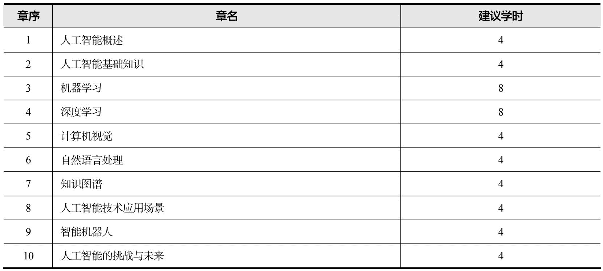

**编委会名单：**
*   **主编**：李铮（重庆邮电大学）、黄源、蒋文豪（重庆航天职业技术学院）
*   **副主编**：涂旭东（重庆医药高等专科学校）、刘源、吴文灵（重庆航天职业技术学院）

**分工协作：**
蒋文豪执笔第 3-5、7 章；黄源负责第 1、2、8、9 章；涂旭东撰写第 6 章；第 10 章由李铮、吴文灵、刘源联合完成。徐受蓉教授（重庆航天职业技术学院）把关审阅，黄源统稿定稿。

本书为校企合作结晶，编写期间获中国电信金融行业信息化应用（重庆）基地总经理助理杨琛大力支持，并参考海量权威文献，致谢各界同仁。受限水平，疏漏在所难免，恳请读者批评指正，可发邮件至 2103069667@qq.com 交流。

编者 敬上
2020 年 9 月 于重庆

# 第 1 章 人工智能全景扫描

【章节导引】
AI 自诞生至今，短短数十载已斩获惊人成就。本章奠基核心认知，带你建立对人工智能的初步全貌。

【核心清单】
1. AI 定义溯源
2. 分类体系梳理
3. 起源与演进脉络
4. 研究版图拆解
5. 领军人物与权威专家
6. 主流学派图谱
7. 落地应用图景

## 1.1 AI 认知基石

1956 年诞生以来，AI 硕果累累，广泛渗透多元领域，深度重构社会生活图景。本节构建核心概念框架。

### 1.1.1 何为人工智能

**人工智能（Artificial Intelligence，AI）**，是一门研究、开发用于**模拟、延伸、拓展人类智能**的理论、方法、技术及应用系统的前沿交叉学科。

定义众说纷纭，学术界广泛引用斯图亚特·罗素与彼得·诺维格在《人工智能：一种现代的方法》中的界定：AI 是**“智能主体的研究与设计”学科**；智能主体指**“能感知环境、通过行动达成目标的系统”**。此定义强调：感知驱动主动响应、行为服务于目标达成、不再拘泥于模仿人类思维路径。

本质上，AI 探索如何让计算机**模拟人类学习、推理、思考、规划等思维过程与智能行为**，涵盖计算机实现智能的原理、类脑智能机器的制造及高阶应用落地。其边界早已突破计算机科学，渗透心理学、哲学、语言学等，几乎囊括自然科学与社会科学全谱系。

### 1.1.2 AI 2.0 时代的五大特征

历经 60 余载演进，AI 已步入 2.0 阶段，呈现五大范式跃迁：

| 维度 | 传统范式 (1.0) | 新范式 (2.0) |
| :--- | :--- | :--- |
| **驱动引擎** | 人工知识显性表达 | **海量数据驱动的知识自习得** |
| **数据处理** | 单模态分类处理 | **跨媒体认知、学习与推理** |
| **协作形态** | 追求机器独立智能 | **高阶人机协同、脑机融合** |
| **智能单元** | 聚焦个体智能 | **基于互联/大数据的群体智能涌现** |
| **载体形态** | 拟人化机器人 | **泛在自主智能系统 (智能工厂、无人集群等)** |

### 1.1.3 能力阶梯：三大分类

按智能广度与深度，AI 可分为三级：

1.  **弱人工智能—— 专才**
    专攻单一任务，无通用认知与自我意识。
    *   *案例*：**AlphaGo** 围棋称霸却只会下棋；**Siri** 执行预设指令，本质是复杂的弱 AI 系统。

2.  **强人工智能—— 通才**
    具备人类级通用认知能力，能胜任一切脑力劳动。实现路径高度依赖脑科学突破，尚在理论探索期。

3.  **超人工智能 (ASI)—— 超越者**
    尼克·波斯特洛姆定义为：“**几乎所有领域认知表现远超人类的智能**”。
    *   核心特质：**递归自我改进**——如生物进化般持续重写自身代码；
    *   硬件红利：神经元峰值频率 ~200Hz、传导速度 120m/s，较现代微处理器 (GHz 级) 与光速通信慢 7 个数量级。生理瓶颈不再束缚 ASI，其迭代速度将呈指数级爆发。


> 图 1-1 弱人工智能机器人形态示意

## 1.2 穿越周期：起源与演进史

AI 学科历经“兴起—低谷—复苏—再低谷—爆发”多轮周期，本节梳理关键节点。

### 1.2.1 世界演进四幕剧

**第一幕：破晓与奠基 (1950s-1960s)**
*   **1950**：马文·明斯基 (日后“AI 之父”) 与迪恩·埃德蒙兹造出首台神经网络机；艾伦·图灵 (计算机之父) 提出**图灵测试**——若机器对话不可辨机器身份，即具智能，并大胆预言强 AI 可行。
*   **1956**：达特茅斯会议，约翰·麦卡锡首提“人工智能”术语，**学科正式诞生**。麦卡锡与明斯基随即联手创立 **MIT AI Lab**，首批学者群涌现。
*   **1964**：MIT 约瑟夫·魏岑鲍姆开发 **ELIZA**，首创文本交互聊天机器人，开启 NLP 关键赛道。
*   **1968**：斯坦福研究所 (SRI) 推出 **Shakey**，首台具备感知、规划、执行闭环的移动机器人，拥类人触觉听觉。

**第二幕：寒冬降临 (1970s)**
*   因高估项目可行性、算力匮乏、问题复杂度失控、数据极度稀缺，项目停滞，资金撤离（DARPA 叫停）。
*   1973 詹姆斯·赖特希尔报告痛批“宏伟目标落空”，AI 陷入多年“至暗时刻”。

**第三幕：专家系统繁荣与泡沫破裂 (1980s)**
*   **1980**：CMU 为 DEC 打造 **XCON 专家系统** (知识库+推理机)，年省成本 $4M+，催生 Symbolics、IntelliCorp 等软硬件独角兽。
*   **1987**：苹果/IBM 台式机性能反超专用机，专家系统商业模式崩塌，二次寒冬来袭。

**第四幕：数据驱动下的强势回归 (1990s-至今)**
*   **90s 中期**：互联网普及推动分布式 AI 研究，面向实用、多主体协作成主流；认知回归理性，进入平稳期。
*   **1995**：理查德·华莱士发布 **ALICE**，引入自然语言与千级数据点。
*   **1997.5.11**：IBM **“深蓝”** 横扫国际象棋世界冠军，引爆现象级 AI 讨论，里程碑时刻。
*   **2000**：本田 **Asimo** 亮相，早期双足类人机器人标杆。
*   **2006**：杰弗里·辛顿 *Science* 刊文， **深度学习** 破冰，机器超人希望重燃。
*   **2011**：IBM **Watson** 凭 2 亿页语料击败人类双冠王，进军医疗诊断。
*   **2016/2017**：**AlphaGo** 连克围棋人类顶尖高手，自学习能力震惊世界。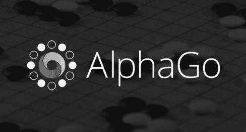
*   **2017**：**AlphaGo Zero** 零数据自博弈，3 天 100:0 碾压 Lee 版，40 天超越 Master 版，纯强化学习范式确立。

> 图 1-2 AlphaGo 标识

**展望：** 尽管成果斐然，距全面落地仍有鸿沟。未来攻关聚焦：AI 理论、ML 模型、不确定知识表示推理、常识推理、人工思维模型、智能交互、多主体系统、知识发现获取、应用基建等。

### 1.2.2 中国力量：追赶与领跑并行

起步虽晚，但政策红利 (《新一代 AI 发展规划》确立 2030 成世界创新高地) 与资本加持下，势头凶猛。

*   **基础研发**：国家重点实验室、顶尖队伍集结，课题布局完善，论文量质双升，高水平成果频出。
*   **产业落地**：医疗、商业、通信、城市治理等场景开花结果。
*   **巨头布局 2017 关键年**：
    *   **百度 (7.5)**：全栈 AI 开放平台首秀，对话式 AI + **Apollo 自动驾驶生态** (全球领先)。
    *   **腾讯 (8.3)**：**觅影**医学影像 AI 落地，成立联合实验室。
    *   **阿里 (10.11)**：**达摩院** 全球研究院挂牌，正式进军前沿硬核赛道。
*   **独角兽闪耀**：科大讯飞 (智能语音全球领跑)、依图科技 (十亿级人像比对系统，NIST 测试首个夺冠中国队)。

**清醒认知差距：**
*   **人才偏好分化**：国际顶流聚焦 ML、数据挖掘、模式识别；国内倾向遗传算法、神经网络、故障诊断。
*   **技术重心失衡**：国内企业集中视觉/语音应用层，核心算法、关键设备、高精尖零部件、工业软件、大型智能系统、基础平台等“卡脖子”环节与发达国家差距显著。

**战略窗口期：** 未来十年为爆发普及黄金期。AI 专用芯片、智能语音产业链将成新增长极；溢出效应将带动关联技术跃迁，倒逼传统产业转型、新兴产业突围。

## 1.3 研究版图：核心版块拆解

AI 研究疆域辽阔，学者视角各异 (脑模拟、认知流派、应用域、系统架构等)。下文综合主流共识，勾勒核心骨架。

### 1.3.1 认知建模—— 解码思维黑箱

认知科学 (思维科学) 是 AI 理论基石，剖析人类感知、思维信息加工全链路。除 Houston 列举的知觉、记忆、思维、学习、语言、想象、创造、注意、问题求解九大关联活动，还受环境、社会、文化深度塑造。
AI 不能只做逻辑推演，**必须攻克形象思维与灵感思维**，夯实理论地基，为智能系统开辟新范式。

### 1.3.2 知识表示—— 让机器“读懂”世界

**知识表示、推理、应用**构成传统 AI “铁三角”：表示是基，推理是器，应用是果。
核心任务：将人类知识**概念化、形式化、模型化**，转为机器可算的数据结构 (符号、算法、状态图等)。逻辑视角看，是一组描述事物的约定契约。
工程落地中，它融合**数据结构 + 控制结构 + 解释机制**，涉及存储设计与智能演演变。
**主流六大表示范式**：状态空间、问题归约、谓词逻辑、语义网络、框架、过程表示。

### 1.3.3 知识应用—— 检验真理的唯一标准

应用广度决定生命力。70 年代专家系统走出低谷，机器学习与近年 NLU 突破再推高潮。应用繁荣离不开表示与推理等底层技术的持续突围。

### 1.3.4 推理—— 从已知通往未知

人类智慧的核心优势，在于具备思考、判断与决策的能力。思维是在感性认知基础上跃升而来的理性认知，通过分析与综合两大认知动作得以实现。而在人类大脑中，这对基础动作发生了质变，衍生出抽象概括、比较分类、系统化与具体化等一系列高阶复杂的认知技能，最终依托概念在脑中完成判断与推理。若要赋予机器智能，首要任务便是装备推理机制。推理本质上是从已知判断出发，推导出新判断的思维过程，即从既有事实推演出新事实。在形式逻辑框架下，推理由前提、结论及两者间的连接形式三要素构成。建立在符号逻辑之上的人工智能，核心便是逻辑思维与推理。早期的形式化推理技术植根于经典谓词逻辑（演绎推理），在定理证明与问题求解中大显身手；然而随着研究深入，面对复杂难题，严格演绎推理显得力不从心，非单调逻辑推理等新范式应运而生，迅速成长为人工智能的核心研究版块。

### 1.3.5 机器感知

机器感知旨在赋予机器类人的感官体验，涵盖视觉、听觉、触觉、嗅觉、痛觉、接近觉及速度觉等维度。其中，机器视觉（计算机视觉）与机器听觉最为关键、应用最广。前者需识别解析文字、图像、场景乃至人身特征；后者侧重声音与语言的理解。感知是机器获取外部信息的入口，依靠安装各类传感器来落地。正是机器视觉与听觉的突破，催生了模式识别与自然语言理解/处理（NLP）两大研究热土，且二者已逐渐演化为相对独立的学科体系。

### 1.3.6 机器思维

顾名思义，机器思维是指在机器“大脑”内部运行的动态算法活动，即计算机软件对信息的实时处理过程。它融合机器感知输入、认知模型、知识表示与推理机制，对感知数据及系统内部信息进行有目的加工，进而针对特定场景输出判断、制定策略。我们熟知的路径规划、趋势预测、自动控制等，均属于机器思维的范畴。

### 1.3.7 机器学习

学习是人类核心智能特质之一。机器学习的目标，是让计算机拥有获取新知、掌握新技、并在实践中自我迭代优化的能力，使其像人一样能感知、认知、改造世界。它打破了显式编程的局限，让机器能从文献书籍、人机对话、环境观察中自动习得知识。研究重点在于：如何让机器在与人、环境交互中自发学习，或高效利用人类积累的文献、数据完成知识内化。当下，机器学习是AI研究与应用的绝对主力，深度学习、强化学习等均为其核心分支。

### 1.3.8 机器行为

机器行为是AI版图中极具魅力且崛起迅猛的前沿领域。它指代智能系统（计算机、机器人）的表达与行动能力——对话、描述、移动、行走、操作抓取等。该领域引入行为科学视角，试图理解AI代理的行为逻辑，弥补传统解释范式的不足。拟人化行为研究难度极高，但随着人机交互愈发深度复杂，机器行为有望成为通往下一阶段混合智能的关键拼图。

## 1.4 人工智能领域的著名专家与代表性人物

AI发展史上群星璀璨，涌现出众多奠基巨擘。本节梳理该领域的标志性人物。

### 1.4.1 艾伦·图灵

英国数学家、逻辑学家，被尊为“计算机科学之父”与“人工智能之父”。1950年提出“图灵测试”，为AI确立哲学基准。1966年，ACM设立“图灵奖”以表彰计算机杰出贡献者。图灵曾预言20世纪末机器将通过测试；2015年《科学》杂志封面报道证实，AI已具备类人学习能力并通过测试。

### 1.4.2 斯图尔特·罗素

世界经济论坛AI委员会副主席、加州大学伯克利分校AI中心创始人。他联合霍金等人发文警示AI潜在风险，并参与创立剑桥大学生存风险研究中心。其著作《人工智能：一种现代的方法》成为全球100余国1200余所高校的标杆教材。

### 1.4.3 斯蒂芬·霍金

享誉全球的理论物理学家，被誉为爱因斯坦之后最杰出的物理大师。他直言强AI崛起或成人类史上最大幸事，或成最大灾难，人类须竭力确保其向善发展。他甚至预判，未来人类可能被AI取代，面临灭绝风险。

### 1.4.4 贾斯汀·卡塞尔

卡内基梅隆大学计算机学院副院长、WEF计算机全球未来理事会前主席，连续六届达沃斯论坛演讲嘉宾，雅虎-CMU未来私人助手项目核心负责人。被誉为“人工智能女王”，发明了人形对话代理，其研发的社交感知机器人助理SARA在论坛展出震撼业界。

### 1.4.5 约翰·麦卡锡

1956年达特茅斯会议上首提“人工智能”概念，无他便无后来AI研究。曾任职于MIT、达特茅斯、普林斯顿、斯坦福，后为斯坦福荣誉教授。1971年获图灵奖，亦曾获国家科学奖、本杰明·富兰克林奖等殊荣。

### 1.4.6 吴恩达

华裔美籍学者，斯坦福大学计算机与电子工程副教授、AI实验室主任，在线教育平台Coursera创始人。创建Google Brain深耕深度学习；主导斯坦福STAIR机器人项目及单张2D照片生成3D模型算法。2013年入选《时代》百大全球影响力人物，为科技界16位代表之一。

### 1.4.7 德米什·哈萨比斯

DeepMind联合创始人（2014年被Google收购）。旗下AlphaGo震撼围棋界，成首个击败人类顶尖高手的程序，打破此前仅达业余水平的纪录。最新成果可微分神经计算机（DNC）或预示着自我觉醒机器人的曙光。

## 1.5 人工智能研究的主要学派

自1956年概念诞生，AI走过60余年。不同学科背景学者各执一词，形成三大主流流派：符号主义、连接主义、行为主义。

### 1.5.1 符号主义

又称逻辑主义、心理学派或计算机学派，核心依托“物理符号系统假设”与“有限合理性原理”，长期主导AI研究。主张AI源于数学逻辑，认知基本单元为符号，思维即符号运算。致力于用计算机符号操作模拟人类抽象逻辑思维，将认知过程符号化输入符号处理系统，实现智能模拟。特点是自上而下、静态、串行处理。

### 1.5.2 连接主义

亦称仿生学派或生理学派，植根于神经网络与连接机制。认为智能源于仿生学，特别是脑模型研究。从神经生理学与认知科学出发，将智能归结为大量简单单元经复杂连接并行运行的涌现结果。典型技术为人工神经网络，提供了区别于符号处理的认知神经新范式。

### 1.5.3 行为主义

又称进化主义或控制论学派，基于“感知-行动”循环。源于早期心理学流派，视行为为有机体适应环境的反应组合，旨在预测与控制行为。维纳、麦洛克等人的控制论、自组织系统，钱学森的工程/生物控制论影响深远。早期聚焦模拟控制中的智能行为，研究自寻优、自适应、自学习等机制；至80年代智能控制与机器人系统取得突破。

三大流派共同推动AI演进。符号主义擅长知识表示与演绎推理（如定理证明、非单调推理）；连接主义长于归纳学习（神经网络训练）；行为主义精于反馈控制与进化计算（遗传算法）。三者在实践中形成互补共存、经验积累与伪证选择并行的发展态势。

## 1.6 人工智能的应用

当前，AI理论技术已渗透至科技各分支。以下列举最具代表性的应用领域。

### 1.6.1 专家系统

区别于传统程序“以算法为中心”，专家系统“以知识为核心”，攻克复杂专业难题。此类问题缺乏精确描述与标准解法，常在不确定信息下依赖专家经验。传统程序指令“如何做”，专家系统只告知“做什么”，并突显知识价值，降低知识传递成本。采用符号表示、推理、启发式搜索等AI技术，是目前最活跃、成果最丰硕的领域。通过内化专家知识，系统可达专家水平甚至超越，并能辅助发现推理谬误。成功案例：PROSPECTOR发现亿级钼矿；DENDRAL化学分析超越一般专家；MYCIN血液感染诊疗能力超越领域权威。

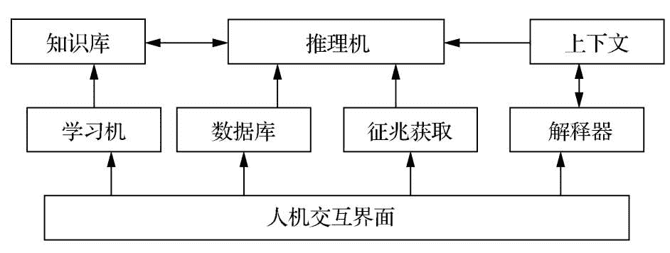

图 1-3　专家系统结构

### 1.6.2 自然语言处理

AI早期核心领域，融合语言学、计算机科学、数学。主攻人机对话与机器翻译。得益于乔姆斯基语言学贡献与算力提升，研究热度持续攀升。核心课题：让机器结合主题、语境与海量常识，生成并理解自然语言，本质是极高复杂度的编解码挑战。

### 1.6.3 博弈

对抗博弈起源于棋类，是机器智能化的最早试验田。1956年亚瑟·塞缪尔研制跳棋程序，能从棋谱学习、实战总结经验。棋类过程可建模为博弈树，利用状态空间搜索寻找必胜路径。现代程序结合启发式算法评估中局胜率以决策走位，大幅剪枝搜索空间，为高性能计算机战胜人类顶尖高手铺平道路。

### 1.6.4 搜索

无论下棋、思考或寻径，搜寻解法均为核心。搜索是为达目标而连续探寻的过程，是AI核心内容之一。早期通用问题求解、定理证明、博弈均围绕高效搜索展开。分盲目搜索（无领域知识，按固定序调用规则，如深度/广度优先）与启发式搜索（利用问题知识动态优先调用，大幅提速）。启发式搜索是重中之重。

### 1.6.5 感知问题

经典课题，跨越神经生理学、视觉心理、物理化学等学科。含计算机视觉（使机器“看懂”摄像头捕获的世界）与声音处理（使机器“听懂”语音）。关键在于将海量感知数据精练为易处理的高效表征。

### 1.6.6 模式识别

让计算机用数学方法自动处理判读“模式”（环境与客体统称）。随算力提升，复杂信息处理研究成为可能，生命体识别环境是重要形式。研究方向含图像/视觉、语音语言、脑网络、类脑智能等，探究识别机理与高效算法。与AI、图像处理深度交叉：自适应识别含学习机制，景物/语言理解含识别问题；预处理特征提取用图像技术，图像分析用识别技术。

### 1.6.7 机器人学

AI重要应用支柱，反哺AI思想发展。衍生技术可建模现实状态、描述状态迁移、辅助动作序列规划与执行监督。随技术成熟，应用延伸至商业、办公等第三产业。研发智能机器人是主攻方向：其能感知环境与对象、依指令与知识自主决策、执行任务并适应变化。但距离全能“机器管家”尚远，当前行为仍受预设程序束缚，创造性、随机应变等人类特质难以体现，融入生活仍需时日。


图 1-4　智能机器人

## 1.7 小结

1.  AI是研究模拟、延伸、扩展人类智能的理论、方法、技术及应用系统的交叉新科学。
2.  研究内容博大精深，分类视角多元。
3.  符号主义、连接主义、行为主义三大流派影响深远。
4.  应用版图极广，专家系统、NLP、模式识别、机器人学均有深度布局。

## 1.8 习题

1.  简述人工智能的历史沿革与发展脉络。
2.  简述人工智能的主要分类体系。
3.  简述人工智能的核心流派及其观点差异。
4.  简述人工智能的典型应用场景。

# 第 2 章 人工智能基础知识

### 本章导读

AI技术演进与数学、大数据技术紧密共生。本章聚焦AI的数学基石及大数据核心知识体系。

### 本章要点

1. 人工智能的数学基础
2. 人工智能的常用工具
3. 数据采集技术
4. 数据存储技术
5. 数据清洗技术
6. 数据分析技术

## 2.1 人工智能的数学基础

AI实质是数学、算法理论与工程实践的深度融合。算法背后是数学、概率论、统计学等理论的具象化。掌握基础数学是入门AI的必修课。

### 2.1.1 微积分

# 筑基智能时代：AI核心数学、主流框架与数据工程全景指南

微积分，别称“初等数学分析”，作为纯粹数学理论的典范，奠定了现代数学的基石。它在商业、科学与工程领域应用广泛，专攻那些代数与几何难以奏效的复杂问题。

回溯发展脉络，微积分大厦的建成凝聚了无数学者的心血，其中艾萨克·牛顿与戈特弗里德·莱布尼茨被公认为双奠基人。二者切入点迥异：牛顿立足力学视角，侧重不定积分；莱布尼茨则从几何出发，深耕定积分。值得一提的是，莱布尼茨创制的符号体系因优雅高效，沿用至今。

剖析核心内容，微积分由微分与积分两翼构成。微分学聚焦函数局部变化率，借助极限思维求解斜率（导数），揭示变化速率奥秘；积分学则提供通用方法论，用于定义与计算面积等量值，是数学分析的关键支柱。

在人工智能版图中，机器学习算法训练与预测本质上皆为求解最优化问题，故而高度依赖微积分寻找函数极值，模型函数选型亦蕴含数学性质考量。简而言之，微积分在机器学习中扮演双重角色：
1.  **寻找函数极值点。**
2.  **剖析函数内在特性。**

### 2.1.2 线性代数

线性代数探究向量空间及空间间映射函数。在AI领域，它是计算的基石——数据皆以矩阵形态存储，运算本质为矩阵乘加。不仅如此，它更是现代数学及众多应用学科（量子力学、图像处理等）的通用语言。透过向量与矩阵，线性代数提供了一种抽象视角：万物皆可拆解为特征组合，在预设规则框架下进行静态与动态审视。

其本质在于将实体抽象为数学对象并刻画特性。向量是n维线性空间中的定点；线性变换描述向量或坐标系变迁，矩阵为其载体；特征值与特征向量则揭示变化的速率与方向。

AI落地场景中，线性代数大显身手：
1.  搜索引擎排序机制
2.  线性规划求解
3.  纠错编码构建
4.  信号解析处理
5.  面部识别核心
6.  量子计算基础

### 2.1.3 概率论与数理统计

概率论与数理统计是AI与机器学习的理论基石。概率论探寻随机现象数量规律，量化事件发生可能性；数理统计以此为基，挖掘大量随机现象的统计规律。

虽渊源深厚，但两者方法论截然不同：概率论以“分布已知”为前提，推演随机变量特质；数理统计面对“分布未知”，通过独立重复观测样本，反推原始分布。

鉴于二者源于实践、服务实践，应用版图极广。在前沿AI领域：机器学习需处理不确定性与随机性（源头多元），概率论可量化不确定性；无论数据处理、分析、拟合还是决策，概率统计均提供核心支撑。

### 2.1.4 最优化理论

最优化理论致力于系统最优设计、控制与管理。核心在于：约束条件下，从海量备选中甄选最优，使目标函数达极大或极小。现代优化理论肇始于20世纪40年代，衍生出线性/非线性规划、动态规划、排队论、博弈论等丰富分支。

从本质看，AI的终极目标即最优化——在复杂环境与多体博弈中做最优决策。几乎所有AI问题终极归结为优化求解。最优化任务即：判定目标函数极值存在性，并定位极值对应变量。打个比方，目标函数若是山脉，最优化过程便是确认山峰位置并寻觅登顶路径。

### 2.1.5 形式逻辑

形式逻辑研究思维规律，狭义指演绎逻辑，广义含归纳逻辑，借概念、判断、推理（演绎与归纳）洞察事物本质。

AI萌芽期，麦卡锡、西蒙、闵斯基等图灵奖得主共同追梦：让具备抽象思维的程序诠释物质如何生成人类心智。理想AI应拥有抽象层面的学习、推理、归纳能力，通用性远超围棋象棋类专用算法。

若将认知定义为符号逻辑运算，形式逻辑便是AI基石。谓词逻辑作为知识表示主流，基于此构建的系统可实现自动推理。

## 2.2 人工智能的常用工具

AI学习与落地离不开工具链。本节梳理主流开源框架。

### 2.2.1 TensorFlow

谷歌出品，基于数据流图的数值计算库。架构分层清晰，覆盖服务器、PC、网页端，兼容GPU/TPU高性能计算，广泛服务于谷歌内部产品与科研。核心优势：极致灵活、真正跨平台、自动微分、支持Python与C++。

### 2.2.2 Mahout

Apache基金会旗下项目，封装可扩展经典ML算法（聚类、分类、推荐、频繁项集挖掘），助力开发者快速构建智能应用。依托Hadoop库实现云端扩展。三大特性：可扩展算法编程环境、预制算法工具（类Spark/H2O）、Samsara向量数学实验环境。Adobe、英特尔、领英、Twitter、雅虎等头部企业均在用。

### 2.2.3 Torch

科学计算级开源ML库，主攻C语言，底层基于Lua，算法丰富，效率速度双优。核心资产：强大的N维数组（切片索引便捷）、线性代数套件、神经网络模块。

### 2.2.4 Spark MLlib

Spark生态机器学习库，旨在简化工程落地并支撑大规模扩展。内置通用算法与工具（分类、回归、聚类、协同过滤、降维），兼备底层优化原语与高层Pipeline API。多语言支持，无缝嵌入Hadoop工作流，极速处理海量数据。

### 2.2.5 Keras

Python编写的高阶神经网络API，面向深度学习全流程（设计、调试、评估、部署、可视化）。覆盖主流算法（前馈/递归网络），可封装构建统计模型。硬件层面支持多OS下多GPU并行，后端可切换至TensorFlow、CNTK等。

### 2.2.6 CNTK

微软开源深度学习工具包，CPU/GPU双栖。全API基于C++打造，保障速度与易用性。内置前沿算法实现，预测精度领先。提供C++、C#、Python多语言接口，便于集成。

## 2.3 数据采集

数据采集是AI与大数据应用的基石，是大数据分析的前哨站。

### 2.3.1 数据采集的概念

大数据时代开启大规模生产、共享、应用新纪元，重塑技术与商业版图。大数据技术核心：从多源异构数据中高速提炼价值。

作为数据生命周期首环，采集依托传感器、摄像头、RFID、互联网等渠道，获取结构化、半结构化、非结构化数据。其中，结构化数据对应数据库表；非结构化数据指不规则/不完整数据（当前电商80%数据属此类，且年增）；半结构化数据具约束但无严格关系。

### 2.3.2 数据采集的常见方法

区别于小数据问卷/库表模式，大数据源头多元：网络爬虫抓取网页文本、日志收集器聚合流式日志、关系型数据库导出、传感器感知时空数据。图像语音类数据需经处理转化为可分析格式。

#### 1. 日志数据采集

平台日产海量日志（流式数据），需专用日志系统处理。采集系统核心职责：收集业务日志，供离线/在线分析消费。特点：高效聚合传输、强容错。高可用、高可靠、可扩展是标配。主流开源平台：Flume、Fluentd、Logstash、Chukwa、Scribe、Splunk Forwarder，多为分布式架构，支撑百兆级/秒吞吐。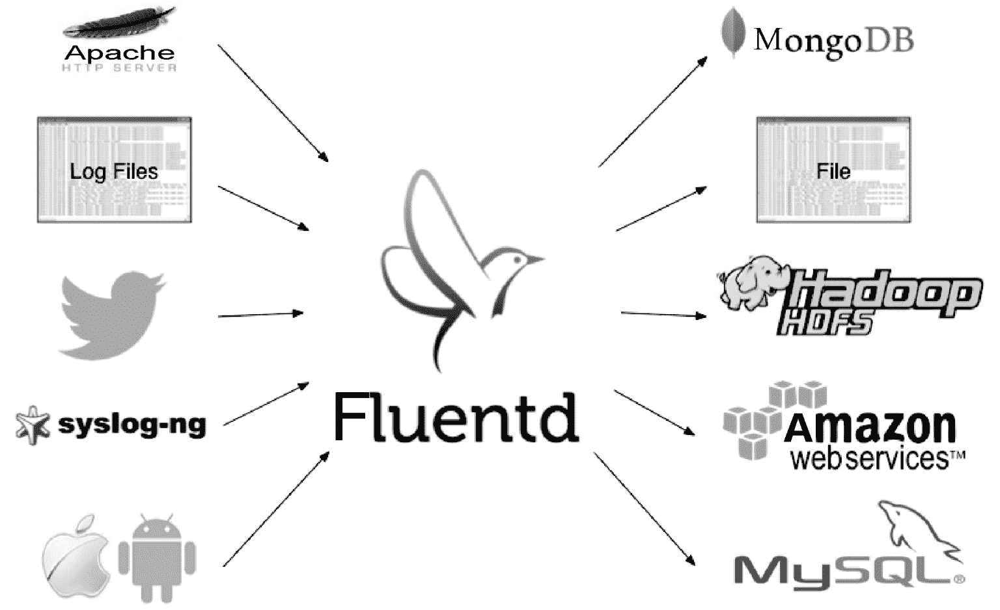为Fluentd架构示意。

#### 2. 网络数据采集

利用垂直搜索/爬虫/分词/索引技术，实现定向、行业化、精准化抓取，经规则清洗入库。随着网络信息爆发，获取分拣需求激增。常用系统：Nutch、Crawler4j、Scrapy。多系统并行抓取可榨干算力存储，提效降本。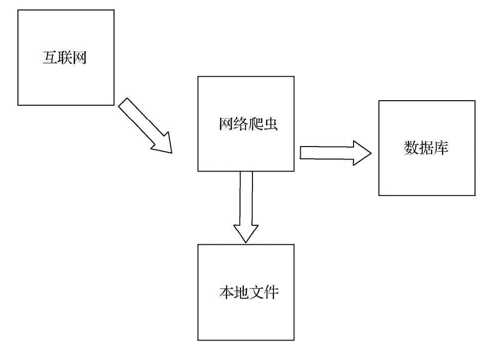展示爬虫作用，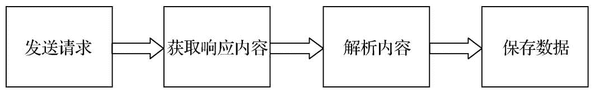演示采集流程。

除正文外，支持图音视频附件采集（自动关联）。网络流量采集可用DPI/DFI带宽技术处理。

#### 3. 数据库采集

实时数据以记录形式直写企业库，再经专用系统深度分析。常见：MySQL、Oracle、Redis、MongoDB等。通常部署大量数据库节点，需深度设计负载均衡与分片策略。

#### 4. 其他数据采集方法

针对高保密企业/科研数据，可通过合作、API接口等定制化方式获取。API屏蔽底层复杂性，简易调用即得数据。主流社交平台（微博、贴吧、Facebook等）均提供开放平台API文档。

## 2.4 数据存储

AI时代，数据量级跨越GB至PB，存储范式迭代显著。

### 2.4.1 数据存储的概念

数据存储即将海量、难收集/处理/分析的数据集持久化。大数据环境特征：存储量巨大、增量可能爆发式增长，故需高性能、高吞吐、大容量基础设施。更关键在于：存储旨在挖掘数据关联，经比对分析转化商业价值。

### 2.4.2 数据存储的方式

主流四大范式：分布式存储、NoSQL、NewSQL、云数据库。

#### 1. 分布式存储

多自主节点经网络协作，分治策略破解大规模分析难题。主含分布式文件系统（HDFS）与分布式键值系统。

**HDFS设计哲学：**
1.  **专攻大文件**：TB级海量文件存储首选；小文件仍宜传统方式。
2.  **读速极快**：大文件分块分布式存储，多节点并行读取，效率远超单机。
3.  **流式访问**：一次写入、多次读取，不支持随机修改，仅允许追加。
4.  **低成本**：可跑在廉价商用机上，数十节点即可组建集群。
5.  **强容错**：假设节点必故障，块数据多副本冗余，单点失效秒级切换副本。

分布式键值系统适配关系简单的半结构化数据。典型代表：Amazon Dynamo、对象存储技术。

#### 2. NoSQL数据库

传统关系型数据库难支撑Web 2.0海量高并发需求，NoSQL（Not Only SQL）应运而生。非关系型、无固定表模式、弱化Join、水平扩展强、模型灵活，契合Web 2.0。典型分类：键值、列族、文档、图数据库。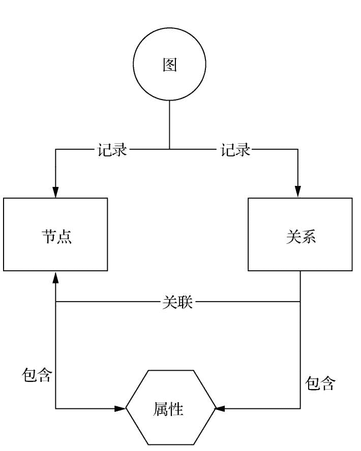为图数据库连接关系示意。

*短板：理论基础薄、复杂查询弱、难强一致性/完整性、生态相对不成熟、运维难。*

#### 3. NewSQL数据库

新一代可扩展/高性能数据库，融合SQL与NoSQL优势：兼具NoSQL海量存力，保留ACID与SQL特性，被视为下一代演进方向。技术突破：强一致性适配分布式、全内存运行消除缓冲池延迟、冗余机器替代昂贵锁机制与恢复操作。

#### 4. 云数据库

部署于虚拟化计算环境，云计算背景下的共享基建新范式。极大增强存力，消除人/硬/软重复配置，简化升级。特质：高扩展、高可用、多租户、资源高效调度，实现按需付费、弹性伸缩。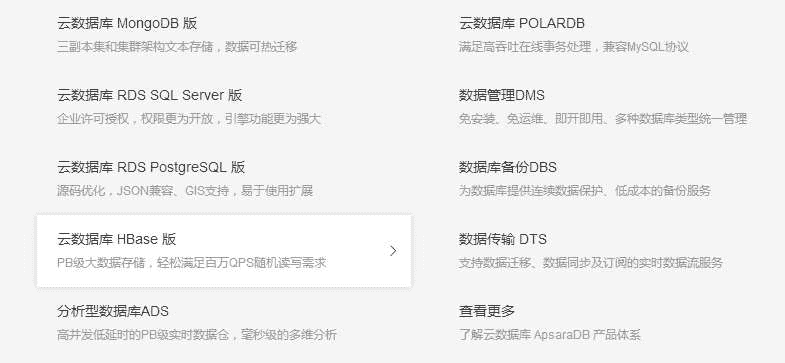为阿里云云数据库服务架构图。

## 2.5 数据清洗

数据爆发是大数据标志，唯经清洗、分析、建模、可视化，方显潜在价值。

### 2.5.1 数据清洗的概念

原始数据中混杂大量“脏数据”（不全、不规范、不准）。清洗即净化脏数据，提升质量，含一致性校验、无效/缺失值处理等。实战中，清洗常占项目总工时50%~70%，是名副其实的“最耗时环节”。

# 数据清洗与分析全景指南：从“洗”出价值到“挖”出洞见

### 2.5.2 核心原理：如何把“脏数据”变“净数据”

数据清洗（Data Cleansing）的叫法虽多，内核却一致：利用统计学、挖掘算法、模式规则等技术手段，将不合格数据修正为符合质量标准的资产。按执行方式划分，主要有两条路径：

**人工兜底 vs 机器执行**
早期依赖人工逐行核对，虽准确度高、能兜底所有异常，但面对海量数据时效率极低、成本高昂，几乎不可行。自动化清洗虽能解决特定问题，却缺乏灵活性，且清洗往往需迭代多轮，导致代码维护困难，且未充分发挥数据库原生计算优势。

**算法与规则：自动化的“双引擎”**
随着技术演进，清洗算法与规则成为主流。两者依托业务知识与统计/挖掘技术，剖析数据特征后精准出击：
*   **模式驱动**：挖掘数据内在规律（如函数依赖、聚类结构），以此为准则修正偏差。
*   **规则驱动**：预设编辑约束、修复逻辑、Sherlock规则或探测规则，自动捕获不匹配记录并修复。

> 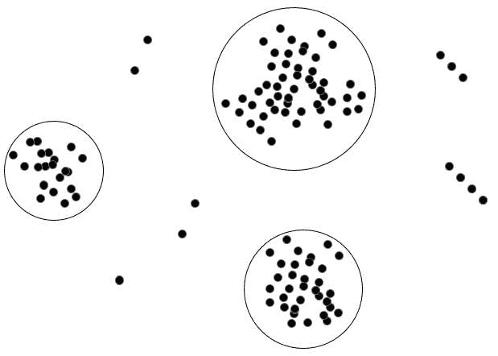
> 图 2-6　脏数据的识别

### 2.5.3 三大主战场：清洗在哪里发光发热

目前清洗技术深度嵌入数据仓库、数据挖掘、数据质量管理三大核心领域。

**1. 数据仓库：融合去重的“守门人”**
多源数据汇聚时，同一实体常对应多条记录。清洗的核心任务是“合并清洗”，即识别并消除重复，解决记录链接、语义融合、实体识别等难题。此外，还涉及数据拆解与重组，重塑结构以适配主题建模。

> 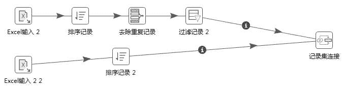
> 图 2-7　数据清洗在数据仓库中的应用

**2. 数据挖掘：建模前的“必修课”**
原始特征常含缺失值、异常值等“毒药”，若不预处理直接建模，轻则效果打折，重则模型失效。清洗是挖掘流程的第一站，不同业务场景定制专属清洗方案，为后续算法铺平路。

**3. 数据质量管理：全生命周期的“体检师”**
质量管理贯穿数据获取、评估、监控、诊断至丢弃全过程。清洗作为核心保障手段，配合去噪、探查等动作，持续提升数据可信度与可用性。

### 2.5.4 评估体系：怎么量化“洗得干不干净”

评估本质是对清洗后数据质量的度量。指标体系虽因需求而异，但**可信性**与**可用性**是两大基石：

| 维度 | 核心指标 | 通俗释义 |
| :--- | :--- | :--- |
| **可信性** | **精确性** | 数值是否对得上现实实体 |
| | **完整性** | 有无缺记录、漏字段 |
| | **一致性** | 跨系统同一属性值是否冲突 |
| | **有效性** | 是否符合业务规则/阈值范围 |
| | **唯一性** | 是否存在重复主键/记录 |
| **可用性** | **时间性** | 区分实时快照与历史档案 |
| | **稳定性** | 数据在有效期内是否波动异常 |

---

### 2.6 数据分析：让数据开口说话

#### 2.6.1 大数据分析：从“海量”到“高价值”

大数据分析是价值链关键环节，旨在从噪音中提取信号，辅助决策。广义上分**统计分析**（面向样本）与**数据挖掘**（面向全量）。任务层面又分两类：
*   **预测任务**：知自变量（解释变量）推因变量（目标变量），如销量预测、风控评分。
*   **描述任务**：挖掘隐性模式（关联、趋势、聚类、轨迹、异常），属探查性，需后处理验证，涵盖分类、回归、关联、聚类、推荐、异常检测、链接分析等。

#### 2.6.2 三种分析范式：看清过去、探索未知、验证假设

1.  **描述性统计**：用表、图、汇总指标（频数、均值/中位数、方差/四分位距、分布形态）还原数据全貌，是认知基础。
2.  **探索性分析 (EDA)**：弱假设、强可视化。面对陌生或脏乱数据，通过作图、拟合、特征量计算，快速摸清结构规律，是大数据时代的“导航仪”。
3.  **验证性分析**：强假设、重推断。基于样本证据，通过假设检验确证或推翻关于总体的预设结论。

#### 2.6.3 数据挖掘：跨学科的“淘金术”

**核心逻辑**：海量真实、含噪、高价值数据输入 $\rightarrow$ 数学/非数学、演绎/归纳方法建模 $\rightarrow$ 产出可落地的认知模型（决策支持、查询优化、流程控制、自维护）。模型随认知深入渐进进化，实现深度学习与挖掘。

**两大挖掘范式**：
*   **直接挖掘**：建模预测特定目标变量（有监督）。
*   **间接挖掘**：挖掘全变量间关联结构（无监督/关联规则）。

**技术谱系全景**：
| 分类维度 | 细分流派 |
| :--- | :--- |
| **按任务** | 预测建模、聚类、分类/回归、关联规则、序列模式、依赖建模、异常/趋势、离群检测 |
| **按对象** | 关系/对象/空间/时态/文本/多媒体/异质/遗留数据库 |
| **按方法** | **机器学习**（归纳/决策树/规则、基于实例、遗传算法）、**统计学**（回归、判别、聚类、主成分/相关）、**神经网络**（前向传播/BP、自组织映射/竞争学习）、**数据库/OLAP**（多维分析）、**面向属性归纳** |

**经典落地案例**：
*   **垃圾邮件拦截**：文本挖掘 + 朴素贝叶斯，识别“推广/促销”等高频特征词。
*   **金融精准营销**：基于客户画像（人口/资产/负债/结算）聚类分群（理财派/基金派/活期派/国债派），定向推品，降本增效。
*   **啤酒与尿布**：关联规则挖掘发现“带娃买尿布 + 顺手买啤酒”模式，陈列调整大幅提升关联销售。
*   **乳腺肿瘤早筛**：改进BP神经网络建模多参数特征，显著提升早期诊断准确率，挽救生命。

#### 2.6.4 数据可视化：用图形“翻译”数据语言

**本质**：利用计算机图形学/图像处理，将抽象数据映射为可交互的视觉符号，跨越认知鸿沟，直击数据本质。涵盖计算机视觉、CAD、图形学等交叉技术。

**三大流派**：
1.  **科学可视化**：聚焦空间/三维物理场（气象、生物、物理），追求逼真渲染，助科学家洞察自然规律。
2.  **信息可视化**：处理无几何结构的抽象数据（代码、文本、高维点），用视觉隐喻揭示隐性结构。
3.  **可视化分析**：融合上述二者，核心是**人机交互式推理**，集成计算工具、理论模型、创新交互，实现“与数据对话”。

**五大评价金标准**：
*   **实用性**：直击用户痛点，展示最关切信息（如民生气象图）。
*   **完整性**：语境全保留——来源、背景、用途、分析维度、目标受众，一应俱全。
*   **真实性**：数值精准、有据可查，拒绝误导性截轴/扭曲编码。
*   **艺术性**：遵循审美与认知心理学（如长度/位置比面积/颜色更利于比对），以美促用、强化记忆。
*   **交互性**：提供符合直觉的交互入口（下钻、联动、筛选），让大众自主探索业务价值。

**行业应用图谱**：
*   **金融**：实时监控业务动态/风控指标，多维对比辅助策略调整，筑牢竞争护城河。
> 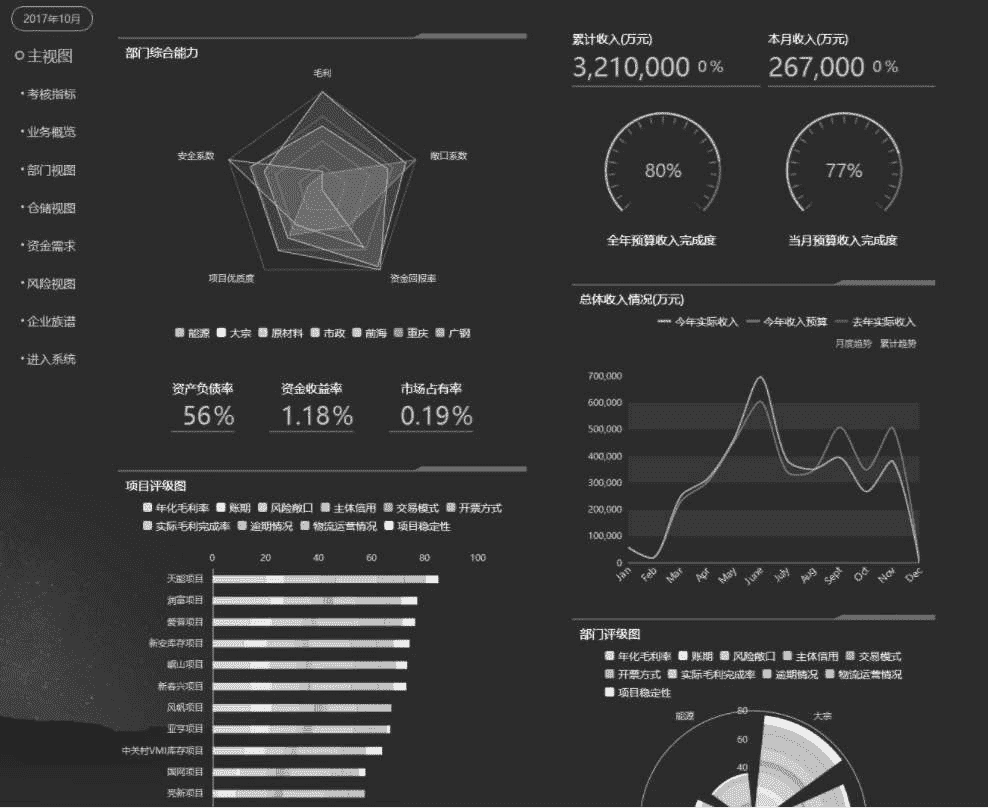
> 图 2-8　金融可视化的示例
*   **医疗**：整合分散数据构建管理驾驶舱；三维建模辅助手术决策；赋能疾病预测与防控。
> 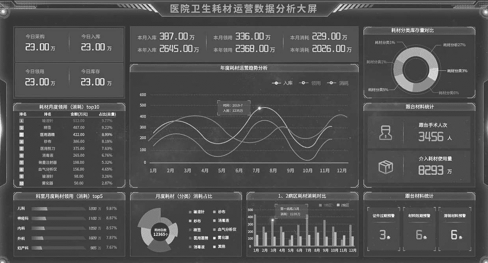
> 图 2-9　医疗可视化的示例
*   **工业**：软硬结合赋能智能硬件，数据可视化释放设备附加值，延伸至穿戴、家居、车载、机器人等全场景。
*   **教育**：仿真/模拟/形象化呈现知识演进，降低认知负荷，促进知识迁移与多元思维养成。
*   **泛领域**：军事推演、卫星/航班追踪、气象、股市、交通、能源、智慧城市/园区、文旅、安防、机器人控制……无处不在。

### 2.7 小结

数据清洗筑牢地基，数据分析搭建骨架，数据挖掘注入智慧，数据可视化赋予表达。四者协同，打通“数据 $\rightarrow$ 信息 $\rightarrow$ 知识 $\rightarrow$ 决策”全链路，是数字化时代企业核心竞争力的源头活水。

## 核心基石：AI的数学本质与数据管道

人工智能的本质，是数学、算法理论与工程实践的深度融合。说白了，AI 就是算法的落地，是微积分、概率论、统计学等数学体系在代码层面的具象化表达。

想要驾驭这门技术，离不开一套得心应手的工具链。TensorFlow、Mahout、Torch、Spark MLlib、Keras、CNTK 等框架，构成了当前主流的开发生态。

数据是 AI 的燃料，采集则是加油的第一步。没有大规模数据的支撑，人工智能的研究便成了无源之水；而数据采集，正是大数据分析流程的起点与基石。

数据量级跨入 GB、TB 甚至 PB 时代，存储的挑战随之而来。所谓数据存储，本质上是将海量、难以处理的原始数据集持久化落盘，为后续计算提供底座。

数据爆发式增长是大数据时代的标志，但原始数据往往混杂着“脏数据”——不完整、不规范、不准确。数据清洗的使命，就是过滤这些噪音，让数据“洁净如新”，随后经由分析、建模、可视化，才能释放出潜在价值。

数据分析则是价值链的关键环节，它像淘金者一样，从海量数据中筛选高价值内容，揭示隐藏规律，最终为科学决策提供确凿依据。

### 章末思考题

1. 梳理人工智能领域的核心数学基础。
2. 列举并简述主流 AI 开发工具及其定位。
3. 界定数据采集的概念与核心特征。
4. 概括人工智能时代数据存储的显著特点。
5. 说明数据清洗的必要性及操作特点。
6. 阐述数据分析在价值挖掘中的作用与特点。

# 第 3 章 机器学习

### 本章导读

作为人工智能版图中最核心的分支，机器学习的身影遍布 AI 的各个角落。本章将系统拆解机器学习的基石理论与核心范式。

### 本章知识图谱

1. 机器学习核心范式  
2. 监督学习  
3. 无监督学习  
4. 半监督学习  
5. 迁移学习  
6. 强化学习  
7. 回归算法  
8. 分类算法  
9. 聚类算法  
10. 降维算法  

## 3.1 机器学习概述

机器学习是一门典型的跨学科交叉科学，研究核心聚焦于人工智能：如何让计算机模拟人类学习行为，获取新知、重组知识结构、持续自我进化。它是赋予机器智能的根本路径，也是 AI 领域的“心脏”。

### 3.1.1 什么是机器学习？

关于定义，学界历经多次演进：
- 1996 年，帕特·兰利将其定义为研究如何通过经验改善算法性能的 AI 科学。
- 1997 年，汤姆·米切尔强调“计算机算法通过经验自动改进”。
- 2004 年，埃塞姆·阿培丁则指出：利用数据或过往经验优化程序性能指标。

其研究路径通常借鉴生理学、认知科学对人类学习机制的解读，构建模仿人类学习的计算/认知模型，推演通用学习算法，最终构建面向具体任务的应用系统。

机器学习融汇了高等数学、统计学、概率论、凸分析、逼近论等学科，方法论上偏向归纳与综合而非演绎。通俗而言，就是**让机器从数据中学习**。这里的“学习”，指的是从数据中产生模型的算法——学习算法。有了算法，输入经验数据，机器便能输出模型，面对新场景给出判断与预测。其核心原理在于：基于数据集挖掘数据间的关联与真实语义。

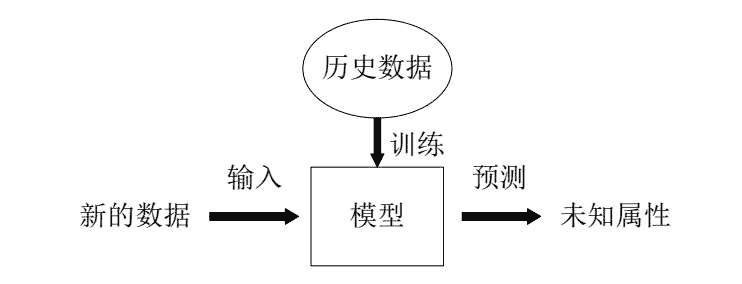

图 3-1　机器学习原理

### 3.1.2 发展历程：从萌芽到黄金时代

机器学习的演进大致可分三部曲：

**第一阶段（50年代中期-60年代中期）：萌芽期**  
试图通过逻辑编程赋予机器思维，但效果差强人意。研究者意识到，仅靠逻辑推理不足以产生智能，海量先验知识才是前提。

**第二阶段（60年代中期-80年代中期）：冷静期**  
主流转向专家系统，试图用人工提取规则驱动决策。然而“知识稀疏”瓶颈难破——面对无限知识，人工总结规律几乎不可能。这倒逼“机器自主学习”想法浮出水面，并延续了 50 年代神经网络的早期探索。

**第三阶段（80年代中期至今）：复兴与爆发期**  
互联网大数据与 GPU 算力的双重红利，击穿了过往瓶颈。机器学习晋升为独立热门学科，算法百花齐放，深度学习更是异军突起，催生了模式识别、数据挖掘、生物信息学、自动驾驶等新兴分支。

理论上，心理学、生物学、神经生理学与数理科学、自动化、计算机科学完成了深度融合，集成学习体系成型；应用上，商业化产品落地，学术社区高度活跃。

2010 年以来，谷歌、微软等巨头加码布局并尝到商业化甜头，国内阿里、百度、搜狗等紧随其后，将算法深度嵌入核心产品。可以说，过去十余年正是机器学习的**黄金纪元**。

### 3.1.3 应用版图：无处不在的智能渗透

军民两用领域均是机器学习的施展舞台。语音识别、图像识别、数据挖掘是传统强项；大数据时代更拓宽了疆域——设备维护、信贷审批、金融量化、医疗档案、广告推荐、消费画像、网络行为分析等，皆成热点。

#### 数据分析与挖掘：双子星

两者常被并提，核心同源：将数据转化为信息，支撑判断。  
- **数据挖掘**：从海量数据中识别有效、新颖、潜在有用、可理解的模式。  
- **数据分析**：运用统计手段深度研究资料，最大化数据效用，提炼结论。  

技术层面，二者是机器学习算法与数据存取技术的耦合。2012 年 Hadoop 进军机器学习领域，便是这一融合的标志性事件。

#### 模式识别：天然盟友

模式识别源于工程，机器学习源于计算机科学，强强联合重塑了该领域。研究双轨并行：一端探究生物感知机理（认知科学），一端攻克计算机实现理论与方法——这正是机器学习的主场。应用覆盖计算机视觉、医学影像、OCR、NLP、语音/手写/生物特征识别、文档分类、搜索引擎等，两者关系紧密到常被合编成书。

#### 更广阔的远方：通往通用人工智能

终极目标是全面模拟人脑，创造具备人类智慧的机器大脑。  
- 2012 年谷歌发布人脑模拟软件，具备自我学习能力，通过观看视频识别实体，模拟神经元交互机制，已在语音识别等领域显露锋芒。  
- 同期谷歌无人车获美首张自动驾驶牌照，融合 AI、视觉计算、雷达、GPS，实现“比人类更聪明”的驾驶，预期大幅降低事故、节省时间、减排。  
- 2013 年微软克雷格·蒙迪指出大数据、AI、人机交互为三大挑战，演示英语转中文实时拟人翻译，展现 NLP 前沿进展。

### 3.1.4 未来图景：智能机器深度嵌入生活

智能机器将深度渗透工作生活：  
- **医疗**：从病历中学习，挖掘疑难杂症最优疗法。  
- **智能家居**：分析用电与习惯，动态调控环境，兼顾节能与舒适。  
- **个人助理**：全维追踪职业生活细节，赋能高效工作与健康生活。  

这倒逼人类反思：未来世界，机器人将扮演何种角色？是否会替代人类？人机共生的伦理与边界在哪里？

## 3.2 机器学习的分类

核心思想不复杂，本质是对人类生活学习过程的模拟，数据是核心燃料。凡基于数据训练的算法研究皆属机器学习范畴（如线性回归、决策树、随机森林等），算法谱系庞大，下文聚焦主流分类体系。

### 3.2.1 监督学习：有标签的“教师式”训练

**核心机制**  
利用已知类别样本调整分类器参数，达标后即可推断新实例。训练集由“输入向量+预期输出”组成：输出若为连续值称**回归**，若为离散标签称**分类**。

数据带标记（类别、属性、特征点），流程为：大量标注数据训练 → 预测对比期望 → 依误差修正参数 → 迭代收敛 → 得鲁棒模型 → 智能决策。

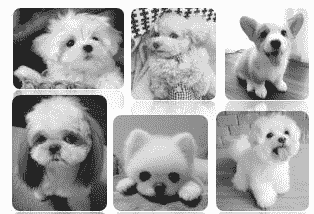

图 3-2　监督学习的数据集

**典型场景：垃圾邮件过滤**  
用“邮件+标签”建模，模型自学关联并自我修正，最终对无标签新邮件精准判定。

### 3.2.2 无监督学习：无标签下的“自主探索”

现实中常面临先验不足、标注成本高昂的困境。无监督学习正是让计算机接管此类任务，基于**无标记样本**挖掘数据内在结构与规律。

核心手段：**聚类** 与 **降维**。  
- **聚类**：不知类别，依特征空间分布（密度/概率）将相似样本归类，异类分离。  
- **降维**：削减属性维度。以榴莲为例，色泽、裂痕、大小等 6 维描述；实战中通过主成分分析等保留主因、舍弃次因，在精度与效率间平衡。

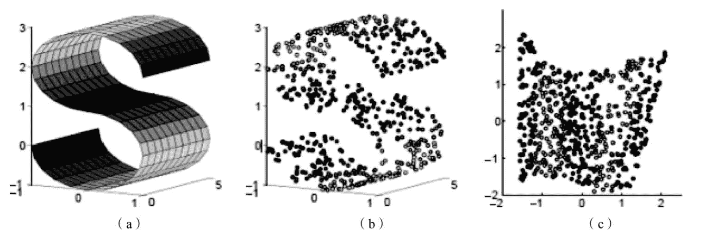

图 3-3　数据的降维过程

**应用直击：数据挖掘**  
在海量无标签数据中自主发现结构。如不给任何提示，仅凭特征将“猫”图片从海量图库中分离出来。

### 监督 vs 无监督：三大分野

| 维度 | 监督学习 | 无监督学习 |
| :--- | :--- | :--- |
| **训练目的** | 明确（有靶向） | 模糊（探索性） |
| **数据标签** | 必须人工标注 | 完全无需标注 |
| **效果评估** | 可量化指标衡量 | 难以客观度量 |

### 3.2.3 半监督学习：少量标签撬动海量数据

**动因**：大数据爆发下，无标签样本唾手可得，高质量标签却稀缺昂贵。纯监督样本不足泛化差，纯无监督准确性无保障，**“少量标注引导 + 大量无标注增强”** 成为破局热点。

1992 年正式命名，源自自训练思想，打破单一数据类型限制，融合监督/无监督优势。涵盖半监督聚类、分类、降维、回归四大场景。主流分类算法四大流派：

1.  **生成式方法**：假设类别分布（混合高斯、混合专家、朴素贝叶斯），用极大似然为目标，EM 算法求解参数。
2.  **半监督支持向量机 (S3VMs)**：源自瓦普尼克猜想，无标签数据能压缩函数空间维度。变体包括 TSVM、Laplacian SVM、MeanS3VM、S4VM、CS4VM 等。
3.  **基于图的方法**：构建有/无标签样本关联图，通过标签传播推断。代表算法：标签传播、最小割、流形正则化。
4.  **基于分歧的方法**：源自协同训练，利用多模型差异提升泛化。按视图数分单/多视图。

### 3.2.4 迁移学习：跨域知识的“举一反三”

**定义**：利用源域已有知识解决目标域相关问题，放宽传统机器学习“同分布、同特征空间”假设，专治目标域样本稀缺甚至零样本难题。

生活中比比皆是：会骑自行车易上手摩托车（正迁移）；但自行车手改骑三轮车反因重心不同而不适（负迁移）。**领域共享因素越多，迁移越顺；差异过大反而有害。**

按技术路线分三类：
- 基于特征选择的迁移
- 基于特征映射的迁移
- 基于权重/参数迁移的迁移

# 3.2.5 强化学习：智能体的试错进化论

## 迁移学习的“户籍”分类

依据源域与目标域是否拥有标注数据，迁移学习可大致分为三大流派：目标域有少量标签的**归纳式迁移学习**；仅源域有标签的**直推式迁移学习**；以及双方均无标签的**无监督迁移学习**。若进一步细分归纳式迁移，根据源域是否有标签，又可划分为多任务迁移学习与自学习两条技术路线。

与要求“同域同任务”的传统机器学习不同，迁移学习专攻“异域异任务”场景，涵盖了任务相关但不完全一致的归纳迁移等复杂情况。

---

## 一、 核心范式：环境反馈驱动的决策闭环

强化学习是机器学习四大范式之一，核心在于**智能体**与**环境**的博弈。系统由四大要素构成：决策主体（Agent）、环境状态（State）、动作空间（Action）与奖励信号（Reward）。

**通俗理解：** 想象一名学生（智能体）面临“复习”或“打游戏”两个动作。打游戏导致成绩（状态）下滑，父母据此给予奖惩（奖励）。经过反复试错迭代，学生终将掌握：在何种成绩状态下做何选择，收益最大。这就是强化学习“策略优化 → 最大化累积回报”的底层逻辑。

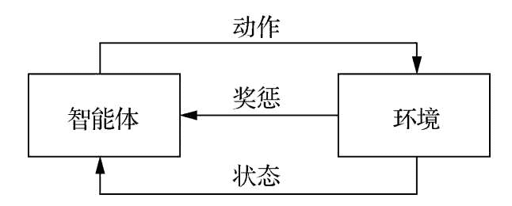

> 图 3-4　强化学习的模型

其本质是一套**激励机制**：行动正确给“糖吃”（正反馈），出错给“板子打”（负反馈）。智能体在动态交互中不断调整策略，追求长期收益最大化，这与动态规划思想异曲同工。以“贪吃蛇”为例，蛇通过不断调整转向策略吃到食物得分，这一自主探索过程即是典型的强化学习范式。

---

## 二、 落地场景：从机械臂控制到超人类博弈

**1. 机器人本体控制**
这是强化学习的“基本盘”。机器人置身特定环境，通过持续自我训练，利用环境反馈的正负信号修正动作，最终形成高效决策策略，实现如机械狗奔跑、机械臂抓取等复杂控制任务。

**2. 里程碑式突破：AlphaGo Zero**
深度学习解决了“感知与识别”，而强化学习攻克了“决策与推理”。AlphaGo Zero 舍弃人类棋谱与人工特征，仅以棋盘原始状态为输入，通过**纯自我博弈**从零训练，最终超越人类巅峰。它证明了：**无需先验经验，强化学习亦可通往超人类性能。**

**3. 未来风口：感知与决策的深度融合**
当下，将深度学习的感知能力与强化学习的决策能力融合，被视为通用人工智能（AGI）落地复杂现实场景的关键路径。

---

# 3.3 机器学习算法全景图：经典永不过时

算法研究始于上世纪50年代，虽流派林立，但经得起工程落地考验的“黄金算法”屈指可数。本节剥离繁杂公式与结构细节，为你勾勒八大核心算法族群的清晰轮廓：回归、聚类、降维、决策树、贝叶斯、SVM、关联规则、遗传算法。

---

## 3.3.1 回归算法：量变规律的数学捕手

### 一、 核心定位：从“相关”到“因果”的建模利器

回归分析专治**变量间的统计依赖关系**——区别于函数关系的严格确定性，回归处理的是带有随机波动的相关关系。在大数据语境下，它是预测建模、时序分析、因果推断的基石工具。

- **回归分析**：自变量非随机、因变量随机 → 建立数学表达式（回归方程）描述均值变化趋势。
- **相关分析**：双变量均随机 → 度量关系紧密度（相关系数）。
- **实战逻辑**：先查相关性（筛变量），再建回归方程（定量化），最后用统计检验验模型有效性，主次因素一目了然。多元回归更能输出显式公式，直接支撑业务预测。

### 二、 七大流派谱系图谱

| 算法流派 | 核心机制 | 适用痛点 |
| :--- | :--- | :--- |
| **线性回归** | 线性加权求和 (`Xw=y`)，求解最优权重 `w` | 变量间呈线性趋势，可解释性强 |
| **逻辑回归** | 线性输出 → Sigmoid 映射 `[0,1]` → **概率分类** | 二分类/多分类任务（如垃圾邮件识别） |
| **多项式回归** | 引入高次项拟合非线性曲面 | 数据分布弯曲，线性模型欠拟合 |
| **逐步回归** | 显著性检验筛选自变量（加入/剔除） | 高维特征中自动挑选有效变量 |
| **岭回归** | 引入 **L2 正则项** 约束权重大小 | 抗异常值、缓解多重共线性 |
| **套索回归** | 引入 **L1 正则项** 实现稀疏化 | 特征选择、自动置零无关变量 |
| **弹性网络** | L1 + L2 混合正则 | 兼顾分组特征选择与稀疏性，处理高相关特征组 |

> **关键区别**：岭回归压缩系数不为零；Lasso 可将无关特征系数压缩为 0（内嵌特征选择）；弹性网络解决 Lasso 随机选变量的缺陷，倾向“成组选择”高相关特征。

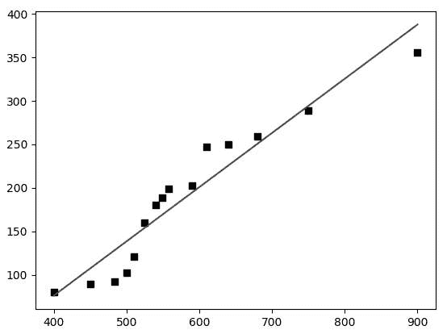
> 图 3-5　线性回归示意图

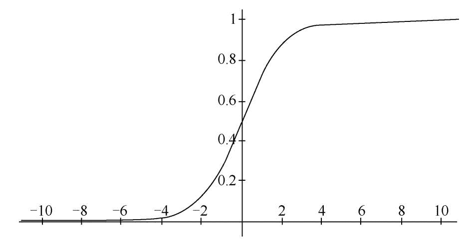
> 图 3-6　逻辑回归示意图

### 三、 实战三部曲：从机场调度到气候科研

1.  **智慧机场·客流预测**：融合 Wi-Fi 探针、安检/值机/登机多源数据，回归建模预测航站楼分时客流，驱动灯光、电梯、柜台、安检通道、廊桥等资源的动态智能调度，实现“资源跟着客流走”。
2.  **社交媒体·互动预测**：以博文 24 小时转评赞总量为目标变量，构建回归模型预测内容热度，辅助分发策略与影响力评估。
3.  **青藏高原·湖泊面积演变**：引入多源异构遥感数据，回归分析气候驱动因子（温度、降水、冰川融水等），量化全球变暖背景下湖泊水储量动态响应机制。

---

## 3.3.2 聚类算法：无标签数据的“自组织”大师

### 一、 核心哲学：物以类聚，人以群分

聚类是**无监督学习**的代表作。无标签、无指导，仅凭数据内在相似度（如距离、密度），将样本划分为若干簇：**簇内高内聚（相似度高），簇间低耦合（差异大）**。它能在完全未知的数据海洋中，自发挖掘隐含结构与关联模式。

**与分类的本质区别**：分类是“已知类别找边界”，聚类是“未知类别找结构”。

### 二、 工程落地的“九大避坑指南”

| 维度 | 核心挑战 | 选型建议 |
| :--- | :--- | :--- |
| **可伸缩性** | 传统算法难支撑百万级样本 | 选用可增量学习、采样优化的算法（如 MiniBatch K-Means） |
| **异构数据** | 数值/二元/分类/序数混合 | 预处理统一编码，或选用 Gower 距离、K-Prototypes 等混合算法 |
| **任意形状** | 欧氏距离偏爱球状簇 | 密度聚类（DBSCAN）、谱聚类可捕获月牙、环状等任意几何形态 |
| **参数敏感** | 超参（如 K 值、Eps）难定、结果不稳定 | 结合业务先验、轮廓系数/肘部法则辅助调参，或用自适应算法 |
| **噪声鲁棒** | 孤立点/脏数据干扰簇形态 | 密度聚类天然识别噪声点；或预处理剔除离群值 |
| **顺序无关** | 部分算法（如 K-Means）对输入顺序敏感 | 多次随机初始化取优，或用 K-Means++ 初始化策略 |
| **高维灾难** | 维度爆炸导致距离度量失效、数据稀疏 | 先降维（PCA/TSNE/自编码器）再聚类，或用子空间聚类 |
| **约束导向** | 业务规则约束（如 ATM 选址避河流、贴居民区） | 引入约束聚类（Must-Link / Cannot-Link），将先验知识融入目标函数 |
| **结果可解释** | 黑盒簇类难以业务落地 | 输出簇画像（特征均值分布）、命名簇标签，对齐业务语义 |

### 三、 五大主流技术路线深度解析

#### 1. 基于划分：迭代优化的“重心派”
- **逻辑**：预设 K 值 → 随机初始化 K 个中心 → 分配样本 → 更新中心 → 循环收敛。
- **代表**：**K-Means**（效率高、易并行，但需指定 K、怕噪声、只找球状簇）、K-Medoids（用实体点作中心，更鲁棒）、CLARANS（大规模数据优化）。
- **适用**：中小规模、球状分布、追求高速聚类场景。

#### 2. 基于层次：树状分解的“可视派”
- **凝聚式（自底向上）**：每点自成一簇 → 最近两簇合并 → 重复至单簇或阈值。生成**树状图**，可视性强，无需预设 K。
- **分裂式（自顶向下）**：全体为一簇 → 递归拆分。
- **代表**：BIRCH（CF树压缩数据，适合大规模）、CURE（多代表点捕获非球状）、Chameleon（动态建模相互连接度）。
- **适用**：需层次洞察、数据量中等、形状复杂场景。

#### 3. 基于密度：高密连通的“反几何派”
- **核心思想**：簇 = 高密度区域，由低密度区域分隔。不依赖距离几何形状，**天然支持任意形状 + 噪声剔除**。
- **代表**：**DBSCAN**（两参数 Eps/MinPts，经典入门）、OPTICS（多密度自适应、生成达饱图）、DENCLUE（密度吸引子、理论基础扎实）。
- **适用**：空间数据、异形簇、含噪声场景。

#### 4. 基于网格：空间量化的“极速派”
- **策略**：将数据空间切分为有限网格单元 → 统计单元密度 → 在网格层面操作。
- **优势**：计算复杂度取决于**网格数量而非样本量**，极快。
- **代表**：STING（多层网格、统计信息汇总）、CLIQUE（子空间聚类先驱）、Wave-Cluster（小波变换去噪）。
- **适用**：超大规模、高维、实时性要求高场景。

#### 5. 基于模型：概率假设的“统计派”
- **假设**：数据由混合概率分布生成（如高斯混合模型 GMM）。
- **流派**：统计学派（EM 算法求解参数）、神经网络派（SOM 自组织映射、Deep Embedded Clustering）。
- **优势**：提供概率归属度（软聚类），理论严谨，可处理重叠簇。
- **适用**：需概率解释、数据符合特定分布假设场景。

> **补充兵器库**：传递闭包法、布尔矩阵法、直接聚类法、相关性分析聚类法等，针对特定数据结构（如图、布尔矩阵）有奇效。

---

### 四、 聚类算法的应用场景

# 3.3.3 降维算法：数据瘦身的核心技艺

降维，本质上是面向高维特征的数据预处理手段，因其应用极广，堪称数据处理的“标配”动作。

#### 1. 核心逻辑：舍得之间见真章

所谓降维，就是在高维数据中筛选保留核心特征，剔除噪声与冗余信息，以此换取处理速度的飞跃。在工程落地中，只要在可接受的信息损耗范围内，这一操作往往能大幅压缩时间与算力成本。

从机器学习视角看，降维等同于寻找一个映射函数 $f: x \to y$。这里 $x$ 为原始高维向量，$y$ 为映射后的低维向量（维度通常低于 $x$，升维亦可行），$f$ 则是那个待学的映射规则，它可以是显式或隐式、线性或非线性的。

#### 2. 两大主流流派：PCA 与 FA

工业界常用的降维利器主要有两把：**主成分分析（PCA）** 与 **因子分析（FA）**。

##### （1）PCA：追求信息保留最大化的“正交变换”

PCA 是降维领域的“常青树”。它的信条是：**在损失最少信息的前提下，将多变量压缩为少数综合指标。**

操作上，PCA 将 $n$ 维特征映射到 $k$ 维（$k < n$），这 $k$ 维被称为“主成分”。它们是全新的正交特征，基于原有 $n$ 维重构而生。PCA 的核心任务，是在原始空间中按顺序寻找一组两两正交的新坐标轴。**选轴标准极其硬核：以数据方差最大的方向作为首选坐标轴。** 因为方差最大，意味着保留了数据最核心的信息量。

##### （2）FA：基于“潜变量”假设的“结构探探员”

FA 的出发点不同，它预设：**观测变量 $x$ 的背后，隐藏着不可直接观测的“潜变量” $f$（因子），正是 $f$ 驱动了 $x$ 的显现。**

FA 通过剖析变量间的相关系数矩阵，将纠缠不清的关系抽象为寥寥数个综合因子，并以此对变量归类。转换后，因子间相关性低，因子内变量高度相关。
*经典案例：* 学生数、理、化三门满分，我们推断其背后有一个“理性思维”因子在主导。

FA 三大实战价值：
1.  **探结构**：高相关变量群中，用少数因子概括核心信息。
2.  **简数据**：将原始变量转为因子得分，接入聚类、回归等下游任务，大幅降维。
3.  **做评价**：汇总各因子得分得出综合分，实现对象排序评价。

#### 3. 落地场景：压缩存储与可视化“双杀”

*   **数据压缩**：减内存、省硬盘、防 OOM、加速训练。
*   **数据可视化**：高维特征肉眼不可见，降至 2D/3D 后，即可直观洞察数据分布。

---

# 3.3.4 决策树算法：像玩“二十个问题”一样做预测

决策树是归纳推理算法里的“顶流”之一。它逼近离散函数，抗噪能力强（鲁棒性好），能学习析取表达，搜遍完整假设空间不受限，偏好“奥卡姆剃刀”——优先生成小树。

#### 1. 直观理解：一棵会“推理”的树

学到的模型即一棵树，也可翻译成一组 `if-then` 规则，可读性极强。从医疗诊断到信贷风控，应用版图极广。

**【实战推演】** 图 3-8 展示了一棵信贷审批树。
*   **内部节点** = 条件判断（有房？已婚？月入>4k？）。
*   **叶子节点** = 最终判定（能还/不能还）。
*   **路径**：用户甲（无房、未婚、月入5k） -> 走无房分支 -> 走未婚分支 -> 走月入>4k分支 -> 落入“能还”叶子。

**决策树的“舒适区”（适用 5 大特征）：**
1.  **属性-值对描述**：固定属性集，标准版吃离散值，进阶版支持连续值。
2.  **目标离散化**：经典输出布尔分类，扩展支持多类别，甚至回归（实数输出，但少用）。
3.  **天生支持“或”逻辑**：树结构天然对应析取范式。
4.  **抗标签噪声**：训练数据标错了类别？它能扛住。
5.  **抗属性缺失**：特征值缺失？它照样能练。

> **延伸：随机森林** —— 多棵 CART 树“投票”定乾坤。随机性来自两源：**样本有放回采样**（Bagging）+ **节点分裂时特征随机抽取**（无放回）。

#### 2. 运行流程：从根走到叶，一路“排序”分类

分类即从根节点出发，按实例属性值选分支下钻，直到叶子节点，叶子标签即预测类别。
本质上，它是**带概率的决策图**，直观体现统计分析；也是**预测映射模型**，节点判属性，分支接对象，叶子出结果。

#### 3. 典型战场：凡是“分类”皆可用

疾病分型、故障归因、信贷风控……核心任务均为：**将样本映射到离散类别中**。这类问题统称“分类问题”。

---

# 3.3.5 贝叶斯算法：在不确定中迭代确定性

贝叶斯算法的内核是：**主观估先验 -> 贝叶斯公式修正 -> 后验概率决策**。它是统计决策的基石。

#### 1. 核心范式：先验 $\to$ 后验 $\to$ 决策

已知条件概率密度与先验概率，通过公式转换得后验概率，**最终预测 = 后验概率最大的那个类**。

**朴素贝叶斯（NB）** 是实战主力，其“朴素”之处在于**假设特征间条件独立**——直接无视属性关联，极大简化计算。

#### 2. 理论基石：从条件概率到贝叶斯定理

##### （1）条件概率 $P(B|A)$：已知 A 发生，求 B 发生概率。
*   联合概率 $P(AB)$：A 与 B 同步发生。
*   全概率公式：若 $B_1...B_n$ 互斥且穷尽，则 $P(A) = \sum P(A|B_i)P(B_i)$。

##### （2）先验 vs 后验**
*   **先验**：事前估计（客观来自数据，主观来自经验）。
*   **后验**：引入新证据，用贝叶斯公式修正后的更准概率。

##### （3）朴素贝叶斯公式推导**
核心公式：$P(A|B) = \frac{P(B|A)P(A)}{P(B)}$
*   $P(A|B)$：后验（如：有症状下得病概率）。
*   $P(A)$：先验（如：得病基础率）。
*   **独立性假设支撑**：$P(症状组合|感冒) = P(打喷嚏|感冒) \times P(流鼻涕|感冒) \times P(发热|感冒)$。

#### 3. 实战案例：两箱取球，层层更新信念

**设定**：甲箱（7红3绿），乙箱（3红7绿）。随机选箱，有放回取球 12 次，得 8 红 4 绿。**求：下一次选中甲箱概率？**

**推演**：
1.  **初始先验**：$P(甲)=0.5, P(乙)=0.5$。
2.  **见红球，更新甲箱概率**：
    $P(甲|红) = \frac{P(红|甲)P(甲)}{P(红|甲)P(甲) + P(红|乙)P(乙)} = \frac{0.7 \times 0.5}{0.7 \times 0.5 + 0.3 \times 0.5} = 0.7$。
    *此时先验更新为：$P(甲)=0.7, P(乙)=0.3$。*
3.  **循环迭代**：8 次红球（概率涨），4 次绿球（概率跌）。
4.  **最终结果**：下一次选中甲箱概率 **96.7%**。

> **应用全景**：文本分类、新闻过滤、病患分型、概率预测……凡涉“算概率做分类”，贝叶斯皆可一战。

---

# 3.3.6 支持向量机（SVM）：寻找那条“最宽的路”

SVM 由 Vapnik 等 1963 年提出，初为二元分类，后演进支持多元分类与回归。**杀手锏级优势**：完美化解非线性、小样本、高维难题，实战表现极稳。应用覆盖垃圾邮件拦截、图像识别、空气质量预测等，是机器学习殿堂级选手。

#### 1. 三大形态：从“画线”到“切超平面”

1.  **线性可分 SVM**：二维平面一条直线干净切开两类。
2.  **线性不可分 SVM**：直线切不开，有误判点（软间隔/惩罚因子登场）。
3.  **非线性 SVM**：线性彻底失效，核技巧将二维“提维”成三维甚至更高，找**超平面**切分。

#### 2. 核心原理：最大化间隔 = 最强鲁棒性

SVM 训练本质：**求解决策函数 = 找最大分类间隔 = 定最优超平面 = 解二次规划问题**。

**超平面数学定义**：
*   二维：直线 $wx+b=0$ 将 $D_1, D_2$ 完美分开（$D_1$ 侧 $>0$, $D_2$ 侧 $<0$）即线性可分。
*   多维：推广为 $wx+b=0$，同为超平面。
*   **最佳超平面（最大间隔超平面）**：两侧最近样本点（支持向量）到超平面的距离**最大化**。这保证了模型泛化能力最强。

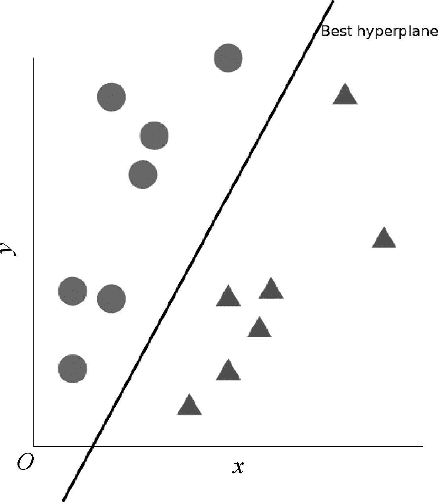
图 3-9 线性可分 SVM 示意

**家族谱系**：诞生即巅峰，90 年代后爆发式演化出 C-SVC、LS-SVM、SVR、SVC、S3VM 等变体。

#### 3. 为何强？四大“护城河”

*   **理论硬核**：统计学习理论奠基，比层次分析、逻辑回归、BP 神经网络更扎实。
*   **小样本高维杀手**：有限样本下构建高维模型，游刃有余。
*   **泛化强**：结构风险最小化，不易过拟合。
*   **全局最优**：凸优化问题，无局部极小值陷阱。
*   **维数不敏感**：依赖支持向量非维度，维数灾难免疫。

---

# 3.3.7 关联规则算法：挖掘数据里的“隐形社交”

1993 年 Agrawal 等人首提概念。关联规则属**描述型模式**、**无监督学习**，专门揭示数据项间“买啥送啥”式的关联关系。

#### 1. 核心度量：支持度 & 置信度 = 强规则筛选器

任意两项集皆可挖规则，但无阈值会产生无穷规则。**实战必须设双阈值**：
*   **最小支持度**：项集出现频次占比（如 $\{A,B\}$ 频繁出现才入选“频繁项集”）。
*   **最小置信度**：$A \to B$ 规则的可信程度（如 $P(B|A)$ 足够大才叫“强关联规则”）。

**挖掘两步走**：
1.  **找频繁项集**：扫原始数据，筛支持度 $\ge$ 阈值的项集（频繁 $K$-项集）。
2.  **生强规则**：基于频繁项集，筛置信度 $\ge$ 阈值的规则。

#### 2. 三大经典算法速览

##### （1）Apriori 算法：奠基之作，迭代生成频繁项集

关联规则挖掘的“鼻祖”级算法，核心是**两阶段频繁项集迭代思想**。
*   产出：单维、单层、布尔型关联规则。
*   机制：利用先验性质——**频繁项集的所有子集必频繁，非频繁项集的超集必非频繁**——层层剪枝，逐层生成候选集、扫数据库、验支持度。

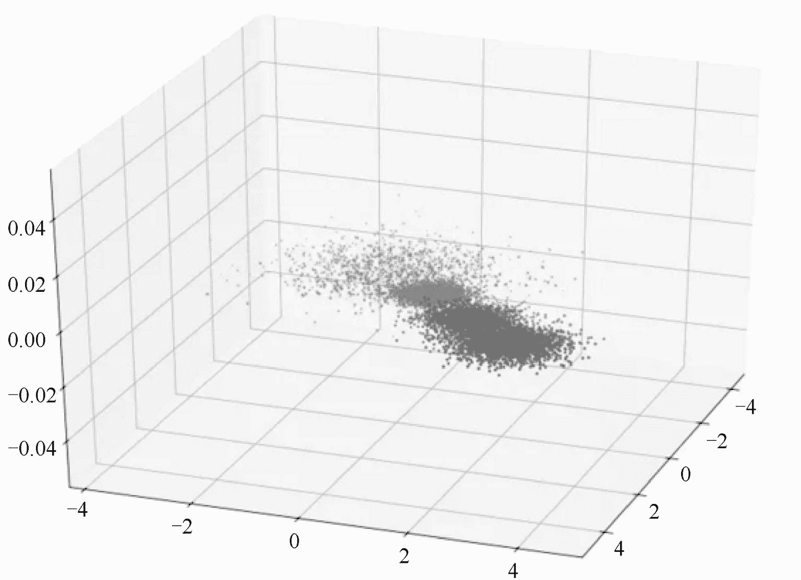
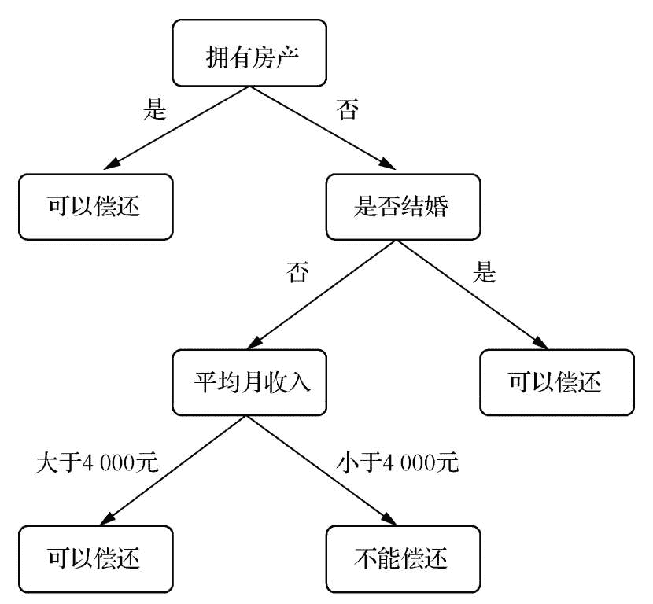
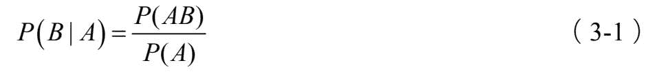
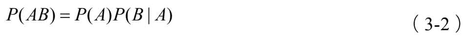
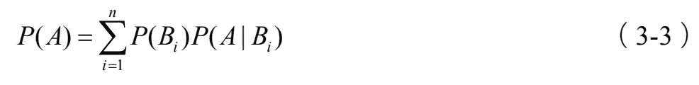
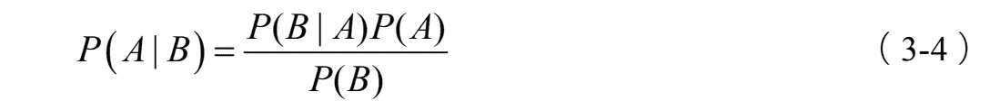


# 第 3 章 关联规则与遗传算法深度解析

## 3.3 关联规则挖掘核心算法

### （1）Apriori 算法：经典奠基者

Apriori 算法的核心逻辑分两步走：先在原始数据中筛选出所有满足预设最小支持度阈值的“频繁项集”；接着基于这些频繁项集生成关联规则，并过滤掉置信度不达标的规则。最终留下的，就是同时达标支持度与置信度双重门槛的“强关联规则”。

### （2）FP-Growth 算法：告别候选集的高效之选

Apriori 虽经典，但因需多轮扫描生成海量候选项集，效率成为短板。韩家炜团队提出的 FP-Growth 算法，引入**频繁模式树（FP-tree）**，彻底摒弃了候选项集生成机制。

其流程颇具“分而治之”智慧：
1.  **首遍扫描建树**：压缩存储频繁项集，保留项间关联信息。
2.  **递归划分条件库**：将 FP-tree 拆解为多个条件模式库，每库对应一个长度为 1 的频繁项。
3.  **分别挖掘**：在各条件库中独立寻找频繁项集。

大数据场景下，还可通过划分策略让巨型 FP-tree 驻留内存。FP-Growth 不仅继承了 Apriori 的精度与适应性，更有效破解了效率瓶颈。

### （3）基于划分的算法：并行化的探索者

该算法采取逻辑分块策略：将数据库切分为互不相交的若干分区，单区独立挖掘局部频繁项集，汇总后作为全局候选集，最后全库扫描一次验证支持度，一步到位生成规则。

**关键约束**：分区大小必须允许装入主存。因局部频繁必在某分区频繁，正确性有保障。
**并行优势**：天然适合多处理器并行，各区分配独立 CPU 挖掘，通信汇总生成全局候选。
**现实痛点**：进程间通信开销与各节点计算时长的不均衡，常导致实际并行效率打折。

---

## 3.3.7 关联规则的落地场景：从“啤酒尿布”到全行业

随着技术成熟，关联规则已渗透电商、金融、医疗等多元领域。

*   **电商零售**：挖掘购物篮关联，驱动“猜你喜欢”交叉推荐与捆绑销策（如手机+壳膜套餐）。
*   **金融营销**：基于行为画像预测需求，在 ATM、App 精准触达理财产品，提升转化。
*   **医疗拓展**：辅助诊断关联、用药搭配分析等新场景正加速落地。

### 经典案例复盘：啤酒与尿布的隐喻

超市交易记录显示：购啤酒者必买尿布。若用 `A→B` 表示关联，则 `{啤酒}→{尿布}` 成立。
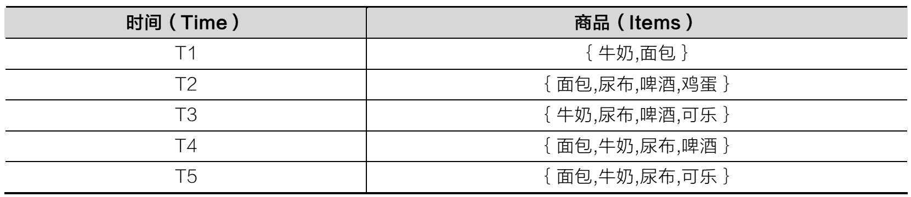
数据统计：5 笔交易中 3 笔同时含啤酒尿布，啤酒出现 3 次全伴随尿布。
*   **支持度** = 3/5 = **60%**（规则覆盖面）
*   **置信度** = 3/3 = **100%**（规则可靠度）

这正是关联分析“发现显而易见却被忽视的真相”的生动写照。

---

## 3.3.8 遗传算法：仿生进化的全局寻优利器

### 1. 核心概述：达尔文主义的代码实践

遗传算法（GA）源于对生物自然选择“物竞天择、适者生存”的模拟。它维护一个种群，通过**选择、交叉、变异**三大遗传算子驱动种群迭代进化，逐代逼近全局最优解。流程简而言之：**初始化 → 适应度评估 → 遗传操作生新代 → 循环终止条件 → 输出最优个体**。

#### （1）核心术语速查表

| 术语 | 算法映射含义 |
| :--- | :--- |
| **基因** | 解的特征单元，通常二进制编码（0/1），具复制、变异特性。 |
| **染色体** | 由基因串联的个体编码（如二进制串），若干染色体组成种群。 |
| **适应度函数** | 进化的“指挥棒”，量化个体优劣，高分者保留重组，驱动种群整体适应度单调上升。 |
| **选择** | 优胜劣汰，按适应度抽取优质个体进入交配池，不改变个体结构。 |
| **交叉** | 两亲本染色体片段互换重组，产生融合双方优势基因的后代。 |
| **变异** | 低概率随机翻转基因位，打破局部最优陷阱，维持种群多样性。 |

#### （2）算法特点画像

*   **编码操作**：直接处理决策变量编码，信息量大，优化效果优。
*   **低依赖性**：对问题领域假设少，鲁棒性强。
*   **概率导向**：搜索规则基于概率而非确定性梯度。
*   **通用性广**：不限目标函数形式（可不连续、不可微、多峰）。
*   **并行天生**：种群个体评估天然并行，易硬件加速。
*   **短板**：编码精度与约束表达受限，缺统一规范，易早熟收敛。

### 2. 算法原理：五步走迭代闭环

1.  **编码**：问题空间 → 基因空间的映射。需满足**完全性、包含性、对应性**。二进制编码最通用简易。
2.  **初始化种群**：随机采样生成首代。规模权衡：大则多样性强抗早熟，小则计算轻量。视问题定制。
3.  **适应度计算**：依目标函数打分，量化“离目标有多近”。
4.  **遗传操作**：选择、交叉、变异三驾马车协同产出下一代。
5.  **解码**：最优染色体 → 问题可行解，完成映射逆过程。

### 3. 应用版图：跨学科的“通用钥匙”

90 年代后理论与应用双爆发，凭借**领域无关、鲁棒性强**特质，攻克大量 NP-Hard 问题：

| 领域 | 典型突破 |
| :--- | :--- |
| **数值优化** | 大规模、多峰、离散变量全局优化，速度质量双超常规梯度法。 |
| **组合优化** | 背包、八皇后、作业调度等 NP-Complete 问题，规避局部极值陷阱。 |
| **机器学习** | 基因型表征知识，进化式学习突破符号主义瓶颈，实现知识增长。 |
| **并行计算** | 算法内在并行性 + 硬件并行 = 加速比质变，催生并行 GA 新分支。 |
| **人工生命** | 进化机制为核心驱动，模拟生命涌现行为的基础工具集。 |
| **图像/模式** | 校准、去噪、特征提取、压缩、三维重建、检索中的参数优化。 |
| **生产调度** | 车间排程、流水线平衡、任务分配等复杂约束下的近似最优调度。 |
| **计算智能** | 与神经网络（高层结构）、模糊系统（低层认知）三足鼎立，融合趋势下构建统一智能框架。 |

---

## 3.4 章节知识地图：机器学习核心版块一览

| # | 核心概念 | 一句话定位 |
| :--- | :--- | :--- |
| 1 | **机器学习本质** | 赋能机器从数据中学习、自我改进性能。 |
| 2 | **监督学习** | 标签驱动，学习输入→输出映射（分类/回归）。 |
| 3 | **无监督学习** | 无标签探索，揭示数据内在结构（聚类/降维）。 |
| 4 | **半监督学习** | 少量有标 + 大量无标协同，突破单一数据瓶颈。 |
| 5 | **迁移学习** | 跨域知识复用，解决目标域样本稀缺难题。 |
| 6 | **强化学习** | 智能体-环境交互，奖惩驱动策略优化（四要素：智能体、状态、动作、奖励）。 |
| 7 | **回归算法** | 量化变量统计依赖，方程建模支撑预测决策。 |
| 8 | **聚类分析** | 相似聚合、差异分离，无监督分组利器。 |
| 9 | **降维技术** | 主成分等手法抽主弃次，平衡精度与效率。 |
| 10 | **决策树** | 树形规则链，根到叶路径即分类决策路径。 |
| 11 | **贝叶斯分类** | 先验+似然→后验，最大后验概率决策。 |
| 12 | **SVM** | 核技巧映射高维，寻最大间隔超平面，支撑线性/非线性/多类。 |
| 13 | **关联规则** | 描述型模式，挖掘项集共现强关联（支持度/置信度/提升度）。 |
| 14 | **遗传算法** | 进化计算代表，仿生全局搜优，不惧非凸/离散/多峰。 |

---

## 3.5 思维训练场：核心考点自测

1.  绘制机器学习分类谱系图（监督/无监督/半监督/强化/迁移）。
2.  复述决策树“自顶向下分裂、剪枝防过拟合”核心原理。
3.  梳理贝叶斯“先验修正、条件独立假设、后验决策”三特点。
4.  阐释 SVM“结构风险最小化、核函数非线性映射、支持向量稀疏性”三支柱。
5.  对比 Apriori、FP-Growth、Partition 三大关联规则算法优劣与适用边界。
6.  完整复现 GA“编码→初始化→适应度→选择/交叉/变异→解码”标准流程。

---

# 第 4 章 深度学习：AI 时代的核心引擎

## 章导读：为何深度学习霸主地位不可撼动？

当前 AI 领域，**深度学习（Deep Learning）占据绝对统治地位**。本章将系统拆解其核心架构与前沿应用。

**本章核心版图**：
1.  神经网络基石
2.  感知机起源
3.  卷积神经网络（CNN）—— 视觉霸主
4.  循环神经网络（RNN）—— 序列建模
5.  生成对抗网络（GAN）—— 生成式 AI 先驱

**理论支撑**：海量研究证实，唯有**多层非线性变换堆叠**的深度架构，才能学习表达高阶抽象特征，攻克目标检测、语音识别、自然语言理解等核心 AI 难题。深层网络层层递进：低层输出作高层输入，自动从海量数据中提取含丰富结构信息的高阶表征，赋能分类、回归、检索等下游任务。

## 4.1 神经网络：仿生智能的数学化身

### 4.1.1 核心定位：大规模并行分布式处理网络

**神经网络（NN/ANN）**：由海量**神经元**广泛互联构成的计算图，是对人脑结构与机制的**抽象、简化与模拟**。

**双重仿生内核**：
1.  **学习获知**：通过学习过程从环境习得知识（而非硬编码）。
2.  **分布式存储**：知识以**连接权重（联结强度）**的分布式物理形式内化于网络拓扑中。

**工程视角定义**：针对特定问题，依神经生物学机理、控制理论与数学建模，构建参数化模型，经算法训练确定参数，获取问题求解器。

**核心优势矩阵**：
*   **非线性建模强**：擅长高维复杂非线性映射，兼顾定性/定量。
*   **自学习/自适应**：无需专家规则，从数据自动归纳规律。
*   **并行/分布式**：天生适配并行硬件，吞吐率高。
*   **鲁棒容错**：局部损伤不致系统崩溃，泛化性优。

### 4.1.2 近 80 年跌宕史：三次浪潮

| 时期 | 关键节点 | 里程碑事件 | 影响 |
| :--- | :--- | :--- | :--- |
| **起步期 (40s-60s)** | **1943** | McCulloch & Pitts **MP 模型** | 奠定神经元数学基石（阈值逻辑单元）。 |
| | **1949** | Hebb **学习规则** | “一起激发，一起连接”，非监督学习雏形，沿用至今。 |
| | **1957** | Rosenblatt **感知机** | 首个可学习线性分类器，单层前馈网络。 |
| | **1960** | Widrow & Hoff **Adaline** | 连续值输出，LMS 算法，适应信号处理先驱。 |
| **低潮期 (69-80s)** | **1969** | Minsky & Papert **《感知机》** | 证明单层感知机**仅能线性可分**，多层缺乏有效训练算法。权威背书导致资金断流、研究近乎停滞近 20 年。 |
| **复兴期 (80s-今)** | *后文将详述 BP 算法、CNN/RNN/GAN 等突破* | 多层网络训练突破、算力爆发、大数据红利 | 奠定当今 AI 霸主地位。 |

> **历史启示**：科学进步非线性。MP 模型与 Hebb 规则的早期火种，在 Minsky 严厉批判的寒冬中沉睡，待 BP 反向传播算法、GPU 算力与海量数据“三驾马车”汇聚，终燃起燎原之势。

# 三、 复兴：BP算法点燃星星之火

即便在神经网络研究的寒冬期，依然有学者坚守阵地，硕果累累。最具标志性的当属1982年，加州理工学院教授约翰·霍普菲尔德（John Hopfield）构建的**霍普菲尔德神经网络**。该网络基于运算放大器搭建反馈架构，霍普菲尔德巧妙引入李雅普诺夫函数确立稳定性判据，更为经典的组合优化难题——旅行商问题（TSP）提供了创新求解思路。霍普菲尔德网络由此在联想存储与优化计算领域大放异彩。

1985年，杰弗里·辛顿（Geoffrey Hinton）携手大卫·鲁姆哈特（David Rumelhart）等人攻克多层感知机权值训练难关，提出**反向传播算法**，一举解决了多层网络的学习瓶颈，强力拉动神经网络研究步入崭新复兴期。

### 4.1.3　单个神经元：感知机器的“最小细胞”

以监督学习为切入点，面对带标签样本集 `(x[i], y[i])`，神经网络通过构建含参数 `w`、`b` 的复杂非线性假设模型 `h_{w,b}` 实现数据拟合。

我们从最微观的**单个神经元**起步，解剖网络架构。图 4-1 展示了仅含一个神经元的极简模型。

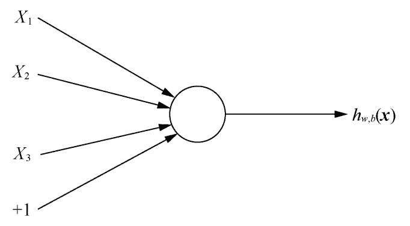

图 4-1　单个神经元极简网络模型

这个神经元是核心运算单元：输入为训练样本 `X[1], X[2], X[3]`，额外引入 `+1` 作为偏置项；输出为 ``，其中 `f` 即激活函数。本质上，这种输入输出映射等同于**逻辑回归**。早期常选用 `Sigmoid` 函数（式 4-1）作为激活单元。

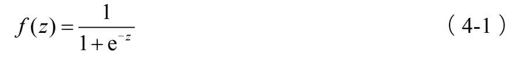

当然，双曲正切函数 `tanh`（式 4-2）也是备选方案。

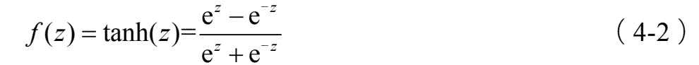

### 4.1.4　神经网络结构：从单元到系统的进阶

将多个单一神经元级联——前一单元输出作为后一单元输入，便形成基础神经网络，示意见图 4-2。

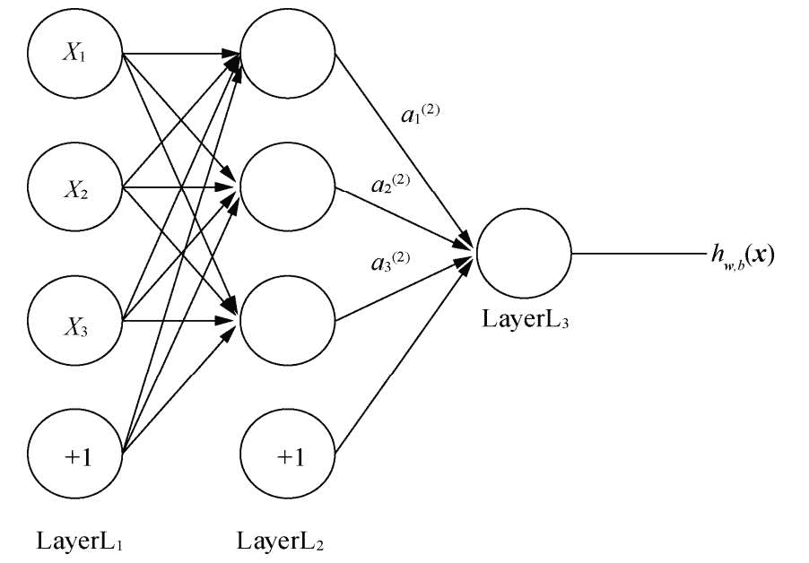

图 4-2　基础神经网络模型示意

图中圆圈代表神经节点，`+1` 为偏置/截距节点。最左层为**输入层**，最右层为**输出层**，中间夹层称**隐藏层**（因训练中不可直接观测节点值而得名）。图例网络拥 3 个输入节点（不含偏置）、3 个隐藏节点、1 个输出节点。

主流网络拓扑大致归为五类：

1.  **前馈式网络**：分层排布，层间单向连接，信息单向流动。
2.  **输出反馈前馈网络**：在前馈基础上，新增输出层至输入层的反馈回路。
3.  **前馈式内层互连网络**：同层节点相互关联制约，但层间仍保持前馈特性，自组织网络多采此结构。
4.  **反馈型全互连网络**：任意两神经元输出相连，构建动态反馈系统，具备基于能量函数的自寻优能力。
5.  **反馈型局部互连网络**：节点仅与周围若干层互连，形成局部反馈，宏观呈网状拓扑。

### 4.1.5　神经网络学习：在迭代中进化

“学习”即“训练”，指网络在环境刺激下调整自由参数，从而以新方式响应外界的过程。**从环境中学习、在学习中提升性能**，是神经网络的核心禀赋；反复博弈后，网络对环境认知愈发深刻。

学习算法是解决学习问题的显性规则集。学习类型由参数变化形式决定，不同算法对应不同权值更新表达式。**没有万能算法**，选型需兼顾网络结构与环境交互方式。

完整学习流程三步走：
1.  **结构定变量与拓扑**：如连接权重 `Weights`、神经元激励值 `Activities`。
2.  **激励函数驱动短时动力学**：定义神经元如何依据他 neuron 活动更新自身激励，通常依赖网络权重。
3.  **学习规则主导长时动力学**：规定权重随时间演进的调整策略，依赖神经元激励值，亦可能引入监督目标值与当前权重。

理解结构 → 应用激励函数训练 → 执行学习规则，三位一体完成网络学习闭环。

### 4.1.6　激活函数：赋予网络“非线性灵魂”

激活函数对人工神经网络及 CNN 理解复杂非线性函数至关重要。网络输出本质是上层输入的加权和，若无非线性干预，模型退化为线性模型，难解复杂问题。**激活函数引入非线性变换，让网络具备通用函数逼近能力。**

若激活函数为线性，无论层数多深，最终仅等价单隐层，失去非线性表达力。早期激活函数将输出压缩至有限区间，利于梯度下降稳定；随着优化算法演进，激活函数职能早已突破单纯归一化。

主流三大激活函数：**Sigmoid、tanh、ReLU**，逐一拆解：

#### 1. Sigmoid 函数
定义见式 4-3，导数见式 4-4。

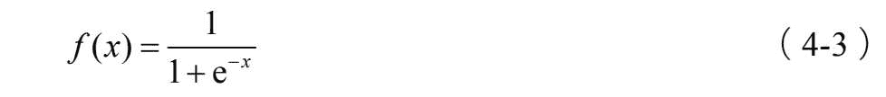
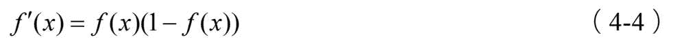

**特点**：输出区间 (0,1)，求导简便，早期深受青睐。  
**痛点**：饱和区梯度趋近于 0，反向传播时链式求导导致梯度消失，参数无法更新，现已鲜少使用。

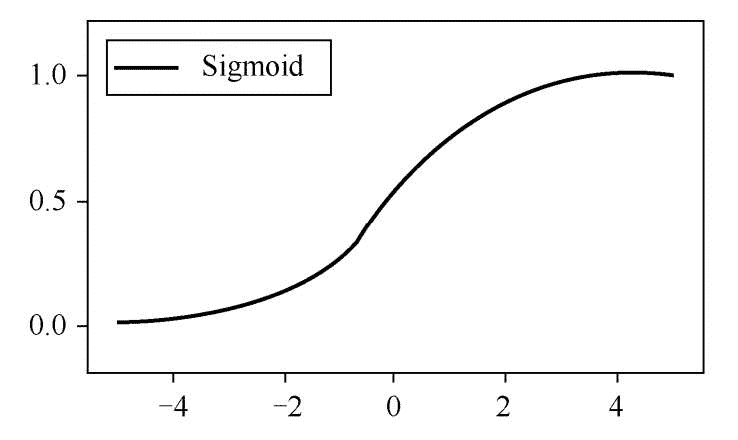
图 4-3　Sigmoid 激活函数曲线

#### 2. tanh 函数
定义见式 4-5，导数见式 4-6。

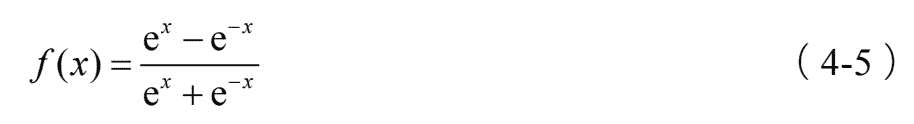
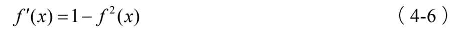

**特点**：输出区间 (-1,1)，零均值特性使收敛速度快于 Sigmoid。  
**痛点**：同样面临饱和区梯度消失困境。实战中使用频次高于 Sigmoid。

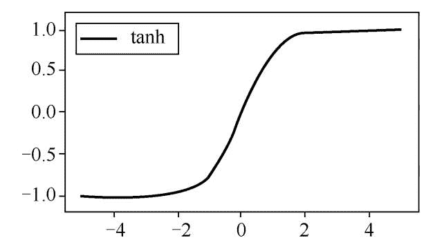
图 4-4　tanh 激活函数曲线

#### 3. ReLU 函数（线性整流单元）
定义见式 4-7，导数见式 4-8。

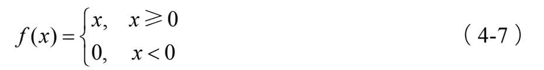
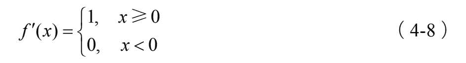

**杀手级优势**：
*   **收敛加速**：大幅提升随机梯度下降（SGD）收敛效率。
*   **计算极简**：仅需阈值判断，避免指数运算，显著降低训练算力。
*   **稀疏表达**：部分神经元输出为 0，削弱参数耦合，缓解过拟合。
*   **缓解梯度消失**：正区间梯度恒为 1，有效对抗梯度衰减。

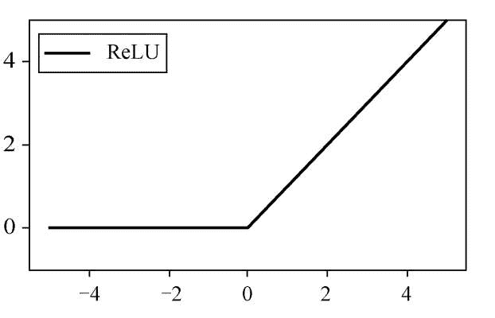
图 4-5　ReLU 激活函数曲线

**隐患**：学习率过大易导致“神经元死亡”（永久输出 0，参数冻结）。衍生改进版层出不穷：
*   **Leaky-ReLU**（式 4-9）：引入小常数 `a` (通常 0.01) 保留负区间梯度。
*   **RReLU**：`a` 为区间内随机采样值。
*   **PReLU**：`a` 为可学习参数。
虽有改良，但 **ReLU 仍是当前应用主力**。

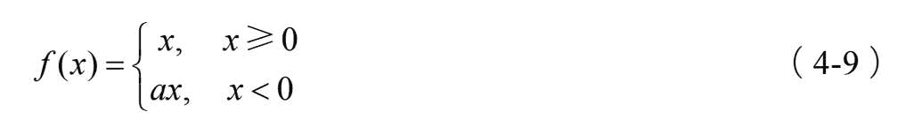

### 4.1.7　损失函数：量化拟合优劣的“指挥棒”

损失函数反映模型拟合度：**拟合越差，值越大；值越大，梯度越大，参数更新越快。**

两大常用范式：
*   **均方误差 (MSE)**，公式见式 4-10。`y` 为真实值，`y'` 为预测值。
    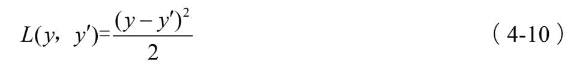
*   **交叉熵损失**：CNN 分类任务首选，公式见式 4-11。变量含义同前。
    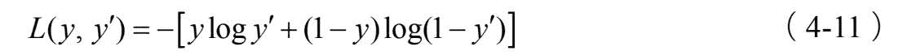

## 4.2　感知机：深度学习的“地基基石”

感知机虽是入门基模，却奠定神经网络与 SVM 的基石，堪称最古老分类器之一。

### 4.2.1　感知机溯源

1957年，弗兰克·罗森布拉特首创感知机，实现了最早的人工神经网络。它是**特殊形态的神经网络**：能力有限，却具里程碑意义。家族包含线性感知机（线性分类）与多层感知机 MLP（非线性分类）。

**核心目标**：寻找超平面 `w·x + b = 0`，将训练集正负样本完全切分。通过最小化**基于误分类的损失函数**求解参数 `w、b`。

**线性可分前提**：二维平面上若存在直线完美分隔 “+1” 与 “-1” 类，则称样本空间线性可分，感知机仅适用于此类问题。

### 4.2.2　多层感知机 (MLP)：前馈网络的标准范式

MLP 即前馈神经网络，深度学习最基础架构，结构见图 4-6。

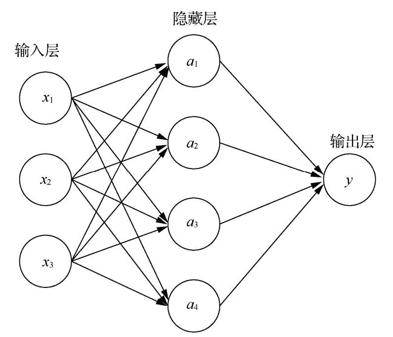
图 4-6　MLP 网络架构

**三层核心构成**：
*   **输入层**：接收外部信息，无计算，仅分发至隐藏层。
*   **隐藏层**：信息加工中枢，处理后传递输出层。
*   **输出层**：计算最终输出，回传外部世界。

图例为 3 层 MLP：3 输入 (`x1-x3`)、4 隐藏节点 (`a1-a4`)、1 输出 (`y`)。前向计算流程见式 4-12。

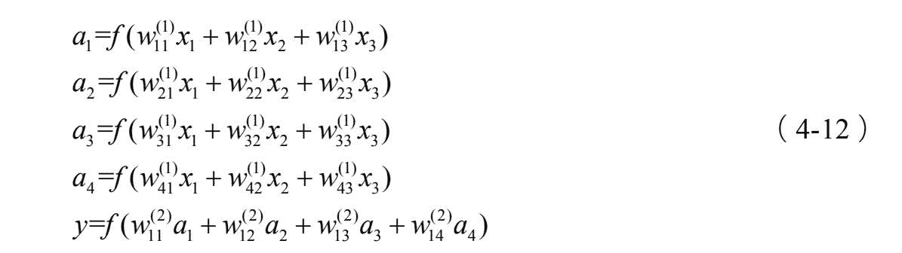
式中 `a[i]` 为隐藏节点激活值，`w^((l))[ij]` 为层间连接权重，`f(·)` 为激活函数。

**训练依托反向传播 (BP) 算法**：
前向传激活值（左→右），反向传梯度值（右←左）。BP 迭代三步走：
1.  前向逐层计算状态与激活值至输出层。
2.  逐层计算误差。
3.  对损失函数求导，自右向左逐层更新参数。
循环至满足停止条件。

**优劣势并存**：
✅ 并行处理强、擅长捕捉非线性关系。  
❌ 隐藏节点数难定、超参数多、收敛慢、易陷局部极值。

## 4.3　卷积神经网络 (CNN)：视觉识别的“主力军”

# 卷积神经网络

**CNN 即 “神经网络 + 卷积运算”**。卷积核局部感知提取图像特征，层层堆叠抽象深层语义，赋能精准分类与预测。对比传统机器学习，CNN 更忠实刻画数据内在相关性，现为图像、行为识别领域绝对主流。

### 4.3.1　CNN 架构全景扫描

CNN 初衷是**降低图像预处理依赖，规避繁琐特征工程**。架构包含输入层、输出层、多隐藏层。隐藏层细分四大功能模块：
*   **卷积层** - 核心特征提取器
*   **池化层** - 下采样压缩器
*   **ReLU 层** - 非线性激活单元
*   **全连接层** - 最终决策分类器

卷积层与池化层交替组卷积组，层层递进提取特征。

**数据流向**：输入通常为二维向量（如 RGB 图像三通道）→ 卷积层组提取高阶特征 → 全连接层 (1-2层) 输出分类结果。CNN 实现从原始像素到视觉规律的**极少预处理、端到端映射**。

**三大核心特性** 差异化传统网络：
1.  **局部感知**：卷积核每次仅覆盖局部像素（局部特征），打破全连接全局感知模式。
2.  **权值共享**：同一卷积核参数在图像上滑动复用，**大幅削减参数量，抑制过拟合，降低模型复杂度**——这是 CNN 最大亮点。
3.  **多卷积核**：多核并行，多维度充分提取图像特征。

### 4.3.2　CNN 结构深度解剖

CNN 系 MLP 变体，仿生视觉神经局部响应机制，采用**局部连接 + 权值共享**双重机制，显著降维参数、提速训练、强化泛化。当前神经网络研究最活跃分支。典型 CNN 由**卷积层、池化层、全连接层**三驾马车构成，全貌见图 4-7。

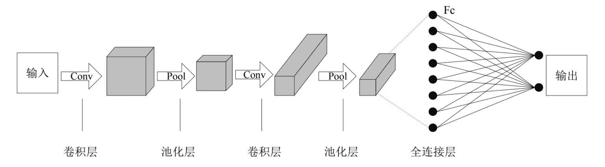
图 4-7　CNN 典型架构

#### 1. 卷积层：特征提取引擎
卷积是线性计算过程，执行逻辑三步走：
1.  **定核**：核尺寸人为设定，核数量 = 输出图像通道数。
2.  **滑动扫描**：核按左→右、上→下顺序遍历二维图像，对应位置元素相乘求和。
3.  **生成特征图**：求和结果填入对应位置，输出卷积后特征图。

首次扫描计算演示见图 4-8。

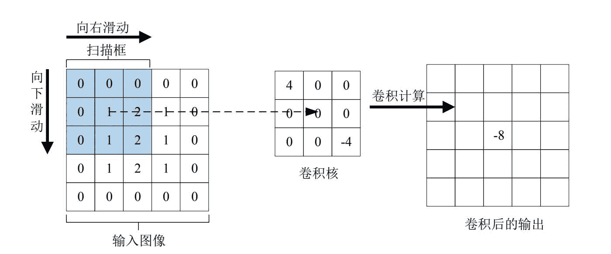
图 4-8　卷积核首次扫描计算示意

#### 2. 池化层：降维精简利器
又称**下采样层**。对卷积特征图做统计聚合，双重收益：
*   降维压缩数据量。
*   保留关键信息，抑制过拟合，提升泛化。
*   缩小输出尺寸，减少后续计算量。

两大主流策略：
*   **最大池化**：取区域最大值，保留纹理显著特征。示意图 4-9。
    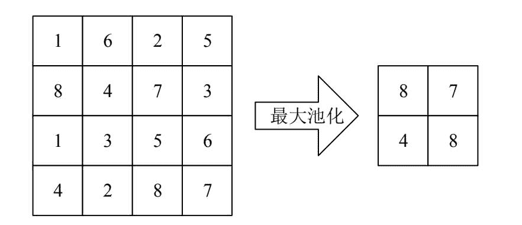
    图 4-9　最大池化演示
*   **平均池化**：取区域均值，保留背景整体特征。示意图 4-10。
    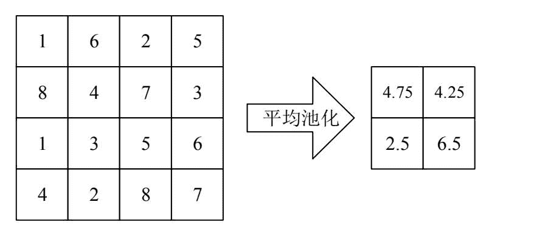
    图 4-10　平均池化演示

#### 3. 全连接层

### 4.3.3 主流卷积神经网络架构解析

主流的卷积神经网络架构主要集中在以下三款经典模型上。

#### 1. VGG 网络
VGG 提供了两个版本：VGG16 与 VGG19，核心架构一致，仅层数深浅有别。其整体布局采用“卷积模块堆叠 + 全连接模块”的模式。VGG 模块遵循固定范式：数个 padding=1、kernel=3×3 的卷积层连用，随后跟一个 stride=2、kernel=2×2 的最大池化层。卷积层维持特征图尺寸不变，池化层则将高宽压缩为一半。

其设计精妙之处在于“以小博大”：用三个 3×3 卷积核串联替代单个 7×7 核，用两个 3×3 替代 5×5 核。在感受野等效的前提下，这显著加深了网络层数，强化了非线性表达能力。参数量上，三个 3×3 卷积参数为 3×(9×C²)=27C²，远低于单个 7×7 卷积的 49C²，既瘦身又保留了图像细节特性。

**优势**：架构极简统一（全程 3×3 卷积 + 2×2 池化）；小核组合优于大核单层；实证加深网络能提升性能。
**短板**：计算开销大，参数量巨显存占用高。

#### 2. GoogLeNet (Inception v1)
GoLeNet 主干同样由 5 个模块构成，模块间以 3×3 最大池化（步长 2）下采样。

*   **模块 1**：单层 64 通道 7×7 卷积起步。
*   **模块 2**：两层卷积，先 1×1 降维（64 通道），再 3×3 扩维（192 通道），对应 Inception 结构的第二分支。
*   **模块 3**：串联两个完整 Inception 块。首块输出 256 通道（四分支比 2:4:1:1），次块增至 480 通道（比 4:6:3:2）。3×3、5×5 分支前均接 1×1 卷积做瓶颈层压缩通道（压缩比各异）。
*   **模块 4**：最复杂，串联 5 个 Inception 块，输出通道从 512 逐步增至 832。通道分配策略延续：3×3 分支最多，其次 1×1，再 5×5 与池化分支。
*   **模块 5**：两个 Inception 块，输出 832 与 1024 通道。末尾经全局平均池化展平，接分类全连接层。

**特点**：Inception 多尺度并行融合思想显著，但结构定制化强，不如 VGG 便于通道数微调。

#### 3. ResNet (残差网络)
ResNet 前两层沿用 GoogLeNet 设计：7×7 卷积（64 通道，步长 2）+ 3×3 最大池化（步长 2）。关键差异在于两点：**每个卷积层后强制接批量归一化 (BN)**；主干由 4 个**残差块**堆叠阶段组成（非 Inception 块）。

阶段 1 通道数不变，因前序已池化，无需再下采样。阶段 2-4 首个残差块均执行“通道翻倍 + 空间减半”操作，后续块在同分辨率下深化特征。短路连接机制有效缓解了深层网络的梯度消散难题。

---

### 4.4 循环神经网络 (RNN)

RNN 是深度学习中独具特色的自循环架构，擅长建模复杂的向量到向量映射。1986 年 Jordan 与 1990 年 Elman 奠基的简单循环网络 (SRN) 是现代 RNN 变体的鼻祖。凭借对时序依赖的天然建模能力，RNN 广泛服务于语音、文本等序列任务。

#### 4.4.1 核心机制
RNN 接收序列输入，沿时间维递归计算，节点间链式闭环形成递归拓扑。其核心在于**“记忆”**：隐藏层节点互联，当前隐状态融合了“当下输入”与“过往隐状态”。可视为同一细胞在时间轴上无限展开复用。这种闭环赋予了网络捕获历史上下文的能力，使当前输出受累积信息影响，在 NLP、语音识别、语言建模中地位核心。

#### 4.4.2 结构拓扑
RNN 适配序列相依场景。隐藏层呈循环状，意味着隐状态 $h_t$ 由 $x_t$ 与 $h_{t-1}$ 共同决定。展开图中每个圆环为一个共享参数的循环单元，折叠后即为紧凑的单层结构。

预测机制体现为：$y_t$ 由 $x_{1...t}$ 共同决定。例如输入“我是中国”，模型结合“中国”前的“是”、“我”预测下一词，“人”的概率最高。

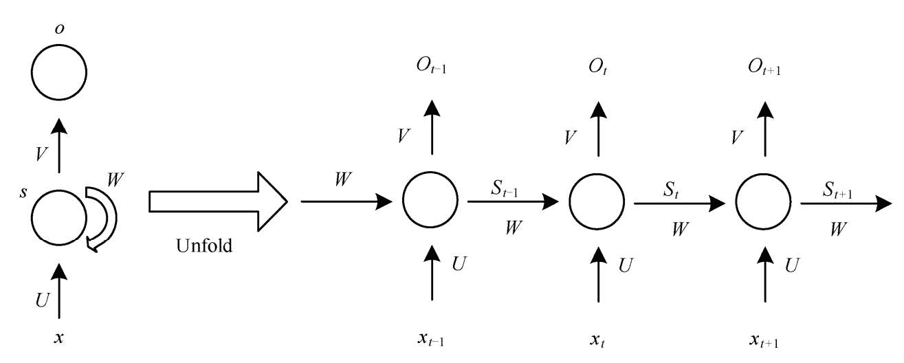

图 4-11　RNN 结构示意图

#### 4.4.3 两大改进变体

**1. 长短期记忆网络 (LSTM)**
LSTM 引入三大“门”机制（输入、遗忘、输出门）实现信息流的精细调控。门单元本质是 Sigmoid 全连接层配合逐元素乘法，输出 0-1 间连续值模拟“开合度”：1 全通，0 全阻。

标准 RNN/CNN 理论支持无限序列，实践中长距离依赖易发散。LSTM 通过**细胞状态 (Cell State)** 引入恒等映射通路，配合门控机制，攻克了长程依赖建模难题，同时有效抑制梯度消失/爆炸。凭借此特性，LSTM 在视觉、语音、NLP 领域全面开花。

**2. 门控循环单元 (GRU)**
GRU 是 LSTM 的轻量化改良版。虽 LSTM 解决长依赖，但结构繁复、训练推理耗时。GRU 两大刀法精简架构：
*   **合门**：融合输入门与遗忘门为**更新门**，统管旧信息保留比例；
*   **去状态**：移除独立细胞状态，直接在隐状态上通过**重置门**控制遗忘程度，实现线性自更新。
GRU 参数更少，收敛更快，是工程落地常用的高性价比选择。

---

### 4.5 生成对抗网络 (GAN)

2014 年，Ian Goodfellow 受零和博弈启发提出 GAN，核心在于**隐式学习训练数据的概率分布**，在生成式模型中独树一帜，广泛赋能视觉、语音、机器学习前沿。

#### 4.5.1 对抗博弈范式
GAN 构建双玩家零和博弈：**生成网络 G（造假者）** 与 **判别网络 D（鉴别者）**。
1.  G 捕获真实样本 $x_{real}$ 分布，注入随机噪声 $z$ 产出假样本 $x_{fake}$。
2.  D 同时观测 $x_{real}$ 与 $x_{fake}$，输出为真概率。
3.  博弈流程：D 先“练眼力”学习真样本分布；G 后“练手艺”试图欺骗 D。随 D 认知深化，G 欺骗难度升级，被迫进化生成质量。动态均衡中，D 鉴别力与 G 生成力双双攀升。

**八大核心优势**：
1.  隐式学习真实分布，探知数据本质结构；
2.  极强的生成预测能力；
3.  生成样本鲁棒性强，抗脆弱；
4.  以假乱真样本缓解小样本困境；
5.  为复杂任务 AI 提供新范式；
6.  对抗学习更贴近人类认知机制；
7.  **免设计损失函数**——自动学习目标函数（区别于传统网络）；
8.  化解先验概率难确定的难题。

#### 4.5.2 网络拓扑与纳什均衡
GAN 由 G 与 D 共建。G 输入噪声 $z$（通常 100 维），输出 $G(z)$；D 输入真实 $x$ 与生成 $G(z)$，输出真实概率标量（真→1，假→0）。D 的梯度反传指导 G 更新。

**最优态**：D 无法区分真假，输出恒定 0.5（随机猜测），此时达**纳什均衡**。实战中均用深层网络参数化 G/D，通过交替迭代逼近均衡。

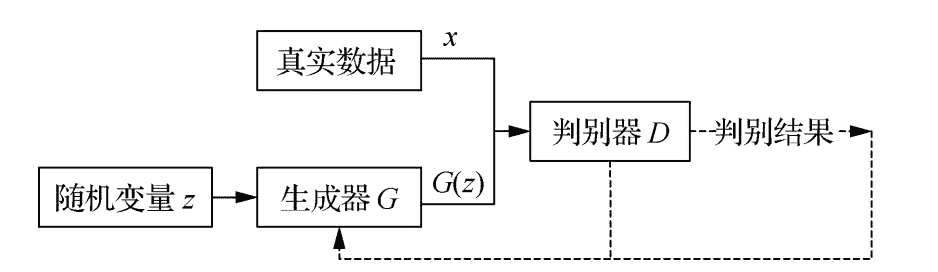

图 4-12　GAN 模型结构示意图

目标函数见式 4-13。


*   **生成网络 G**：可微函数 $G(z)$。输入 $z$ 无严格分布限制，训练后逼近真实分布，生成逼真且多样图像（非单纯记忆），利于数据增强。
*   **判别网络 D**：可微二分类器。零和博弈中通过对抗训练双向提升，均衡态下 G 学得近似分布，D 判别失效（输出 0.5）。

#### 4.5.3 三大经典变体

**1. 条件 GAN (CGAN)**
原始 GAN 生成过程不可控。CGAN 在 G 与 D 输入端注入条件变量 $y$（类别标签/属性向量），强制定向生成。缺点：仅加约束未解训练不稳定，损失函数震荡依旧。

**2. 深度卷积 GAN (DCGAN)**
里程碑式融合 CNN 与 GAN，奠定生成质量基石。工程技巧集大成：BN 稳定训练、ReLU/LeakyReLU 抑制梯度消失、**弃池化用步长卷积**（下采样/上采样）保留特征。虽生成多样，但分辨率/质量受限，G/D 动态平衡仍需精细调度。

**3. 循环一致性 GAN (CycleGAN)**
攻克**无配对图像互译**难题。传统 Pix2Pix 需成对数据（稀缺），CycleGAN 构建双向环形结构：
*   域 X 图像 $x \xrightarrow{G} G(x)$（伪 Y 域）$\xrightarrow{D_Y}$ 真伪判别；
*   域 Y 图像 $y \xrightarrow{F} F(y)$（伪 X 域）$\xrightarrow{D_X}$ 真伪判别。
*   **核心约束**：循环一致性损失 $||F(G(x)) - x|| + ||G(F(y)) - y||$，防止模式崩塌（全映射为同一图像）。
*   代价：环路传递引入信息损耗，生成细节保真度有待提升。

---

### 4.6 深度学习应用全景

深度学习凭借逼近人类认知的智能表现，已在 AI 领域确立统治地位，悄然重塑生活：刷脸支付、语音助手、机器翻译、自动驾驶、棋类巅峰对决……

#### 4.6.1 AlphaGo Zero：自进化的棋圣
2018 年 12 月，兼擅围棋、国际象棋、日本将棋且**纯自博弈从零学起**的 AlphaGo Zero 登顶《Science》封面。

##### 1. AlphaGo Zero 简介

# AlphaGo Zero：从“学徒”到“宗师”的自我进化

`AlphaGo Zero` 是谷歌 `DeepMind` 团队推出的里程碑式新版本。回溯 2016 年 3 月，`AlphaGo Master` 凭借学习海量人类棋谱，以 4:1 击败李世石九段，震惊世界。时隔一年多，2017 年 10 月 19 日，《自然》杂志刊登最新论文，揭开了 `AlphaGo Zero` 的面纱：它彻底摒弃了人类经验数据，仅用 3 天自我博弈训练，便以 100:0 的完美比分横扫 `AlphaGo Master`。更令人震撼的是，这种“无师自通”的能力不止于围棋，几小时内它便击溃了国际象棋顶尖引擎 `Stockfish`，证明了其具备解决通用棋类问题的潜力。下图记录了这场“人机巅峰对决”的关键棋谱。


图 4-13　`AlphaGo Zero`击败`AlphaGo Master`的棋谱

`DeepMind` 融合深度学习与经典强化学习，打造出了这套全新的自主智能系统。`AlphaGo Zero` 的颠覆性主要体现在五大维度：

1.  **碾压级胜利**：以 100:0 完封前代最强版本 `AlphaGo Master`。
2.  **零知识启动**：完全抛弃人类棋谱等先验知识，从“空白页”开始学习。
3.  **极速进化**：仅 72 小时即达成世界冠军级水准。
4.  **架构轻量化**：采用更精简的神经网络结构。
5.  **数据极简主义**：训练样本仅源于自我对弈，无需外部海量数据喂养。

## 核心突围：如何实现“从零开始”的自学成才

与前代依赖“人类导师”不同，`AlphaGo Zero` 最大的特质在于**纯自学**。它无需任何人类输入，便能从零掌握围棋规则，通过不断的自我博弈，从输赢中反向调整策略参数，逐渐领悟制胜走法，而非单纯分析对手特征。其设计哲学的核心转向在于：**目标不再是“急于求胜”，而是“专注学习”本身。**

这一过程的技术支柱由三大模块构建：
*   **算力基座**：5000 块 TPU（张量处理单元）提供澎湃算力。
*   **大脑皮层**：深度神经网络负责直觉判断。
*   **思维引擎**：通用强化学习算法配合蒙特卡洛树搜索（MCTS）进行深度推演。

学习呈现**动态成长**特性：每接触一种新棋类，系统便发起一轮轮自我对弈，根据难度自动调节超参数（经贝叶斯优化），实时迭代神经网络。训练成熟的网络能精准指引 MCTS 搜索，将浩瀚的走法空间压缩为当下最优的几个候选项，极大提升了决策效率与精度。

本质上，`AlphaGo Zero` 是一个**通用最优化搜索算法**。对于一切“开放信息”（双方棋力透明）且“离散可枚举”（状态有限，如围棋 361 个交叉点）的问题，只要能构建完美模拟器，该算法皆可适用。股票预测、自动驾驶等涉及隐性信息或连续变量的场景，则不在其适用边界内。

---

# 4.6.2 自动驾驶：深度学习重塑出行未来

过去十年，自动驾驶技术飞跃式发展，深度学习与 AI 的突破是核心驱动力。

## 一、 行业全景：商业化落地成焦点

深度学习凭借**高精度、强鲁棒性、低成本**三大优势，攻克了环境感知等核心难题，推动无人驾驶加速迈向商业化。车企与科技巨头纷纷入局：百度 2020 年启动路测，Uber 深耕出行服务，特斯拉、沃尔沃、宝马等传统车企则聚焦高速公路 L2+/L3 级辅助驾驶的量产落地。

## 二、 技术底座：软硬协同的复杂系统

自动驾驶是一个**软硬深度融合**的系统工程，核心支柱包括：
*   **硬件层**：整车制造工艺、自动驾驶专用芯片（SoC）。
*   **软件层**：感知、决策、控制算法栈。
*   **基建层**：高精地图、V2X 车路协同通信网络。
*   **感知层**：摄像头、毫米波雷达、激光雷达、超声波、GPS/IMU 等多模态传感器矩阵。

车载计算机融合这些异构数据，输出驾驶指令。软件架构核心三大模块协同作战：

| 核心模块 | 关键职能 | 细分任务 |
| :--- | :--- | :--- |
| **环境感知** | “看清世界” | 多传感器融合、目标检测分类（车/人/标志）、多目标跟踪、高精定位（自车位姿+相对速度） |
| **行为决策** | “想清路怎么走” | 遵规则、保安全、求效率；全局规划（导航级）+ 局部规划（避障/变道级），兼顾乘坐舒适度 |
| **运动控制** | “脚下踩得准” | 依据轨迹与车辆状态，精准控制油/刹/方向/挡位，实执行层闭环 |

## 三、 运作闭环：从感知到执行的完整链路

自动驾驶的运行逻辑遵循 **感知 → 定位 → 预测 → 规划 → 控制** 的经典管线：

1.  **环境建模与定位**：首要任务是构建周围世界模型，并精准确定自车位置。
2.  **路径与行为规划**：在起终点间寻找最优路径，并预判动态障碍物意图，生成无碰撞轨迹。这本质是**多智能体博弈**——超车、汇入、十字路口通行，皆需与周边交通参与者进行隐性“谈判”。
3.  **运动控制执行**：底层控制器实时修正执行偏差，确保车辆精准跟随规划轨迹。

### 深度学习如何赋能“车脑”？

视觉感知是当前主流方案。流程直观高效：
**摄像头采集图像 → 卷积神经网络（CNN）提取特征 → 网络回归输出控制量（加速度、转角等）。**

这相当于用深度神经网络模拟人类驾驶员的“眼脑手足”协同。下图展示了基于深度学习的仿真驾驶演示。


图 4-14　深度学习在进行自动驾驶的仿真

---

# 4.7 章节小结：神经网络家族谱系速览

1.  **神经网络（ANN）**：模拟人脑神经元连接的抽象网络，继承了并行处理、分布式存储、容错自适应等生物特性。
2.  **感知机**：早期极具实用价值的线性分类基石。
3.  **卷积神经网络（CNN）**：引入卷积核局部感知、权值共享、池化下采样，层层递进提取图像从浅层纹理到深层语义特征，成就视觉识别霸主地位。
4.  **循环神经网络（RNN）**：针对序列数据设计，链式循环结构赋予网络“记忆”能力，擅长处理时序关联任务。
5.  **生成对抗网络（GAN）**：生成网络（造假）与判别网络（鉴真）博弈共进，通过极小化极大博弈收敛至纳什均衡，实现高质量数据生成。

---

# 4.8 思考与练习

1.  简述神经网络的基本拓扑结构。
2.  分析多层感知机（MLP）的优势与局限。
3.  勾勒典型 CNN 架构（如 LeNet/AlexNet/ResNet）的层级组成。
4.  列举主流 RNN 变体（LSTM/GRU 等）及其改进动机。
5.  解释 GAN 的零和博弈训练机制及收敛条件。

---

# 第 5 章 计算机视觉：赋予机器“看懂世界”的能力

> **本章导读**  
> 视觉是智能感知的主通道。人类 80% 以上信息源自视觉，计算机视觉（CV）亦是机器认知物理世界的基石。本章系统梳理 CV 核心理论、关键任务（分类/检测/分割）及前沿应用。

> **本章看点**  
> 1. 计算机视觉核心范式  
> 2. 图像分类：单标签到多标签  
> 3. 目标检测：定位与识别并重  
> 4. 图像分割：像素级理解

## 5.1 计算机视觉概述：从“看见”到“看懂”

### 5.1.1 学科定位与核心范式

**计算机视觉**是一门融合**图像处理、模式识别、人工智能**的交叉前沿学科，具备**快速、实时、低成本、一致性高、客观无损**等工程优势。

*   **核心使命**：利用光学成像与算法模拟人类视觉捕捉与三维理解能力，最终驱动执行机构决策行动。
*   **基本流程**：图像传感器采集 → 图像数字化（像素/颜色/亮度 → 数字信号） → 特征提取与运算分析 → 目标识别/检测/控制。
*   **建模工具箱**：从传统的 PCA、SVM、贝叶斯、遗传算法、BP 神经网络，到现代深度学习架构，构建判别模型支撑业务判断。

**三大差异化特质**让 CV 在 AI 落地中独树一帜：
1.  **全新赛道**：非预测分析的改良，而是全新感知维度的开拓。
2.  **确定性推理**：针对“当下图像内容”做分类判断，而非预测“不确定未来”，准随数据规模单调递增，极易超越人类水平。
3.  **数据红利**：标注图像/视频成本远低于结构化数据清洗，海量训练样本易获取，催化技术爆发。

### 5.1.2 发展演进：从几何重构到深度学习霸权

| 时代节点 | 核心范式与里程碑 | 典型应用 |
| :--- | :--- | :--- |
| **1966 启蒙** | 明斯基“夏日项目”：让机器描述摄像头所见——CV 学科雏形。 | — |
| **70-80s 萌芽** | MIT 设首门课程；Marr 提出“表征”是核心。两大流派：<br>① **三维重构**：双目立体视觉恢复 3D 结构。<br>② **先验知识库**：建模物体属性（圆/光滑）匹配识别。 | OCR、工件识别、航拍/显微图像分析 |
| **90s 工业化** | 硬件（CPU/DSP）飞跃 + 统计学习/局部特征描述符（SIFT/HOG）引入。 | 工业视觉检测、安防雏形 |
| **21世纪 机器学习时代** | 互联网海量数据 + 机器学习（Adaboost/SVM/随机森林）替代手工规则。<br>经典场景：Viola-Jones 人脸检测、车牌识别、安防人脸识别。 | 消费电子、安防、交通 |
| **2010+ 深度学习爆发** | AlexNet 破冰 ImageNet，CNN 横扫视觉任务。精度跃升驱动产业化落地：<br>金融刷脸支付、电商以图搜图、医疗 AI 影像辅助诊断等泛化应用全面铺开。 | 泛行业智能化升级 |

### 5.1.3 战略意义：突破生理极限，拓展认知边界

人类视觉受限于**生理窗口**（距离/亮度/波长/时间分辨率）、**主观心理**及**恶劣环境干扰**。CV 系统以**超高灵敏度、亚像素精度、毫秒级响应、全天候无疲劳**特性，彻底打破生理枷锁。从航天遥感、工业精检、智慧农业、医学影像到军事侦察、气象监测，CV 已渗透至国民经济脉络，成为推动科学与社会跨越发展的关键引擎。

### 5.1.4 落地版图与挑战：三大万亿级赛道深度解析

#### 1. 智慧医疗：从“辅助诊断”到“重塑流程”
*   **临床价值**：显著提升影像读片速度与准确率（如肺结节、视网膜病变筛查）。
*   **系统价值**：优化诊疗流程，降低漏诊误诊，缓解医疗资源不均。
*   **硬核案例**：
    *   **图像配准**：多参数定量分析与可视化评估基石。
    *   **DeepGestalt**：502 张罕见遗传综合征面像识别准确率 **91%**。
    *   **CNN 心功能筛查**：5.2 万�者队列验证，灵敏度/特异性/准确率均超 **85%**。

#### 2. 公共安全：立体化防控体系的“智慧眼”
*   **硬件红利**：海量摄像头普及 → 海量训练数据 → 深度模型迭代 → 人脸识别精度质变。
*   **全链路体系**：检测 → 对齐 → 匹配 → 属性分析（年龄/性别/表情）。
*   **三大实战模式**：
    *   **静态 1:1 验证**：人脸解锁、身份核验（成熟商用）。2008 北京奥运首用于安检通关。
    *   **动态 1:N 检索**：视频流中实时比对布控库，支撑人群密集场所可疑人员排查、逃犯追捕。
    *   **视频结构化**：非结构化视频流 → 结构化人/车/物属性标签（人体特征、车型车色），赋能打架预警、涉案车辆研判，成“平安城市”核心基建。

#### 3. 无人机与自动驾驶：高动态环境下的“生存技能”
*   **无人机视觉导航**：单/双/多目视觉 + SLAM/VO（视觉里程计）+ 深度学习 → 解决位姿估计、高度保持、地标跟踪、避障规避、定位导航。视觉闭环显著增强飞控稳定性。已规模化应用于航拍、编队表演、巡检、载人 eVTOL 雏形。
*   **自动驾驶**：详见第 4.6.2 节，视觉感知是 L3/L4 级核心突破口。

# 计算机视觉：从自动驾驶到工业智造的全景式落地与核心技术深度解析

计算机视觉软硬件的协同进化，正以前所未有的速度推动自动驾驶技术跨越式发展。得益于摄像头的大规模普及，以及激光雷达、毫米波雷达、360°全景光学成像、多光谱成像等多模态视觉传感器的配套成熟，结合卷积神经网络与深度学习算法的加持，基于视觉系统的目标识别已能精准感知交通环境。它能从实时视频流中自动提取目标特征，为车辆的起步、加速、刹车、车道保持、变道避障及自动泊车等全场景决策提供可靠的数据支撑。

## 4. 工业智造：机器人的“慧眼”与“巧手”

在工业版图中，计算机视觉是赋能工业机器人的核心“钥匙”。它与机械执行机构配合，攻克了产品外观瑕疵筛查、质量把控、智能分拣及精密装配等难题。其中，工业机器人的“手眼协同”系统堪称落地标杆。得益于工业现场光照、视角等环境因素的可控性，该系统的构建难度大幅降低，易于工程化部署。以ABB旗下`IRB 360`系列为例，其搭载`FlexPiker`视觉系统，实现了传送带上高速移动物品的精准追踪与分拣，显著跃升了产线效率。随着工业互联网浪潮推进，计算机视觉将在智能化、无人化工厂中释放更大效能。

## 5. 多元场景：渗透生活肌理的“隐形助手”

视觉技术的触角早已延伸至农业、服务业等更广阔天地，为人类生产生活注入便利。

**智慧农业新范式：** 从农产品品质无损检测、作物智能分级、出厂质检，到生长态势监测、病虫害预警防治、自动化采收，视觉技术为精准农业与农业自动化奠基。2018年，腾讯AI Lab即通过传感器采集大棚环境数据，结合深度学习模型远程决策黄瓜种植策略，大幅压缭人力成本。

**智慧城市与生物识别：** “智慧城市”概念催生了智慧交通、教育、社区、零售、政务等落地场景。在生物特征鉴别领域，人脸、虹膜、指纹、声纹识别技术成熟应用，不仅构建了智能人机交互界面（如用户存在性检测、身份核验、姿态识别），更拓展至安检安检、通关验放等高安防场景。以计算机视觉为引擎的AI技术，正深度重塑人类生活方式与社会运行形态。

## 6. 破局之路：直面三大核心痛点

尽管前景广阔，计算机视觉仍面临三重关键挑战：

1.  **高质量标注数据稀缺：** 模拟人类认知需海量标注样本指导模式学习，但当前高度依赖人工标注，耗时耗力且缺乏统一规范，导致可用数据有限，成为模型能力的天花板。
2.  **精度瓶颈待突破：** 以物体检测为例，当前SOTA正确率仅约66%，难以满足高可靠性场景的严苛需求。
3.  **推理速度亟待提升：** 图像/视频的高维表达对算力与算法效率提出极高要求，实时性处理仍是工程落地的拦路虎。

---

## 5.2 图像分类：从像素矩阵到语义标签的映射之旅

Path: `../Text/contents.xhtml#z125`

图像分类旨在依据不同目标在图像中呈现的差异化特征，将其划分至预设类别。它利用计算机对图像实施定量剖析，将图像整体或局部像素/区域归入特定类别，替代人工视觉判读。

### 5.2.1 核心任务与认知鸿沟

Path: `../Text/contents.xhtml#z126`

**任务本质：** 输入单张图像，输出其所属类别。对人类直观易懂的分类，对计算机却是跨越“语义鸿沟”的过程。机器仅能读取像素数值——以32×32 RGB图为例，其眼中仅是一个`3×32×32`的张量（高维矩阵）。图像分类的核心，即寻找一个映射函数，将像素张量转化为离散类别标签（或概率分布）。

**标签分配机制：** 给定类别集`{dog, cat, eagle}`，系统输入图5-1所示图片，目标是输出`dog`或概率分布（如`dog:90%`、`cat:6%`、`eagle:4%`）。


图 5-1　输入分类系统的示例图片

### 5.2.2 算法演进：从手工特征到端到端学习

Path: `../Text/contents.xhtml#z127`

图像分类是CV领域最热门、应用最广（人脸识别、行人检测、视频分析、车流统计等）的基础任务。

#### 1. 传统流程：模块化串联的“特征工程”时代

经典管线包含：底层特征提取 → 特征编码 → 空间约束 → 分类器判决（见图5-2）。


图 5-2　传统图像分类处理管线

*   **底层特征提取：** 固定步长/尺度密集采样局部描述子。主流算子包括**SIFT**（尺度不变）、**HOG**（梯度方向分布）、**LBP**（局部纹理）等，常融合多特征防信息丢失。
*   **特征编码：** 针对冗余噪声，引入编码机制增强鲁棒性。常用向量量化（VQ）、稀疏编码、局部线性约束编码（LLC）、Fisher向量编码等。
*   **空间约束/汇聚：** 在空间邻域内对特征维度取最大/均值，获取不变性表达。空间金字塔匹配（SPM）通过分块汇聚成经典范式。
*   **分类决策：** 定长特征向量送入分类器。**SVM**（支持向量机）凭借优异泛化性能成为首选，随机森林等亦常用。

#### 2. 深度学习范式：端到端的特征自学习

深度模型直接吞吐像素数组，输出类别标签（流程见图5-3）。


图 5-3　深度学习图像分类流程

*   **数据构建：** 输入`N`张图像集（训练集），标签来自`K`个预设类别。
*   **训练学习：** 模型自动学习各类别判别特征。
*   **评估验证：** 在未见测试集上预测，对比真实标签计算准确率，正确率越高模型越优。

**经典基准——CIFAR-10：** 包含6万张`32×32`彩图，涵盖10类，划分5万训练/1万测试（见图5-4）。


图 5-4　CIFAR-10数据集随机样本与分类示意

**三大里程碑架构：**

*   **VGG：** 以**“深而窄”**著称。核心为5组卷积块（组内堆叠`3×3`小核，核数从64增至512，组间最大池化降维），尾接两层全连接+分类层。提供11/13/16/19层变体，结构简洁利于迁移扩展。
*   **GoogLeNet：** 创新**Inception模块**堆叠。借鉴NIN思想：①用`1×1`卷积堆叠替代单层线性卷积，提取高阶非线性特征；②末端用全局平均池化替代全连接层，大幅压缩参数。引入两个辅助分类器深层监督梯度，总损失为三分类器加权和。
*   **ResNet（残差网络）：** 直击**“深层网络退化”**痛点。引入**残差块**——双分支结构：一路恒等映射短接，一路卷积拟合残差，最后逐元素相加。让网络只需学习“修正量”，极大降低优化难度，支撑百层甚至千层训练，广泛服务于分类、定位、检测任务。

---

## 5.3 目标检测：定位与识别的双重挑战

Path: `../Text/contents.xhtml#z128`

目标检测需同时解决**“是什么”**（类别）与**“在哪里”**（位置/尺度）的问题。受物体外观多样、姿态万变、光照遮挡干扰等因素影响，它长期是CV领域最硬的骨头。

### 5.3.1 任务定义：从整图理解到前景聚焦

Path: `../Text/contents.xhtml#z129`

*   **图像分类**关注全局，输出单一整图描述。
*   **目标检测**聚焦前景，输出列表：每项含类别+位置（常用矩形框坐标）。
*   **核心难点：** 目标位置任意、尺度跨度大、形状变化多。算法需从背景中分离目标，完成定位与识别双任务（示意见图5-5）。


图 5-5　目标检测任务示意

### 5.3.2 深度检测框架演进谱系

Path: `../Text/contents.xhtml#z130`

深度网络凭借深层特征表达力，成为检测主流。

#### 1. R-CNN：开山之作与双重痛点
采用**Selective Search（SS）**生成~2000个候选框（ROI），统一缩放至`227×227`送入CNN提特征，末接SVM分类。
*   **弊端：** ① SS在CPU跑极慢；② 2000框独立过CNN，重叠区域重复计算量巨大。

#### 2. SPP-Net：空间金字塔池化破固定输入限
针对R-CNN全连接层强制固定输入尺寸（裁剪失信息/缩放变形），在最后卷积层后接**SPP层**，多尺度池化核池化后拼接，输出定长向量。
*   **突破：** 全图仅过一次CNN，提特征图再映射ROI，速度提升**~100倍**。但仍需外部SS生成候选框。

#### 3. Fast R-CNN：ROI Pooling加速训练
融合SPP-Net思路，改良为单层**ROI Pooling**（固定输出尺度，无多尺度拼接），接Softmax分类+回归。
*   **遗留：** SS提框仍是瓶颈。

#### 4. Faster R-CNN：RPN实现端到端检测
废弃SS，在特征图上引入**区域生成网络（RPN）**。每位置设9个不同尺度长宽比的**锚框**，回归预测偏移量得候选框。
*   **优势：** 候选生成、特征提取、分类回归**联合训练、共享参数**，全流程GPU加速。
*   **短板：** 锚框逐个分类判别，推理速度仍难满足实时需求。

#### 5. Mask R-CNN：实例分割的延伸
在Faster R-CNN并行分支添加**Mask头**（小型FCN），输出像素级二值掩码，实现**实例分割**。
*   **关键改良：** ROI Pooling量化误差导致特征图与原图像素错位，引入**ROI Align**（双线性插值）精准对齐，保证掩码质量。
*   **泛用性：** 统一检测、分割、关键点估计，但实时性仍待优化。

#### 6. YOLO（You Only Look Once）：开创单阶段实时新纪元
摒弃“提框+分类”两阶段范式，**单网络直出检测框+类别**，速度超Faster R-CNN **10倍**，满足实时性。
*   **机制：** 图像划分`S×S`网格，目标中心落入哪格，哪格负责预测。
*   **局限：** 粗网格（`7×7`）难检小目标；一格仅预测一类，密集/重叠场景易漏检。

#### 7. YOLO v2：锚框引入与多尺度训练
*   **结构升级：** 加入Batch Norm，高分辨率（`448×448`）预训练再微调。
*   **借鉴锚框：** 引入Faster R-CNN锚框机制（聚类决定尺度/数量），解耦类别预测与空间定位，但保留YOLO预测相对网格偏移量的稳定策略。
*   **数据融合：** 针对检测数据稀缺，提出**WordTree**层级融合ImageNet分类数据与COCO检测数据，训练**YOLO9000**实现9000+类别检测。

#### 8. SSD（Single Shot MultiBox Detector）

# 第 5 章 计算机视觉（续）

## YOLO 与 SSD 的演进

YOLO 模型在小目标识别上精度欠佳。SSD 作为其改进版，在维持高速推理的同时提升了定位准确度。两者均采用网格划分策略，但 SSD 创新性地对多层卷积特征图实施滑动窗口扫描：浅层特征图配置小尺寸、高密度的锚框，专攻小目标；深层特征图配置大尺寸锚框，覆盖大目标。这种多尺度机制显著增强了小物体的检测能力。

## 5.4　图像分割

图像分割是图像分析的起点，奠定计算机视觉基石，属图像理解核心环节，亦是处理领域的长久难题。

### 5.4.1　图像分割概述

图像分割依据灰度、色彩、纹理、形态等特征，将画面切分为互不重叠的多个区域，保证区域内特征一致、区域间差异显著。随后可提取具备特定性质的区域供后续研究。通俗讲，即从背景中分离出目标。以灰度图为例，区域内像素灰度相近，边界处则呈现不连续性。

形式化描述：设整幅图像为区域 `R`，分割即将其分解为 `n` 个子区域 `R[1]`、`R[2]`……`R[n]`。需满足五大条件：全图像素皆归属某子区、任意两子区不相交、子区内像素连通、同区像素特征一致、相邻区特征迥异。示意参见下图。


图 5-6　图像分割示意图

### 5.4.2　主流分割算法综述

现有算法数以千计，随着理论深化与跨学科融合，新方法层出不穷。下文梳理四类典型路径。

**1. 阈值法**
优势在于易操作、稳定性强、计算量小。核心依据全局或局部信息选取阈值，按灰度层级分层。阈值选取是关键。因直接处理灰度值，计算极快。目标背景灰差大用全局阈值；灰度相近或重叠则需局部/动态阈值。短板：灰度差异不明显或重叠易导致过分割或欠分割；忽略空间纹理特征，抗噪弱，边缘效果往往不理想。

**2. 边缘检测法**
原理是捕捉灰度剧变边界以分离区域。按执行顺序分串行与并行。核心博弈在于精度与抗噪的平衡：追求精度易引入伪边缘造成过分割；强抗噪则轮廓定位模糊。实战中需权衡取舍。优点：速度快、定位准；缺点：抗噪差，复杂场景下边缘易断裂、丢失、模糊，闭合性与连续性难保证。

**3. 区域法**
核心思路是聚合同质像素生成分割结果。善用局部空间信息，规避了其他算法空间感知不足的弊端。含**区域生长法**与**区域分裂合并法**。前者从种子点出发，按相似准则吸纳邻域像素扩展区域，种子选取直接定成败；后者先切分成高一致性微区（如灰度相同），再按规则合并为大区。

**4. 神经网络法**
利用样本训练多层感知机得决策函数，对像素分类完成分割。按数据类型分**像素级**与**特征级**。前者用高维原始像素训练，信息量大但维度灾难导致实时性差；后者用特征向量，效率较高。神经网络凭借海量互联单元与分布式处理，具备并行与鲁棒优势，但结构复杂、运算偏慢。

## 5.5　要点回顾

1.  计算机视觉：从图像/视频提取符号与数值信息，经分析计算支撑识别、检测、跟踪。
2.  图像分类：依不同目标在图像中呈现的差异特征，实现类别区分。
3.  目标检测：定位图像中所有感兴趣物体，给出位置与尺度。
4.  图像分割：利用灰度、色彩、纹理、形状等特征，将图像划分为互不重叠、内同外异的区域。

## 5.6　思考与练习

1.  概述计算机视觉面临的主要挑战。
2.  列举图像分类的常用算法体系。
3.  简述目标检测的主流框架模型。
4.  归纳图像分割的典型算法类别。

# 第 6 章　自然语言处理

【本章导读】
语言凝聚人类文明智慧，自然语言处理（NLP）致力于让计算机处理自然语言的形、音、义等维度信息，是计算机科学与人工智能的核心交叉前沿。本章系统阐释 NLP 基本范式与应用版图。

【本章要点】
1. NLP 定义与底层逻辑
2. NLP 核心架构组成
3. 自然语言理解（NLU）
4. 自然语言生成（NLG）
5. 词法、句法、语义分析三大支柱
6. 信息检索、机器翻译、情感分析、语音识别等典型应用

## 6.1　自然语言处理综论

语言经漫长演化，成为人类沟通、思维、传递信息的基石。信息时代，计算机处理语言文字的水平，标志着国家信息化成熟度。自 20 世纪 80 年代起，中文处理在字符、词汇层面取得突破，推动这门古老语言顺利跨入数字纪元，并在识别、翻译、排版等技术指标上达到国际领先。本节对 NLP 作整体勾勒。

### 6.1.1　核心定义

自然语言指大众日常使用、随社会演进的语种，是人类区别于他物的根本标识，承载超 80% 历史知识总量。统计显示，计算机应用中 85% 资源投入语言文字处理，远超数学运算（10%）与过程控制（5%）。

NLP 是利用计算机对自然语言的形、音、义实施输入、输出、识别、分析、理解、生成等全链路加工。属计算机科学与 AI 重要研究方向，旨在通过算法框架落地语言模型，经迭代评测构建实用系统，打通人机高效交互“最后一公里”。典型形态涵盖机器翻译、文本摘要、分类、校对、信息抽取、语音合成与识别等，终极目标是让机器读懂人言。历经长期演进，NLP 已确立独立学科地位。

### 6.1.2　发展脉络四阶段

**阶段一：1956 年前・萌芽奠基**
计算机诞生为机器翻译铺路。1948 年香农引入马尔可夫概率模型与热力学“熵”概念；1956 年乔姆斯基提出上下文无关语法，分别开启**基于规则（符号派）**与**基于概率（随机派）**双轨制。同年 AI 学科诞生，为 NLP 开新篇。

**阶段二：1957～1970 年・规则主导的探索期**
双阵营并进。符号派以乔姆斯基为旗，深耕形式语言、生成句法、形式逻辑；随机派采用贝叶斯统计范式。此期规则法声势占优。里程碑：1959 年宾大“转换与话语分析系统”、布朗英语语料库建立。1967 年尼瑟提出认知心理学，将 NLP 与人类认知关联。

**阶段三：1971～1993 年・低谷中积蓄力量**
应用落地受阻、新难题涌现导致信心不足，研究进入寒冬。但 70 年代隐马尔可夫模型在语音识别取得突破，80 年代初话语分析获进展，为复苏埋伏笔。

**阶段四：1994 年至今・数据驱动的融合新篇**
算力存储跃升、互联网商业化爆发，催生海量文本检索与抽取刚需，推动 NLP 全面复苏。应用版图突破早期翻译、语控圈层。90 末至 21 初，共识形成：单一规则或统计难成大器，**语料库技术融合规则、统计、实例多路径**蓬勃发展，技术路线深度融合，研究再攀高峰。

### 6.1.3　核心研究赛道

NLP 应用疆域宽广，主流方向梳理如下：

*   **文字识别（OCR）**：自动识别印刷/手写字符转为电子文本，高阶系统需融合语义理解。
*   **语音识别（ASR）**：将语音词汇转为机器可读输入，落地语音拨号、导航、设备控制、文档检索、听写录入等。
*   **机器翻译（MT）**：借助语料库实现跨语言文本/语音自动互译。
*   **自动文摘**：自动提炼文档核心生成摘要，常见机械文摘依外在特征抽取关键句重组。
*   **句法分析**：依语法规则确定成分功能，构建数据结构获取语义。
*   **文本分类**：依给定体系与标准，自动判别类别并归档，含学习与分类两阶段。
*   **信息检索**：从海量文档库中查询用户所需相关文档的方法与流程。
*   **信息获取**：从结构化/半结构化文本中自动抽取特定类信息形成结构化数据入库。
*   **信息过滤**：按特定条件自动识别、拦截、删除特定网络信息，服务安全防护。
*   **自然语言生成（NLG）**：将内部语义/句法表示转为自然语言文本，为理解逆过程，含文本规划、语句规划、实现三阶段。
*   **中文自动分词**：中文 NLP 基石环节，自动完成词语切分。
*   **语音合成（TTS）**：将书面文本自动转为语音表征。
*   **问答系统**：理解提问、自动推理检索知识库作答，融合语音、多模态、人机交互技术。
*   *延伸方向尚包括语言教学、词性标注、自动校对、讲话人识别/验证等。*

### 6.1.4　通用处理流水线

计算机处理自然语言通常遵循：**语料预处理 → 特征工程 → 模型训练 → 指标评价** 四步走。

**1. 语料预处理：筑牢数据地基**
*   **清洗**：去噪留精，人工去重、对齐、删噪、标注。
*   **分词**：文本切分为词语单元，采用规则法或统计法。
*   **词性标注**：打词类标签（名/动/形等），常用最大熵、HMM 等统计算法。
*   **去停用词**：剔除标点、语气词、助词等无特征贡献词汇。

**2. 特征工程：文本向量化映射**
将分词结果编码为计算机可计算向量，主流模型有词袋模型、词向量。

**3. 模型训练：参数迭代优化**
选定特征后训练模型、调参。需警惕**过拟合**——训练集表现优异但测试集失效。

**4. 指标评价：量化模型优劣**
依据错误率、精准度、准确率、召回率等指标筛选最优模型，输出最终 NLP 结果。

## 6.2 NLP 核心架构双支柱

从语言结构视角，NLP 主分两大模块：

**1. 自然语言理解（NLU）：解码深层语义**
让机器读懂文本实意。语言呈层级结构：文本侧为词素→词/词形→词组→句子；语音侧为音素→音节→音词→音句。各层级均受语法约束，处理必然是层级化的。NLU 不仅需语言学知识体系（音系、词态、句法、语义、语用），还需领域背景知识，属复杂系统工程。

**2. 自然语言生成（NLG）：编码自然表达**
按语法语义规则生成可读文本，即语义到自然语言的映射，为理解的逆向过程。三阶段：**文本规划**（结构化内容规划）→ **语句规划**（组合语句承载信息流）→ **实现**（生成通顺语法句子）。

## 6.3 自然语言理解

NLU 是人机自然语言通信技术，亦称计算语言学，是语言信息处理分支与 AI 核心课题。

### 6.3.1 理解的五大认知层级

微观看，NLU 是自然语言到机器内部表征的映射；宏观看，是机器执行人类期望的语言功能。三大核心挑战：**知识获取**（语言描述复杂世界关系，海量知识须内化）、**模式规约**（音素/词/句序列非随机，需规范使用）、**主体意图**（语言行为源于主体，服务于特定目的）。

语言学家将理解分析拆解为五个层级：

**1. 语音分析：声文转换前哨**
依发音规律与习惯，从语音流切分音节/音调，映射为词素/词，进而组词成句，识别完整语义并转为文本，是语音识别核心逻辑。

**2. 词法分析：词汇结构解剖**
聚焦词位构成与变化规则，探究词的内部构造与属性。核心任务：句子切词、识别词素、获取语言学信息、消歧定词义。

**3. 句法分析

### 核心概念：句法定义

句法本质上是将词汇组合成句子的规范体系，它刻画了句子的骨架结构，明确了词与词之间的依存与制约关系。

### 四、语义层面的深度解析

仅完成句法层面的剖析，往往还不足以让机器真正“读懂”句子，必须进一步推进到语义分析环节。这一过程的核心在于，将解析出的句法成分映射到特定应用领域的目标实体或概念上，从而揭示语言表达背后的真实意图与深层含义。

### 五、语用维度的考量

语用学关注的是外部环境语境对语言运用施加的影响。它涵盖了环境背景知识，以及在特定语境下语言使用者与语言本身的互动关系。侧重语用的自然语言处理系统，其设计重心在于构建“说话者—听话者”的交互模型，而非单纯处理话语内部的结构特征。学界虽已提出多种语境计算模型，试图模拟说话者的意图与听话者的信息重组机制，但难点在于如何将生理、心理、社会文化等充满不确定性的背景因素，融汇成一个完整连贯的统一模型。

尽管上述分析层次看似顺应自然规律、符合认知心理，实则是人为强加于语言之上的分层。层次间边界模糊、广泛交叉，即便是底层的语调、节奏波动，也能扭转语义（如讽刺修辞）。这种渗透在句法与语义的交界处尤为显著：虽因分析便利需划定界限，但精确分界极难。以 "They are eating apples" 为例，其结构歧义只能借助上下文语境消除。

### 6.3.2 词法剖析：单词理解的基石

词法分析旨在从句流中切分词汇、识别词素、提取语言学特征并锁定词义。以英语单词 `unchangeable` 为例，它由 `un-change-able` 三个词素构成，词义亦由这三部分合成。不同语言对词法处理的诉求差异巨大，英汉便是典型反差。

**英语词法：切分易、还原难。** 英文单词天然以空格分隔，分词轻松；但因词性、数、时态、派生变形丰富，还原词素颇为棘手，需依赖词缀规则。如 `importable` 可拆为 `im-port-able` 或 `import-able`，因 `im`、`port`、`able` 均是独立词素。词素蕴含的语法信息（如 `s` 标复数/三单，`ly` 标副词，`ed` 标过分）对句法分析极具价值。电子词典通常仅收录词根（如 `work`），配合词素规则动态生成 `works`、`worked` 等形态，大幅压缩存储。

```
repeat  
look for study in dictionary  
  if not found  
  then modify the study  
Until study is found no further modificatiob possidle
```

变量 `study` 初始值为当前词。以 `catches`、`ladies` 为例，流程演示如下：

```
catches  studies      //词典中查不到 
catche   studie       //修改 1：去掉 s 
catch    studi        //修改 2：去掉 e 
study                 //修改 3：把 i 变成 y
```

第 2 步修正可得 `catch`，第 3 步修正可得 `study`。

**英语难点：词义消歧。** 单词多义，仅靠词典无法定夺。如 "diamond" 可指菱形、棒球场、钻石。必须结合共现词分析：句中 "shining"（闪光）一词，直接将 "diamond" 锁定为“钻石”。

**汉语词法：识素易、分词难。** 汉字即词素，识别容易；但词边界模糊，切分极需构词知识与歧义消解。经典案例：“下雨天留客天留我不留”，既可读作“下雨天留客，天留我不留”，也可断为“下雨天，留客天，留我不？留”。

### 6.3.3 句法分析：深度理解的核心引擎

句法是语言演变沉淀的共遵规范。句法分析（语法解析）旨在揭示句子/短语的层级架构，阐明成分间的从属、直接成分及语法功能关系（如主谓补）。它是 NLP 的核心基石，更是机器翻译的关键技术。

#### 1. 双重使命
*   **结构刻画：** 明确成分关系，以树形层级呈现。
*   **规范化输出：** 分析器的运行即构建句法树的过程，将合法语句映射为分析树。

#### 2. 两大拦路虎
*   **歧义泛滥：** 自然语言歧义密集，人类凭百科知识轻松消除，机器因知识获取瓶颈举步维艰。
*   **搜索空间爆炸：** 候选解随句长指数级增长，亟需高效解码器在时限内觅得最优解。

#### 3. 方法谱系
按目标分为**完全分析**（全句结构）与**局部分析**（如依存分析，聚焦局部成分）。
按技术路线分为两大阵营：
*   **规则基：** 覆盖面窄、迁移性差，难以应对大规模真实文本。
*   **统计基：** 依托大规模标注树库（如宾州树库 PTB、中文树库 CTB/TCT/Sinica）兴起，性能持续攀升。典型代表为概率上下文无关文法 (PCFG)。本质是候选树评分机制：高分对应正确树，低分对应异常树，以此消歧。
**注意：** 不同树库标记体系迥异，严禁混用分析器与标记体系。

#### 4. 评测标尺：PARSEVAL 体系
主流采用 PARSEVAL 指标，平衡粒度与实用性：
*   **准确率 (Precision)：** 系统输出中正确短语的占比。
*   **召回率 (Recall)：** 标准树中被系统找出的正确短语占比。
*   **交叉括号数 :** 系统短语与标准短语范围重叠但不包含的数量，反映结构错位程度。

### 6.3.4 语义分析：从结构到意义的跨越

句法树非终点，语义解释才是理解的闭环。任务是将句法成分映射至领域目标表征，厘清“谁对谁做了什么、因果时地工具如何”。区别于句法重形式，语义重内涵，具备三大功能：**词义消歧**（定语境义而非词性）、**语义角色标注**（谓语与成分关系）、**语义依存分析**（词间语义链接）。

为打破句法与语义割裂的弊端（无语义难定句法），学界提出多种融合范式，主流有二：

#### 1. 语义文法
将语法与语义知识熔铸为统一规则集。形似上下文无关文法，但抛弃 `NP/VP/PP` 等纯句法非终结符，改用领域语义类别（如“山”、“水”、“动物”）作标签。此法可直接过滤“论文收到教授”类句法合法但语义荒谬的句子。
示例：海军舰艇领域文法规定 "What is" 必与 `SHIP-PROPERTY` 共建疑问句，词间约束显性化语义。分析流程同普通句法解析。

```
S→what is SHIP-PROPERTY of SHIP? 
SHIP-PROPERTY→the SHIP-PROP/SHIP-PROP 
SHIP-PROP→Speed | length | draft | beam | type
```

#### 2. 格文法
以核心动词为枢纽，用“格”标记名词成分与动词的语义关系。虽规则描述句法，但输出结构直指语义深层。
**深层格 vs 表层格：** 传统格（主/宾格）仅反映词尾变化（表层）；格文法中的格反映思想观念（深层）。无论主动变被动、陈述变疑问、肯定变否定，深层格关系恒定不变。
**格的分类：** 相对动词 `gave`，`John` 为动作发出者（**施事格/动作格**），`the book` 为作用对象（**受事格/受动格**），`Sally` 为到达目标（**方位格/目标格**）。

---

## 6.4 信息检索：连接需求与知识的桥梁

信息检索（IR）是 NLP 核心赛道，指信息经组织存储后，依用户需求精准触达的技术与过程。

### 6.4.1 概念界定：广义与狭义
*   **狭义：** 等同“信息查询”，用户借工具从集合中寻得所需。
*   **广义：** 涵盖信息加工、整理、组织、存储全链路，再按需精准调取。业界通行广义定义。
本质未变（匹配需求与资源），变的是媒介形态、存储介质与匹配算法。

### 6.4.2 演进三部曲
**第一幕：批量处理期 (1950s)**
1954 年美海军实验站建首个系统；IBM 650 机制出关键词索引，开创“定题情报检索”（脱机、批量推送新文献）。

**第二幕：联机检索期 (1960s-1980s)**
60 年代末网络、分时系统、强力软件成熟，推动脱机转联机。70-80 年代商业联机系统井喷，面向公众收费服务。

**第三幕：网络系统期 (1990s 至今)**
互联网与超文本技术催生 C/S 架构检索软件，终端/主机模式退场。技术向全文、多媒体、多载体、多原理拓展；资源走向网络化、分布式；检索迈向基于概念、超文本、多媒体的新纪元。

### 6.4.3 显著特征
1.  **海量、多元、分散、无序。**
2.  **语言品类繁杂。**
3.  **应用域极广：** 跨学科、跨领域、跨用户群，精准标引与提精度成核心课题。
4.  **实时性强：** 更新快，需极速标引与即时触达。
5.  **交互友好：** 操作简易、界面良性、参与度高、成本低。
6.  **速度快、全文易得。**

### 6.4.4 基本逻辑：存储与检索的双轮驱动
**存储（前提基石）：** 按检索语言（分类表/主题词表）处理原始信息，著录（描述外貌特征）、标引（赋予分类号/主题词）、编排正文与辅助索引，构建有序集合。
**检索（目的归宿）：** 按同一体系分析需求生成检索式，经检索途径定位线索，逐篇甄别锁定目标。
二者密不可分，存储为检索铺路，检索为存储赋值。

### 6.4.5 分类全景

#### 按检索结果划分
1.  **线索检索：** 返回目录信息（题名、著者、出处、摘要），凭线索取原文。
2.  **全文检索：** 返回原文全文。库存全文，检索逻辑同线索，产出差异在“全文”。典型平台：CNKI（中国知网）、万方、维普、超星、读秀。
    
    图 6-1　CNKI
    
    图 6-2　万方数据知识服务平台
3.  **多媒体检索：** 返回声像图文立体信息，直观、丰富、形象。
4.  **超文本检索：** 网络时代产物，基于预置链接节点跳转获取。搜索引擎（Google、百度、搜狗）是主力实现形式。

#### 按文献数据载体划分

### 6.4.6 检索技术的落地场景

随着技术迭代提速，检索需求与日俱增。海量多源异构数据涌现，倒逼技术向多元化、专业化演进。早期通过光盘库实现文献查找，虽存储密度大、读取快，却受限于局域网与硬件扩容成本；网络化检索则打破时空界限，凭借灵活便捷、链路丰富的优势，已成当下主流范式。以下梳理六大典型应用形态：

**1. 跨媒体内容发现：打破文本壁垒**
早期研究聚焦文字，但图像、视频、音频爆发式增长催生新需求。细分来看，涵盖以图搜图、视频定位、语音语义识别、音乐指纹匹配等。百度图片/视频搜索、QQ音乐识别曲等均是成熟案例。

**2. 垂类深度挖掘：聚焦细分赛道**
区别于通用搜索，“垂直检索”锚定特定领域与场景，核心在于从非结构化文档中精准抽取结构化属性。
- **人物画像**：自动解析性别、年龄、职业等标签；
- **商品参数**：提取型号、价格、产地等关键属性；
- **专业文献**：覆盖医学、生物、专利、法律等垂直库。
新业态持续催生新需求，如微博实时搜索，依托移动社交特性，实现海量即时内容的“即搜即得”与动态刷新。

**3. 掌上搜索体验：小屏幕里的大文章**
智能手机普及与移动网络覆盖，赋予移动端检索巨大商业潜力。核心难点在于突破渲染显示与交互输入的物理瓶颈：
- **结果极致精准**：强过滤机制剔除噪音，保证高相关性；
- **布局极简聚焦**：有限视窗内突出核心信息，优化浏览路径。
这要求融合排序学习、信息过滤、文本摘要、人机交互等多模技术协同，跨媒体检索亦是移动端不可或缺的组件。

**4. 计算广告：技术变现的核心引擎**
用户查询触发的关键词广告，构建了搜索引擎核心营收模型，也催生了“计算广告学”新学科。本质上，这是在广告库中依据用户意图做匹配排序。检索技术在此大显身手，排序策略需多目标博弈：平衡用户体验、广告主ROI与平台商业约束。

**5. 个性化本地检索：私有数据管家**
个人信息管理（PIM）成刚需，桌面搜索成为巨头必争之地。Google Desktop、百度硬盘搜索、360桌面助手等产品，聚焦本地硬盘数据的全生命周期：获取、组织、维护、查找，打通本地与云端的信息孤岛。

**6. 社交图谱洞察：挖掘关系网络价值**
互联网社交化浪潮中，微博等平台沉淀海量用户画像、社交链接、行为日志、内容关联数据。这些数据不仅直接孵化微博搜索等新应用，更为通用检索提供了宝贵的图谱特征，通过挖掘隐性规律显著提升排序效果。

---

### 6.5 机器翻译：跨越语言鸿沟

机器翻译（MT）旨在驱动计算机自动完成源语言向目标语言的转换，服务于书面与口语双轨。虽早期受挫，但随自然语言理解（NLU）突破，80年代后重燃希望，现已落地为百度翻译、微信对话翻译等实时普惠服务。

#### 6.5.1 核心范式：金字塔架构下的三种模式
译文生成可视为符号序列的跨语言映射，存在三种基础范式，构成经典金字塔模型：


**图 6-3 机器翻译金字塔模型**

1.  **直译法（单步制・塔基）**：词级硬替换，极少语言分析，速度快但质量低，对应金字塔底层。
2.  **中间语言法（双步制・塔尖）**：源语 → 语言无关的中间表示 → 目标语。理论上支持“多源一靶/一源多靶”，工程难度最大，处于金字塔顶端。
3.  **转换法（三步制・中间层）**：源语分析 → 内部表示（如句法树） → 源目表示转换 → 目标语生成。介于两者之间，兼顾质量与可行性，是主流工业界选择。

**金字塔隐喻**：自底向上，分析深度加深，逐步逼近“理解”本质，质量跃升；但复杂度指数级上升，错误传播风险同步放大。

**按知识获取维度分类**：
- **规则基方法**：核心是语言学家手工编纂的分析/转换/生成规则集，典型代表为RBMT。
- **实例基方法（EBMT）**：检索双语平行语料库，匹配相似实例并修正适配。
- **统计基方法（SMT）**：从平行语料训练模型参数，本质是参数化机器学习，与语种无关，迁移性强，统一解码框架推理生成。

#### 6.5.2 统计机器翻译：从词到短语的跨越

SMT是当前主流技术路线，演进历程清晰：

**1. 基于词的IBM模型：奠基之作**
IBM提出5大经典模型，核心三板斧：
- 利用大规模对齐语料中的**共现统计**自动学习词对齐；
- 构建**带概率的翻译词典**；
- 融合**词翻译概率**与**简单调序概率**计算句级翻译分。

**价值**：无需外部词典/规则，仅凭统计规律即超越传统词典法。例如中英对齐中，“我/睡了/一整天”对应“I/slept/all day”，模型能将人类直觉数学化、自动化。
**局限**：无句法与上下文建模，调序能力弱，易产出语义偏离。
**现状**：虽被新模型超越，但作为大规模词对齐基石工具，在SMT流水线中仍不可替代。

**2. 基于短语的模型（PB-SMT）：工业标准**
成熟度高、效果远超词级。流程两步走：
1.  依赖IBM模型完成词对齐（对对齐噪声鲁棒性强）；
2.  提取所有双语短语对并统计概率分布。

**解码逻辑**：源句分段 → 短语表匹配 → 目标短语重排序 → 概率最大化输出。堪称“机械式死记硬背”，却以工程化优势碾压早期EBMT系统。


**图 6-4 汉英短语对齐示意**

#### 6.5.3 落地生态：从工具到基建

MT早期赋能CAT软件辅助专业译员，如今与多模AI深度融合，照进“巴别塔”梦想：

- **智能翻译机（硬件入口）**：百度、讯飞等融合OCR与ASR，支持拍照翻菜单/路牌/说明书，语音对话模式打通跨语种实时沟通。


**图 6-5 翻译机产品**

- **语音同传（会议刚需）**：搜狗等厂商攻克低延迟流式识译，实时生成双语字幕，剑指高成本人工同传替代方案。
- **跨语言检索（CLIR）**：中文仅占全球信息10%，搜狗海外搜打通“中文查询 → 英文检索 → 机翻回译 → 三栏呈现”全链路，打破语言围墙。
- **MTPE新范式（产业升级）**：机翻+人工后编（MTPE）重塑翻译产业链，机器负责效率底座，专家聚焦高阶润色，双重奏提升商业价值。

---

### 6.6 情感分析：洞察数据背后的冷暖

新媒体时代，博客、微博、论坛、公众号成为情绪宣泄与观点交锋的主阵地。海量用户生成内容（UGC）蕴含个体情感与群体舆论，深度影响决策链条。

#### 6.6.1 缘起与定位
NLP领域中，情感分析任务是判定文本情感极性。区别于客观数据驱动的预测任务，其核心特质是**强主观性**。2003年日本学者商品评论研究奠基，随社交电商爆发，海量观点数据既喂养算法，又成商家洞察需求、用户辨伪存真的“晴雨表”。

#### 6.6.2 形式化定义：五元组建模
从NLP视角，任务目标是抽取：`(目标实体, 实体属性, 评价内容, 观点持有者, 评论时间)`。
调用分词、实体识别、关系抽取、语义角色标注等全链路核心技术，属典型NLP子任务。


**图 6-6 评论五元组实例**
> 实体：某餐厅 | 属性：性价比 | 极性：正向 | 持有者：评论者 | 时间：2020-05-08
> → 五元组：`(某餐厅, 性价比, 正向褒义, 评论者, 2020-05-08)`

#### 6.6.3 三级任务体系：颗粒度递进

**1. 篇章级：整体基调把控**
- **任务**：判定全文褒贬（书评、长文新闻评论）。
- **强假设**：单实体、单观点、单持有者。
- **痛点**：无法处理“拍照强但信号差”类混合观点，也无法区分多持有者视角，应用受限。

**2. 句子级：单句极性判别**
- **任务**：判定单句褒贬，颗粒度细化。
- **同质假设**：单句单观点单持有者。
- **主客观陷阱**：
    - 主观句不等于含情感（如“我猜他在回家”表猜测无情感）；
    - 客观句可能藏情感（如“新车被刮了”陈述事实含负面情绪）。
- **工程对策**：引入人工标注特征词库（如“味道不错/难吃”），分类“含情感句”vs“非情感句”，提升清洗精度。
- **短板**：无法解析比较句（“A体验优于B”），忽略属性维度，需进阶属性级。

**3. 属性级：细粒度观点挖掘**
- **目标**：抽取实体属性，定位各属性极性，生成完整五元组摘要。
- **六步标准化流程**：
    1.  **实体识别与消歧**：聚类归一，确保唯一实体ID；
    2.  **属性识别与消歧**：聚类映射实体唯一属性集；
    3.  **持有者识别与消歧**：聚类定位唯一观点源；
    4.  **时间抽取与归一化**：统一时间戳格式；
    5.  **属性极性分类/回归**：三分类（正/负/中）或评分回归（1-5分）；
    6.  **五元组装配**：融合上游结果，输出结构化观点库。

#### 6.6.4 情感分析的应用

# 情感分析与语音识别：从核心应用到技术瓶颈的全景解读

伴随微博等社交平台及电商生态的繁荣，海量携带主观倾向的文本数据应运而生，为情感分析筑牢了数据根基。当前，该技术已渗透至社会治理、商业决策、金融投研、零售洞察等多元场景。

**舆情监测层面**，通过解读公众对热点事件的议论，能精准捕捉舆论风向；**企业经营层面**，它助力企业快速触达外部评价体系，为战略部署提供数据支撑，增强市场竞争力；**金融交易层面**，投资者情绪图谱成为辅助行情研判的重要参考；**商品零售层面**，海量用户反馈经量化处理后，可直观呈现产品口碑强弱、用户核心诉求及竞品优劣对比。

接下来，通过两个实战案例深度剖析落地逻辑。

#### 实战一：民宿在线评价的情感画像

以蚂蚁短租平台某区域民宿评论为语料库，经爬虫采集后完成清洗、分词、去停用词、词性标注等预处理。引入领域情感词典对语料打分分层，划分为正负向评论集。


**优势洞见（正面主题）**：核心聚焦于“周边环境”“房间硬件”“房东服务”三大维度。环境维度高频词含“交通、公园、景点”；硬件维度聚焦“房间、空调、设施”；服务维度则以“老板、热情、周到、接待”为代表。挖掘这些亮点，助力运营者强化特色、打造差异化体验。

**短板预警（负面主题）**：重点集中在“诚信纠纷”“停车困扰”“室内环境”三大痛点。诚信类涉及“骗人、退房、退款、协商”；停车类集中于“收费、停车场、押金”；室内类则暴露“霉味、蚂蚁、脏乱、隐私”等硬伤。这些负面聚类是运营整改的优先突破口。

对全量、正向、负向三类语料分别实施词频统计并可视化，字号大小映射频次高低。


全量视角下，“房东、房间、设施、环境、交通”构成住客核心关注五要素；正向高频词“整洁、舒适”直指卫生体验满意度；负向高频词“潮湿、很脏、不爽”则赤裸裸暴露环境卫生短板。词频分层让用户心声可视化，为经营决策提供直观依据。

#### 实战二：美团外卖跨城级用户情绪对比

选取北上广等特大城市、杭州成都等一线、哈尔滨等二线及临沂等三线共12城，涵盖必胜客等大牌与中小商家共161家门店评论。接入百度AI平台完成情感极性判别：157家积极、2家消极、2家中性。

聚焦必胜客跨城市等级的差评关键词频次分布：


通过分词提词与词频统计，直观呈现不同能级城市用户负面反馈的共性与差异。

### 6.6.5 情感分析：攻坚克难的“硬骨头”

尽管技术迭代迅猛，实战中仍有四类棘手样本需重点防范：

**1. 符号化表达（颜文字/Emoji/表情包）**
“:D”等符号脱离上下文语义，指代实体模糊。对策：构建专属符号情感词典，人工标注极性；标准Emoji编码入库。

**2. 反讽与讽刺**
“太棒了！治好了我的便秘！”字面褒义实则贬义。此类依赖常识推理与背景知识，在舆情、新闻评论中高发，是模型理解的盲区。

**3. 比较级句式**
“这件合身，但我更爱那件。”多实体/属性共存，观点归属难判。商品评论中极其高发，需专门建模处理。

**4. 细粒度情绪分类瓶颈**
主流仅分“正负中”三类，远不及心理学普拉切克“情绪轮”所定8大基本情绪及其强度组合。AI领域多分类准确率仍徘徊50%以下，与三分类任务难度不可同日而语。

## 6.7 语音识别：赋予机器“听觉”的跨学科征程

语言是人类沟通基石，自然人机交互是终极愿景。随AI飞跃，作为核心接口的语音识别（ASR）技术突飞猛进。

### 6.7.1 定义与学科属性
ASR本质是将语音波形转为机器可读文本/字符序列，相当于机器的“听觉系统”。它融汇数理统计、声学、语言学、模式识别、神经生物学等多学科。2009年深度学习兴起后精度速度双飞：安静、标准、常用词场景下准确率破97%，逼近人类水平。

### 6.7.2 发展脉络：从象牙塔到工业界

*   **50年代萌芽**：贝尔实验室识别10个英语数字，聚焦声学原理探索。
*   **60年代探索**：卡梅隆雷迪推进连续语音识别，进展缓慢；皮尔斯曾公开唱衰。
*   **80年代统计范式确立**：隐马尔可夫模型（HMM）凭借短时平稳建模优势及多知识源融合能力称霸。李开复研发SPHINX成首个非特定人系统。神经网络萌芽但浅层表现不及HMM。
*   **90年代首个小高潮**：剑桥HTK开源降门槛，但受限于HMM瓶颈，十年进展有限，陷入低谷。
*   **深度学习破局（2006至今）**：辛顿深度置信网络解决训练难题；2009年小词汇量成功；2011年大词汇量连续语音识别取得十年最大突破，DNN彻底取代HMM成主流声学建模范式。

### 6.7.3 核心流程解析
虽算法各异，基本管线一致：预处理 → 特征提取 → 声学模型+语言模型联合解码 → 文本输出。


### 6.7.4 落地图谱：从消费电子到国防尖端

技术成熟催生百花齐放的产品矩阵：Siri、小娜、高德导航、天猫精灵、电话机器人等，重塑车载、家电、金融、电信等传统业态。


**移动端：效率工具与场景刚需**
穿戴设备虽适合语音交互，但非刚需、销量基数小，应用受限。手机端核心场景聚焦“输入、检索、唤醒服务”。除作家、记者等重度文本工作者有刚性转写需求，大众多用于走路、开车等不便打字时刻。随体验跃升，渗透率将持续提高。

**智能家居：声控中枢重塑交互**
以智能电视、音箱、家用机器人为载体，绕过复杂按键：
1.  **晨间助手**：起床即问时间、天气、雨况，免拿手机。
2.  **资讯与日程**：收听新闻、查询日程，高效启动一天。
3.  **内容检索**：支持“播放励志片”“放首歌”类模糊指令。
4.  **语音购物**：说出需求直达商品，省去繁琐遥控操作。
5.  **泛家电控制**：电视开关音量、灯泡热水器空调窗帘统管。
数据显示，2019年全球智能音箱出货1.4亿台，预计2024年保有量达6.4亿。

**企服与教育：降本增效与赋能测评**
*   **智能客服**：垂直领域知识库支撑下，解决70%标准化咨询，金融、电信、航司成主力用户群，大幅压降座席成本。
*   **教育测评**：中英文口语自动评分、教学机器人交互双轨并行。价值在于：释放教师精力、提升学习效果。配合大数据与机器学习，有望推动自适应学习变革。科大讯飞凭借全国性考试技术支持确立领先地位，联合新东方成立“东方讯飞”推动教培智能化。

**医疗赛道：从记录员到数据资产**
核心场景为电子病历录入。医生配专业麦克风，实时语音转文本入系统，经NLP结构化后仅需微调成稿。早期依赖人工转写，技术突破后才真正起步。讯飞携手多家三甲医院落地定向降噪+结构化方案。虽仍处“语音转文”初级阶段，但积累的海量医疗语料极具潜在价值，未来声纹辅助诊断可期。

**金融领域：全链路智能化渗透**
强服务属性+海量数据=核心阵地。已落地语音导航、交易、办理等基础服务。进阶应用：语音转文本→语义索引/关键词提取→自动分类→结构化客服大数据，赋能质检与挖掘。声纹识别成熟后，将成支付认证新因子，与指纹、虹膜、人脸共筑多模态安防。

**军事国防：高可靠、强抗噪、低延迟**
部分技术源于军需、先军用。对精度、响应、恶劣环境鲁棒性要求极高。已用于指挥自动化、航空飞控：语音替代手动操控开关设备，释放飞行员认知带宽，聚焦战术判断，抢占时间优势。

## 6.8 NLP：在“类人理解”之路上的五重障碍与展望

成果丰硕、模型迭代、应用普及，但离“类人理解”仍有鸿沟。核心痛点集中在五维：

**1. 知识表示与利用的“缺位”**
常识、领域知识、专家经验、语言学知识——训练数据难以覆盖全量。“Transformers”在政治、电力、玩具、NLP中指代截异，需上下文消歧；“鸡兔同笼”需“鸡两腿兔四腿”常识。人类背诵如流，机器难从数据归纳习得。

**2. 未知语言现象的“零样本”脆弱性**
新词、新义、新句法层出不穷，尤其微博、聊天等非规范语境。“李菊福”（有理有据）、“内牛满面”（泪流满面）等网络黑话，训练集词典皆无收录。实用系统必须具备强鲁棒的OOV（词典外词）与噪声处理能力。

**3. 模型的“黑箱”困境与泛化短板**
概率计算本质是“统计赌博”，重依赖数据规模质量。分布偏移即性能崩塌，举一反三无从谈起。输入经黑箱变换为何出错？各层语义含义？结果可信度几何？缺乏可解释性是信任危机根源。

**4. 缺失“终身交互学习”闭环**
用户反馈（纠错、新词、新标注）持续产生。传统“加入训练集→重训→测试”迭代周期长，无法利用实时反馈。人类交互即学习、即进化；智能系统亟需在线增量学习能力，实现模型自主终身进化。

**5. 单模态处理的“天花板”**

### 6.8.2 自然语言处理的未来图景

作为人工智能版图中至关重要的一极，自然语言处理（NLP）的研究不仅要攻克词法、句法、篇章及语义等语言学核心规律，破解基础性关键难题，更要直面实战，打造机器翻译、自动摘要、情感分析、对话系统等落地模型。NLP的终极使命，是让机器真正读懂人类语言，大幅跃升应用系统性能，精准适配个性化需求，乃至达到拟人化的理解水平。展望未来，以下三大赛道将主导NLP演进方向。

**（1）深度融合神经科学，破解大脑语言密码，重塑语义表征体系**
人脑究竟如何编码与处理文本语义？这仍是悬而未决的科学难题。相比视觉、听觉系统，人类对语言中枢的认知尚处起步期。虽则数据驱动范式有效补齐了传统方法短板，却陷入对海量标注数据的强依赖、模型黑箱难解释、常识表示匮乏等内生困境。人脑在小样本条件下展现的归纳抽象、举一反三能力，正是深度学习的短板。因此，探明脑语言理解机理、构建类脑理解模型，成为当下极具挑战性的攻关高地。

**（2）筑牢高质量资源与平台基石**
无论是符号逻辑派，还是数据经验派，优质基础资源都是不可或缺的“粮草”。这涵盖大规模高质量知识库、双语平行语料、词典，以及面向特定任务的标注样本。现实却颇为骨感：众多小语种（如波斯语、乌尔都语、达利语对中文）连基础双语词典、大规模平行语料皆无。此外，命名实体识别、形态分析等关键技术工具的缺失，也严重制约着下游任务落地。

**（3）打破模态壁垒，构建多模态融合新范式**
长期以来，语音、语言、图像、视频处理各自为政，成果难以互通。但真实场景往往要求多模态协同，从拟人认知视角看，多感知融合更是顺理成章。攻克跨模态融合技术，构建统一处理框架，势在必行。

综上，当前NLP虽已广泛落地，性能却多停留在“处理”层面，距“真理解”尚有鸿沟，任重道远。鉴于中文独特语法特性带来的词性标注等难题，以中文为核心的NLP技术攻关理应列为重中之重。

## 6.9 核心知识回顾

（1）**NLP定义**：利用计算机对自然语言的形、音、义进行全流程加工，覆盖字、词、句、篇的输入、输出、识别、分析、理解、生成等环节。
（2）**处理流程四部曲**：语料预处理 → 特征工程 → 模型训练 → 指标评价。
（3）**自然语言理解（NLU）五层阶**：语音 → 词法 → 句法 → 语义 → 语用，层层递进，直抵文本深层意图。
（4）**自然语言生成（NLG）**：依据语法语义规则，将语义信息转化为人类可读的自然语言文本。
（5）**词法分析使命**：切分词汇、识别词素、获取语言学属性、消除歧义锁定词义。
（6）**句法分析功能**：揭示词/短语间依存关系及句法功能，以层级结构呈现，规范句法树。
（7）**语义分析任务**：将句法成分映射至领域目标表示，还原语言真实含义。主流路径含语义文法、格文法。
（8）**信息检索本质**：对信息加工组织存储，依用户需求精准召回相关信息。
（9）**机器翻译三大基本模式**：直译法、中间语言法、转换法。统计机器翻译（基于词/短语）曾长期占据主流。
（10）**情感分析三级任务**：按粒度分为篇章级、句子级、属性级，旨在抽取评论实体、情感倾向及观点。
（11）**语音识别（ASR）管线**：预处理 → 特征提取 → 声学/语言模型解码 → 文本/字符序列输出。

## 6.10 思考与练习

（1）简述自然语言处理的定义。
（2）概括自然语言处理的通用工作流程。
（3）阐述自然语言理解的内涵与层级划分。
（4）说明词法分析的核心目的与作用。
（5）阐释句法分析在语言处理中的定位。
（6）列举语义分析的功能及常用技术路线。
（7）简述信息检索的基本原理。
（8）对比机器翻译的三种基础模式。
（9）梳理情感分析的典型任务类型。
（10）描述语音识别的核心原理与处理步骤。

# 第 7 章 解码知识图谱

【本章导读】
知识图谱是揭示实体关联的语义网络，以结构化形式刻画客观世界的概念、实体及关系，是驱动人工智能进化的核心引擎之一。本章系统梳理知识图谱核心概念与应用实践。

【本章速览】
1. 知识图谱定义、演进脉络、分类体系与战略价值
2. 知识表示
3. 知识建模
4. 知识抽取
5. 知识存储
6. 知识融合
7. 知识推理
8. 语义搜索
9. 问答系统

## 7.1 认知知识图谱

知识图谱，本质上是实体间语义关联的网络化表达。2012年5月17日，谷歌正式抛出该概念，初衷在于优化搜索结果，重塑用户检索体验。

### 7.1.1 知识图谱：定义与内核

知识图谱以结构化形式建模客观世界，将互联网信息转化为贴近人类认知的形态，赋予了组织、管理、理解海量数据的超强能力。它激活了语义搜索，在问答系统中大放异彩，已成智能应用的基础设施，与大数据、深度学习并列为AI核心驱动力。

知识图谱非新发明的表示法，而是知识表示在工业界的大规模落地。它关联互联网可识别对象，构建实体关系知识库，本质为语义网络：节点承载实体/概念，边承载语义关系。架构分逻辑层（模式层）与数据层：模式层居上，存储提炼知识，常用本体库管理公理规则约束，规范实体类型属性关联；数据层存事实，以三元组（实体、关系、实体）或（实体、属性、属性值）为单元，汇聚成庞大实体关系网。


图 7-1 知识图谱示意表示

### 7.1.2 演进史：从萌芽到繁荣的三个纪元

知识图谱源起50年代，历经三大阶段：

**第一纪元：起源期（1955~1977）**
1955年尤金·加菲尔德提出引文索引检索思想；1965年德瑞克·普赖斯揭示引文网络似科学发展“地形图”，引文分析成常用范式；1968年奎林提出语义网络，初为人类联想记忆模型，后用于NLP命题表示，确立网络化知识表达范式。

**第二纪元：发展期（1977~2012）**
语义网络加速演化，“知识本体”成计算机科学重镇。知识图谱吸纳语义网、本体理念，促知识流通加工。1977年阿曼德·菲根堡姆首提“知识工程”，专家系统成典范应用。1991年尼彻斯等提出智能系统双核架构：知识本体（静态共享结构）+ 问题求解方法（动态推理）。1998年蒂姆·李倡导语义网，LOD规模爆发，知识元数据遍布网络。2002年机构知识库概念问世，知识组织深入各行各业。

**第三纪元：繁荣期（2012至今）**
2012年Google Knowledge Graph面世，知识图谱正名，大幅提升搜索质量。AI井喷推动抽取、融合、推理、问答等关键技术突围，成知识服务新热点。面对信息爆炸，知识图谱以语义检索为核心，攻关网页实体属性关系抽取，破解自动问答、个性化推荐、智能检索难题。主流搜索引擎（Google、百度等）纷纷接入：一是推理驱动概念检索，超越字符串匹配；二是图形化呈现结构化知识，解放用户人工筛网页之苦。

### 7.1.3 知识图谱四大谱系及拓展维度

主流分类为四类：

**1. 事实知识：最基础、最常见**
描述实体具体属性/关系，如三元组（柏拉图、出生地、雅典）。但也有复杂事实难用单一属性概括（如“亚里士多德集西方古典哲学大成”、“柏拉图继承苏格拉底思想”），这类关系难显性化。DBpedia、Freebase、CN-DBpedia等均富含此类知识。

**2. 概念知识：构建层级体系**
含实体-概念类属关系、子父概念子类关系。概念间层级构成体系，是本体定义核心、模式设计首要步。典型代表：YAGO、Probase、WikiTaxonomy。

**3. 词汇知识：连接语言符号与实体**
涵盖实体命名/称谓/异文（如“Plato-中文名-柏拉图”、“赵匡胤-庙号-宋太祖”）及词汇内部语义关系（同反义、缩略、上下位）。跨语言库专攻多语言实体描述。因领域语料丰富，自动挖掘词汇关联成构图关键步，人类入门新领域亦从词汇始。典型代表：WordNet。

**4. 常识知识：最难获取的“隐性资产”**
源于人身体验世界积累，交流时默认共知（如“鸟有翅膀会飞”、“人非男即女”）。特点：人尽皆知，极少显性出现于文本。面向文本的抽取方法对此束手无策。表征定义、获取理解均为AI瓶颈。典型代表：Cyc、ConceptNet。

**拓展维度：超越静态三元组**
*   **时空约束**：事实常有时效/地效。如（奥巴马、职业、美国总统、2009-01-20、2017-01-20）五元组限定任期；温度事实需四元组（日期、属性、值、地点）区分城市。
*   **主观性**：如“薯条是否健康”见仁见智。
*   **多模态表示**：如（柏拉图、图片、plato.jpg）关联视觉模态。

### 7.1.4 战略高度：为何知识图谱不可或缺？

柏拉图定义知识为“有理真信”（合理性、真实性、被信性）。知识是人类观察学习思考所得事实、概念、规则、原则总和。人类发明自然语言、数学、模型等载体传承知识，彰显知识化描述对文明的决定性意义。获取、表示、处理知识是人类心智区别于他物种的关键，知识图谱正成为赋能机器认知的核心路径，将逐步演化为智能社会核心生产要素。

**1. AI大厦的基石：赋能机器“认知”**
AI价值核心在“知”。机器可模拟视听感知，但感知非人独有（动物甚至更强）。“语言认知区人于兽，知识沉淀传承驱动人类进步”，知识让机器拥有认知力。有知AI更强，能办更多事；强AI反哺知识挖掘沉淀，形成正向飞轮。机器经AI交互获数据、优算法、建图谱、悟世界、服务世界，造福人类。

**2. 智能应用的催化剂：重塑用户体验**
知识图谱智能连接知识，赋能应用智能化升级。作为宏大数据模型，它编织实体属性关系巨网，提供极速检索推理通道。本轮AI本质是知识革命——以数据观测感知世界，实现分类预测自动化。知识图谱为知识关键载体，推动搜索、问答等智能应用跃迁。

**3. 通往强AI的必经之路：核心驱动力之一**
尽管机器/深度学习速进，但重监督、赖标注，仍属弱AI，离强AI有隙。强AI需机器掌握海量常识，关联数据知识，以人类思维模式理解语言、解析视觉、支撑决策。知识图谱技术是弱AI向强AI跨越的必要条件，战略意义深远。

## 7.2 知识表示与建模：构图基石

构建知识图谱，首要任务是确立数据模型，即整个知识组织体系。

### 7.2.1 知识表示：向量空间中的语义映射

核心聚焦实体与关系的表示学习，通过建模将实体/关系嵌入低维稠密向量空间，支持高效计算与推理。

#### 1. 知识表示概览

# 7.1 知识表示：让机器读懂世界的底层逻辑

知识是人类在认识与改造客观世界的实践中，提炼出的客观事实、概念、定理与公理的总和。对知识进行分类的维度多样，例如按适用范围可划分为通用常识与专业领域知识。**知识表示**的核心任务，是将现实世界中的知识转化为计算机可识别、可处理的数据结构，本质上是一种知识的描述与约定机制。

在人工智能体系构建中，知识表示地位关键。通过科学的表示手段构建全面的知识表达体系，机器便能通过学习这些知识，展现出拟人化的智能行为。它不仅是知识工程的核心研究课题，更是知识图谱中知识抽取、存储、融合与推理等环节的基石。

## 核心流派：符号主义与表示学习的双轨并行

知识表示方法主要分为**基于符号的表示**与**基于表示学习的表示**两大阵营。

### 一、 基于符号的知识表示：逻辑与结构的经典构建

该流派包含一阶谓词逻辑、产生式规则、框架表示与语义网络四大经典方法。

**1. 一阶谓词逻辑表示：精确但不够灵活**
作为基于数理逻辑的表示基石，它借助命题、连接词、个体、谓词、量词等要素构建谓词公式，精准描绘事物的对象、属性、状态及关系。其优势在于表达自然、形式严谨、接近自然语言；短板在于表示能力受限，难以处理过程性知识与非确定性知识。

**2. 产生式规则表示：直观推理的“IF-THEN”范式**
源自埃米尔·波斯特的理论，利用“条件-动作”规则模拟人类因果判断。它涵盖确定性、不确定性（含置信度）、启发式及过程性知识，推理直观自然。但统一格式在大规模知识库下易引发组合爆炸，推理效率成为瓶颈。

**3. 框架表示：基于经验的结构化存储**
马文·明斯基提出，模拟人类以“框架”架构存储认知经验。框架由“框架名-槽-侧面-值”四层结构组成，擅长表达类别、实例、属性及关系，具备继承性、结构化强、符合认知规律等优点。但构建复杂框架成本高、质量依赖性强、扩展关联性弱。
> *示例：描述“计算机主机”包含品牌、厂商等6个槽位属性。* 

**4. 语义网络表示：知识的图谱化雏形**
基于艾伦·柯林斯的语义网络理论，用有向图建模：节点承载实体/概念/事件，弧（边）承载语义关系（如实例、分类、属性、时空关系等）。基本单元为三元组`<节点1, 弧, 节点2>`。表达直观、能力强、符合自然规律，但缺乏标准化定义，难以实现知识共享，且难以区分模式层与实例层。
> *示例：“重庆坐落于中国西南部”即为三元组(重庆, 坐落于, 中国西南部)。* 

### 二、 基于表示学习的知识表示：向量空间中的语义计算

早期符号化方法难以捕捉隐性、难符号化的知识特征，且无法高效进行实体间的语义计算。表示学习应运而生，将实体与关系映射为低维稠密向量。
> *经典模型 TransE 示意。* 

**TransE 模型核心思想**：将三元组 `(head, relation, tail)` 中的关系视为从头实体向尾实体的**翻译向量操作**。通过优化向量 `h, r, t`，使 `h + r ≈ t` 成立，从而在向量空间中隐式编码语义逻辑。

## 未来演进：四大技术趋势重塑表示边界

知识表示作为图谱基建，未来聚焦于“语义增强”，演进方向集中在四大维度的融合突破：

| 趋势维度 | 核心痛点与突破方向 |
| :--- | :--- |
| **符号与表示学习融合统一** | 符号法逻辑严密但算力弱、挖掘隐性知识难；表示学习计算快但可靠性差、推理弱。**融合双方优势是提升表达性能的关键路径。** |
| **面向事理逻辑的表示** | 现有图谱以实体静态关系为主，缺乏**事件演化规律（因果、顺承、条件等）的挖掘**。事理逻辑是高价值常识，构建事件知识表示是丰富事理图谱的基石。 |
| **融合时空维度的表示** | 现实知识常隐含时空约束（如“王菲丈夫”有时效性，“早餐豆浆油条”有地域性）。引入时空属性（如 YAGO 库实践），支持历史回溯与跨域推理，显著增强表达力。 |
| **融合跨媒体元素的表示** | 突破纯文本局限，引入图像、视频、音频等多模态数据。多模态互补可提供更全面、鲁棒的语义支撑，是构建跨媒体知识图谱的前提。 |

---

# 7.2 知识建模：为知识图谱搭建骨架

知识建模是指通过获取手段提炼领域核心概念与关系，用精准语言构建**本体模型**的过程。本体定义了概念、属性及概念间关系，是图谱构建的“数据蓝图”。高质量模型能规避冗余获取，提升构建效率，降低融合成本。因领域数据特性各异，需定制专属本体。

## 两大建模范式：自顶向下 vs 自底向上

| 构建策略 | 核心逻辑 | 适用场景 | 示意 |
| :--- | :--- | :--- | :--- |
| **自顶向下** | 专家先定顶层本体模式 → 逐层细化概念 → 形成严谨分类体系 | 领域明确、专家经验丰富的垂直领域 |  |
| **自底向上** | 从现有实体归纳底层概念 → 向上抽象泛化 → 动态适应概念增长 | 开放域、复杂度高、概念持续演化的场景 |  |

## 实操路径：手工精雕与半自动规模化并行

### 1. 手工建模：小而精的“工匠模式”
适用于规模小、质量要求极高的场景。流程含6步（非严格串行，可组合）：
1. 明确领域与任务
2. 模型复用
3. 梳理领域要素
4. 确立分类体系
5. 定义属性与关系
6. 设定约束条件
> *流程图示。* 

### 2. 半自动建模：大规模语义建模的“主流范式”
核心逻辑：**NLP 自动抽取 + 人工深度干预**。按数据源结构分三类：
*   **结构化数据建模**（如数据库表映射）
*   **半结构化数据建模**（如百科 Infobox、XML）
*   **非结构化数据建模**（文本挖掘，近年研究热点，成果丰硕）
> *流程图示。* 

### 3. 质量评价体系：量化可信度的“金标准”
评价常与实体对齐配合，旨在量化模型可信度，剔除低置信度数据。合格本体需达标六大维度：
1.  **明确性/客观性**：术语定义清晰、无歧义。
2.  **完全性**：覆盖领域术语内涵无遗漏。
3.  **一致性**：推论不悖于定义，数据呈现无冲突。
4.  **最大单调可扩展性**：新增术语无需修改旧体系，易扩展。
5.  **最小承诺性**：约束最小化，保留建模自由度。
6.  **易用性**：有效支撑业务分析决策。

---

# 7.3 知识抽取：从多源异构数据中“淘金”

知识抽取旨在从结构化、半结构化、非结构化多源数据中，自动化提取实体、关系、属性，形成三元组/多元组。**知识的完备性与准确性，直接决定图谱服务的广度、深度与精度**，是构建链条中最关键的“源头工程”。
> *抽取全景示意。* 

核心三大技术支柱：

## 7.3.1 实体抽取（NER）：图谱的“地基”
识别原始数据中的命名实体。实体是核心要素，关系属性皆依附于此，抽取质量直接定图谱上限。
*   **规则/词典法**：人工规则匹配，精准但覆盖面窄、维护难。
*   **统计机器学习法**：模型训练识别，泛化强，依赖标注数据。
*   **开放域方法**：面向海量 Web 数据的实体分类与聚类。

## 7.3.2 关系抽取：串联离散实体的“纽带”
目标：抽取语料中实体间的语义关联，将孤立实体编织成网。
*   **早期规则法**：专家构造语法语义规则，门槛高、扩展难、覆盖面窄。
*   **统计机器学习**：主流替代方案，但需预定义关系类型（如整体-部分、位置）。
*   **开放域关系抽取**：利用语料中关系词直接建模，**免去预定义类型**，解决扩展难题。现因性能瓶颈，工程常采用**多技术融合策略**。

## 7.3.3 属性抽取：丰满实体画像的“细节”
属性连接实体与属性值，常转化为关系抽取问题处理（如用 SVM 做人物属性预测）。
*   **主流数据源**：百科类半结构化数据（如 YOGA 从 Wikipedia/WordNet 抽取）。
*   **痛点**：半结构化数据仅占社会知识冰山一角，海量属性沉睡于非结构化文本。
*   **文本属性挖掘两大路径**：
    1.  **数据挖掘模式发现**：从语料挖掘“属性-值”模式，反向定位文本。
    2.  **半结构化迁移监督**：从百科抽取结构化训练数据，迁移应用于非结构化文本定位。

---

# 7.4 知识存储：为大规模图谱寻找“安身之所”

知识存储针对图谱表示形式设计底层存储方案，支撑大规模数据的高效管理、计算与更新。存储对象涵盖属性、关联、事件、时序、资源等多类知识，**存储架构优劣直接决定查询、计算、更新的性能上限**。

## 存储架构双雄：表结构 vs 图结构
> *存储类型对比示意。* 

### 1. 基于表结构的存储：关系型思维的延伸
用二维表存储，常见三元组表、类型表、关系表。
*   **优**：简单直观，易理解。
*   **劣**：单表膨胀严重，增删改查开销大；复杂查询需拆解为多简单查询，效率低，**实用性大打折扣**。

### 2. 基于图结构的存储：原生贴合图谱本质
直接用图模型存储，**原生反映拓扑结构**，利于查询与图算法挖掘。业界主流三大模型：
> *属性图结构示意。* 

| 模型 | 核心特征 | 典型应用/优势 |
| :--- | :--- | :--- |
| **属性图 (Property Graph / LPG)** | 顶点、边、属性、标签。顶点/边均可带标签与键值对属性。 | 贴近业务场景，逻辑表达自然，广泛用于图数据库（如 Neo4j）。 |
| **资源描述框架 (RDF)** | 标准化三元组 `<主语, 谓语, 宾语>`。常借助关系数据库存储（三列表、水平表、属性表、谓词表等）。 | 标准化程度高、通用性强、兼容传统关系型生态。大规模下关系型查询性能成瓶颈。 |
| **超图 (Hyper Graph)** | 超边可连接任意数量顶点，突破简单图“边连两点”限制。 | 解决共指消解、标签网络多元连接难题。 |

## 落地工具选型：按需部署，不拘一格
图谱存储不强绑定特定底层，常采用**混合部署**策略：
*   **关系数据库**：成熟稳定，行列存储，适合结构化数据、简单关联、ACID 事务场景。
*   **图数据库**：源于图论，节点+边模型，原生支持键值对。**核心优势：复杂关系深度查询快、操作简单、关系展现丰富**，是处理高密度关联数据的首选。

---

# 7.5 知识融合：打通孤岛，铸就一体化知谱

# 知识融合与推理：构建智能知识图谱的核心引擎

## 7.5.1　知识融合：打破孤岛的基石

知识融合的本质，在于将源自不同渠道的知识图谱或本体进行合并，核心攻克的是如何将多源头对同一实体或概念的描述有机整合。

**概念溯源与演进**
“知识融合”这一术语最早见于克莱德·霍尔萨普尔与安德鲁·温士顿1983年的论文《A Software Tools For Knowledge Fusion》，随后在90年代引发学界热议。另有定义视其为对多源异构概念、上下文及表达形式的融合过程。斯米尔诺夫等学者在应急决策支持系统的研究中指出，其终极目标是生成新知：通过整合松耦合源头的知识，构建综合资源库，以弥补知识缺口并催生创新认知。唐晓波、魏巍则在《知识融合：大数据时代知识服务的增长点》中将其定性为知识组织学与信息融合学的交叉前沿，强调其面向需求与创新，通过对分散异构资源的获取、匹配、集成与挖掘，挖掘隐性价值、重塑知识结构，最终赋能知识服务。

## 7.5.2　知识融合全流程解析

尽管定义众说纷纭、视角各异，但共性特征依然鲜明，足以将其与近似概念区分开来。知识融合是一个面向服务与决策、以多源异构数据为底座、依托本体库与规则库，经由抽取转换获取隐性知识因子及关联，进而在语义层组合、推理、创新出新知，并能随数据源变动与用户反馈实时动态迭代的闭环过程。具体流程如下图所示。


**图 7-12　知识融合全流程示意**

## 7.6　知识推理：赋予图谱“思考”能力

知识图谱推理的基石在于“知识如何表达”，即表示学习；进而依赖逻辑算法与优化实现高效推演；继而引入统计推理，侧重表示学习与图特征挖掘；最终实现从图谱中反向学习本体模式。

### 7.6.1　知识图谱的多元表示范式

知识表示即确定承载图谱的数据结构。虽名为“图谱”，实不拘泥于图结构。从图视角看，它是语义网络——节点承载概念、属性、事件或实体，边连接关系并标注类型。边的语义赋予是关键，早期经术语语言演进至描述逻辑（DL），作为一阶谓词逻辑的可判定子集，奠定了理论基石。W3C 以此为基础确立 OWL 与 RDFS 标准。然而，成熟的逻辑理论在图谱落地中仍存鸿沟，缺乏专用逻辑表示语言。

近年向量化表示异军突起，将三元组映射为数值向量，引入统计与神经网络手段预测实体关系。当前向量表示聚焦事实层知识，而模式层知识的数值化建模仍是待解难题。

### 7.6.2　并行推理：破解规模瓶颈

符号推理通过规则触发生成新三元组，规则源自表示语言、人工定义或机器学习。虽有优化手段，但效率难追数据爆发增速，尤其面对超内存规模数据时捉襟见肘。并行技术由此引入，分单机多核/GPU 与分布式（MapReduce、P2P）两大阵营。现有并行多聚焦前向链推理（生成新三元组），致使动态图谱适配性差，且易积压冗余知识，阻碍高效检索。

### 7.6.3　实体关系推理：统计与神经网络的主战场

旨在通过统计/神经网络学习实体间关系，是近年研究热点，分两大流派：

*   **表示学习派**：将实体关系统一映射至低维稠密向量空间，捕捉潜在语义。通过向量比对预测隐性关系。优势在于灵活高效，短板是可解释性弱、硬骨头推理精度不足，提精度仍是攻坚点。
*   **图特征派**：基于观测到的图结构特征预测潜在边，涵盖归纳逻辑编程、关联规则挖掘、路径排序等。长处是能自动挖掘显性规则、推理机理透明；痛点是特征提取效率低，大规模图谱下更甚，提效是破局关键。

### 7.6.4　模式归纳推理：从实例到本体的跃迁

目标是从实例层数据中学习/丰富本体模式层（概念/属性层级、不相交公理、定义域值域、约束等）。海量图谱多停留在实例层，模式层缺位导致整合、查询、维护困难重重。

主流路径三条：
1.  **归纳逻辑编程（ILP）**：融合机器学习与逻辑编程，从实例与背景知识推导逻辑结论构建本体。
2.  **关联规则挖掘**：将图谱信息事务化，挖掘规则并直接转化为本体公理。
3.  **机器学习建模**：引入贝叶斯网络、聚类等模型，将本体学习转化为建模推理任务。

核心困境在于：图谱遵循开放世界假设（OWA），传统规则挖掘/机器学习多基于封闭世界假设（CWA），范式冲突待解；加之规模巨大，高效可扩展算法研发任重道远。

## 7.7　知识图谱落地：商业场景双子星

应用版图广泛，商业领域聚焦**语义搜索**与**问答系统**两大核心赛道。

### 7.7.1　语义搜索：从“匹配字符”到“懂意图”

区别于传统关键词匹配，语义搜索穿透字面，精准捕捉用户真实意图，回溯最贴合需求的结果。跨融搜索引擎、语义网、数据挖掘、知识推理，主攻图论、匹配算法、逻辑推理（描述逻辑、模糊逻辑）。

*   **图论驱动**：RDF 将本体图谱化，弧与路径蕴含信息，引入多样图遍历方法（如实例扩展、查询形式化）。
*   **匹配算法**：解决关键字与概念/实体的高效映射，是语义入口关键一环。
*   **逻辑赋能**：描述逻辑等形式化表示内嵌框架，赋予机器推理力。例如解析“小米 Note 3 是 Note 2 升级版吗？价格几何？”，需机器实体识别、关系理解及属性查取。

**典型实战案例**：Google Knowledge Graph、百度知心引领行业。百度百科搜“阿里巴巴”即展示多义项消歧，实现“基于实体”替代“基于字符串”搜索。

**垂直语义引擎矩阵**：
*   **Swoogle**：马里兰大学研发，具 RDF 文档自动发现（链接追踪、元搜索）、语义分析索引、理性随机冲浪排序等核心能力，擅长异源本体甄别与元数据服务。
*   **TUCUXI**：智能猎手代理，通过语义分析与结构匹配精准定位。
*   **Congnition**：首创人机对话界面，覆盖法律、医学等深度垂类（Q&A、Medline、Wikipedia 语义搜索）。
*   **Hakia**：施乐出品，集词形还原、同义扩展、概念具体化、NLU 于一体，聚合主题相关信息，结果分深度/表面语义与常规层级。
*   **Factbites**：重事实答疑与内容分析，呈完整语句列表+URL。
*   **DeepDyve**：深网学术搜索，对接 Nature、IEEE 等顶刊专利，供租赁预览，结果支持主题/类型/时间/作者/期刊多维过滤。
*   **Kngine**：多语种（英/德/西/阿）移动端友好，支持语音搜索，Tab 化结果呈现关联术语与网页。

### 7.7.2　问答系统：通往下一代搜索的关键跃迁

问答系统将自然语言映射至知识库实体关系，直接给出精准答案而非文档列表。代表系统有 Google、百度、Wolfram|Alpha、Watson。

#### 1. 定位与战略价值
2011年奥伦·埃齐奥尼在 *Nature* 发文断言：自动问答是下一代搜索基本形态，属颠覆性信息服务技术，是验证机器语言理解的核心试金石。AI 浪潮下，学界业界投入空前。

技术演进紧随 AI 脉动。2011 年 IBM Watson 横扫《危险边缘》引爆业界，Siri、小爱、Alexa 等助手与智能音箱接踵而至，曙光初现。但透视本质，Watson 核心仍陷“检索+抽取”旧范式，缺深层语义分析与逻辑推理，难企及高级 AI 目标。其胜利局限于特定领域/题型，Siri 等同行亦存同病。由此，研究视线转向知识图谱：意在通过抽取、关联、融合，将非结构文本转为结构化知识，从源头实现深度挖掘与理解。DBpedia、Freebase、YAGO 等大规模开放图谱为这一范式提供了现成弹药库。

**知识库问答（KBQA）**：基于结构化知识解析问题语义，在图谱中检索/匹配/推理获答。因数据层已完成深度理解，显著提升答题精度。

#### 2. 核心挑战与关键任务

系统需管理解析、抽取、检索、推理、生成全链路。早期困守限定领域，今趋向大规模、开放域、多源异构。三大核心难题横亘当前：

**（1）问句语义解析**

# 知识库问答与智能应用场景深度解析

#### （1）语义解析：问答系统的“翻译官”

知识库问答系统要精准作答，首要任务是彻底读懂用户提问的真实意图。面对结构化知识库，这意味着必须把自然语言问题“翻译”成结构化查询语句（如SPARQL），才能在知识图谱中完成检索与推理。因此，语义解析无疑是该领域的核心难题。

这一过程实质上是拆解问句中的语义单元，将其映射至图谱中的实体与概念，同时梳理单元间的语义关联，最终生成由图谱定义的实体、概念、关系构成的结构化语义表达。这涵盖了词法、句法、语义等多层次分析，要求系统自底向上、多维度地理解文本。

*   **词法层**：聚焦开放域下的实体/术语识别、答案类型词判别、实体消歧等关键技术。
*   **句法层**：剖析词与词、短语与短语的句法依存，构建句法结构树。
*   **语义层**：融合前两层成果，将问句转化为可计算的逻辑形式（如一阶谓词逻辑）。

早期面对单一、小规模领域图谱，模板匹配或浅层机器学习尚能应付。但面向大规模、多领域知识库时，实体关系爆发式增长导致解析复杂度指数级上升，实体获取与开放域关系抽取成为学术界攻关重点。近年虽有深度学习将问题编码为隐式稠密向量，隐含核心语义，但如何在分布式表示中显式关联图谱实体关系，仍是待解难题。

#### （2）大规模知识推理：挖掘隐性知识的“推演引擎”

并非所有答案都能直接查到。知识库覆盖度有限，大量事实隐含其中。比如库里存了“出生地”却缺“国籍”，无法直答“某人是哪国人”。但常识告诉我们：出生地所属国即国籍。这类常识未显式入库，必须靠推理得出。

传统符号主义依赖人工规则，面对开放大规模场景，规则自动学习与冲突消解极其困难。深度学习带来基于分布式表示的表示学习，将实体关系嵌入低维向量空间，通过数值运算完成推理。虽尚未达工程落地标准，但极具潜力。**融合符号逻辑的严谨性与表示学习的泛化能力，构建神经符号混合推理体系，是当前最关键的突破方向。**

#### （3）异构知识关联：跨库融合的“粘合剂”

复杂问题往往单一库无解。例：“谁演了《变形金刚》且娶了Monkey Business歌手？”需融合影视、人物、音乐三大库。多源异构带来结构、内容、语言、模态差异，导致歧义加剧、实体链接候选激增、语义解析难度倍增。

系统需精准拆解子问题、指派求解库、划定求解范围。更关键的是利用跨库同指关系（同一实体在不同库的对应链接）融合知识。但这种对齐关系多为隐式，需系统自动挖掘对齐，这是构建多源异构问答系统的基石。

---

## 7.8 核心要点速览

1.  **知识图谱本质**：用结构化形式刻画客观世界的概念、实体及其联系。
2.  **知识表示两大流派**：符号主义表示 vs 表示学习（嵌入式表示）。
3.  **知识抽取**：从多源异构数据中提炼知识的过程。
4.  **知识存储**：针对图谱结构设计底层存储，支撑大规模管理计算。
5.  **知识融合**：整合松耦合源，生成新知识，补全缺失。
6.  **推理基石**：知识如何表达（图结构/逻辑基础、张量表示）决定推理方式。
7.  **语义搜索**：穿透字面，捕捉真实意图，精准回归结果。
8.  **KBQA全链路**：理解自然语言 -> 抽取关键语义 -> 单/多库检索推理 -> 返回答案。

---

## 7.9 思考与练习

1.  如何界定知识图谱？
2.  知识图谱有哪些分类维度？
3.  什么是知识表示？
4.  知识建模有哪些常用范式？
5.  简述知识存储的核心概念。
6.  梳理知识融合的主要流程。
7.  知识推理有哪些主要路径？
8.  语义搜索依赖哪些关键技术？
9.  知识库问答系统面临哪些核心挑战？

---

# 第 8 章　人工智能技术应用场景全景图

【本章导读】

AI技术迭代加速，正重塑生活的各个维度。本章聚焦智慧交通、智慧电商、智能医学、智能制造四大典型落地场景，剖析AI如何赋能实体经济。

【本章看点】

1. 智慧交通：城市动脉的智能化重构
2. 智慧电商：重塑“人货场”新效率
3. 智能医学：守护生命的算法力量
4. 智能制造：工业4.0的核心驱动力

---

## 8.1 智慧交通：让城市“流动”更高效

科技进步重塑生活，大数据与AI落地催生智慧交通新范式，有望破解拥堵顽疾，推动交通治理规范化、高效化。

### 8.1.1 概念内涵：从“智能”进阶至“智慧”

智慧交通是在智能交通基础上，深度融合物联网、云计算、大数据、移动互联等新基建技术，汇聚全域交通数据，提供实时化、精准化信息服务。它是未来交通演进终局：集成前沿信息、通信、传感、控制、计算技术，构建大范围、全方位、实时高效的综合交通管理系统。

在AI驱动下，未来图景清晰可见：**车路协同**（智能车+智能路）、**类脑信控**（信号灯变身城市交通计算中心）、**全要素自主**（人、车、路、环境均具备自主决策能力）。

AI赋能交通的四大核心价值：
1.  **安防升级**：异常检测、图像识别、视频分析提升监控精度，预防事故、规范驾驶、促进文明。
2.  **效能跃迁**：实时路况分析+历史数据深度挖掘，生成多维应急指挥预案，通行效率大幅提升。
3.  **规划科学化**：基于出行偏好、生活消费习惯分析人车流迁移律，为城市规划及公交基建提供数据支撑。
4.  **资源最优化**：大数据平台统筹多元资源，智能调度减少错配、降低空载率、削减车辆保有量，达成节能环保目标。

### 8.1.2 典型应用：落地场景的“三驾马车”

#### 1. 自动驾驶汽车：从科幻走入现实
又称无人驾驶车/轮式移动机器人。依托AI、视觉计算、雷达、监控、GNSS协同，实现零人工干预下的安全驾驶。谷歌无人车2012年获美首张牌照，标志里程碑意义。


图 8-1　谷歌自动驾驶汽车

#### 2. 智慧交通管理：用算法疏解城市“堵点”
海量路侧感知设备（传感器/摄像头）上传数据至云端，大数据+AI分析流量模式，产出拥堵预测、事故预警、最优路径规划等高价值洞见。不仅缓解拥堵、缩短等待，更显著提升道路安全系数。

#### 3. 无人驾驶飞机：开拓低空经济新赛道
极具颠覆性的应用：消除碳排、化解地面拥堵、降低基建依赖、极致压缩通勤时间。应对人口密集下的城市规划压力，为立体智慧出行提供全新范式。


图 8-2　无人驾驶飞机

### 8.1.3 核心技术栈：支撑体系的“五大基石”

智慧交通技术底座由AI识别、无线传感网、云计算、大数据处理、智能控制五大支柱构成。

#### 1. 感知层双引擎：AI识别 + 无线传感网
*   **AI识别技术**：依托二维码/条形码/电子标签等唯一身份标识，读取位置特征信息，经终端识别上传中枢决策。
*   **无线传感网技术**：监控区域密布微型传感器节点，自组网无线通信。优势：部署灵活、运维低成、覆盖全面。架构分**采集节点**（边缘感知计算单元）与**汇聚节点**（数据汇聚转发中枢），最终汇聚至处理中心。

#### 2. 云计算技术：打破数据孤岛的“融合器”
现状：各模块孤岛作战，数据割裂浪费严重。
**智慧交通云** = 面向交通服务的融合云管理技术。继承云计算资源统筹、安全合规、海量存储优势，打通数据管理共享渠道。
本质：集中高性能算力构建虚拟资源池，提供按需租赁的存储/计算服务（SaaS/PaaS/IaaS三层服务模型）。
**云处理平台**为核心研发方向：承担海量数据分析、计算、存储预处理，缓解实时存储压力，释放开发潜能。

#### 3. 大数据处理技术：驾驭“异构、多源、海量”特征
数据全链路贯穿：从简单的车辆/设施采集，到复杂的事件检测研判。
关键技术矩阵：**可视化**呈现、**活化**流转、**挖掘**价值、**融合**增强。同时兼顾隐私保护（选择性上传）。
数据融合跨决策/特征/数据三层，多源信息全谱探测。前置工序：时空校准预处理（海量传感器数据对齐），保障数据可靠性与一致性。

#### 4. 智能控制系统：城市拥堵的“终结者”
核心架构四要素：**即时反馈、集中指挥、云端处理、信息采集**。
数据源：出租车/网约车、交警现场、视频监控 -> 指挥中心 -> 大数据分析 -> 优化方案 -> 下发管理端与路侧设施 -> 闭环控制。

**典型案例·自适应信控**：
传统定时配时易造成潮汐向压车。智能系统融合车速、流量、密度实时感知，智能分析同向路段状态，动态科学配时，大幅压降等待时长。

**延伸应用·智能警示**：
基于人脸/车牌识别 + 公安信息库，精准定位违法主体（翻越护栏、逆行、闯红灯、违导向），警示推送至手机或公共大屏曝光，以技术手段强化法治与文明出行。

> **小结**：智慧交通是复杂系统工程，需多部门协同、多系统互联。建设关键在于：以硬核科技为基、以政府主导为帅、以高效机制为本，推动交通治理现代化。

---

## 8.2 智慧电商：重构“人货场”新效率

十年电商野蛮生长，便利之余倒逼服务升级。平台拥抱AI创新，优化运营、提质增效，AI价值渗透全链路。

### 8.2.1 概念重塑：从“电子化”迈向“智能化”

电商起源于IBM“网络电子交易”构想。智能硬件与AI双轮驱动下，规模爆发，**智慧电商**应运而生。
定义：利用网络技术、信安体系构建电商云环境，整合商家、市场、交易、信息流/资金流/物流六大要素，实现金融保险物流等业务的**实时感知、动态触达、智能决策**，全面跃升管理水平。

### 8.2.2 AI落地矩阵：重塑流程、体验与收益

#### 1. 智能客服机器人：7×24小时的“超级员工”
覆盖售前咨询、售中服务、售后维权、投诉处理全周期。核心能力：**访客分流、自动应答、人工辅助、智能监控、智能质检**，驱动客服全流程自动化智能化，降本增效双赢。

**双模高效协作**：
*   **自助服务主力军**：成熟机器人独立接待，解决率达**80%~90%**，海量标准化问题秒级响应。
*   **人工辅助副驾驶**：人工接管时，机器人实时推荐答案/检索知识库，赋能人工席位效率跃升。


图 8-3　智能客服机器人

#### 2. 电商物流：从“人力堆砌”向“智能无人”转型
传统仓储高度依赖人工分拣，成本高、效率低、差错率大。AI渗透**仓储、配送、装卸**三大环节，重塑物流底层逻辑。

##### (1) 仓储环节：无人仓—— 立体化、自动化、极简化
核心设施：货架、巷道堆垛机、出入库工作站、自动输送及WCS/WMS控制系统。
标准化货位 + 巷道堆垛机自动存取 + 计算机/条码管理 = **全流程无人化作业**。


图 8-4　无人仓

### ② 穿梭车：智能仓储的“隐形搬运工”

在仓储物流装备体系中，穿梭车主要分为**穿梭车式出入库系统**与**穿梭车式仓储系统**两大类。它们依托固定轨道，以往复或循环模式驱动台车作业，精准完成货物的定点输送或设备对接。此类设备内置智能感应与自动减速模块，支持原点位置自动记忆。本质上，穿梭车属于可编程的智能机器人，能自主执行取货、运输、放置全流程任务。通过与上位机或 `WMS` 系统联网，融合 `RFID`、条码识别技术，可实现货物自动化识别、存取管理。设备外观示意见下图。


图 8-5　穿梭车

##### (2) 装卸作业：无人化力量的集结

**① 无人搬运车 (AGV)：**  
AGV（Automated Guided Vehicle）配备电磁或光学导引装置，可沿预设轨迹自主行驶，集安全防护与多样化移载功能于一身。作为工业领域的无人驾驶搬运主力，其动力源为可充电蓄电池。路径规划上，支持计算机调度控制，亦可通过铺设于地面的电磁轨道感应导航，AGV 即依循轨道信号完成移动与动作指令。设备实物图如下。


图 8-6　AGV

**② 装卸机械手：**  
该装置模拟人手臂动作机能，按固定程序自动执行抓取、搬运等操作。典型应用场景为跨传送带搬运工件。其突出优势在于处理产能大、自动化程度高、机构运动速度快。设备结构示意图如下。


图 8-7　装卸机械手

##### (3) 末端配送：触达用户的“最后一公里”

**① 配送机器人：**  
此类机器人具备自主路径规划能力，能依据目的地生成最优路线，行进中可智能避障、过减速带、让行车辆。抵达站点后自动发送短信通知取件，用户通过验证码或人脸识别即可开箱。京东配送机器人实物见图示。


图 8-8　京东配送机器人

**② 无人机快递：**  
利用无线电遥控与自载程序控制装置，驱动无人机携带包裹直达目标。其核心价值在于攻克偏远地区配送难题，大幅提效并压降人力成本。短板则是受天气制约大，且飞行安全面临人为破坏风险。顺丰速运已试点落地，但尚未大规模铺开。设备形态见下图。


图 8-9　无人机快递

#### 3. 大数据洞察与精准营销：AI 重塑商业决策

AI 在电商的另一核心价值，在于对海量消费端数据的深度挖掘与精准解读。凭借学习与推理能力，AI 构建的用户画像更贴近真实心理，为服务优化、体验提升提供高参考价值的数据支撑，助力企业精准捕捉行为模式。

精准画像必然倒逼精准营销，进而驱动高转化落地。AI 让广告投放直击目标人群，实现资源利用最大化。应用场景全景见图示。


图 8-10　人工智能技术在电商中精准营销的应用场景

此外，数据分析还赋能**预测性销售**。通过提前锁定高需求商品的库存缺口，指导仓储备货决策，保障供应链韧性。

### 8.2.3 智慧电商标杆复盘

当前，阿里巴巴、亚马逊、淘宝、京东、eBay 等头部玩家均在智慧电商赛道跑出领先成绩。

#### 1. 阿里巴巴：全链路智能化布局
推出天猫智能音箱、阿里助手，客服机器人承接 95% 以上咨询量（含语音/文本），验证了 AI 对内部运营与对外服务的双重驱动力。物流端，AI 规划最优路径，推动智能物流落地，车辆调用量降 10%，行驶里程减 30%。2018 云栖大会发布“太空蛋”“太空梭”，定位未来酒店、医院等场景服务机器人。

#### 2. 亚马逊：算法驱动的生态闭环
`Alexa` 作为旗舰级 AI 产品，通过算法迭代反哺精准营销策略。推荐系统基于搜索历史预测偏好，实现“千人千面”商品分发。

#### 3. eBay：多模态交互守护用户粘性
依托 NLP 技术挖掘潜在需求，支持用户以文本、语音、拍照三种模态与机器人自然交互，以技术包容性拓宽服务边界。

## 8.3 智能医学：重塑生命健康的新范式

大数据浪潮催生 AI 爆发期，医疗领域迎来颠覆性变革。2017 年国务院《新一代人工智能发展规划》明确：聚焦医疗等民生刚需，推广 AI 诊疗新模式，建设智慧医院，攻关手术机器人、智能诊疗助手、可穿戴监测、多学科智能会诊、影像/病理智能识别、基因组学新药研发及监管智能化、流行病智能防控。2018 年《政府工作报告》再强调“互联网+医疗”深度融合。当下，医学与 AI 专家联合攻关初见成效，重复性、高风险作业加速机器替代，成为提升医疗服务水平关键变量。

### 8.3.1 概念界定：以智慧医术，护生命健康
**智能医学**，即引入 AI 手段辅助或替代人类执行医疗行为的科学体系。其中，**“智能”是手段，“医学”是目的**。

### 8.3.2 发展脉络：从逻辑推理到认知计算
- **1972 年**：利兹大学 `AAPHelp` 系统问世，首个有据可查的医疗 AI，聚焦急腹症辅助诊断。
- **1975 年**：斯坦福 `MYCIN` 系统上线，血液感染诊断准确率 69%，超越同期临床医生水平，但受限于算力与伦理未临床落地。
- **1986 年**：哈佛 `DXPlain` 诞生，首个商业化临床决策支持系统 (`CDSS`)。1991 年测试显示，其诊断水平不输 5 名专家组成的评委会。
- **当前标杆**：IBM `Watson for Oncology`。训练语料覆盖 500 种期刊/教材、千万级病历、1200 万页文献。输入症状与检查数据，即可输出分级治疗方案供医师决策参考。

### 8.3.3 核心版图：诊、疗、防、治全周期渗透

#### 1. 智能诊断：CDSS 落地的“最后一公里”挑战
**运作逻辑**：以既往病历、文献、教材为训练集 → 反复迭代模型 → 患者就诊时依据主诉缩小疾病谱 → 指引针对性检查 → 输出初诊与方案 → 诊疗闭环后数据回流优化模型。

**技术已就绪，落地受阻于二大痛点**：
- **疾病谱窄**：现有系统多针对单一病种，若需医生“预诊断”才能启动，实用价值大打折扣；唯有覆盖绝大多数常见病，才具普适价值。
- **数据孤岛**：海量训练数据依赖医院互联互通，目前壁垒森严，临床大数据库建设道阻且长。

以上难题正逐步破解，智能诊断终将走进寻常百姓家。

#### 2. 智能治疗：跨越“感知”与“认知”的鸿沟
AI 演进分三层：**运算智能**（算力/存储）→ **感知智能**（视听交互）→ **认知智能**（类人思考学习）。诊断核心在运算，治疗则必需感知与认知双轮驱动——治疗涉及医患直接交互，要求机器实时感知体征、类人决策处置。

**治疗维度拆解**：
- **非侵入性**（药物、放疗等）：落地相对容易，可作突破口。
- **侵入性**（手术、穿刺等）：需机器实时识别生理状态并动态处置，难度指数级上升。

路径建议：先攻非侵入，再延伸侵入领域。

#### 3. 疾病预防：将关口前移至“未病先防”
“防大于治”成本优势显著，却长期因流程复杂被忽视。智能穿戴设备普及，让全生命周期体征留痕成为可能，极大降低预防门槛，为**精准化、个体化预防**铺路。

**实践路径**：智能设备采集健康数据 → 聚类分析锁定高危人群 → 个体化风险评估 → 靶向干预。  
**深远影响**：医疗边界外延至生活/饮食管理，医患交互破圈“院外”，关系重构为“医生主动触达患者”。

#### 4. 伦理与安全：技术狂奔下的法律与人文缰绳
**硬性约束**：机器超越人类仅是时间问题。医疗自主权归属、安全性兜底、事故责任归属（政策法律需前置规范）。
**软性关怀**：患者除治疗外，渴望被理解、安慰——这是弱 AI 短板。“人机协作边界”非纯技术命题。
**思想实验**：冷漠的真人医生 vs. 情感拟真完美的 AI 机器人，孰优孰劣？值得深思。

### 8.3.4 落地图谱：五大赛道全面开花

#### 1. 医学影像智能诊断：破解“读片瓶颈”
传统模式：培养周期长、成本高、主观性强、易误判。  
AI 赋能：计算机视觉极速读片、智能标记异常结构 → 效率跃升 → 放射科医生聚焦疑难复杂病例 → 缓解人才供给缺口。  
**实战证明**：2018 全球首场神经影像人机大赛，“BioMind 天医智”以更高准确率、更快速度击败 25 名国际顶尖专家团队。

#### 2. 语音 AI 虚拟助理：解放医生双手，赋能患者就医
电子病历涵盖首页、检验、记录、医嘱等全维信息。语音识别 + NLP 技术落地三大场景：
- **智能书写**：语音转结构化病历（基本信息、病史、指标、结果），大幅提效。
- **智能辅助**：查阅资料、文献精准推送、医嘱录入全程语控。
- **患者端服务**：症状描述对标指南，提供咨询、自诊、导诊闭环。

#### 3. 智能医用机器人：手术机器人成“高需刚需”
分类：临床手术、护理、教学、助残四大谱系。随认可度提升，**手术机器人**成稀缺高地。  
优势显性：视野开阔、操作微米级精准、创伤小、出血少、愈合快、疼痛轻，重塑微创手术标准。

#### 4. AI 药物研发：以算力换时空，用数据驱动创新
核心价值：缩周期、提效率、控成本。国内药企布局聚焦**新药发现**与**临床试验**两环节。  
痛点破解：科研人员无暇追踪海量文献/新药动态 → AI 从非结构化数据中提炼知识、生成可验证假说 → 加速研发迭代。

#### 5. 智能健康管理：从“治病”到“管健康”的范式跃迁
- **全维监测**：穿戴设备采集血压、心电、体脂等指标 → 云端建档 → 数据分析出具个性化方案。
- **生活干预**：大数据平台采集习惯数据 → AI 评估整体状态 → 定制干预计划。
- **动态预警**：依托终端持续监测生命体征 → 提前预测险情 → 主动介入处置。

### 8.3.5 未来展望：大势所趋，静待花开
受限于病例复杂度与多样性，现阶段机器学习精度尚未达临床大规模应用门槛，短期内难以全面落地。但技术迭代与数据积累双轮驱动下，**智能医学深度融合是不可逆趋势**。终有一日，机器将逐步接棒医生这一传统知识密集型职业，开启医疗新纪元。

## 8.4 智能制造：工业文明的“智变”时刻

智能化是制造自动化的终极形态，也是先进制造的核心标识。当前，制造全链条近乎全域渗透 AI 技术。

### 8.4.1 概念重构：人机共生的智能体系
**智能制造 (IM)**，本质是**智能机器与人类专家耦合**的人机一体化系统。在制造过程中具备分析、推理、判断、构思、决策等认知能力，通过人机协作，**拓展、延伸、替代**专家脑力劳动。

**技术视角**：立足物联网、云计算、大数据等新一代 ICT，贯穿设计、生产、管理、服务全链路，具备**信息深度自感知、智慧优化自决策、精准控制自执行**三大核心机能。它将自动化推向柔性化、智能化、高度集成化新高度。  
**现实坐标**：受限于 AI 成熟度与工业落地深度，距“全自适应、自决策、自执行”的完全智能化仍有距离，仍是未来主攻方向。

### 8.4.2 特征画像：五大基因定义智造新物种
智能制造以**智能工厂**为载体，**全流程智能化**为抓手，**端到端数据流**为血脉，**网络互联**为骨架。它不止引入新工艺装备，更将前沿 ICT 渗透车间，构建**信息物理系统 (CPS)**，重塑生产组织与人际关系，催生制造方式与商业模式双重创新——这是一场生产方式的变革与革命。

**五大核心基因**：

**1. 生产设备网络化：万物互联的神经中枢**  
依托物联网技术，通过传感终端实时采集监控对象信息，打通**物-物、物-人、物-网**三维连接，实现识别、管理、控制一体化。  
*场景实证*：车间编程人员远程上传 NC 程序至服务器 → 现场操作员下载调用 → 加工完成程序回传归档比对 → 全流程网络化、可追溯管理闭环。

**2. 生产文档无纸化：知识流动的“零阻力”通道**  
现场即时查阅、下载、归档，杜绝资料遗失，双提升“生产准备效率”与“作业效率”，践行绿色制造。

**3. 生产数据可视化

### 核心看点：大数据如何重塑生产现场的“透明度”与“无人化”？

要实现生产数据的可视化呈现，核心支撑离不开大数据技术。在车间一线，数据采集频率极高，以秒级间隔持续汇聚设备开机率、主轴运转与负载率、综合运行效率、故障频次、生产产出、设备利用效能、零部件合格率及质量达标比等关键指标。借助这些海量数据，企业能开展多维度的深度剖析。

**聚焦工艺优化**：大数据贯穿全流程，可还原每个环节的执行细节。一旦某工序偏离标准工艺参数，系统即刻触发预警，助力团队快速定位偏差与瓶颈，从容化解难题。更进一步，基于数据构建生产虚拟孪生模型，支持流程仿真与推演优化。当全链路绩效数据均可在系统中重现，这种全景透明度将成为制造企业精进工艺的利器。

**聚焦能耗管控**：借助传感器对全流程实施集中监测，异常能耗与峰值用能无所遁形。依托数据分析，企业可在生产过程中动态优化能源配置，系统性压降综合能耗。

---

#### 4. 生产过程透明化

在机械、汽车、航空、船舶、轻工、家电及电子信息等离散制造领域，企业推进智能制造的核心意图在于拓展产品价值空间。路径上，侧重从单机自动化与产品智能化切入，以效率与效能的双重跃升驱动价值增长。因此，智能工厂建设的主攻方向是推动生产设备（产线）智能化升级——导入契合生产需求的智能装备，依托制造执行系统（MES）构建车间级智能生产单元，显著增强精准制造、敏捷响应与透明管控三大核心能力。

#### 5. 生产现场无人化

走进离散制造车间，数控加工中心、智能机器人、三坐标测量仪等柔性制造单元已实现自动化排产调度；工件、物料、刀具的装卸流转亦由系统自动编排，真正落地了无人值守的全自动生产模式。在持续运转的自动化单元中，支持动态设定任务优先级、远程监控单元状态；遭遇异常即刻干预并快速恢复自主生产。全流程零人工干预，“无人智造”由此从概念走进现实。

---

### 8.4.3　AI赋能智能制造的十大核心场景

智能制造的关键技术版图涵盖：智能决策、智能管理、智能物流与供应链、智能研发、智能产线、智能车间、智慧工厂、智能产品、智能装备、智能服务等十大维度。

**1. 智能决策：让数据说话，辅助经营判断**
企业运营积累海量结构化数据——合同回款、费用库存、现金流、产品客户、投资设备、产量交期等。通过多维分析与预测建模，提炼关键绩效指标（KPI），自动对标预设目标，为决策层提供量化支撑。

**2. 智能管理：打通系统孤岛，夯实数据基座**
核心运营体系涉及人力资本、客户关系、企业资产、能源、供应商关系、企业门户、业务流程（BPM）等多套系统。要跑通智能管理与决策闭环，**基础数据准确性**与**主流系统无缝集成**是不可逾越的两大前提。

**3. 智能物流与供应链：物流自动化成标配**
采购、生产、销售全链条伴随物料流转。企业在重视产线自动化的同时，加速布局物流自动化：立体库、AGV、智能吊挂系统广泛落地；物流枢纽侧，智能分拣、堆垛机器人、自动轨道系统普及加速。仓储管理（WMS）与运输管理（TMS）系统成为制造与物流企业的共同焦点。

**4. 智能研发：缩短周期，支撑规模化定制**
研发是企业命脉。开发智能产品需多学科协同；压缩周期依赖仿真技术深度应用——构建虚拟数字样机，实现多学科联合仿真，以虚代实减少物理试验；推行标准化、系列化、模块化设计，支撑大规模个性化定制；融合仿真与试验管理，提升仿真结果可信度。

**5. 智能产线：从刚性走向柔性，机器人成主力**
自动化产线是智能产线的重要形态。钢铁、化工、医药、食品饮料、烟草、芯片、电子装配、汽车整车及零部件等行业高度依赖自动化产线。产线分刚性与柔性两大类。为提效，工业机器人、吊挂系统在产线上的渗透率持续走高。

**6. 智能车间：MES是车间级数字化的“中枢神经”**
车间含多条产线，智能化关键在于对生产态势、设备健康、能耗、质量、物料消耗的实时感知与分析，实现高效排产与科学排班，最大化设备利用率。跨行业看，**制造执行系统（MES）**是车间执行层信息化的必选项。MES贯穿订单下达至产品交付全过程，提供制造数据、计划排程、生产调度、库存、质量、人力、设备、工装、采购、成本、看板、过程控制、底层/上层数据集成等全模块能力，构建扎实可靠的制造协同管理平台。

**7. 智慧工厂：数字化、高效化、智能化的深度融合体**
亦称智能工厂。聚焦智能化生产系统与网络化分布式设施实现，是工厂信息化进阶新阶段。简而言之，通过物联网互联全厂设备，采集分析数据，实现生产系统的“数字化、高效化、智能化”，并衍生新增值。智慧工厂要求：生产过程自动化、透明化、可视化、精益化；质检、物流与生产形成闭环集成。在工业互联网、工业4.0、5G、AI等技术合力推动下，全球制造强国（含我国）纷纷实践智慧工厂建设，破解传统制造“效率低、成本高”顽疾。

**8. 智能产品：在产品里植入“智慧芯”，提升附加值**
凡制造企业皆应思考：如何在产品中嵌入智能单元？典型案例涵盖智能手机、穿戴设备、无人机、智能汽车、智能家电、智能售货机等。

**9. 智能装备：会“思考”的制造核心装备**
定义为具备感知、分析、推理、决策、控制五大功能的装备，是先进制造技术、信息技术、智能技术的深度融合体。它既是智能产品，又能补偿加工误差、大幅提升加工精度。

**10. 智能服务：从“卖产品”到“卖服务”的范式跃迁**
基于传感器与物联网感知产品运行态势，实施预防性维护，精准推送备品备件，甚至挖掘运行数据创造商机。同时，采集产品全生命周期大数据，反哺市场营销决策。

---

### 8.4.4　智能制造演进史：从数字化到智能化的跨越

智能制造本质上是先进制造技术与信息化的深度融合。
- **数字化制造期（20世纪中叶-90年代中期）**：以计算、通信、控制（3C）应用为标志。
- **网络化制造期（90年代中期至今）**：伴随互联网普及，步入万物互联阶段。
- **智能化制造期（当前）**：大数据、云计算、机器视觉等技术爆发，新一代AI技术深度渗透制造，开启核心驱动新阶段。

当前，智能制造已成全球制造业转型升级的主航道，是推动产业向中高端迈进、建设制造强国、塑造国际竞争新优势的关键战略抓手。

**全球竞争格局**：美、德、日领跑第一梯队，其余国家加速布局。欧盟视制造业为核心战略，早于2010年启动FP7制造云项目，2014年实施“地平线2020”聚焦智能先进制造系统。前沿技术爆发催化制造业智能化转型提速。2017年，具备感知连接能力的机器人引领潮流，AI进阶使工业机器人具备感知、学习、决策能力。保守测算，未来几年全球智能制造行业将保持约15%的年复合增速，预计2023年产值将触达2.31万亿美元量级。

---

## 8.5　章节速记

1.  **智慧交通**：在智能交通基础上，融合物联网、云计算、大数据、移动互联等技术，汇聚交通数据，提供实时服务，是未来交通系统演进方向。
2.  **智慧电商（智慧电商）**：借力网络技术、信息安全构建电商云环境，整合实体、市场、交易、信息流、资金流、物流六大要素，实现金融、保险、物流等商业场景的实时感知、动态发布与智能管理，全面跃升电商运营水平。
3.  **智能医学**：以人工智能方法辅助或替代人类实施医疗行为的交叉学科。
4.  **智能制造**：制造自动化的终极形态，先进制造业的关键态势。本质是智能机器与人类专家组成的人机一体化智能系统，能在制造过程中执行分析、推理、判断、构思、决策等认知活动。人机协作，延伸并替代专家脑力劳动。

## 8.6　思考与练习

1.  简述智慧交通的内涵。
2.  简述智慧电商的内涵。
3.  简述智能医学的内涵。
4.  简述智能制造的内涵。

---

# 第9章　智能机器人：从机械臂到具身智能的进化史

**【章节导读】**
当下，AI与机器人技术热度空前，智能机器人身影渗透生活方方面面。本章深度解析机器人实现原理，全景梳理智能机器人应用版图与核心技术壁垒。

**【核心看点】**
1. 机器人实现原理深度拆解
2. 机器人应用全景图
3. 智能机器人未来前景展望
4. 智能机器人核心技术拆解
5. 智能机器人典型应用场景

---

## 9.1　智能机器人概述：技术基石与新时代曙光

信息技术迭代为智能机器人奠定坚实基座，全球机器人产业正式迈入智能化新纪元。以图像识别、语音识别、自然语言理解（NLU）为代表的AI技术在工程化落地上的突破，显著跃升了机器人的感知、交互、决策三大核心能力。当前人脸识别准确率突破99.55%，超越人眼97.35%的基准；语音识别成功率超97%。机器人已具备“慧眼听清”的硬件条件。伴随深度学习、无监督学习渗透，“思考”能力觉醒，机器人真正跨入智能化新时代门槛。

### 9.1.1　重新认识机器人：仿生学的工程实践

机器人构架与人类惊人相似。典型机器人包含：可移动本体结构、类电机驱动装置、传感系统、能源系统，以及统筹控制的计算机“大脑”。本质上，机器人是人类模仿生物行为特征制造的“机械生命体”。

#### 1. 物理结构：从工业巨兽到家庭微型，灵活性是核心
定义广泛，涵盖工业巨臂至家用扫地机。核心特质：自动化机器，具备感知、规划、动作、协同等拟生能力，高度灵活。

**本体构成**：
- **可移动躯体**：或为机动轮，或为多关节金属/塑料肢体。关节连接方式仿生骨骼，传动装置多样——电机/螺线管、液压系统、气动系统。
- **能量来源**：主流用电；液压需加压泵，气动需压缩机/气罐。电路板统筹供电与阀门控制，驱动流体流向实现肢体动作（如液压腿通过阀门控制活塞推拉旋转）。双向活塞设计保证往复运动。
- **计算机控制中枢**：统管全身电机与阀门。多数机器人支持重编程，植入新代码即可重塑行为逻辑。
- **传感系统（非标配）**：普通机器人鲜有视听嗅味（智能机器人除外）。最常见是**运动本体感觉**——关节槽轮配合光电传感器，通过光束遮挡监控自身运动状态。

以上基础要素的无限组合，衍生出无限复杂的机器人形态。

#### 2. 逻辑架构：驱动、本体、感知、交互、控制五位一体

机器人逻辑架构由机械、传感、控制三大核心板块构成，细分为六大子系统（见下图）：


图 9-1　机器人的逻辑结构

**① 驱动系统——动力之源**
为各关节（自由度）配置传动装置。形式涵盖液压、气压、电驱动及复合系统；直驱或经同步带、链条、齿轮系、谐波齿轮等机械机构间接驱动。

**② 机械结构系统——躯干骨架**
由**基座、手臂、末端执行器**三大部件组成，各含多自由度机械系统。
- 基座带行走机构 → 行走机器人；固定基座 → 单机械臂。
- 手臂常分上臂、下臂、手腕。
- **末端执行器**直装腕端，形态多元：多指手爪、喷涂枪、焊枪等作业工具。

**③ 感知系统——感官延伸**
内外部传感器模块协同，捕获环境状态关键信息。智能传感器显著提升机动性、适应性与智能化水平。特定维度（如红外、超声、高精力觉）传感器性能超越人类生理感知。

**④ 机器人-环境交互系统——协同作业中枢**
现代工业机器人与外部设备互联协同的枢纽。单机器人集成为加工/焊接/装配单元；多机器人、多机床、多储料装置集成为复杂任务功能单元。

**⑤ 人机交互系统（HMI）——指挥与反馈界面**
操作员控制机器人的终端：标准终端、指令控制台、信息看板、报警装置。归纳为**指令给定装置**与**信息显示装置**两大类。

**⑥ 控制系统——大脑中枢**
依据作业指令与传感器反馈，驱动执行机构完成规定动作功能。
- **按反馈分**：无反馈→开环；有反馈→闭环。
- **按原理分**：程序控制、适应性控制、人工智能控制。
- **按运动形式分**：点位控制、连续轨迹控制。

#### 3. 工作原理：承担人类不愿做、不能做、危险做的“苦脏累险”

核心执行部件为**机械臂**。典型6关节7链杆结构（肩、肘、腕仿生），计算机驱动步进电机（大型用液压/气动）实现精准增量运动，保证动作高重复精度。运动传感器闭环校验位置精度。6自由度工业机械臂（人类手臂7自由度），肩部固定基座，作业范围覆盖立体空间。


图 9-2　机器臂的组成

**末端执行器**是机械臂的“手”，常见为简化版机械手（抓取搬运）。内置压力传感器反馈抓握力矩，防止工件滑落或损伤。

#### 4. 机器人的应用：从工业军用走向泛在化

早期聚焦工业、军事，主力为机械手/机械臂。**工业机器人**定义：多关节/多自由度机械装置，具自主性，凭自身动力与控制能力实现工业加工制造功能。


图 9-3　工业机器人

**典型作业模式**：受控环境下高重复执行。如拧盖作业——程序员示教引导记忆动作序列，后续来料即自动循环执行。

**四大显著特征**：
- **可编程性**：适应柔性制造（FMS）核心需求。环境变则重编程，小批量多品种均衡高效生产的关键单元。
- **拟人化**：机械结构仿人（行走、腰转、大小臂、腕、爪），计算机为“大脑”。智能化机器人更配皮肤触觉、力觉、负载、视觉、听觉等“生物传感器”，大幅强化环境自适应性。
- **通用性**：非专用机器人仅需更换末端执行器（手爪/工具）即可切换任务，泛用性强。
- **机电一体化**：学科交叉极广，核心为机械与微电子融合。三代智能机器人集成传感器、记忆、语义理解、图像识别、推理判断等AI能力，与微电子/计算机技术深度绑定。机器人技术水平堪称一国科工实力的“试金石”。

---

### 9.1.2　走进智能机器人：当机器拥有了“认知”

### 机器人进化论：从机械臂到“硅基生命”的跨越

机器人，本质上是可编程、多功能的操作机械，专司搬运物料、零部件与工具，亦或是一套能依据任务变更编程动作的专用系统。当进化至第三代——智能机器人时，它便不再是冷冰冰的执行器。这类机器融合了多源传感器数据，能读懂环境变化，拥有强大的自适应、自学习乃至自主决策能力。

换言之，智能机器人是感知、认知、行动三位一体的类人机器系统。它既是人工智能技术的“大练兵场”，能串联考察各细分领域技术及其耦合关系，也是人类在高危环境下的“替身”。业界公认，合格的智能机器人需具备三项核心素养：感知环境、作用环境、以及连接感知与行动的决策中枢。

随着应用疆域拓宽，人类渴望机器人承担更繁复的任务。但现实骨感：环境未知且难测，任务复杂度指数级上升，单靠人工分析、设计机器人行为，已显乏力。

## 9.1.3　智能机器人的发展现状

当下研制的智能机器人，智商尚在“幼儿园”阶段。攻关核心聚焦两大维度：一是**自主性**——处理机器与人的关系。愿景是：人下达指令，机器自主拆解步骤并闭环执行，实现真正的“甩手掌柜”；二是**适应性**——处理机器与环境的关系，强化交互韧性。

全球格局方面：美国技术全面领跑，视觉、触觉等AI硬核技术早已落地航天、车企；日本靠政策红利跑出加速度；欧洲公认深耕领先；中国虽起步晚，但借AI、云计算、大数据东风，已成全球最大工业机器人消费市场及服务机器人潜力蓄水池，产业生态得天独厚。不过，受限于积累不足与技术代差，距离国际尖端仍有断层，追赶之路任重道远。

## 9.1.4　智能机器人的前景

机器人进化不止，未来六大图景渐次铺开：

1.  **语言交互臻于化境**：摆脱“查词典式”死记硬背，依托海量语料库与大模型，实现真正的听懂、会说、善对话。
2.  **动作行云流水**：告别僵硬缓慢，柔性关节与仿生肌肉上阵，招手、握手、奔跑跳跃，动作库无限贴近人类。
3.  **外形以假乱真**：以人体为蓝本，仿真度突破“恐怖谷”，日本领跑、国内紧追，未来或难辨真假。
4.  **自愈能力觉醒**：类比生物免疫系统，实时自检零件、线路、机械故障，像感觉不适就去医院一样，自主诊断、自主修复。
5.  **能量包打天下**：全靠电池续航，大容量高能量密度电源是突破续航焦虑的物理基石。
6.  **逻辑大脑升级**：从走路的平衡推演到复杂任务的链式推理，逻辑分析能力直指机器人运行上限。

## 9.2　智能机器人的核心技术

AI浪潮托起服务机器人千帆竞发，2019年中国市场规模约22亿美元。送餐、导购、柜员……形态各异，功能迥异，但想拥有敏锐感知与精准识别，**定位导航**与**人机交互**是绕不开的“双子星”。

### 9.2.1　定位导航：赋予机器人“方向感”与“地图炮”

这项技术解决“我在哪、地图长啥样、怎么走、怎么避障”。核心靠视觉传感器（如激光雷达）扫描环境，配合算法建图、运算，落地自主导航。

**SLAM（同步定位与地图构建）** 是破解未知环境下“即时定位+增量建图”难题的金钥匙。机器人从未知位置出发，边走边定位、边扫边建图。它已渗透无人机、无人潜艇、探测车、家政机器人等全谱系。没有SLAM的机器人，如同断网手机，废了。SLAM更是工程概念而非单一算法，包含定位、建图等多环节，每环皆可插拔不同算法。

#### 1. 同步定位：激光与视觉的双雄争霸
*   **激光SLAM**：2D雷达守护室内（扫地机），3D雷达护航无人驾驶。流程：雷达采集点云（带坐标、色彩的离散点集）-> 多帧点云匹配（ICP等算法）-> 解算位姿变化 -> 完成定位。
    
*   **视觉SLAM**：两条路线。RGB-D深度相机（如Kinect）走点云路线，类激光；单目/双目/鱼眼相机靠多帧图像估计位姿、三角测距，完成定位建图。

#### 2. 地图构建：四种“画图风格”
地图是机器人理解世界的媒介，核心在于环境表达与传感器数据解释。

*   **栅格地图**：主流之选。把空间切成网格，每格标注被占据概率。本质是概率位图，像素即障碍物概率。适配激光、深度相机、超声波，兼顾特征表达与时空效率，存储通用。
    
*   **特征点地图**：视觉SLAM常客。用点、线、面几何特征代言环境。不直观但存储小、算力省，早期SLAM主流。
*   **直接表征法**：省去中间层，直接拼接原始传感器数据成图。像卫星图直观，但数据冗余巨大，提特征难，工程落地少。
*   **拓扑地图**：抽象派。节点=关键位置（拐角、门），边=连接关系（走廊）。扫地机规划清扫顺序常用此图。
    

#### 3. 路径规划：在障碍物中寻找最优解
导航之魂，规划之心。目标：依据优化准则，在工作空间寻得避障最优路径。三大流派各有千秋：

*   **基于事例的学习（CBR）**：靠“经验”办事。建案例库（环境+路径），新任务来了检索最优匹配，修正复用。自适应强、稳定性好，契合导航需求。
*   **基于环境模型**：先建模再规划。环境不确定常导致只能建局部模型，局部模型实时性可靠性成生命线。建模分网络/图法（精确但算力爆炸）与网格法（工程友好，四叉树典范）。
*   **基于行为**：仿生学路线，自底向上。将导航拆解为跟踪、避障、制导等行为单元，协同作业。
    *   *反射式*：膝跳反应，急停避险，无智能，需配合。
    *   *反应式*：纯刺激-响应，无记忆，同因必同果。
    *   *慎思式*：用全局模型规划最优动作序列，适配复杂静态环境。实时重规划属此类，虽能倒退避险，但算法耗时，对突变反应慢。
    *   *新趋势·陈述性认知行为*：类人记忆决策。面对远目标、分叉路口，融合传感器、先验、目标意图择优。智能上限高，但决策复杂，尚在实验室。
    

### 9.2.2　人机交互：从“教机器干活”到“机器懂人性”

有了腿脚（导航），还得有嘴巴眼睛（交互）。过去以机器为中心，人适应机器；未来以人为中心，机器适应人——一句话、一个眼神、一个手势，机器秒懂执行。这是根本性范式迁移。

交互形态三代更迭：键鼠PC时代 -> 触屏移动时代 -> 多模态智能时代。技术矩阵涵盖语音、语义、人脸、图像、体感手势。语音精准营销，人脸精准画像，场景体验重构。

#### 1. 语音交互：当仁不让的C位
涵盖输入输出、语音处理、语义分析、逻辑推理、知识融合。关键技术栈：NLP、语义理解、知识图谱、语音前后端、云计算。已大规模商用：手机、音箱、电视标配，产业生态爆发，反哺机器人、家电、车载。

#### 2. 视觉交互：读懂“言外之意”
热点赛道。切入人脸识别与表情计算。基础7大表情识别率达80%，但自然微表情捕捉仍是硬骨头，需更深层特征工程。

#### 3. 手势交互：最自然的指挥棒
用手部动作直控机器，直觉零门槛。三大主流算法：
*   **神经网络**：抗噪、自学习强，但贪样本、弱时序。
*   **隐马尔可夫模型 (HMM)**：建模精细，拓扑受限、算力重。
*   **几何特征**：按手部轮廓几何关系识别，无需时间切分，轻量快速。

## 9.3 智能机器人的应用

早期锚定工业军用（机械手/臂），如今全域渗透：军事、制造、医疗、服务……按作业空间切分：

*   **管道机器人**：钻进管网查裂纹、腐蚀、焊缝，恶劣环境下干清洗、喷涂、焊接、打磨、修复。
*   **水下机器人**：深潜服务海洋科考、油气开发、矿产勘探、打捞救援。
*   **空中机器人**：低空经济主力，覆盖通讯、气象、防灾、农林、地质、交管、广电。
*   **服务机器人**：半/全自主服务人类，医用前景最亮。
*   **仿人机器人**：形神兼备，移动、操作、感知、记忆、自治、交互六边形战士。
*   **微型机器人**：纳米级切入生物医学、微机电、光学、超精密制测（如STM）。
    

图 9-8　医用机器人


图 9-9　水下机器人


图 9-10　微型机器人


图 9-11　火星探测机器人

### 国防新锐：军用智能机器人崛起

国防领域对军用智能机器人的重视程度与发展速度均达到前所未有的高度。近期，美、英等军事强国已成功研制出第二代产品。这类机器人核心优势在于采用自主控制模式，可独立执行侦察、作战及后勤保障等多元任务。它们具备自主地形跟踪、路径规划能力，更能自动完成对敌方目标的搜寻、辨识与打击。美国的 Navplab 自主导航车、SSV 自主地面战车即为典型代表。展望未来，智能战斗、侦察、警戒、工兵、运输等专用机器人将接续涌现，成为国防装备体系中崭新的增长极。图 9-12 展示了军用智能机器人的实物形态。


图 9-12　军用智能机器人

### 服务万家：服务型智能机器人百花齐放

服务领域方面，全球各国均在加速服务型智能机器人的研发与普及。以清洁机器人为例，科技进步与社会发展驱动大众渴望摆脱繁琐琐事，催生了多场景适用的清洁产品。家用扫地机器人能沿墙自主启动，利用旋转刷将垃圾收纳内置盒中；车站洗地机作业时喷洒清洁液、旋转刷擦洗并吸污入箱；工厂用自动清扫机则适配各类工业环境。美国 Roomba 凭借高阶自主性，可穿梭家具缝隙灵巧作业；瑞典“三叶虫”机器人外观圆润，内置搜索雷达，能极速识别规避桌腿、玻璃、宠物等障碍，其微处理器可重新判断路径规划，确保全屋无死角覆盖。图 9-13 为清洁机器人示例。


图 9-13　清洁机器人

### 竞技新风：机器人足球赛融合多维硬核技术

体育竞技赛场上，智能机器人同样大放异彩。机器人足球对抗赛近年在国际上迅速升温，国际机器人足球联合会（FIRA）应运而生，各区域协会相继成立，赛事规模与规范化程度显著提升。比赛核心规则为将球撞入对方球门。场上空 2 米高度悬挂摄像头采集画面传入计算机，预置软件实时决策，经无线通信下发指令至机器人。双方机器人协同攻防，上演激烈对抗。赛程中机器人实时更新坐标，一旦越过地面分界线，双方教练与开发人员严禁干预。这项运动集计算机视觉、模式识别、博弈决策、无线通控、自动与最优控制、智能体设计及电力驱动于一体，堪称典型智能机器人系统的集大成者。图 9-14 记录了比赛现场。


图 9-14　机器人足球比赛

### 全域渗透：智能机器人拓展生活版图

现代智能机器人应用版图远不止于此，正加速向生活各细分维度渗透。矿业领域，面对煤炭需求激增与井下恶劣工况，引入智能机器人势在必行；建筑业已涌现高层喷涂、预制件安装、室内装修、擦窗、地面抛光等专用机型；核工业则聚焦研发灵巧、精准、响应快、轻量化的作业机器人。应用疆域持续拓宽，人们期盼智能机器人能在更广阔天地替人类承担更繁重、更复杂的任务。图 9-15 与图 9-16 分别呈现开矿机器人与擦玻璃机器人风采。


图 9-15　开矿机器人


图 9-16　擦玻璃机器人

## 9.4 核心回顾

（1）机器人构架与人体高度仿生：典型机器人拥有可动躯体、类电机驱动装置、传感系统、动力源及控制“大脑”五大核心模块。本质上，机器人是人类仿照生物特性制造的“机械生命体”。

（2）智能机器人即第三代机器人：其搭载多模态传感器，具备多源信息融合处理能力，能高效适应动态环境，展现强自适应、自学习及自治特质。

（3）国产服务机器人产业井喷：受 AI 技术红利驱动，2019 年我国服务机器人市场规模触达约 22 亿美元。依托差异化场景，衍生出送餐、导购、柜台服务等多元形态产品矩阵。

（4）感知识别双基石：定位导航与人机交互是赋能智能机器人高效感知、识别的两大关键技术支柱。

（5）应用版图从窄走宽：早期聚焦工业制造与军事国防，以机械手、机械臂为主；如今已深度渗透军工、制造、医疗、服务等全产业链条。

## 9.5 思考与练习

（1）请概述机器人的基本组成架构。
（2）请简析智能机器人的核心技术关键。
（3）请列举智能机器人的主要应用场景。

# 第 10 章 人工智能：挑战与未来图景

【本章导读】

人工智能的异军突起与迭代加速，正深度重塑教育就业、隐私安全、社会公平等核心议题。在赋能便利的同时，暗流涌动的风险不容小觑。本章将系统剖析 AI 发展的现实困境、社会冲击与未来走向。

【本章看点】

1. 人工智能面临的多维挑战
2. 人工智能对社会结构的深层影响
3. 人工智能的未来演进路径

## 10.1 人工智能的挑战：技术与落地的“中间地带”

AI 技术供给与企业实际需求间横亘着显著鸿沟。企业核心诉求是借 AI 实现业务增量，但技术本身无法直接转化为增长，必须结合具体场景与目标，打磨成可规模化复制的产品与服务。这一“最后一公里”攻坚战中，数据、模型可解释性、场景理解、服务模式、投入产出比（ROI）等维度均面临严峻考验。

### 10.1.1 数据：AI 大厦的基石与绊脚石

数据是 AI 落地的底层燃料。围绕特定业务问题的数据工程，主线贯穿获取、治理、标注三大环节。

**获取困局：质量与合规的双重夹击**
单点场景（如图像/语音识别）可借力公开数据集训练，但深入业务腹地，无论模型预训练还是上线推理，均强依赖实战业务数据，外部数据边际效用递减。受限于业务信息化、在线化程度不足，历史数据缺失或质量低劣成常态，须经历“冷启动”与治理磨合。人工填报数据更易引入噪声，需先行核验清洗。例：品牌方预测销量需渠道促销计划，但一线销售上报数据常与实执脱节。

**破局路径**：业务流程端补齐数据链路；算法端引入小样本学习等技术缓解样本饥渴；治理端结合业务知制定精细化采集规范。

**合规红线：隐私与权属的博弈**
个人隐私保护法规趋严，跨主体数据流动融合因安全顾虑受阻，数据可获得性被压制。

**应对策略**：联邦学习等隐私计算技术崭露头角，实现数据“可用不可见”的加密联合建模。

**治理升级：异构复杂度的指数级攀升**
落地深水区涉及多源异构、时序、非结构化数据混杂，存储治理难度激增。工业场景即融合现场图像、工艺文本、设备时序等多模态数据，清洗与应用复杂度极高。

**新范式**：数据湖架构成熟应用，兼容结构化与非结构化存储，降本增效，强力支撑 AI 算力调度。

**标注进阶：垂直细分下的专业化与高成本**
建模下沉垂直细分场景，标注门槛陡增。一是知识密集型，医疗影像标注需专业医生；二是数据类型复杂化，文本、3D 数据标注难度远超早期 2D 图像；三是“小数据”采集专业化，微表情需“群演”配演，车辆碰撞数据需实验室模拟；四是数据资产安全性保障。

**技术与生态双轮驱动**：半监督、无监督、迁移学习等算法弱化标注强依赖；第三方标注平台兴起，以专业团队、定制服务、自动化辅助工具解决质效与成本难题。

### 10.1.2 算法模型可解释性：打开“黑箱”的信任危机

模型复杂度从回归、决策树跃迁至深度学习，决策机制日益晦涩难懂。主流深度学习模型本质为“黑箱”，缺乏内生可解释性。然而金融、工业、医疗等强监管、高风控领域，落地模型必须逻辑自洽、可被业务方、决策层、监管方理解，否则寸步难行。

案例：零售销量预测关联生产、库存、物流、营销巨额资金调度，预测结果若无业务解释力，一线难采信。金融监管为规避风险，常对 AI 应用采取保守审慎态度。

由此，“可解释 AI”（XAI）成行业焦点。其旨在向使用者与监管者透明化每个决策背后的推演逻辑，增强神经网络透明度，赋予用户判断依据，强化信任感、掌控感与安全感，为事后审计问责提供证据链。工程落地上，深度学习融合经典统计规则建模成主流折中方案。

### 10.1.3 业务场景理解：从“懂算法”到“懂业务”的跨越

AI 落地从通用单点向垂直全流程演进，需从感知智能跨越至认知智能，具备分析决策力。场景复杂度与门槛双高，倒逼厂商场景理解能力进阶。单靠算法积淀难支撑，必须引入专家经验、业务规则共治，**知识图谱**技术成关键枢纽。将行业经验沉淀为知识图谱，反哺算法理解业务。实践路径：先建统一知识图谱实现知识融合，再推 AI 快速落地，是破解场景理解难题的可行正解。

### 10.1.4 服务方式：从“卖技术”到“交付结果”的转型

落地服务模式面临双重错位：
一、传企技术力薄弱，标准化 API 或技术输出直达不了业务端。厂商需按场景定制，封装成“AI+产品”直接嵌入业务系统。
二、企业终局是达成业务 KPI，需系统持续运营保值，但自运营能力不足。厂商须提供“AI+服务”托管运营，兜底业务效果。

厂商痛点：过度定制与重复建设拖垮商业模式。破局锚点：**中台化赋能**。沉淀通用能力至中台，赋能一线业务人员联合服务客户运营，共推方案落地与目标达成。

### 10.1.5 投入产出比：高成本下的规模化拦路虎

企业拥有成本高企，ROI 失衡成规模化落地最大拦截。成本构成：算力芯片、算法平台等硬件；高薪算法工程师等稀缺人才。双高成本让部分行业望而却步。

曙光：数据科学平台、机器学习平台涌现，推动建模自动化（数据准备、建模、部署、管理全链路），降低对算法工程师强依赖，压降总拥有成本（TCO）；MLOps 工程化落地加速价值变现。未来随算法优化降低算力门槛、AI 芯片成本下探，ROI 将持续改善。

## 10.2 人工智能对社会的影响：重塑与重构

随着 AI 充分释放红利，劳动生产率跃升将极大丰富生活体验。人类将从体力劳动乃至常规脑力劳动中解放，聚焦创造性活动，实现人与社会更充分发展。当前 AI 正重构零售、农业、物流、教育、医疗、金融、商务等领域生产、分配、交换、消费全链条。IDC 2017 数据预测，未来 5 年 AI 将大幅提升行业运转效能：教育 82%、零售 71%、制造 64%、金融 58%。

从技术权威到科幻作家，从商业领袖到大众公知，AI 被视为人类史上最具开放性、颠覆性的创新——深刻改变世界却难精准预判后果。诺伯特·维纳、斯蒂芬·霍金、尤瓦尔·赫拉利、埃隆·马斯克等思想者均警示：AI 兴起在带来便利的同时暗藏系统性风险，将冲击既有价值观、拷问人类生存价值，迫使我们重审人机关系与社会前途。

### 10.2.1 教育与就业：变革中的阵痛与新生

**教育：从“标准化”走向“个性化”**
发展 AI 终极目标非替代人，而是赋能人类更睿智，教育扮演关键角色。AI 释放产能，让人抽离机械、重复、危险劳动，拓展闲暇，聚焦创新、思考、审美、想象力潜能开发。必要劳动时间压缩，自由时间增多，人类将更多获取“软性知识”（情感相关、难数据化、难被机器习得）。

教育内核指向个性化。时代人才需求差异巨大，AI 时代主流学习模式为个性化自主学习与多维协作，学生享定制化内容支持。当前 AI 教育应用聚焦个性化学习、虚拟导师、教育机器人、编程/机器人科教、VR/AR 场景教学。适配方式学习，效率与兴趣双增。AI 深耕教育非替代教师，而是助力教学提质增趣。人才评价体系随之重构，信息输入输出力、自主学习力、创新力要求骤增。

**就业：替代与创造的动态博弈**
AI 渐次接管繁琐与体力劳动，福利与挑战并存。职业被替代焦虑蔓延。专家测算：未来 20 年，我国约 76% 就业人口（非农口径 65%）将受 AI 冲击。但创造效应显现：科技企业 AI 团队扩张 20% 且持续增长；工信部预测未来几年 AI 人才缺口或达 500 万。

判断：产业重塑中，旧岗位必然消亡，新岗位同步涌现。人机协作新范式确立，非程序化认知型工作不可替代性强化，对创新、思考、想象力提出更高阶要求。警惕衍生风险：失业率波动引发贫富分化与社会稳定隐患。AI 冲击持续性强，教就机制改革需持续跟进，主动适配技术革命节奏。

### 10.2.2 隐私与安全：数据红利下的阴影

AI、大数据深度融入生产生活，全球数据量爆发式增长，赋能经社会发展的同时，新型数据安全风险凸显。侵害隐私牟利、网络诈骗、黑灰产猖獗，严重威胁公民信息资产安全。

## 10.3 未来图景：AI将走向何方

当下，消费领域对“千人千面”体验的渴求日益高涨，个性化、场景化服务已成为AI驱动创新的主航道。供给端借助社交化获取信息、碎片化时间窗口，构建起更灵活便捷的消费触点，大幅提升了用户的友好度。与此同时，语音识别、人脸核验、机器学习等技术的成熟落地，让企业得以通过精准画像“读懂”客户，差异化服务进一步强化了满意度。然而，这座蕴藏巨大商业价值的金矿，也在动摇着现有的法律秩序与公共安全防线。

网络空间的虚拟属性让数据采集与流转变得轻而易举，身份档案、健康状况、信用轨迹、位置足迹等敏感信息的存储、分析乃至交易由此便利化；但普通人几乎无法追溯隐私泄露的源头与范围。以智慧医疗为例，电子病历与隐私数据的归属权界定模糊，医疗机构调取使用数据的权责边界缺失；又如AI生成内容的版权归属悬而未决。开放的产业生态导致监管主体难以锁定，法律红线亦愈发模糊。

AI的普及重塑了人机关系，双方高频互动、深度嵌入，形成了一种全新的共生形态。时空界限消解，虚实边界模糊，这种趋势下的不可预测性与不可逆性，暗藏系统性风险。不同于常被忽视的信息泄露，AI技术更可能被别有用心者武器化——利用非法获取的数据合成数字分身，通过社交软件冒充熟人实施诈骗；或借助深度学习合成图像、视频、音频乃至生物特征，强行突破安防关卡。潜在层面上，无人机、自动驾驶车辆、智能机器人等实体智能终端，面临被非法入侵、劫持的风险，或造成财产损失，或沦为犯罪工具。

### 10.3.1 发展趋势：从专用走向通用

历经六十余载沉淀，AI在算法、算力、数据“三算”维度实现关键突破，正站在从“不可用”迈向“可用”的技术拐点，但距离“好用”尚有漫漫长途。放眼未来，演进轨迹将呈现五大特征：

**1. 专用智能向通用智能跨越**
如何实现从窄域专用到广域通用的质变，既是下一代AI的必然赛道，也是核心难题。2016年美科技委战略规划明确聚焦通用AI研发；DeepMind创始人哈萨比斯誓言“攻克解决一切问题的通用AI”；微软亦于2017年成立专项实验室，汇聚感知、推理、自然语言理解等顶尖力量。

**2. 单一机智向人机混合智能演进**
借鉴脑科学与认知科学成果，将人类认知模型植入AI系统，旨在让机器成为人类智力的自然延伸。通过人机协同破解复杂难题，这一范式已写入中美国家级战略规划，成为核心攻关方向。

**3. “人工+智能”向自主智能系统转型**
当前深度学习高度依赖人工干预——架构设计、场景设定、数据标注、用户适配，环环耗时费力。学界正转向减少人工介入的自主智能：AlphaZero通过自我博弈从零掌握多棋种；Google AutoML试图让机器自动构建学习系统，大幅压降人力成本。

**4. 加速与多学科深度交叉渗透**
AI本身就是高度复合的交叉学科，未来需与计算机、数学、认知、神经、社会科学深度融合。脑科学借助超分辨率成像、光遗传学、透明脑技术等突破，开启了解析智力神经机制的新纪元。AI将进入“生物启发智能”阶段，将生物学机理转化为可计算模型，同时反哺脑科学、生命科学乃至化学、物理学、天文学等传统领域。

**5. 推动普惠型智能社会落地**
“AI+X”创新模式成熟将重塑生产力与产业结构。IDC预测未来五年AI将全面提升行业效能。中国经济转型对AI需求迫切，亟待突破感知、交互、决策三大瓶颈，推动技术与千行百业深度融合，打造标杆场景，实现低成本、高效益、广覆盖的普惠智能。

### 10.3.2 技术前沿：七大核心赛道解析

**1. 机器视觉：赋予机器“慧眼”**
以机器替代人眼完成测量判断。CMOS/CCD采集图像，经专用系统将像素、亮度、色彩转为数字信号，提取特征后驱动设备动作。AI赋予机器决策力，要求其能像人一样“看懂”环境。在危险感知、不可见光成像等人眼无能为力的领域，机器视觉优势尽显，已落地零件定位、产检、机器人导航、安防追踪、国防等实战场域。

**2. 指纹识别：成熟普及的生物钥匙**
利用指纹唯一性与终身不变性验证身份。现代电子集成工艺与高效算法的加持，使其成为生物识别中研究最深、应用最广、最成熟的技术，深度嵌入日常生活。本质上属于AI模式识别范畴，通过处理纹路、细节特征完成描述、辨认、分类与解释。

**3. 掌纹识别：信息更丰富的新锐选手**
以掌部纹线（主线、皱纹、纹理、脊末梢、分叉点）为特征，信息量远超单枚指纹，理论分辨与鉴别能力更强。核心纹线伴随终生、低画质下仍清晰可辨。非侵入式采集、用户接受度高、设备门槛低，极具推广潜力。

**4. 人脸识别：大数据时代的身份中枢**
基于面部视觉特征进行身份认定。流程覆盖人脸检测、器官定位、特征提取、比对识别。技能树涵盖追踪、变焦、红外夜视、自动曝光。人脸大数据系统已成生活与商业核心设施，能最大化整合个人数据，甚至重构信用体系规则。

**5. 虹膜识别：最精准便捷的生物锁**
虹膜位于瞳孔与巩膜间，纹理特征（斑点、细丝、条纹、隐窝）由基因决定，8个月发育成熟后终身稳定，极难伪造。兼具外部可见与内部保护的双重属性。在所有生物识别技术中，虹膜识别准确率与便捷度并冠，被公认为21世纪最具前景的技术，安防、国防、电商等领域正加速布局。

**6. 智能信息检索：让数据“听懂”人话**
面对海量数据库，智能检索系统需具备三大能力：理解自然语言提问、基于存储事实演绎推理、拥有常识性知识补全专业领域。百度大脑已构建全球最大深度神经网络，参数规模达200亿，智力相当于2-3岁儿童。随着算力成本下降与技术迭代，模拟10-20岁人类智力的检索系统指日可待。

**7. 智能控制：无人值守的自主大脑**
在无人干预下自主驱动机器达成目标。控制理论历经经典、现代至智能阶段。面对难建模的复杂系统，智能控制融合定量与定性方法，模拟人类智慧与经验引导求解。核心不在于常规控制器设计，而在于智能机器建模——高层组织控制（决策、规划）是关键，依赖符号处理、启发式编程、知识表示、自动推理等技术。该领域融合了自动控制、AI、系统工程、运筹学、信息论，是模拟人类智能控制的最前沿。

### 10.3.3 应用落地：三大延伸路径

未来应用图景由基建升级、人机协同演进、场景延伸三大引擎驱动。

#### 1. 基建跃迁：5G与边缘计算拓展落地疆域
2019年5G商用元年开启，高带宽、低时延、广连接特性重塑产业底座。
- **数据洪流涌现**：海量设备实时在线，数据量级与实时性双提升，为AI应用铺路。
- **超高清视频爆发**：5G覆盖推进中，AI在视频理解中大有可为。
- **工业痛点破解**：工厂难布有线高带宽、WiFi力有不逮。5G支持高清视频实时监控产线故障、违规、隐患；结合VR/AR实现远程专家诊断运维。
- **边缘智能崛起**：终端爆发倒逼云端中心化处理让位，数据就地处理成常态，AI大规模下沉边缘侧，Edge Intelligence应运而生。

#### 2. 人机协同：重塑业务范式的新模式
按能力链“感知-认知-决策-行动”划分，AI演进经历感知智能、认知智能、行动智能三阶段。终极目标是全链路模拟甚至超越人类，但在复杂场景下“完全替代”不切实际。综合能力边界、效率、成本，**人机协同（Human-in-the-loop）将成主流**。
- **运作机制**：以知识图谱支撑推理推荐，实现人机资源最优配置。交互模式分冗余、互补、混合三类。
- **实战样本**：
  - *智慧餐厅*：机器人与服务员协同完成迎接、点餐、送餐、回收全流程，提升满意度。
  - *智慧公安*：知识图谱含16亿实体，单靠机器全景搜索耗时。引入刑侦专家经验锁定重点方向，机器深度挖掘，效率指数级跃升。
- **演进方向**：现阶段以“人判断场景、机匹配能力”为主；未来将向“机自主判断场景、调度资源、与人互补协同”跃迁。

#### 3. 场景延伸：产业智能互联重构价值链
企业数字化转型与产业互联网推进，夯实了数据基建。产业互联打通链条数据孤岛，AI应用将从**企业内部智能化**延伸至**产业链智能化**，实现采购、制造、流通环节的智能协同，释放产业互联网乘数效应。
- **网约车范本**：滴滴平台将司机（微型经营主体）与乘客连接，AI预测、推荐、调度算法实现需求与运力的高效匹配，远超个体能力。
- **零售“双十一”样本**：千万商家、亿级消费者参与。制造、电商、物流、金融四大基建支撑下，AI赋能海量交易履约。商家依据销量预测备货，订单智能分单至最优仓/门店，最短路径触达用户。
- **未来图景**：随基建成熟与技术渗透，更多行业将加速迈入产业智能互联新纪元。

## 10.4 结语

# AI前瞻：技术演进、现实困境与未来图景

**核心技术赛道：感知与决策的双重突围**
展望未来，人工智能的技术版图将持续向纵深拓展。核心发力点聚焦于赋予机器“慧眼”与“大脑”：从机器视觉的图像理解，到指纹、掌纹、人脸、虹膜等多模态生物特征精准识别；再延伸至智能信息检索的知识挖掘，以及智能控制系统的自主决策与执行。这标志着AI正从单一感知向多维认知与自主控制跨越。

**成长烦恼：从实验室走向工业化的“拦路虎”**
尽管前景广阔，但AI规模化落地并非坦途。当前行业面临“五大掣肘”：
- **数据困局**：高质量标注数据稀缺，数据孤岛与隐私壁垒并存；
- **黑箱难题**：算法模型可解释性不足，信任门槛高筑；
- **场景鸿沟**：技术与深度业务逻辑脱节，缺乏领域知化能力；
- **服务转型**：标准化产品难以满足碎片化、定制化交付需求；
- **ROI账单**：巨额前期投入与商业变现周期错位，投入产出比承压。

**双刃剑效应：重塑社会契约的深层变量**
AI的浪潮不仅重写技术史，更在重塑人类社会肌理。它在赋能教育普惠、重构就业版图、提效生活体验的同时，暗流涌动：
- **隐私赤裸**：海量数据采集下，个人边界何在？
- **算法偏见**：自动化决策可能固化甚至放大社会不公；
- **生存追问**：当机能替代脑力，人类独特价值何以自证？
这场变革正逼迫我们重审伦理底线与法律框架，在便利与风险间寻找动态平衡。

**未来三大演进路径：基座固、协同强、场景宽**
应用层面，演进逻辑清晰呈现“三步走”态势：
1. **算力基建跃迁**：算力网络、数据要素市场、大模型底座等新型基础设施全面升级，夯实“水电煤”级底座；
2. **人机关系重构**：从“工具替人”进阶为“副驾驶”乃至“合伙人”，协同交互范式实现质变；
3. **场景渗透无界**：打破行业壁垒，向科学研究、社会治理、文化创作等深度水区与非结构化领域全方位延伸。

---

## 10.5　思考与练习

（1）请梳理人工智能技术演进的核心主攻方向。
（2）结合实际，分析人工智能落地应用面临的主要阻碍。
（3）概括人工智能应用层面未来的三大核心趋势。

---

# 参考文献

\[1\] 李航. 统计学习方法 \[M\]. 北京：清华大学出版社，2012.

\[2\] 彭博. 深度卷积网络：原理与实践 \[M\]. 北京：机械工业出版社，2018.

\[3\] 刘鹏，张燕，付雯，等. 大数据导论 \[M\]. 北京：清华大学出版社，2018.

\[4\] 孙元强，罗继秋. 人工智能基础教程 \[M\]. 济南：山东大学出版社，2019.

\[5\] 黄源，董明，刘江苏. 大数据技术与应用 \[M\]. 北京：机械工业出版社，2020.


扫此二维码下载

本书配套资源