# 人工智能时代 ： 新兴媒介,产业与社会 ／ 第二辑

# Preface

On October 26, 2019, the 6th International Forum on New Media, themed "The AI Era: Emerging Media, Industries, and Society," was successfully held at Shanghai Jiao Tong University.

Emerging media have become a trend of the times. The 45th Statistical Report on Internet Development in China released by the China Internet Network Information Center (`CNNIC`) shows that as of March 2020, the scale of Chinese netizens had reached 904 million, with an internet penetration rate of 64.5%. As technology continues to update and embed in our daily lives at an unprecedented speed, communication has become a connecting method between different industries and social individuals, thereby giving rise to various issues: What new characteristics do individuals' media usage behaviors present? What is the status of the public's media literacy? How should news-related industries respond to new changes? Where will journalism education and communication research go? New phenomena and problems await our exploration. Communication scholars, based on the communication perspective, have put forward their thoughts and conclusions on these issues from different angles.

This book is the second volume of selected outstanding papers from the 6th International Forum on New Media. Starting from the perspectives of media production and use, it explores the impact of emerging media on industries and society. Research topics include news research and journalism education, industrial transformation in the intelligent media era, media use, media literacy, etc.

From the production perspective, this book focuses on the impact of emerging media on industries such as news and broadcasting, and analyzes the cultivation mechanism of journalistic talents in the context of emerging media. Wang Luyu and Shen Qi, through questionnaire surveys and experimental methods, used the Elaboration Likelihood Model (`ELM`) to explore the impact of media multitasking behavior on news reading and fake news discernment; Zhang Chao, based on the phenomenon of fake news on domestic social platforms, proposed an "Algorithm-Stakeholder" collaborative governance model; Yi Long and Li Chenyu, starting from the concept of "Course Product R&D," redesigned a new mechanism for cultivating outstanding journalism and communication talents based on the problems existing in traditional journalism courses; Zheng Xiaodi and Chen Xinyi focused on the reform measures of journalism education and talent cultivation in the context of the digital transformation of the US newspaper industry.

In the context of emerging media, this book discusses two trends in media development: "Media Convergence" and "Intelligentization." This book includes 4 relevant articles, discussing the industrial transformation in the intelligent media era from different angles. Li Haidong and Xu Zhiqiang, based on the analysis of the integration of artificial intelligence and the media industry, explored the path of media intelligent transformation; Zhao Li and Zhang Xiaoyu, based on the development strategy and innovation model of the "Ai Anji" mobile client of the Anji News Group in Zhejiang, prospected the development direction of Converged Media Apps; Li Shuni, based on data analysis of CCTV News on Douyin, discussed the development of mainstream media under intelligent communication technology and the future of visual news; Xu Zhiqiang et al. explored the innovations brought to the media industry by a new cluster of intelligent technologies, and proposed a path to accelerate the construction of a support system for the "intelligent" manufacturing of radio and television media content.

Media use has also been a focus of previous International Forums on New Media. In this book, several articles focus on the media use and effects of different social groups, including New Shanghainese, rural residents, agricultural technicians, etc. Bai Rujin and Li Zhenghong constructed a moderated mediation model regarding the relationship between social media use and social responsibility identity of New Shanghainese, focusing on the mediating role of social integration between the two and the moderating role of social trust; Jin Hengjiang et al. studied the influencing factors of social capital of rural residents, involving factors such as social network usage behavior, online information sharing behavior, online entertainment activities, and social network usage psychology.

This book also focuses on how media users should improve media literacy to adapt to the development and changes of emerging media. Xie Jinwen and Huang Guxiang focused on the goals, content, and requirements for improving people's news literacy in the era of mobile communication and artificial intelligence; Fu Yu analyzed the development and reasons of media literacy education in South Africa, providing inspiring thoughts for China's media literacy education; Jiang Yu and Li You conducted field surveys in schools in Shanghai and Yunnan, focusing on the diverse factors behind the digital literacy gap between urban and rural children, and proposed countermeasures and suggestions for education poverty alleviation and promoting education informatization.

In the AI era, emerging media technologies trigger new demands and industrial forms, and academia and society jointly face a series of opportunities and challenges. In this context, promoting the development of interdisciplinary studies, new perspectives, and new theories is of great significance. The School of Media and Communication at Shanghai Jiao Tong University, relying on the university's strong engineering resources, implements the concept of cross-disciplinary education between humanities and sciences, and actively promotes research and discussion on new media, new media technologies, and new problems. It is hoped that the publication of this proceedings will promote broader thinking and dialogue among journalism and communication scholars and the industry, and promote the prosperous development of communication studies.

# News Research and Journalism Education

## Impact of Media Multitasking Behavior on News Reading and Fake News Discernment

**Wang Luyu　Shen Qi**

**【Abstract】**　This paper adopts mixed research methods such as questionnaire survey and experiment, taking university students in Shanghai as research subjects, and uses the Elaboration Likelihood Model (`ELM`) in psychology to explore the relationship between daily media multitasking use and social network fake news discernment when people read news on smartphone news clients. The study found: the higher the daily media multitasking level of students, the worse their ability to discern fake news; sustained attention during news reading on the client plays a partial mediating role in this process, producing an indirect effect; while the level of elaborate information processing shows a negative correlation with fake news discernment.

**【Keywords】**　Social Networks, Fake News, Sustained Attention, Elaborate Information Processing

Technological development continuously changes the production mode of media content. In the intelligent media era, driven by algorithm technology and big data, the production, dissemination, and consumption of news tend to be automated and intelligent. However, accompanying this is the increasingly rampant and harmful problem of fake news on social networks. Fake news outperforms real news in terms of forwarding hierarchy, number of disseminators, and diffusion scope, which is closely related to the public's processing and re-dissemination of news information. [1]

The emergence of new technologies also changes people's media experiences. In daily life, obtaining news through various social applications and news clients on smartphones has become the norm. [2] In a rich media environment, people have become accustomed to engaging in multiple media activities simultaneously, such as watching TV while scrolling on phones, listening to music while browsing Weibo, etc. This media multitasking behavior (`media multitasking`) [3] may lead to negative outcomes such as attention distraction and mind wandering. [4] Then, when people read news on mobile phones, will their limited attention be interfered with by other media activities, affecting their acceptance and judgment of news information, and subsequently leading to the rampant spread of fake news on social networks? This is the issue this paper intends to explore.

This paper takes university students in Shanghai as subjects. Based on the Elaboration Likelihood Model (`ELM`) in psychology, using mixed research methods such as experiments and questionnaire surveys, it examines the relationship between daily media multitasking use, sustained attention, elaborate information processing, and fake news discernment when they read news on mobile phones, hoping to provide empirical data and theoretical reference for the governance of fake news on social networks from the perspective of audience cognition.

### 1. Literature Review

#### 1.1 Fake News on Social Networks

Fake news is not a new term. With the development of intelligent technology, its generation process and social impact show obvious differences from the mass communication era. [5] There is no clear definition of fake news on social networks (`fake news/false news`) yet. Existing research believes it is "fabricated information that mimics news in form but lacks the normative procedures and intentions of news media to ensure information accuracy and credibility," [6] characterized by: using misleading information to gain economic, political, and other benefits; [7] information sources can be both professional media and social networks. [8]

Fake news on social networks mainly refers to false or unfounded news events widely spread on social networks. Sources include both professional news media with news gathering and editing qualifications (such as traditional media, self-media official accounts, etc.), and online platforms with news reprint rights (such as Toutiao and various news clients).

Previous research on fake news on social networks mainly examined the following 4 aspects.
① Textual characteristics of fake news: such as borrowing "authoritative facts," using daily examples to enhance credibility, etc.; [9]
② Communication characteristics: such as the role and influence of network density, opinion leaders, friend comments, etc. on dissemination; [10-11]
③ Discovering and governing fake news on social networks from the levels of news production/distribution and technical implementation: such as reconstructing journalistic professional norms, [12] using natural language processing technology to verify the authenticity of images and texts, etc.; [13]
④ Improving the public's news discernment ability through media literacy education, etc. [14]

Some studies have also examined the reasons why people accept and forward fake news on social networks from the audience cognition level, [15-16] believing that the existence of "bias" makes people feel their existing knowledge structure is challenged, often unable to re-accept new information. [17] The recommendation algorithm mechanism in social networks reinforces this selective exposure, enhancing people's acceptance of fake news. [18] Gordon Pennycook et al. hold a different view, discovering through the Cognitive Reflection Test that the reason people cannot discern fake news on social networks is that they have not conducted sufficient analysis and reasoning on the news, and social networks may have exacerbated people's "reliance on intuition." [19]

Whether "bias" or "reliance on intuition," both indicate that the acceptance and dissemination of fake news on social networks are closely related to people's information processing methods. Unfortunately, existing research stops there, failing to deeply reveal how people accept fake news on social networks through "bias" and "reliance on intuition." Is this "lazy" information processing method [19] really a dependence on media technology, or is there another reason?

#### 1.2 Media Multitasking

As one of the important factors affecting people's information processing methods and effects, [20] media multitasking has attracted attention from scholars in many fields such as journalism and communication, psychology, and education. Specifically, media multitasking refers to "behavior accompanied by other non-media activities during media use; or behavior of using multiple media simultaneously within the same time period," [21] where the behavior of using multiple media includes both using different media within a time period and conducting multiple media activities on the same device. [3]

Regarding media multitasking, journalism and communication research focuses on information dissemination effects in a media multitasking environment. This can be divided into two categories: one compares people's immediate task performance in single or multiple media task environments, finding that when reading printed text in a video environment, people's ability to understand and refute information weakens, making them more easily persuaded; [22] those who more frequently engage in another media task while reading, watching, or listening to political news have a lower level of understanding of political issues. [23] The second compares people's long-term performance in a media multitasking environment, finding that when reading health information, people with high daily media multitasking levels have higher acceptance of persuasive health information and stronger behavioral intentions. [24]

The above studies indicate that media multitasking use can affect the effects of people's information processing. Today, when media multitasking use has gradually become a lifestyle, [25] the author believes it is necessary to examine its relationship with how people process fake news on social networks. Combined with the main ways the Chinese public accesses social network news, the author takes university students as research subjects to examine the relationship between daily media multitasking level and people's social network fake news judgment ability when reading mobile news. Hypothesis 1: When reading news on mobile phones, the higher an individual's daily media multitasking level, the worse their fake news discernment ability.

#### 1.3 Sustained Attention

In existing research exploring how media multitasking affects people's information acceptance, the role of cognitive attention is mentioned. For example, it was found that in a multi-screen distraction environment, if people project enough attention to the main information (gaze for a long enough time), their memory, understanding, and refutation ability of the information show no significant difference from a single-screen environment without distraction. [22] Psychological research has pointed out that the higher the daily media multitasking level, the more easily distracted a person is; [20] media multitasking may weaken an individual's ability to sustain attention on specific task goals for a period of time. [4] Based on this, we propose the following hypothesis: When reading news on mobile phones, the higher an individual's daily media multitasking level, the worse their sustained attention, and the worse their fake news discernment ability (Hypothesis a).

#### 1.4 Elaborate Information Processing

Communication research on media effects has long explored how the "black box" of the human brain processes news information. The Elaboration Likelihood Model (ELM) in psychology is often used to explain this issue.[26] This theoretical model proposes that people employ two modes when processing information: the `central route` and the `peripheral route`. When using the `central route` for elaboration, individuals carefully scrutinize all available and inferred information, associating it with previously stored knowledge to evaluate the `true merits` of the information; when using the `peripheral route`, people typically make judgments based on `simple cues` in the information (e.g., source authority).[26] Information elaboration has a direct effect on information acceptance. For instance, in political and health communication with strong arguments, the higher the level of elaboration via the `central route`, the greater the learning and acceptance of the news, and the stronger the behavioral intention.[14][27]

Meanwhile, existing studies have found that media multitasking affects information elaboration. Distractions related to media activities, such as sounds and colors, hinder information elaboration;[28] individuals prone to multitasking have a weaker ability to discern argument quality.[24] This suggests that media multitasking may influence information evaluation and judgment by affecting the elaboration process. Accordingly, we hypothesize: when reading news on mobile phones, the higher an individual's daily media multitasking level, the lower their information elaboration level, and the poorer their fake news discernment (Hypothesis b).

### II. Methodology

#### 1. Participants
We recruited 250 undergraduates from universities in Shanghai for a media multitasking questionnaire survey, receiving 219 valid questionnaires (103 males, 116 females, mean age = 20.4 years). Based on prior research,[20] we calculated each participant's Media Multitasking Index (see Measures for details). Those scoring one standard deviation above the mean were classified as `Heavy Media Multitaskers (HMM)`, and those one standard deviation below as `Light Media Multitaskers (LMM)`. We then selected 30 participants from each group based on their scores for the subsequent experiment (60 total).

#### 2. Experimental Materials and Procedure
Prior research indicates that among social media fake news on various topics, health and political information are closely related to daily life, have wide dissemination[4][29], and potentially greater impact. Accordingly, we selected 16 fake news stories (8 health, 8 political) with high engagement, published or reposted by news apps, from the monthly disinformation reports released by the China Internet Joint Rumor Refutation Platform^([\[1\]](#txt002.html#footnote_content_txt002_1)) and `@Weibo Rumor Refutation`^([\[2\]](#txt002.html#footnote_content_txt002_2)) between March 2017 and April 2019, as experimental materials for assessing fake news discernment.

We first recruited 5 undergraduates to carefully read and rate the credibility of the 16 stories. We removed the stories with the highest and lowest mean credibility scores, as well as 6 stories that pilot participants reported having seen debunked, leaving 10 stories for the experiment. The summaries of the 10 stories included: "Malicious HIV Infection Cases," "Civil Servants and Teachers Dismissed Directly for Drunk Driving," "E-bikes Must Have Licenses by April 15." The average reading time for the 10 stories by the 5 pilot participants was 15 minutes, with little variance.

Next, the researcher gathered the `HMM` and `LMM` groups separately in a classroom and informed them of the requirements. Participants were required to read all 10 materials continuously on a smartphone, with no time limit. After reading, they rated the credibility of each story and selected two stories to briefly explain the basis for their ratings. Finally, participants reported again whether they had seen any debunking information for the experimental stories. If so, the researcher excluded the perceived credibility data for that story in subsequent analysis. In the experiment, all participants reported not having seen any debunking information, ruling out prior knowledge effects.

#### 3. Measures

#### 1) Media Multitasking Level
This study mainly referenced the `Media Use Questionnaire` by Eyal Ophir et al. Given changes in the media environment, we also referred to the *43rd Statistical Report on Internet Development in China*[2] and the Smartphone Multitasking Behavior Scale[30], finalizing 10 daily media activities based on the media exposure of Shanghai undergraduates.

Step 1: Participants recalled the total time spent on the above media activities in the past week, answering: "Please recall and estimate the total time you spent on the following activities in the past week." Options were: "Instant Messaging," "Browsing Social Media," "Browsing Non-Social Websites," "Watching Online Videos," "Online Shopping & Payment," "Playing Video Games," "Reading Online Literature," "Participating in Online Education (e.g., MOOCs)," "Listening to Music," "Print Reading." For accuracy, participants were asked to check app usage times recorded on their devices to aid recall.^([\[3\]](#txt002.html#footnote_content_txt002_3)) Options followed prior research[31]: "No Use," "≤10 min," "11–30 min," "31–60 min," "61–120 min," "121–180 min," "181–300 min"; >300 min entered manually. In calculation, "No Use" = 0; other options used midpoints (e.g., "≤10 min" = 5); >300 min used entered values.

Step 2: Participants indicated which activity was primary and the frequency of concurrent activities ("Never," "Rarely," "Sometimes," "Often"). E.g., "While instant messaging (e.g., WeChat, calls), how often did you browse social media / browse non-social sites / watch videos / shop online / play games / read online literature / take online courses / listen to music / read print?" This yielded 10 sets of 9 sub-questions each.

Step 3: The `Media Multitasking Index`[20] formula was used to calculate daily media multitasking. Frequencies coded: "Never"=0, "Rarely"=0.33, "Sometimes"=0.67, "Often"=1. As per formula, `m_i` is frequency of other activities during primary activity i, `h_i` is weekly hours for activity i, `h_total` is total weekly media hours. In this study, the Cronbach's `α` for the media multitasking questionnaire was 0.89.

#### 2) Attention Span
The researcher used reading duration to measure sustained attention during mobile news reading. The questionnaire was distributed via Questionnaire Star (Wenjuanxing). Participants opened the link on their phones (containing 10 stories, each followed by perceived credibility and perceived relevance items). Duration was auto-recorded by the platform from opening to closing the material, precise to seconds. Since continuous reading was required, the recorded duration represents total sustained attention.

#### 3) Level of Information Elaboration
Adapting existing elaboration scales[14], participants rated how well five statements described their reading process: "I usually connect the news to my life experiences," "I usually draw on existing knowledge," "I usually connect to other news seen elsewhere," "I usually think about what authorities/individuals should do," "I usually think about the real-world impact of the news." Options ranged from "Strongly Disagree" to "Strongly Agree" (1–5). Cronbach's `α` = 0.82.

#### 4) Fake News Discernment
Following the dichotomous method in prior research[32], discernment was measured by accuracy (correctly identified fake stories / total stories). Specifically, participants rated perceived credibility per story, then scores were dichotomized. After each story, participants answered "To what extent do you think this news is real?" on a 5-point scale (1 = Very Unbelievable, 5 = Very Believable). Scores were recoded: 1–2 = Correct (1 point); 4–5 = Incorrect (0 points); 3 = Unsure (0.5 points). Accuracy = Correctly identified / Total (N=10). Higher = better discernment. In this study, `α` = 0.81.

#### 5) Control Variables
Given that news relevance affects attention[21], news relevance was a control variable, measured via an adapted scale[33]. Three items: "Is the topic very relevant to you?" "Is it important?" "Do you need to know about it?" Scales: "Very Irrelevant–Very Relevant," "Very Unimportant–Very Important," "Very Unnecessary–Very Necessary" (1–5). Mean scores computed. `α` = 0.83.

Other controls: gender, major, year, family monthly income, parental education.

### III. Results

#### 1. Descriptive Statistics and Correlation Analysis
Analysis of 219 Shanghai undergraduates yielded `Media Multitasking Index M=3.31, SD=1.45`, approx. normal distribution (see Fig 1). This indicates participants typically engaged in over 3 media activities simultaneously. Top three activities: Instant Messaging (`M=6.04, SD=5.74`), Browsing Social Media (`M=5.36, SD=5.15`), Watching Online Videos (`M=4.58, SD=3.96`).

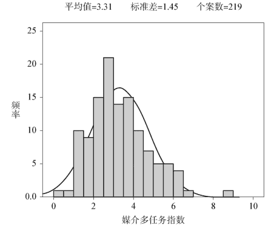

Fig 1. Frequency Distribution of Media Multitasking Index (`N=219`)

Regarding attention span during mobile reading, data (Table 1) show 60 participants' reading time was generally short, averaging 9.9 minutes. This differs substantially from the 15-minute average of the 5 pilot participants reading attentively during material selection.

Table 1 shows overall elaboration level was relatively high (`M=3.71, SD=0.71`). Highest item: "I usually think using existing knowledge" (`M=4.42, SD=0.72`). This indicates participants used personal experience and existing knowledge to process news, confirming that people use existing knowledge structures to decide on accepting new information[34].

Mean discernment accuracy was 0.55 (`SD=0.23`), indicating participants identified only about half the fake news; discernment was unsatisfactory. This aligns with prior findings that young people's fake news discernment "needs improvement"[34].

Table 1. Attention Span, Elaboration Level, and Fake News Discernment Accuracy of Shanghai Undergraduates Reading Mobile News (`N=60`)

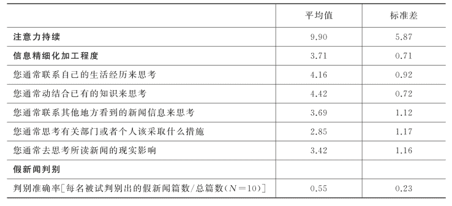

Correlation analysis and mean comparisons between controls and the three key variables (media multitasking, attention span, elaboration) revealed that higher perceived news relevance correlated with higher elaboration (`r=0.297, p<0.05`). This aligns with prior research that attention level influences processing route selection[21].

#### 2. Path Analysis

#### 1) Model Fit
We used `AMOS 19.0` for path analysis testing the effect of daily media multitasking on fake news discernment. Following prior research[35], bias-corrected percentile `Bootstrap` requires no normality or large sample assumptions, and yields more precise confidence intervals for indirect effects than the `Sobel` test[36]. We drew 2,000 `Bootstrap` samples from the original data, fitting Model M (see Fig 2), saving path coefficients from each run. Model fit indices (Table 2): `CMIN/DF` (Chi-square/df) between 1–3, `P=0.316`, indicating good fit. Per requirements[35], `CFI`, `NFI`, `GFI` > 0.9, `RMSEA` < 0.05; fit was good, Model M passed overall test.

Table 2. Fit Indices for Structural Model M

#### 2) Multiple Mediation Test
Path analysis tested the direct effect of media multitasking on discernment, and indirect effects via attention span and elaboration (see Fig 2). Results: Media multitasking directly affected discernment (`β=-0.32, p<0.01`) and attention span (`β=-0.31, p<0.01`). Attention span directly affected discernment (`β=0.26, p<0.05`). All significant. No significant correlation existed between the other two variables.

To test mediation significance, we used the `prodclin2` plugin for 95% CIs; if CI excludes 0, the indirect effect is significant[35]. The standardized indirect effect via attention span was -0.09 (`-0.31×0.26`), 95% `CI[-0.05018, -0.0028]`; mediation was significant. Thus, Hypotheses 1 and a supported; Hypothesis b not supported. The study confirmed the direct effect of media multitasking on discernment, a significant indirect effect via attention span, but no indirect effect via elaboration.

The direct path coefficient was -0.32, indicating partial mediation by attention span, accounting for 20% of the total effect (`0.09/(0.32+0.09)`).

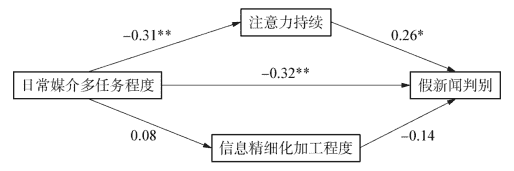

Fig 2. Structural Model M

Note: ① Media multitasking coding: `LMM=1, HMM=2`; ② Values are standardized path coefficients; ③ `*`: `**`

### IV. Conclusion and Discussion

Fake news is not new, but its negative impacts on social media—eroding social trust, polarizing opinions and emotions—warrant attention. Technology iterates rapidly; amidst media cacophony, audiences constantly switching between media lack sufficient attention to verify information, and in their dual role as audience and communicators, facilitate fake news spread. AI and new media technologies should not be scapegoats; reflecting on "what people do with media" is equally important.

First, daily media multitasking directly affects fake news discernment during mobile news reading. This aligns with findings that heavy multitaskers are more susceptible to persuasion and decision change[24][35]; yet fake news research often focuses on text and network structure, neglecting media use behavior, which future studies should address. Media literacy theory posits that more media access and better skills foster critical information processing, a key literacy dimension[37]. However, we found higher multitasking (more simultaneous media) predicted worse discernment. Such concomitant multitasking often fragments cognitive resources, yielding emotional gratification rather than improved cognition[38]. Thus, governing fake news via media literacy requires considering current media habits, content, and motivations; otherwise it remains empty talk.

Second, enhancing public attention during news exposure may be an effective way to reduce fake news acceptance and spread. Here, attention spans were generally low; higher multitasking predicted shorter reading times and worse discernment. This confirms that accelerated processing is a common strategy under information overload[39]. This enriches fake news research: perhaps people are not increasingly unwilling to verify news[19], but rather, due to multitasking habits, fail to allocate due attention to the vast information flow. For journalists, this means grasping current reading habits to produce high-quality, immersive, attention-grabbing reports. Government and media regulators must value not only tech/platform convergence but also news content quality.

Finally, perhaps because people rely on experience rather than deep thought when processing news, higher elaboration correlated with *poorer* fake news identification. We found media multitasking positively correlated with elaboration, which negatively correlated with discernment (non-significant, but noteworthy). Multitasking reduced attention but increased elaboration. This confirms that multitasking doesn't actually enhance processing ability; people just *subjectively believe* they have greater capacity[23].

As an active processing mode, elaboration didn't help identify fake news; it even fostered motivated reasoning. E.g., participants said: "I heard teacher exams are harder, so reform seems likely," "I've seen malicious HIV cases elsewhere, so it seemed credible." This confirms that people use existing experiences to process new information[17]. From an audience perspective, this responds to production-side research: fake news uses plausible life stories and repetition to increase "familiarity," promoting acceptance. This explains why WeChat fake news on health, safety, and parenting spreads easily[40]. The study also suggests daily multitasking habits drive this result. Though some pessimistically attribute fake news spread to "laziness"[19], we argue it is necessary to debate what causes this laziness: technology or human nature.

Limitations: 1. Self-reported multitasking data is subjective; future studies could use mobile logging for objectivity; 2. Attention span mediated the effect (20% variance explained); future work should include cognitive load etc.; 3. Research on older adults, the main sharers of fake news[41], needs strengthening.

### References

[1] Vosoughi S, Roy D, Aral S. The spread of true and false news online[J]. Science, 2018, 359(6380): 1146-1151.

[2] China Internet Network Information Center. The 43rd Statistical Report on Internet Development in China[R/OL]. (2019-02-01)[2019-07-23]. `http://cnnic.cn/gywm/xwzx/rdxw/20172017_7056/201902/W020190228474508417254.pdf`.

# References

[3] Yeykelis L, Cummings J J, Reeves B. Multitasking on a Single Device: Arousal and the Frequency, Anticipation, and Prediction of Switching Between Media Content on a Computer[J]. Journal of Communication, 2014, 64(1): 167-192.

[4] Ralph B C W, Thomson D R, Cheyne J A, et al. Media multitasking and failures of attention in everyday life[J]. Psychological Research, 2014, 78(5): 661-669.

[5] Luo Zhenglin, Cao Yue. "Distorted Communication": A Triple Critique of the Fake News Phenomenon in the Social Media Era[J]. Journal of News and Communication Review, 2018, 71(04): 81-90.

[6] Lazer D M J, Baum M A, Benkler Y, et al. The science of fake news[J]. Science, 2018, 359(6380): 1094-1096.

[7] Zhang X C, Ghorbani A A. An overview of online fake news: Characterization, detection, and discussion[J]. Information Processing & Management, 2019, 57(2): article102025.

[8] Annual Fake News Research Group. 2017 Fake News Research Report[J]. Journalist, 2018(1): 21-31.

[9] Yu Guoming. Textual Structure and Expression Characteristics of Online Rumors: An Analysis of 6,000+ Rumor Texts Identified via Tencent Big Data[J]. News & Writing, 2018(02): 53-59.

[10] Liu Yusi, Xu Yu. Communication Effects of Rumors and Debunking Information in Online Social Networks: Exploring the Influence of Network Structural Factors and Socio-Psychological Processes[J]. Journal of News and Communication Research, 2016(11): 51-69.

[11] Colliander J. "This is fake news": Investigating the role of conformity to other users' views when commenting on and spreading disinformation in social media[J]. Computers in Human Behavior, 2019(97): 202-215.

[12] Hu Yiqi. Imagining the Power of Self-Media: A Critique Based on Journalistic Professionalism[J]. Journalist, 2013(3): 6-11.

[13] Jin Z W, et al. Deception for News: Three Types of Fakes[J]. IEEE Transactions on Multimedia, 2017, 19(3): 598-608.

[14] Eveland W P, Dunwoody S. An Investigation of Elaboration and Selective Scanning as Mediators of Learning From the Web Versus Print[J]. Journal of Broadcasting & Electronic Media, 2002, 46(1): 34-53.

[15] Kahan D M. Ideology, motivated reasoning, and cognitive reflection[J]. Judgment and Decision Making, 2013, 8(4): 407-424.

[16] Haidt J. The righteous mind: Why good people are divided by politics and religion[M]. New York: Paragon, 2012.

[17] De Keersmaecker J, Roets A. Fake news: Incorrect, but hard to correct. The role of cognitive ability on the impact of false information on social impressions[J]. Intelligence, 2017, 65: 207-210.

[18] Sunstein C R. Republic.com[M]. Princeton, NJ, US: Princeton University Press, 2002.

[19] Pennycook G, Rand D G. Lazy, Not Biased: Susceptibility to Partisan Fake News Is Better Explained by Lack of Reasoning Than by Motivated Reasoning[J]. Social Science Electronic Publishing, 2018, 188: 39-50.

[20] Ophir E, Nass C, Wagner A D. Cognitive control in media multitaskers[J]. Proceedings of the National Academy of Sciences, 2009, 106(37): 15583-15587.

[21] Eveland W P. News Information Processing as Mediator of the Relationship between Motivations and Political Knowledge[J]. Journalism & Mass Communication Quarterly, 2002, 79(1): 26-40.

[22] Jeong S H, Hwang Y. Does Multitasking Increase or Decrease Persuasion? Effects of Multitasking on Comprehension and Counterarguing[J]. Journal of Communication, 2012, 62(4): 571-587.

[23] Ran W, Yamamoto M, Xu S. Media multitasking during political news consumption: A relationship with factual and subjective political knowledge[J]. Computers in Human Behavior, 2016, 56: 352-359.

[24] Kononova A, Yuan S, Joo E. Reading About the Flu Online: How Health-Protective Behavioral Intentions Are Influenced by Media Multitasking, Polychronicity, and Strength of Health-Related Arguments[J]. Health Communication, 2017, 32(6): 759-767.

[25] Carrier L M, Cheever N A, Rosen L D, et al. Multitasking across generations: Multitasking choices and difficulty ratings in three generations of Americans[J]. Computers in Human Behavior, 2009, 25(2): 483-489.

[26] Cacioppo J T, Petty R E. The Elaboration Likelihood Model of Persuasion[J]. Advances in Consumer Research, 1984, 19(4): 123-205.

[27] Fleming K, Thorson E, Zhang Y. Going Beyond Exposure to Local News Media: An Information-Processing Examination of Public Perceptions of Food Safety[J]. Journal of Health Communication, 2006, 11(8): 789-806.

[28] Sternthal A B. The Effects of Program Involvement and Ease of Message Counterarguing on Advertising Persuasiveness[J]. Journal of Consumer Psychology, 1992, 1(3): 225-238.

[29] Yu Guoming. Textual Structure and Expression Characteristics of Online Rumors: An Analysis of 6,000+ Rumor Texts Identified via Tencent Big Data[J]. News & Writing, 2018(02): 53-59.

[30] Lim S, Shim H. Who Multitasks on Smartphones? Smartphone Multitaskers' Motivations and Personality Traits[J]. Cyberpsychology, Behavior, and Social Networking, 2016, 19(3): 223-227.

[31] Liu Yi. Media Morphology Changes and Audience Media Use[J]. Journalism University, 2017(6): 89-95.

[32] Levine T R, Shaw A S, Shulman H. Assessing Deception Detection Accuracy with Dichotomous Truth-Lie Judgments and Continuous Scaling: Are People Really More Accurate When Honesty Is Scaled?[J]. Communication Research Reports, 2010, 27(2): 112-122.

[33] Zaichkowsky J L. The Personal Involvement Inventory: Reduction, Revision, and Application to Advertising[J]. Journal of Advertising, 1994, 23(4): 59-70.

[34] McGrew S, Drtega T, Breakstone J, et al. The Challenge That's Bigger than Fake News: Civic Reasoning in a Social Media Environment[J]. American Educator, 2017, 41(3): 4-9.

[35] Fang Jie, Wen Zhonglin, Zhang Minqiang, et al. Analysis of Multiple Mediation Effects Based on Structural Equation Modeling[J]. Psychological Science, 2014(3): 735-741.

[36] Wen Zhonglin, Ye Baojuan. Mediation Effect Analysis: Methods and Model Development[J]. Advances in Psychological Science, 2014(5): 731-745.

[37] Potter W J. The State of Media Literacy[J]. Journal of Broadcasting & Electronic Media, 2010, 54(4): 675-696.

[38] Wang Z, Tchernev J M. The "Myth" of Media Multitasking: Reciprocal Dynamics of Media Multitasking, Personal Needs, and Gratifications[J]. Journal of Communication, 2012, 62(3): 494-513.

[39] Pentina I, Tarafdar M. From "information" to "knowing": Exploring the role of social media in contemporary news consumption[J]. Computers in Human Behavior, 2009, 35(4): 211-223.

[40] Tang Xujun, Huang Chuxin, Wu Xunxun. China New Media Development Report[M]. Beijing: Social Sciences Academic Press, 2016.

[41] Guess A, Nagler J, Tucker J. Less than you think: Prevalence and predictors of fake news dissemination on Facebook[J]. Science Advances, 2019, 5(1): eaau4586.

---

**Author Biographies**: Wang Luyu, Master's student, Department of Journalism, School of Communication, East China Normal University; Shen Qi, Associate Professor, School of Communication, East China Normal University, Master's Supervisor.

---

## Notes

[1] The China Internet Joint Rumor Refutation Platform is hosted by the Center for Reporting Illegal and Harmful Information of the Central Cyberspace Affairs Office and undertaken by Xinhuanet. It is an authoritative platform for the public to identify and report rumors. Monthly, it reviews rumors of the month by comprehensively assessing netizen attention and social impact from various sources including websites, Weibo, WeChat, apps, e-newspapers, forums, and tieba.

[2] @Weibo Refutation is the official account for refuting fake news on Sina Weibo. Based on the #Weibo Refutation# topic platform and the false information reporting platform, the platform releases the "Monthly Weibo Refutation Work Report," taking the month as the statistical interval, containing relevant data statistics from both platforms, refutation information, and monthly cases of false information reporting and handling.

[3] iOS 12 provides the "Screen Time" function, which automatically records the total duration and frequency of user usage of various apps in the background; Android users can obtain the last usage time, duration, etc., of various apps by entering codes on the dial pad.

---

# Algorithmic Governance of Fake News on Social Platforms: Logic, Limitations, and Collaborative Governance Models

**Zhang Chao**

## Abstract

Current domestic research on the governance of fake news on social platforms lacks a perspective starting from technological logic. Using algorithms to govern fake news is a new means of governance on social platforms, such as demoting low-credibility sources through source evaluation to reduce the probability of fake news recommendation; and revealing textual features of fake news through text recognition to improve identification accuracy. Using technology to govern technological problems has limitations that are difficult to overcome in the short term: platform logic inadvertently encourages fake news, and the subtle boundary between real and fake news is difficult to discern. Based on this, this paper preliminarily proposes an "Algorithm-Stakeholder" collaborative governance model, discussing collaborative governance actions of different stakeholders from the technical and social spheres, to maximize the governance effectiveness of fake news on social platforms.

**Keywords**: Fake News, Algorithmic Governance, Deepfakes, Social Platforms, Collaborative Governance

---

With the rise of `platisher` (platform media), global news consumption has gradually shifted to mobile terminals, and social platforms have become the primary channels for users to access news. In the United States, 10%–15% of news clicks come from news websites, while 80% come from search and sharing.[1] A 2018 survey by the `Pew Research Center` shows that 68% of U.S. adults get news from social media. Social platforms are increasingly becoming the channels through which people access news, imagine the world, and construct values.[2] Meanwhile, 57% of users believe that news on social platforms is inaccurate,[3] due to the proliferation of `fake news`, with `Facebook` accounting for approximately one-fifth of false information traffic.[4] In China, nearly 60% of fake news originates on Weibo.[5] Although the volume of fake news originating on WeChat is not large, accounting for 7% of new media fake news, its closed communication environment makes self-correction difficult and debunking challenging.[6] `Gartner` predicts that by 2022, most users in developed countries will encounter more false information than true information.[7]

Fake news has coexisted with the news industry since its inception. The most significant difference between current fake news on social platforms and traditional fake news lies in the "intelligent" characteristics of their production and dissemination—the intelligentization of fabrication methods and the "anthropomorphic" nature of dissemination diffusion: `deepfakes` refer to a method of synthesizing images based on artificial intelligence technology.[8] Many photos and videos are synthesized by `generative adversarial networks` (GANs) after deep learning, achieving a level of realism that makes them indistinguishable from reality, becoming a new means of fake news production; `social bots` participate in the diffusion of fake news, leaving users unaware whether the account "@" mentioning them is a human or a social bot. Among accounts spreading fake news, one-third to two-thirds are social bot accounts.[9]

The greatest harm of fake news lies in misleading the public, leading to a lack of `shared reality`, group polarization, and social division.[10] New fabrication methods such as "deepfakes" and social bots will create more cognitive confusion in the post-truth era, potentially leading to the collapse of the foundation of social trust. Following the 2016 U.S. presidential election, fake news became a major issue in global social governance. In September 2018, representatives of major European online platforms, social media, advertisers, and advertising operators jointly released the EU's first `Code of Practice on Disinformation`.[11] Due to the provisions of the First Amendment of the U.S. Constitution, political power finds it difficult to directly regulate fake news; governance must rely on the platforms themselves.[12]

Domestic discussions on the governance of fake news on social platforms tend to favor governance through policy regulation, enhancing platform responsibility awareness, and improving user literacy. Related studies mostly examine the dissemination mechanisms of fake news regarding specific types of events or hot topics from perspectives such as social psychology and communication laws. Although these studies have noted certain patterns in the generation and diffusion of fake news on social platforms, they have neglected the underlying logic of social platforms—algorithms—and have not paid attention to fake news actors similarly mediated by algorithms (e.g., social bots that automatically and massively spread fake news). Many studies emphasize a binary "Government-Social Platform" governance structure, lacking a stakeholder perspective.

In the era of smart media, algorithms are a "double-edged sword" that can both facilitate and combat fake news. This paper first explores the action logic of governing fake news on social platforms through algorithms from a technical path, and then discusses the "Algorithm-Stakeholder" collaborative governance model for fake news, exploring new feasible paths for governing fake news on social platforms.

## 1. Algorithmic Governance Logic of Fake News on Social Platforms in the Smart Media Era

An algorithm is an accurate and complete description of a solution plan, a series of clear instructions for solving a problem, capable of obtaining the required output for a specified input within a finite time.[13] Algorithms and programs are inseparable; algorithms are abstract, and running an algorithm requires a program. A program is an algorithm expressed in a computer language; a program is the unity of algorithm and data structure, and their relationship can be expressed as "Program = Algorithm + Data Structure".[14]

## I. The Logic of Governing Fake News with Algorithms

Governance is the sum of the many ways in which public and private institutions manage their common affairs; it is a continuing process through which conflicting or diverse interests may be accommodated and cooperative action may be taken. [15] With the rise of big data and artificial intelligence, algorithmic governance has emerged as a mode of participating in social governance mediated by algorithms.

Here we need to distinguish a conceptual confusion that may arise in Chinese translation: "算法治理" (algorithm governance / algorithmic governance). In Western social governance research, there are two types of governance related to algorithms. One is the "algorithmic governance" discussed in this article; the other is "algorithm governance," also translated as "算法治理," but the two have completely different meanings. "Algorithm governance" points to governance *of* algorithms, focusing on algorithmic accountability, transparency, and technical safeguards, aiming to reduce problems caused by algorithms [16]; algorithms play the role of the *governed*. The "algorithmic governance" in this article refers to governing social problems *with* algorithms, where algorithms play the role of a means or tool. Since there is currently no better translation solution to resolve this issue, "algorithmic governance" in this article refers to *algorithmic governance*.

Using algorithms to govern fake news, if centered on social platforms, can be divided into internal and external algorithmic governance. Internal algorithmic governance refers to reducing the probability and extent of fake news dissemination through the optimization of algorithms internal to social platforms, involving the "meta-governance" of social platform recommendation algorithms. External algorithmic governance refers to using algorithms external to social platforms to predict and identify fake news within them.

### 1. Internal Algorithmic Governance: "Downranking" Low-Credibility Sources to Reduce Fake News Push Probability

After fake news enters a social platform, it does not immediately enter a state of viral spread, nor is it necessarily captured by platform algorithms; it must first undergo a **cold start**. Cold start refers to how to convert users and content from 0 to 1 in recommendation. In recommender systems, content cold start refers to the process by which a piece of content accumulates user feedback from 0 to 1 through exploratory display. In this process, if it fails to obtain sufficient positive user feedback (click behavior and reading experience), the system deems the article unpopular and gradually reduces its recommendation volume to control negative impact. Conversely, it may be rapidly amplified by the recommender system, possessing the potential to become a "hit." [17]

Because fake news can evoke emotions such as fear, disappointment, and surprise, it is more attractive than real news. [18] Fake news completes the cold start in a short time and quickly enters the platform's algorithmic recommendation system. The probability of recommendation is closely related to user social relationships, content preferences, etc. The more similar users read, the more such content will be recommended among similar users. This cycle repeats, forming "viral spread," all completed automatically. Therefore, the best way to stop the spread of fake news is to detect it before it completes the cold start. Faced with the massive amount of information on social platforms, this is obviously difficult to achieve.

A feasible logic is: once fake news is detected after completing the cold start, the source of the fake news—i.e., low-credibility sources—is subjected to "**downranking**" (lowering weight), reducing push opportunities from this source, and suppressing the spread of fake news through platform detection and response operations. [10] Targeting low-credibility sources is effective for two reasons: first, although fake news is abundant, its distribution is relatively concentrated. Fake news from 10 websites accounted for 60% of the survey sample, and 50 websites accounted for nearly 90%. [9] Second, a source that has spread fake news once usually continues to do so. Social bot accounts play an "amplification" role for low-credibility content before the viral spread of fake news; curbing social bot accounts is an effective method to reduce fake news dissemination. [19] A simulation experiment targeting Twitter found that if bot content were excluded, the total retweets of low-credibility articles would decrease by 70%. [20]

Following this principle, Twitter purged 10,000 fake accounts automatically pushing fake news before the 2018 US midterm elections. [21] Facebook monitors skeptical comments under news in the backend, has professionals rate these news items, inputs the ratings into the database used by automatic identification algorithms, and optimizes the algorithms. [22] Additionally, Facebook automatically places system-identified low-credibility reports at the bottom of the feed, reducing fake news reads by approximately 80%. [22] YouTube adjusted video recommendation rules to prioritize videos from authoritative sources rather than based on popularity. [23] This also reduced the weight of "sharing" in the recommendation system.

### 2. External Algorithmic Governance: Revealing Fake News Textual Features to Improve Identification Accuracy

Can the textual features of fake news and real news be summarized? In the data era where "everything is quantifiable," researchers believe that real and fake news have their own characteristics after being "datafied," features difficult for humans to perceive through experience alone. Researchers only need to find the "datafied" features of real and fake news and design an algorithm with high identification accuracy to identify fake news.

Researchers at the University of Michigan used linguistic analysis to study grammatical structure, word choice, punctuation, and complexity to parse fake news, achieving 76% accuracy, 6 percentage points higher than human identification. [24] Facebook studied posts where content mismatched headlines, developed identification algorithms to recognize such articles, and demoted them. [25]

Another method that can identify fake news without relying on semantics is the "**data cube**," which identifies fake news by studying word-to-word relationships. [26] The first layer of the algorithm performs dimensionality reduction and decomposition of articles through the spatial relationships between words (Step 1), because words that appear frequently and closely in multiple contexts possess similarity, just as relationships between people on the internet are not singular; relationships between words are also multi-dimensional. Then, a tensor decomposition algorithm decomposes the tensor into highly correlated data blocks, each representing a category, extracting tightly correlated article or word clusters in the first layer algorithm (Step 2). The second layer performs clustering based on the first layer, achieved through a tensor set co-clustering algorithm (Step 3). Finally, semi-supervised learning is used to judge whether it is fake news (Step 4).

Regarding the recently emerged "**deepfakes**," the author has also discovered their textual data features. Taking character synthesis videos as an example, the defect of this synthesis algorithm lies in the "blinking" frequency being much lower than that of real humans. The principle of distinguishing real from fake videos is to use machine learning to check "blinking" in videos, with accuracy exceeding 95%. [27] The Transatlantic Commission on Election Integrity plans to launch a "**toolkit**" for journalists to help detect "deepfakes" and publicize the technology to the public. [28]

Another method is to use "**metadata**" traceability to identify the authenticity of images, etc. *The New York Times* and IBM Garage are developing a "**News Provenance**" project using blockchain technology to create and share "metadata" of news images. This "metadata" includes the shooting time, location, photographer, and all editing and publishing information of news images. Through this information, media and users can determine whether the image has been retouched by image processing software, thereby judging whether the relevant information is fake news. [29]

## II. Limitations of Governing Social Platform Fake News with Algorithms

The two algorithmic governance logics for social platform fake news differ (see Table 1). Research by Stanford University, New York University, and Microsoft Research shows that from the 2016 US election to July 2018, fake news engagement by Facebook users dropped by over 50%. [30] Governing fake news with algorithms has a certain effect. Technology is not a perfect artifact; using technology to govern technical problems also has limitations difficult to overcome in the short term.

**Table 1　Algorithmic Governance of Social Platform Fake News**

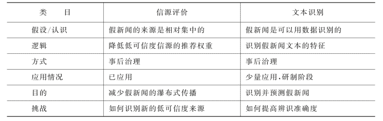

### 1. The "Matthew Effect" of Sharing: Platform Logic Inadvertently Encourages Fake News

The proliferation of fake news on social platforms lies not in how sophisticated the algorithms for manufacturing fake news are, but in the fact that the dissemination logic of fake news aligns with the algorithmic logic and commercial logic of social platforms. The algorithmic recommendation logic of social platforms emphasizes social relationships, sharing, clicks, and relevance. For example, Facebook emphasizes relevance and applicability between information and users. [31] This algorithmic logic leads to a "Matthew effect" of traffic: the more attractive an article, the more shares; more shares bring more traffic; shares and traffic reach a certain level to complete the article's cold start, which then quickly enters the recommendation system, bringing even more shares and traffic. For unattractive content, the algorithm system not only lowers the recommendation probability but may even fail to complete the cold start phase. As long as fake news has sufficient attractiveness, viral spread on social platforms is only a matter of time. Platform developers initially focused mainly on dissemination speed and breadth, leaving design loopholes in fact-checking. [32] Therefore, the key reason why fake news on social platforms persists despite bans is that the dissemination of fake news aligns with the incentive mechanisms in algorithmic design. [33] Research shows that fake news on Twitter spreads faster and has deeper chains than real news: 1% of fake news reaches 1,000–100,000 people, while real news rarely reaches 1,000 people. [18] In other words, no matter how social platform algorithms are adjusted, they can only improve the algorithmic recommendation logic centered on "sharing" to a certain extent.

Commercial logic dictates that traffic is proportional to advertising revenue; advertisers pay per click, and social platforms share revenue with account users (websites). In other words, social platforms like articles with sharing potential. Consequently, some people mass-produce fake news; they care not about partisan disputes but about traffic and monetization. Some social platforms claim to be "platforms," not "media," absolving themselves from content regulation to maximize commercial interests. Sam Lessin, former VP of Product Management at Facebook, once said: "To get market share, you need to be aggressive; rationality won't score you points." On social platforms, news must be shareable; the more aggressive the news, the more shares on social media. [34]

Under immense public pressure, Google and Facebook finally successively introduced measures to cut off the "financial path" of fake news. In November 2016, Google banned fake news sites from using its advertising services. In August 2018, Facebook stated it would ban companies that frequently share fake news and repeatedly violate rules from advertising on its platform. This shows that for this logical "defect" of social platforms, some platforms hope to use economic means to govern the production and dissemination of commercially motivated fake news, but economic means are ineffective against fake news driven by political interests or other non-commercial interests.

### 2. Algorithms Cannot Think: The Subtle Boundary Between Real and Fake News Is Hard to Discern

Current AI is still in the **weak AI** stage, capable only of handling specific tasks without independent consciousness. This stage will persist for a considerable time. The content of fake news texts is complex, requiring professional knowledge, social experience, topical context, semantic understanding, and other multi-faceted skills to achieve extremely high identification accuracy. Weak AI obviously cannot reach this level.

First, not all indicators can be "datafied." For example, how to encode "misleading"? Humans find it hard to define; AI has a long way to go to understand this. [35]

Second, algorithms cannot understand human language and knowledge. Human language is subtle; because algorithms cannot understand language, classification in algorithms is often based on language patterns and other simple signals, which may cause algorithms to categorize real and fake news together. [36] Furthermore, algorithms cannot understand human knowledge. When algorithms face abstract knowledge like religion and philosophy, they cannot comprehend or discern credibility like humans. [22]

Finally, the characteristics of fake news are ever-changing, and the identification of their pattern features must adapt accordingly. As long as fake news changes slightly from its original basis, the applicability of the original identification algorithm becomes problematic. For example, algorithms using writing style as an identification method are widely adopted, but fabricators also appropriately change writing techniques to slip through. [22]

Although research shows algorithms are more accurate and effective than human identifiers, a 24% failure rate indicates humans still play an important role in catching hoax stories. [24] The fake news combating platform "Fake News Challenge" believes: unless we already possess human-level AI capable of understanding subtle and complex human interactions and conducting investigative journalism, automated fact-checking will not be possible. [37]

## III. An "Algorithm-Stakeholder" Collaborative Governance Model for Social Platform Fake News

According to the degree of human reliance on algorithms and algorithmic autonomy, algorithmic governance can be divided into three categories: **governance assisted by algorithms**, **governance dependent on algorithms**, and **governance utilizing algorithms**. "Governance assisted by algorithms" is a mode of using algorithms to strengthen existing power relations; "governance dependent on algorithms" is a more automated, more independent governance mode; "governance utilizing algorithms" lies between the two. [38]

Currently, technical means completely dependent on algorithms for governing fake news have not emerged. For some simple identification tasks, governance assisted by algorithms can be adopted; this is a mechanical, simple governance mode. More often, "algorithm + human" is needed, i.e., human decision-making is required in governance. As mentioned earlier regarding fake news identification, as long as accuracy is not 100%, human review is needed. The application of the three levels of algorithmic governance in internal and external algorithms is shown in Table 2.

**Table 2　Application of Three Levels of Algorithmic Governance in Internal and External Algorithms**

In complex human society, if we only talk technology, technology's effectiveness in governance is limited. Social platform fake news governance is a continuous, dynamic, complex governance process. The participating subjects should not be limited to the government and social platforms but should be a network woven by all stakeholders. In terms of governance model, the binary "government–social platform" governance model should be abandoned in favor of a collaborative governance model.

Collaborative governance, to solve complex public problems, promotes the formation of partnerships among cross-domain, cross-sector, and cross-departmental stakeholders, an institutional arrangement for participating in public decision-making through equal consultation. [39] Stakeholders refer to any individuals or groups who can affect the achievement of an organization's objectives or are affected by the achievement of an organization's objectives. [40] Centering on social platform fake news governance, stakeholders involve social platforms, government, news media stationed on social platforms, users, and the research community. In countries like the US, non-governmental organizations are mature and active, actively participating in fake news governance, and are also stakeholders.

Algorithms are not omnipotent; relying solely on algorithms to solve fake news governance is biased, but algorithms are efficient—their monitoring and identification of fake news are batch-based and automated. Based on the previous discussion, the author proposes an "**algorithm–stakeholder**" collaborative governance model for social platform fake news, emphasizing the collaborative relationship between algorithms and stakeholders.

Of course, it must be noted that fake news emerges endlessly, related not only to the text of fake news itself but also to social platform dissemination logic, the broader social environment, etc. Therefore, the collaborative governance model proposed in this article mainly discusses the governance system centered on algorithms, with the main purpose of exploring ideas for using algorithms to govern fake news.

In the entire collaborative governance system, according to the relationship between algorithms and other stakeholders, we can divide it into two layers: the **technical layer** and the **social layer** (see Figure 1). Stakeholders in the technical layer include social platforms and the research community, focusing on handling technical governance issues. Stakeholders in the social layer include the government, mainstream media, and the public, focusing on compensating for the deficiencies of algorithmic governance means. Within and between layers, there are strong or weak, uni- or bi-directional relationships among different stakeholders. For the convenience of argumentation, this article focuses on the more important issues in governance.

**Figure 1　Layers of Algorithmic Governance of Social Platform Fake News**

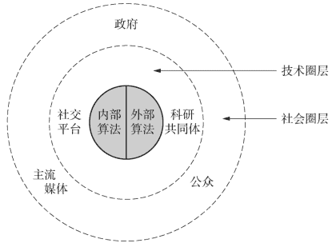

### 1. Collaborative Governance in the Technical Layer

Stakeholders in the technical layer are mainly social platforms and the research community. Social platforms are the other powerful stakeholder in the entire governance system besides the government. The effectiveness of collaborative governance in the technical layer largely depends on the attitude of social platforms.

The biggest problem currently existing in the technical layer is the insufficient research data provided by social platforms, leading to limitations in the credibility and level of research by the research community on certain issues, unable to provide good intellectual support for social platforms. Although some social platforms have Application Programming Interfaces (APIs) providing partial platform data, these data can only answer certain questions to a limited extent. Due to data quality issues, some research conclusions are relatively superficial, unable to touch the deep laws of fake news dissemination on social platforms. The platform's reason is simple: trade secrets. In R&D, social platforms should actively cooperate with external researchers and adopt appropriate cooperation methods to transform external research results into part of platform governance.

Social platforms should realize that **trust**, not information, is the scarce resource in today's world. [41] Surveys show that only 41% of global users trust social media. [42] Social platforms need to realize that the dilution and lack of high-quality content will be the biggest crisis for platform survival and development. In the tide of "connection," there is a counter-current of "anti-connection," essentially an escape from social platforms, where distrust is a major reason.

Meanwhile, the production and dissemination of fake news are becoming increasingly intelligent; "the higher the righteousness, the higher the evil." Relying solely on social platforms' technology to "crack" the laws of fake news generation and dissemination is unrealistic. Taking the governance of "deepfakes" as an example, any deepfake detector can only be effective for a short period. [43] For social platforms, to govern fake news from an algorithmic technology perspective, they need to introduce external resources, among which the research community from universities and research institutes dedicated to fake news research is an important stakeholder for cooperation.

In fact, there are already many research groups outside social platforms developing various technologies for social platform fake news. The Polish startup Userfeeds uses blockchain technology to create a public, transparent news content platform and its supporting ranking algorithm that can be publicly audited. This model can achieve complete transparency and traceability of the news production and dissemination process from the source, compelling news producers and disseminators to be responsible for authenticity. [44]

Now, some social platforms or platform media have also made beneficial attempts in open cooperation. Facebook selected over 60 researchers from 30 institutions in 11 countries globally; they have access to processed partial privacy data to promote research on the role of social media in elections. [45] In January 2018, Toutiao held an Algorithm Sharing Conference, disclosing the basic principles of Toutiao's recommendation algorithm. Attendees were mainly algorithm engineers and product managers from mainstream tech companies like Alibaba, Tencent, Baidu, Meituan, Sina, and NetEase. Toutiao stated that algorithms are principally confidential. [46]

### 2. Collaborative Governance in the Social Layer

Stakeholders in the social layer are mainly the government, mainstream media, and the public.

#### 1) Government: Changing Functional Positioning, from Regulator to Coordinator

Surveys found that 60% of European users and 63% of Asian users tend to favor direct government intervention in fake news governance, while only 41% of US users agree. [47] This reflects different perceptions among users in different countries and regions regarding the role and function of government in fake news governance. China mainly adopts a top-down governance model for internet fake news, with the government and platforms as the main actors. The governance logic is: discover problem – rectification talks – rediscover problem – re-rectify. This approach can improve or solve certain problems to a certain extent at a certain stage, but the biggest drawback of ex-post regulation is that when the government discovers the problem, the platform's problems are often already serious, and significant negative social impacts have already occurred, some even being major criminal cases.

Since government regulatory capacity is limited, introducing collaborative governance can effectively integrate social resources for the government, mobilizing the power of different stakeholders to govern. Of course, the government remains at the center in collaborative governance, but is not the sole responsible subject. Stakeholders participating in governance have positive interactions to achieve common goals, including sharing of information, resources, and advantages; consultation on issues and solutions; and division of labor and cooperation during implementation. [39] This also means a role shift for the government in governance: from regulator to coordinator.

The emphasis on the government's coordinator role is mainly because different stakeholders in the collaborative governance system have different positions, roles, capital, and responsibilities. Powerful stakeholders dominate the process in governance, and cooperation from other stakeholders may become formalistic. In social platform fake news governance, social platforms are powerful stakeholders: they refuse to disclose algorithm principles citing trade secrets; they refuse to provide raw research data citing user privacy protection... *The Research Agenda and Action Plan for Combating Fake News* believes pressure needs to be put on social platform companies to share critical data. [48] For these issues, among all stakeholders, only the government has sufficient capacity to "force" social platforms to take measures, and only the government can mobilize various stakeholders to participate in multiple forms and mechanisms to the greatest extent.

#### 2) Mainstream Media: Serving as Truth Amplifiers to Improve the Communication Ecology

The reason this article emphasizes **mainstream media** rather than just "media" among stakeholders is important: mainstream media are important condensers of shared social values, "trustees" of social monitoring, and also victims impacted by fake news. Social platforms lack the legitimacy to define real vs. fake news. As professional content producers, mainstream media largely undertake the functions of fact determination and truth discovery. Mainstream media should bear important social responsibilities in the entire information dissemination system. By producing news through professional, standardized, rigorous news production procedures, they establish trust relationships with users and become trusted sources trusted by users. Reflecting on reality, some fake news is actually produced by mainstream media.

Survey data from the *2018 Digital News Report* (Reuters Institute Digital News Report 2018) shows that 75% of respondents believe the responsibility lies with news organizations, while 71% point to internet platforms, citing bias or inaccuracy in mainstream media reporting.[47] A major reason for the proliferation of fake news on US social platforms is the low credibility of American journalism, leaving the public without trustworthy news sources and forcing them to believe only what they already believe—a typical manifestation of the "post-truth" era. The "2019 Edelman Trust Barometer" released by Edelman Public Relations Worldwide shows that the Chinese public's trust in the media is the highest globally, reaching 76%.[49] In the Chinese context, mainstream media can play a significant role in governance.

The role of mainstream media in daily social platform dissemination is that of a provider of high-quality content and a "truth amplifier" at critical moments. Doing responsible, professional reporting relies on the daily accumulation of mainstream media and the continuous enhancement of credibility, not just speaking up at critical moments; otherwise, the public will not believe what mainstream media says even at those critical moments.

When mainstream media become reliable sources of information for society, the public has dependable and trustworthy sources to turn to even when fake news exists, rather than being left helpless. Currently, some domestic and international social media platforms have begun cooperating with mainstream media. Facebook has approached multiple news organizations, including *The Washington Post* and Bloomberg, hoping to pay them $3 million annually each for licensing news articles.[49] In 2019, Facebook launched the "News Tab" feature, giving news from reliable sources a highly prominent position on the platform.[50] During the dissemination of hot events, Weibo prioritizes amplifying and pushing content from over 30,000 media accounts and 170,000 government affairs accounts.[51]

## Users: Activating Individual Participation, Contributing "Micro-Power" through Multiple Channels and Methods

In the collaborative governance model, users play multiple roles: ① Disseminators: Users act as "pushers" in the spread of fake news. ② The Influenced: Users are simultaneously the "victims" of fake news. ③ Participants in Governance: Some users are active participants in fake news governance, such as reporting fake news. A single user may bear multiple roles simultaneously.

On social platforms, an individual user's power may seem minuscule, but everyone is a node in dissemination. Especially in closed social spaces (e.g., WeChat), the credibility, influence, and depth of individuals as nodes in dissemination should not be underestimated. How to activate the power of individuals is an important issue for the government, social platforms, and users to consider.

The internet has reshaped the public's rights consciousness; individuals are empowered and activated. They are unwilling to remain passive "recipients" or "listeners" but hope to freely express themselves and participate in public affairs.[52] In the path of self-organization, some users possess higher professional knowledge regarding fake news and a stronger sense of social responsibility than average users. This group spontaneously and consciously participates in fake news governance. For instance, media professionals who see fake news in their WeChat Moments may voluntarily verify it and clarify it upon forwarding. Other users utilize the "report" function provided by social platforms to flag false content. There may even be users who form virtual communities to debunk fake news online. Of course, there is also the simple and effective action of "not forwarding," thereby reducing the probability of fake news being recommended.

For the majority of users, externally organized (hetero-organized) approaches should be adopted:

The first measure is for social platforms to organize specific users to participate in the identification and monitoring of fake news. Weibo adopted a supervisor model in governing pornographic and vulgar information, recruiting 2,000 supervisors. Compared to pornographic and vulgar content, fake news is harder to identify and relies more on professional knowledge and background information. Platforms should provide professional training when organizing such efforts.

The second measure is for social platforms to provide "infrastructure" for user collaboration in "debunking." This collaborative debunking model can draw on the Wikipedia model, providing users with a database related to fake news to facilitate verification, traceability, and identification.

The third measure is to establish a cooperation mechanism between platforms and Key Opinion Leaders (KOLs) (in terms of technology, economy, and social benefits). In the spread of fake news, an important method used by social bots is "@celebrities" to boost article popularity; in fake news governance, the handling of debunking articles can actually adopt this same method.

## Conclusion

Today, domestic and international social platforms have realized the harm fake news poses to their own platforms and the high difficulty of governance. In the era of smart media, the production and governance of fake news will be an "offense-defense battle" centered on technology (algorithms). The decentralized, viral dissemination characteristics of social platforms dictate that fake news governance must employ technical means to address batch-produced, automated fake news. However, the limitations of technology also dictate that relying solely on technology is insufficient for effective governance. It requires a governance network composed of stakeholders—government, social platforms, mainstream news media, the research community, and users—working in concert with algorithmic technology. While algorithms cannot completely eliminate fake news, they can at least suppress its spread. Future research on the algorithmic governance of fake news can be further deepened, especially regarding the challenges and responses brought by the post-truth era to fake news governance.

## References

[1] Xu Yang. Mark Cooper: "Share Button" Gradually Becomes Standard Configuration for News Consumption [EB/OL]. [2019-08-22]. http://www.xinhuanet.com/newmedia/2015-03/23/c_134084286.htm.

[2] Fang Shishi. How to Solve Fake News in the Internet Age? [EB/OL]. [2019-08-15]. http://paper.chinaso.com/bkbl/detail/20170913/1000200033018061505311045373493731_1.html.

[3] Matsa K E, Shearer E. News Use Across Social Media Platforms 2018 [EB/OL]. [2019-08-06]. http://www.journalism.org/2018/09/10/news-use-across-social-media-platforms-2018/.

[4] Guess A, Nyhan B, Reifler J. Selective Exposure to Misinformation: Evidence from the consumption of fake news during the 2016 U.S. presidential campaign [EB/OL]. [2019-08-11]. www.dartmouth.edu/~nyhan/fake-news-2016.pdf.

[5] Zhao Guangxia. New Media Blue Book: Nearly 60% of Fake News Originates on Weibo, Debunking on WeChat Difficult [EB/OL]. [2019-09-15]. http://media.people.com.cn/n/2015/0624/c120837-27201212.html.

[6] Kan Feng. Report Says Nearly 60% of Fake News Originates on Weibo, Most WeChat Rumors on Tuesdays [EB/OL]. [2019-09-15]. http://www.chinanews.com/gn/2015/06-24/7362797.shtml.

[7] Wiggers K. MIT CSAIL's AI can detect fake news and political bias [EB/OL]. [2019-09-16]. https://venturebeat.com/2018/10/03/mit-csails-ai-can-detect-fake-news-and-political-bias/.

[8] Brandon J. Terrifying high-tech porn: Creepy "deepfake" videos are on the rise [EB/OL]. [2019-09-15]. https://www.foxnews.com/tech/terrifying-high-tech-porn-creepy-deepfake-videos-are-on-the-rise.

[9] Gill S. Why Combatting Fake News Requires People And Technology—Working Together [EB/OL]. [2019-09-15]. https://www.knightfoundation.org/articles/why-combatting-fake-newsrequires-people-and-technology-working-together.

[10] Fang Shishi. Harvard Kennedy School: Research Agenda and Action Guidelines for Combating Fake News (Translation) [J]. Journal of Shantou University (Humanities and Social Sciences Edition), 2017(9): 98-101.

[11] Shi Anbin, Hu Yu. Declaring War on Disinformation: The EU's Exploration [J]. Youth Journalist, 2018(34): 76-79.

[12] Fang Kecheng. How Western Societies Combat Online Fake News [EB/OL]. [2019-08-19]. https://mp.weixin.qq.com/s/bYInQH1O8f2dAAyQANn-7g.

[13] Lü Guoying. Algorithm Design and Analysis: 2nd Edition [M]. Beijing: Tsinghua University Press, 2009: 7.

[14] Tang Peihe, Xu Yiyi. Computational Thinking: Introduction to Computing Discipline [M]. Beijing: Publishing House of Electronics Industry, 2015: 144.

[15] Wang Shizong. Governance Theory and Its Applicability in China [M]. Hangzhou: Zhejiang University Press, 2009: 2.

[16] Doneda D, Almeida V A F. What Is Algorithm Governance? [J]. IEEE Internet Computing, 2016(4): 60-63.

[17] Yan Zehua. Content Algorithm: Efficiency System Turning Content into Value [M]. Beijing: CITIC Publishing Group, 2018: 60.

[18] Vosoughi S, Roy D, Aral S. The spread of true and false news online [EB/OL]. [2019-09-15]. http://science.sciencemag.org/content/359/6380/1146.full.

[19] Shao C, Ciampaglia G L, Varol O, et al. The spread of low-credibility content by social bots [EB/OL]. [2019-09-17]. https://www.nature.com/articles/s41467-018-06930-7.

[20] Greene T. Here's why low-credibility news seems to dominate Twitter [EB/OL]. [2019-09-22]. https://thenextweb.com/artificial-intelligence/2018/11/27/heres-why-low-credibilitynews-seems-to-dominate-twitter/.

[21] Bing C. Exclusive: Twitter deletes over 10,000 accounts that sought to discourage U.S. voting [EB/OL]. [2019-09-17]. https://www.reuters.com/article/us-usa-election-twitter-exclusive/exclusive-twitter-deletes-over-10000-accounts-that-sought-to-discourage-u-s-votingidUSKCN1N72FA.

[22] Temming M. People are bad at spotting fake news. Can computer programs do better? [EB/OL]. [2019-09-10]. https://www.sciencenews.org/article/can-computer-programs-flag-fakenews.

[23] Nuñez M. YouTube overhauls how it does breaking news to fight misinformation [EB/OL]. [2019-08-29]. https://mashable.com/article/youtube-announces-changes-breaking-newsvideo-search/#FwmTV73fcaqt.

[24] Breland A. Researchers claim new algorithm beats humans at spotting fake news [EB/OL]. [2019-09-10]. https://thehill.com/policy/technology/403091-researchers-create-algorithmthat-spots-fake-news-better-than-humans.

[25] O'Reilly. Did "Fake News" Change the Outcome of the US Presidential Election? [EB/OL]. Translated by Yang Chenxi, Dai Mingyue, Cai Minyu. [2019-09-10]. https://mp.weixin.qq.com/s/X-pSBjUsD2YVDIiuRnlRgg.

[26] Ober H. Fake news can't fool new algorithm [EB/OL]. [2019-09-20]. https://www.universityofcalifornia.edu/news/fake-news-can-t-fool-new-algorithm.

[27] T800 Tech Net. Deepfake Machine Learning Algorithm Can Forge Realistic Videos [EB/OL]. [2019-08-09]. http://dy.163.com/v2/article/detail/DVCBN98H053108BC.html.

[28] Browne R. Anti-election meddling group makes A.I.-powered Trump impersonator to warn about 'deepfakes' [EB/OL]. [2019-09-26]. https://www.cnbc.com/2018/12/07/deepfakeai-trump-impersonator-highlights-election-fake-news-threat.html.

[29] Du Huotang. Media Entry! New York Times Testing Blockchain to Combat Fake News [EB/OL]. [2019-09-13]. http://finance.sina.com.cn/blockchain/roll/2019-07-25/doc-ihytcitm4500507.shtml.

[30] Oremus W. Facebook's Crackdown on Misinformation Might Actually Be Working [EB/OL]. [2019-08-09]. https://slate.com/technology/2018/09/facebook-fake-news-getting-better-study.html.

[31] Fang Shishi. Research on News Recommendation Algorithm Mechanism of Duopoly Platforms [J]. Communication and Society Journal, 2018(1): 103-122.

[32] Yin Qiao. Fine of 500,000 Euros for One Fake News Story? Tencent and Facebook, Two Giants, Launch Anti-Rumor Platforms [EB/OL]. [2019-08-09]. http://www.time-weekly.com/html/20170117/36276_1.html.

[33] Emily J B, Taylor O, Peter D B, et al. The Platform Press: How Silicon Valley Reengineered Journalism [EB/OL]. [2019-09-02]. https://academiccommons.columbia.edu/doi/10.7916/D8R216ZZ.

[34] Saeed H. Can AI detect fake news? [EB/OL]. [2019-06-24]. https://venturebeat.com/2017/05/01/can-ai-detect-fake-news/.

[35] Lai Yanfang. Stopping the Spread of Fake News: How Google and Facebook Wield the AI Sword [EB/OL]. [2019-07-22]. https://www.iyiou.com/p/82868.html.

[36] Vincenj J. Why AI isn't going to solve Facebook's fake news problem [EB/OL]. [2019-07-27]. https://www.theverge.com/2018/4/5/17202886/facebook-fake-news-moderation-ai-challenges.

[37] Saeed H. Can AI detect fake news? [EB/OL]. [2019-08-20]. https://venturebeat.com/2017/05/01/can-ai-detect-fake-news/.

[38] Campbell-Verduyn M, Goguen M, Porter T. Big Data and algorithmic governance: the case of financial practices [J]. New Political Economy, 2017, 22(2): 219-236.

[39] Liu Xiaoquan, Zhu Demei. Collaborative Governance: A New Model for Governance of Complex Public Problems [J]. Journal of Shanghai Administration Institute, 2016(4): 46-54.

[40] Sha Yongzhong, Liu Hongqin. Stakeholder Analysis Model of Public Crisis [J]. Science Economy Society, 2009(1): 58-61.

[41] Lorenz M, Kayser-Bril N, Mcghee G. Voices: News organizations must become hubs of trusted data in a market seeking (and valuing) trust [EB/OL]. [2019-07-17]. http://www.niemanlab.org/2011/03/voices-news-organizations-must-become-hubs-of-trusted-data-in-an-market-seeking-and-valuing-trust/.

[42] Zheng Qi. Western Public Trust in Social Media Declines [EB/OL]. [2019-09-02]. https://world.people.com.cn/n1/2018/0814/c1002-30226433.html.

[43] Anonymous. Researchers: Developing Detection Algorithms Alone Far from Enough to Solve Deepfake Problem [EB/OL]. [2019-09-15]. https://www.cnbeta.com/articles/tech/862095.htm.

[44] Wu Guozhong, Li Tairu. Combating Fake News with Blockchain Technology—Introduction to Userfeeds and PressCoin Models [J]. News Front, 2018(13): 88-90.

# References

[45] Jin Lu. Facebook admits allowing specific researchers access to protected user privacy data [EB/OL]. [2019-08-20]. https://tech.qq.com/a/20190430/002925.htm.

[46] Zhang Fan. Toutiao reveals algorithm principles for the first time, claims not everything is left to machines [EB/OL]. [2019-08-20]. https://tech.qq.com/a/20180111/021753.htm.

[47] Newman N. Trust, misinformation, and the declining use of social media for news: Digital News Report 2018 [EB/OL]. [2019-08-20]. https://reutersinstitute.politics.ox.ac.uk/risjreview/trust-misinformation-and-declining-use-social-media-news-digital-news-report-2018.

[48] Baum M, Mele N. Combating Fake News: An Agenda for Research and Action [EB/OL]. [2019-09-15]. https://www.hks.harvard.edu/publications/combating-fake-news-agenda-research-and-action.

[49] Lian Zheng: Global Trust Survey Report: China ranks first in four categories of data [EB/OL]. [2019-09-07]. https://www.guancha.cn/internation/2019_01_23_487975.shtml

[50] Song Wenqian. New progress in Facebook's fake news governance: "News Labels" to launch this autumn [EB/OL]. [2019-09-20]. https://36kr.com/p/5233922.

[51] Yang Xinyu. Sina Chairman Cao Guowei: Manual review of hot content, improvement of Sina Weibo recommendation algorithm [EB/OL]. [2019-09-23]. https://www.thepaper.cn/newsDetail_forward_2612242.

[52] Yu Guoming, Ma Hui. Relational Empowerment: A New Paradigm of Social Capital Allocation—Transformation of Social Governance Logic under Network Reconstruction of Social Connections [J]. Editor's Friend, 2016(9): 5-8.

## Author Biography

Zhang Chao, Ph.D., Associate Professor and Master's Supervisor at the School of Journalism and Communication, Shandong University.

## Notes

[[1]](#txt003.html#footnote_quote_txt003_1) Published in *Journalism Circles* (Xinwenjie), Issue 11, 2019, pp. 19-28. This paper is a phased achievement of the 2019 National Social Science Fund Project "Research on Algorithmic Risks in News Production in the Intelligent Media Era and Their Collaborative Governance" (19BXW020).

[[2]](#txt003.html#footnote_quote_txt003_2) Refers to the intimacy between words.

# Design of a Cultivation Mechanism for Excellent Journalism and Communication Talents Based on the Concept of "Curriculum Product Development"^([[1]](#txt004.html#footnote_content_txt004_1))

Yi Long, Li Chenyu

## Abstract

Curriculum is essentially a content product that organizes knowledge, and a medium for teaching interaction between teachers and students. Curriculum teaching plays an irreplaceable and vital role in talent cultivation. The concept of curriculum product development aims to standardize the production process of curriculum products, optimize the curriculum system through strict quality control, enhance the value of courses, and ultimately improve learners' learning experience. By analyzing the current teaching status of journalism and communication courses, the author identifies common problems in traditional curriculum teaching. Addressing these issues, the paper redesigns a new curriculum-centered cultivation mechanism for excellent journalism and communication talents from aspects such as curriculum team architecture, basic links of curriculum development, and curriculum development processes.

## Keywords

Curriculum product development, excellent journalism and communication talents, cultivation mechanism, classroom teaching, "Golden Courses" (Jin Ke)

## I. Analysis of Cultivation Goals for Excellent Journalism and Communication Talents and Current Curriculum Teaching Status

### 1. Goal Requirements for Excellent Journalism and Communication Talents

The Ministry of Education and the Publicity Department of the CPC Central Committee, in the *Opinions on Improving the Ability of Universities to Cultivate Journalism and Communication Talents and Implementing the Excellent Journalism and Communication Talent Education and Training Plan 2.0*, proposed to cultivate a large number of high-quality, all-media, interdisciplinary, and expert-type reserve journalism and communication talents with patriotism and international vision. It requires them to adapt to the deep integration of media and innovative industry development, and to be able to tell China's stories well and spread China's voice [[1]](#txt004.html#footnote_quote_txt004_1). This document clarified the overall direction for the cultivation of excellent journalism and communication talents and put forward new and higher requirements. Based on this, the author believes that the cultivation goal for excellent journalism and communication talents should be to cultivate internationally competitive, interdisciplinary, top-tier innovative talents with all-round development in morality, intelligence, physique, aesthetics, and labor. These talents should uphold the Marxist view of journalism, adhere to the correct political stance and direction, adapt to digital media transformation, possess profound humanistic literacy, master modern information technology, deeply understand the professional theories of journalism and communication, be familiar with relevant laws and regulations, and be capable of planning, editing, operating, and promoting integrated media products. The achievement of this goal relies on the top-level design and implementation of all links in talent cultivation, including training programs, curriculum systems, faculty teams, and teaching management. Through the analysis of the current status of university classroom teaching, we find that curriculum quality is a critical link related to the quality of talent cultivation and is a foundational project for cultivating excellent journalism and communication talents.

### 2. Analysis of Current Curriculum Teaching Status

Wu Yan, Director of the Department of Higher Education of the Ministry of Education, attaches great importance to curriculum construction. He believes: First, curriculum is the most microscopic and common issue in education, but it solves the most fundamental issue in education—cultivating people. Second, curriculum is a universal shortcoming, bottleneck, and weak point in Chinese universities, and is a key issue. Third, curriculum is the "last mile" embodying the concept of "student-centered development." Fourth, General Secretary Xi Jinping said that the fundamental criterion for evaluating a school is the effectiveness of fostering virtue through education, while curriculum is the concretization, operationalization, and targeting of the fundamental task of "fostering virtue through education" [[2]](#txt004.html#footnote_quote_txt004_2)4-9. The discipline of journalism and communication has distinct characteristics of applicability and interdisciplinarity; curriculum knowledge updates rapidly, and compared to traditional social sciences such as sociology, psychology, and economics, its disciplinary accumulation is relatively weak. In terms of traditional classroom teaching, the following problems exist:

#### 1) Emphasis on Research over Teaching, Limited Curriculum Investment

The traditional view holds that teaching and research are in a symbiotic and synergistic relationship: on the one hand, teaching can promote research; on the other hand, research can, in turn, promote the improvement of teaching quality. However, in reality, we have not observed a sustained, benign interaction between teaching and research. On the contrary, the phenomenon of "emphasizing research over teaching" in universities is becoming increasingly prevalent, and teaching faces the risk of marginalization [[3]](#txt004.html#footnote_quote_txt004_3). The environment of emphasizing research over teaching makes teachers unwilling to spend sufficient time and energy on how to inspire and guide students [[4]](#txt004.html#footnote_quote_txt004_4). The existence of this phenomenon is one of the important reasons for the low level of curriculum teaching.

Compared with online courses such as "Quality Courses" and "MOOCs," traditional classroom teaching suffers from severe underinvestment. The value orientation of research-oriented universities favoring research and insufficient curriculum investment lead to a failure to mobilize teachers' enthusiasm, resulting in the continuous emergence of "water courses" (low-quality courses), poor teaching effects, and serious waste of precious class hours. The insufficient investment in curriculum teaching can be glimpsed from the composition of university teachers' salaries. The salaries of university teachers in China consist of four parts: post salary, grade salary, performance salary, and allowances/subsidies. Among them, post salary and grade salary are implemented uniformly by the state according to public institution salary standards; performance salary is determined autonomously by universities; allowances and subsidies are numerous and varied [[5]](#txt004.html#footnote_quote_txt004_5). University teachers nationwide generally implement a monthly salary system, which includes many items: state salary, "school post," "college post," class hour fees, student thesis guidance fees, paper publication rewards, research project commissions, bonuses, etc. [[6]](#txt004.html#footnote_quote_txt004_6)1-8. Uniquely, there is no special construction fund for daily curriculum setting. Teaching reform projects related to curriculum teaching also take the publication of teaching reform papers as the main acceptance standard, ignoring the actual transformation and application of achievements; project funds are generally not used for curriculum teaching expenses. Comparing with "curriculum product" forms such as MOOCs and paid online courses, university classroom teaching is at a disadvantage in many aspects (see Table 1).

**Table 1 Comparison of Three Forms of "Curriculum Products"**

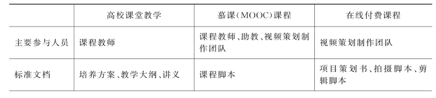

(Continued Table 1)

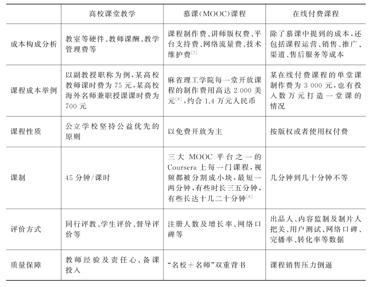

#### 2) Slow Curriculum Updates, Outdated Evaluation Methods

The extremely rapid development of journalism and communication industry practice makes it difficult for curriculum reform to keep pace, inevitably leading to the phenomenon of "old wine in new bottles." First, some courses appear under new names but are actually no different from traditional content. Second, some courses with seemingly high-end names have extremely low knowledge density due to their short development history and weak curriculum foundation. Because curriculum teaching evaluation is not as easy to operate as research evaluation, it often becomes a mere formality, failing to form effective incentive and guidance mechanisms. A common phenomenon is that teachers teaching "old courses" can repeat the same content year after year without worrying about failing assessments, while teachers who strive to update curriculum content receive no corresponding rewards. The rigidity of curriculum evaluation methods cannot adapt to the development needs of the new media era, meet student expectations, or satisfy society's demand for interdisciplinary, all-media talents.

In addition, curriculum assessment methods are relatively monotonous. Many schools still adopt a "one exam determines the final grade" approach for evaluating student scores. While seemingly objective and fair, this makes it difficult to promote student engagement in daily classroom learning, resulting in students often cramming at the last minute for the final exam, just getting by, and failing to achieve real academic advancement. Especially for a major like journalism and communication that emphasizes thinking and practice, students cannot become qualified media professionals by rote memorization alone [[10]](#txt004.html#footnote_quote_txt004_10).

## II. The Concept of Curriculum Product Development

### 1. Proposal of the Curriculum Product Development Concept

Minister of Education Chen Baosheng first proposed the concept of "Golden Courses" (Jin Ke) at the "National Undergraduate Education Conference in the New Era," encouraging universities to effectively increase academic load, appropriately enhance course depth and difficulty, and truly transform "water courses" into "golden courses" with depth, difficulty, and challenge. "Eliminating water courses and creating golden courses" was officially written into a Ministry of Education document in August 2018 [[11]](#txt004.html#footnote_quote_txt004_11). Wu Yan, Director of the Department of Higher Education of the Ministry of Education, believes that "Golden Courses" pursue high-order thinking, innovation, and challenge, requiring a change in the loose curriculum status quo, with "China's Golden Courses" as the goal of curriculum construction [[2]](#txt004.html#footnote_quote_txt004_2)4-9. The concept of curriculum product development was proposed in this context, with the aim of creating "Golden Courses" and striving to improve curriculum quality.

"Product" is a concept inherited from the era of industrial mass production. "Curriculum product" adopts its meaning of on-demand production and standardized manufacturing, thus emphasizing awareness of user needs and quality control. Setting aside the enterprise's requirement for product profitability, introducing the concept of "product" into undergraduate courses can effectively enhance the value of courses, the listening experience, and learning outcomes, ultimately approaching the goal of "Golden Courses." "Curriculum products" aim to meet learning needs, with concentrated goals, dense knowledge, and coherent systems, making them more attractive to students. Of course, the "curriculum product development" concept cannot completely copy the enterprise's product management methods. As Professor Qian Yingyi, former Dean of the School of Economics and Management at Tsinghua University, pointed out, teachers engage in creative and ideological work; therefore, their work is not assembly-line or highly procedural work, nor is it work whose quality is easily measured. Therefore, existing systems applicable to enterprises or government agencies cannot be applied directly [[6]](#txt004.html#footnote_quote_txt004_6)1-8.

### 2. Connotations of the Curriculum Product Development Concept

#### 1) Curriculum System Construction

Traditional journalism and communication discipline curriculum systems often adopt a modular model to construct the knowledge and capabilities required by the discipline. Curriculum system construction based on the curriculum product development concept should further consider the construction of curriculum groups, knowledge networks interconnecting different course contents, and high-frequency iterative updates of curriculum versions. In terms of innovation in the journalism and communication curriculum system, scholars have proposed that we should look to the future, break the traditional curriculum system oriented by journalism and communication skills, and build a journalism and communication talent teaching system led by Internet thinking; dedicated to cultivating students with Internet thinking as the core, cross-field teamwork spirit as the foundation, and the ability to skillfully use data mining and analysis technology, visual communication technology, and art to create new media products full of imagination and appeal [[12]](#txt004.html#footnote_quote_txt004_12).

#### 2) Teaching Standards and Teaching Design

University classroom teaching standards are the core norms constructed and relied upon by the teacher community to achieve professional cultivation goals and course goals. They are the direction of thinking and basic norms for teachers engaging in educational teaching. From the origin of classroom teaching standards, curriculum standards are their superior basis. Since curriculum standards stipulate elements such as curriculum concepts, nature, goals, content, teaching suggestions, and assessment, curriculum standards provide value orientation, main framework, basic processes, and methodological suggestions for classroom teaching standards [[13]](#txt004.html#footnote_quote_txt004_13).

Teaching standards provide relatively mandatory requirements for curriculum product quality and provide a basic basis for fundamentally improving the level of curriculum development. Starting from April 2013, the Ministry of Education commissioned 92 professional teaching guidance committees to initiate the development of national teaching quality standards, officially releasing the *National Standards for Teaching Quality of Undergraduate Majors in General Higher Education Institutions* (referred to as "National Standards" or "Guo Biao") in 2018. Based on the "National Standards," China's journalism and communication discipline, aiming to cultivate excellent journalism and communication talents, strives to create first-class standards, integrate into the mainstream, and lead trends, making China's journalism and communication education reflect international standards and highlight Chinese characteristics [[14]](#txt004.html#footnote_quote_txt004_14). The "National Standards" set comprehensive standard requirements for journalism and communication education in terms of cultivation goals, specifications, curriculum systems, faculty, teaching conditions, quality management, and assurance, clarifying the direction and basic conditions for the construction and development of journalism and communication education [[15]](#txt004.html#footnote_quote_txt004_15).

Curriculum is the basic unit constituting the talent cultivation plan, and curriculum quality is the fundamental reflection of talent cultivation quality. Although the talent cultivation goal provides a direct basis and reference for curriculum system design, it still needs further concretization. "In standards-driven educational reform, curriculum standards are the starting point, driving force, and destination of the entire system" [[16]](#txt004.html#footnote_quote_txt004_16). In contrast to traditional curriculum teaching, MOOC curriculum products have good specifications in teaching design. The early preparation for MOOC construction includes MOOC production knowledge training and accumulation, knowledge node design, teacher team formation, teaching script writing, and teaching assistant team setup [[17]](#txt004.html#footnote_quote_txt004_17). Of course, teachers in practice do not simply and mechanically repeat teaching scripts but need to make adjustments and changes in specific educational contexts [[18]](#txt004.html#footnote_quote_txt004_18).

#### 3) Strict Curriculum Quality Control and User Experience Management

Curriculum products process and package knowledge content through procedures to serve learners in the form of high-quality courses. Assigning a teacher to be responsible for the development of a specific curriculum product means that all aspects of the course—including teaching methods, time planning, teaching effectiveness, student assessment, and other content and quality standards—are organized and implemented by this teacher. The curriculum product lead teacher does not necessarily have to teach the course; they can also invite suitable instructors, focusing only on curriculum quality control and content updates, achieving single-person leadership, multi-party cooperation, clear focus, and clear responsibilities. In journalism and communication teaching practice, the goal of the professional course lead teacher is to plan the latest syllabus, find a suitable teaching team, and polish the teaching script to present wonderful teaching content to students in the best state. To improve teaching effectiveness, detailed planning and small-scale course testing are conducted before teaching. The test course is evaluated from all aspects—teaching content, famous quotes, dress and demeanor, speech rate and tone, interaction methods, key and difficult points, time planning, scene control, teaching aids—and concrete improvement suggestions are proposed, finally forming an executable teaching script.

As for curriculum products, their users are undoubtedly students. Introducing user experience management thinking means considering the student's class experience during the curriculum development process. A good curriculum experience relies not only on the teacher's teaching experience but also on meticulous teaching design. Teaching design based on user experience management concepts should focus on improving the effectiveness of knowledge delivery, allowing students to satisfy their thirst for knowledge and trigger high-quality discussions and reflections.

#### 4) Curriculum Version Iteration Concept

Based on teaching rounds, courses can be divided into "new courses," "old courses," and "repeated courses." "New courses" can be understood in two ways: on the one hand, courses that require reorganizing knowledge and updating a large amount of teaching content according to course requirements; on the other hand, courses that a teacher teaches for the first time. "Old courses" are basically the opposite of "new courses." "Repeated courses" refer to the same teacher teaching the same content to more than one class. Currently, some universities only calculate course coefficients (less than 1) for repeated courses, without distinguishing between new and old courses. In journalism and communication teaching practice, due to the rapid speed of knowledge iteration, situations requiring new courses often arise. It is generally believed that preparing a new course is more difficult than an old course, so a "new course subsidy" should be given. Teachers teaching "old courses" or "repeated courses" often complain, believing the workload gap between teaching "old courses" and "new courses" is not as large as imagined [[19]](#txt004.html#footnote_quote_txt004_19). It can be seen that the above debates are all considered from the perspective of teacher input (workload), with less consideration from curriculum quality. Introducing the concept of curriculum version iteration can reconcile these disputes to a certain extent. Curriculum version iteration focuses on the content optimization and update of the most recent teaching version compared to the previous one. For journalism and communication, teaching content must be continuously updated to keep pace with the times. Simply put, the concept of curriculum iteration can be expressed by the following formula (new version course quality denoted as `Q′`, old version course quality denoted as `Q`, quality improvement rate denoted as `δ`):

It is worth noting that the formula here is only a schematic representation of the viewpoint, not an exact calculation method. Adopting the curriculum version iteration management concept to guide curriculum product development should set clear curriculum update goals and formulate corresponding incentive mechanisms. Curriculum subsidies and other incentives should mainly be used to subsidize curriculum quality improvement to truly enhance curriculum quality levels.

#### 5) Flexible Teaching

Flexible teaching includes flexible time, flexible space, flexible class systems, etc. Flexible time includes flexible academic systems, flexible class systems, etc. The teaching syllabus plans course time, teaching location, and teaching content, equivalent to an instruction manual for the teaching teacher. Taking time planning as an example, three allocation mechanisms can generally be adopted: First, plan time based on the importance of knowledge points, combine the teacher's own understanding and expected learning outcomes to judge knowledge weight, and reasonably allocate course time. In journalism and communication teaching practice, the course progress should be flexibly adjusted according to students' basic quality and knowledge reception ability—it can be accelerated or slowed down; content that is optional can be omitted, while essential content must be taught in depth, breaking the mechanical arrangement of the existing class system to achieve the purpose of increasing knowledge density. Second, coordinate the time allocation between teacher lecturing and student speaking. Flipped classrooms can easily lead to randomness in student speaking and low knowledge density; the time for teacher lecturing and student speaking should be roughly stipulated according to the proportion of course theory and practice. Third, coordinate the time allocation between course lecturing and question answering. University classrooms generally suffer from "cramming" teaching, with insufficient attention to review, consolidation, and question answering. Time planning should include student thinking and question-answering sessions, and mandatory time should be allocated for course review and question-answering sessions. Particularly noteworthy is that after the course exam, an exam question explanation session should be added to strengthen knowledge retention.

The class hour allocation in the teaching syllabus needs to set a certain degree of flexibility tolerance, including teaching time, teaching location, teaching proportion allocation, class size, etc., allowing the teaching teacher to make certain adjustments. Table 2 is an example of time planning in the syllabus design for "Introduction to Communication Studies."

**Table 2 Example of Time Planning in the Syllabus of "Introduction to Communication Studies"**

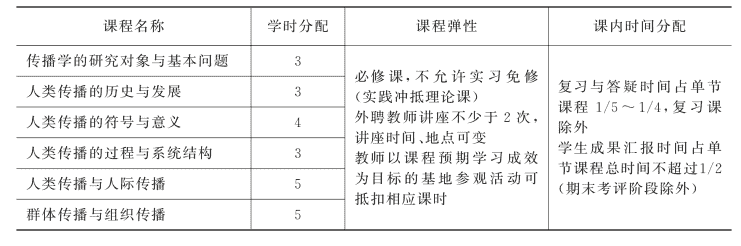

#### 6) Open Teaching and Curriculum Leader System

In the process of open schooling, introducing the curriculum leader system is very important. The main responsibility of the curriculum leader is to coordinate multi-party resources and focus on creating "Golden Courses." If faculty resources are sufficient, the role of the "curriculum product" lead teacher transforms into a dedicated curriculum manager, separated from the teaching role, focusing on improving curriculum quality from the student (user) perspective. In the process of developing and implementing new courses, the "curriculum product" leader should extensively integrate external available resources from other colleges, other universities, and the industry to find the most suitable faculty and best teaching venues for the entire course or specific sessions. Teaching management departments should build effective exchange platforms for open schooling, extensively introduce external wisdom and institutionalize it. Journalism and communication practice courses should actively construct and explore new ways of co-building practice teaching bases by schools and enterprises, widely adopt task-driven and project-oriented teaching models, realize teaching collaboration between schools and practice bases, and upgrade practice teaching from auxiliary to collaborative [[20]](#txt004.html#footnote_quote_txt004_20).

## III. Mechanism Design for Curriculum Product Development

### 1. Curriculum Team Architecture

# New Mechanism for Cultivating Excellent Journalism and Communication Talents Based on Course Product R&D Concept

## Teaching Mode of Teachers

Teaching modes can be divided into single-teacher and multi-teacher teaching, where multi-teacher teaching can be further divided into co-teaching mode and segmented teaching mode (see Tables 3 and 4).

**Co-teaching mode** is suitable for speculative courses, delivering knowledge and ideas through dialogue-style teaching by multiple teachers, which can also inspire teachers. For students, the co-teaching mode offers a better listening experience. The co-teaching mode is generally led by a teacher acting as a host, who guides the progress according to a pre-designed course script and makes appropriate impromptu adaptations.

**Segmented teaching** is suitable for interdisciplinary courses. The course product manager finds the most suitable instructor for each part and coordinates content connection among multiple teachers, leveraging their respective strengths while making the course systematic.

### Table 3 Schematic of Co-teaching Mode

### Table 4 Schematic of Segmented Teaching Mode

## 2. Basic Links of Course R&D

### 1) Planning Link

The planning link mainly includes course planning, script writing, and course testing.

- **Course planning** is creative instructional design based on course objectives and syllabus. Course planning is based on course research, including teaching content research, student basic quality research, etc.
- **Script writing** standardizes teaching methods and content through scripts, upgrading traditional teaching handouts.
- **Course testing** is a trial run of the course script, facilitating quality control of the teaching process, discovering script issues and optimizing them. Testing can be conducted in steps: first an Alpha (α) version for a few students, then a Beta (β) version for experimental classes, finally a formal version for all classes. During course version testing, emphasis is placed on collecting opinions from students and course production participants to revise issues in the "course product".

### 2) Execution Link

The course execution link includes all teaching-related activities within class hours, mainly course script execution, teacher classroom lecturing, and teaching interaction. The course script details teaching activities in chronological order, embodying instructional design ideas with strong object-orientation. The course leader can play the role of "instructional guide", guiding teaching activities to occur orderly as planned. Teachers can basically creatively restate knowledge according to the course script and organize classroom interaction. Since students' basic learning situations were surveyed in advance, the teaching content can well meet most students' expectations and match their knowledge acquisition rhythm. By appropriately increasing course difficulty, needs of students with extra capacity can be met. Systematic knowledge structure, carefully designed key sentences, cleverly integrated teaching cases, and inspiring teaching interactions all add luster to course quality.

### 3) Feedback Link

The feedback link includes assignment arrangement, course evaluation, and course optimization.

**Assignments** include preview assignments and review assignments. In China, the emphasis on preview before class is generally lower than lecturing and review. Harvard Professor Eric Mazur's research found that urging students to preview materials before class and think about questions based on understanding helps change students' thinking habits: knowledge learning shifts from relying on memory to relying on understanding, and course delivery shifts from large lecture halls to great halls of learning. Preview is not simply informing the next class content, but scientifically assigning tasks and thinking, urging students to actively preview before class.

Taking the preview assignment of "Introduction to Sociology" at City University of Hong Kong as an example, the preview assignment for the second lecture "Culture" includes 4 sets of term explanations and 2 expected learning outcome assignments. Both assignments require answers based on Hong Kong culture. There is a progressive relationship between assignments: the first question asks to identify phenomena, the second asks to think about the causes of the phenomenon from a fixed perspective [22].

**Course evaluation** aims to further improve course quality. When formulating course evaluation standards, they should be refined based on national standards for undergraduate teaching quality. Regarding course evaluation standards, the online education course evaluation system is worth referencing. For example, the most influential higher education online course standards include 8 dimensions: course overview and introduction, learning objectives (competencies), assessment, instructional materials, course activities and student interaction, course technology, learner support, accessibility and usability, totaling 43 standards [23].

**Course optimization** is based on course feedback, reflected in content updates of the next course version.

### Figure 2 Basic Links of Course R&D

## 3. Course Product R&D Process

Most courses can share the same course product R&D process. Besides the basic course links mentioned above, it also includes preliminary investigation, course budget, and post-optimization steps. The general process of course product design is shown in Figure 3.

Pre-planning research for journalism and communication courses mainly involves industry needs, feedback from previous students, domestic and foreign relevant course teaching materials, etc.

1. Understanding national, social, and industry needs helps clarify the course's cultivation goals and cultivate talents needed by the country and society.
2. Valuing student learning experience is the competitiveness of course products. During course product planning, extensive research on students' learning interests and expected learning goals is conducted to meet students' needs for knowledge acquisition and ability improvement.
3. Establish an expert network in journalism and communication, find suitable instructors to create high-level courses, aiming for "golden courses", comprehensively considering theoretical depth and difficulty.

Teaching management departments need to invest sufficient course budgets for product-concept-based course R&D, including matching human, financial, and material resources. Especially designs involving off-site teaching require large capital investment and expenditure.

Taking "Introduction to Converged Media" as an example, the first class can be designed as on-site joint teaching at the "central kitchen" (media convergence platform) of an enterprise's new media department. The realization of this course teaching design requires support from teaching management system design on one hand, and matching funds on the other.

### Figure 3 Schematic of Course R&D Process

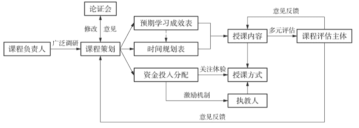

## IV. Summary and Discussion

Starting from the national and social demands for excellent journalism and communication talents, combined with the Ministry of Education's "golden course" requirements and exemplary course experience, this paper designs a new mechanism for cultivating excellent journalism and communication talents based on the course product R&D concept. The course product R&D concept includes new course system construction concepts, strict teaching standards and instructional design, course quality control and user experience management, flexible teaching, course version iteration, open teaching, and course leader system, etc. The article clarifies team architecture design and basic links of course R&D, and provides a demonstration process for course R&D.

Notably, course teaching is a creative and complex knowledge imparting activity. Moderate impromptu performance and open classroom discussions are indispensable. Therefore, it is necessary to avoid the mechanized effects brought by standardized course product design, and reserve space for free discussion during course planning.

## References

[1] Ministry of Education of the PRC, Publicity Department of the CPC Central Committee. Opinions on Implementing the Excellent Journalism and Communication Talent Education and Training Plan 2.0 to Enhance the Capacity of Universities to Cultivate Journalism and Communication Talents [Z]. Jiao Gao [2018] No. 7.

[2] Wu Yan. Building China's "Golden Courses" [J]. Chinese University Teaching, 2018(12): 4-9.

[3] Wang Xin. Theoretical Analysis of Universities Emphasizing Research over Teaching: A New Perspective [J]. Journal of Dalian University of Technology (Social Sciences), 2017, 38(02): 128-132.

[4] Wang Hui, Zhou Xu. Opposition of Nothingness and Unity in Fact: On the Relationship between "Teacher-Centered" and "Student-Centered" [J]. Modern University Education, 2019(03): 40-46.

[5] Ke Wenjin, Jiang Jinqiu. Characteristics and Implications of Salary Systems in World-Class Universities: A Case Study of Five US World-Class Universities [J]. China Higher Education Research, 2014(05): 20-25.

[6] Qian Yingyi. University Personnel System Reform: A Case Study of the School of Economics and Management, Tsinghua University [J]. Tsinghua Journal of Education, 2013, 34(02): 1-8.

[7] Wang Yan. Analysis of Profit Models of Online Education MOOCs [J]. China Chief Accountant, 2016(10): 80-81.

[8] Sun Mengdan, Gu Mingna, Gao Junkuan. Research on the Current Status of Online Video Course Resource Construction at Home and Abroad [J]. Library Science Research, 2012(11): 34-41.

[9] Liu Hongliang. Exploration of Docking Massive Open Online Courses (MOOCs) with Credit Bank Systems [J]. Modern Educational Technology, 2014, 24(10): 88-94.

[10] Hong Jiewen, Peng Yutian. Quality from Teaching Process: An Analysis Based on Foreign University Course Rating Systems [J]. Chinese University Teaching, 2017(10): 92-96.

[11] Ministry of Education of the PRC. Notice on Implementing the Spirit of the National Undergraduate Education Work Conference in the New Era [Z]. Jiao Gao Han [2018] No. 8.

[12] Yan Sanjiu, Nan Ruiqin. Institutional Research on First-Class Discipline Construction: A Case Study of Discipline System Changes at Columbia University Graduate School of Journalism and Missouri School of Journalism [J]. Journal of East China Normal University (Educational Sciences), 2017, 35(06): 95-106+156.

[13] Shi Wei. Absence and Reconstruction of University Classroom Teaching Standards [J]. Higher Education Research, 2019, 40(06): 73-78.

[14] Gao Xiaohong, Zhao Xijing. Cultivating Excellent Journalism and Communication Talents Based on the Development Direction of the New Era [J]. Chinese University Teaching, 2018(04): 8-11.

[15] Deng Shaogen, Li Xingbo. A Century in Review: On the Development Process and Characteristics of Chinese Journalism and Communication Education [J]. Modern Communication (Journal of Communication University of China), 2019, 41(06): 155-164.

[16] Weng Weixin. Quality Standards for Applied Undergraduate Talent Cultivation: Basic Characteristics and Promotion Strategies [J]. Journal of Sichuan Normal University (Social Sciences), 2018, 45(03): 62-68.

[17] Si Li, Shu Chan. Construction and Implications of the MOOC "Principles and Utilization of Information Organization" [J]. University Library Work, 2019, 39(04): 42-45.

[18] Xu Fangjie, Yang Ting. Teachers' On-site Learning Ability: Connotation, Composition, and Enhancement Strategies [J]. Educational Theory and Practice, 2019, 39(01): 57-60.

[19] Chu Hongli. Teacher Remuneration and Human Capital Market Construction in the Reform Process [J]. Journal of Central China Normal University (Humanities and Social Sciences), 2005(02): 67-71.

[20] Wang Y. Reconstruction of Talent Training Model in Local Universities from the Perspective of Industry-Education Integration[C]//Zhou H Q, Kang Q, Chen YY. 1 Proceedings of the st International Conference on Business, Economics, Management Science (BEMS 2019). Beijing: ATLANTIS PRESS, 2019: 639-643.

[21] Sun Zhongmei, Wu Xiaofeng. Research on MOOC, Flipped Classroom, and Teaching Process Reengineering [J]. Adult Education, 2015, 35(06): 53-56.

[22] Biggs, Tang. Teaching for Quality Learning at University: What the Student Does, 4th ed. [M]. Translated by Wang Ying, Ding Yan, Gao Jie. Shanghai: Fudan University Press, 2015: 100.

[23] Qian Ling, Zhao Yanyan. Online Course Quality Assurance System Centered on Teacher Professional Development: Core Competitiveness and Implications of US Quality Matters [J]. Open Education Research, 2018, 24(05): 30-38+72.

---

**Author Biographies**: Yi Long, PhD, Director of the Media Department, School of Literature and Journalism, Central South University, Master's Supervisor; Li Chenyu, 2017 Undergraduate, School of Literature and Journalism, Central South University.

**[Notes**  

[1] This paper is a phased achievement of the Central South University Education and Teaching Reform Research "Research on Cultivation of Top Innovative Talents in New Liberal Arts Based on Converged Media Development Strategy" (Project No.: 2019jy025).

---

# News Communication Talent Demand and Education Reform in the Digital Transformation of the US Newspaper Industry

**Zheng Xiaodi, Chen Xinyi**

## Abstract

American journalism and communication education is also undergoing important changes in the context of new media development. To adapt to the requirements of the new media environment, academia and relevant institutions have carried out exploration and practice in journalism education: foundations such as Carnegie and Knight have increased funding for journalism teaching research; renowned universities such as Columbia University and the University of Missouri have made adjustments in teaching models and content, paying particular attention to the cultivation of "expert journalists," "data journalism talents," and "media convergence talents"; the Accrediting Council on Education in Journalism and Mass Communications (ACEJMC) has strengthened the concept of public interest in journalism education. These journalism education reform measures reflect the emphasis on cultivating professional and versatile talents, especially data journalism and media convergence talents, and the maintenance of public interest by journalism education.

**Keywords**: Digital Transformation, Journalism and Communication Education, Education Reform

## Main Text

American journalism education has always been at the forefront of the world. With the development of the Internet, the original modes of information dissemination and reception have undergone fundamental changes. Against this background, the American education community has continuously reflected, finding that the original journalism education model cannot meet the demands of the times, making journalism education reform a hot topic in academic practice and research.

American journalism education has a tradition of receiving funding from various foundations. Under the funding of various foundations, the teaching reform practice of journalism education has been carried out more smoothly. The University of Missouri School of Journalism is a long-established journalism school. Understanding its teaching reform practice helps grasp the general direction and trends of reform in various American journalism schools. Changes in the evaluation standards of the Accrediting Council on Education in Journalism and Mass Communications (ACEJMC) serve as a wind vane for journalism education reform in recent years. Therefore, by paying attention to changes in the focus of journalism education by various organizations, the overall trend of American journalism education reform practice can be seen.

## I. Cultivation of Practical Journalism Talents under Funding Programs such as the "Carnegie-Knight Initiative for the Future of Journalism Education"

With the deepening of media convergence and changes in the communication landscape, how to cultivate journalism and communication talents adapted to the new media environment is a common concern of the journalism industry and academia.

The Carnegie Corporation of New York continuously discusses with heads and administrators of various American journalism schools topics such as journalism education in the new media ecology, how journalism education should innovate to adapt to changes of the times, how to define journalism talents and journalism education, and how to achieve the transformation of traditional journalism.

Based on interviews with more than 40 journalism elites, McKinsey & Company produced the interview record "Improving the Education of Tomorrow's Journalists," which argues that the dilemmas and contradictions faced by the journalism industry need to be solved from the root of journalism education, requiring significant adjustments to the methods, concepts, and content of journalism education.

In recent years, another journalism funding institution, the Knight Foundation, has cooperated with the Carnegie Foundation to conduct in-depth research on journalism education in the digital context, launching the influential journalism reform project "Carnegie-Knight Initiative for the Future of Journalism Education," which funds educational reform research in journalism majors at five pilot universities. The project aims to improve the quality of journalism education in the digital media environment and cultivate "practical journalism talents" adapted to new media demands [2].

# Carnegie-Knight Initiative on the Future of Journalism Education

The main content of the "Carnegie-Knight Initiative on the Future of Journalism Education" consists of three parts.

## I. Three Core Components of the Initiative

### 1. Curriculum Enrichment Program
The **Curriculum Enrichment** program aims to enrich the core curriculum system of journalism and communication majors, and allocate faculty from other majors and disciplines to teach courses, so as to enhance the comprehensive quality and professional ability of journalism students and broaden their horizons, such as history, sociology, psychology, computer science, political science, etc.

For example, the "Evidence and Inference" auxiliary course offered by Columbia University has improved the comprehensive judgment and reasoning abilities of journalism students, and enhanced their investigative reporting capabilities. Relevant courses on statistical research methods offered by Northwestern University teach specialized statistical methods and data statistical software `SPSS` in the field of sociology, providing professional tools for the scientific analysis and visualization presentation of digital journalism. The University of California has attempted to offer a variety of courses closely related to new media, to improve journalism students' cognition, understanding, judgment, and application abilities regarding new media.

### 2. News 21 Incubators
The second is the professional internship program known as **"News 21 Incubators"**. This program mainly connects higher education institutions of journalism with mainstream media, providing training and internship opportunities for journalism students from selected universities, and hiring senior media practitioners from many well-known news organizations such as *The New York Times*, Cable News Network (CNN), Associated Press, etc., to guide students' news operations and practices.

### 3. Carnegie-Knight Task Force
The third is the professional research project on journalism education and the journalism industry named the **"Carnegie-Knight Task Force"**. Through surveys and research on the public, government agencies, social organizations, media practitioners, and all sectors of society, it collects expectations, views, attitudes, and suggestions from various social fields on the journalism industry, especially the media industry in the digital media environment, in order to study these views, attitudes, and suggestions. The research institute of this "Task Force" is located at the Shorenstein Center on Media, Politics and Public Policy under the Kennedy School of Government at Harvard University. The project consists of senior scholars, industry practitioners, and journalism experts.

In addition, the Carnegie Corporation cooperated with the American Broadcasting Company (ABC) to establish a professional advanced study program for journalism majors. Students from journalism schools participating in the initiative were selected to enter the program, taught by outstanding editors and reporters from ABC, covering professional journalism knowledge such as professional ethics, news ethics, on-site investigative reporting, and digital news reporting and presentation in the new media environment.

## II. Positioning and Educational Practices of the Missouri School of Journalism in Cultivating Media Convergence Talents

In 1908, the University of Missouri founded the world's first school of journalism. The advantage and characteristic of the Missouri School of Journalism is the use of the **"Missouri Method"** to combine classroom teaching content with journalism practice. For many years, the school's journalism education tenet has been to emphasize journalism practice and cultivate professional journalism talents. Unlike Columbia University's School of Journalism which only has graduate-level education, the Missouri School of Journalism possesses journalism education programs at three stages: undergraduate, master's, and doctoral.

Over the past decade or so, with the rise of new media and the continuous advancement of the digitalization process, the integrated development of old and new media has become an inevitable trend, and the reform of journalism education has become imperative. Starting in 2005, both undergraduate and graduate education programs at the Missouri School of Journalism newly established the **"Convergence Journalism"** major, cultivating all-media journalists in the digital context and journalism professionals for data visualization presentation, taking **"Digital First" and "Mobile First"** as important talent cultivation concepts. In the new media environment, the Missouri School of Journalism takes the cultivation of **"Media Convergence Talents"** as its main talent cultivation goal, emphasizing and strengthening students' cognitive ability, comprehension ability, and media expression and presentation ability for different news forms under old and new media forms in terms of teaching philosophy, curriculum setting, teaching methods, and faculty team.

### Undergraduate Curriculum Setting
In the undergraduate curriculum setting of the Missouri School of Journalism, the school added courses such as **"Convergence Photojournalism," "Data Journalism," "Emerging Media," "Convergence Television Reporting," "Strategic Communication: Digital Strategy," "Entrepreneurial Journalism,"** etc., taught by well-known teachers familiar with media convergence research directions. The emphasis and attention on emerging fields such as digital media, media convergence, social media, and mobile internet in the newly added courses enriched the content of journalism professional courses. Teachers with new media practical experience provided rich and cutting-edge practical cases in the teaching of new courses, enhancing the practicality and frontier nature of journalism education.

The newspaper *The Columbia Missourian*, sponsored by the Missouri School of Journalism, also increased opportunities for journalism students to conduct practical training. The main body of the reporting and editing team of this newspaper is composed of students, published under the supervision and management of professional professors and senior media professionals. With the launch and trial operation of the newspaper's online version `Columbia Missourian.com`, the newspaper's influence, competitiveness, and popularity have further expanded. Students can practice in both traditional newspaper media and digital new media, increasing their understanding of the media convergence environment and practice, and enhancing their news practice and operation capabilities in the media convergence environment. The digital section of the newspaper contains different sections such as news, sports, obituaries, VOX, opinions, from readers, events, visual effects, etc. Through the news internship practice at *The Columbia Missourian*, journalism students' media convergence concepts and digital media practical operation capabilities have been rapidly improved.

In addition, the Missouri School of Journalism launched the **"Global Programs,"** aiming to provide journalism students with global exchange programs, internships, short-term curriculum training, and other related services, and to provide opportunities for journalism students to intern and practice at well-known media in areas such as New York and Washington, D.C.

### Graduate Curriculum Setting
In the graduate curriculum setting, the Missouri School of Journalism places more emphasis on the **"Media Convergence"** educational philosophy. The master's courses for journalism majors include three models: **"Two-Year MA Models," "Five-Year BJ/MA Models,"** and **"Journalism-Law Programs."** Among them, required courses include **"Data Journalism," "News Media and Society," "Convergence Journalism," "Visual Editing & Management," "Computer-Assisted Reporting,"** and other courses closely related to digital news gathering/editing and media convergence.

Among them, the two-year master's curriculum in the **"Media Convergence"** specialization focuses more on relevant professional content of **"Convergence Journalism,"** including 9 credit hours of basic core courses, with professional courses including Mass Media Seminar, Journalism Practice, Quantitative and Qualitative Research Methods, and one self-selected elective. There are 9 credit hours of convergence core courses, with professional courses being Convergence Journalism Reporting, Television Broadcast Photojournalism, and Convergence Editing and Production. The professional core projects and thesis total 10 credit hours, main content including Journalism Issues Research, MA Project Seminar, and related thesis. In addition, there are 9 credit hours of convergence model education electives for students to independently choose according to their own professional setting plans.

## III. ACEJMC Evaluation Standards Strengthening the "Publicness" Teaching Philosophy of Journalism Education

After the concepts of **"Public Journalism"** and **"Citizen Journalism"** were proposed, the **"Publicness"** concept of journalism entered the vision of academia and industry. Against the background of the rapid development of digital media, the **"Publicness"** of journalism education has been proposed and strengthened again.

The educational effects and teaching innovations of US journalism schools are evaluated by **ACEJMC** (Accrediting Council on Education in Journalism and Mass Communications). The council was originally established in 1945, composed of experts from journalism education and the journalism industry. Its goal is to ensure the breadth and depth of knowledge provided by journalism education, promote journalism education reform in response to situational changes, and create a platform for exchange and interaction between the journalism industry and other disciplines, so as to promote the improvement of journalism teaching quality with new ideas, new perspectives, and new concepts. Because this institution is an independent non-profit organization, its position is relatively objective and impartial, enjoying a high reputation in the journalism industry and academia. It can conduct an independent review and evaluation of the teaching quality of journalism schools every six years to ensure the excellence of journalism education in various schools.

When evaluating journalism schools, there are a total of **nine standards** for verification and judgment, namely:
- **Mission, Governance and Administration**
- **Full-Time and Part-Time Faculty**
- **Curriculum and Instruction**
- **Scholarship: Research, Creative and Professional Activity**
- **Diversity and Inclusiveness**
- **Resources, Facilities and Equipment**
- **Student Services**
- **Assessment of Learning Outcomes**
- **Professional and Public Service**

In recent years, with the advancement of the digitalization process, especially the rapid development of social media, everyone in the online media environment has a "microphone" and the right to speak. The weight of ACEJMC's evaluation of the **"Publicness"** of journalism education is increasing. This is mainly manifested in promoting the diversification of journalism education objects, adjusting the implementation of journalism education for different genders, races, ages, and other groups, especially promoting the continuous participation of minority groups, women, people with disabilities, and other groups in journalism education under the background of public communication, so that universities, in addition to undertaking professional education functions, also assume the responsibility of continuously improving the public's media literacy.

With the continuous development of digital new media, the opportunities and frequency for the public to access online media continue to increase. The improvement of the public's online media literacy has become a major issue facing American society. Reducing the **Digital Divide** among different groups has become an important responsibility of journalism education. ACEJMC encourages journalism schools to help the public correctly understand and effectively use the public resources of journalism education through the popularization of education. When evaluating and assessing the education of journalism schools, ACEJMC attaches increasing importance to the communication status between journalism schools and the public, public media literacy, social public service projects, and other aspects. Its education evaluation standards and regulations clearly stipulate that attention should be paid to **"the unit and its faculty advancing the professions of journalism and mass communication and fulfilling their obligations to the community, alumni, and the larger public."** Against the background of the development of digital new media, improving the public's media literacy, and enhancing the public's ability to select, use, understand, question, and evaluate digital media content are its important responsibilities.

## Summary

With the development of media convergence and the online digitalization process, the mode of information dissemination has undergone fundamental changes, and journalism practice has also shown characteristics such as socialization, mobilization, and digitalization. To adapt to the needs of journalism practice, especially the changes in the traditional journalism industry, and cultivate journalism talents that meet the needs of the times, US journalism education has carried out continuous exploration. This includes practices of journalism teaching reform in teaching curriculum, teaching methods, faculty team, internship and training models, talent cultivation goals, and other aspects by journalism schools; funding and attention to journalism education by various education foundations; and advocacy and encouragement on teaching models by journalism education evaluation institutions.

These journalism education reform practices focus on the cultivation of journalism practice talents in the digital era, especially media convergence talents, digital journalism talents, and all-round journalism talents. At the same time, in the practice of journalism education reform, increasing attention is paid to the **"Publicness"** of journalism education, that is, the service objects and scope of various journalism schools are further expanded. The education objects and responsibilities are no longer limited to enrolled students, but also include the improvement of the public's media literacy. The US media industry realizes that journalism education reform is not only a problem faced by universities, but also a problem faced by the journalism industry and American society. It requires all sectors of society, including journalism schools, research foundations, social public institutions, and the US media industry, to jointly face and discuss. Through the exploration of the **"Digital First" and "Mobile First"** education reform concepts, they continuously cultivate professional journalism talents with digital news production capabilities adapted to the background of media convergence, while enhancing the public's media literacy in the context of public communication, and improving the public's awareness and ability to participate in discourse in the digital media environment.

---

**Author Biographies**: Zheng Xiaodi, Associate Professor, School of Design, Shandong University of Arts; Chen Xinyi, Doctoral Candidate, School of Journalism and Communication, Shandong University.

---

# Industrial Transformation in the Era of Intelligent Media

## Exploration of the Path of Media Intelligent Transformation Driven by the Dual Wheels of "Data Value + Artificial Intelligence"

**Li Haidong　Xu Zhiqiang**

### Abstract
Based on an examination of the basic characteristics of the integration of artificial intelligence and the media industry, this paper first proposes that data has become the link integrating the ternary world, and discusses the comprehensive integration processing and value creation of data in the context of triple spaces; then, from the two aspects of hierarchical mapping and future evolution, it discusses the evolution of media ecological thinking driven by **"Intelligent +"** technology; then, from the five dimensions of intelligent awakening, intelligent production, intelligent distribution, intelligent security, and intelligent optimization, it deeply reveals the trends of media intelligent transformation; finally, it proposes that accelerating the construction of an integrated media intelligent platform will be the key for radio and television media to gradually achieve **"intellectualization"** and promote the high-quality development of the media industry.

### Keywords
Data Value, Artificial Intelligence, Media Convergence, Integrated Media, Intelligent Media

---

## References

[1] This paper is a phased achievement of the 2019 Shandong Art Science Key Project "Research on the Current Situation and Enlightenment of Interactive Design Education in the US in the Era of Artificial Intelligence", Project No. ZD201906226.

[2] Data Source: `https://www.carnegie.org/news/articles/five-new-universities-asked-to-submit-proposals-for-curriculumenrichment-as-part-of-carnegie-corporations-initiative-on-journalism-education/`.

[3] Data Source: Feng Jia. Curriculum Innovation in US Journalism Schools — Taking the "Carnegie-Knight Initiative on the Future of Journalism Education" as an Example [J]. Journalism & Communication, 2011(05): 168.

[4] Data Source: `https://www.carnegie.org/news/articles/five-of-americas-most-respected-research-universities-unite-in-a-more-than-6-million-effort-to-help-revitalize-journalism-education/`.

[5] Data Source: `https://www.carnegie.org/grants/grants-database/grantee/robert-c-maynard-institute-for-journalism-education/#!/grants/grants-database/grant/32111.0/`.

[6] Data Source: `https://www.carnegie.org/grants/grants-database/grantee/university-of-southern-california/#!/grants/grants-database/grant/48066.0/`.

[7] Data Source: `https://www.knightfoundation.org/programs/journalism`.

[8] Data Source: `http://www.columbiamissourian.com/about/`.

[9] Data Source: `https://journalism.missouri.edu/programs/masters/models-and-programs/`.

[10] Data Source: `https://journalism.missouri.edu/overlay-content/two-year-ma-model-convergence-journalism/`.

[1] Data Source: `https://...` (Footnote marker corresponds to the second article)

# Advanced Stage of Current Artificial Intelligence Development and Media Convergence

Currently, through continuous evolution in fields such as deep neural networks (e.g., 10¹¹ training samples, 10⁷ parameters with each parameter updatable 10⁹ times, etc.), whole brain simulation (e.g., the US "BRAIN Initiative", the EU "Human Brain Project", China "China Brain Project"), and Intelligence Dynamics (analogous to aerodynamics which is key to flight), AI has enabled machines to possess capabilities in perceptual intelligence (able to listen and speak, watch and recognize), cognitive intelligence (able to understand and think), computational intelligence (able to store and calculate), and motor intelligence (able to grasp and hold, walk and run).

From a media perspective, the concept, scientific nature, and value recognition of media convergence are deepening. New-generation intelligent, cross-media, and pan-content technologies will accelerate the intelligence, experience, and personalization of content production, dissemination, and consumption. For example, during the coverage of the 2018 National "Two Sessions" (Lianghui), major central media outlets unveiled novel strategies ("qí zhāo"), transforming the news production and dissemination ecology. Among them, *People's Daily*'s "Central Kitchen" adopted information integration and distribution, and multi-platform interconnection methods, improving dissemination efficiency and achieving precise delivery; Xinhua News Agency's "Media Brain" used Machine-Generated Content (MGC) to produce big data news videos in seconds, pushing AI application in news reporting deeper; CCTV's *CCTV Quick Comment* focused on timeliness, with standards of "fast, accurate, precise, deep", forming a powerful shockwave in the instant new media public opinion arena.

This shows that digitalization, networkization, and convergence are only the primary stage of media convergence; cross-border integration and intelligent communication driven by new-generation information technologies such as platformization, datafication, and intelligentization are the advanced stage of media convergence.

## 1. Data-Driven: Triple-Space Data Comprehensively Creates Value

In the digital economy era, media data including content, business, dissemination, influence, users, tags, ratings, public opinion, and equipment have become important resources for the media industry, providing comprehensive support for links such as assisting content production, analyzing dissemination effects, analyzing content operations, and precise recommendation marketing.

### 1. Comprehensive Integration and Processing of Triple-Space Data

Understanding from a philosophical height, new-generation intelligent, cross-media, and pan-content information technologies allow more and more people and objects to leave increasingly clear digital traces in the information space, blurring the boundaries between humans and machines, online and offline activities, physical and virtual worlds, nature and artifice. Data analysis of data, expressions, behaviors, semantics, etc., is becoming an important way to study user behavior and capture attitudes and behaviors forming social structures from a "relational" perspective (though not the only way). It can be seen that based on massive, diverse user behavior data accumulation and well-structured knowledge graphs, one can describe the information space (expression, flow, privacy, security, etc.), describe the objective physical space (Internet of Things, Internet of Vehicles, Internet of People, Internet of Business, etc.), and depict the human social space (family, community, city, politics, economy, military, state, etc.). This will become a nexus integrating resource management, collaborative sensing, data preprocessing, data analysis, and application, and comprehensively integrating the ternary world of "Cyber Space—Physical Space—Human Society" [1]. The full value chain integration of the digital world and physical world is shown in Figure 1.

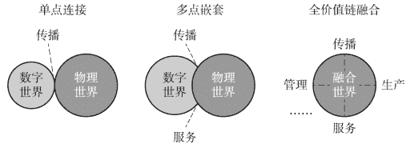

### 2. Data Creates Value

In the digital economy era, many industries including the media industry are transforming and upgrading towards networkization, automation, and intelligentization, causing competition and gaming to extend from physical space into information space. Intelligent converged media platforms based on the internet fully exhibit the many attributes of modern media including connection, activation, sharing, and expression, entering a virtuous cycle of "acquiring user time and data → better serving users → obtaining more time and data → squeezing competitors' time", with their value constantly highlighted. From the connection attribute, the internet allows "human-machine-thing" to be searchable, discoverable, and integrable with each other; from the activation attribute, each user can connect with users sharing the same interests and values on the internet, aggregating into communities; from the sharing attribute, point-to-point, instantaneous sharing can infinitely amplify information, attitudes, moods, resources, etc. in an instant; and from the expression attribute, highly convenient publishing platforms and channels give every user the right to free expression. "Data Value + Network Collaboration" is shown in Figure 2.

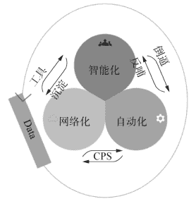

Ubiquitous information tracking, interaction, and filtering mean humans can integrate multi-faceted user information into profiles at a favorable cost, which can guide the launch of any needed customized services. [2] To realize the application monetization chain of "Data → Information → Knowledge → Decision" running through the entire process [3], media organizations should explore more how to play the most ideal content at the most ideal position and time, and respond in the most ideal way and frequency. They can use models like cluster analysis, factor analysis, principal component analysis to build big data processing capability platforms and collect or trace full-sample data, realizing media content tagging including statistical ranking of user live streaming behavior, correlation analysis and recommendation of user catch-up or VOD behavior, personalized ad insertion services, etc. For example, ByteDance successively launched *Toutiao* (Headlines) centered on graphic distribution, *Xigua Video* and *Huoshan Video* as extended applications for video distribution, *Douyin* (TikTok) based on two-sided network effects, and *Wukong Q&A*, *Tuchong*, *Dongchedi*, *Duoshan* and other products aimed at opening new frontiers, forming a multi-layer flywheel. The base flywheel *Toutiao* relies on user data for algorithm optimization and user accumulation, sharing user tags and core algorithms with extended flywheels; extended flywheels attract new users in their respective niche fields, achieve retention through algorithm-driven stickiness, and thus sustain monetization.

## 2. Reconstruction: Evolution of Media Ecology Thinking Driven by "Intelligence+" Technologies

Information and Communication Technology (ICT) continues to develop vigorously, penetrate widely, and integrate deeply, becoming a key driver of China's economic growth. Among them, iABCD (Internet of Things, Artificial Intelligence, Blockchain, Cloud Computing, Big Data) and other new-generation information technologies break traditional industry boundaries, providing ubiquitous network basic applications, becoming an important force for building media business innovation capabilities and promoting deep integration of intelligentization and the real economy [4].

### 1. Intelligent Media Layered Map

"Intelligence" and "Convergence" are gradually evolving into the core characteristics of internet-based intelligent media platform development. Intelligent media has shown "high-dimensional" characteristics far exceeding traditional media and new media in management modes and operation modes [5]. New intelligent hardware is developing from environment-sensing devices toward automatic control and voice interaction devices; intelligent software is developing from single-point technologies like speech recognition, gesture recognition, facial recognition toward active, multi-modal fusion technologies like audio-visual recognition, video summarization, fusion recognition. The thick isolation walls originally lying between industries and departments are dissolving; we are in the third wave of media convergence.

Future media will be a highly intelligent new-form media established on information technologies like "Cloud, Big Data, IoT, Mobile, AI, Zone/Blockchain, Add/Compute" (Yun Da Wu Yi Zhi Qu Jia), integrating perception, cognition, and decision-making, and can be divided into multi-layer systems such as intelligent perception, natural language understanding, dynamic knowledge graph, intelligent interaction, and intelligent decision-making according to main functions. The layered map of intelligent media is shown in Figure 3.

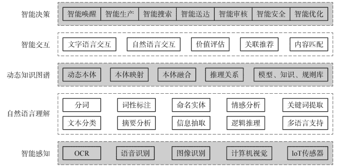

### 2. Evolution Trends and Future Possibilities of Media

Creating more cultural integration, sensory pleasure, value sharing, new knowledge, and convenience for users, enabling anyone to get anything they want at any place and any time, is the intrinsic driving force and ultimate goal of all media development in the intelligent era. In the future, media will increasingly resemble an existence—ubiquitous, always on, hidden yet present—becoming more and more a key tool for meeting the needs of converged media business development, integrated platform resource scheduling, converged media business innovation and change, converged media business growth, and converged media platform openness.

What direction will future media evolve? Perhaps sensory extension, media full-time connection; perhaps human-machine integration, accessing information anytime, anywhere; perhaps boundary dissolution, media contact defining groups, language barriers disappearing, digital divide eliminated. Future media, while improving resource efficiency, dissemination efficiency, and service efficiency, will also catalyze communication channels to evolve toward mobilization, platformization, and diversification.

## 3. Media Intelligent Transformation Based on Data-Driven Approach

In the upcoming omniscient, omnipotent, holographic intelligent media communication era, both traditional media and new media must be people-oriented, starting from user expectations (entertainment, personalization, authenticity, etc.), tapping the potential of digital technologies (AI, Augmented Reality/Virtual Reality/Mixed Reality (AR/VR/MR), Blockchain, Machine Learning, Cyberspace Security, etc.), improving common business touchpoints through top-level design layout, gradually building an application focus of sharing, openness, and collaboration of services, data, and capabilities, thereby constructing a continuously iterating and upgrading converged media content "intelligent manufacturing" support system. Due to space limitations, the following only discusses the intelligent decision-making layer in the intelligent media ecology system as an example.

### 1. Intelligent Awakening: Data Acquisition and Representation

Intelligent awakening uses AI and "intelligent logic" to integrate every bit of data into the full industry chain of converged media gathering, editing, broadcasting, storage, management, and use, acquiring and making it more useful, valuable, and "smart", thereby supporting all-media business. The traditional 2D internet industry connects individual consumers and enterprises, but has been divided up by Alibaba, Tencent, and Baidu. The 3D internet empowered by big data will awaken dark data resources scattered in city corners not yet converted to digital format, and achieve full coverage of individual consumers, enterprises, and government through cloud computing, AI, etc., thereby building an intelligent platform.

In the future, media platforms in an intelligent awakening environment will greatly strengthen and significantly improve the data foundation and information environment of human production, life, and governance. On the content supply side, "Central Kitchens" can be built to realize datafication, networkization, and intelligentization of content resources, e.g., central media building omnipotent flagship media, provincial media building provincial public service platforms, local (county) media building local comprehensive information service platforms [6]; by continuously increasing the magnitude and frequency of data acquisition and representation, cross-verifying and cross-reproducing multi-angle, multi-level information in spatial sequences, continuously presenting and innovating analysis logic of continuous data organically linked to user practices and interactions in time sequences; through multi-level, multi-dimensional datasets, realizing focus on the realistic situation of a specific person, event, or social state [7]; by cooperating with operators, establishing video services and communication networks for media and pan-media integrating functions like public opinion analysis, clue discovery, large-screen display; by using technologies like robot writing, VR production, 4K/8K production to fully utilize data and make it reflect the warmth of human life, thereby mining derivative value of data information.

### 2. Intelligent Production: Content Production and Manufacturing

Intelligent production is currently a phenomenon-level application of AI in news communication. In the future, content production will undergo intelligent evolution—after acquiring relevant data in various forms, by analyzing intrinsic connections of different data types, multi-level knowledge mining and environment matching, extracting viewpoints and suggestions, and generating narrative long/short articles, reports, visualization charts, etc. according to certain classification standards, logical structures, and sequences, finally pushing content in real-time via cloud services through channels like Application Programming Interfaces (API), JavaScript Object Notation (JSON), Extensible Markup Language (XML), Twitter, Email, etc.

In the future, media platforms in an intelligent production environment will change the content production process in an all-round, whole-process manner. Competition will increasingly be about data platforms and data acquisition and processing capabilities; algorithms will largely help the industry complete datafication work, bringing a "human-machine symbiosis, human-machine collaboration" integration situation. In the future, robot programs like intelligent collection, cataloging, clipping, review, editing, writing, video enhancement, public opinion monitoring, conversational Q&A, and robot writing/editing will be responsible for boring procedural work like data mining and analysis, and breaking news with fixed templates; creators will be freed to have more time for "mental labor" of creative production and creative exploration in vertical, subdivided fields requiring massive emotion, sentiment, and EQ (higher dimensions), while providing users with diverse content types, giving rise to many fields and niche market spaces previously unavailable for creation and creativity.

### 3. Intelligent Delivery: Content Distribution and Dissemination

Intelligent delivery, based on collecting dynamic, multi-dimensional, interconnected media business data (especially datafication of audience and user behavior), uses capabilities like natural language understanding and big data analysis to deconstruct bottleneck problems of sustainable development of broadcast networks and the internet, thereby efficiently and low-cost realizing "5A" services (Anyone/Anytime/Anywhere/Anyway/Anyservice) for media content, and extending profit models downstream in depth. Intelligent delivery mainly involves intelligent engines, broadcast networks, and two-way networks.

In the future, media platforms in an intelligent delivery environment, including modules like intelligent media cloud, intelligent tags, intelligent multiplexing, intelligent routing, intelligent edge, intelligent terminals, intelligent reception, and intelligent recommendation, will be the result of the combined action of TV media's "fusion" and social media's "fission". In specific design, first analyze key theme content grasped, covered user groups, and key concerned users to complete user identification; second, extract user subjects and their interactive feedback to build a user tag and analysis model system, completing attribute definition; finally, based on event context, subject discovery, user portraits, relationship discovery, complex networks, communication paths, and intervention conversion, repeatedly refine and filter generalized content and build a communication evaluation system, promoting granular processing, multi-dimensional invocation, and multi-channel dissemination in video derivative diffusion processes, thereby completing the entity application of intelligent delivery. Additionally, combined with gathering/editing production data, realize analysis of dissemination influence of editorial staff; combined with analysis of manuscript dissemination of peer media outside the organization, form peer dissemination influence comparison; and track dissemination monitoring of specified news manuscripts, track and display development context of hot events, etc.

### 4. Intelligent Security: Content Review and Monitoring

Intelligent security uses new-generation information technologies like iABCD to conduct prospective and real-time autonomous identification, judgment, and reasoning on complex issues including network convergence, business format convergence, converged news, converged production, industrial control, thereby building an all-round, three-dimensional, active defense system, guaranteeing the subject's safe operation. In the media field, the construction of Office Automation (OA) business and Business Operation Support System (BOSS) gave rise to cybersecurity applications; the construction of shared-platform production, multi-channel distribution media convergence models gave rise to protection system construction in the production-broadcast domain; the construction of internet-based intelligent converged media platforms (online live streaming, mobile App live streaming, "two WeChats and one client" etc.) gave rise to lightweight gathering-editing-broadcasting-storage-management-use systems serving media convergence and facing internet security; the development of converged media and widespread application of big data and cloud computing require converged media cloud security like cloud non-linear editing, cloud desktop (lightweight security protection needs, resisting common network attacks, effectively preventing virus spread, etc.).

In the future, media platforms in an intelligent security environment must also build a closed-loop system with IPv4/IPv6-based full network traffic data analysis, security situational awareness, and active defense, achieving traceability of past events, prevention of current events, and predictability of future events, thereby improving intelligent security capabilities in the media field. Specifically, the scope of cybersecurity "situational awareness" can be understood as: "Shi" (Situation/State), i.e., correlation, statistics, analysis, alarm, disposal, mainly referring to collecting various security status information, analyzing and aggregating security events, behavior trajectories; "Shi" (Trend/Potential), i.e., fusion, mining, learning, prediction, mainly referring to analyzing and predicting security risks, mining information security trends; "Gan" (Sense), i.e., acquisition, collection, detection, monitoring, discovery, capture, mainly referring to real-time sensing and active focusing on risk threats; "Zhi" (Knowledge), i.e., understanding, perception, familiarity, mastery, prediction, insight, mainly referring to intelligent correlation of causality, foreseeing security crux and hidden dangers.

### 5. Intelligent Optimization: Platform Business and Value

Intelligent optimization, based on effective integration of intelligent transformations like intelligent production, awakening, delivery, and security, condenses intelligent value from five dimensions: customer integration, intellectual integration, vertical integration, horizontal integration, and value chain integration, thereby generating greater value. In fact, internet-based intelligent converged media platforms still have many pain points, e.g., in user services, AI has not exerted true value—creating videos, aggregating scattered videos, and personalized videos. In the future, supported by AI, personalized content can be generated, quickly realizing "thousand people, thousand faces" products (e.g., personalized channels); can help users precisely locate, making the whole internet a personal video library; can strengthen user dependence and retention time, realizing multi-platform content, single-platform presentation, and video aggregation (see Table 1).

**Table 1　Intelligent Optimization: Platform Business and Value**

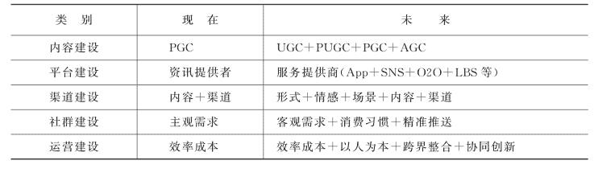

In the future, media platforms in an intelligent optimization environment must achieve breakthrough liberation and innovative integration in many fields including content, platform, channels, communities, and operations, comprehensively enhancing platform business and value. In content construction, shift from Professional Generated Content (PGC) to an ecology of "User Generated Content + Professional User Generated Content or Expert Generated Content + Professional/Expert Generated Content + Algorithm Generated Content" (UGC + PUGC + PGC + AGC) integration; in platform construction, shift from traditional information providers to a platform integrating "Service Provider App + Social Network Service (SNS) + Online to Offline (O2O) + Location Based Service (LBS)"; in channel construction, shift from traditional "Content + Channel" to a model integrating "Form + Emotion + Scene + Content + Channel"; in community construction, shift from "Subjective Needs" to a mindset integrating "Objective Needs + Consumption Habits + Precise Push"; in operation construction, shift from "Efficiency Cost" to a profit model integrating "Efficiency Cost + People-Oriented + Cross-Border Integration + Collaborative Innovation".

## 4. Conclusion

Creating in "Convergence", improving in "Integration", the internet is actually no longer limited to a technology, but a way of thinking and a brand-new methodology. From a trend perspective, intelligent converged media is an inevitable requirement to adapt to new IT development, technology-driven "supply-side reform"; from a technical perspective, intelligent converged media will be fully cloud-based in content aggregation, production, reprocessing, dissemination, with platform IT intelligentization and big data communication personalization; from a business perspective, the Internet of Everything era needs richer content presentation forms, intelligent converged media will be user-centered, providing efficient, intelligent media services. Therefore, the media industry should actively promote deep integration of ICT and radio/television, build all-media, all-function, all-scenario services, complete the transformation from traditional media and new media service subjects to modern media and intelligent media service subjects, accelerate construction of comprehensive, intelligent, integrated "pan-media" platforms, thereby guiding new supply, new consumption, new business forms, bringing inspiration for upgrading transformation and complementary gain-oriented new business paradigms.

## References

[1] Anonymous. How many of the six tricks for using big data do you know? [EB/OL] (2017-09-06) [2019-06-27]. http://www.sohu.com/a/190131468_99922237.

[2] Kelly. *The Inevitable* [M]. Translated by Zhou Feng, Dong Li, Jin Yang. Beijing: Publishing House of Electronics Industry, 2016.

[3] Ding Yi, Guo Fu, Hu Mingcai, et al. Review of Domestic and Foreign Research on User Experience [J]. Industrial Engineering and Management, 2014, 19(4): 92-97.

[4] Xu Zhiqiang, Liu Tong, Wan Chunmei: Empowerment and Transformation: Emerging Technology Driving and Media Innovation Development [J]. Television Research, 2018(05): 8-11.

[5] Yu Guoming. The Internet is a "High-Dimensional" Medium—Also on "Platform Media" as the Mainstream Mode of Future Media Development [J]. News & Writing, 2015(2): 41-44.

[6] Broadcasting Exclusive. Scholar General Hu Zhengrong Discusses Media Convergence: How to Be a Winner? [EB/OL]. (2018-08-28)[2019-06-23]. http://www.sohu.com/a/250397980_613537.

[7] Yu Guoming. Big Data Methods and News Communication Innovation: From Theoretical Definition to Operational Path [J]. Jianghuai Forum, 2014(04): 5-7.

**Author Biography**: Li Haidong, Associate Professor, School of Digital Media and Creative Design, Sichuan University of Media and Communications; Xu Zhiqiang, Professor, Senior Engineer, School of Digital Media and Creative Design, Sichuan University of Media and Communications.

---

# Grand Vision and New Future of Converged Media Apps: Analysis of Innovative Development of Anji News Group's "Ai Anji" Mobile Client [1]

**Zhao Li, Zhang Xiaoyu**

## Abstract

In the post-App era, converged media mobile Apps are at the "tipping point" for transformation and exertion. Today, with mobile client competition extremely fierce, past development experiences and paths are facing innovation. As an important converged media communication resource, the mobile client's status is increasingly important. This article analyzes the development strategy and innovation model of Zhejiang Anji News Group's "Ai Anji" client, prospecting the grand vision and new future of converged media App development.

## Keywords

App, Anji, Innovation, Analysis

## 1. Basic Current Situation

# Practice and Prospects of the Integrated Media Development of Anji News Group's "Ai Anji" App

Anji News Group (formerly Anji Radio and Television Station), since its establishment in 2014, possesses the most comprehensive media resources in the county: three TV channels "Beautiful Countryside," "Happy Anji," "Anji Shopping"; FM 100.1 radio frequency; *Anji News* newspaper; three magazines *Impression Anji*, *Leju*, *Leyou*; China Anji Net, "Ai Anji" App; "Anji Release" WeChat and Weibo, outdoor large screens, building TV, etc. Anji News Group operates "one station, six companies": Anji Pure Radio and Television Co., Ltd. (main business: advertising); Anji Radio and Television Network Co., Ltd. (main business: cable network); Guangdian Media Cultural Planning Co., Ltd. (main business: performing arts); Zhejiang Wenlan Information Development Co., Ltd. (main business: smart city); Anji Xinghao E-commerce Co., Ltd. (main business: chair industry e-commerce); Zhejiang New Green Media Technology Co., Ltd. (main business: county-level radio and TV alliance "You Vision" platform). The industrial operation network covers the whole country. In 2018, the group's total turnover reached 220 million yuan.

Launched in 2015, the "Ai Anji" App has developed into Anji's comprehensive information service platform with the largest information volume, highest click-through rate, and most attention. Downloads: 230,000; average daily clicks: 50,000; daily readership of the news section: over 10,000; activity rate: 40%; promoted and applied in over 50 counties nationwide; total readership and communication power rank among the top in counties and cities nationwide. The "Ai Anji" App therefore won the First Prize of the 6th Anji Propaganda, Ideological, and Cultural Work Innovation Award in 2017. Since 2017, the App's annual revenue has exceeded 20 million yuan each year, with capital flow introduced in application services reaching as high as 50 million yuan annually.

## II. Localized and Service-Oriented App Functional Positioning

The core positioning of the "Ai Anji" App is an integrated media mobile platform providing local people with news information, life services, smart city applications, and interactive social networking. Anji News Group adheres to a mobile-first development strategy, reshaping the news planning, assignment, editing, and distribution process of "unified planning, unified assignment, categorized editing, multi-platform push," embracing news public opinion, social governance, and convenient services. The Ai Anji App advocates "quality life," dedicated to creating an integrated media mobile terminal that county people love to watch, find easy to use, and cannot do without. Relying on the "Ai Anji" App, through interconnection and cohesion, it promotes the "grounded" App platform, realizing the transformation from traditional industry to smart information industry, gradually mastering big data resources, establishing a county-level big database, providing solutions for smart urban and rural application services, and establishing a model combining an information matrix with application services.

### (1) An Omni-media, Multi-dimensional Information Release Platform

News information is the first section set up by the "Ai Anji" App. It has modules such as a regional alliance platform and a supply and marketing channel program production center, enabling real-time listening and watching of all channels and news columns of Anji Radio and Television Station, radio live broadcasts, and the newspaper *Anji News*. It implements a 24-hour rolling broadcast of more than 50 news items, allowing users to browse local graphic information in real time, releases from central and provincial authoritative media, and content from township and various government WeChat official accounts; with the aid of the live broadcast system, it pushes large-scale events in the county in real time, with over 150 live broadcasts per year. The App's radio live broadcast changes the previous "I broadcast, you listen" mode, innovatively live-streaming the host's studio situation to the mobile terminal, allowing listeners to interact and reward in real time.

### (2) A Public Opinion Guidance Platform with Public Participation

The "Ai Anji" App is committed to large capacity and integration. Currently, it has integrated information releases from over 20 departments including Anji's Land, Rural Affairs, Property Rights Trading, Transportation, Water Supply and Electricity, Meteorology, etc. News from the 2 districts and 15 townships under its jurisdiction is aggregated, mainly featuring "Township Homepage + 17 Sub-columns," enriching township new media information.

### (3) A Comprehensive Information Platform for Social Governance

App sections are set up to serve grassroots social management and mass autonomy, acting as the "thousand-mile eye" for security prevention and natural disaster weather emergency command, playing a role in prevention, maintenance, and guarantee. The App opens sections such as Consumer Rights Protection, Safe Anji, and View Anji. In the "Safe Anji" column, Police Square, Sunshine Justice, Grid Management, etc., construct a mobile-end Safe Anji construction; in the "View Anji" module, following the township and village guide, over 10,000 video surveillance probes in public areas across the county are imported, allowing real-time viewing of dynamics ranging from major traffic arteries and checkpoints to village doors.

### (4) A Convenient Service Platform Benefiting the People

The "Ai Anji" App sets up 20 convenient service sections close to people's livelihood, such as Bike-sharing QR Code, Appointment Registration, Movie Tickets, Love Travel, Anji Food, Bus Tickets, Parking Lots, Telephone Directory, covering daily transportation, entertainment, tourism, and food. It launched Smart 5189000, covering columns such as Housekeeping Services, Peace of Mind Repair, Community Services, Cloud Home, solving community residents' needs like property fee payment and various repairs with one click.

### (5) An Information Platform Integrating "Radio & TV + Internet + Industry"

In the integrated media era where content struggles to be king, live interaction is one of the main functions of the mobile terminal. With rich live program forms, diverse hosts, strong self-media attributes, and high audience participation, the App builds a live interactive social platform based on information flow. Relying on the group's media assets and high-quality editorial team, leveraging video advantages, through integrated media layout, it produces high-quality, authoritative, and vivid news information.

## III. Diversified Development Paths of the Integrated Media App

### (1) Internal and External Collaboration, Multi-party Construction

Independently developed the "Ai Anji" App integrated media mobile terminal. News information is the first section, setting up modules such as News, Leisure Life, Live, Watch TV, Listen to Radio, Read Newspaper, Culture, enabling real-time listening and watching of radio and TV channels, live broadcasts, and newspapers. In the information section, audio-visual, manuscripts, and pictures produced by radio, TV, newspapers, magazines, websites, WeChat, and Weibo are aggregated and centrally presented, with resource retrieval, classification, merging, and multi-channel distribution.

### (2) Content Innovation, Focus on Application

The "Ai Anji" App redefines media content, based on news information services, achieving deep connection and targeted communication in services, links, government affairs overlay, life, and industry through big data, providing users with diverse news style experiences. The App emphasizes content exploration and planning with ten content elements: mainstream public opinion, typical publicity, hotspot interpretation, emergency reporting, public opinion supervision, news commentary, cultural masterpieces, social activities, news benefiting the people, content suggestions, exploring new communication forms, improving the integrated media's hotspot guidance ability, and leading the public opinion ecology. In application, the App incorporates smart parking and livelihood services, optimizing functions.

### (3) Clarify Models, Build Assembly Lines

Integrating voice, screen, newspaper, net, online and offline resources, the All-media News Center connects the content production methods of radio, TV, newspaper, website, and two We's (WeChat, Weibo) through the client, complementing advantages, integrating App with radio, TV, and newspaper. Formed the "decentralized collection, centralized editing, categorized broadcasting" App news reporting process. Strengthened the integration of App application with traditional media, attracting young groups and self-media participation. In promotion creativity, combined with live quizzes, using AI technology for QR code participation.

### (4) Value R&D, Willing to Invest

Anji News Group has invested 30 million yuan successively in independent R&D and operation of the mobile terminal. In 2017, the "Ai Anji" App revenue exceeded 20 million yuan. Among them, live broadcasts attracted 3 million yuan in advertising investment from clients; provided value-added information services to townships and departments worth nearly 5 million yuan; expanded the national application market, with landing funds in over 50 counties and cities totaling over 10 million yuan, with annual investment in maintenance and new section R&D.

### (5) Combining Rigid and Flexible, Creating Revenue and Value

The App combines the rigid needs of livelihood applications with the flexible needs of information services, relying on the accumulation of traffic, functions, users, technology, and commercial value, to meet livelihood, government affairs, service, and information needs. App life services provide travel, catering, movie, supermarket, lottery. Among them, smart city applications provide shared bikes, intelligent video surveillance, parking services. Highlighting application and service beyond information, enhancing product landing feasibility and strengthening user loyalty. Transforming audience into users, relying on user volume, innovating the "News + Government Affairs + Service" mobile client operation and revenue model. Fully launching live broadcasts, Monday to Friday afternoon, hosts live interact on the App, communicating with netizens through lottery, rewards, achieving excellent communication effects in 3 months. On the 2018 Lantern Festival, Ai Anji App planned and launched the "Celebrate Lantern Festival, Get Red Packets, Send Tangyuan" event, live interaction, attracting over 5,000 enthusiastic netizens to participate online, giving away thousands of Tangyuan gift packs.

### (6) People's Livelihood as Foundation, Mobile First

Building an integrated media mobile platform with complete autonomy, a comprehensive platform guiding and serving the masses, making it visible, likable, and indispensable to the people. The public bicycle section cooperates with the County Urban Management Bureau, docking data interfaces, citizens can conveniently scan the code to borrow bikes via the Ai Anji App. Since the bicycle section went online in 2014, borrowing times have exceeded 100,000. The "View Anji" section integrates smart city monitoring data, opening video surveillance of scenic spots, roads, hospitals, schools, villages, and communities in the client, users can watch monitoring videos in real time through the App.

## IV. Integrated Media App Operation Based on Reality and Facing the Future

### (1) Strengthen Local Information, Establish "Integrated Media + Live" Content Production App Operation Mode, Build Centralized News Production Management Architecture

Grasp regional characteristic news information, forming six major columns such as "Leisure Life, Funny, Culture," retaining the three traditional media of Watch TV, Listen to Radio, Read Newspaper on the information page, reasonable layout, rich forms. In news content, focus on instant news and short video live broadcasts. Complete App news release and video live broadcast through the mobile editing system, improving timeliness, pushing at least 2 hot or important news daily. Currently, daily average information updates guaranteed at 50+, short video live broadcasts guaranteed at 100+ annually. At the 4th Anji International UAV Competition in 2016, the powerful propaganda advantage of the integrated media App was first demonstrated. By establishing a competition special topic, releasing competition information in real time, Anji News Group dispatched 3 live editors, conducting short video live broadcasts of various competition venues through "Mobile Phone + Selfie Stick." 5-day competition, released 100+ instant reports, 200+ pictures, 10 short video live broadcasts, the App special topic gained 120,000 reads.

### (2) Alliance as Strategy, Cooperation as Grasp, Promote County-level Integrated Media Resource Sharing, Co-construction, Win-win, Breakthrough Spatial Influence

In 2014, Anji initiated the establishment of the National County-level Station "Great Wall Radio, Television and Network Alliance," serving as the Executive Chairman unit, with 180 county-level radio and TV stations joining successively, covering 17 provinces and cities nationwide, population over 200 million. Explored the "Media + Internet + Tourism" industrial development model, independently developed the "You Vision" platform, forming an online and offline system with online purchase of national air tickets and high-speed rail tickets, national operation of hotels and scenic spots, and aggregation of characteristic tourism products, winning the Provincial Grassroots Scientific and Technological Innovation First Prize.

### (3) Establish Flexible Assessment Mechanism, Build Radio-TV Integration, Mobile-first Channel Matrix

Using new media evaluation data models to rank "Ai Anji" channel data volumes, rewarding winners. Combining column click indicators, adding with different weights, constructing a new App employee assessment system under the integrated communication system. Leveraging radio and TV advantages, forming a professional live broadcast team, improving App opening rate, App live broadcast, gaining good response.

### (4) Seize Opportunities of Beautiful Countryside and Smart Urban-Rural Construction, Create "New Green Culture" Content Operation Innovation Highlights

Build a main information service platform with local news and smart applications as the core, a main government service platform with online governance and smart administration as the core, a main life service platform with consumption e-commerce and smart community as the core. Implement project responsibility system and flat management, promote independent declaration system for innovation projects. The Radio Center and Wenlan Company join hands, using technology and media integration visualization to live broadcast radio programs. "Ai Anji" normalizes video live broadcast of the radio program "Voice Moving Evening Peak," "Healthy Anji" and "Ma Li Test Drive" video live broadcast, realizing online and offline integration from "listening" to "watching" radio, enhancing participation and interaction rates. The large-scale news event "Ecological Morality Class" for four consecutive seasons, against the background of the ten-year ecological construction process, records the humanistic, social, economic, and environmental changes along the way, verifying the conclusion that "Lucid waters and lush mountains are invaluable assets."

### (5) Seize the Mobile Terminal, Do a Good Job in Mobile-first Smart City Services

The App's application service functions are powerful, covering comprehensive applications such as housekeeping services, peace of mind repair, news live broadcast, TV and radio live broadcast, convenient life, including six major sections: beautiful countryside, education, medical and health, sunshine agriculture, tourism. The App timely releases radio and TV programs, high-quality content from various media, and emergency event information. Through personalized precise recommendation to provide urban information, becoming a public service platform for citizens to "master with one hand." Focusing on smart city, smart tourism, smart medical care, integrating terminal services such as TV, radio, newspaper, PC, tablet, smartphone, IP phone, developing the "Ai Anji" App integrating news, commentary, on-demand, entertainment, tourism, catering, study, life, and other functions. Built 18 "Smart City" projects. Government projects include: Study Power, Palm Government, Civilization Practice, Smart Environmental Protection, Smart Party Building, E-Supervision, Smart Safety Supervision, Palm Taxation; Life projects include: Smart Education, Smart Parking, Smart Tourism, Smart Human Resources and Social Security, Hebao Payment, Public Welfare Poverty Alleviation, 12315, Smart Training, Food and Drug Supervision, Cloud Insurance, providing citizens with interactive and experiential services.

### (6) Break Through the Profit Dilemma, Promote Innovation to Win Users, Create Revenue and Value

The App is an integrated media "News + Government Affairs + Service" client. After years of exploration, it has gradually walked out of the dilemma of the App client "having influence but not profitability," leveraging strengths and avoiding weaknesses, strengthening top-level design, connecting the grassroots with Internet thinking, collaborating and innovating in an integrated manner in technology, content, organization, business format, channel expansion, profit model, and other links, creating a client product combining the advantages of radio and TV and mobile Internet. Accumulating traffic, functions, users, technology, commercial value, meeting livelihood and government affairs needs. The App "Mobile Matrix" transforms audience into users. The "Radio & TV + Internet + Industry" trinity "Media Community Ecology Circle" model builds an interactive social platform in the form of information flow under the live layer, realizing influence and profitability. Online voting is a common marketing means of the App. In 2016, combined with the construction of the National Agricultural Park in Lujia Village in the county, "Ai Anji" App participated in program planning, launched a selfie contest, driving voting. Over 3,000 people participated in voting, thousands of new registered users, over 30 users became shareholders of the maker space, all interaction channels participated through the App. Ai Anji App has successfully held events such as the Most Beautiful "Teachers," Most Beautiful "Nurses," "Moral Models," "Anji Pride," "Restaurant Competition," attracting over 20,000 new users.

### (7) Practice the Online Mass Line, Smooth Social "Capillaries," App Convenient Services Continuous Iteration and Upgrade, Develop and Integrate New Functions

Realize real-time interaction on three screens, bringing information disclosure and government services to the fields and kangs (heated brick beds) of the common people. Relying on the platform with a huge user base, making up for the shortage of county-level official media resources and poor communication with the masses. For example, land requisition concerns the vital interests of the common people and is a sensitive and difficult job for the government. Ai Anji App publishes pre-announcements in "Sunshine Land," displays "Land Requisition Maps," explains work processes in detail, facilitating the masses to understand, consult, and question. In the 2017 summer vacation, using the personal and property safety education of county students' families as a planning point, jointly launched the Family Summer Safety Education App Check-in Activity with the Education Bureau. The App set up a special column, released 5 videos in total, requiring students' parents to click the App to watch the complete video and then check in with real names. Through planning this activity, nearly 3,000 new registered users were added.

### (8) "Cloud Beans" Characteristics, Community Services, Cloud Home, Community Affairs Done at Fingertips

Innovatively established "Cloud Beans" on the App where points can be directly redeemed, incorporating township and department personnel meal subsidies, union benefits into the virtual currency system. Focusing on nearly 300 hotels, snacks, hot pots, cakes, fruits, etc., across the county. The "Cloud Beans" system, recharged with virtual currency, does a good job in merchant marketing. Selecting well-reputed food merchants, users only need to install the App to scan and consume at the merchant. Among them, Anji Food is a service users like to use, the "Cloud Beans" that can redeem points for consumption, greatly solving the problem of inconvenient dining for agency cadres. During this period, weekly Wednesday lottery, food discount tasting groups, points redemption, recharge gifts activities were continuously launched, giving cash benefits, winning users with real benefits.

### (9) Build a Powerful Citizen Life Service Card, Make Good Use of Integrated Media Data

The "Ai Anji" App promotes the integrated application of the urban smart card in social security, medical care, transportation, public utilities, financial payment, integrating functions of medical insurance card, visit card, bus card, bicycle card, library card, tourism card, water/gas/electricity payment card, various consumption cards, debit cards, establishing a citizen card with information storage, information query, transaction payment. Using the App comprehensive platform to establish the corresponding "Radio & TV Coin," realizing the citizen card "online and offline synchronization" function, creating a trinity payment system of prepaid card payment, Internet payment, mobile payment. Through interactive data analysis, App program click-through sampling rules, dual-frequency interactive data, matching analysis, helping to quickly understand news hotspots, improving App communication effect. Accelerate the integration of integrated media data from various townships and departments, establishing a diversified and stable database.

### (10) Build an Integrated Media Mobile Platform with Complete Autonomy, Practical and Independent, Video is the Main Feature and Core Competitiveness

Technically docking with the radio and TV content production and broadcast platform, improving client video functions. In content production, building a mobile "Central Kitchen" multimedia news center, following the production process of "front-end collection integration, terminal release diversification," packaging the same news in different styles, distributing to different terminals in all time periods and all media, becoming an important pole in multi-polar communication. The App combines Professionally Generated Content (PGC) and User Generated Content (UGC), taking live broadcast as the main grasp, winning competitive advantages in the client. Integrating terminal services such as radio, TV, newspaper, PC, tablet, mobile phone, IP phone, establishing the Ai Anji App client integrating information, entertainment, tourism, business, study, life, transaction and other functions, integrating "Smart Anji" convenient services into the daily life of the people.^[\[2\]](#txt008.html#footnote_content_txt008_2)

## V. Vision and Prospects of the Integrated Media App

### (1) Transformation from a Monopolistic Platform to an Ecological Platform with a General Partnership System is the Future Direction of Integrated Media App Development

The "Ai Anji" App's diversified and innovative development attempts have caused the past traditional media's top-down operation structure to transform from a tree structure to a flat, interconnected network structure; from a centralized control system to an authorized empowerment system, which may be a new trend.

### (2) De-massification, De-complexification, and Personalized Stratification Will Become Increasingly Obvious, User Communities Need Diversified Activation

User grouping is accelerating. Identifying groups and serving groups is a new business model that "Ai Anji" App has recognized and started to operate. "Ai Anji" is realizing the functions of community screening, user segmentation, activity digestion, and commercial realization in diversified ways. Perfecting urban service functions requires good user and market judgment, attaching importance to the development, operation, and maintenance of community fans, which is a basic skill.

### (3) App Operation Mechanism Must Adapt to the Communication Characteristics of Media Convergence, Rich and Flexible

The integrated media mobile client is the transformation and exploration from the media convergence strategy to the intelligent strategy. The unique advantage of the integrated media client is "Radio & TV Support + Newspaper & Net Integration," must leverage radio and TV resource integration, openness, and interaction. The strong complementarity between the integrated media App and radio, TV, and newspaper is innovating daily application scenarios.

### (4) Technology is No Longer the Only Core Advantage

The App 3.0 version integrated media stage^[\[3\]](#txt008.html#footnote_content_txt008_3), self-made copyright (high-quality original content production) is the core competitive resource of the App, basically forming an "One Body, Two Wings, Dual-Core Driven" all-media development pattern. Under the broadband revolution, the future App's development trend and advantages are becoming more obvious. The advantage of App big data integration realizes the same-screen resonance between the TV big screen and the mobile phone small screen. Relying on video advantages, through integrated media layout, continuously producing high-quality, authoritative news information. The next step will realize intelligent voice broadcasting of client articles and digital newspapers through voice synthesis technology.

### (5) Flexible Introduction of Composite Talents, Combining Mobile Office and Independent R&D

The App R&D returnee doctor team introduced by Anji News Group is "not owned but used by it." In 2013, developed mobile client products, with the concept of "News + Service," fully building a local integrated media mobile platform. Continuous iteration and upgrade, developing and integrating new functions. In 2017, Anji News Group's doctor team upgraded the client's live broadcast to a new version, improving interactivity, adding a series of new functions: comments, barrage, ranking, recharge, lottery, reward, etc.

### (6) Layout "Beautiful Cloud" "Smart Network," Industrial Transformation and Upgrading Bound to Take the Lead

"Beautiful Cloud" is Anji News Group's highly integrated, collaboratively operated cloud platform. Its big data center, based on "Anji Cloud," stands on user needs, establishing multiple smart city service applications, such as public bicycles, urban video surveillance, smart tourism, smart government affairs, and other services, assisting the development of intelligent media. This wave of correct prediction and active practice for the future is consolidating the leading advantage of "Ai Anji" App's innovative development.

**(Author Profile: Zhao Li, Postdoctoral Fellow jointly trained by Fudan University and Shenzhen Press Group, Teacher at Southwest University of Science and Technology; Zhang Xiaoyu, Graduate Student at University of Science and Technology of China)**

## Notes

[\[1\]](#txt008.html#footnote_quote_txt008_1) This paper is funded by the First-class Funding of China Postdoctoral Science Foundation and the Central Propaganda Department Project "Research on the Public Opinion Guidance Capacity Construction of County-level Integrated Media Centers."

[\[2\]](#txt008.html#footnote_quote_txt008_2) In 2013, Anji Station won the "Fifth National Advanced Collective for Serving Farmers and Serving Grassroots Cultural Construction" selected by the Central Propaganda Department, Ministry of Culture, and State Administration of Radio, Film and Television.

[\[3\]](#txt008.html#footnote_quote_txt008_3) Chen Yonghong, Tian Zhiyou, Tian Yu. Discussion on the Construction Mode of Integrated Media in Municipal and County Stations [J]. Audio-Visual, 2019(02): 6-7.

---

# Future Landscape of Short Video News of Mainstream Media in the Intelligent Media Era——An Empirical Analysis Based on the "CCTV News" Douyin Account

**Li Shuni**

## Abstract

With the continuous innovation of intelligent communication technology, short video news will become an important way for users to access information, and short video platforms represented by Douyin will also become another high ground for mainstream media news reporting. This paper takes the short videos in the "CCTV News" Douyin account as the research object, conducts data analysis on its short video content in the first half of 2019, and interprets the new changes that the Douyin account has already had in the initial stage of technology empowerment. It emphasizes that while technology is applied, the relationship between technology and people, content, and society should be grasped first. On this basis, it analyzes what impact intelligent communication technology will bring to the future practice of short video news from three perspectives: "Data," "Communication," and "Embodiment," thereby depicting the future landscape of mainstream media visual news.

## Keywords

Intelligent Communication, Short Video News, Mainstream Media, Douyin

On June 6, 2019, the Ministry of Industry and Information Technology officially issued 5G commercial licenses to China Telecom, China Mobile, China Unicom, and China Broadcasting Network. China Broadcasting Network also became the fourth enterprise to obtain a 5G commercial license after the three basic telecom operators.\[1\] In addition, emerging technologies such as cloud computing, big data, and artificial intelligence are constantly changing the content, services, and experiences that media bring to audiences. Intelligent communication technology is writing new possibilities for future media development, and a brand-new "Intelligent Media" era of media intelligence has arrived.

Intelligent communication technology has gradually permeated all aspects of news production and dissemination, bringing new trends to news development. Short video news is undoubtedly a rapidly growing phenomenon under this trend. Because it better aligns with the current public's fragmented reading scenarios and habits of efficient information acquisition, short video news has also gradually become an important channel for users to obtain information instantly. With more and more mainstream media settling on short video platforms, producing short video news has gradually become a crucial link in the media's news gathering and editing process. This paper selects the short videos posted by the "CCTV News" account on the Douyin platform as a specific case for analysis. As a traditional television medium, "CCTV News" has deep qualifications and holds an important position in video news production, possessing a mature video production team and editorial experience. Its performance and growth trajectory in short video news practice, transitioning from traditional media news gathering to integrated media editing, are worthy of study. In the "National TV Media Douyin Account Ranking" released by Toutiao in June 2019, "CCTV News" also ranked first with its strength and influence.[2] Therefore, this paper mainly takes the "CCTV News" Douyin account as the research object, selecting 706 short videos posted from January 1 to July 16, 2019, as research samples. Using a combination of content analysis, data statistics, and other methods, it sorts out the video content distribution, news characteristics, user performance, and changing trends of its first half of 2019. Facing the general trend of the intelligent media era, what new vitality will mobile short videos bring to mainstream media news? What possibilities will the integration of intelligent technology and short video news bring? How will mainstream media entering the short video field balance the relationships between technology and people, content, and society?

# Data Analysis: New Changes in Short Video News in the Intelligent Media Era

"Short videos are measured in seconds, mainly rely on mobile intelligent terminals for rapid shooting and beautification editing, and can be shared in real-time and seamlessly connected on social media platforms[3]," but there is no absolute duration standard. The short video news mentioned in this paper mainly refers to news information videos with a duration of within 1 minute, watched using smartphone terminals. The current development status of domestic short videos, categorized by institutional type, is roughly shown in Table 1.

Table 1　Development Status of Domestic Short Video Institutions

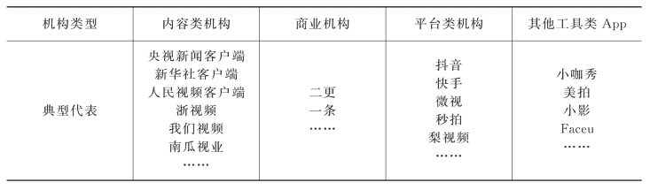

Mainstream media's participation in mobile short videos is mainly concentrated in content-based institutions and platform-based institutions. According to the "Media Douyin First Year: 2018 Development Research Report" released by the Chinese Journalism History Association in January 2019, in 2018, the number of certified media accounts on Douyin exceeded 1,340, with a cumulative release of over 150,000 short videos, cumulative views exceeding 77.56 billion, and cumulative likes exceeding 2.63 billion.[4] Compared to content-based clients where media execute news production themselves, the development trend of platform medialization has led more and more media to settle on the same platform-based institutions. Coupled with the platform's original huge user base and daily active volume, short video platforms represented by Douyin have gradually become emerging channels for mainstream media news production and dissemination. In the technology-empowered era, as a CCTV media Douyin account with significant influence, what new characteristics does the short video news released by "CCTV News" have? What are the breakthroughs and possibilities for the integration of these videos with intelligent communication technology?

## Emotion: The Balance Point of Content and Technology

First, in terms of short video content, the author classified the 706 samples. Referring to the online news classification standards proposed by relevant scholars, this paper divides the samples into seven major categories of news: political news, international news, social news, military and technology news, financial news, sports news, and entertainment news,[5] as shown in Figure 1. During the classification process, some video content may belong to cross-categories, and there are also videos that cannot be classified into the above seven news categories, such as documentary clips, character interviews, and variety show clips. It can be seen that "social news" short videos have a large release volume, and the number of videos with over one million likes also leads other types of videos. The content of this type of short video mainly includes stories of ordinary people, touching stories of military life, online videos provided by citizen journalists, surveillance footage of traffic accident scenes, and footage shot by law enforcement recorders.

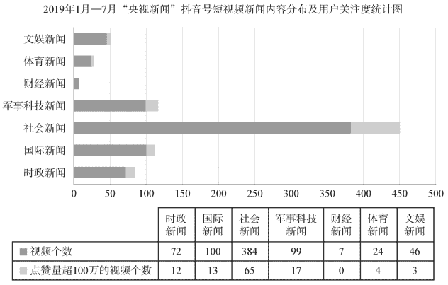

Figure 1　Statistical Chart of Short Video News Content Distribution and User Attention of "CCTV News" Douyin Account, Jan–Jul 2019

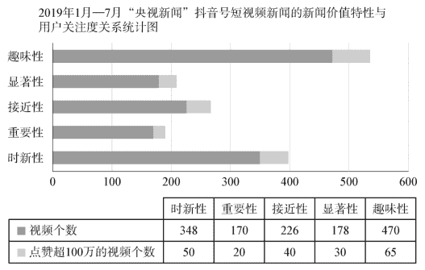

Figure 2　Statistical Chart of Value Characteristics of Short Video News and User Attention of "CCTV News" Douyin Account, Jan–Jul 2019

Second, combined with the five elements of news value that can arouse the common interest of the social public (timeliness, prominence, proximity, prominence [duplicate in source], interestingness) (as shown in Figure 2), interestingness videos dominated by human interest and positive energy content have the best dissemination effect. Foreign scholars such as Jonah Berger once conducted empirical research on articles published in *The New York Times* and found that intense emotional experiences can promote audience sharing behavior, and articles evoking positive emotions are more likely to be disseminated than those evoking negative emotions.[6] These positive energy "warm videos" enhance the audience's "empathy" experience during information acquisition by arousing and resonating with audience emotions, and spontaneously like, comment, and forward, making the short video content attract more attention and discussion.

It can be seen that mainstream media entering the short video field are gradually breaking away from the previous grand narrative, paying more attention to individual discourse expression and civilian narrative perspectives.[7] From the character stories behind news events to the moments of humanity displayed at news scenes, in the intelligent media era where shooting technology, transmission technology, and interactive technology are constantly improving, mainstream media's content selection in short video news focuses more on seeking emotional resonance with the audience while expressing the theme, allowing the audience to feel the strength and warmth of news in a short time. This also proves that news editors are still the soul of news production in the AI era. Then, how to integrate technological advantages into emotional expression is crucial for balancing the relationship between technology and content.

## Vertical Video: Liberation of Shooting

In terms of presentation form, as a broadcasting media Douyin account, most short video news in "CCTV News" are re-edited from TV news broadcast content. After moving from large screens to small screens, besides the obvious changes in video length and editing methods, the shift from horizontal videos broadcast by TV media to vertical videos presented on mobile terminals has formed its own characteristics in news presentation, subtitles, and background music.

According to statistics, 92% of the 706 short video samples of "CCTV News" are vertical videos. First, vertical videos have advantages in presenting character expressions and actions. Through word frequency statistics, we can find that among the 706 video samples, the words with higher frequency weights are mostly character labels, including "firefighters," "navy," "elderly," "delivery riders," "police officers," "drivers," etc. For character interview reports, vertical videos can effectively focus the audience's sight on the interviewee's posture and expression, fully display details, highlight the sense of 诉说 (narration/confiding) and communication of the character, and make character stories more infectious. For originally serious and rigid political reports and ideological guidance, it not only makes the every move of leaders and foreign ministry spokespersons full of affinity but also lets the audience see many behind-the-scenes stories of meetings. For example, a video released by "CCTV News" on July 26 titled "Holding the hands of the old hero Zhang Fugqing, Xi Jinping said: 'You are a role model for the whole Party and the people of the whole country!' Wishing Zhang Fugqing health and longevity" received numerous likes and warm blessings from netizens. In addition, the down-to-earth large subtitles in the picture can compensate for the black bars produced when switching from horizontal to vertical screen while explaining the video screen, and combined with sound effects from the massive Douyin popular music library, they more intuitively arouse the audience's emotional resonance and recognition while conveying mainstream ideological opinions.

The presentation form of vertical videos also means that directly using mobile phones to shoot and create films becomes possible, which liberates many technical limitations of traditional news videography. Only a mobile phone with shooting function is needed to shoot, edit, and upload on-site anytime, anywhere. For example, the video of the G20 Osaka Summit News Center site released by "CCTV News" on June 29 was shot and presented by CCTV reporters using a mobile phone from a first-person perspective. This video not only displayed richer on-site information in the vertical space in terms of picture composition but also allowed the audience to immersively feel the behind-the-scenes stories of the G20 Summit in a down-to-earth way.

At the same time, mainstream media releasing vertical video news also makes the news scenes recorded by grassroots "citizen journalists" with mobile phones become directly usable video materials. For example, the "Liaoning Kaiyuan Tornado" news scene recorded by netizens' mobile phones released by "CCTV News" on July 3, and the on-site situation of the Guilin tour guide forcing tourists to consume released on June 11. The open and inclusive platform liberates production technology and relatively simplifies the post-editing process, helping mainstream media restore news scenes in a timely manner while providing them with a team of citizen journalists good at recording bits of life.

## Duration Limit: Short Video News as a "Window"

To count video duration, the author divided the short video news in "CCTV News" Douyin account into the following five brackets: micro-videos of 0–15 seconds, short videos of 16–30 seconds, medium videos of 31–45 seconds, medium-long videos of 46–60 seconds, and longer videos of over 60 seconds. Through quantitative analysis, among the 706 video samples (see Figure 3), the largest number of videos were 46–60 seconds long, but videos with higher user likes were mainly concentrated in the 16–30 second news. It is visible that when editing long video content into short videos, there are still many challenges in duration control. And users' short video consumption habits are still concentrated in the relatively fragmented, instant, and fast-food stage. So, looking separately, has the duration of news short videos that users love to watch each month within this period changed?

As shown in Figure 4, from January to March 2019, the duration of videos with user likes exceeding 1 million was mainly concentrated in longer video news of 31–45 seconds, while after March, the popularity of news with a video duration of 16–30 seconds increased significantly, and this trend was maintained. At the same time, the popularity of this duration of news far exceeded news of other durations.

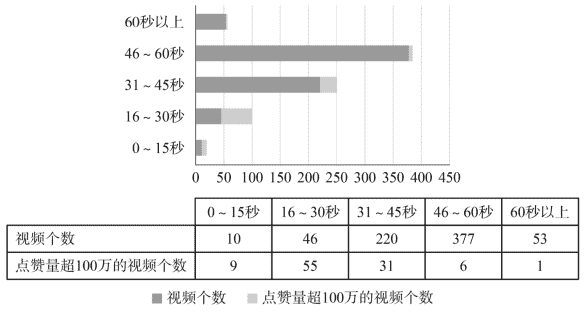

Figure 3　Analysis Chart of Relationship between User Attention and News Video Length of "CCTV News" Douyin Account, Jan–Jul 2019

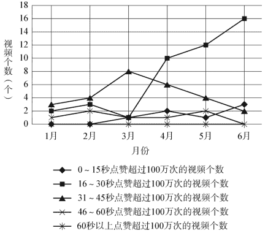

Figure 4　Distribution Change Chart of Video Duration Segments with Monthly Likes Exceeding 1 Million of "CCTV News" Douyin Account, Jan–Jun 2019

As videos of 16–30 seconds became more and more popular, the average duration of videos released by "CCTV News" also gradually shortened (see Figure 5). Although the total number of videos released monthly by "CCTV News" Douyin account decreased, the average monthly likes continued to rise. It can be seen that more and more viewers began to recognize mainstream media on the Douyin platform. Controlling editing duration as much as possible, or pushing long news in segments and categories will be the direction of efforts for the next step of short video news.

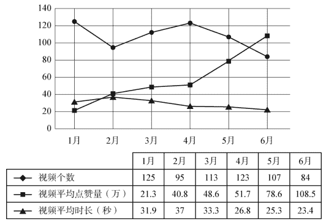

Figure 5　Statistical Chart of Monthly Trends in Number of Videos Published, Average Likes, and Average Video Duration of "CCTV News" Douyin Account, Jan–Jun 2019

From the characteristic of shortening duration, short video news will still face challenges brought by information fragmentation. However, the convenience of information acquisition on mobile terminals, the sense of presence and intimacy brought by detailed lens language, make those extended hot topics and news that are easily ignored more suitable for release through short video platforms. For example, in a video titled "Close call! Even if you have 'Kung Fu' skills, you won't be so lucky next time" released by "CCTV News" on July 2, the top comment in the comment section was a follow-up on the accident liability determination: "On July 1, in Sanming, Fujian, Xie drove a motorcycle through an intersection, ran a red light and collided with a minibus. The accident caused minor injuries to Xie, and the traffic police determined that Xie bore full responsibility." It received unanimous praise from netizens. It is visible that although short video news is short, it can directly present the event scene to the audience straight to the point, and the platform-based institution provides an effective way for subsequent news follow-up and audience interaction.

However, limited by video duration, some professional and complex topics or in-depth reports are difficult to present completely through short video news. This makes short video news exist more in the form of an information "window" in the future, rather than as an independent category of video news. The content mainly focuses on the following four categories: news scenes, short news reviews, thematic news previews and guides, and re-classification and integration of key points of long news. Through this "window" of short video news, the audience can quickly understand news facts, "arrive" at the news scene, perceive social hotspots, and then link to different "destinations"—print news, long video news, live news broadcasts—through this "window" to further comprehensively understand the hot topics they care about.

# Prerequisites for Reasonable Application of Intelligent Communication Technology

In the initial stage of technology empowerment, we can easily find that mainstream media short video news has undergone new changes in emotional expression, shooting methods, and duration control. Mainstream media are responding to the challenges and impacts of new media through paradigm correction and establishing new operating conventions. The new media ecology and social communication environment have prompted changes in Party media news production.[8] This change relies on the continuous innovation of intelligent communication technology and also promotes short video news becoming an important way for users to access information. At the same time, short video platforms represented by Douyin will become another high ground for mainstream media news reporting. This visual communication revolution triggered by short videos has also brought opportunities and challenges to mainstream media development to a certain extent. Blindly catering to technology is not a long-term solution. To realize the mission of mainstream media to "hold the banner, gather the people's hearts, nurture new people, revitalize culture, and display the image"[9], finding the balance point in the technology application process is the prerequisite for reasonable application of technology.

## Grasping the Relationship between Technology and People

To grasp the relationship between technology and people, first, the relationship between technology and the body should be coordinated. Current technology is becoming increasingly transparent, embedding deeper into the human body, and integrating more comprehensively into our bodies.[10] Technology is embedded in media practice in the form of a new type of sense organ. In the short video news production process, technology should serve as an auxiliary tool for the editor's various senses, such as AI-assisted facial recognition, VR simulation of panoramic effects, etc., turning reporters into intelligent subjects in the editing and creation process, thereby improving the editing and creation efficiency of news production.

Second, the division of labor between machines and editors should be coordinated, and the human-machine collaboration model should be laid out. Maximize the advantages of intelligent editing and creation, build a short video database, set up a cloud service platform, realize the media application and innovative iteration of AI technology, and gradually move the short video news production line into intelligent production. Editors, as supervisors behind intelligent products, should fulfill their review obligations, reduce content errors under the help of intelligent communication technology, realize precise distribution, and jointly create high-quality short video content.

Finally, since platform-based institutions rely on algorithmic recommendation mechanisms in news distribution, this gives users the initiative in information selection, and also brings industry concerns about the risks of "information cocoons" and "yellow journalism trends." Therefore, while we seek more three-dimensional and rich humanistic values to externally correct algorithmic values[11], we should also timely detect backend user interaction participation data including likes, comments, and forwards. After analysis and comparison, adjust video wording, editing methods, and overall tone in a timely manner around user needs and viewing psychology, so that content production, assisted by intelligent technology, optimizes the dissemination effect of mainstream media news, gradually conforms to users' media usage preferences, and arouses netizens' deep recognition of news content.

## Grasping the Relationship between Technology and Content

Short videos must not be "short on culture." In the process of short video editing and creation, content should always be placed first, producing high-quality news content with creativity, warmth, and connotation. Only high-quality content can inject new blood into the development of all-media driven by technology, and inject new kinetic energy into the guidance of public opinion in the new era.[12]

Intelligent communication technology, which plays an important auxiliary role, can not only innovate content presentation forms from shooting, editing, publishing, interaction, and other links, but also enrich scene entrances, add AI interaction, checkpoint games, voice dialogue, and other elements to enhance the sense of interaction between users and short video news.

Mainstream media should continue their existing advantages in pushing positive energy short videos, explore the emotional stories behind the news, rely on technology to enrich the angles and forms of "storytelling," and create high-quality "warm video" content. In addition, while the editing and creation method of "interesting + useful" is put into practice, the "window" role of the short video platform should be utilized to form a universal information bombardment, catch the audience's eyeballs in the creative presentation form of content, and guide the audience to enter through the link of this pioneering contact point to watch more in-depth and comprehensive medium and long video reports on a certain topic.

## Grasping the Relationship between Technology and Society

With mainstream media settling in one after another, short video platforms have gradually become a practical place for government new media, assisting in public opinion guidance and social governance. Mainstream media lower the threshold for audiences to receive information and expand the coverage of government publicity by releasing content that is popular and easy to understand, enabling users to timely grasp social trends and understand government hotspots, while also strengthening the guiding power of mainstream media and enhancing the dissemination power of mainstream ideology.

At this time, intelligent communication technology continuously innovates presentation forms and activates communication content in the process of helping audiences understand society through short video news. Among them, the characteristics of 5G transmission—high rate, large capacity, low latency, and low energy consumption—will make the "window" identity of short video news more prominent. Linking from short videos to medium/long videos and live broadcast interfaces will become a new habit for people to obtain deep information. The Internet of Everything makes online and offline government linkage guided by media more frequent. Broadcasting mainstream media inherently have technical advantages in live broadcast and relay teams. Launching live broadcast activities based on short video platforms, real-time relaying news scenes, and understanding public opinion trends through bullet comments will be new scenarios opened by short video news empowered by 5G.

The application of artificial intelligence and AI technology can help mainstream media shape the affinity images of Party and government organs and civil servants through anthropomorphic expressions (such as creating brand cartoon images, introducing AI anchors), allowing netizens to more intuitively feel the work and life status of Party and government personnel through short videos, gain a sense of intimacy and resonance, and change the sense of distance that Party and government organs give the public in stereotyped impressions.

In addition, visual technologies such as 8K, Virtual Reality (VR), and Augmented Reality (AR) can also educate through entertainment and popularize knowledge. At the same time, they can bring the audience an immersive news "presence" experience through visual presentation, help the audience form a psychological perception of "empathy" for news events, and enhance the audience's cognitive and sensory abilities regarding news facts and social dynamics.

In terms of shooting angles, the popularization and civilianization of various shooting equipment allow all kinds of citizen journalists to become reporters at news scenes. For example, the first arrest Vlog launched by "CCTV News" Douyin account was directly recorded by anti-drug police using action cameras (GoPro) in a Vlog style. Under technical support, using short videos for case sharing and police situation reporting has become more vivid and lively. Fresh cases have also gotten rid of the previous "preaching" form, more effectively conveying positive values and social positive energy.

# Application of Intelligent Communication Technology in Short Video News

In the 706 videos released by "CCTV News" Douyin account in the first half of 2019, there are also innovative cases of intelligent short videos (see Table 2).

Table 2　Intelligent Short Video Innovation Cases of "CCTV News" Douyin Account

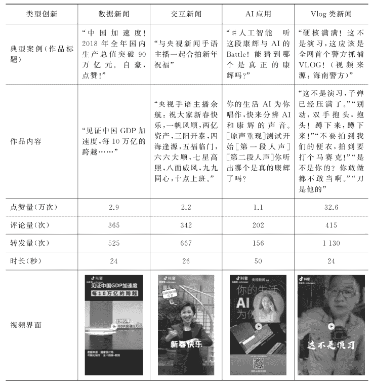

The arrival of the 5G era brings high rate, large capacity, low latency, and low energy consumption of information transmission, meaning that video language will replace text language as the main expression form of social communication.[13] At the same time, the combination of emerging technologies such as cloud computing, artificial intelligence, and big data with news production will bring more abundant opening methods to this future news "window" of short video news. Then, the author will elaborate on the important impacts and extended significance that intelligent communication technology can bring to short video news from the following three keywords.

## Data

In today's digital life becoming daily, the importance of data in the intelligent media era is also increasingly apparent. So, what does data mean for short video news?

First, data will influence the topic selection content and editing methods of short video news. For platforms like Douyin that distribute videos through recommendation flow algorithms, mining and analyzing backend user operation behavior data such as likes, comments, and forwards is an important link in optimizing content. Interpreting what kind of news the audience wants to obtain through short videos and in what logical way they read news can help mainstream media timely adjust news content push forms, editing methods, and logical arrangements according to data analysis results.

Second, data news will be the arm for future short video news to present social issues. Data support can help the public understand news information from a more intuitive perspective, and dynamic visualization technology will provide the audience with a better visual experience and reading feeling.[14] Currently, mainstream media have launched many data news animation long videos, and the visualization of dynamic data often wins audience praise. Since their topics are mostly social hotspots and are related to people's lives and immediate interests, they often have the characteristics of high dissemination efficiency, strong content interpretability, and high audience attention. This type of short video form with strong impact, flexible presentation forms, and practical content is undoubtedly like a fish in water in the new media environment. Combined with the fact that the news types released by mainstream media on short video platforms are mostly social news, increasing fast-paced, visually appealing data news, and making political and social hotspots "move" may be a direction worth trying for future short video news innovation.

Finally, completing data capture and storage is the guarantee for the sustainable development of short video news. With the acceleration of video transmission rate empowered by 5G, short video social media are more likely to induce public opinion events and outbreak public opinion problems, becoming the first battlefield of public opinion. In response to this new trend of mobile public opinion, real-time capture of public opinion data in the backend of mainstream media Douyin accounts, prevention before it happens, and timely follow-up reporting on the subsequent progress of events should be conducted. More persuasive short videos should be used to counter distorted facts, calm sudden crises, and resolve public opinion crises.[15] In the intelligent media era, the reasonable and correct use of short video media to handle public opinion crises and respond to communication risks may become the mainstream choice for future news media. In addition, to ensure that short video news is not maliciously edited or distorted after being downloaded, and to prevent problems such as improper data processing on the platform and difficulty in guaranteeing user privacy security, the normalization of platform blockchain evidence storage technology will be able to more effectively implement information traceability, manage user personal information, protect news content copyright, authenticity, and payment convenience, and solve the post-truth problem in the news industry.

## Communication

# Intelligent Media Transformation: The Future Development Direction of Radio and Television Media

Xu Zhiqiang, Yan Ling, Zhao Yalin

## Abstract

In the era of "Internet connecting everything", intelligent media will be user-centered, providing efficient and intelligent media service capabilities. This paper first analyzes the drawbacks in the current development of China's radio and television media, and then explores the innovations brought to the media industry by a new cluster of intelligent technologies represented by Artificial Intelligence (`Artificial Intelligence`, `AI`), `5G` communication, and blockchain; then deeply reveals the empowerment of the media industry chain by intelligent technologies through the case of Xinhua News Agency's Media Brain; finally, from five dimensions including improving the supply system, taking "Intelligent+" as the engine, and optimizing user experience, it proposes paths to accelerate the construction of a support system for the "intelligent manufacturing" of radio and television media content.

## Keywords

Intelligent Media Transformation, Media Convergence, Artificial Intelligence, Intelligent Media, Media Brain

Radio and television media refer to mass communication media that regularly disseminate sound and image programs to vast areas via radio waves or cables; they possess the basic functions of the information industry such as producing and transmitting information, guiding the optimal allocation of social resources, and operating information.

Intelligent media refers to media based on the Internet, assisted by a new cluster of intelligent technologies represented by `云大物移智区加` (Cloud Computing, Big Data, Internet of Things, Mobile Internet, Artificial Intelligence, Blockchain, "Internet+"), which collects and analyzes users' consumption environments, behaviors, and preferences, and provides users with content, products, and services that highly match time-space, scenarios, and needs. Simply put, intelligent media is the sum of information clients and servers that can perceive users and bring them better experiences[1].

Unlike the "point-to-point" information dissemination of traditional media, intelligent media is a collaborative innovation online social information dissemination system; relying on technological effects, it is moving from "perception" to "cognition", and has already exhibited four major technical characteristics: intelligent interaction, content personalization, diversified forms, and spatiotemporal virtualization, reshaping the basic paradigm of the media ecology.

## Drawbacks in the Development of China's Radio and Television Media

With the rapid development of "Intelligent+" technologies, the widespread application of intelligent terminals, and the ever-increasing user demands for content and experience, radio and television media have shown phenomena such as content homogenization, user loss, and traffic exhaustion over a long past period, exposing more and more drawbacks.

### Winning by Quality: Difficult to Achieve

In the Internet era, although radio and television media have also formed a new media operation model based on "Two WeChats, One App, One Account", it is not hard to find that many such new media are merely simple copies "done for the sake of doing", with traditional media "blood" still flowing in their "hearts". On the one hand, they have failed to make timely and accurate releases or responses to hot events and even online public opinion, leading to challenges to their public opinion influence, credibility, and authority. On the other hand, content homogenization is common, resulting in low readability. For example, in November 2017, the "RYB Kindergarten Incident" broke out on Weibo; major mainstream media reposted and reported it without verifying the incident, causing false information to spread online and the public to question content released by authoritative media. Another example: CCTV News' Weibo posted two identical pieces of content in March and April 2019, titled "Excel Usage Tips" and "9 Simple and Convenient Excel Tips" respectively.

### Inertial Thinking, Insufficient Originality

In the Internet era, although radio and television media present a "prosperous scene of a hundred flowers blooming", such new media have failed to break through traditional and inertial thinking. On the one hand, failing to take personal social experience as the logical starting point and adopt new thinking modes habitual to new media—including media convergence thinking, user thinking, data thinking, and product thinking—has led to the inability to truly produce radio and television "new" (heart/core) media. On the other hand, the "traffic is king" mentality has caused many media practitioners to "actively" lose their original spirit; this not only violates the characteristics of information content being original, high-quality, efficient, and diversified, but also fosters unhealthy practices of mutual "borrowing" and "portering" between different platforms. In essence, survey results on emerging news Apps also show: most practitioners have high recognition of news Apps acting as "news disseminators" and "resource integrators", but low recognition of them acting as "news producers"[2].

### Piracy Rampant, Rights Protection Difficult

In the `Web 3.0` era, the production, dissemination, and consumption of content are no longer confined to the narrow scope of traditional media, but have expanded to more cores, including new media platforms such as online media and mobile media, as well as individual users, making them important nodes in the information dissemination (transmission and reception) process. On the one hand, the new media technology environment makes content acquisition, copying, reposting, and deletion more convenient, while existing technical forces find it difficult to "hold accountable" all infringement and illegal acts; on the other hand, new media have long been using radio and television media content at low prices or even for free, seriously damaging the economic benefits of radio and television media. In fact, if content copyright cannot be effectively protected, the value connotation of content cannot be maximized, and radio and television media naturally become "hard-hit areas", frequently "making wedding dresses for others" (working for others' benefit)[3]. For example, various online platforms provide users with high-quality, economically valuable sports event live streaming services without authorization.

### Insufficient Talent Pool, Shortage of Interdisciplinary Talents

The key to media competition is talent competition; the core of media advantage is talent advantage. On the one hand, in the past, when radio and television media could not meet supply needs, they mostly adopted cooperation with third parties, such as relying on third-party content providers for content and third-party technical service providers for digitalization, leading to a congenital lack of technical talents with "Internet genes" in radio and television media. On the other hand, with the deepening of media convergence, the media technology field has seen the emergence of talents in fields such as data scientists, algorithm engineers, human-computer interaction interface design, and digital development, as well as new positions and trades like public opinion analysts and new media editors[4]. Radio and television media have failed to keep pace with the times, resulting in a severe shortage of interdisciplinary talents spanning journalism, computer science, information technology, statistics, sociology, and other disciplines. In addition, the lag of the media industry causes technology and operations to develop in more backward, less experienced, and less perfect directions, thus forming a vicious cycle.

## "Intelligent+" Technology Nuclear Fusion, Leading and Empowering the Intelligent Transformation of the Media Industry

No technology, no communication; no communication, no technology. Under the wave of a new cluster of intelligent technologies, for traditional media to achieve sustainable development, they should abandon the positioning of the Internet as their extension and supplement, and use "multi-dimensional" thinking to establish a new "moat" on Internet-based digital platforms, accelerate integration with new media, and actively practice multi-channel communication that is digital, networked, converged, and intelligent (see Figure 1).

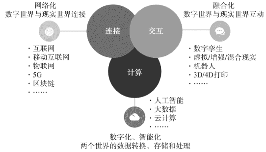
Figure 1　Comprehensive Application of "Intelligent+" Technologies

### "Artificial Intelligence + Media"

Artificial Intelligence (`Artificial Intelligence`, `AI`) is a system science and engineering that researches and develops theories, methods, and application systems for simulating, extending, and expanding human intelligence, with the purpose of establishing an intelligent machine entity. With the continuous improvement of `AI` theories and technologies and the continuous extension of application scopes, future `AI` may become a "container" of human wisdom. For example, making machines think like humans (e.g., human-computer gaming, machine learning, knowledge graphs), hear and speak like humans (e.g., speech recognition, machine translation, human-computer dialogue), see and understand like humans (e.g., image recognition, facial recognition, text recognition), and act like humans (e.g., autonomous driving, drones, service robots).

From a media perspective, intelligent media and intelligent machines realized through `AI` will collaborate as assistants and "media gatekeepers", profoundly transforming the media industry, for example, promoting the automation of news gathering and editing through biometric technologies such as speech recognition; effectively verifying hypotheses and summarizing data to discover news leads through deep learning technologies such as machine learning; rapidly capturing information and discovering clues from massive videos and images through computer vision technologies such as facial recognition. For example, in May 2019, iFlytek launched a new smart voice recorder; empowered by `AI`, on the one hand it can realize speech-to-text transcription with a recognition accuracy of up to 98%, and on the other hand it uses `AI` technology to suppress environmental noise in different scenarios, making recorded human voices clearer, achieving a transformation from a recording tool to a multi-scenario real-time "Intelligent Voice Recording Assistant" in terms of function and experience.

### "5G + Media"

The fifth-generation mobile communication (`5th Generation`, `5G`) possesses three major application scenarios: Enhanced Mobile Broadband (`eMBB`), Massive Machine-Type Communications (`mMTC`), and Ultra-Reliable Low-Latency Communications (`URLLC`). `5G`'s peak rate of 10 Gbps and "zero" latency user experience will give birth to higher-quality ultra-high-definition videos and lower-latency cloud `VR/AR`. From a technical perspective, `5G` is a further upgrade and evolution on the basis of `4G`; from a global perspective, `5G` will become a new general-purpose foundational technology following the steam engine, electricity, automobiles, and the Internet, capable of connecting all things including the media industry in the optimal way, and continuously expanding industry boundaries—available at all times, everywhere, everything is media.

From a media perspective, in January 2019, the Publicity Department of the CPC Central Committee listed "Developing Broadcasting `5G`" as one of the key tasks for the year, guiding the media industry to break out of the "Technology + Traditional Content" bottleneck and gradually move towards a deep integration model of data and services, production and dissemination. "`5G + Media`" will powerfully solve and optimize supporting services related to the media industry, such as popularizing HD and UHD videos (`4K/8K/16K`), `VR/AR` videos and games, and realizing mobile, scenario-based intelligent adaptation services, providing users with more convenient and higher-quality video backhaul and live reporting services; providing technical support for intelligent media such as IoT and `AI`, ensuring the digital operation of the news production chain, further enriching new media reporting methods and means; etc. For example, to better report on the World Horticultural Exposition, China Central Television (CCTV) connected the entire "`5G + 8K`" link in April 2019, bringing audiences an immersive `5G` viewing experience including multi-angle, high-definition, music enhancement and other functions, and using this as the cornerstone for the `8K` broadcast of the 2022 Beijing Winter Olympics.

### "Immersive Technology + Media"

Immersive technology refers to the technology that integrates the digitally simulated world with the physical world to give users an immersive experience; its core covers technologies such as `VR` (Virtual Reality), `AR` (Augmented Reality), and Mixed Reality (`MR`). With the refinement of modeling devices, 3D visual display, holographic imaging, head tracking, eye tracking, and the development of technologies such as digital twins, immersive technology is progressing towards creating full-sensory immersive experiences, and will completely change user interaction experiences through means such as virtualization of real objects, realization of virtual objects, information overlay, and holographic presentation[5].

## References

[1] Zhang Xinxin. China Officially Issues 5G Commercial Licenses[EB/OL]. (2019-06-06)[2019-06-29]. http://www.xinhuanet.com/fortune/2019-06/06/c_1124590839.htm.

[2] Anonymous. Authoritative Release of National TV Media Douyin Account Rankings[EB/OL]. (2019-01-05)[2019-06-23]. https://www.toutiao.com/a6711197202691129870/.

[3] iResearch Consulting. 2016 China Short Video Industry Development Research Report[EB/OL]. (2016-09-18)[2019-07-23]. http://report.iresearch.cn/report_pdf.aspx?id=2643

[4] Anonymous. First Media Douyin Annual Report Released: Mainstream Media Content Annual Views Near 80 Billion[EB/OL]. (2019-01-22)[2019-05-24]. https://baijiahao.baidu.com/s?id=1623360019740957798&wfr=spider&for=pc.

[5] Zhong Ying, Chen Pan. Exploration of Online News Classification and Its Evaluation Criteria—Taking the Selection of Chinese and Western Online News Awards as an Example[J]. *International Journalism*, 2009(09): 67-71.

[6] Berger J A, Milkman K L. What makes online content viral?[J]. *Journal of Marketing Research*, 2009, 49(2): 192-205.

[7] Zhang Zhi'an, Peng Lu. Mixed Emotion Communication Mode: Research on Short Video Content Production of Mainstream Media—Taking People's Daily Douyin Account as an Example[J]. *News & Writing*, 2019(07): 57-66.

[8] Li Lifeng. Paradigm-Setting Events and Event Routinization: Analyzing the Relationship between Hong Kong Newspapers and New Media Taking YouTube as an Example[J]. *Communication & Society*, 2009(09): 181-202.

[9] Zhang Ze. Xi Jinping: Raising the Banner, Rallying the People, Cultivating New People, Revitalizing Culture, Displaying Image—Better Fulfilling the Mission and Tasks of Propaganda and Ideological Work in the New Situation[EB/OL]. (2018-08-23)[2019-06-23]. http://cpc.people.com.cn/n1/2018/0823/c64094-30245212.html.

[10] Sun Wei. The Communicator's Body: Communication and Presence—The Evolution of Conscious Subject, Body-Subject, and Intelligent Subject[J]. *International Journalism*, 2018(12): 83-103.

[11] Chen Changfeng, Shi Wen. Technical Interpretation and Value Discussion of Personalized News Recommendation Algorithms[J]. *Chinese Editors*, 2018(10): 9-14.

[12] Chen Xingxing. Exploration and Reflection: Short Video Development in the "First Year of 5G"[J]. *News & Writing*, 2019(06): 20-22.

[13] Yu Guoming. Communication Development in the 5G Era: Turning Points, Challenges, Opportunities and Missions[J]. *Media Observer*, 2019(07): 5-7.

[14] Xiang Lingmei, Liu Jing, Luo Ying. Communication Analysis of Data News Animation Videos[J]. *Media*, 2018(12): 36-38.

[15] Bi Xiang, Tang Cunchen, Xiao Qiao. Research on Short Video Social Media Public Opinion Monitoring and Crisis Prevention Mechanisms. *Information Theory and Practice* 2019, 42(10): 102-108.

[16] Huang Minfen. News Games in the Digital Context[J]. *Journal of Chongqing University of Posts and Telecommunications (Social Sciences Edition)*, 2014(5): 94-100.

[17] Sun Wei. The Communicator's Body: Communication and Presence—The Evolution of Conscious Subject, Body-Subject, and Intelligent Subject[J]. *International Journalism*, 2018, 40(12): 83-103.

[18] Pfeifer P, Scheier C. *Understanding Intelligence*[M]. MIT Press, 1999: 23.

[19] Xiao Changjie. Video AI Technology Boosts Short Video Ecology[J]. *Media*, 2019(04): 19+21.

[20] Wang Wenbin. Seeing the Big from the Small—Analysis of Current Status and Trends of Domestic Short Video Development[J]. *TV Research*, 2017(05): 18-21.

(Author Bio: Li Shuni, Undergraduate in Broadcasting and Hosting Art, Class of 2016, School of Media, Soochow University)

# On "VR+Media" from a Medium Perspective

From a medium perspective, the "360-degree + depth of field" simulates the real world, allowing users to interact with the virtual environment through external devices, thereby achieving "zero-distance" contact with the virtual world. "VR+Media" also drives content from the three dimensions of traditional media in the past ("two planar dimensions + time dimension") up to five dimensions ("three spatial dimensions + time dimension + virtual parallel world"), and promotes the transformation of content structures and monetization models across fields including film and television, gaming, live streaming, education, e-commerce, and real estate. For example, in February 2019, the CCTV News client launched a "VR Channel" focusing on panoramic photo news and VR video news, allowing users to enter VR scenes via hyperlinks.

## 4. "Blockchain+Media"

Blockchain (`blockchain`) is a new application model that utilizes functions such as "data trustworthiness," "value transfer," "decentralization," and "smart contracts" to solve the problem of trusted and controllable multi-party transactions. Since its proposal in 2008, blockchain has successively gone through the 1.0 era (virtual currencies represented by Bitcoin, such as transfers, remittances, etc.), the 2.0 era (smart contract applications represented by Hyperledger, such as mortgages, property rights, etc.), and entered the 3.0 era in 2018 (cross-industry decentralized ecological solutions beyond contracts, such as applications in identity authentication, culture and entertainment, etc.). Essentially, blockchain is a highly credible transformative technology, a reconstruction of the underlying logic of the current world, and the "general infrastructure" and empowering "connector" for building the future Value Internet ("Digital Currency + Digital Assets + Ecosystem").

From a medium perspective, blockchain can not only strengthen the protection of original content, track copyright usage, and combat fake content, but also break data "silos" and solve data security and privacy issues. For example, in April 2018, "Three Dads" collaborated with CCTV and the blockchain sharing ecosystem platform `Smartshare` to create the IP blockchain "Dengdeng Robot," integrating functions such as intelligent dialogue and remote video, achieving accurate recording of interactive behaviors between parents and children.

## 5. "IoT+Media"

The Internet of Things (`Internet of Things`, `IoT`), namely the "Internet of things connected," is a business network that extends and expands on the basis of the Internet, combining various information sensing devices with the Internet to realize the interconnection of people, machines, and things at any time, any place, and in any environment. IoT requires every object to be addressable, every object to be communicable, and every object to be controllable, focusing on network computing, aggregation, connection, communication, collection, and content, emphasizing cognition and mainly reflected in "8A" services——`Anytime` (any time), `Anywhere` (any place), `Anybody` (any person), `Anything` (any event), `Any service` (any service), `Any content` (any content), `Any device` (any device), and `Any connection` (any network).

From a medium perspective, whether it is video collection through devices such as drones, surveillance cameras, and dashcams, or user data collection and feedback through sensors, "IoT+Media" has been centrally applied in fields such as breaking news, environmental news, investigative journalism, "citizen participation" journalism, and drone journalism, opening up entirely new dissemination paths, and transforming traditional media from person-to-person information dissemination to "everything is media." For example, in its news coverage of the 2016 Rio Olympics, *The Washington Post* used standardized, formulaic robot writing; by docking with the organizing committee's database, it could complete news writing, event summaries, and other tasks in an extremely short time.

# III. Intelligent Media: Redefining Media

Benefiting from the progress of a new cluster of intelligent technologies and the gradual improvement of new information infrastructure, information dissemination is spreading and penetrating into every part of the social organism with unprecedented breadth and depth, which will redefine the connection modes between people and information, people and goods, people and services, and people and people, creating an intelligent communication landscape of global information production and flow from human-to-human connection to the Internet of Everything and the Intelligence of Everything. Limited by space, the following discussion on intelligent media transformation takes Xinhua News Agency's Media Brain as the primary example.

## 1. Building an Intelligent Production Model from Information Gathering to Content Creation

Xinhua News Agency released China's first media artificial intelligence platform——Media Brain 1.0 (`mp.shuwen.com`) [6] in December 2017, followed by the release of Media Brain 2.0——"MAGIC" Intelligent Media Production Platform in June 2018, attracting widespread attention at home and abroad. It is not difficult to find that `MAGIC` is essentially a combination of `MGC` (Machine Generated Content) and `AI`. The "2410" Intelligent Media Production Platform in the Media Brain, on the one hand, can collect data and monitor and detect news leads in real-time through intelligent sensing devices such as cameras, drones, and dashcams; on the other hand, it can replace manual labor in news information production and proofreading, providing more efficient information gathering and distribution. In addition, it can perform a series of processing such as data analysis, image processing, and video editing on information, thereby building an intelligent model from information gathering to content creation. For example, on the eve of the 2018 National "Two Sessions," Xinhua News Agency released an `MGC` video news based on the Media Brain. This news scanned 500 million web pages and analyzed 3.5 million pieces of data, presenting "Two Sessions" keywords, public opinion hotspots, and other content in a visual manner, while the entire process took only 15 seconds (see Figure 2).

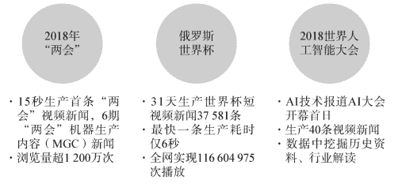

Figure 2　Media Brain MAGIC, Intelligent Automatic Video Generation

## 2. Building a Virtual-Real Integrated Production Model from UGC to MGC and IGC

The Media Brain can obtain materials through cameras, sensors, speech recognition, and other methods, then analyze and process them through intelligent technologies such as image processing and deep learning, finally forming news manuscripts, constructing an `MGC` intelligent news production model. The deep integration of intelligent technology clusters with the media industry places greater emphasis on technology integrating into content production in a more intelligent way. For example, news robots such as *People's Daily* Central Kitchen's "Xiaorong" and "Xiaoduan," Xinhua News Agency's "Dumi," and *Guangzhou Daily*'s "Atong" and "Ale" cover the entire news chain of planning, interviewing, production, distribution, and feedback. Such a virtual-real integrated production model, while realizing more imaginative news narrative methods, helps upgrade content production from User Generated Content (`UGC`) to Machine Generated Content (`MGC`, `IGC`) featuring human-machine collaboration. For example, the first fully simulated intelligent `AI` anchor debuted at the 5th World Internet Conference on November 7, 2018, possessing the same broadcasting capabilities as a human anchor and able to guarantee 24/7 uninterrupted broadcasting; another example is `AI` anchor "Xiaobing" serving as a weather presenter on Dragon TV, and `AI` dubbing fully reproducing the voice of the late announcer Li Yi.

## 3. Building a Precision Distribution Model from "B2C" to "C2B"

The Media Brain can provide multi-dimensional cross-analysis of indicators and can rely on massive multi-source, heterogeneous user data to infer user portraits, realizing the deep integration of information dissemination and Internet services, allowing media practitioners to gain deeper insights into users, making media operations more intelligent, precise, and humanized. Based on this, the media economic industry chain can upgrade and transform along a path of greater precision, higher efficiency, and maximized benefits. For instance, advertisers can not only place ads targeting users based on program positioning but also obtain target audience data information equivalent to or even surpassing ratings-based data, pushing more precise, personalized, and real-time advertising content to target objects, creating value and improving operational efficiency for both buyers and sellers. For example, the "Instant Push" function launched by the Sina client in September 2017 recommends the currently most interesting information to users based on their "immediate interests," building a new service model connecting people and information.

## 4. Building an Intelligent Service Model from Information Dissemination to Cross-Border Adaptation

The Media Brain also possesses powerful computer vision technologies including facial recognition and human emotion analysis, which can automatically classify and process video and image materials. While helping media practitioners accurately locate relevant materials in databases, it connects multiple operation platforms to support cross-border operation services. In addition, it can accurately identify relationships between people, ensuring the accuracy of real-time news, thereby improving the efficiency of discovering news leads, and establishing a brand-new service model from updating dissemination methods to providing comprehensive information services. For example, in event broadcasting, it can provide real-time event data analysis, highlight replays, etc.; in disaster reporting, it can provide multi-angle on-site video materials, graphic materials, etc. For example, during the 2018 World Cup broadcast, the "MAGIC" platform utilized video tracking algorithms to annotate player movement trajectories, goal rates of both teams, effective offenses, and other event data, as well as "highlight moment" video clips, analyzing the game situation.

## 5. Building a Full-Process Supervision Model from Original Content to Authorized Release

On the basis of optimizing traditional simple correspondence recognition, the Media Brain can also utilize its full-web data processing capabilities and intelligent similarity algorithm recognition technologies targeting mainstream dissemination forms such as images, videos, and texts to compare with the copyright information registered by rights holders in the first instance, further empowering digital copyright protection, thereby helping to establish a "firewall" covering high-quality original content across the web, and curbing plagiarism and "secondary processing" phenomena to the greatest extent. At the same time, "Intelligent+" technologies such as blockchain can also provide monitoring analysis reports and visual data analysis results, better helping rights holders safeguard their rights through legal channels, enabling the media industry to develop in the direction of high-quality original content as core competitiveness. For example, in September 2018, the Hangzhou Internet Court officially went on-chain; the Media Brain copyright blockchain built the world's first copyright blockchain recognized by an Internet court, enabling creators to obtain evidence with one click and directly reach the court.

# IV. Future Development Directions of Intelligent Media Transformation in Radio and Television Media

Currently, multi-channel, multi-dimensional, and multi-platform are driving the media industry to develop in depth. Future radio and television media, empowered by a new cluster of intelligent technologies, should move from simple "addition" (+) to true "integration" (×), achieving fusion into a whole, and continuously enhance the communication power, guiding influence, impact, and credibility of news and public opinion [7].

## 1. Taking "Intelligent+" as the Engine to Achieve Multi-Dimensional Intelligent Cross-Border Operations

In the digital economy model, user volume has become the core of platform operations, while multi-dimensional cross-border operations allow platforms to share user resources and tap into user consumption potential. While cultivating existing users, consideration should be given to the fact that incremental market opportunities may appear in China's third- and fourth-tier cities, towns, and emerging segmented user groups represented by the "ACG (Anime, Comic, Games)" generation. Taking Tencent as an example, what people are familiar with is its social business; it fully leverages its user volume advantage to build a Tencent empire covering integrated operations of social, gaming, payment, video, news, live streaming, and more. Data shows that in 2018 alone, Tencent's smart mobile gaming business achieved revenue of 77.8 billion yuan [8], while in the same year, the total revenue of the national cable TV network was 77.948 billion yuan [9], and the top provincial broadcaster Hunan Broadcasting System's total revenue was 20.951 billion yuan [10].

In the process of intelligent media transformation, traditional media should break out of inherent thinking frameworks, take "Intelligent+" as the engine, and meet the needs of integrated media business development, platform resource scheduling integration, integrated media business innovation and growth, and integrated media platform openness by establishing larger-dimensional cross-border operations. For example, during the production of the live broadcast program for the launch of Tianlian-2 (Sky Link-2), China Central Television (CCTV) attempted "Danmaku" (bullet comment) interactive broadcasting for the first time. While achieving good live broadcast results, it also ignited online topic heat. This cross-border operation of "Traditional News + New Interactive Live Streaming" is a significant innovation; future traditional media can refer to this thinking and model for more bold attempts.

## 2. Improving the Supply System to Provide Intelligent Services Oriented to User Needs

China's consumer-end digitalization level leads globally, with metrics such as express logistics volume, online shopping population, and mobile payment scale all ranking first in the world. However, the digitalization level of the supply end has not shown a high level, with problems such as lack of well-known brands, ineffective advertising placement, and weak precision marketing, showing characteristics of the consumer end forcing reform of the supply end. In an intelligent supply system, front-end data analysis can provide digital research tools, reconstructing the supply-end product R&D system based on precise calculation and diagnosis, thereby designing and incubating products more precisely, improving product content quality, reducing decision-making time, and increasing decision-making accuracy.

In the process of intelligent media transformation, radio and television media cannot only play the role of traditional "publishers" but should also act as "utilizers" of user data, transforming from cultural communication channels into comprehensive integrated service platforms. As authoritative information release channels, radio and television media should attach importance to and strive to solve the information access problems of special consumer groups, such as the hearing impaired and language impaired. Starting from the supply system end, they should do a good job in the strategic deployment of supply-side structural reform, form a new modern, diversified intelligent supply structure, realize guiding demand with high-quality supply, and meet users' diversified needs, thereby better guiding the consumer end to develop in a virtuous cycle towards more diversified directions.

## 3. Optimizing User Experience, Emphasizing Mobile-First and Scenario-Based Intelligent Adaptation Services

Users' mobile consumption habits have made scenario-based services featuring mobility, experience, interactivity, efficiency, and intelligence become the basic communication mode. The application technologies provided by mobile terminals, sensors, social media, big data, positioning systems, and the resulting sense of "presence" are revolutionizing user experience in the consumption era [11]. Data shows that the scale of Chinese netizens reached 829 million, with 98.6% using mobile phones to access the Internet; the group under 39 years old accounted for 67.8% of netizens, among which the 20-29 age group accounted for the highest proportion, close to 30% [12]. The challenge of the second half of mobile Internet lies in taking the content needs and social experience of the mainstream population under the background of consumption upgrade as the logical starting point, competing for user attention and cultivating user stickiness, and grasping the trend of media intelligence on the basis of deepening content and precise communication.

In the process of intelligent media transformation, traditional media should make full use of collected real-time material information and classify it reasonably, thereby changing the past single and "instillation-style" information release model, realizing multi-scenario integration of "News Scene + On-site Reporting Interaction + User Backend Interaction" [13], providing users with optional adaptation services. In addition, they should break down the boundaries between online and offline, bridge real life and virtual space-time, and connect communication to different scenarios such as work, life, entertainment, and leisure. For example, in broadcasting services, users can freely choose viewing angles; in terms of user immersion, enhance scenario-based real-time interaction; in data information services, provide users with intelligent adaptation services related to communication content, etc.

## 4. Strengthening Intellectual Property Protection and Establishing a Sound Profit Model Centered on IP Development

Currently, a digital "super IP" industry chain centered on `IP`, simultaneously connecting text, images, music, movies, and physical peripheral stores, is developing rapidly, emphasizing the importance of original `IP` content in the media industry. Leveraging `IP` to promote the cross-border integration of "Internet+Media" may become an important means for the healthy development of current intelligent media transformation. Taking Disney as an example, utilizing the 5,000 comic superhero images created by Marvel, it launched a series of superhero movies, achieving remarkable box office results. According to 2018 mainland box office ranking data from a movie box office database, two Marvel movies released that year, *Avengers: Infinity War* (grossing 2.37 billion yuan) and *Venom* (grossing 1.856 billion yuan), both entered the top ten; and *Avengers: Endgame* released in 2019 became the fastest movie in Chinese box office history to break 2 billion yuan in just 3 days, 20 hours, and 52 minutes [14].

In the process of intelligent media transformation, to realize `IP` value monetization, establish a virtuous profit model, and create a good industry atmosphere, radio and television media should attach great importance to intellectual property protection, and take high-quality original `IP` content as the guide, influencing the development of new media with their own credibility. On the one hand, existing technical means should be fully applied to intellectual property protection work, strengthening R&D of digital copyright-related technologies, and enhancing the hard power of copyright protection; on the other hand, media practitioners' awareness of intellectual property protection should be strengthened, encouraging, supporting, and protecting originality from a policy level to stimulate more creativity.

## 5. Accelerating Platform Innovation and Expanding Integration Breadth in the Benign Interaction between Content and Technology

Regardless of how technology and environment change, "Content is King" remains the principle that media producers must follow. As young, elderly, and "blank-slate" users gradually enter the media ecology, traditional media must not lose their own standards, and should give full play to the advantages of both radio and television media intelligence and emerging media "traditionalization," forming a virtuous circle in content and technology, promoting the development of the media industry under a technical system framework that considers content as a prerequisite, letting content become "native," to expand the dissemination scope of high-quality content in radio and television media, and promote the expansion and development of integration channels.

In the process of intelligent media transformation, for media organizations to achieve deeper integration in user expansion and content optimization, they must move from simple grafting forms to all-round infiltration forms, expanding the breadth of emerging media development with their own high-quality content. For example, in April 2019, Cover Media and *Guangming Daily* reached a cooperation intention to jointly build an "Intelligent Media Technology Cloud Platform." Both parties proposed to achieve complementarity in content, technology, channels, and other aspects. On the one hand, using cutting-edge new technologies to assist content production; on the other hand, relying on the cloud platform to promote the intelligent transformation of news production towards all-time, full-process, and full-network.

# V. Conclusion

At present and in the future, natural intelligence and artificial intelligence will always be seamlessly integrated in the intelligent media ecology, regardless of each other, regardless of east or west. In the process of intelligent media transformation, for radio and television media to move from simple "addition" to true "integration," they must rely not only on technology upgrades but more on media practitioners grasping the "quality" and "degree" on issues such as "how to integrate" and "what to integrate." For radio and television media to better become the ecological puzzle of the media industry or obtain "value points" in content direction, only by maintaining their own advantages, deeply digging "data value" through new thinking modes including user thinking, reconstructing the media ecology with `AI`, and occupying the user's mind, can they promote the media industry to develop in a higher quality direction, bringing inspiration for the upgrading and transformation of the media industry and a new paradigm of complementary and synergistic operation.

# References

[1] Xu Zhiqiang. Research on Intelligent Media Innovation and Development Model [J]. China Publishing, 2016(12): 17-21.

[2] Yan Sanjiu. Current Situation, Problems, and Innovation Paths of the Integrated Development of Chinese Radio/TV Media and Emerging Media [J]. Journal of East China Normal University (Philosophy and Social Sciences), 2018, 50(01): 89-101+179.

[3] Zhu Hongjun, Pu Xiao. 2017 China New Media Copyright Protection Report [J]. News & Writing, 2018(08): 69-75.

[4] Zheng Zili. Driving Logic and Promotion Path of Deep Integration of Chinese Media [J]. Modern Communication (Journal of Communication University of China), 2017, 39(06): 5-9.

[5] iResearch Consulting. 2019 Technology Trend Report [R]. Beijing: Beijing iResearch Consulting Co., Ltd., 2019.

[6] Media Brain. Media Brain Official Website [EB/OL]. [2019-5-20]. https://www.shuwen.com.

[7] Lu Yanmin. Review of 2017: Top Ten Events in the Media Industry [J]. Media, 2018(01): 16-21.

[8] Li Binbin, Hu Lingguo. Tencent Releases 2018 Performance Report: Annual Revenue 312.694 Billion Yuan RMB [EB/OL]. [2019-3-22]. http://www.chinanews.com/cj/2019/03-22/8787027.shtml.

[9] National Radio and Television Administration. 2018 National Radio and Television Industry Statistical Bulletin [EB/OL]. [2019-05-12]. http://www.nrta.gov.cn/art/2019/4/23/art_113_42604.html.

[10] Hunan Radio and Television Work Conference. Hunan TV 2018 Revenue 20.951 Billion, Accounting for 76% of Hunan Province's Total Radio and Television Revenue [EB/OL]. [2019-5-20]. http://www.sohu.com/a/290461792_120051417.

[11] Scoble, Israel. The Age of Context [M]. Zhao Qiankun, Zhou Baoyao, trans. Beijing: Beijing United Publishing Co., 2014.

[12] China Internet Network Information Center. The 43rd Statistical Report on Internet Development in China [R]. Beijing: China Internet Network Information Center, 2019.

[13] Gou Kaidong. Scenario Reconstruction and Communication Innovation with Mobile-First——Taking CCTV News Mobile Network as an Example [J]. TV Research, 2017(10): 7-9.

[14] Xu Meilin. *Avengers 4* Surpasses "Earth," Becomes Fastest Movie in Chinese History to Break 2 Billion Yuan [EB/OL]. [2019-04-28]. http://www.bjnews.com.cn/ent/2019/04/27/573232.html.

(Author Introduction: Xu Zhiqiang, Professor and Senior Engineer, School of Digital Media and Creative Design, Sichuan University of Media and Communications; Yan Ling, Zhao Yalin, Undergraduates Class of 2016, Digital Media Technology Major, School of Digital Media and Creative Design, Sichuan University of Media and Communications)

**【Notes**

[[1]](#txt010.html#footnote_quote_txt010_1) This paper is a phased achievement of the 2016 Ministry of Education Humanities and Social Sciences Planning Fund Project "Research on Public Opinion Generation and Governance Strategies of Online 'Positive Energy Rumors'" (16YJA860006) and the National Social Science Fund Major Research Special Project "Systematic Planning and Design Research on 'Belt and Road' Connectivity" (18VDL001).)

# Media Use Research

## The Relationship between Social Media Use and Social Responsibility Identity: An Empirical Study Based on New Shanghainese

**Bai Rujin　Li Zhenghong**

### Abstract

To clarify the mechanism of the effect of social media use on the social responsibility identity of new Shanghainese, this paper constructs a moderated mediation model, focusing on examining the mediating role of social integration in the relationship between the two and the moderating role of social trust. The author conducted a questionnaire survey on 415 new Shanghainese, investigating their social media use, social integration, social trust, and social responsibility identity. The results show: ① After controlling for gender, age, hukou (household registration), origin (urban/rural), income, and duration of stay in Shanghai, social media use has a significant positive predictive effect on social responsibility identity; ② Social integration plays a mediating role in the relationship between social media use and social responsibility identity; ③ The direct predictive effect of social media use on social responsibility identity and the mediating role of social integration in the relationship between the two are both moderated by social trust.

### Keywords

Social media use, Social responsibility identity, Social integration, Social trust

# I. Research Background

# Introduction

Social Responsibility Recognition (`Social Responsibility Recognition`) refers to a cognition and behavior whereby individuals, based on their self-positioning and through rational thinking and free choice, determine what responsibilities they should bear and what obligations they should fulfill for the normal operation and healthy development of society. The perspective of Sartre's philosophy reveals the origin and meaning of responsibility, positing that social responsibility is an intrinsic requirement of human absolute freedom, the essence of becoming human; to evade responsibility is to evade freedom. According to data from the Shanghai Statistics Bureau, as of the end of 2018, the permanent migrant population stood at 9.7621 million, accounting for 40.27% of Shanghai's permanent resident population (24.2378 million); the "era of migration" has arrived.[1] Migration is an inevitable product of urbanization. Amid China's vigorous urbanization drive, urban new migrants have become a focal point of attention for both the government and academia. Under the trend of media socialization, various social media are silently changing the social structure and reshaping social strata,[2] profoundly influencing the socialization and urbanization processes of urban new migrants, and deeply affecting their cognitive structures and behavioral habits. Against this background, what factors influence the social responsibility recognition of urban new migrants? What are the relationships among these influencing factors? How can social responsibility recognition of urban new migrants be enhanced through social media? These issues have become urgent topics for discussion and research in building a harmonious society in the new media era. To this end, scholars have conducted research from different perspectives. Psychologists proposed the "Personality Trait Theory," arguing that the sense of social responsibility reflects individual personality traits, and individuals with different personality traits may form different values and social mentalities. Communication scholars proposed the "Information Exposure Theory," arguing that information exposure not only promotes daily communication but also influences values through information selection;[3] scholars have proven through extensive research that media and political parties can influence individual cognition and attitudes through "information framing."[4] It is evident that previous studies mostly analyzed influencing factors of individual social responsibility recognition from a single perspective, failing to comprehensively examine the relationships among these different influencing factors and their interaction mechanisms, resulting in a lack of comprehensiveness in the study of individual social responsibility recognition. Therefore, this study comprehensively considers these influencing factors to improve the accuracy and universality of the research conclusions.

# II. Theoretical Foundation and Research Hypotheses

## 1. Media Use and Social Responsibility Recognition

There are two opposing views on the relationship between media use and social responsibility recognition. One view holds that media use can enhance and improve individual social awareness and behavior;[5] the other holds that media use reduces individual awareness and behavior regarding social responsibility.[6] The contradictory research conclusions stem from different research contexts, paths, and methods. Furthermore, researchers have explored the relationship between media use and the individual from a microscopic perspective. Some scholars employed empirical methods to investigate the relationship between media use and individual pro-environmental behavior and political participation. Findings indicate that traditional media use significantly enhances individuals' willingness to discuss environmental issues and their environmental awareness, while new media use reinforces individual environmental participation behavior.[7] Traditional and new media have different effects on rural residents' willingness to participate in public affairs; traditional media plays a significant promotional role, while new media does not.[8] Media use content and intensity significantly impact college students' national image cognition.[9] Online and offline interactive expression via new media can positively influence youth political participation willingness.[10] Media use can also enhance public social cohesion and national identity.[11] A literature review reveals that among numerous media use studies, research on the impact of social media on social responsibility recognition remains insufficient. Thus, this paper proposes the first research question: Can social media use influence the construction of social responsibility recognition among New Shanghainese? Based on this, the following hypothesis is proposed:

### Hypothesis 1

`社交媒介使用` has a significant positive impact on the construction of `社会责任意识` among New Shanghainese.

## 2. The Mediating Role of Social Integration

Social Integration (`Social Integration`) refers to the reflective, sustained, and interactive social action process in which subjects in a disadvantaged position actively engage with individuals and groups in a specific community.[12] Academic research on social integration primarily focuses on special groups such as urban new migrants and migrant workers. Studies find that media plays an important role in the process of social integration. On the one hand, media use helps socially disadvantaged groups acquire symbolic capital, eliminate symbolic barriers, and promote their social integration.[13] Simultaneously, media use can narrow the digital divide, moderately mediate social conflicts, and help establish correct values. On the other hand, unreasonable media use restricts the scope of interaction, solidifies interpersonal communication, and hinders the cultivation and improvement of independent thinking and personality to a certain extent.[14] In a dual social structure, under the environment of media socialization, does social media affect the social integration of urban new migrants? Can the state of social integration influence the formation of their "master" consciousness (i.e., `社会责任认同`) in the new environment? Accordingly, this paper proposes the second research question: Can social integration influence the construction of social responsibility recognition among New Shanghainese? Based on this, the following hypothesis is proposed:

### Hypothesis 2

`社会融入` plays a mediating role between `媒介使用` and `社会责任认同` among New Shanghainese.

## 3. The Moderating Role of Social Trust

Social Trust refers to the psychological cognition and behavioral intention of an individual, in a specific context, to believe in and entrust the trusted party who aligns with their interests. From different perspectives, trust can be categorized into different types. Based on the closeness of the relationship with the trusted object, it can be divided into general trust and particularized trust. Based on the type of trusted object, it can be divided into political trust, interpersonal trust, social trust, etc. Research finds that social trust can influence individual political identity and personal values through media such as television, newspapers, and the internet. Different media have significantly different effects on individuals. Negative content in television media can reinforce individual cynicism and affect political trust.[15] Newspaper information can positively influence individual cognition and affection, but television content presents a polarization phenomenon.[16] Yao Junxi et al. found that media use significantly affects social trust, and social trust has a significant impact on individual social cognition and behavior.[17] Social trust can influence the integration of social capital and labor transfer of rural residents.[18] It is evident that academia has severe divergences in understanding the impact of media use on individual social trust, with both positive and negative evaluations. Consequently, this paper proposes two research questions: In the urbanization process, can social trust play a moderating role in the relationship between social media use and urban new migrants' social responsibility recognition? Can social trust play a moderating role in the relationship between social media use and urban new migrants' social integration? Based on this, the following hypotheses are proposed.

### Hypothesis 3

`社会信任` positively moderates the relationship between `社交媒介使用` and New Shanghainese's `社会责任认同`. That is, the higher the level of `社会信任`, the stronger the positive effect of `社交媒介使用` on New Shanghainese's `社会责任认同`; vice versa.

### Hypothesis 4

`社会信任` positively moderates the relationship between `社交媒介使用` and New Shanghainese's `社会融入`. That is, the higher the level of `社会信任`, the stronger the positive effect of `社交媒介使用` on New Shanghainese's `社会融入`; vice versa.

To test the above hypotheses, this study, based on the dual theoretical perspectives of Communication's Information Exposure Theory and Sociology's Social Integration Theory, aims to explore the relationship between `社交媒介使用` and New Shanghainese's `社会责任认同`, and constructs a moderated mediation model with `社会融入` as the mediator and `社会信任` as the moderator, as shown in `Figure 1`.

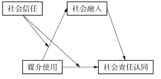

**Figure 1**　Hypothetical Model of the Mediating Role of Social Integration and the Moderating Role of Social Trust

# III. Research Design and Methods

## 1. Research Design

This paper adopts the questionnaire survey method. The survey was conducted from September 10, 2018, to March 30, 2019, completed by the "Urban New Migrants' Media Use and Social Responsibility Recognition" research team composed of three doctoral students from Shanghai Jiao Tong University. Team members determined whether respondents belonged to the research object (New Shanghainese) by asking "Are you a New Shanghainese?". This study defines "New Shanghainese" as "those whose birthplace is not Shanghai but currently live and work in Shanghai," i.e., "Shanghai urban new migrants," the research subjects of this study. Therefore, for respondents answering "yes," researchers explained the purpose to gain cooperation. The three team members conducted surveys separately. One member randomly intercepted passersby under an office building in Shanghai, surveying daily at 7:00–9:00, 11:00–13:00, 16:00–18:00. The second member randomly intercepted residents in a mature ordinary residential community in urban Shanghai, surveying daily at 7:00–9:00, 16:00–19:00. The third member stationed at a factory gate in suburban Shanghai for intercept surveys. Survey times were 7:00–9:00, 17:00–19:00. The three researchers distributed 500 questionnaires, recovered 455, with 415 valid questionnaires, a valid recovery rate of 83%. Basic sample information is shown in `Table 4`. Due to objective constraints, this study could not conduct a comprehensive sampling survey of all New Shanghainese; therefore, it cannot ensure that statistical results fully reflect the characteristics of New Shanghainese.

## 2. Variable Setting and Measurement

### 1) Independent Variable: Social Media Use

This study mainly analyzes from the perspective of `社交媒介使用`, combined with `社交媒介使用频率`.

**Social Media Use Frequency.** The variable `社交媒介使用频率` adopts a multiple-choice format with 9 options: Blog, Weibo, Online Forums, Video Sharing Sites (e.g., Youku), Baidu (or Wikipedia), Zhihu, WeChat, QQ, AliWangWang. Each respondent could select at least three items. The status of `社交媒介使用频率` is shown in `Table 1`.

**Table 1**　Social Media Use Frequency

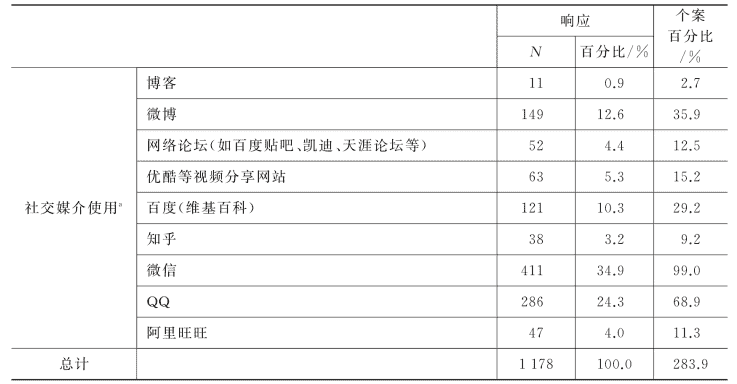

a．Dichotomy for tabulation when value equals 1.

**Social Media Use Behavior.** The measurement of this variable referenced Wei Lu's research on urban new migrants, setting 12 indicators: "Post Information," "Forward Information," "Comment on Others' Information," "Share Information," "Discuss with Others," "Follow Friends' Updates," "Interact with Friends," "Browse/Casual Surfing," "Make New Friends," "Use Instant Messaging Tools," "Join Groups (e.g., WeChat Groups)," "Initiate or Participate in Online Activities." Answers measured on a 5-point Likert scale (1 = Strongly Disagree, 5 = Strongly Agree).

`社交媒介使用行为` can be divided into three aspects: `社交行为`, `信息生产`, `信息获取` (see `Table 2`). `社交行为` (`Cronbach'sα＝0.788`) includes "Browse/Casual Surfing," "Make New Friends," "Use Instant Messaging Tools," "Join Groups (e.g., WeChat Groups)," "Initiate or Participate in Online Activities." `信息生产` (`Cronbach'sα＝0.866`) includes "Post Information," "Forward Information," "Comment on Others' Information," "Share Information." `信息获取` (`Cronbach'sα＝0.856`) includes "Discuss with Others," "Follow Friends' Updates," "Interact with Friends." Details in `Table 2`. For simplification, the study finally integrated `社交媒介使用行为` into a single variable "`社交媒介使用`" (`M＝3.89, SD＝0.645`), measured on a 5-point Likert scale (1 = Strongly Disagree, 5 = Strongly Agree).

**Table 2**　Reliability and Validity of Social Media Use

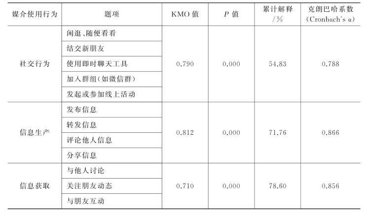

### 2) Dependent Variable: Social Responsibility Recognition

Based on the literature review, the measurement of the `社会责任` variable referenced the individual social responsibility measurement methods of Liu Boping and Liu Haitao et al.,[19-20] constructing a social responsibility scale for urban new migrants. `社会责任` is divided into two aspects: `社会责任意识认同` and `社会责任行为认同`. `社会责任意识认同` (`Cronbach'sα＝0.758`), 3 indicators selected: ① I possess a strong sense of social responsibility. ② Everyone has the responsibility to make society better. ③ I believe contemporary society generally lacks a sense of social responsibility. Measured on a 5-point Likert scale. Factor analysis showed `KMO` value 0.610, Bartlett's Test of Sphericity probability `P` value 0.000, suitable for factor analysis. Principal component analysis extracted one factor, cumulative variance contribution rate 69.84%. `社会责任行为认同` (`Cronbach'sα＝0.959`), 7 indicators selected: ④ I should abide by social order and protect public property. ⑤ Protecting the environment is my responsibility. ⑥ In public places, I pay attention to my words and deeds (e.g., no smoking, no spitting). ⑦ I should maintain social stability. ⑧ I will not casually publish information/remarks harmful to social security and stability. ⑨ I will not casually forward information/remarks harmful to social security and stability. ⑩ I will work hard and contribute to social development. Measured on a 5-point Likert scale. Factor analysis showed `KMO` value 0.913, `Bartlett` Test of Sphericity probability `P` value 0.000, suitable for factor analysis. Principal component analysis extracted one factor, cumulative variance contribution rate 80.61%. For simplification, the study finally integrated `社会责任认同` into a single variable "`社会责任认同`" (`M＝4.32, SD＝0.53`).

### 3) Mediating Variable: Social Integration

`社会融入` (`Cronbach'sα＝0.894`). Measurement referenced Jin Hengjiang's Social Integration Scale. 5 indicators selected: ① I consider myself a Shanghainese. ② I feel at home in Shanghai. ③ When I leave Shanghai, I miss it. ④ I like Shanghai and am willing to stay living in Shanghai. ⑤ I pay attention to events in Shanghai and consider them closely related to me. Measured on a 5-point Likert scale. Factor analysis showed `KMO` value 0.848, `Bartlett` Test of Sphericity probability `P` value 0.000, suitable for factor analysis. Principal component analysis extracted 1 factor, cumulative variance contribution rate 70.6%.

### 4) Moderating Variable: Social Trust

`社会信任度` (`Cronbach'sα＝0.879`). Based on the literature review, `社会信任` measurement referenced Guo Xiqing's social trust measurement method,[21] constructing a social trust measurement scale. 6 indicators selected: ① Trust level towards own relatives. ② Trust level towards own neighbors. ③ Trust level towards own colleagues. ④ Trust level towards own boss. ⑤ Trust level towards general acquaintances. ⑥ Trust level towards general people in society. Measured on a 5-point Likert scale. Factor analysis showed `KMO` value 0.783, `Bartlett` Test of Sphericity probability `P` value 0.000, suitable for factor analysis. Principal component analysis extracted two factors, rotated using Varimax with Kaiser Normalization, yielding the rotated component matrix as shown in `Table 3`.

**Table 3**　Rotated Factor Analysis of Social Trust

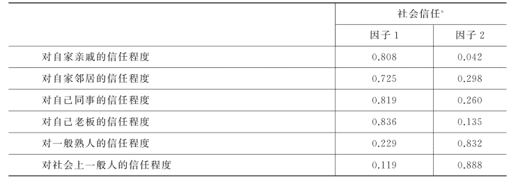

Extraction Method: Principal Component Analysis. Rotation Method: Varimax with Kaiser Normalization. a. Rotation converged in 3 iterations.

Based on the magnitude of factor loadings after rotation, the two factors were named `相关关系信任` (Relatives/Colleagues Trust) and `一般相关信任` (General Social Trust). Their variance contribution rates were 43.59% and 27.65% respectively, cumulative 71.23%. `相关信任` (`Cronbach'sα＝0.833, M＝3.81, SD＝0.66`) includes "Trust level towards own relatives," "Trust level towards own neighbors," "Trust level towards own colleagues," "Trust level towards own boss." `一般相关信任` (`Cronbach'sα＝0.714, M＝3.13, SD＝0.77`) includes "Trust level towards general acquaintances," "Trust level towards general people in society." All measurement indicators loaded >0.5 on their respective factors. For simplification, the study finally integrated `社会信任` into a single variable "`社会信任`" (`M＝3.58, SD＝0.59`).

### 5) Control Variables

This study sets demographic variables, whether having Shanghai Hukou, education level, origin (urban or rural), income, etc., as `控制变量`. Specific variable operations shown in `Table 4`.

**Table 4**　Control Variables

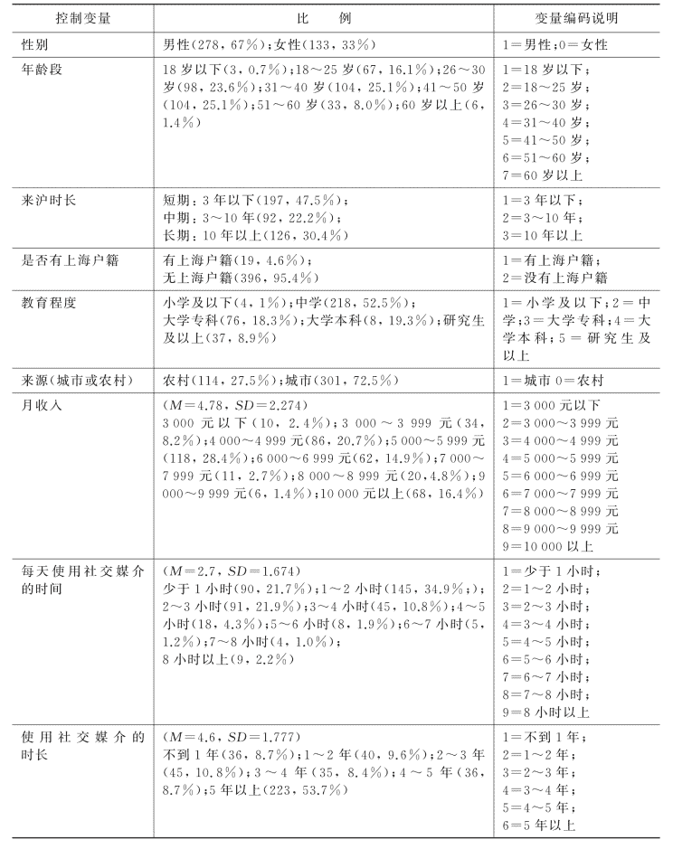

# IV. Data Analysis and Quantitative Results

Before data analysis, based on procedural controls, Harman's Single-Factor Test was used to test for Common Method Bias potentially caused by anonymous questionnaire filling. The variance explained by the first common factor was 28.624%, less than the critical value of 40%, indicating no serious common method bias.

## 1. Descriptive Statistics and Correlation Matrix of Main Research Variables

### 1) Social Media Use Status of New Shanghainese

Basic status of New Shanghainese's `社交媒介使用`. Frequency ranking: WeChat (411, 99%), QQ (286, 68.9%), Weibo (149, 35.9%), Baidu (Wikipedia) (121, 29.2%), Video Sharing Sites (e.g., Youku) (63, 15.2%), Online Forums (e.g., Baidu Tieba, KDI, Tianya) (512, 12.5%), AliWangWang (47, 11.3%), Zhihu (38, 9.2%), Blog (11, 2.7%). Clearly, Tencent's instant messaging software WeChat and QQ are the most used social media by New Shanghainese, especially WeChat with a 99% usage rate. `社交媒介使用` frequency shown in `Table 2`. Regarding daily time spent on `社交媒介`: 21.7% spent <1 hour; 145 (34.9%) spent 1–2 hours; 91 (21.9%) spent 2–3 hours; 45 (10.8%) spent 3–4 hours; 18 (4.3%) spent 4–5 hours; 8 (1.9%) spent 5–6 hours; 5 (1.2%) spent 6–7 hours; 4 (1%) spent 7–8 hours; 9 (2.2%) spent >8 hours. Regarding duration of `社交媒介使用`: 36 (8.7%) <1 year; 40 (9.6%) 1–2 years; 45 (10.8%) 2–3 years; 35 (8.4%) 3–4 years; 36 (8.7%) 4–5 years; 223 (53.7%) >5 years. Clearly, most New Shanghainese have used `社交媒介` for over 5 years. Regarding `社交媒介使用行为`, mean scores all >2.5. `信息获取` (`M＝4.07, SD＝0.70`) indicates 91.1% often use `社交媒介` to acquire information. `信息生产` (`M＝3.80, SD＝0.80`) indicates 81.9% often use `社交媒介` to produce information. `人际社交` (`M＝3.85, SD＝0.66`) indicates 87.7% often use `社交媒介` for interpersonal socializing. Overall, acquiring information via `社交媒介` is the primary behavior, followed by interpersonal socializing, then information production. For convenience, New Shanghainese's `社交媒介使用行为` was integrated into one variable "`社交媒介使用`" (`M＝3.89, SD＝0.65`).

### 2) Status of Social Trust, Social Integration, and Social Responsibility Recognition of New Shanghainese

From `Table 5`, means of `社会信任` and `社会融入` both >3 (min 1, max 5, midpoint 3). `社会信任` aspect: `相关关系信任` (`M＝3.81, SD＝0.66`) indicates 83.6% have high trust in relatives, neighbors, colleagues, bosses. `一般关系信任` (`M＝3.12, SD＝0.77`) indicates 38.6% have high trust in general social others without direct ties. Clearly, New Shanghainese trust related others far more than unrelated others, a 45% gap. For simplification, `相关关系信任` and `一般关系信任` integrated into "`社会信任`" (`M＝3.58, SD＝0.59`), indicating 79.5% have high `社会信任`. `社会融入` aspect (`M＝3.18, SD＝0.95`) indicates 55.2% have good `社会融入`, while 44.8% have average or poor integration.

Regarding `社会责任认同`, means of `社会责任意识认同` and `社会责任行为认同` are very high. `社会责任意识认同` (`M＝4.07, SD＝0.59`) indicates 93.5% have high recognition. `社会责任行为认同` (`M＝4.43, SD＝0.57`) indicates 96.4% have high recognition. For simplification, integrated into "`社会责任认同`" (`M＝4.32, SD＝0.53`), indicating 79.5% have high `社会责任认同`.

### 3) Correlations Among Main Research Variables

From Pearson correlation coefficients in `Table 5`: First, New Shanghainese's personal `社会责任` (awareness, behavior) recognition correlates significantly positively with `媒介使用行为` (information acquisition, production, social behavior). Specifically, `社会责任意识认同` correlates significantly positively with `媒介使用`'s `社交行为` (`r＝0.320, P＜0.01`). `社会责任意识认同` correlates significantly positively with `媒介使用`'s `信息生产行为` (`r＝0.329, P＜0.01`). `社会责任意识` correlates significantly positively with `媒介使用`'s `信息获取行为` (`r＝0.380, P＜0.01`). `社会责任行为认同` correlates significantly positively with `社交媒介使用`'s `社交行为` (`r＝0.228, P＜0.01`). `社会责任行为认同` correlates significantly positively with `媒介使用`'s `信息生产行为` (`r＝0.271, P＜0.01`). `社会责任行为认同` correlates significantly positively with `媒介使用`'s `信息获取行为` (`r＝0.336, P＜0.01`). `社会责任认同` correlates significantly positively with `媒介使用` (`r＝0.105, P＜0.01`). Hypothesis 1 receives preliminary verification.

# Correlation Analysis of Major Research Variables

Second, social integration was significantly positively correlated with new Shanghainese's media use behavior and social responsibility identification. Social integration was significantly positively correlated with new Shanghainese's social media use (`r＝0．222，P＜0．01`). Among them, social integration was significantly positively correlated with new Shanghainese's social responsibility consciousness identification (`r＝0．374，P＜0．01`). Social integration was significantly positively correlated with new Shanghainese's social responsibility consciousness identification (`r＝0．295，P＜0．01`). Social integration was significantly positively correlated with new Shanghainese's social responsibility identification (`r＝0．346，P＜0．01`). Hypothesis 2 received preliminary verification.

Third, social trust was significantly positively correlated with new Shanghainese's media use behavior and social responsibility identification. Social trust was significantly positively correlated with new Shanghainese's media use behavior (`r＝0．333，P＜0．01`). Social trust was significantly positively correlated with new Shanghainese's social responsibility consciousness identification (`r＝0．380，P＜0．01`). Social integration was significantly positively correlated with new Shanghainese's social responsibility identification (`r＝0．329，P＜0．01`). Social trust was significantly positively correlated with new Shanghainese's social responsibility identification (`r＝0．373，P＜0．01`). Hypothesis 3 received preliminary verification.

## Table 5　Means, Standard Deviations, and Correlation Matrix of Major Research Variables

Note: `**P＜0．01`, two-tailed test.

# 2. Relationship between Media Use and New Shanghainese's Social Responsibility Identification: Test of a Moderated Mediation Model

First, according to Andrew F. Hayes' method for testing mediation and moderation effects, `[22]` using the `Process` plugin developed on `SPSS`, `Model 4` (simple mediation model) was adopted. Controlling for age, gender, whether they have Shanghai hukou, place of origin (urban or rural), education level, income, and duration of stay in Shanghai, the mediating effect of social integration in the relationship between social media use and new Shanghainese's social responsibility identification was tested. The test results (see Table 6) indicated: Social media use significantly predicted new Shanghainese's social responsibility identification (`β＝0．298，t＝7．859，P＜0．01`). Hypothesis 1 was verified. When the mediator variable was added, social media use still had a significant direct predictive effect on new Shanghainese's social responsibility identification (`β＝0．249，t＝6．534，P＜0．01`). Social media use had a significant positive predictive effect on new Shanghainese's social integration (`β＝0．364，t＝5．346，P＜0．01`), and social integration had a significant positive predictive effect on social responsibility identification (`β＝0．134，t＝5．009，P＜0．01`). Hypothesis 2 was verified.

## Table 6　Test of the Mediation Model of Social Integration

(Continued Table)

Note: All variables in the model were standardized before being entered into the regression equation; the same applies below.

Furthermore, the upper and lower limits of the `Bootstrap 95% confidence interval` for the direct effect of social media use on new Shanghainese's social responsibility identification and the mediating effect of social integration did not contain 0 (see Table 7), indicating that social media use can not only directly predict new Shanghainese's social responsibility identification but also predict social responsibility identification through the mediating role of social integration. This direct effect (`0．249`) and mediating effect (`0．049`) accounted for `83．55%` and `16．44%` of the total effect (`0．298`), respectively.

## Table 7　Decomposition Table of Total, Direct, and Indirect Effects

`Boot SE`, `Boot CI Lower/Upper` refer to the standard error of the indirect effect estimated by the bias-corrected percentile `Bootstrap` method, and the lower and upper limits of the 95% confidence interval, respectively.

Second, the `Process` plugin in Hayes' `SPSS` macro was used, adopting `Model 8` (moderated mediation model, consistent with the model in this study). Controlling for age, gender, whether they have Shanghai hukou, place of origin (urban or rural), education level, income, and duration of stay in Shanghai, the moderated mediation model was tested. The results (see Tables 8 and 9) showed that after entering social trust into the model, the interaction term of social media use and social trust had a significant predictive effect on social integration and social responsibility identification. Among them (Social responsibility identification: `β＝－0．145，t＝－3．511，P＜0．01`; Social integration: `β＝0．152，t＝2．018，P＜0．01`), indicating that social trust not only plays a moderating role in the direct prediction of new Shanghainese's social responsibility identification by social media use but also moderates the prediction of new Shanghainese's social integration by social media use. Hypothesis 3 and Hypothesis 4 were verified.

## Table 8　Test of the Moderated Mediation Model

Note: All variables in the model were standardized before being entered into the regression equation; the same applies below.

## Table 9　Direct and Indirect Effects at Different Levels of Social Trust

`Boot SE`, `Boot CI Lower/Upper` refer to the standard error of the indirect effect estimated by the bias-corrected percentile `Bootstrap` method, and the lower and upper limits of the 95% confidence interval, respectively.

Further simple slope analysis was conducted (see Figures 2 and 3). As shown in Figure 2, for new Shanghainese with low levels of social trust (`M－1SD`), social media use had a significant positive predictive effect on social responsibility identification (simple slope `= 0．27，t＝6．586，P＜0．001`); for new Shanghainese with high levels of social trust (`M＋1SD`), social media use also had a positive predictive effect on social responsibility identification (simple slope `= 0．094，t＝2．042，P＜0．05`), but the predictive effect was smaller; this indicates that as the level of social trust of urban new immigrants increases, the predictive effect of social media use on social responsibility identification shows a gradually decreasing trend.

## Figure 2　The Moderating Role of Social Trust in the Relationship between Social Media Use and Social Responsibility Identification

## Figure 3　The Moderating Role of Social Trust in the Relationship between Social Media Use and Social Integration

As shown in Figure 3, for new Shanghainese with low levels of social trust (`M－1SD`), social media use had a significant positive predictive effect on social integration (simple slope `= 0．017，t＝1．728，P＜0．5`); for new Shanghainese with high levels of social trust (`M＋1SD`), social media use also had a positive predictive effect on social integration (simple slope `= 0．038，t＝2．249，P＜0．5`), but the predictive effect was smaller; this indicates that as the level of social trust of urban new immigrants increases, the predictive effect of social media use on social integration shows a gradually decreasing trend.

Additionally, at the three levels of social trust, the mediating effect of social integration in the relationship between social media use and social responsibility identification showed an upward trend, meaning that as the social trust level of urban new immigrants increases, social media use more easily influences their social responsibility identification by enhancing their social integration.

# V. Conclusions and Discussion

Based on the dual theoretical perspectives of the information exposure theory in communication studies and the social integration theory in sociology, this study examined the relationship between social media use and new Shanghainese's social responsibility identification. A moderated mediation model was constructed with social integration as the mediator and social trust as the moderator. This not only clarified how social media use affects new Shanghainese's social responsibility identification (the mediating role of social integration) but also investigated under what conditions the impact of social media use on social responsibility identification is more significant (the moderating role of social trust). The results have certain practical significance and theoretical value for deepening the understanding of social media use's impact on new Shanghainese's social responsibility identification and guiding urban new immigrants in the process of building a harmonious society. The findings are as follows:

First, social integration plays a mediating role between social media use and new Shanghainese's social responsibility identification. Social integration is an important influencing factor for the political participation, `[23]` cultural identity, `[24]` and value shaping `[25]` of the integration subject (especially socially vulnerable groups). Exploring the mediating role of social integration in the relationship between social media use and new Shanghainese's social responsibility identification not only helps reveal from a cognitive perspective what factors social media use influences to shape urban new immigrants' social responsibility identification but also helps explore the formation mechanism of urban new immigrants' social responsibility identification. This study found that social media use can predict urban new immigrants' social responsibility identification through the mediating role of social integration. Specifically, social media use not only has a direct impact on new Shanghainese's social responsibility identification but also has an indirect positive impact on new Shanghainese through the mediation of social integration. This conclusion reveals that improving new Shanghainese's social integration can be achieved either by directly improving the social media use of the urban new immigrant group or by enhancing their social integration through social media use, ultimately leading to an increase in the level of social responsibility identification among urban new immigrants. This finding also verifies previous discoveries that social integration is a deepening of cultural identity and social identity, `[26]` and that social media use can enhance individuals' prosocial behaviors, improve their degree of integration with society, and thereby influence individuals' social responsibility identification. `[27]` Media is a double-edged sword. The impact of social media use on social integration can be understood from two aspects. First, social media enables individuals to acquire information and communicate more conveniently, which is of great significance for improving cognitive levels and enhancing relationships. However, inappropriate use of social media (such as information redundancy, exposure to harmful information, mobile phone addiction, etc.) can affect individuals' mental health growth, the shaping of worldviews, outlooks on life, and values, and consequently affect social harmony, stability, and healthy development. Thus, social media plays an important role in improving the social integration process of urban new immigrants. Social media can fully exert the information framing effect and agenda-setting effect, conduct targeted communication for urban new immigrants, and thereby directly influence urban new immigrants' social responsibility identification. At the same time, social integration is a dynamic, gradual, multi-dimensional, and interactive process influenced by numerous factors. This means we need to examine urban new immigrants' social integration from different perspectives, actively communicate with urban new immigrant groups, comprehensively and objectively understand their population mobility and social integration status, thereby providing a basis for government decision-making departments to formulate scientific and reasonable public policies.

Second, social trust enhances the relationship between social media use and new Shanghainese's social responsibility identification, and can regulate the relationship between social media use and social responsibility identification through social integration. Based on social integration theory, this study constructed a moderated mediation model to examine the moderating role of social trust in the relationship between social media use, social integration, and social responsibility identification. The results found that social trust not only plays a moderating role in the relationship between social media use and social responsibility identification but also moderates the mediation chain of "social media use — social integration — social responsibility identification". Specifically, compared with individuals with high levels of social trust, the direct predictive effect of social media use on social responsibility identification is more significant for individuals with low levels of social trust. This result not only indicates that the cognitive mechanism of social responsibility identification formation (the mediating role of social integration) has individual differences but also shows that social trust is an important influencing factor affecting urban new immigrants' social integration, which also verifies previous scholars' research results. `[28－29]` First, individuals with high levels of social trust have better social integration capabilities, which also confirms existing research findings that residents with higher levels of social trust can increase their willingness to participate in social behaviors. `[30]` Second, individuals with low levels of social trust have significantly lower satisfaction with society, social support, and willingness to participate in society than the general public. Therefore, social trust can influence the degree of urban new immigrants' social responsibility identification through social media use.

Third, demographic aspects. Compared with males, females have a higher level of social responsibility identification. A possible reason is that male urban new immigrants face relatively greater pressure in the process of social adaptation and integration, which affects their integration efficiency and the formation of personal values. In addition, traditional Chinese child-rearing methods may also be an influencing factor. Research shows that parenting styles (care and control) have a certain impact on the formation of children's sense of social responsibility, and in China's child-rearing process, control over girls is often stricter. At the same time, individuals' self-control also shows significant gender differences; females' self-control ability is more significant, while males' is not. `[31]` In addition, Shanghai hukou can significantly affect new Shanghainese's level of social integration. For new Shanghainese who have obtained Shanghai hukou, their sense of social integration significantly increases, while for those who have not obtained Shanghai hukou, their sense of social integration significantly decreases. This also conforms to common sense. In first-tier cities like Beijing and Shanghai, hukou not only carries social welfare and security functions such as education and medical care but also implies the social integration ability of new immigrants. However, hukou has no direct relationship with social responsibility. Furthermore, duration of stay in Shanghai has a significant negative correlation effect with new Shanghainese's social integration and social responsibility identification. That is, the longer the duration of stay in Shanghai, the worse the social integration status of new Shanghainese, and the lower the degree of social responsibility identification. Conversely, the "newer" the urban immigrants, the higher their social responsibility identification. A possible explanation is that because most urban new immigrants lack a sense of belonging, in their view, Shanghai is just a stop for study and work in life, and they will leave Shanghai someday. Therefore, the longer they stay in Shanghai, the more likely they are to lack a sense of belonging, so the degree of social integration will be lower, and the corresponding social responsibility identification will also become lower. It can be seen that urban new immigrants' social responsibility identification is influenced by individual economic, cultural, personal experiences, and other specific circumstances. In the process of urbanization and the construction of a harmonious society, the construction of urban new immigrants' social responsibility identification faces new challenges.

The innovations of this study are mainly reflected in two aspects: First, based on the dual research perspectives of information exposure theory and social integration, this study simultaneously examined the influence of media variables and social variables on the impact of new Shanghainese's social media use on social responsibility identification, constructing a moderated mediation model. This model not only reveals the mechanism of action between social media use and social responsibility identification (the mediating role of social integration) but also reveals the individual differences in this mechanism (the moderating role of social trust). Second, this model not only answers the question of how social media use affects the formation of new Shanghainese's social responsibility identification but also answers the question of under what conditions the direct predictive effect of social media use on social responsibility identification and the mediating role of social integration are more significant. It has positive significance for deepening and expanding research on the relationship between social media use and individual psychological and behavioral adaptation. The results show that social integration is an important mechanism for the formation of social responsibility identification among urban new immigrants in the new media era through social media use, and this mechanism is regulated by social trust.

In addition, this moderated mediation model has certain implications for new Shanghainese's scientific use of social media, improving their social integration level, and enhancing social responsibility identification: First, improving new Shanghainese's social media use helps enhance their social responsibility identification. The "information determines" theory proposed by three Nobel laureates in economics in March 2001 pointed out that the asymmetric flow of information leads to extreme unfairness in development between groups and individuals. The "knowledge gap" deprives some people of equal rights and opportunities to access information and knowledge, causing their information poverty and knowledge deficiency, which in turn is an important factor leading to their material poverty. `[32]` The first step to solving unbalanced social development and achieving common prosperity is to achieve equality in information access. However, due to the complexity and diversity of society, urban new immigrants' information access channels and information quality are often inferior to those of urban natives. Therefore, expanding access to media information can enhance urban new immigrants' social responsibility. Second, improving new Shanghainese's social integration helps enhance their social responsibility. Enhancing urban new immigrants' social integration ability and strengthening their "master" consciousness and "sense of belonging" can improve their social responsibility awareness. The higher the degree of social integration of urban new immigrants, the stronger their "master" consciousness of the city, and the higher their corresponding social responsibility awareness and behavior. Scholars have found that the lack of living environment and channels for self-expression are also important factors leading some urban new immigrants (such as migrant worker groups) to be on the margins of the community in a detached state. Therefore, establishing equal and smooth self-expression mechanisms and platforms can also effectively enhance their community participation. `[33]` Third, establishing social trust can enhance urban new immigrants' social responsibility identification. The sources of trust are extensive, including institutional norms, personality traits, and identity recognition based on different perspectives such as gender, age, class, region, country, and ethnicity. Building urban new immigrants' social trust requires not only individuals to follow certain moral ethics but, more importantly, the government to establish necessary prestige and authority. Therefore, on the one hand, it is necessary to vigorously promote excellent traditional culture and improve individuals' own qualities; on the other hand, it is necessary to improve government governance, vigorously implement "transparent administration", build an "integrity government", construct "harmonious communities", enhance urban new immigrants' social trust level, and thereby improve their willingness for social integration and social responsibility identification. `[34]`

This study also has certain limitations and deficiencies: First, due to objective constraints, this study could not conduct a comprehensive sampling survey of all new Shanghainese; therefore, this study cannot ensure that the statistical results fully reflect the characteristics of new Shanghainese. Second, the study used a cross-sectional research design, lacking data continuity; therefore, the study cannot infer causality. `[35]` Future research can further enrich research design, methods, and variables, and use multi-level regression to explore the causal relationships and differences between different types of media use and individual responsibility identification.

# References

`[1]` Giddens. *New Rules of Sociological Method: A Positive Critique of Interpretative Sociologies* `[M]`. Beijing: Social Sciences Academic Press, 2003: 8.

`[2]` Zhou Baohua. New Media Use and Subjective Class Identification: Theoretical Interpretation and Empirical Test `[J]`. Journal of Journalism University, 2010(02): 34-45.

`[3]` Entman R M. Framing: Toward Clarification of a Fractured Paradigm `[J]`. Journal of Communication, 2010, 43(4): 51-58.

`[4]` Chong D. How People Think, Reason, and Feel about Rights and Liberties `[J]`. American Journal of Political Science, 1993(37): 867-899.

`[5]` Strömbäck J, Shehata A. Media malaise or a virtuous circle? Exploring the causal relationships between news media exposure, political news attention and political interest `[J]`. European Journal of Political Research, 2010, 49(5): 575-597.

`[6]` Robinson M J. Public Affairs Television and the Growth of Political Malaise: The Case of "The Selling of the Pentagon" `[J]`. American Political Science Association, 1976, 70(2): 409-432.

`[7]` Jin Hengjiang, Yu Laihui, Zhang Guoliang. The Impact of Media Use on Individual Environmental Behavior: An Empirical Study Based on CGSS 2013 Data `[J]`. Journal of Journalism University, 2017(02): 51-60+153.

`[8]` Zhang Bei. Research on the Relationship between Media Use and Rural Residents' Participation in Public Affairs: An Empirical Analysis Based on CGSS 2012 Data `[J]`. Jianghai Academic Journal, 2017(3): 102-109.

`[9]` Liao Shengqing, Jing Yang, Zhang Shuai. College Students' Media Use, Social Contact, and National Impression: A Study from the Perspective of Stereotypes `[J]`. Journalism & Communication Research, 2011(01): 40-50.

`[10]` Lu Jiayin. Traditional Media and Online Media: The Impact of Media News Use on Youth Political Expression and the Mediating Role of Political Efficacy `[J]`. Journal of Journalism University, 2017(03): 88-98.

`[11]` Lu Ye. Media Use, Social Cohesion, and National Identity: An Empirical Examination of Theoretical Relationships `[J]`. Journal of Journalism University, 2010(2): 14-22.

`[12]` Chen Chengwen, Sun Jiayue. Social Integration: The Sociological Significance of a Concept `[J]`. Journal of Hunan Normal University (Social Sciences), 2012(6): 66-71.

`[13]` Yuan Jinghua. Symbolic Relief of Mass Media and Urban Integration of New Generation Migrant Workers: From the Perspective of Symbolic Capital `[J]`. Journalism & Communication Research, 2011(01): 61-70+112.

`[14]` Shan Li, Shi Jin. Research on the Relationship between TV Media and Social Integration of Urban New Immigrants' Children `[J]`. Contemporary TV, 2015(05): 64-65.

`[15]` Hillman A J. Public affairs, issue management and political strategy: methodological issues that count—a different view `[J]`. Journal of Public Affairs, 2001, 1(4): 356-361.

# References

[16] Hetherington M J. The political relevance of political trust[J]. American Political Science Review, 1998, 92(4): 791-808.

[17] Yao Junxi. The Influence of Media Use and Media Dependency on Trust Evaluation: A Comparative Study Based on Different Media[J]. Contemporary Communication, 2014(2): 19-24.

[18] Gao Hong, Lu Ming. The Impact of Social Trust on Labor Mobility: The Role and Regional Differences of Integrated Social Capital in Rural China[J]. Chinese Rural Economy, 2010(3): 12-24.

[19] Liu Boping. Research on the Development of College Students' Social Responsibility and Its Influencing Factors[D]. Harbin: Harbin Medical University, 2014.

[20] Liu Haitao, Zheng Xue, Nie Yangang. Development Characteristics and Influencing Factors of College Students' Social Responsibility[J]. Journal of Ningbo University (Education Science Edition), 2011, 33(3): 35-39.

[21] Guo Xiqing. Social Security, Social Capital, and Health of Rural Elderly Farmers: An Empirical Analysis Based on CGSS 2010 Data[J]. Economic Horizon, 2017, 34(1): 38-43.

[22] Hayes A F. Introduction to mediation, moderation, and conditional process analysis[J]. Journal of Educational Measurement, 2013, 51(3): 335-337.

[23] Chen Xufeng, Tian Zhifeng, Qian Minhui. "Semi-urbanization" Political Marginal Men: Analysis of the Impact of Migrant Workers' Social Integration Status on Political Participation Willingness[J]. Zhejiang Social Sciences, 2010(8): 71-76.

[24] Yang Juhua. From Isolation, Selective Integration to Integration: Theoretical Reflections on the Social Integration of Floating Population[J]. Population Research, 2009(01): 19-31.

[25] Hou Junsheng. "Value Relevance" and "Value Neutrality": A Comment on M. Weber's Sociological Value Thoughts[J]. Sociological Research, 1995(03): 1-7.

[26] Yang Juhua. Research on Social Integration of China's Floating Population[J]. Chinese Social Sciences, 2015(2): 61-79.

[27] Fan Shuai, Tian Zhilong, Hu Xiaoqing. Research on the Impact of Consumer Participation in Virtual CSR Co-creation from the Perspective of Psychological Ownership[J]. Chinese Journal of Management, 2017, 14(3): 414-424.

[28] Lei Kaichun, Zhang Wenhong. Analysis of Social Trust of Urban New Immigrants and Its Relationship with Social Interaction[J]. Journal of Jiangsu Administration Institute, 2012(6): 59-64.

[29] Xu Yanhui, Shi Min. Research on the Impact of Social Trust on Social Integration of Urban Floating Population[J]. Study and Practice, 2016(2): 110-119.

[30] Cai Qihua, Zhu Yuchun. Analysis of Farmers' Willingness to Participate in Rural Public Goods Supply[J]. Journal of South China Agricultural University (Social Science Edition), 2014, 13(3): 45-51.

[31] Luo Lei, Ming Hua, Tian Yuan, et al. The Relationship between Parenting Styles and College Students' Social Responsibility: The Mediating Role of Self-Control and Gender Differences[J]. Psychological Development and Education, 2018(2): 164-170.

[32] Tang Hao. "Right to Fair Development" and Social Responsibility of Media[J]. Journalist, 2007(1): 33-35.

[33] Huang Xiaoyan. Action Research on Social Integration of Urban New Immigrants: A Case Study of Huazhangli Community, Tianjin[J]. Jinyang Journal, 2011(1): 52-56.

[34] Li Tao, Huang Chunchen, He Xingqiang, et al. What Affects Residents' Social Trust Level? Empirical Evidence from Guangdong Province[J]. Economic Research, 2008(01): 137-152.

[35] Lian Shuailei, Liu Qingqi, Sun Xiaojun, et al. The Relationship between Mobile Phone Addiction and Procrastination Behavior of College Students: A Moderated Mediation Analysis[J]. Psychological Development and Education, 2018, 34(5): 595-604.

> **Author Biographies**: Bai Rujin, 2017 PhD Candidate, School of Media and Communication, Shanghai Jiao Tong University; Li Zhenghong, 2017 PhD Candidate, School of Media and Communication, Shanghai Jiao Tong University.

---

# The Impact on Rural Residents' Social Capital: A Perspective of Social Network Use Behavior and Psychology

**Jin Hengjiang　Liu Yuan Yuan　Zhang Guoliang**

## Abstract

Through a questionnaire survey of rural residents in 35 townships in China, this paper finds that rural residents' social network use behavior and psychology perform well, and their social capital maintains a "healthy" state. Regarding the impact of social network use behavior on rural residents' social capital, online self-disclosure has a positive impact on rural residents' **bonding social capital**, but cannot build **bridging social capital**; online information sharing behavior can enhance both bonding and bridging social capital of rural residents; online entertainment activities can bring bridging social capital to rural residents, but cannot build their bonding social capital. Regarding the impact of social network use psychology on rural residents' social capital, the stronger the **online social presence** of rural residents, the higher their bonding and bridging social capital. Furthermore, in terms of magnitude of influence, the positive impact of **online social presence**—a psychological factor of social network use—on rural residents' social capital is stronger than that of social network use behavior.

**Keywords**: Rural Areas, Social Capital, Social Networks, Social Presence

The 19th National Congress of the Communist Party of China (CPC) proposed for the first time that resolving the issues relating to agriculture, rural areas, and rural people ("**three rural issues**") must be the top priority of the Party's work, establishing and improving the institutional mechanisms and policy systems for integrated urban-rural development, and accelerating the modernization of agriculture and rural areas.^([\[1\]](#txt013.html#footnote_content_txt013_1))

For rural revitalization, to achieve sound development, it is essential to correctly grasp and handle the relationship between social capital flowing into rural areas and the three aspects of agriculture, rural areas, and farmers.^([\[2\]](#txt013.html#footnote_content_txt013_2)) Therefore, social capital, as an important force driving the rural development strategy, is a key direction that requires focused attention at present.

Regarding the relationship between farmers and social capital, rural residents' social capital has always been the primary resource for maintaining rural social order, integrating rural resources, and preserving rural self-balance.[1] However, in recent years, a "hollowing out" phenomenon has appeared in some domestic towns, which has adversely affected the development of rural residents' social capital to a large extent. Nevertheless, with the continuous embedding of social network technology into rural society, rural society has shifted from "dispersion" to re-aggregation, realizing the transformation from a "**semi-acquaintance society**" to an "**acquaintance society**".[2] Consequently, rural residents' social capital has once again gained new development opportunities upon encountering social network technology.

Given this, in the current period of social transition, the relationship between social network technology and rural residents' social capital appears particularly important. Simultaneously, an in-depth discussion of this issue can provide theoretical reflections and insights for the implementation of the rural revitalization strategy and the progress of rural social modernization.

## I. Literature Review and Research Questions

### 1. Social Capital Theory

Social capital has various conceptualizations and operational definitions. Many scholars have offered their own interpretations of social capital according to different theoretical perspectives and methodologies.[3] The French sociologist **Pierre Bourdieu** was the first to systematically elaborate on social capital. He argued that social capital is "the aggregate of the actual or potential resources which are linked to possession of a durable network of more or less institutionalized relationships of mutual acquaintance and recognition—or in other words, to membership in a group—which provides each of its members with the backing of the collectively-owned capital, a 'credential' which entitles them to credit, in the various senses of the word".[4] This definition emphasizes a structural social capital associated with social networks.[5] Subsequently, in *Bowling Alone: The Collapse and Revival of American Community*, **Robert D. Putnam** proposed a representative definition, viewing social capital as connections among individuals—social networks and the norms of reciprocity and trustworthiness that arise from them.[6] This definition indicates that social networks themselves and the effects they bring are components of social capital.

Despite different understandings of the concept of social capital, these interpretations still share common ground. **Maurice Vergeer** and **Ben Pelzer** believe that these commonalities lie in the focus on relationships between people;[7] and interpersonal relationships can be distinguished into **strong ties** and **weak ties** based on intimacy, interaction frequency and duration, and reciprocity.[8] Putnam terms strong-tie social capital characterized by emotional support and substantive help as **bonding social capital**, and weak-tie social capital characterized by greater heterogeneity, broader but shallower interactions as **bridging social capital**.

### 2. Social Presence Theory

**Social Presence Theory** is based on psychology, social cognition, and interpersonal communication theories. It was first proposed by **John R. Short**, **Ederyn Williams**, and **Bruce Christie** during their investigation of the relationship between telephone media and human performance.[9] Because research on this theory spans different disciplines and fields, it lacks a unified measurement standard and explicit definition. Nevertheless, many scholars from various fields agree that social presence theory prominently reflects the audience's perceived authenticity and intimacy of interaction with others during the use of communication media, thereby generating a strong sense of belonging. This degree of perception of others' presence is one of the important factors for audience adoption of a medium[10], and is also key to influencing the quality of audience interpersonal communication.[11]

The development of social presence in the field of communication is closely related to the upgrading of media technology, and it has gone through four developmental stages. In different stages, the theory has differentiated into unidimensional and multidimensional research perspectives.[12] Unidimensional research on social presence appeared in the early stages of modern media technology development. Early social presence theory referred to the reflection and generation of various social factors in interpersonal interaction at the psychological level. The important factor influencing the level of social presence was the efficiency of information transmission and reception through sensory channels such as hearing, vision, and touch. At this time, social presence was regarded as a characteristic of media change, an inherent attribute of specific communication interactions, unrelated to any attribute of the medium itself.[13]

Entering the 21st century, due to the iteration of communication media caused by technological upgrades, some scholars began to understand the connotation of social presence from a multidimensional structure. **Frank Biocca**, **Judee Burgoon**, and **Chad Harms** defined social presence as the "sense of being together" (co-presence) generated between communicators and other communication participants through a media platform, and from a relational perspective, social presence can be the close relationship generated between communicators and other social participants. This definition determined the three levels of connotation of social presence: **co-presence**, **psychological involvement**, and **behavioral engagement**. Among them, co-presence refers to the feeling of being together with others; psychological involvement refers to the individual's **deeply immersed feeling** towards other interaction objects, the individual's ability to easily perceive the thoughts of other objects, and to project oneself into the other's context or scenario to understand, think, and feel issues; behavioral engagement refers to the degree to which users perceive their behavior as interdependent with, connected to, or reactive to others, and the degree to which others perceive and react to the user's behavior. On this basis, **Katluy Ning Shen** and **Mohamed Khalifa** further extended the theory, proposing three constituent dimensions of social presence: **cognitive social presence**, **affective social presence**, and **conative social presence** (or **understanding social presence**).[14] Among them, cognitive social presence (awareness) refers to the degree to which users perceive that other social actors seem to exist and are able to respond to the user;[15] affective social presence refers to the degree of emotional connection generated by users through virtual social interaction with others; conative social presence (understanding) refers to the degree to which users can construct and confirm the meaning of their relationships and social space with others.[14]

With the development of the Internet and social media, scholars in the fields of human communication and communication studies have also conducted research on social presence phenomena, and the discussion on the relationship between social media and social presence has attracted much attention[16]. An increasing number of researchers use social presence as a perspective to explore the impact of social network use on users.[17]

### 3. Research on Social Network Use and Social Capital

The development and use of social networks have brought significant impacts on social capital, which has always been a focus of researchers' attention.[18] Some scholars believe that Internet-based interaction breaks the pattern of traditional real-life interaction, making communication between people more diverse and convenient, but also bringing certain problems, such as the loss of facial expressions, body postures, and other information cues. Therefore, the emergence of social network technology has changed real-world social capital based on real-life interaction. In virtual space, through Internet connections, originally unacquainted individuals can establish connections and relationships, and obtain social support and social identity, thereby constructing **online social capital**.[19]

There are different hypothetical views on the impact of social networks on social capital. On the positive hypothesis side, there are three types: **the increase hypothesis**, **the richer-get-richer hypothesis**, and **the social compensation hypothesis**. The increase hypothesis posits that social network use can bridge gaps between individuals to a large extent, breaking time and space constraints on individual interaction. Simultaneously, social network use can enhance individual communication capacity and power, allowing individuals to participate at low cost and in more flexible ways.[5] **Junghee Lee** and **Hyunjoo Lee** argue that users of online network communities are more sociable and have higher levels of general norms than non-community users.[20] Similarly, **Wenjing Xie** believes that compared to adolescents who do not use social networking sites, those who do are more likely to acquire social capital.[21] They believe that Internet use can help expand social relationships and fill the gap as bridging communication, so the Internet does not reduce social capital.[22] Researchers of both the richer-get-richer hypothesis and the social compensation hypothesis hold affirmative views. The difference lies in: the former argues that individuals who originally possess higher social resources and social integration abilities in reality can more fully utilize the network to generate stronger and richer social capital through it; the latter argues that individuals in marginal areas in reality, through the low entry threshold and low usage cost characteristics of the network, can compensate and be endowed with voice and social resources, thereby maximizing social capital.[5] Overall, current research generally indicates that whether it is online social capital or real-world social capital, new media use can produce positive effects, bringing significant enhancement of social capital.[23] This performance is also reflected in the consistency of impacts on different groups under different cultural contexts.[24]

However, it must be pointed out that the modes of new media use have different effects on social capital. **Zhou Yijin** and **Wei Jiachun** compared two use behaviors in WeChat Moments and found that commenting has a constructive and reinforcing effect on individual social capital, while liking has no significant positive effect.[25] In addition, there are certain differences for different forms of social networks. Web browsing helps enhance online weak ties and real-world social capital, while sending and receiving emails benefits the development of online strong ties.[6] This further indicates that social network use does have a certain impact on social capital, but it should not be exaggerated or generalized; rather, it should be treated specifically and differentially, because individuals use and treat different forms of social networks in different ways and with different mindsets.

Admittedly, regarding the view that social networks can positively affect social capital, some scholars hold different opinions. They argue that individual addiction to social networks reduces the time individuals spend interacting with family and friends, leading to a decline in social capital.[26] This is a "**time displacement hypothesis**" regarding the impact on social capital. This hypothesis has also found support. **Robert Kraut**, **Michael Patterson**, and **Vicki Lundmark** once argued that Internet use brings negative consequences, causing individuals to become alienated and detached from public life.[27]

In summary, research findings on the impact of social network technology on individual social capital are relatively rich and mature. On the one hand, there is continuous analysis of social network use, gradually refining the impact of different types of social network use on social capital, deepening and refining the dimensions of influence of social network technology. On the other hand, regarding the deconstruction of social capital, different scholars define and measure social capital from their respective research orientations, yielding diverse and rich conclusions. However, reviewing existing research, two shortcomings remain: ① Neglecting the discussion on the impact of social network use on rural residents' social capital; ② Current research mostly adopts a **technological determinism** perspective, viewing social network technology as a direct and massive influencing factor for the dissolution or reconstruction of social capital. Of course, the development of social networks can indeed have a significant impact on individual social capital, but what needs further reflection and scrutiny is: besides the perspectives of technological determinism and traditional cultural determinism to explain the construction or dissolution of individual social capital, the **socio-psychological factors** of social network use should also be valued.

Therefore, from the perspectives of **Social Capital Theory** and **Social Presence Theory**, this paper focuses on exploring the relationship between social network use behavior-psychology and rural residents' social capital. It attempts to answer the following core questions: Can rural residents' social network use behavior affect their social capital? Can social network use psychology (online social presence) affect the construction of rural residents' social capital? Which plays a greater role in the construction of rural residents' social capital: social network use behavior or social network use psychology?

## II. Research Design

### 1. Data Collection

The study adopted a combination of **convenience sampling** and **snowball sampling** to collect data. The study first recruited 39 rural investigators, coming from Shandong Province (7), Jiangsu Province (6), Hunan Province (6), Jiangxi Province (6), Yunnan Province (5), Hubei Province (2), and Gansu Province (7). After training and assessment, they were required to conduct questionnaire surveys in their own and neighboring villages from January to March 2018. Each person was responsible for 40 questionnaires. A total of 1,560 questionnaires were distributed, 1,442 were returned. After excluding invalid questionnaires with regular response patterns and incomplete answers, 1,274 valid questionnaires were retained, yielding a valid response rate of 81.6%.

Among them, in the eastern region, 227 valid questionnaires were obtained from villages in Shandong Province, and 210 from Jiangsu Province; in the central region, 207 valid questionnaires were obtained from Hunan Province, and 209 from Jiangxi Province; in the western region, 126 valid questionnaires were obtained from Yunnan Province, 224 from Gansu Province, and 71 from Hubei Province.

### 2. Data Weighting

To ensure the representativeness of the obtained samples, the study performed data weighting based on the "2016 China Rural Netizen Scale and Development Trend Forecast".^([\[3\]](#txt013.html#footnote_content_txt013_3)) The gender structure of Chinese rural netizens is Male (55) / Female (45). The total sample size obtained in this study was 1,274, with 639 males and 635 females. To align the proportion with the gender structure of Chinese rural netizens, the study retained all 639 valid male samples and randomly removed 112 from the 635 valid female samples.

Specifically, there were 224 males and 213 females in the eastern region; 161 males and 255 females in the central region; 254 males and 167 females in the western region. Considering the internal gender distribution within regions, female samples in the western region were retained without removal, while 12 were randomly removed from eastern female samples and 100 from central female samples, resulting in female samples consistent with the overall proportion (N=523), merging to form an analysis sample of N=1,162. Due to the lack of other demographic variable descriptions for rural netizens, the study only weighted the raw data based on gender.

The age distribution of the analysis sample was highest for 18-24 years old, accounting for 42.5% of the total; in terms of ethnic composition, Han nationality (71.9%) accounted for the largest proportion; in terms of education level, primary school and below (29.9%) accounted for the most, followed by junior high school (29.3%), third was junior college and above (24.7%), and senior high school or vocational school accounted for the least (16.0%); in terms of marital status, unmarried (53.1%) was higher than married (46.9%).

### 3. Variable Measurement

#### 1) Rural Residents' Social Capital

The dependent variable of this study is rural residents' social capital. Based on the research on social capital measurement scales by **Nicole Ellison**, **Charles Steinfield**, and **Cliff Lampe**, a total of 10 items were used for measurement.[28] All measurement items used a 5-point Likert scale (1 = Strongly Disagree, 5 = Strongly Agree).

The study conducted an exploratory principal component factor analysis on the 10 items, extracting 2 factors. The resulting component matrix is shown in Table 1.

**Table 1 Factor Analysis of Rural Residents' Social Capital**

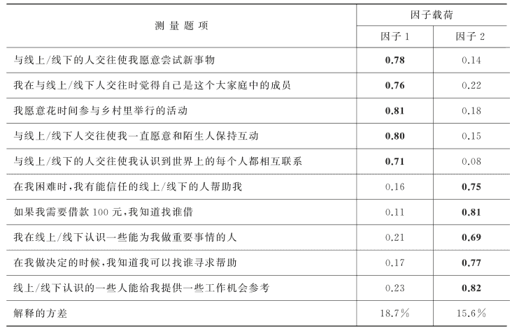

# Research Design and Measurement

## 1) Rural Residents' Social Capital

Based on the magnitude of factor loadings of each item after rotation, we named the two factors **Bridging Social Capital** (Factor 1) and **Bonding Social Capital** (Factor 2), respectively. The Cronbach's α coefficient for rural residents' bridging social capital is 0.71, and that for bonding social capital is 0.75. The KMO value of the factor analysis is 0.84, the significance (sig) value of the test is 0.00, and the factors explain a total of 34.3% of the variance.

## 2) Rural Residents' Social Network Usage Behavior

One of the independent variables in the study is rural residents' social network usage behavior. Drawing on the measurements of social network usage behavior by Li Jiying, Pu Shaola, Luo Yingying et al. [29], Lin Gongcheng, Li Ying, and Chen Jinyun [30], and Wei Lu, Chen Wen [31], and after revision and improvement, a total of 10 items were used for measurement. The items were measured using a 5-point Likert scale (1 = strongly disagree, 5 = strongly agree).

Through exploratory principal component factor analysis of these 10 items, 3 factors were extracted, and the resulting component matrix is shown in Table 2.

**Table 2**　Factor Analysis of Rural Residents' Social Network Usage Behavior

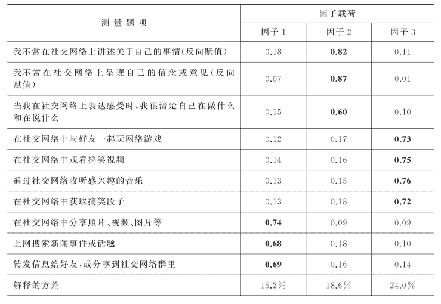

Based on the magnitude of factor loadings of each item after rotation, we named the three factors **Online Information Sharing**, **Online Self-Disclosure**, and **Online Entertainment Activities**, respectively.

- The `Cronbach's α` for Online Information Sharing (Factor 1) is 0.70
- The `Cronbach's α` for Online Self-Disclosure (Factor 2) is 0.74
- The `Cronbach's α` for Online Entertainment Activities (Factor 3) is 0.82

The KMO value of the factor analysis is 0.89, the significance level (P value) of Bartlett's test (`Barlett test`) is 0.00, and the factors explain a total of 57.8% of the variance.

## 3) Rural Residents' Social Network Usage Psychology

The second independent variable is rural residents' social network usage psychology. According to Lu Baozhou, Fan Weiguo et al. [32], a total of 5 items were used for measurement. All measurement items were measured using a 5-point Likert scale (1 = strongly disagree, 5 = strongly agree).

The study conducted exploratory principal component factor analysis on the 5 items, extracting 1 factor, and the resulting component matrix is shown in Table 3.

**Table 3**　Factor Analysis of Rural Residents' Social Network Usage Psychology

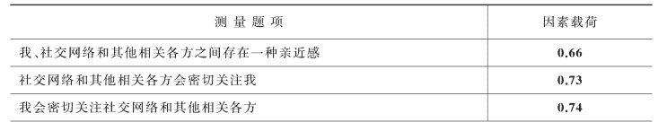

(Continued Table)

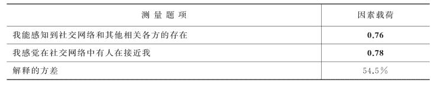

This social network usage psychology was named **Online Social Presence**, with a `Cronbach's α` of 0.79. The KMO value of the factor analysis is 0.82, the significance level (P value) of Bartlett's test is 0.00, and the factor explains a total of 54.5% of the variance.

## 4) Convergent and Discriminant Validity

Confirmatory Factor Analysis (`CFA`) was performed on the collected data using `AMOS 21.0`. As shown in Table 4, the Composite Reliability (`CR`) is higher than 0.7, and the Average Variance Extracted (`AVE`) is greater than 0.5, which further indicates that the scale has good convergent validity. The data in Table 5 show that the square root of the `AVE` for each factor is greater than the corresponding correlation coefficients, indicating good discriminant validity among the variables.

**Table 4**　Results of Confirmatory Factor Analysis

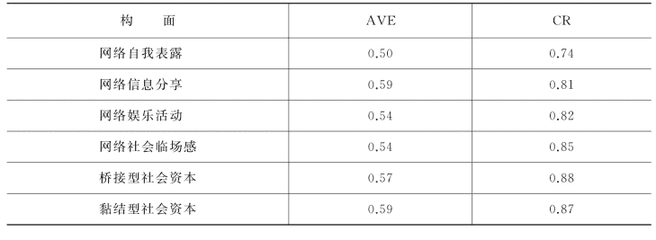

**Table 5**　Discriminant Validity Test

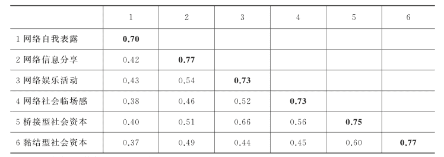

> Note: Numbers on the diagonal are the square roots of `AVE`.

# III. Research Findings

## 1. Current Status of Rural Residents' Social Network Usage Behavior-Psychology

In terms of the performance of rural residents' social network usage behavior, the means of rural residents' Online Self-Disclosure (`M=3.49, SD=0.69`), Online Information Sharing (`M=3.70, SD=0.66`), and Online Entertainment Activities (`M=3.46, SD=0.66`) are all higher than the midpoint of 3. The mean of rural residents' Online Social Presence (`M=3.49, SD=0.64`) is also higher than the midpoint of 3. To further examine the current status of rural residents' social network usage behavior-psychology, the study conducted one-sample `t`-tests on Online Self-Disclosure, Online Information Sharing, Online Entertainment Activities, and Online Social Presence. The test results (see Table 6) show that rural residents' Online Self-Disclosure (`t=25.59, P<0.001`), Online Information Sharing (`t=38.09, P<0.001`), and Online Entertainment Activities (`t=25.02, P<0.001`) are significantly higher than the scale midpoint of 3. At the same time, rural residents' Online Social Presence (`t=27.55, P<0.001`) is also significantly higher than the scale midpoint of 3. This indicates that rural residents have strong Online Self-Disclosure, Online Information Sharing, and Online Entertainment Activities behaviors, and possess a positive Online Social Presence.

**Table 6**　One-Sample `t`-Test

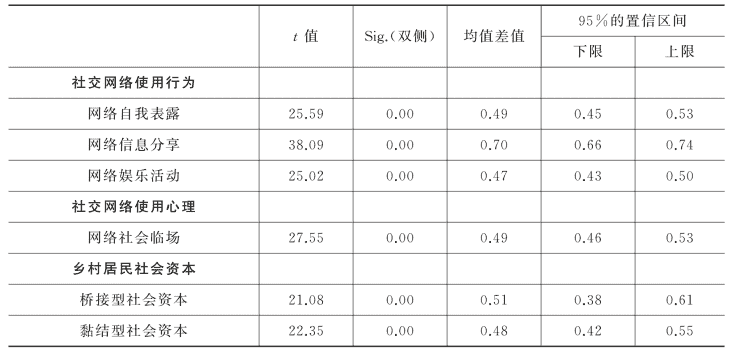

## 2. Current Status of Rural Residents' Social Capital

The means of rural residents' Bridging Social Capital (`M=3.47, SD=0.66`) and Bonding Social Capital (`M=3.71, SD=0.63`) are both higher than 3. Similarly, the one-sample `t`-test also shows (see Table 6) that rural residents' Bridging Social Capital (`t=21.08, P<0.001`) and Bonding Social Capital (`t=22.35, P<0.001`) are both significantly higher than the scale midpoint of 3. This indicates that rural residents possess relatively high levels of Bridging Social Capital and Bonding Social Capital. Comparatively speaking, rural residents' Bridging Social Capital is significantly lower than their Bonding Social Capital, indicating that in daily life, Bonding Social Capital remains the primary capital construction for rural residents.

## 3. Correlation Relationships Among Major Research Variables

Table 5 shows that rural residents' social network usage behaviors (Online Self-Disclosure, Online Information Sharing, and Online Entertainment Activities) all have significant positive correlations with rural residents' social capital (Bridging Social Capital and Bonding Social Capital). Moreover, there are also significant positive correlations between Online Social Presence and rural residents' Bridging Social Capital and Bonding Social Capital. This result provides a basis for answering the research questions.

## 4. Impact of Social Network Usage on Rural Residents' Social Capital

### 1) Initial Model

Through the estimation of the initial model, the output results show that the value of `X²` is 756.32, the `P` value is 0.000, which is less than 0.05, rejecting the null hypothesis. The ratio of the chi-square value to degrees of freedom is 3.21, exceeding the standard of 3. The remaining indices meet the model fit standards, specifically: `RMR` = 0.05, `GFI` = 0.89, `RMSEA` = 0.07, `NFI` = 0.90, `IFI` = 0.91, `CFI` = 0.89, `AGFI` = 0.88. It can be seen that the initial model is not ideal and needs modification. According to the Modification Indices (`MI`), it is necessary to further establish covariance relationships between the errors of variables in the model, thereby reducing the chi-square value and improving the model fit.

### 2) Modified Model and Hypothesis Testing

By establishing 28 pairs of covariance relationships between error variables, the final theoretical model was determined as shown in Figure 1. The model fit is very ideal: `X²=356.14, P=0.15>0.05`; `X²/df` = 1.36; `RMR=0.03`; `GFI=0.95`; `RMSEA=0.03`; `NFI=0.96`; `IFI=0.97`; `CFI=0.98`; `AGFI=0.96`.

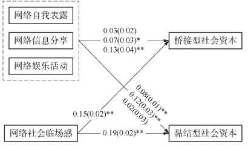

**Figure 1**　Path Coefficient Diagram of the Model

**Impact of Social Network Usage on Rural Residents' Bridging Social Capital.** In terms of social network usage behavior, Online Information Sharing (`β=0.07, P<0.05`) and Online Entertainment Activities (`β=0.13, P<0.01`) can positively and significantly influence rural residents' Bridging Social Capital, while Online Self-Disclosure does not influence Bridging Social Capital. In terms of social network usage psychology, Online Social Presence has a positive and significant impact on rural residents' Bridging Social Capital (`β=0.08, P<0.05`).

**Impact of Social Network Usage on Rural Residents' Bonding Social Capital.** In terms of social network usage behavior, Online Self-Disclosure (`β=0.08, P<0.01`) and Online Information Sharing (`β=0.12, P<0.001`) can positively and significantly influence rural residents' Bonding Social Capital, while Online Entertainment Activities do not produce a significant impact. In terms of social network usage psychology, Online Social Presence can positively and significantly influence rural residents' Bonding Social Capital (`β=0.19, P<0.001`).

Additionally, according to the data displayed in Figure 1, judging from the magnitude of the influence coefficients, Online Social Presence, as a psychological factor of social network usage, has a greater impact on rural residents' social capital than social network usage behavior.

# IV. Conclusion and Discussion

This study conducted a questionnaire survey on rural residents in 35 townships in China. From the perspectives of Social Capital Theory and Social Presence Theory, it analyzed the effects of different social network usage behaviors on rural residents' social capital, as well as the effect of social network usage psychology on rural residents' social capital, drawing the following four conclusions:

**First, Online Self-Disclosure can facilitate the construction of rural residents' Bonding Social Capital, but has no impact on Bridging Social Capital.** Online Self-Disclosure is a type of outward presentation behavior in individuals' media use, a behavioral process of presenting some information about the self to others [33]. For rural residents, their self-disclosure behaviors basically occur in highly social media such as WeChat and QQ, and in the use of such media, they basically only maintain interactions with strong-tie individuals. On the one hand, self-disclosure through social networks can better promote relationships between rural residents and friends, increase the intimacy of interactions, and facilitate access to emotional support. On the other hand, Online Self-Disclosure aids self-presentation, allowing family and friends to better understand the individual, enhancing mutual trust, and facilitating access to substantive support. Therefore, Online Self-Disclosure behavior is significant for rural residents' construction of strong-tie social capital, but has no significant enhancement for weak-tie social capital characterized by higher heterogeneity, broader and shallower interactions.

**Second, Online Information Sharing behavior contributes to the construction of both Bonding Social Capital and Bridging Social Capital for rural residents.** Rural residents often share information they have acquired, and such sharing occurs both in familiar relational networks and in circles of weak-tie interactions with higher heterogeneity. As a manifestation of individual self-worth and ability, when rural residents choose to share information, they hope the information can help others in need or play a role in dissemination and even warning. This behavior itself carries an emotional tendency, reflecting the spirit of altruism. Behind this altruistic behavior, there also exists a psychology of highlighting self-worth and ability, hoping to gain recognition and interaction possibilities through such information sharing behavior. Furthermore, Online Information Sharing is not a behavior fixedly performed by a single individual, but rather a behavior where gathered individuals all selflessly share their acquired information. This information sharing behavior can also bring about an awareness of individual capital conversion and feedback. Therefore, Online Information Sharing behavior not only helps strengthen Bonding Social Capital but also has a positive enhancing effect on weak-tie social capital.

**Third, Online Entertainment Activities can bring Bridging Social Capital to rural residents, but have no impact on Bonding Social Capital.** In the traditional media era, rural residents could gather to watch TV, and this entertainment behavior could 聚合 fellow villagers and neighbors to share entertainment and joy. In today's rural society, almost every villager owns a smartphone, facilitating their pursuit of personalized entertainment needs, making online entertainment behavior increasingly privatized. Online Entertainment Activities focus on individual physical and mental relaxation and killing time; such behavior rarely touches upon others' emotional support or substantive help for the individual, making it difficult to influence the construction of Bonding Social Capital. However, for rural residents, Online Entertainment Activities can help enhance Bridging Social Capital. This is because when rural residents engage in online gaming, they often come into contact with weak ties characterized by higher heterogeneity, broader and shallower interactions. Through the continuous reinforcement of such entertainment behaviors, weak ties gradually detach from the gaming community and enter the rural residents' high-context social networks, forming relatively fixed and lasting entertainment partnership relationships.

**Fourth, high Online Social Presence can lead to the enhancement of both Bonding and Bridging Social Capital for rural residents.** Chinese rural residents can perceive the "real" existence of others online through social networks, and can also perceive the authenticity and importance of events or information in the social networks established by fellow villagers. This perception makes them feel "empathy" or sympathy and empathy, prompting them to become actors, thereby generating norms of reciprocity. Robert D. Putnam mentioned that norms of reciprocity are a highly productive form of social capital [34]. When an individual performs a behavior, it may be short-term altruism, but in the long run, these behaviors may benefit the participants [35]. The Social Presence perceived by rural residents in social networks can narrow the distance between them and others, and can also allow those with the same identity attribution (such as ethnic minorities or religious believers) to combine short-term altruism with long-term egoism, strengthening interpersonal trust, thereby helping to continuously increase the total amount of Bonding Social Capital.

Additionally, it is worth noting that as a psychological factor of social network usage, Online Social Presence plays a greater positive role in rural residents' social capital than social network usage behavior. This also indicates that while we pay attention to the technological determinism of behavior brought by technology, we should pay more attention to the greater impact brought by the socio-psychological factors of social network usage on rural residents.

This study examined the effects of social network usage behavior and social network usage psychology on rural residents' social capital. Factors such as social network usage motivation, usage time, and online interaction investment are also important factors influencing rural residents' social capital, which need further exploration. In addition, this study examined two realistic dimensions of rural residents' social capital, but failed to reveal the online social capital of rural residents. These limitations are also directions worthy of continued discussion in the future.

# References

[1] Wang Chuanjuan. The Absence and Reconstruction of Peasants' Social Capital[J]. Zhongzhou Academic Journal, 2015(4): 83-86.

[2] Niu Yaohong. Presence and Mutual Training: WeChat Groups and Maintenance of Rural Order — Based on an Investigation of a Western Village[J]. Journalism, 2017(08): 6-13.

[3] Ma Zhihao, Wu Mei. The Rural in Phone Calls and the Urban in Mobile Network Communication: A Grassroots Picture of Mobile Communication and Social Capital[J]. Journalism University, 2018(1): 100-110.

[4] Bourdieu P. The Forms of Capital[M]//Richardson J. Handbook of Theory and Research for the Sociology of Education Westport. Connecticut, USA: Green wood Press, 1986: 241-258.

[5] Xu Yu. Online Relational Networks and Social Capital Acquisition in Sina Weibo: Taking the Online Linkage Relational Network of Domestic Journalism Academic Community as an Example[J]. Journalism University, 2014(4): 127-135.

[6] Zhong Zhijin. The Impact of Internet on College Students' Online Social Capital and Real-life Social Capital[J]. Journalism University, 2015(3): 30-36.

[7] Vergeer M, Pelzer B. Consequences of media and Internet use for offline and online network capital and well-being. A causal model approach[J]. Journal of Computer-Mediated Communication, 2010, 15(1): 189-210.

[8] Granovetter M. The Strength of Weak Ties[J]. American Journal of Sociology, 1973, 78(6): 1360-1380.

[9] Short J, Williams E, Christie B. The social psychology of telecommunications[M]. London, UK: John Wiley and Sons, 1976.

[10] DeSchryver M, Mishra P, Koehleer M, et al. Moodle vs. Facebook: does using Facebook for discussions in an online course enhance perceived social presence and student interaction?[C]//Gibson I, Weber R, McFerrin K, et al. Proceedings of the Society for Information Technology & Teacher Education International Conference Mar 02, 2009, Association for the Advancement of Computing in Education, Charleston, SC, USA, C2009: 329-336.

[11] Lv Hongbing. Research on the Relationship between Social Presence and Stickiness Intention of B2C Online Stores[M]. Beijing: Guangming Daily Press, 2013: 47.

[12] Tong Qingyan, Chi Jinbao. Research on Influencing Factors of Social Presence in WeChat Real-time Communication — Taking Shanghai Jiao Tong University Students' WeChat Use as an Example[J]. Journal of Shanghai Jiao Tong University (Philosophy and Social Sciences), 2016, 24(2): 68-76.

[13] Biocca F, Harms C, Burgoon J K. Toward a More Robust Theory and Measure of Social Presence: Review and Suggested Criteria[J]. Presence: Teleoperators and Virtual Environments, 2003, 12(5): 456-480.

[14] Shen K N, Khalifa M. Exploring Multidimensional Conceptualization of Social Presence in the Context of Online Communities[J]. International Conference on Human-computer Interaction, 2008, 24(7): 722-748.

[15] Heeter C. Being There: The Subjective Experience of Presence[J]. Presence: Teleoperators and Virtual Environments, 1992, 1(2): 262-271.

[16] Robinson L, Behi O, Corcoran A, et al. Evaluation of Whatsapp for promoting social presence in a first year undergraduate radiography problem-based learning group[J]. Journal of Medical Imaging and Radiation Sciences, 2015, 46(3): 280-286.

[17] Gao W, Liu Z, Li J. How does social presence influence SNS addiction? A belongingness theory perspective[J]. Computers in Human Behavior, 2017(77): 347-355.

[18] Zhao Shuguang. The Effects of Social Media Use: A Social Capital Perspective[J]. International Journalism, 2014, 36(7): 146-159.

[19] Williams B N, Williams S M. Perceptions of African American Male Junior Faculty on Promotion and Tenure: Implications for Community Building and Social Capital[J]. Teachers College Record, 2006, 108(2): 287-315.

# Empirical Study on Factors Influencing Agricultural Technicians' Media Use Ability

## Authors
Wu Zhiyuan, Yu Sijie

## Abstract
In the era of mass media, research on agricultural innovation diffusion did not pay particular attention to the role of media and media use ability. However, in the Internet era, social media has brought a breakthrough to agricultural innovation diffusion, especially in improving the efficiency of agricultural technology extension. This study conducted a questionnaire survey of 951 grassroots agricultural technology extension personnel in Hubei and used `SPSS 22` for statistical analysis. The results show that social media, including QQ and WeChat, is becoming an important tool for agricultural technology extension. However, the media use ability of grassroots agricultural technology extension personnel is not optimistic. This study found that stimulating agricultural technicians' perceived demand for advanced agricultural technology, increasing organizational emphasis, increasing agricultural technicians' media contact intensity, and enhancing their cultural capital and social capital all help improve their media use ability. This study contributes to the relatively weak research link in the traditional field of agricultural innovation diffusion—research on media roles. It also provides new ideas for improving the key qualities of grassroots agricultural technology extension personnel.

## Keywords
Agricultural innovation diffusion, Media contact, Media use ability

## I. Research Origin

Rogers' Diffusion of Innovations theory originated from the study of mass media effects and eventually became a classic theory in the study of mass communication effects[¹]. Therefore, since its inception, the theory of innovation diffusion has been closely linked with media technology.

Rogers proved the role of mass media in the "knowledge" stage of innovation diffusion[²]177. Zhu Jianhua, He Zhou, and others believe that in promoting innovation diffusion, the combination of mass media and interpersonal communication achieves good results. Both mass media and interpersonal communication function in innovation diffusion by helping potential adopters form or change their subjective perceptions of innovation attributes[³].

Of course, in the era dominated by mass media, media variables in innovation diffusion research struggled to become a focus. This is mainly because in the mass media era, mass media was highly monopolized by capital and interest groups[⁴], and the general public, including agricultural technology extension personnel, could not control mass media tools and found it difficult to actively use mass media. As Rogers stated, in innovation diffusion, mass media is only a window for opinion leaders to access external new knowledge[²]323. Researchers were also unable to measure the specific magnitude of the role played by mass media in agricultural innovation diffusion.

In the Internet and social media era, this situation is being broken: due to the rapid popularization of the Internet, the degree of social media diffusion exceeds that of all other media that have existed in history. The influence of social media is ubiquitous, with its tentacles extending even to the most remote corners of rural areas[⁵].

The rapid popularization of social media means individuals' mastery of media tools, granting them increasing initiative. Relying on social media, individuals can have more opportunities for participation and communication; engage in dialogue and interaction with more people; share knowledge with more people; have more opportunities to publicly express their views and ideas; participate in or form communities and groups with shared interests; and connect with more strangers, groups, and originally unknown worlds through social media[⁶]. Obviously, these capabilities endowed to individuals by social media are highly beneficial for grassroots agricultural technology extension personnel to improve their working conditions.

The evolution of media has also stimulated researchers' interest. They follow the evolution of media technology and forms to further study the role of media in innovation diffusion. Research finds that with the evolution of media technology, the role played by media in innovation diffusion becomes increasingly stronger, and its status increasingly prominent[⁷].

From these studies, it is not difficult to conclude that the more media technologies agricultural technology extension personnel master, the stronger their media use ability, the more significant their achievements in promoting agricultural innovation diffusion.

Therefore, this study will further explore the following two questions: What is the current status of agricultural technology extension personnel's media use ability? What factors influence their media use ability? Obviously, clarifying these issues is highly beneficial for taking targeted measures in the next step to improve the working ability of agricultural technology extension personnel.

Media use ability, as an important outcome variable in this study, is defined based on Potter's theory of media literacy. James Potter believes that media use ability, as an important connotation of modern media literacy, has become a manifestation of individual modernity. Media use ability can be reflected in gaining control over the process of media influence, including both the ability to master media technology and the ability to process media information or content[⁸]329.

Based on an instrumental perspective, this study operationalizes the definition of media use ability as the ability to master media technology. The other layer of meaning of media use ability—"the ability to process media information and content"—is not the object of investigation for the time being. Other theoretical foundations involved in this study include Rogers' Diffusion of Innovations theory and Bourdieu's social capital theory.

To deeply investigate agricultural technicians' media use ability, from over 100 counties and cities in Hubei, a stratified, then random, then cluster sampling method was adopted to select 200 townships in 12 counties and cities as samples. Using the questionnaire survey method, 951 agricultural technicians were visited to understand their media contact situations, individual capital endowments, and relevant demographic variables. Meanwhile, `SPSS` statistical software was used to process the collected data.

Through quantitative analysis, this study identified the main factors influencing agricultural technology extension personnel's media use ability, including: degree of contact with media, scale of individual social capital, and degree of craving for advanced agricultural technology.

## II. Theoretical Preparation

### 1. Innovation Diffusion Is Inseparable from Media Roles

"The essence of innovation diffusion is the interactive social process of people's subjective evaluation of new things."[²]IX As the proposer and tireless optimizer of the theory of innovation diffusion, Rogers believes that the theory of innovation diffusion can explain the most important development process of human beings—social change.

From Rogers' interpretation of the essence of innovation diffusion, several key concepts can be grasped: "new things," "subjective evaluation," and "interaction." Grasping these keywords allows innovation diffusion to be viewed as a "process of information dissemination and communication about new things." In Rogers' own words, "Diffusion is a kind of communication, except that the content transmitted is about innovation."[²]13 The key to diffusion is that one user shares information with other users, which requires the use of communication channels.

Therefore, in Rogers' innovation diffusion model, there are four main elements: "innovation," "communication channels," "time," and "social system"[²]13. Rogers counted that in all diffusion research results, research on communication channels accounted for 7%[²]98. Rogers defines communication channels as: "the means and methods by which information is transmitted from one party to another."[²]20

Furthermore, Rogers believes: "Mass communication is the most effective channel for transmitting innovation information." The mass communication channels he refers to include radio, television, and newspapers. He cites Paul Lazarsfeld's research results, saying, "Innovative ideas often flow from radio and print media to opinion leaders, and then from opinion leaders to those groups less active toward innovation"[²,9]. Later, Wilbur Schramm further elaborated on the views of Rogers, Lazarsfeld, and others in *Men, Messages and Media: A Look at Human Communication*, saying that in innovation diffusion, the influence of mass media is greater in the early stages of diffusion[¹⁰].

The above background helps explain why media should be focused on in innovation diffusion research. Because the innovation diffusion process cannot do without communication channels. And media is a more effective communication channel than interpersonal communication and other channels.

Of course, Lazarsfeld, Rogers, Schramm, and others did not live to deeply experience the power of the Internet and new media, especially the role of social media in communication. Otherwise, they would certainly have new understandings of the role of media tools in innovation diffusion. However, systematic research on the effects of new media technologies often begins only after the technology has been accepted by the public to a considerable degree[¹¹]211. It can be expected that the social media era provides new opportunities for research in the field of innovation diffusion.

From the above, it can be seen that focusing on the role of media is a traditional perspective in innovation diffusion research.

The second reason for focusing on media roles in agricultural innovation diffusion is determined by the media's own functions.

McLuhan believes, "It is the medium, not the message, that determines changes in human behavior"[¹¹]226. McLuhan believes that contrary to common understanding, media is not only a carrier of knowledge and content, but also has a strong reaction on knowledge and content. Media has positivity and agency; it determines the structural mode and clarity of information, thus having a significant impact on information[¹²]15. That is to say, the media itself also influences and shapes people's behavioral patterns. The impact of media on innovation diffusion is not limited to this; it also has a strong impact on the perception of innovation diffusion recipients. Different media act on different senses; print media affects vision, audio-visual media affects touch[¹²]15.

Regarding the role of media, Charles Sterin further summarizes: The technological progress of mass media allowed humans in the early 21st century to discover themselves and brought about human evolution; people acquired the ability to effectively process the ever-increasing large amount of information simultaneously. Sterin also believes that with the development and progress of technology, the structure and values of society and culture will inevitably change. The emergence of each new medium creates new ways of social life and social behavior; media is the basic driving force of social development and also the hallmark distinguishing different social forms[¹³]6. US research believes that media has a significant degree of influence in maintaining existing values, promoting the formation of new concepts, and changing original values[¹⁴]. Entering the network media era, new media forms emerge endlessly. Nicholas Negroponte even asserted in his book *Being Digital* that in the digital media era, media is no longer information. Media will become a way of life, and this is true for everyone[¹⁵].

According to the perspective of technological determinism, it can be deduced that the role of media in innovation diffusion will include two aspects: one is transmitting innovation information and knowledge; the other is playing a reverse role on innovation information and knowledge.

The third reason for focusing on media roles in agricultural innovation diffusion comes from research on the effects produced by media use.

James Potter's research shows that media tools can produce immediate effects and long-term effects on individuals and organizations. Immediate effects include cognitive effects, attitudinal effects, emotional effects, physiological effects, and behavioral effects. Among them, cognitive effects contain short-term learning, reinforcement learning, and expansive learning; attitudinal effects contain shaping views, changing views, contrast effects, inoculation, and immediate reinforcement; emotional effects contain immediate reactions and mood management; behavioral effects contain attraction, imitation, and activation. Long-term effects include mastering learning agendas, enhancing memory, inducing the essence of phenomena, exposing secrets of social operation, maintaining attention and interest, and changing cognitive behaviors[⁸]354. Obviously, Potter's analysis helps further understand the value of media in innovation diffusion.

Not only that, according to the Uses and Gratifications theory, regarding specific media, different (or similar) media can satisfy different (or similar) needs. Elihu Katz, Jay Blumler, Michael Gurevitch, and others, in their famous 1974 paper "Utilization of Mass Communication by the Individual," pointed out that different media have different technical characteristics and information functions. For example, books and newspapers are related to self-realization and self-satisfaction; they help individuals "connect with self"; at the same time, newspapers, radio, and television help people connect with society and others[¹⁶]. Obviously, the emergence of the Internet and social media not only possesses all the above functions of traditional media but also opens up infinite possibilities.

The fourth reason for focusing on media roles in agricultural innovation diffusion comes from the reality of rural socio-economic development. As mentioned earlier, in essence, innovation diffusion is the process of knowledge diffusion aided by media. In agricultural innovation diffusion practice, media is both the carrier of content and an important environmental factor for diffusion and dissemination. This has been fully reflected in the innovation diffusion practices of various countries. For example, in South Korea's "One Village, One Community" movement, newspapers successfully mobilized all sectors to pay attention to rural areas and undertook the important role of urban-rural communication channels. Radio played an important role in providing market information, weather forecasts, new crop varieties, cultivation techniques, and eliminating loneliness and isolation for the US agricultural population. In Japan's "One Village, One Product" movement, radio, television, and newspapers played a resonance effect, jointly promoting the "One Village, One Product" movement[¹⁷].

Based on the above analysis, in the study of the agricultural innovation diffusion process, focusing on the use of media tools and their effects has become a matter of course.

Hence, the first question raised in this study is: In agricultural innovation diffusion, which media are the most commonly used or most valued by agricultural technology extension personnel?

### 2. The Importance of Media Use Ability Is Increasingly Prominent

The previous discussion elaborated on the increasing importance of media roles in agricultural innovation diffusion. Of course, the exertion of media roles relies on people to complete. Different individuals using media will obviously have different effects, because individuals' media use abilities differ.

The "Process School" believes that communication is the transmission of information, requiring high attention to the effect and correctness of communication. And this effect and correctness stem from how the sender and receiver encode and decode, and how the information transmitter uses the media[¹⁸]. In other words, the effect of communication is related to the level of media use ability of both communication parties. Therefore, this study takes media use ability as a key outcome variable for investigation.

So-called media use ability is a sub-concept contained in the concept of media literacy. James Potter defines media literacy as "a perspective that we actively use to expose ourselves to media and interpret the meaning of the messages we encounter." Potter regards individuals' goals and motivations, individuals' skills, and individuals' knowledge structures as the three cornerstones of media literacy. The relationship among the three is that the skills mastered by individuals are tools, and information from media and the real world are raw materials. Tools and raw materials are used to construct our knowledge structures[⁸]13-19. The media skills mentioned by Potter are similar to the media use ability mentioned in this study.

It should be seen that in Potter's era, media types were relatively limited. Therefore, his understanding of media use ability stopped at the analysis, evaluation, classification, induction, deduction, extraction, and synthesis of media content. In fact, the development of media technology exceeds ordinary people's imagination. The evolution of Internet technology over the past 20 years and the constantly emerging new media forms have been dazzling. For a person to simultaneously master multiple media proficiently is by no means an easy task. Therefore, media use ability should also include the mastery of different media technologies.

Combined with Marshall McLuhan's view, the medium is the message itself; what media brings to people is not only information and knowledge, but media technology itself also determines people's thinking patterns. It can be said that the rise of the Internet and social media, and the changes they bring to people's thinking patterns, the rise of Internet thinking, again verified the correctness of McLuhan's view. In this sense, every additional media technology an individual masters adds a thinking pattern.

Therefore, the mastery of media use technology should also be a focus of media use ability investigation. Obviously, the more types of media a person can skillfully use, the stronger their media use ability, meaning they have more choices and freedom in the information age.

For a long time, rural areas have been relatively closed in terms of information, with narrow information channels. Other channels, such as libraries and other infrastructure, various industry exchange meetings, are difficult to expand in a short time. The popularization of the Internet and the emergence of various new media make media use ability appear especially important. For agricultural technicians, this is even more so.

## References

[20] Lee J, Lee H. The computer-mediated communication network: exploring the linkage between the online community and social capital[J]. New Media & Society, 2010(5): 711-727.

[21] Xie W. Social network site use, mobile personal talk and social capital among teenagers[J]. Computers in Human Behavior, 2014(41): 228-235.

[22] Wellman B, Haase A Q, Witte J, et al. Does the Internet increase, decrease, or supplement social capital? Social networks, participation, and community commitment[J]. American Behavioral Scientist, 2001, 45(3): 436-455.

[23] Wang Lingning. The impact of WeChat usage behavior on individual social capital[J]. Journal of Journalism University, 2015(6): 114-119.

[24] Ge Hongning, Zhou Zongkui, Niu Gengfeng. Can social network site use bring social capital?[J]. Advances in Psychological Science, 2016, 24(3): 454-463.

[25] Zhou Yijin, Wei Jiachun. "Like" or "Comment"? The impact of social media usage behavior on personal social capital—an exploratory study based on WeChat Moments usage behavior[J]. Journal of Journalism University, 2016(1): 68-75.

[26] Nie N, Erbring L. Internet and society: A preliminary report[J]. IT & Society, 2002, 1(1): 275-283.

[27] Zeng Fanbin. Research on the relationship between Internet usage patterns and social capital—also analyzing the role of Internet communication ability in between[J]. Journal of Hunan Normal University (Social Sciences), 2014, 43(4): 152-160.

[28] Ellison N B, Steinfield C, Lampe C. The Benefits of Facebook "Friends:" Social Capital and College Students' Use of Online Social Network Sites[J]. Journal of Computer-mediated Communication, 2010, 12(4): 1143-1168.

[29] Lee J Y, Park S, Na E-Y, Kim E. A comparative study on the relationship between social networking site use and social capital among Australian and Korean youth[J]. Journal of Youth Studies, 2016, 19(9): 1164-1183.

[30] Lin Gongcheng, Li Ying, Chen Jinyun. College students' social anxiety, self-disclosure and online interaction—a path analysis of Weibo social behavior[J]. Youth Studies, 2016(4): 29-39.

[31] Wei Lu, Chen Wen. Research on urban new migrants' social media use and subjective well-being[J]. International Journal of Journalism, 2015, 37(1): 114-130.

[32] Lu B, Fan W, Zhou M. Social presence, trust, and social commerce purchase intention: An empirical research[J]. Computers in Human Behavior, 2016(56): 225-237.

[33] Shen Qi. Research on self-disclosure and social network privacy protection behavior—taking Shanghai college students' WeChat mobile social application (APP) as an example[J]. Journal of Journalism and Communication, 2015(4): 5-17.

[34] Putnam. Making Democracy Work: Civic Traditions in Modern Italy[M]. Wang Lie, Lai Hairong, trans. Beijing: China Renmin University Press, 2017: 201.

[35] Hu Difei. The structure and measurement of rural social capital—an empirical study of Putnam's social capital theory[J]. Journal of Wuhan University (Philosophy & Social Sciences), 2011(4): 62-68.

## Author Introductions
Jin Hengjiang, Lecturer, School of Journalism, Chongqing University; Liu Yuanyuan, 2019 PhD candidate, School of Media and Communication, Shanghai Jiao Tong University; Zhang Guoliang, Professor, School of Media and Communication, Shanghai Jiao Tong University.

## Notes

[¹]: Liu Xiu, et al. Rural Revitalization: Holding the Rice Bowl Firmly in Our Own Hands (Time of the 19th National Congress)[EB/OL]. (2017-10-22)[2019-07-22]. http://politics.people.com.cn/n1/2017/1022/c1001-29601012.html.

[²]: Lin Yong. People's Daily People's Forum: Let Capital Go to the Countryside and Bear Fruit of Rural Revitalization[EB/OL]. (2018-11-14)[2019-07-22]. http://opinion.people.com.cn/n1/2018/1114/c1003-30398873.html.

[³]: Data source: 2016 China Rural Netizen Scale and Development Trend Forecast, http://www.chyxx.com/industry/201609/451382.html.

First, the importance of media use ability for agricultural technicians is determined by the role of media in the diffusion of innovations. The previous text has fully demonstrated the importance of media in the diffusion of innovations. Media, as a communication tool, is mastered by people. For the role of media to be fully exerted, users need to have strong control and use abilities over the media.

In China's agricultural innovation diffusion practice, agricultural technicians play an important role; they are agents and promoters of advanced agricultural technologies, and their job is to persuade farmers to adopt these advanced agricultural technologies. Lazarsfeld believed that: the persuasion process is influenced by the channels of message transmission; different media produce different effects; mastering diverse media is both necessary and important [9]19. Rogers' research shows that media, especially mass media, have a relatively large impact on those who are earlier in innovation awareness; they are attracted and encouraged by mass media to begin trying innovations. After their success, they attract more people to adopt the innovation [2]323. Elihu Katz, a scholar of applied sociology at Columbia University, believed that an individual's adoption behavior regarding technology is influenced by the interaction between media and their environment and individual characteristics [19].

Furthermore, many domestic studies on agricultural innovation diffusion have also begun to emphasize the importance of agricultural technicians' media use ability. Liu Jizhong et al. believe that the work of agricultural technicians aims to disseminate various agricultural science and technology information, persuade and change farmers' production and lifestyle; any form of communication or media conducive to this purpose should be learned and used, including oral, textual, graphic, and video forms [20]. Dong Chengshuang et al. believe that agricultural extension personnel should be able to comfortably adapt to the development of media technology and skillfully use high-tech communication means such as blogs, emails, and instant messaging to better conduct agricultural technology dissemination [21]. Xiao Luren believes that opinion leaders in the field of agricultural technology extension, including agricultural technicians and sci-tech demonstration households, should be very adept at using media to acquire agricultural technology information and conduct demonstration and promotion [22].

Further research has also found that if agricultural technicians' media use ability is too weak, it will create obstacles for agricultural technology extension. Jiang Jianke said that if the extension of new agricultural technologies relies solely on the interpersonal communication of agricultural technicians while neglecting the use of media, it will lead to slow extension speed, limited extension scope, and a longer extension cycle. Conversely, the correct use of media tools helps improve extension efficiency [23]. Dong Chengshuang also believes that China's agricultural extension has long relied on interpersonal communication as the main means; due to the insufficient number of extension personnel, uneven levels, and lack of timely mastery of advanced information technology, the dissemination effect of advanced agricultural technologies is not ideal [21].

Second, the development of information technology has significantly raised the requirements for individual media literacy, making individual media use ability increasingly important, especially for personnel engaged in innovation and technology promotion.

So-called "media literacy" refers to the knowledge, skills, and abilities required to use and interpret media information [24]. Renee Hobbs proposed that the connotation of media literacy should be a series of processes ranging from the ability to independently use media, to critical thinking and analysis, to utilizing media to participate in creation [25].

However, past research on media literacy did not pay particular attention to the ability to use media technology. In the heyday of mass media, media literacy research focused more on the audience's ability to receive, identify, process, and feedback media information. It emphasized the negative effects brought by media information, stressing that the public should not blindly follow various media information [8]12. This emphasis on the individual's processing of media information while neglecting the individual's control over media technology itself is also because, in the mass media era, the development of media technology cannot be compared with the rapid changes of today's internet era. As Peng Lan stated when studying the changes in the connotation of media literacy in the network media era, mass media had almost no usage threshold besides text reading ability, but new media requires users to have certain technical abilities, and the requirements are not low. Especially various social media, users must master relevant operating methods. She believes that with the change of media ecology, media forms are becoming more numerous and complex, and media use ability has become a key object of focus in media literacy research [26].

With the development of internet media, the media ecology environment has undergone tremendous changes; the influence of traditional mass media has gradually faded, and new media including social media play an increasingly significant role in people's information lives. The boundary between communicators and audiences is increasingly blurred, and new media technology gives the public unprecedented empowerment. This situation has caused the focus of media literacy research to gradually shift to the rich and colorful media technologies themselves. Being able to master various advanced media technologies has also become an important manifestation of individual modernity. As Schramm presciently warned, an important trend in the information revolution era is that individuals' media use abilities need to be improved [10]289.

Further, some researchers believe that in the new media era, the ability to use Weibo and WeChat is an indicator of the improvement of media literacy, and better reflects the public's media literacy in adapting to technological development [27]. Other researchers believe that the use of media and participation in communication activities should become the core part, and the most important part, of media literacy assessment. For example, research on farmers' media literacy should examine whether rural audiences have mastered the use of media to gather information and whether they can release information through media [28].

Therefore, the second question this study focuses on is: What is the media use ability of agricultural technicians?

## 3. The Impact of Media Exposure on Media Use Ability

Since media use ability is so important for agricultural technicians, what factors influence their media use ability?

Regarding media use skills, Potter said: "Skills are tools that people cultivate through practice. They are like muscles; the more you exercise them, the stronger they become. Without training, skills atrophy." [8]15. In other words, the more media is used, the stronger the media use ability. Lazarsfeld also found in his study of American voters that voters with a high degree of exposure to one medium also had a higher degree of exposure to other media than others. This shows that the intensity of media exposure has a direct impact on media use ability.

Media exposure is an important concept in media literacy theory. The connotation of media exposure includes media ownership rate, media exposure time, exposure motivation, media exposure content, etc. [29].

First, media exposure time or media exposure frequency is an important observation variable in media exposure research [30-31]. This is not only the method used in studying traditional media use but is also widely applied in measuring the intensity of use of new media such as social media and websites. Second, besides time and frequency, the connotation of media exposure intensity should also include media ownership rate, etc. [32-33]. Surveys show that the types of media agricultural technicians are exposed to mainly include television, radio, newspapers, magazines, mobile text messages, and online media [34-36]. There is also research indicating that audience classification based on media ownership and use, compared with other classification methods based on demographic characteristics, has better predictive value in aspects such as internet participation and social media use [37].

Synthesizing the above views, this study proposes to use media use time or frequency, media ownership status, especially electronic information receiving devices, as important indicators for measuring media exposure intensity, and puts forward the following hypotheses.

- Hypothesis 1a: The frequency of newspaper reading by agricultural technicians is positively correlated with media use ability;
- Hypothesis 1b: The frequency of magazine reading by agricultural technicians is positively correlated with media use ability;
- Hypothesis 1c: The average daily TV viewing duration of agricultural technicians is positively correlated with media use ability;
- Hypothesis 1d: The average daily radio listening duration of agricultural technicians is positively correlated with media use ability;
- Hypothesis 1e: The average daily internet usage duration of agricultural technicians is positively correlated with media use ability;
- Hypothesis 1f: The years of social media use by agricultural technicians is positively correlated with media use ability;
- Hypothesis 1g: The ownership of electronic devices by agricultural technicians is positively correlated with media use ability.

## 4. The Impact of Individual Capital Endowment on Media Use Ability

Besides media exposure affecting media use ability, research shows that individual capital endowment also affects media use ability.

The connotation of individual capital endowment includes economic capital, social capital, and cultural capital. Among them, economic capital is symbolized by money, social capital is symbolized by social network scale, personal prestige, etc., while cultural capital is symbolized by education level, etc. [38]. In his research, Bourdieu found that the academic achievements of children from different classes correspond to their family's cultural capital or other types of capital. Children with more family cultural capital are more likely to achieve academic success. Bourdieu also examined the influence of cultural capital, etc., on the entire social structure and drew similar conclusions.

Existing research has proven that an individual's capital endowment has a very important impact on basic qualities that require cultivation, such as learning ability and career development potential. Similarly, media literacy, as a quality modern people need to cultivate, according to Bourdieu's view, would also be influenced by individual capital endowment.

From the concept of media literacy, media literacy "is a perspective that we actively use to engage with media, to interpret the meaning of the messages we encounter." [8]21 Potter also believes that individuals with higher media literacy will have clearer vision and be able to distinguish the boundaries between the real world and the world shaped by media. Individuals with lower media literacy have a poorer and more limited perspective on media. This means their knowledge structures are more superficial and lack organization [8]3. McLuhan believed that media has become the main carrier of information in people's daily lives, and the acquisition, identification, interpretation, and use of media information have become essential literacy for people in modern society [12]16.

Some studies have directly proven the impact of economic capital and cultural capital possessed by individuals on media literacy and media use ability. Duan Jingsu's research shows that different social strata have significant differences in their control and use of media. The dominant stratum possesses control over media, leads media development trends, and influences social public opinion orientation; the middle stratum possesses the conditions and abilities to use media, actively approaches and utilizes media, and is good at using media to satisfy their needs; while the disadvantaged stratum lacks the basic conditions and abilities to use media [39]. Wu Tingting found that differences in economic, cultural, and technological levels create large gaps between urban and rural residents in accessing advanced communication technologies, in media use patterns, and in the quantity and quality of information obtained through media [40]. From Bourdieu's perspective, economic capital symbolized by family income has a significant impact on media literacy, and cultural capital symbolized by education level and professional ability, such as years engaged in the profession, also has a significant impact on media literacy [33]41.

As for the impact of social capital on media literacy, there is even more research involved. Social construction theory believes that for a certain technology or innovation, different social groups have full reasons to give different answers based on their different understandings and requirements. This implies that an individual's social capital, such as the social networks they contact, has different impacts on the individual's media use ability [41]. Research has found that whether an individual adopts media such as mobile phones and their usage methods are significantly related to their social capital, such as relationship maintenance types [42]. After studying how the social capital of German Facebook users affects their social media use, Sabine Trepte et al. found that the more social capital users gain through social media, the higher their frequency of social media use [43].

According to social capital theory, indicators commonly used to measure social capital include social network scale, social network density, and social network homogeneity [44-46].

Based on the above literature, this study proposes the following hypotheses.

- Hypothesis 2: Agricultural technicians' economic capital is positively correlated with media use ability;
- Hypothesis 3a: Agricultural technicians' education level is positively correlated with media use ability;
- Hypothesis 3b: Agricultural technicians' years of agricultural technical work is positively correlated with media use ability;
- Hypothesis 4a: Agricultural technicians' social network scale is positively correlated with media use ability;
- Hypothesis 4b: Agricultural technicians' social network homogeneity is positively correlated with media use ability;
- Hypothesis 4c: Agricultural technicians' social network density is positively correlated with media use ability.

## 5. The Impact of Individual Perceived Need Urgency on Media Use Ability

The impact of individual needs on media use is a tradition in media research. Whether it is research on newspaper needs, radio needs, or television needs, all indicate that the urgency of individual needs has a significant impact on individual media use. Here, media use includes media exposure frequency and media use types [47].

The above research is based on the Uses and Gratifications Theory. It can be inferred that differences in the urgency of agricultural technicians' information needs will determine their media use patterns and will also affect their media use ability. Based on this, this study proposes a hypothesis.

- Hypothesis 5: The urgency of agricultural technicians' information needs is positively correlated with media use ability.

In the research by Zhang Zhian et al., it was found that individuals from different regions have significant differences in media use [48]. Based on this, this study proposes a hypothesis.

- Hypothesis 6: The level of agricultural technology extension performance in the county/city where the agricultural technician belongs is significantly correlated with media use ability.

Demographic variables such as "gender" also affect media use ability and therefore need to be specially controlled [33]41.

# III. Research Design

## 1. Sample Selection

Hubei is a major province for agricultural science and education, possessing strong typical significance. In 2014, Hubei, with only 3% of the country's cultivated land area, produced 4.26% of the nation's grain, 5.84% of cotton, 9.72% of oil crops, 5.05% of meat, and 6.72% of aquatic products. Grain output achieved continuous growth for more than ten consecutive years, and the output of various crops ranked among the top in the country. At the same time, within Hubei, there is a concentration of national and provincial agricultural universities and agricultural research institutes. The development of Hubei's agriculture has a strong typical demonstration effect nationwide and is a typical microcosm of China's agricultural development. This study adopts a multi-stage cluster sampling method. Based on the 2013 agricultural technology extension performance of various counties and cities in Hubei, the 105 counties and cities in the province were divided into three levels: high, medium, and low. Then, 4 were randomly selected from each of these three levels, totaling 12 counties and cities, including more than 200 townships, as research samples. With the cooperation of the Department of Science and Education of the Hubei Provincial Department of Agriculture and various counties and cities, 1,300 survey questionnaires were distributed to agricultural technology extension agencies in these more than 200 townships. 951 valid questionnaires were recovered, with a valid recovery rate of 73%. In this study, the significance threshold is set at three levels: `P＜0.05`; `P＜0.01`; `P＜0.001`.

## 2. Key Variable Settings

### 1) Dependent Variable

In this study, the media use ability of agricultural technicians is the focus of research. How to measure media use ability? This study uses the `Media Use Ability Index` as the measurement value for media use ability.

The literature review mentioned earlier that Katz, Blumler, Gurevitch, et al. believed that different media undertake different functions. Katz and Lazarsfeld's research found that persuasion effects differ through different information transmission channels, i.e., different media types [9]19. Later, Schramm, Peng Lan, et al. confirmed that with the continuous emergence of new media, the usage threshold of media is rising; many media require learning to use proficiently, so there are significant differences in individuals' media use abilities [10, 26]. In 2010, the Pew Research Center in the United States further proposed in a report titled "At Least Four Media: A New Audience Demographic Type" that the number of social media owned by young people has a good predictive effect on their media use ability [37].

Based on the above views, it can be reasonably inferred that in the internet era, the more types of media a person can proficiently use, the stronger their media use ability.

Therefore, this study uses the total number of various media tool types used by agricultural technicians in agricultural technology extension as a representative index to measure the level of their media use ability. It is worth mentioning that the `Sophistication of Internet Usage (SIU)` index is relatively close to the media use ability index in this study. The connotation of the "Internet Use Sophistication" index is that the more types of internet media an individual uses, the more professional they become, and the stronger their internet use ability [49].

In the design of measurement items for media use ability, this study, through preliminary surveys, screened out "newspapers, radio, television, text messages, QQ, Weibo, WeChat" and other media as the more commonly used media types in agricultural technology extension. On this basis, each respondent was asked which of the above media types they had used. Finally, the number of media types used by each respondent was used as the measurement indicator for their media use ability.

### 2) Independent Variables of Media Exposure Intensity

To measure the media exposure intensity of agricultural technicians, 7 measurement items were designed, including "daily TV viewing duration," "daily radio listening duration," "daily internet usage duration," "weekly newspaper reading frequency," "weekly magazine reading frequency," "years of social media use," and "number of electronic information devices at home." Among them, the measurement of "weekly newspaper reading frequency" and "weekly magazine reading frequency" adopts an `8-point Likert scale`, numbered 0 to 7: 0 means "almost never read," 1 means "1 time," 2 means "2 times" ... 7 means "7 times." The remaining items measure continuous data. In addition, the values of the three variables "daily TV viewing duration," "daily radio listening duration," and "daily internet usage duration" all showed a skewed distribution, and logarithmic processing was performed on all of them.

### 3) Independent Variables of Personal Capital Endowment

As stated previously, personal capital endowment includes economic capital, cultural capital, and social capital.

For the measurement of agricultural technicians' economic capital, the item used is "personal monthly income status," providing 7 alternative answers, represented by serial numbers 1 to 7 respectively. Among them, 1 represents "temporarily no income"; 2 represents "1-500 yuan"; 3 represents "501-1000 yuan"; 4 represents "1001-2000 yuan"; 5 represents "2001-4000 yuan"; 6 represents "4001-6000 yuan"; 7 represents "6001 yuan and above". Because "economic capital" uses a `7-point Likert scale`, for statistical convenience, the serial numbers of the answers are directly treated as continuous variables (see Table 1).

**Table 1　Frequency Statistics of Agricultural Technicians' Monthly Income**

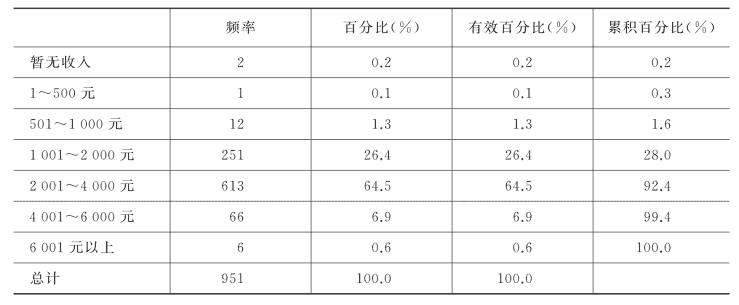

For the measurement of agricultural technicians' cultural capital, the item used is "education status," providing 3 alternative answers, represented by serial numbers 1 to 3 respectively. Among them, 1 represents "high school education or below," 2 represents "junior college education," 3 represents "bachelor's degree or above." In addition, "years engaged in agricultural technical work" is also used as a measurement item for cultural capital. "Education status" as ordinal data undergoes `dummy variable processing` before entering the regression equation model.

**Table 2　Distribution of Agricultural Technicians by Education Level**

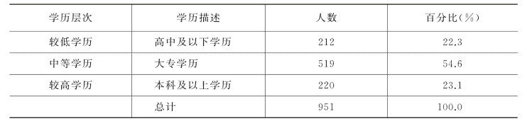

For the measurement of agricultural technicians' social capital, the approach and scale of Carolina Rojas were referenced to measure the social network scale, social network density, and network homogeneity of agricultural technicians respectively [50].

Among them, the measurement of social network scale designed 3 items, respectively asking the number of colleagues, neighbors, and friends that agricultural technicians frequently contact. Finally, the summation method was used as the measurement value for "social network scale."

The measurement of social network density also designed 3 items: "Your frequently contacted friends all know each other," "Your frequently contacted friends are also friends with each other," "Your frequently contacted friends also communicate with each other." Answers use a `five-point Likert scale`, serial numbers 1 to 5 representing "strongly disagree," "disagree," "neutral," "agree," "strongly agree." The internal consistency `α coefficient` of these 3 items is 0.852, meeting the reliability requirements of the scale [51]. Therefore, the measurement values of these 3 items are summed and averaged as the measurement value for "social network density."

For the measurement of social network homogeneity, 5 items were designed: "Your frequently contacted friends are about the same age as you," "Your frequently contacted friends have about the same education level as you," "Your frequently contacted friends participate in similar social activities as you," "Your frequently contacted friends have about the same economic level as you," "Your frequently contacted friends have similar values as you." Answers use a `five-point Likert scale`, serial numbers 1 to 5 representing "very different," "somewhat different," "hard to say," "not much difference," "basically the same." The internal consistency `α coefficient` of these 5 items is 0.775, meeting the reliability requirements for the scale. Therefore, the measurement values of these 5 items are summed and averaged as the measurement value for "social network homogeneity."

### 4) Personal Perceived Demand for Green Agricultural Technology Information

For the measurement of the variable "green agricultural technology information demand level" self-perceived by agricultural technicians, this study designed a multiple-choice question: "In developing green agriculture, what technical information do you think farmers currently lack most?" Then, 6 aspects of technical information were provided: "Policy and regulation information related to green agriculture," "Market information for organic, green, and pollution-free agricultural products," "Production knowledge for pollution-free agricultural products," "Green pesticide product and supply information," "Physical and biological control technologies," and "Crop pest and disease early warning information." The more options the respondent chooses, the higher their demand level for green agricultural technology information.

### 5) Control Variables

In addition to media exposure variables and personal capital endowment variables, this study also set demographic control variables, including region (county/city of affiliation, see Table 3), gender (see Table 4), and 3 other control variables.

**Table 3　Distribution of Agricultural Technicians by County/City Performance Levels**

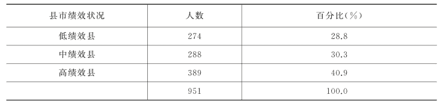

**Table 4　Distribution of Agricultural Technicians by Gender**

## 3. Statistical Model

To verify the influencing factors of agricultural technicians' media use ability, this study takes agricultural technicians' media use ability as the dependent variable, the 7 variables measuring media exposure intensity, the 4 variables measuring individual capital endowment, the 3 variables of demographic dimension, and the 1 variable measuring demand intensity as independent variables, and adopts a `linear equation model` for inferential statistics. The mathematical formula for the linear equation model is:

Where `y i` is the actual measured value of the individual dependent variable, `e i` is the random error, `α` is the intercept, `b m` is the partial regression coefficient, representing the average change in `y i` for each unit change in `X i` when other independent variables remain unchanged [52].

# IV. Research Findings

## 1. Descriptive Statistical Results

### 1) Media Use Status in Agricultural Technology Extension

# Statistical Analysis Results

During the agricultural technology extension process, the most frequently used media tool by agricultural technicians is mobile phone SMS, with `75.5%` of technicians having used it; followed by `QQ` and `QQ Groups`, used by `53.4%`; third is newspapers, used by `36.8%`; fourth is WeChat, used by `33.9%`; fifth is television, used by `26.4%`; sixth is radio, `16.8%`; and last is Weibo, used by only `5.4%`. The role played by mobile phone SMS in agricultural technology extension is remarkable. According to the compatibility principle, this also portends huge potential for new media extension tools based on mobile phones, such as `QQ` and `WeChat` (see Table 5 for details).

## Table 5　Usage of Media Tools by Agricultural Technicians in Extension

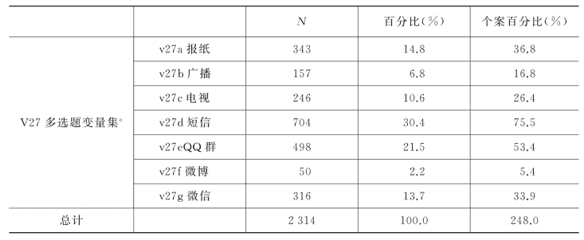

> a．Value 1 indicates dichotomous grouping for tabulation.

## 2) Media Use Competence Index of Agricultural Technicians

Using the number of media types used by agricultural technicians in extension as an index to measure their media use competence, a higher index indicates stronger ability to use media tools.

Statistics show that the `mean` of the distribution of the media use competence index is `2.433`, and the `standard deviation` is `1.352` (see Table 6). The index distribution presents a bell-shaped curve (see Figure 1). From this bell-shaped curve, it can be found that most agricultural technicians can only use 1 to 2 types of media tools in extension; adding those who have never used media tools, the proportion approaches `60%` of the sample (see Table 7). This indicates that, overall, the technicians' mastery of media, or media use competence, is not yet ideal. There is considerable room for improvement in their media use competence.

### Table 6　Descriptive Data of Agricultural Technicians' Media Competence Index

### Table 7　Distribution of Agricultural Technicians' Media Use Competence Data

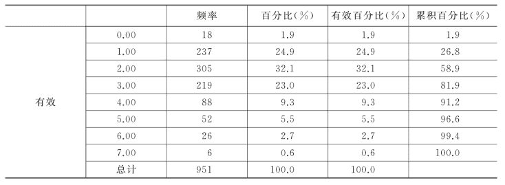

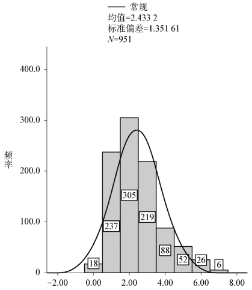

### Figure 1　Distribution of Agricultural Technicians' Media Use Competence Index

## 3) Media Exposure of Agricultural Technicians

Regarding media exposure, agricultural technicians spend an average of about 2 hours per day on the internet, watch TV for about `1.8` hours, and listen to radio for about `0.2` hours; they read newspapers about `3.7` times per week, and magazines about `2.7` times per week. The average years of using social media (including `QQ`, `WeChat`, `Weibo`, etc.) is about `5.3` years (see Table 8 for details). It can be found that in terms of media exposure intensity, online media occupies the first position, followed by watching TV, then reading newspapers. The usage rates of magazines and radio are not high. Additionally, the average household of agricultural technicians owns about 4 electronic devices for receiving information.

### Table 8　Statistical Description of Agricultural Technicians' Media Exposure Data

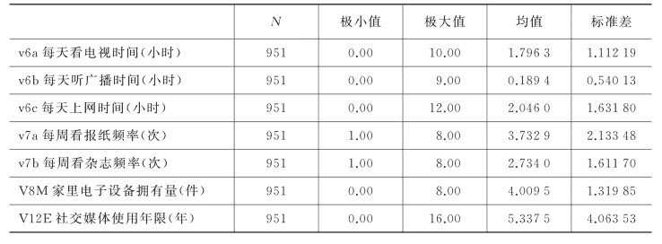

## 4) Capital Endowment Status of Agricultural Technicians

From Table 9, the personal capital endowment of agricultural technicians presents the following characteristics:

### Economic Capital

In terms of economic capital (see Table 9 for details), technicians' monthly income is concentrated in the `2001–4000` RMB range, accounting for `64.5%` of the total; followed by `1001–2000` RMB, accounting for `26.4%`. Overall, the income gap among technicians is not large.

#### Table 9　Distribution of Agricultural Technicians' Monthly Income Data

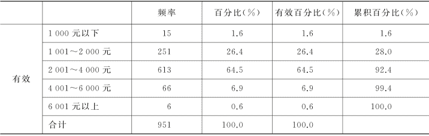

### Cultural Capital

In terms of cultural capital, i.e., educational background (see Table 10 for details), among the technician corps, first, those with a junior college degree are the most numerous, accounting for `54.6%` of the total; second, those with a junior college degree or above account for `23.1%`; last, those with high school (including vocational high school) education or below account for `22.3%`. This shows that the technician group is a group with a generally high level of education in rural areas.

In this study, the work experience of agricultural technicians is also used as a measurement indicator of cultural capital. The average years of engagement in agricultural technology work (see Table 11) is about `20.2` years. Combined with the age structure of technicians, this indicates that the current technician corps has long working tenures and an aging personnel structure.

#### Table 10　Distribution of Agricultural Technicians' Educational Background

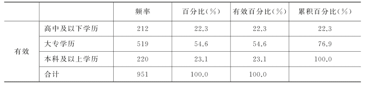

#### Table 11　Descriptive Data of Agricultural Technicians' Working Years

### Social Capital

Looking at social capital status (see Table 12 for details), the average social network size of the technician group is about `52.9` people, with a standard deviation of about `62.1`. It is visible that there are relatively large differences in social network size among different technicians. The mean values of homogeneity and density of technicians' social networks are about `3.63` and `3.22`, respectively. Both figures are relatively high, indicating that the objects of technicians' social interactions are mainly people with similar backgrounds, such as colleagues, neighbors, and friends.

#### Table 12　Descriptive Statistics of Agricultural Technicians' Social Capital Measurement Data

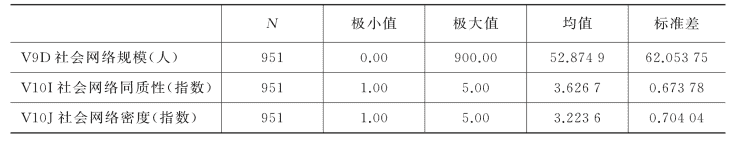

From Table 12, it can be seen that the index representing the "urgency of agricultural technicians' demand for green agricultural technology information" has a mean of about `4.2`. With a maximum value of 6, this indicates that technicians generally feel a very urgent need for green agricultural technology information.

#### Table 13　Descriptive Statistics of Agricultural Technicians' Information Demand Measurement Data

# 2. Inferential Statistical Results

To explore which factors influence the media use competence index of agricultural technicians, this study constructed a `multiple linear regression equation model` with `media exposure intensity`, `individual capital endowment`, and `agricultural technicians' demand level for green agricultural technology information` as independent variables, and `media use competence index` as the dependent variable.

Using this model, the inferential statistical results show that the model's `P-value < 0.0001`, which is significant. The model's explanatory power (`R²`) for the variation in the media use competence index is `14%`. The collinearity test results show that the `Variance Inflation Factor (VIF)` is within a reasonable range, and there is no serious multicollinearity problem in the model (see Tables 14–16 for details).

### Table 14　Model Summary b

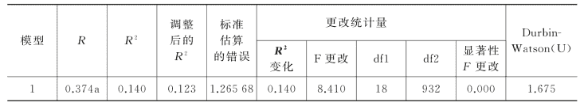

### Table 15　Model Test

### Table 16　Summary Table of Multiple Linear Regression Model Analysis Results

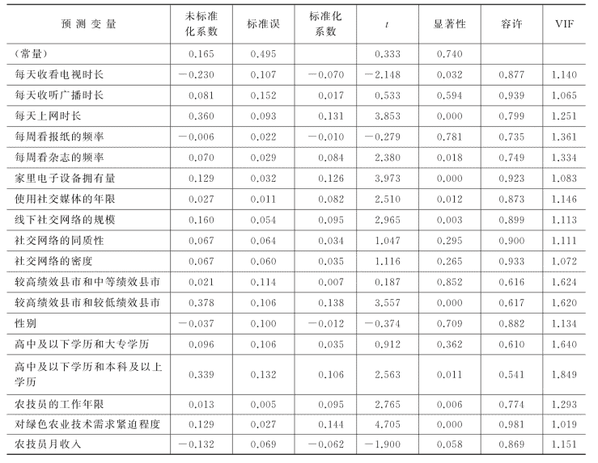

## 1) Predictive Effect of Media Exposure Intensity Variables

The inferential statistical results of the multiple regression model show that among the 7 variables measuring media exposure, four independent variables—"weekly magazine reading frequency," "daily internet usage duration," "number of electronic devices owned at home," and "years of social media use"—are significantly correlated with the `media use competence index`.

"Daily TV viewing duration" is also significantly correlated with technicians' media use competence, but it is a **negative correlation**. This indicates that for technicians, the function of TV is mainly leisure and killing time; therefore, the longer the TV viewing time, the less conducive it is for technicians to master more media tools in their work, nor can it improve their ability to use media tools.

"Weekly newspaper reading frequency" and "daily radio listening duration" cannot effectively predict changes in the `media use competence index`. The inability of newspaper reading frequency to predict media use competence is mainly because newspapers are not widely circulated in rural areas and cannot become a fixed agricultural technology extension channel. As for radio, since the advent of television, its penetration in rural areas has dropped sharply. Moreover, with low private car ownership in rural areas, radio has not caught the new opportunity brought by the popularization of automobiles. In cities, radio has regained vitality due to the increase in household cars.

Looking again at those media exposure behaviors that can predict media use competence, such as magazine reading frequency, this is related to the fact that people who like reading magazines are more willing to engage in deep thinking. They are usually diligent in thinking and good at logical analysis. Research by Chen Gang et al. also shows that people with higher education read more magazines per month on average and spend more time doing so [53]. Elihu Katz and Paul Lazarsfeld once found that opinion leaders prefer reading magazines more than followers. Agricultural technicians are opinion leaders in the diffusion of agricultural innovations [9]297.

"Online media usage duration" and "electronic information device ownership" have a predictive effect on technicians' media use competence because, compared to TV, newspapers, radio, and other media, the use of online media and electronic information devices requires higher individual initiative. People with high initiative are often more innovative and more willing to use media to improve their work and living conditions.

## 2) Predictive Effect of Individual Capital Endowment Variables

The multiple regression analysis results show that among the 6 independent variables measuring technicians' capital endowment, two independent variables representing cultural capital—"`educational level`" and "`years engaged in agricultural technology work`"—and one dimension representing social capital—"`social network size`"—are significantly correlated with the `media use competence index`.

Meanwhile, three independent variables—"`personal monthly income`" representing economic capital, and "`social network density`" and "`social network homogeneity`" representing the other two dimensions of social capital—cannot effectively predict changes in the `media use competence index`.

In the hypothesis stage of this study, although the variables selected into the multiple regression model were all supported by previous research findings as factors influencing technicians' media use competence, specifically for the technician group, the predictive effect of some variables is no longer significant.

Combining the actual situation of the technician group, explanations can be found. Take the two variables "social network density" and "social network homogeneity": because technicians are a highly homogeneous group with a relatively narrow range of interpersonal contacts, often sharing the same background. Therefore, "degree of social network homogeneity," "differences in social network density," and even "economic income" indicators have very small differences within the technician group, and these indicators often cannot serve as distinguishing indicators for the group.

Those independent variables less affected by agricultural technology work, such as "social network size" and "educational level," can effectively predict technicians' media use competence. This is because "social network size" is related to personal extroversion or introversion, while personal educational level is mostly finalized before most technicians start working, and cannot be fundamentally changed by extension work. Therefore, these variables show very obvious differences within the technician group, and their predictive effect is also good.

## 3) Predictive Effect of "Urgency of Demand for Green Agricultural Technology Information" Variable

The inferential statistical results show that the index of the urgency of agricultural technicians' demand for green agricultural technology information can well predict their media use competence. In other words, the more urgently technicians feel the need for green agricultural technology information, the higher their `media use competence index` scores. These two variables are not necessarily causal, but their significant correlation can be explained. Those who perceive an urgent need for advanced green agricultural technology are often more proactive in their work, more enterprising, more innovative, and willing to try new things. Consequently, their exposure intensity and use competence for various media, especially new media, are superior to others.

## 4) Predictive Effect of Regional Factors on Media Use Competence Index

The inferential statistical results also show that the agricultural technology extension performance level of the county/city where the technician belongs has a significant predictive effect on the local technicians' `media use competence index`. As mentioned earlier, the 12 counties/cities involved in this study were divided into high, medium, and low levels based on their extension performance. In the model, the regional variable was set as two `dummy variables`: "comparison between high-performance and medium-performance counties/cities" and "comparison between high-performance and low-performance counties/cities." The statistical results show that in the "comparison between high-performance and low-performance counties/cities," the difference in media use competence between technicians in the two types of counties/cities is significant.

A summary of the hypothesis testing results is shown in Table 17.

### Table 17　Summary of Hypothesis Testing Results

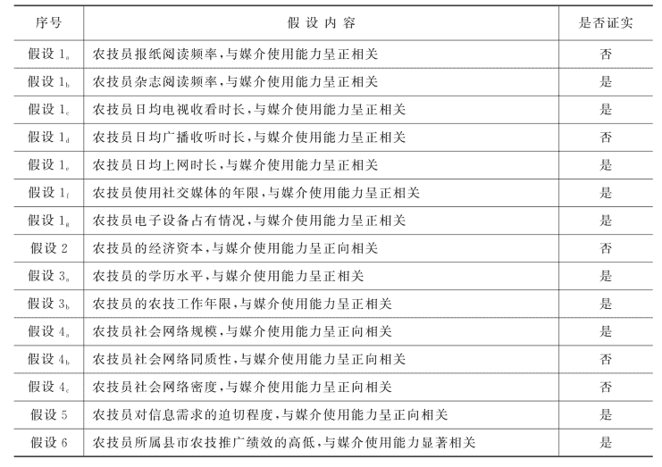

# V. Conclusions and Implications

Thus far, this study has answered the three questions raised at the beginning: the most commonly used media types by agricultural technicians in extension work; the overall status of technicians' media use competence; and the various factors influencing the improvement of technicians' media use competence. Among the above research findings, many are worthy of in-depth discussion.

## 1. The Connotation of Media Use Competence is Constantly Evolving

This study shows that the most commonly used extension tool by technicians is mobile phone SMS, followed by `QQ`, then newspapers, then WeChat, and finally TV, radio, and Weibo. This result shows significant differences not only compared to Rogers' era but also compared to ten years ago. In `2008`, the main media for rural technology extension were TV, mobile phones, books and magazines, newspapers, radio, and the internet [54]; even earlier in `2002`, mobile phones and the internet were still rare in Hubei's rural areas, and the main agricultural technology dissemination media were TV, newspapers, and radio [55].

As Zhang Zhian said, under the communication ecology of new media, the media usage structure in rural areas is constantly changing. The change in media usage structure means that the content of technicians' media use competence is also changing [48]. How to continuously obtain the technological dividends brought by the latest media and achieve better agricultural technology extension effects is a focus for future research.

Meanwhile, from the important position occupied by mobile phone SMS in agricultural technology extension, it can be inferred that social media based on the same mobile phone carrier, such as `QQ` and `WeChat`, have promising prospects in future agricultural technology extension. After all, most functions of mobile phone SMS have now been replaced by social media, and social media offers a better user experience than SMS. Even in this study, if `QQ`, `WeChat`, and `Weibo` are regarded as a whole and categorized under social media, the importance of social media has already surpassed that of mobile phone SMS.

## 2. There is Great Room for Improvement in Agricultural Technicians' Media Use Competence

In terms of media use competence, technicians are generally at a low level. This indicates that the influence of traditional agricultural technology extension methods is still relatively large, and technicians lack the initiative to use advanced social media as extension tools, requiring increased guidance.

## 3. Media Use Competence is of Great Significance for Agricultural Technicians' Performance of Duties

This study gives us a further understanding of technicians' media use competence. The regression model analysis results show that the level of agricultural technology extension performance in the county/city where the technician is located significantly affects their media use competence. There is a significant difference in media use competence between technicians in high-performance counties/cities and those in low-performance counties/cities. On the one hand, it can be said that technicians' proficient mastery of media tools improves the efficiency of agricultural technology extension; on the other hand, it can be said that advanced extension counties/cities pay more attention to the improvement of technicians' personal capital endowment, including better benefits and more training, so the improvement in technicians' media use competence is obvious. In summary, as opinion leaders in the field of agricultural innovation diffusion, technicians should have strong media use competence, which helps improve agricultural extension performance. This is also consistent with the views held by Katz, Lazarsfeld, and others [9]295.

## 4. Perceived Demand Urgency Can Promote the Improvement of Agricultural Technicians' Media Use Competence

In the previous hypotheses, this study proposed some independent variables that might influence media use competence based on previous research findings, but the results in this study were not significant, such as economic capital, social network homogeneity, social network density, and the usage intensity of newspapers and radio. These can all be explained by analyzing the characteristics of the technician group itself. It is worth mentioning that this study found that among the factors influencing technicians' media use competence, the variable "technicians' perceived urgency of demand for green agricultural technology" has the most significant impact. This conforms to the view in the Uses and Gratifications Theory that "needs can stimulate related actions." This also shows that by improving welfare benefits and other measures to strengthen technicians' sense of responsibility, they can be prompted to consciously improve their media use competence.

## 5. Improving Agricultural Technicians' Media Use Competence Requires Targeted Measures

Regarding the role of individual capital endowment in improving technicians' media use competence, the analysis results of this study show that technicians' personal capital endowment, especially cultural capital, including educational level and professional quality represented by years engaged in agricultural technology work, all help improve their media use competence. This once again verifies the importance of strengthening technician training.

Technicians' intensity of internet exposure can enhance their media use competence. Unlike traditional media, once individuals master internet media, especially social media, they will have greater autonomy, which will stimulate technicians' interest in applying social media in agricultural technology extension work. Therefore, in technician capacity-building training, training on the use of the internet and social media should be strengthened.

Among numerous agricultural innovation diffusion studies, this study is unique in focusing on the improvement of agricultural technicians' media use competence, thus contributing to a weak link in agricultural innovation diffusion research. This study not only confirms the importance of media use competence, analyzes the main factors influencing it, but also summarizes the view that the connotation of media use competence is in a state of dynamic change. These findings provide a new perspective for better studying the evolution laws of the innovation diffusion field in the future.

The practical significance of this study lies in exploring the path to improving the professional quality of agricultural technicians from a new angle. In an increasingly changing media ecology environment, agricultural technicians should vigorously strengthen media use competence training, which may significantly improve the efficiency of agricultural technology extension.

The limitations of this study are that it did not deeply study the specific roles played by different types of media in innovation diffusion and their evolution laws; in terms of measuring media use competence, although the key indicator—the number of media types technicians are proficient in using—was found, it is slightly thin. These can serve as directions for the next step of research.

# References

[1] Kuang Wenbo. Quantitative Research on the Development of WeChat in China [J]. International Journalism, 2014(5): 147–156.

[2] Rogers. Diffusion of Innovations: 5th Edition [M]. Translated by Tang Xingtong, Zheng Changqing, Zhang Yanchen. Beijing: Electronic Industry Press, 2016.

[3] Zhu Jianhua, He Zhou. The Status and Prospects of Internet Diffusion in China: A Comparative Study of Beijing, Guangzhou, and Hong Kong in 2000 [J]. Journalism University, 2002(2): 25–34.

[4] Compaine, Gomery. Who Owns the Media? Competition and Concentration in the Mass Media Industry [M]. Translated by Zhan Zhengmao, Zhang Xiaomei, et al. Beijing: Renmin University of China Press, 2006.

[5] China Internet Network Information Center. The 43rd Statistical Report on Internet Development in China [R/OL]. (2019-02)[2019-05-04]. http://www.cac.gov.cn/2019zt/cnnic43/index.htm.

[6] Dong Jinquan, Hong Yahong. The Edge of Love and Pain: Survey Research on Adolescents' Use of Social Media [M]. Beijing: Guangming Daily Press, 2017: 6–8.

[7] Yu Aihua, Liu Aijun. Literature Review on the "Mobile Internet +" Agricultural Technology Extension Model [J]. Heilongjiang Agricultural Sciences, 2017(3): 127–131.

[8] Potter. Media Literacy: 4th Edition [M]. Translated by Li Degang. Beijing: Tsinghua University Press, 2012.

[9] Katz, Lazarsfeld. Personal Influence: The Part Played by People in the Flow of Mass Communications [M]. Beijing: Renmin University of China Press, 2016: 32.

[10] Schramm. Introduction to Communication Studies [M]. Translated by He Daokuan. Beijing: Renmin University of China Press, 2017: 202.

[11] Sparks. Introduction to Media Effects Research [M]. Translated by He Chaoyang, Wang Xihua. Beijing: Peking University Press, 2004: 211.

[12] McLuhan. Understanding Media: The Extensions of Man [M]. Translated by He Daokuan. Nanjing: Yilin Press, 2011.

[13] Strate. Media as Life [M]. Translated by Wang Jiaquan, et al. Beijing: Renmin University of China Press, 2014: 6.

[14] Pan Zhongdang. Communication Media and Culture: Three Models of Social Science and Humanities Research (II) [J]. Modern Communication: Journal of Communication University of China, 1996(5): 16–24.

[15] Negroponte. Being Digital [M]. Translated by Hu Yong. Beijing: Electronic Industry Press, 2017: 55.

[16] Barrett. Approaches to Media Studies [M]. Translated by Wang Kai, Liu Xiaohong. Beijing: Xinhua Press, 2004.

[17] Li Hongyan. Rural Communication Studies: 2nd Edition [M]. Beijing: Peking University Press, 2014.

[18] Jiang Genyuan. Media Constructivism: An Epistemology of Communication Distinct from Media Instrumentalism [J]. Contemporary Communication, 2012(3): 32–35.

[19] Zhang Jingwen. From Adoption to Re-dissemination: Inheritance and Development of Innovation Diffusion Theory under Network Social Media [J]. News Spring and Autumn, 2013(2): 25–33.

[20] Liu Jizhong, Niu Xinquan, Liu Yuhua. Agricultural News Communication [M]. Beijing: Communication University of China Press, 2006.

[21] Dong Chengshuang, Xing Xianghu, Xue Shoutao. Agricultural Science and Technology Communication [M]. Beijing: Communication University of China Press, 2006.

[22] Xiao Luren. Analysis of Media Communication Effects on Agricultural Technology Innovation Diffusion [J]. Hunan Social Sciences, 2017(4): 200–204.

[23] Jiang Jianke. On the Impact of Media Communication on Agricultural Science and Technology Extension [J]. Journal of Northwest A&F University (Social Science Edition), 2005(3): 9–13.

[24] Duan Jingsu, Du Junfei. Introduction to Media Literacy [M]. Fuzhou: Fujian People's Press, 2007: 54–55.

[25] Zheng Suxia. Survey and Analysis of the Current Situation of Migrant Workers' Media Literacy—Based on a Survey in Zhengzhou, Henan Province [J]. Modern Communication: Journal of Communication University of China, 2010(10): 121–125.

# Research on Media Literacy

## References

[26] Peng Lan. Three Types of Media Literacy in the Era of Social Media and Their Relationships[J]. Journal of Shanghai Normal University (Philosophy & Social Sciences Edition), 2013, 42(3): 52–60.

[27] Liu Mingzheng, Chen Xuewei. Current Status of Public Media Literacy in China Based on Usage, Evaluation, and Analysis Abilities[J]. Modern Communication (Journal of Communication University of China), 2017, 39(07): 153–157.

[28] Li Ling, Li Hongtao. Media Literacy: A Perspective for Examining the Relationship Between Farmers and Media[J]. News World, 2005(3): 121–122.

[29] Lu Pengcheng, Luo Gao, Wang Minchen, et al. Comparative Study on Media Literacy of Urban and Rural Adolescents in Central China: A Case Study of Wuhan City and Hong'an County, Hubei Province[J]. Journal of Journalism & Communication, 2007(3): 80–88.

[30] Kales. Media and Youth[M]. Translated by Wang Fuxing. Beijing: World Publishing Corporation, 2014.

[31] Liao Shengqing, Huang Wensen, Yi Hongfa, et al. Fragmented Media Use: Rethinking the Concept and Measurement of Media Use[J]. Journal of Journalism, 2015(6): 61–73.

[32] Cai Chuhong. Review of Survey Research on Farmers' Media Access and Use in Recent Years[J]. Today's Media, 2012(5): 152–154.

[33] Li Jincheng. Research on the Measurement of Media Literacy and Its Influencing Factors[M]. Shanghai: Shanghai Jiao Tong University Press, 2017.

[34] Peng Yueping. Examining Rural Audience Media Literacy from the Perspective of Media Usage Ability: A Case Study of Ji'an, Central Jiangxi[J]. Journal of Jinggangshan University, 2009, 30(4): 82–86+96.

[35] Fu Hai. Chinese Farmers' Access to, Evaluation of, and Expectations for Mass Media[J]. Journal of Journalism & Communication, 2011(6): 26–36+110.

[36] Chen Ying. Research on Rural Audiences' Access to and Use Behavior of Mass Media[J]. Journal of Northeast Normal University (Philosophy & Social Sciences Edition), 2013(6): 269–271.

[37] Shen Fei, Lu Ye, Wang Tianjiao, et al. Classification of Chinese Audiences in the New Media Environment: An Empirical Study Based on the 2010 National Audience Survey[J]. Journal of Journalism, 2014(3): 100–107.

[38] Zhu Weijue. A Non-Economic Interpretation of "Capital"—Bourdieu's Concept of Cultural Capital[J]. Social Sciences, 2005(6): 117–123.

[39] Duan Jingsu. Social Stratification and the Control and Usage Rights of Media[J]. Journal of Xiamen University (Philosophy & Social Sciences Edition), 2004(1): 44–51.

[40] Wu Tingting. Knowledge Gap Between Vulnerable Groups and the Public[J]. Southeast Communication, 2007(12): 52–53.

[41] Zhou Mingxia. Social Construction Analysis of Internet Diffusion: Taking Diffusion Among Students as an Example[J]. Quest, 2004(12): 118–121.

[42] Chu Yajie. Social Interaction and Mobile Phone Use: An Empirical Study of Mobile Phone Use by Shanghai Audiences[J]. Journal of Journalism, 2010(2): 50–58.

[43] Zhang Hongzhong, Guan Lu, Zhu Jiangliu. Analysis of Research Models on Social Capital of Social Media[J]. Modern Communication: Journal of Communication University of China, 2015(11): 42–46.

[44] Bourdieu P. The Forms of Capital[M]//Richardson J G. Handbook of Theory and Research for Sociology of Education. West Port, Connecticut, USA: Greenwood Press, 1986: 241–258.

[45] Bian Yanjie, Li Yu. Social Network Capital of Chinese Urban Families[J]. Tsinghua Sociology Review, 2000(2): 1–18.

[46] Zhao Yandong. Human Capital, Re-employment, and Labor Market Construction[J]. Chinese Journal of Population Science, 2003(5): 24–29.

[47] Zhao Zhili. "Uses and Gratifications" Under Network Communication Conditions: A New Audience Perspective[J]. Contemporary Communication, 2003(1): 58–60.

[48] Zhang Zhian, Shen Fei. Comparative Study on Regional Differences in Chinese Audience Media Use[J]. Journal of Journalism, 2012(6): 3–9+30.

[49] Peng T Q, Zhu J J H. Sophistication of Internet Usage (SIU) and Its Attitudinal Antecedents: An Empirical Study in Hong Kong[J]. Computers in Human Behavior, 2011, 27(1): 421–431.

[50] Hudson R, Rojas C, Arteaga L, et al. Rabbit Nipple-Search Pheromone Versus Rabbit Mammary Pheromone Revisited[M]//Hurst J L, Beynon R L, Koberts S C. Chemical Signals in Vertebrates 11. Springer, 2008: 315–324.

[51] Wu Minglong. Practical Questionnaire Statistical Analysis—SPSS Operation and Application[M]. Chongqing: Chongqing University Press, 2010.

[52] Zhang Wentong, Zhong Yunfei. Essence of Practical Cases in Data Analysis and Mining[M]. Beijing: Tsinghua University Press, 2013.

[53] Chen Gang, Zhang Hui, Chen Jingchao, et al. China Rural Survey—Research on Rural Residents' Media Exposure and Consumption Behavior[M]. Beijing: Higher Education Press, 2015.

[54] Guo Qin. Survey and Analysis of Communication Media Status in Poor Mountainous Areas: A Case Study of Qingxin County, Guangdong Province[J]. Contemporary Communication, 2008(6): 18–20.

[55] Guo Jianxia. Realizing New Agricultural Technology Extension Methods: The Way Out and Countermeasures of Mass Media Communication—Conclusions and Reflections from a Case Study of Hewan Village, Nanpu Township, Jianli County, Hubei Province[J]. Agricultural Science & Technology Management, 2002(3): 38–41.

---

**Author Biographies**: Wu Zhiyuan, Associate Professor, School of Journalism and Communication, Central China Normal University; Yu Sijie, Master's Student (Class of 2019), Major in Journalism and Communication, School of Journalism and Communication, Central China Normal University.

## News Literacy in the Age of Artificial Intelligence and Its Enhancement

**Xie Jinwen　Huang Guxiang**

### Abstract

News literacy refers to the literacy concerning the cognition and utilization of news and its communication media, constituted by relevant knowledge, attitudes, and abilities. Media literacy mainly refers to the literacy concerning the cognition and utilization of communication media, also including the literacy of participating in mass media. These two types of literacy are increasingly important, especially in the era of mobile communication and artificial intelligence. In China, these two literacies carry special significance. The goals of enhancement can be divided into basic goals, higher goals, and goals for different targets, requiring a multi-pronged approach combining family education, school education, social education, cadre education, and media "teaching by words and deeds." The content of enhancement should include knowledge of news and media, as well as communication abilities and awareness of communication rights and responsibilities. For Party and government cadres, intellectuals, and media professionals, there should be more content and higher requirements.

**Keywords**: News, Communication, News Literacy, Media Literacy

---

### I. The Connotation of News Literacy

"Literacy" (Su Yang) refers to inherent cultivation, encompassing both "quality" (Su Zhi)—a certain texture formed over a long-term process—and the meaning of cultivation and training, such as moral literacy, economic literacy, information literacy, etc., mainly constituted by relevant knowledge, attitudes, and abilities. News literacy is the literacy concerning the cognition and utilization of news.

#### 1. Cognition of News and Its Media

Cognition of news and its communication media is the foundation and important connotation of news literacy, including:

1.  Understanding the meaning of news.
2.  Understanding the role of news.
3.  Understanding the differences and connections between news and propaganda.
4.  Understanding the requirements of news communication, and discerning the quality of news.
5.  Understanding news production, and recognizing the factors influencing news quality.
6.  Cognition of news media.

#### 2. Utilization of News and Its Media

With the above cognition, there is a basis for consciously mastering and scientifically utilizing news and its communication media.

1.  Avoid treating all media reflections as facts, and partial reflections as the whole. If the vast majority or even all news media are used erroneously, it will bring great disaster. Even now, if erroneous propaganda runs rampant, and some important information and different opinions cannot be disseminated or are reflected in a one-sided manner, the consequences will also be severe.
2.  Safeguard rights and fulfill obligations. Rights in this regard include citizens' right to know, right to express, right to criticize and supervise, freedom of speech, publication, information, and communication, as well as rights as news consumers, and rights as news communicators such as the right to interview, publish, edit, and print[1]. Correspondingly, there are obligations to be fulfilled, including abiding by morality and law, not infringing on others' freedom, reputation, privacy, copyright, and other legal rights, safeguarding state secrets, and protecting the interests of the people, the state, and society. As news communicators, there is also the obligation to provide true, comprehensive, objective, timely, and audience-needed information; to provide platforms for opinion exchange, correctly guide public opinion, supervise power organs and figures, promote excellent culture, and promote the realization of society's political and cultural goals; and to prevent negative influences, protecting the interests and safety of news sources.

   It should be noted that the maximum and minimum principles should also be adopted for news rights, i.e., giving the greatest possible protection and the smallest possible restriction. At the same time, such restrictions must be public, standardized, and recognized by the public, making them easy for people to grasp and observe, while preventing due rights from being arbitrarily violated.

3.  Follow the laws of news to improve the quality and effectiveness of news communication. Laws are the internal, essential, stable, and trend-based connections of things. The laws of news are the laws regarding news phenomena and activities, manifested in the requirements of news communication, including the requirements of news value, the requirements of comprehensiveness, objectivity, and fairness, and the requirements of communication quality and social effectiveness. Not only professional news workers must follow the laws of news, but relevant leaders and managers must also understand and respect the laws of news. Now many other organizations and individuals are also frequently producing and sending news and current affairs commentary; following the laws of news and improving the quality and effectiveness of news communication has become a task for the whole society.
4.  Give full play to positive roles and prevent negative influences. News media should fully exert the functions of information transmission, opinion exchange, and public opinion supervision, while preventing negative influences. Even if news media merely do less or nothing, it will cause the normal operation of society to lack an important link, making the decisions and behaviors of society, organizations, and individuals blind. Weakness and absence of public opinion supervision will also cause huge losses to the state and society, and may even lead to [crises]. In modern society, many social goals such as democratic politics, and many citizens' rights such as the right to know, express, and supervise, must be realized by relying on news media. News media are public instruments of society, meaning they should serve social and public interests, not the interests of individuals or small groups, and should be responsible to the public.

---

### II. The Role of News Literacy

#### 1. Role for Individuals, Organizations, and Society

News literacy plays different roles for different people. For the general public, news literacy can help them wisely choose news and its media, objectively understand things and the environment, and better send news information through new media, optimizing our information environment.

For news workers, news literacy is an essential qualification for their posts. Many news workers and managers have not received good news education now, so it is urgent to make up for this lesson.

For leaders and managers, news literacy can help them better utilize news to do their work well, including making more accurate judgments on the environment. News literacy also determines whether the news industry can be scientifically and rationally constructed, developed, and utilized, its positive roles fully exerted, news absence avoided, and misleading roles prevented.

For various organizations, news information is an important basis for judgment and decision-making, and news media are important tools for organizational and social communication. For the ruling party, news media are directly related to accepting social supervision, strengthening self-construction, and doing a good job in governance. Therefore, improving news literacy can effectively promote the construction and operation of organizations.

Many political, economic, cultural, and other issues in society are related to news media, and news literacy is the prerequisite for optimizing the news system and activities, and improving the quality and effect of news communication and its media.

#### 2. Correctly Understanding Problems in News Communication

Some say that negative reports on hospitals and doctors affect public perception and are one of the reasons for the prevalence of medical disturbances and even attacks on doctors, and such reports should be restricted. Following this logic, then negative reports on urban management officers, officials, professors, and all walks of life should be strictly restricted. Is such restriction conducive to the supervision and resolution of negative problems? If problems are covered up and grow larger, is that a joy or a worry?

Requiring the proportion of negative news in news media to be equivalent to the proportion of positive and negative situations in society is also contrary to the laws of news. Good news stays home, bad news travels a thousand miles. Many planes fly normally and arrive safely; this flight information does not become news; one plane crashes, and it becomes news, and many people want to know how and why. It can be seen that bad things are more likely to become news, even though they account for only a very small proportion of the total number of things.

A better approach should be to let people correctly understand news. If society is compared to the ocean, then news media are only watchtowers, and news is only watch reports, not a reflection of the whole ocean.

If the people and events in news reports are compared to the vast ocean, news media are still only watchtowers, and news is still only watch reports, not a panorama of the people and events.

If a report says there is a shark or a reef ahead, do not think the ocean is full of sharks or reefs.

If over 95% of reports are calm seas and bright sunshine, it is estimated no one would keep watching. This is also one of the reasons why many news media lack attractiveness.

Some people see that Western media reports on China have a large proportion of negative news and conclude they are hostile to China. There are indeed those with hostility, but most Western news media are commercial; attracting eyeballs and making money are more important to them. Their reports on their own countries also have a large proportion of negative news.

#### 3. Resolving the Dilemma of the New Media Era

New media have caused a large reduction in the audience of traditional media, a corresponding decrease in advertising revenue, and a decline in social influence. In order to survive and develop, some media organizations do not hesitate to lower their taste and attract audiences through vulgar, stimulating, and entertaining content.

Although news platforms in new media have many audiences, information technology companies and other institutions' news platforms know they are inferior to traditional media in serious and high-end content. Most start from audience interest rather than their fundamental and long-term interests, seeking to win by catching the eye. Sensational headlines disregarding actual content are one manifestation. Thus, the idea of enhancing institutional reputation through news and profiting indirectly has largely failed.

With the development of communication technology, the audience's choice space and initiative have expanded almost infinitely, forcing media organizations to increasingly cater to rather than lead audiences. Today, interpersonal communication, group communication, mass communication, and their media have fully converged in mobile communication and its receiving terminals (mainly mobile phones and tablets). The audience's needs and gratification methods are increasingly integrated and personalized, forcing communicators to transform accordingly, explore their new needs as much as possible, and adopt new methods adapted to them.

Audiences, however, have fallen into the dilemma and trap of choice. Moreover, people choose media, media influence people, which in turn influences people's re-choice of media, forming such a cycle, creating a Matthew effect on each person's quality.

In the traditional media era, communicators mainly selected news and current affairs commentary content. New media have greatly increased the freedom and autonomy of audiences in choosing media, allowing them to largely escape the bad interest motives of media organizations. However, if choices are made entirely based on one's own preferences, the selected media and content will become homogeneous, causing "picky eating" and "malnutrition"; if the chooser lacks media literacy and news literacy, and has low selection ability, unable to make wise choices, it is then no better than having others choose for them.

Artificial intelligence enables many media organizations to produce content through algorithms, achieving more precise audience targeting and catering to them more fully. Just as people increasingly choose information consistent with their established positions, views, attitudes, and interests, media increasingly push such information to people. Over time, this will place people in "information cocoons" and "opinion echo chambers." This is neither conducive to the improvement of individual quality nor to the communication and cohesion of groups and society.

Furthermore, audiences are increasingly becoming communicators, making up for many shortcomings of professional communicators. However, their overall quality and communication level are not high, and they fill the media world with large amounts of false information and radical comments.

The fundamental way out lies in improving the news literacy and media literacy of the whole society (including audiences or users). The generation of communication effects, the realization of economic and social benefits, ultimately must go through the audience's processes of selection, understanding, and memory. Moreover, the development of new media has made the audience's selection initiative increasingly greater, and their influence on communicators increasingly greater. In the past, news communication problems were mainly solved from the communicator's side; now and in the future, they need to be solved more from the audience's side. Help them improve news literacy and media literacy, wisely choose high-quality media and content, make market forces a positive energy promoting the unity of social and economic benefits of media and the survival of the fittest, while improving their ability and sense of social responsibility to produce and send news.

---

### III. News Literacy Urgently Needs Attention

Many people only have a perceptual understanding of news, lacking rational understanding; many people's understanding of news still stays in the print media era; many news workers and managers have not received formal news education. Misreading negative news as the whole picture of society, reporting good news but not bad news, not knowing the multiple roles of news, confusing news with propaganda—these are all manifestations of insufficient news literacy. Minor cases harm oneself; major cases harm society and the state. They cannot fully exert the positive roles of news communication and news media, hinder the construction of socialist democratic politics, and mislead society and the public. In addition, the development of the times and the progress of technology have brought new situations and problems to news communication continuously. Our understanding and utilization of news communication and its media must also be updated in a timely manner, keeping pace with the times.

#### 1. The Problem Is Significant

In modern society, the role of news and media on individuals, organizations, and society is increasingly significant. However, many people's understanding and utilization of them are not scientific, and even have large deviations, resulting in the important roles of news media—information transmission, opinion exchange, public opinion supervision—failing to be fully developed and utilized. It also reduces the attractiveness, credibility, communication power, and influence of news media, greatly discounting their propaganda and public opinion roles, and even bringing many negative roles. To date, we have done very little in popularizing news knowledge. The attractiveness, credibility, communication power, and influence of news media are still not strong enough. Many practitioners lack professional literacy. The public's awareness of relevant rights and obligations is not strong. The news literacy of leading cadres, news workers, and the general public urgently needs to be improved.

In the new media era, the environment, content, methods, and all links of news communication have undergone great changes, giving rise to many new situations and problems concerning news literacy. On the one hand, audiences increasingly choose media and content based on their own interests, and tend to obtain information and exchange views in social media groups with similar interests and views, forming "information cocoons" and "opinion echo chambers." Algorithmic push of content by communication organizations adds fuel to the fire. These all deepen people's cognitive limitations and cause opinion confrontation. On the other hand, high-quality news content and media do not get sufficient recognition, their roles are limited, and they even face survival difficulties, forced to lower their standards and cater to the market. At the same time, mobile communication makes everyone a convenient sender of information and opinions, producing adverse effects on society. Much of this content is unprofessional, even fabricated or based on hearsay, and people are often more willing to believe information that conforms to their wishes, without investigating its authenticity. News communication organizations and management departments face new challenges. 2016 was called the "post-truth era," where statements of objective facts often influence people less than appeals to emotion and belief. Many people ignore facts and reason, but doubt everything and follow their feelings.

We must update and popularize news knowledge in a timely manner, improve the news literacy of the whole society, better respect and utilize the laws of news communication, optimize the news communication environment, optimize the management, operation, selection, and use of news communication, fully exert the positive roles of news and media in information transmission, opinion exchange, propaganda guidance, and public opinion supervision, and eliminate negative influences.

#### 2. Urgent Need for Research

Currently, there is no systematic research on news literacy issues in China that stands in the new media era and combines China's actual situation. It is urgent to summarize domestic and foreign experiences and lessons, innovate relevant theories, and solve practical problems. At least the following five aspects of research need to be conducted:

1.  **Theoretical Research on News Literacy**. Mainly the connotation, role, influencing factors, problems and their causes, education principles and methods of news literacy, including: the differences and connections between news literacy and media literacy, the basic connotation of news literacy in the new media era, different requirements for leading cadres, news workers, and the general public; the general role of news literacy and its special role in China; environmental and individual factors influencing news literacy, new problems in the new media era and China's special problems; basic principles and effective methods of news literacy education.
2.  **Research on Domestic and Foreign Experiences, Lessons, and Practices of Enhancing News Literacy**, including historical experiences and lessons from China and the Soviet Union, experiences, lessons, and enhancement practices in the US, UK, Asia, Africa, and other places in the new media era.
3.  **News Literacy of Chinese Leading Cadres in the New Media Era and Its Enhancement**, including the news knowledge level of general leading cadres and propaganda system leading cadres, their understanding of new developments in news communication and their impacts, their familiarity with the utilization status of news communication and news media, requirements for news literacy, and enhancement approaches.
4.  **News Literacy of Chinese News Workers in the New Media Era and Its Enhancement**, including the news knowledge level of news workers in traditional and new media, public institutions and commercial institutions, their understanding of new developments in news communication and their impacts, professional ability and professional spirit, requirements for news literacy, and enhancement approaches.
5.  **News Literacy of the Chinese General Public in the New Media Era and Its Enhancement**, including the news knowledge level of intellectuals, young students, and the general public, their understanding of new developments in news communication and their impacts, their familiarity with the utilization status of news communication and news media, requirements for news literacy, and enhancement approaches.

---

### IV. Enhancement of News Literacy

#### 1. Efforts to Improve News Literacy

As early as 1940, Chinese journalism pioneer Ge Gongzhen said: "If every citizen now could know what needs newspapers arise from, what power newspapers have, and what influences newspapers are subject to, then he can have understanding and a correct attitude towards newspapers... Therefore I dare say that journalism is unconditionally a compulsory course for every citizen."[2]

In September 1946, Hu Qiaomu, Mao Zedong's secretary, published an editorial "Everyone Must Learn to Write News"[3] in the CPC Central Committee organ newspaper, pointing out that news had become the most primary and effective form of propaganda, and put forward five reasons for everyone learning to write news: responsibility, great role, avoiding empty talk, pursuing efficiency, and being economical and clear. Although he was talking about revolutionary workers learning to use news for propaganda, it is undoubtedly very beneficial for valuing news knowledge and respecting the laws of news.

# Paths to Improving News Literacy

After the rise of new media, competition in the news media market intensified, commercial principles ran rampant, and professional standards in journalism declined. Veteran American journalists Bill Kovach and Tom Rosenstiel established the "Committee of Concerned Journalists" and the "Project for Excellence in Journalism" respectively, and co-authored and published *The Elements of Journalism: What Newspeople Should Know and the Public Should Expect* (Peking University Press, 2011, Chinese edition) and *Blur: How to Know What's True in the Age of Information Overload* (Renmin University of China Press, 2014, Chinese edition). They promoted journalistic ideals and professional spirit, emphasized citizens' rights and responsibilities regarding news, proposed what news literacy is essential in an era where everyone can publish news but truth is hard to discern, and outlined eight professional services journalists can still provide.

In September 2007, the first Center for News Literacy in the United States was established at Stony Brook University. In September 2014, the *Columbia Journalism Review* published an article titled "News Literacy or Media Literacy: How Scholars Distinguish Critical Thinking Skills," arguing that besides the structure and form of news, media operation models, and innovative transformation, the focus of news literacy education lies in cultivating critical thinking modes through critical reading and thinking training. In October of the same year, the Poynter Institute organized an International Symposium on News Literacy.

In China, scholars have recently called for establishing a national "news literacy" concept, proposing that one must not only possess basic news knowledge but also develop the habit of observing things objectively. When publishing or analyzing news, one should avoid neglecting or distorting facts due to entrenched beliefs or perceptions. [4]

## 2. Paths to Improving News Literacy

First, the goals, targets, content, and methods of improvement must be clarified.

### Goals

Goals can be divided into basic goals, higher-level goals, and goals for different targets, facilitating phased and target-specific implementation. The basic goal should be a fundamental understanding of news communication and its media, including understanding the roles and requirements of news communication and its impact on individuals and society. Higher-level goals may include enhancing the utilization and participation levels of news communication and its media; improving the systems, mechanisms, organizational structures, media quality, and business management of news communication; and improving the audience environment and social management and control of the media.

### Targets

Targets can be divided into party and government cadres, intellectuals, media professionals, adolescents, netizens, and the general public. Party and government cadres, intellectuals, and media workers have greater influence on and utilization of news communication and its media than others; their understanding should also be deeper, including knowledge of communicators, audiences, effects, social regulation of communication, and communication undertakings and industries, etc.

### Content

The content for improvement should include news and media knowledge, as well as knowledge related to communication capabilities, rights, and responsibilities. For party and government cadres and media professionals, there should be more content and higher requirements. Although media professionals already possess considerable news and media knowledge, as understanding deepens and the development of new media and mobile communication brings new situations and problems, their understanding must also be updated in a timely manner to keep pace with the times.

### Methods

Methods include:
1. Popularizing and updating relevant knowledge through various means such as courses, lectures, and publications to enhance news communication capabilities.
2. Improving professional news communication and setting a good example.

Some universities are currently worried about declining social demand for journalism majors; in fact, they can fully offer public courses on this subject to the whole school. Shanghai Jiao Tong University combines news literacy education with media literacy education, mutually supporting and complementing each other. It offers the general education course "News Media and Society" to the whole university, which attracts a constant stream of students every semester.

## References

[1] Xie Jinwen. Introduction to Journalism [M]. Beijing: Tsinghua University Press, 2014: 94–95.
[2] Ge Gongzhen, Rui Bifeng. Journalism [M]. Beijing: Communication University of China Press, 2018.
[3] Hu Qiaomu. Everyone Must Learn to Write News [N]. Jiefang Daily, 1946-09-01(2).
[4] Chen Lidan. Establishing a National "News Literacy" Concept [J]. News Reporter, 2014(4): 62–65.

> **Author Information**: Xie Jinwen, Professor and Doctoral Supervisor, School of Media and Communication, Shanghai Jiao Tong University; Huang Guxiang, Doctoral Candidate, School of Media and Communication, Shanghai Jiao Tong University.

---

# Development of Media Literacy Education in South Africa and Its Implications for China

**Fu Yu**

### Abstract

South Africa's media education emerged in the 1980s from the domestic anti-apartheid movement; its content and practice promoted the process of democratic politics in South Africa to a certain extent. After the 1990s, media education continued to develop under the concept of "active citizenship." However, amidst literacy campaigns centered on improving literacy rates, South Africa encountered the impact of global information age technologies. Consequently, media literacy education intertwined with textual literacy and internet technology development, turning toward a new stage of digital literacy. The combination of government and social forces propelled the development of media literacy education. Diversified training activities truly empowered adolescents and teachers, providing conditions for them to increase employment opportunities and promote media education. These experiences are worth China drawing upon in light of its own national conditions.

### Keywords

South Africa, Media Literacy Education, Apartheid, Digital Turn

Besides the well-known UK, Canada, and USA, South Africa is a country often overlooked by domestic scholars regarding developed media literacy education. Among African countries, South Africa is the most developed in media literacy education; its mobile network basically covers the whole country, with 93% of people having access to 3G networks. [1] The development of media literacy education in South Africa does not lag behind Western countries; its media education concepts and policies draw on Western educational methods while having their own local soil.

## I. Origins of South African Media Literacy Education (1980s)

The rise of media literacy education in South Africa is closely related to the country's apartheid system. South Africa was essentially in the apartheid era throughout the 20th century. In 1948, the White National Party came to power, formally legalizing apartheid policies, and subsequently passed a series of laws forcing Black people out of their original homes into designated Black communities. To resist white apartheid laws, an anti-apartheid movement surged domestically. During the decade of 1980–1990, anti-apartheid voices grew stronger, and apartheid faced joint resistance from the international community and various domestic social forces. It was not until 1994, when the South African democratic government led by Mandela was formally established, that the apartheid system lasting nearly half a century officially ended. Media literacy education was a product of the anti-apartheid movement during this period.

For a long time before the abolition of apartheid in 1994, whites enjoyed more and superior rights in education, healthcare, housing, and public services than Blacks. At that time, the propaganda of white apartheid policies relied mainly on three institutions: the media, the school education system, and the church. Regarding media, most media owners and operators were white; thus media tended to report news relevant to whites. Liberal newspapers, which constituted the majority, turned a blind eye to apartheid phenomena. Meanwhile, under the white government's media censorship system, media voluntarily converted this censorship into self-censorship. Consequently, regarding radical domestic anti-apartheid movements like the Soweto student uprising, white media either ignored them or changed the framing, defining them as violent student riots or internal social contradictions. In education, the Bantu Education Act of 1953 aimed to confine Black youth to low-income labor, reducing competition with the white minority. School curricula and institutions were separately established for whites and Blacks; Black educational facilities, textbooks, and teacher quality were far inferior to white schools. In the late 1980s, the dropout and out-of-school rates for Black children (the population majority) were very high; high school graduates were extremely few, accounting for only 2% of all enrolled Black students. [2] The Bantu Education mechanism conveyed the message that educational segregation was innate and white education was naturally superior to Black education. In the church, pastors preached racial superiority/inferiority in God's name, emphasizing the innate ignorance and backwardness of Blacks. [3]

Education, media, and the church during the apartheid era were tools of the white government for propagating apartheid. Under such segregation, media were no longer independent, objective, and fair public opinion watchdogs; education cultivated not independent thinkers but passive students accustomed to apartheid. To resist this phenomenon, in the late 1970s, some social organizations opposing media censorship and apartheid emerged. South Africa's media literacy education was driven by these organizations, primarily functioning as a political agenda to eliminate apartheid and advance social movements through media education.

Early media literacy education was mainly driven by grassroots organizations. Prominent NGOs at the time included the Women's Media Watch Organization and the Media Resource Centre (MRC). The former was a community-based educational institution; the latter a public interest group composed of teachers and journalists, aiming to ensure equitable distribution of educational media resources. The MRC housed a Media Education Project aimed at promoting media education courses in schools. These grassroots organizations' media education movements mainly aimed to oppose apartheid, oppose the racial propaganda and media censorship of domestic white elites, hoping to use grassroots power to make the public aware of the severity of apartheid. [4]

As mentioned earlier, under the apartheid education system, the public and adolescents often held habitual or unconsciously acquiescent attitudes toward the current social system. The core of media literacy education during this period was to awaken public consciousness, encourage people to speak out bravely against apartheid, and hope they could provide alternative solutions. This educational aim was termed "civic courage" (`civic courage`). Media literacy education at the time attempted to incorporate children's life experiences into schooling, combining education with real life to give adolescents a critical understanding of their political and social environment. Critical analysis of media content was seen as a crucial tool for empowering students to become critical citizens and promoting the democratic process. To achieve this, some anti-apartheid progressives encouraged school teachers to adopt various educational activities, hoping they would attend teacher training workshops and use lesson plans and teaching activities to subvert the apartheid system, passing this knowledge to students. Some grassroots activists even participated in school education as teachers, further combining critical action with critical pedagogy. [5]

Early 1980s media literacy education did have some effect. For instance, some youth groups began paying attention to political elections, focusing on news production for Black audiences. In 1990, students from the Media Resource Centre, after receiving media education, used media to produce local videos informing Black citizens of election procedures and news about rural areas and Zulu-speaking voters. It can be said that South Africa's media education originated from the anti-apartheid movement, and its content and practice promoted the process of South African democratic politics to a certain extent.

## II. The Digital Turn of Media Literacy Education in the Information Age (Post-1990s)

### 1. 1990: Educational Transformation from Elitism to Massification

South Africa's media literacy education formally started in the 1990s. The First International Conference on Media Education held in South Africa in 1990 was a turning point. It placed media literacy in developing countries on the international conference agenda for the first time and fundamentally established South Africa's policy of shifting education from elitism to massification. The conference aimed to formulate a vision for South African media development, believing media education should link with culture, e.g., visual literacy, mass media, film, and media technology. [6] At the sub-forum on media education and developing countries, participants believed media education outside Western countries had different histories and forms. In South Africa, Blacks were denied political rights, technical resources, and media access—all monopolized by whites. Therefore, resisting the white elite's minority educational privileges required turning education into "mass education." [3]

The key to mass education is enabling citizens to possess critical consciousness and participate in public affairs. Critical consciousness requires citizens to engage in active, creative, and ethical actions. Driven by this concept, South Africa saw many media development projects based in communities and universities, mainly cultivating public awareness to proactively understand social news and actively express their views. This empowerment education was completely opposite to the previous white "cramming" education; it was not based on textbook propaganda of apartheid policies but on students' autonomous critical thinking abilities. For example, some media education workshops grouped students to work in newsrooms, hoping they would understand the role of newspapers and the complexity and connotations of objective reporting behind newspaper production through discussion and participation. Through this participation, some workshop students wrote news relevant to them, such as campus bullying, for teachers and parents to view.

After this conference, the 19 fragmented education departments under apartheid were unified under the National Department of Education. Combined with local realities, South African media education began drawing on European traditions, especially the UK, Australia, and Canada. For instance, South Africa adopted the British Film Institute's (BFI) six key questions, proposing three stages for national media education: Description, Analysis, and Action, corresponding to three questions: What is the media content? What is the impact? What are the new changes now? The core concept of these three questions remains the "civic courage" originating from the 1980s; the core to realizing this concept is empowering children and guiding them to become active citizens.

### 2. 2000: The Digital Turn of Media Education in the Information Age

After South Africa abolished apartheid in 1994, media censorship became history. Media literacy education, after over a decade of development, should have flourished once apartheid was resolved. However, South Africa then faced two dilemmas: First, the long-term implementation of apartheid education resulted in extremely high illiteracy rates among the South African public and youth, an impact persisting today. A 2017 survey showed Grade 4 students in South Africa's good schools lagged 6 years behind peers in Russia, Hong Kong China, Singapore, Ireland, etc., in literacy. [7] If youth cannot even read words, how can they understand content? This is the biggest obstacle to media education development in South Africa. Second, in the mid-to-late 1990s, South Africa entered the era of global technological development. Many viewed rapidly developing technology and the arrival of the information age as a panacea for these educational defects, but the information age also brought challenges to media literacy education. This challenge manifested in many people lacking internet access, widening the domestic digital divide, and unprecedented technological development potentially exposing culturally disadvantaged youth to media content harm.

To promote media education development, facing the media environment at the time, the South African government committed to prioritizing solving teacher shortages, improving teacher quality, literacy campaigns, and economic and technological development. [8] Among these, the literacy campaign focused on improving literacy rates became a major project of the post-apartheid South African government. Media literacy education development thus turned toward civic digital literacy, especially digital skills enhancement. In 1995, the South African National Curriculum Language and Arts Standards called for establishing media literacy curricula, but this call did not push media literacy into the school system. Instead, civic digital literacy themed on literacy campaigns developed to a certain extent relying on various social forces. The development of South African media literacy education mainly benefited from the following efforts.

#### 1) Government Support is Key

In the UNESCO Media and Information Literacy Assessment Framework, a country's MIL readiness is assessed at two levels: 1. National readiness capacity, covering MIL education, policy, resources, access and use, and civil society (5 aspects). The first three depend on government action; the latter two on social forces. 2. Individual MIL capacity, focusing on teacher and institutional capacity. Only with full preparation at both levels can national MIL levels be raised. [9] At the national level, as early as 2003, the South African Film and Publication Board initiated media education practices, aiming for youth to become rational consumers and creative users of media content, and to use media to tell their own stories. [4] In recent years, the development of cloud computing, big data, mobile internet, etc., has driven South African investment in tech communications, with key focuses on:
1. National internet broadband infrastructure construction.
2. Cultivating the public's critical interpretation ability regarding online content.
3. Training youth to use media technology for self-empowerment and better participation in social life.
From these three aspects, South Africa has done relatively well at the national readiness level.

South Africa has a large internet divide and uneven digital resource distribution. In 2012, mobile internet access in urban areas was 40%, only 30% in rural areas. [10] In 2018, 80% of the population could access 4G, mobile internet penetration rose to 53%, social media penetration 42%, but household broadband access remained low at 11%. [11] Addressing this, provincial education departments increased school infrastructure construction and developed suitable technical education content for teachers. In 2015, Gauteng Province launched a Digital Classroom Plan in 7 schools; per the Provincial Education Department, 7 high schools would get advanced internet, each student a tablet, turning ordinary schools into future classrooms. [12] The Eastern Cape Department of Education's 2016–2018 Annual Performance Plan assessed 790 schools achieving technical connectivity for teaching, 958 using online content in teaching. Thus at the national readiness level, schools have necessary infrastructure; teachers integrate learning tech into curriculum management, enhancing youth learning skills and enriching experiences. [13] Besides infrastructure, another key issue is teachers' insufficient capacity. Thus, a government task is developing suitable online content and necessary tech knowledge/skills for teachers and learners. In 2010–2011, Gauteng piloted the Intel Teach Program, training teachers on basic internet functions, reducing workload, introducing 21st-century digital skills. In Eastern Cape, an e-learning pilot based on MIL projects was developed, e.g., Rhodes University's Siyakhula Living Lab. In 2014, the Department of Basic Education launched Operation Phakisa (`Operation Phakisa`), including IT training for teachers and courses on digital content dissemination and interpretation. [14]

The government also actively promoted digital empowerment education programs for youth. The openness and sharing nature of digital technology brought possibilities for educational improvement and rural literacy. Since the majority youth population has high unemployment, using data and information to empower their education and employment is crucial. In 2016, the Johannesburg Mayor partnered with Microsoft to train one million disadvantaged people, including Microsoft Office digital literacy skills. This training was mainly free for five years in public libraries, with 800,000 participants aged 18–34. [15]

#### 2) International Cooperation Creates Opportunities

South Africa is part of the African continent. Relying on cooperation among African countries and international organizations, South African media literacy became part of international media literacy education. The "civic courage" (`civil courage`) emphasized during apartheid continues as the core concept of South African MIL in the information age, encouraging critical public cognition of digital tech/content and effective use of new media for free discussion/expression on social/moral issues. [5] "Civic courage" aligns well with MIL organizations' concepts; thus international support has driven South African media education in the new era.

UNESCO's MIL program landed in South Africa, aiming to help youth in backward countries/regions improve mass media information literacy, enabling correct media use and critical interpretation. In 2009, UNESCO and the University of Pretoria co-hosted a 3-day cross-regional teacher workshop in Pretoria, providing in-service training for teachers from South Africa, Namibia, Lesotho, etc. Based on the UNESCO MIL Teacher Curriculum, participants gained latest developments in teacher education and MIL, and participated in curriculum drafting and feedback. [16]

In 2016, the African Media Monitoring Organization launched the "Web Rangers" (`Web Rangers`) program; South Africa participated. As a transnational digital literacy program, it aims to cultivate digital citizens, teach children responsible internet use, and foster netizens via peer learning. The African Media Monitoring Organization runs it with the national Department of Telecommunications and Postal Services, the Film and Publication Board, Google, etc. [17] In 2016, over 300 students participated, with 900 direct/indirect beneficiaries. Selected schools could join inter-school digital literacy competitions—a game centered on online safety and cyber knowledge, where students learn safety knowledge. [18]

Besides NGOs, some multinationals actively cooperate with South Africa. In 2016, German SAP and industry organizations launched Africa Code Week, partnering with Cape Town Science Centre, Galway Education Centre, Google, King Baudouin Foundation, African local governments, non-profits, etc., effectively driving continental digital literacy. Code Week targets youth, training nearly 150,000 youth, teachers, parents, educators in 30+ African countries, providing job-relevant digital skills, free coding workshops and online training. Students learn basic coding to create animations, tests, games, even websites. [19]

#### 3) Civil Society Forces are the Main Body

# South African Media, Enterprises, and Social Organizations Participate in Promoting Media Education Development

The participation of South African media, enterprises, and social organizations has powerfully promoted the development of media education.

## Media Level

The South African Broadcasting Corporation (SABC) established an Education Department in 2005, producing programs specifically for youth broadcast on its three channels. After the abolition of apartheid in South Africa, youth faced social issues such as HIV/AIDS. At that time, the Education Department produced an animated series "Kami, a 5-year-old HIV Carrier" to educate youth on how to correctly deal with HIV/AIDS. "Soul Buddyz" featured a two-minute feedback segment at the end of each episode, mainly showing how children in real life evaluated the program content. Through this platform, children could express their views on matters closely related to their interests, such as peer pressure, schoolwork, social relationships, and domestic abuse. [20]

## Enterprise Level

In terms of enterprises, for example, South Africa's Vodacom company invests in various projects:

- **Vodacom Digital School** provides free online education for learners in grades 4-12, including Media and Information Technology courses and videos. This online school has over 150,000 learners.
- **Vodacom Mobile Education Programme** provides media courses and online teacher training through 81 ICT centers nationwide.
- **Vodacom e-Library** allows free access to e-books at ICT centers nationwide.
- Additionally, the company's bursary program donated four computer centers to South African public schools.

South Africa's Telkom company focuses on investing in small and medium-sized black technology companies, supporting technology skills development and training for black communities through their Tech-savvy program, and cooperating with other institutions such as we-think-code to develop coders. This enterprise-empowering-enterprise approach has improved the technical literacy level of black youth. [21]

## Non-Governmental Organization Level

Among non-governmental organizations, Gender Links (GL) is a civil society organization aimed at promoting media and women's development. The organization held media literacy training workshops in Johannesburg for two consecutive years in 2006 and 2007. Trainees mainly included female students, women workers in politics and media fields. The workshop curriculum was designated according to the organization's internal media literacy manual, consisting of ten weeks of courses. Content targeted different groups, mainly covering themes such as media literacy concepts, gender representation in media content, visual narrative, audience appeals, and media use.

The organization held similar workshops in 5 cities in South Africa. Workshops cooperated with primary and secondary schools, research centers, social institutions concerned with gender development, and enterprises. Training mainly targeted grassroots workers, hoping to enable women to speak out bravely on media platforms and use media more effectively to enhance employment opportunities through workshops. [22] After 2007, GL expanded this project to other countries.

## Problems Faced

The current problem facing South African media literacy education is the difficulty of applying it to K12 education. Therefore, it is difficult to see the promoting role of schools as a social institution from the development of South African media literacy education. Internet access cannot be achieved overnight; people need to understand media first before they can critically cognize media. Therefore, media literacy education is also difficult to become part of the education system curriculum.

Of course, some domestic South African researchers believe that media literacy is actually already reflected in secondary education. For example, the English literature courses taught in schools involve criticism and evaluation of texts, including summarizing themes, analyzing main rhetoric, and interpreting author viewpoints. Media literacy education has similarities with these activities. [23]

# Three: South African Media Literacy Education Development Experience and Its Implications for China

From the current status of South African media literacy development, the use of technical skills is the core of South African media education development. Individual media and information literacy capabilities usually include three dimensions: use, critical interpretation, and using media to participate in social life.

## Experience One: Focus on Technical Skills Training to Achieve Individual Empowerment

First, South African media literacy education focuses on training in the first dimension, emphasizing the development of internet skills training for youth. Its main purpose is to empower individuals, hoping they will master technical use proficiently and increase employment opportunities; then, on the basis of proficient technology use, become active citizens who dare to speak out.

In China and Western countries with relatively developed networks, people often have a misunderstanding about the media use skills of youth in their own countries, believing that youth in these regions can use the internet proficiently. However, scholars believe that youth's media use skills should be distinguished according to media use purposes. Most young people can proficiently use the internet for entertainment, but skills such as office work, coding, and team collaboration are not well developed, which also limits their possibility of fully exerting their potential. Therefore, youth groups do not have sufficient media use skills to apply in work.

In this regard, China's future media and information literacy development should examine the aspect of media use and focus on improving youth's media use skills to achieve true empowerment in youth employment.

## Experience Two: Government and Society Multi-party Cooperation to Narrow the Digital Divide

Second, South African media literacy development not only has strong support from the government but also diverse social organizations joining in. The government not only supports in policy and finance but also closely cooperates with social institutions, thereby strengthening the media literacy education team.

South Africa's low internet access rate and low literacy rate have led the country's entire education system and social forces to be dedicated to improving national digital skills and internet infrastructure development, striving to narrow the digital divide and achieve true internet equality.

China also has a large digital divide. China's urban internet penetration rate is 72.7%, while rural internet penetration rate is only 36.5%; non-netizens in urban areas account for 37.8%, while non-netizens in rural areas are as high as 62.2%. This means China still has nearly 600 million non-netizens, and the two main reasons for non-netizens not going online are not knowing computers and not knowing pinyin (low cultural level). [24]

Although China's internet infrastructure construction is continuously optimizing and upgrading, and building a cyber power has become the guiding ideology of internet development, relying solely on government internet infrastructure construction to narrow the digital divide is not enough. This not only requires attaching importance to media literacy in policy but also integrating various social forces and cooperating with international organizations, thereby enhancing the whole society's attention to media literacy.

## Experience Three: Teacher Training Model Combining Workshops and Online Courses

Finally, teacher training mainly in the form of workshops, supplemented by online courses to improve digital skills, is the mainstream way to carry out media literacy education.

For media literacy education researchers and frontline workers, using workshops to exchange new concepts is very important. From the perspective of innovation diffusion, media literacy as a new concept, its popularization and promotion is based on early adopters.

Currently, China's media literacy education is basically each fighting their own battles, talking to themselves, without forming a unified teaching framework for media literacy courses. Although there are a small number of academic conferences related to media literacy every year, a true media education community integrating teaching, research, and training has not been formed, which weakens the aggregation effect of civil forces in media literacy education.

China's future media and information literacy can rely on frontline teachers and research institutions to hold workshops irregularly, timely feedback and solve problems faced by media literacy education, actively seek support from relevant education institution managers and local governments, thereby promoting media literacy education to the whole society.

## Localized Thinking: Combine with China's National Conditions, Strengthen Critical Interpretation Ability

However, while drawing on South African media education development experience, it should also be combined with China's actual situation.

South Africa's mobile internet access rate is only about 50%, and household internet access rate is only 11%; compared with South Africa, China's netizens using mobile phones to access the internet is as high as 98.3%, and household internet access rate is as high as 82.6% [24], which to some extent reflects the high development of China's internet infrastructure construction.

It is also because of this that the rapid development of foreign networks in recent years often brings problems such as rampant negative false information, cyber language violence, and online fraud. Compared with South Africa, Chinese youth are more susceptible to negative influences from online content.

Therefore, unlike South Africa's emphasis on internet skills training, China's media literacy education should also pay attention to combining with the country's specific situation, focusing on cultivating youth's critical interpretation ability of online content, to form habits of rational and healthy internet use.

Currently, foreign media literacy education has not formed a consensual, specialized curriculum system or mechanism for cultivating youth's critical awareness. Therefore, this can also be an important direction for foreign media literacy education development in the future.

# References

[1] Venktess K. SA has highest "digital literacy" in Africa-study [EB/OL]. (2016-12-08)[2019-07-01]. https://www.fin24.com/Tech/News/sa-has-highest-digital-literacy-in-africa-study-20161208.

[2] Luo Yi. Reform and Development of South African Education [J]. West Asia and Africa, 2007(9): 17-23.

[3] Kubey R W. Media literacy in the information age: current perspectives [M]. Piscataway, New Jersey us: Transaction Publishers, 1997.

[4] Cho C, Heins M. Media literacy: an alternative to censorship [M]. New York, N Y, us: Marjorie Heins Publishing, 2003: 31.

[5] Lemish D. Children and Media: A Global Perspective [M]. Hoboken, New Jersey, us: John Wiley & Sons, 2015: 200.

[6] Jansen J, and Christie P. Changing curriculum: Studies on outcomes-based education in South Africa [M]. Cape Town, South Africa: Juta and Company Ltd., 1999.

[7] Getsmarter. South Africa's literacy crisis [EB/OL]. (2017-10-15)[2019-07-22]. https://www.getsmarter.com/blog/market-trends/can-online-learning-help-with-south-africas-literacycrisis/.

[8] Silverblatt A, Enright E E M. Dictionary of media literacy [M]. Westport, Connecticut us: Greenwood Publishing Group, 1997: 175.

[9] UNESCO. Global Media and Information Literacy Assessment Framework: Country Readiness and Competencies [Z]. New York: UNESCO Publishing, 2013: 48-53.

[10] Stroud C, Prinsloo M. Language, literacy and diversity: moving words [M]. London: Routledge, 2015: 166.

[11] Anon. Research ICT Africa [EB/OL]. [2019-07-20]. https://researchictafrica.net/wp/wpcontent/uploads/2018/11/2018_PPC-ECA-Amendment-Bill-RIA-Cost-Comm-Update_South-Africa.pdf.

[12] Anon. South Africa turns on digital classrooms [EB/OL]. (2015-01-04)[2019-07-29]. https://www.brandsouthafrica.com/governance/education/south-africa-turns-on-digitalclassrooms.

[13] Fobosis. Reconsidering literacy and access in a digital era [EB/OL]. [2019-07-24]. https://www.grocotts.co.za/2017/09/04/reconsidering-literacy-and-access-in-a-digital-era/.

[14] Odendaal N. Operation Phakisa making strides in ICT in education [EB/OL]. (2017-01-20)[2019-07-20]. http://m.engineeringnews.co.za/article/operation-phakisa-making-strides-inict-in-education-2017-01-20/rep_id:4433.

[15] Press Release. City of Joburg and Microsoft South Africa partner to train one million people in digital literacy [EB/OL]. (2016-07-27)[2019-07-24]. http://www.techsmart.co.za/business/City-of-Joburg-and-Microsoft-South-Africa-partner-to-train-one-million-people-in-digital-literacy-.html.

[16] Anon. Official custodian of South Africa's Nation Brand [EB/OL]. [2019-07-23]. https://www.brandsouthafrica.com/south-africa-fast-facts/media-facts/media-literacy-workshop-031109.

[17] Anon. Equip Children with digital literacy skills [EB/OL]. [2019-07-23]. https://www.sanews.gov.za/south-africa/equip-children-digital-literacy-skills.

[18] Anon. MMA and partners launch children's digital literacy programme for 2018 [EB/OL]. [2019-07-24]. https://www.mediamonitoringafrica.org/mma-and-partners-launch-childrens-digital-literacy-programmefor-2018/.

[19] Anon. Digital literacy skills for Africa's youth [EB/OL]. [2019-07-24]. https://www.bizcommunity.africa/Article/410/16/144871.html.

[20] Bulbulia F. Educational television programmes in South Africa [J/OL]. Televizion, 2005(18): 41-43[2019-07-23]. http://www.br-online.de/jugend/izi/english/publication/televizion/18_2005_E/bulbulia.pdf.

[21] Anon. Vodacom invests R600 million in digital skills and connectivity [EB/OL]. [2019-07-23]. http://acceleratecapetown.co.za/digital-skills/.

[22] Gender Links. Report: regional media literacy training workshop [R]. Johannesburg: Gender links, 2008: 21.

[23] Van der Linde F. Linde. The necessity of a media literacy module with journalism or media studies curricula [J]. Global Media Journal: African Edition, 2011, 4(2): 212-228.

[24] China Internet Network Information Center. The 42nd Statistical Report on Internet Development in China [R]. Beijing: China Internet Network Information Center, 2018: 17-19.

> **Author Profile**: Fu Yu, Ph.D., Lecturer at the School of Humanities, Arts and Digital Media, Hangzhou Dianzi University

> **【Notes**  
> [1] This article was published in *Media Watch* 2019 Issue 4, pages 84-90.

---

# Research on Multi-dimensional Factors Causing Digital Literacy Differences Between Urban and Rural Children and Countermeasures——Based on Field Investigation of Schools in Shanghai and Yunnan

**Jiang Yu, Li You**

## Abstract

Digital literacy is an essential skill in the digital age. To strengthen education quality control globally, effectively utilize research results to improve learning, and reduce the digital divide, UNESCO developed the Global Digital Literacy Framework.

Currently in China, with the advancement of education informatization and education poverty alleviation, the access gap between urban and rural children is narrowing, while the usage gap is gradually becoming the main digital divide between urban and rural children.

This paper, drawing on the Global Digital Literacy Framework, focuses on the digital literacy differences between urban and rural children. Through in-depth interviews, questionnaire surveys, participatory observation and other methods, from the integrated perspective of four parties—children, teachers, parents, and schools in Shanghai and Yunnan—it explores the multi-dimensional factors affecting urban-rural differences and proposes countermeasures and suggestions for promoting education informatization in education poverty alleviation from the national level, developed region level, and rural region level respectively.

**Keywords**: Digital literacy, urban and rural children, multi-dimensional factors, countermeasures, education informatization

## Main Text

Digital literacy is an essential skill in the digital age. To strengthen education quality control globally, effectively utilize research results to improve learning, and reduce the digital divide, UNESCO developed the Global Digital Literacy Framework.

Currently, China is also focusing on promoting digital literacy education, hoping to reduce the digital divide between urban and rural areas. In February 2019, the CPC Central Committee and the State Council issued "China's Education Modernization 2035", and the General Office of the CPC Central Committee and the General Office of the State Council issued "Implementation Plan for Accelerating Education Modernization (2018-2022)". Both documents clearly emphasize giving full play to the radiation and driving role of eastern regions on the education development of central and western regions, accelerating the education modernization process in backward regions and key areas, and collaboratively carrying out education modernization construction.

According to the "13th Five-Year Plan for Education Informatization", "currently the regional development level of education informatization is unbalanced. Eastern and coastal regions can already carry out deep applications, but education informatization in poor areas in central and western regions can only meet the minimum daily teaching applications." It can be seen that narrowing the gap in education informatization levels between urban and rural areas remains a long and arduous task.

As a first-tier central city in China, the hardware and software levels and teacher-student quality of urban public primary schools in Shanghai can more comprehensively reflect the current development status of urban primary schools in China. Eryuan County, Yunnan Province, located in the border area of western Yunnan, is one of the typical areas for the implementation of the national education poverty alleviation project.

Drawing on the Global Digital Literacy Framework, this paper aims to focus on the digital literacy differences between urban and rural children. Through in-depth interviews, questionnaire surveys, and participatory observation methods, centering on four research objects—children, teachers, parents, and schools in Shanghai and Yunnan—it explores the multi-dimensional factors affecting urban-rural differences and proposes corresponding countermeasures and suggestions.

# I. Literature Review

## 1. Digital Literacy

In the past, scholars' definitions of digital literacy varied, and there were multiple expressions in specific terminology, such as digital skills, digital fluency, digital capabilities, digital competencies, and digital intelligence.

Mark Brown once stated: "Digital literacy is a messy field." [1] Therefore, it is necessary to integrate existing literacy frameworks and establish internationally comparable statistical data to improve the quality of digital literacy education worldwide. [2]

Based on comprehensive existing research results and large-scale empirical research, in 2018, UNESCO redefined digital literacy as "the ability to access, manage, understand, integrate, communicate, evaluate, and create information safely and appropriately through digital devices and network technologies for employment, decent work, and entrepreneurship. It includes various competencies referred to as computer literacy, ICT literacy, information literacy, and media literacy." [2] And established it as a literacy framework applicable globally.

Meanwhile, UNESCO released the Digital Literacy Global Framework, aimed at strengthening the monitoring of digital literacy education quality globally, effectively utilizing research outcomes to improve learning, and enhancing citizens' digital literacy [3] (see Table 1).

Table 1　Summary of the Digital Literacy Global Framework

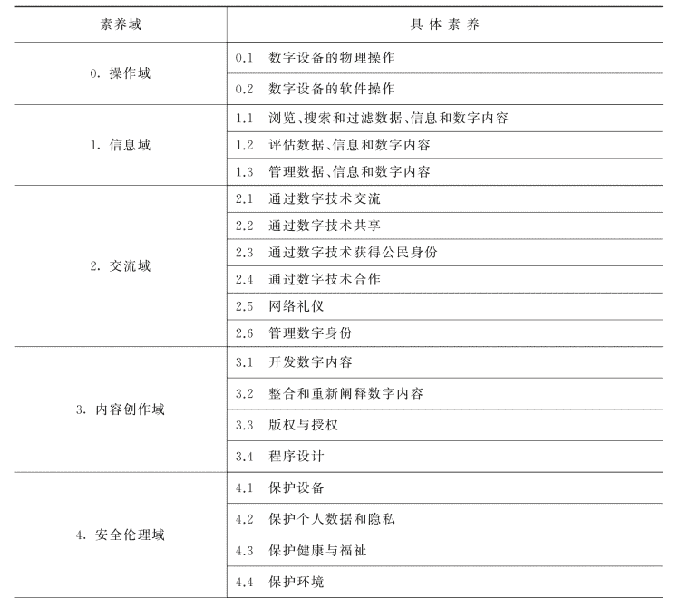

(Continued)

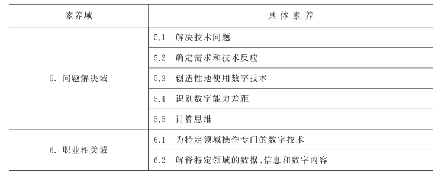

Source: UNESCO Institute for Statistics (UIS), 2018.

It is particularly noteworthy that, according to the UNESCO report, the aforementioned framework added "0. Operational Domain" compared to the previous "Digital Competence Framework 2.0" (DigComp 2.0 framework). Targeting the contexts of developing countries and low-income regions, it measures very basic hardware and software operations, which aligns well with the survey subjects of this paper, facilitating the author's discovery of urban-rural differences in subsequent comparisons.

As this framework was only recently released, it has not yet been widely adopted by scholars. On October 1, 2019, the author searched the China National Knowledge Infrastructure (CNKI) using the theme "Digital Literacy Global Framework" and retrieved only one Chinese core journal article, namely "Research on the Digital Literacy Global Framework and Its Implications" by Lü Jianqiang and Xu Yanli. Therefore, this paper designs the coding scheme based on this framework, combined with the actual survey situation.

# II. Research Questions and Methods

## 1. Research Questions

This paper attempts to answer questions at the following three levels:

At the factual level: What electronic devices can children in Shanghai and Yunnan access respectively, and how do they use them? In terms of digital literacy, what kind of cultivation have they received respectively, and what differences have emerged?

At the causal level: Examining from the perspectives of teachers, schools, and parents, what causes the differences in digital literacy between children in the two regions, and creates bottlenecks for relevant education poverty alleviation?

At the countermeasure level: What feasible practices exist at the national, local, and developed region levels respectively, that can help enhance the digital literacy of children in central and western China, thereby optimizing the path of education poverty alleviation?

## 2. Research Methods

Previous studies on digital literacy mostly adopted quantitative research methods, with research subjects limited to children or parents. The frameworks used were mostly formed prior to the one used in this paper, such as the EU Digital Competence Framework, the US Framework for 21st Century Skills, and the New Media Consortium Horizon Project, etc.

This paper adopts a mixed-methods approach combining qualitative and quantitative research, conducting surveys through in-depth interviews, participatory observation, and questionnaires. The research subjects are primarily children, extending outward to parents, teachers, and schools, to explore the diverse factors influencing children. For the first time, the research dimensions refer to the Digital Literacy Global Framework proposed by UNESCO, and the in-depth interview outlines were designed in combination with the actual survey situation (see Tables 2–6).

From January to April 2019, the author conducted 6 and 3 field surveys in Eryuan and Shanghai respectively, covering a total of 124 students, 14 teachers, 19 parents, and 4 educational administrators.

Eryuan County, Yunnan Province, is located in the border area of western Yunnan. It is one of the typical regions for the national implementation of the Education Poverty Alleviation Project, and a national-level impoverished county paired with Shanghai Jiao Tong University for targeted assistance since 2012.

The five schools examined in this paper—Biyun Complete Primary School, Fengyuan Complete Primary School, Haikou Complete Primary School, Yuhu Middle School, and Yuhu No. 2 Middle School—are all rural primary and secondary schools. They are basically equipped with dedicated computer rooms and multimedia equipment in ordinary classrooms, but the degree of utilization varies greatly.

There is a shortage of professional IT teachers in schools, and teacher mobility is high, which can represent the current situation of Chinese rural schools relatively well.

As a first-tier developed city in China, the software and hardware conditions of its public primary and secondary schools can also comprehensively reflect the current situation of urban areas in China.

The schools examined in this paper—Jiaoda Affiliated Primary School, You'ai Middle School, and Meilong Middle School—all possess modernized IT classrooms, electronic whiteboards, and other informatized venues and equipment, and have IT subject teaching and research groups composed of 3–5 professional IT teachers.

Among them, Jiaoda Affiliated Primary School is also equipped with a dedicated campus TV station, operated independently by the school's students.

Table 2　Composition of Student Samples for In-depth Interviews

Note: Ordinary public primary schools in Shanghai implement a five-year system, with no sixth grade, while junior high school is a four-year system, with the first year (Grade 7) being a preparatory class.

Table 3　Composition of Parent Samples for In-depth Interviews

Note: Ordinary public primary schools in Shanghai implement a five-year system, with no sixth grade, while junior high school is a four-year system, with the first year (Grade 7) being a preparatory class.

Table 4　Composition of Teacher Samples for In-depth Interviews

*: This interviewee teacher simultaneously undertakes IT teaching and head teacher (class advisor) duties.

Table 5　Code Table of Interviewed Schools

When releasing this framework, UNESCO particularly pointed out the relative importance of different items, and noted that using this framework for assessment requires adaptation to local conditions.

Combined with the actual survey situation, the author made the following adjustments to the "Literacy Domains" and "Specific Literacies": deleted "6. Career-related Domain", as this item was designed for adults' specific career needs while the main subjects discussed in this paper are children; deleted "2.3 Obtaining Citizenship through Digital Technology", "4.4 Protecting the Environment", and "5.2 Identifying Needs and Technological Responses", because these three items have relatively low importance among all items and low relevance to the children's digital literacy discussed in this paper; the specific question descriptions are based on the detailed descriptions given by UNESCO and the software and situations children encounter in China's real digital environment.

During the survey, basic information was first collected via questionnaires: the quantity, types, and duration of digital devices children could access; the importance children attached to digital literacy and electronic devices; satisfaction with school IT classes; motivations for using electronic devices (entertainment, learning), etc. Then, the current situation was explored in depth through in-depth interviews.

Table 6　Coding Design for In-depth Interviews with Children

(Continued)

Table 5 is not fully applicable to in-depth interviews with parents and teachers. Because this survey focuses more on their influence on children, rather than their own digital literacy.

Therefore, interviews with them were mainly conducted from the perspectives of their own attitudes toward electronic devices, attitudes toward children's use of electronic devices, and whether they could provide help.

Drawing on previous research on adult digital literacy measurement, this survey examines their own digital literacy mainly from five dimensions: "Information Operation, Information Creation, Social Interaction, Digital Safety, and Improvement Channels".

# III. Research Findings

## 1. Factual Level

Through in-depth interviews, the author obtained the specific differences in digital literacy between children in the two regions:

### 1) Operational Domain

The operational domain is divided into physical operation and software operation. In terms of physical operation, there is no significant difference between students in the two regions in basic operations. However, Teacher D from Y Middle School in Yunnan also stated: "Some individual students still need me to teach them how to turn the computer on and off hand-in-hand."

In terms of software operation, students from both regions were asked to self-assess their operational proficiency with software such as Word documents, PPT presentations, Excel spreadsheets, Photoshop image editor, and Flash animation production. Here, 0 points represent "never heard of it", and 7 points represent "very proficient". The scores of primary and junior high school students in both regions are shown in Tables 7 and 8:

Table 7　Self-assessment Scores of Information Operation for Primary School Students in Both Regions

Table 8　Self-assessment Scores of Information Operation for Junior High School Students in Both Regions

Observing Tables 7 and 8, it can be found that the scores of Shanghai students are generally higher than those of Eryuan students, indicating that Shanghai students rate their own information operation abilities higher.

However, there is also a very interesting phenomenon: Eryuan junior high school students rarely scored higher than Shanghai junior high school students in the operational ability of Photoshop and Flash.

This is because these two software are within the syllabus scope of the Yunnan Province Grade 8 Information Technology Academic Level Examination, while the Shanghai Junior High School Information Technology Academic Level Examination allows module selection.

The surveyed School A chose the programming module; therefore, in these two software items, students mainly rely on self-directed learning driven by extracurricular interest.

This also reflects from the side that changes in the evaluation system can indeed have a significant impact on students' information operation abilities.

### 2) Communication Domain

The difference in communication is the smallest among the differences between students in the two regions. Since the information interaction behaviors—i.e., socializing—that students can access under the exam-oriented environment mainly reflect entertainment, it is quite reasonable that the skill differences between students in the two regions in this aspect are not so significant.

It is worth mentioning that homework-solving apps have gradually become a relatively niche way for Shanghai students to solve after-school difficulties.

In a certain Grade 7 class in School A, only about 1/3 of the students said they would frequently use such software.

More students shared with us other ways they solve problems:

"The teacher said if there are any questions we can't do, we can send him a WeChat message. I've messaged him several times already; he gives me hints on the approach and inspires me on how to do it."

Here, WeChat serves not only as a tool for students to solve after-school difficulties but also as a tool for them to communicate with teachers after class.

In Yunnan, we found that students are generally timid in communicating with teachers, and many teachers also reported that communication with students is difficult, with information delivery being inefficient and not smooth.

Shanghai children also possess stronger information interaction abilities than Eryuan children.

### 3) Content Creation Domain

Students in both regions have experience using electronic devices to complete school exploratory assignments.

For example, at Y Middle School in Eryuan, Grade 7 students shared with us the "Happy Chinese" activity they conduct every vacation:

"We use a specific software to upload photos taken during vacation trips, and then write some reflections next to them. It can be done on a phone or computer; those of us without phones use our parents'. Every winter and summer vacation, we are required to do this assignment several times."

In Shanghai, besides IT courses, many schools also carry out various forms of inquiry courses, extension courses, and interdisciplinary activities related to IT.

Taking School A as an example, besides two class hours of IT lessons per week, Grade 6 students also have one class hour of inquiry lesson conducted in a dedicated computer room.

In the inquiry lessons, they learn how to make electronic newspapers, present in groups, and report based on certain themes.

These themes are either related to hot topics, such as "Welcoming the 40th Anniversary of Reform and Opening-up", or related to life, such as "Garbage Classification Starts with Me".

Extension courses are also a channel for School A students to use IT devices.

The IT teacher at School A told us that because extension courses are selected on a semester basis, with each student re-selecting every semester, over half of the students in the school will take at least one IT-related extension course during their junior high school stage.

It can be seen that extension courses have also become an important channel for School A students to use IT devices.

In contrast, Yunnan students have very few opportunities to use IT devices outside of IT classes.

Besides IT classes, schools no longer offer other IT-related extension courses or activities.

### 4) Safety and Ethics Domain

First, Shanghai students were able to mention a more comprehensive understanding of information security in the in-depth interviews, such as privacy leaks, big data risks, resisting pirated works, etc.

In comparison, Yunnan students' concept of safety and ethics stays at virus prevention and resisting unhealthy websites; occasionally a student describes issues about privacy leaks, but no student could describe content regarding copyright awareness.

Second, Shanghai students demonstrated a stronger sense of personal experience when expressing their views.

Many students, even without personal experience, could describe online or telecom fraud incidents experienced by people around them.

In comparison, Yunnan students mostly only heard fragments from newspapers, news, or adults' mouths occasionally; they seem to know the term but lack personal experience and accurate grasp of the risks.

### 5) Problem-Solving Domain

In the field of problem-solving—how to creatively use electronic devices, identify digital capability gaps, and possess computational thinking—there are larger differences between students in the two regions.

In Shanghai, besides deepening daily learning through online courses—i.e., replacing the role of traditional offline "cram schools"—many students also showed interest in knowledge such as programming.

For example, a Grade 6 student in School A told us: "I originally wanted to learn programming to code my own games, so I took C++ online courses. But later I found he was teaching how to prepare for a national competition, so I wasn't that interested anymore, but I'm still continuing to learn."

In contrast, Yunnan students rarely use electronic devices for self-expansion learning after class; even if they do, it generally stays at the level of information acquisition.

For example, among the behaviors of students using IT after class known to us, the one with the most "self-exploration" flavor came from a Grade 4 student at F Primary School: "Once, there was a picture of a bird in a book, but below it was only the riddle clue, not the bird's name. Later, another student and I tried searching the clue online, and we found the bird's name. Also, I'm very interested in giant pandas, so I often use my phone to search for photos of pandas eating bamboo."

## 2. Causal Level

The above reveals the objective situation in the process of digital literacy cultivation for children in the two regions.

It cannot be denied that the difference in technological development levels caused by the different macro environments of the two regions is an important reason.

However, parents, teachers, and schools—these three micro-individuals closely related to children—also play important roles.

The following will attempt to explore in what specific aspects and how they influence children's acquisition of digital literacy.

### 1) How Parents Influence Children

The survey found that parents' influence on children mainly takes effect outside school.

The author believes there are two main roots of this influence: first, the special family structure in China's rural areas represented by Eryuan; second, the emotional characteristics of the dichotomous decision-making mode under traditional Chinese parental thinking.

On the one hand, the Eryuan region has a left-behind children family structure similar to other rural areas in China.

Among the 11 families visited for the survey, 5 were left-behind children families.

Their fathers or mothers mostly work as migrant workers in Dali Xiaguan or Kunming.

The mother of a Grade 5 student at B Primary School said: "My husband and I usually work at construction sites in (Dali) Xiaguan. At home, it's mainly her grandparents taking care of her. They don't understand either; they let the child use phones and computers for everything, so I later locked the computer away—anyway the elderly don't know how to use it. As for the phone, I don't let her use it whenever I come back."

When asked if she would be willing to participate in school-organized parent-child activities with her child, she said: "Never thought about it. Need to think more, because if I come back for activities, no one at home will work to earn money. There are also elderly at home... no time, getting busier these years."

The above situation is not an isolated case.

In left-behind children families, the older generation often cannot provide effective information skill guidance for children, and it is even harder for them to discern the pros and cons of children using these devices.

But these children, due to lack of parent-child interaction from a young age and parents being far away, attach extraordinary significance to phones and computers.

On the other hand, most parents in the Eryuan region also have traditional Chinese parental thinking, i.e., an emotional characteristic of "black-and-white", "dichotomous" decision-making.

They feel that whatever improves children's grades is "good stuff", and whatever doesn't is "bad stuff"; phones and computers undoubtedly belong to the latter.

This thinking makes parents' control measures over children's use of IT devices simpler and cruder; negative news such as "internet-addicted teenagers" further exacerbates their fear.

Thus, children can only use information technology in very limited time.

This results in only two purposes for use: one is entertainment, the other is effective learning.

This also answers why Yunnan kids use homework-solving apps like "Homework Helper" more than other learning software that allows gradual accumulation; why once they find a software, they stick with it long-term, unwilling to spend time finding enough software for comparison and screening.

### 2) How Teachers Influence Children

Director Z of the Educational Technology Center of Eryuan County Education Bureau introduced: "IT classes are not taught well; the key problem lies in the faculty."

"The talent issue is the biggest issue. Here, junior high schools still have a few relatively professional teachers, but primary schools have extremely few professional teachers. Most primary school teachers are generalists; generally, IT classes are assigned to younger teachers. They might teach kids typing, going online to download music, but it's hard to form cultivation of students' information literacy... In our survey, we found that in some remote schools, this class might not be taught at all, even though it's scheduled on the timetable, the actual class is not held."

Among the three IT teachers surveyed by the author (see Tables 9, 10), whether in junior high or primary school, none were IT majors, and all held multiple positions.

Teachers' lack of professionalism leads to non-standard and unsystematic teaching content, especially at the primary stage, where teachers generally report that the textbook difficulty is too deep to use.

Due to the lack of unified guidance, the degree of information skill imparting in daily teaching is often uneven, let alone the cultivation of children's information literacy.

Even in junior high, teachers' lack of professionalism causes children to lose many opportunities to participate in extension courses and activities like their Shanghai peers.

Director Z stated that Eryuan County has also equipped 3D printers in forty-odd compulsory education schools in the county, but very few can actually be used. In these higher-threshold technical fields like 3D printing, non-professional IT teachers are even more unable to provide effective guidance for children.

Table 9　Basic Information Table of Eryuan IT Teachers

Table 10　Basic Teaching Situation Table of Eryuan IT Teachers

### 3) How Schools Influence Children

First, schools' behaviors are constrained by the curriculum evaluation methods formulated by higher-level departments.

For example, precisely because Yunnan Province has not established a unified IT assessment system at the primary stage, most schools do not attach importance to this course.

This also provides institutional loopholes for teachers' arbitrary teaching and non-professionalism.

Second, schools' decisions are also constrained by the financial system formulated by higher-level departments.

Currently, rural schools usually use "Compulsory Education School Guarantee Funds" for the maintenance of informatization equipment. These funds are allocated by the state to guarantee the normal operation of schools.

But for most schools, after maintaining basic school operations, there is little surplus left; they can neither improve software provision nor conduct long-term maintenance and optimization of hardware.

In addition, schools' influence on children is also externalized in fields such as campus publicity and curriculum settings that reflect top-level design.

For example, through the bulletin boards of School A in Shanghai, one can see that "Smart Campus Programming", "Robotics", "STEM Courses", etc., are all typical examples of the school constructing a diverse curriculum.

The school also attaches great importance to the development of IT courses.

In contrast, the public publicity windows of Yunnan schools rarely show content related to IT, or even to extension courses.

# IV. Countermeasures and Conclusion

The author believes that effective institutional design should balance the optimization of national top-level design, the improvement of assistance methods from developed regions, and the construction of the rural regions' own educational atmosphere, stimulating the three to form a synergy.

## 1. National Level

### 1) Taking Teacher Quality as an Assessment Indicator for the Education Poverty Alleviation Project

Currently, the indicator requirements for rural schools in the national Education Poverty Alleviation Project mostly focus on the "material" level, rarely touching the "human" level.

For example, in the "Notice of the Ministry of Education and Other Departments on Implementing the Opinions on the Education Poverty Alleviation Project", the description of educational informatization is limited to "accelerating the construction of school information infrastructure, promoting the application of high-quality digital educational resources, advancing educational management informatization...", without involving any requirements for human resources such as faculty.

It should be noted that the improvement of faculty quality cannot be solved by rural areas on their own; it must be coordinated at the national level.

When asked whether it is possible to recruit a large number of professional IT teachers for the compulsory education stage in Eryuan, Director Z stated that this approach is not feasible in the short term.

On the one hand, the authority to allocate personnel quotas lies not locally but in higher-level administrative organs; on the other hand, the shortage of IT teachers is only one manifestation of the shortage of teacher resources.

In China's rural areas, English classes, math classes, etc., all face similar problems; one move affects the whole situation.

Therefore, in the short term, we hope to coordinate at the national level to tap into the existing "generalist teacher" resources.

In the long term, we need to make more young people willing to stay and teach in rural areas, such as cultivating a batch of teachers capable of going deep into rural areas to carry out digital literacy guidance through targeted training methods like "tuition-free normal students".

### 2) Enhancing the Targeted Nature and Timeliness of Teacher Training

Integrate resources in training organization, simplify by removing the redundant.

Most Eryuan teachers have participated in several IT trainings organized by the county, township, or town, but these trainings are largely similar, with rigid requirements focused on meeting standards, lacking pertinence.

Under current conditions, resources should be integrated to the maximum extent, so that every teacher receives systematic rather than fragmented training.

## 引言

在上海，信息技术教师每两周都要参加由区学科中心组组织的教研活动，结合听课、互评、讲座等形式，使得教师的培训常规化与体系化。因此，在乡村地区，也可适当转变思路，从邀请专家到互相评价。

同时，洱源许多教师表示，目前培训以技术操作为主，但许多老师缺乏如何将这种认知以科学的方式传授给孩子的教学方法。因此，现有培训可以逐渐从聚焦技术转向聚焦思维和教学，帮助老师建立起相对专业和体系化的思维体系，进而从数字素养角度影响学生。

## 调整乡村地区信息技术课教学和评价体系

目前，乡村地区的信息技能的评价体系与课程设置之间存在较为严重的不匹配。

一方面，课程设置给予乡村学校和教师的压力太大。在上海，义务教育阶段大多数学生只要接受 2 年的信息技术基础型教育，而在云南却是 6 年。在洱源，许多信息技术课成了学生自由活动或自修课。因此，应编写符合乡村地区实际情况的教材，乡村地区小学阶段每周的课时数可以减少为 1 课时，以落实教材内容，形成体系化信息技能培育为目标，逐步推进。

另一方面，现有评价体系又无法给予学校和教师与课程标准相匹配的正向激励。在初中，如今只有学生八年级末时进行全省统一的学业水平考试，这种方式太过单一，许多学校在实践中采取了“考前突击”的方式。

可鼓励学校通过模拟在线平台等网络资源，通过在线答题生成平时成绩等途径使学生的评价方式日常化、过程化；在小学，云南省没有组织统一的信息技术课程考试，缺乏评价监督手段，未来可鼓励各校出台具体的评价建议，通过抽查、汇报等形式进行定期监督和过程管理。

## 发达地区层面

目前，发达地区对乡村地区的帮扶路径主要有两种：一是由学校主导的教育资源帮扶；二是由企业主导的技术资源帮扶。这两种路径都存在可以优化的空间。

### 完善由学校主导的教育资源帮扶路径

当下，不少城市学校通过教师挂职、社会实践等形式鼓励师生投身公益，为乡村地区输送优质教育资源。笔者建议在传统高校社会实践和支教以文化课教学为主的基础上，融入信息技术课程的资源，配合当地教师对教材要求解构和再创作，探索出适合当地儿童学习的信息技能教学模式。

### 完善由企业主导的技术资源帮扶路径

目前，不少互联网公司，如阿里巴巴、沪江网等依靠自身技术资源，参与了乡村地区信息化建设的扶贫项目，具体方式包括科学回收与捐赠闲置电脑、通过网络共享优质课程等。

但这些帮扶大多聚焦硬件设施，或简单地通过技术实现教育资源的空间转移，很难切实提高当地儿童的数字素养。简单复制型的“远程教育”既容易造成发达地区优质教育资源在贫困地区的“水土不适”，又难以让孩子体会到如何利用信息技能去实现更深层次的自主学习。

未来，互联网公司可尝试以提供电子书包的使用培训、教学类软件的实验与应用等。同时，利用专业优势为当地儿童提供更多关于信息检索、信息安全知识的培训，真正做到“授人以渔”。

## 乡村地区层面

在乡村地区层面，最重要的是构建形成家校互动的长效机制。

在上海，“学校—教师—家长”三者总能在对孩子进行数字素养的培育上形成合力。教师在接受访谈时，经常援引学校的规章制度，家长也经常表示自己是在配合学校老师的工作。

相较之下，云南的学校、老师和家长虽不会形成正面冲突，却也无法形成合力。比如，若干受访教师提到“并不希望学校安排兼职信息技术课”“不是专业出身，怕教错”等。但家长却认为“学校应该多教点”“在学校里多教点，课后就不要再用电脑了”等。由此可见，学校、教师、家长无论在限制、鼓励还是默认孩子学习信息技术方面，缺乏高效的沟通和协调机制。

因此，我们建议建立统一的交流平台，通过探索亲子活动、家校互动等方式畅通沟通渠道，在儿童信息技能的培育方面达成共识、形成合力，最终凝聚为教育共同体。

## 结语

虽然洱源和上海两地儿童的数字素养差异可能只是中国教育扶贫工程中的一个“小问题”。但笔者相信，洱源不只代表洱源，上海也不只代表上海。以此为切入点，进而折射出中国城乡发展进程中面临的公民信息素养差异、教育扶贫的“痛点”和“难点”，就是一个极具共性的“大问题”。因此，如果能为其觅寻良好的解决方案，受益者将不只是洱源儿童，而是整个中国乡村的儿童。

## 参考文献

[1] 马克·布朗，肖俊洪. 数字素养的挑战：从有限的技能到批判性思维方式的跨越[J]. 中国远程教育，2018(4)：42－53.

[2] UNESCO Institute for Statistics. SDG 4 DATA DIGEST 2018：Data to Nurture Learning[R]. Montreal，Quebec，Canada：UIS，2018.

[3] 吕建强，许艳丽. 数字素养全球框架研究及其启示[J]. 图书馆建设，2020(2)：119－125.

[4] 韦路，张明新. 第三道数字鸿沟：互联网上的知识沟[J]. 新闻与传播研究，2006(04)：43－53＋95.

[5] 李晓静. 数字鸿沟的新变：多元使用、内在动机与数字技能——基于豫沪学龄儿童的田野调查[J]. 现代传播(中国传媒大学学报)，2019(08)：12－19.

[6] 张济洲. 隐蔽的再生产——城乡不同阶层家庭学生互联网使用偏好调查[J]. 开放教育研究，2018，24(5)：73－80.

[7] UNESCO. Toward knowledge societies[R]. Paris：UNESCO Publishing，2005：22.

[8] van Dijk J A G M. A Framework for Digital Divide Research[J]. Electronic Journal of Communication，2002，12(1)：1－7.

## 作者介绍

蒋钰，上海交通大学媒体与传播学院 2016 级本科生；李有，上海交通大学凯原法学院 2019 级硕士研究生。

