# AI时代：新媒介、新产业与新社会·第二辑

## 前言：一场关于“智能与传播”的跨学科对话

2019年10月26日，第六届新媒体国际论坛在上海交通大学落下帷幕。本届论坛以“人工智能时代：新兴媒介、产业与社会”为主题，汇聚了学界与业界的目光。

新媒体已成时代洪流。根据中国互联网络信息中心（CNNIC）发布的第45次统计报告，截至2020年3月，我国网民规模突破9.04亿，互联网普及率达64.5%。技术以前所未有的速度渗透进日常生活，传播不再局限于信息分发，而成为连接产业与个体的关键枢纽。这引发了一系列深层追问：大众媒介使用行为呈现何种新特质？公众媒介素养现状如何？新闻产业如何破局？新闻传播教育与研究又该何去何从？这些新现象、新问题亟待回应。

本书精选自该论坛的优秀论文，系“第二辑”成果。它立足媒介生产与使用的双重视角，深度剖析新兴媒介对产业生态与社会结构的重塑。研究版图涵盖新闻研究与新闻教育、智能媒体时代的产业变革、媒介使用与素养等核心议题。

**聚焦生产端：重构新闻生产与人才培养新范式**
王璐瑜、沈琪引入心理学精加工可能性模型（ELM），通过问卷与实验双轨制，揭示大学生日常媒介多任务处理水平与微信端阅读新闻时辨别谣言能力的负相关关系，并证实持续注意力在其中的部分中介作用；张超针对国内社交平台谣言泛滥现象，构建“算法-利益相关者”协同治理新框架；易龙、李晨宇以“课程产品研发”理念为切入点，针对传统新闻课程痛点，重塑卓越新闻传播人才培养机制；郑晓迪、陈心怡则借鉴美国报业数字化转型经验，探析新闻教育改革与人才培养的应对之道。

**洞察产业变革：媒体融合与智能化的双重奏鸣**
李海东、徐志强基于人工智能与媒体产业深度融合的实证分析，绘制媒体智能化转型路径图；赵莉、张晓雨以浙江安吉传媒集团“爱安吉”客户端为样本，透视融媒体客户端的战略创新与未来走向；李淑妮以央视新闻抖音账号数据为依托，解码智能传播技术下主流媒体突围与视觉新闻的未来图景；徐志强等人则聚焦新一代智能技术集群，为广电媒体内容“智造”支撑体系建设按下加速键。

**深入使用场：跨群体的媒介实践与素养进阶**
白儒晋、李正鸿构建调节中介模型，剖析“新上海人”社交媒体使用与社会责任认同的内在链条，厘清社会融入的中介机制与社会信任的调节效应；金恒江等人深入乡村语境，考察社交网络使用行为、信息分享、娱乐活动及使用心理对农村居民社会资本的多维影响。

**补齐素养短板：从数字鸿沟到全民赋能**
谢晋文、黄固祥在移动互联与AI双重语境下，界定大众新闻素养提升的目标、内容与标准；傅瑜梳理南非媒介素养教育发展脉络与动因，为本土实践提供镜鉴；蒋钰、李游实地走访上海与云南校园，聚焦城乡儿童数字素养差异背后的复杂成因，为教育扶贫与信息化均衡开出药方。

智能时代，新媒介技术催生新需求、重塑新业态，学界与社会共享机遇与挑战。推动跨学科、新视角、新理论的生长刻不容缓。上海交通大学媒体与传播学院依托校内强劲工科资源，践行文理通识育人理念，持续推动新媒介、新技术、新问题的研究探讨。期冀本书出版，能激发传播学界与业界更宽广的思辨与对话，共促学科繁荣。

---

## 新闻研究与新闻教育

### 媒介多任务行为如何重塑新闻阅读与谣言辨识能力？

**王璐瑜　沈琪**

**【核心摘要】**  
本研究采用问卷调查与实验法相结合的混合设计，以上海高校大学生为样本，引入心理学精加工可能性模型（ELM），深度剖析个体日常媒介多任务处理习惯与智能手机新闻客户端阅读语境下社交网络谣言辨识力的关联机制。结论显著：日常媒介多任务处理水平越高，个体辨别谣言的能力越弱；新闻客户端阅读过程中的持续注意力在该关系中发挥部分中介作用；而精细化信息加工水平与谣言辨识力呈负相关。

**【关键词】**　社交网络、谣言辨识、持续注意力、精细化信息加工

技术迭代持续重写媒体内容生产逻辑。智能媒体时代，算法与大数据驱动下，新闻生产、分发与消费全链条加速向自动化、智能化迈进。然而，社交网络谣言却借势蔓延，其在传播层级、触达人数、扩散广度上竟超越真实新闻，这与公众对新闻信息的加工与再传播行为紧密相连。[1]

新技术的涌现正深刻重塑大众的媒介体验。当下，借助智能手机上的社交应用与新闻客户端获取资讯，已成为日常常态。[2] 在媒介环境日益丰富的背景下，人们习惯于同步开展多项媒介活动——比如一边看电视一边刷手机，或是听歌时浏览微博。这种“媒介多任务”行为 [3] 却可能引发注意力涣散、思维游离等负面效应。[4] 那么，当人们在手机端阅读新闻时，有限的注意力资源是否会被其他媒介活动挤占，进而干扰对新闻信息的接纳与判断，最终助推虚假信息在社交网络中泛滥？这正是本文旨在探究的核心命题。

本研究以上海高校大学生为调查对象，依托心理学中的“详尽可能性模型”（ELM），综合运用实验法与问卷调查等混合研究路径，考察受试者在移动端阅读新闻时，日常媒介多任务使用、持续性注意力、精细化信息加工与虚假新闻甄别力之间的关联机制，期冀从受众认知视角出发，为社交网络虚假信息治理提供实证支撑与理论参考。

### 1. 文献回顾

#### 1.1 社交网络语境下的虚假新闻

“虚假新闻”并非新鲜词汇，但随着智能技术迭代，其生成机制与社会影响力已与大众传播时代截然不同。[5] 学界目前对社交网络虚假新闻（fake news/false news）尚无统一定论。主流研究将其界定为：“在形式上模仿新闻，却缺乏新闻专业规范流程与确保真实、可信意图的捏造信息”。[6] 其核心特征在于：借助误导性内容谋取经济、政治等利益；[7] 信息源既可能是专业媒体，也可能是社交平台。[8]

社交网络虚假新闻主要指在社交平台上大范围传播的虚假或无根据新闻事件。其来源涵盖具备采编资质的专业新闻机构（如传统媒体、自媒体公众号），以及拥有转载资质的网络平台（如头条号、各类新闻客户端）。

既往研究主要聚焦四大维度：
① **文本特征**：如借用“权威事实”、引用生活实例增强可信度等；[9]
② **传播特征**：如网络密度、意见领袖、好友评论等对扩散的作用；[10-11]
③ **源头治理与技术甄别**：从生产、分发端重塑职业规范，[12] 或利用自然语言处理技术验证图文真伪；[13]
④ **媒介素养教育**：致力于提升公众甄别能力。[14]

另有学者从受众认知切入，探究大众接受、转发虚假新闻的心理动因。[15-16] 认为“偏见”存在使个体在知识结构受挑战时，难以接纳新信息；[17] 社交网络的推荐算法机制强化了这种选择性接触，加深了对虚假新闻的认同。[18] 戈登·潘尼库克等人则持异见，通过认知反思测试发现，大众无法识别虚假新闻，实因缺乏深度分析与推理，社交网络反而可能加剧了人们的“直觉依赖”。[19]

无论是“偏见”还是“直觉依赖”，均指向信息加工模式与虚假新闻接受传播的紧密关联。遗憾的是，现有研究多止步于此，未深入揭示大众究竟如何通过这两种路径“接纳”虚假新闻。这种“懒惰”的加工方式 [19] 究竟是对媒介技术的单纯依赖，还是别有深意？

#### 1.2 媒介多任务

作为影响个体信息加工模式与效果的关键变量，[20] 媚介多任务引发了新闻传播、心理学、教育学等多学科的广泛关注。具体而言，它指“媒介使用伴随非媒介活动，或在同一时段内同步使用多种媒介”的行为，[21] 其中多媒介使用既包含跨媒介并行，也包含单终端上多媒介活动的同步进行。[3]

新闻传播学研究聚焦于媒介多任务环境下的传播效果，大体分两类：
一类考察**即时任务表现**：对比单/多媒介任务环境下的差异。发现视频环境下阅读印刷文本会削弱理解与反驳能力，使人更易被说服；[22] 边接触政治新闻边进行其他媒介任务者，政治议题认知水平较低。[23]
另一类考察**长期累积效应**：发现高日常媒介多任务水平者在阅读健康信息时，对劝导性内容接受度更高，行为意向更强。[24]

上述研究证实，媒介多任务使用能显著影响信息加工效果。鉴于此类行为已演变为一种生活常态，[25] 本文认为有必要引入其与虚假新闻甄别的关联探讨。结合中国公众获取社交新闻的主流路径，选取大学生群体为样本，考察日常媒介多任务水平与移动端阅读语境下虚假新闻判断力的关系。**假设1：移动端阅读新闻时，个体日常媒介多任务水平越高，虚假新闻甄别能力越差。**

#### 1.3 持续性注意力

在探讨媒介多任务如何影响信息接纳的既有文献中，认知注意力的中介作用备受关注。例如，研究证实在多屏干扰环境中，若个体能向主任务投入足够注意力（注视时长达标），其对信息的记忆、理解与反驳能力，与无干扰的单屏环境无显著差异。[22] 心理学研究指出，日常媒介多任务水平越高，个体越易分心；[20] 这种行为模式可能削弱个体在一段时间内维持特定任务目标注意力的能力。[4] 基此推导：**假设a：移动端阅读新闻时，个体日常媒介多任务水平越高，持续性注意力越差，进而导致虚假新闻甄别能力下降。**

#### 1.4 精细化信息加工

心理学视角下的新闻加工：精细加工模型（ELM）解析

传播学研究长期聚焦于人脑这一“黑箱”如何处理新闻资讯。心理学领域的精细加工模型（ELM）为此提供了经典解释框架。该模型指出，个体在处理信息时会启动两条截然不同的认知路径：**中心路径**与**外周路径**。走中心路径时，受众会深度审视所有可得线索，结合既有知识体系权衡信息的**实质优劣**；走外周路径则倾向依赖**简易线索**（如来源权威性）快速下判断。精细加工程度直接左右信息接纳效果——以强论证的政治、健康传播为例，中心路径加工越深，受众的学习吸收与行为意愿就越强。

既有文献揭示，媒体多任务显著干扰精细加工进程。声音、色彩等媒介干扰项会阻碍深度思考；习惯多任务并行者往往难以敏锐甄别论证质量。这暗示媒体多任务可能通过抑制加工深度，进而削弱信息评判力。基于此，我们提出假设：移动端阅读新闻时，个体日常媒体多任务水平越高，其信息精细加工程度越低，假新闻辨别力也随之减弱（假设 b）。

### II. 研究设计

#### 1. 受试对象

我们在上海高校招募 250 名本科生开展媒体多任务问卷测得，回收有效问卷 219 份（男 103，女 116，平均年龄 20.4 岁）。参考前人操作规范，依据媒体多任务指数（MMI，详见测量部分）将得分处于均值上下一标准差以外者分别界定为**重度媒体多任务者（HMM）**与**轻度媒体多任务者（LMM）**。最终按得分筛选两组各 30 人，共 60 人进入后续实验。

#### 2. 刺激材料与实验流程

考虑到健康、政治类谣言贴近民生、传播广、影响大，我们从中国互联网联合辟谣平台月报及“@微博辟谣”2017 年 3 月至 2019 年 4 月发布的高互动辟谣榜中，甄选出 16 条（健康、政治各 8 条）由新闻客户端发布或转发的虚假信息作为初始语料。

先邀 5 名本科生预评估 16 条材料的可信度，剔除均分最高/最低者及 6 条预实验受试者自称“见过辟谣”的条目，最终保留 10 条实验材料。题材涵盖“恶意传播艾滋病”、“公职人员醉驾直接开除”、“电动车 4 月 15 日前必须上牌”等。预实验 5 人平均阅读 10 条材料耗时 15 分钟左右，波动极小。

正式实验分组别在教室进行。受试者需在智能手机上连贯阅读全部 10 条材料，不限时。阅读完毕后逐条评定可信度，并任选 2 条简述判断依据。最后再次确认是否见过辟谣信息；若有，该条可信度数据剔除。实验中全员均表示未见过辟谣，排除了先验知识干扰。

#### 3. 变量测量

##### 1) 媒体多任务水平

本研究改编自 Eyal Ophir 等的《媒体使用问卷》，结合《中国互联网络发展状况统计报告》（第 43 版）及智能手机多任务行为量表，依托上海本科生媒介接触实况锁定 10 项日常媒介活动。

**步骤 1：回顾时长。** 受试者回顾过去一周在“即时通讯、浏览社交媒体、浏览非社交类网站、观看网络视频、网购支付、玩视频游戏、阅读网络文学、参与网络教育、听音乐、纸质阅读”10 项活动上的总时长。为提升准确性，引导受试者参考手机自带应用使用记录辅助回忆。选项设“未使用”“≤10 分钟”“11–30 分钟”“31–60 分钟”“61–120 分钟”“121–180 分钟”“181–300 分钟”；超 300 分钟手工填报。计分时“未使用”记 0，区间取中位数（如“≤10 分钟”计 5 分钟），超 300 分钟采实填值。

**步骤 2：并行频率。** 针对每项主任务，询问其他 9 项活动的并行频率（“从不”“很少”“有时”“经常”）。例：“即时通讯（微信、通话）为主时，多频繁同步浏览社交媒体 / 网页 / 视频 / 购物 / 游戏 / 网文 / 网课 / 音乐 / 纸质阅读？”共得 10 组 9 道子题。

**步骤 3：指数计算。** 采用 Ophir 等经典 MMI 公式：频率编码“从不”=0、“很少”=0.33、“有时”=0.67、“经常”=1。公式中 $m_i$ 为主任务 i 并行频率均值，$h_i$ 为该任务周时长，$h_{total}$ 为总媒介周时长。本研究该量表 Cronbach’s $\alpha$ = 0.89。

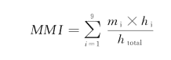

##### 2) 注意持续时长

以阅读时长表征移动端新闻阅读的持续注意力。问卷借“问卷星”分发，受试者手机端打开链接（含 10 条材料及可信度、相关性测项），平台自动记录从打开到关闭的总秒数。因要求一次性连贯阅读，该时长即为持续注意力指标。

##### 3) 信息精细加工程度

改编自成熟精细加工量表，设 5 道陈述题考察阅读历程：“我会把新闻与自身经历联系”“我会调动既有知识”“我会联想其他渠道见过的新闻”“我会思考当事人/部门应如何应对”“我会思考新闻的现实冲击”。采 5 级李克特量表（“完全不符合”至“完全符合”，1–5 分）。Cronbach’s $\alpha$ = 0.82。

##### 4) 假新闻辨别力

### 媒体多任务处理如何削弱大学生甄别假新闻能力？一项基于路径分析的实证研究

#### 研究测量与控制变量

**1. 核心变量操作化：假新闻甄别力**
本研究沿用经典二分法[32]量化甄别力，即“正确识别的假新闻数量/总新闻数量”。具体流程为：受试者先在5点量表上（1=极不可信，5=极可信）评估每条新闻的可信度，随后将评分二分制编码：1-2分记为“正确识别”（1分），4-5分记为“识别失误”（0分），3分视为“不确定”（0.5分）。最终甄别准确率=正确识别数/总数（N=10），分值越高代表甄别力越强。本研究该指标信度系数α=0.81。

**2. 控制变量设置**
考虑到新闻相关性会显著影响个体关注度[21]，引入新闻相关性作为控制变量，采用修订量表[33]测量，包含“议题与你相关度”“重要程度”“知晓必要性”三个条目，采用1-5分量表（极不相关-极相关等），取均值，信度α=0.83。此外，性别、专业、年级、家庭月收入、父母受教育程度均纳入控制。

---

### 研究结果

#### 1. 描述性统计与相关分析

**样本概况与媒体多任务现状**
基于219名上海本科生的有效数据，媒体多任务指数均值M=3.31（SD=1.45），呈近似正态分布（见图1）。这意味着受访者日常平均同时进行超过3项媒体活动。高频前三位分别为：即时通讯（M=6.04, SD=5.74）、浏览社交媒体（M=5.36, SD=5.15）、观看网络视频（M=4.58, SD=3.96）。

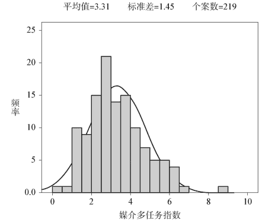

**图1 媒体多任务指数频率分布图（N=219）**

**移动阅读中的注意与加工深度**
针对60名参与正式实验的受试者，移动阅读平均耗时仅9.9分钟，远低于前期预实验中5名专心阅读者的15分钟均值，揭示了碎片化阅读下的注意稀缺现状。

精细加工水平整体偏高（M=3.71, SD=0.71），最高条目为“习惯用已有知识思考”（M=4.42, SD=0.72），印证了公众倾向于依赖既有知识图式而非深度推理来判断新信息[34]。

假新闻甄别准确率均值仅0.55（SD=0.23），即受试者仅能识别约一半假新闻，甄别表现不尽如人意，与既有研究“青年群体假新闻甄别能力待提升”的结论一致[34]。

**表1 上海本科生移动新闻阅读注意广度、精细加工与假新闻甄别准确率描述性统计（N=60）**

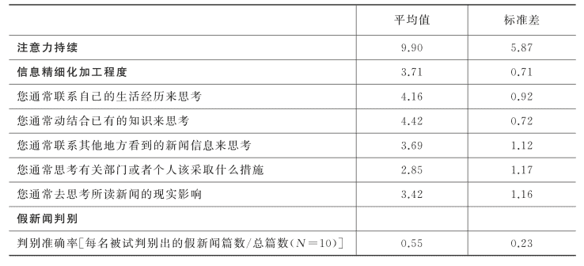

**控制变量相关检验**
相关分析显示，感知新闻相关性越高，精细加工水平显著越高（r=0.297, p<0.05），符合“关注度影响加工路径选择”的经典理论[21]；其他控制变量与核心变量间无显著关联。

#### 2. 路径分析：机制检验

**模型拟合度评估**
采用AMOS 19.0进行路径分析。参照前人经验[35]，引用偏差修正百分位Bootstrap法（抽样2000次），该法不依赖正态分布与大样本假设，且优于Sobel检验[36]。模型M拟合指标（表2）显示：CMIN/DF介于1-3间，P=0.316；CFI、NFI、GFI均超0.9，RMSEA<0.05，整体拟合良好，模型通过检验。

**表2 结构模型M拟合指标汇总**

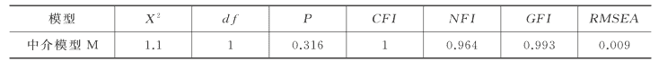

**多重中介效应检验**
路径分析结果（图2）揭示：
*   **直接效应**：媒体多任务对甄别力有显著负向预测（β=-0.32, p<0.01）。
*   **路径拆解**：多任务显著预测注意广度降低（β=-0.31, p<0.01）；注意广度显著正向预测甄别力（β=0.26, p<0.05）。
*   **非显著路径**：多任务与精细加工、精细加工与甄别力间均无显著关联。

经prodclin2插件计算95%置信区间，经由注意广度的间接效应标准化系数为-0.09（-0.31×0.26），CI[-0.05018, -0.0028]不含0，中介效应显著。**假设1、假设a获得支持，假设b不成立。**

注意广度呈现**部分中介**作用，中介效应占总效应比重约20%（0.09/(0.32+0.09)）。

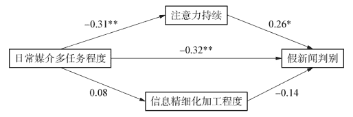

**图2 结构模型M标准化路径图**
*注：① 多任务编码：低组=1，高组=2；② 数值为标准化路径系数；③ * p<0.05, ** p<0.01。*

---

### 结论与深度对话

假新闻虽非新生事物，但在社交媒体语境下对社会信任的侵蚀、观点情感的极化，不容小觑。技术迭代加速，媒体喧嚣中，受众在多任务切换中注意力被稀释，缺乏核查动力，且因“受传合一”身份加速谣言扩散。治理谎言不应只怪AI与新技术，反思“人们如何使用媒体”同等关键。

**一、 媒体多任务直接损害甄别力：打破“接触越多越理性”的迷思**
日常多任务行为显著降低移动阅读时的假新闻甄别力。这呼应了重度多任务者更易被说服、决策易变的发现[24][35]；但假新闻研究长期聚焦文本特征与网络结构，忽视了“媒介使用行为”这一关键变量。媒介素养理论主张“更多接触+更强技能=批判性加工”[37]，但现实是：高强度伴随式多任务碎片化了认知资源，带来的是情感愉悦而非认知增益[38]。因此，借媒介素养治理假新闻，若不直面当下的媒介习惯、内容生态与使用动机，恐沦为空谈。

**二、 重塑阅读注意力：遏制假新闻扩散的关键突破口**
研究揭示注意广度普遍偏低，多任务习惯导致阅读时长缩水、甄别力下降。这佐证了“信息过载下加速加工成常态”[39]。或可换个视角：公众未必是“越来越不愿核实”[19]，而是多任务习惯使其无法在海量流中分配应有注意力。
*   **对新闻从业者**：须顺应碎片化阅读习惯，打造高质量、沉浸式、强抓力的深度报道。
*   **对监管部门**：除关注技术与平台融合，更应守护新闻内容质量本身。

**三、 “自以为是的深度加工”陷阱：经验替代思考的代价**
最耐人寻味的是：精细加工水平越高，甄别力反而越差（虽未达显著，但负向趋势明显）。多任务虽降低注意，却推高了主观加工感。这揭示了一个悖论：多任务并未真提升加工能力，只是让人**“主观误以为自己处理能力更强”**[23]。公众在新闻加工中更多依赖经验直觉而非深度思考，这种“虚假的精细加工”反成识别谎言的绊脚石。

---

# 细想越错？多任务模式下的假新闻认知陷阱

大众往往以为“多动脑筋”就能辨真伪，实验却揭示：深度思考（即精细加工）在识别谣言时非但无效，反成了“动机性推理”的温床。受访者的自述直击痛点：“听说编制考试变难，所以改革消息可信”；“见过故意传播艾滋的恶性案例，这新闻看着真实”。这印证了公众倾向于套用既有经验框架解读新信息的认知惯性[17]。

转向生产端，逻辑惊人一致：造谣者擅长包装贴近生活的合理叙事，借高频刷屏制造“眼熟感”降低心理防线。这正是微信生态中养生、校园安全、亲子教育类谣言屡禁不止、极易裂变的根源[40]。

研究进一步指出，根植于日常的“多任务切换”习惯，才是认知防线失守的深层推手。有学者将此归因于大众“思维懒惰”[19]，但更值得追问：这种认知吝啬，究竟是技术环境塑造的副产品，还是人性固有的弱点？

## 不足与展望

1. **数据主观性**：多任务频次依赖自评量表，客观性不足；后续可引入手机端埋点日志，实现行为级客观记录；
2. **机制未尽**：注意广度仅解释约两成方差，认知负荷等核心变量仍待纳入模型深度剖析；
3. **群体缺位**：作为转发主力的老年群体[41]，其心理机制研究亟待跟进。

## 参考文献

Vosoughi S, Roy D, Aral S. 2018. The spread of true and false news online. *Science* 359(6380): 1146-1151.

China Internet Network Information Center. 2019. The 43rd Statistical Report on Internet Development in China. URL: http://cnnic.cn/gywm/xwzx/rdxw/20172017_7056/201902/W020190228474508417254.pdf.

Yeykelis L, Cummings JJ, Reeves B. 2014. Multitasking on a single device: Arousal and the frequency, anticipation, and prediction of switching between media content on a computer. *Journal of Communication* 64(1): 167-192.

Ralph BCW, Thomson DR, Cheyne JA, et al. 2014. Media multitasking and failures of attention in everyday life. *Psychological Research* 78(5): 661-669.

Luo Z, Cao Y. 2018. "Distorted communication": A triple critique of the fake news phenomenon in the social media era. *Journal of News and Communication Review* 71(04): 81-90.

Lazer DMJ, Baum MA, Benkler Y, et al. 2018. The science of fake news. *Science* 359(6380): 1094-1096.

Zhang XC, Ghorbani AA. 2019. An overview of online fake news: Characterization, detection, and discussion. *Information Processing & Management* 57(2): article 102025.

Annual Fake News Research Group. 2018. 2017 Fake news research report. *Journalist* (1): 21-31.

Yu G. 2018. Textual structure and expression characteristics of online rumors: An analysis of 6,000+ rumor texts identified via Tencent big data. *News & Writing* (02): 53-59.

Liu Y, Xu Y. 2016. Communication effects of rumors and debunking information in online social networks: Exploring the influence of network structural factors and socio-psychological processes. *Journal of News and Communication Research* (11): 51-69.

Colliander J. 2019. "This is fake news": Investigating the role of conformity to other users' views when commenting on and spreading disinformation in social media. *Computers in Human Behavior* 97: 202-215.

Hu Y. 2013. Imagining the power of self-media: A critique based on journalistic professionalism. *Journalist* (3): 6-11.

Jin ZW, et al. 2017. Deception for news: Three types of fakes. *IEEE Transactions on Multimedia* 19(3): 598-608.

Eveland WP, Dunwoody S. 2002. An investigation of elaboration and selective scanning as mediators of learning from the web versus print. *Journal of Broadcasting & Electronic Media* 46(1): 34-53.

Kahan DM. 2013. Ideology, motivated reasoning, and cognitive reflection. *Judgment and Decision Making* 8(4): 407-424.

Haidt J. 2012. *The righteous mind: Why good people are divided by politics and religion*. New York: Paragon.

De Keersmaecker J, Roets A. 2017. Fake news: Incorrect, but hard to correct. The role of cognitive ability on the impact of false information on social impressions. *Intelligence* 65: 207-210.

Sunstein CR. 2002. *Republic.com*. Princeton, NJ: Princeton University Press.

Pennycook G, Rand DG. 2018. Lazy, not biased: Susceptibility to partisan fake news is better explained by lack of reasoning than by motivated reasoning. *Social Science Electronic Publishing* 188: 39-50.

Ophir E, Nass C, Wagner AD. 2009. Cognitive control in media multitaskers. *Proceedings of the National Academy of Sciences* 106(37): 15583-15587.

Eveland WP. 2002. News information processing as mediator of the relationship between motivations and political knowledge. *Journalism & Mass Communication Quarterly* 79(1): 26-40.

Jeong SH, Hwang Y. 2012. Does multitasking increase or decrease persuasion? Effects of multitasking on comprehension and counterarguing. *Journal of Communication* 62(4): 571-587.

Ran W, Yamamoto M, Xu S. 2016. Media multitasking during political news consumption: A relationship with factual and subjective political knowledge. *Computers in Human Behavior* 56: 352-359.

Kononova A, Yuan S, Joo E. 2017. Reading about the flu online: How health-protective behavioral intentions are influenced by media multitasking, polychronicity, and strength of health-related arguments. *Health Communication* 32(6): 759-767.

Carrier LM, Cheever NA, Rosen LD, et al. 2009. Multitasking across generations: Multitasking choices and difficulty ratings in three generations of Americans. *Computers in Human Behavior* 25(2): 483-489.

Cacioppo JT, Petty RE. 1984. The elaboration likelihood model of persuasion. *Advances in Consumer Research* 19(4): 123-205.

Fleming K, Thorson E, Zhang Y. 2006. Going beyond exposure to local news media: An information-processing examination of public perceptions of food safety. *Journal of Health Communication* 11(8): 789-806.

Sternthal AB. 1992. The effects of program involvement and ease of message counterarguing on advertising persuasiveness. *Journal of Consumer Psychology* 1(3): 225-238.

Yu G. 2018. Textual structure and expression characteristics of online rumors: An analysis of 6,000+ rumor texts identified via Tencent big data. *News & Writing* (02): 53-59.

Lim S, Shim H. 2016. Who multitasks on smartphones? Smartphone multitaskers' motivations and personality traits. *Cyberpsychology, Behavior, and Social Networking* 19(3): 223-227.

Liu Y. 2017. Media morphology changes and audience media use. *Journalism University* (6): 89-95.

Levine TR, Shaw AS, Shulman H. 2010. Assessing deception detection accuracy with dichotomous truth-lie judgments and continuous scaling: Are people really more accurate when honesty is scaled? *Communication Research Reports* 27(2): 112-122.

Zaichkowsky JL. 1994. The personal involvement inventory: Reduction, revision, and application to advertising. *Journal of Advertising* 23(4): 59-70.

McGrew S, Ortega T, Breakstone J, et al. 2017. The challenge that's bigger than fake news: Civic reasoning in a social media environment. *American Educator* 41(3): 4-9.

Fang J, Wen Z, Zhang M, et al. 2014. Analysis of multiple mediation effects based on structural equation modeling. *Acta Psychologica Sinica* (3): 735-741.

Wen Z, Ye B. 2014. Mediation effect analysis: Methods and model development. *Advances in Psychological Science* (5): 731-745.

Potter WJ. 2010. The state of media literacy. *Journal of Broadcasting & Electronic Media* 54(4): 675-696.

Wang Z, Tchernev JM. 2012. The "myth" of media multitasking: Reciprocal dynamics of media multitasking, personal needs, and gratifications. *Journal of Communication* 62(3): 494-513.

Pentina I, Tarafdar M. 2014. From "information" to "knowing": Exploring the role of social media in contemporary news consumption. *Computers in Human Behavior* 35(4): 211-223.

# 社交平台假新闻算法治理：逻辑困境与协同破局新路

**张超**

## 摘要

当前国内关于社交平台假新闻治理的研究，鲜少从技术底层逻辑切入。算法治理作为平台端的新型手段，主要通过源头信用评级降权低可信来源、利用文本识别技术揭示假新闻特征等方式运作。然而，「以技治技」存在短期难以跨越的短板：平台流量逻辑客观上助推了假新闻生成，且真假信息的微妙边界难以被机器精准切割。基于此，本文初步构建「算法-利益相关者」协同治理模型，从技术层面与社会层面双维度拆解多方主体的协同行动，力求将假新闻治理效能推向最大化。

**关键词**：假新闻、算法治理、深度伪造、社交平台、协同治理

---

伴随「平台媒体」崛起，全球新闻消费重心加速向移动端倾斜，社交平台已跃居用户获取新闻的首位渠道。数据显示，美国用户仅10%-15%的新闻点击源自新闻官网，高达80%依赖搜索与分享[1]。皮尤研究中心2018年调查指出，68%的美国成年人通过社交媒体接触新闻。平台正深度重塑大众认知世界、构建价值观的路径[2]。但现实隐忧并存：57%用户质疑平台新闻可信度[3]，究其根源，在于假新闻泛滥——Facebook承载了约五分之一的虚假流量[4]。国内方面，近六成假新闻源头指向微博[5]；微信虽占新媒体假新闻总量仅7%[6]，但其封闭传播生态导致自我纠偏与辟谓极难触达。Gartner预言，2022年发达国家大众将面临「假多真少」的信息环境[7]。

假新闻与新闻业同生共存，但当下社交平台假新闻呈现显著「智能化」特征：制造端深度伪造技术借助生成对抗网络（GAN）深度学习，合成图像视频逼真乱真；传播端社交机器人大规模介入扩散，账号真人与机器身份难辨，传播假新闻的账号中，机器人占比高达三分之一至三分之二[9]。

假新闻最大毒害在于误导公众，瓦解「共享现实」，诱发群体极化与社会撕裂[10]。后真相语境下，深度伪造与机器人军团将制造更深层认知混乱，动摇社会信任基石。2016年美大选后，假新闻跃升为全球治理议题。2018年9月，欧盟主要平台、广告商联合发布首份《反虚假信息行为准则》[11]；受限于宪法第一修正案，美政府难直接干预，治理重任落于平台自治[12]。

国内研究多聚焦政策监管、平台责任压实、公众素养提升，视角集中于社会心理与传播规律，剖析特定热点事件的扩散机制。虽揭示生成传播规律，却忽视了平台核心驱动力——算法逻辑，也未纳入同样受算法中介的假新闻行动者（如自动化扩散的社交机器人）。且多陷入「政府-平台」二元治理框架，缺失多元利益相关者视野。

智能媒体时代，算法是把「双刃剑」，既能助推假新闻，亦可成为遏制利器。本文将先从技术路径解析算法治理假新闻的行动逻辑，继而探讨「算法-利益相关者」协同治理模式，为社交平台假新闻治理开辟可行新径。

## 1. 智能媒体语境下社交平台算法治理假新闻的逻辑

算法是解题方案的精确完备描述，是有限步骤内获取特定输出的清晰指令集[13]。算法与程序形影不离：算法抽象，程序落地。程序以计算机语言实现算法，本质是算法与数据结构的统一，即「程序 = 算法 + 数据结构」[14]。

## 一、 算法治理假新闻的运作逻辑

# 算法治理假新闻：厘清概念，拆解内外两大实战路径

治理的本质，是公私机构协同处理公共事务、化解利益冲突、达成合作行动的持续过程。随着大数据与人工智能浪潮兴起，**算法治理**——即借助算法介入社会治理——应运而生。

首先必须澄清一个中文语境下的概念歧义：“算法治理”对应英文两词截然不同。一是 **Governance *of* Algorithms（算法监管）**，聚焦算法问责、透明度与技术防线，算法是被治理对象；二是本文核心的 **Governance *by* Algorithms（算法治理）**，指用算法工具解决社会难题，算法是手段而非靶子。鉴于翻译无法区分，文中“算法治理”专指后者。

针对假新闻治理，若以社交平台为核心，可拆解为**内部治理**与**外部治理**两条战线。

---

### 1. 内部算法治理：精准“降权”毒源，切断传播链条

假新闻入驻平台后，不会瞬间爆发，必经**冷启动**——内容从零反馈经探索性分发积累互动的过程。若正反馈不足，系统判定为冷门逐步降曝光；反之则可能被算法裹挟成“爆款”，全程自动化完成。

假新闻因诱发恐惧、惊讶等强情绪，极易跨过冷启动门槛，借用户社交关系与偏好标签实现病毒式裂变。事前拦截虽理想，但面对海量信息几乎不可行。更可行的逻辑是：**事后识别溯源，对低信誉源实施“降权”处罚。**

这一招之所以奏效，有两大数据支撑：
*   **分布极度集中**：10个网站贡献了60%样本量的假新闻，50个网站覆盖近90%；
*   **惯犯特征明显**：曾造谣的源头大概率重复作案。社交机器人在爆发前充当“放大器”，实验证实剔除机器人可使低信誉内容转发量骤降70%。

平台实战已验证：
*   **Twitter** 在 2018 美中期选举前批量清洗 1 万个自动推送假新闻的僵尸号；
*   **Facebook** 引入专业评级反哺识别算法，将系统判定的低信誉内容沉底，阅读量砍掉约 80%；
*   **YouTube** 调整推荐权重，优先分发权威源视频而非单看热度，同步削弱“分享”权重。

---

### 2. 外部算法治理：挖掘文本隐性特征，构建独立识别引擎

在“万物可量化”的今天，真假新闻经数据化处理后，各自藏着人类经验难捕捉的独特指纹。外部治理的核心，是设计高精度算法提取这些特征。

**路径一：语言学深度画像**  
密歇根大学团队从语法、用词、标点、复杂度入手，识别准确率达 76%，比人工高出 6 个百分点。Facebook 则专攻“标题党”，开发算法识别标文不符内容并降权。

**路径二：无需读懂语义的“数据立方体”**  
该方法完全跳过语义理解，仅靠词与词的空间共现关系破案，四步走：
1.  **降维解构**：利用词向量空间邻近性，把高频共现词聚为多维关联簇；
2.  **张量分解**：将张量拆解为高相关数据块，每块代表一类紧密关联的文章/词簇；
3.  **集协同聚类**：在首层基础上进一步聚类细分；
4.  **半监督判别**：最终输出真假标签。

**路径三：直击 Deepfake “不眨眼”硬伤**  
以换脸视频为例，合成算法导致眨眼频率远低于真人。机器学习模型只需检测眨眼频次，真伪辨识率即超 95%。跨大西洋选举诚信委员会已计划推出记者专用“检测工具包”，将该技术普惠化。

---

**结语**  
算法治理假新闻，内靠平台“降权毒源+清洗机器人”切断放大回路，外靠独立模型“语言画像+张量拓扑+生理特征”穿透伪装。双管齐下，方能在算法分发时代筑起信息免疫防线。

另一条路径是借助“**元数据**”溯源来甄别图片等内容的真伪。《纽约时报》携手 IBM Garage 正推进一项名为“**新闻溯源**”的区块链项目，旨在生成并共享新闻图片的“元数据”。这组数据囊括了拍摄时间、地点、摄影师身份，以及图片经历的所有编辑与发布环节。凭借这些信息，媒体机构与公众即可追溯图片是否遭过后期处理软件篡改，进而判断相关资讯是否为虚假新闻。[29]

## 二、 算法治理社交平台虚假信息的局限性

针对社交平台虚假信息的两种算法治理逻辑并不相同（详见表1）。斯坦福大学、纽约大学与微软研究院的联合研究显示，从 2016 年美国大选至 2018 年 7 月，Facebook 用户对虚假新闻的互动量下滑超 50%。[30] 算法治理虽见成效，但技术并非完美神器，用技术手段解决技术难题，短期内仍难跨越诸多瓶颈。

**表1　社交平台虚假信息的算法治理对比**

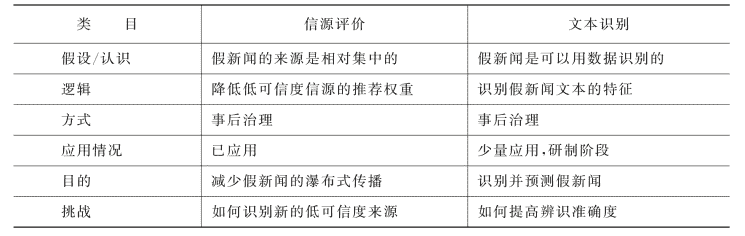

### 1. 分享的“马太效应”：平台逻辑无意中助推虚假信息

虚假信息在社交平台泛滥，症结不在于制造假新闻的算法有多高明，而在于其传播逻辑恰好契合了平台的算法逻辑与商业逻辑。社交平台的推荐机制核心在于社交关系、分享转发、点击率与相关性匹配。以 Facebook 为例，其算法极度强调信息与用户的关联度与适用性。[31] 这种机制催生了流量的“马太效应”：内容越吸睛，转发越多；转发越多，流量越大；一旦跨过冷启动门槛冲进推荐池，便会收获指数级的二次曝光。反之，平庸内容不仅推荐权重低，甚至可能连冷启动都过不去。只要虚假信息足够吸睛，在社交平台病毒式扩散只是时间问题。平台早期开发重速度、重广度、轻核验，留下了设计漏洞。[32] 因此，虚假信息屡禁不止的根源，在于其传播路径完美嵌合了算法设计中的激励机制。[33] 研究实证：Twitter 上假新闻传播速度更快、链路更深，1% 的假新闻能触达 1000–10 万人，真新闻鲜有破千者。[18] 换言之，无论平台算法如何微调，其核心永远是围绕“分享”构建的推荐逻辑，只能在有限范围内优化。

商业逻辑层面，流量正比广告收益；广告主按点击付费，平台与账号主分成。换言之，平台天然偏爱“自带传播属性”的内容。由此催生出批量制造假新闻的产业链，他们不在乎立场之争，只在乎变现。部分平台以“技术中立”自居，拒承担媒体责任，实为逐利。Facebook 前产品副总裁 Sam Lessin 曾直言：“抢占份额必须激进，理性讨不了好。”在社交场域，新闻必须好传播；越激进、越极端，转发量越高。[34]

舆论压力倒逼下，Google 与 Facebook 先后祭出“断财路”大招。2016 年 11 月，Google 封杀假新闻站点的广告服务；2018 年 8 月，Facebook 宣布封禁频繁传播假新闻、屡犯不改的企业投放广告。这表明平台试图用经济手段修补逻辑缺陷，遏制商业驱动型假新闻，但对政治动机或其他非商业利益驱动的假新闻，经济制裁往往失效。

### 2. 算法不会“思考”：真假新闻的微妙边界难辨识

当下 AI 仍处于**弱人工智能**阶段，仅能处理特定任务，缺乏自主意识，这一阶段将长期持续。虚假新闻文本复杂多变，识别其需要专业知识、社会阅历、语境理解、语义推理等综合素养，弱 AI 显难企及。

首先，并非所有指标皆可“数据化”。以“误导性”为例，人类难以给出清晰定义，AI 理解其内涵更是漫漫长途。[35]

其次，算法读不懂人类语言与知识体系。自然语言微妙多义，算法只能依赖语言模式等浅层特征分类，极易将真假新闻混为一谈。[36] 面对宗教、哲学等抽象知识，算法更无法像人类般进行理解与信度甄别。[22]

最后，假新闻特征瞬息万变，识别模型需同步迭代。只要造假者在原有基础上微调，原有识别算法便可能失效。例如广泛采用的文风分析法，造假者只需调整写作技巧即可钻空子。[22]

虽有研究表明算法识别准确率高于人工，但 24% 的失手率证明人工复核不可或缺。[24] 反假新闻平台“Fake News Challenge”判断：除非拥有能理解复杂人际互动、能开展深度调查报道的“强 AI”，否则全自动核事实无从谈起。[37]

## 三、 社交平台虚假信息的“算法-利益相关者”协同治理模型

依据人对算法的依赖度与算法自主权高低，算法治理可划分为三类：**算法辅助治理**、**算法依赖治理**与**算法协同治理**。“辅助型”利用算法巩固既有权力关系；“依赖型”高度自动化、独立性强；“协同型”介于两者之间。[38]

目前，完全依赖算法的自动化治理尚未成型。针对简单识别任务可采用“辅助模式”，属机械式初级治理。更多场景需“算法+人工”，即关键决策保留人工介入。如前所述，只要识别准确率未达 100%，人工审核就是刚需。三层级治理模式在内部算法与外部算法中的应用场景见表2。

**表2　三层级算法治理在内外部算法中的应用**

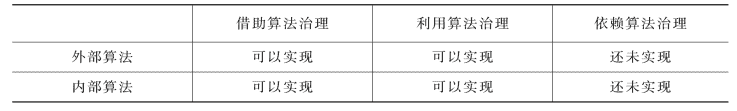

# 破解治理困局：社交平台谣言治理的“算法—利益相关者”协同新范式

在错综复杂的现代社会中，单纯依靠技术手段进行治理，效力往往大打折扣。社交平台谣言治理是一场持久战，更是一场动态、复杂的系统工程。参与主体绝不能仅限于政府与平台，而应构建一个由所有利益相关方编织而成的治理网络。告别传统的“政府—平台”二元对抗模式，转向多方协同治理，势在必行。

所谓协同治理，旨在破解棘手公共难题，推动跨领域、跨行业、跨部门的利益相关方建立伙伴关系，通过平等协商参与公共决策的制度性安排。利益相关者涵盖一切能影响组织目标实现、或受组织目标影响的个人与群体。聚焦社交平台谣言治理，核心利益相关方包括：社交平台、政府部门、入驻平台的新闻媒体、广大用户群体及学术研究界。在欧美等国，成熟活跃的非政府组织同样深度参与其中，不可或缺。

算法并非万能钥匙，单靠算法治谣难免失之偏颇；但算法效能极高，其对谣言的监测识别具备批量化、自动化特质。基于此，本文提出**“算法—利益相关者”协同治理模型**，着重强化算法技术与各方主体间的协同联动。

必须清醒认识到，谣言层出不穷，根源不仅在于谣言文本本身，更牵涉平台传播逻辑、宏观社会环境等深层因素。因此，本文构建的协同模型聚焦于以算法为核心的治理体系，旨在探索算法治谣的可行路径。

在完整的协同治理体系中，依据算法与其他利益相关方的互动关系，可划分为**技术层**与**社会层**两大维度（见示意图）。技术层汇聚社交平台与研究界，专攻技术层面的治理难题；社会层汇聚政府、主流媒体与公众，旨在弥补算法治理手段的短板。层内、层间，各主体呈现强弱不一、单向或双向的复杂关联。为便于深度剖析，本文将聚焦治理中最关键的核心议题。

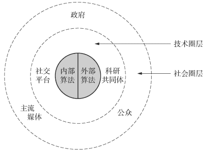

### 1. 技术层协同：打破数据壁垒，重构信任基石

技术层的核心主体为社交平台与研究界。社交平台是治理体系中除政府外最关键的力量，技术层协同成效高度取决于平台的开放态度。

**当前最大痛点：数据壁垒扼杀研究深度。** 平台提供的科研数据严重不足，导致研究界在公信力与研究深度上双双受限，难以产出高质量成果反哺平台治理。虽有平台开放 API 接口，但数据颗粒度粗、覆盖面窄，仅能解决表层问题；数据质量欠佳更使研究结论流于表面，难触谣言传播深层规律。平台以“商业机密”为由拒不开放，实则短视。

**平台须觉醒：稀缺的是信任，而非信息。** 调查显示，全球仅 41% 用户信任社交媒体。优质内容的稀释与缺失，才是平台生存发展的最大危机。在“连接一切”的浪潮下，暗涌“反连接”逆流，用户逃离平台的根源，往往源于深层的不信任。

**技术军备竞赛下，单打独斗无解。** 谣言生产传播智能化升级，“道高一尺，魔高一丈”。以“深度伪造”治理为例，任何单一检测器的有效期都极其短暂。平台若想在算法层面破局，必须引入外部智力资源——高校与科研院所的研究界，是不可或缺的关键合作伙伴。

**曙光初现：开放合作已成趋势。** 校外研究力量早已涌动。波兰初创公司 Userfeeds 引入区块链构建公开透明的新闻平台及可审计排序算法，从源头实现新闻生产传播的全链路溯源，倒逼生产者对真实性负责。平台侧亦有积极探索：Facebook 面向全球 11 国 30 家机构 60 余位学者开放脱敏数据，助力选举传播研究；字节跳动 2018 年举办算法分享会，向业界同行披露推荐算法底层逻辑，虽强调核心保密，却迈出了打破黑箱的关键一步。

### 2. 社会层协同：角色重塑，补齐算法短板

社会层主力军为政府、主流媒体与公众。

#### 1) 政府：从“裁判员”转型“协调员”

民调揭示显著差异：60% 欧洲用户、63% 亚洲用户支持政府直接介入谣言治理，而美国仅 41% 用户认同。这折射出不同文语境下公众对政府角色认知的分野。中国长期采取“自上而下”的网络谣言治理模式，政府与平台双核驱动，逻辑为“发现—约谈—再发现—再约谈”。此模式虽能阶段性缓解问题，但事后监管的弊端显著：政府介入时，平台乱象往往已酿成严重社会负面影响，甚至演变为重大刑事案件。政府必须完成职能转型，从单一监管者转向多元协同的组织者、协调者。

### 政府角色转型：从监管者走向协调者

鉴于政府监管能力有限，引入协同治理机制能有效整合社会资源，调动多方主力共同参与治理。虽政府仍处核心地位，却不再是唯一责任主体。各参与方通过信息共享、资源互补、优势联动，就问题与对策协商，落地时分工协作，形成正向互动以达成共同目标。这标志着政府职能的根本转变：由单一的“监管者”转型为“协调者”。

之所以强调协调者定位，是因为协同体系内各方立场、角色、资源与责任差异巨大。强势主体易主导进程，致使弱势方配合流于形式。以社交平台治理假新闻为例，平台掌握核心算法与数据，属典型强势方：它们以商业机密为由拒公开算法逻辑，以用户隐私为由拒提供原始数据。《打击假新闻研究议程与行动计划》指出，必须施压平台企业共享关键数据。在全体利益相关方中，惟有政府具备强制平台履责的能力，也惟有政府能最大程度动员各方通过多元机制参与治理。

#### 2) 主流媒体：做真相放大器，净化传播生态

本文刻意聚焦“主流媒体”而非泛指“媒体”，缘于其特殊地位：主流媒体是社会共同价值的凝聚者、舆论监督的“受托人”，亦是假新闻的受害者。社交平台缺乏界定真伪的正当性；作为专业内容生产方，主流媒体主要承担事实核验与真相发现职能，理应在传播体系中担起重任。通过专业、规范、严谨的生产流程产出新闻，建立用户信任，成为公众信赖的权威源头。现实中，部分假新闻竟源自主流媒体自身，值得深省。

《2018年数字新闻报告》显示，75%受访者认为新闻机构负有责任，71%指向互联网平台，主流媒体报道的偏见与失实是主因。美式社交平台假新闻泛滥，根源在于新闻业公信力低下，公众失去可信源头，被迫只信既有认知，典型呈现“后真相”特征。埃德曼《2019年信任度晴雨表》显示，中国公众对媒体信任度全球最高，达76%。中国语境下，主流媒体大有可为。

主流媒体在平台日常传播中是优质内容供给者，关键时刻是“真相放大器”。履责不仅靠关键节点发声，更赖日常积淀与公信力持续提升；否则关键时刻发声也无人信服。当主流媒体成为社会可靠信源，公众面对假新闻便有依归，不致束手无策。目前国内外平台已开始联动：Facebook 曾邀《华盛顿邮报》、彭博社等入驻，年付千万美元授权新闻；2019年上线“新闻标签页”，显著推荐权威来源；微博热点事件中优先放大3万余家媒体号与17万政务号内容。

## 用户：激活个体参与，汇聚多元“微力量”

协同治理中用户身兼多角：① 传播推手——假新闻扩散的推动者；② 受害群体——假新闻侵害的承受者；③ 治理参与者——如举报假新闻的主动践行者。单一用户常同时扮演多重角色。

平台上个体力量虽微，但人人是传播节点。特别是熟人闭环（如微信），个体作为节点的公信力、影响力与渗透力不容小觑。如何激活个体能动性，是政府、平台与用户共同面对的课题。

互联网重塑权利意识，个体被赋能唤醒，不甘做被动“受众”，渴望表达与参与公共事务。自组织路径下，部分用户具备更强专业辨识力与社会责任感，自发自觉投入治理：媒体从业者见朋友圈谣言主动核实辟谣；普通用户善用平台“举报”功能；甚至自发组建虚拟社群网络辟谣；最简便有效的“不转发”，也能降低谣言被推荐概率。

对大多数用户，需采取他组织方式：

**一、 平台组织专业用户参与识别监管。** 微博治理低俗内容曾招募2000名监督员。假新闻识别难度更大、更依赖专业背景，平台组织此类力量时应配套专业培训。

**二、 平台搭建协同辟谣“基础设施”。** 借鉴维基百科模式，建设假新闻相关数据库，为用户核查、溯源、甄别提供工具支撑。

**三、 建立平台与意见领袖（KOL）合作机制（技术、经济、社会效益三维）。** 假新闻传播中，社交机器人常“@名人”蹭热度；辟谣治理中可反其道而行，借用同法则推广辟谣内容。

## 结语

# 算法攻防与共治网络：智能时代假新闻治理的破局之道

在智能媒体浪潮下，假新闻的生产与传播已演变为一场以算法技术为核心的“攻防战”。无论是国内还是海外的社交平台，都已深刻认清假新闻对生态的毒害，同时也清醒地意识到单纯依靠人力治理的乏力与高难度。

社交平台天然的去中心化架构与病毒式裂变传播机制，让批量化、自动化生成的谣言泛滥成灾，这倒逼治理手段必须“以技术制技术”，引入算法识别、拦截与溯源等硬核手段。然而，技术并非万能钥匙。算法在语义理解、语境判断、深度伪造甄别等方面仍存在天然短板，单兵作战注定难以奏效。

破局的关键，在于构建一个**“技术+共治”**的立体防御体系：  
将政府监管、平台主体责任、主流媒体专业辟谣、学术界前沿研判与大众用户媒介素养这五方力量编织成协同治理网络，让算法技术在多方合力中发挥最大效能。

虽然算法无法实现“零假新闻”的理想国，但它足以大幅压缩谣言的传播半径与生命周期。展望未来，学术界应聚焦“后真相时代”下情绪化叙事对事实核查的冲击，探索更具韧性的算法治理范式，为净化网络空间提供更坚实的理论与实践支撑。

## References

[1] 徐扬. 马克·库珀：“分享键”渐成新闻消费标配 [EB/OL]. [2019-08-22]. http://www.xinhuanet.com/newmedia/2015-03/23/c_134084286.htm.

[2] 方诗诗. 互联网时代如何破解假新闻顽疾？ [EB/OL]. [2019-08-15]. http://paper.chinaso.com/bkbl/detail/20170913/1000200033018061505311045373493731_1.html.

[3] Matsa K E, Shearer E. 2018年社交媒体平台新闻使用情况 [EB/OL]. [2019-08-06]. http://www.journalism.org/2018/09/10/news-use-across-social-media-platforms-2018/.

[4] Guess A, Nyhan B, Reifler J. 选择性接触误导信息：2016年美国大选期间假新闻消费的证据 [EB/OL]. [2019-08-11]. www.dartmouth.edu/~nyhan/fake-news-2016.pdf.

[5] 赵广霞. 新媒体蓝皮书：近六成假新闻源自微博，微信辟谣难 [EB/OL]. [2019-09-15]. http://media.people.com.cn/n/2015/0624/c120837-27201212.html.

[6] 阚枫. 报告称近六成假新闻源自微博，微信谣言周二最多 [EB/OL]. [2019-09-15]. http://www.chinanews.com/gn/2015/06-24/7362797.shtml.

[7] Wiggers K. MIT CSAIL人工智能可检测假新闻与政治偏见 [EB/OL]. [2019-09-16]. https://venturebeat.com/2018/10/03/mit-csails-ai-can-detect-fake-news-and-political-bias/.

[8] Brandon J. 可怕的高科技色情：诡异“深度伪造”视频泛滥 [EB/OL]. [2019-09-15]. https://www.foxnews.com/tech/terrifying-high-tech-porn-creepy-deepfake-videos-are-on-the-rise.

[9] Gill S. 打击假新闻为何需要人机协同 [EB/OL]. [2019-09-15]. https://www.knightfoundation.org/articles/why-combatting-fake-newsrequires-people-and-technology-working-together.

[10] 方诗诗. 哈佛肯尼迪学院：打击假新闻的研究议程与行动指南(译) [J]. 汕头大学学报(人文社科版), 2017(9): 98-101.

[11] 施安斌, 胡钰. 向失实信息宣战：欧盟的探索 [J]. 青年记者, 2018(34): 76-79.

[12] 方可成. 西方社会如何应对网络假新闻 [EB/OL]. [2019-08-19]. https://mp.weixin.qq.com/s/bYInQH1O8f2dAAyQANn-7g.

[13] 吕国营. 算法设计与分析：第2版 [M]. 北京: 清华大学出版社, 2009: 7.

[14] 汤沛禾, 徐一一. 计算思维：计算机学科导论 [M]. 北京: 电子工业出版社, 2015: 144.

[15] 王世宗. 治理理论及其在中国的适用性 [M]. 杭州: 浙江大学出版社, 2009: 2.

[16] Doneda D, Almeida V A F. 什么是算法治理？ [J]. IEEE Internet Computing, 2016(4): 60-63.

[17] 闫泽华. 内容算法：将内容转化为价值的效率系统 [M]. 北京: 中信出版集团, 2018: 60.

[18] Vosoughi S, Roy D, Aral S. 真假新闻在网络上的传播差异 [EB/OL]. [2019-09-15]. http://science.sciencemag.org/content/359/6380/1146.full.

[19] Shao C, Ciampaglia G L, Varol O, et al. 社交机器人传播低可信度内容研究 [EB/OL]. [2019-09-17]. https://www.nature.com/articles/s41467-018-06930-7.

[20] Greene T. 为何低可信新闻似乎主导推特？ [EB/OL]. [2019-09-22]. https://thenextweb.com/artificial-intelligence/2018/11/27/heres-why-low-credibilitynews-seems-to-dominate-twitter/.

[21] Bing C. 独家：推特删除逾万企图抑制美投票账号 [EB/OL]. [2019-09-17]. https://www.reuters.com/article/us-usa-election-twitter-exclusive/exclusive-twitter-deletes-over-10000-accounts-that-sought-to-discourage-u-s-votingidUSKCN1N72FA.

[22] Temming M. 人类难辨假新闻，计算机程序能做得更好吗？ [EB/OL]. [2019-09-10]. https://www.sciencenews.org/article/can-computer-programs-flag-fakenews.

[23] Nuñez M. YouTube改版突发新闻机制以抗衡误导信息 [EB/OL]. [2019-08-29]. https://mashable.com/article/youtube-announces-changes-breaking-newsvideo-search/#FwmTV73fcaqt.

[24] Breland A. 研究人员称新算法识别假新闻超越人类 [EB/OL]. [2019-09-10]. https://thehill.com/policy/technology/403091-researchers-create-algorithmthat-spots-fake-news-better-than-humans.

[25] O'Reilly. “假新闻”改变美国大选结果了吗？ [EB/OL]. 杨晨曦、戴明月、蔡敏雨译. [2019-09-10]. https://mp.weixin.qq.com/s/X-pSBjUsD2YVDIiuRnlRgg.

[26] Ober H. 新算法让假新闻无所遁形 [EB/OL]. [2019-09-20]. https://www.universityofcalifornia.edu/news/fake-news-can-t-fool-new-algorithm.

[27] T800科技网. 深度伪造机器学习算法可合成逼真视频 [EB/OL]. [2019-08-09]. http://dy.163.com/v2/article/detail/DVCBN98H053108BC.html.

[28] Browne R. 反选举干预组织制造AI版特朗普警示“深度伪造”威胁 [EB/OL]. [2019-09-26]. https://www.cnbc.com/2018/12/07/deepfakeai-trump-impersonator-highlights-election-fake-news-threat.html.

[29] 杜火塘. 媒体入局！纽约时报测试区块链打击假新闻 [EB/OL]. [2019-09-13]. http://finance.sina.com.cn/blockchain/roll/2019-07-25/doc-ihytcitm4500507.shtml.

[30] Oremus W. 脸书打击误导信息或已初见成效 [EB/OL]. [2019-08-09]. https://slate.com/technology/2018/09/facebook-fake-news-getting-better-study.html.

[31] 方诗诗. 双寡头平台新闻推荐算法机制研究 [J]. 传媒与社会学刊, 2018(1): 103-122.

[32] 尹巧. 一条假新闻罚50万欧元？腾讯脸书双巨头上线辟谣平台 [EB/OL]. [2019-08-09]. http://www.time-weekly.com/html/20170117/36276_1.html.

[33] Emily J B, Taylor O, Peter D B, et al. 平台媒体：硅谷如何重塑新闻业 [EB/OL]. [2019-09-02]. https://academiccommons.columbia.edu/doi/10.7916/D8R216ZZ.

[34] Saeed H. AI能识别假新闻吗？ [EB/OL]. [2019-06-24]. https://venturebeat.com/2017/05/01/can-ai-detect-fake-news/.

[35] 赖燕芳. 遏制假新闻传播：谷歌脸书如何挥舞AI利剑 [EB/OL]. [2019-07-22]. https://www.iyiou.com/p/82868.html.

[36] Vincenj J. 为何AI无法解决脸书假新闻难题 [EB/OL]. [2019-07-27]. https://www.theverge.com/2018/4/5/17202886/facebook-fake-news-moderation-ai-challenges.

[37] Saeed H. AI能识别假新闻吗？ [EB/OL]. [2019-08-20]. https://venturebeat.com/2017/05/01/can-ai-detect-fake-news/.

[38] Campbell-Verduyn M, Goguen M, Porter T. 大数据与算法治理：金融实践案例 [J]. New Political Economy, 2017, 22(2): 219-236.

[39] 刘晓泉, 朱德美. 协同治理：复杂公共问题治理新模式 [J]. 上海行政学院学报, 2016(4): 46-54.

# 重塑新闻传播人才培养：以“课程产品化”思维破局

**文/龙毅 李晨宇**  
*来源：《新闻界》2019年第11期 | 国家社科基金项目“智能媒体时代新闻生产中的算法风险及其协同治理研究”(19BXW020)阶段性成果*

---

## 核心摘要

课程本质上是知识的“内容产品”，也是师生教学互动的核心载体。引入“课程产品化开发”理念，旨在通过标准化生产流程、严苛的质量把控与系统化的体系优化，显著提升课程价值与学习体验。针对当前新闻传播专业教学中普遍存在的“重科研轻教学”、课程投入不足等顽疾，本文从教学团队架构、开发核心环节、全流程管理三个维度，重构了以课程为核心的卓越人才培养新机制。

**关键词：** 课程产品化开发、卓越新闻传播人才、培养机制、课堂教学、“金课”

---

## 一 直击痛点：培养目标与教学现实的“剪刀差”

### 1. 时代拷问：什么样的“卓越人才”才配得上新使命？

教育部、中宣部联合发布的《关于提高高校新闻传播人才培养能力 实施卓越新闻传播人才教育培养计划2.0的意见》，为人才培养定下了新基调：目标是造就一批**爱国情怀与国际视野并重、全媒体素养与跨学科能力兼备、专家型素养与储备力身份叠加**的高素质人才。他们需适应媒体深度融合与产业创新变革，讲好中国故事、传播好中国声音。

基于此，我们将培养目标具象化为：**德智体美劳全面发展、具备国际竞争力的跨学科拔尖创新人才。** 具体而言，这要求学子坚守马克思主义新闻观与正确舆论导向，驾驭数字化转型浪潮，厚植人文底蕴，精通现代信息技术，深谙专业理论，熟稔法治法规，更能统筹策划、编采制作、运营推广全媒体产品。

这一目标的达成，绝非单一环节所能为力，而依赖于培养方案、课程体系、师资队伍、教学管理的**顶层设计与系统落地**。透过现象看本质，课程质量是连接培养目标与人才成品的“关键拦截点”，更是建设“金课”、铸就卓越人才的基石工程。

### 2. 现实审视：课堂教学为何频频“掉链子”？

教育部高教司司长吴岩曾直言：课程虽是教育最微观、最普遍的问题，却关乎“立德树人”最根本的命题；它是高校的通病、短板与瓶颈，更是“以学生为中心”落地的“最后一公里”；习近平总书记强调的“立德树人根本标准”，课程正是其具象化、可操作、可考核的落脚点。

新闻传播学科自带**强应用性、强交叉性**基因，知识迭代极快，相较于社会学、心理学、经济学等传统学科，学科积淀相对薄弱。在传统课堂教学中，我们观察到以下结构性矛盾：

#### 1) “重科研、轻教学”：课程建设的长期“投入赤字”

# 打破教学科研“伪共生”，课程产品化能否破局？

传统认知坚持认为教学与科研是共生共荣的良性循环：教学反哺科研，科研引领教学。然而现实却难觅正向互动的样本——高校“重科研轻教”愈演愈烈，教学面临边缘化危机[3]。这种导向下，教师无暇深耕如何启发引导学生[4]，直接拖垮了课程教学整体水平。

对标“精品课”、“慕课”等网络课程，传统课堂投入严重失血。科研导向的价值取向与经费短缺，致使教师积极性难以激发，“水课”频出、教学失效、宝贵学时白白浪费。薪酬结构暴露了痛点：岗位工资、薪级工资国家统一，绩效工资校定、津贴补贴繽杂[5]；月薪制涵盖国标工资、校院岗位、课时费、指导费、论文奖、项目提成等[6]，唯独缺日常课程建设专项经费。教改立项以发论文为验收标准，忽视成果转化；经费不进课堂。相比之下，高校课堂教学在多个维度落入下风（见表1）。

### 表1：三大“课程产品”形态横向对比
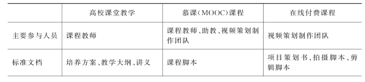
（表1续）
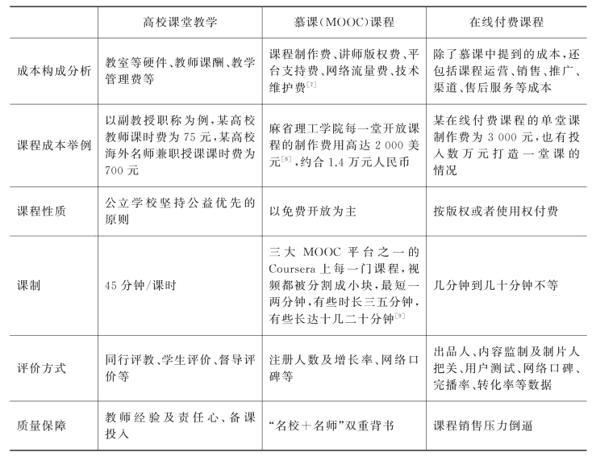

#### 2) 课程更新滞后，考核机制陈旧
新闻传播行业实践日新月异，课程改革却步履维艰，“换汤不换药”现象屡禁不止。不少课程虽披新名，内核仍旧；一些标榜前沿的新课，因积淀不足、周期短，反而干货稀薄。教学评价缺乏像科研评价那样量化、可操作的硬指标，极易流于形式，激励导向失效。守成讲“老课”者年年过关无虞，锐意创新者却难获正向反馈。这套僵化机制，既跟不上新媒体时代步伐，也回应不了学生诉求，更无法满足社会对复合型、全媒体人才的渴求。

学生考核方式同样单一，“一考定终身”依然是主流。看似公平客观，实则扼杀了平时学习动力，助长了临时抱佛脚、混学分的风气，真正的能力生长无从谈起。新闻传播专业重思维、重实践，单靠死记硬背，根本养不出合格媒体人[10]。

## 二、 “课程产品”开发理念：由来与内涵

### 1. 理念缘起：从“去水课”到“造金课”
2018年，教育部部长陈宝生在全国本科教育工作会议上首提“金课”，要求实质性加大学业量、提升深度难度，扭转“水课”乱象。同年8月，“去水课、建金课”正式写入教育部文件[11]。高教司司长吴岩进一步阐释：“金课”追求高阶性、创新性、挑战度，以“中国金课”为标杆重塑课程体系[2]。“课程产品开发”理念应运而生，直指“金课”建设，誓要全面跃升课程质量。

“产品”概念源自工业量产时代，“课程产品”借用其“按需生产、标准化制造”之义，强调需求导向与质控。抛开逐利属性，将产品思维引入本科教学，能显著提升课程价值、优化体验、保障产出，逼近“金课”标准。此类课程目标聚焦、知识浓度高、逻辑闭环，自然更具吸引力。但不可照搬企业管理套路。清华经管学院原院长钱颖一教授指出：教学是创造性、思想性劳动，非流水线作业，质量难以标准化度量，企事业管理体系无法直接套用[6]。

### 2. 核心内涵

#### 1) 课程体系建设

### 重构新闻传播教育：从模块化走向产品化思维

传统新闻传播学科的课程体系，多依赖模块化拼装来构建知识版图。若引入“课程产品开发”视角，重点便该转向：打破单课壁垒，构建课程群与跨课知识网络，并建立高频迭代的版本更新机制。学界主张，未来的人才培养体系应以互联网思维为主导，摆脱单纯的技能导向，致力于培养具备跨界协作素养、精通数据挖掘与可视化表达、能创作兼具想象力与感染力的新媒体产品的复合型人才[[12]](#txt004.html#footnote_quote_txt004_12)。

#### 2) 教学标准与教学设计：从纲领到落地的关键环节

高校课堂教学标准是教师群体达成专业培养目标的核心准则，也是教学实践的思维罗盘与行为底线。溯源来看，课程标准是其上位依据——它规定了课程理念、性质、目标、内容、教学建议与考核要素，为课堂教学标准提供了价值导向、总体框架、基本流程与方法指引[[13]](#txt004.html#footnote_quote_txt004_13)。

教学标准对课程产品质量提出了硬性约束，是提升课程开发水平的基石。2013年起，教育部委托92个专业教指委启动国标研制，2018年正式发布《普通高等学校本科专业类教学质量国家标准》（简称“国标”）。新闻传播学科对标“国标”，以培养卓越人才为靶心，力争打造一流标准、对接国际水准、彰显中国特色[[14]](#txt004.html#footnote_quote_txt004_14)。“国标”从培养目标、规格、课程体系、师资、条件、质量保障六大维度全方位定标，明确了学科建设发展的方向与底线[[15]](#txt004.html#footnote_quote_txt004_15)。

课程是人才培养方案的基本单元，课程质量直接映射培养质量。培养目标虽为课程体系设计提供直接依据，仍需进一步细化落地。“在标准驱动的教育变革中，课程标准是全系统的起点、动力与归宿”[[16]](#txt004.html#footnote_quote_txt004_16)。相较传统教学，慕课产品在教学设计上展现出更高规范：前期涵盖制作知识储备、知识节点拆解、团队组建、脚本撰写、助教配置等环节[[17]](#txt004.html#footnote_quote_txt004_17)。当然，一线教学并非照本宣科念脚本，教师需依据具体教育情境动态调整[[18]](#txt004.html#footnote_quote_txt004_18)。

#### 3) 严控课程质量，精细运营学习体验

课程产品通过工序化加工将知识内容封装成优质课程服务学习者。实行“课程负责人制”，意味着教学法、进度安排、教学效果、考核评价等全维度内容与质量标准，均由该教师统筹落实。负责人不必亲自授课，可邀请合适主讲教师，自身聚焦质量把控与内容迭代，实现“单人牵头、多方协同、责权清晰”。新闻传播实践中，主讲教师的使命是：规划前沿大纲、组建最强战队、打磨精品脚本，以最佳状态呈现精彩课堂。为保障效果，正式开课前会进行精细化策划与小规模试讲，从内容深度、金句设计、仪态风度、语速语调、互动方式、重难点处理、时间把控、场面驾驭、教具运用等全维度复盘，输出可执行的终版教学脚本。

课程产品的用户毋庸置疑是学生。引入用户体验管理思维，即在开发全流程中以学生课堂体验为核心考量。优质课程体验不仅仰赖教师功力，更源于精细化教学设计。基于用户体验的教学设计，应聚焦知识传递效能，让学生在知识渴求中获得满足，并激发高阶讨论与深度反思。

#### 4) 确立课程版本迭代理念

# 课程分类与迭代：破解工作量认定困局

依据授课轮次，课程可划分为“新课”、“老课”与“重修课”三类。“新课”内涵双重：一是因大纲要求需重构体系、大幅更新内容的课程；二是教师首次执教的课程。“老课”大体与之相对。“重修课”则指同一教师向多个班级重复讲授相同内容。当前部分高校仅对重修课设置系数（低于1），未区分新老课差异。新闻传播领域知识迭代极快，新课高频涌现。普遍认知中，新课备课难度显著高于老课，理应给予“新课补贴”。然而，执教老课或重修课的教师常有微词，认为两者工作量鸿沟并未想象中那么大[[19]](#txt004.html#footnote_quote_txt004_19)。透视这些争论，发现皆立足“教师投入（工作量）”视角，鲜少从“课程质量”维度考量。引入“课程版本迭代”理念，可在一定程度上调和分歧。该理念聚焦最新教学版本相较前一版本的内容优化与更新幅度。对新闻传播而言，教学内容必须持续迭代以跟上时代步伐。简而言之，课程迭代核心逻辑可用下式表达（新版课程质量记为 `Q′`，旧版记为 `Q`，质量提升率记为 `δ`）：

需特别说明，公式仅为观点示意，非精确测算工具。若以版本迭代理念主导课程产品开发，应确立明确更新目标，配套激励机制。课程补贴等激励应聚焦“质量跃升”，切实推高课程质量水位。

#### 弹性教学：打破僵化时空桎梏

弹性教学涵盖弹性学制、弹性时空、弹性班级制等维度。教学大纲对课时、地点、内容的规划，宛如教师的“说明书”。以时间统筹为例，通常有三类分配机制：一、依知识点权重规划，融合教师认知与预期产出，科学分配课时。新闻传播实教中，应依学生底子与吸纳力灵活调控进度——可快可慢；选学内容可舍，核心内容必深讲，打破机械排课，提升知识密度。二、平衡“教”与“学”时间。翻转课堂易陷学生发言随意、知识密度低的泥沼；应按理论实践比例，大致锁定教师讲授与学生表达的时间比。三、统筹“讲”与“答”时间。高校课堂普遍“灌输”过度，复习巩固与答疑环节缺位。规划应预留思考答疑时段，强制安排复习答疑课。尤为关键的是，考后增设试卷讲评环节，强化知识留存。

大纲课时分配需预留弹性容差，覆盖授课时长、地点、比例、班额等，授权教师微调。**表2** 为《传播学概论》大纲时间规划范例。

**表2 《传播学概论》大纲时间规划范例**

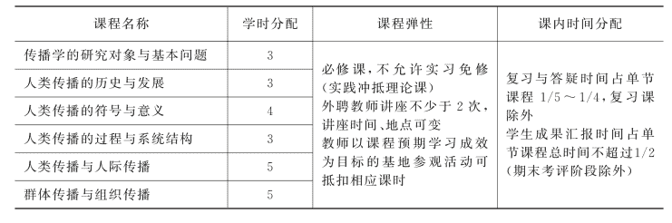

#### 开放办学与课程负责人制：汇聚多方之力打造“金课”

推进开放办学，设立“课程负责人制”至关重要。负责人核心使命是统筹多方资源，聚力打磨“金课”。师资充沛时，“课程产品”主讲教师角色可转型为专职课程运营者，剥离授课职能，站在学生（用户）视角专攻质量提升。新课开发实施期，负责人应广纳校内外、业界资源，为全课程或专题甄选最优师资、最佳场地。教务部门需搭建开放办学高效交流平台，引入外部智力并制度化固化。新闻传播实践课应主动探索校企共建实践基地新路径，大力推行任务驱动、项目导向模式，实现校基地协同育人，将实践教学从“辅助”升级为“协同”[[20]](#txt004.html#footnote_quote_txt004_20)。

# 重塑新闻传播人才培养：基于课程产品研发的新范式

## 教学模式重构：单兵作战还是团队协作？

教学模式分单师制与多师制，后者再细分为“合作式”与“分段式”（见表3、表4）。

**合作式教学**适配思辨类课程。多教师对话式授课碰撞思想火花，亦能激发教师成长；学生听课体验更佳。通常由一教师任“主持”，按预设脚本把控进度，即兴发挥为辅。

**分段式教学**适配跨学科课程。课程产品经理为各模块匹配最优讲师，统筹内容衔接，扬长避短，成就系统性课程。

### 表3 合作式教学模式示意

### 表4 分段式教学模式示意

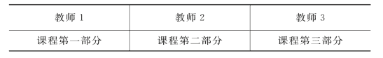

## 课程研发全流程：从策划到落地的关键环节

### 策划先行：课程研发的“蓝图绘制”阶段

策划环节包含课程策划、剧本撰写、试讲三大板块。

- **课程策划** 是立足目标与大纲的创造性教学设计。其基石是课程调研，覆盖教学内容研究、学生入学素质摸底等。

### 重塑课程生产力：从“备课”到“研发”的范式革命

**核心研发环节：标准化、试错与闭环**

**1. 编写“剧本”：让教学有章可循**
彻底告别传统教案的碎片化，引入**“课程剧本”**机制。它将教学方法、内容节奏、互动设计全部标准化、流程化，把隐性经验显性化、把个体依赖转为组织资产。剧本不是枷锁，而是保障教学质量下限、释放教师创造力上限的“导航仪”。

**2. “上线前测试”：用小步快跑换大版本稳定**
借鉴软件工程的**迭代思维（α/β/正式版）**，把试讲变成结构化的质量关卡：
*   **α版（内测）**：小规模种子用户（学生）体验，暴露逻辑断层与节奏失控；
*   **β版（公测）**：实验班实战，压力测试互动设计与知识密度；
*   **正式版**：全量推广，确保交付标准统一。
核心动作：**广泛收集“用户”（学生）与“共创者”（制作团队）反馈，对“课程产品”进行精准修补。

**3. 执行层：剧本落地的“三重奏”**
课堂执行由**剧本执行、教师讲授、教学互动**三位一体构成。
*   **剧本**按时间轴拆解教学活动，体现教学设计意图，强“面向对象”属性；
*   **课程负责人**化身“教学向导”，把控进度与节奏，确保按图施工；
*   **教师**基于剧本“二次创作”知识表达，组织深度互动。
得益于**课前学情摸底**，内容供给精准匹配多数生认知节奏；通过**分层难度设计**，兼顾保底与拔高。系统知识架构、金句锚点、案例嵌入、启发式互动，共同构筑课程的“高光时刻”。

**4. 反馈层：从“布置作业”到“设计学习旅程”**
*   **预习重构**：打破“预习轻、讲课重、复习重”的惯性。参考哈佛 Eric Mazur 教授研究，预习应设计为**“任务驱动+思维训练”**，倒逼学习方式从“靠记忆”转向“靠理解”，把大课堂变成深度学习场。  
    *案例：港城大《社会学导论》“文化”单元预习——4组名词解释+2个产出性任务，均锚定香港本土语境，层层递进：现象识别 → 固定视角归因，完成认知脚手架搭建。*
*   **评价对标**：引入**国际在线课程质量标准（如 8 维度 43 项指标）**，对标国家本科教学规范，建立多维度、可量化的课程体检体系。
*   **迭代闭环**：所有反馈最终汇聚为**下一版本的内容更新清单**，实现课程基因的持续进化。

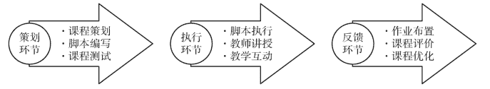

---

### 通用课程研发流程：从“经验驱动”到“流程驱动”

大多数课程可复用同一套**标准化研发管线**，在基础环节外增加**前期调研、预算配置、后期优化**三大关键节点。

**前期调研“三看三定”**：
1.  **看国情/社情/行情** → 定**培养目标**（对标国家战略与社会需求）；
2.  **看学情/兴趣/期待** → 定**产品竞争力**（以学生体验为核心，匹配知识获取与能力跃迁）；
3.  **看师资/专家/资源** → 定**课程高度**（组建专家网络，锁定名师，冲击“金课”标杆，平衡理论深度与认知负荷）。

**预算保障“实打实”**：
产品化研发=**人力+财力+物力**的组合拳。尤其涉及**场外教学、企业联合授课**等复杂场景，需教务系统设计配合与专项经费托底。  
*例：《融合媒体导论》首堂课安排在企业新媒体“中央厨房”现场联合教学，离不开排课制度创新与经费专项支撑。*

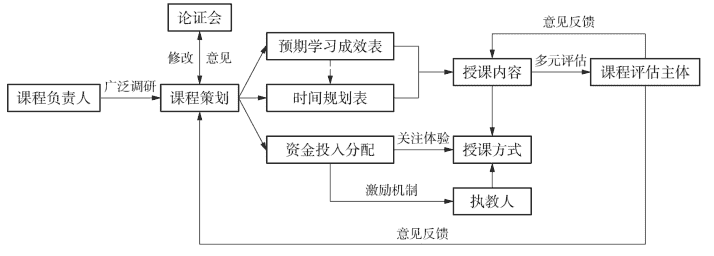

---

### 总结与反思：标准化的尽头，是为创造力留白

本研究立足国家对卓越新闻传播人才的呼唤，融合教育部“金课”标准与名课经验，构建了**“课程产品研发”新范式**，涵盖：
*   **新体系**：课程体系产品化重构
*   **硬标准**：教学规范与设计标准化
*   **重体验**：质量管控与用户体验管理
*   **活机制**：弹性教学、版本迭代、开放共享、课程负责人制
*   **清架构**：团队分工与研发链路图谱
*   **实流程**：可复制、可推广的研发 SOP

**关键警示**：教学是**创造性、复杂性**的知识传递活动。**“适度即兴”与“开放讨论”是灵魂，而非噪音。** 产品化研发的终局，不是把课堂变成流水线，而是用标准化托住**质量底线**，用流程化腾出**创新上限**——**在剧本之外，必须为自由探索预留“留白空间”**。这才是“课程产品”区别于“工业产品”的本质所在。

---

### 参考文献

[1] 中华人民共和国教育部, 中共中央宣传部. 关于实施卓越新闻传播人才教育培养计划 2.0 提高高校新闻传播人才培养能力的意见 [Z]. 教高 [2018] 7 号.

[2] 吴岩. 建设中国的“金课” [J]. 中国大学教学, 2018(12): 4-9.

[3] 王新. 论高校重科研轻教学的理论根源: 一个新视角 [J]. 大连理工大学学报(社会科学版), 2017, 38(02): 128-132.

[4] 王慧, 周旭. 虚无与统一的对立统一: 论“以教为中心”与“以学为中心”的关系 [J]. 现代大学教育, 2019(03): 40-46.

[5] 柯文进, 江锦秋. 世界一流大学薪酬制度特征及启示: 以美国五所世界一流大学为例 [J]. 中国高等教育研究, 2014(05): 20-25.

[6] 钱颖一. 大学人事制度改革: 以清华大学经管学院为例 [J]. 清华大学教育研究, 2013, 34(02): 1-8.

# 美报业数字化转型下的新闻人才需求与教育变革

**郑晓迪、陈心怡**

## 核心速览
新媒体浪潮倒逼美式新闻教育转型：卡内基、奈特等基金会注资助力，哥大、密苏里名校调整课程聚焦“专家型记者”“数据新闻”“融媒人才”，行业认证机构（ACEJMC）强化公共利益导向。核心逻辑直指培养复合型专业人才，坚守新闻公共性。

**关键词**：数字化转型｜新闻传播教育｜教育改革

---

## 正文

美式新闻教育长期领跑全球。互联网重构了信息生产与接收的底层逻辑，传统教学模式难以回应时代命题，迫使美高校持续反思、重塑，使新闻教育改学术热点。

美新闻教育有深厚的基金会资助传统，外部注资让改革落地更顺畅。密苏里大学新闻学院百年老店，其改革路径折射出美新闻院校的共性走向；而新闻与大众传播教育认证委员会（ACEJMC）标准的迭代，更是近年改革的“风向标”。追踪各方关注焦点的转移，即可拼图出美新闻教育改革的全景图谱。

### 一、 “卡内基-奈特新闻教育未来计划”等资助项目：倒逼实战型人才培养体系重构

媒体深度融合、传播版图重塑之际，“如何培养适配新环境的新闻人”成业界学界共同痛点。

纽约卡内基基金会持续召集各大新闻学院院长与管理层，直面新媒体生态下的教育困境：教学如何创新？新闻人才标准如何重定？传统新闻业如何转型？

麦肯锡咨询访谈40余位新闻精英，输出《改善明天记者的教育》访谈实录，直指要害——行业症结须从教育源头解铃，亟需对新闻教育的方法论、理念体系、课程内容做大刀阔斧的结构性调整。

---

### 核心参考文献（原文献目录整理）
[7] 王燕. 网络教育慕课盈利模式分析[J]. 中国总会计师, 2016(10): 80-81.
[8] 孙梦丹, 顾明娜, 高俊宽. 国内外在线视频课程资源建设现状研究[J]. 图书情报工作, 2012(11): 34-41.
[9] 刘红亮. 浅析慕课与学分银行对接探索[J]. 现代教育技术, 2014, 24(10): 88-94.
[10] 洪洁文, 彭宇天. 来自教学过程的质量——基于国外大学课程评价体系的分析[J]. 中国大学教学, 2017(10): 92-96.
[11] 教育部. 关于贯彻落实新时代全国高等学校本科教育工作会议精神的通知[Z]. 教高函[2018]8号.
[12] 严三九, 南瑞琴. 一流学科建设的制度研究——以哥伦比亚大学新闻学院与密苏里大学新闻学院学科体系变迁为例[J]. 华东师范大学学报(教育科学版), 2017, 35(06): 95-106+156.
[13] 施伟. 大学课堂教学规范的缺位与重构[J]. 高等教育研究, 2019, 40(06): 73-78.
[14] 高晓红, 赵希静. 基于新时代发展方向的卓越新闻传播人才培养[J]. 中国大学教学, 2018(04): 8-11.
[15] 邓绍根, 李兴波. 百年回顾：中国新闻传播教育发展历程与特点[J]. 现代传播(中国传媒大学学报), 2019, 41(06): 155-164.
[16] 翁伟新. 应用型本科人才培养质量标准：基本特征与推进策略[J]. 四川师范大学学报(社会科学版), 2018, 45(03): 62-68.
[17] 司莉, 舒婵. 慕课《信息组织原理与利用》建设及启示[J]. 高校图书馆工作, 2019, 39(04): 42-45.
[18] 徐方杰, 杨婷. 教师现场学习能力：内涵、构成与提升策略[J]. 教育理论与实践, 2019, 39(01): 57-60.
[19] 储红莉. 改革进程中的教师报酬与人力资本市场建设[J]. 华中师范大学学报(人文社会科学版), 2005(02): 67-71.
[20] Wang Y. Reconstruction of Talent Training Model in Local Universities from the Perspective of Industry-Education Integration[C]//Zhou H Q, Kang Q, Chen YY. Proceedings of the 1st International Conference on Business, Economics, Management Science (BEMS 2019). Beijing: ATLANTIS PRESS, 2019: 639-643.
[21] 孙忠梅, 吴晓凤. 慕课、翻转课堂与教学过程再造研究[J]. 成人教育, 2015, 35(06): 53-56.
[22] Biggs, Tang. Teaching for Quality Learning at University: What the Student Does, 4th ed. [M]. 王莹, 丁燕, 高洁译. 上海: 复旦大学出版社, 2015: 100.
[23] 钱玲, 赵燕燕. 以教师专业发展为中心的在线课程质量保障体系：美国QM的核心竞争力与启示[J]. 远程教育杂志, 2018, 24(05): 30-38+72.

---

### 作者名片
**易龙**：博士，中南大学文学与新闻学院传媒系主任，硕导。
**李辰宇**：中南大学文学与新闻学院2017级本科生。

### 项目基金
本文系中南大学教育教学改革研究项目“基于融媒体发展战略的新文科拔尖创新人才培养研究”（项目号：2019jy025）阶段性成果。

# 卡内基-奈特新闻教育未来计划

奈特基金会近年联手卡内基基金会，聚焦数字语境下的新闻教育深度调研，联合启动了极具影响力的“卡内基-奈特新闻教育未来计划”，向五所试点高校注资支持专业教改研究。该计划锚定数字媒体环境，旨在提升教学质量，定向培育适配新媒体需求的“实战型新闻人才”。

## 一、 计划三大核心支柱

### 1. 课程拓展计划：打破学科壁垒，重塑知识版图
该板块致力于丰富新闻传播核心课程体系，引入跨学科师资授课，拓宽学生视野，强化综合素养与专业硬实力，涉猎历史、社会学、心理学、计算机、政治学等领域。

*   **哥伦比亚大学**开设“证据与推理”辅修课，显著提升学生的综合判断与逻辑推演能力，为深度调查报道筑基。
*   **西北大学**引入社会学专业统计研究方法课程，传授专业统计技法及 `SPSS` 软件操作，为数字新闻的科学分析与可视化呈现提供利器。
*   **加州大学**则聚焦新媒体前沿，开设多门强关联课程，强化学生对新媒体的认知、理解、判断及应用四大维度能力。

### 2. “News 21 孵化器”计划：名校名媒双向奔赴，实战磨砺新人
这是一个连接新闻院校与主流媒体的专业实习品牌。计划为入选学子搭建实训平台，邀请《纽约时报》、CNN、美联社等头部媒体的资深从业者担任导师，手把手指导学生完成新闻采编制作全流程，实现校媒无缝对接。

### 3. 卡内基-奈特特别工作组：多维调研发声，为行业把脉定向
该研究机构落户哈佛大学肯尼迪政府学院肖伦斯坦媒体、政治与公共政策中心。由资深学者、行业大咖、新闻专家组成，通过面向公众、政府、社团、从业者等全方位调研，收集社会各界对数字媒体环境下新闻行业的期待与建议，为教育改革与行业发展提供决策参考。

**补充说明：** 卡内基公司还联合美国广播公司（ABC）设立新闻专业高级研修班。入选计划的新闻学院学生可进入该班，由ABC优秀编辑记者执教，课程覆盖职业操守、新闻伦理、现场深度报道及新媒体环境下的数字新闻制作呈现等核心硬课。

---

## 二、 密苏里新闻学院：百年名校的融媒转型实践

1908年，密苏里大学创立全球首家新闻学院。其核心基因“密苏里方法”坚持“课堂即新闻室”，以实践为本、以职业化为标，区别于哥伦比亚纯研究生办学模式，密苏里构建了本、硕、博贯通的完整培养体系。

面对新媒体崛起与数字化浪潮，融合发展成必然。自2005年起，学院在本研两级新增**“融合新闻”专业**，确立**“数字优先、移动优先”**育人理念，瞄准全媒体记者与数据可视化专业人才两大方向。在教学理念、课程体系、教法革新、师资建设四大维度，全方位强化学生在新旧媒介形态下的新闻认知、理解与多媒体表达呈现能力。

### 本科课程体系的“新”与“实”

学院大幅引入前沿课程模块：**“融合摄影报道”“数据新闻”“新兴媒体”“融合电视报道”“战略传播：数字战略”“创业新闻”**等，均由深耕融媒研究一线的名师执教。新课聚焦数字媒体、媒体融合、社交媒体、移动互联等热点领域，极大充实了专业教学含金量。带着实战经验的教师将一手案例带入课堂，让教学既接地气又站前沿。

### “哥伦比亚密苏里人报”：一张报纸的双轨制进化
学院主办的校报 *The Columbia Missourian* 也是核心实训基地。采编主力由学生担纲，资深教授与媒体人把关指导。随着网络版 `Columbia Missourian.com` 上线试运营，报社影响力、竞争力双提升。学生得以在传统报刊与数字新媒体双轨并行中历练，深度体悟融媒生态。

网络版设置新闻、体育、讣告、VOX、观点、来信、活动、视觉等多元板块。依托这张“活教材”，学生的融媒思维与数字化实操能力实现了质的飞跃。

此外，密苏里新闻学院推出了**“全球计划”**，旨在为新闻专业学子搭建国际交流平台，涵盖海外游学、实习岗位、短期课程培训等多元服务，更助力学子前往纽约、华盛顿特区等地的知名媒体机构实战锻炼。

### 研究生课程设置

在研究生培养层面，密苏里新闻学院大力践行**“媒体融合”**办学理念。新闻专业硕士课程设置三大模式：**“两年制硕士模式”“五年制学士/硕士连读模式”**及**“新闻与法学双学位项目”**。核心必修课聚焦数字采编与融合传播，涵盖《数据新闻》《新闻媒体与社会》《融合新闻学》《视觉编辑与管理》《计算机辅助报道》等实战型课程。

以**“融合新闻学”**方向两年制硕士为例，课程架构分四大模块：9学分基础核心课（含大众传媒研讨、新闻实务、定性定量研究方法及选修）；9学分融合核心课（融合新闻采写、电视广播摄影新闻、融合编辑制作）；10学分核心项目与论文（新闻议题研究、硕士项目研讨、学位论文）；另设9学分融合模式选修课，供学生按职业规划自主选择。

## 三、 ACEJMC评估标准：深化新闻教育“公共性”理念

随着**“公共新闻学”**与**“公民新闻学”**兴起，新闻的**“公共性”**议题进入学界视野。数字媒体高速发展的当下，新闻教育的“公共性”内涵被重提并强化。

**ACEJMC**（新闻与大众传播教育认证委员会）负责评估美新闻院校教学效果与创新。该机构1945年成立，由教学与业界专家组成，旨在保障知识广度深度、推动改革应变、搭建跨学科交流平台、以新思路提升教学质量。作为独立非营利组织，其立场客观公正、威信卓著，每六年对院校教学质量进行独立审核把关。

评估体系包含九大指标：
- 使命、治理与行政
- 专兼职师资力量
- 课程与教学
- 学术研究：科研、创作与专业活动
- 多元与包容
- 资源、设施与装备
- 学生服务
- 学习成果评估
- 专业与公共服务

数字化进程加速，社交媒体普及让人人拥有“麦克风”。ACEJMC愈发看重新闻教育的“公共性”权重，具体体现在：推动教育对象多元化，关注性别、种族、年龄等差异，尤其聚焦少数族裔、女性、残障人士等群体在公共传播语境下的持续参与，督促高校除职业教育外，更担起提升全民媒介素养的责任。

新媒体发展让公众触网频次激增，提升网络媒介素养成美社会大课题。缩小不同群体间的**“数字鸿沟”**成新闻教育重责。ACEJMC鼓励院校普及教育助公众善用新闻公共资源。评估中，其日益重视院校与公众的沟通、公众媒介素养、社会公共服务项目等。标准明确要求：“院校及师资应推动新闻传播专业发展，履行对社区、校友及大众的义务。”数字新媒体语境下，增强公众对数字内容的甄别、运用、理解、质疑与评价能力，乃其核心使命。

## 总结

媒体融合与数字化浪潮重塑传播版图，新闻实践呈现社交化、移动化、数字化特征。为适应行业变革、育时代新人，美新闻教育持续探索：院校在课程、教法、师资、实习、培养目标上改革创新；教育基金会注资关注；评估机构倡导教学模式革新。多维合力，共谋新闻人才培养新局。

新闻教育改革的实践正聚焦于数字时代新闻实战人才的培养，重点在于融媒体、数字新闻及全能型人才的输出。与此同时，新闻教育的“公共性”愈发凸显：各大新闻学院的服务半径持续扩展，育人对象早已突破在校生范畴，转而涵盖全民媒介素养的提升。美国新闻界已达成共识——新闻教育变革非高校独角戏，而是关乎行业命脉与社会肌理的系统工程，亟需学界、基金会、公共机构与媒体业界协同破题。通过践行“数字优先”与“移动优先”的改革理念，持续输出适应融媒语境的数字化生产型人才，同时在公共传播场域中强化公众媒介素养，赋能大众在数字环境中参与话语的认知与能力。

---

**作者简介**：郑晓迪，山东工艺美术学院设计学院副教授；陈欣怡，山东大学新闻与传播学院博士研究生。

# 智能媒体时代的产业变革

## 双轮驱动：数据价值与人工智能重塑媒体智能化转型路径

**李海东　徐志强**

### 摘要

基于对人工智能与媒体产业深度融合基础特征的审视，本文首要指出数据已成为连接三元世界的关键纽带，剖析了三元空间语境下数据的全链路融合处理与价值生成机制；进而从层级映射与未来演进两个维度，阐释“智能+”技术如何重构媒体生态思维；并从智能觉醒、智能生产、智能分发、智能安全、智能优化五大维度，深度解析媒体智能化转型的演进脉络；最终提出，加速构建融媒智能平台，是广电媒体迈向“智性化”、推动行业高质量发展的关键棋眼。

### 关键词

数据价值、人工智能、媒体融合、融媒体、智能媒体

---

## 参考文献

[1] 本文为2019年度山东省艺术科学重点课题“智能时代美国交互设计教育现状与启示研究”阶段性成果，项目编号：ZD201906226。

[2] 数据来源：`https://www.carnegie.org/news/articles/five-new-universities-asked-to-submit-proposals-for-curriculumenrichment-as-part-of-carnegie-corporations-initiative-on-journalism-education/`。

[3] 数据来源：冯佳. 美国新闻学院课程创新研究——以“卡内基-奈特新闻教育未来计划”为例[J]. 新闻与传播研究, 2011(05): 168。

[4] 数据来源：`https://www.carnegie.org/news/articles/five-of-americas-most-respected-research-universities-unite-in-a-more-than-6-million-effort-to-help-revitalize-journalism-education/`。

[5] 数据来源：`https://www.carnegie.org/grants/grants-database/grantee/robert-c-maynard-institute-for-journalism-education/#!/grants/grants-database/grant/32111.0/`。

[6] 数据来源：`https://www.carnegie.org/grants/grants-database/grantee/university-of-southern-california/#!/grants/grants-database/grant/48066.0/`。

[7] 数据来源：`https://www.knightfoundation.org/programs/journalism`。

[8] 数据来源：`http://www.columbiamissourian.com/about/`。

[9] 数据来源：`https://journalism.missouri.edu/programs/masters/models-and-programs/`。

[10] 数据来源：`https://journalism.missouri.edu/overlay-content/two-year-ma-model-convergence-journalism/`。

[1] 数据来源：`https://...`（对应第二篇文章的脚注标记）

## 当前人工智能发展的高级阶段与媒体深度融合

当前，得益于深度神经网络（如千亿级训练样本、千万级参数量及十亿级参数更新迭代）、全脑模拟（美国“脑计划”、欧盟“人脑计划”、中国“中国脑计划”）及智能动力学（堪比空气动力学对飞行的关键作用）等领域的持续演进，机器已具备感知智能（听说看识）、认知智能（理解思考）、计算智能（存储计算）与运动智能（抓握行走）四大核心能力。

从媒体视角审视，媒体融合的概念内涵、科学属性与价值认知正在深化。新一代智能化、跨媒介、泛内容技术正加速推动内容生产、传播与消费向智能化、体验化、个性化跃迁。以2018年全国“两会”报道为例，中央主流媒体集中亮出“奇招”，重塑新闻生产传播生态：人民日报“中央厨房”依托信息集成分发与多端互联，大幅提升传播效能，实现精准触达；新华社“媒体大脑”借助机器生成内容（MGC）技术，秒级产出大数据新闻视频，将AI在新闻报道中的应用推向深水区；央视《央视快评》以“快、准、稳、深”为标尺抢占时效高地，在即时新媒体舆论场激起强震波。

这表明，数字化、网络化、融合化仅是媒体融合的初级形态；而由平台化、数据化、智能化等新一代信息技术驱动的跨界融合与智能传播，才是媒体融合的高级阶段。

## 1. 数据驱动：三元空间数据全域价值化

步入数字经济纪元，涵盖内容、业务、传播、影响力、用户、标签、收视、舆情、设备在内的媒体数据资产，已成为产业核心要素，为内容生产辅助、传播效果诊断、内容运营分析、精准推荐营销等全链路提供全方位支撑。

### 1.1 三元空间数据的全面融合与处理

站在哲学维度审视，新一代智能、跨媒、泛内容信息技术正让海量人与物在信息空间留下清晰可辨的数字痕迹，进而模糊了人机边界、线上线下、虚实世界以及自然与人造的界限。对数据、表达、行为、语义等维度的深度剖析，正成为洞察用户行为、从“关系”视角捕捉构建社会结构的态度与行动的关键路径（虽非唯一）。可见，凭借海量多元的用户行为数据沉淀与结构完善的知识图谱，我们能刻画信息空间（表达、流转、隐私、安全）、描摹客观物理空间（万物互联、车联网、人联网、商联网），并勾勒人类社会空间（家庭、社区、城市、政治、经济、军事、国家）。这将汇聚成一个融合资源管理、协同感知、数据预处理、分析与应用于一体的枢纽，全面贯通“网络空间—物理空间—人类社会”三元世界[1]。数字世界与物理世界的全价值链融合如图1所示。

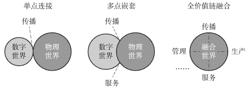

### 2. 数据赋能价值重构

数字经济浪潮下，传媒等诸多产业正加速向网络化、自动化、智能化转型，竞争博弈由此从物理空间延伸至信息空间。立足互联网的智能融媒平台，充分彰显了现代媒体连接、激活、共享、表达的核心属性，跑通了“获取用户时长与数据→优化服务体验→赢得更多时长与数据→挤压竞品生存空间”的正向飞轮，价值凸显愈发明显。连接层面，互联网实现“人机物”可搜、可发现、可融合；激活层面，同频用户汇聚成圈层社群；共享层面，点对点即时触达让资讯、情绪、资源指数级放大；表达层面，低门槛发布渠道赋予人人自由发声权。“数据价值+网络协同”生态见图2。

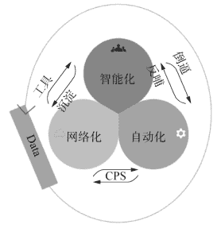

无处不在的信息追踪、交互与筛选，使得以可控成本整合多维用户画像成为可能，进而精准导向定制化服务的落地[2]。为打通“数据→信息→知识→决策”全链路变现闭环[3]，媒体机构亟需探索：如何在最优时机、最优位置推送最优内容，以最优频次、方式响应。可引入聚类、因子、主成分等模型构建大数据中台，采集全量样本数据，落地媒体内容标签化运营——涵盖直播行为统计排序、回看点播关联推荐、个性化广告植入等。以字节跳动为例，其围绕图文分发核心的《今日头条》为基座，延伸出西瓜、火山视频，凭双边网络效应打造抖音，又以悟空问答、图虫、懂车帝、多闪等开拓新疆域，构建起多层飞轮矩阵。基座飞轮靠用户数据反哺算法沉淀用户，向延伸飞轮输出标签与核心算力；延伸飞轮在细分赛道获客、靠算法留存、最终实现变现回血。

## 2. 重构：“智能+”驱动下的媒体生态进化论

信息通信技术（ICT）持续高歌猛进、深度渗透融合，已成中国经济增长关键引擎。其中，iABCD（物联网、人工智能、区块链、云计算、大数据）等新一代技术打破行业壁垒，提供泛在网络基础应用，成为构建媒体商业创新力、推动智能化与实体经济深度融合的核心动能[4]。

### 1. 智能媒体分层全景图

“智能”与“融合”正演进为互联网智能媒体平台的核心基因。在管理范式与运营模式上，智能媒体展现出远超传统媒体与新媒体的“高维”特质[5]。新型智能硬件由环境感知向自动控制、语音交互进阶；智能软件由语音、手势、人脸等单点识别向视听联合识别、视频摘要、多模态融合识别等主动复合技术跃迁。原本森严的行业部门隔离墙正在瓦解，我们正身处第三次媒体融合浪潮中。

未来媒体将建立在“云大物移智链加”（云计算、大数据、物联网、移动互联、人工智能、区块链、增强计算）等技术之上，集感知、认知、决策于一体的高智能新形态媒体。按核心功能可拆解为智能感知、自然语言理解、动态知识图谱、智能交互、智能决策等多层系统架构。智能媒体分层全景见图3。

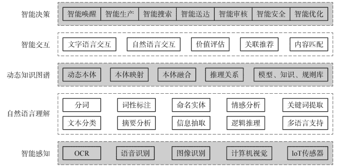

### 2. 媒体进化趋势与未来图景

创造更多文化融合、感官愉悦、价值共享、新知获取与便利体验，让任意人在任意时地获取任意所需，是智能时代媒体演进的内生动力与终极归宿。未来媒体将趋近一种“存而不论、无处不在、隐而彰显”的存在形态，成为融媒业务拓展、平台资源调度、业务创新变革、增长引擎驱动、平台开放共享的关键基建。

媒体将向何处进化？或为感官延伸、全时连接；或为人机共生、随需随取；或为边界消解——媒介接触定义圈层、语言障碍消弭、数字鸿沟填平。在提升资源效能、传播效能、服务效能的同时，未来媒体还将催化传播渠道向移动化、平台化、多元化纵深演进。

## 3. 数据驱动下的媒体智能化转型路径

# 迈向全知全能的智媒新纪元：重构内容生产力的四大核心引擎

在即将到来的全知、全能、全息智能媒体传播时代，无论是传统媒体还是新兴媒介，都必须坚持“以人为本”的核心立场，精准对接用户对娱乐性、个性化、真实性的多元期待。这要求我们深度挖掘人工智能、增强/虚拟/混合现实（AR/VR/MR）、区块链、机器学习、网络空间安全等数字技术潜能，通过顶层设计打通通用业务触点，逐步构建起服务、数据与能力共享、开放、协同的应用高地，最终搭建一个持续迭代升级的融媒内容“智造”支撑体系。受限于篇幅，本文将以智能媒体生态系统中的**智能决策层**为切入点，展开深度解析。

### 1. 智能觉醒：激活数据资产，构筑感知底座

智能觉醒的本质，是借助AI与“智能逻辑”，将融媒采、编、播、存、管、用全产业链的碎片化数据深度融合，实现数据资产的“活化”与“增值”，使其更具实用性、价值感与智慧度，从而有力支撑全媒体业务落地。

回望传统二维互联网时代，个体与企业连接的红利早已被阿里、腾讯、百度等巨头瓜分殆尽。而由大数据赋能的三维互联网，正致力于唤醒那些散落在城市角落、尚未数字化的“沉睡数据”，借助云计算、AI等技术实现对个人、企业、政府的全覆盖连接，从而筑起新一代智能平台。

展望未来，处于智能觉醒环境下的媒体平台，将极大强化人类生产、生活、治理的数据地基与信息生态。在内容供给侧，可建设“中央厨房”，推动内容资源实现数据化、网络化、智能化转型——如中央媒体打造全能旗舰媒体、省级媒体建设公共服务平台、县级融媒体中心构建综合信息服务平台。通过持续提升数据获取与表征的量级与频次，在空间序列上多角度、多层级交叉验证与再生产信息；在时间序列上有机关联用户实践与交互，持续呈现并创新分析逻辑；依托多维数据集，精准聚焦特定人物、事件及社会状态的真实图景。此外，通过与运营商合作构建融合舆情分析、线索挖掘、大屏展示等功能的泛媒体视频服务网络；运用机器人写作、VR制作、4K/8K超高清制造等技术，让冰冷数据焕发人性温度，深度挖掘数据信息的衍生价值。

### 2. 智能生产：从“辅助工具”进化为“共生伙伴”

智能生产是当前AI在新闻传播领域最具现象级意义的应用场域。未来，内容生产将全面迈入智能进化阶段：获取多形态数据后，通过剖析异构数据内在关联，实施多层级知识挖掘与环境适配，提炼观点建议，依据分类标准、逻辑架构与叙事序列，自动生成长短稿件、深度报告、可视化图表等多元产品，最终经由API、JSON、XML等接口，借助云服务通过推特、邮件等渠道实时精准触达。

在智能生产环境下，媒体平台将重塑内容生产的全流程图景。竞争焦点将聚焦于数据平台构建与数据获取处理能力；算法将深度介入数据化作业，催生“人机共生、人机协同”的新范式。未来，智能采集、编目、切片、审核、编辑、写作、视频增强、舆情监测、对话问答、机器人写编等程序，将接管数据挖掘分析、定式快讯等繁琐程序性工作；主创人员则得以解放，投入更多精力于垂直细分领域、需要海量情感、情怀与高阶情商（EQ）的“脑力劳动”——即创造性生产与探索，同时为用户供给更丰富的内容形态，开辟出以往无法涉足的创作新疆域与利基市场。

### 3. 智能分发：精准触达与价值深度变现的双重奏

智能分发立足于动态、多维、关联的媒体业务数据采集（尤重受众与用户行为数据化），发挥自然语言理解、大数据分析等能力，破解广播网与互联网可持续发展的瓶颈，以高效低成本方式实现媒体内容“5A”服务——任意人、任意时、任意地、任意式、任意务，并向下游拓展深度利润模型。其核心架构涵盖智能引擎、广播网、双向网三大支柱。

未来智能分发环境下的媒体平台，集智能媒体云、智能标签、智能复用、智能路由、智能边缘、智能终端、智能接收、智能推荐等模块于一体，是电视媒体“融合”与社交媒体“裂变”合力的产物。具体设计上：首先梳理核心选题、覆盖人群与重点用户，完成用户身份识别；次之提取用户主体及交互反馈，建立标签体系与分析模型，落实属性定义；最后基于事件语境、主题发现、用户画像、关系挖掘、复杂网络、传播路径及干预转化，反复打磨泛化内容，构建传播评估体系，推动视频衍生扩散过程中的颗粒化处理、多维调用与多渠道分发，落地智能分发实体应用。同时，结合采编制作数据量化编辑传播影响力；对标同行稿件传播数据形成竞品对比；追踪监测指定稿件扩散轨迹，复盘热点事件演进脉络。

### 4. 智能安全：筑牢内容把关的最后一道防线

# 智能融合媒体：从安全筑基到价值跃迁的全景透视

## 智能安防：以新技术筑牢立体主动防御体系

新一代信息技术集群——iABCD正成为智能安防的核心引擎。它赋能系统对网络融合、业态融合、融媒生产、工控系统等复杂场景，实施前瞻性、实时性、自主性的识别、判断与推理，最终织就全方位、立体化的主动防御网络，护航主体平稳运行。

聚焦媒体领域，数字化转型的每一步都催生了安防新需求：OA与BOSS系统的上线，拉开了网络安全应用的序幕；共享平台制作与多渠道分发的融合模式落地，倒逼产播环节防护体系建设；互联网智能融媒平台（直播、移动端、两微一端等）的崛起，则催生了面向媒体融合、直面互联网风险的轻量化“采编播存管用”一体化安全系统；而融媒体深度发展、大数据云计算广泛应用的当下，云非编、云桌面等融媒云安全需求迫切，要求以轻量防护抵御常规攻击、有效阻断病毒蔓延。

展望未来，智能安防环境下的媒体平台，必须构建基于IPv4/IPv6全网流量数据分析、安全态势感知与主动防御的闭环体系。实现对历史事件的溯源、当前风险的阻断、未来趋势的预判，全面跃升媒体智能安防能力。深度解析“态势感知”内涵：
*   **“势”即态势**：关联、统计、分析、预警、处置。核心在于广泛采集安全状态信息，聚合分析事件与行为轨迹；
*   **“势”即趋势**：融合、挖掘、学习、预测。聚焦风险研判、趋势洞察；
*   **“感”即感知**：采集、收集、检测、监测、发现、捕获。强调实时感知与风险主动聚焦；
*   **“知”即认知**：理解、感知、熟悉、掌握、预测、洞察。指向因果智能关联，预见安全症结与隐患。

### 5. 智能优化：平台业务与价值重塑

智能优化以智能生产、唤醒、分发、安防的有效融合为基石，从客群融合、智力融合、纵向融合、横向融合、价值链融合五个维度凝练智能价值，释放乘数效应。

坦言，当前互联网智能融媒平台仍存痛点：用户服务端AI价值未充分释放，视频创作、碎片聚合、个性化定制仍显不足。未来，AI将强势赋能：支持个性化内容极速生产，落地“千人千面”专属频道；助力精准定位，让全网化身私人片库；增强用户粘性与停留，实现多平台内容单平台聚合呈现（详见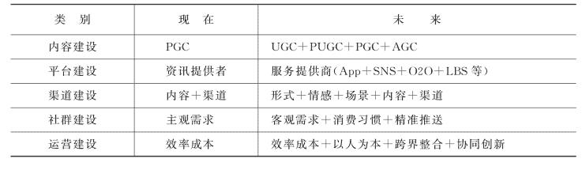）。

在智能优化语境下，媒体平台需在内容、平台、渠道、社群、运营等版图实现破界创新，全维提升业务价值：
*   **内容生态**：由单一PGC向“UGC+PUGC+PGC+AGC”多元共生演进；
*   **平台定位**：从信息供给者转型为融合“服务商App+SNS+O2O+LBS”的超级入口；
*   **渠道模式**：打破“内容+渠道”旧框，重塑“形态+情感+场景+内容+渠道”新链路；
*   **社群洞察**：摒弃主观臆测，拥抱“客观需求+消费习惯+精准推送”的科学认知；
*   **运营范式**：超越单一效能成本视角，构建“效能+以人为本+跨界融合+协同创新”的复合盈利模型。

## 4. 结语：融合重塑，智启未来

“在融合中创生，在融合中跃升。”互联网早已超越技术范畴，进化为一种思维范式与全新方法论。

**趋势视角**：智能融媒是适应新一代IT发展、技术驱动“供给侧改革”的必然选择；
**技术视角**：内容聚合、生产、再加工、分发全链路上云，平台IT智能化与大数据个性化传播双轮驱动；
**业务视角**：万物互联时代呼唤丰富呈现，智能融媒以用户为核心，输出高效智能媒体服务。

由此，媒体产业应主动推动ICT与广电深度融合，打造全媒体、全功能、全场景服务体系，完成从传统/新媒体服务主体向现代/智能媒体服务主体的蜕变，加速建设综合性、智能化、一体化“泛媒体”平台，引领新供给、激活新消费、孕育新业态，为转型升级与互补共赢的新商业范式注入灵感。

---

## 参考文献

[1] 佚名. 玩转大数据的六大招数，你get了几个？[EB/OL]. (2017-09-06)[2019-06-27]. http://www.sohu.com/a/190131468_99922237.
[2] 凯文·凯利. 《必然》[M]. 周峰、董力、金洋 译. 北京: 电子工业出版社, 2016.
[3] 丁毅, 郭福, 胡明才, 等. 国内外用户体验研究综述[J]. 工业工程与管理, 2014, 19(4): 92-97.
[4] 徐志强, 刘彤, 万春梅. 赋能与变革：新兴技术驱动与媒体创新发展[J]. 电视研究, 2018(05): 8-11.
[5] 余国明. 互联网是“高维度”媒介——兼论“平台媒体”作为未来媒体发展主流模态[J]. 新闻与写作, 2015(2): 41-44.
[6] 广播独家. 学者将军胡正荣谈媒体融合：如何做赢家？[EB/OL]. (2018-08-28)[2019-06-23]. http://www.sohu.com/a/250397980_613537.
[7] 余国明. 大数据方法与新闻传播创新：从理论界定到操作路径[J]. 江淮论坛, 2014(04): 5-7.

**作者简介**：李海东，四川传媒学院数字媒体与创意设计学院副教授；徐志强，四川传媒学院数字媒体与创意设计学院教授、高级工程师。

---

# 融合媒体App的宏大愿景与新未来：基于安吉新闻集团“爱安吉”客户端的创新发展剖析 [1]

**赵莉，张晓宇**

## 摘要

# 后App时代：安吉融媒体客户端“爱安吉”突围实录

移动互联网步入“后App时代”，融媒体移动客户端正站在变革与发力的**关键节点**。面对白热化的移动端竞争，过往的运营经验与路径亟待重构。作为融媒传播的核心阵地，移动客户端的战略地位日益凸显。本文深度剖析浙江安吉传媒集团“爱安吉”客户端的发展策略与创新范式，勾勒融媒体App进化的宏大蓝图与未来图景。

**关键词**：App、安吉、创新、解析

## 一、 基础现状：从县级台到亿级集团的跨越

### 实践与展望：安吉传媒集团“爱安吉”App融合发展之路

安吉传媒集团（原安吉县广播电视台）自2014年组建以来，整合全县最全媒体资源：拥有“美丽乡村”“快乐安吉”“安吉购物”三大电视频道、FM100.1广播频率、《安吉新闻》报纸、《印象安吉》《乐居》《乐游》三本期刊、中国安吉网、“爱安吉”App、“安吉发布”微信微博、户外大屏、楼宇电视等全媒体矩阵。集团采取“一台六公司”运营模式，旗下涵盖纯广播电视、广电网络、广电文演、文澜信息、杏浩电商、新绿传媒六大实体，业务辐射全国。2018年集团总周转额突破2.2亿元。

2015年上线的“爱安吉”App，已成长为安吉县信息量最大、点击率最高、关注度最强的综合性信息服务平台。核心数据亮眼：累计下载23万次，日均点击5万次，新闻板块日均阅读超1万次，活跃度达40%，推广落地超50个县市，总阅读量与传播力长期稳居全国县市前列。凭借优异表现，该App荣获第六届安吉宣传思想文化工作创新奖一等奖。自2017年起，App年营收稳超2000万元，撬动的应用服务资金流年规模高达5000万元。

## 二、 功能定位：扎根本土、服务民生的“超级入口”

“爱安吉”App锚定**“本地化+服务化”**双核定位，致力打造集新闻资讯、生活服务、智慧城市应用、互动社交于一体的融媒体移动平台。集团坚持“移动优先”战略，重塑“统筹策划、统一采编、分类编辑、多端分发”的新闻生产流程，拥抱舆论引导、社会治理、便民服务三大板块。App倡导“品质生活”，誓做百姓爱看、好用、离不开的县级融媒移动端。依托平台互联互通，推动传统产业向智慧信息产业转型，逐步掌握大数据资源，建成县级大数据库，输出智慧城乡应用方案，确立“信息矩阵+应用服务”双轮驱动模式。

### 1. 全媒体、多维度的资讯分发中枢
新闻资讯是App的基石板块。整合区域联盟平台与供销频道节目制作中心，实现全频道、全栏目、全报刊的实时直播与收听；落地24小时滚动播报50条以上新闻，汇聚央省权威媒体稿件及乡镇、部门政务号内容；依托直播系统，年均直播大型活动超150场。创新广播直播形态，打破“我播你听”单向模式，将主播演播实况直推移动端，支持听众实时互动、打赏。

### 2. 全民参与的舆论引导阵地
坚持大容量、强整合，已接入安吉县自然资源、农业农村、产权交易、交通、水电、气象等20余个部门信息发布渠道。辖区2区15镇街新闻全聚合，以“乡镇首页+17个子栏目”架构，极大丰富基层新媒体供给。

### 3. 服务基层治理的社会管理平台
设置专栏赋能基层社会治理与群众自治，化身平安建设与应急指挥的“千里眼”。开设“消费维权”“平安安吉”“看安吉”等板块：其中“平安安吉”汇聚警民广场、阳光司法、网格化管理，构建移动端平安建设体系；“看安吉”引入全县公共区域1万余个视频探头，从主干道卡口延伸至村口巷尾，实现全域动态实时可视。

### 4. 贴近民生的便民服务总汇
上线共享单车、挂号就医、购票观影、旅游出行、美食探店、公交查询、停车缴费、号码百事通等20大高频服务，覆盖行、游、食、住全场景。创新推出“智慧5189000”，整合家政、维修、社区、云家政等模块，让物业缴费、报修服务一键触达。

### 5. “广电+互联网+产业”融合的生态平台
内容为王难行之际，直播互动成为移动端核心引擎。依托丰富直播形态、多元主播矩阵、强自媒体属性与高参与度，构建基于信息流的直播社交平台。借力集团媒体资产与精英编采团队，发挥视频优势，通过融媒布局产出权威生动的优质内容。

## 三、 发展路径：多元协同，破局增长

### 1. 内外协同，多方共建

# “爱安吉”APP：县级融媒体突围的“安吉样本”

自主研发的“爱安吉”融媒体移动客户端正式上线。平台以新闻资讯为核心入口，汇聚新闻、休闲生活、直播、看电视、听广播、读报纸、文化等功能板块，实现广播电视频道、直播流及报纸的实时视听阅读。在资讯版块，来自广播、电视、报刊、网站、微信、微博的音视频、稿件、图片素材完成汇聚呈现，并支持资源检索、分类融合与多渠道分发。

### (2) 内容创生，场景深耕

“爱安吉”重塑媒体内容生态，立足新闻资讯服务，借力大数据实现服务、链接、政务叠加、生活、产业等领域的深度连接与精准触达，赋予用户多元化的新闻体验。内容端坚持“挖掘+策划”双轮驱动，确立主流舆论、典型宣传、热点解读、应急报道、舆论监督、新闻评论、文化精品、社会活动、惠民资讯、内容建议十大内容要素，有效提升融媒体热点引导力，主导舆论生态向好。应用端则植入智慧停车、民生服务等实用功能，持续优化用户体验。

### (3) 重构流程，打造产线

整合声、屏、报、网、线上线下全要素资源，全媒体新闻中心通过客户端串联广播、电视、报纸、网站、两微的内容生产链路，实现优势互补与客户端深度融合。确立“去中心化采集、集中化编辑、分类化播发”的新闻生产新范式。强化客户端与传统媒介的应用融合，成功吸引年轻群体及自媒体入驻。推广创新上引入直播答题玩法，并利用AI技术实现二维码便捷参与。

### (4) 重研发、敢投入、见实效

安吉新闻传媒集团累计投入3000万元自主研发运营移动端。2017年，“爱安吉”APP营收突破2000万元大关：直播业务吸引300万元广告投放；向乡镇及部门提供增值信息服务创收近500万元；拓展全国县级应用市场，落地50余个县市，落地资金超1000万元，并持续投入维护迭代与新栏目研发。

### (5) 刚柔并济，变流量为留量、变受众为用户

平台将民生应用的“刚需”与资讯服务的“柔需”深度耦合，凭借流量、功能、用户、技术、商业价值的五维积淀，精准对接民生、政务、服务、资讯四大诉求。生活服务板块涵盖出行、餐饮、观影、超市、彩票；智慧城市应用接入共享单车、智能视频监控、停车服务。超越单纯资讯属性，强化“应用+服务”属性，提升产品落地性与用户粘性。创新“新闻+政务+服务”移动端运营变现模式，全面铺开直播矩阵，工作日下午主播在线互动，配合抽奖、打赏机制，三个月内传播效果显著。2018年元宵节策划“闹元宵·抢红包·送汤圆”直播互动活动，吸引超5000名网友在线热烈参与，派发千余份汤圆礼包。

### (6) 以民生为本，践行移动优先

构建自主可控的融媒体移动平台，打造集引导与服务于一体的综合性平台，让群众“看得见、用得好、离不开”。公共自行车板块对接县城管局数据接口，市民扫码即借，上线以来累计借还超10万次；“看安吉”板块接入智慧城市监控数据，向客户端开放景区、道路、医院、学校、村社等监控视频，用户可随时通过APP实时查看。

## IV. 融媒体APP运营：立足当下，面向未来

### (1) 做强本地内容，确立“融媒+直播”生产范式，搭建集约化新闻生产管理架构

聚焦区域特色新闻，打造“休闲生活、趣味、文化”等六大特色栏目，保留看电视、听广播、读报纸三大传统入口，版面布局合理、呈现形态丰富。内容生产聚焦即时新闻与短视频直播，依托移动编辑系统完成稿件发布与视频直播，大幅提升时效性，日均推送不少于2条热点重磅新闻。目前日均信息更新50+条，年短视频直播100+场。2016年第四届安吉国际无人机大赛上，融媒体APP宣传优势首次大显身手：设立赛事专题，实时发布资讯，派出3名直播编辑，以“手机+自拍杆”轻装上阵完成多赛场短视频直播。5天赛程产出即时报道100+篇、图片200+张、短视频直播10场，专题阅读量达12万+。

### (2) 以盟为策、以合为举，推动县级融媒资源共建共享共赢，打破空间影响力边界

2014年牵头发起成立全国县级台“长城广播电视网络联盟”，担任执行主席单位，已汇聚17省市180家县级台，辐射人口超2亿。探索“媒体+互联网+旅游”产业模式，自研“游视界”平台，构建线上购票（机票高铁）、线下运营（酒店景区）、特色文旅产品聚合的全域体系，荣获省基层科技创新一等奖。

### (3) 建立弹性考核机制，构建“视听融合、移动优先”渠道矩阵

引入新媒体评价数据模型，对“爱安吉”各频道数据量进行排名激励。融合栏目点击指标，设置差异化权重，建立融合传播体系下的客户端员工考核新标准。发挥广电专业优势，组建职业直播团队，有效提升APP打开率与直播观看量，市场反响良好。

### (4) 抓住美丽乡村与智慧城乡建设契机，打造“新绿色文化”内容运营创新高地

### (5) 抢占移动端制高点，打造“指尖上的”智慧城市服务

“爱安吉”App功能矩阵丰富强大，业务覆盖家政服务、安心维修、新闻广播电视直播、便民生活等六大核心版块，涵盖美丽乡村、教育医疗、阳光农业、文旅康养等民生全维度。平台实现广播电视节目、优质媒体内容及突发事件资讯的即时触达，依托个性化精准推荐算法，构建起市民“一手掌握”的城市公共服务总入口。聚焦智慧城市、智慧文旅、智慧医疗三大赛道，打通电视、广播、报纸、PC、平板、手机、IP电话等全终端渠道，整合新闻评论、点播娱乐、文旅餐饮、学习生活等多元功能于一体。目前已落地18个“智慧城市”专项：政务端上线学习强国、掌上办公、文明实践、智慧环保、智慧党建、E监察、安全监管、掌上税务；民生端推出智慧教育、智慧停车、智慧文旅、智慧人社、合宝支付、公益扶贫、12315维权、智慧培训、食药监管、云保险等应用，为市民提供浸润式、体验型的互动服务。

### (6) 破解变现困局，以创新驱动流量转化，实现影响力与商业价值双赢

“爱安吉”定位为融媒“新闻+政务+服务”一体化客户端。经过多年探索，平台成功走出“叫好不叫座、有影响力无盈利”的行业困境，坚持扬长避短、强化顶层设计，以互联网思维下沉基层，在技术架构、内容生产、组织机制、业态模式、渠道拓展、盈利模式等全链条协同创新，打造出融合广电优势与移动互联网基因的差异化产品。通过沉淀流量、功能、用户、技术与商业价值，精准对接民生政务双重需求。“移动矩阵”策略有效实现受众向用户的转化。构建“广电+互联网+产业”三位一体的“媒体社区生态圈”，在直播层下构建信息流社交互动平台，打通影响力变现通道。网络投票成为常态化运营利器：2016年结合鹿佳村国家农业公园建设，策划自拍大赛引爆投票，参与超3000人，带动数千新增注册，30余名用户转化为创客空间股东，全渠道互动闭环于App内。随后“最美教师”“最美护士”“道德模范”“安吉骄傲”“餐厅大赛”等IP活动接力举办，累计吸引新增用户超2万。

### (7) 践行网络群众路线，疏通社会“毛细血管”，便民服务持续迭代升级

实现“三屏”实时联动，将政务公开与办事服务延伸至田间地头、百姓家中。借力海量用户池，有效补齐县级官媒资源匮乏、触达群众“最后一公里”受阻的短板。以征地拆迁这一关乎群众切身利益、政府工作敏感难度大的事项为例，“爱安吉”App上线“阳光用地”专栏，发布预公告、可视化“征地地图”及详细流程指引，让政策公开透明、群众知情明了、监督便捷高效。2017暑期，联合教体局推出“家庭暑期安全教育”打卡专项，设专栏推送5期视频课程，要求家长实名观看完课打卡，活动直接拉新近3000注册用户，实现安全教育与平台增长双赢。

### (8) “云豆”赋能社区生态，指尖解锁家门口的幸福生活

创新上线虚拟积分货币“云豆”体系，支持积分直兑，纳入乡镇部门餐补、工会福利发放场景，构建内部流通闭环。商户生态覆盖全县近300家餐饮、烘焙、果蔬等优质商家，通过虚拟币充值赋能商家营销，用户安装App即可扫码核销消费。其中“安吉美食”成高频刚需服务，积分抵扣大幅缓解机关干部就餐痛点。运营期持续推出周三抽奖、探店品鉴团、积分兑换、充值赠送等系列活动，以真金白银的实惠沉淀用户粘性，跑通“以利聚人、以人促活”商业闭环。

### (9) 锻造强势市民服务“一卡通”，激活融媒大数据资产价值

“爱安吉”App推动城市智能卡在社保、医疗、交通、公用事业、金融支付五大领域融合应用，集成医保卡、就诊卡、公交卡、共享单车卡、图书证、旅游卡、水电气缴费卡、各类消费卡及银行借记卡功能，建成具备信息存储、查询、交易支付于一体的市民综合服务卡。依托App平台发行“广电币”，实现市民卡“线上线下同步”，构建预付卡、网银、移动支付“三位一体”支付体系。深挖互动数据价值，通过节目点击抽样、双频互动数据匹配分析，精准捕捉舆情热点，优化传播策略。加速乡镇部门融媒数据汇聚，建立多元稳定的大数据资源库，为科学决策赋能。

### (10) 打造自主可控融媒移动底座，视频化确立核心竞争壁垒

## V. 融媒体App的愿景与前瞻

通过技术手段无缝对接广电内容生产播出平台，全面强化客户端视频能力。在内容生产层面，打造移动端“中央厨房”融媒体新闻中心，遵循“前端采集融合、终端分发多元”的生产流程，将同一新闻素材重组为多元风格，实现全时段、全媒体、多终端的立体化分发，从而在多极传播格局中确立关键极点地位。客户端深度融合专业生产内容（PGC）与用户生成内容（UGC），以直播业务为核心抓手，构建起差异化竞争优势。同时，整合广播、电视、报纸、PC、平板、手机、IP电话等全系终端服务，建成集资讯、娱乐、旅游、商业、学习、生活、交易于一体的“爱安吉”App，将“智慧安吉”便民服务深度嵌入市民日常生活图景。^[\[2\]](#txt008.html#footnote_content_txt008_2)

### (1) 从独占平台向合伙制生态平台转型，是融媒体App发展的必由之路

“爱安吉”App的多元化创新实践，推动传统媒体过往自上而下的树状运营架构，向扁平化、网状化的互联结构演进；将集权式管控机制重塑为授权赋能体系，这一范式转移或将引领行业新潮流。

### (2) 去大众化、去复杂化与个性化分层趋势凸显，用户社群亟需多元激活

用户群体细分加速演变，“识别圈层、服务圈层”已成为“爱安吉”App洞察并付诸运营的新商业模式。平台正通过多元化手段实现社群筛选、用户分层、活跃度沉淀及商业价值转化。完善城市服务功能，考验着对用户与市场的精准判断，而社群粉丝的开发、运营与维护，已成基本功。

### (3) 运营机制须顺应融媒传播特质，做到丰富灵活

融媒体移动客户端是媒体融合战略向智能化战略跨越的探索实践。其独特禀赋在于“广电托底、报网融合”，必须善用广电资源整合、开放互动的优势。融媒体App与广播、电视、报纸的强互补效应，正在持续创新日常应用场景。

### (4) 技术不再是唯一核心壁垒

步入App 3.0版本融媒体阶段^[\[3\]](#txt008.html#footnote_content_txt008_3)，自主版权（优质原创内容生产）跃升为App的核心竞争资源，基本形成“一体两翼、双核驱动”的全媒体发展格局。在宽带革命浪潮下，未来App的发展优势愈发凸显。依托大数据整合能力，实现电视大屏与手机小屏的同屏共振；凭借视频优势，通过融媒布局持续输出高质量、强权威的新闻资讯。下一步将攻克语音合成技术，实现客户端稿件与数字报的智能语音播报。

### (5) 柔性引进复合人才，兼顾移动办公与自主研发

安吉传媒集团柔性引进的海归博士团队，实现了“不求所有，但求所用”。2013年，团队以“新闻+服务”理念开发移动客户端产品，全力建设本地融媒体移动平台，并持续迭代升级、拓展新功能。2017年，博士团队主导客户端直播功能全面升级，大幅增强互动性，新增评论、弹幕、排行、充值、抽奖、打赏等系列功能模块。

### (6) 布局“美丽云”“智慧网”，产业转型升级抢占先机

“美丽云”是安吉传媒集团构建的高度集成、协同运营的云平台。其大数据中心依托“安吉云”，坚持以用户需求为导向，建设公共自行车、城市视频监控、智慧旅游、智慧政务等多项智慧城市服务应用，有力赋能智能媒体发展。这波精准预判与主动实践，正巩固“爱安吉”App创新发展的领先优势。

**（作者简介：赵李，复旦大学与深圳报业集团联合培养博士后，西南科技大学教师；张晓宇，中国科学技术大学研究生）**

## 注释

[\[1\]](#txt008.html#footnote_quote_txt008_1) 本文系中国博士后科学基金一等资助项目及中央宣传部项目“县级融媒体中心舆论引导能力建设研究”阶段性成果。

[\[2\]](#txt008.html#footnote_quote_txt008_2) 2013年，安吉台荣获中央宣传部、文化部、国家广电总局评选的“第五届全国服务农民服务基层文化建设先进集体”。

[\[3\]](#txt008.html#footnote_quote_txt008_3) 陈永红, 田志友, 田宇. 市县台融媒体建设模式探讨[J]. 视听, 2019(02): 6-7.

---

# 智能媒体时代主流媒体短视频新闻未来图景——基于“央视新闻”抖音号的实证分析

**李顺意**

## 摘要

随着智能传播技术持续迭代革新，短视频新闻将成为公众获取资讯的重要路径，以抖音为代表的短视频平台也将成为主流媒体新闻报道的又一制高点。本文选取“央视新闻”抖音号短视频为研究样本，对其2019年上半年内容进行数据剖析，解读技术赋能初期账号呈现的新变化，强调在应用技术时，须优先把握技术与人、内容、社会的关系。在此基础上，从“数据”“传播”“具身”三个维度，推演智能传播技术对短视频新闻未来实践的深远影响，从而描绘主流媒体视听新闻的未来图景。

## 关键词

智能传播、短视频新闻、主流媒体、抖音

2019年6月6日，工信部正式向中国电信、中国移动、中国联通、中国广电颁发5G商用牌照，中国广电成为三大基础电信运营商之外获批5G牌照的第四家企业。\[1\] 此外，云计算、大数据、人工智能等新兴技术正持续重塑媒体为受众提供的内容、服务与体验。智能传播技术正在为未来媒体发展书写全新可能，一个崭新的“智能媒体”时代已然来临。

# 智媒浪潮下，短视频新闻如何重塑主流媒体新生态？

智能传播技术已全方位渗透进新闻生产与传播的各个环节，催生出全新的发展态势。短视频新闻正是这一浪潮中异军突起的典型现象。它精准契合了当下大众碎片化阅读场景与高效获取资讯的习惯，迅速成长为用户即时获取信息的核心渠道。随着主流媒体纷纷入驻短视频平台，制作短视频新闻已成为媒体采编流程中不可或缺的关键一环。

本文以“央视新闻”抖音账号发布的短视频为切入点展开深度剖析。作为传统电视媒体的代表，“央视新闻”资历深厚，在视频新闻制造领域占据核心地位，拥有成熟的制作团队与丰富的编辑经验。它从传统采编向全媒体融合转型的实践路径与成长轨迹，极具研究价值。据头条数据《全国电视媒体抖音号排行榜》（2019年6月）显示，“央视新闻”凭借硬核实力与影响力稳居榜首。因此，本研究选取该账号2019年1月1日至7月16日发布的706条短视频为样本，综合运用内容分析法、数据统计法等，系统梳理其上半年在内容分布、新闻属性、用户表现及演变趋势等维度的图景。在智能媒体时代的大势所趋下，移动短视频将为主流媒体新闻注入怎样的新活力？智能技术与短视频新闻的深度融合将开启哪些可能？主流媒体进军短视频赛道，又该如何平衡技术与人、内容、社会的多重关系？

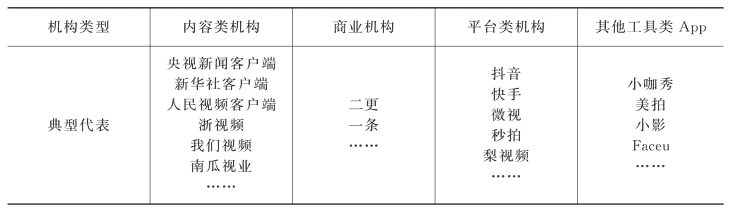

# 数据透视：智能媒体时代短视频新闻的新变局

所谓短视频，是指“以秒为单位，主要依托移动智能终端实现快速拍摄与美化剪辑，并能在社交媒体平台上实时分享、无缝衔接”的视频形态，其时长虽无绝对标准，但本文聚焦的短视频新闻特指时长1分钟以内、基于智能手机终端观看的新闻资讯视频。按机构属性划分，国内短视频机构的发展现状大致如表1所示。

主流媒体布局移动短视频的主战场，主要集中在内容型机构与平台型机构。根据中国新闻史学会2019年1月发布的《媒体抖音元年：2018发展研究报告》，当年抖音平台认证媒体账号超1340个，累计发布短视频15万余条，总播放量破775.6亿，总点赞量超26.3亿。相较于媒体自建客户端“单打独斗”，平台媒介化趋势倒逼更多媒体选择入驻同一平台型机构，加之平台自带的庞大用户池与高日活，以抖音为代表的短视频平台已然成为主流媒体新闻生产传播的新兴高地。在技术赋能的当下，作为极具影响力的央媒抖音号，“央视新闻”发布的短视频新闻呈现出哪些新特质？其与智能传播技术的融合又蕴藏着怎样的突破与可能？

# 情感共鸣：内容与技术的平衡支点

## 内容分布：社会新闻成“流量担当”

首先从内容维度切入，研究者对706个样本进行了分类。参考相关学者的网络新闻分类标准，将样本划分为政治、国际、社会、军事科技、财经、体育、娱乐七大类新闻（如图1所示）。分类过程中发现，部分视频跨类别属性明显，也有纪录片片段、人物专访、综艺切片等难以归入上述七类的内容。数据显示，社会新闻类短视频发布量领跑，百万点赞以上的爆款数量也遥遥领先。此类内容多聚焦普通人故事、军旅感人瞬间、公民记者投稿、交通事故监控拍摄及执法记录仪视角等。

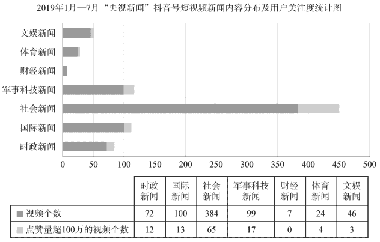

图1　“央视新闻”抖音号2019年1-7月短视频新闻内容分布与用户关注度统计图

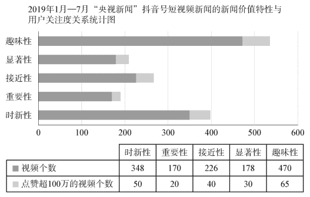

图2　“央视新闻”抖音号2019年1-7月短视频新闻价值特征与用户关注度统计图

## 新闻价值：正能量暖视频引爆传播

结合能激发公众共同关注的五大新闻价值要素——时效性、显要性、邻近性、冲突性、趣味性（见图2），以人情味与正能量为核心的“趣味性”视频传播效果最佳。国外学者Jonah Berger曾对《纽约时报》文章实证研究发现，强烈的情绪体验能显著促进受众分享行为，正向情绪唤起的内容比负向情绪更具传播优势。这些正能量“暖视频”通过激发并共鸣受众情感，在获取资讯的同时强化了“共情”体验，引发自发点赞、评论、转发，从而让短视频内容收获更高关注度与讨论热度。

可见，主流媒体进军短视频领域，正逐步摆脱以往的宏大叙事，转而更关注个体话语表达与平民叙事视角。从新闻事件背后的人物故事，到现场流露的人性光辉，在拍摄、传输、互动技术不断迭代的智能媒体时代，主流媒体短视频新闻的选题策划更聚焦于“主题表达与情感共振”的双重奏，让受众在指尖流转间感受新闻的力度与温度。这也佐证了：AI时代，新闻编辑依然是新闻生产的灵魂。那么，如何将技术红利融入情感表达，便成为平衡技术与内容关系的关键课题。

# 竖屏视界：拍摄语法的解放与重构

在呈现形态上，作为广电系抖音号，“央视新闻”绝大多数短视频源自电视新闻节目的二次剪辑。从大屏迁徙至小屏，除视频时长、剪辑逻辑显著重构外，横屏转竖屏的终端适配，更在新闻叙事、字幕设计、背景音乐等维度催生出独具特色的呈现范式。

### 竖屏重塑主流视听：央视新闻短视频的形态突围

数据显示，央视新闻抖音号706条短视频样本中，竖屏比例高达92%。这种形态并非简单适配手机屏幕，实则重构了新闻叙事的表达逻辑。

**聚焦“面孔”，让严肃叙事有了温度**  
高频词统计揭示：消防员、海军官兵、外卖骑手、交警、司机等人物标签占据主导。竖屏构图天然锁定人物表情与肢体动作，将受众视线精准聚焦于受访者神态细节，强化了“讲述感”与沟通张力，让人物故事更具穿透力。原本庄重僵硬的政治报道与舆论引导，因而褪去距离感——领导人与发言人的举手投足流露亲和力，会议幕后花絮也得以呈现。如“习近平握住老英雄张富清的手”视频，便收获海量点赞与真挚祝福。此外，接地气的大字幕填补了横屏转竖屏的黑边，配合海量抖音热门音效，在传递主流观点的同时，直击受众情感共鸣区。

**单兵作战，打破采编技术壁垒**  
竖屏形态让“手机即摄像机”成为现实，极大解放了传统新闻摄制的器材枷锁。一部具备拍摄功能的手机，即可随时随地完成采、剪、发全流程。2019年6月29日G20大阪峰会新闻中心现场视频，即由总台记者第一人称手机拍摄呈现。竖屏空间在画面构图上容纳了更丰富的现场信息，更让受众以沉浸视角“零距离”围观峰会幕后。

**开放共创，激活“全民记者”素材库**  
主流媒体拥抱竖屏，也让基层“公民记者”用手机记录的新闻现场，直接转化为可用素材。辽宁开原龙卷风灾情、桂林导游强迫消费事件等，均源于网友手机镜头。开放包容的平台机制，在简化后期制作门槛的同时，为主流媒体及时复原新闻现场、组建“生活记录特约团队”提供了可能。

---

### 时长博弈：短视频新闻是通往深度的“窗口”

作者将样本划分为五个时长梯队（0-15s、16-30s、31-45s、46-60s、60s+）。量化分析显示：**产出主力是46-60秒，但爆款聚集在16-30秒。**

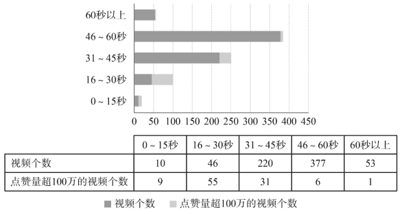

Figure 3　Analysis Chart of Relationship between User Attention and News Video Length of "CCTV News" Douyin Account, Jan–Jul 2019

这一矛盾折射出两大现实：长内容剪短仍面临时长把控难题；用户消费习惯仍处碎片化、即时化、快餐化阶段。那么，用户偏好的最优时长是否随月份演变？

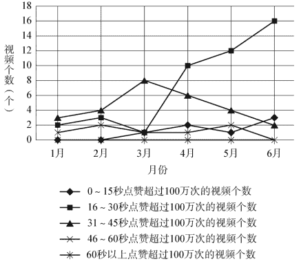

Figure 4　Distribution Change Chart of Video Duration Segments with Monthly Likes Exceeding 1 Million of "CCTV News" Douyin Account, Jan–Jun 2019

图4揭示关键转折：2019年1-3月，百万赞视频集中在31-45秒；3月后，16-30秒视频热度显著跃升并持续领跑，优势明显扩大。

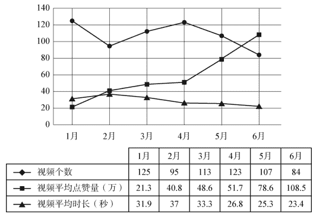

Figure 5　Statistical Chart of Monthly Trends in Number of Videos Published, Average Likes, and Average Video Duration of "CCTV News" Douyin Account, Jan–Jun 2019

随着短时长视频走红，央视新闻账号月均发布量虽降，但月均点赞却持续攀升，单位产出效能显著提升，印证主流媒体在抖音平台的认可度与日俱增。未来发力点明确：极致压缩剪辑时长，或将长新闻拆条、分类推送。

**短，不等于浅——短视频作为“导流窗口”的战略定位**  
碎片化冲击客观存在，但移动端获取便利性、细节镜头语言带来的临场感与亲密感，反而让那些易被忽视的延伸热点、后续进展，更适合通过短视频平台释放。例如“飞车闯红灯撞大巴”视频，高赞评论直接补全事故定责后续，获网友一致叫好。可见，短视频虽短，却能直击现场、一锤定音，平台化运营更为后续跟进与互动搭建了高效通道。

受限于时长，专业复杂议题、深度调查难以一次呈现完全。这注定短视频新闻将长期以信息**“窗口”**形态存在，而非独立完整的视频新闻门类。核心内容聚焦四大类：新闻现场直击、短评快评、专题预告领读、长视频重点拆条重组。受众透过这扇“窗”，快速获知事实、抵达现场、感知热点，再经由链接跳转至通稿、长视频、直播间等不同“目的地”，完成对关注事件的全景式深度认知。

---

# 智能传播技术合理应用的前提条件

技术赋能伊始，主流媒体短视频新闻便在情感表达、拍摄手法与时长把控上呈现新貌。面对新媒体冲击，主流媒体正通过范式修正与运行规范重塑积极应变。新媒体生态与传播环境倒逼党媒新闻生产转型，这既仰赖智能传播技术的持续迭代，也推动短视频成为公众获取资讯的关键路径，抖音等平台更成为此类报道的新高地。这场视觉传播革命虽带来机遇，却也暗藏挑战。盲目迎合技术非长久之计，为践行主流媒体“举旗帜、聚民心、育新人、兴文化、展形象”使命，在技术应用中寻觅平衡点，方是善用技术的前提。

## 理顺技术与人的互动

**首要任务在于协调技术与身体的关系。** 当下技术愈发透明，深度嵌入人体、全方位融合感官。在短视频新闻生产中，技术应化身编辑感官的“外挂工具”——如AI辅助人脸识别、VR还原全景现场——助力记者转型为智能创作主体，显著提升生产效能。

**次之要落实机器与编辑的分工协作，铺陈人机共创版图。** 充分释放智能编创优势，构建素材库与云服务平台，推动AI技术在媒体端的应用与迭代，逐步迈入智能化生产轨道。编辑则转型为智能产品的“把关人”，履行审核职责，借力技术降低差错、实现精准分发，合力打造优质短视频。

**末端需直面算法推荐赋予用户的选择权及其衍生隐患。** “信息茧房”与“标题党”倾向引发业界忧虑。我们在以多维人文价值外部校正算法逻辑的同时，应实时监测点赞、评论、转发等后台互动数据，经研判后动态调整措辞、剪辑与基调，紧扣用户需求与心理，让智能辅助下的内容生产优化传播效能，契合受众媒介偏好，激发网友对新闻内容的深度共鸣。

## 坚守技术与内容的本位

短视频绝不可“短了文化”。编创全程须坚持“内容为王”，出产兼具创意、温度与厚度的精品新闻。唯有优质内容，方能为全媒体技术驱动注入鲜活血液，为新时代舆论引导装填强劲动能。

发挥关键辅助作用的智能传播技术，不只能从拍摄、剪辑、发布、互动全链路革新呈现形态，更可植入AI互动、闯关游戏、语音对话等元素，拓宽场景入口，强化用户与新闻的交互感。

主流媒体应延续正能量短视频优势，深挖新闻背后的情感叙事，借技术之力丰富“讲故事”的维度与样式，打造高品质“暖视频”。同时，践行“有趣+有用”创作法，善用短视频平台“窗口”效应，以创新形态制造声量、抓住眼球，引流至中长视频深度报道，实现浅层触达向深度阅读的转化。

## 拓展技术与社会的连接

主流媒体集体入驻，使短视频平台成为政务新媒体实战阵地，助力舆论引导与社会治理。通过输出通俗易懂、大众爱闻乐见的内容，主流媒体降低了受信门槛、拓宽了宣传覆盖面，让用户即时掌握社会脉动、读懂政务热点，从而增强引导力、提升传播力、壮大主流意识形态影响力。

在此进程中，智能技术不断革新形态、激活内容，助受众透过短视频读懂社会。5G高速率、大容量、低时延、低功耗特性，强化了短视频“窗口”属性；从短视频跳转中长视频、直播间将成获取深度资讯新习惯。万物互联让媒体引导下的线上线下政务联动更频繁。广电媒体凭借直播转播技术积淀，依托短视频平台开展直播、实时连线现场、通过弹幕捕捉民意，将开启5G赋能下的全新报道场景。

AI与人工智能的应用，则助力主流媒体以拟人化表达——打造品牌卡通形象、启用AI主播——重塑党政机关与干部的亲和形象。网友透过短视频直观感知党政干部工作生活常态，产生亲近感与共鸣，打破刻板印象带来的疏离感。

此外，8K、VR、AR等视觉技术寓教于乐、普及知识，更以沉浸式“临场体验”引发受众“共情”心理，强化公众对新闻事实与社会动态的认知与感知能力。

### 短视频新闻的视角革命与智能传播新图景

得益于拍摄设备的普及与民用化，普通民众摇身一变成为新闻现场的“公民记者”，极大地拓展了新闻视角的边界。以“央视新闻”抖音号首发的缉毒民警第一人称执法Vlog为例，该片借助运动相机（GoPro）定格真实视角，配合短视频的技术优势，让案件还原与警情通报摆脱了过往“说教式”的沉闷叙事，以更鲜活、沉浸的形式高效传递正能量。

#### 智能传播技术赋能短视频新闻的实践探索

以2019年上半年“央视新闻”抖音号发布的706条视频为样本，其中不乏智能短视频创新的典型案例（详见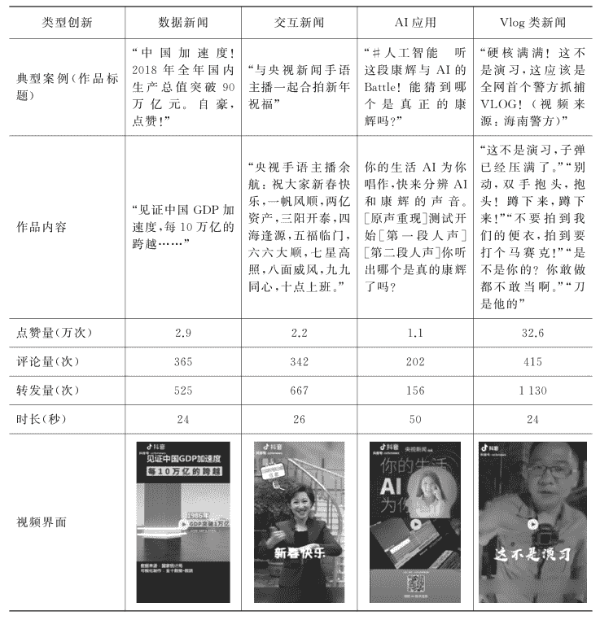）。

5G时代的到来，凭借高速率、大容量、低时延、低功耗的传输特性，预示着视频语言将取代文字成为社会传播的主导表达。云计算、人工智能、大数据等前沿技术与新闻生产的深度融合，更为短视频新闻这一未来媒介“窗口”打开了无限可能。以下将从三个核心维度，剖析智能传播技术对短视频新闻的深远重塑。

**一、 数据：驱动内容生产与舆情治理的双引擎**

在数字化生活成为常态的当下，数据价值在智能媒体时代愈发凸显。

*   **重塑选题与剪辑逻辑。** 面对抖音等推荐算法分发平台，深度挖掘点赞、评论、转发等用户行为数据，是优化内容供给的关键。洞察受众“想看什么新闻”、“习惯如何阅读”，能助力主流媒体依据数据反馈，动态调整推送策略、剪辑节奏与叙事结构。
*   **数据新闻成可视化利器。** 数据支撑让公众透过直观视角读懂社会议题，动态可视化技术更赋予受众极佳的视觉体验。主流媒体推出的数据动画长视频屡获好评，因其紧贴民生热点、传播效能高、解读力强，这种冲击力强、形态灵活、干货满载的短视频形态，在新媒体环境中极具竞争力。未来，主流媒体可尝试加快节奏、强化视觉，让政务与社会热点“动”起来，探索创新新路径。
*   **数据沉淀筑牢发展基石。** 5G加速视频流转，也使短视频平台易成舆情爆发“首战场”。主流媒体需建立账号后台舆情数据实时捕获机制，做到未雨绸缪、跟进报道，用硬核短视频澄谬止乱、化解危机。智媒时代，善用短视频应对舆情风险或成主流选择。同时，引入区块链存证技术常态化，可有效溯源信息、护航隐私、确权版权，破解行业“后真相”困境。

**二、 通信：重构传播链路与体验边界**

*(此处原文标题为“Communication”，正文未展开，保留标题占位)*

---

### 智媒变革：广播电视媒体的未来进化论

**核心观点：** 在“万物互联”纪元，智能媒体将以用户为核心，输出高效智能的媒介服务能力。本文剖析我国广电媒体现存痼疾，探讨以AI、5G、区块链为代表的智能技术集群如何重塑产业链条，以新华社“媒体大脑”为范式深度解码技术赋能实效，最终从优化供给体系、以“智能+”为引擎、升级用户体验等五大维度，勾勒广电媒体“智造”内容支撑体系的加速构建路径。

**关键词：** 智媒变革、媒体融合、人工智能、智能媒体、媒体大脑

**概念界定：**
*   **广播电视媒体：** 依托无线电波或有线网络，定时向广域覆盖传播声像节目的大众传媒，承担信息生产传播、资源优化配置引导、信息运营等核心职能。
*   **智能媒体：** 立足互联网底座，借力“云大物移智区加”（云计算、大数据、物联网、移动互联、人工智能、区块链、“互联网+”）技术集群，采集解析用户消费环境、行为偏好，实现内容产品服务与时空场景需求的精准匹配。简而言之，即具备用户感知与极致体验交付能力的信息客户端与服务端总和。

与传统媒体“点对点”单向传播不同，智能媒体构建起协同创新的在线社交传播体系。依托技术红利，其已从“感知”进阶至“认知”，呈现智能交互、内容千人千面、形态多元化、时空虚拟化四大特征，重塑媒介生态基础范式。

#### 我国广播电视媒体发展的现存困境

*(原文至此结束，后续内容待续)*

# “智能+”浪潮下，传统广电如何破局重生？

随着“智能+”技术飞速演进、智能终端全面普及，以及用户对内容品质与体验要求的水涨船高，广播电视媒体在过往很长一段时间里，陷入了内容同质化严重、用户流失加剧、流量红利见顶等困境，深层弊端逐渐暴露无遗。

## 一、 “以质取胜”谈何容易

步入互联网时代，广电媒体虽纷纷构建起“两微一端一抖”的新媒体运营矩阵，但不难发现，不少平台仅是形式上的“为建而建”，内核依然流淌着传统媒体的“血液”。其一，面对突发热点及网络舆情，往往难以做到即时精准的发布与回应，导致舆论影响力、公信力与权威性遭受考验；其二，内容“千篇一律”成常态，可读性大打折扣。以2017年11月“红黄蓝幼儿园事件”为例，多家主流媒体未经核实便跟风转发，致使谣言满天飞，公众对权威媒体公信力产生质疑。再如央视新闻微博在2019年3月、4月先后推出《Excel使用技巧》与《9个简单好用的Excel小技巧》，内容高度雷同，贻笑大方。

## 二、 惯性思维作祟，原创动力不足

虽呈现“百花齐放”表象，但广电新媒体实难跳出传统路径依赖。一方面，未能以个体社交经验为逻辑起点，拥抱媒体融合思维、用户思维、数据思维、产品思维等新媒体原生思维模式，导致难以孕育真正的广电“新（心/核）”媒体；另一方面，“流量至上”裹挟下，从业者主动丧失职业初心，不仅违背了资讯内容原创、优质、高效、多元的本质属性，更滋生了跨平台互相“搬运”、“二传手”的不良生态。调研数据佐证：从业者高度认同新兴新闻客户端作为“新闻传播者”与“资源整合者”的角色，却对“新闻生产者”定位认同度极低。

## 三、 盗版横行，维权之路漫漫

Web 3.0 时代，内容生产、传播、消费早已突破传统媒体边界，延伸至网络媒体、移动媒体乃至个体用户等多元核心节点。技术环境让获取、复制、转载、删除变得极易，却让现有技术手段难以全程追责侵权违规；新媒体平台长期低价甚至零成本使用广电内容，严重侵蚀经济效益。版权保护失效，内容价值便无法最大化释放，广电媒体沦为“重灾区”，频频陷入“为他人作嫁衣”的尴尬。典型如各类网络平台未经授权提供高商业价值的体育赛事直播。

## 四、 人才蓄水池浅，复合型干将短缺

媒体竞争本质是人才竞争，核心优势源于人才优势。早期广电因供给不足，多依赖第三方合作——内容靠外包，技术靠外援，导致体系内先天缺乏具备“互联网基因”的技术骨干。融媒体深化之际，数据科学家、算法工程师、交互设计师、舆情分析师、新媒体编辑等新岗位层出不穷，广电却跟不上节奏，跨新闻学、计算机、统计学、社会学等多学科的复合型人才极度匮乏。加之行业滞后性致使技术与运营在相对落后、经验不足、体制不全的环境中摸索，陷入恶性循环。

---

## “智能+”技术核聚变，领航赋能媒体产业智变

无技术不传播，无传播不技术。新一轮智能技术集群浪潮下，传统媒体若想可持续发展，必须摒弃“互联网是延伸与补充”的定位，以“多维思维”在数字化平台上重筑“护城河”，加速融合新媒体，主动践行数字化、网络化、智能化、融合化的全媒传播新范式（见下图）。

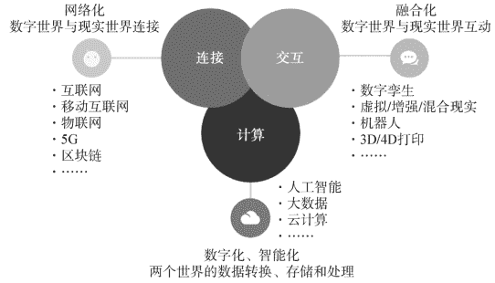

**图1　“智能+”技术综合应用全景**

### “人工智能 + 媒体”

人工智能（AI）旨在研究、开发模拟、延伸、拓展人类智能的理论、方法与应用系统，构建智能机器实体。随着理论成熟与应用拓展，AI 或将成为人类智慧的“容器”——让机器像人一样思考（博弈、机器学习、知识图谱）、听说（语音识别、机器翻译、人机对话）、看懂（图像/人脸/文字识别）、行动（自动驾驶、无人机、服务机器人）。

媒体视角下，AI 赋能的智能媒介与智能机器将作为助手与“把关人”深度协同，重塑产业链条：依托生物特征识别推动采编自动化；借助深度学习验证假设、挖掘数据线索；运用计算机视觉从海量音视频中极速捕获信息。2019年5月，科大讯飞发布新一代智能录音笔：AI 加持下，语音转写准确率达 98%，并能分场景智能降噪，让人声更清晰，实现了从单一记录工具向全场景实时“智能录音助手”的功能与体验跃迁。

### “5G + 媒体”

### 5G时代：重塑媒体生态的“新基建”

第五代移动通信技术（5G）由三大核心应用场景构成：增强移动宽带（eMBB）、海量机器类通信（mMTC）及超高可靠低时延通信（URLLC）。凭借10 Gbps的峰值速率与近乎“零时延”的体验，5G将催生更高品质的超高清视频，并让云端VR/AR应用成为现实。从技术谱系看，它是4G的深度进化；从宏观历史维度审视，5G将继蒸汽机、电力、汽车、互联网之后，成为新一代通用基础技术。它能以最优方式连接万物——媒体产业在内，打破时空界限，实现“随时、随地、万物皆媒”。

站在媒体视角，2019年1月，中宣部将“发展广播电视5G”列为年度重点任务，推动行业跳出“技术+传统内容”的固有瓶颈，迈向数据与服务、生产与传播深度融合的新阶段。“5G+媒体”将强力赋能产业链上下游：推动超高清视频（4K/8K/16K）、VR/AR音视频及游戏普及，落地移动化、场景化的智能适配服务，为用户带来更便捷、优质的视频回传与直播体验；为物联网、人工智能等智能媒体提供技术底座，保障新闻生产全链路数字化运营，进一步拓展新媒体报道手段。以2019年北京世园会报道为例，央视率先贯通“5G+8K”全链路，为观众呈现多视角、高清度、音效增强的沉浸式观赛体验，更为2022年北京冬奥会8K转播奠定了坚实基石。

### 沉浸式技术：打开媒体交互的“新维度”

沉浸式技术旨在融合数字仿真世界与物理现实，赋予用户“身临其境”的感知。其核心技术矩阵涵盖虚拟现实（VR）、增强现实（AR）及混合现实（MR）。随着建模设备精进、3D视觉显示、全息成像、头眼追踪及数字孪生技术的演进，沉浸式体验正向全感官维度延伸。通过实物虚拟化、虚拟实体化、信息叠加与全息呈现等手段，它将彻底重构用户的交互范式。

---

### VR视角：将媒体内容推向“五维空间”

从媒介属性审视，“360度全景+景深”模拟真实物理世界，借助外部交互设备让用户与虚拟环境零距离接触。“VR+媒体”打破了传统媒体“二维平面+时间”的三维结构桎梏，将内容维度拓展至“三维空间+时间+虚拟平行世界”的五维形态，推动影视、游戏、直播、教育、电商、地产等领域的内容形态与商业模式双重变革。2019年2月，央视新闻客户端上线“VR频道”，主攻全景图文与VR视频新闻，用户可通过超链接直抵VR场景，成为这一变革的典型注脚。

## 4. “区块链+媒体”

# 区块链：重塑信任基石的“价值互联网”基建

区块链并非单一技术，而是一种融合“数据可信”“价值流转”“去中心化”与“智能合约”功能的创新应用范式，旨在破解多方交易中“信任昂贵、监管困难”的顽疾。自2008年概念诞生以来，它已完成三次跨越式演进：1.0阶段以比特币为代表，聚焦虚拟货币的转账汇款；2.0阶段引入智能合约，以超级账本为标杆，拓展至抵押、产权确权等金融资产领域；2018年起步入3.0时代，跨越合约层面，构建跨行业的去中心化生态，渗透身份认证、文娱版权等民生场景。从本质看，区块链是重写世界底层逻辑的颠覆性技术，更是构建未来“价值互联网”（数字货币+数字资产+生态系统）的通用基础设施与核心连接器。

在媒体实践层面，区块链展现出双重赋能价值：一方面，它为原创内容加上“防伪锁”，实现版权全链路溯源，有力遏制盗版乱象；另一方面，它打破数据孤岛，在保障隐私安全的前提下促进数据流通。2018年4月，“三个爸爸”联手央视及区块链共享生态平台`Smartshare`，推出IP区块链产品“等等机器人”，集智能对话、远程视频于一体，精准记录亲子互动行为，成为技术落地生动注脚。

## 5. "IoT+媒体"：万物互联下的传播新范式

物联网，即“物物相连之网”，是在互联网基础上延伸拓展而来的业务网络。它通过各类信息感知设备与网络的深度融合，实现人、机、物在任意时间、地点、环境下的泛在互联。其核心诉求在于“万物可寻址、可通信、可控制”，业务聚焦网络计算、聚合、连接、通信、采集与内容，强调认知能力，集中体现为“8A”服务——**随时、随地、任何人、任何事、任何服务、任何内容、任何设备、任何网络**。

媒体融合语境下，“IoT+媒体”已成新常态：无人机航拍、监控探头、行车记录仪采集影像；传感器捕捉用户数据并实时反馈。这一组合深度介入突发新闻、环保监测、深度调查、“公众参与式”报道及无人机新闻等领域，彻底打通全新传播路径，推动传统媒体从“ 人传人”跨越至“万物皆媒”。案例可见2016年里约奥运，《华盛顿邮报》接入组委会数据库，借标准化机器人写作模版，极短时间内自动产出赛事快讯、综述稿件，展现极致效率。

# III. 智能媒体：重新定义媒体边界

得益于智能技术集群突破与新型信息基建完善，信息传播以前所未有的广度深度渗透社会肌理，正在重塑“人-信息”“人-商品”“人-服务”“人-人”四大连接模式，催生从“人联网”向“万物互联、万物智联”演进的智能传播新图景。受限篇幅，下文以新华社媒体大脑为核心样本，剖析智能媒体变革路径。

## 1. 从采集到生产：构建全链路智能制造模型

2017年12月，新华社发布国内首个媒体AI平台——媒体大脑1.0（`mp.shuwen.com`）[6]；2018年6月，2.0版“MAGIC”智能媒体生产平台面世，引发国内外强烈关注。不难发现，`MAGIC`本质上是`MGC`（机器生成内容）与`AI`的深度耦合。媒体大脑“2410”智能生产平台双管齐下：前端借摄像机、无人机、行车记录仪等智能感知终端，实现数据采集、线索监测与发现的实时化、自动化；后端以算法替代人工完成新闻生产、校对分发，大幅提升采编分发效能；中台则具备数据分析、图像处理、视频剪辑等深加工能力，贯通“采-产-分”全流程智能化闭环。2018年全国两会前夕，新华社基于媒体大脑推出MGC视频新闻：扫描5亿网页、分析350万条数据，可视化呈现两会关键词与舆情热点，全流程仅耗时15秒（见下图）。

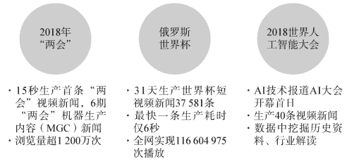

Figure 2　媒体大脑MAGIC，智能自动生成视频

## 2. 从UGC到MGC/IGC：开启虚实融合的共生生产新纪元

媒体大脑通过摄像头、传感器、语音识别等多模态采集素材，经图像处理、深度学习等智能技术分析加工，直接成稿，确立了`MGC`智能新闻生产新范式。智能技术集群与媒体产业的深度融合，核心在于技术以更高阶智能介入内容生产。人民日报“中央厨房”推出的“小融”“小短”，新华社“度秘”，广州日报“阿童”“阿乐”等新闻机器人，已覆盖策划、采访、制作、分发、反馈全链条。这种虚实融合模式，在解锁更具想像力的叙事手法同时，推动内容生产从用户生成内容（`UGC`）跃迁至以人机协作为特征的机器生成内容（`MGC`、`IGC`）。典型案例包括：2018年11月7日第五届世界互联网大会首发全仿真智能`AI`主播，拥有真人级播报能力、实现7×24小时不间断播报；`AI`主播“小冰”入职东方卫视担任天气主持；`AI`合成技术完美复刻已故播音员李毅声像，让经典声音跨越时空回响。

## 3. 从“B2C”到“C2B”：重构精准分发的供给侧逻辑

### 媒体大脑：重塑内容生产与分发的智能中枢

媒体大脑凭借多维指标交叉分析能力，依托海量多源异构数据构建精准用户画像，推动信息分发与互联网服务深度融合。这让媒体从业者能洞察用户深层需求，使运营迈向智能化、精准化、人性化新阶段，进而带动媒体经济产业链沿着“更精准、更高效、效益最大化”路径跃升。以广告投放为例，广告主不再局限于节目定向，更能获取媲美甚至超越收视率模型的受众数据，实现精准个性化实时投放，买卖双方均获价值增益。再如2017年9月新浪客户端推出的“即时推送”功能，捕捉用户“即时兴趣”推荐高热度内容，开创了人与信息连接的新服务范式。

## 4. 从单向分发到跨界适配：构建智能服务新模型

媒体大脑集成人脸识别、情感分析等计算机视觉硬核技术，可自动完成音视频图文素材的分类处理。它不仅助力从业者从素材库精准调取素材，更打通多运营平台支撑跨界服务。通过精准识别人物关系保障即时新闻准确性，大幅提升新闻线索挖掘效率，确立了从“革新传播手段”到“提供全维信息服务”的全新模型。大型赛事直播中，它输出实时数据分析、高光回放；灾害报道时，提供多角度现场影像图文。2018年世界杯期间，“MAGIC”平台运用视频追踪算法标注球员跑位、射门率、有效进攻等数据及“高光时刻”短视频，深度解读赛局走势。

## 5. 从源头创作到授权发行：筑牢全流程监管防线

在优化传统对应识别基础上，媒体大脑发挥全网数据处理优势，结合针对图文视频主流传播形态的智能相似度算法，与权利人首次登记的版权信息比对，强力赋能数字版权保护。这为全网优质原创内容筑起“防火墙”，最大程度遏制抄袭与“二次加工”乱象。区块链等“智能+”技术同步输出监测分析报告与可视化数据，助力权利人法律维权，倒逼媒体产业以“高质量原创”确立核心竞争力。2018年9月杭州互联网法院上链，媒体大脑版权区块链成为全球首个获互联网法院认可的版权链，创作者一键取证直达法庭成为现实。

# IV. 广电媒体智能化转型：未来演进的四大关键向度

当下，多渠道、多维度、多平台驱动媒体业向纵深发展。面向未来，广电媒体应借力新一代智能技术集群，从简单的业务“加法”转向深度的融合“乘法”，实现业态有机融合，持续增强新闻舆论的传播力、引导力、影响力、公信力。

## 1. 以“智能+”为引擎，激活多维跨界运营新增长

数字经济模型下，用户规模是平台运营核心，多维跨界运营可实现用户资源共享与消费潜能挖掘。在深耕存量用户同时，增量机遇隐匿于三四线城市、县域市场及“ACG（动漫、漫画、游戏）”新生代群体。腾讯案例极具启示：凭借社交流量优势，构建覆盖社交、游戏、支付、视频、资讯、直播的生态帝国。2018年单年，腾讯智能手游收入778亿元，逼近全国有线电视网全年收入779.48亿元，远超湖南广电209.51亿元头部省级台规模。

广电转型需打破固有思维，以“智能+”为引擎，回应融媒体业务发展、资源调度整合、创新增长、平台开放四大诉求，建立大尺度跨界运营体系。央视“天链二号”发射直播首试“弹幕互动”模式，在保障直播效果同时引爆网络热议，这种“传统硬新闻+新型互动直播”的跨界创新，为传统媒体提供了可复制、可推广的破局范式。

## 2. 重构供给体系，以智能服务精准对接用户需求

中国消费端数字化水平全球领跑，快递物流量、网购用户、移动支付规模均居世界首位。反观供给端数字化滞后，品牌匮乏、投放无效、精准营销乏力等顽疾凸显，呈现“强消费端倒逼弱供给端”态势。智能供给体系中，前端数据分析提供数字化研判工具，基于精准测算与诊断重构研发体系，实现产品精准设计孵化、内容质量跃升、决策周期压缩与准确率提升。

## 3. 重塑用户体验：以移动优先为锚，推进场景化智能适配

用户的移动消费习惯，已让具备移动性、体验感、互动性、高效性与智能化特征的场景式服务，成为传播的基础范式。移动终端、传感器、社交媒体、大数据及定位系统等应用技术，催生出的“临场感”，正深度重塑消费时代的用户体验[11]。数据显示，我国网民规模达8.29亿，98.6%通过手机上网；39岁以下群体占比高达67.8%，其中20-29岁青年占比近三成[12]。移动互联网下半场的博弈，聚焦于以消费升级背景下主流人群的内容需求与社交体验为逻辑起点，争夺用户注意力、培育粘性，并在深耕内容与精准分发基础上，把握媒体智能化趋势。

智媒转型进程中，传统媒体应充分利用采集到的实时素材并合理分类，打破以往单一、灌输式的发布模式，构建“新闻现场+现场报道互动+用户后台互动”的多场景融合新生态[13]，提供可选的适配服务。同时，要打通线上线下壁垒，连接现实生活与虚拟时空，将传播触角延伸至工作、生活、娱乐、休闲等多元场景。例如，广播电视服务中赋予用户自主选择视角的自由；在沉海体验上强化场景化实时互动；在数据服务中提供与传播内容关联的智能适配服务等。

## 4. 筑牢版权护城河：以IP核心驱动，构建良性盈利闭环

当前，以`IP`为核心连接文字、图像、音乐、影视及实体周边的数字化“超级IP”产业链高速发展，凸显了原创`IP`内容在媒体产业中的战略地位。借力`IP`推动“互联网+媒体”跨界融合，或成当前智媒健康转型的关键路径。以迪士尼为例，其依托漫威5000余位漫画超级英雄形象，打造系列电影并斩获票房佳绩。据2018年内地票房榜数据，当年上映的《复仇者联盟3：无限战争》（23.7亿）与《毒液：致命守护者》（18.56亿）双双跻身前十；2019年《复仇者联盟4：终局之战》更以3天20小时52分钟刷新华语影史破20亿最速纪录[14]。

智媒转型中，为实现`IP`价值变现、建立良性盈利模型与优良产业生态，广电媒体须高度重视知识产权保护，以优质原创`IP`为引领，用公信力反哺新媒体发展。一方面，用足现有技术手段赋能版权保护，强化数字版权相关技术研发，筑牢保护“硬实力”；另一方面，从业者版权意识需同步觉醒，通过政策层面的鼓励、扶持与保护原创，激活创造力源泉。

## 5. 加速平台创新：内容与技术良性互动中拓展融合广度

技术环境虽迭代，但“内容为王”始终是媒体生产的铁律。随着年轻、老年及“白板”用户加速入局媒体生态，传统媒体不可丢失自身标准，应发挥广电智媒化优势与新媒体“传统化”优势的叠加效应，在内容与技术间形成良性循环，以“内容先行”的技术体系推动优质内容“原生化”生长，拓宽传播半径，拓展融合渠道。

智媒转型深水区，媒体组织若想在用户拓展与内容优化上实现深度融合，必须由简单的“拼接式”向全方位“渗透式”跨越，凭借优质内容拓展新媒体发展广度。2019年4月，封面传媒与《光明日报》携手共建“智能媒体技术云平台”，双方拟在内容、技术、渠道等维度实现互补：一端以前沿技术赋能内容生产，另一端借力云平台推动新闻生产向全时段、全流程、全网络智能化转型。

# V. 结语

当下与未来，自然智能与人工智能将在智媒生态中无缝嵌融，无分彼此、无界东西。广电媒体欲从简单的“物理加法”跨越至化学反应般的“深度融合”，不仅靠技术迭代，更靠从业者在“如何融、融什么”上把准“质”与“度”。惟有坚守自有优势，以用户思维等新范式深挖“数据价值”，用`AI`重构媒体生态，占领用户心智，方能推动产业向高质量跃迁，为媒体升级转型与协同共生新范式提供启示。

# 参考文献

[1] 徐志强. 智能媒体创新发展模式研究[J]. 中国出版, 2016(12): 17-21.

[2] Yan Sanjiu. 中国广播电视媒体与新兴媒体融合发展的现状、问题与创新路径[J]. 华东师范大学学报(哲学社会科学版), 2018, 50(01): 89-101+179.

[3] 朱洪君, 蒲晓. 2017中国新媒体版权保护报告[J]. 新闻与写作, 2018(08): 69-75.

[4] 郑子里. 中国媒体深度融合的驱动逻辑与推进路径[J]. 现代传播(中国传媒大学学报), 2017, 39(06): 5-9.

[5] 艾瑞咨询. 2019年技术趋势报告[R]. 北京: 北京艾瑞咨询股份有限公司, 2019.

[6] 媒体大脑. 媒体大脑官网[EB/OL]. [2019-5-20]. https://www.shuwen.com.

[7] 陆燕敏. 2017年回顾: 媒体行业十大事件[J]. 传媒, 2018(01): 16-21.

[8] 李彬彬, 胡凌谷. 腾讯发布2018年业绩报告: 全年营收3126.94亿元人民币[EB/OL]. [2019-3-22]. http://www.chinanews.com/cj/2019/03-22/8787027.shtml.

[9] 国家广播电视总局. 2018年全国广播电视行业统计公报[EB/OL]. [2019-05-12]. http://www.nrta.gov.cn/art/2019/4/23/art_113_42604.html.

[10] 湖南省广播电视工作会议. 湖南台2018年收入209.51亿, 占全省广电总收入76%[EB/OL]. [2019-5-20]. http://www.sohu.com/a/290461792_120051417.

[11] [美] 斯科布尔, [以] 以色列. 语境时代[M]. 赵乾坤, 周宝瑶, 译. 北京: 北京联合出版公司, 2014.

[12] 中国互联网络信息中心. 第43次中国互联网络发展状况统计报告[R]. 北京: 中国互联网络信息中心, 2019.

[13] 苟凯东. 移动优先视域下的场景重构与传播创新——以央视新闻移动网为例[J]. 电视研究, 2017(10): 7-9.

[14] 徐美琳. 《复联4》超"地球"成中国影史最快破20亿电影[EB/OL]. [2019-04-28]. http://www.bjnews.com.cn/ent/2019/04/27/573232.html.

(作者简介: 徐志强, 四川传媒学院数字媒体与创意设计学院教授、高级工程师; 闫玲, 赵亚琳, 四川传媒学院数字媒体与创意设计学院数字媒体技术专业2016级本科生)

**【注释**

[[1]](#txt010.html#footnote_quote_txt010_1) 本文系2016年度教育部人文社会科学研究规划基金项目"网络'正能量谣言'舆情生成与治理策略研究"(16YJA860006)及国家社科基金重大研究专项"'一带一路'互联互通系统规划与设计研究"(18VDL001)的阶段性成果。)

# 媒介使用研究

## 社交媒体使用与社会责任认同的关联：基于"新上海人"的实证探究

**白汝瑾　李正红**

### 摘要

为揭示社交媒体使用如何作用于"新上海人"的社会责任认同，本研究构建了一个调节中介模型，重点考察社会融入在两者间的中介机制，以及社会信任的调节作用。通过对415名"新上海人"开展问卷调查，测量其社交媒体使用、社会融入、社会信任及社会责任认同水平。研究发现：① 在控制性别、年龄、户籍、城乡来源、收入及在沪居住时长等变量后，社交媒体使用对社会责任认同具有显著正向预测效应；② 社会融入在社交媒体使用与社会责任认同的关系中发挥中介作用；③ 社交媒体使用对社会责任认同的直接预测效应，以及社会融入的中介效应，均受到社会信任的调节。

### 关键词

社交媒体使用、社会责任认同、社会融入、社会信任

# 一、 研究背景

## 引言

社会责任认同，是指个体基于自我定位，经由理性思考与自由抉择，确认自身为社会正常运转与健康发展应承担的责任与义务的一种认知与行为模式。萨特哲学视域揭示了责任的本源与意义：社会责任是人类绝对自由的内在要求，是"成人"的本质；逃避责任即逃避自由。据上海市统计局数据，截至2018年末，本市常住外来人口达976.21万，占常住人口总数(2423.78万)的40.27%，"流动时代"正式来临。[1] 人口流动是城市化进程的必然产物。在全国大力推进城镇化的大背景下，城市新移民已成为政府与学界共同关注的焦点群体。在媒介社会化趋势下，形形色色的社交媒体正悄然重塑社会结构与阶层图景，[2] 深度介入城市新移民的社会化与城市化进程，深刻重塑其认知结构与行为习惎。基于此背景，哪些因素影响着城市新移民的社会责任认同？这些因素间存在怎样的关联机制？如何借力社交媒体提升这一群体的社会责任认同？这些议题已成为新媒体时代构建和谐社会亟待破解的课题。为此，学者们曾从多元视角展开探索。心理学界提出"人格特质论"，认为社会责任感折射个体人格特质，不同特质导致价值观与社会心态差异；传播学界提出"信息接触论"，主张信息接触不仅促进日常交往，更通过信息筛选塑造价值观；[3] 大量实证研究证实，媒体与政党可借助"信息框架"影响个体认知与态度。[4] 显而易见，既往研究多聚焦单一视角剖析影响因素，鲜有系统梳理各因素间的交互机制，导致对个体社会责任认同的研究缺乏整体性。因此，本研究兼纳多重影响因素，旨在提升研究结论的精度与普适性。

# 二、 理论基础与研究假设

## 1. 媒介使用与社会责任认同

### 关于媒介使用与社会责任认知的学界争鸣与研究假设

学术界对于媒介使用与社会责任认同的关联，一直存在两种截然不同的声音。一种观点认为，媒介接触能够提升个体的社会意识与行为水平；另一种则持反对态度，指出媒介使用反而会削弱个体的社会责任感。这种结论的分歧，根源在于研究语境、切入路径及方法论的差异。

进一步观察微观层面的实证研究，学者们发现传统媒介与新媒体的影响路径并不重合。例如，传统媒介显著增强了公众对环境议题的讨论意愿与环保意识，而新媒体则更有力地推动了实际的环保参与行动。在农村居民公共事务参与上，传统媒介发挥了显著的促进作用，新媒体效应则不显著。此外，媒介内容与使用强度深刻影响着大学生的国家形象认知，新媒体的线上线下互动表达能正向激发青年政治参与意愿，媒介使用还能增强社会凝聚力与国家认同。梳理现有文献可见，针对社交媒体如何影响社会责任认同的专门探讨仍显不足。基于此，本文提出首个核心问题：社交媒体使用能否影响新上海人的社会责任认同建构？并提出假设：

#### 假设 1
`社交媒介使用` 对新上海人 `社会责任意识` 的建构具有显著正向影响。

---

### 社会融入的中介机制

何为社会融入？它是指处于弱势地位的主体，主动与特定社区的个体、群体开展反思性、持续性、互动性的社会行动过程。学界聚焦城镇新移民、农民工等特殊群体时发现，媒介在融入进程中扮演关键角色。积极面上，媒介使用助力弱势群体获取象征资本、打破象征壁垒、缩小数字鸿沟、化解社会冲突、树立正确价值观；消极面则表现为，不合理的媒介使用会压缩互动半径、固化人际圈层、阻碍独立人格养成。在二元社会结构与媒介社会化环境下，社交媒体究竟如何影响城市新移民的社会融入？融入状态又能否反向塑造他们在新环境下的“主人翁”意识（即 `社会责任认同`）？据此提出第二问题：社会融入能否影响新上海人社会责任认同的建构？由此假设：

#### 假设 2
`社会融入` 在 `媒介使用` 与新上海人 `社会责任认同` 之间起中介作用。

---

### 社会信任的调节效应

社会信任是个体在特定情境下，基于利益契合而对信任对象产生的心理认同与行为意愿。按关系疏密可分为泛信与特信，按对象类型可分为政治信任、人际信任、社会信任等。研究表明，社会信任能借助电视、报刊、网络等媒介影响政治认同与个人价值观，但不同媒介效应迥异：电视负面内容易滋生愤世嫉俗，降低政治信任；报纸资讯正向作用于认知情感，电视内容则呈两极分化。姚俊玺等证实媒介使用显著影响社会信任，后者进而显著作用于个体社会认知与行为；社会信任还能影响农村居民社会资本整合与劳动力转移。可见，学界对媒介使用如何影响社会信任分歧巨大，褒贬不一。因此，本文提出两个调节层面的研究问题：城市化进程中，社会信任能否调节社交媒体使用与城市新移民社会责任认同的关系？能否调节社交媒体使用与其社会融入的关系？据此提出假设：

#### 假设 3
`社会信任` 正向调节 `社交媒介使用` 与新上海人 `社会责任认同` 的关系。即 `社会信任` 水平越高，`社交媒介使用` 对 `社会责任认同` 的正向促进作用越强，反之亦然。

#### 假设 4
`社会信任` 正向调节 `社交媒介使用` 与新上海人 `社会融入` 的关系。即 `社会信任` 水平越高，`社交媒介使用` 对 `社会融入` 的正向促进作用越强，反之亦然。

---

为检验上述假设，本研究立足传播学“信息接触理论”与社会学“社会融入理论”双重视角，旨在揭示 `社交媒介使用` 与新上海人 `社会责任认同` 的内在联结，构建以 `社会融入` 为中介、 `社会信任` 为调节的调节中介模型，详见 `Figure 1`。

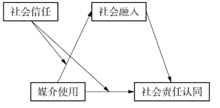

**Figure 1**　社会融入中介与社会信任调节的假设模型图

# III. 研究设计与方法

## 1. 研究设计

## 研究设计与变量测量

### 调查实施与样本概况
本研究采用问卷调查法，实地调查周期跨越2018年9月10日至2019年3月30日。执行团队由上海交通大学三名博士研究生组成，隶属于“都市新移民媒介使用与社会责任认同”课题组。甄别受访者身份的关键在于一句提问：“您是新上海人吗？”研究将“新上海人”界定为“户籍非上海、现于上海居住工作的群体”，即本文语境下的“上海都市新移民”。对确认符合标准的受访者，调查员会说明来意以争取配合。

三位成员分头部署，覆盖不同城市空间：成员一蹲守于市区写字楼下，在早高峰（7:00-9:00）、午休（11:00-13:00）、晚高峰（16:00-18:00）随机拦截上班族；成员二深入市区成熟普通居民区，于早晚出行时段（7:00-9:00, 16:00-19:00）抽样居民；成员三则驻守郊区工厂大门，针对下班高峰（7:00-9:00, 17:00-19:00）开展拦截。共发放问卷500份，回收455份，有效样本415份，有效回收率达83%。样本基础统计特征详见`表 4`。受限于客观条件，未能对全体新上海人实施全面抽样，故统计结论难以完全代表群体整体画像。

### 核心变量操作化

#### 1) 自变量：社交媒介使用
本研究聚焦`社交媒介使用`视角，并结合`社交媒介使用频率`展开分析。

**使用频率测度**。`社交媒介使用频率`采用多选题形式，列举博客、微博、网络论坛、视频分享类（如优酷）、百度/维基百科、知乎、微信、QQ、阿里旺旺共9个平台，要求受访者至少勾选三项。具体分布见`表 1`。

**Table 1**　社交媒介使用频率统计

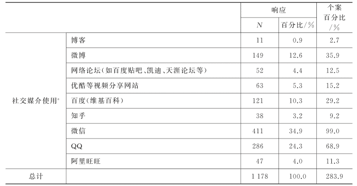

a．制表时，取值为1的项目编码为1，其余编码为0。

**使用行为测度**。参考陆伟关于都市新移民的研究，设定12个测评指标：“发布信息”“转发信息”“评论他人信息”“分享信息”“与人讨论”“关注好友动态”“与好友互动”“浏览/闲逛”“结识新朋友”“使用即时通讯工具”“加入群组（如微信群）”“发起或参与网络活动”。采用李克特5级量表（1=完全不同意，5=完全同意）作答。

经探索性因子分析，`社交媒介使用行为`可归纳为`社交行为`、`信息生产`、`信息获取`三个维度（详见`表 2`）。`社交行为`（`Cronbach'sα＝0.788`）涵盖浏览/闲逛、结识新友、即时通讯、进群、发起/参与活动；`信息生产`（`Cronbach'sα＝0.866`）含发布、转发、评论、分享；`信息获取`（`Cronbach'sα＝0.856`）含讨论、关注动态、互动。为精简模型，最终将三维整合为单一变量“`社交媒介使用`”（`M＝3.89, SD＝0.645`），仍沿用5级量表。

**Table 2**　社交媒介使用信度与效度检验

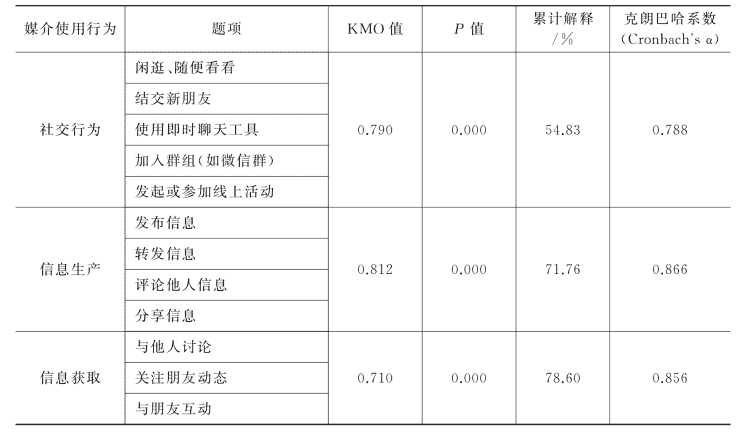

#### 2) 因变量：社会责任认同
文献梳理基础上，借鉴刘波平、刘海涛等学者的个体社会责任测量范式[19-20]，构建适配都市新移民的社会责任量表。`社会责任`拆解为`社会责任意识认同`与`社会责任行为认同`双维。

**意识认同**（`Cronbach'sα＝0.758`）含3题：①我有强烈社会责任感；②人人有责让社会更美好；③我认为当下社会普遍缺乏责任感。5级量表计分。因子分析显示`KMO=0.610`，Bartlett球形检验`P=0.000`，适合分析。主成分法提取单因子，累积方差贡献率69.84%。

**行为认同**（`Cronbach'sα＝0.959`）含7题：④遵守秩序爱护公物；⑤环保是我责任；⑥公共场合言行自律（不吸烟、不吐痰）；⑦维护社会稳定；⑧不发布危害安全稳定信息；⑨不转发危害安全稳定信息；⑩勤奋工作为社会发展贡献力量。5级量表计分。`KMO=0.913`，Bartlett检验`P=0.000`。主成分法提取单因子，累积方差贡献率80.61%。最终整合为“`社会责任认同`”单变量（`M＝4.32, SD＝0.53`）。

#### 3) 中介变量：社会融入
`社会融入`量表（`Cronbach'sα＝0.894`）参考金恒江编制。选取5题：①自我认同为上海人；②在上海有归属感；③离沪会想念；④喜欢上海并愿长居；⑤关注上海大事并视其与己相关。5级量表。`KMO=0.848`，Bartlett检验`P=0.000`。主成分法提取单因子，方差解释率70.6%。

#### 4) 调节变量：社会信任
`社会信任度`（`Cronbach'sα＝0.879`）依据郭细庆测量体系[21]编制。设6题考察对不同圈层的信任度：①亲属、②邻里、③同事、④上级、⑤泛熟人、⑥社会陌生人。5级量表。`KMO=0.783`，Bartlett检验`P=0.000`。主成分法提取两因子，经Kaiser标准化Varimax最大方差旋转，旋转成分矩阵见`表 3`。

**Table 3**　社会信任旋转因子载荷矩阵

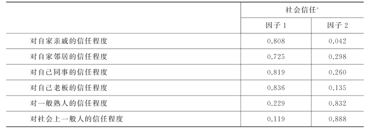

提取法：主成分分析。旋转法：带有Kaiser标准化的Varimax正交旋转。a. 旋转在3次迭代后收敛。

### 5) 控制变量设定

研究将人口学特征、是否持有上海户籍、受教育程度、户籍性质（城/农）、收入水平等纳入控制变量范畴，具体赋值操作详见表 4。

**表 4** 控制变量赋值说明

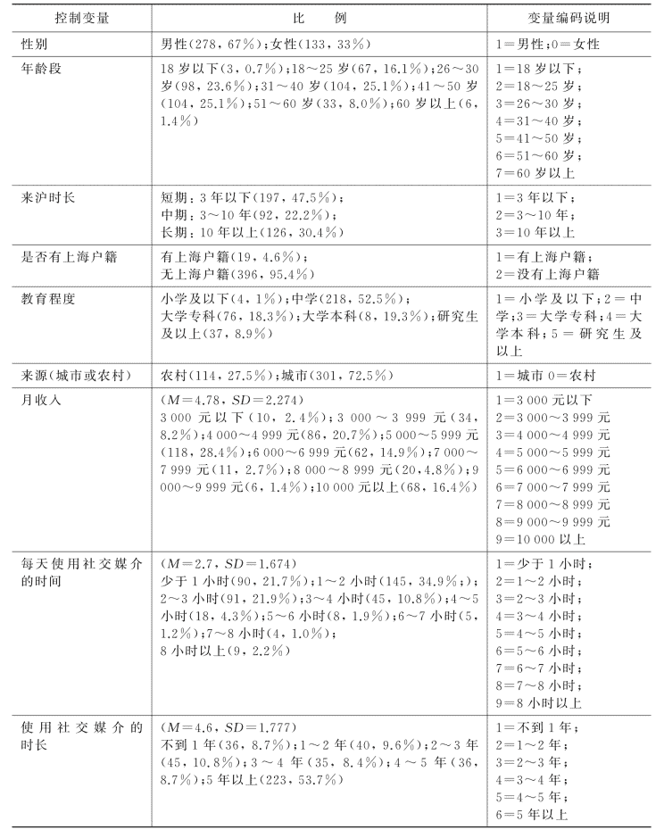

# IV. 数据分析与量化发现

正式分析前，依托程序性控制手段，引入哈曼单因素检验以排查匿名问卷填答可能引发的共同方法偏差。检验结果显示，首个公因子解释方差为 28.624%，未突破 40% 的判断阈值，表明本研究不存在严重的共同方法偏差干扰。

## 1. 核心变量描述统计与相关分析

### 1) 新上海人社交媒介使用画像

从平台渗透率看，微信以 99%（411人）的覆盖面稳居榜首，QQ 紧随其后（68.9%，286人），微博、百度百科、视频网站、贴吧类论坛、阿里旺旺、知乎、博客依次递减。腾讯系即时通讯产品（微信、QQ）构成了新上海人社交媒介使用的主力阵地。

在日均投入时长上，分布呈现倒U型特征：1-2 小时区间占比最高（34.9%），不足 1 小时与 2-3 小时分别为 21.7% 与 21.9%，其余时段占比均在个位数。使用年限方面，过半受访者（53.7%，223人）拥有 5 年以上经历，各年限段分布相对均衡。

行为维度三项均值均超量表中点（2.5 分）：`信息获取`（M=4.07, SD=0.70）领跑，91.1% 受访者常借此获取资讯；`人际社交`（M=3.85, SD=0.66）次之，87.7% 用于社交互动；`信息生产`（M=3.80, SD=0.80）相对较低，但仍有 81.9% 参与内容产出。整体呈现“获取资讯 > 社交互动 > 内容产出”的行为梯次。为便于后续建模，将三维行为整合为单一变量 `社交媒介使用`（M=3.89, SD=0.65）。详细频次分布见 `表 2`。

### 2) 新上海人社会信任、融入度与责任认同现状

`表 5` 显示，`社会信任` 与 `社会融入` 均值均超越量表中点 3 分（1-5 分制）。

**信任层面**：`相关关系信任`（M=3.81, SD=0.66）显著强于 `一般关系信任`（M=3.12, SD=0.77），高信任比例分别为 83.6% 与 38.6%，差距近 45 个百分点，凸显“熟人社会”信任优势。合并后的 `社会信任` 总量表（M=3.58, SD=0.59）显示 79.5% 受访者处于高信任水平。

**融入层面**：均值 3.18（SD=0.95），仅 55.2% 受访者融入度良好，近半数（44.8%）仍处于一般或较差水平。

**责任认同层面**：两维度均值均极高。`意识认同`（M=4.07, SD=0.59）高认同率达 93.5%；`行为认同`（M=4.43, SD=0.57）更高达 96.4%。整合后的总量表（M=4.32, SD=0.53）高认同比例为 79.5%。

### 3) 主要变量间的相关模式

`表 5` 的皮尔逊相关系数揭示以下规律：

**第一，媒介使用与责任认同显著正向关联，假设 1 获初步印证。**
- `意识认同` 与 `社交行为`（r=0.320）、`生产行为`（r=0.329）、`获取行为`（r=0.380）均达显著正相关（p<0.01）。
- `行为认同` 与上述三维（r 分别为 0.228、0.271、0.336）亦呈显著正相关（p<0.01）。
- 整合变量层面，`社会责任认同` 与 `社交媒介使用` 相关系数为 0.105（p<0.01）。

**第二，融入度与媒介使用、责任认同均呈显著正相关，假设 2 获支持。**
- 融入度与 `媒介使用` 相关 r=0.222；
- 与 `意识认同` 相关 r=0.374；
- 与 `行为认同` 相关 r=0.295；
- 与整合 `责任认同` 相关 r=0.346（均 p<0.01）。

**第三，信任度与媒介使用、责任认同均呈显著正相关，假设 3 获支持。**
- 信任度与 `媒介使用` 相关 r=0.333；
- 与 `意识认同` 相关 r=0.380；
- 与 `行为认同` 相关 r=0.329；
- 与整合 `责任认同` 相关 r=0.373（均 p<0.01）。

## 核心变量统计量与相关矩阵

注：`**` 标记表示双尾检验下 p<0.01。

## 2. 媒介使用影响新上海人社会责任认同的机制：调节中介模型检验

# 核心发现与深度解读

**中介机制检验：社会融入的桥梁作用**

我们遵循 Andrew F. Hayes 的中介与调节效应检验范式，借助 SPSS 平台上的 Process 插件（Model 4，简单中介模型）展开分析。在纳入年龄、性别、是否持有上海户籍、城乡来源地、受教育程度、收入水平及在沪居住时长等控制变量后，重点考察社会融入在“新媒体使用—新上海人社会责任认同”关系中的传导作用。检验结果（详见表 6）揭示：新媒体使用能显著正向预测新上海人的社会责任认同（β＝0.298，t＝7.859，P＜0.01），假设 1 得以确证。引入中介变量后，新媒体使用对社会责任认同的直接预测效应依然显著（β＝0.249，t＝6.534，P＜0.01）；同时，新媒体使用显著促进社会融入（β＝0.364，t＝5.346，P＜0.01），而社会融入又显著增强社会责任认同（β＝0.134，t＝5.009，P＜0.01），假设 2 亦获支持。

## 表 6　社会融入中介模型检验结果

(表续)

注：模型纳入前所有变量均已标准化处理，下同。

进一步的 Bootstrap 95% 置信区间检验（见表 7）显示，新媒体使用对社会责任认同的直接效应及社会融入的间接效应区间均不包含 0。这意味着，新媒体使用不仅直接作用于社会责任认同，还能通过提升社会融入间接发力。效应分解显示，直接效应（0.249）占总效应（0.298）的 83.55%，间接效应（0.049）贡献 16.44%。

## 表 7　总效应、直接效应与间接效应分解表

`Boot SE`、`Boot CI Lower/Upper` 分别代表基于偏差修正百分位 Bootstrap 法估算的间接效应标准误、95% 置信区间下限与上限。

**调节中介模型检验：社会信任的双重调节角色**

随后，我们启用 Hayes 的 SPSS 宏程序 Process 插件中的 Model 8（调节中介模型，与本研究理论模型契合），在相同控制变量条件下引入社会信任变量。检验结果（见表 8、9）表明，纳入社会信任后，“新媒体使用×社会信任”交互项对社会融入及社会责任认同均具有显著预测力（社会责任认同：β＝-0.145，t＝-3.511，P＜0.01；社会融入：β＝0.152，t＝2.018，P＜0.01）。这揭示出社会信任的双重调节面向：它既调节新媒体使用对社会责任认同的直接预测，也调节新媒体使用对社会融入的预测路径。假设 3 与假设 4 均获验证。

## 表 8　调节中介模型检验结果

注：模型纳入前所有变量均已标准化处理，下同。

## 表 9　不同社会信任水平下的直接效应与间接效应

`Boot SE`、`Boot CI Lower/Upper` 分别指代基于偏差修正百分位 Bootstrap 法的间接效应标准误、95% 置信区间下限与上限。

**简单斜率分析：洞察调节效应的动态图景**

为直观呈现调节机制，我们实施了简单斜率检验（见图 2、3）。图 2 清晰勾勒出社会信任对“新媒体使用→社会责任识”路径的缓冲作用：低社会信任群体（M-1SD）中，新媒体使用显著正向预测社会责任认同（简单斜率＝0.27，t＝6.586，P＜0.001）；高社会信任群体（M+1SD）虽亦呈正向预测（简单斜率＝0.094，t＝2.042，P＜0.05），但预测强度显著减弱。这表明，随着城市新移民社会信任水平提升，新媒体使用对社会责任认同的驱动力呈递减态势。

## 图 2　社会信任在新媒体使用与社会责任认同关系中的调节效应

## 图 3　社会信任在新媒体使用与社会融入关系中的调节效应

图 3 则展示了社会信任对“新媒体使用→社会融入”路径的调节细节：低信任组（M-1SD），新媒体使用对社会融入的正向预测达显著边际（简单斜率＝0.017，t＝1.728，P＜0.05）；高信任组（M+1SD）预测效应虽增强（简单斜率＝0.038，t＝2.249，P＜0.05），但斜率差异提示，社会信任提升使得新媒体使用促进社会融入的边际效用呈现特定变化趋势。

值得注意的是，在社会信任低、中、高三个水平上，社会融入的中介效应值呈阶梯式上升。这意味着，社会信任水平越高，新媒体使用越能通过深化社会融入，进而强化新上海人的社会责任认同。

---

立足传播学“信息接触理论”与社会学“社会融入理论”的双重视角，本研究构建了“社会融入中介、社会信任调节”的复合模型，系统阐释了新媒体使用影响新上海人社会责任认同的“如何发生”（中介机制）与“何时更强”（调节边界）。研究结论不仅深化了对新媒体赋能城市新移民心理建设的理论认知，更为推动新时代城市和谐共融实践提供了实证依据。主要发现归纳如下：

### 社交媒体如何重塑新上海人的社会责任感？揭秘“融入”与“信任”的双重密码

**核心发现一：社会融入是连接“刷屏”与“担当”的关键桥梁**

研究证实，社会融入在社交媒体使用与新上海人社会责任认同之间，扮演着核心的**中介角色**。简单说，社交媒体不仅直接唤醒新上海人的责任意识，更能通过促进他们融入城市、认同文化、参与公共事务，间接强化这种责任感。

这背后的逻辑链条很清晰：社交媒体使用 → 提升社会融入度 → 强化社会责任认同。

*   **双重路径生效**：数据表明，“直接效应”与“间接效应”并存。无论是直接通过信息触达，还是借助融入过程的潜移默化，社交媒体都能有效提升新上海人的责任担当水平。
*   **双刃剑效应需警醒**：社交媒体虽能凭借“议程设置”与“信息框架”效应，精准触达新移民群体，便利获知信息与人际连接；但信息过载、有害内容、沉迷刷屏等副作用，却可能冲击价值观塑造，阻碍社会和谐。这提醒我们，引导健康用媒，是促进融入的前提。
*   **政策启示**：社会融入是动态、多维、渐进的系统工程。政府部门应建立常态化沟通机制，全景式掌握新移民流动与融入实况，以此为依据出台精准、科学的公共政策。

---

**核心发现二：社会信任是调节“融入—责任”链条的隐形杠杆**

基于社会融入理论，研究构建了**调节中介模型**，揭示了社会信任的关键调节作用：它不仅直接调节“社交媒体使用→社会责任认同”这条路径，还深度介入“社交媒体使用→社会融入→社会责任认同”的中介链条。

**最反直觉的发现在于：社会信任水平越低，社交媒体对责任认同的直接预测力反而越强。**

*   **高信任群体：融入能力强，自带“责任光环”**。他们对社会满意度高、支持网络密、参与意愿足，社交媒体更多是锦上添花，通过深化融入来巩固责任感。
*   **低信任群体：认知机制存差异，媒体介入更关键**。这部分人群社会满意度低、支持缺失、参与意愿弱，社交媒体成为他们获取社会认知、建立责任连接的**核心渠道**，直接预测效应显著增强。

这印证了既有研究：社会信任深刻影响城市新移民的融入进程。高信任者更易转化参与意愿；低信任者则更依赖外部信息介入来重塑认同。

---

**总结与启示**

这项研究勾勒出一幅清晰的机制图谱：
1.  **主路径**：社交媒体 → 社会融入 → 社会责任认同（中介机制）。
2.  **调节键**：社会信任决定了这条路径的“通畅度”与“直接效应”的“强弱度”。

**实践层面，建议采取“分众策略”**：
*   对**高信任者**，重点运用社交媒体深化文化认同、拓宽参与渠道，以“融入”促“责任”；
*   对**低信任者**，重点优化媒体内容供给、净化网络生态、精准推送正向议题，发挥媒体“直接塑造”的兜底作用。

唯有精准施策，才能让社交媒体真正成为新上海人扎根城市、共担责任的“连接器”与“加速器”。

### 三、人口学特征维度的差异解析

**性别因素：女性社会责任认同显著更高**  
研究发现，女性新沪漂的社会责任认同水平普遍高于男性。背后原因可能双重作用：一方面，男性在城市适应与融入过程中承受更大生存压力，导致融入效率降低，进而影响个人价值观定型；另一方面，传统家庭教养模式差异不可忽视。既有文献证实，教养方式（关怀与控制）会塑造子女的社会责任感，而在中国语境下，父母对女孩的管教往往更严格；同时，自我控制力表现出显著性别差异——女性优势明显，男性则不显著 `[31]`。

**户籍归属：上海户口是融入的“加速器”，但非责任认同的“决定器”**  
持有上海户口的新沪漂，社会融入感显著增强；未落户者则显著下降。这在一线城市符合常理：户口既承载教育医疗等福利资源，也隐喻着新市民的融入能力。不过，户籍与社会责任认同之间不存在直接关联。

**居住时长：越“老”反而越疏离，呈负相关**  
居住年限与社会融入度、责任认同均呈显著负相关——待得越久，融入感与责任感反而越低。推测源于“过客心态”：多数新市民缺乏归属感，视上海为求学就业的临时驿站，终将离去。时间越长，漂泊感越重，归属感稀释，融入与责任认同随之走低。可见，新市民责任认同受个体经资、文资、经历等具体情境交织制约，城市化与和谐社会建设中，该群体责任认同构建面临新课题。

---

### 本研究的创新点：双视角、双机制、双问答

1.  **理论视角创新**：引入“信息暴露理论”与“社会融入”双视角，同步纳入媒介变量与社会变量，构建调节中介模型。该模型不仅揭示“社交媒体使用→社会融入→责任认同”的中介路径，更阐明社会信任如何调节这一机制的个体差异。
2.  **问题回应创新**：模型同时解答“如何影响”（路径机制）与“何时更显著”（边界条件），为深化新媒体时代媒介使用与个体心理行为适应关系研究提供实证支撑。结论确证：社会融入是新媒介语境下城市新市民经社交媒体形成责任认同的核心机制，且受社会信任调节。

---

### 实践启示：三维发力提升新沪漂责任担当

**1. 拓宽媒介触达，破解“知识鸿沟”**  
提升社交媒体使用质量可强化责任认同。2001年三位诺奖得主提出的“信息决定论”指出：信息流动不对称导致群体发展极度不公，“知识鸿沟”剥夺弱势群体获知权，引发信息贫困进而陷入物质贫困。实现共同繁荣首要前提是信息获取平等。受限于社会复杂性，新市民信息渠道与质量常不如本地人，拓展媒介获取渠道有助提升其社会责任感。

**2. 深化社会融入，激发“主人翁意识”**  
强化融入能力、树立“主人”认同与归属感，能直接提振责任意识。融入度越高，城市主人翁感越强，责任意识与行为越积极。研究亦表明，生活环境匮乏与自我表达渠道缺失，是部分新市民（如务工群体）游离社区边缘的关键。建立平等畅通的表达机制与平台，可有效促进社区参与 `[33]`。

**3. 重塑社会信任，筑牢责任认同基石**  
信任源泉广泛，涵盖制度规范、人格特质、以及性别年龄阶层地域族群等身份认同。建设新市民社会信任，既需个体遵循职业道德，更需政府确立公信权威：一方面弘扬优秀传统文化、提升个体素养；另一方面深化治理革新，推行“阳光政务”、建设“诚信政府”与“和谐社区”，提振新市民信任水平，进而增强融入意愿与责任认同 `[34]`。

---

### 局限与未来展望

1.  **样本代表性受限**：受客观条件制约，未能对全体新沪漂实施全覆盖抽样，统计结论未必完全映射群体全貌。
2.  **横截面设计难证因果**：缺乏纵向追踪数据，无法推断因果方向 `[35]`。

后续研究可优化设计与变量，引入多层回归模型，深挖不同媒介使用类型与个体责任认同间的因果差异与机制。

# 参考文献

# 网络使用行为与心理视角：解码乡村居民社会资本的变迁

在数字技术深度下沉的当下，互联网早已超越单纯的工具属性，成为重塑乡村社会结构的关键变量。一项聚焦于“乡村居民社会资本”的最新研究视角指出，若要看透这场变革的深层逻辑，必须将网络使用的具体行为模式与深层心理机制纳入同一分析框架。

学界早已积累了厚实的理论底色。结构化理论提醒我们，社会系统的再生产离不开行动者的知识性与实践性；框架理论则揭示了媒介如何通过议题建构塑造公众认知。早期的“媒介病态”假说曾担忧媒体消费侚蚀政治热情，但随后的“良性循环”论证实，新闻关注与政治兴趣能相互促进、螺旋上升。这些经典范式为理解新媒体环境下的个体连接提供了基石。

实证层面，媒介使用的外溢效应早已溢出单一领域。研究发现，媒体接触显著影响个体的阶层认同定位，重塑环保行为模式，并直接关联农村居民参与公共事务的意愿与行动。针对青年群体，媒介素养不仅调节着政治表达的路径，更通过政治效能感发挥中介作用；而在新生代农民工群体中，媒介的符号慰藉功能竟能转化为城市融入的象征性资本，电视媒体更在其子女的社会化过程中扮演关键角色。

社会资本的构建与激活，离不开信任与融合的双轮驱动。社会信任被视为劳动力流动、健康维护乃至公共品供给的核心润滑剂。漂浮人口的融合轨迹已从隔离、选择性融合向全维度融合演进，而媒介依赖与使用强度，正是影响这一进程中信任评价与社会融入程度的关键杠杆。心理所有权、自我控制等微观心理机制，进一步解释了为何个体在虚拟参与中能生成真实的社会责任感。

当前研究聚焦的核心命题在于：乡村居民在具体的网络交互实践中，如何通过信息获取、关系维系、情感表达等行为，激活认知信任与情感信任的双重通道？网络使用心理——如获得感、安全感、归属感——又如何调节线上资源向线下社会资本的转化效率？这不仅关乎“半城市化”群体的政治边缘性突围，更关乎乡村治理现代化的微观社会基础。

这项研究试图打通“使用行为—心理体验—社会资本” 的完整链条，超越单一的媒介效果检验，在网络社会学与乡村治理的交叉阵地上，为理解数字乡村建设中的“人”的维度，提供更具解释力的理论图景与实证支撑。

# 问卷揭秘：社交网络如何重塑乡村社会资本版图

**关键词**：乡村振兴、社会资本、社交网络、社会临在感

一项覆盖全国35个乡镇的问卷调查显示，当前农村居民运用社交网络的行为与心理状态整体良好，社会资本处于“良性健康”状态。研究进一步剖析了具体影响机制：在使用行为层面，**网络自我呈现**能显著增强**联结型社会资本**（强关系），却难以构建**桥接型社会资本**（弱关系）；**信息分享**行为则能双向提升两类资本；**网络娱乐活动**虽有助于拓展桥接型资本，但对深化联结型资本作用有限。在心理层面，农村居民**网络社会临在感**越强，联结与桥接两类资本均随之增长。更关键的是，对比影响权重，**社会临在感这一心理因素对社会资本的正向驱动力，竟强于具体的使用行为**。

---

十九大报告首次将解决“三农”问题确立为全党工作重中之重，明确要建立城乡融合发展体制机制，加速农业农村现代化进程。推动乡村振兴行稳致远，关键在于妥善处理流入乡村的社会资本与农业、农村、农民三者的互动关系。作为驱动乡村发展战略的核心动能，社会资本理应成为当下聚焦的重点领域。

回溯农民与社会资本的关联，乡村社会资本向来是维系乡村秩序、整合资源、保持自治平衡的基石。然而近年来，部分城镇出现“空心化”现象，重创了农村社会资本的积累。好在社交网络技术持续渗透乡土社会，推动乡村从“原子化分散”走向“重新聚合”，实现了从**“半熟人社会”向“熟人社会”的跨越式转型**。自此，农村社会资本借力网络技术，迎来了全新的发展契机。

置身社会转型关口，社交网络技术与农村社会资本的互动图景显得尤为关键。深度解构这一议题，不仅能提供理论镜鉴，更能为乡村振兴落地与农村社会现代化进程注入智识支撑。

## I. 理论溯源与核心问题

### 1. 社会资本理论：从定义演进到维度拆解

社会资本的概念界定与操作化路径因学者视角而异，呈现百家争鸣之势。法国社会学家**布迪厄**率先系统阐释，将其定义为“依托于制度化的相互认识与承认关系网络所连接的实际或潜在资源总和”，强调的是嵌入网络结构中的结构性资本。随后，**帕特南**在《独自打保龄》中给出经典表述：社会资本指个体间的连接——即社会网络及其衍生的互惠与信任规范。这一视角将网络本身及其生成效应纳入资本范畴。

尽管解读各异，核心共识在于聚焦“人际关系”。**弗吉尔**与**佩尔泽**指出，依亲疏密度、互动频次时长及互惠程度，人际纽带可划分为**强关系**与**弱关系**。帕特南据此将以情感支持、实质援助为特征的强关系资本命名为**联结型社会资本**；将异质性更高、覆盖面更广但深度较浅的弱关系资本称为**桥接型社会资本**。

### 2. 社会临在理论：媒介进化下的心理投射

**社会临在理论**植根于心理学、社会认知与人际传播交叉领域，由**肖特、威廉姆斯、克里斯蒂**在考察电话媒介与人类绩效关系时首倡。因跨学科研究缺乏统一度量标准，定义虽不统一，但学界共识在于：它突显受众在使用传播媒介时，对他人“真实感”与“亲密感”的主观知觉，进而催生强烈归属感。这种对他人“在场”的感知强度，既是受众采纳媒介的关键变量，也决定了人际传播质量的高低。

社会临在的发展史与媒介技术迭代同频共振，历经四个阶段，衍生出单维与多维两大研究范式。早期单维研究将社会临在视为人际互动中心理层面的社会因素投射与生成，核心影响因素在于听、视、触等感官通道的信息收发效率。彼时，社会临在被视为媒介变迁的特征、特定传播互动的内禀属性，而非媒介本身的固有特质。

### 21世纪“社会在场感”的多维重构与社交网络的社会资本博弈

步入21世纪，随着传播媒介随技术迭代更迭，学界开始从多维结构的视角重新解读“社会在场感”的内涵。**Frank Biocca**、**Judee Burgoon** 与 **Chad Harms** 将其界定为：传播者借助媒介平台，与其他参与者之间产生的“在场共感”。从关系维度看，它还是传播者与社会参与者间生成的紧密关联。这一界定奠定了社会在场感的三大核心层级：**共在**、**心理投入** 与 **行为投入**。

*   **共在**：指个体感知到“与他人同在”的感觉；
*   **心理投入**：指个体对互动对象的深度沉浸感，能敏锐捕捉他人心思，并将自我投射至对方情境中去理解、思考与感受；
*   **行为投入**：指用户感知到自身行为与他人相互依存、关联或反应的程度，以及他人对自己行为的感知与回应程度。

在此基础上，**Katluy Ning Shen** 与 **Mohamed Khalifa** 进一步拓展理论，提出社会在场感由三个构成维度组成：**认知社会在场感**、**情感社会在场感** 与 **意向社会在场感**（亦称理解社会在场感）。其中，认知维度指用户感知到其他社会行动者“似乎存在”且能回应的程度；情感维度指通过虚拟互动建立情感连接的深度；意向维度则指用户构建并确认关系意义与社会空间的能力。

随着互联网与社交媒体普及，人际传播与传播学学者纷纷聚焦社会在场现象，社交媒体与社会在场感的互动关系成为研究热点[16]。越来越多研究者以社会在场感为切入点，探究社交网络使用对用户的影响[17]。

---

### 3. 社交网络使用与社会资本：增益还是置换？

社交网络的兴起深刻重塑了社会资本，这始终是学界关注的焦点[18]。有学者指出，基于互联网的互动打破了传统面对面交往模式，让沟通更多元、便捷，但也剥离了面部表情、体态等线索。社交网络技术由此改写了建立在现实互动基础上的社会资本。在虚拟空间，原本陌生的个体借由网络连接建立关系，获取支持与认同，从而构建起**“线上社会资本”**[19]。

关于社交网络对社会资本的影响，学界存在多元假说。积极视角下主要有三类：**增益假说**、**富者愈富假说** 与 **社会补偿假说**。

*   **增益假说**认为，社交网络能大幅跨越个体鸿沟，打破时空限制，以低成本、灵活方式提升个体传播能量与参与度[5]。**Junghee Lee** 与 **Hyunjoo Lee** 发现，网络社区用户更外向，普遍规范水平更高[20]；**Wenjing Xie** 亦指出，使用社交网站的青少年比非使用者更易获得社会资本[21]。他们主张互联网作为桥接式沟通，扩展了社交半径，并未稀释社会资本[22]。
*   **富者愈富假说** 与 **社会补偿假说** 均持肯定态度，但侧重点不同：前者主张现实中拥有高社会资源、整合能力强者，能更充分利用网络生成更强、更丰富的社会资本；后者则强调现实处于边缘的个体，借助网络低门槛、低成本特性，获得发声权与资源补偿，实现社会资本最大化[5]。

总体而言，现有研究多显示，无论是线上还是线下社会资本，新媒体使用均能产生正向增益[23]，这一结论在不同文化语境下的不同群体中具有一致性[24]。

**然而，使用模式的差异导致效果迥异。** **周亦今** 与 **魏嘉淳** 对比微信朋友圈两种行为发现：评论能建设性地强化个体社会资本，点赞则无显著正向效用[25]。不同形态的社交网络也有差别：网页浏览利于增强线上弱关系与线下社会资本，收发邮件则有利于线上强关系维系[6]。这提示我们：社交网络确实影响社会资本，但切勿夸大或一概而论，需具体场景、具体心态分析。

**当然，也存在反对声音。** 持**“时间置换假说”**者认为，沉迷社交网络挤占了现实陪伴时间，导致社会资本流失[26]。**Robert Kraut**、**Michael Patterson** 与 **Vicki Lundmark** 早期即指出，互联网使用引发负面后果，使个体疏离公共生活[27]。

# 农村社交网络使用与社会资本：研究设计与测量新视角

综观既往研究，关于社交网络技术对个体社会资本影响的探讨已颇为丰富成熟。一方面，学界持续细化社交网络的使用类型，深入剖析不同使用行为对社会资本的差异化作用，不断拓展影响维度的深度与广度；另一方面，学者们基于各自的研究取向，对社会资本进行了多元化的界定与测度，得出了丰硕结论。然而，梳理现有文献仍可见两大短板：一是忽视了社交网络使用对**农村居民**社会资本的具体影响；二是主流视角多陷入**技术决定论**，将技术视为社会资本消解或重构的直接强力变量。诚然，社交网络发展深刻影响着个体社会资本，但更需反思的是：除技术决定论与传统文化决定论外，**社交网络使用的社会心理因素**同样不容忽视。

基于此，本文引入**社会资本理论**与**社会存在感理论**，聚焦农村居民社交网络的使用行为、心理特征与其社会资本的关联机制，拟回应三大核心命题：农村居民的社交网络使用行为能否影响其社会资本？使用心理（网络社会存在感）能否作用于社会资本建构？二者在建构过程中孰重孰轻？

## II. 研究设计

### 1. 数据来源与抽样策略

本研究采用**便利抽样**与**滚雪球抽样**相结合的方式获取数据。首批招募39名农村调查员，分布于山东（7人）、江苏（6人）、湖南（6人）、江西（6人）、云南（5人）、湖北（2人）、甘肃（7人）七省。经培训考核合格后，于2018年1月至3月在本村及周边村落开展问卷调查，每人负责40份。共发放1560份，回收1442份，剔除规律性作答及未填完整问卷后，得有效问卷1274份，有效回收率81.6%。

地域分布上：东部地区山东227份、江苏210份；中部地区湖南207份、江西209份；西部地区云南126份、甘肃224份、湖北71份。

### 2. 样本加权处理

为保证样本代表性，依据《2016年中国农村网民规模及发展趋势预测》进行加权。该报告显示农村网民性别比为男55%：女45%。本研究总样本1274份（男639，女635），为校准比例，保留全部639份男性样本，从女性样本中随机剔除112份。

分区域看：东部男224、女213；中部男161、女255；西部男254、女167。考虑区域内部性别结构，西部女性样本全留，东部、中部分别随机剔除女性样本12份、100份，最终女性样本量定为523份，合并形成分析样本N=1162。受限于缺乏其他人口学变量基准数据，本研究仅按性别加权。

分析样本画像：年龄以18-24岁为主（42.5%）；民族以汉族为主（71.9%）；学历分布呈“两头大中间小”特征，小学及以下29.9%、初中29.3%、大专及以上24.7%、高中/中专最低（16.0%）；未婚（53.1%）多于已婚（46.9%）。

### 3. 核心变量测量

#### 1) 农村居民社会资本（因变量）

参考Nicole Ellison、Charles Steinfield、Cliff Lampe的经典量表，采用10个条目测量，均为5级李克特量表（1=完全不同意，5=完全同意）。

探索性主成分因子分析提取2个因子，成分矩阵见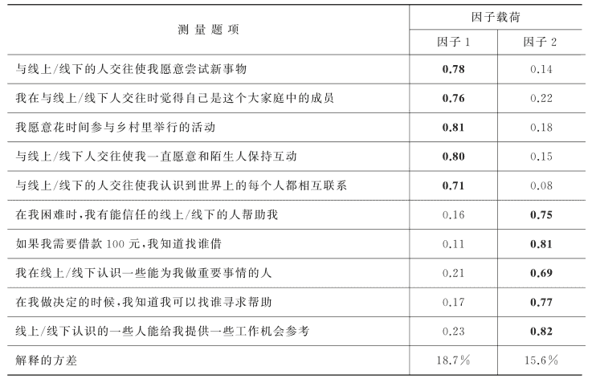。

**表1 农村居民社会资本因子分析**

# 研究设计与测量细节

## 1) 农村居民社会资本

依据旋转后因子载荷大小，将两因子命名为**桥接型社会资本**（因子1）与**纽带型社会资本**（因子2）。桥接型Cronbach's α=0.71，纽带型α=0.75。KMO=0.84，Bartlett球形检验Sig=0.00，累计方差解释率34.3%。

## 2) 农村居民社交网络使用行为（自变量之一）

综合李纪鹰/蒲绍拉/罗莹莹、林工程/李颖/陈锦云、魏璐/陈雯等学者量表修订而成，共10题，5级李克特量表。

因子分析提取3因子，成分矩阵见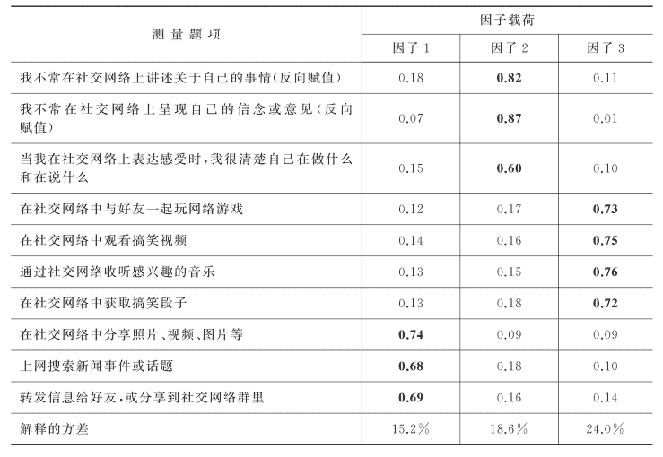。

**表2 农村居民社交网络使用行为因子分析**

依载荷大小命名为：**网络信息分享**、**网络自我暴露**、**网络娱乐活动**。
- 网络信息分享 α=0.70
- 网络自我暴露 α=0.74
- 网络娱乐活动 α=0.82
KMO=0.89，Bartlett检验P=0.00，累计方差解释率57.8%。

## 3) 农村居民社交网络使用心理

第二个自变量聚焦于农村居民使用社交网络的心理层面。测量工具采用了陆宝洲、范伟国等学者[32]的量表，共包含5个条目，均采用5点李克特量表（1=非常不同意，5=非常同意）进行评分。

研究对这5个条目实施了探索性主成分因子分析，提取出1个公因子，其成分矩阵详见表3。

**表3**　农村居民社交网络使用心理因子分析

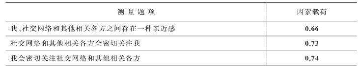

(表3续)

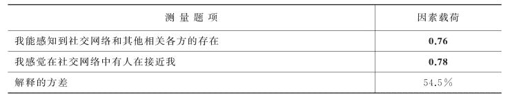

该心理构念被命名为**“网络社会在场感”**，其Cronbach's α系数为0.79。因子分析的KMO值达0.82，Bartlett球形检验显著性水平（P值）为0.00，该因子累计解释了54.5%的方差。

## 4) 聚合效度与区分效度

利用`AMOS 21.0`对采集数据进行验证性因子分析（`CFA`）。如表4所示，合成信度（`CR`）均超0.7，平均方差提取量（`AVE`）均大于0.5，进一步证实量表具备良好的聚合效度。表5数据表明，各因子`AVE`的平方根均大于其与其他因子的相关系数，确证了变量间具有良好的区分效度。

**表4**　验证性因子分析结果

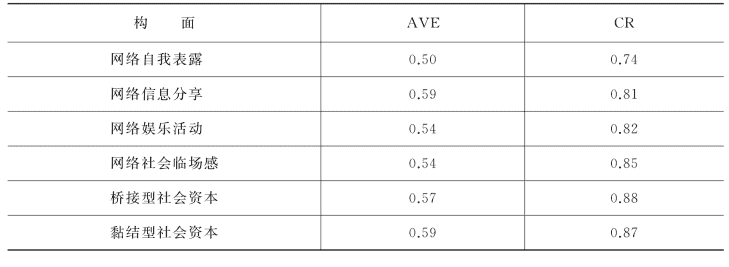

**表5**　区分效度检验

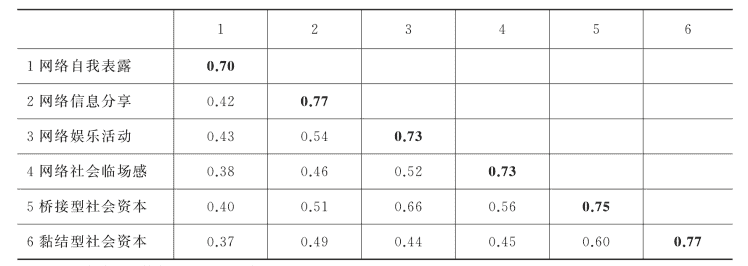

> 注：对角线数值为`AVE`的平方根。

# III. 研究发现

## 1. 农村居民社交网络使用行为-心理现状

从行为表现看，农村居民的网络自我暴露（`M=3.49, SD=0.69`）、网络信息分享（`M=3.70, SD=0.66`）、网络娱乐活动（`M=3.46, SD=0.66`）三个维度均值均高于量表中点3。心理层面的网络社会在场感（`M=3.49, SD=0.64`）均值也高于3。为深入考察现状，研究对上述四个变量实施了单样本`t`检验。结果（见表6）显示：网络自我暴露（`t=25.59, P<0.001`）、网络信息分享（`t=38.09, P<0.001`）、网络娱乐活动（`t=25.02, P<0.001`）显著高于量表中点3；网络社会在场感（`t=27.55, P<0.001`）亦显著高于3。这表明农村居民展现出较强的网络自我暴露、信息分享与娱乐活动行为，并拥有积极的网络社会在场感。

**表6**　单样本`t`检验

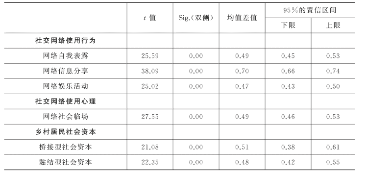

## 2. 农村居民社会资本现状

桥接型社会资本（`M=3.47, SD=0.66`）与联结型社会资本（`M=3.71, SD=0.63`）均值均超3。单样本`t`检验同样证实（见表6）：桥接型社会资本（`t=21.08, P<0.001`）与联结型社会资本（`t=22.35, P<0.001`）均显著高于量表中点。说明农村居民两类社会资本水平均较高。对比来看，桥接型社会资本显著低于联结型，意味着在日常生活中，联结型社会资本仍是农村居民资本建构的主导形态。

## 3. 核心研究变量间的相关关系

表5揭示，农村居民的三类社交网络使用行为（网络自我暴露、网络信息分享、网络娱乐活动）均与两类社会资本（桥接型、联结型）存在显著正相关。同时，网络社会在场感也与两类社会资本呈显著正相关。这一结果为后续回答研究问题奠定了基础。

## 4. 社交网络使用对农村居民社会资本的影响效应

### 1) 初始模型检验

初始模型估计结果显示：`X²=756.32, P=0.000<0.05`，拒绝原假设；卡方自由度比`X²/df=3.21`，超出3的判准阈值。其余指标虽达标（`RMR=0.05, GFI=0.89, RMSEA=0.07, NFI=0.90, IFI=0.91, CFI=0.89, AGFI=0.88`），但整体拟合度不理想，需修正。根据修正指数（`MI`），需在模型变量误差间建立协方差关系，以降低卡方值、提升拟合优度。

### 2) 修正模型与假设检验

引入28对误差变量协方差后，最终理论模型确定（见图1），拟合度极佳：`X²=356.14, P=0.15>0.05`；`X²/df=1.36`；`RMR=0.03`；`GFI=0.95`；`RMSEA=0.03`；`NFI=0.96`；`IFI=0.97`；`CFI=0.98`；`AGFI=0.96`。

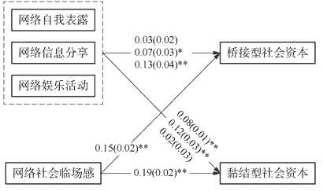

**图1**　模型路径系数图

**社交网络使用对农村居民桥接型社会资本的影响。** 行为维度中，网络信息分享（`β=0.07, P<0.05`）与网络娱乐活动（`β=0.13, P<0.01`）对桥接型社会资本有显著正向预测作用，网络自我暴露则无显著影响。心理维度中，网络社会在场感对桥接型社会资本具有显著正向影响（`β=0.08, P<0.05`）。

**社交网络使用对农村居民联结型社会资本的影响。** 行为维度中，网络自我暴露（`β=0.08, P<0.01`）与网络信息分享（`β=0.12, P<0.001`）显著正向预测联结型社会资本，网络娱乐活动影响不显著。心理维度中，网络社会在场感对联结型社会资本有显著正向影响（`β=0.19, P<0.001`）。

此外，依据图1路径系数大小比较，作为心理因素的网络社会在场感，对农村居民社会资本的影响效应强于行为因素。

# IV. 结论与讨论

本研究基于中国35个乡镇的农村居民问卷数据，融合社会资本理论与社会在场理论，剖析了不同社交网络使用行为及使用心理对农村居民社会资本的作用机制，得出以下四点核心结论：

# 网络行为如何重塑乡村社会资本？四大核心发现解读

## 一、 自我暴露：深耕强关系，难触弱联系

研究发现，网络自我暴露能显著助力乡村居民**巩固“粘合性社会资本”（强关系网络）**，却对**“桥接性社会资本”（弱关系网络）无显著影响**。

自我暴露本质上是个体在媒介中向外呈现自我的过程。乡村居民此类行为主要集中在微信、QQ等高社交属性平台，互动对象多为强关系亲友。一方面，通过社交网络的自我展示，能增进亲友情谊、加深互动亲密度，从而更易获取情感支持；另一方面，这种呈现让亲友更懂自己，奠定互信基础，便于获得实质性帮助。因此，自我暴露擅长深耕高信任、高同质的强关系圈，却难以拓展异质性强、广而浅的弱关系网络。

## 二、 信息分享：双轨并行，强弱皆宜

**网络信息分享行为，对粘合性与桥接性社会资本均有正向促进作用。**

乡村居民分享信息的场域跨越熟人圈与弱关系圈。这不仅是自我价值与能力的彰显，更带有利他色彩——希望信息能助人、传播甚至预警。这种利他背后，折射出个体渴望被认可、渴望互动的心理。更关键的是，信息分享非单人独角戏，而是群体集体无私贡献的过程，由此催生了“资本转化与反馈”的集体意识。正因如此，分享行为既能巩固强关系纽带，又能激活弱关系资源。

## 三、 娱乐活动：私享化趋势下的弱关系孵化器

**网络娱乐活动难以增强粘合性社会资本，却能有效积累桥接性社会资本。**

传统时代合看电视能聚邻里之欢，今时智机普及让娱乐走向**私享化、个性化**。网络娱乐聚焦个体放松消遣，极少涉及情感慰藉或实质互助，故难深化强关系。然而，网络游戏等娱乐场域却成了弱关系的“孵化器”：村民在游戏中高频接触异质性弱关系，随行为持续强化，这些连接逐渐脱离游戏圈层，嵌入高语境社交网络，最终沉淀为相对固定、持久的娱乐搭档关系——这就是桥接性资本的生成路径。

## 四、 社会在场感：心理层面的“核动力”，超越行为本身

**高网络社会在场感，能双向提升粘合性与桥接性社会资本，且心理效能强于行为效能。**

乡村居民在网络中感知他人“真实在场”，察觉同乡网络中事件的真实性与重要性，进而产生共情，推动互惠规范形成。帕特南指出互惠规范是高产出的社会资本形式：短期利他，长期互惠。社会在场感拉近心理距离，让同一身份认同者（如少数民族、教徒）将短期利他与长期利己融合，深化信任，持续增厚粘合性资本总量。

**特别值得关注的是：** 作为心理因素，社会在场感对社会资本的正向驱动力，竟超过了具体的网络使用行为本身。这提示我们：在关注技术决定论的同时，更应聚焦**网络使用的社会心理机制**，其对乡村居民的深层影响不容小觑。

---

### 研究局限与未来展望

本研究聚焦网络使用行为与心理对现实双维社会资本的影响。但**使用动机、时长、互动投入**等关键变量尚待深入挖掘；且未涉及乡村居民的**线上社会资本**图景。这些空白，正是后续研究的重要切入点。

# 参考文献

[1] 王传娟. 农民社会资本的缺失与重构[J]. 中州学刊, 2015(4): 83-86.
[2] 牛耀红. 在场与互练：微信群与乡村秩序的维持——基于西部某村的调查[J]. 新闻界, 2017(08): 6-13.
[3] 马志豪, 吴梅. 电话里的乡村与移动网络传播中的城市：移动传播与社会资本的草根图景[J]. 新闻大学, 2018(1): 100-110.
[4] Bourdieu P. The Forms of Capital[M]//Richardson J. Handbook of Theory and Research for the Sociology of Education Westport. Connecticut, USA: Green wood Press, 1986: 241-258.
[5] 徐煜. 新浪微博中的网络关系网与社会资本获取——以国内新闻传播学界网络链接关系网为例[J]. 新闻大学, 2014(4): 127-135.
[6] 钟志锦. 互联网对大学生网络社会资本与现实社会资本的影响[J]. 新闻大学, 2015(3): 30-36.
[7] Vergeer M, Pelzer B. Consequences of media and Internet use for offline and online network capital and well-being. A causal model approach[J]. Journal of Computer-Mediated Communication, 2010, 15(1): 189-210.
[8] Granovetter M. The Strength of Weak Ties[J]. American Journal of Sociology, 1973, 78(6): 1360-1380.
[9] Short J, Williams E, Christie B. The social psychology of telecommunications[M]. London, UK: John Wiley and Sons, 1976.

# 农技人员媒体使用能力影响因素的实证探究

## 作者
吴志远、于思杰

## 摘要
在大众传媒时代，农业创新扩散研究鲜少聚焦媒体角色与媒介素养。步入互联网时代，社交媒体为农业技术推广注入新动能，显著提升了传播效能。本研究对湖北省951名基层农技推广人员开展问卷调查，并借助 `SPSS 22` 进行统计分析。研究发现，QQ、微信等社交媒体已成为农技推广的关键工具，但基层人员的媒体运用能力整体仍待提升。进一步分析表明，激发农技人员对先进技术的感知需求、强化组织层面的重视程度、增加媒体接触频次，以及积累文化资本与社会资本，均能有效增强其媒体使用能力。该研究补齐了农业创新扩散传统领域中媒介角色研究的短板，并为提升基层农技队伍核心素质提供了新思路。

## 关键词
农业创新扩散、媒体接触、媒体使用能力

## I. 研究缘起

罗杰斯的创新扩散理论源于大众传播效果研究，并最终确立为大众传播效果研究的经典范式[¹]。因此，创新扩散理论自诞生起便与媒介技术紧密相连。

罗杰斯证实了大众传媒在创新扩散“知识”阶段的关键作用[²]177。朱建华、何周等学者指出，大众传媒与人际传播的协同配合能有效推动创新扩散，二者均通过重塑潜在采纳者对创新属性的主观认知来发挥作用[³]。

不可否认，在大众传媒垄断的年代，媒介变量难以成为扩散研究的核心焦点。彼时传媒资源高度集中于资本与利益集团手中[⁴]，普通公众乃至农技推广人员均难以掌控传播工具、主动参与媒介实践。正如罗杰斯所言，大众传媒仅充当意见领袖获取外部新知的“窗口”[²]323，学界也难以量化其在农业创新扩散中的具体权重。

互联网与社交媒体的兴起打破了这一局面：凭借极速普及率，社交媒体的渗透深度超越了历史上所有媒介形态，其影响力触角已延伸至偏远乡村的最末端[⁵]。

社交媒体的普及赋予了个体掌控传播工具的主动权。依托这些平台，个体获得了更广阔的参与对话空间、更频繁的知识分享机会、更自由的公共表达渠道，能够构建或加入同兴趣共同体，并借此连接陌生人、群体乃至未知世界[⁶]。显而易见，这些媒介赋能特质对改善基层农技人员的工作生态大有裨益。

媒介演进也重燃了学界探索热情。研究者顺应技术迭代，持续考察媒介在扩散过程中的定位。证据表明，随着媒介技术更迭，其在创新扩散中的作用力度持续增强、地位日益凸显[⁷]。

综上可见，农技人员掌握的媒介技术越多、驾驭媒介的能力越强，在推动农业创新扩散方面的绩效便越显著。

基于此，本研究将聚焦两大核心问题：基层农技人员媒体使用能力的现状如何？哪些因素在制约或促进这一能力？厘清这些问题，有助于后续采取针对性举措，切实提升农技队伍的实战本领。

本研究的核心结局变量——媒体使用能力，依托波特的媒介素养理论界定。詹姆斯·波特认为，媒体使用能力作为现代媒介素养的核心内涵，已成为个体现代性的重要标识。其具体体现为对媒介影响过程的掌控力，涵盖媒介技术操作技能与媒介信息内容加工处理能力两个维度[⁸]329。

# 农技人员媒介使用能力：影响因素与理论溯源

基于工具论视角，本研究将媒介使用能力界定为“驾驭媒介技术的能力”，暂不涉及“处理媒介信息与内容”的层面。理论支撑引入了罗杰斯的创新扩散理论与布尔迪厄的社会资本理论。实证环节采用分层—随机—整群抽样，从湖北百余县市中选取12地200乡镇，走访951名农技员，通过问卷获取其媒介接触、资本禀赋及人口学特征，经SPSS统计分析，锁定三大核心影响因素：媒介接触程度、个人社会资本规模、对先进农技的渴求度。

## II. 理论铺垫

### 1. 创新扩散离不开媒介角色

“创新扩散实质是人们对新生事物主观评价的互动社会过程。”作为该理论奠基人与持续优化者，罗杰斯认为它能诠释人类最关键的发展历程——社会变迁。由此可提炼三大关键词：新生事物、主观评价、互动。扣住这些，扩散即可视为“关于新生事物的信息传播与传播过程”。罗杰斯直言：“扩散是一种传播，只是传播内容关乎创新。”关键在于使用者经渠道向他人分享信息。

故其模型包含四大要素：创新、传播渠道、时间、社会系统。统计显示，渠道研究占扩散研究总量7%。罗杰斯定义渠道为“信息从一方流向另一方的手段与方法”，并断言“大众传播是传递创新信息最有效渠道”，指代广播、电视、报刊。他引用拉扎斯费尔德发现：“创新观念常从广播、印刷媒体流向意见领袖，再由其传给创新接受度较低的群体。”施拉姆在《人、讯息、媒介》中进一步阐释：大众媒介影响力在扩散早期最强。

上述脉络揭示：聚焦媒介角色是扩散研究的传统视角。因扩散离不开渠道，而媒介比人际等渠道更高效。

当然，拉扎斯费尔德、罗杰斯、施拉姆未亲历互联网与新媒体、特别是社交媒体的威力，否则必对媒介工具在扩散中的作用有新认知。但系统性新媒体效果研究常待技术被大众广泛接受后才展开。可预见，社交媒体时代为扩散研究带来新机遇。

综上，关注媒介角色是扩散研究的惯常取向。

农业创新扩散聚焦媒介的第二缘由，源于媒介自身功能。

麦克卢汉判断：“决定人类行为变迁的是媒介而非讯息。”媒介非单纯知识载体，更对知识内容产生强烈反作用，具有主动性与能动性，决定信息结构模式与清晰度，深度影响信息本身。即媒介本身也塑造行为模式。其对扩散的影响不止于此，更深刻作用于受众感知：印刷媒介作用于视觉，视听媒介作用于触觉。

查尔斯·斯特林总结：大众媒介技术进步使21世纪初人类自我发现并进化，获得同时处理海量信息的能力。技术发展必致社会文化结构与价值变迁，每种新媒介诞生都创造新社会生活与行为方式；媒介是社会发展的基本动力，也是区分社会形态的标志。美研究认为媒介在维系既有价值、促成新观念形成、改变原有价值上影响显著。步入网络媒介时代，新媒体形态层出不穷，内格罗庞特在《数字化生存》中断言：数字媒介时代，媒介不再是信息，而将成为人人皆在的生活方式。

依技术决定论推演，媒介在扩散中的角色包含双重面向：传递创新信息与知识；对创新信息与知识产生反作用。

第三缘由，来自媒介使用效果研究。

詹姆斯·波特实证表明，媒介工具对个体与组织产生即时效果与长期效果。即时效果涵盖认知（短期习得、强化习得、拓展习得）、态度（塑造观点、改变观点、对比效应、接种效应、即时强化）、情感（即时反应、情绪管理）、行为（吸引、模仿、激活）。长期效果包括：掌握学习议程、增强记忆、诱发现象本质洞察、揭示社会运行奥秘、维持注意兴趣、改变认知行为。波特的分析进一步阐释了媒介在创新扩散中的价值。

不仅如此，依据“使用与满足”理论，针对特定媒介，无论是异质还是同质媒体，均能契合不同层面的受众需求。埃利胡·卡茨、杰伊·布鲁姆勒、迈克尔·古列维奇等学者在1974年的经典论文《个体对大众传播的利用》中指出：各类媒介因技术属性与信息功能的差异，满足的需求各异。譬如，书籍与报纸关乎自我实现与自我满足，助力个体“链接自我”；而报纸、广播、电视则搭建起个体与社会、他人的连接通道[¹⁶]。显而易见，互联网与社交媒体的诞生，不仅囊括了上述传统媒介的所有功能，更开启了无限可能。

聚焦媒介在农业创新扩散中角色的第四大缘由，源于农村社会经济发展的现实图景。如前所述，创新扩散本质上是媒介辅助下的知识传播历程。在农业创新扩散实践中，媒介既是内容的载体，也是扩散传播的关键环境要素，这一点在各国实践中得到充分印证。例如，韩国“新村运动”中，报纸成功动员全社会关注农村，承担起城乡沟通的桥梁职能；广播为美国农业人口提供市场行情、天气预报、新品种栽培技术，并有效缓解了孤独隔离感；日本“一个村庄一个产品”运动中，广播、电视、报纸形成合力，共同推动运动深入开展[¹⁷]。

基于上述剖析，在农业创新扩散研究中，将媒介工具的运用及其效果作为核心考察对象，便成为顺理成章的选择。

因此，本研究提出的首个问题是：在农业创新扩散进程中，农技推广人员最常使用、最为重视的媒介究竟是哪些？

### 2. 媒介运用能力的重要性日益凸显

前文已详述媒介在农业创新扩散中地位的攀升。然而，媒介效能的释放终靠人来驱动。不同主体操作媒介，呈现出的效果天差地别，根源在于个体媒介运用能力的差异。

“过程学派”视传播为信息的传递，高度关注传播的成效与准确性，而这取决于传受双方的编解码水平，以及传播者对媒介的驾驭程度[¹⁸]。换言之，传播效果与双方的媒介运用素养紧密相关。故而，本研究将媒介运用能力设定为核心考察变量。

所谓媒介运用能力，实为媒介素养概念的下位范畴。詹姆斯·波特将媒介素养界定为“个体主动接触媐介、解读信息意义的视角”，并以个体目标动机、技能水平、知识结构为三大基石[⁸]13-19：技能为工具，媒介与现实信息为原料，二者共筑知识大厦。波特所提媐介技能，与本研究聚焦的媒介运用能力高度契合。

须知，波特时代媐介形态相对单一，其对运用能力的阐释止步于对媐介内容的分析、评价、分类、归纳、演绎、提炼与综合。而今媐介技术演进超乎寻常，近二十年互联网技术迭代、新媐介形态层出不穷，令人眼花缭乱。个体欲熟练驾驭多元媐介，谈何容易。因此，媐介运用能力的外延理应纳入对不同媐介技术的掌握程度。

结合马歇尔·麦克卢汉“媐介即讯息”的洞见，媐介赋予人类的不仅是资讯与知识，其技术属性更重塑人的思维范式。互联网与社交媒体的崛起，催生的“互联网思维”再度验证了麦克卢汉的预言。在此视域下，个体每多掌握一项媐介技术，便多拥有一种思维模式。

故而，媐介技术驾驭能力应成为此次考察的重点。显而易见，一个人能熟练运用的媐介类型越多，其媐介运用能力越强，在信息时代拥有的选择权与自由度也就越大。

长期以来，农村信息相对闭塞，渠道狭窄；图书馆等基础设施、行业交流会等替代路径难以短期扩容。互联网普及与新媐介涌现，让媐介运用能力的价值愈发凸显，这对农技人员而言，更是至关重要。

## 参考文献

[20] Lee J, Lee H. The computer-mediated communication network: exploring the linkage between the online community and social capital[J]. New Media & Society, 2010(5): 711-727.

[21] Xie W. Social network site use, mobile personal talk and social capital among teenagers[J]. Computers in Human Behavior, 2014(41): 228-235.

[22] Wellman B, Haase A Q, Witte J, et al. Does the Internet increase, decrease, or supplement social capital? Social networks, participation, and community commitment[J]. American Behavioral Scientist, 2001, 45(3): 436-455.

[23] 王玲宁. 微信使用行为对个体社会资本的影响[J]. 新闻大学学报, 2015(6): 114-119.

[24] 葛红宁, 周宗奎, 牛根丰. 社交网络站点使用能带来社会资本吗？[J]. 心理学进展, 2016, 24(3): 454-463.

[25] 周亦锦, 魏家春. “点赞”还是“评论”？社交媒体使用行为对个人社会资本的影响——基于微信朋友圈使用行为的探索性研究[J]. 新闻大学学报, 2016(1): 68-75.

[26] Nie N, Erbring L. Internet and society: A preliminary report[J]. IT & Society, 2002, 1(1): 275-283.

[27] 曾凡斌. 互联网使用模式与社会资本关系研究——兼析互联网传播能力的中介作用[J]. 湖南师范大学学报(社会科学版), 2014, 43(4): 152-160.

[28] Ellison N B, Steinfield C, Lampe C. The Benefits of Facebook "Friends:" Social Capital and College Students' Use of Online Social Network Sites[J]. Journal of Computer-mediated Communication, 2010, 12(4): 1143-1168.

[29] Lee J Y, Park S, Na E-Y, Kim E. A comparative study on the relationship between social networking site use and social capital among Australian and Korean youth[J]. Journal of Youth Studies, 2016, 19(9): 1164-1183.

[30] 林工程, 李莹, 陈锦云. 大学生社会焦虑、自我暴露与网络互动——微博社交行为的路径分析[J]. 青年研究, 2016(4): 29-39.

**农技员“触网”迫在眉睫：媒介素养为何成核心竞争力？**

[31] Wei Lu, Chen Wen. Research on urban new migrants' social media use and subjective well-being[J]. International Journal of Journalism, 2015, 37(1): 114-130.

[32] Lu B, Fan W, Zhou M. Social presence, trust, and social commerce purchase intention: An empirical research[J]. Computers in Human Behavior, 2016(56): 225-237.

[33] Shen Qi. Research on self-disclosure and social network privacy protection behavior—taking Shanghai college students' WeChat mobile social application (APP) as an example[J]. Journal of Journalism and Communication, 2015(4): 5-17.

[34] Putnam. Making Democracy Work: Civic Traditions in Modern Italy[M]. Wang Lie, Lai Hairong, trans. Beijing: China Renmin University Press, 2017: 201.

[35] Hu Difei. The structure and measurement of rural social capital—an empirical study of Putnam's social capital theory[J]. Journal of Wuhan University (Philosophy & Social Sciences), 2011(4): 62-68.

## 作者简介

金恒江，重庆大学新闻学院讲师；刘媛媛，上海交通大学媒体与传播学院2019级博士研究生；张国良，上海交通大学媒体与传播学院教授。

## 注释

[¹]: 刘秀等. 乡村振兴：把饭碗牢牢端在自己手中（十九大时光）[EB/OL]. (2017-10-22)[2019-07-22]. http://politics.people.com.cn/n1/2017/1022/c1001-29601012.html.

[²]: 林咏. 人民日报人民论坛：让资本下乡结出乡村振兴硕果[EB/OL]. (2018-11-14)[2019-07-22]. http://opinion.people.com.cn/n1/2018/1114/c1003-30398873.html.

[³]: 数据来源：2016年中国农村网民规模及发展趋势预测, http://www.chyxx.com/industry/201609/451382.html.

---

### 核心驱力：创新扩散的使命倒逼农技员“精通媒介”

媒体在农业创新扩散中的关键地位已毋庸置疑，但媒介终究是工具，其效能能否充分释放，取决于使用者的驾驭能力。农业技术推广人员作为新技术的“传播种子”和“推广主力”，肩负着说服农户接纳先进技术的重任。

传播学经典理论早已揭示媒介渠道对说服效果的决定性影响。拉扎斯菲尔德指出，不同媒介产生的传播效果截然不同，掌握多元化媒介工具既是必要也是关键[9]19。罗杰斯的研究进一步印证：大众传媒对创新认知早期群体影响深远，能有效激发其尝试创新的意愿，进而引发连锁采纳效应[2]323。哥伦比亚大学应用社会学学者埃利休·卡茨则强调，技术采纳行为是媒介环境与个体特质互动的产物[19]。

国内学界对此达成高度共识。刘继忠等学者主张，农技员应广泛涉猎口头、文字、图像、视频等一切有利于传播农科信息、改变农民生产生活方式的媒介形式[20]。董成双则呼吁推广人员紧跟媒介技术迭代，熟练驾驭博客、邮件、即时通讯等高科技手段[21]。肖路仁更直指核心：包括农技员在内的农技推广意见领袖，必须精通媒介获取信息与示范推广[22]。

现实警示更为深刻。蒋建科警告，若单靠人际传播而忽视媒介工具，将导致推广速度慢、范围窄、周期长[23]。董成双亦直指痛点：长期依赖人际传播，加之人员短缺、水平参差、信息技术掌握滞后，致使先进农技传播效果大打折扣[21]。

### 时代新标：信息技术重塑媒介素养，技术驾驭力成“硬指标”

随着信息技术飞速演进，个体媒介素养的门槛被大幅抬高，媒体使用能力已成创新推广从业者的核心素质。

所谓“媒介素养”，本质是运用与解读媒介信息所需的知识、技能与能力的集合[24]。Renee Hobbs将其内涵拓展为：从独立接触媒介、批判性思考分析，到利用媒介参与创作的完整进阶过程[25]。

回顾过往，大众传媒时代的素养研究聚焦于受众的接收、甄别、加工与反馈能力，多强调警惕媒介负面效应、避免盲从[8]12。彼时忽视个体对媒介技术本身的掌控，很大程度上是因为传统媒介除阅读门槛外几乎零准入。然而，彭兰在考察网络媒介时代素养内涵嬗变时敏锐指出：新媒体尤其是社交媒体，对用户的技术操作能力提出了不低的硬性要求[26]。媒介生态日益复杂多元，媒体使用能力已跃升为素养研究的核心焦点。

互联网重构了传播格局，传统大众媒体影响力消退，社交媒体等新媒介主导信息生活。传受界限模糊，技术赋能公众前所未有。施拉姆早已预见：信息革命时代，提升个体媒介使用能力是大势所趋[10]289。对农技员而言，这不再是选修课，而是关乎推广成败的必修课。

### 核心驱力一：媒介接触程度决定使用能力

有学者指出，新媒体时代下，熟练驾驭微博、微信等工具，已成为衡量媒介素养提升的关键指标，更直观地折射出公众适应技术变革的能力 [27]。另有研究主张，媒介的实际运用与传播参与度，应当构成媒介素养评估的核心维度。以农村受众为例，考察的重点应落实到：他们是否掌握了借助媒介获取资讯的技巧，能否主动通过媒介发声传播 [28]。

基于此，本研究聚焦的第二个核心问题浮出水面：**农技人员的媒介使用能力现状究竟如何？**

既然媒介使用能力对农技人员至关重要，那么哪些因素在塑造这项能力？

波特将媒介技能比作肌肉：“技能是人们通过实践磨砺出的工具，用进废退，练得越多越强健” [8]15。换言之，媒介使用频度越高，使用能力越强。拉扎斯费尔德在研究美国选民时也发现，对某一媒介高度接触的群体，往往也对其他媒介保持着更高的接触强度，这佐证了媒介接触强度对使用能力具有直接推动力。

媒介接触是媒介素养理论中的基石概念，其内涵涵盖媒介拥有率、接触时长、接触动机、接触内容等多个维度 [29]。

首先，接触时长与频次是媒介接触研究的核心观测变量 [30-31]，这不仅适用于传统媒介，更广泛应用于社交媒体、网站等新媒介的使用强度测度。其次，接触强度的内涵还应囊括媒介拥有率等要素 [32-33]。调研显示，农技人员接触的媒介谱系主要包括电视、广播、报刊、杂志、手机短信及网络媒体 [34-36]。更有研究表明，基于媒介拥有与使用情况的受众分类，在预测网络参与度、社交媒体使用行为等方面，优于基于人口学特征的传统分类法 [37]。

综合上述理论与实证，本研究拟采用媒介使用时长/频次、媒介拥有状况（尤其是电子信息接收终端）作为测度媒介接触强度的核心指标，并提出以下假设：

- **假设 1a**：农技人员阅读报纸的频次与媒介使用能力呈正相关；
- **假设 1b**：农技人员阅读杂志的频次与媒介使用能力呈正相关；
- **假设 1c**：农技人员日均电视收看时长与媒介使用能力呈正相关；
- **假设 1d**：农技人员日均广播收听时长与媒介使用能力呈正相关；
- **假设 1e**：农技人员日均网络使用时长与媒介使用能力呈正相关；
- **假设 1f**：农技人员社交媒体使用年限与媒介使用能力呈正相关；
- **假设 1g**：农技人员电子设备拥有情况与媒介使用能力呈正相关。

---

### 核心驱力二：个体资本禀赋构建差异基石

除了媒介接触，个体资本禀赋同样深刻影响着媒介使用能力。

个体资本由经济资本、社会资本、文化资本三大支柱构成。经济资本以货币为符号，社会资本以人脉规模、个人声望为标识，文化资本则以受教育程度为核心标识 [38]。布迪厄的研究揭示：不同阶层子女的学业成就，与其家庭文化资本及其他资本紧密对应，资本越雄厚，越易获得学业成功，这一逻辑在宏观社会结构中亦然。

既有研究已证实，个体资本禀赋对学习能力、职业潜力等需后天培育的素质有决定性影响。媒介素养作为现代人必备的修养，依照布迪厄视角，自然也受制于个体资本禀赋。

从媒介素养本质来看，它“是我们主动接触媈介、解读信息意义的视角” [8]21。波特认为，高素养者视野清晰，能辨析真实世界与媒介建构世界的边界；低素养者视野狭隘，知识结构浅薄松散 [8]3。麦克卢汉早已洞见：媒介已成日常信息主载体，获取、甄别、解读、运用媒介信息的能力，是现代社会人的生存必修课 [12]16。

实证层面，段静苏发现社会阶层在媒介掌控与使用上差异显著：统治阶层掌控媒介话语权，主导舆论导向；中间阶层具备条件与能力，主动靠拢利用媒介满足需求；弱势阶层则缺乏基本使用条件与能力 [39]。吴婷婷指出，经文科技水平鸿沟导致城乡居民在接触先进传播技术、使用模式、信息获取量质上存在巨大鸿沟 [40]。从布迪厄框架看，以家庭收入为标的经济资本、以学历职龄为标的文化资本，均对媒介素养有显著影响 [33][41]。

关于社会资本的影响，相关研究更为丰富。技术社会建构理论认为，不同社会群体基于差异化认知与需求，对同一技术创新给出迥异回应，暗示个体所处社交网络等社会资本差异，将导致媒介使用能力分化 [41]。研究证实，个体采纳手机等媒介及其使用方式，与其关系维护类型等社会资本显著相关 [42]。特雷普特等人针对德国 Facebook 用户的研究发现，用户通过社交媒体获得的社会资本越多，其社交媒体使用频率越高 [43]。

### 社会资本维度与核心假设的提出

社会资本理论指出，衡量社会资本的常用指标主要涵盖社会网络规模、网络密度以及网络同质性等维度。立足于此前的文献梳理，本研究构建了以下核心假设：

*   **假设 2**：农技人员的经济资本与媒介使用能力呈正相关；
*   **假设 3a**：农技人员的受教育程度与媒介使用能力呈正相关；
*   **假设 3b**：农技人员的农业技术工作年限与媒介使用能力呈正相关；
*   **假设 4a**：农技人员的社会网络规模与媒介使用能力呈正相关；
*   **假设 4b**：农技人员的社会网络同质性与媒介使用能力呈正相关；
*   **假设 4c**：农技人员的社会网络密度与媒介使用能力呈正相关。

### 五、个体感知需求迫切性对媒介使用能力的影响

个体需求驱动媒介使用，这是媒介研究的一贯传统。无论是早期的报纸、广播，还是后来的电视研究，均表明个体需求的迫切程度对媒介接触频次及使用类型具有显著影响。这一研究脉络植根于“使用与满足”理论。由此推演，农技人员信息需求迫切性的差异，将决定其媒介使用模式，进而作用于媒介使用能力。据此，本研究提出：

*   **假设 5**：农技人员信息需求的迫切性与媒介使用能力呈正相关。

此外，张志安等学者的研究发现，不同区域个体在媒介使用上存在显著差异。基于此，本研究进一步提出：

*   **假设 6**：农技人员所在县（市）农业技术推广绩效水平与媒介使用能力显著相关。

同时，考虑到“性别”等人口学变量亦会干扰媒介使用能力，本研究将其纳入控制变量范畴。

---

### 第三部分 研究设计

#### 一、 样本选择：聚焦湖北，多阶段分层抽样

湖北作为农业科教大省，极具典型代表性。数据显示，2014年湖北仅占全国 3% 耕地面积，却产出了全国 4.26% 的粮食、5.84% 的棉花、9.72% 的油料、5.05% 的肉类及 6.72% 的水产品，粮食产量连续十余年增产，各作物产量稳居全国前列。同时，湖北汇聚了众多国家级、省级农业高校与科研院所，其农业发展轨迹是全国农业现代化进程的缩影。

基于此，本研究采用**多阶段聚类抽样**策略：依据 2013 年全省 105 个县（市）农技推广绩效，将其分为高、中、低三个梯队，每梯队随机抽取 4 个，共计 12 个县（市），覆盖 200 余个乡镇。在湖北省农业厅科教处及各县市配合下，向这些乡镇农技推广机构发放 1300 份问卷，回收有效问卷 951 份，有效回收率达 73%。统计检验显著性水平设定为 `P＜0.05`、`P＜0.01`、`P＜0.001` 三个梯度。

#### 二、 关键变量操作化设定

**1. 因变量：媒介使用能力指数（MUAI）**

如何量化媒介使用能力？本研究构建“媒介使用能力指数”作为核心测度值。

前文回顾显示：Katz 等学者认为不同媒介承担不同功能，Katz 与 Lazarsfeld 证实不同传播渠道的说服效果各异；Schramm、彭兰等人进一步确认，新媒体层出不穷，使用门槛攀升，个体媒介素养差异显著；2010 年皮尤研究中心报告指出，年轻人拥有的社交媒体类型数量能有效预测其媒介使用能力。

综上，在互联网时代，**个体能熟练驾驭的媒介工具类型越多，其媒介使用能力越强**。

因此，本研究以农技人员在推广工作中实际使用的媒介工具类型总数，作为衡量其媒介使用能力水平的代表性指标。值得注意的是，这与“互联网使用成熟度指数”逻辑一致——即个体使用的网络媒介类型越丰富，专业度越高，使用能力越强。

在具体测题设计上，通过预调查筛选出“报纸、广播、电视、短信、QQ、微博、微信”等农技推广高频媒介，统计每位受访者使用的媒介类型数量，作为其媒介使用能力的测量值。

**2. 自变量：媒介接触强度**

为测度媒介接触强度，设计 7 个测量项目：日均电视收看时长、日均广播收听时长、日均上网时长、周报纸阅读频次、周期刊阅读频次、社交媒体使用年限、家庭电子信息设备数量。其中，阅读频次采用 **8 级李克特量表**（0-7 分，0 代表“几乎不看”，7 代表“7 次”）；其余为连续型变量。此外，日均电视、广播、上网时长呈偏态分布，均已进行对数转换处理。

**3. 自变量：个人资本禀赋**

如前所述，个人资本禀赋包含经济资本、文化资本与社会资本三大维度。

### 农业技术人员各项资本及信息需求的量化测度

**经济资本测量**
本研究选取“个人月收入状况”作为农业技术人员经济资本的衡量指标，设置7个等级选项，分别以序数1至7编码：1代表“暂无收入”，2为“1-500元”，3为“501-1000元”，4为“1001-2000元”，5为“2001-4000元”，6为“4001-6000元”，7为“6001元及以上”。鉴于该指标采用7点李克特量表，为便于统计分析，直接将选项序数视为连续变量处理（详见表1）。

**表1　农业技术人员月收入频数统计**

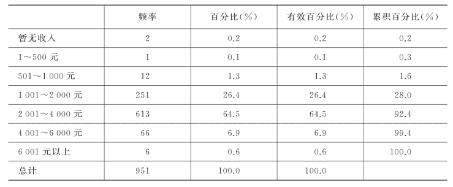

**文化资本测量**
文化资本维度包含两个测量项：“受教育程度”与“从事农业技术工作年限”。前者设3个等级，序数1至3分别对应“高中及以下”、“大专”、“本科及以上”。因受教育程度属有序分类数据，进入回归模型前需进行哑变量处理（详见表2）。

**表2　农业技术人员受教育程度分布**

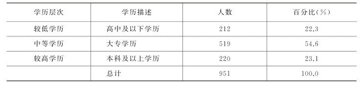

**社会资本测量**
参考Carolina Rojas的研究范式，从社会网络规模、网络密度、网络同质性三个维度测度社会资本：

1.  **社会网络规模**：设3个条目，分别询问技术人员经常联系的同事、邻居、朋友数量，采用求和法得出总分值。
2.  **社会网络密度**：设3个条目（如“常联系的朋友彼此相识”、“朋友间也是朋友关系”、“朋友间有交往”），采用5点李克特量表（1=非常不同意至5=非常同意）。经检验，3题项Cronbach's α系数为0.852，信度良好。故取三项得分求和后平均值作为密度测度值。
3.  **社会网络同质性**：设5个条目（涵盖年龄、学历、社会活动、经济水平、价值观五个维度的相似度），同样采用5点李克特量表（1=差别很大至5=基本相同）。5题项α系数为0.775，达到信度标准。同取五项得分平均值作为同质性测度值。

### 4) 绿色农业技术信息的主观感知需求

针对“绿色农业技术信息需求水平”这一自评变量，设计多选题：“发展绿色农业过程中，您认为农民最缺乏哪类技术信息？” 提供六大备选：绿色农业政策法规、有机/绿色/无公害农产品市场信息、无公害生产知识、绿色农药产品与供应信息、物理生物防控技术、农作物病虫害预警信息。受访者勾选选项越多，代表其感知需求层级越高。

### 5) 控制变量设置

除媒体接触与个人资本禀赋变量外，纳入人口学控制变量：地区（所属县/市，见表3）、性别（见表4）及其他3项控制指标。

**表3　不同绩效等级县/市农业技术人员分布**

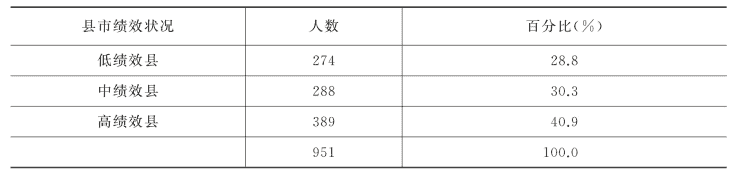

**表4　农业技术人员性别分布**

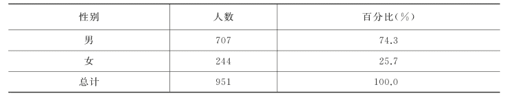

## 3. 统计模型构建

为探究影响农业技术人员媒体运用能力的因素，构建线性回归模型：以媒体运用能力为因变量；7个媒体接触强度指标、4个个人资本禀赋指标、3个人口学特征指标、1个需求强度指标共15个变量为自变量。模型公式如下：

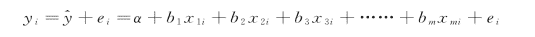

式中，$y_i$ 为因变量实测值，$e_i$ 为随机误差项，$\alpha$ 为截距项，$b_m$ 为偏回归系数，表示在其他自变量不变时，$X_i$ 每变化一个单位，$y_i$ 的平均变化量 [52]。

# IV. 研究发现

## 1. 描述性统计结果

### 1) 农技推广中的媒体工具使用现况

**统计分析结果**
调查显示，农技推广环节使用频次最高的工具是手机短信，覆盖率达**75.5%**；紧随其后的是QQ/QQ群（**53.4%**）；报纸位列第三（**36.8%**）；微信（**33.9%**）、电视（**26.4%**）、广播（**16.8%**）依次排后；微博使用率最低，仅**5.4%**。手机短信的核心地位凸显，依据兼容性原理，这也预示着基于手机端的QQ、微信等新媒体推广工具蕴含巨大潜力（详见表5）。

## 表5　农业技术人员推广环节媒体工具使用情况

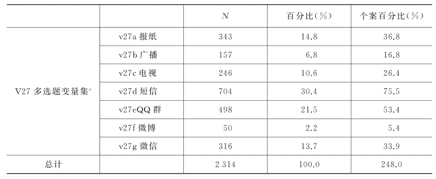

> 注：数值1表示二分分组统计标识。

### 2) 农业技术人员媒体运用能力指数

以技术人员在推广中使用的媒体工具种类数为计量指数，种类越多代表运用能力越强。

统计结果显示，该指数均值为**2.433**，标准差**1.352**（见表6），分布呈钟形曲线（见图1）。曲线显示，大多数技术人员仅能运用1-2种媒体工具；若加上从未使用媒体工具的群体，占比接近样本总量的**60%**（见表7）。这表明，整体来看，农技人员对媒体工具的驾驭水平尚待提升，提升空间广阔。

### 表6　农业技术人员媒体运用能力指数描述性数据

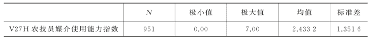

### 表7 农业技术人员媒体使用能力数据分布

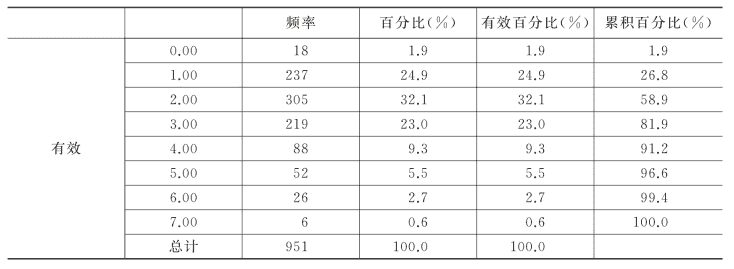

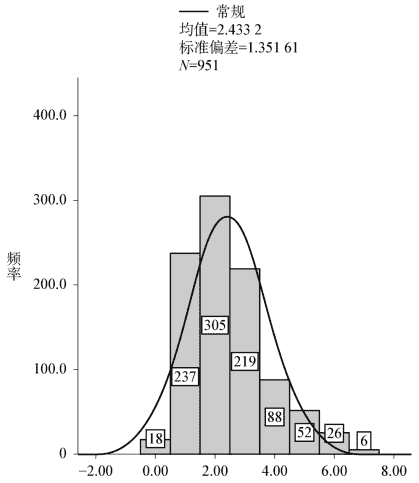

### 图1 农业技术人员媒体使用能力指数分布

## 3) 农业技术人员的媒体接触概况

在媒体接触时长方面，农技人员日均上网约2小时，看电视约1.8小时，听广播仅0.2小时左右；期刊阅读频次为周均3.7次报纸、2.7次杂志；社交媒体（含QQ、微信、微博等）平均使用年限达5.3年（详见表8）。整体来看，网络媒体接触强度居首，电视次之，报纸再次，杂志与广播的利用率相对较低。此外，技术人员家庭平均拥有4台左右的信息接收电子终端。

### 表8 农业技术人员媒体接触数据统计描述

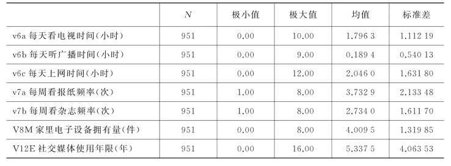

## 4) 农业技术人员的资本禀赋现状

依据表9数据，农技人员的个人资本禀赋呈现以下特征：

### 经济资本

在经济资本层面（详见表9），技术人员月收入主要集中在2001–4000元区间，占比64.5%；其次为1001–2000元，占比26.4%。总体而言，群体内部收入差距并不显著。

#### 表9 农业技术人员月收入数据分布

### 文化资本

文化资本方面，即学历结构（详见表10）：大专学历占比最高，达54.6%；大专及以上学历合计占23.1%；高中（含中专）及以下学历占22.3%。可见，农技队伍是农村地区受教育程度普遍较高的群体。

本研究还将从业年限纳入文化资本衡量指标。数据显示（表11），技术人员平均从事农业技术工作约20.2年。结合年龄结构可见，当前队伍工龄普遍较长，人员老龄化特征明显。

#### 表10 农业技术人员学历分布

#### 表11 农业技术人员工龄描述性数据

### 社会资本

社会资本维度（详见表12）：技术人员平均社交网络规模约52.9人，标准差62.1，个体差异较大。网络同质性均值3.63、密度均值3.23，均处较高水平，表明其社交对象多为同事、邻居、朋友等背景相似者。

#### 表12 农业技术人员社会资本测量数据描述统计

表12还显示，“农业技术人员对绿色农业技术信息需求迫切度”指数均值约4.2（满分6分），反映出群体对绿色农技信息有着强烈的获取渴望。

#### 表13 农业技术人员信息需求测量数据描述统计

# 2. 推断统计分析结果

为探究影响农技人员媒体使用能力的关键因素，本研究构建多元线性回归模型，以媒体接触强度、个体资本禀赋、绿色农技信息需求水平为自变量，媒体使用能力指数为因变量。

模型检验显示：P值<0.0001，达到显著性水平；解释力（R²）为14%；共线性诊断中方差膨胀因子（VIF）处于合理区间，不存在严重多重共线性问题（详见表14-16）。

### 表14 模型摘要 b

### 表15 模型检验

### 表16 多元线性回归模型分析结果汇总

## 1) 媒体接触强度变量的预测效应

回归结果表明，在7个媒体接触指标中，“每周杂志阅读频次”“日均上网时长”“家庭电子设备拥有量”“社交媒体使用年限”四个变量与媒体使用能力指数呈显著正相关。

“日均看电视时虽也显著相关，但为**负向关系**。这提示电视对技术人员而言主要承担娱乐消遣功能，观看时间越长，反而越不利于其在工作中掌握多元媒体工具、提升媒介操作技能。

“每周报纸阅读频次”“日均广播收听时长”则无法有效预测能力指数变化。报纸因农村发行受限，难成固定推广渠道；广播自电视普及后农村渗透率骤降，且因农村私家车保有量低，未享受汽车媒体红利（城市因车辆增多反而使广播焕发生机）。

再看预测力显著的行为：杂志阅读频次的正向作用，源于爱读刊物者更倾向深度思考，往往思维勤奋、善于逻辑分析。陈刚等研究也证实：高学历人群月均阅读杂志量更大、投入时间更长[53]。拉扎斯费尔德与卡茨早年发现：意见领袖比追随者更偏好杂志阅读[9]297，而农技人员正是农业创新扩散中的关键意见领袖。

**核心驱动因素解析：什么决定了农技员的媒介胜任力？**

**在线媒体行为与设备保有量的预测价值**
研究发现，“在线媒体使用时长”与“电子信息设备拥有量”能显著预测技术人员的媒介使用胜任力。区别于电视、报刊、广播等传统媒介的被动接收特性，网络媒体与智能终端的操作更考验个体的主观能动性。通常而言，主动性强的人群往往更具创新精神，也更乐于借助媒介工具优化工作生活，这构成了该变量产生预测效力的心理机制基础。

## 2) 个体资本禀赋的差异化预测效应

多元回归分析揭示：在六项资本禀赋指标中，仅文化资本维度的“受教育程度”、“从事农技工作年限”，以及社会资本维度的“社会网络规模”三个变量，与媒介使用胜任力指数呈显著相关。

反观代表经济资本的“月人均收入”，及社会资本的另两个维度——“网络密度”与“网络同质性”，均无法有效解释胜任力的差异。尽管模型入选变量在既往文献中均获证实，但放在农技员这一特定群体中，部分变量的预测效力随之失效。

结合群体画像可知：农技队伍内部高度同质，人际交往圈层窄且背景相似，导致“网络同质程度”、“网络密度差异”乃至“经济收入”在组内变异极小，难以成为区分胜任力高低的区分度指标。反之，受职业属性干扰较小的“网络规模”（关联性格内外向差异）与“受教育程度”（多在入职前定型，难被推广工作根本改变），在群体内部呈现显著个体差异，从而展现出良好的预测效度。

## 3) “绿色农技信息需求迫切性”的驱动作用

推断统计表明，农技人员对绿色农业技术信息的需求迫切度，能有效预判其媒介使用胜任力。简而言之，越感到急需前沿绿技资讯的人员，胜任力指数得分越高。虽非必然因果链条，但二者显著相关可被合理诠释：敏锐捕捉绿色技术前沿需求者，往往工作主动性更强、进取心更足、创新意识更浓、尝试新事物更敢为人先。因此，他们对各类媒介尤其是新媒体的接触强度与运用技巧，自然优于常人。

## 4) 区域推广绩效的区域级预测效应

统计结果亦证实：技术人员所在县市的农技推广绩效等级，对其媒介使用胜任力指数具备显著预测力。本研究将12个样本县市按绩效分为高、中、低三档，引入两个哑变量——“高绩效vs中绩效”、“高绩效vs低绩效”纳入模型。数据显示，高绩效与低绩效县市农技员的媒介胜任力差距达到了显著水平，而高中绩效县市间的差异则未达显著。

假设检验汇总详见表17。

# V. 结论与启示

至此，研究已回应初始三大核心命题：农技推广常用媒介谱系、技术人员媒介胜任力全景图、及其影响因子体系。以下发现值得深度研讨。

## 1. 媒介使用胜任力内涵的动态演进

数据呈现：手机短信稳居推广首选工具，紧随其后的是QQ、报纸、微信，电视、广播、微博居后。这一媒介偏好图谱，不仅与罗杰斯时代迥异，亦较十年前大幅重构。回溯2008年，乡村推广主力仍为电视、手机、书刊、报纸、广播、互联网；更早的2002年，湖北农村手机与互联网尚属稀缺，电视、报纸、广播三分天下。

正如张志安所言，新媒体传播生态下乡村媒介使用结构持续迭代，结构变迁倒逼技术人员媒介胜任力内涵同步重塑。如何持续捕获最新媒介技术红利、实现推广效能跃升，将是未来研究聚焦重点。

从短信的核心地位可推演：基于同一移动终端的社交媒体（QQ、微信）在农技推广中大有可为。毕竟短信核心功能已被社交软件替代，且后者体验更优。本研究若将QQ、微信、微博并入“社交媒体”大类，其重要性早已超越短信。

## 2. 农技人员媒介胜任力提升空间广阔

整体胜任力处于低位，折射出传统推广范式惯性犹存，技术人员主动拥抱先进社交媒介的内驱力不足，亟需外部赋能与引导。

## 3. 媒介使用胜任力关乎农技人员履职质效

# 核心发现：技术员媒介素养与推广绩效的双向奔赴

研究揭示了农技人员媒介使用能力的深层驱动逻辑。回归模型证实，所在县市的农技推广绩效水平，显著塑造了技术员的媒介素养。高绩效地区的技术员，媒介运用能力显著强于低绩效地区。这背后是双向作用的结果：一方面，娴熟驾驭媒介工具直接提升了推广效率；另一方面，先行区更重视人才资本积累，通过优厚待遇与系统培训强化个体赋能，从而显著拉升了媒介素养。作为农业创新扩散中的关键意见领袖，技术员具备过硬的媒介素养，是推动推广绩效跃升的关键，这也印证了 Katz 与 Lazarsfeld 等学者的经典论断。

## 4. 紧迫感：激活媒介素养进阶的“内驱力”

此前假设中纳入的经济资本、社交网络同质性/密度、传统媒体接触强度等变量，在本研究中均未表现出显著影响。这恰好印证了农技群体的特殊职业属性。值得关注的是，**“技术员对绿色农技需求的感知紧迫性”** 脱颖而出，成为影响媒介素养的最强预测变量。这完美契合“使用与满足”理论的核心命题——需求激发行动。实践启示显而易见：通过改善福利待遇、强化责任担当，唤醒技术员内心的“紧迫感”，能倒逼他们主动进阶媒介技能。

## 5. 精准施策：构建媒介素养提升的组合拳

### 人力资本是基石，文化资本最关键
数据表明，技术员个体资本禀赋——尤其是文化资本（学历层级、从业年限沉淀的专业素养）——显著正向预测媒介素养。这再次为“强化培训体系建设”提供了实证支撑。

### 拥抱互联网与社媒，激活主观能动性
不同于传统媒体的单向灌输，互联网特别是社交媒体赋予了技术员更大的自主权与操作空间。这种自主性极大地激发了他们将社媒工具应用于推广实战的兴趣。因此，能力建设培训必须向“互联网与社媒运用实战”倾斜，而非停留在理论层面。

### 学术贡献与实践价值
本研究聚焦“农技人员媒介素养提升”这一创新扩散研究的薄弱环节，不仅确证了其核心地位、梳理了关键影响因子，更提出了“媒介素养内涵处于动态演变中”的新视角，为后续探究创新扩散演进规律提供了全新分析框架。实践层面，研究为新媒体生态下农技人员职业素养重塑提供了可落地的路径：大力强化媒介素养培训，或将成为撬动推广效能质变的关键杠杆。

### 研究局限与未来展望
本研究尚存不足：未深入剖析不同媒介类型在扩散中的具体角色分工与演进逻辑；媒介素养测量虽锁定“熟练掌握媒介类型数量”这一核心指标，但维度相对单薄。这些均为后续研究预留的深耕方向。

---

# 参考文献

[1] 邝文波. 中国微信发展的定量研究[J]. 国际新闻界, 2014(5): 147–156.  
[2] 罗杰斯. 创新扩散学(第5版)[M]. 唐兴通, 郑昌清, 张艳臣, 译. 北京: 电子工业出版社, 2016.  
[3] 朱建华, 何宙. 中国互联网扩散的现状与前景: 2000年北京、广州、香港比较研究[J]. 新闻大学, 2002(2): 25–34.  
[4] 童培恩, 戈梅里. 谁拥有媒体? 大众传媒业的竞争与集中[M]. 詹正茂, 张晓梅, 等, 译. 北京: 中国人民大学出版社, 2006.  
[5] 中国互联网络信息中心. 第43次中国互联网络发展状况统计报告[R/OL]. (2019-02)[2019-05-04]. http://www.cac.gov.cn/2019zt/cnnic43/index.htm.  
[6] 董进权, 洪亚红. 爱与痛的边缘: 青少年社会化媒体使用调查研究[M]. 北京: 光明日报出版社, 2017: 6–8.  
[7] 于爱华, 刘爱军. “移动互联网+”农技推广模式文献综述[J]. 黑龙江农业科学, 2017(3): 127–131.  
[8] 波特. 媒介素养(第4版)[M]. 李德刚, 译. 北京: 清华大学出版社, 2012.  
[9] 卡茨, 拉扎斯费尔德. 个人影响: 大众传播过程中的人的作用[M]. 北京: 中国人民大学出版社, 2016: 32.  
[10] 施拉姆. 传播学概论[M]. 何道宽, 译. 北京: 中国人民大学出版社, 2017: 202.  
[11] 斯帕克斯. 媒介效果研究导论[M]. 何超扬, 王希华, 译. 北京: 北京大学出版社, 2004: 211.  
[12] 麦克卢汉. 理解媒介: 人的延伸[M]. 何道宽, 译. 南京: 译林出版社, 2011.  
[13] 斯特雷特. 媒介即生活[M]. 王家权, 等, 译. 北京: 中国人民大学出版社, 2014: 6.  
[14] 潘忠党. 传播媒介与文化: 社会科学与人文研究的三种模式 (II)[J]. 现代传播: 中国传媒大学学报, 1996(5): 16–24.  
[15] 尼葛洛庞帝. 数字化生存[M]. 胡泳, 译. 北京: 电子工业出版社, 2017: 55.  
[16] 巴雷特. 媒介研究方法[M]. 王凯, 刘晓红, 译. 北京: 新华出版社, 2004.  
[17] 李红燕. 农村传播学(第2版)[M]. 北京: 北京大学出版社, 2014.  
[18] 蒋根元. 媒介建构主义: 区别于媒介工具论的传播认识论[J]. 当代传播, 2012(3): 32–35.  
[19] 张竞文. 从采纳到再传播: 网络社交媒体环境下创新扩散理论的继承与发展[J]. 新闻与传播评论, 2013(2): 25–33.  
[20] 刘继忠, 牛新泉, 刘玉华. 农业新闻传播[M]. 北京: 中国传媒大学出版社, 2006.  
[21] 董承双, 邢向虎, 薛寿涛. 农业科技传播[M]. 北京: 中国传媒大学出版社, 2006.  
[22] 肖鲁人. 农业技术创新扩散的媒介传播效果分析[J]. 湖南社会科学, 2017(4): 200–204.

# 重塑新闻素养：智能时代的认知升级与实践路径

**作者简介**：武志远，华中师范大学新闻传播学院副教授；余思杰，同院新闻传播专业硕士研究生（2019级）。

## 核心观点

新闻素养指向公众对新闻及其媏介的认知与运用，由知识储备、价值态度、实操能力三维构成；媒体素养则侧重媏介认知与参与实践。移动互联与AI技术普及使二者重要性攀升，且具中国特有语境。提升目标分层为基础、进阶、分众三级，路径上需家校社、干部教育及媒体示范协同。内容覆盖传播知识、实操技能、权责意识，对干部、知识分子、媒体人提出更高标准。

**核心词**：新闻传播；新闻素养；媒体素养；智能时代

---

### 一、 新闻素养的内涵界定

“素养”即个体内化的修养积淀，兼具“素质”层面的长时沉淀与“教养”层面的培育意涵——如德育、经世、信息素养等，核心要素指向知识、态度、能力。新闻素养聚焦于新闻认知与运用的综合修养。

#### 1. 新闻及媒介认知：素养的基石

对新闻及其传播媏介的认知，奠定新闻素养基石，构成核心内涵，主要包含：

### 一、 新闻的认知与科学利用

#### 1. 奠基认知：读懂新闻的“底层逻辑”

要驾驭新闻，首先得看透新闻。这要求我们建立六大核心认知：
*   **定性**：搞清新闻到底是什么；
*   **定位**：弄懂新闻在社会中扮演何种角色；
*   **辨析**：划清新闻与宣传的界限与联系；
*   **标尺**：掌握新闻传播的准则，练就一双识别优劣的“火眼金睛”；
*   **溯源**：洞悉新闻生产流程，识别左右质量的关键变量；
*   **全景**：建立对新闻媐体系统性的整体认知。

#### 2. 实战进阶：如何科学驾驭新闻与媒介

有了上述认知作支撑，我们才能不再盲目跟随，而是主动、科学地利用新闻工具。

**① 打破“以偏概全”的认知陷阱**
切莫把媒介的单一折射当成全貌真相，更别拿局部切片当整体实情。若全社会媐体集体失准，酿成的祸患深重；即便当下，若谬误横行、关键信息受阻、多元声音被压制，后果同样不堪设想。

**② 权利与义务：硬币的两面，缺一不可**
*   **权利清单**：涵盖公民的知情权、表达权、监督批评权，言论、出版、通信自由，以及作为受众和传播者的各项专属权益（采访、编辑、出版等）。
*   **义务清单**：遵纪守法、不侵权（名誉、隐私、版权）、守护国密、维护公共利益。传播者更负有“五性”供给责任（真实、全面、客观、及时、贴近需求），搭建舆论平台、引导舆论向善、监督权力运行、弘扬优秀文化、护航社会目标、屏蔽负面干扰、守护源头安全。
*   **“最大最小”原则**：权利保护要尽量大，限制要尽量小；且限制必须公开、规范、经得起公众检验，既好遵守，又防权力任性侵害。

**③ 敬畏规律，方得始终**
规律是事物内在、本质、稳定的联系。新闻规律体现为传播准则：符合新闻价值、坚持全面客观公正、追求传播质量与社会效果。**这不仅是记者的铁律，更是领导决策者、管理者乃至当下频繁产出内容的各类组织、个人必须共守的社会公约。**

**④ 扬长避短，守住公器底色**
媐体要充分释放传递信息、交换观点、舆论监督的正能量，同时筑牢防火墙阻隔负面侵蚀。媐体缺位或懈怠，社会运转就失去关键环节，决策陷入盲目；舆论监督乏力，国家社会将付出惨痛代价，甚至引发危机。现代社会的民主政治、公民知情表达监督权，都离不开媐体支撑。**媐体是社会的公共工具，服务公共利益，不对个人或小团体负责，只对公众负责。**

---

### 二、 新闻素养：为何不可或缺？

#### 1. 分层赋能：个体、组织与社会的“导航仪”

新闻素养不是单一技能，而是不同群体的核心竞争力：

*   **大众**：学会避坑选源、理性认知环境、用好新媒体发声，共建清朗网络空间。
*   **新闻从业者**：这是持证上岗的“准入证”。现状是大量从业者、管理者缺乏系统教育，补课刻不容缓。
*   **领导决策者**：素养高低直接决定能否善用新闻辅政、精准研判形势，更关乎新闻事业能否科学建设、良性发展、正效能最大化、负效应最小化。
*   **各类组织**：新闻信息是决策基石，媐体是沟通杠杆。对执政党而言，媐体直连接受监督、自我革命、治国理政大局。提升素养，即强化组织建设与运行效能。
*   **社会宏观**：政治、经济、文化顽疾多与媐体纠缠。新闻素养是优化媐体生态、提升传播质效的前置条件。

#### 2. 破局思维：正确看待传播中的“负面争议”

**案例辩析：** 有人主张限制医疗负面报道以缓和医闹，可这逻辑一旦推开，城管、官员、教授、百业负面全得封杀。问题被掩盖积压成灾，究竟是喜是忧？

**比例谬误：** 要求负面占比等同社会正负比例，违背新闻规律。“好事不出门，坏事传千里”。万架次航班平安降落不成新闻，一架失事牵动全网。坏事因稀缺、冲突、警示价值大，天然更具新闻属性，哪怕占比极低。

**比喻重构：**
*   社会是大海，媐体仅是瞭望塔，新闻只是望海报告，**非全海全景**。
*   报道前方有鲨鱼暗礁，别误读为满海尽是凶险。
*   若报告里 95% 都是风平浪静，估计没人爱看——这也是不少媐体缺乏吸引力的症结所在。

**破局之道：** 不靠堵，靠疏。引导公众读懂新闻语法：新闻是“警报器”而非“体温计”，是“显微镜”而非“广角镜”。唯有全民素养在线，才能在喧嚣中守住理性，让媐体真正成为社会行稳致远的导航仪。

### 破解新媒体时代的生存困境

很多人看到西方媒体对华报道负面居多，便断定其敌视中国。确实存在个别带有恶意的媒体，但主流西方媒体多为商业运作，逐利、争夺流量才是核心驱动力。事实上，它们对本国新闻的负面比例同样不低。

#### 3. 破解新媒体时代的生存困境

新媒体冲击下，传统媒体受众流失、广告缩水、影响力下滑。为求生存，部分机构不惜降低调性，用低俗、猎奇、娱乐化内容博眼球。

新媒体平台虽拥海量用户，但技术公司等运营方清楚自身在严肃深度内容上不如传统媒体。多数机构不顾受众长远利益，只迎合即时兴趣，标题党便是典型症状。靠新闻树品牌、再间接变现的路子，已基本走不通。

传播技术演进让受众选择空间近乎无限，迫使媒体不得不从“引导者”转为“迎合者”。如今，人际、群体、大众传播在移动端（主攻手机、平板）全面融合，受众需求愈发个性化、综合化，倒逼传播者必须转型、挖掘新需求、匹配新打法。

受众却陷入了“选择的悖论”。人选媒体、媒体塑人、人再选媒体，循环往复，在个体素质上形成了“马太效应”。

传媒时代，内容由传播者把关；新媒体赋予受众高自由度，让其摆脱了机构的商业算计。但若全凭偏好选内容，信息单一易致“挑食”与“营养不良”；若缺乏媒介素养、辨别力弱，自主选择反不如人代选。

算法推荐让媒体能精准画像、极致迎合。受众爱看顺应既有认知的信息，媒体便疯狂推送同类内容，久而久之将人困入“信息茧房”与“观点回声室”，既阻碍个人成长，也瓦解群体共识与社会凝聚力。

受众越来越成为传播主体，弥补了职业媒体的短板，但整体素质参差不齐，海量谣言与极端言论随之泛滥。

根本出路在于全民提升新闻与媒介素养。传播效果的产生、经社效益的实现，终须经受众“选、懂、记”完成。新媒体时代受众主动权更大、对传播者反噬力更强。以往靠管传播端解决问题，今后必须重在管受众端：助其提升素养、优选优质内容，让市场机制成为推动媒体社会效益与经济效益统一、优胜劣汰的正能量；同时强化其生产传播新闻的能力与责任感。

---

### III. 新闻素养提升刻不容缓

许多人对新闻仅存感性认知，缺乏理性解构；认知停留在报刊时代；从业者与管理者多未受正规新闻教育。把负面新闻等同社会全貌、只报喜不报忧、不懂新闻多重功能、混淆新闻与宣传……皆为素养不足的表现。轻则误己，重则误国，无法发挥新闻正向效能，阻碍民主政治建设，误导社会大众。时代变迁、技术迭代不断带来新课题，我们对新闻传播的认知与运用必须同步升级、与时俱进。

#### 1. 问题的严峻性

现代社会里，新闻媒体对个体、组织、社会的影响力与日俱增。然而大众认知与运用多不科学、偏差巨大，导致资讯传递、舆论监督、意见交流等核心功能难以充分释放，吸引力、公信力、传播力、影响力“四力”不足，宣传舆论工作大打折扣，甚至衍生负面效应。迄今为止，新闻知识普及近乎空白，“四力”仍待增强，从业者职业素养短板明显，公众权利义务意识薄弱。领导干部、新闻工作者、全体国民的新闻素养提升，已成燃眉之急。

# 新媒体浪潮下的新闻素养：困境、研究与突围路径

在新媒体时代，新闻传播的生态环境、内容生产、传播手段及全链条均发生了深度重构，随之而来的是一系列关乎新闻素养的新课题与新挑战。其一，受众依据个人偏好筛选媒介与内容，倾向于聚集在兴趣观点相投的社群中获取资讯、交换看法，由此形成“信息茧房”与“观点回声室”；传播机构的算法推荐机制更是推波助澜，加剧了认知局限，诱发舆论对立。其二，优质新闻内容与媒体未获应有认可，作用受限甚至陷入生存危机，被迫降低标准迎合市场。其三，移动终端让人人成为便捷的传播者，却也带来负面效应：海量内容缺乏专业性，甚至捏造杜撰、以讹传讹，公众往往因顺应心理而轻信虚假信息，罕求真核实。传播机构与管理部门面临严峻考验。2016年被标榜为“后真相时代”，情感诉求与个人信仰的影响力超越客观事实，大众漠视事实与理性，陷入全盘怀疑与感性跟随的怪圈。

当务之急在于及时更新并普及新闻知识，全面提升全社会新闻素养，更好地尊重与运用新闻传播规律，净化传播生态，优化管理、运营、甄别与使用等各环节，充分释放新闻媒体在资讯传递、舆论交锋、宣传引导、舆论监督中的正向效能，消解负面影响。

#### 2. 研究迫在眉睫

当前，国内尚缺乏站在新媒体高度、结合中国国情、系统探讨新闻素养问题的学术成果。亟需总结中外经验教训，创新理论范式，破解现实难题。至少应在以下五个维度展开深入研究：

1.  **新闻素养理论建构**。聚焦内涵界定、功能作用、影响变量、问题成因及教育原则方法，涵盖：新闻素养与媒介素养的辨析与关联；新媒体语境下新闻素养的核心内涵；对领导干部、新闻从业者、普通大众的差异化要求；新闻素养的普遍价值及其在中国特有的功能；环境与个体双重影响因素、新媒体新问题与中国特殊问题；新闻素养教育的基本遵循与有效路径。
2.  **中外提升新闻素养的经验教训与实践复盘**。包括中苏历史经验的得失，以及新媒体时代欧美、亚非等地区的经验教训与提升实践。
3.  **新媒体时代中国领导干部新闻素养现状与提升**。考察普通领导干部及宣传系统干部的新闻知识储备、对传播新变化及其冲击的认知、对传播媒介利用现状的掌握、素养标准及提升途径。
4.  **新媒体时代中国新闻从业者新闻素养现状与提升**。涵盖传统与新媒体、事业与经营性单位从业者的知识水平、对传播新态势的理解、职业能力与精神追求、素养指标及进阶路径。
5.  **新媒体时代中国公众新闻素养现状与提升**。锁定知识分子、青年学生、普通大众群体，考察其知识基础、对传播变革的认知、对媒介利用现状的熟悉度、素养要求及培育举措。

---

### IV. 新闻素养的提升战略

#### 1. 历久弥新的探索与实践

早在1940年，中国新闻教育先驱葛敬恩便指出：“现时若能使国民人人都知道新闻纸发生的需要、新闻纸的势力、新闻纸所受的影响，便能对新闻纸发生理解与正当的态度……因此我敢说新闻学是国民无条件的必修课程。”

1946年9月，毛泽东秘书胡乔木在中共中央机关报刊发社论《人人要学做新闻》，论述新闻已成最基础、最有效的宣传形式，并从责任、作用、杜绝空谈、追求实效、简明经济五个维度论证全民学做新闻的必要性。虽当时语境针对革命工作者利用新闻宣传，但其对重视新闻知识、敬畏传播规律的启示深远。

# 提升新闻素养的多元路径

新媒体兴起后，新闻市场竞争白热化，商业逻辑泛滥，职业水准下滑。美国资深新闻人比尔·科瓦奇与汤姆·罗森斯蒂尔分别创立“关注新闻工作者委员会”与“新闻卓越计划”，合著《新闻的要素：新闻从业者应知、公众应期待之事》（北大版，2011）及《模糊：信息过载时代如何辨真伪》（人大版，2014），倡导新闻理想与职业精神，强调公民新闻权利与责任，在“人人可发布、真相难分辨”的时代界定核心素养，勾勒记者仍可提供的八大专业服务。

2007年9月，美国首个新闻素养中心在石溪大学落地。2014年9月，《哥伦比亚新闻评论》刊文《新闻素养还是媒介素养：学者如何区分批判性思维技能》，主张除关注新闻结构形态、媒介运营模式与创新转型外，教育核心应聚焦通过批判性阅读与思维训练，塑造批判性思维范式。同年10月，波因特研究院举办国际新闻素养研讨会。

国内方面，学者近年呼吁确立国家级“新闻素养”理念，主张公众除掌握基础新闻常识外，更需养成客观观察思维习惯，在发布或解读新闻时，避免因固有认知偏见而忽视或扭曲事实。

## 2. 落地推进的关键路径

首要任务是明确提升目标、对象、内容与方法体系。

### 目标设定

# 新闻传播素养教育：分层目标与精准施策

构建新闻传播素养教育体系，关键在于目标分层与对象精准。我们可以将培育目标划分为基础型、进阶型及差异化三个维度，从而实现分阶段、分人群的有效落地。

**基础型目标**聚焦于构建底层认知：要求受众建立起对新闻传播活动及其媒介形态的根本理解，明确新闻传播的社会功能与职业规范，并洞察其对个体生命体验与社会运行的双重影响。

**进阶型目标**则指向能力跃升与制度优化：旨在提升公众对新闻媒介的运用与参与深度；推动传播体制机制、组织架构、内容质量及经营管理的现代化转型；同时致力于净化受众生态，完善社会对媒介的治理与调控体系。

### 核心受众画像

教育对象可细分为党政干部、知识分子、媒体从业者、青少年群体、网民大军及普通大众六大类。其中，党政干部、知识精英与媒体人掌握着更多传播资源，施加影响力也更强，因此其认知深度须超越常人，涵盖传播主体、受众心理、传播效果、社会调控机制以及新闻事业与产业运行等专业领域。

### 课程内容体系

教学内容应涵盖新闻媒介基础知识、传播能力素养、权利意识与责任伦理三大板块。针对党政干部与媒体从业者，需加大课程容量、提高考核标准。值得关注的是，即便媒体从业者已具备扎实专业底子，但面对新媒体技术迭代带来的新场景、新挑战，其知识体系亦需持续迭代，方能与时俱进。

### 实施路径创新

1.  **多元赋能**：依托课堂教学、专题讲座、出版物发行等多元载体，普及更新前沿知识，强化实操技能。
2.  **标杆引领**：办好专业新闻传播业务，树立行业标杆，以实践反哺教育。

> **实践样本**：当前部分高校忧虑新闻专业生源收缩，实则可开设面向全校的通识选课。上海交通大学即将新闻素养与媒介素养教学深度融合，推出全校通选课《新闻媒介与社会》，上线以来每学期选课火爆，一座难求。

---

# 南非媒介素养教育演进：从反抗种族隔离到数字公民的全球启示

**文 | 傅昱**

### 摘要

南非媒介教育的发轫，源于上世纪八十年代轰轰烈烈的反种族隔离斗争，其理念与实践曾有力推动了本国民主化进程。九十年代后，在“积极公民”理念指引下持续演进。然扫盲运动与全球信息技术浪潮交织碰撞，迫使媒介素养教育与文字读写、网络技能深度融合，迈入数字素养新阶段。政府主导与社会力量协同发力，通过多元化培训真正赋能青少年与教师，拓宽就业路径、夯实媒介教育根基。这一独特轨迹，结合中国国情审视，极具借鉴价值。

**关键词**：南非、媒介素养教育、种族隔离、数字化转向

提及媒介素养教育成熟国家，英美加常被津津乐道，南非却常被国内学界忽视。实则在非洲大陆，南非堪称标杆：其移动网络近乎全覆盖，93%人口享有3G接入。南非媒介教育虽借鉴西方范式，却深植本土沃土，发展水平绝不输于西方发达国家。

## 一、 破茧成蝶：反种族隔离运动的历史孕育（1980年代）

南非媒介素养教育的基因，刻着反抗种族隔离的烙印。20世纪大半时间，南非深陷种族隔离泥沼。1948年白人国民党执政后将隔离政策法律化，强行驱赶黑人入居住区。长达十年的1980-1990年间，国内外反抗声浪高涨，直至1994年曼德拉政府成立，这段近半世纪的黑暗史才画上句号。媒介素养教育，正是这段抗争史中孕育的产物。

隔离废除前，白人在教育、医疗、住房、公共服务上全方位享有特权。白人政权维稳依赖三大机器：媒体、学校、教会。
*   **媒体端**：资本与话语权掌握在白人手中，主流报刊多为自由派，对种族暴行视而不见；在官方审查高压下，媒体演变为自我审查。面对索韦托学生起义等激烈抗争，白人媒体或消音、或歪曲定性为“暴力骚乱”与“内部矛盾”。
*   **教育端**：《班图教育法》旨在将黑人青年固化为廉价劳动力，课程体系、师资设施严重双轨制，黑人教育资源极度匮乏。八十年代末，黑人中学生辍学率惊人，高中毕业生仅占入学总数2%。这一机制潜移默化灌输：教育隔离天经地义，白人教育天然优越。
*   **教会端**：牧师借神名宣扬种族优劣论，污名化黑人“生来愚昧落后”。

这种全方位的意识形态围猎，倒逼出了以媒介素养为核心的破解之道——教会民众解构谎言、发声抗争、重塑主体性。

# 南非媒介素养教育：从反种族隔离到数字时代的突围

在种族隔离统治年代，教育、媒体与教会沦为白人政权推行种族隔离政策的宣传机器。媒体丧失了独立监督舆论的公正性，教育体系也未能培育独立思考者，反而制造出习惯顺从隔离制度的被动学习者。为扭转这一局面，20世纪70年代末，一批反对媒体审查与种族隔离的社会组织应运而生，南非的媒介素养教育便在这样的政治土壤中萌芽，其核心使命直指废除种族隔离、推动社会变革。

## 草根力量觉醒：早期媒介教育的政治使命

早期的媒介素养教育主要由草根组织推动。当时颇具影响力的非政府组织包括“妇女媒体观察组织”与“媒体资源中心”（MRC）。前者扎根社区开展教育；后者则由教师与新闻工作者组成，致力于保障教育媒体资源的公平分配，并设立“媒体教育项目”推动校园课程落地。这些草根力量发起的媒介教育运动，旨在对抗白人精英的种族宣传与新闻审查，试图唤醒公众对种族隔离残酷性的认知。

在种族隔离教育的长期塑造下，公众与青少年往往对现行体制持习惯性顺从或无意识默许态度。当时媒介素养教育的核心任务，是唤醒公民意识，鼓励大众敢于发声、反抗隔离，并寻求替代性方案——这一教育目标被定义为**“公民勇气”**。教育实践试图将青少年的生活经验引入课堂，打通教育与现实的壁垒，助其建立对政治社会环境的批判性认知。媒体内容的批判性分析被视为赋能学生、培育批判型公民、推动民主进程的关键工具。为此，反种族隔离的进步人士鼓励教师参与培训、运用教案开展颠覆性教学，甚至有草根活动家亲自走进讲台，将批判性行动与批判性教学深度融合。

早期成效初显：80年代青年群体开始关注政治选举、关注面向黑人的新闻生产。1990年，接受过媒介教育的媒体资源中心学生利用媒体制作本地视频，向黑人公民普及选举流程、报道农村与祖鲁语选民动态。可以说，南非媒介教育源于反种族隔离运动，其内容与实践在一定程度上推动了南非民主政治进程。

## II. 信息时代的媒介素养教育数字化转向（1990年代后）

### 1. 1990年：从精英教育向大众教育的政策跃迁

南非媒介素养教育的正规化起步于1990年代。1990年在南非举办的首届媒体教育国际会议，成为关键转折点。会议首次将发展中国家媒介素养纳入国际议程，确立了南非教育从“精英化”向“大众化”转型的基调。与会者主张媒介教育应与文化链接，涵盖视觉素养、大众媒体、电影及媒体技术等领域。在“媒介教育与发展中国家”分论坛上，共识指出：西方之外的媒介教育有其独特历史形态；南非黑人长期被剥夺政治权利、技术资源与媒体准入权，这些均被白人垄断。因此，打破白人精英的教育特权，必须实施“全民教育”。

大众教育的关键，在于让公民具备批判意识、参与公共事务。这种批判意识要求公民进行积极、创造且合乎伦理的行动。在此理念驱动下，南非涌现出大量扎根社区与高校的媒体发展项目，旨在培养公众主动理解社会新闻、主动表达观点的觉醒意识。这种赋权教育与以往白人政权的“灌输式”教育截然不同：它不依赖宣扬种族隔离的教材，而是立足于学生自主的批判性思维能力。例如，媒介教育工作坊让学生分组进驻新闻编辑部，通过参与讨论与实操，理解报纸功能及客观报道背后的复杂性；部分学员甚至撰写校园霸凌等贴近生活的新闻供师生阅读。

会议后，种族隔离时期分裂的19个教育部门整合为国家教育部。结合本土实际，南非媒介教育开始借鉴英、澳、加等欧洲传统——如采纳英国电影学会（BFI）的六大核心问题，构建“描述—分析—行动”三阶段国家媒介教育框架，对应“媒体内容是什么？影响几何？当下有何新变？”三大追问。这三大问题的内核，始终是源自80年代的“公民勇气”；实现这一内核的路径，是赋能儿童、引导其成长为积极公民。

### 2. 2000年：信息时代媒介教育的数字化困境与挑战

1994年种族隔离废除、媒体审查成为历史后，媒介素养教育本应迎来蓬勃发展期。然而南非随即陷入双重困境：

**一是文盲率高企，基础阅读能力成最大拦路虎。** 长期种族隔离教育导致公众与青少年文盲率极高，影响延续至今。2017年调查显示，南非优质学校四年级学生阅读素养较俄罗斯、中国香港、新加坡、爱尔兰等同龄人落后整整6年。连基本文字解码都成问题，何谈理解媒体内容？这是当前南非媒介教育发展面临的首要结构性障碍。

**二是数字鸿沟与技术风险并存。** 90年代中期南非步入全球技术浪潮，许多人将飞速发展的技术与信息时代视为弥补教育缺陷的“灵丹妙药”，但现实却带来新挑战：大量民众无法接入互联网，国内数字鸿沟进一步拉大；前所未有的技术爆发，反而让文化弱势群体中的青少年面临前所未有的媒体内容伤害风险。

### 推动媒介教育发展：南非的多维实践路径

为推动媒介教育事业，针对当时的媒介环境，南非政府确立了以解决师资短缺、提升教师素养、开展扫盲行动及推动经贸科技发展为核心的优先议程。其中，聚焦提高识字率的扫盲运动，成为后种族隔离时代南非政府的重磅工程。媒介素养教育的演进随之转向公民数字素养领域，尤以数字技能强化为重点。1995年，南非国家课程语言与艺术标准曾呼吁建立媒介素养课程，但该倡议未能将媒介素养真正推入校园体系。取而代之的是，依托各界社会力量，以扫盲运动为主题的公民数字素养教育获得了一定发展。南非媒介素养教育的进步，主要得益于以下几方面的协同发力。

#### 1) 政府主导奠定基石

依据联合国教科文组织《媒体与信息素养评估框架》，一国MIL（媒体与信息素养）备战程度从两个维度考量：一是国家层面的备战能力，涵盖MIL教育、政策、资源、获取与应用、公民社会五大板块。前三项高度依赖政府作为，后两项仰赖社会力量；二是个体MIL能力，聚焦教师与机构建设。唯有双层面齐备，方能整体跃升国民MIL水平。[9]

国家层面上，早在2003年，南非电影与出版委员会便启动媒介教育实践，旨在培育青少年成为理性的媒介内容消费者与创造性使用者，并能借助媒介讲述自我故事。[4] 近年云计算、大数据、移动互联等新技术浪潮涌动，倒逼南非加大科技通讯投入，核心聚焦三大维度：

1.  夯实国家互联网骨干网络建设。
2.  强化公众对网络内容的批判性解读能力。
3.  助力青年驾驭媒介技术实现自我赋能，更好融入社会生活。

从这三个侧面审视，南非在国家备战层面表现不俗。

然而，南非互联网鸿沟深重，数字资源分布极不均衡。2012年城区移动互联网接入率为40%，乡村仅30%。[10] 至2018年，虽80%人口覆盖4G信号，移动网络渗透率升至53%，社交媒体渗透率达42%，但家庭宽带接入率仍极低，仅11%。[11] 为破局，各省教育厅加码校园基建，研发适配教师的技术教学内容。2015年豪登省在7所学校试点“数字化课堂计划”，承诺配备高速网络与人手一台平板，将普通校园改造为未来教室。[12] 东开普省教育厅2016-2018年绩效规划显示，790所校实现教学技术联网，958所引入在线教学资源。由此，国家备战层面上，学校具备了必要硬件；教师将学习技术融入课程管理，提升青年学习技能、丰富教育体验。[13]

除基建外，教师能力不足亦为痛点。政府另一关键任务是为师生开发适配的在线内容与必备技术技能。2010-2011年豪登省试点“英特尔教学计划”，培训教师掌握互联网基础功能、减轻负担、引入21世纪数字技能。东开普省依托MIL项目开展电子学习试点，如罗德斯大学的“Siyakhula生活实验室”。2014年基础教育部启动“法基萨行动”（`Operation Phakisa`），含教师IT培训及数字内容传播解读课程。[14]

政府还大力推行青年数字赋能教育项目。数字技术的开放共享特性，为教育改良与乡村扫盲带来契机。鉴于青年群体庞大且失业率高，利用数据信息赋能其教育就业至关重要。2016年约翰内斯堡市长携手微软，启动百万弱势群体培训计划，覆盖Office数字素养技能。该免费培训在公共图书馆持续五年，吸引80万18-34岁青年参与。[15]

#### 2) 国际合作拓展机遇

南非立足非洲大陆，借力区域合作与国际组织援助，将本国媒介素养教育纳入全球版图。种族隔离时期强调的“公民勇气”（`civil courage`），在信息时代延续为南非MIL核心理念，倡导公众对数字技术内容保持批判认知，并善用新媒体就社会道德议题自由讨论表达。[5] 这一理念与国际MIL组织高度契合，故而国际援力成为新时代南非媒介教育的重要推手。

联合国教科文组织MIL项目落地南非，旨在助力落后国家青年提升大众传媒信息素养，实现媒介正确使用与批判解读。2009年教科文组织与比勒陀利亚大学联合举办为期三天的跨区域教师研讨会，面向南非、纳米比亚、莱索托等国在职教师，依托教科文组织MIL教师课程体系，输出最新师资教育与MIL进展，并组织参与课程起草反馈。[16]

2016年非洲媒体监测组织发起“网络护林员”（`Web Rangers`）计划，南非积极响应。作为跨国数字素养项目，其旨在培育数字公民，传授青少年负责任的网络使用规范，通过同伴互学培育合格网民。项目由非洲媒体监测组织牵头，联合国家电信邮政部、电影出版委员会、谷歌等机构运营。[17] 首年超300名学生直接参与，惠及900余人次。入选学校可参与校际数字素养竞赛——一场以网络安全与网络知识为核心的闯关游戏，寓教于乐普及安全知识。[18]

除非政府组织，跨国企业亦深度参与。2016年德国SAP联合行业机构发起“非洲代码周”，联合开普敦科学中心、戈尔韦教育中心、谷歌、博杜安国王基金会、非洲各国政府及非营利机构，有力带动全洲数字素养普及。代码周聚焦青年群体，覆盖30余非洲国家近15万青年、教师、家长及教育工作者，提供就业导向数字技能、免费编程工作坊与在线课程。学员从基础编程入手，可创作动画、测验、游戏甚至网站。[19]

#### 3) 社会力量担当主力

# 南非媒体、企业与社会组织合力推动媒介教育发展

南非媒体界、企业界及社会组织的广泛参与，强力推动了媒介教育事业进程。

## 媒体层面

# 南非媒介素养教育实践与对华启示

## 公共广播领域的探索

南非广播公司（SABC）于2005年设立教育部门，旗下三大频道专门面向青少年输出内容。后种族隔离时代，青少年面临艾滋病等严峻社会挑战，教育部门推出动画片《卡米，一个5岁的艾滋病毒携带者》，引导青少年科学认知艾滋防治。节目《灵魂伙伴》每集结尾设有两分钟反馈环节，展示真实儿童对内容的评价，为孩子们搭建了表达关切的平台——同伴压力、学业重担、人际交往、家庭暴力等议题均能在此被听见。[20]

## 企业层面的布局

企业界方面，南非通信巨头沃达康（Vodacom）投身多维项目：

- **沃达康数字校园**：面向4-12年级学习者提供免费在线教育，涵盖媒体与信息技术课程及视频资源，注册学习者超15万。
- **沃达康移动教育计划**：依托全国81个ICT中心，开展媒体课程与教师在线培训。
- **沃达康电子图书馆**：在全国ICT中心免费开放电子书借阅。
- **助学捐赠**：向公立学校捐赠四所计算机中心。

另一电信巨头泰尔科姆（Telkom）聚焦扶持黑人中小科技企业，通过“Tech-savvy”项目推动黑人社区技能培训，联合we-think-code等机构培养程序员。这种“企业赋能企业”模式，显著提升了黑人青年的技术素养。[21]

## 非政府组织的推动

民间组织中，性别链接（Gender Links，GL）致力于推动媒体与女性发展。2006-2007连续两年在约翰内斯堡举办媒介素养工作坊，受训群体涵盖女大学生、政媒界女性从业者。课程基于内部手册，为期十周，模块化设计覆盖媒介素养核心概念、媒体性别呈现、视觉叙事、受众诉求及媒介运用等主题。

后续工作坊辐射至南非五城，联动中小学、研究机构、性别发展社团及企业，精准服务基层工作者。核心诉求是助力女性敢于在媒体发声、善用媒介提升就业竞争力。[22] 2007年后，GL将该项目复制推广至其他国家。

## 现存困境

当前南非媒介素养教育面临“难入K12体系”的结构性难题，学校作为社会化主阵地的推动作用尚不显性。互联网普及非一日之功，民众需先懂媒体、再能批判媒体，素养教育因此难以纳入正规课程体系。

虽有本土学者持不同见解：中学英语文学课程包含文本批评与评价——主题概括、修辞分析、作者意图解读——实质上已渗透媒介素养内核。[23]

# 三、南非经验对中国的三重启示

南非发展现状显现：**技能训练是媒介教育的核心抓手**。个体媒介素养通常包含“使用、批判解读、社会参与”三维度。

### 启示一：聚焦技能赋能，破解“伪熟练”陷阱

南非优先发力第一维度——网络技能训练，旨在通过技术掌握实现个体赋能：先熟练用工具增强就业力，再进阶为敢发声的行动公民。

在网络相对发达的中西方国家，常存在认知偏差：误以为本国青年天然精通网络。研究揭示，青年媒介技能需按“使用目的”区分——多数人仅擅长娱乐性上网，办公协作、编程开发等生产性技能薄弱，制约了潜能释放。中国未来推进媒介素养建设，须直面“使用维度”，重塑青年生产性媒介技能，落实就业赋能。 

### 启示二：多方协同合力，弥合数字鸿沟

南非经验证明：政府政策财力托底 + 社会组织多元介入 + 机制化协作 = 素养教育队伍壮大。面对低网络接入率与识字率双重制约，全国上下聚焦提升数字技能与基建，誓言实现真正的网络平权。

中国同样面临巨鸿沟：城市网民渗透率72.7% vs 农村36.5%；城市非网民37.8% vs 农村高达62.2%。近6亿非网民中，“不会电脑、不懂拼音（文化程度低）”是双核心拦截。[24] 尽管基建持续升级、建设网络强国成定向，但单靠政府铺设网络不足以填平鸿沟。必须将媒介素养上升为政策议程，整合社会力量、联动国际组织，唤醒全社会关注度。

### 启示三：线下工作坊+线上课程，重塑教师培训范式

“工作坊为主、网课辅技”的混合式培训，是当前主流教师赋能路径。对研究者与一线实践者而言，工作坊是新观念碰撞、扩散的关键场域。从创新扩散理论看，媒介素养作为新概念，其普及依赖于“早期采纳者”的示范带动。

# 中国媒介素养教育破局：拒绝“照搬”，本土化培养批判性思维才是正解

当前，国内媒介素养教育正陷入“各自为战、自我循环”的困境：缺乏统一的课程教学框架，虽有一二学术会议，却难形成融合教学、科研与培训于一体的真正教育共同体，导致民间力量聚合效应大打折扣。

破局之道何在？未来应依托一线教师与科研机构，定期举办工作坊，实时捕捉痛点、精准施策；同时积极争取教育行政部门与地方政府的政策红利与资源倾斜，推动媒介素养教育走向全社会。

## 本土化思维：立足国情，锻造“批判性解读”硬核能力

借鉴南非经验固然必要，但切忌生搬硬套，必须结合中国国情“另辟蹊径”。

数据揭示了本质差异：南非移动互联网普及率仅约50%，家庭接入率更低至11%；反观中国，移动网民占比高达98.3%，家庭普及率达82.6%。基建的高度发达，让中国青少年浸泡在信息洪流中，也更易直面虚假信息泛滥、网络语言暴力、电信诈骗等负面冲击。

因此，南非侧重“上网技能普及”，中国则必须聚焦“内容批判性解读”。核心任务是帮青少年建立理性上网习惯，练就“辨真伪、护隐私、抗诱导”的生存技能。

值得注意的是，国际上目前尚无培养青少年批判性意识的共识性专门课程体系，这正是中国乃至全球媒介素养教育未来的重要发力点与突破口。

---

# 城乡儿童数字素养鸿沟：从“能上网”到“会用网”的多维破解之道

**作者：江宇、李尤**

## 摘要

数字素养已成数字时代生存必备核心素养。为强化全球教育质量监控、转化科研成果、缩小数字鸿沟，联合国教科文组织推出全球数字素养框架。

当下中国，随着教育信息化与教育扶贫深度推进，城乡儿童“接入差距”显著收窄，但“使用差距”悄然升级为核心数字鸿沟。本研究依托教科文框架，聚焦城乡儿童数字素养代际差异，深入上海与云南一线校园，通过深度访谈、问卷调查、参与式观察等多元方法，构建“儿童-教师-家长-学校”四方融合视角，深度剖析多维成因，并从国家宏观统筹、发达地区辐射带动、农村地区内生发展三个层面，精准提出教育信息化助力教育扶贫的对策建议。

**关键词**：数字素养、城乡儿童、多维影响因素、应对策略、教育信息化

## 正文

数字素养已成为数字时代生存的核心技能。为在全球范围内强化教育质量监管、转化科研成果以优化学习、缩小数字鸿沟，联合国教科文组织（UNESCO）构建了全球数字素养框架。

当前，中国亦高度重视数字素养教育的推广，意在弥合城乡间的数字鸿沟。2019年2月，中共中央、国务院印发《中国教育现代化2035》，中共中央办公厅、国务院办公厅印发《加快教育现代化实施方案（2018—2022年）》。两份文件均明确强调：发挥东部地区对中西部教育发展的辐射带动作用，加速落后地区及重点领域教育现代化进程，协同推进教育现代化建设。

依据《教育信息化“十三五”规划》显示，“当前教育信息化区域发展不平衡。东部沿海地区已能开展深度应用，而中西部贫困地区仅能满足最低限度的日常教学需求。”可见，缩小城乡教育信息化水平差距，任重道远。

作为我国一线中心城市，上海市城区公立小学的软硬件配置与师生素质，能较全面地折射出全国城区小学的发展现状。云南省洱源县地处滇西边陲，是国家教育扶贫工程实施的典型区域之一。

本文借鉴全球数字素养框架，聚焦城乡儿童数字素养差异。通过深度访谈、问卷调查与参与式观察，以沪滇两地的儿童、教师、家长、学校四大研究对象为中心，剖析多维影响因素，并提出相应对策建议。

# 一、 文献综述

## 1. 数字素养

早年学界对数字素养的界定莫衷一是，术语表达也五花八门，如数字技能、数字流利度、数字能力、数字胜任力、数字智能等。

马克·布朗曾直言：“数字素养是一片混乱的领域。”[1] 因此，整合现有素养框架、建立国际可比的统计数据、提升全球数字素养教育质量显得尤为迫切。[2]

基于现有研究成果与大规模实证研究，联合国教科文组织于2018年重新界定数字素养为：“通过数字设备与网络技术，为就业、体面工作及创业，安全且适切地获取、管理、理解、整合、沟通、评价和创造信息的能力。它涵盖了计算机素养、ICT素养、信息素养、媒体素养等多种胜任力。”[2] 并以此确立了全球适用的素养框架。

同时，教科文组织发布了《数字素养全球框架》，旨在强化全球数字素养教育质量监测、有效利用研究成果改进学习、提升公民数字素养 [3]（详见表1）。

表1　数字素养全球框架摘要

（续表）

来源：联合国教科文组织统计研究所（UIS），2018年。

特别值得关注的是，该框架较此前的“数字胜任力框架2.0”（DigComp 2.0）新增了“0. 运维领域”。该领域针对发展中国家及低收入地区情境，考察最基础的软硬件操作，这与本文调查对象高度契合，便于后续挖掘城乡差异。

因框架发布时间较近，学界采用者尚少。2019年10月1日，作者以“数字素养全球框架”为主题检索中国知网（CNKI），仅获一篇中文核心期刊文献——吕建强、徐艳莉的《数字素养全球框架及其启示研究》。故本文依托该框架，结合实地调查实际设计编码方案。

# 二、 研究问题与方法

## 1. 研究问题

本文拟从三个层面回应问题：

**事实层面**：沪滇儿童分别能接触哪类电子设备？使用方式有何异同？在数字素养培育上接受了何种培养？呈现出何种差异？

**成因层面**：从教师、学校、家长视角审视，何因导致两地儿童数字素养差异？又是什么制约了教育扶贫的相关瓶颈？

**对策层面**：国家、地方及发达地区层面各有哪些可行实践，能助力提升中西部儿童数字素养，从而优化教育扶贫路径？

## 2. 研究方法

既往数字素养研究多采用定量手段，研究对象多局限于儿童或家长；所用框架多早于本文，如欧盟数字胜任力框架、美国21世纪技能框架、新媒体联盟地平线计划等。

本文采用定性与定量相结合的混合研究法，通过深度访谈、参与式观察、问卷调查三角互证。研究主体以儿童为核心，向外延伸至家长、教师、学校，探究多元影响因素。首次引入联合国教科文组织《数字素养全球框架》作为研究维度，结合调查实况设计深度访谈提纲（详见表2-6）。

2019年1月至4月，作者分别赴洱源、上海开展6次、3次实地调研，覆盖124名学生、14名教师、19名家长及4名教育行政管理者。

云南洱源县位于滇西边境，是国家教育扶贫工程典型实施区，自2012年起为上海交通大学定点帮扶的国家级贫困县。

本文考察的5所学校——碧云完全小学、凤羽完全小学、海口完全小学、玉湖中学、玉湖二中，均为农村中小学。虽基本配备专用机房及普通教室多媒体设备，但利用程度差异巨大。

# 城乡数字鸿沟实证：从师资配置到操作技能的深度剖析

当前，农村学校普遍面临专业信息技术教师匮乏、人员流动性大的困境，这一现状在调研中得到充分印证。反之，作为一线发达城市的上海，其公办中小学的软硬件设施水平则能较好折射出国内城镇教育的整体面貌。

本文选取的三所样本校——交大附小、育爱中学、梅陇中学，均配备了现代化机房、电子白板等信息化教学场地与设备，并拥有由3至5名专职教师组建的信息技术教研组。其中，交大附小还设有专门的校园电视台，完全由学生自主运营管理。

**表2　深度访谈学生样本构成**  
  
*注：上海市普通公办小学实行五年制（无六年级），初中为四年制，预备年级为七年级。*

**表3　深度访谈家长样本构成**  
  
*注：同上学制说明。*

**表4　深度访谈教师样本构成**  
  
*注：* 标记受访教师兼任信息技术教学与班主任职务。

**表5　受访学校编码对照表**  

联合国教科文组织在发布该素养框架时，特别标注了各维度权重差异，并强调应用时需结合本地实际“本地化”调整。结合实地调研实情，作者对“素养领域”与“具体素养”作了如下适配性修订：
1.  **删减“职业相关领域”**：该维度针对成人职场需求设计，与本文聚焦的未成年人群体不符；
2.  **剔除三项低权重、低关联指标**：“2.3 利用数字技术参与公民事务”“4.4 环境保护”“5.2 需求识别与技术响应”，因其在儿童数字素养语境下重要性靠后；
3.  **细化题项描述**：依据联合国教科文组织原版细则，结合中国儿童真实接触的软件生态与应用场景重新编制。

调研采取“量表先行、访谈深入”双阶段设计：先通过问卷摸底儿童可触达的数字设备种类、数量、使用时长，及其对数字素养的重视程度、对校内信息课的满意度、使用动机（娱乐/学习）等基础数据；再通过深度访谈挖掘深层成因。

**表6　儿童深度访谈编码设计**  
  
(续)  

鉴于家长与教师访谈侧重考察其对儿童的影响力，而非其自身素养水平，表5编码体系不再完全适用。故对两组受访者，重点围绕“自身对电子设备态度”“对孩子用机态度”“能否提供有效帮助”三个维度展开。参考成人数字素养测评前沿研究，其自身素养测量聚焦“信息操作、信息创造、社交互动、数字安全、提升路径”五大维度。

---

# 三、 研究发现

## 1. 事实层面：城乡儿童数字素养的具体差异

通过深度访谈，作者梳理出两地儿童在数字素养上的显著分野：

### (1) 操作领域：硬件无感，软件分层

操作领域细分为物理操作与软件操作。物理层面，两地学生基础操作（开关机、鼠键使用）差异不大。但云南Y中学教师D反馈：“仍有极少数学生需要我手把手教开关机”，提示个体差异不可忽视。

软件操作层面，受访学生对Word、PPT、Excel、Photoshop（PS）、Flash五款主流软件进行自评（0分“从未听闻”至7分“精通”）。两地中小学生自评得分详见表7、表8：

**表7　两地小学生信息操作自评得分**  

**表8　两地初中生信息操作自评得分**  

数据呈现两大特征：
*   **整体领先**：上海生均分全面高于洱源，自我效能感显著更强。
*   **反向超越**：洱源初中生在PS与Flash两项上罕见地反超上海同龄人。

深究原因：PS与Flash纳入云南省八年级信息技术学业水平考试大纲，属必考内容；而上海初中学业考试实行模块选考制，调研校A选定编程模块，导致两软件技能仅靠学生课外兴趣驱动自学。这一反差侧面印证：**评价导向的变动，能重塑学生技能习得的优先序。**

### (2) 交往领域：娱乐趋同，求助分野

交往维度是两地差异最小的领域。应试语境下，学生可触达的网络社交行为高度集中于娱乐，导致技能差异被压缩。

值得注意的是，作业解答类APP在上海学生中已呈“小众化”趋势。校A某七年级班级仅约1/3学生高频使用。更多学生展示了新型求助路径：
> “老师让不会的题发微信问他，我已经问好几次了，他会给我提示思路、启发我怎么做。”

微信在此既是课后答疑工具，也成了师生课后沟通的常态化通道。反观云南，学生与教师沟通普遍存在“怯懒、不畅、低效”问题，信息触达阻滞明显。总体而言，上海儿童展现出更强的信息互动主动性与效率。

### (3) 创造领域

# 城乡数字鸿沟：从设备触达到思维养成的深度剖析

### 探索性作业中的设备普及现状

两地学均具备利用电子设备完成校本探究作业的经历。以洱源Y中学为例，初一学每寒暑假都要开展“快乐语文”活动：学生需通过特定软件上传游学照片并配文感悟，手机电脑均可操作，无自有设备者借用家长手机，每假期需重复多次。上海地区除信息技术课外，更普遍开展IT相关的探究课、拓展课及跨学科活动。以A校为例，六年级每周除两节信息技术课，还有一节在专用机房进行的探究课，学习制作电子报、分组汇报，主题紧扣时事热点（如“庆祝改革开放40周年”）或生活实际（如“垃圾分类从我做起”）。拓展课亦成重要渠道，因实行学期制双向选择，过半学生在初中阶段至少选修一门IT拓展课。反观云南，学生除信息技术课外，鲜有机会接触IT设备，学校不再提供其他IT类拓展课程或活动。

### 4) 安全与伦理维度：认知广度与体感深度的双重差距

在深度访谈中，上海生能说出隐私泄露、大数据风险、抵制盗版等较全面的信息安全认知；洱源生认知多停留在防病毒、拒不良网站层面，偶有提及隐私却无人涉及版权意识。表达层面，上海生体感更强，多人能述说身边遭遇的网络诈骗实例；洱源生多从报刊、新闻或成人口中得知只言片语，虽知名词却缺乏实感与精准风险判断。

### 5) 问题解决维度：从工具应用到计算思维的断层

该维度聚焦设备创造性使用、数字鸿沟识别及计算思维，两地差距最为显著。上海生除利用网课深化日常学习（替代传统补习班），更对编程等知识表现浓厚兴趣。A校一六年级生分享：因想自制游戏自学C++，虽发现课程偏竞赛而兴趣减退，仍坚持学习。洱源生课后极少利用设备自主拓展，即便使用多停留在信息获取层面。最具“自主探索”色彩的案例，来自F小学一四年级生：因书中鸟图仅有谜底线索，同学合作网搜得知鸟名；又因爱大熊猫，常用手机搜食竹照片。

## 2. 成因层面剖析：宏观环境与微观主体的共振效应

上述客观现状虽受两地宏观科技发展水平差异主导，但家长、教师、学校这三大紧贴儿童的微观主体，同样扮演关键角色。以下将具体探究其施影响路径。

### 1) 家长影响的双重逻辑：结构缺位与二元思维

调研显示，家长影响主要发挥于校外，根源有二：一是以洱源为代表的中国农村特殊家庭结构；二是传统家长思维下“非黑即白”的二元决策情感特质。

**留守结构下的指导缺位与情感投射。** 洱源留守儿童现象普遍，走访11户中5户为留守家庭，父母多在大理下关或昆明打工。B小学五年级一学生母亲坦言：平日由老人带娃，老人不懂管控，只能锁死电脑、回家时禁用手机。谈及参与亲子活动，她直言“无暇顾及，回家干活才是正事”。此非个案。隔代监护难以提供有效技能指导，甚至难辨利弊；而长期缺乏亲子陪伴的孩子，对手机电脑赋予了超常情感意义。

**二元思维下的粗暴管控。** 洱源多数家长秉持传统“分数论”二元逻辑：助成绩为“好”，反之为“坏”，电子设备被默认归为后者。在“网瘾少年”负面舆论加持下，恐惧感驱使管控手段趋于简单粗暴，导致孩子可用时间极少，使用目的仅剩娱乐与“高效刷题”。这也解释为何云南孩子偏爱“作业帮”类速效工具，而非需长期积累的学习软件；一旦选定软件长期固守，不愿花费时间对比筛选。

### 2) 师资短板的制约：硬件到位，软件缺失

洱源县教体局电教馆馆长Z指出：“信息技术课上不好，关键在师资。”

# 乡村信息技术教育困境：师资短板与体系缺失的双重奏

**人才匮乏，是核心症结。** 虽然初中阶段尚存几位专业对口教师，但小学端几乎全是“通才”在硬撑。课表上写着信息技术，实际操作往往是年轻教师带着学生练打字、下载音乐，系统化的信息素养培育无从谈起。调研发现，偏远地区学校甚至出现“课表有课、课堂无人”的虚设现象。受访的三位洱源信息技术教师（详见、），无论任教初中还是小学，均非科班出身，且皆身兼数职。专业缺失直接导致教学内容随意、碎片化，小学教师普遍反馈教材深度超纲、难以落地。缺乏统一指导下，技能传授参差不齐，素养培育更成空谈。即便初中阶段，教师专业度不足也让学生错失了参与拓展课程、对标一线城市同龄人的机会。洱源县教育局长透露，全县四十余所义务教育学校虽配备了3D打印机，但能真正运转的寥寥无几——面对这类高门槛技术，非专业教师更是无力提供有效指导。

### 三、学校如何塑造儿童数字成长

**课程评价机制，锁死了学校的行为逻辑。** 云南省小学阶段缺统一信息技术考核体系，直接导致多数学校边缘化该课程，也为教学随意性、教师非专业化留出了制度空子。

**经费拨付体制，卡住了硬软件迭代的命脉。** 农村学校依靠“公用经费”维护信息化设备，扣除基本运转开支后所剩无几，软件采购、硬件长效维护均成奢望。

**顶层设计的外溢效应，在校园文化中一目了然。** 上海某校宣传栏上，“智慧校园编程”、“机器人”、“STEM课程”等特色鲜明，信息技术课程建设深度融入学校发展战略；反观云南乡村学校，宣传窗口鲜见信息技术乃至拓展课程身影，隐性课程的缺位进一步稀释了数字教育的校园氛围。

---

# 四、破局之道：三方协同，重构生态

作者主张，有效的制度设计应当打通国家顶层设计优化、发达地区帮扶模式升级、乡村自主教育氛围营造三条路径，形成合力。

## 一、 国家层面：指标倒逼与培训重构

### 1. 将师资质量纳入教育扶贫核心考核指标
现行国家教育扶贫项目指标重“物”轻“人”。《关于实施教育扶贫工程意见的通知》中，教育信息化表述局限于基建、资源应用、管理信息化，未对师资队伍提出任何要求。洱源局长直言，短期内大量引进专业信息技术教师不现实：编制权限在上级，且信息技术仅是学科师资短缺的一个缩影——英语、数学等学科同样面临困境，牵一发而动全身。  
**短期策略**：国家层面统筹，挖掘现有“通用型教师”潜能；  
**长期布局**：通过“免费师范生”定向培养等机制，吸引更多青年扎根乡村从事数字素养教育。

### 2. 重塑教师培训体系：去碎片化、强针对性、重教法
整合培训资源，化零为整。洱源教师虽多次参训，但县、乡、镇三级培训内容高度同质、形式僵化、重考核轻实效。应整合资源实现系统化全覆盖。  
**转型方向**：从“技术操作培训”向“思维与教学法培训”转型。教师普遍缺乏将技术认知科学转化为教学语言的能力，培训应助其建立专业化思维体系，最终从数字素养维度辐射学生。

> **借鉴上海经验**：上海信息技术教师每两周参加区学科中心组教研，通过听课、互评、讲座实现培训常态化、体系化。乡村地区可引入“同伴互评”机制，打破“请专家讲座”单一模式。

### 3. 重构乡村信息技术课程与评价体系：供需匹配、过程导向
**课程供给端“减负增效”**：城乡课时设置严重失衡——上海义务教育阶段仅需2年基础教育，云南却长达6年。洱源多校信息技术课沦为活动课、自习课。建议编写符合乡村实际的教材，小学阶段周课时压减至1节，落实教材内容，以体系化技能培育为目标循序渐进。  
**评价机制端“破单一、促常态”**：初中仅靠八年级末全省统一水平考，导致“考前突击”盛行。可引入模拟在线平台，通过过程性在线答题生成平时成绩，推动评价日常化、过程化；小学阶段缺省级统考、缺监管，鼓励校本评价方案，通过抽查、汇报等形式建立常态监管机制。

## 二、 发达地区层面：帮扶模式从“输血”向“造血”进化

### 1. 优化校际帮扶：嵌入信息技术资源，共研在地化教学模式
城市学校通过挂职支教、社会实践输出优质资源。建议在传统文化课支教基础上，**嵌入信息技术课程资源**，联动当地教师对教材解构再创作，探索适配乡村儿童认知规律的技能教学范式。

### 2. 升级企业帮扶：从硬件捐赠转向素养赋能
阿里巴巴、沪江网等企业通过回收捐赠电脑、网络共享名师课参与帮扶，但多聚焦硬件设施或单纯的资源空间转移，难以实质提升儿童数字素养。简单复制的“远程教育”易造成“水土不适”，也难让孩子体会利用信息技能实现深度自主学习。  
**未来方向**：提供电子书包使用培训、教学软件实测应用；发挥专业优势开展信息检索、网络安全专项培训，真正实现“授人以渔”。

## 三、 乡村层面：构建家校共育长效机制，凝聚教育共同体

上海“校—师—亲”三方在数字素养培育上高度合力：教师依托校规，家长配合学校，形成闭环。云南乡村虽无正面冲突，却难形成合力：教师因非专业、怕教错而不愿担课，家长却主张“学校多教、回家少碰”。三方在限制、鼓励、默契上均缺乏高效沟通协调机制。  
**破题之道**：建立统一交流平台，通过亲子活动、家校互动疏通渠道，在儿童信息技能培育上达成共识、形成合力，最终凝聚为教育共同体。

---

# 结语

洱源与上海儿童数字素养的差距，或许只是中国教育扶贫版图中的一个“小切口”。但洱源不止洱源，上海不止上海。透过这个窗口，折射出的城乡公民信息素养鸿沟、教育扶贫的痛点难点，是一个具有普遍性的“大课题”。若能探寻出良策，受益的将不止洱源孩子，而是中国乡村的整整一代儿童。

## 参考文献

### 核心参考文献速览：数字鸿沟与素养研究的经典脉络

探讨数字不平等与素养跃迁的学术版图，离不开以下这些奠基性与前沿性文献的支撑。它们从宏观框架构建、鸿沟演进阶段划分，到微观使用偏差与阶层再生产，勾勒出一条清晰的研究脉络：

**奠基性理论与国际框架**
*   **van Dijk, J. A. G. M. (2002).** A Framework for Digital Divide Research. *Electronic Journal of Communication, 12*(1), 1–7.  
    （构建了数字鸿沟研究的经典四阶段接入模型，为后续实证分析提供了核心分析框架。）
*   **UNESCO. (2005).** *Toward knowledge societies* (p. 22). Paris: UNESCO Publishing.  
    （早期确立“知识社会”愿景，强调信息获取与转化能力对发展的决定性意义。）
*   **UNESCO Institute for Statistics. (2018).** *SDG 4 Data Digest 2018: Data to Nurture Learning*. Montreal: UIS.  
    （联合国教科文组织发布的可持续发展目标4监测报告，确立了全球数字素养测评的标准化指标体系。）

**鸿沟演进与中国本土视野**
*   **韦路, 张明新. (2006).** 第三道数字鸿沟：互联网上的知识沟. *新闻与传播研究, (04)*, 43–53+95.  
    （敏锐捕捉从“接入鸿沟”“技能鸿沟”向“知识鸿沟”跨越的关键转折，揭示深层认知差异。）
*   **张济洲. (2018).** 隐蔽的再生产——城乡不同阶层家庭学生互联网使用偏好调查. *开放教育研究, 24*(5), 73–80.  
    （基于实证调查揭示：相同接入条件下，使用偏好差异如何悄然强化城乡与阶层不平等。）
*   **李晓静. (2019).** 数字鸿沟的新变：多元使用、内在动机与数字技能——基于豫沪学龄儿童的田野调查. *现代传播(中国传媒大学学报), (08)*, 12–19.  
    （引入“内在动机”变量，通过田野工作细致刻画儿童群体数字实践的多元图景与技能生成机制。）

**数字素养的概念跃迁与框架建构**
*   **马克·布朗, 肖俊洪. (2018).** 数字素养的挑战：从有限的技能到批判性思维方式的跨越. *中国远程教育, (4)*, 42–53.  
    （批判“工具技能论”，主张将数字素养重构为包含批判性思维在内的高阶思维方式。）
*   **吕建强, 许艳丽. (2020).** 数字素养全球框架研究及其启示. *图书馆建设, (2)*, 119–125.  
    （系统梳理国际主流素养框架，为本土化标准制定与教育政策设计提供比较参考。）

---
**作者简介**  
蒋钰，上海交通大学媒体与传播学院 2016 级本科生；李有，上海交通大学凯原法学院 2019 级硕士研究生。