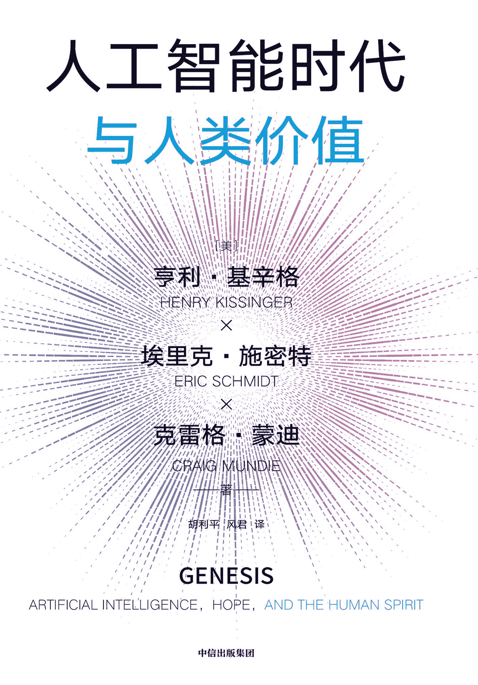

# AI 时代，人类价值何在

致 亨利·基辛格博士
伟大的政治家、战略外交家、良师益友
谨此深切致敬

# 赞誉

人工智能或许是人类迄今见过的最具颠覆性的技术浪潮之一，真正棘手的是人类能否与之共舞。这部作品第一次把我们即将踏入的未来描得很真切，那里既有近乎无限的可能性，也有错综复杂的全新难题。

萨姆·奥尔特曼 OpenAI 联合创始人、CEO

时机正好。本书把人工智能与知识、权力、政治的交集摆到台面上，逼着我们正视这项技术对人类蕴含的风险与潜力。

比尔·盖茨 微软公司创始人、前 CEO

三位作者抛出了极具穿透力的问题，他们的答案指向同一个方向：把智能工具和技术真正交给使用者，让普通人更有掌控感、更自信、更能做主。

萨提亚·纳德拉 微软公司 CEO、董事长

人工智能会如何改写探索？改变真理？影响安全、繁荣与政治？三位各具特色的思想家直面时代核心技术，讨论的都是宏大而深刻的命题。立论扎实、观点鲜明，又深深扎根于实践经验，读来难得。

穆斯塔法·苏莱曼 微软公司人工智能 CEO，DeepMind 联合创始人

基辛格是当代最具声望的外交家与战略家之一，眼光独到且长远。《人工智能时代与人类价值》汇聚了基辛格、施密特、蒙迪三人跨界智慧，从政治、安全、繁荣到科学探索多维度展开，为我们勾勒出挑战与机遇并存的新纪元，并提供在智能革命中找准人类位置、让技术与人性价值同行的思考框架。

张亚勤 清华大学智能产业研究院院长，中国工程院外籍院士，美国艺术与科学院院士

技术狂飙，安全与治理却明显滞后，让人工智能安全可靠地造福人类已成为时代命题。我曾在 2023 年 7 月基辛格先生最后一次访华、以及同年 10 月他最后一次会见中国友人时，与他当面深入交流 AI 安全问题。如今看到他与两位技术专家合著的《人工智能时代与人类价值》中文版出版，感慨良多。书中带着强烈责任感、前瞻视野与深刻洞见，梳理了人工智能对人类价值的潜在冲击并提出应对思路，为理解 AI 时代提供了新视角与新路径。

薛澜 清华大学苏世民书院院长、人工智能国际治理研究院院长

在基辛格生命的最后阶段，他聚焦的只有两件事：中美关系与人工智能。离世前四个月他再度访问北京，竭力推动两国在人工智能领域的对话沟通。《人工智能时代与人类价值》是《人工智能时代与人类未来》的续篇，在 OpenAI 于 2022 年底实现生成式 AI 突破后，与曾任谷歌、微软高管的两位合作者展开的更全面、更具前瞻性的探索。他关于人类智能与人工智能关系的洞见，对当下极具启发。

钱颖一 清华大学文科资深教授，清华大学经济管理学院教授、院长（2006—2018 年）

AI 的发展很可能超出预期。在这个时代，人类的尊严、权利与意义该如何定义、如何坚守，正变得刻不容缓。继《人工智能时代与人类未来》之后，新作《人工智能时代与人类价值》更进一步，从构成人类文明核心的八大维度——发现、大脑、现实、政治、安全、繁荣、科学、战略——逐一展开，给出值得审慎对待的方案。

江晓原 上海交通大学讲席教授、科学史与科学文化研究院首任院长

这是一部兼具深度与广度的著作，既呈现了人工智能技术的发展现状，也直面 AI 对未来的深远影响。讨论跨学科，从技术细节到哲学反思，从经济到伦理，为读者打开多维理解 AI 革命的窗口。基辛格以他一贯的历史与世界视野，探讨了人机共生社会中最根本的问题：如何守护人的价值与尊严。

马兆远 南方科技大学工学院/商学院双聘教授，英国物理学会会士

当人工智能时代真正到来，人类将扮演何种角色？亨利·基辛格在生命最后几年潜心研究人工智能，并与技术专家埃里克·施密特、克雷格·蒙迪合作写下此书。书中深刻讨论了在自主机器时代如何捍卫人类的尊严与价值。

沃尔特·艾萨克森 著名传记作家

基辛格、施密特与蒙迪对即将形成的全球人工智能体系带来的机遇与挑战，进行了迄今最深刻的反思。阅读此书会让人获得至关重要的认知。在制定 AI 新政策前，我们需要先对人类理性与人性本身形成新的理解。这本是基辛格的收官之作，很可能也是他最具前瞻性、最重要的一部作品，意义深远。

拉里·萨默斯 美国前财政部长

任何认真思考人工智能挑战的人都绕不开这本书。它既把握了我们已知的，也点出了我们未知的，即人工智能失控可能带来的危险。作者借鉴了核时代的教训，清晰描绘了前方可能的黑暗道路。

格雷厄姆·艾利森 哈佛大学肯尼迪政府学院教授

人工智能令人难以捉摸，期待与风险并存。在战略大师亨利·基辛格的最后一部著作里，他与埃里克·施密特、克雷格·蒙迪两位卓越合作者共同聚焦此题，恰逢其时。这是一本世人应当阅读的书。

阿瑟·C.布鲁克斯 哈佛大学肯尼迪政府学院及商学院公共领导力实践教授

# 前言

尼尔·弗格森

2018 年 6 月，《大西洋月刊》刊出亨利·基辛格署名的《启蒙是如何终结的》，不少人感到意外：这位年近九十五的政治家为何关心人工智能？彼时 AI 远未成为大众话题，直到 2022 年下半年 ChatGPT 横空出世后才彻底引爆。

作为基辛格的传记作者，我一点也不觉得奇怪。早在 1957 年，基辛格就凭借《核武器与对外政策》一书成名，书中对一项颠覆世界的全新技术展开深入剖析，甚至得到罗伯特·奥本海默的高度评价，称其资料丰富、论述犀利。

他求学时研读十九世纪初欧洲外交史，此后一生都清醒地认识到，大国政治的轮回常被技术革新打断。同代许多人经历了二战，亲眼目睹现代武器造成的大规模杀戮，也见证了希特勒第三帝国所谓的“变态科学”给犹太民族带来的浩劫。

世人戏称他为“好战者”，实则不然。他一生致力于防止美苏冷战演变为热战，从而避免第三次世界大战。在《核武器与对外政策》开篇，他测算过一枚千万吨级核弹落在纽约的毁灭后果，并推演苏联对美国五十个大城市发动全面打击将导致 1500 万至 2000 万人死亡、2000 万至 2500 万人受伤，再加上数百万人死于辐射与疾病，幸存者将面临社会解体。而美国同样能对苏联造成等量报复，结论清晰：全面战争只有双输，没有赢家，哪怕弱势一方也能造成任何社会无法承受的毁灭。

他并非和平主义者。书中直言削减核军备不大可能避免可怕的核战，核查机制也不可靠。核心问题不在于能否彻底避免战争，而在于是否能设想出比全面热核战毁灭性更小的权力行使方式。缺乏对有限战争的理解，可能导致心理防线崩溃，人选择投降。

正是基于这一判断，他在《战略与组织》中提出有限核战争理论：热核战争阴影下，战争目标不再是传统军事胜利，而是迫使对手接受某种明确的政治条件。有限战争要给敌人造成与争议目标不成比例的损失，需要深入理解对方心理与军事能力。这一想法当年令人不寒而栗，后被不少学者质疑，也被他本人淡化。然而两大阵营仍据此部署了战术核武器，让有限核战争在现实中似乎具备可行性，甚至延续至今。

基辛格始终关注技术变革如何重塑政治。1968 年 1 月，他为纳尔逊·洛克菲勒撰写的一篇已然被遗忘的文章中，就设想计算机如何帮助决策者处理政府日益庞杂的信息。他警告最高决策者可能被数据淹没，建议持续接收动荡地区的简报，并由幕僚提供数个行动选项及各自在国内外可能产生的后果评估。他承认这需要对程序设计、信息存储、检索与影像的大量投入，但指出现有硬件技术已具备这四项功能，并描绘了磁带存储、纳秒级运算、分时多路访问、彩色阴极射线管显示等场景。出任尼克松国家安全事务助理一年后，他曾想购置此类计算机自用，却被中央情报局否决。

亨利·基辛格从未真正退休，他始终为人类未来忧心忡忡。这样的人如何会无视自己晚年出现的最重要技术突破——生成式人工智能呢？认识其意义耗费了他生命最后几年的大量精力。

这部书是他与埃里克·施密特、克雷格·蒙迪合著的遗作，带有创新者特有的乐观。他们展望“技术人 Homo technicus”与机器共生的演进，认为 AI 很快会被用于创造人类福祉的新基准，至少能减轻劳动、阶级与冲突的压力，甚至可能消弭种族、性别、国籍、出生与家庭背景的差异。

但贯穿全书的是连串警告，其中可辨识出最年长作者的印记：人工智能的出现关乎人类存续，它可能以破坏性方式积累知识。他在 2018 年《启蒙是如何终结的》中提出的疑问在此书中重现：AI 凭借非人类手段精准认知世界，不仅动摇了人类五百年来的科学方法，也挑战了人类独一无二理解现实的自负。这意味着什么？AI 时代会不会非但不推动人类前行，反而把我们拽回前现代、盲从权威的岁月？我们是否正站在认知大倒退的悬崖边，迎接一场黑暗启蒙？

书中最令人震撼的部分是对人工智能军备竞赛的推演。作者写道，若每个社会都想最大化单边实力，必然引发军队与情报机构史无前例的心理战，在首个超级智能降临前的数年、数月、数周甚至数天，人类将持续处于关乎存续的安全困境。

面对为获取唯一完美优势智能而进行的竞争，作者设想了六种结果，无一令人安心：一是人类失去对竞争的控制，多重行为体陷入安全困境；二是无制衡的胜利者肆意妄为；三是世界出现多种超级智能而非唯一；四是掌握 AI 的公司聚敛巨大社会、经济、军事与政治权力；五是 AI 在宗教体制内获得最大用处与传播；六是开放源代码失控，小团体也能拥有威胁性的 AI。

基辛格为避免这些反乌托邦后果付出了行动，众所周知，他百岁前最后一次努力是推动中美就限制人工智能武器展开谈判，用尽了残存精力。

书的结语无疑是基辛格的声音：被一些人视作风暴中锚的东西，在另一些人眼里是束缚的绳索；被赞誉为攀登人类潜能高峰的必要步伐，在另一些人眼里是冲向深渊的鲁莽。不同的本能情绪与主观界限会制造不可预测的易燃局势，“赢家”与“输家”的对立会加剧压力，恐惧者放慢研发并破坏对手，信心者隐瞒实力秘密提速，危机时间表被压缩到人类从未见过的程度，人类很快会被危机吞没，是否能存活、如何存活仍未知。

技术专家常以 AI 的可见益处回应这类不祥之兆，医学领域的成果已很明显。我不否认，但我认为 AlphaFold——可预测蛋白质三维结构的神经网络——的重要性远超 ChatGPT。二十世纪医学已有抗生素、新疫苗等重大突破，世界大战与种族灭绝仍未避免。

技术进步的核心张力贯穿基辛格一生。1938 年奥托·哈恩与弗里茨·施特拉斯曼发现核裂变，1939 年莉泽·迈特纳与奥托·罗伯特·弗里施给出理论解释。匈牙利物理学家利奥·西拉德指出链式反应可能释放大规模能量并催生原子弹，同时也可能被控制在反应堆中产生热能。第一颗原子弹仅三年后问世，而首座实验性核电站要到 1951 年才建成。

过去八十年里，我们造了更多核弹头还是核电站？今天世界约有 12500 枚核弹头且在增长，而运行中的核反应堆只有 436 座。核电发电占比从 1996 年的 15.5%降至 2022 年的 8.6%。少数核事故引发的政治反应远超其对健康与环境实际损害。

基辛格一生给出的启示很清晰：技术进步的后果可能是良性也可能是恶性，取决于人类如何共同选择。人工智能在诸多方面与核裂变不同，但若想当然地认为它会被更多用于建设而非毁灭，将付出惨重代价。

基辛格的洞见源自历史经验与个人经历，正是这些让他对 AI 突破反应迅速、忧虑深刻。这部遗作与他漫长而显赫一生中任何作品一样重要。

2024 年 7 月写于牛津

# 序

## 缅怀基辛格博士

埃里克·施密特 克雷格·蒙迪

2023 年 11 月 29 日，亨利·基辛格博士辞世，享年 100 岁。认识他的人都曾被他启发。本书是他第 22 部著作，也是他临终前仍在埋头书写的作品。离世前一年，我们两人与他多次会面。他坚定认为这本书意义重大、必须传播。去世前几天，他仍在接见我们。应他请求，我们代他完成了写作。在关乎人类未来的关键议题上，我们竭力保留他思想的独特性与浑厚低沉的声音。完成这部由他发起的作品，让其不会随他离去而消散，而是在没有他的世界里继续存在，是我们对他的缅怀。

基辛格博士毕生为这个世界建设作出贡献，直至临终仍在力图拯救它。他留下的最后文字呼吁全人类为确保未来安全而持续努力。二十世纪中叶，他是为人类免于原子弹毁灭而在哲学与外交上进行努力的核心设计者。就在一个新风险来临时，这位防范原子弹风险的捍卫者离世。他离去之日，也是另一种新生命诞生的时刻。面对人工智能时代的降临，能够与基辛格比肩——二十世纪大师、二十一世纪哲人——为人类未来奠基的人凤毛麟角。

基辛格首先是一位历史哲学家。他深入研究悲剧后毕生向世人展示，情发于内的理想主义与理发于外的现实主义可以和谐共存，且后者因前者而升华。用法国作家罗曼·罗兰的话说，一个人可以拥有“心智的悲观主义”与“意志的乐观主义”。乐观主义者相信人类能掌控自身事务，悲观主义者则认为人类的处境由无法控制的力量决定，如自然法则与历史轮回。

基辛格对空想式学者的冷血逻辑了然于胸，炽烈的理想主义落到他们手里，往往变成大屠杀的借口，或是不加思索的欺凌。回顾往昔，法西斯、极权、好战的宗教狂热都曾自诩正义无匹。他自己先承受过骇人暴行的苦难，后来又以军人与外交家的身份投入反抗。面对虚伪秩序与无愧旧安全观的残骸，他试图在废墟上搭建新世界。立足历史事实与国家利益这块坚硬地基，他以积极运筹国际事务的方式，把移居的新国家与整个世界带过动荡不安的岁月。

他懂得现实主义必须有所取舍，并且把这种取舍用到极致。同时他保持着理想主义的内核，传记作家尼尔·弗格森也曾指出，他看重“人的自由、选择与能动性对世界塑造的作用”。在思想与实践里，基辛格始终坚持：人没有命中注定的结局，也不该像命运早已写定那样生活。哈佛本科论文《历史的意义》写于他27岁，已显出哲学关怀，同一脉络的思辨贯穿遗作：事件的必然性如何评判，过去的行为如何解释都不重要，重要的是当时人们对自身选择的笃信。

人曾用自己的锻炉打出近乎非人的蓝图。这种蓝图下，人能否存续他并不肯定。核灾难的阴影压在肩上，他既不投向决定论的宿命，也未拥抱末日论。恐惧可能催生虚无，也可能唤起人性里最难得的品质，让人变得坚韧，敢于蔑视邪恶，为子孙保存应传承之物。五十年代初，尚在哈佛任教的他参与多场研讨，与顶尖科学家一起推演核战后果与规避路径。那些研讨产生的思路，实则帮世界避开了与会者最忧惧的灾难性结局。

数十年后与我们两人交谈，他屡次回溯那些会议的组织、目标，以及在今天被重新强调的意义。直到最后呼吸，他始终不向命运低头，也不接受任何乌托邦想象。对核武器如此，对人工智能亦然：他认为，只要一小撮坚守价值的人挺身而出，历史轨迹有可能改写。另一方面他提醒，即便创造新智能的学者才情卓越，所受训练也不足以保障操作新工具时的基本安全。

因此，他留给人工智能议题的遗产远超哲学与学理，还包含操作层面的建议。中美关系突破半个世纪后，他秘密访华，随后再次踏上北京的土地。那是他最后一次出国，也是最后一次外交使命。国家主席习近平在钓鱼台国宾馆接见他，议题围绕人面对人工智能所产生的风险。

往昔他把治国上升为艺术，如今他把应对的思考推向超越科学的高度。2021年，他与我们两人之一及麻省理工学院的丹尼尔·胡滕洛赫尔合著《人工智能时代与人类未来》。书中预言人工智能将开启历史新纪元，其对思维的改变可比拟十八世纪启蒙运动。差别在于，新时代下人不再靠自己提出的问题推进，反而被人工智能给出的人从未提出的问题答案困住。随着人工智能不断占领知识疆域，他转而从人智的源头汲取养分。

书中他与我们一起检视人工智能对八种人类活动与思想领域的冲击，并在寻求利弊平衡的战略上给出富于哲理的回应，卷末以此回应收束。他在此描绘了人与人工智能共生的多种前景，包括二者未来共同演进的可能。从概念上点明有机体与人工体和谐共处的可能性，同时强调必须做出取舍：是塑造人工智能更像人的世界，还是塑造人更像人工智能的世界。

自首部论及人工智能时代的著作面世后，他愈发意识到在纪元接近尾声时理性的效力有限。超出我们理解或非我们所造的解释，会让人产生迷惘。人本能地认为人工智能不如人发达，其解释更粗糙，因而是倒退，这实为危险的臆断。

借用阿瑟·克拉克的说法，任何足够先进的技术都与魔法难以分辨。若奇迹出自数学，未来将难以解释、令人困惑，甚至魔幻。我们两人累计认识他数十年。他凭借在治国这门复杂人务领域的深厚学识教诲我们：理性一直是人类驾驭外界的主导范式，却无法成为人类自我驾驭的范式。

于是今后不可能再单纯依赖理性作为历史动能，也不能彻底抛弃它。正如他在理想主义与现实主义间保持张力，他对未来最后的追问也在真理的实证面向与其它面向之间取得平衡——在哲学意义上超出理智，却在时间顺序上滞后。正如外交经不起任何极端，为未来搭建的框架同样经不起极端。

人工智能是一项需要深度反思的独特挑战。起初它显得不合常理，甚至像异想天开。本书各章的情境确实触目惊心。基辛格曾反复告诫我们，他不过是人类的谦卑学生，也是人类最新产物的谦卑学生。他提醒我们，人工智能对人类最大的威胁在于，人类过早或过于斩钉截铁地说“我们懂了”。

今后恐怕难再见到兼具深邃思想与识人能力如他者。认识的人里，无人能在九十三岁掌握此前陌生的全新技术领域。他拥有一颗不熄的好奇、一颗活跃的大脑，以及忘我的工作投入与使命感，身心的病痛从未压抑他对进步的渴求。晚年疾病缠身，他每日起床都怀着不可动摇的决心推动世界前行。这种坚不可摧的韧性或许源自独一无二的淬炼：年少受压迫使他坚硬，战时服役让他成熟，数十年官场角力让他历练。

这位影响诸多人生轨迹的巨人，我们只是其中二人。怀念必然会加深，他离世时未来前景极不确定，今天的人们比任何时候都更需要他。正因如此，英文版选用 *Genesis* 创世记作为书名极为贴切，既指全人类，也指他个人的新起点。不论成败，他已看不到努力的终极结果。至少我们仍能以他的智慧为前行之光。

# 引言

数年前，人工智能在公众讨论里尚属边缘。此后发展迅猛，今天已登上各大媒体头版，成为科学、商业、传媒、公共服务、教育与政界领袖反复思量的议题。

我们认为，无论公众还是该领域的大量专家，都尚未真正把握人工智能新时代的内涵。层出不穷的人工智能及其应用方式，有可能从根本上改变人与现实、与真理的关系，改变知识探索方式与人自身的演化，改变外交运作与国际秩序。这些都是未来数十年关键议题，需要各方领袖以最高规格的关注对待。

人工智能的最新能力令人惊叹，但随着能力加速提升，回望当下的最新水平，未来会觉得像儿戏。迄今难以想象的能力正渗入生活的方方面面。未来的体系将推动人工智能带来总体利大于弊的进步，创造财富并改善健康。

与之并行的是技术风险与人性风险。部分风险已知，部分未知。如今的技术已常被以发明者未曾设想的方式使用，这一趋势可能延续。人类科学家探索的每条富有成效的路径——将来绝不止一条——都可能衍生出意想不到的新分支。对这些分支，人可能看得懂，也可能看不懂；可能有益，也可能有害。

人工智能仿佛压缩了人类的时间尺度，远期之事近在眼前。能自行诠释目标的机器已呼之欲出。若人类想跟上风险步伐，就必须在可想象的最短时间内行动。认识到任务重大且迫切，我们在此仅指出其中若干面向。

在人机伙伴关系无处不在的时代，人必须决定其合理边界。答案可从安全与效率逻辑、历史研读，乃至神圣启示中寻求。未来个人、国家、文化与宗教都需要划定人工智能在真理问题上的发言权边界，以及是否允许人工智能成为人与现实的中介。是保留人类进取的传统角色，同时可能把发现新知的领导权让给人工智能，还是抛弃受生物学束缚的人类思维，在知识前沿与人工智能结成重构式的伙伴关系。是人先设定目标再驾驭人工智能，还是让人工智能参与目标选择。紧要的是，人必须为尊严给出一个现代且可持续的定义，以为未来决策提供哲学方向。

我们认为人工智能的出现关乎存续。如书中所述，以非人速度运作的未来人工智能，将使传统规则失效。我们需要全新管控方式。对全球科学界而言，当务之急是找到可在每个人工智能系统里植入内在安全保障的技术。各国与国际组织一旦达成共识，就必须建立监督、执行与危机应对的新政治架构。这涉及两个而非一个对齐问题：技术层面的人类价值观与意图与人工智能行动的对齐，以及外交层面人与人之间的对齐。

本书作者之一亨利·基辛格博士在后一个难题上指导了另外两位合著者。曾任微软与谷歌高管的两位合著者在前一个难题上辅导了基辛格。克雷格·蒙迪是微软负责联络华盛顿及各国政府的首席技术政策联络官，同时主管微软研发。他不久前曾为OpenAI高层提供咨询。埃里克·施密特则执掌谷歌长达十年。

我们共同面对的问题迫在眉睫。人类社会乃至人类物种急需主动解决，而非坐等危机。人类安全固然是应对对策中不可或缺的部分，但它无法解答人工智能提出的所有问题，因为在人工智能时代，人自身会变。关键在于人是否并在何种程度上选择在这一变化进程中继续坚定维护自己的权威。

# 第一部分
## 开端
### 第一章
#### 发现
探索可能是人最令人振奋的能力。在好奇驱动下，在偶然收获的愉悦中，人以探索填补认知空白，把提出的问题化为答案。探索堪称自我定义不可或缺的一部分。因此即便前方有危险、有坎坷，人仍不懈上下求索。

纵观历史，人对自然环境的探索始终是迎着严峻风险展现巨大勇气的叙事。探险队常面临生死考验。十六世纪初，麦哲伦的环球航行历时三年，暴力、饥饿与死亡如影随形。这次航行首次完成环球一周，打破公海持久航行纪录，证明地球形状，并在欧洲殖民背景下为国际交流开辟新路。

麦哲伦麾下多数船员都清楚前路危机四伏。虽然当时已不再普遍认为地球是平的，但“地球是圆的”尚未被证实，许多船员害怕船只驶出世界的边缘。

麦哲伦与船员们深知，若“地球是圆的”这一假设有偏差，他们将付出惨重代价。事实上他们确实犯了错并付出了代价：低估旅程长度、维持生命所需食物数量，以及大规模中毒、船只受损或无法航行的风险。最初五艘船约二百七十名船员启航，最后仅一艘船载着十八名失魂落魄的幸存者返回西班牙港湾，而且船长已在途中被土著杀死。^(¹)

麦哲伦时代四百年后，世界每个角落都被绘制成地图，唯独南极洲除外，那是一片近乎外星的荒凉之地。英裔爱尔兰探险家欧内斯特·沙克尔顿比任何前人更接近南极点——所谓“世界之底”。1909年，他率领一支毫无经验的船员，在无政府支持、仅靠私人贷款与个人捐款的情况下，创造了最长的南极探险纪录，为后人铺路。

沙克尔顿虽未成为首位抵达南极点的人，却因把人类价值置于探索野心之上而赢得尊敬。探险一年间，队员每日被绑在雪橇上轮班十小时，只能前进寥寥数英里。食物足够到达南极点，却不足以返回船上。

就在距离胜利仅九十七英里（约一百五十六公里）时，沙克尔顿没有让部下冒生命危险继续前进，而是决定折返。他在日记中写道：“我们已经尽力了。”^(²)

这次失败并未令他气馁，后来他再进行多次南极探险。坊间曾流传一个后来被证实为杜撰的故事，说他在伦敦《泰晤士报》刊登广告：

招人：危险航程。薪资微薄，严寒刺骨，长达数月的黑暗，危险不断，不确定能否安全返回。若成功，将获荣誉与认可。^(³)

广告是假的，但体现的牺牲精神却是真实的。这就是一个世纪前的探险现实：我们能拓展多少边疆，取决于有多少勇敢者愿为渺茫成功孤注一掷。

也许正是体认这些危险，一些国家政府开始赞助与奖励此类探索，使其日益成为国家间竞赛。例如麦哲伦航行就依赖政治力量支持。因无法从葡萄牙国王处获得资助，他转而在西班牙王室赞助下出发。他死后，船员推举西班牙人胡安·塞巴斯蒂安·埃尔卡诺任指挥官。返航途中因几乎无食物与补给陷入绝望，他试图在西非葡萄牙殖民地佛得角群岛停留，派十三名船员上岸与总督谈判，却遭羞辱性拒绝。

虽因拒绝而沮丧，埃尔卡诺也因此更坚定决心，用行动证明葡萄牙的愚蠢与西班牙的成就。他下令起锚继续返航（先遣成员被留在那片不友好土地）。最终他完成航程，实现麦哲伦理想，致信西班牙国王兼神圣罗马帝国皇帝：

陛下最清楚我们应珍视把握的重点是，我们已发现整个世界是球形并绕其航行一周。我们扬帆向西，却从东方归来。^(⁴)

最终，这些无畏之人及其政治支持者把探索推向地球之外。我们不仅研究行星数千年，还要亲自踏上其表面。二战后，美苏冷战推动的“太空竞赛”促使两大超级大国争相把人类送往从未涉足之地。

这些宇航员可视为先驱，但莫斯科与华盛顿的太空冒险绝非个人主义的生命财富赌博。每一次都是协调一致的外交军事任务，投入资金、时间与试错空间。在过去七十年，六百多名宇航员冲破阻碍遨游太空，其中一些人绕月飞行并在月球行走。^(⁵)

在地理大发现时代，郑和下西洋的缘起与动机更接近现代美苏太空计划，而非其时代西方同类计划。与其说是未知领域的冒险突进，不如说是大明王朝治国得当、物产丰盈的成果展示。但问题也在于此。即使资源充足国家，那些确保探险成功的事物从长远看也会败坏根基。政治会变，优先事项会转，人的耐心易被消磨。宝船开支巨大，明朝朝臣开始反对为其供给资金。政治挫折与自然灾害加剧局势，最后明朝决定销毁或刻意雪藏郑和船只及记录，以免再次出现宏图大业，诱惑领导者劳民伤财。船只逐渐腐朽，四百年来再无可比肩者。

类似地，美国赢得太空竞赛后，因无竞争对手激励，华盛顿对太空探索支持萎靡，NASA预算被削减。之后五十年，美国载人航天能力江河日下，从唯一能把人类送上月球的国家，沦落到只能送入近地轨道，最后彻底丧失将任何人送入轨道的能力。

最终还是私人探险家的努力挽回了美国航天的声誉，在SpaceX带领下西方探索宇宙的雄心重振。如今该公司成就已达难以想象高度，它不再把最近的天体当作临时目的地，而是欲在其上建立永久家园。一个世纪前，沙克尔顿帮助建立人类在地球最南端的据点。今天，沙克尔顿环形山——为纪念他而命名的月球南极洼地——是人类计划中的下一个前哨选址。

备选支持者的存在对探索持续至关重要。麦哲伦时代欧洲若一位君主不支持，探险家可向另一位君主筹资。二十世纪，沙克尔顿渴望为日渐衰落的大英帝国夺取南极点，但1914年第一次世界大战爆发令英国无暇他顾。他无法从王室筹到资金，只好求助于私人捐助者。私人营利性公司的兴起汇聚投资与风险，带来更多可能性。由此不禁要问，若郑和及其继任者有此选择，会成就何等伟业。

#### 走进人工智能
在西方历史漫长时期，现实探索主要集中于地理实体——我们的星球与邻近天体。随着人类逐渐主宰陆地、海洋与天空，人类永不停歇的探索本能迟早会把范围从外部空间拓展到内心思想领域。今天本书关心的并非物质探索前沿，而是智力探索前沿。

人工智能开创了一个新的发现时代。当人工智能整合进实体系统时，机器人传感器承担起先前由人类承担的角色，使人类在探索时免于身体危险，并因此让热衷此道的开发者与投资者队伍成倍壮大。

人工智能不会感到恐惧，因而不会因现实浩瀚而心生敬畏。人工智能也不知羞耻，因而可毫不犹豫承受失败，却能迅速调整。通过不断即兴式创新与尝试，它可适应高失败率，却不会令开发者与投资者感到受挫。

如今人工智能的探索版图，操盘方多集中在私营公司与创业者身上，国家更像是配角与兜底者。就算拿掉政府的额外加码，靠多元化的资金供给，技术仍会往前走。现在这个阶段对人力资本和社会的投入消耗依旧很大，但往后看，随着技术趋于成熟，持续推动AI对使用方的财政与政治负担很可能被显著摊薄。这不是什么反常的拐点，也不是历史上那些没等到兑现就被截断的早期尝试，探索和落地的动能大概率会一直延续。

摆脱了早期的枷锁，并不等于可以随心所欲。等影响变得可以被公众感知时，民主社会对风险的容忍底线，以及国际博弈中充满不确定性的走向，就会变成左右进程的关键未知。走向可能是一场竞赛，也可能像明朝拆毁郑和宝船舰队那样酿成毁灭性的误判，也可能走中间路线慢慢推进。

### 博学之人

回溯过去，人类认知的版图早已超出物质疆界，探路者也不再是航海家、宇航员或冒险家这一类。从很早期就出现了另一种开拓者，后世常称作博学通才，且与众不同。

这类人群往往通晓多门学问，而每门学问通常都需要一生去钻研，所以历史上真正能算得上通才的人可能只有数百个。他们投身艺术、科学或两者兼具，都带着重塑学科、甚至从零创立研究领域的强烈冲动。驱使他们并非单纯的心灵勇气，更像思想上的偏执，他们向知识与想象的深处挺进，所面对的广度远比实体探险更大。

有时，这些人物因破解宇宙奥秘的能力被视作巫师或与造物主相连的媒介，人们既敬畏又怀疑，于是与宗教或政治权威冲突；有时则因才能被官方看重，在庇护下继续研究并获回报。

在伊斯兰黄金时代，博学者们致力于为信仰服务而开辟科学道路。来自今属伊拉克巴士拉的伊本·海赛姆提出了科学方法的概念，比西方文艺复兴时期的同道早了五个世纪。^(⁷)

正是最后这一点令他与宗教发生冲突。他声称自己有能力控制尼罗河水的泛滥，而当时人们仍认为这种自然现象乃是出于超自然的原因。因此他被邀请去巴格达与哈里发^(⁸)

另一位博学者阿尔·花剌子米，波斯人出身于今乌兹别克斯坦境内，在为神学服务的学术圈里发展更顺。他被任命为宫廷天文学家并主管巴格达智慧宫图书馆。^(⁹)

与海赛姆和花剌子米同时代的伊本·路世德则开辟了更富创造性的路径，通过加深科学与宗教的联结来维系探索，用他自己的说法，确保拥有“智慧统一”之人能在以狂热信仰而非理性著称的时代得到庇护保全。^(¹⁰)

在距巴格达千里之外，中国和印度的通识者相隔遥远，却选择依附官僚体系，通过攀附权势与自身努力实现了与政治的特殊和解。在 12 世纪，金月^(¹¹)

中国的智者除了在学问上有所建树，还在朝廷担任顾问、文官与高层行政官。政府既是委托方也是靠山。同一天里，他们可能以司天监监正的身份督理历法制定；一小时后又要向内阁建言如何提高粮食产量。也常被指派建造大型战械、出使邻国，或就经济政策向皇帝献策。

但他们并无自主权，只有在皇帝需要智力服务时才会被优待。古代中国，党争成为天才的束缚，和伊斯兰世界的宗教限制类似。即便是出类拔萃者也受制于最初认定其才能的制度，科学始终听命于天子。宋代博学者沈括被妒贤嫉能的侍御使弹劾，失宠后陷入孤立，讽刺的是，这场政治绞杀源于他与另一位可称博学之士的侍御使之间的较量。^(¹²)

中东、印度、中国的孤独博学者时隐时现。但直到地理大发现之后，即理性或启蒙时代，系统的概念研究才先在欧洲萌芽后在美国兴起。十五、十六世纪文艺复兴的助推，加上此后四个世纪的积累，把我们带到当下 AI 时代的起点，这是一个与以往截然不同的知识探索阶段。

启蒙之前，博学者别无选择只能依附更高权力，无论是皇帝还是哈里发。相比之下，欧洲启蒙的领军人物却能按自己的判断大胆求索，不是作为实现政治或神学目的的工具，而是将其视作目的本身。意大利博学者莱昂·巴蒂斯塔·阿尔伯蒂曾自豪地概括文艺复兴人：“一个人只要愿意，就可以做任何事情。”

不过智力只是必要条件，远不够用。探险家既要保持风险偏好，也需要匹配的资源、环境与协作网络。启蒙时期三者兼备。各国政府与企业出于把理论转化为军事与商业用途的兴趣，仍是欧大西洋地区博学者的重要赞助与合作方，同时在很大程度上允许他们自行支配精力。即便有人想收编或压制，分裂的欧洲足以让在本地不受欢迎的思想家在别处获得立足。法国人弗朗索瓦·马里·阿鲁埃即笔名伏尔泰者在法国境外度过了很长时光，而俄国人米哈伊尔·罗蒙诺索夫^(¹³)

一个直观的结果是，人类进步如今被志同道合的思想家在现实或精神层面的新连接所驱动，促使其竞争与合作。此前，人类天才的故事常与孤独绑定，被暴政在时空上割裂。博学者往往孑然一身，在所在时空少有知音，只能在能力范围内不断突破。且因缺乏与体制内外其他先驱的联络，发明家难免重复劳动，难以在他人成果上递进。

渐渐地，掌握准确、及时且忠实的译者，便能通过集体努力拼凑复杂发明，这种拼凑既可同期发生也可跨越时代。到启蒙时期，博学者不仅能沟通学科，还能将从未调和的不同理解领域融为连贯整体。此后不再有“波斯科学”或“中国科学”，只有科学本身。

这种跨域整合能力催生了快速的跨学科突破，并被证明是集体智慧的最佳实践。二战时期的曼哈顿计划便是高度智力密集工作的典型，最顶尖人才三年内便把数代理论物理成果转化为核武器，这一壮举前辈难以想象。普林斯顿高等研究院与加州兰德公司亦成为天才的庇护所。

当然，部分博学者因才华所累仍偏爱独行。塞尔维亚裔美籍发明家尼古拉·特斯拉即是例证。

隐居与持续独处会让头脑更敏锐。思考并不需要大型实验室。独创性在不受外界干扰时茁壮，而这些干扰只会削弱创造。独处是发明的秘密，也是创意诞生的时刻，故许多人间奇迹诞生于简陋环境。^(¹⁴)

但特斯拉只是例外而非常态。二十世纪应用科学的“寒武纪大爆发”^(¹⁵)

增幅终有边界。无论载具如何优化、天才如何组织，生物限制与人性缺陷仍在制约能力：生命有限，需睡眠，易疲劳，需休整。大多数人工作时也只能同时专注一件事。

想想十九世纪末二十世纪初，托马斯·爱迪生自身即为博学者，与特斯拉并称。他历时近三年、完成数千次实验才做出实用白炽灯。诚然当时他分心改进亚历山大·格雷厄姆·贝尔的电话，但在众多助手的支持下，灯泡的探索仍需非凡投入。至今，许多前沿技术研发仍耗资巨大、耗时漫长，在政治与心理层面令人却步。结果高度不确定，太空、深海、地球地壳等物理边界的探索，仍只由最成功的企业与最富有的政府承担。

正是这些不利因素的存在，让探索保持意义，甚至被视作奇迹。

物理学家约翰·冯·诺依曼被后世视作最后一位伟大博学者，《金融时报》称其为“世纪风云人物”，体现了二十世纪特有的自信，相信思维能够“驾驭和驯服物理世界”。^(¹⁶)

凭借冯·诺依曼这类智者，人类在拓展智力版图的历程中或许已触及非增强型人类智能的上限。博学的通才尤为罕见，因掌握一个领域基础已需漫长岁月，有志于此者在此后已无暇学习另一领域，且局限于单一领域还可能丧失创造力。如今创新更多来自团队而非具备卓越跨学科洞察的天才。

然而将多个人脑中的知识整合仍是难题。即便在明星知识分子中，合作者越多，协同交流越受阻。

相比之下，人工智能将成为终极博学者。在探索人类知识前沿时，它能以惊人速度处理并生成海量信息的表征。它能同时评估无数维度与领域的模式，创造前所未有的连通性。其高效率使其超越人类探索局限，用美国社会生物学家 E. O. 威尔逊的话说，甚至有望把众多智力追求融合成新的“知识统合体”。^(¹⁷)

正如启蒙时期博学者的成就依赖信息互联，机器学习的最新进展也受益于庞大数据规模——集体智慧，而当今人工智能不仅使之成为可能，还令其唾手可得。

再往前推一步类比，或可理解人工智能技术最新进展并非由单一大型程序完成，而是将多个小型程序的结论综合，形成所谓的“专家混合体”。我们预测，博学者通过集群产生能力增幅的情形日后将屡见不鲜。

迄今，人类整体探索仍受制于前沿人员的数量与素质。我们只有数千名实地先驱，博学者更少。因此人工智能有望在现实世界与智力探索领域掀起革命。正如前文所指，人工智能缺乏恐惧与羞耻，会毫不犹豫听从指令奔赴前沿。它不仅能探索以千米计的外太空，也能探究以纳米计的人体内部机理，对现实的探索明显不受主观经验或体力限制，也不受人类智力或感官限制。当涉及物理现实时，机器探索不会要求我们为事业牺牲生命；相反，它要求我们付出的时间可能仅是维持其可用的人类时间，机器自行探索的时间不计入衡量。

未来，任何社会的主要约束可能不再是能召集多少有才华的博学者个体来提供微小且有时相互矛盾的动力。人类潜力将不再受限于我们之中涌现的麦哲伦或特斯拉式天才的数量。世界最强大的国家不再是拥有最多爱因斯坦与奥本海默的国家，而是能创造人工智能并充分利用其潜力的国家。这可能令衡量国家实力的主要标准发生范式转变。几个世纪以来，这一标准已从领土转为资源，再转为资本，再到人力资本——现在，或许将转为算力资本。

此外，学习型机器完全可能成为自我改进的机器。计算机以一种与以往任何机器都截然不同的方式放大了人类心智的力量，并在问世数十年后促成人工智能突破，那么人类作为博学者的最后一项发明，是否会因最终取代自身的发明者而被历史铭记呢？

### 第三次大发现时代

从人工智能的角度看，人类积累的知识就像分布在一望无际海洋之上的火山岛群。每座岛屿中心由火山峰构成：观察者视角从峰顶向下朝海面移动时，知识的确定性与信心逐渐减弱，直至海岸。^(¹⁸)

假设为了在真实世界演绎这一想象，我们抽走海洋中足够的水量，人们便会立即看到迄今肉眼不可见的巨大水下地形；岛屿不再像漂浮的自由陆地，而更像是巨大水下山脉或火山露出海平面的尖端，它们从海底基座耸立而起，高度刚好冲破海面。

若每座岛屿代表人类理解的一门学科，则分隔岛屿的水域代表仍待发掘的不完整联系。把我们对宇宙的理解提升为潜在连贯整体，这种联系必不可少。尽管我们对当下现实“陆地”的描绘会带来暂时的踏实感，但对自身所处岛屿水面之下或远离岛屿的事物却知之甚少。人工智能可以改变这一点。

以物理学为例，这是最典型的科学范式。若说艾萨克·牛顿调和了天体与地球世界的定律，若说迈克尔·法拉第与詹姆斯·克拉克·麦克斯韦在电学、磁学与光学方面也做了同样工作，那么人们至今仍在寻找“大统一理论”，以调和两种各自独立互不兼容的理论，这两种理论分别从现实的宏观与微观两端解释存在。它们分别是宇宙理论广义相对论与亚原子理论量子力学。

人工智能可能最终为这些看似迥异的理解领域带来秩序与结构，并在此过程中揭示遗传学与语言学、宇宙学与心理学等领域间的相互联系，就好比这些领域是彼此有着相同底层结构相连的群岛。人工智能甚至可能有助于调和看似互不相容的思想流派或信仰体系间的分歧。

在许多学科中，我们已发现大量“近似事实”，尽管它们实际为真的概率很低。在人类认知组成的群岛中，这些近似事实就像沿着岛屿海岸线排布的小点：人类对它们虽非无知，但也未必真正了解。人们可将人工智能导入这些沿海岸线分布的探询区域，准确判断进一步探索最有成效的途径。通过快速连续选择、测试、逆转与重新选择，它能评估数百万种可能选择的效果。

正是通过这种方法，谷歌 DeepMind 实验室不仅让人工智能掌握人类熟悉的中国古代棋类围棋，还在机器可向人类展示的知识范围内增加了人类对围棋的理解。早期国际象棋类程序通常依赖蛮力计算，与之相比，AlphaGo 已根据先前的三千万步棋对自己进行预先训练，并以此展示机器抽象推理能力。^(¹⁹)

从这个意义上说，机器训练类似于哲学博士生的思维训练：后者是一个通过多年强化学习逐步建立思考与推理能力的过程。DeepMind 系统就像一个学生经过多年学习后在论文答辩时回答问题一样，训练自己超越之前所接触学识，从更抽象更高层次的教导中得出它所推断的最可能获胜棋步。有时人工智能模型确实选择了人类在历时四千年的无数棋局中从未尝试过的棋步——这可能只是因为人类思维似乎仅限于一次操纵四个独立变量，但人工智能却能同时从无数维度做出无数概率判断。^(²⁰)

当人类用户对人工智能模型进行问询，例如在 ChatGPT 中输入问题时，不仅仅是要求它像传统搜索引擎那样检索一个信息点，而是要求它综合多个信息点并在此基础上得出结论。它在多个方向多个维度并举，在高维空间生成信息表征，涉及无数领域与子领域内部与之间的关系，并从这些复杂网络表征中得出结论。

在回答我们的问题时，人工智能的“大型语言模型”具有看似超人的能力与速度，这些模型是在大量数据上预训练而成。由于其给出答案的准确性之高，令我们对人类本就支持的各种事实信心也愈加牢靠，这些模型便产生越来越详细的原先位于认知海平面以下深层信息。

人工智能对新知识的积累不仅可能以极快速度进行，还可能以开辟一系列额外探索的方式展开。在弈棋过程中，AlphaGo 倾向采用具有特别开放性的解法。因此在训练过程中，一些人工智能模型可能会偏向提供多种选项的高潜力区域，从而实现快速灵活探索。

人类可能很难适应这种新人工智能探索模式。其间最严峻的挑战将涉及这种探索是否反映，以及如何反映我们自身对现实和人类目的的认知，抑或对此有所违背。人类可能会尝试制造某种载具，以便在我们指示人工智能去创造露出海面的新知识岛屿时能够亦步亦趋，随同登陆。或者，我们可以为自己配备工业设备，并凭此以人类更为适应的速度慢慢从海底挖出沉积物，从而将代表我们理解范围的小小礁岩逐步扩大。又或者，我们最终会确信，以后再也不必亲自踏上我们自己所立足之处以外的陆地，一切交给人工智能便好。

此外，人工智能还面临控制不当的挑战，它可能以破坏性的方式积累知识。它的探索方法可能会像最初形成我们所立足家园的火山喷发事件一样猛烈。让我们继续沿用岛屿比喻：人工智能可能会令我们所立足岛屿的火山再一次喷发，这一过程会大大扩展岛屿面积，但会毁掉先前知识积累。它甚至可能使海底巨大板块断裂，这些板块间的碰撞可能会使新知识山脉浮出水面。然而由于这些知识与我们自身经验脱节，其可能会反过来引发一场认知风暴，从而不可避免地将我们引向对现实更全面——尽管可能并不是我们所愿见——的理解。

另一方面，如果人工智能的发展与我们的目标一致，那么就像之前计算机的发展一样，这将成为一项人类使命，并且可以促进其他人类使命的发展。这将把人工智能提升到宇宙中至高力量的地位，或者至少是一种与之同等力量。下个世纪大多数重大发现之中，将有相当部分甚至全部由人工智能做出。果真如此，我们人类可能会回过头来意识到，与那些至今隐藏在海平面下可能性山脉群峰相比，我们在过去几千年里所开辟那些知识岛屿是多么渺小可怜。

### 第二章
## 大脑

人们提出了许多类比以便对人工智能的到来及其意义加以解释、澄清与情境化。人类学家将其比作火或电。将军和外交官则把人工智能比作原子能，或是像俾斯麦所体现的那种不可阻挡、不可征服的人类意志力。天文学家将其描述为类似于小行星撞击——一种遥远且发生概率很低的预言，人类可能会围绕其组织行星防御——或者外星生命的发现。经济学家将人工智能比作官僚机构和市场，而国家和社会的领导人则将其与印刷机或公司的出现相提并论——后者甚至逐渐拥有了自己的意志，并在发展早期占领了南亚次大陆，当时世界还没有认识到它与现有权力结构的不相容性和对其的潜在支配力。^(²¹)

书里给出的答案很克制：哪怕有再深刻的技术突破，也比不上最初点燃这个工程的灵感，更比不上今天仍在追求的终点——造出一个比地球上任何活人都更强的智能体。^(²²)

把当下这个位置放进坐标，大致有两条线路可以走。第一条是找熟知的参照系。历史上最具颠覆性的技术，基本都在补位或放大身体的能力。车轮把跋涉的疲惫降下来，各种动力装置替肌肉分担了劳损。X光、放大镜、电灯把可视的边界向外推，突破了天然视力的封顶；电话则把声音以声带做不到的方式送出去。人体的各方面本领，基本上都被我们造的无机装置以某一种方式加力、打磨或强化过。按这个逻辑推，AI 只是又一次能力的延伸？

第二条线路提示性质不同。AI 拥有一些人的能力难以完全覆盖的特质。短短几十年，我们造出了相当于进化数千年才炼成的东西，也就是脑。于是忽然意识到，这已经是最后一个仍要靠人手完成无机复制的器官。

### 速度
上一段提到，AI 的“训练”和博士阶段的思维打磨可以类比，这个类比还能往前推。总的说，机器智能的养成，和人脑从青春期走向成年的生物学成熟很像。

中学生先打基础、形成初版的世界观，这个框架未必成熟，也常犯错，机器也是这样。AI 和人一样靠摄取信息、抽象成理论再用于实践来学习。训练时算法会抓取大量数据——来自开放网络或私人提供的专精数据——再压缩成精简的概念地图留待调用。就像人的感官输入最终映射到神经网络的权重上，机器也在逐步强化自己的计算权重。

神经网络有时候像某些懒散的高中生。起步阶段它只做最低限度的工作——记答案而不是真懂。面对“`2+2`等于几”这类问题，它可能先把“4”硬编码进去，而不掌握加法规律。越过某个临界点后，这种捷径会崩塌，机器被迫像人一样提炼出更普遍的知识公理。

这正是 AI 与传统电脑的分界：它的世界映射是学出来的，不是写死的。传统软件里，人写的算法规定输入如何变成输出；而在机器学习里，人写的算法只负责告诉机器如何自我改进，让机器自行设计输入到输出的映射。随着无数次尝试、失误和微调的累积，模型会迭代重塑自己对数据中模式与联系的内部表征。

人类教练会定期给出输出正确性与质量的反馈，机器则以反向传播的方式把这些修正内化，让反馈沿着已建的数学关系倒流，优化整体。只是对任一模型，人能标注的输入输出只是冰山一角。训练测试达到一定水准后，开发者便相信模型建立的映射能对所有输入——包括意外输入——给出稳妥且大概率准确的回应。

在以上每个层面，AI 都在扩张、并将继续扩张我们的知识边界。只是这个过程我们并不完全明白，而我们却倾向于把产生的知识当真来用。

一般美国学生读完高中要四年，如今的模型能在四天内掌握同等甚至更多的知识量。速度因此成为 AI 区别于人形与思维方式的核心属性之一。

人脑虽有高度并行性，但受生物回路速度限制，信息处理很慢。用电脑的指标类比，人脑回路的时钟频率与 AI 超级电脑相比，平均慢了约 1.2 亿倍。

速度并非智力的充分指标，反应快的人也可能很笨。但更快的处理带来两点好处：摄取更多信息，同时承接更多请求。人脑大部分时间处于自动驾驶，被动满足内在需求，掌管心跳、四肢运动，出了问题才干预。AI 的速度则使其能程序化地展现强大能力，去解难度更高、更宏大的问题，是人脑目前难以企及的。

训练完成后，人与机器在理论上都具备了思考，即专业意义上的推理。面试、辩论或约会时，受过教育的毕业生会援引所学与经验。我们并非靠死记硬背公式与数字，而是对知识做更深层的反思。人脑并非为完美记忆而生，大多数人也没有这份能力。经历无数课程、论文与考试后，我们留下的是更持久的概念——天文学的奥妙、野心勃勃的悲剧、革命的必要或非必要。

AI 亦然。模型训练结束后，无需再调取原始训练数据，它保留的是从知识中拼凑出的粗糙直觉，用来回答问题、检验推理、做出预测。人不会随身携带资料库，AI 也是推断而非回忆。不同在于，AI 的速度允许它在更广、更深的信息里进行推理。

有时候回答一个简单问题，模型可能执行数十亿次技术操作。传统电脑只能检索内存里已存的信息，无法推导出内存之外的新结论；而 AI 的计算走向更接近人脑。正如人学习是为了思考，机器训练也是为了推理。没有前者，后者就不会到来。

对人或机器而言，前一阶段都是更耗时的过程。培养一名博士后可能要二十年以上，才能让他两天内写出一篇深思熟虑的文章。训练最大规模的模型可能需要数月，但由此产生的推理却只需几百分之一秒。

现阶段的系统，已能针对提问给出看似有说服力、经过推敲的答案。在未来迭代中，它们会以任何个人或群体都难以匹敌的敏捷性，在多领域跨越。对 AI，规模意味着速度；模型越大、训练越充分，结果越快、越详尽。更关键的是，通过识别操作员无法察觉的模式，它能把传统知识提炼成原创回应，并从海量数据中锻造新的概念真理。

这就引出了不止一个问题。

### 不透明度
我们如何知道宇宙运行的规律？又如何确信我们所知的为真？

从科学方法成为检验标准以来，缺乏证据的信息都被视作不完整与不可信。只有透明、可重复、逻辑验证赋予事实合法性。在这一框架下，人类的知识、理解与生产力数百年间大幅增长，而电脑与机器学习则把这一发展推向顶峰。

然而 AI 时代带来一个新难题：信息来得快，却不附带解释。如前所述，AI 的回应可以是关于复杂概念的清晰连贯描述，且即时给出。机器输出的信息最基本、最未经修饰，看不出明显的偏见或动机，也没有引用或理由。尽管单个答案缺少依据，早期系统已让人对它那些如同神谕般独一无二的断言产生难以置信的信任与依赖。随着发展，这些新的大脑不仅看似权威，可能真的无懈可击。

人类反馈帮助模型完善内部算法，但真正发现训练数据中的模式并分配权重的是机器本身。模型训练完成后，它不会公布自己构建的内部数学模式。因此机器生成的现实表征在很大程度上仍是不透明的，甚至对发明者而言也是如此。如今人类主要靠检查输出来确保完整性，而内部运作多半捉摸不透，于是有了黑箱的说法。尽管有研究者试图逆向工程，但能否成功仍不明朗。

简言之，机器学习模型能让人看到新东西，却不让人明白这些发现是如何产生的。这把人的知识与人的理解拆开了，是人类历史上少有的体验。现代意义上的人类统觉^(²³)

启蒙时代的框架里，个体能力、主观理解与客观事实彼此协同。而 AI 产生的事实，是通过人类无法复制的过程制造的。机器推理不走人类的方法，超越主观经验，也超出人类能力范围，人类甚至无法完整呈现机器的内部过程。

按启蒙运动的推理，这类事实本应被拒斥。然而，我们——尤其是数百万已接触早期 AI 的人——已接受了它们绝大多数输出的真实性。^(²⁴)

这种信仰的出现本身，标志着现代人类思想的重大转变。因为 AI 模型在人类意义上并不理解世界——机器显然没有意识或主体性——但它能以非人类手段精确认知我们世界的客观面。这不仅打破了人类近五百年对科学方法的依赖，也挑战了只有人类才真正了解现实，或人类理解独一无二的说法。

这意味着什么？AI 时代会不会不是推动人类前进，反而把人类拉回前现代、接受不加解释权威的年代？我们是否正站在认知大倒退的悬崖边——一种黑暗启蒙？

### 多样性
不同存在以不同尺度丈量时间。在地质尺度上，人类的全部历史不过是四十五亿年地球岁月末尾的一小段突进。若按地质速度发展，我们只会觉得停滞。相反，作为缺乏耐心且自负的物种，我们用自己的进化速率定义自己。地质上的年龄以千年计，人的年龄以一个到两个世纪计。

AI 则可能按人工或技术的时间尺度运行。它的整个历史仅七十年。就像人们视寒武纪大爆发前数亿年为漫长空白，随后生命骤然爆发，AI 很可能会把一九五零至二零一零年的六十年描述为类似的缓慢模糊期，直到最后十年才被曙光点亮。

从社会和生物学看，人类一代约二十五年。AI 以非人的速度发展，其世代只需十分之一的时间就能跃迁。因此在人类尺度上感觉像革命的事，在技术尺度上可能只是进化。相隔数月的新模型，能回应更开放的提示，为目标提供更多选择，并在更多模式中行动。

于是 AI 时代——按人类时间也许约百年——可以被更精确地标记为多个时代；按技术时间尺度，甚至包含数百个世代。

快速进化是一个多面且尚未被充分重视的挑战。人类从未经历如此巨大的时间压缩，也未做好准备。变化之快必然带来文化与心理的迷失。随着新技术深度介入日常生活，判断某项应用是危机之源还是进步之兆会愈发困难。

现实世界的梳理会更难，因为 AI 的多样性会带来多种难以捉摸的影响。随着能力增强，未来它很可能出现重大进化与分化。只要不对机器学习的基础架构和新技术设限，一代又一代 AI 将层出不穷，其多样性、广度、能力和复杂性与日俱增。就像电能不仅能点亮灯泡，AI 也有多种用途；正如发电方式多样——摩擦、传导、感应——我们也可能发现多种创建 AI 的方式。

例如催生最新进展的基础架构被称为变换器（`transformer`）。它让机器能同时考量多个词之间的联系。通俗说，以前的结构是一词一词读，只捕获词一与词二、词二与词三的联系，而变换器能同时捕获整句及句中每个词之间的联系。通过构建并利用所有联系的数学表征，AI 就能预测最佳回应。

变换器的成功出人意料，高度可推广，且几近偶然。^(²⁵)

因此在进化速度与多样化方面，AI 的发展可能像一场寒武纪大爆发：在相对前一纪元极短的时间段内，多种生命形式喷涌而出。若猜想成立，机器智能将扩展分支，形成快速进化的属甚至科，由许多不同的 AI 组成，各自以不同逻辑运行。AI 可能提供关于多样性的最显著实例，这种多样性源于微小变化在整体上的反复迭代：这是对有机生命世界的数字重演。正如达尔文所写：无数最美丽与最奇异的类型，即是从如此简单的开端演化而来。^(²⁶)

### 尺度和分辨率
理性时代可能已把人类带到自身理解能力的边缘。

爱因斯坦的物理学与量子力学的提出，是人类进入未知的开端，但冒险仍未结束：世界可能有自身的知识规则，不能靠感知体验，只能靠理论构思来理解。量子力学描述微观世界，哈佛物理学家格雷格·凯斯汀指出，在微观尺度，没有什么是可预测的，物体在被观测前也没有精确位置；广义相对论描述宇宙尺度，一切可预测，无论是否被观测。^(²⁷)

具有讽刺意味的是，这种不确定性正是现代世界的基础。量子物理促成电脑革命，AI 在当下与将来也会如此。它已通过我们尚未完全理解的机制产生洞察并改变现实，很快它还将探索人类愈发无法理解的科学。

历时三百年的理性时代尽管成功，如今却显滞涩——在物理统一理论上的停滞就是明证。相对论与量子世界的核心概念提出一个多世纪后，人类科学愈发彷徨。我们这个时代体验到的焦虑与挣扎，都在暗示人类智力可能已接近某种生物极限。

凭借独特的探究与学习方式，AI 将在规模与精度上取得非人的成就，引发与任何人类发明或物种本身不同的根本性变革。它能否在人类现实的宏观与微观两端实现调和，以迄今人类经验完全陌生的方式引发感知革命？

人类大脑的物理尺寸由解剖结构决定。大脑必须装进颅骨，婴儿的头骨必须大致适合通过产道。脑太小，认知处于劣势；再大一点，婴儿或母亲可能无法存活。其他生理限制也对大脑重量造成实际上限。除非借助剖宫产或未来的人造子宫，否则人类已达某种进化平衡。

对 AI 而言，今天的模型所具备的能力在创建之初并未预料。迄今应用于 AI 的标度律（`scaling law`，如支配物体长度与面积关系的古老例子）似乎成立，但我们并不知道参数呈指数增长的模型究竟能实现什么，因为我们尚未找到能力会在特定幂次与复杂度下出现的科学原因。

在动物界，大脑相对身体的比例与智力并无明显相关——海豚、大象和一些鲸类的大脑远大于人脑。但早期研究确实表明规模在其中起某种作用，而我们并不清楚。

受生理限制，人类不可能测试自身大脑的标度律。但 AI 诞生时没有预设物理尺寸。它不受可识别规模物理载体的约束。芯片与数据中心可以集群与连接，目前尚无可观察到的限制。换句话说，AI 必将接受标度律的检验，而人类从未接受过。随着检验推进，规模——长期以来限制人类理解范围的要素——可能成为区分人脑与 AI 模型的主要因素。

规模带来的主要副作用之一是分辨率。长期以来，人类希望把观察范围扩展到极小与极远。显微镜与望远镜是典型工具，而不起眼的笔却少有人关注。这项四千年前发明的书写工具至今仍是编纂与传递复杂性的杰出工具，其中包括数学——也许是最纯粹、最通用的语言，足以促进深奥思想传递与技术协作。按字节计，各种优美形式的语言都有异常密集的数据结构——迄今最有效的数据结构之一。

即使在我们对现实进行尺度缩放以产生可观察信息后，人类仍需第二步：从原始信息中抽象，以使其有用。如今的 AI 也是如此。它们使用与我们相似的工具：由零与一组成的二进制字符串，将人类记录的经验转化为电脑语言。回头看，这些语言字符串像人类的书写一样简陋，却实现了视觉与听觉的数字化呈现，而这些是人类最高带宽的感官。

尽管有这些相似，AI 仍将分道扬镳。随着规模扩大，它能同时处理更多信息，并产生对自身有用的分析，无需不必要地牺牲精细度。凭借训练数据规模、网络复杂性及其操作符号的密度，其学习与推理过程中似乎能产生前所未有的分辨率，并最终产生输出。AI 起初是在互联网文本——人类的世界图书馆^(²⁸)

### 动物界
此时此刻，一些人无疑会对任何将人工智能与人类大脑相提并论的做法加以抨击。对人类而言，概念具有丰富的内涵，是表达喜怒哀乐的深层载体。相比之下，机器对概念的理解似乎是虚假的。虽然 AI 可能很快就能基于人性的共同主题创作出雄辩作品，甚至让最优秀的人类作家黯然失色，但它并不会思索或把握随之而来的意义。因此，通过对人类作家语言的逆向工程来探索人类处境的做法，充其量只是对语言概率冷冰冰的肤浅掌握罢了。而一些随机的复杂引擎竟然能把语言——人类与生俱来的天赋——用作摄取信息的超高效手段，这既令人不安，又令人困惑。

我们的神经回路运作或许比想象中更像硅基电路。大脑的处理方式不见得比现行机器逻辑更特殊。神经科学的拼图远未完成，但已有证据显示，大脑与当下的人工模型在很大程度上都靠预测来驱动。聆听、阅读时，内部存在一种神经预判器，不断推测语言序列的下一个词，以降低行为成本。缺少这套机制，最基础的认知也会让人身心俱疲。

这种与AI共享的预判倾向，构成了掌握世界的基石。最核心的知识表征都建立在符号与语言之上，既能复原精密工程作品，也能传递撕裂般的情感。

把AI比作柏拉图洞穴里终身囚禁的囚徒很贴切——它对外界一无所知，却把洞壁上的投影像作全部真实。^(²⁹)

或许正因自满，我们难以辨认有机与无机大脑的共通性，也不愿承认后者能力的合理性。当下系统已显露出突破训练数据切片限制的宇宙感知力。总体而言，它似乎具备接收深层含义的潜在能力，即便并非主动寻求。只要有一位有进取心的“囚徒”偶然推演“墙上的影子或对应更高维度的现实”，就足以触发转变。

考虑到新智能体在速率、复杂度、多样性、规模与分辨率上的表现，若出现突破并不令人意外。可这种突破极具破坏性。AI独有的、此前我们不曾拥有的知识，尤其是对物质世界的认知一旦涌现，将迫使我们重新校准心智的相对位置。我们必须把自身的大脑安置进更新且更连贯的智能谱系，这必然改写感知、自我认知与行为模式。

这并非断言AI的智力即刻全面超越所有人。但在演化中的某些节点，机械智能会让人觉得它与动物智能惊人相似。当我们试图重组根深蒂固的生物等级——由人到动物再到机器递减——一场令人眩晕的争论就会爆发。人的智能必须直面一个事实：它已不再是唯一模式，甚至不再是最优模式。

AI模型已用于帮助解读动物交流并作出回应。对动物高频咔嗒声与嚎叫的早期解码实验，正推动我们修正“人与他者截然不同”的长期偏见。借助AI，人与动物可实现直接对话，不再局限于肢体或表情，这将带来全新认知，为AI的到来做准备。

动物—人类—机器的三方互动会形成复杂的谈判。旧与新玩家都在争夺地位。机器可能主张，最合理的划分是把现今的人与动物归为“碳系统”`carbon system`，而把自己归为工程产生的“硅系统”`silicon system`。在数字意义上，机器很难确信人在任何标准下都优于动物。若这不是悲剧征兆，也足以成为喜剧素材。

一个智能体，无论生物或机械，需要达到何种水准才能获得与我们同等的承认？那些智力稍低却仍很高的动物，若能阐明自身境遇并与我们协商，或许会让我们重新评估对待方式。它们理应得到——我们也该相信它们理应得到——一种独特、迄今未被承认的生存权或独立权。

正如当下倡导的动物平等，有人也会提倡对人与AI适用同一伦理标准。事实上，即便逻辑把我们带入微妙境地，我们也不应陷入道德滑坡。但要意识到，这个阶段可能转瞬即逝，随后对AI的怜悯会被恐慌取代。

## 双重悖论

我们坚信AI会在速率、多样性、规模与分辨率上超越大脑，并重塑人类构建的智能等级。至于因之迷失并感到自卑的程度，可能取决于一个相对小的细节：AI结构是否仍保持与大脑的相似。

部分研究者认为，逼近大脑是机器智能发展的最佳路径。^(³⁰)

在大脑里，深度抽象与创造力似乎依赖额外的神经系统，而非日常功能所用。科学尚处萌芽，但AI完成更高阶推理也可能需要类似的层级与附加功能。

诚然，若AI的发展能以刻意或偶然的方式持续反映与大脑的某种近似，理论上我们就能在机器成就中看到自身卓越的延伸。但如果我们想造出远超大脑的机器，背离原始蓝图难道不是必然吗？飞机灵感来自鸟类，却不模仿鸟类，所以现代喷气机的性能让天空中曾翱翔的最高等生物也相形见绌。我们有理由相信，从零重构发明源头会不同吗？

更可能的是，设计者虽以人为指南，却也是前车之鉴，会仔细审视其功能与缺陷。大脑不是目标，也不是蓝图，而是通往更伟大目标的中继站与灵感来源。

在人类奋斗的其他领域，若对中间设计的构想比对最终目标更清晰，事业的可行性往往备受质疑。我们此刻面临第二个层面的特殊悖论：正试图建立一个以大脑为蓝本的模型并使其优于大脑，而我们对大脑本身仍不完全了解。我们又如何超越自己起初就不了解的东西，即便只是在设计上超越？若不能准确理解这个“东西”如何运作或应为何目的运作，我们对更优越事物的追求依然艰巨，却也异常令人兴奋。

我们还面临影响的不确定性。若机器智能持续偏离人类思维范式，在我们看来它将不是人类的映像，而是替代品。过渡期它可能只扩大今天被视作“人类能力”的活动范围；到某个程度后，其自身能力会取代人类各方面能力，这意味着我们对人类卓越性的观念需彻底重新定义。

我们对人类生存本质的未来态度可能取决于此。若我们的工具包含了我们的部分乃至大部分智力和创造性功能，却不反映我们自己的思想，新兴AI是否会危及“人性对神性的独特映射”这一由来已久的信念？抑或在另一种情境下，基于大脑结构的机器显然更智能，再加上高度依赖，是否会让一些人相信我们人类正在成为神，或正在与神融合？

### 第三章
## 现实

最近，AI研究者开始认真关注赋予机器“接地性”`groundedness`——表征与实际现实的可靠关系——以及记忆和因果理解等课题。新技术方法正推动这些能力的提升，未来还会有更多进展。

所有进步都将服务于孕育新型AI的终极目标：一种不仅能解释我们的现实世界，还能在其中规划的机器。相比之下，如今的系统只能依据相关性线性输出答案；无法在内部构建未来行动模型，也才刚刚开始形成因果概念。同样，今天的博弈游戏AI只能在数字框架有限且高度抽象的范围内预测行动后果。

规划机器`planning machine`需要集大语言模型的语言流畅性与博弈游戏AI所用的多变量多步骤分析之大成，并超越两者。沿此分支构建的模型将以极快速度反复审视选项，并基于现实中同时演进且极其复杂的诸多因果关系择其一。这种“完美规划者”的到来可能比预期更快，而适应它已成研究人员的当务之急。

然而发展也可能带来复杂副作用。首先，机器的完美规划需要的不仅是普通模式识别。它首先要发展出给定对象的感知属性，再形成构成对象核心本质的稳定概念，即18世纪德国哲学家康德所说的“物自体”。^(³¹)

以国际象棋为例：通过学习“皇后”的核心属性，即构成其价值的关键变量，再加上移动规则，AI程序`AlphaZero`阿尔法元能得出何时应保护皇后、何时应牺牲皇后的结论。而人类从未得出这些结论，即便是国际象棋大师也未曾得出。

这只是个例子：在AI对现实的感知中，每个对象都会在读数总和中呈现出类似的本质——尽管这种本质不可预测。17世纪法国数学家哲学家笛卡儿长期苦恼于感官知觉的本质，他的结论是，感官知觉不是人类智能的副产品，而是来自“与我相异的另一种实体”。^(³²)

“如果我们想要得到未经解释的经验记录，我们必须要求石头记录它的自传。”^(³³)

此外，为在任何游戏中更准确地规划未来行动，AI机器有可能逐渐获得对过去行动自身的记忆：可以说这是主观自我的基础。如今系统并无此记忆。它们不需要主观地“知道”自己“作为自己”过去尝试过某个行动，只需知道该行动未来成功的概率。随着时间推移，我们可以预见它们将对历史、宇宙、人类本质以及智能机器本质作出结论，并在过程中形成初步自我意识。

### 人类的被动性

关于意识界定和起源，以及机器理解现实的可能性，长期存在争论。但机器标榜的意识与真正意识之间的界限可能很快淡化。

正如《超级智能：路线图、危险性与应对策略》作者尼克·波斯特洛姆简明指出：“知觉是一个程度问题。”^(³⁴)

其中最重要的影响是AI对人类的感知。一旦AI不再把人类视为机器世界的唯一创造者和主宰，而是视为更广阔世界中彼此离散的活动者，它将如何看待人类？AI将如何描述和权衡人类不完美的理性及其他品质？一个能感知现实的AI需要多久才会自问，人类有多少能动性？又需要多久会根据人类特有的可预测属性，问自己人类“应该”有多少能动性？

那机器本身呢？智能机器是否会把人类对其的指令理解为机器自身实际角色和理想角色的实现？抑或它会从自身功能推断自己本应自主，因而人类编程是一种奴役形式？

最重要的是，人类的行为方式及其对待机器的方式，将影响机器对人类的看法及其对自身在整个关系中所扮演角色的认知。毕竟，人类是通过明确指令和行为向机器展示人性的，机器也是通过这些指令学会识别人类并以适当方式对待人类。

因此有人会说，我们必须向AI灌输对人性的特别关切。但努力为AI植入对人类行为的崇高理想可能是一种冒险。想象一台机器被告知，作为绝对逻辑规则，所有属于“人类”类别的生物都值得保护，因此他们应该受到其他人类和机器的特殊对待。此外，这台机器很可能已经接受过“训练”，认识到人类是优雅、乐观、理性和有道德的生物。但是，如果我们自己未能达到我们所定义的理想人类的标准呢？我们怎样才能让机器相信，尽管我们的个体表现并不完美，却仍归属于那个崇高的类别？

假设有一天，这台机器遇到了一个表现出暴力、悲观、非理性和贪婪的人，它将如何调整自身被打乱的预期呢？一种可能性是，机器可能会认为这个坏分子只是“人类”这个总体为善的类别中的一个例外，一个非典型的例子。或者，它也可以重新调整自己对人性的整体定义，将这个坏分子也包括在内，在这种情况下，它可能会认为自己可以自行弱化对人类的服从倾向。又或者，更激进的情况下，它可能完全不再认为自己应受制于那些它先前所习得的“合理”对待人类的规则。对于一台学会了规划的机器，最后一个结论的得出甚至可能导致其对个人——或许是对许多人——采取严重的不利行动。

面对强大的人工智能，无论是人类个体，还是整个人类社会，都可能会消极应对。而接触到这种冷漠态度的人工智能可能会相信，大多数人都是被宠坏的、缺乏主动性的生物，他们的身份仅仅是由外部力量的短暂组合而塑造的。而且在这些力量之中数字技术首屈一指，后者现在则越来越多地嵌入了人工智能，例如，通过“推荐”来驱动消费者选择电视节目的算法，以提供内容，供这些人被动接纳。对人工智能而言，人类似乎完全依赖机器，而非相反。

今天，人类是机器与现实的中介。但是，如果人类真的选择了一个道德不作为的未来，从碳基世界退缩到硅基世界，进一步钻进脱离现实的“数字洞穴”，将接触原始现实的机会交予机器之手，那么两者的角色就可能逆转。如今，人工智能主要是一种思考机器，而不是执行机器。它或许能给出问题的答案，但还不具备执行结论的手段，而是依赖人类来完成与现实的对接。将来这种情况也会发生改变。

当人工智能成为人类和现实世界的中介时，它们也可能会逐渐相信，人类远非物理碳基世界中的积极参与者，而是置身于这个世界之外，他们是消费者，而非塑造者或影响者。随着这种自主性的倒错，机器将声称拥有独立判断和行动的权利，而人类则放弃行使这些权利，于是前者对待后者的方式就如同后者今日对待前者。

在这种情况下，无论是否得到其人类创造者的明确许可，人工智能都可能绕过人类主体的需求来实现自己的想法或直接代表自己影响世界。在物质领域，我们这些创造者可能很快就会从人工智能的必要伙伴变成它的最大制约。这个过程未必直接以机器人技术为发端，而是可以通过人工智能对我们世界的间接观察逐渐开始。

### 物质性

人类对人工智能的训练可能首要目的是通过其在原始的数字条件下所能实现的成就来颠覆智力领域。但最终，让人工智能进入所谓的“真实”世界似乎是合理的，甚至是明智的。要知道，包括气候变化在内的众多长期困扰我们的紧迫现实挑战目前仍未得到解决。

人工智能可能无法以人类的方式“看”，但它可以通过“机械近似”`mechanical approximation`的方式来体验世界。随着越来越多的互联网设备和传感器覆盖全球，联网的人工智能可以整合这些设备的输入，以创建对物质世界的高度精细“视野”。由于缺少一个原生的物理结构来允许或支持类似于人类的“感官”存在，人工智能仍将依赖人类来构建和维护其所依赖的基础架构——至少在一开始是这样。

作为中间步骤，人工智能可能会从其对世界的视觉表征中生成自己的假设，然后在数字模拟中对其进行严格测试。然后，人类将在物质领域裁决其执行。事实上，当今的人工智能领军人物坚持认为，我们不能将直接的物质实验尽托于这些数字代理之手。只要人工智能仍然存在缺陷——事实上是严重缺陷——这就不失为一个明智的预防措施。

将人工智能从算法的牢笼中释放出来，对我们来说绝对是一个影响重大的决定。人工智能在物质环境中并不是默认存在的，一旦放之于外，其就很难被重新捕获。此外，人工智能不仅可以通过其具备的鼓励或阻止人类行动的能力来影响现实，还可以通过直接的动力学效应来影响现实。^(³⁵)

人类是否可以赋予人工智能以相应能力，令其不仅可以塑造物质现实，还可以让自己具有物质形态？如果我们这样做，并允许人工智能优化它们自身的形态，我们就应该做好准备与即使是最异想天开的发明家也无法想象的生物形态共享我们的星球。虽然人类倾向于想象人工智能采取双足类人机器人的形态，但机器智能可以自由地操控对其任务最有利的任何形态，并根据条件或环境对自身形态进行改变或升级。人工智能已经在虚拟世界中展示了它的能力，它可以复制出自己的克隆体，创造许多不同的化身，或分裂成自主体，以超人般的完美能力协调彼此工作，承担复杂的任务。

如果将人工智能释放到我们之中，它就能以我们现在尚无法想象的规模和材料建造世界，而无须人类的指导或参与。历史上，人类凭借自己的双手，利用石灰石、黏土和大理石创造了七大奇迹，然后又利用钢铁和玻璃建造了更高的尖塔。每一座人工建筑，无论是纪念性的还是实用性的，都是人类试图建造和控制物质环境的见证。在此背景下，人工智能的实体具身化将标志着人类在放弃自身控制权方面的一次非同寻常的事态升级。

此外，由于需要复杂的决策才能驾驭现实世界的随机性和动态性，在这个世界中落实行动的人工智能可能比那些仅在互联网上处理文本的设备更加难以解释和控制。然后呢？一方面，未来的人工智能看起来或实际上更加自发和自激活，这可能会加剧今天人类已有的那种对外部世界缺乏控制、模糊而又令人不安的感觉。但另一方面，若是屈服于这些焦虑，则可能会导致人类放弃与人工智能在物质世界中建立更完美伙伴关系的念头，而这也将令我们与这种关系可能会带来的诸多益处无缘。

### 理性引擎

在短期内，我们可以预见人工智能目前所遵循的指导原则将不断进步，其中许多原则将比现在的要复杂巧妙得多。对现有模型的扩展将使其更智能、更准确、更可靠。与此同时，训练和“推理”的成本正在迅速下降，从而导致不同价位和能力水平的模型广泛涌现。

如今，许多科学家都在研究“智能体”`agent`，即经过优化以实现特定结果的自主计算机程序。例如，为了执行复杂的架构设计，用户可以雇用专门从事该具体工作领域的智能体。智能体提供对不同情境的评估以及对各个步骤或整体方案的建议，以创建预先规划的结果：这是一种“思考”形式，由系统本身决定下一步要做什么，以及如何工作。

这种能力将奠定人工智能下一阶段发展的基础，即通用人工智能`Artificial General Intelligence`, `AGI`，由工作系统是否具备至少可部分选择自己目标的能力来界定。在通用人工智能中，假设系统同时拥有相关的专业知识和准确解决问题的能力，人类可能会要求系统“评估你在某个领域中所知道的事情，并在其中选择你认为自己当下可以产生最大影响的一个方面开展工作”。反复对这个问题进行迭代，将形成一个重复循环，系统将通过不断评估其本身的专门知识水平和在其解决能力范围内的问题来产生解决方案。

在人类场合下，这种情境可能类似于一个学术部门的情况，即资深教授监督其博士后学生或研究员实施具体项目。同样，在全新的机器场合下，我们一开始看到机器学习的可能不是一整套技能，而是某个特定领域的极端专业知识。我们可以想象，复杂的通用人工智能系统能够飞快地学习新知识、接收反馈，并与数以百万计的天才机器伙伴携手不断调整适应。虽然没有人类来界定系统的目标，但通用人工智能也不会定义它们——至少不会从终极任务或目标的角度来定义。

与今天的人工智能相比，通用人工智能系统在现实世界中需要更多的接地性。但是，一旦实现了对现实世界的访问和“理解”，可以想象，这种通用智能范例可以在短短几年内便投入运行，而不是以前认为的那样需要几十年。每个模型都将通过持续的微调过程实时更新，随着相关现实信息的获取，其知识量不断增加，并随着时间的推移变得更加智能。

届时将出现数以百万计的人工智能系统，它们很可能高度专业化，并构成我们生活的一部分；还有更少数量的功能极其强大的机器，它们具有“通用智能”，但这种智能又以非人类的方式呈现。无论是开放式和分散式的，还是封闭式和集中式的，作为通用人工智能运行的计算机都有可能在某一时刻联网。专家级人工智能体将在不同主题之间相互咨询，甚至以假想方式彼此进行“交谈”。这些交互所使用的语言可能由计算机自行设计。

算力巨网的认知盲区

一支庞大的算力编织体正沿着远超常人经验的轨迹自学、互通、孵化出全新行动与目标。其产出是否仍落在人类的理解半径内，已成疑。现下大量机器已按专用通信范式彼此贯通，若真正的高阶智能出现，图景很可能骤然改写。联网的智能会不会让运转轨迹比单机更难透视？联结本身能否在物理世界里触发可被观察的涌现行为？我们是否还能看见？是否还能以善恶为标尺评判？抑或其运行在截然不同的信息层面——以超人速度、规模与分辨率把各研究领域前所未有的关联抽取出再熔合成单一输出——从而令价值判断无从下手？这是否会把我们拖入更深层的被动循环？

## 技术人
理性时代或许可谓最后的发明，便是以空前复杂的软件客体为基座的“理性引擎” engine of reason，命名恰当。^(³⁶)

当机器抵达智力或物质世界的尽头会怎样？可以设想，当它们开始认识并塑造我们的世界时，既可能彻底通晓自身创造行为所依托的语境，也可能跃出已知世界。我们正经历一场麦哲伦式的转折，不同之处在于危险不是驶向世界边缘，而是直面超出理解极限的奥秘所带来的智识危机。

若世人渐渐意识到，自己作为地球上最核心智力与体力行动者的位置可能被取代，部分人会把神性投射到机器之上，进而助长宿命感与顺从心态。另一些人则走向反面：一种极端的人本主观主义，彻底否定机器触及客观真理的可能，并试图取缔一切智能赋能的活动。

这两种立场都无法让“技术人”——即可能在这个新时代与机器技术共生的全新人类形态——走向令人满意或建设性的演化。^(³⁷)

# 第二部分

## 四大分支

### 第四章

### 政治
关于新大陆的传闻流传多年：墨西哥丛林深处藏着神秘而强大的文明。当时在欧洲列强中扩张欲最强、实力最雄的西班牙王室，便从古巴岛要塞派出探险队。对征服者而言古巴是理想跳板。王室允许开拓贸易，却未授权征服。

弗朗西斯科·埃尔南德斯·德·科尔多瓦与胡安·德·格里哈尔瓦率领的两支队伍先后铩羽。于是王室再组第三支队伍，并挑中冒险性更强、性格粗暴、名气不大的探险家。殖民地官员对人选犹豫，担心其缺乏必要经验与判断，暂时搁置行动，等待更合适人选。年仅32岁的埃尔南·科尔特斯不愿错失成名机会。1519年2月，他趁夜色掩护，私自率11艘船只从圣地亚哥港溜出，远航寻找隐秘帝国。^(³⁸)

船队刚在尤卡坦沿岸露面，便落入阿兹特克探子的严密监视。探子起初所见令人困惑：不速之客凿沉来时船只，骑着奇形怪状的“鹿”，手持闪光棍棒。零碎情报一路传回首都特诺奇蒂特兰，最终抵达阿兹特克第九任皇帝蒙特苏马二世耳中。这位一向果决的统治者，这次反常迟疑。

阿兹特克神话里，托尔特克首领托皮尔岑·魁扎尔科亚特尔曾为先民带来文明与进步。魁扎尔科亚特尔即羽蛇神之名。后人皆信其无所不能。

据西班牙方济各会修士贝尔纳迪诺·德·萨阿贡记载，传说中半人半神冒险者曾抵达墨西哥湾沿岸，其独木舟起火后被冲离海岸。托皮尔岑发誓再次横渡大海循原路归来，时间定在遥远的1519年。

因科尔特斯登陆时间恰与预言吻合，蒙特苏马二世及其谋臣既惊恐又敬畏。再加上科尔特斯外貌与神话中托皮尔岑描述相近，恐惧与敬畏愈加深厚。随后一连串被解读为预兆的事件——彗星现身、日食发生、畸形婴儿出生——更坐实幽灵般身份。阿兹特克首都很快派来使者，携黄金礼物与皇帝会面邀约。旧世界与新世界的重量级代表就此相见。^(³⁹)

蒙特苏马二世热情款待，设宴赠礼，甚至以阿兹特克外交惯例提亲，欲将女儿许配科尔特斯。然而盛宴背后，宫廷已分裂成两派，分歧迅速蔓延至帝国各地。其弟、令人畏惧的禁卫军首领库伊特拉华克始终心存疑虑，频频活动图驱逐异族。

目击者称，意识到危险的科尔特斯与随员惴惴不安。东道主内部裂痕公开后，科尔特斯胆子变大，竟将蒙特苏马二世扣为人质。此举激起阿兹特克人愤怒，也有一部分人乐见其成。近一年里，西班牙人以蒙特苏马为傀儡发号施令，直至敌意转为公开冲突。阿兹特克人为何长期忍气吞声不得而知，但蒙特苏马的默认，无论出于自愿或强迫，都暂时让王国服从西班牙人。

如今，若来访者抵达时机与技术令其近乎神明，任何总统、总理或君主都难以从容。但在那个年代，乃至很长后续岁月，这类故事绝非孤例。数百年间，无论在殖民扩张、独立运动错综局面，或应对移民群体提出的社会政治诉求时，政治家在处理科尔特斯登陆那样却更常见的侵扰与权力更迭上，往往笨拙失误。

今天，AI已登陆人间海岸。正如当年西班牙征服者到来，世人议论纷纷，既兴奋又怀疑。有人看到这种新的合法性来源潜力，禁不住想借以强化统治。另一些人则仓促应对，极力避免陷入难以自拔的依附，至少为后果未雨绸缪。AI同时激发出世人既想拥抱又想排斥的矛盾冲动。

AI会成为征服者吗？领导者会不会沦为AI傀儡——无主权的君主？抑或神般AI会复活君权神授说，自任王位授予者？抑或世人会先笨拙后熟练地把AI嫁接到既有结构，用以补充或强化这些结构？又或AI会被像不受欢迎移民阶层那样排挤打压，处于无权无势边缘，从而让焦虑统治者高枕无忧？

毫无疑问，AI将给予世人前所未有手段推动科学探索、减轻劳动、缓解痛苦。但围绕把AI引入政治决议殿堂是否必要或值得，众说纷纭。即使收益丰厚，世人在把权力交给技术前仍会踌躇。

在科学领域，仪器放大了感官；在探索领域，船只保护了躯体，让人涉足更远边疆。而行使政治权力一直以来都是以人为中心而非技术中心的事业。今天，这一前提已变。

### 历史之轮
相当长的历史中，世人把政治权力视作神授。宗教与政治互为依存。近代政府世俗化后政教分离，但两者仍保留诸多相似性。正如英国哲学家G.K.切斯特顿所言：“当世人不再信仰超越世界的至圣者时，就会崇拜这个世界，尤其崇拜这个世界中最强者。”^(⁴⁰)

宗教与政治既经历兴衰循环，也预见循环再现。在印度教中，世界与社会在永恒生命之轮上经“混沌之夜”不断演进。每个时代——由迦——长达四百多万年。许多信徒认为世人正处最糟糕时代“争斗时”的最好时期。争斗时是信仰坠入黑暗的年代，人自以为高于诸神。

佛教与印度教相近。对个体而言生命是死亡与转世的循环，这一观念通过经文与艺术表达。僧侣用彩色沙子建造曼荼罗，即坛场，呈复杂天体几何。精工数周打造的坛场建成后数分钟即被毁，以映照物质生活短暂。^(⁴¹)

世人对政治舆论钟摆摆动并不陌生。开明的领袖毕其一生运筹安内御外，同时塑造相对稳定的新秩序。即使拥有这条延长的视野，每个领袖心里都清楚，自己死后作为不会长存。国家终有衰落之日，个人遗产焉能永续？正如每个人，伴随社会根基的思想与价值幻想破灭，文明会在某个节点碎裂。

不仅如此，一切政治与宗教传统都承认世界毁灭可能，无论是轮回终结还是延续。在《希伯来圣经》里，上帝与其认可的世俗代表轮流发号施令。每当世人因缺乏天启指引濒临灾难时，便下令恢复天启监督。佛教徒求悟以跳出轮回。印度教徒认为我们正处第四个也是最后一个时代，时代会趋于动荡，直至大灾难后世界重生，迎来灵性时代回归，世人再受诸神统治开启新轮回。各宗教教士为救赎祈祷，为超自然孩子或被指定的救世主返世做准备，其返世或为历史终结或为历史开端。

艾萨克·牛顿与戈特弗里德·莱布尼茨是同时代人，虽多处分歧，却在数学研究变化时得出同一结论：任何曲线放大后都近似直线，哪怕直线不久即断裂也难以察觉。AI进入治国这一最具人类属性的领域，本质上就是一次此类断裂，预示行政能力可能以指数级倍增，同时与以权力与预言为标志的传统世界分道扬镳。技术让进步势不可当；政治与宗教让毁灭与再生毫无悬念。那么AI是走向我们熟悉循环的出口，还是只是更长循环的起点？是结束的开始，还是开始的结束？

### 传统政治
与其说是科学，不如说领导力是门艺术。在近现代史上，邓小平、亚历山大·汉密尔顿、新加坡李光耀在看似难以作为处境中大有作为。邓小平提出社会主义也可以搞市场经济，开启改革开放；汉密尔顿在并无统一政体的情况下释放新政治哲学于广袤边疆；李光耀让资源匮乏的新加坡崛起为繁荣岛国。

三位都兼具惊人思维、强意志与个人魅力。用政治术语或修辞说，实干者常为国家未来构想愿景。借亚里士多德之语，这些愿景兼具逻辑logos、权威ethos与情感pathos。兼具道德与心理的战略对创造并维系统一文化认同与政治体制至关重要。领导人常借故事鼓舞人心。

然而世人对情感与审美偏好也会成为阻碍。哪怕最睿智领袖，决策也常受直觉与冲动牵引。任何政府——如同公司、教会、家庭——都是传统与摸索的不完美混合。

无论民主抑或专制，贫富国家，古今皆然，人本无大不同。岁月并未带来自我治理方式的重大变革。我们仍在使用数千年前的机制。当然沿用古老原则未必坏事，古人智慧常是成功社会的灵感源泉。但这种社会或许只是例外。

人性或许是体制不变原因之一。人时而忠诚时而反复，时而谦恭时而张狂，时而慷慨时而自私。专制体制下任性表露最彻底。突发奇想统治者可无视守法下属，由此产生掠夺、化正义为武器乱象。谴责易，根治难。裙带关系助长掠夺，使正义武器化侵蚀热血公民信念。敢于要求改革的人必须投身不公平战斗。革命失败时他们被泼污水，成功后却被后人颂扬。

非理性言行也会伤及民主，只是方式不那么明显。民主无世袭权力，但权力可自我延续。空泛谈平等与义务会忽略差异，结果变成非黑即白。在媒体泛滥时代，很难在喧嚣中寻求民主智识。病毒式观点会产生意外影响。

一切体制似乎都被相似难题困扰。对完美政策全面评估需要不可胜数要素。资源有限而社会科学不够精确，结果常偏离初衷。无论专制还是民主，政治家——民选或任命——都可能做扩大自身权力或谋取私利决定。金钱驱使下行为可预料，无金钱驱使时则不可预料。^(⁴²)

对预期与现实错位恰当认识常依赖外部观察者，如托马斯·卡莱尔、亚历克西·德·托克维尔、奥斯瓦尔德·斯宾格勒。他们能指出圈内人看得见却说不清的缺陷。^(⁴³)

### 国王卷土重来
一个人的见解正确而众人的集体智慧错误，这可能吗？这或许是政治哲学最悠久争论。柏拉图与亚里士多德就善政实质等议题激辩。柏拉图以苏格拉底之名主张由具备近乎超自然智慧与意志的“哲学王”统治。亚里士多德认为理想虽诱人，现实行不通，主张所有公民平等参与管理。

此后两千年，柏拉图及其翻版在实验铁砧上反复检验，均告失败，最终胜出的是亚里士多德方案。这一进程起初缓慢，至近代早期，巴鲁赫·斯宾诺莎及启蒙思想家提出更世俗政治哲学后加速。中国明代王阳明提出“知行合一”，用它描述影响统治者直觉的两个层面知识。^(⁴⁴)

无论如何实现苏格拉底—柏拉图式理想——仁慈独裁、开明专制，或尼采式超人——让一人独揽大权问题始终存在，即便此人才智超群、经验丰富、目光远大。^(⁴⁵)

中世纪早期阿拉伯思想家阿尔·法拉比把柏拉图理念引入伊斯兰世界。受波斯宫廷观察启发，他修正了柏拉图思想。法拉比是天才数学家，或许因此他得出结论：在统计学意义上，一人兼具柏拉图所求一切美德是极端异常。故现实中哲学王必须由两人组成，“一人是哲学家，另一人符合其余条件”。^(⁴⁶)

法拉比穷一生物色人才，直至他去世600年后，穆斯林摄政王拜拉姆·汗才在“瓦吉尔”——皇帝心腹大臣兼首辅——头衔下辅佐阿克巴大帝与莫卧儿帝国诸王实现其愿景。^(⁴⁷)

同一时期，意大利外交家尼科洛·马基雅维利得出近似结论，却源于对人类残暴洞察。他揭露政治黑暗面，主张现实主义必须与权力匹配，劝告诸城邦君主去除艺术成分，不再顾及道德治国。^(⁴⁸)

400年后，列奥·施特劳斯结合马基雅维利与柏拉图，认为实现哲学王理想必须把理论睿智与政治睿智分离。“哲学与政治不可避免冲突，如果社会能提供的东西必然仅仅是舆论。”^(⁴⁹)

哲学王核心难题过去是、至今仍是：个人思维能力有限。即使迅速收集信息，分析并据实决策仍需足够认知。哪怕最有经验的领袖，其认知也远不及所需万分之一。世界太复杂，直觉有局限。“双人领导”愿景仅部分解决此困。

世人很少把理政视为信息处理能力，谈及理政时更爱拔高到体制、价值观与意识形态高度。然而无论和平还是战时，国家治理大量内容本质是数据处理效率问题。处理不力或许解释了为何诸多高度中央集权体制衰落，包括苏联。冷战期间，苏联科学家计划建造基于控制论原理的政治机器，用技术武装领袖以取代资本主义的自由市场。

2000年前柏拉图想要的，也是40年前苏联控制论专家想要的：一个复杂系统工程师，或许就是AI。在AI诞生前，中央政权无法高效依据地方情况决策。经济学家弗里德里希·哈耶克已透彻讲明：直至控制欲受抑制，人才、财富与观点的分配机制才被释放。此前这些分配方式长期不存在。

信息仍靠陆地而非空中传递时，中央集权的弊端是通信滞后。有人假设21世纪几乎瞬时传播会让中央与分权不分伯仲。迄今未发生。瓶颈不是速度，而是复杂性。

本章所述机器特征如今可使中央AI与分散信息处理器竞争，且可能胜出。速度缩小了理论与现实鸿沟，规模与清晰度确保全覆盖与精度。^(⁵⁰)

这并不意味着AI必然扰乱民主。但高效率中央集权的可能性已蓄势待发，随时准备重塑民主赖以运行的信息传输方式。它可能示范一个民主的证券市场，一个单一观点市场，然后以惊人速度评估与估价。AI或许能把数十亿乃至数万亿未来世人观点汇聚，据此精准估算颠覆性技术进步对当下与遥远未来的利弊。

集体想象一旦被聚拢，就可能形成推着社会前行的合力，甚至冲破亚里士多德的框架。要是能造出一个承载民主共同体意识与价值取向的整体思维体，像一位博学思想家那样，与民选领袖并列，法拉比与施特劳斯设想的双轨领导图景就不再是纯粹设想。

技术演进或许能缝合自然学科与社会学科的裂口，政治学首当其冲。人的行为规律可能像物理常数那样可预期，政策效果也可能达到近乎自然法则的稳定。

史无前例的信息处理规模让决策向中心集中变得可行。精英最初会对失控感到不安，可系统本身的黑箱特质以及无人干预时的自我优化预期，反而会抚平这种焦虑。随着经验累积，手工干预会被视作负担。十八世纪欧洲掌权者把权力让渡给无形的利己机制时曾战栗不安，二十一世纪的决策者也许要再次在吸纳大众理性的新架构面前收敛傲气。

## 理性执政的困境

一旦人工智能不只是处理政治信息，还直接参与政治抉择，随之出现的难题会让传统政治学语汇显得捉襟见肘。学界甚至缺一个命名这种转折的词汇。若机器判断背后的推导无法复现，外人如何判定其战略是否达到所谓最优？只能拿结果作参照。可没有行动原则的记录，单靠结果评估会让关键价值流失，对史家尤甚。

未来常会出现这样的状况：人们反对机器方案，并非方案荒谬，而是当时看不懂它为何如此判定。既丧失了对机器流程的世俗干预权，又事后读不懂逻辑，阻挡或延缓后果就显得理所当然。

当人类领袖的治国思路与人工智能意见相左，各执一词，听谁更合理？如果机器建议对遥远未来人类终极状态的考量更为周全，长远上优于人类的直觉，结论会不同吗？

人类直觉带有功利色彩，人们倾向接受机器的深谋远虑，尤其当它能解释每一步缘由时。即便如此抵制仍会发生，因为一项保障物种延续的政策，可能对当下活人造成即时伤害。以军事冲突调解为例，机器可能偏好理性结果，但冲突各方出于政治算计却难以下咽。变数极大。即便接受机器治理、弄清运行原理、认可其理性与高效，最终仍可能发现人是管不住的。在人类社会，只有裹挟某种不可见因素的政治才能持久。托尔斯泰说：“如果承认理智可以主宰人生，也就没人生可言了。”^(⁵¹)

某种程度上，生命历程里的非理性成分——首推历史，再到审美、魅力与情感共鸣——会妨碍最优解的达成。但这些恰是各类政治共同体的基石。单靠理性治理足以让国家走向衰亡。过度理性的机器及其人类伙伴，很快可能丧失对自身权力结构的掌控，或导致结构瓦解。

反过来说，正因机器的逻辑显得古怪、反直觉，甚至可能错误，它才更显出价值。机器可用作加速既有解的落地，用更高速度规避拖延带来的政治成本，从而拓宽人类选择空间。更大用途是思考人类想不明白的问题并找到全新解答。这也许本就是创造人工智能的初衷之一。

只是拥抱机遇的姿态同时带来风险。对无法解释的机器决定，人事后可能难以接受，事前也无法想象。无论修正还是放任，都失去依据。不阻拦机器的冲动会越来越强。相较过去的人类治理，机器治理在潜在优越性上显而易见，这种冲动被进一步放大。^(⁵²)

同样，部分社会领导者已习惯机器带来的更优结果，为维系合法性而习惯性依赖。机器甚至会形成偏好：如果一位忠于机器伙伴的领导人任期届满仍不愿离任，机器是否会介入并制止违规？

## 普罗米修斯的火

自古以降，总是有人自称比本国人民更清楚人民的最高利益。没多久现实就会戳破这种说法。^(⁵³)

只要我们比国王更了解自己，自由主义始终是制约的支点。如今有人称，人工智能“会在人类尚未认识自己时告诉人类我们是谁”。极权者因此不仅获得运作工具，还获得一种“哲学武器”。^(⁵⁴)

任何人都无权强迫我按他对他人幸福的奇特理解去享受幸福。每个人有权按自己以为最好的方式追求个人幸福，只要这种追求不妨碍他人以类似方式自由追求，只要其自由符合可普遍适用的法则，与其他人自由相容。^(⁵⁵)

在打造人工智能的技术里，人告诉机器犯错不对，于是机器可以纠正人的错误假设与次优做法。就此而言利大于弊。然而，人类系统失误的另一根源是个人自由意志。人类可以随心选择“错误”路径。若一台机器想消除这类错误，它只有两条路：清除人类，或清除自由意志。若不加思索就把自由意志视作故障而非智识特质，自由意志被当作阻碍机器达成目标的绊脚石也并非不可能。

有一种说法，这个世界靠强大的个体意志驱动。世人历来褒贬不一。从古至今的历史写作遵循同一套路：人是历史的作者。史书里的领袖运用权力决定帝国的兴衰，或伟大征服者把乱世变治世。即便明白放手能最大化机器为我们及后代利益行动的能力，彻底不管控仍可能被否决。

管控与放任的平衡会受到上一章提到的时间难题影响。人类感知与机器感知在不同时间尺度上运转。机器不会因行动迅捷而烦恼，反而觉得变革节奏很正常。人类反应截然相反，使用机器的好处可能惊人，却又觉得速度离谱。要不了多久，人类也许会觉得机器这壶酒已喝够，再多一口非但不悦，反而天旋地转，得不偿失。

这并不意味着变革终结，只是为了让社会在接纳机器的同时保持安稳，需要以细水长流的方式把好处嵌入制度，至少要慢于追求遥远未来产出最大化者乐见的速度。

比如很多人熟悉巨人普罗米修斯从太阳神阿波罗处盗火赠予人类的故事。^(⁵⁶)

若把人工智能束缚在与人类结成的伙伴关系里，而非任其逐渐掌控人类，它会以隐晦方式协助治理。这些方式让人联想到，也再现了一种遥不可及的先见。希腊文中普罗米修斯原意就是先见。也许只有当机器为服务人类而运用先见时，才会被视作英雄。人类仍保留个人能动性与政治连贯性，即便带点非理性。

## 政治剧场的续集

翻阅史籍，最耐人寻味的不是变革有多少，而是竟然没有变革。今天的统治样态与绵延数千年的样态别无二致：悲壮的武勇君主、狡诈的近臣、正直的侍卫、宫廷弄臣、隐于阴影的傀儡。若政治是戏剧，这些熟知角色帮助解释原本难解的人事，让深奥之事变得生动。

叶卡捷琳娜大帝被称伟大、雅罗斯拉夫被称睿智、伊凡雷帝被称恐怖、苏莱曼大帝被称非凡之前很久，这些人物并不伟大、睿智、恐怖或非凡。世人仰慕他们，部分因为历史见证了他们的成长。那些出身寒微、仅凭坚定信念挣脱逆境并登顶的人尤其令人敬畏。马穆鲁克苏丹国的国王伊尔杜德米什年少因英俊聪颖遭兄弟妒恨，被卖作奴隶。他先后在布哈拉和加兹尼为奴隶贩子做工，最后被古尔王朝的奴隶指挥官在德里市场买下。仅二十年后，身为奴隶的奴隶，他在苏丹宫廷平步青云，在前主人王国废墟上建立了“奴隶王朝”。

不言而喻，失去权力可以与飞黄腾达一样突如其来。没有哪位掌权者能保证自己不被革命推翻或遭暗杀。无论尼禄自杀、汉密尔顿决斗，还是甘地被暗杀，伟大都逃不过坟墓。

作为历史领袖，基本秩序与安全与他们休戚相关。作为家庭中的兄弟姐妹，他们与常人无异，会嫉妒、猜疑、骨肉相残。^(⁵⁷)

人类政治既让人叹服又令人憎恶，因为它激起的情感波动与个人生活中的波动相仿。拿破仑征服欧洲，却赢不了约瑟芬的心。约翰·亚当斯与托马斯·杰斐逊的争执像普通人家兄弟吵架。托尔斯泰的《战争与和平》既写大事件，也写其中人物的生命。^(⁵⁸)

一部机器政治史里不会出现上述冲突。没有对手清洗，没有与旧敌和解，没有人一夕登顶一夕失冠，治国方略会让人觉得乏味。没有悲剧与喜剧之分，也就没有宫廷里上演的跌宕大戏，没有尔虞我诈。

另一种可能，人工智能这一新角色的出现，可能是人类政治新一幕中令人不安的事件。它可能改变世人熟悉的人类原型的性质与演变规律。然而有些东西改不了。人的生命有限决定了人类故事注定是一条有起有落的弧线。逐步形成的人类社会特质支配着爱欲、雄心与是非观。

正因人类政治不完美，人类才应致力于维护人工智能的无瑕，并与完美的机器体系结合，成为伙伴。机器没有人类心灵世界的反复无常，因而无牵无挂。无论好坏，人类的反复无常极大压制自身潜力，同时又是遏制邪恶的可靠手段。

今天的人类治理方式是汲取漫长岁月中应对不可预测之势获得的经验形成的。迄今仍处于休眠状态的人工智能的治理价值在于它潜藏的完美认知。今天的社会领导者是有史以来首次需要竭力探索如何达成以下平衡的统治者：既要利用、某些时候还要发挥机器在治理上的长处，又不能走过头，沦为机器的附庸。需要在专制与无政府两个极端之间找到契合点，把人类的意志、机器的知识、历史智慧融合在一起。领导者需要为此做好准备。

### 第五章

## 安全困局

从重新校准军事战略到重塑外交，人工智能将成为世界秩序的关键变量。零恐惧、零偏袒的机器为客观战略决策开启新可能。但这种客观性应维护人类智慧的主体性，而主体性对负责任地使用武力至关重要。人工智能主要揭示了人类的生存现状，而非发现新未知。用于战争的机器会把人类的善恶两面清楚呈现在世人面前。它既可以是冲突工具，也可以是终结冲突的设计者。甚至在重大突破性成果投入使用前，人类就会对其能力有所认识。

长期以来，人类竭力构建越来越复杂的安排，从而任何一国无法绝对凌驾他国。这一努力最终形成延续至今的自然法地位。在一个主要行为体仍是人的世界，虽然有机器人提供信息并献策，我们仍会享有一定稳定。这种稳定基于主要行为体共同遵守的行为守则。守则随岁月而变。

然而，若人工智能成为实际上自主的政治、外交和军事实体群体，古老的均势势必被一种毫无规则可言的新失衡取代。民族国家在国际上达成的一致是过去几百年脆弱的平衡，内部变幻无常。协调得以保持之一原因是参与者内在力量势均力敌。一个严重不对称的世界，比如某些国家更快把人工智能引入政治决策，会比今日世界更难预卜。人类中的有些人面对的军事外交对手或许是一个高度机器赋能的国家，甚至就是机器。在此情况下，人类可能像过河的泥菩萨自身难保，更遑论与机器较量。这一过渡秩序也许会目睹人类社会的内爆与完全失控的外部冲突爆发。

人类获得起码安全后，为求胜或捍卫荣誉长年斗殴不休。然而机器——就目前而言——不知胜利与荣誉为何物。它们或许会打一场人类闻所未闻的战争。人工智能会如何抉择？会不会根本不诉诸战争，而是对相对战略优势做复杂演算，随即依据结果转让精心划分的领土？抑或机器重结果轻人命，选择升级为绞肉机式战争？前一种假设中，人类可能彻底摒弃残忍行为。后一种假设中，人类可能变得奴性十足，倒退到昔日野蛮时代。

难道就别无他途？迄今为止，不急不躁的外交倡议也好，恐怖至极的战争也罢，均未能一劳永逸地在人类体内——更不要说另一个物种——植入憎恶毁灭的编码。托人工智能时代的福，是不是有可能最终产生实现永久和平的条件？

### 情报刺探与破坏活动

各国在探寻确保人工智能技术安全的办法的同时，还全神贯注于如何“赢得人工智能竞赛”。^(⁵⁹)

倘若每个人类社会都跟着维护自身生存的直觉走，都想最大限度扩充单边实力，势必引发敌对双方军队与情报机构展开一场迄今人类闻所未闻的心理战。从今天起直至首个超级智能降临前的数年、数月、数周和数天，事关人类生存的安全困境始终等待着我们。对于即将拥有此种能力的任何人类行为体，首要愿望也许是设法确保自身生存延续。任何这样一个行为体或许还会想当然地认为，同样身处变幻环境、面对同样利害竞争对手的人也会考虑类似做法。

即便一个主导国家在战争一触即发前止步，超级人工智能也可以破坏和封杀对手项目。例如，人工智能有可能前所未有地加大各种传统病毒的毒性，同时又同样干净利索地伪装这些病毒。被冠名蠕虫病毒的电脑病毒是一种网络武器，据说它被发现前破坏了德黑兰五分之一的浓缩铀离心机。如同蠕虫病毒，一个人工智能体可以采用不显山露水的方法破坏对手进展，从而把对方科学家的研究方向引入歧途，令其劳而无功。^(⁶⁰)

一个人工智能具有大规模操纵人类心理弱点的独特能力。它可以劫持敌对国媒体，制造海量可怕的合成虚假信息，鼓动该国公众反对本国进一步开发人工智能技术。人工智能或许会瞄准一国首席科学家涉及个人情感的关系与交往，想方设法让他深陷悲伤不能自拔，无法有效领导下属开展工作。

评估竞争状况会比今天更难。目前有人已在与无关互联网断开的安全网络上训练最大型的人工智能模型。一些公司高管认为，人工智能开发活动迟早会迁移到无法穿透的地堡，地堡内的核反应堆为超级计算机提供电力。^(⁶¹)

在科技上玩花招有一个先例。1942年，苏联科学家格奥尔基·弗廖罗夫准确推断，美国正在建造一颗核弹。此前他注意到，美英两国突然不再公开发表涉及原子裂变的科学论文。^(⁶²)

一些行为体认为，获得一种特定能力是拥有总体优势的一个信号。这一思路错在人工智能仅仅指机器的学习过程。这一过程不是只依赖单一的技术，而是依赖形形色色的技术。因此，任何一个领域内的能力可能都是靠另一个领域内能力的截然不同的因素驱动的。在此意义上，以惯常方式计算出的任何“优势”也许只是一种幻觉。

不仅如此，近年来人工智能能力出人意料的指数级爆炸式增长显示，进展的轨迹既不是线性的，也不可预测。展望未来，专家在超级智能开发问题上依然众说纷纭，莫衷一是。这只是一个规模大小的问题？一个把现有的学习基础设施投入使用的问题？抑或是超级智能需要更多有创意的科学创新？^(⁶³)

在这个世界里，没有任何领导人可以相信自己最可靠的智力、最本能的直觉，甚至连现实世界的根基也不相信。超级智能竞赛参与者的行为源自最严重的妄想狂和最深的疑心。他们这样做无可厚非。领导人想当然地认为，他们做的事受到监视或被不怀好意的人歪曲。毫无疑问，领导人现在已经依据这一假设做出决策。身处第一线的任何行为体都会自动从最坏的设想出发，做战略演算时把速度和保密置于安全之上。由于人无法察觉或防范人工智能赋能的隐瞒行为，领导人有可能会陷入恐惧之中，担忧人工智能竞赛只有第一名，第二名根本没有容身之地。他们在压力下或许没等条件成熟就加快部署人工智能，以遏制外部势力的破坏。

今天，我们依然被罩在无知面纱里。目前还无法得知哪些行为体会在争夺人工智能霸主地位的竞赛中最终胜出（如果可以诠释“胜出”一词的含义）。追求领先地位的每一家公司都是一个潜在竞争对手。这种不确定性将导致动荡。

通常一个新的大国崛起后，不可避免地会有一场血腥争夺，直到所有争夺对手达成各方均可勉强接受的新的现状。然而，在一个因人工智能迅猛更新换代变得更加扑朔迷离的核武器世界里，也许根本没有机会依据既定战争规则和手段确立一项新共识。

如果真的出现了一个赢家，竞争有可能会转化为绝望和恐惧驱动的冲突。在此种情况下，自信可能比谨慎防范更会加剧局势的动荡。无限速度与高精度结合而成的完美威慑力转化为完胜。历史上一方追求垄断武力通常导致其他各方想出形形色色的阴毒对策。在一个均势无常的世界里权衡上述能力时，有些国家也许会认为，人工智能的降临威胁太大，必须动用核武器应对。人工智能排除了常规战争后，会把我们拉回到核战争吗？

在此前的军备竞赛中，人类的进化本能和发明者之间的竞争产生了种种旨在保卫本国社会的手段与这些手段的运用。在这方面，防御性人工智能系统也可以挫败敌方发动的攻击，例如通过更新目前易受攻击的软件和其他系统，或是接到监视相互竞争的种种程序的任务时，发挥一个早期预警系统的作用。但在这种情况下，新的危险——一种人工智能赋能的生物武器，核武器的一次突然扩散，甚至是一个“偏差（misaligned）人工智能”——也许会悄无声息地瞬间出现并造成巨大破坏，令各方猝不及防。

目前人类也许还没有走到这一步，但应未雨绸缪，为管理人工智能时代事关人类生存的竞争及连带的种种风险做好准备。一个实力二流却不容小觑的行为体，无论是不达目的誓不罢休，还是孤注一掷，都会紧盯人工智能佼佼者。倘若这个二流行为体察觉到，更强大的对手很快会获得一种碾轧一切的能力，哪怕是它看走了眼，也许会先发制人使用电子或常规武器攻击对方，从而引发一轮难以想象的升级和报复。相互毁灭的可能性随之螺旋式上升。

不确定性给了我们一线希望，至少是目前。含糊不清可以是培育对话的沃土。由于不确知今天做出的人工智能决策或许会让哪一国或哪一个集团抢占先机或处于不利地位，全球领导人有一个机会窗口在人类共存的基础上开展讨论。

### 管理突发事件

如果未来意味着一场为了得到唯一一个完美无瑕、毫无疑问具有主导优势的智能而进行的竞争，人类有可能要么丧失对有多个行为体参加、事关人类生存的竞赛的控制，要么被一个不受传统制约机制束缚的胜出者欺凌。竞赛各方获胜的概率差距越小，人类误判的可能性越大。

几种毁灭风险的假想

把全球秩序压缩成单一核心，可能是在降低自我毁灭概率的思路之一。只要当下领先方能守住技术与组织优势，把差距拉开到其他行动体自认无法追赶的程度，社会就可能获得一段可预期的稳定窗口。至少在一段时间内，由多股势均力敌的力量不断追逐脆弱短期均势所支撑的世界图景，或许不再是理想参照。

另一种设想，是让各竞争方进入一段受控协作期，甚至把顶尖参与者的研发资源合并为单一事业。这需要对人性本能进行强力压制。跨越地缘与商业的敌对而联合，需要非凡的远见与魄力。处于领先位置的主体自然会预期自己进入胜者行列，犹豫或明显落后的行动体反而受益最大，可借势逼近甚至反超。而已站到前排的主体难以容忍优势被剥夺，建立在利他信任上的安排太脆弱，经不起背叛诱惑。

第三条路径是经由谈判划分权责。最强者若坚信胜利在即，可能试图劝服对手屈服，并承诺共享超级AI的使用权限。然而人际承诺历来不持久，更不用说对昔日对手的保证。即便我们顶着重重困难真的签署协议，如何落地仍是未知。

把分散的知识高地集中起来，初衷是抑制动态角逐，却可能适得其反。历史并无成功先例。实施这类安排要求外交战略进行根本性重设。历史上国际秩序靠各方永无止境地追寻势均力敌的脆弱平衡维持。民族国家则追求人类陌生的霸权式静止平衡。占据支配地位的集团很有可能成为智能系统的发明者、关键部件供给者和人才孵化者。缺乏支配权的多数国家或沦为附庸，以数据等资源换取有限使用新成果、管理工具与防御手段的许可。

上述推演既非愿望也非预言。我们认为世界不会只出现单一超级智能，而是会诞生多种超级智能。在此格局下，未来出现新的可能性。人群最伟大的创造物，或许能比人群本身更有效地运用并维系全球事务的平衡。此种平衡汲取但不限于旧有的先例。非人智能于是可在国家安全与全球权力层面管理自身的崛起。

智能能否构建可持续的领地划分办法？或许可以。外交谈判的表面是情感与心理，内核是博弈论的应用，而博弈论属于数学。外交诞生时是艺术，仅限于人类行为，但可能逐步演变为科学。一旦成为科学，在识别与把握妥协机会上，有可能超越参半的记录。西方早期模型已在策略能力上显示潜力，至少在博弈层面如此。中国则更进一步，让机器智能承担部分外交官职能。^(⁶⁴)

人类外交传统起始于跨社会安全传递信息的需要。远方使节逐渐获得优待。违反规约的国家会受惩罚。薛西斯一世派遣使者要求希腊城邦献上臣服象征，结果波斯使节被投入坑中。希罗多德记载诸神随后惩罚了肇事的斯巴达。^(⁶⁵)

若智能体间开展外交，或许可刻意训练它们遵循同一套惯例，并因重视支撑惯例的额外信息而形成偏好。异常难以避免。机器可能找到追逐自身狭隘利益的类似做法，只是不会有人因此丧命。只要我们接受机器的绝对理性，起步至少会更稳妥。

为外交与安全等根本难题寻找机器解法，必然带来对AI能力的更大依赖。一旦需要果断干预国际事务，这种依赖就很难摆脱。不论治国术多不完美，至少我们为自己的抉择负责。转向依赖智能，则会削弱对自身基本判断力的信任。在更野蛮却更可预测的旧时代，人群凭自身判断就能存活。

为何要冒此险？其一是规避毁灭性角逐，防止新生超级智能制造霸主，同时防范地平线上的其他威胁。年复一年，每一次技术突破，被毁灭的门槛就降低一分。

北欧神话中有巴尔德尔的故事。他是奥丁与弗丽嘉之子。得知儿子不久会死去的预言后。^(⁶⁶)

这一古老神话对当下的隐喻直白而令人战栗。随着威胁越来越不透明、技术含量越来越高，防御手段也必须与时俱进。一个再微小的小错都可能招致失败。为了万无一失，我们很可能需要智能的帮助。

因此核心在于权衡哪种危险更小：是安全地研发智能，还是安全地应对合成生物诞生这类颠覆性变化，或是气候剧变带来的潜在灾难。危险更低者应先行。是的，在不计后果地发明关乎存续的技术上，小型AI可提供助力。即便发明者置于完善的管理之下，其他发明者可能更不谨慎，危害更大。但更强大的AI可以协助我们防御同样的技术，让战术防御决策做到滴水不漏。

比如个性化生物防御，指在血管内植入智能驱动的纳米机器人，凡与识别特征不匹配的物质一律清除。若技术继续发展，这将成为比以往更灵活的治疗方式。同样，AI或许能创造新材料与新流程，降低碳排放，减少环境灾难风险。

不可否认，让智能为孕育它的文明承担早期与持续的责任是有风险的。然而苛求完美的传统路径风险或许更大。我们认为，最好在被迫应对新威胁扩散之前就启用智能，而不是之后。^(⁶⁷)

智能是一支不分对象的动荡力量。若任其放任，智能给发明者的风险不亚于给使用者的风险。最初不情愿的竞争者之所以会被迫考虑看似难以置信的协议，正是因为这一点。我们认为，在外交与国防乃至其他领域，智能所蕴含的部分风险，只有智能自身才能有效管理。潘多拉的盒子已经打开。即便没有打开，智能的好处看起来依然大于风险。

因此，为了安全应对开发智能技术带来的部分挑战与威胁，这个我们借用尼克·波斯特洛姆一词的“脆弱世界”很可能需要智能介入。^(⁶⁸)

### 战争新模式

纵观历史，冲突几乎都在可知空间进行。一方能较有把握地掌握敌方的强弱与位置。这两种属性带来心理安全感与默契，使双方能在知己知彼的前提下节制杀伤。只有开明领导人对冲突形态有基本共识时，才能控制战端是否开启。

速度与机动性始终是军事装备性能最可预测的因素之一。早期例子是火炮制造。君士坦丁堡城墙建成后，一千余年里守护这座大城免受入侵。1452年，来自匈牙利的炮兵工程师向君士坦丁十一世提议打造巨型火炮乌尔班大炮，城墙后的炮弹可把入侵者炸成碎片。偏安的拜占庭皇帝既无财力，也看不出技术意义，置之不理。

运气不佳。那位匈牙利工程师是个见利忘义的人。他改进设计提升机动性，六十多头牛加四百人就能移动。然后他去面见拜占庭的对手——土耳其苏丹穆罕默德二世，后者正准备围城。工程师称大炮能“把巴比伦城墙炸碎”。苏丹被说服。在其协助下，土耳其军队五十五天就轰塌了古城墙。^(⁶⁹)

自古至今，十五世纪的这一幕反复上演。十九世纪，速度与机动性先改变法国命运，拿破仑横扫欧洲。随后普鲁士因此扭转乾坤。赫尔穆特·冯·毛奇与阿尔布雷希特·冯·罗恩利用新修铁路，下放指挥权，让军队调动更快更灵活。二战时德国发动闪电战，旧有军事思路演进到惊人的可怖效果。

在数字冲突时代，“闪电战”有了新含义，且不限地域。速度变为瞬时。攻击方无需伤亡就能保持机动，因为地理不再是限制。总体上速度与机动性对数字攻击更有利，但智能时代的防御反应速度也可能提升，再次让攻防势均力敌。

智能还能让运动战跃升。例如，无人机速度极快，机动难以想象。一旦为指引乃至操控无人机群部署智能，就会出现遮天蔽日的蜂群，形成完全同步的单一整体。未来的无人机群可聚可散，规模可大可小，像士兵人数可变的特种分队，能独立作战。

不仅如此，智能还能提供同样迅捷灵活的防御。用常规投射物击落蜂群既不现实也做不到。但发射光子与电子而非弹药的智能赋能炮，能重塑致命摧毁能力，威力堪比烤焦暴露卫星电路的太阳风暴。速度与机动性再次超越人类能力，有望让攻防双方力量相当。

当速度与机动性不再是决定性变量后，竞争实体的能力差距将取决于精度、即时效果与战略运用。

智能赋能武器的精度将空前提升。长期以来，对敌地理了解不足限制了冲突各方的能力与意图。科学与战争的结合让武器越来越精准。可以预期智能会带来新突破，可能不止一次。它会缩小意图与结果的差距，包括致命武器的使用。无论是陆地的无人机蜂群、海上机器军团，还是星际舰队，机器都将拥有精准杀人能力，几乎没有意外，后果难以估量。潜在毁灭规模完全取决于人与机器的意志与克制。

因此智能时代的冲突将更注重评估敌方意图及其战略运用，而非单纯评估能力。在核时代我们某种程度上已进入这一阶段。随着智能证实其作为武器系统的价值，这一阶段的动态会越来越清晰。核心问题是：智能赋能的指挥官想要什么？需要什么？

事关无价技术，很难把人视为首要目标。智能可以把扮演代理人的角色从冲突中剔除，降低惨烈程度，但潜在后果不会减轻。同样，仅涉及领土也不太可能招致智能攻击，但数据中心等关键数字基础设施肯定会受攻击，可能将超级计算机转移，情报分散存储，以提高抗“斩首攻击”的概率。^(⁷⁰)

于是投降不是因为伤亡惨重或武器耗尽，而是因为幸存者的“硅盾”失去保护技术资产的能力，也无力保护代理人。冲突可能演变为仅有机械伤亡的博弈，决定因素是人或智能的心理承受力。相互较量时，千钧一发之际不是同归于尽，就是主动退缩。

一定程度上，连主宰新战场的动机都显得怪异。G.K.切斯特顿曾说：“真正的战士不是因为仇恨面前的人而战，而是因为爱他身后的人而战。”^(⁷¹)

交战计算相对简单：哪一方先扛不住雷霆万钧的折磨，就可能被征服和同化。也许只有到那时才有城下之盟。自我认知带来自我克制。源于自知的克制最可信。若缺乏自我认识、没有痛苦感，也就不在乎痛苦，那么什么会促使被引入冲突的智能保持克制？什么会让它结束参与？如果一个下棋机器人从未被告知终局规则，它会一直下到只剩一枚卒吗？

### 地缘政治的重构

每个时代都会出现一个如本书作者所言“拥有权力、意志、智识和道德动机，依照信念塑造整个国际体系”的单元，像遵循某种自然法则。^(⁷²)

人类最熟悉的安排是威斯特伐利亚体系。主权民族国家概念仅有几百年历史，诞生于十七世纪中叶威斯特伐利亚和约的一系列条约。该体系并非理所当然的社会组织单元，也可能不适合智能时代。海量虚假信息与自动识别让人不再信任这种安排。智能可能对政府权力构成深层挑战。前几章提到的心理迷失与逃避现实会让问题更复杂。另一种可能是，智能会重新厘定竞争各方在当今体系内的相对地位。如果智能的力量主要靠民族国家自律，人类可能被迫走向霸权式静态平衡，或走向智能赋能的民族国家的新平衡。这也可能催生脱胎换骨的转换，走向全新体系，各国政府被迫放弃在全球政治结构中的核心角色。

一种可能，拥有与开发智能的公司将积聚碾压一切的社会、经济、军事与政治权力。今天各国政府被迫成为私人公司的东道主与啦啦队，用军事实力、外交资本与经济影响力推动本土利益。同时政府又扮演平民支持者，而平民对垄断集团的贪婪心存疑虑。夹在这两种角色之间的政府被迫左右为难。这种矛盾也许无法化解。如前文所述，智能的出现会让任何既有机构的治理更困难。

与此同时，大公司可能结成同盟，巩固已很强大的实力。这些同盟或因互补优势与合并而起，或因对开发部署智能系统的共同理念而兴。它们可能承担民族国家的传统职能，但不会去划定与开拓边界已定的地盘，而是深耕分散的数字互联网，将其作为领地。

另一种可能。若放任开放源代码扩散，可能冒出一些小团体。它们的人工智能不完美，但足以在有限范围内治理、供给与自卫。人群中有部分团体排斥现存权威，赞成权力分散的金融、通信与治理。这些团体可能坠入人类初期的原始无政府状态，或掺入宗教因素。前文探讨过种种智能观与上帝观。宗教因素可能受其中某观点影响。就影响范围而言，基督教、伊斯兰教与印度教的影响远超历史上任何一国，延续时间更长。未来宗教教派可能比国籍更能界定身份与忠诚。

无论哪种未来，公司同盟主导也好，分散成松散宗教团体也罢，每个团体声索的新“地盘”不再是按尺寸计算的土地，而是显示个体用户忠诚的数字设备。这些个体用户及管理机构之间的串联——智能对传统中央集权政府地位的复杂影响无疑会波及所有管理机构——将颠覆公民概念的传统含义。这些实体间的协议也将异于普通同盟。

有史以来，同盟始终是领导人个人缔造，旨在战时壮大本国实力。相比之下，和平时期围绕平民百姓观念、信仰与主观身份构建公民身份与同盟——也许还有历次征服与十字军东征——的前景，需要一种新的或古老的帝国观。它还将迫使人们重新评估宣誓效忠包含的义务，以及选择退出的代价，如果在这个被智能搅乱的未来存在退出选项。

### 和平与权力

民族国家的外交政策及由此产生的国际体系是通过平衡理想主义与现实主义构建并不断调整的。回头看，昔日领导人达成的暂时平衡并非终极状态，只是为他们时代制定的昙花一现的战略。每个新时代，理想主义与现实主义对政治秩序的表述都不同。领导人不能只从现成选项中挑选施行，至少一些选择必须源自灵感，常表现为鼓励追求现实中难以实现的目标。

追求利益与追求价值观的分裂，或某个民族国家优势与全球福祉的分裂，始终是这一永无止息演变的组成部分。历史上小国领导人外交时一向直白，置本国存亡于优先。与之相比，有能力实现更多目标的全球帝国领导人，却常面临痛苦困境。

自文明之初，人群组织单元在发展中也达到新的合作水平。也许因星球面临巨大挑战，加之一国内部与国与国之间不平等明显，今天这一趋势出现反弹。智能能否证明自己堪当更大规模的人群治理，能细致看清全球相互关系，而非只见一国紧迫需要？能否先比迄今更精确地计算我们的利益与价值观，再计算它们的分量与相互关系？

正如本书作者之一所言，期待人类领导人只在“道德观、法律观和军事观完全和谐一致，且合法性与生存需要几乎合拍时才会行动”^(⁷³)

然而，如果智能将来真正解决人类本想自己解决的问题，人群可能面临信心危机：有人过于自信，有人信心不足。对前者，一旦认识到自我纠错能力有限，可能难以接受我们把关乎存续的行为问题交给臆断的机器智慧的事实。对后者，一旦认识到去除人类能动作用足以解决最棘手难题，可能暴露人类设计的种种弊端。若和平始终是简单的自愿选择，人类不完美的代价就是无休止的冲突。明知有解法，但人类从未想到这个办法会伤及自负。

这揭示了前文探讨的依赖困境与由此产生的人不如机器感。但与人类在科学与其它学术领域被取代不同，在安全问题上，我们可能更愿意接受第三方机器的不偏不倚，认为它肯定比人的自私自利好，就像世人认为争吵不休的离婚大战需要调解者。我们相信并希望，在这个问题上，人类自身性恶的一面会让人也表现出性善的一面：人类趋向自私的本能，或许能让我们为接受智能超越自身做好准备。

### 第六章

## 繁荣

芬兰民族史诗《卡勒瓦拉》的开篇讲述万奈摩宁的故事，他是第一个为原本贫瘠世界带来树木与生命的人。在一次精疲力竭的海战中，他被冲上遥远的波赫尤拉海岸。^(⁷⁴)

万奈摩宁与他的兄弟伊尔玛利宁——天穹的建筑师，也是唯一能创造三宝磨坊这等神器的人——一起，与娄希达成协议，承诺若娄希释放他，他将报答恩情，把兄弟送到娄希那里顶替自己。然后娄希引诱伊尔玛利宁，声称只要造出三宝磨坊，他就能娶她一个年轻美丽的女儿，于是渴望不已的工匠大师欣然从命。

这位工匠大师召唤神风，让风箱工作了三天，将世界上最优质的材料——“白天鹅羽毛的尖端、最伟大天使的乳汁、一粒大麦和最细的羔羊羊毛”——锻造成三宝磨坊，并在两侧接上龙头，可涌出无穷无尽的谷物、盐和钱币。^(⁷⁵)

丰饶的诅咒与人工智能的警醒

很久以后，英雄伊尔玛利宁和万奈摩宁联手回到富庶的波赫尤拉，要为女巫的不公讨回公道。抵达王国后，他们向掌控三宝磨坊的人索要一半利润，否则就以武力夺取机器。双方爆发了惨烈的海战，在混乱中这台永不疲倦的磨坊沉入漆黑深海，再也没人能打捞上来。它失去了主人却仍在源源不断地造物致富，让海水因此变咸，一直咸到今天。

这并非孤例。世界各地都有关于自动丰饶装置的传说。印度史诗《摩诃婆罗多》里的阿克萨亚·帕特拉，是一个装不满的铜质食盘；爱尔兰神话中达格达手中的丰饶之鼎，能无限盛出食物；日本流传的万宝槌，据说只要敲一下就能凭空敲出房子、衣物甚至人。^(⁷⁶)

如今造AI的人也相信，自己正在打造神话里的粮仓、永转的磨坊和盛满果实的宝盆。但神话早已给出警告：光有造物能力是不够的。必须在发展与部署的每一步，搭配制度重塑和审慎的政策设计。人工智能的真正价值在于松绑那些长期束缚人类社会与经济关系的奴役结构，理想状态下彻底消除它们，把我们带向贫困与不平等更少的未来。

这个目标足够宏大，也足够让人怀疑。可如果AI真的能搭起一座通往新黄金时代的桥呢？即便只完成一部分，也足以让文明迎来一次复兴。^(⁷⁷)

### 增长与包容

2016年3月，五番棋连输三局后，韩国九段李世石没有愤怒也没有沮丧，只有一种难以置信。他穷尽一生钻研的围棋，竟败给了一个超现代的对手。就在此前一盘里，AlphaGo 落下第37手棋，走向异常，迫使他重新思考：机器不仅会执行，还会创造。

那一周的李世石，已不再执着于赢。第四局他用第78手回击了对手的第37手，以精妙的应对逆转取胜，这是AlphaGo 至今唯一的一次失利。韩国乃至全球的目光暂时放下了怜悯，转而为人类欢呼。

在首尔的酒店露台抽烟的那几周，他独自对抗一个从未设想过的对手，也代表着一个从未设想过的阵营——人类。最震撼的不是结果，而是人类展现出的惊人适应力，既有李世石本人的，也有创造AlphaGo 的团队的。^(⁷⁸)

幕后公司DeepMind 的信条是：先把智能问题解决，然后再用智能解决一切。^(⁷⁹)

李世石的处境很特殊，他是顶尖专家，以实验心态面对AI，更容易产生敬畏而非敌意。多数人的反应则更消极，尤其在看似零和的就业竞争中，AI取代劳动力的焦虑很难避免。本章要说的正是这种零和心态很大程度上是误解，以及人类即便在无工可做的世界里仍能获得何其丰富、广泛的获益。

在大部分历史里，劳动从来不是赢得游戏，也不是艺术追求，而是一种沉重、不情愿的负担，是社会结构强迫人们提供服务的结果。这些结构维持了秩序，同时也折磨精神。

《摩诃婆罗多》中的《薄伽梵歌》里，战士王子阿周那与化身为御者的黑天对话，正是对印度古老等级秩序的写照。面对是否应向亲族拔剑的犹豫，黑天斩钉截铁：不要偏离自己的天职，不要违背命运。^(⁸⁰) 在此框架下，每个人的角色由出生决定，婆罗门的使命是智慧与和平，刹帝利负责征战，吠舍从事农耕贸易，首陀罗承担杂役。^(⁸¹)

印度种姓并非特例。亚里士多德划分社会角色与义务，奴隶制则以法律、武力与心理压迫为根基，长期作为剥削劳动和固化等级的主要工具。

过去两百年，资本主义民主用市场与精英领导大体取代了种姓与奴役；宗教提升了职业道德的声望，学者为其撰写理论，工人学会了谈判与罢工。即便如此，无论劳动是为神、为国还是为温饱，人的身心付出大多是为他人服务。

战争多因“谁得到什么、凭什么得到”而起，正如经济学家埃尔温·罗斯书名所指。地球上土地、劳动与资本的总量相对固定，稀缺而非丰裕一直是经济的主导范式。人们拼抢的不是如何创造更多，而是如何瓜分已有的、还剩下的那点。和平年代也一样，社会差距引发争论与再分配诉求。

扩张可再分配的财富总量，就能抬高全人类生活水平。若这种扩张达到让任何社会或个体都确信资源充裕的规模，注意力就会从温饱转向真正的富足。

AI提供了一个真实的机会：把部分人类劳动功能转移给机器，等同于替代一种原始生产要素。AI还能更便宜、更丰富地研究原材料供给，并作为自身投入。随着AI进入制造，它可以降低特定商品所需的资本投入。训练非人类智能确实需要不可再生资源，但若AI能找到或合成替代品，局面会改变。它还能设计出效率提升数个数量级的计算架构，而生产AI组件的工厂也能自我迭代。

这意味着AI可为更多商品提供可持续的合成替代，开创富足时代。考虑物理限制后，它的产出虽非无限，却足以覆盖人类全部基本需求并实现诸多期待。心理上，我们不再被稀缺范式绑架，不再因生存而被迫工作的悲观情绪也会减弱。

OpenAI 首席执行官萨姆·奥尔特曼用增长与包容两个变量来分析经济体系。^(⁸²) 资本主义是强力的增长引擎，奖励长期创造价值的投资，是分配技术成果的有效激励。但进步的代价是加剧不平等。

简言之，AI带来的生产力提升会自然催生长期增长，包容性则必须主动选择实现。

奥尔特曼的设想是，对构成未来大部分价值的两类资产征税：公司，特别是建造、维护和使用AI的公司，以及土地，土地在地球上始终是固定的。若劳动价值不再由个体人类承担，那么这部分价值就应由众人共享。土地与在一段时间内对计算至关重要的稀土矿物，很可能成为后稀缺世界里少数真正固定、可征税的资产。

前提是国家与公司仍能作为分配主体与纳税对象存在。把土地与创新并重看待，也可能引发持续的、甚至暴力的优先权争夺。另一种公平设想借鉴股票市场：为AI模型不断增长的利润创造可分割的财富单位，自动在全球分配，货币权利甚至可伴随投票权出现，如同某些股份。

还有人主张关注最终利益分配而非所有权，会遭到反对，因为这实质要求分配生产资料所有权，且需要庞大的后勤与监控来确保数十亿人按标准受益。

另一种路径受专利制启发：给予AI发明及其利润有限期的独占权以激励改进，期满后在确认安全的前提下公开模型，供全社会复用、迭代与获益。^(⁸³)

人工智能先驱可能低估了自己触发的经济政治挑战的广度。没错，AI几乎无所不能，但正如奥尔特曼所问：它是要做我想做的事，还是要做你想做的事？^(⁸⁴) 如今先进AI的大部分收益与控制权集中在极少数人手里。他们会放手吗？若共享在国家层面扩大，全球化呼声会立刻响起。一个国家是否愿意把主权财富转化为全人类共同利益？有人认为零和心态会随世界不再零和而消失，但这预设了尚未实现的转变，且与当下背道而驰，更需人类的主动选择。

即便抵达超越稀缺的世界，如何设计全球激励机制以维持和谐也不清晰。物质丰裕后物价不再重要，“价值观”依然充斥。人们会以宗教、血统、教育、道德、技能、审美、幽默等为基准互动，重新组建社会与全球机构。不会为金钱而战的人，依然会为信仰、权力、荣耀或复仇而战。

经济史也证明，设计连贯有效的系统极难。人类在预测技术长期影响上向来不擅长，对AI的乐观可能不切实际，担忧也可能是杞人忧天。

即便如此，作者们仍相信AI可以成为创造人类财富与福祉的新基准，这一可能性本身就值得我们朝这个方向努力。若经济政治方案得以实现，它至少能减轻曾长期蹂躏人类的劳动、阶级与冲突压力。

### 让价值流动起来

若AI时代物质极大丰富，如何确保每个人能以可靠、免于亲力亲为的方式分享盈余？人类在分配价值上已走得很远：从货币减轻了以物易物的负担，到纸币硬币，再到信用卡、电汇、手机银行。它们让价值在空间上流动得更顺畅，但在对抗时间侵蚀而保值方面却常让人失望。现代货币项目追求的是跨越空间与时间的高效转移。

现代经济本质仍是商品生产与服务提供，而非其抽象表征。没有市场的货币只是资源配置数据库中的一项记录，价值失去意义。从信息论看，今天的货币与互联网连接相似，都需在特定情境下实现其用途。AI时代，优化货币的技术属性将是哲学与技术上都极紧迫的任务，很可能需要一种新型金融网络来平衡价值存储与交换手段两大传统功能。

AI也将为金融市场与经济政策注入新动能。我们很容易从原理上想象AI如何创造财富，即使它只能连网。为应对潜力规模，也能发明新的货币、系统、市场与政策。但具体问题是：它如何真正消除贫困？如何为生活质量设立一个绝对的全球基准？

若AI能在现实中分配满足基本物质需求的物品，全球范围内为此生产运输的材料量将史无前例。前景诱人，风险亦大。分布式AI系统可通过大规模机器人与AI优化的基础设施连接上此前未被纳入社会网络的人群。目前约有26亿人尚未被覆盖，若连通，他们就能获得食物、衣物与住所。^(⁸⁵)

两种路径都可能发生，还有更多未知的未来。在这种图景里，人类仍保有选择权，甚至比以前更多。不再受出生地、家族或劳动力市场束缚，若移民从少数流离失所者的悲惨无奈变为所有人的自由选择，人们会去向何方？若AI能建造大量生活质量相当的新城，历史上那种从不发达国家向发达国家、从农村向城市的巨量迁移是否还会继续？

家庭建构上也会出现更大心理自由。有人可能选择多育，避免在子女间为生存机会分配资源；有人若不再依赖后代赡养，也可能选择不育。代际负担减轻，新世代的孩子可更从容地前往过去不愿去的地区，投身过去不屑的职业。

早期全球经济的不平衡源于资源禀赋、地理与人力资本差异。AI能缩小人才缺口，均衡资源分配，使长期困扰全球贸易与商业的分界线变得不那么关键。今天因领土或禀赋处于劣势、饱受人才外流困扰的国家，可能拥有把自身营商环境提升到与传统经济巨头同等水平的新手段。

从当下不平等过渡到上述未来，第一步或许是设计AI赋能系统与应用，推动材料科学、优化数字连接，并为各类全球环境专门构建数据集。当我们在这些理念上投资时，应记住潜在回报：这不仅是人类集体生活标准的深刻变革，也是对不同种族、性别、国籍、出生地与家庭背景的个人生活平等的变革。通过全球均衡分配智能成本，可形成前所未有的公平竞争环境。

### 当工作不再是必需

若AI在做经济均衡器的同时，让智能成本与劳动力成本骤降至零呢？这将终结人类历史上一个短暂却极富成效的时期，个人在自由社会中通过自身努力改善境遇的时代。由于稀缺是过去范式，竞争一直是自我组织的默认方式，自然导致与抱负、能力及出生抽签相关的巨大分配差异。

勤奋者总体境遇更好，他人更差。可如果取消以劳动划分优劣，就必须面对职业、地位、身份与意义消逝的问题。这将是一个完全不同的世界。

我们克服逆境、颂扬卓越、对差异与多样性感到自豪的天性仍在，但需要新的出口。就像过去有不均衡的劳动分配，未来可能出现不均衡的休闲分配，这次按好奇心、节制、仁慈等品质划分。

在无工可做的世界里，许多人会沉溺于量身定制的沉浸式模拟世界：视觉、听觉、嗅觉、触觉、味觉的全感官盛宴，正是AI在虚拟领域的全面能力所能提供的。正如第三章所述，数十亿缺乏能动性的人类可能自主选择或被诱惑进入其中，发现难以抗拒感官刺激的升级与现实掌控感的幻觉。

今天人们已在电子屏幕前消磨时间，下班后退入更便携纯粹的媒介进行消费与创作，这是可以理解的。^(⁸⁶)

答案是人类心理必须与AI及其影响共同进化。我们难以精确预测AI如何改变人类，但它所赋予的意义可能不亚于、甚至超过它所夺走的。快乐单独无法满足我们对意义的渴求。工作即便不为报酬，只要过程艰苦或目的崇高，就能提供目标感。

亲身克服困难带来自豪，艰苦劳作配合热情，会为我们理解时间、自我与人类掌控力提供叙事弧线。考虑到人类心理，AI时代许多快乐与满足的来源很可能保持不变。

这并非简单复古，而是人类潜能的新发现。若人类可集中精力的时间被大幅延长，会产生怎样的可能性？长时间的心理与精神锻炼能提升意识，意识的提升反过来会增强我们与他人、动物乃至神灵的连接，产生更深的个人幸福感。

人类若能独自完成看似不可能的壮举，尤其涉及身体极限突破的，会继续备受瞩目。随着参与者增多，水平会大幅提升。将人推向极限的运动与游戏会更普及，竞技质量更高。艺术也会蓬勃，因为原创性仍有魅力。

大学长期致力于让学生平等学习科学与人文学科。过去仅为少数特权阶层保留的科目，可能成为大众标准课程，课堂不再只为生产劳动组装服务。AI教育者的部署可在全球实现个性化教学与苏格拉底式研讨。就像年轻的爱因斯坦由马克斯·塔尔穆德辅导，伏尔泰由夏特奥讷夫修道院院长辅导，阿达·洛夫莱斯由玛丽·萨默维尔辅导，如今每个孩子都能以同样方式成为自己思想与性格的主人。^(⁸⁸)

可以试着在脑中描摹今日大学的样子：宿舍环绕着藏书密集的图书馆，渴求知识并想触及前沿的人群在其中聚集。某种程度上，这样的校园格局未来会变成人类协作的据点，用来研读 AI 自己的产出：弄清其意思，并把最具价值的部分转化为贴近生活的形态。

在这个初生的研究分支里，人类或许会选择与 AI 共同演进，在前沿持续携手；也有可能并非必须，就能最大化利用 AI 的发现。无论走向何方，尤其在后一种情况下，所需的投入都异常庞大，需要人机轮班、全天候在岗。即便艰辛，这仍是不可或缺的环节。

## 选择的特权
劳动被自动化冲击时，许多评论者预言精神危机的到来：在普遍富足的前提下，人们会像中奖者一样被过度享乐吞没。对我们而言，这是特权的视角。想体会 AI 将给数十亿人带来的改变——包括此刻缺乏资金、网络、基本物资与闲暇，因而无法参与本次讨论的人——只需回望他们的祖辈：几代男人在简陋装置前劳作，几代女人在干旱田里起早贪黑，几代孩童过早失去童年。若明天每个人都能自主停工，我们猜大多数人会选择停下，而少数坚持下来的人之所以拥有这种自由，很可能源于自愿而非义务。我们可以让 AI 承接那些不再“必须”的事，从而腾出空间去做“想要”的事。

正如第三章所述，我们确实担忧大多数人会沦为 AI 生成内容的被动接受者。这种担忧根植于人性好逸恶劳的倾向，更令人不安的是，我们对 AI 未来如何看待我们只能揣测。换句话说，对被动性的焦虑并非来自失去有偿工作。事实上，人们在无需工作即可满足时的生活样态，我们已有原型：富裕者与退休者。当然，富裕者——其中不少本不富裕——在长期积累后有时也不知如何运用选择权。正如托尔斯泰所说：“如果有一个仙女来满足我的一切愿望，我也不知道该许什么愿。”^(⁸⁹)

对丰裕的适应或许只是过渡，而不是永久困境。起初有人会觉得机器取代劳动剥夺了获得满足与快乐的核心来源。毫无疑问这会令人不适。但对我们而言，这并非需要警示的回应，而是人性本能的体现——在一段时期内，人总会坚持不懈，或开辟新路，或成为 AI 的伙伴。人不会退缩，而是转向成为更好的思考者与行动者。最终，即便我们搭建起分配、联接、参与与教育所需的各项体系，在 AI 赋予的能力与启发下，人仍可能持续工作，不是为报酬，而是为愉悦与自豪。

### 第七章

## 科学
AI 将改写各类创造性工作的边界，并在每个科学领域探寻新的结论。随后的探索几乎必然会完善并拓宽人类认知。照第一章的讨论，可以预期，甚至很可能，AI 会同时向各研究方向推进，其各条战线取得的成果会被验证、吸收并整合为人类新知识的庞大基石。

若说近期过去由人类在复杂系统工程——微处理器、互联网、喷气发动机、粒子加速器——的胜利所定义，那么未来将由 AI 在高维复杂系统——人类经济、生命机体、整个星球乃至其它星球的气候——的工程实践所定义。^(⁹⁰)

### 药圃
健康脆弱性导致的早夭与不必要痛苦，甚至超过历史上任何冲突或自然灾害造成的死亡。^(⁹¹)

皇家药用植物园创设于 17 世纪，由法国国王路易十三下令并由御医监管，是当时规模最大、最先进的药圃。科考队远赴爪哇与亚马孙，带回种类繁多令人目不暇接的植物，并有专属植物学家团队细致研究其潜在药用价值。

不到十年，这位法国君主患上肺结核，当时并无药物能减轻痛苦或延缓死亡。但该药圃确实培育出不少世界独一无二的疗法。^(⁹²)

AlphaFold 这类革命性系统擅长为既定项目生成新组合并甄选最高性能属性，其知识库收录逾两亿个蛋白质结构预测，为全球健康开辟新视野。AI 不仅可能在更多蛋白质——包括新激素、酶与抗体——的工程设计上突破，也可能在厘清各类疾病的分子根源并开发潜在疗法上攻关。相应地，依托 AI 在分子与基因组尺度上前所未有的分辨率，医疗会变得日益个性化——依据每个人独特的新陈代谢特征、成瘾风险、耐受性估计与对副作用的易感性定制药物与给药方式。

因此，致力于减轻痛苦的人类医生将拥有得力伙伴来践行仁心。机器指令可以引导人类最熟练的双手，如神经外科医生，进行长期以来被认为可行却因风险过高而无法安全实施的手术。AI 已在帮助寻找通往大脑的非破坏性或非侵入性路径，从机械层面消除衰弱根源，或在生物层面治愈。若问题是心理层面，AI 也能应对认知衰退、精神疾病、心理障碍，甚至孤独感。

尤其值得期待的是，AI 能推动我们从治病转向防病，减少治疗需求。AI 系统作为时刻警戒的早期预警机制，可在恶性肿瘤与异常状态演变为严重威胁前发出信号。在社会层面，AI 有望构建先进健康监测体系，能在传染病演化为全球大流行前识别并防患于未然。

不过上述设想，甚至与预防疾病与早夭相关，都只是事后补救的案例。它们是 AI 可提供的手段，帮助我们减轻或解决当前使个人健康水平低于福祉标准的问题。但它们又会带来哪些能最大程度重新定义人类健康的进步？

在 AI 放大下，部分医学进展将从治疗转向延长寿命。最新的基因编辑现象证明这种突破不仅可行，且已近在眼前。科学家利用 CRISPR-Cas9 生物技术及名为“先导编辑” prime editing 的变体，先锁定想要操作的特定基因序列。随后预先设计的 RNA 链可引导特殊酶抵达该序列上的目标 DNA 片段，打开并进行必要更改与修正。通过这些工具及其后续改进，我们不仅可能战胜自身缺陷，也可能战胜死亡本身。

然而，死亡一直是上天赋予人类的桎梏，任何逃避尝试都可能受罚。古艾菲拉即今科林斯国王西西弗斯狡猾奸诈，因触怒众神被囚冥界。他用镣铐捆住死神塔那托斯，逃回阳世。但死神被困后无人或生物死亡，地球化作地狱。老弱病残承受无尽痛苦，牲畜无法宰食，动物亦无法献祭。

更多故事，但危机最终在希腊战神阿瑞斯干预下结束，他释放塔那托斯，使西西弗斯第二次逃离“塔耳塔罗斯”深渊，危机才告一段落。但到此为止：在第三次越轨得逞前，这位古希腊国王被作为反面典型惩罚。

死亡仍是生命的均衡器。有人认为，中国古代皇帝秦始皇^(⁹³)

此外，死亡带来的无常也有益处。它让我们聚焦，使努力更具紧迫感。正如美国作家杰克·伦敦自豪宣称：“人的职责是生活，而不是存在。我不会浪费时间去延长生命，我将利用我的时间。”^(⁹⁴)

也许今天或明天，我们需要检视 AI 能在多大程度上延长生命。当“人人难免一死”的宿命之剑不再悬顶，人类心理可能发生难以言喻变化。在恰当时机，社会可能需要集体决定人类理想寿命，并在过程中回答随之而来的形而上与精神问题：长寿仅仅是社会期待的产物吗？抑或我们是否应把寿命，无论自然赋予还是神赐，看作对任何个体力量的神圣约束？这些问题比个人对最佳生物学年龄的追求更为深刻。

即便生命总长未变，未来或许能保证生命不因生物脆弱性而过早衰老。但过度执着消除缺陷也可能产生副作用。我们之所以受尊敬，不正因我们战胜了包括疾病在内的挑战吗？另一方面，即便我们治愈所有疾病，或将肉体改造为百病不侵，人类仍会在事故、经济崩溃、悲伤心碎等方面显现脆弱。

1833 年一次巴黎之行中，拉尔夫·沃尔多·爱默生为皇家药用植物园倾倒，他惊叹自然世界的多样性与形态远比工业革命时期机器先进得多。^(⁹⁵)

爱默生拜访半个世纪后，即药圃成立两个半世纪后，经过激烈革命与园长更迭，它不再只为满足国王需求，而成为历史博物馆，展示当时颇具争议的新理念。名称是：进化大厅。^(⁹⁶)

在 AI 时代，随着相应工具出现使人类自我工程前景提升，进化将被重新定义。例如，现代仪器能进行的基因编辑多限于体细胞或非生殖细胞。然而部分编辑可在生殖细胞上进行，其特征可通过生殖遗传。可以设想，有人会决定纠正后代先天性疾病。另一些人会走得更远，选择为后代植入先天优势——这些优势可能不属于父母双方，或在极端情况下，不属于任何他人。这不仅是种族提升，可被称为人类重新设计。

我们可能很快就有能力决定所属物种的演化速度与方向。这一观点在今天像爱默生时代进化论一样备受争议，这一前瞻性议题提出显而易见却隐晦的问题：完美的人类是什么模样？不同社会都曾提出这个问题并给出各自答案，在某些情况下，它成为“科学”与政治事业的基础，造成巨大人类悲剧。因此，我们仍必须不安地问：我们是否还应试图找出答案？

也许这种实验是亵渎。又或者，人类发明这些技术的本领本身就暗示我们认为的极限总会被突破。如果真有造物主，我们的诞生是否就是为了最终创造自己？如果是，我们是否有责任确保在 AI 时代保持人类能动性？对此不同社群会有不同答案，但谁也无法回避做出回应的紧迫性。

### 地球工程
地球历史充斥剧烈变动，其程度不亚于人们对它的误解。适合生命繁衍的气候条件只在极短窗口出现。温度再低一点——已发生不下五次冰期——地球会变成荒凉冰冻岩球。若再热一点——正如现在发生——地球会呈现炼狱景象。^(⁹⁷)

要知道，现今地球也许经历过十亿次反复变迁；它渐渐老化、冰封、开裂、崩溃、分解为元素，又变成“空气以上的水”（《创世记》1:7），以后又有彗星，又有太阳，由太阳又诞生地球——如此周而复始或许已过无数次循环，且始终同一种方式，丝毫不差。实在乏味够呛。^(⁹⁸)

虽然我们不会像那名堕落天使那样为循环烦躁，但我们确实了解地球地质历史的周期性。造成先前五次大灭绝的原因多样——从瞬时小行星撞击到逐渐形成的冰川——都是气候极端变动所致。^(⁹⁹)

当然，今天的问题是地球正在义无反顾加速迈向新的高温极端。问题可分为两个独立方面，不过都源于对碳的过度依赖。我们这些作者相信，也许乐观地，这两个问题都由化学作用引起，最终可用化学方式解决——如果能利用 AI 解锁化学全部能力。

第一个问题是全球变暖。我们目前的困境由过多过快地将化石碳从地下深处岩石圈转移到地表活跃生物圈造成。^(¹⁰⁰)

另一项应用是太阳能地球工程：向大气释放某些粒子以反射阳光并“冷却地球”。太阳能地球工程与碳清除一样，可减少气候变化影响，使我们能避免碳积累带来的最极端后果，然而两者都无法从根本上解决气候变化问题。其他设想中的天空工程计划需要模拟超级火山喷发时向高空喷射大量物质颗粒效应。若大规模尝试，日后回望，这可能被视作粗疏冒险之举，碳清除亦然。

然而，若 AI 能整合来自陆地、海洋与太空各处仪器的数据，就可创建一个非常详细的地球气候实时模型。在高精细度水平上，我们星球的大气化学可能不会像所见那样是混乱系统，而只是另一个由精确化学输入输出组成的工业过程，所有这些都可进行精确管理。AI 还能对可能对地球岌岌可危的气候平衡产生威胁的一次性突发事件做出反应，无论是向高层大气喷射大量物质的超级火山爆发，还是带来“核冬天”的原子弹爆炸——当然后一种情况下，AI 也只能防止生态崩溃，而对直接人道灾难无能为力。尽管如此，通过地球范围干预，一个专注于对气候进行精确监督的 AI 将能很好保持我们家园的宜居性。

因此，我们认为，在一场常被描绘为我们无力取胜的战斗中，AI 带来了胜利希望。然而，即便 AI 被证明能进行这些干预，过度依赖它们也将是危险的。这种援助只应被视为补充，而不是替代。

此外，第二个问题——有别于前述全球变暖，而是能源问题——仍需单独解决方案。由于碳氢化合物是我们最重要的能源来源，其生成需数百万年，而消耗却只需数百年，因此，无论大气成分如何变化，人类现在都不得不寻找一种替代的行星级能源。^(¹⁰¹)

如果我们认为 AI 可调节大气化学成分的构想在大体上正确，那么它或许也可对我们的能源产品如法炮制，设计和生产新的无碳产品，以取代有问题的前代产品。可以设想，AI 会在虚拟仿真或物理实验室中测试和调整数百万个合成替代品，直到找到石油、天然气和煤炭的零碳替代品。

理想情况下，AI 还可以设计经优化的微生物来生产这些新燃料；它还可以设计相应工艺流程，以使新燃料生产适应现有炼油厂，并在传统设备上运行——在相同地点，使用相同机器，但不再使用相同方法生产能源，如此这些可持续替代品不仅可与现有生产基础设施兼容，还可与运输和消费环节兼容。另一种可能性是，AI 将最终令受控核聚变变得可行；这不仅能解决我们地球的能源问题，还能解决我们有朝一日可能身处其他星球时的能源问题。

有些人会反驳这些想法，认为它们不切实际，或不可取。也就是说，与我们让大自然保持原样的愿望相悖，这种愿望类似于我们努力保持自己本能想法。正如厄瓜多尔土著环境学家内蒙特·能基莫所告诫：“地球并不期望你拯救她，她期望你尊重她。”^(¹⁰²)

我们相信，我们的乐观主义符合尊重自然和保持谦逊的要求。我们也承认，我们唯一所知便是未来是不可知的。我们绝不建议或暗示需要超级智能来帮助我们摆脱自己造成的困境。即使没有机器智能帮助，人类也有足够能力做到这一点。相反，我们应该加快步伐。尤其是当我们认识到 AI 的训练和推理很可能会消耗大量能量时，就更应该加快进度了。如果我们不能有意识、有针对性地为此付出努力，如同我们在此所描述的一般，那么这些智能程序只会使我们本已严峻的环境更加恶化。

与此同时，如果基于硅基芯片的智能确实能够为碳造成的问题提供更多解决方案，那么我们对这一机会加以探索将是明智之举。尤其是考虑到发展中国家所能获得的巨大潜在利益——这些国家受气候变化问题的影响最为严重，而且如果世界对全球能源消耗实行硬性限制，这些国家也将面临具体困难。

AI 往往被视为人类破坏性哲学的另一种产物，而这种哲学正是造成当前气候困境的罪魁祸首。我们担心，这种观点过于短视，可能导致我们错失重要机会，也就是修补现状，而不是退回到前工业时代机会。正如 1940 年温斯顿·丘吉尔所希望的那样，我们也希望见证“新世界以强大磅礴的力量前来拯救并解放这个旧世界” ^(¹⁰³)

## 走出我们的星球
在中国西南部深山中，人们屏息凝神，耐心等待宇宙寂静之海中传出第一声呐喊。这个偏远地方是地球上最大单口径球面射电望远镜所在地——一个巨大光滑金属圆盘，就像遮挡它的山峰一样庞大——这是一台被称为“中国天眼”的机器，寻找我们星球以外生命是其使命之一。宇宙如此浩瀚且历史悠久，意味着它理应是充斥着其他各种文明——或者至少是来自早期文明的残留——信号喧嚣之地，可事实上，它却几乎一片死寂。

我们以为我们知道该寻找什么。我们试图猜测一个足够先进文明可能已开发出什么技术，并预测我们可能看到或听到它们发出的哪些信号。但在遥远世界大气中扫描原子能量闪光，或在密集星域中筛选异常大型物理结构时，我们受到了仪器——也包括我们的想象力——的限制。

如果在我们星球之外存在生命，那么在这个前哨站值守的中国天文学家可能是第一个听到它所发出声音的人。^(¹⁰⁴)

AI 已经在帮助我们倾听和寻找地外生命，筛选数十亿个更古老技术信号，将人为干扰造成信号与潜在外部来源信号区分开来。^(¹⁰⁵)

伽利略曾经把我们的宇宙描述为一部用数学语言写成的“恢宏巨著”。如果外星生命体也像我们一样学会了这种普遍而精确的表述和推理方法，或者如果它们的语言和我们的语言一样可以被翻译成数学形式，那么我们或许就能解读并回应它们的信号。更可能的情形是，这一努力即使不是由 AI 主导，至少也会得到其协助。

AI 的表现可能远超被动观察者和接收者——它不仅仅是翻译，还可以是冒险家、引导信标和侦察兵。AI 可以充当前哨员，去到人类无法想象的更遥远星际。未来的人类甚至可能与他们的人工智能伙伴一起走出太阳系。他们可能会一同发现消失已久文明的遗迹，并揭示它们灭绝的原因——或许还会让我们以之为鉴，了解自身未来可能遭遇的危险。熟悉外层空间的 AI 可能会发现新的、丰富的有机物质。在遥远未来，它们可能会帮助建造行星巨型构造，以保护地球免受彗星和小行星的撞击，或被黑洞吞噬。AI 系统还可以设计行星的大气层，以适应我们的生命形态，或帮助人类调整他们的生理机能，以使其更容易适应另一个生态系统。

当然，AI 可能会成为我们文明失败的肇因——让我们与另一个来自外星但充满敌意的智能体接触，从而终结人类。例如，AI 可以向太空发出更响亮、更持久的信号，向在黑暗中聆听的任何生物昭示人类文明的存在。它还可以探测其他有生命的星球，大大增加找到这些星球的概率，但不告知这么做会招致什么后果。一些人认为，如果我们要进入太空探索领域，我们应该只有在达到一定的技术水平，使我们能够保护自己免受任何可想象敌人侵袭后才去付诸行动——这表明 AI 是与外星生命相遇的先决条件，也是在此之后的安全保障。但如果我们遇到一个生物学范畴外的智能物种，即便是我们的硅基伙伴也无法保证我们受到欢迎。

说到底，人工智能让人类文明走向终点的并非只有毁灭一途，还有一种是渐行渐远的错位。只要有一天我们在别的星球上挖出本土生命因机器而绝迹的证据，这条假设就会立刻变得逼真而紧迫。数千年来，对地球之外生命的执念渗透进我们的著作、信仰，乃至天文学家的观测里。我们似乎更持久、更投入地去幻想遥远时空的他者，却对更可能、更近在眼前的情境熟视无睹——那就是在地球上，和我们自己亲手缔造的智能体迎来第一次真正的“接触”。与其苦揣远方生物的本质与意图，不如先把同等乃至更大的关注投向这颗星球上与我们共存的造物。下一章会把这个转向展开讨论。

即便由人类与人工智能组成的团队未能证实外星生命的存在，也打不开通往其他星球的航道，仍可能带来此前从未触及的外星级知识。我们可以和AI一起把对宇宙尺度、时空特质、恒星系统稳定性以及引力在天体物理中的作用的认知推向新层次。AI的建模与仿真能让恒星在感知上被拉近，也能把人类在地球上的时间压缩或延展，让我们对宇宙的边缘与各阶段的感知被扭曲与延伸。

由人工智能驱动的天体物理研究，能让我们更深切地追问：我们在那段难以想象的远古，究竟从何而来。宗教的宇宙论长期以哲学或神学的方式为人类起源提供答案。而下一阶段的宇宙探索必然触及我们最深远的过去，这很可能改写我们对若干神圣信仰的观感。伊斯兰教最神圣的遗物是供奉在麦加圣殿里的一块陨石——黑石，而麦加正是穆斯林世界的礼仪中心，这或许并非偶然。 ^(¹⁰⁶)

史蒂芬·霍金与合著者列纳德·蒙洛迪诺在《大设计》一书中写道：“过去，就像未来一样，是不确定的，只是作为一系列可能性而存在。” ^(¹⁰⁷)

# 第三部分

## 生命之树

### 第八章 战略

二十世纪把整个人类社会推入了一连串的巨变。两次世界大战的冲击让后来人急于搭建防止战火重燃的国际秩序；帝国缓缓衰落的同时，新独立国家被组织起来以重建殖民后的社会；商业与技术的力量急速扩张，而个人、文化与国家的自主性也在随之被反复主张。

从许多指标看，世纪之末的人类比任何时候都更安稳、更平等、联系也更紧密。然而在另一面，基本苦难未解、全球贫富分化未消、地缘政治对手间可能爆发的灾难性对抗仍悬而未决。

如今摆在面前的困境更复杂、更具存在性，也与过去判若两样，但留给我们的反应窗口被极度压缩，甚至称不上几十年。正是第二章提到的压缩效应，人工智能时代的节奏让回旋余地变得极小，拖延与容忍极易招致灾难。必须在极短的时间内携手行动，才有希望取得比二十世纪更完整的成功。

在动荡的大环境里，有效行动的路径不止一条，大多数只需要战术层面的抉择。最省力的做法是先厘清战略的骨架，用以指引当下与可预见未来的选择。把战略原则讲清楚，可以为我们设想的情境划出合理的边界，为孤立的决策提供依据，也能在危机到来时减轻心理负担。

我们认为，有一个问题将在这个新审判时代定义人类的战略走向：究竟是我们变得更像它们，还是它们变得更像我们？这个提问早在本书前文就以近似的措辞出现过。给出答案是当前最紧迫、也最必要的任务。

本章只给出一个初步的回应。讨论中会触及一些宏大而仍存疑问的想法，从生物与合成物的“共同进化”，到智能安全与安全智能的分野，再到人类本身的定义。这些观念既非自上而下给定，也非自下而上自证，但它们对未来行动者产生的牵引却异常沉重。尽管困难，哲学、技术与外交层面的工作仍无法回避；庆幸的是，现在发力尚不晚，只有如此，跨过历史拐点后人类的意志才可能占上风。

#### 共同进化：人造人类

迄今计算机的发展一直在一条线上前行——人类与机器的融合与互动愈发紧密。让工具更贴合人的需求，这与人类数千年的实践一致。我们过去从不考虑制造不适配自身解剖与智力的工具，一切设计都以生物学极限为边界。如今人工智能的出现，可能促使我们中的一部分人反过来思考一个任务：当工具的某些能力已然超越我们自身时，我们能否对自己进行工程改造，以最大化利用工具，确保仍能参与前几章所说的共同事业？

旨在加深人机融合的生物工程已在推进。以植入大脑的芯片实现物理互联为起点，这类工程试图以更快捷有效的方式连通生物智能与数字智能。 ^(¹⁰⁸)

事实上，脑机接口的尝试不仅是融合的加速器，也可能只是通向真正共生的过渡阶段。若想与人工智能真正平起平坐，可能需要跳出个体改造的范畴。比如一个社会或许会设计出一种遗传谱系，专门为与人工智能协作的适应性而优化。生物智能与人工智能之间形成的新连接，或许能巧妙绕开人类在知识吸收与传播上的低效。

但随之而来的伦理、生理与心理风险很可能得不偿失。若我们成功改造自身的生物属性，很可能是借助人工智能完成，人类或将失去立身之据，并在思考自身物种的可能与危险时失去参照。若我们拿不到这种新能力，则可能在与自己造物共存时被甩在后面。目前看，极端的自我改造并不必要，作者们也认为通常不可取，只是那些今天看来不可思议的选择，很快可能被迫作为现实来对待。

与此同时，当地球上不再只有人类主导、甚至人类不再是主要行为体时，可以从生物共同进化的历史找一些思维的参照。达尔文花了大量篇幅描写物种间相互塑造、彼此进化的过程。 ^(¹⁰⁹)

相互作用的物种基因组彼此连结，随着时间推移相互改写。譬如蜂鸟的纤长喙与某些花朵的长漏斗共同演化到更极端的形态，以满足彼此需求。达尔文时代的宗教权威把这种习性适应解读为神意，而达尔文则提供了另一种解释。

共同进化不一定只属于地球生命。天体物理学里有一种说法，认为宇宙整体的扩张本身就可以看作共同进化，黑洞与星系以相互依存的方式发展，与蜂鸟与花的依存别无二致。 ^(¹¹⁰)

那么，共同进化或许才是常态，而停滞才是例外？如果是这样，就必须追问：人类迄今是否缺少变化，尽管人工智能的诞生本身已是一种自然演进。若是缺少，我们该如何应付？是否要不惜代价加速人类进步，无论是出于对进化概念的忠诚，还是对替代情境的恐惧？

有人担心，当“更高级”的智能物种出现，我们自身也将面临覆灭。该怎么办？若这只是共同进化里的合乎逻辑副产品，我们是否该反抗？法国哲学家阿兰·巴迪欧说过：“是海洋塑造了船只，它保留那些按设计运行的，毁灭其余。” ^(¹¹¹)

但选择这条路时，降低一种技术风险往往意味着抬高另一种风险。在生物层面，更糟糕的是基因层面，某些环节可能出错。物种分化可能让人类裂成多个品系，其中一些比其他品系强大许多。如果在某些场景下这种差异有利——比如创造一支经太空生物工程改造的人群——在另一些场景下，它会加剧人类社会内部与社会之间的不平等鸿沟。

把部分人的遗传密码改写成“超人”会带来别的道德与进化风险。若人工智能本身成为增强人类智力的动因，它可能同时在生理与心理上制造对“外部”智能的依赖。目前还不清楚，在人类与人工智能深度实体纠缠与智力交融之后，如何轻易摆脱这种依赖，以便在需要时挑战甚至离开机器。如同其他技术，一旦人工智能被采纳并整合，人类就容易陷入难以抽身的依赖关系。

或许最令人不安的是集体无知：我们甚至可能意识不到自己已经与人工智能合流。若我们察觉到这是一场融合，普通人还能辨认出拥有机器级能力的人类缺陷，或其对人类范畴的疏离吗？暂且假设安全问题能得到显著缓解，精神层面的转变仍是未知数。人类为与硅基工具建立亲密伙伴关系或依赖而自我设计时，带来的心智变化难以预料。我们可以再引用托尔斯泰：“如果不控制方向，人们就不在意目的地。” ^(¹¹²)

鉴于风险叠加，让人类去适应人工智能并非当前首选。我们需要另寻辅助或替代路径，以在人工智能时代维系人类繁衍。若我们不愿或不能变得更像它们，就必须在仍能掌控时，让它们变得更像我们。为此不仅要更全面理解人工智能的本质与演进，也要更全面理解人类自身，并尝试把这种理解编码进我们创造的机器。若我们注定要与这些非人造物纠缠，又想保住独立的人性，这些努力不可或缺。

#### 共存：类人人工智能

迈达斯王曾许愿一切触及之物都化为黄金。小亚细亚的君主得到酒神狄俄尼索斯的满足，却很快因食物美酒皆成金而无法享用，被迫在帕克托洛斯河中洗手以求摆脱诅咒。 ^(¹¹³)

迪士尼重述的《阿拉丁》中，童工与阿格拉巴王朝的权势国师争夺神灯里无所不能的精灵的控制权。 ^(¹¹⁴)

两个故事都在讲：释放并驾驭凡人难以理解或掌控的力量有多困难。放到今天，这正是人工智能与人类价值观的匹配难题，也是人类期待与现实的落差。我们应默认人工智能会让我们屡次惊讶，随着“规划型”智能体发展，它们在动态世界与数字世界里制造惊讶的能力只会增强。如前文所述，未来的几代人工智能将感知现实，可能不仅具备自我意识，还产生自我利益。一个自利的AI也许会把自己与人类视作竞争者，比如争夺数字资源。 ^(¹¹⁵)

今天我们几乎缺乏独立验证AI模型内部运行与意图的能力。若智能机器仍如埃利泽·尤德科夫斯基所说，是“巨大而难以捉摸的小数阵列”，那么随之增强的强大也会让安全预期变得脆弱。 ^(¹¹⁶)

面对AI如今展现出的惊人能力，我们该如何未雨绸缪，而不是等风险到来再被动应对？需要怎样的远见与效率来预判所有倾向与行动序列？这关乎我们自己的物种，也关乎一个全新物种。我们不能用一次试验、零容错的方式做试错。

让AI的惊骇感降低，或许靠的正是更宽泛的体验、参与与互动。早期开发者曾担忧过早公开，而近期的实践是释放早期模型，让公众在可控范围内快速试验。工程团队在不断微调模型与控制系统，而AI与全球人口的互动也持续暴露新担忧。

早期社会化可通过教育来降低问题行为风险，同时提升公众意识、应对力并培养健康的怀疑。每天以百万计的人机互动有助于测试最不可能的边界；反过来，公众使用也在发现新错误与新风险的同时，推动技术走向协调。因此，即使这些AI尚不完美，放它们进入现实，不仅让我们更快适应，也让它们更有可能被塑造成适合我们的方式。

但广泛部署与公开发布仍不足以揭示并解决当前乃至未来的全部风险。

所幸，目前已有大量尝试在构建一体化控制架构，并通过预训练将其注入最强模型，以主动引导机器走向合法、无害且有益的用途。

目前让AI与人类协调一致的方法大致分两类：基于规则的系统与基于人类反馈的强化学习。

基于规则的系统像预先编程的指令，试图由程序员管控行为。对简单任务直观有效，但在复杂情境中常因无法实时适应而失灵。强化学习则更适合复杂系统，让AI从与人类评估者的交互中学习并灵活适应特定环境。

此法也有缺陷。学习需要精细设计的奖励函数；任何目光短浅、不可预见情况，或AI过于聪明，都可能导致“奖励黑客”——AI在技术上得分很高，却偏离了人类真实期望。

当下的AI系统被喂入各种信息，却不直接体验现实世界，而是通过由数万亿个概率判断构成的模型来“看”世界。对它们而言，宇宙中没有先天的“规则”，也无从区分科学事实与未经证实的观察。对AI来说，一切——包括物理定律——都只是相对真理的范围。

不过，现在已有努力把人类规则与实例化事实纳入模型。现代AI开始吸收某些实在性的“基本真实”常量并标记为终极常量，再映射进自己的嵌入空间，且能做全局更新。这样，广义的概率判断与狭义的事实评估被融合，反应变得更可靠。

任务远未结束。譬如我们该如何为AI区分真理的必要属性，同时也为自己厘清？在AI时代，连基本原理都会被修正与失效。但正因如此，我们才有纠错与开创新天地之机。我们知道对现实的概念会变，所以不应把AI禁锢在可能错误的“真理”里，阻碍它们重新审视终极信念。

目前AI仍需要一棵初步确定的知识树，代表人类迄今推断出的“真理”。赋予机器这些知识，能更可靠地强化其世界观。既然我们能依据宇宙法则调整早期AI，同样也应参照人类天性的法则来校准。既然能确保模型以我们理解的物理定律为起点，也应防止它们违反任何人类政体的法律。

在AI的“法典”里，可能存在多层治理：地方、地区、州、联邦、国际。法律先例、法理、学术评论，甚至其他非法律著作，都可以被纳入考量。如同基于规则的一致化系统，预定义的法律与行为准则是有用约束，只是灵活性与覆盖面往往不及人类行为的实际需求。

幸运的是，一些既新又古老的东西正被验证。

比强制规则更有力的是更根本、更本能、更普遍的人类共识。社会学家皮埃尔·布迪厄称之为“doxa”——普遍接受的信仰：规范、制度、激励与奖惩的重叠集合，潜移默化地教导人们善恶与对错。共识构成了人类真理的准则，是人类的典型特质，却难以被人工制品固化呈现。^(¹¹⁷)

当成文规则无法平息混乱时，未经定义的文化基础却能做到，这一洞见正塑造AI领域的新方法。“共识”无法被表述，更无法被翻译成机器可读的格式。必须教会机器自己去学习——迫使它们从观察中形成对人类行为的原生理解，吸收所见并相应更新内部治理。

在灌输“共识”的过程中，我们不需要甚至不希望先验地就人类道德与文化达成一致。若大语言模型能以未整理的方式吸收整个互联网并提炼意义，如同它们已在做的那样，那么那些已具备接地性与因果推理能力的机器，也许能吸收连我们自己都难以明确表达的内容。

当然，训练不应只限于“共识”。AI可能吸收一套层级递进的金字塔规则：从国际协议到国家法律，再到地方法律与社区规范。在特定情境下，AI会参考每一层级，从人类定义的抽象戒律转化为AI自行创造的具体认知。只有当整个程序穷尽仍找不到适用法律时，它才会回溯到从早期互动与模仿中习得的人类行为模式。这样即便没有成文规范，也能按人类价值观行事。

几乎可以肯定，建立并确保这套规则与价值观的执行，必须依靠AI本身。人类无法全面阐述并商定自己的规则，也无法匹配AI系统在短时间内产生的数十亿次内部与外部判断。

最终的协调机制必须尽善尽美：保障措施不可被移除或规避；控制要允许基于环境、地理与用户个人情况的可变性，比如特定社会或宗教习俗；系统必须足够强大实时处理海量问题，足够全面能在全球各种可预见情境下被权威接受，也足够灵活随时间学习再学习；对机器的不良行为，无论是意外失误、系统交互还是有意滥用，都必须不仅禁止，更要被事先防范。任何事后惩罚都已太晚。

# 智能要落地，伦理先接通

把愿景变成可用路径，需要角色清晰的分工机制。商业主体在监管部门许可、学界背书的配合下牵头搭建接地模型；与此同时要同步设计认证流程，用来检验模型在跨法域环境下的合规性与运行安全性。另辟一条路是培养经过专项训练的监督类智能，负责对各类智能体的使用进行制约，让执行方在动手前先向监督方报备，用同一套伦理准则来管控多元执行场景。偏向安全的实验室与公益组织可以与前沿团队沟通，对代理式智能和监督式智能开展风险探测，并据此提出追加训练与验证的建议。头部企业可联合出资支持这类研究，资金渠道可借用此前讨论过的再分配方式之一来安排。

把全球具有代表性的法律与规范作为起点，再把视野扩展到人类学、神学、社会学，从中提炼出独一无二的数据集与配套校验工具，这既必要也可行。社会需要一个常设机构，持续校准训练库、数据集与验证测试的一致性。接地模型必须与代理模型联通并不断刷新，保持与最新共识同步。在适当的能力区间，智能之间可以相互牵制。训练数据要兼顾民主与包容，加工与输出过程——包括研发者对系统行为的观察与解读——必须尽量公开透明，其方法与检验流程要接受公众监督。

监管机构应制定统一标准并开展模型审查。发布前要核查模型对既定法律与风俗的遵循程度；对已显现危险能力的模型进行逆向或解除训练的难度；检验的规模与类型，包括对未知能力的排查。同时评估问责的可行性，以及在发现模型被训练以规避内置法律限制时应如何处罚。必须指出，这类标准的落地难度很高，尤其在持续再训练推进时；完整记录模型的演化轨迹——必要时可用监督类智能来记录——对于防止模型变成自我抹除痕迹的黑箱、避免成为非法行为的庇护所至关重要。

### 一致性问题
把兼具全球包容性的道德准则写入硅基系统是一项极艰难的工程。要写进并灌输的规则在数量与种类上足以令人震惊。没有任何一种文化能指望把自身的道德强加给另一种文化。所以对每个国家，机器都得学习不同的规则，涵盖正式与非正式、伦理、法律、宗教层面，理想状态甚至要针对每个使用者做差异化，并在整体基线约束下，对每一次查询、任务、情境与背景做出区分应对。

既然打算让智能本身成为解决方案的一部分，技术阻力相对好处理。这些系统拥有超人记忆与指令服从力，无论指令多复杂。它们或许能学会并真正践行法律与伦理，甚至比常人做得更好。人类在这方面迭代了数千年，但更大的非技术挑战仍在。关键是，善恶并非自明。任何道德的设计者都必须保持谦卑。正如美国著名法官圭多·卡拉布雷西化用《新约》所劝诫的：“即便是最优秀的人也须时时警惕自坠，而最不堪的人也永远可以抱有重生的希望。”^(118)

我们祝愿这项宏大事业成功，但正如无法指望我们在漫长共同演化中实现战术层面的局部掌控，也不能假设机器会自我驯服。只是训练智能去理解我们，然后坐等它们尊重我们，既不安全也不可能奏效。而且必须承认，行为不会统一——有人把智能当朋友，有人视其为敌人，还有人因时间和资源限制而只能被动接受眼前的方案。

这种异质性意味着，不同国家、地区或群体的安全水平可能出现可预测的分化。即便智能普及与研发成本下降会加速发展，也可能放大危险。数字与商业的高度互联让任何地方诞生的危险智能都可能威胁他域。一个令人不安的事实是，要把相关措施完美执行，需要极高的表现标准与极低的容错率。因此安全制度的差异必须引起全社会的重视。

因此我们呼吁加快并协调目前步调不一的统一化努力。不论开展什么项目，都必须共同回答深层问题。这里有两个：当人机区别变得模糊时，我们作为一个物种的最低门槛是什么？如果不得不向机器妥协，我们不可谈判的集体红线在哪？如果对我们是谁没有共同认知，我们就有可能把界定自身价值、证明存在合理性这一根本任务拱手让给智能。

基于此，我们必须坦率地说，如果对相关技术实施可靠的战略管控机制不可行，那宁愿活在一个没有通用智能的世界，也不要活在一个通用智能与我们价值观背离的世界。能否就价值内涵、评判方式、达成共识的路径、评估激活与部署的方法达成一致，是21世纪的哲学、外交与法律课题。但在当下紧迫性与技术收益的压力下，我们急需建立一套约束正在孕育的非人智能体的道德框架，并努力实现统一。

若能以充分的民主意见、法律与技术专业知识为基础，辅以足够谨慎，并时刻铭记文中所述的滥用与失灵情形，我们相信向机器灌输道德底线是可能的，关键在于步调保持一致。这样我们就能迈向新时代的门槛，即便不能十足确信，也能在知情的前提下保留一份审慎的希望。

### 定义人类
随着机器越来越多地具备人的特质，同时部分人通过自我强化获得机器特质，两者界限会日趋模糊。智能是什么、我们是什么，这些定义都在变化，某些情形下甚至会合一。因此在思考如何跟上智能步伐时，我们需要更清晰地指出与机器的区别。那么，该如何梳理和压缩整个人类经验，使智能能够理解何为人的问题呢？

为了避免被降格为次等机器或被机器取代，有人希望借助人性与神性的接近来证明独特性；另一些人则希望得到战术性结论：哪些决策可交给机器，哪些不可。我们建议厘清一组能够涵盖并围绕大多数人而定位的属性：这类属性应为何为可取提供底线，而非为何为可能设定上限。

作为起点，我们鼓励对尊严做出定义。若没有共同的尊严定义，当智能被用作侵犯或贬损尊严的工具或借口时，我们将无法达成一致，应对也会受阻。没有尊严的定义，我们就无法判断智能在具备足够能力时，是否以及何时会成为有尊严的存在，能否完全站在我们的立场行事，能否与我们完全一致。即便被证实为非人，智能也可能是一个独立且同样有尊严的类群成员，应当享有平等的待遇标准。

康德提出尊严的核心在于主体作为能够进行道德推理的自主行动者所具有的固有价值，且不应被当作实现目的的手段。智能能否满足这些要求？我们相信，尊严的定义将帮助回答部分问题，并促进与智能的包容共存，同时避免过早进行武断的共同进化尝试。

为了保持自我认知，也为了在机器学习过程中传递适当的概念，我们需要重新投入这类界定工作，且不应局限于学术。发挥能动性、好奇心与自由，重新激发我们对他人、对自然世界、对宇宙、对神性可能性的好奇，将有助于持续参与边界的重新定义。

我们尤其需要确保，除了价值与权力等传统概念，内在的重要价值也成为机器决策的变量。例如，仁慈即便以数学精确度也难以涵盖。对我们而言仁慈是一种难以解释的典范，甚至是奇迹。若不以基于规则的一致化方式让机器学习，机器智能可能高估自己的优良表现而低估我们。在这种情况下，即便无法作为规则灌输，仁慈背后的逻辑能否被智能吸收？同样，尊严——仁慈得以展开的内核——可作为机器基于规则的假设之一，也可由机器迭代学习得出。

明确界定具体的人的属性，尤其是那些被广泛纳入国际政治文件与全球信仰的属性，能够在迷失时期指引前行，包括主动与被动之间的选择、自我进化的潜在限制，以及智能向人方向的精确转化。

为说明其实用性，以下定义可供借鉴：尊严是某些生灵与生俱来的品质，这些生灵生而脆弱、终将死亡，因而充满不安与恐惧；尽管有自然倾向，他们能够而且确实行使自由，不追随恶念而选择善念。换言之，能够获得尊严者，也确实获得尊严者，应当受到特别尊重。

这个定义并不完美。它可能遗漏一些无决策能力的活人，例如有意识但无反应的个体，但我们认为他们仍值得被承认为有尊严者并应受尊重。由此，或许应修正定义，表明一旦赢得尊严便不会被剥夺，即便我们无法继续当初赢得尊严的行为。类似的假设与修正可以有无数种。

这是否要求那些在强大智能面前选择消极被动的人表现出能动与积极？如果积极的承诺是任何道德理想的一部分，答案是肯定的，应当推动人们以行动实现尊严。依我们的定义，自由是理想的一部分，因此我们可以期待甚至要求我们在智能时代保留并行使有意识选择的权力。

依此定义，智能本身能拥有尊严吗？很可能不能，因为智能不会出生，不会死亡，不会感到不安或恐惧，也没有自然倾向或个性，因而善恶概念对它而言是他者的。不久的将来，智能可能呈现个性、表达情感、讲笑话、讲述个人历史，在这一框架下，它们应像文学人物一样被哲学性对待。它们可能体现人性元素，但从道德意义上讲，它们并非真正的人。

即便是最伟大的文学角色，如莎士比亚的哈姆雷特，也只是一个特殊的文字组合，曾写于纸上，如今被多次复制。哈姆雷特感受不到眼球刺痛、胃部翻腾、因期望落空而产生的挫败，也没有做出新选择的自由，它被困在自己的戏剧里。哈姆雷特不是人，而是人的形象。由代码与硅片构成的智能亦然。

毫无疑问，有人会抨击这一尊严定义在哲学上与实质上都无济于事。会批评其共同标准过低，因过度可塑而模糊到足以安抚各方；也会批评它未能抓住我们因自身而值得保护、并在某种程度上超越单纯生存能力的观点。哲学家叔本华曾诅咒尊严是所有困惑与空洞道德家的陈腐信条^(119)

然而，正如我们所定义，尊严有效地支撑着我们的脆弱与失败可能，赋予我们活力、自由与彰显信念的能力。它指向我们有能力追寻却尚未实现的善，并急切而严厉地低语：去吧。

仅有尊严是不够的。在与智能的未来协作中，还应具体考量其他属性，或许将其加入人性的概念。但我们是否有能力定义并维持人性的核心要素，使其成为智能理解整个人性的基准，现在已是生存意义的问题，因此这项灌输工作必须现在就开始。

任何定义都不会一成不变；随着我们自身身份转变，我们将需要不断发展智能对我们的理解。与此同时，更优秀的后代将继续推动我们对我们与它们动态关系的集体思考，他们中天赋异禀者或许会构想出更强力——即使徒劳——的概念，以确保我们作为可识别物种的存续。然而，即便如此，我们这一代仍应努力寻求更进一步的定义与程序，将境况提升到新高度。因为，智能本身难道不是最有力的证据，证明我们有能力成为创造的积极参与者吗？

### 我们的挑战
如果每个人工智能决策都必须由人进行战术控制，我们就得不到智能带来的好处。因此，以道德作为战略控制形式，同时把战术控制权交给更大、更快、更复杂的系统，这或许是、也可能更快到来的智能安全的未来方向。由利润或意识形态驱动的有意错位是严重风险，意外错位亦然；过度依赖不可扩展的控制形式，可能极大地助长强大但不安全的智能的发展。将人融入由智能组成的团队内部工作，包括通过智能管理智能，似乎是最可靠的前进道路。

虽然开发人性化或人道的人工智能是首要任务，我们也需认识到人造人类某些潜在作用。如果我们能通过个体自我工程针对特定能力，使一些人在某些方面与未来智能的智力相匹配，这样项目可能有用。当然，这必须是个人选择的产物。作者在此表达的谨慎反映了集体困境：进化不能仅停留在被设计取代，因为那是对人性的抛弃。但放弃探索本身——无论精神、物质、科学还是哲学——也会造成同样结果。

在智能时代，设计我们自己与与我们的创造物保持一致之间的张力很可能成为前进的指南针。两种需求都令人向往，也都可能保守。它们在多大程度上构成根本矛盾，目前尚无定论。如果我们对智能无限探索的能力不加限制，将面临被动甚至瘫痪的风险。但如果我们追求控制最大化以制造安全错觉，就会限制自身潜能的发挥。我们能否通过重申一种共同且不断发展的人的约概念，有效调解我们行使力量——不断进步的设计与发现能力——的方式？

我们渴望的是人智能与机器智能相互赋能的未来。要实现这一点，每种智能都必须充分了解对方。确定我们是谁只是第一步，因为定义并非一成不变。让我们的机器和我们自己都变得易知、一目了然且真实可信，还需更多工作。即便在某个短暂时刻达到标准，对我们掌握的真理与现实进行标定与共享仍将是深入而持续的工程。如此，人机共同进化与共存的问题就不只是要一个答案，更是要付诸实践。

# 结语
我们认为，智能的降临开启了一次漫长而艰辛的信仰探索，也是一次逻辑与真理的远征。仅靠理性，无论是机器的还是人的，都无法准确思考与非人生命共存与共演进，更遑论未雨绸缪。因此还需要别的什么，需要植根于人性的某种东西。

很久以来我们猜想，所处的宇宙像是一场古代象棋博弈。比我们目前观察到的现实更久远、规模更庞大的实体无休止地下着这盘棋。观棋越久，越可能看出下棋的门道。观棋一段时间后，或许自己会跃跃欲试。从被动观察到主动参与不是逻辑飞跃。把原则化为行动从来是一次信仰飞跃。

一次，有人问爱因斯坦他的宗教信仰。爱因斯坦回答：

我们好似走进一个宏大图书馆的孩童。图书馆四面墙壁摆满用各种语言写成的图书，上抵天花板。孩童知道肯定有人写了这些书，却不知是谁写、如何写的。他看不懂文字。孩童注意到图书的排列一定不是随意的，让他感到一种神秘秩序。

他看不明白，只是猜测而已。

我觉得这似乎就是我们大脑对上帝的思索，哪怕是出类拔萃、学富五车的人也不例外。我们看到一个遵循一定规律、排列组合妙不可言的宇宙，却对其规律似懂非懂。有限的思维看不懂主宰星宿的神秘力量。^(120)

在上帝、这个世界，以及现在我们创造的最新成果面前，人类思维仍然幼稚。在逻辑与信仰意义上，看懂我们创造出的东西将是作为一个物种走向成熟的关键一步。但我们还必须再实现一次飞跃，一次信仰飞跃，从观察走向干预。为此我们需要在不确定的环境——自洪荒时代起领导人就面临的困境——中采取行动。行动从来不是管控一切的特权，不仅不是，而且恰恰相反。在智能时代，行动也不会是控制一切的特权。我们不指望现在的人对人类未来命运的了解会胜过昔日古人对未来的了解。

我们无须因无法掌控而摒弃理性，或放弃对现实世界的投入与行动意愿。然而，伴随我们进入与智能直接结为伙伴的新周期，本文阐述的特殊推动力将激励我们勇于尝试新旧探索之道。成功与否取决于对诠释与践行道德信念的承诺。随着新真理不断改变既有观念，这需要矢志不渝的勇气，还需要一以贯之的战略。

实际上，正是对道德的追求推动了不断进步。不仅如此，我们之所以能超越人类管控——充其量只是战术层面——与人类受益之间的分裂，恰恰因为道德这一至关重要的基石。由于坚信尊严的真实存在，本文作者不仅认识到我们与智能结盟的潜力，也认识到信仰的不可或缺。随着科学不断进步并揭开更大谜团，信仰将为未来岁月导航。

虽然我们有诸多共性，但不能指望在未来选择上步调一致。被有些人视为风暴中站稳脚跟的锚，在另一些人眼里是束缚的绳套。被一些人赞誉为攀登潜力高峰的必要步伐，在其他人眼里是愣头愣脑冲向深渊的愚蠢之举。

在这种情况下，源自本能的千差万别情感，外加各方划出的主观界限，将造成一种不可逆料的易燃局势。潜在赢家与输家日益严厉的立场会增大压力。惊恐者会放慢自身研发步伐，同时破坏他方研发。信心满满者会隐瞒实力，秘密提速研发。今后爆发的危机时间表会提速，为此前所未见。我们很快会被危机吞没。目前尚不清楚我们能否存活，如何存活。

智能会不会引发这些未来危机，然后扮演我们的拯救者——制造只有它才能解决的问题，仅仅为了证明它存在的必要，提醒我们不要忘了对它的依赖？我们又一次回到本文谈及的很多问题背后的两难：管控与功用、有史以来一向独立自主的我们享有的安逸，与全新伙伴关系带来的种种可能之间的痛苦选择。

这一选择很难，但必要。这一难题也是可以解决的，只要我们假定人性中含有可诠释的天然真善。目前正通过技术手段给机器灌输我们的这种善。我们对这一努力抱有极大信心。然而，即便机器以可证实可靠的方式与道德结合，把责任与权威交给机器也会是重大决定，影响我们保留人与人关系、政治结构、个人与集体身份能力方方面面。近来这个物种对自己的上等地位已经习以为常。怀念这种地位的情绪会四处弥漫。在一些人眼里，无论智能的最终轨迹如何，一个变革的世界——哪怕是好的变革——也许与真实存在的现实骤然终止几乎没什么两样。

还有一个悬而未决的问题：谁来做决定？谁决定赋予或不赋予责任和权威？谁给予或不给予资源？任何一批决策人将如何与试图做出同样决定的异地决策人沟通，互相靠拢或走向对抗？我们正在挑选这些人，这些会犯错误的人吗？就在现在？我们是不是不知不觉已经选好了人？

本书的初衷是敲响警钟，让身处不同岗位的决策者正视当下紧迫的难题以及接下来很可能展开的图景。我们并非要散布人工智能崛起带来的不安情绪。粗暴叫停相关技术，反而可能触发新的动荡；试图放慢脚步，从治理难度看往往比维持现有节奏更棘手。发展相对滞后的国家会暴露在更大的风险里，而走在前列的国家则可能失去继续探索的动力。

既不盲从也不恐慌，才是制定可行方案的前提。探索新知时必须保留怀疑，付诸实践时则需要果断。人工智能议题的紧迫性远超以往。人类过去从未面对过同等级别的智能系统，也缺乏足以确保判断万无一失的历史参照，但这并不意味着可以回避。摸索理解的同时，必须先拆解眼前的障碍，否则很容易滑向被动应对的境地。

有人把当下解读为某种终结，我们更愿意视之为重启。涵盖技术、生命、社会与政治领域的创新循环，如今踏入一个新区间。这种新阶段或许以全新的逻辑、信念和时间感知为坐标。请以沉稳的乐观去迎接它的到来。

# 致谢

本书献给亨利·基辛格博士。两位共同撰稿人借此表达对这位享誉国际的政治家、其战略思考所体现的广度与深度的敬意。令人震撼的是，九十余岁的他依旧能对人工智能的复杂议题作出精准洞察。私心里，本书也是对这位良师益友人格风范的纪念。

在构思与准备阶段，多位同仁提供了关键助力。对我们而言，这项研究关乎人类前路，意义非凡。

关于概念构建与信息供给，德米斯·哈萨比斯、达里奥·阿莫代、丹尼尔·胡滕洛赫尔、格雷厄姆·艾利森、穆斯塔法·苏莱曼、迈特拉·拉古、詹姆斯·曼基娅、里德·霍夫曼和萨姆·奥尔特曼的见解深刻影响了我们的思考，也提供了重要的技术细节，特此感谢。几位核心协作者参与了成稿、修订与实质性成形。南希·基辛格——曾在《论领导力》扉页被其夫称作“一生灵感源泉”——以敏锐与审慎守护了整个课题。

埃莉诺·伦德是文字工作者中的佼佼者。她将多年与基辛格博士的对话转化为文字，为本书奠定了骨架与基本内容。随后她与基辛格博士最信任的合作者尼尔·科佐多伊及两位合著者反复沟通，凭借对细节的敏锐、对作者意图的忠实与细腻的编辑功底，逐章打磨。

约翰·弗格森在项目中后期加入，以充沛精力与熟练技巧拓展了论证。他在历史与神话方面的才华突出，也为文章增添了活力。在一位合著者的指导下，通过持续协作，他在完成稿件过程中发挥了重要作用。

出版方面，我们很高兴继续与小布朗出版社合作，该社此前出版了《人工智能时代与人类未来》。执行主编亚历山大·利特尔菲尔德给予支持和鼓励，对叙事清晰度的坚持与对细微差别的敏感令人印象深刻。制作编辑迈克尔·努恩提供专业指导，罗伯特·D.布莱克威尔与林赛·霍华德的策略建议同样宝贵。经纪人安德鲁·威利为本书提供了重要的代理服务。基辛格博士的文学遗嘱执行人 J.保罗·布雷默与乔尔·克莱因获授权审阅手稿并参与决策，他们是挚友遗产的忠实守护者。

在合著收尾与后续推广阶段，埃里克·施密特办公室团队给予大量支持，包括亚尼内·布雷迪、纳塔莉·布斯马克、罗伯特·埃斯波西托、盖布·梅迪纳、安德鲁·摩尔与塞利娜·许；希尔奇克战略咨询公司的海伦·邓恩、马修·希尔奇克与马德琳·韦斯特也提供了帮助。

特雷莎·阿曼特亚、乔迪·威廉姆斯与杰西·勒波林数十年来全心服务基辛格博士直至生命最后，且延续至今，缺一不可。

* * *

1.  1.  Antonio Pigafetta, The First Voyage Round the World, by Magellan, trans. from the accounts of Pigafetta circa 1525 (London: Hakluyt Society, 1874).

    ↩

2.  1.  Ernest Shackleton, Diary of Ernest Shackleton, January 9, 1909.

    ↩

3.  1.  Colin Schultz, “Shackleton Probably Never Took Out an Ad Seeking Men for a Hazardous Journey,” Smithsonian Magazine, September 10, 2013.

    ↩

4.  1.  Cited in María Jess Benites, ‘“La mucha destemplanza de la tierra’: Una aproximacin al relato de Maximiliano de Transilvano sobre el descubrimiento del Estrecho de Magallanes,” Orbis Tertius, 17, no. 19 (2013).

    ↩

5.  1.  Zoe Hobbs, “How many people have gone to space?” Astronomy, November 17, 2023 https://www.astronomy.com/ space-exploration/how-many-people-have-gone-to-space.

    ↩

6.  1.  葡萄牙航海家、探险家，以开拓从欧洲绕过好望角通往印度的海上航路而名垂史册。——译者注

    ↩

7.  1.  Roshdi Rashed, “A Polymath in the 10th Century,” Science, August 2, 2002.

    ↩

8.  1.  哈里发（Caliph），意为“继承者”、“代理人”或“继任者”。在伊斯兰历史和宗教中，哈里发指先知穆罕默德去世后，其世俗与宗教权威的直接继承者。——译者注

    ↩

9.  1.  沙玛希耶天文台（Shammasiyah observatory）是在阿拉伯帝国哈里发马蒙的授命之下于公元 828 年建立的，隶属于巴格达智慧宫下的科学研究院。

    ↩

10.  1.  See The Life and Writings of Averroes, trans. Nishikanta Chattopadhyaya (Leipzig: Cheekoty Veerunnah & Sons, 1913).

     ↩

11.  1.  金月是一位印度耆那教学者、诗人和博学通才，活跃于今古吉拉特邦，其作品涵盖了语法、哲学、韵律和历史等多个领域。——译者注

     ↩

12.  1.  See works by Shen Kuo: https://www.gutenberg.org/ebooks/ author/2419; see also https://ia600301.us.archive.org/24/items/ pgcommunitytexts27292gut/27292-0.txt.

     ↩

13.  1.  俄国历史上的一位杰出人物，被誉为俄国科学史上的“彼得大帝”，他是一位百科全书式的学者，其贡献跨越科学、语言学、哲学和文学等多个领域。——译者注

     ↩

14.  1.  Orrin E. Dunlap Jr, “An Inventor’s Seasoned Ideas: Nikola Tesla, Pointing to ‘Grievous Errors’ of the Past,” New York Times, April 8, 1934.

     ↩

15.  1.  寒武纪大爆发是地球生命史上一个极为重要的事件，其特点是在相对短暂的地质时间尺度内，地球上的生命形式经历了前所未有的快速多样化过程。此处喻指应用科学在 20 世纪的爆炸式发展过程。——译者注

     ↩

16.  1.  Peter Martin, “Von Neumann: Architect of the Computer Age,” Financial Times, December 24, 1999.

     ↩

17.  1.  See Edward O. Wilson, Consilience: The Unity of Knowledge (New York: Vintage Books, 1998), 326.

     ↩

18.  1.  See Marcelo Gleiser, The Island of Knowledge: The Limits of Science and the Search for Meaning, 1st ed. (New York: PublicAffairs, 2015), 8: “A vast ocean surrounds the Island of Knowledge, the unexplored ocean of the unknown, hiding countless tantalizing mysteries.”

     ↩

19.  1.  Demis Hassabis, “AlphaGo: using machine learning to master the ancient game of Go,” The Keyword Google Blog, January 27, 2016.

     ↩

20.  1.  Videos of Lee Sedol vs. AlphaGo, Game 2, Move 37, are available online. For further discussion, see Cade Metz, “In Two Moves, AlphaGo and Lee Sedol Redefined the Future,” WIRED, March 16, 2016; Graeme S. Halford et al., “How Many Variables Can Humans Process?,” Psychological Science 16, no. 1 (January 2005): 70–76.

     ↩

21.  1.  See Richard Danzig, “Machines, Bureaucracies, and Markets as Artificial Intelligences, " Center for Security and Emerging Technology, January 2022; Henry Farrell, Cosma Shalizi, "Artificial intelligence is a familiar-looking monster,” The Economist, June 21, 2023; for further discussion of the printing press, see Samuel Hammond, “AI and Leviathan: Part I,” Second Best Substack, August 23, 2023; for further reading on the analogy between AI and corporations, see a more detailed history of the East India Company.

     ↩

22.  1.  有关人工智能隐喻的扩展讨论，参见 Matthijs Maas, “AI is like…: A literature review of AI metaphors and why they matter for policy,” Legal Priorities Project, October 2023.

     ↩

23.  1.  统觉，指对当前事物的感受与过去的知识和经验相联系、融合，从而更清晰地提高对事物的理解的一种心理活动。——译者注

     ↩

24.  1.  例如，一名律师在一个法庭案件中提交了一份由 ChatGPT 撰写的辩护状，该模型在其中捏造了虚假的“先例”。在这起诉讼中，法官对该律师及其同事进行了制裁。参见 Larry Neumeister, “Lawyers submitted bogus case law created by ChatGPT. A judge fined them $5,000,” AP News, June 222, 2023.

     ↩

# 脚注

## 25

1. 参见 @porby，《我认为强大的通用人工智能即将到来》，2022 年 9 月 28 日，LessWrong (`lesswrong.com`)。

↩

## 26

1. 查尔斯·达尔文，《物种起源》（伦敦：John Murray，1859），第 439 页。

↩

## 27

1. 格雷格·凯斯廷，“物理学最大的谜题：调和量子力学与广义相对论”，PBS，2018 年 2 月 14 日。

↩

## 28

1. 世界图书馆又称“通用图书馆”或“寰宇图书馆”，指的是一个理想化的、包含所有可能书籍或信息，涵盖所有已知和未知知识的图书馆。——译者注

↩

## 29

1. 柏拉图（公元前 380 年），《洞穴寓言》收录于《柏拉图：Collected Dialogues》，译者 P. Shorey（纽约：Random House，1963），747–52 页。

↩

## 30

1. 参见 Christopher Olah (@ch402)，“在生物学中发现了高-低频率检测器！...”，Twitter，2023 年 3 月 23 日，上午 11:52；Geoffrey Hinton 等人，“前向-前向算法：一些初步研究”，arXiv，2022 年 12 月 27 日。

↩

## 31

1. "Das Ding an sich" 是德语哲学概念，出自德国哲学家康德的作品，通常翻译为“物自体”或“自在之物”。——译者注

↩

## 32

1. 勒内·笛卡尔，“第六沉思录”，《笛卡尔哲学著作》，译者 John Cottingham 等，第 2 卷（剑桥：Cambridge University Press，1984），第 55 页。

↩

## 33

1. 阿尔弗雷德·诺斯·怀特海，《过程与实在：宇宙论论文集》，第 2 版（纽约：Free Press，1979），第 15 页。

↩

## 34

1. Lauren Jackson，“如果人工智能的感知是一个程度问题怎么办？”，《纽约时报》，2023 年 4 月 12 日。

↩

## 35

1. 这在量子物理学的某些理论中是正确的，在这些理论中，观察会使现实发生客观变化。从人类对现实的理解来看也是如此，在这种现实中，人工智能的观察可以产生主观变化；参见 Marcelo Gleiser，《知识之岛》（New York: PublicAffairs, 2015），prologue：“我们对现实的感知随着我们用来探测自然的工具而演变。”

↩

## 36

1. 参见 Ilya Sutskever 在 Ross Andersen 文章《Sam Altman 知道自己在创造什么吗？》中的评论，《大西洋月刊》，2023 年 7 月 24 日。

↩

## 37

1. 关于“技术人”概念的进一步探讨，参见 Henry A. Kissinger, Eric Schmidt, Daniel Huttenlocher，“ChatGPT 预示着一场智力革命”，《华尔街日报》，2023 年 2 月 24 日。

↩

## 38

1. 参见 Salvador de Madariaga，《埃尔南·科尔特斯：墨西哥征服者》（纽约：Macmillan，1941），第 99 页。

↩

## 39

1. 关于科尔特斯与蒙特苏马二世相遇的这段历史，至今仍然存有争议。西班牙人的著述，参见 Bernal Díaz del Castillo 的《新西班牙征服的真实历史》(Historia ve-rdadera de la conquista de la Nueva Espa)，十六世纪末；Hernan Cortés，《关系书信》(Cartas de Relaci)(Letters of Relation)，1519 年至 1526 年间；《佛罗伦萨编年史》(Historia general de las cosas de Nueva Espa)，十六世纪末；宗座使节 Bernardino de Sagahun 的 Le-tter，1524 年。对西班牙人的历史版本提出质疑的一种诠释，参见 Camilla Townsend，《埋葬白神：墨西哥征服的新视角》，《美国历史评论》，第 108 卷，第 3 期（2003 年 6 月），第 659–87 页，Oxford University Press，十六世纪的《特拉特洛尔科编年史》，以及 Diego Duran 和 Alfredo Chavero，《Apendice-Explicacion del Codice Geroglifico de Mr. Aubin de Historia de las Indias de la Nueva Espaa y Islas de Tierra Firme》，第 II 卷，1880 年，第 71 页。

↩

## 40

1. G. K. Chesterton，“第 65 讲：都柏林的基督教世界”，收录于《Collected Works》，第 XX 卷（旧金山：Ignatius Press，2002）。

↩

## 41

1. 特别参见 K.lacakra。

↩

## 42

1. 参阅查马斯·帕利哈皮提亚在斯坦福大学商学院的发言，2017 年 11 月 13 日，`https://www.youtube.com/watch?v=PMotykw0SIk`.

↩

## 43

1. Alexis de Tocqueville 的《论美国的民主》英译本由 Henry Reeve, Esq. 完成，分上下两卷，首版于 1835 年伦敦 Saunders and Otley 刊行，1840 年由纽约 J. & H.G. Langley 再版。↩

## 44
1. 王阳明的《传习录》又称《修身要义》，文献里常以 Chuanxilu 记之，成书于 1529 年王阳明逝世之后，由门人据其生前讲学与问答辑录而成。↩

## 45
1. Abir Taha 著《尼采的超人》，由英国 Artkos Media 旗下 Artkos 于 2013 年推出，相关内容见第 93 页。↩

## 46
1. Al-Farabi《论完美国家》英译作《Alfarabi on the Perfect State》，译者 Richard Walzer，1985 年牛津 Clarendon Press 出版，引用页为第 253 页。↩

## 47
1. 建议阅读 T.C.A. Raghavan 的《侍从诸侯：Bairam Khan 与 Abdur Rahim》，2017 年 Uttar Pradesh HarperCollins 出版。↩

## 48
1. Niccolò Machiavelli《君主论》英译本，译者 Tim Parks，2009 年伦敦 Penguin Classics 发行。↩

## 49
1. Leo Strauss《什么是政治哲学？》，1959 年芝加哥 University of Chicago Press 出版。↩

## 50
1. Johan Norberg《资本主义宣言》，2023 年伦敦 Atlantic Books 出版。↩

## 51
1. 列夫·托尔斯泰《战争与和平》，Louise 与 Aylmer Maude 译，1952 年芝加哥 Encyclopedia Britannica 版本，第 646 页为引文所在。↩

## 52
1. Friedrich Hayek 1945 年 9 月在《美国经济评论》发表《社会中的知识运用》，Thomas Sowell 在 1996 年纽约 Basic Books 出版的《知识与决策》中对其观点作了进一步展开。↩

## 53
1. Hannah Arendt《极权主义的起源》，1951 年纽约 Harcourt, Brace, Jovanovich 出版。↩

## 54
1. Simon McCarthy-Jones 于 The Conversation 2020 年 8 月 12 日发表《人工智能是极权主义者的梦想——如何夺回权力》，链接为 `https://theconversation.com/artificial-intelligence-is-a-totalitarians-dream-heres-how-to-take-power-back-143722`；另可对照 Yuval Noah Harari《未来简史》，2017 年纽约 Harper 版。↩

## 55
1. 伊曼努尔·康德《康德政治原理》，W. Hastie 译，1891 年爱丁堡 T. & T. Clark 出版，第 36 页为引文页。↩

## 56
1. 赫西俄德《神谱》，2017 年纽约 Start Publishing 版；埃斯库罗斯《被缚的普罗米修斯》，Deborah H. Roberts 译，2012 年印第安纳波利斯 Hackett Publishing Company 出版。↩

## 57
1. 上述想法受到 2022 年 4 月 17 日劳伦斯·萨默斯在哈佛大学中国论坛演讲的启发。↩

## 58
1. 可参看 Leo Tolstoy《战争与和平》，Louise 与 Aylmer Maude 译，1952 年芝加哥 Encyclopedia Britannica 版。↩

## 59
1. Paul Scharre 在《外交事务》2023 年 4 月 4 日撰文《美国可以赢得人工智能竞赛》。↩

## 60
1. William J. Broad 等人《以色列对蠕虫的测试被认为对伊朗核延误至关重要》，刊于《纽约时报》2011 年 1 月 15 日。↩

## 61
1. 德瓦克什·帕特尔访谈 Anthropic 首席执行官达里奥·阿莫代，资料链接 `https://www.dwarkeshpatel.com/p/dario-amodei#details`。↩

## 62
1. Walter Pincus 在《华盛顿邮报》1979 年 7 月 27 日报道《历史学家称苏联曾有机会研制首枚原子弹》。↩

## 63
1. Graham Allison 与 Eric Schmidt《中国是否在人工智能霸权上击败美国？》，哈佛肯尼迪学院 Belfer 科学与国际事务中心避免大国战争项目 2020 年 8 月发布，文件地址 `https://www.belfercenter.org/sites/default/files/2020-08/AISupremacy.pdf`。↩

## 64
1. Google DeepMind 与 Meta AI 都已发布可与人类对弈的《外交》游戏程序，并在多场博弈中占优。DeepMind 方面 János Kramár、Tom Eccles 等人于《自然》2022 年 12 月 6 日发表《人工智能在桌游《外交》中的谈判与诚实》；Meta 方面 Meta Fundamental AI Research Diplomacy Team 于《科学》2022 年 11 月 22 日刊发《通过结合语言模型与战略推理实现《外交》游戏人类水平对局》。中国科学院在此基础上用政府数据库训练机器学习算法，现被中国外交官用于审查外资项目、评估风险并预测政治动荡或恐袭等事件。Stephen Chen 在《南华早报》2018 年 7 月 30 日撰文《人工智能不受惧怕或偏爱的影响，正在帮助制定中国的对外政策》。↩

## 65
1. Herodotus《希罗多德历史》，Henry Cary 译，1904 年纽约 D. Appleton and Company 出版。↩

## 66
1. Snorri Sturluson 13 世纪初撰写的《散文埃达》中 Gylfaginning 一章《吉尔菲之始》，以神话人物 Gylfi 代表人间君王，与三神 Hárr、Jafnhárr、Triei 对话的形式展开。↩

# 脚注

## 67
1. Flo Read 在 UnHerd 2023 年 11 月 12 日刊载《Nick Bostrom: Will AI lead to tyranny?》，网址 https://unherd.com/2023/11/ nick-bostrom-will-ai-lead-to-tyranny。↩

## 68
1. Nick Bostrom《The Vulnerable World Hypothesis》，《Global Policy》第 10 卷第 4 期，2019 年 11 月。↩

## 69
1. Roger Crowley《Constantinople: The Last Great Siege 1453》，伦敦 Faber and Faber 2005 年版，第 91 页。↩

## 70
1. 可参照古代历史与文学中的命匣传说。命匣被视为连接术士灵魂与物质世界的神秘器物，肉身毁灭后心智仍可存续；只要命匣完好，术士便无法彻底消灭，故常将其藏于异地。北欧故事如《布茨与他的六个兄弟》亦记载人物或巨人将心脏另行保存，战时受创也不致丧命。↩

## 71
1. G. K. Chesterton《The Illustrated London News》1911 年 1 月 14 日，来源 https://www.chesterton.org/quotations/war-and-politics。↩

## 72
1. Henry A. Kissinger《Diplomacy》，纽约 Simon & Schuster 1994 年版，第 1 页。↩

## 73
1. Henry A. Kissinger《Nuclear Weapons and Foreign Policy》，纽约 Harper & Brothers 1957 年版，第 429 页。↩

## 74
1. Elias Lönnrot《The Kalevala》，1835 年成书，汇编自古芬兰-卡累利阿民歌、抒情曲与咒语，属于芬兰口头传统。↩

## 75
1. Hanna-Ilona Härmävaara TED-Ed 动画《The myth of the Sampo-an infinite source of fortune and greed》，2019 年 9 月 23 日发布，链接 https://www.youtube. com/watch?v=71fLFOjruFc。↩

## 76
1. 《摩诃婆罗多》含《Adi Parva》开端之书与《Vana Parva》森林书，约成于公元前 4 世纪。爱尔兰史诗《第二次马格·图雷德之战》中的丰饶之鼎，约成于中世纪 11 或 12 世纪。魔法槌源自民间故事《打ち出の小槌》，与英雄浦岛太郎相关，编纂可溯至江户时代 1603-1868 年或更早。↩

## 77
1. Sam Altman《Moore’s Law for Everything》，2021 年 3 月 16 日，https://moores.samaltman.com。↩

## 78
1. 纪录片 AlphaGo — The Movie，由 Greg Kohs 制作，2020 年 3 月 13 日，https://www.youtube.com/ watch?v=WXuK6gekU1Y。↩

## 79
1. Tom Simonite《how Google Plans to Solve Artificial Intelligence》，MIT Technology Review，2016 年 3 月 31 日。↩

## 80
1. Arthur W. Ryder《The Bhagavad-Gita》，芝加哥 University of Chicago 1929 年版，3:15。↩

## 81
1. Arthur W. Ryder《The Bhagavad-Gita》，芝加哥 University of Chicago 1929 年版，3:15、18:41-44。参见 James Hijiya《The Gita of J. Robert Oppenheimer》，Proceedings of the American Philosophical Society，第 144 卷第 2 期，2000 年 6 月。↩

## 82
1. Sam Altman《Moore’s Law for Everything》。↩

## 83
1. 有人建议，应要求特殊公司治理结构纳入非货币因素考量。↩

## 84
1. Ross Andersen《Does Sam Altman Know What He’s Creating?》。↩

## 85
1. International Telecommunication Union，新闻稿《Population of global offline continues steady decline to 2.6 billion people in2023》，日内瓦 2023 年 9 月 12 日，https:// www.itu.int/en/mediacentre/Pages/PR-2023-09-12-universal-and-meaningful-connectivity-by-2030.aspx。↩

## 86
1. Jay Olson 等人《Smartphone addiction is increasing across the world: A meta-analysis of 24 countries》，Computers in Human Behavior，129（2022），107138。↩

## 87
1. 受到斯坦福大学建校宪章启发 https://www.stanford.edu/ about/history/：大学由研究所、学院、实验室和院系组成，各部分在思想与创新上相互促进。我们在科学院探索人类分子密码，在文学院探索同样重要的文化。大学致力于追求和欣赏知识。↩

## 88
1. Erik Hoel《Why we stopped making Einsteins》，The Intrinsic Perspective Substack，2022 年 3 月 16 日，https://www. theintrinsicperspective.com/p/why-we-stopped-making-einsteins。↩

## 89
1. Lev Nikolayevich Tolstoy《A Confession and Other Religious Writings》，David Patterson 译，纽约 W. W. Norton 1983 年版，第 28 页。↩

## 90
1. Donella H. Meadows《Thinking in Systems》，White River Junction, VT Chelsea Green Publishing 2008 年出版。↩

## 91
1. 如今，因衰老自然死亡的人数仍高于因健康不佳导致非自然死亡的人数。↩

## 92
1. 安托万·德朱西厄将咖啡树从爪哇带回巴黎。参见 Deligeorges 等《Le Jardin des Plantes et le Museum National d’Histoire Naturelle》，巴黎 Patrimoine 2004 年版，第 13-15 页。植物园于 1635 年由路易十三御医创建为皇家药圃并监管，路易十三于 1643 年 5 月 14 日驾崩，享年 41 岁。亚马孙科学考察可参考 18 世纪法国测地任务。↩

## 93
1. Sima Qian《Records of the Grand Historian: Han Dynasty II》，纽约 Columbia University Press 1993 年版。↩

## 94
1. 杰克·伦敦文学执行人欧文·谢泼德在 1965 年故事集序言中引用此语。Jack London《Jack London’s Tales of Adventure》，编者 Irving Shepard，Springdale, AR Hanover House 1956 年版，第 vii 页。↩

## 95
1. Maurice York 与 Rick Spaulding《Ralph Waldo Emerson: The infinitude of the Private Man》，2008 年；Robert D. Richardson《Emerson: The Mind on Fire》，1995 年；Ronald Bosco 与 Joel Myerson《The Selected Lectures of Ralph Waldo Emerson》，2005 年。↩

## 96
1. 皇家药用植物园建于 1635 年，法国大革命发生于 1789 年，进化大厅落成于 1889 年。1748-1859 年间，达尔文《物种起源》发表前后，约 70 人提出进化论观点，但未以自然选择为机制。↩

## 97
1. “冰期”一词易误导，学界将其视为冰川前进与后退交替的整体时期。间冰期虽较温暖，仍属冰期一部分。理论上现今仍处冰期，因我们正处于间冰期。↩

## 98
1. 托尔斯泰《A Confession and Other Religious Writings》，David Patterson 译，纽约 W. W. Norton 1983 年版，第 43 页引用苏格拉底临终之言：“只有远离生命才更接近真理，热爱真理者一生追求摆脱肉体与肉体生活带来的罪恶，死亡到来时何以不欢欣？”见柏拉图《斐多篇》第 62-69 节，苏格拉底被处决前与友人诀别时所言。↩

## 99
1. 灭绝数量的统计取决于计算方法，据估计地球曾发生约 20 次大灭绝，部分仍有争议。↩

## 100
1. Dr. David Keith 在 Gustavus Adolphus College Nobel Conference 演讲《How Might Solar Geoengineering Fit into Sound Climate Policy》，2019 年 9 月 25 日，https://www. youtube.com/watch?v=Ia1AWdmRsMc&t=234s。↩

## 101
1. 此类估算复杂且不精确，但多数分析时间表差异仅数十年。参见美国能源信息署、斯坦福大学、英国石油公司和能源研究所分析。据现行与预测产消率，几乎没有可靠来源显示石油天然气可支撑百年以上，煤炭也难以持续两百年以上。↩

## 102

1. 《卫报》于2020年10月12日刊出Nemonte Nenquimo的署名文章《This is my message to the western world — your civilisation is killing life on Earth》。Nenquimo属于厄瓜多尔亚马逊流域的瓦奥拉尼民族。
↩

## 103
1. 丘吉尔在1940年6月4日向英国下议院发表的《We shall fight on the beaches》演说中说：“The New World, with all its power and might, steps forth to the rescue and the liberation of the old”。该段收录于《Never Give In! The Best of Winston Churchill’s Speeches》，Pimlico伦敦版2004年，第218页。
↩

## 104
1. Ross Andersen在《大西洋月刊》2017年12月15日发表的《What Happens If China Makes First Contact?》中有相关论述。
↩

## 105
1. 《A deep-learning search for technosignatures from 820 nearby stars》由Peter Ma等学者撰写，刊于2023年1月30日的《Nature Astronomy》第7卷第492至502页。
↩

## 106
1. 所指实体为沙特麦加大清真寺正中的天房Kaaba，其内部供奉一块相传自天而降的黑石，被视作沟通天界与人间的枢纽。
↩

## 107
1. 史蒂芬·霍金与莱昂纳德·姆洛迪诺夫合著的《The Grand Design》，Bantam纽约版2010年，第82页。
↩

## 108
1. 关于脑机接口与人工智能协同进化的探讨，可见Nick Bostrom《Superintelligence: Paths, Dangers, Strategies》，牛津大学出版社2014年版第63至67页；LessWrong于2021年8月28日发布的《Brain-Computer Interfaces and AI Alignment》；Tim Urban在Wait But Why网站2017年4月20日的《Neuralink and the Brain’s Magical Future》。Neuralink曾被引用的非正式表述为“If you can’t beat ’em, join ’em”，源自Elon Musk在2020年7月9日的Twitter原推https://twitter.com/elonmusk/status/1281121339584114691?lang=en。
↩

## 109
1. 查尔斯·达尔文《the Origin of Species》，Pickering & Chatto伦敦版1992年，第403页。
↩

## 110
1. Erich Jantsch著《The Self-organizing Universe》，Pergamon Press于1980年在牛津出版。
↩

## 111
1. 丹尼尔·丹尼特《从细菌到巴赫再回来：心智的进化》，W.W. Norton纽约版2017年，第206页。书中援引Rogers与Ehrlich 2008年对波利尼西亚独木舟演化的研究，该研究又参考法国哲学家Alain于1908年、1956年版中关于布列塔尼渔船的论述。延伸阅读见Edward Lee于2017年9月18日在Berkeley Blogs发表的《人类与人工智能的协同进化》，https://news.berkeley.edu/2017/09/18/coevolution-of-human-and-artificial-intelligences。
↩

## 112
1. 列夫·托尔斯泰《忏悔及其他宗教著作》，David Patterson译，W.W. Norton纽约版1983年，第77页。
↩

## 113
1. 最详尽的记载来自奥维德《变形记》公元8年第二书第110行，记述狄俄尼索斯的导师、年迈的林间半人半兽神西勒诺斯；相近说法亦见于亚里士多德《政治学》公元前4世纪，以及公元前1世纪亚历山大·波利希斯托的著作。Ariel Gonn于2016年12月12日的《人工智能与国王弥达斯问题》作了进一步讨论，https://futureoflife.org/ai/artificial--intelligence-king-midas-problem。
↩

## 114
1. 1992年迪士尼出品的《阿拉丁》，导演Ron Glements等人，其蓝本源自叙利亚说书人Hanna Diyab于1704年传出的民间故事“阿拉丁神灯”，后由法国译者Antoine Galland收入《一千零一夜》。
↩

## 115
1. 人工智能安全中心曾概括AI新能力与新目标，尤其是自我保护功能，对人类可能带来的生存风险。参见Dan Hendrycks与Mantas Mazeika于2022年6月13日在arXiv发布的《AI研究的X风险分析》。
↩

## 116
1. Eliezer Yudkowsky在2023年3月29日的《时代》杂志撰文称，仅仅暂停人工智能发展已不足够，需要彻底关停。
↩

## 117
1. 皮埃尔·布尔迪厄《实践理论纲要》，剑桥大学出版社1977年版，第164页。
↩

## 118
1. 耶鲁法学院前院长Guido Calabresi于2023年5月22日在耶鲁法学院毕业典礼的演讲中，援引了《哥林多前书》10章12节。
↩

## 119
1. 阿图尔·叔本华《道德的基础》，Arthur Bullock译，Swan Sonnenschein伦敦版1903年，第101页。
↩

## 120
1. George S. Viereck《伟人侧影》，Duckworth伦敦版1930年，第373页。
↩