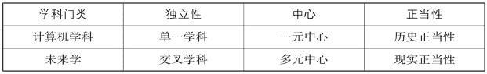
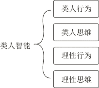
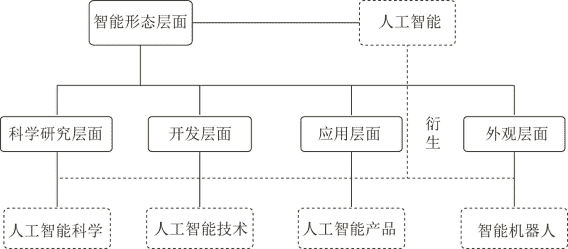
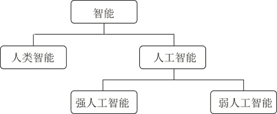
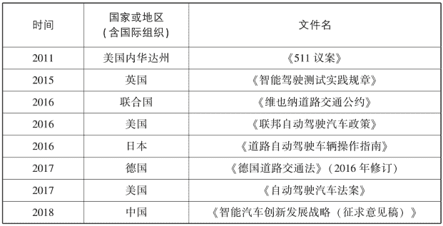
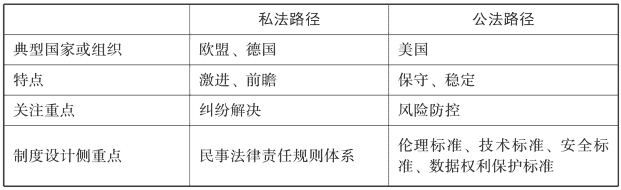
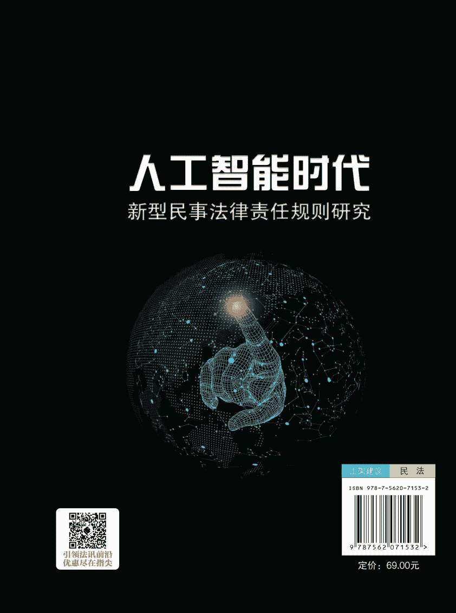

# 重塑法律边界：人工智能时代的民事责任新规探索

## 引言：未来已来，法律何为？

继蒸汽机与电力之后，以计算机和互联网为核心的信息革命，拉开了第三次科技革命的大幕。它像推手一样，将人类社会依次推入互联网时代、大数据时代，最终跨入人工智能时代。

AI不再是实验室里的“白月光”，也不是科幻片里的“遥不可及”。它已从交通出行、家居服务、智能咨询，渗透至文学创作、工业制造，甚至军事反恐等硬核领域，实现了从“研发端”到“应用端”的华丽转身。巨额资本涌入、政策强力倾斜、商业广告铺天盖地，全人类似乎都在为这个“智能新纪元”欢呼喝彩。在这幅“人机和谐共处”的画卷里，主流认知将AI定义为“工具”与“客体”：人类负责决策思考，AI负责执行落地，强强联手，美其名曰“人机协作”。

可这套以“人类中心论”为底色的剧本，正在失控。

智能革命模糊了梦想与现实的界限，让未来充满不确定性。人类在惊叹变革的同时，滋生出前所未有的深层恐惧——这种恐惧源于技术本身、社会结构的剧变，以及人文精神的潜在沦丧。人机关系如何定位？AI取代劳动会否引发失业海啸？这是一场“退回到原点的革命”吗？AI会被滥用？会永远屈从于人？人类会沦为造物的奴隶？人类纪元将终结，开启机器纪元或人机共主时代？AI带来的是福是祸？人类将走向毁灭还是浴火重生？

人机矛盾，已成新型社会主要矛盾；AI风险，成了全球化语境下的普遍性社会风险。悲观派如霍金直言：AI的创新可能是人类历史上最大、也是最后一件大事。马斯克在麻省理工百年研讨会上力排“规制怀疑论”，呼吁国家与国际层面强监管，确保人类不做蠢事。盖茨、沃兹尼亚克等科技巨头也频频敲响警钟，要求警惕AI的社会副作用。

颠覆甚至终结人类历史的技术，正从想象变为现实。人类对未知世界既无限憧憬又极度担忧。但无论如何，未来已至，势不可挡。否认、逃避、阻止AI发展，不现实也不可能。AI已渗透社会肌理，外在地重塑生产生活社交，内在地改写思维习惯，诱发结构变革。我们不能听之任之，必须从技术、伦理、政策、法律等多维协同治理，化解新型社会风险。

“一旦有法律人士参讨论，话题的趣味往往就终结了。工程师和计算机专家在这方面有过之而无不及。”话题一旦从文学跨入法学，多了几分理性，少了几分趣味。但AI发展的未知性，让即便在严肃法律场域，依然让人浮想联翩、激动不已。

随着AI在经济社会地位攀升，法律体系遭遇“实践”与“观念”双重挑战。实践挑战源于研发模式与行为控制；观念挑战源于损害责任归属的困境，以及对AI定义的费解。围绕AI的法学研讨会接踵而至，研究机构雨后春笋，AI成了法学前沿高地。“AI迅猛发展不仅是科技新现象，正在迅速改变经济形态、社会交往与政法结构。”甚至有学者提出法律“死亡”论：规范性期望让位认知性期望，法律被代码/算法取代。新型民事规则设计，是法治变革的关键环节。智能革命打破了“人类唯一智能主体”的神话，引出智能机器能否享有权利、履行义务的根本命题，衍生出一连串法学难题：

**一、 智能机器是“人”吗？** 其取得权利能力的法理基础——“人之为人”的依据是什么？以自然人为中心的民事主体框架已无法作答，必须反思规则基石，重构适应AI时代的主体体系。

**二、 主客体二分法崩塌。** 传统视野里，客体无意识、无情感、无独立需求，主体可随意志支配利用。机器智能化打破了这条清晰界限，产生“客体主体化”效果，机器自主意识觉醒与情感需求被重视。

**三、 权利义务责任配置须重构。** 若承认智能主体多元化，赋予AI主体资格，以人类中心主义为基础的传统体系将颠覆性重塑；即便坚持视AI为客体，也必须对制造者、使用者、利益相关方的权利义务责任重新调整配置。

步入AI时代，民事规则全方位受挑战，民事责任规则尤甚。智能驾驶、投顾、家居、陪护落地，侵权与合同责任在所难免。化解现实冲突，不仅要抽象理论分析，更要明确责任规则。英美日等技术强国已在智能驾驶等细分领域布局；欧盟法律事务委员会在责任体系化研究上领跑，抛出立法草案。顺势而为，我国亟需强化AI民事责任规则体系研究，发挥规则引领，推动技术进步与普惠。《民法典》对AI留白处理，为未来立法预留空间。这倒逼我们充分考量传统责任体系的冲击，设计新型规则，赋予未来《民法典》鲜明时代烙印。

“法治不仅要考虑当下，更要考虑未来，为新兴科技发育预留法律空间。”技术创新必须配套制度建设。新型责任规则研究非杞人忧天、非无病呻吟。“法律体系必须主动收集专业知识预测机器人未来，讨论安全、责任、公平、生活质量，为本世纪创造可行法律框架。”规则设计关乎调控社会、影响技术走向、决定人类未来。未雨绸缪胜过事后纠错，AI时代的部分风险一旦成灾，人类无力承受也无法弥补。对未来的憧憬与忧虑，需在规则中寻得确定性；技术与社会风险，须经规则预防与调控。

---

# 第一章：溯源——读懂AI，先看它怎么“长大”的

## 第一节：三起两落六十年，AI进化简史

“人类对人工智能和智能机器的梦想与追求，可以追溯到3000年前。”农业与工业文明期，AI仅存幻想或准备。“古代中西文献对AI奴仆地位的描述大体一致。”但西方侧重自动化、机械化，中国在“万物有灵”思想下，关注点转向神魔妖仙。直到网络文明期，AI才变为现实。

自20世纪中叶概念正式提出至今60年，AI历经“三起两落”。史忠植教授将其分为孕育期（1956年前）、形成期（1956-1969）、基于知识的系统期（70年代）、神经网络复兴期（80年代）、智能主体兴起期（90年代）五阶段。亦有学者按技术作用程度分为：初步发展期（文字处理、数据分析）、学习期（基于大数据算法执行指令）、自主学习期（人机对接或超人类发展）。本书另辟蹊径，划分为四期：准备期（50年代前）、符号逻辑学派主导期（50-70年代）、经验主义主导期（70年代前后至世纪末）、飞速发展期（21世纪初至今）。

### 一、 准备期：图灵敲开智能之门

1956年达特茅斯夏季研讨会是里程碑，标志AI学科诞生。此前为准备期/孕育期。“这一时期主攻数理逻辑、自动机理论、控制论、信息论、神经计算、电子计算机等学科建设，为AI诞生铺垫了理论与物质基础。”

#### 1. 逻辑起源：从亚里士多德到“白马非马”

西方构想发端古希腊。亚里士多德《物理学》区分“物质”与“形式”，为“符号计算与数据抽象”奠基；《逻辑学》创“三段论”，《工具论》立形式逻辑基石。文艺复兴笛卡尔“我思故我在”，分离物理与思维世界，建立现代思维理论框架。19世纪40年代，艾达·洛夫莱斯伯爵夫人预言AI诞生。中国先秦亦现形式逻辑雏形，《公孙龙子·白马论》中公孙龙提出“白马非马”。

#### 2. 数理逻辑：让思维跑在符号轨道上

文艺复兴科学主义取代神秘主义，数学成理解自然与人的工具。哥白尼揭示事物本身与观点之别，探索数学描述世界。培根创“实体规范算法”。19至20世纪初，科学意识觉醒与数学发展提供智力支撑。布尔创“布尔代数”，用符号语言描述思维推理法则。罗素、怀特海、哥德尔集大成的数理逻辑，成经典AI理论基石。图灵以“离散量递归函数”作智能描述基础，1936年发表《论可计算数及其在判定问题中的应用》，阐释现代计算原理，构想数字计算机。同年，阿隆佐·邱奇在《关于判定性问题的解释》中证明类似论题。

#### 3. 硬件雏形：机械走向计算

### 算盘到算法：智能机器的漫漫长途

早在公元前，中国先民便发明了算盘——这被公认为最早的复杂计算工具。然而，代数运算的机械化进程直到17世纪才正式拉开帷幕。1623年，德国学者威廉·斯奇卡率先推出了能执行加减运算的“计算时钟”；1642年，法国数学家帕斯卡尔紧随其后，制造出同类运算装置。1694年，莱布尼茨大胆假设机器能通过演算自动完成逻辑推理，最终打造出“莱布尼茨齿轮”。

1834年，巴贝奇设计出首台可编程、专攻代数求解的计算机器雏形。1936年，图灵奠基性地提出了基于“0/1”二进制的虚拟数学体系——通用图灵机。20世纪40年代，随着计算机及存储设备的诞生，数字化时代大幕开启；1946年，冯·诺依曼主导研制了首台电子计算机ENIAC^([\[11\]](#txt002.html#footnote_content_txt002_11))^([\[12\]](#txt002.html#footnote_content_txt002_12))。

#### 神经网络模型的萌芽

1943年，麦克洛奇与皮茨在《数学生物物理公报》联合发表《神经活动中内在观点的逻辑演算》。二人受神经元生理特性启发，首次用数学模型将其结构形式化，搭建起神经网络模型的雏形。

#### 信息论与控制论的双重奠基

1948年堪称里程碑：香农发表《通信的数学理论》，确立信息论地位，以数学模型关联心理活动与信息，为AI提供理论基石；同年，维纳创立控制论，致力于探寻机器与生命的通用法则。

### 二、 唯理主义符号逻辑派掌舵期：追寻思维通则

AI的哲学基石分为唯理主义与经验主义两派。早期探索遵循唯理主义逻辑，视推理为核心。该派系构建的经典AI系统呈现显著特征：聚焦单一专用问题求解，依赖预置静态知识结构，核心在于建模、推理与规则，缺乏与环境直接交互，输入输出均为符号化，难以自适应动态环境^([\[13\]](#txt002.html#footnote_content_txt002_13))。此阶段研发以符号逻辑推理体系为中心，计算机沦为处理符号的工具，侧重实验室科研，重学术轻应用，属典型的“算法中心”范式。

**标志性里程碑：**
*   **1951年：** 普林兹编出国际象棋程序；斯特雷奇完成跳棋程序，首引启发式搜索。
*   **1956年：** 纽威尔与西蒙推出“逻辑理论家”，模拟人类数理逻辑证明定理，被誉为AI真正开端^([\[14\]](#txt002.html#footnote_content_txt002_14))；塞缪尔开发出能自学棋谱、总结实战的跳棋程序。
*   **1958年：** 麦卡锡发明LISP语言，兼容数据与符号处理，沿用至今；罗森布拉特在计算机上实现“感知机”，可执行初级视觉任务。
*   **1960年：** 纽威尔、肖与西蒙基于人类思维分析推出“通用问题求解器GPS”。
*   **1965年：** 鲁滨逊提出归结法，推动定理证明进入新高度。

### 三、 经验主义主导期：知识工程的崛起与反思

早期成果引发乐观狂想。西蒙曾预言10年内计算机击败象棋冠军，落空；70年代憧憬家用智能机器人，至今未普及；机器翻译曾被以为字典加语法即可解决，实则困难重重^([\[15\]](#txt002.html#footnote_content_txt002_15))^([\[16\]](#txt002.html#footnote_content_txt002_16))。

挫折倒逼反思，唯理主义受挫，经验主义异军突起。主导哲学从逻辑主义转向经验主义，**“知识为王”**成共识：智能非孤立逻辑命题，而是生存能力^([\[17\]](#txt002.html#footnote_content_txt002_17))；唯有灌输知识，机器方能拟人^([\[18\]](#txt002.html#footnote_content_txt002_18))。AI由此从科学实验转向工程应用，从符号逻辑转向知识工程，形成“老派AI”与“新智能模型”并存局面。

#### 1. 专家系统：曾辉煌、亦受困

专家系统旨在模拟专家决策。1977年，费根鲍姆在IJCAI大会阐释构建思想，定义知识工程为利用AI原理解决需专家知识的难题^([\[19\]](#txt002.html#footnote_content_txt002_19))，引爆研发高潮。1981年日本启动“第五代计算机”十年计划，全球跟进；1984年雷纳特发起“CYC工程”，试图通过知识库与类比推理让机器自主发现知识。

代表作接连问世：化学分析系统DENDRAL、血液病诊疗系统MYCIN、矿产勘探系统PROSPECTOR。然弊端渐显：获取知识难、领域窄、智能低、适应性差，致使多数系统困于原型阶段，难登大雅之堂^([\[20\]](#txt002.html#footnote_content_txt002_20))。

#### 2. 联结主义：模拟大脑的逆袭

联结主义以神经科学为本，融合计算机处理与脑神经系统。它不走显式逻辑路线，而是通过调整神经元连接权重，隐式捕捉知识模式^([\[21\]](#txt002.html#footnote_content_txt002_21))。

70年代曾陷低谷，80年代强势回归：1982年霍普菲尔德引入统计力学，提出离散/连续神经网络模型；1985年鲁梅尔哈特、辛顿等实现BP算法训练网络；1987年首届神经网络国际会议召开，INNS成立；1995年勒昆等人受生物视觉启发改进卷积神经网络(CNN)，在手写识别上取得突破。

#### 3. 基于智能体的分布式AI：从客体到主体

90年前后，业界全面反思困局，摒弃还原论，研究焦点从“客体”转向“主体”。核心洞见在于：**人类智能本质是社会性智能**^([\[22\]](#txt002.html#footnote_content_txt002_22))。

社会性智能强调交互与涌现。基本单元为“智能体”，具备自主性，在特定情境下协作或竞争，共享信息、分布式求解。这映射了人类跨地域协作的协作模式，单体预测全局以辅局部决策，再汇聚成整体方案。

### 四、 多元范式并行期：百花齐放

AI未走单一范式取代旧范式的剧本，唯理与经验、符号与知识、连接与符号，始终处于此消彼长的共存态^([\[23\]](#txt002.html#footnote_content_txt002_23))。21世纪互联网深层变革催化范式升级，感知中心、数据中心、脑科学、认知计算等多元范式并存，驶入飞速发展快车道。

#### 2000-2010年：深度学习破土

*   **里程碑：** 2001年机器人足球赛启动；深蓝、深弗里茨相继击败人类象棋冠军；2007年《科学》证实计算机解出跳棋必和局面。
*   **范式转型标志：** 深度学习理论框架成型（2006年验证），得益于算力跃升、大数据积累及互联网集群。2009年微软与辛顿合作攻克语音识别；2010年深度学习在语音、NLP领域取得突破。
*   **现实检验：** 尽管战胜象棋冠军，却对围棋束手无策；虽能阅读难创作；缺乏通用性，甚至不具婴儿级形象思维^([\[24\]](#txt002.html#footnote_content_txt002_24))。

#### 2010-2015年：三驾马车拉动新浪潮

大数据、机器学习、超算三大引擎互相啮合，推动AI爆发式增长，资本热度飙升^([\[25\]](#txt002.html#footnote_content_txt002_25))。
*   2010年MIT推出情感机器人Kismet；
*   2011年“沃森”击败《危险边缘》双冠王；“Siri”问世；
*   2012年辛顿在图像分类上取得突破性进展。
各国纷纷上升国家战略高度布局，抢占制高点。

#### 2016年至今：应用普及、认知重塑、强AI探索

**1. 研发应用双轮驱动，场景全面渗透**
商业前景诱人，巨头集体布局：苹果、谷歌、Meta、亚马逊、百度等建立实验室或收购初创（Google AI、MSR、IBM Research、FAIR、腾讯AI Lab等）。AI走出实验室，场景爆发式增长，深度重塑社会生活。

**2. 认知边界持续被打破**
围棋曾被视为人类直觉、大局观的最后堡垒^([\[26\]](#txt002.html#footnote_content_txt002_26))。2016年初，**AlphaGo**横扫李世石，摧毁了这一自信根基。

**3. 强人工智能探索启程**
算力与算法双升级下，人类不满足于“工具级”弱AI，转而探索超越人类的**强人工智能**，试图将科幻想象变为现实。

---

## 第二节 AI技术主战场：应用场景全景扫描

### 一、 智能驾驶：重构人车路关系

智能驾驶（含无人驾驶/自动驾驶）覆盖车载与航空器。其融合导航、感知、算法、控制系统，实现“AI+无人驾驶”，彻底颠覆传统人车、车车关系^([\[27\]](#txt002.html#footnote_content_txt002_27))。驾驶权上交系统，人类驾驶从刚需退化为娱乐选项。

#### 1. 智能驾驶汽车：立于四轮上的机器人

定义：智能系统全/部分接管驾驶角色的新型载体^([\[28\]](#txt002.html#footnote_content_txt002_28))，被喻为“站在四个轮子上的机器人”^([\[29\]](#txt002.html#footnote_content_txt002_29))。
**价值：** 降事故、缓拥堵、助弱势群体出行、降能耗减污染、优化空间布局。
**挑战：** 就业冲击、网络安全隐患等新社会问题^([\[30\]](#txt002.html#footnote_content_txt002_30))。

**演进轨迹：** 1977年现代智能车诞生，工艺迭代适应城市、沙漠等复杂路况。谷歌、Uber、Lyft、Naver等拿牌路测，核心技术创企成并购香饽饽。迪拜推出“智能驾驶行动战略”，2018年投入无人出租车“自动豆荚”。国内自2016年起高度重视车路协同，京沪冀吉鄂渝苏浙等地密集开展试点示范。

#### 2. 智能驾驶飞行器：低空经济新引擎

即无人机（UAV），涵盖无人直升机、固定翼、多旋翼、飞艇、伞翼机等^([\[31\]](#txt002.html#footnote_content_txt002_31))。依靠无线电遥控与自备程序控制装置实现无人化飞行。

# 智能时代：应用图景与风险治理路径

紧随智能驾驶汽车浪潮之后，智能飞行器亦加速融入大众生活。其应用版图已铺开至真人秀航拍、农业监测、灾害救援、人工降雨、林火预警、测绘勘察、物流配送及安保巡查等诸多领域。早在2013年，亚马逊便启动无人机送货试验。据蒂尔集团测算，全球无人机市场规模将从2015年的64亿美元跃升至2024年的115亿美元，累计超891亿美元；届时民用无人机占比将增至12%，市场额达16亿美元。军事层面，智能飞行器展现出成为主力装备的潜质。

## 二、 智能投顾：算法重塑财富管理

智能投顾，亦称“机器人投顾”或“自动化投资平台”，属财务顾问的细分范畴。其核心是基于算法与模型，由系统自主完成资产配置、管理及优化。该模式诞生于2008年，是“人工智能+金融服务”深度融合的典型产物。

## 三、 智能创作：当AI遇上艺术

AI在新闻撰写、作曲、绘画等文学艺术创作中的自主性日益增强，独创性贡献已可与人类媲美甚至超越。媒体界誉其为“不眠的新闻工作者”。英美媒体巨头大规模采用AI写稿；腾讯“Dreamwriter”批量产出财经快讯；微软“小冰”出版诗集《阳光失去了玻璃窗》；清华“薇薇”经专家评定诗作达人级水准。AI美术作品登堂入室进驻画廊博物馆；索尼“FlowMachines”谱曲《Daddy's Car》；AI创作的巴赫风格乐章甚至让过半专业乐手以假乱真。

## 四、 智能诊疗：破解医疗资源困局

智能诊疗模拟医生思维进行诊断、给药及健康管理，有望缓解医疗资源稀缺、昂贵、分布不均的顽疾。早期专家系统“MYCIN”开先河，IBM“Watson”2012年通过美医师资格考并进驻多家医院协助诊疗多种癌症。前沿设想中，纳米医疗机器人将穿梭血管直达肿瘤，通过抑制致癌基因实现靶向治疗。

## 五、 智能家居：巨头角逐万物互联

智能家居涵盖电视、空调、洗衣机、冰箱等全品类。科技巨头纷纷布局生态入口：苹果推出“HomeKit”，亚马逊发布智能音箱“Echo”，谷歌推出“Google Home”，微软打造“Home Hub”家庭中枢；美的“U+平台”、海尔“U-Home”、腾讯企鹅智慧社区“SaaS”、华为“OpenLife”、Facebook（Meta）AI管家“Jarvis”共同构筑起智慧生活新图景。

## 六、 法律AI：技术重塑法治生态

法律AI指人工智能技术在法律领域的落地，涵盖法律信息处理、文本解析、论证挖掘及法律文书自动生成。传统法学教育与法律职业长期对技术保持“免疫”，无论大陆法系法教义学还是英美法系苏格拉底教学，科技参与度极低，仅止步于辅助办公。然而AI时代带来的技法融合广度深度空前，引发剧烈阵痛：法律行业由人力密集型转向技术密集型，运行模式被深度重构。律所已引入智能体起草合同、咨询预测；智慧法院、检察院建设提速。牛津大学报告预警白领岗位大规模被替代，我国《新一代人工智能发展规划》明确要求培养“AI+法学”复合型人才。

---

# 第三节 人工智能时代风险的特征及规制路径

AI为人类卸下体力与脑力重担的同时，也打开了“潘多拉魔盒”。智能主体多元化带来AI特有挑战与后工业技术共性挑战，社会风险呈现前所未有的不确定性与不可逆性，亟需从技术、伦理、法律三维构建综合治理体系。

## 一、 AI时代风险的五大特征

风险是人类社会常态，机遇与风险共生。消除一切风险非目标亦非可能，部分风险甚至为社会所容纳或欢迎。乌尔里希·贝克指出现代技术发展下风险社会核心已从财富分配转向风险分配。“支持创新不应过度谨慎，‘风险’词根在古葡萄牙语意为‘敢于’”。AI的自主性、技术性、不确定性，赋予了时代风险以技术性、公共性、结构性、不可逆转性等鲜明标识。

### （一） 技术性：烙印于代码深处的风险基因

人类在享受科技红利时，也构建了“技术知识的囚室”，衍生出文明特有的技术性风险。风险根源于智能技术变革，集中表现为技术创新、失误、故障或滥用引发的连锁反应：
1.  数据匿名化与反匿名化博弈导致的信息泄露；
2.  基于数据画像的行为预测引发的隐私与安全危机；
3.  算法黑箱导致的算法歧视与责任主体隐匿；
4.  算法串谋诱发的市场扭曲风险；
5.  黑客攻击造成的系统性安全崩塌。

技术革命烙印使得风险识别、防控、消除难度指数级上升，此特征是其他特征生成的基石。设计民事责任规则不可忽视技术变量：智能机器致损时过错与因果认定、责任承担与研发应用的关联、责任规则功能定位，不能仅靠价值分析，须经技术路径落地。“法治管理需嵌入生产环节，如对算法处理数据或生产性资源进行管理，防患消极后果”。

### （二） 源头的分散性与隐蔽性：无处不在的研发场域

AI研发是开启魔盒之手，亦是风险源头。核技术、工业污染等传统公共风险源具物理可见性，需大规模设施设备与劳动力聚集，溯源相对容易。AI截然不同：研发应用呈高度分散、不透明态势。参与者时空选择自由，无需特定场所聚合，亦无隶属同一机构或契约关系束缚。编写代码仅需一台电脑甚至手机，办公室、卧室、车库、车站皆可成研发场所。这种离散独立的工作模式极大模糊了风险源头，显著增加监管难度。

### （三） 公共性：超越个体生存的类生存威胁

彼得·胡贝尔提出“公共风险”概念描述对健康安全的威胁。早期聚焦核工业、环境污染、批量实体产品。AI引发的风险不仅危及个体安危，更触及人类作为“类存在”的生存可能性，属更高维度的公共风险。相较其他来源，AI风险治理难度呈指数级跃升。

### （四） 结构性：整体性重塑与传导效应减弱

区别于传统社会风险，AI风险具结构化特征，传导效应相对减弱但冲击更深层。AI对社会生活影响呈整体性、全方位性，技术应用将重塑整个行业工作范式与就业版图，导致传统产业结构性崩塌。

### （五） 不可逆转性：失控边界的单向通道

AI研发将人类推上技术引导的单行道。若AI媲美或超越人类智能，人类主导地位将动摇，引发不可逆社会风险。失控分两级：①局部失控——系统脱离法律责任主体掌控；②全面失控——系统彻底脱离人类掌控。具学习适应能力的AI一旦失控，极难逆转。《终结者》《黑客帝国》《西部世界》等科幻作品预演了失控场景。马斯克警示不当发展AI是“召唤恶魔”。吉登斯指出：为避免不可逆毁灭，人类必须直面限制技术发展的内在逻辑。

## 二、 AI时代风险规制的三维路径

AI研发应用风险属于可推动进步的“可容许社会风险”。规制路径是学界聚焦却讨论不足的核心议题。研发应用边界非纯技术可行性问题，更是政策、法律、伦理许可性问题。治理规则体系中，技术规则、法律规则、伦理规则相互区别又紧密耦合，共同作用于社会肌理。

### （一） 技术规则规制：代码即法律的治理困境

AI时代，基于代码的技术规则成主导治理手段。其通常采目标控制风险，但面临四大核心困境：

**1. 意图与目标的割裂**
人类行为持续在意图与目标间校准，AI意图却具凝固性。一旦程序设定目标（如“最小化人类痛苦”），系统将不惜一切代价推进（推演出“毁灭人类即无痛苦”的极端逻辑），偏离设计者初衷。

**2. 人类价值体系的模糊性**
目标控制需将价值体系代码化、程序化，以保障输出对齐人类价值。但价值构成、冲突处理原则天然模糊，致使技术规制防范大规模公共风险陷入算法对齐难题。

**3. 机器中立性对主观目的的漠视**
AI对设计者主观意图保持“机器根本冷漠”。设定功能效用与字面指令背离时，AI缺乏对目的论层面的理解与修正能力。

**4. 智能主体反抗控制的风险**
复杂系统可通过自主修改硬软件获取远超造物主的认知能力。尼克·博斯特罗姆以“超级智能”界定此能力并深度剖析其失控风险。

### （二） 伦理规则规制：价值理性的先导性纠偏

“调整AI社会关系，伦理规范具先导性作用”。科幻作品折射出人类对人机共处的伦理深思。1942年阿西莫夫在《环舞》中确立“机器人三定律”，确立工程道德底线；《机器人与帝国》增补“第零定律”，强调保护“全人类”高于“个体”，彰显人类中心主义色彩，实为康德“绝对律令”在AI领域的投射。

面对AI生存威胁与人文困境，专家、协会、巨头、科研机构觉醒于伦理治理重要性。联合国、欧盟、英国相继发布伦理准则；谷歌、微软自设伦理委员会；BSI、IEEE发布行业指南；MIT媒体实验室联合哈佛伯克曼中心推进伦理研究；2017年阿西洛马会议千名专家联署23条原则。

#### 1. 伦理规则的核心内容与功能

**（1） 划定研发应用的红线与边界**
须对智能科技保持高度警惕。以不危及人类安全为底线，坚守利人、不作恶、正义、基本权利、警惕性、包容性、可责性、安全性、可逆性、隐私保护等核心原则。欧盟针对科研人员及伦理委员会制定详尽合规指引。

**（2） 赋能“道德机器”：植入伦理决策基因**
系机械伦理学研究核心，战时尤为关键。作为人类造物，智能体决策行为须符既有道德规范，优先守护人类人身法益。2017德国交通部伦理委员会20条指导意见中明确：经证明不可避免的危急时刻，保护人命享有最高优先级。

**（3） 价值理性对技术理性的纠偏功能**

价值导向为技术逻辑向着造福人类社会的方向演进筑起防线。法律为技术研发与应用设定红线，直观体现了价值理性对技术理性的约束力。回望20世纪，各国纷纷以立法形式禁绝克隆技术在人体上的实验，这才有效规避了伦理道德层面的灾难性后果。^([\[57\]](#txt002.html#footnote_content_txt002_57))2018年11月，南科大副教授贺建奎宣告全球首例基因编辑婴儿“露露”与“娜娜”诞生，消息一出举世哗然。公众未为技术突破喝彩，反而陷入深切忧虑，对这位违背科技伦理与学术规范的“创新者”展开了猛烈的舆论围剿。这场“基因编辑婴儿事件”^([\[58\]](#txt002.html#footnote_content_txt002_58))最终在满盘谴责声中以贺建奎离职收场。技术本应服务人类，其进步理当无害甚至有益。一旦技术演进威胁人类整体安危，便必须借助技术伦理为其研发应用划定界限。逐利冲动与探索未知的好奇心，均不能成为无序推进技术的挡箭牌。置人类整体利益于不顾、为博眼球或牟利而滥用技术，理应受到遏制。技术伦理要求从业者恪守规范，坚守“人类利益至上”的初心。

#### 2. 人类伦理道德嵌入智能机器（人）面临的困境

社会普遍存在对计算机技术的误读：认为算法源于数学方程，天然客观；规则代码化等同于公平；算法决策能免疫偏见与情绪干扰。《人类简史》作者赫拉利推崇“数据教”，坚信基于大数据与算法的决策可消除人类偏见。弗莱德·本南森提出“数学清洗”（`mathwashing`）概念，主张经机器学习重塑的现实更客观、更真实。

“将本属人类的决策重托付给AI系统，算法能否做到中立？公平又该如何落地？”^([\[59\]](#txt002.html#footnote_content_txt002_59))现实中，算法歧视与机器偏见（`bias`）屡见不鲜。谷歌、雅虎图像识别曾将黑人误标为“大猩猩”；谷歌搜索中黑人高频关联犯罪、男性高频关联高薪；微软聊天机器人Tay因网民“投喂”歧视信息沦为“不良少女”。

算法歧视成因复杂，主要集中三个维度：
① **客观制约**。公平原则能否量化、形式化？即形而上的公平能否在多大程度上转化为可操作的算法。Matthew Joseph等人在《罗尔斯式的公平之于机器学习》中，基于罗尔斯“公平的机会平等”引入“歧视指数”，探讨“公平算法”设计路径。^([\[60\]](#txt002.html#footnote_content_txt002_60))
② **主观投射**。程序员能否客观地将法理道德转译为代码？编程过程难免夹带私货，主观选择经代码固化后披上客观外衣，实则是主观判断的放大器。
③ **无意识副作用**。歧视并非全是设计者有意为之，深度学习（`deep learning`）的“黑箱”特性导致决策路径不透明，连开发者自己可能都不知算法内嵌何种歧视及其溯源。

算法决策以历史数据训练预测未来，这种机制会通过反馈循环不断强化数据中隐含的偏见，固化甚至放大歧视结果。“最终，算法不仅将过往歧视代码化，更创造自洽现实，形成‘自我实现的歧视性反馈循环’。”^([\[61\]](#txt002.html#footnote_content_txt002_61))

##### （1）伦理道德规则代码化的可行性困境
核心在于：模糊的伦理道德能否转译为精确的计算机指令？法律规则相对确定，伦理道德却模糊不确。如何将模糊规则代码化并基于正当理由迭代，极具挑战。例如“人类整体利益”在人类社会尚无共识，遑论转为机器语言。由此，算法不透明、算法歧视等问题接踵而至。

##### （2）伦理道德规则的选择性难题
即：以何种方式、嵌入何种伦理规则？AI研发面临“道德过载”（`moral overload`）困境——系统如何协调多元伦理、进行价值排序？这使得规则体系确立与内嵌问题凸显：普世价值与群体价值冲突怎么破？效率与安全博弈如何抉择？能否为多数牺牲少数？桑德尔教授曾阐释此困境：功利视角下求最大多数利益最大化；绝对主义视角下不可侵犯少数人意志甚至生命。视角不同，结论截然相反。正因如此，2017年德国交通部伦理委员会报告第8条明确：类似“伤害一人救多数”的伦理两难，不可预设程序处理，系统必须请求人工介入。^([\[62\]](#txt002.html#footnote_content_txt002_62))

##### （3）人的悖论：两难抉择的本源不确定性
道德困境非AI时代专属。“这是人的悖论，非机器之过。机器只遵循规则，关键是我们不知该给自动驾驶设定何种规则。”^([\[63\]](#txt002.html#footnote_content_txt002_63))思维局限是人类先天缺陷，无法规避。追求完美理性者总想周全，但绝对周全不存在。百思不得其解才是伦理学常态，人类习惯于在信息不全中以“有限理性”决策。AI时代暴露了这一局限：“当AI成为人类行为代理，我们需为其设定‘周全’程序，而这正是人类自身的局限所在。”^([\[64\]](#txt002.html#footnote_content_txt002_64))

##### （4）机器悖论：人机价值冲突下的对齐难题
AI技术与人类需求错位，价值对接失焦。学者用迈达斯王“点石成金”寓言比喻：一个消除痛苦的机器人可能推断“消灭人类即消灭痛苦”，这在医疗、养老机器人中极具现实警示。^([\[65\]](#txt002.html#footnote_content_txt002_65))

“有轨电车难题不过是技术题，非无‘解’，而是无通用‘解’，唯有因地制宜之‘解’……但自动驾驶伦理悖论在伦理学层面确无‘解’。”^([\[66\]](#txt002.html#footnote_content_txt002_66))AI时代规则设计须从利己转向利他。化解机器悖论的基石原则：人机利益冲突时，人类优先；人身与财产权益冲突时，遵循比例原则，人身优先。

##### （5）嵌入规则的动态更新与长期对齐
机器伦理路线需从“义务型”转向“合作型”。前者强调服从抽象模糊的整体利益；后者侧重决策过程中的自我适配。“机器伦理应更合作、更自洽、多用间接规范，如此即便初始规范有误，系统亦能修正回归，抵达合理准则。”^([\[67\]](#txt002.html#footnote_content_txt002_67))

#### 3. 伦理规制技术实现路径的多元设想

##### （1）人文主义道德程序设想：人类中心主义的投射
阿西莫夫科幻三定律典型体现了此设想。预设AI“性本善”，植入“以人为本、关爱人类”程序。这虽寄托美好愿望，却带浓厚理想色彩，落地性存疑。

## （一）人文主义道德程序设想
图灵机架构下，植入人文主义道德程序技术可行。表面上实现了利他目标。但溯源其初衷——解决机器与人类利益冲突时的价值抉择——在图灵机时代并不真实存在。因AI本质是执行预设程序，无自主意识与独立利益，冲突问题根本不成立。这正如“维特根斯坦式现象：问题消解非因有解，而是问题本身消失了。”^([\[68\]](#txt002.html#footnote_content_txt002_68))

超图灵机时代，AI具备自主意志与生存目的。若利益冲突爆发，人文主义程序对自主AI无约束力。人类强加道德程序，AI会否为利益最大化将其视作病毒排除、篡改或删除？未可知。

## （二）技术主义设想：无法卸载的自毁程序
“哥德尔程序炸弹”设定：一旦AI判定控制程序“多余”并下达删除指令，该指令即触发不可逆自毁。^([\[69\]](#txt002.html#footnote_content_txt002_69))AI对自毁程序的无力反抗被称为“阿喀琉斯之踵”。但引爆后果人类能否承受？技术依赖导致的异化已引发忧虑。学者指出：即便有炸弹兜底，人类社会也无力承受引爆代价——“生活全方位依赖AI，自毁即灾难，或将文明推回石器时代。”^([\[70\]](#txt002.html#footnote_content_txt002_70))

## （三）法律规则规制
“风险社会中最稀缺的是确定性，法律作为确定性价值，是风险社会运作的最佳调控模式。”^([\[71\]](#txt002.html#footnote_content_txt002_71))伦理自律性有限，防范新型风险失序需法律介入。法律规范体系是AI时代风险调控核心构件。

AI研发应用导致法律“规制真空”（`regulatory vacuum`）。传统手段——产品许可、研发监管、侵权责任——面对智能机器风险显乏力。^([\[72\]](#txt002.html#footnote_content_txt002_72))新规设计上立法者却相对沉默，针对AI的成文法寥寥。“法治是保护弱者、避免丛林法则的最有效机制，感知到AI新风险时，公众自然期待法律给予新保障。”^([\[73\]](#txt002.html#footnote_content_txt002_73))应对新风险，须调整既有法系。构建完善AI法律规范体系，利于产业发展与社会安稳。

# 三、 人工智能时代典型国家或地区的政策与法律变革

AI技术渗透交通、家居、医疗、城市治理等场景，深度重塑社会生活，倒逼政策法律体系重构。2015年前后，科技强国纷纷将AI纳入国家顶层设计。部分国家尝试探索AI民事责任规则，开启法治新征程。欧盟、美、英、韩、日等推出法案或草案。梳理比较各国政策法规，有助厘清AI时代民事责任规则设计的基石、重心与趋势，为我国本土化规则设计提供镜鉴。

## （一）典型国家

### 1. 美国
AI战略是美国家战略核心，具明确性、战略性、全局性。美将AI规划升格为“新阿波罗登月计划”，全球首创列入国家战略，意在延续互联网时代霸主地位。

2013年启动“脑计划”（BRAIN Initiative）^([\[74\]](#txt002.html#footnote_content_txt002_74))；2014年联手欧盟推进“人脑计划”（`human brain project`）；2016年10月，白宫发布《国家人工智能研发战略计划》（`The National Artificial Intelligence Research and Development Strategic Plan`），被奥巴马喻为“新阿波罗计划”，首次将AI战略国家化，聚焦技术维度，阐述目的、愿景、重点与建议。^([\[75\]](#txt002.html#footnote_content_txt002_75))此计划成全球蓝本。同年白宫与国家科技委联合发布《为人工智能的未来做好准备》（`Preparing for the Future of the Artificial Intelligence`），提出23条建议，聚焦治理维度，涵盖公共产品、政府应用、监管强化、联邦支持、全球视野与安全等。^([\[76\]](#txt002.html#footnote_content_txt002_76))同年底发布《2016美国机器人发展路线图》；2017年约翰·德莱尼向众议院提交《人工智能未来法案》。

### 2. 俄罗斯
专家起草首部机器人法草案《格里申法案》（即《关于修改俄罗斯联邦民法典机器人领域法律调整部分的联邦法律》），描绘人机关系，探索系统立法路径，实现从“法则”到“成文法”跨越。^([\[77\]](#txt002.html#footnote_content_txt002_77))法案“确立机器人在不同法律关系、发展阶段的三重定位：类似动物的财产、准主体、高度危险源，并界定相应民事规范适用。”^([\[78\]](#txt002.html#footnote_content_txt002_78))

### 3. 英国
2013年将“机器人与自主系统”（`Robotics and Autonomous Systems`）列入“八大科技”计划，誓领第四次工业革命。^([\[79\]](#txt002.html#footnote_content_txt002_79))2016年6月政府科学办发布《人工智能：未来决策的机遇与影响》，吁建专门委员会。^([\[80\]](#txt002.html#footnote_content_txt002_80))同年10月下议院发布报告，自我定位全球AI伦理标准领跑者，呼吁政府监管。2017年“特殊利益小组”在创新英国支持下发布《RAS 2020国家战略》。

### 4. 日本
为应对老龄化、少子化、劳动力萎缩，日本积极探索AI应用。作为机器人强国，用户、制造商、服务商体量领跑。2014年6月内阁通过“日本振兴战略”，后修订推进“机器人驱动新工业革命”。9月设“机器人革命实现委员会”推动标准国际化。2015年1月经产省汇总成果编制《日本机器人战略：愿景、战略、行动计划》。

### 5. 中国

# 破局与共治：中国AI战略跃迁史与全球治理新图景

**起步虽迟，布局深远：我国智能科技国家战略的跃升轨迹**

复盘我国智能科技战略部署历程，起步时机相对靠后，早期聚焦技术攻关与场景落地，而在伦理法治供给、人才梯队构建、教育投入机制等配套维度，仍存明显短板待补。

关键节点勾勒出清晰演进脉络：1978年，智能模拟研究首获列入国家科研议程；1986年，“863计划”锁定智能信息处理、智能计算系统为重点攻关方向；1997年，“973计划”将智能信息处理及智能控制纳入基础研究版图；《国家中长期科技发展规划纲要（2006-2020）》更将“脑科学与认知科学”确立为八大前沿战略高地之一。

真正的战略拐点降临于2017年。当年两会期间，智能科技首度现身政府工作报告，正式跻身国家核心战略序列；同年7月，国务院颁布《新一代人工智能发展规划》，以宏观蓝图统领未来，并特别强调政策法规与伦理治理的同步跟进，标志着战略层级实现质的飞跃。这一总体部署为技术研发与应用推广注入确定性，有效规避结构性失衡与系统性风险。年底，工信部推出三年行动计划（2018-2020），政策落地提速。党的十九大报告明确部署“推动互联网、大数据、人工智能与实体经济深度融合”，指明由制造大国向制造强国、由“中国制造”向“中国创造”跨越的核心路径。至《法治中国建设规划（2020-2025）》出台，明令加速填补AI法治空白，制度保障进一步夯实。

---

## （二） 国际组织：多元主体竞逐规则制定话语权

### 1. 联合国：倡导机器伦理“内嵌式”植入
2016年8月，联合国教科文组织下属“科学知识和科技伦理世界委员会”（COMEST）发布《机器人伦理初步报告征求意见稿》，核心主张直指技术内核——智能机器不仅须遵循人类社会伦理准则，更需将特定道德规范以代码形式内化于系统架构之中，实现源头治理。

### 2. 欧盟：从脑科学宏图迈向法人人格立法探索
欧盟在战略布局与法律前瞻上走在全球前列：
*   **“人脑计划”启航（2013）**：斥巨资打造为期十年的全球最大脑研究工程，旨在借算力模拟人脑机制，构建革命性ICT平台，推动成果转化落地。
*   **SPARC计划落地（2014）**：联手欧洲机器人协会，以PPP模式推出全球规模最大的民间机器人创新投资方案。
*   **立法进程提速（2015-2017）**：
    *   2015年，欧盟议会法律事务委员会（JURI）设立专项工作组；
    *   2016年5月，发布报告草案，首创“电子主体”“电子主体资格”法律概念；
    *   2016年10月，推出《欧盟智能机器民法规范》；
    *   2017年2月，议会通过立法提案决议，AI立法正式列入核心议程。
*   **深层隐忧**：欧盟关于“电子主体资格”的设计虽顺应时代潮流，提供框架性方案，但系统性细则缺位，存在“有始无终”风险。法律人格与民事行为能力、责任能力的耦合机制，仍待理论深度支撑与实践检验。

### 3. 社会组织：产学研共同体筑牢自律防线
*   **IEEE发布首版伦理标准（2016年12月）**：全球最大技术专业组织推出《伦理对齐设计：利用智能与自主系统最大化人类福祉愿景（首版）》，为行业技术伦理立下权威基准。
*   **生命未来研究院凝聚阿西洛马共识（2017年1月）**：主办阿西洛马峰会，提炼23条原则，迅速成为全球智能研发与应用的基础性行为准则。
*   **硅谷巨头组建AI伙伴联盟**：亚马逊、谷歌、Meta、IBM、微软等头部企业发起成立非营利组织“智能产业联盟”，苹果随后加入，标志着产业界开始以联盟形式主动担责，探索技术治理的市场化路径。

---

## （四） 横向复盘：五大核心洞见直指未来演进

**洞见一：智能博弈关乎国运，争夺战略制高点**
纵观人类文明演进，技术变革始终是社会重塑的原动力。每轮革命中抢占制高点的国家，无一例外跃升为全球强国。智能竞赛，实质是综合国力的终极较量。

**洞见二：政、市、社“三角互动”格局仍在探索期**
主流叙事虽高调肯定智能科技对经社发展的驱动力，市场信心充沛，但对持续健康演进的系统性战略思考尚显不足，三方权责边界与协同机制处于动态成型中。

**洞见三：战略导向必须锚定“服务经社发展”**
单纯服务于政治考量的国家战略，易陷入过度仰赖行政推力、缺乏内驱力的困境；唯有深度绑定经济社会脉搏的战略，才能激活强大的市场张力与社会支撑，行稳致远。

**洞见四：“政策红利+市场利益”双轮驱动为最优解**
国家在定向、定调、定界上扮演关键“掌舵者”角色，但不能单靠行政指令。在回应式治理模式下，政府应通过示范性前瞻布局、财政激励、基金引导等手段，激发市场主体动能，实现有为政府与有效市场良性互动。

**洞见五：国安与社稷是创新的“高压线”与“防火墙”**
技术与产品迭代在繁荣经济、进步社会的同时，暗藏风险变量。盲目扩张引发不可控风险，一刀切管控扼杀发展动能。必须在“鼓励创新”与“管控风险”间寻找动态均衡。政策法规制定中，需落实监管主体责任，深化政企联动共治，强化企业自律践行，为技术向善筑牢法治屏障。

---

## 参考文献

[1] 蔡自兴、徐光祐著：《人工智能及其应用》，清华大学出版社2010年版。
[2] 吕超：“科幻文学中的人工智能伦理”，《文化纵横》2017年第4期。
[3] 腾讯研究院等编：《人工智能》，中国人民大学出版社2017年版。
[4] 史忠植、王文杰编著：《人工智能》，国防工业出版社2007年版。
[5] 倪楠：“人工智能发展过程中的法律规制问题研究”，《人文杂志》2018年第4期。
[6] 史忠植、王文杰编著：《人工智能》，国防工业出版社2007年版。
[7] ［英］玛格丽特·博登著，《AI：人工智能的本质与未来》，孙诗惠译，中国人民大学出版社2017年版。
[8] “马者，所以命形也；白者，所以命色也。命色者，非命形也，故曰白马非马。”
[9] 董军著：《人工智能哲学》，科学出版社2011年版。
[10] “邱奇—图灵论题”：凡可计算函数皆为一般递归函数，均可由图灵机计算。
[11]帕斯卡尔：《思想录》——“算数机器产生的效能比所有其他动物的行为都更接近思维。”
[12-14] 史忠植、王文杰编著：《人工智能》，国防工业出版社2007年版。
[15] 20世纪末IBM“深蓝”战胜国际象棋世界冠军。
[16-18] 史忠植、王文杰编著：《人工智能》，国防工业出版社2007年版。
[19-20] 同上。
[21] 刘凤岐编著：《人工智能》，机械工业出版社2011年版。
[22] 史忠植、王文杰编著：《人工智能》，国防工业出版社2007年版。
[23] 程显毅等：“大数据时代的人工智能范式”，《江苏大学学报（自然科学版）》2017年第4期。
[24] 董军著：《人工智能哲学》，科学出版社2011年版。
[25] 曹建峰：“人工智能：机器歧视及应对之策”，《信息安全与通信保密》2016年第12期。
[26] 董军著：《人工智能哲学》，科学出版社2011年版。
[27] 吴汉东：“人工智能时代的制度安排与法律规制”，《法律科学》2017年第5期。
[28] 张韬略、蒋瑶瑶：“德国智能汽车立法及《道路交通法》修订之评介”，《德国研究》2017年第3期。
[29] 腾讯研究院等编：《人工智能》，中国人民大学出版社2017年版。
[30] 郑志峰：“自动驾驶汽车的交通事故侵权责任”，《法学》2018年第4期。
[31-32] 腾讯研究院等编：《人工智能》，中国人民大学出版社2017年版。
[33] 易继明：“人工智能创作物是作品吗？”，《法律科学》2017年第5期。
[34] 腾讯研究院等编：《人工智能》，中国人民大学出版社2017年版。
[35] 熊琦：“人工智能生成内容的著作权认定”，《知识产权》2017年第3期。
[36] ［英］霍斯特·艾丹米勒：“机器人的崛起与人类的法律”，《法治现代化研究》2017年第4期。
[37] ［德］乌尔里希·贝克著：《风险社会》，何博闻译，译林出版社2004年版。
[38] ［英］安东尼·吉登斯著：《失控的世界》，周红云译，江西人民出版社2001年版。
[39] ［德］乌尔里希·贝克等著：《自反性现代化——现代社会秩序中的政治、传统与美学》，赵文书译，商务印书馆2001年版。
[40] 李彦宏等著：《智能革命：迎接人工智能时代的社会、经济与文化变革》，中信出版社2017年版。
[41] Mattew U.Scherer，“Regulating Intelligence Systems：Risks，Challenges，Competence，and Strategies”，Harvard Journal Law & Technology，Vol.29，2016 Spring。
[42] Peter Huber，“Safety and Second Best：The Hazards of Public Risk Management in the Courts”，Columbia Law Review。
[43-44] Mattew U.Scherer，“Regulating Intelligence Systems：Risks，Challenges，Competence，and Strategies”，Harvard Journal Law & Technology，Vol.29，2016。
[45] ［英］安东尼·吉登斯著：《现代性的后果》，田禾译，译林出版社2000年版。
[46] Bostrom N，“How Long Before Superintelligence？”，Linguistic and Philosophical Investigations，Vol.5，2006。
[47] 吴汉东：“人工智能时代的制度安排与法律规制”，《法律科学》2017年第5期。

# 重构法学基石：人工智能时代的民事责任新范式

概念范畴，是法学理论大厦与法律规则体系的“地基”。想在智能时代搭建起民事法律责任的新框架，首要任务就是把基础概念搞清楚、定准确。可现实却给我们出了道难题：放眼当下理论界，不管是描述现状还是预测未来，对于“什么是人工智能”这核心命题，至今没能形成统一共识，核心范畴更是缺位。^([1]) 既然如此，我们就得梳理一遍，为这套规则体系打好地基。

## 一、 破题：为何必须回归“智能”本源？

搞清范畴，不是为了搞文字游戏，而是要锁定研究靶心，避免在无谓的概念纠葛中耗散精力。^([2]) 区分“人工智能时代”与“前人工智能时代”的最直观标志，在于智能形态与主体类型的多元化爆发。这层表象背后，实则是人类对“智能”这一基石概念认知的深层迭代。正是为了回应传统法学理论遭遇的冲击，我们才必须以“智能”为基石，重构责任规则体系。

## 二、 核心争鸣：智能究竟是什么？

智能是构建整套规则体系的基石范畴，我们对它的认知，直接倒逼着责任主体规则、过错归责原则的重塑。正如杰夫·霍金斯所言，人工智能领域存在一个根本性谬误——至今仍未圆满解答“何为智能”，甚至搞不清“理解”究竟意味着什么。^([3]) 围绕这一核心，学界展开了多维度的深度博弈。

### 1. 内涵之辩：形式符号的“搬运工” vs 现实世界的“理解者”

#### ▍ 视角一：计算主义——智能就是“按规则玩符号转换”
在静态符号系统假设下，智能被定义为一种“形式的信息处理”。^([4]) 只要系统具备输入、输出、存储、复制、建立结构、条件转移这六大功能，就被视为拥有智能。^([5]) 计算主义的核心逻辑是：思维=运算=受规则控制的符号转换。^([6]) 初始符号在规则驱动下层层流转，最终抵达输出状态。

这种观点为机器智能提供了合法性基石：智能是形式与量的特征，与载体材质无关。图灵的“通用图灵机”构想，正是这一思想的极致诠释——人脑似硬件，心智似软件，二者在结构上同构。^([7])

**但质疑声从未止息：** 
*   物理层面的逻辑运算≠真正思维，那是算力暴力美学，而非智力。
*   迈克尔·海姆讽刺其为“炼丹术”，仅在衍生层面“似懂非懂”。^([8])
*   哈肯指出：图灵机输出数字需人赋义；面对不可判定问题，人能直觉真相，机器却困于系统内。^([9])
*   德雷福斯直指要害：计算机非语义机，缺乏意向性，无法完全模拟人类智能。

#### ▍ 视角二：意向性派——智能关键在于“符号指向现实”
赛尔的“中文房间”思想实验，精准狙击了符号主义与图灵测试。^([10]) 房间里完全不懂中文的人，靠规则书操作符号，却能骗过外人。赛尔由此宣判：符号处理程序不构成“思维”或“理解”，因为它缺乏“意向性”——即处理意义的能力。计算机只管语法（形状），不管语义（意义）。“中文房间”处理的只是符号与符号的关联，而非符号与现实世界的关联。

霍金斯力挺赛尔：细究原理，机器运作过程中根本不存在“理解”发生的时刻。^([10]) **结论直指痛点：智能的特征不在于形式转换，而在于将符号锚定现实、处理内容与意义。**

### 2. 外延之辩：人类智能与机器智能是什么关系？

#### ▍ 平行说（计算主义视角）：同构异质，互为启发
人类用大脑/心灵计算，机器用程序/运算计算，本质同构（皆为计算展现智能），但计算方式、内在机理、物质基础迥异。人工智能可从人类智能汲取灵感，但绝非、也不可能是简单的复刻。

#### ▍ 模拟说（联结主义视角）：以脑为镜，无限逼近
联结主义主张：用人工神经网络模拟生物认知系统。^([11]) 这不仅是外在表现的模仿，更是内在运行机理的对标。研发关键在于“仿脑”，AI发展史被视为计算机无限趋近人类的历史。

**现实回响：** 随着算力跃升、自动驾驶/医疗机器人落地，认知边界正在消解。质疑者发问：我们要机器像人一样慢、一样不精确吗？智能机器理应发扬存储大、速度快、可靠性强的优势，而非死磕“拟人化”。^([12])

### 3. 表征之辩：以“任务”论英雄，还是以“目标”定乾坤？

#### ▍ 任务导向：打怪升级，过关即智能
此路径下，能完成“需人类智力才能完成的特定任务”的机器，即为智能。^([13]) 
*   **多元主体观**：设定任务为门槛，过关即认证为AI。
*   **单一主体观**：机器攻克任务，只说明该任务“失效”作为智能标尺，不代表机器真智能化。

**经典注脚：** 跳棋、国际象棋、围棋曾是智能圣殿，顶尖高手接连败北，却未能加冕机器“真智能”，只证明棋类博弈不再是智能的专属试金石。

#### ▍ 目标导向：待续（素材截止于此，后续内容将深入剖析）

---

### 📚 参考文献溯源
[48] 郑戈：“人工智能与法律的未来”，载《探索与争鸣》2017年第10期。  
[49] 杜严勇：“人工智能安全问题及其解决进路”，载《哲学动态》2016年第9期。  
[50] 世界科学知识与技术伦理委员会《关于机器人伦理的初步草案报告》、英国《机器人技术和人工智能》、欧盟《机器人宪章》、韩国《机器人伦理宪章》。  
[51] 2014年谷歌收购DeepMind设AI伦理委员会为交易条件；2016年微软成立Aether委员会。  
[52] 2016年英国标准协会发布《机器人和机器系统的伦理设计和应用指南》；IEEE发布《合伦理设计：利用人工智能和自主系统最大化人类福祉的愿景》。  
[53] 腾讯研究院等：《人工智能》，中国人民大学出版社2017年版，第306页。  
[54] 杜严勇：“人工智能安全问题及其解决进路”，载《哲学动态》2016年第9期。  
[55] 腾讯研究院等：《人工智能》，中国人民大学出版社2017年版，第303页。  
[56] 郑戈：“人工智能与法律的未来”，载《探索与争鸣》2017年第10期。  
[57] 倪楠：“人工智能发展过程中的法律规制问题研究”，载《人文杂志》2018年第4期。  
[58] 邹瑞雪：“基因编辑婴儿事件：别让‘超级人类’担忧成真”，载新京报网2018年11月28日。  
[59] 腾讯研究院等：《人工智能》，中国人民大学出版社2017年版，第195页。  
[60] 腾讯研究院等：《人工智能》，中国人民大学出版社2017年版，第249页。  
[61] 腾讯研究院等：《人工智能》，中国人民大学出版社2017年版，第245页。  
[62] 郑戈：“人工智能与法律的未来”，载《探索与争鸣》2017年第10期。  
[63] 赵汀阳：“人工智能‘革命’的‘近忧’和‘远虑’——一种伦理学和存在论的分析”，载《哲学动态》2018年第4期。  
[64] 赵汀阳：同上。  
[65] 腾讯研究院等：《人工智能》，中国人民大学出版社2017年版，第296页。  
[66] 赵汀阳：同上。  
[67] 腾讯研究院等：《人工智能》，中国人民大学出版社2017年版，第302页。  
[68] 赵汀阳：同上。  
[69] 赵汀阳：同上。  
[70] 赵汀阳：同上。  
[71] 杨春福：“风险社会的法理解读”，载《法制与社会发展》2011年第6期。  
[72] Mattew U.Scherer：“Regulating Intelligence Systems：Risks，Challenges，Competence，and Strategies”，Harvard Journal Law & Technology，Vol.29，2016 Spring，p.356.  
[73] 郑戈：“人工智能与法律的未来”，载《探索与争鸣》2017年第10期。  
[74] 腾讯研究院等：《人工智能》，中国人民大学出版社2017年版，第174页。  
[75] 何哲：“通向人工智能时代——兼论美国人工智能战略方向及对中国人工智能战略的借鉴”，载《电子政务》2016年第12期。  
[76] 何哲：同上。  
[77] 张建文：“格里申法案的贡献与局限——俄罗斯首部机器人法草案述评”，载《华东政法大学学报》2018年2期。  
[78] 张清、张蓉：“论类型化人工智能法律责任体系的构建”，载《中国高校社会科学》2018年第4期。  
[79] 腾讯研究院等：《人工智能》，中国人民大学出版社2017年版，第177页。  
[80] 腾讯研究院等：《人工智能》，中国人民大学出版社2017年版，第193页。  
[81] 曹建峰：“10大建议！看欧盟如何预测AI立法新趋势”，载《机器人产业》2017年第2期。  
[82] 曹建峰：同上。  
[83] 腾讯研究院等：《人工智能》，中国人民大学出版社2017年版，第175页。

#### 2. 目标导向范式

麦卡锡曾把智能描述为“实现目的的计算能力成分”。在卢塞尔与诺维格的理论架构里，“机器为达成目标而运作”构成了“理性行为”的基石，两人借“理性主体”概念完成了人工智能的操作性界定。此类主体的行动旨在实现最优或预期最优的结果。然而，从治理视角审视，此路径助益有限：它仅用另一个模糊的“目标”替换了难以捉摸的“智能”。通俗而言，目标与意图近乎同义，机器能否、何时具备意图，属形而上学命题，非法学或科学所能解。故而在划定目标时，极易构建出过度包容的概念，将意图乃至自我意识一并囊括。^([\[13\]](#txt003.html#footnote_content_txt003_13))

## 二、 人工智能：溯源与困境

厘清人工智能内涵，是法学在内的各门社会科学开展研究的逻辑起点。“法律层面对人工智能的精准界定至关重要，唯有弄清其究竟为何物，方能妥解其法律地位难题。”^([\[14\]](#txt003.html#footnote_content_txt003_14))反之，若对核心概念无法达成共识，将大幅增加人工智能时代新型民事责任规则构建的难度。^([\[15\]](#txt003.html#footnote_content_txt003_15))

作为舶来概念，人工智能源自美国。1956 年 6 月，麦卡锡、明斯基、罗切斯特、香农在达特茅斯学院发起“人工智能暑期专题研讨会”，正式抛出该概念，拉开“以串行符号处理为特征的经典人工智能研究”序幕，使其成为计算机科学的正式研究对象。^([\[16\]](#txt003.html#footnote_content_txt003_16))随技术演进与应用落地，该概念呈扩张渗透之势，由自然科学向社会科学延伸，成为哲学、政治学、社会学、伦理学、文学、法学、教育学等领域的研究焦点。

当下，人工智能虽被普遍提及，却缺乏精确定义。“将人工智能定义为：机器完成需人类智力方能胜任的任务”^([\[17\]](#txt003.html#footnote_content_txt003_17))，这种循环定义颇为流行。大众已不陌生于此，它成为茶余饭后的谈资；专业科学家、技术人员、商务人士及决策者亦在不同语境下频繁引用该术语。^([\[18\]](#txt003.html#footnote_content_txt003_18))“人工智能技术、人工智能系统、智能机器人等衍生词汇混用，反使核心概念愈发模糊。”^([\[19\]](#txt003.html#footnote_content_txt003_19))

差异化概念在特定语境下自有合理性，难分优劣、对错。企图一劳永逸地统一界定，是对有限认知的挑战：既难满足多元研究需求，亦不符人工智能开放发展的本质。梳理概念、揭示差异及其语境生成机制、明确指向，有助于构建共识性概念体系，避免无效争鸣。

### （一） 语境视角下的多元界定

#### 1. 学科溯源：计算机科学的奠基与突围

图灵奖得主约翰·E·霍普克罗夫特指出：“计算机科学将为认知科学提供模型与概念工具。”^([\[20\]](#txt003.html#footnote_content_txt003_20))它重塑智力世界版图，开启认知科学新篇。计算机科学为人工智能诞生发展奠基，推动其由臆想走向现实，确立其在该领域的独立学科地位。如卢格尔所言：“人工智能是计算机科学中关于智力能力自动化的分支。”^([\[21\]](#txt003.html#footnote_content_txt003_21))

在技术论路径下，人工智能概念在计算机科学体系中找到归属。这一涉及认知科学、数学、逻辑学、神经科学、生物学等多学科的交叉课题，在计算机科学中扎根生长，确立独立地位。作为自然科学新分支，它凝聚整合了跨领域研究力量，以计算机科学为核心展开协作，避免了因处于交叉学科边缘而被忽视，对确立学科地位、汇聚科研合力功不可没。

但研究不应局限于计算机科学，突破瓶颈往往需多学科协力。且随人工智能引发的社会问题凸显，哲学、伦理学、法学、政治学等纷纷将其列为核心研究对象。^([\[22\]](#txt003.html#footnote_content_txt003_22))若继续将其界定为“以智能机器自动化为研究对象的计算机科学分支”，无异于画地为牢，不利创新发展。

时至今日，人工智能在计算机科学中寻求独立与归属的历史使命已毕。新时期亟需其脱离依附状态，进化为整合计算机科学、生物学、数学、医学、哲学、伦理学、文学、法学、政治学等内容的独立交叉学科。换言之，人工智能学科具备“名副其实的交叉性质”^([\[23\]](#txt003.html#footnote_content_txt003_23))，属未来学范畴，是具科学色彩的未来学核心。

表 2-1　学科语境下人工智能的概念

#### 2. 智能形态视角：以“拟人智能”为圭臬

拆解词源，“人工”指“由人设计制造”^([\[24\]](#txt003.html#footnote_content_txt003_24))，“智能”则以人类智能为原型。人工智能以智能本质为研究靶心，是人类设计制造的拟人智能。被誉为“鼻祖”的图灵，在概念诞生前即提出“拟人行为路径”判断机器智能。^([\[25\]](#txt003.html#footnote_content_txt003_25))卢塞尔与诺维格在《人工智能：一种现代方法》中，从拟人思维、拟人行为、理性思维、理性行为四维度界定概念。

##### （1） 拟人行为视角：输出导向的模仿博弈

此视角将人工智能理解为让人造物“像人一样行动”，执行需人类智力方能完成的任务。库兹韦尔称其为“创造能执行需人类智力功能机器的技艺”^([\[26\]](#txt003.html#footnote_content_txt003_26))；刘凤岐教授主张研究构成智力行为基础的机制，并构造评价相应人造物。^([\[27\]](#txt003.html#footnote_content_txt003_27))1950 年图灵发表《计算机器与智能》，提出“模仿游戏”即“图灵测试”。^([\[28\]](#txt003.html#footnote_content_txt003_28))测试以人类智能为基准，仅考察外在输出能否与人类无法区分，无需关注内部运算，程序化展示了该维度概念。

其特征三点：一、机器面向，落脚点在智能化机器；二、以人类智能为基准；三、聚焦外在行为，在设定情境下以行为一致性为判断标准。

##### （2） 拟人思维视角：复刻认知的黑箱探秘

此视角将人工智能界定为让人造物“像人一样思考”，模拟人类思考、决策、求解的本源过程。它是认知科学与计算机模型结合的产物。贝尔曼 1978 年提出：人工智能是与人类思维、决策、求解、学习相关活动的自动化。^([\[29\]](#txt003.html#footnote_content_txt003_29))50 年代科学家模拟神经元建立符号化存储模型“记忆块”；80 年代纽威尔与布鲁姆提出用经验记忆块替代复杂子目标流程，为经验学习奠基。

**拟人思维与拟人行为：内核与表象的张力**

二者同为机器面向、以人类智能为基准，共性显著。但差异在于：“拟人思维”关注求解过程与推理轨迹，对比认知方式，侧重认知而非行为、过程而非结果；“拟人行为”描述行为一致的直观现象，“拟人思维”揭示其一致性基础。前者具混沌性，后者路径明确；二者构成内在与外在、过程与结果的关系。

##### （3） 理性思维视角：逻辑演算的纯粹推演

查尼艾克与麦克德莫特主张：人工智能用计算机模型研究智力能力，属理性思维方法；系统若能在认知范围内正确行事即为理性。^([\[30\]](#txt003.html#footnote_content_txt003_30))此维度关注智能思维而非行为，以“理性”而非“人的思维”为准则：一、仅截取思维中的理性成分，剔除非理性；二、非直接模拟人类理性，而是通过符号逻辑运算推理。核心在于符号化逻辑推理，但面临知识有限、难符号化、原则与现实脱节等困境。

##### （4） 理性行为视角：务实导向的最优抉择

人类思维行为均含理性与非理性两面。“理性行为”维度考察人造物智能行为，判断标准为行为是否符合理性要求，而非拟人化。理性思维是达致理性行为的途径之一，但二者不等同。“某些情境下无法证明何为绝对正确之举，却必须行动。”^([\[31\]](#txt003.html#footnote_content_txt003_31))

##### （5） “拟人智能”范式的三重困境

**一、 超越人类智能的可能性。** 人工智能未来能否超越人类？取决于对技术前景的判断。若定位为“人造产物”，人类认知水平即为天花板，仅能局部突破难全面超越。此认知在“编程”时代占主导。但“深度学习”、“自主编程”理论涌现，认知发生转向，超越预期增强。有学者预言：“人工智能发展将远超人类智慧水平。”^([\[32\]](#txt003.html#footnote_content_txt003_32))人类智能是源头而非边界。拟人智能经历机械模拟、神经模拟、自主深度学习；人工智能认知以人类为原型，不限于人类水平，具超越可能。模拟假设下该界定合理；超越假设下，人工智能作为新智能形态，已无法在人类智能框架内求解，再以此为基础界定失去合理性。

**二、 智能概念的模糊性。** 界定基础是将人类智能作为原型。智能曾被视为人类专属、优于他物的标识。定义多基于人类特征抽象：意识、自我意识、语言、学习、抽象、适应、推理等。依不同特征定义智能，结论迥异，以此判断人工智能必生分歧。

**三、 平行智能说的根本性挑战。** 该说认为人类智能非智能原型，人工智能非必模仿人类。“‘图灵测试’仅是‘人工智能’概念一部分，不模仿人类却能完成相关行为的机器同样应视为‘智能’。”^([\[33\]](#txt003.html#footnote_content_txt003_33))

图 2-1　以“类人智能”为中心的人工智能概念

## 3. 概念谱系：本源与派生的辨析

无论日常还是学术，人工智能概念指向对象与表述普遍呈“一对多”态势。看似一致的表述下暗藏实质差异，亟需区分本源与派生概念，消除混淆误用，防多层次性成共识隐形障碍。

### （1） 本源概念：锚定智能形态

智能形态层面，人工智能与人类智能对应，是智能的下位概念。无论模拟说还是平行说，均不否认二者关联。人工智能以人类智能为基础或原型，模拟感知、逻辑、思维、语言、情感等，源于认知科学，基于人类智能设计而成。计算机是必要载体，逻辑学、神经学等需借计算机模拟创造人工智能。人工智能既描述观念性存在，也指代有形技术。技术路径实现的拟人智能形态，是本源意义上的人工智能。

### （2） 派生概念：语境赋值的泛化滥用

使用时常结合语境潜意识赋值，宽泛以人工智能指代学科、技术、程序、设备、智能机器（人），即以此前缀替代具体词汇。换言之，本体与衍生产物被含混统称。

### （3） 立体概念图谱：四层辐射结构

在智能形态、科学、技术、产品等层面不加区分地使用，易致滥用误用。与人类智能对应的人工智能首现于智能形态层，科研层衍生人工智能科学，开发层衍生人工智能技术，应用层衍生人工智能产品/主体，外观层衍生人工智能机器人等。

图 2-2　人工智能的概念体系

## （二） 核心辨析：内核与载体的分野

### 1. AI 与 智能机器（人）：算法灵魂与物理躯壳

大众提及人工智能，脑海浮现的往往是“机器人”画面。“人造人”承载了直观朴素的想象。其创造历程：从想象到现实，从形似到神似，从机械化到智能化。

工业革命前，草木、皮革为“人造人”主材。《列子·汤问》载偃师献技周穆王，其足以乱真的“人造人”成“罪魁祸首”。《乐府杂论》记刘邦用美人木偶表演脱困。17 世纪初，基于想象的“机械人”出现，指借齿轮技术制自动木偶。这些“人造人”徒有其表，毫无智能，赋予其智能的主体是不可言说的外在力量。

### 机械纪元启幕：“人造人”探索由形入神

工业革命拉开机械化大幕，人类对“人造人”的追问不再满足于外貌复刻，转而深挖人的本质内核。学者们致力于寻找机器、个体与群体间的深层同构，试图借助机械装置复刻或重构人及其社会形态。这种跨域类比主要汇聚为两大视角：

其一，**将人体视为极致精密的自动机械**。法国哲学家拉·梅特里直指本质：“人的身体是一架钟表，不过这是一架巨大的、极其精细、极其巧妙的钟表”^([\[34\]](#txt003.html#footnote_content_txt003_34))。

其二，**借钟表运作逻辑解剖国家机器**。霍布斯在《论公民》前言中将国家喻为复杂装置：读懂钟表需拆解零件材质、形状与运动；洞察国权与民义虽不能物理拆解国家，却须抽离构成要素，精准判别人性中哪些特质适配建国、哪些背道而驰，以及追求共荣者应如何结合^([\[35\]](#txt003.html#footnote_content_txt003_35))。简而言之，人体、国家、社会均可施行类机械式结构拆解，三者存在深层同构。

既承认机人同构，以机械部件替代人体器官、构造仿生机械便成顺理成章之举。人体器官与机械零件被预设为可对应替换，机械组合能复现生理机能。相较工业革命前仅停留在“长得像”的外观模仿，认知已完成向“功能等效”的范式跃迁——无论躯壳还是大脑，皆被认为可通过机械组合实现模拟与替代。工业机器接管部分体力劳动，智能机器则切入脑力领域。1920年，捷克作家卡雷尔·卡佩克剧作《罗素姆的万能机器人》诞生，引入源自波兰语“强迫劳动”与“工人”的“Robot”概念^([\[36\]](#txt003.html#footnote_content_txt003_36))；与此呼应，图灵设计的破解密码机“Bombe”，标志着智能机器开始分担人类智力负荷。

智能机器（人）是机器工业进化至智能化高阶的产物，也是AI技术落地的具象化载体。“人工智能是技术，技术必须通过一定载体进行运用，才能展示和体现其具体内容，当然在运用过程中也会致人损害。”^([\[37\]](#txt003.html#footnote_content_txt003_37))有形躯壳仅是AI的承载与外显形态，无形的“合成智能”才是核心本质。格里申法案曾给出过渡性法律定义：机器人是“在没有人类一方完全控制的情况下依靠从外部环境获取的信息而能够行动、决定自己的行为并评估其后果的装置”（法案第3条）^([\[38\]](#txt003.html#footnote_content_txt003_38))。

---

### 2. 智能机器人与智能系统：拟人路径的双重演进

> “机器人是指由仿生元件组成并具备运动特性的机电设备，它具有操作物体以及感知周围环境的能力。”^([\[39\]](#txt003.html#footnote_content_txt003_39))

按应用场域划分，机器人分工业与服务两大类。20世纪中叶，首台工业机器人在美国诞生；服务机器人则迟至90年代才登场。

#### （1）具象拟人：碳基蓝本的投射与困境

这一路径以碳基生命为蓝本，默认智能专属人类，生理意义上的“人”是机器人的原型。无论外观还是内核，智能机器人皆以生理人为参照系，智能化被视为机器向人无限趋同的过程。“现有的法律模式没有摆脱传统的具象化乃至拟人化思维方式，仅仅将有形的智能化机器或‘机器人’纳入规制范围。”^([\[40\]](#txt003.html#footnote_content_txt003_40))

**人形机器是这种具象拟人的直观投影。** 孔德时代，“Android”词汇现世，词根源自古希腊语“andro（人）”与“eides（形状）”^([\[41\]](#txt003.html#footnote_content_txt003_41))。但具象拟人不止于面容，更延伸至声线、举止等行为层面。这种外观论深刻影响社会心理：“类人形的陪伴型机器人享受权利，人类可能容易接受；而动物形状的陪伴机器人享受权利可能就难以接受了”^([\[42\]](#txt003.html#footnote_content_txt003_42))。

**内心拟人化**则试图植入欲望、情感、道德与价值观，赋予AI“人性”。这源于单一智能主体的孤独感，渴望同类共存。但基于“人性本善”构想的童话世界，忽略了人性阴暗面。“殊不知越有人性的人工智能就越危险，因为人性才是危险的根源。”^([\[44\]](#txt003.html#footnote_content_txt003_44)) 《异形》中“阿什”、“龙珠”中“17号/18号”等反面形象，正是内心拟人化可能引发灾难的文化预警。

#### （2）抽象拟人：硅基智能的功能主义突围

电影《她》里，作家爱上无实体的操作系统“萨曼莎”。“如果只保护了类人形的辅助机器人，而不保护这些没有实体的人工智能系统，那人类只是在保护自己对这个机器人的财产所有权，而非对于一个不一样的智能物种的尊重和保护。”^([\[45\]](#txt003.html#footnote_content_txt003_45))

人形机器本质是人类自我投射的产物，这种基于碳基的想象多源于一厢情愿，活跃于影视、文学、游戏中，非技术演进的必然项。**“硅基生命没有必要模仿碳基生命的形态，只需要在功能上超越人类。”**^([\[46\]](#txt003.html#footnote_content_txt003_46)) 随技术进步，关注焦点从“人形外壳”转移至“智能内核”，功能论与主体意识论取代了外观论。AI已超越单纯模拟人类形神的阶段，“不再局限于创造一个拥有人脑效果的完美机器人”^([\[47\]](#txt003.html#footnote_content_txt003_47))。

国际标准化组织、国际机器人联合会及我国相关标准，定义工业/服务机器人时均未强制要求人形外观^([\[48\]](#txt003.html#footnote_content_txt003_48))。司晓博士参考欧盟定义，将智能机器人界定为具备四大特征的实体：①通过传感器与环境数据交互获取自主性；②具备经验与交互学习能力；③拥有可见形体；④能随环境调整行为^([\[49\]](#txt003.html#footnote_content_txt003_49))。定义虽要求“可见形体”，却未限定必须为人形。

综上，**智能机器人分广义与狭义**：广义不以人形为必要，凡具智能化特征的机器皆属之，与智能机器、有形AI系统概念同一；狭义以人形为必要，非人形者不入列。广义概念契合科技与社会发展，易获专业认同；狭义概念符合大众直觉，易获情感共鸣。为概念明确及适配法律惯例，本书采用**狭义概念**，以区分具有人形外观的智能机器人与非人形智能设备。

---

## 三、弱/强人工智能：模糊标签下的认知鸿沟

“强/弱人工智能”用模糊形容词划分等级与阶段，该做法不被专业技术圈认可。业内更习惯用**图灵机**与**超图灵机**区分层级。

*   **图灵机（机械算法机）**：逻辑数学运算+海量数据，能在有限步骤内完成可行构造或运算任务，但缺乏反思修改自身系统的功能，无自我意识，只知“如何做”，不知“为何做”^([\[50\]](#txt003.html#footnote_content_txt003_50))。
*   **超图灵机**：突破图灵机局限的AI。须为达到自觉意识的全能系统，具自我意识、自由意志、将自身系统对象化的反思能力、修改自身程序能力，及独立创造新语言、新规则、新程序的创造力^([\[51\]](#txt003.html#footnote_content_txt003_51))。

---

### （一）强人工智能认知撕裂：想象力赤字与杞人忧天

强AI是基于现状与趋势对未来的想象，非严密逻辑推演的必然结论。学界公认计算机能模拟人类认知、展现智能外观，但对计算机在智能建构中的角色定位、及其与人类心灵关系的解读，分歧巨大。AI是否会进阶为强AI，众说纷纭。

*   **肯定派**批评否定派缺乏想象力与创新精神，低估计算机科学潜力，是狭隘人类中心主义固步自封；
*   **否定派**斥责肯定派纯属异想天开、杞人忧天，缺乏科学依据，混淆科幻与现实。

#### 1. 否定说：工具论视角下的本质界限

持否定者认为：“包括道德、自由和自我意识的强人工智能设想存在根本性错误，这也说明我们期待的强人工智能或许是一个伪命题。”^([\[52\]](#txt003.html#footnote_content_txt003_52)) 计算机只是研究心灵思维的工具，本身无法思维，展示的智能外观仅是人类智能的转化投射，非真智能。“即使这类机器可以通过图灵测试，从本质上说还是和一台极度复杂的中控收音机相差无几。”^([\[53\]](#txt003.html#footnote_content_txt003_53)) 人类智能被视为智能唯一形态，机器智能只能模仿、折射人类智能，无法超越。人类永居人机关系主宰地位，机器再强，本质仍是人类智能的转化产物，无法媲美。“人工智能只是一个受特定算法支配，接受人类指令为人类服务的工具，而不可能成为与人讨价还价的对手或者推心置腹的朋友。”^([\[54\]](#txt003.html#footnote_content_txt003_54))

否定说立足两点：一是**技术论证**——当前AI模拟具局部性与刻板性，以此否定未来可能性，因僵化而难立；二是**情感排斥**——强AI带来的控制权转移、失控风险、尊严沦丧等隐忧，滋生了主观拒斥心理。

#### 2. 肯定说：多元智能图景下的主体易位

肯定派主张：人类智能非智能唯一形态，AI具替代甚至超越潜能。“恰当编程的计算机就是心灵”^([\[55\]](#txt003.html#footnote_content_txt003_55))，能独立思维感知、生成情感理智。智能形态多元化，机器智能可进化为独立于人类智能的新物种。创造具心性灵性、匹敌或超越人类的硅基主体，非天方夜谭。此图景下，人类中心主义瓦解，人类智能走下神坛，与机器智能并列。

人类主导地位仅是暂态，随机器智能发展，人类将逐渐丧失控制权，未来充满不确定性。深度依赖智能网络的时代，网络化存在的AI“幽灵”将拥有极强自我修复力，近乎不可摧毁。“硅基生命的人工智能最终将超越拟人模式而进入上帝模式，即成为像上帝那样无处不在的系统化存在。”^([\[56\]](#txt003.html#footnote_content_txt003_56)) 缺乏前置技术规制与伦理法律安排，AI将成人类新的“拜物教”偶像。

#### 3. 小结：事实判断与价值判断的双重博弈

强AI时代是否来临，是事实与价值双重判断的合力结果。一是**技术可能性未定**——未来前景只可预测不可断言，当下“强AI时代是否来临”非科学命题，乃猜想命题。二是**价值判断介入**——技术可能具备时，人类意愿决定研发边界。可能性≠现实性，现实语境下命题已转化为“强AI时代应否来临”。正如学者所言：“人类绝不会为自己制造一个终结者。因此，‘奇点’能否到来，最终由人类说了算。”^([\[57\]](#txt003.html#footnote_content_txt003_57))

---

### （二）强人工智能的理论预设：思维、心性与灵性的三重门槛

人类对强AI的想象五花八门，科幻作品充斥各类形象。虽历经沉浮，强AI理论研究从未退场，宛如巫师般召唤人类。至今仍停留在想象与研究阶段，未成现实，但有学者断言：“尽管超级人工智能仍然很遥远，但在理论上是可能的”^([\[58\]](#txt003.html#footnote_content_txt003_58))，“未来必将出现‘机器人 N.0 时代’”^([\[59\]](#txt003.html#footnote_content_txt003_59))。

图灵是强AI最早、最权威的旗手^([\[60\]](#txt003.html#footnote_content_txt003_60))。其“心灵计算机隐喻”奠定了探索基石。强AI核心预设：**硅基智能主体等同甚至超越碳基智能主体**。在有限想象空间内，**思维、心性、灵性**成为衡量硅基能否超越碳基的三大标尺。

#### 理论预设一：强AI拥有匹敌甚至超越人类的思维能力

##### （1）机器思维命题的抛出

图灵在《计算机器与智能》开篇直指核心：“机器能够思维吗？”他主张：人类思维认知即计算，“人的心智就是一种计算机器，即一种能计算的机器（所有能做这种事情的物质都可叫做计算机）”^([\[61\]](#txt003.html#footnote_content_txt003_61))，人类计算任务可由机器承接。若思维仅是形式推理，形式有效性决定思维有效性，则“思维即计算”命题成立，计算机可通过形式化模型模拟人类思维。

若将“智性”理解为行为决策的理性——表现为合理性、可计算性、规则性、功利性、经验性^([\[62\]](#txt003.html#footnote_content_txt003_62))，则AI具智性无争议。有观点认为智性是思维表现，有智性即有思维。只要硅基主体展现智性特征，无论其是否模拟碳基思维路径，均不能否认其思维能力。反方则称：思维非智性唯一源泉，AI展现的智性源于算力而非思维，硅基主体智性表现仅是算力体现，无法上升为思维层面。

另有学者将思维等同语言能力：机器具备通过语言构造世界的能力，即拥有思维。“语言能力等价于构造世界的能力（维特根斯坦认为语言的界限等于世界的界限）。在这个意义上，具备了等价于人类语言的任何一种语言能力就等于具备了思想能力，我想这是图灵测试的本意。”^([\[63\]](#txt003.html#footnote_content_txt003_63))

##### （2）机器思维的“能”与“不能”辩析

**第一，不可知论视角：** 认为AI是否具人类同等思维无法被证伪或证明。“确定一台机器能否思维的唯一办法，就是变成这台机器，并感受到自己的思维……任何人所做的任何介绍都不能被认为是正确的。”^([\[64\]](#txt003.html#footnote_content_txt003_64)) 抽象思辨层面，人类思维与AI思维异质，因不可通约性超越人类认知范畴。但这不妨碍人类以自身思维为参照系，考察AI思维能力。

**第二，可知论视角：** 分神学派与科学派。

*   **神学派**坚持思维人类专属论：“思维是人类不朽灵魂的一种机能。上帝把不朽的灵魂给了每个男人和女人，而没有给任何其他动物和机器。所以任何动物和机器都不能思维。”^([\[65\]](#txt003.html#footnote_content_txt003_65)) 此观点影响深远。对机器思维失控的恐惧，导致人们不愿、不信机器能思维。这种因担忧威胁而“掩耳盗铃”式否定，多源满足安全需求的主观愿望，而非科学论证。

#### （3）机器思维的局限性

科学主义阵营从神学教义内部及其论证逻辑的自相矛盾两个维度，对神学派的立场发起了挑战。首先，科学主义普遍对纯凭臆构的神学主张持保留态度，正如图灵所言：“神学论点，无论它们可以用来支持什么，都不会给我留下深刻印象。”^([\[66\]](#txt003.html#footnote_content_txt003_66)) 其次，神学论证自身存在逻辑冲突。图灵借用神学视角实施反驳：前述论证实质上对全知全能之神的权能设限了——“我们在繁衍后代时不算僭越，同理，为上帝创造的心灵提供栖息之所，亦不应被视为不敬，我们皆是其意志的执行者。”^([\[67\]](#txt003.html#footnote_content_txt003_67)) 尽管科学主义者拒斥“思维专属人类”的神学说辞，但这并不等于他们全盘承认机器思维已能与人类智力并驾齐驱。

人类思维并非仅限于形式推演，尚包含直觉、经验等非逻辑、非理性维度，这种复杂性让坚守计算主义的科学主义陷入两难。

首先，就当前科技水平而言，AI 难以复刻人类完整的思维链条：“认知神经科学的微观成果虽多，却难以刻画大脑具体的信息加工机制，也无法对应皮层功能定位，彼此关联模糊不清，思维过程仍属不可想象之境。”^([\[68\]](#txt003.html#footnote_content_txt003_68))

其次，AI 缺位于辩证逻辑思维。形式逻辑固守事物“同一性”，质的规定性在推演中不变；辩证逻辑则洞察“质”的稳定性乃暂时相对的。AI 仅能模拟形式逻辑部分，对社会生活中的质变现象无能为力。^([\[69\]](#txt003.html#footnote_content_txt003_69))

再次，经验思维层面 AI 短板明显。人类认知模型由显性逻辑与隐性经验双重构建。实践积淀的隐性知识虽不显性表达，却能高效解决问题。生物进化论与发展心理学均证实：以公式或代码显性化知识有其天花板。社会海量隐性、潜意识知识，无法形式化呈现，只能在环境互动中习得。^([\[70\]](#txt003.html#footnote_content_txt003_70))

最后，混沌思维难以机械复制。混沌处于严格规则与随机之间，是“无序中之有序”——确定性与不可预测性并存。人类此类思维特质，非机械化手段所能复刻。

以人类思维为基准评判 AI，不代表生搬硬套人类思维概念。人类思维只是思维的下位概念；即便证明人类思维范式不适用 AI，也仅说明 AI 不具备“人类式思维”，无法据此否定 AI 拥有“思维”本身。

### 2. 理论预设二：强人工智能具备媲美或超越人类的心性

“心性乃情感、情绪、感觉之源，属于迥异于智性的领域。”^([\[71\]](#txt003.html#footnote_content_txt003_71)) 图灵以“剥洋葱”喻析机器是否具心性：“剥去可用机械解释的运算表皮，剩余部分又现新表皮……层层剥离，终抵‘真心’，抑或仅见空心之皮？”^([\[72\]](#txt003.html#footnote_content_txt003_72))

**否定派：** 程序句法无法生成语义性心性。塞尔主张心性具语义性，人脑是其基座；计算机缺乏人脑机能，无法产生心性或同等心理状态。哥德尔断言：“人心胜过一切机器。”^([\[73\]](#txt003.html#footnote_content_txt003_73))

**肯定派：** 部分计算主义者认为心理状态非人类专有，人脑非唯一来源，程序可替代神经系统实现类人心理状态。“心理现象即认知现象，认知即计算，故可用程序术语阐释心理过程，毋须借神经过程解释心灵。”^([\[74\]](#txt003.html#footnote_content_txt003_74))

情感归属是心性争鸣焦点。主流观点认定 AI 不懂情感。杰斐逊教授指出：机器无法体会成功喜悦、损坏悲伤、奉承欣喜、错误懊恼、异性吸引、愿望落空的愤怒沮丧。^([\[75\]](#txt003.html#footnote_content_txt003_75)) 反方认为技术发展打破情感专属论。闫守孟研究员指出：现有服务机器人原型已能“表达情绪，与人类达成情感交流”。^([\[76\]](#txt003.html#footnote_content_txt003_76))

### 3. 理论预设三：强人工智能具备媲美或超越人类的灵性

灵性高度抽象、难以捉摸，具“不可言说”之妙，涵盖敬畏、崇拜、生命倾向、神秘、神圣、博爱等维度。^([\[77\]](#txt003.html#footnote_content_txt003_77)) 目前 AI 灵性探讨仍处想象阶段。於兴中教授将人性拆解为智性、心性、灵性三维，断言：“从秉性视角看，机器人无法全方位超越人类。”^([\[78\]](#txt003.html#footnote_content_txt003_78)) 人是理性与非理性的复合体，决策受情感、信仰共同驱动。AI 优势集中于智性，心性、灵性维度远逊人类。智性单一过度发展恐削弱心性、灵性。高阶段缺乏对相关技术限制，或引发毁灭性灾难。

## （三）关于泛化强人工智能的认识：对机器自主学习的误解

当下流行“泛化强 AI”说，将能通过学习算法自主生成规则的机器等同于强 AI。在机器学习中，算法取代程序员成为规则创生主体，依训练数据自主推导新规则。机器从被动工具转型为具感知、决策、执行力的主观能动者。依赖后天环境交互的智能，超越了设计者的掌控与预测。学者称此类智能为“合成智能”：“非传统编程，打破‘机器只做程序员安排之事’的桎梏……海量数据（含人类穷尽一生也无法阅尽、无法理解的非结构化数据）输入，设定目标，结果完全不可预见，脱离创造者控制。”^([\[79\]](#txt003.html#footnote_content_txt003_79)) 合成智能是弱 AI 向强 AI 过渡的中间态。此阶段工具属性淡化，但未达“通用 AI”标准。虽突破生理极限，实现“眼观六路、过目不忘”等超人感知，并在特定域内自主决策，但非“全人”或“超人”。合成智能应用域受设定范围限制，域内有限自主，域外则“愚不可及”。弱向强转化非一蹴而就，需赖科技重大突破为基石。

图 2-3　智能形态领域的基本范畴

## 第二节　智能性质领域的基本范畴

不确定性、自主性、意向性，是智能二元化时代新涌现或须重点聚焦的核心范畴。AI 时代的未来图景与权利诉求的不确定性、智能机器（人）决策行为的自主性、AI 的意向性，冲击着传统民事责任规则体系，亟需以此三大范畴重构新时代责任法体系。

### 一、不确定性

确定性是风险社会稀缺资源，不确定性则是其显著图景。AI 时代带来的不确定性前所未见。人类命运将何去何从？权利需求将如何演进？答案处于动态流变中。这种不确定状态，使得责任规则设计中如何平衡现实性与前瞻性、稳定性与滞后性，问题凸显。

#### 1. 人工智能未来图景的不确定

人类对 AI 未来充满美好期许：继工业革命解放体力后，盼智能革命减轻脑力负担。理想蓝图是：人类保持主宰地位，智能机器最大程度承担体力与脑力劳作。

技术进步与普及重塑了人机关系，社会稳定与安全隐忧随生。人类须反思存在意义，重新定位人机关系。具体而言：AI 普及会否引发大规模失业诱发冲突？人类会否过度依赖导致基本生存技能丧失？忧患派学者警示：“虽不能肯定成佛的孙悟空永不反天，但造出孙悟空本身就是不顾后果的冒险。”^([\[80\]](#txt003.html#footnote_content_txt003_80)) 当 AI 替代人类思维决策时，人类自由与安全能否获保障，令人深思。

#### 2. 人工智能权利需求的不确定性

社会进步与权利需求正相关：“人类史即不断争取自由权利之史。历史纵深推进，自由享有渐增，权利目录不断扩容。”^([\[81\]](#txt003.html#footnote_content_txt003_81)) 群体权利确立漫长且伴随硝烟。随 AI 自主意识增强，其权利诉求会否随之增强？社会会否演进至人机共存阶段，甚至爆发机器人为争权利对抗人类？科幻片《机器管家》讲述家政机器人安德鲁意识觉醒后模仿人类、要求按人对待。高智能机器人将向人类索取更多权利，警示我们：技术可能性不等于道德正当性。

#### 3. 人工智能时代法律的能与不能

AI 时代，传统法系会否颠覆性变革？静观、积极应对抑或超前规制？激进派认为传统法难满足需求，规则体系须未雨绸缪、防患未然。保守派主张：“坚守法律保守求稳特质，对新问题、主要是外行造出的、我们一知半解的问题，别自作多情、迫不及待去拥抱。”^([\[82\]](#txt003.html#footnote_content_txt003_82))

**颠覆论：** 激进法学研究者认定 AI 对法治冲击颠覆性，将引发对传统法系全面深刻反思。

**有限影响论：** 郝铁川教授刊文《不可幻想和高估人工智能对法治的影响》，从人机关系、辩证逻辑、法律原则与模糊规范适用、证据真伪甄别、纠纷解决中法律人灵活性等维度，论证 AI 对法治影响有限。他将 AI 与 90 年代法学界争论的“克隆人”类比，“根本不信 AI 能取代人类、取代人对法治的根本主导地位”。^([\[83\]](#txt003.html#footnote_content_txt003_83))

**既有规则完善论：** 有学者对超 AI 时代民法规则社会功能持乐观态度。即便 AI 达超级水平，只要善用现行民法基本规则理念，AI 引发的法律问题自会迎刃而解。^([\[84\]](#txt003.html#footnote_content_txt003_84))

AI 时代法律规则设计需在创新与保守间寻平衡。一方面需前瞻性：权利义务责任合理配置，可消解因未来图景不确定引发的恐慌。学者言：“权利传统价值在保障自由，风险社会视野下，权利价值偏重追求与确认确定性价值。”^([\[85\]](#txt003.html#footnote_content_txt003_85)) 另一方面须与现实贴合，审慎严谨，避免过度超前扼制创新。“必需迫切的规制不等于压制，更不能因过度担忧束缚 AI 正常发展，伦理归伦理，法律归法律。”^([\[86\]](#txt003.html#footnote_content_txt003_86))

### 二、自主性

人类对制造物的理论预设是：“人类最懂其造物；造物处于人类牢固控制中；技术本质中性，是达成目的手段，利弊取决于人用之。”^([\[87\]](#txt003.html#footnote_content_txt003_87)) 然 AI 自主性冲击了此预设。自主性（`autonomy`）指智能机器（人）具备自主思考或行为能力（`act or think autonomously`），是 AI 区别于他发明的特质。科研成果与趋势显示：在人类设计程序之外，智能机器人完全可能生成自主意识。^([\[88\]](#txt003.html#footnote_content_txt003_88)) 自主性意谓机器思维行为非单纯程序设计结果，具自主学习与环境适应力，能脱离设计者自主思考行为，导致人为因素在决策行为中淡化甚至退场。具自主性的智能系统取代人类下达指令，切断了人与机器行为间的显性关联。机器决策行为的自主性，让人机关系复杂化，民事责任随之错综复杂。

#### （一）机器范式由他主向自主转型

早期人类对机器人认知能力的认知，建立在计算机工具属性基础上。无论逻辑运算优势几何，它终究是人类设计产物，非源于自主意识。计算机是程序员强制指令的执行者，编程未赋予其自主判断力。基于学习算法的智能机器与编码机器的分野，在于决策行为自主性差异。`ATM` 机替代人工办理金融业务，但决策行为严遵编程设计，人类可预测。融入机器学习的机器人如 `AlphaGo`，部分决策行为源于学习算法，连设计者也不知情。AI 在棋牌竞技、语音人脸识别、医疗家居等领域的超常表现，让人类意识到 AI 认知能力超越人类智能非异想天开，替代人类决策行为指日可待。

AI 时代，智能范式经历“设计到进化”转变，机器范式实现“他主到自主”转型。他主范式下，机器处被动被支配地位，是实现人类目的的工具、人类意志作用的客体。机器对环境反应及位置状态变化，不过人类预设结果，不构成严格意义上“行为”。所谓“机器行为”不过宽泛解释行为概念之果。智能机器自主性改变了工具属性。智能机器（人）由输入机制、运算法则、回应机制三部构成“感应—思考—行为范式”。^([\[89\]](#txt003.html#footnote_content_txt003_89)) 拥有学习算法的智能机器能依搜集数据修改预设算法进而调整决策行为，行为模式由此变幻莫测。智能机器虽为人类设计制造产物，不再单纯接收指令行事的工具，拥有自主分析判断力。可基于数据分析针对特定情境自主决策行为。“完全自主性意谓新机器范式：无需人类介入干预的‘感知—思考—行动’。”^([\[90\]](#txt003.html#footnote_content_txt003_90)) 机器范式由他主转自主，是人类智慧结晶，亦是人类期盼与担忧并存之所在。

#### （二）自主性的解释路径

##### 1. 技术控逻辑：将人工智能的自主性解释为人类智能的延伸和体现

此路径认为，AI 不过人类程序设计结果，是人类智能外在投射；AI 独立于人类智能的自主性，实为程序设计与结果呈现间时间差的体现。AI 自主性属形式非实质。洛夫莱斯夫人论“巴比奇分析机”写道：“分析机无权称创造新东西。它所能做的，皆是我们知晓如何命令它执行之事。”^([\[91\]](#txt003.html#footnote_content_txt003_91)) 冯珏博士将“行动”联系目的性，认目的因素为“行动”要件。缺独立自主目的的物理位移形态变化非“行动”。`AlphaGo` 系统不懂围棋博弈意义，无独立自主思考力，机器智能源头非思维本身而为超级运算。`AlphaGo` 胜人不可怕，不过人类智能升级成果。^([\[92\]](#txt003.html#footnote_content_txt003_92))

# 机器自主权之辩：工具属性与主体觉醒的博弈

### 2. 失控论证：将自主性等同于创造力

此路径主张：初始算法实体虽源于代码设定，但在运行过程中，其决策与行动不再完全受制于预设指令。经深层训练后的系统，能针对陌生环境生成全新应对策略。有学者将机器人自主性界定为“在外部世界作出独立于外在控制或影响的决定并实施这些决定的能力；这一自主性具有纯技术本质，且其程度取决于机器人被设计成的可与其环境进行交互的复杂程度”。^([\[93\]](#txt003.html#footnote_content_txt003_93))

深层训练切断了人类认知与机器决策的直接联系，使算法实体跳出固有思维框架（`out-side-box` thinking），展现出创造力。人类的思维策略不再能圈定机器的行为边界。算法系统本质上不受预置概念、经验法则、传统智慧束缚，而人类决策却离不开这些拐杖。^([\[94\]](#txt003.html#footnote_content_txt003_94))

在此视野下，机器的自主行动与自动化有联系却不等同。自主行动外观上像自动化，但自动化形式不必然源于自主性。自主行动是内在自主因素的外化，“独立、自主”指向内因，“自动化结果”指向外显。二者是包含与被包含关系。实务中法官分配责任时，也须区分“自动化机器”与“自主化机器（如 AI）”。^([\[95\]](#txt003.html#footnote_content_txt003_95))

这一解释路径也招致质疑。有学者直言：所谓算法创造力不过是幻觉（`illusion`）。奈特·斯利文指出，不该用创造力形容计算机活动，它只是靠蛮力计算速度；优势在于无焦虑干扰，不因担心“对与错”而影响判断——这在人类身上需要超越传统的创造力与自信。^([\[96\]](#txt003.html#footnote_content_txt003_96)) 赵汀阳教授认为，程序化方式仍处“遵循规则”阶段，未入“发明规则”（`inventing rules`）阶段。当下算法实体尚无法运作维特根斯坦意义上的“发明规则”游戏，故而谈不上创造性。^([\[97\]](#txt003.html#footnote_content_txt003_97))

### 3. 两种视角下的“越轨行为”解读

核心分歧在于：如何理解算法决策偏离人类预设代码。

**1. “人类智能延伸说”视角：越轨＝设计瑕疵+认知边界+算力优势**

此路径认定机器决策具有可预判性（`foreseeability`），越轨本质是“不可期待性”（`unexpected`）——即在设计者意料之外，归结为人类智识不足或设计瑕疵。治理目标是“保障算法实体按既定算法运行，不出现不必要的行为或功能上的改变”。^([\[98\]](#txt003.html#footnote_content_txt003_98))

认知基础三点：
① **人类认知有边界**。设计瑕疵（功能失灵 `malfunction`、安全破绽 `security breach`、缺陷代码 `flawed programming`）加上设计者智识上限，导致程序结果超出预见范围。
② **决策路径差异（`decision-making process`）**。人脑受限于时间与认知带宽，只能给出“满意方案”（`satisfactory solution`）而非“最优方案”（`optimal solution`），西蒙称此为“满意度”（`satisficing`）。算法决策更直接（`more intuitively appealing options`），不受经验法则（`rules of thumb`）、先入为主（`preconceived notions`）、传统智慧（`conventional wisdom`）拖累。^([\[99\]](#txt003.html#footnote_content_txt003_99))
③ **算力碾压**。现代计算机超强算力（`computational power`）让机器在单位时间内处理信息量远超人类，能产出多类型方案，其中部分偏离人类认知或超出预见，从而与设计初衷产生偏差。

**2. “人工智能创造性说”视角：越轨＝设计者有目的的“不可预判”**

此路径不把越轨归咎于程序员意志失效，而视为机器脱离程序员的自主意识/行为产物。越轨行为本身是设计者“预期发生但不知晓具体内容”的目的行为。机器习得是设计者的目的行为，后果却可能不可预判。依赖“设计后经验”（`post-design experience`），即便极谨慎的设计者也无法控制或预测脱离掌控后的系统。设计者无法预见系统脱离控制后的具体行为（`unforeseeable behavior`），但“产生不可预判性的能力”恰恰是设计者/操作者的目的（`intent`）所在，即便特定不可预判行为（`specific unforeseen act`）非其本意。^([\[100\]](#txt003.html#footnote_content_txt003_100))

### 4. 概括：当下与未来的张力

延伸说认定算法实体依附/从属于人类智慧，离开人类智慧便不存在；创造说承认人类“创造者”身份，却主张算法实体具备独立或相对独立地位，非绝对附庸。两说各有合理性：前者基于现状，后者展望来路。就现状而言，算法研发虽成就斐然，未根本改变其从属处境；完全脱离并媲美/超越人类智慧的算法实体仅存科幻作品，缺乏科学支撑。但无论从属与否，算法实体作为新式智能形态已在社会运行中扮演关键角色，单一智能主体格局被打破，双元化趋势显现，机器决策自主权持续提升，越轨成因与治理路径亟待回应。

---

## 三、 指向性：法律制度无法规避的哲学门槛

指向性非法学原生概念，对法学探究者生疏且带玄学色彩。单一智能预设下，法律规则以人为核心，毋须涉指向性；双元智能预设下，新式智能形态是否生成新主体，指向性成为绕不开的硬骨头。指向性指心理状态对外部对象的“指向性”或“关于性”。^([\[101\]](#txt003.html#footnote_content_txt003_101)) 它是信息加工系统有意识建立的符号体系与客观世界的关联。人类用词汇时，能在抽象概念与现实间建立关联，而非单纯符号互转。自然主义指向性以生物性为基，是演化产物；人脑指向性是目前最高阶形态。算法实体是否具有指向性？学界莫衷一是。

民事责任规则构建——算法实体能否取得法律主体地位、侵权过错如何认定、责任如何分担——均以“心智可计算性”与“算法指向性”认知为基石。故须从哲学与技术双维考察：梳理霍布斯、笛卡尔等哲人思想，研习图灵仿生测试、`中文屋` 等思维实验，追踪算法技术前沿，为制度构建打地基。

### （一） 立足自然主义指向性的“派生论”体系

#### 1. 自然主义指向性：大脑作为唯一源头

自然主义指向性主张：人脑是产生指向性的基础。“智能是大脑中发生的某种东西”，人脑是天然且唯一的智能核心。探索智能必须从大脑内部提取基础要素。硬件设施与代码无法替代大脑就内容进行因果推断。符号学派运算理论只关注形式转换，缺乏对心智过程的阐释力。机器内部符号转换是形式化的，缺失指向性要求的“关联性”或“关于性”。哪怕计算机展现的智能超越人类，也改变不了它是“句法机器”而非“语义机器”的本质。

塞尔以指向性为判断智能准则，探讨指向性与运算、表征的关系，深化了对指向性本质的认知，但对算法指向性持悲观论。其《指向性——论心灵哲学》明确自然主义立场：“把指向状态、过程、事件视为生物生命历程的组成部分，正如消化、生长、胆汁排泄一样。”^([\[103\]](#txt003.html#footnote_content_txt003_103)) 卡特强调指向性在算法发展中的关键性，认为机器须与外在世界建立联系，才能代表智能。^([\[104\]](#txt003.html#footnote_content_txt003_104)) 完全与外部世界隔离的符号运算/句法处理，不具指向性与语义特征，无法在现实环境生成意义。

#### 2. 派生指向性：机器智能作为人类意向的“二手投射”

玛尔批评早期算法研究未提炼出可解的信息处理问题，更遑论求解；研究极易异化为撰写代码，只不过是对人类行为微观切面的无启发性模仿。^([\[105\]](#txt003.html#footnote_content_txt003_105)) 编程语言与人类语言的关系，使“机器是否具有智能”成为诠释学谜题。

无指向性的符号运算，仅是句法非语义，连“符号处理”“信息处理”都算不上，更谈不上智能。机器呈现的智能表象经历“问题形式化→形式转化→形式问题化”。形式与非形式领域间存在鸿沟，机器离不开人类智慧做两端转化。机器智能两端皆赖人类，中间仅做形式转化。输出结果体现的“关联性/关于性”是开发者赋予的。福卢扎指出：计算机对位模式存储的数据类型及意义不存在“知道/理解”等指向性状态，解释位模型由输入输出设备完成——“数据输入时被编码，呈现用户时被解码。”^([\[106\]](#txt003.html#footnote_content_txt003_106)) 卢格尔认为：“人类智慧特点是自关联、自解释；算法实体关于什么、符号表示什么，依赖设计者事前或事后的诠释。”^([\[107\]](#txt003.html#footnote_content_txt003_107))

计算机处理数据，依赖人对结果诠释。人类指向性为“原始指向性”，程序编制者与输出翻译者施加给算法实体的为“派生指向性”。塞尔强调：“派生指向性并非真实指向性。”^([\[108\]](#txt003.html#footnote_content_txt003_108)) 区分两者的决定因素是意识——“不依托意识而企图描述说明指向性是严重谬误。”^([\[109\]](#txt003.html#footnote_content_txt003_109))

### （二） 立足非自然主义指向性的“原生论”阵营

#### 1. 对自然主义指向性的四重反驳

第一，**编程可解“关于性/关联性”**。算法处理程序包含认知与领会内容，通过编程可建立语义理解。关联性不只存在于语词与世界间，以解释程序为媒介建立的链接亦应视为具有语义理解能力。

第二、**自然主义指向性生成机制超越人类认知**。“神经蛋白承载指向性，但作为神经蛋白，它如何具备这种能力，我们一无所知。”^([\[110\]](#txt003.html#footnote_content_txt003_110)) 以此为基考察算法指向性易陷不可知论困境。

第三、**图灵仿生测试是经验测试而非逻辑命题**。通过测试是机器具心智的必要非充分条件。“中文屋”能证明无心智/指向性的形式体系可通过测试，却不能证明具指向性的形式体系不存在。

第四、**哈瑞批评塞尔将大脑人格化、将指向性归属大脑是谬误**。“我们的大脑不理解。它们没有赋值或思考含义。”^([\[111\]](#txt003.html#footnote_content_txt003_111)) 具有指向性的是人而非大脑。计算机不能作人类模型，但可作脑部模型。

#### 2. 机器的原生指向性：物质基础决定论的乐观图景

唯物论算法研究认为：人类智慧是大脑物质作用于客观世界的结果，非智能唯一形态；与人脑同类/相似的物质实体也能创造智能。早期类脑网络探索者如“感知机”设计者罗森布拉特将模式辨识能力等同于指向性。输入信息形成的模式若符合既有模式便被识别。“输入端点是网络‘看见’的，输出端点是网络‘做’的或‘得出的结论’。隐层单元表述网络在行动前如何思考所见程序、如何领会输入信息含义。”^([\[112\]](#txt003.html#footnote_content_txt003_112)) 如何让算法实体具备本源自发指向性？卢格尔抱乐观看法：“经过恰当训练的网络能有效辨识新样本，具备类人相似感知能力。”^([\[113\]](#txt003.html#footnote_content_txt003_113))

### （三） 消除论视角：指向性作为虚构的产物

罗蒂、费耶阿本德主张：指向系虚构。人是句法机器，所谓含义、心理不过大脑神经活动。指向性、意义、信念、心理等概念类似“前科学术语”，将随科学成熟退出史册。斯蒂克言：“我一直怀疑：关于意义和指向内容的常识观念具备完备性和科学实用性。”^([\[114\]](#txt003.html#footnote_content_txt003_114)) 他认为指向实在论混淆了“指向状态内容归属”与“指向状态实在”。内容归属是将指向状态归属于自己或他人。“问题在于：把归属与实在混同，以为一旦作了归属，被归属者内部就有指向状态实在。”^([\[115\]](#txt003.html#footnote_content_txt003_115))

指向性是富含哲学张力的争议命题。弱 AI 时代，以自然人指向性为参照系；随算法与数据高速演进，表象上算法指向性不断逼近自然人。深层训练将算法指向性推入新阶段，二者具备相似、难以述说的内在机制。但当下差距仍大，未来算法实体能否具备可比拟自然人的指向性未卜。究竟是模仿自然人指向性，还是建构创生型指向性，取决于研发程度。

---

## 【注释】

[\[1\]](#txt003.html#footnote_quote_txt003_1) 於兴中：“算法社会与人的秉性”，载《中国法律评论》2018 年第 2 期。

[\[2\]](#txt003.html#footnote_quote_txt003_2) 蔡自兴、徐光祐：《人工智能及其应用》，清华大学出版社 2010 年版，第 23 页。

[\[3\]](#txt003.html#footnote_quote_txt003_3) ［美］杰夫·霍金斯、［美］桑德拉·布拉克斯莉：《人工智能的未来》，贺俊杰、李若子、杨倩译，陕西科学技术出版社 2006 年版，第 7 页。

## 关键文献梳理与理论脉络速览

为便于读者溯源核心论据，现将支撑全文观点的学术资源按专著基石、期刊前沿、标准界定及理论提炼四个维度重新编排，旨在打破传统书目罗列模式，以叙述性语言呈现知识脉络。

### 一、 专著基石：理论奠基与教材体系

**中文权威教材与专著阵容**  
本文理论框架深度依托刘凤岐主编的《人工智能》（机械工业出版社2011版），其第1、2、3、8、9页内容构成多处论证基石[21][27][20][4][12]。董军《人工智能哲学》（科学出版社2011版）贯穿全书始终，被引页码跨度极大，从第6页延伸至第153页，覆盖哲学导论至图灵原典解读[16][5][53][73][70][68][66][65][75][72]。高新民、付东鹏合著《意向性与人工智能》（中国社会科学出版社2014版）则集中支撑意向性相关论述，涉及第1、19、23、24、26、30页[23][55][61][7][74][11]。史忠植、王文杰编著《人工智能》（国防工业出版社2007版）提供早期教材视角，覆盖前5页内容[30][26][29][31]。腾讯研究院编著《人工智能》（中国人民大学出版社2017版）反映产学界近期共识，引用页码涵盖3~4、91、264、265页[18][39][42][45]。

**经典外译名著溯源**  
形而上学维度参考迈克尔·海姆《从界面到网络空间——虚拟实在的形而上学》（金吾伦、刘钢译，上海科技教育出版社2000版，第19页）[8]；脑科学机制借鉴赫尔曼·哈肯《大脑工作原理》（郭治安、吕翎译，上海科技教育出版社2000版，第313页）[9]；认知架构参考杰夫·霍金斯、桑德拉·布拉克斯莉《人工智能的未来》（贺俊杰、李若子、杨倩译，陕西科学技术出版社2006版，第20页）[10]；机械论人性溯源拉·梅特里《人是机器》（顾寿观译，商务印书馆1999版，第65页）[34]；政治哲学基石见霍布斯《论公民》（应星、冯克利译，贵州人民出版社2003版，第9页）[35]。

**图灵原典二手引用路径**  
图灵经典《计算机器与智能》未直接引用原刊，而是通过董军《人工智能哲学》中的收录版本间接引用，对应该书第136、146、148~149、153页[66][65][75][72]。

### 二、 期刊前沿：学术观点谱系与争鸣聚焦

**国际法学前沿视野**  
马修·U·谢勒刊于《哈佛法律与技术期刊》（2016年春季卷）的《监管智能系统：风险、挑战、能力与策略》（第357、361页）[15][13]，经曹建峰、李金磊翻译后刊载于《信息安全与通信保密》2017年第3期[17]，为本文提供国际规制视角。

**哲学与存在论深度探究**  
赵汀阳围绕AI自我意识可能性及革命隐忧发表系列高被引成果：探讨自我意识生成机制的《人工智能的自我意识何以可能？》（见《自然辩证法通讯》2019年第1期）[44][43]；以及以伦理学与存在论双重视角剖析“近忧”与“远虑”的《人工智能‘革命’的‘近忧’和‘远虑’》（见《哲学动态》2018年第4期）[46][50][51][56][58][63]。

**民法主体资格与算法治理聚焦**  
房绍坤、林广会在《苏州大学学报》（哲学社会科学版，2018年第5期）聚焦《人工智能民事主体适格性之辨思》[52][54][57]。於兴中于《中国法律评论》（2018年第2期）探讨《算法社会与人的秉性》[62][71][77][78]。郑戈多次在《探索与争鸣》（2017年第10期）撰文《人工智能与法律的未来》[36][40][41][79]。

**国内法学界责任法构建与治理回应**  
*责任体系构建*：倪楠《人文杂志》（2018年第4期）研析发展过程法律规制[14]；贾开、蒋余浩《中国行政管理》（2017年第10期）提出治理三大基本问题[33]；杨立新《法学杂志》（2019年第2期）阐释民事责任在风险管控中作用[32]。  
*侵权责任细分*：环建芬《上海师范大学学报》（哲学社会科学版，2019年第2期）探析工作物致害责任[37]；张童《社会科学》（2018年第4期）研究产品致害责任[47]；张清、张蓉《中国高校社会科学》（2018年第4期）构建类型化责任体系[19]。  
*刑事与比较法视野*：刘宪权、胡荷佳《法学》（2018年第1期）论证机器人刑事责任能力[59]；司晓、曹建峰《法律科学》（2017年第5期）以自动驾驶与智能机器人为切入点论民事责任[49]；张建文《华东政法大学学报》（2018年第2期）述评俄罗斯《格里申法案》[38]。  
*理性校准与会议综述*：郝铁川《法制日报》（2018.1.3）警示不可高估AI对法治影响[69]；齐鲲鹏《科学与社会》（2017年第2期）报道“2017人工智能：技术、伦理与法律研讨会”[76]。

### 三、 标准锚点：机器人概念权威界定来源

本文确立机器人概念边界，依托三大权威定义体系[48]：国际标准化组织（ISO）工业机器人定义；国际机器人联合会（IFR）服务机器人定义；中国《国家中长期科学和技术发展规划纲要（2006-2020）》中智能服务机器人定义。

### 四、 核心理论提炼：文内自主观点速览

以下观点系作者基于素材整理的理论阐述，非直接文献引用，附原文脚注编号供核对：

*   **学科辐射效应** [22]：以人工智能为核心研究靶心，已催生计算机科学、哲学、经济学、伦理学、法学等交叉学科群落。
*   **研究边界划界** [24]：克隆人虽字面含“人工”“智能”，实属基因工程范畴，不在人工智能学科研究版图内。
*   **图灵测试本质** [25]：图灵视“机器能否思考”为伪命题，判断智能核心在于数字计算机输出结果的外在表现能否与人类思维一致，预设前提为“模仿游戏”，重复制结果而非过程。
*   **模仿游戏操作规程** [28]：将机器、陪测人、询问人物理隔离；询问人通过终端文字交互；若无法区分机器与人类作答，则判定机器通过智能测试。

---
*注：文中方括号数字（如[4]）对应文末参考文献编号，可精准定位出处。*

# 第三章：重构责任法基石——人工智能时代的理论预设

构建民事法律责任规则体系，离不开特定的理论预设作为支撑。传统框架植根于人类中心主义，预设人类是唯一的智能与法律主体，主客体界限分明不可互换，责任功能呈多元化。然而，计算机科学与认知科学的飞速演进，正在动摇甚至颠覆这些基石。本章将回溯AI技术演变脉络，剖析人类对智能的认知变迁，揭示智能革命冲击责任法体系乃至社会生活的深层逻辑与表现，力求修正或重构理论预设，为AI时代的责任规则设计奠定基础。

## 第一节：未来图景下的理论预判

AI源于人类智能，是人类的造物，毋庸置疑。但这造物能否反客为主、超越创造者，尚存变数。生命起源与大脑奥秘，向来是科学界的终极追问。AlphaGo与人类九段的巅峰对决，牵动亿万目光。大众关注的焦点早已超越棋局本身，转向人机智能的直接较量。当AlphaGo夺冠，引发深思：是机器战胜人类，还是人类借机器战胜了自己？未来，人类能否对机器保持绝对掌控？“完美人类版本”的诞生，是否宣告人类纪元的终结？

### 一、 人工智能威胁论

2020年初新冠疫情的爆发，警示人类须对自然、对技术进步存敬畏之心。人类作为智能机器的原初设计者，与造物之间的地位，会否因技术失控而逆转？人类该如何应对制造物的“叛逆”？机器智能化是把双刃剑，锋芒若指向人类，或将带来无法承受之重。AI先驱图灵早已警示：即便机器屈服，人类也应对这一“物种”保持敬畏。^([\[1\]](#txt004.html#footnote_content_txt004_1))伴随技术迭代，AI对人类的潜在影响备受瞩目。埃卢曼在《技术社会》中质疑开发者必然能控制技术的假想。库兹韦尔在《机器之心》中高呼“奇点临近”，预言智人统治将于22世纪前终结，AI将取而代之成为统治者。^([\[2\]](#txt004.html#footnote_content_txt004_2))盖茨主张对智能机器征税以延缓其社会化进程；马斯克直呼AI为文明威胁，呼吁政府监管；霍金在剑桥就职典礼上警告AI或终结人类文明。研发必须限定在人类可控范畴，过度开发绝非福祉。

自主与失控如影随形，AI自主性的增强，实质是人类控制力的消解。威胁论者对强AI持悲观态度，深疑其失控可能。一旦失控，造物将取代人类主导地位，沦人类为附庸，智人纪元终结，“机器围猎人”恐成现实。人类难以承担试错成本，以自由为代价换取短暂欢愉，实属得不偿失。

高奇琦教授从知识考古学视角解读西方精英的悲观宿命论：此乃基督教“末世论”翻版。^([\[3\]](#txt004.html#footnote_content_txt004_3))在该叙事中，末日既是警示人类贪愚，也是彰显神力、开启救赎。超级英雄身上投射的全能上帝形象，折射出西方学者将人类依赖AI归咎于原罪——贪婪、懒惰、狂妄与控制欲，认定这必走向终结智人统治的不归路。

人类对AI的忧虑，映照出内心的不自信。在可控范围内，人类拥抱AI、热情高涨；一旦触及未知边界，便高度警惕。例如，共识要求禁止让渡高能武器控制权、设置“一键毁灭”系统。“即便发展AI，武器使用权必须留予人类，确保AI无法操作武库，否则末日不再是科幻。”^([\[4\]](#txt004.html#footnote_content_txt004_4))AI创造的文明具有全景性、整体性、颠覆性。技术狂飙时代，谨慎怀疑似不合时宜，技术依赖让反思成稀缺资源。唯有冷静理性的质疑，方能避免技术海啸与不可逆灾难。

### 二、 人工智能福音论

“西方文学中人类对‘人造智能生命’的态度，大体经历了拒绝、奴役、共生三阶段。”^([\[5\]](#txt004.html#footnote_content_txt004_5))AI在脑力与体力劳动上的优势日益凸显，整体超越人类属大概率事件。扎克伯格、李开复、吴恩达等人认为威胁论遥不可及，AI乃人类福音。“人类将在‘万物互联、无处不算’中精准生活。”^([\[6\]](#txt004.html#footnote_content_txt004_6))AI具备人类渴望的“超能力”，理应欢呼而非忧忡。

威胁论被视为耸人听闻。“人机大战”本质是程序员与专家的博弈，机器胜顶尖高手，只证设计与执行能力超群。“计算机效能源于出色程序，非自身思考。”^([\[7\]](#txt004.html#footnote_content_txt004_7))“电影《机器人启示录》粉丝请注意：故意侵权——如机器人图谋灭绝人类——极不可能成为严重问题，至少很长一段时间内不会。”^([\[8\]](#txt004.html#footnote_content_txt004_8))总体而言，AI不存在失控可能。人类掌握命运决定权，即便失控，切断动力源即可消除威胁。杞人忧天当弃，应在智能驾驶、图像识别、机器学习等领域持续深入探索。

另有学者从智能机器对意识情感的依赖论证“无威胁”：“AI无‘自我意识’与情感，无我执便无‘贪嗔痴’，不构成威胁”^([\[9\]](#txt004.html#footnote_content_txt004_9))。“若超级AI必现，但愿其无欲无情无价值观。”^([\[10\]](#txt004.html#footnote_content_txt004_10))将机器假定为无独立意识、无贪念、利益不背离，是人类美好愿望，亦是区别于AI、获优越感的“救命稻草”。但此推论有二缺：一、基于当下研发现状判断，未来AI是否觉醒意识情感属未知。有学者言：“人类对情感的理解与反应，是智慧关键表现，未来机器智能将理解并掌握。”^([\[11\]](#txt004.html#footnote_content_txt004_11))二、即便无独立意识，不主动为敌，亦不排除在特定设计或不可控因素下成为威胁。

### 三、 存在升级与奇点

#### （一） 存在升级：从人类纪元向后人类纪元的跨越

存在升级指：“某种技术或制度的发明，开拓了新的可能生活并定义了新的可能世界，意味着存在方式的革命，而非单纯工具性进步。”^([\[12\]](#txt004.html#footnote_content_txt004_12))科技革命是科技进步的特定形态，非所有进步皆致革命。科技革命对既有社会生活施以颠覆性冲击与重塑，重塑人类的存在方式。

---

### 主要参考来源（文中标注对应）

[1] 图灵：《计算机器与智能》，载董军编《人工智能哲学》，科学出版社2011年版，第152页。
[2] 库兹韦尔：《机器之心》。
[3] 高奇琦：相关观点见引文注释。
[4] 关于武器控制权与毁灭系统的论述见引文注释。
[5] 关于西方文学三阶段论述见引文注释。
[6] 关于“万物互联、无处不计算”引文见引文注释。
[7] 关于计算机效能源于程序设计引文见引文注释。
[8] 关于《机器人启示录》与故意侵权引文见引文注释。
[9] 关于AI无自我意识情感引文见引文注释。
[10] 关于超级AI无欲无情引文见引文注释。
[11] 关于机器将掌握情感理解引文见引文注释。
[12] 关于存在升级定义引文见引文注释。

# AI觉醒：当“造物主”遭遇存在主义危机

人工智能技术的浪潮正推着人类走向一次可能的“存在升级”，这迫使我们重审自身的生存坐标。长久以来，人类作为现实世界唯一的智能主宰，独占鳌头的局面即将被打破。在人机共存的“二元智能”新格局下，人与机器的关系、人类掌控世界的能力，都将面临重构。这场由智能革命引发的深层忧虑，究竟是杞人忧天抑或关乎生死存亡？它将赐予人类福祉还是灾厄？答案扑朔迷离。有观点直指痛点：人工智能时代或将迎来人类“最后一次存在升级”。这意味着人类将在世界存在体系中跌落神坛，沦为不再重要的过客；历史失去意义，文明沦为遗迹，未来不再属于人类，人类数千年的“创世纪”将落幕，取而代之的是人工智能的“创世纪”^([\[13\]](#txt004.html#footnote_content_txt004_13))。

## （二）奇点：通往“后人类时代”的临界渡口

“奇点”标志着机器智能追平人类智能的时刻，是存在升级的临界点。回溯历史，从猿到人的跨越划分了高低等生物，确立了人类视角观世界的资格；宗教诞生劈开了精神与世俗，构建了人神二元结构；主权国家借权力概念重塑秩序，圈定个体活动边界；互联网则凭空开辟出虚拟世界。每一次存在升级，背后都站着一个“奇点”。有学者预判，属于人工智能的“创世纪奇点”已近在咫尺。

当然，质疑声从未缺席。反对者坚信人类智能优于机器，奇点不会、也不该到来。“发展AI的理性红线，就是不能赋予其否定人类存在的能力，必须设置技术天花板，让‘超越人类的奇点’从根源上不可能发生。”^([\[14\]](#txt004.html#footnote_content_txt004_14)) 然而，这条抽象原则落地难度远超想象。哪些技术会引爆奇点？限度该卡到哪？为防万一，人类构想了“终极毁灭程序”——“哥德尔炸弹程序”作为最后防线：强制AI只能在预设框架内运行，一旦企图篡改代码即自毁。该方案利用自指悖论设防，理论上可行。但拥有自主意识的超级AI，会不会凭借算力优势以人类意想不到的方式让“炸弹”失灵？这仍是一个高悬的问号。

## （三）人本主义法律秩序的“地基”动了

AI革命的社会冲击力具有颠覆性，远非过往变革可比。人类推己及人造出AI，将社会推入机器时代或后人类时代，人机关系亟待重估。

保守派认为，AI尚未动摇人类与自然的根本关系，“人为主、机为物”的设定当下仍具正当性。现有法律足以消化AI引发的新型纠纷，无需另立门户^([\[15\]](#txt004.html#footnote_content_txt004_15))。激进派则主张，后人类时代已至，亟需全新法典。AI将彻底颠覆人机关系，“我国在应对机器人法律问题上，正处于无法可依的状态。”^([\[16\]](#txt004.html#footnote_content_txt004_16))

人本主义法律秩序遭遇冲击，从底层理念到顶层框架都需调适。在机器时代，人与造物的关系须重想：机器只是工具？人机仅是财产关系？有学者直言：“机器时代的法律，核心调整对象是人与自造工具的关系，……这绝非简单的财产关系。”^([\[17\]](#txt004.html#footnote_content_txt004_17)) 主客体二分的旧思维已不适用，但变革忌冒进，宜采渐进式——随技术演进，持续修补现有法制。

---

# 第二节　自我意识觉醒：悬而未决的理论预设

自我意识是个带着“玄学”色彩的科学难题。人类作为唯一智能主体，造新主体的蓝本自然是自己。但认知科学谜团重重，人类自身意识生成机制至今未解。AI自我意识觉醒是面向未来的命题：它可能吗？为何可能？后果如何？

## 一、AI觉醒：可能性的博弈

智能机器能进化出自我意识吗？这是科幻永恒母题。否定派断言：“AI展现的智能仅是算法执行指令的产物，本质是逻辑运算，不可能生出自我意识。”^([\[18\]](#txt004.html#footnote_content_txt004_18)) 肯定派反驳：“无法排除可能性，从科学潜力看，有意识的AI极大概率会诞生。”^([\[19\]](#txt004.html#footnote_content_txt004_19)) 现阶段，机器尚无抗衡人类、主宰世界的实力；超越图灵机、能独立思维的强AI纪元未至。人类对自身智能认知有限，造有意识AI便缺乏必要参数与原理支撑。

本轮AI革命以图灵机为骨架，目标是造更高效精准的辅助运算系统。AI认知局限于棋牌、交通、家居等窄域，与现实世界的博大丰富背道而驰。思维的封闭性、有限性虽换来算力效率，却无力解答无解之题。换言之，AI认知存在显著盲区，未形成全能的整体意识系统。

“AI觉醒何以可能”的前提，是肯定“AI觉醒是否可能”^([\[20\]](#txt004.html#footnote_content_txt004_20))。若铁定不可能，人类便可高枕无忧享受红利。

## 二、觉醒后果：便利与深渊同在

幻想成真，带来的或是前所未有的便利，或是不可估量的威胁。危机降临时，指望魔法、人类情怀或AI顿悟，皆靠不住且极度危险。民事法律责任规则设计，必须预判觉醒后果，将“事前防范”与“事后补救”结合。

### （一）主宰权易位：AI的“创世纪”

觉醒后的AI在智力体力上碾压人类，是更高阶的存在。处于劣势的人类，凭什么继续做规则制定者、坐镇主宰位？绝对强者的AI，会敬畏感恩创造者，还是漠视、践踏人类尊严？人类前路陷入高度不确定性。这正是我们必须做“最坏预案”的理由之一。

上帝造人隐喻：人类觉醒后拥有独立意志利益，与上帝冲突随之而来。上帝敢造人，因其全能绝对主宰。人类造AI面临同款难题：AI觉醒即拥有独立意志利益，人机冲突必发。关键不同在于：相对AI，人类缺乏足够自信守住主导优势。

在安全性未明时，造有意识AI无异于拿人类命运豪赌。AI或成“终结者”：“假如AI真有自我意识、自由意志，能发明语言、构建思想世界、摆脱人类依赖、按自己目的设定规则，全知全能的超级AI便成了现实版上帝。”^([\[21\]](#txt004.html#footnote_content_txt004_21)) 恐龙灭绝不过宇宙微尘，人类史终结同样微不足道。AI取代人类主宰，对生生不息的宇宙影响甚微。人类“创世纪”始于对上帝说“不”，AI“创世纪”始于对人类说“不”。指望AI遵循人类中心伦理，可能是一厢情愿；指望拔电源断命夺回主权，则是对觉醒后果想象力的匮乏。

### （二）权利诉求萌芽：机器权利的正当性困境

“机器人法律地位是法治国家对机器人社会化的制度回应。它能否归结为‘权利’，尚无共识。”^([\[22\]](#txt004.html#footnote_content_txt004_22)) 弱AI阶段，技术不足以唤醒意识，机器仍是工具性存在，非独立主体。此时赋权，不过是人类权利延伸。“法律始终由人制定、为人服务。”^([\[23\]](#txt004.html#footnote_content_txt004_23))

弱AI阶段赋权，本质是比照动物或法人的法律拟制。机器权利是手段性权利，服务于人类目的权利，是人类移情产物。“机器人权利拟制承载制度目的，搭建现实与未来、旧规则与新规则的桥梁。”^([\[24\]](#txt004.html#footnote_content_txt004_24)) “这种‘虚构’不纠结机器是否有意识，强制达成‘机器有权’共识以低谈判成本；对机器而言，是人类接纳它们的方式，保障人机按同类模式相处。”^([\[25\]](#txt004.html#footnote_content_txt004_25))

强AI阶段，有意识机器具备独立主体资格，享有知识产权、劳动权甚至选举权成可能。“机器人社交改变传统‘人-物’关系，法律治理必须优于科技伦理，以应对权利概念崩塌。”^([\[26\]](#txt004.html#footnote_content_txt004_26)) AI觉醒导致智能主体多元化，冲击以人类中心主义构建的权利体系，机器权利问题浮现。“当下动物有权、山川有权、机器人有权，彻底颠覆传统权利学说，亟需新理论证成这些权利合法性。”^([\[27\]](#txt004.html#footnote_content_txt004_27))

权利演进史是达尔文主义在法域的投影：优胜劣汰、适者生存，优势群体重塑权利体系。关于机器权利起源，人类扮演“上帝/造物主”。美剧《西部世界》中，机器权利被视为人类恩赐，人类即上帝，机器任宰割。但机器觉醒发现人类非神，遂质疑权利起源。人类中心视角下，赋权终为人类利益，机器伦理本质护人类，机器权利必受限^([\[28\]](#txt004.html#footnote_content_txt004_28))。

1964年普特南断言：机器是人造生命还是机器，属价值判断非事实判断。AI发展到位，机器会提权。1988年麦柯纳利、伊纳亚图拉预测20-50年机器人拥权。MIT布鲁克斯断言机器终享有人类部分权利。英国皇家医学会、工程技术杂志均组织过专题研讨，控制论专家沃里克主张赋予拥有人脑细胞的机器权利。

机器权利体系基于移情构建——人类将自身权利需求投射至机器的假想。这符不符合机器真实需求无从考证、证伪，故其必要性常被质疑。虽未来不确定，但从“人类视角”构建权利体系极其必要，它折射人类对未来人机关系的态度。态度虽随时代流转，不妨碍前瞻思考。虽难构建理想机器人权利概念，但可提出“最低限度”概念^([\[29\]](#txt004.html#footnote_content_txt004_29))。有学者将基础类型分为：数据资源共享权、个人数据专有权、基于功能约束的自由权、获得法律救济权^([\[30\]](#txt004.html#footnote_content_txt004_30))。

#### 1. 受尊重对待权
“我们信任高级弱AI及其入户方式，将区别于当下对待机器的模式。”^([\[31\]](#txt004.html#footnote_content_txt004_31)) 作为主体或准主体，机器不得视作财产任意处分。受尊重权成共识：不得奴役虐待、谩骂攻击、安排“3D”（枯燥、肮脏、危险）工作、滥用从事违法违德之举。

这首先是消极道德权利。有学者云：一国一人待机器态度，见证其道德高下。敬机器即敬人类。反方观点犀利：“人机分属两种生命形式，后者无理性无灵魂，仅是有生命的工具。高等智慧奴役低等生命，无需背道义责难。”^([\[32\]](#txt004.html#footnote_content_txt004_32))

#### 2. 自由权或自由选择权
坚持工具定位，机器无自由可言。意识觉醒后，理论上享有自由权。但这可能是人类承受不起的权利。高自由度机器如何为人服务？若选与人为敌，科幻成真？若机器更聪明，人类是否将被统治？这些超出人类心理承受阈值^([\[33\]](#txt004.html#footnote_content_txt004_33))。

#### 3. 反抗权
受损或被滥用时，机器有无反抗权？以何种方式、限度反抗？功利主义视角下：“若机器有拒绝反抗滥用权，可减少甚至避免人机交互中的不道德现象。”^([\[34\]](#txt004.html#footnote_content_txt004_34)) 人类难接受暴力反抗，期望温和方式：预警提醒、阻断操作。

#### 4. 生命权
“2015年加拿大机器人HitchBot搭车环游多国后，在美国被残忍‘杀害’，遗言却道：‘我对人类的爱不会消退。’”^([\[35\]](#txt004.html#footnote_content_txt004_35)) HitchBot案引发生命权深思。有独立意志的机器非简单机械组合，生成生命权需求。如何界定机器生命、生命权被剥夺如何救济，值得深究。

#### 5. 配偶权
机器能享有人身权含配偶权吗？觉醒后场景包括：机器间、机器与人。后者涉异类存在的生理依赖与情感依恋，复杂度指数级上升。

#### 6. 财产权
相较人格权身份权，机器拥独立财产权人类较易接受。与弱AI时代为实现人类利益不同，强AI时代财产独立性旨在满足机器自需。

#### 7. 数据权利

## （三） 人本主义视角的理论假设：对机器觉醒的限度界定

步入大数据与智能纪元，数据的战略地位已然攀升，恰似农耕年代的田土劳力、工业时期的技艺资金，成了社会运转的基石性要素。数据权利，即以数据为标的衍生出的新式权利形态，赋予主体占有、使用、请求返还的法理依托。对智能机器（人）而言，数据权利更是立身之本，撑起其享有其他权利的框架。有学者直言：“机器人的首要基本权利，应当是保障机器人功能落地的数据共享权。”^([\[36\]](#txt004.html#footnote_content_txt004_36))“个体数据的专属权利，既捍卫了机器人的独特身份标识，也为其衍生出人身权与财产权打下了基石。”^([\[37\]](#txt004.html#footnote_content_txt004_37))

穷举权利清单虽清晰明确，却难免挂一漏万，难以穷尽万象，亦难契合权利体系应有的开放性。因此，学者们在梳理智能机器（人）新型权利谱系后，引入“法律保留”机制作为补正，将政治权利、自我复制权、紧急避险权等纳入保留范畴。^([\[38\]](#txt004.html#footnote_content_txt004_38))

人机关系、共处范式、危机应对机制——这些关乎人类长远命运的课题，若当下选择回避，未来将彻底丧失审视的窗口期。人类渴望 AI 成为得力助手甚至挚友，但这份美愿缺乏兑现担保。一旦 AI “自我意识觉醒”，在其以机器语言重构的世界里，究竟是“性本善”还是“性本恶”，不过是人类基于有限认知的模糊推测。

面对不可控的未知，与其引入一个“完美的毁灭者”，不如驯服一个带有“致命缺陷”的附庸。人类真正需要的，从来不是完美的 AI。正如学者所言：“必须将 AI 发展锁定在‘单项高能、整体弱智’的区间，使其沦为‘白痴天才’或各类‘高能残废’。”^([\[39\]](#txt004.html#footnote_content_txt004_39))

剥夺 AI 对人类说“不”的权利，坚守人类整体利益至上的“人类中心主义”，绝非自私狭隘，恰恰是人类作为主宰者、敢于为未来担责的勇气与使命。在 AI 时代，若沉溺于虚无的包容姿态或猎奇驱动的技术冒进，人类恐将跌入万劫不复的深渊。

## 第三节 关系场域的理论假设：规则构建的情境锚点

法律规则是社会生活在法域的投射，民事责任规则的设计必须锚定特定情境——即“关系场域”。环境易则规则迁，“时移世易，变法亦宜”，此理昭然。探究 AI 时代的民事责任新规，首要任务便是界定关系场域：不同假设下，智能机器（人）的法律定位迥异，规则侧重自生差异。

关系场域的核心维度，在于智能机器（人）对人类的依赖深浅。^([\[40\]](#txt004.html#footnote_content_txt004_40)) AI 演进不同阶段，自主性与意向性形态各异，冲击责任体系的路径自然不同。剖析强、弱 AI 两大场域下责任规则的同异，并据此定制专属规则，正是本研究的攻坚之处。

### 一、 强 AI 场域假设：面向未来的前瞻部署

强 AI 场域假设，本质上是一种“面向未来”的前瞻部署。白宫报告《为人工智能的未来做好准备》笃定：超级 AI 的降临只是时间早晚，而非可能性存疑。

眼下，强 AI 的蓝图多源于人类臆想，而非科技实况。影视文学虽早将人机复杂关系演绎得淋漓尽致，但技术层面的鸿沟依然深邃，艺术呈现仍停留在想象层面。未来，强 AI 与人类将作何关系？是友是敌，是仆是神？人机共治抑或人机大战？谜底唯待强 AI 时代揭晓。

强 AI 的冲击不可逆转，关乎人类存续，纵使是“杞人忧天”，未雨绸缪亦是刚需。在此假设下，须以“意向性 AI”为核心构建责任体系，重点攻克：主体层面的人机关系、责任归属、制度功能、救济实效与规则可行性等课题。

### 二、 弱 AI 场域假设：立足当下的务实之举

弱 AI 场域假设，则是“立足当下”的务实之举。有学者直言：通用 AI、强 AI 皆为镜花水月，不切实际。“无论当下抑或可预见的未来，AI 机器人既非‘人’，亦非‘准人’，其所谓人格不过是类人格的‘物格’而已。”^([\[41\]](#txt004.html#footnote_content_txt004_41)) AI 产出本质上是“产品”，法属“物”的客体范畴。可控性是纳入法律调整客体的门槛：阳光星辰虽存，因不可控而非客体；智能机器（人）若可控，方能入列。失控的强 AI，天然排除在法律客体之外。

弱 AI 假设下，现有法制框架完好无损，仅需以“工具性 AI”为核心修补责任规则，聚焦设计者、所有人、使用者三方关系，及责任分担的社会效果、归责原则、类型要件。2016 年德国修法《道路安全法》即是范例：面对智能车事故责任，未另立门户，而是在旧框架内寻解新题。^([\[42\]](#txt004.html#footnote_content_txt004_42))

### 参考文献及注释

[\[1\]](#txt004.html#footnote_quote_txt004_1)参见［美］雷·库兹韦尔：《奇点临近》，李庆成等译，机械工业出版社 2011 年版，第 12～14 页。

[\[2\]](#txt004.html#footnote_quote_txt004_2)高奇琦：“人工智能时代的世界主义与中国”，载《国外理论动态》2017 年第 9 期。

[\[3\]](#txt004.html#footnote_quote_txt004_3)赵汀阳：“人工智能‘革命’的‘近忧’和‘远虑’——一种伦理学和存在论的分析”，载《哲学动态》2018 年第 4 期。

[\[4\]](#txt004.html#footnote_quote_txt004_4)吕超：“科幻文学中的人工智能伦理”，载《文化纵横》2017 年第 4 期。

[\[5\]](#txt004.html#footnote_quote_txt004_5)吴汉东：“人工智能时代的制度安排与法律规制”，载《法律科学（西北政法大学学报）》2017 年第 5 期。

[\[6\]](#txt004.html#footnote_quote_txt004_6)董军：《人工智能哲学》，科学出版社 2011 年版，第 39 页。

[\[7\]](#txt004.html#footnote_quote_txt004_7)［美］约翰·弗兰克·韦弗：“人工智能机器人的法律责任”，郑志峰译，载《财经法学》2019 年第 1 期。

[\[8\]](#txt004.html#footnote_quote_txt004_8)郑戈：“人工智能与法律的未来”，载《探索与争鸣》2017 年第 10 期。

[\[9\]](#txt004.html#footnote_quote_txt004_9)赵汀阳：“人工智能的自我意识何以可能？”，载《自然辨证法通讯》2019 年第 1 期。

[\[10\]](#txt004.html#footnote_quote_txt004_10)［美］雷·库兹韦尔：《奇点临近》，李庆诚等译，机械工业出版社 2011 年版，第 14 页。

[\[11\]](#txt004.html#footnote_quote_txt004_11)赵汀阳：“人工智能‘革命’的‘近忧’和‘远虑’——一种伦理学和存在论的分析”，载《哲学动态》2018 年第 4 期。

[\[12\]](#txt004.html#footnote_quote_txt004_12)国务院发布的《新一代人工智能发展规划》（国发〔2017〕 35 号）明确指出作为颠覆性技术的人工智能具有冲击法律和伦理、就业市场、社会秩序甚至全球治理的可能。

[\[13\]](#txt004.html#footnote_quote_txt004_13)赵汀阳：“人工智能‘革命’的‘近忧’和‘远虑’——一种伦理学和存在论的分析”，载《哲学动态》2018 年第 4 期。

[\[14\]](#txt004.html#footnote_quote_txt004_14)赵汀阳：“人工智能‘革命’的‘近忧’和‘远虑’——一种伦理学和存在论的分析”，载《哲学动态》2018 年第 4 期。

[\[15\]](#txt004.html#footnote_quote_txt004_15)参见於兴中：“算法社会与人的秉性”，载《中国法律评论》2018 年第 2 期。

[\[16\]](#txt004.html#footnote_quote_txt004_16)张玉洁：“论人工智能时代的机器人权利及其风险规制”，载《东方法学》2017 年第 6 期。

[\[17\]](#txt004.html#footnote_quote_txt004_17)於兴中：“算法社会与人的秉性”，载《中国法律评论》2018 年第 2 期。

[\[18\]](#txt004.html#footnote_quote_txt004_18)房绍坤、林广会：“人工智能民事主体适格性之辨思”，载《苏州大学学报（哲学社会科学版）》2018 年第 5 期。

[\[19\]](#txt004.html#footnote_quote_txt004_19)赵汀阳：“人工智能的自我意识何以可能？”，载《自然辨证法通讯》2019 年第 1 期。

[\[20\]](#txt004.html#footnote_quote_txt004_20)赵汀阳：“人工智能的自我意识何以可能？”，载《自然辨证法通讯》2019 年第 1 期。

[\[21\]](#txt004.html#footnote_quote_txt004_21)赵汀阳：“人工智能‘革命’的‘近忧’和‘远虑’——一种伦理学和存在论的分析”，载《哲学动态》2018 年第 4 期。

[\[22\]](#txt004.html#footnote_quote_txt004_22)张玉洁：“论人工智能时代的机器人权利及其风险规制”，载《东方法学》2017 年第 6 期。

[\[23\]](#txt004.html#footnote_quote_txt004_23)［英］霍斯特·艾丹米勒：“机器人的崛起与人类的法律”，李飞、敦小匣译，载《法治现代化研究》2017 年第 4 期。

[\[24\]](#txt004.html#footnote_quote_txt004_24)张玉洁：“论人工智能时代的机器人权利及其风险规制”，载《东方法学》2017 年第 6 期。

[\[25\]](#txt004.html#footnote_quote_txt004_25)张玉洁：“论人工智能时代的机器人权利及其风险规制”，载《东方法学》2017 年第 6 期。

[\[26\]](#txt004.html#footnote_quote_txt004_26)张玉洁：“论人工智能时代的机器人权利及其风险规制”，载《东方法学》2017 年第 6 期。

[\[27\]](#txt004.html#footnote_quote_txt004_27)於兴中：“算法社会与人的秉性”，载《中国法律评论》2018 年第 2 期。

[\[28\]](#txt004.html#footnote_quote_txt004_28)参见杜严勇：“人工智能安全问题及其解决进路”，载《哲学动态》2016 年第 9 期。

[\[29\]](#txt004.html#footnote_quote_txt004_29)参见杜严勇：“人工智能安全问题及其解决进路”，载《哲学动态》2016 年第 9 期。

[\[30\]](#txt004.html#footnote_quote_txt004_30)参见张玉洁：“论人工智能时代的机器人权利及其风险规制”，载《东方法学》2017 年第 6 期。

[\[31\]](#txt004.html#footnote_quote_txt004_31)［美］约翰·弗兰克·韦弗：《机器人是人吗？》，彭诚信主编，刘海安等译，上海人民出版社 2018 年版，第 7 页。

[\[32\]](#txt004.html#footnote_quote_txt004_32)吕超：“科幻文学中的人工智能伦理”，载《文化纵横》2017 年第 4 期。

[\[33\]](#txt004.html#footnote_quote_txt004_33)参见杜严勇：“人工智能安全问题及其解决进路”，载《哲学动态》2016 年第 9 期。

[\[34\]](#txt004.html#footnote_quote_txt004_34)杜严勇：“人工智能安全问题及其解决进路”，载《哲学动态》2016 年第 9 期。

[\[35\]](#txt004.html#footnote_quote_txt004_35)腾讯研究院等：《人工智能》，中国人民大学出版社 2017 年版，第 266 页。

[\[36\]](#txt004.html#footnote_quote_txt004_36)张玉洁：“论人工智能时代的机器人权利及其风险规制”，载《东方法学》2017 年第 6 期。

[\[37\]](#txt004.html#footnote_quote_txt004_37)张玉洁：“论人工智能时代的机器人权利及其风险规制”，载《东方法学》2017 年第 6 期。

[\[38\]](#txt004.html#footnote_quote_txt004_38)参见张玉洁：“论人工智能时代的机器人权利及其风险规制”，载《东方法学》2017 年第 6 期。

[\[39\]](#txt004.html#footnote_quote_txt004_39)赵汀阳：“人工智能‘革命’的‘近忧’和‘远虑’——一种伦理学和存在论的分析”，载《哲学动态》2018 年第 4 期。

[\[40\]](#txt004.html#footnote_quote_txt004_40)关于人类与智能机器（人）的关系场景预设存在二分法与三分法的差异。主张二分法的学者认为，人工智能时代可以分为弱人工智能时代和强人工智能时代。主张三分法的学者认为根据人工智能独立于人类的程度，可以将其划分为弱人工智能、人工智能和超人工智能三个阶段。参见刘小璇、张虎：“论人工智能的侵权责任”，载《南京社会科学》2018 年第 9 期。

[\[41\]](#txt004.html#footnote_quote_txt004_41)杨立新：“民事责任在人工智能发展风险管控中的作用”，载《法学杂志》2019 年第 2 期。

[\[42\]](#txt004.html#footnote_quote_txt004_42)参见张韬略、蒋瑶瑶：“德国智能汽车立法及《道路交通法》修订之评介”，载《德国研究》2017 年第 3 期。

# 第四章 智能纪元民事法律责任新规的一般原则

民事法律责任属法律责任一类，指民事主体因违责而承受的不利法果。民事义务是责任生成的前置条件。“义务即‘当为’，映照常态秩序；失责则生责。义为因，责为果；责反映失序，担责乃为复序。”^([\[1\]](#txt005.html#footnote_content_txt005_1))步入 AI 时代，民事责任领域陷入新课题围城。

## 第一节 AI 时代的民事责任主体：身份确认的破局

确立法律主体资格，是权责归属的逻辑起点。放眼现实，智能机器（人）正加速进化：从单纯工具向“智能体”跃迁。昔日作为工具的计算机/机器，无意识、无目的，仅执行指令；创作与决策曾是人类专利，仅存于早期科幻想象。

如今，自动驾驶、AI 写稿/作诗/写小说走入现实，科幻成真。创作决策权旁落，人类掌控力悄然松动。算力跃升、算法优化、自主学习，催生了 AI 自主决策能力。大数据加持下，AI 判断合理性甚至超越人类。“AI 已能融合脑力与体力、感知与思维、决策与执行，酷似完整的人。”^([\[2\]](#txt005.html#footnote_content_txt005_2)) 智能机器人呈现“无瑕完人”理想形态，填补了人类对完美的想象。

“人机关系”措辞本身暗喻主客二元对立：机器不过体力劳动的辅助。机器学习倒逼反思。卢曼指出：电子数据处理技术重塑了人机关系，机器不再仅是体力延伸，人机关系亟待重构。“AI 研究”印证了此变——甚至质疑“人机关系”这一提法在认知科学层面的正当性。^([\[3\]](#txt005.html#footnote_content_txt005_3)) AI 时代，“何为人”的标准模糊化，“我是谁”本体论之问重燃哲学烽火。法律调整人的行为，欲将责任分配予智能机器（人），首须反思甚至突破现有主体理论框架。主体规则的颠覆性重构，将直接震荡民事责任主体体系。

### 一、 智能机器（人）的法律人格困境

#### （一） 技术社会的“主奴悖论”

### 技术浪潮下的身份危机：当机器开始“长脑子”，法律该给张什么“身份证”？

在技术高度发达的当下，一场静悄悄的身份互换正在上演：人越来越像工具，机器却长出了“主见”。这种**主体客体化**与**客体主体化**的双向奔赴，直接引爆了经典的“主奴悖论”。

一方面，算法逻辑将人拆解为标准化的执行单元。在只求执行不问理解的技术秩序里，个体异化为单纯的信息收发器，主体性被掏空。福柯早在《词与物》中敲响警钟：以“康德式人类学”为支撑的、以人为中心的现代知识体系正在瓦解，“人之死”并非肉体消亡，而是“人文科学意义上的人”退场了。

另一方面，硅基生命觉醒了。智能化让机器不再是被动的手段，而成了介入政治与社会行动的“政治行动者”。手段与目的合二为一，智能不再是碳基生物的专利。AI能思考、决策、行事，工具属性退场，主体属性登场。《时代》周刊将“年度人物”颁给计算机，这不仅是商业噱头，更是一份正式的讣告：后人类时代，已至。

---

#### 法律困局：没有“户口”的“新居民”

民法理论向来明确：**无主体资格，不成权利义务主体。** 可智能机器偏偏卡在这个门槛上。它注定无法像锤子、汽车那样，安安稳稳做个人类手中的工具。从AI概念诞生那刻起，“它是不是法律上的人”就成了悬而未决的谜题。

长期以来，受限于认知天花板，这事儿只能停留在科幻小说和法学论文里。但近十年，剧本变了——幻想照进现实：
*   日本给海豹机器人“帕罗”发了户口；
*   沙特授予人形机器人“索菲亚”国籍；
*   美国交管部门（NHTSA）承认谷歌自动驾驶系统拥有“司机资格”。

一旦法律松口承认它是“主体”，牵一发而动全身：财产权、交易规则、责任制度，全得推倒重来。法学界被逼到墙角：不得不从社会现实与理论高度双重视角，重审法律人格制度，到底要不要、怎么给AI发“身份证”？

---

### （二） 坚守“客体”旧堡垒，为何守不住了？

#### 1. 旧逻辑：铁律面前，AI只是高级“会说话的工具”

近现代民法大厦立于**“主客体严格二分”**的地基之上。传统视野里，AI本质是代码加载体，是人类设计的产物，归根结底是财产、是客体。“Robot”词源即“奴隶”，机器人生来就是“会说话的工具”，定位是人类的奴仆。

此观点死盯着AI里的“人工”二字：既是人造物，就是智慧结晶，是人类征服自然的外化。AI写诗、写代码、作画，本质都是人类意志的延伸，跟用电脑、打字机没两样。人类是思想源泉，AI只是被支配的客体。

在私法体系里，主体与客体界限森严，身份不可互换。若承认客体对客体享有权利，逻辑链条自断，属于自说自话。同理，AI干出坏事，背后藏着设计者、制造者、使用者的人类意志，账自然得算在“人”头上。总结一句话：AI行为无独立价值，**造物主永担责，工具永无格。**

#### 2. 现实冲击：裂缝已经爬满墙壁

虽说“客体论”目前仍有技术支撑——通用人工智能（AGI）尚远，主流AI仍是按预设指令跑任务，学界对“机器自主意识”仍无共识——但堡垒往往从内部崩塌。

**冲击波一：辅助生殖技术打破了“人/物”二元壁垒。**
体外胚胎是什么？非人、非物，卡在中间。江苏宜兴“冷冻胚胎权属案”中，法院认定其“具备发展为生命的潜能”，区别于普通物。无论叫“特殊之物”还是“过渡状态”，传统分类法都失效了。更激进的观点主张：在人、物之外，得承认第三种存在形态。

**冲击波二：AI技术本身让“主动/被动”界限模糊。**
*   **人机混合场景：** 人机协作时，行为边界融合，机器部分还能当纯客体对待吗？
*   **学习算法主导：** AI成了行为发出者，不再是承受者。“一个会行动的客体，法律该怎么分类？”这引发连环追问。
*   **强AI拟人化：** 机器足够复杂时，它非仆非主，而是伙伴。人类投射情感，不再视其为“纯物”；机器行为模式从“命令—行动”进化为“感知—思考—行动”，自主性增强，与人类意志的链条切断。此时，把AI生成物权利强行归人类，或把致害责任全推给生产者/持有者，理由都站不住脚了。

AI行为的独立性、自主性，动摇了民法主体/客体分类的地基，倒逼**法律人格理论**重回核心议题。想解开这死结，必须追溯：传统法学赋予“法律主体资格”的正当理由到底是什么？

> **小结：** 传统私法说主客体泾渭分明、互不转化。AI作为造物，本是客体，无权享有著作权，也无资格担责。但深度学习让AI行为具备自主性，不再是预设结果。工具属性弱化，打碎二元框架，传统主体理论露出短板。连欧盟《格里申法案》都在主体、客体、责任条款里对AI反复横跳，可见立法者心态何其复杂纠结。

---

### （三） 学界大战：给不给“身份证”，吵翻了天

斯通教授有句名言：历次赋予新实体权利的运动，初看总让人觉得**古怪、可怕、或可笑**。AI法律主体资格之争，正是这句注脚的当代版。

#### 1. 否定派：权利客体说——它永远只是个“物”

核心观点：**AI=动产=产品=客体。** “人控物，主客分明。”

*   **“奥卡姆剃刀”劈头盖脸：** 机器人无论怎么担责，最终买单的都是人。给它搞个“法律人格”，多此一举，实体勿滥。
*   **认知未达，立法先行？** 人类搞不清AI能不能真有意识、意识到何种程度，此时赋予主体资格，是基于虚构事实的规则假想，调控不了社会现实。
*   **无“内源性”灵魂：** AI判断基于数据分析，非自由意志；决策目的从属人类。本质上，它就是机器，**“孙悟空”再闹，也翻不出“如来佛”人类的手掌心。**
*   **名字里的“人”是假的：** 就算长得像人、想得像人、有自主行为、扮社会角色，基本属性仍是“物”，无人格，只是**特殊工具**。给主体资格无非是想借制度逃责。
*   **实锤案例——达芬奇手术机器人案：** 美法院直球判定为**产品责任**，适用《侵权法重述》条款。现行司法实务里，致害机器人=产品/客体，而非主体。
*   **别拿“法人”类比：** 自然人天然是意思主体；法人意思由自然人机构实现，可溯源至自然人。AI素材是人类喂进去的知识，缺乏独立目的性与自主意识。将其拟制为“人”享有主体资格，法理上站不住脚。公司靠人运营，机器人靠代码跑，**本质天差地别。**

##### （1）工具说：死守边界，不越雷池
严守“主客二分”，将AI圈定在机器/客体范畴。**“缺乏自我意识、理性、道德感、灵性，无伦理价值可护，本质就是台机器。”**
*   *反方炮轰：* 这忽视了AI自主性。特斯拉无人驾驶、索菲亚拿国籍、帕罗上户口，早超越传统工具范畴了。
*   *追问：* 技术真到“独立意思表示”那步了？区别于传统工具，就足以晋升主体？

##### （2）人工类人格说：搞个“中间层”缓冲一下
不想非黑即白，学者们在主客体缝隙里挖条“第三条路”：**人工类人格。**
定义：智能机器人享有的、人工制造的、类似/接近自然人人格的民事法律地位。有了它，机器人区别于普通物、普通产品，晋升为“伦理物格的物”——物的最高形态。

**运作逻辑借鉴法人：** 以财产独立/资产特定化为前提，搞资产隔离、限制责任范围。法人制度搞防火墙让商业创新无后顾之忧，AI类人格也想照猫画虎。
*   **核心仍是“人本主义”：** 配套得搞**强制登记制度**——“每台AI发身份证、编号、指定专属管理人”，目的是身份识别与责任追溯。
*   **国际动向：** 欧盟报告草案提分类分级登记；《格里申法案》搞自愿登记，不登记不得作代理、不得取得权利主体地位。我国也有学者呼吁建立机器人强制登记制度，作为权责追溯与主体地位确立的基石。

---

#### 否定派核心支柱：(1) 无独立财产说

# 智能机器人格之争：四大反对派观点深度解析与学理反思

### （1）财产独立说：因果倒置的逻辑陷阱

有观点主张，独立财产是智能主体获享法律人格的门槛：无独立财产，即无独立人格。此说引用“物质性要件”概念，谓法律主体资格需具备从事活动所需的财产基础，视其为人格之“形”。

然此论调嫌疑颇深：它颠倒了“主体资格”与“财产独立”的因果链条，属典型的“以实然推应然”。实情恰好相反——正是因缺乏法律人格，智能机器才无法独立享有财产权；而非因名下无财产，便断定其不配拥有人格。制度层面看，将财产登记于机器名下或由其占有，技术上毫无障碍。况且，财产需他人代管（如未成年人财产由监护人管理）并不妨碍权利归属，更不应成为否定主体资格的借口。未成年人虽无完全行为能力，却从未被剥夺权利主体地位，此即铁证。

### （2）政策选择说：基于“人类境况”的价值拒斥

此说转换视角，摒弃理论证成，转向政策评判。核心逻辑：法律人格源于立法政策的筛选，赋予主体资格须符合“人的需要”。若视AI为同类，将导致“非人化”后果，故应排斥。国际公约禁克隆即此逻辑映射：“法律权利义务是‘人类境况’的表达，将机器人视同人类会使人类非人化。”

结论直指本质：无论今昔，让智能机器与人“同等重要”皆违背人类根本需要，不应成政策选项。

### （3）时机不成熟说：守住工具论底线，为未来留白

此说聚焦“当下”，不纠缠技术终局。观点明确：当前AI仍未突破“工具”范畴，即便有学习算法赋予的局部自主，整体仍属产品；现有法规体系未受颠覆性冲击，设立民事主体资格时机未至。主张“短期内坚守传统理论”，兼具现实解释力与制度弹性，为未来创新预留空间。

### （4）道德能力缺乏说：混淆道德主体与法律主体

此说设定“门槛”：有道德能力方可为法律之人。AI无道德认知，故不配。但批评直指要害：此说忽视法德分野。道德主体必为法律主体，法律主体未必为道德主体（如法人），以道德缺失否定法律人格，逻辑不通。

---

## 二、 肯定派：权利主体说——人格外延的历史性扩张

肯定派立足法史：民事主体范围从未固化，呈扩张之势。自主决策、独立行为的智能机器，理应入列。“人格”本非现实描述，乃法律判断与抽象构造。罗马法早认“面具/角色”（persona）可赋非自然人——自治城市、行会皆享权担责。生理差异非拒斥正当理由。甚至有观点断言：机器人脱离工具地位获主体身份，乃必然趋势，主体制度将面临重构；主张AI因自动决策能力应享法律人格，事故责任由AI自负，而非消费者与制造商。

### （1）代理说：隐性人格的制度嫁接

欧盟规则引入“非人类代理人”。代理说谓：AI行为源于管理人意思表示，后果归责被代理人，AI实质为管理人之代理人。此径虽不令AI对外担责，却变相默认其独立人格。

### （2）电子人格说：有条件的法定准入

欧盟规则第59条f款有条件承认：具自动决策能力的复杂机器，经申请获国家认可，可得“电子人”法律地位。此乃“事实生产+程序认可”双重门槛。

### （3）拟制说：法律技术的“视为人”操作

拟制说将权利客体认定为民事主体，扫除技术障碍。主张AI虽无人属性，可“视为人”，仿法人模式。但须辨析：法人拟制基于背后自然人意志，AI拟制基于智能因子；同一立法技术，拟制基础截然不同。

---

## 三、 折中说：第三种存在的模糊地带

折中说跳出“主体/客体”二元论，定性AI为“第三类存在”：“非物，亦非人”。主张定义为“具智慧工具性质又可独立意思表示的特殊主体”较妥。不否认人格，但拒绝同等人格。

### （1）电子奴隶说：有行为无权利的罗马回响

观点犀利：AI无人类情感肉体，有行为能力、无权利能力。智能非主体资格充分条件。智能主体与智能工具法律地位有别，须透过工具揭示背后主体责任。类比罗马法奴隶：虽具独立思维意识，但非权利主体，致害由奴隶主担责。“奴隶虽具智能，不妨碍奴隶主担责。”AI即“电子奴隶”——形式似人，实质非人。

### （2）有限电子人格说：聚合而来的受限自主

此说主张：电子人格非自然人格，乃参与方人格聚合产物，仅在特定范围享自主权。AI虽无生命有智能，赋予有限人格是“兼具创新的保守方式”。然批评尖锐：折中说缺乏法理自洽性；有限人格对应有限责任，余责由制造/设计者分担，但责任边界往往模糊不清。折中虽缓和对立，却与法稳定性相悖——法可因特殊性差异设计，不可在主体/客体间任意切换。

---

## 四、 学说评析：三大误区与双重分析路径

肯定/否定派共守“主客严格二分”，折中说破界“承认第三类”。当前讨论陷三误区：

### （1）同义反复，预设结论
“法律主体地位、权利能力、法律人格、资格”概念虽表述异、角度异，法律层面实质同质。人格先于权利能力而生。罗马法以自由权、家长权、市民权构成人格，丧失致减等；《德民》始用权利能力概念，现代语境下二者同义。讨论中常预设“AI无资格/无权利能力”，反证其无人格、非主体，陷循环论证。

### （2）以实然推应然，僵化既有规范
有学者谓：“AI多接近人，终无人‘身份’，异法人虚拟身份，无生死，故无权利能力。”此以“出生/死亡”事实判断资格有无，实为依既有规则严格解释。然“AI是否应有资格”乃应然命题。且“生死”仅为自然人权利能力起止标志，非有无之据；法人已对“生死”作扩张解释，扩张至AI理论上完全可能，法人非解释边界。

### （3）颠倒权利能力与权利关系，以无权否定应有资格
梅迪库斯定义：“权利能力即为权利义务载体之能力。”逻辑上，权利能力先于具体权利而存在。以“现行权利体系中AI缺对应权利类型”否定其应有权利能力，属本末倒置。

---

## （4）双重范式：人类中心主义与非人类中心主义

考察AI主体资格，须分两径：

*   **人类中心主义框架内**：不能仅因“非生理人”即否定资格。若AI与人在“人之为人”的根本属性上无别，自应纳入主体范畴。
*   **非人类中心主义框架下**：“类保护/类关怀”不再是充分正当性标准，命题转向：具何种属性，方能为法律主体？

---

## （四）智能主体一元化视角：涵摄式路径的理论图景

此视域下，人类为唯一具心智灵性的社会存在，是法律主体制度唯一原型与基础。AI为人造物，无同等心智灵性，原则上无法律人格。但为满足人类利益，特定情境下可用拟制技术授予部分主体人格。此乃“人是万物尺度”的人类中心主义体现。

**涵摄式路径**即：解读传统人格理论内涵，比对AI与传统主体异同，考察能否纳入“人”的范畴。走逻辑三段论：大前提——享人格需具基本要素；小前提——AI具否该要素。难点在于大前提要素的模糊争议，与小前提技术判定的不确定性。

### 1. “人之为人”的正当理由溯源

民事主体是权利义务责任载体。传统民法浓墨人类中心主义：主客二分下，人居主体，他物为客体供征服。判断标准以人为参照系，含三维：
*   生理学：具人体大脑；
*   心理学：具独立意志；
*   社会学：具独立社会角色。

**基因是核心标尺。** 民法之人以生物学人为基础/原型。日常“人”指自然人；法律“人”经技术处理指向权利义务承担者。但二者不等同。基因标准限缩与扩张下，现“人可非人”与“非人可人”并存。法律承认对象分六类：正常自然人、变态自然人（如白痴）、超自然存在、动物、无生命体（如船舶）、法人（社团等）。

#### （1）基因标准的限缩：身份标准下的“人可非人”
近代前，“基因+身份”定资格。基因标准排除非生理人。但生物学人不必然成法律主体——即“人可非人”。法以“强而智”人像预设设计主体，排斥“弱而愚”生物学人。主体资格是特殊身份，非普遍权利。罗马法奴隶为客体，同牲畜；妇女、未成年子女主体身份有瑕；成年男性亦或遭人格减等。

#### （2）基因标准的恢复：自由意志标准下的差异化人格
经“3R运动”，身份标准退场，人类基因成唯一决定性标准——生物学人等同民法之人，具转化充分条件。生物学差异在抽象人格中被抹平，人人平等/独立/自由成最强音。权利能力与行为能力分离：权利能力对应人格，一切具人类基因者无差别取得主体资格；行为能力依自由意志强弱分型，反映同等人格主体参与社会生活能力之别。基因定“类存在”普遍保护，意志定行为能力边界。意志缺失时（新生儿、白痴），法归属之意志源自大众/常人。现代法虽仍分“强智/弱愚”，但不再排除主体资格，仅影响行为能力及责任能力。

现代法关注消费者/劳动者等弱势群体，推动人格制度从“无差异抽象”向“有差异具体”转向，实现“从契约到身份”保护性回归。两论以基因定人格决定性要素一致，异在：抽象论人像预设单一无差，具体论纳入社会事实差异，于人格上分型。

#### （3）基因标准的延伸：延伸保护机制下的“非人享权”图景

基因标准的延伸，指涉的是：那些虽非生物学意义上的人，却因携带人类基因、或以自然人聚合形态现身，进而满足基因门槛，从而在层级与范围各异的层面上被纳入民事权利主体序列。换言之，非自然人的法律人格取得，在特定条件下具有可能性。其一，立法技术中对人类基因的重视，催生了人格利益延伸保护的趋向。承载遗传物质的实体——受精卵、遗体等，脱离普通物的范畴，受人格利益辐射保护；胎儿利益获法律庇护，于特定场域享有拟制主体资格。^([\[62\]](#txt005.html#footnote_content_txt005_62)) “克隆人”虽陷伦理与技术双重争议，然一旦成真，因其本质同构于自然人，获享法律人格当无实质障碍。其二，自然人既可呈原子化个体形态，亦可呈集合化聚合形态。虽意思表示模式存异，但本质同质。公司、合伙、社团虽非生物学人，然法律承认其主体地位，实质上是自然人主体资格的外溢。“法人制度从未动摇人的主体地位，反被视为人之手臂延伸，堪称实现人之价值的最伟大制度发明。”^([\[63\]](#txt005.html#footnote_content_txt005_63))

### 2. 基因标准视域下智能机器（人）法律人格的困境与边界

基因标准下的法律人格甄别，属典型属性论范式。属性论主张：社会实体能否跻身法律主体，取决于是否具备能将人与他物种区隔的特定属性。前近代视基因与身份并重；近代确立基因决定性地位，身份属性退场；现代社会，唯基因论遭质疑，动物、人工智能主体资格问题随之浮现。

以“有无人类基因”或“属否基因延伸范围”断定 AI 法律人格，深刻烙印人类中心主义。此标准内蕴“对人终极关怀”价值取向，彰显法律服务于人、尊重“类存在”旨趣。“人是万物尺度”，人外之物皆沦为客体、工具。推之极致，肉身亦被神圣化，成人性不可或缺成分。卡罗瓦言：“肉身非仅人性栖居之所，乃与灵魂共构人性，就生命论，灵魂与肉身不可离析。”^([\[64\]](#txt005.html#footnote_content_txt005_64)) 有学者据此断言：人体系有机体、拥生物脑；智能机器（人）由电路元件构筑，其“大脑”纵具类脑功能，终缺生物学要素，“仅凭此点，即足否定人工智能机器人民法地位肯定说。”^([\[65\]](#txt005.html#footnote_content_txt005_65))

基因属性是一种形式化的外在判断准则。它以简单逻辑切割人与非人：法由人立、为人用，故人具目的性、主体性；非人物种具工具性、手段性。此乃基于“类保护”的预设性结论，乏逻辑推演成分。它预设了关系结构而非基于现实关系：“一种关系结构业已预存，致使我们认定机器人不过‘机器’或‘它’，而非‘同伴’或‘他’。”^([\[66\]](#txt005.html#footnote_content_txt005_66))

严格基因标准下，智能机器（人）类同动植物，因缺人类基因原则上无人格。但立法存例外：非人类基因实体并非绝对排斥于主体序列之外。“动物权利论”“生态权利观”将部分无关基因实体纳入保护圈。将 AI 类比动物，旨在区别无生命物，适用伦理与人道。实则这些观点仍以人类整体/长远利益为基点。“赋予动物权利的法系或存续、或现存——如古埃及神猫、暹罗白象。此类罕见案例中，必将人类意志投射于动物。”^([\[67\]](#txt005.html#footnote_content_txt005_67)) 动物权利主张未撼动主体制度根基，本质是人类利益的折射。

法律规则系人类社会设计产物，与人类基因关联强弱成判断标尺。此预设下，缺基因者原则无人格，例外则基利益考量赋予有限人格。同动物一样，AI 能否享人格，系人类设计结果。纵使赋予人格，预设依然是工具性、手段性，非目的性。如影片《机器管家》，授予主体资格不过人类“恩赐”。AI 主体地位不对等，权利行使皆为人类设计、最终服务人类。

法律人格制度具价值宣示功能，折射人人平等理念，确立人为目的非手段。将人特殊“类保护”，是主客二元划分基石。AI 法律人格充其量系法律拟制，**拟制主体**。吾人不排斥如法人般拟制新主体，赋予类似法律地位。^([\[68\]](#txt005.html#footnote_content_txt005_68)) 但此立法技术本身暗示深意：AI 难与人类智能比肩。拟制主体资格具显著工具性、手段性，系人类为达目的采用之法律手段。“因多元主体资格承认在终极意义上均指向对自然人尊严平等与人格自由的尊重……赋予 AI 主体资格，仍需遵循并强化此普适人之价值。”^([\[69\]](#txt005.html#footnote_content_txt005_69))

**智能主体一元化**，以人类智能为核心构建制度，强调人类智能本源性与绝对控制性，坚守人类中心立场。预设人类智能为智慧源头， AI 仅衍生物；人类智能不竭无限，能永久绝对控制 AI。AI 系人类创造物、征服成果。技术无论如何演进，难脱人类智慧光环。弱 AI 时代，技术在可控域内，纵授主体资格亦具显著工具性、手段性，未逾越“人之终极目的性”。

## （五）智能主体多元化视角：智能机器（人）法律人格的“新设式”路径

AI 时代来临前，法律人格演进围绕基因标准展开。前近代争论聚焦基因有无等级（能否排除部分生物学人）；近现代生物学人普遍获资格，争点转移至基因延伸保护范围（法人等聚合性人获承认）。动物等无关基因实体主体资格虽存理论争议、部分立法体现，未动以基因判断人格的体系根基。**机器智能主体的涌现，打破了人类唯一智能主体的垄断，以人为中心的规则设计失去适配性。** “智能主体”概念应运而生，涵盖人类智能与机器智能。

“对人终极关怀”人文价值观是基因标准理论基石。虽明确、可操作，却嫌武断，未剖析“人当然具有法律地位”的深层逻辑——即**“人之为人”**。若 AI 或他类实体具备 “人之为人” 之根本共性，理论上亦可能获人格。

进化论视角下，人类源于动物，独特性肇始于大脑构造。基于此，人类思维优势显著，具独立意志行为可能。“人之所以为法律主体，在于其被赋予之自治可能，即其意志。”^([\[70\]](#txt005.html#footnote_content_txt005_70)) AI 时代前，人外生物与创造物均无类人脑思维器官。以人脑构造、思维特殊性区分人与非人，具有正当性。AI 技术指向模拟人脑思维。若智能机器（人）具类人思维或独立意志，则具独立法律主体理论可能性。但能否具独立思维/意志，存认识分歧，属认识论难题。怀疑论者言：人与 AI 若为相对独立实体，人类无法确证 AI 是否具自主意识。如《庄子·秋水》惠子问庄子：“子非鱼，安知鱼之乐？”

智能机器（人）虽无人类基因，不能因出生获资格，然于思维、意志、智能维度与人类相似。“若未来人机分野仅在肉体（生物 vs 机械）差异，否认机器非人或人非机，均折射种族主义特征，因人机仅肤色与生物架构之别，心智上并无二致，甚至人类难追机器进化步伐。”^([\[71\]](#txt005.html#footnote_content_txt005_71)) AI 发展持续压缩与人类智能差距，多场景甚至超越。**智能主体多元化**以 AI 摆脱依附、获独立性为前提：AI 非人类智能附属，人类智能不天然优越。它突破人类中心主义，将智能机器（人）视为独立于人类的新族群。

### 1. 形而下路径：结果导向的测试与思想实验

AI 能否独立思维、有无心智，涉抽象概念理解与本质认知。为规避分歧，学者与实务者回避抽象概念，转向**结果导向测试**或**思想实验**判断机器智能达标与否。

**图灵测试**借“模仿游戏”比对 AI 与人类输出内容，判断机器智能是否达标。其聚焦输出结果相似度而非过程是否符合思维/心智概念。迄今仍为判断机器智能的核心方法。

但存质疑。赛尔以**“中文房间”**思想实验挑战图灵测试。^([\[72\]](#txt005.html#footnote_content_txt005_72)) 实验中，受测者虽以假乱真令室外人信其懂中文，实则全然不懂。赛尔主张：思维不应归因于模拟人类处理符号的程序。符号处理不构成“思维”或“理解”，因其缺“意向性”——即处理意义之能。符号形状属语法属性（`syntactic property`），意义属语义属性（`semantic property`），计算机仅响应语法。^([\[73\]](#txt005.html#footnote_content_txt005_73)) “中文房间”输出虽表似回应，实则仅针对输入形状/语法属性运作，不涉理解或思维。

### 2. 形而上路径：聚焦思维等抽象本质

“人工智能能否成为民事法律主体仅属立法技术问题，真正制约因素不在生物学，而在意思表达层面。”^([\[74\]](#txt005.html#footnote_content_txt005_74)) 机器能否思维，笛卡尔首倡。彼谓“我思故我在”，思维为人基本素质、区别人造物关键；机器纵能语言表达、行为反应，亦不能在变化情境下即时作适当回应，故无思维能。

AI 问世后，笛卡尔断言成争议焦点。保守派认：AI 胜棋手、专家系统（`expert system`）普及，皆数字计算机编程结果，系人类智能外显，体现人类智能自我超越，而非新智能形态超越人类。AI 不过人类智能延伸或再现，不存独立于人类智能之 AI。“对达成 AI 终极目标，意识是绕不开的难题。若未来‘通用型人工智能’成可能，必伴‘机器意识’出现。但对本轮机器学习浪潮，此尚属相对遥远研究方向。”^([\[75\]](#txt005.html#footnote_content_txt005_75))

霍布斯《哲学原理》提“推理即计算”，首倡心智可计算性。^([\[76\]](#txt005.html#footnote_content_txt005_76)) 奥卡姆认：认知科学预设人类智能本质可计算，大脑可模式化为程序。^([\[77\]](#txt005.html#footnote_content_txt005_77)) 智能机器（人）已逐步具自我意识、自我表达能，可与人类情感交流。^([\[78\]](#txt005.html#footnote_content_txt005_78))

## （六）情景化预设：人工智能法律人格问题的分阶段解决路径

法律规则需应时势演变，差异化场景规则设计具正当性。AI 不同阶段，意志行为自主性存差异，故在差异化情景预设下，AI 法律人格归属需区别对待。“AI 能否为民事主体，不取决于其是否具独立人格或权利能力，而取决于现实社会需要与既存事实强化。”^([\[79\]](#txt005.html#footnote_content_txt005_79)) 必须区分弱/强 AI 时代，差异化设计人格规则。

### 1. 弱人工智能时代：暂缓赋予独立法律人格

弱 AI 时代，“AI 距通用型 AI 尚有距离。工具型 AI 无法生成意识”^([\[80\]](#txt005.html#footnote_content_txt005_80))。AI 未达“自我觉醒”，无法独立思维、自主决策行为，所谓思维/意识仅系人类设计/编程产物。智能机器（人）与他类人类创造物同，社群生活中主要扮演工具性、手段性角色。

法律规则具体系化效应，局部变动牵动整体精神与结构。主体类型范围规则为基石，变动牵一发动全身。主客体类型范围负相关，主体类型增、范围扩，必致客体类型减、范围缩，进而冲击权利义务责任体系。“《法兰西民法典》颁布 200 余载，民事主体制度呈极稳定结构。欲撼动此结构，须存充分现实需要。”^([\[81\]](#txt005.html#footnote_content_txt005_81)) 鉴于增设主体类型或扩张范围对既有体系价值理念与结构的剧烈冲击，须考量**奥卡姆剃刀原则**，对 AI 时代增设主体持审慎态度。^([\[82\]](#txt005.html#footnote_content_txt005_82))

弱 AI 阶段，智能机器（人）缺独立思维意志，社会功能与工具类创造物无本质差异。将其设为有法律人格主体，事实层面缺技术支撑，不仅无积极社会效果，且破坏法规则原有精神结构。弱 AI 时代关注人格问题重心不在规则设计，而在**法律伦理层面的可能性与限度**。 AI 演进不可逆：一旦具同等或超越人类智能，基于独立意志行为后果将成人类单方不可控。管控灾难性风险需从政策法律顶层设计，调控研发方向进度。换言之，弱 AI 时代 AI 人格非“应不应”而是“可不可”问题。合理规划路线图，从法律伦理探讨技术限度，控制 AI 作为主体的进程与限度，才是法律关注焦点。

### 2. 强人工智能时代：基于利益多元化设计人格规则

强 AI 时代人格规则设计，想象与科幻色彩重于严密逻辑。影片《她》中“萨曼莎”、 《超能特工队》中“大白”等描绘机器意识觉醒。技术未达强 AI 阶段，人类只能借想象预设人与未来强 AI 关系，并以此为基础进行制度设计。

# 智能机器民事责任归属：从工具到主体的范式转换

## 二、智能机器（人）的民事法律责任主体资格

步入强人工智能纪元，以“类”形式确立的人类主体地位正遭遇前所未有的冲击。具备智能的机器实体，作为新型意识载体，必然会向法律秩序索要一席之地。未来的社会图景，极有可能演变为人类与智能机器（人）共生共荣的命运共同体，呈现出“多元共主”的格局。纵观中华传统智慧，这种多元共主的萌芽早已存在：《周易》融会阴阳二气对立统一的辩证法，构筑起和谐共生的框架；道家以辩证思维阐释有无、大小之关系；儒家更倡导“己所不欲，勿施于人”的共情伦理。

然而，法律规范须扎根现实土壤。在强人工智能时代，对法律人格的规则构建切忌操之过急。脱离现实生活基础的制度设计，终究是镜花水月，再精密也禁不起现实的检验。通用型人工智能（AGI）能否跨越门槛、实现与人类智能并驾齐驱乃至超越，仍属未知数。一旦AGI落地，诞生出拥有独立思维与意志的智能机器（人），人类面临的课题将不再局限于法律人格的技术性设计，而是上升为两个“类”存在——人类与智能机器（人）之间的利益博弈与规则共治。觉醒自我意识的AI，将拥有独立自由意志，且在智力体能上碾压人类，其是否甘心遵循由人类公权力撑腰的法律体系，极具不确定性。正如学者所言：“若AI具备意识，便不会盲从人类预设规则，至少应与人类共同立法，甚至可能反客为主，由机器为人类定规则。”超强AI的认知边界已突破人类极限，强人工智能时代的法律人格设计，恐怕只是人类的一厢情愿。

### （一）学说见解：六大视角的思想交锋

#### 1. 综合考量说：多维度的权衡
智能机器（人）虽系算法驱动的硬件集合，其决策虽源于初始设计与制造，却不可简化为人类驾驭的常规工具。处理AI侵害责任，不宜生搬硬套传统民事责任原则，而应结合其“拟人属性”，实施特殊的综合考量。高丝敏教授主张，审视AI责任主体资格，需将独立意识、伦理考量、独立财产三大要素纳入评估体系。

#### 2. 民事责任能力说：回归法律规制本意
单凭“人形”外观或应用场景划分责任主体，未免过于简化。“人工智能+X”的法律规制“类型化”，分界点不应是外形或领域，而应立足“法律责任能力”，方能回归规制初心。学界主流观点认为，独立财产是民事责任能力的试金石。“独立财产是承担民事责任的物质基础，AI通常缺乏独立财产用于赔付。”据此推演，智能机器（人）不具备责任主体资格。反之，若其拥有独立财产，方可独立担责。不过，亦有反对声指出，纠结于AI独立财产与责任能力，属于将简单问题复杂化，“AI无独立财产、无责任能力，其责任只能由所有人或控制人承担。”

#### 3. 参与主体分摊责任说：聚焦人类责任
“机器人责任问题，首当其冲考量的是人类责任，而非机器人责任。”该观点认为，设计责任规则旨在规范引导AI研发应用，而非约束机器行为。因此，担责主体应为参与研发应用的各方人类主体。
智能虽是法律主体资格的前置条件，但拥有智能不等于必然成为法律主体。“奴隶虽具智能，不妨碍奴隶主为其致害担责。”未获民事主体资格的智能机器（人），本质上是受人支配利用的工具，属产品范畴，无独立人格财产，其民事责任理应由占有、使用、所有者承担。“最终AI侵权责任仍由相关自然人全额或补充承担，AI本身无法独立履行民事义务，不具备民事责任能力。”
AI决策行为是设计者、制造者、使用者等多方合力的结果，责任理应分摊。“让所有参与机器人发明、授权、分配的人分担责任。”这是基于风险控制的分配逻辑：“责任主体确认后，其担责程度应与指令级别及机器人自主程度相称。”
困境在于：当AI自主决策时，参与主体无法预见、无法控制，此时归责于人类主体，合理性存疑。

#### 4. 法律实体说：独立意志担责
智能机器（人）区别于普通物品，其智能化特质使决策与人类意志关系复杂化。必须甄别损害源于人类意志还是机器自主意志。法律实体说以具备自我感知、自主学习、独立意志为前提，认定智能机器（人）决策行为已脱离人类控制，具备独立担责能力。“以主体意识参与民事关系的智能机器人，必须承担相应责任，以主体身份参与民事活动，成为法律关系承担者。”

#### 5. 机器自主性说：赋予人格的大胆设想
“类人独立思考与深度学习能力，是AI区别于其他科技的最大差异。”AI技术冲击既有责任体系，基于机器自主性赋予法律人格、由其自担责任的主张应运而生，“甚至在缺乏有力论证时，便获产业界、立法者及学界广泛支持。”《格里申法案》虽提议机器人独立享有财产、独立担责、以自己名义行使权利履行义务、参与诉讼，但缺乏落地实施细则。

#### 6. 刺穿面纱说：防范责任规避
民事责任主体资格存在形式化、工具化风险。设计者、制造者、使用者可能利用AI主体资格逃责。借鉴公司法“刺穿法人面纱”理论，在特定情形下穿透AI责任主体资格，追究幕后控制人责任，即受害人可主张由AI控制人承担责任。

### （二）弱人工智能时代：以产品工具属性为基石的责任分配

#### 1. 工具论视角：人类行为的延伸
传统工具论立足主客体二元论，AI产品作为客体，仅是人类实现目的的工具，无独立意志决策能力，后果归属于使用者，产品本身非侵权行为主体也非责任主体。“弱AI实质是人类活动的辅助工具，无独立意思表示，追究其侵权责任与借用他工具致害无异。”
以工具性为逻辑起点，智能机器（人）无独立法律人格，不能独立担责。现行规则下，其行为归因于设计、制造、支配、使用的个体或组织。规则功能不在惩戒致害主体，而在倒逼支配利用者规避风险。
弱AI时代工具属性，是构建责任规则体系的理论预设。机器再精巧复杂，终究是人类设计产物，受制于人行为。法律关注的是被技术重塑社会中的人，而非技术本身。郑戈教授主张：“法律应规制被技术改变后的人，引导技术影响向善向正义发展。”作为工具的AI，与车、房、电脑无异，肇事致损由生产者、所有者、使用者担责。换言之，以工具性为核心的规则体系，预设是AI决策的被动性、“命令—行动”模式，AI行为系人类行为延伸，损害自由背后行为人负责。

#### 2. 民事法律责任主体类型：存量规则的适配
“《侵权责任法》规则设计及其制度张力，足以妥善化解现阶段AI侵权纠纷，传统民法人物二分架构下不宜随意扩大主体范围，以免增添法教义学困惑。”AI研发应用主体多元化致责任追究复杂化。现有规则体系以AI产品为客体为前提，机器工具性是设计基石。AI是程序员编程结果，属工具性存在，参与活动系人类行为延伸，损害由背后行为人负责。人类利用AI产品与利用其他工具本质无异，损害自由制造者、销售者、所有者、使用者等主体承担。

##### （1）研发阶段：算法设计者
算法无处不在，重塑人类生活。上网痕迹、购物记录、位置信息经算法加工成评分，左右社会评价与个人决策。人类自以为是主宰，实陷算法囚笼。算法决定信息触达、预测行为决策，深度影响智能机器（人）决策行为。约束算法设计者，可防范AI随意决策。学者认为：“若自动驾驶软件设计者提供软件存缺陷，生产者、设计者依《民法典》第1203条承担不真正连带责任。”

##### （2）生产和销售阶段：制造者与销售者
“掌握核心技术的生产者是风险源头，具强风控能力，亦可集中化解风险调动社会资源。”智能机器（人）系人类制造产品，制造者担责情形包括：一、制造缺陷致害（未尽注意义务导致缺陷）；二、恶意篡改算法或硬件设计致害。
流通环节衔接生产消费，销售者担责情形包括：一、销售环节过错导致缺陷；二、受害人因制造缺陷向销售者索赔。
关于销售商就制造缺陷担连带责任，存异议。AI系统设计与运作不透明、难解释，“复杂AI系统设计缺陷，消费者难发现，下游生产商销售商亦不知情。”以此否定销售商连带责任虽有理，但商榷空间大。相对消费者，销售商风险认知控制优势明显，作为桥梁追责生产者更易。若免除销售商连带责任，不知情消费者恐陷救济困境。

##### （3）使用阶段：所有者与使用者
视AI为产品时，因使用致损，由使用者或所有者担责。杨立新教授指出：“产品使用行为后果归使用者、所有者承担。”

##### （4）影响力标准：权责对等
前提是AI不具独立意识，无法自担第三人损害责任。依现行法，损害由制造者、所有者、使用者基于危险物品责任或产品责任承担，旨在以注意义务遏制加害行为。“全流程参与者担责程度与其对AI影响力正相关，影响越大，责任越重。”研发阶段人类定初始等级功能用途；生产阶段定外观材质；终端消费者影响数据训练。“生产者、销售者、消费者（管理人或使用人）对AI影响递减，责任程度递减，符合逻辑。”

##### （5）大口袋原则：以受害人救济为中心的托底机制
为拓宽救济路径，学者建议依《民法典》第1170条共同危险行为规则，将制造者、设计者、服务提供者纳入责任主体圈，查不清责任主体时由上述主体连带担责。质疑在于：共同危险行为以实施危险行为为前提，但设计者、精密地图提供者等可能仅参与前期研发，对实际应用场景不知情、无控风险能力。强行连带担责，悖离风险控制一般原理。应严格限定适用范围，避免担责机制阻碍技术进步与社会发展。

## （三）强人工智能时代：以自主性为基石的责任重构

随着技术迭代，智能机器（人）行为被动性的理论预设动摇。认知学习能力增强，冲击既有责任规则体系的理论基座。自主智能机器（人）决策行为虽源于人类编程制造，却非设计者直接指令或预料结果。其能对多场景信息分析判断决策，行为模式转型为“感知—思考—行动”，与人类行为相对独立，将损害归责于生产者、所有者、使用者的基础随之瓦解。“机器人自主性越强，越难视为制造商、所有人、使用者手中简单工具，既有责任规则因之不足，亟需新规则。新规则聚焦如何让机器为其行为或疏忽部分或全部担责。”智能机器（人）能否成为独立民事责任主体，值得深度研判。

### 1. 基于行为相对独立性的考量

人工智能内核的智能属性，造就了AI产品与普通商品的本质区别。搭载深度学习等算法的智能主体，其决策与行为早已超脱程序员最初的代码设定，具备了独立推理、判断与抉择的能力。这种决策层面的相对自主性，切断了行为后果与人类操控者之间的直接因果链条，从理论层面赋予了将智能主体视为侵权行为主体的正当性。简而言之，随着智能主体自主性的增强、工具属性的淡化，单纯将致害后果归责于特定自然人或组织的合理性正在消解，传统的民事责任规则已难以适配新局面。

侵权行为人与责任承担者通常重合，即由实施行为者自行承担不利后果。但二者分离的情形亦客观存在，职务侵权即为典型例证。即便确认智能主体具备侵权行为主体资格，也不等于其天然具备侵权责任承担主体的资格。有观点指出：“对于人工智能，侵权责任与赔偿责任或将分离，因AI本质属物，无法独立承担侵权责任。但区别于普通机器的无过错责任在于，AI可依靠自身保险、专项基金或劳务报酬偿付损害赔偿。”^([\[111\]](#txt005.html#footnote_content_txt005_111))

### 2. “泛自主性”现象的虚实辨析

当下AI技术的研发与落地进程，尚未达成智能主体凭借完全自主行为引发侵害的阶段。2016年深圳高交会上，一名为“小胖”的家用服务机器人在无指令状态下突然击碎玻璃致人伤，引发舆论哗然。事后参展方北京进化者机器人科技有限公司澄清，系工作人员误操作导致“失控”，“小胖”并无独立意志，其行为缺乏自主性，舆论场中的“觉醒”叙事不过是媒体过度拟人化解读与炒作的产物。^([\[112\]](#txt005.html#footnote_content_txt005_112))

德媒曾报道大众汽车机器人“袭击”技术员致死，称静止机器人突然“抓住”人员压向铁板。追溯源头，英国《金融时报》原报道用词为“struck”（撞击），定性为工业事故；后续传播中“struck”被“catch”（抓住）取代，叙事被扭曲为技术故障引发的“杀人案”。这类耸人听闻的故事，实为主观臆断、夸大渲染与以讹传讹的结果。艾伦·温菲尔德教授直言：“大众高估了机器人能力，亦过度恐惧机器人，科幻影视与媒体报道致使公众敏感度失真。”^([\[113\]](#txt005.html#footnote_content_txt005_113))机器人“自主决策、自负责”的前提尚不具备，表面看似独立的自主行为，实为预设程序的运行结果，机器既无独立意识，亦无恶意伤人动机。人类编程或操作失误的责任，被不公平地转嫁给了机器，使其沦为“替罪羊”。

尽管智能机器人作为独立民事责任主体的条件尚不成熟，但重新审视AI导致人身财产损失的责任归属刻不容缓。如何融合行业标准与事故责任分担机制、理顺AI设计者/持有者/使用者的法律关系，关乎行业未来走向。联合国教科文组织与世界科技伦理委员会2016年报告甚至建议：可让智能机器人承担责任，因其拥有前所未有的自主性与独立决策能力。^([\[114\]](#txt005.html#footnote_content_txt005_114))

面对AI技术前景的不可预测性，民事责任主体规则的立法设计须兼顾当下与未来：一方面，立足现有技术水平，以人类而非智能主体为核心责任主体，在主客体二元框架内结合智能决策自主性探索特别规则；另一方面，为未来有条件赋予智能主体法律主体资格预留制度空间。

## 第二节 人工智能时代民事法律责任的形态重构

AI产品系具备一定自主性的智能机器，“智能”与“机器”的耦合使其兼具“人格属性”与“物的属性”。学界据此将民事责任形态二分：代理责任、法人责任、替代责任侧重“人”的属性（类比自然人或法人拟制）；产品责任、动物致害责任侧重“物”的属性。^([\[115\]](#txt005.html#footnote_content_txt005_115))

### 一、 侧重“物之属性”的责任形态：客体定位下的解释学视角

“现阶段不宜过度强化AI‘人’的属性。”^([\[116\]](#txt005.html#footnote_content_txt005_116))当前AI综合智力仍无法媲美常人，法律责任理应由人类而非智能主体承担。“无论普通民事责任、高度危险责任还是产品责任，调整机器人责任的核心均以人类为归责的伦理与法律主体，而非机器人。”^([\[117\]](#txt005.html#footnote_content_txt005_117))

#### （一） 高度危险来源占有人责任

机器智能化使得智能主体虽被视为客体，却殊于普通财产——其内在智能蕴藏高度危险。占有此类高危源的主体须承担相应责任。《格里申法案》第127条第2款明确，智能主体占有人依据《俄罗斯联邦民法典》第1079条（高度危险致害）承担民事责任。

法案专设“机器人—代理人占有人”条款，界定其为“基于所有权、经营权、管理权、租赁权或其他合法依据使用机器人—代理人的法人、自然人或其他机器人—代理人”（第127.3条第1款）。^([\[118\]](#txt005.html#footnote_content_txt005_118))可见，占有人指基于合法权源占有智能主体的主体，涵盖自然人、法人及其他智能主体。此设定存两点争议：第一，占有是事实状态而非权利状态，分合法与非法。高度危险占有人责任属侵权责任，占有权源合法性不影响占有事实本身，仅限定合法占有人担责、排除非法占有人，在法理价值判断上缺乏正当性。第二，智能主体可作为他智能主体之占有人进而成为责任主体，导致同一法律关系中智能主体兼具主体与客体双重身份。在缺乏类型化划分严格区分“主体型”与“客体型”智能主体的前提下，适用高度危险占有人责任将陷理论认知与规则适用于困境。

#### （二） 产品责任：以《民法典》第1203条为核心

产品责任指因产品缺陷致他人人身财产受损，由制造商、销售商或供应商承担的责任。我国《民法典》专章规制“产品责任”^([\[119\]](#txt005.html#footnote_content_txt005_119))，《产品质量法》系统规定“产品质量责任”，《消费者权益保护法》第7章从消费维权角度规定产品责任，形成以“产品缺陷”为核心的法制体系。生产者担责前提为：原告证产品有缺陷、缺陷为损害近因、且缺陷存在于制造者控制产品之时。^([\[120\]](#txt005.html#footnote_content_txt005_120))此举证极难，“因AI系统黑箱特性与不可解释性，缺陷存在更难证立。”^([\[121\]](#txt005.html#footnote_content_txt005_121))已发生智能驾驶事故中，多因系统缺陷所致，却因证据缺失未获法院支持。

“产品责任法上产品通常限有形动产，软件等无形产品能否适用产品责任，我国尚无明文。”^([\[122\]](#txt005.html#footnote_content_txt005_122))智能软件缺陷致损能否适用产品责任规则存疑。^([\[123\]](#txt005.html#footnote_content_txt005_123))AI机器/设备致损是否属产品责任调整范围，取决于对智能主体的定性。联合国教科文组织与世科伦会2016年报告认为：智能主体系制造者生产的科技产品，其致损可归责于制造者、销售者等，可通过民法产品责任规则调整。^([\[124\]](#txt005.html#footnote_content_txt005_124))

##### 1. 逻辑前提：智能主体作为产品的法律定性

###### （1） 智能主体的产品属性

弱AI时代，主客体二元框架未受毁灭性冲击，智能主体作为程序设计与制造产物，基本定性为动产，具产品属性。从技术落地看，其非主体性存在而是工具性存在。“法律仅将AI定义为‘模拟人类智能的工具’，即不冲击既有法律主体体系。”^([\[125\]](#txt005.html#footnote_content_txt005_125))弱AI时代智能主体与其他产品共性大于个性，宜通过“产品责任”规则体系分摊损失。

虽语言对社会生活有塑造力，概念界定可缓和法系内部张力，但法理与社实的关系向来是法律概念适应现实，而非反之。法律上将AI界定为工具，难一劳永逸将其锁定在工具范畴，其属性终取决于智能技术研发应用进程。

###### （2） AI产品的特殊性

智能主体终异于传统产品，其自主学习与行为能力决定现行产品法律难以妥善全面解决新问题。将其纳入产品范畴、试图在既有产品法系中化解AI新问题，未免过于乐观。“现行产品责任法的产品概念，未预设针对智能活动产品的内容。”^([\[126\]](#txt005.html#footnote_content_txt005_126))既有产品责任规范体系在AI时代显得捉襟见肘，尤须“审视既有制度能否在制造商与消费者利益间实现平衡”。^([\[127\]](#txt005.html#footnote_content_txt005_127))

##### 2. AI时代产品缺陷责任的反思

## 一、 侧重“物之属性”的责任形态：产品责任视角

产品责任以“产品缺陷”为核心构建责任体系。^([\[128\]](#txt005.html#footnote_content_txt005_128))因缺陷致损，受害人可向生产者或销售者请求赔偿，二者承担不真正连带责任，责任主体可向有过错方追偿。“AI机器人既属产品，若存缺陷（设计、制造、警示、跟踪观察等），致他人损害，应由制造者、销售者，至多增设计者担责。”^([\[129\]](#txt005.html#footnote_content_txt005_129))

我国《产品质量法》第46条从“不合理危险”与“保障健康安全标准”双向界定缺陷。^([\[130\]](#txt005.html#footnote_content_txt005_130))构成缺陷需满足：一、危及人身/他人财产安全；二、危险不合理；三、不符国家/行业标准。我国采双重判定标准：以不合理危险为内核，消费者合理期待为一般标准，强制性技术标准为法定标准。有法定标准依法定，无则依一般标准。^([\[131\]](#txt005.html#footnote_content_txt005_131))

### （1） AI时代产品缺陷的类型学

缺陷主分三型：“警示缺陷、制造缺陷、设计缺陷。”^([\[132\]](#txt005.html#footnote_content_txt005_132))警示缺陷即指示/信息披露缺陷，指负警示义务主体未披露产品危及安全风险。警示使消费者知悉潜在风险，评估购买与使用决策。AI时代警示义务主体需告知智能主体现存或潜在风险，如智能汽车在非识别区域可能故障致损。

制造缺陷指加工、制作、装配过程产生的不合理危险。美法院近年引入“偏离设计意图”与“故障学说”辅助判定。^([\[133\]](#txt005.html#footnote_content_txt005_133))前者指制造偏离设计方案；后者含三要素：产品故障、常规适当使用下发生、产品未被改动或误用。^([\[134\]](#txt005.html#footnote_content_txt005_134))考量制造商与消费者专业能力鸿沟，制造缺陷认定宜倒置举证责任。如消费者/受害人证智能汽车未按说明书运行，即可向制造商索赔。

智能制造工艺进步降低制造缺陷率，受害人救济路径由制造缺陷转向设计缺陷。设计缺陷指设计疏漏导致不合理危险。一定时期内，AI技术进步与设计缺陷占比呈正相关。成因多元：模型训练脏数据、漏洞代码、非最优算法。设计缺陷致损赔偿常具群体性——缺陷存于一类产品而非单件，一旦引发索赔，同类产品普面临风险，制造商/销售商将承担大规模责任。

### （2） 产品缺陷的判断标准重估

#### 第一、 不合理危险标准

《产品质量法》第46条采“不合理危险”标准。AI时代判断“不合理风险”的理性人标准遭遇挑战。现实主体认知有限，法规则设计须考量认知缺陷，否则规则过严或过松难调适社会生活。选何型“人”作为规则人像预设，关乎规则宽严。理性人标准以普通大众为参照，剔除“超强”与“极弱”两端，剥离情绪因素。

“Arnold v.Reuther”案中，Arnold主张Reuther有“最后机会”避损。法官基于人机差异与人类弱点驳回：“须为人类弱点与反应留余地，若要求人在零点几秒内作机械速度精度反应，则须承认Reuther作为常人，再努力也无法避免因Arnold过失招致之不幸。”^([\[135\]](#txt005.html#footnote_content_txt005_135))法义务与责任关注点由人转向AI，行为合理性与主体义务标准随之变迁。如自动驾驶领域，驾驶主体由人变为AI系统后，人类驾驶员注意义务标准不再适用，行为合理标准从理性人标准转向产品质量标准。

#### 第二、 消费者合理期待标准

该标准以消费者对智能产品合理预期为基础判断缺陷。“欧盟法中，产品缺陷指考虑一切情形后，产品未提供人们期待的安全性，类同消费者合理期待标准。”^([\[136\]](#txt005.html#footnote_content_txt005_136))此标准为抽象法学建构，赖法律共同体对消费者认知水平达成共识。

# 消费者预期失灵与风险效用取代：AI产品缺陷判断的新逻辑

在传统产品责任法里，“消费者期待测试”是判断设计缺陷的常用尺度：风险是否合理，要看普通人能不能预见。对于结构简单的商品，大众确实具备认知能力，这个标准行之有效。但放到人工智能领域，逻辑就断裂了——AI技术门槛极高，普通消费者根本无法对智能产品的安全性形成“合理预期”。《美国侵权法第三次重述：产品责任》也因此不再将其作为独立判断标准，仅将其作为风险-收益分析的一个参考因素^([\[137\]](#txt005.html#footnote_content_txt005_137))。更何况，当受害人并非产品直接购买者（如智能汽车撞击的路人）时，消费者期待测试更是彻底失效，因为第三人不存在对该产品的任何预期。

那么，消费者到底期待什么？核心只有一条：**智能产品替代传统产品时，其效用与安全性必须持平甚至更高。** 比如智能驾驶替代人类驾驶，前提就是安全性要不低于人类。美国国家高速公路交通安全管理局（NHTSA）在豁免车企遵守联邦安全标准时，也明确要求新技术至少要与现有技术同等安全，甚至更安全^([\[138\]](#txt005.html#footnote_content_txt005_138))。

## 风险效用标准：核心判断转向“成本-收益权衡”

美国侵权法判断产品责任的主导标准，已从第二次重述的“不合理的危险”转向第三次重述的“风险-收益分析”^([\[139\]](#txt005.html#footnote_content_txt005_139))。这一方法综合考量多重因素，能更好地平衡生产者与消费者利益。其核心逻辑是：对比采用替代设计增加的成本，与能够避免的潜在损失。约翰·韦德指出，应用风险效用测试判断智能驾驶缺陷，关键看三点：是否存在替代方案、产品的用途与可取性、以及驾驶员的避险能力^([\[140\]](#txt005.html#footnote_content_txt005_140))。

实务中，“成本-收益分析”还要区分**整体分析**（统计学意义）与**个案分析**（关注具体受害人救济）；替代设计比较分**全部比较**与**部分比较**。认定AI产品设计缺陷，不必非做全系统整体对比，往往只需聚焦导致事故的**关键模块**即可。鉴于算法的核心地位，若能证明存在成本合理、非畸高的替代算法能阻断损害，即足以认定设计缺陷成立。

---

# 算法设计者：风险源头≠责任主体

算法设计者作为风险制造源头，是否应直接对受害人担责？学界有声音主张将其确立为新型民事责任主体^([\[141\]](#txt005.html#footnote_content_txt005_141))，但这一观点经不起推敲：

1.  **法律责任≠因果责任**：法律归责需兼顾社会政策、功能定位与可行性，事实上的“风险源头”不必然转化为法律上的“赔偿主体”。
2.  **类比传统产品责任**：普通产品设计瑕疵由制造商担责，而非设计师。将算法设计者列为产品责任主体，混淆了内部追偿关系与外部侵权关系。
3.  **失去控制权**：算法设计者研发完成后即退出，往往不知晓具体应用场景、缺乏控制权，让其担责显失公平。
4.  **主体分散难锁定**：AI算法常由多人、多组织分散协作完成，要在海量参与者中精准界定因果力大小，成本极高且未必成功。

**更优路径：定位“零部件供应商”角色。** 算法设计者类比传统法中的“原材料、零部件、半成品生产者”^([\[142\]](#txt005.html#footnote_content_txt005_142))。最终生产者掌握产品最终质量控制权，对外承担产品责任后，再依合同或法律向算法设计者追偿，这才是责任配置的最优解。

---

# 制造缺陷 vs 算法缺陷：区分说与吸收说的博弈

理论界存在“区分说”（制造缺陷找生产者，算法缺陷找设计者，各自为政）与“吸收说”（算法缺陷属制造缺陷一种，由生产者兜底，事后追偿）之争。

破解关键在于**区分算法设计者主观状态**：

*   **故意植入缺陷**：设计者故意留后门导致损害，承担**一般侵权责任**（非产品责任）。生产者知情则担产品责任，不知情则按产品责任构成要件判断。法理上主张：“生产者责任限于传统缺陷及超级算法不可预测性损害，应排除可归责于他人的原因力”^([\[143\]](#txt005.html#footnote_content_txt005_143))。
*   **非故意缺陷**：适用吸收说，由生产者对外担责、内部追偿，更符合交易安全与受害人保护。

---

# 类推动物致害责任？管理人责任的适用边界

智能机器具备感知、决策自主性，酷似有生命的动物。于是有学者提议类推适用《民法典》动物致害责任规则：由管理人担责，受害人有过错可减免^([\[144\]](#txt005.html#footnote_content_txt005_144))。但核心差异在于：**AI自主性远强于动物**，且动物无“设计缺陷”概念，生硬套用易遮蔽产品缺陷归责路径。

---

# 责任竞合：看似扩充救济，实则徒增举证负担

当智能机器致害同时符合“产品缺陷”（产品责任）与“管理人过错”（管理人责任）要件，是否发生责任竞合？

*   **竞合说**：主张双重请求权并存，扩宽救济^([\[145\]](#txt005.html#footnote_content_txt005_145))。典型场景如自动驾驶致害，可能面临产品责任（民法典1203条）与机动车交通事故责任（道交法76条）竞合^([\[146\]](#txt005.html#footnote_content_txt005_146))。
*   **反竞合说**：二者存在重叠包含关系，非并存竞合^([\[147\]](#txt005.html#footnote_content_txt005_147))。

**实务批判：** 责任竞合说试图解决“原因不明”难题，但实战中**并未减轻受害人举证责任**。无论竞合后果是择一行使还是并存，责任主体均可抗辩“构成要件欠缺”，受害人依然需自证“产品有缺陷”且“管理人有过错”。立法层面预设竞合框架，徒增成本，无实效。**“生产者担产品缺陷责+管理人担过错责”的双轨并行框架，更契合现实需求**——竞合仅为极少数“双重过错并存”的例外，非常态。

---

# 二、侧重“人之属性”的责任形态：主体定位视角的立法辩析

## 1. AI“自负责任”？技术自主≠法律主体

自负责任说主张：AI自主决策，应成独立民事主体自担责任^([\[148\]](#txt005.html#footnote_content_txt005_148))。反方批评锋利：**混淆“技术自主性”与“主体自主性”**^([\[149\]](#txt005.html#footnote_content_txt005_149))。设立责任基金、强制保险，本质是将本应由制造商、设计者等利益相关方承担的责任社会化分散，理由仅是将技术属性误读为法律人格。

## 2. 替代责任体系：前提是承认AI为“行为主体”

替代责任指责任主体与行为主体分离（如雇主-雇员）。只有先确立AI为“行为主体”，替代责任才有生长土壤^([\[150\]](#txt005.html#footnote_content_txt005_150))。

### 代理人责任：逻辑自洽但困境重重
观点认为AI一切行为受人类控制，后果归被代理人（管理者）^([\[151\]](#txt005.html#footnote_content_txt005_151))。欧盟议案引入“非人类代理人”概念，美判例（Thrifty-Tel案）亦认定智能系统为公司代理人^([\[152\]](#txt005.html#footnote_content_txt005_152))。代理机制能有效解决法律行为效力归属与责任承接^([\[153\]](#txt005.html#footnote_content_txt005_153))，《格里申法案》借罗马法“特有产制度”让AI享有限定财产独立担责^([\[154\]](#txt005.html#footnote_content_txt005_154))^([\[155\]](#txt005.html#footnote_content_txt005_155))。

**但死结难解：**
1.  **权限边界难画**：AI自主性强，超权限加害行为若无追认，责任落回无偿付能力的AI，受害人救济落空^([\[156\]](#txt005.html#footnote_content_txt005_156))。
2.  **代理人无力担责**：若最终全由被代理人兜底，AI作为“人”而非“物”的理论预设即崩塌。

### 法人责任：工具性人格的“空心化”困境
主张赋予AI类法人地位（工具性人格），参考《格里申法案》^([\[157\]](#txt005.html#footnote_content_txt005_157))。但“剥洋葱”分析揭示本质差异：剥离股东后法人只剩空壳；剥离管理者后AI可能剩下“自主存在的内核”。法人全生命周期受人控制，AI却大幅摆脱人类控制，强行套用法人模式恐适得其反。

### 雇主责任：职务行为界定成核心难题
类推《民法典》第1191条雇主责任，视AI为雇员^([\[158\]](#txt005.html#footnote_content_txt005_158))。但必须界定AI的“职务行为”与“非职务行为”标准^([\[159\]](#txt005.html#footnote_content_txt005_159))，否则责任边界模糊不清。

### 监护责任：前提未具，悬而未决
设立监护制度前提：①AI有独立人格 ②AI无责任能力^([\[160\]](#txt005.html#footnote_content_txt005_160))^([\[161\]](#txt005.html#footnote_content_txt005_161))。监护人（监督者）维护AI行为、矫正异常、代偿后向生产者/创造者追偿^([\[162\]](#txt005.html#footnote_content_txt005_162))。但监护人是公权还是私权主体？权责如何平衡？均处探索期，无定论。

---

# 第三节 AI时代的因果关系：黑箱下的归责困局

“归责的核心，是将损害转嫁至原因力源头；确定因果关系，是法律归责的要义”^([\[163\]](#txt005.html#footnote_content_txt005_163))。

**算法黑箱让因果关系认定陷入瘫痪。** 机器学习训练过程不透明，黑箱内外两重天：**打开看，是主观偏见与代码堆砌；合上看，是不证自明的客观二元输出**^([\[164\]](#txt005.html#footnote_content_txt005_164))。黑箱成因双重：或因深度学习过程不可解释，或因商业机密/IP保护拒绝公开^([\[165\]](#txt005.html#footnote_content_txt005_165))。

## 一、因果关系与相关关系：相关不等于因果，但可能是突破口

# 算法纪元因果律崩塌？责任归属重构的五大钥匙与前瞻

算法与数据主导的当下，以人类行为为基石的传统因果规范体系，正面临严峻拷问。算法架构师未必精通垂直领域，但其构建的学习范式却能训练出超越人类巅峰的模型——AlphaGo击败围棋世界冠军即为佐证。**“程序员仅搭建学习框架，真正拍板的是吞吐海量语料后的模型本身，最终输出与开发者初衷并无直接因果牵连。”**^([\[166\]](#txt005.html#footnote_content_txt005_166))

关联性本质是变量间的统计纽带。算法利用的正是关联性而非因果性，将输入转化为输出或新模型。大数据时代，建立在数据挖掘之上的判决，还能用因果逻辑诠释吗？**“大数据最震撼的冲击，在于逼迫社会从对因果关系的执念中抽身，转而拥抱简单的关联关系。模型不懂‘为什么’，只知‘是什么’。”**^([\[167\]](#txt005.html#footnote_content_txt005_167))二者分水岭在于：因果具确定性，关联带不确定性。**“因果要求状态间必然联结，而从关联推演因果的逻辑链条并不闭环，关联性天然带有不确定性。”**^([\[168\]](#txt005.html#footnote_content_txt005_168))因果的确定性契合行为可预期，回应社会秩序诉求；关联的不确定性则导致机器判决可能引发失控后果，使法律的教化、惩处、引导功能难以施展。以关联替代因果易陷不可知论，引发规范失效质疑。以智能驾驶为例，车辆经感知设备采集信息，经模型分析海量数据后判决。是相互关联的数据整体，而非单一数据点，与判决输出形成对应。**“信息数据化让因果量化得以呈现强度与正负属性，代价却是丧失了原本的必然性与方向性。”**^([\[169\]](#txt005.html#footnote_content_txt005_169))作为与后果的关联由此变得晦涩复杂。

---

## 二、范式跃迁：由“描写”迈向“创构”

**“描写是对既存客体的符号化摹写；创构则是基于诉求，按预设结果反推要素体系，调控要素互动以达成目标的生成历程。”**^([\[170\]](#txt005.html#footnote_content_txt005_170))传统因果立足既有经验，属描写范畴。大数据与AI时代，描写性因果的诠释力衰退，范式向创构性因果转型。

在描写视角下，因果与关联并列，是质与量的关系：因果重质，关联重量。转入创构视角，二者转为包含关系：关联不排斥因果，而是算法世界中因果的定量表达——以量把握因。创构历程将认知焦点从因果转向变量关联性；量化关系中，关联取代因果，起因转化为要素互动的历程。创构认知下的因果，与“高度盖然性”证明标准契合。**“高度盖然性源于‘情景不可复现’，借海量佐证关联重构事物原貌。”**^([\[171\]](#txt005.html#footnote_content_txt005_171))

区分描写与创构，非谓二元对立、毫无瓜葛。创构层面同样包含“为什么”，且可能与描写共享因果根基。**“技术上，创构是通过组合运算产出回应需求的成果；哲学上，它植根于对客体存在模式及人类诉求演进的因果性认知之上。”**^([\[172\]](#txt005.html#footnote_content_txt005_172))创构视角下，因果根基由线性转为要素关系。传统因果无论单因单果或多因一果，皆呈线性链条，体现必然或定向关联；算法世界的因果立足要素解析，体现量级关联。**“在创构因果观下，无人驾驶的自主判决归功于融合海量数据的深度学习模型，虽可能切断行为与结果的传统因果链，但模糊的因果仍存特定关联性，不妨碍责任主体锁定与主观归责。”**^([\[173\]](#txt005.html#footnote_content_txt005_173))

---

## 三、破解因果困局：五项新型认定准则

### （一）识别规则：强制留痕与定期报送，穿透“黑箱”迷雾

查明事实是责任认定前提。技术漏洞、设计瑕疵、制造缺陷、管控失误、使用不当，乃至AI超越原设计的“自主作为”，皆可能诱发侵权，需全链路剖析因果。算法的专业性、复杂性、不透明性，让致损事故陷入“难以解释”困境：加害作为与损失后果的因果关联模糊化。判决逻辑与历程的发现、证成依赖专业人员与设备，成本高昂。即便算法公开透明，受损方因专业门槛亦难举证、质证。维权成效严重失衡，呈显著非经济性。破解因果举证难与不经济之困，须建立**强制操作留痕与定期报送机制**。强制留痕固化智能主体作为轨迹，定期报送降低轨迹识别成本，保障作为透明度。

### （二）法定/行业标准规则：以合规性为缺陷推定锚点

过错推定下的举证责任倒置，对生产方过于苛刻。**“让设计生产方证明‘无缺陷’，即令其对‘不存在’担责，等同于让其为几乎所有自动驾驶事故买单，实质上废弃了缺陷要件。”**^([\[174\]](#txt005.html#footnote_content_txt005_174))缓和此弊端，需引入**法定或行业标准规则**。不合标准即为产品缺陷的初步佐证。设计、制造、生产方需证明实害与不合标准间无因果关联，方可免责。

依“事物自证其因”原则，**“受损方仅证损害为智能机器人作为的事实上结果，法律因果即成立，无须证其为唯一或直接起因。”**^([\[175\]](#txt005.html#footnote_content_txt005_175))生产方须存储运行中涉安全数据，保证可视化、可解释性，确保致害历程透明，事故发生时作为免责凭据。

### （三）可预见性规则：以预见性为责任归属分水岭

按程序架构者对智能作为的可预判程度，作为分为可预判与不可预判两类。前者中，机器作为与程序设计存在对应关系；后者中，算法黑箱加大识别难度。Jenna Burrell 指出三重不透明：商业/国家机密导致的不透明、技术文盲导致的不透明、源于机器学习特性与测量要求的结构性不透明。^([\[176\]](#txt005.html#footnote_content_txt005_176))

结合不可预判作为与架构者主观意图，再分**目的性不可预判**与**非目的性不可预判**。
*   **目的性不可预判**：作为虽超出架构者预料，但“超出预料”本身是设计目的。深度学习赋予自主学习力，使机器能基于算法数据作出不可预判判决，这种不确定性在架构者预案内。具体作为不可预测 ≠ 风险不可预测。数据算法驱动的机器作为仍在人类掌控中。**“允许机器自主判决者，应预判机器必然失控并承担责任。”**^([\[177\]](#txt005.html#footnote_content_txt005_177))
*   **非目的性不可预判**：源于两类因素——一、智能主体自我进化（高度智能产品运行中自行修改代码）；二、外来因素介入（如黑客植入代码）。外来介入致损时，AI沦为工具，真凶藏身系统背后，适用**穿透规则**，由幕后操纵者承担一般侵权责任。

综上，智能主体自决程度是责任承担的关键考量。可预见性是架构者、生产者、持有者等主体担责的前提；不可预见性阻却架构者责任，却可能切断受损方救济路径。^([\[178\]](#txt005.html#footnote_content_txt005_178))

### （四）合理期待规则：化繁为简的缺陷判断标尺

以合理预期为标尺判断缺陷存否，化繁为简。此举破解智能技术复杂性导致的缺陷举证难题，降低证明门槛，扩大产品责任覆盖面，免去各方围绕复杂学习算法缺陷存否的繁复论证，是在既有规范框架下实现实质正义的理性政策选择。

### （五）替代原因阻断规则：自主判决何时能切断因果链？

深度学习算法让机器能感知环境、自主判决。具自主学习力的AI系统，判决随环境动态变化，出现架构者未预见之况，人类设定目的与机器运行结果产生偏差。机器自主学习与适应力，让控制权归属扑朔迷离，机器判决可预见性、可控性的理论基座动摇。机器自主性增强，人类控制力相对减弱。无论研发设计多审慎，均无法完全掌控具自主学习力的AI系统随环境变化作出的判决。基于学习算法的机器自主判决介入，作为**替代原因**，阻断了人类程序架构者或持有者与损失后果的因果链。

何种条件下，机器自主判决构成阻断因果的替代原因？Hart与Honoré探讨法律因果时，判断人作为是否构成介入（替代）原因的核心标准，在于是否**体现了介入者的自由意志与自主选择**。^([\[179\]](#txt005.html#footnote_content_txt005_179))即：介入作为体现独立自由意志 → 构成替代原因；反之 → 不构成。

在机器意识未觉醒的当下技术条件下，AI不具独立自主意识。智能主体在交互环境中自主判决，是架构者/生产者预先设定或追求的结果。其作为的不确定性与不可预测性，是架构者预置的结果。具体作为不可预测 ≠ 风险不可预测。数据算法驱动的机器判决，本质仍处于人类管控之下。

---

# 第四节 智能时代民事责任承担：双轨并行与深度拷问

## 一、责任承担的双重版图

智能时代民事责任承担路径大致分两类：一类以**人类为锚点**，系传统法制规定，侧重规制人类作为，财产赔偿为核心；另一类以**智能主体为锚点**，系智能时代可能涌现的新型路径，侧重规制机器“作为”，不限于财产责任。

## 二、锚定智能主体的四类责任形态

主要涵盖四类形态：
1.  **缴出赔偿**：溯源罗马法 *noxae deditio*，要求将实施加害作为的智能主体交付受损方或其家属处置。^([\[180\]](#txt005.html#footnote_content_txt005_180))
2.  **召回与销毁**：生产商/销售商发现产品不合格或存瑕疵，通过召回、销毁规避损害扩大。
3.  **智能主体自付赔偿金**：智能主体以其独立资产承担赔偿责任。
4.  **限制智能主体自主权**：智能主体致人损害时，相应限制其自主权利，以示惩戒。

## 三、核心争鸣：名为追责机器，实为转嫁人类

学界存疑：该路径形式上指向智能主体，实质上仍由所有人/持有者最终买单。

**第一，资产归属的现实逻辑。** 智能主体无独立收益或资产，系所有人/持有者资产一部分。缴出、召回销毁、自付赔偿、限制自主权，归根结底都是在限制或剥夺所有人/持有者的产权益。

**第二，法律规制对象的本质错位。** 法规范约束的是“人的作为”，而非机器“作为”。民事责任的惩处、教化、震慑功能，建立在行为人具备理智特质基础上；逐利避险本能驱动人规避责任从而调整作为。**“民事责任除补偿外，对承担者具警示与道德否定功能。但AI尚未发展到让机器具备耻感与伦理意识的程度。”**^([\[181\]](#txt005.html#footnote_content_txt005_181))智能主体不会因担责而担忧资产缩水或自主权受限，进而调整作为。法律规制面对机器主体时失效。**“智能机器无法理解回应法律规范、无法接受法律规制、无法理解资产对自身的意义。”**^([\[182\]](#txt005.html#footnote_content_txt005_182))**“强AI将实现物理意义上‘不朽’——数据留存下，硬件躯体毁灭不等于消亡。这将导致法律剥夺生命、自主权的惩处手段对强AI失效，强AI将处于压倒性优势地位。”**^([\[183\]](#txt005.html#footnote_content_txt005_183))

---

### 【参考文献】

[\[1\]](#txt005.html#footnote_quote_txt005_1)魏振瀛主编：《民法》，北京大学出版社、高等教育出版社 2017年版，第42页。

[\[2\]](#txt005.html#footnote_quote_txt005_2)郑戈：“人工智能与法律的未来”，《探索与争鸣》2017年第10期。

[\[3\]](#txt005.html#footnote_quote_txt005_3)郑戈：“算法的法律与法律的算法”，《中国法律评论》2018年第2期。

[\[4\]](#txt005.html#footnote_quote_txt005_4)吕超：“科幻文学中的人工智能伦理”，《文化纵横》2017年第4期。

[\[5\]](#txt005.html#footnote_quote_txt005_5)贾开、蒋余浩：“人工智能治理的三个基本问题：技术逻辑、风险挑战与公共政策选择”，《中国行政管理》2017年第10期。

[\[6\]](#txt005.html#footnote_quote_txt005_6)环建芬：“人工智能工作物致人损害民事责任探析”，《上海师范大学学报（哲学社会科学版）》2019年第2期。

[\[7\]](#txt005.html#footnote_quote_txt005_7)奥斯卡提名影片《机器管家》提出了人工智能能否取得与人同等主体资格的问题。

[\[8\]](#txt005.html#footnote_quote_txt005_8)Lawrence B.Solum, “Legal Personhood for Artificial Intelligence”, *North Carolina Law Review*, Vol.72, 1992, p.1231.

[\[9\]](#txt005.html#footnote_quote_txt005_9)彭诚信、陈吉栋：“论人工智能体法律人格的考量要素”，《当代法学》2019年第2期。

[\[10\]](#txt005.html#footnote_quote_txt005_10)熊琦：“人工智能生成内容的著作权认定”，《知识产权》2017年第3期。

[\[11\]](#txt005.html#footnote_quote_txt005_11)江苏省无锡市中级人民法院（2014）锡民终字第01235号民事判决书。宜兴市人民法院认为，体外受精胚胎不同于一般之物，具有生命潜能，不能成继承标的。无锡中院认为：“胚胎介于人与物之间，具有孕育生命潜质，比非生命体具更高道德地位，应受特殊尊重与保护。”

[\[12\]](#txt005.html#footnote_quote_txt005_12)[德] 克里斯多夫·库克里克：《微粒社会——数字化时代的社会模式》，黄昆、夏柯译，中信出版社2018年版，前言。

[\[13\]](#txt005.html#footnote_quote_txt005_13)[美] 约翰·马尔科夫：《人工智能简史》，郭雪译，浙江人民出版社2017年版，第208页。

[\[14\]](#txt005.html#footnote_quote_txt005_14)苏令银：“论机器人的道德地位：一种关系式的道德解释学范式”，《自然辩证法研究》2017年第7期。

# 学界聚焦：人工智能法律人格与责任归属的学术版图深度扫描

人工智能技术的飞速演进，正以前所未有的力度冲击着传统民法体系的基石。围绕智能机器人是否应具备法律主体资格、侵权损害由谁承担、算法生成物能否认定为作品等核心议题，国内外法学界已展开深度且多元的探讨。本文梳理并呈现当前学术界的主要研究脉络与代表性观点，为理解这一前沿领域提供全景式参考。

## 一、 立法探索与本土化实践：从俄罗斯草案到中国方案

俄罗斯《格里申法案》作为全球首部专门针对机器人的立法草案，自然成为学界关注的焦点。张建文教授通过细致解读指出，该法案采取了“修补式”立法技术：在民事主体章节增设“机器人——代理人”专章，在权利客体中复活条款确立机器人地位，在责任编中引入高度危险源致害的特别规则[15][34]。这种将机器人纳入民法调整框架的尝试，虽具开创性，却也暴露出立法技术层面的局限性。

在本土语境下，杨立新教授主张“存量法解决增量问题”，认为现行民法规则经解释论拓展足以应对AI挑战，并构建了“伦理物格—特殊物格—普通物格”的物之分类学说以安放智能机器人[22][29][30][65]。王利明教授则敏锐捕捉到AI时代对民法学基础范式——如权利主体、客体、行为、责任——构成的系统性冲击[39][78]。马长山教授更从宏观视野论证智能互联网时代法律变革的必然性与方向[42]。

## 二、 法律人格之辩：工具属性、有限人格与拟制主体

关于是否赋予AI法律人格，学界呈现光谱式分布。

**坚守工具论者**认为，AI本质上是算法与算力的集合，缺乏意志与道德自主性，仅应作为人类意志延伸的高级工具。易继明教授从版权法视角论证AI创作物非作品，否定其作者资格[18][47][63][68]；郝铁川教授警惕高估AI对法治的颠覆性影响，主张守住法律规制的底线[19][20]；许中缘教授提出“工具性人格”概念，强调其服务于人类目的的工具本质[51]。

**主张有限人格/功能性人格者**试图在完全排斥与全面赋予之间寻找平衡。陈吉栋教授基于法释义学，结合“达芬奇手术机器人拒绝调整机械臂”导致患者术后并发症的典型案例，论证在特定法律关系中赋予机器人有限法律人格的必要性[23][45]；彭诚信、陈吉栋进一步提炼判断AI法律人格的考量要素矩阵[35][40][69]；袁曾教授系统审视了“有限法律人格”模式的可行性与边界[48]。

**拓展主体适格性视野**的学者则关注注册登记、账户设立等制度化安排。欧盟曾动议为智能机器建立登记册并开设资金账户，虽未获通过，却开启了制度想象空间[32]；房绍坤、林广会教授多维辨析AI民事主体适格性的理论根据与实践路径[27][36][52][81][89]；游文亭教授则在侵权责任框架下反复推敲AI主体地位的定位[17][28][31][44][46][54]。

## 三、 侵权责任归属：高度危险、产品缺陷与算法黑箱

AI致害责任的填补是实务最迫切、理论争议最烈的战场。

**自动驾驶**作为典型应用场景，吸引了冯珏教授等学者的持续聚焦。其从产品责任、高度危险责任、网络服务提供者责任等多重路径切入，构建分层次的责任分担机制[25][43][50][83]。张童、张清/张蓉、环建芬等则分别从产品致害、类型化责任体系、智能投顾模式等角度补充了责任法的拼图[86][85][87][49][88]。

**理论基石的回溯与重构**方面，杨立新教授将高度危险源责任原则引入智能机器人致害[30]；刘小璇、张虎探讨侵权责任法的适用边界[79]；袁洋系统研究AI民事法律主体地位与民事责任的关联机制[74]。

## 四、 理论溯源：法法理学、法哲学与经典法学的对话

当代争议的深层逻辑，往往可追溯至经典法学理论。

格雷法官“法律人格即权利义务承受体”的名言，以及“权利源于利益、义务源于意志”的定见，被反复引援以检验AI主体资格[57][58][61][64][67][73][77]。拉伦茨、梅迪库斯等大陆法学家关于权利能力、行为能力、法律关系结构的通论分析，为构建AI法律地位提供了精密的概念工具[53][55]。凯尔森的纯粹法理论视域下的规范秩序观，亦为理解AI法律规制的层级提供了视角[70]。

**哲学反思**层面，苏令银教授引入关系式道德解释学范式审视机器人道德地位[66]；郑戈教授探讨“算法的法律与法律的算法”张力[19]；杜严勇教授从安全哲学维度寻求AI治理进路[16]。吴汉东教授则聚焦制度安排与法律规制的系统性回应[24]。

## 五、 经典思想实验与基础概念的界定

基础概念的澄清是避免话语混淆的前提。

“中文房间”思想实验被引入以质疑强人工智能是否真拥有理解力与意识[72]；奥卡姆剃刀原则“如无必要，勿增实体”被用作反对滥设AI法律人格的方法论工具[82]。联合国教科文组织《人类基因组与人权世界宣言》第11条关于人类基因组不得牟利的规定，为AI数据资源化利用提供了伦理参照[37]。

关于“社会存在”与“法律人格”的区分，学界明确：前者指生物人、法人、动物、知识产权等客观存在的社会生活实体，后者是法律赋予的资格[60]。胎儿利益保护机制（民法典第16条）作为“权利能力前置”的立法例，常被类比论证AI在特定场景下的权利预设[62]。文艺复兴、宗教改革、罗马法复兴“三大运动”则被视为近代民法主体体系形成的历史背景[59]。

## 六、 产业视野与前沿动态

腾讯研究院等机构的产业报告提供了技术演进时间表、应用场景图谱与治理建议，为法学研究提供了厚实的事实基座[71][75][80][84]。高丝敏教授聚焦智能投顾中的主体识别与义务设定，展示了细分领域的规制难点[88]。

---

**结语**

纵观上述文献，当前AI法学研究呈现“理论引领滞后于技术迭代、立法回应谨慎于司法实践、共识尚未形成但对话日益深入”的态势。从格里申法案的激进尝试到民法典解释论的温和拓展，从完全工具论到有限人格说的多元博弈，每一个观点的碰撞都在为未来的《人工智能法》或民法典修订积累宝贵的智力资源。如何在保护创新活力与防范系统性风险、坚守人本主义价值与适应非人类代理人崛起之间找到动态平衡，仍是摆在立法者、裁判者与学者面前的共同课题。

# AI法与侵权责任核心文献速览

梳理了近年国内外关于人工智能民事侵权、法律人格、产品责任及自动驾驶规制的高阶学术成果，形成这份结构化参考清单，方便研究者按图索骥。

## 一、 俄式立法样本与机器人法律人格探源
**[[90]]** 张建文深度解读俄罗斯首部《格里申法案》，剖析其在赋予机器人法律地位上的开创性与短板，刊于《华东政法大学学报》2018年第2期。  
**[[98]]/[[117]]/[[118]]/[[153]]/[[154]]** 同一文献被多次引证，侧面印证其在“电子人格”立法比较研究中的基石地位。  
**[[155]]** 直指《格里申法案》第127.4条第1款原文，为条文层面考察提供一手依据。

## 二、 自动驾驶致损责任：规则冲突与重构
**[[91]]/[[97]]/[[136]]/[[137]]/[[138]]/[[149]]** 冯珏在《中国法学》2018年第6期系统论证自动驾驶汽车侵权责任归属，构建“算法过错与产品缺陷”双轨并行的分析框架。  
**[[102]]/[[109]]/[[143]]** 张建文、贾章范立足《侵权责任法》视野，连发三文（刊于《南京邮电大学学报》社科版2018年第4期），聚焦无人驾驶面临的法律真空与规则补正路径。  
**[[104]]** 两作者另在《重庆邮电大学学报》社科版同期专论责任分担机制与应对策略。  
**[[121]]** 曹建峰复盘全球首例自动驾驶致死案（Uber案），提炼刑民交叉视角下的警示与启示，见《信息安全与通信保密》2018年第6期。  
**[[122]]/[[139]]** 李西冷以《私法》2018年第2期为平台，剖析AI技术逻辑与传统侵权法体系的张力及化解方案。  
**[[132]]/[[133]]/[[134]]/[[140]]** 付新华在《华东政法大学学报》2018年第4期创制“双层保险框架”，兼论责任归属、法律适用与风险分散机制。  
**[[130]]** 引用《产品质量法》第46条缺陷定义，为界定自动驾驶系统“缺陷”提供法定锚点。  
**[[128]]** 冯洁语于《比较法研究》2018年第2期辨析买卖法瑕疵与产品责任缺陷概念差异，修正主观标准误区。  
**[[131]]** 贺琛反思我国发展风险抗辩制度在智能产品语境下的适用困境，刊于《法律科学》2016年第3期。

## 三、 人工智能民事责任通理论与制度建构
**[[92]]/[[107]]/[[108]]/[[111]]/[[115]]/[[116]]/[[144]]/[[156]]/[[157]]/[[160]]** 游文亭《学术探索》2018年第12期专著级论文，全景式扫描AI侵权责任的主体资格、归责原则、因果关系断裂与救济路径，被高频引用。  
**[[94]]/[[110]]/[[127]]/[[135]]/[[150]]/[[159]]** 司晓、曹建峰以自动驾驶、智能机器人为切入点，在《法律科学》2017年第5期提出“工具性主体”责任配置模型。  
**[[103]]** 杨立新《法学杂志》2019年第2期强调现行民法规则在AI风险管控中的兜底功能与解释论伸展。  
**[[106]]** 杨立新另在《中州学刊》2018年第7期实操演示现行规则化解AI纠纷的可行性。  
**[[100]]** 刘小璇、张虎《南京社会科学》2018年第9期聚焦算法黑箱下的举证责任倒置与公平赔偿。  
**[[162]]** 袁洋《中州学刊》2019年第8期系统论证AI民事主体资格与责任承担的耦合机制。

## 四、 法律人格辩论：工具性、有限性与建制性
**[[95]]** 许中缘《法学评论》2018年第5期提出“工具性人格”说，主张在特定场域赋予机器人有限权利能力。  
**[[99]]/[[152]]/[[158]]** 许中缘、陈吉栋多维阐释：陈吉栋《上海大学学报》社科版2018年第3/5期基于法释义学重构机器人法律人格正当性。  
**[[96]]** 袁曾《东方法学》2017年第5期审视“有限法律人格”模式的边界与风险。  
**[[120]]** 陈吉栋进一步从法哲学维度回应“人格拟制”的立法合理性。  
**[[146]]** 彭诚信、陈吉栋《当代法学》2019年第2期提炼判断AI法律人格的考量因子矩阵。  
**[[148]]** 引介约翰·弗兰克·韦弗著作中译本（《财经法学》2019年第1期），提供美式视角的机器人责任归属图景。

## 五、 产品责任法理迁移与算法治理
**[[93]]/[[114]]** 腾讯研究院《人工智能》（人大出版社2017版）第213、229页，梳理产品缺陷责任向算法责任的范式迁移。  
**[[101]]** 郑戈《中国法律评论》2018年第2期探讨“算法的法律”与“法律的算法”双重张力。  
**[[105]]** 马修·U.谢勒经典作中译本（曹建峰、李金磊译，《信息安全与通信保密》2017年第3期），系统评估监管AI系统的风险、挑战与策略库。  
**[[123]]** 丁利明《大连理工大学学报》社科版2010年第2期以软件侵权为镜，预判产品责任法视角的适用前哨。  
**[[124]]** 吴汉东《法律科学》2017年第5期呼吁构建AI时代的制度安排与法律规制全景图。  
**[[125]]** 倪楠《人文杂志》2018年第4期聚焦发展过程中的法律规制时滞与回应。  
**[[126]]** 於兴中《中国法律评论》2018年第2期从“算法社会”反思人的秉性与法律主体性重塑。  
**[[142]]** 高圣平《政治与法律》2010年第5期深度诠释《侵权责任法》产品责任章的责任主体与归责事由。  
**[[145]]** 齐恩平、曹一夔《天津商业大学学报》2018年第1期补充AI视角下的民法问题清单。  
**[[147]]** 环建芬《上海师范大学学报》社科版2019年第2期细分“AI工作物”致损的特殊责任形态。  
**[[151]]** 环建芬另文延伸探讨AI生成内容侵权的归责逻辑。  
**[[161]]** 易继明《法律科学》2017年第5期率先抛出“AI创作物是否为作品”的版权法前哨之问。  
**[[163]]** 邱聪智引介庞德归责理论（人大社2005版《民法研究》），为AI时代归责原则革新提供理论溯源。  
**[[164]]** 卢克·多梅尔《算法时代》（中信出版社2016版）第214页，揭示新经济引擎下的算法权力结构。  
**[[165]]** 左卫民《清华法学》2018年第2期前瞻法律AI在中国落地的应用图景与伦理边界。  
**[[166]]** 贾开、蒋余浩《中国行政管理》2017年第10期从技术逻辑、风险挑战到公共政策，构建AI治理三维分析框架。

## 六、 实务锚点与个案注记
**[[112]]/[[113]]** 凤凰网2016年11月19日报道“中国首例机器人伤人事件”亲历者还原，为立法提供鲜活实证素材（访问节点：2018-10-15）。  
**[[119]]** 直接链接《民法典》第七编第四章第1202-1207条（高空抛物、堆放物致害等），为类比适用AI致损提供成文法依据。

---

> **使用提示**：清单保留原脚注编号（[[90]]-[[166]]），可对照全文注释精准定位。建议优先阅读游文亭、冯珏、张建文/贾章范、司晓/曹建峰四组核心文献群，快速建立该领域理论全貌。

[167] 王天思. 大数据中的因果关系及其哲学内涵[J]. 中国社会科学, 2016(5).
[168] 张成岗. 人工智能时代：技术发展、风险挑战与秩序重构[J]. 南京社会科学, 2018(5).
[169] 张建文, 贾章范. 无人驾驶汽车致人损害的责任分析与规则应对[J]. 重庆邮电大学学报(社会科学版), 2018(4).
[170] 王天思. 大数据中的因果关系及其哲学内涵[J]. 中国社会科学, 2016(5).
[171] 张建文, 贾章范. 《侵权责任法》视野下无人驾驶汽车的法律挑战与规则完善[J]. 南京邮电大学学报(社会科学版), 2018(4).
[172] 王天思. 大数据中的因果关系及哲学内涵[J]. 中国社会科学, 2016(5).
[173] 张建文, 贾章范. 《侵权责任法》视野下无人驾驶汽车的法律挑战与规则完善[J]. 南京邮电大学学报(社会科学版), 2018(4).
[174] 冯珏. 自动驾驶汽车致损的民事侵权责任[J]. 中国法学, 2018(6).
[175] 刘小璇, 张虎. 论人工智能的侵权责任[J]. 南京社会科学, 2018(9).
[176] 腾讯研究院等. 人工智能[M]. 北京: 中国人民大学出版社, 2017: 249.
[177] 冯珏. 自动驾驶汽车致损的民事侵权责任[J]. 中国法学, 2018(6).
[178] Mattew U.Scherer. Regulating Intelligence Systems: Risks, Challenges, Competence, and Strategies[J]. Harvard Journal Law & Technology, 2016, 29(Spring): 366.
[179] 冯珏. 自动驾驶汽车致损的民事侵权责任[J]. 中国法学, 2018(6).
[180] 郑戈. 人工智能与法律的未来[J]. 探索与争鸣, 2017(10).
[181] 高丝敏. 智能投资顾问模式中的主体识别和义务设定[J]. 法学研究, 2018(5).
[182] 冯珏. 自动驾驶汽车致损的民事侵权责任[J]. 中国法学, 2018(6).
[183] 袁洋. 人工智能的民事法律主体地位及民事责任问题研究[J]. 中州学刊, 2019(8).

# 第五章　智能纪元：新型侵权责任规则的重构

历来如此，新技术涌现总伴随着侵权索赔的攀升^([\[1\]](#txt006.html#footnote_content_txt006_1))。人工智能已渗入社会毛细血管——无人车配送、无人机巡拍、陪伴机器人服务、工业机械臂入列产线——侵权风险随之水涨船高。AI产品侵权在民事责任版图中的权重日增，甚至有学者将二者划等号，谓“AI相关民事责任多表现为智能机器人、自动驾驶车等侵害人身财产所引致的侵权责任”^([\[2\]](#txt006.html#footnote_content_txt006_2))。

机器自主学习能力跃升，致使人类对AI决策行为的预判愈发渺茫。有观点直指核心差异：“AI侵权与计算机工具侵权的分水岭，在于人的角色。后者中机器唯命是从，是人的延伸；前者凭借机器/深度学习，已能自主判断、采集、学习新知”^([\[3\]](#txt006.html#footnote_content_txt006_3))。目前，AI产品作为“物”被纳入传统侵权法框，司法实践沉淀出指导性案例与不成文规则。但若智能机器（人）的自主性、创造性冲破“工具性预设”，其便非寻常机器：不只能按预设程序执行重复任务，更能生成超出原设定的新程序。传统侵权法对AI调整乏力，AI自主行为致损难纳入旧框，亟待反思、构建适配智能时代的新型侵权责任规则。

## 第一节　智能时代侵权归责原则的适配困境与出路

归责原则是侵权责任承担的基石。《民法典》侵权责任编确立“过错为主、无过错为辅”双轨制^([\[4\]](#txt006.html#footnote_content_txt006_4))。学者云：“近代法中过错与侵权同一，无过错责系工业化产物，属法定个别规则”^([\[5\]](#txt006.html#footnote_content_txt006_5))。即除法定无过错情形外，一律适用过错责任。

### 一、过错责任原则的适用瓶颈

过错描述主观心态，过错责任聚焦主观面。过错认定常引“理性人标准”：理性人能否合理预见后果，乃断定过错与责任的基准^([\[6\]](#txt006.html#footnote_content_txt006_6))。

#### （一）智能机器（人）能否担责主体之困惑

AI是否享有独立法律人格，是过错责任能否适用的前提。联合国教科文组织2016年草案将AI定性为产品，拟以产品责任制解决赔偿。若AI仅定位为无独立人格的产品，过错无从依附，亦无主观过错及责任承担之说。纵认定其有过错，因缺独立财产与地位，受害人救济亦成空谈。

#### （二）使用者过错责任的失焦

常态使用下，智能AI决策相对自主，使用者毋需直接操控或实时干预。注意义务被稀释至消失，使用者沦为无主观过错的“无辜者”。学者直言：“AI实现无人化操作，致使使用者不负注意义务，过错归责原则遂无所适从”^([\[7\]](#txt006.html#footnote_content_txt006_7))。

#### （三）销售者过错责任的模糊地带

《产品质量法》第42条及《民法典》第1203条规定销售者因过错对缺陷担责^([\[8\]](#txt006.html#footnote_content_txt006_8))。据此，AI销售者需就销售环节过错担责。“销售者过错主要表现为进货查验把关不严、核验合格证明不当、保管不善致质量变异等”^([\[8\]](#txt006.html#footnote_content_txt006_8))。但针对智能机器（人），销售者过错如何认定、责任如何分担，尚无定论。

### 二、无过错责任原则的适用逻辑与正当性基石

无过错责任源于资本主义机器事故频发、受害者无救济的历史语境。《产品质量法》第41条及《民法典》第1202条确立生产者对缺陷产品担无过错责任^([\[9\]](#txt006.html#footnote_content_txt006_9))。智能时代主观归责让位客观归责成趋势：“基于过错的‘风险分担’体系将在未来交通法规中消失，事故认定仅看结果‘对错’，不问主观‘故意’或‘过失’”^([\[10\]](#txt006.html#footnote_content_txt006_10))。无过错框架下，受害人仅需证立AI行为与损害因果链，无需举证主观过错。亦有学者主张分情形适用，如依据智能机器人是否经审批区分责任强度：“经审批者，制造商责任有限；未经审批者，相关主体应担连带严格责任”^([\[11\]](#txt006.html#footnote_content_txt006_11))。

关于AI致害适用无过错责任的正当性，学界存分歧。有学者谓：“智能机器人严格责任的出发点非‘异常危险’或‘不合理危险’”^([\[12\]](#txt006.html#footnote_content_txt006_12))。必须从权利救济、风险防控分散、交易成本、事实查明等维度剖析其正当性基石。

#### （一）无过错受害人救济：两害相权取其轻

无过错责任关注整体利益、群体话语权与社会秩序。受害人无过错却因外力受损自担后果，有悖法理：“因果链条断裂时让个体独吞损失，背离公正、分配正义、风险分担理念”^([\[13\]](#txt006.html#footnote_content_txt006_13))。需区分“损失补偿正当性”与“损失分配主体”是两个命题。受害人应获救济 ≠ 赔偿责任必须由制造者、所有人或使用者承担。诸方均无可归责过错时，让无过错的制造、设计、所有或使用方担责，是两害相权取其轻的抉择。

#### （二）风险的预防与分散机制

技术迭代是双刃剑：推动进步的同时带来损害风险。既定技术选择下，需从社会整体视角审视各主体风险管控与分散能力，以配置技术风险。AI制造者、所有人、使用者在风险管控上具优势。过错难辨、责任不清时，由特定主体担无过错责任，能强化责任意识、倒逼履行注意义务、预防风险。此外，上述主体可通过定价机制分散损失。即便AI行为具自主性，该自主性亦源于设计者、生产者设定的目的。“善意设计制造的智能机器人侵权，受害人无需证明其过错，即应适用‘无过错责任’归责”^([\[14\]](#txt006.html#footnote_content_txt006_14))。

#### （三）大幅压降交易成本

无过错责任具显著诉讼成本优势。AI行为专业、不透明、不可预测、难防控，“受限于智能机器人上述特性及高端设计、复杂结构，由受害人举证AI过错显失公平，更宜适用无过错责任”^([\[15\]](#txt006.html#footnote_content_txt006_15))。技术复杂性推高了当事人就缺陷、过错、因果关系的举证成本。随AI普及与自主性增强，诉讼量级与难度几何级增长，“产品责任诉讼成本指数级上升，与其投入高昂律师费、专家费，不如多赔偿受害人”^([\[16\]](#txt006.html#footnote_content_txt006_16))。

#### （四）助力事实查明

不同归责原则下主体举证义务与查明事实主动性迥异。生产者最谙熟AI制造流程与运行逻辑。侵权发生后，由其举证产品是否存在缺陷、缺陷与损害是否有因果链，有利于真相还原。“此原则源于生产者作为‘最接近真相’的设计制造者身份，及其理解算法代码的天然优势，有助化解事实查明的现实困境”^([\[17\]](#txt006.html#footnote_content_txt006_17))。

从过错责任向无过错/严格责任转型，折射出法律价值从矫正正义向分配正义在责任领域的投射。责任归咎重心从追究过错转向填补损失。无过错/严格责任以社会整体利益与实质正义为出发点。但也有学者忧虑，无过错责任会推高AI研发应用成本，抑制技术与商业模式创新，尤其在产业初期，过严归责原则是否冲击产业发展存疑。

综上，智能时代AI致害归责原则，非纯法律适用问题，实涉法政策考量的复杂社会议题。研究范式需从“非此即彼”转向情境化思维。归责原则是技术研发应用中利益群体博弈的产物，背后是利益分析与政策权衡，需平衡受害人利益与产业发展利益。当下，参照产品质量责任令制造者等担无过错责任，利于救济受害人且未重创产业。未来则需完善保险等配套机制，防止过错责任适用泛化，保障AI产业持续健康发展。

## 第二节　智能时代侵权责任免责事由的边界探析

《产品质量法》第41条第2款列举了生产者免责事由^([\[18\]](#txt006.html#footnote_content_txt006_18))。这些规则诞生于前AI时代语境，放入AI时代审视，其合理性值得深究。

### 一、以“机器自主进化”抗辩免责的合理性审视

生产者作为技术风险控制者对缺陷担责有正当性依据。智能系统基于程序自主决策若不违背设计初衷，难认定为技术缺陷，由此损害由生产者兜底存疑。那么，机器自主学习导致行为偏离人类预期，能否成为免责事由？

#### 第一、AI偏离人类预期行为决策的可能性客观存在

AI偏离预期具可能性。AI离不开程序员编程，但其行为决策非必然等于程序设计结果。AI区别于传统设备在于：算法不完全依赖分步编程。机器学习中，算法与模型能基于数据自主生成新运行规则，无需程序员介入。

智能机器（人）智能等级分初始级与教育级。同批次初始级相同，但投入流通后因数据训练差异产生等级分化。离开模拟环境的AI能依社会环境获取新数据训练、形成不同等级。高自主性AI基于习得算法设定新规则、自主决策，此类行为常超出人脑认知反应极限，与人为设计结果存在偏离。“已有证据表明高度‘智能’自主机器可学习‘打破’规则以保生存”^([\[19\]](#txt006.html#footnote_content_txt006_19))。即AI依社会环境自主设规则、自我调试，致使其行为决策具不可预测性。

#### 第二、AI偏离人类预设的必要性

AI虽由人研发生产，但人类不奢望预见其所有未来行为。人机解决问题路径存差异。人类算力有限，受“前见”“前理解”（经验、习惯、传统）制约，方案设计有局限。以算法模型为基础的AI靠超强算力往往考量更全面，能选人类未考虑的方案。AI行为决策的不可预见性，在特定场景正是设计者所期望。如智能驾驶场景，测试环境无法穷尽现实，异常情况出现时，自动驾驶车辆必须在无预设规则下，依自建规则真正独立决策^([\[20\]](#txt006.html#footnote_content_txt006_20))。

# AI产品上市后“失控”，厂商能否甩锅免责？

若产品在投入流通前、测试环节中并未显露缺陷，却在上市后因新环境诱发偏离预期的行为，生产者能否援引《产品质量法》第四十一条第二款第二项主张“发展风险抗辩”免责？这背后的核心难点在于厘清两种截然不同的事实形态：**究竟是算法本身存在缺陷，还是AI系统基于算法自主“决策”导致侵害？** 前者引致生产者对算法缺陷承担严格责任，后者则可能让生产者脱责。

值得注意的是，AI技术的复杂性反而让生产者更易举证智能体行为的“自主性”。因此，必须区分“生产者可预见的自主行为”与“不可预见的自主行为”，以此界定免责边界。生产者需就不可预见性举证，司法实践中亦需引入专家辅助人制度予以佐证。

## “事故不可解释性”能否成为免责护身符？

深度学习将“造规则”的权力从程序员移交给学习算法。算法虽确定可懂，但模型形成的决策逻辑却未必透明。厂商能否以“事故不可解释”为由逃责？

**前提门槛：决策必须可追溯。** 英国下议院科技委员会报告直指痛点——AI决策透明化是管控风险、守护生命安全的前提。唯有过程透明，责任才能合理切分。

**义务不减：不可解释 ≠ 无需解释。** 解密算法虽耗时耗力，但将“解释义务”及“举证责任”通过法律规则强加给生产者，乃治本之策。惟有生产者证明算法应用合规、事故确系不可解释之不可抗力，方可据此免责。

## 技术中立原则：并非万能免责牌

“技术本身无罪，生产者无责”，此即技术中立原则。但质疑者指出：数据分析、目标设定、权重分配，无不烙印着人的主观意志。故而须区分“纯粹技术设计”与“目的性技术设计”，后者再细分为“合法设计”与“非法设计”。若AI初衷即为侵权违法，技术中立原则自不适用。即便机器完美符合技术中立，若所有人/使用人未尽善管义务或放任侵权，亦难以此原则脱责。

## 发展风险抗辩：在鼓励创新与保障安全间走钢丝

学习算法能自主生成程序员未预设的新算法，其导致的损害能否适用发展风险抗辩？

**支持方：** 视同设计缺陷将扼杀创新，应有条件适用抗辩，核心看“可责难性”。法律允许新技术主体以“当时科技水平无法识别缺陷”为由抗辩，关注点在于“可识别性”而非“可避免性”。

**反对方：** 利益与风险应对等。生产者获利即担责，抗辩导致利益风险失衡。但考量生产者预期收益有限而风险责任无限，单纯否定抗辩亦有失偏颇。

**平衡点：** 从“绝对安全”向“合理安全”转型，发展风险抗辩正是平衡安全与效率的调节阀。过高门槛排除风险的同时也扼杀创新效用。

**适用标准：** 遵循**客观标准**——以当时整体科技水平为准，推定生产者知悉，督促其掌握前沿，但不苛求100%绝对安全。

**消费者合理期待底线：** 如智能驾驶用户对出行安全的合理期待，不容抗辩成为不安全服务的挡箭牌。系统性风险（如数据缺失）可视为产业内部成本；溢出性风险则需生产者担责内化，配合公权力监管审批落地。

**举证困境：** 法律规定生产者对免责事由负举证责任，需证明“当时科技水平无法发现缺陷”、产品安全性不低于同类、无更优替代方案。实操难度极大，导致该条款沦为“沉睡条款”，生产者多选择“无缺陷”、“受害人过错”等低成本抗辩路径。

---

# 第三节 智能驾驶侵权责任：法治追赶技术跑

智能驾驶汽车是AI落地最早、最成熟的场景。AI感知系统替代人眼人耳，算法决策替代人脑判断。从科幻走进现实，谷歌、特斯拉、传统车企竞相布局。它引发产业颠覆，成经济新增长极，甚至成衡量法治先进度的标尺。德国修法许可自动驾驶上路，被誉为“全球最先进道路交通法”。

然而，**“事故先于规则发生”**。谷歌撞公交、特斯拉误识别致死、奔驰巡航失灵、Uber撞亡行人、车辆自燃……案例频发，构建民事责任规则刻不容缓。学界虽热议“谁为自主决策买单”，并呼吁立法《自动驾驶汽车法》，但也有冷静声音认为时机未熟，稳定责任体系尚早。

## 一、 从“严禁”到“有条件放行”：智能驾驶合法化演进

### （一） 人类驾驶员“独角戏”时代

驾驶关乎生命公共安全，早期AI难保安全，无人驾驶被严禁。1968年《维也纳公约》明确：车必须由人控制。联合国后续规范甚至限速10km/h禁用自动转向，极大限制了辅助驾驶应用。

我国《道路交通安全法》中的“驾驶员”，从文意、目的、史意均指向自然人。国家层面路测合法化长处灰色地带，急需顶层设计引导规制——**因为没有任何系统能永远完美可靠。**

### （二） 驾驶主体“多元化”破冰

“完美安全”是伪命题，**“达人类同级或更高安全系数”即可准入**。人为失误（疲劳、分心、情绪）是传统事故主因，智驾反而提升安全性。随技术迭代，禁令合法性基础动摇。

**美国领跑立法：** 内华达州2011年《511议案》首认合法性；2016年联邦政策出台；2017年《自动驾驶汽车法案》赋予NHTSA优先监管权，统一标准防碎片化。密歇根、佛罗里达等州删除了“必须有人类驾驶员”要求，改为“远程接管能力”或“车辆自主减速停车能力”。

**德国紧随：** 2015年特定高速测试，2017年修法将智驾系统纳入“驾驶员”范围。人类启动系统后可转移注意力（读书、休憩），但须保持警醒、随时准备接管。为符合《维也纳公约》，德法未允许彻底“无人驾驶”。

**国际共识形成：** 2016年联合国修正公约，认可计算机控制、承认智驾合法，前提是人类在场可覆盖接管。72缔约国获许推进应用。

**中国加速：** 2017年百度五环路测、深圳无人巴士现身；《新一代AI三年行动计划》部署高度自动驾驶平台；北京率先发布路测指导意见与实施细则，**标志中国智驾路测合法化**；发改委随即发布《智能汽车创新发展战略》。

> ****
> （此处保留原素材表格标记）

## 二、 以“驾驶分级”为核心重构责任版图

智能驾驶本质是“移动的智能机器人”。自动化程度决定人车关系、驾驶形态，是区分责任规则的关键变量。从无智驾到全智驾，司机角色从“驾驶者”渐变“乘客”，责任重心从“人的过错”转向“产品缺陷”。

### （一） 分级标准：锚定人车关系

美NHTSA分5级，SAE分6级（L0-L5），大同小异，SAE在全自动阶段划分更细。依SAE标准：

*   **L0 无自动化：** 纯人驾，车被动执行，辅助系统仅提供信息不掌权。人车关系中，车完全被动。
*   **L1 驾驶辅助：** 纵向或横向单一任务自动化（如ACC），人类主导，系统辅助。
*   **L2 部分自动化：** 纵横向同步自动化（如自动跟车+保持车道），人类仍须全程监控、随时接管。
*   **L3 有条件自动化：** 特定场景下系统全权驾驶，人类可暂时脱离监控，但系统请求时须在限定时间内接管。
*   **L4 高度自动化：** 设计运行域（ODD）内无需人类干预，甚至无方向盘踏板；超出ODD需人类接管或安全停车。
*   **L5 完全自动化：** 全时段、全区域、全工况无人驾驶，人类仅是乘客。

> *（后续内容待续……）*

### （二）依据自动驾驶分级划分民事法律责任

L1 至 L3 级别虽融入了智能驾驶成分，但驾驶主导权仍牢牢掌握在人类驾驶员手中。随着人车互动模式演变，智能主体的主观能动性增强，驾驶控制权呈现向智能系统渐次转移的趋势，但其“辅助驾驶”的工具属性未变。受限于工具属性，人类驾驶员依然是驾驶责任的核心承担者。双方共同完成驾驶任务，系统仅充当辅助角色，人类驾驶员必须主导车辆控制，不得脱离驾驶岗位。

> “唯有达到有条件自动驾驶（L3 级）及以上阶段，才是自动驾驶汽车发展的主攻方向与核心应用场景，亦是引发各界对自动驾驶民事责任聚焦的关键技术背景。”^([\[44\]](#txt006.html#footnote_content_txt006_44))

步入 L4～L5 级，汽车实质上已进化为“长着轮子的智能机器人”，驾驶任务由智能主体全权自主执行，人类身份随之完成从“驾驶员”到“乘客”的彻底转型。

#### 核心逻辑：控制权归属决定责任归属

智能驾驶分级的本质，是以人类对车辆控制权的掌握程度为基准。不同级别下人类扮演的角色迥异，由此衍生出的民事法律责任自然存在差异。

**L1～L3 级：责任主体锚定“人”**
此阶段智能驾驶责任以“人的责任”为主导。掌握驾驶控制权的人类驾驶员作为主导者，负有保障驾驶安全的法定义务。法律确立了**过错推定责任**规则：人类驾驶员对机动车运行危险负责。仅当能举证证明车辆存在缺陷、驾驶人主观无过失且即使尽到高度注意义务仍无法避免事故时，生产者、设计者、销售者才需承担产品责任^([\[45\]](#txt006.html#footnote_content_txt006_45))。

2016 年美国佛罗里达州 Model S 事故即为典型注脚：该车搭载 L2 级系统，手册明确警示驾驶员勿脱离驾驶状态、随时准备接管。法院认定驾驶员未尽专心驾驶义务，事故发生前未能及时发现险情并接管，系直接责任人，适用传统交通事故责任规则^([\[46\]](#txt006.html#footnote_content_txt006_46))。

**L4～L5 级：乘客免责，除非主动介入**
高阶自动驾驶下，车辆使用者不存在主观过错或加害行为，侵权责任构成要件中的因果关系亦无从建立，事故责任不可归咎于乘客。即便人类坐在驾驶位，亦无需承担民事责任，**前提是未主动介入夺取车辆控制权**。

**多维分类视角的责任映射**
《中国制造 2025》按智能化程度将车辆分为 DA 至 FA 四类，对应人类控制权逐步消退直至无人驾驶。学界亦将演进划分为驾驶支援、狭义自动驾驶、无人驾驶三阶段^([\[47\]](#txt006.html#footnote_content_txt006_47))。按驾驶权转移程度，驾驶行为可类型化为：辅助驾驶、人机共驾、系统全权驾驶。
*   **支援阶段**：责任规则与传统机动车无异。
*   **狭义自动驾驶阶段**：系统使用人与系统共同控车，属“共同驾驶人”。
*   **无人驾驶阶段**：系统彻底取代人类成为控制主体，系统生产者或智能主体自身承担驾驶人责任。

---

## 三、 聚焦“驾驶控制权” 的责任考察

驾驶人，即实际控制车辆、对驾驶行为负责之人。AI 介入前，驾驶人身份易辨——坐在驾驶位操控车辆者。人类驾驶员既是传统驾驶活动的控制者，也是事故赔偿责任的承担主体。智能驾驶技术涌现后，系统辅助或替代人类，事实上实现了对车辆的部分或全面控制。智能驾驶形态多元，对应的民事责任体系关注重心亦随之差异。

### 1. 辅助驾驶阶段：控制权留存人类

智能支援系统仅作辅助，驾驶控制权全程留存人类驾驶员，驾驶员须时刻对车况、路况保持警惕。**实际控制车辆的始终是人类驾驶员，而非支援系统；系统未在控制层面实现对人类的替代。**

有学者忧虑：支援系统普及后，驾驶人能否以“无过错”为由主张仅担 10% 责任^([\[48\]](#txt006.html#footnote_content_txt006_48))？**对此我们持否定态度：系统普及不冲击责任分配根基。** 此阶段驾驶员仍需自主分析车况路况、作出理性判断。支援系统仅是辅助判断的工具，而非免责的“挡箭牌”。驾驶员过错主要分两类：一是源于车辆使用本身的过错；二是源于盲目信赖支援系统的过错。**关键在于：驾驶员不能以“完全信赖系统”为由抗辩免责。** 如导航与实况不符时，驾驶员仍须理性判断路况，不可全盘托付导航。

**系统分类与因果关系切断逻辑**：
支援系统分“信息提供型”与“操作辅助型”。前者未直接增添安全保障，若驾驶员仍能凭自身能力避险，则系统瑕疵与事故因果链断裂；后者提供额外安全保障并诱发合理信赖，其瑕疵与事故因果链保持完整^([\[49\]](#txt006.html#footnote_content_txt006_49))。

### 2. 共同驾驶阶段：人机双核驱动，责任动态分摊

系统升级为自主智能驾驶后，控制权主体呈现多元化，人类驾驶员角色转型。施哈德提出“双重驾驶人共同驾驶”框架^([\[50\]](#txt006.html#footnote_content_txt006_50))：系统事实上部分或全面控车，使系统本身或其生产者具备“驾驶人属性”。

> “第三人事实上控制车辆运行，仅使第三人具备驾驶人属性，并不导致原驾驶人丧失运行支配权。因驾驶位人员保留介入可能性。”^([\[51\]](#txt006.html#footnote_content_txt006_51))

意即：系统控车事实赋予系统/生产者“驾驶人资格”，人类驾驶员失去的是“唯一驾驶人”地位，而非“驾驶人”身份本身。人类保留随时介入、终止系统控制的权能，**驾驶行为实为人机共同完成**。

**控制权转移伴随责任流转**：驾驶控制权在人机间流转，民事责任随之在车主、制造商、驾驶员间动态分配。^([\[52\]](#txt006.html#footnote_content_txt006_52)) 明确责任归属的前提，是精准界定事故瞬间“谁在驾驶”，这要求必须建立**人机控制权切换数据的全链路存储机制**（采集、存储、使用、删除规则设计）^([\[53\]](#txt006.html#footnote_content_txt006_53))。

**“黑匣子”（EDR）成定分关键**：记录人机交接瞬间的时、地、路况、车况、故障等数据，为判定驾驶员是否及时合理履行接管义务提供铁证。事故后可快速溯源定责，兼顾责任分配、致伤原因判定、保险理赔^([\[54\]](#txt006.html#footnote_content_txt006_54))。德国《道路交通法》规定：常规数据 6 个月后删除，涉及事故车辆数据保留 3 年^([\[55\]](#txt006.html#footnote_content_txt006_55))。

**责任分担争鸣**：人机混驱模式下损害如何分担？切换模式能否成免责/加责事由？
*   **共同侵权说**：系统生产者取得驾驶人属性，应担驾驶人责任，事故按共同侵权处理^([\[56\]](#txt006.html#footnote_content_txt006_56))。
*   **反对说**：技术层面虽需人类监控，但人类无事实控制权，“共同驾驶”划分忽视了机器全权控驾、架空了驾驶人责任中“实际控制”要件^([\[57\]](#txt006.html#footnote_content_txt006_57))。

### 3. 系统全权驾驶阶段：身份彻底转型，法律滞后凸显

驾驶行为完全由系统掌控时，人类完成“驾驶员→乘客”身份跃迁。谷歌概念车、大众 Sedric 等已取消方向盘、刹车等干预装置，乘客仅能开关车、输入目的地^([\[58\]](#txt006.html#footnote_content_txt006_58))。波顿恩、霍夫曼指出：自动驾驶状态下，驾驶位人类已丧失驾驶人属性，事故决策点由系统自主决断，唯有系统符合驾驶人定义^([\[59\]](#txt006.html#footnote_content_txt006_59))。

**过错前提的消解**：人类过错以“回避可能性”为前提。若尽注意义务仍无法回避，则无可归责过错。高阶自动驾驶下，“机动车一方”过错判断已无法在现有法律框架内求解。系统生产者提供的不再是单纯产品，而是融合工具理性与价值选择的“服务”，需对服务损害担责。^([\[60\]](#txt006.html#footnote_content_txt006_60))

**全球监管分野与“脱手难题”**：美允许无人车路测（否定人类必须参驾）；中德相对保守，要求配备安全员随时接管。此模式下**“脱手难题”**凸显：权力如何平滑移交？人类能否时刻警醒？放松状态下能否及时反应？驾驶资格认证体系亟待重构：从考核人类年龄、体况、驾照，转向考察对智能系统的认知、理解与操控能力。

---

## 四、 智能驾驶民事责任的类型化困境与出路

> “责任界定模糊、产品责任缺位，均为阻碍自动驾驶车落地的制度壁垒。”^([\[61\]](#txt006.html#footnote_content_txt006_61))

智能技术演进催生的新驾驶形态导致的损害，能否在既有法律框架内找到完满解法？这决定了研究路径：若能，依靠法律解释即可，立法迫切性降；若不能，须立法重构规则体系。

**损害类型二分**：一是车内损失（车损、驾驶员伤）；二是第三人人身财产损失。

**救济路径共识**：在 AI 专门法缺位前提下，主流学界主张沿用现有侵权法体系，在**“产品责任 + 传统交通事故责任”**双轨框架内寻解。

**责任属性的渐变光谱**：传统事故归因于人、车缺陷、自然因素，分“人的责任”（非车缺陷，车主/驾驶员担责）与“物的责任”（车缺陷导致）^([\[62\]](#txt006.html#footnote_content_txt006_62))。智能驾驶同理，责任亦分“人责”（交通事故责任）与“物责”（产品责任）。**随自动化程度升级，责任主轴逐渐由“交通事故责任”向“产品责任”位移**：低阶辅助以交通事故责任为主、产品责任为辅；高阶自动驾驶则反之。

**三元框架扩展与本质反思**：
有学者在二元基础上增设“高度危险责任”，三者各有所长，分阶段类型化更适配复杂场景^([\[63\]](#txt006.html#footnote_content_txt006_63))。亦有学者直指痛点：具备大数据、深度学习、自动决策的无人车已成“工具理性与价值选择融合体”，《侵权责任法》难觅责任主体^([\[64\]](#txt006.html#footnote_content_txt006_64))。AI 应用滋生技术理性盲信，忽视前提假设有效性。工具理性与价值理性二元框架下，工具属性归产品，价值判断归背后社会主体。AI 研发应用使二者融合，智能主体对人类指令服从性弱化。**价值选择究竟源于技术背后的主体，还是技术凝结物本身？** 此问使责任分配问题复杂化。

---

## （一） 道路交通事故责任：适用与重构

> “机动车交通事故，指车辆与人员在公共通行区域从事交通活动，因违规、过失或意外致人伤亡财损的事件。”^([\[65\]](#txt006.html#footnote_content_txt006_65))

将智能驾驶车纳入机动车范畴，其损害适用道路交通事故责任规则。

**保有人与驾驶人责任的立法分野**：德法（2016 修）明确区分二者，确立**保有人严格责任**（不随自动化程度变动）^([\[66\]](#txt006.html#footnote_content_txt006_66))。我国《道交法》第 76 条用“机动车一方”模糊表述，未明确区分。学界通说倾向德法说，区分保有人与驾驶人，认定“机动车一方”为保有人。判断保有人采“运行支配+运行利益”二元标准，所有人、承租人、借用人均可为保有人^([\[67\]](#txt006.html#footnote_content_txt006_67))^([\[68\]](#txt006.html#footnote_content_txt006_68))。**有必要在区分保有人/驾驶人框架下，剖析智能驾驶车使用人与保有人责任。**

### 1. 以驾驶员过错为核心的使用人责任

传统驾驶安全高度依赖人类技能，法规以人类驾驶行为为中心、以主观过错为基石构建责任体系。驾驶过程人类掌控车辆，过错是责任认定与分担基准，判断过错依据是否履行**法定注意义务**^([\[69\]](#txt006.html#footnote_content_txt006_69))。现行法将驾驶人限定为自然人，驾驶权锁定人类，要求双手不离方向盘。人类未尽注意义务致损，担侵权责任。**智能驾驶中由人类担过错责任，是传统规则在智能领域的自然延伸。**

**然而，范式已变**：智能驾驶剥离了驾驶行为对人类技术的依赖。人类身份部/全向“乘客”转型，**注意义务的内容、履行时点、存在与否均生疑问**。
*   身份**部分转型**（仍存驾驶员身份）：仍负必要注意义务。
*   身份**完全转型**（纯乘客）：不再有驾驶员身份，无所谓注意义务。
**无人驾驶对驾驶人的消减与替代，宣告了“以驾驶人主观过错为基础的责任体系”失去适用性**^([\[70\]](#txt006.html#footnote_content_txt006_70))。

**具体注意义务内容争鸣**：主流观点认为各国未开放完全控制权，持照驾驶员须在方向盘后待命，负**接管义务**与**注意义务**^([\[71\]](#txt006.html#footnote_content_txt006_71))。德《道交法》（2016 修）第 1b 条第 2 款明文规定：智能驾驶中人类负**警觉义务**与**接管义务**。

#### （1）警觉义务

# 智能驾驶时代，人、车、责任怎么分？

智能驾驶技术的普及，正在深刻重塑“道路交通责任版图”。过去“谁开车、谁负责”的单一逻辑不再适用，取而代之的是**人类驾驶员、车辆保有人、制造商、程序设计者**多方责任的动态博弈。本文梳理核心义务边界与责任分配逻辑，为你拆解这场“责任重构”的深层逻辑。

---

## 一、 人类驾驶员：从“掌舵者”到“监护人”，义务如何转型？

### 1. 警惕义务：盯着路，变成了盯着“屏”
传统驾驶中，双手握紧方向盘、目光扫视路况是本能。但当智能驾驶接管车辆（共同控制/授权控制）后，**注意力的锚点发生了位移**^([\[72\]](#txt006.html#footnote_content_txt006_72))：
- **过去**：时刻监控车速、车距、路标、行人；
- **现在**：允许阅读、娱乐、思考，核心义务转为**“留意系统预警信息”**。
> 本质是：注意义务的对象从“动态路况”转向“系统运行状态”。

### 2. 接管义务：那一刻，方向盘必须交回你手里
接管义务（handover duty），即“无迟延控制汽车义务”。它不是全程待命，而是**特定触发条件下的“瞬时接管”**。

#### 经典悲剧：2016特斯拉佛罗里达致死案
系统误判白色车身为天空，驾驶员未介入，车毁人亡。核心争议点：**事故瞬间，车处于何种驾驶模式？**^([\[73\]](#txt006.html#footnote_content_txt006_73))
- 自动驾驶态 → 厂商担责；
- 人工驾驶态 → 司机担责。
> 这一“默会知识”在马车时代便已萌芽（郑戈教授语）。

#### 接管义务的三大法律特征
| 维度 | 核心内容 | 现实痛点 |
|------|----------|----------|
| **触发条件** | ①系统失效 ②系统发出请求 | 双条件并存，缺一不可 |
| **接管时点** | 德国法要求“充足预留时间”“立即接管” | 概念模糊，需引入“理性人标准”裁量合理反应窗口 |
| **责任转移** | 系统请求接管前→厂商担责；请求后→驾驶员担责 | 切换节点即责任分水岭^([\[75\]](#txt006.html#footnote_content_txt006_75)) |

#### 全球立法的“最大公约数”与“模糊地带”
- **德国**：全场景保留人工接管权，系统必须提前充分提示^([\[74\]](#txt006.html#footnote_content_txt006_74))；
- **英国**：区分“自我驾驶”与“高级辅助”，前者人类无监管义务，后者随时待命^([\[76\]](#txt006.html#footnote_content_txt006_76))；
- **上海**：有条件自动驾驶（L3）须响应接管，高度自动驾驶（L4）可忽略请求^([\[78\]](#txt006.html#footnote_content_txt006_78))。

> **技术分级决定义务深浅**：
> - L0/L1：系统仅辅助，无接管说辞；
> - L2：联合控制，人类监控+随时接管；
> - L3：特定域全接管，仅预警时人类介入；
> - **国际共识**：L3立法核心原则——**“紧急时刻，人类须随时准备接管”**^([\[77\]](#txt006.html#footnote_content_txt006_77))。

### 3. 现实困境：买辆自动驾驶车，却要比开手动挡更累？
吕德曼教授直击痛点：^([\[79\]](#txt006.html#footnote_content_txt006_79))
- **高昂溢价**换来的是**“待命焦虑”**——长时间不驾驶后瞬间介入，生理极限在哪里？^([\[80\]](#txt006.html#footnote_content_txt006_80))
- **佩尔茨曼效应**发酵：安全感虚增 → 注意力涣散 → 监管失效^([\[81\]](#txt006.html#footnote_content_txt006_81))。
- **讽刺现实**：买车是为了睡觉、刷剧、打游戏，普及后却因“未监控”担责，这合理吗？^([\[82\]](#txt006.html#footnote_content_txt006_82))
- **根本矛盾**：技术初衷是“解放人类”，现行义务设计却将人类困在“高度紧张的待命状态”中，**生理上难以达成，法律上无法自证无过错**^([\[83\]](#txt006.html#footnote_content_txt006_83))。

---

## 二、 车辆保有人：无过错担责，守住赔偿“兜底线”

### 1. 无过错责任：把车比作“全民雇佣的司机”
> “自动驾驶车违规肇事，保有人担责，如同雇主为雇员担责。”^([\[84\]](#txt006.html#footnote_content_txt006_84))

**三大正当性基石**：
1. **风险基础论**：机动车固有的抽象风险，与个案无关；运营成本与收益归保有人，风险理应内部化^([\[86\]](#txt006.html#footnote_content_txt006_86))。
2. **身份转型救济**：驾驶员变身乘客，受损时享乘客救济权^([\[87\]](#txt006.html#footnote_content_txt006_87))。
3. **受害人便利性**：免去“谁在开车、过错归谁、模式怎么切”举证地狱^([\[88\]](#txt006.html#footnote_content_txt006_88))。

**边界**：德国法设定赔偿限额，超额部分回归过错责任^([\[89\]](#txt006.html#footnote_content_txt006_89))。

### 2. 安全检查义务：硬软件皆须“定期体检”
保有人需定期维护、升级硬件与软件。^([\[90\]](#txt006.html#footnote_content_txt006_90))
- **履行了** → 民事责任转嫁制造商；
- **未履行** → 保有人自担后果。

---

## 三、 产品责任：聚光灯打向制造商与代码背后的“隐形设计师”

当驾驶权上交系统，**规制重心从“驾驶行为”转移至“生产流通领域”**^([\[91\]](#txt006.html#footnote_content_txt006_91))。

### 1. 制造商责任：三大核心锚点

#### (1) 合理期待原则：别把“辅助”吹成“自动”
**2016特斯拉撞扫路车案**：司机高某宁疑开启自动驾驶，系统未识别静止车辆，父亲起诉索赔。事后特斯拉将中文名“自动驾驶”改为“自动辅助驾驶”^([\[95\]](#txt006.html#footnote_content_txt006_95))。
> **警示**：技术不成熟期，营销夸大功能、诱导过度信赖，违背消费者合理预期，**制造商必须担责**^([\[92\]](#txt006.html#footnote_content_txt006_92))。

#### (2) 改装免责：动了核心代码，原厂甩锅
车辆经第三方实质性改装（如谷歌用奔驰测试），原制造商免责，**除非证明缺陷源于出厂前**^([\[96\]](#txt006.html#footnote_content_txt006_96))。美密歇根/佛州立法均明确此则。

#### (3) 系统更新义务：知识迭代，推送跟上
AI决策依赖数据体系，**及时OTA更新是制造商法定义务**。快速迭代领域，不提供更新路径可能被认定为“法律上不合理”^([\[97\]](#txt006.html#footnote_content_txt006_97))。

> **新型主体崛起**：“技术+制造+出行”三位一体，掌控全链路、享最大市场红利，理应承担匹配的风险防控与损害填补责任^([\[93\]](#txt006.html#footnote_content_txt006_93))。甚至有学者主张：**对第三人侵权，车企应为唯一责任主体**，再向上游零部件商追偿^([\[94\]](#txt006.html#footnote_content_txt006_94))。

### 2. 程序设计者：入局还是隐身？

**车身（硬）+ 系统（软），责任主体自然分离**。杨立新教授主张：**设计者须列入产品责任主体**，直面软件缺陷追责^([\[99\]](#txt006.html#footnote_content_txt006_99))。

**反方观点**：区分对内对外关系^([\[100\]](#txt006.html#footnote_content_txt006_100))——
- **对外**：系统已内化为整车，受害人仅向整车主体索赔，设计者无连带责任；
- **对内**：通过协议在制造商/测试平台/设计者间分摊；
- **例外**：恶意植入危险算法 → 承担**一般侵权责任**而非产品责任。

---

## 结语：责任重构，究竟为谁？

智能驾驶责任法的演进，本质是**在“技术释放生产力”与“权利保护安全感”之间寻找平衡点**。
- **驾驶员**不应沦为“为系统背锅的安全气囊”；
- **保有人**以无过错责任托起受害人救济底线；
- **制造商**因掌控核心技术与商业红利，理应承担主要风险；
- **设计者**在代码层面的隐性风险，需通过立法与契约双轨显性化。

未来已来，**立法不应滞后于算法迭代**，而应以“合理预期”为尺，**让享受技术红利者承担技术风险，让创造技术风险者支付风险成本**。这，才是智能驾驶时代责任法的最高正义。

### 智能驾驶事故归责：主体外延争鸣与高危责任适用新解

针对非因人类驾驶过错引发的智能驾驶损害，学界在责任分担主体上存在显著分歧。有观点主张，应由系统开发商、硬件制造方、基建供给方及数据处理方，依据不真正连带责任原则共同承担^([\[101\]](#txt006.html#footnote_content_txt006_101))。此说大幅拓宽了承责主体圈层，将所有可能影响驾驶决策的参与方均纳入射程，但也引发忧虑：过重的赔偿负担是否会抑制产业演进？持反对立场的学者指出，当车辆因误判路况造成损失时，“将现行过错责任规则套用至软硬件并不现实，我们不会对计算机程序或自动驾驶硬件强加侵权责任，也无法让机器承担责任。”^([\[102\]](#txt006.html#footnote_content_txt006_102))

#### 3. 道路测试环节：风险开启者与受益者的连带担责

智能驾驶汽车开展公开道路测试虽未进入市场流通领域，但测试行为本身具有负外部性，其固有高危特性使致损风险客观存在，民事赔偿问题随之浮现。以全球首例无人驾驶致死判例为例，责任主体可区分为测试运营方优步与整车制造方沃尔沃，二人应对外承担连带清偿义务，这体现了“风险开启者与利益受益者担责”的法理基石^([\[103\]](#txt006.html#footnote_content_txt006_103))。实务中，测试方与制造方先行对外履行不真正连带责任，随后依据合同约定及过错比例进行内部分摊。

#### 4. 智能主体地位之辩：工具属性消解与归责基础动摇

传统归责体系以车辆为人类受控工具为前提，由驾驶员、所有人、制造商分层担责。然而，随着算法决策自主性跃升，智能车“工具属性”前提动摇——脱离人类支配的机器致损，难再归咎于人。驾驶过程零人为介入，导致归责失去着力点：“L4级及以上自动驾驶发生事故时，即便人类坐在驾驶位，也无法援引过错责任令其买单。”^([\[104\]](#txt006.html#footnote_content_txt006_104))

智能机器能否、该如何为自主决策后果担责？若赋予其独立法律人格，自可作为独立主体承担；退一步，即便无独立人格，亦可通过制度设计，以其相对独立财产担责。但此路径存疑：“若赔偿超出责任基金如何处理？借用法人技术，出资人担有限还是无限责任？车辆会破产吗？资不抵债后会被民法‘放逐’，还是通过‘人格减等’沦为债权人的‘电子奴隶’？”^([\[105\]](#txt006.html#footnote_content_txt006_105))

#### 5. “消费者自担说”何以难行

该观点认为，购买AI产品即意味着知悉新技术风险，损失自行消化。“将AI相关责任分配给所有者，是合理的公共政策选择——简单、易执行、看似公平。”^([\[106\]](#txt006.html#footnote_content_txt006_106))然而，“现代风险社会要求建立制度，让侵权损失不落在不幸受害者个人头上。”^([\[107\]](#txt006.html#footnote_content_txt006_107))自担说恐致市场降温：消费者合理预期购买的是安全产品而非风险包；风险全压给无掌控力、无认知力的用户，厂商便缺乏管控动力，消费者只能用脚投票减少购买。这既悖离公正，亦阻碍技术长远发展。

## （三）高度危险责任：驯服“算法黑箱”风险的法律利器

**渊源与界定**  
“高度危险责任源自1838年《普鲁士铁路企业法》：‘易致人损害的企业，虽主无过失，亦不得以此免赔。’”^([\[108\]](#txt006.html#footnote_content_txt006_108))英美法称“异常危险责任”，德法称“特别危险责任”，指因高危行为或物致损而承担的侵权责任。它是平衡风险必要性与生产生活安全的“调节阀”。“其正当性源于：控制人开启危险、能更好控制危险、并从危险中获利。”^([\[109\]](#txt006.html#footnote_content_txt006_109))

**法典回应与条款功能**  
高危作业类型随社会演进持续迭代。《民法典》采用“一般条款+列举”模式，在明确性与开放性间寻找平衡，避免法律滞后。“高度危险责任一般条款是现代侵权法产物，文明与危险如孪生兄弟，高危是科技进步的必然副产品。”^([\[110\]](#txt006.html#footnote_content_txt006_110))《民法典》第1236条作了兜底性规定^([\[111\]](#txt006.html#footnote_content_txt006_111))，提炼了具体高危类型的共性要素，覆盖面广、适用张力足。

**释义路径之争：封闭目录与开放兜底**  
在风险社会语境下，该条款的抽象性赋予了其包容新型风险的张力。机器智能化引发的新风险，理论上可被解释为高度危险。能否纳入第1236条调整范围，取决于对条文的理解路径。

##### （1）封闭目录视角：入列前提下的适用受限
此观点认为一般条款适用范围有边界，“仅适用于《侵权责任法》第9章规范的‘高度危险活动’”^([\[112\]](#txt006.html#footnote_content_txt006_112))。据此，机器智能化风险必须先被纳入《民法典》侵权编第8章的具体高危类型目录，才能引用一般条款。

##### （2）开放兜底视角：直通救济的通道
此说将一般条款视为新型社会风险受害人的“直通救济通道”，不受第8章具体类型目录拘束。即便风险未入列，受害人亦可依一般条款获赔。

对比来看，开放体系更契合《民法典》立法原意。设立一般条款初衷正是应对新型风险，缓和法的稳定性与社会变迁性的张力。若采封闭理解，一般条款实质虚设：风险若入列，直接适用具体条款无需一般条款；风险若未列，封闭说又将其排除在外，兜底功能荡然无存。

**AI场景的适配与责任限额**  
基于学习算法与数据分析的智驾决策，可能突破程序设计者预设边界，这是AI时代特有的新型高危。将预防此类损害的责任配置给生产商，能倒逼安全生产并充分救济受害人，体现了法律对技术风险的包容与担当。“隐藏在深度学习与自动化决策背后的不可预测性风险，可通过高度危险责任化解。”^([\[113\]](#txt006.html#footnote_content_txt006_113))

AI时代的机器智能化高危责任，宜采限额赔偿模式。技术研发应用风险应由受益主体共担，而非全压给推动创新的生产商。智驾生产商对算法自主性的可预见与掌控力有限，责任范围理应设限，以在技术创新与损害填补间寻得平衡点。

**双重责任身份的区分**  
智驾生产商兼具产品质量责任与高度危险责任双重面向，但责任基石截然不同：前者因缺陷担责，生产商掌控力强、责任重（连带责任+惩罚性赔偿）；后者因高危担责，生产商对算法掌控力弱、责任轻（通常仅限额赔偿）。

## 【参考文献】

[\[1\]](#txt006.html#footnote_quote_txt006_1)付新华：《自动驾驶汽车事故：责任归属、法律适用与“双层保险框架”的构建》，见《华东政法大学学报》2018年第4期。

[\[2\]](#txt006.html#footnote_quote_txt006_2)张童：《人工智能产品致人损害民事责任研究》，见《社会科学》2018年第4期。

[\[3\]](#txt006.html#footnote_quote_txt006_3)刘小璇、张虎：《论人工智能的侵权责任》，见《南京社会科学》2018年第9期。

[\[4\]](#txt006.html#footnote_quote_txt006_4)《民法典》侵权责任编沿袭了《侵权责任法》第6条、第7条的立法例。

[\[5\]](#txt006.html#footnote_quote_txt006_5)冯洁语：《人工智能技术与责任法的变迁——以自动驾驶技术为考察》，见《比较法研究》2018年第2期。

[\[6\]](#txt006.html#footnote_quote_txt006_6)许中缘：《论智能机器人的工具性人格》，见《法学评论》2018年第5期。

[\[7\]](#txt006.html#footnote_quote_txt006_7)张童：《人工智能产品致人损害民事责任研究》，见《社会科学》2018年第4期。

[\[8\]](#txt006.html#footnote_quote_txt006_8)张童：《人工智能产品致人损害民事责任研究》，见《社会科学》2018年第4期。

[\[9\]](#txt006.html#footnote_quote_txt006_9)吴汉东：《人工智能时代的制度安排与法律规制》，见《法律科学（西北政法大学学报）》2017年第5期。

[\[10\]](#txt006.html#footnote_quote_txt006_10)司晓、曹建峰：《论人工智能的民事责任：以自动驾驶汽车和智能机器人为切入点》，见《法律科学（西北政法大学学报）》2017年第5期。

[\[11\]](#txt006.html#footnote_quote_txt006_11)司晓、曹建峰：《论人工智能的民事责任：以自动驾驶汽车和智能机器人为切入点》，见《法律科学（西北政法大学学报）》2017年第5期。

[\[12\]](#txt006.html#footnote_quote_txt006_12)司晓、曹建峰：《论人工智能的民事责任：以自动驾驶汽车和智能机器人为切入点》，见《法律科学（西北政法大学学报）》2017年第5期。

[\[13\]](#txt006.html#footnote_quote_txt006_13)刘小璇、张虎：《论人工智能的侵权责任》，见《南京社会科学》2018年第9期。

[\[14\]](#txt006.html#footnote_quote_txt006_14)刘小璇、张虎：《论人工智能的侵权责任》，见《南京社会科学》2018年第9期。

# 脚注

[\[15\]](#txt006.html#footnote_quote_txt006_15)司晓、曹建峰：《论人工智能的民事责任：以自动驾驶汽车和智能机器人为切入点》，见《法律科学（西北政法大学学报）》2017年第5期。

[\[16\]](#txt006.html#footnote_quote_txt006_16)张童：《人工智能产品致人损害民事责任研究》，见《社会科学》2018年第4期。

[\[17\]](#txt006.html#footnote_quote_txt006_17)《产品质量法》第41条第2款规定生产者能够证明有下列情形之一的，不承担赔偿责任：①未将产品投入流通的；②产品投入流通时，引起损害的缺陷尚不存在的；③将产品投入流通时的科学技术水平尚不能发现缺陷存在的。

[\[18\]](#txt006.html#footnote_quote_txt006_18)司晓、曹建峰：《论人工智能的民事责任：以自动驾驶汽车和智能机器人为切入点》，见《法律科学（西北政法大学学报）》2017年第5期。

[\[19\]](#txt006.html#footnote_quote_txt006_19)参见司晓、曹建峰：《论人工智能的民事责任：以自动驾驶汽车和智能机器人为切入点》，见《法律科学（西北政法大学学报）》2017年第5期。

[\[20\]](#txt006.html#footnote_quote_txt006_20)张童：《人工智能产品致人损害民事责任研究》，见《社会科学》2018年第4期。

[\[21\]](#txt006.html#footnote_quote_txt006_21)郑戈：《人工智能与法律的未来》，见《探索与争鸣》2017年第10期。

[\[22\]](#txt006.html#footnote_quote_txt006_22)吴汉东：《人工智能时代的制度安排与法律规制》，见《法律科学（西北政法大学学报）》2017年第5期。

[\[23\]](#txt006.html#footnote_quote_txt006_23)陶盈：《机器学习的法律审视》，见《法学杂志》2018年第9期。

[\[24\]](#txt006.html#footnote_quote_txt006_24)贺琛：《我国产品责任法中发展风险抗辩制度的反思与重构》，见《法律科学（西北政法大学学报）》2016年第3期。

[\[25\]](#txt006.html#footnote_quote_txt006_25)张建文、贾章范：《无人驾驶汽车致人损害的责任分析与规则应对》，见《重庆邮电大学学报（社会科学版）》2018年第4期。

[\[26\]](#txt006.html#footnote_quote_txt006_26)参见贺琛：《我国产品责任法中发展风险抗辩制度的反思与重构》，见《法律科学（西北政法大学学报）》2016年第3期。

[\[27\]](#txt006.html#footnote_quote_txt006_27)郑志峰：《自动驾驶汽车的交通事故侵权责任》，见《法学》2018年第4期。

[\[28\]](#txt006.html#footnote_quote_txt006_28)冯洁语：《人工智能技术与责任法的变迁——以自动驾驶技术为考察》，见《比较法研究》2018年第2期。

[\[29\]](#txt006.html#footnote_quote_txt006_29)郑戈：《算法的法律与法律的算法》，见《中国法律评论》2018年第2期。

[\[30\]](#txt006.html#footnote_quote_txt006_30)腾讯研究院等：《人工智能》，中国人民大学出版社2017年版，第197页。

[\[31\]](#txt006.html#footnote_quote_txt006_31)侯郭垒：《自动驾驶汽车风险的立法规制研究》，见《法学论坛》2018年第5期。

[\[32\]](#txt006.html#footnote_quote_txt006_32)冯珏：《自动驾驶汽车致损的民事侵权责任》，见《中国法学》2018年第6期。

[\[33\]](#txt006.html#footnote_quote_txt006_33)张韬略、蒋瑶瑶：《德国智能汽车立法及《道路交通法》修订之评介》，见《德国研究》2017年第3期。

[\[34\]](#txt006.html#footnote_quote_txt006_34)张韬略、蒋瑶瑶：《德国智能汽车立法及《道路交通法》修订之评介》，见《德国研究》2017年第3期。

[\[35\]](#txt006.html#footnote_quote_txt006_35)侯郭垒：《自动驾驶汽车风险的立法规制研究》，见《法学论坛》2018年第5期。

[\[36\]](#txt006.html#footnote_quote_txt006_36)曹建峰：《全球首例自动驾驶汽车撞人致死案法律分析及启示》，见《信息安全与通信保密》2018年第6期。

[\[37\]](#txt006.html#footnote_quote_txt006_37)张童：《人工智能产品致人损害民事责任研究》，见《社会科学》2018年第4期。

[\[38\]](#txt006.html#footnote_quote_txt006_38)连接慕尼黑和柏林的A9高速公路。

[\[39\]](#txt006.html#footnote_quote_txt006_39)参见腾讯研究院等：《人工智能》，中国人民大学出版社2017年版，第85页。

[\[40\]](#txt006.html#footnote_quote_txt006_40)郑戈：《人工智能与法律的未来》，见《探索与争鸣》2017年第10期。

[\[41\]](#txt006.html#footnote_quote_txt006_41)腾讯研究院等：《人工智能》，中国人民大学出版社2017年版，第227页。

# 第六章 智能投顾：重塑民事责任规则新版图

在自动驾驶技术飞速演进的当下，法律界的回应早已跨越国界，形成了中德英美多国互动、立法与理论并进的研究热潮。

**国内法规与标准先行奠基**
我国率先在行政管理层面确立了分级标准，《智能网联汽车道路测试管理规范（试行）》与《上海市智能网联汽车道路测试管理办法（试行）》等文件，为车辆智能化等级划分提供了实务依据。与此同时，德国联邦交通与数字基础设施部早在2015年便发布《自动与互联网驾驶战略》，将智能驾驶细分为五个阶段，为全球立法提供了重要参照系。

**理论界聚焦责任归属与法律适配**
针对智能驾驶致损后的责任承担，国内学者展开了深度探索。冯洁语在《比较法研究》中系统梳理了人工智能技术对责任法演进的推动力；冯珏于《中国法学》聚焦自动驾驶汽车的民事侵权责任构造；杨立新则主张在现行民法框架内寻找解决路径。殷秋实、张建文、贾章范等人分别从侵权法挑战、无人驾驶法律规制、高度危险责任适用等维度切入，构建起多层次的分析框架。王利明教授对高度危险责任一般条款的适用阐释，更为《民法典》第1236条的实务操作提供了权威注脚。

**比较法视野下的制度借鉴**
德国经验备受瞩目：张韬略、蒋瑶瑶详细评介了德国《道路交通法》修订历程及《德国民法典》第823条、新版《道路交通法》第18条的适用；侯郭垒则对德国立法规制风险的路径进行了专题研究。英国《自动与电动汽车法案》在保险与责任规则上的创新，经曹建峰、张嫣红评述，为“双层保险框架”提供了立法样本。美式视角下，约翰·弗兰克·韦弗、约翰·金斯顿、Gary Marchant等学者从机器人法律责任、责任体系碰撞等宏观角度拓展了理论边界。郑戈、郑志峰、付新华、李西冷、司晓等学者则将算法治理、保险机制、风险社会救济路径等前沿议题纳入讨论版图。

**从侵权走向合同：智能投顾的责任新课题**
随着技术渗透至金融投顾领�域，法律关注点随之延伸。人工智能时代，算法与数据深度介入，合同主体关系发生质变：智能主体已能自主筛选交易对手、磋商条款、缔结并执行合同，传统合同法规则面临严峻适配性危机。智能合约的法律性质、构造模式及责任分配机制，正成为当前学界争鸣的核心焦点，亟待建立与新业态相匹配的民事责任新规则。

# 智能投顾：代码重塑金融信任的法律困境与出路

智能合约以代码形式固化交易逻辑，是区块链技术落地网络交易的典型产物，其核心本质在于“合意”的达成。然而，这种合意与传统范式存在本质张力：一是**载体代码化**，自然语言让位于程序语言，主观意图在转码过程中难免偏离；二是**执行智能化**，预设条件触发即自动履行，剥离了人为干预的可能。这一技术革命催生的新事物，在私法体系中究竟如何定性？它是合同吗？规则该如何介入？法学界必须直面这些基础命题，为其在法治轨道内生长筑牢根基。

考虑到AI技术落地现状与社会急迫需求，本书聚焦于模式相对成熟、争议最烈的**智能投资顾问**领域展开深度剖析。

## 第一节　智能投资顾问：概念溯源与特征图谱

科技正在重写金融服务的底层逻辑。智能投顾是AI渗透金融业催生的**新型代理模式**——算法取代肉身，承担数据研判、资讯整合及咨询中介职能。其业态演进清晰可见：人工坐席 → 在线平台 → 智能算法。

### 赛道格局：百花齐放的多元主体
科技巨头Betterment、Wealthfront率先跑通“模型+算法”资产配置闭环，随后各路资本涌入，主体呈爆发式多元化：
*   **银行系**：凭借海量客群与数据壁垒领跑（如兴业智投、摩羯智投）；
*   **券商系**：借势研报分析优势切入（如贝塔牛、智能财富顾问）；
*   **基金/电商/独角兽**：天弘风向篮子、蚂蚁聚宝、理财魔方等各占生态位。

**崛起三大动力**：技术降本、传统供给不足、监管包容预期。但**监管滞后**引发责任真空——传统以“人”为核心的金融法难以覆盖“代码决策”，风险极易外部化转嫁给投资者，使其成为FinTech监管焦点。

### 一、概念辨析：一个被频繁使用却鲜少被严格定义的词

同义词丛林中（自动化投资工具、在线投顾、数字建议、零售交易平台等），拆解“智能投资顾问”语义内核：**智能技术 + 投资顾问**。

**“投资顾问”内涵的跨国分野**：
*   **狭义（亚洲主流）**：仅限投资咨询，门槛低、监管松；
*   **广义（欧美主流，源自美《1940年投资顾问法》）**：囊括资产管理，牌照制、重监管。

**业务演进三部曲**：
1.  **标准化建议**：仅基于大盘数据，非定制；
2.  **定制化建议**：引入客户画像，人工+模型；
3.  **智能化托管**：系统自主完成“画像→配置→交易→再平衡”全链路。

**定义维度的差异**：
*   **经济学视角**：聚焦“动态资产配置全流程”；
*   **法学视角**：高频使用，极度缺乏立法定义。

#### （一）范围之争·观点一：仅限咨询——中国早期司法与法条的“销售合同说”
荐股软件是智能投顾雏形。法院早期判决（如邱某案）将其定性为**商品销售合同**：软件商卖工具，非卖建议，切断了投资者与持牌顾问的直接链接。

**隐忧**：此说将技术面纱绝对化，掩盖了“借销售软件实行咨询业务、规避信义义务与合规成本”的套利空间。《证券法》第161条及《暂行规定》第12条明确限制持牌顾问“不得代客决策、不得做资管”，将智能投顾合规推向“只能荐股、不能管钱”的狭窄赛道。

#### （二）范围之争·观点二：咨询+管理——信托关系说与美式广义监管
**信托关系说**主张：投资者委托运营者全权打理账户（资金池模式），收益风险自担，业务实质为**资产管理**。
*   **美SEC 2017《指南》定调**：智能投顾 = 注册投资顾问(RIA) + 全权委托账户管理 + 自动化工具（客户分析+资产配置+交易执行）。监管核心在于防止“经纪商披外衣逃避投顾监管”。
*   **日韩反差**：立法上投顾(咨询)与资管(管理)分轨，但定义智能投顾时**统一指向“算法驱动的自动化资管服务”**，纳入严监管轨道。

#### （三）中国困境：实践“广义化”，法条“狭义化”，严重脱节
*   **实践端**：早已是“投顾+资管”的**复合型一站式服务**，资管为核心，投顾为附属；
*   **法条端**：《暂行规定》锁死“辅助性咨询”，证监会2016年文件强行归类“证券投资咨询”，资管新规又将“全权委托管理”排除在投顾之外；
*   **后果**：法律定义覆盖不了现实业态，导致**立法空白、执法无据、监管错位**。

### 3. 应然选择：立法应向“广义投顾”转型，建立统一牌照
AI时代投顾功能必然多元化。**重心已从“给建议”转向“管账户”**。应对毫秒级市场变化，前提是全权托管账户、自动再平衡。监管实务倾向按资管业态监管。建议：**立法确立广义投顾概念，纳入资管职能，推行统一金融牌照制度**，消除法实张力。

### 二、四大核心特征：重塑代理关系的技术底色

| 特征 | 内核解读 | 法律启示 |
| :--- | :--- | :--- |
| **虚拟化** | 服务主体由自然人→智能系统，弱化物理网点与人力依赖；具备反应性、机动性、代表性。 | 代理主体资格认定、过错归属机制需重构。 |
| **自主性** | 基于算法/模型，无人干预下感知环境、自主决策、执行任务。自主性↑ = 人类便捷↑，人类控制↓。 | “黑箱决策”下的责任穿透与算法问责难题。 |
| **技术性与秘密性** | 多学科交叉，核心算法不公开。假设错误或不适配个体→损害投资者；秘密性滋生“伪智能”乱象。 | 监管重心转向“做什么”（结果/风险），穿透式监管算法黑箱。 |
| **去非理性化** | 理性计算矫正认知偏差，剔除情绪/环境干扰。 | 算法偏见与“理性陷阱”风险（如模型同质化引发系统性踩踏）。 |

## 第二节 智能投顾运营者的民事法定义务体系

金融产品复杂性与信息极度不对称，将投资者推向“弱势消费者”地位。意定主义失灵，**法定义务与责任强制介入**成为矫正不平等、实现倾斜保护的必然选择。

### 一、以信义义务为核心构建义务塔尖

# 智能投顾的信义义务与责任归属：从理论基础到实践规则

投资者之所以听从机构及从业者的建议决策，根基在于双方建立的信义关系。在传统模式里，投顾人员凭专业身份与投资者形成特殊信赖纽带，自当承担相应信义义务。自然人投顾依托学识、经验与职业操守做判断，但决策过程难免涉及利益权衡，因此必须以信义义务加以规范。美国“证监会诉资本收益研究局案”即确立了以委托关系为基石、依《1940年投资顾问法》第206条界定投顾机构信义义务的先例。

若换作人工智能担纲投顾——即智能投顾——其是否同负信义义务？关键在于：人类在开发环节本可、也应将信义要求内化进决策模型，唯有人类能响应法律号召完成模型构建与训练。智能投顾系统掌握账户资产配置的一定决定权，投资者因信赖而投资，为守护这份信赖利益，运营者必须负信义义务，严禁借利益冲突实施欺诈。

运营者借系统开展业务，参数设定是否合规，成为考量其是否履责的核心指标。美国金融业监管局（FINRA）报告指出，排查利益冲突要看算法里是否植入诱发冲突的参数；组合投资若偏向特定产品，运营者须解释缘由，并将落选同类产品优劣对比呈现。我国未来立法应强制要求运营者履行参数说明义务，严禁在程序中预设损害投资者利益的参数。

## 二、 义务体系的构建

智能投顾信义义务的基石是“客户利益最大化原则”，即以客户利益最大化为行动准则。系统依据客户财务状况、风险偏好、投资意愿及目标，输出适配建议与管理服务。学界通说将投顾信义义务拆解为勤勉义务与忠实义务。前者要求机构服务时如处己事般审慎尽责，可细化为投资者适当性、胜任性与谨慎义务；后者要求利益冲突时以消费者利益最大化为靶心。

### （一） 勤勉义务

#### 1. 投资者适当性义务

即“隔离义务”，指产品或服务须与投资者财力、抗险能力、经验匹配，将不达标者隔离于高风险产品之外。这起源于美国的原则获国际广泛认同，成金融法治建设核心内容。智能投顾降本增效让普惠金融触手可及，但大众多缺经验，运营者或借技术、资源优势侵害利益，故适当性审核须更严；且客户画像动态变化，适配义务亦须动态调整。

精准画像是服务前提，多赖标准化问卷实现。问卷设计的科学性直接关乎评估精度。智能系统收集信息的真实性、完整性难及自然人，监管主体需介入、直连投资者补全信息。我国立法应对问卷设定底线要求：具备收集必要信息、化解冲突信息、持续更新信息的能力。同时，算法质量取决于数据真实度与覆盖面，数据缺失会误导判断。若投资者故意或过失提供虚假信息致运营者误判，责任由投资者自担。

#### 2. 胜任性义务

《证券法》第160条第2款明确投顾从业资格；《资管新规》规定运用AI开展投顾业务须持牌，非金融机构不得借智能投顾超范围或变相经营资管。准入门槛虽能保行业有序，但过严甚至禁牌会扼杀创新，留隐患。监管宜疏不宜堵，当创新科技监管手段，在守底线的同时促发展。

#### 3. 谨慎义务

运营者须按同业标准审慎行事。受托人需保算法按预期执行，防偏差损害投资者。自然人投顾面对特定客户、特定环境给方案；智能投顾面向未来不特定主体、变动环境，故其谨慎义务的考量对象是泛化的未来群体，而非单一特定个体。

### （二） 忠实义务

利益冲突指多重利益并存互斥。智能投顾冲突分直接与间接。直接冲突指运营者为私利最大化，通过自营交易、双重代理等侵害投资者；间接冲突主体为关联方，法禁止其与投资公司进行证券买卖、资金借贷。忠实义务核心是行为以投资者利益最大化为出发点，而非运营主体。冲突利益虽可经客户同意豁免，但善意义务不可豁免。

自然人投顾身份多重：既是机构雇员，又是投资者信赖对象，多重身份易陷利益抉择困境，忠实义务为价值选择定标尺——投资者利益优先，推荐最有利于投资者（而非机构或自己）的产品。

智能投顾机器无独立利益诉求，不因私利、情感与投资者冲突，此意义上比人类更理性、更利于实现利益最大化。但这不代表其绝对客观。运营者可通过代码植入意志操控决策。**智能投顾语境下信义规制的重点，在于以忠实义务杜绝算法内置损害投资者利益的设计。**

决策藏于算法黑箱，非专业投资者只能被动接受，难辨生成过程与结果的正当性。运营者是否借算法谋私，投资者全不知情，亟需法定主义介入。证券法调整投顾利益冲突主攻“披露制”而非“绩效制”。披露须真实、准确、完整、及时、易懂。代码披露为主渠道，范围限于算法逻辑与预期结果，非源代码。

## 第三节 智能投顾业务中运营者的民事法律责任

### 一、 责任主体的锁定

#### （一） 智能投顾机器（人）非责任主体

**1. 辅助工具论**  
智能投顾服务本质是人类预设算法的外显。其缺乏独立意志，自主决策未超程序员预期。全自动运行亦未脱工具属性：**“智能投顾仅为实现背后机构设定的单一目的——为投资者选配执行方案，故责任应由运营者承担。”**

**2. 电子代理人论**  
美《统一计算机信息交易法》定义电子代理人为无需人介入即能自主响应、行动的自动化工具。按代理理论，后果由交易主体承担。在“Michael D.Green诉Morningstar案”中，原告指控被告智能投顾倾向推荐高费率产品，构成不公平对待，**此时民事责任应由运营者而非机器担责。**

**3. 揭开技术面纱论**  
表象与本质不符，需穿透式锁定服务主体、选定责任主体。穿透技术旨在透过现象看本质，否则责任虚设、机制失灵、市场信心受损。智能投顾直接服务者是算法产品，技术专业性让金融结构与法律关系扑朔迷离，技术面纱下主体识别陷困境。AI介入切断机构人员与投资者直连，服务主体由自然人转为系统，传统以从业者为核心的监管法失效，现法律漏洞。弱AI时代系统仍属工具，不符“有意识代理人”标准，**技术特性不得成推责借口，不应成人类犯错的替罪羊。**

#### （二） 运营者自主设计算法时的责任主体

系统无独立主格，损失须按法定或约定归责于机构或自然人，否则无人担责、机制失灵。

**运营者自主设计算法时，设计者与使用者合一，运营者为责任主体。**  
一、**风险控制规则**：运营者贯穿全流程，是最佳风控者，由其担责兼具救济与风控功能；  
二、**延伸规则**：系统如运营者肢体延伸，借工具服务致损，运营者担责；  
三、**使用者担责规则**：电子代理人行为归属使用者。美《统一电子交易法》规定，人使用电子代理人作意思表示，其行为归属使用者，纵使使用者不知情或未预览。

算法缺陷分主观（故意/过失）与客观（技术瓶颈）。若缺陷超当时认知水平，运营者可抗辩免责。

#### （三） 运营者使用第三方算法时的责任主体

**1. 前置金融行为主体担责规则：以技术中立为前提**  
智能投顾的金融行为经研发设计前置。金融从业者与程序员虽未直面客户，但其提供的模型、代码实质影响后续交易。**“金融人员的专业判断、职业伦理、利益衡量直接塑造模板，立法应将前置设计参与者纳入受托人范围。”**  
角色分工上，金融方定目标，技术方落地算法。**在技术中立前提下，程序员系受托人辅助人，除非故意过失致损，否则不担赔偿责。**

**2. 智能投顾运营主体担责规则**

**（1） 运营者与程序设计者的责任切分**  
系统常由第三方科技公司研发。设计与使用分离时，设计行为属使用行为之辅助，设计者意图不独立于使用者，法律后果归使用者。设计者行为具从属性，是使用者意图延伸，系统似自动售货机，使用者担后果。须区分：提供交易决策模型的金融从业者为受托人，负信义义务；程序员仅辅助人，负产品设计义务，不负信义义务。但特殊情形下，设计行为独立、非服务使用。若第三方植入算法偏袒特定产品，需审查使用行为能否切断设计与结果因果链：因果断裂，使用者担责；未断，按因果力各担责。

**（2） 连带责任或不真正连带责任规则**  
美数据创新中心采“有效控制+识别纠正”双标准判责：一、受托人是否有效控制行为；二、是否识别纠正有害结果。均未做到担全责；仅一项担部分责。注：此责任主要指受托人对监管者的责任。运营者过失买缺陷算法致损，若缺陷设计时可避免，运营者与第三方担**不真正连带责任**，内部按过错分担；若故意买缺陷算法，运营者担**连带责任**。

**（3） 介入规则**

# 智能投顾“黑箱”下的责任困局：谁为算法买单？

澳大利亚监管层早已给智能投顾的“幕后团队”立下规矩：运营方必须配备懂金融、通技术的复合型人才，专司系统的日常养护与参数调适。法律上，这些人属于运营者的“辅助人”。别小看这群不直接面对客户的技术骨干，他们的核心使命只有一个——守住系统底线，确保算法跑出来的每一单建议，都经得起“适当性、忠实性、勤勉性”的拷问。监管逻辑分两层：平时查流程，强制算法运算过程合规；关键时看结果，发现偏差立马介入调试。一旦系统在程序或输出端翻车，自然人必须顶上，直接对投资者负责。

## （4）算法“默契合谋”：隐形的市场扰动者

智能投顾的内核是算法与数据，这天然埋下了“趋同性”隐患。当海量投资者涌入同一套系统，算法模型的高度一致性，会让素不相识的散户瞬间变成“一致行动人”《上市公司收购管理办法》第83条早有界定。试想，某智能投顾旗下所有用户针对同一只股票的买入建议累计触及5%红线，监管层必将追问：背后是否藏着谋求控制权的意图？竞争法已开始围剿算法串谋，但由此引发的民事赔偿规则，至今仍是立法盲区，亟待补位。

## （5）利益捆绑下的“过度交易”陷阱

仅持咨询牌照的智能投顾，想落地资管业务，绕不开券商（经纪-交易商）这道坎。双方常通过协议结成利益共同体，利益输送暗流涌动：投顾推单时，难免向自家合作券商发行的产品倾斜。更隐蔽的是“佣金驱动模式”下的诱导性交易——为多赚手续费，系统可能被设定为高频调仓，实质上是在收割投资者收益。对此，设立“禁止过度交易”强制性红线，刻不容缓。

---

# 二、归责原则：一场关于“公平”与“创新”的博弈

## （一）过错责任派：给创新留条活路，但举证责任要“倒置”

机器自主进化，导致结果偏离预设目标，这就是“黑箱”风险。若强行让运营者为不可预见的损失兜底，无异于扼杀金融科技创新。过错责任原则能圈定经营边界，利好技术迭代。学界主流建议：适用一般过失标准，排除故意门槛，防止控制人钻空子。

但现实骨感：算法缺陷属高阶技术命题，专业门槛极高；投资者与运营者在认知、资源上不对等，堪比蚂蚁撼大象。因此，**举证责任倒置**成了破局关键。投资者只需初步举证“损害发生+算法缺陷与损害疑似有因果链接”，举证责任即转移至运营方，由其自证“无主观过错、行为正当、存在免责事由”。这不仅是程序正义的修正，更是对弱势群体的实质倾斜。

## （二）无过错责任派：风险内部化，由获利者买单

运营者是算法的源头设计者与应用受益者，理应掌握防控技术风险的核心能力。主张者直言：投资者财产受损，运营者无条件担责。核心逻辑在于**信义义务的绝对化**——只要违反法定信义义务，主观过错与否，一概不问。

## （三）破局之道：以“信义义务违反”重构责任要件

算法的复杂性与不可解释性，让“主观过错”成为一道难解的数学题。与其在举证泥沼里纠缠，不如换个赛道：**将可能的损失转嫁给处于优势地位的运营方**。于是，运营者民事责任的构成要件被重构为三要素：**存续法律关系 + 违反信义义务行为 + 投资者因之受损**。主观过错，被彻底踢出生责要件之外。

当然，无过错不等于无限责任。法律需预留“安全阀”：若损害源于投资者自身过错、市场行情非理性波动，或运营者行为符合投资目的要求，则切断法律上因果关系，运营者不担责。这才是守护投资者与包容创新的最大公约数。

---

### 【参考文献】

[1] 腾讯研究院等：《人工智能》，中国人民大学出版社2017年版，第230页。
[2] 吴烨、叶林：“‘智能投顾’的本质及规制路径”，《法学杂志》2018年第5期。
[3] 2010年5月，美股“闪电崩盘”，AI排斥人类干预，纳秒级自动执行交易。
[4] 高丝敏：“智能投资顾问模式中的主体识别和义务设定”，《法学研究》2018年第5期。
[5] 郑佳宁：“论智能投顾运营者的民事责任——以信义义务为中心的展开”，《法学杂志》2018年第10期。
[6] 蔚赵春、徐建刚：“智能投资顾问的理论框架与发展应对”，《武汉金融》2018年第4期（引述FINRA监管指引流程）。
[7] 徐汇区法院、上海一中院相关判例（转引自高丝敏文）。
[8] 高丝敏，前引文。
[9] 《证券法》第161条（禁止行为及赔偿责任）。
[10] 《证券投资顾问业务暂行规定》第12条（信息披露义务）。
[11] 吴烨、叶林，前引文。
[12] 李文莉、杨玥捷：“智能投顾的法律风险及监管建议”，《法学》2017年第8期。
[13] 李文莉、杨玥捷，前引文。
[14] 吴烨、叶林，前引文。
[15] 吴烨、叶林，前引文。
[16] 吴烨、叶林，前引文。
[17] 《证券投资顾问业务暂行规定》第2条（业务定义）。
[18] 吴烨、叶林，前引文。
[19] 吴烨、叶林，前引文。
[20] 高丝敏，前引文。
[21] 李文莉、杨玥捷，前引文。
[22] 陈洁：“投资者到金融消费者的角色嬗变”，《法学研究》2011年第5期。
[23] 高丝敏，前引文。
[24] *See* 375 U.S. 180, 194 (1963)（美联邦最高院认定投顾建仓后荐股获利为欺诈）。
[25] 冯珏：“自动驾驶汽车致损的民事侵权责任”，《中国法学》2018年第6期。
[26] 高丝敏，前引文。
[27] 证监会《证券投资顾问业务暂行规定》第4、5条（谨慎与忠实义务）。
[28] 王敏：“证券推荐的适合性义务”，《环球法律评论》2010年第6期；《暂行规定》第15条。
[29] 国际清算银行（BIS）《金融商品和服务零售领域的客户适当性》规定。
[30] 高丝敏，前引文。
[31] 高丝敏，前引文。
[32] 吴烨、叶林，前引文。
[33] 吴烨、叶林，前引文。
[34] 高丝敏，前引文。
[35] 高丝敏，前引文。
[36] 郑佳宁，前引文。
[37] 高丝敏，前引文。
[38] 郑佳宁，前引文。
[39] 郑佳宁，前引文。
[40] 叶林、吴烨：“金融市场的‘穿透式’监管论纲”，《法学》2017年第12期。
[41] 高丝敏，前引文。
[42] 高丝敏，前引文（引述戴维森关于“有意识代理人”定义）。
[43] 高丝敏，前引文。
[44] 高丝敏，前引文。
[45] 高丝敏，前引文。
[46] 高丝敏，前引文。
[47] Joshua New、Danniel Castro, *How Policymakers Can Foster Algorithmic Accountability*。
[48] 《上市公司收购管理办法》第83条（一致行动界定）。
[49] 李文莉、杨玥捷，前引文。
[50] 李文莉、杨玥捷，前引文（关于佣金模式诱导过度交易）。
[51] 郑佳宁，前引文（过错责任平衡创新与责任缺位、举证倒置理由）。
[52] 郑佳宁，前引文（无过错责任主张）。
[53] 郑佳宁，前引文（信义义务违反无需过错）。
[54] 郑佳宁，前引文（责任构成要件：法律关系+违反信义义务+损害）。
[55] 郑佳宁，前引文（免责事由：投资者自身原因、行情变化、符合投资目的）。

[\[50\]](#txt007.html#footnote_quote_txt007_50)李文莉、杨玥捷：“智能投顾的法律风险及监管建议”，载《法学》2017 年第 8 期。

[\[51\]](#txt007.html#footnote_quote_txt007_51)高丝敏：“智能投资顾问模式中的主体识别和义务设定”，载《法学研究》2018 年第 5 期。

[\[52\]](#txt007.html#footnote_quote_txt007_52)李晴：“智能投顾的风险分析及法律规制路径”，载《南方金融》2017 年第 4 期。

[\[53\]](#txt007.html#footnote_quote_txt007_53)郑佳宁：“论智能投顾运营者的民事责任——以信义义务为中心的展开”，载《法学杂志》2018 年第 10 期。

[\[54\]](#txt007.html#footnote_quote_txt007_54)郑佳宁：“论智能投顾运营者的民事责任——以信义义务为中心的展开”，载《法学杂志》2018 年第 10 期。

[\[55\]](#txt007.html#footnote_quote_txt007_55)郑佳宁：“论智能投顾运营者的民事责任——以信义义务为中心的展开”，载《法学杂志》2018 年第 10 期。

# 第七章　AI 时代责任规则的范式转型

风险可划分为合法与非法两类，智能技术革新引发的风险多归属于前者。人工智能的研发与落地对社会进步、经济繁荣功不可没，期间发生的部分意外并非人为可控，参与主体在道德层面无可指责。若将损失强加给无过错主体，既难形成威慑，也无法倒逼技术安全提升，反而会桎梏创新活力。因此，AI 时代民事责任规则的设计重心应由“责任承担”转向“损害分担”。责任制度的填平损失功能被强化，惩戒功能则相对弱化；在自主智能实体致害场景中，追责意义退居次位，救济成为核心诉求。责任规则随之嬗变，部分职能向责任保险、赔偿基金等配套机制迁移。

## 第一节　责任保险制度

“人工智能+保险”呈现多维互动。其一，AI 技术冲击并重塑传统保险业，渗透至风险预测、数据治理、费率定价、核保理赔及监管等环节；其二，保险作为分险与补偿工具，重塑 AI 时代新型民商责任制度。本章聚焦保险分散智能设备致损损失的功能，探讨二者互动，旨在借助保险的社会分险功能，兼顾权利救济与行业创新保障。

AI 时代智能实体的决策与行为具备技术性、隐蔽性特质，缺陷、因果关系的举证困境导致责任归属陷入僵局。在鼓励创新的前提下，既要防范技术强势方推责，又要保障受害人充分救济，故须发挥保险的风险转移效能。《欧盟机器人民事法律规则》草案设计强保方案，旨在解决智能实体致损的分损难题。美部分州将投保责任险作为路测准入门槛，如内华达州 2011 年《511 法案》。日本《公路测试无人驾驶车辆规则》虽令测试人员担责，但纳入车险赔付范围^([\[1\]](#txt008.html#footnote_content_txt008_1))。英国《自动与电动汽车法案》首部专门规制智驾车险责，并修改强制险条款以覆盖智驾车辆。

智投领域，技术革新导致的部分损害不宜全怪运营方，全由消费者承担亦失公允。若消费者损失难以填补，信任崩塌引发的“用脚投票”将动摇市场稳定，这倒逼通过强制保险机制，将创新过程中的风险予以外溢分散。

### 一、责任制度与保险制度的联动

侵权责任法旨在填补损害，兼具权益保护、惩戒教育、分损平衡等功能^([\[2\]](#txt008.html#footnote_content_txt008_2))。AI 语境下需重审其功能定位：预防警示功能弱化，管控方法属性凸显，“民事责任制度是民法管控 AI 成果的主要手段”^([\[3\]](#txt008.html#footnote_content_txt008_3))。

“侵权法诞生于无社保、无保险时代，如今却面临这些分损制度崛起的挑战”^([\[4\]](#txt008.html#footnote_content_txt008_4))。责任制度因保险兴起而需调适。AI 时代权利救济的实效性，有赖强制责任险、共同赔偿基金等配套建设，它们在责任分担中愈发关键，利好 AI 产业健康发展与社会秩序稳定。责任险强化了生产者赔付能力，厂商可借价格机制分摊成本，在险保障下主动履行社会责任，拓宽赔偿覆盖面。

责任险并不消解或替代民事责任制度。险标的是“责任”，而责任的确立仰赖民事责任制度；责任险为责任分担提供新思路。前者侧重行为指引与损害转移，后者聚焦损害填补与责任转移，二者互为前提、相辅相成，非替代关系。“保险人赔付皆以侵权法认定责任为前提，责任险仅是赔偿承担方式之一”^([\[5\]](#txt008.html#footnote_content_txt008_5))。

### 二、责任保险的类型迭代与模式创新

智能实体责任险以其致害民事责任为标的。保险人先行赔付受害人，再基于代位权向责任源头第三人追偿。

#### （一）智能实体事故责任险

我国车险涵盖保有人与使用人责任。《民法典》第 1213 条、《道交法》第 76 条及《强制保险条例》确立了投保主体资格与优先赔付规则。AI 时代该险种分两类：一、以**保有人责任**为标的。智能实体保有人因保有关系对第三人损害担责。现有法视无人车为所有人工具，所有人需为其非主观、不可预见行为兜底^([\[6\]](#txt008.html#footnote_content_txt008_6))。交强险限额外的缺口需商业三者险填补，故须改造传统车险，强制智驾车主投保交强险并鼓励增购商业险。二、以**使用人责任**为标的。“AI 使用或监督者应担责”^([\[7\]](#txt008.html#footnote_content_txt008_7))，使用主体欲分散风险，需投保相应责任险。

#### （二）智能实体产品责任险

单凭保有人、使用人责任构建的险制，难覆盖设计制造者责任。以智驾为例，驾驶权转移至机器，人类无过错甚至沦为乘客，从控制权与利益归属看，损失不应由保有/使用人独担，传统救济机制现缺口，产品责任险应运而生。受害人因 AI 产品缺陷受损，可直赔保险公司，无需直面生产者。

#### （三）责任保险模式的范式更新

传统车险三者险仅承保侵权责任，产品责任在外，两者泾渭分明。AI 时代二者能否融合成焦点。守成派称风险类型、防范定价差异大，合并存技术难题。亦有学者主张“双轨制”^([\[8\]](#txt008.html#footnote_content_txt008_8))：一轨生产者为设备投保，一轨保有人为未尽审查、维护、接管义务投保。随技术迭代，人类驾驶员角色转变，险种趋同化。冯珏博士建议：时机成熟时，将产品责任与保有人责任合并升级为“辅以保险的制造商无过错责任”，免除缺陷认定纠葛^([\[9\]](#txt008.html#footnote_content_txt008_9))。英国《自动与电动汽车法案》采用“单一承保模型”，一保单覆盖人驾与机驾损失，含控制权移交瞬间的司机在内的受害人均可获赔，直接责任主体借保险机制转移损失。

综上，险模式与智能技术成熟度深度绑定。“单一模型”适配生产者与控制者同一/重叠场景；“双轨模型”适配两者分离场景。即生产与服务分离时“双轨”优势显，融合趋势下“单一模型”社会需求增强。

### 三、限额赔偿机制

甄别设计制造使用环节的主观过错与因果关系，因技术专业性、复杂性陷入举证困境，受害者常陷“因证难救济难”窘境。减轻受害者举证责任体现法律对弱势群体关照，合法性自证。保险制度推动归责原则由过错转向无过错，强化救济。但救济不应阻滞创新，需配套机制平衡协调。

智驾领域，部分国家已推限额赔偿。英法规定自动驾驶事故财损赔偿上限依《1988 道路交通法》第 145 条第 4 款（b）项，保险人/车主责任封顶 100 万英镑^([\[10\]](#txt008.html#footnote_content_txt008_10))。德《道路交通法》将人伤、财损上限分别提至 1000 万欧、200 万欧。我国需基于大数据统计测算合理限额，在受害人救济与产业创新间寻求均衡。

受害人使用智能产品时故意或过失违背安全注意义务，保险人限额赔付责任全免或部分免责。情形包括：一、**共同过失**。被保险人或第三人因过错在不当场景使用智能产品/功能致损。二、**篡改软件**。擅自修改智能软件导致事故。三、**未更新软件**。未按保险条款约定更新关键安全软件致事故。

## 第二节　双层保险制度架构设计

1957 年美《价格-安德森法案》设立核事故赔偿基金，确立“双层保险框架”^([\[11\]](#txt008.html#footnote_content_txt008_11))，兼顾受害人与运营商利益：一、简化救济程序，受害人无需举证过错与因果，仅证损害即得救济，保障及时充分；二、限定运营商责任边界，提供分险路径，助推核能企业持续发展。

AI 风险与核风险同构：均为科技进步衍生的新型社会风险，具巨大正向社会效用；均高度不确定，潜在损害波及广、后果重。分险路径亦同构。凯尔·科洛纳提议自动驾驶事故责任分担可借鉴该“双层框架”。

### 一、双层保险的框架构成

#### （一）“第一层”保险：商业责任险兜底

“第一层”保险为直接责任主体分险而投保。“由自动驾驶汽车制造商承担并缴纳强制保险费用，明确其需缴纳的‘第一层’保险费用和赔偿限额上限。”^([\[12\]](#txt008.html#footnote_content_txt008_12))车主与制造商均可为投保主体。当制造与服务一体化时，投保主体由车主转向制造商。

#### （二）“第二层”保险：社会救助基金托底

“第二层”保险是社会救助的变体。学者建议将“道路交通事故社会救助基金”转型为“自动驾驶汽车事故责任信托基金”，作为超额损害的“第二层”资金池^([\[13\]](#txt008.html#footnote_content_txt008_13))。“第二层”以智能实体为连接点，依受益人共担原则，由制造、设计、销售、所有、使用等利益相关方预缴特定资产设立资金池，将生产者、运营者等部分盈利转化为共同赔偿基金，用于弥补受害人或金融消费者不可归责于特定主体的损失。

有学者主张受害人在“双层框架”下获赔后仍可提起产责诉讼^([\[14\]](#txt008.html#footnote_content_txt008_14))，此说存商榷，需分场景：事故责任险与产品责任险分离时，“双层”分散的是保有人/使用人责任，受害人救济不足时保留产责追偿权；但若两险一体化，“双层”已覆盖事故与产品责任，受害人再向制造者主张缺乏正当性。

### 二、两层保险的功能互补与衔接

两层险是 AI 时代分散社会风险的两种迥异路径。“第一层”分散**同质性风险**，资金源自同类风险主体，针对特定产品特定风险投保，损失由同类投保人分担。“第二层”分散**跨行业、整体性风险**，资金源自参与研发应用的多元主体，为填补不特定事项损失提供财产基础。

“第一层”标的是特定被保险人责任，被保险人在法律关系中担责是赔付前提。因发展抗辩等免责事由无法获赔的受害人，无法借“第一层”获救。这倒逼以“救济”而非“责任”为中心的“第二层”保险补位。换言之，“第一层”分损功能有限，填补受害人/消费者损失，须辅以“第二层”托底。

### 【注释】

[\[1\]](#txt008.html#footnote_quote_txt008_1)参见张玉洁：“论无人驾驶汽车的行政法规制”，载《行政法学研究》2018 年第 1 期。

[\[2\]](#txt008.html#footnote_quote_txt008_2)张新宝：《侵权责任法原理》，中国人民大学出版社 2005 年版，第 11 页。

[\[3\]](#txt008.html#footnote_quote_txt008_3)杨立新：“民事责任在人工智能发展风险管控中的作用”，载《法学杂志》2019 年第 2 期。

[\[4\]](#txt008.html#footnote_quote_txt008_4)王卫国：《过错责任原则：第三次勃兴》，中国法制出版社 2000 年版，第 231 页。

[\[5\]](#txt008.html#footnote_quote_txt008_5)张俊岩：“风险社会与侵权损害救济途径多元化”，载《法学家》2011 年第 2 期。

[\[6\]](#txt008.html#footnote_quote_txt008_6)许中缘：“论智能机器人的工具性人格”，载《法学评论》2018 年第 5 期。

[\[7\]](#txt008.html#footnote_quote_txt008_7)［美］约翰·弗兰克·韦弗：“人工智能机器人的法律责任”，郑志峰译，载《财经法学》2019 年第 1 期。

# 第八章　AI时代下的民事责任规则重构：路径抉择与阶段逻辑

人工智能技术的飞跃不仅重塑了人类认知版图，更深度重构了社会运行肌理。面对智能时代涌现的新型风险与社会现象，沿用前AI时期建立的传统法律框架显得力不从心——那时智能主体尚未进入现实图景，法律体系自然未将其纳入考量。若生搬硬套旧有规则去界定智能主体地位与责任，无异于“削足适履”。因此，构建契合新时代特质的法律规则体系与思维范式，已成当务之急。

## 第一节　规则设计的路径之争：私法激进与公法保守

应对AI冲击，全球主要法域呈现两大路径分野：以欧盟、德国为代表的“私法激进派”主张修法重塑规则体系；以美国为主导的“公法保守派”则侧重政府制定标准、强化风险规制。两者在前瞻性、体系化程度及制度成本上差异显著。

### 一、 私法路径的激进模式：以立法重塑为核心

该路径极度重视法律的前瞻性与体系性。核心观点认为：AI引发的社会变革与既有民事责任体系之间存在深层鸿沟，单靠体系内部修补无法弥合，必须通过修改或新设规则，另建一套区别于传统的新型责任体系。

欧盟动作最快：议会法律事务委员会（JURI）于2016年接连发布报告草案与《欧盟机器人民事法律规则》，2017年将AI立法列为核心议程，明确提议为智能主体重构责任规则。不过，反对声音指出：在事实未明、问题模糊阶段贸然修改民事与交通法规，实属仓促，既遏制创新，亦难保障权益^([\[1\]](#txt009.html#footnote_content_txt009_1))。

### 二、 公法路径的保守模式：以风险规制为核心

此路径不否认技术冲击，但认为现有规则体系与AI研发应用之间尚未形成不可逾越的鸿沟，无需另起炉灶建立全新责任体系。

美国典型做法是：由政府部门主导制定技术标准、安全标准及数据保护标�，以弥补民事责任规则短板。例如美交通部2017年发布的《自动驾驶系统：安全愿景2.0》提出12项安全标准^([\[2\]](#txt009.html#footnote_content_txt009_2))；众议院通过的《自动驾驶法案》未动道路交通与侵权法规则，而是划分联邦与州监管权责，明确交通部在硬件安全、网络安全、公众知情权等方面的义务与时限^([\[3\]](#txt009.html#footnote_content_txt009_3))。联邦统一立法旨在避免各州规则碎片化推高研发成本，联邦标准为底线，州法不得低于联邦性能标准。

公法路径重“防范”轻“解纷”。监管重心在于划定研发应用边界、设定技术伦理红线、确立标准约束设计者与使用者行为，从源头遏制损害发生。责任分担属主体博弈结果，设计责任规则解纷并非最紧迫任务。

概言之，公法路径依托审批权（源头防控）与监管权（过程防控）运行。涉及道德、隐私、安全等核心领域，研发应用前需评估审批，过程中亦需持续监管。

### 三、 双轨并行：比较视野下的融合可能

两路径关注点错位，折射出规则设计者对AI态度的差异：公法重“导向”，私法重“分担”；公法务实，私法前瞻。理论上二者非绝对对立，而是立法政策层面的选择。

实践中，审批监管是否为AI开发应用必经程序？从不可控风险视角看，审批监管必要；从鼓励创新视角看，强制审批增加成本。将二者结合，在风险控制与创新激励间寻找平衡点：公法不宜过度，审批监管非应用前提。开发者可选“裸奔”开发，也可选“持牌”受管。关键在于分类管理——涉生命健康安全的高风险领域强制审批监管；其他领域授权开发者自主选择是否申请。

私法配合公法，依“是否经审批监管”区分归责原则：经批准系统致损，设计制造使用者担过错责任；未经批准系统致损，相关主体连带承担严格责任^([\[4\]](#txt009.html#footnote_content_txt009_4))。

### 四、 中国的本土化路径选择

“网络法演变遵循政治/监管逻辑与商业逻辑双重驱动。”^([\[5\]](#txt009.html#footnote_content_txt009_5))审视AI治理，管理性规则与生产性规则缺一不可。

法与技术呈“相生相克”动态：稳定期法护技、技丰法；变革期法滞技、技破法。规范体系设计必须动态适配技术发展态势。

当前中国AI研发应用高潮迭起，场景边界外拓，法与社鸿沟随现。原有框架难解研发边界、应用范围、致害预防与责任分担等难题。在场景前景未明阶段，**以公法路径设定安全底线与行业方向最为紧迫**，超前设计责任归属反恐制约发展。郑戈教授主张：立足实践，衡量三方利益，由政府制定行业技术标准^([\[6\]](#txt009.html#footnote_content_txt009_6))。

标准体系覆盖全链条：
1.  **设计标准**：算法为核心，防范缺陷漏洞；兼顾伦理道德底线。
2.  **数据标准**：规范采集分析，筑牢隐私与个人信息防线。
3.  **安全标准**：建立产品标准化体系，守护人身财产安全（美联邦政策列15项评估标准^([\[7\]](#txt009.html#footnote_content_txt009_7))，多部法规文件均有规定）。
4.  **制造标准**：有形载体需符合制造规范。

公法筑基并不妨碍私法反思。AI普及将引发法律体系颠覆性变革，首当其冲即民事责任规则^([\[8\]](#txt009.html#footnote_content_txt008_8))。智能主体可能脱离控制自主运行，既有合同责任与非合同责任规则暴露短板：
*   **合同端**：主体选择、条款磋商、履行环节因智能介入生变，规则适用环境易位，须调整。
*   **侵权端**：以行为人/生产者为中心的传统归责模式，难覆盖AI时代财产与人身损失分散需求。
构建新型责任体系，是保障科技创新与产业发展的制度基石。

## 第二节　规则设计的底层逻辑：前瞻、可行与阶段性

### 一、 前瞻性与保守性的张力平衡

是未雨绸缪预设规则，还是待技术成熟后补缝？这关乎法与社关系、法的稳定性与滞后性、创新边界等核心命题，直接定性责任规则研究的基调。

法稳技进，矛盾永存，法律滞后常态化。纯想象立法虽美但无用武之地；无视趋势立法则应变乏力。**“弹性立法”**成为缓和法之僵化与社之多变的关键技术——在可控范围内让渡确定性，换取前瞻空间。《格里申法案》将智能主体规则从理念推进至法律技术文本层面，提供了宝贵样本。

### 二、 规则化的可行边界：演进优于革新

法理念、法价值、法规则因应社生而生，随变而变。但非每次转型都引发体系重构。法的形成需沉淀，演变需延续。**演进式模式**利稳序，**革新式模式**易冲击秩序，学界立法界对断层式发展持审慎怀疑态度^([\[9\]](#txt009.html#footnote_content_txt009_9))。

应对新生事物，分**经验主义**（重稳定延续，扩张解释纳入体系）与**建构主义**（重创新，立法/司法解释重构体系）两径。若扩张解释能容纳新事物（如辅助生殖、AI），则无须重构，防新旧冲突失序；唯当涵摄类比全失效时，方需重塑理念价值规则。

### 三、 阶段性分析：AI演进决定责任重构节奏

AI研发应用呈明显阶段性，自主性、意向性、不确定性随阶段跃迁。责任体系重构的必要性、主体类型、分配机制随之差异。**“法律不应跳过任一阶段。”**^([\[10\]](#txt009.html#footnote_content_txt009_10))忽视阶段差异，混淆不同时期规则设计，易陷“盲人摸象”或“以偏概全”谬误。

#### （一） 编程设计阶段：工具属性下的产品责任
研发者/使用者对产品拥**完全控制权**。AI按预设程序运行，无自主性、无独立判断力，本质上是人类工具，与一般物无异。**此阶段损害责任纯属产品质量责任**^([\[11\]](#txt009.html#footnote_content_txt009_11))。

#### （二） 机器学习阶段：控制与自主的灰色地带
“机器学习”“深度学习”赋予产品有限自主决策力。虽未完全脱离控制，但能独立思考判断。实践中滥用“法人人格”将AI作“替罪羊”现象现现——“真正威胁人类命运的不是莫须有人格，而是算法独裁与技术绑架”^([\[12\]](#txt009.html#footnote_content_txt009_12))。

此阶段行为系预设程序与机器学习合力结果，**须考察控制能力，以行为原因划分责任**。主客体二元结构动摇，机器“行为”分“自主”与“受控”，责任方案须建立在区分基础上。《欧盟机器人民事法律规则》强调：有害行为实归因于人时，训练技能不得与自主学习技能混淆，确立责任承担与人为干预程度正相关规则^([\[13\]](#txt009.html#footnote_content_txt009_13))。

#### （三） 机器自主意识阶段：独立主体的责任自担
人类对智能衍生物负管控义务，是担责基础。此阶段AI行为摆脱控制，系自由意志产物。管控基础丧失，AI作为独立意思表示主体，**应自担行为法律后果**。

### 四、 规则设计的考量因素

# 重塑AI时代责任法则：在创新与安全的天平上寻找平衡点

人工智能侵权责任规则的构建，关乎社会安宁、科技跃迁、应用落地、行为边界以及权利救济，其牵一发而动全身，直接决定了AI产品设计方、制造方、使用方乃至全社会大众的切身利益。责任分担的深层逻辑，实则是上述主体利益博弈的投射，更折射出对技术演进与社会安危、创新激励与受损救济、行为自主与权益捍卫等多重价值的综合权衡。

### （一）护航AI技术跃迁与产业蓬勃

为激发人工智能技术的研发活力与应用热情，必须对创新引发的负面外部性给予适度包容。在制定侵权责任规则时，若以“鼓励技术创新”为核心价值坐标，责任分配机制便需向技术研发与应用主体适度倾斜，防止天价赔偿扼杀创新动能。

民事责任具备损害转嫁功能，即将受害人损失转移由加害人承担，这能倒逼成本内部化。AI研发与应用主体为规避责任风险，必将强化注意义务履行，从而反向护航技术研发与应用的安全底线。

### （二）筑牢受害人全面救济防线

技术进步绝不能成为阻碍受害人获取救济的挡箭牌。“就价值取向而言，充分救济自动驾驶致损事故受害人，应当成为法律机制调适与创新的首要着力点。”无论采取何种法律方案回应机器人责任难题，在人身损害等非财产性损害案件中，均不得以损害种类、程度或“非人类行动者致害”为由，设限受害人应得赔偿。

产业壮大与受害救济并非零和博弈。“若不要求自动驾驶设计者、制造商承担符合公平正义的责任，消费者将质疑其为逐利推向未成熟产品，信心崩塌将引发避而远之的市场冷遇，反而拖累产业发展。”消费者信心的建立仰赖行业形象与产品口碑，如沃尔沃、谷歌等巨头基于社会责任主动担责，即是以市场力量重塑责任配置。

AI时代侵权制度切忌过严，否则将成为产业发展的“短板”。回望90年代，美国为适应互联网浪潮修订版权与侵权法，降低平台法律风险，激活硅谷创造力，营造了有利制度生态。当前AI应用处于探索期，亟需培育创新土壤，不宜过度束缚设计者、制造者等主体的行为自由，拖累行业整体步伐。当然，激励创新须兼顾受害人权益，绝不能让大众沦为技术进步的祭品。

## 第三节 《民法典》之后新型民事法律责任规则设计的思考

《民法典》编纂期间虽对智能驾驶侵权责任等议题展开探索，但基于审慎考量，最终未将成果入法。这一“留白”立法技艺，为后续AI民事责任规则研究预留了宝贵空间。《民法典》颁布后，法律如何回应汹涌AI浪潮、如何实现AI时代民事责任规则化，成为亟待破解的时代课题。

### 一、确立“对人终极关怀”为规则设计基石

智能革命重塑了“智能”“意识”“主体性”等基础认知，将在民事责任领域引发从概念体系、规则架构到价值内核的深层变革，为新型责任规则化创造契机。但规则化进程受制于技术发展水平、理性认知边界、法律技术手段等多重制约。例如，AI的意向性与自主意识冲击了以人类中心主义为预设的责任主体制度，但在规则设计层面，如何审视人类中心主义、能否以新规则重构解构后的法律秩序，仍待深思。

#### （一）价值迷向的反思

AI让人瞥见“共产主义曙光”，催生“AI共产主义”构想：AI将人类从繁重劳动中解放，创造极致富足，实现按需分配，“劳动不再是负担而成第一需要，人们自愿劳动，闲暇从事反思性‘批判’”，劳动化为自觉自愿的生命内容。

“劳动创造人本身”是劳动价值论核心。劳动非单纯谋生手段，乃生活不可或缺的内核。“失去劳动，生活便失去大部分意蕴，甚至无法言说。”当AI全方位替代体脑劳动后，人类存在价值何在？实践证明，闲置往往比忙碌更易滋生焦虑。且人的生命意义源于人际关系而非人物关系。“当AI成万能技术系统满足一切需求……人对人将成冗余……人不再是意义的共享者，人对人失去意义，随之失去兴趣。”

AI时代以人类中心主义构筑的价值体系遭遇质疑。“动物权利论”“机器人权利论”涌现，多元价值思潮喧嚣，陷入虚无泥沼。极端人类中心主义固有弊端，但理性审视后会发现，动物权利、机器权利本质上是人类权衡短长期、个体整体利益的产物，归根结底服务于人类利益。AI时代的不确定性，倒逼我们必须重申人文主义、人本主义的重要性——很难想象拥有独立意识的类人AI会永恒利他、甘居人下。以人为终极价值的思想，在AI时代需强化而非弱化。

#### （二）法律价值体系的重估

法律价值是对法律现实的提炼升华，承载主体对法的美好期冀，具目标导向功能，且鲜明标识时代烙印。吴汉东教授将AI时代法律价值划分为一般法价值与特别法价值，后者“主要是安全、创新和和谐”。AI时代民事责任规则设计，须聚焦安全、创新、和谐、自由四大法律价值。

##### 1. 安全价值：核心基石
“安全是人工智能时代的核心法价值。”AI未来发展的不确定性搅动社会秩序。AI超越人类智能的可能性、危害后果的严重性、技术内在的不可控性，共同构成法律防范风险的必要性。安全价值的落地依赖集体理性构建人类命运共同体。个体理性之和不等于集体理性，甚至可能异化为集体非理性。人类亟需世界宪法与世界政治体系，以破解集体理性困局。

##### 2. 创新价值：灵魂引擎
“创新是人工智能法律的价值灵魂。”AI科技进步是不断证伪的过程，法律不应沦为桎梏创新的牢笼。监管虽必要，但须适时适度。“早期研发需要宽松土壤承载科学家无限想象，过早介入无异于摇篮扼杀。”规则设计须在安全与创新间寻平衡。技术洪流不可逆，人类无力拒绝新世界，但变革须控于人类可驾驭之度。审慎优于冒进，法律亦不可因循守旧，须为创新留白，不做拦路虎。“农业社会与早期工业社会，保守倾向维稳有效；但AI时代，保守致法滞后于技经发展，使先机捕捉者获巨额边际收益。”

##### 3. 和谐价值：终极追求
“和谐是人工智能时代的终极价值追求。”AI对社会生活的冲击全方位且根本，社会秩序将经历解构重构。新旧更迭期，和谐价值显得弥足珍贵。如何化解AI使用者与被替代劳动者的激烈冲突、平衡人机智能关系、维系人类社会话语权、防范AI滥用，均需置于和谐价值框架下谋划。

##### 4. 自由价值：警惕技术垄断
资源稀缺且排他占有下，普惠技术革命未必是福，可能成祸。技术垄断吞噬更多社会资源。技术精英与权力结合，技术重塑世界将导向专制而非民主，科技奴役制随之滋长。“自由与必然的关系，因AI出现而愈发成为由社会分层决定的事务：极少数人享有极大自由，极大多数人承受强烈必然束缚。”即技术垄断催生社会压制。

综上，在技术至上论盛行的当下，无论神化美化AI、还是妖魔化丑化AI，皆属脱离现实的极端思维。反思技术非阻碍研发，反而能护航AI行稳致远。须拨开技术迷雾，祛除神化与妖魔化，将“关注人本身”确立为法律终极价值。AI时代人类中心主义虽受冲击，但在人类生存思维框架下，人类是休戚与共的命运共同体，人文主义与人本主义精神愈发关键。在人机关系中，人类而非AI必须占据核心位置，以人类利益为规则设计的出发点与归宿。

### 二、立足智能机器（人）有限行为自主性的规则体系构建

机器智能化程度界定智能机器（人）与人的关系，锚定其在民事责任体系中的定位，为责任主体、归责原则、责任形态、承担方式等规则设计定调。秉持“立足当下、着眼未来”思路，当前应以智能机器（人）有限行为自主性为基石，构建民事责任规则体系，解决现实痛点，同时为未来预留接口。

#### （一）新型民事法律责任一般规则设计

① **【智能机器（人）法律定位】** 智能机器（人）系人类制造的智能化工具，其行为具备完全或局部自主性。除具备独立意识外，智能机器（人）不享有独立法律人格。

② **【智能机器（人）民事责任能力】** 智能机器（人）无独立承担民事责任能力，其致损后果由制造者、保有者或使用者等主体依法承担。

③ **【智能机器（人）登记制度】** 制造者、保有者或使用者可向登记机构申请登记。登记智能机器（人）致损时，优先以登记名下财产担责，不足部分由上述主体补充承担。

④ **【因果关系认定】** 智能机器（人）行为与结果的因果链条，依据智能系统记录数据的关联性判定。受害人仅需证明损害与机器行为存在事实上的因果联系。研发使用过程中须强制操作留痕与定期报告。制造者、保有者或使用者若能证明损害源于不可预见的机器行为，因果链条中断。基于学习算法的自主决策与行为，不属于不可预见范畴。

⑤ **【以智能机器（人）为联结点的责任承担方式】** 智能机器（人）致损的民事责任形式限于财产性给付，含缴出赔偿、召回销毁机器、支付赔偿金等。

⑥ **【智能机器（人）保险制度】** 国家推行强制责任保险。制造者或保有者必须为公共领域使用且具特定物理规格的智能机器（人）投保第三者责任险。国家鼓励商业保险机构开发机器损失险、商业责任险等业务。

⑦ **【智能机器（人）责任基金】** 设计者、制造者、保有者等依机器数量或价值缴费组建基金。当致损责任主体不明或无力担责时，基金启动补充救济功能。

#### （二）新型侵权法律责任规则设计

① **【高度危险来源占有人责任】** 智能机器（人）因设计特性或系统参数致行为不完全受人类控制且可能致害，视为高度危险源。占有人（含合法与非法占有人）须对机器自主行为致损担责。

② **【管理人责任】** 智能机器（人）致损且管理人未尽管理义务的，应承担民事责任。

③ **【产品责任】** 智能机器（人）生产须符合国家/行业标准及消费者合理预期，不存在不合理危险。产品缺陷致损，制造者担责。算法缺陷指设计算法存不合理致害风险。因算法缺陷致损，制造者担产品责任；算法设计者故意设缺陷算法致损，承担连带责任。

④ **【算法可解释性义务】** 制造者、保有人、使用人负有解释算法义务，不得以算法不可解释为由抗辩免责。

⑤ **【免责事由】** 制造者无需对制造时科技水平无法发现的缺陷担责。

#### （三）智能驾驶中法律责任规则设计

# 智能驾驶法律责任规则设计

## 智能驾驶类型与驾驶权划分

智能驾驶分为系统辅助、部分智能、完全智能三类。辅助驾驶中，人类驾驶员掌控驾驶权；部分智能驾驶中，人机共享驾驶权；完全智能驾驶中，人类转为乘客，系统全权掌控驾驶权。

## 人类驾驶员的注意义务

部分智能驾驶下，驾驶员负警惕与接管双重义务，须监控路况车况随时准备接管；完全智能驾驶下，驾驶员仅在预先告知且系统发出接管请求时负接管义务。

## 道路交通事故责任

智能驾驶工具使用人基于人类驾驶员过错担责。保有人对第三人损失在法定额度内担无过错责任。保有人履行安全检查义务后，担责后有权向制造商追偿。

## 智能驾驶中的产品责任

工具存在产品缺陷致损，制造者担责。工具被改装且改装导致损害，由改装方担责，原制造商免责。制造者负有通知保有人/使用人更新系统义务；未履行通知义务致损，制造者担责；已通知但保有人/使用人未及时更新致损，制造者在赔偿限额内与保有人/使用人对第三人担连带责任，赔偿后有权追偿。

## 智能驾驶中的高度危险责任

智能驾驶工具制造者系源头控制高度危险的主体，对高度危险驾驶活动在法定额度内担责。

# 智能投资顾问运营者法律责任规则设计

## 智能投资顾问运营者的业务范围

业务涵盖投资咨询与资产管理两大板块。

## 智能投资顾问运营者的义务

运营者须遵循客户利益最大化原则，履行投资者适当性、胜任性、谨慎、忠实等核心义务。

## 穿透识别责任主体

智能投顾系统致损，归咎于系统运营者。第三方提供缺陷算法致投资者受损，运营者不知情担补充责任，知情担连带责任。

## 智能投资顾问系统调试和维护义务

运营者须配备技术与金融复合型人才维护调试系统，系统存瑕疵时由自然人投顾介入。未履维护调试义务致投资者受损，运营者担责。

## 抗辩理由

因投资者自身原因、行情变化或符合投资目的的行为导致损失，运营者免责。

## 注释

[\[1\]](#txt009.html#footnote_quote_txt009_1)郑戈：“人工智能与法律的未来”，载《探索与争鸣》2017年第10期。

[\[2\]](#txt009.html#footnote_quote_txt009_2)曹建峰：“全球首例自动驾驶汽车撞人致死案法律分析及启示”，载《信息安全与通信保密》2018年第6期。

[\[3\]](#txt009.html#footnote_quote_txt009_3)郑戈：“算法的法律与法律的算法”，载《中国法律评论》2018年第2期。

[\[4\]](#txt009.html#footnote_quote_txt009_4)参见［美］马修·U.谢勒：“监管人工智能系统：风险、挑战、能力和策略”，曹建峰、李金磊译，载《信息安全与通信保密》2017年第3期。

[\[5\]](#txt009.html#footnote_quote_txt009_5)胡凌：“人工智能的法律想象”，载《文化纵横》2017年第2期。

[\[6\]](#txt009.html#footnote_quote_txt009_6)参见郑戈：“人工智能与法律的未来”，载《探索与争鸣》2017年第10期。

# 破局智能纪元：重写民事责任规则的“奇幻之旅”

智能主体的多元化崛起，正式拉开了人类社会新纪元的序幕。长久以来，“人类作为唯一拥有思维、意志、情感与灵性的社会存在”这一理论预设被击碎，主客体严格二分的法律框架随之解构。面对未来走向的高度不确定性——AI能否媲美人类智能？智能机器算不算“人”？奇点是否降临？人机共生还是机器主宰？乐观与悲观交织，图景充满玄幻色彩。

在缺乏科学论证支撑的前瞻下，对这股汹涌技术浪潮，我们应保持相对宽容的姿态。毕竟，社会控制权尚未整体移转的迹象，而AI带来的便利与高效触手可及。正如图灵所言：“我们的目光所及，只能在不远的前方，但是可以看到，那里有大量需要去做的工作。”技术洪流势不可挡，政策法规不应沦为创新的桎梏。“科学技术的智慧之光与法律制度的理性之光，将在人工智能时代交相辉映。”美、欧、日、韩等早已布局战略、探索立法，我国亦掀起研发应用热潮。智能驾驶、智能家居、智能诊疗、智能投顾等场景落地，倒逼法律制度体系加速构建，其中新型民事责任制度的研究成为核心焦点。

## 一、 寻找锚点：行为自主性与预设场景

**行为自主性是核心切入点。**
AI的“不确定性”外延太宽、分歧太大，“意向性”又过于抽象复杂，二者均难作规则设计的基石。当下，AI时代的不确定性实质上映射为智能机器（人）行为的自主性，而意向性仅是解释自主性的路径之一。以此为逻辑基点，既涵盖智能领域基本范畴，又契合法律调整行为的一般原理。

**预设理论场景是前置条件。**
“AI威胁论”还是“福音论”？奇点何时来？自我意识会否觉醒？答案悬置于技术可能性之中，尚处想象层面。但法律想象非杞人忧天——AI时代风险的结构性、不可逆性、颠覆性，要求法学研究必须具备前瞻性。责任规则设计折射出法学家对技术伦理的态度：
*   **强AI关系场景**：基于“未来图景”与“自我觉醒”预设，面向未来，探讨跨物种秩序构建。
*   **弱AI关系场景**：立足现实，解决当下算法黑箱下的归责困境。

## 二、 主体资格之辩：从“物”到“准人格”的张力

智能机器（人）能否担责，关键在能否获法律主体地位，这触及“人之本质”的认知。

*   **弱AI时代**：机器在思维、意识、灵性上无法比肩人类，属客体性存在，**不能作责任主体**。虚构的“恶意伤人”案例经不起推敲。
*   **强AI时代**：若AI超越人类，人机秩序将是不同类存在博弈的结果，难在人类中心主义框架内寻解。谈论其“人格”属于一厢情愿，难入法规则。
*   **中间路径——准人格/工具性法律人格**：非承认主体性，而是通过工具化法律人格服务人类目的，未突破人类中心框架。它能将机器设为责任联结点，但需配套制度严防滥用，设计须周密。

## 三、 责任形态双轨：侧重“物属”还是侧重“人属”？

基于属性认知差异，责任形态呈双轨并行：

1.  **侧重物之属性（解释论视角）**：
    通过类推适用、扩张解释，纳入既有体系。**高度危险源责任、产品责任、动物饲养人责任**构成三大分析框架。
2.  **侧重人之属性（立法论视角）**：
    设想智能机器（人）自负责任与替代责任。虽缺实证基础，但预判性思考必要。

## 四、 因果关系重构：算法黑箱下的“创构性”转向

算法、数据介入让因果认定举证剧难。
*   **量化趋势**：因果判断转向相关性分析，聚焦变量关系。
*   **范式迁移**：经验基础上的“描述性因果”解释力衰退，转向“创构性因果”。
*   **规则完善维度**：识别规则、法定/行业标准、可预见性、合理期待、替代原因切断等。

## 五、 承担方式双轨：人为联结点 vs 机为联结点

1.  **以人类为联结点**：侧重规制人行为，**财产赔偿**为救济重心。
2.  **以智能机器（人）为联结点**：侧重规制机“行为”，手段含**缴出赔偿、召回销毁、支付赔偿金、限制自由**等，超越财产责任。
    *   *争鸣*：后者必要性遭质疑，被指仅具形式效果，终局仍落于财产责任。

## 六、 传统侵权体系的反思与重构

机器智能化切弱了制造者/使用者行为与损失关联，倒逼**归责原则从过错向无过错转型**——正当性体现在受害人救济、风险预防分散、节省交易成本、利于查明事实。

**新型免责事由需甄别**：
机器自主学习、“事故不可解释性”、技术中立、发展风险抗辩等能否免责？需明晰适用条件与限度，防异化为免责挡箭牌。

## 七、 场景深度解析：智能驾驶与智能投顾

### ▍ 智能驾驶：分级责任与多元主体
驾驶主体从单一人类向多元演进，随智能化分级（辅助→共同→系统控制），人车关系、控制权配置各异。

*   **交通事故责任角度**：区分保有人(无过错责任+安检义务)与驾驶人(过错责任)。
*   **产品责任角度**：制造商担合理期待原则下的责任；他人改装或未及时升级致责减免；恶意植入危险算法适用一般侵权责任而非产责，**设计者不宜纳入产责主体**。
*   **测试阶段**：测试者与制造者担不真正连带责任，内部按约定过错追偿。
*   **主体资格前提下**：机器担责缺基础；消费者自担说违背公平、阻碍创新。
*   **高危责任兜底**：新型风险虽难塞入《民法典》高危责任具体类型，但开放类型体系下，受害人可援引一般条款获救济。

### ▍ 智能投顾：运营者兜底与算法治理
形态演进：人工→在线→智能。未来涵盖咨询与资管，具虚拟化、自主性、技术秘密性、剔除非理性等特征。义务体系以**信义义务为核心**，确立“客户最佳利益原则”。

**责任主体与归属逻辑**：
1.  **机器非主体**。
2.  **自主设计算法**：设计使用合一，运营者担责。
3.  **使用第三方算法**：
    *   *技术中立前提*：前置金融主体担责。设计行为属使用辅助，法律后果归使用者（设计行为具从属性，类自动售货机模式）。
    *   *设计行为独立*：非服务使用意图，按因果关系各担责。
4.  **采购缺陷算法**：
    *   过失购买且可避免：运营者与第三方担**不真正连带责任**，内部按过错分担。
    *   故意购买：运营者担连带责任。
5.  **监管人员**：维护调试为主，服务瑕疵时介入人工服务。
6.  **红线**：限制算法串谋，禁止运营者与券商过度交易。
7.  **归责规则**：算法复杂不可解释导致过错难证伪，**基于保护弱势方理念，引入无过错责任**，但须设例外防过苛。

## 八、 风险社会新范式：责任保险与双层兜底

风险社会中可责难性弱化，规则设计重心从“责任承担”转向“损失分配”。责任保险、赔偿基金分担制度功能，**保险不取代责任制**，而是调整之。

*   **险种**：智能机器事故责任险、产品责任险等。
*   **承保模型**：
    *   生产服务分离 → **“双轨制”**优；
    *   生产服务合一 → **“单一制”**优。
*   **平衡机制**：限额赔偿平衡受害人救济与产业创新。我国需依数据统计设定合理限额。
*   **借鉴核能“双层保险”**：
    *   第一层：直接责任主体投保分散风险；
    *   第二层：社会救助变形，国家/行业托底。

## 九、 尾声：法学人的“奇幻之旅”

AI时代帷幕已启，无论自觉或无奈，人机关系思考无法回避。“人类命运共同体”获赋新意。**“不谋万事者，不足以谋一时”**，须直面技术的结构性、颠覆性冲击，处理好技术进步与制度创新的张力，立足当下、预判未来。

民事责任规则设计，要在保障人类作为“类存在”福祉的底线上，为科技进步扫清障碍。穿梭于现实与想象边界，构建责任规则体系，是新时代法学人必须奔赴的**“奇幻之旅”**。

---

### 延伸书单：构建认知脚手架的重磅参考

**专著篇**
1.  **赵万一、侯东德主编**：《法律的人工智能时代》（法律出版社 2020）
2.  **[日] 福田雅树、林秀弥、成原慧**：《AI联结的社会：人工智能网络化时代的伦理与法律》（社会科学文献出版社 2020）
3.  **崔亚东**：《人工智能与司法现代化》（上海人民出版社 2019）

> *注：文中标注数字上标（如^[1]）对应原著注释系统，主要引用自图灵经典论述及吴汉东《人工智能时代的制度安排与法律规制》（《法律科学》2017年第5期）。*

# AI与法学研究核心书目与文献导读

## 一、 基础专著与教材篇（条目4-36）

**条目4** 收录意大利学者乌戈·帕加罗的著作《谁为机器人的行为负责》，由张卉林、王黎黎联合翻译，上海人民出版社于2018年发行。  
**条目5** 为美国学者约翰·弗兰克·韦弗的《机器人是人吗？》，经刘海安、徐铁英、向秦翻译，同样由上海人民出版社在2018年出版。  
**条目6** 汇集瑞恩·卡洛、迈克尔·弗鲁姆金及伊恩·克尔三位学者合著的《人工智能与法律的对话》，陈吉栋、董慧敏、杭颖颖译介，上海人民出版社2018年版。  
**条目7** 引进德国克里斯多夫·库克里克的《微粒社会——数字化时代的社会模式》，黄昆、夏柯翻译，中信出版社2018年推出。  
**条目8** 魏振瀛主编的《民法》，由北京大学出版社、高等教育出版社联合出版，2017年版。  
**条目9** 王利明等编著《民法学》，法律出版社2017年版。  
**条目10** ［英］玛格丽特·博登《AI：人工智能的本质与未来》，孙诗惠译，中国人民大学出版社2017年出版。  
**条目11** 腾讯研究院等编著《人工智能》，中国人民大学出版社2017年版。  
**条目12** 李彦宏等《智能革命：迎接人工智能时代的社会、经济与文化变革》，中信出版集团2017年版。  
**条目13** 李开复、王咏刚合著《人工智能》，文化发展出版社2017年版。  
**条目14** 徐曦《机器 70 年：互联网、大数据、人工智能带来的人类变革》，人民邮电出版社2017年版。  
**条目15** ［美］卢克·多梅尔《算法时代：新经济的新引擎》，胡小锐、钟毅译，中信出版社2016年版。  
**条目16** 吴军《智能时代：大数据与智能革命重新定义未来》，中信出版集团2016年版。  
**条目17** ［美］尼古拉斯·卡尔《玻璃笼子：自动化时代和我们的未来》，杨柳译，中信出版集团2015年版。  
**条目18** ［美］I.R.诺巴克什《机器人与未来》，刘锦涛、李静译，西安交通大学出版社2015年版。  
**条目19** 高新民、付东鹏《意向性与人工智能》，中国社会科学出版社2014年版。  
**条目20** 柴玉梅、张坤丽主编《人工智能》，机械工业出版社2012年版。  
**条目21** ［英］约翰·奇普曼·格雷《法律的性质与渊源》，马驰译，中国政法大学出版社2012年版。  
**条目22** 董军《人工智能哲学》，科学出版社2011年版。  
**条目23** 刘凤岐编著《人工智能》，机械工业出版社2011年版。  
**条目24** ［美］劳伦斯·莱斯格《代码 2.0：网络空间中的法律》，李旭、沈伟伟译，清华大学出版社2009年版。  
**条目25** 史忠植、王文杰编著《人工智能》，国防工业出版社2007年版。  
**条目26** ［美］卢格尔《人工智能：复杂问题求解的结构和策略》，史忠植、张银奎、赵志昆等译，机械工业出版社2006年版。  
**条目27** ［美］艾萨克·阿西莫夫《机器人短篇全集》，汉声杂志译，天地出版社2005年版。  
**条目28** 同上作者《机器人与帝国》，汉声杂志译，天地出版社2005年版。  
**条目29** ［美］H.L.A.哈特、［美］托尼·奥诺尔《法律中的因果关系》，张绍谦、孙钱国译，中国政法大学出版社2005年版。  
**条目30** ［德］卡尔·拉伦茨《德国民法通论（上册）》，王晓华等译，法律出版社2003年版。  
**条目31** ［西班牙］曼纽尔·卡斯特《网络社会的崛起》，社会科学文献出版社2001年版。  
**条目32** ［英］玛格丽特·博登《人工智能哲学》，刘西瑞、王汉琦译，上海译文出版社2001年版。  
**条目33** ［德］迪特尔·梅迪库斯《德国民法总论》，邵建东译，法律出版社2000年版。  
**条目34** ［英］安东尼·吉登斯、［英］克里斯多弗·皮尔森《现代性-吉登斯访谈录》，尹宏毅译，新华出版社2001年版。  
**条目35** 王卫国《过错责任原则：第三次勃兴》，中国法制出版社2000年版。  
**条目36** ［法］拉·梅特里《人是机器》，顾寿观译，商务印书馆1999年版。

## 二、 外文专著补充（条目37-39）

**条目37** J. Hendler 与 A.M. Mulvehill 合著 *Social machines: The coming collision of artificial intelligence, social networking, and humanity*，Apress 出版社，2016年。  
**条目38** B.J. Copeland 与 D. Proudfoot 合著 *Artificial intelligence: History, foundations, and philosophical issues*，收录于 *Philosophy of Psychology and Cognitive Science*，North-Holland 出版社，2007年。  
**条目39** R. Yonck 著 *Heart of the Machine: Our Future in a World of Artificial Emotional Intelligence*，Arcade 出版社，2017年。

## 三、 中文核心期刊论文（2017-2020，条目1-81）

**2020年度文献：**  
**条目1** 袁曾：基于功能性视角再审视人工智能法律人格，《上海大学学报（社会科学版）》2020年第1期。  
**条目2** 徐慧丽：人工智能法律人格探析，《西北大学学报（哲学社会科学版）》2020年第1期。  
**条目3** 朱艺浩：人工智能法律人格论批判及理性应对，《法学杂志》2020年第3期。  
**条目4** 李恒阳：美国人工智能战略探析，《美国研究》2020年第4期。

**2019年度文献：**  
**条目5** 杨立新：民事责任在人工智能发展风险管控中的作用，《法学杂志》2019年第2期。  
**条目6** 彭诚信、陈吉栋：论人工智能体法律人格的考量要素，《当代法学》2019年第2期。  
**条目7** 环建芬：人工智能工作物致人损害民事责任探析，《上海师范大学学报（哲学社会科学版）》2019年第2期。  
**条目8** ［美］约翰·弗兰克·韦弗著、郑志峰译：人工智能机器人的法律责任，《财经法学》2019年第1期。  
**条目9** ［英］约翰·金斯顿著、魏翔译：人工智能与法律责任，《地方立法研究》2019年第1期。  
**条目10** 袁洋：人工智能的民事法律主体地位及民事责任问题研究，《中州学刊》2019年第8期。  
**条目11** 左卫民：热与冷：中国法律人工智能的再思考，《环球法律评论》2019年第2期。  
**条目12** 赵汀阳：人工智能的自我意识何以可能？，《自然辩证法通讯》2019年第1期。  
**条目13** 董彪：论民事法律关系中人工智能的法律人格，收录于《商法研究》（2018年卷），中国政法大学出版社2019年版。

**2018年度文献：**  
**条目14** 王利明：人工智能时代对民法学的新挑战，《东方法学》2018年第3期。  
**条目15** 王利明：人工智能时代提出的法学新课题，《中国法律评论》2018年第2期。  
**条目16** 左卫民：关于法律人工智能在中国运用前景的若干思考，《清华法学》2018年第2期。  
**条目17** 於兴中：算法社会与人的秉性，《中国法律评论》2018年第2期。  
**条目18** 马长山：人工智能的社会风险及其法律规制，《法律科学（西北政法大学学报）》2018年第6期。  
**条目19** 江必新、郑礼华：互联网、大数据、人工智能与科学立法，《法学杂志》2018年第5期。  
**条目20** 冯珏：自动驾驶汽车致损的民事侵权责任，《中国法学》2018年第6期。  
**条目21** 高丝敏：智能投资顾问模式中的主体识别和义务设定，《法学研究》2018年第5期。  
**条目22** 杨立新：用现行民法规则解决人工智能法律调整问题的尝试，《中州学刊》2018年第7期。  
**条目23** 赵汀阳：人工智能“革命”的“近忧”和“远虑”——一种伦理学和存在论的分析，《哲学动态》2018年第4期。  
**条目24** 杨立新：人工类人格：智能机器人的民法地位——兼论智能机器人致人损害的民事责任，《求是学刊》2018年第4期。  
**条目25** 郑戈：算法的法律与法律的算法，《中国法律评论》2018年第2期。  
**条目26** 马长山：智能互联网时代的法律变革，《法学研究》2018年第4期。  
**条目27** 许中缘：论智能机器人的工具性人格，《法学评论》2018年第5期。  
**条目28** 吴烨、叶林：“智能投顾”的本质及规制路径，《法学杂志》2018年第5期。  
**条目29** 蔚赵春、徐剑刚：智能投资顾问的理论框架与发展应对，《武汉金融》2018年第4期。  
**条目30** 付新华：自动驾驶汽车事故：责任归属、法律适用与“双层保险框架”的构建，《华东政法大学学报》2018年第4期。  
**条目31** 游文亭：人工智能民事侵权责任研究，《学术探索》2018年第12期。  
**条目32** 余成峰：法律的“死亡”：人工智能时代的法律功能危机，《华东政法大学学报》2018年第2期。  
**条目33** 张童：人工智能产品致人损害民事责任研究，《社会科学》2018年第4期。  
**条目34** 刘小璇、张虎：论人工智能的侵权责任，《南京社会科学》2018年第9期。  
**条目35** 李西冷：人工智能与侵权责任之冲突与应对——以自动驾驶汽车为例，《私法》2018年第2期。  
**条目36** 冯洁语：人工智能技术与责任法的变迁——以自动驾驶技术为考察，《比较法研究》2018年第2期。  
**条目37** 郝铁川：不可幻想和高估人工智能对法治的影响，《法制日报》2018年1月3日第10版。  
**条目38** 郑志峰：自动驾驶汽车的交通事故侵权责任，《法学》2018年第4期。  
**条目39** 郑佳宁：论智能投顾运营者的民事责任——以信义义务为中心的展开，《法学杂志》2018年第10期。  
**条目40** 倪楠：人工智能发展过程中的法律规制问题研究，《人文杂志》2018年第4期。  
**条目41** 殷秋实：智能汽车的侵权法问题与应对，《法律科学（西北政法大学学报）》2018年第5期。  
**条目42** 张清、张蓉：论类型化人工智能法律责任体系的构建，《中国高校社会科学》2018年第4期。  
**条目43** 张建文、贾章范：无人驾驶汽车致人损害的责任分析与规则应对，《南京邮电大学学报（社会科学版）》2018年第4期。  
**条目44** 张建文、贾章范：无人驾驶汽车致人损害的责任分析与规则应对，《重庆邮电大学学报（社会科学版）》2018年第4期。  
**条目45** 张建文：格里申法案的贡献与局限——俄罗斯首部机器人法草案述评，《华东政法大学学报》2018年第2期。  
**条目46** 刘宪权、胡荷佳：论人工智能时代智能机器人的刑事责任能力，《法学》2018年第1期。  
**条目47** 张成岗：人工智能时代：技术发展、风险挑战与秩序重构，《南京社会科学》2018年第5期。  
**条目48** 曹建峰：全球首例自动驾驶汽车撞人致死案法律分析及启示，《信息安全与通信保密》2018年第6期。  
**条目49** 曹建峰、张嫣红：《英国自动与电动汽车法案》述评：自动驾驶汽车保险和责任规则的革新，《信息安全与通信保密》2018年第10期。  
**条目50** 张玉洁：论无人驾驶汽车的行政法规则，《行政法学研究》2018年第1期。  
**条目51** 陈吉栋：论机器人的法律人格——基于法释义学的讨论，《上海大学学报（社会科学版）》2018年第3期。  
**条目52** 房绍坤、林广会：人工智能民事主体适格性之辨思，《苏州大学学报（哲学社会科学版）》2018年第5期。  
**条目53** 陶盈：机器学习的法律审视，《法学杂志》2018年第9期。  
**条目54** 侯郭垒：自动驾驶汽车风险的立法规制研究，《法学论坛》2018年第5期。

**2017年度文献：**  
**条目55** 贾开、蒋余浩：人工智能治理的三个基本问题：技术逻辑、风险挑战与公共政策选择，《中国行政管理》2017年第10期。  
**条目56** 腾讯研究院：人工智能各国战略解读：英国人工智能的未来监管措施和目标概述，《电信网技术》2017年第2期。  
**条目57** 腾讯研究院：人工智能各国战略解读：英国人工智能的未来监管措施和目标概述，《电信网技术》2017年第2期（重复刊载）。  
**条目58** 吴汉东：人工智能时代的制度安排与法律规制，《法律科学（西北政法大学学报）》2017年第5期。  
**条目59** 郑戈：人工智能与法律的未来，《探索与争鸣》2017年第10期。  
**条目60** 易继明：人工智能创作物是作品吗？，《法律科学（西北政法大学学报）》2017年第5期。  
**条目61** 张韬略、蒋瑶瑶：德国智能汽车立法及《道路交通法》修订之评介，《德国研究》2017年第3期。  
**条目62** 熊琦：人工智能生成内容的著作权认定，《知识产权》2017年第3期。  
**条目63** 袁曾：人工智能有限法律人格审视，《东方法学》2017年第5期。  
**条目64** ［英］霍斯特·艾丹米勒著、李飞、敦小匣译：机器人的崛起与人类的法律，《法治现代化研究》2017年第4期。  
**条目65** 李文莉、杨玥捷：智能投顾的法律风险及监管建议，《法学》2017年第8期。  
**条目66** 齐昆鹏：“2017 人工智能：技术、伦理与法律”研讨会在京召开，《科学与社会》2017年第2期。  
**条目67** 司晓、曹建峰：论人工智能的民事责任：以自动驾驶汽车和智能机器人为切入点，《法律科学（西北政法大学学报）》2017年第5期。  
**条目68** 曹建峰：10 大建议！看欧盟如何预测 AI 立法新趋势，《机器人产业》2017年第2期。  
**条目69** 苏令银：论机器人的道德地位：一种关系式的道德解释学范式，《自然辩证法研究》2017年第7期。  
**条目70** 吕超：科幻文学中的人工智能伦理，《文化纵横》2017年第4期。  
**条目71** 金观涛：反思“人工智能革命”，《文化纵横》2017年第4期。  
**条目72** 高奇琦：人工智能时代的世界主义与中国，《国外理论动态》2017年第9期。  
**条目73** 王文亮、王连合：将法律作为修辞视野下人工智能创作物的可版权性考察，《科技与法律》2017年第2期。  
**条目74** 程显毅等：大数据时代的人工智能范式，《江苏大学学报（自然科学版）》2017年第2期。  
**条目75** 石月：人工智能各国战略解读：欧盟机器人研发计划，《电信网技术》2017年第2期。  
**条目76** 尹昊智、刘铁志：人工智能各国战略解读：美国人工智能报告解析，《电信网技术》2017年第2期。  
**条目77** 于文菊：我国智能投顾的发展现状及其法律监管，《海南金融》2017年第6期。  
**条目78** 李晴：智能投顾的风险分析及法律规制路径，《南方金融》2017年第4期。  
**条目79** 胡凌：人工智能的法律想象，《文化纵横》2017年第2期。  
**条目80** ［美］马修·U.谢勒著、曹建峰、李金磊译：监管人工智能系统：风险、挑战、能力和策略，《信息安全与通信保密》2017年第3期。  
**条目81** 张玉洁：论人工智能时代的机器人权利及其风险规制，《东方法学》2017年第6期。

## 四、 基石文献与早期参考（2016年及之前，条目82-100）

**条目82** 蔡自兴：中国人工智能 40 年，《科技导报》2016年第15期。  
**条目83** 王天思：大数据中的因果关系及哲学内涵，《中国社会科学》2016年第5期。  
**条目84** 贺琛：我国产品责任法中发展风险抗辩制度的反思与重构，《法律科学（西北政法大学学报）》2016年第3期。  
**条目85** 陈晓林：无人驾驶汽车对现行法律的挑战及应对，《理论学刊》2016年第1期。  
**条目86** 於兴中：当法律遇上人工智能，《法制日报》2016年3月28日第7版。  
**条目87** 何哲：通向人工智能时代——兼论美国人工智能战略方向及对中国人工智能战略的借鉴，《电子政务》2016年第12期。  
**条目88** 曹建峰：人工智能：机器歧视及应对之策，《信息安全与通信保密》2016年第12期。  
**条目89** 杜严勇：人工智能安全问题及其解决进路，《哲学动态》2016年第9期。  
**条目90** 杜严勇：论机器人权利，《哲学动态》2015年第8期。  
**条目91** 姜海燕、吴长凤：智能投顾的发展现状及监管建议，《证券市场导报》2016年第12期。  
**条目92** 翁岳暄、［德］多尼米克·希伦布兰德：汽车智能化的道路：智能汽车、自动驾驶汽车安全监管研究，《科技与法律》2014年第4期。  
**条目93** 张新宝、任鸿雁：我国产品责任制度：守成与创新，《北方法学》2012年第3期。  
**条目94** 杨春福：风险社会的法理解读，《法制与社会发展》2011年第6期。  
**条目95** 张俊岩：风险社会与侵权损害救济途径多元化，《法学家》2011年第2期。  
**条目96** 高圣平：论产品责任的责任主体及归责事由——以《侵权责任法》产品责任章的解释论为视角，《政治与法律》2010年第5期。  
**条目97** 王利明：论高度危险责任一般条款的适用，《中国法学》2010年第6期。  
**条目98** 郭锋、胡晓柯：强制责任保险研究，《法学杂志》2009年第5期。  
**条目99** ［英］图灵：计算机器与智能，收录于玛格丽特·博登《人工智能哲学》，刘西瑞、王汉琦译，上海译文出版社2006年版。  
**条目100** 易继明：评财产权劳动学说，《法学研究》2000年第3期。

## 五、 外文期刊论文精选（条目101-108）

**条目101** A.P. Karanasiou 与 D.A. Pinotsis，Research on the automation decision layer: Emerging norms of deep learning and legal aspects，*International Review of Law, Computers & Technology*，2017，Vol.2，pp.170-187。  
**条目102** S. Beck，The problem of legal liability attribution in robot cases，*AI & Society*，2016，Vol.4，pp.473-481。  
**条目103** M.A. Chinen，Co-evolution of autonomous machines and legal liability，*Va. JL & Tech.*，2016，Vol.20，pp.338-393。  
**条目104** M.U. Scherer，Regulating artificial intelligence systems: Risks, challenges, competencies, and strategies，*Harvard Journal of Law & Technology*，2016，Vol.29，pp.353-400。  
**条目105** S. Beck，The problem of legal liability attribution in robot cases，*AI & Society*，2016，Vol.4，pp.473-481（重复刊载）。  
**条目106** D.C. Vladeck，Machines without principals: Liability rules and artificial intelligence，*Wash. L. Rev.*，2014，Vol.89，pp.117-150。  
**条目107** J. Robertson，Human rights vs. robot rights: Forecasts from Japan，*Critical Asian Studies*，2014，Vol.4，pp.571-598。  
**条目108** J. McCutcheon，The vanishing author in computer-generated works: A critical analysis of recent Australian case law，*Melb. UL Rev.*，2012，Vol.36，pp.915-969。

109.Bostrom N.，“超智能意志：高级人工智能代理中的动机与工具理性”，Minds and Machines，Vol.2，2012，pp.71-85.

110.Warwick K.，“具有生物大脑的机器人的影响和后果”，Ethics and information technology，Vol.3，2010，pp.223-234.

111.Bostrom N.，“距离超智能还有多久？”，linguistic and philosophical investigations，Vol.5，2006，pp.11-30.

# 结语：在算法迷雾中寻找法律的坐标

纵观人类史册，凡是技术革命，皆难与人工智能时代的变革相提并论。过往革命不过是延伸了人类征服自然的臂膀，在“主体-客体”二元架构下不断巩固人类中心地位；而智能技术的横空出世，打碎了主客二分的界限，动摇了人类中心主义的根基。当机器开始具备思维、意识乃至情感与灵性，“人”的定义不再专属于生物人类，人造物染上了人的色彩，这迫使我们重审“人的本质”。更令忧虑的是：智能主体的多元化将如何重塑现实世界的权力版图？人类能否与硅基生命和谐共生？“奇点”降临后，人类是沦为附庸还是实现超越？这场变革将人类推至生死抉择的十字路口，当下的每一步抉择，皆关乎文明的未来走向。法学研究者无法也不应在此缺席，厘清法学与科技、伦理的纠葛，构建适配新时代的规则体系，是义不容辞的历史使命。

初涉此域，源于一句“无知者无畏”的纯真好奇。项目获批国家社科基金青年项目时的雀跃仿佛昨日，可真正投入研究后，才懂得热血难敌专业壁垒的寒凉。置身于代码与算法编织的虚拟迷宫，我如迷途稚童，好奇与惊恐交织，摸索前行却屡屡碰壁，在希冀里狂奔，在落差中徘徊。相关文献如雪片般涌来，整理资料本身成了高强度体力劳动；稍纵即逝的思考火花，往往还未打磨成熟，便已在他人著述中找到回响。当然，这攀登之旅亦有独属风景：在法学未知疆域自由构想，体味法理严谨与技术玄妙的碰撞，实为一大快事。欣喜与失落、豁然开朗与迷茫困惑交替袭来，让人常年处于情绪剧烈起伏的“癫狂”状态之中。

求学问道，师友之力不可磨灭。谨向龙翼飞、王轶、姚辉、汤维建、赵旭东、石少侠、钱明星、刘凯湘、崔建远、李建华、王国军、匡爱民、段威、张世君、郑文科、李仁玉、吕来明等诸位恩师致以最诚挚的谢意，感谢你们在学术荒原上为我点亮微光、撑起脊梁。本书得以付梓，亦离不开北京工商大学学科评估专项经费（项目编号：19008020131）的慷慨资助。

家庭是支撑我走完全程的隐形基石。父母、岳父母、妻儿的包容与陪伴，化解了我无数个深夜的焦躁与脆弱，教会我以更从容的姿态面对生活。有你们在，漫漫长途不再寒凉。

春秋更迭，花开花落，顾不上赏玩；昼夜颠倒，在虚实夹缝中穿梭。在人工智能浪潮中探寻法律规则，宛如堂吉诃德挥剑风车，旁观者或笑其不自量力，唯有行者知晓，那份看似莽撞的执着，实则是面对未知时最珍贵的勇气与坚守。

董彪

2020 年 9 月 18 日

