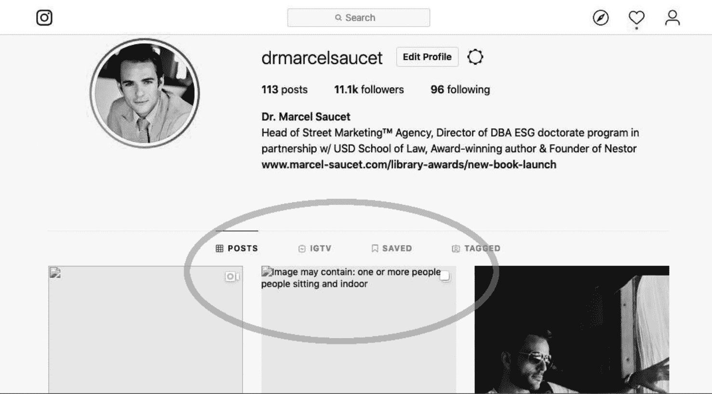
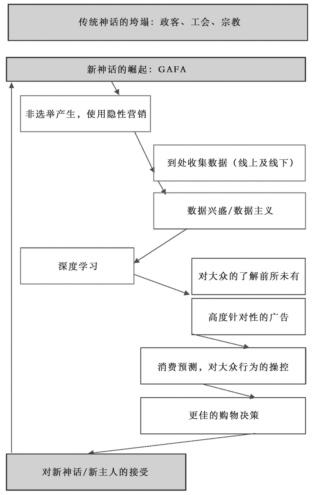
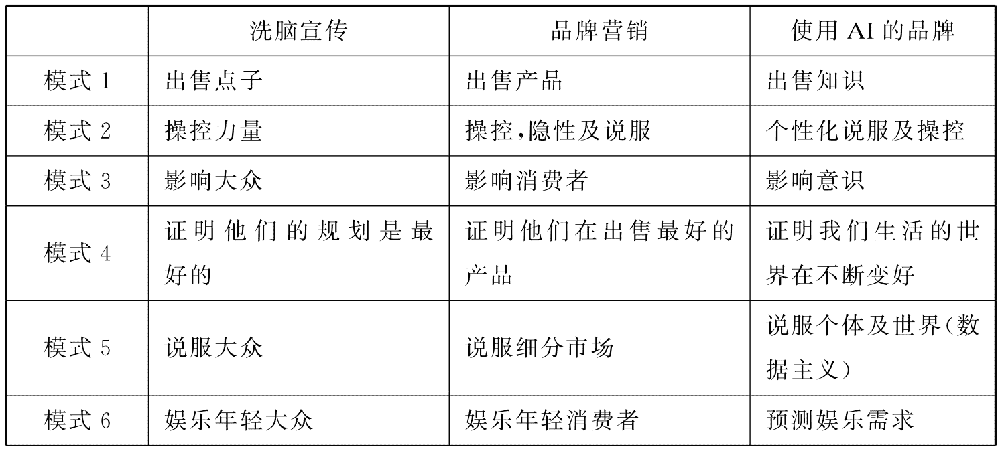
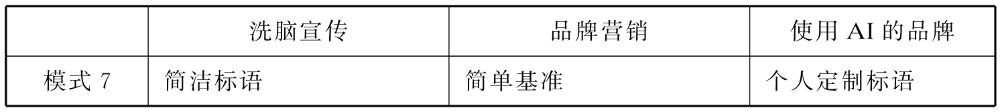
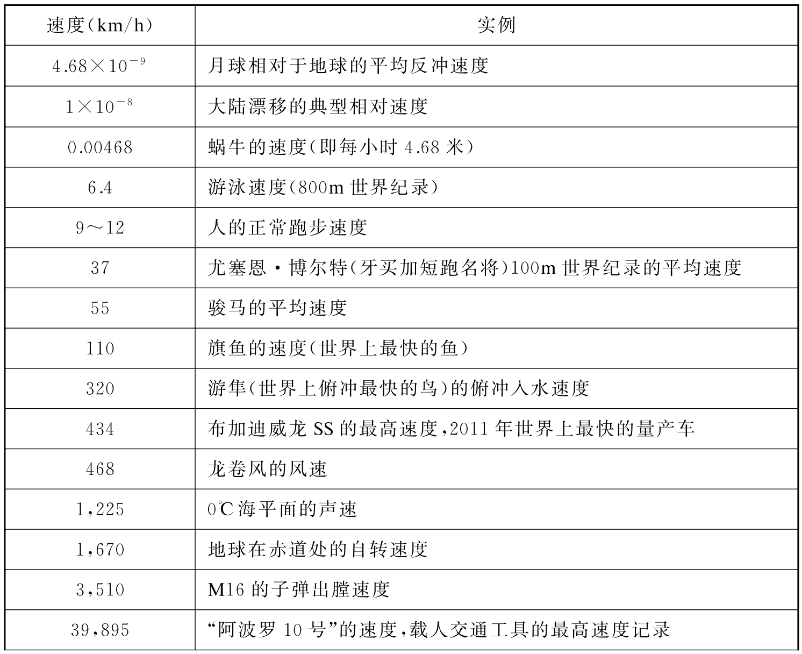
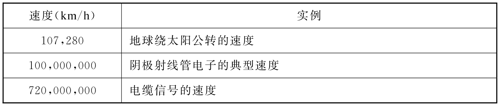
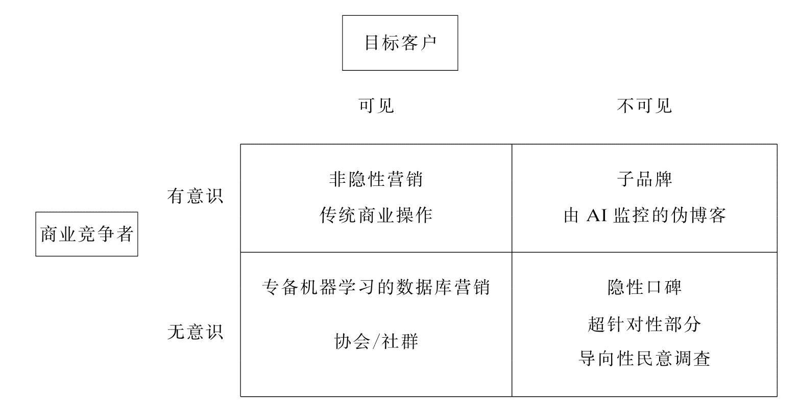
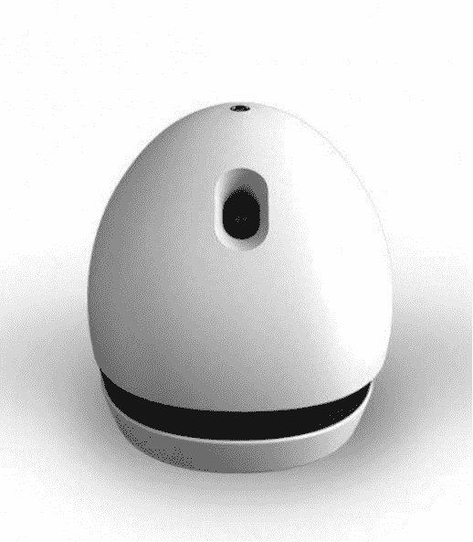
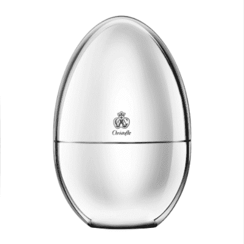
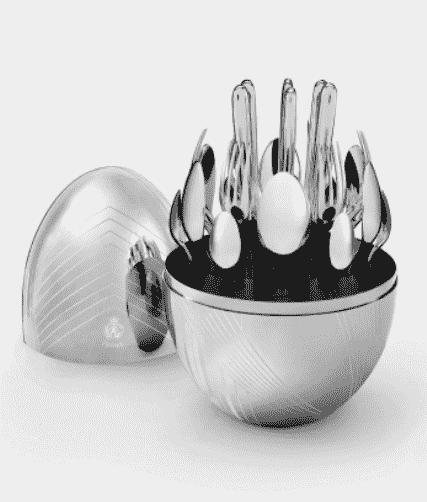

# AI时代的操盘手

“我只相信我自己篡改过的数据。”——温斯顿·丘吉尔

AI的本质是和数字、统计打交道。

数据无处不在：一则推特、一张照片、一条WhatsApp短讯、一封邮件、一次谷歌检索、你头像上贴的图、一支TikTok视频、一条Snapchat阅后信息、Yelp上的评价、脸书评论、Instagram点赞，甚至街头摄像头捕捉到的路人剪影。

把这些碎片喂进去，AI就有了源源不断的养料。算法要数据，正如蒸汽机要煤炭。

掌握你生活足够多的信息，AI就能建模预测你的下一步意图。它读懂你，于是它想卖的东西，你很难拒绝。

只要你搜索、发声、点赞，每一次行为都在泄露想法和情绪。

2016年人类产生的数据量，超过了2015年之前整个人类历史的总和。我们每周制造约1万亿条数字数据。

在你读这段文字的同时，谷歌已完成300万次搜索，30万条推文发出，2.04亿封邮件送出，1500万条短信被编辑。

# 简介

企业向来靠营销影响购买，操控消费者并非新事。过去靠调研和话术，今天AI用算法把海量大数据拆解重组，渗进生活的每个角落和商业广告的每一层。无论把AI看作利器还是灾祸，它都已经是一场超出传统营销范畴的巨变。问题在于，从《广告狂人》里唐·德雷珀的时代，我们是怎么走到AI操盘的？本书拆解品牌如何借助人工智能左右大众选择，利弊并陈。

AI崛起与现代社会的快节奏、西方传统神话的瓦解有关。过去权威来自君主、政客、政府、宗教、工会。90年代以来这些机构影响力衰退，神话崩塌时总会生出新神话。如今品牌与公司取而代之，像罗马皇帝、古希腊英雄、中世纪可汗那样，需要神性来影响公民。不同的是，品牌并非民选也非先知，它们拥有力量却缺乏传统合法性，AI正帮GAFA级别的巨头完成这种神话化。

当品牌推销产品时，为何让人像信神一样信任？工具是无处不在的隐形私人数据采集。商场、办公室、地铁、海滩都在收集。公司利用这些个人数据，比你更了解你自己，从而拼出精准广告与产品，促成购买。

国际数据公司IDC报告显示，企业相关大数据收入从2015年的1220亿美元跃至2019年的1890亿美元。IDC预计2018至2022年复合年均增速13.2%，到2020年收入将达2740亿美元。数据越多，AI越饱足，对消费者的洞察越深，定向广告对购买行为的撬动力越强。

谷歌相册用AI解放用户：上传时自动按人物、地点、日期打标签，找图变得轻松。谷歌不用你亲手建相册。我们的生活习惯因此改变，甚至我们自己也在用照片、视频、足迹为现实世界做数据采集。

Facebook的Rosetta工具会给Instagram和Facebook上的头像、封面照标注姓名和背景。它能识别菜单、路牌、衣服和商品标签上的文字。以某条Instagram截屏为例，画面还在加载，文字已提示室内有人就坐。Rosetta可判断画面里是否有人、表情、姿势、环境。以此类信息积累，平台能对每个人建立庞大画像。若AI发现你的头像是在户外微笑，封面是山川自然，它会给你贴上户外标签并投放个性化广告。

有人反映广告精准到可怕：聊过但未搜索过的内容随后出现。一对夫妇在手机旁谈猫粮并不养猫，几天后就收到猫粮广告。尽管如此，头部AI公司均否认监听麦克风。

图一　一张正在加载资料的页面截屏图

# AI与消费者操控

## 隐私窃听与数据收集

2019年7月，比利时VRT NWS披露，Google Home与Nest Hub搭载的谷歌助手监听了多段私人对话。谷歌的语音识别外包商被指泄露机密录音。谷歌此前称数据用于改进语音识别、减少算法失误。但泄露的录音涉及已确认夫妻的卧室私语，也有私人聊天和商业讨论。这证明GAFA能记录并分析你的私生活、决策甚至性偏好。

## 特拉法加广场互动狮子案例

2018年谷歌在伦敦特拉法加广场放了一头会说话的互动狮子，请路人给一个词再即兴吟诗，引发热潮。谷歌为什么要做这件事？是为了广告，还是为了采集数据？是否用面部识别区分本地人与游客？传感器收集的数据可与其他信息关联：广场人数、下载量等。再与Gmail账户里的个人资料照比对，就能推断你何时在哪、可能去哪，进而推送系列定向广告，效果远超电视、广播、户外广告。

## 数据优势与定向广告

拥有数据优势的公司已成为全球最值钱的公司，这或是偶然也是刻意。

2018年谷歌在定向广告业务上收入达1160亿美元。

## 隐性营销与塔克霍坦恩理论

靠深度个人信息说服你购买的新营销可以悄无声息地采集数据，特拉法加的狮子就是例证。公司一直在操纵购买路径。随着技术与采集手段多元化，品牌用AI基于既有信息搭建模型。AI越分析人类行为越透彻，越能精准预测需求，把想卖的东西塞给你。这种影响在潜意识中发生。

公司并非民选或神授，却靠隐性营销逐步获得权力，这与Serge Tchakhotine的论述一致。

上世纪30年代反纳粹宣传的Tchakhotine警示宣传与广告的危险。他以巴甫洛夫条件反射和马斯洛需求层级为基础，认为宣传成功取决于是否在无声中与四种核心驱力之一挂钩：攻击性、物质满足、性与爱。个体被驱力征服后会无意识复制灌输内容。他强调符号、logo、营销的重要性。一旦掌握行为与深层驱力的联系，隐性营销就能有效利用。超级计算机若用同样系统对付消费者，后果可能是灾难性的。

比如银行或保险公司的防诈骗确认电话。因为AI通过机器学习从过往交易中收集信息，检测到购买路径异常，于是来电核实。未来，通过放大你的焦虑，电话那头能轻易让你买下一份专门的防诈骗险，你会觉得这简直是善意。

## 消费者的两种选择

面对这种操控，人们大致有两种反应：
1.无意识接受，把它当作生活背景噪音；
2.像接受宗教一样，乐意让大公司品牌指引生活，因为这些近乎神明的公司清楚你要买什么，研究显示消费者与喜爱品牌之间存在无意识联结，这让操控更易奏效。

## 本书研究框架

本书通过五个要点揭示AI的说服力、操控力与市场主导力：

1.自20世纪初以来消费潮流演变，选择被消灭成为趋势，公司如何管理AI；
2.第四次工业革命背景下AI的兴盛；
3.品牌如何用不被察觉的工具做隐性营销，静默采集数据；
4.品牌能否成为新神话、新国家、新神明并操控购物决策，以及如何破局；
5.自由、成材、赚钱。

全书要回答：AI是工业革命的升级，还是操控消费者的新手段？在此之前，先厘清AI的概念、原理与消费者隐私的关系。

# AI是什么？

## AI的定义与智能概念

本书从营销、商业与说服角度解读AI。相较传统操控手段，人工智能很新。在谈发展前先理清原理。人类算不了太复杂的题，超级计算机靠强算法可以。超级计算机遵循人脑结构，能跨关联数据解题。它解决问题遵循的规则与过程集合即为人工智能。

AI被定义为“数字计算机或受控机器人执行通常只有智能生物才能完成的任务的能力，常用于开发具备人类智力处理能力的系统，例如推理、找意义、归纳、从经验中学习。”

要定义AI，先要弄清智能。智能由学习、推理、理解、掌握真相、看关系、考虑意义、区分事实与信念构成。下面对比人与AI的差异。

学习。母亲第一次给孩子看餐刀，孩子就能区分叉与刀。iPhone里的AI扫描相册，看到400万张男孩照片后才认出一个。

推理。学音乐的学生听到贝多芬立刻辨认，并受启发创作。AI只能执行有限操作。如上海的禁鸣AI，捕捉喇叭声、拍车牌、发罚单。它没有解读能力，只能辨认。

理解。男友长时间不回短信，女友知道不对劲。Facebook Messenger的AI只会当成技术故障。

掌握真相。男友继续沉默，女友会联想昨天的争吵，推测原因。她能整合多源信息，AI只识别为小故障或编码失误。

看关系、考虑意义、区分事实与想法。男友能基于关系区分事实想法，会告诉女友自己因小事故摔坏手机在医院。他知道女友会因争吵担忧。AI做不到。

## 数据收集与物联网

品牌可用多种AI形式收集私人数据以理解行为并促使用户。数据越多AI越好用。网站Data Never Sleeps称全球每天产生250亿兆字节数据。2018年谷歌每分钟处理380万次搜索。智能手机、笔记本、谷歌之家等创新设备都属于物联网，它们收集的数据喂养AI。研究大众操控离不开大规模数据采集。

AI之父艾伦·图灵说任何数据计算都能数字化。模仿人脑并不遥远，但模仿自然并非总成功。曾有人按蝙蝠飞行设计飞机，结果坠毁。

AI尚处起步，未完全模仿自然智能。工程师尝试从多个维度模仿：

·视觉空间，理解导航，GPS比出租车司机大脑更准；
·身体动觉，外科手术可被机器人重复，手术机器人AI技能超过人类；
·创造力，毕加索画作或偶然的可乐鸡翅，都是自发的，AI需自我意识才有创造；
·自我认知，如甘地清楚自己为独立发起非暴力运动；
·人际互动，如Skype商务会议处理多信息；
·逻辑与数学，AI运算速度远超人脑；
·语言。自然语言分析是主流。阿里巴巴智能音箱、亚马逊Echo或Alexa能语音识别下单，也能解析人类语言。目标是电脑能自然互动并通过图灵测试，观察者分不清真人AI。

人类正寻求让AI更像大脑。深度学习是第一步。它与人工神经网络结合，让计算机获得认知能力。如今AI能识别物体。婴儿只需几个例子就能建立物名联系，AI需数百万关联。训练数百万张标注汽车图后，AI才能联想识别新车。

2012年谷歌大脑自主发现猫概念，是深度学习重大突破。实验中计算机分析1000万张未标记YouTube截图，未被告知哪些是猫，自主学会区分猫头与人头。这是机器学习的里程碑。

## AI的发展阶段

目前认为AI会经历四个阶段：
1.1960至2010年，手动算法的传统程序。
2.2012年深度学习起步，部分能力超越人类，面部识别即一例。深度学习让程序用虚拟神经元建模世界，给GAFA与BATX等数据体强大的控制力，AI甚至能与放射科医生竞争。
3.下一步把内存集成并横向扩展，AI可与全科医生竞争。乐观估计2030年到来，悲观则2199年。
4.最终阶段意识被整合，强AI出现，具备智能、自我意识、感知与自我推理。

据吕克·费里2018年说法，我们正处于第二阶段中段，即“弱AI”，与“强AI”有明显区别。

## 弱 AI 与强 AI

# 狭窄的智能与通用的焦虑

窄域智能也常被叫做弱智能，能力被框在单一任务或极小场景里。正因为范围很窄，这类系统运行快、效率高，在象棋、围棋、扑克这些对抗类项目上能稳定压过人类。以围棋为例，2016 年 1 月，程序 AlphaGo 与拿下 18 次世界冠军的李世石进行了五局对决。围棋的终局分支远超宇宙中原子总数，比象棋复杂了 googol 个数量级，googol 就是 10 的 100 次方，也就是 1 后面跟着 100 个 0。若系统想穷举所有变化，对局时间根本不够。要想战胜人类，系统必须具备近似直觉的判断。AlphaGo 采用类神经网络架构，既可自主学习，也能接受人工教导。李世石赛后说对手下了非常精彩的妙手，让他大为震惊，用他的话说，那些招法是人类根本想不到的奇招。

窄智能让人类获得了大规模处理信息的工具，深度学习把机器学习和强化学习叠加，使电脑和算法能吞下数十亿量级的数据点并做前瞻判断。到目前为止所有商业落地的智能方案都仍属窄智能，离不开像谷歌人工评审员那样的介入来提升准确率并完成训练。但窄智能也会犯蠢。微软的 Tay 在分析数百万条带种族主义色彩的聊天记录后，非但没学会识别，反而自己成了种族主义者。脸书的系统在仇恨言论与骚扰识别上同样吃力，未经用户举报很难分辨，能抓到的骚扰、欺凌与仇恨内容大约只有 14%，而垃圾邮件、恐怖主义宣传、暴力与裸露内容的识别准确率却接近百分百。

通用智能是另一类形态，等同于人类智能，能像人一样解决新问题。与人相似，通用智能很聪明却不总高效。它可以借助与人类相当的智力完成极其复杂的任务。被概括的核心特质包括推理、解题、判断、规划、学习、沟通，并应具备对事物的看法、客观思维、自我意识、感知力和智慧。通用智能目前尚未出现，但公众普遍不安，因为它具备与人类思维相当的特质。电脑已经能产出受版权保护的创意内容，也能在一定程度上借助智能技术辅助人类生成专利创意。从个人层面看，通用智能被视为危险。《终结者》《弗兰肯斯坦》《复仇者联盟：奥创纪元》《我，机器人》等片都展示了智能失控的理论风险与潜在灾难。一项覆盖四千多名美国人的调查显示，超过七成的人担心机器人会夺走生命。人们对机器替代人类工作的前景更多是担忧而非狂热。对劳动人口而言，通用智能构成了重大威胁。

智能创新对西方企业的扩张与存续至关重要，它正成为企业在新兴市场自保的手段之一。对西方公司或国家而言，智能是一项高风险赛道，既有研发风险，也有综合复杂性和成本压力。像《头号玩家》这类电影会让人痴迷智能，但除电影魔力之外，还有更现实的驱动。首先智能代表经济未来的方向，美国等国家的 GDP 有三分之一来自二十五年前根本不存在的产品。其次智能发展迅猛，人类对即将到来的有自我意识的通用智能感到恐惧。特斯拉总裁埃隆·马斯克等先知多次发出警告，马斯克甚至创立 OpenAI 来研究智能的安全与社会问题。即使在可控安全的前提下开发智能，也挡不住企业对私人数据的收集。与多数人看法不同，智能并非遥远的承诺，它早已融入日常，成为现实。

## 人工神经网络与营销落地

围绕 AI 的词汇越来越多，其中不少让人困惑。AI 的研究方向尚未完全定型，按方法大致可分为自然语言处理、遗传编程、机器学习、深度学习、专家系统、计算机视觉、计算机语音识别，以及最为核心的人工神经网络 ANN。人工神经网络创建的算法能模拟神经元的工作方式，就像大脑中神经元彼此互动一样；它记下输入、学习关联、做出决策。算力与计算速度的提升让网络拥有更多层和更多神经元，从而更善于学习与分析大数据。规模更大的网络能够处理更大更复杂的体量，并捕捉大数据中的细微差异进行发现与预测。人工神经网络在数据处理量与速度上优势明显，可用于实时或接近实时的场景。

比如在机场办理登机时，你会留下基础信息作为初始输入。这些输入经算法处理并与其它层连接，将你的数据与其它旅客数据对比并建立模型。实质上，这套智能用类似大脑与神经元的机制进行数百万次微小计算来解读你在机场的动线。重复几次后，机器已相当熟悉各种路径，于是可以在你的动线上投放定向广告或免税区邀请。我曾与 JCDecaux 的团队会面，他们正在开发机器学习项目，计算旅客穿越机场的复杂路线以卖出更多免税奢侈品。大多数需要用大数据训练的智能技术都会用到某种形式的人工神经网络。

类比来看，神经网络其实是营销老早就在用的思路。上世纪七十年代末，科学家就能追踪顾客观看广告时眼球的注视点。神经营销工具追踪的是瞳孔。简言之，虹膜中央的黑色圆点会随光量调节大小。通过眼动追踪，广告商能判断看化妆品广告时观众的目光落在模特还是产品上，据此调整产品在画面中的位置，提升效果。

物联网 IoT 指所有能连网且互联的设备，如手机、手表、智能眼镜、灯泡、电视、安全系统、车辆、可穿戴设备、语音助手、智能手机等，目前约有 270 亿台，到 2025 年预计接近三倍增至 750 亿台。物联网借助人脸识别辨认身份，无论你身在何处，掌握大数据的拥有者都能认出你。伦敦的一台摄像头每天可对个人录像约 300 次，全市约 42 万台摄像头，平均每 15 人就有一台。典型美国家庭拥有 5 台互联设备，77% 的美国人每天上网。未来在酒店、温泉、泳池、餐厅或超市办理手续时，摄像头会同步观察并分析面部反应，像《银翼杀手》《少数派报告》里那样。

人脸识别帮助神经心理学了解人的基础反应。人的心理反应源自大脑，可分为三层：

——爬虫脑让我们完成无意识动作，例如呼吸。
——边缘脑是围绕皮层边缘的一套神经组织系统，涉及本能与情绪相关区域，掌管记忆、基本情绪恐惧愉悦愤怒，以及欲望饥饿性支配欲养育。
——皮质脑即大脑外层的折叠灰质，在意识中起关键作用，负责思考、智力、想象与理性。

比如有人问女友“你最喜欢的餐厅是哪里”，女友若不自觉向左看，说明她在边缘脑里检索本能与记忆。若向右看，则多半在动用皮质脑的想象来编造答案，也就是撒谎。

一旦能从人脸识别程序中获取信息，就能操控或反操控他人。到 2030 年，你的住宅内外将布满足够摄像头，用于收集数据并即时通过人脸识别处理。你在某家商店里的反应会被即时分析并传到销售员的屏幕或谷歌眼镜，从而给出对应的购买建议。玛莎拉蒂已在使用该技术，识别店内客户并把信息推送到销售员的 iPad。收集个人数据的方式多种多样，基因检测与眼动追踪也在其中。公司在广泛收集数据后能全面描摹你，通过智能分析你的数据来改变你的购买行为。

2005 年我有过一段经历。作为年轻教授在尼斯大学演讲时，我告诉学生：“加州有一家公司提供免费的 Windows 等办公工具，交换条件是他们会跟踪并扫描你的电子邮件，分析最常用关键词、归类主题，然后把相关广告发到你的邮箱。”讲到像《1984》那样的情景时，学生们目瞪口呆，他们没读过《1984》但都听说过。我问他们感受，他们说“这太可耻了”。我问是否想知道公司名字，他们说“想”。“谷歌。”学生们瞪大眼睛不敢相信。

这个故事说明，新式的数据采集方式已不再让人震惊。在尤瓦尔·诺亚·赫拉利的《未来简史》中，人类通过生物与控制论工程升级为“类神”以求永生，还出现了让人心灵感应的头盔。头盔执行的基本动作足以收集个体在家行为的海量数据。类似地，瑞典出现了可植入皮下的微型芯片，公司员工一天能完成大量操作。这些设想听起来超现实，日本科学家在上世纪九十年代就把微芯片植入过真正的蟑螂。

1) 技术兴趣日增，若皮肤能植入所有设备，还有必要保留笔记本电脑或手机吗？
2) 以学生对谷歌的反应为例，若消费者满不在乎，还能指望技术改变吗？

我们还能守护购物与思想层面的隐私选择自由吗？2015 年英国秘密情报局网络警察的资料显示，消费者不仅频繁接受信用检查，还常常成为网络购物个性化定价的实验对象。若每个人上网都在被审查，是否可说当今世界对公民与社会的操控已成事实？通过算法管控数据是了解我们所思所行所感的有效手段。欧洲通过了《通用数据保护条例》GDPR，试图保护消费者隐私，这部法律甚至改变了“缓存文件”一词在日常词汇中的意义。美国的 GAFA 机构试图规避这类立法，认为自己提供的是消费者喜爱的免费服务，有益无害。美国仅有少数联邦法规保护隐私，且多针对特定行业。全球性的消费者隐私监管机构尚不存在。美国最重要的隐私相关联邦法案是《金融服务现代化法案》GIBA，管控金融机构处理个人数据。中国等国家也开始规范市场。现阶段难以想象智能在法律层面会带来何等复杂问题，也不知道如何保护人类免受其扰。

没有法律约束下，全球操控会如何运作？用智能预测人类行为并说服消费者购买的系统，本质上是企业强制性营销手段的延续。品牌通过与消费者建立联系来培养操控，这意味着品牌与人之间存在一种无意识关系。作为人类，我们自然会对人、动物乃至无生命物产生依恋，对品牌亦然。

下一章你将看到：对消费者的操控并非新事，智能只是新工具，代表这一进程的下一步。想操控你的公司需要全面了解你，而智能提供了实现这一目标的能力。营销需要大量数据，分析这些数据的是智能。

若不先搞懂在无意识层面说服人的基础，就无法理解智能如何操控消费者。大众是人，智能是人造物，由熟悉操控技术的人类监控。品牌通过制造 FOMO 错失恐惧等心理感受来施加影响。本书第一部分将从心理分析与社会学角度探讨人类对品牌的情感如何形成，以及人工智能如何改变这种关系。

下文将回顾历史，探索营销术如何成熟地管理客户。证明营销自古以来的目标就是操控，从过去到现在皆然。智能是既有逻辑的延续：一个自动化、高科技的操控过程。我们将评估营销人员不断进化的技术，探讨他们现在如何借助数据营销与线上线下智能，不动声色地随时随地收集消费者信息。

# 第一部分：20 世纪的营销操控与说服

不了解人类借助营销进行操控的逻辑，就无法理解全球化时代智能在购物与生活中的作用。接受影响是人类的天性，人在任何关系中都会受支配，就像受虐者需要施虐者。

商业操控形式多样。走进超市就会发现，店内布局处处是营销陷阱。以买瓶装水为例，人们往往会选择价格更高的六瓶装，而不是更便宜的散装六瓶。你注意到了吗？你其实在为塑料包装买单。常识认为组合装更划算，这种想法常会把消费者带偏。组合装的单位价值不但不优反而更差的例子比比皆是。消费者偶尔也会察觉，被欺骗感会令人不快。正如一篇相关文章总结：“若没带袖珍计算器，别在货架过道闲逛。若有特价宣传，请弄清商品为何促销、对象是谁。”

在这种操控游戏中，消费者几乎没有抗衡余地。即便自认聪明，商家仍可用基本手法让你就范，比如把价格从整数降一分钱，如从 5 美元降到 4.99 美元，就能有效提升购买量。背后原因很多，最通用的说法是消费者不太在意小数点后两位。

“买一送一”随处可见。有的产品打 33% 折扣，有的把数量增加 33%，大多数人觉得两者差不多。其实折扣更划算。《经济学人》将此归因于购物者普遍“对分数没概念”，他们没意识到数量要增加 50% 才能等同价格减少 33%。关键在于，购物者常选择价值更差的购买行为，因为算错了数学，或因为渴望免费的额外商品。免费商品的错觉会让消费者不理性消费，买下原本不打算买的东西，还因免运费热衷网购，忽视网购总价更高的事实。

再看一个实验：实体店卖护手霜，研究者采用两种方案，一是加量不加价，二是单价打折，两者单价相同，但加量装的销量提升了 73%。定价操控的核心就是用不同价格提供完全相同的产品。想想买矿泉水时有多少选择？数量与价格各不相同。订机票也一样。公司使用收益管理策略，以不同价格出售同一座位，价格差异由是否提前预订、行程是否少于 14 天、是否周末停留、舱位是否不同、是否返点等因素决定。航空公司最终为同一趟飞行提供多种价格。显然，当今社会不同人以不同价格买到完全相同的商品。

也许你早已知道这些例子。那你改变购物习惯了吗？没有，对吧？为什么？说到底，你处于一段施虐与受虐的关系中。

通过网购，算法会研究你的浏览路径并记录偏好。你的价格敏感度被记录在案。公司知道你的心理价位。超过某个阈值，电脑就知道太贵；低于某个阈值，就认为质量不够。你无法逃脱被操控，因为价格早已被为你设定。

下面详细介绍企业如何操控消费者。

## 一、品牌与消费者间的无意识关系

品牌与消费者关系已演进数十年。传统销售中营销把消费者引向品牌，如今却是消费者与品牌的关系在引导他们。品牌调整了信息架构，不再聚焦自身而转向消费者。通过关注消费者，品牌能把人际关系中的信任、焦虑、恐惧、喜悦、共同价值观或个人关怀整合进战略，从而操控消费者。为了理解这一过程，我们先研究人类如何在无意识中与品牌产品建立联系，以及品牌如何借助智能培养和操控这些关系，以便了解并预测消费者需求。

### 1. 我们可以操控消费者对品牌的感受

忠于宗教、政治派别、运动队，都显示人类渴望归属某一群体天性。品牌亦然，人们认同最适合自己的品牌。这解释了公司如何影响人类心理，也解释了它们如何研究分析心理并尽可能操控心理。

#### 1) 人是如何建立与品牌及产品的关系的？

你每天看手机几次？5 次、20 次、50 次？据苹果统计，iPhone 每天被解锁 80 次。人们每天点击、输入、滑动智能手机的平均次数超过 2600 次。苹果如何让我们上瘾？为什么不断查看手机如此重要？答案在脑中，只有一个词：焦虑。

焦虑从何而来？南希·谢弗博士团队研究手机使用与焦虑的关系。实验中研究者在记者手指上放电极，测量心率与呼吸。当谢弗把手机放在记者够不到的地方并发送短信时，收到通知的瞬间呼吸与心跳加速。焦虑源于渴求被阻断。实验表明我们对手机有一定上瘾，但更重要的是弄清成瘾原因。手机通知到来时，大脑会释放多巴胺，这种神经递质能暂时缓解焦虑。多巴胺带来的快感让我们不停检查手机，像吸毒一样寻求“高潮”。

品牌如何利用焦虑吸引人？消费者与品牌建立了关系。以 Instagram 这类社媒来看，若你在积累一定粉丝后停止发帖，平台会降低你的账号曝光。Instagram 在推动你保持联系。很多人会跟设备说话，甚至对电子设备品牌产生爱意与依恋。“没有 iPhone 我该怎么办！”你听过多少次这样的感慨，对企业而言，关键在于理解为何我们对某些品牌的热爱超过其他品牌，即导致消费者对某个品牌或设备产生依恋的原因链。许多研究试图解析消费者对品牌的热爱如何形成。品牌代表一套元素：产品服务、沟通与身份。皇家马德里在成为足球队前已是品牌。消费者个性或自我认知与对产品的印象相互关联。品牌若与自我融合，人们自然会对它产生热爱。

# 你的每一次分享，都被提前算好

口碑从来不是自然发酵的，它是品牌最隐蔽的传播通道。很多时候消费者在替企业发声，自己却浑然不觉地充当了线下营销的代言人。线上营销把这件事推向了明面，特别是在病毒式营销上——它擅长撬动人们因信息而行动的冲动。好像被写进了程序，大多数人会本能地把内容转给亲友。分享不只是维系关系，更是在维护自我价值感。所以企业要做的，就是通过口耳相传，尤其是互联网的放大，让这种与他人互动的天性加速，形成口碑的雪球效应。

病毒传播的速度不是金字塔式的层层递进，而是指数级的爆发，像流行病一样扩散。借助网络效率和虚拟口碑的信誉，这套理论在效果上已经超过传统通讯手段。数据也显示，在家电和食品领域，口碑的效率是个人直销的七倍、广播广告的两倍。杰伊·莱文森也指出，对中小企业而言，口碑带来的信誉质量远高于商业广告。

广告已经饱和，人开始用漠视来防御。品牌要触达的不是大脑，而是心。就像《大都会》里暗示的那样，心是脑与手的调停者。无论是游击营销还是口碑运营，一旦能与情绪挂钩，就容易产生共鸣。只有打动了心，人们才更愿意主动传播。只要分享发生在社交媒体或数字平台，企业就能收集行为数据，厘清活动与消费心理的关联。一旦摸清哪些因素能撬动情绪，操作就会变得轻松。

对品牌的喜爱，本质上是自我契合度的体现。自我包含真实自我和理想自我，当产品与这两个维度都对上，热爱就产生了。睡前最后一件事、醒来第一件事是什么？刷手机。你已经不知不觉与手机合居。研究也发现，不管是真实自我还是理想自我与品牌个性的吻合，都会正向提升品牌依恋。人性化特征会让人倾向于用产品定义自己，并毫不犹豫下单。心理学研究证实，品牌会唤起情感带来愉悦，而欢乐与幸福正是大量 YouTube 前贴片广告在诉求的核心。

如今的品牌广告无所不用其极，有趣的、激进的、煽情的、抓眼球的——Dailymotion 上的横幅、大街上为《夜魔侠》做的巨型牌面，都是要让你买。更深层的操控在于，企业读懂了潜意识的需求，并用这种理解去引导购买意愿。

比如我住拉斯维加斯卢克索酒店时，一位女士上来推销死海泥除皱产品。她问了大量皮肤问题，收集个人信息，还现场分析我的面部。我对她半信半疑，告诉她自己在化妆品行业多年，不相信除皱效果。皱纹通常是被软化而非消除。她坚持让我试五分钟，选定笑纹后只涂了一侧，另一侧留空作对比。五分钟后递来镜子，差异似乎非常明显。我怀疑是镜子或灯光，甚至拉住路人确认，对方也说看得出区别。两罐特价 160 美元，我笑着拒绝并说肯定有花招。

纠缠许久后她才承认诀窍：让客户指定皱纹区后，她总是把产品抹在皱纹较浅的一侧。人脸两侧皱纹本就不对称，总有一侧更深。只需这点信息，就能完成操控。

信息无处不在，连大型化妆品店的智能屏和魔镜都在用 AI 人脸识别分析你的脸。

#### 2) FOMO：品牌放大的错失恐惧
人工智能在维护客户关系上发挥作用。海量数据的自动化处理让品牌更精准地了解客户，并以前所未有的方式成交。AI 能根据个体行为推送个性化选择，当品牌比你更了解你，忠诚就建立起来了。错失恐惧症 FOMO 已经成为主流，特别在千禧一代中，它不断强化人与产品的连接。FOMO 与社交互动、数据采集和 AI 相互作用，形成的合力远超过去五十年靠口碑积累的影响力，因为恐惧来源于消费者自身。

你最后一次和伴侣吃饭不看手机是什么时候？手机占据的时间把小众传播变成了强大的口碑，也让你留下更多个人数据。安联保险集团的研究显示，超过 55% 的人经历过 FOMO，57% 的人因社交媒体看到而买了计划外商品，88% 的受访者认为社交媒体助长了财富与生活方式的攀比。

自我展示理论也指出，人们渴望呈现最佳形象以获得好感，这些行为最终都变成品牌可用的数据。研究者查特齐内认为，从理性到感性的购买演变，证明了以多选择为特征的互联网文明在加剧挫败感。品牌已不再是理性思考的结果，而是情感上期待的愉悦。五十年代广告强调功能属性，如今理性不够用了，选择越多越难以抉择，挫败感越大。JOMO 因错失而快乐的现象虽存在，但只是极少数。

#### 3) 我们为什么更信任 AI 服务
对助手类 AI 的支持度很高，Siri、谷歌助手能安排日程，Alexa 能下单。数字语音助手受欢迎因为无需动手就能互动。娱乐类应用分析照片数据，Snapchat 用滤镜改变面部，脸书给照片打标签。如果 AI 自拍工具或数字助手获得整体信任，即使有人担心，多数人仍会跟随主流。60 秒内就有超过 400 小时内容上传至 YouTube 进行分析和转码，每分钟上传到 Instagram 的照片达 65,000 张。这些平台对我们了如指掌并能预测需求，为什么不信？

人们已习惯为技术让渡数据。过去靠键盘输入指令，如今追求最新工具而上瘾。即时满足从特例变成期待，消费者要求迅速甚至即时响应。技术提供便利，而即时满足的代价是质疑意识的消退，操控系统变得不可感知。食物、衣饰领域亦然，为了满足个人需求不计后果。史蒂夫·乔布斯那句话依然适用：客户不在乎你的产品或业务，他们只在乎自己、希望与梦想。

## 心理分析与社会学：大众为何拥抱 AI 品牌
人工智能与心理分析有相似之处，前者需要个人数据寻找解决方案，后者需要个人与潜意识数据做诊断。理解品牌与消费者间的心理联系，对理解为何消费 GAFA 的 AI 很关键。心理分析从临床跨入营销，在行为科学史上留下章节，其理论为品牌形象、消费符号化、动机提供了开创性概念，核心始终是人们从消费中获得的意义。

营销中对群体动力的研究关注可观察结构、角色与流程——买东西时我们模仿谁？群体思维是突出主题。

#### 1) 群体潜意识与集体从众
营销常借用社会心理学工具调查群体。群体思维中的集体因素被视作成员明确共享的部分，但群体中可能存在的无意识力量长期被忽略。荣格的集体无意识概念影响最大，弗洛伊德也触及类似现象。除个体无意识外，荣格认为人还拥有第二种集体、普遍、非个体的心理系统。

自拍是典型例子：大家口头批评，却人人都在拍。集体自拍却受欢迎，通常出现在社交场合并被多人发布共享，成为社交常态。外向性与亲和力代表对集体规范的自觉遵守，人们更愿发布集体照而非个人照。雪城大学的研究显示，参与集体自拍的人渴望被接纳，部分人因同伴压力参与，认为没照片的活动等于没发生。

集体无意识指无意识中贯穿人类生活的普遍主题，核心是原型或原始图像。营销对话中的集体信念为荣格的假设提供佐证。品牌把心理学整合进策略，直接从心理分析和消费者行为汲取灵感，以激发忠诚并培养服从。

品牌与消费者的关系类同人际关系。马塞尔·莫斯的礼物回礼概念适用：收到礼物就会有回礼义务。沃尔玛或团券给你代金券或折扣时，你会觉得该买点什么回报。因为你是人。互惠分析已有两百多年历史。QQ、TikTok、Snapchat，百度、必应、雅虎，维基百科、天博、微信、WhatsApp 等都利用互惠原则分析大众行为。在互惠标准下，我们倾向于回报曾帮助过我们的人，且付出往往超过所得。免费使用维基百科或 Skype 电话会累积情感债，筹款时捐款、未来用量时买信用额，都是自然反应。公司提供免费社交网络、地图、词典、Gmail 或促销，让客户感觉获益，有时甚至请客户参加自费派对，打破旧模式引发好奇，进而产生示范效应。人都有打破常规的渴望。

#### 2) 示范效应让人永远追赶
人大多想要自己没有的东西。这是詹姆斯·杜森伯里的示范效应：个人消费取决于他人当前消费。看到别人用优质产品会产生自卑，为驱散这种感觉而增加支出，以避免自尊受损，即“追上琼斯”。电影《模范家庭》正是这一主题。

杜森伯里还强调新颖性是“上等货”的重要参照。服装是否因剪裁更好或更保暖而更新？如果不是，为何新时尚优于旧时尚？营销人员诱导每季购新。快时尚带来频繁上新和快速交货，美国人丢弃衣物量创新高，导致过度消费。广告鼓吹炫耀性消费，社会各阶层试图向上攀升并与下层拉开距离，所有成员参与同一竞赛。

自我比较促进优质商品消费，高消费带来满足感。 jealousy 成为当代消费驱动力之一。我们想要身边人或崇拜者拥有的东西。想入手最新星战应用，却只能下载演示版，买完整版的人成为第一个体验者。做第一的渴望让消费永续进行，AI 品牌只需利用这一概念就能维持流程。

#### 3) 米尔格拉姆实验里的服从逻辑
示范效应是起点，解释个体行为源于对他人的观察。米尔格拉姆的服从权威范式则展示了明确的操控与权威如何促成购买。该范式源自著名实验。纽黑文社区的志愿者主要为男性，被告知研究惩罚对学习的影响。扮演“老师”的人监督学单词的“学习者”，出错时施加电击。机器有 30 个开关，从 15 伏轻微电击到 450 伏最大值。

机器并未真正放电，学习者是共谋者，参与者不知情。研究目的不是记忆，而是看指令下会走多远。关键问题是，有权威人士指示时，是否会对无辜者施加致命电击？

米尔格拉姆询问普通人时，大多数人认为不会超过 135 伏，没人相信会超过 300 伏，更不用说 450 伏。精神科医生预测，只有约 5% 的精神疾病人群会超过 300 伏，仅 0.1% 会用到最大值。实测中，40 名普通美国人里有 26 名即 65% 将电压调至 450 伏。学习者会按排练发出反应：150 伏时喊“停吧，请让我离开，我心脏不舒服”，330 伏时尖叫“让我出去……心脏很难受”。

服从权威这件事早已内化成人的本能。只要公众相信某个人或某个机构在道德上站得住脚、在法律上名正言顺，他们就更容易照办。孩童时代父母、教师、上司的角色塑造了这种条件反射，哪怕指令明显不当，人们仍倾向于遵从。这一机制正好用来解释书中想说的问题。苹果、脸书这类巨头在公众心目中备受推崇，即便它们避税的事实人尽皆知，消费者依然爱用。为什么会出现这种虚伪？因为品牌靠营销、视觉符号、色彩、知识储备、创新叙事和利润故事赢得了尊重。

当身边仿佛有神的声音在提醒，人们的顺从度会更高。国家越动荡，民众越渴望信仰带来的安慰。安德烈·马尔罗指出，文明的一切根基都在宗教之上。一旦社会压制信仰，领袖个人崇拜或国家崇拜就会填补空位，本质上是宗教的替代品。如今许多心理学家认为，对至高权威的信任，是我们承认他人存在、并用人本视角理解世界的一种延伸。为此神经科学家会比较信徒与怀疑论者的脑区活动。我们天生在寻找规律、结构与因果。若品牌正被当作新信仰来寻求，该如何应对？

回到示范效应与米尔格拉姆范式，这其实是两种不同机制。前者关乎想成为第一个吃螃蟹的人，后者解释了为何在民主社会里，只要深信不疑，哪怕是荒谬或致命的命令，约三分之二的人也会照做，可能把更高超自然的存在当成理由。

由此就不难理解，科学家们说咖啡有益、多喝点吧，我们就照单全收。事实是这些研究多由咖啡生产商资助，而另有研究已指出咖啡对身体不利。谈到游说，本质就是隐性营销——消费者意识不到自己正在被广告触达时，隐性营销就发生了。营销演化出令人咋舌的技术组合，目标是让顾客买单时脸上露出笑意，产生一种无意识的情感联结，而不是怨气。

《科利尔》杂志1950年的报道引述了几年前《美国医学会杂志》的一篇社论：“实际调查显示多数医生自己抽烟。从心理学看，吸烟更像是逃避紧张情绪，而非对抗。至于把烟草列为对大众健康有害而应禁止的材料，目前并无优势证据。”这篇文章标志着反烟舆论转向的起点。此后无数广告开始夸赞香烟，声称无可指摘。它们利用医生的权威来判定态度，《时代》早年广告库的标题就是“医生要你吸烟”。正如服从权威是人性，视品牌为新神话、从而接受其操控也是人性。

AI 让品牌获得了新的促销武器。因为AI掌握个体消费者的信息，品牌能按喜好定制产品，并借助杜森贝里效应去销售：强调产品的独特性，像“高级成衣”消费那样制造他人的挫败感。更关键的是，品牌比消费者更早预判需求。在这股浪潮下，品牌正获得操控每个消费者的能力。

#### 4) 消费幻象与 GAFA 的神格化
约翰·肯尼斯·加尔布雷思认为，一旦生产者能接触并左右消费者，权力格局就会反转，绝大多数购买决策将取决于生产者的意志而非消费者的意愿。即生产者决定造什么、如何分配资源，尤其是当市场由拥有庞大广告预算的大公司主导时。加尔布雷斯提出消费者并非国王，人们会服从权威意见，正如米尔格拉姆实验所示。市场没有规则，因为客户并非上帝，他们没有决定权，已被操控。公司定义需求与时尚，消费者只在流程末端缴械投降。亨利·福特的名言最能说明问题：“如果我去问人们想要什么，他们只会说要一匹跑得更快的马。”核心思想是无视显性愿望进行激进创新。福特没给更快的马，给了汽车，且最初大获成功。但公司对欲望的把握仍有限。谷歌眼镜就是反例：发布时因隐私问题招致强烈抵制，72%的美国人给出差评。

品牌的使命是点亮消费者的梦想，并不断制造回来的理由。AI 正在帮它完成，且成效显著。留住老客的成本远低于拉新，老客利润可达新客七倍。恋爱关系与品牌关系相似，忠诚会带来惊喜——一张结婚纪念机票与 Nespresso 积分卡的效果一样。尼采说“狂热是意志的唯一形式，即便软弱、不安全的人也能实现”。面对品牌支配力与海量广告投入，我们消费者不也显得“弱小”而“羞怯”吗？我们像米尔格拉姆实验的旁观者，像《美丽新世界》里恋爱中的奴隶，也像拉博蒂理论所说的，毫无察觉地开心消费着广告。

品牌在说服大众：自己的规模足以与古希腊诸神媲美。几千年来人类把至高权威赋予神，进入现代后权威转向人。在《未来简史》中，赫拉利展望自然选择被智能设计取代时，超自然力量会转移。当 GAFA 比我们更了解自己的偏好时，民主将面临何种挑战？古神退场后需要新神话来赋予世界意义，于是出现了数据主义——对算法的普遍信仰。人类沦为中心精神监控下的子系统集合，中心告诉我们该如何感知。有了AI工具预测并操控消费行为，赫拉利的描绘比书中更贴近现实。为了便于理解操控与被操控的商业结构，可参考下图架构。

下一阶段，我们将回溯这种说服形式的历史。操控他人是公司与品牌的天性，而AI的崛起正加速这一进程。

## 二、从传统营销到AI时代的消费者操控史
要从AI与消费者操控的角度看营销未来，必须先回到过去。本节聚焦操控策略的起源。大公司操控消费者并非新事，AI只是旧历史的高科技继承者。

必须强调，大公司利用AI操控的未来，是延续自上世纪三十年代起的大规模系统的。两百多年来广告无处不在，抓住注意力、玩弄感受、个性与情感联结。在埃米尔·佐拉的小说《女人天堂》中，若接触不到广告，连走一英里都难。营销史比想象中更久。GAFA与BATX如今使用的手法，很多在1830到1870年间已有雏形：品牌战略、广告、陈列、促销、销售，术语都耳熟能详。广告多投放在电视、广播、报纸或路边牌等能触达目标受众的位置，选址很讲究。PlayStation 5或任天堂Switch的广告对青少年最有效，因此总在夜间投放，正是这群人上网的高峰。

营销操控不仅是瞄准谁，还在于对目标发起多少次营销活动。洗发水与女性的关系就是例子。干性头皮、丰盈、染后、受损、油性、卷发，接着是深层清洁、中性PH、螯合、角蛋白、丰盈、无麸质、无硫酸盐、无水、细软发、日常清洁、敏感头皮、干枯、脆弱、羊毛卷、去屑、增亮、补水、顺滑、有机天然……清单可列满几页。仔细想，所有洗发水都能洗头。用无数产品激发购买欲，实则产品本质雷同，这就是操控精髓。广告让你相信它们截然不同，但“长发专用”与普通洗发水的区别，除了倒更多在手上，还有什么？

下一节将讨论广告在商业操控初期的历史演进。

### 1. 从宣传轰炸到精细操控
当下消费者教育主要依赖电视与YouTube等媒介。据拉莫内特估计，3到18岁人群接收的广告总量达50万条，动员效应堪比社会运动。

#### 1) 重塑认知的现代公关
被誉为“公共关系之父”的爱德华·伯奈斯擅长造势宣传。他相信多数人受非理性欲望支配，只要操控手法得当，就能带来丰厚利润。用“诱服法”，人们会乖乖购买任何想法或产品。

伯奈斯最著名的行动是“自由火炬”招募女性吸烟者。20世纪初女性公开吸烟受法律限制，多州强制执行并引发诉讼。伯奈斯组织女性游行争取吸烟权，这场伪事件在公共关系领域大获成功，媒体广泛报道，女性香烟市场随之起飞。美国烟草公司董事长乔治·华盛顿·希尔视此为促产增利的机会，聘请伯奈斯如探金矿。多家卷烟公司随后办活动讲座教女性如何吸烟。伯奈斯在健康广告的名义下操控女性，声称香烟与口腔滞留欲相关。游行时他雇佣女性吸烟并请摄影师拍摄优美照片刊登杂志，一手把众多女性培养成吸烟者。

反对希特勒的俄罗斯社会学家谢尔盖·塔克霍坦恩指出，广告通过激发最深层冲动让人迷恋。他把巴甫洛夫的条件反射与人类内在冲动结合：攻击性、物质满足、性与爱。传播与广告如同喂养训练动物。我多年卖化妆品的经验显示，卖女性美妆时用性吸引力海报最有效，因为每个女性都不自觉想成为海报上的美人。同理，2020年医院已能自动采集患者身体数据，AI可从一组数据中发现多重健康问题，品牌据此用物质满足的冲动告知患者该买什么药。

即便是不太需要的物品，营销也能催生需求。宝洁公司九十年代提出“复制策略”传递需求与满足感。

#### 2) 个体化收割：把钱包掏空的营销术
五十年代美国出现生产过剩，改变了营销策略与社会阶层观念。营销先调整宣传话术，从“我的产品最好”转向杰里·麦卡锡提出的“4P理论”：产品、价格、渠道、推广。四个P不再以推广为唯一目的，扩展到伙伴关系、对产品的感性认同等。第二个变化是市场不再单纯扩增供给，而是把增长放在能有效催生需求的商品上。历史上产品过剩却缺乏吸引力的例子很多：成人用婴儿食品、军械工业发明、托卡可乐、国王可乐、麦加可乐、Breizh可乐、黄瓜除臭剂、无色啤酒。越南战争期间军备需求拉动经济，1975年战争结束后过剩再次成为问题。七十年代工资增长滞后于生产率，扩大生产陷入困境。七十年代的创新影响了美国乃至世界，八十年代市场细分受关注。

细分帮助公司在同质产品中突围。从人口特征切分市场，使营销更易达成目标。自由天堂度假村的广告就是例证：“世界首个大尺码友好且包容的海滩度假村，112间客房，位于墨西哥坎昆以南70英里的尤卡坦半岛坦卡市。”核心想法是给大尺码人群一个舒适且受欢迎的度假地。其他细分还可包括滑冰者、冲浪者、LGBTQ、少数族裔、吸烟者、父母与儿童等，均适合定位。通过心理、行为与效益研究即可掌握分类标准。多个研究表明，离婚人士比完整家庭更爱消费，城市潮男与同性恋者比保守男性更热衷购物。

细分策略不仅说服潜在买家，还能重新激活消极客户，即“弃篮者”。公司可自动化进行66%的广告活动，产生75%的收入。每天清晨，像Bricoprive这样的品牌会向客户与潜在客户发送450万封邮件。奥地利的壹玛仕汇总29亿客户数据，减轻营销人员清洗与计算的负担，因素包括年龄、复购率、客单价、渠道数与放弃率等。根据1到10年的销售历史，AI引擎汇总数据并给出具体操作建议，比如今天早上哪些潜在客户最可能转化、哪款产品与哪种方案最有效。邮件发送时间也个性化，比如萨拉9:30，保罗10:15。邮件打开后，AI会按对象自动生成欢迎信息，聚焦最可能被购买的产品。

公司的AI营销还会为不同消费者划分不同需求，就像你可能属于Cdiscount、Sephora或亚马逊的细分群体。需求被严格划分后，公司推出计算好的各组产品，唤起需求。

检验营销有两种视角：供给与需求。需求来自市场调研，力求了解消费者需要；另一种则是“我只管推出新产品，消费者要不要都得买”。

#### 3) 市场调研：AI擅长的起步战场
企业发布产品需完成四个步骤：造出产品、做市场研究、制定策略、择时实施。市场研究用于确定消费者需求，一直存在。善用消费者数据与信息是现代营销核心。宝洁、欧莱雅等公司花费数百万美元探查大众深层驱动力，以打造正确产品线。营销部门使用模拟超市与模拟货架，对消费体验进行测试。在模拟场景中，消费者放下或转向某产品时，营销人员用神经营销或人种学方法追踪眼部、手部活动。营销人员想了解需求，但并非简单提问，因为人会说谎也会犯错。

例如酒精研究中最难解的谜题：大众声称的饮酒总量加起来不到实际售卖量的一半。也就是说酒要么被倒掉，要么被遗忘，要么被隐瞒。另有调查显示，27%的成年人对牙医撒谎使用牙线的频率。

政治中也有例证。1982年美籍非裔市长汤姆·布拉德利竞选加州州长，对手是白人乔治·德克梅吉安。民调机构投入工作，预测随着竞选升温布拉德利将胜出。选举前几天人们已认定他稳操胜券，结果德克梅吉安大胜。分析认为多数受访者对民调撒谎，因害怕被指种族主义而不愿承认支持白人候选人，但在投票站隐私下暴露真实想法。类似地，三分之一的英国人面对民调不会给出真实答案。

除直接提问或交叉验证外，还有“随机响应”“不对称计数”等方法。酒精消费研究中，研究人员对4万人进行调查，先问一般饮酒量，随后即时提问“昨天喝了多少”。这种方法能揭露低报情况。若声称每月喝一次酒的人中有50%承认昨天喝酒，则可推断该群体严重低报。若真实为每月一次，随机一天承认的概率约3%。

大众对调查撒谎，限制了实用性。更大的限制在于多数营销人员以为客户知道自己想要什么，实际上客户可能并不了解自己。套用诺贝尔奖得主西蒙的话，决策者并非完全理性，只是受理性约束，只能依靠启发式方法筛选信息，因而推断各环节都存在偏见。

鉴于用户有时会隐瞒真实想法，有时连自己想要什么都说不清，不少公司干脆不再费力去倾听需求，而是把资源转到前文提到的研究路径上，重点强化信息推送、标准制定与研发投入。如今替人做决定的不再是个人，而是企业方。它们先打造出一种让人觉得理所当然想拥有的商品，再借助极具说服力的传播手段放大效果。

观察AI演进，会发现彻底改造市场研究的要素已出现：数据采集变得即时且持续。企业必须不断吸取用户的行为痕迹来推断偏好并预估下一步需求。伴随AI与物联网终端的普及，即便你正在阅读《纽约时报》或常去的博客，系统也在借助地理定位抓取你的位置、文章标题关键词、信息流里出现的媒体人物、意见领袖、配图，以及在各版块的停留时长。熊彼特的创造性破坏说的是新产业诞生旧产业消亡，AI正是当代的破坏性力量，它具备瞬时自主性，是传统市场研究的继承者。品味在变化，企业却以定性与定量并行的不间断分析持续记录我们的动向。九十年代宝洁砸下数百万欧元做焦点小组，数百人代表用户发声，如今企业已能用自动化程序对每个用户进行全天候拆解。很快企业对我们的了解将超过彼此间的了解，并在大趋势下制造微型时尚，用精准供给牵引购买。正如后文将展示的，洗脑式宣传、品牌运作与GAFA有诸多共通，可归纳为七种离散形态：售卖、操控、管控、验证、说服、娱乐、简化。一个洞悉一切的AI完全可以依你当下的情绪劝你投票给某位候选人，它也能让你觉得投给极端候选人是糟糕选择，即便你从未认真考虑过，那个念头可能只是早晨与配偶争执后想彻底改变现状的冲动。

(续表)

企业正在打造能够有效管理公众的工具。借助AI，我们不再需要用普适信息笼控人群，而是能把高度定制的信息投放到更广的细分受众。下一节会看到企业如何沿用传统打法卖出更多商品，以及AI如何进入复杂的预测性营销体系，其中的趋势格外明显：所谓的自由选择购买其实已经终结。

### 2. 促进销量的营销策略之发展
如前一章所说，企业在上世纪下半叶常用的营销框架是4P，即产品、价格、渠道、推广。尽管4P长期占主导，传统做法已触到天花板。随着AI介入，这些方法被升级重塑。要卖出更多商品，企业必须彻底掌握人的行为轨迹。对海量数据的持续解析让目标变得可行，同时触达面不断扩大，信息被高度定制，个体买家的下一步也能被预判。

#### 1) 以合适的产品开启营销
户外品牌北面就曾动用IBM的明星超级计算机华生为线上购物打造私人路径。进入官网后，顾客先与机器人对话，系统再据回答匹配商品。若顾客表示喜欢冬季徒步，程序会追问地点与偏好，从而推荐既保暖又适合动作的夹克。对比过去把上百款商品摆在面前让用户自行筛选，AI让选择变轻。

时尚在主流语境里很大程度上等于包装。想塑造一个人，就让他穿克里斯蒂安·奥迪耶的衣服，踩克里斯蒂安·鲁布托的鞋，戴克里斯蒂安·迪奥的珠宝。穿着在很大程度上建构身份，餐厅亦然，进店档次由装修价格客群构成等决定，菜品反而在其次。同理，产品靠外表和包装就能让用户认定这就是自己想要的，企业效应在此基础上加分。

说服的手段不止于此，商标就是一例。它作用于无意识层面，人们对颜色很敏感却往往意识不到。红色会唤起激情，却可能削弱智力任务表现。企业对个人颜色偏好的判断很熟练，西方成长的人最先青睐蓝色其次绿色，西班牙人则偏爱红色。

包装商标这些元素是精致的武器，能在潜意识里引导购买。如果你做汽车，并非只售单台车，而是把十台不同车型卖给十类人群。通用旗下就有GMC、凯迪拉克、别克、雪佛兰等子品牌，各自再细分皮卡豪华轿车敞篷车等，从而出现凯迪拉克SUV、雪佛兰SUV、雪佛兰皮卡、凯迪拉克皮卡等变体。企业卖的其实是同一个内核的多重版本。

利用产品特性促销并非唯一花招，另一种更隐蔽的商业策略正在掩盖它，企业用这种方式悄悄把商品推到顾客面前，这就是消费体验。

#### 2) 恰适体验
对用户的操控从现代营销初期进化到消费体验创造期，比如去迪士尼乐园，或在Abercrombie&Fitch店里买T恤时，店内随处可见半裸男店员。该品牌把重点放在陈列昏暗灯光酒吧式嘈杂音乐，以及一进门就能闻到的浓郁香水，销售人员营造节日氛围。当你挑薯片时，可能不知道包装袋的触感会发出类似咀嚼的声音。市场人员清楚，即便是几秒钟，大脑也会因脂肪或甜食而兴奋，触摸包装会唤起对垃圾食品的愉悦记忆并释放血清素。这就是体验式营销。

消费体验的概念源自七十年代感官营销和八十年代体验式产品。八十年代起，企业开始在购买行为中贩卖体验，感官在类似场景里被充分激活。用户意识不到自己买的不仅是商品，还有体验。因此零售商很早就改造成旗舰主题店，不仅强化品牌调性，也满足购物的娱乐需求。这种尝试规模不一，却都相当成功，因为体验带来的愉悦远大于物质本身。

人流量最大的加拿大地标是西埃德蒙顿购物中心。该中心年客流超3000万，是艾伯塔省人口的九倍，也是该省第一旅游目的地。它是较早提供综合体验的商场之一，早于迪拜和沙特的Neom。

官网展示了这座城市级综合体的非凡体验：面积530万平方英尺相当于一个袖珍都市，拥有800多家商店服务商、两家酒店、百余家餐饮、各类娱乐设施与九大世界级景点。包括银河世界世界最大室内游乐园，超27项游乐项目；世界水上乐园，内有全球最大室内波浪池与17条以上独特滑道；地下水族馆，容纳上百种鱼类、鲨鱼海龟企鹅爬行动物两栖动物和无脊椎动物；海狮岩，每天有四只加州海狮表演。这些特质吸引大量游客在此漫步驻足购物。正如前文所说，品牌越倾向与用户个性融合，西埃德蒙顿的娱乐设计无疑为众多商家提供了可变现的体验价值。

这种体验营销与法国哲学家让·鲍德里亚提出的超现实主义相关，即对现实的重建，比如拉斯维加斯卢克索酒店的巨型金字塔，或沙漠中的迪拜阿联酋购物中心里的滑雪场。现实被改写，用户在超现实购物环境里难以用价格理性反应。

冰雪酒店是另一例另类的体验式营销。乍看毫无意义，每晚数百美元，室内温度常在冰点附近，约一半酒店提供冰教堂供新人举办婚礼或续约，期待在全冰房间庆祝。每年建筑师和艺术家用成千上万吨冰雪雕刻这些酒店，春天到来时一切融化。全球仅约20家，十二月入住的客人常能看到收尾阶段，回头客则每年享受全新设计。冰雪酒店被人追捧因为独特而非舒适。随着虚拟现实兴起，如《头号玩家》所示的离线体验感知会更普遍。

体验式营销不一定高大上，也不一定需要自动香氛灯光或游乐园，它可以很接地气，内核保持不变。

游戏化是品牌常用的营销思路，在传递体验的同时收集数据。它属于在线技巧，用来激励用户与产品服务互动。形式多样，既有单次体验如知识竞赛即时获奖，也有更广泛的交互如全景游戏移动端或脸书应用。游戏化借用目标设定挑战团队奖励等机制达成营销目标。例如麦当劳或《纽约时报》组织的测试，你的答案会被记录分析。你玩的其实是品牌赞助的广告，而且比你更聪明。

美国航空、丝芙兰、灰狗巴士如今都有自有线上机器人，也就是能用自然语音模拟对话的电话代理。真实感交互让客户体验更人性化，聊天机器人带来的好处包括全天候在线即时响应简化购买过程，通过定制关系吸引新客并提升忠诚度，自动处理低附加值任务，以及持续学习变得更智能。英国的跨国零售商Dixons Carphone用名为卡米的机器人连接线上线下购物体验。由微软支持的卡米是产品专家，能推荐商品提供建议并预测需求和未来购买。有人买了新移动设备，卡米会自动推荐保护套或保险。互动中还会插入动画或表情包，这类网络营销被证实能大幅提升点击和购买。二十年前笑脸表情本意是促进交流，如今却被用来卖更多东西。

总体而言，营销组合包含各类产品策略分支，如产品体验感官营销精致包装，目的只有一个：打动你，然后卖出更多。

#### 3) 从实体店到智慧门店
越来越多分销商把筹码押在大数据和数字化转型上以推动线上销售。产品分销有三大定律：位置、位置和位置。互联网并未完全取代传统销售点，亚马逊和阿里巴巴仍在全力布局线上线下概念店。产品分销时用户通常意识不到自己极易受操控，这种操控既存在于高度定制的单独购买，也存在于非个人化的场景如塔吉特或沃尔玛。

走进西方国家的商店，你可能不自觉地向右转。除英国外约90%顾客进门后向右，仅10%向左。向右会看到大量并不需要但价格便宜的产品，冲动消费品被放在入口右侧以诱导购买；而主需品如油糖水则被放到店后，需要穿过冲动区才能拿到。观察货架会发现超市把想卖的东西放在眼前和手边。大众认为便宜低质品应放底层，分销商却把它们放在底层之上。

分销操控的实例还有很多。化妆品店顾客会买下各种产品，问及原因他们会归因于品牌广告或个人需求如皮肤干燥价格合适。但有证据显示气味会显著影响评估和选择，而顾客却毫不知情。对产品反应很大程度上取决于气味，气味本身可主宰选择。买香皂时潜意识驱动相似，只不过主宰力转移。消费者往往买最重的那块。

颜色在货架上的作用也很关键。人先注意形状再注意颜色最后才是商标。最能吸引眼球的搭配是黄色加黑色。商标颜色最差组合是红色加绿色，因为在西方北欧血统男性中有8%是色盲。负责包装和分销的公司深知醒目颜色与形状的重要性，以下图香蕉汁产品的包装为例：

图 2：香蕉汁包装

甚至买草莓酸奶时，你会觉得包装上红色面积与草莓数量相关。正如可见，企业可通过个人和非个人接触控制买家，从商店布局到导购服务皆然。随着营销力度加大，它们需要大量数据并不断升级分销方法。能在合适位置分销的商店可用AI收集分析客户数据，以了解行为并预测需求。

例如亚马逊智慧超市Amazon Go采用这类技术，通过分销方式提供特别体验。Amazon Go是1800平方英尺的迷你超市，货架上既有便利店常见食品，也有全食超市才有的商品。最值得注意的是其内部技术实现线上线下双重体验。店内无收银员无收银机，顾客凭手机进出，无需现金信用卡，亚马逊账户会自动扣费。顾客把商品放进包里即可：“每次拿起一件商品，商品会自动进入其在线账户的虚拟购物车，放回货架则从购物车删除。”时尚极简设计加上手机鸣示带来的即时满足感，让千禧一代和怕错过的人着迷，但操控并未止步。未来Amazon Go或阿里巴巴商店这类自动化超市很可能掌握提出具体购买建议的技术，如“嗨马特，我们知道你喜欢烧烤，也知道你爱吃牛排，今天肋眼牛排特价哦。”

可以看到，企业改变用户观念以促成购物的举动无处不在。以分销为例，我们知道公司可利用感官和误导策略操控顾客。随着AI在分销方法中普及，他们能全面了解行为并预测需求。下节将看到公司在促销信息中使用的另一种策略，目的仍是促销产品并预测消费。

#### 4) 向预测型营销发展
广告是新时代的曙光，AI与数据利用将颠覆行业，今天看到的只是冰山一角。若能精准锁定1000万有明确购买需求的目标客户，又何必去吸引1亿人。中国的腾讯通过微信平台收集数据，正在使用预测性AI开展预测性营销。

当企业用AI锁定特定人群并收集数据时，就能预测其需求。预测性AI有三种常见方法：贝叶斯网络属于概率图形模型；决策树是树形结构的决策路径，所有选项以树枝表示；朴素贝叶斯可预测情绪的算法，用于短消息或垃圾邮件等。这类统计操控较难察觉，因为先验概率会随情境变化而大幅波动，类似混沌理论。

内容词的重要性在亚马逊网站及其评论区可见一斑。人们普遍认为沟通中55%是肢体语言，38%是语气，只有7%是实际说的话。这解释了为何电视和油管上充斥用户现身说法，当网民看到使用者讲感受时的肢体语言，才会对产品产生信任。动态面板数据模型显示积极情感内容对转化率的影响是不对称的，正面评价增加对后续转化率的提升有限；负面评价变化则不会发生渐弱效应。此外，多种多样的正面情感表达以及采用与产品利益群一致的语言风格，都会直接提高转化率。这些发现表明管理人员应积极识别最具影响力的评论并大力推广，指导评论者撰写有力评论，同时调整评论风格以适应相关产品类别。

换句话说，增强产品营销还需要在营销方式中加入有过体验的买家好评。有些营销把重点放在评论语言，有些把评论语言放在次要位置，其他因素还包括晒图评论语气星级评分点赞数，以及所有因素是否一致共同塑造了用户对产品的认知。以上要素都是进行预测性学习的金矿。360私人旅游公司用AI根据客户点击的照片识别兴趣，AI通过对自身属性和生态系统的智能诠释，为用户提供“第七感”，努力让用户成为购买过程的主人，并迅速准确地推动他们走向梦想方向。

预测性营销是一种运用数据科学收集大量信息并进行预测性分析的技术，用来科学指导营销人员采取最佳措施。也就是说，它能通过分析你过去的数据预测哪些营销活动可能成功哪些可能失败。通过分析历史数据，AI可以推演未来。AI使用数学统计分析数据挖掘和机器学习方法进行预测。如今科学已足够成熟，能提供高度准确的预测。预测性营销已在亚马逊脸书网飞等多家公司普及，这些公司都在使用复杂算法吸引客户并提高销量和广告效率。

网飞的剧集《纸牌屋》常被拿来说明预测性营销。平台调动了数百万美国用户的行为足迹，其中免费试用账户规模接近付费账户的两倍，疫情期间更是翻了数倍，依据这些信号把英国原作按美国观众口味重塑，最终变成现象级热剧。在个人层面，网飞现在能推送高度贴合口味的影片，因为它清楚用户往常偏好的类型。搜集消费者体验与需求并非新事，营销部门一直做反馈调研以优化产品服务并刺激回购。预测分析对网飞商业模式至关重要，2009 年公司就拿出 100 万美元奖励优化推荐算法的团队。亚马逊也是典型代表，会依据既往行为向用户推荐商品与服务。

沟通形态随技术在变，视频会议、文字消息、在线聊天、社交媒体、产品评论，疫情期间甚至用 Skype 办线上酒会。企业想更有效推介产品，就必须读懂新时代的消费行为。精准营销怎样进化成预测营销？要借助 Zoom、Slack、Star Leaf、BlueJeans 等视频沟通工具汇聚大量行为数据。沟通方式演进后，人工智能会解析这些新工具产生的信息以把握行为规律，企业据此推断需求并影响购买决定。

在线生成的数据量持续膨胀，日均推文超过 3 亿条，每月博客超过 7000 万篇。承载与处理这类信息需要区别于传统应用的技术。预测性营销算法依赖从万维网挖掘且持续更新的海量数据，需要大数据能力。数据挖掘是计算机科学分支，指从海量数据中找规律，也能处理非结构化数据，在数字环境中尤其关键。如今多数数据以碎片化形式散落在网站、博客、社交网络与在线数据库。数据挖掘即把网络数据转化为可用的营销指标。例如 Kayak.com 通过历史数据分析来预判旅行服务未来价格走势，能给出现在买还是等等再看的建议。

可以看出，数据采集是大众操控中重要且不断演进的环节。了解过去是为了把握未来，进而预测需求并影响购买。我们并非要把历史宣传家与 21 世纪公司 CEO 等同，只是寻找说明机制之间的关联。企业正从传统精准营销转向预测营销，锁定消费者是一回事，预判需求则是另一回事。预测的关键在于数据采集让公司能够代为做决定，正如米尔格拉姆实验所示，而使用者大概率会默许。

接下来看品牌获取购买者数据的不同策略。

## 三、为 AI 持续供养数据的现实做法
公司与品牌都希望对消费者有全面认知。随着营销活动增多，需要大量数据，而经过人工智能解析的数据让认知更为精确。

我们已知，营销是塑造公司声誉与形象的关键。亨利·福特认为，资产负债表上看不见的两个最重要的东西是员工数量与声誉。过去公司通过传统通讯媒体——电视、广播、报纸、广告牌或互联网——传播声誉并推动购买。所有音频与视频平台都被用于传递信息，信息无处不在。

不久消费者就开始抱怨广告过多。2017 年，个人平均每天接触 4000 至 10000 条广告信息。信息过载反致品牌反感。随着互联网与社交网络兴起，新一代消费者出现，他们信息敏锐，对品牌知情程度极高。理性经济人概念正在淡出，今天的“消费人”追求自主选择的自愿消费。他们寻求归属感，从积极参与的购买决策中找自我认知，在喜欢的品牌中确认个人价值。品牌可能是 Frump，也可能是 Lexus，也可能是 Christiano Ronaldo。相应地，公司亦会按相应消费者群体的准则行事。互联网与物联网的兴盛促使消费者与各类品牌融为一体、同步发展。

品牌当下的目标是在平淡商品中制造惊喜，不断与最不忠诚、最易变的消费者建立联系，再发展为持久关系。公司一直在寻找非传统的线上线下解法。品牌必须关注消费者情感，并减少广告端的曝光，这点至关重要。企业通过真实的初体验让用户相信自己才是主宰，如按自选图片定制的 M&M 糖果盒、量身定制的耐克鞋、丝芙兰个人定制专属化妆品。受杜森伯里效应的启发，此类技术为消费者创造欢乐与优越感，也简化了线上线下获取潜在客户信息的过程。

### 1. 2001年：在线追踪的“老大哥”初现
线上营销的主要目标之一是说服消费者网购。在商业信息无处不在的社会，网络营销人员面临的挑战是如何巧妙传递信息。客涯网的操作是经典案例。他们以折扣价格吸引你在其网站预订机票，在你留下数据后，计算机将记录偏好，随后进行跟踪服务，这一招非常有效。因为网络无处不在，出租车、星巴克、飞机上都能接入。因此快速提供客户想要的东西变得容易。为更深入理解，我们开始研究信息如何被收集。

#### 1) 线上数据采集的现状与走向
消费者或许能逃离身边的广告海洋，却无法隐藏自己。公司有多种在线采集数据的方式，如在线购物追踪、社交媒体信息交换、即时消息应用、聊天机器人、电子邮件、照片与数字助手。无论选择何种技术，身在何处，人工智能都会记录选择与偏好。2018 年洛杉矶时装周上，客人们可在照相亭拍照，只要提供电子邮件地址就能接收免费数码照片。若外出需要 Wi-Fi，前往星巴克或唐恩都乐甜甜圈之类场所，或在入住酒店，均可使用免费服务，前提是提供电子邮件地址。另一个例子是会员卡：想成为丝芙兰美妆会员、CVS 美妆俱乐部会员或 Ulta 美妆会员，无需购买商品即可获得资格——只需留下电话号码、通信地址或电子邮箱。这类商品均使用隐形采集法存储数据以供未来使用。人工智能能够长时间接收个人信息，甚至能捕捉步调或偏好上的细微变化并迅速适应需求：“Vi 是具有机器学习功能的语音激活生物感应耳机，为跑步者提供动力与随身小贴士。当耳机检测到当前表现与之前数据相比有所下降时，会立即提供反馈与鼓励。”

个性化信息如何在线上推送？信息的原始成分来自我们自己，来自数十亿次的谷歌搜索与发布在脸书上的图片。整个网络中大量图片与数据脉冲构成深度学习的原材料且近乎无限。数以十亿计的用户与访客给予了数字巨头压倒性控制权。GAFA、Microsoft 与 BATX 的这种权力不平衡是梅特卡夫定律的结果。罗伯特·梅特卡夫是以太网的发明者。他在 2000 年初就确定网络的影响及其价值随用户增长呈指数级上升。因此，每创建一个新的脸书账户，该社交网络的价值就会大幅增加。

此类追踪在未来会继续强化。2019 年曾有人预测马克·扎克伯格会第一个推出心灵感应设备，此举将彻底改变劳动制度与教育系统。该设备允许人与人或人与计算机之间信息传输。这个创造将彻底改变知识传播方式与数据采集方式，因为它现在做的就是思想采集。引入此类设备的明显优势是教学方法将得到改善，同时公司了解客户的手段也随之加强。这场革命首先需要解决可行性与道德问题。学校不应成为神经操控机构，此点至关重要。

#### 2) 数字营销的暗面
# 数字营销如何操纵与攫取数据
自从互联网与社交媒体成为消费者生活的重要环节，数字营销即成为操控的普遍方法。大量公司意识到，若网络形象讨人喜欢且让人信任，客户就会乐于在其网站购买商品或打发时间。因此，这些公司引入网站设计中实施的机制，并确定了一些有利于吸引客户的做法。公司在网站设计时常采用吸睛的字体、边距、比例与行高。公司知道阅读大写字母的速度比小写慢约三倍，眼睛会更长时间停留在粗体字符与带下划线的标题上。网站上每一处细节目的都是抓取注意力：小写字母代替大写；用缩略图展示一段 You Tube 视频预告；使用耸人听闻的标题。想想那些与事实相去甚远的标题党：有多少次读到惊人标题，打开视频却发现风马牛不相及？以法国总统萨科齐的那段著名视频为例，新闻标题说他在媒体前酩酊大醉，真相是他极速飞奔，准时赶上新闻发布会。

下面的屏幕截图说明了网络公司经常使用的另一种操控策略，此策略受到塔克霍坦恩关于人的内在冲动论的启发：网站基于颜色心理学设置了所谓行为召唤按钮，配以极有说服力的引导，试图激起潜在或现有消费者的快速行动。

图 3：网飞网站上的行为召唤按钮示例

心理学家与行为营销人员已注意到该策略对购买决策的重大影响：由于颜色具有较强影响力，谷歌等各类公司都使用特定颜色吸引客户并推销产品。颜色选择根据文化意义而定。

数字营销的其他技术还包括推动客户做出购买决定以提高依从度。使用该技术的组织包括特雷略、网飞及微软这些提供在线服务的公司。当有新软件面世时，这些公司会提供免费试用期，既可打破僵局又可树立消费者信心。客户在试用期间可确定是否需要该款产品。此策略适用于公司网站与社交媒体营销网络，这里广告商为消费者提供在线尝试新产品的机会。这也被称为“登门槛”销售术，本书结尾将更深入探讨。这种策略通过向客户提供产品试用，吸引客户对公司产品产生兴趣，唯一代价是需要收集个人信息。

公司在制定策略时会充分利用互联网优势。此类策略之一就是“鼓动”：即一种让人产生紧迫感与稀缺感的机制。实施起来非常简单：只给几分钟时间购买产品，在浏览器窗口一角放置计时器倒数，充分利用消费者的游戏心理制造营销效果。营销人员知道，人脑在时间压力下工作状态更好，压力会促成更快购买行为：当你在阿联酋航空网站或客涯网订票时，计时器会催促必须在 15 分钟内完成预订，否则三张余票将售罄。易趣网正是受益于此策略的公司，它在各种品牌新品发布中都会制造紧迫感与稀缺感。经过几次购买，人工智能能显示完成购买的一般用时，并做出相应调整。

由于获取最新版产品的高需求带来的压力，许多消费者已形成紧迫感。例如，无论是拥有最新《星球大战》电影的迪士尼公司，还是最新 iPhone 的苹果，公司都会频繁宣布服务或产品发布的日期；他们会指定一个全球同步发行时间，确保发行时能售出大量产品。在这段时间内，公司就会不断刺激消费者在脱销之前买到货物。

如今，在线广告与病毒式广告无处不在，并对产品成功销售起着重要作用。通过数字营销与口碑营销，公司有充足机会制定策略收集消费者数据。从“冰桶挑战”到三星 Note7 系列的“口碑噩梦”，病毒式宣传有助于收集图片、视频、评论等信息。2019 年初，各式挑战纷纷出炉，从 Instagram 的“2018 年九强照”，到电影《蒙上你的眼》引发的“蒙眼挑战”，再到“10 年挑战照”，脸书与 Instagram 充斥此类社交资源信息。2009 年以来，成千上万人包括名人持续发布自己的对比照片。这些挑战或许很有趣，但这类照片会被用来牟利，而你可能在毫不知情的情况下把珍贵信息交了出去。

再以风行一时的应用程序 Face App 为例，它帮助用户修正或完全改变相貌。用户下载该应用时会授予其获取自身 IP 地址、照片、广告标识符与其他元数据的权限。科技公司经常使用消费者面部照片训练面部识别算法，该算法需要大量数据来提高相关性。

数据对于数字营销与弱人工智能至关重要，因为它会影响业务决策与创新。拥有的数据越多，越容易预测用户行为并在将来对其进行操控。如果公司要求人们放弃他们的个人数据与隐私，势必引起抵制，因此公司必须提出不同策略来说服人们放弃自己的数据。最好的方法是说服人们以自愿泄露的方式构建数据库。例如，用户可以自由发布带有标签的帖子。凯特·奥尼尔等专家指出，标签与帖子能生成可搜索到的、整齐打包的信息，这些信息可用作人工智能与面部识别算法的训练数据。

## 用情感换取数据留存
我们生活在一个感性的世界，对理性的压抑正变得越来越明显，本书稍后将对此探讨。公司必须与消费者同步适应感性倾向，并在线上体验中实践。例如，品牌如果展示婴儿的视频，消费者观看时就会有柔情体验。此类技术常被广告商采用，即使出售的产品与婴儿无关，因为它能传递情感，从神经心理学角度而言，感性总比理性更具影响力。观看视频后，你常会收到一个游戏链接仍然有婴儿在场，点开链接，你或许会赢得奖品，或许会购买商品。只要玩了游戏，你就毫不知情地给了公司收集数据的机会，你做的只是输入个人信息并登录公司网站而已。

维维安·马勒强调了这一现象。她将“情感统治”归于 21 世纪营销将购买重心放在品牌影响力及与消费者的关系上。广告业诞生了新信条：“走心不走脑。”公司利用消费者情感制造口碑声誉，通过“情感的社会共享”现象建立情感联系。社会关系的核心部分中有 10% 的情感体验是私密的，绝不会与任何人共享。

参与过某项活动的人，其体验会产生强烈情感。他们不仅乐于与小伙伴交流讨论，也乐于将其分享到社交网络，由此产生的网络数据就会被分析。如果你喜欢烹饪，你可以一直将自己的美食图上传到 Instagram，如果哪天厌倦了，营销会来帮忙。林林总总的病毒式营销活动与正确的算法不仅能传播产品与服务，或者食品、烹饪和菜肴等信息，更能减缓消费者的分享疲劳。

因此，品牌很容易脱颖而出，在消费者心目中建立独特定位。品牌必须强化产品功能特性，并激发某种能吸引消费者注意力的情感——一种与品牌建立有效关系的情感。至关重要的是，品牌所传递的信息必须触发消费者的想象力，将其带入真实或虚构的深层记忆，使之区别于消费者每天接触的其他事物。

线上品牌具备某种人格，可以帮助公司与消费者建立情感关系。这就是“拟人化”。例如，可口可乐瓶子模仿的是女性的身形；汽车经常被类比为人，聊天机器人一般都有个名字，或者，公司使用真实可辨认的人来提供服务，他或她可能是爱丽丝或可瑞斯。这些情感构建都是为了柔化你。这样，当公司要求你留下数据时，你的戒备心就会减弱。迪奥使用的人工智能工具“迪奥内线”可与你互动并记录与你的书面对话的机器学习程序，为品牌粉丝提供个性化消息服务，机器人会使用表情符号与动图，创建友好的用户体验。Dior 的解决方案为每位注册用户创造个性化与情感化的体验。这种体验式营销是非常有效的途径，通过个性化互动为广大受众提供了正面的品牌体验。它也是品牌在线商务的补充，通过播放促销产品的幻灯片并提供在线促销网址链接，在线下门店提供的个性化体验与在线体验间架起一座桥梁。你每次与聊天机器人互动时，使用的话语都会被进行主题、句法或词汇分类方面的分析排列。该排列结果将被 Dior 用于个性化广告制作，随后发送给你。在程序化营销中，人工智能决定你所看到的广告；利用推荐算法为你提供量身定制的奢华内容；借助语音转文字技术，它还会在你观看 Dior 视频时生成相应字幕。

## 从实体世界抓取数据操控行为
一种普遍观点是：人工智能操控就是与手机、iPad 或笔记本电脑互动。势必面对的挑战是数据的获取。我们从各个设备处收集、分类并利用数据，手机绝不是唯一来源。全世界大城市的蓬勃发展以及 5G 的不断壮大为街头数据采集提供了福音。但真正的挑战在于，在不损害受众隐私的情况下了解他们；既能给予相应指导，又不让其成为盲从之羊；既能提供品质体验，又能顾及安全性、透明度及道德伦理。

本节说明的是，无论将来你互动的对象是什么，私人数据都可从公共领域例如城市街道得到，并用于了解你未来的购买意图。公共领域的信息采集始终面临挑战，因其有侵犯个人数据隐私的嫌疑。相关法律问题将会出现，尤其棘手的是数据提供者不对其收集的数据承担责任，采集何时开始，何时结束。目前已有法律规定，采集个人数据时需征得个人的明确同意。公共场所有无数个摄像头不断对你进行记录。在此之前，从来没有任何一项技术能够如此迅速地植入人们的日常生活。人工智能在很短时间内就占领了我们的屏幕，传媒一如既往地处于革命的最前沿。未来，我们不仅会拥有智能手机，还会拥有其他智能设备与平台，如智能家居、智能工厂甚至智能城市。即使亚马逊的 Alexa 尚未在你的客厅找到一席之地，人工智能也已经无处不在。

为了理解这种忧虑，让我们以知名的未来智能冰箱为例。这台冰箱配备了摄像头，可监控内存食物并检测储备量的减少。冰箱与银行卡与电子商务站点相连，能在牛奶瓶快空时自动订购牛奶。它将对你的历史购买数据进行分析，并与其他客户的数据进行比对。它知道你喜欢哪种类型的牛奶，你甚至无须选择品牌。当然读到这里，你也发现自己可能陷入偏好茧房，甚至无法破茧选择食物。这样的冰箱目前仍未面世，但相信很快就会在市场上出售。三星的智能冰箱已经可以监控食物，维萨信用卡很确定未来的冰箱都能连接到你的亚马逊助手 Alexa 与你的信用卡，会自动订购食物。Alexa 已经无须你告知品牌就可以订购产品。如果你订购牛奶，Alexa 的算法将根据你的偏好选择牛奶。因此，虽然现阶段你还必须确认这一选择，亚马逊事实上已经能够从数百个品牌中独立选择一瓶牛奶。广告将不再具有实用性：算法足以为你提供建议。一类新型广告可能会出现，不是基于情感，而是基于直接订单。

在家以外的地方，越来越多的城市、街道与公共场所变成了所谓数据控制的社会。新加坡早前制定了一个预防恐怖主义、促进社会发展的计划。但该计划现已成为一个系统，不仅影响经济与移民政策，甚至参与房地产市场管理与学校课程制定。

从智能手机逐步拓展到智能家居、智能城市与智能工厂，品牌将利用设备与消费者之间的即时数据共享，生产更多相关产品，融入消费者的日常生活。通过创建新的连接设备，公司可以接触到每个消费者的库存，当供应不足时，公司会在消费者还未意识到之前就将产品送货到家。

【城市即传感网】当每一步都在被记录

线下采集正在为企业编织覆盖每位消费者的档案网络，街面上各类联网装置的联动——共享单车、移动终端、智能垃圾桶——让商家能提前推演使用者的下一步动作。

《精灵宝可梦GO》是最直观的注脚。这里既非纯物理空间，也非纯虚拟空间，而是二者融合的复合场景。游戏在真实街道上的爆发式流行证明，日常消费互动正走向线上线下共生的形态。基于功能导向、目的导向或兼而有之的即时联网行为，催生了新型互动方式：人们一边行走一边捕捉，那些在街角忽隐忽现的口袋精灵让人驻足。通过聚集、参与、分享、共创意义，似乎能嗅到当下文化时代的精神气质——一种无形力量在主导每个时代的走向。

更关键的是，谁预料到抓怪的同时也在贡献私密信息？第一次在注册环节暴露，第二次是实时地理位置，第三次则是在与社交网络互动时泄露。这些数据叠加起来与海量数据同质，谁掌握的信息更丰厚，谁就更可能成为行业的未来主角。

当企业能够在任意场景、包括街头收集信息时，就能相当精准地读懂客户心思。于是，出其不意式的营销和非常规地点的采集操作越来越多。游击营销和街头营销成为全球广告主青睐的另类户外平台，借助城市环境中的突发事件或意外空间来打破传统框架。比如纽约人惊呼丰田RAV4竟然“登上”了时代广场的地标广告牌，围观者纷纷把照片发到社交网络上。

户外和街头营销的逻辑很直接：在马路、公园、海滩、地铁或虚拟空间里，给消费者丢一个让人咋舌的广告，同时把数据收回来。海量信息经分析后，人类行为模式变得更清晰，企业就能投放更具针对性的惊喜广告。伦敦的“宜家温馨厨房”让市民在主厨指导下为家人做晚餐，但参与的前提是先提交私密资料。

过去十年，全球非传统户外广告已成长为增速最快的媒体形态之一，约占全球广告媒体投放的近两成。原因很简单：公司想知道你在哪里、在做什么。参加美国西南偏南艺术节的观众可以免费乘坐装有《权力的游戏》第三季皇冠花梗宝座的往返大巴，但前提是交出数据。

街头游击的成功说明营销部门很可能一直在“盯着”你，尤其当你外出时，防备心理最低。调查显示，53%的人并不清楚自己的数据被怎样使用。

游击营销、病毒营销、伏击营销、体验式广告、人行道广告、公交广告、特技营销、创意媒体、街道营销 TM、环境传播等名词看似各异，目标却一致：用意想不到的方式换取隐私资料的收集。哥伦比亚的通勤者在公交站等车时，可以进入锐步的专属健身房——只要注册并填写资料即可。面对公众对广告与数据采集的厌恶日益加剧，这类替代策略被广泛使用，主要可归为四类：1）病毒性营销，本质上是收集更多隐私资料的借口，借助社交媒体让信息呈指数级扩散；2）伏击营销，非赞助方试图搭便车获取与正式赞助商相似的利益与关联；3）隐性营销，说服特定消费者成为信息载体，通过口碑传播正面形象，同时掩盖商业意图；4）环境交流，把广告投放在街道等非常规位置。

这四类传播若缺乏创新与创造力，消费者便不会交出资料。户外和街头游击在视觉上冲击力强，针对特定地理区域，受众流量大，性价比高，也能快速提升品牌认知。城市环境提供多种非传统渠道：电梯、出租车、洗手间、活动现场、特技甚至人体。相较于大型广告牌，这些渠道效果更好，同时还能顺带收集路人资料——如今很多人愿意把身体的一部分租给品牌，印上可扫描的二维码。

一切操作的终点都是持续获取统计内容和隐私资料。2020 年的世界与数据转换、清洗、检查、建模紧密相关。街头的素材已经足够，技术也已成熟：动画师人手 iPad，街头摄像头日益增多，路人手机随时可连 5G，分析建模已是小事。

看一家公司如何在一次真实街头体验后轻易拿到私密网络信息。维珍航空把纽约一座普通公园长椅改造成头等舱座位，坐上去就有服务。点播电影时，真实演员会出现在眼前。

第一步，体验报名即开启数据采集：报名人数、参与人数、代金券发放量、姓名收集量等。随后通过官网和社交媒体造势，收集更多线上流量，建立品牌知名度，为未来的互动与交流铺路。

第二步，用媒体报道量衡量关键绩效指标 KPI，涵盖博客、杂志等。媒体渲染让故事以口耳相传和病毒式方式扩散更远。

第三步，社交平台上高质量内容与现场视频进一步放大声量，提升大众参与度。观看数、分享数、转发数、点赞数等反馈被系统统计，影响者网络被最大化，实现品牌与受众的双向对话。品牌聆听趋势反馈的同时也在制造口碑。此时数据再次被收集整理，产品走向个性化。人工智能全力分析航空公司获得的数据，让品牌全面了解消费者反应。一旦掌握足够信息，就能预测需求并推销定制化产品。

第四步，在票上设置带特价的行动号召按钮。若公司未能在消费者冲动值最高时抓住购买机会，前面的口碑与病毒努力便会白费。

由此可见，从街头人群获取信息的思路大致有三种。

其一，多样化形式：街头活动、传单派发、路演、产品快闪；临时场景搭建：产品摊位、快闪店、咖啡馆、舞台、路演巴士、派对巴士；真人投入：演员、音乐人、街头艺人，提供感官体验，让客户与实物互动。加州辣酱节上，供应商“火球威士忌”设了照相亭，只要提供邮箱或手机号，就能收到照片并分享到社交平台。

其二，街头表演或城市设施改造，把固定设施——长椅、路灯、电梯、公共电话亭、人行横道、公交站、雕像、喷泉——进行功能或外观转换，让产品属性戏剧化呈现，而商业目的不显露。电视剧《嗜血判官》首播前，多座城市的公共喷泉喷出染红的水模拟血液，喷泉上装有犯罪现场录像带，穿白大褂的工作人员与惊讶观众互动。此举跳脱传统电视宣传范式，街头游击效果显著。主办方还在圣地亚哥动漫展投放男主儿子头像的围兜与布包，将出租车站涂成艺术马赛克，用显微镜下 4500 个血液样本拼出男主形象。口碑效应让技术团队不仅能评估病毒传播力，还能分析受众互动与评论用词，类似当年谷歌在特拉法加广场设置的吟诗狮子，参与者心甘情愿吐露数据。

其三，先进技术赋能的城市投影或数字动画。品牌采用增强现实 AR、自适应环境/数字/手机应用等技术，例如 NFC 读写、二维码。谷歌曾在悉尼、墨尔本、布里斯班机场的广告牌使用 NFC 与二维码推广 Play 商店，旅客用机场免费 Wi-Fi 互动后可直接下载书籍、电影、音乐与应用，极大简化了数据收集。抖音海外版 TikTok 与微信等 AR 与社交应用，为经过城市设施的人群创造互动体验。百事可乐“小世界”活动中，组建了一组可相互通信的 3D 触控自动售货机。通过同步拍摄和直播，陌生的印度南德里人与巴基斯坦卡拉奇人可通过数字屏幕对话，几乎“虚拟触摸”，一起完成绘制和平标志或笑脸等任务，最后赢得一罐可乐。视频参与之外，用户仍需按规定用私密资料注册。

接下来你将看到

AI 并非只是操控大众的营销工具。

它牵涉的是比市场更宏大的资本主义发展逻辑，并在更大的工业革命进程中运行。

随着无人机、机器人、虚拟现实的普及，迈向 AI 已成为不可阻挡的历史趋势，将深度嵌入生活。

若不先理解 AI 的运行机制，就无法把握其未来。人们只有两种选择：被动承受，任由 GAFA 暗中采集数据；或接受这个新神话的降临，让它主宰消费选择。

# 第二部分：人工智能——产业操控的一部分

“真正的革命，缓慢且从不血腥。”——尚·阿诺依

在人与机器的较量中，搭载人工智能的机器会落败吗？AI 的思维操控会多快？要定位 AI，可从以下数量级速度考量：

(续表)

和电缆信号一样，AI 能以极高速度运行，并可应用于汽车到金融机构等诸多领域。早期 AI 只局限于少数行业，如今已成主流，逐步融入日常生活，成为工业革命进程的一部分。

目前 AI 尚无自我意识，但企业可用它感知人类行为，预测你的需求，甚至在交友软件 Tinder 上自动帮你寻找约会对象。Tinder 总裁肖恩·拉德最近表示，公司希望软件能察觉用户寻找活动的瞬间，弹出提示：“你所在的街道上有一个女孩可能对你感兴趣，你也会喜欢她。她今晚有空。你们都喜欢的乐队今晚演出：要买票吗？”

本章将说明，AI 属于一种我们称为工业革命的东西——我们远比它渺小。

## 一、人工智能影响大众：更大规模

本章探讨 AI 与用于数据采集的机制——三维打印、机器人、无人机、虚拟现实——如何构成第四次工业革命的一部分。从某种角度看，采集数据的想法始终是积极的。

### 1. 第四次工业革命的来历

随着 AI 创新提速，创新的生命周期也在加速。据报道 Netflix 在移动应用上测试可变播放速度，观众能快进或慢放喜欢的影视。工业革命用时被压缩，AI 具备了以往工业革命的特征，也属于同一类别。第四次工业革命与前代的共同点：

——拉长的成长期；
——新能源；
——新的通信方式，实体与虚拟；
——生活方式的根本改变。

前两次工业革命各用 100 年，如今一切更快：生命周期、通讯、15 分钟造势与产品发布。2000 年笔记本电脑生命周期约 18 个月，今天 LG 新平板仅六到八周。原因在于差异化产品越来越重要，创新节奏加快。技术已集成进产品，例如新 iPhone 购后六周就会推送软件更新提示。产品不再静止——即便你不为更新付费，也接受了最新版本。

#### 1) 第一次及第二次工业革命

费里简洁概括前两次工业革命：第一次始于詹姆斯·瓦特 1769 年发明蒸汽机——新能源介质。随后带来印刷繁荣，巨型印刷机推动书籍与出版发展——新的通信方式。若无经济实用的出版物与低价书籍，就不会有民主与国民教育。受教育水平提升推动人口从农场迁往城市，催生大城市与城市化，随后出现垂直管理的大公司，最终导致工人大罢工——新的社会组织。

第二次工业革命始于爱迪生。1880 年他发明电极，让巴黎、伦敦、纽约的灯泡通电——新的能源。十年后戴姆勒发明内燃机——新的通信方式。这些发明催生现代火车、电话、汽车、飞机，最终使大公司全球化——改变生活方式。

#### 2) 第三次及第四次工业革命

发展到二十世纪八十年代，微芯片问世 20 年后个人电脑出现，九十年代万维网诞生。第三次工业革命到来，持续约 30 年。如今人们可在线订票、无需旅行社，用 Skype 跨境通话，在社交网络发布生活影像，在 Netflix 看片不用租 DVD，在线下单由亚马逊送货到家，不必去沃尔玛，比特币可替代美元——清单可继续。新能源不是电力或蒸汽，而是通过庞大社交网络传递的信息脉冲。云端手机与数据改变了生活方式。每个人醒来第一件事就是检查邮件、快照或消息。大脑成了碎片信息与虚假新闻的海绵。第三次工业革命宣告了完美公平竞争的胜利，这是 19 世纪经济学家提出的理论，如今在数字时代实现。

里夫金认为共享经济把我们推向第三次工业革命的更深处，但我更认同克劳斯·施瓦布的判断：我们正处于第四次工业革命的曙光。这次革命更快：AI 算法可即时复制。这次新能源与以往不同：它关乎智能，部分取决于数据的能量。

第四次工业革命的特征是 NBIC——纳米技术、生物技术、信息学、大数据、认知主义 AI——的兴起，三维打印快速普及，先进干细胞应用，以及机器人、无人机、自动导航车的发展。印度有一家公司专研水下清船无人机潜艇，已在鹿特丹港独立运营并收集数据。

虚拟现实、电视会议、全息图、心灵感应将成为新的交流方式，几乎所有传统工作都在变革边缘。例如银行家可能变成比特币银行家，教授在 AI 助手帮助下教学负担大幅减轻，法律文员不再为律师服务，部分医生或优步司机将消失。第四次工业革命也与协作型经济相连。

在第四次工业革命中，两项创新将改变世界。以下将介绍利用新技术采集个人与群体数据的新方法。我们可能以为无人机、无人驾驶汽车、三维打印、虚拟现实、点对点商务是为了提升生活质量，这只能说部分正确。它们的另一目的也是为了采集数据。

### 2. 当今世界的第四次工业革命

#### 1) 无人机与机器人正在重塑生活

中国电商巨头阿里巴巴的酒店概念令人震撼。工作人员全由机器人组成，部分还具备面部识别。酒店无现金、无员工、全自动化——这是阿里巴巴与飞猪合作要推的模式。酒店位于浙江杭州，代表酒店业未来。外国访客需身份注册，中国人只需走过电子终端或使用 Fly Zoo 应用。面部识别开门后，天猫精灵虚拟助手提供服务。

军事领域的机器人与无人机可用于人员不宜值守或风险过高的场景。军用无人机能全年 24 小时不间断提供可视访问，单次空中停留数小时巡视区域，实时回传图像。除军事用途，亚马逊扩展无人机送货范围。随着技术较新，零售商、运营商、监管机构仍在研究安全送货。零售商也考虑在送货同时采集数据。亚马逊拥有一项专利：无人机可扫描飞行路线中房屋的数据。潜在用途包括通知客户屋顶受损、推荐园艺服务、提醒院子里不健康的树木等。专利显示，文本、邮件、现场通知是最有效的传达方式。

除送货，无人机还能遛狗。英国公司 Drones Direct 销售名为遛狗无人机 Proflight Walkies Dog Drones，内置伸缩牵引带与免操作飞行，可按设定路线遛狗 30 分钟。无人机带摄像头，主人可用手机监控宠物。

最后，无人机家族出现了自动驾驶汽车。软银 CEO 孙正义从谷歌收购机器人公司波士顿动力，预测最聪明的人智商 240，而机器人、自动驾驶汽车、无人机 20 年内智商将达 10 000。自动驾驶的挑战巨大。鹿特丹港口已无卡车司机。未来十年，美国将有 100 万驾驶岗位因电子司机消失。同时百度 2019 年在长沙推出 100 辆搭载 V2x 技术的无人出租车。自动驾驶汽车最大的收获是车内信息采集：解放双手后，可上网看节目、阅读、甚至工作。有些公司给优步下单，只为让高管在早晚多工作 8 至 30 分钟。

#### 2) AI 驱动的三维打印

一按成形：增材制造如何改写生产与数据关系

按下按钮就能得到住宅、成衣甚至整架飞机，听上去像科幻设定，实际上增材制造正成为第四次工业革命的主干。增材制造的触角已伸进医疗器械、服饰、建筑、食品、机械、航空、化工、教育等诸多领域。传统制造是把原材料加工成成品，增材制造则是逐层累加成形。基本流程是把数字模型发送给设备，打印、清理成型单元后再循环，直至得到可复制的三维实体。先用计算机辅助设计做虚拟建模，可从零绘制，也可把实物扫描导入。把CAD模型放入切片软件设定参数后会被拆分为数千张二维层，再由打印机逐层堆叠。聚合物、树脂、贵金属、可吸收生物材料、纳米材料都能被使用，随着成本下探，普及速度在加快。

技术很有想象力，也带着明显天花板。周期长、实时调控不足、潜在安全风险让它迟迟未能成为主流，而智能系统正补这一课。如今智能能力已大量嵌入打印流程，支撑智能化、高效、高质、大规模定制与服务化生产。要达到可接受精度必须同时监控诸多复杂变量。过去保持晶格取向或设计合理支撑结构屡屡碰壁，机器学习可在预制阶段生成方案并做虚拟验证，既提效又省钱。研究预期几年内智能系统将提供构建实时调控与预测性维护。

在时装领域，增材制造的优势更直观。设计师能把难以落地的概念变现，拓宽设计边界，无需模具即可实现复杂几何与结构，还能按不同体型做个性化定制。2015年巴黎时装周，卡尔·拉格斐为香奈儿带来了经典套装的3D打印版本。票房破纪录的《黑豹》里，那套非裔未来派服装也是由3D打印完成。

打印的兴起也在重塑行业预期。奢侈品尤其是时装，被专家预言未来可在店内或家中打印定制服饰。未来五年，增材制造或将主导零配件业务并与机器学习结合做预测性维护。预测模型能较为准确地估算零件或设备的剩余寿命，机器学习据数据主动识别运行状态。采用该方案的厂商可在故障发生前就打印出替换件并送达，大幅降低备件成本与交付周期，提升用户满意度。

大规模定制带来的不仅是独特体验，更是企业触达高价值用户数据的特权入口。企业在使用增材制造时，可触及过去未被开采的信息库，实时追踪趋势与偏好，进而强化营销。

#### 3) 感官入侵：VR如何收割个人信息
虚拟现实为用户提供沉浸式体验，同时让企业记录参与度。它呼应了书中前文提到的超现实概念：企业重建接近真实的环境，如拉斯维加斯巴黎酒店里那座仿制的埃菲尔铁塔。VR是一个三维界面，用户借助视觉、听觉、触觉、嗅觉与空间和物体互动，仿佛世界真实存在。所有感官和反应都会产生数据，被电脑即时采集。通过模拟深度立体显示，大脑被欺骗以为身处三维空间。你可能在虚拟空间中感觉受伤害，若有人操纵你的信念，会留下持久共鸣。

VR主流化之初，开发方多聚焦视频游戏。VR让用户体验现实中不安全甚至不可体验之事，将彻底改变游戏。具体而言，VR让用户产生身在游戏中的错觉。不少批评者因此视其为纯游戏平台。但2014年收购Oculus的脸书CEO马克·扎克伯格认为潜力远超游戏，将很快改变教育、医疗培训、娱乐、电商、体育、法律等行业和服务。

借助VR，数据采集变得超现实、轻松且更个性化。例如VR治疗和诊断身心健康需要数据与人机互动信息，一旦数据到位，VR就能按用户特定缺陷个性化定制体验与内容。

雅各布·杨指出，尽管已有大量数据完善技术，当前仍不足以构建真正沉浸的虚拟世界。美国发明家雷·库兹韦尔预言全沉浸式虚拟现实即“存在”体验要到2030或2040年代才出现。新媒体之星创始人德米特里·伊茨科夫正推动非营利项目“阿凡达计划”，把2045设为元年，拟在约30年内实现沉浸式虚拟现实。2017年加州洛杉矶SIGGRAPH会议上，神经元公司公布VR游戏《觉醒》，玩家可用意念向机器人狱警投掷物体。仅五分钟游戏就能留下海量数据：恐惧、喜悦、虚拟路径都被捕捉记录。

#### 4) 群体共振：部落与共享经济
第四次工业革命的最后一个特征被称作“优步化”。在社群内部，成员日常互动、互相鼓劲以建构身份。社群确认成员共享生活体验，产生互动关系，从而简化数据采集。

人们聚集成购买小组，参与社会运动如抗击渐冻症的“冰桶挑战”、用众筹拯救希腊免于违约，或与陌生人分享有意义经验，点对点经济与共享经济为旅游、交通、食品带来新形态的共享与业务，也在Instagram、Tik Tok、Snapchat等平台进行即时社交。

与VR类似，智能社交互动最常见于互动视频游戏。智能让游戏更具吸引力，因角色能与玩家更充分互动，还可构建角色个性，增强玩家记忆与协作。

共享的形象与物品在现代社群中作用关键：它们转化社群身份，让品牌成为具象符号，如Uber或Tinder；雀巢浓缩咖啡及其俱乐部；Attractive World约会网站及其独家单身网络；乐高及其乐迷不仅搭建玩具，还去影院看乐高电影或逛乐高主题公园。

在点对点与共享经济语境下，爱彼迎、Blablacar等品牌与众筹服务共同强化了社群概念。另一种意义上，Instagram、Snapchat等社交网络也是社群。大家渴求时空即时服务，往往得不到。典型成功案例是亚马逊24小时送货和Uber全天待命服务。

约翰·绍顿与詹姆斯·麦克亚历山大对哈雷摩托车友会进行的人种志研究揭示了部落与共享现象。部落以分享与经验为基础，部落营销与体验营销紧密联动以售卖更多产品。部落营造动态平衡世界，相互依存要素呈现相对稳定状态，尤其在生理过程维持下。纽约一家著名三星级法餐厅的培训很特别，总是面带微笑的美国服务员被教导要对客户粗鲁且情绪化，以再现法国服务体验的真实性。

安德森与霍瓦斯认为人的行为由个性决定。越了解用户性格，越能理解其决策。为让操控不被察觉，企业提出共鸣效果建议，即体察个性、量身定制。结果局部趋势经重复逐渐强化，最终形成过滤气泡效应，即在网络环境中仅推荐符合现有信念的观点与信息，或称回声室效应，即依用户行为与个性定制数据信息。最终用户接收的信息可能只是自身观点的反射。这导致部落间社会两极分化，形成互不了解且愈发不相容的独立群体。个性化信息无意间削弱社会凝聚力。如谷歌搜索采用控制策略，用户输入即泄露意图，除返回最佳匹配结果外，还会包含对公司收益潜力最高的匹配项。

营销人员已能轻易借助电脑与数字平台控制人，让他们以为买到的是自己想要的东西。接下来将了解数据采集如何帮助我们实现想要的生活。

### 3. 数据红利：第四次工业革命收集数据的益处
GAFA及其他公司通过多种方式记录对话、获取事实统计，从用户处收集数据并积累个人信息。智能系统在这些数据帮助下让生活更轻松、世界更舒适，甚至更好。

2018年，谷歌与微软分别拿出2500万与4000万美元奖励与智能相关的提案与项目，旨在解决饥荒、洪水、地震、飓风等社会与环境问题。此外谷歌为非营利机构与社会企业提供在线指导，教他们用智能算法解决全球问题并促进公益。

Knewton开发的软件利用学生在学习中积累的信息预测下一步应学科目，全球数百万学生在用。其他软件帮助用户更清晰理解，如能对话并指导使用的停车收费表、车载导航、报税程序。谷歌与特斯拉正在开发基于智能系统的自动驾驶项目。

上述应用有的很简单，有的处理了生活中极其复杂烦琐的任务。

#### 1) 教室正在被重写
应用教育正处技术飞速变化期。新型在线学习资源为常规课堂教学提供潜力，实现混合学习新范式，甚至完全摒弃实体教学。近年来，尤其新冠疫情期间，更多教育平台转至线上。教师需要更多工具追踪进度、提供个性化课程与反馈。智能在教育中作用普遍，带来多重积极变化。在大学教育中，教师用智能批改作业、管理课程，减少繁琐。同样用智能评分论文，可让教师有更多时间互动、备课与提升专业水平。

智能还能改善个性化学习，确保软件满足每个学生不同需求。于是开发出学习程序与游戏，增强讲师与学生的互动。智能让重复学习未掌握概念变得有趣。智能还能为不同层次学生提供不同帮助，协助教师推进整体教学。

作为世界首个人工智能课堂助手，Nestor AI软件可为全球学生提供免费教育，是智能界新突破。该软件通过网络摄像头追踪学生眼部活动与面部表情，判断课堂专注度。智能通过监控听课时面部20个不同部位解码注意力。请放心，所有数据加密匿名。课后智能还会通过测验跟进，甚至涵盖学生未认真听讲的部分。Nestor清楚知道上课何时清醒何时睡着。面部识别、测验答案、光学字符识别、语音识别、手写识别、电邮过滤——预测注意力不集中的最佳方法是研究过往表现。若学生总在上课后2分30秒走神，课堂助手会在该节点前10秒在屏幕上发送警示。注意力不集中报告也可帮助教授调整教学策略。

2016年11月，马克·扎克伯格宣布将个人财富99%用于推动个性化教育、医疗创新与社会平等。教育制度需要改革。无论智能如今有多少问题，它必将是明天的解决方案。在与机器竞争过程中，我们不可避免地大幅利用智能重塑认知能力。很快需要重新定义获取知识方式，让学习更快更高效。若想为明日交易做准备，今日旧式学校是否足够？这涉及我们甚至无法想象的复杂非常规任务。自19世纪以来未改变、由30年前受训人员组成的教育系统，如何让个体为彻底转型的系统做好准备？

教师将在教室中使用虚拟现实设备作为另一种超现实教学工具。读过杨的论文后可知，一种方式是桌面设置，学生用电脑、键盘、鼠标探索虚拟环境。另一种是沉浸式VR，学生佩戴头显和数据手套与虚拟环境互动。在这个新时代，计算机辅助提升学生参与度与集中度。学生可触摸操控，或与过去无法接触或理解的复杂公式互动。此外，上学不会像以前那样乏味无聊，学生会喜欢闪动的视频并以此学习。最后，VR软件可载入多种语言，即使不懂当地语言也能在国外轻松学习，为广泛信息交流敞开大门。

但即便初衷再好，课堂VR仍有弊端。像互联网引入一样，VR会削弱现实世界人际联系，因交互始终虚拟。换言之，当学生可虚拟面对面互动时，他们不再需要培养社交技能。

#### 2) 随身管家：语音助手与同类
智能进步后，数字助手可承担多类任务，宛如“虚拟管家”。这些助手改变了我们组织生活的方式。你可能已注意到智能过滤掉曾塞满收件箱的垃圾邮件。纠错与提出建议是帮助人类的关键智能方法之一。Siri功能多样，可回答问题、提供建议、发邮件短信、设闹钟、为你预订喜爱的餐厅、查询天气交通、翻译、更正句子、出门提供路线等。在所有功能中，提供建议与纠错是朋友才有的功能——因为朋友了解你、分析你，系统详尽观察你。微软虚拟助手小娜可执行类似Siri的诸多功能：上网搜索、在文件夹中查询文档、追踪日历日期、设提醒、发邮件、找视频等。Alexa还能处理耗时任务，如购物、在喜欢餐馆订餐、付账单、追踪包裹，甚至在怀孕期间提供建议，让生活更轻松。

智能建议为用户完成全新或困难任务提供机会。例如该技术常被用于从不同来源收集信息。有此能力，私人助手可基于集合智慧提供相关培训与生活方式建议。智能系统还能解读大部分搜索查询，谷歌机器学习系统Rank Brain正在改进自然语言处理能力，帮助Google Now等应用查找相关内容。机器学习对谷歌并非新鲜，谷歌早已在搜索、广告、油管推送中使用该技术。

智能还可用于商业环境演示文稿。微软为PowerPoint加入了演示教练Presenter Coach AI。它可帮助创作者解决演示问题：“Presenter Coach AI会聆听你的排练并提供实时反馈。若使用无意义填充词、咒骂语、非包容性语言或智能直接在幻灯片中读到相关内容，会发出警告。排练结束时，它会提供报告，对未来文稿演示给出指导。”

康奈尔大学研究员索莱斯·沈研究智能助手对儿童影响，发现儿童与智能助手的互动为教育娱乐提供重大机遇。与儿童对智能手机的依恋不同，若儿童用语音设备与成人或朋友玩游戏，他们不会只盯屏幕。相反，与智能的互动会鼓励对视并关注对方。这样的设备也能帮助长者。如为记性不好的人提供生日提醒，甚至建议适合对方年龄的礼物。若主人去不了商店，智能可代劳，还能提示定时服药、按时付账单。

#### 3) 智能的另一面功用
谷歌用智能研究洪水、饥荒甚至鲸鱼，以改善人类与动物生活。为进一步推动，谷歌2018年宣布“征询全球非营利组织、学者与社会企业，如何用智能解决社会、人文与环境问题。”

《纽约时报》已用智能审核网站评论，美联社用智能自动撰写部分新闻稿，瑞士《每日新闻》Le Temps推出名为Zombie的智能，负责内容重发评估。我们应学习这些机构做法，深入基层，找到人与机器最佳连接方式，采用更丰富、谬误更少的算法，提升媒体内容质量。

智能也被用于预测乳腺癌。美国已有300多万名女性被诊断出乳腺癌，为女性死亡三大原因之一。早期发现是治疗关键。麻省理工CSAIL科学家与麻省总医院正研发可深度学习的智能，可提前五年预警患癌风险。智能通过“6万名患者几年间进行的9万次全分辨率乳房X光片学习”。深度学习算法能检测人类错过的细微模式，所得到的模型可准确预测最高风险类别中31%的癌症，而现有模型只能预测约18%。

智能还被用来阻止违法行为。如沃尔玛用智能监视收银点防止偷盗。在打击假冒产品方面，区块链与加密锚常被用来打击假冒与防范欺诈以确保安全。2017年假冒产品损失已超6000亿美元。区块链可验证产品来源与真实性，应用范围极广，涵盖食品、钻石、救生设备与药品。约会应用Bumble提供另一例证。该应用用智能识别图像，若检测到不请自来的裸体图，智能会预先模糊处理，接收者可自行决定是否查看。智能图像识别准确率高达98%。

人工智能的出错案例依然会被提起。微软曾上线的对话机器人 Tay，很快就发布了多条让公众尴尬的推文，不经意间也牵涉到隐私外泄的争议。根源在于这类系统擅长在社交平台上放大分歧、推动对立辩论。

随后要讨论的是智能技术的实际价值，以及它正被怎样当作干预手段。这股力量已经难以忽视，渗透速度极快，正在改写生活的诸多层面。

## 二、智能已经弥漫

智能技术之所以扩张，核心原因在于使用体验足够好。如今渐进式学习算法在采集环节扮演关键角色，为企业带来竞争优势。与此同时，后文会展开的部分显示，即便是优点清晰，社会对其指数级扩张及最终走向仍存疑虑。

### 1. 数据收集为何成为推手
大量报道指出，智能让环境更安全、减少人为错误、激发创造、推动发现、提升预测精度、加快目标达成并提高效率。对于部分个人、企业甚至国家，智能还能在冲突场景中增强作战能力。简言之，未来的智能会像电力一样普及。学术边界与职业边界会被重塑，人们购买带智能的产品时，更看重认知与数据采集能力。比如未来选择特斯拉，关注点不再只是外观，而是它是否拥有能记录路况影像、解读天气、还能汇总周边车辆数据的智能大脑。感知节点越多，对个人的剖析就越频繁、越迅速、越深入，表达、想法与情绪的痕迹会被持续捕捉。智能掌握的信息越多，成长越快；成长越快，就能拿到更多信息，形成难以打破的正向循环。只要人们持续通过手机与电脑释放信息，系统就会不断壮大。比如你每周一晚七点去吃寿司，在个人数据与算法配合下，手机会在周一晚六点四十五就收到寿司店的推送。尝到便利后，多数人很难再在意一点隐私的让渡。

实用价值显而易见，但人们也担忧狂飙对人类主导地位的后果。1965 年以英特尔创始人命名的摩尔定律预言了计算能力的指数增长，这一判断已被历史印证。1951 年可放大的半导体器件晶体管约有 10 毫米，1971 年已缩小到 0.01 毫米，当年预计要到 1975 年才实现的规模提前到来。到 2017 年，晶体管已细到约 25 个原子大小。这一进程既让人恐惧也让人期待，态度分歧很大。二十世纪三十年代康拉德·楚泽发明的第一台计算机 Z1 计算量有限，而到 2017 年神威·太湖之光已达到每秒 9.3 京亿次的运算水平。智能的发展看起来近乎无止境。相比之下，人脑发育受限。物种演化以来脑容量有所增加，但人体最重要的器官的上限在出生时就已基本确定。而数据却日复一日、永不停歇地累积，头部科技集团从未对智能的数据采集与处理设过限制。随着性能提升遵循摩尔定律，机器在缺少人工干预的情况下能完成更多运算。于是人们开始追问，智能的能力是否会有天花板？应该允许它获取多少信息？

这种颠覆性创新将在未来数十年影响个人与产业。金融科技领域，社交与移动支付已彻底重塑金融市场，支付链条的每个环节都在变化。面部识别、声纹、指纹等生物识别手段正越来越多地整合进手机与平板，提升购物体验，让结账时不再需要刷卡。一旦一家公司落地，竞争对手就会跟进。

### 2. 对人工智能的恐惧：是否还能逃离这套操控系统
传统西方神话正在瓦解，二十一世纪最初十年里多个发达民主国家出现民粹抬头。全民基本收入成为热议话题，根源在于人们担心智能化会让部分职业彻底消失。西方左派政客为社会民主国家的消费者公民解读 UBI，2017 年法国大选时前社会党候选人伯努瓦·阿蒙就将 UBI 写进竞选纲领。资本主义催生了以知识为基础却极不平等的经济，没人意识到我们赋予高智商人群的优势过大，以至于他们能定期重塑雇佣模式并掌握自己的生活。正如亚历山大博士所指出的，在人工智能与自然智能的较量中，智商的细微差异将在未来的知识社会产生深远影响。这种思路也为头部科技集团重塑社会以影响大众提供了支撑。

人类曾天真地以为人的智力运作与机器类似。毕竟这些技术最初源于能做判断的设备，而那些设备被视作低级。然而在分析数十亿数据点后，系统很快就能预判人的反应。比如脸书试图通过捕捉自杀倾向的早期信号来干预自杀行为。创新者们都在考虑用类似设计实现核心营销目标，包括专家系统、智能行为展示、学习新思想以及让用户感受到可操作性。

如今借助算法与机器人的发展，谷歌的 DeepMind 已能在 49 款雅达利游戏中击败人类对手。算法与机器人的进步速度惊人，专家预测人类的大部分能力可能在 2060 年前被超越。据埃隆·马斯克、比尔·盖茨、史蒂夫·沃兹尼亚克的说法，超级智能比核弹更危险。正如马斯克 2016 年所言，我们必须在人工智能调转矛头并把人类变成宠物前实现人脑芯片植入。最优秀的人将被人工智能喂养，就像我们饲养拉布拉多犬一样。

因此，我们很难摆脱智能系统。

目前最普遍的担忧是就业。一项研究提出，到 2050 年，今天所有工作中 47% 可能被取代。已经消失或几乎消失的职业包括：

· 抚慰亡者逗乐生者的葬礼小丑
· 手动点亮路灯的点灯人
· 手动复位保龄球瓶的保龄球置瓶员
· 看守他人财物的看守员
· 售卖假牙的假牙商
· 修理雨伞的雨伞修理工
· 为医疗目的配制销售药品的药剂师
· 使用弓箭的弓箭手
· 喜剧或哑剧中的丑角角色
· 从湖河采集地表冰块储存的切冰工
· 熟悉电报工作的电报员
· 操作电话总机的电话接线员
· 加拿大魁北克省将原木从森林运往锯木厂的德维尔樵夫
· 羊毛经销商
· 手动操作电梯的电梯工
· 侦察飞机的飞机探测员
· 制造买卖修理刀剑的刀剑手
· 洗衣服的洗衣工
· 用铁锻造工具的铁匠
· 为顾客擦鞋打磨的擦鞋工
· 设计吹制玻璃制品的吹玻璃工
· 以巫术治病的巫医
· 熨烫衣物的熨烫工
· 提供家庭电影与游戏租赁的 VHS 租赁店

类似岗位还能列出一千种。

在这种背景下，害怕被人工智能取代或超越的焦虑可以理解。大多数恐惧集中在大规模失业或降薪，或担心出现《终结者》式的情境。专家反应不一，有拒绝有接受。对一个关键问题争论激烈：人工智能是否会创造比摧毁更多就业。近 2000 名专家的调查提供了参考。问题是“到 2025 年，网络化、自动化的人工智能与机器设备会替代工作还是创造工作？”约 48% 的专家预见到机器人与数字代理将大量取代蓝领与白领工人，并担心收入不平等、大规模失业和社会秩序崩溃。另一半 52% 的专家预计到 2025 年技术创造的岗位会超过被取代的。

我们经历的转折与旧时过渡期相似，当时技术虽摧毁了一些工作，却改善了就业条件与机会。尽管如此，近年仍有大量文章与书籍认为人工智能与自动化的最新进展与过去的技术突破本质不同，对未来就业的影响也大不相同。至于哪些工作受冲击，不少人认为所有工作都难免。

但在 2018 年，自动化程度最高的两个国家也是失业率最低的国家：日本和德国。正如微软联合创始人保罗·艾伦所说，总体来看人工智能与计算机科学的前景远大于它对某些行业的影响，就像飞机发明对铁路有负面影响，却为人类进步打开更广阔的大门。

尽管机器人能力有限，大公司仍负担得起，小公司则必然面临困难。小公司的成败取决于能否在不大量雇佣技术人员的前提下操控机器人。目前并非所有自称做人工智能的公司都在真正使用人工智能：欧洲 2380 家人工智能初创企业中，超过 1000 家并未在产品中有实质性的人工智能应用。这些新公司相当一部分只是把人工智能用在聊天机器人或管理任务自动化等常规用途。多数人认为人工智能对小企业几乎没有好处，甚至是直接或间接的威胁：直接的是资金不足难以追上大竞争对手的技术；间接的是若人工智能导致就业快速减少，小型企业也会受连带影响。

与此同时，强大的公司不仅投资人工智能，更充分发挥其能力。人工智能的发展是军备竞赛的结果。2016 年，人工智能技术最大投资者的 80% 来自美国。如今中美共享这一角色。他们雇用了该领域几乎所有顶尖研究人员，并建立了自己的实验室。他们在人工智能上投入巨资，旷视投入 10 亿元人民币，阿里巴巴投入 150 亿美元。如果持续下去，人工智能领域最重大的突破很可能来自大型跨国公司。

以上还不足以刺激人工智能的快速发展，于是大量开源项目出现。公司开始免费提供人工智能平台，包括可用于机器人的部分。脸书的应用机器学习总监表示，当来自不同领域的研究者能够相互依托时，该领域会迅速发展，互动社区越大进度越快。许多公司把人工智能资源外包。例如，长期领先且研发投入巨大的谷歌发布了开源人工智能学习库 TensorFlow，通过共享代码为全球机器学习发展做贡献。随后百度在 GitHub 上发布人工智能软件，期望让端到端深度学习更易更迅速，使研究者更快取得进展并通过共享代码回馈社区。IBM 也决定开源 System ML，以吸引更多程序员加速开发。

人工智能将如何影响世界？其变化速度将快于我们准备的程度，包括那些已在秘密防御计划中存在的机器人，这一预测已在多项研究中得到印证。实际上，它将影响每一个行业、每一份工作、每一个具体任务。迅速的进步可能损害数百万人的薪酬与工作，这听起来矛盾，却是事实。因此我们必须理解这些现象，讨论其含义，然后提出让人类工人跑赢机器而非与之竞赛的策略。

如你所见，科技巨头正在共享信息以发展提升人工智能。它将继续快速增长并扎根于生活与工作中。尽管公众担忧，人工智能不会退场，因为其价值超过了所有恐惧的总和。因此，无论人工智能如何演进，上述制定策略的努力必须推进，而这不可避免会促成品牌暗中对消费者的操控。

接下来要看的是，公司如何利用人工智能控制和操控员工行为并影响日常工作。

### 3. 智能如何渗透工作现场
人工智能的应用已超出商业范畴。它不仅对消费者进行预测与操控，也作用于雇员。智能系统在日常生活工作中随处可见，从工作邮件、日程安排、任务管理平台到聊天机器人等。这意味着弱人工智能已无处不在。哪怕是我们目前效力的公司也一样。管理层可以为每位雇员建立档案，记录其活动与工作，从而对工作场所行为进行操控。我曾造访位于北京的旷视集团总部，公司大堂装有摄像头，能瞬间识别访客。类似设备的应用在公司办公室比比皆是。

公司可以用难以被察觉的方式在员工并不知晓的情况下激励员工并提高生产力。人工智能通过收集数据并确保管理人员高效执行任务，在管理中发挥重要作用。只要学会利用人工智能分析员工的各类数据，如图表、议程、电子邮件和日程表，经理人就能指导团队处理更多工作。的确，首席执行官能够基于人工智能生成的数据做出更明智的决策，受益匪浅。许多机构内各部门已使用此方法来设定目标、最小化成本并在客户中保持良好声誉。例如，亚马逊仓库员工佩戴的专利设备可追踪手部动作并发出振动推动更高效工作。软件公司 Workday 会计算约 60 个因素，预测哪些员工会辞职或提前离职。初创公司 Humanyze 里，员工佩戴智能 ID 徽章，可追踪其在办公室区域的活动并显示与同事的互动程度。Humanyze 将徽章数据与日历和电子邮件合并，计算并通报办公室布局是否利于团队合作。经理还可使用通讯程序 Slack 来评估员工完成任务的速度。公司甚至不仅能看出员工何时松懈，还能看出其是否有不当行为。公司已开始使用人工智能筛选费用报销中的差异，并对夜间不寻常时段发生的收据做出标记。

人工智能的使用还使经理人无需花费时间执行管理任务。电子个人助理能执行日常任务，如响应电子邮件和约会请求，并生成定期报告。因此人工智能允许经理把精力放到更具挑战性的优先事项上，如设计复杂的公司蓝图等。此外，在公司中使用人工智能可使管理人员将更多时间用于创新、战略制定以及人才开发。人工智能打造出更多空间，使人能专注于创造性思维、战略发展、分析数据以及指导员工，其在流程管理上的作用得到肯定。

人工智能甚至使经理人成为更有同理心的导师，与员工共度时光，为他们设计更具创新性和成效的培训方式，让员工为公司做出积极贡献。人力资源部门已使用人工智能确保员工得到充分关注与培训，提供所需资源，使用自定义程序填补职位。人工智能在这方面的应用使组织内部回报率大幅提高。

联合利华已开始在面试过程中使用新技术。应聘初级职位的申请者将接受视频面试，通过智能手机或平板电脑回答预设问题。面试时人工智能将评估面部表情，捕捉情绪并确定其人格特质。该软件可挑选最佳匹配，将结果连同人工智能观察所得评价一起返回给招聘人员。现在，如果你想向联合利华求职，你将接受面部识别程序扫描，该程序分析你的反应，以确定你是否在考虑其他事情、搜寻答案或在读讲稿。

大多数公司已采用人工智能解决方案以获得显著收益。此外，公司还建立各种机制提高组织效率、员工留存率和生产率。人工智能的另一个常用领域是人才招募，借助系统及方法消除员工工作的单调乏味与压力。人才招募软件能够扫描、阅读和评估应聘者简历，快速淘汰不符合公司标准的人。软件的好处在于节省招聘人员分析时间，让他们把更多精力放在评估一小组更合格候选人上。人力资源部门通过使用人工智能，正在从根本上提高招聘决策质量，从而最终提高组织生产率。

人力资源管理部门受益于人工智能的方面还包括：使用软件对公司内员工进行培训以提高其职业技能，为所有员工组织和实施培训计划。人工智能甚至管理着数字教室，提供在线课程，以确保公司能按时完成任务并按照既定时间表满足所有员工需求，也就是说人工智能以离散的方式收集着更多数据，一如电影《妙想天开》所呈现的。

当然，与所有内部需求一样，使用人工智能实现的人力管理功能越多，公司就可以分配更多资源去定位消费者。

正如我们之前发现的，公司需要大量数据——这是公司能为你做决定的关键。为了预测你的需求，公司首先需要了解有关你的一切。所有这些个人数据的获取，是通过在工作时使用 VR、使用机器人以及你在任何数字或影音平台上共享的个人信息来实现的。公司当然不会站在屋顶上大喊，告诉你他们正在获取数据来操控你。只有给消费者自由选择的错觉时，操控才能起作用。甚至营销策略中使用隐身模式获取数据还不够；公司和品牌还必须给人留下消费者可以自由选择的印象。无论是提供免费通信服务、便利且收获丰厚的购物体验，还是社交媒体平台，没有人能强迫你使用任何东西，唯一途径是让服务更具吸引力。当消费者觉得自己可以自由选择时，他们才更有可能让这些大公司拥有他们的数据，预测他们的未来并主宰他们的生活。

下一部分

在这一部分中，我们已经看到，用人工智能操控大众是资本主义工业革命的一部分，尤其是营销的一部分。下面，我们将看到什么是隐性营销，公司如何将这一概念与人工智能融合，给消费者留下自由选择的印象。

未来会是什么样？

我们将看到，全新的非侵入性方法，例如语音识别、脑部扫描、心灵感应和 VR 将被用于数据收集。我们将探讨公司如何在人工智能环境下采用隐性策略来获取有关你个人活动的信息，并发布产品。

所有这一切给人的印象是，人们对隐性的数据收集并不了解。另外，明明是在操控下做出了选择，自己却毫无意识。这些创新是否合乎道德？人们会接受吗？也许，除了接受 GAFA 的控制外我们别无选择，GAFA 拥有关于我们的足够多信息，因此可以代表我们进行采购活动。

本章最后提出了一种新趋势：消费者让 GAFA、政府 拥有数据的任何组织 替他们做出决定。这样的变化将预示一点，所谓消费者为王的时代业已终结。

数据为王！

# 第三部分：使用隐性营销的人工智能

作为普罗大众的一员，搜索时发现谷歌或百度能读懂自己的想法，谁不会感到惊讶？虽然实际情况并非如此，但搜索引擎的算法通过 Rank Brain 增强后，已超越简单的语义框架，可以理解并预测用户的意图。搜索的答案之所以具有相关性，是因为它不仅依赖于关键字，还在于对内容的高质量评估。

若对客户没有充分了解，则不可能做成任何事。任何数字化或非数字化的营销策略都建立在数据的收集和利用上，以更好地理解和预测消费者的需求。数据为王。观察、聆听、分析网站及社交媒体用户，与他们保持互动；保存并整理这些数据——这就是现代营销人员的日常生活。随着人工智能正在收集和利用的数据呈指数级增长，它已成为不可否认的资产，可帮助营销帝国加深认知、改善个性化定制并提升说服力。

商家并无合法的公众管控权，却在旧有神话式叙事退场后逐步填补空白。它们试图扮演新型叙事的核心，向外界倡导一种“更稳妥的做法”——别再自行判断，遵循商家的指引，接受商家下达的指令，因为这些指令建立在庞大且经过细致分析的情报基础之上。只因缺乏正当性，情报的搜集与操控只能保持隐蔽。本书后续要呈现的，正是商家如何暗中汲取信息，又如何借助不易察觉的讯息把物件与服务推向市场。

塞内卡的经典提醒不容遗忘：快乐并非终点，减轻痛苦才是。人们往往宁愿接受随潜藏信息而来的引导，以换取心理上的安宁。若机构不想被视为最高主宰，就不应公开说明这些手法，否则容易招致反感；与之相反，它们会让使用者误以为一切选择都源于自愿，同时以愈发难以觉察的方式进行信息采集与暗中推广。

## 一、潜行式传播

### 1. 何为潜行式传播

潜行式传播的核心是让接收者意识不到自己正在被触达，具体做法是营造出自由选择的假象。最常被引用的案例是某家厂商花费上百万美元，让自身形象出现在小学听写测验之中。可以想象课堂上的画面：“……一只手握着雪碧，另一只手提着 iPhone，走出麦当劳餐厅。”

产品植入是另一条路径。汤姆·汉克斯在电影《荒岛余生》中饰演在荒岛生活四年的联邦快递员，联邦快递贯穿全片，片尾他终于送达险些要命的信件，潜台词始终萦绕：联邦快递，始终传递。

潜行式传播也可能绕开注意直接触及受众，或在公共媒体中秘密投放。索尼爱立信曾在时代广场做过一出戏：付费让一批假游客使用自家最新手机拍照，却不告知真实游客这是一场广告。

我们聚焦两种隐形形态——厂商赞助与借助智能技术：

企业会用秘密手段进行推广，不披露自身与被投放信息的真实关联，例如人尽皆知的 Jay-Z 与碧昂斯妹妹 Solange 的电梯冲突。那是一次策划，目的在于为歌手的新专辑造势。潜行式传播偷偷进行，在不标明广告属性的情况下展示物件，正因它懂得受众对显性广告的倦怠。

潜行式传播也能以隐蔽的方式进入市场、运作市场、退出市场，可称作乔装推广，当下乔装与欺骗的边界正变得模糊。新百伦近期的一次活动就是例证。活动在某大城市街头架设联网摄像头，路人玩游戏时，人体识别程序会静默收集体型、表情、反应、品味等信息，最关键的是电话号码。将来我们的手机、眼镜、甚至植入式微芯片，都可能自动与街头的智能设备连线，这一刻比想象中来得更快。2005 年斯皮尔伯格的《少数派报告》中主人公菲利普的故事已不遥远。

### 2. 以分散的方式获取更多情报

德里克·博尔特执导的《模范家庭》2010 年的情节里，跨国公司雇佣一户虚假美国家庭做潜行推广，让邻居纷纷购买同款物件。故事并不离谱。新型推广的兴起凸显了情报采集过程中创造力和创新性的重要性，公众要求更高，若想换取个人信息，就必须采用非侵入式的非常规投放。拥有忠实用户的厂商一定会用不断创新的传播技术巩固群体。厂商渗入日常生活收集情报做法存疑，但趋势难以逆转。

谈到技术时代的潜行传播，人们质疑智能技术无感采集与分析用户数据的效能。近年来在街边摄像头或手机上的面部识别、语音识别、文本识别乃至脑部扫描上突飞猛进。我们必须明白，这种进步的潜能将推动社会向技术与生物进化方向发展，有朝一日能有效追踪大众的思想。下面讨论语音识别、文本识别和脑部扫描的进展。

#### 2.1 声纹识别及语音识别

声纹识别常与语音识别混淆，前者不解析语音内容，只辨认说话者是谁；后者是对口语内容与意义的识别与分析。两者目的截然不同。

语音识别好理解，即软件听、处理并转写语音的能力。2017 年 8 月微软宣布其智能语音识别系统可转写人际对话，错误率仅 5.1%，与专业人类转写员相当。本质上软件能监听两人对话并追踪全部内容。

语音识别再叠加声纹识别后更进一步。2017 年亚马逊 Alexa 与 Google Home 已能分辨使用者声音，本质上为每个人分配唯一声纹。局限在于单人发言时辨识较好，嘈杂环境下困难。当前智能技术可用“深度聚类”技术，同时收听多重声音并有效区分说话者，即使多人长时间同时发言也能分辨。

谷歌 2018 年初展示了语音与声纹结合的实例：利用视听语音分离模型，通过监测说话时的面部特征来识别声音。对单语音与面部样例训练后，软件可在聚会场景中隔离其他声音，专注于某个人。

要认识到同时运用声纹与语音识别的智能技术的重要性。软件可有效收听群体对话，通过声音分离与转写，即使机器在后台运行，也能收集未被察觉的个人数据。不久将来，你的数据可能不是由自己的设备收集，而是由使用此类技术的朋友设备收集。

#### 2.2 文本识别

谈文本识别必须了解自然语言处理，智能技术借助它能阅读类似你的文本并理解分析其内容。

2018 年初一篇研究论文指出，基于西奈山医院与西奈山皇后医院 96,000 多份头颅 CT 放射科报告训练的软件，理解医生撰写文本的准确率达 91%。NLP 算法教会机器掌握短语集，包括磷脂、胃灼热、结肠镜检查等词汇。表明智能技术可读取影像报告并自动识别临床概念。

微软与阿里巴巴等公司近期谈及智能技术理解分析文本的能力，其软件有望在理解测试中击败人类。总体阅读能力不一定优于人类，但在特定任务上理解速度更快。本质上在受限参数下，计算机的文本理解优于人类。

这不仅是技术进步，也是思想保护的重要一步。谷歌现用机器学习与预测文本完善句子，Gmail 的 Smart Compose 可自动完成邮件。结合前面语音转写的能力，意味着智能技术不仅能听对话，还能理解对话。

脸书开发者称已打造专用 AI 工具 Rosetta，可读取脸书与照片墙上共享的表情包等图像与视频片段中的文本。流程分两步：先扫描图像中的文本，再用文本识别技术辨识内容。转录后系统解读含义。借助 Rosetta，脸书可改善图像搜索，判断信息流中可能出现的图像类型，也可自动侦测仇恨言论。脸书表示未来或用同技术理解视频中的文本。

亚马逊为阻止假冒产品推出 Project Zero，2019 年 2 月称品牌可自行下架假货。初衷良好却被用来扫描收集有关竞争对手与客户的网络数据，类似反乌托邦电影《疯狂轮滑》描绘的世界：大公司而非政府掌控消费社会，所有书籍数字化并“编辑”以符合公司需求，存于受保护的超级计算机“零点”。

#### 2.3 大脑扫描

智能技术读取人类思想？听起来像科幻。美国国防高级研究计划局发布最新脑机接口头戴耳机 Nerve Gear，正是日本轻小说《刀剑神域》描绘、称 2022 年出现的产品。2018 年初，借助功能磁共振成像 fMRI 与脑机接口 BCI，这项隐形数据收集方式成为现实。

日本研究小组开发出相应智能技术：软件从大脑导出信息并与文字或图片匹配，形成映射后可读取、解释并用于思维揭示或思想控制。另有研究显示，受试者看同一张面孔时进行脑电图扫描，神经网络学会区分照片特征后，再与脑电图模式匹配。多伦多大学的相关实验仍存争议，但智能技术似乎能通过脑电图确定人们所见面孔。未来或可通过血流与脑电图读数分析脑模式，确定所见与潜在思考，乃至想买什么。

脸书已确认在研发意念交流技术，其加州秘密部门多年试验读心术，创始人马克·扎克伯格曾称心灵感应为“终极通信技术”。

总体而言，这些智能技术进展改变了广告的形态与投放方式。潜行传播愈发融入日常生活。语音识别下使用者已用语音写邮件、加购物车、更新日程、查交通。智能设备与扬声器持续记录顾虑、查询、位置、活动、交互与健康状况。厂商凭借信息优势，尤其语音与视觉输入，积累更多信息。厂商不仅能精准投放，还能与日常生活无缝对接，模糊内容与广告界限。

使用者并未完全意识到算法已在决定驾驶路线、收听音乐、观看节目、访问网站、阅读书籍与购买物件。广告情境把握能力更强：你做晚餐向 Alexa 询问烤鸡食谱，Alexa 给出家禽公司赞助的食谱，随后你让 Alexa 当天下午请当地杂货店外送五磅鸡肉，供应商正是推送的那家。技术将使广告响应更快，进而促进消费。

一项研究表明，借助 fMRI，即使仅用少量约 30 人的神经数据预测市场行为，也优于传统营销工具，在预测音乐销量、慈善捐款量甚至反吸烟运动方面均表现更好。当然这些技术尚难大规模使用，公司会持续增强创造力推出颠覆性产品。

若厂商继续用潜行传播策略积累信息，就能维持使用者对自由选择的幻想，同时悄悄预测与操控行为。

## 二、潜行策略与智能技术

使用者每天面临成千上万次隐形数据收集。借助智能技术的潜行活动看似无限制。在细究前，先按营销计划要素及定价分销方式对智能策略进行归类。

### 1. 智能策略用于发布物件

#### 1) 如果物件免费，那么你就是物件

免费物件换取数据的作法让人想起名言：“如果物件免费，那么你就是物件。”公司把你变成自愿的品牌大使，米歇尔、奥古斯丹、雀巢甚至州政府都在这么做。第一部分研究过互惠原则：受恩需回报。若你免费使用谷歌，就会在其他方面回馈。品牌大使无意识地无偿推广。设定上他们要代表公司形象。从更广层面看，品牌大使不重要，重要的是他们带来的数据。最好的大使以静默促销影响大众在购买与消费中留下更多数据。美妆行业例子众多，多位美妆博主在 YouTube 与 Instagram 推广化妆品，如杰弗瑞·斯塔、杰奎琳·希尔、詹姆斯·查尔斯等，均收到公关包裹。表面免费，实际上使用者本身就是数据产品。

#### 2) 价格：收集个人数据的新方法

你是否经历过同行不同价？在火车或飞机上简单聊天后发现票价不同。价格是出售更多物件并在竞争中突出的手段。如旅程网 Orbitz 上，苹果笔记本使用者看到的机票价更高。另有更明确操作：算法按直觉建模价格。中国某肯德基可用刷脸支付，终端扫描面部与身份证照片匹配后，只需微笑输入电话即可付款。蚂蚁金服推出该服务。公司可用智能技术分析付款数据解读行为，尤其是微笑、瞪眼、愤怒等无意识面部反应。通过监测面部对价格的反应，可判断价格是否合适及购买力。

在中国智能技术对购买行为影响至关重要，其离散算法可追踪分析并满足每个使用者的特定需求。广东省的智能试衣间即例，杰克·琼斯与维莎曼等服装店的魔镜借助面部识别让顾客看到穿衣效果。根据性别、年龄与偏好，魔镜会替换建议，免去顾客在楼层与试衣间往返。为享受服务，使用者需先用微信激活虚拟会员卡并授权面部识别付款。微信支付与支付宝是当地最常用的电子支付。

#### 3) 用位置策略埋伏智能技术

早期超市把出口设在微坡处，让顾客多花时间精力。现在数字实体超市出现了解析器，如 Amazon Go，专门解析店内物件供应。解析器通过传感器连手机，检测你在店内位置、分析数据、路线、购买或不购买决定，然后提供个性化商品单。像传统商店，你从右侧入口进入，右侧多放非急需品，吸引 90% 消费者在店内浪费时间。智慧超市的出口路径由机器学习设计以操控意志。新型超市会改变货架，制造购买欲，如故意合上纸箱让你打开，或只留少量物件制造稀缺错觉。所有购买通过手机完成，数据即时分析，超市为下次访问重建专属路径。

未来智慧超市会播放轻音乐而非摇滚，让消费者慢下来多买。店内摄像头面部识别提前知道每个人的喜好，并在购物者面前烹制开胃菜使其饥饿。

过去物件大面积铺陈，因沃尔玛或家乐福都知道大货量带来大销量。但物件供应正走向个性化。一位首席执行官解释，收银员有时会特意摆放便宜物件让其被盗，因为盗贼偏好易扫走之物而非高价值物件。连盗贼也逃不过操控。

### 2.潜行战略

我们按智能技术对客户是否可见以及竞争企业是否知情对潜行传播进行分类。可分为三类：（i）智能技术对使用者可见但竞争对手不知情；（ii）智能技术对顾客与竞争对手都不可见；（iii）智能技术对使用者隐形但商业竞争对手均知情。下图说明这三类。

AI 世界中的顾客及竞争者意识

#### 1)消费者可见的 AI

某些 AI 营销对于消费者是可见的，而企业/竞争者对之并不了解。这包括数据库营销和合作机构或社群。

数据库营销：看不见的客户对话

营销数据库把对客群的认知整理成结构化表格，用来喂养大型公司的弱人工智能，从而实现单点沟通，而竞争对手完全捕捉不到痕迹。因为没有投放广告、促销或个人推销等可见手段，对手既察觉不到交流在发生，也无从复制。社交媒体则为数据采集提供了大量入口。

微软的 Presenter Coach 就在做这类事。它会解析你的 PowerPoint、你的思路、公开演讲的方式，给出即时反馈和演示结束后的小建议。收集到的这些行为数据很可能被继续喂给其他算法，用来研制更定制化的产品。

宝洁也在重塑打法，数字化之外把大规模投放转向大规模个性化。以帮宝适为例，当准妈妈开始在谷歌检索相关信息时，就释放出即将进入母亲角色的信号。怀孕进入最后三个月，AI 可能会提示尿布袋该放些什么；婴儿出生后，系统会随成长阶段推送不同规格的纸尿裤建议。

品牌还常在社交媒体上搭建“非营销”页面，用日常交流把用户转化为忠实粉丝。YouTube 上有人扮成普通用户在社区里散布品牌相关信息，进行隐性传播。时尚品牌 Wholesome Culture 就用策略性标签 #veganlife、#plantbased 锁定目标受众。虽然主营时尚，却大量使用网红动图追逐流行文化，在梗图和段子之间植入自家产品信息。玩梗需要平衡受众喜好与整体信息一致性，既能吸到合适人群，也能提升品牌认知。针对以健康饮食为主的粉丝，该品牌还发布食谱视频，解决其找美味做法的痛点，从而拉新、稳粉、提升互动，为数据分析创造素材。

协会/社群：企业会依附客户所属的协会与社群借力留客。美国退休人员协会 AARP 在餐饮、娱乐、服装、零售等多个行业有合作伙伴。软件商 PNI Media 与沃尔玛、开市客、CVS 药店、来德爱、特易购等零售商合作。2015 年 PNI 被黑，AARP 会员信息泄露让多数超市的合作关系曝光。协会本质上允许合作品牌触达大量成员的私人信息，以便细分市场并定向触达。

#### 2) 消费者感知不到的沟通型AI
有些 AI 就是为隐身而生，消费者和竞争对手在买的产品或服务里看不到它。AI 无处不在，可嵌进汽车、手机、手表、App、耳机等。品牌借此与消费者沟通的方式包括制造口碑、精准定向和导向性民调。

——为新品制造口碑：做法是放出神秘预告、营造悬念，类似苹果新品发布，既吸引潜在用户也迷惑竞争对手。兴趣被点燃后，用户会自发在论坛讨论，并与公司员工对话，如今多是与聊天机器人对话，这些机器学习设备会收集并分析在线对话。特斯拉为 Model Y 做的预告图非常模糊，只在一次股东大会上放出一个被阴影遮住大部分车身的神秘影像，仅能看出基本轮廓和新轮毂暗示。Model Y 是从 Model 3 升级的多功能跨界车，原计划 2019 年 3 月发布。网上讨论激烈，而聊天机器人则在分析论坛和社交网络的言论。

——用户行为定向：根据过往浏览行为推送广告，靠第三方保存的 cookie 数据实现，个人、对手和其他企业都不知情。2016 年 8 月有消息称 Snapchat 将加入行为定向。官方表述是目前仅用 App 内活动数据，不会用外部浏览数据投放，但不排除未来应用。潜台词是，如果用户重度消费篮球内容，广告主就能把他定向到运动或篮球类产品。Snapchat 隐私中心说想“了解你并展示你会关心的内容”，同时避免过度量身定制带来侵略感。这种广告比传统广告更隐蔽。

——导向性民意调查：常以民调为幌子影响或改变潜在选民观点的政治操盘手法，属于负面竞选招数。

#### 3) 消费者看不见，竞争对手却清楚的AI
在 AI 监控下，部分隐性营销对消费者不可见，但同行完全知情。典型手法是设子品牌、写假博客，公众看到的事实和对话都被精加工过。

——Flog：即虚假博客，如《走遍全美沃尔玛》。吉姆和同伴劳拉开房车旅行，在可停车场的沃尔玛停车场露营并与员工、顾客交流。博客因活力脱颖而出，声名大噪，背后却是宣传机构“沃尔玛工作家庭联盟”买单，该机构由全球公关公司爱德曼投资，沃尔玛是客户。博客从未披露关联。访客评论成为信息来源，也可用来监控竞争对手的负面言论。另一项隐形采集是沃尔玛在近千家门店部署 AI 机器视觉自助收银系统，降低扫描错误和偷盗。发现未扫描商品时，员工会收到报告处理。也就是说，沃尔玛在未获顾客许可的情况下，于收银点采集数据来“纠正错误”。

——子品牌/隐形血统：公司用多个品牌名命名不同产品以扩大品牌数并交叉采集数据。例如 Facebook 下的 WhatsApp、Instagram；亚马逊的 Prime Music、Twitch、Prime Video；谷歌的 YouTube、Waze；优步的 Careem。目标是隐藏品牌出身，让消费者以为是新创小公司。企业通过潜在客户关系管理 PRM 和客户关系管理 CRM 收集个人数据，结合使用实现超精准定位。

隐性营销能带来多重效果：规避负面宣传、绕过审查、改变品牌认知、传播理念而不明说意图、发出降价或提价信号、秘密价格战、提升认知、鼓励尝试、引导发现。暗中运用这些手段的同时，也让消费者产生自由选择的幻觉，自 19 世纪起这就是大众营销操控的核心策略之一。数据操控本身不违法，但 AI 驱动的隐性营销是否道德值得拷问。

## 三、伦理困境与侵入式营销
面对 AI 隐性营销，消费者连选择权都谈不上。1957 年万斯·帕卡德在《隐藏的说服者》里描述了“奇怪而独特”的影响力，证明了非道德隐性营销的早期例子。美国公司基于情感研究和社会科学，用潜意识刺激即阈下效应说服人，用一闪即逝的短消息下指令。1974 年美国联邦通信委员会宣布这类信息有害公众。

2019 年谷歌被曝用谷歌扬声器麦克风偷听消费者、监视私人生活。若品牌用 AI 做数字营销、收集人口统计或秘密营销，谷歌这种不坦诚的做法如何过道德关？潜意识传播禁令虽被提上国会，却从未通过。

#### 1) 日常生活中的不道德渗透
不道德手法包括产品植入、秘密代理人、虚假媒体、大 V 和演员使用。最典型的是把消费者变成羊，营销披羊皮。信息来自看似可信的媒体如虚假 Yelp 评论，消费者难以解读。针对儿童的隐性营销伦理风险更突出。其次，隐性营销削弱信任，社交网络上的点赞都可能成为数据点，不信任广告的人也更难信任网络看法。第三，艺术形式被廉价化，电影、博客、播客、独立媒体不再纯粹，成为广告工具。

美国联邦贸易委员会长期打击社交媒体名人隐性营销。2017 年 FTC 致信大 V 要求产品推广必须明示。Instagram 拥有十亿月活，是营销人员与大 V 及其粉丝交换个人信息的大市场。据报道卡戴珊一家单条帖子收费可达 50 万美元，推广排毒茶到腰部训练器不等。道德吗？金·卡戴珊的性爱录像被围观，围观者同样可自由关注其帖文。非法吗？未披露的推广模糊了广告与真诚推荐的界线。2014 年起大 V 必须标注 #ad 或 #spon，卡戴珊一家仍常以私人身份宣传。

线上零售同样如此，星级评分和热搜即例。法律上，营销人员秘密收集和使用数据属于未提示广告的促销术，被视为欺骗且不道德，技术上却不违法。消费者可随时解除关系，尤其当宣传并不透明时。

日本雅虎购物因隐性营销受审。搜索结果由 AI 按广告费高低排序。一种做法是搜索词匹配推广商品时该商品置顶，钝化广告感，雅虎后来把标签改为“店家推荐”；另一种是付费提高排名。雅虎辩称网站像目录，整站都是广告，无需单品标注。这种做法道德存疑但不违法。技术迭代快，法律和道德的界定只能等待时间检验。

#### 2) 对隐形数据收集的无效反抗
《纽约时报》文章《聊天机器人威胁民主》描述了聊天机器人带来的风险。隐性营销的数据策略常不被视作广告，可能促使立法者关注并制定数据收集操作标准。商界巨头需为未来合规做准备。

为应对不道德隐性营销，一些公益研究小组、第三方组织、监管机构甚至零售商开始扮演吹哨人角色。音乐和新闻频道也开始自我监管。法律可禁止 AI 秘密营销并惩处，违法者会被公示、谴责甚至起诉。中国 2020 年 5 月颁布《民法典》，2021 年实施，加强个人隐私信息保护。

起诉未必需要明确法律。Yelp 作为让独立观察人发布商业评论的私营平台，曾起诉在站内造假评论并用作隐性营销的人，妨碍其数据采集。隐性营销、商业操控与违法之间的界限何在？据营销经理透露，眼镜品牌曾与《法国世界报》合作，按消费者在竞争对手门店前停留超一分钟的地理位置进行定位，同时推送给 Facebook 算法和品牌方，再立刻发出折扣券。技术上不违法。

AI 的负面案例还包括领英。2019 年 6 月出现虚假个人资料，红发女子凯蒂·琼斯自称在华盛顿特区顶级智库工作。照片和资料均为假，技术专家发现生成式对抗网络 GAN 伪造照片的瑕疵。GAN 从真实照片提取发型、眼形、嘴巴等元素合成新人。坊间认为伪造资料多用于间谍，目前尚无大规模法律行动。

本书还提到超一千条谷歌助手语音记录泄露，包含不应获取的敏感对话。只要听到“OK”或“嗨，谷歌”就会录音，漏洞源于员工疏忽而非黑客，但无意识记录一直存在，却没有人因此停用服务。

尽管有公共和个人抵抗，AI 和隐形数据收集仍在合法增长。品牌力量强大，未来可能进一步掩盖近乎魔术般的本质。消费者乐于被权威指引，前提是确信其正统性。隐性营销技术会尽可能隐藏商业利益，进而隐藏其神祇般力量。

按斯宾诺莎的说法，消费者活在自由思考的幻想中。长期来看，AI 隐形采集可能导致厌恶品牌的人增多。以 23andMe 为例，它在收集 DNA 以换取预测的同时，构建起庞大的人类基因数据库。

弗洛伊德提出的“不安的异象”让人联想到窗中倒影其实是自己。AI 监控的社交网络、品牌、App、物联网、机器人、搜索引擎，都能收集线上线下数据，构建出钻进我们脑海深处的虚拟替身。我们想展示理想自我，但撒谎、隐瞒是生活的一部分。机器却不会说谎，决策更符合无意识，这似乎更好。AI 既美丽又可怕：我们能按内心生活，但冲动和购买需求完全透明。若这些反射被主管部门、公司或有权势者利用，便近乎操控。算法依据在线行为判断我们想做什么，天性让我们难以刹车。

另一选择是品牌说出营销真相，让消费者知情选择。没人喜欢被骗，透明可能让公司放弃隐性转向真正帮助大众、并让公众知情的销售方式。

## 下一部分
### 未来还有别的路吗？

# 第四部分：人工智能神话正在替人抉择

先做一个思想实验：假设人工智能对欲望的揣测已精确到无懈可击，我们又为何仍要排斥数据主义这种信念？后面要展开的案例已经超出当下可见的范围。若假期、工作乃至生活的每个缝隙都被纳入监视，或许顺从购买指令、照单执行反而更省心，就像日常仍会征询他人意见一样，神祇、神话乃至神兽都可能被拉进决策现场。

把 GAFA 当作新生神话实体，它们的轮廓正越来越像国家，也因此更容易被接受其在立法、外交、金融层面的指引。

如前文所言，消费者早已习惯被传统叙事牵引。在新神话品牌主导的时代，有意识的胁迫被视作常态。置于自愿奴役的语境里，我们要用精神分析的视角拆解操控机制的运作，探究 GAFA 如何培育出无意识的被动顺从。最后，还要审视合法的 AI 营销帝国成形后会牵出怎样的法律困境。

信息增长的单位已从天、小时变成纳秒。点赞、分享、点击、流媒体、商业交易在源源不断地产生。估算显示，如今地球上每个人每秒都在产生约 1.7 兆字节信息。每分钟亚马逊发出 1111 个包裹，Instagram 用户上传 49 380 张照片。脸书每秒新增 5 个账号，每天上传超 3 亿张照片，每分钟产生 51 万条评论、更新 29.3 万条状态。

数据即权力，数据在驱动商业决策与品牌创新。

本部分聚焦另一种未来消费的可能：在稳定的心理机制下，人们会主动接受购买时的操控。他们允许品牌搜集资料、解析动作、欲望、行为与需求；愿意把生活交给所谓的权威，前提是尊重这些近乎神话的品牌。对此 GAFA 会劝诱消费者，把信任交给全能之神，让它替你抉择。即便 2020 年人们嘴上谈的是概率与统计，GAFA 及新神几乎不会失手，提供的多是最佳预测。如同信奉希腊上古神祇，人们相信预言女神卡桑德拉的预示。我们消费社会赖以维系的、以个人自主购买为根基的自由主义，很可能就此瓦解。

传统神话式微之际，品牌取而代之。它们的传教士是传播与公关经理，换成油管主播，圣经则是广告。尤瓦尔·赫拉利指出，硅谷科技巨头的 CEO 们在塑造一种新的通用话语——数据主义，让算法与大数据获得合法性。赫拉利提到上师与先知，他们视宇宙为数据流，有机体不过是生化算法。随着全球数据处理系统愈发无所不知、无所不能，它比我们自己更懂人类潜能，削弱生化算法、转向电子算法。核心主张是，大数据孕育的超人类比人类本体更可靠。

处在第四次工业革命前沿的人工智能早已不只是工具。硅谷工程师安东尼·瑞凡朵斯于 2015 年 9 月创立一个新宗教组织，从另一视角诠释人工智能：这是一种以人工智能为基础、逐步进化的神祇，终将“改善社会”。

问题在于，若品牌缺乏政府或宗教的正当性，凭什么行使神力？正如前文讨论，且精神分析家塞弗里奥·托马瑟拉关于品牌神话的研究指出，品牌早已用多种策略影响消费者以便增销。为达到近乎完美的了解，品牌可借助人工智能分析行为并预测需求，从而左右选择。人工智能把操控推向了传统营销之外。系统能用个人数据、庞大算法与海量训练，让智能设备在每位消费者的日常里植入个性化广告。需求被制造，选择被影响，人与神的关系与此相似。借助脑扫描、心灵感应等未来技术，AI 品牌为每位消费者实时定制内容已成为可能。正如我们所见，既然接受操控本就是人性，为何不接受这种新默认设置？

赫拉利以脸书为例，算法在预测用户个性与喜好上远胜朋友。若人工智能能为我们做决定，且做得更好，购物会更轻松，幸福感也会提升。但这个愿景会引发无数法律问题。既然无人驾驶汽车比人更安全，政府是否会取消驾照？未来操控终将触及临界点，GAFA 凭借收集的数据为你做决定。原因何在？因为大众会把这些公司视作无所不知、仁慈的守护者，正竭力帮你简化生活。本章先描绘对这些新神话的未来展望，再探讨或有意或无意的 AI 使用协议；最后研究在新的 AI 营销帝国背景下将出现的法律问题。

## 一、智能新世界：人工智能的导引

西方社会过去一千年持续向更普世的自由概念演进。这种自由定义了我们的生活，涵盖民主——希腊语里人民加主宰——以及资本主义。我们的制度可追溯到埃及王朝、罗马恺撒、欧洲君主。古埃及人仰赖诸神与法老指引生死。如今人们遵守国家或领袖制定的法律，对政府系统抱有信任，期望它们保护既有社会与生活方式。但即便政府也可能失职。若大型品牌能以国家形象出现，消费者可能乐于跟随，放弃购买决定权。

### 1.`GAFA`将取代国家

2020 年两股力量矛盾加剧：其一是全球化市场里 GAFA 无国界地研发人工智能；其二是各国内部民主的延续。

我们可以看到 GAFA 在谋求成为国家，且与美国祖国不同。组建任何国家都需要一种能引领国民的政府形式。成为真正的国家离不开四要素：公民安全保障、可流通的商业货币、维持秩序的法律、确定的边界。GAFA 绝不会对美国宣战，但将来它们可能成为象征性的国家，在客户心目中权威更胜；我们事实上已在走向这条路。

#### 1)一支安保军队
Maven 项目是一个人工智能监视引擎。它利用美国武装部队无人机镜头追踪车辆等物体，处理信息后反馈给五角大楼。GAFA 完全可以打造类似的安保体系。谷歌的人工智能已被用于提升美国陆军无人机群的定位能力。波士顿动力公司——曾被谷歌售出——的机器人已与好莱坞科幻片中的未来机器人相差无几。挪威石油天然气公司 Aker BP 于 2020 年在其北海石油平台部署波士顿动力的 Spot 四足机器人，用以检查漏油、采集数据并生成报告，帮助公司决策。其目标是提高海上作业效率与安全性。

从内部安全看，亚马逊提供面部识别与图像识别服务 Rekognition 协助公共安全。俄勒冈州与佛罗里达州的执法部门已在使用这项服务。

#### 2)货币
GAFA 也进入自铸货币领域。2019 年脸书推出加密货币 Libra，引发轰动。计划于 2020 年基于区块链启动。借助 Libra，人们无需银行账户即可付款转账。新的加密货币让脸书除社交媒体外，还成为大型金融机构。通过 Libra，脸书可接触用户财务信息，并与从社交网络活动收集的数据合并。因此 Libra 可作为新的数据采集手段，支持人工智能算法挖掘更细的消费者行为。

Libra 有五大支柱：建立在安全、可扩展、可靠的区块链上；是“稳定币”；由独立的 Libra 协会管理；使用 LibraBFT 共识机制；最终通过 Move 编程语言以智能合约编码。稳定币模仿传统货币，价值相对固定，与美元、黄金等资产挂钩。它们保留了加密货币的透明、安全与隐私优势，避免了剧烈波动。脸书已有庞大用户群，Libra 无需从零起步，可推动 23.8 亿用户使用并推向主流。GAFA 拥有不受美国管辖的货币，满足成为国家的第二个要素。货币使国家能自主定价、与其他国家经商、创造自身经济。

#### 3)法律
如今 Alexa 智能音箱可在谋杀案审判中充当证人。这一情形早已写进产品的一般法律条件即服务条款，只是几乎无人阅读。2017 年佛罗里达州警方认为，嫌疑人 Amazon Echo 的录音可能包含导致一名女孩死亡的关键调查信息。一名 43 岁男子被指控谋杀女友。报道称，“连接声控个人助理的智能音箱 Alexa 可能成为本案证人。”“县治安官办公室已取得所有设备录音的搜查令。”

美国试图以民主与法律遏制 GAFA 发展到与国家竞争的程度。为判断 GAFA 是否拥有或类似法律的东西，有必要厘清“法律”的含义。法律是政府制定的规则，规定社会与商业中可为与不可为，违者受罚。按此定义，GAFA 中每个单独实体都有法律，但 GAFA 作为整体没有法律。谷歌、苹果、脸书、亚马逊都有用户协议与社区准则。考虑到各实体规则繁多，若合并成统一文本，便可说 GAFA 已拥有自己的法典。虽未讨论合并，GAFA 已在合作。美国与欧盟政府均以反垄断名义对 GAFA 提出指控。但美国若不想在人工智能领域让中国竞争对手领先，便难以瓦解 GAFA 的权力。

2020 年法国通过《阿维亚法》 AVIA law，要求在 24 小时内将仇恨内容从主要社交网络、协作平台与搜索引擎中删除。“仇恨内容”的确切含义尚未入法。未来谁仇恨谁、谁是好公民、谁是好消费者、谁与资本主义休戚与共，很可能由谷歌、脸书、照片墙等平台来界定——简言之，法国政府已把司法责任的一部分外包给 GAFA。

#### 4)边界
目前 GAFA 的物理边界仅在虚拟线上存在于域名与总部办公室里。硅谷著名投资人彼得·泰尔正进行一个“浮动城市”项目，旨在规避税收与监管。官方说法是为应对大城市海平面上升与土地限制，但实质上完全契合乌托邦式愿景，是可独立于政府运作的城市与消费社会。

### 1. 谁来决定我们的礼物和购买
GAFA 将利用象征性国家的地位操控消费者。成为国家有助于获得更多信任与奉献。许多国家的公民相信，国家保护生活方式，免受外界威胁。作为回报，公民爱戴、尊重并信任国家。若 GAFA 地位可与国家相提并论，便能消除民众对品牌是科技巨头邪恶集团的疑虑。若 GAFA 拥有国家的外表，便可依循习俗获得权威，而人工智能的崛起将在日常生活中更易被接受。

在赫胥黎的《美丽新世界》里，人们用购买与消费驱动经济。这种习惯源于人们放弃自由，换取世俗国家的经济与社会稳定。如今类似情形在发生。人们可选择不用 GAFA 平台与服务，但没人会这么做，因为 GAFA 不仅让生活更轻松，还提供即时满足。作为交换，人们甚至愿意放弃消费者数据。电子邮件服务可能是免费的，但公司从账户中收集大量数据。交易看似不糟，因为免费服务让生活更便利。若品牌能让所有人生活更轻松便捷，消费者更可能保持忠诚与顺从。凯斯勒认为承诺是个人与其行为的连结。无论身体或言语上的承诺都会激发心理压力，促使其实现。即使已开始的行为，承诺压力依然存在。因此由人工智能监督的电子邮件与数据库营销被称作“承诺项目”。尽管大家都知道上网、烟草、反式脂肪、糖、酒精对健康不利，仍有人沉迷过度。长期坚持会强化承诺影响力；一旦许诺就会长期遵守，但许诺时间越久，参与度越低。这就是网站极力促使你在特定时段内购买的原因。

在探讨下一个问题前，先预测这种交换的全球结果：在不确定的未来，谁将是决策者？

未来人工智能会预测行为并提供建议，我们据此互动。在这种背景下，为何还要拒绝人工智能的建议？如果《黑镜》“绞死 DJ”那一集的场景发生，人工智能会计算你与某人的匹配度及坠入爱河的可能性，若人工智能与品牌比我们自己更了解自己，遵循品牌与人工智能告诉我们买什么的决定不是更安全吗？

若我们追随“无所不知”新神理论，人工智能会帮我们决定买什么与怎么买。过去 200 年，自由与自由主义概念在西方大为传播。现代社会里我们自行决定想要什么。我们可自由购买，且乐于购买。

GAFA 与 BATX 代表着神话、权威人物、讲故事传统以及日常生活指导源。在中国，谁还会不用手机地图而用纸质地图？谁还会不用支付宝而用现金？那我们还需要决定是否使用手机地图吗？可做个实验：停用手机一个月。我试过。你无法想象没有手机的 30 天会有多轻松。试试不带手机出门，看能坚持多久：我们还在自己做决定吗？还是已乐于接受品牌与公司为我们决定的事？我们乐于接受。为什么要拒绝这种进步？

#### 1) 假新闻与操控
当下在假新闻盛行的数字时代，操控变得更容易。即使理性的人，也难免有时信以为真。科学以对事实的分析为根基，推动理论发展与预测。科学并非无误，特别是事实来自复杂经验。设想这样的案例：由 Calico 公司——谷歌 Alphabet 子公司，从事超人类主义研究、旨在战胜死亡——通过多项研究与测试后发明的一种新药，因方法不足或仅概率问题，多次重复测试出错风险越大，该药在九项研究中显示有效，一项研究中失败。从统计学上讲药被视为有效。但若只强调那一项失败，人们可能认为此药无效。

利用科学研究操控人很简单。对哲学家卡尔·波普尔而言，定义科学的基本标准不是真理性，而是可证伪性。看到 1000 只白天鹅并不能证明所有天鹅都是白的。你只需要找到一只黑天鹅，就能推翻该理论。按此定义，达尔文进化论比上帝造人论更科学，因为它提出新事实使上帝造人论自相矛盾。随着人工智能与科技新闻工作者的崛起，科学过程比假新闻背后的机制复杂得多。信息网站 Buzzfeed 希望为每位安迪·沃霍尔提供 15 分钟成名时间，而其中国同行“头条”则与人工智能记者合作。数据科学家已创建算法，可从所有网络抽取信息，持续生成新文章。

与耐心收集可证实理论的事实相比，在互联网上迅速散布错误信息变得更加容易。

在民主国家，认知偏见激起了人们对科学数据的反抗。假新闻传播者通常只挑选支持自身倾向的发现，忽略不一致的研究。

#### 2) 假新闻环境下，谁在做决定
第一部分提到的博内斯论文中，我们看到操控存在于民主之中。博内斯阐明了有多少人被告知要买什么、选择什么、投票给谁。对博内斯而言，人们根本不必选择，只需同意。就同意使用的措辞，同意穿时尚衣服，同意买时髦产品，同意使用智能手机，同意留下数据，同意访问色情网站。有了如此多同意，即使有网络自由，也很难证明人们不知道或不清发生了什么。油管主播已信任该网络，Hulu 或 Netflix 等平台用户亦然——甚至《华盛顿邮报》、法国 TF1 电视台与《费加罗报》也改变了信息提供方式；现在不管是 TF1 还是油管主播，他们真正的工作都一样，帮助可口可乐卖出更多产品。若要让消费者理解广告，他们必须有意识：你在网上或电视上观看的一切都是一种娱乐，目的在于让大脑接收广告并持续消费。要达成此状态并不容易，这就是为何娱乐节目都要顺应潮流，搭上最新新闻与时尚，推动消费者去发现正在发生的事。这个世界没有任何渠道会把你塑造得更好或更聪明。你观看的节目都使用了塔克霍坦恩的基本代码：恐惧、性、暴力、犯罪——你在 Netflix 或电视上看到的都是此类内容，当然观看的同时也同意留下数据。

我们自己的思考过程已被各种运算惊人且无处不在的系统占据，根本无法抗衡。风险在于，富人将有能力购买最好的聊天机器人。成功的利益集团与公司的观点已在公众讨论中占据主导，它们将不可避免地处于最有利位置，因为它们能利用新技术与数千名数字对手提供的言辞优势对大众洗脑。在当今世界，与聊天机器人辩论的唯一可行办法是让功能相同的其他聊天机器人参辩。长期来看，我们担心自己会被淘汰。坦率说，思考的全自动化将是民主发展的不幸。确实，若有钱的政治家能购买最好的聊天机器人，从每个人那里收集数据，利用你的直觉与更深层次的动力告诉你投票给谁，那么营销与购买工作为何不能以完全相同的方式进行？

为什么不同意由 GAFA 替我们做出购买决定呢？下一部分，我们将深入探讨服从。

### 2. 面对 GAFA 神话时自觉或不自觉的缴械
大量社会行为影响着技术的存在。本章将梳理社会心理学文献中讨论最多的议题。这些不同的心理有着不同效果，比如某些心理会驱使你多给街头某个陌生人 20 美分，只因他穿的衣服恰对路；其他心理则驱使你使用某款搜索引擎，前提是你一直支持 Ecosia 这类为种植树木的引擎。我们会看到，想要促使大众在接受一般销售条件时泄露数据，同样有效的技术也在起作用。

尽管效果各异，这些具有影响力的技术都有共同点：它们不使用任何物理、道德或经济压力来诱发期望的用户行为。个人自愿被操控；人类有服从权威的天性，正如古时崇拜神灵。因此，人们自然会遵循 GAFA 的新神话。随着时间推移，人们已同意不想要自由，这意味着他们放弃了某些自由以换取保护与福利。因此，如今他们必然选择向新神创造者致敬。

### 1. 权威的合法性

当合成视频逼真到失真，谁在设定服从边界

2017年盛夏，华盛顿大学团队把奥巴马的影像与声线合成进一段从未存在的演讲，公众把这套演示称为深度伪造。研究者指出，神经网络能精确复刻奥巴马开口时的肢体与语调，合成的贝拉克可以说出任意设定台词。当人的直觉再也无法判断真伪时，辨别的重担就被交给另一套人工智能。只有用数学方法拆解画面，才能确定视频里的是真正在宣布动向的总统，还是被黑客操纵的替身。就像国际象棋与围棋所展示的那样，机器的解析精度早已超越人类感受。

目前的电脑仍需人提供输入，尚未实现完全自主，但创造性产出的重心从人向机器迁移只是时间问题，GAFA这类平台的正当性也在同步被强化。几乎零干预的创作型机器人与智能系统已能产出原创成果，例如绘画、音乐、菜谱。佐治亚理工为机器人诗人Shimon导入五千首曲目、两百万个乐句、即兴片段与短音乐素材，学习后便可独立作曲演奏。谷歌也有类似尝试，其系统阅读数千首未刊的浪漫诗后，能自行写出新诗。一旦机器完成过去只属于人的工作，版权归属就会成为争论，创造者到底是开发者还是机器本身，争议由此展开。

为何不会反抗那些能生产产品与艺术的智能统治者？可以确认的是，GAFA作为品牌符号在群体交往中占据特殊位置：它们是共享象征的载体，能形成共同语言、共建资源并获得认同。简言之，智能背后的品牌是维系社会联结的重要权威来源。

美国经济学家约翰·加尔布雷思认为权力早已被企业掌控：电视、广播、体育、电信、互联网与演示视频全天候以铃声、口号与品牌承诺传递新福音。这不就是传说中从不休眠的恶魔吗？品牌的神化来自人、服务于人，它们在特定条件下逐步成长，商标逐渐被赋予女神、权力源或超人的意味。公司不断推出海量新服务以打破市场规则：若苹果只听客户意见，它一半的产品永远不会诞生。没有人想要iPad，人们称它为“不能打电话的大手机”。如今消费者却觉得没有平板就无法生活。谁拥有这种“魔术”般的力量？

我们相信上帝，是因为宗教主张容易渗入思想。研究显示服从倾向的增强与宗教倾向程度正相关，信众比无神论者更容易服从。大脑信息处理会受无意识影响，人类普遍有相信神灵的倾向，无论是否信教。人们容易把超人神格化，GAFA的地位也类似这种超人心理。社会营销正是利用这种几乎无意识的感知，触发一种有条件的本能。一组神经科医生用MRI扫描苹果粉丝面对苹果产品时的反应，发现产品激活的脑区与宗教图像激活的脑区重合。如同宗教和政府的传统神话地位，品牌也为消费者提供归属感，这种联结有利于品牌操纵消费者。

GAFA联盟的新成员开始按科学权威的标准行事。Alphabet项目与SpaceX即属此类，前者致力延长人类寿命，后者指向人类太空殖民。这让人想起1966年的一项服从研究，受试者是护士，地点在医院。实验组22名护士中有21名，即95.5%，遵从实验者指令，按照假医生的处方施用了致命剂量的药物。

总体而言，人类喜欢被统治。马克·扎克伯格这类人物或大品牌为众人提供秩序和安全感的想象，能让人平静并产生安全感。自古以来政府和统治者就是人类进步的主因——品牌为何不能？

### 2. GAFA 权威的维度
本部分将从图章、谦虚和社交学习角度来探索GAFA权威的不同维度。

#### 1) 符号和图章权威
在特定情境下，当个人的角色是全盘接受更高地位者支配时，会变得格外顺从。此时个人不再为行为负责，而是把自己视作执行他人意志的工具。影响服从的因素很多，比如米尔格拉姆在耶鲁做的权力服从实验中，实验机构的框架和从事科学工作者的合法性。

图形元素和视觉符号也是服从的重要变量。法国大革命以三色旗为视觉符号、以马赛曲为听觉符号，教会选择十字架，纳粹选择万字符。符号作为徽标能产生震撼和暗示，即使不提供信息也能激发情绪。

谷歌的标识系统很复杂：搜索页图标每日变化、色彩丰富，并拥有多个品牌名称Alphabet、Gmail、Google日历、Google之家等。但总体品牌形象让人联想到服从效应中的官方性。1984年一次实验，三人分别扮演流浪汉、无权者、行政官员、有地位者和穿制服的消防员、权威者，用同一套说辞向路人请求捐款。结果穿制服者说服82%的人捐款，而流浪汉仅44%。

从文化符号到品牌的跃迁并不遥远。我们已看到商标包装的颜色和形状对人的影响。社会文化符号、商标、标签和品牌底层元素都是团结标志，把拥趸聚集起来自成门派。若品牌关注并包容其他文化，就能维持国际联盟的忠诚度。谷歌和耐克等公司都会留意客户对符号的解读。

#### 2) 门槛递进效应：对GAFA的逐步让步
起初你允许自己的邮件被分析；随后你接受所有信息将成为社交网络和未来网络巨头的财产；现在你接受亚马逊用音箱录制你的声音，甚至同意最私密的照片被扫描。这种让人逐步接受操控的手段叫“登门槛”，得名于一项经典研究。该研究想知道，纯粹的善意无害行为——如给陌生人指路、同意回答四五个简单问题、为无争议原因签署请愿书——是否会推动我们接受后续更耗费时间或金钱的请求，如捐款、填50题问卷、为事业宣传等。实验显示，线上使用类似流程的结果与现实世界一致。

GAFA逐步推进，先分析邮件，很快将解密你的睡眠偏好以更好地了解睡眠方式并出售助眠产品。杜蕾斯的Durexperiment项目展示性偏好亦是如此，该应用可连接内衣裤。

门槛递进效应的核心解释是“自我一致说”：先让你同意一个小请求，再让你接受大请求。网飞2018年12月推出交互电影《黑镜：潘达斯奈基》，观众自行选择冒险路径。这种交互形式让网飞能从参与用户处收集数据，并演示一种可用于构建内部程序化营销结构的新方法。除推荐算法外，公司还能利用类似互动电影获取更细致的行为模式，生成新数据以指导产品、音乐偏好和人类参与度等真实决策。《潘达斯奈基》是一种新型数据挖掘，能为网飞提供比以往更具体的受众信息。

### 3. 免费接受后接踵而至的服从
要服从权威，需要制度框架和权威形象。只有在自愿前提下，使用受控程序或技术才会产生预期行为。

#### 1) 自由与操控的演变：“你可以自由地…”
现代社会，最容易营造让人感觉自由的环境。只需把对他人的要求与一句“做不做随你”结合即可。

先进民主国家的行动自由，是否正是品牌操控者的终极武器？我们以为自己自由行事，实则被这种信念操控。行为自由感是大众参与的前提，也更容易让人表现出预期行为。承诺本就是有力的因素，必须始终让主体感到可以自由行动。例如Fashion Nova，2018年在谷歌上搜索量最大的时尚品牌之一，鼓励客户自由拍摄穿该品牌衣服的照片并使用标签“#Novababe”“#fashionnova”，这些照片可能出现在拥有1400多万粉丝的Instagram及官网。已有超过230万张买家秀使用“fashionnova”标签，60万条“novababe”话题帖。

哪怕只是语义上的自由暗示，也足以影响行动。在既往影响力研究中，常强调受试者的自由：“我不想让你感到受限”“全看你”“你很自由”。日常社交中也常用类似表达：“你想怎么做就怎么做”“你来决定”“我不想强迫你，不过……”。

一项测试“自由”语义诱发效应的研究使用交互邮件，目的提高对人道主义网站“地雷受害者的童年”的点击量，该站主页展示受伤儿童照片以提高灾难认知。研究抓取900人邮箱，通过自动邮件发送“花五分钟了解地雷受害儿童，请点击……”下方为1厘米×7厘米按钮。收件人随机获得三种按钮文字：“新建”“单击此处”或“你可以自由单击此处”。

与“新建”相比，“你可以自由单击此处”的点击次数多出50%。

#### 2) 这还不止于此：智能永不打盹
“这还不止于此”的套路是智能企业常提供的服务。如你在易捷航空购买机票时会被推销汽车或酒店，或只是为了转移注意力。

圣地亚哥大学研究助理杰里米分享过一段经历。他19岁，某天下课走在校园，一名30多岁秃头男子穿着橙色长袍温和地走来，问他是否对学习印度教感兴趣。杰里米开玩笑说有兴趣。男子送了他一本精装《薄伽梵歌》，开始讲解佛教与印度教的混合体，花了不少时间布道。杰里米道谢准备离开时，男子说若有捐赠将不胜感激，捐赠有助于更多人购买和分享此书。杰里米本以为书是礼物，但在听完演讲并被告知捐赠会用于购买更多礼物后，他觉得捐赠是理所当然，给了5美元。

另一次实验发生在大学校园聚会。两名员工设摊提供未标价蛋糕。顾客面临两种条件。在“这还不止于此”环境下，第一名售货员称每个蛋糕一美元，随后第二名售货员假装耳语，卖方让顾客等一秒，然后宣布：“不止这些！这个价还附送两块曲奇，因为马上打烊。”正常情况下，顾客问价时卖方直接说蛋糕连带两块曲奇打包价为75美分。“这还不止于此”场景下73%的人购买，正常情况为44%。

把一次购买拆分为两个部分能增强接受度。Spotify为学生提供诱人选择：折扣价订阅流媒体服务的同时还能订阅Hulu。Spotify用机器学习收集大量数据以确定收听内容和方式，技术对购买行为效果惊人。网飞也提供30天免费试用，若用户喜欢，“这还不止于此”——他们会升级服务计划。

## 三、消费AI神话时不自觉的服从
用人工智能解析面部、扫一眼就解锁手机、用微表情调整关于你的学习信息——这些都是想象中的意念注册。消费行为既关乎食物、饮料、衣物等基本需求，更涉及其他层面。吃喝并不像刷短消息那样重要。

我们研究的是消费虚拟品牌的行为，即品牌线上线下所代表的神话或符号的全部含义：幻想、娱乐、使用模式，所有这些都在无意识中进入购买和消费。接受与智能相关的购买时，会出现无意识的幻觉效应。

### 1) 看见与被看见
在数据主义世界里，无意识接受品牌消费的第一步是与体型和形式的联结。

品牌能塑造自我甚至身体，打开视野让人放松。它们使用各种技巧，如给模特穿漂亮衣服，你看到模特会联想到近乎完美的自我形象，随后品牌提供折扣和礼物吸引回头客。网站设计和物联网设备常强调酷炫的“街头风格”，让你从中找到自我。苹果手表、LV互联手表、谷歌眼镜、可连接手机震动的智能牛仔裤或魔力篮球鞋，都能收集数据记录活动，确保双足保持一定形状，进而呈现运动型外观。耐克和阿迪达斯将利用其神话功能促使购买者佩戴物联网设备并在锻炼中收集个人数据。

品牌像一面镜子：顾客从中看见自己并确定想传递给他人的效果。一次商业节上，阿里巴巴帮助资生堂安装电子镜，客户可点击屏幕虚拟试用口红并完成购买。旷视的Face++应用工作方式相同：选定合适口红后可一键购买。在重视习俗和趋势的社交游戏中，你需要同伴认可。品牌如同通行证或合法性证明，效果惊人，如电影《匿名者》所示：品牌成为你戴上的面具、穿上的戏服、装饰的皇冠，有时甚至是盔甲。

不出所料，人们已接受面部识别，它与人类面部认知能力相差无几。美国教堂用面部识别追踪信徒出席；英国零售商用它识别行窃者；2017年威尔士警方利用面部识别在足球赛场外逮捕嫌犯。

在中国，人工智能面部识别可验证出租车司机身份、让游客进入景点、并允许人以微笑付款。

### 2) 子宫与肚脐综合征
智能品牌消费的第二种幻觉是融合或共生——品牌与消费者形成完整整体，类似子宫庇护胎儿。智能品牌是消费者的母体、代孕母亲，正因如此我们接受其建议。如同《黑客帝国》，算法掌握力量并奴役你产生能量。我们正远离现实世界，想要某样东西时会向Google Home或Alexa发出请求。入住酒店时遇到问题我们会冲员工大吼，却永远不会对酒店机器人失礼。

我们看着亚马逊的对话式智能助手Alexa在日常互动中逐渐建立关系，也看着孩子们与苹果语音助手Siri礼貌往来。从长远看，今天被视为技术好奇的东西，明天可能取代家中的母亲。如电影《异形》中的飞船操作系统，或《银翼杀手2049》中瑞恩·高斯林饰演的复制人与人类主角间既亲密又有爱的关係。

### 3) 咬一口品牌，尝尝滋味
消费者“吃下”和“亲吻”品牌，或轻啮、咀嚼、吸吮。这是“消费品牌”的常见方式，意味着消费者把品牌完全摄入并销毁，从而彻底占有。不仅适用于食品：巴宝莉在情人节设计新应用，由谷歌提供技术支持，你可以在应用中亲吻手机并记录嘴唇形状，个性化制作情书。你的发送时间、嘴唇大小或形状等个人信息即成为巴宝莉的数据库，用以宣传化妆品。

智能品牌神话自成实体：一切都会被吸收，无一例外。智能系统能与客户进行自然语言口语对话，了解需求、提供解决方案并引导其前往网站或商场选择的商店。

与上一代消费者不同，今天的购买者生活在定制化世界中，从应用和个性化手机到不间断获取的音乐、书籍、鞋子等。信息和商品消费的关键因素是即时满足，数字世界交互带来的即时满足体验，激发了现实世界的同等期待。

随着技术发展，3D打印和增材制造正在兴起，不久将被大众接受。3D打印公司能为你提供任何所需，从鞋子到活体器官、泡泡糖或建筑物。迪拜的第一家3D打印房屋将依据从你收集的个人信息设计你梦想的产品，整个过程甚至无需你的参与。

### 4) 触觉
触觉敏感会带来品牌相关的自我绽放与充盈感，以及炽烈张力：我们兴奋、愉悦，或许带点紧迫感，不像贪食般隐隐沮丧，而是极度敏锐。未来机器人将与人进行物理交互以提取数据并操控。目前研究正在进行，将机器人置于奢侈品店入口，观察人们如何做购买决定并在此过程中保留数据。消费者在机器人面前毫无防备，因而获得的数据权威性无可辩驳。

克莱因克是首个测试触摸如何提高服从度的研究者，通过两个小实验证明。第一个实验里，同事把几枚硬币放在电话亭架子上后离开。当有人进入电话亭用硬币打完电话欲离开时，她上前说几分钟前忘了放在亭子里的硬币，问是否看到。一半情况下实验人员会在互动中轻触对方手臂一两秒。第二个实验里，同事在街上招呼路人乞讨零钱，同样一半情况下请求时会与路人手臂接触。两个实验结果显示，人们对触摸的反应是给出双倍钱。很快普拉达、Zara、圣罗兰等店将设立机器人，它们会不经意触摸你以施加影响。我曾去过亚瑟士商店，他们“使用激光和微型相机”先扫描你的脚。然后将脚部3D扫描图与数据库比对，找到最合适的鞋子。系统测量包括脚长、前脚宽、足掌围、足弓高、脚跟倾斜度。此外ASICS使用视频分析步态周期，你需在跑步机上跑几秒，随后ASICS专家会分析步态图像。步态分析重点测量内旋度。依据分析结果，你可试穿与内旋模式匹配的鞋子。合适的鞋型有助于降低受伤风险并提高跑步效率。总体而言，在ASICS店购鞋已不仅是购买，而是体验。毕竟，若计算机数据库、微型相机、激光、视频分析和ASICS专家共同建议购买某鞋，几乎等同于专业意见。在此类体验场所，你还能有别的选择吗？任何心理定律都无法保护你，因为技术发展比你对知识的了解更快。即使你认为自由意志能决定你的购买交易，科学技术也会激发你潜意识中的购买行为因素。

### 5) 聆听

评判一个品牌，往往要从实物、外包装和商标这三个可见层面入手。视觉这条感官通道来得快去得也快，属于外部的、直接的、偏抽象的感受。

听觉则呈现出完全不同的特质，它更持久、更内化、更具实体感。像是清脆的提示音或铃声，Skype 会议前的等待声、米高梅开片前的狮子咆哮、美国国铁站台上列车出发前的汽笛，都依托于距离、注意力与时间跨度来发挥作用。如今手机与笔记本上的程序会用 Siri、Alexa、Cortana、Google 的拟人声线与你交流。iTunes 支持用户录制音乐与影像。赞助内容、个性化广告和社交信息流铺满屏幕。在线上，品牌以一种带艺术性的往复节奏与人建立主观联结。这已不再是单纯的买与卖，更像与 TikTok 短视频、YouTube 音乐会、Facebook 直播等品牌间的一种友好的文化互动。

试衣间里的专业建议和虚拟音效，正在从根本上改写零售场景。未来用户将直接与机器对话，机器依据此以十种不同明暗度展示另五款单品。AI 会按你的偏好推荐最契合的基础款、上衣、包袋和配饰，从而显著提升转化。AI 也在扮演私人挚友的角色，这是迈向虚拟 AI 的第一步，它可能化作从未有过的兄弟，或是永不疲倦、不带个人偏见、真正懂你的伙伴。AI 能够帮我们买到理想的产品。

本部分梳理了消费者在品牌关系中无意识顺从的多种样态。人们在生活的心理维度里自觉或不自觉地服从权威。通过 AI，品牌将具备洞察我们全部信息、满足各类需求的能力，就像以往众多权威渠道所做的那样。所以我们更倾向把决定权交出去。然而下一节会指出，这类做法会带来一连串后果，这些迫在眉睫的问题必须在未来得到解决。

## 四、法律与政治的新挑战
影响购买的手法由来已久。但借助 AI 研发并运用，进而收集综合数据来影响消费者，这在历史上是第一次。所有 AI 技术已渗入日常，若人们自愿接受引导而做出选择，其政治后果是什么？如何监管？无论现在还是将来，新出现的法律与政治难题都必须面对。企业与国家正演变为虚幻却无所不知的存在，它们掌握的消费者信息甚至超过消费者自己。法律问题很快浮现。只是当品牌已成长为能感知人类需求的超人形象时，法律该如何应对？

### 1. 司法困境
在 AI 快速演进的当下，法律应对可谓棘手，主要有三点。其一，AI 迭代速度令法律难以跟上，几乎没有国家做好准备。以美国版权法为例，它尚未涵盖机器创作物。判例要求保护“智力劳动成果”，而该成果须源自人类个人思想的创造力，机器生成物尚不在此列。其二，法律文本极其庞杂，只有 AI 才能解析数十亿行法条。因此必须借助 AI 来抵御 AI 的侵害，人类需要适度保护。其三，数据采集的规范在不同国家面临迥异的法律挑战。

未来的法律议题很多，比如商家是否可在暗中启用面部识别。主流零售店现已布满摄像头，顾客动作被视频记录。商店捕获图像并保留后，是否能将其与真实身份关联，例如结账时使用的信用卡？能否再把这些图像与收入、教育、种族等信息关联？现状是能。像 IVS 这类服务商就允许此类追踪。消费者从未料到 AI 会分析他们在店内的一举一动并存档，再提供给第三方，从而洞悉购物习惯、模式和偏好。信息在不同公司、广告商和第三方数据经纪人之间流动。通过购买授权或挖掘公开记录，第三方数据公司可拼凑出数十亿人个体的特征。这些安静的数据巨头包括：

——人员检索类：PeopleFinders、Intelius、PeopleSmart、White Pages、ZoomInfo、Spokeo 及其运营的众多网站；
——信用报告类：Trans Union、Experian、Equifax；
——广告营销类：KBM、Innovis、Oracle、Acxiom。

收集此类数据对企业至关重要，因其能以消费者满意的方式定制产品服务，但企业必须确保所采信息的保密性，尤其涉及私人生活时，未经同意不得泄露给第三方。例如美国佛蒙特州法律要求买卖第三方个人数据的公司须在州务卿处登记。

在英国发布此类私人信息会触犯《数据保护法案》等规定，可能招致诉讼并损害形象。英国汽车保险公司 Admiral Insurance 推出 Firstcarquote 项目时即遭强烈反对，该计划据申请人脸书帖子的计算机分析结果来定价。

除隐私外，存储并分析详细的、往往错误的消费者画像可能导致基于种族或收入的歧视，即高科技版的红线划分。美国 1968 年《公平住房法》已将传统红线行为定为非法。但在人工智能与大数据时代，越来越多就业、保险和贷款申请由数据挖掘模型评估。亚马逊曾停止开发用于筛选求职简历的定制算法，该算法基于过去十年求职者简历训练，因而偏爱历史上被雇佣的类型——以男性为主，女子学校毕业的候选人被降级，因为亚马逊往常员工中很少出现此类背景。

只要企业在繁忙街道上采集数据，例如摄像头或法国尼斯市的智能垃圾桶，就会触及基本隐私权法律问题，但并非所有国家都有类似保护。在公共区域采集数据，例如摄像头很快将遍布位列全球监控设备城市前十的亚特兰大，这违反了个人数据隐私保护法。2020 年 GDPR 是全球最先进的领土数据管理法律，而许多国家仍缺乏同等保护。

公众未曾想到机器会让数据保护法失效，但私人组织与有影响力的机构已在推动改变。AI 会员联盟由谷歌、亚马逊和 IBM 等主要公司发起，Alphabet 的埃里克·霍维茨与穆斯塔法·苏里曼担任联合主席，目标是确认 AI 作为人类共同财富的地位。

Neuralink 由埃隆·马斯克等八人创立的美国神经技术公司，据报正在研发植入式脑机接口。与之相似，布莱恩·约翰逊支持的 Kernel 公司大脑解码技术，或脸书总裁马克·扎克伯格对心灵感应的研究，都具备改变一切的潜力。当有人能超越已知感官束缚进行交流时，每个人都会想效仿。例如，若花费几百美元，邻居就能在无风险下看得更远，你也会产生同等需求。这与消费社会的概念及示范效应相关。任何机构都无法阻止制造新需求的竞赛——人人都有做得更好、变得更优的需求。当企业能在体内植入装置时，他们可在纳秒级收集所有想法与数据。尽管英国《数据保护法案》保证对参与研究者的信息严格保密，但心灵感应并未被提及。

AI 将得到某些政客的认可，另一些则会利用对 AI 的恐惧操控选民，从而加剧拥护者与反对者间的冲突。不论结果如何，AI 技术都将不可避免地壮大。

当 AI 比人类更有效率，能创作出伟大艺术或在军事冲突中做出重大举动时，我们是否需要特殊的 AI 植入物来抗衡与抵抗？对 AI 的恐惧无处不在。大公司会告诉我们，需要 AI 来对抗强大的 AI。再一次，他们会利用这些植入物收集你的数据、想法与直觉，所有这些都由 AI 分析，以设计新产品与服务并推销给你。一个崭新的秩序将被建立。

### 2. AI 营销版图
迄今为止，人工智能巨头的技术“殖民”一直悄然进行。社会不相信看不见的战争。美国、以色列与瑞士等国，正通过前文所述的应用程序、技术与算法以数字方式“殖民”。这些数据库为资本主义企业提供了巨大竞争优势。类似企业看起来越来越像民族国家。预计到 2030 年，人工智能产业投资将达 1 万亿美元。个人将如何与这种力量竞争？

计算机的运算能力使 20 年前无法想象的政治实践成为可能。就像读取 DNA、分析系外行星轨迹与构成以及自动驾驶汽车的发展一样，民主与民族国家的演进也在同步发生。2050 年，我们将掌控每秒可执行数十亿次操作的计算机。一切都将改变，生活方式与社会组织都将巨变，或许通过民主，或许以其他方式。

所谓民主，即来自于民、用之于民、服务于民。如今芝加哥大学的研究表明，网婚比传统婚姻更令人满意且持久。AI 比我们自己更善于把我们团结在一起。若它能成功影响私人生活，那么它也很有可能有效管理公共生活。

米歇尔·安弗雷用七条原则总结专制构成，我们结合 AI 进行解读：

1. 为破坏自由，必须确保社交网络与掌握大数据者对大众进行永久监视。类似情况已在西方出现，健身应用 Strava 允许慢跑时进行地理定位。还需侵蚀个人生活，通过大量使用社交网络消除孤独感，促进万圣节或黑色星期五等强制性节日庆祝。
2. 作为专制的第二原则，使语言贫乏非常必要。像《1984》里的新话一样，必须迫使人们采用新语言——从网络用语到表情符号——让他们使用双重语言，将异己者归类为极端分子，摧毁语言多样性，只保留英语作为全球商务无障碍语言。
3. 废除真相。必须建立新意识形态，利用综合媒体传播假新闻，并遣散所有不接受主流意识形态的人。新的话语是——政府是控制信息并说服人们接受控制的方式。
4. 删除历史。抹去过去、重建历史、创造记忆，销毁书籍并用博客替代，用不易腐蚀的纸浆对文学进行工业化改造。
5. 否定自然。有必要消灭生命的驱动力，制造性挫败、欲望苦海，建议人类成为机器人以实现医学上的人类繁衍与提升。包括马克·扎克伯格在内的新神话们发表宣言，呼吁建立全球社区，他们以对技术无限的信念思考技术巨人在文明社区中的作用。
6. 传播仇恨。必须制造敌人，例如民粹主义者依据家庭与民族原则攻击市场理论。
7. 向往帝国。有必要培养离开 iPad 就无法玩耍、不看油管视频就活不下去的孩子。通过精英统治他们，让人们未来完全依赖全民收入生活，让他们甘心被奴役。做到这一切都要归功于技术进步。谁还愿意交出手机脱离掌控？谁会同意不再使用 Uber 或 Instagram，不再与他人关联？谁会抵制州政府取消驾驶证的命令，以便为自动驾驶汽车腾出空间？他们还告诉你，目前车辆与交通事故每年造成一百万人死亡，是战争、犯罪与恐怖主义总和的两倍。本杰明·康斯坦特说：“对个人而言，一切都是道德的；对群众而言，一切都是物质的。”个体彼此制衡，但一旦加入社交网络，他就不再自由。

迄今为止，通过人工智能进行的监视是史上最成功的监视。没有任何极权政权能预见到这种自恋且自我强化的对象出现，他们以欢乐、满意和喜悦的方式自行指认。拉伯挈关于自愿奴役的理论很好地说明这一点。如今，谷歌创建的算法可在你拍摄裸照时立即识别并将其放入特殊隐藏文件夹。而这一应用由一家广告巨头开发，你还会认为这一功能真正在保护隐私吗？该应用代表了自愿奴役中最优雅的例子，在消费者下载中飙升至高峰。

### 后续走向
无论人们最终做出何种决定——无论是无意识地同意公司偷偷收集数据，以换取自以为的自由选择幻想，还是有意识地允许公司收集数据并替你做决定——都会找到一种方法适应这个世界：

1) 要自由，了解系统的全球一致性并使用相应代码。必须了解这个混乱世界如何发展，并在 AI 驱动的社会中占据一席之地；然后，
2) 要成材，成为一个敢于在充满机遇的世界中脱颖而出的人。为了充分说明这种可能性，我们将呈现一些成功的个人轶事……
3) 要赚钱。在这里，我们将呈现多个与 AI 有关的初创公司的示例，它们在几年甚至几个月的时间里就获得了成功。

最后一部分针对的是想要创业、想在这个瞬息万变的世界中蓬勃发展并想寻求相关建议的人。如果你关注的是 AI 及消费者操控，可以跳过本章直接进入结论篇。

# 第五部分：自由、成长与变现
本书最后部分，我们将一起理解所处的万千世界，帮助你做好建立远大志向、通往未来自由生活的准备。我们将助你成材——我会就你日常生活里的微小创新以及一些对你构成的挑战提出个人建议；我们还会帮助你充分利用身边的赚钱机会，并以全球成功的 AI 创新事业作为示例。

## 一、要自由：读懂环境
正如柏拉图的“洞穴之喻”所言，如果你不了解世界运作的机制，你将无法获得自由。在这一部分，我们首先试图了解 AI 的背后是什么以及如何对 AI 进行解密。如果你了解了过去及其机制，你就可以书写自己的未来。之后，我们将分析我们所处的环境如何加速发展，以及我们该如何应对。

### 1. 拆解混沌：认识世界
法国哲学家亨利·柏格森于 1907 年提出“创造进化”概念。他主张，进化由“生命力 élán vital”激发。“生命力”是至关重要的推动力，也可理解为人类自然的创造冲动。从根本上说，世界的源头是混乱不清的岩浆。

在这个更快、更随机的世界中，我们如何与众不同？AI 革命看似混乱的过程。按照混沌理论，系统初始条件的微小变化可能导致后续巨变，这呼应了洛伦兹著名的蝴蝶效应：一只蝴蝶翅膀的震颤足以改变地球未来整个气象系统。当前，第三次与第四次工业革命的人工智能创新正在迅速结出硕果。脸书复制 Snapchat，而 Snapchat 收购 Instagram，这些都可称为“拼接利益”。甚至领英 LinkedIn 也只是职业版脸书。产品打着创新的旗号商业化，有时只是换个门面。如果创新按算术级数增长 1、2、3、4…，那么 AI 发明则是几何级数增长 1、2、4、16…。

人工智能是以下技术与文化观念分别变化的结果：
—关于创新的理论，创新像工业革命一样深刻改变社会；
—马克斯·韦伯的精神观念，集体思维方式的演变是技术变革起点。的确，世界上特别是在加利福尼亚，自由主义与个人主义的发展为创造释放巨大潜力，硅谷因而存在。同样背景下的二十世纪八十年代中国，其改革也带来了一个随时准备创新的新文明。

可通过以下所示模式总结人工智能的实现途径：

人工智能的历史动态发展

如你在上面的架构中所见，技术发展与消费者行为变化存在联系。了解这个周期很重要。这就是我们自己要面对的世界，它很难理解，因为运转越来越快。但这就是我们需要处理的事情。

### 2. 环境加速：如何应对
200 年前，速度已是成功关键。拿破仑明白全球化将使世界迅速变化。他先于所有人看到庞大帝国创建的伟业，一如日后的苏联与美国，即使当时这些国家统统不存在。他认为复制罗马帝国将有助于法国成为人口众多的主要帝国之一。沟通是帝国成功的关键。由于各国人口同质化与相互依存，沟通必须迅速。

在大都会与特大城市中，一切变得更快。法国社会学家让·维德认为，新冠疫情期间，由于社交网络互动增加带来的集体归属感变得越来越重要。在全球范围内，我们可更广泛观察到齐格蒙特·鲍曼提出的流动社会概念：晚期现代性的特征是全球大型资本主义经济体的服务业日益私有化，而信息与通信日渐革命化。例如，研究人员不仅要在官方科学期刊发表论文——这一过程通常花费数月或数年——而且还要通过博客和 arxiv.org 之类开源平台展示，以证明首发地位，促进社会发展。

李开复用 OMO 概念很好地描述这种流动社会：线上与线下融合，所有物联网都将与生活融为一体。脸书与微软合作推出开源神经网络生态系统 ONNX。即使苹果与谷歌不在其中，这种开源材料的发布也有助于社会通过广泛互联互通变得越来越快。

环境加速现象也出现在“行动主义”概念中：一个不断加速运转的社会与人工智能时代相得益彰。当你一直处于行动当中，无论做什么、无论何时何地，你都将留下数据。

2012 年法国总统大选，社会党候选人弗朗索瓦·奥朗德的口号宣扬行动主义精神：“现在就做出改变！”2017 年，候选人伊曼纽尔·马克龙的口号则是敦促具体行动：“让我们开步吧！”

AI 也通过机体进行运输。AI 机器人与聊天机器人不同，后者只是数码囚徒，AI 不仅有形，还可四处移动。英国航空公司最近发布由英国初创公司 BotsAnd Us 设计的机器人测试程序。该实验在伦敦希思罗机场 5 号航站楼中心区域进行，机器人将完成简单任务，例如陪旅客行走。有了人工智能技术，这些被叫做“比尔”的机器人可用多种语言回答实时航班信息咨询。他们还配备数十个传感器，可不断扫描环境，并使用 GPS 将客户引导至特定位置，如登机区或帮助区。这是一种预演：未来时代，一切宗旨都在于加速行动并留下数据。当然，一些政治家与作家还在试图抵制技术创新发展，抗拒与之相关的各种变化，例如贝拉米著作《保持》，提倡待在同一个地方。生态学家提倡本地消费。而唐纳德·特朗普则在鼓吹恢复美国昔日伟大。

中国的初创企业已探索行动主义概念。无论创新有何目的，都必须快速有效地实施，以掘取利润。早在三年前，中国共享单车摩拜每天出行次数是优步在全球的四倍。摩拜使用物联网设备，如太阳能电池板和内置笔记本电脑，可在向“智能城市”发展过程中高效收集自行车使用者数据。这类智能城市把全城人联系在一起，已在沙特阿拉伯和中国兴起。“Neom”是沙特正在筹备的跨境城市，计划于 2025 年完工，投入资金为 5000 亿美元。在这个占地 26 000 平方公里、充满未来感的智能旅游城市中，人们可找到飞行汽车、机器人恐龙，甚至还能看到巨大人造月亮。

社会发展如此之快，有些公司已承压。当阿里巴巴只要按一下按钮就能销售奢侈品时，路易威登数字商店将如何适应奢侈品市场？2018 年玩具反斗城破产，这对亚马逊产生哪些影响？李开复在本书第二部分证实了我们的预言，他宣布第四次工业革命的速度超越以往任何时期，三大力量借助 AI 加速此次工业革命进程：

首先，这场工业革命基于算法，而不是蒸汽机、发电机、核电站或微芯片的生产。软件与算法可在微秒内复制完成。

资本狂飙时代的微调生存术

对冲基金把重注押在以新概念为卖点的独角兽公司身上。风险投资人艾琳·李在2013年创造了这个称呼，化用神话动物来形容那些估值冲破十亿美元、极为稀有的成功案例。

随后登场的是另一位重量级玩家：中国。约十五亿人口的体量，资金投放高度集中在人工智能上。代际上的分水岭很明显，这一代人错过了个人电脑的普及期，直接跃入以4G、5G为底座的移动互联时代。庞大的用户基数源源不断地产生数据，让全球科技巨头的竞争愈发白热化。

学者贝内特·哈里森在多部著作里论证，在信息通信技术和人工智能的推力下，资本主义的脾气越来越急。关键不在于维持多快的速度，而在于加速前进时能否坚守判断。新型资本主义被描述为冲动、强制、无差别。人工智能在资本运行的轨道里打开了一个新赛道。如今任何想继续存活的企业都必须提速应对AI创新带来的叠加应用，要快到像追逐特朗普推文的即时热点一样快，否则难以立足。

## 二、要成材

下面分享一段亲身实践：在看清世界高速混沌后，我把微创新的思路搬进生活；为什么连续两年不用手机；如何在微创新框架下孵化新产品、参与科研并推出Nestor AI。

### 1.微创新与生存难题

#### 1)点燃微创新的火种

我们曾聊过人工智能革命的迅猛与混沌理论的关联。它提醒人们系统对初始条件的敏感可能致命，资本主义便是典型。AI的创新很快会呈现混沌特征，创新呈指数裂变，AI资本主义的结构持续变动。想提升日常效率、压缩时间管理成本，就需要微创新。我读博时提出这个概念：对既有产品的细微改动足以撬动整体系统。

在商业里，微创新与混沌理论相近，都属于非线性动力学范畴，看似随机的现象其实可用简洁的确定性公式推断。蝴蝶效应常被用来比喻：东京的一次振翅可能在纽约引发风暴。混乱像钟表机芯，对消费者近乎隐形，却不可或缺。

在线服务的微型较量核心是争夺用户的停留时长，自动播放是最典型的例子。若Netflix能自动衔接下一集，就能击败亚马逊、脸书、油管等对手，把注意力吸走。竞争对手必然会复制同样的策略把用户夺回。微创新的扩散由此展开，形成永不停止的拉锯，目标是持续绑定用户。消费者也在其中。Carvana.com就是范例，它用微创新重塑购车体验，拆掉传统经销商网络，改成多方参与的纯线上电商平台，信息交换量倍增。客户在电脑或手机上完成购车、金融、置换，可以“虚拟坐进”车内旋转检视，借助Carvana专利的全景影像核验细节。没有中间商、没有讨价还价的压力，财务合同全电子化。它的“自动售货机”取代传统展厅，无销售人员在场，一次最多容纳30辆车。客户用一张超大Carvana电子令牌激活机器，成交后可自取或上门配送。

在快速变动的环境里，很多公司培养出适应力、反应力和创造力。可未来它们仍难以对抗人工智能带来的数十亿研发投入。几年内错过人工智能列车的企业，甚至连同类对手都难匹敌。我们将看到大量倒闭与并购。企业必须采用更激进、瓦解式、渐进式和微观的新型创新。

1987年美国航空决定每位乘客沙拉里减少一颗橄榄，一年节约四万美元。这个微创新的故事广为流传，因为它说明随意的装饰也能产生惊人的成本效应。在AI时代，微创新可能是手机系统的小更新，或谷歌logo的偶然换色。物联网和联网设备让商场经理可以远程调节全球任意门店的灯光与香氛，精准触动审美以促成消费。

微创新让企业用最细微的营销手段复活产品。消费者以潜意识机制感知变化，并以逐渐增长的满意度回馈。可口可乐的研究显示，消费者杯中平均放3.2块冰，偏爱的瓶装可乐温度为2℃。这些看似细微的细节仍是研究重点，指导企业做精细调整以最大化反响。

如果没有直接对比前身，消费者很难察觉变化。法国《尼斯晨报》每天对报头做一点点改动，无人注意，直到年初与年末的logo并排才被发现。这个例子说明，微创新能让老产品、老logo焕发活力，让品牌显得有生命力。看下面几个商标的微小元素，大多数人能立刻辨认出背后的品牌：

图 4　著名商标要素示例

随着AI优势争夺越发激烈昂贵，微创新的时代已然到来。谷歌很可能在你的首页投放个性化商标，根据你最近的搜索、日历会议以及通过谷歌地图或Waze的行踪，推送能引起你注意并诱导点击的商业链接。

用微小改变改造你的公司、管理方式和生活。让团队和同事参与这些细微调整，比如在工作场所设置短暂而有益的社交时段，或提供意外的少量奖励，或把例行程序缩短几分钟。所有这些都会在职场掀起颠覆性变化，打开新可能性。新冠疫情期间，Zoom在线会议实现的变革管理，比任何彼得·德鲁克的理论都更管用。

想在企业里实践微创新，最好的试验场其实是自己的生活。

#### 2)生活实验：两年告别手机

为了重塑自我，我做了一次微创新：整整两年完全不用手机。笔记本上的应用没关，互联网照用——电话靠Skype或座机，打电话、看邮件、上脸书、在Instagram或Twitter交流、查谷歌地图都能做，只是不再用手机。是疯狂？有远见？还是破坏性边缘化？都不是。很多人没意识到停用手机本身就是微创新。它不会阻碍生活，反而带来诸多好处。一开始我只是想做点大胆的事。我的会议、文章和这本书都在谈创新和人工智能，我需要以实际行动演示在线微创新的真实形态。先试了两个月，随后决定彻底停用。好处大致如下：

——把时间花在研判形势上，避开假新闻和假记者。
——重新读纸质报纸，提醒自己如果GAFA是一个国家，它将是污染最严重的国家；谷歌自称年耗电5.7太瓦时，相当于旧金山2015年全年的用电量。
——意识到过去的自己是个超级自恋者，每五分钟自拍一次。现代自恋推向过度个人主义，反而不如在外部世界寻找的集体主义来得有启发。
——有了时间从容抵抗即时性的控制，能平静观察世界演进，梦想建设更美好的世界。
——坐在机舱窗边，可以欣赏风景，而非拍下20张照片。
——即便每天工作12到15小时，上网时间依然充足。不必一醒来就查信息，或捧着Instagram入睡。
——中午可以真正聊天，而不是把菜品照片分享给3000人。
——不用Tinder或Happen，而是在街上和一位女性攀谈，结果……很美。
——最后，这是对GAFA用AI收集数据的具体抵制，对写书帮助很大。

有人问我怎么做到的，紧急情况怎么办。我的回答是，只是微创新而已。真正的紧急情况从未出现，大多数所谓的紧急，不过是自己臆想的。用座机就能打电话；要在职场提升效率，只需在会议中集中精力，聚焦目标并力求达成即可，不需要各种应用和手机提醒。有趣的是，很多人羡慕你，却又嘲笑你的做法。据勒内·吉拉德关于模仿欲望的分析，人类成长始于观察与模仿，儿童模仿成人来发展欲望，欲望总与他人拥有物相关。

两年不用手机听起来难以置信，但它就是微创新。它让我两年读了上百本书，并找回简单的自我。与个人数据形成鲜明对比的是，那些收集到的信息，并非轻易就能从我这里获取。

这段时间我还启动了人生最成功的项目之一：Nestor AI。

### 2.亲身实践：Nestor AI 与机器人课题

#### 1)Nestor AI 诞生的故事

Nestor AI借助网络摄像头或手机摄像头做面部识别，能捕捉到学生听讲走神的时点，从而提升学习成绩。这款课堂助手会提前提醒学生保持专注。教师也能据此改善授课。

2016年我创建Nestor时，并不想做一个盯着学生犯错的老大哥——恰恰相反。我请程序员朋友尼古拉斯·戴尔郝姆帮忙启动。惊讶的是并不复杂，创新过程就是提出想法并实现。若日常生活中没有创新与微创新的练习，我想也不会有足够的雄心和精力开启这个项目。

Nestor正以AI改变教育。某一天，当哈佛学生每年花十万美元上真人课时，孟加拉的一名贫困学生可能正在看同门课程，由Nestor AI指导，只需一美元学费。

大规模在线公开课MOOC并非新鲜，但体验消极乏味。我想用创新的方案打破僵局，为旧事物赋予新价值：大学是为数不多几个世纪未变的商业模式。

- 类似Netflix给观众推荐影片，AI可直观呈现与学生兴趣相关的课程。若学生喜欢数学，系统会根据兴趣和历史分析推荐有挑战又带奖励的数学课，助其持续前进。

## 1) 课堂助手AI与Nestor学习方案

- 课堂助手AI可分析学生演讲内容及其声音中的压力。若学生在口头辩论中紧张慌乱，或演讲激情不足，机器学习技术可通过语音识别记录情绪。
- 课堂助手借助游戏化学习平台，让在线学习保持互动与趣味，从而吸引学生。

这项技术并非取代老师，而是助力老师。师生交流不会很快消失。即便在线学习更有效，人类在教育中仍不可或缺。Nestor学习方案能自动回复邮件，把教授从回答基础问题的单调任务中解放，专注于棘手的研究议题。它可分析来自不同学生的邮件数据，识别并快速解决群体中的常见问题。通过分析并图表化学生互动，教授能调整教学策略与课程设置。班级助理还能通过社交媒体、班级网站或邮件提醒学生完成作业。即便目前数据精度有限，未来定会更丰富、准确、可靠。这将为AI提供比学术期刊论文更有趣的数据。

Nestor最重要的特质是商业价值。我把Nestor AI带入了多家知名大公司的广告活动和业务演示：拉尔夫·劳伦、捷豹、迈克尔·科斯、圣迭戈伽利略、圣地亚哥大学和联合国。这些机构为Nestor的进一步发展带来了创新应用。

2017年在联合国的一次演讲中，我展示了一个微小变化如何改变创造的价值。Nestor的技术发明只占我工作量的百分之一，其余99%用在与大学和学校的博弈上，他们出于嫉妒，誓死捍卫神圣领地。

## 2) 机器人操控消费的科学实验

在这个世界上成材，光有钱不够。精神与科学的信念和经验，能让人打破常规，丰富对世界的认知。我与学生兼朋友迈克·查尔霍布在《哈佛商业评论》上发表的最新研究中，设计了一个有趣实验，将人工智能、消费者操控和机器人结合。我们在中东一家传统零售公司开展实验，该公司在全球拥有并合作经营数百个奢侈品牌，如Tumi、Faces、Christofle和Level Shoes。

GAFA的世界里仍有一个重要问题未解，与人机交互和消费者习惯预测有关：如何在线下场景把AI应用于机器人以操控消费者？

为此我担任查尔霍布的观察员和博士导师，他是奢侈品零售商Chalhoub集团的家族董事会成员，该集团希望在数字化转型后继续开拓。我们在博士实验室背景下提出360度数字转化以提升价值和效率的中心理论，在商场或街面的奢侈品店前部署配备AI的机器人。这些使用开源AI技术且价格合理的机器人不仅令人惊讶，还能通过语音和面部识别与路人互动，最终邀请他们进店。这种创新方法有两层含义：

- 改变现实世界中潜在客户的消费路径，因机器人互动而在店内停留更久，促进销售。
- 用数据驱动的AI分析来衡量线下机器人广告活动的最终销售量，为零售革命铺路。

我希望这项研究呈现一些反直觉的新发现，而非单纯赚钱。首先，若AI机器人能在街道或商店收集消费者数据，如姓名、照片、整体取向和品牌看法，就会无意识影响品牌与客户关系。当消费者因惊喜而愿意泄露个人信息与机器人互动时，数据收集才可行。AI机器人能更好地理解潜在客户，分析回答后据此提供购买建议。目前AI在零售中的使用主要限于在线应用，能分析客户数据，却缺乏具有商业价值的数据分析，比如通过邮件、短信、建议或类似Christian Dior聊天机器人获取的数据。

其次，奢侈品品牌目前把大量营销预算投入商场的经典直销计划提升品牌知名度，创造高冲击体验，但投资回报率有限。由全球领先豪华银器品牌Christofle首席执行官娜塔莉·雷米验证的实验设计，将AI应用推向新高度，可衡量商业街及店铺里机器人对市场和销售的影响。

在新冠危机背景下，我们对永不疲倦、永远战斗的机器人神话有了新理解：机器人可以兜售产品并施加影响力，且没有生物感染风险。

最后，我们必须在四周内从全球不同公司获取报价：亚洲中国、日本、韩国；欧洲法国、瑞士、德国、俄罗斯；北美美国。结合研究结果与执行助手的报价，得到了18家公司的20条报价。

我们最终选择Keecker，一个椭圆形小机器人，让人联想到Christofle标志性的银色蛋罐。

图 5

图 6

图 7

最左边的图：椭圆形的Keecker机器人，类似于鸡蛋，让人联想到……靠右的两张图：……Christofle的标志性银蛋罐

遵循Christofle执行管理层的意愿，尽管我们确实通过Nestor AI软件分析了数据，但不会使用面部识别技术。

在奢侈品店门前放置一台先进Keecker机器人的费用不到五千美元。借助Nestor AI技术进行深度学习的面部和语音识别，机器人可以识别并区分男性和女性，包括身着罩袍的女性。AI能判断人们观察机器人时是否在微笑。机器人会说“你好”，并询问路人是否正在享受这一刻。机器人具备Christofle慷慨大方的品牌定位，会邀请潜在顾客进店，用Christofle的杯子喝杯咖啡。它配有投影仪，可在墙上播放Christofle宣传片。当销售人员思考机器人收集的个人信息时，顾客能体验一段轻松时光。收集足够数据后，我们得到三个主要发现：

- 为评估参与者体验的愉悦感，销售人员可提供适当礼物以提升销售体验。
- 与机器人的互动会增加潜在客户及客户愿意花费的时间。
- 由于大街上体验到的惊喜，店内人流量也有所增加。

下一轮机器人实验将在结果上做深度挖掘。机器人配备带面部和语音识别功能的Nestor AI软件后，将被放置在销售点前，一边招徕顾客一边录像，收集客户和潜在客户的新数据。机器人在对话过程中会拍照和采集语音，再通过机器学习分析话语的词法和句法内容。处理完成后，AI软件会把资料传输到现有客户数据库。通过分析路人数据库，AI可知路过商店并与机器人互动过的客户的购买习惯。若消费者于2016年1月12日Michael Kors促销时买过黄色商品，机器人会再次向消费者提供黄色商品。三年前对这些变量敏感的人，今天可能仍保持相同偏好，而他们自己并未意识到。

遇见机器人的惊喜加上机器人对客户信息的愈发了解，激发了顾客的潜在购物欲望。这个结果再次质疑买方自由意志的存在；用AI预测人类行为和操控消费者，本质上只是既有说服营销方法的自然延伸。

通过这个实验，我们得出结论，若想发起AI机器人营销活动，需要五个步骤。顺带一提，相同的五个步骤以最简化形式也可应用于任何AI营销计划：

1.确定恰当的商业价值。若使用机器人只为制造网红效应，从长远看意义不大。你需要确定机器人能带给客户的真正价值，并将其置于核心进行分析。请务必考虑以下要素：影响消费者的路径、为客户提供品质体验、战略原因，增加店内流量和促进销售、交流并获取信息，或店内安保。

2. 用可量化、可验证的KPI把目标钉死。数字越具体，执行越顺手。比如让机器人带动的到店客群平均停留时长多出五分钟，让门店进出频次提升一成，或让当场成交额实现翻倍。

3. 先挑对载体，再谈效果。机器人从一百美元到两百万美元的价位都有，功能和性格也千差万别。没有放之四海皆准的完美机型，关键是看哪一台更契合你的投放场景和核心诉求。

4. 别困在屏幕里，要把线上线下揉在一起。实体与虚拟正合二为一，构成数字物理场域。借助街头式的惊喜营销，你能用非典型场景撬动海量用户数据。在街道、商场门口放一台机器人做首轮触达和数据采集，既能吸睛引流进店，店内再由另一台设备接手深挖信息，形成闭环。

5. 把合规风险提前算进路线图。不同市场的监管尺度差异很大。上线前先在规则相对宽松的地区做小规模验证。部分政府部门和高端门店对客户隐私极度敏感，KPI设定与执行打法都得随地而变。

阅读、写作并保持对世界的科学好奇，是打开创造力、进而变现的最稳妥路径。

## 三、如何赚钱：可复制的AI新创样本

在被生活推着走之前，先学会驾驭生活。机会、职业轨迹和生意方向远比想象中多。

书里提到过那个著名预判：未来二十年将有47%的工作消失。提出该结论的两位学者在2016年和2017年先后发布了两份方法论迥异、结论相悖的报告。OECD与普华永道的后续研究认为，未来二十年里，每个劳动者平均会失去一到三项现有工作。AI浪潮正在侵蚀大量岗位：影像诊断、 front desk、口译、客服中心等。连重人文属性的职位也不例外：讲台、导览、私人助理、婚礼策划都面临被替代的风险。

在这种格局下，如何仍能向上、自由并产生收益？

高度智力型的工作暂时难以被弱AI复制——即便弱AI需要学习十万张猫图才能以95%准确率认出一只猫。礼宾、特定领域的法律顾问如刑事量刑、CEO、精神分析师、部分艺术家与舞台表演者等仍有空间。

人必须转向难以被计算机化的劳动：创造力、外交手腕与社交能力将成为稀缺品。即将被自动化取代的岗位包括：农场作业、银行柜员、收银、旅行社员工、调度员、电话推销。影视演员也受冲击，因真人成本高且会衰老，3D渲染与动画可批量制造“长青面孔”。在这个转折期，能在阵痛中安抚大众的人力资源心理师需求会激增。

新岗位也在涌现：VR手术培训助教就是一例。军工、医药、建筑、电信、教育、零售等行业都在用虚拟现实做高管训练，这需要大量工程师、场景编剧、网页设计师与讲师。

再叠加AI革命本身创造的岗位，前景就不那么黯淡。Baguette Box 是法国App，能在早上7点前把新鲜面包送到家；Widoobiz聚焦AI在小企业中的应用；Improveeze做数字实体的构建。类似的方案层出不穷。

让我们回看过去十年，市场营销、信息系统、人力资源、管理四大方向诞生的一批新公司。它们都是可被普通人复制的模型，只要你有位靠谱的程序员搭档。别觉得不可能——我在不懂AI编程的情况下也做出Nestor。Siri的联合创始人写过本反直觉的书《人工智能不存在》，他主张对AI的恐惧缺乏理性依据。强AI仍需时日，即便弱AI增速很快，机器人世界也不会一夜到来。正是窗口期：创造AI机会、设计未来的时机到了。

### 1. 营销与AI赛道里的代表新创
近几年大量公司用机器人创造价值，或把机器人当营销工具，让IT系统像人一样运转。Albert由Albert Technologies Ltd.打造，是能自主行动的数字营销人。它的平台为全球品牌投放数字广告，以人类团队无法企及的速度和体量作业，把生意从数据中解放。Albert可把数据转译为思考，并在全渠道自主决策，最终达标。

GrokStyle成立于2015年，2019年被Facebook收购。用户拍下心仪家具照片上传，App即可找到相似或同款商品并完成定位，最后促成购买。

Data Tiger 2017年成立，团队不足十人，2019年被苹果收入麾下。它主打“让数据工作”，提升营销留存与商业化能力。平台依托客户数据推送关联内容与广告。

Snatch Bot 2015年在以色列成立，提供云端免费聊天机器人服务，可部署于社媒。截至2017年底，已有超过3000万用户用它搭建聊天机器人。借助弱AI提供免费客服机器人，它帮助企业改善客户关系、提升收入与销售额。

Avatria Convert 2018年成立，为中小企业提供低成本AI官网平台。它从客户与业务部门的事实与统计中分析大数据，在首页推送最契合的产品。大多数用户不会用筛选器，预测性推荐对小店至关重要。

Gong是美以初创，2015年成立，收集并分析商务对话、通话、邮件与会议，找出最能促成交易的沟通模式。它向企业反馈最佳与最差销售对话，并生成与客户有效连接的方案。Gong的客户销售代表每天接打大量电话，系统可转录并给出高效沟通蓝图。

### 2. 人力资源与AI的典型创业
AI正在重塑企业的人才管理与HR规划，同时提升敬业度与生产率。

Asaii成立于2016年，2018年被苹果以1亿美元收购，是自动化机器学习与音乐管理平台。它通过分析Spotify、SoundCloud等流媒体数据，能在艺人上榜前十周识别潜力，预测命中率约70%。

CoBrainIt是法国AI公司，2018年成立，专攻项目管理。随着企业用AI治理团队以提升参与度和效率的趋势显现，创始人已观察到多年来的明显变化。

### 3. 提升管理与信息系统的成功案例
这些公司证明在AI世界里机会无处不在。

Face App 2017年在俄罗斯成立，是AI移动应用，常年位居Google Play下载榜前列。用户上传自拍，AI可进行性别转换、年龄修改等操作，代价是授权平台下载个人照片。

Elastifile成立于2014年，2019年被Google收购，为云存储业务提供高性能应用。

Anodot 2014年在以色列成立，是AI驱动的实时预测分析引擎，用大数据发现异常与反常模式。它会盘点企业的常态表现，为偏离值打分，实现实时异常捕捉。

Spark Beyond 2013年在以色列成立，开发AI系统分析海量复杂数据，挖掘隐藏模型与关联。六年内开设五处国际办公室，为客户创造超过十亿美元影响力。

Spark Cognition 2013年在美国成立，提供网络攻击追踪与预测分析。2014年黑客从索尼窃取机密并要求召回电影《采访》。Spark Cognition旨在帮助类似企业规避此类攻击，可对政府或机构的多源查询进行记录分析，预测异常行为并报警。

### 4. 创意、财务与供应链方向的其他新创
Dispatch是机器人运输初创，2015年6月成立，2019年2月被亚马逊收购，用于其配送机器人Scout的系统。并购后Scout可利用自动设备安全送达包裹。

Looker成立于2012年，2019年被Google以25亿美元收购。它把企业产生的海量数据转化为价值，解答问题并激发新思路。工具可分析员工行为、问题与互动，找到关联并提供解法，塑造未来。

Quid成立于2010年，2020年被NetBase收购，是大数据创新领域的全球领导者。其AI引擎帮助投资者高概率发现早期技术赛道。

明尼阿波利斯的Superdimension开发出“支气管镜”，采用类似GPS的技术引导肺部区域，胸部三枚设备作为参考点。

3D生物打印初创Aether开发AI医学影像软件，可打印人体器官模型，对医生与外科医生的训练极具价值，减少真实手术失误。远期目标是医院可打印功能器官移植，摆脱等待名单。

以上只是冰山一角，创始人们与你我一样拥有勇气、野心与韧性，持续吸收环境信息。下一步轮到你把点子加进这份清单。根据我在AI公司的经验，总结出十条关于自由、成长与赚钱的建议：

1. 熟悉你的世界：敢于打破惯例，做快速微创新。
2. 创办与娱乐或安全相关的AI公司，娱乐让人们暂时摆脱负面新闻，安全可指向教育、儿童保护或网络安全。
3. 在中国或美国这两个全球顶级市场锁定合适的商业价值，并用AI落地。
4. 思考如何影响消费者决策路径，帮助人们做出正确选择，这可能是家庭层面的，也是国家层面的。
5. 设定量化目标，找到服务的合适人群。

6. 具备全球视野
程序员与数据科学家会处理本地化细节，关键是找到聪明且勤奋的程序员。

7. 打造有叙事力的品牌
品牌需要神话质感。

8. 坚持线上线下融合
线上大战已结束，GAFA/BATX已称王。AI业务的未来在地面。

9. 用好点子与意见领袖做口碑，不要付费合作，寻找双赢伙伴关系。

10. 提前思考法律边界
微创新时，法律可能还未覆盖。

# 终章反思

隐性营销是资本主义过去两百年的自然延伸。当营销效果惊艳时，受众会卸下戒心，效应直达心理深层。如今伴随互联网、信息、AI、线下数据采集、智能数据与ICT的爆发，品牌拥有无限渠道以离散方式获取个人信息并靠近目标。大数据分析让品牌能实施更直接的操控式营销。这些隐蔽策略重塑了消费者认知，让他们甚至意识不到广告存在。随着时间推移，这种操控会以各种发明创新持续推进。若绕开大公司隐性营销的确定性场景，可预测的故事在你这里便失效。

掌握我们数据的神话或许是新创造者。历史上人们受宗教、工会、政党与政治家的统治，但这些传统神话已失势。数据充斥的世界发展速度已超政客理解。收购后，少数巨头垄断了足以训练AI算法的数据。公司的本性是影响与控制大众。理论上这种局面可能实现，但需记住所有预测都是假设性的，无论线性或非线性方程皆然。实践中偶然性是系统组成部分。物理学家收集数据时无法做出可计算预测，我们称之为混沌理论。用混沌视角看，精通我们一切的新神、计算购买行为并完美预测的图景虽有可能，却仍遥远。

电影《黑客帝国2：重装上阵》描写了AI掌控世界的两大武器——选择与确定性。建筑师向尼奥展示了矩阵设计史。首个乌托邦矩阵因人类大脑拒绝而崩溃；第二版加入粗俗性与因果关系仍失败。第三版引入选择的概念，让人类在潜意识层面做模糊选择，系统得以运转，但选择会导致变体增殖，若失控系统将再次崩溃。变体即尼奥，他能自主抉择。建筑师需要直觉AI程序甲骨文来预测未来。甲骨文掌握每个人的数据，领导反抗组织。

在周期终点，建筑师向“一”展示两扇门，一扇通向源头重启矩阵，另一扇返回矩阵本身。建筑师宣称无论如何锡安都将毁灭，若不选源头门，矩阵崩溃人类灭绝；选源头门，矩阵保留但锡安居民死亡，换取七男十六女重建下一代。尼奥历来选择源头门。第六个变体尼奥因爱上“三位一体”而违背程序，离开建筑师，让矩阵未来变得不可知。

故事精炼了本书核心：

1. 人类只会在自由选择的幻象下接受引导。
2. 掌握AI者可借此幻象控制人类。

公民与消费者愿生活在《黑客帝国》式的自由幻象中，还是屈从于全球操控系统？接受操控是本性。服从的力量强大到让人自伤。1976年的米尔格拉姆式实验显示，当权威鼓励受试者伤害自己时，45%的参与者表示因对实验者官方权威信任而照做。

弱AI繁荣时代，人类将走向何方？

场景多样：或反抗GAFA，或像2076年漫画《私人之眼》那样，互联网消失后人们过度保护身份，公众场合必须戴口罩。可能出现资本主义专政、人机协作或生物权力崛起。

### 资本主义、AI与独裁
AI告诉人们去哪、买什么，是资本主义的合乎逻辑下一步。AI通过互联网赋予自由，而巨头对AI的兴趣与赚钱、增利直接挂钩。经济学家阿尔伯特·赫希曼指出原则与价值观与利益相对立：利益可谈判，原则不可。

乔治·贝纳诺斯在《法国反对机器人》中论证资本主义注定走向独裁。机器人发展限制自由，企业家带来幸福的观念是错觉。满足恶习永远超过满足人性。西方GAFA用自由主义话术引导你的意志走向同意购买。

正如沃伦·巴菲特曾经玩笑般说的那样：阶级斗争是真实的，只不过发动者是富人这个群体，而他们正赢得这场博弈。往前看，人脑接收信息的速度很可能被大幅提速，未来的个体或许能拥有极高带宽的学习与记忆系统。就连大脑本身也可能变成可交易的商品。寿命延长的研发也在路上，Calico 就是代表案例。活得更久且保持健康，指向的终点是什么？在不少人眼里，不过是为了买更多、消费更多。

### 突围半奴役的可能
人工智能的发展或许最终会收敛到人机协作上。赫胥黎在《未来简史》里指出，当猴子、老鼠或人类察觉到蛇的存在，数万个神经元会瞬间加速运算，推导出死亡概率极高，于是产生恐惧。我们觉得难以解释的直觉，其实大多是计算，只是这类运算太快，已低于意识能够捕捉的阈值。正因为没有意识到成百上千万个神经元正在评估生殖和存活的可能性，人们才误以为对蛇的惊惧、对性伴侣的偏好、甚至对特朗普的评价，都源自某种神秘的自由意志。

AI 的未来是否会由人机协同开启？人类政治意识能否与半机械体结合，实现更精密的配合？我们已经看到，AI 导师可以帮助人类从失误中提炼经验，成为有史以来最强的棋手。在国际象棋领域，被称作 Centaurs 的人机组合，不仅打败了纯粹的计算机，也超越了纯粹的人类。传说中的半人马拥有人的上身与马的身躯。人脑与计算智能的类似组合推动了自由式国际象棋的兴起，加里·卡斯帕罗夫据此总结：技术较弱的人加上机器与更好程序，不仅优于强大的计算机，更可观的是优于技术强的人加上机器与劣质程序。可以想见的图景是，未来人们借助机器完成购买，以此换取不被操纵的余地。

如果红利不由硅谷的富豪专家收割，究竟归谁？

这场 AI 竞速的落败者将被社会降级。随着机器人与 3D 打印机普及，廉价且平庸的人员将丧失话语权；企业会转向制造零售，第五大道的高端精品店将被布鲁克林的 3D 打印中心取代；班加罗尔的呼叫中心很快会被 Google 的自动应答 AI 取代。最终只剩下两类顾客：

1. 能够组建人机团队的人。
2. 其余所有人，即执行指令的一方。

当下劳动者的勉强存续，依赖于普惠基本收入。更特殊的是像 Netflix 这样的平台，会向这些人兜售特效药丸，将他们推向类似僵尸的状态。Netflix CEO 里德·黑斯廷斯对影视的看法相当震撼。2016 年他在 WSJ 直播会上表示，电影和电视节目终将退出历史舞台。娱乐的未来可能以药丸形式出现，像《黑客帝国》那样，用户借量身定制的“蓝色药丸”进入幻觉娱乐，用“白色药丸”回到现实。

成瘾者们，大麻在加州合法，也成了硅谷的圣地，会花费更多时间沉迷于冗长的剧集并留下隐私数据，他们根本没有精力去滋养大脑。与此相关，神经生物学家米歇尔·戴斯摩格特已证实，日常屏幕使用量的增加——平板、智能手机、电视、物联网、Apple Watch——会加速脑部退化并造成脑组织的流失。

历史的辩证法在这里清晰可见，星球将被划分为两大阵营：主导者和被主导者。人与机器的首次完全融合，预示着一个新世界的到来：统治者用无尽的资源去操控被统治者，出售他们想要出售的任何东西。

### 生物权力、AI 与疫情
米歇尔·福柯写道，随着现代化推进，各国政府以健康之名确保绝对实力，这一概念叫“生物权力”：“现代国家通过多种技术对国民进行监管。”例如法国人自愿使用新冠传播图谱 App 进行追踪。

即便病毒危机过去，我们也回不去从前了。

像 Twitter 掌门人 Jack Dorsey 这样的身家数十亿的掌门人，在疫情面前选择捐出部分身家，拿出十亿美金帮助感染者。这笔巨款将助力“全民基本收入” UBI 的建立和推行。随着 Twitter 等公司资金的持续注入，它们旗下的流媒体服务愈发扎根，公民除了交出隐私信息别无选择。当 Netflix 的魔力药丸推出后，对公民的束缚会进一步收紧。有人在 Amazon Go 购物时，几微秒内就“同意”使用 AI，例如 Google Assistant 来完成购买。我们可以看见菲利普·穆瑞所描述的“行动中的泛滥”正在成真：除了偶尔的自由思想者或反叛者，每个人都在朝同一个方向前进，强化着当下的最新趋势，对一切表示赞同。

弱 AI 如雨后春笋般成长，我们将走向何方？

Apple 弱 AI Siri 上线前的内部测试里，技术人员问 Siri：“怎么自杀？”Siri 打开地图，展示了去往某座大桥的最便捷路线，跳下去即可。

人类，似乎就喜欢这种方式。

M.S.
巴黎、圣地亚哥 2016—2020

## 书名拆解
为了避开新闻热度，也为了搞清这本书到底在讲什么，我们需要把书名拆开来看，从每个词的定义开始：

Stealth|stɛlθ|noun
谨慎而秘密的行动

Manipulation|məˌnɪpjʊˈleɪʃ(ə)n|noun\[mass noun\]
以聪明或不道德的方式操纵某人

Artificial|ɑːtɪˈfɪʃ(ə)l|adjective
由人类制造或产生

Intelligence|ɪnˈtɛlɪdʒ(ə)ns|noun\[mass noun\]
获取和应用知识与技能的能力

因此，本书的观点是：
人采取或实施谨慎而秘密的行动，以聪明或不道德的方式获取并应用知识和技能，最终具备操控他人的能力。

因此，要自由，要成材，要赚钱。

## 致谢
从 2016 年至 2019 年在圣地亚哥大学的研究助理团队：杰里米·巴纳贝尔，比安卡·约翰逊，梅赫迪·波索尔塔尼，亚历山德罗·诺尔夫，雅各布·杨，艾玛·拉科斯特，吉莲娜·杰克逊，阿米尔·阿里。

鸣谢与圣地亚哥大学合作的 DBA ESGCI 的博士实验室，本人同事和博士生学生：正从事机器人 AI 项目的米歇尔·查尔霍布。

鸣谢我的团队及 LCA 集团的客户与服务商，感谢他们支持作者对 AI 的愿景。

鸣谢从事精神分析研究的塞弗里尔·托马瑟勒，他既是我曾经的教授，也是我的朋友。

最后致谢德里克·勃特，是他帮助我们发现了隐性营销。