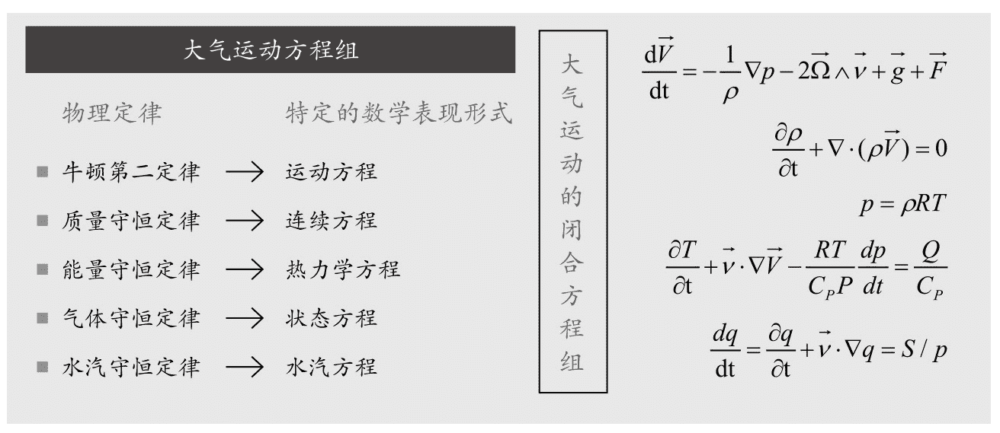
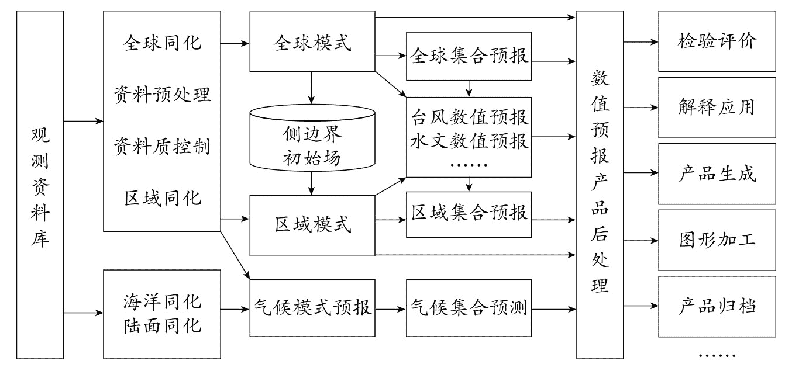
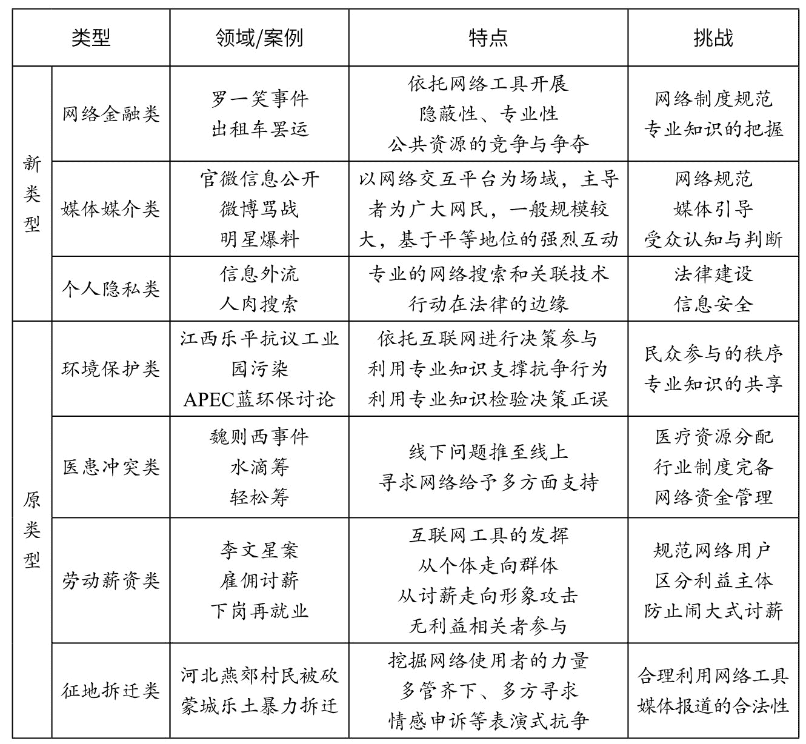
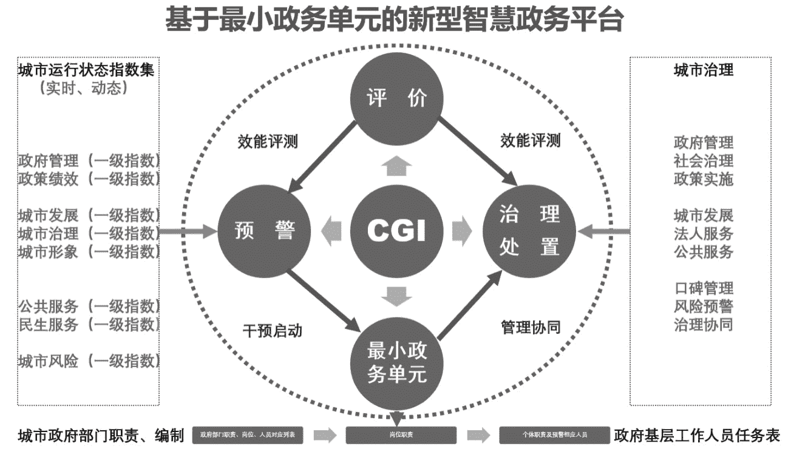
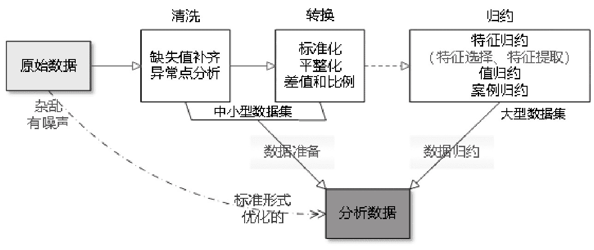
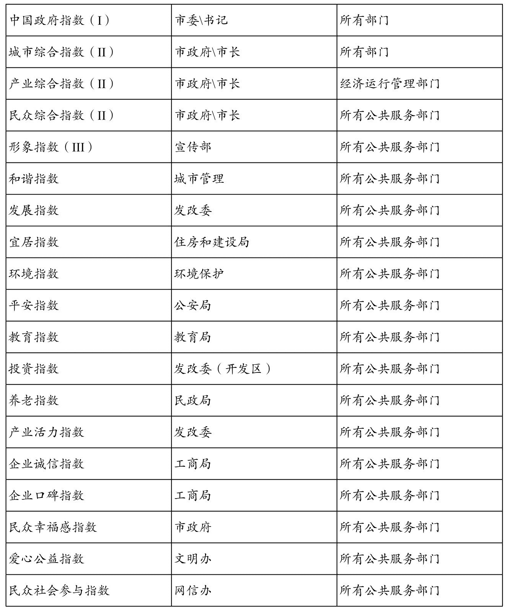

# 人工智能时代的风险治理

## Recommendations

### Recommendation by Professor Cheng Lin

Former Party Committee Secretary and President, Chinese People's Public Security University  
Standing Director, China Law Society  
President, China Police Law Research Association

A grand vision embracing the world determines a scholar's academic height and theoretical horizon. Dean Yang's *Risk Governance in the Age of Artificial Intelligence*, a monograph on risk governance with profound social significance and distinct characteristics of the times, once again makes us deeply feel the Chinese intellectuals' compassion for humanity and their great sense of responsibility—"to establish a heart for heaven and earth, to establish a destiny for the people, to inherit the lost learning of the past sages, to create peace for all generations." This book conducts systematic research on risk issues and governance from history to the present, from theory to practice, possessing strong theoretical and practical value. It has certain reference value for studying and implementing General Secretary Xi Jinping's important discourses on risk governance. I believe the publication of this book serves as a strong warning to the whole society and holds significant educational value for risk capability.

Faced with risk, seeking advantage and avoiding harm is human instinct.

Risk governance involves not only big data, nor is it merely a technical issue.

Risks manifest as various events or certain trends. Natural disasters and man-made calamities are typical traditional risks.

When it comes to risk, each of us has our own cognition. Any natural or man-made change that brings disorder to social individuals or organizations may be a potential risk. Risk is a mutation factor in governance; how to govern this factor can even determine the survival or demise of a person or an institution. The ability to perceive risk determines the future of a political governance order, an organization, a group, or a social individual.

Artificially creating risks, utilizing risks, creating risks for others, or transferring one's own risks to others under the premise of ensuring safety and controllability is another form of "sophisticated selfishness" or "harming others for self-benefit." However, this is an extremely dangerous game, because its consequences are often uncontrollable and may well backfire.

With the advancement of globalization, the world has become a pluralistic whole. Any local change may trigger global shocks or changes. From the perspective of progress, these risks bringing change are one of the driving forces of social progress. The development of human society has always been a process of growing and progressing by embracing and solving one risk after another. From a systems theory perspective, the "butterfly effect" is the best interpretation of how risk changes the world.

Research shows that 8% of DNA segments in human genes come from viruses in nature. It is these viruses that have reshaped human genes and prompted humans to coexist more harmoniously with this world. The cognition and acceptance of risk is an objective reality that humanity must face. For an organization, accepting and preventing or altering the trajectory of risk and the consequences it brings is a core issue that must be faced. The subversion and change risk brings to society are sometimes benign, capable of driving certain progress, but more often they bring destruction and ruin. Ulrich Beck, the German sociologist and author of *Risk Society*, said that the risks of postmodern society have arrived comprehensively, challenging the civilizational framework and risk reality formed by industrial society. He said, "The 'post' is the code for helplessness, trapped in vulgar fashion; it 'points to a transcendence difficult to name,' which is the 'basic prescription with which we confront a fragmented reality'." Therefore, for humanity to succeed, "only a hard struggle against old theories and habits of thought" will suffice.

We need to re-examine all the changes brought to us by this monster called risk. Only by actively responding, effectively avoiding, and reasonably utilizing risks, striving to make risk a driving force for the progress and development of our society, can we achieve the core of risk governance. This requires wisdom.

Risks vary in magnitude, but risk response are the core tenets of risk governance. An ancient saying goes: "A good doctor treats a disease before it arises, so the person stays alive; a sage governs a disorder before it exists, so the world is at peace." That is, living in peace but is the correct method. Modern social risks often have global characteristics—"pull one hair and the whole body moves." This "global" has two meanings: first, the scope of risk impact is wide, and the harm caused is often society-wide or even global; second, the destructive nature of risks across all fields—a risk in one field often triggers risks in other fields to appear simultaneously, leading to a superposition of different risk harms and increasing the destructive power of risk. Therefore, modern social risk governance should follow systems theory and a global perspective, forming an overall, systematic, and scientific risk governance framework. Prevent risks from appearing at the "shortest stave of the wooden bucket" and the weakest link of social governance, triggering global harm.

Crisis is a collection of major social risks; a specific crisis is a specific major risk. In terms of scale and destructiveness, crisis is far more destructive than ordinary risks, with a wider impact scope and longer duration. Vigilance against crises or major social risks can never be taken lightly at any time.

Risks can trigger major safety hazards. If risk cognition is insufficient, prevention weak, response untimely, handling improper, and post-event remediation lacking, it will lead to serious social crises and bad consequences. Therefore, attention to risk is attention to crisis; attention to crisis is attention to safety.

# Chapter 2 Risk Research and Risk Strategy

## 2.1 Risk Science and Risk Strategy

Risk Science, or Risk Research, is the science studying risk discovery, risk prevention, risk governance, and risk response. The purpose of risk science is risk insight and discovery, trend analysis, assessment and response, to enhance social governance and public service capabilities, and resolve social contradictions and various crises. Risk governance includes traditional social risk governance and cyberspace risk governance.

## 2.2 Introduction to Cyberspace Risk Governance

Cyberspace risk governance includes the collection, analysis, and risk assessment and early warning of various types of social information carried by cyberspace. Cyber risks possess a destructive effect on the real social environment, hindering the realization of social goals. Cyber risks mainly originate from three aspects: first, the risk of failing to grasp public sentiment and public opinion; second, the risk of reverse psychological mobilization of the general public by various subjects in cyberspace; third, the risk of cyber risks transmitting offline.

Cyber risk governance includes risk discovery, risk early warning, crisis response, emergency management, etc. So-called cyber public opinion monitoring or public opinion studies mainly involve research on risk discovery and analysis centered on the communication characteristics of various cyber public events.

In a sense, the collaborative system of risk analysis, risk early warning, and risk governance is the most core component of the "Internet + Supervision" and "Data + Inspection" systems. The essence of risk analysis is interest analysis, and interest analysis is in turn one of the core considerations for evaluating the merits of risk governance measures and social risks. The essence of risk governance decision-making is also a choice of interest trade-offs.

So-called interest analysis or interest motivation analysis is a method of observing social and historical phenomena from the perspective of interests, understanding their essence and roots, and grasping their motives through the words and deeds of various social subjects. It is a very important tool for people to grasp the realistic interest pattern and correctly formulate strategies. The interest analysis method has universal applicability, effectiveness, and pertinence in the social field and the process of human social development.

Interest issues are both the fuse of major social events and their fundamental and deep-seated causes. Therefore, to grasp the essence of major social events, besides understanding the facts of their formation and development, it is more important to grasp their interest roots; only then can one avoid being confused by their false appearances and grasp their essence, motives, and development trends. The different positions of various classes and social groups in society determine their basic attitudes. Analyzing social relations and the entire interest pattern is the basis for formulating strategies. Social subjects advocate, plan, and implement any decisions out of certain interest motives; therefore, social risk governance policies and risk response strategies must be determined based on who benefits from the social event and the nature and degree of the interests involved.

Good governance must be a series of decision-making actions based on the principle of maximizing public interest or maximum security; it is also the embodiment of the fundamental principle and core purpose of "serving the people wholeheartedly."

Faced with a complex internal and external environment and various uncertainties, how to improve the overall level of social risk early warning and how to enhance risk response capabilities—making decisions based on data and speaking with data—should become the decision-making paradigm for leaders at all levels. Before the introduction of any major decision involving the overall situation, there must be a prior risk assessment and a social efficiency analysis of policy implementation. Efficiency analysis includes qualitative and quantitative analysis of risks, qualitative and quantitative assessment of risk consequences, qualitative and quantitative evaluation of risk governance countermeasures, and performance evaluation of risk governance policies.

Traditional decision-making may encounter decision failure in certain scenarios, potentially leading to social disasters and public interest losses. One reason for decision failure is the serious information asymmetry problem faced by decision-makers regarding information related to the decision object. The decision-making process is a process of continuously resolving information asymmetry. The information asymmetry required for decision-making manifests as an insufficient grasp of the historical, current, or future trend information of the decision object. In other words, the incomplete grasp of various types of information required to support decisions, or the existence of information asymmetry, is absolute; while fully and comprehensively grasping all kinds of effective information required for decisions is relative. The process of decision-making assessment is the process of continuously eliminating information asymmetry and maximizing benefits while avoiding harm to the greatest extent. In this process, big data and artificial intelligence will play important roles; traditional decision-making processes are being redefined by data and algorithms, and the wave of a decision-making revolution driven by the "social machine" has arrived.

Enhancing a sense of vigilance, establishing risks of enterprises to strategic environmental uncertainty: Avoidance (`Being avoidance`), Control (`Control`), Cooperation (`Cooperation`), Imitation (`Imitation`), and Flexibility (`Flexibility`). His research on risk leans more towards the study of enterprises or organizations facing uncertainty risks.

Ulrich Beck said in his *Risk Society* that dangers are constantly growing, but in the political sphere, dangers have not been transformed into preventive risk control policies; this is a fact. He said that the political subject (or social majority) of class society is the proletariat, while the object of risk society leaves only the suffering of all people.

Adrian J. Slywotzky, author of *Strategic Risk Management* [[1]](#Chapter_6_1.xhtml#B2), believes that no matter how large a company is, it may be severely damaged because it did not anticipate a transformation or was not prepared for it. Strategic risk is actually greater when a business is sailing smoothly. Precisely when you want to relax or feel complacent is when you should be tense and doubly vigilant. The book introduces seven strategies for turning crises into breakthrough growth: improving the odds of winning; understanding, not guessing, customer needs; preparing for two contingencies; beating unbeatable opponents; updating business models to protect brands; cooperating with competitors to escape the zero-profit zone; creating new forms of demand to expand the pie.

Now, social risk strategic management should include the entire process of overall planning and rational response by social organizations at all levels to all factors that may break the conventional system in the external and internal environments faced by the organization, as well as the anticipation, avoidance, response, utilization and transfer, and disposal of possible structural changes.

Risk strategic management includes static pre-event rehearsal, dynamic in-event disposal, and post-event repair. Risk strategy possesses the characteristics of systemicity, foresight, globality, synergy, strategy, operability, and interest maximization.

---

[[1]](#Chapter_6_1.xhtml#BT2) Adrian J. Slywotzky is the Global Vice President of Mercer Management Consulting and a renowned best-selling author, hailed by *Industry Week* as the "Peter Drucker of the 21st Century, a Management Master Surpassing His Peers." He is the author of influential bestsellers such as *The Profit Zone*.

## 2.3 The Theoretical System of Risk Society

Risk society refers to a stage of social development in the context of globalization where global risks caused by human practice occupy a dominant position. In such a society, various global risks pose serious threats to human survival and development.

With the increase in the frequency of human activities and the expansion of their scope, the influence of their decisions and actions on nature and human society itself has also greatly increased, causing the risk structure to gradually evolve from one dominated by natural risks to one dominated by man-made uncertainties. Furthermore, there is the "institutionalization" of risk and the "risk of institutionalization." Humans possess an adventurous nature but also an instinct for safety; a series of institutional creations since modern times have provided an environment for realization and a normative framework for these two contradictory orientations. Various institutions related to the market (typically the stock market) provide incentives for adventurous behavior, while various institutions established by the modern state provide protection for human safety. However, whether they are adventure-oriented or safety-oriented institutions, they themselves bring another risk—the risk of operational failure—thereby transforming the "institutionalization of risk" into "risk of institutionalization."

In 1986, Beck published *Risk Society* in Germany. The synopsis of this book states that Ulrich Beck interprets postmodern society as a risk society, its main characteristics being: humanity faces risks manufactured by society that threaten its existence. The society we live in is filled with an attitude of organized irresponsibility; especially, the manufacturers of risks protect their own interests at the expense of risk victims. The author believes that Western economic, legal, and political systems are not only involved in the manufacture of risks but also participate in covering up the truth of risks. Beck strongly advocates reflexive modernization, characterized by both insight into the dilemma of rationality in modernity and an attempt to resolve this dilemma with a rational spirit. [[1]](#Chapter_6_2.xhtml#B3)

Beck believes that the concept of risk society refers to a stage of modernity. In this stage, the threats produced on the path of industrial society begin to dominate. The concept of risk society brings about epochal systemic transformations in three reference areas. First is the relationship between modern industrial society and natural and cultural resources, which gradually disappeared after modernization was fully established; second is the relationship between society and the threats and problems it produces itself, which exceed society's understanding of safety. Once people realize the existence of these threats and problems, they are likely to shake the fundamental assumptions of the old social order; finally, the sources of collective or specific group meaning in industrial society culture (such as class consciousness or belief in progress) are drying up and losing their charm. In Beck's view, one of the core problems of industrial society is the distribution of wealth and the improvement and legitimization of inequality. In risk society, however, we must take the mitigation and distribution of harm as the core problem. In classical modernity, wealth and power are its signature concepts, while risk and uncertainty are the concepts of reflexive modernity.

Beck's *Risk Society* remained silent for several years until it was translated into English by Mark Ritter in 1992; only then did "risk society" become accepted by more Western scholars and the public as a concept and theory.

Risk society as a concept is not in the sense of historical periodization, nor is it a specific historical stage of development of a certain society and country, but rather a vivid depiction of the characteristics of the era in which humanity currently finds itself. Therefore, we can say that humanity is in the era of risk society, but we cannot say that a certain country is a risk society, even if that country's domestic situation is more insecure than others. However, risk society is not only a cognitive concept but also an emerging order and public space. In the latter sense, it is more realistic and practical. As Giddens, Beck, and others have said, the order of risk society is not hierarchical or vertical, but network-based and horizontally expanding, because risks in risk society are "egalitarians," sparing no one. The structure of risk society is not composed of elements such as classes and strata, but of individuals as subjects. Nation-states with clear geographical boundaries are no longer the sole governing subjects of this order; the cross-border nature of risks requires more governing subjects to emerge and reach cooperative relationships.

In risk society, risks possess the following characteristics:

(1) Fundamentally speaking, risks are endogenous, accompanying human decisions and behaviors, and are the joint result of the normal operation of various social systems, especially industrial systems, legal systems, technology, and applied sciences. The increase in the degree of "humanization" of nature makes the endogenous characteristics of risks even more obvious.

(2) In terms of impact and consequences, risks are extensive. Their spatial impact is global, transcending the limitations of geographical boundaries and socio-cultural boundaries; their temporal impact is continuous, capable of affecting future generations.

(3) In terms of characteristics, most risks have severe consequences but a low probability of occurrence. Therefore, we can say that although risks have increased, it does not mean that the world we live in has become unsafe.

(4) In terms of response methods, existing risk calculation methods and economic compensation methods are difficult to fundamentally solve the problems. New mechanisms for responding to risks must be constructed by enhancing the reflexive capacity of modernity.

---

[[1]](#Chapter_6_2.xhtml#BT3) Ulrich Beck: *Risk Society*, Beijing: Yilin Press, 2004, pp. 15–22.

## 2.4 Dilemmas of Global Risk Governance

The definition of modern risks has changed significantly compared to previous risks: first, man-made and subjective risks have greatly increased; second, organized and systemic sources of risk have clearly emerged; third, risk governance means have shifted from relying solely on technological progress to tending towards multi-dimensional governance systems.

The emergence and development of modern risks are closely related to the theory of reflexive modernity. The theory of reflexive modernity incorporates the entire modernization process into its scope of thought, interpreting its structural fractures as consequences of modernization itself. Here, reflexivity contains a double meaning: one is self-refutation (`self-refutation`), and the other is self-reflection (`self-reflection`). Self-refutation refers to the irrational or even anti-rational consequences incurred by modernization centered on science and rationality, which continuously dissolve the foundations of its own existence; self-reflection represents the reflection of rationality—which pursues self-knowledge and certainty—on its own nature, thereby possessing the possibility of destroying its ability to acquire certain knowledge. Therefore, the study of modern risks possesses both the essence of modernity and the orientation of postmodernity. The essence of modernity is expressed in the value orientation of seeking value rationality for the development of the modern economy, and also in seeking a basis for the ethical spirit of modern society; the orientation of postmodernity is expressed in the perplexed questioning, value reflection, and critique and sublation of modern ethical methods regarding modernity and modernization. The study of modern risks faces many dilemmas: the dilemma of risk facts vs. risk judgment, the dilemma of the present vs. the future of risk, the dilemma of the individuality vs. publicity of risk, etc. Consequently, this inevitably requires risk governors to make effective and reasonable ethical decisions, thereby transcending risk itself and achieving the moral governance of modern risks.

The most negative phenomenon in risk governance is risk avoidance, the so-called "governing by non-action" and "do less to make fewer mistakes, do nothing to make no mistakes."

The difficulty of governing risk society is based on the ontological insecurity essence of this risk and the various characteristics derived from it. [[1]](#Chapter_6_3.xhtml#B4) It is precisely because of the many characteristics, manifestations, and symptoms of risk that we have the possibility of predicting, controlling, and governing risk. The insight into and generalization of various risk governance dilemmas and problems are prerequisites for effective governance; they therefore require us to have a systematic, comprehensive, and scientific understanding and plans. Generally speaking, compared with daily or procedural decisions, risk decisions have the characteristics of being major, strategic, and complex; the decision-making process needs to be more precise, and the decision-making results need to be closer to the target. Therefore, the risk assessment of decisions needs to design a more reasonable mechanism. The mechanism of decision-making risk assessment is a process of mutual combination of decision-making systems and tools, constituted by analysis, consultation, and judgment.

Risk analysis of decisions is the scientific basis for assessment. Analysis is the process of producing decision-making knowledge using scientific methods, including problem structure analysis, expectations of decision-making results, selection of decision-making plans, and in specific situations, monitoring of decision-making execution results and evaluation of the performance of decision-making plans. Problem structure analysis is the decomposition of the elements of the decision-making problem and the sorting out of the relationships between elements. Usually, the problems that decision-making risk assessment needs to solve present complex relationships among their elements, rather than simple linear relationships. In other words, problems where elements present linear relationships are incorporated into daily procedural decisions, while complex relationships among elements require the support of interdisciplinary knowledge. These complex relationships are reflected in the multiple fields involved in risks, or in stubborn problems in a single field that have long been wanted to be solved but could not be. From the perspective of the degree of structuring, the complexity of the problem is mainly manifested in: unclear evolution mechanisms and paths, requiring multi-dimensional observation; the problem has multiple alternative solutions; the problem involves multiple interested actors, and there are conflicts of interest, needs, and values among the actors. Problem structure analysis aims to depict the above characteristics and provide a scientific basis for identifying the degree of problem complexity. Analysis of expected decision-making results requires the support of data, information, and knowledge. From data to information, and then to the formation of knowledge, this analysis process reflects the gradually clarifying understanding of future expectations. Data presents individualized and quantitative characteristics; the process of analyzing data constitutes the source of various types of information; through scientific research, information is transformed into knowledge, and knowledge becomes the presentation form of expectations for decision-making results. The selection of decision-making plans is both a value judgment and a factual judgment based on value analysis and comparison.

The institutions usually engaged in decision-making risk analysis fall into three categories: scientific research institutions of universities and research institutes, social professional research institutions, and research institutions within the government system. These institutions possess the attributes of think tanks. Experts and think tanks provide risk analysis for decision-making and provide multiple types of knowledge.

Decision-making risk assessment needs to build a consultation mechanism. Behind the decision-making to solve complex problems lies the need to face the competition and conflict of multiple interests. Risk assessment needs to construct a mechanism to resolve value and interest conflicts. Because the analysis process only solves the scientification of the decision-making plan, but does not solve the feasibility and rationality of the plan, the decision-making process itself needs dialogue and participation centered on consultation among multiple actors. For decision-making risk assessment, the exchange of interests, needs, preferences, and emotions among multiple actors can improve the quality of risk assessment, make the decision-making plan more precise, and make execution smoother. The multi-level and multi-channel consultative democracy construction currently vigorously promoted by the Party and the government has important significance for advancing decision-making risk assessment.

Decision-making risk assessment also needs the support of local knowledge and practical experience; this knowledge makes up for the insufficiency of the universal knowledge provided by the analysis process, thereby comprehensively improving the quality of decision-making risk assessment. Local knowledge and practical experience enter the decision-making risk assessment process through multi-subject consultation methods. Successful consultation also requires guarantees such as information disclosure, actors possessing consultation capabilities, substantive participation, and the creation of equal consultation opportunities.

# Chapter 3 Decision Risk Assessment Mechanism

## 3.1 Leading Cadres' Risk Judgment Capability

Decision risk assessment is inseparable from the decision-maker's judgment. The political capability of leading cadres at all levels, this "critical few," is first reflected in their judgment of decisions. Judgment requires not only a certain quantity and quality of data, information, and knowledge, but also the courage to make prompt decisions and the ability to grasp major trends. Leading cadres' risk judgment should be established on the basis of four aspects: attention, value discernment, risk perception, and experience. What leading cadres pay attention to or ignore is the primary choice in decision risk assessment; only issues that attract the attention of leading cadres can possibly become policy agendas and enter the risk assessment process. The judgment of risk attributes and whether to take decision-making actions is a typical value discernment process. Value discernment takes public interest as the criterion; whether to make a decision and what kind of decision to make are all based on specific values. Value discernment is also a process of balancing value conflicts. Risks imply value conflicts and confrontations; risk assessment is the process of seeking value identity; therefore, how to balance value conflicts embodies the leading cadres' risk judgment capability. Situational awareness of risks is the leading cadres' judgment of risk consequences when making decisions. The attention and value discernment of leaders focus on whether there is a risk, that is, the possibility of risk occurrence; while risk perception is the judgment of the consequences formed by risks, and the range of risk consequences the decision-maker can bear. The decision-maker's risk management experience can form intuitive judgments on the trend of risk evolution, thereby making up for the lack of knowledge at the analytical and negotiation levels.

Analysis, negotiation, and judgment, and their interaction, are the main modes of operation of the decision risk assessment mechanism. The three are inextricably linked and indispensable. Analysis is the starting point of knowledge production, negotiation is the exchange of knowledge, preferences, and needs, and judgment is the final decision. Under their combined effect, the quality of decision risk assessment can be continuously improved, further perfecting the risk prevention and control mechanism.

## 3.2 "Black Swan Events" and "Gray Rhino Events"

A "Black Swan Event" refers to an event that is very difficult to predict and unusual. Such events usually trigger chain reactions in society and possess extreme destructiveness. "Black Swan Events" may occur in any field, including politics, economy, diplomacy, military, public governance, public health, and others. "Black Swan Events" may be triggered by natural disasters or caused by human social activities.

Nassim Nicholas Taleb proposed the definition of Black Swan Events in his book *The Black Swan*. Taleb defines events with the following three characteristics as "Black Swan Events": First, the event has unexpectedness, meaning it lies outside regular expectations, i.e., there was no evidence in the past to convincingly point to its possibility of occurrence; Second, the event produces extreme consequences; Third, although the event has unexpectedness, human nature compels us to fabricate reasons for its occurrence after the fact, and to a greater or lesser extent, consider it explainable and predictable. In short, these three points summarize as: rarity, extreme impact, and retrospective (not prospective) predictability.

A "Gray Rhino Event" refers to high-probability risk events that are often prompted but not given sufficient attention or often ignored. The term "Gray Rhino Event" comes from Michele Wucker, a Guggenheim Fellow, in her book *The Gray Rhino: How to Recognize and Act on the Obvious Dangers*. "Gray Rhino Events" are metaphors for high-probability, high-impact potential crises, while "Black Swan Events" are metaphors for low-probability, high-impact events. The book proposes that "Gray Rhino Events" mainly refer to obvious, high-probability events that are repeatedly ignored by people and may eventually brew into major crises. People spend a lot of time and energy on things that shock the psyche and emotions but have extremely low probability of occurrence, thus failing to notice those things with extremely high probability that should be prevented early. If one is looking for a "Black Swan," it is impossible to see the "Gray Rhino."

"Gray Rhino" and "Black Swan" are events relative to their scale, predictability, or perceptibility; both types of events have enormous destructive power to society. "Gray Rhino Events" are risks so common that people take them for granted; "Black Swan Events" are extremely rare, unexpected risks. Often, these two types of events may appear intertwined or simultaneously. And "Black Swan Events" often become the fuse and catalyst for "Gray Rhino Events."

# Chapter 4 Big Data and Risk Intelligence Discovery

Regarding `Big Data`, Gartner gives the following definition: information assets characterized by such a high volume, velocity, and variety that they require new processing models to enable stronger decision-making power, insight discovery, and process optimization capabilities; McKinsey Global Institute defines it as: a dataset whose scale is so large that it greatly exceeds the capabilities of traditional database software tools in terms of acquisition, storage, management, and analysis, possessing four major characteristics: massive data scale, fast data flow, diverse data types, and low value density.

`Artificial Intelligence`, abbreviated as `AI`. It is a new technical science that researches and develops theories, methods, technologies, and application systems for simulating, extending, and expanding human intelligence. The core of artificial intelligence technology is the collection, processing, analysis, and utilization of big data.

The strategic significance of big data and artificial intelligence technology lies not in mastering huge amounts of data information, but in the specialized processing of these meaningful data, in improving the "processing capability" of data, and realizing the "value-added" of data through "processing." Technically speaking, the relationship between big data and cloud computing is as inseparable as the two sides of a coin. Big data inevitably cannot be processed by a single computer and must adopt a distributed architecture. Its feature lies in distributed data mining of massive data. But it must rely on cloud computing's distributed processing, distributed databases, cloud storage, and virtualization technology. With the advent of the cloud era, big data has attracted increasing attention.

Big data is usually used to describe large amounts of unstructured and semi-structured data, which would incur higher costs when downloaded into relational databases for analysis. Big data analysis is often associated with cloud computing and artificial intelligence, because real-time analysis of large datasets requires frameworks like `MapReduce`[\[1\]](#Chapter_8_1.xhtml#B5) to distribute work to thousands of computers. Both big data and artificial intelligence require special technologies to effectively process large amounts of data and analyze these data with specific mathematical analysis models to help and support people in completing specific scenario data support and certain practical application needs.

The enormous significance of big data and artificial intelligence in economic development does not mean they can replace all rational often concern survival. Ancient and modern, Chinese and foreign cases of national subversion, regime collapse, corporate bankruptcy, and severe damage to personal reputation caused by neglecting risk discovery and scientific prevention and control are numerous.

Data shows that 70% of information security risks come from inside the system, perpetrated by insiders. This fully verifies a saying: the fortress is most easily breached from within.

## 4.1 Overview of Risk Intelligence

The discovery of risk indicators possesses immense social value; identifying risks is the key to risk governance and the primary task of risk governance. This information has already acquired the significance of intelligence. So-called risk intelligence refers to discovered or transmitted risk clues, risk knowledge, or risk facts; it is specific information or knowledge discovered, received, and transmitted using certain methods and means. Risk intelligence, threat intelligence, and security intelligence are all crisis clues, security clues, and risk clue information within a specific domain.

According to Gartner's definition of threat intelligence, threat intelligence is evidence-based knowledge, including context, mechanisms, indicators, implications, and actionable advice. This knowledge relates to existing or emerging threats or hazards faced by assets and can be used to provide informational support for asset-related subjects' response or handling decisions regarding threats or hazards. Most so-called threat intelligence in the industry can be considered narrow-sense threat intelligence; its main content consists of indicators of compromise (IoCs) used to identify and detect threats, such as file `HASH`, `IP` addresses, domain names, program execution paths, registry keys, etc., as well as related attribution tags. Threat intelligence aims to provide asset subjects facing threats (usually the enterprises or institutions owning the assets) with comprehensive, accurate, relevant, actionable, and decision-supportive knowledge and information.

### Classification of Threat Intelligence

Threat intelligence is usually divided into the following four categories:

**Strategic Threat Intelligence (`Strategic Threat Intelligence`)**. Strategic threat intelligence provides a global perspective on the threat environment and business issues. Its purpose is to inform the decisions of the board of directors and senior executives. Strategic threat intelligence usually does not involve technical intelligence; it mainly covers aspects such as the financial impact of cyberattack activities, attack trends, and areas that may affect senior business decisions.

**Operational Threat Intelligence (`Operational Threat Intelligence`)**. Operational threat intelligence relates to specific, imminent, or anticipated attacks. It helps senior security personnel predict when and where attacks will occur and conduct targeted defense.

**Tactical Threat Intelligence (`Tactical Threat Intelligence`)**. Tactical threat intelligence focuses on the attacker's `TTP` (Tactics, Techniques, and Procedures). It relates to specific attack vectors used by attackers targeting specific industries or geographical regions. It ensures that personnel such as incident responders have corresponding response and action strategies prepared for such threat attacks.

**Technical Threat Intelligence (`Technical Threat Intelligence`)**. Technical threat intelligence mainly consists of indicators of compromise (IoCs) that can automatically identify and block malicious attack behaviors. Currently, the threat intelligence more widely applied in the industry is still primarily at the technical threat intelligence level.

### Sources of Threat Intelligence

Sources of threat intelligence mainly include log data generated by enterprise internal networks, endpoints, and deployed security devices; threat data generated by security vendors and industry organizations; news websites, blogs, forums, social networks; and some relatively closed sources, such as the dark web, underground forums, etc.

### Threat Intelligence Analysis Methods and Models

Commonly used threat intelligence analysis methods and models include `Lockheed Martin`'s `Cyber Kill Chain`, the Diamond Model, and `MITRE ATT&CK`.

### Overview of Security Intelligence

Security intelligence refers to all security information affecting system security behavior. Broadly speaking, security issues are an important practical concern widely attended to by current nations, governments, enterprises, society, the public, and academia. Security intelligence is crucial for safeguarding social security. Therefore, security intelligence research holds significant theoretical and practical significance, covering all aspects of society.

Security intelligence is the prerequisite and foundation for carrying out system security management work; it is the "eyes, ears, vanguard, and think tank" of system security management.

### Value of Security Intelligence

The fundamental cause of system security management failure is the lack of security intelligence. Regarding system security management, the value of security intelligence lies in solving the problem of missing security information in system security management. Accordingly, based on the classification of system security management activities (i.e., security prediction activities, security decision-making activities, and security execution activities), the value of security intelligence mainly lies in the following aspects:

1.  **"Discoverable, Accurate, Early"**: Security intelligence can serve as the system's security prediction (early warning) support system. It is a prerequisite for grasping the initiative in system security management. "Discoverable, accurate, early" refers to successful security prediction (early warning), i.e., on the basis of fully collecting, understanding, and mastering various security information, and obtaining effective security intelligence through analysis of this information, thereby making forward-looking, correct, scientific, and precise security predictions based on security intelligence. In other words, security intelligence helps discover system security threats and security promotion opportunities, and by increasing early warning time, it increases the reaction time for system security managers, thereby gaining an advantage in system security risk control and achieving prevention before problems arise.
2.  **"Decide Well, Decide Fast, Decide Economically"**: Security intelligence can serve as the system's security decision-making support system. It is the basic requirement for formulating system security management plans. "Decide well, decide fast, decide economically" refers to successful security decision-making, i.e., on the basis of comprehensive assessment of various security prediction intelligence, making scientific, reliable, effective, and economical security decisions quickly based on the best security intelligence.
3.  **"Control Early, Control Solidly, Control Effectively"**: Security intelligence can serve as the system's security execution support system. This is the ultimate goal of system security management response. "Control early, control solidly, control effectively" refers to successful security execution, i.e., according to security decision intelligence, by timely, effective, and thorough implementation of security decision plans (mainly various security measures, including emergency management measures), striving to prevent and control various unsafe events, or reducing the adverse consequences of unsafe events and minimizing their impact through effective emergency management measures.

"Security intelligence can also serve as an important security learning system, not only helping system security managers continuously access new security concepts and advanced security management methods, but also allowing them to learn lessons from accidents. In short, security intelligence work can not only provide specific clues and ideas for security management work but also provide basis and reference. Security intelligence work is an important way to obtain security intelligence; only when security intelligence work is done solidly and effectively can 'proactive prevention,' 'sharp eyes and ears,' and 'precise policy implementation' be achieved in security management. Furthermore, the realization of security intelligence value must rely on actively advocating and practicing the concept of 'intelligence-led security management'."[[4]](#Chapter_8_1.xhtml#B8)

### Main Characteristics of Intelligence Information

Knowledgeability, transmissibility, value, confidentiality, and timeliness are the main characteristics of intelligence information. The discovery and analysis methods of risk intelligence share many similarities and commonalities with those of security intelligence.

## 4.2 Risk Intelligence Analysis and Discovery

The US *Dictionary of Military and Associated Terms* defines intelligence analysis as the process of converting processed information into intelligence to meet known or anticipated user requirements through the synthesis, evaluation, analysis, and interpretation of all-source data.

The purpose of risk intelligence analysis is to provide social governance decision-makers or organizational decision-makers with a complete set of comprehensive decision support and response handling processes regarding risk information.

A risk intelligence analysis platform generally includes multi-source data collection and gathering, application retrieval, decision knowledge base, data analysis (including visual presentation), risk early warning, decision support, task response, action coordination, effectiveness monitoring, and other components.

An analysis states: "A large part of the intelligence obtained in war is contradictory, even more is false, and the vast majority is quite unreliable. This requires officers to have a certain power of discrimination, which can only be obtained through knowledge and judgment of things and people." Faced with increasing amounts of information in modern warfare, if high-quality information cannot be effectively extracted and the large amount of "information dross" mixed within removed, one may fall into an "information trap," thereby being placed at an information disadvantage and unable to seize the initiative in war.

Big data technology is the science of discovering correlations in complex information, revealing hidden facts, and enhancing credibility. It can effectively compensate for the shortcomings of traditional analysis methods in information processing; therefore, strategic situational awareness increasingly requires the participation and support of big data technology.

The scientific nature of risk intelligence data analysis algorithms is crucial for big data processing, directly affecting the accuracy of the conclusions drawn. For strategic situational awareness, it is necessary to apply different algorithms in a targeted manner to collect, question, hypothesize, supplement data, verify, and evaluate various signs or indications of specific events. This process often needs to be repeated cyclically and continuously corrected to improve the accuracy of conclusions. However, the logical basis of relevant algorithms is mostly based on human judgment; although human judgment may be corrected subsequently, if the initial direction is wrong, the conclusions may drift further and further from the truth.

For situational awareness, big data processing algorithms need to be determined based on time, situation, and event. One-sided or rigid algorithms will produce serious errors, while full human intervention will introduce certain subjectivity. The contradiction between the two needs to be well coordinated and resolved to truly enhance the effectiveness of perception. At the same time, different data scenarios, requirements, and application scenarios also determine the differences or pros and cons of the algorithms used. Only in the process of continuously adjusting, correcting, and testing and comparing relevant algorithms can the most efficient algorithms close to the laws of reality evolution and development be found.

Discovering the laws of risk evolution and early warning intelligence through big data analysis methods provides necessary decision support for effectively combating and preventing risks. The continuous advancement of informatization in the field of national security has brought about the continuous improvement and enhancement of information and data awareness among various departments, which has also led to the generation of massive amounts of data in actual work. Within such vast-scale data lies valuable content yet to be discovered. To effectively utilize massive data, specialized and efficient analysis tools are essential. The practical application of data mining-related technologies will be an important way to effectively solve this demand.

The development of computer application technology can be roughly divided into three aspects: numerical computation, data processing, and knowledge processing. Among them, numerical computation mainly focuses on algorithm research; the main object of data processing is massive data, and database language is its most representative language. With the development of technology, information management systems emerged based on databases, mainly functioning to facilitate querying, modification, and aggregation of databases, and to provide required calculation results in a timely manner to improve database management efficiency. However, actual work has found that for complex systems, relying solely on manual methods to propose calculation indicators makes it difficult to effectively manage databases. At this point, the most effective solution is to have computers replace manual labor in optimizing models and then proposing specific solutions.

The longer a database is used, the more data it accumulates. With the massive collection and accumulation of data, it becomes exceptionally important to mine useful information from it using effective methods. Solutions are always born alongside problems. Bill Inmon, the father of data warehousing in the US, proposed the concept of a data warehouse in *Building the Data Warehouse*: a data warehouse is a subject-oriented, integrated, relatively stable, time-variant collection of data that supports management decision-making. Its main function is to reorganize and process data scattered across different platforms to form a dataset primarily oriented toward decision-making. The most fundamental characteristic of a data warehouse is that its data is not newly generated or proprietary data, but a re-integration of data from other databases. The establishment of a data warehouse does not replace the original databases but establishes a more comprehensive and complete information application platform to support high-level decision analysis.

A data warehouse is a new application developed on database technology. Its most prominent feature is the use of a database management system to manage data, reflected in four characteristics: subject-oriented, highly integrated, system stability, and large data volume. During operation, a data warehouse also requires front-end access tools such as visualization tools and Online Analytical Processing (OLAP). Visualization tools display data graphically to understand the characteristics of data structures. OLAP enables online analysis functions. Mining and analyzing useful information from such long-term accumulated data to achieve the main task of knowledge discovery. `Data Mining` is the processing procedure of `Knowledge Discovery in Database` (KDD) and is also the most critical step in knowledge discovery. Its specific meaning is the process of extracting potentially useful information from a database according to specific requirements.

Artificial intelligence, statistics, etc., are also the most commonly used tools for knowledge discovery and data mining. The concept of artificial intelligence was first proposed at a seminar held at Dartmouth College. By the early 1970s, artificial intelligence entered a new peak of development, producing a large number of successful expert system applications. In the late 1980s, artificial neural network research pushed artificial intelligence to a new height again. Branches related to artificial intelligence, such as expert systems and machine learning, are also developing rapidly. Typical expert systems in real cases have two parts: one is knowledge base + inference engine + human-computer interface, which is somewhat similar to the aforementioned decision support systems; the other is artificial neural network systems, mainly implementing functions such as statistics, regression, and clustering. Knowledge discovery and data mining comprehensively apply these technologies to discover patterns from large amounts of data, extract models, and form new knowledge. Although there is specialized software now, the technology cannot be said to be very mature. People have realized that using data mining technology to find information relevant to industry work is a necessity for every industry to adapt to the development of the information age. Therefore, the effective application of data mining technology in various industries is gradually receiving research and attention.

The *Cihai* dictionary explains "intelligence" as: "Situations concerning the enemy's military, political, economic, and other aspects obtained by reconnaissance or other methods, as well as the results of analysis and research on these situations"; "Generally refers to all latest situation reports, such as scientific and technical intelligence."

Social security risk intelligence work utilizes various technical means to collect, analyze, assess, and synthesize content, ultimately forming various forms of risk intelligence products. With the development of modern information technology, users can obtain more resources with the help of databases and search engines, and conduct preliminary analysis and assessment through data analysis systems. Among general information acquisition and analysis means, data mining is one of the most important technologies. Users can use data mining technology to build a comprehensive and efficient intelligence analysis and early warning system. Under the new international environment and historical context, relying solely on intelligence personnel to conduct data analysis through induction and reasoning cannot meet the needs. Supported by existing technical conditions, developing data mining and analysis systems suitable for departmental business characteristics will be the only way to enhance risk intelligence discovery capabilities, win the initiative in governance, and thereby build a modern social risk governance system.

## 4.3 Risk Data Mining

Data mining refers to the process of searching for hidden useful information and knowledge from large amounts of incomplete, noisy, fuzzy, and random data through algorithms. Its essence is the application technology for discovering new knowledge. With the rapid development of information technology, the volume of data accumulated by people continues to grow at high speed. The most obvious sign is that data scales measured in `TB` have become the norm for data mining. How to extract the useful information we need from massive data is the core purpose of data mining.

The essence of data mining is to extract or mine useful knowledge from large amounts of data. `Knowledge Discovery in Database` (KDD) is a broad term for data mining, specifically referring to obtaining knowledge from information expressed in various media according to different needs. The purpose of knowledge discovery is to filter out the tedious details of raw data for the user, refine meaningful and concise knowledge from raw data, and report it directly to the user. Data mining is a specific step in knowledge discovery. The difference between them can be understood as: knowledge discovery is more general than data mining, while data mining is a more specific and in-depth concept. The knowledge discovery process consists of the following iterative sequence: data mining, pattern evaluation, and knowledge representation. Data cleaning, data integration, data selection, and data transformation are different forms of data preprocessing for mining preparation. Data mining steps can interact with the user or knowledge base. Interesting patterns are presented to the user as new knowledge or stored in the knowledge base. In a narrow sense, data mining is just one step in this process, albeit a very important one. In a broad sense, data mining is the process of discovering interesting knowledge from large amounts of data stored in databases, data warehouses, or other information repositories.

### Classification of Data Mining Tasks

Data mining tasks can generally be divided into two categories: one is predictive tasks, whose goal is to predict the value of a specific attribute based on other attribute values. The predicted attribute is generally called the target variable, while the attributes used for prediction are called explanatory variables. The other is descriptive tasks, whose goal is to derive patterns summarizing the underlying relationships in the data. Descriptive data mining tasks are usually exploratory and often require post-processing techniques to validate and explain results.

Specific tasks include the following six categories:

1.  **Summarization**. The purpose of data summarization is to concentrate data and describe it concisely. Traditional methods calculate the sum, average, variance, etc., of each field in the database, or use graphical methods for representation. Data mining mainly focuses on discussing data summarization from the perspective of data generalization. The specific concept of data generalization is an analysis process that abstracts and summarizes a large amount of task-relevant data in the database from relatively low-level concepts to higher-level concepts. Since data or objects in a database always contain the most original and basic information, this is to avoid any omission of useful data information. For the convenience of data use, users often hope to process or browse data from a higher-level view; therefore, generalizing data to different degrees is for the convenience of querying.
2.  **Classification**. Classification finds the common characteristics of a group of data objects in the database and divides them into different classes according to a classification model. Its purpose is to map data items in the database to a given class through the classification model. Generally, classification and regression can be used for prediction. The purpose of prediction is to automatically derive extended descriptions of given data from historical data records, thereby predicting future encountered data. The biggest difference between classification and regression is that classification outputs discrete class values, while regression outputs continuous numerical values.
3.  **Clustering**. Clustering, also known as cluster analysis or segmentation, groups cases based on a set of attributes. Cases in the same cluster have more or less similar attribute values. Cluster analysis divides a set of data into multiple categories based on similarity and difference. Its purpose is to maximize the similarity between data within the same category and minimize the similarity between data in different categories. Clustering methods include statistical methods, machine learning methods, neural network methods, etc.
4.  **Association**. Data association is a class of important discoverable knowledge existing in databases. Specifically, if the values of two or more variables exhibit some regularity, it is called association. Association can be divided into simple association, temporal association, and causal association. The purpose of association analysis is to find the hidden association network in the database. However, in many cases, we do not know the association function of the data in the database, or even if we know it, we are not certain; therefore, the rules generated by association analysis carry a confidence level.
5.  **Sequential Patterns**. Sequential patterns refer to patterns with a high probability of recurring discovered through time series. Like regression, it uses known data to predict future values, but the difference lies in the different times at which the variables are situated.
6.  **Deviation Analysis**. Deviation analysis, also known as comparative analysis, refers to the description of differences and extreme special cases, used to reveal abnormal phenomena where things deviate from the norm. There are many abnormal situations in database data. They are inconsistent with the general behavior or model of the data; such data objects are also called outliers. Most data mining methods treat outliers as noise or exceptions and discard them. However, in some applications, rare events may be more valuable and significant than regular events. Databases of anomalous data are very important. The basic method of deviation detection is to find the difference between observed results and reference values.

### Data Mining Methods

Data mining methods are generally divided into the following categories:

1.  **Genetic Algorithms**. A genetic algorithm is an adaptive global optimization probabilistic search algorithm used to simulate the genetic and evolutionary processes of organisms in a natural environment. It was first proposed by Professor `John Holland` of the Computer Science and Psychology departments at the University of Michigan. This algorithm features simple computation and good optimization effects. It also has certain advantages in handling combinatorial optimization problems and can be used for cluster analysis.
2.  **Rough Set Method**. Rough set theory, as a theory for data analysis and processing, was founded by Polish scientist `Z. Pawlak` in 1982. The theory was initially proposed due to language issues. The first international academic conference on rough set theory was held in Poland in 1992. In 1995, `ACM` listed rough set theory as a research topic in emerging computer science. The rough set method is widely used in classification and knowledge acquisition for imprecise, uncertain, and incomplete information.
3.  **Decision Tree Method**. Colloquially, the probabilities of natural states or conditions of a decision problem, action plans, gain/loss values, prediction results, etc., are represented in a tree diagram, which reflects the entire process of human thinking, prediction, and decision-making. The decision tree method uses a training set to generate test functions, establishes tree branches based on different values, and repeatedly establishes the next layer of nodes and branches in each branch set. Thus, a decision tree is generated, then pruned, and finally converted into rules, mainly used for classification and mining.
4.  **Neural Network Method**. An artificial neural network simulates the human way of thinking; it is a nonlinear dynamical system. Its characteristics lie in the distributed storage of information and parallel collaborative processing. Although the structural function of a single neuron is limited, the network system composed of a large number of neurons can achieve extremely rich and diverse behaviors.
5.  **Fuzzy Logic**. It mainly mimics the human brain's uncertain concept judgment and reasoning thinking mode. For systems with unknown models or indescribable systems, as well as control objects with strong nonlinearity and large hysteresis, it uses fuzzy sets and fuzzy rules for reasoning, expresses transitional boundaries or qualitative knowledge experience, simulates the human brain mode, performs fuzzy comprehensive judgment, and reasons to solve rule-based fuzzy information problems that conventional methods struggle with. In the field of data mining, fuzzy logic can be used for fuzzy comprehensive discrimination and fuzzy cluster analysis.
6.  **Cluster Analysis**. Cluster analysis groups or classifies things according to their characteristics. It discovers patterns and typical models from them. After clustering, the dataset is transformed into clusters; the same class has similar data variable values, while different types of variable data values do not possess similar properties. This technique is the most important technique in data mining.

## References

[[1].](#Chapter_8_1.xhtml#BT5) `MapReduce` is a programming model used for parallel computing on large-scale datasets.

[[2].](#Chapter_8_1.xhtml#BT6) The State Council: *Outline of Action for Promoting the Development of Big Data*, Ministry of Commerce of the People's Republic of China website, http://www.mofcom.gov.cn/html/nysczl/2018/9/1536891477862.html.

[[3].](#Chapter_8_1.xhtml#BT7) Christoph koutschan: *The Most Core Key Technology of Big Data—32 Algorithms*, `CIO` Era Academy website, http://www.ciotimes.com/bigdata/169572.html.

[[4].](#Chapter_8_1.xhtml#BT8) Wang Bing, Wu Chao: *The Origin, Evolution Trend, and Connotation of the Concept of Security Intelligence—Speculative Thinking from the Perspective of Safety Science*, *Library and Information Work*, Issue 3, 2019, pp. 45–53.

### (7) Visualization Techniques

This category of techniques refers to the presentation of relatively complex results in forms such as graphics, charts, and curves that are easier for people to understand. Data visualization greatly expands the expressive power of data, facilitating human understanding.

Data mining knowledge discovery algorithms include four major categories: association rule-based knowledge mining, neural network-based knowledge mining, genetic algorithm-based knowledge mining, and rough set-based knowledge mining.

Neural network-based algorithms are a mechanism of learning and integration. They feature high classification accuracy, strong parallel distributed processing capabilities, strong distributed storage and learning capabilities, and excellent fault tolerance among data mining algorithms. They also possess associative memory functions, making them important algorithms in the knowledge discovery category. However, they have a significant drawback: the algorithm cannot observe the learning process, and the interpretability of the output results is extremely low. Additionally, neural network model training takes too long and may even fail to achieve the learning objective, requiring a large number of parameters.

Genetic algorithms possess rapid random search capabilities, and the search starts from a population, exhibiting parallelism, allowing simultaneous comparison of multiple individuals. The search uses an evaluation function for heuristics, and the process is simple. However, they share a fatal flaw: the programming implementation of genetic algorithms is relatively complex. First, the problem must be encoded, and after finding the optimal solution, the problem must be decoded. Furthermore, they share the same drawback as neural network algorithms: training time is too long.

Rough set-based knowledge mining is a data mining technique mainly used to study incomplete and insufficient information description. It is primarily reflected in the ability to analyze and process fuzzy and uncertain data.

Association rule algorithms are a type of rule-based machine learning algorithm that can discover relationships between items in large datasets. Their purpose is to use certain metrics to distinguish strong rules existing in the database. In other words, association rule mining is used for knowledge discovery and is an unsupervised machine learning method. The `Apriori algorithm` is a classic algorithm in association rule algorithms. The `Apriori algorithm` is mainly used to mine implicit, unknown, but practically existing data relationships. Its core is a recursive algorithm based on the two-phase frequent itemset concept. The `Apriori algorithm` uses the Apriori property, greatly improving the efficiency of level-wise generation of frequent itemsets, and the algorithm is simple, easy to understand, and has low requirements for datasets.

## 4.4 Risk Intelligence Association Rule Algorithm

The `Apriori algorithm` is a classic data mining algorithm for mining frequent itemsets and association rules, first proposed by R. Agrawal and R. Srikant in 1994 (Note: Original text says 1944, likely a typo for 1994). The `Apriori algorithm` uses an iterative method called level-wise search, where `k-itemsets` are used to explore `(k+1)-itemsets`. The implementation sequence is as follows: First, scan the database to accumulate the count of each item in the database and collect items satisfying the minimum support, finding the set of frequent 1-itemsets, denoted as `L1`; Second, use `L1` to find the set of frequent 2-itemsets `L2`, use `L2` to find `L3`, and so on, until no more frequent `k-itemsets` can be found. Each level requires a scan of the database. To improve the efficiency of level-wise generation of frequent itemsets, the `Apriori algorithm` uses the Apriori property of frequent itemsets to prune the search space, which is the most valuable feature of the `Apriori algorithm`.

Traditional `Apriori algorithm` sensitivity issues with new items. Various risk information is constantly updated; previously existing risk behavior characteristics gradually disappear, replaced by the continuous emergence of new risk clues. In response to this, the items covered by the risk information database are also constantly updated. The associations occurring between reduced or added items are constantly changing, generating new association rules. However, the traditional `Apriori algorithm` basically does not consider this problem. In other words, even if new items are added, when calculating the support of each itemset, the algorithm calculates based on the total number of risk information records in the entire database, which does not conform to the purpose of association rule mining. The biggest deficiency resulting from this problem is the inability to discover newly emerging frequent itemsets, and thus the inability to generate the latest association rules.

The biggest defect of the traditional `Apriori algorithm` is its inability to effectively solve the sensitivity problem of new items. This prevents the traditional `Apriori algorithm` from discovering new risk threats in newly aggregated databases in a timely manner, let alone achieving early warning of risks. Therefore, the purpose of optimizing the traditional `Apriori algorithm` is mainly to enhance sensitivity to newly emerging risk intelligence. Facing the continuous emergence of risks, to make risk intelligence analysis work more efficient, applying the sensitivity of newly emerging risks to the optimization process of the `Apriori algorithm` will play a huge role in promoting risk intelligence discovery work.

Currently, although the `Apriori algorithm` itself has been optimized in many ways, some defects still exist in practical applications. For example, when the database size is large, the length of discovered rules increases, and the running time increases significantly, leading to extremely low efficiency. Therefore, some researchers have successively proposed optimization methods for this problem.

The main improvement methods are as follows:

(1) Hash-based optimization method. The hash-based (`Hash-Based`) optimization method can be used to compress the set of candidate `k-itemsets` `Ck` (`k>1`). When scanning each transaction in the database, while generating frequent 1-itemsets `L1` from candidate 1-itemsets in `C1`, we can generate all 2-itemsets for each transaction and hash them into different buckets of a hash table, incrementing the bucket counts. 2-itemsets in the hash table whose corresponding bucket counts are below the support threshold cannot be frequent and are thus removed from the candidate set. This technique is particularly effective when `k=2`; the key is to construct an effective hash function.

(2) Method of reducing transaction counts. This reduces the size of the transaction database scanned by reducing the number of unnecessary transactions, thereby improving mining efficiency. The basic principle is that if a transaction does not contain any `k-itemset`, it must not contain any `(k+1)-itemset` either, so this category of transactions can be deleted.

(3) Partition-based optimization method. The partition-based optimization method adopts a technique of scanning the original transaction database `D` twice. In the first scan, the transaction database `D` is first logically divided into several non-overlapping partitions. The minimum support count for each partition equals the product of `D`'s minimum support and the number of transactions in that partition. For each partition, finding the frequent itemsets in that partition yields local frequent itemsets. Local frequent itemsets may not be frequent itemsets of the entire transaction database, but any frequent itemset of the entire transaction database must appear as a local frequent itemset in at least one partition. Only then can the collection of all local frequent itemsets be used as the candidate itemsets of `D`, called global candidate itemsets. `D` is scanned again to determine global frequent itemsets based on global candidate itemsets and the actual minimum support. The size of each partition and the number of partitions depend on whether the partition can fit into memory.

(4) Sampling-based optimization method. The sampling-based optimization method mines a random sample `B` from a specific database `A`. The shortcoming of this method is low precision, but its advantage is obvious: its efficiency is improved. Frequent itemsets in sample `B` are not necessarily frequent itemsets in database `A`, and frequent itemsets in database `A` do not necessarily appear in the frequent itemsets of sample `B`. Therefore, a support value lower than the minimum support should be used to search for frequent itemsets in sample `B`, and then the actual frequency of each itemset is calculated through the rest of the database.

(5) Dynamic itemset counting-based optimization method. The dynamic itemset counting-based optimization method mainly partitions the database into blocks marked with starting points. This algorithm can add new candidate sets at any starting point. This technique dynamically evaluates the support of all counted itemsets; if all subsets of an itemset are identified as having the frequent property, it is added as a new set of candidate itemsets. This algorithm performs far fewer scans of the database than the `Apriori algorithm`.

## 4.5 Application Landscape of Situational Awareness

As early as the 1980s, the US Air Force proposed the concept of Situational Awareness, covering three aspects: perception, comprehension, and projection. Thereafter, with the rise of networks, it developed into "Cyberspace Situation Awareness (CSA)". Situational Awareness refers to the acquisition, comprehension, and display of security elements that can cause changes in the network situation in a large-scale network environment, as well as the prediction of recent development trends and risk warnings, enabling timely decision-making and defensive actions.

In 2009, the US White House explicitly proposed building situational awareness capabilities in its released Cyberspace Security Strategy document, and identified national-level cybersecurity centers or agencies with situational awareness capabilities and responsibilities, including the National Cyber Security Center (NCSC), intelligence agencies, law enforcement and counterintelligence agencies, US-CERT, and the Cybersecurity Center of the Cyber Operations Department, covering fields such as national security, intelligence, justice, social organizations, and enterprises.

Without information security, there is no national security. Without information security, there is no real political, military, economic, and social security, and no national security in the overall sense. On April 19, 2016, General Secretary Xi Jinping explicitly pointed out at the Cybersecurity and Informatization Work Symposium: accelerate the construction of a security assurance system for critical information infrastructure; perceive the network security situation around the clock and in all dimensions, and enhance network security defense and deterrence capabilities. Perceive the network security situation around the clock and in all dimensions. Know yourself and know your enemy, and you will never be defeated. Not being aware of risks is the biggest risk. Cybersecurity is highly covert; a technical vulnerability or security risk may hide for years without being discovered, resulting in "not knowing who came in, not knowing friend from foe, not knowing what they did," lurking inside for a long time, and striking once an incident occurs.

Building a network security situational awareness platform should take the "Business + Data Defines Security" strategy as the core driver, based on analysis from broader and deeper data sources, starting from actual user needs, and providing comprehensive security situational awareness from multiple dimensions such as comprehensive security, business security, data security, and information infrastructure security. On the basis of cognition, understanding, and prediction, truly help users achieve: see the business, understand threats, see through risks, and assist decision-making.

With the successive introduction of China's `Cybersecurity Law` and `National Cyberspace Security Strategy`, situational awareness has been elevated to a national strategic level. Many major industries and large enterprises have begun to advocate, build, and actively apply situational awareness systems to cope with the severe challenges of cyberspace security.

In a narrow sense, situational awareness is an environment-based, dynamic, and holistic capability to perceive security risks. It is a way, based on security big data, to enhance the capabilities of security threat discovery and identification, understanding and analysis, response and handling, risk defense, and crisis response from a global perspective, ultimately for decision-making and action, and for the implementation of security capabilities.

With the increasing prominence of cybersecurity importance, situational awareness has begun to emerge in the cybersecurity field. At present, facing the risk of failure of traditional security defense systems, situational awareness can comprehensively perceive network security threat situations, gain insight into the operational health of networks and applications, achieve complete network attack traceability and forensics through full-traffic analysis technology, and help cybersecurity personnel take targeted response and handling measures.

The generalized situational awareness theory has also made significant developments in recent years. Generalized situational awareness refers to a system that, based on the collection and analysis of massive source data, dynamically presents all types of risk factors of potential threat social organizations or individuals in a panoramic manner, and provides risk warning level assessment, risk response and handling suggestions, action coordination, and effectiveness evaluation.

The concept and system of situational awareness have been widely applied in fields such as cyberspace information security, cyberspace public opinion risk, public safety risk warning, counter-terrorism intelligence analysis and discovery, finance, energy and other macro-industry systemic risk warning, major decision-making social risk assessment and warning, major decision-making social stability risk assessment and warning, and modern urban risk governance leadership decision support.

"The Art of War" says: "Many calculations lead to victory; few calculations lead to defeat." The important factor determining whether one "calculates much" lies in the amount of basic data grasped and the level of data processing capability. Big data technology is gradually applied to situational awareness in various fields. It will automatically classify, sort, and analyze various massive information data collected through various channels, effectively solving problems such as insufficient existing risk information, monitoring, and intelligence reconnaissance systems, as well as insufficient decision support capabilities, gaining advantages in the information aspect, and improving the level of social security assurance.

In situational awareness risk intelligence discovery, the ability to accumulate multi-source data and the capability to select, adjust applicable data analysis algorithms, and optimize risk warning algorithms are crucial and difficult links. Qualitative and quantitative analysis of risk intelligence, as well as providing corresponding response decisions and implementation suggestions for the current risk status, development trends, or response shortcomings, is the core of situational awareness.

## 4.6 Numerical Weather Prediction — A Model Application of Situational Awareness

Meteorological departments are among the earliest industry institutions to apply the concept of situational awareness warning and warning analysis technology. Simulation algorithms based on atmospheric motion laws are the core algorithms of Numerical Weather Prediction (NWP). Numerical weather prediction has become the basic weather forecasting business support platform for modern meteorological services.

So-called numerical weather prediction starts from the initial state of the atmosphere, performs time integration on the dynamic and thermodynamic equation systems governing atmospheric motion, and obtains predictions of the future operational state of the atmosphere. Numerical prediction problems are mainly divided into two aspects: one is the determination of the initial value field, and the other is the time integration of the atmospheric equation system. That is to say, numerical weather prediction is a method that, based on actual atmospheric conditions, under certain initial and boundary conditions, uses large computers for numerical calculations to solve the fluid mechanics and thermodynamics equation systems describing the weather evolution process, predicting the atmospheric motion state and weather phenomena for a certain future period.

With the development of computer technology, communication technology, atmospheric science, and related disciplines, humans can now use computers to reproduce or predict the main processes of weather-climate changes occurring in nature. This is numerical simulation and numerical prediction of weather-climate. "Numerical Weather Prediction" can be expressed in layman's terms as "using big data systems to predict future possible trends of weather."

Numerical weather prediction differs from classic weather forecasting using synoptic methods; it is a quantitative, objective forecast. Precisely because of this, numerical weather prediction first requires establishing a numerical prediction model that can better reflect the forecast period (short-term, medium-term) and has small errors, stable calculations, and relatively fast computation methods. Secondly, since numerical weather prediction must use various means (conventional observation, radar observation, ship observation, satellite observation, etc.) to obtain meteorological data, it is necessary to appropriately adjust, process, and objectively analyze the meteorological data. Finally, since the calculation data of numerical weather prediction is extremely large and difficult to complete manually or with small computers, large-scale computers are required.

Based on actual atmospheric conditions, under certain initial and boundary conditions, through numerical calculation, solving the fluid mechanics and thermodynamics equation systems describing the weather evolution process, and forecasting future weather. Unlike general weather forecasts made using synoptic methods combined with experience, this forecast is quantitative and objective. The equation system used or relied upon for forecasting is the same as that used in atmospheric dynamics, i.e., an equation system composed of the continuity equation, thermodynamic equation, water vapor equation, state equation, and three motion equations (see atmospheric dynamic equations). The equation system contains 7 predictive variables (velocity components `u, v, w` along the `x, y, z` three directions, temperature `T`, pressure `p`, air density `ρ`, and specific humidity `q`) and 7 predictive equations. Viscous force `F`, diabatic heating `Q`, and water vapor source `S` in the equation system are generally treated as functions of time, space, and these 7 predictive variables. Thus, the number of predictive variables equals the number of equations, so the equation system is closed.

Numerical prediction has become an indispensable important basic means for modern weather forecasting business. Numerical weather prediction theory and technology continue to develop, levels continue to improve, and the connotation of numerical prediction is also extending.

Numerical prediction has become an indispensable important tool and means for atmospheric discipline research: Data reanalysis — "quantitative" re-utilization of past data, obtaining longer-term past atmospheric evolution information, and better deeply studying the laws of atmospheric motion development.

The extended application of atmospheric numerical simulation theory and technology has promoted the development of the field of Earth sciences, making the "reproduction" and predictive simulation of climate change processes and global change processes involving multi-sphere interactions over hundreds of years in the past, present, and future possible.

The development needs of numerical prediction business and numerical simulation research have driven the development of fields such as high-performance computing, data processing, computational mathematics, and detection technology.

Early weather forecasting relied basically on manual work and experience. At that time, analyzing weather maps and reading data were all done manually. The time consumed by these tasks was about 10 times the calculation time on electronic computers (experimental) at that time. To improve work efficiency and reduce human errors, starting from 1954, people successively proposed methods for objective analysis and automatic data processing using electronic computers. Soon, from data reception to analysis and forecasting, automation began to be realized. In the late 1950s, people discovered that forecasts made using the quasi-geostrophic model had great limitations, with little change in the predicted system intensity. Later, although the use of balance models improved the effect, due to the high order of the equations used, further consideration of physical factors might bring computational difficulties. In 1956, A. Eliassen proposed a plan to make forecasts using a primitive equation model considering gravity waves. In 1959, K. Hinkelmann made forecasts using a primitive equation model and achieved success, with effects not inferior to the quasi-geostrophic model. But his approach differed from Richardson's; it was carried out after understanding the nature of fast gravity waves and taking new measures (such as shortening the time step, filtering out external gravity waves). In 1960, the US successfully launched the TIROS meteorological satellite, finding a new way to provide meteorological data for deserts, oceans, and other regions. With the development of dynamic meteorology and computing technology, the effect of primitive equation model forecasting gradually surpassed that of quasi-geostrophic model forecasting, and by the early 1970s, it had been used quite universally for operational forecasting.

By the 1980s, more than 30 countries and regions worldwide had adopted numerical weather prediction as the main method for making daily forecasts. In terms of forecast items, they already included pressure, temperature, humidity, wind, clouds, and precipitation; in terms of scope, they had developed from limited areas of the troposphere to hemispheric and global ranges including the stratosphere; in terms of timeliness, in addition to 1-2 day short-term forecasts, some countries had already carried out medium-term forecasts of about one week.

### 1. Traditional Weather Forecasting Process

The evolution process of the atmosphere is very complex, but atmospheric motion follows certain physical laws, governed by the fluid mechanics and thermodynamics equation systems, as shown in the figure below.

### 2. Numerical Weather Prediction Analysis Simulation and Operational Models

#### Data Analysis Model

(1) Given initial and boundary conditions;

(2) Solve the equation systems describing atmospheric dynamic and thermodynamic laws through numerical methods;

(3) Achieve the purpose of forecasting future atmospheric states from the initial moment atmospheric state.

Schematic Diagram of Numerical Prediction Processing Structure

Currently, the most advanced international numerical weather prediction models have a credible forecast lead time of over 8.5 days.

The equation systems describing atmospheric motion and evolution are extremely complex and highly nonlinear, making it difficult to obtain exact solutions of the atmospheric motion equation systems. The realization of numerical prediction relies on observation accuracy, numerical calculation methods, physical and chemical understanding, and computing conditions.

Uncertainties in numerical weather prediction are manifested in the following aspects:

- **Uncertainty of initial conditions**. Initial errors grow with time, i.e., observations have errors, hence uncertainty, mainly generated by limited model resolution, which is the error brought by the calculation method of replacing continuous time and space changes with discrete grid points.
- **Model uncertainty**. Uncertainty caused by the representation of physical processes or computational approximations in the model. Uncertainty caused by numerical approximations in solving and sub-grid physical parameterization.

The complexity of atmospheric operation factors also determines that numerical simulation of weather processes and prediction of weather processes is a process of infinitely approaching reality. In big data prediction, it is "precision in fuzziness," a possibility.

Numerical weather prediction reveals an inevitable or necessary trend of weather activity.

Therefore, numerical prediction model products are "simulation" products under the premise of "multiple perfect assumptions" and after "several simplifications."

This uncertainty in numerical weather prediction poses challenges to timed, located, and quantitative refined element weather forecasting. Therefore, numerical weather prediction re-interprets and applies the products calculated by mathematical models to correct the results obtained by mathematical algorithms, making the perception of weather situations closer to reality.

Through further interpretation and application of numerical prediction products, not only can the systematic errors of the weather dynamic mathematical model be eliminated to a certain extent, but it also strives to meet the required fixed-point, fixed-time, and quantitative element weather forecasts.

### 3. Numerical Weather Prediction Interpretation and Application Mathematical Analysis Models

(1) Weather Conceptual Models (Weather Experience, Clustering Method, Analogy Method).

(2) Statistical Methods: Multiple Regression, `Kalman Filtering`, Stepwise Correction, `Artificial Neural Networks`, Discriminant Analysis, Multi-dimensional Dynamic Correlation Models, `SVM` Support Vector Method, etc.

(3) Dynamic Modeling (Models).

From the perspective of logical thinking, they are divided into Classical Statistical Methods, Perfect Prog (PP), and Model Output Statistics (MOS) models.

For numerical weather, its analysis methods and the analysis results of mathematical models and their various product environments have strict and mature verification and evaluation processes and verification standards, including verification of raw data. This business processing flow has important reference value for predictive warning applications in other scenarios.

There are still many problems to be solved in numerical weather prediction.

First, the introduction of sub-grid scale physical processes. Since the atmosphere is a continuous medium with a continuous motion scale spectrum, no matter how high the model resolution, there are always some motions close to or smaller than the grid distance scale (see numerical weather prediction common calculation methods) that cannot be accurately reflected in the model. This motion process is called sub-grid process. Turbulence, convection, condensation, and radiation processes all contain sub-grid processes. In numerical prediction, parameterization methods have been used to consider these processes, i.e., using large-scale variables to describe the statistical effects of sub-grid processes on large-scale motion. Although this method has achieved quite good results, there are still many unsolved problems. For example, parameterization cannot consider the influence of large scales on small scales and their feedback effects; parameter values lack objective determination methods; models are overly sensitive to parameterization differences, etc.

Second, numerical solutions of nonlinear equations. Although under appropriate conditions, it can be proven that the numerical solutions of stable schemes of certain linear differential equation systems can approximately represent the true solutions of the corresponding differential equation systems, for nonlinear differential equations, the two solutions may not be completely consistent. There is evidence that although numerical solutions are sometimes computationally stable, they bear no resemblance whatsoever to the true solutions (this is a special case where the true solution is known).

Third, the initial value formation problem. That is, problems existing in various massive raw meteorological data themselves. These data include basic atmospheric observation data of objects such as soil, low altitude, high altitude, and ocean. These data include real-time meteorological observation data, radar data, satellite remote sensing data, ocean drifting buoy data, etc. It includes initial value processing, application of satellite data, and four-dimensional assimilation, etc. These problems have not been well solved to this day.

These issues are all difficulties encountered in the design of Numerical Weather Prediction (NWP) models. First and foremost, the fundamental reason remains insufficient understanding of the laws governing weather evolution, particularly the many gaps in human understanding of the occurrence and development of medium-to-long-range weather processes, severe storms, and extreme weather phenomena. Second, while detecting the atmosphere using satellites, remote sensing, and other means has contributed data for data-sparse regions, the data volume is still insufficient. Finally, the accuracy of various meteorological observations and the accuracy of weather forecasts still need further improvement.

## 4.7 Situational Awareness and Discovery of Social Group Events

In the era of big data, the intervention of the Internet has brought new trends and dynamics to group events. Different categories of group events exhibit new characteristics distinct from the past, while also giving rise to some new types of group conflict events. Overall, an increasing number of social conflicts show a serious dependence on the Internet during both their brewing and outbreak phases. The Internet's permeation into social conflicts has spawned more and larger-scale hidden dangers of group events. To warn of group events more effectively and timely, so as to control them effectively before they cause destructive impacts, it is necessary to rely on big data, combine technology with management, advance intelligent decision-making for group event early warning through the sharing of data, experience, and knowledge and the co-construction of systems and environments, and achieve precise early warning and scientific prevention of group events in multi-party collaborative comprehensive social governance.

In the governance of group events, the importance of early warning has been deeply recognized by a wide range of scholars and administrative staff. Scholars and staff in many fields have continuously explored the path of early warning at both theoretical and practical levels. The overall goal of group event early warning is to prevent cognitive biases in social contradictions, eliminate single-polarized value judgments, reduce the disorderly release of social emotional energy, and avoid the occurrence of destructive collective actions. A comprehensive group event early warning framework emphasizes focusing on different stages at different periods of group events: when a group event is in the latent period, the outbreak must be blocked; when a group event has broken out, its spread and escalation must be prevented; when a group event has escalated and spread, violent behavior must be guarded against.

In the historical evolution of group event development, viewed as a response to emergencies, group events have mostly followed a "One Plan, Three Systems" framework model. That is, an emergency response framework premised on emergency plans, based on the emergency management system, keyed on the emergency management mechanism, and guaranteed by the emergency management legal system. The advent of the Internet has changed the landscape of the occurrence and development of group events. The shift of group events to the Internet has also presented new characteristics and dynamics distinct from the past. Group event early warning faces new challenges.

In recent years, the concept of government organization in governing group events has not been limited to relying on a single force to target collective actions in real society; more attention has been paid to the virtual space constructed on Internet platforms, balancing the interaction between physical space and cyberspace, and carrying out multi-party consultative joint actions for group event early warning and governance. Moving from administrative suppression to system building, from passive response to active response, from single decision-making to multi-party participation, and from government dominance to social co-governance—these new trends and directions have pioneered new models for group event early warning. Concepts are the precursors of action; the realization of concepts requires multi-dimensional interaction at the action level. In the big data era, the new trends and challenges facing group events require not only the establishment of intelligent early warning concepts in governance but, more importantly, the promotion of the realization of intelligent early warning concepts through action strategies that combine technology and management.

Starting from the traditional group event early warning model, the new characteristics of group events, and the adjustment of government work concepts, it can be found that the traditional model struggles to cope with group events in the new era. Continuing to use the traditional model for group event early warning in the Internet era is inefficient or even ineffective. Conducting group event early warning in the Internet era requires relying on big data derived from the Internet, using it as support to make achievements in the sharing of data, experience, and knowledge and the co-construction of systems and environments; only then can intelligent early warning of group events be efficient and precise.

David Easton's political systems theory regards citizens' demands and support as inputs to the political system, which are received and processed by policymakers to output policy products. The emergence of the Internet has provided more opportunities and platforms for the protection of group rights and the expression of individual demands. Various forms of online rights protection channels—such as official website disclosures, hotline announcements, online reporting, and public replies—are increasingly seen online. It can be said that there is an "inhibitory bidirectional causality" between Internet use and non-institutionalized political participation. With the help of the "Internet+", people express themselves more frequently and autonomously to pursue their needs. Overall, while channels for demand expression realized via the Internet have increased, many channels suffer from formalism and have not truly improved the political system's "input malfunction." On the contrary, they have even intensified the contradiction between excessive demand expression and low-capacity online struggle, causing rights protection actions to shuttle back and forth between cyberspace and physical space, creating a vicious cycle. The Internet is a breeding ground for the generation and spread of rumors in group events. "The basis for the existence of rumors is a reaction to the hope for further understanding of things or to a vaguely felt threat." Facing emergencies, when official information supply cannot meet the public's information needs, intense information hunger strengthens people's motivation to seek the truth. Thus, online rumors appear, hearsay prevails, and false information circulates, filling the gaps in real information about group events, creating obstacles for the release of authoritative information, the clarification of the truth, and the purification of the online environment, and creating an unfavorable public opinion environment for the fermentation and escalation of group events. The anonymity and speed of Internet information transmission provide conditions for the emergence and spread of online rumors; failure to refute rumors in a timely manner can lead to the instantaneous escalation and rapid spread of group events.

Massive data is a product of the Internet. Residing in cyberspace, an individual expresses demands and vents emotions through media platforms; two strangers can build relationships through online platforms. These small-scale, individualized behavioral data are often submerged in the massive data of the Internet and are difficult to detect. Simultaneously, the tendency for people to express themselves non-verbally via the Internet is becoming increasingly significant; the use of emojis is more popular, and participation behaviors such as "bumping posts," "liking," and "tipping" are common, while feigned silence and repression also occur from time to time. In group event early warning, relying solely on language and text to capture people's emotional changes and behavioral motives is ineffective. Without the support of data technology, even behavioral data among different organized, scaled subjects based on the Internet are difficult to monitor and take seriously. Against the background of "Internet + Professional Fields," the concealment and dispersion of the Internet have weakened managers' vigilance toward abnormal emotions and deviant behaviors.

Traditional collective actions are often formed in a temporary organization, carrying out specific collective rights protection actions under certain rules through the leadership role of organizers. The Internet, with its function of bridging distances and emotional mobilization, locks the eyes of more people from all over the country onto specific group events. However, the Internet's organizational capacity remains insufficient; more eyes locked on have not transformed into concrete organized actions. And "organized expressive activities are more likely to strengthen the cognitive and assessment mechanisms of action risks, responsibilities, and their substantiation, which helps the self-restraint of collective actions." Opinion expression and rights protection actions on Internet platforms are mostly decentralized, fragmented, low-organization behaviors, lacking capable organizers, and lacking the constraints of group discipline and responsibility allocation. This weakens people's cognition of action risks and expected judgments, making the tendency to adopt violent behavior stronger.

According to traditional research, based on the causes and concentrated areas of group events, group events are generally divided into land acquisition and demolition, environmental conflicts, medical disputes, labor disputes, urban communities, ethnic and religious categories, etc. In the big data era, the intervention of the Internet has brought new trends and dynamics to group events, and also made different categories of group events present new characteristics distinct from the past. Especially for subjects who find it convenient to use Internet media for rights protection, the instrumental attribute of the Internet has triggered structural changes in the conflicts of environmental disputes, medical disputes, labor disputes, and other types. At the same time, the Internet's permeation into social life has also spawned some new types of group conflicts, such as online finance, media, and personal privacy (see Table 1). The new social form of "Internet + Conflict" poses new requirements and challenges for group event early warning. [[1]](#Chapter_8_7.xhtml#B9)

**Table 1: Focus Types and Characteristics of Group Events in the Big Data Era**

Overall, "the Internet's intervention in group events has produced a catalytic or radicalizing effect." To warn of group events more effectively and timely, so as to control them before they cause destructive impacts, it is necessary to rely on big data for group event early warning.

### 1. Data Sharing: Monitoring Social Conditions by Field for Precise Early Warning

The large-scale production of massive data is a basic characteristic of the big data era and also the information source for group event early warning. Relying on big data collection and processing technology, the intelligent early warning model will capture full-network data, realizing quantitative analysis of massive data, letting the data speak. The full-data early warning model can effectively avoid the time lag and sample errors of sample data in traditional models, ensuring timely control of group event information and seizing effective early warning opportunities. Adopting a full-data early warning model, treating the whole as the sample, requires real-time monitoring, timely screening, and real-time sharing of massive data. To this end, Internet technology must be used to monitor real-time information across all fields of society—from macro fields to micro levels, from overall situations to local states, from group situations to individual cases—to achieve a comprehensive grasp of Internet data. In massive data clusters, based on keywords, indicator design, and statistical algorithms for group event early warning, valuable information is screened and shared in a timely manner across different fields. Relevant organizations in different fields closely track hotspot information that may facilitate group events, such as subject groups, involved regions, demand intentions, goal orientations, conflict nature, influencing factors, emotional changes, onlookers, development trends, and inter-correlations, drawing a "risk map" of group events, and making situation analysis and trend judgments as soon as possible. Relying on big data support, event clues can be discovered more keenly, and pre-control measures can be taken in a timely manner to achieve precise early warning of group events.

### 2. Experience Sharing: Building Categorized Case Libraries to Support Decision-Making

Relying on full Internet data for information screening, precise early warning, and trend judgment of group events is of great significance. When these data point to a group event trend, early warning personnel need to take effective measures in a timely manner to prevent and control the occurrence of group events. However, what constitutes effective early warning measures, and which measures are low-cost and high-efficiency, can draw on the experience given by past cases. Collecting historical cases of group event governance and establishing case libraries categorized by field, type, and level provides a platform and channel for the transformation of knowledge into power and into practical benefits. Setting case semantic interpretation as data-based indicators, then providing keyword retrieval for timely early warning, establishing data decision-making process models and intelligent decision-making systems to assist in early warning decision-making for individual cases. On the one hand, using the search guidance of case data to quickly and accurately find similar cases and case groups, analyzing the early warning measures and implementation effects of occurred group events. On the other hand, using the experience sharing of case data to excavate the functions of case library data collection, data classification and mining, case management, and data retrieval. On the basis of setting key conditions and important factors, carrying out data operations, model deduction, and simulation reasoning to obtain the optimal early warning strategy for the current case, effectively avoiding subjective empiricism in manual decision-making, and promoting the scientific nature of group event early warning.

### 3. Knowledge Sharing: Leveraging the Advantages of Technical and Professional Knowledge in Early Warning of Group Events

For a long time, emphasizing scientific and technological knowledge and information technology to enhance government emergency management and emergency decision-making has been an important tool and means for crisis management and emergency management. Knowledge is systematic, scientific, rational cognition based on objective research and practical verification. For promoting rapid and efficient early warning work, this rational cognition possesses technical and professional advantages. Precisely because of its professionalism and technicality, not everyone can possess knowledge. In group event early warning activities, enabling every participant to possess basic theoretical knowledge and action skills makes knowledge sharing particularly important. The emergence of the Internet has provided technical conditions for such knowledge sharing. First, the objectification of cognition requires mutual verification of Internet information. As a cognition of objective facts of social events, the Internet corrects the bias of the information market with its multi-source information flow, helping people form objective factual cognition and judgment, and preventing negative emotions from breeding group events. Second, the Internet provides more opportunities for people to consult and understand professional knowledge, which is greatly beneficial for preventing conflicts from breeding, escalating, and deriving destructive group events due to cognitive blindness in certain professional fields. Third, technical early warning is an important tool for group event early warning in the big data era. Information collection technology, data analysis technology, trend judgment technology, intelligence tracking technology, case search technology, decision support technology, etc., based on the Internet are basic technologies for group event early warning; technical learning and sharing are crucial for the smooth early warning of group events.

### 4. System Co-construction: Establishing a Data Early Warning System Around Group Event Related Information

Relying on big data to carry out group event early warning requires a sound system as a guarantee. First, establish and improve a system for public online participation to promote rational and standardized online expression. The wishes and demands expressed by the public are the basic data source for technical early warning of group events; only expressed demands can be discovered, paid attention to, and then realized. On the one hand, encourage public expression and reduce silent repression: "Either explode in silence or perish in silence." Public expression not only makes them understood, increasing the possibility of realization, but also helps them vent emotions. On the other hand, reduce the public's irrational anomie expression; anomie expression affects data authenticity and increases the scientific nature of data analysis and situation judgment; therefore, public online participation needs a complete system. Second, a system for data collection, analysis, and use. The orderly development of big data sharing covering real-time data, case experience, and knowledge technology is a prerequisite for group event data early warning. To this end, it is necessary to establish and improve a big data sharing system. Break information barriers between different subjects to achieve data collaboration; promote case library construction, establish case application and assisted decision-making technology, learn, exchange, and share group event early warning experience; popularize basic knowledge of group event early warning, learn professional data early warning technology, cultivate data early warning skills, and cultivate a data early warning team. Third, guarantee the implementation of group event early warning decisions with a networked system. Based on data operations, case deduction, and knowledge assistance, make the scientific nature of group event early warning decisions traceable. The quality of decision execution directly affects the overall social effect of early warning decisions; weak early warning instead leads to the expansion of group event scale and intensity, affecting government social credibility and early warning confidence.

### 5. Environment Co-construction: Purifying the Online Media Ecology, Reducing Negative Stimuli, Guidance, and Demonstration

The Internet provides great convenience for the circulation and dissemination of information, but the noise existing in the circulation and dissemination of online information brings huge interference to the maintenance of online order. This noise is divided into two categories: one is premeditated online rumors, and the other is unconscious stimulating information. These two types of noise are most likely to emerge in risk-concentrated areas and reproduce and spread rapidly via the Internet. Group events, as an important manifestation of social risk habitation and social contradiction aggregation, are prone to generate conscious or unconscious interference information centered around them, which spreads rapidly under people's self-protection psychology. This information affects people's factual judgment, emotional reflection, and action choices, triggering group events. Strengthen Internet information regulation, purify the online media ecology, reduce the stimulation of online rumors on the public, avoid the bad guidance and demonstration of negative information, and build a trust-based cyberspace environment characterized by rational expression, neutral judgment, objective analysis, and positive guidance.

In summary, integrating data resources that are relatively segmented across different regions, fields, and departments, relying on big data support, group event early warning needs to combine technology with management and integrate data with society under the overall national security governance framework. It should integrate social management into data technology, use data technology to improve management efficiency, advance intelligent decision-making for group event early warning through the sharing of data, experience, and knowledge and the co-construction of systems and environments, and achieve precise early warning and scientific prevention of group events in multi-party collaborative comprehensive social governance.

***

[[1]](#Chapter_8_7.xhtml#BT9) Phased achievements of the National Social Science Fund Major Project "Construction of Semantic Case Library for Emergencies and Ad Hoc Decision-Making Mode Research" (Project No.: 14ZDB153), National Social Science Fund Project "Public Crisis Early Warning Management Research on Group Emergencies in the Context of Rapid Urbanization" (Project No.: 13BGL134), and Ministry of Humanities and Social Sciences Research Planning Fund Project "Research on Early Warning and Blocking Mechanisms of Group Events in the Period of Social Transition" (Project No.: 12YJA630141). (Authors: Wen Zhiqiang, Hao Yali)

## 4.8 Application of Big Data in Network Space Risk Discovery

On December 8, 2017, at the second collective study session of the Political Bureau of the CPC Central Committee, General Secretary Xi Jinping emphasized that to improve the level of modernization of national governance using big data, it is necessary to strengthen Internet content construction, establish a comprehensive network governance system, and create a clean and clear cyberspace.

Big data technology starts from the analysis of massive network risk event data, processes the data through algorithms, explores the intrinsic correlations between events and between data, thereby realizing the prediction of network risks, the guidance and control of online comments, and providing decision-making suggestions for public opinion guidance, playing a role in public opinion guidance.

### (I) Big Data Public Opinion Monitoring and Discovery Based on Text Semantic Analysis

Using targeted search programs to actively track and monitor emerging online public opinion, then judging its trend based on text semantic emotion and intervening—this is the traditional practice of online public opinion guidance and the starting point of past online public opinion management. However, using big data technology allows for the mining and analysis of correlated data in online public opinion, summarizing the laws of the generation and development of online public opinion, and on this basis, modeling online public opinion to make prediction possible.

#### 1. Big Data Assisted Online Comment Guidance and Control Based on Mainstream Public Opinion Attitude Collection on Social Media

The system main architecture includes: a public opinion collection and analysis module based on big data mining and precise search, a distributed message passing and storage module based on cloud services, and a task guidance module based on network intelligent robots.

#### 2. Big Data Supports Network Space Situational Awareness Decision-Making

Network information is the collection of content conveyed by netizens behind the network; therefore, researching network data is essentially researching the social network composed of people. To realize machine-provided decision-making suggestions for public opinion handling, it is inseparable from the research on the internal correlations of online public opinion. In the big data era, every piece of network data is regarded as a node, capable of generating a multiplicative effect with other correlated data on the public opinion chain without restriction. This correlation expands content exponentially. Therefore, research on the intrinsic correlations of online public opinion can make public opinion analysis more accurate.

Existing various public opinion monitoring systems are data statistical presentations from the perspective of media dissemination of raw data, without historical data correlation for reference, nor big data comparative analysis and intelligent deduction guidance based on historical event libraries from various dimensions. However, using big data technology to establish a knowledge case library comparison system will fully demonstrate the intelligent comparison of historical case data, while conducting predictive deduction, aiming to achieve the purpose of being simple, intuitive, practical, and effectively guiding relevant departments to accurately handle, guide, and respond to network public events. This system will effectively improve the problems of insufficient data collection, analysis, and judgment capabilities of the original public opinion system, greatly enhance the level of handling of network public opinion analysis and judgment, and powerfully enhance the comprehensive governance capability of network space.

#### 3. Implementation of Big Data Knowledge Case Library Comparison System

##### Metadata Collection

Through the data collection module, data is collected, including monitoring and data collection of domestic news webpages, videos, pictures, Chinese newspapers, Tieba, Weibo, WeChat official accounts, news clients, and overseas mainstream media, websites, and social platforms, filtering invalid data. For mainstream news clients, WeChat official accounts, etc., the data collection module consists of crawler servers, crawler task scheduling servers, crawler monitoring servers, crawler log servers, data deduplication servers, and natural person behavior servers. Data collection is completed through the collaboration of crawler server clusters. Data collection faces massive data generated by Internet news, forums, Weibo, WeChat, etc., for collection, screening out useful data information.

##### Data Mining Technology

###### Data Algorithms

For big data, how to conduct large-scale, effective data mining: on the one hand, requires a large amount of data analysis; on the other hand, requires the ability to process data quickly and effectively. When developing algorithms, the high efficiency of data processing and computing costs must be fully considered.

###### Mathematical Modeling

How to intuitively present the analyzed data in a visual way is another difficulty of big data. The scale of big data is relatively huge and cannot be displayed in a list format; therefore, graphics and charts are needed to display these data. For different purposes of different data to be displayed, different mathematical visualization and display models need to be established.

###### Data Analysis and Comparison

Common data analysis algorithms include the following.

**Cluster Analysis (`Cluster Analysis`)**

Cluster analysis refers to the analysis process of grouping a collection of physical or abstract objects into multiple classes composed of similar objects. Clustering is the process of classifying data into different classes or clusters, so objects within the same cluster have high similarity, while objects in different clusters have high dissimilarity. Cluster analysis is an exploratory analysis; during the classification process, people do not need to give a classification standard in advance; cluster analysis can automatically classify starting from sample data. Different methods used in cluster analysis often yield different conclusions. Different researchers performing cluster analysis on the same set of data may not necessarily get a consistent number of clusters.

**Factor Analysis (`Factor Analysis`)**

Factor analysis refers to the statistical technique of studying the extraction of common factors from a variable group. Factor analysis is to find intrinsic connections from a large amount of data to reduce decision-making difficulties.

There are more than 10 methods of factor analysis, such as the centroid method, image analysis method, maximum likelihood solution, least squares method, alpha factor extraction method, Rao's canonical factor extraction method, etc. These methods are essentially mostly approximate methods, based on the correlation coefficient matrix; the difference lies in the values on the diagonal of the correlation coefficient matrix, using different communality estimates. In sociological research, factor analysis often uses the iterative method based on principal component analysis.

**Correlation Analysis (`Correlation Analysis`)**

Correlation analysis studies whether there is some kind of interdependent relationship between phenomena, and for specific phenomena with interdependent relationships, explores their correlation direction and degree. Correlation relationship is a non-deterministic relationship. For example, using x and y to record a person's height and weight respectively, or the amount of fertilizer per hectare and wheat yield per hectare respectively, then x and y obviously have a relationship, but not to the exact extent that one can precisely determine the other; this is a correlation relationship.

**Correspondence Analysis (`Correspondence Analysis`)**

Correspondence analysis, also known as association analysis or R-Q type factor analysis, reveals the connections between variables by analyzing a cross-tabulation composed of qualitative variables. It can reveal the differences between categories of the same variable, as well as the correspondence relationships between categories of different variables. The basic idea of correspondence analysis is to represent the proportional structure of each element in the rows and columns of a contingency table as points in a lower-dimensional space.

**Regression Analysis (`Regressive Analysis`)**

### Statistical Analysis Methods

A statistical analysis method for studying the dependency relationship of a random variable `y` on another (`x`) or a set (`x1`, `x2`, …, `xk`) of variables. Regression analysis is a statistical analysis method for determining the quantitative relationship of mutual dependence between two or more variables. It is widely used. According to the number of independent variables involved, regression analysis can be divided into univariate regression analysis and multivariate regression analysis; according to the type of relationship between independent and dependent variables, it can be divided into linear regression analysis and non-linear regression analysis.

#### Analysis of Variance (`ANOVA`/`Analysis of Variance`)

Analysis of Variance, also known as "Variance Analysis" or "`F-test`", was invented by R.A. Fisher. It is used for significance testing of the difference between the means of two or more samples. Due to the influence of various factors, the data obtained from research presents a fluctuating state. The causes of fluctuation can be divided into two categories: one is uncontrollable random factors, and the other is controllable factors imposed in the research that affect the results. Analysis of Variance starts from the variance of observed variables to study which of the many control variables are variables that have a significant impact on the observed variables.

Using the above six analysis techniques, the collected data is analyzed and processed in detail, thereby providing a reliable guarantee for the next step of data mining work.

### (II) Implementation of Real-time Comparison Decision Support Based on Historical Event Knowledge Base

1. Based on the monitoring of various public event data on the information plane and timeline, automatically establish a tagging system and knowledge base automatic classification and indexing from the perspectives of time, location, characters, process, and communication characteristics.
2. Set up a Public Event Multi-dimensional Similarity Comparison Central Processor. It is a preset case base where cases have been structured, set up according to the needs of usage scenarios and the dimensions of event analysis.
3. Process various metadata of public events collected from the current network, including structuring structured and unstructured data, so that they possess the same analytical dimensions as the data in the knowledge base.
4. On the basis of various data clustering algorithm processing for individual events, new data is automatically compared with historical data in the base, and the comparison results are output to relevant agencies and management departments. Managers can judge the future and development trends of currently occurring and developing online public events through these features and similarity comparison data, thereby effectively responding, releasing relevant information in a timely manner, and intervening in the development process of events.
5. Real-time full-volume collection, cleaning, deduplication, and storage of data from WeChat, Weibo, mobile terminals, etc., within the domain; analysis and sorting; identification of risk points; and provision of real-time early warnings, while formulating early warning response levels and researching early warning level standards.

### (III) From Experience-based Decision to Data-driven Decision

The working principle of the knowledge case base system established with big data, artificial intelligence, and machine learning technology as the core is the transition from a "flat, sheet-like public opinion presentation" system to a "big data three-dimensional knowledge case base" intelligent system, similar to the "clinical pathway comparison" in medicine. By deeply exploring the intrinsic correlations of online public opinion, realize the prediction of online public opinion, and then through comparison, provide the best auxiliary decision-making suggestions for online risks. Realize the transformation of online risk management from experience-based decision to data-driven decision.

Entering the mobile internet era, risks in cyberspace are generated at a fast speed, with strong suddenness, unprecedented propagation power, correspondingly huge data volume, and complex evolution driving mechanisms, making it difficult to establish mathematical description models. In the new online public opinion ecological environment, China's online public opinion risk management faces unprecedented challenges, but big data also brings new opportunities for online risk governance.

Under the new situation, we should actively establish big data can no longer meet the needs of corporate reputation risk governance.

Entrepreneurs must learn to use risk and reasonable response are the first priorities when facing risks.

1. **Establish a Crisis Public Relations Team**. Currently, quite a few enterprises have established specialized PR departments to handle various risks and crises faced by the enterprise, reacting quickly to crisis events. If the enterprise has not established a PR department or other corresponding organization, it must establish a crisis PR team at the first moment after the crisis occurs. It is best led by a leader at the vice president level or above, making clear regulations on what PR measures the company will take, how to receive media interviews, who will serve as the company's spokesperson, etc. If the enterprise lacks professional PR talent, it must leverage the strength of professional PR companies and ask them to plan how to carry out work. The benefit of this is to establish smooth external communication channels, strive for the initiative in handling the incident, and at the same time, take the organization as the only authoritative source of information release, ensuring that externally released information is highly consistent, avoiding giving the media a handle to make an issue of.
2. **Stabilize the Front-line Market Team**. Whenever an enterprise encounters a serious public opinion crisis, the enterprise's cadres, especially front-line marketing cadres, are easily "poached" by competitors. For the enterprise, if front-line employees defect at a critical moment, it will inevitably lead to disastrous consequences. Therefore, it is very important to let everyone understand through meetings or written notices that the difficulties the company currently encounters are only temporary and completely solvable. If necessary, some "carrot and stick" measures should be taken to motivate everyone to consciously share weal and woe with the enterprise.

   Doing a good job in stabilizing the management team is a prerequisite for ensuring the enterprise has cohesion and centripetal force, and may even be a key factor in determining whether the enterprise can smoothly pass through the crisis.

3. **Appease Employees**. Analysis of recent negative reports on some enterprises shows that their sources mainly come from ordinary employees. This is because, compared with cadres, ordinary employees only care about their own immediate interests. Once they are treated coldly by the company or their relevant interests are not guaranteed, they are very likely to vent their dissatisfaction to the outside, including to reporters who come for interviews. Therefore, when conducting internal public relations, the enterprise must adhere to the principle of "no matter how hard it is, don't make it hard on employees," ensure timely payment of employee salaries and benefits, and also work hard on humanistic care and corporate atmosphere creation to stabilize morale.

#### 2. Actively Communicate with Supervisory Departments, Appease Partners

Corporate external public relations mainly includes the following parts: first, active and serious expression of stance, including enterprise leaders facing the media and the public at the first time, promising to assume due responsibilities; second, announce measures for handling the crisis event; third, announce the final results of the event handling; fourth, announce the detailed reasons for the crisis event and the rectification and improvement plans of the parties involved; fifth, centrally release more positive information to support and enhance the confidence of stakeholders in the enterprise.

Rapid response and seeking truth from facts are crucial when enterprises respond to sudden risks. Enterprises must handle risks with the attitude of correcting mistakes if any, and working harder if none. They must never repeat the olds, because this is very likely to lead to further deterioration of the situation.

1. **Actively and Sincerely Face the Media**. When an enterprise encounters a public opinion crisis, most will have an instinctive "resistance" mentality towards the media. This mentality is absolutely unacceptable. It is worth noting that some enterprises, after a public opinion crisis, adopt an attitude of shutting out the media, and ultimately pay a heavy price for it.

   When releasing information externally, enterprises must adhere to the principle of honesty. Many enterprises believe that crisis public relations means telling lies and clichés that are beneficial to themselves externally. This is extremely wrong. There is a saying "paper cannot wrap fire." If the information released by the enterprise is untrue, it will eventually be exposed, and at that time, a greater and heavier price will be paid.

2. **Resolve Crisis with Authoritative Media and Third-party Voices**. When an enterprise is questioned and criticized by the public, it should not defend itself. The enterprise can invite government departments, industry associations, market research institutions, and relevant experts, scholars, and other social celebrities to investigate and judge on issues of general public concern, and then release positive information through the media to let the public understand the truth, thereby achieving the purpose of eliminating negative public opinion.

3. **Stabilize Partners' Confidence**. Carry out targeted work for distributors, suppliers, investors, shareholders, etc., who are related to the enterprise's fate. For the enterprise's key distributors, suppliers, investors, and other strategic partners, the enterprise's top management should promptly come forward to invite them to discuss relevant online risks, listen to opinions carefully, and timely adjust risk handling methods and strategies to regain trust.

4. **Restore Market Confidence**. Focus on selecting mainstream media to release the enterprise's active rectification measures, and quickly rectify problems appearing in product or service links.

The purpose of corporate public opinion crisis public relations is to restore the confidence of relevant institutions and the public in the enterprise. By taking measures that meet public expectations, turn passivity into initiative, turn disadvantages into advantages, thereby achieving the goal of smoothly passing through the crisis and minimizing operational risks.

### Establish a Real-time Online Reputation Risk Monitoring, Early Warning, and Disposal System

Establishing a real-time online reputation risk monitoring, early warning, and disposal system has become an essential work content for modern enterprises.

In enterprise risk management applications, big data risk control platforms and network risk situational awareness platforms are often at the core of enterprise strategy. For organizations such as finance, banking, insurance, securities, and brand enterprises, establishing a big data business risk control system is an important support and guarantee platform for ensuring the healthy and efficient operation of their business.

So-called big data risk control, in a narrow sense, refers to big data risk control, which means conducting risk control and risk warning on borrowers through the method of building models using big data. Different from the previous manual experience-based risk control on borrowing enterprises or borrowers, big data risk control, which conducts data modeling by collecting a large number of indicators of borrowers or borrowing enterprises, is more scientific and effective. Big data risk control was first used in business risk control in finance, banking, securities, and other departments. The discovery of risk clues for loan default control, non-performing asset discovery, commercial fraud, and cyber fraud and other related criminal behaviors is one of the important application scenarios of big data technology in industry risk governance.

***

1. O2O stands for Online To Offline (Online to Offline), referring to the combination of offline business opportunities with the Internet, making the Internet a platform for offline transactions. This concept originated in the United States.

2. Song Qinghui: "Frequent Negative Events, What's Wrong with Nestlé?", Sohu News, https://www.sohu.com/a/213370936_112589.

## 4.10 Smart City

Smart City originated from the media field. It refers to the use of various information technologies or innovative concepts to connect and integrate the city's systems and services, so as to improve the efficiency of resource utilization, optimize urban management and services, and improve the quality of life of citizens. Smart City is an advanced form of urban informatization based on the knowledge society's next-generation innovation (Innovation 2.0), fully applying the new generation of information technology in all industries in the city. It realizes the deep integration of informatization, industrialization, and urbanization, helps alleviate "big city diseases," improves the government's urban governance capability, comprehensively grasps the trend of urban development, prevents various social risks, improves the quality of urbanization, realizes refined and dynamic management, and enhances urban management effectiveness and improves people's quality of life.

The concept of Smart City originated from the "Smarter Planet" concept proposed by IBM in 2008. It is the product of the combination of Digital City and the Internet of Things. It is considered the direction of urban development in the information age and the trend of civilization development. Its essence is to use modern information technology to promote the interconnection, efficiency, and intelligence of urban operation systems, thereby creating a better life for urban residents and making urban development more harmonious and vibrant. The construction of Smart Cities also has very important significance in achieving sustainable urban development, leading the application of information technology, enhancing comprehensive urban competitiveness, improving urban governance levels, and urban risk prevention and control.

Global information technology shows an accelerated development trend. The status of information technology in the national economy is increasingly prominent, and information resources are increasingly becoming an important factor of production. Smart Cities are based on the full integration, mining, and utilization of information technology and information resources, gathering human wisdom, endowing objects with intelligence, thereby realizing precise management of various fields in the city and intensive utilization of urban resources. Due to the important role of information resources in today's social development, developed countries have introduced Smart City construction plans one after another to promote the rapid development of information technology, thereby achieving the goal of seizing the commanding heights of the new round of information technology industry. To avoid falling into a passive position in the new round of information technology industry competition, the Chinese government has reviewed the situation and timely proposed a strategic layout for the development of Smart Cities, hoping to better grasp the huge opportunities brought by the new round of information technology changes, and then promote the better and faster development of China's economy and society.

The development of strategic emerging industries is often accompanied by major technological breakthroughs, playing a major leading and driving role in the overall and long-term development of the economy and society, and is an important force guiding future economic and social development. At present, countries around the world attach great importance to the development of strategic emerging industries. China's "12th Five-Year Plan" also clearly takes strategic emerging industries as a development focus. On the one hand, the construction of Smart Cities will greatly drive the development of strategic emerging industries including the Internet of Things, Cloud Computing, Triple Play, Next Generation Internet, and New Generation Information Technology; on the other hand, the construction of Smart Cities also has an obvious driving effect on the development of medical care, transportation, logistics, finance, communications, education, energy, environmental protection, and other fields. Its role in promoting China's expansion of domestic demand, structural adjustment, and transformation of economic development mode is equally obvious. Therefore, the construction of Smart Cities has important strategic significance for the comprehensive improvement of China's comprehensive competitiveness.

In 2010, IBM officially proposed the "Smarter Cities" vision, hoping to contribute its own strength to urban development in the world and China. IBM believes that a city consists of six core systems related to the city's main functions: Organization (People), Business/Government, Transportation, Communication, Water, and Energy. These systems are not isolated but interconnect in a collaborative manner, and the city itself is a comprehensive complex system composed of these systems.

Smart cities achieve comprehensive and thorough perception, early warning, ubiquitous interconnection, intelligent integrated applications, and sustainable urban development innovation characterized by user innovation, open innovation, mass innovation, and collaborative innovation through the application of new-generation information technologies such as IoT infrastructure, cloud computing infrastructure, geospatial infrastructure, and tools and methods like self-media. Accompanying the development of social media and the integrated and innovative development of mobile technologies, the smart city in the modern digital social environment is a new form of urban informatization development following the digital city.

As a deep expansion and integrated application of information technology, the smart city is one of the important directions for breakthroughs nurtured by new-generation information technology and an important component of global strategic emerging industry development. Carrying out "Smart City" technology and standard pilots is a demonstration project jointly carried out by the Ministry of Science and Technology (MOST) and the Standardization Administration of China (SAC) to promote the healthy and orderly development of smart city construction in China and promote the application of China's independent innovation achievements in smart cities. It aims to form a smart city technology and standard system and solutions with China's independent intellectual property rights, providing scientific and technological support for China's smart city construction.

## 4.11 Smart Government Affairs (Smart Governance)

The core of smart government affairs is "Internet + Government Services" and "Data + Government Services".

In the 2016 Government Work Report, Premier Li Keqiang proposed the concept of "Internet + Government Services". The report stated that efforts should be made to vigorously promote "Internet + Government Services", realize data sharing among departments, and enable residents and enterprises to make fewer trips, handle affairs easily, and avoid unnecessary trouble. Simplify administration and delegate powers, ban illegal activities, and give the people more equal opportunities and greater space for creation. On September 25, 2016, signed and approved by Premier Li Keqiang, the State Council issued the *Guiding Opinions on Accelerating the Promotion of "Internet + Government Services"*. On January 12, 2017, the *Notice of the General Office of the State Council on Issuing the Guidelines for the Construction of the Technical System of "Internet + Government Services"* was issued. By strengthening top-level design, it standardized the construction of online government service platforms in various regions and departments, optimized government service processes, and promoted the construction of a unified, standardized, multi-level linked national integrated "Internet + Government Services" technical and service system.

"Internet + Government Services" is the process by which the government achieves integrated innovation by utilizing Internet strategies has become a sharp weapon for US intelligence departments in counter-terrorism. The main feature of this technology is having full-content Internet public opinion monitoring and early warning. Such technologies include: full-media content retrieval and analysis cloud platform, cloud search, Internet keyword monitoring, network sentiment text semantic analysis, sentiment analysis, social account dynamics and association analysis, other instant messaging tool platform content monitoring, dark web data mining analysis, protocol analysis, data analysis, intelligence analysis, intranet information collection, virtual population database, information blocking, public opinion guidance and control, information push, network attack situational awareness, etc. It also includes feature frame content recognition of various intelligence video sources and content directional analysis technology of graphic libraries. In the detection of the Los Angeles Marathon bombing and subsequent violent terrorist incidents, US public security departments all used such technologies.

Image and video monitoring related technologies solve the semantic gap between humans and machines and the modal gap between text and images/videos by applying image/video feature extraction, image text detection and recognition, video subtitle recognition, scene recognition, face recognition, and other related technologies. They realize business applications such as search, attention, early warning, monitoring, hotspot discovery, and configuration management for image and video content, and provide interfaces for realizing cross-modal information monitoring and cross-departmental collaborative application of business processes.

Facing terrorist activities, many countries in the world, in addition to using tough means to severely crack down, also pay attention to the comprehensive use of social, economic, and other means to thoroughly eradicate the social soil where terrorism easily breeds and spreads. In the fight against terrorism, attention should be paid to addressing terrorism from social, economic, and cultural roots. First, reduce corruption and promote social fairness, justice, and social development through legal means, guaranteeing equal political participation for all social strata and ethnic groups. Second, use economic, educational, and other means to improve the quality of socially vulnerable groups and the bottom population, enhance their ability to participate in economic activities, enhance their "hematopoietic" function, provide conditions for the people to live and work in peace, narrow the gap between social strata, reduce the possibility of escalation of social contradictions, and promote harmonious exchanges between different ethnic groups through more open cultural exchanges. Improve ethnic policies and media publicity strategies realistically, and properly handle ethnic and religious relations. Resolutely oppose the spread of illegal religious forces and ethnic separatism. On the basis of respecting multiculturalism and diverse development models, achieve all-round social integration.

Terrorism has become the most severe and pressing security risk challenge facing the world today, and no country can stay out of it. Under economic globalization and the new international relations landscape, counter-terrorism relies not only on military strength and war means (like the Afghan War), but more on close cooperation among countries (like the Shanghai Cooperation Organization). Counter-terrorism is a combination of political, economic, cultural, and religious factors, a long-term and arduous process.

***

# Chapter 5 China's Risk Governance and Emergency Management

Emergency management is proposed in response to the dangerous problems of major risks, accidents, and disasters. Emergency management refers to the relevant activities in which the government and other public institutions, in the process of pre-event prevention, event response, mid-event disposal, and post-event recovery of emergencies, establish necessary response mechanisms, take a series of necessary measures, and apply scientific, technical, planning, and management means to guarantee public life, health, and property safety; and promote harmonious and healthy social development. Risks include three categories: human risk, property risk, and liability risk. First, human risk can be divided into life risk and health risk; property risk refers to accidents and disasters threatening property safety, such as fire, lightning, typhoons, floods, etc.; liability risk arises from legal liability for damages, generally known as third-party liability insurance. Among them, risk consists of accidental incidents, the possibility of accidental incidents occurring, and the dangerous state implying the possibility of accidental incidents.

The connotation of accident emergency management includes four stages: prevention, preparedness, response, and recovery. Although in practice these stages often overlap, each has its own separate goals and becomes part of the content of the next stage.

Risk governance and emergency management are cross-industry comprehensive collaborative management. Not all departments, industries, or departments and industries involved in crisis emergency can be incorporated into the emergency management department. The emergency management competent department should be built into a professional department with full functions for emergency prevention, forecasting, early warning, coordination, and reserves, specifically prepared for national emergencies occurring in various industries.

"Living in peace but, coordinated response; relying on science and technology, improving quality.

Countries such as the United States, Japan, Australia, and Canada have all established a targeted emergency management system and specific practices, forming emergency systems and mechanisms with distinct characteristics. Among them, Japan, as a country with frequent earthquake disasters, is relatively mature in earthquake emergency response, and its theories and specific practices are worth learning from.

The United States is one of the countries with the most complete emergency management system construction in the world today. The continuously improving system, mechanisms, and legal construction have made its ability to respond to emergencies increasingly strong. Japan is located at the junction of the Eurasian Plate, the Philippine Sea Plate, and the Pacific Plate, on the Pacific Ring of Fire. Typhoons, earthquakes, tsunamis, heavy rains, and other disasters are extremely common. It is one of the countries most vulnerable to natural disaster damage in the world. In the long-term struggle against disasters, Japan has formed a relatively complete comprehensive disaster prevention and mitigation countermeasure mechanism. Australia is located in Oceania in the Southern Hemisphere, with a vast territory and sparse population, mainly concentrated in central cities like Sydney and coastal areas. In the past few decades, surrounded by boundless oceans, Australia has strategically been a low-threat country. Its emergencies are mainly natural disasters, such as floods, heavy rains, tropical storms, bushfires, etc. Correspondingly, its emergency management also has its own distinct characteristics. Most of Canada belongs to the cold zone, with a long winter. 40% of the land is permafrost. Montreal's winter temperature can reach minus 30 degrees Celsius. The main natural disaster is winter blizzards. Therefore, Canada's emergency management is "commanded by snow".

## 5.1 Current Status of China's Emergency Management System

The Ministry of Emergency Management of the People's Republic of China is a constituent department of the State Council, established in March 2018 according to the State Council Institutional Reform Plan approved by the First Session of the 13th National People's Congress. The main responsibilities of the Ministry of Emergency Management are to organize the formulation of national general emergency plans and planning, guide local and departmental emergency response work, promote the construction of the emergency plan system and plan drills; establish a disaster information reporting system and uniformly release disaster information, coordinate the construction of emergency forces and material reserves and uniformly dispatch them during disaster relief, organize the construction of the disaster relief system, guide emergency rescue for work safety and natural disasters, undertake the work of the National Headquarters for Responding to Extraordinarily Major Disasters; guide the prevention and control of fires, drought/flood disasters, geological disasters, etc.; be responsible for comprehensive supervision and management of work safety and supervision and management of work safety in industries such as mining, industry, and commerce. After the transformation of the public security fire brigades and the armed police forestry brigades, they, together with work safety and other emergency rescue teams, serve as comprehensive standing emergency backbone forces, managed by the Ministry of Emergency Management, implementing special management and policy guarantees, adopting job rank sequences and management methods suitable for their own characteristics, enhancing professional honor, and maintaining vitality and combat effectiveness. The Ministry of Emergency Management must handle the relationship between disaster prevention and disaster relief well, clarify the division of responsibilities with relevant departments and localities, and establish a coordination and cooperation mechanism.

With the establishment of the Ministry of Emergency Management, China has established a series of emergency management rules and regulations, including a preliminary disaster prevention and relief emergency response system.

China's emergency management system is adapted to the basic national conditions of the primary stage of socialism. Although China has established effective systems in emergency response, social mobilization, and reconstruction, it should also be soberly recognized that the historical stage of China's social development determines that the level of emergency management system construction is still in its initial stage.

## 5.2 Current Status of China's Emergency Management Legal System

The promulgation and implementation of the *Emergency Response Law of the People's Republic of China* marks the basic realization of standardization and legalization of China's government emergency management system construction. A relatively complete system has been formed in the fields of natural disasters, work safety, public health, and social security.

In terms of responding to natural disasters, a system has been formed with the *Water Law*, *Flood Control Law*, *Forest Law*, *Grassland Law*, and *Mineral Resources Law* as the backbone. In the management of water, soil, and mineral resources, systems for planning, development and utilization, engineering protection, resource allocation and conservation, dispute resolution and law enforcement supervision, and legal liability have been established.

On this basis, the State Council has also formulated supporting regulations to make these systems more specific and easier to implement. For example, the *Flood Control Regulations* stipulate the implementation of the administrative chief responsibility system at all levels of people's governments; unified command, graded and departmental responsibility; relevant departments implement flood control post responsibility systems, and make detailed provisions on flood control organization, flood control preparation, flood control and rescue, post-disaster work, flood control funds, rewards and punishments. In addition, there are the *Regulations on Safety Management of Reservoir Dams*, *Interim Measures for Compensation for the Use of Flood Storage Areas*, *Law on Sand Prevention and Control*, *Regulations on the Administration of Artificial Weather Modification*, *Regulations on the Participation of the Military in Emergency Rescue and Disaster Relief*.

[¹]: `NATGRID`, National Intelligence Grid, US National Intelligence Grid.

## 5 China's Emergency Management System and Situational Awareness Framework

### 5.2.1 Relevant Legal and Regulatory Framework

In response to earthquake disasters, the state has enacted the *Law on Earthquake Disaster Prevention and Reduction*, which stipulates systems for earthquake monitoring and forecasting, earthquake disaster prevention, earthquake emergency response, post-earthquake relief and reconstruction, and legal liabilities. The supporting *Regulations on Emergency Response to Destructive Earthquakes* further clarify systems regarding emergency agencies, emergency plans, pre-earthquake emergency response, post-earthquake emergency response, rewards, and penalties. Special control measures may be implemented in disaster-stricken areas when necessary for the emergency response to severe destructive earthquakes.

In response to accidents and disasters, with the rapid development of the national economy, work safety accidents have also shown a frequent occurrence trend, posing enormous threats to people's lives and property, and seriously affecting the healthy development of the economy and society. To this end, the State Council formulated the *Regulations on Reporting, Investigation and Disposition of Work Safety Accidents*, making provisions on the classification, reporting, investigation and disposition, and legal liabilities of work safety accidents causing casualties or direct economic losses in production and business activities. At the same time, the *Regulations on Safety and Protection of Radioisotopes and Ray Devices* were formulated, which also made respective provisions on the reporting, investigation, and disposition of environmental pollution accidents, nuclear facility accidents, and national defense scientific research and production accidents. In terms of fire prevention, the state enacted the *Fire Protection Law*, standardizing fire protection organizations, firefighting and rescue, supervision and inspection, and legal liabilities. Additionally, there are the *Construction Law*, the State Council's *Implementation Regulations of the Mine Safety Law*, *Special Provisions on Prevention of Work Safety Accidents in Coal Mines*, *Regulations on Coal Mine Safety Supervision*, etc. Notably, in the *State Council on Administrative Accountability for Extraordinarily Serious Work Safety Accidents*, it is stipulated that principal leaders of local people's governments and heads of relevant government departments who are negligent, derelict in duty, or bear leadership responsibility for the prevention and occurrence of extraordinarily serious work safety accidents shall be given administrative sanctions and held criminally liable in accordance with the law. In addition, there are the State Council's *Regulations on Quality Management of Construction Projects*, *Regulations on Work-related Injury Insurance*, *Regulations on Labor Security Supervision*, *Regulations on Safety Production Management of Construction Projects*, and others.

In response to public health emergencies, the state enacted the *Law on Prevention and Treatment of Infectious Diseases*, stipulating that the state adheres to the principle of prevention first, integrating prevention with treatment, categorized management, reliance on science, and reliance on the masses for infectious disease prevention and control, and establishes and improves the disease prevention and control, medical treatment, and supervision and management systems for infectious disease prevention and control. The State Council formulated the *Regulations on Emergency Response to Major Animal Epidemics*, stipulating that major animal epidemics shall be managed under the principle of local management, implementing unified government leadership, departmental division of responsibilities, and a responsibility system at all levels, and specifically determining systems for emergency preparedness, monitoring, reporting and release, emergency handling, and legal liabilities. In addition, the State Council also formulated the *Implementation Measures for the Law on Prevention and Treatment of Infectious Diseases* and the *Regulations on Emergency Response to Public Health Emergencies* and other regulatory documents.

In terms of food safety, the state enacted the *Food Safety Law*, stipulating systems for food safety risk monitoring and assessment, food safety standards, food production and operation, food inspection, food import and export, food safety accident handling, supervision and management, and legal liabilities. In addition, there are the *Animal Epidemic Prevention Law*, *Frontier Health and Quarantine Law*, *Law on Entry-Exit Animal and Plant Quarantine*, and the State Council's *Regulations on Plant Quarantine*, *Detailed Rules for the Implementation of the Frontier Health and Quarantine Law*, and other regulatory documents.

In response to social security incidents, the state enacted the *Law on Assemblies, Processions and Demonstrations*, regulating activities in open public places or on public roads where citizens express common demands, protests, support, or solidarity through assemblies, processions, sit-ins, and other means. In addition, there are the *Law on Regional Ethnic Autonomy*, *People's Police Law*, *Prison Law*, *Law of the People's Bank of China*, *Commercial Bank Law*, *Law on Penalties for Administration of Public Security*, *Criminal Law*, and the State Council's *Regulations on Letters and Visits*, *Regulations on Handling Enterprise Labor Disputes*, *Regulations on Handling Administrative Boundary Disputes*, *Regulations on Management of Commercial Performances*, and other regulatory documents.

These basic emergency management systems established by laws and regulations, together with the emergency management departmental rules formulated by central government departments and the relevant local regulations and rules on government emergency management formulated by provinces, autonomous regions, municipalities directly under the Central Government, and larger cities, jointly constitute the national emergency management legal system.

### 5.3 Shortcomings and Deficiencies in China's Emergency Management System

#### 5.3.1 Characteristics of China's Emergency Management System

Through long-term emergency management practice, China has gradually formed an emergency management system featuring unified leadership by the State Council and categorized handling of various public emergencies by different departments. The systems forming this framework have the following characteristics:

1. **Unified Leadership, Division of Responsibilities**  
   The highest organ of emergency management in China is the State Council. Led by the State Council and authorized by it, the Ministry of Emergency Management (MEM) is responsible for implementing the prevention and handling of various emergencies. The General Office of the State Council has an Emergency Management Office, which performs duties of emergency duty, information aggregation, and comprehensive coordination, and uniformly commands and coordinates the emergency response work of various departments and regions.

2. **Graded Management, Combination of Vertical and Horizontal Systems**  
   Graded management is implemented according to the scale and scope of emergencies. For emergencies handled primarily by local governments, relevant State Council departments shall provide guidance, coordination, and assistance, implementing a management model combining vertical (central department) and horizontal (local government) systems.

3. **Departmental Emergency Response Forming a System**  
   State Council departments undertaking direct emergency response responsibilities have all established corresponding emergency command agencies, information and communication systems, disaster prevention facilities and equipment, and emergency rescue teams, and have established monitoring and forecasting systems, command systems, and rescue and relief systems.

#### 5.3.2 Deficiencies in China's Emergency Management Work

In the practice of responding to and handling emergencies, governments at all levels have fully played their organizational functions, and the level of emergency management has rapidly improved. However, some deficiencies also exist simultaneously. These are specifically manifested as:

1. **Unclear Functional Division**  
   First, the division of powers and responsibilities between vertical and horizontal emergency management is not clear enough, and the division of duties is not explicit enough, leading to frequent difficulties in inter-departmental coordination and poor connection and cooperation in practical operations; second, the responsibility and authorization of local territorial management are insufficient, making it difficult to operate during emergency implementation.

2. **Weak Comprehensive Risk Assessment Mechanism**  
   Department-based monitoring systems and risk assessments are relatively strong, but comprehensive risk assessment and trend prediction are insufficient. There is a lack of scientific risk assessment indicators, and a risk assessment indicator system has not yet been formed.

3. **Poor Operation of Information Communication Mechanisms between Government and Departments**  
   Currently, China still faces issues such as unclear and non-standard standards, procedures, time limits, and responsibilities for emergency information reporting. Information systems are isolated from each other, lacking interconnection and information resource sharing. The construction of comprehensive information analysis and comprehensive information platforms needs to be strengthened.

4. **Low Degree of Institutionalization of Social Participation**  
   China lacks systematic laws for emergency education, training, drills, and fundraising for disaster relief donations for the whole society, as well as for the participation of social volunteers in emergency rescue. There is a lack of specific measures and requirements, which is not conducive to actual operations.

### 5.4 Construction of Emergency Management Situational Awareness and Collaborative Platform System

With the continuous development and progress of society, social contradictions are developing in a complex and diversified trend. Currently, China's public safety situation is severe and complex, with frequent occurrences of public safety incidents, mass incidents, engineering safety accidents, sudden natural disasters, and social security issues. The rapidly developing modernization process has led to the coexistence of various risks, and the public safety situation faces unprecedented challenges. With the rapid development of the economy and the Internet, China's emergency management is also continuously developing. The malignant development of the global ecological environment has made the public more sensitive to disasters. With the development of the social economy, people have to consider how to reduce the negative effects brought about by this. In the process of disaster prevention and control, various technologies are also continuously developing, including information technology, communication technology, logistics and production technology, which have elevated disaster control to a new stage. Establishing an emergency management big data information-based monitoring and early warning platform is the general trend.

At the same time, the Ministry of Emergency Management has also proposed to take the lead in planning and building a national emergency management big data application platform, which has been included in the development plan. The development of emergency management cannot be achieved overnight; it also faces huge risks and challenges in its development process. Strengthening basic emergency information management, integrating resources from all parties, and promoting information sharing and common use play an important role in strengthening the supervision of disaster and accident risks and hidden dangers, improving the level of work safety and comprehensive disaster prevention, reduction, and relief, promoting the formation of a Chinese-characteristic emergency management system featuring unified command, peacetime-war integration, rapid response, vertical-horizontal linkage, and military-civilian integration, and effectively safeguarding the safety of people's lives and property and social stability.

First, it helps improve the level of intelligent emergency forecasting and early warning, preventing and reducing casualties and property losses caused by disasters and accidents to the greatest extent. Second, it strengthens emergency command auxiliary decision-making, effectively guaranteeing the scientificity and efficiency of emergency command decisions, supporting the construction of a scientific and complete supervision system, and striving to achieve full-domain, all-round, and whole-process control of disaster and accident risks and hidden dangers. Third, it helps timely grasp clues of disasters and accidents and incipient, trending, and sensitive information that may cause casualties or major property losses, ensuring timely detection of disasters and accidents and rapid response, reporting disaster and accident information at the first time, and effectively enhancing the capacity for emergency information collaboration and related information collection.

In response to the construction of China's emergency management big data information-based monitoring and early warning platform and related aspects, research is conducted on the types of different emergencies and disaster events in emergency management. In addition to researching the overall national emergency management big data information-based monitoring and early warning platform, research should also be conducted on relevant aspects of the construction of emergency management big data information-based monitoring and early warning platforms by various regions, relevant departments, and industry enterprises. From the perspective of the different scopes involved in emergency management, at the macro level, starting from the construction of an integrated, fully-covered national emergency management big data application platform, the construction mainly includes the Natural Disaster Risk Comprehensive Perception and Early Warning Platform Construction Project, the Work Safety Real-time Monitoring, Early Warning and Supervision Platform Construction Project, the Emergency Management Omnimedia Matrix Construction Project, etc.

1. **Construction of an Integrated, Fully-Covered National Emergency Management Big Data Application Platform**  
   This part is mainly studied from a macro perspective. Relying on the national data sharing and exchange platform system, fully utilizing technologies such as big data, cloud computing, and the Internet of Things, it aims to achieve online monitoring of major risks and hidden dangers, advanced early warning and forecasting, and efficient handling of disasters and accidents. Various regions, relevant departments, and industry enterprises, on the basis of strengthening their own informatization construction and improving relevant systems, shall gradually connect the risk and hidden danger information and disaster and accident information in the fields of work safety and natural disaster prevention and control mastered by their respective regions and departments.

2. **Risk Situational Awareness and Early Warning Platform Construction Project**  
   This mainly targets the construction of a comprehensive perception and early warning system for various risks and disasters. Natural disasters feature uncertainty, suddenness, and destructiveness. Comprehensive risk perception of natural disasters, utilizing big data to analyze relevant data and characteristics, enables early warning for such events, minimizing the damage caused by natural disasters and secondary disasters to the greatest extent. Similarly, various social risks also possess strong uncertainty. The construction of intelligence gathering, information processing, early warning, and decision support capabilities for such risks is equally crucial.

3. **Work Safety Real-time Monitoring, Early Warning and Supervision Platform Construction Project**  
   This part mainly targets the construction of real-time monitoring, early warning, and supervision for work safety. In recent years, various work safety accidents have occurred frequently, posing huge threats to people's personal and property safety. Establishing real-time monitoring, early warning, and supervision for work safety helps improve the safety of work safety events and effectively reduce the probability of risk occurrence.

4. **Emergency Management Omnimedia Matrix Construction Project**  
   This targets the guidance of government discourse power in the omnimedia era, omnimedia participation in emergencies, and the formation of the omnimedia matrix. For information accessed to the national emergency management big data application platform, it shall be released according to warning level, urgency, development trend, and possible degree of harm. Timely utilize the omnimedia matrix to release and disseminate basic emergency information, maximizing the capability of the risk governance omnimedia matrix.

### 5.5 Technical Implementation of Emergency Management Situational Awareness System

A typical emergency situational awareness system includes the following parts:

1. **Infrastructure Layer**  
   The bottom layer of the entire system is the infrastructure of the information system, which includes network and communication facilities, host servers and storage systems, video conferencing systems, visualization large-screen dispatching systems, as well as big data environments, operating system environments, database management systems, and network communication infrastructure. These are the most basic operational foundations of the system.

2. **Data Center**  
   Data is the foundation of the entire system. Basic data undergoes collection, processing, standardization, transmission, and storage to form a system resource library, providing an efficient data environment for business analysis, decision-making, exchange, and sharing. It mainly includes the following databases: Model Database, Knowledge Database, Method Database, Contingency Plan Database, Population Basic Database, Disaster Situation Database, Geographic Information Spatial Database, Basic Dictionary Database, Resource Database. It preliminarily realizes the integration of the basic architecture and data of the emergency command system, and integrates departmental work safety and emergency business information interfaces on the GIS platform.

3. **Resource Integration**  
   Emergency command requires multi-department and multi-system linkage and coordination. If they are isolated from each other and cannot achieve information sharing, "information silos" will form, resulting in a lack of comparable data, lack of analysis, and lack of management. The inability to obtain comprehensive business information will affect the efficiency and accuracy of business and decision-making. By providing application integration services, business integration services, and data integration services to connect the systems, business, and data of relevant functional departments, the "information silo" problem is solved to the greatest extent, and existing data resources are utilized to the greatest extent.

4. **Application Support Layer**  
   The design of the application support layer directly affects important factors such as system stability, security, and reliability. Leveraging years of software development experience, we adopt the design concept of low coupling and high cohesion, deploy application components based on open standards at this layer, and provide guarantees for the efficient and reliable operation of the system. It includes: Decision Support System, Business Support System, GIS Engine, Workflow Engine, Full-text Search, Message Middleware, Information Push, Content Management, User Management, Permission Management, General Data Interface.

5. **Application Layer**  
   Based on the characteristics of emergency response to emergencies, the system comprehensively utilizes various data information and processing software to provide application systems such as the Consultative Decision Support System, Data Collection and Management System, Information Processing and Analysis System, Resource Management System, Information Release System, etc., and can quickly expand business systems as needed. In terms of emergency command platform resource and application construction, it can complete the improvement of relevant work safety and emergency business information interfaces on the GIS platform, and reserve interfaces for information application integration with other departmental emergency command systems.

**System Features and Property Requirements:**

1.  Fully utilize the SaaS (Software as a Service), PaaS (Platform as a Service), and IaaS (Infrastructure as a Service) of the cloud computing and big data architecture service layer to realize virtualization technology, so as to simulate the ever-growing data and various departmental application support services, reduce common hardware investment and software costs, and achieve a cost-effective solution.

2.  By migrating existing systems to the cloud, establishing an emergency command platform system based on cloud computing is a further enhancement of "resource sharing" and "unified command."

3.  Build the platform through cloud computing and virtualization frameworks. In this mode, the emergency platform can automatically manage and dynamically allocate, deploy, configure, reconfigure, and recycle resources, and can automatically install software and applications, thereby realizing rapid, efficient, and dynamically optimized computing resource allocation for applications and development platforms. After a project ends, the emergency platform can automatically recycle resources, fully leveraging the platform's computing power.

4.  Utilizing the characteristics of big data and cloud computing, the platform's data center can centralize dispersed computing resources, provide a dynamically usable computing platform for various applications, provide guarantees for future business expansion, reduce duplicate and invalid construction, and effectively reduce government public fiscal investment costs.

### 5.6 Traditional Implementation Methods of Risk Governance Situational Awareness

Online public opinion, the aggregate of social emotions carried in cyberspace, is risk originating from the network. "Public opinion" (Yuqing) was originally a sociological concept, now widely used in network and communication studies. It refers to the social attitudes generated and held by the public as network subjects towards social managers, enterprises, individuals, and other organizations as objects, and their political, social, moral, and other orientations, surrounding the occurrence, development, and change of mediated social events within a certain social space. It is the sum of beliefs, attitudes, opinions, and emotions expressed by many people about various phenomena and problems in society. Judging from current public opinion research, especially think tank research on public opinion, many are no longer strictly speaking about public opinion itself, nor discovering the laws of public sentiment, but rather focusing on the research of public sentiment's destructive power to the ruling party and its politics.

Risk decision-making algorithms are clear instruction sets for solving a series of contradictions and problems through accurate, complete, and real-time capture and analysis of risk factors. In social governance, these decision-making algorithms manifest as the system revealing the principles, mechanisms, strategies, and mechanisms for solving problems. In the process of risk decision-making situational awareness, it mainly boils down to finding and making good use of "algorithmic skills." Not mastering such risk decision-making algorithm models means losing "algorithmic power and decision-making power." Against the background of the deepening dependence of the national economy and society on risk early warning algorithms, algorithms are not only one of the basic technologies of artificial intelligence but also represent a certain digital power. They have obvious public power attributes in risk assessment, public opinion perception, response to social governance needs, public policy agenda setting, and performance evaluation of government departments and officials.

The degree of scientization of emergency management depends on the level of algorithms. The same emergency can be handled with different algorithms, and the quality of a specific algorithm will affect the efficiency of the algorithm and even the program. When using artificial intelligence for emergency management, whether the decision is correct and rapid, and whether the rescue can be orderly and efficient, the key lies in whether the appropriate algorithm can be selected and improved at any time. The assessment of emergency management capability is essentially the assessment of algorithmic capability. Enhancing emergency management algorithmic capability requires restoring the true meaning of safety, strengthening algorithmic awareness, and innovating intelligent methods, all of which rely on in-depth research into the mechanisms of emergencies and the mechanisms of emergency management, eliminating excessive demands attached to emergency management, and providing moderately fair and feasible public safety services.

### 5.7 Cognitive Dilemmas in Network Public Opinion Risk Governance

Social management practice has given birth to emergency management theory. In 2003, China encountered the sudden "SARS" epidemic, and research on government emergency management was put on the agenda. Due to the opening of a new research field, emergency management, with abnormal management as its paradigm, was established, separating from traditional disciplines related to public administration, public management, disaster management, and natural sciences, becoming "independent" and a member of the broad discipline of public administration. Emergency management theory found new research objects, introduced new research methods, achieved innovation in research vision and methodology, and broadened the content of government management, social management, and state administrative management research. However, with social development, management transformation, and the information revolution, the subjective and objective worlds in which people live have undergone extremely profound changes. Society presents phenomena of high speed, high precision, and high complexity, leading to enormous difficulty in national administrative decision-making—where is the boundary between normal management and abnormal management? There is only a hair's breadth between the previous normality and the current crisis. Thus, "pan-emergency" began in the decision-making field, sometimes under the guise of source governance and pre-management, expanding the "territory" of emergency management, leading to phenomena of abuse and overuse of emergency management. Such phenomena of over-application of emergency management sometimes appear in public opinion response. It must be acknowledged that modern public opinion is not the abbreviation for "public opinion situation" in the traditional sense. In the actual work of some localities in responding to public opinion, there is a trend of giving the concept of public opinion a derogatory connotation, making public opinion a synonym for risk, disaster, and crisis, and treating "public opinion response" as a branch of emergency management. This cognitive attitude of defining any disturbance in the field of public opinion—including the public's views, opinions, and attitudes on national politics, their views on social issues, and any voices different from the policies and decisions issued by the ruling party—as expressions of dissatisfaction, negative attitudes, and "negative energy" makes it difficult for some valuable information to be released, and the "hindsight geniuses" among the masses are silenced. This has also become the reason why some local leading comrades "change countenance at the mention of public opinion." If understood in this way, then the majority of "public opinion" would need to enter the research field of emergency management.

"The possibility exists for most situations in real society to develop from ordinary risks into crises. Does that mean we must use emergency management means for all risks? Obviously not. Doing so is a destruction of the government's credibility in public opinion management in practice, and the execution ability of managers is also difficult to improve." [¹]

In terms of the government understanding public sentiment and opinions, public opinion management is of great significance. This enables managers to obtain useful information resources in a timely manner from management, draw wisdom and strength from the masses, and serve decision-making and execution. The current network public opinion amplification effect, from one aspect, indicates that since reform and opening up, China has continuously expanded socialist democracy and achieved positive results. Strengthening public opinion management is also an important form and channel to promote contemporary political construction and carry forward democracy. If this function is confused with emergency management, it is tantamount to blocking the channels of speech and cutting off a new policy consultation channel. At the same time, public opinion has an auxiliary characteristic for decision-making; it is necessary to prevent decision-makers from being "kidnapped" by public opinion.

Public opinion management is a preventive tool for resolving risks and handling crises. Emergency management for public opinion has essential differences from ordinary emergency management. In links such as institutional structure, operation mechanism, and handling methods, the resources and means relied upon have special laws. Major public opinion emergency management mainly gains advantages in time and space and control of discourse power through management measures such as technical monitoring and early warning, content analysis and evaluation, political communication and termination, legal protection and punishment. Against the backdrop of humanity entering a risk society and China not yet completing the great transformation of economy and society, it is necessary to implement systematic, proactive, and dynamic emergency governance of public opinion. However, doing so is not to take emergency management as the end point of public opinion management, but on the contrary, to take it as the starting point. Relying on the political scene where public opinion gathers in emergencies, emergency management is transformed into social risk governance and public crisis governance, making it an organic part of national governance and an important task of risk strategic management.

By analyzing the relationship between national governance and emergency management, the advantages and disadvantages of the emergency management system can be seen more clearly, and then the power of the rule of law can be used to promote the transformation of system advantages into management effectiveness. By analyzing the relationship between public administration, administrative management, and emergency management, the positioning of public safety can be clarified, emergency management tools can be effectively developed and reserved, and technical problems in emergency management can be solved.

"Analyzing the relationship between social public opinion and emergency management helps correct some cognitive misunderstandings of overreaction. From the sources of the grand Marxist truth, the vision of national rejuvenation, and the working philosophy of putting people first, a sweeping momentum for public opinion management is formed. This is the 'Law, Technique, and Potential' that emergency management in the new era should value." [²]

---

[¹]: Gao Xiaoping: "Direction, Path and Guarantee of Innovation in China's Emergency Management System", *Journal of Guangzhou University (Social Science Edition)*, Issue 2, 2020, pp. 16-24.
[²]: Gao Xiaoping: "Direction, Path and Guarantee of Innovation in China's Emergency Management System", *Journal of Guangzhou University (Social Science Edition)*, Issue 2, 2020, pp. 16-24.

### 5.8 Shortcomings of Traditional Network Public Opinion Monitoring Systems

Network public opinion analysis tools based on communication data analysis have entered a period where they urgently need to enhance their product core and improve their operational genes. In the past, the establishment of traditional network public opinion systems mostly emerged based on the technical implementation of data capture and data presentation. To a large extent, such systems lack the organic embedding of risk governance and emergency governance thinking. The network public opinion monitoring systems developed with the thinking of communication data characteristics and software engineers' technical mindset can no longer cope with the challenges from various risks.

## Analysis of Risk Evolution and Limitations of Traditional Public Opinion Monitoring

The probability of risk evolving into a crisis is an extremely complex sociological and systems theory problem. Here, an abstract assumption is made: there is a functional relationship between "risk" and "crisis," and the probability of risk evolving into a crisis can be calculated using mathematical methods. The "Bayesian method" and "Heinrich's Law" can be used to estimate this probability. The "Bayesian method," also known as the conditional probability method, describes the relationship between two conditional probabilities, i.e., deriving the probability of one event from the probability of another. The mathematical model is: `Posterior Probability = (Likelihood × Prior Probability) / Normalization Constant`.

Traditional public opinion monitoring faces a shift from deconstructing events in the "past tense" to rehearsing and analyzing events in the "future tense," and a transition from "issuing a lab report" to "writing a prescription."

The singularity and limitations of traditional public opinion systems and network risk decisions based on communication data feature analysis are mainly reflected in the following aspects:

1.  The complexity of social and network risks determines that dimensional analysis based on a single risk source or single event data cannot reflect the comprehensive and intersecting characteristics of risks. In fact, many risks are interrelated, mutually reinforcing, and interacting.
2.  The formation of a social risk matrix is a fuzzy and chaotic fermentation process, where explicit and implicit risk factors interact complexly to cause or drive the emergence of a specific risk. In a sense, risk early warning is an interactive process of continuous learning and algorithm optimization to improve prediction conclusions.
3.  The perturbance and uncertainty of external and internal factors in risk propagation ultimately lead to the unknowability of risk prediction.
4.  It fails to meet the need for risk governance experts' experience and data-driven features to participate in the machine's single-event processing flow and provide crucial support for early warnings, nor can it effectively leverage or draw on experts' successful risk handling experiences. In other words, expert experience cannot manifest in traditional public opinion management systems, nor can it organically integrate with existing public opinion system frameworks.
5.  There is still a lack of algorithmic capability support and deep neural network algorithm support for the quantification and feature analysis of future risk trends. Although current public opinion management systems have employed machine learning in certain analytical scenarios, it is far from sufficient.
6.  Complex network algorithms simulating human cognitive decision-making processes remain very immature and require significant improvement.
7.  There is still a lack of systematic support for ex-ante risk assessment and judgment of major risk events or major decisions. Ex-ante risk early warning and judgment have become important concepts in social risk governance, and this process has been standardized by relevant laws and regulations.
8.  The lack of cognitive mindsets, society only focuses on immediate predicaments, turning a blind eye to greater and more numerous risks or crises coming from the future.

## 5.9 Necessity and Urgency of Governance of Sudden Network Risk Events

With the advent of the new media era, every individual and organization has become an information publisher and disseminator. The rise of network social software and platforms such as QQ, WeChat, Weibo, and Zhihu has accelerated the speed of information dissemination, broadened dissemination channels, and expanded the dissemination scope, making the "butterfly effect" extremely likely to occur. Unrestrained reporting and dissemination in the network seriously affect netizens' cognition and judgment, triggering contradictions between the public and the government. Fake news, malicious rumors, and inflammatory remarks that damage the government's image and undermine social stability can be tentatively termed **negative public opinion**. In widely watched sudden events in recent years, the "**post-truth**" phenomenon has intervened ever more deeply in social hotspots, repeatedly presenting a situation of **truth collapse and emotion dominance**. With the development of socialist democracy, citizens' rights awareness continues to awaken, while contradictions continue to deepen against the backdrop of social transformation. Therefore, the occurrence of sudden events triggers extensive public discussion. In today's complex network public opinion environment, fragmented information, rumors, and irrational remarks can easily trigger negative public emotions, damage government credibility, intensify contradictions between the public and the government, and even become the fuse of social crises. Therefore, how to govern negative network public opinion regarding sudden events in the new media era is an important issue the government must explore.

In the new media environment, both information dissemination and the social public opinion ecology have undergone tremendous changes. High-speed information dissemination and a free, open public opinion space pose severe challenges to government governance. Advanced information technology may play a role in "fanning the flames" of sudden events, causing them to escalate. Faced with "rumors and gossip," once authoritative information sources lose their power and the public lacks sufficient information discernment ability, they easily accept emotions and prejudices spread by social platforms, forming judgments far removed from facts, treating baseless subjective speculations as facts. Ultimately, the "truth" dominated by emotions becomes the consensus of most netizens. Public opinion is likely to be led astray, even becoming opposed to the authoritative information released by the government, seriously affecting the government's image and credibility. Therefore, it is necessary to correctly respond to negative network public opinion, strive to break the dilemma of public opinion governance, and foster a healthy, stable, harmonious, and safe network public opinion ecology.

### (I) Characteristics of Current Social Negative Public Opinion

#### 1. Frequent Sudden Events, Increasing "Gray Rhino" Risks

In recent years, various sudden risk events have occurred frequently in China. Whether natural disasters, safety accidents, or "**black swan events**" in livelihood issues, the outbreak of any sudden event causes enormous damage to the lives and property of the people. Each sudden event triggers a violent social psychological reaction. If government crisis decision-making and public opinion governance cannot be correctly interpreted by the public, negative public emotions will erupt. The long-term superposition and accumulation of negative emotions will deepen the public's sense of insecurity and negative perception of the government; eventually, even a trivial matter could trigger a social crisis. In fact, many crisis events showed signs before erupting; the "**Gray Rhino**" has been charging at us but is often ignored. We are currently at a critical period of social transformation and development and a prominent period of social contradictions. Negative public opinion can easily evolve into a public opinion crisis, or even trigger a social crisis; therefore, "**Gray Rhino**" risks continue to increase.

#### 2. Increasing Public Attention, Easily Manipulated and Incited by Interest Groups

With the development of China's socialist democracy, social economy, and internet technology, the people more fully exercise their rights to know, express, and supervise. Therefore, the occurrence of sudden events is inevitably accompanied by a surge in public opinion. Simultaneously, the arrival of the new media era has brought epochal developments in the speed, channels, and scope of information dissemination. Citizens pay closer attention to the dynamics and development of sudden events, and the demand for information continues to increase. However, driven by interests, some news media and other interest groups spread rumors, fake news, and fragmented information with strong incitement capabilities, inciting, utilizing, and manipulating the public. During the emergency response time and key nodes of an event, fabricating rumors and packaging facts triggers public negative emotions, making public opinion more susceptible to manipulation. Manipulated network public opinion is shrouded in negative emotions; although the basis for their judgment comes from fragmented information, the public still believes their judgment is correct and refuses to believe authoritative information released by the government, even opposing the government, with increasingly obvious negative effects.

#### 3. Emotional Confrontation and Group Polarization Obscure the Truth, Endangering Public Safety

With the arrival of the **post-truth era**, the public opinion situation of sudden events is always characterized by **fact collapse and emotion dominance**. The public's attitude toward hot public opinion is not to rationally seek facts, but to seek opinion recognition and emotional comfort in fragmented information. Once government crisis decisions are misunderstood, emotional confrontation becomes more intense.

A distinct characteristic of the current hot-event network public opinion arena is "**stance determines attitude, attitude determines facts**." Factors such as ethnicity, industry, concepts, and beliefs gradually split society into different interest appeal groups, each with distinct stances and views. Simultaneously, the divide between official and civilian public opinion arenas is accelerating. Authoritative information released by officials is often dismantled by civilian voices like self-media; the civilian public opinion arena often holds a skeptical attitude toward mainstream voices. Various voices converge online, public emotions become more extreme, the space for rational and handling methods for sudden events may bring greater safety hazards, endanger the lives and property of rescue personnel and the public, thus easily triggering a frenzy of network negative public opinion. Failure to timely adjust policies and channel emotions may likely trigger public opinion crisis events.

#### 3. Relatively Weak Concept of Good Network Governance, Backward Governance Thinking

With the continuous development of China's socialist democracy, the public's rights awareness has become clearer. However, some local governments still adopt mandatory management methods, emphasizing government authority, lacking legal to concerns, and legal concepts and service awareness are relatively weak.

#### 4. Single Governance Subject, Lack of Public Participation

In the new media era, the public can freely express views, but this may also lead to rampant negative rumors, hearsay, and false information. If not governed timely, it may trigger social crises. Current network public opinion governance involves not only rule of law but also rule of virtue; uniting forces from all sides and pooling hearts is an indispensable key factor in the negative public opinion governance process. Negative public opinion governance requires the participation and collaborative governance of the government, enterprises, society, and individuals. However, currently, under the influence of the traditional "**control mindset**," China's network public opinion governance is still dominated by government management, with insufficient social participation.

#### 5. Lack of Sound Governance Mechanisms and Legal Systems

A typical pattern for local governments regarding network public opinion governance is "**multi-headed governance**," lacking independent, permanent institutions to respond to negative public opinion triggered by sudden events. Whether it is the technical application of early public opinion monitoring, the improvement of mid-term response and guidance capabilities, or the construction of post-event accountability mechanisms, there is significant room for development. Traditional mechanisms lead to information confusion, untimely handling, repeated exercise of power, public loss of trust in the government, and ultimately low governance efficiency. Meanwhile, cyberspace is not a "**lawless zone**"; the public should bear legal responsibility for their speech. However, China lacks a sound legal system to regulate online behavior, unable to prevent malicious rumors, hearsay, and fake news.

### (III) Path Expansion for Government to Overcome Dilemmas in Responding to Sudden Event Negative Public Opinion

As a public opinion arena carrying massive information, the network involves a large governance workload and high difficulty. Traditional government network management methods can no longer cope with the impact of negative public opinion from sudden events. Therefore, the government should adapt to the development of the times, change traditionals, turning a blind eye, violent post deletion, and information blocking in traditional public opinion governance. Utilize various modern intelligent and informatized means to ensure the openness and transparency of public opinion information and the equality and harmony of the relationship between the government and the public in the public opinion environment, thereby improving the efficiency of negative public opinion governance. The Party and government must increase investment, enhance the discourse power of authoritative departments and mainstream media, guided by socialist core values, do a good job in value propaganda, ideological guidance, and public opinion guidance, improve the public's network literacy, and strive to create a healthy, stable, and harmonious network public opinion ecology.

#### 4. Enhance Social Participation, Multi-Subject Collaborative Governance

With the arrival of the new media era, network public opinion has seen great improvements in dissemination speed, channels, and scope. Once negative public opinion appears, it is like a raging flood or fierce beast, difficult to control in a short time. Faced with various social hotspot events and issues, the government should "**open its doors**" to actively accept supervision from all sides and listen to opinions from all quarters, creating more channels to publicize and encourage positive, rational voices. Only by "**opening its doors**" can the government contact and understand society; only by "**opening its doors**" can society supervise the government. The government should actively participate in the process of public opinion formation, gain as much understanding and support as possible, and allow more citizens to participate in social governance. On the one hand, improve the openness and transparency of government information, reduce information asymmetry, and eliminate unnecessary public misunderstandings of the government. More importantly, through social participation, make up for various defects such as government supervision absence, resource lack, system loopholes, and technical insufficiency. By attracting various social forces to achieve resource integration and functional complementarity, improve the governance efficiency of network negative public opinion through collaborative governance.

#### 5. Establish Sound Network Public Opinion Governance Mechanisms and Legal Systems

Governance of network negative public opinion is inseparable from efficient governance mechanisms. Improve the governance level of network negative public opinion by establishing sound network public opinion monitoring and early warning mechanisms, news release mechanisms, and public opinion disposal accountability mechanisms. First, the main tasks of the monitoring and early warning mechanism are monitoring, analysis, judgment, assessment, and early warning. Establishing a complete monitoring mechanism can scientifically predict and analyze relevant public opinion situations, make full preparations for responding to negative public opinion, and avoid blowout-style development of negative public opinion. Second, the news release mechanism mainly improves the mechanism for the government to proactively respond and increase communication in the face of sudden events. Authoritative departments and mainstream media, with new concepts and methods, stand from the public's perspective to comprehensively, objectively, truthfully, and fairly elaborate on the process and dynamics of event development, establish the government's image, enhance government credibility, shorten the distance between the public and the government, harmonize relations, and increase communication effectiveness. Finally, establish a sound public opinion disposal accountability mechanism. On the one hand, through assessment and accountability of government departments and staff, avoid dereliction of duty in public opinion governance; through corresponding reward and punishment mechanisms, clarify responsibilities and stimulate potential. On the other hand, through accountability, identify problems and advantages in the problem-handling process, accumulating experience for future public opinion governance.

The *Decision of the Central Committee of the Communist Party of China on Major Issues Concerning Comprehensively Advancing the Rule of Law* adopted at the Fourth Plenary Session of the 18th CPC Central Committee clearly states: "**Strengthen legislation in the internet field, improve laws and regulations on network information services, network security protection, and network social management, and regulate network behavior in accordance with the law.**" Therefore, first, establish legal awareness and concepts; the government must govern according to law, and the public must speak according to law. Second, establish and improve relevant laws and regulations. Clarify the rights and obligations of various subjects in the network public opinion space, so that network public opinion governance has laws to follow and rules to abide by. Some network negative public opinion, unrestricted by legal systems, has broken through moral and legal bottom lines but cannot be punished. Cyberspace is not a "**lawless zone**"; only by realizing the rule of law in cyberspace can "**fabricating rumors**" and "**incitement**" and other illegal acts be powerfully regulated, constrained, and punished by legal systems, encouraging netizens to express correct, positive, and rational views, reducing irresponsible negative public opinion, and fostering a healthy, sustainable, harmonious, and stable network public opinion ecology.

## 5.10 Realistic Risk Environment Drives the Upgrade of Network Risk Governance System

From the perspective of the realistic public opinion environment, on the one hand, currently and for a long foreseeable future, health work will encounter more and more new problems and challenges; on the other hand, whether in theory or technical means, the monitoring and analysis of network public opinion are constantly innovating. The public event knowledge base system is a new way and new means to innovate public opinion work. Responding to the rapidly changing public opinion situation with innovative thinking is both appropriate and necessary.

### First, the Macro Environment of Social Public Opinion Risk Forces the Upgrade

The public opinion landscape has undergone major changes; self-media has risen, various social risks appear frequently. Actively promoting a leapfrog development in public opinion work, timely grasping the trend of network public opinion related to society, and avoiding the predicament of "**one step behind, step by step behind**" in social public opinion work have become the focus of attention from all sectors of society.

# Chapter 6 Network Risk Governance Application Scenarios

## 6.1 Public Event Knowledge Base and Network Risk Governance Decision-making

With the popularization and development of internet technology, the communication field has also undergone fundamental changes. Due to the virtuality, concealment, divergence, permeability, and randomness of the network, the general public has gradually become accustomed to expressing opinions and attitudes through online channels. Online media has been recognized as the "fourth major media" following newspapers, radio, and television, and online platforms have become one of the main carriers for reflecting social conditions and public opinion. Based on this change and trend, comprehensive network governance has become an important link in social governance.

Doing a good job in network public opinion work is the primary task facing comprehensive network governance. Whether party and government organs or various enterprises and institutions, they have invested a large amount of human, material, and financial resources in network public opinion work, but in actual operation, there are still situations where they suffer from public criticism due to inadequate methods. Therefore, strengthening the construction of the network risk emergency management work system and innovating the work system and mechanism have become urgent problems to be solved by various social entities.

The report of the 19th National Congress of the Communist Party of China explicitly emphasized the need to "strengthen and innovate social governance" and improve the "modernization level of the national governance system and governance capacity." From the perspective of the technical links in network risk governance work, at this stage, most of the public opinion technology systems in China are engaged in network information monitoring and early warning, and searching is also based on keyword search. This technical means only focuses on the "present," and the state of information presented is also the "ongoing present," and the value of the information has not been fully released. Judging from a large amount of public opinion disposal experience, a full-process review of past public opinion cases can effectively guide the disposal of currently fermenting public opinion, and even predict public opinion risks that may exist in future work, thereby making public opinion work targeted and proactive. The Public Event Knowledge Base and the Expert Decision Support System based on Case Knowledge have thus emerged. On the basis of fully integrating big data and artificial intelligence technologies, realizing real-time comparison between historical public opinion cases and real-time sudden public opinion events, this technology plays a positive role and has practical effects in innovating public opinion work.

From the perspective of mainstream technical applications, currently, the various public opinion systems and applications launched on the market are basically flat-structured collection and analysis systems. The data information they collect and analyze follows behind netizen emotions and stops at "this moment." Therefore, in practical applications, there are three major pain points: first, there is no correlation and comparison with historical similar events, and their reference value is limited to the grasp of a single event; second, there is a lack of deduction on the development and evolution of public opinion, and the ability to predict is limited; third, the flat data language differs from the human problem-solving approach and cannot form a dynamic perception of network emotion changes.

Through research and analysis of actual public opinion work, it is found that successful experience in responding to public opinion crises is worth summarizing and learning from. Research finds that quantitative analysis of typical public opinion events in various time periods and dimensions can discover the inevitable development logic behind these network events. At the same time, through systematic review and analysis of the characteristics and tag systems of past public opinion cases, it is possible to conduct scientific trend assessments on various network public opinions that are currently occurring or may occur in the future, effectively improving the public opinion response level of network management departments and relevant business departments.

From the national level, on December 8, 2017, during the second collective study of the Political Bureau of the CPC Central Committee on the implementation of the national big data strategy, General Secretary Xi Jinping emphasized: "We must use big data to enhance the level of modernization of national governance, strengthen the construction of internet content, establish a comprehensive network governance system, and create a clean and clear cyberspace."

Based on the actual needs of public opinion work and the national deployment of big data-related work, realizing the upgrading of public opinion technology has become a top priority. Therefore, the scientific deployment of the Public Event Knowledge Base system meets the requirements of the times and is the general trend.

The Public Event Knowledge Base Comparison System is no longer just a "flat, lab-report-style public opinion presentation" for network management departments, but a "three-dimensional, intelligent Public Event Knowledge Base." Its deployment will comprehensively replace traditional public opinion systems. Its development concept and technical logic subvert traditional public opinion systems. The system can more comprehensively present the relevant relationships of public opinion information, utilize the existing historical case library to conduct real-time comparison on public opinion events, help network management departments grasp the development patterns of similar events more quickly, use historical experience to predict future trends, and make public opinion disposal and network risk governance decisions more targeted.

The Public Event Knowledge Base system, through basic modules such as network sentiment situation, situation statistical analysis, event retrospective analysis, case comparison, decision support, event search, and policy assessment, satisfies users' public opinion monitoring and early warning needs on the one hand, and on the other hand, allows users to have relevant events and experiences for reference during assessment and decision-making. It breaks the original single-information output mode, conducts dynamic comparison with more intuitive and three-dimensional cases, thereby avoiding the reality of "falling in the same place twice" in actual public opinion disposal.

In practical application, the Public Event Knowledge Base system takes technology as support and cooperates with a professional think tank team, integrating public opinion risk assessment, public opinion monitoring, public opinion situation perception, expert reports, and think tank suggestions into one, covering the whole process before, during, and after major decisions, and improving the effectiveness of network risk governance work.

Traditional network public opinion management capabilities, and enhancing public opinion governance levels.

### 2. Comparison of Historical Data and Incipient Events, Enhancing the Early Warning Nature of Risk Identification and Assessment

### Summary of Successful Experience in Public Opinion Crisis Response

Successful experience in public opinion crisis response is worth summarizing and learning from. Through quantitative analysis of historical data, the inevitable development logic behind online events can be discovered. Relying on big data comparison and analysis of various dimensions in the historical event database, as well as intelligent deduction guiding disposal functions, the knowledge case database system compares historical data with incipient events to conduct predictive deduction, aiming to achieve simplicity, intuitiveness, practicality, and effectively guide crisis response and risk perception of incipient events. The system's comparison can effectively enhance risk identification and assessment, move the public opinion risk checkpoint forward, greatly improve the level of disposal in online public opinion analysis and assessment, enhance the capabilities of risk prediction, foresight, forecasting, and early warning, and powerfully strengthen the comprehensive governance capacity of cyberspace.

### 3. Comparison of Real Events with Similar Historical Events to Enhance Precision of Risk Perception

Online public opinion mainly utilizes integrated internet search technology and intelligent information processing technology to capture and discover hotspots from massive amounts of information on the internet, thereby meeting the needs of online public opinion monitoring and comparison. Through analysis of sensitive words, keywords, etc., similar historical events are excavated. Based on full-form big data mining and comparison of text, graphics, and video, real event information is tracked, ultimately forming corresponding analysis results. The knowledge case database comparison system can realize real-time monitoring and timely reporting of the online event case comparison system, enhance the scientific nature of risk assessment for major matters' online public opinion, and improve the precision of customizable situation risk assessment.

#### (IV) Countermeasures for Major Online Public Opinion Risk Identification and Intelligent Early Warning

The major online public opinion risk identification and intelligent early warning system is an effective risk identification system relying on the organic combination of big data, cloud computing, and case databases. Major online public opinion risk identification and intelligent early warning require a multi-dimensional early warning based on a huge case database system, guided by expert public opinion assessment analysis, supported by big data and computing technology, and assisted by a public opinion early warning guidance mechanism.

##### 1. Improve the Online Event Case Database System, Rely on the Case Database as Power to Enhance Comprehensiveness of Risk Assessment

Public opinion risk management is an important component of modern public opinion governance. Based on the online event case database comparison system, improve the online event case database system, strengthen the capacity for online public opinion risk governance, front-load public opinion risk management, and transform from past ex-post supervision to ex-ante early warning. Therefore, it is necessary to improve the online event case database system, rely on the network to collect, sort, and analyze major online events, improve key phrase extraction, key information extraction, body extraction, and automatic identification of hot online public opinion through retrieval methods such as sensitive word sources and key vocabulary. At the same time, improve the case database system's retrieval methods, search functions, and presentation methods of related events, which can rely on the case database system to realize comparison of real events, historical events, historical data, real decisions, and incipient events, strengthening perception and assessment of online public opinion risks. Through system improvement, the problem of insufficient situation assessment capability in traditional comprehensive cyberspace governance means can be effectively solved. On the basis of knowledge base training, effective, all-round process simulation of public opinion risks of ongoing public events or upcoming major decisions can be conducted, providing important risk early warning and assessment services for decision-making formulation.

##### 2. Establish an Expert Experience Database for Public Opinion Risk, Rely on Professional Public Opinion Knowledge to Enhance Professionalism of Risk Early Warning

The internet has become the largest platform for expressing demands, and online public opinion risks are prominent. Establishing an expert experience database for public opinion risk can enhance risk response capabilities and strengthen the authority of online public opinion risk disposal. First, a major decision-making online public opinion risk expert experience database shall be formed by senior journalists, legal experts, crisis management experts, public opinion experts, and relevant professionals. Professionals provide similar cases and historical event public opinion risk response and assessment experience, realizing the extraction of similar and successful experiences, enhancing public opinion risk disposal capabilities. With expert assistance, the "gold content" of online public opinion risk perception and early warning is increased. At the same time, regularly supplement experts in relevant professions, timely improve expert experience, carry out expert experience sharing, improve comprehensive public opinion risk response experience through sharing, and enhance the professionalism of public opinion risk early warning by relying on professional knowledge.

##### 3. Optimize Public Opinion Risk Early Warning Technology, Rely on Early Warning Technology and Platforms to Enhance Precision of Risk Identification and Early Warning

The development of big data technology and cloud computing provides technical support for current risk early warning and pre-assessment. Therefore, major online event public opinion risk early warning must rely on big data, cloud computing, artificial intelligence, and other technologies to achieve early warning. The combination of mature data analysis technology and a sound case database can compare and assess data. At the same time, improve the public opinion information interaction and sharing platform; information exchange and sharing improve information utilization rates. Based on intelligent clustering technology of content similarity, automatically discover hot vocabulary on the network, including hot names of people, places, and other hot words, and organize them together through association technology to perceive network hotspots in advance. Relying on computer statistical analysis technology to classify public opinion information, effectively discover target information or harmful information in massive information, and automatically and accurately assess its propagation situation and social security harm, enhance regional cyberspace governance capabilities, and improve the early warning precision of major public opinion risks.

##### 4. Construct a Comprehensive Mechanism for Major Online Public Opinion Risk, Rely on a Three-Dimensional Mechanism to Enhance Systemicity of Risk Perception

Public opinion risk identification and early warning are based on the full excavation, development, and utilization of online public opinion big data. Based on the knowledge case database comparison system for public opinion analysis and assessment, constructing a comprehensive mechanism for major online public opinion risk can greatly enhance the systemicity of early warning. First, establish and improve the public opinion early warning mechanism. Based on the knowledge case database comparison system, establish a three-dimensional monitoring and early warning mechanism of "human + technology," establish uninterrupted early warning for key events, key public opinion fields, and key areas, fully consider various risks that may trigger public opinion, and win precious time for the disposal of sudden public opinion events. Second, the online public opinion verification and assessment mechanism. Through system comparison, verify the authenticity of online public opinion, classify and orient influencing factors and sources, and enhance the timeliness and reliability of public opinion early warning. Third, improve the online public opinion guidance mechanism. Be good at using the analysis results of the case database comparison system to enhance the effectiveness of mainstream information guidance, realize the dissemination guidance of mainstream information, reduce potential risks of online public opinion, and reduce the probability of public opinion crises through early warning and guidance.

## 6.3 Online or Public Opinion Image Restoration

Targeting the situation where the reputation, credibility, and image of Party and government organs or enterprises and institutions have been significantly damaged after experiencing the test of a major public opinion crisis, on the premise of following the basic laws of public opinion for major crisis events, fully considering the basic public opinion situation of the event, actively seeking effective public opinion breakthroughs, and formulating comprehensive image restoration implementation plans for the involved institutions, striving to restore and reshape the public opinion image of the involved institutions or individuals in the shortest possible time.

After experiencing the test of a major public opinion crisis, facing the trauma and shock brought to their own reputation, credibility, and image by the event, the excessive subjective public opinion guidance or "giving up treatment" by the involved Party and government organs or enterprises and institutions are obviously unhelpful to the restoration of the public opinion image. This is precisely the key to the long-tail effect of major crisis events on the public opinion image of the involved institutions, and must be given high attention.

With the help of the major crisis public opinion image restoration implementation plan, the public opinion guidance breakthrough for the involved institution can be effectively sought. With the help of active, proactive public opinion guidance or relevant auxiliary measures, the online public opinion image of the involved institution can be effectively restored, thereby reducing the negative impact and harm of the public opinion event.

After negative public opinion is resolved, cooling down does not mean the disposal work can stop. If a closed loop is not formed in the public opinion response and disposal, any disturbance in associated factors may cause re-fermentation, reignite the fire of public opinion, and bring secondary trauma to the reputation of relevant departments or enterprises and institutions. Especially some major events have a latent long-tail effect, and relevant departments and units need to pay more attention. During image restoration, high-level response can not only settle disputes but also guide public opinion toward positive development through publicity and guidance. During the public opinion fermentation process, especially in the noisy online public opinion environment, some netizens' stereotyped impressions of some departments and units exist for a long time, which also increases the difficulty of image restoration. In the early stage of public opinion, rapid response and active voicing have a positive effect on resolving problems. In the later stage of public opinion, proactive action, guiding according to the trend, and eliminating misunderstandings can effectively carry out image restoration. Facing sudden events, especially natural disasters, the level of public opinion response and disposal capabilities of relevant departments and units is the key to influencing image restoration. Every time summer rainstorms hit, some city managers face voices like "drainage pipes, the conscience of the city," "go to somewhere to see the sea," "management absence." At this time, relevant departments and units must summarize past experiences and lessons, prevent trouble before it happens, coordinate multiple parties, and actively dispose; their image restoration will naturally follow as a matter of course.

The principles of public opinion image restoration are consistent with those when responding to online risks. First, it is an active behavior to reduce online public opinion harm under the principle of ensuring timeliness. Second, adhere to an attitude of seeking truth from facts, call a spade a spade, neither cover up faults nor distort facts, fabricate falsehoods, or slander others, lest they become the focus of public opinion attacks again, trigger greater online risks, and cause greater losses. Third, similar to crisis public relations strategies, necessary ways and methods must be adopted for restoration, for example, effectively utilizing authoritative third-party voices and channels.

# Chapter 7 Self-Media and Online Risk Governance

## 7.1 Core Value of Self-Media

Ulrich Beck said that after various risks became generalized in postmodern society, the public's criticism and anti-scientific research tore off the veil it used to hide, giving it an important seat in socio-political debate.

How did a celebrity's tax evasion behavior become known to the public and trigger an earthquake in the entertainment industry? How did a "direct selling" company that had operated illegally for many years quickly become the target of public criticism under a single online article, and even the empire builder who had been at large for many years instantly fall from grace? What social value system does this public opinion storm originating from the network reflect? What posture should government management departments adopt to welcome this force?

In recent years, hot topics spawned by online platforms have emerged one after another. The huge energy latent in online public sentiment has gradually been perceived by the public, and the laws and characteristics presented by a series of online public opinion events project the undercurrents surging behind public opinion, revealing the tip of the iceberg of complex intertwined social risks.

On January 22, 2019, General Secretary Xi Jinping delivered a speech at the opening ceremony of the special seminar on adhering to bottom-line wisdom through in-depth historical research.

As times change, in the era of informatization and self-media, the carriers of public opinion have undergone profound changes. "Modern public opinion is mainly manifested in the appearance, occurrence, development, and evolution of various public opinions in the network." Mobile networks, social media platforms, and self-media emerging like bamboo shoots after rain represent the new type of public opinion field in the big data era. The single public opinion pattern where traditional media occupied all discourse power has been completely subverted. Looking globally, traditional media such as newspapers, radio, and television strive to defend their industry status and head for the forefront of the next era, yet they have no choice but to accept the ferry of either extinction or transformation. Social media, as the new darling of the era for thought transmission and value sharing, has not simply replaced "single" with "single," but presents diversified characteristics.

The arrival of the media socialization era brings a dazzling, lively situation mixed with mud and sand, and confusion of fish eyes with pearls. The complexity of online public opinion and the complexity of its information sources cannot be ignored. Enhancing discernment and scrutiny in the complex online public opinion space is particularly important.

Social media provides the possibility for mass public opinion supervision, which is a manifestation of the masses actively participating in social interaction and sharing the fruits of informatization development. "The attitude towards social media reflects the conscience and confidence of state governance." At the same time, social media is growing strongly but cannot be allowed to grow wildly; the internet has never been a place outside the law. Grasping and familiarizing with the external characteristics of online public opinion and analyzing its internal communication laws are new requirements the era puts forward for our governance departments. "Any understanding and practice that despises the huge social ideological mobilization ability of online media is extremely erroneous," after all, the reality before us is that "the internet has grown into a huge stage where members of society can widely participate and a stage for public opinion expression."

Recognizing the position of online public opinion in social governance is only the first step in understanding and mastering online public opinion. Based on certain social realities, combined with the general laws of online public opinion, it is not difficult to find the answer to the question of how a social topic develops into a vigorous online public opinion event.

"The wind rises from the end of the green **." Behind the surging online public sentiment lies the citizens' awareness of participation and the faint light of folk wisdom. One of the important purposes of online public opinion research is to take improving citizens' ability to express opinions and sense of social responsibility as the premise for building a harmonious online public opinion environment, and to take improving the level of public governance and the ability to listen to public opinion as the core content of online public opinion research. As the subject of public management, the government cannot bypass online public opinion management as its "jurisdiction." Relative to the online world's repeated self-development and reshaping, government department management is still in a critical period of transition from passive to active, and relevant online management mechanisms and legal systems are gradually being established.

Whether it is government emergency disposal or general online public opinion management, technical means are indispensable support in modern governance solutions.

An important concept runs through the public opinion management system established by relying on technical means and the wisdom of governors: break the stereotype that always places the government on the opposite side of public opinion; government management departments are also content providers and participants in the cyberspace of the information age. E-government, as a digital connection method between the government and citizens, is an important form for the government to provide services and broaden citizen participation. Government public service accounts and official opinion leaders active on social media are even more on the front line of participating in online public opinion. Relevant content on new e-government and government social media management is also an important agenda of the "12th Five-Year," "13th Five-Year," and "14th Five-Year" informatization development plans.

Adhere to bottom-line, providing support for the organizer's decision-making. The main groups of the water army are still students and social idlers, because this part of the people has no fixed economic income, and making money is their main motivation for entering the industry.

### 3. Group Characteristics of the Online Water Army

The group characteristics of the online water army mainly include: First, the subject is non-specific, the industry threshold is extremely low, as long as they are ordinary netizens with typing and internet access capabilities, they can become subjects, and they are distributed in all corners of society. Once a network infringement case occurs, it is difficult for judicial organs to determine the subject implementing the infringement behavior. Second, the work is simple, no specific office space is required, so many people join the "online water army" ranks in pursuit of a quick work mode. Third, they pursue specific economic benefits; as the team continues to expand, the fields of their economic sources are also gradually widening. Fourth, their identities have a certain concealment; they appear as ordinary netizens, making it difficult to discern their true identities.

### (II) Problems Caused by the Online Water Army

#### 1. Public Opinion Holds That the Scale of the Online Water Army Is Rapidly Expanding, Developing Towards Industrialization, Corporatization, and Professionalization, Destroying the Normal Network Ecology, and Seriously Infringing on Citizens' Personal and Property Rights

The online water army has developed to today, with its scale growing and division of labor becoming more detailed, truly "intricate and complex." Public opinion believes that comprehensive rectification is not easy. The online water army not only infringes on citizens' rights to reputation and privacy but may also lead to citizens' property losses during the process of paid post deletion. *People's Daily* reported that a relevant person in charge of the Cybersecurity Bureau of the Ministry of Public Security stated that illegal promotion, paid post deletion, defamation and attacks, technical support, after-sales service, and other businesses all have dedicated personnel responsible, seriously destroying the normal network ecology and seriously infringing on citizens' personal and property rights. Since the Ministry of Public Security organized a special operation to crack down on illegal crimes by "online water armies" in May 2017, more than 40 related illegal criminal cases have been solved, with a total involved amount of over 100 million yuan.

#### 2. Public Opinion Holds That the Online Water Army Affects Network Information Quality, Distorts the Network Public Opinion Space, Leads the Public Opinion Rhythm Astray, Fake News Flies Everywhere, and Netizens Find It Hard to Believe Network Information Anymore

"Celebrities tearing at each other, celebrities' alternate accounts exposed, various things are actually routines..." The confession of former water army member "Lao Xie" exposed various tricks of 乱带节奏 (leading the rhythm astray), making people deeply convinced that network information they believed in might just be hype. Public opinion believes that the rampant water army has led to serious distortion of the network public opinion space. A large amount of garbage, invalid, biased, and negative information has seriously affected network information quality, and netizens no longer easily believe network information. *People's Daily Overseas Edition* pointed out that the network "water army" has damaged the quality of internet information. *The Paper* commented that "water armies" cover up real information through massive information crushing, lead the public opinion rhythm astray, thereby pointing at a deer and calling it a horse (distorting facts), and three men make a tiger (rumors become truth). The result is "when the false is made true, the true becomes false." Various malicious slander and attacks on enterprises and individuals, confusing right and wrong, "traffic stars" without works occupy our eyeballs.

#### 3. Public Opinion Holds That the Online Water Army Manufactures Various Social Hotspots Under the Manipulation of Capital, and Public Opinion Is Even "Coerced" and Used, Becoming a Tool for Hype

Spending money to "buy fans" and "buy hot searches" lets netizens see the power of capital. The "Ziguangge Gutter Oil" incident also showed the rampancy of the online water army. Public opinion believes that precisely in the most open public opinion space with the lowest threshold, some people, for profit, do not hesitate to fabricate rumors and concoct facts to disparage opponents, and even "coerce" unknowing netizens into it. "Public opinion" has become fish meat to be divided. *Legal Daily* reported that on the hot search lists of every network platform, there are shadows of the online water army. Buying hot searches has become a common means of hype. CCTV reported that hundreds of millions of netizens, following the baton of these online water armies, contribute click rates, and are guided and manipulated unknowingly, even unintentionally becoming tools of the hitmen.

#### 4. Public Opinion Holds That the Online Water Army Will Lead to Unfair Competition, Merchants Use Water Armies to Mislead Propaganda or Attack Opponents, Leading Market Competition into a State of Disorder

On January 1, 2019, the revised *Anti-Unfair Competition Law* officially came into effect. After the new law took effect, illegal operators such as online water armies will be severely punished. Public opinion believes that merchants using water armies to carry out fake orders, fake reviews, deletion of negative reviews, fabrication of transactions, and other businesses seriously interfere with consumer choices. Such breach-of-trust behaviors should have been cracked down on long ago. The online water army may even become a tool for merchants to attack opponents. *Beijing Daily* commented that certain online water armies help behind-the-scenes enterprises disparage and defame competitors, affecting their normal operations. This not only seriously infringes on the commercial reputation of victimized enterprises but also seriously disrupts the socialist market economic order.

#### 5. Public Opinion Holds That the Online Water Army May Pose a Threat to National Security and Social Stability; They May Be Used by Foreign Hostile Forces, Endangering National Security and Causing Social Unrest

The online water army operates under the employment of others; the pursuit of interests often drives them to break legal boundaries. Public opinion believes that if the online water army is utilized by foreign forces with ulterior motives to carry out activities inciting the splitting of the country and undermining national unity, it may well endanger national security. This obviously has precedents. *The Beijing News* once reported that the Beijing police organized a special operation for comprehensive management of online public security, strengthening the crackdown on online pushers and water armies spreading information endangering national security.

### (III) Reasons Why the Online Water Army Persists Despite Repeated Bans

#### 1. Relatively Complete Organizational Structure, Possessing Response Strategies to Withstand Risks

The online water army has already scaled up, forming a relatively mature management system. Public opinion believes that the organizational structure of the online water army has become complete in development and can withstand certain risks. *The Paper* article "Revealing the Water Army Kingdom: Tasks, Systems, and Soldiers" pointed out that the water army hides without a trace, yet is everywhere. Facing technical adjustments and upgrades of various network platforms, the water army still has its own response strategies. They discuss "business" and "skills" together, such as how to farm accounts, which platforms are safer, how to avoid account bans, etc.

#### 2. Profit Space Still Exists, Illegal Costs Insufficient to Form Effective Deterrence

Policies such as network real-name registration have been introduced and implemented intensively, continuously compressing the survival space of the online water army. Public opinion believes that the online water army persists despite repeated bans and continues to develop because the industry still has profit space, and illegal costs are still not high. Special commentator Bi Ge of *The Paper* believes that where there is profit, there is a 江湖 (underworld/jungle); there will still be people joining the water army trade for a little petty profit, and there will be enterprises taking risks due to interests. Only when the illegal costs of "Lao Xie" and the behind-the-scenes manipulators far exceed the gains will be the time for them to retire.

#### 3. Professional Technology Gradually Improves, Manipulation and Planning Become More Traceless

## 7.2 Dilemmas in Governing Online "Water Armies" (Paid Posters)

Public opinion holds that online water armies can smoothly evade regulatory crackdowns and platform blockades, and conduct business amid netizens' distrust, which may be related to their increasingly strong planning and guidance capabilities; they can manipulate public opinion without leaving a trace. *Liberation Daily* reported that online water armies are not as "simple and crude" as imagined; there should be planning teams "playing a grand game of chess" behind them. There are even more "professional" water army teams; for instance, on certain Q&A platforms, discussions like "Is XX virtual currency worth investing in?" are common. Respondents often claim to have overseas returnee backgrounds with high degrees, speak convincingly, and their like counts and comment counts are astonishingly high.

### 4. Practitioners' Vague Cognition: Treating Water Army Operations Merely as Business

The water army industry continues to rage under strict regulation. Besides the pursuit of profit, this is also due to practitioners' vague understanding of the industry, viewing participation in water army business merely as a job. Public opinion believes that it is precisely because practitioners lack clear understanding that they choose to continue in this line of work. Zhihu author @Macheng, when answering the question "What is it like to be an online water army?", stated that what most water armies engage in is actually a very normal advertising activity; water armies are essentially a type of online coolie labor, not much different from traditional odd jobs like handing out flyers or wearing mascot costumes.

### 5. Relatively Dispersed Water Army Teams, Making Crackdowns Relatively Difficult

Online water armies are scattered across the entire cyberspace, requiring only online contact to conduct business. Public opinion believes that online water armies rely on the dispersed nature of cyberspace to evade supervision and crackdowns; even after successive heavy-handed governance, they may still "rise from the ashes." *China Voice's "News Panorama"* reported that in July 2017, under the command of the Ministry of Public Security, 21 provinces, autonomous regions, and municipalities nationwide carried out a clustered net-closing operation on the "San Da Ha" online water army case, arresting 77 criminal suspects, with an involved amount of nearly 4 million yuan. The case involved a wide geographic area, a large number of personnel, and complex networks.

The dispersed nature of water army personnel also brings difficulties to technical governance. Cybersecurity engineer Li Tiejun believes that cracking down on the gray industry of the internet involves very high technical difficulty.

## 7.3 Risk Governance in an Open Context Society

The masses' joint prevention, joint governance, and joint management in the all-media era should become the rational paradigm and governance path for cyberspace governance. Risks in a risk society are ubiquitous; a single control model will inevitably consume enormous human and social costs. If every social individual is regarded as a risk-sensing front-end and a peripheral nerve of risk perception, and feedback is rapidly transmitted to the risk governance decision-making chain through orderly and effective channels, this is the optimal mechanism for mass prevention and governance of risks.

There is a very important premise here: attempting to build a risk perception network under an open social system. This requires an open network context and a network governance strategy with highly transparent information. Establishing an efficient, collaborative, complementary, trusting, and harmonious network communication environment is crucial. This is the foundation of the modern risk governance system and the most powerful risk governance avoidance mechanism, as well as the strongest guarantee when responding to risks.

Mao Zedong once said: "Heavy rain in Guangdong must be reported truthfully and publicly. National disaster conditions should also be reported openly to arouse the people to fight with all their strength. Not a single bit should be concealed. Government relief and people's production self-rescue must be reported and advocated vigorously. Major industrial accidents and disasters should also be reported, with a focus on countermeasures."[[1]](#`Chapter_11_3.xhtml#B15`)

---

[[1].](#`Chapter_11_3.xhtml#BT15`) Mao Zedong: *Selected Works of Mao Zedong on News Work*, Beijing: Xinhua Publishing House, 1983, p. 214.

## 7.4 Current Status of Risk Response in Cyberspace

### (I) Current Status of Response at the Legal Level

#### 1. National Laws and Regulations Increasingly Improved

In November 2016, the *Cybersecurity Law of the People's Republic of China* was promulgated. This is one of the series of legal systems concerning cyber and information security issued by China since 2017, providing a strong guarantee for the healthy, orderly, and secure development of the internet. The continuous improvement of laws and regulations helps purify the online environment and provides legal guarantees for the handling of some public opinion incidents.

#### 2. Institutional Setup Relatively Systematic and Three-Dimensional

Currently, China's internet public opinion monitoring and management departments can be specifically divided into: MIIT (Ministry of Industry and Information Technology) and SAIC (State Administration for Industry and Commerce), MPS (Ministry of Public Security) and MSS (Ministry of State Security), central and local news offices and foreign propaganda offices, cultural departments' press and publication departments and radio/film/television departments, and the China Internet Network Information Center (CNNIC), etc. Since the Central Propaganda Department established the Public Opinion Information Bureau, provincial Party committee propaganda departments have set up Public Opinion Information Divisions. This vertical management model enables the government to understand and monitor online public opinion in a timely and efficient manner, thereby achieving the goal of reasonably guiding the direction of public opinion.

#### 3. Non-Governmental Public Opinion Institutions "Multi-Source Integration"

Nowadays, many government departments have established vertically managed public opinion service institutions. To prevent public opinion monitoring means from being too singular, many government departments have joined forces with mainstream media, university research institutes, public opinion service enterprises, and other scientific research institutions to establish joint public opinion service institutions.

#### 4. Degree of Information Disclosure Continuously Strengthened

Government departments, relying on the internet, have built a government self-media system, possessing strong information release capabilities. They are more convenient and efficient in responding to public opinion concerns, with enhanced PR awareness. Governments at all levels have begun to deeply "touch the net," and the degree of government information disclosure has continuously increased, which can effectively alleviate public anxiety and resolve public opinion pressure.

#### 5. Public Opinion Response System Preliminarily Improved

Most government departments have been equipped with corresponding public opinion monitoring software, able to quickly capture public opinion information, reserving precious time for public opinion disposal. Public opinion response has accelerated, and the accountability of officials has increased. In addition, public opinion work has received increasing attention; some leading cadres have preliminary public opinion awareness, the theoretical system has been preliminarily improved, and some government departments have also formulated public opinion disposal processes.

### (II) Experience in Risk Response in Cyberspace

#### 1. Normalization and Systematization of Public Opinion Theory and Practical Training

Public opinion-related theory and practical courses are increasingly valued. Government department public opinion response and crisis management have become important tasks, and the public opinion literacy of Party members and cadres continues to improve.

#### 2. Initial Results in Building Online Commentator Teams

To reasonably guide online public opinion, some government departments have carried out the construction of "Red Big Vs" (influencers) and online commentator teams. They have shown initial effectiveness in guiding major public opinion incidents.

#### 3. Enhanced Guidance Capability of Self-Media Alliances

Government departments have established good relations with self-media alliances. Some self-media alliances have continuously enhanced their capabilities in guiding public opinion involving police and medical issues, winning public trust.

#### 4. Gradual Improvement of Online Public Opinion Joint Defense Mechanism

Among various government functional departments, between internal departments, and at the level of government-civilian interaction, a full-network linkage joint defense mechanism has gradually formed, enabling efficient problem detection and rapid disposal.

#### 5. Construction of a Reasonable Public Opinion Response Process

In terms of public opinion disposal, some government departments have formed a public opinion prevention, response, and disposal system featuring pre-event assessment, mid-event monitoring, and post-event summary. They have also built public opinion information collection platforms, forming a three-dimensional public opinion information monitoring system. The gatekeeping role of public opinion risk is increasingly prominent, eliminating potential public opinion crises.

#### 6. Continuous Escalation of Accountability in Public Opinion Disposal

To ensure online public opinion remains stable and controllable, government departments have taken multiple measures to actively strengthen and standardize public opinion disposal work. Accountability efforts have also continuously intensified, forcing disposal personnel to cautiously carry out relevant response work.

#### 7. Dual Improvement in Technical Strength and Talent Reserves

With technological development, the demand for public opinion monitoring technology has become increasingly urgent. Many technology companies have joined in, and public opinion monitoring technology and data volume have developed by leaps and bounds. In addition, public opinion disposal and crisis management have begun to be valued by academia and the industry, and corresponding public opinion talent cultivation has gradually caught up.

### (III) Dilemmas in Risk Response in Cyberspace

#### 1. Awareness Level

There is a relative lack of professional literacy in public opinion response. The willingness and ability to proactively guide public opinion are relatively insufficient. Awareness and skills in turning crises into opportunities are obviously inadequate. Public opinion response texts are overly bureaucratic, lacking humanistic care, insufficient to avoid negative media reports, and missing opportunities for public opinion disposal. A serious polarization has appeared in public opinion response awareness and capability: the higher the level of government department, the stronger the public opinion awareness and mobilization response capability; while grassroots government departments suffer from serious lags in both public opinion awareness and response capability. The concept of putting people first is weak; bureaucratic consciousness has not been thoroughly eradicated, and bureaucratic consciousness leads public opinion response astray.

#### 2. System Level

Although corresponding disposal processes and response mechanisms have been formulated, they remain largely on paper. Many good response plans and strategies remain only at the level of theoretical discussion. Some leading cadres still hold a "block, suppress, delete" mindset towards public opinion. A strong response system has not been formed, and the accountability mechanism is difficult to operate normally. There is a lack of quantitative assessment, as well as the determination and courage to take real action. Passive disposal is often not held accountable, thus breeding a serious "ostrich mentality."

#### 3. Technical Level

Government departments are equipped with public opinion monitoring technology and have corresponding personnel engaged in public opinion information monitoring and collection. However, the corresponding technical level is still relatively low. The amount of information that can be monitored and obtained is relatively limited. In addition, some local and grassroots government departments have relatively limited financial support. Public opinion monitoring technical strength is weak, even relying mainly on manual work. In the era of internet information explosion, insufficient technical investment inevitably leads to greatly reduced work efficiency. Currently, some government departments have almost no corresponding technical talents, and content monitoring is difficult to digitize, resulting in high pressure on public opinion monitoring and disposal.

#### 4. Organizational Level

When responding to major emergencies, the organizational structure is relatively loose, making it difficult to form a 合力 (synergy/cohesive force). There is a lack of permanent institutions or teams dedicated to handling online public opinion incidents, leading to the inability of different functional departments to achieve smooth and efficient communication and coordination in emergency states. Secondary public opinion disasters are prone to occur during public opinion disposal. Relevant interest departments find it difficult to coordinate well, and occasional buck-passing occurs, seriously damaging the image and credibility of government departments. On the other hand, although local governments often carry out various trainings, in terms of public opinion organization, they still overly rely on the personal decisions of the leaders in charge. There are no scientific and effective organizational principles and response methods. If leaders cannot participate in disposal in time, public opinion response is basically paralyzed. If leaders lack public opinion awareness, the disposal plan is basically empty talk.

#### 5. Skill Level

Government information disclosure lacks confidence and initiative. The phenomenon of vacant news spokesperson positions is serious. New media utilization is insufficient; propaganda methods and means are outdated. New media operation and maintenance capabilities are limited, making it difficult to play the role of information disclosure. Public opinion response focuses heavily on deletion and blocking, light on guidance. There is heavy reliance on post-deletion methods, leading to boiling public resentment. Public opinion explanation relies too much on the discourse of officials and experts, lacking persuasiveness. There is a need to invite more social forces to participate in public opinion guidance. Public opinion sensitivity is relatively insufficient: either overreacting and unable to decide, or easily letting go, causing problems to continue amplifying. Public opinion disposal means are relatively singular; some government departments have obviously insufficient experience.

### (IV) Suggestions for Risk Response Measures in Cyberspace

#### 1. Public Opinion Theory Level

First, require leading cadres to continuously and deeply study public opinion theory, gradually cultivate and enhance public opinion awareness and media literacy, and have a correct understanding of domestic and foreign public opinion trends and network ideology. Second, pay attention to absorbing experience from public opinion response practice, solidify response skills, conduct more exchanges, enhance skills in utilizing and responding to media, learn to deal with various media and platforms, and study relevant theories. Third, pay attention to leveraging external forces to enhance public opinion response and disposal capabilities, independently build expert think tank teams to become the "brains trust" around leaders.

#### 2. Public Opinion Practice Level

First, pay attention to making basic judgments on public opinion events before response. Need to enhance public opinion sensitivity, able to consciously place individual public opinion events in the context of overall social mentality, social hidden ills, and key national work for consideration. Second, pay attention to grasping basic principles of public opinion response: steady and efficient, timely feedback, orders strictly enforced. Third, pay attention to doing a good job in public opinion response: timely and appropriately respond to public concerns, quickly dispose of personnel responsible for public opinion-related issues, to quell netizens' negative emotions. Fourth, in the process of public opinion response, pay attention to repairing government image and official-civilian relations, and smooth communication channels between government and the public. Fifth, when releasing information and making major decisions, corresponding comparison and evaluation must be carried out to minimize public opinion risks as much as possible.

#### 3. Technical Investment Level

Government departments must increase investment in public opinion monitoring technology. With the advent of the 5G era, the efficiency of information dissemination will be greatly improved, and dissemination channels will become increasingly diverse. This requires monitoring technology to also steadily enhance, developing more intelligent public opinion monitoring platforms. In the 5G era, relying on manual monitoring is already impossible. Facing massive online information, only by using more advanced public opinion monitoring technology can one gain the upper hand in public opinion disposal and response.

#### 4. Social Management Level

Increase the utilization of emerging media and form benign interaction with various media. Strengthen social management innovation, encourage diversified development of online topics, and maintain a rational online environment. Make good use of government self-media, do a good job in information disclosure and doubt clarification, actively guide online public opinion, increase the rumor-refuting efforts of government self-media, release the truth in a timely manner, and make good use of online Big Vs and self-media alliances to disseminate true information, forming a network public opinion counterbalance mechanism. Innovate propaganda methods, means, and content. Strengthen government credibility building, repair and enhance government credibility, and build a sunshine, transparent government. Unblock normal public feedback channels to timely understand public sentiment.

#### 5. System Construction Level

Establish a normalized mechanism for online public opinion management. The public opinion response mechanism must not stay on paper but be implemented in action. Not only rely on the decision-making of principal leaders but also on scientific public opinion response strategies and skills, and form corresponding permanent public opinion disposal institutions to guide and coordinate the disjointed public opinion responses. Smooth internal government communication mechanisms to ensure timely information transmission up and down. Create a good online public opinion environment from multiple angles, improve relevant laws and regulations. Based on actual conditions, local governments can also formulate corresponding network management laws and regulations to avoid public opinion injuries caused by illegal acts such as rumor-making and rumor-spreading. Form a linkage disposal mechanism to help involved Party and government organs, enterprises, and institutions entrust public opinion disposal, reducing the damage of public opinion to government and local images. Increase accountability efforts; those who dispose improperly must be held accountable personally.

## 7.5 "Rumor-Mongering Takes One Mouth, Rumor-Refuting Runs Legs Off"

In cyberspace governance, there is often a phenomenon, the so-called "Rumor-mongering takes one mouth, rumor-refuting runs legs off." The meaning is that rumor-mongers only need one mouth, move their lips, and based on personal judgment and preferences, can fabricate a joke or even a rumor. Online rumors, due to their fast transmission speed and high frequency of disguise, surpass any "positive energy" information. At this time, to quell the social harm of rumors, network managers need to spend more time refuting rumors, correcting errors, and releasing relevant internal information to stop the spread of the rumor. Scholars point out that the reason for this situation is that official institutions are doing the work that self-media should do. Officials should release true and authoritative information that the public does not understand in a timely manner *before* rumors appear, to prevent rumors in advance. One is active behavior, the other passive; the latter is always in a predicament of being exhausted from coping. Coupled with the existence of massive self-media users, limited management faces massive problems or rumors. This "rumor-mongering" and "rumor-refuting" has become an endless game between self-media and traditional media, ultimately resulting in mutual losses.

As official-background media, their standpoint should be to fully exert their credibility status, timely and effectively release information that the social public does not understand or has not yet grasped, timely clarify or explain information that the public urgently wants to understand, timely counter false online information, and effectively dispel public doubts. Only in this way can the soil and environment for the growth of online rumors be destroyed.

On the other hand, while governing online rumors, we need to maintain or reshape the public opinion self-purification function of the self-media environment itself. The internet is the pulverizer of rumors; any rumor will eventually show its tail in the cross-comparison and authenticity identification of multi-source information.

While continuously improving the ability of self-media users to identify rumors, we must comprehensively improve the public's rational expression ability and their ability to consciously participate in social affairs. Greatly improve the public's scientific literacy and ability to distinguish right from wrong, and foster a good and upward online public opinion environment. At the same time, we must not pin hopes on ordinary self-media users becoming the main body of rumor discernment. In certain rumor dissemination scenarios, the majority of self-media individuals are also victims of rumors.

## 7.6 Social Psychological Crises Induced by Subcultural Phenomena

With social development and the high prosperity of self-media, the public's expression space has unprecedentedly expanded. Political themes and political forms have undergone tremendous changes as a consequence. The consequence of political modernization is the dissolution of the traditional state politics as a public power center and its authoritative status. A new type of power field called "sub-politics" by Beck gradually replaces parliamentary politics and begins to function automatically in the democratic field. "Political modernization makes politics and political society lose power and gain liberation."

The decentralization trend of traditional political culture is continuously eroded and swallowed by various subcultures, gradually becoming a social climate and modern trend. This brings challenges to the modern political order. For some political governance systems that are highly rigid, systemically inflexible, and lack inclusiveness, risks follow closely and are obvious. "Seeing enemies everywhere" (literally: every bush and tree looks like an enemy soldier) is the most vivid and apt metaphor for the challenges and sense of crisis faced by such political governance culture. The prevalence of such subcultures can profoundly induce certain subtle and lasting changes in the psychology of the social masses. We need to tolerate and absorb all beneficial changes with an open and optimistic mindset, enhance the connotation of the existing political governance culture, and enrich the diverse expression methods of political culture and diverse paths of political participation.

Traditional politics, bounded by the legal political system, is challenged. The political system is forced to open its inherent traditional boundaries, absorb various social resources, thereby solving various political and social problems in a changing world. Political culture can be divided into two levels: political psychological tendencies and political value orientations. It is a psychological-value structure. The subcultural structure of political culture refers to the decomposition and combination of a society's political culture according to the diversification of social structure: the first is the basic subcultural structure, such as the political culture of different classes, the political culture of different ethnic groups in multi-ethnic countries; the second is the specific subcultural structure, such as the political culture of different occupational groups, different age groups, different regional groups, etc. The rise of "new social movements" as sub-politics also implies that politics continues to transform and grow in change. Political change is not only reflected in the blurring of political system boundaries due to frequent exchanges of political resources and information inside and outside the political system, but also in the slow change and displacement of political systems and structures.

The cyclical mutual construction between social movements and national economy and social policies is one of the important characteristics of a social movement society. Currently, European and American countries have generally entered the social movement stage. Under the pressure of movements, their economic and social policies have generally shown a center-left shift trend. This brings governance risks that cannot be ignored to China's various political and economic ecologies. It is necessary to systematically respond to these risks at the levels of governance thinking, governance practice, and international environment, and achieve mutually beneficial cooperation and common development with European and American countries.

Western new social movements are the product of changes in contemporary Western social structure and class relations. This movement strongly impacted traditional party politics, giving rise to de-classed "neutral politics." This "new politics" forced Western mainstream parties based on class politics to adapt to the situation, adopt neutralized reform measures, and change governing concepts and methods.

The internet has accelerated the prevalence of modern subcultures and profoundly changed the traditional political culture and social culture landscape imperceptibly.

The rise of subculture is the process of the decentralization movement of traditional social power, a process of power equalization and redistribution. This process, jointly promoted by social individuals and various interest alliances, will inevitably lead to the loosening of various existing social frameworks in postmodern society, dissolve traditional shackles, and reconstruct current and future new types of postmodern social forms.

# Chapter 8 Potential Social Risks of Modern New Technology Systems

## 8.1 Risks Brought by Big Data, 5G, and Artificial Intelligence Technologies

The full application of 5G technology will change people's communication modes, affecting people's perception of time and space in a more rapid, jumping, and fragmented form. Regional and scenic spatial barriers truly disintegrate; space is extremely compressed and no longer serves as a shackle for people's communication.

According to statistics, the total number of devices connected to the global mobile communication network in the future will reach hundreds of billions. It is estimated that by 2021, the number of global mobile terminals (excluding IoT devices) will exceed 10 billion, of which China will exceed 2 billion. Whether in harsh environments such as remote areas and high-speed movement, or in areas with dense personnel and large traffic demands, people can still use mobile devices for remote communication. 5G technology will not only shorten the time-space distance between people but also accelerate the transformation of information dissemination forms. Future information dissemination forms will be more concrete, direct, multi-dimensional, and dynamic. Mobile video communication will become the preferred communication method. In the 5G era, the speed of people's access to information will be greatly increased, and the speed and scale of information collection and dissemination will reach unprecedented levels. Satellite internet will also help eliminate regional spatial barriers, allowing information dissemination to reach every corner. Due to its breadth and speed of dissemination, satellite internet and 5G jointly break the time-space limits of dissemination, making interactive communication among the public more convenient.

With the continuous improvement of the national comprehensive internet governance system, whether it is laws and regulations based on the internet itself or legislation for relevant groups and fields, they will continue to deepen and refine, directly affecting relevant products of internet enterprises and platforms. For example, in early 2019, the state successively issued the *Regulations on the Management of Online Short Video Platforms* and the *Detailed Rules for Content Review Standards of Online Short Videos*, pointing directly at online short video operation platforms, followed by centralized rectification of domestic short video websites. Recently, regarding the draft revision of the Law on the Protection of Minors, many members of the NPC Standing Committee pointed out that online short videos have a huge impact on minors, with hazards even more severe than online games. They suggested that the draft revision should regulate this. The proposal triggered heated social discussion; once passed, it will directly affect short video platforms.

From the perspective of network regulation, constantly emerging new internet terms bring regulatory difficulties. Behind the emergence of individual new words are corresponding events or represent certain social emotions, reflecting concentrated group demands. Online short video platforms are undoubtedly one of the sources of many popular internet terms. One of their core groups, the "ACG (2D) crowd," also has unique communication methods and language systems. Particularly in the "bullet screens" (danmaku) of their video products, there may be user group complaints or questions about emergencies, public figures, social phenomena, etc., expressed through unique methods and vocabulary in a "group jeering" manner. This poses a challenge to both platform operators and network regulatory departments. With the deepening of international cultural exchanges, the input of foreign culture into the domestic market has become increasingly obvious. However, it is necessary to focus on the fact that cultural products with obvious national orientation, ethnic or racial symbols have certain political sensitivity points. Take the virtual anchor "Kizuna AI," originating from Japan and operating accounts on domestic video platforms, as an example. From the characteristics of the domestic public opinion field in the past two years, anti-Japanese sentiment remains an untouchable high-risk sensitive point. Undoubtedly, "Kizuna AI" is closely related to Japanese culture, whether from product development, cultural concepts, or artificially endowed behavioral habits. In netizen comments, complaints about the Japanese cultural tendency of the "Kizuna AI" product are also obvious, especially at some important nodes. For example, previously on July 6, the "Kizuna AI" official Weibo pushed a message: "Do you know what day it is tomorrow? Everyone in parts of Asia is very familiar with it, right?" Netizens left messages on Weibo: "Marco Polo Bridge Incident," "July 7 Incident." Although the original intention of the Weibo content was just to discuss "Qixi Festival" (Chinese Valentine's Day) with users, due to a lack of localization knowledge, they failed to notice that China's Qixi Festival is on the 7th day of the 7th lunar month. However, this incident also reflects the potential political risk points of the product, which are easily associated with issues such as "patriotism," "Sino-Japanese relations," and "spiritually Japanese" (jingri).

## Impact of Latest Internet Technologies on Public Opinion Spread and Countermeasures

Judging from the current core demands of national regulatory departments and netizens towards major online platforms, on the one hand, they stem from content issues, and on the other, from data security concerns. Particularly in the past two years, with the increase in illegal cases involving personal information, the state's regulatory intensity on such incidents has been continuously strengthening. For example, in `late August 2019`, a face-swapping app `ZAO` developed by a certain technology company appeared fleetingly on major mobile app markets. The main reason for its rapid rise and swift removal was the violation of users' personal information security. Individual clauses in its user agreement were suspected of infringing on user privacy and contained "overlord clauses" (unfair terms), among other issues. This incident triggered extreme dissatisfaction among netizens, and the Ministry of Industry and Information Technology (MIIT) summoned the developing company for talks, ultimately leading to the product being "aborted" (shut down).

Previously, a domestic platform had also experienced incidents such as source code leaks and video information theft. Such emergencies not only threaten platform security and increase users' sense of insecurity but also directly impact the company's performance in the capital market.

On `July 20, 2018`, CCTV News released a message "Reject Vulgar Online Animation, Create a Positive Cyberspace Environment," directly naming Bilibili (B Station). B Station was summoned by relevant state departments, penalized, and ordered to rectify due to vulgar animation content. Based on user age characteristics, the spread of vulgar content has a deep-rooted influence on young groups, and has also led to boycotts of such platforms by parent groups.

## (I) Current Status of Latest Internet Technology Development

### 1. Big Data Application Gradually Matures, Industry in Rapid Advancement Period

The development of big data technology is in full swing, having been widely applied in various domestic fields with very promising development prospects. The commercial sector applies `big data` extensively, mainly combining `big data` with traditional enterprises to effectively improve operational and structural efficiency, and drive the transformation and upgrading of traditional industries. Currently, `big data` analysis solutions have gradually matured and are becoming increasingly popular. With technological progress, applications developed based on `big data` will become increasingly rich. At present, from the perspective of development stages, China's `big data` industry is in a rapid advancement period. China and the US paid attention to the `big data` industry almost simultaneously, but there is a certain gap with the US. China is in the initial exploration stage and needs several more years for further development.

### 2. Artificial Intelligence Develops by Leaps and Bounds, Moore's Law Can't Keep Up with Its Popularity Speed

Since `2017`, `Artificial Intelligence` (AI) has jumped out of the `AlphaGo` chessboard. While gaining enormous public attention and a warm embrace from capital, it has been widely applied in various industries: in the travel sector, `AI`-driven autonomous vehicles have entered various exhibitions; in the medical field, `AI` with deep learning and image recognition capabilities can already help doctors identify pulmonary nodules, and even pass the National Medical Licensing Examination... In fields such as facial recognition, smart home, smart education, smart voice, and the Internet of Things, `AI` has achieved rapid development. Everything is progressing so fast that even `Moore's Law` seems unable to keep up with the speed of `AI`'s popularity. According to data from Qianzhan Industry Research Institute, the scale of China's `AI` industry was about `13.5 billion RMB` in `2017`, about `20.3 billion RMB` in `2018`, a year-on-year growth of `50%`.

### 3. Blockchain Industry Chain Basically Formed, Encouraged and Supported by Government Departments

`Blockchain` applications in China show characteristics of diversity, breadth, positivity, and activity. Since `2014`, private equity investment in China's `blockchain` field has covered `8 fields`: mining, wallets, virtual currency, infrastructure, underlying technology, exchanges, related services, and blockchain applications. China's `blockchain` industry chain can be said to be basically formed. China has established nearly `20` blockchain-related industry associations and alliances. `Blockchain` and digital currency have become mainstream concerns and daily vocabulary for the Chinese public, with traditional institutions and state-owned enterprises entering the field indirectly. Local governments highly encourage `blockchain` technology. The central bank's ongoing national digital currency pilot uses `blockchain` as one of its key implementation technologies.

### 4. Satellite Internet Layout Accelerates, Competition Already White-Hot

Competition in the `Satellite Internet` field is accelerating. Both China and the US have begun to exert efforts in this field, currently in the deployment stage. Recently, China Aerospace Science and Technology Corporation is deploying a low-earth orbit (LEO) communication satellite constellation. Phase I will build `54` satellites, followed by Phase II to achieve smooth system capability transition. The final number of satellites will exceed `300`, fully launching the construction of a global mobile broadband `Satellite Internet` system. Once completed, it will become a space information network infrastructure with global seamless coverage, providing internet transmission services for various terminals including ground fixed, handheld mobile, vehicle-mounted, ship-borne, and airborne types. The `Satellite Internet` system can achieve combined broadband and narrowband communication capabilities in deep seas, the North and South Poles, "Belt and Road" regions, etc. Through this system, any person or object at any location on Earth can achieve information interconnection at any time.

### 5. 5G Commercial Use Launched in 2020, Communication Equipment Enterprises Accelerating R&D

The `5G` standardization research proposal was approved at the sixth plenary meeting of the `2016` World Telecommunication Standardization Assembly (`WTSA16`), indicating that China's `5G` technology R&D has walked to the forefront globally. The "13th Five-Year Plan" Outline proposes to actively promote `5G` development, layout future network architecture, and launch `5G` commercial use by `2020`. Domestic leading communication equipment enterprises such as `Huawei`, `ZTE`, and `Datang` attach great importance to `5G` technology R&D layout, and have gained industry recognition in standard formulation and industrial application. On `December 21, 2017`, at the `78th` plenary meeting of the international telecom standards organization `3GPP RAN`, the first version of `5G NR` was officially frozen and released. On `February 23, 2018`, `Vodafone` and `Huawei` completed the first `5G` call test. From `June 2018` to `December 2019`, China Telecom conducted large-scale trial commercial use, and large-scale commercial use would begin after `2020`.

## (II) Current Status and Prospects of Latest Internet Technology Application in Media Field

### 1. Big Data Promotes Media Transformation and Upgrading, Integration to Become Closer

Major media outlets have begun to take the baton of `big data`, seeking more breakthroughs in dimensions such as news reporting, media convergence, and public opinion monitoring. Central-level media and many local media groups have embarked on the road of transformation with the help of `big data`, carrying out beneficial attempts and achieving preliminary results. For example, visual news, using `big data` to collect public opinion, etc. In various links of major news reporting, the shadow of `big data` can almost always be seen. The "`Central Kitchen`" `big data` gathering-editing-publishing model has become the choice of many mainstream authoritative media, not only promoting the integration of new and old media but also allowing content to be produced and released more elaborately, using `big data` permutation and combination to adapt to the needs of different reader groups. Meanwhile, using `big data` for public opinion monitoring and prediction has also broadened the cognitive horizons and reporting angles of the media industry, and helps narrow the distance between media and readers.

As media and `big data` fit more closely, more interesting news can be automatically generated, news information and dimensions will be richer, and reader profiles will become clearer.

### 2. "AI+News" Mode Being Widely Tried, Media Becoming More Intelligent

`Artificial Intelligence` has strongly entered the media industry in the past two years. `AI` originates from deep learning, which can effectively connect the internet with traditional industries, making "`AI+Media`" highly promising. The most commonly mentioned applications of `AI` in the media field are "writing robots" and "`algorithmic recommendation`". Robot writing is no longer unfamiliar; the report on the Jiuzhaigou earthquake on `August 8, 2017` was written in `25 seconds` by a robot from the China Earthquake Networks Center. `The Cover` (a media outlet) used a robot to write its first commercial promotion discount news as early as `December 20, 2016`. `Algorithmic recommendation` has become the standard configuration for news clients to recommend news in recent years. In terms of personalized recommendation, `Toutiao` (Jinri Toutiao), `Tiantian Kuaibao`, and `Baijiahao` are all constantly trying. With the increase in user numbers, people can be continuously grouped through similarity depiction for group distribution. Coupled with previously accumulated data, intelligent recommendation is completed through algorithmic calculation.

Currently, the domestic development of "`AI+News`" is relatively slow, with no large-scale, high-frequency application. Machine news only occurs in information integration; `algorithmic recommendation` still needs continuous improvement; there is still a distance before `AI` is fully applied in the media field.

### 3. Blockchain Technology Steadily Eliminates Media Chronic Ills, Opens New Paths for Media Convergence

`Facebook` founder `Zuckerberg` stated in his `2018` annual goals that he would explore the application of `blockchain` technology in `Facebook`, empowering people through "decentralization". The application of `blockchain` technology has long attracted high attention from domestic media. On `March 19, 2017`, the `People's Daily` "`Central Kitchen`" and the Blockchain Professional Committee of the China Communications Industry Association jointly held a blockchain technology integrated media application cooperation exchange meeting, advocating close cooperation in copyright protection, enterprise management, information security technology, and other aspects. On `June 9, 2017`, the first China Newspaper Copyright Conference initiated the establishment of the China Digital Content `Blockchain` Copyright Alliance, dedicated to building a decentralized, trusted, and traceable digital copyright content circulation ecology. Media `blockchain`, as an application innovation of "`Blockchain+Media`", further improves news dissemination efficiency, reduces trust costs, and enhances regulatory real-time performance.

The application of media `blockchain` in intellectual property rights, blockchain ecology, smart communities, social credit systems, and other aspects will open up entirely new paths for media convergence.

### 4. Satellite Internet Enables Information Reception Without Geographic Restrictions, Faster Transmission

Currently, `Satellite Internet` is still in the hardware construction period, and large-scale application still requires time. In `2022`, China will deploy and operate the entire constellation, constructing a space-based broadband internet composed of `156` satellites, forming a comprehensive information system integrating communication, navigation, and remote sensing, mainly based on low-orbit broadband communication and possessing navigation enhancement and real-time remote sensing support capabilities. After the system is completed, internet access will no longer be restricted by geographical space, and information transmission will become more rapid. Currently, public cultural service platforms based on satellite networks have been preliminarily applied in various national fields and different regions, including the "`Satellite Digital Rural Library`" in cooperation with the National Press and Publication Administration, the "`Satellite Digital Women's Home`" in cooperation with the All-China Women's Federation, the `Health Communication Satellite Network`, the `Safety Propaganda Satellite Network`, etc. Each satellite network point is a public cultural service information distribution node, integrating `Wi-Fi` and other network technologies, covering a population within a `300-meter` radius; users can browse and watch using mobile phones and other devices.

With the increasingly perfect construction of `Satellite Internet`, more information can be transmitted in real-time to remote rural areas, completely breaking the geographical limitations of information transmission.

### 5. 5G Accelerates Information Dissemination, Media Boundaries Will Continue to Blur and Dissolve

Currently, the `5G` network is still in the basic construction period and has not yet begun large-scale commercial use. The `5G` vision is to let users enter a brand-new free world. The biggest feature of `5G` is fast transmission speed; its theoretical peak transmission speed can reach tens of `GB` per second, which is over a hundred times faster than `4G` network transmission speed. Through the `5G` network, high-fidelity programs and live broadcasts can be watched on any terminal without worrying about excessive charges. With the improvement of terminal device performance and network speed, self-media content production will become simpler, dissemination faster, small-scale interactivity stronger, and interaction forms more diversified. The boundary between professional and amateur media will further blur, and content perspective rather than technical channels will become the key factor in media competition.

In this convergence state, media names will only have institutional significance; channel constraints on information flow will cease to exist. All information can be presented in the best form, and users can freely choose information expression methods. At that time, the lines between media will continue to blur and dissolve. Simultaneously, the `5G` era allows media to make great strides in exploring new forms of news reporting business.

## (III) Latest AI Technologies Bring New Opportunities to Public Opinion Spread

### 1. Media Convergence Will Accelerate Under the Boost of New Technologies

In the field of public opinion spread, the application of `big data` and `artificial intelligence` has advanced the process of media convergence. The application of `big data` thinking—such as overall samples replacing random samples, increased tolerance for imprecision, and correlation replacing causality—has further boosted media convergence, exerting a prominent influence. `Big data` thinking has produced frontier, operational, and communicative impacts on media convergence. `Big data` boosts media convergence, helping it achieve composite communicators, multi-dimensional channels, and three-dimensional audiences, finding the most fitting communication methods. `AI` technology utilizes `algorithmic recommendation` technology to better match content and audiences; deep learning can also provide more possibilities in content production. The integration of technology and media platforms is accelerating. `Satellite Internet` and `5G` provide technical support for the realization of more applications, such as `AR` and `VR` technologies, making media convergence faster and deeper.

### 2. Spatio-temporal Restrictions of Public Opinion Spread Broken, Individuals and Society Achieve Wider Connection

`5G` changes people's communication modes on the basis of internet technology, influencing people's perception of time and space in a more rapid, jumping, and fragmented form. Regional and scenic spaces are truly disintegrated; space is extremely compressed and no longer a shackle on communication. Statistics show that the total number of devices connected to the global mobile communication network in the future will reach hundreds of billions. Whether in remote areas, high-speed movement, and other harsh environments, or in densely populated areas with large traffic demands, people can still use mobile devices for remote communication. `5G` technology will not only shorten the spatio-temporal distance between people but also accelerate the transformation of information dissemination forms. Future information dissemination forms will be more concrete, direct, multi-dimensional, and dynamic; mobile video communication will become the preferred communication method. In the `5G` era, the speed at which people acquire information will greatly increase, and the speed and scale of information collection and dissemination will reach unprecedented levels. News practitioners can transmit massive data files almost without restriction, realizing the instant transmission of hundreds of news photos or news videos, and the efficiency of information dissemination will be greatly improved. `Satellite Internet` will also help eliminate geographical barriers, allowing information dissemination to reach every corner. Due to its breadth and speed of dissemination, `Satellite Internet` and `5G` jointly break the spatio-temporal limits of dissemination, making communication among the public more convenient.

### 3. Comprehensively Understanding Audiences, Facilitating More Targeted Dissemination Activities

Whether `big data` or `artificial intelligence`, both can realize the calculation and analysis of massive data. Through `big data`, various audience data can be grasped; then using `AI` to analyze and learn from this data, audience "portraits" can be quickly drawn, understanding audience needs and preferences, thereby carrying out targeted dissemination activities. Of course, for the dissemination effects of various information and activities, analysis can also be relied upon `big data`, improving various work with a result-oriented approach. `Blockchain` technology can also better retain audience traces, facilitating the knowledge and analysis of the most genuine netizen psychology.

### 4. Steadily Solving Existing Problems in Media Industry, Changing Traditional Business Models

Currently, there are many problems in the field of public opinion spread, such as information distortion, rampant rumors, copyright disputes, payment issues, etc. How to reduce online rumors and purify the new public opinion dissemination environment is a difficult problem for media regulation at home and abroad. However, `blockchain` technology has advantages such as no need for intermediary participation, efficient and transparent processes with low costs, and high data security. As `blockchain` is widely applied in this field, these thorny problems are highly likely to be steadily solved. First, `blockchain` technology can provide a complete set of solutions for tracking news sources, thereby realizing media source authentication. News released using `blockchain` technology is encrypted while being shared on multiple personal computers, making it difficult for third-party institutions to tamper with; rumor tracing can be easily realized directly through `blockchain` technology. Second, `blockchain` technology can well protect copyrights. `Blockchain` technology can accurately track news work copyrights through digital signatures and `hash algorithms`, completely recording the copyright transfer process of news works in three links: confirmation, authorization, and rights protection. The "`Quan Quan Jia`" application platform launched in `March 2017` uses `AI` and `blockchain` reinforcement technology to provide a series of services including copyright registration, transfer authorization contract filing registration, copyright retrieval, copyright transaction, royalty settlement, infringement reporting, and rights protection appeals. Third, `blockchain` can improve the efficiency of both parties in content transactions. With the help of `blockchain` technology, writers and self-media can independently price content through `smart contracts`, bypassing media platforms to directly interact with "fans" to obtain rewards and subscription fees, without needing to spend a lot of time and money on supervision, contract verification, and complex interest distribution. `Blockchain` also brings precise advertising placement and application. `Blockchain` technology can even solve problems such as opaque and biased dissemination data, and malicious deletion of netizen comments.

### 5. Realizing Intelligent Communication Between People and Things, Communication Media Ubiquitous

The development of `5G` technology will accelerate humanity's entry into the `Web3.0` era of the Internet of Everything. The new wave of intelligence can not only realize seamless connection between people but also high-speed connection between people and things, and things and things. With the support of `5G` technology, human capabilities to perceive, acquire, participate in, and control information will reach unprecedented heights. Using `5G` technology, people can exchange data with home devices in a timely manner, and realize new technologies such as autonomous driving and smart home appliances. Many information dissemination and object operations do not require personal participation but are realized through network technology. Driven by technologies such as `5G`, `big data`, `AI`, and `Satellite Internet`, information dissemination is no longer limited to traditional media and new media; various electronic devices in life may become media of dissemination.

## (IV) Latest Internet Technologies Bring New Challenges to Public Opinion Spread

### 1. Over-reliance on Technology Leads to Misguided Content Distribution

`Big data` and `AI` technologies have spawned content distribution methods such as "`algorithmic recommendation`". While technology brings dividends, it also has a negative impact on the online public opinion ecology, bringing greater challenges to social management work. In `September 2017`, `People's Daily Online` published `3` consecutive comment articles criticizing platforms represented by `Toutiao` (Jinri Toutiao) that rely solely on `algorithmic recommendation` for missing values, creating "information cocoons," tending towards vulgarity, and excessively pursuing "clickbait news". With the arrival of the `5G` era, information will become even more overloaded. The role of "`algorithmic recommendation`" may penetrate into all aspects; if regulation is not in place, its negative effects may be amplified.

### 2. Harmful Information May Spread Rapidly with the Help of New Technologies

`Blockchain` technology has characteristics such as decentralization, traceability, and immutability. Then, harmful information is highly likely to spread using `blockchain` technology. Content uploads may not require special review, or only simple review conditions set by the enterprise, making it difficult to avoid potential content risks. Harmful information may use this to evade regulation. Once content is uploaded successfully, removal and disposal will also be more difficult, leaving time and space for the spread of harmful information. In the `5G` era, the dissemination efficiency of various harmful information increases significantly, and dissemination may even be video-based. This will not only accelerate the speed of information dissemination but also increase the volume of information and the space for interpretation.

### 3. Government Regulatory Difficulty Will Increase Sharply

According to the technical logic of `blockchain`, deletion is not possible; even if content has obvious problems, it is difficult to handle. If dissemination relies on `blockchain` technology, elimination will be troublesome. The "decentralized" feature creates obstacles for content regulation and review, while "immutability" makes subsequent rectification difficult. Even if content can be effectively regulated, due to the excessive dissemination speed, treatment often begins after immeasurable negative impacts have already been caused. Simultaneously, if video review and monitoring technology fails to achieve a major breakthrough, video review will still mainly rely on manpower; review costs will skyrocket, and workload will grow geometrically.

### 4. Severe Overload of Various Information Leads Public into Anxiety

While the latest internet technologies bring convenience, they may also produce a new alienation and negative effect. Information presents exponential growth; more and more scattered, fragmented information fills people's vision. Facing chaotic information space and "data surplus," people may fall into a state of anxiety, with more sense of oppression and tension. Post-truth characteristics will become more prominent, and netizens are easily misled by harmful information. Various chaotic phenomena in public opinion dissemination existing in the `4G` era may become more severe in the `5G` era.

### 5. Big Data Technology May Have Data Blind Spots, Steal Privacy Data

`AI` mainly relies on `big data` technology to deeply mine, analyze, and learn from data. In this process, personal privacy data may be captured, and there is even a risk of leakage. The premise of new technologies understanding audiences better is the collection and analysis of various audience data. `Big data` technology endangers personal privacy data security; various leakage and theft incidents have never stopped. In addition, `big data` technology may have data blind spots—some data cannot be captured or is incomplete, or fake data is manufactured. Under the banner of `big data`, erroneous conclusions are given, causing serious interference to netizens' cognitive judgment.

## (V) How to Utilize and Manage Latest Internet Technologies

### 1. Reasonably Use Big Data to Collect and Insight Public Psychological Expectations

Netizens' cognition of social hotspots, attitudes towards policies and regulations, and views on international issues can all be collected and analyzed through `big data` technology. Reasonably utilizing data on social media and other online platforms for analysis and summary helps government decision-making become scientific and standardized. It can help relevant departments understand recent social trends and netizens' basic views on hot issues, which is undoubtedly beneficial for decision-making and governance.

### 2. Use Blockchain to Handle Copyright Issues and Rumor Issues

The traceability feature of `blockchain` solves many difficult problems in public opinion dissemination. `Blockchain` technology will more accurately track the copyright ownership of each content product, thereby better safeguarding the legal income of content owners. With the large-scale application of `blockchain`, infringement and piracy will become almost impossible to achieve. Authoritative media reports under `blockchain` technology are difficult to alter, while ordinary rumors can be quickly traced and cracked down upon.

### 3. Should Urgently Improve Netizens' Media and Information Literacy

The `5G` era is approaching; improving netizens' media literacy and information literacy becomes more important. In the scenario of information explosion and accelerated dissemination, without strong information discrimination ability, one is easily deceived by harmful information, incited by harmful emotions, exploited or even harmed by ulterior motives. Government departments can use media publicity, community education, and other methods to gradually improve netizens' information discrimination ability, carry out rumor refutation and publicity education work regularly, and promptly clarify and guide harmful information and emotions.

### 4. Increase R&D Efforts to Improve Video Review Efficiency

In the `5G` era, dissemination will inevitably be video-based. Massive video content will flood the network; netizens shoot and post at will. Reviewing this content will become one of the important tasks of regulatory departments. If manual review is still used, not only is efficiency low and time-consuming, but it also affects netizens' `5G` usage experience. This requires a breakthrough in the field of video review and monitoring technology as soon as possible. Currently, text monitoring and review technology is mature; video content review technology must also catch up with the development requirements of the `5G` era.

### 5. Improve Laws and Regulations, Intervene Early in New Technology Rule Formulation

`Blockchain` technology requires "decentralization" and "immutability". Such technical logic can be promoted in certain fields, but carries high risks in the content dissemination field. First, content without review will have problems; second, content with problems cannot be deleted quickly. This requires regulatory departments to improve laws and regulations as soon as possible, and intervene early in the rule formulation of the `blockchain` field. For example, punishment methods for publishing illegal content using `blockchain` technology; what role regulatory departments play in control; or leaving review permissions for regulatory departments.

For the application of `AI` technology in the content field, timely intervention in governance is also required. Regular inspections of "`algorithmic recommendation`" should be carried out to discover content problems and urge enterprises to adjust corresponding algorithm rules, making "`algorithmic recommendation`" more in line with the requirements of online content construction in the new era.

The most important technical direction of `AI` is to use data and algorithms to simulate and restore the entire process of human thinking and decision-making. Human characteristics are the technical and developmental characteristics of `AI`. Human characteristics are manifested in: self-replication, self-repair, self-learning, self-evolution, self-awareness. The scene of human activity is the application scene of `AI`. The high convergence of `AI` technology development with human wisdom development characteristics is an inevitable trend, but it will never surpass human wisdom. However, in certain fields, the destructive power of `AI` facilities and equipment may far exceed that of humans. This is the `AI` application risk that should be avoided. These fields include political agenda setting, online public opinion manipulation, cyber warfare, information warfare, financial warfare, cybercrime, etc.

### 6. Crack Down on Data Leakage Issues, Strongly Safeguard National Cybersecurity

## 8.1 Data Breaches and Cybersecurity Challenges

The development of the latest internet technologies brings both convenience and trouble, and data breaches are clearly a difficult problem that enterprises and regulators must face. The leakage of large amounts of personal privacy data on the internet has become a common phenomenon, and hostile forces may even use this data to launch attacks. The development of the World Wide Web has enabled information flow to break through the constraints of time and space, blurring national territorial boundaries and posing challenges to cybersecurity and sovereign security. In the era of big data, the vulnerability of cybersecurity barriers has become prominent, triggering new concerns among countries regarding the security domain.

Media outlets such as the British *Guardian* once broke major news: British data analytics firm Cambridge Analytica, without user consent, utilized personal data from 50 million Facebook users obtained on the platform to build profiles and conduct targeted propaganda against these individuals during the 2016 US presidential election. This shows that data breaches and misuse not only cause distress to individuals but also challenge national cybersecurity, leading to more serious social consequences and causing damage to national security.

## 8.2 Chaos in the Virtual Economy Triggering Major Systemic Risks

### 8.2.1 Theoretical Origins and Basic Connotations of the Virtual Economy

The virtual economy is relative to the real economy; it is the inevitable product of economic virtualization (termed "financial deepening" in the West). The essence of the economy is a value system, comprising a material price system and an asset price system. Unlike the material price system, where pricing is supported by costs and technology, the asset price system is a specific price system based on capitalized pricing methods—this is the virtual economy. Due to capitalized pricing, psychological factors have a significant impact on the virtual economy; in other words, the virtual economy possesses inherent volatility in its operation. Broadly speaking, besides the financial and real estate industries that are currently the focus of research, the virtual economy also includes the sports economy, gambling industry, collection industry, etc. Excessive development of the virtual economy will lead to a bubble economy.

The term "virtual economy" originates from Marx's *Das Kapital* and is one of the theories Marx used to argue the inevitable demise of capitalism. Marx believed that fictitious capital arises on the basis of loan capital and the banking credit system, including stocks, bonds, etc. Fictitious capital can be traded as a commodity and can appreciate as capital, but it does not possess value itself; the actual capital it represents has already been invested in the sphere of production or the process of consumption, while it itself remains on the market as a tradable asset. The virtual economy is derived from fictitious capital with credit relations and develops with the high development of the credit economy.

The author of *The Game Bible* gave a definition of the virtual economy: like a magic master making a group of dogs fight for a bone, a gambling game where the crowd places bets.

Domestic research on the virtual economy began after the 1997 Asian Financial Crisis. The foundational work was *From Fictitious Capital to Virtual Economy* published by Professor Liu Junmin in 1998.

### 8.2.2 Five Core Characteristics of the Virtual Economy

Virtual economy risk refers to economic activities related to the cyclical movement of fictitious capital primarily relying on the financial system; simply put, it is the activity of directly making money from money. The virtual economy plays a role in the effective allocation of capital. The internationalization of capital flows allows capital to flow globally on a larger scale and at a faster speed. On the one hand, this facilitates financing for enterprises, governments, and institutions on a broader scale; on the other hand, it facilitates investors in selecting investment projects globally to achieve higher expected returns. The facts of contemporary economic financialization and financial globalization demonstrate that the virtual economy has gradually replaced the real economy to become the mainstream of economic operation and development.

The virtual economy is a product of a highly developed market economy, with the ultimate purpose of serving the real economy. With the rapid development of the virtual economy, its scale has exceeded that of the real economy, becoming an economic category relatively independent of the real economy. At the same time, compared with the real economy, the virtual economy has distinctly different characteristics, mainly manifested in the following five aspects:

1.  **High Liquidity**: The virtual economy involves the holding and trading activities of fictitious capital, which is merely the transfer of value symbols. It is precisely the high liquidity of the virtual economy that improves the efficiency of social resource allocation and reallocation, making it an indispensable component of the modern market economy.
2.  **Instability**: The virtual nature inherent in the virtual economy means that the pricing of various fictitious capitals in market transactions does not follow the law of value like the pricing process of the real economy, increasing the instability of the virtual economy.
3.  **Information Asymmetry**: Constrained by the current financial accounting system and public policies, the incentive mechanism for real information to flow from the real economy domain to the virtual economy domain is insufficient, leading to an inadequate supply of information related to the virtual economy. This sows hidden dangers for the unfair distribution of information among different speculators. Individual speculators have a weak ability to discern real information; information excavation is insufficient, unprofessional, and uneconomical. Coupled with the malicious distortion of information by individual speculators, information presents an asymmetric distribution state among traders.
4.  **High Risk and High Speculation**: With the rapid development of the virtual economy, its transaction scale and varieties continue to expand, making the existence and development of the virtual economy more complex and difficult to control. Fictitious capital investment has become a high-risk investment field, especially with the intervention of large amounts of speculative funds such as various venture capital funds and hedge funds, which exacerbates the high risk of the virtual economy.
5.  **Policy or Institutional Risk**: The rapid development of electronic technology and network high-tech allows huge fund transfers, clearing, and fictitious capital transactions to be completed in an instant, creating technical conditions and providing technical support for high speculation of fictitious capital. At the same time, the newer and less developed, imperfect the market, the poorer the market regulatory capacity, the weaker the measures and intensity to prevent and respond to highly speculative behavior, the higher the speculation of the virtual economy, and the more likely speculative hot money is to frequent such markets to achieve the goal of short-term speculation and profiteering. Virtual economy activities rely on credit to guarantee the smooth progress of property rights transactions, but their high correlation with national macroeconomic policies makes the virtual economy inevitably face policy risks. From the current situation, the greatest risk encountered by the virtual economy comes from policy risk.

### 8.2.3 Identification and Analysis of Virtual Economy Risks

In economic activities, risk usually refers to the difference between expected returns and actual returns. This difference stems from both the uncertainty of the objective world and the limitations of people's cognitive abilities regarding the objective world. When analyzing virtual economy risks, full consideration must be given to the decision-making behavior of financial market entities, particularly irrational behavior.

The emergence of any risk has precursors; usually, certain indicator data appears abnormal or behaves abnormally, and the risk early warning system captures these anomalies based on certain principles. Two aspects of work are needed to achieve the identification of risk intelligence: first, qualitative analysis, i.e., judging through qualitative descriptions of business characteristics from decision-making to operation of relevant projects; second, quantitative analysis, i.e., determining whether risks have occurred through the indicators of the risk early warning indicator system.

### 8.2.4 Chaos and Reflection on China's Virtual Economy

At the 2014 Summer Davos Forum, Premier Li Keqiang called for "Mass Entrepreneurship and Innovation" (Dual Innovation), and several months later, incorporated it into the 2015 Government Work Report for promotion. Under "Dual Innovation," internet enterprises developed vigorously, `O2O` projects grew unprecedentedly, and internet finance represented by `P2P` emerged one after another. This was the golden period of China's virtual economy. The virtual economy represented by "Internet+" brought a rare highlight to the long-silent Chinese economy. At the same time, the financial industry, accompanied by the bull market starting in 2014, began a vigorous "leveraging" leapfrog sprint. Unfortunately, happiness is always short-lived. The Ezubao scam and the endless `P2P` crashes and absconding incidents caused the internet finance industry as a whole to be knocked down by public opinion. "After the 2015 bull market peaked, the ensuing capital winter made many question whether 'Dual Innovation' only sowed dragon seeds but harvested fleas."[¹] Li Keqiang also pointed out in the Government Work Report the need to promote financial institutions to focus on their main business, lower their center of gravity, enhance their ability to serve the real economy, and prevent diverting from the real to the virtual. In the public eye, the internet industry representing the virtual economy is a money-burning game, and the financial industry is a capital game. People turn pale at the mention of "virtual" but rejoice at the mention of "real."

"Pseudo-economy is based on deception or Ponzi schemes, serving the profits of a few. Whether it is the real economy or the virtual economy, pseudo-economy exists in both," said scholar Zheng Fang in the field of economic research.

"The virtual economy is based on credit and serves the real economy. If the virtual economy is not based on credit and does not serve the real economy, it will turn into a pseudo-economy. This pseudo-economy is like counterfeit goods in the real economy and requires government regulation and control," Zheng Fang said. Zheng Fang believes that the "virtual" to be shed in "shedding the virtual for the real" should be the pseudo-economy, not the virtual economy. Whether real economy or virtual economy, both have pseudo-economies; this is what the state needs to prevent and crack down on. Whether counterfeit drugs and fake bags in the real economy, or counterfeit money and fake accounts in the virtual economy, all need to be prevented. "Now, whenever 'shedding the virtual for the real' is mentioned, it becomes 'no finance, no internet,' which is wrong. The virtual economy is an effective supplement and service to the real economy," Zheng Fang said. A one-size-fits-all approach of "supporting the real and suppressing the virtual" can only lead to one result: without the virtual economy serving the real economy, the development of the real economy will become increasingly difficult. "Eliminating misunderstandings about the virtual economy is key; correctly handling the relationship among the real economy, virtual economy, and pseudo-economy is the top priority."

### 8.2.5 Construction of a Virtual Economy Risk Early Warning System

Establishing a virtual economy risk early warning system requires a firm grasp of core indicators such as capital flow direction and volume, in order to build a reasonable and effective risk indicator monitoring system, enhance the ability to perceive and immunize against risks, and improve the capacity to prevent and resolve major systemic risks.

---

[¹]: 36Kr: *Virtual Economy Becomes Public Enemy, Is This Really Good?*, `https://36kr.com/p/5067268`.

## 8.3 Media Entertainment Tendency Triggering Public Opinion Security Risks

### 8.3.1 Typical Case: The PG One Incident and the "Ziguangge" Storm

Rap singer PG One received high attention due to the Li Xiaolu overnight stay scandal. His released works drew criticism from authoritative media. The *Ziguangge* (magazine of the Central Committee of the CPC's Organs Work Committee), the Communist Youth League Central Committee's official Weibo, *People's Daily*, and Xinhuanet criticized his lyrics for being vulgar, inciting drug use, and insulting women. Unexpectedly, PG One's fanatical fans launched a counterattack, and the fabricated tag "Ziguangge Gutter Oil" hit the Weibo hot search list. "Ziguangge" was mistaken by PG One fans for a restaurant; they bought the wrong hot search, causing "Weibo Hot Search" itself to hit the hot search. The topic of "public opinion manipulation" continued to attract attention. Zhihu user Liu Kongqing's serial "Yang Mi vs. Tang Yan Battle" ignited the topic, also letting netizens see the chaos of celebrities manipulating public opinion.

Entertainment capital manipulating online public opinion has become a universal and serious social phenomenon. Whether manufacturing rumors, buying hot searches, raising "water armies" (paid posters), or engaging in bullying, the phenomenon of public opinion manipulation appears intermittently, confusing right and wrong, reversing black and white, and hijacking public opinion. If "Ziguangge" really were a restaurant, it is unknown whether it could withstand such collateral damage. Facing the manipulation by entertainment capital, government departments must strengthen regulation to create a clean and clear cyberspace.

### 8.3.2 Five Major Means of Entertainment Capital Manipulating Online Public Opinion

Reviewing various phenomena in the entertainment field in recent years reveals that entertainment capital's manipulation of online public opinion is "omnipresent." Some manipulations maintain celebrity popularity and image; others directly counter and hedge against mainstream authoritative voices, mainly manifested as:

1.  **Manufacturing Various Topics**: Boosting topic heat through entertainment capital hype and fan manipulation to gain high exposure, continuously maintaining topic relevance and heat. With the exposure of the Weibo hot search industry chain, such under-the-table operations have become "tacit rules." This manipulation leads to rampant hype in the entertainment circle, safeguarding the interests of celebrities and entertainment capital.
2.  **Suppressing Public Opinion**: Using entertainment capital and fan power to suppress negative public opinion affecting their image. Fans attack critics recklessly, not hesitating to fabricate rumors and smear reputations, causing onlookers to be gradually "misled," finally forcing critics to dare not speak further. The phenomenon of celebrities using their influence to carry out cyberbullying also occurs frequently, especially regarding "traffic stars" (celebrities famous for popularity metrics), where the risk of criticizing them is high.
3.  **Manipulating Public Perception**: Entertainment capital inevitably pursues profit maximization, including safeguarding its own interests, gaming with opponents, and even fabricating rumors, smearing, and denigrating other celebrities. On social media platforms, discussions surrounding film and television works often present an "irrational" state. The chaos of excellent works being panned and inferior works being praised occurs occasionally, affecting the market environment and seriously disturbing social public opinion.
4.  **Countering Authoritative Voices**: At important nodes of mainstream propaganda, celebrity-related topics are hyped. Many online media and new media join in, creating a public opinion frenzy, forming a strong impact on mainstream authoritative reports, and even making it difficult for mainstream voices to spread fully. This phenomenon warrants vigilance.
5.  **Countering Mainstream Discourse**: For negative reports involving celebrities, entertainment capital and fans take remedial measures, even mobilizing various resources to counter. Some mainstream media and new media are even manipulated into participating in the counterattack. The debate triggered by the "Zhao Wei hiring a 'Taiwan independence' separatist as lead actor" incident is a typical showdown between entertainment capital and mainstream perception.

Of course, there are many more ways for entertainment capital to manipulate online public opinion. Capital's infiltration into social fields is ubiquitous. As the forces behind entertainment capital grow stronger, the risk of public opinion manipulation increases, and manipulation methods become more concealed. Entertainment capital's manipulation of online public opinion undoubtedly brings negative impacts to social governance. Since the forces behind entertainment capital are relatively hidden, the risks brought by their manipulation of public opinion cannot be underestimated.

### 8.3.3 Seven Manifestations and Harms of Entertainment Capital Manipulating Public Opinion

The manifestations and harms are as follows:

1.  **Polluted Cyberspace, Public Opinion Confrontation Intensifies Social Tearing**: Regarding celebrity words and deeds, public opinion should have a relatively unified judgment. However, due to entertainment capital's intervention, some celebrities' "black material" (scandals) can instead gain public opinion support; they even take pride in challenging the bottom line of social ethics. Capital's strong intervention and misleading make the influence of the "post-truth" era increasingly apparent. Driven by emotions, fans cannot even distinguish right from wrong, blindly worshipping and supporting their idols. Irrational fans and rational netizens often "tear at each other" on social media, venting negative emotions, leading to a polluted cyberspace.
2.  **Ignoring Truth and Justice, Cyberbullying Destroys Public Opinion Ecology**: Under the manipulation of entertainment capital, some fans have lost judgment ability. If netizens point out a celebrity's problems, they may face a public opinion siege by fans; personal attacks are common on social media. Fans engage in carnival-style support for idols, spending money to buy hot searches. When idols face negative reviews, they do not hesitate to buy "water armies" to argue with netizens and carry out cyberbullying, making upright and rational netizens afraid to speak. Behind this is the incitement and support of public opinion capital, which seriously destroys the public opinion ecology, making online speech more polarized and netizens more extreme.
3.  **Interfering with Cognitive Judgment, Media Platforms Become Capital Accomplices**: "Ziguangge Gutter Oil" is inherently ridiculous, but driven by fans, it entered the view of Big Vs and gained promotion, successfully becoming a hot topic. This shows that where capital reaches, some media platforms still become accomplices, losing basic self-purification ability or simply lacking filtering functions. Social public opinion and emotions are seriously disturbed; capital successfully reverses black and white. Social emotional restlessness and anxiety, and the public's simplistic and shallow cognition, all become aids for capital's crazy intervention and manipulation of public opinion.
4.  **Skilled Manipulation Experience, Potential Risks Increase Governance Difficulty**: Celebrities are controlled by entertainment capital, becoming tools and carriers for monetization, while fans gradually become an important public opinion force for capital to maintain benign operation, like puppets on capital's strings. Even if some celebrities have negative news (moral crises, illegal crimes), they can still, under entertainment capital's manipulation, make fans continue to support them; this spiritual manipulation technique is already very sophisticated. Entertainment capital frequently manipulates public opinion with mature experience and abundant resources, posing a huge challenge to both network control and social governance.
5.  **Neutralizing Authoritative Voices, Pan-Entertainment Dilutes Mainstream Propaganda**: If entertainment capital manipulates public opinion only for commercial purposes, strengthening industry management and rectification, and intensifying governance of media platforms, can quiet entertainment capital. In recent years, the impact of the pan-entertainment trend on mainstream propaganda reveals that the forces behind entertainment capital deserve more attention. Capital can hardly change its profit-seeking nature; even in areas related to national security and ideology, profit maximization remains its ultimate goal. In the face of interest games, capital sometimes takes desperate risks to hedge against mainstream propaganda. Worse still, foreign capital may participate in hype to neutralize authoritative voices.
6.  **Confronting Mainstream Ideology, Mobilizing Various Resources for Counterattack**: With the rapid development of the internet industry, private capital and foreign capital (including entertainment capital) exert strong influence on the online media and new media industries. Capital uses its advantages in funds, technology, and management to promote the rapid development of media platforms and infiltrate them. Capital may not intervene much in media operations normally, but when its own interests are involved, it relies on its influence to manipulate online public opinion, even hiring water armies to post and delete posts... Capital's strong intervention makes the truth more elusive; noise and clutter drown out the main melody, and even to maintain interests, they do not hesitate to launch crusades against mainstream ideology, becoming accomplices of certain forces.
7.  **Increasingly Frequent Manipulation, Capital Intervention in Public Opinion Gradually Strengthens**: Looking back at the development of the entertainment industry, entertainment capital's intervention is getting deeper. Whether it is celebrity packaging and hype, or entertainment product promotion and distribution, almost all have the boost of entertainment capital forces, and these capital forces' ability to manipulate social public opinion is also strengthening daily. For example, the movie *Forever Young*; its investor claimed that the movie achieved a double counterattack in reputation and box office. Apart from the excellent quality of *Forever Young* itself, it was inseparable from the efforts of the lead investor Penguin Pictures and the backing of Tencent. Penguin Pictures continuously integrated high-quality industry resources and even fought for precious resources such as Tencent News headlines and full-platform support of Tencent Video. This shows that capital forces' intervention in and manipulation of public opinion has become quite powerful, not limited to the new media level; promotion is like this, and counterattacks are even more so.

The capital forces relied upon by entertainment capital are growing daily, with complex and intricate interest relationships. The social harms of manipulating online public opinion are increasingly apparent. Facing the capital forces lurking in the dark, how can social governance be carried out to gradually purify the online public opinion environment?

### 8.3.4 Five Governance Strategies to Purify the Online Public Opinion Environment

1.  **Strengthen Industry Self-Discipline, Improve Rules and Management Systems**: Media reports show that paying to buy Weibo hot searches has become a common means of public opinion hype. Not only can it rely on third-party channels, but it can also directly purchase "hot search recommendation spots" from Weibo officials, with clear pricing. In fact, the Weibo hot search list's profit model is basically the same as Baidu Search. While this brings revenue, like Baidu, it faces huge hidden dangers; negligence in review can turn it into a tool for evil. This requires social media platforms to strengthen self-discipline, learn from negative lessons, and while cooperating with entertainment capital, improve hot search list rules and management systems, not excessively pursue profits at the expense of a clean and positive online environment.
2.  **Timely Regulatory Intervention, Govern Online Chaos**: Cyberspace governance cannot rely solely on industry self-discipline; regulatory departments must intervene in a timely manner, strengthen industry management, and impose strong governance on the chaos of buying hot searches. Typical cases must be required to rectify. Entertainment capital manipulates online public opinion mainly through online media and new media. For management chaos existing on these media platforms, once verified, they must be actively dealt with to avoid serious social harm caused by public opinion manipulation. Strengthen guidance for media platforms, reminding them not to ignore social responsibility. At the same time, for self-media that blindly "chase hot spots" and publish speculative and inflammatory remarks, governance should be continuously strengthened.
3.  **Enhance Cognitive Ability, Guide the Public to Think Rationally**: Seeing online hot topics, self-media will crazily follow up, while most netizens find it difficult to make rational judgments, only blindly following, being swept up or even utilized by entertainment topics. The "Spiral of Silence" is more obvious on social media; rational opposing voices are difficult to get a response and may even be "swarmed." Hot topics can easily achieve the hijacking of public opinion; entertainment capital only needs to exert a little force to make "hot topics" serve itself. Facing the increasingly frequent manipulation by entertainment capital, mainstream authoritative institutions and media should participate in guidance, gradually cultivating netizens' habit of rational thinking, daring to question and speak out on some hot topics. Only by gradually improving netizens' cognitive abilities, encouraging rational thinking, and forming a good atmosphere of public opinion discussion can we help netizens enhance their "immunity."
4.  **Improve Laws and Regulations, Principles Cannot Be Challenged**: Facing condemnation and crusade by mainstream public opinion, entertainment capital, to safeguard its own interests, even mobilizes various media resources and social forces to participate in "counterattacks," and even in the fields of national security and ideology, does not show weakness, insisting on erroneous perceptions and attitudes. This requires government departments to improve laws and regulations, perfect relevant legal provisions for cyberspace governance, promptly purge sensitive and dangerous remarks, and rectify media platforms supporting erroneous views and attitudes. Strengthen network information supervision; principles cannot be challenged.
5.  **Support Authoritative Media, Form a Strong Counterbalancing Force**: The rise of self-media has gradually blurred the boundaries between the public sphere and the private sphere. Everyone seems to have the right to speak in their hands, but it is not easy to truly form influence on social media platforms, and "agenda-setting" is almost impossible. The right to speak is mainly in the hands of "Big Vs" and marketing accounts, and their right to speak is almost controlled by entertainment capital. Capital's control over self-media is obvious, while online media and self-media are close to netizens; the public opinion frenzy they stir up brings greater pressure to social governance. This requires increased investment in authoritative mainstream media, giving them more right to speak in cyberspace, bringing them closer to netizens, so that in mainstream propaganda, public opinion guidance, and debate and counterattack, they can become a strong force to counterbalance entertainment capital.

## 8.4 Opportunities and Challenges of Blockchain Technology Application

### 8.4.1 Development and Application of Blockchain

Blockchain is essentially a `distributed ledger` technology, considered the latest way to ensure data storage security. It does not store data in a centralized location but distributes it across network nodes, with each node saving the full data of the entire blockchain, and simultaneously using powerful encryption algorithms and protocol combinations to maintain transaction generation and creation.

The concept of blockchain originated in 2008, mentioned by a person under the pseudonym Satoshi Nakamoto in *Bitcoin: A Peer-to-Peer Electronic Cash System*. In 2009, the first Bitcoin was born, also known as blockchain technology version 1.0, mainly serving as an algorithmic mechanical production and de-intermediated global cryptocurrency. This is the most basic application of blockchain, related to digital cash, mainly used in token issuance, transfer and exchange, payment, and bill electronization. However, due to its lack of scalability, it cannot meet user needs for building more advanced applications.

From 2013 to 2014, `Ethereum` appeared, marking blockchain technology version 2.0. It still operates relying on the token `Ether`. `Ethereum` built an open-source public blockchain platform with smart contract functionality, possessing scalability. The `Ethereum` network made it possible to achieve unrestricted, de-intermediated global value flow. `Ethereum` acts as a trust mechanism replacing central authority, and the landing of various industry applications has special value for the production, distribution, and consumption of news and information.

On these technical foundations, blockchain technology will gradually evolve towards version 3.0, gradually opening up applications beyond finance, similar to international, non-sovereign management organizations like `ICANN` and `DNS`. Blockchain realizes a Decentralized Autonomous Society (`DAS`) in fields such as government governance, medical health, science, education, culture, and health. The new characteristics of anonymity, decentralization, and multi-party participation of blockchain technology make the social form under blockchain conditions more complex and difficult to grasp.

Currently, blockchain is widely used in asset issuance, payment and exchange, evidence storage and credit reporting, and other aspects. Main application scenarios include cryptocurrency issuance, leasing and carpooling, bank clearing and settlement and payment, communication integration, crowdfunding and charitable donations, medical health, etc. The widespread application of blockchain will possibly have a disruptive impact on current internet applications.

## Blockchain Applications and Development Strategies

Multiple industries have already exerted efforts in the application layer of blockchain, with some applications even beginning to be implemented. For instance, in fields such as financial services, healthcare, IP copyright, education management, social governance, and cultural entertainment, solutions based on blockchain technology are being proposed and applied. Characteristics such as decentralization, immutability, and traceability have constructed a more reliable and autonomous collaboration paradigm for the new era, allowing us to establish a sound trust mechanism relying on algorithms, machines, and protocols. This is bound to become the optimal choice for reducing trust costs and ensuring information security.

### (II) Impact of Blockchain on Cyber Public Opinion Governance

#### 1. Positive Roles

##### (1) Ensuring Data Authenticity and Preventing Human Tampering
Blockchain technology can provide a complete set of solutions for tracking information sources, thereby realizing media source authentication and guaranteeing data authenticity to the greatest extent. Information released using blockchain technology is encrypted while being shared across multiple personal computers, making it difficult for third-party institutions to tamper with it. The entire information recording process can effectively correct reporters' stereotypes and media preferences.

##### (2) Ensuring Information Security and Resisting Multi-party Intervention
Blockchain technology makes information immutable, guaranteeing the security of information data. Even with intervention from political, commercial, and technical forces, it can ensure information security, preventing information from dissipating due to ephemerality. This prevents information from deviating or omitting, thereby affecting the audience's cognitive judgment.

##### (3) Protecting Copyright and Combating Rumors
Blockchain technology can effectively protect copyright, using digital signatures and hash algorithms to accurately track content copyright. It completely records the content copyright circulation process in three links: confirmation of rights, authorization, and rights protection. Relevant applications have already been launched, which helps solve the copyright issues prevalent in the current content management field. Content traceability also helps combat online rumors.

##### (4) Improving Content Transaction Efficiency and Solving Media Economic Crisis
Authoritative media institutions not only face a crisis of trust but also an economic crisis caused by exhausted revenue sources, with influence gradually declining. This is undoubtedly unfavorable for shaping cyber public opinion. Utilizing virtual currency can help media obtain new crowdfunding business models, improve content transaction efficiency through smart contracts, and seek new development opportunities.

##### (5) Resolving Communication Data Bias and Avoiding Malicious Manipulation of Public Opinion
In the current communication landscape, communication data is opaque, and bias is widespread. Much data is difficult to grasp, objectively leading to cyber public opinion being easily interfered with and influenced; true public sentiment is difficult to present. Phenomena such as comment deletion and "internet water armies" maliciously manipulating public opinion occur from time to time. Blockchain technology can trace sources and preserve authenticity, preventing public opinion manipulation.

#### 2. Negative Impacts

##### (1) Difficulty in Controlling Creation and Upload of Sensitive Information
In the traditional internet, the creation and upload of sensitive remarks and other information may be restricted by the network, and sensitive words and topics can be effectively regulated. However, under blockchain technology, the creation and upload of sensitive information have found a "safe haven." Blockchain characteristics will put the dissemination of such sensitive information in a state of loss of control.

##### (2) Difficulty in Conducting Information Review and Failure of Disposal Mechanisms
The decentralized characteristic directly shatters the centralized management model. Information review is basically difficult to carry out, while data immutability and anonymity render review and disposal ineffective. Even if technical means can trace back to the source, or even associate anonymous users with real users, it is difficult to delete or tamper with information data, making disposal impossible.

##### (3) Retention of Full Data Chain, Long-term Existence of Negative Information
The current communication norm is that information accelerates its dissipation as time passes. However, blockchain technology will completely reverse this phenomenon; information will be preserved authentically and securely. This means negative, harmful, and sensitive information will exist long-term. As long as one is willing to query, they can see these information sources and dissemination situations.

##### (4) Difficulty in Clarifying False Information, Limited Effect of Rumor Refutation and Correction
Characteristics such as decentralization and immutability make it difficult to clarify false information. Even if tracing can be done quickly, because deletion is difficult, refutation content struggles to cover the target group (those who have read the rumor). This leads to the continued negative impact of rumors. Even if refutation is successful, because false information cannot be deleted, subsequent impacts still exist.

##### (5) Transition from Niche to Mass Adoption, Management Mechanisms Likely to Lag
Under current technical conditions, blockchain information is disseminated by linking to social media, having a small influence in the communication field and still in a niche stage. However, the technology is very simple and easy to learn to apply, and some are developing upload mini-programs. With the involvement of hackers, geeks, religious, political, and social organizations, once the technology matures, leveraging major events will lead to popularization across the entire network and rapid dissemination. Netizens will be able to complete the entire process of information production and dissemination on the blockchain. Blockchain will advance from niche to mass adoption in the communication field, while management of the technology often struggles to be timely and effective. The potential regulatory vacuum brings great uncertainty.

##### (6) Anonymity Causing Disorder and Anomie, Making Control Impossible
Blockchain anonymity is obviously more complex than traditional internet anonymity, involving technologies such as asymmetric encryption algorithms. For individuals, this guarantees high security, but for regulation, it undoubtedly creates disorder and anomie. Because technology cannot map to real-world speakers and disseminators, the approach of using strict control over sensitive or offending (criminal) groups, and constraining the words and deeds of these groups to force the realization of blockchain control, cannot be carried out.

##### (7) Emergence of Numerous Self-organized Communities, Difficult Cross-regional and Cross-border Organizational Management
Essentially, every blockchain organization is a self-organized institution. The generation of a large number of private chains forms a large number of self-organized institutions. These institutions write organizational rules into the blockchain, maintaining the validity and confidentiality of organizational rules. If these technologies are utilized by criminal gangs, triad organizations, religious institutions, or political organizations, they will pose hidden dangers to social stability, even the danger of subverting state power.

### (III) Blockchain Development Strategies

#### 1. Carry Out Technical Monitoring and R&D of Analysis Tools
Transaction generation and blockchain creation are immutable and anonymous to external personnel, making prevention difficult. However, through technical means, timely capture and timely interpretation can be achieved, thereby realizing timely grasp. Especially for those that have already formed scale and produced global influence, such as Bitcoin, Ethereum, and Boya Data, full data capture and storage can be realized. On the basis of developing relevant technologies, monitoring and early warning of main data can be basically realized. Furthermore, by monitoring transaction and circulation data, a database of risk groups (technology, speech, commerce, etc.) can be established.

On this basis, combined with internet information and communication technology, attempts can be made to associate anonymous users with actual users (there are successful cases in European and American countries). Combined with social network behavior trajectories and social relations, their real-world activity behaviors can be analyzed and studied, thereby achieving the integration of "Darknet — Clearnet — Reality," up to real-world management.

#### 2. Establish the Working Principle of "Using Technology to Govern Technology"
On the basis of high attention, special research and development on relevant technologies and applications should be carried out, and research on "technology regulating technology" should be conducted. Not only must we achieve "I know," but we must also strive for "I am professional" and "I can do it." Closely grasp the entire process of blockchain technology development, and standardize blockchain operation and use as early as possible. Like other internet products, conduct early research and intervention on the operation rules, technical standards, and product standards of blockchain products, timely introduce international standards, seize the initiative, and strive for the initiative.

Start the formulation of relevant laws and regulations, and carry out the construction of corresponding regulatory systems in a planned and follow-up manner. Currently, blockchain is divided into the "chain circle" and the "coin circle." The chain circle mainly focuses on technology development and exploration, while the coin circle has been used by ill-intentioned people for black market transactions, financial fraud, and other behaviors. In addition to domestic solved cases, more are cross-border and transnational criminal acts. Starting the design of laws and regulations is imminent.

#### 3. Government "On-chain," Participating in Node Construction and Community Maintenance
"On-chain" not only means the "right to know" and "operating rights," but also means management rights. With the maturity and popularization of technology, individual industries and enterprises going on-chain are already underway. Due to unclear management boundaries, the difficulty of technical learning, and insufficient enthusiasm for mastery, coupled with the fact that the practical troubles caused by blockchain have not yet become prominent, many departments have not paid enough attention.

Participate in the construction of blockchain in roles such as computing power, storage, and monitoring, and explore suitable participation roles and management mechanisms. On the basis of full attention, the government should intervene early. In addition to gaining the technological initiative, it can also evaluate the development process of blockchain, grasp the development laws of "self-organized communities," prioritize layout, gain first-mover advantage, and avoid being caught off guard without a position when blockchain erupts during major events.

## 8.5 Security Risks in the Network and Information Field

Network security, in essence, is information security on the network. Broadly speaking, anything involving the confidentiality, integrity, availability, authenticity, and controllability of information on the network falls within the scope of network security. Examples include personal information leakage, system paralysis caused by virus intrusion, rampant dissemination of illegal and harmful information, program vulnerabilities, and other security issues. The openness of the internet makes these problems constantly appear and affect the network security environment, bringing many troubles to the maintenance of network security. General Secretary Xi Jinping proposed the strategic thought of building a strong cyber nation at the first meeting of the Central Leading Group for Cybersecurity and Informatization, pointing out that the internet and other information networks have become new channels for information dissemination, new spaces for production and life, new engines for economic development, new carriers for cultural prosperity, new platforms for social governance, new links for exchange and cooperation, and new frontiers of national sovereignty. Currently, China is in the decisive stage of building a moderately prosperous society in all respects, with challenges and opportunities coexisting. We must strengthen the prevention of network security risks, identify risks in advance and resolve them in a timely manner, be prepared for danger in times of safety, and ensure the safe and healthy development of the network environment.

### (I) Existing Security Risk Problems in the Network Information Field

#### 1. Lag in Network Information Security Legislation
Due to the rapid development of information technology and its rapid integration with various aspects of society, a large amount of information circulates and spreads on the internet. While providing many conveniences for social life, this inevitably infringes on the legitimate rights and interests of others, and threats may appear in unexpected situations. Once they occur, they often catch people off guard, causing huge losses. Therefore, the development of the internet has brought many new national security and social problems. Many current network information security problems and crimes, such as leakage of state secrets, leakage of personal privacy, online fraud, telecom fraud, and more emerging network security and social problems, are closely related to the unsound and imperfect current network information security legislative system.

When the internet was born, due to the lack of restrictions on internet openness, countries around the world did not build a clear network security legal system. To this day, there is still no network security legislative experience to draw from. Coupled with China's legislative lag and lengthy legislative process, the current information network security legal system is difficult to adapt to the needs of information technology development and increasingly severe network security problems. All the above are important reasons for the formation of this risk.

#### 2. Lack of Guiding Policies, Lack of Clear Evaluation Standards for Network Information Security in Some Technical Fields
With the rapid development of computer technology, business processed on computers has evolved from stand-alone mathematical operations, file processing, office automation, etc., to enterprise-level computer processing systems based on complex intranets, extranets, and the global internet, and world-wide information sharing and business processing. However, while information connection and circulation capabilities have improved, security issues based on network connections have become increasingly prominent. Although China has proposed to achieve breakthroughs in core technologies of network security maintenance as soon as possible, coordinate the construction of network security infrastructure, and strengthen the review of key infrastructure and key imported technology products, the scope of review only involves national major projects and imported technology products in core key parts. Because information technology and information networks have gradually penetrated into all walks of life and fields, our technical review work cannot cover all information technology fields, which invisibly increases network security risks and hidden dangers. Although the National Information Security Standardization Technical Committee has successively issued and implemented 8 national standards such as the *Information Security Technology — Cloud Computing Service Security Capability Assessment Method*, there is a lack of guiding policies for security review of core network information technologies, especially the formulation of corresponding technical evaluation standards. Currently, various industries use their own standards in the review process, lacking uniformity, which will inevitably bring major network information security risks and hidden dangers, needing early resolution.

#### 3. Lack of Necessary Protective Measures Against Risks of Large-scale Social Engineering Outbreaks
Social engineering refers to taking humans as the attack object to control and utilize information systems. Hackers leverage the inherent individual thinking patterns and group collaboration patterns evolved in humans, aided by emotional reactions, to achieve ulterior motives. In the past, the targets of social engineering were mostly limited to the category of economic interests. However, in recent years, China's computer technology has developed rapidly, and the use of internet technology has penetrated all aspects of life. For example, the four major backbone computer system networks have been built, e-commerce systems have been opened, school campus networks have been put into use, mobile payment has become popular, and e-commerce scale has expanded. These have shown unprecedented scaled innovation, combining the entire society into a huge ecological network environment closely linked by people and technology. However, many internet technology application systems have always been in a state of being hard to guard against, or even if certain protective measures are taken, they are not necessarily very effective. Against this background, driven by interests in many fields, the security risk of concentrated, high-intensity outbreaks of large-scale social engineering events may appear at any time.

#### 4. Lack of Strategy for Long-term Secure Data Preservation
With the arrival of the big data era, government agencies, scientific research institutions, enterprises, schools, and other types of organizations have generated and stored massive data resources in the process of governance, supervision, scientific research, and operation. Information network resources have become an important strategic resource influencing and determining social development, and an important indicator measuring a country's comprehensive national strength.

These massive data play important value in various organizations fulfilling their functions. Various organizations have formulated standardized data preservation systems, but most still remain at short-term (5–10 years) preservation, lacking a long-term preservation mechanism based on a strategic perspective.

If these data, as key strategic resources of human civilization development stages, cannot be effectively preserved long-term, on the one hand, there will be a major hidden danger of missing human civilization memory; on the other hand, their potential strategic value will not be utilized, which may bring major potential hidden dangers to China's long-term national governance and social security.

#### 5. Lack of Efficient Coordination and Linkage Mechanism for Network Information Security
China's network information management system implements a "Tiao-Kuai" (vertical and horizontal) segmented management system. Each administrative agency is responsible for the network information security management of its own unit. Consequently, the entire network information security management has always been in a decentralized state, lacking a unified, specialized, and highly authoritative network information security management agency. This leads to the inability to supervise network security on a large scale and prevent trouble before it happens, and the inability to detect security problems in time and resolve them effectively immediately. For example, malicious attacks by foreign intelligence agency hackers and large-scale damage by network viruses—these large-scale network security problems cannot be handled by each agency self-supervising and self-processing. Once large-scale network system paralysis occurs, it may even endanger national security. Only by establishing a specialized network information security management agency can the network information security work between departments be effectively coordinated, relevant policies formulated, major decisions implemented, and the effective development of network information security prevention work guaranteed.

### (II) Network Information Risk Prevention

Facing the above potential network information security risks, the state should plan in advance, accelerate legislative progress, accelerate the formulation of guiding policies, strengthen industry supervision, and increase the establishment of innovative institutions. It should plan in advance and resolve early to resolve the major information security risks existing in the decisive stage, which is of great significance for building a moderately prosperous society in all respects.

#### 1. Comprehensive Planning, Accelerating Legislative Progress, Gradually Forming a Comprehensive and Systematic Network Information Security Legal System
Law has authority and seriousness. To ensure network information security and protect user rights from infringement, network information security regulations should be improved and perfected, network behaviors strictly regulated, and network crime cases punished according to law, not allowing criminals to exploit legal loopholes. On the basis of existing legislation in relevant fields such as the *Cybersecurity Law* and the *Law on Guarding State Secrets*, more comprehensive laws such as the *Information Law*, *Electronic Information Entry and Exit Law*, and *Electronic Information Crime Law* should be enacted to enhance the coordination and integrity of the information network security legal system. Through these laws and regulations, legal protection should be provided for computer hardware, software, and network data to ensure the secure operation and reasonable use of network information. It is suggested that the Constitution and Law Committee of the National People's Congress take the lead, with the Ministry of Industry and Information Technology, Ministry of Commerce, Ministry of Public Security, Ministry of Science and Technology, and other departments jointly discussing, to accelerate the establishment and improvement of a network information security legal system that quickly adapts to the informatization and digitalization environment. This legal system should be forward-looking, systematic, and comprehensive, and promote and guide the development of the network information security industry through legislation.

#### 2. Accelerate the Formulation of Guiding Policies for Security Review of Key Network Information Technology Core Field Products, and Simultaneously Accelerate the Formulation and Implementation of Security Review Standards in This Aspect
It is suggested that the National Information Security Standardization Technical Committee, based on the 8 national standards such as the *Information Security Technology — Cloud Computing Service Security Capability Assessment Method*, organize relevant experts from the Ministry of Industry and Information Technology, Ministry of State Security, and Ministry of Public Security to quickly improve other core field network information technology product safety standards currently in the solicitation of opinions stage. At the same time, for some technical standards not suitable for public disclosure (especially those involving key core technologies), it is suggested to solicit opinions within a small scope and implement them as soon as possible.

Meanwhile, it is suggested that relevant departments start formulating supporting core field network information technology product safety review policies and systems related to the above standards. On the one hand, strengthen the protection of network intellectual property rights; on the other hand, resolve major network information security risks and hidden dangers early through unified evaluation standards.

#### 3. Attach Importance to Network Information Security Talent Cultivation, Real-time Monitoring of Security Status, Resolve Risks of Large-scale Social Engineering Outbreaks
To improve the level of network information security management and prevent the risk of large-scale social engineering outbreaks: First, attach importance to the cultivation of network information security talents. Network information security uses high-level technical means for network management. To detect hidden dangers early and resolve crises quickly, a certain number of high-level technical personnel are needed to handle crises. Only by having our own high-level technical talents can we truly ensure China's network information security. Second, it is suggested that national security departments use professional technical security teams to lurk in the dark web to understand the scale and quantity of user privacy information currently being traded, monitor in real-time, seize the initiative, prevent trouble before it happens, and once problems arise, promptly use necessary means to cut off transactions that may have a major impact on society. Third, strengthen the security of industrial information systems of large-scale civil facilities such as basic water and electricity invested and built domestically or abroad. Focus on strengthening the security situation of industrial information systems such as power grids, water networks, natural gas networks, large hydropower stations, thermal power plants, nuclear power plants, railway transportation, maritime transport, and aviation. Prevent the harm of sudden network security attacks to society. List the basic civil informatization facilities of medium and large cities as key protection targets.

#### 4. Formulate a National Strategy for Long-term Secure Data Preservation
The core of the network is data. Once data is destroyed or lost, the consequences are unimaginable. To preserve data long-term: On the one hand, it is suggested that the Ministry of Science and Technology, Ministry of Culture and Tourism, Ministry of Commerce, Ministry of State Security, and Ministry of Public Security take the lead in establishing a national specialized big data preservation institution to effectively preserve data with strategic value from all aspects long-term. Establish this institution as a national directly affiliated independent department with large data collection and acquisition authority, establish the authority of the institution, and at the same time formulate supporting legal systems for data collection and preservation to enhance its strategic importance. On the other hand, do a good job in data backup, establish data backup plans, regularly back up server data, update backup plans in a timely manner, and at the same time regularly conduct security checks on network servers, patch vulnerabilities, and ensure data security.

#### 5. Strengthen Network Information Security Education and Improve Network Security Awareness
Improving public network information security awareness is the foundation of doing a good job in network information security. Only by striving to improve the public's network information security awareness can various network security measures truly play a role. Network information security education for the public should be strengthened, incorporating network information security awareness and basic skills into university and social education systems. Through publicizing network security common sense, regularly holding network security related training and lectures, etc., enhance the public's sense of worry about network information security and increase attention to network security. Once network security is threatened, all our data information will be instantly destroyed, causing immeasurable losses. Currently, we must actively do a good job in preventive measures to guarantee network information security, especially taking financial, military, and other departments as the top priority of network information security supervision, and gradually extending to other systems to form a strong network security prevention system.

#### 6. Establish an Efficient Network Information Security Coordination and Linkage Management System
To ensure the Party and the state's centralized and unified leadership over network information security work, China should establish a network information security emergency management agency to coordinate network security management matters, coordinate network security management work between departments and units. At the same time, expand the management authority of the National Computer Network Emergency Response Technical Team/Coordination Center (CNCERT/CC), and establish specialized network security management departments in agencies and units at all levels to ensure full coverage of network security management work. A high-level, high-quality criminal investigation team proficient in electronic information technology can also be established, which can greatly enhance China's ability to prevent and detect high-tech network crimes, escort China's network security, and thereby improve the level of network security.

## 8.6 National Strategy for Cybersecurity Governance

On December 27, 2016, the Cyberspace Administration of China (CAC) released the *National Cyberspace Security Strategy* (hereinafter referred to as the *Strategy*). This is the first time China has elaborated on its major positions and propositions regarding cyberspace development and security in the form of a national strategy document, clarifying strategic guidelines and main tasks. The release of the *Strategy* has attracted widespread attention and multi-party interpretation at home and abroad. The release of this strategic document has important promotional significance for guiding China's cybersecurity work and advancing the modernization of the national governance system and governance capacity.

### Part One

The *Strategy* is a programmatic document guiding national cybersecurity work, aiming to safeguard national cyberspace security through "top-level design." The release of the *Strategy* marks that China, as the world's largest cyber power by netizen population and the second-largest economic power by economic volume, has achieved strategic configuration of cyberspace security. It is a landmark event and milestone document in China's journey from a major cyber power to a strong cyber power.

First, the *Strategy* inherits General Secretary Xi Jinping's series of thoughts on building a strong cyber nation, condenses the important achievements of long-term research by numerous experts and scholars, and for the first time explicitly defines the basic guidelines and main tasks of China's cyberspace security strategy. It is a programmatic document guiding national cybersecurity work. At the same time, the *Strategy* elucidates China's major positions and core propositions on cyberspace development and security. With the vision, morality, and strength of "embracing the cyber world, strengthening an open China, and establishing an orderly space," it aims to enhance the level of cyberspace security in China and even the world. Through the beautiful vision of a prosperous world via a cyber China, it seeks to build a community of shared future in cyberspace for human society.

Second, guided by the holistic national security outlook, the *Strategy* clarifies China's major positions and propositions on cyberspace development and security, defines the strategic guidelines and main tasks for building a strong cyber nation, and is an important achievement in implementing General Secretary Xi Jinping's strategic thought on a strong cyber nation. It is a programmatic document guiding national cybersecurity work.

Third, this released *Strategy* directly faces the realistic threats and challenges of cybersecurity, focuses on the goal of building a strong cyber nation, and constitutes a top-level design at the strategic level. Its purpose is to enhance risk awareness and crisis awareness, actively defend and effectively respond, promote the peaceful, secure, open, cooperative, and orderly development of cyberspace, safeguard national sovereignty, security, and development interests, and achieve the strategic goal of building a strong cyber nation.

2016 was the inaugural year for China's cybersecurity legislation and top-level strategic planning for cyberspace security. Just over a month after the 24th Session of the Standing Committee of the 12th National People's Congress voted to pass China's first Cybersecurity Law on November 7, 2016, the Cyberspace Administration of China (CAC) released China's first *Strategy* on December 27. As a programmatic document for China's cyberspace security, the *Strategy* overall constructs the "Four Principles" for maintaining peace and security in cyberspace: "respecting and safeguarding cyberspace sovereignty, peaceful utilization of cyberspace, governing cyberspace by law, and coordinating cybersecurity and development."

Finally, the release of the *Strategy* is a major event in China's political life and a major event with international influence, bound to attract widespread attention. The *Strategy* represents a new mobilization order from the Central Committee for building a strong cyber nation, and a declaration issued to the international community on China's stance on cybersecurity. Making the current strategic deployment public embodies the spirit of transparency. The *Strategy* also declares to the world China's firm determination to defend national security and cybersecurity, as well as its goodwill and desire to cooperate with the international community to jointly build a peaceful cyberspace. More broadly, this security strategy further strengthens the *Cybersecurity Law* passed last month, which has already drawn attention from human rights organizations and foreign companies. Meanwhile, the security strategy is part of a broader effort to streamline internet regulations, signaling the approach the CAC will take in strengthening control over domestic digital activities, while the state's capacity for managing and anticipating the digital cyberspace has significantly improved.

### Part Two

Governing the internet by law is an important link and inherent requirement for promoting the modernization of the national governance system and governance capacity. The Fifth Plenary Session of the 18th CPC Central Committee further proposed that during the "13th Five-Year Plan" period, "institutions in all aspects will be more mature and finalized, and major progress will be made in the modernization of the national governance system and governance capacity." Obviously, in the parallel intersection of physical time-space and cyber time-space, "modern governance capacity" points not only to physical life scenarios but also encompasses cyber society and cyber life. How to achieve effective governance of cyber society through legal means has become an important link in promoting the modernization of the national governance system and governance capacity, and may even become an important focus and breakthrough point for the modernization of the national governance system and governance capacity.

Grasping the characteristics of cyber society and thereby achieving governance innovation is also a major topic for comprehensively deepening reform. One path to achieving the goal of governance modernization is social co-governance. Cyber society needs to emphasize social co-governance even more than physical society. The three characteristics of cyber society—virtuality, inseparability from physical society, and extensive public participation—point to a governance model that should be co-governance.

First, the rule-of-law system for cyber governance is nurtured within the socialist rule-of-law system and runs through the entire process of building a socialist rule-of-law country and achieving the strategic goal of governing the country by law. The so-called "rule of law in cyber governance" refers to an organic complex and its governance process where, based on China's national conditions and reality, adapting to the "Four Comprehensives" strategic layout and the needs of promoting the rule of law and modernization of national cyber governance, concentrating the will of the people and socialist attributes, the elements, structure, procedures, and functions of cyber governance are incorporated into the scope and operational track of the rule of law in a coordinated and unified manner.

Second, focusing on the modernization of the national governance system and governance capacity, centering on key issues in the development and use of cyberspace, and striving to build a soundly operating national cyberspace governance system within 3 to 5 years. This involves forming national capabilities for jurisdiction and control over cyber infrastructure, control over cyber public opinion and dissemination of cyber culture, active defense capabilities for cybersecurity, and international influence in cyberspace, gradually realizing the transformation from "external governance of the net" to "internal governance of the net."

Third, strengthening the management of cyberspace content in accordance with the law is an objective requirement for the modernization of the national governance system and governance capacity. Building and improving the modern governance capacity system must, against the backdrop of the information revolution, inevitably encompass effective management of cyberspace content.

### Part Three

The premise and foundation for achieving governance of the internet by law is to always uphold and defend cyber sovereignty and data sovereignty, and to implement cyber sovereignty through legal norms.

First, data sovereignty protection is a realistic choice for cyber governance. China has become the world's largest internet application country and will also become the largest data-creating country; data sovereignty urgently needs protection. Currently, China should vigorously carry out digital economic diplomacy, promote the establishment of a new global cyberspace governance system under the UN framework, strengthen the information security of national key infrastructure domestically through information security legislation, and strengthen multilateral cooperation externally to promote the formation of a community of shared interests in data protection.

Second, cyber sovereignty is the natural extension of national sovereignty in cyberspace with the development of the internet era; it is the foundation for national development and interest maintenance in cyber society. In the future construction of cyber governance rules, cyber sovereignty must always be upheld: on the one hand, legislation must guarantee China's independent management rights to prevent being controlled by others in the management of cyberspace; on the other hand, it must ensure the stability and healthy development of cyberspace order within China's management scope, so that the overall operational order of the network conforms to China's overall interests and mainstream values; at the same time, strengthen the maintenance of cyber data sovereignty. Manage data generated, circulated, and stored within China's territory through legislation to prevent and control data risks.

Third, national sovereignty is the supreme power of a country to independently handle internal and external affairs; it is an inherent attribute of the state. "Cyberspace sovereignty" is the inheritance and extension of national sovereignty in cyberspace and must be respected and safeguarded by all countries. From this, the *Strategy* clearly elaborates China's major positions on cyberspace security and development externally, and can effectively guide national cybersecurity work internally, demonstrating China's firm determination to safeguard cyberspace sovereignty, and indicating that the country will coordinate resources from all sides and increase efforts in safeguarding cyberspace sovereignty in the future.

Finally, the *Strategy* clearly signals to the outside world that China will use economic, legal, diplomatic, and military measures to safeguard its cyberspace sovereignty. "Cyberspace is the new frontier of national sovereignty," and China will "build a cyberspace defense force commensurate with its international status and adapted to a strong cyber nation."

### Part Four

Insisting on the joint participation of cyber subjects in governance and strengthening the responsibility of cyber platforms are important links in promoting the modernization of the cyber governance system and governance capacity.

In recent years, the security department of a certain e-commerce enterprise joined forces with the Shaoxing police, together with tens of thousands of police forces from public security organs in over twenty provinces nationwide, to successfully crack the "8.14" account theft case. This is one of the largest personal information security cases handled by the police in recent years. This cyberspace governance model can be called the new "Fengqiao Experience" of the internet era. This is a typical "mass prevention and mass governance" under internet conditions, the latest development of comprehensive social security management entering the internet era, and a further enrichment of the "Fengqiao Experience."

First, the significance of the new cyber "Fengqiao Experience" is an adaptive transformation made by the social governance model in response to the challenge of the third technological revolution represented by the internet.

Second, democratic legislation should be promoted in internet legislation, that is, the legislative body leads, and all sectors of society participate in an orderly manner. This is because the development of the internet profoundly transforms and influences real society, and the social relations that need to be adjusted in determining relevant legislation are very diverse, involving relevant subjects with different interests. This requires enterprises, consumers, and the government to jointly participate in the entire legislative process, rather than listening to only one side. Only under the leadership of the legislative body, promoting active participation from all sides, and thereby balancing the realistic interests of all parties, can the internet develop better.

Third, the supervision and punishment of numerous cyber service providers should be further strengthened. "Cyber platform responsibility" is unavoidable in the era of cyberspace. Cyber platforms themselves can be regarded as "quasi-governments" or "quasi-states" in cyberspace. The services of cyber operators and their actual effects transcend national borders; they provide the survival platform for cyber society and in fact undertake part of the management functions of "cyber society," and must assume necessary social responsibilities, especially cyber governance responsibilities.

Fourth, currently, China's cyberspace governance is mainly based on administrative supervision by government departments, and a governance mechanism of joint participation by all subjects has not yet formed. First, there is a certain overlap in the management powers of government departments, which not only causes multiple authorities issuing orders and decentralized decision-making but also easily leads to phenomena such as "overstepping" and "misalignment"; second, the role of enterprises and industry organizations is insufficiently exerted. For example, in the governance of cybersecurity threats, quite a few enterprises invest insufficiently in cybersecurity, and cyber attacks and user privacy leaks caused by inadequate protection measures are not uncommon; third, netizens' awareness and enthusiasm for participating in governance are not high.

Fifth, it is necessary to grasp the characteristics of cyber society and thereby achieve governance innovation, which is also a major topic for comprehensively deepening reform. One path to achieving the goal of governance modernization is social co-governance. Cyber society needs to emphasize social co-governance even more than physical society. The three characteristics of cyber society—virtuality, inseparability from physical society, and extensive public participation—point to a governance model that should be co-governance.

Finally, cybersecurity governance is a systems engineering project. Compared with traditional security, cybersecurity features more diversity and cross-border characteristics, which requires its governance model to break the state of departmental and regional segmentation and construct a full-process governance system featuring "whole-government, whole-society" participation. Adapted to the complex nature of cybersecurity, cybersecurity governance must highlight systematic construction and gradually establish a management model led by the government, featuring public-private cooperation, and participation by the whole society. In this governance system, the government needs to actively play its organizational and guiding functions, mobilize the enthusiasm of all stakeholders to participate in governance, enhance the cybersecurity awareness of the whole people, and build a healthy cybersecurity culture.

# Chapter 9 China Urban Public Service and Urban Governance Index System

## 9.1 China Urban Government Governance and Public Service Index

China Urban Government Public Service and Urban Governance Index, referred to as China Government Index (`China Government Index`, abbreviated as `CCI`).

The new generation of smart government service system led by the China Government Index aims to innovate China's government informatization, government governance, and public services, leading the construction and application of China's e-government into a new stage centered on services. At the same time, by providing services and support for digital government and smart government, it aims to greatly enrich government resources and enhance government capabilities without violating China's laws, regulations, rules, and policy provisions, providing powerful infrastructure, technical resources, and operational service support for "Internet + Government Services," "Internet + Supervision," etc.

New E-Government Application System with Situational Awareness at its Core

This system consists of four parts: China Urban Government Index, self-starting mechanism and toolkit, e-government service platform, and online-offline integration and implementation of government big data.

The China Government Index is a dynamic quantitative indicator system developed and released by the Institute of E-Government, Peking University, to monitor, describe, and evaluate the status of urban government governance and public services in China. Index categories are established based on the functions and duties of urban governments, covering all aspects of government governance and public services. This includes first-level indices for monitoring the overall status of government governance and public services, and second-level indices for reflecting and identifying the operational status of various functional departments of the government. Upon full development, the total number of index categories will exceed one hundred.

Indices are published in forms such as continuous release, phased timed release, and customized release, according to the different nature and functions of various indices.

The China Government Index utilizes a combination of quantitative and qualitative methods and is a continuous, dynamic evaluation system for the overall operational status of cities. This system will provide important decision-making references for modern government governance, public services, equalization of livelihood services, urban economic development, urban emergencies, and prevention and resolution of major social risks.

The China Government Index is divided into three levels of indicators, with the number of index categories exceeding one thousand.

First-level indices mainly meet the needs for overall description and monitoring of the status of urban government governance and public services. Through index measurement and ranking, they measure and rank the governance performance, public service level, and capacity of urban governments. First-level indices are published annually on a timed basis.

Second-level indices are mainly established for the internal management needs of governments at all levels to monitor and control the operational status of various functional departments. At the same time, second-level indices also have functions of digital real-time risk prediction, monitoring, evaluation, and government affairs disclosure, and can become tools for governments at all levels to strengthen internal management, operational control, and business operation self-starting. Second-level indices are published in modular form (i.e., functional modules formed according to relevant laws and regulations) via phased timed release and customized release.

There are many categories of China Urban Government Indices, and the release workload is large with wide coverage. This feature determines that the index release will adopt a combination of annual general release for first-level indices, quarterly and monthly rotational release for second-level indices, and online and offline release, continuing throughout the whole year.

The establishment of the indicator system needs to emphasize indicators, but also evaluation, and establish corresponding status thresholds. After normalization, the comprehensive index can be scored on a percentage basis, the results discretized, and divided into 4 grades. For example, according to the degree of operational health, they are divided into 100–85 (Red), 84–76 (Orange), 75–66 (Yellow), 65–0 (Blue), intuitively marking the indicator status.

## 9.2 Value of China Urban Government Governance and Public Service Index

The Fourth Plenary Session of the 19th CPC Central Committee made the decision to "promote the modernization of the national governance system and governance capacity," explicitly proposing to "establish and improve institutional rules for administrative management using technical means such as the Internet, big data, and artificial intelligence" and "promote the construction of digital government." The Decision of the Fourth Plenary Session of the 19th CPC Central Committee listed "upholding and improving the socialist administrative system with Chinese characteristics, and building a government governance system with clear responsibilities and law-based administration" as an important part of "upholding and improving the socialist system with Chinese characteristics and promoting the modernization of the national governance system and governance capacity," requiring governments at all levels to "optimize the systems of administrative decision-making, administrative execution, administrative organization, and administrative supervision," "innovate administrative methods, improve administrative efficiency, and build a service-oriented government that satisfies the people."

Relying on the technical foundation and resource accumulation of China's government informatization and smart city construction over the years, the China Government Index, with digitalization and big data as the main methods, constructs real-time, dynamic digital "mirrors" and digital portraits of the operation of urban government governance and public services. On the basis of enriching government governance and public service data resources, it provides the government with a signaling system for operations and its related mechanisms and tools, ultimately achieving the goals of improving the governance system, enhancing governance capacity, and improving public services.

The Internet, smart cities, big data, artificial intelligence, and other technologies and resources used in the development and application of the China Government Index have important value for the improvement of China's urban government governance system, the enhancement of governance capacity, and the improvement of public service quality.

## 9.3 Data Collection and Technical Implementation of China Government Index

The China Government Index establishes indices based on the functions, duties, and matters of urban government governance and public services. The design is divided into five major parts: Government Governance, Government Services, Urban Influence, New Technologies and New Economy, and Social Organization Development and Social Services. Each part has relevant sections, involving a total of 144 data items. (Taking the 2019 China Government Index collection as an example)

Data items require collecting government work reports, statistical communiqués on national economic and social development, reports on the 2018 city-level and municipal budget execution and the 2019 city-level and municipal draft budget, and reports on the 2018 national economic and social development plan execution and the 2019 national economic and social development draft plan from 278 prefecture-level city governments.

After familiarizing with the preliminary data requirements, based on government public reports and in consultation and discussion with researchers of corresponding indices, and using crawlers, search engines, relevant websites, relevant forums, and manual assisted search for each section index, the corresponding data sources were finally extracted, data source rules for corresponding sections and subordinate indices were formulated, and an index rule table was drawn up.

According to the index rule tables of each section, it was finally determined that most data come from the government affairs disclosure, work reports, statistical yearbooks, budget and final accounts information, government meetings, and other sections of several major search websites: prefecture-level city government websites, people's congress websites, intermediate people's court websites, and government information disclosure websites.

Other relevant auxiliary data sources include but are not limited to various open statistical data, reports, news from provincial, municipal, and departmental governments; various government-related news sources and data on social networks; government open big data sources related to society; various government open data provided by relevant departments; and data sources provided by other social institutions.

The China Government Index is formed by comprehensive analysis of various data through a unified calculation system and indicator system. All data originate from open data released by relevant government agencies, enterprise management, public service, and other institutions in various cities. Therefore, the data sources are true, valid, and authoritative. The data analysis methods are universal and general. The index evaluation system and methods, data analysis methods, and factor weighting systems are all assessed according to a unified model. All analysis, diagnosis, and ranking are free from manual intervention before, during, and after the process and result generation, ensuring the objectivity and fairness of the evaluation system.

Due to the large data volume required by the indices, the number of prefecture-level city websites to be searched is huge. Moreover, the structures of various government websites are complex, variable, and non-uniform, and the information data sources of each website differ greatly. This brings enormous difficulties to the construction of a unified crawler system. Therefore, adopting a suitable crawler system and appropriate crawler methods is particularly prominent.

The China Government Index adopts a method combining crawlers and manual work for data collection. For data with similar website structures and unified data sources, distributed crawlers and browser simulation technologies are used for data collection. For data with complex website structures and unclear data sources, manual collection and searching relevant forums are used to assist data collection.

After obtaining the source text of the data, for the searched and found data and documents, cleaning is performed to remove and filter out junk information unrelated to index data, such as advertisements and copyrights in web pages or data. Duplicate values from multiple data sources are removed. For individual data anomalies existing in a detection index, statistics are performed, the reasons for data anomalies are traced, and missing information attribute values are recorded. For the cleaned data, based on `ES` tokenization, keywords, corpus (knowledge base), `NLP` (Natural Language Processing), region, and other analysis methods, data of each section are parsed, classified, counted, tagged, and finally stored in the database.

During the index production process, for data in the database, technicians use statistical analysis software to perform missing value imputation, outlier processing, and duplicate value removal on some data indicators. Finally, combining relevant statistical principles, using `Powerbi` to establish measures, `M functions`, binning processing, etc., relevant calculations such as month-on-month and year-on-year are performed on indicators, ultimately obtaining a batch of high-quality China Government Index raw data and indicators.

## 9.4 Implementation Methods of China Government Index

### (I) China Government Index Data

Includes various open government data, industry analysis data, academic and scientific research institution data, telecom operator data, various open Internet data (including self-media data), and internal business data provided by the government. Using targeted crawler robots to crawl target websites, the collected data is structurally processed. At the same time, semantic analysis, natural language processing technology, knowledge graphs, machine learning, and other methods are used to clean and preprocess all raw data, generating the basic data required for index analysis.

### (II) Text Data Fragmentation Processing

For the collected text data, unstructured text data is first fragmented through Chinese word segmentation, entity extraction, and other technologies, and the processed data is organized into structured data that can be statistically analyzed.

By setting dynamic keywords as a segmentation dictionary, covering government governance (e.g., air pollutants, public security), public services (e.g., transportation, education), affected groups (e.g., schools), subject names (government offices), etc. Chinese word segmentation technology is used to analyze collected government announcements, news, open publications, and research documents. Simultaneously, dynamic keywords are counted and analyzed.

Institutional names, proper nouns, etc., in the collected text information are extracted through entity extraction technology, and arrays formed by key data corresponding to entities are stored in the database.

### (III) Data Ordering

After data cleaning is completed, data transformation and reduction are performed.

In reality, many collected raw data may be messy, incomplete, noisy, often of many different types, and often high-dimensional, meaning there are a vast number of measurable features. Before the data analysis step, data must be preprocessed to improve the quality of the data to be analyzed, thereby improving the efficiency and effectiveness of data analysis.

Data preprocessing includes two parts: data preparation and data reduction.

Turning a messy, noisy raw dataset into a standardized, optimized analysis dataset requires cleaning and transformation (data preparation). If it is a large dataset, reduction (data reduction processing) is also needed.

Data Preprocessing Process

Data Cleaning process identifies and deletes noisy data in the dataset, while correcting inconsistent data. Erroneous data can easily interfere with the normal progress of the data analysis process, even leading to reduced accuracy of results. It includes two parts: missing value imputation and outlier analysis.

Data Transformation operations refer to transforming source data into a form suitable for data analysis. There are three methods: normalization, data smoothing, differencing, and ratio.

Data reduction includes three methods: feature reduction, value reduction, and case reduction. Common methods include `FA` (Factor Analysis), `ICA` (Independent Component Analysis), and `MDS` (Multidimensional Scaling). Deleting most irrelevant and redundant features from the data and selecting a subset of relevant features is feature selection. The importance of features needs to be calculated and ranked, and then the top-ranked features are selected based on the ranking. Common methods include `Relief Algorithm`, entropy measurement methods, Principal Component Analysis, etc. Value reduction is to reduce the number of discrete values of known features. Traditional discretization is done manually based on previous feature knowledge, while in automatic discretization, values are binned using mean and mode. In addition, `ChiMerge technique` using `X2 statistics` (Chi-square) for automatic discretization can be used.

### (IV) Data Analysis

Through various statistical analysis methods, utilizing `BI` and other technologies to perform statistical operations on preprocessed raw data, obtaining averages, growth rates, etc., and presenting them visually. For collected and structured data, analysis considers two aspects: one is verifying data uniqueness and accuracy, and the other is the discovery and optimization of self-activation mechanisms.

### Data Verification

Using models such as text semantic analysis and knowledge graphs to analyze the rationality of certain data, conducting multi-source data verification to determine data rationality. Through semantic analysis, the described objects and related data are identified as the content required by collection indicators. By building concepts and entities through knowledge graphs, precise requirements and focus for data mining are achieved.

### Indicator Selection and Formation

Minimum functions are combed from laws and regulations, government institutional mandate plans ("Three Determinations" plans), workflow documents, etc., and described using indicators. For example, after combing, Beijing Municipal Government functions total 1,730 items; the status of each function can be corresponded to by specific indicators to describe its operational status. Primary indicators (secondary level) are formed by abstracting key concerns from the theoretical height of public administration and government management and actual government work. Then, based on indicators combed from government urban management and service functions, supporting indicators (tertiary level) are selected and formed according to their matching degree with primary indicators (secondary level). For different subjects and objects, indicators need to be described from three dimensions: macro, meso, and micro; for urban government operational evaluation, the latter two are particularly important.

The selection of indicators constitutes a multi-dimensional, multi-faceted rational system architecture from the time dimension, status dimension, and statistical dimension. (See Table 2)

**Table 2: Departments Corresponding to Partial China Government Index**

### China Government Index Self-Activation Mechanism

Indicator weight assignment is determined through research combined with statistical methods (e.g., `Partial Least Squares`). Weight values differ under different social scenarios. Social scenarios are divided into general scenarios and special scenarios. General scenarios refer to situations where social operations are normal; special scenarios refer to situations with emergencies. Weight values differ in different business environments.

Through event triggers formed by risk events and threshold compliance or triggers of supervision indicators, the governance collaborative workflow is automatically activated, and an intelligent distribution mechanism for collaborative actions is initiated. When sudden risks and crisis events occur in society, the corresponding indicator system can react to sensitive events, automatically issue early warnings, and initiate relevant government operational processes, coordinating government departments to respond to risks, which is of great significance for the completion of government department tasks.

### Self-Activation Collaboration

Occurring events are classified by problem. This process requires cluster analysis of past events, then semantic analysis of current problems to obtain their features, classifying events into corresponding governance collaboration categories. The matching of categories and functions is done through manual matching by interpreting relevant legal provisions and rules; these functions are already explained in legal provisions or "Three Determinations" plans. After disassembly, a mapping relationship between the index and departments is established, enabling precise distribution of self-activated tasks, and providing support for application scenarios such as performance appraisal, duty performance evaluation, and inspection and supervision.

## 9.5 Dynamic Release System of China Government Index

### China Government Index Website Section Design

#### Real-time Index

Includes dynamic display of indices at all levels, index signal early warning, task self-activation, operational collaboration, and departmental supervision and evaluation.

#### Report Release

Report download list.

#### CGI Introduction

`CGI` system introduction, index description, index implementation methods, data sources.

#### Cooperation Participation

Introduction to participation methods for government institutions, research institutions, and enterprises; data cooperation, open index cooperation.

#### CGI Expert Committee

`CGI` think tank architecture, standing institutions.

#### Release Dynamics

`CGI` related research dynamics, conference dynamics, release dynamics.

### Management Mode and Website Release Path

Daily data analysis is conducted by the data analysis system based on business models, generating relevant indicators and rankings for the China City Index through the big data system, which are then reviewed by relevant institutions and personnel before release.

### CGI Task Collaboration Technical System

The China Government Index website architecture is divided into five layers: `Resource Layer`, `Index Calculation Layer`, `User Service Layer`, `Application Scheduling Layer`, `Information Interaction and Display Layer`.

The `Resource Layer` provides infrastructure resources for the service system, including `Computing Resources`, `Structured Databases`, `Unstructured Databases`, and `Government Index Data Sources`.

The `Index Calculation Layer` calls multiple computing nodes of the `Computing Resources` in the `Resource Layer`, uses the `Distributed Framework` to process `Government Index Data Source` data, and stores the calculated results in the `Unstructured Database`, including the `Index Update Module` and `Daemon Thread Module`.

The `User Service Layer` calls user data stored in the `Resource Layer` `Structured Database` to complete corresponding user service content, including the `User Management Module`, `Path Management Module`, and `Data Cache Module`.

The `Application Scheduling Layer` receives various user requests sent from the `Information Interaction and Display Layer`, calls the `Index Calculation Layer` and `User Service Layer` to fulfill user requests, and feeds back request results to the `Information Interaction and Display Layer`, including the `Index Data Acquisition Module`, `User Data Acquisition Module`, and `Service Request Reception and Distribution Module`.

The `Information Interaction and Display Layer` provides real-time display of index information based on maps, and manages index information. This `Information Interaction and Display Layer` includes the `Index Release Service Module` and `Secondary and Tertiary Index Display Modules`. The information display module includes dynamic display, real-time display, block display, path display, etc., of various release sections.

## 9.6 The Future of China Government Index

### First, Build Urban Governance Self-Activation Mechanism and Toolkit

The self-activation mechanism and toolkit are based on the government index, using the minimum administrative unit as a tool. They are mechanisms and tools for the government's intelligent response and operation. They function to completely change the government's operational status and operating mechanism, enrich government resources, improve government response capabilities, and optimize government organization and human resource allocation, all without touching existing government rules and regulations.

### Second, Develop and Improve the E-Government Service Business System

The service-oriented transformation of e-government is a new generation of e-government construction and application model adapted to the current level of socio-economic, market, and technological development, following the product and project phases. The new generation of e-government centers on market-oriented "services" for government users, emphasizing the support and corresponding services provided by e-government service providers for the resources, tools, data, and wisdom of government operations and its staff. This forms a dual structure of marketization of e-government infrastructure, technology, and operation & maintenance (material and technical content) and the professionalization of government governance, public services, and government self-management, thereby forging a new path that is forward-looking and responsive to the development of China's government capacity and performance.

### Third, Realize Online-Offline Integration and Landing of Government Big Data

The government holds massive amounts of data. The new generation of e-government construction and application, centered on the China City Government Index, will accumulate massive data. Given the extreme enrichment of government data, how to operate government big data to release its social and market value; how to integrate relevant social and market entities to achieve the convergence and integration of government services, social services, and market services based on government data, creating more social welfare and market benefits for the public, has become an imminent topic in the field of government big data. The construction of the technology and market system for the online-offline integration and landing of government big data is precisely the solution to this problem. Its main implementation method is to fully utilize government big data, establish good relations with the government, gradually integrate relevant social and market entities, achieve innovative integration of government services, social services, and market services based on government big data, so that government investment in social welfare and livelihood services can exert greater value.

# Postscript: No Spring Will Fail to Arrive

This is a reflective work on social risk governance.

If this book can give readers some reflection and enlightenment, it will be my greatest comfort.

For a long time, I have been concerned with risks, risk strategies, and the shock and pain that every cyber risk event may bring to this society.

Today is February 18, 2020. I am finishing this book in Yan Yuan (Peking University campus), after being busy for more than a year, as a summary of the tumultuous year 2019. Outside the window, the sun shines brightly, yet the early spring wind still carries a hint of chill. By the lunar calendar, today is the 25th day of the first month, the fifth day of the "Seventh Nine" (a nine-day period in winter). A folk proverb says, "In the Seventh Nine the river opens, in the Eighth Nine the geese return." Yes, the swallows are about to return. No winter is insurmountable; no spring will fail to arrive. Let us together await the warmth of spring and the blooming of flowers.

Winter has passed; spring has arrived.

February 18, 2020, at Yan Yuan, Peking University

# Special Acknowledgements

Thanks to those brave journalists who, unafraid of risk, went deep into the epidemic frontline to transmit the information they saw to the outside world. Their courage and selfless spirit of sacrifice should be respected and remembered by the whole society.

Heartfelt thanks to my mentor, Mr. Xi Xialiang, for his teachings and help. Mr. Xi was my head teacher and Chinese teacher in high school. His rigorous teaching and selfless help to students have always been a model for my learning. During my research on the history of agricultural disasters in Jingyang County and the writing of this book, Mr. Xi also provided me with rich historical materials.

Thanks to Mr. Yang Dongfeng, who works at the Jingyang County Committee, for gifting his excellent work. Mr. Yang's essay collection on Jingyang customs, "Clouds Flowing over the Jing River," left a deep impression on me. He inscribed "Do not forget homesickness" on the title page, making me even more grateful for the physical and mental nourishment brought by the mountains and waters of my hometown. Thanks to my high school classmate, He Yongsheng, who also works at the Jingyang County Committee, for sending Fu Brick Tea and a book introducing Jingyang Fu Brick Tea, allowing me to constantly feel the mellow charm of my hometown's specialties and the unique fragrance of the Guanzhong land in distant Beijing.

Thanks to colleagues at the Peking University E-Government Research Institute for their tremendous help in data processing, technical research, and literature collection for this book. Thanks to colleagues at Boya Yuntu, Boya Data, and PKU Boya Think Tank for providing rich materials in relevant research and analysis for this book.

Thanks to my colleagues for their tremendous help in data processing, technical research, and literature collection for this book.

Special thanks to the responsible editors of this book, Mr. Han Haibin and Mr. He Xusheng, and to Shenzhen Haitian Publishing House. Their professionalism and efficiency made this book a tribute to our victory over the COVID-19 epidemic.

Thanks to all good friends and my family for their understanding and support!

February 24, 2020, at Yan Yuan, Peking University
