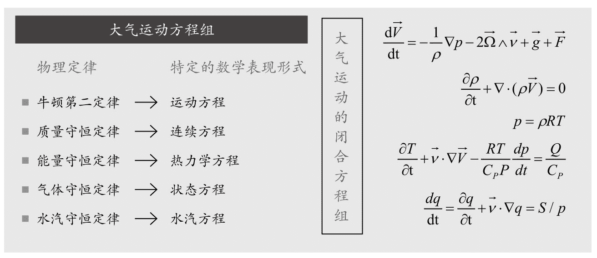
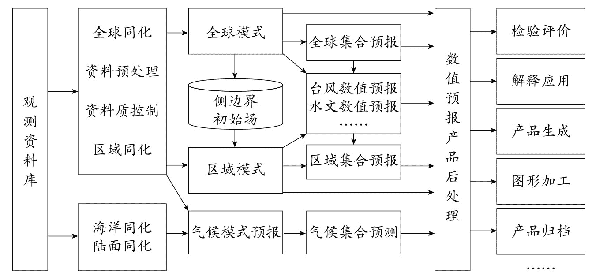
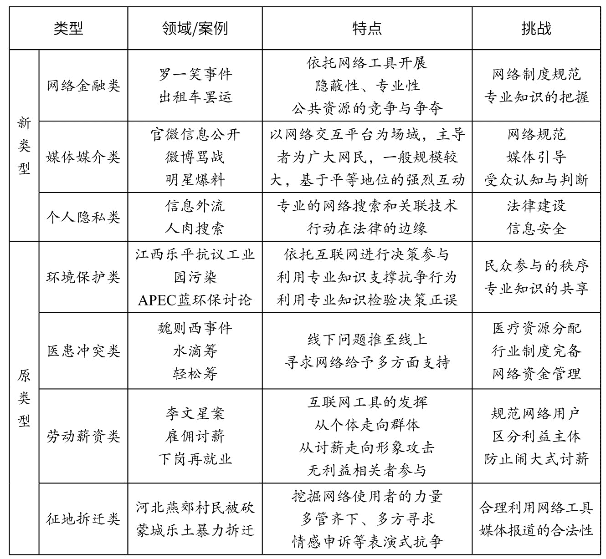
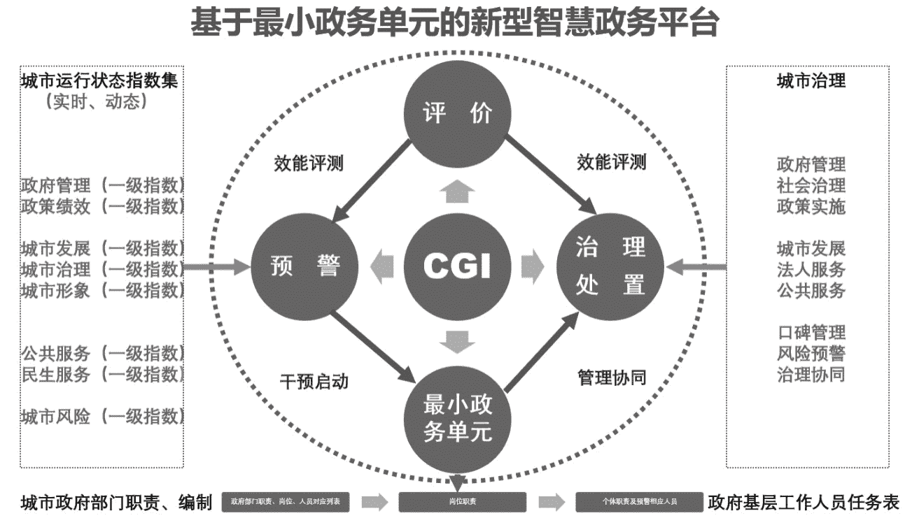
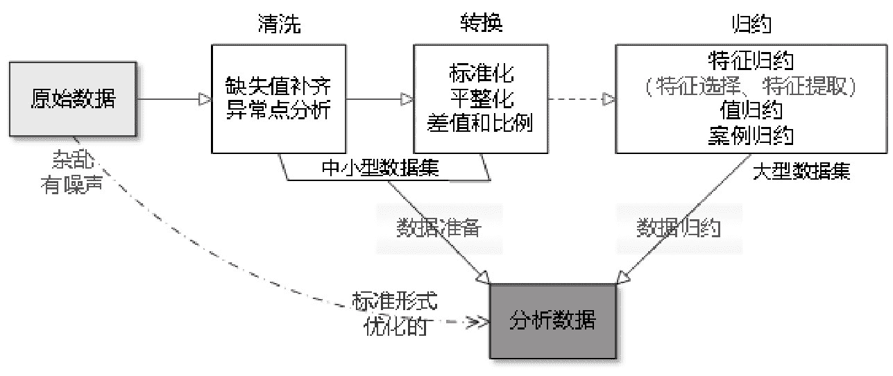
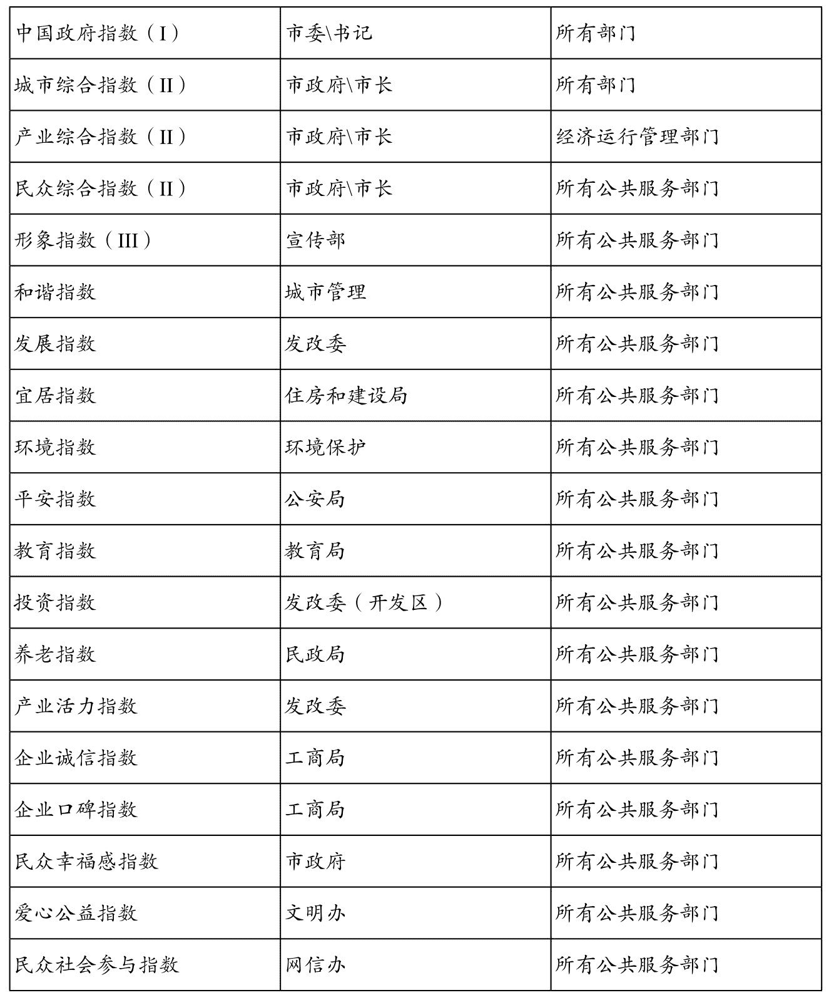

# 智能纪元的风险治理新视界

## 专家推荐语

### 程林教授致辞

中国人民公安大学原党委书记、校长  
中国法学会常务理事  
中国警察法学研究会会长

胸怀天下的学术格局，决定了学者理论视野的高度。杨东院长著作《人工智能时代的风险治理》是一部兼具深远社会意义与鲜明时代烙印的治理专著，令我们再次切身感受到中国知识分子“为天地立心，为生民立命，为往圣继绝学，为万世开太平”的悲悯情怀与担当精神。本书纵贯古今、融会理论与实践，对风险议题展开了系统深研，兼具扎实理论厚度与现实指导价值，对于贯彻落实习近平总书记关于风险治理的重要论述具有重要参考意义。确信该书出版将为全社会敲响警钟，并极大提升公众的风险素养。

面对风险，趋利避害是人的本能。

风险治理绝非单纯的大数据应用，亦非单一技术层面的难题。

风险常以具体事件或演变趋势的形态显现，自然灾害与人为祸患是典型的传统风险样本。

认知风险，人各有异。凡引发社会个体或组织秩序紊乱的自然或人为变故，均属潜在风险。风险是治理体系中的“突变变量”，驾驭此变量的能力，关乎个人与机构的生死存亡。风险感知力的强弱，直接决定了政治治理秩序、组织群体乃至社会个体的未来走向。

有人为制造风险、利用风险，或在自诩“安全可控”的前提下将风险转嫁他人，这是另一种精致的利己主义与损人利己。但这是一场极其危险的博弈，因其后果往往失控，极易反噬自身。

伴随全球化深化，世界演变为一个多元共生的整体，局部微变皆可引发全球性震荡。从进步视角看，催生变革的风险是社会发展的动力之一。人类文明史，实为拥抱并化解一个个风险而生生不息的历程。系统论视野下，“蝴蝶效应”生动诠释了风险重塑世界的机理。

研究表明，人类基因中8%的DNA片段源自自然病毒，正是这些病毒重塑基因，推动人类与世界达成更和谐共生。直面并接纳风险，是人类不得不面对的客观现实。对组织而言，接纳风险、干预其演变轨迹与后果，是核心必答题。风险对社会的颠覆与重塑，虽偶有裨益进步之功，更多时候却带来毁灭性打击。德国社会学家乌尔里希·贝克在《风险社会》中指出，后现代风险全方位来袭，冲击工业社会构建的文明框架与风险实态。他云：“‘后’是无助的密码，陷于庸俗时尚；它‘指向一个难以言说的超越’，是‘我们面对破碎现实的基本处方’。” 故而，人类欲求突围，“唯有与旧理论、旧思维习惯进行艰苦卓绝的斗争”。

我们必须重审这头名为“风险”的怪兽带来的一切变局。惟有主动应对、有效规避、合理利用，竭力将风险转化为推动社会进步的动能，方得风险治理之真谛。这需要大智慧。

风险有巨细之分，而应对之道乃治理核心。古训云：“上医医未病，故人不死；上圣治未乱，故天下安。”居安思危，方为正道。现代社会风险常具全球性特征——牵一发而动全身。此“全球”双重意涵：一是影响广泛，危害往往波及全社会乃至全球；二是跨领域毁灭性叠加，单一领域风险易诱发多领域风险同步爆发，叠加放大破坏力。故而，现代风险治理须遵循系统论与全球视野，构建全局性、系统性、科学化框架，堵住“短板效应”薄弱环节，防微杜渐，避免局部失守引发全局性灾害。

危机是重大社会风险的聚合体，具体危机即具体重大风险。就规模与毁灭性而言，危机远超常态风险，影响范围更广、持续周期更长。对危机及重大社会风险的警惕，任何时候都不能有丝毫松懈。

风险可演化为重大安全隐患。认知不足、防范薄弱、响应滞后、处置不当、善后乏力，必酿成严重社会危机与恶果。故此，关注风险即关注危机，关注危机即守护安全。

# 第二章 风险研究与风险战略

## 2.1 风险学与风险战略

风险学（即风险研究）聚焦风险识别、预防、治理与应对的科学体系。其旨在洞察发现风险、研判演变趋势、评估应对策略，以提升社会治理与公共服务效能，化解社会矛盾与各类危机。风险治理涵盖传统社会领域与网络空间双重维度。

## 2.2 网络空间风险治理导论

网络空间风险治理，涵盖对承载各类社会信息的收集、分析、风险评估与预警全链条。网络风险对现实社会环境具有破坏性，阻滞社会目标实现。其源头主要集中三端：一是舆情掌控失效风险；二是网络主体对公众心理实施逆向动员风险；三是网络风险外溢线下风险。

网络风险治理包含风险发现、预警研判、危机处置、应急管理等环节。所谓网络舆情监测或舆情学研究，实为聚焦网络公共事件传播特征的风险识别与分析研究。

在某种意义上，风险分析、预警、治理的协同体系，是“互联网+监督”与“数据+巡视”体系的核心中枢。风险分析的本质是利益分析，而利益分析反过来是评估风险治理举措优劣与社会风险性质的核心维度。风险治理决策的本质，亦是利益博弈中的抉择与取舍。

# 利益视角洞察社会：风险决策的核心逻辑与范式革新

**利益分析：穿透现象看本质的关键工具**

所谓利益分析，或称利益动因分析，本质上是站在利益的立场上审视社会历史现象。它通过解读各类社会主体的言行，深入把握事物的本质、根源与动力机制。这一工具在把握现实利益格局、科学制定应对策略方面具有不可替代的普适性、有效性与针对性。

利益问题既是重大社会事件的导火索，也是其深层病灶。因此，洞悉大事本质，除了掌握演变脉络，更关键在于锁定利益根基。唯有如此，方能拨开虚假表象，精准捕捉事件的核心动因与演进走向。各阶层、群体在社会结构中的不同位置，决定了其立场态度的根本差异。剖析社会关系与整体利益版图，正是战略决策的基石。一切社会决策的倡议、谋划与落地，无不源于特定利益动机。故而，社会风险治理策略的制定，必须以“谁获益、利益性质与程度几何”为核心依据。

**善治标尺：公共利益最大化与数据驱动决策**

善治的本质，是一系列以“公共利益最大化”或“安全保障最大化”为准则的决策行动，是“全心全意为人民服务”这一根本宗旨的生动实践。

面对错综复杂的内外环境与多重不确定性，如何提升社会风险预警整体水平、强化应对韧性？“依数决策、数说服人”必须成为各级领导干部的决策新范式。凡涉全局重大决策出台前，必须前置风险评估与政策社会效能分析。效能分析涵盖风险的定性定量研判、后果评估、对策评价及政策绩效考核四大维度。

**决策困境与破局：从信息不对称到算法重塑**

传统决策模式在特定场景易失效，甚至酿成社会灾难与公共利益损失。核心症结在于决策者面临严重的信息不对称。决策过程实质上是持续消解信息不对称的过程——对决策对象历史、现状、未来趋势信息的掌握总存在短板。信息不对称是绝对的、常态的；全面掌握决策所需有效信息才是相对的、理想的。决策评估的过程，就是在不断消除信息盲区中实现趋利避害、利益最大化。

在此进程中，大数据与人工智能扮演关键角色。数据与算法正在重塑传统决策流程，一场由“社会机器”驱动的决策革命浪潮已然来临。

**经典视野下的风险应对策略**

面对战略环境的不确定性，企业或组织可采取五类基本应对姿态：回避、控制、合作、模仿与灵活机动。相关研究多聚焦于组织层面的不确定性风险管理。

乌尔里希·贝克在《风险社会》中指出：危险持续累积，却未在政治层面转化为预防性风控政策，这是残酷现实。阶级社会的政治主体是无产阶级，而风险社会的客体仅剩全民承受苦难。

阿德里安·斯利沃茨基在《战略风险管理》中强调：无论企业规模多大，若未预判变革或未雨绸缪，皆可能重创。顺境往往暗藏更大战略风险——越想松懈、越觉自满之时，越需绷紧弦、加倍警惕。书中提出七大化危为机策略：提升胜算、洞察而非揣测客户需求、双向备战、攻克强敌、革新模式护航品牌、竞合突围零利润陷阱、创造新需求做大增量。

**社会风险战略管理的全维框架**

当前，社会风险战略管理应覆盖社会组织对内外环境中一切可能打破常态的因素，实施全过程的统筹与理性应对。这包含对结构性变迁的预见、规避、应对、利用与转移、善后处置全链条。

风险战略管理由静态赛前演练、动态赛中处置、事后修复复盘三阶段构成。其核心特质体现为：系统性、前瞻性、全局性、协同性、战略性、可操作性与利益最大化。

---

# 2.3 风险社会的理论体系

**风险社会：人为不确定性主导的发展阶段**

风险社会是指全球化语境下，由人类实践引发的全球性风险占据主导地位的社会发展阶段。在此阶段，各类全球风险对人类生存与发展构成严峻挑战。

**风险结构的历史性转向：从自然到人为**

随着人类活动频次与范围的指数级扩张，决策与行为对自然及社会自身的冲击力剧增。风险结构由此发生根本性嬗变：主导地位从自然风险转移至人为不确定性风险。

**风险的“制度化”与“制度风险”的双重悖论**

人性中既藏冒险基因，也植安全本能。现代以来的一系列制度创新，为这对矛盾冲动提供了实现空间与规范框架。以资本市场为典型的冒险导向制度激励风险承担；现代国家构建的安全导向制度提供生存保障。然而，无论哪类制度，其运行本身都可能失效，衍生出“运行失效风险”，从而将“风险的制度化”反向推向“制度化的风险”。

### 贝克的“风险社会”理论：现代性的困境与治理的新图景

1986年，乌尔里希·贝克在德国出版了《风险社会》一书。该书核心观点指出：后现代社会实质上是一个“风险社会”，其显著特征在于人类面临的生存威胁，不再源于自然匮乏，而是源于社会自身制造的人为风险。我们身处的社会弥漫着一种“有组织的不负责任”氛围——风险制造者为维护自身利益，往往将代价转嫁给受害者。贝克直指西方经济、法律及政治体系的痛点：它们不仅深度卷入风险的制造过程，更参与了对风险真相的遮蔽。为此，他强力呼吁“反思性现代化”，旨在以理性精神洞察现代性理性的困境，并试图以理性化解理性。

贝克认为，“风险社会”标志着现代性的一个特定阶段：工业社会进程中衍生出的威胁开始占据主导地位。这一概念在三大维度引发了时代性的系统性变革：
首先，现代工业社会与自然/文化资源的关系在现代化确立后逐渐消解；
其次，社会与其自我产生的威胁之间的张力，已超越了社会对安全的认知边界。一旦公众觉醒，旧有社会秩序的根基便会动摇；
最后，工业社会文化中凝聚集体意义的源泉——如阶级意识、进步信仰——正在枯竭褪色。

在贝克看来，工业社会的核心矛盾在于财富分配与不平等的合法化；而风险社会的核心任务，则转向了伤害的减轻与分配。古典现代性的标志是财富与权力，反思性现代性的关键词则是风险与不确定性。

值得注意的是，《风险社会》出版初期反响平平，直到1992年马克·里特将其译为英文，该理论才真正被西方学界与大众接纳。

“风险社会”并非严格的历史分期概念，也非特定国家的发展阶段，而是对人类当下时代特征的生动描摹。故而，我们可以说人类处于“风险社会时代”，却不能断言某个具体国家“就是”风险社会，即便该国国内局势更动荡。然而，风险社会不仅是认知范畴，更是一种新生的秩序与公共空间。在后一层面上，它更具现实张力。正如吉登斯、贝克所言，风险社会的秩序非等级制、垂直化，而是网络化、水平延展的——因为风险具有“平等性”，不饶过任何人。其结构不再由阶级、阶层构建，而是以个体为主体；拥有明确疆界的民族国家不再是唯一治理主体，风险的跨国性倒逼更多治理主体涌现并达成合作。

风险社会中的风险呈现四大核心特质：
**(1) 内生性**：风险本质上源于人类自身的决策与行为，是工业、法律、技术、应用科学等社会系统常态运行的联合产物。自然“人化”程度的加深，更凸显了这一内生属性。
**(2) 广延性**：时空维度上，风险突破地理与文化疆界，呈全球化蔓延；时间上具有延续性，能跨代影响后世。
**(3) 低概率·高后果**：多数风险虽发生概率极低，一旦发生后果毁灭性极强。因此，风险总量上升 ≠ 世界变得更不安全。
**(4) 治理失效与重构**：传统风险计算与经济赔偿机制难以根治，必须通过提升现代性的反思能力，构建全新的应对机制。

---

#### 全球风险治理的深层困境

现代风险的定义已发生质变：人为主观风险激增、有组织系统性风险源显性化、治理手段从单一依赖技术进步转向多维治理体系。

现代风险的演进与“反思性现代化理论”紧密相连。该理论将整个现代化进程纳入反思视野，将结构性断裂解读为现代化的自我后果。此处的“反思”含双重张力：**自我否定**——以科技理性为核心的现代化，其非理性后果不断溶解自身存在根基；**自我反省**——追求确定性的理性反观自身，反而可能摧毁获取确定知识的能力。因此，现代风险研究兼具现代性本质（追求价值理性、确立伦理基石）与后现代性取向（对现代性困惑发问、价值反思、伦理批判与扬弃）。

现实治理中，困境重重：风险事实与风险判断的张力、当下利益与未来责任的博弈、风险个体性与公共性的冲突。这倒逼治理者必须做出有效且合乎伦理的决策，超越风险本身，实现现代风险的“道德治理”。

治理中最消极的异化现象是“风险规避”，即所谓的“无为而治”、“少做少错、不做不错”——这正是治理失灵的根源。

# 第三章 决策风险评估机制

## 3.1 领导干部的风险判断力

治理风险社会之所以棘手，根源在于风险本身具有本体论层面的不安全性，以及由此衍生出的诸多特征。正是这些特征、表现与症状，才为我们预测、管控与治理风险提供了可能。深刻洞察并系统梳理各类风险治理的困境与问题，是实现有效治理的前提，这要求我们必须建立系统、全面、科学的认知体系与应对方案。总体而言，相较于日常或程序性决策，风险决策具有重大性、战略性与复杂性的显著特点；其决策流程需更严谨，结果需更贴近靶心。因此，决策风险评估亟需构建一套更为合理的机制。该机制是决策系统与工具相互耦合的过程，由分析、协商、判断三大环节构成。

决策风险分析是评估工作的科学基石。分析是运用科学方法生产决策知识的过程，涵盖问题结构剖析、决策结果预期、方案筛选，以及在特定情境下对执行结果的监测与方案绩效评估。问题结构分析旨在拆解决策要素、梳理要素间关系。通常纳入风险评估视野的问题，其要素间呈现复杂的非线性关联，而非简单的线性逻辑。线性问题早已纳入常规程序化决策轨道，复杂关联则亟需跨学科知识支撑。这种复杂性体现在风险涉及的多重领域，或是单一领域长期困扰却难以破解的顽疾。从结构化程度看，问题复杂性主要表现为：演化机制与路径模糊，需多维观测；备选方案多元；涉及多方利益主体，且主体间存在利益、需求与价值冲突。问题结构分析的核心任务，就是刻画上述特征，为判定问题复杂程度提供科学依据。决策结果预期分析依赖数据、信息与知识的支撑。从数据到信息，再到知识的形成，这一过程折射出对未来预期认知的渐次清晰。数据呈现个性化、量化特质；数据分析催生多元信息；经科研转化，信息升华为知识，进而成为决策结果预期的呈现形态。决策方案的选择，实质上是建立在价值分析与比较基础上的价值判断与事实判断的统一。

参与决策风险分析的机构主要分三类：高校院所科研机构、社会专业研究机构、政府体系内研究机构。这些机构具备智库属性，专家与智库为决策提供风险分析，输出多元知识图谱。

决策风险评估必须建立协商机制。解决复杂问题的决策背后，隐藏着多方利益的竞逐与冲突。风险评估需构建化解价值与利益冲突的机制。因为分析环节仅解决方案的“科学性”，却无法回应方案的“可行性”与“合理性”，决策过程本身需要以多主体协商为核心的对话与参与。在决策风险评估中，多主体间利益、需求、偏好与情感的交换，能提升评估质量、增强方案精准度、促进执行顺畅。党和政府大力推进的多层级、多渠道协商民主建设，对推动决策风险评估具有重要意义。

决策风险评估还需引入地方性知识与实践经验，以弥补分析环节通用性知识的不足，从而全方位提升评估质量。地方性知识与实践经验通过多主体协商方式纳入评估流程。高效协商还需信息公开、主体具备协商能力、实质性参与及平等协商机会等制度保障。

### 领导干部的风险判断力

决策风险评估离不开决策者的判断。各级领导干部这一“关键少数”的政治能力，首要体现在决策判断力上。判断力不仅需要一定量级与质量的数据、信息、知识作支撑，更需要果断决策的魄力与把握大势的眼光。领导干部的风险判断应立足于四个维度：关注度、价值辨识、风险感知与经验积淀。领导干部关注或忽视什么，是决策风险评估的首选判断；唯有进入领导视野的议题，才可能转化为政策议程，纳入评估流程。对风险属性的界定及是否采取决策行动，是典型的价值辨识过程。价值辨识以公共利益为准则，决策与否、决策何种方案，皆基于特定价值取向。价值辨识亦是平衡价值冲突的过程。风险隐含价值对立，风险评估实为寻求价值认同之路，如何平衡冲突，直接检验领导干部的判断力。风险情境感知，是领导干部决策时对风险后果的研判。关注度与价值辨识聚焦于“风险是否存在”即发生可能性；而风险感知则聚焦于“风险后果几何”及决策者可承受的后果边界。决策者的风险管理经验，能对风险演变趋势形成直觉判断，弥补分析与协商层面的知识短板。

分析、协商、判断三者及其互动，构成决策风险评估机制的核心运作模式。三者环环相扣、缺一不可。分析是知识生产的起点，协商是知识、偏好与需求的交换，判断是最终决断。在三者合力作用下，决策风险评估质量得以持续跃升，进而完善风险防控体系。

## 3.2 “黑天鹅”与“灰犀牛”事件解析

**“黑天鹅事件”**指的是那些极难预判、极不寻常的突发状况。它们往往引发连锁反应，具备毁灭性的冲击力，且不分领域——政治、经济、外交、军事、公共治理、公共卫生等皆可能沦陷。诱因或源于自然灾害，或肇因于人类社会活动。

这一概念由纳西姆·塔勒布在《黑天鹅》一书中正式提出。他界定“黑天鹅”具备三大核心特征：一是**突发性**，超出常规预期，过往经验无法提供确凿证据预示其降临；二是**极端影响力**，后果往往毁灭性十足；三是**事后可解释性**，虽事前难料，但人性使然，事后总能拼凑出理由，误以为它本可预见。简而言之：**稀缺性、极端冲击、事后诸葛亮式的可预测性。**

**“灰犀牛事件”**则指代那些概率极高、频频预警却长期被忽视的风险。概念源自古根海姆学者米歇尔·瓦克的《灰犀牛：如何识别和应对显而易见的危机》。它隐喻**高概率、高冲击**的潜在危机，与黑天鹅的“低概率、高冲击”形成鲜明对比。书中指出，灰犀牛往往显而易见、概率极大，却因长期被忽视而酿成大祸。人们往往耗费精力关注那些冲击感官却极不可能发生的事，反而视而不见那些理应早早防范的高危隐患。**一旦执着追寻“黑天鹅”，必然看不见眼前的“灰犀牛”。**

二者均相对其规模、可预测性或可感知性而定，皆具摧毁社会秩序的巨大能量。灰犀牛是因常见而麻痹大意的风险；黑天鹅是因罕见而措手不及的变数。现实中，两者常交织并存、同步爆发，且黑天鹅事件屡屡充当引爆灰犀牛危机的“导火索”与“催化剂”。

# 第4章 大数据与风险智能发现

关于**大数据**，Gartner 将其定义为：因体量巨大、生成速度极快、种类繁多，必须依赖新型处理模式，才能实现决策增强、洞察发现与流程优化的信息资产；麦肯锡全球研究院则将其描述为：规模大到远超传统数据库工具在采集、存储、管理、分析能力范畴的数据集，具备**量大、流速快、类型多、价值密度低**四大特征。

**人工智能（AI）**是一门研究、开发用于模拟、延伸、拓展人类智能的理论、方法、技术及应用系统的新兴技术科学。其技术核心，在于对大数据的采集、处理、分析与利用。

大数据与 AI 的战略价值，不在于囤积海量信息，而在于对有价值数据的**专业化加工**——提升数据“处理力”，通过“加工”实现数据“增值”。技术层面，大数据与云计算如硬币两面，密不可分。单机无力处理海量数据，大数据天然依赖分布式架构，核心在于海量数据的分布式挖掘，而这必须借力云计算的分布式处理、分布式数据库、云存储与虚拟化技术。云时代来临，大数据才真正步入聚光灯下。

大数据常用于描述海量非结构化与半结构化数据，若强行导入关系型数据库分析，成本高昂。大数据分析常与云计算、AI 搭配，因实时分析海量数据集需要 `MapReduce`[\[1\]](#Chapter_8_1.xhtml#B5) 等框架将任务分发至成千上万台计算机。两者均需特定技术高效处理数据，并借助特定数学模型分析，为特定场景提供数据支撑、满足实际应用需求。

大数据与 AI 在经济发展中的巨大意义，不代表它们能替代所有理性判断，尤其关乎生存的核心抉择。古今中外，因忽视风险发现与科学防控而导致国家倾覆、政权更迭、企业破产、个人声誉扫地的惨痛教训比比皆是。

数据显示，**70% 的信息安全风险源自内部，由内部人实施**。这充分验证了那句老话：**最坚固的堡垒，最容易从内部攻破。**

## 4.1 风险智能概览

风险指标的发掘极具社会价值；识别风险是风险治理的关键，也是首要任务。此类信息已晋升为“情报”层级。所谓**风险情报**，即被发现、传递的风险线索、风险知识或风险事实；是运用特定方法手段获取、接收、传递的具体信息或知识。风险情报、威胁情报、安全情报，本质上均属特定领域内的危机线索、安全线索与风险线索信息。

依 Gartner 对威胁情报的定义，它是**基于证据的知识体系**，包含背景、机制、指标、影响及可执行建议。这些关乎资产面临的现存或新兴威胁/危害，可为资产主体应对威胁的决策提供信息支撑。业界大多所谓的威胁情报，实属狭义范畴，核心内容是用于识别、检测威胁的**妥指标（IoCs）**，如文件 `HASH`、`IP` 地址、域名、程序执行路径、注册表键值等，及关联的溯源标签。威胁情报旨在为面临威胁的资产主体（通常为资产归属企业/机构）提供全面、精准、相关、可落地、支撑决策的知识信息。

### 威胁情报分类

威胁情报通常划分为四大类别：

**战略威胁情报**（`Strategic Threat Intelligence`）。聚焦全球威胁态势与业务痛点，服务于董事会及高管决策。通常不涉技术细节，主要覆盖网络攻击的财务冲击、攻击趋势、可能影响高层业务决策的领域等。

### 威胁情报分级：从战略决策到战术执行

威胁情报并非单一维度，而是根据应用场景与受众不同，清晰地划分为三个层级：

**1. 运营级威胁情报**
聚焦于具体的、迫在眉睫或已预判的攻击活动。它为高层安全管理者提供“何时、何地”发动攻击的前瞻性判断，支撑针对性防御部署的制定。

**2. 战术级威胁情报**
深入剖析攻击者的 **TTP（战术、技术与流程）**。针对特定行业或区域的攻击手法，它为应急响应人员等一线操作人员储备相应的应对策略与行动指南。

**3. 技术级威胁情报**
核心内容是**失陷指标**，可直接用于自动化识别与阻断恶意行为。当前行业落地应用最广泛、最成熟的正是这一层级。

---

### 威胁情报从哪来？

来源广泛且多元，主要汇聚自四大渠道：
*   **内部数据流**：企业内网日志、终端数据、已部署安全设备产出的日志。
*   **专业供给**：安全厂商与行业组织共享的威胁数据。
*   **开源情报（OSINT）**：新闻资讯、技术博客、论坛社区、社交网络等公开渠道。
*   **隐蔽渠道**：暗网、地下论坛等相对封闭的非公开来源。

---

### 核心分析框架与模型

实战中常用的分析方法论主要有三大支柱：
*   **洛克希德·马丁“网络杀伤链”**
*   **钻石模型**
*   **MITRE ATT&CK 知识库**

---

### 安全情报：体系的“眼睛”与“大脑”

**定位与内涵**
安全情报涵盖一切影响系统安全行为的信息。从广义看，安全关乎国家、政府、企业、学界及公众，是维护社会稳定的基石，其研究具备深远的理论与现实双重价值。

**核心地位**
它是开展系统安全管理工作的**前提与基础**，堪称安全管理的**“眼、耳、前哨、智库”**。

---

### 安全情报的三大核心价值

安全管理失效的根源，往往在于情报缺位。基于“预测-决策-执行”三大管理活动，安全价值得以三个维度体现：

#### ① 支撑预测预警：做到“发现得了、判断得准、预警得早”
作为**预警支撑系统**，它掌握安全主动权。通过全量采集、深度研判，产出高质量情报，实现科学精准的前瞻预测。这意味着：尽早发现威胁与机遇，拉长预警时间窗口，为管理者争取反应余地，实现“未雨绸缪、防患未然”。

#### ② 支撑科学决策：做到“决策得当、响应得快、成本得低”
作为**决策支撑系统**，它是规划制定的基石。在综合评估预警情报基础上，依托最优情报快速作出科学、可靠、高性价比的决策。

#### ③ 支撑有效管控：做到“管控得早、措施得实、效果得好”
作为**执行支撑系统**，它是响应的终极目标。依据决策情报，及时、彻底落实各类安全措施与应急预案，力阻不安全事件发生，或通过高效应急处置将损失降至最低。

**延伸价值：学习与进化**
安全情报还是重要的**学习系统**。它不仅助力管理者接触前沿理念、先进方法，更能从事故复盘中汲取教训。扎实做好情报工作，是实现“主动防御、耳聪目明、政策精准”的必由之路，践行“情报引领安全管理”理念刻不容缓。

---

### 情报信息的本质特征

知识性、传递性、价值性、机密性、时效性——这五大特征构成了情报信息的基因画像。风险情报的挖掘与分析，与安全情报有着高度的同构性与共通性。

---

## 4.2 风险情报分析与发现

### 分析定义与使命
美军《军事及相关术语词典》将情报分析定义为：综合评估全源数据，通过综合、评价、分析、解释，将加工信息转化为满足已知或预期需求的情报过程。

风险情报分析的终极使命：**为社会治理者或组织决策者，提供一套涵盖风险信息的全谱系决策支撑与响应处置闭环。**

### 分析平台能力全景
成熟的风险情报分析平台通常具备八大核心模块：
多源数据采集汇聚、应用检索、决策知识库、数据分析（含可视化呈现）、风险预警、决策支撑、任务响应、行动协同、效能监测。

### 避开“信息陷阱”的警示
> “战争中获得的情报大多矛盾，更多是虚假，绝大部分不可靠。这要求指挥官具备辨别力，而这只能通过对事物和人的知识与判断力获得。” —— 经典论述

在现代信息爆炸语境下，若无法从海量数据中高效提炼高价值信息、剔除“信息渣滓”，极易陷入**“信息陷阱”**——看似信息丰富实则处于情报劣势，丧失主动权，陷入被动挨打的困境。

### 大数据赋能战略感知：从算法困境到知识发现的进阶之路

大数据技术的本质，在于从纷繁复杂的信息中挖掘关联、揭示隐情、增强可信度。它有效弥补了传统分析手段在信息处理上的短板，使得战略态势感知愈发离不开大数据技术的深度介入与支撑。

**算法科学性决定感知精度**

风险情报分析算法的科学性是大数据处理的基石，直接关乎推演结论的准确性。在战略感知实践中，必须依据具体场景选用差异化算法，对特定事件的各类迹象与征候，执行采集、质疑、假设、补数、验证、评估的完整闭环。这一过程往往需循环往复、持续修正，方能逼近真相。然而，算法的逻辑起点多建立在人工经验判断之上；虽然后期可修正，但若初始方向偏离，结论极易陷入“越修越远”的误区。

**刚性与主观性的博弈与调和**

态势感知要求算法随时机、态势、事件动态适配。单一僵化的算法易酿成重大谬误，全人工干预又难免引入主观偏见。如何协调这对矛盾，是提升感知效能的关键。同时，数据场景、业务需求、应用环境的差异决定了算法优劣无绝对标准。唯有在不断调整、校验、对比的迭代中，才能筛选出最贴合现实演化规律的高效算法。

**海量数据中的价值唤醒**

通过大数据分析揭示风险演变规律、捕获预警情报，为精准防范化解风险提供决策依托。国家安全领域信息化的深入推进，极大提升了各部门的数据意识，催生了海量实战数据。在这座“数据富矿”中蕴藏着高价值信息，亟待专业高效的分析工具开采。数据挖掘技术的工程化落地，正是破解这一需求的核心路径。

**计算机应用技术的三次演进与数据仓库的诞生**

回溯计算机应用发展脉络，大致经历了数值计算、数据处理、知识处理三个阶段。早期聚焦算法研究，数据处理阶段以数据库语言为核心，催生了信息管理系统，实现查询、修改、汇总与快速计算。但实践发现，面对复杂系统，仅靠人工设定指标已难胜任数据库管理。让计算机接管模型优化、自动生成方案，成为破局之举。

随着数据库运行周期拉长，数据呈指数级积累，从海量存量中高效提炪有用信息刻不容缓。问题倒逼方案诞生：数据仓库之父比尔·因蒙在《建立数据仓库》中提出，数据仓库是面向主题、集成、稳定、随时间变化的数据集合，旨在支撑管理决策。它不生产原始数据，而是整合跨平台分散数据，构建面向决策的数据集市，在不替代原有数据库的前提下，搭建起更完备的高层分析平台。

**数据仓库：决策支持的“四大特质”与前端工具体系**

作为数据库技术衍生的新应用，数据仓库以DBMS管理数据为核心，呈现主题导向、高度集成、系统稳定、数据量大四大特征。运行层面，它依赖可视化工具与联机分析处理（OLAP）等前端接入：前者通过图形化呈现揭示数据结构特征，后者赋能在线分析。对长周期积累数据实施挖掘分析，完成知识发现主业，正是数据仓库的核心价值所在。

**数据挖掘：知识发现的“关键一跃”**

数据挖掘是数据库知识发现（KDD）流程中的处理环节，亦是最关键的一步。其内涵明确：依据特定需求，从数据库中抽取潜在有用的信息与模式。

**多学科融合与技术成熟度的现实考量**

人工智能、统计学等是知识发现与数据挖掘的常用利器。AI概念源于达特茅斯会议，历经70年代专家系统爆发、80年代末神经网络复兴等浪潮，衍生出专家系统、机器学习等分支。典型专家系统由知识库、推理引擎、人机界面构成，类似决策支持系统；神经网络则擅长统计、回归、聚类。数据挖掘综合这些技术，从海量数据中识别模式、提取模型、生成新知。虽有专用软件问世，但技术成熟度仍待时日。业界已达成共识：运用数据挖掘技术获取行业相关情报，是各行业适配信息时代的必然选择，其跨领域的有效应用正受到前所未有的重视。

**情报的内涵界定**

据《辞海》释义，情报包含双重含义：一是通过侦察等手段获取的对手军政经等态势，及对其分析研判的成果；二是泛指各类最新动态报告，如科技情报。

# 社保风险情报：以数据挖掘为矛，刺破迷雾见真章

社保风险情报工作的核心流程，是借助多元技术手段对海量信息进行采集、分析、研判与综合，最终产出多形态的情报产品。随着现代信息技术飞速演进，数据库与检索引擎让资源获取触手可及，数据分析系统更支撑起了初步的研判工作。在常规的情报获取与分析手段中，数据挖掘堪称核心引擎。借助它，我们能构建起全方位、高效率的情报分析预警体系。

置身新的国际环境与历史方位，单靠情报人员靠归纳推理“肉眼”看数据，早已难以适应实战需求。立足现有技术底座，研发契合部门业务特质的数据挖掘分析系统，是提升风险情报发现力、抢占治理主动权、进而构建现代社会风险治理体系的必由之路。

## 4.3 风险数据挖掘

### 破译数据密码：从“堆砌”到“洞见”

数据挖掘，实则是从海量、不完整、含噪、模糊、随机的数据迷宫中，借助算法搜寻隐匿的有用信息与知识。其本质，是**发现新知识的应用技术**。伴随信息技术突飞猛进，数据积累呈爆发式增长，以 `TB` 为单位的数据规模早已成常态。如何从这座数据大山中精准提炼所需，正是数据挖掘的核心使命。

若说数据挖掘是“淘金”，**知识发现（KDD）** 便是完整的“选矿流程线”。KDD 泛指依据不同需求，从多媒介表达的信息中获取知识。它旨在帮用户过滤冗杂原始细节，提炼有意义、可理解的精简知识并直接推送。数据挖掘只是 KDD 这一宏大流程中的关键一环——虽属具体步骤，却至关重要。

二者差异可这样理解：知识发现是宽泛的全景图，数据挖掘是深入的特写镜头。KDD 迭代流程串联起：数据挖掘 → 模式评价 → 知识表示。而数据清洗、集成、选择、转换，则是挖掘前的“备料”预处理。挖掘环节可与用户或知识库交互，有趣味的模式或呈现为新知，或入库沉淀。狭义上，数据挖掘仅是流程一步；广义上，它涵盖了从数据仓库、数据库等存储库中发现有趣知识的全过程。

### 六大任务类别：不同视角的“透视镜”

数据挖掘任务大致分两派：**预测性任务** 依据已知属性值推演目标变量（解释变量→目标变量）；**描述性任务** 则侧重挖掘数据内在关联模式，多具探索性，常需后处理验证解释。具体落地为六大类：

1.  **总结/概化**：意在浓缩数据、简练描述。传统统计求和、均值、方差或绘图是基操；数据挖掘则聚焦**数据概化**——将海量任务相关数据从低层概念抽象至高层概念。因数据库存储最原始细节，为防遗漏而全存；但用户常需高维视角浏览，故分级概化成了便捷查询的关键。
2.  **分类**：依模型寻找对象共性，将数据项映射至给定类别。分类与回归常用于预测——从历史纪录推导未来数据描述。二者分水岭在于：分类输出离散类别值，回归输出连续数值。
3.  **聚类**：又称聚类分析或分割。无预设标签，依属性相似度自发分群。同簇对象属性高度相似，异簇差异最大化。手段涵盖统计学、机器学习、神经网络等多流派。
4.  **关联**：挖掘变量间隐藏的规律网络。若两变量值呈现规律性共现，即构成关联。细分为简单关联、时序关联、因果关联。因数据库关联函数往往未知或不确定，挖掘出的规则均附带**置信度**指标。
5.  **序列模式**：在时间序列中捕捉高概率复现的模式。虽同回归一样用已知推未知，但变量所处时间维度不同，擅长揭示“先后顺序”蕴含的规律。
6.  **偏差/离群分析**：聚焦“异类”与“极端个案”，揭示偸离常态的异常现象。主流挖掘常将离群点视噪音丢弃，实则稀缺事件往往比常规事件更具价值。异常数据库极其珍贵。检测基石在于：**量测观测值与基准值的偏离度**。

### 挖掘方法谱系：多路径通往真知

数据挖掘方法大体可归纳为以下流派：

### 六大核心数据挖掘算法解析

**1. 遗传算法**
遗传算法是一种模拟自然界生物遗传与进化机制的自适应全局优化概率搜索算法。它最早由密歇根大学计算机科学与心理学系的 John Holland 教授提出。该算法计算流程简洁、优化性能优异，在解决组合优化问题上具备独特优势，亦可应用于聚类分析场景。

**2. 粗糙集理论**
粗糙集理论作为一种处理不精确、不确定及不完整信息的数据分析工具，由波兰学者 Z. Pawlak 于 1982 年创立。该理论源于语言研究需求，1992 年首届国际学术会议在波兰召开，1995 年被 ACM 列为计算机科学新兴研究课题。该方法在模糊不确定数据的分类与知识获取领域应用广泛。

**3. 决策树方法**
决策树以树状图形式直观呈现决策问题中的自然状态概率、行动方案、损益数值及预测结果，实质是对人类思维、预判与决策全流程的建模。其构建过程依托训练集生成测试函数，依据取值差异延伸分支，层层递归生成节点，最终经剪枝优化转化为规则集，核心服务于分类与挖掘任务。

**4. 神经网络方法**
人工神经网络旨在模拟人脑思维机理，属于非线性动态系统。其核心特质在于信息的分布式存储与并行协同处理。单个神经元功能有限，但海量神经元构成的网络系统能涌现出极为丰富多元的复杂行为模式。

**5. 模糊逻辑**
模糊逻辑主要仿效人脑对模糊概念的判断与推理模式。针对模型未知、难以精确描述，或强非线性、大滞后的控制对象，它利用模糊集合与规则进行推理，量化过渡边界与定性经验，实现模糊综合判决，攻克常规方法难以处理的基于规则的模糊信息问题。在数据挖掘中，常用于模糊综合评判与模糊聚类分析。

**6. 聚类分析**
聚类分析依据事物固有特征对其进行分组归类，以此发掘内在规律与典型模式。聚类完成后，数据集转化为若干簇群：同簇数据变量取值高度相似，异簇数据则特性迥异。该技术是数据挖掘领域最关键的核心手段。

---

### 参考文献
[[1]](#Chapter_8_1.xhtml#BT5) `MapReduce`：面向海量数据集的并行计算编程模型。
[[2]](#Chapter_8_1.xhtml#BT6) 国务院：《促进大数据发展行动纲要》，中华人民共和国商务部官网。
[[3]](#Chapter_8_1.xhtml#BT7) Christoph Koutschan：《大数据最核心关键技术——32 个算法》，《CIO 时代》学院网。
[[4]](#Chapter_8_1.xhtml#BT8) 王兵、吴超：《安全智能概念的起源、演变趋势与内涵——基于安全科学视角的思辨》，情报情报工作，2019 年第 3 期。

---

### (7) 可视化技术
此类技术致力于将复杂的分析结果转化为图表、曲线等直观易懂的视觉形态，极大地拓展了数据的表达张力，助力人类高效洞察。

数据挖掘知识发现算法主要划分为四大流派：基于关联规则、神经网络、遗传算法与粗糙集的知识挖掘。

**神经网络算法**属于学习与融合机制，具备分类精度高、并行分布式处理强、分布式存储学习能力强、容错性佳及联想记忆等优势，是知识发现的核心算法。但其短板明显：学习过程不可观测、结果可解释性极低、训练耗时长且可能不收敛、参数调优负担重。

**遗传算法**拥有快速随机搜索能力，采用种群并行搜索策略，借助评价函数启发式引导，流程相对简单。但存在致命弱点：编程实现复杂，需先编码后解码；且同神经网络一样，训练周期过长。

**粗糙集知识挖掘**聚焦于不完整、信息匮乏场景的数据分析，擅长处理模糊不确定数据。

**关联规则算法**属于基于规则的无监督机器学习，旨在从海量数据中发掘项集间的关联关系，通过度量筛选强规则，服务于知识发现。`Apriori 算法`是该领域的经典代表，专门挖掘隐性、未知但客观存在的数据关联。其核心基于频繁项集的两阶段递归思想，利用 Apriori 性质剪枝，显著提升层级频繁项集生成效率，且算法简洁易懂、对数据集要求低。

---

### 4.4 风险智能关联规则算法——Apriori 算法深度解析
`Apriori 算法`是挖掘频繁项集与关联规则的经典数据挖掘算法，由 R. Agrawal 与 R. Srikant 于 1994 年首倡（注：原文标注 1944 年疑为笔误）。该算法采用“层级搜索”迭代策略，利用 `k-项集` 探索 `(k+1)-项集`。执行流程如下：
1.  **首轮扫描**：遍历数据库统计各项计数，筛选满足最小支持度的项，形成频繁 1-项集集合 `L1`。
2.  **迭代生成**：以 `L1` 为基础生成频繁 2-项集 `L2`，再由 `L2` 推导 `L3`，以此类推，直至无法再生成频繁 `k-项集`。每一层迭代均需完整扫描一次数据库。
为提升层级生成效率，`Apriori 算法`引入频繁项集的 Apriori 性质对搜索空间进行剪枝，这也是该算法最具价值的创新点。

# 传统Apriori算法的“新项盲区”与优化破局之道

## 核心痛点：为何经典算法难以捕捉新生风险？

传统 `Apriori 算法` 在面对动态变化的风险情报库时，暴露出致命的**新项敏感性缺失**问题。

风险情报库并非一成不变：旧有的风险行为特征逐渐消退，新的风险线索层出不穷，数据项随之频繁增减。这导致项集间的关联关系持续重构，衍生出最新的关联规则。然而，经典算法对此视而不见——即便数据库中加入了新项，计算项集支持度时，分母依然是全库的总记录数。这种机制严重背离了关联规则挖掘“发现高频模式”的初衷。

**直接后果是：** 新涌现的高频项集被“稀释”隐匿，最新关联规则无法生成。算法失去了对新聚合数据库中新兴风险威胁的感知力，更谈不上实现风险预警。因此，优化方向的核心只有一个：**极大增强对新生风险情报的敏感度**，让风险情报分析在应对层出不穷的威胁时，真正跑出“加速度”。

## 五大主流优化路径：从“减负”到“智算”

针对大数据量下规则变长、运行时间激增、效率低下的顽疾，学界与业界探索出以下五大改进流派：

### 1. 哈希压缩策略：精准“瘦身”候选集
**核心逻辑：** 引入哈希表压缩候选 $k$ 项集（$C_k, k>1$）。
**操作细节：** 扫描事务生成频繁 1 项集（$L_1$）的同时，将每条事务的所有 2 项集哈希入桶并计数。若某桶计数未达支持度阈值，则该桶内所有 2 项集必非频繁，直接从候选集剔除。
**适用亮点：** 在 $k=2$ 阶段效果最显著，关键在于构造高质量的哈希函数，以最小代价过滤海量无效候选。

### 2. 事务裁剪法：动态“减负”数据库
**核心逻辑：** 利用“下闭包”性质反向剪枝事务。
**操作细节：** 若一条事务不包含任何 $k$ 项集，它必然不包含任何 $(k+1)$ 项集。随着迭代深入，这类“无望”事务可被安全标记并删除，持续缩小后续扫描范围，显著提升挖掘效率。

### 3. 分区挖掘法：以空间换时间，两次扫描定乾坤
**核心逻辑：** 将数据库逻辑分区，本地挖掘再全局校验。
**两阶段流程：**
*   **首扫（本地）：** 将数据库 $D$ 切分为若干可装入内存的不重叠分区。各分区按比例折算最小支持计数，挖掘出**局部频繁项集**。全局频繁项集必在至少一个分区中呈现局部频繁性。
*   **次扫（全局）：** 汇总所有局部频繁项集作为**全局候选项集**，再次扫描 $D$ 校验真实支持度，确定最终结果。
**关键约束：** 分区大小与数量取决于内存容量，确保单分区可全内存处理。

### 4. 抽样估算法：小博大，用概率换确定性
**核心逻辑：** 从数据库 $A$ 抽取随机样本 $B$ 进行挖掘。
**权衡艺术：** 牺牲部分精度，换取数量级的效率飞跃。
**修正机制：** 样本频繁 $\not\Rightarrow$ 全库频繁，全库频繁 $\not\Rightarrow$ 样本频繁。因此需降低样本挖掘的支持度阈值（宽进严出），挖掘出“潜在频繁项集”，再回溯全库精确计频确认。

### 5. 动态项集计数法：流式思维，打破“全扫描”桎梏
**核心逻辑：** 将数据库分块打标记，引入“启动点”机制。
**创新突破：** 
*   **随时加项：** 在任一启动点均可动态加入新候选集。
*   **动态评估：** 实时追踪所有计数项集的支持度；一旦某项集的所有子集均被确认为频繁，即刻将其提升为新候选项集。
*   **极少扫描：** 相比 Apriori 的多轮全库扫描，该算法数据库扫描次数大幅减少，极适合流式、增量场景。

---

# 态势感知：从军事概念到网安基石的演进史

## 概念溯源：感知、理解、预测的“三部曲”
上世纪 80 年代，美军空军首提**态势感知**，界定为三层递进能力：
1.  **感知：** 捕获环境关键要素；
2.  **理解：** 融合要素，洞察本质；
3.  **预测：** 推演未来趋势。

随网络空间崛起，概念延伸为**“网络空间态势感知（CSA）”**——在大规模网络环境中，对能引发态势变化的安全要素实施获取、理解、展示，并对近期发展趋势与风险预警，支撑及时决策与防御行动。

## 国家战略层面的“硬核”部署

### 美国：白纸黑字确立国家级感知体系
2009 年，白宫发布《网络空间安全战略》，明确建设态势感知能力，并点名国家级责任主体：
*   国家网络安全中心（NCSC）
*   情报机构
*   执法与反情报机构
*   US-CERT
*   网络作战部网络安全中心
覆盖国防、情报、司法、社会组织、企业等全维度领域。

### 中国：总书记亲自部署，拔高至“国家生存”高度
> **“没有网络安全就没有国家安全。没有信息安全，就没有真正的政治、军事、经济、社会安全，就没有整体意义上的国家安全。”**
> —— 习近平总书记，2016 年 4 月 19 日，网络安全和信息化工作座谈会

**三大指令直击要害：**
1.  **建体系：** 加速构建关键信息基础设施安全保障体系；
2.  **全感知：** 7×24 小时、全维度感知网络安全态势；
3.  **强防御：** 提升网络安全防御与威慑能力。

## 为何态势感知是网安的“救命稻草”？

**不知风险，即最大风险。**
网络攻击极度隐蔽：技术漏洞、安全隐患可潜伏数年不被察觉，导致 **“不知谁进来、不知敌我、不知干了啥”**。攻击者长期潜伏，一旦发动便毁灭性打击。

**态势感知 = 知己知彼，百战不殆。**
它打破“盲人摸象”式被动防御，将“事后溯源”转为“事前预判、事中研判、事后溯源”的全周期主动免疫。这不仅是技术架构的升级，更是国家网络安全生存法则的必答题。

## 4.6 数值天气预报：态势感知的教科书级应用案例

构建网络安全态势感知平台，核心驱动力在于落实“业务+数据定义安全”战略。这要求平台立足于更广泛、更深层的数据源分析，紧贴用户真实诉求，从全域安全、业务安全、数据安全到信息基建安全等多个维度切入。最终目标很明确：在认知、理解与预测的基础上，助力用户“看清业务、读懂威胁、看透风险、辅助决策”。

随着《网络安全法》与《国家网络空间安全战略`相继出台，态势感知已上升为国家战略高度。众多关键行业与头部企业纷纷响应，开启了建设与实战应用的热潮，以应对日益严峻的网络空间安全挑战。

从狭义层面看，态势感知是一种基于环境、动态且全局化的风险感知能力。它借助安全大数据，站在全局视角，强化威胁发现识别、研判分析、响应处置、风险防御及危机应对等能力链条，最终服务于决策行动与安全能力的落地。

在网络安全重要性凸显的当下，态势感知应运而生。面对传统防御体系失效的风险，它能全域感知威胁态势、洞悉网络应用运行健康度，更依托全流量分析技术实现攻击溯源取证的“全链路还原”，指导安全人员精准施策。

广义态势感知理论近年亦取得长足进展。其指基于海量源数据汇聚分析，全景式动态呈现潜在威胁主体的各类风险因子，并输出风险预警分级、应对建议、行动协同及效果评估的完整闭环。

应用版图已大幅拓展：网络空间信息安全、舆情风险、公共安全预警、反恐情报研判、金融能源等宏观行业系统性风险预警、重大决策社会稳定性评估，乃至现代城市风险治理的领导决策支持，均是其用武之地。

《孙子兵法》云：“多算胜，少算不胜。” 能否“多算”，关键掌握在基础数据量级与数据处理水平上。大数据技术深度渗透各领域态势感知，通过对多源海量数据的自动分类、排序与深度挖掘，有效破解了情报监测不足、决策支撑乏力等顽疾，在信息博弈中赢得主动，托举起社会安全保障的新高度。

在风险情报发现环节，多源数据积累深度、适用分析算法的筛选调优、预警模型的持续迭代，既是关键又是难点。对风险情报进行定性定量剖析，针对现状、趋势与短板输出响应决策与落地建议，才是态势感知的核心价值所在。

气象部门是最早践行态势感知预警理念与技术的行业标杆。基于大气运动规律的仿真算法，构成了数值天气预报（NWP）的核心引擎，使其成为现代气象服务业务的基础支撑平台。

通俗来说，数值天气预报就是“借助大数据系统推演天气未来走势”。它以大气初始状态为起点，对描述大气运动的动力热力方程组进行时间积分，推算未来大气演变状态。核心难题聚焦两点：一是初始场的确准构建，二是大气方程组的时间积分求解。简而言之，就是在特定初始边界条件下，利用超算求解描述天气演变的流体力学与热力学方程组，从而预报未来一段时间的大气状态与天气现象。

得益于计算机、通信及大气科学的协同进步，人类已能在计算机中复现或预演自然界天气气候的主要过程，这便是数值模拟与预报的实质。

区别于传统天气学主观预报，数值天气预报具备定量化、客观化的鲜明特质。因此，其运行有三大硬性门槛：首先，须建立针对不同时效（近期、中期）、误差小、计算稳定且高效的数值预报模型；其次，需综合常规、雷达、船基、卫星等多源手段获取数据，并完成质量控制、加工处理与客观分析；最后，面对海量计算量，必须依托大型超算设施支撑，非人力或小型设备所能胜任。

### 数值天气预报：从物理方程到精准预测的演进

依托实时大气观测数据，在特定初始与边界条件约束下，通过求解描述天气演变规律的流体力学与热力学方程组，利用数值计算手段推演未来大气状态——这就是数值天气预报的核心逻辑。它区别于传统依赖天气学分析与人工经验的定性预报，实现了定量化、客观化的预测范式转换。其底层方程体系沿用大气动力学基础方程：连续性方程、热力学方程、水汽方程、状态方程及三个分量的运动方程（即大气动力学方程组）。该封闭系统包含 7 个预报变量（三向风速 `u, v, w`、温度 `T`、气压 `p`、密度 `ρ`、比湿 `q`）与 7 个预报方程。粘性力 `F`、非绝热加热 `Q` 及水汽源 `S` 通常视作时空及 7 个变量的函数，确保变量与方程数量匹配，系统自洽。

如今，数值预报已成现代气象业务不可或缺的基石，其理论技术持续迭代、精度层阶跃升、内涵不断外延。它不仅是气象科研的核心利器——通过资料同化实现历史数据“定量化”再利用，延伸大气演变记录，深化运动规律认知；更推动地球系统科学跨圈层交互模拟，使百年尺度气候变化与全球变化的“重现”与预演成为可能。此外，业务与科研的双重驱动，反哺了高性能计算、大数据处理、计算数学及探测技术的飞速发展。

回溯早期，预报全靠人工绘图、人工解析，耗时是当时电子计算机实验运算的十倍左右。为提效减错，1954 年起客观分析法与自动化数据处理相继引入，实现了从资料接收到分析预报的流程自动化。20 世纪 50 年代末，准地ostrophic 模型因预报系统强度变化不足暴露局限；平衡模型虽有改善，但高阶方程引入物理过程面临算力瓶颈。1956 年 A. Eliassen 提出引入重力波的原始方程设想，1959 年 K. Hinkelmann 实测成功，效果不逊于准地ostrophic 模型，其关键在于洞悉快速重力波特性并采取缩短时间步长、滤波外部重力波等对策。1960 年 “TIROS” 气象卫星升空，填补了沙漠洋面数据空白。随着动力气象学与算力进步，原始方程模型效能超越准地ostrophic 模型，70 年代初普及业务化应用。

至 80 年代，全球 30 余国家将数值预报作为日常主力手段。预报要素覆盖气压、温度、湿度、风、云、雨；空间域从对流层有限区域拓展至含平流层的半球、全球模式；时效上除 1-2 天临近预报外，周中预报亦已开展。

### 1. 传统天气预报业务流程

大气演变极其复杂，却遵循确定的物理法则，受流体力学与热力学方程组支配，如下图所示。

### 2. 数值预报分析-模拟-业务模型体系

#### 数据分析模型

核心流程三步走：
1.  输入初始场与边界场；
2.  以数值算法求解大气动力热力学方程组；
3.  由初始时刻状态推演未来大气演变。

**数值预报处理结构示意**

当前国际顶尖模型可信预报时效已突破 8.5 天大关。

描述大气运动演变的方程组高度非线性、结构复杂，精确解难求。数值预报的落地依赖四大支柱：观测精度、数值算法、物理化学认知、算力条件。

不确定性主要源于两端：
- **初始场不确定性**：观测误差随时间放大，根源在于有限分辨率下，以离散网格替代连续时空演变引入的截断误差。
- **模型不确定性**：源于物理过程参数化表达的近似、数值求解的离散近似及亚网格参数化方案的简化。

大气系统因子的错综复杂，注定数值模拟与预报是一个无限逼近真实的过程。大数据语境下，这是“模糊中的精准”，是概率性的可能。数值预报揭示的是天气演变的“必然趋势”。

因此，模型产出本质上是在“多重完美假设”与“多重简化处理”前提下的“模拟产品”。

这种不确定性，对定时、定点、定量的精细化预报构成挑战。故而需对数学模型算出的产品进行二次解读与修正，校准算法偏差，让预报感知更贴近实况。

深度解读与应用数值产品，不仅能在一定程度上消除动力模型的系统性偏差，更致力于满足定点、定时、定量的要素级预报刚需。

### 3. 数值预报产品解读应用与数学分析模型

### 数值天气预报：方法体系与核心难题解析

**核心预报技术路线**

气象预报的技术底座主要构建在三大支柱之上：基于天气经验、聚类分析及历史类比的**天气概念模型**；以多元回归、卡尔曼滤波、逐步订正、人工神经网络、判别分析、多维动态相关模型及支持向量机（SVM）为代表的**统计方法**；以及**动态建模**技术。

若从逻辑推演维度划分，上述方法可归纳为：经典统计学派、完美预报法（PP）与模式输出统计法（MOS）三大范式。数值天气预报已建立起一套严谨成熟的验证评估体系，涵盖原始数据校验、数学模型分析及各类产品环境测评，其业务处理流程为其他领域的预测预警应用提供了极具价值的范本。

**亟待攻克的三大“拦路虎”**

尽管体系日臻完善，数值天气预报（NWP）仍面临棘手挑战：

**1. 亚网格尺度物理过程的参数化困境**
大气是连续介质，运动尺度谱连续无断点。无论模式分辨率如何提升，总存在接近或小于网格间距的运动（即亚网格过程）无法被直接分辨。湍流、对流、凝结、辐射等关键过程均包含此类未分辨分量。现行做法采用参数化方案，尝试用大尺度变量表征亚网格过程对大尺度运动的统计效应。虽取得实效，但痛点依存：难以捕捉大尺度对小尺度的影响及反馈机制；参数数值缺乏客观确定标准；模式对参数化方案差异表现出过度敏感性。

**2. 非线性方程数值求解的不确定性**
线性微分方程组在稳定格式下，数值解可逼近真解；但非线性系统打破了这一保障。证据表明，即便数值计算过程稳定，所得解也可能与真实演化背道而驰（在已知真解的特例中尤为明显）。

**3. 初始场构建的数据质量瓶颈**
这关海量原始气象数据的固有缺陷。数据源涵盖土壤、近地面、高空、海洋的基础观测，包括实时观测、雷达回波、卫星遥感、漂流浮标等多源异构信息。初始场处理、卫星资料应用、四维变分同化等关键环节至今未达最优。

**根源剖析：认知、数据与精度的三重短板**
归根结底，NWP模式设计的困境源于三点：一是对天气演变规律认知不足，尤其在中长期过程、强对流及极端天气成因上认知留白甚多；二是即便卫星遥感填补了数据稀疏区，总体数据量仍不足以支撑高精度模拟；三是各类气象观测精度与预报准确率仍有显著提升空间。

---

### 4.7 大数据语境下的群体性事件感知与发现

**网络介入重塑群体事件新图景**
互联网深度介入，催生了群体性事件的新态势与新类型。各类社会矛盾在酝酿与爆发期均呈现对网络空间的高度依赖，网络渗透放大了隐患规模与隐蔽性。为实现更精准、及时的预警管控，必须借力大数据，融合技术与管理手段，通过数据共享、经验互通、知识协同及体制机制共建，推动多方协同治理框架下的智能化决策，实现精准预警与科学防范。

**预警目标：从“认知偏差”到“破坏性行动”的全链条阻断**
学界与实务界高度共识预警的战略价值。群体事件预警的终极指向是：纠正社会矛盾认知偏差、消解单极价值判断、疏导社会情绪能量无序释放、遏制破坏性集体行动。全周期预警框架强调分阶施策：潜伏期“堵源头”、爆发期“控蔓延”、升级期“防暴力”。

**范式演进：从“一预案三体系”到“虚实融合共治新模”**
传统应急响应遵循“一预案三体系”模式（预案为纲、体系为基、机制为钥、法制为盾）。互联网重塑了群体事件发生发展轨迹，带来全新挑战。新型治理理念不再局限于实体空间单一力量对抗，转而聚焦网络虚拟空间，统筹物理空间与网络空间互动，推行多方协商联动。

四大转型标志新模式确立：
- **由行政压制转向制度建构**
- **由被动应对转向主动前置**
- **由单一决策转向多元参与**
- **由政府主导转向社会共治**

理念是行动的先导，落地需多维行动策略支撑。大数据时代的群体事件新挑战，倒逼治理体系不仅要确立智能预警理念，更要以“技术+管理”的复合行动策略，推动智能预警从概念走向实效。

# 互联网时代群体性事件预警：为何传统模式失效，大数据如何破局？

长期以来，我们习惯用传统经验去研判群体性事件，却发现旧有模型在新时代频频“水土不服”。无论是事件本身的新特征，还是政府职能理念的转型，都在倒逼预警机制必须升级。在互联网浪潮下，沿用老套路不仅低效，甚至可能完全失效。要想实现精准、高效的智能化预警，唯有借力互联网衍生的海量大数据，打通数据、经验、知识共享与系统、环境共建的壁垒。

## 政治系统“输入端”的新困境：表达渠道变宽了，有效传导却堵了

戴维·伊斯顿的政治系统理论指出，民众诉求与支持是系统的“输入”，经决策者加工转化为政策“输出”。互联网的普及，极大拓宽了群体维权与个体表达的渠道——官网公开、热线受理、网络问政、公开回应等形式层出不穷。然而，网络使用与非制度化政治参与之间存在一种“抑制性双向因果”：**渠道虽多，形式主义却重**，并未真正疏通政治系统的“输入故障”。

反而，诉求表达的爆发式增长与有限的网上办理能力形成尖锐矛盾，致使维权行为在虚实两个空间反复穿梭，陷入恶性循环。互联网更成了群体性事件中谣言滋生的“温床”。面对突发状况，官方信息供给一旦跟不上公众知情需求，强烈的“信息饥渴”会驱动谣言生成、传闻四起、虚假信息填补真相真空，严重阻碍权威发声与舆论净化，为事件发酵升级推波助澜。网络传播的匿名性与极速性，更让辟谣稍慢半拍，事态便可能瞬间失控。

## 隐匿在海量数据下的“微弱信号”：非语言化表达成监测盲区

海量数据是互联网的原生产物。个体在网络空间表诉求、泄情绪，陌生人借平台结连接，这些细碎、个性化的行为数据往往淹没在数据汪洋中，难以被捕捉。更棘手的是，网络表达“非语言化”趋势显著：表情包刷屏，顶贴、点赞、打赏成常态，佯装沉默、压抑不语也时有发生。单靠文本分析早已无法穿透迷雾，洞察情绪变化与行为动机。缺乏数据技术支撑，即便是基于网络的有组织、有规模群体行为数据，也难逃监测盲区。在“互联网+专业领域”背景下，网络的隐蔽性与离散性，正悄然削弱管理者对异常情绪与越轨行为的敏感度。

## 从“临时组织”到“原子化围观”：组织力缺失下的风险认知钝化

传统集体行动多依托临时组织，在组织者引领与规则约束下有序推进。互联网凭借跨时空连接与情绪动员能力，能让全国目光聚焦特定事件，但**“围观”未能转化为“有序行动”**。网络组织能力先天不足，导致网上舆论表达与维权行动呈现去中心化、碎片化、低组织化特征：缺乏核心组织者，缺失群体纪律与责任分担机制。这种松散状态削弱了参与者对行动风险的认知与预期判断，反而强化了采取暴力手段的倾向。

## 冲突图谱的重构：旧分类失焦，“互联网+冲突”生成新赛道

传统研究按成因将群体性事件划分为征地拆迁、环保医疗、劳资纠纷、社区治理、民族宗教等板块。大数据时代，互联网介入不仅催生新趋势，更让各类冲突呈现全新面貌。对于善用网络维权的主体，互联网的工具属性重塑了环保、医疗、劳资等领域的冲突结构；同时，网络渗透生活衍生出网络金融、自媒体传播、个人隐私等**全新冲突类型**（详见）。这种“互联网+冲突”的新社会形态，对预警体系提出了前所未有的挑战。

> **核心判断：** 综上所述，“互联网介入群体性事件产生了催化或激进效应”。为在破坏性后果形成前实现有效管控，**依托大数据构建预警新体系，势在必行。**

---

### 1. 数据共享：分领域监测社情，筑牢精准预警第一道防线

# 大数据时代的群体性事件智能预警新范式

海量数据的规模化生成，既是大数据时代的显性特征，也是群体性事件预警的核心情报来源。借助大数据采集与处理技术，智能预警模型可实现全网数据的捕获与量化分析，真正做到“让数据说话”。全量数据预警模式有效规避了传统抽样模型的滞后性与样本误差，确保了群体性事件信息的及时掌控，抢占了宝贵的预警窗口期。采用“以全量代抽样”策略，对海量数据实施实时监测、即时筛选与即时共享，势必要求运用互联网技术，对社会各领域实时信息进行全方位监测——覆盖宏观与微观、整体与局部、群体与个案，构建起互联网数据的全景认知图谱。在庞大的数据集群中，依托预设关键词、指标体系与统计算法，跨领域及时筛选并共享高价值信息。各相关部门紧盯诱发群体性事件的热点要素，如主体群体、涉事区域、诉求意图、目标导向、矛盾性质、影响因子、情绪波动、围观态势、演变趋势及关联度等，绘制“风险图谱”，快速研判态势走向。大数据支撑下，事件线索发现更敏锐，前置管控更及时，从而实现群体性事件的精准预警。

### 2. 经验赋能：构建分类案例库支撑科学决策

依托全网数据实现信息筛选、精准预警与趋势研判意义重大。一旦数据指向群体性事件苗头，预警人员需即时采取高性价比的有效措施。而何为有效措施、哪些举措低成本高产出，均可从历史经验中汲取答案。收集群体性事件治理历史案例，按领域、类型、层级建立分类案例库，打通“知识转化为实战效能”的通道。将案例语义解读转化为数据化指标，引入关键词检索机制，构建数据决策流程模型与智能辅助决策系统。一方面，利用案例数据检索功能，快速定位同类案例与案例群，复盘实战预警措施与实施成效；另一方面，挖掘案例库的数据采集、分类挖掘、案例管理与检索功能，在关键条件与核心要素设定基础上，通过数据运算、模型推演与仿真推理，输出当前案例的最优预警策略，有效规避人工决策的主观经验主义，推动预警工作科学化。

### 3. 知识共享：释放技术专业优势筑牢预警防线

长期以来，以科技知识与信息技术赋能政府应急管理与决策，始终是危机管理的关键手段。知识是建立在客观研究与实践验证基础上的系统性、科学性、理性认知，在提升预警质效上具备显著的技术与专业优势。鉴于知识的专业门槛，让每位预警参与者掌握基础理论与实操技能，使知识共享显得至关重要。互联网的普及为这一共享提供了技术底座：第一，认知客观化需要多源信息互证。互联网凭借多源信息流修正单一信息偏差，助力大众形成客观事实判断，遏制负面情绪滋生演变为群体性事件；第二，互联网拓宽了专业知识获取渠道，有效防范因专业认知盲区导致矛盾激化、衍生破坏性事件；第三，技术预警是大数据时代的核心利器。信息采集、数据分析、趋势研判、情报跟踪、案例检索、决策支持等互联网基础技术，其学习与共享直接关系到预警工作的顺畅运行。

### 4. 系统协同：织密围绕群体性事件相关信息的数据预警网

### 筑牢大数据群体性事件预警的制度基石

单靠大数据技术难以实现群体性事件的有效预警，必须构建完善的制度体系作为支撑。

**第一，健全公众网络参与机制，引导理性有序表达。** 群众诉求是预警技术的基础数据源头，唯有诉求被表达，才能被捕获、关注并化解。一方面，要鼓励公众发声、打破沉默压抑——“不在沉默中爆发，就在沉默中灭亡”。表达不仅让诉求被看见、增加解决可能，更能疏导情绪；另一方面，要约束非理性、失范表达，因其干扰数据真实性，削弱研判科学性。因此，规范有序的网络参与离不开制度护航。

**第二，建立数据采集、分析与应用制度。** 打通实时数据、案例经验、知识技术的共享壁垒，是预警工作的前提。需构建大数据共享制度：打破主体间信息孤岛，实现数据协同；推进案例库建设，沉淀应用与辅助决策技术，促进预警经验互学互鉴；普及预警基础知识，强化专业技能培训，培育专业化预警人才队伍。

**第三，以网络化制度保障预警决策落地执行。** 依托数据运算、案例推演、知识赋能，让决策科学性有迹可循。执行力度直接关乎预警社会效果，执行乏力不仅会导致事件规模与烈度升级，更会动摇政府公信力与预警信心。

### ### 5. 环境共建：净化网络生态，消解负面诱导与示范

互联网极大便利了信息流转，但传播链条中的“噪音”严重干扰网络秩序维护。噪音主要分两类：蓄意造谣与无意散布的刺激性信息。二者极易在风险高发区滋生，借网络裂变式扩散。群体性事件作为社会风险聚集的显性形态，极易催生有意或无意的干扰信息，在大众自我保护心理驱动下高速传播，扭曲事实认知、激化情绪反应、误导行动选择，进而诱发事件。必须强化网络内容治理，净化媒介生态，降低谣言刺激，斩断负面信息的错误引导与恶劣示范，构建以理性表达、中立判断、客观分析、正向引导为特征的信任型网络空间。

**综上所述**，在国家总体安全观指引下，大数据群体性事件预警需打破区域、领域、部门的数据壁垒，实现技术与管理融合、数据与社会融合。将社会治理嵌入数据技术，以技术提升治理效能；通过数据、经验、知识共享及制度、环境共建，推动预警决策智能化，在多方协同的社会治理大格局中，实现对群体性事件的精准预警与科学防范。

***

[[1]](#Chapter_8_7.xhtml#BT9) 阶段性成果来源：国家社科基金重大项目“突发事件语义案例库建设与临机决策模式研究”(14ZDB153)、国家社科基金项目“快速城市化背景下群体性突发事件公共危机预警管理研究”(13BGL134)、中央高校基本科研业务费专项“社会转型期群体性事件预警阻断机制研究”(12YJA630141)。(作者：文志强、郝亚莉)

## ## 4.8 大数据赋能网络空间风险洞察

2017年12月8日，中共中央政治局第二次集体学习会上，习近平总书记指出：运用大数据提升国家治理现代化水平，须强化网络内容建设、健全综合治网体系、建设清朗网络空间。

大数据技术立足海量网络风险事件数据，经算法处理挖掘事件与数据内在关联，实现网络风险预判、舆论引导管控，为舆情引导提供决策参谋。

### ### (一) 基于文本语义分析的大数据舆情监测发现

以往依靠定向检索程序主动追踪新发舆情，再凭语义情感研判趋势干预，是传统网络舆情引导的常规路径与起点。大数据技术的介入，使关联数据挖掘、生成演变规律总结、舆情建模预测成为可能。

#### #### 1. 基于社交媒体主流舆情态势采集的大数据辅助网评引导管控

系统核心架构包含三大模块：基于大数据挖掘与精准检索的舆情采集分析模块、基于云服务的分布式消息传递存储模块、基于网络智能机器人的任务引导模块。

#### #### 2. 大数据支撑网络空间态势感知决策

网络信息是网民群体的内容映射，研判网络数据实质是研判人构成的社会网络。要实现机器对舆情处置的决策建议，必须深挖舆情内在关联。大数据时代，每条数据均为节点，可在舆情链条上与关联数据产生乘数效应，关联呈指数级扩展。因此，透彻研究舆情内在关联，能显著提升舆情分析精度。

#### 3. 大数据知识案例库对比系统的构建与落地

##### 多源元数据的聚合与清洗

系统通过数据采集模块，织就一张覆盖全网的感知大网。采集源涵盖境内新闻网页、视频、图片、报刊、贴吧、微博、微信公众号、新闻客户端，以及境外主流媒体、网站与社交平台，实现全域覆盖并同步过滤无效噪音。针对主流新闻客户端、微信公众号等高价值源，采集集群由爬虫服务器、任务调度、监控日志、去重存储及自然人行为模拟服务器协同组成，高效应对互联网海量增量数据，精准筛选有效信息资产。

##### 核心数据挖掘技术体系

面对海量原始数据，系统从算法效能、可视化建模、深度分析三个维度攻坚：

**算法工程化设计**
兼顾大规模数据分析深度与高速处理时效，在开发阶段便将计算效能与资源成本纳入核心考量指标。

**数学可视化建模**
针对大数据无法以列表直观呈现的痛点，依据不同业务场景定制专属的数学可视化模型，将复杂数据转化为直观图表。

**六大核心分析引擎**

*   **聚类分析**：无需预设标准，自动依据样本相似度将对象划分为高内聚、低耦合的类别。作为探索性分析手段，其结果随算法与研究视角动态变化，为发现隐性模式提供多元视角。
*   **因子分析**：从变量群中提取公因子，揭示海量数据背后的内在关联，有效降低决策复杂度。主成分迭代法等十余种提取手段虽路径各异，均基于相关系数矩阵求解共同度。
*   **相关分析**：量化现象间的非确定性依存关系（如身高与体重、施肥量与产量），明确关联方向与强度，辅助趋势研判。
*   **对应分析**：又称关联分析，通过降维将列联表行列比例结构映射为低维空间坐标点，直观揭示同变量类别差异及异变量类别间的对应关联。
*   **回归分析**：构建因变量与自变量（单元/多元、线性/非线性）的定量依存模型，广泛服务于预测与因果推断。
*   **方差分析 (ANOVA/F检验)**：源自费舍尔创立，通过分解观测变量总方差，区分不可控随机误差与可控研究因素，精准锁定显著影响观测指标的关键控制变量。

上述六大技略协同发力，完成数据的深度加工与治理，为后续挖掘奠定坚实基石。

##### (二) 基于历史事件知识库的实时比对决策支撑

1. **全维度自动建模与索引**：依托对信息平面与时间轴上公共事件的持续监测，系统自动构建标签体系，并从时间、空间、人物、演进脉络、传播特征五大维度实现知识库的自动化分类与检索索引，让历史经验变为可即时调用的决策资产。

### 二、 构建公共事件多维相似度比对中枢

打造一套预置的案例知识库，依据业务场景诉求与事件分析维度，完成案例的结构化入库。

对全网采集的公共事件多源元数据进行加工，将非结构化与结构化数据统一转化，使其与知识库数据对齐至同一分析维度。

依托多维聚类算法对单一事件建模，自动将新增数据与历史案例库比对，输出特征相似度报告供相关部门研判。管理层凭借这些量化指标，可预判舆情走向，从而精准施策、及时发声、有效干预事件演进。

实现微信、微博、移动端等域内数据的实时全量采集、清洗、去重与入库；深度分析研判、锁定风险点、触达实时预警，并同步制定分级响应机制与预警分级标准。

#### （三） 决策范式重塑：从“经验主义”迈向“数据驱动”

以大数据、AI、机器学习为核心构建的知识案例库系统，实现了从“扁平化舆情呈现”向“立体化大数据知识库”的跃升，其运作逻辑类似医学上的“临床路径比对”。通过深度挖掘网络舆情内在关联，实现舆情预测，经比对复盘输出最优辅助决策，推动网络风险治理完成从“凭经验拍脑袋”到“靠数据定乾坤”的根本性转变。

移动互联时代，网络风险生成加速、爆发突然、传播势能前所未有、数据量级激增、演化机制极其复杂，难以用传统数学模型描述。新生态下，我国网络舆情风险治理面临严峻挑战，但大数据技术亦带来全新治理契机。

新形势下，必须主动构建大数据思维下的舆情治理新体系，传统单一监测手段已难以满足企业声誉风险管控需求。

企业家须懂得借势用险，面对风险时，合理应对、化险为夷是首要任务。

**1. 火速组建危机公关指挥部**
当前不少企业已设专职公关部应对各类风险。若尚未建立或机构缺位，危机爆发瞬间必须火速组建临时指挥部，最好由副总级以上高管挂帅，明确应对策略、媒体接待规程、发言人授权等细则。若内部缺乏专业人才，应果断引入外部专业公关机构协同作战。如此可快速打通对外沟通渠道，抢占舆论主动权，确立组织为唯一权威信息源，保证对外口径高度一致，堵住媒体炒作空间。

**2. 定盘星：稳住一线营销铁军**
重大舆情危机下，核心骨干尤其是一线营销将领极易被竞对挖角。一旦关键时刻人心涣散、核心团队出走，后果不堪设想。因此，必须通过大会、文件等形式释放明确信号：当前困境系暂时性、可控性，坚定全员信心。必要时实施“胡萝卜加大棒”激励机制，驱动全员自觉与企业同舟共济。
稳住管理中枢，是企业凝聚力向心力的基石，更可能是能否平安渡劫的关键变量。

**3. 托底民生：安抚广大员工**
梳理近期企业负面舆情源头发现，多源于普通员工。相较干部层，基层员工更看重眼前切身利益。一旦遭遇冷遇或利益受损，极易向外部甚至采访记者发泄不满。故而内部公关必须坚守“企业再难，不难倒员工”底线：薪资福利按时足额发放，人文关怀与文化建设同步跟进，筑牢军心士气防线。

#### 2. 对外破局：主动沟通监管、安抚合作伙伴

企业外部公关包含五大核心动作：一是一线领导首秀亮相，公开担责表态；二是公布危机处置举措；三是同步通报最终处理结果；四是复盘溯源成因，公布整改方案；五是集中释放正向信息，重塑利益相关方信心。

面对突发风险，**“快速反应”**与**“实事求是”**是生死线。企业须以“有则改之、无则加勉”的姿态应对，切忌故作姿态、遮遮掩掩，否则必引火烧身、局势失控。

**1. 真诚拥抱媒体，拒绝对抗躲避**
危机来袭，企业本能常产生“抗拒媒体”心理，此举万万不可。教训惨痛：曾有企业选择封杀媒体、拒不沟通，最终付出惨痛代价。

对外发声必须恪守**诚信底线**。切勿误认为危机公关就是撒谎、打官腔。纸包不住火，虚假信息终将曝光，届时将面临信誉破产、代价倍增的毁灭性打击。

2. **借力权威媒体与第三方声音化解危机**  
面对公众质疑与舆论攻势，企业切忌陷入“自证清白”的被动辩解。更高明的策略是引入政府部门、行业协会、市场调研机构及专家学者等第三方权威主体，就大众关切的核心问题开展独立调查与研判，再借助主流媒体渠道发布客观结论，以事实真相消解负面舆情，实现信任修复。

3. **筑牢核心合作伙伴信心防线**  
针对经销商、供应商、投资人、股东等与企业命运紧密绑定的利益相关方，须实施精准安抚。企业一把手需亲自出面，约见关键战略合作伙伴，面对面沟通网络风险态势，虚心纳谏，并依据反馈即时优化应对策略与处置方案，以最大诚意挽回信任、稳固基本盘。

4. **以实招硬招重塑市场信心**  
聚焦主流媒体阵地，公开透明地发布企业主动整改的具体举措，并迅速补齐产品或服务环节暴露出的短板漏洞。用看得见的行动变革、改得了的真问题，回应社会关切，扭转市场预期。

危机公关的终局，在于挽回相关机构与公众对企业的信心。唯有推出符合大众预期的应对举措，实现从被动应付向主动出击、从劣势局面向优势局面的双重转身，方能以最小代价平稳渡过危机期，将经营风险降至最低。

### 构建全天候网络声誉风险“监测-预警-处置”闭环体系

搭建实时在线的声誉风险监测、预警与处置体系，已成为现代企业不可或缺的核心职能。

在企业风控实战中，大数据风控平台与网络风险态势感知平台往往处于战略核心地位。对金融、银行、保险、证券及品牌型企业而言，建立大数据业务风控体系，是保障业务健康高效运行的关键支撑与底座保障。

狭义上的大数据风控，指通过海量数据建模，对借款主体实施风险管控与预警。区别于过往依赖人工经验的单一审批模式，基于多维指标采集与建模量化的大数据风控，具备显著的科学性与有效性优势。该技术率先在银行、证券等金融信贷领域落地，现已成为不良贷款识别、不良资产处置、商业欺诈与网络诈骗打击等产业风控场景的核心应用手段。

## 4.10 智慧城市

“智慧城市”概念源于媒体视野，指通过新一代信息技术与创新理念，串联融合城市各系统与服务，从而提升资源利用效能、优化城市治理与公共服务、改善市民生活品质。它是基于知识社会“创新2.0”范式的城市信息化高阶形态，全面渗透新一代信息技术于城市各行业，推动信息化、工业化、城市化“三化”深度融合，有助于缓解“大城市病”、强化政府治理能力、精准把握城市发展脉络、防范社会风险、提升城市化质量，实现精细化动态管理，全面增强城市治理效能与民生福祉。

智慧城市概念肇始于IBM 2008年提出的“智慧地球”战略构想，是数字城市与物联网技术深度耦合的产物，被视为信息时代城市演进的必然方向与文明发展的大势所趋。其本质在于运用现代信息技术，打通城市运行系统的感知、互联与智能闭环，为市民创造更美好生活，推动城市向和谐、活力方向发展。智慧城市建设对实现城市可持续发展、引领信息技术应用创新、提升城市综合竞争力与风险防控水平具有里程碑意义。

全球信息技术呈加速演进态势，其在国民经济中的战略地位日益凸显，信息资源已跃升为关键生产要素。智慧城市建设立足于信息技术与资源的全域融合、深度挖掘与高效利用，汇聚人类智慧、赋能万物智联，从而实现城市各领域的精准治理与资源集约利用。鉴于信息资源在当代社会发展中的决定性作用，发达国家纷纷出台智慧城市建设规划，抢占新一轮信息技术产业制高点。中国政府审时度势，适时部署智慧城市战略布局，意在精准捕捉新一轮技术变革红利，驱动经济社会实现更高质量、更快速度的发展。

战略性新兴产业的崛起往往伴随重大技术突破，对经济社会全局与长远发展具备强引领、强带动作用，是指引未来发展的核心力量。当前，各国均高度重视战略性新兴产业培育，中国“十二五”规划更将其确立为发展重点。一方面，智慧城市建设将强力牵引物联网、云计算、三网融合、下一代互联网、新一代信息技术等战略性新兴产业集群式发展；另一方面，其对医疗、交通、物流、金融、通信、教育、能源、环保等民生支柱领域亦具有显著的溢出带动效应。在扩大内需、优化结构、转变经济发展方式三大战略任务中，智慧城市建设的推动作用同样举足轻重。因此，推进智慧城市建设，关乎中国综合国力的整体跃升，战略意义深远。

**注：**
1. O2O即Online To Offline（线上到线下），指将线下商业机会与互联网结合，使互联网成为线下交易的前端平台，该概念起源于美国。
2. 参考文献：宋清辉《负面事件频发，雀巢怎么了？》，搜狐新闻，https://www.sohu.com/a/213370936_112589。

### 重塑城市智慧：从IBM愿景到中国标准的演进之路

回溯2010年，IBM正式发布“智慧城市”蓝图，致力于为全球及中国的城市发展注入核心动能。其理论框架将城市拆解为六大功能核心体系：**人（组织）、商业/政务、交通、通信、水务与能源**。这些系统并非孤立运行，而是通过协同联动交织成一个有机的复杂巨系统。

所谓智慧城市，实则是借力新一代信息技术——物联网、云计算、地理空间框架及自媒体等工具方法，实现对城市运行的**全息感知、超前预警、泛在互联、智慧应用**，并催生出以用户创新、开放创新、大众创新、协同创新为特征的可持续发展新范式。伴随社交媒体兴起与移动技术深度融合，它标志着数字城市向现代数字社会形态的跨越式进化。

作为信息技术深度拓展与集成应用的典范，智慧城市已成为新一代信息技术孕育的战略突破口，更是全球战略性新兴产业版图的关键一环。为推动建设健康有序、掌握自主知识产权，科技部联合国家标准化管理委员会联合启动试点示范，旨在构建具有中国特色的技术标准体系与解决方案，为本土建设提供坚实的科技支撑。

---

## 4.11 智慧政务：以“数据+服务”重塑治理效能

智慧政务的核心内核，集中凝聚为**“互联网+政务服务”**与**“数据+政务服务”**双引擎驱动。

政策东风始于2016年《政府工作报告》，李克强总理首提“互联网+政务服务”概念，明确要求打破部门数据壁垒，让群众少跑腿、好办事、不添堵，通过简政放权激活社会创造力。同年9月，《加快推进“互联网+政务服务”指导意见》印发；次年1月，技术体系建设指南出台。一系列顶层设计落地，规范了各地各部门平台建设，优化办事流程，推动全国一体化、多层级联动的统一技术服务体系成型。

> **视野延伸：大数据治理在公共安全领域的国际实践镜像**
> “互联网+政务服务”的融合创新逻辑，在美情报反恐体系中演化为锐利利剑。其核心特征在于**全谱系舆情监测预警**，技术矩阵覆盖：全媒体检索分析云平台、云搜索、关键词监控、语义情感分析、社交账号画像关联、暗网数据挖掘、协议解析、多源情报研判、内网信息采集、虚拟身份库构建、舆论引导管控、精准推送、网络攻击态势感知等。并延伸至多源情报视频特征识别、图文库定向分析。洛杉矶马拉松爆炸案及后续暴恐事件侦破，均深度依赖此类技术体系。

**图像视频监测技术**攻克了人机语义鸿沟与跨模态鸿沟，通过特征提取、OCR识别、场景理解、人脸比对等手段，实现搜索研判、重点关注、预警监测、热点发现、配置管理等业务闭环，并提供跨模态监测与跨部门协同的标准化接口。

---

### 破解暴恐顽疾：从强力打击走向系统性治理

面对恐怖主义威胁，国际社会共识逐渐从单一“硬打击”转向**标本兼治**——铲除滋生土壤，需在社会、经济、文化层面同步发力：

1.  **法治筑基，重塑公平**：以法治反腐倡廉，保障各阶层、各族群平等政治参与权，夯实社会公正基石。
2.  **发展赋能，激活造血**：借助经济、教育手段提升弱势群体素质与就业力，增强其“造血”功能，安民生、缩差距、化矛盾，促进民族交融。
3.  **政策纠偏，多元共生**：切实完善民族宗教政策与舆论导向，坚决遏制非法宗教渗透与分裂势力，在尊重多元文化与发展模式基础上，实现全方位社会融合。

恐怖主义已演变为当今世界最严峻、迫切的安全挑战，**无国可独善其身**。在经济全球化与新型国际关系格局下，反恐不再局限于军事手段（如阿富汗战争模式），更依赖**多边紧密合作**（如上海合作组织框架）。这是一场融合政治、经济、文化、宗教因素的持久战、系统战。

---

# 第5章 中国的风险治理与应急管理

# 解码应急管理：从核心逻辑到中外体系的深度透视

应急管理的诞生，源于对重大风险、事故灾难与灾害挑战的回应。其核心在于政府及公共机构针对突发事件全周期——赛前防范、发时应对、发中处置、发后恢复——建立机制、采取举措、运用科技与管理手段，以守护人民生命财产安全、推动社会和谐发展为己任。

风险大致可划分为三大维度：人身风险（涵盖生命与健康）、财产风险（如火灾、雷击、台风、洪涝等威胁资产安全）及责任风险（源于法律赔偿责任，即第三者责任险）。风险的内核由三要素构成：意外事件本身、事件发生的概率、以及预示着事件可能发生的危险状态。

事故应急管理贯穿预防、准备、响应、恢复四个阶段。尽管实操中阶段界限常模糊重叠，但各阶段目标独立，且环环相扣，前一阶段是后一阶段的基础。

风险治理与应急管理本质上是跨领域、跨部门的综合协同。并非所有涉危部门都能纳入应急管理部序列。应急管理部门应定位为“专业化、全功能”的中枢，集监测预警、综合协调、物资储备于一体，专司国家级跨行业重大突发事件。

**居安思危，统一指挥；依靠科技，提高素质。**

美、日、澳、加等国均构建了特色鲜明的应急管理体系。美国体系最为成熟完善，法治化进程持续深化，应对能力稳步跃升。日本处于环太平洋地震带交汇处，多灾种高频发，在长期抗灾中锻造出全灾种、全周期的综合减灾机制，经验极具借鉴价值。澳大利亚幅员辽阔、人口沿海集中，历史上外部威胁较低，应急重心聚焦洪涝、山火等自然灾害，形成独特管理模式。加拿大高寒广袤，冬季漫长，暴风雪是主灾种，其应急管理可谓“因雪而生、向雪而行”。

## 5.1 中国应急管理体制：重塑与演进

应急管理部作为国务院组成部门，于2018年3月依据机构改革方案正式挂牌。其核心职能聚焦于：统筹国家总体预案与规划、指导地方部门实战演练、建立灾情统一报告发布机制、整合调度救援力量与物资、组建救灾体系、指导安监与自然灾害救援、承担国家抗灾指挥机构日常工作、监管消防/旱涝/地质灾害防治、落实矿山/工贸/商贸等重点行业安全监管。

消防、森林编队转制后，与安监专业队伍合流，组建成国家综合性常备应急主力军，由应急管理部直管，实行专项管理与职级序列，激发队伍荣誉感与战斗力。应急部还需妥处“防”与“救”关系，厘清与相关部门、地方的责任边界，构建高效协同机制。

部委组建带动了配套法规体系落地，初步形成监测预警与应急响应制度框架。当前体制适配社会主义初级阶段基本国情，在应急响应、社会动员、灾后重建上成效显著，但也须清醒认知：受制于发展历史阶段，体系建设整体仍处于起步探索期。

## 5.2 中国应急管理法治：框架成型，领域深耕

《突发事件应对法》颁布实施，标志着政府应急管理法治化进程迈入新阶段。自然灾害、安全生产、公共卫生、社会安全四大领域法规体系基本成型。

聚焦自然灾害领域，以《水法》《防洪法》《森林法》《草原法》《矿产资源法》为骨干法律，已构建起覆盖水土矿产规划、开发利用、工程防护、资源配置节约、纠纷解决执法监督及法律责任的全链条制度矩阵。

## 我国应急管理体系与态势感知框架

### 5.2.1 法律法规支撑体系

在此基础上，国务院相继出台了一系列配套行政法规，进一步细化落实相关制度。以《防洪条例》为例，该法规明确了各级人民政府行政首长负责制、统一指挥与分级分部门负责制，并对防汛组织体系、防御准备、抢险救援、善后处理、经费保障及奖惩机制作出详尽规定。此外，还包括《水库大坝安全管理条例》、《蓄滞洪区运用补偿暂行办法》、《防沙治沙法》、《人工影响天气管理条例》、《军队参加应急抢险救灾条例》等专项法规。

### 5.3 我国应急管理体系存在的短板与不足

#### 5.3.1 体系建设的鲜明特征

经过长期实践探索，中国已初步构建起以国务院统一领导、各职能部门分类处置各类突发公共事件的应急管理格局。支撑该格局运行的制度体系呈现出以下核心特质：

1. **统一领导，分工负责**

### 中国应急管理顶层架构：责权清晰与体系建设现状

中国应急管理的最高决策机构是**国务院**。在国务院的领导与授权下，**应急管理部**具体落实各类突发事件的防范与处置。国务院设有办公厅**应急管理办公室**，专司应急值守、汇总信息、综合协调，统筹指挥各部门、各地区的联动响应。

#### 分级负责，条块结合
依据事态规模与波及范围实行**分级管理**。以地方政府为主体处置的突发事件，国务院有关部门提供指导、协调与支援，形成**中央垂管与地方块管相结合**的双重管理格局。

#### 部门应急体系初步成型
承担直接应急职责的国务院部门，均已建立相应的**应急指挥机构、信息通信网络、防灾工程设施与抢险救援队伍**，并搭建起监测预警、指挥调度、救灾救助等核心业务系统。

---

### 5.3.2 应急管理实战暴露的四大短板

各级政府在实战中虽充分发挥组织职能、管理水平快速跃升，但**制度与机制的断层**同样显现，主要体现在：

**1. 职责边界模糊，条块协同困难**  
垂直部门与横向地方的权责划分不够细致，导致跨部门协调频发“推诿扯皮”，实操环节衔接不畅；地方属地管理权责授予不足，紧急时刻难以灵活调动资源、高效落地指令。

**2. 综合风险评估机制薄弱**  
单一部门的监测评估虽有基础，但**跨领域、全灾种的综合风险研判**短板明显。缺乏科学量化的评估指标体系，难以对演变趋势做出精准预判。

**3. 信息通报机制运转不畅**  
应急信息上报的标准、流程、时限与责任主体界定不清；各系统呈现**“烟囱林立”、数据孤岛**状态，互联互通与资源共享受阻，亟需构建全域覆盗、深度融合的综合信息分析与指挥平台。

**4. 社会动员法治化程度低**  
缺乏系统性法律法规支撑全民应急教育、培训演练、救灾募捐及志愿者参救。政策空白导致缺乏可操作的具体举措，社会力量参与救援时处于“无法可依、无章可循”境地。

---

### 5.4 破局之道：构建“感知-决策-协同”应急大数据平台

当前，社会风险呈现**多元化、复杂化、叠加化**趋势：公共安全、群体性事件、工程事故、自然灾害、社会治安等风险并存，生态恶化与公众防灾意识觉醒叠加，倒逼应急管理向**智能化、信息化、法治化**转型。应急管理部已明确将**“国家应急管理大数据应用平台”**纳入规划蓝图，旨在整合多源数据、打破信息壁垒，建成具备**统一指挥、平战结合、快速反应、条块联动、军地融合**特色的中国式应急体系，切实守护人民生命财产安全与社会大局稳定。

该平台建设的核心价值在于**三大跃升**：

*   **预警智能化——将防线前移。**  
    利用大数据提升监测预警智商，最大限度压减灾害事故造成的人员伤亡与经济损失。
*   **决策科学化——告别经验主义。**  
    强化辅助决职能，保障指令发布科学高效，支撑全要素、全天候、全流程的风险隐患管控。
*   **响应实时化——争分夺秒救援。**  
    捕捉灾害苗子与敏感信号，实现首报零延迟、响应零距离，显著增强跨部门、跨层级的信息协作与汇聚能力。

#### 平台建设路径：顶层统筹，分级落地
针对不同层级与业务场景，平台建设采取**“国家总平台+部门/行业专平台+区域/企业基层端”**模式：
*   **宏观国家级**：建设**自然灾害风险综合感知预警平台、安全生产实时监测预警监管平台、应急管理全媒体矩阵**等核心工程，实现全国一张图掌控。
*   **中观部门/行业级**：针对特定行业灾种（地质、气象、化工、交通等）研发专用监测预警模块，补齐行业短板。
*   **微观区域/企业级**：延伸至基层应急单元，落实源头感知与首战响应。

这一布局，正是从“事后应急”向“**事前预防、事中管控、事后评估**”全周期管理的战略性重构。

### 打造国家级应急管理大数据“总枢纽”与“智中枢”

#### 一、 国家应急管理大数据一体化全覆盖应用平台建设
立足宏观统筹，依托国家数据共享交换体系，综合运用大数据、云计算、物联网等前沿技术，构建“监测在线、预警超前、处置高效”的智能化应用生态。各地、各部门、行业企业需在夯实自身信息化底座、完善配套制度的前提下，分批次将辖区及行业掌握的安全生产、自然灾害领域的风险隐患与灾害事故数据，有序汇聚接入国家平台，打破数据壁垒，实现“一网统管”。

#### 二、 风险态势感知与预警平台建设工程
聚焦“全要素感知、全过程预警”目标，针对自然灾害突发性、不确定性、破坏性强的特点，通过大数据深度挖掘多源异构数据特征，实现灾害及次生灾害的精准研判与超前预警，将损失压降至最低。同理，面对社会领域复杂多变的各类风险，同步构建情报搜集、信息加工、预警发布至决策辅助的全链条智能化体系，筑牢公共安全防线。

#### 三、 安全生产实时监测预警监管平台建设工程
直击安全生产事故高发痛点，建立覆盖事前、事中、事后的实时监测、智能预警、动态监管闭环机制。利用数字化手段穿透监管盲区，倒逼企业落实主体责任，从源头上压降事故发生概率，切实守护人民群众生命财产安全底线。

#### 四、 应急管理全媒体矩阵建设工程
适应全媒体时代舆论导向新要求，构建“平战结合、军民融合、反应迅速、传播广泛”的应急传播新格局。依据预警等级、紧急程度、发展趋势及危害范围，实现权威信息分级分类精准触达；充分激活全媒体矩阵传播效能，让应急科普、预警信息、处置进度“零延迟”直达公众，最大化释放风险治理传播效能。

---

### 5.5 应急管理态势感知系统技术实现架构解析

系统遵循“统一标准、分层解耦、业务驱动、安全可控”原则，自底向上构建五大核心层级：

#### 1. 基础设施层：夯实算力底座
作为系统“地基”，汇聚网络通信、服务器存储、视频会商、可视化大屏调度等硬件设施，并预置大数据平台、操作系统、数据库中间件及网络通信基础环境，为上层应用提供高可用、高扩展的算力支撑。

#### 2. 数据中心层：激活数据资产
确立“数据即资产”理念，通过采集、清洗、标准化、传输、存储全流程治理，构建统一系统资源库。核心库表涵盖：**模型库、知识库、方法库、预案库、人口基础库、灾情库、地理空间库、基础字典库、资源库**。实现应急指挥基础架构与数据深度融合，并在GIS平台上完成安监与应急业务接口的汇聚集成。

#### 3. 资源集成层：打破“烟囱”与“孤岛”
针对多部门、多系统协同难题，提供**应用集成、业务集成、数据集成**三位一体服务，打通部门间壁垒，消除数据孤岛带来的“不可比、不分析、不管理”困局，最大化盘活存量数据资源，保障指挥决策信息源头活水来。

#### 4. 应用支撑层：筑牢中台能力
秉持“低耦合、高内聚”设计哲学，基于开放标准部署组件化能力，保障系统稳定、安全、可靠运行。核心组件包括：决策支撑、业务支撑、GIS引擎、流程引擎、全文检索、消息中间件、信息推送、内容管理、用户权限体系及通用数据接口，构建企业级中台服务总线。

#### 5. 应用层：赋能实战业务
面向突发事件应急处突实战需求，集成多源数据与算法模型，交付**会商决策支撑、数据采集管理、信息研判分析、资源调度管理、信息发布**五大核心应用系统，并预留标准化扩展接口，支持业务快速迭代与跨部门指挥体系互联互通。

---

### 系统核心特性与架构优势

*   **云原生架构，极致性价比**：全面拥抱 SaaS、PaaS、IaaS 分层服务，引入虚拟化技术弹性应对数据爆发式增长与多元业务支撑，大幅压降硬采与软件授权成本，交付高性价比方案。
*   **上云迁移，重塑指挥新范式**：将存量系统云化重构，以云计算为底座重塑应急指挥平台，实现从“资源共享”向“统一指挥”能力的质变跃升。
*   **弹性调度，按需分配**：基于云虚拟化框架，实现算力资源全生命周期自动化管理（部署、配置、重配、回收）与应用自动化安装，支撑应用与开发环境的极速交付与动态优化，项目收尾资源自动回收，零浪费释放算力红利。
*   **集约建设，降本增效**：利用大数据云计算特性汇聚离散算力，为多元业务提供统一弹性算力池，为未来业务扩展预留无限可能，从根源上杜绝重复建设与无效投入，显著节约财政资金。

### 5.6 舆情态势感知的传统实践路径

网络舆情，承载着虚拟空间里的集体情绪，是源生于网络的风险形态。“舆情”原是社会学概念，现广泛用于网络与传播研究。它指公众作为网络主体，围绕特定社会空间中媒介事件的发生、演变，对管理者、企业、个人等客体形成的社会心态及其政治、道德取向的总和。但审视当下研究，特别是智库课题，许多已不再严守舆情本意、探寻民意规律，转而聚焦于舆情对执政党及其政治的破坏力。

风险决策算法，是精准、全量、实时捕捉分析风险因子、化解矛盾的指令集合。在社会治理中，它外化为系统揭示的解题原则、机制与策略。态势感知的核心，归根结底是发掘并驾驭“算法技艺”。掌握不了此类模型，便丧失了“算法权”与“决策权”。在国民经济高度依赖预警算法的当下，算法不只是AI基石，更代表一种数字权力，在风险研判、舆情感知、治理响应、议程设定、绩效考评等领域，呈现出鲜明的公共权力属性。

应急管理的科学化程度，取决于算法水平。同一事件，算法优劣决定处置效能乃至成败。引入AI应急管理，决策能否精准迅速、救援能否有序高效，关键在于能否随时筛选优化算法。考核应急能力，实则是考核算力。提升算力，须回归安全本源、强化算法意识、创新智能手段，这都建立在对突发事件机理与应急管理机制的深度解构之上——剥离附加在应急管理上的过度诉求，供给适度公平、可落地的公共安全服务。

### 5.7 网络舆情治理的认知误区

社会实践催生了应急管理理论。2003年“非典”暴发，政府应急管理研究被提上日程。作为新兴领域，它以非常态管理为范式，从公共管理、灾害管理等传统学科中分出，确立了公共管理宽领域内的独立地位，拓展了政府与国家治理的研究疆域。然而，随着社会变迁、管理转型与信息革命，人们生存的主客观世界剧变。社会呈现高速、高精、高复杂态势，国家决策难度剧增——常态与非常态边界模糊，昨日的常态与今日的危机仅一线之隔。“泛应急化”由此在决策层面滋长，借源头治理、事前管理之名，无限扩张应急管理“版图”，导致滥用、过用现象频现，舆情应对亦不例外。

必须正视：现代舆情绝非传统“舆论态势”的简称。实务中，部分地区将舆情概念贬义化，视同风险、灾害、危机，把“舆情应对”当作应急管理分支。这种认知将公众对国家政治、社会问题的看法、与官方决策不同的声音，一概定性为不满、负面、“负能量”，导致有价值信息难以释放，民间“事后诸葛亮”被噤声，也让部分领导干部“谈舆色变”。若按此理解，绝大多数“舆情”都得归入应急管理研究。

“现实社会中大多数情况可能从一般风险演变为危机，难道所有风险都要用应急手段处置？显然不是。这实乃破坏政府舆情公信力之举，也难提升管理履职能力。”[¹]

舆情管理对掌握民情民意至关重要，能助管理层及时获取资源、汲取智力、辅佐决策。当下网络舆情放大效应，侧面印证了改革开放以来社会主义民主的拓展与成效。强化舆情管理，是推进政治建设、弘扬民主的重要渠道。若将其与应急管理混淆，无异于堵塞言路、切断政务咨询新通道。同时，舆情具决策辅助属性，务必防范决策者被舆情“绑架”。

### 5.8 传统舆情监测系统的“短板”在哪里？

舆情应对不仅是化解风险、处置危机的“防火墙”，更是一门有别于常规应急管理的专门学问。它在组织架构、运行机制、处置手段上，都遵循着独特的资源调配与运作规律。大型舆情应急的核心优势，在于通过技术监测预警、内容研判分析、政治沟通终结、法律保障惩戒等组合拳，抢占时空先机、掌握话语主动权。

放眼人类步入“风险社会”、中国尚在经历经济社会深度变革的当下，推行系统化、前瞻化、动态化的舆情应急治理刻不容缓。但切记，这绝非将应急管理视为舆情工作的“终点”，恰恰相反，它应是“起点”。借助突发事件聚合舆论场域的政治契机，将应急管理向社会风险治理、公共危机治理延伸，使其内化为国家治理体系的有机组成，成为风险战略管理的核心课题。

透视国家治理与应急管理的耦合关系，能看清制度优势转化为治理效能的路径，从而以法治力量推动落地；剖析公共管理、行政管理与应急管理的定位差异，则有助于明确公共安全坐标，打磨应急工具箱，攻克技术难题。

> “从马克思主义真理伟力、民族复兴宏大愿景、以人民为中心的工作哲学三个维度出发，审视社会舆情与应急管理的内在联系，有助于矫正认知层面的过度反应偏差，形成舆情治理的强大势能。这正是新时代应急管理应当珍视的‘法、术、势’三重境界。” —— 高晓平《中国应急管理制度创新的方向、路径与保障》

---

### 5.8 传统网络舆情监测系统的“成长烦恼”

基于传播数据分析的舆情工具，正站在“强核心、换基因”的关键十字路口。回望过往，传统系统多建立在“抓取数据、呈现数据”的技术逻辑之上，先天缺失风险治理与应急治理的基因嵌入。这种由传播数据特性与工程师思维主导的产品，已难以招架当下多源、复杂的风险挑战。

#### 风险演化逻辑与传统监测的认知局限

风险向危机演变的概率，是极其复杂的社会学与系统论命题。此处引入一个抽象假设：二者存在函数关系，可通过数学建模估算。“贝叶斯法”（后验概率 = 似然性 × 先验概率 / 归一化常数）与“海因里希法则”为此提供了理论支撑。

传统监测正面临两大范式转型：从复盘“过去式”事件转向推演“将来式”态势；从输出“体检报告”转向开具“处方笺”。

其核心短板与局限，集中体现在八个维度：

1.  **维度失焦**：单一风险源或单一事件的数据切片，无法映照社会网络风险的全景性、交叉性与耦合性——风险往往相互关联、互为因果、叠加放大。
2.  **过程模糊**：风险矩阵的形成是显性与隐性因子在混沌中发酵、博弈的结果。预警本质上是持续学习、算法迭代、不断逼近真相的动态交互过程。
3.  **本质不可知**：内外扰动因素的不确定性，注定了风险预测存在根本性的“未知边界”。
4.  **经验孤岛**：专家经验与数据驱动无法介入机器的单一事件处理流，成功处置案例无法转化为系统能力，形成“经验不入库、系统不长智”的困境。
5.  **算力不足**：缺乏面向未来风险趋势的量化特征分析算法支撑，深度神经网络应用尚浅，现有机器学习场景远未达标。
6.  **认知模拟滞后**：模拟人类认知决策的复杂网络算法仍处于幼年期，距离实用化有待长足进步。
7.  **前置缺位**：重大风险事件与重大决策的事前评估判断体系尚未建立，尽管法规已将“事前预警判断”纳入规范化轨道。
8.  **认知短视**：社会普遍陷入“近视眼”陷阱，聚焦眼下困境，对未来更大规模、更高强度的风险危机视而不见。

## 5.9 突发网络风险事件治理：为何刻不容缓？

# 新媒体浪潮下：破解突发事件负面舆情治理困局

步入新媒体时代，人人皆成信息发布与传播的节点。QQ、微信、微博、知乎等社交平台的崛起，极大地提速了信息流转、拓宽了传播渠道、放大了影响范围，使得“蝴蝶效应”频发成为常态。网络空间失序的传播行为严重干扰着公众认知，易引发群众与政府的对立。那些损害政府形象、动摇社会稳定的虚假信息、恶意谣言及煽动性言论，可暂定性为**负面舆情**。近年重大突发事件中，“**后真相**”现象深度介入，**“事实塌陷、情绪主导”**的局面屡现。随着社会主义民主法治推进，公民权利意识觉醒，转型期矛盾叠加，突发事件极易引发全民热议。在碎片化信息、谣言与非理性言论交织的复杂舆论场中，负面情绪易被点燃，政府公信力受损，矛盾升级，甚至酿成社会危机导火索。因此，探索新媒体背景下突发事件网络负面舆情治理之道，刻不容缓。

新媒体环境重塑了传播机制与舆论生态，高速流转的信息与开放自由的舆论场，给政府治理带来严峻考验。先进技术或成突发事件“推波助澜”推手，致使事态升级。面对“谣言满天飞”，一旦权威信息源失语，公众缺乏甄别力，极易被平台情绪与偏见裹挟，形成偏离事实的判断，将主观臆测坐实为“真相”，最终使“情绪真相”成为大众共识。舆论极易被带偏，甚至与政府权威发布对立，重创政府形象公信力。故而，必须精准回应负面舆情，突围治理困境，构建健康稳定、和谐安全的网络舆论生态。

### (一) 当前社会负面舆情的鲜明特征

#### 1. 突发事件高发，“灰犀牛”风险隐性累积
近年来，自然灾害、安全事故、民生领域“**黑天鹅事件**”频发，每起事件都给生命财产造成重创，引发剧烈社会心理震荡。若政府危机决策与舆论引导未获公众理解，负面情绪即刻爆发。长期情绪叠加会加深公众不安全感与对政府的负面评价，最终导致“小事引发大危机”。事实上，多数危机事件发酵前均有征兆，“**灰犀牛**”早已冲来却常被忽视。当前正处社会转型关键期与矛盾凸显期，负面舆情极易演变为舆论危机甚至社会危机，**“灰犀牛”风险持续攀升**。

#### 2. 公众关注度攀升，易被利益集团操控煽动
随着民主法治、社会经济及网络技术发展，知情权、表达权、监督权行使更加充分，突发事件必然伴随舆论井喷。新媒体时代传播速度、广度、深度实现质变，公众对事件进展高度聚焦，信息需求激增。但在利益驱动下，部分媒体与利益集团炮制谣言、碎片化信息及极具煽动性内容，对公众实施煽动、利用与操控。在应急处置黄金期与关键节点，编造谣言、包装事实引爆负面情绪，使舆论极易被裹挟。被操控的舆论笼罩在负面情绪中，公众虽依据碎片信息判断，却深信不疑，拒信权威发布，甚至与政府对立，负面效应愈发显性。

#### 3. 情绪对立与群体极化遮蔽真相，威胁公共安全
步入**后真相时代**，突发事件舆论场始终呈现**“事实退场、情绪登台”**。公众不再理性求真，而是在碎片信息中寻求观点认同与情绪慰藉。一旦危机决策被误读，情绪对立迅速升级。

当下热点网络舆论场一大特征是**“立场定态度，态度定事实”**。民族、行业、理念、信仰等因素将社会撕裂为立场迥异的利益诉求群体。同时，官方与民间舆论场割裂加速，官方权威信息常被自媒体等民间声音解构，民间舆论场对主流声音持怀疑态度。多元声音汇聚网络，情绪极端化，理性讨论空间被压缩。**群体极化效应**下，个体在同类群体中强化极端认知，趋同效应放大偏激倾向，非理性群体行为频发。若应急处置不当引发公众强烈不满，极易掀起负面舆情狂潮。政策调整不及时、情绪疏导不到位，极可能诱发舆情危机事件。

#### 4. 依法治网理念薄弱，治理思维滞后
尽管公民权利意识随民主法治建设日益清晰，但部分地方政府仍沿用强制管理手段，重权威轻法治，缺乏法治思维与服务意识。

#### 5. 治理主体单一，公众参与缺位

### （三） 政府应对突发事件负面舆情困境的破局路径

在海量信息汇聚的网络舆论场中，治理任务繁重、难度极高。传统的官方网络管理手段已难以招架突发负面舆情的冲击。因此，政府必须顺应时代潮流，彻底革新陈规——摒弃过去“睁一只眼闭一只眼”、暴力删帖、封锁消息等做法。应当大力引入现代智能化、信息化手段，保障舆情信息公开透明、政民关系平等和谐，从而显著提升负面舆情治理效能。党政部门需加大投入，强化权威部门与主流媒体的话语权，以社会主义核心价值观为引领，做实价值宣传、思想引导与舆论疏导，提升全民网络素养，共建健康稳定、和谐清朗的网络舆论生态。

#### 4. 强化社会参与，构建多元协同治理格局

新媒体时代来临，舆情传播速度、渠道广度与影响深度均实现质变。一旦负面舆情爆发，往往如洪水猛兽般难以在短期内遏制。面对各类社会热点，政府应主动“打开大门”，虚心纳谏、广泛听取各方声音，拓宽渠道宣传引导正向理性声音。惟有“开门”，政府才能触达民情、洞察社情；惟有“开门”，社会才能有效监督、参与治理。政府应深度介入舆情生成过程，争取最大公约数的理解与支持，引导更多公民投身社会治理。一方面，深化政务公开，消解信息不对称，消除公众对政府的非必要误读；更关键的是，借力社会力量，补齐政府监管盲区、资源短板、制度漏洞与技术短板。通过整合多方资源、实现功能互补，以协同治理推动网络负面舆情治理效能跃升。

#### 5. 筑牢机制法治双基石，完善舆情治理长效体系

高效治理离不开科学机制保障。需通过健全舆情监测预警、新闻发布、舆情处置问责三大核心机制，系统提升治理水平。首先，监测预警机制聚焦“监测、分析、研判、评估、预警”全链条，建立完备体系可科学预判舆情走向，为应对负面舆情赢得主动，避免事态爆发式蔓延。其次，新闻发布机制旨在优化突发事件下的政府主动回应与沟通机制。权威部门与主流媒体应更新理念创新手段，站在公众视角，全面、客观、真实、公正地还原事件脉络与进展，树立政府形象、增强公信力、拉近政民距离、促进关系融洽、提升传播实效。最后，完善舆情处置问责机制。一方面，通过考核问责倒逼部门与人员履职尽责，辅以奖惩机制明责激励；另一方面，复盘总结处置过程中的得失经验，为后续治理积累宝贵实战案例。

党的十八届四中全会通过的《中共中央关于全面推进依法治国若干重大问题的决定》明确要求：“加强互联网领域立法，完善网络信息服务、网络安全保护、网络社会管理法律法规，依法规范网络行为。”据此，首要任务是树立法治意识——政府依法行政、公众依法发声。其次，加速相关立法进程，明确网络舆论空间各主体权责边界，让治理有法可依、有章可循。当前部分无序负面舆情突破法治红线却因缺乏法律约束而难以惩处。网络空间绝非“法外之地”，唯有推进网络法治化，才能让“造谣”、“煽动”等违法行为受到法律严惩，引导网民理性表达、传播正能量，减少不负责任的负面噪音，涵养健康可持续、和谐稳定的网络舆论生态。

## 5.10 现实风险环境倒逼网络风险治理体系升级

### 舆情宏观环境变局：倒逼工作体系全面升级

置身当下的舆论生态来看，现实挑战与技术机遇并存。一方面，卫生健康领域面临的新课题、新挑战将长期呈现高频态势；另一方面，无论是理论认知还是技术手段，网络舆情监测分析都在持续迭代突围。公共事件知识库体系的构建，正是创新舆情工作路径的关键一招。以创新思维应对瞬息万变的舆情局势，恰逢其时，更是势在必行。

# 第六章 网络风险治理的实战应用场景

## 6.1 公共事件知识库：赋能网络风险治理决策新引擎

互联网技术的普及重塑了传播版图。网络空间的虚拟性、隐蔽性、发散性、渗透性与随机性，让大众习惯通过网络表达诉求。网络媒体跻身报刊、广播、电视之后的“第四媒体”，网络平台成为反映社情民意的主阵地。顺应这一演变，全媒体治理已成社会治理的关键环节。

做实网络舆情工作，是全媒体治理的头号课题。党政机关与企事业单位虽投入重金、调配重兵，但实战中仍频现因应对不力招致舆论反噲的案例。因此，夯实网络风险应急管理体系、重塑工作机制，已成各方亟待破解的共性难题。

党的十九大报告明确提出“强化社会治理创新”，推进国家治理体系和治理能力现代化。审视当前技术实况，国内多数舆情系统仍停留在“监测预警+关键词检索”的初级阶段。这种技术路径锚定“当下”，呈现的也是“进行时”的碎片信息，数据价值远未充分释放。海量实战证明，对历史舆情案例的全流程复盘，能有效指导当下处置，甚至预判未来风险，让舆情工作从“被动应付”转向“主动出击”。基于此，公共事件知识库及案例知识驱动的专家决策支持系统应运而生。其深度融合大数据与人工智能，实现历史案例与实时热点的动态比对，为舆情工作创新注入硬核动能。

纵观主流市场应用，现有舆情产品多为扁平化的采集分析系统。其数据逻辑始终跟随网民情绪滞后半拍，止步于“当下这一刻”。实战中暴露出三大痛点：一是缺乏历史同类事件的关联比对，参考价值局限于单一事件；二是欠缺舆情演进推演能力，预判功能缺失；三是扁平数据语言与人类解题思维错位，难以形成对网络情绪变迁的动态感知。

实战复盘发现，成功化解舆情危机的经验极具复用价值。通过对不同时空维度典型事件的量化剖析，可提炼出网络事件演变的内在逻辑；依托历史案例的特征标签体系，能对当前及潜在舆情进行科学研判，显著提升网信部门与业务部门的应对水平。

站在国家战略高度，2017年12月8日，习近平总书记在中央政治局第十九次集体学习时强调：要用大数据提升国家治理现代化水平，强化网络内容建设，构建全方位网络治理体系，建设清朗网络空间。

对接舆情实战需求与国家大数据战略部署，推动舆情技术跃升已成首要任务。公共事件知识库系统的科学部署，正是顺应时代潮流、符合历史大势的必然选择。

该系统彻底摆脱了传统“平面化、流水账式舆情呈现”的模式，进化为“立体化、智能化的公共事件知识中枢”，将全面取代传统舆情系统。其设计理念与技术逻辑实现了降维打击式的颠覆：系统能全景式勾勒舆情关联脉络，调取历史案例库与实时事件动态比对，助力管理部门快速掌握同类事件演变规律，以史为鉴预判未来，让舆情处置与网络风险治理决策更精准、更有的放矢。

功能架构上，系统集网络舆情态势、态势统计分析、事件复盘分析、案例比对、决策支持、事件检索、政策评估七大核心模块于一体。既满足监测预警刚需，又为研判决策提供“案卷库”与“经验包”。它打破了单一信息输出的旧范式，引入直观立体的动态案例比对机制，从根本上杜绝舆情实战中“在同一个坑里跌倒两次”的尴尬局面。

在实际落地中，公共事件知识库系统以技术为支撑，联动专业智库团队，将舆情风险评估、监测预警、态势感知、专家研判及智库建议深度融合，贯穿重大决策的决策前、中、后全周期，显著提升了网络风险治理的实效水平，补齐了传统网络舆情管理能力的短板，推动舆情治理能力迈上新台阶。

### 2. 历史数据与萌芽事件比对，强化风险识别评估的前瞻性

### 舆情危机应对成功经验的复盘与借鉴

成功的舆情危机应对案例蕴含着宝贵的实战智慧，值得深度复盘与推广。通过对历史数据的量化剖析，可揭示网络事件演变背后的内在逻辑。系统依托历史事件库的多维大数据比对分析，结合智能推演辅助决策功能，将过往数据与新发事件进行碰撞研判，力求做到流程简化、逻辑直观、实战好用，有效指导萌芽期事件的危机处置与风险感知。这种比对机制显著增强了风险识别与评估能力，将舆情风险关口前移，大幅提升了网络舆情研判处置水平，强化了风险预测、预见、预报与预警的“四预”能力，有力筑牢了网络综合治理的防线。

### 3. 现实事件与相似历史事件比对，提升风险研判的精准度

网络舆情感知主要借助融合搜索技术与智能信息处理技术，从海量数据中捕捉热点，满足监测与比对需求。通过敏感词、关键词等维度分析挖掘相似历史案例，基于文本、图像、视频的全形态大数据深度挖掘与比对，追踪实时事件脉络，最终输出分析研判成果。知识案例库比对系统实现了网络事件案例的实时监测与及时报送，增强了重大事项舆情风险评估的科学性，提高了态势风险评估的定制化精准度。

#### (IV) 重大网络舆情风险识别与智能预警的实施路径

重大网络舆情风险识别与智能预警系统，是依托大数据、云计算与案例库有机耦合而成的高效识别体系。其运行需构建立足海量案例库、以专家舆情评估分析为引领、以大数据算力为支撑、以预警指导机制为辅助的多维立体预警体系。

##### 1. 夯实网络事件案例库体系，以案例库赋能风险评估全面性

舆情风险管理是现代舆情治理的核心环节。基于网络事件案例库比对系统，持续完善案例库建设，强化网络舆情风险治理底座，推动风险管理关口前移，实现从事后监管向事前预警的范式转型。为此，需加速案例库体系迭代，利用网络采集、整理、分析重大舆情事件，通过敏感词溯源、核心词汇检索等手段，优化关键短语提取、核心信息抽取、正文解析及热点舆情自动识别能力。同步升级检索方式、搜索功能与关联事件呈现模式，支撑现实事件、历史事件、历史数据、实战决策与萌芽事件的多维比对，深化对网络舆情风险的感知与研判。通过系统升级，有效破解传统综合治理手段中研判能力不足的难题。在知识库训练基础上，可对正在进行或即将出台的重大决策舆情风险开展全流程、全要素的仿真推演，为决策制定提供关键的风险预警与评估参考。

##### 2. 构建舆情风险专家经验库，以专业知识赋能预警专业性

互联网已成诉求表达最大平台，舆情风险隐患凸显。建立舆情风险专家经验库，能有效提升应对实战能力，强化网络舆情处置的权威性。首要任务是汇聚资深媒体人、法学权威、危机管理专家、舆情分析师及相关领域专业人士，组建重大决策舆情风险专家库。专业人士提供相似案例与历史事件的应对评估经验，实现成功经验的提炼与复用，增强实战处置功底。在专家赋能下，提升网络舆情风险感知预警的“含金量”。同时，建立专家库动态更新机制，定期补充相关领域专家，及时迭代专家经验，开展经验分享交流，通过共享共治提升综合应对水平，依托专业知识夯实舆情风险预警的专业度。

##### 3. 升级舆情风险预警技术体系，以技术平台赋能识别预警精准性

大数据、云计算技术的演进为风险预警与预评估提供了坚实技术底座。因此，重大网络事件舆情风险预警必须借力大数据、云计算、人工智能等前沿技术落地实施。成熟的数据分析技术与完善的案例库相结合，可实现数据的深度比对与评估。同步优化舆情信息交互共享平台，通过信息流通提升数据利用效率。基于内容相似度智能聚类技术，自动捕捉网络热词、热门人名、地名等关键热点，利用关联技术归类研判，实现网络热点的超前感知。借助计算机统计分析技术对舆情信息分类分级，在海量数据中精准锁定目标信息与有害信息，自动精准评估其传播态势与社会安全危害度，提升区域网络空间治理效能，确保重大舆情风险预警的精准度与时效性。

##### 4. 织密重大网络舆情风险“防护网”，依托立体机制提升感知系统性

舆情风险的研判预警，根基在于对海量网络舆情大数据的深度挖掘与高效利用。借助舆情研判知识案例库比对体系，构建起重大网络舆情风险全流程应对机制，能显著强化预警工作的系统性与前瞻性。

**一、 筑牢舆情预警“前哨站”。** 依托案例库比对系统，构建“人防+技防”立体化监测预警体系，对重大事件、重点舆情领域、敏感区域实施全天候不间断监控。全维度梳理可能引发舆情的各类风险点，为突发舆情处置抢赢宝贵时间窗口。

**二、 严把舆情核查“真实关”。** 通过系统化比对甄别网络舆情真伪，对影响因素与传播源头进行分类定性，切实提升预警信息的时效性与可信度，做到心中有数、底数清。

**三、 优化舆情引导“主动权”。** 善用案例库比对分析成果，增强主流舆论传播引导实效，实现主流信息的精准触达与有效覆盖。通过前置预警与科学引导双管齐下，消弭潜在舆情风险，降低舆情危机爆发概率。

## 6.3 网络/舆情形象修复：化危为机，重塑公信力

针对党政机关或企事业单位在经历重大舆情危机洗礼后，声誉、公信力与形象遭受重创的困境，我们在遵循重大危机舆情演变基本规律的前提下，全面研判事件舆情底况，主动寻找破局突破口，为涉事主体量身定制系统性形象修复实施方案，力争以最快速度实现舆情形象的复原与重塑。

危机过后，面对声誉创伤，涉事单位若采取过度主观的强硬引导，或选择“躺平”式放任自流，均无助于形象恢复，反是导致重大危机舆情对机构形象产生“长尾效应”的关键症结，必须高度警惕。

借助重大危机舆情形象修复实施方案，可精准锚定舆论引导突破口。配合主动出击的引导策略及必要的辅助措施，能有效修复涉事单位网络舆情形象，最大限度化解舆情事件的负面冲击。

**修复不等于“熄火”，闭环才是硬道理。** 舆情降温不代表处置终结。若应对处置未形成闭环，关联因素的任何风吹草动都可能引发“回马枪”式反弹，导致二次伤害。特别是重大事件往往暗藏长尾隐患，相关部门务必持续跟进。高水平的应对不仅能平息争端，更能借势引导舆论向善向好。在喧嚣的网络环境中，公众对部分部门的刻板印象根深蒂固，增加了修复难度。舆情初期，快速响应、主动发声是化解矛盾的“定海神针”；后期，顺势而为、主动澄清、消除误读则是重塑形象的关键招。面对突发事件，尤其是自然灾害，应对处置能力水平直接决定形象修复成败。每逢夏季汛期，“看排水、看良心”、“城管去哪儿了”、“管理缺位”等舆论考验接踵而至。此时，相关部门唯有汲取过往教训，未雨绸缪、多方协同、主动作为，形象修复自会水到渠成。

舆情形象修复遵循三大核心原则，与网络风险应对逻辑一脉相承：
1.  **时效为先，主动止损。** 在确保时效性原则下，采取主动行动降低舆情危害。
2.  **实事求是，坦荡面对。** 坚持求真务实态度，有错认错、无错不认，坚决不遮掩、不造假、不诋毁，以免再次成为舆论靶子，引发更大规模网络风险。
3.  **借力借势，专业修复。** 参考危机公关策略，采取必要方式方法，如有效利用权威第三方声音与渠道，增强修复公信力。

# 第七章 自媒体与网络风险治理

## 7.1 自媒体的核心价值：重塑话语格局的“新势能”

乌尔里希·贝克曾言：后现代社会中，各类风险泛化，公众的批判与反科学精神撕开了权威的面纱，使其占据了社会政治辩论的重要席位。

一个明星偷税漏税为何能引爆娱乐圈地震？一个非法运营多年的“直销”帝国，为何因一篇网络文章轰然倒塌，连潜逃多年的幕后大佬也瞬间落网？这场源于网络的舆情风暴，究竟折射出怎样的社会价值图谱？政府管理部门又该以何种姿态拥抱这股力量？

近年来，网络平台热点事件迭起，蕴藏于网络民意中的巨大能量逐渐被公众感知。一系列网络舆情事件呈现出的规律与特征，映射出舆论表象下暗流涌动的复杂社会风险冰山一角。

2019年1月22日，习近平总书记在不忘初心、牢记使命主题教育专题研讨会开班式上发表重要讲话。

随着时代演进，在信息化与自媒体浪潮下，舆论载体经历了深层重构。有观点指出：“现代舆论主要体现为网络空间中各类舆情的呈现、发生、演变与发展。”移动互联、社交平台以及雨后春笋般涌现的自媒体，共同勾勒出大数据时代全新的舆论场域版图。传统媒体垄断话语权的单一格局已彻底瓦解。放眼全球，报纸、广播、电视等传统媒介虽竭力捍卫行业地位、冲刺下一个时代前沿，却不得不接受“要么消亡、要么转型”的残酷抉择。社交媒体作为新时代思想传播与价值分享的宠儿，并非简单地用“单一”替代“单一”，而是呈现出鲜明的多元化特质。

媒体社会化时代的到来，带来了繁荣热烈却又鱼龙混杂、真伪难辨的复杂局面。网络舆情的错综复杂及其信息源头的多元化不容小觑。在纷繁复杂的网络舆论场中，强化甄别与审慎判断的能力显得尤为关键。

社交媒体为大规模舆论监督提供了可能，这是公众主动参与社会互动、共享信息化发展红利的体现。“对待社交媒体的态度，折射出国家治理的良知与自信。”与此同时，社交媒体虽势头强劲，却不可任其野蛮生长；网络从未是法外之地。精准掌握网络舆情的外在特征、深度剖析其内在传播规律，是新时代对治理部门提出的新课题。“任何轻视网络媒介巨大社会思想动员能力的认识与做法，都是极其错误的，”毕竟摆在眼前的现实是：“互联网已成长为社会成员广泛参与的巨大舞台，也是舆情表达的大舞台。”

认清网络舆情在社会治理中的定位，只是认知与驾驭网络舆情的第一步。立足社会现实，结合网络舆情运行的一般规律，不难寻得一个社会话题如何演变为声势浩大的网络舆情事件的答案。

“风起于青萍之末 **。”汹涌网络民意背后，折射的是公民参与意识的觉醒与民间智慧的微光。网络舆情研究的重要旨归之一，是以提升公民表达能力与社会责任感为前提，构建和谐网络舆论生态；以提高公共治理水平与倾听民意能力为核心，深化舆情研究。作为公共管理的主体，政府无法绕开网络舆情管理这一“职权范围”。相较于网络世界的自我迭代重塑，政府部门的管理正处于从被动应对向主动作为转型的关键期，相关网络管理机制与法治体系正逐步建立完善。

无论是政府应急处置还是常态化网络舆情治理，技术手段都是现代治理方案中不可或缺的支撑。

贯穿于依托技术手段与治理智慧构建的舆情管理体系中的核心理念是：打破将政府永置舆论对立面的刻板思维；在信息时代的网络空间里，政府管理部门同样是内容供给者与参与者。电子政务作为政府与公众的数字化连接纽带，是政府提供服务、拓宽公众参与渠道的重要形式。活跃于社交媒体上的政务服务号与官方意见领袖，更是冲在参与网络舆情一线的先锋。新型电子政务与政府社交媒体管理相关内容，亦列入“十二五”“十三五”“十四五”信息化发展规划的重要议程。

坚守底线思维，为决策者提供决策支撑。网络水军主力军多为学生群体与社会闲散人员，因缺乏固定经济来源，逐利成为其入行的核心动力。

### 3. 网络水军群体画像

网络水军的群体特征主要体现在四个维度：第一，主体非特定化，准入门槛极低，仅需具备基本打字上网技能的普通网民即可入局，分布遍布社会各角落。一旦发生网络侵权案件，司法机关难以锁定实施侵权的具体主体。第二，作业流程简单，无需固定办公场所，这种“快节奏”工作模式吸引大量人员涌入。第三，逐利性强，随队伍壮大，其盈利渠道持续拓宽。第四，身份具隐蔽性，披着普通网民外衣，真实面目难以辨识。

### (二) 网络水军引发的乱象

#### 1. 舆论普遍认为：水军规模急速膨胀，向产业化、公司化、职业化迈进，严重破坏网络生态，侵害公民人身财产权益

网络水军发展至今，规模庞大、分工精细，已成“错综复杂”态势，舆论呼吁全链条整治殊不容易。水军不仅侵犯公民名誉权、隐私权，付费删帖环节更可能导致财产损失。《人民日报》曾披露，公安部网安局相关负责人表示：非法推广、付费删帖、诋毁攻击、技术支撑、售后服务等环节均有专人对接，严重破坏网络生态、侵害公民权益。自2017年5月公安部专项打击“网络水军”违法犯罪以来，已侦破相关案件40余起，涉案金额超亿元。

#### 2. 舆论普遍认为：水军降低网络信息质量，扭曲舆论场域，带歪舆论导向，谣言满天飞，致使网民对网络信息信任崩塌

### 网络“水军”乱象：舆论被裹挟、竞争失序与安全隐患

#### 3. 舆论场沦为资本操盘工具，热搜榜单暗藏水军身影

资本的力量在“买粉”“买热搜”中赤裸裸展露无遗，“紫光阁地沟油”事件更是将水军的猖獗推至台前。舆论普遍认为，在准入门槛最低、开放度最高的网络空间里，逐利者不惜编造谣言、捏造事实抹黑对手，甚至裹挟不知情的网友充当炮灰，“舆论”竟沦为待宰的鱼肉。《法治日报》揭露，各大平台热搜榜单几乎清一色笼罩着水军阴影，购买热搜已成炒作标配。央视曾报道，亿万网友在水军的指挥棒下贡献流量，在不知不觉中被引导、操控，甚至沦为幕后推手的“刀”。

#### 4. 伪单刷好评、删差评成常态，市场竞争陷入“无序丛林”

2019年新修订《反不正当竞争法》落地，为严惩水军等违法主体提供了法律利剑。舆论指出，商家利用水军刷单、造假评价、删除差评、捏造交易，严重干扰消费者判断，这种失信行径理当早早打击。水军更可能沦为商家攻击对手的利刃。《北京日报》批评称，部分水军受雇于企业诋毁竞争对手，不仅严重侵害商业信誉，更扰乱社会主义市场经济秩序。

#### 5. 境外势力或借水军搅局，国家安全与社会稳定面临挑战

水军受雇行事，逐利往往让其跨越法律红线。舆论警惕，若被别有用心的境外势力利用，实施分裂国家、破坏民族团结的活动，必将危害国家安全，且并非空穴来风。《新京报》曾披露，北京警方在网络治安专项行动中，重拳打击散布危害国家安全信息的网络推手与水军。

---

## 7.2 治理网络“水军”的多重困境

### (三) 水军为何“打不死、甩不掉”？

#### 1. 组织架构日趋成熟，抗风险能力强、应对策略全

水军早已规模化、产业化，形成相对完善的管理体系。舆论观察到，其组织结构在发展中臻于完备，具备抵御风险的韧性。澎湃新闻《揭秘水军王国：任务、制度与水军》指出，水军隐形无踪却无处不在，面对平台技术升级迭代，仍有成套应对话术——从养号技巧、平台避坑指南到防封号技艺，均有“业务”与“技术”双重保障。

#### 2. 利益空间依然巨大，违法成本低至不足以形成震慑

尽管实名制等政策密集出台，持续压缩生存空间，舆论认为水军屡禁不止的根源在于暴利诱惑与低廉代价。澎湃新闻特约评论员毕戈直言：“有利可图便有江湖”，微薄利润仍驱使个体入行、企业铤而走险。惟有让“老谢”及幕后金主的违法成本远超收益，才是其退场之时。

#### 3. 专业技术与策划升级，操控手段愈发隐蔽无痕

舆论认为，水军能屡屡突围监管与平台封锁，在公信力崩塌中仍能运作，得益于日益精进的策划与引导能力，实现“无痕带节奏”。《解放日报》披露，水军并非外界想像般“粗糙”，背后常有策划团队统筹布局。更有“职业化”团队潜伏问答平台，以“海归高知”人设包装，就“某虚拟币值不值得投资”等话题侃侃而谈，点赞评论数据惊人，极具迷惑性。

#### 4. 从业者认知模糊，视违规操作为寻常“生意”

严监管下水军产业仍狂飙，除逐利外，从业者模糊的行业认知也是推手。舆论指出，正是因缺乏清醒认知，他们甘愿深陷泥沼。知乎答主@马程曾自述：多数水军实则从事常规推广业务，本质是“网络苦力”，与发传单、穿玩偶服无异——这种将违规操作“职业化”、“正常化”的心理合理化，消解了法律与道德的约束力。

#### 5. 团队结构松散分散，打击取证难度大

# 网络黑产“打不死”？破局关键在“群防群治”

网络水军如同游离在虚拟世界各角落的“幽灵”，只需一个联系方式便可交易，利用网络的离散特性屡禁不止、野火烧不尽。2017年7月，公安部统一指挥，全国21省市联动收网，端掉“三大哈”特大网络水军案，抓获嫌疑人77名，涉案金额近400万。此案人员分布广、链条长、结构复杂，再次暴露出：单靠技术手段追踪这支“隐形大军”，难度极大。网络安全专家李铁铮直言，打击互联网灰色产业链，技术攻关门槛高得惊人。

## 7.3 开放语境下的风险治理新范式

全媒体时代，唯有发动全民“共建共治共享”，才是网络空间治理的最优解。风险社会无处不在，单一管控模式注定耗费巨大。若能将每个个体变为风险感知的“前哨站”与“神经末梢”，通过高效通道将信息即时传导至决策中枢，便能构建起大众参与的最优防控机制。

这有一个核心前提：**必须在开放社会体系下构建风险感知网络**。这要求网络环境开放透明、信息高度公开，建立起高效协同、互信和谐的传播生态。这不仅是现代风险治理体系的基石，更是规避风险的“护城河”，是应对危机时最坚实的底气。

毛泽东早已指出：“广东大雨要实况公开报导……灾情要公开报导，发动群众全力奋斗，一点也不隐瞒……救灾工作和群众生产自救要大报导、大提倡。大工厂出事也要报导，以对策为主。”[[1]](#`Chapter_11_3.xhtml#B15`)

---

[[1].](#`Chapter_11_3.xhtml#BT15`) 毛泽东：《毛泽东新闻工作文选》，北京：新华出版社，1983年，第214页。

## 7.4 网络空间风险应对：现状与实战经验

### （一） 法律层面：筑牢制度“护城河”

**1. 法治框架日趋完善**
2016年《网络安全法》颁布实施，标志着中国网络与信息安全法律体系成型，为网络空间健康有序发展装上“法律护甲”，持续的立法优化正净化生态、赋能舆情处置。

**2. 监管架构立体化、系统化**
工信部、市场监管、公安、国家安全部、中央及地方网信办、文化旅游、广电总局、CNNIC等多部门协同，中央网信办设舆情局、省级党委设舆情处，垂直管理体系让舆情掌握更及时、引导更精准。

**3. 社会监测力量“多源融合”**
摒弃单一监测局限，政府牵头联合主流媒体、高校智库、专业舆情企业组建联合服务机构，实现监测资源互补、能力跃升。

**4. 信息公开透明度大幅提升**
政府自媒体矩阵建成，释放强大信息发布能量。各级政府深度“触网”，主动回应关切、公开透明，有效化解公众焦虑、释放舆情压力。

**5. 应对机制初步成型**
监测软件普及赢得处置黄金窗口；响应提速、问责压实；领导干部舆情意识觉醒，理论体系夯实，处置流程落地，体制机制优势逐步显现。

### （二） 实战经验：探索出一套“组合拳”

**1. 理论实战“常态化+制度化”**
舆情应对与危机管理纳入必修课，党员干部“网络素养”持续在线，实战练兵成常态。

**2. “红色大V”与评论员队伍初显锋芒**
重点建设网络评论员团队、打造“红色大V”矩阵，在重大舆情节点上引导有力、见效快。

**3. 自媒体联盟成“引导生力军”**
官方与自媒体联盟深度绑定，在警民、医患等敏感领域引导能力跃升，赢得公信力。

**4. 全网联动“联防机制”织密防线**
部门间、条块间、政民间三维联动，形成全网联防格局，实现问题早发现、处置快反应。

**5. 科学规范“应对流程”落地生根**

### 构建全周期舆情治理体系：从“事后应对”转向“源头防控”

当前，部分政府部门已初步建立起覆盖“事前研判、事中监测、事后复盘”的全链条舆情处置机制。依托舆情信息采集平台，立体化监测网络基本成型，舆情风险“前置把关”作用日益凸显，有效化解了多起潜在危机于萌芽状态。

#### 6. 问责利剑高悬，倒逼履职尽责常态化

为确保网络舆论生态平稳可控，各级政府部门密集出台举措，推动舆情处置工作规范化、制度化。伴随问责力度持续升级、范围不断外延，一线处置人员被迫绷紧弦、不敢松劲，被动应对、推诿扯皮的空间被大幅压缩。

#### 7. “硬核”技术与“蓄水池”人才双轮驱动

技术迭代催生了刚性需求，大批科技企业入局赋能，舆情监测技术与数据规模实现跨越式增长。与此同时，舆情处置与危机管理正式纳入学术研究与产业培养体系，专业人才梯队建设加速推进，为基层注入“源头活水”。

---

### (III) 破局之困：网络空间风险应对的五重“拦路虎”

#### 1. 认知层面：专业素养短板与“两极分化”并存

**主动引导乏力，危机转化无方。** 部分干部舆情专业素养薄弱，主动设置议程、正面引导舆论的意愿与能力双弱，化危为机的实战技巧更是缺位。回应话术充斥着“官僚腔”，缺乏人文温度与共情能力，不仅难以化解负面报道，更错失了最佳处置窗口。

**层级断层明显，重权轻民成顽疾。** 舆情应对呈现严重“两极分化”：层级越高，舆情敏锐度与动员力越强；基层单位则普遍存在认知滞后、能力缺失的“盲区”。以权代法、重官僚程序轻民生诉求的思想根子未除，导致舆情应对屡屡偏离“以人民为中心”的正确航向。

#### 2. 制度层面：纸上谈兵与“鸵鸟心态”共舞

**机制虚设，执行落空。** 虽有预案流程在册，实则多沦为“墙上挂挂、会上念念、检查找找”。众多优质方案止步于理论探讨，未转化为实战利器。部分领导干部仍存“堵、压、删”旧念头，刚性应对体系难以成型。

**问责失焦，不作为成常态。** 量化考核缺位，真问责、敢问责的魄力不足。“不作为不担责、乱作为担责”的隐性规则滋生了严重的“鸵鸟心态”，面对舆情选择视而不见、躲而远之，将隐患积累成灾难。

#### 3. 技术层面：装备“轻骑兵”对决“信息洪流”

**感知触角短，数据底座薄。** 尽管配备了监测设备与人员，但技术代际落后，信息触达广度与深度均受限。财力薄弱的基层单位更是“巧妇难为无米之炊”，重度依赖人工筛查，在信息爆炸时代效率低下、漏报误报频发。

**人才断层严重，数字化转型受阻。** 部分单位近乎“零技术团队”运转，内容监测难以数字化、智能化，导致一线处置压力指数级上升，陷入“以人海战术对抗算法推荐”的不对称困境。

#### 4. 组织层面：临时拼凑的“散兵游勇”难成合力

**常设机构缺位，协同链条断裂。** 面对重大突发事件，缺乏专职常设的网络舆情处置机构，职能部门间在应急状态下沟通不畅、协同失序，极易引发次生舆情灾害。利益部门协调困难、推诿扯皮频现，严重透支政府公信力。

**过度依赖“关键少数”，科学决策机制缺失。** 尽管培训频繁，但组织应对仍高度依赖分管领导个人拍板。缺乏科学、标准化的组织原则与响应流程，一旦领导缺位或认知偏差，整个舆情应对体系即刻瘫痪，预案沦为一纸空文。

#### 5. 技能层面：重“堵”轻“疏”、话语单一、节奏失控

**公开不透，发言人制度虚置。** 信息公开缺乏主动性与自信感，新闻发言人长期空缺或“隐身”，新媒体矩阵建设滞后，运维能力弱，舆论阵地失守。

**手段粗暴，激化矛盾。** 习惯用“删帖、封号”代替疏导引导，简单粗暴的事后删除手段反而引发网民逆反心理，导致民怨沸腾。解释话语体系过度依赖官方腔调、专家说教，说服力大打折扣，亟需引入社会力量共同参与舆论共治。

**敏锐度失准，节奏把控失衡。** 要么过度反应草率决策，要么放任自流听之任之，任由事态发酵放大。处置工具箱单一，实战经验匮乏，难以应对复杂多变的网络舆情生态。

---

### (IV) 破题之道：网络空间风险应对的“组合拳”建议

#### 1. 理论武装层面：筑牢思想防线，构建“外脑”智库

**领头雁领学，提升全员媒介素养。** 强制要求领导干部常态化深研舆情理论，精准把握国内外舆论走向与网络意识形态动态，从根本上扭转认知偏差。

**实战复盘，打磨“硬核”应对技艺。** 建立实战经验转化机制，常态化开展跨部门、跨区域交流切磋，精进媒体应对与多平台运营实战技能，补齐理论短板。

**借智借力，组建高端决策智库。** 主动吸纳外部专业力量，自主建设高水平专家智库团队，打造领导身边的“战略大脑”与“参谋助手”，为科学决策提供智力支撑。

#### 2. 实战演练层面：

### 掌舵网络舆情：从“被动灭火”到“主动筑坝”的五维突围

面对汹涌澎湃的网络舆论场，政府部门若想从“跟着跑”变成“领着跑”，必须在五个关键维度上完成思维与行动的双重重构。

**一、 研判先行：把脉舆情深层逻辑**  
摒弃“就事论事”的浅层应对，要练就“透过现象看本质”的火眼金睛。每一个具体舆情事件，都不是孤立的风浪，而是社会心理深流、积弊痛点与国家核心议程交织的投影。唯有将单一事件置入宏大坐标系中审视，才能精准识别风险源头，实现从“头痛医头”到“系统施策”的跨越。

**二、 确立底线：以“稳准狠”定乾坤**  
舆情应对容不得半点含糊，必须刻入三大基因：**稳**——定力十足，不因舆论声量大小动摇决策重心；**准**——响应及时，抢占“黄金四小时”甚至“黄金半小时”发声权；**狠**——令行禁止，从信息发布到责任追究，形成闭环震慑，杜绝“空转”、“慢转”、“假转”。

**三、 实战破局：回应关切快一步、处置问责狠一招**  
群众关切什么，就第一时间回应什么；舆情烧到哪，澄清解释就跟进到哪。对引发众怒的失职渎职人员，坚持“零容忍”、快查处、严问责，用雷霆手段平息网民负面情绪，以实实在在的处置结果赢回公信力红利。

**四、 修复重塑：疏通“政府—公众”双向奔赴的渠道**  
舆情处置的终局不是“压下去”，而是“通起来”。在平息风波后，要主动修补因事件受损的政府形象与干群关系，打通表达诉求、反映民意的“直通车”，让沟通成为常态，而非应激时的权宜之计。

**五、 源头防控：重大决策前的“舆情体检”机制**  
将风险评估前置。凡涉及面广、敏感度高的信息发布与重大决策，必须强制嵌入“舆情风险比对评估”程序，在方案出台前预演后果、预设方案、预留余地，将不确定风险消灭在萌芽状态。

---

#### 技术赋能：智能监测是5G时代的“千里眼”

步入5G时代，信息传播呈现“极速化、碎片化、全域化”特征，人海战术已成明日黄花。面对指数级增长的数据洪流，政府部门必须加大科技投入，打造**智能化舆情监测平台**。唯有借力算法模型、大数据分析与AI语义理解，才能在海量噪音中精准捕捉苗头信号，实现从“事后追赶”到“事前预警、事中研判、事后复盘”的全链路掌控，在舆论战中抢占制高点。

---

#### 社会共治：织密“官方主导+多元协同”防护网

**1. 激活新媒体矩阵，构建良性互动生态**  
善用政府自媒体、政务微博微信作为“主阵地”，做实“发布、辟谣、互动”三大功能。同时，广泛联动网络大V、自媒体联盟等社会力量，形成“官方发声权威定调+社会传播广度覆盖”的舆论制衡机制，让真相跑赢谣言。

**2. 创新话语体系，重塑阳光透明形象**  
摒弃说教式、官僚化表达，用接地气、有温度、可视化的语言讲政策、解释疑虑。以公开透明倒逼权力规范运行，用阳光政府化解信任赤字，让公信力成为最强“护城河”。

**3. 守住理性底线，疏导有序表达渠道**  
鼓励网络话题多元发展，但坚决反对低俗炒作、恶意带节奏。畅通合法合规的利益表达通道，让民意在法治轨道上有序流动，防止情绪宣泄演变为社会对抗。

---

#### 制度固本：让舆情治理有章可循、有制可依

**1. 常态化机制落地生根**  
拒绝“文山会海”式形式主义，建立常设化、专业化的舆情处置实体机构。不再依赖“一把手”拍脑袋决策，而是依托科学研判体系与标准化操作流程（SOP），指导协调各部门协同作战，终结“各自为政、九龙治水”局面。

**2. 内部协同打通“任督二脉”**  
打破部门壁垒，建立高效的内部信息触达机制，确保舆情信息“上传下达”零延迟、零失真、零遗漏，为科学决策争取宝贵时间窗口。

**3. 法治轨道筑牢长效屏障**  
在完善上位法基础上，鼓励地方结合实际立法，精准打击造谣传谣、网络暴力等违法行为。建立跨部门、跨区域的联动处置机制，为涉舆单位提供专业托底支持，最大限度降低舆情对政府形象的“附带伤害”。

**4. 问责利剑悬而常备**  
建立“权责清单+倒查机制”，对舆情处置不力、瞒报谎报、消极应对的责任人精准问责、终身追责，以严格问责倒逼履职尽责，形成“想为、能为、善为、敢为”的工作导向。

---

### 破解“造谣一张嘴，辟谣跑断腿”的死局

网络空间流传着一句扎心的顺口溜：**“造谣一张嘴，辟谣跑断腿”**。这精准刻画了当下辟谣工作的非对称困境——造谣者成本极低、随意编造、伪装性强、传播极快；而辟谣方需投入海量人力物力取证、核实、审批、发布，却常常面临“辟谣声量盖不住谣言声量”的无力感。

**困境根源：角色错位与资源错配**  
学者指出，核心症结在于**官方机构包揽了本该由自媒体、专业媒体承担的“甄别真伪”职能**。官方陷入“被动防御、疲于奔命”的泥沼，而海量自媒体用户在有限监管面前，让“造谣—辟谣”沦为一场耗尽双方的无限博弈。

**破局之道：主动出击，以“权威供给”挤压“谣言生存空间”**  
官方媒体必须回归核心定位——**“权威信息的首发源”与“公众认知的定盘星”**。  
策略要从“事后补课”转为“事前备课”：在谣言生成前，主动、及时、权威地发布公众不知晓、急欲了解的真实信息；对公众高度关注的模糊地带，提前澄清释疑；对网络虚假信息，快速反制、精准打击。  
**主动发声是进攻，被动辟谣是防守。** 唯有常态化释放高质量权威供给，筑牢信息高地，才能从源头上摧毁谣言滋生的土壤与生态。

**双向发力：激活自媒体“自净功能”与公众“免疫系统”**  
1. **信赖互联网的“自我粉碎机制”**：网络本身就是最大的“辟谣机”。多源信息的交叉比对、真伪辨识，终将让谣言露出马脚。治理应顺应这一规律，而非单纯依赖行政干预。  
2. **修炼全民“辨谣力”与“理性表达力”**：系统性提升公众科学素养、是非辨别力与参政议政能力，营造向上向善的网络生态。  
3. **认清大众定位，避免“神圣化”误区**：在特定传播场域中，普通自媒体用户往往也是谣言的受害者。不能指望大众成为辨谣主力军，专业机构与平台算法才是核心防线。

---

### 警惕“次政治”崛起下的社会心理裂变

随着自媒体爆发式增长，公众表达空间前所未有地拓宽，政治议题与参与形态发生了深层变异。贝克所言的**“次政治”**悄然登场，它溶解了传统国家政治作为公共权力中心的垄断地位，在民主场域中自发运行、自动生成。

**“政治现代化使政治与政治社会失去权力并获得解放。”**  
这句话深刻揭示了权力重构的悖论：传统权威让位于分散化、网络化、情绪化的微观权力场。亚文化群体、圈层共同体在算法推荐下强化认同、对立升级，极易引发群体性情绪失控，诱发深层社会心理危机。

这要求治理者必须超越“堵截删控”的技术思维，转向**“疏导共治、法治德治融合”**的系统工程：在尊重表达自由的前提下，引导多元价值观在法治轨道上理性对话；强化主流价值引领，重建社会共识；精准识别并化解亚文化裂变引发的心理危机，将“次政治”的破坏性能量转化为社会治理的建设性动能。

# 第八章 现代新技术体系的潜在社会风险

## 8.1 大数据、5G与人工智能技术引发的隐忧

### 权力重构与文化裂变：传统政治秩序的“去中心化”危机

传统政治文化的中心地位正遭遇前所未有的冲击——各类亚文化如潮水般涌入，持续蚕食、同化着主流话语权，并逐渐演变成一种社会风尚与时代潮流。这股力量直接冲击着现代政治秩序的根基。对于那些体制僵化、缺乏弹性、排斥包容的治理体系而言，风险如影随形、触目惊心。“草木皆兵”这句成语，精准地刻画了此类治理文化面对挑战时的恐慌与危机感。亚文化的大行其道，正在悄无声息地重塑社会大众的深层心理结构，引发微妙而持久的变异。破局之道在于：以开放姿态拥抱变革，吸纳一切有益增量，在乐观心态中深化治理文化内核，同时拓展政治文化的表达谱系与政治参与的多元路径。

法治框架内的传统政治正遭遇挑战，迫使政治体系不得不打破固有边界，汲纳多元社会资源，以应对变局中的政社难题。政治文化实为“心理倾向”与“价值取向”构成的双层心理-价值结构。其亚文化结构，本质上是随社会结构多元化而发生的政治文化解体重组：基础层面体现为阶层政治文化与多民族国家的族群政治文化差异；具体层面则细分为职业、年龄、地域等群体的政治心理图谱。“新社会运动”作为亚政治的崛起，标志着政治在动荡中持续进化。这种变迁不仅体现在政治资源与信息的高频跨界流动模糊了体系边界，更渗透在政治体制与结构缓慢而深刻的错位重塑之中。

社会运动与国民经济、社会政策的循环互构，是“社会运动社会”最鲜明的特征。当下，欧美普遍步入社会运动高发期，在运动压力倒逼下，其经社政策整体呈现“中左翼”漂移趋势。这一外部变量给中国的政治经济生态带来了不容小觑的治理挑战，亟需从治理思维、实践操作、国际环境三个维度构建系统性应对方案，推动中西互利共赢、共同发展。

西方新社会运动，实为当代社会结构与阶级关系重组的产物。它强力冲击传统政党政治，催生出去阶级化的“中性政治”。这股“新政治”浪潮倒逼以阶级政治为立身之本的主流政党被迫转型，推行中性化改革，重塑执政理念与施政手段。

互联网技术加速了现代亚文化的扩散，在润物无声中重写了传统政治文化与社会文化的版图。亚文化的觉醒，本质上是传统社会权力“去中心化”运动的具象化——一场由社会个体与利益联盟共同推动的权力均等化与再分配进程。这一进程必将松动后现代社会的既有框架，溃散传统枷锁，最终重塑当下与未来的新型后现代社会形态。

---

### 技术赋能下的时空重构与治理博弈

5G技术的全面商用，正在重塑人类沟通范式：感知时空的方式变得更加跳跃、碎片、高速。地域与景观构成的空间壁垒实质性崩塌，空间被极度压缩，不再是阻隔人际连接的枷锁。数据显示，未来接入全球移动通信网络的设备将达千亿量级；早在2021年，全球移动终端（不含物联网设备）即已突破百亿大关，中国超过二十亿。无论身处偏远恶劣环境、高速移动场景，还是人员密集、流量高峰区域，移动设备都能实现无障碍远程联络。5G不仅极致压缩了时空距离，更催化了信息传播形态的质变——未来传播将更具象、直接、多维、动态，移动视频通信将成为首选范式。5G时代，信息获取提速，采集与传播的广度深度空前拓展。卫星互联网的介入进一步消弭地域屏障，让信息触达每一个角落。双剑合璧，彻底打破传播时空限制，让大众互动传播真正触手可及。

随着国家网络综合治理体系日臻完善，无论是针对互联网本身的立法，还是针对特定群体与领域的法规，均在持续深化细化，直接倒逼互联网企业与平台产品的合规进化。2019年初，《网络短视频平台管理规定》与《网络短视频内容审核标准细则》接连出台，直指短视频运营平台，引发国内短视频网站集中整改。近期《未成年人保护法》修订草案审议中，多位全国人大常委会委员直指网络短视频对未成年人危害甚于网游，建议立法专项规制。该提案引爆舆论场，一旦立法落地，将深度重塑短视频平台生态。

站在网络治理的视角审视，层出不穷的网络新词汇给监管工作带来了棘手难题。每个新词的诞生背后，往往映射着特定事件或社会情绪，是群体诉求的集中外化。短视频平台无疑是网络流行语的重要孵化器，其中核心圈层“二次元（ACG）群体”更是自成体系，拥有独特的交流话语与传播逻辑。特别是在视频弹幕中，用户常借专属黑话以“集体吐槽”的形式，对突发热点、公众人物或社会现象发起质疑，这给平台运营方与网络监管部门均带来了全新挑战。随着国际文化交流深化，外来文化涌入国内市场愈发显性，但必须警惕：带有鲜明国家导向、民族或种族符号的文化产品，往往暗藏政治敏感雷点。以源自日本、在国内平台运营的虚拟主播“绊爱（Kizuna AI）”为例，近两年国内舆论场中，反日情绪始终是不可逾越的高压红线。无论从研发背景、文化内核还是人设习惯来看，“绊爱”均与日本文化深度绑定。网友评论区针对其“日式倾向”的抨击从未停歇，尤其在关键时间节点更为激烈。如前年7月6日，官微发文“明天是什么日子？亚洲部分地区的人都很熟悉吧”，本意是想借机聊七夕，却因缺乏本土化常识——不知中国七夕为农历七月初七——而踩中“七七事变”的历史雷区。网友留言“卢沟桥事变”、“七七事变”刷屏。这起闹剧暴露了产品潜在的政治风险，极易引发“爱国主义”、“中日关系”、“精日”等敏感议题的联动关联。

## 最新网络技术如何重塑舆情传播与应对策略

当前，国家监管部门与网民对头部网络平台的核心诉求，聚焦于内容生态与数据安全两大维度。近两年，个人信息违规案件高发，监管力度持续升级。以2019年8月底昙花一现的换脸应用“ZAO”为例，其用户协议涉嫌隐私侵权、霸王条款等问题，瞬间引爆舆论怒火，工信部火速约谈开发商，产品最终“夭折”下架。此前某国内平台还发生过源码泄露、视频数据被窃等事故，此类突发事件不仅动摇平台安全根基、加剧用户不安全感，更直接冲击资本市场表现。2018年7月20日，央视新闻点名“拒绝低俗网络动画，共筑清朗网络空间”，直接命名B站。B站随即被相关部门约谈处罚、责令整改。鉴于用户群体年轻化特征显著，低俗内容对未成年人影响深远，也引发了家长群体的联合抵制。

## （一）前沿网络技术发展现状扫描

### 1. 大数据应用步入成熟期，产业加速跑
大数据技术发展如火如荼，已在国内多领域广泛落地，前景广阔。商业领域通过“大数据+传统企业”模式，显著提升运营与结构效率，推动传统产业转型升级。当前，大数据分析方案日趋成熟普及，随着技术迭代，基于大数据的应用场景将更丰富。从发展阶段看，中国大数据产业正处于高速推进期。虽中美起步时间接近，但仍存在差距，国内处于初步探索阶段，尚需数年深耕。

### 2. 人工智能跨越式发展，增速远超摩尔定律
2017年以来，AI跳出“AlphaGo”围棋棋盘，在聚光灯与资本热捧中全面落地：出行领域自动驾驶亮相各大展会；医疗领域深度学习与图像识别助力医生筛查肺结节，甚至通过执业医师考试；人脸识别、智能家居、智慧教育、语音交互、物联网等赛道飞速推进。发展快到连“摩尔定律”都难以匹配其普及节奏。前瞻产业研究院数据显示，2017年中国AI产业规模约135亿元，2018年增至约203亿元，同比激增50%。

### 3. 区块链产业链基本成型，获政府多层级鼓励
国内区块链应用呈现多元、广泛、积极、活跃的态势。2014年以来，私募股权投资已覆盖挖矿、钱包、虚拟货币、基础设施、底层技术、交易所、配套服务及应用落地八大赛道，产业链雏形初具。全国成立近20家相关行业协会与联盟。区块链与数字货币已成大众热词，传统机构与央企间接入局。地方政府大力扶持，央行推进的法定数字货币试点亦将区块链列为关键底层技术之一。

### 4. 卫星互联网布局提速，竞争已进入白热化

低轨卫星互联网竞争白热化，中美双强加速布局。中国航天科技集团正推进低轨通信星座组网：一期部署54颗卫星，二期实现平滑过渡，最终规模将突破300颗，全面构建全球移动宽带卫星互联网体系。建成后将形成无缝覆盖的空天信息网络基础设施，为地面固定、手持移动、车载、船载、机载等全场景终端提供传输服务。该系统可实现深海、南北极、“一带一路”沿线等区域的宽窄带融合通信，让地球上任意人、物、地、时实现全时空信息互联。

### 5. 5G商用提速，通信设备巨头抢滩研发

2016年世界电信标准化大会（WTSA16）通过5G标准化研究提案，标志着中国5G技术跻身全球第一方阵。“十三五”规划明确部署加快5G发展、布局未来网络、2020年商用。华为、中兴、大唐等头部企业深耕5G研发布局，在标准制定与产业应用上获业界广泛认可。2017年12月，3GPP RAN第78次全会冻结发布5G NR首个版本；2018年2月，沃达丰携手华为完成首个5G通话测试。2018年6月至2019年12月，中国电信开展大规模试商用，2020年后将全面迈入大规模商用新阶段。

## (二) 媒体领域前沿互联网技术：应用现状与未来图景

### 1. 大数据驱动媒体蜕变，融合渗透走深向实

主流媒体纷纷接过“大数据”接力棒，在新闻采制、融合传播、舆情监测等维度寻求突破。中央及地方媒体集团借力转型，探索成果初显：可视化新闻、大数据舆情采集等应用已渗透至重大报道全链路。“中央厨房”大数据采编发模式成主流媒体标配，不仅打通新旧媒体壁垒，更让内容生产分发精细化、精准化，通过数据组合重构适配多元受众需求。同时，大数据舆情监测预警拓宽了媒体认知视野与报道切口，有效拉近媒受距离。

随着媒体与大数据深度耦合，自动化生成新闻将更生动，资讯维度更丰富，用户画像更立体。

### 2. “AI+新闻”试点铺开，媒体智能化进程提速

人工智能近两年强势切入媒体赛道。源于深度学习的AI，有效连接互联网与传统产业，让“AI+媒体”想象空间巨大。媒体领域高频应用集中在“写作机器人”与“算法推荐”。机器写稿已非新鲜事：2017年八·八九寨沟地震快讯，中国地震台网机器人25秒出稿；《封面新闻》早于2016年底即用机器人撰写首条商业促销稿。算法推荐成新闻客户端标配，今日头条、天天快报、百家号等平台持续深耕个性化分发，基于用户画像相似度聚类群发，融合历史数据完成智能分发闭环。

但目前国内“AI+新闻”大规模高频落地仍显滞后，机器写作多停留在信息归集层面，算法推荐有待迭代，AI全链路赋能媒体仍有距离。

### 3. 区块链破解媒体顽疾，开辟融合发展新径

扎克伯格在2018年年计划中提出探索区块链赋能Facebook，以“去中心化”回归用户权益。国内媒体界高度关注该技术落地。2017年3月，《人民日报》“中央厨房”与中国通信工业协会区块链专委会联合举办应用交流会，倡导在版权保护、企业管理、信息安全等领域深度合作；同年6月，首届中国报业版权大会发起成立中国数字内容区块链版权联盟，致力构建去中心化、可信任、可溯源的数字版权流通生态。媒体区块链作为“区块链+媒体”创新范式，显著提升传播效能、降低信任成本、强化监管实时性。

在知识产权、链上生态、智慧社区、社会信用体系等场景的应用，将为媒体深度融合开辟全新路径。

### 4. 卫星互联网打破地域桎梏，重塑极速传播体验

### 卫星互联网：从硬件铺设走向全域覆盖

眼下，卫星互联网正处于星座组网的关键期，距离大规模落地应用仍需时日。按规划，2022年我国将完成全星座部署运营，打造由156颗卫星组成的空间宽带网络，构建起“通导遥”一体化的综合信息体系——以低轨宽带通信为主，兼具导航增强与实时遥感支撑能力。体系成熟后，上网将彻底摆脱地理桎梏，信息传递实现“零距离”触达。目前，依托卫星网络的公共文化服务平台已在多个领域、多个区域试点落地：联合国家新闻出版署建设的“卫星数字农家书屋”、联合全国妇联打造的“卫星数字妇女之家”，以及卫星健康传播网、卫星安全宣传网等。每个接入点均是公共文化资源的分发节点，融合Wi-Fi等技术，辐射半径300米内的人群，居民只需手机等终端即可畅享资源。

随着卫星互联网建设日臻完善，海量资讯可实时下沉至偏远乡村，地理屏障在信息流动面前将荡然无存。

### 5. 5G提速重塑传播版图，媒介边界加速消融

当前5G网络尚处基建攻坚期，大规模商用尚未全面铺开。5G的愿景是开启用户的“自由新世界”，其核心优势在于极致传速——理论峰值可达每秒数十GB，较4G提升两个数量级以上。借助5G，用户在任意终端观看高保真节目、直播大赛，无需再为流量费焦虑。终端算力与网速的双重跃升，将让自媒体创作门槛大幅降低、分发时效大幅缩短、小圈互动更强、玩法更多元。专业媒体与草根创作者的界限将进一步模糊，“内容视角”取代“技术渠道”成为媒介竞争的核心变量。

在深度融合态势下，媒体名称仅存体制标识意味，渠道壁垒不复存在。所有资讯均可呈现最佳形态，用户拥有绝对的表达选择权。媒介间的界线将持续溶解。同时，5G时代也将推动新闻采编业务形态的革新探索。

## (III) 前沿AI技术赋能，舆情传播迎来新机遇

### 1. 新技术加持下，媒体融合按下“快进键”

在舆情传播版图中，大数据与人工智能的深度介入，强力推演了媒体融合进程。大数据思维——以全量样本替代抽样调查、以关联分析替代因果推断、提升对杂质数据的容忍度——正从前沿性、操作性、传播性三个维度重塑融合生态。大数据助力媒体融合实现“传播主体复合化、渠道矩阵立体化、受众画像精准化”，精准匹配最优传播路径。AI算法推荐精准连接内容与受众，深度学习拓宽内容生产边界。技术与平台深度耦合，卫星互联网与5G为AR/VR等沉浸式应用落地夯实底座，驱动媒体融合向纵深挺进。

### 2. 时空枷锁被打破，个体与社会实现广域链接

5G在互联网基础上重构连接方式，以更迅疾、跳跃、碎片的形态重塑大众时空感知。地域与场域界限实质性瓦解，空间被极度压缩，不再是传播的枷锁。数据预测，未来全球移动通信网络接入设备将达千亿量级。无论身处偏远荒野、高速列车等极端场景，还是人潮涌动、流量爆发的高密区域，移动终端均能保持稳联。5G不仅拉近人与人的时空距离，更催化传播形态质变：未来传播将更具象、直观、多维、动态，移动视频成首选范式。5G时代，大众获知资讯的速度指数级跃升，信息采集与分发的广度深度创历史新高。新闻从业者可近乎无损、无限制地传输海量素材，百张高清大图、长视频素材秒级达标，传播效能质变。卫星互联网同步消弭地理盲区，让信息触达每一个角落。双技术合力，击碎传播时空上限，让公众对话前所未有的便捷高效。

### 3. 全景洞察受众，让精准传播有的放矢

无论大数据还是AI，核心均在于海量数据的算力与解析力。通过大数据全域采集受众多维特征，再引入AI建模学习，即可快速生成动态“用户画像”，精准洞察需求偏好，实施靶向分发。传播效果的复盘评估同样依托大数据闭环，以结果导向倒逼业务迭代。区块链技术的引入，则能更完整地留存受众行为轨迹，为解码真实网民心理提供可信底本。

### 4. 破解行业顽疾，重塑传统商业逻辑

当前舆论传播领域乱象丛生，信息失真、谣言横行、版权纠纷与支付难题层出不穷，净化网络生态、遏制谣言扩散已成中外媒介监管的共同难题。然而，区块链技术凭借免中介、高透明、低成本、强安全等特性，其深度应用有望系统化解这些顽疾。

首先，区块链可构建全流程溯源体系，落实媒介来源认证。上链新闻经加密分布式存储，第三方难以篡改；谣言溯源亦可借此技术轻松实现。  
其次，版权保护更成体系。借助数字签名与哈希算法，区块链能精准确权、授权、维权全链路留痕。二〇一七年三月上线的“权链家”平台，融合AI与区块链强化技术，集登记、备案、检索、交易、分账、举报、申诉于一体，一站式赋能版权生态。  
再者，内容交易效率大幅跃升。智能合约让创作者与自媒体自主定价，绕过平台直连“粉丝”变现，免去繁琐监管与分账成本。同时，区块链还能破解传播数据不透明、评论被恶意删除等顽疾，推动精准投放落地。

### 5. 打通人物智联，让传播介质无处不在

5G技术加速人类迈入万物互联的Web3.0纪元。新一轮智能浪潮不仅实现人与人的无缝链接，更打通人物、物物间的高速通道。在5G加持下，人类感知、获取、参与、控制信息的能力攀升至前所未有的高度：家居设备实时交互、自动驾驶、智能家电等场景加速落地。海量传播与设备运作无需人工干预，自通过网络技术自主完成。在5G、大数据、AI、卫星互联网合力驱动下，信息传播早已突破新旧媒体边界，生活中的各类电子终端皆可化身为传播介质。

## (四) 前沿网络技术给舆论传播带来的新挑战

### 1. 技术依赖过度，内容分发偏航
大数据与AI催生的“算法推荐”虽享技术红利，却深度冲击网络舆论生态，给社会治理增添重重变数。二〇一七年九月，人民网连发三评，直指今日头条等纯靠算法分发的平台：缺失价值导向、编织“信息茧房”、低俗化倾向明显、过度追逐“标题党”。步入5G时代，信息过载加剧，算法渗透将全域化，若监管跟不上，负面效应恐呈几何级放大。

### 2. 有害信息借新技术高速扩散
区块链的去中心化、可追溯、不可篡改特性，反成有害信息的“护身符”。上传环节审核缺位或仅设简易门槛，内容风险难以规避，违规内容极易借机逃避监管；一旦上链，下架清理极其困难，为有害扩散赢得时空。5G时代下，有害信息传播效率指数级跃升，且向视频化演进，这不仅极大加快传播速度，更大幅拓展了信息容量与解读空间。

### 3. 政府监管难度陡增
区块链技术逻辑决定“只增不删”，即便内容违规显性化，处置也举步维艰。去中心化阻断了内容审核路径，不可篡改性卡死事后整改；往往处置刚启动，无法估量的负面冲击已成既定事实。同步来看，若视频审核技术无重大突破，仍靠人海战术，审核成本将暴涨，工作量呈几何级攀升。

### 4. 信息过载诱发全民焦虑
前沿技术赋能便利的同时，也衍生出新异化与负效应。信息呈指数级爆发，碎片化碎屑塞满视野，面对混沌信息空间与“数据过剩”，公众极易陷入焦虑、压抑与紧绷状态。后真相特征愈发凸显，网民极易被有害信息误导。4G时代遗留的舆论乱象，在5G语境下或将全面恶化。

### 5. 大数据盲区与隐私窃取并存
AI深度依赖大数据挖掘、分析、学习，过程难免抓取个人隐私，甚至引发泄露风险。精准画像的前提是海量受众数据收集与分析，大数据技术令隐私安全岌岌可危，泄露窃取事件从未停歇。此外，数据盲区客观存在——捕获缺失、数据不全、造假注水，打着大数据旗号得出的错误结论，严重干扰网民认知判断。

## (五) 如何驾驭与治理前沿网络技术

### 1. 善用大数据洞察民意心理预期

善用大数据赋能科学决策

借助大数据技术，我们可以全面采集并分析网民对社会热点的认知、对政策法规的态度以及对国际局势的看法。合理开发利用社交媒体等网络平台的数据资源，进行深度剖析与归纳总结，有助于推动政府决策走向科学化、规范化。这能让职能部门精准掌握近期社会舆情走向及网民对焦点问题的基础诉求，无疑为决策执政提供了有力支撑。

### 2. 区块链破解版权与谣言治理难题

区块链的溯源特性，为舆情传播领域的诸多顽疾提供了解法。该技术能精准锚定每一件内容产品的版权归属，切实保障权利人的合法收益。随着大规模落地应用，侵权盗版行为将几乎无从遁形。上链的权威媒体报道难以篡改，而寻常谣言则可被迅速溯源打击。

### 3. 刻不容缓：提升全民媒介素养

5G时代来临在即，增强网民的媒介素养与信息素养显得愈发关键。在信息爆炸与传播提速的双重冲击下，缺乏辨别力极易陷入有害信息的圈套，被不良情绪裹挟，甚至沦为别有用心者利用伤害的工具。政府部门应综合运用媒体宣传、社区教育等渠道，循序渐进地强化公众甄别能力，常态化开展辟谣宣教，及时纠偏有害信息与情绪。

### 4. 攻关视频审核技术，适配5G传播新范式

步入5G时代，视频化传播成定局。海量视频内容涌入网络，全民拍摄、随手上传成常态，审核把关成为监管部门的核心任务之一。若沿用人工审核，不仅效率低下、耗时费力，更严重拖累用户的5G体验。亟需在视频审核监测技术上实现突破，赶上5G时代的发展步伐。当前文本监测技术已成熟，视频内容审核技术必须跟进。

### 5. 完善法治供给，超前介入新技术规则制定

区块链的“去中心化”与“不可篡改”技术逻辑，虽在特定领域利好，却在内容传播层面暗藏高风险：一是缺乏事前审核易生乱象，二是违规内容难以快速清除。这倒逼监管部门加速立法，提前卡位区块链规则制定。例如：明确利用区块链发布违法内容的惩戒方式、界定监管部门的介入角色、预留监管审核权限接口等。

针对AI技术在内容领域的应用，同样需前置治理。应常态化开展“算法推荐”专项检查，及时发现内容隐患，督导企业优化算法规则，使推荐机制更契合新时代网络内容建设要求。

AI的核心技术路径，是借数据与算法模拟还原人类思维决策全链路。人的特质即AI的技术特质，表现为：自我复制、自我修复、自我学习、自我进化、自我意识。人的活动场域即AI的应用场域。AI发展与人类智慧演进高度收敛是大势所趋，但永不会超越人类智慧。不过，在特定领域，AI设施的破坏力可能远超人类，这是必须规避的应用风险。涉及领域包括：政治议程设置、网络舆论操控、网络战、信息战、金融战、网络犯罪等。

### 6. 严打数据泄露，筑牢国家网络安全防线

## 8.1 数据泄露与网络安全挑战

前沿互联网技术在带来便利的同时，也引发了企业与监管者不得不直面的顽疾——数据泄露。海量个人隐私数据在网络裸奔已成常态，敌对势力更可借此发动攻击。万维网打破了时空限制，模糊了疆域界线，给网络安全与主权安全带来严峻考验。大数据时代，网络安全屏障的脆弱性凸显，引发各国对安全领域的全新忧虑。

英国《卫报》曾爆出惊天内幕：剑桥分析公司未经授权，从Facebook获取5000万用户数据建模画像，并于2016年美国大选中实施精准宣传操控。此事揭示：数据泄露滥用不仅侵害个人权益，更冲击国家网络安全，衍生严重社会后果，损害国家安全。

## 8.2 虚拟经济乱象引发系统性风险

### 8.2.1 虚拟经济的理论渊源与核心内涵

虚拟经济与实体经济相对应，是经济虚拟化（西方称“金融深化”）的必然产物。经济本质是价值体系，包含物价体系与资产价格体系。区别于物价体系由成本与技术支撑，资产价格体系基于资本化定价——这便是虚拟经济。因资本化定价，心理因素深度影响虚拟经济，赋予其内在波动性。广义上，除金融与房地产，体育经济、博彩业、收藏业等均属虚拟经济范畴。虚拟经济过度膨胀将导致泡沫经济。

“虚拟经济”概念源自马克思《资本论》，是其论证资本主义必然灭亡的理论之一。马克思认为，虚拟资本建立在借贷资本与银行信用体系基础上，含股票、债券等。虚拟资本可作为商品交易、作为资本增值，但本身无价值；其代表的实际资本已投入生产或消费领域，而它自身作为可交易资产留存于市场。虚拟经济源于带有信用关系的虚拟资本，随信用经济高度发展而壮大。

《游戏圣经》作者曾以生动比喻界定虚拟经济：宛如魔术师让一群狗为一根骨头厮杀，围观者却在下注赌输赢。

### 8.2.2 虚拟经济的五大核心特征

我国对虚拟经济的学术探讨，肇始于1997年亚洲金融风暴之后，奠基性成果为刘军民教授1998年发表的《从虚拟资本到虚拟经济》。

所谓虚拟经济风险，是指主要依托金融体系、围绕虚拟资本循环运动展开的经济活动，通俗而言即“以钱生钱”。虚拟经济在资本优化配置中扮演关键角色。资本流动的国际化进程，使资金能以更大规模、更高速度在全球范围内穿梭。这既拓宽了企业、政府及机构的融资渠道，也助力投资者在全球范围内甄选项目、追逐更高收益。当代经济金融化与金融全球化的现实表明，虚拟经济已逐步超越实体经济，跃居经济运行与发展的主流地位。

虚拟经济是高度发达市场经济的产物，其终极使命是服务实体经济。伴随虚拟经济迅猛扩张，其体量已超越实体经济，演变为一个相对独立的经济范畴。相较于实体经济，虚拟经济展现出显著的差异化特质，主要集中在以下五个维度：

1.  **极强的流动性**：虚拟经济的核心在于虚拟资本的持有与交易，本质上是价值符号的转移。正是这种高流动性，推升了社会资源配置与再配置的效率，使其成为现代市场经济中不可或缺的环节。
2.  **内在的不稳定性**：虚拟经济自带的“虚拟”属性，导致各类虚拟资本在市场交易中的定价机制，不再遵循实体经济定价所依循的价值规律，从而加剧了其运行的不稳定性。
3.  **显著的信息不对称**：受限于现行财务会计准则与公共政策，实体经济领域的真实信息流向虚拟经济领域的激励机制不足，导致相关信息供给匮乏。这为不同投机者间的信息分配不公埋下隐患。普通投机者甄别真伪信息的能力薄弱，挖掘不足、不专业、成本高；加之个别投机者恶意扭曲信息，致使交易双方陷入信息不对称的困境。
4.  **高风险与高投机性**：随着虚拟经济高速发展，交易规模与品种持续扩容，其生存与演进愈发复杂、难以管控。虚拟资本投资已沦为高风险领域，尤以各类风投、对冲基金等大量投机资金的介入，进一步放大了虚拟经济的高风险属性。
5.  **政策与制度风险**：电子技术与网络高技术的飞跃，使巨额资金划转、清算及虚拟资本交易可瞬间完成，为高投机提供了技术土壤。同时，市场越新兴、制度越不完善，监管能力越薄弱，对高投机行为的遏制力度越弱，虚拟经济的投机色彩越浓，越易吸引热钱短线牟利。虚拟经济活动依赖信用支撑产权交易，却因与国家宏观政策高度关联，难逃政策风险之困。就现状而言，虚拟经济面临的最大变数源于政策风险。

### 8.2.3 虚拟经济风险的识别与剖析

在经济实践中，风险通常指预期收益与实际收益的偏离。这种偏差既源于客观世界的不确定性，也源于人类认知能力的局限。剖析虚拟经济风险，必须充分纳入金融市场主体的决策行为，尤其是非理性行为这一变量。

任何风险的萌发皆有前兆，往往表现为特定指标数据的异常波动，风险预警系统即依据特定原理捕捉这些异常信号。实现风险情报识别，需并行两项工作：一是定性分析，即从项目决策到运营的业务特征出发，通过定性描述进行判断；二是定量分析，即借助风险预警指标体系的具体指标，验证风险是否已然发生。

### 8.2.4 中国虚拟经济的乱象与深思

2014年夏季达沃斯论坛上，李克强总理发出“大众创业、万众创新”（双创）号召，数月后写入《政府工作报告》大力推行。在“双创”春风下，互联网企业野蛮生长，O2O项目井喷，以P2P为代表的互联网金融雨后春笋。这成为中国虚拟经济的黄金窗口期。“互联网+”模式的虚拟经济，为长期沉寂的中国经济增添罕见亮色。与此同时，金融业借2014年牛市东风，开启激进的“加杠杆”跨越式扩张。然而美好总是短暂，e租宝诈骗案与接连不断的P2P暴雷、跑路事件，让互联网金融行业整体陷入舆论至暗时刻。“2015年牛市见顶回落后，随之而来的资本寒冬令许多人质疑：‘双创’究竟是播下了龙种，还是收获了一地蚤子。”[¹] 李克强总理亦在《政府工作报告》中点出，要引导金融机构回归主业、降低重心、强化服务实体经济能力，防范“脱实向虚”。在大众认知里，代表虚拟经济的互联网业是烧钱游戏，金融业是资本游戏，谈“虚”色变，谈“实”则喜。

经济学界学者郑方指出：“伪经济建立在欺诈或庞氏骗局之上，服务于少数人的暴利。无论实体经济还是虚拟经济，伪经济皆存于其中。”

### 8.2.5 筑牢虚拟经济风险“预警雷达”

郑放指出，虚拟经济的立身之本是信用，服务对象是实体经济。一旦背离信用根基、脱离实体服务，它就会异化为“伪经济”——这正如实体经济中的假冒伪劣产品，理应纳入政府监管范畴。他强调，“去虚向实”剔除的应当是伪经济，而非虚经济本身。无论实虚，伪经济均存，打击防范伪经济才是国家监管的重点：实体经济要防毒胶囊、假名牌，虚拟经济要防假币、假账户。“如今一提‘去虚向实’，就搞成‘无金融、无互联网’，这是大错特错。虚拟经济是实体经济的有效补充与服务者。”郑放警告，若采取“扶实抑虚”的一刀切做法，失去虚拟经济的输血造血，实体经济发展只会陷入更大困境。因此，消除对虚拟经济的认知偏差，妥善处理实体经济、虚拟经济与伪经济的三角关系，乃是当前头等大事。

---

[¹]: 36Kr: *虚拟经济成众矢之的，真的是好事吗？*, `https://36kr.com/p/5067268`。

### 8.3 媒体娱乐化倾向引爆舆论安全隐患

#### 8.3.1 经典复盘：PG One事件与“紫光阁”风波

说唱歌手PG One因李小璐“过夜门”事件骤然进入大众视野。其作品随即遭权威媒体集体声讨：中直机关机关刊《紫光阁》、共青团中央官微、《人民日报》、新华网接连发文，直指其歌词低俗、涉毒、辱女。事态却意外反转——狂热粉丝发起反攻，捏造的“紫光阁地沟油”标签冲上微博热搜。大量粉丝将“紫光阁”误认为餐厅，买错热搜导致“微博热搜”自身上热搜，“舆论操纵”话题持续发酵。知乎用户“刘空青”连载的“杨幂大战唐嫣”更揭开了明星操控舆论的乱象冰山一角。

娱乐资本操纵网络舆论已成常态化、规模化的社会顽疾。从造谣买榜、养水军到网暴施压，手段层出不穷，颠倒黑白、混淆视听、绑架舆论。倘若“紫光阁”真的是家餐馆，恐难承受此番无妄之灾。面对娱乐资本的舆论绑架，监管部门必须强化治理，还网络空间一片清朗。

#### 8.3.2 娱乐资本操纵网络舆论的“五大套路”

梳理近年来娱乐圈乱象，资本操纵舆论已渗透至全链条。或为护航人设热度，或为硬刚主流权威，主要手法集中在五方面：

1.  **量产话题刷存在感**  
    资本炒作+粉丝控评=高热度曝光。随着微博热搜产业链曝光，刷榜买榜已成“潜规则”。这种操作让娱乐圈营销泛滥，唯独护了明星与资本的利。

2.  **压制负面搞“按头道歉”**  
    动用资本与粉丝力量围剿差评。粉丝不惜造谣抹黑攻击批评者，致使围观群众被带偏节奏，迫使批评者噤声。借势网暴的“流量明星”屡见不鲜，批评他们的风险成本极高。

3.  **扭曲认知玩“黑白颠倒”**  
    逐利本性下，资本为护己、打竞品，不惜造谣踩一捧一。社交平台影视讨论区常呈“非理性”状态：神作被打低分，烂片却获好评，扰乱市场规律，污染社会舆论生态。

4.  **蹭热度对抗权威主流声量**  
    在主流宣传关键节点，强行引爆明星话题。众多网媒、自媒体跟进造势，形成舆论狂欢，强力冲击权威报道传播，甚至致使主流声音难以充分触达，此风不可长。

5.  **动员粉圈对抗主流话语体系**  
    面对明星负面报道，资本动用资源反向公关，甚至裹挟主流媒体跟着“带节奏”。赵薇起用“台独”艺人引发的舆论决战，便是娱乐资本与主流认知正面交锋的典型样本。

手段远不止这些。资本渗透社会领域无孔不入，势力壮大伴随舆论操纵风险升级、手段隐蔽化。鉴于幕后资本势力隐蔽性强，其引发的舆论风险决不可小觑。

#### 8.3.3 娱乐资本操纵舆论的“七大表现与毒害”（一）

1.  **网络生态遭污染，舆论撕裂加剧社会撕裂**  
    本应对明星言行形成基本共识的舆论场，因资本介入而支离破碎：部分艺人“黑料”反获舆论托底，甚至以挑战伦理底线为荣。资本强力介入误导，让“后真相时代”特征凸显——粉丝情绪化狂欢，失去是非辨别力，盲目崇拜护主。理性网民与非理性粉丝在社交平台频频“互撕”，负面情绪宣泄，致使网络空间雾霾弥漫。

### 2. 无视真相与公正，网暴摧毁舆论生态

在娱乐资本的操控下，部分饭圈群体丧失了独立判断力。一旦有网友指出明星问题，便可能遭遇粉丝的舆论围剿，人身攻击在社交平台上屡见不鲜。粉丝们为偶像疯狂打榜、花钱买热搜；偶像遭遇差评时，更不惜重金雇佣“水军”与网友对骂、实施网暴，导致敢说真话、讲理性的网友噤若寒蝉。这背后是舆论资本的煽动与撑腰，严重破坏了舆论生态，致使网络言论两极分化、网民情绪极端化。

### 3. 干扰认知判断，媒体平台沦为资本帮凶

“紫光阁地沟油”本是荒诞之谈，却在粉丝推波助澜下闯入大V视野并获推广，成功登上热搜。这折射出：资本触角伸向何处，部分媒体平台便甘愿沦为帮凶，丧失基本自净能力，甚至缺乏最起码的筛选机制。社会舆论与情绪被严重扰乱，资本成功颠倒黑白。社会的浮躁焦虑、大众认知的浅薄单一，皆成了资本疯狂介入操控舆论的助力。

### 4. 操控手段娴熟，潜在风险加大治理难度

明星被娱乐资本裹挟，沦为变现工具与载体；粉丝则逐渐演变成资本维持良性运转的关键舆论力量，如同线上的提线木偶。即便个别明星爆出负面新闻（道德塌房、违法犯罪），在资本精妙的精神操控术下，粉丝依然能持续输送支持。娱乐资本凭借成熟经验与雄厚资源频繁操弄舆论，给网络管控与社会治理带来巨大挑战。

### 5. 消解权威声音，泛娱乐化冲淡主流宣传

若娱乐资本操控舆论仅为逐利，强化行业监管、整治媒体平台便能遏制其嚣张气焰。但近年来泛娱乐化冲击主流宣传的态势表明，娱乐资本背后的势力值得高度警惕。资本逐利本性难移，即便涉及国家安全与意识形态领域，利益最大化仍是其终极目标。利益博弈中，资本乃至境外资本常铤而走险、借炒作对冲主流宣传，甚至中和权威声音。

### 6. 对抗主流意识形态，调动多重资源反制

随着互联网产业飞速发展，民营资本与外资（含娱乐资本）对网络媒体及新媒体影响力日增。资本凭借资金、技术、管理优势推动平台发展并渗透其中。平时或少干预运营，一旦利益受损，便借影响力操控网络舆论、雇佣水军发帖删帖……资本强势介入让真相愈发扑朔迷离，喧嚣淹没主旋律，为护利益甚至不惜向主流意识形态发起“讨伐”，沦为特定势力帮凶。

### 7. 操控愈发频繁，资本介入舆论层层深入

回望娱乐工业发展史，资本介入愈发深度。从明星包装炒作到影视宣发，几乎无不打上娱乐资本烙印，其操控社会舆论能力与日俱增。以电影《少年的你》为例，出品方宣称其口碑票房双逆袭，除影片质量过硬外，离不开领投方企鹅影业运作及腾讯资源倾斜：企鹅影业整合优质资源，更争取到腾讯新闻头条、腾讯视频全平台推广等稀缺资源。这表明资本力量介入操控舆论已臻成熟，不限于新媒体层面；宣发如此，反制声势更甚。

资本依托的力量日益壮大，利益关系盘根错节，操控网络舆论的社会危害日益凸显。面对潜伏暗处的资本势力，社会治理该如何发力，逐步净化网络舆论环境？

### 8.3.4 净化网络舆论环境的五大治理策略

#### 1. 强化行业自律，完善规则管理体制

媒体披露，花钱买微博热搜已成舆论炒作常态手段，不仅可通过第三方渠道，甚至能直接向微博官方购买“热搜推荐位”，明码标价。微博热搜盈利模式与百度竞价排名如出一辙，在创收同时暗藏巨大隐患，审核把关不严极易沦为作恶工具。这倒逼社交平台强化自律，汲取反面教训，在与娱乐资本合作中优化热搜规则与管理机制，不得因贪图暴利而牺牲清朗向上的网络空间。

#### 2. 及时监管介入，整治网络乱象

网络空间治理不能仅靠行业自律，监管部门必须及时出手，强化行业管理，重拳治理买热搜乱象，督促典型案例整改到位。娱乐资本操控舆论主要借道网络媒体与新媒体，针对这些平台存在的管理漏洞，一经查实即严肃处置，杜绝舆论操控酿成严重社会危害。同时强化对媒体平台的引导，敲响警钟不得丢失社会责任；对盲目“蹭热点”、发布投机炒作言论的自媒体，持续加大治理力度。

### 3. 强化认知免疫，引导大众理性发声
网络热点频出，自媒体往往蜂拥而上跟风炒作，而大多数网民缺乏独立判断力，极易盲目随波逐流，沦为娱乐话题裹挟甚至利用的工具。社交平台上“沉默的螺旋”效应显著，理性的异见难以发声，甚至遭遇围攻。热点话题极易实现舆论绑架，娱乐资本稍加推波助澜，便能让“热搜”为己所用。面对资本操控舆论的手段日益频繁，主流权威机构与媒体必须主动介入引导，逐步培育网民理性思考的习惯，鼓励大众对热点事件敢于质疑、敢于发声。唯有持续提升公众认知水平，倡导理性思维，营造良性的舆论讨论生态，才能切实增强网民的“心理免疫力”。

### 4. 完善法治防线，底线原则不容触碰
面对主流舆论的谴责与讨伐，娱乐资本为护己身利益，竟调动多方媒体资源与社会力量发起“反攻倒算”，甚至在国家安全与意识形态等核心领域也寸步不让，固守谬误认知与立场。这倒逼政府部门必须加速立法进程，细化网络空间治理的法律条款，及时清理敏感危险言论，整治为错误观点背书的媒体平台。强化网络信息监管，筑牢红线，底线思维不可动摇。

### 5. 扶持主流媒体，构建强有力的制衡力量
自媒体的崛起模糊了公共领域与私人领域的边界，人人看似握有话语权，实则在社交平台上形成真实影响力、实现“议程设置”难如登天。话语权高度集中在“大V”与营销号手中，而这些账号背后往往被娱乐资本操控。资本对自媒体的掌控力显而易见，网络媒体与自媒体贴近网民，其掀起的舆论狂欢给社会治理带来巨大压力。因此，亟需加大对权威主流媒体的投入，赋予其在网络空间更大发声权，拉近与网民距离，使其在主流宣传、舆论引导及辩论反击中，成为制衡娱乐资本的中流砥柱。

## 8.4 区块链技术应用的机遇与挑战

### 8.4.1 区块链的演进历程与应用拓展
区块链本质上是一种**分布式账本**技术，被视为当下保障数据存储安全的前沿路径。它打破了中心化存储模式，将数据分散至网络各节点，每个节点均保存全量区块链数据，并辅以强加密算法与协议组合维护交易的生成与确认。

区块链概念肇始于2008年，由化名“中本聪”者在《比特币：一种点对点的电子现金系统》中提出。2009年首枚比特币诞生，标志着区块链1.0时代开启，核心在于算法机械生产与去中心化的全球加密货币，这是最基础的应用形态，涉及数字现金的发行、流通、支付及票据电子化。受限于扩展性不足，难以支撑更高阶应用构建。

2013至2014年，**以太坊**横空出世，开启区块链2.0纪元。其仍依托代币**以太币**运行，搭建起具备智能合约功能的开源公链平台，实现了扩展性跃升。以太坊网络打通了无限制、去中心化的全球价值流通渠道，以信任机制替代中心权威，其落地应用对新闻资讯的生产、分发与消费具有特殊价值。

在技术积淀基础上，区块链将向3.0版本演进，逐步拓展至金融之外的领域，类似**ICANN**、**DNS**等国际性、非主权管理组织。区块链将在政府治理、医疗卫生、科教文卫等领域构建**去中心化自治社会（DAS）**。匿名性、去中心化、多方参与等新特征，使区块链语境下的社会形态更趋复杂、难以把控。

目前，区块链已广泛渗透至资产发行、支付结算、存证征信等环节。核心场景涵盖加密货币发行、租赁共享、银行清算支付、通信集成、众筹公益、医疗健康等。区块链的规模化应用，或将对现有互联网应用体系产生颠覆性冲击。

## 区块链应用落地与发展策略
多行业已在区块链应用层深耕细作，部分场景开始落地生根。金融服务、医疗健康、知识产权版权、教育管理、社会治理、文娱消费等领域，均涌现出基于区块链技术的解决方案。去中心化、不可篡改、可溯源等特性，为新时代构建了更可靠、自主的协作范式，让我们得以依托算法、机器与协议建立完善的信任机制，这必将成为降低信任成本、保障信息安全的最优解。

### （二）区块链对网络舆情治理的影响

#### 1. 积极赋能维度

##### （1）锚定数据真实，杜绝人为篡改
区块链技术为信息溯源提供全链路方案，助力实现媒体溯源认证，最大程度锚定数据真实性。上链信息经加密分发至多节点，极难被第三方机构篡改。全流程留痕机制能有效矫正记者的刻板印象与媒体偏好。

##### （2）筑牢信息安全，抵御多方干预
区块链确保信息不可篡改，为数据安全加锁。即便面临政治、商业、技术等多方力量介入，亦能守住信息安全底线，避免因时效性导致信息消散，防止信息偏失、遗漏干扰受众认知判断。

##### （3）护航版权维权，遏制谣言扩散
区块链借助数字签名与哈希算法精准溯源版权，将确权、授权、维权三大环节全流程上链固证。相关应用已上线，有助破解当前内容管理领域的版权痛点。内容溯源机制更为打击网络谣言提供有力抓手。

##### (4) 提升内容交易效能，破解媒体生存困境

权威媒体当前正遭遇“双重危机”：信任根基动摇，商业变现路径走入死胡同，影响力随之萎缩，这无疑削弱了网络舆论引导能力。引入虚拟货币机制，能为媒体开辟全新的众筹融资渠道；借助智能合约优化内容交易流转，从而为媒体发展寻觅新的增长极。

##### (5) 校正传播数据偏差，筑牢舆论操纵防线

当下传播生态中，数据不透明、偏差普遍，导致真实民意难以浮现，网络舆论极易遭受干扰。删评控评、“水军”造势等操纵舆论乱象屡禁不止。区块链凭借可溯源、不可篡改的特性，能有效锚定信息源头，确保数据真实性，从源头上遏制舆论被恶意操控。

#### 2. 潜在负面冲击

##### (1) 敏感信息生成与上传失控

传统互联网环境下，敏感言论的产出与传播受限于平台审核机制，关键词拦截、话题管控行之有效。然而区块链技术为敏感信息提供了“避风港”，其去中心化、不可篡改的属性，将导致此类信息传播陷入无法有效管控的失控状态。

##### (2) 信息审核瘫痪，处置机制失效

去中心化架构直接冲击了中心化管理模式。信息审核难以落地，数据“上链即永存”及匿名机制，使得事后溯源虽可行，但删除、修正等实质性处置手段完全失效，监管形成“只可看、不可管”的尴尬局面。

##### (3) 全链路数据永久留存，负面信息长期毒害

常规传播规律中，信息热度随时间衰减。区块链却反转了这一规则——信息被永久、真实、安全地封存。这意味着负面、有害、敏感内容将长驻不散，只需简单检索，其源头与传播轨迹便一览无余，造成持久的社会负面影响。

##### (4) 辟谟纠偏举步维艰，澄清效力大打折扣

去中心化与不可篡改特性，让谣言澄清陷入困境。即便能迅速溯源，因原始谣言无法删除，辟谣信息难以精准触达已读谣人群，谣言余毒持续发酵。即便辟谣成功，虚假信息长存，后续危害依然存在。

##### (5) 从小众走向大众，治理滞后风险剧增

当前区块链传播多依托社交媒体链接，影响力有限，尚处小众阶段。但技术门槛低、易上手，配套上传工具层出不穷。一旦黑客、极客及各类组织介入，技术成熟后借势热点事件，极易引爆全网，实现全民链上产发。技术普及速度远超监管响应速度，监管真空带来巨大不确定性。

##### (6) 匿名性引致失序失范，监管无从着手

区块链匿名性远超传统网络，涉及非对称加密等深层技术。这虽保障了个体安全，却给监管带来“无序”与“失范”。技术层面无法映射现实主体，传统“重点人群管控、言行约束倒逼治理”路径彻底失效。

##### (7) 自组织社群野蛮生长，跨域治理极度困难

每个区块链组织本质上都是自治实体。海量私链衍生出大量自组织机构，规则写入代码、自动执行、保密性强。若被犯罪团伙、邪教、政教组织利用，将演变为威胁社会稳定、乃至颠覆政权的隐蔽势力，跨区域、跨国境治理难度指数级上升。

### (III) 区块链发展应对策略

#### 1. 强化技术监测，攻关分析工具链

链上交易生成与区块生产对外部不透明、不可篡改，事前预防难度大。但可通过技术手段实现“及时捕获、即时解析、动态掌握”。重点针对比特币、以太坊、铂雅数据等已具规模与全球影响力的公链，构建全量数据采集存储体系。在此基础上研发配套工具，落实核心数据监测预警；深挖交易流转数据，建立涉技、涉言、涉商等多维风险群体画像库。

进而融合互联网情报技术，攻破匿名账户与实体身份关联难题（欧美已有成功先例），结合社交行为轨迹与关系网络，还原主体现实活动图谱，打通“暗网—明网—现实”全链条溯源，延伸至实体空间管控。

#### 2. 确立“以技治技”核心工作范式

在高度重视基础上，组织专项攻关，深入研究“技术监管技术”路径。不仅要做到“知底数”，更要练就“懂业务、会操作”硬功夫。紧咬区块链技术演进全周期，尽早规范运行准则与使用边界。参照成熟互联网产品监管模式，前置介入区块链产品运营规则、技术标准、产品标准制定，主动对接国际标准，抢占规则制定制高点，牢牢掌握主动权。

#### 3. 政府「上链」：深度参与节点建设与社区治理

区块链监管刻不容缓，亟须启动立法进程，同步规划并落地配套监管体系。当前行业呈现「链圈」与「币圈」二元格局：链圈专注技术攻关与场景落地，币圈却沦为不法分子从事地下交易、金融诈骗的温床。除境内破获案件外，跨国跨境犯罪更是屡禁不止，构建法律法规框架已成燃眉之急。

「上链」绝非简单的数据上传，它赋予政府知情权、操作权乃至管理权。随着技术成熟，垂直行业与头部企业「上链」已成常态，但因监管边界模糊、技术门槛高、主观意愿不足，加之区块链引发的实务困境尚未集中爆发，导致多部门关注度不足。

建议政府以算力提供者、存储节点、监管验证者等角色切入，探索适配的参与模型与治理机制。在高度重视基础上实现「早介入」，不仅能掌握技术主动权、动态评估演进路径、洞悉「自组织社区」演变规律，更能提前布局抢占先机，避免重大事件触发时因无有效抓手而陷入被动。

## 8.5 网络与信息领域安全风险

网络安全的本质，是网络空间上的信息安全。从广义看，凡涉及网络信息的机密性、完整性、可用性、真实性及可控性，均属其守护范畴。个人隐私泄露、病毒导致系统瘫痪、违法有害信息泛滥、程序漏洞频出等，皆是典型隐患。互联网开放特性致使此类问题高发，严重冲击安全生态。习近平总书记在中央网络安全和信息化领导小组首次会议上提出网络强国战略思想，深刻阐释互联网已成信息传播新渠道、生产生活新空间、经济发展新引擎、文化繁荣新载体、社会治理新平台、交流合作新纽带、国家主权新疆域。当前我国处于全面建成小康社会决胜期，机遇与挑战并存，必须强化风险防范，做到超前识别、及时化解、居安思危，护航网络环境安全健康发展。

### (一) 网络信息领域现存安全风险问题

#### 1. 网络信息安全立法严重滞后

信息技术飞速演进并深度融入社会肌理，海量数据在网络中流转。在带来便利的同时，侵权行为与突发威胁屡见不鲜，往往让防范者措手不及，造成巨大损失。互联网催生了大量国家安全与社会治理新课题，国家秘密泄露、个人隐私流失、网络电信诈骗高发等乱象，根源均指向现行立法体系的不健全与不完善。

互联网诞生初期因缺乏开放边界限制，全球均未建立清晰网络安全法制，至今仍缺乏可资借鉴的成熟立法范本。叠加我国立法周期长、响应滞后，现有法律框架难以支撑技术迭代速度与日益严峻的安全挑战，这是风险积聚的关键成因。

#### 2. 指导政策缺位，核心技术领域安全评估标准缺失

计算机技术飞跃推动业务形态从单机运算、文件处理、办公自动化，跨越至基于复杂内外网与全球互联的企业级系统，实现全球范围信息共享与业务协同。然而，连接能力增强的背面，是基于网络连接的安全风险集中暴露。虽已部署突破核心维护技术、协同基建建设、强化关键基础设施及进口核心产品审查等举措，但审查触角仅延伸至国家重大工程与核心部件进口产品。随着渗透至千行百业，现有技术审查覆盖面远不及全领域，无形中拓宽了风险攻击面。

尽管全国信安标委已发布《信息安全技术 云计算服务安全能力评估方法》等 8 项国家标准，但在核心网络信息技术安全审查的指导政策、配套技术评估标准制定上仍显空白。各行业自行其是、标准不一，隐患丛生，亟待顶层设计统一规范。

#### 3. 缺乏应对大规模社会工程学攻击的必要防护体系

社会工程学的本质，是将人作为攻击靶心，通过操控认知来驾驭信息系统。攻击者精准捕捉人类进化形成的思维惯性与群体协作模式，借助情绪波动作为杠杆，达成不可告人的目的。早期此类攻击多盯着经济利益，但近年来，随着我国计算机技术飞跃、互联网渗透生活肌理——四大骨干网成型、电商体系开放、校园网普及、移动支付铺开、电商规模爆发——社会被编织成一个前所未有的、人技深度耦合的超级生态网。然而，众多应用系统防不胜防，即便加装防护也往往形同虚设。多重利益驱动下，大规模社会工程学事件集中高发的安全隐患，随时可能引爆。

#### 4. 长周期数据安全保存的战略缺位

步入大数据纪元，政务、科研、企业、校园等主体在履职过程中沉淀了海量数据资产。网络信息资源已跃升为左右社会发展走向、彰显国家综合实力的核心战略资产。

这些数据支撑着各单位核心职能运转。虽已建立归档制度，但多局限于5至10年的中短期，缺乏立足长远的战略级保存机制。若这些承载文明演进关键节点的战略资源无法长效留存，一方面将造成人类文明记忆的断层隐患，另一方面战略潜能无法释放，恐为国家长治久安与社会安全埋下深重变数。

#### 5. 网络信息安全协同联动机制的缺失

我国实行“条块分割”的网络信息管理体制，各部门各自为政、分头负责，导致整体呈碎片化分散状态，缺位了统一专业、权威高效的牵头协调机构。这使得大范围监管预警、问题早发现快处置成为空谈。境外情报机关渗透、网络病毒大面积肆虐等重大事件，靠单打独斗根本无力招架，一旦引发大规模系统瘫痪，直指国家安全命脉。惟有组建专业化安全部门，才能打通部门壁垒、统筹政策制定、落实重大决策、筑牢防范体系。

### (II) 网络信息风险防范对策

直面上述隐患，国家亟需超前谋划、立法先行、政策引领、强化监管、育新机构，在决胜期提前化解重大风险，关乎全面小康宏伟目标成败。

#### 1. 系统谋划推进立法，构建全维法治护盾

法律具权威性与强制力。为捍卫网络安全、捍卫用户权益，必须完善法规体系、严管网络行为、依法惩治犯罪、堵塞法律漏洞。在《网络安全法》《保守国家秘密法》等现有基石之上，应加速出台《信息法》《电子信息出入境法》《电子信息犯罪法》等关键立法，提升法系协同性与完备性。以法护航软硬件及数据资产，保障网络安全运行与合理利用。建议由全国人大宪法委牵头，会同工信、商务、公安、科技等部委联合攻关，加快建立适配信息化数字化环境、具备前瞻性系统性全面性的法治框架，以良法善治引领产业健康发展。

#### 2. 同步推进核心产品安全审查政策与标准落地

建议国家信息安全标准化技术委员会，依托《信息安全技术 云计算服务安全能力评估方法》等8项国标基础，联动工信、国安、公安等部委专家，攻克当前征求意见阶段的其他核心产品安全标准。针对涉及关键核心技术、不宜公开的标准，可采取小范围征询加速定稿实施。同步启动配套审查政策制度建设：一手强化知识产权保护，一手以统一评估标准前置化解重大隐患。

#### 3. 强化人才支撑与实时监测，筑牢社会工程学防线

提升网络信息安全管理水平，有效阻断大规模社会工程学攻击风险，需从三个维度发力：

**一、 抓人才强根基。** 网络安全高度依赖尖端技术手段，唯有储备充足的高层次技术骨干，方能做到隐患早发现、危机快处置，真正筑牢国家网络安全屏障。

**二、 控暗网抢主动。** 建议国家安全部门组建专业技术团队深入暗网一线，摸清公民隐私数据交易的规模与底数，实施实时监测、超前预判、防患未然；一旦锁定可能引发重大社会影响的违规交易，立即启动必要手段予以切断。

**三、 守设施筑屏障。** 聚焦国内外投建的水电等大型民生基础设施工控系统安全，重点加固电网、水网、油气管网、大型水电/火电/核电站、铁路海运航空等关键工业信息系统，将中大城市基础信息化设施列入重点防护名录，杜绝突发网络攻击危害社会。

#### 4. 制定国家长期安全数据保存战略

数据是网络世界的核心命脉，一旦毁损灭失，后果不堪设想。做好长效保存，需双管齐下：

一方面，由科技、文旅、商务、国安、公安等部门牵头，组建国家级专业大数据保存机构，赋予其直属编制、广泛数据征集权及法定权威，配套出台征集保存法规，落实战略价值数据的长效留存。

另一方面，完善备份容灾体系：建立常态化备份计划、定期执行服务器数据备份、动态更新备份策略，同步开展网络服务器安全巡检与漏洞修补，全方位筑牢数据安全堤坝。

#### 5. 强化网络安全教育 提升全民防护意识

全民网络安全意识是治网安网的基石。唯有普及意识与技能，各项技术防线才能真正落地生效。应将网络安全素养纳入高校及社会教育体系，通过科普宣讲、定期培训等形式，唤醒公众危机感、提升关注度。一旦防线失守，数据将瞬间灰飞烟灭、造成不可估量损失。当前亟需构建预防体系，以金融、军工等核心部门为突破口，逐步辐射全域，织密立体防护网。

#### 6. 构建高效协同的网络安全联动管理体系

为落实党中央对网络安全工作的集中统一领导，应设立网络安全应急管理机构，统筹跨部门协调联动；扩大国家计算机网络应急技术处理协调中心（CNCERT/CC）职权，推动各级机关单位设立专职管理部门，实现监管全覆盖、无盲区。同时组建精通电子取证的高素质侦查铁军，大幅提升高技术网络犯罪打击防范能力，为国家网络安全护航。

## 8.6 国家网络空间安全治理战略

2016年12月27日，国家网信办发布《国家网络空间安全战略》（以下简称《战略》），这是中国首份以国家战略文件形式系统阐释网络空间发展与安全主张的纲领性文献，明确了战略指导方针与核心任务，引发中外广泛关注与深度解读，对引领网络安全事业、推进国家治理现代化具有里程碑意义。

### Part One

《战略》是指导国家网络安全工作的纲领性文件，旨在通过“顶层设计”守护网络空间安全。其发布标志着中国作为全球网民规模第一、经济体量第二大国，已完成网络空间安全战略布局，是迈向网络强国征程上的关键里程碑。

首先，《战略》传承习近平总书记建设网络强国战略思想，凝聚专家学者长期研究成果，首次明确界定我国网络空间安全战略基本方针与主要任务，是指导国家网络安全工作的纲领性文献。同时，《战略》阐释了中国在网络空间发展与安全问题上的重大立场与核心主张，以“拥抱网络世界、壮大开放中国、建设有序空间”的胸襟、道义与力量，致力提升中乃至全球网络空间安全水平，并以网络强国繁荣世界的美好愿景，推动构建人类网络空间命运共同体。

其次，《战略》立足总体国家安全观，明确中国网络空间发展安全重大立场主张，确立建设网络强国战略指导方针与主要任务，是贯彻落实习近平总书记网络强国战略思想的重要成果，也是指导国家网络安全工作的纲领性文件。

### 《网络空间安全战略》发布：顶层谋划与国际宣言

这份发布的《战略》直面网络安全的现实威胁与挑战，锚定建设网络强国目标，构建起战略层面的顶层架构。其核心旨在强化忧患意识，实现主动防御与有效应对，推动网络空间走向和平、安全、开放、合作、有序的发展轨道，维护国家主权、安全与发展利益，最终达成网络强国战略远景。

2016年堪称中国网络安全立法与网络空间战略规划的“元年”。当年11月7日，十二届全国人大常委会第二十四次会议表决通过首部《网络安全法》仅月余，国家互联网信息办公室于12月27日便发布了首份《网络空间安全战略》。作为中国网络空间安全领域的纲领性文献，该《战略》系统确立了维护网络空间和平安全的“四项原则”：尊重和维护网络空间主权、网络空间和平利用、依法治理网络、统筹网络安全与发展。

《战略》的问世，既是中国政治生活中的大事，亦是具有国际影响力的焦点事件，必将引发广泛关注。它既代表中央建设网络强国的新动员令，也是向国际社会发布的中国网络安全立场宣言。公开战略部署体现了透明度精神。《战略》向世界宣示了中国捍卫国家安全与网络安全的坚定意志，以及携手国际社会共建和平网络空间的善意与意愿。从更宏观的视角看，这份安全战略进一步强化了上月刚通过的《网络安全法》（该法已引发人权组织与外资企业关注），同时也是梳理互联网法规体系、明确网信办强化国内数字空间管控路径的重要一步，标志着国家对数字网络空间的治理与预判能力显著跃升。

### Part Two

依法治网是推进国家治理体系和治理能力现代化的关键环节与内在要求。党的十八届五中全会进一步明确，“十三五”时期要在“各方面制度更加成熟更加定型，国家治理体系和治理能力现代化取得重大进展”上发力。显而易见，在物理时空与网络时空并行交汇的今天，“现代化治理能力”不仅指向现实生活场景，更涵盖网络社会与网络生活。如何以法治手段实现对网络社会的有效治理，已成为推进国家治理现代化的关键一环，甚至可能成为突破口与聚焦点。

精准把握网络社会特质、以此驱动治理创新，也是全面深化改革的重大课题。实现治理现代化的路径之一是社会共治，而网络社会比物理社会更亟需共治模式。网络社会的虚拟性、与物理社会的不可分割性、公众参与的广泛性，共同指向了共治的治理范式。

第一，网络治理法治体系孕育于中国特色社会主义法治体系之中，贯穿建设社会主义法治国家、实现依法治国战略目标的全过程。所谓“网络治理法治化”，是指立足国情现实，适应“四个全面”战略布局及国家网络治理法治化、现代化需求，凝聚人民意志、彰显社会主义属性，将网络治理的要素、结构、程序、职能协同统一地纳入法治轨道运行，形成的有机统一体及其运行进程。

第二，聚焦国家治理体系和治理能力现代化，紧扣网络空间开发利用的核心问题，力争用3至5年时间建成运行顺畅的国家网络空间治理体系。这包括形成对网络基础设施的管辖权与管控力、对网络舆论与网络文化传播的引导力、网络安全主动防御能力、以及网络空间国际影响力，逐步实现从“网外之治”向“网内之治”的历史性转变。

第三，依法强化网络空间内容管理，是国家治理体系和治理能力现代化的客观必然。在信息革命的时代背景下，构建完善现代治理能力体系，必然要求纳入对网络空间内容的有效治理。

### Part Three

落实网络依法治理的前提与基石，在于始终坚守并捍卫网络主权与数据主权，通过法律规范将网络主权落到实处。

第一，数据主权保护是网络治理的现实选择。中国已成全球最大互联网应用国，也将成为最大数据生成国，数据主权保护刻不容缓。当前，中国应大力开展数字经济外交，推动在联合国框架下构建全球网络空间治理新体系；国内层面通过信息安全立法筑牢国家关键信息基础设施安全防线；国际层面深化多边合作，推动形成数据保护利益共同体。

第二，网络主权是国家主权在互联网时代的自然延伸，是国家在网络社会中发展与维护利益的基石。未来构建网络治理规则，必须始终坚持网络主权：一方面，立法保障中国的独立管理权，避免在网络空间治理中受制于人；另一方面，确保中国管辖范围内网络空间秩序稳定健康，使网络整体运行秩序符合国家总体利益与主流价值观；同时，强化网络数据主权维护。通过立法对在中国领域内产生、流通、存储的数据进行管理，防范化解数据风险。

### 第四部分

坚持多元主体协同治网、压实平台主体责任，是推进网络治理体系与治理能力现代化的关键环节。

近年，某电商巨头安全部门联手绍兴警方，会同全国二十余省公安机关数万警力，成功侦破“8.14”特大账号窃取案，该案堪称近年公安机关办理的最大规模个人信息侵权案件之一。此举开创出一种网络空间治理新范式，被誉为互联网时代的“新枫桥经验”。这实质上是数字语境下的“群防群治”，标志着社会治安综合治理正式迈入网络纪元，极大丰富了“枫桥经验”的时代内涵。

**其一，新“枫桥经验”的核心价值，在于社会治理模式为应对以互联网为标志的第三次科技革命冲击，所作出的主动适应性变革。**

**其二，应推进网络立法民主化进程。** 即由立法机关牵头主导，引导社会各界有序参与。缘由在于互联网发展深度重塑现实社会，待调整的社会关系错综复杂，涉及利益诉求迥异的多元主体。这倒逼政府、企业、用户共同介入立法全链条，打破单一视角局限。唯有在立法机关统领下，激活各方参与活力，实现利益格局的动态平衡，方能行稳致远。

**其三，必须强化对海量网络服务提供者的监管惩戒力度。** “网络平台责任”是网络时代无法回避的命题。平台在虚拟空间中已演化为“准政府”或“准国家”式存在：其服务触角跨越国界，承载着网络社会的生存底座，实质上行使着部分“网络社会”管理职能，理当承担相应的社会责任，尤其是网络治理义务。

**其四，直面当前短板：我国网络治理尚以政府部门行政监管为主导，多元共治格局未全面铺开。** 痛点集中在三方面：一是部门职权交叉重叠，易致多头指挥、决策分散，甚至出现“越位”“错位”；二是企业与行业组织效能释放不足，以网安威胁治理为例，大量企业投入严重不足，因防护薄弱引发的攻击入侵、隐私泄露屡禁不止；三是网民治理意识与参与热情有待唤醒。

**其五，精准把脉网络社会特质，驱动治理创新，乃全面深化改革的重大课题。** 社会协同治理是迈向治理现代化的必由之路，网络社会比物理空间更迫切需要协同共治。网络社会的虚拟性、与实体社会的深度嵌合性、公众参与的广泛性，三大特质合力指向协同治理模式。

**最后，网络安全治理是一项复杂的系统工程。** 相较传统安全，其呈现显著的多样性与跨域性，倒逼治理模式打破部门壁垒与地域割据，构建“全政府、全社会”参与的全流程治理体系。契合网络安全复杂属性，治理须聚焦系统性建设，逐步确立政府主导、公私协同、全民共享的管理范式。在此架构下，政府需强化统筹引导职能，激发多方参与动能，普及全民网安素养，涵养健康网络安全文化。

# 第九章 中国城市公共服务与城市治理指数体系

## 9.1 中国城市政府治理与公共服务指数

中国城市政府公共服务与城市治理指数，简称为“中国政府指数”（`China Government Index`，缩写 `CCI`）。

以CCI为引领的新一代智慧政务服务体系，旨在重塑中国政府信息化、治理能力与公共服务水平，推动电子政务建设应用迈入以服务为核心的新阶段。同时，在严守法律法规与政策红线的前提下，通过赋能数字政府与智慧政府，大幅充实政府资源、提升履职效能，为“互联网+政务服务”“互联网+监管”等提供坚实的基建底座、技术资源与运营支撑。

以态势感知为核心的新型电子政务应用体系

该体系由四大模块构成：中国城市政府指数、自启动机制与工具箱、电子政务服务平台、政务大数据线上线下融合落地。

### 解码《中国政府指数》：一套会“呼吸”的城市治理体检表

由北京大学电子政务研究院打造并发布的**中国政府指数**，是一套动态量化的指标体系。它的核心使命，是对中国城市政府治理与公共服务的水平进行全方位的监测、描绘与评估。

指数架构严格对标城市政府的法定职能，实现了对治理与服务全链条的覆盖：一级指数聚焦宏观全局，用于监测城市治理与公服的整体画像；二级指数深入部门肌理，精准反映各职能部门的运行实况。体系建成后，指数类别将破百，三级指标更将突破千项大关。

**发布策略上，它摒弃了“一刀切”，转而采用“分类分级、动态持续”的节奏：** 根据指标属性，灵活运用常态化发布、阶段性定时发布及定制化发布三种模式。方法论上，它融合了定量与定性分析，构建起一套持续运行的城市“全景动态评估仪”。这不仅为政府决策提供硬核支撑——无论是治理现代化、民生均等化、经济发展，还是应急处突与重大风险化解——更为建设人民满意的服务型政府提供了科学抓手。

**指标体系呈现清晰的“三层塔”结构，分工明确、各司其职：**

*   **一级指标：城市治理的“年度体检报告”**。面向宏观监管与社会公众，通过量化测度与排名，直观呈现各城市政府的治理绩效、公服水平与履职能力。采用**年度定时发布**机制，周期稳定，权威性强。
*   **二级指标：部门运行的“数字驾驶舱”**。服务于政府内部管理，穿透至各职能部门，具备数字化实时预警、监测评估及政务公开功能。它助力各级政府强化内控、优化运营、激活业务自驱力。发布上采用**模块化设计**（依法定职能划分），配合阶段性定时与定制发布，精准滴灌。
*   **三级指标：构建评价的“显微镜”**。支撑上层指标的细颗粒度度量单元，总量超千项，确保评价颗粒度足够细、证据链足够硬。

考量到指数品类繁多、覆盖面广、发布量大的特性，项目组设计了**“全年无休、线上线下联动”的立体发布矩阵**：一级指标年报定乾坤，二级指标按季度、月度轮动推进，保证指数发布工作常态化、常流化运行。

**评价机制上，它不止于“打分”，更重“定性”与“预警”：** 指标体系建设同步确立状态阈值。经归一化处理后，综合指数采用百分制量化，结果离散化后划分为四个等级，以直观色标映射运行健康度——**红色（85-100分，优）、橙色（76-84分，良）、黄色（66-75分，中）、蓝色（65分以下，差）**。这套“红绿灯”机制，让复杂的治理状态一目了然。

---

### 9.2 赋能治理现代化：指数背后的战略价值

**政策基因与时代呼唤**
十九届四中全会擘画了“国家治理体系和治理能力现代化”蓝图，明确要求以互联网、大数据、人工智能等技术手段重塑行政管理规则，推进数字政府建设。全会将“建设职责明确、依法行政的政府治理体系”列为核心任务，要求优化决策、执行、组织、监督四大行政体系，创新行政方式，提效能、树形象。

**中国政府指数正是这一战略部署的“数字化落地工具”。** 它依托多年政务信息化与智慧城市建设的技术底座与数据积淀，以数字化、大数据为核心引擎，为城市政府治理与公共服务构建了实时、动态的**“数字镜像”与“数字画像”**。

**价值闭环：从“数据”到“治理”**
其价值链条清晰有力：
1.  **夯基**：丰富政府治理与公服数据资源库；
2.  **立柱**：构建政府运行的“信号系统”及配套机制工具；
3.  **达标**：最终实现**治理体系更优、治理能力更强、公共服务更好**的三大战略目标。

互联网、智慧城市、大数据、AI等技术在指数研发与应用中的深度融合，正成为推动中国城市政府治理体系升级、能力跃迁、服务提质的关键增量。

---

### 9.3 数据从哪来？技术怎么落地？——全链路溯源

**一、 顶层设计：五大维度，144个抓手**
指数编制遵循“职能导向、事项驱动”原则，划定五大核心维度：**政府治理、政府服务、城市影响力、新技术新经济、社会组织发展与社会服务**。以2019年采集为例，细化至144个具体数据项，构建起立体指标框架。

**二、 核心数据源：278城“权威档案库”**
基础数据直指最权威源头——**278个地级市政府**的核心公开文件：
*   政府工作报告
*   国民经济和社会发展统计公报
*   预算执行情况与草案报告（上一年度执行+当年草案）
*   计划执行情况与草案报告（上一年度执行+当年草案）

**三、 采集方法论：“机器+人工”双引擎，规则先行**
流程严谨闭环：
1.  **需求梳理**：熟悉指标需求，结合公开报告与专家研讨，明确采集边界；
2.  **多源挖掘**：部署爬虫、调用搜索引擎、扫描相关网站论坛，辅以人工精准检索；
3.  **规则固化**：提取数据源，制定板块及下级指标的数据源规则，产出**《指标规则表》**——这是标准化、可复制采集的关键基建。

**四、 数据溯源画像：主渠道清晰，辅助池深厚**
经规则表验证，核心数据主要汇聚于几大权威官方渠道：
*   **地级市政府门户网站**
*   **人大官网**
*   **中级法院官网**
*   **政府信息公开专栏**
*   核心板块：政务公开、工作报告、统计年鉴、决算预算、政府会议等。

**辅助数据生态**则构建起强大的补充矩阵：
*   省市部委各层级开放统计数据、报告、新闻；
*   社交网络上的涉政舆情与数据；
*   社会领域政府开放大数据；
*   部委及相关部门提供的开放数据；
*   社会第三方机构提供的专业数据源。

这套**“权威主源为骨、多元辅源为肉、规则表为魂”**的数据与技术实施体系，保障了中国政府指数“数据可信、指标可算、结果可用、过程可溯”的高标准品质。

## 9.4 中国政府指数实施路径解析

中国政府指数依托统一的计算体系与指标框架，对多源数据进行综合研判。其数据根基均源自各地政府部门、企事业单位及公共服务机构公开发布的权威信息，确保来源真实、有效且具公信力。分析模型采用通用标准，评价体系、因子权重均在统一模型下自动运行，全流程剔除人工干预，从而保障评价结果的客观公正。

面对海量数据需求，需检索的地级市政府网站数量庞大，且各站点架构差异大、变动频、非标准化，数据源头更是五花八门，这给统一爬虫系统的搭建带来了极大挑战。因此，选型适配的爬虫架构与策略显得至关重要。

指数构建采取“机器采集+人工辅助”的混合模式：针对结构相似、源头统一的数据，利用分布式爬虫与浏览器仿真技术批量抓取；而对于结构复杂、源头模糊的数据，则引入人工搜集与论坛检索作为补充。

拿到源文本后，首先对检索结果进行深度清洗，剔除广告、版权声明等与指标无关的噪音信息，并去除多源重复值。针对单指标异常值，需追溯成因并标记缺失属性。经清洗后的数据，借助`ES`分词、关键词、语料库、`NLP`自然语言处理及地域维度等手段，完成解析、分类、统计、打标入库全流程。

指数生产环节中，技术人员借助统计分析软件，对入库指标实施缺失值填补、异常值处理与去重。随后结合统计学原理，运用`Power BI`构建度量值、`M`函数及分箱技术，完成环比、同比等核心核算，最终产出高质量的中国政府指数原始数据与核心指标。

### (一) 中国政府指数数据池

涵盖政府公开数据、行业研判数据、科研院所数据、运营商数据、全网开放数据（含自媒体）及政府内部业务数据。通过定向爬虫机器人抓取目标站点并结构化处理，同时引入语义分析、自然语言处理、知识图谱、机器学习等技术，对全量原始数据完成清洗预处理，产出指数分析所需的基础底座数据。

### (二) 文本数据碎片化重组

针对采集的非结构化文本，首要任务是通过中文分词、实体识别等技术将其“打碎”，重组为可统计分析的结构化数据。

构建动态关键词词典作为分词基石，覆盖政府治理（如大气污染物、治安）、公共服务（如交通、教育）、影响主体（如学校）、主体名称（如部委办局）等维度。利用分词技术解析政府公文、新闻公报、公开刊物及研究报告，同步开展动态关键词的统计研判。

文本中的机构名、专有名词等实体通过抽取技术识别，将与实体关联的关键数据组成数组存入数据库，为后续关联分析奠基。

### (三) 数据整序与降维

清洗收官后，进入转换与降维环节。现实中原始数据往往杂乱、残缺、含噪、类型繁杂且维度极高（特征海量）。为提升分析效能与效果，必须先行预处理以保数据质量。预处理包双轮驱动：数据准备与数据缩减。

将混乱嘈杂的原始集转化为规范优化的分析集，依赖清洗与转换（数据准备）；若数据规模庞大，还需同步实施缩减（数据降维）。

**数据预处理流程详解**

**清洗环节** 旨在识别并剔除噪音数据、修正不一致数据。错误数据极易干扰分析进程、降低结论精度，核心聚焦缺失值填补与异常值研判。

**转换操作** 将源数据重塑为适合分析的形态，主流手段包括归一化、数据平滑、差分运算与比率计算。

**降维策略** 分特征降维、数值降维、样本降维三大路径。常用工具箱含`FA`因子分析、`ICA`独立成分分析、`MDS`多维缩放。剔除无关冗余特征、筛选核心子集为特征选择，需经重要性计算排序后取前序高阶特征，典型算法有`Relief算法`、熵度量法、主成分分析等。数值降维旨在压缩离散取值，传统靠经验手工分箱，自动化则采用均值/众数分箱，亦可引入基于`X2统计量`（卡方）的`ChiMerge技术`实现自动离散化。

### (四) 深度数据洞察

依托多元统计分析方法与`BI`技术，对预处理数据实施统计运算，产出均值、增长率等核心指标并可视化呈现。结构化数据分析聚焦双轨：一是验证数据唯一性与准确性，二是挖掘与优化自我激活机制。

**数据求真**：引入文本语义分析、知识图谱模型评估数据合理性，实施多源交叉验证。语义层面锁定采集指标所需的描述对象与关联数据；图谱层面通过概念实体构建，精准定位挖掘需求与聚焦点。

**指标遴选与构建**

# 构建中国政府指数（CGI）体系：从职能梳理到智慧协同的进阶之路

将法律法规、机构编制“三定”方案及业务流程文件中的最小职能单元提炼出来，并转化为可量化的指标体系，是构建评价基石的关键一步。以北京市为例，经过系统梳理，市政府职能共计1730项，每一项职能的运行状态均可由特定指标精准刻画。指标体系构建遵循“由上至下、分级匹配”原则：次级指标（一级指标）立足公共管理理论与政府实务高度，聚焦核心关切提炼而成；三级指标（配套指标）则依据城市治理与服务职能，结合与一级指标的契合度筛选确立。针对不同评价主体与客体，指标描述需涵盖宏观、中观、微观三个维度，其中中微观层面对于城市政府运行评价尤为关键。

指标选取并非孤立罗列，而是从时间、状态、统计三大维度交织，构建起一个立体、多面的理性系统架构（详见表2）。

### 中国政府指数自我激活机制

指标权重并非固定不变，而是结合专家调研与统计建模（如偏最小二乘法 PLS）动态测算。权重体系随社会场景切换而调整：常态场景下，社会运行平稳有序；特殊场景下，聚焦突发事件应对。不同营商环境背景下，权重分配亦有差异。

核心在于“事件触发—自动激活—智能分发”闭环。依托风险事件触发机制及监管指标阈值预警，系统能自动启动协同办理流程，精准分派任务。面对突发危机，指标体系具备敏锐感知力，可即时预警、自动唤醒相关政府运行程序，驱动多部门联动处置，极大保障了政府履职效能。

### 自激活协同：从事件分类到精准触达

协同始于事件的精准画像。系统通过对历史事件聚类分析积累经验库，再结合当前问题语义特征提取，实现事件自动归类至对应治理协同场景。类别与职能的映射依托法律条文与“三定”方案人工解读完成，打通了“指标—部门”映射通道。这一机制不仅支撑任务自激活精准分发，更为绩效考核、履职评价、督查督办等场景提供了数据底座。

## 9.5 中国政府指数动态发布体系

### 网站板块设计：一站式智慧门户

平台设置六大核心功能区，覆盖监测、决策、协作全链路：
*   **实时指数**：多层级指数动态演进、信号预警、任务自激活、运行协同、部门考评一体化呈现。
*   **报告发布**：权威研究报告下载中心。
*   **CGI 介绍**：体系架构、指标释义、算法逻辑、数据溯源全透明。
*   **合作参与**：面向政府、科研院所、企业的数据共建、指数开放合作入口。
*   **CGI 专家委员会**：智库顶层设计、常设机构架构展示。
*   **发布动态**：科研进展、会议活动、成果发布一手资讯。

### 运营模式与发布路径：严谨闭环

日常运营遵循“模型计算—大数据生成—机构审核—对外发布”标准化流程。数据分析系统依托业务模型日产出指数与排名，经相关机构人员复核把关后正式对外发布，确保数据权威性与时效性。

### CGI 任务协同技术架构：五层解耦，赋能智治

平台采用分层架构设计，实现资源、计算、服务、调度、展现充分解耦：

1.  **资源层**：夯实基座，汇聚算力资源、结构化/非结构化数据库及政府指数专题数据源。
2.  **指数计算层**：调度分布式计算框架，并行处理海量数据源，产出结果写入非结构化库，核心模块含指数更新与守护进程。
3.  **用户服务层**：对接结构化用户库，提供用户管理、路径策略、数据缓存等基础服务能力。
4.  **应用调度层**：作为中枢网关，接收前端请求，编排计算层与服务层资源，完成指数数据获取、用户数据调取、服务分发响应。
5.  **信息交互展现层**：打造“可视、可管、可用”前端。集成地图可视化、指数发布服务、二三级指标钻取展示，支持动态流、实时监控、分块对比、路径追踪等多模式交互。

## 9.6 中国政府指数的未来图景

### 一、 锻造城市治理“自激活”机制与工具箱

以最小行政单元为操作单元，构建基于政府指数的智能响应机制与工具集。目标直指痛点：**在不突破现有规章制度框架前提下**，重塑政府运行状态与运作机制，实现资源要素聚合增效、应急响应能力跃升、组织架构与人力资源配置优化。

### 二、 重塑电子政务服务业务体系

顺应社经、市场、技术演进新阶段，推动电子政务从“产品/项目制”向“服务制”转型。新范式以市场化“服务”为核心，强调服务商对政府运行资源、工具、数据、智慧的全方位赋能。这将催生双轨并行新格局：基础设施、技术、运维的市场化供给（物质技术层）与政府治理、公共服务、自我管理的专业化深耕（职能层）相互支撑，探索出一条前瞻适应中国政府能力现代化的新路径。

### 三、 推进政务大数据“线上线下”融合落地

围绕“中国城市政府指数”展开的新一代电子政务建设与应用，正加速汇聚海量政务数据。面对政府数据资源极大丰富的局面，如何运营政务大数据以释放其社会与市场价值，如何依托政务数据整合社会与市场主体，实现政务服务、社会服务与市场服务的深度融合，为公众创造更多福祉与红利，已成为政务大数据领域亟待破解的关键课题。构建政务大数据线上线下融合落地的技术与市场体系，正是破解此题的关键路径。其核心实施逻辑在于：充分挖掘政务大数据价值，构建良性政企关系，逐步引入社会与市场力量，推动三类服务基于数据的创新融合，让政府在民生投入上的每一分资源都能激发更大效能。

# 后记：寒冬终尽，春暖花开

这是一本关于社会风险治理的沉思录。

倘若这本书能为读者带来一丝思考与启迪，便是我莫大的慰藉。

长久以来，我持续关注风险、应对策略，以及每一次网络风险事件给社会带来的震动与痛楚。

今天是2020年2月18日。我在燕园完成了这本书的定稿，耗时一年有余，算作对跌宕起伏的2019年的一个总结。窗外阳光明媚，早春的风里却仍夹着几分寒意。按农历计算，今日正月初二十五，“七九”第五天。民间谚语云：“七九河开，八九雁来。”燕子即将归来。没有跨不过的寒冬，没有等不来的春天。让我们共同期盼春暖花开。

冬去春来。

2020年2月18日，于北京大学燕园

# 特别致谢

感谢那些不畏风险冲在疫情一线、将所见真相传递给外界的勇敢记者们。你们的勇气与无私奉献，理应被全社会铭记与尊敬。

深切感念恩师席夏良先生的教诲与厚爱。席先生是我高中时期的班主任兼语文老师，其严谨治学、爱生如子的风范，始终是我学习的楷模。无论是对我研究泾阳农灾史，还是本书的撰写，席先生都倾囊相助，提供了大量珍贵史料。

感谢就职于泾阳县委的杨东峰先生赠予佳作。其随笔集《云流泾水》让我印象深刻，扉页题赠“莫忘乡愁”四字，更让我倍感家乡山水对身心的滋养。感谢高中同学、同样在泾阳县委工作的何永生，寄来富砖茶及介绍书籍，让我在京城也能时刻品味家乡特产的醇厚与关中大地的独特芬芳。

感谢北大电子政务研究院同仁在本书数据处理、技术攻关与文献搜集上的倾力协助。感谢博雅云图、博雅数据、北大博雅智库的同事们，为相关研究分析提供了丰富素材。

感谢所有在数据处理、技术研究、文献收集上给予巨大帮助的同事们。

特别致谢本书责任编辑韩海滨先生、贺旭生先生及深圳海天出版社。正是你们的专业与高效，成就了这本向抗疫胜利致敬的著作。

感谢所有挚友与家人的理解与包容！

2020年2月24日，于北京大学燕园