# 树莓派视觉机器人实战：Python+OpenCV 从入门到项目

## 推荐序

创客浪潮正席卷而来，只有动手做过才算真正学会。

教育要做的事是点燃求知欲，而点燃的办法就是找到合适的切口。AI时代和双脑时代叠加，人类智慧催生了机器人热潮，机器自学能力的提升又反过来深化了我们对学习的认知。起初人们把逻辑写进机器，用代码和程序驱动了第一代机器人；后来对自主性和环境适应性的渴求，推动了自学习、自进化型机器人的出现。把人工智能和机器人作为启蒙的入口，是一个极具远见的选择，也是验证智力提升路径的最好证明。

奇异思维团队敢于突破，把时代关键词“人工智能”引入中小学课堂，以教材贯穿、以动手实践为支撑，编撰出通俗易懂、易上手、条理清晰、有趣好玩的一套可落地教材，为创客与实践教学注入新活力，让科普与直观操作在校园扎根，对教育工作者和孩子都是幸事。

我曾给德清中学的同学做《好玩的机器人》主题分享，课间第一排的孩子问我：“老师如何兼顾学习和生活？”我脱口而出：“快乐学习，智慧生活。”孩子追问：“怎么算快乐学习？怎么算智慧生活？”这份执着触动了我。结合当时提到的发明专利和“好玩的机器人”，我回答：“在学习中找乐趣，在生活中找问题。”感谢孩子的问题，它打开了我对教育的深层思考——如何让下一代在健康快乐中增长智慧，用智慧解决生活难题，并在解决问题的过程中强化逻辑、系统思维和独立思考，成为未来创新人才。这本书恰好起到了连接与桥梁的作用。

奇异思维在编程体系与语言选择上下足功夫，既呼应时代与AI特征，又贴合中小学生入门难度，对案例趣味性也做了精细设计，让我想起做发明时的座右铭：“解决烦恼，不改习惯，让大家玩起来。”本书由浅入深，把学习AI与机器人编程的门槛巧妙化解，用积木搭建与循序渐进的编排，让孩子在好奇中不知不觉学到知识、启发思维。

本书凝聚团队的心血与成长历程，适合中小学创客教育老师，也适合学生自学，还适合零起点对AI与机器人编程感兴趣的人。我期待它能帮助更多人从旁观者变为实践者，再成为创新者。

浙江大学电气工程学院副教授、
杭州市企业技术创新发展促进会特聘专家顾问、
中关村大数据联盟专家顾问、
上海云基地特聘专家 孟濬

2019年12月

## 前言

树莓派是一款基于ARM架构、搭载Linux系统的微型电脑，自2012年发布以来，凭借小巧体积和亲民价格迅速流行，既可用于编程教学，也能作为机器人教育中嵌入式控制系统的核心。

在树莓派生态里，首推的编程语言是Python，这也是当下AI领域最主流的语言之一。Python属于高级语言，应用面广，代码简洁好读，语法明确清晰，扩展生态丰富开放，很适合初学者起步。

机器视觉是AI的重要分支，OpenCV是该方向的主流开源库。它提供包含Python在内的多种语言接口，能方便地完成图像处理，并可用于人脸识别、目标识别等具体场景。

本书以AI与机器人为主题，聚焦在树莓派上用Python调用OpenCV实现视觉任务。全书共7章，前4章为基础部分：第1章梳理AI与机器人的基本概念，第2章介绍树莓派主板与操作系统的使用方法，第3章开展Python入门练习，第4章讲解Python与树莓派硬件控制的结合；后3章为视觉实践：第5章讲解OpenCV使用方法，第6章结合三轴机械臂硬件完成智能分拣项目，第7章结合双轴云台硬件完成人脸追踪机器人项目。

我们希望通过分层设计的软硬件任务，把AI概念由浅入深融入各章，同时覆盖Linux操作、Python编程、机器人系统搭建等多方面知识，希望本书能作为中小学STEAM人工智能教育的基础读物，也可供中职高职相关专业学生参考。

本书试验平台为树莓派3B+，软件环境为：系统Raspbian“Jessie”，Python 3.5.3，OpenCV 3.4.4。系统镜像安装方式及全书“试一试”环节的参考代码均可访问 box.ptpress.com.cn/y/RC2020000001 或扫描二维码获取。


本书案例主要以可在桌面固定运行的双轴云台和三轴机械臂为硬件载体，它们可代表一类智能机器人形态。实际上，可搭载AI系统的机器人形式还有很多，如可在平面移动的轮式机器人、以多旋翼无人机为代表的空中机器人、模仿人类姿态的双足机器人等，我们计划在后续出版物中结合其他AI主题完成更丰富的硬件案例。

本书涉及的硬件与软件均为奇异思维人工智能与机器人教育整体解决方案的一部分。奇异思维是杭州合学教育科技旗下教育品牌，秉持“面向未来的教育”理念，希望为提升中小小学和职业院校学生的科技素养与创造力贡献力量。

本书也遵循开源分享的创客精神，所有硬件与软件均可方便地从公共平台获取。读者在理解的基础上不必局限于书中列出的设备，可自行采购类似产品完成项目。

本书部分章节得益于互联网开源项目，例如第7章人脸识别任务用到的OpenFace项目。在此向相关开源贡献者表示衷心感谢。

编者

2019年8月

# 第 1 章 人工智能与机器人概述

走近人工智能

## 1.1 初识人工智能

### 1.1.1 人工智能是什么

人工智能，也称机器智能，指由人类制造的机器所表现出的智能。通常指通过计算机程序实现的智能技术，因此常被看作计算机科学的一个分支。

AI研究高度技术化、专业化，各分支深入且互通有限，覆盖范围极广。核心在于构建出能像人甚至超过人的推理、知识、规划、学习、交流、感知、移动和操作物体的能力。

人工神经网络里的深度学习在上世纪80年代已有突破，只是受限于算力未能充分发挥。近年随着超级计算机算力大幅提升，加上算法持续优化，AI在视频识别、语言分析、棋类对弈等单项能力上已达到超越人类水平。另一面，能同时解决多种不同问题的通用智能仍是挑战。

AI较早且流行的定义，由麻省理工学院的约翰·麦卡锡在1956年达特茅斯会议上提出：让机器的行为看起来像人表现出的智能行为。随着AI六十余年的发展，这一表述也在被重新审视。总体来看，AI的本质是对人类思维信息过程的模拟。

### 1.1.2 人工智能的发展历程

## 人工智能的起源

早在上世纪四五十年代，数学家与计算机工程师就开始探讨用机器模拟智能的可能性。

1950年，艾伦·图灵提出了著名的图灵测试：人类测试员通过文字与密室里的一台机器和一个人自由对话，如果无法分辨谁是人谁是机器，则该机器被视为通过测试。
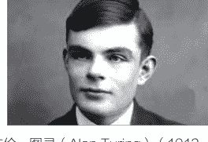
图1.1 艾伦·图灵 (Alan Turing) (1912—1954年)

图灵测试在数十年间一直被广泛视为检验机器智能的重要标准，对AI发展产生深远影响。

1956年，约翰·麦卡锡等10人在美国达特茅斯学院开会研讨“如何用机器模拟人的智能”，会上提出“人工智能”这一概念，标志着AI学科诞生。

## 人工智能研究发展的起起落落

概念提出带来巨大震撼，人们乐观预测短期内就能制造出完全智能的机器。麻省理工学院的约瑟夫·维森鲍姆在1966年发布了世界第一款自然语言对话程序Eliza。

图 1.2 Eliza 与人的对话

该程序可模拟人与人聊天的过程。虽然Eliza只是基于对话提取关键词并做出预设反应，但在早期仍让许多用户误以为是在与真人对话。

然而早期产品层出不穷却难以满足社会过高期待。从20世纪70年代起，批评声增多，公众热情与投资大幅回落。

直到20世纪80年代，随着卡耐基·梅隆大学为DEC公司开发的专家系统XCON在商业上取得巨大成功，AI才重新回到业界视野。专家系统是一种基于特定规则回答特定领域问题的系统，例如XCON可帮助DEC公司根据客户需求自动选择计算机部件组合，准确率达到专业技师水平从而节省大量人力成本。这一时期人们已不再追求建立通用的模拟人类人工智能，而是专注于用AI解决具体领域的实际问题。

另一方面，这一时期人工神经网络的研究也取得重要进展。人工神经网络是一种模仿动物大脑结构和功能的数学模型，通常由大量神经元联结进行计算，并可在外界信息基础上改变内部结构，也就是具备学习功能。上世纪80年代，反向传播算法取得关键进展，被证明是用于人工神经网络训练的有效方法。

但到20世纪80年代末、90年代初，业界逐渐发现以专家系统为代表的AI系统开发和维护成本高昂而商业价值有限，AI发展再次步入低谷。

## 人工智能的新浪潮

进入21世纪后，计算机芯片运算能力飞速提升。在此背景下，AI算法取得重大发展。基于强劲运算力，人工神经网络在语音识别、图像分析、视频理解等诸多领域创造新成功。

2016年，谷歌旗下DeepMind开发的AI围棋程序AlphaGo通过人工神经网络深度学习训练，在一场比赛中以4:1战胜围棋世界冠军李世石九段。这次成功点燃了社会对新时代AI的巨大热情，人们开始意识到AI在很多领域的能量已远超人类。

DeepMind团队在2017年末推出了增强版下棋程序AlphaZero。它与初版AlphaGo相比有几点重大改变：一是AlphaZero只需棋类的基本规则作为训练基础，不需要任何人类棋谱作为参考；二是它采用更为通用的算法，可延伸到将棋与国际象棋。短时间内34小时内训练后，AlphaZero成功击败了围棋、将棋、国际象棋领域当时最强的AI程序。这一成果让人们更清晰地认识到机器自我学习的潜力，并对AI具备更强通用性充满期待。

### 1.1.3 人工智能的应用现状

AI概念覆盖机器视觉、语音识别与人机交互、自动驾驶等多个范畴，在当今社会已有大量运用。

### 机器视觉

机器视觉是指在AI系统中配备视觉仪器并通过视觉仪器捕捉到的信息进行分析处理。机器视觉目前被广泛应用于安防、车牌识别系统、医疗辅助诊断、工业化生产线中。

在安防领域，机器视觉可从大量监控视频数据中提取有效信息，从而辅助警方侦破案件；在医疗辅助诊断方面，机器视觉可对医学影像进行分析，从而减少误诊或漏诊；在工业化生产中，机器视觉则可对物品进行分类与分拣。

### 语音识别与人机交互

正确识别并理解人类语言一直以来都是AI研究的重要课题。近年来这一领域也得到高速发展。现在的AI系统能够以相当高准确率将人类说的话转化为文本，并基于对语义的理解判断用意，进而做出针对性答复。这一流程包含语音文字转化、自然语言理解等多个环节。

目前，主流网络视频流媒体服务提供商都提供了高效的AI自动实时字幕功能；Siri等移动智能助手也正一步步进入我们的生活；而基于AI打造的智能客服系统还能有效地替代部分传统人工客服的作用并同时针对客户需求进行数据分析与优化。

### 自动驾驶

自动驾驶技术目前发展速度极为迅猛，大量的传统车企和科技公司纷纷投身于这一巨大市场。Google旗下的自动驾驶汽车已经在小范围投入商业使用，而特斯拉汽车已经通过OTA升级具备了部分自动驾驶功能。按照目前的发展趋势，自动驾驶汽车大范围投入实际使用已近在咫尺。

自动驾驶汽车显然是一个基于AI的复杂系统，它需要借助车载的大量传感器实时监测数据并进行分析，选择合适的行驶路线，保证高效、安全地运行。

## 1.2 机器人世界

### 1.2.1 机器人的发展历史

机器人是一种模拟人类或其他生物的行为或思想的机械，也泛指可以取代或协助人类工作的自动执行任务的人造机器。

机器人一词最早出现于1920年捷克科幻作家卡雷尔·恰佩克的《罗索姆的万能机器人》一文中。而现实中的机器人约从20世纪50年代起开始发展，至今经历约60年历程。

1959年，美国人乔治·德沃尔与约瑟夫·恩格尔伯格联手制造出世界上第一台工业机器人。这一工业机器人可以以高精确度模拟人类完成生产线上的重复工作。

这一阶段的机器人基本是基于设定好的程序完成指定动作，因此也被称为程序控制型机器人或示教型机器人。这样的机器人只能被视为程序控制型机械，与AI还没有交集。

此后，随着传感器技术的发展，新制造的机器人上开始搭载大量用于感知环境的传感器，用以感知周围温度、湿度、亮度等信息，从而辅助人类做出决策。这些机器人常被用于探索一些人类不便进入的区域，例如地震灾区等。

而在AI辅助下，机器人技术也向着新阶段发展。以AI作为机器人的控制核心，机器人可以结合外部环境信息自主做出决策，而不依赖人类外部指令。这一阶段的机器人才能被称为智能机器人。

AI技术的核心是对人类思维过程的模拟，关于它的研究更多是在计算机程序算法方面。而机器人则是一类模拟人类或生物的硬件机械，它可以是只模拟行为的传统工业机器人，也可以是搭载AI技术的当代智能机器人。因此，机器人不一定搭载了AI技术，AI技术本身与硬件载体也并无直接关系。但是，AI技术要在实际生产、生活中得到应用，机器人一直以来都被认为是其最佳的硬件载体。

### 1.2.2 什么是智能机器人

智能机器人通常由3部分组成：感知单元、逻辑单元和执行单元。
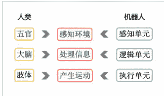
图 1.3 人类与智能机器人的组成部分对比

感知单元通常由多种传感器组成，用于感知周边环境，再将信息传递给机器人的逻辑单元。感知单元相当于机器人的“感觉器官”。
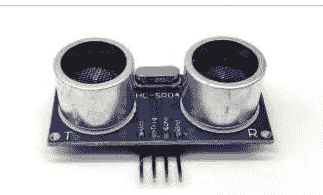
图 1.4 超声波传感器可以用于测距

逻辑单元是机器人的控制核心，承担着连接感知单元和执行单元的关键作用，它处理并分析感知单元传递的信息，进而指挥执行单元执行动作。逻辑单元相当于机器人的“大脑”，在AI技术的发展下，机器人逻辑单元的分析能力越来越强。

执行单元则包括电机、显示设备、发声设备等，它们接收逻辑单元的控制指令并做出相应反应。执行单元相当于机器人的“肢体”，最典型的执行单元是电机。
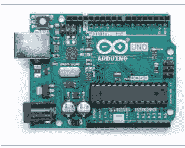
图 1.5 可用作智能机器人控制核心的 Arduino 主控板
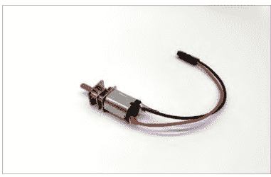
图 1.6 电机是机器人最典型的执行单元

### 1.2.3 常见的智能机器人控制核心

智能机器人的核心是控制器，一般称为主控板，用于处理传感器传输的信息并指挥执行器工作。

现在已经有了很多专门为软件开发者设计的主控平台，例如现在火爆的树莓派、英特尔推出的爱迪生，以及历史最长的Arduino等。根据其性能和架构的区别，主控平台又可以分为单片机平台与微型计算机平台两个大类。

### 单片机平台

单片机约起源于20世纪70年代，随着处理核心运算能力的逐年提升，其在自动化工业生产中发挥着越来越重要的作用。但早年单片机的程序编写十分复杂，无法方便地被软件开发者甚至普通大众使用。直到2006年，第一个开源单片机平台Arduino出现后，才有越来越多开发者能够轻松地用单片机来制作小型的智能机器人系统。

### 微型计算机平台

微型计算机平台等同于一台小型计算机主机，具备普通计算机的主要功能，通常自带蓝牙、Wi-Fi连接功能，支持USB扩展连接，可自由安装主流操作系统，如Windows、Android及开源系统Linux等。这些专为智能设备设计的微型计算机，不仅体积小、能耗较低，还自带一些与传感器、执行器等机器人单元进行信号交互的接口，适合作为智能机器人的主控制器使用。目前最流行的微型计算机平台是树莓派。

虽然近年来微型计算机平台性能发展迅速，但它们从架构上并不是专为电子控制系统设计的。虽然智能机器人的历史并不长，但由多个电子元器件组成的电子控制系统已经发展了很长时间。传统上，人们通常使用单片机作为电子控制系统的核心元件。单片机通常集成了处理核心CPU、存储器RAM与ROM、大量信号输入输出接口，是专为控制电子元器件而设计的。

## 本章要点回顾

AI 入门速览

认识人工智能的基础概念
梳理机器人发展脉络
谈谈你对人工智能的理解
达特茅斯会议被公认为人工智能诞生的标志
人工智能发展大致可分为三次技术浪潮
机器视觉、语音识别、人机交互、自动驾驶等场景已广泛落地
机器人由示教式操作向自主智能演进
智能机器人通常由感知、判断、执行三大单元构成
常见机器人控制核心包括单片机与微型电脑等

# 第 2 章 认识树莓派

## 2.1 树莓派简介

树莓派由英国树莓派基金会推出，是一款专为计算机教学打造的极简型电脑。首版产品发布于 2012 年，第四代机型于 2019 年 6 月正式上市。机身轻巧、成本低廉，却涵盖了普通电脑的核心功能，因此在青少年编程教育中迅速流行，成为入门编程的重要载体。

发展至今已迭代四代，产品大致分为 A 系与 B 系，运算能力与扩展功能随版本持续提升。

到本书写作时点 2019 年 8 月，市场上较常见的开发板有以极致便携为主的树莓派 Zero W/WH（见图 2.1）、功能偏基础的第三代 A+ 即树莓派 3A+（见图 2.2），以及功能最完善的第三代 B+ 即树莓派 3B+。

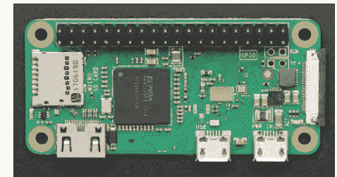

图 2.1 树莓派 Zero WH 主控板

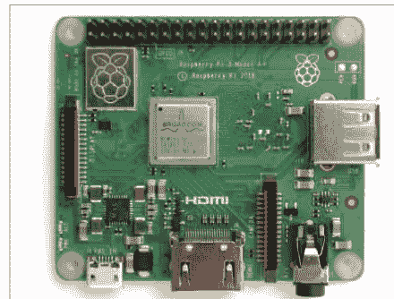

图 2.2 树莓派 3A+ 主控板

## 2.2 树莓派 3B+ 主板详解

本教程案例均以应用最广的树莓派 3B+ 作为核心。3B+ 于 2018 年 3 月 14 日发布，是 3B 的升级版，在无线性能与 CPU 表现上都有提升。

3B+ 的中央处理器由 4 个 1.4GHz 的 Cortex-A53 核心组成，图形处理器为 400MHz 的 Broadcom VideoCore IV。虽然性能并不强劲，但足以支撑小型机器人控制系统的开发需求。

板载接口包括 HDMI 高清视频输出、3.5mm 声音输出、4 组 USB 口，并内置 Wi-Fi 与蓝牙无线模块。体积虽小，却具备家用电脑的主要功能（见图 2.3）。

与普通电脑不同，3B+ 还额外提供类似单片机的 40 针扩展引脚，其中包含 21 路输入输出。这使得它既可作为微型电脑使用，也能直接驱动外设。

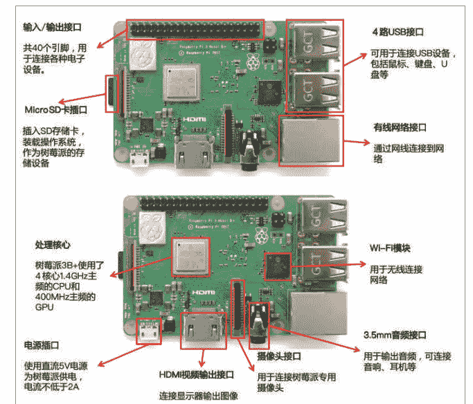

图 2.3 树莓派 3B+ 主控板组成示意图

## 2.3 树莓派连接与启动

使用前建议在板子正反面各贴一枚散热片，安装位置如图 2.4 和图 2.5 所示。

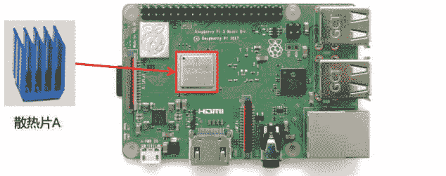

图 2.4 树莓派正面散热片安装位置

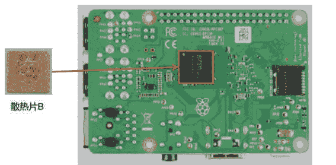

图 2.5 树莓派背面散热片安装位置

加装散热片主要是防止处理器过热。安装完成后按以下步骤开机。

- （1）将装好系统的 MicroSD 卡插入对应插槽，本教程镜像下载与安装说明可参考： http://www.fractalmind.com.cn/book/rpibasic。
- （2）把鼠标、键盘接入树莓派的 USB 接口。
- （3）用 HDMI 线把显示器接到树莓派的 HDMI 口。
- （4）用 MicroUSB 电源线接入供电口。注意输入电压为 5V，电流不低于 2A，建议 2.5A。
- （5）打开显示器与电源，设备自动启动，启动后即可看到如图 2.6 的桌面。

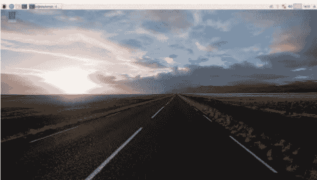

图 2.6 树莓派开机后显示的桌面

## 2.4 Linux 系统概览

树莓派可运行多种系统，官方发行版 Raspbian 构建于 Linux 之上。

Linux 是全球知名的开源操作系统核心，最早发布于 1991 年，任何人均可免费使用并修改。基于其核心集成应用后形成的定制系统通常称作 Linux 发行版，泛指的 Linux 包含各式发行版。

知名发行版有 Ubuntu、CentOS、Debian 等，Raspbian 正是基于 Debian 制作。

Linux 核心也被用于移动端，最流行的 Android 系统即基于它开发。

相较 Windows、macOS 等闭源系统，Linux 具备：
- （1）完全免费；
- （2）安全性与稳定性更高，资源占用相对较低。

不足在于：
- （1）图形界面偏简洁，操作不够便捷；
- （2）因开源，部分商业软件缺乏 Linux 版本或功能受限。

因此 Linux 更适合需要长期稳定运行的场景，例如网络服务器、智能控制系统等。

我们使用的 Raspbian 常用图标分布在上方任务栏中（见图 2.7）。

从左到右依次为：

开始菜单、

网络浏览器、

本地文件、

终端

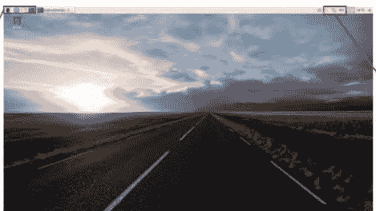

从左到右依次为：

蓝牙连接、

Wi-Fi 连接、

音量调节

图 2.7 树莓派系统任务栏常用图标分布

左上方图标的主要用途如下。

- 开始菜单：打开已安装程序、进行系统设置、关机重启等。
- 本地文件：浏览系统文件目录。
- 终端：输入 Linux 指令操作系统。

本章要点回顾

认识树莓派

树莓派是什么

明白树莓派是一款面向计算机教育的极简电脑

树莓派 3B+ 主控板简介

了解本教程选用的 3B+ 核心性能与接口情况

树莓派的连接与开机

学会为树莓派加装散热片
成功完成树莓派连接并启动

Linux 操作系统简介

了解官方系统 Raspbian 基于 Linux
了解 Linux 是全球最知名的开源操作系统核心
了解 Linux 的应用场景与优劣
熟悉树莓派操作系统的界面布局

# 第 3 章 Python 编程基础

## 3.1 什么是编程语言

人工智能多依赖计算机强大的算术与逻辑运算能力，但要让机器按人意工作，就必须精确控制计算机运行。

计算机运算核心 CPU 由大量微型电路构成。硬件层面，计算机通过改变不同电路状态来驱动显示器、音响等设备执行指令。

数字电路只有两种状态：高电平即通电、低电平即断电。通过海量微电路的高低电平组合，可产生丰富状态实现电子控制。

把高电平记作 1、低电平记作 0，就可以用 1 和 0 的排列来设定电路状态（见图 3.1）。

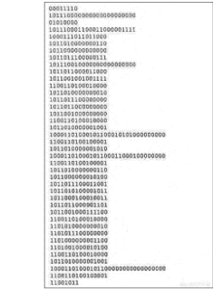

图 3.1 用 1 和 0 来控制计算机的代码

于是人们可以用由 1 和 0 组成的文本直接操控电路状态，用来控制计算机的文本指令即为计算机程序。

人与人交流需要自然语言，人与计算机交流也需要遵循特定规则的编程语言，才能准确传达意图（见图 3.2）。


图 3.2 自然语言与程序语言的对比 1

由 1 和 0 排列的文本能被计算机直接读懂，这类语言称为机器语言。

但机器语言对人类极不友好——仅输出一个字母就需输入数位到十几位的 1 和 0。

为此人们用更接近自然语言的方式编写程序，再由预设的解释器将其翻译成机器语言驱动计算机。若 B 只懂英语不懂汉语，可先让翻译转述，解释器就相当于翻译（见图 3.3）。

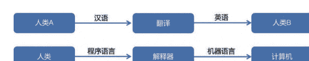

图 3.3 自然语言与程序语言的对比 2

编程语言经过半个多世纪演进，从早期的汇编语言到如今流行的 Python，正朝着更贴近人类自然语言的方向发展。

即便如此，为保证准确翻译与机器可识别，编程语言仍需遵循严格规则，比自然语言更为死板。

## 3.2 认识 Python 语言

Python 是一款通用型编程语言，可覆盖大量开发场景。据基于谷歌搜索指数的 PYPL 统计，2019 年 2 月 Python 在全球范围内是最受欢迎的编程语言（见图 3.4）。

| 排行 | 排行变化 | 编程语言 | 流行度 | 趋势 |
|---|---|---|---|---|
| 1 | ↑ | Python | 26.42 % | +5.2 % |
| 2 | ↓ | Java | 21.2 % | -1.3 % |
| 3 | ↑ | Javascript | 8.21 % | -0.3 % |
| 4 | ↑ | C# | 7.57 % | -0.5 % |
| 5 | ↓↓ | PHP | 7.34 % | -1.2 % |
| 6 |  | C/C++ | 6.23 % | -0.3 % |
| 7 |  | R | 4.13 % | -0.1 % |
| 8 |  | Objective-C | 3.04 % | -0.8 % |
| 9 |  | Swift | 2.56 % | -0.6 % |
| 10 |  | MATLAB | 1.98 % | -0.4 % |

图 3.4 2019 年 2 月的 PYPL 编程语言流行度排行

Python 由荷兰开发者吉多·范·罗苏姆于 1989 年启动，1991 年发布首个公开版 Python 0.9.0。

2000 年 Python 2.0 面世，影响力逐步扩大。2008 年 Python 3.0 发布，与 2.0 系列并非完全兼容。

与 C、Java 等传统语言相比，Python 具备明显优势。

- 可读性强。Python 属于高级语言，设计上更接近英语，具备英语基础和少量编程经验的人能轻松阅读代码。
- 语法简洁。设计哲学为“优雅”“明确”“简洁”，同样功能往往用更短语句实现。
例如，下面的 C# 代码段可在屏幕打印 “Hello World!”：

```
using System;
    class Program
    {
        static void Main(string[] args)
        {
            Console.WriteLine("Hello World!");
        }
    }
```

而用 Python 实现相同功能只需：

```
print("Hello World!")
```

- 可扩展性强。作为完全开放的环境，Python 拥有大量扩展包，如数学计算包 NumPy、游戏开发包 pygame、机器学习包 TensorFlow，因而成为人工智能编程的首选。
- 可移植性好。几乎能在任何操作系统上运行，代码迁移到 Windows、macOS、Linux 都很方便。

当前流行版本大致分为 2.x 代和 3.x 代。据统计 2018 年有 84% 的开发者使用 3.x 代编写程序，官方也计划于 2020 年停止对 2.x 代维护。由于两代规则略有差异，后续课程统一使用 Python 3.x。

## 3.3 在树莓派中使用 Python 编程

Python 可在多种环境编写，自然也包括树莓派。树莓派名称中的 Pi 正来自 Python。Python 是树莓派上首个运行的编程语言，也是项目开发中最常用的语言。

### 3.3.1 交互式编程

交互式编程方式简便，常用于测试。首先通过任务栏打开树莓派的“终端”，输入“python3”回车即可进入 Python 3 交互环境（见图 3.5）。

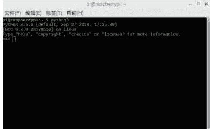

图 3.5 Python 3 的交互式编程环境界面

输入 “print( "Hello World!" )” 回车后会输出字符串 “Hello world !”（见图 3.6）。像这样完成特定功能的句子即为编程语言的语句，一个完整程序由大量语句组成，Python 中通常每行一句。

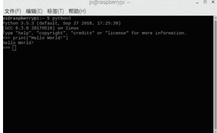

图 3.6 Hello World!

### 3.3.2 使用算术运算符进行运算

计算机擅长算术运算。Python 中加减乘除可用运算符 +、-、*、/ 实现，如图 3.7 所示，输入算式即可得到结果。

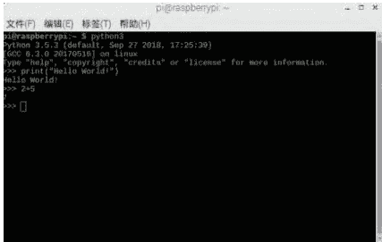

图 3.7 使用交互式编程环境进行算术运算

### 3.3.3 用 Geany 编辑器编写 Python 程序

交互式环境便于调试却无法保存大段代码反复运行，通常需要把完整程序存为 .py 文件再调用。

可使用任意文本编辑器编写 Python 程序，后续课程统一使用树莓派系统自带的轻量编辑器 Geany，可在开始菜单的“编辑”中找到。

Geany 的图标支持新建、打开、保存及程序运行等操作（见图 3.8）。

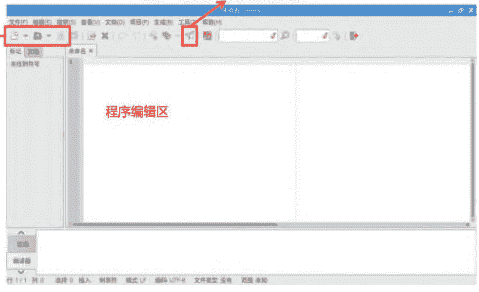

图 3.8 Geany 编辑器的界面

打开 Geany 后新建空白文档，再选择 文档→设置文件类型→脚本语言→Python 源文件，将其设为 Python 文件（见图 3.9）。

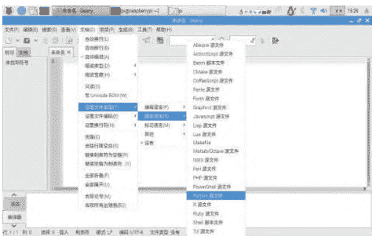

图 3.9 在 Geany 中新建 Python 文件的设置

设置后可在编辑区写入代码，点击“运行”图标执行。例如输入 “print(" Hello World ")”（见图 3.10）。运行后会弹出名为 sh 的窗口显示打印内容（见图 3.11）。

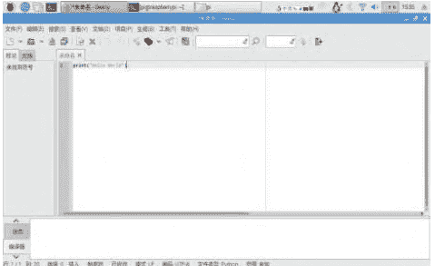

图 3.10 在 Geany 中编写 Hello World 程序

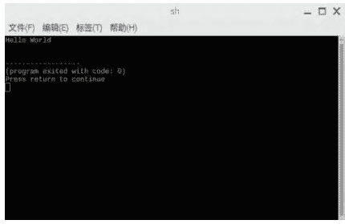

图 3.11 程序的运行效果

若运行异常，可能编译设置错误，可点击 生成→设置生成命令，按图 3.12 所示方式修改红框处。

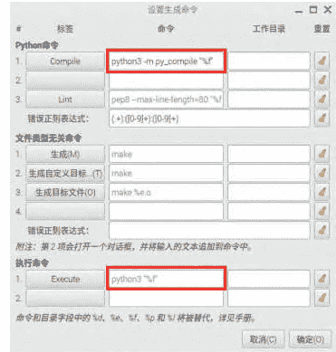

图 3.12 Geany 中的编译设置

## 3.4 Python 中的变量

前面提到，计算机通过大量 1 和 0 的排列存储信息。电子计算机把一切事物都存为 1 和 0 组合形成的数据，程序本质上是对这些数据进行操作，数据是程序的核心。

为方便处理不同数据，可在程序中建立变量来保存这些数据。变量拥有独立名称，其保存的数据即为变量值。

例如，A 班按周一到周五分 5 个值日小组轮换，每个小组由数名学生组成。每次值日由小组内一人负责。若把每次负责值日的同学视为数据，值日小组就是变量，具体同学即变量值。班主任只需指定小组，细节由变量值体现。

### 3.4.1 变量的赋值

把变量名与值对应起来的操作称为赋值。在 Python 中赋值语句很简单，例如：

```
a=1
```

这里创建了名为 a 的变量并赋值为 1。等号 = 在 Python 中是赋值运算符，后续程序中调用 a 即可取到值 1。

需要注意的是，同一个 Python 程序中变量名应唯一，对已出现的变量再次赋值会改变其值。例如：

```
a = 1
a = 2
```

完成第二次赋值的瞬间，变量 a 会被更新为 2。

当需要一次性为多个变量赋值时，可以采用下面的写法：

```
a = 1
b = 2
```

或者换一种表达形式：

```
a, b = 1, 2
```

两种写法在效果上完全相同。先分别给两个变量赋初值，随后用它们做运算得到的结果回写给第一个变量，最后把这个变量输出。

```
a, b = 1, 2
a = a + b
print(a)
```

请推算一下，执行完这段代码后 a 最终会打印出什么数值？

### 3.4.2 Python 的数据类型

Python 中的数据可以是数字，比如 1、2.5，也可以是字符，比如 “a”“Hello”。大体上，Python 的数据类型可归为两类：数值型 Number 和字符串型 String。

数值型又可细分为若干子类型，最常用的是保存整数的整型 int 和保存小数的浮点型 float。数值型数据能使用 +、-、*、/ 等算术运算符进行运算。

字符串型用来保存一个或多个字符，在 Python 里必须用英文单引号或双引号括起来，例如 “Hello World”。字符串之间可用 + 进行拼接，例如：

```
a = "Hello "
b = "World"
print(a + b)
```

程序会输出两个字符串拼接后的结果 “Hello World”。

给变量赋值时不需要手动声明类型，Python 会在首次赋值时依据初始值的形式自动分配合适的类型。

不过部分功能对数据类型有明确要求，类型不匹配就可能引发错误。比如 input() 用于获取人工输入的内容，可以把输入值赋给某个变量：

```
a = input()
print(a)
```

运行后可在编译器或命令行窗口输入任意字符，回车确认。这些字符会被赋给变量 a 并被打印出来。

用它能做一个简易的加法器：

```
a = input()
b = input()
print(a + b)
```

本意是让用户先后输入两个数字并求和。可是输入 1 再输入 2 时，打印结果却是 12 而非 3。原因在于 input() 无论得到的是数字还是文字，返回的永远是字符串类型，对字符串使用 + 实际是拼接而非算术加法。若要做数值运算，就必须先进行类型转换。

```
a = int(input())
b = int(input())
print(a + b)
```

先用 int() 把输入的字符串转成整数再赋值给 a 和 b，就能实现真正的加法。

若需要浮点数或字符串，也可分别使用 float()、str() 做强制转换。

试一试

参照上面的加法器，尝试编写减法、乘法和除法计算器。

## 3.5 if 条件结构

到目前为止，程序只能按顺序执行打印或计算。编程的强大之处在于能根据不同情形改变执行路径。Python 里有多类基于逻辑判断的流程控制结构，最基础的就是 if 条件结构。

### 3.5.1 条件的真与假

在介绍 if 之前，先明确真假的概念。条件用来描述事物的状态，例如：

如果今天下雨，我就去图书馆。

其中 “今天下雨” 就是一个条件。下雨时条件成立，为真；未下雨时条件不成立，为假。

Python 用 True 和 False 两个特殊量表示真假。条件判断为真时得到 True，否则得到 False。

### 3.5.2 比较运算符

程序里常需要判断两个量的大小关系，可用比较运算符实现。例如：

```
a, b = 1, 2
a == b
```

这里用相等运算符 ==，两个等号，判断左右是否相等，相等返回 True，否则返回 False。上例中 a == b 的结果是 False。

注意 == 与赋值运算符 = 不同，= 只有一个等号。比较运算符还包括大于 >、小于 <、大于等于 >=、小于等于 <=、不等于 !=。数值型数据支持全部大小比较，字符型数据仅能判断相等 == 或不相等 !=。

### 3.5.3 if 条件结构的格式与缩进

基于真假判断的 if 结构，其流程如图 3.13 所示。

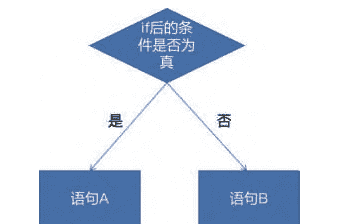

图 3.13 if 条件结构的基本流程

代码格式如下：

```
if 条件:
    语句 A
else:
    语句 B
```

先判断条件，若为真执行语句 A，否则执行语句 B。A、B 允许是多条语句。例如：

```
if a > b:
    print(a)
else:
    print(b)
```

这段代码会一直输出 a 与 b 中较大的那个值。

可以看出，A、B 相对于 if 和 else 都向右缩进了一段空白，这个空白用于表明逻辑层次，这就是 Python 的缩进。

同一程序中缩进长度必须一致，虽无强制规定，但业界习惯使用 4 个空格。

if 不仅能判断单个条件，也能串联多个条件。例如：

```
if 条件 A:
    语句 A
elif 条件 B:
    语句 B
else:
    语句 C
```

其逻辑如图 3.14 所示。

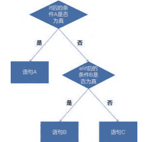

图 3.14 进行两个条件判断的 if 结构逻辑

举例：

```
if a > 0:
    print("a is a positive number")
elif a < 0:
    print("a is a negative number")
else:
    print("a equals to zero")
```

这段代码会根据 a 与 0 的相对位置分三种情况输出。多次使用 elif 可扩展更多分支。

## 试一试

把上一节的计算器改造成能根据用户输入的运算符自动选择运算方式的四则运算计算器。

提示：除输入两个操作数外，再用一次 input() 获取运算符，对运算符进行条件判断后执行对应运算。

## 3.6 while 循环结构

除了 if 外，常用的流程结构还有 while 循环，用于在条件为真时反复执行内部语句。其执行逻辑如图 3.15 所示。

格式为：

```
while 条件:
    循环执行语句
```

只要 while 后的条件成立，就重复执行循环体，每次结束后重新判断，直到条件不成立才跳出，继续执行循环后的代码。循环体同样需要缩进。

例如：

```
a = 1
while a < 100:
    a = a + 1
print(a)
```

该段会在 a 小于 100 时不断自增 1，最后在 a 等于 100 时退出并打印。

借助 while 能完成更复杂的数学计算，比如正整数阶乘 n! = 1×2×3×…×n。计算 50 的阶乘可写成：

```
a, f = 1, 1
while a <= 50:
    f = f * a
    a = a + 1
print(f)
```

其中 a 用来记录当前乘数，从 1 起步每次加 1 直到 50；f 用来累积阶乘结果。最终会打印出 50 的阶乘。

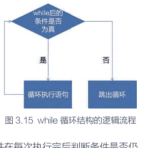

> 试一试
> 
> 斐波那契数列为 1,1,2,3,5,8,13……，前两项为 1，其后每一项等于前两项之和。试用 while 循环求数列中任意位置的数字。

## 3.7 Python 中的函数

当程序中需要反复执行相似操作时，可将它们封装成函数。函数拥有独立名称，可带参数，也可返回结果，有助于代码更清晰易维护。

举例来说，教机器人买东西：拿购物袋、带钱、前往地点、挑选物品、付款、取找零、回家。流程固定，物品和数量不同，这些就是参数；购物后想知道花费，就是返回值。函数 “去买东西” 就是把流程抽象出来，参数决定买什么，返回值给出花费。

### 3.7.1 自定义一个函数

Python 定义函数的格式如下：

```
def 函数名称(函数参数 1, 函数参数 2, ……):
    函数内执行语句
    return 函数的返回值
```

函数名在程序中必须唯一，通过名称加括号调用。括号内用逗号分隔参数，参数可在函数体内使用。无参数时括号留空。函数体语句需缩进，在调用时执行。

例如把阶乘封装为函数：

```
def factorial(n):
    a, f = 1, 1
    while a <= n:
        f = f * a
        a = a + 1
    print(f)
```

定义后直接运行不会有输出，需要在后面调用：

```
factorial(5)
```

调用时传入 5，函数内参数 n 的实际值即为 5。效果与直接计算相同，但封装后更易读。

函数可用 return 返回某个变量的值，若不使用 return 则无返回值。仍以阶乘为例，可改为返回结果：

```
def factorial(n):
    a, f = 1, 1
    while a <= n:
        f = f * a
        a = a + 1
    return f
```

设定返回值后，调用直接得到结果。例如 factorial(5) 得到 5 的阶乘，可把它赋给变量：

```
result = factorial(5)
```

该语句把 5 的阶乘存入 result。

试一试

把斐波那契数列的计算封装成函数，通过调用获取指定位置的值。

### 3.7.2 给 Python 程序加上注释

为提升可读性，可对代码、函数、变量添加注释。Python 中以 # 开头的行会被视为注释，不参与执行。例如：

```
# calculate the factorial of a positive integer
def factorial(n):
    a, f = 1, 1
    while a <= n:
        f = f * a
        a = a + 1
    return f
# get the factorial of 5
result = factorial(5)
```

若需要多行注释，可用三个单引号或三个双引号包围，首尾符号必须一致。例如：

```
'''
this is a program to calculate the factorial of a positive integer
we get factorial of 5
'''
def factorial(n):
    a , f = 1, 1
    while a <= n:
        f = f * a
        a = a + 1
    return f
result = factorial(5)
```

养成写清晰注释的习惯，复杂程序时只需阅读注释即可把握结构与功能。注释也可用来临时屏蔽语句，便于调试。

## 本章要点回顾

Python 编程基础

什么是编程语言

说说为什么计算机是由 1 和 0 来控制的

说说编程语言和人类的自然语言的异同

认识 Python 语言

说说 Python 编程语言有什么优势

在树莓派中使用 Python 编程

知道 Python 编程的两种方式

Python 中的变量

理解 “变量” 的概念

说出 Python 中的几种数据类型

if 条件结构

理解逻辑上的 “真” “假” 概念

说出比较运算符有哪些, 与赋值运算符有什么区别

学会 if 条件结构的逻辑和用法

while 循环结构

学会 while 循环结构的逻辑和用法

Python 中的函数

理解 Python 中函数的用法

学会利用注释辅助编程

# 第 4 章 树莓派 GPIO 入门

Python 编程与

树莓派硬件控制

前面我们熟悉了 Python 的基本概念，但仍局限在软件层面。树莓派的优势在于能方便地与物理硬件连接并直接控制。本章先用树莓派点亮小灯，再加入按钮，通过抢答器项目学习硬件控制，同时提升编程熟练度。

## 4.1 树莓派的 GPIO 接口

树莓派 3B+ 主板顶部有 40 个引脚，可用于与电子设备输入输出电信号。其布局如图 4.1 所示。

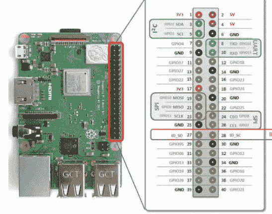

图 4.1 树莓派 3B+ 的引脚编号与功能

以 SD 卡槽在上为基准，引脚自上而下依次编号 1 至 40。

图示中 5V 为输出 5V 正电压，3V3 为输出 3.3V 正电压，GND 为接地。标注为 GPIO+序号的均为数字输入/输出接口。GPIO 即通用型输入/输出接口。需注意，树莓派所有输入/输出接口的工作电压均为 3.3V。

## 4.2 LED 模块与按钮模块的连接

树莓派本身接口有限，可使用 GPIO 扩展板扩展。市面型号多样，任选其一即可。扩展板安装方式如图 4.2 所示。

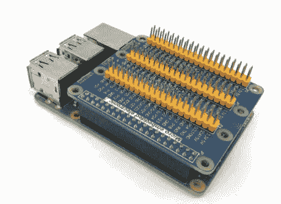

图 4.2 GPIO 扩展板连接示意图

安装前请先关机断电。

本章最终要做抢答器，需 1 个 LED 模块和 2 个按钮模块。为避免手持操作导致干扰，可先用固定装置把元器件固定。本例用 CAD 设计并激光切割木板制作固定底座，也可用其他方式。图 4.3 为模块固定底板示意图，图 4.4 为按钮固定板示意图。

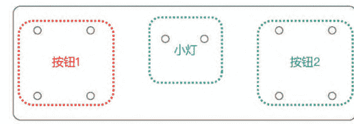

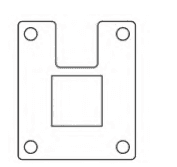

图 4.3 模块固定底板示意图

图 4.4 按钮固定板示意图

用按钮固定板配合 4 组 M3 螺丝和螺母把每个按钮固定到底板上，LED 模块用 2 组 M3 螺丝和螺母直接固定。

把 LED 模块的 V 正极以及两个按钮的 VCC 接到树莓派任意 3V3 引脚，按钮的 GND 接到任意 GND 引脚，LED 模块的 R、B、G 以及两个按钮的 OUT 接到任意 GPIO 引脚。

为统一示例程序，建议把 LED 模块的 R、B、G 接到 11、13、15 号引脚，对应扩展板 P17、P27、P22；两个按钮的 OUT 接到 12 号和 16 号引脚，对应扩展板 P18 和 P23。

确认接线无误后再接通电源开机。

## 4.3 点亮一盏小灯

### 4.3.1 导入 Python 扩展包

控制树莓派 GPIO 连接的输入输出设备，离不开 RPi.GPIO 这个扩展库。Python 的许多功能都分散在官方或第三方的扩展包里，引入它们通常有两种写法。

```
import 扩展包名 as 自定义名称
from 扩展包名 import 包中的指定函数、变量
```

第一种是直接导入，写 `as 自定义别名` 可加可不加。别名没写时，就要用 `扩展包名.函数或变量` 的形式调用；如果起了别名，则用 `别名.函数或变量` 来访问。 

第二种是按需导入，可以只挑包里需要的函数或变量，多个用逗号分隔。用 `import *` 就会把包里的全部内容一次性导入，这种方式下可以直接用函数或变量名调用，不必再带包名前缀。

以 RPi.GPIO 为例，两种导入写法可以这样使用：

```
import RPi.GPIO as gpio
from RPi.GPIO import *
```

调用包里的 setmode 函数时，第一种写法导入后要写成 gpio.setmode，第二种写法导入后则可以直接写 setmode。

两种方式都能用，但为了避免不同包里名字冲突带来的麻烦，通常更推荐第一种。只有当包里函数很少，或者只用到其中一两个时，第二种方式会更简洁。

RPi.GPIO 一般都采用第一种导入方式。注意 Python 在任何位置都区分大小写，大写和小写会被当成不同字符，这里的包名 RPi.GPIO 只有字母 i 是小写。

### 4.3.2 RGB LED 如何变色

日常会接触到白炽灯、荧光灯、LED 灯等多种光源。LED 因功耗低、体积小、易于数字控制，应用越来越广。

LED 的全称是发光二极管。其材料在通电导通时会被激发，释放光子，进而发出特定频率的光。不同材料决定了发光频率不同，而光的颜色由频率即波长决定，从红外到可见光再到紫外都遵循此规律。

本例使用的是全彩 LED，也称 RGB LED，内部集成红 R、绿 G、蓝 B 三颗灯珠。人眼对红绿蓝三色最敏感，这三种光以不同比例混合即可覆盖全部可见光色域，所以三色灯珠组合能呈现丰富色彩。

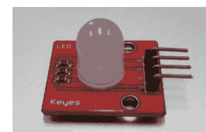

图 4.5 全彩 LED 模块

图 4.5 中全彩 LED 模块的 V 接口为正极，接树莓派 3.3V 输出；R、B、G 三个接口作为负极分别连到不同的 GPIO。程序控制这些 GPIO 输出不同电平，就能改变三颗灯珠两端的压差，从而调节亮度并混合出不同颜色。

### 4.3.3 GPIO 引脚的编号与模式设定

在编写控制 LED 的程序前，需要先对连接的 GPIO 进行配置。

图 4.1 中除了 1~40 的物理编号，每个引脚还对应另一组编号。Python 操作 GPIO 时必须先指定使用哪套编号：

```
gpio.setmode(gpio.BOARD)
或 gpio.setmode(gpio.BCM)
```

BOARD 对应 1~40 的物理顺序，BCM 对应 GPIO 后的数字编号。为了统一记忆，本教程统一采用 BOARD 编号。

树莓派既能接收按钮等设备发来的电信号，也能驱动 LED 等设备。按钮属于输入设备，LED 属于输出设备。对树莓派而言，信号只有高电平 3.3V 和低电平 0V 两种，称为数字信号。

所有 GPIO 都可当输入或输出使用，因此要用代码提前声明其工作模式：

```
gpio.setup(编号，模式)
```

模式分为两种：gpio.IN 表示输入，gpio.OUT 表示输出。

下面是对 LED 所连 GPIO 进行设定的完整示例：

```
import RPi.GPIO as gpio
gpio.setmode(gpio.BOARD)
gpio.setup(11, gpio.OUT)
gpio.setup(13, gpio.OUT)
gpio.setup(15, gpio.OUT)
```

### 4.3.4 实现灯光闪烁

配置好 GPIO 后即可控制 LED 的亮灭。三颗灯珠的正极已统一接 3.3V，负极接的 GPIO 只能输出高电平 3.3V 或低电平 0V。输出高电平时灯珠两端压差为 0 关闭，输出低电平时压差为 3.3V 点亮。控制电平的语句为：

```
gpio.output(编号, 电平状态)
```

电平只有两种：gpio.HIGH 为高电平，gpio.LOW 为低电平。

若想同时点亮红蓝绿三颗灯珠，代码如下：

```
gpio.output(11, gpio.LOW)
gpio.output(13, gpio.LOW)
gpio.output(15, gpio.LOW)
```

接下来做一个简单的闪烁效果，思路是让灯亮一段时间再灭一段时间并循环。为实现延时，需要引入 Python time 包的 sleep 函数。

```
from time import sleep
sleep(1)
```

sleep 的参数单位是秒，表示程序暂停的时长。

为了代码更清晰，先把 LED 的三个引脚编号赋给变量，再控制其中一颗，如红色灯珠交替亮灭：

```
import RPi.GPIO as gpio
R, B, G = 11, 13, 15
gpio.setmode(gpio.BOARD)
gpio.setup(R, gpio.OUT)
gpio.setup(B, gpio.OUT)
gpio.setup(G, gpio.OUT)
gpio.output(R, gpio.HIGH)
gpio.output(B, gpio.HIGH)
gpio.output(G, gpio.HIGH)
```

这段可完成 LED 模块的初始化，先把三颗灯珠全部关掉。

假设红灯每次亮 1 秒灭 1 秒：

```
gpio.output(R, gpio.LOW)
sleep(1)
gpio.output(R, gpio.HIGH)
sleep(1)
```

这能让红灯亮一秒灭一秒一次，但要持续循环就需要 while 循环。循环条件只要恒为真即可，直接写 True。

```
while True:
    gpio.output(R, gpio.LOW)
    sleep(1)
    gpio.output(R, gpio.HIGH)
    sleep(1)
```

这样就实现了闪烁效果。注意 sleep 必须在程序开头导入。

试一试

用 while 循环配合一个可变的 sleep 时间变量，让灯光逐渐闪得更快。

## 4.4 用按钮操控灯光

按钮模块见图 4.6，是树莓派上第一个使用的输入设备。市面型号很多，我们用的这款按下时输出高电平，抬起时输出低电平。树莓派通过 GPIO 读取电平就能判断按下状态，实现按钮控制。

### 4.4.1 读取按钮并做出判断

和 LED 一样，先要设定按钮所连 GPIO 的模式。

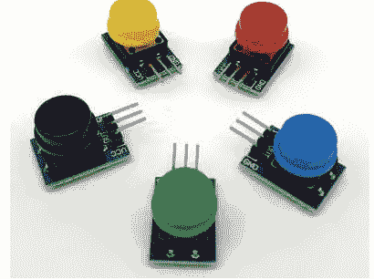

图 4.6 按钮模块

```
b1, b2 = 12, 16
gpio.setup(b1, gpio.IN)
gpio.setup(b2, gpio.IN)
```

这里按钮所连 GPIO 被设为 gpio.IN 输入模式。

读取电平可以用一个简单函数：

```
gpio.input( 编号 )
```

该函数会返回 gpio.HIGH 或 gpio.LOW。于是可以根据按钮状态执行不同操作，比如按下时点亮灯，否则熄灭。

```
if gpio.input(b1) == gpio.HIGH:
    gpio.output(R, gpio.LOW)
else:
    gpio.output(R, gpio.HIGH)
```

这段代码只能在程序启动瞬间读取一次按钮状态。想要持续监测，就要加上 while 循环。

```
while True:
    if gpio.input(b1) == gpio.HIGH:
        gpio.output(R, gpio.LOW)
    else:
        gpio.output(R, gpio.HIGH)
```

### 4.4.2 双按钮联动与逻辑运算

接上两个按钮后，可以让它们共同控制灯。例如两个都按下才亮灯，有一个未按下就熄灭，逻辑如图 4.7。

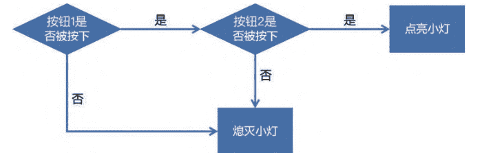

图 4.7 用两个按钮控制小灯的逻辑

对应的程序写法为：

```
if gpio.input(b1) == gpio.HIGH:
    if gpio.input(b2) == gpio.HIGH:
        gpio.output(R, gpio.LOW)
    else:
        gpio.output(R, gpio.HIGH)
else:
    gpio.output(R, gpio.HIGH)
```

这样写功能正确但稍显冗长。当需要同时判断多个条件时，可用逻辑运算符简化。

逻辑运算符有三种：and 与、or 或、not 非。

and 连接两个条件，两者都为真才返回真；or 只要有一个为真就返回真；not 能取反。

上例实质是按钮 1 按下并且按钮 2 按下时亮灯，其余情况熄灭。用逻辑运算符可简化为：

```
if gpio.input(b1) == gpio.HIGH and gpio.input(b2) == gpio.HIGH:
    gpio.output(R, gpio.LOW)
else:
    gpio.output(R, gpio.HIGH)
```

试一试

尝试用至少两种写法实现：两个按钮只要有一个按下就点亮灯，两个都不按时熄灭。

## 4.5 DIY 一个抢答器

现在做一个抢答器：两人各持一个按钮，灯在程序启动后一段时间内亮起，判断谁先按下按钮。

### 4.5.1 让灯光延迟点亮

程序启动后先等待再亮灯可用 sleep 实现。例如启动 3 秒后点亮白光，三颗灯珠全亮：

```
import RPi.GPIO as gpio
from time import sleep
R, B, G = 11, 13, 15
gpio.setmode(gpio.BOARD)
gpio.setup(R, gpio.OUT)
gpio.setup(B, gpio.OUT)
gpio.setup(G, gpio.OUT)
```

```
gpio.output(R, gpio.HIGH)
gpio.output(B, gpio.HIGH)
gpio.output(G, gpio.HIGH)
sleep(3)
gpio.output(R, gpio.LOW)
gpio.output(B, gpio.LOW)
gpio.output(G, gpio.LOW)
```

### 4.5.2 判定胜负与 break 跳出

灯亮后需判断哪个按钮先被按下。可用 if 条件判断：

```
b1, b2 = 12, 16
gpio.setup(b1, gpio.IN)
gpio.setup(b2, gpio.IN)
while True:
    if gpio.input(b1) == gpio.HIGH:
        print("1st player wins!")
    elif gpio.input(b2) == gpio.HIGH:
        print("2nd player wins!")
```

这样写找到胜者后循环仍会继续。想立刻退出循环，可用 break 关键词，它会无视条件直接跳出循环。

```
while True:
    if gpio.input(b1) == gpio.HIGH:
        print("1st player wins!")
        break
    elif gpio.input(b2) == gpio.HIGH:
        print("2nd player wins!")
        break
```

在屏幕上打印胜者不够直观，可以让灯光显示获胜者的颜色。假设 b1 对应红色，b2 对应绿色。

```
while True:
    if gpio.input(b1) == gpio.HIGH:
        gpio.output(R, gpio.LOW)
        gpio.output(B, gpio.HIGH)
        gpio.output(G, gpio.HIGH)
        break
    elif gpio.input(b2) == gpio.HIGH:
        gpio.output(R, gpio.HIGH)
        gpio.output(B, gpio.HIGH)
        gpio.output(G, gpio.LOW)
        break
```

### 4.5.3 加入随机延时

固定 3 秒后亮灯容易被摸清节奏，加入随机等待更公平。Python 的 random 包提供 randint 函数：

```
randint(范围下限, 范围上限)
```

该函数返回指定整数区间内的随机整数。随机延时的写法如下：

```
from random import randint
sleep(randint(3, 10))
```

程序结束前建议调用 cleanup 释放 GPIO 占用，但这会熄灭灯光，可在调用前先延时保持亮灯一段时间。

```
sleep(5)
gpio.cleanup()
```

试一试

做一个亮灯时间随机且可重复运行的抢答器。

自主练习

该游戏存在作弊可能：灯亮前提前按住按钮。尝试修改程序识别并揪出作弊者。

## 附：抢答器的完整示例程序

```
import RPi.GPIO as gpio
from time import sleep
from random import randint
# 将连接的各脚编号存储成变量
R, B, G = 11, 13, 15
b1, b2 = 12, 16
# 使用变量 winner 表示获胜者，初始值为 0
winner = 0
gpio.setmode(gpio.BOARD) # 设定板子的编号模式
# 设定各引脚的输入 / 输出模式
gpio.setup(b1, gpio.IN)
gpio.setup(b2, gpio.IN)
gpio.setup(R, gpio.OUT)
gpio.setup(B, gpio.OUT)
gpio.setup(G, gpio.OUT)
# 先熄灭小灯
gpio.output(R, gpio.HIGH)
gpio.output(B, gpio.HIGH)
gpio.output(G, gpio.HIGH)
# 随机延迟 3~10 秒
sleep(randint(3, 10))
# 点亮小灯发出白光
```

```python
gpio.output(R, gpio.LOW)
gpio.output(B, gpio.LOW)
gpio.output(G, gpio.LOW)
# 开始循环
while True:
    # 判断谁先按下按钮，即显示对应颜色，假设 b1 连接的按钮为红色的，b2 连接的按钮为绿色的
    if gpio.input(b1) == gpio.HIGH:
        gpio.output(R, gpio.LOW)
        gpio.output(B, gpio.HIGH)
        gpio.output(G, gpio.HIGH)
        break
    elif gpio.input(b2) == gpio.HIGH:
        gpio.output(R, gpio.HIGH)
        gpio.output(B, gpio.HIGH)
        gpio.output(G, gpio.LOW)
        break
#5 秒后清除对 GPIO 的调用
sleep(5)
gpio.cleanup()
```

## 上一章要点速览

用 Python 控制树莓派硬件的实践
树莓派 GPIO 接口的结构
对 GPIO 接口的基本认知
LED 模块与按键模块的硬件连接方式
借助 GPIO 扩展板把按键、LED 等器件接入
点亮一盏指示灯的练习
Python 第三方扩展包的导入方法
全彩 LED 混色的工作原理
为 GPIO 引脚编程指定输入输出模式
实现呼吸灯灯效的编程
通过按键改变灯的开关状态
程序化读取按键端口电平
按下去点亮、松开熄灭的控制实现
用两枚按键按不同逻辑实现灯的启停
搭建一个简易抢答器
掌握 sleep 函数制造延时
掌握 break 语句终止循环
掌握 Python 随机数的使用
编写抢答器的完整实现

# 第 5 章 机器视觉与图像识别

视觉感知入门

## 5.1 机器视觉与图像识别

### 5.1.1 机器是怎样“看”的

人类凭借感官认识世界，视觉、听觉、嗅觉、味觉各司其职，其中视觉的信息量最大。人工智能希望模仿人的能力，“学会看见”就是关键一步。

在谈机器视觉前，先看人眼的工作原理。天生具备的光感受能力让眼睛捕捉光线，人眼视网膜上存在对红光、绿光、蓝光分别敏感的三种感受细胞，通过这三种信号的综合就能辨别出丰富色彩。其简化流程如图 5.1 所示。


图 5.1 感光细胞成像的简易流程

因此红、绿、蓝被称作视觉三原色，任意比例混合可覆盖可见光谱。三原色及其组合关系如图 5.2 所示。


图 5.2 红、绿、蓝三原色及其组合

很长一段时间人类只能靠绘画保存所见，直至 19 世纪照相机出现，首次能把光信息固化。传统彩色相机利用感光药片对三原色的不同敏感性在胶卷上显影出色彩，工作思路与人眼相似。


图 5.3 传统彩色照相机的影像原理

数码相机则摆脱化学胶片，依赖电子感光单元把光转化为电信号，再经芯片处理存储或传输。


图 5.4 数码相机获取图像的原理

电子感光单元由大量微型感光半导体紧密排成矩形阵列。

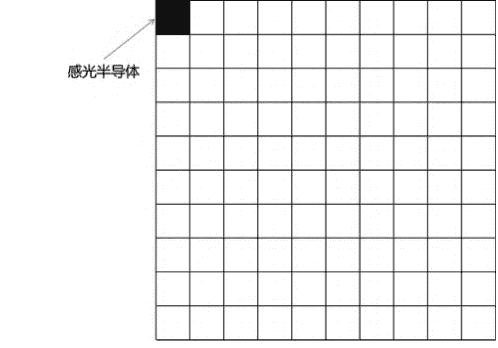
图 5.5 电子感光单元中以矩形排列着大量的感光半导体

每个半导体单元可通过滤光片感知入射光中红、绿、蓝三色的强度。于是整块感光面就记录了画面每个位置的三原色强度，图像的最小单位——像素，正是单个感光单元的采集结果。

传统相机经显影可直接还原照片，数码图像则需电子显示。可用大量微型彩色 LED 按同样的矩形排列组成屏幕，让每个灯接收对应像素的三原色强度信息即可还原画面。这样数码相机模拟了人眼的成像过程。

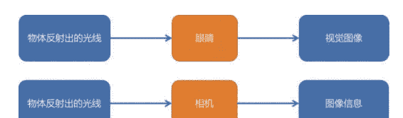
但人眼看到图像后，大脑会进一步分析颜色、形状、类别等语义信息。人工智能视觉的核心正是从像素数据中提取颜色、轮廓等基础特征并赋予意义，这个过程即图像识别，也称机器视觉。图 5.7 对比了机器视觉与人类视觉。

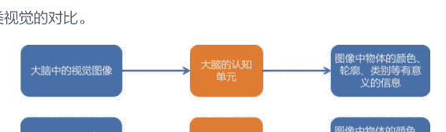

### 5.1.2 机器视觉技术的常见应用

机器视觉是人工智能的重要分支，已在多个领域落地。

## 相似图像搜索
2009—2010 年间，谷歌、百度等先后上线以图搜图。系统分析图片特征，在网络中检索相似结果。如今手机购物 App 也能通过拍摄商品照片找到同款。

## 文字识别
电子设备普遍采用 OCR 光学字符识别读取纸质文字，成熟的方案对手写体也有较高准确率。

## 面部识别
智能手机多内置摄像头加算法的面部识别，用于解锁、支付等安全场景。公共安全领域也广泛使用，在特定场所防范风险并辅助案件侦破。

## 目标检测
AI 图像识别的关键在于定位并分类图像中的物体。随着神经网络发展，开源工具可训练模型识别指定类别。图 5.8 显示目标检测工具 YOLO 能准确从画面中挑出指定物体。

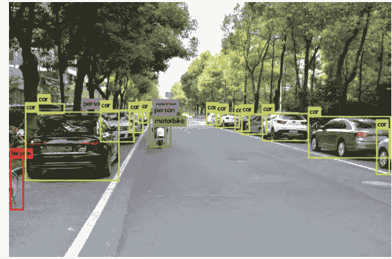
图 5.8 目标检测工具 YOLO 可以准确地从图像中识别指定种类的物体

## 5.2 认识 OpenCV

前面提到，计算机存储的图像本质是像素矩阵的颜色数值。要获得有意义的信息需对数据进行处理和分析。几十年来计算机科学家积累了大量图像处理方法，开源计算机视觉库 OpenCV 集成这些算法，方便开发者分析视觉数据。

### 5.2.1 OpenCV 简介

英特尔于 1999 年启动 OpenCV 开源计算机视觉库项目，如今它是影响力最大的开源视觉库之一，在人脸识别、手势识别、目标识别、增强现实等任务中发挥作用。

2009 年 OpenCV 发布首个第二代正式版，自 2012 年起由一个非营利组织继续维护。2015 年推出第三代，2018 年推出第四代，后续项目主要使用应用最广的第三代。OpenCV 本体用 C++ 编写，同时提供 Python 等语言的扩展接口。

### 5.2.2 视频的帧与分辨率

OpenCV 不仅处理静态图，还能处理实时动态视频。摄像头成像原理与数码相机相同，只是以极短间隔连续采集图像，帧序列构成视频。

我们看到的视频其实是多张静态图高速连播，大脑将相似画面串联成流畅影像。视频中单张静态图叫一帧，单位时间内帧数即帧率，通常 30 帧/秒或 60 帧/秒，帧率越高越顺滑。


图 5.9 OpenCV 的 Logo，包含视觉三原色要素

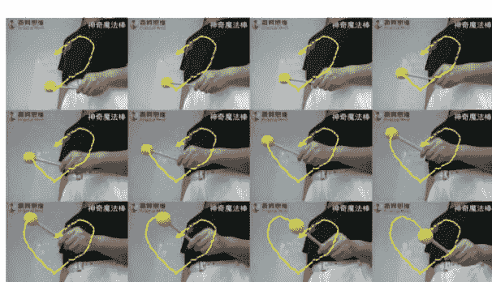
图 5.10 视频事实上是由多帧图像连续播放而成的

同一视频所有帧像素排布一致，横向像素数与纵向像素数组成分辨率。以树莓派官方摄像头为例，横向 640 个像素、纵向 480 个像素，分辨率为 640 像素 × 480 像素。

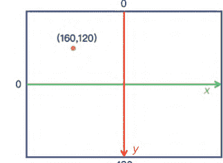
图 5.11 树莓派摄像头的分辨率及像素坐标的排列方式

如图 5.11 橙点所示，每个像素可用 x 轴横坐标和 y 轴纵坐标定位。分辨率常以纵向像素表示，如标清 480p、高清 720p、全高清 1080p、4K 2160p。标准画幅多为 16:9 或 4:3，分辨率越高画面越清晰。

### 5.2.3 用树莓派摄像头调取图像

在树莓派上用 OpenCV 处理实时画面，需先安装摄像头。关机断电后，如有 GPIO 扩展板需先取下。用 FFC 排线把摄像头接到主板摄像头接口，注意位置和方向。

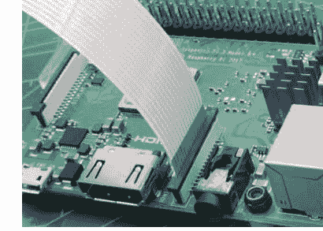
图 5.12 注意摄像头线在树莓派板上的连接位置与方向

使用配套镜像的树莓派系统已为 Python 3 安装 OpenCV 扩展包及视频处理工具。导入方式如下。

```
import cv2
```
注意，这里的数字 2 与 OpenCV 的版本无关，仅表示该扩展包的名称。

测试摄像头的完整程序如下。

```
import cv2 # 导入 OpenCV 扩展包
cap = cv2.VideoCapture(0) # 读取摄像头发信号
while cap.isOpened(): # 当摄像头发信号存在时，进行循环
    (ret, frame) = cap.read() # 将读取的信号中的一帧存为 frame 变量
    cv2.imshow('test', frame) # 预览帧
    cv2.waitKey(5) # 每帧等待 5 毫秒
```

运行后窗口会显示实时画面，若无画面请检查摄像头连接。

程序流程解析：OpenCV 用 VideoCapture 打开视频源，括号内 “0” 表示默认摄像头，其他编号或视频路径也可。创建对象 cap 后，isOpened 判断打开是否成功，作为 while 循环条件实现持续读取。

cap.read 返回两个值：帧是否存在和帧数据，写作 (ret, frame) = cap.read()。ret 为 True 表示帧存在，frame 包含整帧像素的三原色值。OpenCV 读取的像素顺序为 B、G、R，每个通道 0~255。

imshow 把图像数据显示到窗口，调用格式为：

```
imshow(窗口名称，图像信息)
```
OpenCV 显示后必须调用 waitKey，参数为毫秒，表示当前帧停留时间后再继续。

## 试一试

接上树莓派摄像头，用 OpenCV 预览实时视频流。

## 5.3 用 OpenCV 识别颜色

调取图像只是第一步，OpenCV 的价值在于便捷处理。机器视觉先要定位物体轮廓，颜色分界是关键，所以先学会识别特定颜色。

### 5.3.1 HSV 颜色空间

OpenCV 原始图像每个像素由 B、G、R 表示，但在不同光照下同一物体的 BGR 值变化很大，仅靠区间很难稳定锁定目标。

为此常用 HSV 颜色空间描述颜色，更贴近人眼感受。HSV 由色相 Hue、饱和度 Saturation、亮度 Value 三个属性构成，1978 年由计算机科学家 Alvy Ray Smith 提出，可由 RGB 换算得到。

色相是颜色在色轮上的位置，红、绿、蓝通常放在 0°、120°、240°。饱和度反映颜色纯度，越高越鲜艳。亮度反映明暗程度，越大越亮。

图 5.13 所示为 HSV 空间示意，常规取值 H 为 0~360，S、V 为 0~100。


图 5.13 HSV 颜色空间的图示

在 Geany 中可打开颜色选择器查看不同颜色的 HSV 与 RGB 值。

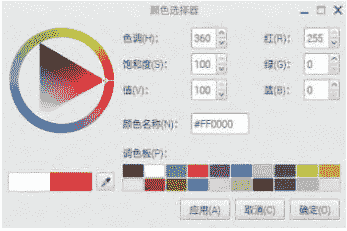
图 5.14 Geany 中的颜色选择器

OpenCV 内置 cvtColor 可在颜色空间间转换，例如：
hsv = cv2.cvtColor(frame, cv2.COLOR_BGR2HSV)
把 BGR 图像转成 HSV 并存入 hsv。注意 OpenCV 中 H 范围是 0~180，S、V 是 0~255，普通 HSV 值使用前需做比例换算。

常见颜色在 OpenCV 取值下的大致区间如下：

| 颜色范围 | 黑色 | 灰色 | 白色 | 红色 | 橙色 | 黄色 | 绿色 | 青色 | 蓝色 | 紫色 |
|---|---|---|---|---|---|---|---|---|---|---|
| H最小值 | 0 | 0 | 0 | 0或156 | 11 | 26 | 35 | 78 | 100 | 125 |
| H最大值 | 180 | 180 | 180 | 10或180 | 25 | 34 | 77 | 99 | 124 | 155 |
| S最小值 | 0 | 0 | 0 | 43 | 43 | 43 | 43 | 43 | 43 | 43 |
| S最大值 | 255 | 43 | 30 | 255 | 255 | 255 | 255 | 255 | 255 | 255 |
| V最小值 | 0 | 46 | 221 | 46 | 46 | 46 | 46 | 46 | 46 | 46 |
| V最大值 | 46 | 220 | 255 | 255 | 255 | 255 | 255 | 255 | 255 | 255 |

图 5.15 常见颜色的 HSV 颜色区间

红色因色环首尾相接，H 值分为 0~10 和 156~180 两个区间。

### 5.3.2 图像的二值化

在 HSV 空间可设定目标颜色的取值范围。假设要检测均匀的黄色物体，其 HSV 大致为 H 26~34、S 43~255、V 46~255。可设定下限与上限两个阈值：

```python
yellow_lower = (26, 43, 46)
yellow_upper = (34, 255, 255)
```
这种写法本质上是在声明一个元组类型的变量，有关元组的用法可以翻到 5.4.2 节来了解。想要勾勒出物体的外形，第一步就是把图像中落在目标色域的像素和落不在的像素区分开。为了计算方便，我们把符合区间的像素全部标记为 1，不符合的全部标记为 0，于是就得到了一张仅由 0 与 1 组成的图。OpenCV 提供的 inRange 函数可以一步完成这个转换：

```
inRange( 图像信息, 分割的颜色下限, 分割的颜色上限 )
```
调用后会得到一张只含 0 和 1 的图像。用 0 与 1 来表示整张图的像素，这就是图像的二值化，是计算机视觉里常用的数学手段。如果把 0 像素染成黑色、1 像素染成白色，inRange 就能实现图 5.16 所示的效果。

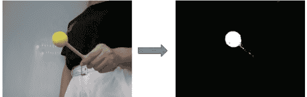
图 5.16 inRange 函数可以按指定颜色区间完成图像的二值化

### 5.3.3 追踪轮廓边界
二值化之后，就能很方便地找到黑白区域的分界，也就是待测物体的轮廓。轮廓查找主要依赖 findContours 函数：

```
findContours( 图像信息, 输出模式, 输出方法 )
```
第一个输入是已经二值化的图像。

第二个参数控制轮廓的输出模式，常用有三种：

- cv2.RETR_EXTERNAL：只保留最外层轮廓
- cv2.RETR_LIST：输出全部轮廓
- cv2.RETR_TREE：输出全部轮廓并记录包含关系

第三个参数决定轮廓信息的保存方式，常见两种：

- cv2.CHAIN_APPROX_SIMPLE：只保留拐角点坐标
- cv2.CHAIN_APPROX_NONE：保存所有连续点坐标

本例为了简化，采用 cv2.RETR_EXTERNAL 与 cv2.CHAIN_APPROX_SIMPLE。函数会返回三个连续结果：原图、二值图对应的轮廓集合、轮廓间的层级关系。在只取外轮廓的场景下，我们主要用到第二个返回值。

将图像二值化并提取外轮廓的完整流程如下。

```
mask = cv2.inRange(hsv, yellow_lower, yellow_upper)
(mask, cnts, hierarchy)= cv2.findContours(mask, cv2.RETR_EXTERNAL, cv2.
CHAIN_APPROX_SIMPLE)
```
代码里先按设定的颜色区间把原图转成二值图，存入 mask。随后调用轮廓查找，把结果存入 cnts。这样得到的轮廓会包含色域内所有物体的边界，图 5.16 右侧的噪声点也会被检出。若只想保留目标物体，就要在所有轮廓里挑出面积最大的那个。

Python 内置的 max 可以取出一组数据中的最大值。这里需要比较的不是数值本身，而是每个轮廓所包围的面积：

```
最大值 = max( 一组数据, key= 比较方式 )
```
OpenCV 用 contourArea 来计算轮廓面积，可用下面的写法把 cnts 中面积最大的轮廓赋给变量 c：

```
c = max(cnts, key=cv2.contourArea)
```
得到目标轮廓 c 后，还需要它的几何位置。minEnclosingCircle 能算出能完全包住该轮廓的最小外接圆，并返回圆心坐标和半径。

该函数只需轮廓信息作为输入，返回两组数据：圆心（x, y）和半径 r。用 ((x, y), radius) = cv2.minEnclosingCircle(c) 即可接收。

注意此前得到的中心坐标是浮点数，而后续绘图需要整数。要注意的是，如果摄像头里完全没有目标颜色，cnts 会是空的，直接使用 max 会报错。可以先做长度判断。

len 用来获取序列的长度，若 len 大于 0 说明列表非空。len 的作用对象是列表类型，相关说明见 5.4.2 节。

```
if len(cnts) > 0:
    c = max(cnts, key=cv2.contourArea)
((x, y), radius) = cv2.minEnclosingCircle(c)
```
> 试一试
> 
> 找一个色彩均匀的实物，通过 OpenCV 输出它在画面中的中心位置与大致尺寸。
> 请根据实物的颜色调整 inRange 的参数，尽量滤除背景中色相相近的干扰。

## 附：识别黄色物体的完整程序代码
```
import cv2
cap = cv2.VideoCapture(0) # 开始读取摄像头信号
while cap.isOpened(): # 当读取到信号时
    (ret, frame) = cap.read() # 读取每一帧视频图像为 frame
    hsv = cv2.cvtColor(frame, cv2.COLOR_BGR2HSV) # 将颜色空间转换为 HSV
    yellow_lower = (26, 43, 46) # 指定目标颜色的下限
    yellow_upper = (34, 255, 255) # 指定目标颜色的上限
    mask = cv2.inRange(hsv, yellow_lower, yellow_upper) # 使用目标范围分割图像并二值化
    (mask, cnts, hierarchy) = cv2.findContours(mask, cv2.RETR_EXTERNAL, cv2.CHAIN_APPROX_SIMPLE) # 寻找其中的所有外轮廓
    if len(cnts) > 0: # 如果至少找到一个轮廓
        c = max(cnts, key=cv2.contourArea) # 找出其中面积最大的轮廓
        ((x, y), radius) = cv2.minEnclosingCircle(c) # 分析轮廓的中心位置和大小
        print("中心坐标", (x, y))
        print("半径", radius)
    cv2.imshow('test', frame) # 将图像显示到屏幕上
    cv2.waitKey(5) # 每一帧后等待 5 毫秒
```
## 5.4 制作你的魔法画笔
拿到物体的中心坐标后，就能做一些有趣的应用，比如把物体当成“笔”在画面上作画。可以取一块颜色均匀的黏土固定在铅笔一端捏成球形，自制一个“魔法棒”，如图 5.17 所示。没有黏土时，也可以用其他颜色均匀的小物件代替。

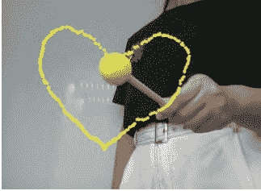
图 5.17 用“魔法棒”绘制图样

### 5.4.1 画点基础
要让魔法棒产生绘画效果，就需要掌握 OpenCV 的绘图接口。绘制小圆点常用 circle 函数：

```
circle( 图像信息, 圆心坐标, 圆的半径, 线的颜色, 线的宽度 )
```
圆心坐标和颜色值都要用小括号括起，颜色按 BGR 顺序给出，三个通道范围 0~255，线宽设为 -1 时表示实心填充，画点时就用这个值。示例写法如下。

```
cv2.circle(frame, (x, y), 2, (0, 255, 255), -1)
```
这条语句会在 frame 图像的 (x, y) 位置画一个半径为 2 的黄色实心点。

前面得到的中心坐标 x、y 往往是小数，而 circle 只能接受整数。Python 的 int 函数可以将数值截断为整数，去掉小数部分。

因此坐标需要先转换：

```
cv2.circle(frame, (int(x), int(y)), 2, (0, 255, 255), -1)
```
配合这一转换，就能在检测到的中心位置打点。为了让画面更符合直觉，常希望图像呈现镜面效果，这可以用 flip 实现，例如：

```
frame = cv2.flip(frame, 翻转方式)
```
flip 的翻转参数为 0 表示上下翻转，正数表示左右翻转，负数表示同时上下左右翻转。函数返回翻转后的图像。

> 试一试
> 
> 自制一个“魔法棒”，测定其 HSV 区间并用 OpenCV 定位，在屏幕上用相似颜色的小点进行标记。

### 5.4.2 列表与元组的区别
目前只能在单帧里画一个点。若想画出连续轨迹，就要把历史帧的中心坐标保存下来，再在当前帧一次性绘制。

Python 的列表 list 就适合存放一组有序数据，元素可以是数字、字符串或另一个列表。赋值时用中括号并以逗号分隔，例如：

```
list = [1, 2, 3, 4, 5]
```
用列表名[序号] 访问元素，序号从 0 开始，例如 list[0] 取出第一个值 1。列表里的每个元素都是独立可变的。

在坐标记录场景里，先初始化一个空列表：

```
pointlist = []
```
每刷新一帧得到新坐标时，用 append 把值追加到末尾：

```
pointlist.append([x, y])
```
这里 [x, y] 本身是一个列表，包含两个坐标值。

前面反复提到的“一组数据”概念，与列表很像的还有元组。元组 tuple 也是有序集合，但不可修改，不能用 append 追加，也不能改动内部元素。元组用小括号表示：

```
tuple = (1, 2, 3, 4, 5)
```
在只读取不修改的情况下，列表和元组的大多数函数是通用的，例如 len 都能返回元素个数。

### 5.4.3 for 循环遍历
有了保存历史坐标的列表，就可以用 for 循环逐个在这些位置上画点。for 循环擅长遍历列表、元组等序列，结构如下：

```
for 变量 in 列表或元组等：
    循环内执行的语句
```
每次循环会把序列中的一个元素赋给临时变量，再执行循环体。遍历的执行流程如图 5.18。

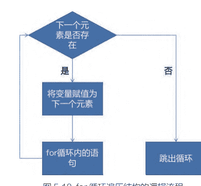
图 5.18 for 循环遍历结构的逻辑流程

遍历对象也可以是字符串或数值范围：

```
for char in "Hello World":
    print(char)
```
这段代码会按顺序打印出字符串里的每个字符。

```
for i in range(0, 100):
    print(i)
```
这段代码会从 0 开始以 1 为步长递增，打印到 99 停止。range 起始包含、终点不包含。

回到画点问题，遍历坐标列表的写法可以是：

```
for point in pointlist:
    x = point[0]
    y = point[1]
    cv2.circle(frame, (int(x), int(y)), 2, (0, 255, 255), -1)
```
循环中 point 就是列表里的一個 [x, y]，通过 point[0]、point[1] 分别取出横纵坐标即可绘点。

试一试
利用列表与 for 循环，让画面保留魔法棒经过的所有轨迹点，实现基本绘画功能。

### 5.4.4 键盘交互控制
到这里魔法棒已能画图，但缺少手动开关。我们希望能用键盘控制开始、暂停或清空图案。

OpenCV 的 waitKey 除了设置帧间等待时间，还能获取键盘按键。在 imshow 之后调用即可：

```
k = cv2.waitKey(5)
```
返回的 k 变量保存按下键的编码。OpenCV 使用 ASCII 编码，可以用 ord 把字符转成对应数值：

```
k = cv2.waitKey(5)
if k == ord("q"):
    break
```
于是按下 q 键即可退出循环。若要实现绘制开关，可设一个状态变量 start，0 表示不绘，1 表示绘。先在主循环里判断，只有 start 为 1 时才记录坐标：

```python
if start == 1:
    pointlist.append([x, y])
```
再用另一个按键改变 start 的值：

```python
if k == ord("s"):
    start = 1
```
这样运行后按 s 键即可开始绘制，类似思路也可以实现停止、清空等功能。

## 试一试
制作一个可按键控制开始、停止、清空的魔法棒。

## 自主练习
制作多种颜色的魔法棒，让程序分别识别并用对应颜色绘制，画出多彩图案。

## 附： “魔法棒” 的完整示例代码

```python
import cv2
cap = cv2.VideoCapture(0) # 开始获取摄像头信号
pointlist = [] # 声明一个列表用于存储点的位置
start = 0 # 声明一个变量表示是否开始记录点的位置
while cap.isOpened(): # 当读取到信号时
    (ret, frame) = cap.read() # 读取每一帧视频图像为 frame
    hsv = cv2.cvtColor(frame, cv2.COLOR_BGR2HSV) # 将颜色空间转换为 HSV
    yellow_lower = (26, 43, 46) # 指定目标颜色的下限
    yellow_upper = (34, 255, 255) # 指定目标颜色的上限
    mask = cv2.inRange(hsv, yellow_lower, yellow_upper) # 使用目标范围分割图像并二值化
    (mask, cnts, hierarchy) = cv2.findContours(mask, cv2.RETR_EXTERNAL, cv2.CHAIN_APPROX_SIMPLE) # 寻找其中的所有外轮廓
    if len(cnts) > 0: # 如果至少找到一个轮廓
        c = max(cnts, key=cv2.contourArea) # 找出其中面积最大的轮廓
        (x, y), radius = cv2.minEnclosingCircle(c) # 分析轮廓的中心位置和大小
        if radius > 20: # 仅当半径大于 20 时
            if start == 1: #start = 1 说明开始记录
                pointlist.append([x, y]) # 将点的位置添加到列表
            elif start == 0: #start = 0 说明需要清除图像上的点
                pointlist = [] # 将 pointlist 重新置空
    for point in pointlist: # 遍历 pointlist 中所有点的位置
        x = point[0]
        y = point[1]
# 在这些点的位置上绘制一个彩色小圆点
cv2.circle(frame, (int(x), int(y)), 2, (0, 255, 255), -1)
cv2.imshow('MagicWand', frame) # 将图像显示到屏幕上
k = cv2.waitKey(5) # 每一帧后等待 5 毫秒，并将键盘的按键值存在 k
# 如果按 q 键，程序退出；按 s 键，开始绘制；按 p 键，停止绘制；按 e 键，清除绘制
if k == ord("q"):
    break
elif k == ord("s"):
    start = 1
elif k == ord("p"):
    start = -1
elif k == ord("e"):
    start = 0
```

## 本章要点速览

- 初识机器视觉的基础概念
- 厘清机器视觉与图像识别的关系
- 认识 OpenCV 这个主流开源视觉库
- 用 OpenCV 实现颜色筛选
- 完成魔法棒互动演示
- 知道三原色如何混出可见光全谱
- 对比传统相机与数码相机的成像存储原理
- 掌握像素定义与电子成像机理
- 理解机器视觉的含义并能举例说明其应用场景
- 了解 OpenCV 在计算机视觉领域的领先地位
- 解释视频帧率与分辨率的概念
- 完成树莓派摄像头的安装与图像抓取编程
- 介绍 HSV 颜色模型所描述的属性
- 掌握机器定位特定物体的思路
- 编写代码实现单一颜色物体的识别
- 学会用 OpenCV 绘制标记点
- 认识 Python 中的列表与元组
- 理解 for 循环遍历的逻辑与使用方法
- 编程复现“魔法棒”交互效果

# 第 6 章 机械臂操控实战

机械臂智能分拣任务

## 6.1 认识机械臂

### 6.1.1 应用广泛的机械臂

机器人研发与制造已走过几十年历程，形态日益多样，其中在工业场景落地的比例最高，而对生产最直接有帮助的正是机械臂。

在流水线、车间的各个角落，总能见到一组组灵活高效的机械臂，它们在汽车装配线上负责焊接与拧螺丝，在工地参与搬运与砌筑，也在仓库里协助打包快递。可以说机械臂是人手臂功能的延伸，承担了大量重复性机械劳动（见图 6.1）。

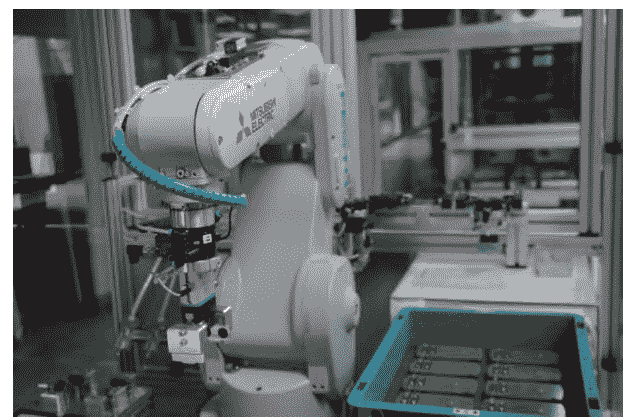

图 6.1 工业机械臂

机械臂本质上是多轴联动的高耦合系统，通常由多段电机驱动的机械结构组成，末端搭载机械爪、吸盘或机械手以模拟手臂操作。系统的复杂程度主要由可旋转的轴数决定，这个轴数也叫做自由度，市面上常见的机械臂一般配置 3 到 6 个自由度。

### 6.1.2 三轴机械臂结构分析

不同使用场景下机械臂的结构设计各有差异。本例采用的是桌面级三轴机械臂（见图 6.2），其驱动舱集中布置在底部，这样重心下移，在抓取时更稳固，也是一种经典的桌面机型方案。

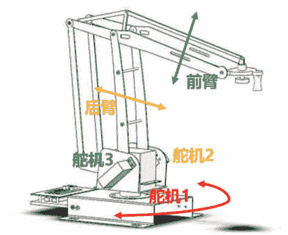

图 6.2 三轴机械臂舵机与转轴关系示意图

该机型共配有 3 个驱动舵机。底部的舵机 1 负责整臂在水平面内的旋转；舵机 2 控制后臂围绕底部关节的上下摆动，其转角即图 6.3 中的 α，行程为 0~180°，90° 时后臂与桌面垂直；舵机 3 控制前臂围绕中间关节的上下摆动，其转角即图 6.3 中的 β，行程同样为 0~180°，90° 时前臂与桌面平行。

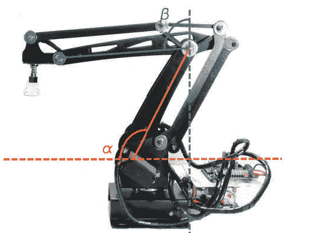

图 6.3 机械臂两个转轴与水平线、垂直线的夹角等同于舵机的角度

## 说明

在描述机械臂位置时，均以上方俯视、后方为主视角。从上往下看，舵机 1 的可动范围约为 270°。

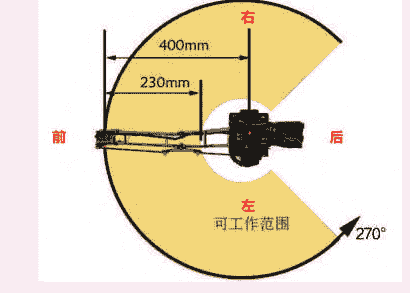

图 6.4 机械臂俯视图

## 试一试

随意拨动机械臂，观察其结构与运动规律。

你会发现无论怎样摆动，末端吸盘始终保持垂直于桌面，原因是什么？

## 扩展阅读

本机型末端始终垂直桌面的特性源于其特殊的连杆设计（见图 6.5）。我们用几何关系来说明。

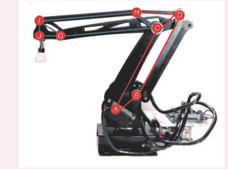

图 6.5 机械臂的机械结构

从侧面看，A、B 为底座固定点，其余点随臂运动。AC 与 BD 等长，CD 与 AB 等长，故 ACDB 为平行四边形。HC 与 IG 等长，IH 与 GC 等长，故 HCGI 也是平行四边形。H、D、C 三点通过连杆构成刚性三角形。

A、B 固定，直线 AB 与水平线的夹角恒定。由平行四边形 ACDB 可得 CD 平行于 AB，故 CD 与水平线的夹角固定。三角形 CDH 稳定，角 HCD 恒定，HC 与水平面夹角固定。由平行四边形 HCGI 可得 IG 平行于 HC，故 IG 与水平面的夹角也固定。于是末端气泵所在的 JG 始终保持与桌面平行。

## 6.2 程序控制机械臂的运动

### 6.2.1 认识舵机

由于需要精确定位角度，机械臂的旋转关节多采用步进电机或伺服电机。小型桌面机型上普遍使用舵机，即微型伺服电机（见图 6.6）。

早在航模领域，爱好者就用这类微型伺服来控制舵面，故得名“舵机”。舵机类似人类的关节，能精确控制转动角度，因而在各类机器人上广泛使用，人形机器人关节和工业机器人轴系都大量采用。

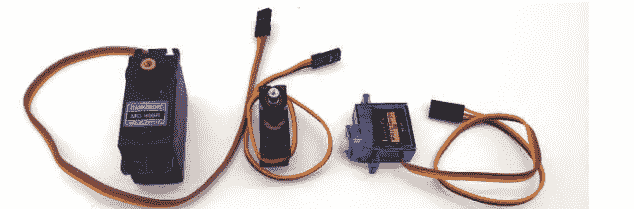

图 6.6 各式各样的舵机

按控制方式可分为模拟舵机与数字舵机，本例使用的为数字舵机。数字舵机精度更高、锁力更强，且抗抖动、响应更快。

## 扩展阅读

舵机内部集成多部件，如图 6.7 所示，主要包含控制电路、电机、电位器与齿轮组。

控制电路接收信号驱动电机，齿轮组降速增扭，电位器随轴转动测量当前角度并反馈给控制电路，电路据此调节电机直至到达目标位置。

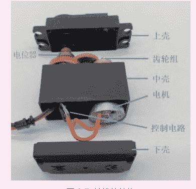

图 6.7 舵机的结构

### 6.2.2 舵机的线路连接

我们选用一款常见的 16 路舵机控制板来驱动舵机。

如图 6.8 所示，左侧接线柱可接入 5~7.2V 直流供电板。


图 6.8 16 路舵机控制板

接线柱旁的 Micro-USB 口用于连接电脑。旁边有 4 组可插杜邦线的串口，接收外部串行信号。板上红、黄、黑引脚可直接接入舵机三色线，最高可同时控制 24 路舵机。

将机械臂的 1、2、3 号舵机依次接到控制板的 M1、M2、M3，引脚颜色一一对应。末端吸盘的气泵和电子阀门也以舵机线形式引出，暂不连接。

接线完成后确认无误，先将机械臂电源红线接 5V，黑线接 GND，并保持开关关闭。将 Micro-USB 连接控制板与电脑，最后打开电源开关。

### 6.2.3 舵机控制程序

打开专用舵机控制软件，界面如图 6.9 所示。

通电连接后，舵机对应的通道会变为绿色。

M1 控制舵机 1，该舵机为 270° 大角度，软件中 90° 对应臂指向正前方（如图 6.10），0° 为右侧极限，180° 为左侧极限。

M2 控制舵机 2，软件角度即 α，180° 行程，90° 时后臂垂直桌面。

M3 控制舵机 3，软件角度即 β，180° 行程，90° 时前臂平行桌面。


图 6.9 舵机控制板专用程序界面


图 6.10 3个舵机与机械臂转动关系回顾

> 试一试
> 
> 小范围滑动 M1~M3 的数值，观察三轴运动变化。
> 用控制软件让机械臂在桌面上做简单移动。

### 6.2.4 机械臂头部的执行装置——电控吸盘

末端装有电控吸盘，抓取单元由电机式气泵、电子阀门和吸盘组成，通过软管连通。

工作时吸盘贴合物体，气泵通电抽气，吸盘与物体间气压降低实现吸附，断电后仍可保持一段时间吸力。电子阀门在断电时连通 1 号与 2 号口，3 号口封闭，利于抽气；通电时 1 号与 3 号口连通，外部空气进入吸盘与物体间隙，实现松开，如图 6.11、6.12 所示。


图 6.11 气泵抽气时的气流方向示意图


图 6.12 电子阀门通电时的气流方向示意图

程序控制前需先连接。关闭机械臂电源，将气泵舵机线接入 M4，电子阀门接入 M5。两者均为舵机式控制，0° 断电，180° 全通。

启动时 M4、M5 应设为 0°。


图 6.13 程序开始时 M4、M5 两路的设定

把目标物放在吸盘下方，将 M4 从 0° 调至 180°，气泵启动吸紧。保持吸紧后先把 M4 归零，再把 M5 设为 180° 松开物体，操作完成后需立刻把 M5 恢复到 0°，避免损坏阀门。

## 抓取的工作流程总结

- 设定 M1、M2、M3 使吸盘对准目标物
- 打开气泵，M4 设为 180°
- 调整 M1、M2、M3 将物体移至目标位置
- 放物时先断开气泵 M4 设 0°，再打开电子阀门 M5 设 180°
- 阀门开启时间不宜过长，建议 2 秒内关闭

## 试一试

- 尝试吸取不同材质物体，判断哪些适合吸附
- 吸紧后将 M4 恢复 0°，观察吸力变化
- 按流程完整执行一次抓取与搬运

### 6.2.5 用示教方式完成物料分拣

早期机器人称为示教型机器人，只能按预设步骤运行。在实现智能化前，可先用示教方式录制抓取动作。

在舵机控制软件右侧的动作组功能中（如图 6.14），保持 M4、M5 为 0°，调节 M1~M3 到期望位置，点击“添加状态”即可记录。

可先添加一个状态，随意改变舵机角度，再双击已记录状态名，使臂回到该姿态。之后点“添加动作组”，将状态加入动作序列，并在对话框中双击调整各段持续时间。点击“模拟运行”即可顺序复现。


图 6.14 设定状态与动作组

> 试一试
> 
> 利用动作组功能，让机械臂把桌面指定物体抓取到指定区域。

## 小贴士

将动作组编号设为 0，完成后再点上方“下载”按钮写入控制板（如图 6.15）。断开电脑连接后，按控制板右侧功能键即可复现已下载的动作（如图 6.16）。


图 6.15 下载舵机控制程序


图 6.16 控制板功能开关键的位置

## 6.3 用树莓派控制机械臂

### 6.3.1 硬件连接

此前已用电脑通过舵机控制板操控机械臂。现在要让树莓派通过摄像头实现智能任务，需先掌握树莓派控制机械臂的方法。

舵机控制板支持串行通信，可通过树莓派发送 UART 信号进行控制。UART 是异步串行通信协议，可传输字符信息。

如图 6.17 所示为控制板的串行通信接口，设备通常提供 RX 接收口和 TX 发送口。


图 6.17 舵机控制板的串行通信接口

树莓派的 GPIO 8 号脚为 TXD，10 号脚为 RXD，预留用于串口通信。

如图 6.18 所示连接树莓派与舵机控制板。

**注意事项**

连接前务必断开树莓派与机械臂电源；连接完成后先开机测试程序，确认无误后再打开机械臂电源。


图 6.18 树莓派的串口通信接口

### 6.3.2 程序编写

硬件就绪后，即可编写控制程序。

打开 Geany 编辑器，输入程序并保存。开启机械臂电源，在树莓派上运行该程序即可驱动机械臂运动。

```
import serial
import time
from roboticarm import get_message
ser = serial.Serial("/dev/ttyAMA0", 9600)
ser.write(get_message(1, 1500, 4))
time.sleep(2)
ser.close()
```

接下来逐行拆解这段控制代码的含义。

```
import serial
```

引入用于与串口交互的 Python 库 serial。

```
import time
```

载入 time 模块，用来处理程序的延时等待。

```
from roboticarm import get_message
```

为了让机械臂按预期动作，必须把角度和速度转成控制板能识别的串口帧。roboticarm 包自带的 get_message 就负责完成这层格式转换。

```
ser = serial.Serial("/dev/ttyAMA0", 9600)
```

serial.Serial 接受端口路径和波特率两个参数来建立连接。经过事先配置的树莓派硬件串口路径为 "/dev/ttyAMA0"，舵机控制板出厂波特率是 9600。实例化后通常命名为 ser 方便后续调用。

```
ser.write(get_message(1, 1500, 4))
```

发送指令时调用 ser.write 把数据帧写出到串口。

get_message 需要三个参数：板卡编号、PWM 占空、运动速率。

板卡编号对应 M0~M23 上的序号，比如 M1 对应 1。

PWM 代表目标转角，范围 500 到 2500 映射 0° 到 180°，例如 500 是 0°、1500 是 90°、2500 是 180°。

速率控制移动快慢，0 到 40 对应 0 到 360°/s，取值为 1 时约 9°/s，最大值 40 即 360°/s。

该语句表示让 M1 接口的舵机以 36°/s 的速度转动到 90° 位置。

```
time.sleep(2) # 等待舵机执行完成
```

舵机转动不是瞬时的，所以每发一次指令后要用 time.sleep 作短暂停顿，等动作完成再执行下一步。

```
ser.close()
```

程序结束时调用 ser.close() 释放串口资源。

总体来看，树莓派通过串口向控制板下发指令再驱动机械臂，完整流程可以归纳为：

- （1）载入所需模块；
- （2）建立树莓派串口连接；
- （3）下发指令让指定舵机以设定速度转到设定角度；
- （4）关闭串口连接。

> 动手尝试
> 用 Python 通过树莓派驱动机械臂的 M1~M3 舵机。
> 改变指令中的参数，观察运动有何不同。

## 6.4 摄像头定位木块

之前已经练习过用树莓派摄像头辨识彩色物体。基于此，可以打造一台自动分拣机械臂，自主在桌面上寻找指定颜色的木块并搬运到指定区域。

任务可以拆成以下步骤：

- （1）摄像头采集画面；
- （2）图像分析得出待抓取木块的位置；
- （3）控制吸盘移动到目标正上方；
- （4）控制机械臂抓取木块；
- （5）将木块搬运到指定位置后放下。

### 6.4.1 安装摄像头

若要实现视觉定位，必须在机械臂上装配摄像头。

摄像头既可固定在外部支架，也可装在机械臂前端。为保持吸盘与摄像头的相对位置不变，这里选用第二种方式，如图 6.19 所示。


图 6.19 已安装摄像头的机械臂

需要两块转接板来固定摄像头。

- （1）用 4 组 M2 尼龙螺丝和螺母把摄像头固定在转接板 1 的背面。
- （2）把转接板 1 与 2 分别置于机械臂前端的上方和下方，用 4 组 M3 螺丝和螺母锁紧，如图 6.20 所示。


图 6.20 机械臂前端摄像头安装示意图

安装完毕后，使用 50cm 长的摄像头 FFC 连接线把摄像头与树莓派连通，注意让线缆穿过前臂和后臂，避免干扰运动。

连接完成后，先用之前测试摄像头时用的程序启动 OpenCV，检查画面是否正常，程序如下所示：

```python
import cv2
cap = cv2.VideoCapture(0)
while cap.isOpened():
    (ret, frame) = cap.read()
```

```python
cv2.imshow('test', frame)
cv2.waitKey(5)
```

运行后会弹出实时画面窗口。若看不到画面，请检查接线状态。

### 6.4.2 获取图像并识别木块位置

为了方便分析，先把机械臂的起始姿态设为轴 1 置中、轴 2 和轴 3 均为 90°，如图 6.21 所示。


图 6.21 置中状态的机械臂

起始时三路舵机均需置中，PWM 信号都为 1500，程序如下所示：

```
import serial
import time
from roboticarm import get_message
ser = serial.Serial("/dev/ttyAMA0", 9600)
ser.write(get_message(1, 1500, 4))
ser.write(get_message(2, 1500, 4))
ser.write(get_message(3, 1500, 4))
time.sleep(2)
ser.close()
```

参考之前学过的颜色识别方法，假设目标为黄色，下面的程序可找出画面中半径大于 50 像素的最大黄色区域的中心坐标。

```
# 导入 OpenCV
import cv2
# 开始读取摄像头信号
cap = cv2.VideoCapture(0)
# 当读取到信号时
while cap.isOpened():
    # 读取每一帧视频图像为 frame
    (ret, frame) = cap.read()
```

```
# 将颜色空间转换为 HSV
hsv = cv2.cvtColor(frame, cv2.COLOR_BGR2HSV)
# 指定目标颜色的下限
yellow_lower = (26, 43, 46)
# 指定目标颜色的上限
yellow_upper = (34, 255, 255)
# 使用目标范围分割图像并二值化
mask = cv2.inRange(hsv, yellow_lower, yellow_upper)
# 寻找其中的所有外轮廓
(mask, cnts, hierarchy) = cv2.findContours(mask, cv2.RETR_EXTERNAL,
cv2.CHAIN_APPROX_SIMPLE)
# 如果至少找到一个轮廓
if len(cnts) > 0:
    # 找出其中面积最大的轮廓
    c = max(cnts, key=cv2.contourArea)
    # 分析轮廓的中心位置和大小
    (x, y), radius = cv2.minEnclosingCircle(c)
    # 如果半径大于 50
    if radius > 50:
        print("中心坐标", (x, y))
```

# 动手尝试

挑选一种颜色的物体放在机械臂摄像头下方，用颜色识别程序输出它在画面中的坐标。

## 6.5 调整吸盘对准物体

### 6.5.1 物体正下方在图像中的坐标

机械臂可以根据物体的实时坐标不断调整，直到物体位于吸盘正下方。所以先要明确，物体在吸盘正下方时图像中的坐标特征。

把一个物体，例如木块，放在吸盘正下方，观察它在画面中的大概位置，如图 6.22 所示。


图 6.22 树莓派摄像头拍摄的影像

可以看出，物体位于图像左右的中线上，按摄像头坐标系，中心 x 坐标约为 320。

上下方向上，物体并不在中心，而是偏上一些，这是因为摄像头与吸盘并不重合。那此时 y 坐标具体是多少？是否等于摄像头到吸盘的距离？

保持物体在吸盘正下方，改变吸盘高度，观察画面变化，如图 6.23 所示。


图 6.23 改变高度，图像中物体的位置将发生变化

观察发现：

- 不论高度如何，物体始终在图像左右中轴线上；
- 高度越低，物体在画面中占比越大；
- 高度越低，中心点在画面中的位置越偏离中轴线。

因此，若在调整时保持前端高度不变，则物体位于吸盘正下方时其 y 坐标是固定的。

以初始姿态，即轴 1 置中、轴 2 与轴 3 为 90° 的高度为准，后续调整均保持该高度。在此条件下，物体坐标约为（320，150）。不同硬件会有细微差异，以实测为准。

明确了对准时的坐标后，控制策略可分为两步：

- 1. 驱动 1 号舵机左右移动，使物体 x 坐标接近 320；
- 2. 驱动 2 号、3 号舵机，在同一高度前后移动，使物体 y 坐标接近 150。

### 6.5.2 用 1 号舵机调节 X 坐标至 320

首先调整 1 号舵机角度，让物体的 x 坐标达到 320。

已知 1 号舵机角度减小机械臂向右，角度增大向左。由于镜头是倒置的，探测到的 x 大于 320 表示物体在吸盘左侧，需要向左转动；x 小于 320 则需向右转动。

先声明一个变量记录轴 1 舵机的 PWM 值，初始设为 1500。识别到物体坐标后据此调整，程序如下所示。

```python
pwm1 = 1500
if x > 320:
    pwm1 += 1
else:
    pwm1 -= 1
ser.write(get_message(1, pwm1, 4))
```

结合图像识别和机械臂控制，前后拼接后可得到完整程序，能让 1 号舵机左右移动使物体 x 坐标趋近 320：

```python
import serial # 导入调用串口的 Python 第三方包 serial
import cv2 # 导入 OpenCV 包
import time # 导入 time 包
from roboticarm import get_message # 导入控制机械臂所必须的 get_message 函数

# 声明一个变量，表示轴 1 舵机的 PWM 值
pwm1 = 1500
ser = serial.Serial("/dev/ttyAMA0", 9600) # 初始化树莓派的通信串口
# 机械臂位置初始化
ser.write(get_message(1, 1500, 4))
ser.write(get_message(2, 1500, 4))
ser.write(get_message(3, 1500, 4))
time.sleep(2) # 等待舵机执行完成
# 识别黄色物体的坐标
cap = cv2.VideoCapture(0)
while cap.isOpened():
    (ret, frame) = cap.read()
    hsv = cv2.cvtColor(frame, cv2.COLOR_BGR2HSV)
    yellow_lower = (26, 43, 46)
    yellow_upper = (34, 255, 255)
    mask = cv2.inRange(hsv, yellow_lower, yellow_upper)
    (mask, cnts, hierarchy) = cv2.findContours(mask, cv2.RETR_EXTERNAL, cv2.CHAIN_APPROX_SIMPLE)
    if len(cnts) > 0:
        c = max(cnts, key=cv2.contourArea)
        (x, y), radius = cv2.minEnclosingCircle(c)
        if radius > 50:
            print("center: ", (x, y))
            # 根据坐标控制机械臂运动
            if x > 320:
                pwm1 += 1
            else:
                pwm1 -= 1
```

```python
pwm1 -= 1
ser.write(get_message(1, pwm1, 4))
```

动手尝试

仿照以上写法，根据画面中物体的位置控制 M1 舵机运动。

运行后会发现存在三个典型问题：

- （1）程序启动后一段时间内运动方向异常，例如物体在左却向右动；
- （2）调节速度过慢；
- （3）接近目标后在附近来回摆动，无法停稳。

第一个问题源于摄像头刚启动时前几帧不稳定，可屏蔽前 60 帧，程序如下所示。

```python
......
count = 0 # 计数
while cap.isOpened():
    (ret, frame) = cap.read()
    if count <= 60: # 计数小于等于 60 时
        count += 1 #count 自增 1
        continue # 跳过后面的语句，继续循环
......
```

这里使用了计数变量 count，+= 是自增运算符，count += 1 等价于 count = count + 1，每循环一次值加 1。同理有自减 -=、自乘 *=、自除 /=。

关键词 continue 和 break 用途相近，break 直接跳出循环，而 continue 仅跳过本轮剩余语句进入下一轮。

第二个问题可通过增大每次 pwm1 的增减幅度来改善，程序如下所示：

```python
if x > 320:
    pwm1 += 5
else:
    pwm1 -= 5
```

第三个问题是停止条件太严格，应在 320 周围设置一个容差区间，落入区间即停止，程序如下所示。

```python
if x > 330:
    pwm1 += 5
elif x < 310:
    pwm1 -= 5
```

# 动手尝试

- 1. 完善程序，使物体在摄像头中的 x 坐标逼近 320。
- 2. 尝试让机械臂远离目标时运动更快，接近目标时更慢。

### 6.5.3 保持等高调节 Y 坐标至 150

思考一下，如何让 2 号和 3 号舵机协同运动以保持前端高度不变？

如图 6.24 所示，3 号舵机控制的 β 角越小机械臂越高，越大越低；2 号舵机控制的 α 角为 90° 时最高，偏离 90° 越多越低。所以要保持等高，必须同时协调两个舵机的变化。

手动编写等高运动控制较为复杂。所导入的 roboticarm Python 包提供了一个预置函数 get_angle，可根据前端高度和水平距离返回对应的舵机 PWM 值。下面程序演示如何把机械臂恢复到初始姿态，即轴 1 置中、轴 2 和轴 3 为 90°。


图 6.24 机械臂舵机角度与转轴角度对应关系回顾

```
import serial # 导入调用串口的 Python 第三方包 serial
import time # 导入 time 包
from roboticarm import get_message # 导入控制机械臂所必须的 get_message 函数
from roboticarm import get_angle # 导入 get_angle 函数
```

```
import numpy # 导入计算扩展包 numpy
pwm1 = 1500 # 声明一个变量，表示 1 号舵机初始状态的 PWM 值
ser = serial.Serial("/dev/ttyAMA0", 9600) # 初始化树莓派的通信串口
matrix = numpy.load("/home/pi/position.npy") # 载入机械臂运动位置文件
# 用 get_angle 函数计算初始位置下的 2、3 号舵机 PWM 值
(pwm2, pwm3) = get_angle(matrix, 1000, 1000)
# 控制舵机运动到指定角度
ser.write(get_message(1, pwm1, 4))
ser.write(get_message(2, pwm2, 4))
ser.write(get_message(3, pwm3, 4))
time.sleep(2) # 等待舵机执行完毕
ser.close() # 关闭串口连接
```

get_angle 的调用形式为 get_angle(matrix, height, distance)。该函数返回一个长度为 2 的元组，第一项是 2 号轴舵机的 PWM 值，第二项是 3 号轴舵机的 PWM 值，调用者通常把它们分别赋给 pwm2、pwm3。

使用 get_angle 前必须先准备好一张描述机械臂状态与空间位置对应关系的表。该表一般借助 Python 的数值计算库 numpy 从文件载入。在树莓派环境下，matrix 就是用类似的语句读入得到的：

```
import numpy
matrix = numpy.load("/home/pi/position.npy") # 载入机械臂运动位置文件
```

height 表示末端点相对基座轴的垂直高度，distance 表示水平方向的相对距离，见图 6.25。当 2 号和 3 号舵机都处于 90° 零位时，函数里 height 与 distance 的默认值都是 1000。注意二者均为整数，有效范围是 0 到 2000，超出范围函数会返回 (-1, -1)。


图6.25 说明了 height 与 distance 的含义

下一步需要在高度保持 1000 的条件下做前后移动，让目标物体中心的 y 坐标稳定在 150 附近。若测得 y 值偏小，需要向前推，即增大 distance；若 y 值偏大，则向后撤，即减小 distance。参照之前左右微调的做法，把下面的程序补充完整：

```
distance = 1000
height = 1000
if y > 160:
    distance += 5
elif y < 140:
    distance -= 5
(pwm2, pwm3) = get_angle(matrix, height, distance)
ser.write(get_message(2, pwm2, 9))
ser.write(get_message(3, pwm3, 9))
```

### 扩展阅读

只要给定前端高度和到基座的水平距离，get_angle 就能直接给出两路舵机的 PWM。它内部的换算依据是什么呢？熟悉三角函数的话，你也可以自行推导。


如图6.26 左侧所示，第 2 号舵机的转角即后臂与水平面之间的夹角 α，第 3 号舵机的转角即前臂与垂直线之间的夹角 β。

该三轴机械臂的前臂与后臂设计为等长，记臂长为 l。

为了便于推导，把臂的姿态做等效处理，如图6.26 右侧。令 distance = d，height = h，可得：

l·cosα + l·sinβ = d

l·sinα + l·cosβ = h

因为臂长 l 为定值，可约去：

cos α + sin β = d / l

sin α + cos β = h / l

d 与 h 都是已知的端点位置参数，为简便记 d/l 为 x，h/l 为 y，则：

cos α + sin β = x

sin α + cos β = y

x、y 已知，α、β 的取值范围为 0~180°，由此方程组即可解出两角。

至此，就能写出让吸盘移动到物体正上方的完整控制程序，具体参数需按实际硬件调试。

```
import serial
import cv2
import time
import numpy
from roboticarm import get_message
from roboticarm import get_angle

# 获取摄像头发视频数据并初始化串口
cap = cv2.VideoCapture(0)
ser = serial.Serial("/dev/ttyAMA0", 9600)
# 载入位置文件并设定相关变量
matrix = numpy.load("/home/pi/position.npy")
pwm1 = 1500
distance = 1000
height = 1000
count = 0
# 使用 get_angle 函数将位置坐标转换为 2 号、3 号舵机的 PWM 值
(pwm2, pwm3)=get_angle(matrix, height, distance)
# 机械臂位置初始化
ser.write(get_message(1, pwm1, 4))
ser.write(get_message(2, pwm2, 4))
ser.write(get_message(3, pwm3, 4))
time.sleep(2)

while cap.isOpened():
    (ret, frame) = cap.read()
    # 跳过前 60 帧
    if count <= 60:
        count += 1
        continue
    # 识别黄色物体坐标
    hsv = cv2.cvtColor(frame, cv2.COLOR_BGR2HSV)
    yellow_lower = (26, 43, 46)
```

```
yellow_upper = (34, 255, 255)
mask = cv2.inRange(hsv, yellow_lower, yellow_upper)
(mask, cnts, hierarchy) = cv2.findContours(mask, cv2.RETR_EXTERNAL,
cv2.CHAIN_APPROX_SIMPLE)
if len(cnts) > 0:
    c = max(cnts, key=cv2.contourArea)
    ((x, y), radius) = cv2.minEnclosingCircle(c)
    if radius > 50:
        print("center: ", (x, y))
        # 根据坐标控制机械臂运动
        if x > 330:
            pwm1 += 5
        elif x < 310:
            pwm1 -= 5
        if y > 160:
            distance += 5
        elif y < 140:
            distance -= 5
        (pwm2, pwm3) = get_angle(matrix, height, distance)
        ser.write(get_message(1, pwm1, 3))
        ser.write(get_message(2, pwm2, 3))
        ser.write(get_message(3, pwm3, 3))
ser.close() # 关闭串口连接
```

试一试

参考上文思路，编写一段代码让机械臂依据下方物体的实时位置自动对准上方。

## 6.6 抓取和放置物体

前面已能把吸盘移到物体正上方，吸取前还需让吸盘垂直下降贴近物面。可使用循环实现此过程，保持 distance 不变，逐步减小 height，程序示例如下：

```
for height in range(1000, 79, -10):
    (pwm2, pwm3) = get_angle(matrix, height, distance)
    ser.write(get_message(2, pwm2, 9))
    ser.write(get_message(3, pwm3, 9))
    time.sleep(0.01)
```

回顾 for 循环的用法，它能让一个变量在指定区间内依次取值，语法格式为：

```
for 参数 in range( 范围起点, 范围终点, 步长 )
```

变量从起始值开始，按步长累加，步长为负时则递减，循环在到达终点前结束，终点本身不参与遍历。

这里的 79 仅作参考，请以吸盘能够紧密贴合物体为目标自行调整。

步长取 10 是为了在速度与轨迹平滑之间折中。步长越大移动越快但轨迹越抖，步长越小移动越慢但轨迹越直。

随后要实现完整的抓取流程：吸紧物体、抬起、移至目标区、释放。

气泵接 4 号引脚，PWM 设为 2500 时开启，500 时关闭；电子阀门接 5 号引脚，同样 2500 开启、500 关闭。到位后打开阀门释放物体，注意阀门不要长时间开启，用完后务必关闭。

```
.....
ser.write(get_message(4, 2500, 9)) # 打开气泵
time.sleep(3) # 吸住 3 秒
for height in range(80, 1000, 10): # 竖直提起到 1000 高度
    (pwm2, pwm3) = get_angle(matrix, height, distance)
    ser.write(get_message(2, pwm2, 9))
    ser.write(get_message(3, pwm3, 9))
    time.sleep(0.01)
ser.write(get_message(4, 500, 9)) # 关闭气泵
# 将 2、3 号舵机还原到初始位置
ser.write(get_message(2, 1500, 4))
ser.write(get_message(3, 1500, 4))
time.sleep(1)
# 旋转轴 1 转至目标区域上方
ser.write(get_message(1, 2100, 4))
time.sleep(1)
ser.write(get_message(5, 2500, 9)) # 打开电子阀门
time.sleep(2) # 等待 2 秒
ser.write(get_message(5, 500, 9)) # 关闭电子阀门
ser.close() # 关闭串口连接
```

**试一试**

机械臂对准物体上方后退出循环，加入抓取与放置逻辑，实现按颜色挑选物体并搬运到指定位置的功能。

## 6.7 扩展任务

结合树莓派摄像头做颜色识别后，我们完成了一次自动抓取，整体步骤如图 6.27 所示。


图6.27 机械臂自动抓取流程图

项目完成主要抓住两点。

-   (1) 摄像头需固定在机械臂前端，这样才能根据图像中目标位置推断控制指令。
-   (2) 控制分为左右平移和前后平移两阶段，第二阶段保持高度不变移动，确保吸盘精确落在目标正上方。

运行中仍可能出现以下问题。

-   (1) 初始视野范围有限，只能在较小的区域内放置物体。
-   (2) 当前程序一次只能识别并抓取一个物体，无法批量分拣。
-   (3) 识别后机械臂需要逐步校准，耗时较长。

有兴趣的同学可尝试以下扩展。

-   (1) 当视野内出现多个相同待抓取物体时，改写程序使机械臂逐一将其搬运到目标区域。
-   (2) 尝试扩大扫描范围，让机械臂能在桌面以外更大区域内寻找物体。

另外，你或许见过春晚上的书法机器人。我们的机械臂借助等高运动特性，加装一支笔后也能在纸上书写作画，不妨尝试一下。

## 本章要点回顾

- 示教式程序驱动机械臂
- 基于图像的智能分拣
- 机械臂结构认识
- 程序化控制机械臂运动
- 示教方式完成物体分拣
- 树莓派控制机械臂
- 摄像头定位木块
- 使吸盘位于物体正上方
- 物体的抓取与放置
举例说明机械臂的应用场景
掌握桌面级三轴机械臂的运动原理
理解为何吸盘头部始终保持垂直于桌面
了解机械臂采用舵机驱动
熟悉舵机控制板的使用方法
学会用专用舵机控制程序驱动机械臂
了解电控吸盘的工作原理及控制方式
能够用示教方式抓取一个物体并放到另一位置
会用舵机控制程序设定动作组，完成示教抓取流程
知道树莓派通过串口通信控制舵机控制板进而驱动舵机
能够在树莓派上编写 Python 程序控制机械臂运动
在机械臂头部安装摄像头并调取图像
利用图像识别知识编程获取图像中物体的坐标
把物体放在吸盘正下方，观察其在图像中的大致位置并记录坐标
控制 1 号舵机左右移动，使物体 x 坐标为 320
控制机械臂等高移动，使物体 y 坐标为 150
完成抓取物体并放置到指定位置的完整流程

# 第 7 章 人脸识别与机器学习

制作人脸追踪机器人

## 7.1 人脸识别知多少

人类似乎天生具备快速认脸的能力，看过几次后就能轻松辨认。这种区分个体面貌的本领可视为生物本能。研究显示，新生儿 1~3 天后即显现相关能力。

自 20 世纪 60 年代起，研究者便用大型计算机探索机器如何识别人脸，很快取得初步成果。

随着算法演进，到 21 世纪初，人工智能系统已能以较轻量、快速的方式识别人脸，推动了技术的实际应用。早期典型用途是智能相机里的人脸检测辅助自动对焦，近年来随着识别精度与速度提升，人脸解锁成为智能手机的常见方式。

在公共安全领域，人脸识别被广泛用于学校、公司等半公共区域的门禁。

人类识别人脸时，首先在视野中找到人脸，再分析眼睛、鼻子、嘴巴等特征，最后与脑中已有的人脸信息比对，锁定身份，见图7.1。


这一过程本质上是生物本能，我们很难察觉其中的每一步。但要让人工智能模仿人类，必须用机器视觉对每一步进行模拟。与人类类似，AI 也要在图像中定位人脸、提取特征，再与数据库中的已知特征比对，确定身份，见图7.2。


前文已介绍，AI 可借助电子感光元件记录光线信息，以此为核心的动态采集系统就是摄像头。本例仍使用树莓派摄像头采集图像。

采集后，下一步是检测图像中人脸的位置。通常利用图像的某种数学特征区分出人脸区域，从而得到位置与大小。常见方法有肤色检测、直方图 HOG 检测、哈尔 HAAR 特征检测等。

仅用这些方法不足以区分特定个体。

大脑的识别方式难以用语言完全描述，且会随成长增强。人工智能同样可通过分析既有事实并学习获得新技能，这就是机器学习。在人脸识别中，机器学习是一种有效手段。

## 7.2 使用肤色检测找到人脸

在多种人脸检测手段中，最直接简单的是通过肤色定位人脸，称为肤色检测。之前课程已用 OpenCV 从摄像头图像中识别特定颜色物体。人脸并非均匀颜色，但仍可通过皮肤颜色大致定位。

我们采用与色块识别相同的 HSV 颜色检测法进行肤色检测，关键在于确定皮肤的 HSV 区间。图7.3 给出了常见颜色在 HSV 空间的分布区间。

| 颜色范围 | 黑色 | 灰色 | 白色 | 红色 | 橙色 | 黄色 | 绿色 | 青色 | 蓝色 | 紫色 |

|---|---|---|---|---|---|---|---|---|---|---|

| H最小值 | 0 | 0 | 0 | 0或156 | 11 | 26 | 35 | 78 | 100 | 125 |

| H最大值 | 180 | 180 | 180 | 10或180 | 25 | 34 | 77 | 99 | 124 | 155 |

| S最小值 | 0 | 0 | 0 | 43 | 43 | 43 | 43 | 43 | 43 | 43 |

| S最大值 | 255 | 43 | 30 | 255 | 255 | 255 | 255 | 255 | 255 | 255 |

| V最小值 | 0 | 46 | 221 | 46 | 46 | 46 | 46 | 46 | 46 | 46 |

| V最大值 | 46 | 220 | 255 | 255 | 255 | 255 | 255 | 255 | 255 | 255 |

图 7.3 常见颜色在 HSV 颜色空间中的区间

不同族群的肤色分布并不相同。东亚人群的面部色调大体落在红到橙的区间，色调 H 的经验范围约为 0~17，饱和度 S 的经验范围约为 43~255，明度 V 的经验范围约为 46~255。

与做颜色筛选的思路一致，可以先确定一个 HSV 区间，然后生成黑白二值图来预览效果。

```
import cv2
cap = cv2.VideoCapture(0) # 开始读取摄像头信号
while cap.isOpened(): # 当读取到信号时
    (ret, frame) = cap.read() # 读取每一帧视频图像为 frame
    hsv = cv2.cvtColor(frame, cv2.COLOR_BGR2HSV) # 将颜色空间转换 为 HSV
    skin_lower = (0, 43, 46) # 指定皮肤颜色的下限
    skin_upper = (17, 255, 255) # 指定皮肤颜色的上限
```

```
mask = cv2.inRange(hsv, skin_lower, skin_upper) # 使用目标范围分割图像并二值化
    cv2.imshow('mask', mask) # 显示二值化的图像
    cv2.waitKey(5) # 每帧等待 5 毫秒
```

在理想情况下，这段程序能够把摄像头画面里的人脸和非人脸区域干净地分开，如图 7.4 所示。若实际分割偏差较大，可以尝试微调肤色 H 的取值范围。


图 7.4 人脸图像的二值化处理

在锁定到肤色区域之后，还需要对它进行定位。下面这套做法可以描出肤色块的最小外接圆。

```
(mask, cnts, hierarchy) = cv2.findContours(mask, cv2.RETR_EXTERNAL, cv2.CHAIN_APPROX_SIMPLE) # 寻找其中的所有外轮廓
if len(cnts) > 0: # 如果至少找到一个轮廓
    c = max(cnts, key=cv2.contourArea) # 找出其中面积最大的轮廓
    ((x, y), radius) = cv2.minEnclosingCircle(c) # 分析轮廓的中心位置和大小
    if radius > 100: # 仅当轮廓大小达到一定尺寸时
        cv2.circle(frame, (int(x), int(y)), int(radius), (0, 0, 255), 2) # 在原始图像上绘制最小外接圆
cv2.imshow('test', frame) # 显示原始图像
cv2.waitKey(5) # 每帧等待 5 毫秒
```

程序会自动在画面中搜到人脸，并用红色圆圈标出，如图 7.5。


图 7.5 使用肤色识别找到图像中的人脸位置

### 试一试

试着写一段代码，用肤色检测在实时画面里找人脸并做标注。

若识别不准，可调整 H 区间，或更换摄像头前的背景与光照条件。

即便肤色法能在一定程度上定位人脸，仍存在明显局限。

- 不同个体的肤色差异比较大，范围设得太窄会漏人，设得太宽又容易把环境里的其他物体误判为人脸。
- 肤色检测分不清面部和身体其他裸露皮肤，手臂、手掌等同样会被检出。

因此肤色检测多用于特定场景的人脸初步筛选，或作为其他检测手段的辅助。若要更可靠地识别人脸，就需要更复杂的数学方法。

## 7.3 用哈尔特征锁定人脸

除了颜色，人脸还具备大量结构性的灰度特征。比如眼珠、眉毛会让眼部区域整体偏暗，鼻梁两侧比中间暗，嘴唇也比周围暗。将彩色图先转成灰度图，便于描述这些亮暗关系，如图 7.6。


图 7.6 只保留图像的亮度信息，将图像转化为黑白图像

以眼睛与脸颊为例，可以分别用矩形框住这两个部位并求平均灰度。灰度越大越亮。图 7.7 里右侧脸颊明显比眼窝更亮，平均灰度更高。单一对比不足以确认人脸，但大量类似的亮暗特征累积起来，就能形成较强的判别力。

2001 年，Paul Viola 与 Michael Jones 在论文中首次提出基于这一思路的人脸检测框架，并给出了一套可行的训练流程。


图 7.7 比较眼睛区域与脸颊区域的平均灰度

要把灰度图划分为无数个矩形并记录它们之间的关系，可以借助哈尔小波变换来计算，于是这类特征被称为哈尔特征，如图 7.8。


图 7.8 人脸上的不同区域符合不同类型哈尔特征

一个 20×20 像素的小图产生的哈尔特征就超过 10 万种，人工挑选可行的人脸特征几乎不可能。通过把大量正样本人脸图与负样本非人脸图交给学习器，计算机可以自动筛选出最具区分度的特征集合。

因为只分析灰度信息，计算量远低于 RGB 或 HSV，速度得到显著提升，这才首次实现了实时的面部检测。21 世纪初，许多相机厂商就借此实现了自动对焦。

2002 至 2005 年间，Rainer Lienhart 将该方法整合进 OpenCV 基础库，并提交了人脸等多种物体的训练好的模型。

因此借助 OpenCV 内置的检测器就能快速实现人脸定位。检测前先用 cvtColor 把图像转成灰度图，参数使用 cv2.COLOR_BGR2GRAY。

```
import cv2
cap = cv2.VideoCapture(0)  # 开始读取摄像头信号
while cap.isOpened():  # 当读取到信号时
    (ret, frame) = cap.read()  # 读取每一帧视频图像为 frame
    gray = cv2.cvtColor(frame, cv2.COLOR_BGR2GRAY)
    cv2.imshow('gray', gray)  # 显示灰度图像
    cv2.waitKey(5)  # 每帧等待 5 毫秒
```

随后需要加载人脸的哈尔分类器。这些分类器本质上是用于物体分类的模型，在 OpenCV 中通常以 XML 格式保存，可按需下载。

本系统已内置正面人脸分类器，可用下面语句载入。

```
face_cascade = cv2.CascadeClassifier('/home/pi/cascade/haarcascade_frontalface_default.xml')
```

载入完成后，用 detectMultiScale 进行目标搜索：

detectMultiScale( 灰度图像 , minSize= 最小目标尺寸 , flags= 检测方式 )

两个常用参数如下。

minSize 表示忽略过小的候选框，是一个长度为 2 的元组，分别对应 x、y 方向的最小宽高。

flags 用来指定检测策略，可选值包括：

- cv2.CASCADE_DO_CANNY_PRUNING：剔除明显不像人脸的区域。
- cv2.CASCADE_SCALE_IMAGE：对图像多尺度缩放检测，提升速度但精度略降。
- cv2.CASCADE_FIND_BIGGEST_OBJECTS：只保留最大目标。

函数的返回结果是一个包含各目标位置的元组，每个位置由左上角 x、左上角 y、宽、高四个数构成，如图 7.9。


图 7.9 detectMultiScale 函数返回值示意图

```
faces = face_cascade.detectMultiScale(gray, minSize=(100, 100),
flags=cv2.CASCADE_SCALE_IMAGE)
```

使用该语句可把不小于 (100, 100) 的人脸位置保存到变量 faces 中。faces 是一个元组，可用 for 循环遍历每个位置信息，用 rectangle 画出矩形框：

```
cv2.rectangle(图像信息, 左上角坐标, 右下角坐标, 框的颜色, 框的粗细)
```

右下角坐标由左上角坐标加上宽高得到，框的颜色按 BGR 顺序指定。这样就拼成了完整的人脸检测程序。

```
import cv2
face_cascade = cv2.CascadeClassifier('/home/pi/cascade/haarcascade_frontalface_default.xml') # 载入人脸分类器
cap = cv2.VideoCapture(0) # 开始获取摄像头信号
while cap.isOpened():
    (ret, frame) = cap.read() # 读取每一帧视频图像为 frame
    gray = cv2.cvtColor(frame, cv2.COLOR_BGR2GRAY) # 将图像转换为灰度图
    faces = face_cascade.detectMultiScale(gray, minSize=(100, 100), flags=cv2.CASCADE_SCALE_IMAGE) # 检测人脸的位置
    for (left, top, width, height) in faces: # 遍历找到的人脸的位置信息
        frame = cv2.rectangle(frame, (left, top), (left + width, top + height), (0, 0, 255), 2) # 绘制矩形框
        cv2.imshow('cascade', frame) # 预览图像
        cv2.waitKey(5) # 每帧等待 5 毫秒
cap.release()
cv2.destroyAllWindows()
```

### 试一试

尝试编写程序，用哈尔特征在实时画面中检测人脸并标注。

若效果不理想，可调节现场亮度，或修改 detectMultiScale 的参数。

## 7.4 自制会跟脸走的追踪机器人

有了较为可靠的实时人脸检测，就能把检测结果和机械运动结合，做出简单的人脸自动追踪装置。

人脸在画面中会在水平和垂直两个方向移动，机器人也需要具备两轴转动能力。这通常用一个双轴云台实现，底部由两只转动轴线垂直的舵机组成，摄像头固定在云台顶部即可分别响应画面两个轴向的位移，如图 7.10。


图 7.10 双轴云台

外观结构可灵活设计，这里采用上下两块板加铜柱的方案，为树莓派搭建外壳，再把双轴云台固定在上方。

先制作树莓派的顶部固定板，用亚克力或木板裁切出来。将双轴云台与舵机控制板固定在对应位置，分别使用 M2 和 M3 的螺丝与螺母，如图 7.11。


图 7.11 顶部固定板示意图

固定好后，先关机断电，拔下树莓派的摄像头排线，再把摄像头连同固定板一起卡入云台顶部的卡槽，如图 7.12。若松动可用热熔胶加固。


图 7.12 双轴云台头部固定示意图

最后把摄像头排线穿过顶板预留的孔位重新插回树莓派，即完成摄像头的安装与连接，如图 7.13。


图 7.13 顶板上摄像头连接线的穿过位置

把顶板与底部固定板的四个角孔对齐，用 M3 铜柱、螺丝与螺母撑起并固定，注意缺口方向要与树莓派的 GPIO 区对齐。此时树莓派、云台、舵机控制板形成一个整体，如图 7.14。


图 7.14 固定完成示意图

舵机控制板的供电与通信方式与机械臂项目相同，如图 7.15。供电使用 DC 电源线、DC 端子及红黑电源线。


图 7.15 舵机控制板的供电连接

若接线后蓝灯亮起，先按开关关闭电源。通信则需用杜邦线把控制板接口与树莓派硬件串口引脚相连，连接方式见图 7.16。


图 7.16 树莓派与舵机控制板的通信连接

云台上的两只舵机分别接入控制板的引脚，线序颜色需一一对应。为便于描述，下方舵机接 M1 列，上方舵机接 M2 列。

确认所有线路无误后，先开机树莓派，待系统启动后再打开舵机控制板电源。

控制舵机运动的方法与机械臂项目完全一致。

```
import serial
from roboticarm import get_message
ser = serial.Serial("/dev/ttyAMA0", 9600)
ser.write(get_message(1, 1500, 40))
ser.write(get_message(2, 1500, 40))
ser.close()
```

### 试一试

尝试编写程序驱动双轴云台舵机，观察 PWM 值变化与云台运动方向的关系。

若舵机不转，请检查供电与通信接线。

由于摄像头为倒装方式，读取图像时需用 flip 函数把画面上下翻转。

```
import cv2
cap = cv2.VideoCapture(0) # 开始读取摄像头信号
while cap.isOpened(): # 当读取到信号时
    (ret, frame) = cap.read() # 读取每一帧视频图像为 frame
    frame = cv2.flip(frame, 0) # 将图像上下翻转
    cv2.imshow('test', frame) # 显示读取到的图像
    cv2.waitKey(5) # 每帧等待 5 毫秒
```

有了检测结果，只需让舵机根据人脸位置移动即可实现追踪。一次只追踪一个目标时，可在 detectMultiScale 中使用 cv2.CASCADE_FIND_BIGGEST_OBJECT 作为 flags，只保留最大的人脸。

### 试一试

移动人脸，观察程序输出的中心坐标变化。

```
faces = face_cascade.detectMultiScale(gray, minSize=(100, 100),
flags=cv2.CASCADE_FIND_BIGGEST_OBJECT)
for (left, top, width, height) in faces:
    x0 = left + width / 2
    y0 = top + height / 2
    print("中心坐标：", (x0, y0))
```

此时 faces 仍是元组，但只保留一张人脸，长度恒为 1，可用 for 循环取出位置信息。由左上角坐标与宽高可算出人脸中心。当摄像头正对人脸时，中心应落在画面正中，即约 (320, 240)。

要实现实时追踪，只需让画面中的人脸中心始终向 (320, 240) 靠拢，即不断调整舵机，使人脸中心坐标 (x0, y0) 朝目标位置收敛。

当检测到的人脸框中心点在图像横向坐标超过320时，可以判断目标已经偏到画面右侧。因为摄像头是倒装的，经过flip处理后只有上下翻转，左右仍然是镜像关系，所以这时云台需要向左转动去追；反过来坐标小于320则云台向右转。纵向同理，中心纵坐标240之上代表人脸在上方，云台要向上抬，坐标大于240说明人脸在下方，云台要向下压。两个舵机PWM的改变量和机械臂找物时的控制思路一样，都要依据人脸的实时位置不断增减占空比。

若用pwm1和pwm2分别表示两个舵机的PWM值，则可以这样编写程序：

```
if x0 > 320:
    pwm1 += 10
elif x0 < 320:
    pwm1 -= 10
if y0 > 240:
    pwm2 += 10
elif y0 < 240:
    pwm2 -= 10
```

每次只加减一个固定步长，实际效果并不好。步长设得过大，目标靠近中心时会来回乱晃；步长设得过小，目标偏离较远时追踪就变得非常迟缓。

为了解决这一问题，一个较简单的方法是让每次的调整值与实际坐标偏离中心的幅度成正比。

```
if x0 > 320:
    pwm1 += (x0 - 320) / 6
elif x0 < 320:
    pwm1 -= (320 - x0) / 6
if y0 > 240:
    pwm2 += (y0 - 240) / 6
elif y0 < 240:
    pwm2 -= (240 - y0) / 6
```

这里示例中把调整量的大小设为偏离幅度的6倍。该系数仅作参考，需要结合实际情况反复调试，最终让云台既能快速跟上目标，又能在中心附近保持稳定。为了避免微小抖动，我们可以给中心点(320, 240)划一个小范围的静区，只要人脸落在该区间内就不再触发舵机动作。例如：

```
if x0 > 330:
    pwm1 += (x0 - 320) / 6
elif x0 < 310:
    pwm1 -= (320 - x0) / 6
if y0 > 250:
    pwm2 += (y0 - 240) / 6
elif y0 < 230:
    pwm2 -= (240 - y0) / 6
```

到此为止，哈尔特征检测得到的人脸坐标已经和舵机的运动控制建立了联系。在完整程序中，只需要在图像处理循环里加入更新舵机位置的语句即可。

```
import cv2
import serial
from roboticarm import get_message
ser = serial.Serial("/dev/ttyAMA0", 9600) #初始化串口
# 用两个变量记录两个舵机的 PWM 值
pwm1 = 1500
pwm2 = 1500
# 令云台转动到初始位置
ser.write(get_message(1, pwm1, 40))
ser.write(get_message(2, pwm2, 40))
face_cascade = cv2.CascadeClassifier('/home/pi/cascade/haarcascade_frontalface_default.xml') # 载入人脸分类器
cap = cv2.VideoCapture(0) # 开始读取摄像头信号
while(cap.isOpened()):
    (ret, frame) = cap.read() # 读取每一帧视频图像为 frame
    frame = cv2.flip(frame, 0) # 将图像上下镜像翻转
    gray = cv2.cvtColor(frame, cv2.COLOR_BGR2GRAY) # 将图像转换为灰度图
    faces = face_cascade.detectMultiScale(gray, minSize=(100, 100), flags=cv2.CASCADE_FIND_BIGGEST_OBJECT) # 检测人脸的位置
    for (left, top, width, height) in faces: # 遍历找到的人脸的位置信息
        # 计算出人脸位置中心点的坐标
        x0 = left + width / 2
        y0 = top + height / 2
        # 比较坐标与中心点的差别，调整舵机的 PWM 值
        if x0 > 330:
            pwm1 += (x0 - 320) / 6
        elif x0 < 310:
            pwm1 -= (320 - x0) / 6
        if y0 > 250:
            pwm2 += (y0 - 240) / 6
        elif y0 < 230:
            pwm2 -= (240 - y0) / 6
    # 令舵机转向
    ser.write(get_message(1, pwm1, 40))
    ser.write(get_message(2, pwm2, 40))
cap.release()
ser.close()
```

## 扩展阅读
人脸追踪云台本质上是一个典型的控制系统。摄像头测得的人脸位置是输入值，画面中心的坐标是目标值，两者之差构成误差，通过改变PWM输出去驱动舵机，让人脸在画面中逐渐趋近目标并循环进行。这种输入随输出变化并重新调整输出的机制，被称作闭环控制系统，良好的闭环是自动控制的核心。


图 7.17 闭环控制系统

前面提到，PWM的调整量被设定为与坐标偏离中心幅度成正比。偏离幅度就是系统中的误差e，输出调整量u与误差成正比的关系即为比例调节。

u=K_p × e

K_p为比例调节参数。参数过大容易导致过冲并在中心附近产生往复振动，参数过小则响应缓慢。我们之前用“中心区”来抑制振动，但这并非最优解。

为了抑制振荡，可以记录上一帧的误差e_last，计算当前误差与上一帧误差的差值，得到：

u=K_p × e + K_d × (e - e_last)

这种方式称为微分调节，K_d为微分参数。人脸正向中心靠近时，该项会抵消比例调节的部分作用，从而起到阻尼效果。微分调节能够根据误差变化趋势预测未来偏差，对树莓派摄像头这类存在延迟的系统尤为适用，读者可以尝试用此方法改写之前的程序。

在某些存在摩擦等干扰的系统里，即使误差很小，系统也难以停在目标点上。这时可以累加历史误差e_all，正负可抵消，使系统对长期存在的微小误差持续响应：

u=K_p × e + K_d × (e - e_last) + K_i × e_all

这种方式称为积分调节，K_i为积分参数。比例、微分、积分三者合一构成PID控制器，是平衡车、无人机等绝大多数自动控制系统的核心算法。

## 7.5 什么是机器学习

### 7.5.1 计算机如何识别一只猫
首先要明确，人工智能系统的基本流程可以简化为：接收一个输入，经过判断，输出一个结果。常见的指纹解锁就是把指纹信息交给系统，系统比较后给出通过或不通过。

判断依据是什么？

在简单场景下，可以用程序写死一套规则让系统照做。例如避障小车设定探测距离小于某个阈值就转弯，否则直行，这就是极简的人工智能规则。

计算机算力很强，能完成对人来说繁琐的任务。但人类很容易完成的事情，对计算机却是难题，比如从一张图片里认出一只猫（见图 7.18）。


图 7.18 计算机识别猫与狗是一个复杂的任务

人眼能立刻分辨猫的形象，计算机却很难找到一套明确的规则来定义“猫”。猫应该长毛，但也有无毛猫；应该有耳朵，但耷耳猫耳朵几乎看不见；应该有胡须眼睛，但背对镜头时这些特征全无；颜色也无法一概而论，夜里一只黑猫几乎不可辨；更何况很多动物看起来像猫实则是狗或狐狸。

机器如何判断一张图里是不是猫？

当前的主流做法是让机器通过大量数据“学习”，自行总结出判断规则，这就是机器学习，是人工智能的重要分支。

以猫的识别为例，可以给计算机提供海量图片，标注这是猫或不是猫，再让模型自行分析、形成“猫”的概念。训练完成后，输入新图即可判断。


图 7.19 各种可能的猫的照片

### 7.5.2 机器学习的分类
机器学习主要有监督学习、无监督学习、半监督学习、强化学习等几种方式。

监督学习是提供带对应关系的输入输出数据，让算法找出两者之间的映射。猫狗分类任务里，给大量已标注猫狗图片让系统学习分类模式，就是典型监督学习。哈尔特征检测中依靠大量已标注人脸与非人脸图片训练出特征差异，也是监督学习，需要人工标注数据。

无监督学习只提供输入数据，没有对应输出，让系统自行挖掘数据内在关系。例如只给猫狗图片而不告知分类，就是无监督学习。

无监督学习难度通常更高，而监督学习成本更高，因为需要大量标注。实际项目中常根据情况选择其一或混合使用，混合使用称为半监督学习，例如同时提供已标注和未标注的猫狗图片。

在某些场景里，人们只知道最终要达成的目标，却无法直接给出输入输出。这时可以让机器人随机执行动作并获得反馈，系统根据动作与反馈的关联不断调整优化，最终达成目标。

例如训练机器人投篮或射门，先随机动作，通过是否进球的反馈不断调整，最终实现稳定命中。这种自主试错式学习称为强化学习，它依托正负反馈不断强化自身行为。

## 7.6 认识人工神经网络
通过机器学习可以获得哈尔特征，它们足以区分人脸与非人脸，却难以区分不同人。相似度远高于人脸与其他图像，因此识别特定人脸需要更强大的工具——人工神经网络。

人工智能学习机制的本质是根据多组已知的输入值，例如不同人脸照片，和输出值，例如对应的人名，自行找出对应关系，从而预测新输入的输出。大多数情况下输出受多个输入影响，若找到所有输入及其权重，理论上即可预测任意输入的输出。例如：

输出值 = 权重1 × 输入值1 + 权重2 × 输入值2 + …… + 权重n × 输入值n

每个输入按一定比例影响输出，影响程度由权重体现。这种关系称为多元线性回归（见图7.20）。之所以叫线性，是因为输入只是直接乘以常数，没有平方、立方、正弦等变换。


图 7.20 多元线性回归示意图

多元线性回归计算简单，但难以描述大多数真实问题。20世纪中叶，计算机科学家受生物神经细胞启发提出了感知器模型，这是人工神经网络的雏形。

先简要了解人类神经元结构。它大致包含细胞体、树突、轴突。细胞体处理后的信号经轴突传到突触，再通过大量突触传递给其他神经细胞的树突（见图7.21）。


图 7.21 神经元信号传递示意图

信号在突触处被不同强度处理后汇聚到树突，大量输入在细胞体综合后决定输出强度。

模拟生物神经细胞的感知器结构如图7.22。


图 7.22 感知器的结构

输入值相当于神经信号，经过突触按不同权重处理后被树突接收，细胞体根据一个激活函数决定最终输出强度。激活函数通常是非线性的，使模型摆脱线性限制，能处理简单的非线性问题，比多元线性回归更具适用性。

单一感知器仍力不从心，于是科学家把多个感知器组合，形成人工神经网络。

在最简单的网络中，每个神经元接收信号后产生一系列输出值，这些输出又作为下一层神经元的输入。介于原始输入和最终输出之间的值称为中间值。

我们用“层”来描述网络结构。原始输入构成输入层，最终输出构成输出层，中间起到中介作用的数据构成隐藏层（见图7.23）。隐藏层通常由机器学习自主训练得到，可视为黑箱。


图 7.23 人工神经网络的基本结构

从输入层到隐藏层、从隐藏层到输出层的每一次转换本质上都是一个感知器，因此得名人工神经网络。由于每个感知器都包含非线性激活函数，最终输出受多个激活函数影响，理论上可以模拟任何现实情形。

需要注意的是，基本人工神经网络在结构上类似生物神经网络，但信号传递过程差异巨大，并非生物神经网络的直接复现。

若网络包含多个层次的中间值，每层之间由不同权重和激活函数串联，就构成深度神经网络（见图7.24）。


图 7.24 深度神经网络的结构示意图（图中的中间值均包括激活函数）

深度神经网络在处理复杂问题时效果显著。人脸识别、语音识别、机器翻译以及AlphaGo等都依赖深度神经网络训练，使用深度神经网络进行机器学习也被称为深度学习。

回到人脸识别，若把大量不同人脸图像作为输入，把区分身份的结果作为输出，只要训练数据足够，人工神经网络就能准确区分。为便于实际使用，可从训练好的网络中提取用于区分人脸的特征计算方法，再在检测时直接计算图像特征进行比较（见图7.25）。


图 7.25 从神经网络中提取出足以区分不同人脸的特征信息的计算方法

值得注意的是，人工智能得到的特征并非人类直观的眼睛大小、鼻子高低等，而是数学信息，使用神经网络识别人脸并不需要理解这些特征的现实意义。

人工神经网络，尤其是深度神经网络的致命缺点是运算量极大、运行缓慢。这项提出超过半个世纪的技术直到近年计算机算力提升后才真正发展起来。

为降低运算量、提升效率，人们发展出卷积神经网络、递归神经网络等方法，它们在图像识别、机器翻译等领域表现优异。

人工神经网络还高度依赖输入数据的数量和质量，导致缺乏巨量数据时难以取得有效结果。这一特性也推动了大数据概念的兴起，数据成为科技巨头争夺的关键。

尽管深度神经网络在图像识别、语音识别、棋类游戏等领域取得惊人成果，人工智能因此走到时代前沿，但人们对神经网络为何如此有效仍缺乏充分理解。当前人工智能仍处于初级阶段，实现理想中的人工智能还有很长的路要走，期待未来探索者继续开拓。

## 7.7 识别特定的人脸

想靠自己的数据从零训练一个人脸识别模型，门槛很高。缺少海量的标注人脸库、算力也不够，训练时间也常不够长，很难直接用人工神经网络把人脸分得清楚。所幸 Face Recognition 这个 Python 工具包复用了公开的预训练模型，能把一张人脸图压缩成 128 维的特征向量，直接用于区分不同人。

先准备一张已知人脸的基准图，画面里最好只有一张正脸。没有现成照片的话，用 OpenCV 打开摄像头现场拍一张，按键保存即可。

```
```python

import cv2

cap = cv2.VideoCapture(0)

while cap.isOpened():

    (ret, frame) = cap.read()

    frame = cv2.flip(frame, 0)

    cv2.imshow("Shot", frame)

    k = cv2.waitKey(5)

    if k == ord('s'):

        cv2.imwrite("/home/pi/photos/1.jpg", frame)

```
```
imwrite 会把当前帧写入指定路径，第一个参数是带文件名和格式的保存地址，常见 jpg 或 png 都可以。上面这段代码就是按 s 键把这一帧写到 /home/pi/photos/1.jpg。

有了基准图，下一步是提取它的特征。以下几句就能完成读取、色彩转换和编码。

```
```python

import cv2

import face_recognition

my_image = cv2.imread("/home/pi/photos/1.jpg")

my_image = cv2.cvtColor(my_image, cv2.COLOR_BGR2RGB)

my_face_encoding = face_recognition.face_encodings(my_image)

```
```
OpenCV 的 imread 按文件路径读入图像数据。face_recognition 里的 face_encodings 会在图像里找人脸并生成前面提到的 128 维向量，这个过程常叫做编码。该函数要求输入图像是 RGB 顺序，而 OpenCV 默认是 BGR，所以先用 cvtColor 做一次转换。返回值是一个列表，里面装着图像中所有检测到的人脸对应的编码序列。

把基准编码保存好后，就能和摄像头实时的脸做对比。如果每帧都直接调用 face_encodings，计算量太大根本做不到实时。折中做法是先用 HAAR 特征快速定位人脸框，再只对框内区域做编码。

```
# 载入人脸分类器
face_cascade = cv2.CascadeClassifier('/home/pi/cascade/haarcascade_frontalface_default.xml')
cap = cv2.VideoCapture(0) # 开始读取摄像头信号
while cap.isOpened():
    (ret, frame) = cap.read() # 读取每一帧视频图像为 frame
    frame = cv2.flip(frame, 0) # 将图像上下镜像翻转
    gray = cv2.cvtColor(frame, cv2.COLOR_BGR2GRAY) # 将图像转换为灰度图
    faces = face_cascade.detectMultiScale(gray, minSize=(100, 100),
    flags=cv2.CASCADE_FIND_BIGGEST_OBJECT) # 检测人脸位置
```
为了简化，我们假设画面里只有一张目标脸，于是 detectMultiScale 带上了 cv2.CASCADE_FIND_BIGGEST_OBJECT，只找最大的人脸并返回左上角 x、y 与宽高四个值。

face_encodings 还支持第二个参数指定人脸位置，传进去后它就跳过检测直接算编码。要注意它要的位置格式是 y1、x2、y2、x1，和 HAAR 返回的顺序不一样，需要转换一下。位置信息可以是一组也可以是多组，因此要把检测得到的结果整理成它能识别的格式再传进去。

```
face_locations = []
for (left, top, width, height) in faces:
    right = left + width
    bottom = top + height
    face_locations.append((int(top), int(right), int(bottom),int(left)))
rgb_frame = cv2.cvtColor(frame, cv2.COLOR_BGR2RGB) # 得到每一帧的 RGB 图像信息
face_encodings = face_recognition.face_encodings(rgb_frame, face_locations) # 计算特定位置的人脸特征信息
```
这里把待编码的位置先放到长度为 1 的列表 face_locations 里，用 append 追加。传入的值必须为整型，所以要先用 int 强制转换。

到此，人脸的特征提取环节就完成了，剩下的就是把提取到的向量和已知的向量比对，判断是不是同一个人。


图 7.26 人工智能识别人脸的过程

face_recognition 自带 compare_faces 来做相似度判断，调用方式很直接。

```
matches = face_recognition.compare_faces(my_face_encoding, face_encoding, tolerance=0.5)
```
它能接受三个参数：已知的编码，可能是多张人脸的集合；待比较的编码，只能是一张；容忍率 tolerance。已知的编码就是前面从基准照片得到的，待比较的是摄像头实时提取的。这里注意 face_encodings 的返回是列表，先用循环取出里面的元素再传入。容忍率控制宽松程度，数值越大越容易判为同一人但也易错判，数值越小越严格但易漏判。针对东亚面孔 0.5 是一个常用的参考起点，可根据实际效果微调。

函数返回一个布尔列表，按顺序逐一比较待测脸和所有已知脸。已知脸只有一张时，长度为 1，只要列表里出现 True 就说明匹配成功。Python 里用 “值 in 列表” 即可判断是否存在 True。

```
for face_encoding in face_encodings: # 遍历得到的所有人脸特征信息
    matches = face_recognition.compare_faces(my_face_encoding, face_encoding, tolerance=0.5) # 将它与已知人脸进行比较
    if True in matches: # 如果检测成功
        (top, right, bottom, left) = face_locations[0] # 获取该人脸的位置信息
        cv2.rectangle(frame, (left, top), (right, bottom), (0, 0, 255), 2) # 绘制矩形框
```
匹配成功后，就可以用 face_locations[0] 取出该脸的坐标画出矩形框。完整的人脸识别流程到此闭环。

```
import cv2
import face_recognition
# 载入包含你面部的图片并对它编码
my_image = cv2.imread("/home/pi/photos/1.jpg")
my_image = cv2.cvtColor(my_image, cv2.COLOR_BGR2RGB)
my_face_encoding = face_recognition.face_encodings(my_image)
# 载入人脸分类器
face_cascade = cv2.CascadeClassifier('/home/pi/cascade/haarcascade_frontalface_default.xml')
cap = cv2.VideoCapture(0) # 开始读取摄像头信号
while cap.isOpened():
    (ret, frame) = cap.read() # 读取每一视频图像为 frame
    frame = cv2.flip(frame, 0) # 将图像上下镜像翻转
    gray = cv2.cvtColor(frame, cv2.COLOR_BGR2GRAY) # 将图像转换为灰度图
    faces = face_cascade.detectMultiScale(gray, minSize=(100, 100), flags=cv2.CASCADE_FIND_BIGGEST_OBJECT) # 检测人脸的位置
    face_locations = [] # 定义一个列表存储人脸的位置信息
    for (left, top, width, height) in faces: # 遍历找到的人脸位置信息
        # 计算出右下角的坐标
        right = left + width
        bottom = top + height
        # 为 face_locations 添加一个 人脸的位置信息,注意需要强制转换为 int 类型
        face_locations.append((int(top), int(right), int(bottom), int(left)))
    rgb_frame = cv2.cvtColor(frame, cv2.COLOR_BGR2RGB) # 得到每一帧的 RGB 图像信息
        face_encodings = face_recognition.face_encodings(rgb_frame, face_locations) # 计算特定位置的人脸特征信息
        for face_encoding in face_encodings: # 遍历得到的所有人脸特征信息
            matches = face_recognition.compare_faces(my_face_encoding, face_encoding, tolerance=0.5) # 将它与已知的人脸进行比较
            if True in matches: # 如果检测成功
                (top, right, bottom, left) = face_locations[0] # 获取该人脸的位置信息
                cv2.rectangle(frame, (left, top), (right, bottom), (0, 0, 255), 2) # 绘制矩形框
    cv2.imshow("Recognition", frame) # 预览图像
    cv2.waitKey(5) # 每帧等待 5 毫秒
cap.release()
cv2.destroyAllWindows()
```
## 注意事项

- (1) 编码过程计算密集，程序启动时通常要等 30~60 秒才能进入正常运行。
- (2) 若树莓派卡顿明显，可先把摄像头帧缩小，比如 frame = cv2.resize(frame, (160, 120))，宽度和高度最好保持比例。
- (3) 该开源包的训练集以欧美面孔为主，对东亚面孔的准确率相对偏低，必要时调小或调大 compare_faces 的 tolerance。

## 自主练习

本例只用了一张人脸做基准，也只识别画面里最大的一张脸。请尝试收集多张不同人的照片扩充已知库，并在实时画面中找出所有人脸，用不同颜色的框分别标出。提示：需要知道某个元素在列表中的下标时，可用列表.index(元素)。

## 7.8 扩展任务——属于你的机器人

### 7.8.1 让机器人认识你

前面已实现人脸检测并能让小车追踪人脸。现在要让它只追踪特定的人。最直观的做法是在追踪程序里每帧都做一次识别，但这样运算负担过重，基本丧失实时性。更合理的做法是分阶段运行：先识别，后追踪。

定义一个状态变量 stage，0 表示正在识别，1 表示已进入追踪。识别成功后切换到追踪阶段，后续不再重复做识别，只做位置跟踪。


图 7.27 加入人脸识别的追踪流程

我们把 stage 设为 0 代表识别，1 代表追踪。

```
stage = 0
if stage == 0: # 若处于识别阶段
    '''
    识别人脸的程序段落
    '''
    if True in matches: # 如果检测成功
        stage = 1 # 进入追踪阶段
```
```
elif stage == 1: # 若处于追踪阶段
'''
追踪人脸的程序段落
'''
```
这样做会带来一个副作用：一旦识别成功进入追踪，你离开后别人走进画面也会被继续追。解决办法是在追踪阶段持续检查画面里是否还有人脸，若连续丢失一段时间就回到识别阶段。

判断有无人脸只需看 HAAR 检测返回的 faces 列表长度，长度大于 0 表示有人，等于 0 表示没人。列表长度用 len(列表) 获取。

Python 的 time 模块可以计时，time() 返回自 1970 年 1 月 1 日起的秒数。

```
get_face = False  # 定义一个变量用于表示当前是否找到人脸
if len(faces) > 0:  # 如果寻找人脸
    get_face = True  # 改变 get_face 的取值
else:  # 如果没有找到人脸
    if get_face:  # 若上一帧找到了人脸，更新 start_time 取值
        start_time = time.time()
    if time.time() - start_time > 5:  # 若连续几秒未找到人脸，令舵机复位，并回到识别阶段
        pwm1 = 1500
        pwm2 = 1500
        stage = 0
        get_face = False  # 改变 get_face 的取值
```
程序里用 get_face 表示是否找到人脸，True 为找到，False 为未找到。上一次找到本帧丢失的瞬间记录为 start_time。若一直未找到，则用当前时间减去 start_time 得到丢失时长，超过阈值就让机器复位并把 stage 重新设为 0。

> 试一试
> 把上述重置逻辑加到追踪与识别的程序里，实现对特定人脸的识别、追踪以及在目标丢失后自动回到识别状态。

### 7.8.2 让机器人发出声音

具备追踪特定人脸的机器人互动性还不够，若能在特定时机发出声音会更生动。树莓派可通过 HDMI 或 3.5mm 音频口输出声音，外接音箱时把音频线插到 3.5mm 接口即可。


图 7.28 树莓派音频接口位置

Python 播放音频的方案很多，这里示范用 pygame。它的 mixer 子模块可以加载音频文件并播放。

```
import pygame.mixer as player
player.init()
Sound = player.Sound("/home/pi/audios/1.wav")
Sound.play()
```

要让声音先响起来，得先完成播放系统的准备工作，init 就是负责这一步的初始化操作。随后借助 Sound 类去指定路径加载音源，目前它只识别 wav 和 ogg 两种格式，文件读入后调用 play 即可触发播放。

实际使用中，大多数场景希望一段音效播完后再切到下一段。这时可以借助 get_busy 来查询状态：正在播放返回 True，播放结束返回 False。配合一个循环，就能把主流程卡在播放期间，等它真正结束再往下走。

```
while True:
    if not player.get_busy():
        break
```

为了复用，把上面这段等待播放的逻辑抽出来做成一个函数，音频路径作为输入参数传进去就行。

```
import pygame.mixer as player
player.init()
def playaudio(address):
    Sound = player.Sound(address)
    Sound.play()
    while True:
if not player.get_busy():
    break
playaudio("/home/pi/audios/1.wav")
```

但在机器狗这类需要实时反应的项目里，如果直接让主程序等待音效播完，其他动作比如追踪、运动就会被拖慢甚至卡住。

以 Arduino 为例的单片机本质上是单任务的，一次只能干一件事。Python 就不是这样，它天生支持并发。我们可以开一个子线程把部分任务放到后台跑，这就是多线程的思路。

实现多线程的方案有很多，在 Python 3 里最简便的做法是导入 threading 模块里的 Thread 类来创建线程。

先用一个生活化的例子来理解。假设小明在吃草莓，节奏是 5 秒吃一个，代码可以写成这样：

```
import time
while True:
    print('吃草莓')
    time.sleep(5)
```

同一时间，小明还想背单词，频率是 20 秒一个。那就可以把背单词这件事拆成一个子线程，和吃草莓并行进行。

子线程的执行体必须是一个独立的函数。这里我们定义一个叫 word 的函数，把背单词的逻辑放进去：

```
def word():
    while True:
        print('背单词')
        time.sleep(20)
```

创建子线程时，通过 Thread 构造，target 指向刚才的自定义函数，写法大致如下：

```
from threading import Thread
t = Thread(target = word)
t.start()
```

也就是说，变量 t 代表一个子线程，内部要跑的就是 word 函数。想让它开跑，只需调用 start。把吃草莓和背单词组装在一起，完整代码是这样的：

```
from threading import Thread
import time
def word():
    while True:
        print('背单词')
        time.sleep(20)
t = Thread(target = word)
t.start()
```

```
while True:
    print('吃草莓')
    time.sleep(5)
```

运行后会发现日志里吃草莓和背单词是交错推进的，大约吃 4 个草莓的间隔，背单词才出现一次，彼此互不干扰。

需要说明的是，子线程函数也可以带参。传参的方式是把 Thread 的 args 设为一个列表，按顺序填入参数即可。

回到最初的音频问题，我们就可以用同样的方法：新开一个线程，在里面播放声音，主程序不必干等，只要在合适的位置调用 start 就能让音效在后台响起。

```
from threading import Thread
t = Thread(target = playaudio, args = ["/home/pi/audios/1.wav"])
t.start()
```

## 自主练习

自行收集几段机器人提示音，然后基于现有的追踪人脸的程序做改造，当检测到目标人脸或人脸丢失时播放对应的提示。

## 本章要点回顾

人脸识别技术在人工智能中的应用

基于肤色的检测方法

用 HSV 色彩空间筛选合适的肤色区间

掌握肤色检测在人脸定位上的优缺点

Haar 特征检测

理解 Haar 特征检测的工作原理

会用程序调用分类器定位人脸

指定人脸的识别

知道机器学习是什么、常见类型有哪些

了解人工神经网络的原理及现阶段的利弊

能借助 Python 第三方库实现特定人脸识别

基于人脸追踪的机器人

利用双轴云台实现人脸追踪

熟悉双轴云台的运动机制与安装方式

会写程序结合 Haar 检测实时追踪人脸

了解 PID 控制器的概念

对特定人脸的追踪

能分步实现先识别后追踪的流程

学会用 time 函数做计时

让机器人发声

会编程控制树莓派播放音频文件

能用 Python 编写多线程程序

# 附录

「试一试」

环节参考程序

### 3.4.2 仿照本节示例中的加法计算器，编写减法、乘法和除法的计算器。

参考程序：

```
# 加法计算器
a = int(input("输入第一个整数"))
b = int(input("输入第二个整数"))
print("它们的和是：", a + b)
# 减法计算器
a = int(input("输入第一个整数"))
b = int(input("输入第二个整数"))
print("它们的差是：", a - b)
# 乘法计算器
a = int(input("输入第一个整数"))
b = int(input("输入第二个整数"))
print("它们的乘积是：", a * b)
# 除法计算器
a = int(input("输入第一个整数"))
b = int(input("输入第二个整数"))
print("它们的商是：", a / b)
```

## 3.5 将3.4节练习中的计算器改写为可以根据输入的运算符自主选择运算方式的四则运算计算器。

参考程序：

```
a = int(input("输入第一个整数"))
b = int(input("输入第二个整数"))
c = input("运算符：")
if c == '+':
    print("它们的和是：", a + b)
elif c == '-':
    print("它们的差是：", a - b)
elif c == '*':
    print("它们的乘积是：", a * b)
elif c == '/':
    print("它们的商是：", a / b)
else:
    print("运算符请输下列之一： + - * /")
```

## 3.6 斐波那契数列指的是形如 1,1,2,3,5,8,13……的数列，其第一位和第二位均为 1，其后每一位等于前两位之和。试用 while 循环计算斐波那契数列中任一位置的数字。

参考程序：

```
# a1, a2 表示当前的最后两位数字，起始值为 1 和 1
a1, a2 = 1, 1
# f 表示当前的最后一位数字，起始值为 2
```

```
f = 2
# n 表示数列的位数，从第三位开始计算
n = 3
# while 循环，计算到需要的位数
while n <= 10:
    # 每次循环中，新的最后一位数字等于此前后两位之和
    f = a1 + a2
    # 此时，数列增加了一位，因此最后两位也要重新赋值，将 a1 赋值为原来的 a2，将 a2 赋值为 f
    a1 = a2
    a2 = f
    # 每次循环，数列位数增加一位
    n = n + 1
# 打印出最终的末尾数字
print(f)
```

### 3.7.1 将斐波那契数列的运算封装为一个函数，通过调用这个函数获取数列中指定位置的值。

参考程序：

```
# 定义一个计算斐波那契数列的函数，参数 num 表示需要计算的位数
def Fibonacci(num):
    # 如果是负数，返回错误提醒
    if num <= 0:
        return "请输入一个正整数"
    # 如果是 1 或 2，因为数列的前两位均为 1，直接返回 1
    elif num <= 2:
        return 1
    # 如果大于 2，则进行循环计算
    else:
        a1, a2 = 1, 1
        f = 2
        n = 3
        while n <= num:
            f = a1 + a2
            a1 = a2
            a2 = f
            n = n + 1
        return f
# 利用函数打印出想要的结果
print(Fibonacci(10))
```

### 4.3.3 利用 while 循环结构，建立一个控制 sleep 时间的变量，试着让小灯越闪越亮。

参考程序：

```
import RPi.GPIO as gpio
from time import sleep
# 设定 LED 连接的 3 个接口的编号
R, B, G = 11, 13, 15
# 建立一个变量表示当前的闪烁等待时间
sleeptime = 1
# 设定编号模式为板载模式
gpio.setmode(gpio.BOARD)
# 初始化 3 个 LED 的接口
gpio.setup(R, gpio.OUT)
gpio.setup(B, gpio.OUT)
gpio.setup(G, gpio.OUT)
# 先关闭 3 个 LED
gpio.output(R, gpio.HIGH)
gpio.output(B, gpio.HIGH)
gpio.output(G, gpio.HIGH)
# 每次循环实际等待时间减少 0.1 秒，直到 0.1 秒为止
while sleeptime >= 0.1:
    gpio.output(R, gpio.LOW)
    sleep(sleeptime)
    gpio.output(R, gpio.HIGH)
    sleep(sleeptime)
    # 每次循环将等待时间减少 0.1 秒
    sleeptime = sleeptime - 0.1
```

## 4.4 用至少两种方法实现两个按钮按下一个则点亮小灯，都不按则熄灭小灯。

参考程序：

```
import RPi.GPIO as gpio
# 设定 LED 与按钮模块连接的接口的编号
R, B, G = 11, 13, 15
b1, b2 = 12, 16
# 设定编号模式为板载模式
gpio.setmode(gpio.BOARD)
# 初始化 LED 与按钮模块的接口
gpio.setup(R, gpio.OUT)
gpio.setup(B, gpio.OUT)
gpio.setup(G, gpio.OUT)
gpio.setup(b1, gpio.IN)
gpio.setup(b2, gpio.IN)
'''方法一：使用 if-else 逻辑嵌套'''
# 建立主循环
while True:
    # 如果第一个按钮被按下，灯点亮
    if gpio.input(b1) == gpio.HIGH:
        gpio.output(R, gpio.LOW)
    else:
        # 第一个按钮未被按下则判断第二个按钮的状态，第二个按钮被按下，灯点亮；第二个按钮没被按下，灯熄灭
        if gpio.input(b2) == gpio.HIGH:
            gpio.output(R, gpio.LOW)
        else:
            gpio.output(R,gpio.HIGH)
''' 方法二：使用逻辑运算符or'''
# 建立循环
while True:
    # 使用or运算符，只要满足条件之一，则点亮灯，都不满足不点亮
    if gpio.input(b1) == gpio.HIGH or gpio.input(b2) == gpio.HIGH:
        gpio.output(R,gpio.LOW)
    else:
        gpio.output(R,gpio.HIGH)
```

## 4.5 制作一个随机时间亮灯、可以重复运行的抢答器。

参考程序：

```
import RPi.GPIO as gpio
from time import sleep
from random import randint
# 将连接的各引脚编号存储成变量
R,B,G = 11,13,15
b1,b2 = 12,16
# 使用变量winner 表示获胜者，初始值为 0
winner = 0
gpio.setmode(gpio.BOARD) # 设定板子的编码模式
# 设定各引脚的输入 / 输出模式
gpio.setup(b1,gpio.IN)
gpio.setup(b2,gpio.IN)
gpio.setup(R,gpio.OUT)
gpio.setup(B,gpio.OUT)
gpio.setup(G,gpio.OUT)
# 先关闭小灯
gpio.output(R,gpio.HIGH)
gpio.output(B,gpio.HIGH)
gpio.output(G,gpio.HIGH)
# 随机延迟 3~10 秒
sleep(randint(3,10))
# 亮起白灯
gpio.output(R,gpio.LOW)
gpio.output(B,gpio.LOW)
gpio.output(G,gpio.LOW)
# 开始循环
while True:
    # 判断谁先按下按钮，即显示对应颜色，假设按钮 1 为红色的，按键 2 为绿色的
    if gpio.input(b1) == gpio.HIGH:
        gpio.output(R,gpio.LOW)
        gpio.output(B,gpio.HIGH)
        gpio.output(G,gpio.HIGH)
        break
    elif gpio.input(b2) == gpio.HIGH:
        gpio.output(R,gpio.HIGH)
        gpio.output(B,gpio.HIGH)
        gpio.output(G,gpio.LOW)
        break
#5 秒后清除对 GPIO 的调用
sleep(5)
gpio.cleanup()
```

## 4.5 抢答器游戏显然有作弊的方法：在灯亮前就按住按钮。试试通过改写程序来揪出作弊者。

参考程序：

```
import RPi.GPIO as gpio
from time import sleep
from random import randint
# 将连接的各引脚编号存储成变量
R, B, G = 11, 13, 15
b1, b2 = 12, 16
# 使用变量 winner 表示获胜者，初始值为 0
winner = 0
# 设定板子的编号模式
gpio.setmode(gpio.BOARD)
# 设定各引脚的输入 / 输出模式
gpio.setup(b1,gpio.IN)
gpio.setup(b2,gpio.IN)
gpio.setup(R,gpio.OUT)
gpio.setup(B,gpio.OUT)
gpio.setup(G,gpio.OUT)
# 先关闭小灯
gpio.output(R,gpio.HIGH)
gpio.output(B,gpio.HIGH)
gpio.output(G,gpio.HIGH)
# 随机延迟 3~10 秒
sleep(randint(3,10))
# 亮起白灯
gpio.output(R,gpio.LOW)
gpio.output(B,gpio.LOW)
gpio.output(G,gpio.LOW)
# 检查亮灯瞬间是否有作弊，如果都作弊, winner = 5;1号作弊, winner = 4;2号作弊, winner = 3
if gpio.input(b1) == gpio.HIGH and gpio.input(b2) == gpio.HIGH:
    winner = 5
elif gpio.input(b1) == gpio.HIGH:
    winner = 4
elif gpio.input(b2) == gpio.HIGH:
    winner = 3
# 开始循环
while True:
    # winner = 0 表示尚未决出胜负，1 号先按则 winner = 1，2 号先按则 winner = 2
    if winner == 0:
        if gpio.input(b1) == gpio.HIGH:
            winner = 1
        elif gpio.input(b2) == gpio.HIGH:
            winner = 2
    # 1 号获胜亮红灯，跳出循环
    elif winner == 1:
        gpio.output(R, gpio.LOW)
        gpio.output(B, gpio.HIGH)
        gpio.output(G, gpio.HIGH)
        break
    # 2 号获胜亮绿灯，跳出循环
    elif winner == 2:
        gpio.output(R, gpio.HIGH)
        gpio.output(B, gpio.HIGH)
        gpio.output(G, gpio.LOW)
        break
    # winner = 3 表示 2 号作弊，等待 1 号按下按钮即可判令 1 号获胜
    elif winner == 3:
        if gpio.input(b1) == gpio.HIGH:
            winner = 1
    # winner = 4 表示 1 号作弊，等待 2 号按下按钮即可判令 2 号获胜
    elif winner == 4:
        if gpio.input(b2) == gpio.HIGH:
            winner = 2
    # winner = 5 表示双方都作弊，直接跳出循环
    elif winner == 5:
        break
# 5 秒后清除对 GPIO 的调用
sleep(5)
gpio.cleanup()
```

### 5.2.3 接上树莓派摄像头，用 OpenCV 实时预览画面。

参考程序：

```
import cv2 # 导入 OpenCV 扩展包
cap = cv2.VideoCapture(0) # 读取摄像头信号
while cap.isOpened(): # 当摄像头信号存在时，进行循环
    (ret, frame) = cap.read() # 将读取的信号中的一帧存为 frame 变量
    cv2.imshow('test', frame) # 预览帧
    cv2.waitKey(5) # 每帧等待 5 毫秒
```

### 5.3.3 选一个颜色比较纯的物体，用 OpenCV 求出它在镜头里的中心坐标和尺寸大小。按照物体的实际颜色去调 inrange 的上下限，尽量把背景里相近色剔除掉。

参考程序：

```
import cv2
cap = cv2.VideoCapture(0) # 开始读取摄像头信号
while cap.isOpened(): # 当读取到信号时
    (ret, frame) = cap.read() # 读取每一帧视频图像为 frame
    hsv = cv2.cvtColor(frame, cv2.COLOR_BGR2HSV) # 将颜色空间转换为 HSV
    yellow_lower = (26, 43, 46) # 指定目标颜色的下限
    yellow_upper = (34, 255, 255) # 指定目标颜色的上限
    mask = cv2.inRange(hsv, yellow_lower, yellow_upper) # 使用目标范围分割图像并二值化
    (mask, cnts, hierarchy) = cv2.findContours(mask, cv2.RETR_EXTERNAL, cv2.CHAIN_APPROX_SIMPLE) # 寻找其中的所有外轮廓
    if len(cnts) > 0: # 如果至少找到一个轮廓
        c = max(cnts, key=cv2.contourArea) # 找出其中面积最大的轮廓
        ((x, y), radius) = cv2.minEnclosingCircle(c) # 分析轮廓的中心位置和大小
        print("中心坐标", (x, y))
        print("半径", radius)
    cv2.imshow('test', frame) # 将图像显示到屏幕上
    cv2.waitKey(5) # 每一帧后等待5毫秒
```

### 5.4.1 做一根“魔法棒”，先测出它的 HSV 颜色范围，再让 OpenCV 在画面里定位它，并在屏幕上以相似颜色绘制小圆点提示。

参考程序：

```
import cv2
cap = cv2.VideoCapture(0) # 开始读取摄像头信号
while cap.isOpened(): # 当读取到信号时
    (ret, frame) = cap.read() # 读取每一帧视频图像为 frame
    hsv = cv2.cvtColor(frame, cv2.COLOR_BGR2HSV) # 将颜色空间转换为 HSV
    yellow_lower = (26, 43, 46) # 指定目标颜色的下限
    yellow_upper = (34, 255, 255) # 指定目标颜色的上限
    mask = cv2.inRange(hsv, yellow_lower, yellow_upper) # 使用目标范围分割图像并二值化
    (mask, cnts, hierarchy) = cv2.findContours(mask, cv2.RETR_EXTERNAL, cv2.CHAIN_APPROX_SIMPLE) # 寻找其中的所有外轮廓
    if len(cnts) > 0: # 如果至少找到一个轮廓
        c = max(cnts, key=cv2.contourArea) # 找出其中面积最大的轮廓
        ((x, y), radius) = cv2.minEnclosingCircle(c) # 分析轮廓的中心位置和大小
        cv2.circle(frame, (int(x), int(y)), 2, (0, 255, 255), -1) # 根据中心位置打上黄色小圆点
    cv2.imshow('test', frame) # 将图像显示到屏幕上
    cv2.waitKey(5) # 每一帧后等待5毫秒
```

### 5.4.3 用列表保存轨迹配合 for 循环遍历，把魔棒走过的点逐一显示在画面上，完成基础绘图功能。

参考程序：

```
import cv2
cap = cv2.VideoCapture(0) # 开始读取摄像头信号
pointlist = [] # 声明一个列表用于存储点的坐标
start = 0 # 声明一个变量表示是否开始记录点的坐标
while(cap.isOpened()): # 当读取到信号时
    (ret, frame) = cap.read() # 读取每一帧视频图像为 frame
    frame = cv2.flip(frame,1) # 将图像左右镜像翻转
    hsv = cv2.cvtColor(frame, cv2.COLOR_BGR2HSV) # 将颜色空间转换为 HSV
    yellow_lower = (26, 43, 46) # 指定目标颜色的下限
    yellow_upper = (34, 255, 255) # 指定目标颜色的上限
    mask = cv2.inRange(hsv, yellow_lower, yellow_upper) # 使用目标范围分割图像并二值化
    (mask, cnts, hierarchy) = cv2.findContours(mask, cv2.RETR_EXTERNAL, cv2.CHAIN_APPROX_SIMPLE) # 寻找其中的所有外轮廓
    if len(cnts) > 0: # 如果至少找到一个轮廓
        c = max(cnts, key=cv2.contourArea) # 找出其中面积最大的轮廓
        ((x, y), radius) = cv2.minEnclosingCircle(c) # 分析轮廓的中心位置和大小
        if radius > 20: # 仅当半径大于 20 时
            if start == 1: # start = 1 说明开始记录
                pointlist.append([x,y]) # 将点的位置追加到 pointlist 列表中
            elif start == 0: # start = 0 说明需要清除图像上的点
                pointlist = [] # 将 pointlist 重新置空
    for point in pointlist: # 遍历 pointlist 中所有点的坐标
        x = point[0]
        y = point[1]
        cv2.circle(frame, (int(x), int(y)), 2, (0, 255, 255), -1) # 在这些点的位上绘制一个彩色小圆点
    cv2.imshow('MagicWand', frame) # 将图像显示到屏幕上
    k = cv2.waitKey(5) # 每一帧后等待 5 毫秒，并将键盘的按键值存为 k
```

### 5.4.3 给魔棒加上键盘控制，实现开始绘图、暂停绘图和清除画面的操作。

参考程序：

```
import cv2
cap = cv2.VideoCapture(0) # 开始读取摄像头信号
pointlist = [] # 声明一个列表用于存储点的坐标
start = 0 # 声明一个变量表示是否开始记录点的坐标
while(cap.isOpened()): # 当读取到信号时
    (ret, frame) = cap.read() # 读取每一帧视频图像为 frame
    frame = cv2.flip(frame,1) # 将图像左右镜像翻转
    hsv = cv2.cvtColor(frame, cv2.COLOR_BGR2HSV) # 将颜色空间转换为 HSV
    yellow_lower = (26, 43, 46) # 指定目标颜色的下限
    yellow_upper = (34, 255, 255) # 指定目标颜色的上限
```

```python
yellow_upper = (34, 255, 255) # 指定目标颜色的上限
mask = cv2.inRange(hsv, yellow_lower, yellow_upper) # 使用目标范围分割图像并二值化
(mask, cnts, hierarchy) = cv2.findContours(mask, cv2.RETR_EXTERNAL,
cv2.CHAIN_APPROX_SIMPLE) # 寻找其中的所有外轮廓
if len(cnts) > 0: # 如果至少找到一个轮廓
    c = max(cnts, key=cv2.contourArea) # 找出其中面积最大的轮廓
    ((x, y), radius) = cv2.minEnclosingCircle(c) # 分析轮廓的中心位置和大小
    if radius > 20: # 仅当半径大于 20 时
        if start == 1: # start = 1 说明开始记录
            pointlist.append([x,y]) # 将点的位置追加到 pointlist 列表中
        elif start == 0: # start = 0 说明需要清除图像上的点
            pointlist = [] # 将 pointlist 重新置空
for point in pointlist: # 遍历 pointlist 中所有点的位置
    x = point[0]
    y = point[1]
    cv2.circle(frame, (int(x), int(y)), 2, (0, 255, 255), -1) # 在这些点的位置上绘制一个彩色小圆点
cv2.imshow('MagicWand', frame) # 将图像显示到屏幕上
k = cv2.waitKey(5) # 每一帧后等待 5 毫秒，并将键盘的按键值存为 k
# 如果按 q, 退出程序; 按 s, 开始绘制; 按 p, 停止绘制; 按 e, 清除绘制
if k == ord("q"):
    break
elif k == ord("s"):
    start = 1
elif k == ord("p"):
    start = -1
elif k == ord("e"):
    start = 0
cap.release()
cv2.destroyAllWindows()
```

### 6.3.2 通过 Python 脚本让树莓派驱动机械臂的 M1、M2、M3 三个舵机动作。

参考程序：

```python
import serial
import time
from roboticarm import get_message
# 初始化串口通信
ser = serial.Serial("/dev/ttyAMA0", 9600)
# 通过串口通信发送舵机运动信息，使舵机（1 号）接收设定的 PWM 值（1500），以设定运动速度（每秒 36°）转向
ser.write(get_message(1, 1500, 4))
time.sleep(2)
ser.close()
```

### 6.4.2 挑定一个颜色的物品放在机械臂摄像头正下方，用颜色识别算出它在图像中的位置坐标。

参考程序：

```python
import cv2
# 开始读取摄像头信号
cap = cv2.VideoCapture(0)
# 当读取到信号时
while cap.isOpened():
    # 读取每一帧视频图像为 frame
    (ret, frame) = cap.read()
    # 将颜色空间转换为 HSV
    hsv = cv2.cvtColor(frame, cv2.COLOR_BGR2HSV)
    # 指定目标颜色的下限
    yellow_lower = (26, 43, 46)
    # 指定目标颜色的上限
    yellow_upper = (34, 255, 255)
    # 使用目标范围分割图像并二值化
    mask = cv2.inRange(hsv, yellow_lower, yellow_upper)
    # 寻找其中的所有外轮廓
    (mask, cnts, hierarchy) = cv2.findContours(mask, cv2.RETR_EXTERNAL, cv2.CHAIN_APPROX_SIMPLE)
    # 如果至少找到一个轮廓
    if len(cnts) > 0:
        # 找出其中面积最大的轮廓
        c = max(cnts, key=cv2.contourArea)
        # 分离轮廓的中心位置和大小
        (x, y), radius = cv2.minEnclosingCircle(c)
        # 如果半径大于 50
        if radius > 50:
            print("中心坐标", (x, y))
```

### 6.5.2 参照本节示例代码，根据物体在画面中的位置来调节 M1 舵机。目标是让物体 x 坐标趋近 320，并且偏差越大运动速度越快，偏差越小速度越慢。

参考程序：

```python
import serial # 导入调用串口的 Python 第三方包 serial
import cv2 # 导入 OpenCV 包
import time # 导入 time 包
from roboticarm import get_message # 导入控制机械臂所必须的 get_message 函数
# 声明一个变量，表示轴 1 舵机的 PWM 值
pwm1 = 1500
ser = serial.Serial("/dev/ttyAMA0", 9600) # 初始化树莓派的通信串口
# 机械臂位置初始化
ser.write(get_message(1, 1500, 4))
ser.write(get_message(2, 1500, 4))
ser.write(get_message(3, 1500, 4))
time.sleep(2) # 等待机械臂执行完成
# 识别黄色木块的坐标
cap = cv2.VideoCapture(0)
count = 0 # 计数
while cap.isOpened():
    (ret, frame) = cap.read()
    if count <= 60: # 计数小于等于 60 时
        count += 1 # count 增1
        continue # 跳过后面的语句，继续循环
    hsv = cv2.cvtColor(frame, cv2.COLOR_BGR2HSV)
    yellow_lower = (26, 43, 46)
    yellow_upper = (34, 255, 255)
    mask = cv2.inRange(hsv, yellow_lower, yellow_upper)
    (mask, cnts, hierarchy) = cv2.findContours(mask, cv2.RETR_EXTERNAL, cv2.CHAIN_APPROX_SIMPLE)
    if len(cnts) > 0:
        c = max(cnts, key=cv2.contourArea)
        ((x, y), radius) = cv2.minEnclosingCircle(c)
        if radius > 50:
            print("center: ", (x, y))
            # 根据坐标调整机械臂运动
            if x > 330:
                pwm1 += int((x - 320) / 10 + 5)
            elif x < 310:
                pwm1 -= int((320 - x) / 10 + 5)
                ser.write(get_message(1, pwm1, 4))
```

### 5.4.3 以本节示例为蓝本，让机械臂能实时感知下方物体的位置并自动移动到物体正上方

参考程序：

```python
import serial
import cv2
import time
import numpy
from roboticarm import get_message
from roboticarm import get_angle
# 获取摄像头视频数据并初始化串口
cap = cv2.VideoCapture(0)
ser = serial.Serial("/dev/ttyAMA0", 9600)
# 载入位置文件并设定相关变量
matrix = numpy.load("/home/pi/position.npy")
pwm1 = 1500
distance = 1000
height = 1000
count = 0
# 使用 get_angle 函数将位置坐标转换为 2 号、3 号舵机的 PWM 值
(pwm2, pwm3) = get_angle(matrix, height, distance)
# 机械臂位置初始化
ser.write(get_message(1, pwm1, 4))
ser.write(get_message(2, pwm2, 4))
ser.write(get_message(3, pwm3, 4))
time.sleep(2)
while cap.isOpened():
    (ret, frame) = cap.read()
    # 跳过前 60 帧
    if count <= 60:
        count += 1
        continue
    # 识别黄色物体位置坐标
    hsv = cv2.cvtColor(frame, cv2.COLOR_BGR2HSV)
    yellow_lower = (26, 43, 46)
    yellow_upper = (34, 255, 255)
    mask = cv2.inRange(hsv, yellow_lower, yellow_upper)
    (mask, cnts, hierarchy) = cv2.findContours(mask, cv2.RETR_EXTERNAL, cv2.CHAIN_APPROX_SIMPLE)
    if len(cnts) > 0:
        c = max(cnts, key=cv2.contourArea)
        ((x, y), radius) = cv2.minEnclosingCircle(c)
        if radius > 50:
            print("center:", (x, y))
            # 根据坐标调整机械臂运动
            if x > 330:
                pwm1 += int((x - 320) / 10 + 5)
            elif x < 310:
                pwm1 -= int((320 - x) / 10 + 5)
            if y > 160:
                distance += 5
            elif y < 140:
                distance -= 5
            (pwm2, pwm3) = get_angle(matrix, height, distance)
            ser.write(get_message(1, pwm1, 3))
            ser.write(get_message(2, pwm2, 3))
            ser.write(get_message(3, pwm3, 3))
ser.close() # 关闭串口连接
```

## 6.6 机械臂定位到位后退出循环，补充抓取与放置逻辑，实现按颜色挑选并搬运到指定位置

参考程序：

```python
import serial
import cv2
import time
import numpy
from roboticarm import get_message
from roboticarm import get_angle
# 获取摄像头视频数据并初始化串口
cap = cv2.VideoCapture(0)
ser = serial.Serial("/dev/ttyAMA0", 9600)
# 载入位置文件并设定相关变量
matrix = numpy.load("/home/pi/position.npy")
pwm1 = 1500
distance = 1000
height = 1000
count = 0
# 使用 get_angle 函数将位置坐标转换为 2 号、3 号舵机的 PWM 值
(pwm2, pwm3) = get_angle(matrix, height, distance)
# 机械臂位置初始化
ser.write(get_message(1, pwm1, 4))
ser.write(get_message(2, pwm2, 4))
ser.write(get_message(3, pwm3, 4))
time.sleep(2)
while cap.isOpened():
    (ret, frame) = cap.read()
    # 跳过前 60 帧
    if count <= 60:
        count += 1
        continue
    # 识别黄色物体位置坐标
    hsv = cv2.cvtColor(frame, cv2.COLOR_BGR2HSV)
    yellow_lower = (26, 43, 46)
    yellow_upper = (34, 255, 255)
    mask = cv2.inRange(hsv, yellow_lower, yellow_upper)
    (mask, cnts, hierarchy) = cv2.findContours(mask, cv2.RETR_EXTERNAL, cv2.CHAIN_APPROX_SIMPLE)
    if len(cnts) > 0:
        c = max(cnts, key=cv2.contourArea)
        ((x, y), radius) = cv2.minEnclosingCircle(c)
        if radius > 50:
            print("center:", (x, y))
            # 根据坐标调整机械臂运动
            if x > 330:
                pwm1 += int((x - 320) / 10 + 5)
            elif x < 310:
                pwm1 -= int((320 - x) / 10 + 5)
            if y > 160:
                distance += 5
            elif y < 140:
                distance -= 5
            # 符合一定区间时跳出循环
            if (x >= 310 and x <= 330) and (y >= 140 and y <= 160):
                break
            (pwm2, pwm3) = get_angle(matrix, height, distance)
            ser.write(get_message(1, pwm1, 3))
            ser.write(get_message(2, pwm2, 3))
            ser.write(get_message(3, pwm3, 3))
ser.write(get_message(4, 2500, 9)) # 打开气泵
time.sleep(3) # 吸住 3 秒
for height in range(80, 1000, 10): # 竖直提起 1000 高度
    (pwm2, pwm3) = get_angle(matrix, height, distance)
    ser.write(get_message(2, pwm2, 9))
    ser.write(get_message(3, pwm3, 9))
    time.sleep(0.01)
ser.write(get_message(4, 500, 9)) # 关闭气泵
# 将 2、3 号舵机还原到初始位置
ser.write(get_message(2, 1500, 4))
ser.write(get_message(3, 1500, 4))
time.sleep(1)
# 旋转轴 1 转至目标区域上方
ser.write(get_message(1, 2100, 4))
time.sleep(1)
ser.write(get_message(5, 2500, 9)) # 打开电子阀门
time.sleep(2) # 等待 2 秒
ser.write(get_message(5, 500, 9)) # 关闭电子阀门
ser.close() # 关闭串口连接
```

## 7.2 练习用肤色分割在实时画面中定位人脸并框出标记，若识别不准可微调 H 通道阈值或优化背景光照

参考程序：

```python
import cv2
cap = cv2.VideoCapture(0) # 开始读取摄像头信号
while cap.isOpened(): # 当读取到信号时
    (ret, frame) = cap.read() # 读取每一帧视频图像为 frame
    hsv = cv2.cvtColor(frame, cv2.COLOR_BGR2HSV) # 将颜色空间转换为 HSV
    skin_lower = (0, 43, 46) # 指定皮肤颜色的下限
    skin_upper = (17, 255, 255) # 指定皮肤颜色的上限
    mask = cv2.inRange(hsv, skin_lower, skin_upper) # 使用目标范围分割图像并二值化
    (mask, cnts, hierarchy) = cv2.findContours(mask, cv2.RETR_EXTERNAL, cv2.CHAIN_APPROX_SIMPLE) # 寻找其中的所有外轮廓
    if len(cnts) > 0: # 如果至少找到一个轮廓
        c = max(cnts, key=cv2.contourArea) # 找出其中面积最大的轮廓
        ((x, y), radius) = cv2.minEnclosingCircle(c) # 分析轮廓的中心位置和大小
        if radius > 100: # 仅当轮廓大小达到一定尺寸时
            cv2.circle(frame, (int(x), int(y)), int(radius), (0, 0, 255), 2) # 绘制最小包围圆
    cv2.imshow('mask', frame) # 预览图像
    cv2.waitKey(5) # 每帧等待 5 毫秒
cap.release()
cv2.destroyAllWindows()
```

## 7.3 尝试用 Haar 级联特征实现实时人脸框选，若效果不理想可先改善现场亮度再调整 detectMultiScale 的参数

参考程序：

```python
import cv2
face_cascade = cv2.CascadeClassifier('/home/pi/cascade/haarcascade_frontalface_default.xml') # 载入人脸分类器
cap = cv2.VideoCapture(0) # 开始读取摄像头信号
while(cap.isOpened()):
    (ret, frame) = cap.read() # 提取每一视频图像为 frame
    gray = cv2.cvtColor(frame, cv2.COLOR_BGR2GRAY) # 将图像转换为灰度图
    faces = face_cascade.detectMultiScale(gray, minSize=(100, 100),
    flags=cv2.CASCADE_SCALE_IMAGE) # 检测人脸的位置
    for (left, top, width, height) in faces: # 遍历找到的人脸的位置信息
        frame = cv2.rectangle(frame, (left, top), (left + width, top +
        height), (0, 0, 255), 2) # 绘制矩形框
    cv2.imshow('cascade', frame) # 预览图像
    cv2.waitKey(5) # 每帧等待 5 毫秒
cap.release()
cv2.destroyAllWindows()
```

## 7.7 当前示例仅用一张样本人脸训练，也只返回画面里最大的一张脸。请扩展为采集多张照片构建更大的人脸库，并在实时图像中检出所有人脸并用不同颜色框区分

提示：需要知道某个元素在列表中的位置时，可以用列表.index(元素)来获取对应的序号。

参考程序：

```python
import cv2
import face_recognition
# 载入包含已知面部的图片并对它们编码
my_image_1 = cv2.imread("/home/pi/photos/1.jpg")
my_image_1 = cv2.cvtColor(my_image_1, cv2.COLOR_BGR2RGB)
my_face_encoding_1 = face_recognition.face_encodings(my_image_1)[0]
my_image_2 = cv2.imread("/home/pi/photos/2.jpg")
my_image_2 = cv2.cvtColor(my_image_2, cv2.COLOR_BGR2RGB)
my_face_encoding_2 = face_recognition.face_encodings(my_image_1)[0]
my_face_encodings = [my_face_encoding_1, my_face_encoding_2]
# 载入人脸分类器
face_cascade = cv2.CascadeClassifier('/home/pi/cascade/haarcascade_frontalface_default.xml')
cap = cv2.VideoCapture(0) # 开始读取摄像头信号
while cap.isOpened():
    (ret, frame) = cap.read() # 提取每一视频图像为 frame
    frame = cv2.flip(frame, 0) # 将图像上下镜像翻转
    gray = cv2.cvtColor(frame, cv2.COLOR_BGR2GRAY) # 将图像转换为灰度图
    faces = face_cascade.detectMultiScale(gray, minSize=(100, 100),
flags=cv2.CASCADE_SCALE_IMAGE) # 检测所有人脸的位置
    face_locations = [] # 定义一个列表存储人脸的位置信息
    for (left, top, width, height) in faces: # 遍历找到的人脸的位置信息
        # 计算出右下角的坐标
        right = left + width
        bottom = top + height
        # 为 face_locations 添加一个人脸的位置信息, 注意需要将其强制转换为 int 类型
        face_locations.append((int(top), int(right), int(bottom),
int(left)))
        rgb_frame = cv2.cvtColor(frame, cv2.COLOR_BGR2RGB) # 得到每一帧的 RGB
图像信息
        face_encodings = face_recognition.face_encodings(rgb_frame, face_
locations) # 计算特定位置的人脸特征信息
        for i, face_encoding in enumerate(face_encodings): # 遍历得到的所有人脸
特征信息
            matches = face_recognition.compare_faces(my_face_encodings,
face_encoding, tolerance=0.5) # 将它与已知的脸进行比较
            if True in matches: # 如果检测成功
                (top, right, bottom, left) = face_locations[i] # 获得该人脸的
位置信息
                # 匹配第一张人脸时绘制红色矩形框, 匹配第二张人脸时绘制蓝色矩形框
                if matches.index(True) == 0:
                    cv2.rectangle(frame, (left, top), (right, bottom), (0,
0, 255), 2)
                elif matches.index(True) == 1:
                    cv2.rectangle(frame, (left, top), (right, bottom),
(255, 0, 0), 2)
    cv2.imshow("Recognition", frame) # 预览图像
    cv2.waitKey(5) # 每帧等待 5 毫秒
cap.release()
cv2.destroyAllWindows()
```

### 7.8.1 特定人脸识别追踪整合
把已有的面部识别流程和面部追踪流程串联起来，做出能锁定指定人物的识别+追踪方案。实现的关键在于追踪环节里补充一个状态判断，一旦检测到追踪失效或目标偏离，就自动切回识别阶段重新搜索。

参考程序：

```python
import cv2
import serial
from roboticarm import get_message
import face_recognition
import time
# 载入包含你面部的图片并对其编码
my_image = cv2.imread("/home/pi/photos/1.jpg")
my_image = cv2.cvtColor(my_image, cv2.COLOR_BGR2RGB)
my_face_encoding = face_recognition.face_encodings(my_image)
ser = serial.Serial("/dev/ttyAMA0", 9600) # 初始化串口
# 用两个变量记录两个舵机的 PWM 值
pwm1 = 1500
pwm2 = 1500
# 令云台转到初始位置
ser.write(get_message(1, pwm1, 40))
ser.write(get_message(2, pwm2, 40))
stage = 0 # 顺序流程变量，0 表示识别，1 表示追踪
get_face = False # 表示当前是否找到人脸
start_time = time.time() # 记录最近一次失去人脸的时间信息
face_cascade = cv2.CascadeClassifier('/home/pi/cascade/haarcascade_frontalface_default.xml') # 载入人脸分类器
cap = cv2.VideoCapture(0) # 开始读取摄像头信号
while cap.isOpened():
    (ret, frame) = cap.read() # 读取每一帧视频图像为 frame
    frame = cv2.flip(frame, 0) # 将图像上下镜像翻转
    gray = cv2.cvtColor(frame, cv2.COLOR_BGR2GRAY) # 将图像转换为灰度图
    faces = face_cascade.detectMultiScale(gray, minSize=(100, 100), flags=cv2.CASCADE_FIND_BIGGEST_OBJECT) # 检测人脸的位置
    if stage == 0: # 若处于识别阶段
        face_locations = [] # 定义一个列表存储人脸的位置信息
        for (left, top, width, height) in faces: # 遍历找到的人脸位置信息
            # 计算出右下角的坐标
            right = left + width
            bottom = top + height
            # 为 face_locations 添加一个人脸的位置信息，注意需要将其强制转换为 int
            face_locations.append((int(top), int(right), int(bottom), int(left)))
            rgb_frame = cv2.cvtColor(frame, cv2.COLOR_BGR2RGB) # 得到每一帧的 RGB 图像信息
            face_encodings = face_recognition.face_encodings(rgb_frame, face_locations) # 计算特定位置的人脸特征信息
            for face_encoding in face_encodings: # 遍历得到的所有人脸特征信息
                matches = face_recognition.compare_faces(my_face_encoding, face_encoding, tolerance=0.5) # 将它与已知的人脸进行比较
                if True in matches: # 如果检测成功
                    stage = 1 # 进入追踪阶段
                    get_face = True # 改变 get_face 的取值
    elif stage == 1: # 若处于追踪阶段
        if len(faces) > 0: # 如果寻找到人脸
            get_face = True # 改变 get_face 的取值
        else: # 如果没有找到人脸
            if get_face: # 若上一帧找到了人脸，更新 start_time 取值
                start_time = time.time()
            if time.time() - start_time > 5: # 若连续几秒未找到人脸，令舵机复位，并回到识别阶段
                pwm1 = 1500
                pwm2 = 1500
                stage = 0
                get_face = False # 改变 get_face 的取值
        for (left, top, width, height) in faces: # 遍历找到的人脸的位置信息
            # 计算出人脸位置中心的坐标
            x0 = left + width / 2
            y0 = top + height / 2
            # 比较坐标与中心点的差别，调整舵机的 PWM 值
            if x0 > 330:
                pwm1 += (x0 - 320) / 6
            elif x0 < 310:
                pwm1 -= (320 - x0) / 6
            if y0 > 250:
                pwm2 += (y0 - 240) / 6
            elif y0 < 230:
                pwm2 -= (240 - y0) / 6
            # 指令舵机转向
            ser.write(get_message(1, pwm1, 40))
            ser.write(get_message(2, pwm2, 40))
cap.release()
ser.close()
```

### 7.8.2 给追踪程序加上语音提示
准备几段机器人音效素材，对现有人脸追踪机器人代码做改造。当系统成功辨认出预设人脸、或者在跟随过程中丢失目标等关键节点时，播放对应的语音反馈，增强交互感。

参考程序：

```python
import cv2
import serial
from roboticarm import get_message
import face_recognition
import time
import pygame.mixer as player
from threading import Thread
# 初始化 pygame 播放器
player.init(frequency=44100)
# 自定义播放音频的函数，参数为音频文件地址
def playaudio(address):
    Sound = player.Sound(address)
    Sound.play()
    while True:
        if not player.get_busy():
            break
# 设定线程 t1、t2，功能分别为空找到人脸和丢失人脸时的音频
t1 = Thread(target = playaudio, args = ["/home/pi/audios/1.wav"])
t2 = Thread(target = playaudio, args = ["/home/pi/audios/2.wav"])
# 载入包含你面部的图片并对它编码
my_image = cv2.imread("/home/pi/photos/1.jpg")
my_image = cv2.cvtColor(my_image, cv2.COLOR_BGR2RGB)
my_face_encoding = face_recognition.face_encodings(my_image)
ser = serial.Serial("/dev/ttyAMA0", 9600) # 初始化串口
# 用两个变量记录两个舵机的 PWM 值
pwm1 = 1500
pwm2 = 1500
# 令云台转到初始位置
ser.write(get_message(1, pwm1, 40))
ser.write(get_message(2, pwm2, 40))
stage = 0 # 顺序流程变量, 0 表示识别, 1 表示追踪
get_face = False # 表示当前是否找到人脸
start_time = time.time() # 记录最近一次失去人脸的时间信息
face_cascade = cv2.CascadeClassifier('/home/pi/cascade/haarcascade_frontalface_default.xml') # 载入人脸分类器
cap = cv2.VideoCapture(0) # 开始读取摄像头信号
while cap.isOpened():
    (ret, frame) = cap.read() # 读取每一帧视频图像为 frame
    frame = cv2.flip(frame, 0) # 将图像上下镜像翻转
    gray = cv2.cvtColor(frame, cv2.COLOR_BGR2GRAY) # 将图像转换为灰度图
    faces = face_cascade.detectMultiScale(gray, minSize=(100, 100), flags=cv2.CASCADE_FIND_BIGGEST_OBJECT) # 检测人脸的位置
    if stage == 0: # 若处于识别阶段
        face_locations = [] # 定义一个列表存储人脸的位置信息
        for (left, top, width, height) in faces: # 遍历找到的人脸的位置信息
            # 计算出右下角的坐标
            right = left + width
            bottom = top + height
            # 为 face_locations 添加一个人脸的位置信息, 注意需要将其强制转换为 int
            face_locations.append((int(top), int(right), int(bottom), int(left)))
            rgb_frame = cv2.cvtColor(frame, cv2.COLOR_BGR2RGB) # 得到每一帧的 RGB 图像信息
            face_encodings = face_recognition.face_encodings(rgb_frame, face_locations) # 计算特定位置的人脸特征信息
            for face_encoding in face_encodings: # 遍历得到的所有人脸特征信息
                matches = face_recognition.compare_faces(my_face_encoding, face_encoding, tolerance=0.5) # 将它与已知的人脸进行比较
                if True in matches: # 如果检测成功
                    stage = 1 # 进入追踪阶段
                    get_face = True # 改变 get_face 的取值
    elif stage == 1: # 若处于追踪阶段
        if len(faces) > 0: # 如果寻找到人脸
            # 如果此前 get_face 为 False, 说明找到了人脸, 如果距离上次失去人脸超过 5 秒, 则播放音频
            if not get_face and time.time() - start_time > 5:
                # 只有当前未播放任何音频时才播放
                if (not t1.isAlive()) and (not t2.is_alive()):
                    t1.start()
            get_face = True # 改变 get_face 的取值
        else: # 如果没有找到人脸
```

```python
if get_face: # 若上一帧找到了人脸, 更新 start_time 取值
    start_time = time.time()
# 若连续几秒未找到人脸, 令舵机复位, 播放丢失人脸的声音并回到识别阶段
if time.time() - start_time > 5:
    if (not t1.isAlive()) and (not t2.is_alive()):
        t2.start()
    pwm1 = 1500
    pwm2 = 1500
    stage = 0
get_face = False # 改变 get_face 的取值
for (left, top, width, height) in faces: # 遍历找到的人脸的位置信息
# 计算出人脸位置中心点的坐标
x0 = left + width / 2
y0 = top + height / 2
# 比较坐标与中心点的差别, 调整舵机的 PWM 值
if x0 > 330:
    pwm1 += (x0 - 320) / 6
elif x0 < 310:
    pwm1 -= (320 - x0) / 6
if y0 > 250:
    pwm2 += (y0 - 240) / 6
elif y0 < 230:
    pwm2 -= (240 - y0) / 6
# 指令舵机转向
ser.write(get_message(1, pwm1, 40))
ser.write(get_message(2, pwm2, 40))
cap.release()
ser.close()
```

## 亲手造一个会看的机械人

Robot:
making on your time

## AI 实践
+ 机械人实战
从零上手 · 项目驱动
基于 Raspberry Pi、Python 与 OpenCV
打造视觉感知型自主机械人
奇异思维
FRACTAL MIND

> 新一代 AI 与机械人科技正重塑产业形态并深度影响日常生活，让年轻一代尽早了解前沿技术，对成长大有裨益。
> ——陈子辰，浙大发展委员会副主席、浙大党委常务副书记

> AI 已进入全新发展阶段，本书脉络清楚、说理透彻，可作为少年入门 AI 的理想伙伴。
> ——叶高翔，浙大党委原副书记、杭师大原校长、浙科大原院长、浙大物理学教授

> 全书围绕 Raspberry Pi 展开，采用项目驱动与学科交叉的方式，软硬协同呈现，很适合自主研读。
> ——黄建明，绿城育华教育集团副董事长兼总经理兼总校长、浙江省民办教育协会副会长、杭州市教育实验协会会长

出版方：人民邮电出版社
封面设计：赵彬
建议分类：创客教育 / 机械人 / AI
官网：www.ptpress.com.cn

