# AI标准化白皮书（2021年度版）

## 核心编写成员（排序不分先后）

范科峰 董建 张群 汪小娟 孙宁 马骋昊 李冰 鲍薇 马珊珊 赵坤 徐洋 杨磊 赵春昊 李军 符海芳 曹晓琦 丁雨 蒋慧 黄先芝 黄东延 翁家良 姜楠 李克鹏 李介 吉长江 高永超 刘源 马万钟 吴军 周坤 陈文捷 王琦 赵群 徐颂 王丽娜 刘欢欢 庞宇 杨晓光 任文奇 林良锐 程海旭 梅敬青 王志芳 周循道 张璐薇 王伟才 蒲江波 景慧昀 何耀彬 许怡娴 刘亦珩 许源 颜子夜 马杰 庞高昆 谢玉凤 王功明 熊友军 袁杰 邓赛 朱兆颖 宋波 金子鑫 张杰 陈敏刚 龙梦竹 陈辉龙 王小叶 曾璇 莫磊 马艳军 李笑如 梁恒康 闫文龙 何黎明 邵阳阳 郑慧伟 尚羽佳 梁军 王一鹤 宋海涛 刘燕京 沈灏 陶佳伟 杨春林 韩红桂 程淼 张屹 涂小芳 郑冉冉 王小璞 齐越 苏海波 杨品 邢琳 芮子文 胡润杰

## 一、 引言

党中央、国务院将新一代人工智能的发展置于极其重要的战略高度。习近平总书记深刻指出，人工智能作为引领本轮科技革命与产业变革的关键核心技术，具有极强的溢出带动“头雁效应”，加速推进新一代AI发展，是我国掌握全球科技竞争主动权的关键战略支点。为应对新冠疫情冲击，新型基础设施建设被提升为国家战略，人工智能是其中的核心支柱之一。国务院相继印发《新一代人工智能发展规划》等政策文件，聚焦AI技术产业化与集成应用，以推动AI与实体经济深度融合为主线，全力推动人工智能技术与产业的全面、健康、有序发展。

在政产学研用各界协同发力下，我国人工智能产业已取得瞩目成果：一是创新实力显著跃升，图像识别、智能语音等核心技术跻身全球第一方阵，论文与专利产出量均居世界前列；二是产业规模持续壮大，京津冀、长三角、珠三角等区域已构建起较为完备的产业链条；三是融合应用纵深拓展，智能制造、智慧交通、智慧医疗等新业态新模式层出不穷，对各行业的赋能效能日益凸显。

然而，在肯定成绩的同时，产业发展仍面临诸多掣肘：底层核心技术短板明显、可商业化落地的高价值应用稀缺、与实体经济融合存在较高门槛等。《中共中央关于坚持和完善中国特色社会主义制度 推进国家治理体系和治理能力现代化若干重大问题的决定》明确要求“强化标准引领，提升产业基础能力和产业链现代化水平”。人工智能产业的高质量发展离不开标准的引领与支撑，扎实推进标准化工作，对攻克核心技术、加速应用落地、完善产业生态具有决定性意义。

本白皮书在《人工智能标准化白皮书（2018版）》基础上深化拓展，主要涵盖五大维度内容：一是立足产业链视角，剖析AI产业现状与演进趋势；二是解读国际通用的系统生命周期模型、AI生态系统框架及机器学习技术框架；三是梳理国内外主流标准化组织的核心工作动态；四是落实《国家新一代人工智能标准体系建设指南》（国标委联〔2020〕35号），构建标准体系框架及明细表；五是基于标准化进展与体系建设现状，提出我国AI标准化重点工作建议。

## 二、 人工智能产业现状与演进趋势

人工智能是驱动新一轮科技革命与产业变革的核心引擎。麦肯锡测算显示，AI年均可创造3.5万亿至5.8万亿美元商业价值，使传统行业价值提升超60%。

我国拥有庞大的AI市场规模与极高的企业投资热度。埃森哲数据显示，近半数（49%）中国AI企业近三年研发投入超0.5亿美元。IDC预测，2023年中国AI市场规模将达979亿美元。《“十四五”规划和2035年远景目标纲要》部署发展算法推理训练场景，建设通用化与行业级AI开放平台，并在前沿理论、专用芯片、深度学习框架等领域实施前瞻性战略性国家重大科技项目，以提升产业链供应链现代化水平。

AI产业链由基础层、技术层、应用层构成：基础层提供算力与数据底座，涵盖芯片、开发环境、数据资源、云计算、大数据平台等；技术层汇聚算法与深度学习技术，通过框架与开放平台实现技术封装与快速商业化；应用层实现AI与各垂直行业深度融合，领域细分度高、交叉性强，呈现协同繁荣态势。

### 2.1 基础层：算力与数据底座

#### 2.1.1 发展现状

**算力需求激增，专用芯片成焦点**
芯片作为算力基建，是产业发展的动力源。随着算法迭代，视频解析、语音识别等领域算力需求爆发，通用芯片难以为继。面向特定场景的专用芯片（如华为、寒武纪、中星微推出的推理芯片）在提供高算力的同时，兼顾低功耗与高可靠，已广泛应用于智能终端、安防、自动驾驶等场景，有效支撑大规模计算加速。

**数据总量爆发，赋能智能化升级**
各行业信息化普及沉淀海量数据。国家信息中心预测，2025年我国数据总量将占全球27%，跃居世界第一数据资源大国。其中蕴含金融、营销、消费等高价值数据，AI可从中挖掘业务价值与用户需求，驱动产品服务智能化跃升。

#### 2.1.2 面临困境与挑战

**硬件层面**：利用率偏低，传统架构难满足密集计算需求；兼容性差，异构硬件指令集与微架构缺乏统一规范，互联互通受阻。
**使能软件层面**：工具融合度待提升，编译工具完整性、效率缺乏统一度量标准；设备协同困难，异构智能设备协议不一，难以互联。
**数据层面**：采集使用规范滞后，作为“数据密集型”产业，安全高效的数据治理成应用瓶颈；安全风险隐患大，亟需高效防范机制保障数据安全与AI可信可控，防止滥用。

#### 2.1.3 趋势展望

**芯片生态化**：AI发展倒逼芯片在架构、算力、算法适配上突围，芯片唯与场景深度绑定方能落地，形成“芯片-场景”互绑共生的产业生态。
**数据高效化**：进入大数据时代，AI系统利用数据从样本级进阶为大规模多源异构级，海量高价值数据持续提升预测精度，推动技术向多场景深度渗透。

### 2.2 技术层：算法框架与工程化

#### 2.2.1 发展现状

深度学习框架实现了算法封装与工程化落地。国际巨头主导主流格局：谷歌TensorFlow、微软CNTK、亚马逊MXNet、Meta PyTorch、Caffe2等广泛应用；轻量级框架如TensorFlow Lite、Tengine、QNNPACK适配边缘端。国内后发先至，百度飞桨、华为MindSpore，中科院计算所Seetaface、复旦FudanNLP，以及小米MACE、腾讯NCNN、百度Paddle Lite、阿里MNN等轻量框架崭露头角，虽占据一席，但TensorFlow与PyTorch仍占据全球主流统治地位。

#### 2.2.2 核心痛点

**算法瓶颈显现**：泛化能力弱，模型遇环境漂移性能骤降；鲁棒性差，不可感知的对抗扰动极易导致误判。
**框架依赖生态**：通用框架覆盖NLP、CV、语音等领域及机器翻译、智慧金融、自动驾驶等行业；垂直领域涌现ROS、OpenCV、NLTK、ARTToolKit等专用框架。国产框架起步晚，在算法、芯片、终端、场景四大维度高度依赖国外生态。
**测试体系不全**：基准测试重复率高且有遗漏；体系化设计薄弱，缺成熟功能性能基准；标准体系未立，公信力与权威性待构建。

#### 2.2.3 演进方向

**向认知智能跃迁**：AI发展经感知、认知、决策三阶段，当前正迈向认知智能，利用多模态与大数据攻克高复杂度场景下的分析决策。
**向通用智能进化**：专用智能受限于领域知识，通用人工智能降低领域依赖、提升任务普适性，是终极方向。
**开源构建生态**：开源框架降低二次开发成本、提效增效，国内外头部企业纷纷以开源布局生态、抢占制高点。

### 2.3 应用层：场景深度融合与价值释放

#### 2.3.1 发展现状

**场景融合多元化**：计算机视觉已渗透公共安防等数十领域，麦姆斯咨询预测2023年全球图像感知市场超173.8亿美元；智能语音随对话生成、识别算法突破规模扩张，中商产业研究院统计2016-2019年中国智能音箱出货量增17倍，语音转写、声纹识别等广泛落地。

**赋能实体经济全面开花**：AI与传统产业融合不只提效，更驱动升级换代、重塑生态、催生新增长点。智能制造实现运营优化、预测性维护、物流均衡；智能家居软硬平台渗透均衡但兼容性痛点突出；智能交通与基建、装备、服务、治理深度融合，强化感知与数据支撑；智能医疗赋能辅助诊疗、监护管理、疫情服务，大幅提升效率精度；教育领域构建个性化、多元化智能生态；金融领域重塑风控、数据处理、网安，驱动产品服务管理变革。

#### 2.3.2 现存短板

**结构性失衡显著**：重应用轻基础，专用芯片起步晚、上下游链条待完善、事实标准缺位；深度依赖国外开源平台，缺乏成熟国产替代；行业应用发展极不均衡，受监管与盈利模式制约，需借鉴金融医疗安防示范，破解零售制造等传统领域创新难题。
**开发运维低效**：商用产品缺乏二次开发运维能力；大型系统建设人才经验不足，企业被迫额外投入养团队；云边协同部署复杂、组件繁多、成本高企。
**伦理治理滞后**：认知存在滞后性，伦理风险意识跟不上技术迭代；产品缺乏伦理控制机制却被赋予更多自主决策权，诱发深层伦理困境。

#### 2.3.3 趋势研判

**产业进入理性增长期**：投融资回归理性，新增企业放缓，事件数减少但金额增大，关注点下沉至底层设施、核心技术与上层赋能，链条更清晰。在政策与转型双驱动下，产业链协同性将持续增强。
**实体经济融合提速**：无人零售、无人配送、病理筛查、数字孪生、智慧工厂、智能投顾等新形态爆发，实现提质降本增效，培育新动能。凭借数据规模与创新优势，叠加5G商用红利，AI将向更复杂场景纵深渗透，推动更多行业步入智能化。
**政策红利持续释放**：自2017年起连续写入政府工作报告与十九大报告；工信部批复两批创新应用先导区，科技部支持建设创新发展试验区；地方结合禀赋密集出台规划。未来资本将聚焦应用层细分龙头，投资重心下移，芯片与框架将获更多资本青睐。

### 2.4 关键参考架构

#### 2.4.1 AI系统生命周期模型

ISO/IEC JTC 1/SC 42在ISO/IEC 22989中定义的生命周期模型，涵盖初始、设计开发、验证确认、部署、运行监测、重新评估、退出七个阶段。该模型源于系统软件工程，并针对AI特性强化了开发运营、可追溯性、透明可解释、安全隐私、风险管理、治理等关键维度。

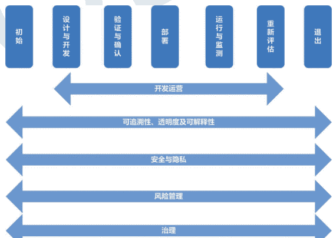

图1 人工智能系统生命周期模型

#### 2.4.2 AI生态系统框架

同一委会在ISO/IEC 22989中提出生态框架，自上而下分为：垂直行业应用层（AI系统、服务）、核心技术层（机器学习框架、工程系统）、基础设施层（云/边缘计算、大数据构成的算力资源池及管理配置）。

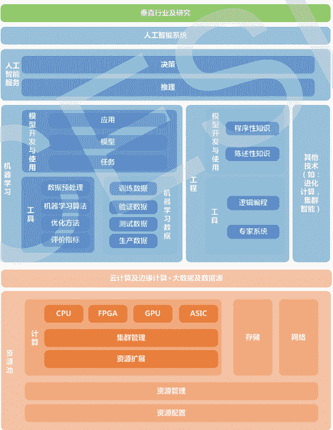

其中机器学习技术框架在ISO/IEC 23053中进一步细化，体现了学术界与产业界新型技术路线演进。

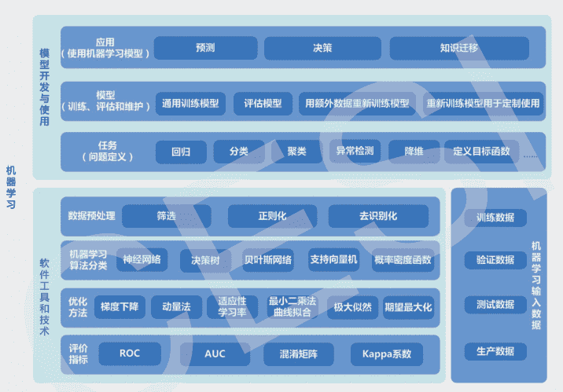

##### 图3 机器学习技术框架

## 三、 人工智能标准化工作全景

### 3.1 标准化的战略必要性

标准是经济社会活动的技术基石，是国家基础性制度的关键组成，在国家治理现代化中发挥基础性引领性作用。我国AI产业虽获突破，但核心技术受制、高价值应用稀缺、融合门槛高等矛盾犹存，迫切需强化标准化支撑产业健康可持续发展。

**驱动技术创新**：促进成果转化落地，推动产业升级；固化全球先进成果，淘汰落后产能，释放发展空间。
**护航产业生态**：支撑政府科学治理与市场监管；构建开放生态，促进大中小微企业协同共生。
**保障质量底线**：企业参标倒逼高标准产出优质供给；依标测试筑牢产品服务质量防线。
**筑牢安全防线**：有效化解技术带来的信息安全隐私风险；解决伦理道德规范与安全标准滞后于技术发展的错位问题。

### 3.2 全球标准化政策动态

#### 3.2.1 国际主要经济体布局

**美国：政策引领标准战略升级**
2019年2月签署《美国人工智能倡议》，聚焦研发与标准制定；6月发布《国家AI研发战略规划》，强调基础研究、伦理、可信及标准基准；2021年1月ANSI发布《美国标准化战略2020》，持续深化AI标准化部署。

**欧盟：标准立法双轮驱动强监管**
2019-2020年密集发布《AI伦理准则》《AI白皮书》《可信AI评估清单》《数字服务法案》《数字市场法案》等，推进立法监管；2021年CEN/CENELEC发布《欧洲标准化战略2030》，聚焦先进创新标准；4月联合研究中心发布标准化格局报告，以国际欧标支撑监管框架落地。

**日本：重顶层设计与战略牵引**

### 3.2.2 国内政策布局

我国构建了较为完善的人工智能政策矩阵，强化顶层设计，全方位推动技术攻关、产业升级与标准奠基。2017年7月，国务院颁布《新一代人工智能发展规划》，明确将标准框架体系研究列为核心任务；同年12月，工信部印发《三年行动计划（2018-2020年）》，提出建立产业标准规范与产品评测体系；至2020年7月，国家标准委联合网信办、发改委等五部门联合发布《标准体系建设指南》，标志着“标准引领产业”新格局正式形成。

### 3.3 国际标准化版图

#### 3.3.1 ISO/IEC JTC 1：核心主阵地

作为信息技术标准化的核心机构，ISO/IEC JTC 1依托其下属的人工智能分技术委员会（SC 42）统筹推进相关工作，重点覆盖基础共性、关键通用技术、可信伦理三大维度，同步布局安全防护与重点行业应用标准。

##### （1）SC 42：人工智能标准化“主力军”

2017年10月，JTC 1第32届全会决定设立SC 42，专司人工智能标准化事务，承担了JTC 1绝大多数AI项目，并指导ISO、IEC开发应用标准。其工作聚焦基础、数据、可信、用例、算法、治理六大领域，下设9个工作组与专设组（WG 1-5、JWG 1、AG 2、AHG 1/2/4/5），架构完备。

*   **WG 1（基础标准）**：主导三大基石标准研制——
    *   **ISO/IEC 22989**：界定第三代AI浪潮下的术语概念，刻画系统生命周期、功能模型及生态框架三大参考架构。
    *   **ISO/IEC 23053**：构建机器学习技术框架，系统梳理监督、无监督、半监督、迁移、增强五大学习范式，划定全流程边界。
    *   **ISO/IEC 42001**：作为管理体系标准，规定组织层面建立、实施、维护及持续改进AI管理体系的准则。
*   **WG 2（数据标准）**：聚焦AI与大数据背景下的数据质量，推进《分析和机器学习的数据质量》系列标准立项。
*   **WG 3（可信伦理）**：成果极具影响力。已发布《AI可信概述》《神经网络鲁棒性评价 第1部分》两项标准；在研项目覆盖偏见治理、伦理社会关注等。核心标准解读：
    *   **ISO/IEC TR 24028**：宏观剖析可信风险，从技术脆弱性成因切入，提出透明度、可控性等缓解路径。
    *   **ISO/IEC TR 24029系列**：提供统计、形式化、实证三大鲁棒性评估方法论，规范技术适用条件与数据使用。
    *   **ISO/IEC TR 24027**：深度关联公平性与算法偏见，解析决策偏见成因类型，给出评估缓解方案。
    *   **ISO/IEC 23894**：基于ISO 31000构建AI风险管理指南，明确评估要素与应对举措。
    *   **ISO/IEC TR 24368**：确立伦理社会原则，并通过实践案例演示开发使用全周期的合规路径。
*   **WG 4（用例应用）**：已发布《用例》标准，正推进《应用指引》《生命周期过程》两项新标。
*   **WG 5（计算特征）**：攻关计算方法概述与分类性能评估等标准。
*   **JWG 1（治理联合组）**：联合SC 40共同研制ISO/IEC 38507，聚焦组织使用AI的治理影响。

> *SC 42详细标准清单见附件1。*

##### （2）JTC 1其他分委会：协同作战

除SC 42外，SC 6、7、27、29、35等分委会亦在垂直领域发力：
*   **SC 6**：探索“AI赋能网络”预研，对标通信应用；
*   **SC 7**：发布《基于AI系统的测试导则》（ISO/IEC TR 29119-11）；
*   **SC 27**：启动《AI安全威胁处理指南》《AI对安全隐私影响》两项预研，筑牢安全防线；
*   **SC 29**：推进《基于AI学习的JPEG编码》（ISO/IEC 6048），催生面向机器的视频编码研究组；
*   **SC 35**：聚焦全双工语音、跨设备交互、情感计算。2020年中国主导成立WG 10情感计算组，已产出《情感计算用户界面》《全双工语音界面》《跨设备交互映射框架》等标准。

#### 3.3.2 ISO：垂直领域深耕

ISO面向智能制造、机械安全、智能运输、健康医疗、机器人等赛道推进标准化：
*   **ISO/TMB/SMCC**：联合编制智能制造白皮书，定义概念、识别干系人、梳理技术栈、确立原则、研判未来。
*   **ISO/TC 199**：发布《机械安全与ISO 12100关联 第5部分：AI/ML应用》（ISO/TR 22100-5）。
*   **ISO/TC 204**：启动公共运输路线设计与更新的ML/AI预研项目。
*   **ISO/TC 215**：产出《影像及医学应用中ML技术应用》（ISO/TR 24291）技术报告。
*   **ISO/TC 299**：排除玩具军用领域，推动31项AI相关标准，22项已发布，覆盖术语、工业安全、协作机器人、服务机器人测试等核心方向。

#### 3.3.3 IEC：场景化与伦理并重

IEC在智能制造、设备、家居、城市、能源等垂直场景布局标准，同步探索伦理边界：
*   **IEC/MSB**：2018年发布《AI跨行业应用》白皮书，解析语音/图像识别、机器学习等关键技术与行业融合路径，为创新落地与体系构建导航。
*   **IEC/TC 65**：作为“AI+智能制造”核心技术组，自2012年起研制数字工厂标准，统筹工业过程测控系统与集成标准。
*   **IEC/SyC AAL**：服务老龄化智能家居，推进《互联家庭功能安全》《AAL参考架构/模型》《服务经济性评价》等标准。
*   **IEC/SEG 10**：2018年成立伦理评估组，识别伦理社会议题，向SMB建言，制定通用指南，保障委员会间一致性，促进与SC 42协作。

#### 3.3.4 ITU：通信赋能聚焦

ITU-T致力于用AI提升电信自动化与服务质量，重点攻克通信、多媒体、医疗、辅助驾驶领域标准，已产出《深度神经网络基准评价》《深度学习框架评价方法论》《共享ML技术框架》等成果。

### 3.4 主要国家/地区与组织动态

#### 3.4.1 IEEE：伦理先行，生态广覆盖

IEEE锚定AI伦理道德高地。2017年发布《全球倡议书》，确立伦理设计原则，引导大众理性看待技术。截至2021年6月，已批准《深度学习评估框架》《知识图谱框架》《道德AI幸福感度量》《金融知识图谱应用指南》等20余项标准，构建起“伦理+技术+应用”立体矩阵。

#### 3.4.2 NIST：政府主导，可信为本

作为美商务部下属机构，NIST在联邦支持下推进标准战略：
*   **2019年8月**《联邦参与制定技术标准计划》：确立“积极参与开发”核心任务，界定包容性、开放透明、共识基础、全球通用、非歧视五大原则，圈定术语、数据、人机交互、指标、网络、性能测试、安全、风控、可信九大重点领域。
*   **2020年8月**《可解释AI四原则》：确立解释性、有意义性、解释准确性、知识局限性四大准则。
*   **2021年3月**《信任与AI》（NISTIR 8332）：创新提出用户信任度评估方法，主张通过认知信任实现收益最大化与风险最小化。
*   **2021年6月**《识别管理AI偏见建议》（SP 1270）：引入风控思维，构建可信负责任AI框架及配套标准体系。

#### 3.4.3 欧盟：立法领跑，风险分级

欧盟高度关注安全、隐私、尊严等伦理风险，自2016年起密集出台政策文件，以“政策+标准”双轮驱动合规：
*   早期文件探讨赋予机器人法律人格、道德准则草案等；
*   《可信赖AI伦理准则》构建全生命周期框架；
*   《AI白皮书》确立“以人为本、公平竞争、开放民主、可持续”四大支柱；
*   **2021年4月《人工智能法》提案**：全球首部综合性AI立法草案，按风险等级精细分级（不可接受/高风险/有限/最低），实施差异化监管，统一市场准入，筑牢信任基石。

#### 3.4.4 产业联盟：ONNX打通生态

2017年，微软、Facebook、亚马逊等巨头联手推出ONNX开放格式，破解模型框架互通难题。开发者可灵活切换工具链，现获Intel、AMD、英伟达、华为等主流芯片厂商及TensorFlow、PyTorch、Caffe2等主流框架全面支持，成为模型部署推理的“通用货币”。

### 3.5 国内标准化力量部署

#### 3.5.1 SAC/TC 28：国家队核心，对标国际

全国信标委（SAC/TC 28）对口ISO/IEC JTC 1。其下属**SC 42（2020年3月成立）**直对标国际SC 42，统揽基础、技术、风控、可信、治理、产品、应用全链条国家标准制修订。除此，TC 28还通过SC 35（用户界面/智能语音/体感）、SC 37（生物识别/指纹人脸/样本）、SC 24（图形图像/增强现实）等分委会，以及大数据、云计算、物联网、传感器网络等工作组，构建多层次支撑体系。

#### 3.5.2 SAC/TC 159：自动化与机器人主阵地

全国自动化标委会（SAC/TC 159）对口ISO/TC 184、ISO/TC 299，聚焦产品全生命周期自动化集成。其下**SC 2（机器人与装备）**承担AI相关标准化，覆盖三大维度：
1.  **特定环境可编程机器人**：如《控制器开放通信接口》《用户编程指令》《多核实时OS应用框架》。
2.  **多轴可编程机器人**：如《坐标系运动命名》《装配机器人通用规范》《机械接口轴类标准》。
3.  **机器人装备**：如《词汇》《设计平台集成架构》《模块化功能构件规范》。

#### 3.5.3 SAC/TC 242：智能视听终端

全国音视频多媒体标委会（SAC/TC 242）聚焦智能电视交互，推进《交互应用接口规范》《语音识别测试方法》《语音识别通用技术要求》等标准研制。

#### 3.5.4 SAC/TC 260：生物识别安全基石

全国信息安全标委会（SAC/TC 260）深耕信安领域，推出《基于可信环境的生物鉴别协议》《指纹识别系统技术要求》《生物特征信息保护要求》等核心标准，筑牢身份认证安全防线。

#### 3.5.5 SAC/TC [...]：智能交通标准化

# 全国智能运输标委会（SAC/TC 268）聚焦车路协同标准落地

全国智能运输系统标准化技术委员会（SAC/TC 268）作为该领域的核心牵头单位，全权统筹国内智能运输标准化事务。围绕行业核心需求，TC 268 已正式发布《智能运输系统 换道决策辅助系统 性能要求与检测方法》《智能运输系统 车辆前向碰撞预警系统 性能要求和测试规程》等关键标准，并同步推进《智能运输系统 智能驾驶电子地图数据模型与交换格式》高速公路与城市道路两大分册的制定工作，为车路协同奠定数据基石。

## 3.5.6 社会团体标准：敏捷响应产业前沿需求

面对人工智能技术迭代加速、应用场景爆发式增长的特点，中国电子工业标准化技术协会、中国计算机用户协会、深圳市人工智能产业协会等社会组织发挥机制灵活优势，快速输出一批高质量团体标准，有效填补了国家标准滞后于技术创新的空白。相关标准项目汇总如下表所示：

**表1 重点人工智能团体标准项目清单**

| 序号 | 标准编号 | 标准名称 | 进度状态 |
| :--- | :--- | :--- | :--- |
| 1 | T/CESA 1026-2018 | 《人工智能 深度学习算法评估规范》 | 已发布 |
| 2 | T/CESA 1034-2019 | 《信息技术 人工智能 小样本机器学习样本量和算法要求》 | 已发布 |
| 3 | T/CESA 1037-2019 | 《信息技术 人工智能 面向机器学习的系统框架和功能要求》 | 已发布 |
| 4 | T/CESA 1040-2019 | 《信息技术 人工智能 面向机器学习的数据标注规程》 | 已发布 |
| 5 | T/CESA 1041-2019 | 《信息技术 人工智能 服务能力成熟度评价参考模型》 | 已发布 |
| 6 | CESA-2020-3-009 | 《信息技术 人工智能 服务器系统性能测试规范》 | 在研中 |
| 7 | CESA-2021-2-006 | 《信息技术 人工智能 风险评估模型》 | 在研中 |
| 8 | T/CCUA 009-2020 | 《人工智能工程师职业技能要求与评价第1部分：计算机视觉》 | 已发布 |
| 9 | T/SIOT 606-2021 | 《智能语音与视觉交互软件接口要求》 | 已发布 |
| 10 | T/GDPHA 022-2021 | 《医学影像智能处理规范》 | 已发布 |
| 11 | T/GDPHA 023-2021 | 《病历文本智能处理规范》 | 已发布 |
| 12 | T/AIIA 10.1-2020 | 《人工智能视觉隐私保护 第1部分：通用技术要求》 | 已发布 |
| 13 | T/TMAC 025-2020 | 《智能建造数字孪生车间技术要求》 | 已发布 |
| 14 | T/AIIA 001-2020 | 《移动机器人定位导航性能评估规范》 | 已发布 |
| 15 | T/CMAX 116-01-2020 | 《自动驾驶车辆道路测试能力评估内容与方法》 | 已发布 |

# 四、 人工智能标准体系：顶层设计引领产业跃升

2020年7月，国家标准委会同中央网信办、发改委、科技部、工信部五部委联合印发《国家新一代人工智能标准体系建设指南》（国标委联〔2020〕35号），确立了当前阶段AI标准化的总纲。该体系由中国电子技术标准化研究院牵头，依托国家人工智能标准化总体组，汇聚产学研用优势力量共同编制。它不仅是标准化工作的“施工图”，更旨在精准对接产业发展诉求，护航关键技术攻关与产业生态构建。

## 4.1 编制遵循：指导性、可用性、阶段性三大原则

体系构建坚守三大核心准则：
- **指导性导向**：锚定未来两年国家标准立项与专项设置方向，引领企业聚焦重点标准研制；
- **可用性落地**：摒弃“标准为标准而标准”，强调验证与应用并重，构建先进适用、贴合产业脉搏的标准集群；
- **阶段性聚焦**：立足当下技术成熟度与应用实况，精准响应未来两年我国AI标准化建设的迫切需求。

## 4.2 体系架构：八维矩阵构建全景版图

人工智能标准体系划分为“A基础共性”、“B支撑技术与产品”、“C基础软硬件平台”、“D关键通用技术”、“E关键领域技术”、“F产品与服务”、“G行业应用”、“H安全/伦理”八大板块，形成纵深推进、横向支撑的立体结构（详见下表）。

**人工智能标准体系结构详表**

| 一级分类 | 二级细分 | 核心覆盖领域 |
| :--- | :--- | :--- |
| **A 基础共性** | AA 术语 | 统一基础语言、参考架构、通用测评基准 |
| **B 支撑技术与产品** | BA 大数据 / BB 物联网 / BC 云计算 / BD 边缘计算 / BE 智能传感器 / BF 数据存储及传输设备 | 夯实数据、算力、连接、感知底座 |
| **C 基础软硬件平台** | CA 智能芯片 / CB 系统软件 / CC 开发框架 | 实现算法-芯片-软件-系统协同优化 |
| **D 关键通用技术** | DA 机器学习 / DB 知识图谱 / DC 类脑智能计算 / DD 量子智能计算 / DE 模式识别 | 攻克模型、系统、性能评价核心技术标准 |
| **E 关键领域技术** | EA 自然语言处理 / EB 智能语音 / EC 计算机视觉 / ED 生物特征识别 / EE 虚拟现实/增强现实 / EF 人机交互 | 覆盖语义、语音、视觉、多模态交互全谱系 |
| **F 产品与服务** | FA 智能机器人 / FB 智能运载工具 / FC 智能终端 / FD 智能服务 | 推动技术成果产品化、服务化、标准化 |
| **G 行业应用** | GA 智能制造 / GB 智能农业 / GC 智能交通 / GD 智能医疗 / GE 智能教育 / GF 智能商务 / GG 智能能源 / GH 智能物流 / GI 智能金融 / GJ 智能家居 / GK 智能政务 / GL 智慧城市 / GM 公共安全 / GN 智能环保 / GO 智能法庭 / GP 智能游戏 | 对标《新一代人工智能发展规划》，精准适配垂直赛道强关联需求 |
| **H 安全/伦理** | HA 安全与隐私保护 / HB 伦理 | 贯穿全生命周期，筑牢合规发展防线 |

### 八大板块功能定位解析

1.  **基础共性标准**：作为系统工程的基石，重点攻克术语规范、参考架构、通用测评方法，为全体系提供语义互通与度量基准。
2.  **支撑技术与产品标准**：聚焦海量数据资源的产生、存储、分析与智能化服务输出，标准化大数据、云计算、边缘计算等强关联支撑领域。
3.  **基础软硬件平台标准**：瞄准芯片算力、开发框架易用性、系统软件稳定性，推动软硬协同与工具链标准化。
4.  **关键通用技术标准**：以机器学习、知识图谱等为核心，围绕模型构建、系统集成、性能评价建立通用技术规范，赋能上层应用。
5.  **关键领域技术标准**：针对语音、视觉、NLP、生物识别、VR/AR、人机交互等落地驱动力，细化至语义提取、图像合成、多模态交互等颗粒度标准。
6.  **产品与服务标准**：面向机器人、智能网联汽车、智能终端等终端形态，制定质量分级、验收测试等标准，提升交付质量。
7.  **行业应用标准**：位于塔尖，依托国家规划确定重点赛道，针对行业强关联痛点定制标准，加速“AI+”深度渗透。
8.  **安全/伦理标准**：横贯左右、贯穿始终，覆盖数据算法模型安全、系统测评、管理服务合规及伦理道德约束，护航产业健康有序演进。

## 4.3 体系框架与现状盘点

体系框架由上述八大维度构成（参见图5），作为顶层设计指导国内各标准化组织开展工作。经梳理，本白皮书第3.5节涉及的国内标准化组织，累计已发布、报批、在研及拟研制AI标准共计 **215项**（详见附件2）。

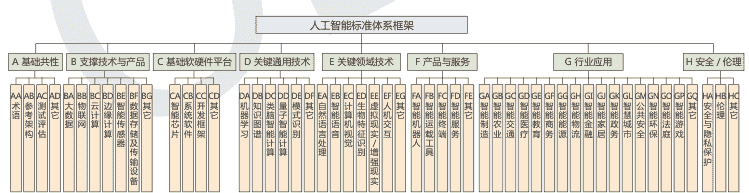

图5 人工智能标准体系框架

## 4.4 建设要点：化解冲突、动态迭代、把握节奏

- **规避交叉冲突，精准界定边界**：AI落地牵涉大数据、云计算、机器人、车联网、智能制造等多体系，存在交集但非包含关系。编制过程中深度调研现有指南，仅标准化“强关联”环节，其余直接引用成熟规划，有效避免重复与矛盾。
- **建立动态更新机制，拥抱“AI+”新范式**：随着垂直领域新模式涌现，体系将持续迭代。以现有框架为起点，跟踪转型升级实需与科技前沿变化，通过动态机制保障体系时效性与前瞻性。
- **正确处理标准与产业关系，坚持“引导非预测”**：承认标准需求的不确定性与滞后性，体系明确的重点仅作引导支撑用，不代表技术产业发展趋势或终局目标，留足市场探索空间。

## 4.5 近期重点标准研制攻关清单

当前将集中力量推进以下十项标准的制定、试验验证与试点应用：

### （1）《信息技术 人工智能 深度学习框架多硬件平台适配技术要求》
聚焦框架与芯片“软硬解耦”难题，规定云端/端侧场景下操作系统、训练/推理芯片的多元适配方案，定义安装部署、兼容适配、算子/模型支持、训练性能、稳定性、易扩展性六大指标体系，为国产AI软硬协同奠定基石。总体架构涵盖设备管理层、算子适配层接口及训推框架适配指标体系。

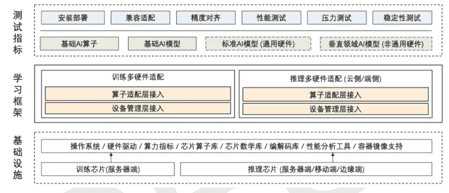

### （2）《信息技术 人工智能 资源管理规范 第1部分：计算虚拟化》
定义AI虚拟化技术框架、接口规范及算力调度指标，指导虚拟化系统设计研发测试。架构上，算法应用层基于框架开发下发任务，资源调度层弹性分配虚拟化AI计算实例（源自CPU/GPU/FPGA/NPU物理卡切分），构建统一资源池接口。

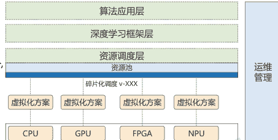

##### 图7 人工智能计算资源管理系统

### （3）《信息技术 人工智能 服务器系统性能测试规范》
覆盖单机、集群、高性能集群，在训练/推理双模式下标准化测试流程、规则、场景，确保数据集、工具、指标、结果的公平科学性。

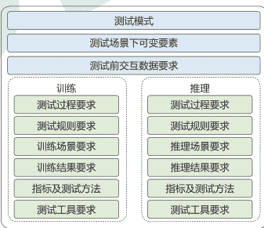

##### 图8 人工智能服务器性能测试框架

### （4）《信息技术 人工智能 风险评估模型》
构建风险能力等级、要素、要求三维模型，给出产品风险等级判定方法，指导开发方、用户方、第三方开展全维度风险评估。

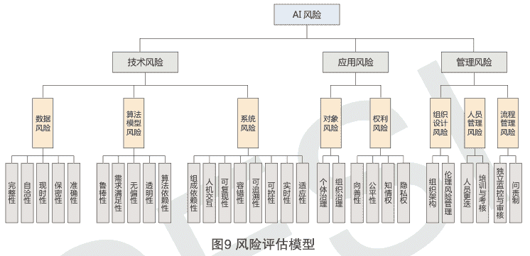

### （5）《人工智能 面向机器学习的系统规范》
界定面向ML系统的技术要求与测试方法，服务于规划设计、评估选型与验收交付全流程。

### （6）《信息技术 人工智能 平台计算资源要求》
规范算力资源组合与调度技术要求，指导调度系统/子系统的设计研发评估。

### （7）《人工智能 服务能力成熟度评估规范》
确立成熟度等级、能力框架与评估方法，适用于服务商整体或单项能力域的成熟度评定。

### （8）《信息技术 人工智能 面向机器学习的数据标注规程》
制定标注流程框架与具体作业规程，指导企业、高校、科研院所、政府机构规范化开展数据标注。

### （9）《人工智能 隐私保护机器学习技术要求》
明确隐私保护ML系统的技术框架、流程、功能/非功能及安全需求，覆盖设计开发测试使用运维全生命周期。

### （10）《信息技术 神经网络表示与模型压缩 第1部分：卷积神经网络》
规定CNN模型基础表示与压缩方法，支撑模型研制、开发、测评与部署应用。

# 五、 人工智能标准化工作：五大战略行动建议

立足技术产业现状与标准化进程，提出以下重点工作主张：

## （1）完善机制协同，筑牢产业可持续发展根基

AI与实体经济深度融合催生多领域协同新态势：
- **强化统筹枢纽**：发挥全国信标委AI分技委（SAC/TC 28/SC 42）牵引作用，统推AI、物联网、云计算、大数据标准化，深化垂直领域应用标准供给。
- **激活总体组平台**：用好国家AI标准化总体组协调功能，汇聚政产学研用合力，攻克实体经济相关领域标准难题。

## （2）聚焦重点研制，补齐体系建设关键拼图

遵循“优势先行、成熟先用、基础统领、应用牵引”原则：
- **筑牢产业底座**：优先攻克性能基准、硬件虚拟接口、开发框架兼容规范等基础设施类标准。
- **赋能规模应用**：锚定智能语音、计算机视觉等已具规模领域，批量产出应用落地标准。
- **推动融合创新**：以“AI+实体经济”为靶心，突破智慧交通、智慧医疗、智慧课堂等行业应用标准。

## （3）深化试点示范，提升标准产业服务效能

标准发布加速需配套推广应用机制：
- **开展宣贯实训**：围绕机器学习模型、机器翻译等级评估等核心标准，融合产业发展开展深度宣贯。
- **建设评估体系**：依托国家AI创新应用先导区、创新发展试验区，构建符合性评估体系，打造标杆示范。
- **搭建公共服务平台**：建设标准化公共技术服务平台，赋能基础共性研发、第三方评价等核心环节。

## （4）培育事实标准，锻造行业竞争“杀手锏”

借鉴DCMM、ITSS、CMMI推广经验，探索AI事实标准埲育路径：
- 结合重大工程项目，聚焦开源社区、新基建领域；
- 以咨询培训、测试评估、产品认证为抓手；
- 推动标准规模化落地，打造一批具有行业影响力的AI事实标准。

## （5）深化国际合作，发出中国标准强音

- **对接国际主流**：持续深化与ISO/IEC JTC 1等顶级组织合作，提升参与度与贡献度。
- **组团出海攻坚**：依托总体组与分技委平台，组织国内优势机构企业参与国际标准制修订，输出中国方案。
- **抢占话语权高地**：支持国内专家担任国际标准化组织秘书、召集人等核心职务。
- **搭建高端对话平台**：主动承办国际会议论坛，拓展双多边合作深度与广度，实现互利共赢。

# 全景扫描：国际与国内人工智能标准化建设最新进展

人工智能技术的飞速演进，正倒逼标准体系加速成型。当前，国际标准化组织（ISO/IEC JTC 1/SC 42）与国内标准化技术委员会正协同推进，从基础术语到行业落地，构建起一张覆盖全生命周期的标准网络。本文梳理了国际、国内两大维度的最新标准研制动态，为从业者提供参考。

## 一、 国际舞台：SC 42 六大工作组并行攻坚

ISO/IEC JTC 1/SC 42 作为人工智能国际标准化的核心机构，已建立起覆盖基础、数据、可信、应用、计算及治理六大维度的工作组矩阵。当前研制重心明显向**管理体系、数据质量、可信风险**等高价值领域倾斜，已发布标准奠定了大数据与可信基础框架。

### 1. WG 1 基础标准组：确立核心语言与管理底座
聚焦术语统一、架构框架及治理规范，三项核心标准均处于研制中：
*   **ISO/IEC 22989**：锚定 AI 概念与术语基石；
*   **ISO/IEC 23053**：构建基于机器学习的 AI 系统通用框架；
*   **ISO/IEC 42001**：推出 AI 管理体系认证标准，将成合规“通行证”。

### 2. WG 2 数据工作组：从大数据词汇深入至 AI 数据全链路质量
早期已发布 20546/20547 系列，确立大数据概述、参考架构及路线图。现聚焦 **ISO/IEC 5259 系列（1-4 部分）**，系统解决分析与机器学习场景下的数据质量度量、管理与过程框架问题；同步启动 **24668（大数据分析过程管理）** 与 **PWI 8183（数据生命周期框架）**，补齐工程化短板。

### 3. WG 3 可信工作组：构建“可信 AI”最全拼图
研制项目最密集、覆盖面最广，已发布 **TR 24028（可信概述）**、**TR 24029-1/TR 24030（鲁棒性评价与用例）** 奠基。在研项目直击痛点：
*   **偏见与伦理**：TR 24027、TR 24368；
*   **风险与安全**：23894（风险管理）、TR 5469（功能安全）；
*   **质量与解释性**：25059（质量模型）、TS 6254（可解释性）、TS 5471（质量评价）；
*   **技术深度**：24029-2（神经网络形式化鲁棒性验证）。

### 4. WG 4 用例与应用组 / WG 5 计算方法组 / JWG 1 治理组
*   **WG 4** 推进 **5339（应用指引）** 与 **5338（生命周期过程）**，指导落地实施；
*   **WG 5** 聚焦 **TR 24372（计算方法概述）**、**TS 4213（分类性能评估）**、**5394（知识工程架构）**，强化技术评价维度；
*   **JWG 1（联合 SC 40）** 研制 **38507**，探讨组织层面 AI 治理的 IT 治理延伸。

---

## 二、 国内体系：五大维度构建“1+N”标准矩阵

国内标准体系遵循“基础引领、支撑赋能、平台夯实、技术突破、应用牵引”逻辑，形成国家标准（GB/T）、团体标准（T/CESA）与计划项目三梯队并进格局。

### 1. A 基础共性：统一语言，筑牢评估基石
*   **术语（AA）**：早期发布 5271 系列（专家系统、语音、机器学习、神经网络等）及生物识别、增强现实术语；新版 **《信息技术 人工智能 术语》** 正在研制中，将对标国际 22989。
*   **测试评估（AC）**：团标率先突围，深度学习算法评估、智能助理/机器翻译分级、服务成熟度模型、服务器规范均已发布；服务器性能测试、服务成熟度评估规范正在研/拟研制中。

### 2. B 支撑技术：融合物联网、云计算与存储
发布智慧酒店平台接口、云制造仿真服务、智能设备身份识别接口等标准，夯实 AI 与泛在基础设施融合的互操作底座。

### 3. C 基础软硬件平台：芯片分层测试领跑，框架适配跟进
*   **智能芯片（CA）**：团标全球领先发布 **云/边/端三侧深度学习芯片测试指标与方法** 系列，填补分层评测空白。
*   **通用平台（CD）**：平台计算资源要求在研；深度学习框架多硬件适配、计算虚拟化资源管理纳入拟研制计划，直击“软硬解耦”难题。

### 4. D 关键通用技术：机器学习与知识图谱双轮驱动
*   **机器学习（DA）**：团标覆盖小样本、模型质量、系统框架、数据标注全流程；国家标准跟进神经网络表示压缩、数据标注规程、系统规范；模型算法管理指南拟研制，补齐治理环节。
*   **知识图谱（DB）**：分类分级、性能评测、技术框架三大团标/国标同步推进，加速知识工程标准化。

### 5. E 关键领域技术：语音成熟领跑，多模态拓展中
*   **智能语音（EB）**：国家标准体系最成熟，覆盖识别/合成通用规范、互联网/终端服务接口、智能客服语义库，形成完整落地链条。
*   **自然语言理解（EA）**：语音机器翻译系统规范拟研制，布局多模态交互前沿。

---

## 三、 核心趋势洞察

1.  **国标与团标“双轨制”协同显效**：团标响应快、针对性强（如芯片分层测试、算法评估），国标权威高、覆盖面广（如术语、语音、数据质量），两者形成“探索-固化”良性互动。
2.  **可信与治理成国际竞争制高点**：SC 42 WG 3 与 JWG 1 密集产出，国内亦启动风险管理、模型管理标准，**合规性、可解释性、安全性**将成产品出海与准入核心门槛。
3.  **数据质量标准化进入“深水区”**：从“大数据词汇”进阶至“AI 专用数据质量度量与管理”，标志着行业认知从“重模型”向“重数据工程”转型。
4.  **硬件评测细分至云边端**：国内芯片测试标准按部署场景分层，精准适配算力多样化需求，为国产算力生态互认提供度量尺。

> **结语**：标准虽无形，却是产业跃迁的隐形引擎。随着 ISO 42001、5259 系列及国内配套标准落地，AI 产业将从“野蛮生长”迈入“规范发展”新阶段。建议企业密切跟踪在研标准进度，提前布局合规体系，抢占标准话语权。

# 中国人工智能标准化版图全景扫描：从核心技术到行业落地的标准矩阵

人工智能产业的高质量发展，离不开标准体系的支撑与引领。梳理当前国内AI领域的标准布局，可以清晰地看到一张覆盖**关键技术、产品服务、行业应用**三大维度、包含**已发布、在研、拟研制**多层次状态的标准化全景图。这不仅勾勒出技术演进的脉络，更为产业落地提供了坚实的规范基石。

## 一、 夯实技术底座：核心赛道标准密集发布

在“E关键领域技术”层面，标准化工作已深入到算法、接口、测试、数据格式等颗粒度极细的环节。

**1. 智能语音：构建全链条交互规范**
语音交互作为AI最成熟的落地入口，已形成从通用架构到垂类场景的系列化标准。GB/T 36464系列覆盖了通用规范、智能家居、智能客服、移动终端至车载终端五大场景，实现了“家、车、机、服”全域互联的标准互通。同时，声纹识别技术规范（SJ/T 11380）已发布，语音识别与语义理解的测试标准正在研制中，将进一步量化交互效能。

**2. 计算机视觉：聚焦算法接口与可信演进**
视觉领域标准呈现“接口先行、可信跟进”特征。团体标准T/CESA 1035率先落地音视频图像分析算法接口，深度学习视觉算法接口技术要求（CESA-2021-2-007）同步推进。值得注意的是，“计算机视觉系统可信赖技术规范”与“人员追踪系统技术规范”已列入拟研制计划，标志着视觉技术正从“好用”向“可信、可管”迈进。

**3. 生物特征识别：构建全球领先的数据与测试体系**
这是我国标准化布局最完善、国际对标度最高的细分领域。GB/T 26237系列构建了涵盖指纹、人脸、虹膜、掌静脉、DNA等14种模态的数据交换格式矩阵；GB/T 29268系列确立了性能测试的“四部曲”原则；BioAPI接口标准（GB/T 30267/30268/32629）保障了跨平台互操作。前沿方向上，移动端多模态生物识别（GB/T 37036系列）、呈现攻击检测（PAD）、指纹模组规范等标准正加速研制，直击金融支付、安防核验等高安等级场景刚需。

**4. 虚实融合与自然交互：定义下一代人机界面**
VR/AR领域已发布应用软件基本要求（GB/T 38258）与头显设备通用规范（GB/T 38259），内容表示编码标准同步推进。手势交互（GB/T 38665系列）与情感计算界面框架标准的布局，预示着多模态、无感化交互时代的规范到来。

## 二、 强化产品供给：机器人与智能终端标准化提速

“F产品与服务”板块直击商业化交付环节，标准供给精准对接产品迭代周期。

**1. 智能机器人：从本体到系统的全维度覆盖**
机器人标准体系极为庞大，涵盖词汇、坐标系、通信总线、控制器接口、软件组件、RTOS框架、仿真环境、设计平台、模块化构件等研发全链路。重点突破方面，协作机器人（GB/T 36008）、个人助理机器人安全（GB/T 36530）、洁净机器人（GB/T 37416）等细分产品标准已落地，服务机器人模块化设计（GB/T 33261）与娱乐/导引服务机器人标准正在研制，回应了机器人“下半场”规模化量产的共性需求。

**2. 智能终端：场景化定义智能化评价体系**
智能电视领域建立了从概念模型（SJ/T 11592）、交互接口、语音识别测评（SJ/T 11712-11713）到智能化分级评价（SJ/T 11688）的完整链条。移动智能终端延伸至AR应用接口（T/CESA 1131）与儿童保护规范（T/CESA 1160），体现了终端智能化向专用化、普惠化方向演进的标准化思考。

## 三、 深化场景赋能：行业应用标准倒逼数智化转型

“G行业应用”板块展现了AI技术在垂直领域的标准化渗透深度，呈现“通用基础+专用规范”双轨并行态势。

**1. 智能制造：向“柔性、智能、云化”进阶**
工业机器人标准已从基础编程（GB/T 29824）、模块化设计（GB/T 33262）延伸至冲压、锻造、桁架等特种作业机器人通用条件。最新发布的力控制技术规范（GB/T 38559）与通用驱动模块接口（GB/T 38560）攻克了柔性制造核心痛点。在研标准聚焦能效评估、运行效率评价、云服务平台架构，直指“机器人+工业互联网”融合应用的管理与优化需求。农业端锄草机器人系列标准（GB/T 36007/12/13）已构建起技术条件、性能试验、安全要求的闭环。

**2. 智能交通：车路协同与智能驾驶双轮驱动**
C-V2X车路协同通信标准（GB/T 31024系列）四部曲全数发布，筑牢了协同感知的通信底座。车端侧，前向碰撞预警（GB/T 33577）、扩展倒车辅助（GB/T 37436）、车道决策辅助（GB/T 37471）等ADAS功能标准落地，驾驶状态监测（T/CESA 1044）与高精地图数据模型（在研）标准同步推进。数据安全服务（GB/T 37373）与数字证书接口（GB/T 37374）则为车联网安全筑起防线。

**3. 智慧医疗与城市大脑：团标先行探索治理新范式**
智慧医疗领域依托团体标准快速响应，人员追踪、体温检测、影像辅助诊断三大系统技术要求及测评方法已发布，相关国家标准拟研制计划同步启动，形成“团标探路、国标定型”良性互动。智慧城市顶层设计上，评价指标（GB/T 33356）、技术参考模型（GB/T 34678）、评价模型体系（GB/T 34680系列）已构建起可量化、可复制的城市数字化转型评价框架。

**4. 智能物流与家居：补齐协同与交互短板**
物流机器人人机信息系统规范（在研）聚焦人货场协同效率；智能家居语音交互标准（GB/T 36464.2）已纳入智能语音系列，推动家庭场景交互一致性体验。

---

### 结语：标准引领，生态共生

纵观这份标准清单，呈现出**“基础共性标准成熟度高、垂直应用标准迭代快、前沿探索标准前瞻性强”**的鲜明特征。从生物识别的国际话语权争夺，到机器人本体与智能制造的深度绑定；从车路协同的基建式标准铺设，到大模型时代前夜的多模态交互规范储备。

这张标准化版图，不仅是技术指标的罗列，更是产业界共识的结晶。随着在研项目的陆续转化、拟研制项目的正式立项，中国AI标准体系将进一步从“跟跑”向“并跑、领跑”转变，为人工智能产业的高质量发展注入确定性动力。

## 核心标准体系速览

### 智慧城市基础与顶层设计标准
当前已发布的核心国标奠定了智慧城市的理论基石与建设规范。其中，《智慧城市 领域知识模型 核心概念模型》（GB/T 36332-2018）界定了核心概念；《智慧城市 顶层设计指南》（GB/T 36333-2018）为整体规划提供了方法论；《智慧城市 软件服务预算管理规范》（GB/T 36334-2018）则规范了资金投入管理。此外，《智慧校园总体框架》（GB/T 36445-2018）作为垂直领域的延伸，同样已正式实施。

### 智慧城市关键技术应用与平台标准
在技术落地层面，一批聚焦互操作、物联感知、运维及支撑平台的标准已落地。SOA架构应用指南（GB/T 36445-2018）、面向城市的物联网技术应用指南（GB/T 36620-2018）及信息技术运营指南（GB/T 36621-2018）构成了技术支撑三件套。公共信息与服务支撑平台系列标准（GB/T 36622.1-.3-2018）详细规定了总体要求、目录管理服务及测试规范。数据融合领域则已发布概念模型（GB/T 36625.1-2018）、数据编码规范（GB/T 36625.2-2018）及市政基础设施数据元素（GB/T 36625.5-2019）三项标准。术语标准（GB/T 37043-2018）统一了行业语言。团标层面，城市污水处理智能预警技术要求（T/CESA 1042-2019）亦已发布。

### 智慧城市评价体系与专项在研标准
评价维度正持续扩展，设备联接管理平台技术要求（20181813-T-469）、评价模型及基础指标体系第5部分：交通（20194200-T-469）以及新型智慧城市评价指标（20194205-T-469）均处于起草研究阶段，将进一步完善考核维度。

### 信息安全与隐私保护标准体系（H/HA类）
该领域标准储备最为丰厚，已形成覆盖生物识别、移动终端、工控安全、物联网及射频识别等全方位的标准矩阵。

**生物特征识别与身份鉴别：** 虹膜识别系统（GB/T 20979-2019）、指纹识别系统（GB/T 37076-2018）、基于可信环境的生物特征身份鉴别协议框架（GB/T 36651-2018）及基于生物特征的移动终端鉴别技术框架（GB/T 38542-2020）均已发布，生物特征信息保护要求（20190901-T-469）正在研制中。

**移动智能终端安全全家桶：** 涵盖安全架构（GB/T 32927-2016）、应用软件安全（GB/T 34975-2017）、操作系统安全（GB/T 34976-2017）、数据存储安全（GB/T 34977-2017）、个人信息保护（GB/T 34978-2017）及安全管理平台（GB/T 37952-2019）等多项国标，移动终端安全技术要求及测试评价方法（20173862-T-469）仍在研制。

**工业控制系统安全纵深防御：** 已发布专用防火墙（GB/T 37933-2019）、安全隔离与信息交换（GB/T 37934-2019）、网络监测（GB/T 37953-2019）、漏洞检测产品（GB/T 37954-2019）等核心装备标准，防护能力评价方法（20173583-T-469）、安全检查指南（20173870-T-469）正在推进。

**物联网与RFID安全：** 物联网感知终端应用安全（GB/T 36951-2018）、物联网安全参考模型（GB/T 37044-2018）已出台；RFID体系下的通用安全要求（GB/T 35290-2017）及密码应用技术要求三部曲（GB/T 37033.1-.3-2018）均已发布。

**其他关键设施与新兴领域：** 智能卡读写机具（GB/T 35101-2017）、移动互联网应用服务器（GB/T 35281-2017）、智能密码钥匙接口（GB/T 35291-2017）、智慧城市安全体系框架（GB/T 37971-2019）均已实施。智能联网设备口令保护指南（20173867-T-469）、智能音视频采集设备应用安全（20173865-T-469）、智能家居信息安全通用规范（20194266-T-469）处于在研状态。

### AI伦理与前沿探索标准（HB类）
隐私保护机器学习技术要求处于拟研制阶段，人工智能风险评估模型（CESA-2021-2-006）正在起草中，标志着伦理治理标准化迈出实质性步伐。

---

## 典型应用案例精选

本白皮书遴选了9大代表性场景，受限篇幅仅作概要阐述，详情可联系提供方深入了解。

### 场景一：智慧城市AI中台赋能“一网统管”
**应用领域**：人工智能+城市治理  
**核心场景**：城市全域数字化协同管理  
**方案提供方**：上海依图网络科技有限公司

#### 1. 需求背景与整体思路
新型城治模式下，某市推行“一网通办、一网统管”，亟需打破部门壁垒，实现跨层级协同。依图科技基于“云-边-端”架构，打造分布式算力平台与AI中台，引入国产深度学习芯片视频解析一体机，推动城市数字化转型。核心目标是实现“机器感知、自动派单、业务闭环”，让数据多跑路、基层少跑腿。

#### 2. 核心架构与功能拆解
中台采用分层设计，自下而上支撑市-区-街三级应用：
*   **基础设施层**：汇聚云算力、边缘节点、前端感知设备及网络通讯资源。
*   **智能感知层**：通过视频解析、语音识别、物联感知将物理世界数字化，配合算法仓库实现算法全生命周期管理（训练、调度、迭代）。
*   **智能认知层**：基于知识图谱技术，融合语义理解与领域知识，输出高阶决策支撑，统筹城市职能。
*   **智能交互层**：面向三级平台提供可视化界面、统计分析、事件闭环、算法调度等服务。

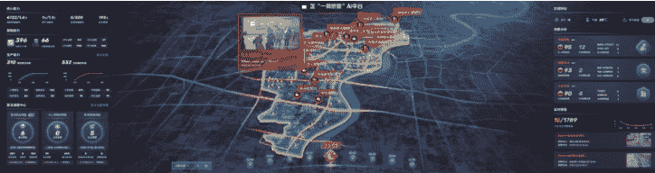

#### 3. 实战成效与规模化价值
项目部署自研视频解析一体机，接入650路视频流与3511路图片流，支持平行扩展。内置近300种算法（涵盖人群聚集、积水检测、违停抓拍、头盔识别、垃圾分类、防偷拍、人物画像等），按需动态配置。已落地街道公共安全、校园周边、养老服务、社区治理、水域船舶管理等场景，显著提升了基层网格化治理效能，实现了智能发现、智能推送、闭环处置的全流程自动化。

---

### 场景二：高速公路AI稽核系统筑牢收费防线
**应用领域**：人工智能+交通物流  
**核心场景**：全国联网收费下的逃费稽核  
**方案提供方**：云从科技

#### 1. 痛点与应对策略
2020年省界收费站撤销后，联网收费虽提效但也带来逃费新挑战：单程费用高、手段隐蔽（套牌、屏蔽OBU等）、数据量爆炸致使人工稽核失效。云从科技推出人机协同平台，融合交易流与视频流多源数据，还原车辆真实轨迹，精准打击“偷、逃、漏”行为。

#### 2. 关键技术模块
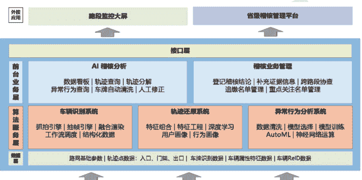
*   **精细化车辆画像**：基于ReID技术提取全景特征，深度解析号牌、品牌、颜色、车身细节（摆件、年检标等）。
*   **异常行为全谱识别**：覆盖大车小标、倒挂甩挂、OBU屏蔽、一车多卡、有入无出、非法掉头、倒换ETC、强行闯关等十大典型逃费模式。
*   **全域轨迹复原与研判**：融合ETC/OBU记录与AI视觉识别结果，自动拟合路径，直观暴露轨迹断裂、时空不匹配等异常。

#### 3. 实测数据与推广价值
实战中日均处理400万过点数据、30万轨迹，异常占比0.3%，成功立案多起。轨迹还原准确率达85%，提供多维轨迹分解视图。系统内置丰富战法库，支持按省份需求快速定制新稽核类型，大幅降低人力成本，净化通行环境。

---

### 场景三：发热门诊Atlas智能筛查方案抗疫提速
**应用领域**：人工智能+医疗健康  
**核心场景**：新冠等传染性肺部疾病辅助诊断  
**方案提供方**：华为技术有限公司（联合安德医智）

#### 1. 临床刚需与解决路径
疫情早期，发热门诊面临影像征象不明显易漏诊、易混淆、读片耗时长、患者聚集交叉感染、医生疲劳误判等六大痛点。方案部署Atlas传染病筛查一体机，边缘侧部署，覆盖新冠、禽流感等11种肺部疾病智能辅诊。

#### 2. 硬软协同技术方案
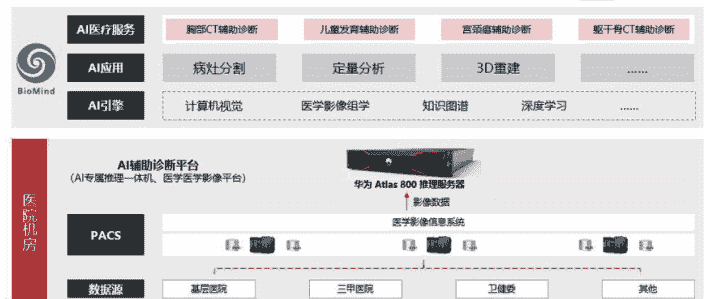
*   **临床级AI功能集**：集成病变标记定量、精准评估、动态随访、筛查分流预警于一体。
*   **影像处理流水线**：自动完成病灶分割、定量分析、三维重建，结果可视化直观呈现。
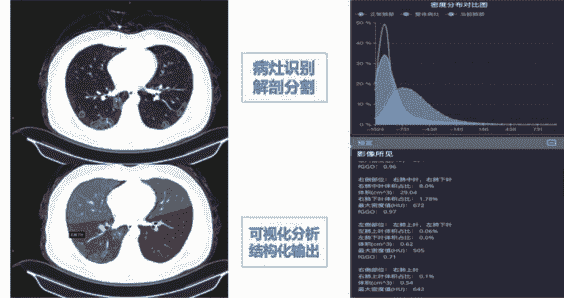
*   **边缘推理硬件底座**：采用Atlas 800服务器，620 TOPS INT8算力、480W低功耗，半天完成对接调试，本地化部署保障患者数据不出院。

#### 3. 量化收益与防疫赋能
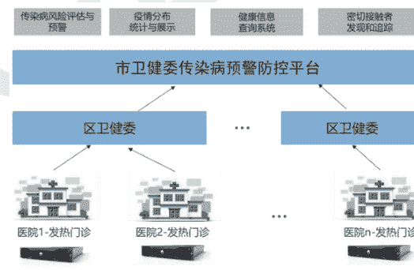
*   **效率跃升**：单例读片从15分钟压缩至10秒。
*   **精度保障**：准确率从70%提升至90%。
*   **疗效评估**：AI与医生交叉互检，量化治疗效果。
*   **成本优势**：较同类方案降本约20%。
*   **指挥联动**：分级部署模式下，诊断数据实时上报卫健委指挥中心，支撑疫情态势感知与科学决策。

---

### 场景四：视觉AI病理诊疗系统破解医生荒
**应用领域**：人工智能+病理诊断  
**核心场景**：组织/细胞级恶性肿瘤辅助筛查  
**方案提供方**：商汤科技

#### 1. 行业困境与破局逻辑
病理诊断是确诊“金标准”，但国内在册病理医师不足2万，供需矛盾极其尖锐。引入AI算法将专家经验数字化、标准化、可复制化，不仅能分担医生80%以上常规筛查工作量，释放精力攻坚疑难杂症，更能将优质医疗能力下沉基层，缩小区域医疗差距，促进医患关系良性互动。

#### 2. 方案核心能力
系统聚焦胸部、消化道等高发器官，覆盖95%常见癌种病灶区域定位与高危异常细胞提示，实现组织级与细胞级双维度辅助诊断，助力医生提质增效。

### 商汤SenseCare：AI赋能全流程智慧诊疗，重塑病理筛查新标杆

针对病理诊断耗时长、筛查压力大的行业痛点，商汤科技凭借深厚的视觉AI技术底座，推出自研的SenseCare智慧诊疗平台。该平台可与数字病理扫描仪无缝对接，内置的“智慧病理AI应用”实现了组织及细胞双维度的辅助诊断，覆盖消化道多个高发癌种器官，能精准标注95%以上的常见癌症病灶区域与高危异常细胞。

作为商汤面向全院医生打造的智慧诊疗利器，SenseCare立足海量医疗大数据，融合视觉AI与医学影像高级后处理技术，构建起“高并发三维渲染”与“可拓展临床AI应用”双引擎架构。它贯穿“诊断-治疗-康复”全链路，满足医生从临床阅片、手术规划到术前模拟的全周期需求，让“诊疗愈”全栈操作触手可及。

在病理科场景下，平台通过高效视觉算法从两大维度重塑诊断效能：
**其一，极速定位病灶，压缩读片耗时。** 算法可对数字化切片完成大批量、高速度的图像处理，自动提示并精准定位病灶区域，大幅缩短单张切片阅片周期。
**其二，智能分流筛查，优化医力资源。** 系统完成初筛后，将疑似恶性切片流转至资深专家把关分型，良性切片由医生快速复核确认，实现诊疗资源的梯度化高效配置。

研发伊始，商汤联合上海市第一人民医院等合作伙伴，依托上万例真实患者数据（含随访记录）、百万级癌症区域标注及十万级恶性细胞样本，覆盖消化道常见恶性病变，反复打磨模型精度。上线后，研发团队仍坚持结合医生周度反馈，驱动算法周期性迭代，持续提升实战中的精度与速度。

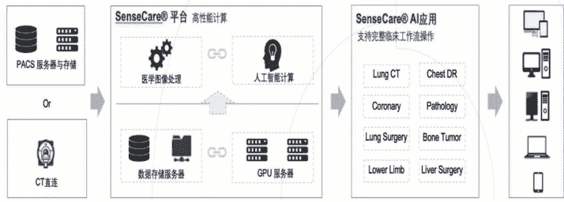

秉持“立足医疗大数据，服务临床诊疗愈”的核心理念，SenseCare凭借平台极强的灵活拓展性，已衍生出涵盖胸部CT、胸部X线、心脏冠脉、病理、骨肿瘤等在内的多元产品矩阵，辐射超13大人体部位与器官，为多学科临床提供AI赋能。平台助力医生完成高精度疾病检出、分型判读、良恶性预测等多维分析，并支撑3D术前规划与模拟等治疗设计。

#### 实施成果：精准筛查与流程重构双突破

**精度维度：** 平台对相关疾病高危病例检出率达100%，阴性排除率超80%，有效托底漏诊风险。
**效能维度：** 融合OCR文字识别技术，自动关联AI计算结果与病理编号，省去医生人工匹配环节，系统化构建起数字病理智能辅助阅片新范式。

**抗疫实战见证：** 新冠疫情期间，SenseCare胸部CT智能方案火速驰援京、沪、津、鲁、冀、闽等地定点医院。青岛某医院放射科主任反馈：引入该产品后，可实现新冠肺炎CT影像的智能化诊断与定量评价，几秒内完成分析并自动筛查疑似病例。这不仅大幅缩短报告出具时效，更减少医护人员滞留时长，有效降低交叉感染风险。

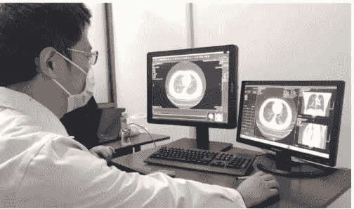

---

### 案例五：云南西双版纳野生亚洲象监测预警体系——科技护航人象和谐共生

**应用领域：** 人工智能+农业/生态保护  
**核心场景：** 亚洲象监测预警、夜间/残缺影像智能识别  
**方案提供方：** 浪潮软件科技有限公司

#### 需求背景与总体设计
基于历年亚洲象种群调查数据，项目旨在破解监测体系短板与人象冲突核心矛盾。浪潮提出“空地一体、多源融合”技术路线：整合地面巡护、无人机巡航、智能视频监控、红外相机监测等多元手段，打通有线/无线网络与异构数据汇聚通道；构建扁平化多组织协同指挥体系，打造全感知、快反应的监测预警中枢，建立响应及时的社会联动机制，为科学保护决策与领导指挥提供实时、精准的数据支撑。

#### 核心技术架构与预警闭环
方案依托AI与大数据技术，建立信息共享机制，大幅压减人工识别负荷，完善预警触发逻辑，搭建对外服务体系。

**前端感知层：** 部署于象群迁徙路线及村寨周边的红外相机/摄像头，实现7×24小时无人值守监控，有效释放人力并弥补人工监测的时空盲区。数据经网络回传至平台，触发智能研判流程。
**多级触达层：** 平台依据研判结果，通过智能广播、移动APP、短信等多渠道，向管护人员、村民及管理部门精准推送预警信息。

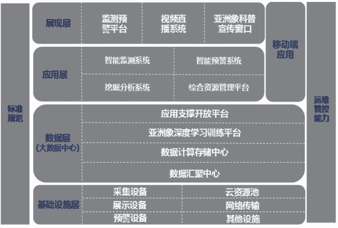 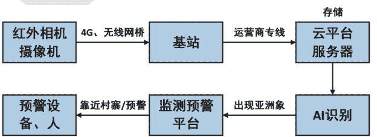

#### 实战成效：零伤亡、高精度、强赋能
自上线运行以来，累计布设605台红外相机、21路摄像头，采集影像超108万张。算法攻克夜间及残缺影像识别难关，识别准确率达99%，在极低能见度下仍能稳定识别预警。累计有效预警5100余次，成功规避人象冲突事件500余起，**辖区实现人员伤亡“零发生”**。

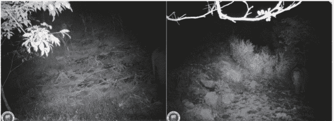 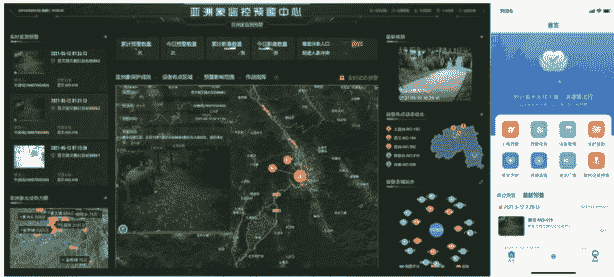

项目不仅有效缓解人象矛盾、避免财产损失，更沉淀了海量珍贵科研影像资料，为专职监测员配上“科技利眼”，显著提升日常管护科学性与有效性。

---

### 案例六：小米“智能音箱+蓝牙Mesh”智能家居系统——语音定义全屋智能新体验

**应用领域：** 人工智能+家居  
**核心场景：** 基于语音交互的全屋设备控制  
**方案提供方：** 北京小米移动软件有限公司

#### 场景痛点与架构创新
随着AI深度渗透生活场景，构建智慧生态体系成为趋势。本方案以智能音箱为核心节点，引入蓝牙Mesh组网技术，构建“音箱为中心、设备为节点”的蓝牙网络拓扑。用户可就近通过音箱控制设备，亦可借助音箱桥接实现跨房间远程操控。该架构在获取设备实时状态上媲美Wi-Fi体验，用户在手机App端即可直观查看在线状态、执行控制并即时获知反馈结果。

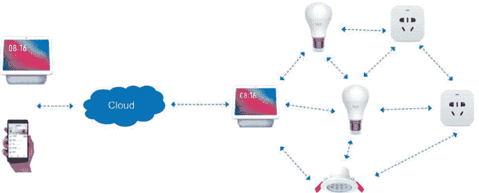

**交互范式革新：** 实操中，用户仅需发出语音指令即可驱动设备响应（如同屋语音开灯），实现了零门槛的自然交互。

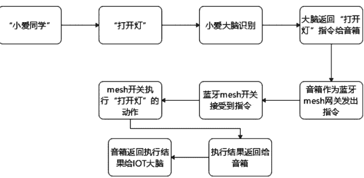

#### 关键技术突破与功能深化
**双模入网，极速安全：** 支持手机App“靠近配网”与音箱“语音配网”双通道，均兼容批量入网。单设备入网最快2秒，网络容量理论上限超3万节点，弹性扩展无压力。云端与设备端双向认证机制，从源头杜绝山寨设备接入。
**分组控制与场景联动：** 支持任意设备跨空间自由编组，一条指令同步驱动组内全量设备，单设备可隶属多组。配合自动化引擎，轻松落地“回家开灯”、“离家断电”、“进门亮灯”等个性化场景，打通生态内跨品类联动。

#### 五大差异化价值确立行业标杆
1. **去网关化入网：** 不依赖Wi-Fi路由器，部署极简。
2. **批量接入高效：** 规模化部署零负担。
3. **闭环语音交互：** 支持跨音箱隔级控制，交互体验领跑行业。
4. **全场景低功耗：** 续航表现显著优于同类方案。
5. **双向认证加持：** 筑牢智能家居安全防线。

该技术路线已获行业广泛采纳，兼具降本与增效优势，竞争力与推广前景卓越，并在小米智能开关、智能灯等爆款产品线得到大规模商用验证。

 

---

### 案例七：腾讯智慧模型平台（TI平台）——构建银行级AI服务能力中枢

**应用领域：** 人工智能+金融  
**核心场景：** 银行营销、风控、运营全域建模  
**方案提供方：** 腾讯云

#### 建设初衷与平台定位
针对行内数据分析建模能力分散、管理割裂的现状，项目基于腾讯云智能钛（TI）平台，融合大数据、机器学习、深度学习核心技术，打造集数据治理、模型训练、离线/在线推理、系统管理于一体的机器学习平台。目标是统一模型开发生命周期管理，沉淀平台级AI服务能力中心，深度挖掘存量数据价值，赋能业务场景落地。

#### 全链路工程化能力体系
平台打通“数据获取→处理→算法构建→训练→评估→部署→应用开发”的AI落地全链条，内置九大能力中心（应用中心、服务编排、模型服务、边缘中心、数据中心、自动学习、训练工坊、模型管理、管理中心），提供端到端生产级服务：
- **数据侧：** 多源接入、多样标注工具、特征工程支持；
- **建模侧：** 兼容简易/专业双模建模工具，算力智能调度，效果可视化评估；
- **部署侧：** 模型一键发布生产环境，云边端数据算法设备互联；
- **运维侧：** 组件编排工具支撑服务资源调度，CI/CD持续集成与标准化接口开放，整合内外部算法数据资源，一站式满足复杂场景需求。

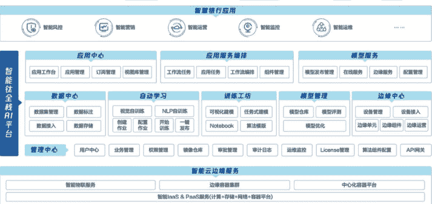

#### 落地价值：从工具赋能到组织进化
1. **业务智能化支撑：** 为风控、营销、运营注入智能数据服务，拓宽数据应用广度与深度。
2. **人才梯队建设：** 显著提升数据团队建模实战力与模型应用水平，孵化建模专家与业务专家，夯实自主可控根基。
3. **战略转型引擎：** 为银行向数字化、智能化全面转型提供核心能力支撑。

#### 五大核心价值主张
① **释放数据价值：** AI服务中台并行海量建模能力，助力统一管理与针对性决策智能化。
② **降本增效：** 策略分析拓展业务边界，智能化金融与流动性预警优化资金运用，综合压降运营成本。
③ **服务高可用：** 支撑海量数据接入，大幅缩短开发周期；集群TEE安全架构共享多模型算力，双重保障稳定性与维护成本。
④ **营销精准化：** 优化用户画像与算法策略，驱动营销触达精准化、高效化。
⑤ **团队孵化器：** 赋能数据团队成长，解决模型应用痛点，助力自主专家梯队搭建。

---

### 案例八：旷视“河图”系统驱动智慧仓储物流——软硬一体重塑无人工厂新标杆

**应用领域：** 人工智能+物流/制造  
**核心场景：** 自动化工厂配套智慧仓储物流解决方案  
**方案提供方：** 北京旷视科技有限公司

#### 行业背景与项目诉求
“建设现代物流体系”已成国家战略重点。某家电龙头企业A为强化核心竞争力，决定推进生产工厂自动化改造，需建设高度自动化、信息化的智慧仓储物流体系。项目要求集成收货平台、立体库、智能搬运、自动配送、自动拆垛等设备，服务智能制造柔性生产，实现周期压缩、成本下降、快速响应市场。

#### “河图”核心：打破软硬壁垒，构建群智新模式
方案以旷视**河图系统**为中枢，构建总体架构，实现软硬一体化融合，解决行业“软硬割裂”顽疾。系统提供广谱设备接入能力与丰富的机器人智能化管理方案，助力企业确立“人机协同、群智开放”的智能物联新范式，达成降本增效目标。

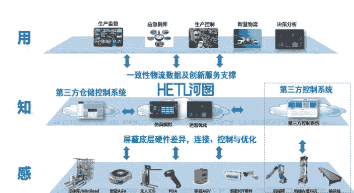

**四大数字化支柱体系：**
1. **全流程管控中枢：** 以MES为核心，贯通SAP、PLM、WMS、SRM、电子看板及产线系统，建成高效制造、数据互联、管理精益的数字化无人工厂。
2. **全链路追溯体系：** 覆盖原料、工艺、零部件、质检全维度，显著提升异常分析与信息化管控水平。
3. **精益物料管控：** 实现原料/半成品/成品精准配送与库存动态平衡，压降在制品与原料占用。
4. **数据智能平台：** 沉淀生产过程数据资产，支撑集中存储与深度分析。

#### 量化成果：安全、柔性、扩展三重保障
1. **库容跃升：** 货流量、在库量、分拣流量、配送量等核心KPI超额达标，物料存储周转效率提升**30%**。
2. **安全托底：** 部署全球首台具备垛形识别、轨道异物检测、视觉盘点功能的AI堆垛机，从硬件层面根治事故隐患。
3. **柔性抗压：** 拣货模块跨区域互换，产能波动导致的线边积压可通过回库机制化解。
4. **低成本扩展：** 中枢河图系统自学习自适应，管理容量平滑提升；AGV地图柔性扩展，施工部署轻量化。

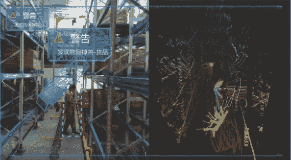

---

### 案例九：云天励飞“深海”系统赋能智慧警务——多维大数据重塑实战新生态

**应用领域：** 人工智能+公共安全  
**核心场景：** 区域/城市级视频结构化、多源融合研判、知识图谱构建  
**方案提供方：** 云天励飞

#### 需求痛点与总体思路
针对海量视频“看不完、查得慢、关联难”及多系统数据孤岛问题，云天励飞推出**深海多维大数据系统**。系统可自动解析视频中人、车、非机动车等关键目标要素（时间、空间、身份、特征），融合人像、车辆、手机、电子围栏、WiFi等多维数据源，依托底层**天图引擎（聚类归档）**与**天谱引擎（百亿级关系图谱）**，构建“以人为核心”的全息多维档案，支撑事前预警、事中管控、事后溯源全周期应用。

#### 标杆落地：成都双流“空港智慧警务”实战录
2019年，系统落地成都市公安局双流分局。在整合天网、智能交通既有感知资源基础上，新建感知节点，融合“人车非”全要素视频及通信、交通、身份等多源数据，打造融合GIS的区域级轨迹分析、全域布控预警、城市级人车档案、图码联侦、全息关系图谱、多元管控战法于一体的智慧警务应用体系，全面跃升实战效能，催生新型智慧警务机制，为“打防管控服”注入AI动能。

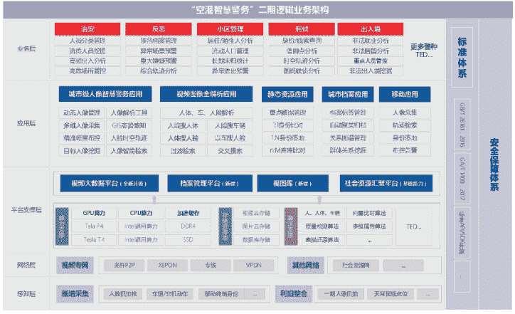

**上线至今高频实战数据：**
- 动态人像采集 **32亿+** 张
- 系统登录调用 **35,000+** 次
- 人脸检索 **23万+** 次
- 协助抓捕违法犯罪嫌疑人 **950+** 名（含网逃200+名）
- 协助寻回走失人员 **200+** 名
- 成功侦破“1·9金店抢劫案”、“2·11故意杀人案”、“杜某芳案”、“6·14故意杀人案”等多起大要案件

项目建成西南首个“区域级”人像轨迹系统，成为以“空港智慧警务”载体提升城市智慧治理水平的标杆样本。