# 破局危化品平仓：从“事故洼地”到智能化转型的实战路径

**前言：写在天津港爆炸事故七周年后**

2015年8月12日，天津港“8·12”特大火灾爆炸事故，像一记重锤，砸碎了行业的侥幸心理。165条鲜活生命的逝去，让“危险品仓储”这四个字沉甸甸地压在了每一个从业者心头。

那一年起，我带着团队踏上了调研之路。从新加坡的Cogent、YCH一流仓库，到上海、张家港、常熟的本土一线现场，我们跑遍了长三角核心港口。调研越深入，越感到震撼：**在中国，危险品仓储确实是整个物流行业的“洼地”，且是亟待改造的硬骨头。**

政府监管在收紧，客户需求在细分，但仓库端却依然停留在“堆货、管门、防火”的粗放模式。怎么破？调研给出的答案只有一条：**智能化，是唯一出路。**

但智能化不是买几台AGV、上个WMS那么简单。它是一场彻底的**业务转型**——以客户需求为核心重塑模式，用算法把“安全、效率、成本”这三个看似对立的指标，纳入帕累托最优的统一框架。

本书，正是这场转型的实战记录。我们锁定中国数量最多、面积最大、事故率也最高的**“双门包装危险品平仓”**，用最优化理论与多属性决策模型，从几何结构重构、叉车调度算法、到需求管理平台，给出了一套可落地、可复制、可量化的“三阶段”进阶方案。

感谢国家自然科学基金、上海浦江人才计划、山东省自然科学基金的资助；感谢上海国际港务集团、中远海运、南京外代等一线企业的开放共享；感谢新加坡国立大学、东南大学、大连海事大学的学术支撑；更感谢我的团队与家人，陪我走完这场“独行快，众行远”的长跑。

书中疏漏在所难免，抛砖引玉，邀同道中人共议危化仓储的未来。

---

## 第一章 绪论：一场迟到的“供给侧改革”

### 1. 痛点：事故频发，供需严重“脱节”

数据不会说谎。2013-2018年，全国化工事故974起，1253人死亡。天津瑞海、江苏响水、河南义马……每一个地名背后，都是血的教训。

但反观供给端：我国危化品产量连续多年全球领跑，2017年硫酸、烧碱、纯碱产量均居世界首位。工厂狂飙突进，仓库却“原地踏步”：**平仓占比超51%，却多是几十年前的“老破小”；立体仓、罐仓比例极低，根本接不住激增的包装危险品。**

这不是简单的“供不应求”，是**发展节奏的严重脱序**。生产端跑进了“工业4.0”，仓储端还卡在“人海战术”。这种错位，才是事故频发的系统性根源。

### 2. 文献盘点：学术界的“盲区”与行业的“经验主义”

为找出路，我们啃透了国内外核心文献，发现了几个扎心的现实：

*   **政策规范“管硬件，不管软件”**：规范里全是耐火等级、隔离距离、消火栓压力，唯独缺RFID、车载预警、传感器融合的应用指南。叉车故障了怎么调度？规范里查无此文。
*   **风险管控“重定性，轻量化”**：国外文献多搞定量风险评估（QRA）、复杂系统建模，落地时却常因数据缺失而“水土不服”。国内更多靠专家打分、经验拍板，**“安全度”到底怎么算？至今无标准公式。**
*   **路径优化“重通用，轻特殊”**：车辆路径问题（VRP）研究汗牛充栋，但针对“双门、单层、防爆、隔离门频繁开关”的危化平仓？几乎是空白。
*   **智能化研究“重常规，轻危化”**：自动化立库、拣选机器人、云平台……全是常规货的天下。危化品仓库的智能化，连“入门级”都算不上。

**结论显而易见：学术界离一线太远，行业靠经验硬扛。必须有人下场，把几何结构、调度算法、管理平台打通，建立一套“危化品专属”的理论体系。**

### 3. 实地调研：七大发现，指明破局方向

2016-2021年，我们跑遍新加坡、上海、南京、烟台、常熟。七次深度访谈，提炼出七条“金律”：

1.  **认清主流**：平仓是绝对主力（51%面积），包装危险品是核心货型。别想着全推倒建立体库——中国国情不允许，周期性强、需求集中的特点，决定了平仓改造性价比最高。
2.  **智能化≠买设备**：新加坡一流仓库的核心不是机器多，是**“围绕客户需求重塑业务流”**。技术是手段，转型才是目的。
3.  **辩证看“安效本”**：盲目追求“绝对安全”反而最不安全（成本爆了、效率垮了、货堆外面更危险）。要在“对立中求统一”，用帕累托改进找平衡点。
4.  **必须量化安全度**：没有公式，就没有分级管控，更谈不上用新技术创造价值。这是本书核心贡献之一——**给出了危化品仓储作业安全度计算公式。**
5.  **打破“闭门造车”**：必须向国际一流看齐，开发核心技术、新商业模式、新管理模式。
6.  **搞试点、促多元**：允许一部分仓库先改结构、先试新模式，由点带面，最终汇聚成统一的**“危险品仓储需求管理平台”**。
7.  **学术空白要亲自填**：SCI/EI/CNKI里搜“危化平仓结构优化”，几乎为零。知识分子必须下车间、进仓库，用实践倒逼理论。

### 4. 双门平仓的“四宗罪”与两条路

聚焦最典型的**双门包装危险品平仓**，现场问题赤裸裸：
*   **效率低、强度大**：工人累死，货周转不动；
*   **叉车乱窜**：路径随机，碰撞风险高，根本无法标准化；
*   **安全观偏激**：要么“侥幸过关”，要么“一刀切”封门堵路，效率归零；
*   **供给单一**：客户需求千差万别（防爆、恒温、隔离、快进快出），仓库只有“堆平地”一种模式，供需彻底错位。

面对这堆烂摊子，业界有两条路：
*   **路A：推倒重来，照搬欧美立体库。** 结果：投资过亿，回本周期长得吓人，且不适应中国“旺季堆山、淡季空场”的波动需求。
*   **路B：就地改造，几何结构创新+算法赋能。** 在不降级安全的前提，把平仓的潜力榨干。

**我们选了路B。**

由此，本书提出了三种新型几何形态：**“互通式”、“分区式”、“环岛式”平仓**。这不是画图纸，是用数学模型跑出来的最优解——它们是后续叉车智能调度、多元化服务、平台化运营的**工程基石**。

### 5. 核心矛盾：供给侧的“结构性失焦”

归根结底，是一组尖锐的剪刀差：
*   **需求端**：大数据、AI重塑商业模式，客户要“即时、多元、差异化、可视化”服务；
*   **供给端**：标准僵化、结构单一、数据孤岛，连“安全、效率、成本”的辩证关系都理不清。

**这场仗，赢在“结构重构”，赢在“算法落地”，更赢在“平台生态”。**

接下来的章节，我们将拆解：
1.  如何用**多属性决策模型**定仓库“新骨架”（几何结构多样化设计）；
2.  如何用**最优化算法**跑出叉车“最优路”（作业效率分阶段提升）；
3.  如何建**需求管理平台**接住客户“碎片化订单”（智能化终极交付）。

这，就是中国危化品平仓破局的“施工图”。

---
*作者：张方伟 | 上海海事大学教授、博导 | 长期深耕危化品物流智能化与仓储系统优化*
*原著《人工智能模式下危险品平仓仓库多样化设计》核心观点重构发布*

# 危险品仓储悖论：越求绝对安全，越离安全远去

危险品仓储供给短缺，叠加国家安全生产政策的高压红线，倒逼企业在低产能下“以命换安”——牺牲成本与效率换取安全底线。但这种妥协藏着巨大的反弹风险。

首先，行业普遍内部收益率偏低，国企更是微薄；其次，市场周期性强，淡季亏损、旺季微利，且受限于管理与智能化短板，资源配置低效，旺季利润难保生存。长期挤压下，企业与员工开始“透支安全要素”博取生存空间。信息不对称让这种隐性违规难被纠偏，机会成本原理下，个体冒险必然向宏观蔓延：一个隐患不除，诱发下一个；环境逐渐恶化，良币被劣币驱离；危险源积累至临界值，严重事故概率大增。这解释为何严查之下，仓库爆炸仍年年发生。

调研中，我们提炼出一个反直觉的铁律：**在追求绝对安全的执念中，反而系统性地丧失了安全**。我们将其定义为**“危险品仓储悖论”**。典型如：叉车作业本应精准对位、防撞防刮，却因赶工期、逐利润，频频破坏包装酿隐患——这就是悖论的具象化写照。

## 病根在“生产力跟不上需求”

本质上，这悖论源于**相对落后的生产水平无法支撑快速增长的仓储需求**。这与工业界的**海恩法则**异曲同工：每一起重大事故背后，必有29次轻伤、300次未遂、1000起隐患。落后产能下，企业将“安全、效率、成本”对立割裂，忽视三者内在联系，导致隐患常态化、处置不彻底。

破局唯一路径：**借力现代科技，推行智能化改造**。核心逻辑是“绝对安全与相对安全结合”，构建多级安全控制体系，在不降级安全标准前提下，实现运营效率的**帕累托改进**。简单说，智能化是危化仓储唯一出路。

但现实骨感：行业封闭、学科小众、学术成果稀缺且引用率低、顶刊不重视，理论研究严重滞后。行业正站在悬崖边。

更棘手的是**“改革悖论”**：在低理论水平指导下贸然改革，决策风险与政治责任双重加码。这形成尖锐矛盾——**亟须提供给，偏偏管理跟不上**。大数据、AI浪潮下，社会发展光速前行（见下图），危化仓储却慢半拍，速度错位进一步放大矛盾。

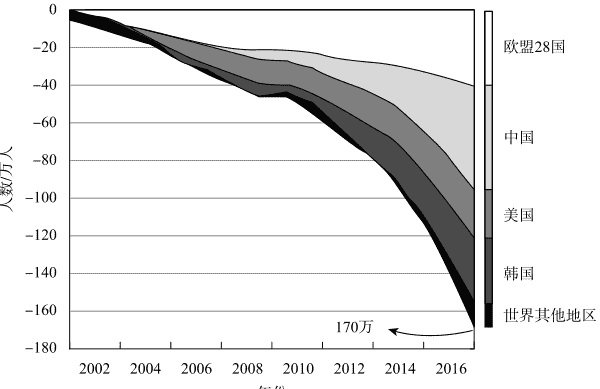

图 1.1 2002~2016 年机器淘汰人工概况[48]

■ 汽车行业   □ 其他行业

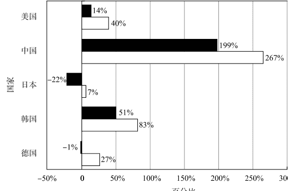

图 1.2 2011~2016 年机器人上岗变化百分比[48]

破解之道只有一条：**几何结构改造先行，释放潜能，为大规模智能化铺设物理底座**。在土地、人力成本双涨背景下，智能化建设是唯一解法。

---

## 1.4 本书怎么写、写什么

### 1.4.1 核心撰写逻辑：宏观定调，微观落地，三大创新贯穿

**宏观视角**：以“不降安全标准”为底线，以“效率帕累托改进”为靶心，以“双门平仓几何优化”为突破口，聚焦“出入库”核心环节，用最优化理论与多属性决策理论为武器，构建涵盖模块化、自动化、智能化需求管理的优化模型，输出**三阶段智能化建设方案**。

**微观视角**：立足企业自生能力，切入“广义要素禀赋结构”，把仓库改造视为动态结构变迁，借市场之力、用比较理论之法，为不同禀赋企业定制进化路径，推出更优、更多方案，精准匹配客户需求。

**三大创新点，直击痛点：**

1.  **安全量化，首创“安全因子”**。将叉车运行线路的积分面积与相对长度差乘积定义为安全因子，把抽象安全转为可算、可优化的硬指标，奠定全书研究基石。
2.  **几何优化，重构为动态系统工程**。从墙体改造切入，衍生出**互通型、分区型、环岛型**三大新型仓库。把出入库工序模块化、影响要素参数化，将仓储活动提炼为全新动态系统。
3.  **拥抱不确定性，动态演化视角贯穿始终**。以企业时点禀赋为锚，视改造为结构变迁过程，引导企业顺应禀赋演进，持续供给优质方案。

### 1.4.2 章节路线图：七步走，层层深

为化解行业主矛盾，本书以**智能化为长期目标，几何改造为物理基础，信息平台为核心载体**，重点管控“第二类危险源”（诱发事故的必要条件），引入“危险度”量化作业风险，用启发式算法解最优、用多属性决策解优选。

*   **第1章**：摸底——现状、类型、需求特征、核心矛盾、写作思路全景图。
*   **第2章**：立柱——设计**四门仓**与**互通仓**，核心是“电动隔离门”动态开合。引入**遗传-粒子群算法**（四门）与**遗传-神经网络算法**（互通），解叉车路径优化，确立工业设计与交通工程融合新范式。
*   **第3章**：管线——深挖互通仓作业管理。揭示效率-安-本三角关系，攻克多步骤衔接难题：瀑布作业机制、三阶段落地、三次指派模型、作业链优选，自动化程度阶梯递进，适配不同进化阶段。
*   **第4章**：新物种——**环岛仓**。解货位分区规则，实证：效率更高，但空间成本高、对员工素质要求高，适配“强时效、弱成本敏感”客户。
*   **第5章**：定价与决策——多方案下的需求管理。压仓条件下用**TOPSIS-超立方体/犹豫相对距离集**做分层决策；动态货位下建定价模型，剖析影响因子。
*   **第6章**：筑平台——智能化终极载体。三步走：**改几何（多型仓）**→**配软件（适配新环境）**→**建平台（统计学+大数据，核心是需求管理）**。
*   **第7章**：总结与展望。

---

# 第2章 四门与互通：用“会动的墙”重塑仓库基因

经济高速发展，行业渗透加深，危化客户细分化、差异化需求爆发。标准化仓库“一刀切”已失效。本章设计**四门平仓**与**互通平仓**两大新物种，作为本书逻辑起点，也是智能化的**物理基石**。

核心黑科技：**电动隔离门**。嵌入房间墙体，可控开合。
*   全关 → 退化为常规双门仓；
*   按算法逐次开 → 进化为四门/互通仓。
这种“可变几何”极大拓展了服务边界。本章同步给算法支撑，打通工业设计与交通工程，为叉车路径规划立标杆。

**章节速览：**
*   **2.1** 借鉴集装箱标准（20/40尺），提出四门仓概念与使用原则。用拓扑变换将双叉车并行优化转为**二次指派问题（QAP）**，创**遗传-粒子群混合算法**求解，实地数据验证，对标经典离散PSO与遍历算法。
*   **2.2** 提出互通仓设计与隔离门原则。以六门仓为样本，引**遗传-神经网络算法**，攻克双/三叉车同入、货位不确定下的路径优化，实例验证。
*   **2.3** 将隔离门用不用、怎么用，建模为**经济成本、时间成本、效率、安全**四指标多属性决策。分“权重未知”（TOPSIS-超立方体分割）与“权重已知”（带参数综合犹豫相对距离集）两环境给模型，实例验证。
*   **2.4** 本章小结。

---

## 2.1 四门危险品平仓仓库：从集装箱借思路，用混合算法破局

### 2.1.1 问题倒逼：几何设计短板，成事故温床

近年危化仓事故频发，非偶然，乃必然。暴露核心短板：**几何设计能力弱、物联网应用缺**，双腿迈不进存储量激增与供应链升级的门槛。出入库是管理核心，提升技术含量刻不容缓。本节聚焦几何结构，梳理风险管控、物联网应用、效率提升、基础算法、最短路径、粒子群算法六大领域前沿：

*   **风险管控**：Roncoli等构建路网风险-效益模型（借鉴地面交通）；Zhao剖析天津港爆炸成因；彭小利等构建多目标货位分配模型。
*   **物联网+大数据**：Kubác证实IoT仓库可实时监控全链路、预测趋势预警；Trab创“物联网控制安全区域”去中心化守安全；彭小利等解多品种货位分配。
*   **效率提升**：Petersen规划存储与人员路线；Hsieh&Tai系统优化通道、布局、策略、路线、密度、订单组合；Larco引多标准优化平衡效益与福祉。
*   **出入库算法**：Quintanilla用启发式算法最大化空间利用率；Seval等用遗传算法优存储策略降成本；谭熠峰等改进PSO提速避局部最优；张衍会等用遗传算法优货位兼顾安效；Ardjmand等解多拣货员分配分批路径。
*   **最短路径经典**：Nazemi用神经网络线性化求解；Cheng&Abdel提最大概率最短路径；Wang等建0-1整数规划模型。
*   **粒子群深耕**：Jiang证实多维离散PSO收敛快；Xiong融合神经网络做区间预测；Pradeepmon改进离散PSO解QAP。验证了PSO在组合优化中的速度优势。

**调研实锤**：几何结构突围能释放潜能、提效能。本章从建筑平面切入，提出**四门仓设想**——拆除双门仓间墙及靠墙货位，打通叉车循环通道。目标直指：保安前提下，双提运营效率与管理水平。

### 2.1.2 四门仓设计思路：打破死胡同，造出循环路

#### 1. 现有仓库作业痛点：死胡同里的博弈

# 突破双门瓶颈：四门危险品仓库如何重塑叉车作业效率？

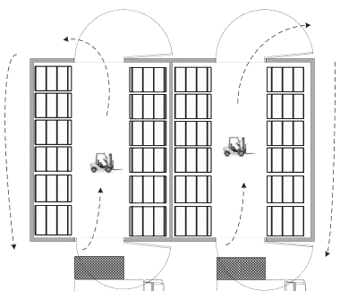

图 2.1 双门危险品仓库设计方案

#### 2. 破局之道：四门危险品仓库设计方案

调研数据表明，平仓是我国危险品仓储的主流形态，多见于老牌企业，呈现出“品种杂、批量小、总储量大、批次多”的典型特征。按建筑体量划分，可分为大型（≥9000㎡）、中型（550~9000㎡）与小型（<550㎡）三级。仓储作业贯穿入库、在库、出库全链条，出入库环节更是效率把控的“咽喉”。当前主流的双门仓库虽两侧可卸车、中间设叉车通道、两侧堆货，但实操中痛点明显：叉车卸货入库后难以原地掉头，被迫绕外部道路返回，路径冗长；且单时刻仅能服务一车，难以应对时效要求。

为打破僵局，本书借鉴集装箱规格逻辑，在隔墙上增设电动隔离门，创新提出**四门危险品仓库设计**（见图 2.2）。这一改动并非单纯开门，而是赋予墙体“建设性功能”：

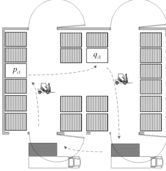

图 2.2 四门危险品仓库设计方案

*   **双模切换**：平时闭合，严格隔离不同危化品品类，满足防火耐热、密闭安规；作业时开启，打通单元通道，支撑多车并行、同进同出。
*   **极速响应**：全开/全闭耗时不足 1 分钟，操作便捷，不拖慢作业节奏。

**运行新规则**：强制顺时针单向循环，单室单车，规避交叉冲突。考虑到人工装卸环节耗时不可控，采用“算法生成路径集、管理者定序并动态微调”的弹性调度机制。

**得失权衡**：虽牺牲了约 10% 平均存储面积，却换来叉车告别“绕外圈”、双集装箱同步作业、设备人力利用率大幅跃升的核心收益。核心命题随之而来：**在安全红线不可触碰的前提下，如何精准布设隔离门、规划最优线路，实现“安、效、本”三目标协同最优？** 本节将构建四门平仓叉车出入库线路优化模型给出答案。

### 2.1.3 四门危险品平仓叉车出入库线路优化模型

#### 1. 从单车到双车：运行线路的数学建模

针对装卸搬运耗时随机、难以精确测度的特性，确立“算法规划路径集、人工决策执行序”的建模范式。风控视角聚焦**第二类危险源**——即降低叉车与货物、设备、人员“危险靠近”的概率与频次，以源头压降事故率。

**单叉车闭环建模**：
设入库箱 $C_1$、出库箱 $C_2$，各含 $m$ 个作业点 $p_i, q_j (i,j \in M=\{1..m\})$。叉车轨迹为：$C_1 \xrightarrow{l_{C_1,p_i}} p_i \xrightarrow{l_{p_i,q_j}} q_j \xrightarrow{l_{q_j,C_2}} C_2 \xrightarrow{l_{C_2,C_1}} C_1$（空驶回位）。任意两点距离记为 $L(A,B)$。

**双叉车并行建模（核心难点）**：
为降低复杂度，设定两假设：① 仅匹配入库点与出库点；② 双车同节点会产生干扰降效。
目标：寻找两组配对路径 $(p_{i_1},q_{j_1})$ 与 $(p_{i_2},q_{j_2})$，使**路径长度差异最大化**（规避同节点冲突、增强调度弹性），同时**总路程最小化**。

构建二分图匹配模型，引入两大指标：
*   **相关度 $r^*$ (公式 2.1)**：衡量两条路径长度的相似度，差异越大越好（值越小越好）。
*   **归一化距离 $L^*$ (公式 2.2)**：将单路径长度映射到 [0,1]，便于加权融合。

**综合优化模型 (公式 2.3)**：
$$ \min \gamma = \underbrace{\sum \text{路径对相关度}}_{\text{冲突规避项}} + \underbrace{\sum \text{归一化路径长度}}_{\text{效率最优项}} $$
约束条件：标准分配问题约束（每入库点唯一匹配一出库点，0-1 变量）。

#### 2. 经典离散粒子群算法 (PSO) 求解

将匹配方案编码为粒子位置向量 $l^* = (q_{j_1}, ..., q_{j_m})$，引入矩阵化表达统一位置与速度更新（位置矩阵行列和为 1，速度矩阵为 0-1 拓扑结构）。

**核心流程 (步骤 2.1~2.6)**：
1.  **编码初始化**：随机排列生成初始种群 $\Pi^0$，速度同步随机化。
2.  **速度合成 (公式 2.4)**：融合惯性 $w$、认知 $c_1'$、社会 $c_2'$ 三分量，引入随机矩阵 $R$ 修正，保持离散空间搜索的随机性。
3.  **位置变异更新**：若速度矩阵元素非零，触发“区间逆序”变异操作（交换位置向量中对应列区间），完成位置迭代 $X^{t+1}$。
4.  **双优迭代**：每轮更新个体极值 $P_{best}$ 与全局极值 $G_{best}$。
5.  **终止输出**：达最大迭代数输出近似最优解 $l_1'$ 及目标值 $\gamma_1$。

> **特点**：收敛快，但易陷局部最优，精度受限。

#### 3. 改进遗传-离散粒子群算法：跳出局部、兼顾多样

针对标准 PSO 早熟短板，引入 **动态学习因子** 与 **共享适应度** 机制（基于谭熠峰等 [60] 成果推广至离散域），构建“双种群协同进化”框架：

*   **动态因子自适应**：惯性权重 $w$ 非线性递减，驱动认知/社会学习因子动态调整，早期广域探索、后期精挖局部。
*   **共享适应度维持多样性**：引入共享半径 $\sigma_{share}$，惩罚拥挤区域粒子适度值，迫使种群分散搜索。
*   **双种群“逃逸-精搜”协同**：
    *   **旧群**：调整学习因子，在局部最优附近快速精搜。
    *   **新群**：检测到停滞时，依海明距离筛选粒子重新初始化，利用共享适应度评价新个体，防止新群迅速回落至旧局部最优。
*   **遗传算子强化**：融合交叉、变异操作，进一步拓展搜索边界。

该改进算法有效平衡了**收敛速度**与**全局寻优能力**，为四门仓库复杂出入库调度提供了鲁棒性更强的求解器。

$$V_{i,d}^{k+1} = w V_{i,d}^k + c_1 \xi (p_{i,d}^{best} - x_{i,d}^k) + c_2 \eta (g_d^{best} - x_{i,d}^k) \quad (2.5)$$

$$x_{i,d}^{k+1} = x_{i,d}^k + V_{i,d}^{k+1} \quad (2.6)$$

算法通过动态修正惯性权重 $ w $、认知因子 $ c_1 $ 与社会因子 $ c_2 $，进而刷新粒子的速度矢量与坐标位置。符号说明如下：$ v_{i,d}^{k+1} $ 代表第 $ i $ 个粒子在第 $ k $ 次迭代中第 $ d $ 维的速度；$ x_{i,d}^k $ 为对应维度的位置坐标；随机数均匀分布于 (0, 1) 区间；$ c_1 $ 衡量粒子对个体历史最优的信任度，$ c_2 $ 反映其对全局最优的跟随程度；$ w $ 即惯性权重，用于延续既有速度趋势。一旦种群陷入局部极值，即对部分粒子实施重新初始化以构建新种群。旧种群留守早熟区继续精细搜索，因此越靠近当前最优位置越有利；新种群则由分布相对离散的粒子经变异后生成。个体 $ x_i$ 与种群已知最优位 $ x_g $ 的海明距离定义为 $ sh_i = \sum_{d=1}^O |x_i^d - x_g^d| $。为提升搜索效能，本节依据粒子归属类别差异化配置学习因子。新种群初始化时，设定 $ c_1 = 0.5, c_2 = 0.5 $，并依据 $ 0.5w^2 + w = 0.5 $ 及

$$w = (w_{final} - w_{initial}) \times \left( \frac{T_{new} - T_c}{T_{new}} \right) + w_{initial} \quad (2.7)$$

同步更新 $ w $ 与粒子状态。式（2.7）分母中的 $ T_{new} $ 表示剩余未执行的迭代总数，旨在保证 $ w $ 能从 $ w_{final} $ 重新递减至 $ w_{initial} $；$ T_c $ 为当前迭代计数。旧种群专司跟随最优解，故早熟区粒子的惯性权重 $ w $ 与认知因子 $ c_1 $ 持续衰减，而社会因子 $ c_2 $ 遵循 $ c_2 = 4 - c_1 $ 相应增大，按式（2.8）调整，从而强化社会学习信息、锁定早熟区最优解。

为防粒子再次滑向同一局部极值，本节依据种群分布特征动态修正共享半径 $ d_{share} $。初始化前，按 $ sh_i $ 升序排列，以累计占比 $ m $ 的粒子距离 $ sh_m $ 为阈值，即 $ d_{share} = sh_m $，判定早熟区范围。重新初始化后，测量新种群粒子至早熟区最优解的距离 $ d_{deci} $，若 $ d_{deci} < d_{share} $，则按下式修正其共享适应度：

$$f(i) = M \times f(i) \times d_{share} \times (d_{deci})^{-1} \quad (2.8)$$

式中常数 $ M = 1000 $ 用于放大惩罚力度。可见，新粒子一旦闯入早熟区，越靠近收敛中心共享适应度越高，从而被强制快速逃离。最终两个种群在各自向导下并行搜索。若未达最大迭代数，且新种群发现更优局部最优 $ g_{new}^{best} > g_{old}^{best} $，则双群体协同追随 $ g_{new}^{best} $；反之若 $ g_{new}^{best} < g_{old}^{best} $，则再次初始化新种群，直至满足终止条件。完整流程如下：

- 步骤 2.7：随机生成粒子初始位置与速度；
- 步骤 2.8：计算适应度，若迭代数达上限则转步骤 2.12，否则继续；
- 步骤 2.9：判定是否收敛，是则转步骤 2.11，否则继续；
- 步骤 2.10：按动态策略更新约束因子、位置与速度，回步骤 2.8；
- 步骤 2.11：计算海明距离 $ sh_i $ 与共享半径 $ d_{share} $，筛选部分粒子重新初始化，回步骤 2.8；
- 步骤 2.12：终止迭代，输出最优解 $ l_2^* $，记其原始目标函数值为 $ \gamma_2 $，共享目标函数值为 $ \gamma_2' $。

### 2.1.4 四门平仓库同步出入库叉车路径优化算例

#### 1. 场景建模

取上海某危化品仓库实测数据为算例，硬件环境为 Intel i7-4710MQ @2.50GHz、16 GB 内存的 Dell 工作站，软件平台 Matlab R2017b。对比求解器包括：全量遍历算法、标准粒子群算法、改进遗传-离散粒子群算法三类，目标为双叉车协同出入库的最优路径。为叙述方便，令两个库门前的集装箱分别记为 $ C_1 $（入库）、$ C_2 $（出库）。$ C_1 $ 设 11 个入库工位 $ p'_1 \sim p'_{11} $，$ C_2 $ 设 11 个出库工位 $ q'_1 \sim q'_{11} $。作业循环：叉车从 $ C_1 $ 出发，经 $ l_{C_1, p_i} $ 送货至 $ p_i $，再经 $ l_{p_i, q_j} $ 前往 $ q_j $ 取货，经 $ l_{q_j, C_2} $ 卸货至 $ C_2 $，最后经 $ l_{C_1, C_2} $ 空驶回 $ C_1 $。几何拓扑见图 2.3。

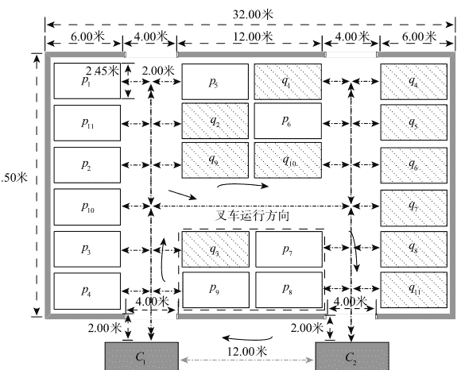

图 2.3 双叉车仓库几何运行示意图

将各工位间距离整理为 $ 11 \times 11 $ 距离矩阵 $ D'=(d'_{ij})$，数值如下表：

| | q1 | q2 | q3 | q4 | q5 | q6 | q7 | q8 | q9 | q10 | q11 |
|---|---|---|---|---|---|---|---|---|---|---|---|
| p1 | 36.90 | 6.85 | 15.40 | 36.90 | 34.25 | 31.40 | 28.55 | 31.40 | 9.70 | 31.40 | 34.25 |
| p2 | 31.40 | 6.85 | 9.70 | 29.40 | 28.55 | 31.40 | 22.85 | 25.70 | 4.00 | 25.70 | 28.55 |
| p3 | 30.80 | 11.95 | 4.00 | 30.80 | 28.15 | 25.50 | 28.35 | 31.40 | 9.70 | 25.70 | 28.55 |
| p4 | 33.65 | 14.80 | 6.85 | 33.65 | 31.00 | 28.35 | 31.40 | 31.00 | 12.55 | 28.55 | 31.40 |
| p5 | 36.90 | 6.85 | 15.40 | 36.90 | 34.25 | 31.40 | 28.55 | 31.40 | 9.70 | 31.40 | 34.25 |
| p6 | 6.85 | 31.40 | 28.55 | 6.85 | 4.00 | 6.85 | 9.70 | 12.55 | 28.55 | 6.85 | 15.40 |
| p7 | 15.40 | 28.55 | 31.40 | 15.40 | 12.55 | 9.70 | 6.85 | 4.00 | 25.70 | 9.70 | 6.85 |
| p8 | 18.25 | 31.40 | 34.25 | 18.25 | 15.40 | 12.55 | 9.70 | 6.85 | 28.55 | 12.55 | 4.00 |
| p9 | 33.65 | 14.80 | 6.85 | 33.65 | 31.00 | 28.35 | 31.40 | 31.00 | 12.55 | 28.55 | 31.40 |
| p10 | 28.55 | 9.70 | 4.00 | 28.55 | 25.70 | 22.85 | 20.00 | 22.85 | 9.70 | 22.85 | 25.70 |
| p11 | 34.25 | 4.00 | 12.55 | 34.25 | 31.40 | 28.55 | 25.70 | 28.55 | 15.40 | 28.55 | 31.40 |

对 $ D' $ 中任意两个不共行列元素 $ d_{i_1j_1}, d_{i_2j_2} $ 计算相似度并归一化为 $ r^*(d_{i_1j_1}, d_{i_2j_2}) $；同步将矩阵 $ D $ 中 $ 8 \times 8 $ 元素归一化得 $ d^*_{i,j} $，进而构造

$$

\begin{cases} \min \gamma = \sum_{i=1}^{11} \sum_{j=1}^{11} \sum_{k=1}^{11} \sum_{f=1}^{11} \left( 1 - \frac{abs(d_{i,j_i} - d_{k,j_f})}{\max\{d_{i,j_i}, d_{k,j_f}\}} \right) x_{i,j_i} x_{k,j_f} + \sum_{i=1}^{11} \sum_{j=1}^{11} (d^*_{i,j_i} x_{i,j_i}) \\ \text{s.t.} \sum_{i=1}^{11} x_{i,j_i} = 1, \sum_{j=1}^{11} x_{i,j_i} = 1, x_{i,j_i} \in \{0,1\}, x_{i,j_j} \in \{0,1\}, i, j, j_i, k, j_f \in \{1, 2, \cdots, 11\} \end{cases} (2.9)

$$

随后，分别调用全量遍历算法、经典遗传-粒子群算法、改进遗传-离散粒子群算法求解模型（2.9）。

#### 2. 全量遍历算法求解

编写遍历程序于 2018-07-24 12:37 启动，至 12:59 结束，耗时 22 分钟，枚举出模型（2.9）全部目标函数值，分布见图 2.4。曲线显示解空间存在海量局部最优，极易诱捕启发式搜索。遍历法给出的全局最优解依次为：

- $$l_1^* = \begin{pmatrix} p_1 & p_2 & p_3 & p_4 & p_5 & p_6 & p_7 & p_8 & p_9 & p_{10} & p_{11} \\ q_4 & q_3 & q_6 & q_9 & q_2 & q_{10} & q_{11} & q_8 & q_5 & q_7 & q_1 \end{pmatrix}$$
- $$l_2^* = \begin{pmatrix} p_1 & p_2 & p_3 & p_4 & p_5 & p_6 & p_7 & p_8 & p_9 & p_{10} & p_{11} \\ q_4 & q_3 & q_6 & q_5 & q_2 & q_{10} & q_{11} & q_8 & q_9 & q_7 & q_1 \end{pmatrix}$$
- $$l_3^* = \begin{pmatrix} p_1 & p_2 & p_3 & p_4 & p_5 & p_6 & p_7 & p_8 & p_9 & p_{10} & p_{11} \\ q_2 & q_3 & q_6 & q_9 & q_4 & q_{10} & q_{11} & q_8 & q_5 & q_7 & q_1 \end{pmatrix}$$
- $$l_4^* = \begin{pmatrix} p_1 & p_2 & p_3 & p_4 & p_5 & p_6 & p_7 & p_8 & p_9 & p_{10} & p_{11} \\ q_2 & q_3 & q_6 & q_5 & q_4 & q_{10} & q_{11} & q_8 & q_9 & q_7 & q_1 \end{pmatrix}$$
- $$l_5^* = \begin{pmatrix} p_1 & p_2 & p_3 & p_4 & p_5 & p_6 & p_7 & p_8 & p_9 & p_{10} & p_{11} \\ q_2 & q_3 & q_6 & q_9 & q_1 & q_{10} & q_{11} & q_8 & q_5 & q_7 & q_4 \end{pmatrix}$$
- $$l_6^* = \begin{pmatrix} p_1 & p_2 & p_3 & p_4 & p_5 & p_6 & p_7 & p_8 & p_9 & p_{10} & p_{11} \\ q_2 & q_3 & q_6 & q_5 & q_1 & q_{10} & q_{11} & q_8 & q_9 & q_7 & q_4 \end{pmatrix}$$
- $$l_7^* = \begin{pmatrix} p_1 & p_2 & p_3 & p_4 & p_5 & p_6 & p_7 & p_8 & p_9 & p_{10} & p_{11} \\ q_1 & q_3 & q_6 & q_9 & q_2 & q_{10} & q_{11} & q_8 & q_5 & q_7 & q_4 \end{pmatrix}$$
- $$l_8^* = \begin{pmatrix} p_1 & p_2 & p_3 & p_4 & p_5 & p_6 & p_7 & p_8 & p_9 & p_{10} & p_{11} \\ q_1 & q_3 & q_6 & q_5 & q_2 & q_{10} & q_{11} & q_8 & q_9 & q_7 & q_4 \end{pmatrix}$$

所有适应度值分布见图 2.4；标准粒子群算法的适应度收敛曲线见图 2.5。

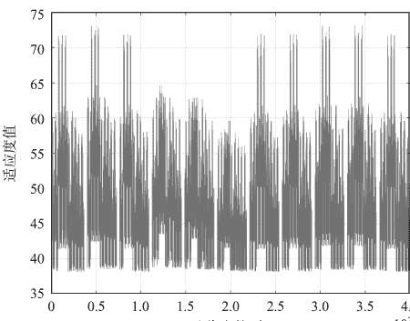

图 2.4 全量适应度值分布

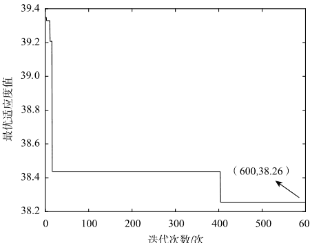

图 2.5 标准粒子群算法适应度下降曲线

#### 3. 标准离散粒子群算法求解

设粒子数 100、迭代 1000 代，采用 3.2 节遗传-离散粒子群框架求解模型（2.9）。同一天 12:37:03.897 至 12:37:09.650，耗时 5.763 s。获得近似最优目标值 $ \min \gamma_1 = 38.26 $，对应解为

$$l'_1 = \begin{pmatrix} p_1 & p_2 & p_3 & p_4 & p_5 & p_6 & p_7 & p_8 & p_9 & p_{10} & p_{11} \\ q_{11} & q_{10} & q_9 & q_3 & q_1 & q_4 & q_6 & q_8 & q_2 & q_7 & q_5 \end{pmatrix}$$

为考察稳定性，重复实验 20 次，统计结果见图 2.6。

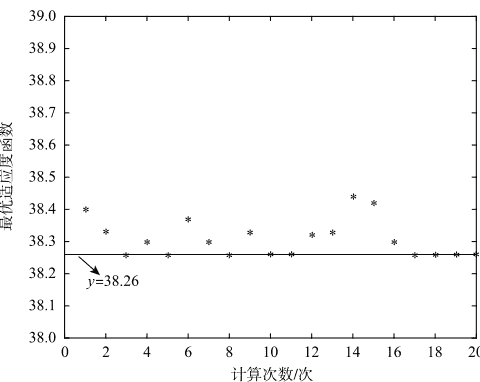

图 2.6 连续 20 次仿真结果箱线图

#### 4. 改进遗传-离散粒子群算法求解

沿用粒子数 100、迭代 1000 代设定，于 2018-08-01 17:46:03.080 至 17:46:07.115，耗时 4.035 s。得到共享适应度 $ \min \gamma'_2 = 4.1398 $，原始适应度 $ \min \gamma_2 = 38.26 $，最优路径为

$$l'_2 = \begin{pmatrix} p_1 & p_2 & p_3 & p_4 & p_5 & p_6 & p_7 & p_8 & p_9 & p_{10} & p_{11} \\ q_9 & q_{10} & q_6 & q_4 & q_7 & q_1 & q_{11} & q_8 & q_3 & q_5 & q_2 \end{pmatrix}$$

为进一步验证鲁棒性，分别设粒子数 100、500、1000，迭代 1000 代，绘制适应度演化曲线（图 2.7）。

#### 5. 结果分析

# 核心算法性能大比拼：改进遗传-粒子群为何胜出？

通过图 2.7 的对比数据不难发现，改进版遗传-粒子群算法在适应度收敛速度上完胜经典粒子群算法。图表显示，无论粒子数量如何变化，新算法都能保持稳定的高性能输出，适应性极强。它不仅大幅缩短了寻找最优解的时间、提升了收敛精度，更从根本上增强了算法的全局寻优能力。

对比谭熠峰等学者的研究[60]，本节工作将融合动态因子与共享适应度机制的改进粒子群算法，成功拓展至离散优化问题求解领域，形成了特定的优势应用场景。具体实施层面，是在惯性权重随迭代递减、动态调整学习因子的基础上，引入遗传算法的共享适应度函数，从而构建出一种改进型遗传-离散粒子群算法。借助四门仓库叉车同进同出作业线路优化算例验证，该算法具备实现简便、精度高、收敛快的显著特点。值得一提的是，实验同时揭示了纯遗传可行解算法耗时过长，难以满足实际生产推广需求的短板。

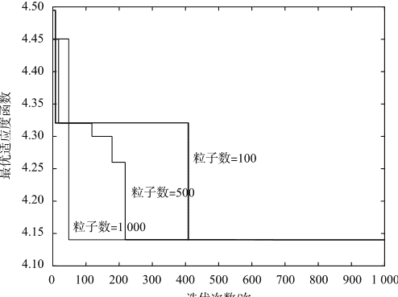

#### 图 2.7 适应度值下降曲线

梳理全书实例可提炼出三大核心创新点：一是实践层面，为危险品仓库几何设计提供了极具特色的全新备选方案，显著丰富了设计选项库；二是理论建模上，利用拓扑变换手段，将危险品仓库出入库作业抽象为一类特殊的二次指派问题（QAP）；三是算法拓展上，将工程实用性极强的共享适应度粒子群算法推广至离散优化领域，研发出遗传-离散粒子群算法并取得良好应用效果。此外，四门仓库研究尚处于起步阶段，货位设计优化、与双门仓库协同使用策略等课题仍待后续深入探索。

## 2.2 互通危险品平仓仓库设计及叉车运行线路的优化方法

### 2.2.1 研究问题的提出

在四门仓库研究基础上，为进一步提升危险品仓储运营水平，更好地平衡出入库环节的效率、成本与安全三大核心要素，本节创新性地提出“互通危险品仓库”概念，并开展深度建模研究。为夯实研究基础，重点梳理了危险品运输[68-71]、智能仓储[72-78]、神经网络算法[79-87]等前沿成果；同时参阅相关管理规范[88, 89]，从建筑平面布局切入，确立互通仓库概念，旨在安全前提下双提效率与管理水平。此外，围绕隔离门的设计应用，逐步构建起智能仓储条件下的出入库作业新思路。完整技术路线见图 2.8。

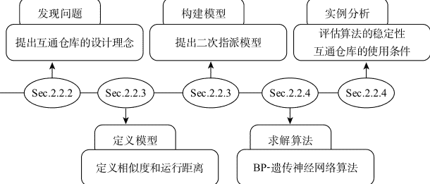

图 2.8 技术路线图

### 2.2.2 互通危险品仓库设计思路

常规双门及四门危险品仓库普遍存在叉车活动半径受限、作业效率低下、线路完全依赖人工调度等痛点。针对这些问题，本节基于最优化理论提出互通仓库设计理念：打通常规双门仓库，装设可推拉式隔离门，将原单体双门仓库空间定义为一个“房间”。为直观呈现设计细节，本书依据上海某危化品仓库实参绘制了智能仓库示意图（详见图 2.9）。

为保障作业安全，经调研制定核心运行原则：**叉车严格按顺时针方向循环行驶，且单个房间同一时刻仅允许一辆叉车作业**。叉车运行轨迹由不同闭环路径构成：图 2.9 中 A 类闭环对应同进同出作业，串联入库集卡、入库货位、出库货位、出库集卡四大节点；B 类闭环对应纯出库作业，连接出库集卡与出库货位两节点。智能仓储模式下，具体路径由兼顾成本效率的算法生成，多路径时的运行先后序由现场管理人员把控，兼顾算法最优与人工灵活干预。

当存储量大、叉车充足时，可开启适当数量隔离门，组合形成双室、三室乃至多室仓库。此举不但拓宽了叉车作业半径，更支持多任务并行处理，有效化解了传统双门仓库出库时设备闲置、人力浪费的顽疾。总结对比：传统仓库存储量大但同期仅能单线作业，效率低、设备协调难；新型互通仓库虽牺牲部分平均存储空间，却极大优化了特定危险品出库时的设备协同，对同进同出、多箱同出、多箱同入等复合工况均有显著效能提升。

### 2.2.3 互通危险品平仓仓库叉车出入库线路优化模型

#### 1. 基本参数介绍

遵循上述设计思路，按图 2.9 将常规双门仓库经隔离门改造升级为互通仓库。本节聚焦六门（三房间）工况，分双叉车、三叉车两种场景建模。为保证研究普适性，仅讨论出库点数多于入库点数的情况（反之同理）。记入库集装箱为 C1，出库集装箱为 C2、C3。设 C1 含 m 个入库点 $p_1 \sim p_m$，C2 与 C3 共对应 n 个出库点 $q_1 \sim q_n$（$m < n$），索引集分别为 $M, N$。由此衍生出 m 条 A 类路径（同进同出）及 $n-m$ 条 B 类路径（纯出库）。

路径定义方面：对任意 $i \in M, j \in N$，A 类往返路线 $S_{p_i, q_j}$ 为：$C_1 \xrightarrow{l_{C_1,p_i}} p_i \xrightarrow{l_{p_i,q_j}} q_j \xrightarrow{l_{q_j,C_2}} C_2 \xrightarrow{l_{C_2,C_1}} C_1$（空驶返程）。B 类路径 $S_{C_i, q_j} (i=2,3)$ 为：$C_i \xrightarrow{l_{C_i,q_j}} q_j \xrightarrow{l_{q_j,C_i}} C_i$。两点间距离记为 $L(A,B)$。

路径规划需权衡成本与效率：成本端追求行驶距离最短；效率端受限于“单室单车”规则，需使各闭环路径总长度差异尽可能大（即相似度最小），以便多车调度时拥有更多无冲突组合空间。下文以六门仓库为例，分双车、三车场景建模。双车场景赋予成本、效率等权；三车场景则提高效率权重，解析不同偏好下的线路规律。

#### 2. 六门仓库双叉车线路规划模型

面对双箱同进同出且时效性强的工况，调度双车作业。为控制复杂度，设两前提假设：一、仅建立入库点与出库点的匹配关系（生成闭环路径集），不细化至人工装卸环节；二、虽布局允许双车同向/相向通行，但为绝对安全，强制单室单车。

六门仓库由三个规制双门仓库组成，目标是使两车闭环路径总长趋同，赋予现场调度灵活性。建模策略上，人为拉大任意入库-出库点对路径长度差异。设两车同行路径为 $S_{p_{i_1}, q_{j_1}}, S_{p_{i_2}, q_{j_2}}$，要求二者长度差最大化，以降低同室冲突概率，提升调度自由度。在此基础上，以低成本、高效率为双目标，依据实操流程构建双车线路优化模型，步骤如下：

首先，从最终点集中选取路径对 $l(p_{i_s}, q_{j_s}), l(p_{i_k}, q_{j_r})$，定义其相似度 $r$ 并按模型 (2.1) 归一化为 $r^*$；其次，归一化任意点对距离得 $L^*$。其中相似度映射效率，距离映射成本。为实现总相似度 $r^*$ 与总长度 $L$ 双最小，构建多目标模型 (2.10)：

$$ \text{模型 (2.10) 结构保持不变，含目标函数及约束条件} $$

目标函数四项分别对应：同进同出闭环间相似度、同进同出总里程、纯出库闭环间相似度、纯出库总里程。模型对相似度与长度赋予等权。易知可行解数为 $C_n^m m!$，随节点增加计算时间呈爆发式增长，大规模节点下必须引入启发式算法求解。

**启发式求解新路：GA-BP 混合神经网络**

人工神经网络虽广泛应用于故障诊断、模式识别等领域，但 BP 网络存在初始权值随机、易陷局部极小、隐层节点数依赖经验、收敛慢等先天不足。针对性地，本节融合遗传算法（GA）全局搜索与 BP 局部搜索优势，提出 GA-BP 混合算法求解互通仓库叉车线路。核心逻辑：个体编码为网络初始权值阈值，以 BP 测试误差范数为目标函数计算适应度，经选择、交叉、变异迭代寻优，最终获最优初始参数。改进操作聚焦三维度：

**(1) 网络结构自适应设计**  
BP 隐层节点数通常靠反复试验确定，调整结构需重置参数，影响学习效能。本法对不同候选结构各运行 GA 产出最佳个体，再按适应度筛选全局最优个体定型网络结构。

**(2) 编码与初始种群构建**  
隐层节点数采二进制编码（利于交叉变异）；连接权值、阈值、学习率按序级联成实数数组，作为 GA 个体染色体。

**(3) 适应度函数设定**  
基于神经网络总误差，取 BP 均方误差 $f=\frac{1}{2} \sum_{k=1}^K \sum_{j=1}^K (T_j^k - Y_j^k)^2$ 为适应度基准。  
符号约定：$h$ 隐层节点数，$C$ 输出层输出，$\theta_0$ 输出阈值，$O_{Mm}$ 隐层第 m 节点输出，$\theta_{Mm}$ 隐层第 m 阈值，$W_{xm}, W_{ym}$ 权值系数，$G$ 隐层节点数，$T_{\max}$ 最大迭代数，$N$ 种群规模，$pc$ 交叉率，$p_m$ 变异率。  
设 $l^*$ 为满足模型 (2.10) 约束的任意可行线路矩阵，即入库点 $p_i$ 与出库点 $q_{j_i}$ 的一一映射。

**GA-BP 求解流程（步骤 2.13~2.22）：**

- **步骤 2.13**：按编码规则随机生成初始种群，每个个体对应一组网络结构下的初始参数。
- **步骤 2.14**：构建初始 BP 网络。将权值、阈值按“输入-隐层、隐层-输出”顺序串联成三层结构。运算关系见 ```
\(C = f\left(\sum_{m=1}^{G} O_{Mm} + \theta_0\right), O_{Mm} = f\left(W_{xm} \times p_i + W_{ym} \times q_i + \theta_{Mm}\right)\)
```。
- **步骤 2.15**：录入实仓参数生成样本，随机给出一组合规初始调度方案，按此输入样本训练 BP 网络并计算输出误差。
- **步骤 2.16**：以 BP 总误差 $f$ 作为 GA 适应度函数，评估各个体适应度值。
- **步骤 2.17**：计算交叉变异概率，执行选择-交叉-变异遗传操作产生新种群。判断是否达最大进化代 $T_{\max}$：达标转步骤 2.18；否则用新种群参数重建 BP 网络，回步骤 2.15。
- **步骤 2.18**：遗传终止。计算现种群适应度，取最大值对应个体为最优，解码得最优网络结构参数，建立最佳 BP 网络。
- **步骤 2.19**：输入一组样本训练网络，计算输出误差。
- **步骤 2.20**：判断样本是否遍历：未完取下一样本回步骤 2.19；已完转步骤 2.21。
- **步骤 2.21**：按公式计总误差 $E$，若 $E < \varepsilon$ 则训练结束；否则转步骤 2.22。
- **步骤 2.22**：判断是否达预设训练次数：未达回步骤 2.19；已达则终止训练。

后续将深入分析三叉车场景下的线路确定方法。随车辆增多，优化重心应向效率倾斜。本节将量化模型 (2.10) 中相似度与距离项的权重系数，通过调节相似度权重，考察不同偏好下的运行规律。加权后的改进模型为：

```
\begin{cases}
\min \gamma = w_1 \sum_{i_k, j_k}^m \sum_{j_k, j_r^*}^n \left( x_{i_k j_k} x_{j_k j_r^*} r^*((p_{i_k}, q_{j_k}), (p_{i_k}, q_{j_r})) + w_2 \sum_{i_s=1}^m \sum_{j_s=1}^n x_{i_k j_k} L^*(p_{i_s}, q_{j_s}) \right.
\\
\left. + w_1 \sum_{i,j=2}^3 \sum_{h,j_r}^{n-m} \left( x_{C_{i_h}} x_{C_{j_r}} r^*((C_i, q_{j_h}), (C_j, q_{j_r})) + w_2 \sum_{i=2}^3 \sum_{h,j_r}^{n-m} x_{C_{i_h}} L^*(C_i, q_{j_r}) \right)
\\
\text{s.t. } \sum_{i_k=1}^m x_{i_k j_k} = 1, \sum_{j_k=1}^n x_{i_k j_k} = 1, x_{i_k j_h} \in \{0,1\}, x_{i_k j_r} \in \{0,1\}, x_{C_{i_h}} \in \{0,1\}
\end{cases}
```

权重参数 $w_1$ 与 $w_2$ 均取值于 $[0,1]$ 区间，且满足 $w_1+w_2=1$。

若 $w_1=0$，目标函数仅聚焦于路径间的相似度；反之，若 $w_1=1$，则完全转向最小化路径距离。鉴于相似度映射运行效率，距离映射运行成本，随着叉车数量增长，规划策略会自然向效率倾斜。通过调控 $w_1$ 的取值，可量化相似度对模型的影响力度，从而实现优化意图。基于此，我们引入遗传-神经网络算法求解模型，通过动态调整两项指标的权重，输出不同权重下的适应度值及整体走势，并同步计算各工况下的测试误差。下面通过一个具体算例展开说明。

### 2.2.4 三室互通危化品仓库叉车路径优化实战

#### 1. 场景设定

本案例以上海某危化品仓库实测数据为蓝本，切入双叉车与三叉车并行作业的出入库路径优化问题。为便于表述，采用遗传-神经网络算法作为求解工具。设仓库门前停靠三个集装箱 $C_1$、$C_2$、$C_3$，其中 $C_1$ 负责入库，$C_2$ 与 $C_3$ 负责出库。$C_1$ 设 12 个入库点，$C_2$ 与 $C_3$ 共享 15 个出库点。由此形成 12 条出入库往返线路（A 型路径）与 3 条纯出库往返线路（B 型路径）。仓库作业布局见示意图。

实地调研数据：库宽 17.5 米，库长 48 米，门宽 4 米，集卡间距 12 米，集卡至库距 2 米。在此物理约束下，为叉车运输生成优化线路方案。

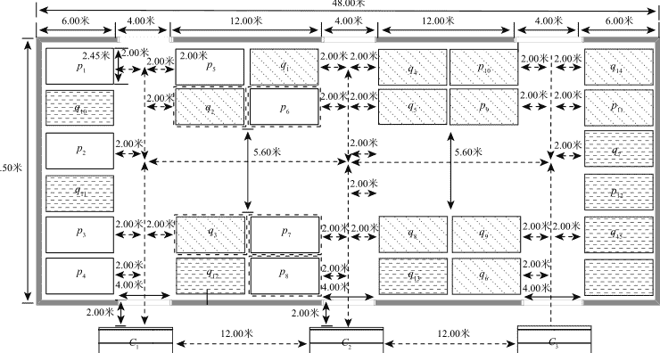

## 2. 六门仓库·双叉车·三集卡作业环境

承接上节条件，本节推导双叉车六门库场景下的线路确定方法。先计算入库点至出库点的闭环距离，整理为 $12 \times 15$ 矩阵 $D=(d_{ij})$，行对应出库点，列对应入库点。具体数值如下：

| 1 | 2 | 3 | 4 | 5 | 6 | 7 | 8 |
|---|---|---|---|---|---|---|---|
| 85.8000 | 71.7500 | 80.3000 | 85.8000 | 80.3000 | 99.7500 | 102.6000 | 71.7500 |
| 70.5250 | 64.8250 | 67.6750 | 70.5250 | 64.8250 | 87.1250 | 87.1250 | 61.9750 |
| 71.7500 | 66.0500 | 57.5000 | 71.7500 | 66.0500 | 79.8000 | 88.3500 | 54.6500 |
| 72.0030 | 66.0500 | 57.5000 | 72.0000 | 66.0530 | 85.5000 | 88.3500 | 57.5000 |
| 85.8000 | 71.7500 | 80.3000 | 85.8000 | 80.3000 | 99.7500 | 102.6000 | 71.7500 |
| 71.7500 | 106.6000 | 106.6000 | 71.7500 | 66.0500 | 94.0500 | 94.0500 | 66.0500 |
| 77.4500 | 103.7500 | 103.7500 | 77.4500 | 71.7500 | 88.3500 | 94.0500 | 54.6500 |
| 83.1500 | 109.4500 | 109.4500 | 83.1500 | 77.4500 | 94.0500 | 87.7500 | 60.3500 |
| 109.4500 | 135.7500 | 135.7500 | 109.4500 | 103.7500 | 94.0500 | 94.0500 | 95.2000 |
| 118.0000 | 138.6000 | 138.6000 | 118.0000 | 96.3000 | 99.7500 | 99.7500 | 103.7500 |
| 112.3000 | 138.5500 | 138.5500 | 112.3000 | 103.7500 | 93.4500 | 82.6200 | 98.0500 |
| 103.7500 | 130.0500 | 130.0500 | 103.7500 | 98.0500 | 88.3500 | 88.3500 | 86.6500 |

| 1 | 2 | 3 | 4 | 5 | 6 | 7 |
|---|---|---|---|---|---|---|
| 99.7500 | 71.7500 | 72.5250 | 53.1500 | 71.5500 | 114.0000 | 99.7500 |
| 87.1250 | 64.8250 | 59.9000 | 96.8250 | 59.1250 | 98.5250 | 87.1250 |
| 82.6500 | 66.0500 | 55.4250 | 60.3500 | 54.6500 | 99.7500 | 62.6500 |
| 82.6500 | 66.3500 | 55.4250 | 54.6500 | 57.3000 | 99.7500 | 85.5000 |
| 99.7500 | 71.7500 | 72.5250 | 53.1500 | 71.5500 | 114.0000 | 99.7500 |
| 94.0500 | 112.0750 | 98.8250 | 112.3000 | 66.0500 | 105.4500 | 94.0500 |
| 91.2000 | 103.7500 | 93.1250 | 103.7500 | 54.6500 | 105.4500 | 88.3500 |
| 94.0500 | 109.4500 | 98.8250 | 112.1000 | 54.6500 | 110.9500 | 96.9000 |
| 94.0500 | 135.7500 | 130.8250 | 141.4500 | 98.1500 | 99.7500 | 94.0500 |
| 99.7500 | 141.4500 | 136.5250 | 147.1500 | 103.5500 | 99.7500 | 99.7500 |
| 94.0500 | 135.7500 | 130.8250 | 141.4500 | 98.0500 | 99.7500 | 94.0500 |
| 82.6500 | 130.0500 | 119.4250 | 130.0500 | 86.6500 | 99.7500 | 82.6500 |

任取矩阵中两两不重行列的元素 $d_{i_1 j_1}, d_{i_2 j_2}$，构建优化模型：

\[
\left\{\begin{array}{l} 
\min \gamma = w_1 \sum_{i_1=1}^{12} \sum_{k=i_1+1}^{15} \sum_{j_1, j_2} \left( x_{t_{i_k} j_l} x_{k_l j_r} r^* \left( (p_{t_i}, q_{t_j}), (p_{t_k}, q_{t_j}) \right) \right) + w_2 \sum_{t_1=1}^{12} \sum_{j_1=1}^{15} x_{t_{i_k} j_l} L^* \left( p_{t_i}, q_{t_j} \right) \\ 
+ w_1 \sum_{i, j=2}^{3} \sum_{j_r, j_f} \left( x_{c_{i_k} x_{c_{j_f r}}} r^* \left( (C_i, q_{t_i}), (C_j, q_{t_j}) \right) \right) + w_2 \sum_{t=2}^{3} \sum_{j_1=1}^{3} x_{c_{t_k j_l}} L^* \left( C_i, q_{t_i} \right) \\ 
\text{s.t. } \sum_{t_i=1}^{12} x_{t_{i_k j_l}} = 1, \sum_{j_1=1}^{15} x_{t_{i_k j_l}} = 1, x_{t_{i_k j_l}} \in \{0, 1\}, x_{t_{k_j f}} \in \{0, 1\}, x_{c_{t_k j_l}} \in \{0, 1\} 
\end{array}\right.
\]

双叉车工况下，首设 $w_1 = w_2 = 0.5$，启用遗传-神经网络求解。参数设定：初始种群 50，最大迭代 100 代，交叉概率 $p_c=0.6$，变异概率 $p_m=0.001$，BP 网络训练 500 次，目标误差 0.001，学习率 $p_r=0.05$。

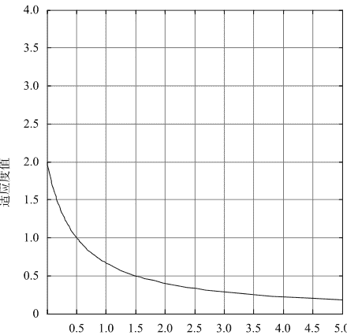 展示了最优适应度下降曲线，曲线陡峭、收敛快，验证了遗传算法寻优 BP 网络权值的有效性。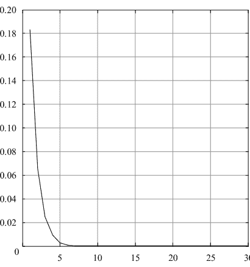 给出测试误差图，误差稳控在 0.02 以内，进一步佐证新方法的鲁棒性。

经优化权值与阈值预测，获得近似解 $T_{test}$：

| 0 | 0 | 0 | 0 | 0 | 0 | 0 | 0 | 0 | 1 | 0 | 0 | 0 | 0 | 0 |
|---|---|---|---|---|---|---|---|---|---|---|---|---|---|---|
| 0 | 0 | 0 | 0 | 0 | 0 | 0 | 0 | 0 | 0 | 1 | 0 | 0 | 0 | 0 |
| 0 | 0 | 0 | 0 | 0 | 0 | 0 | 1 | 0 | 0 | 0 | 0 | 0 | 0 | 0 |
| 0 | 0 | 1 | 0 | 0 | 0 | 0 | 0 | 0 | 0 | 0 | 0 | 0 | 0 | 0 |
| 0 | 1 | 0 | 0 | 0 | 0 | 0 | 0 | 0 | 0 | 0 | 0 | 0 | 0 | 0 |
| 0 | 0 | 0 | 1 | 0 | 0 | 0 | 0 | 0 | 0 | 0 | 0 | 0 | 0 | 0 |
| 0 | 0 | 0 | 0 | 1 | 0 | 0 | 0 | 0 | 0 | 0 | 0 | 0 | 0 | 0 |
| 0 | 0 | 0 | 0 | 0 | 0 | 1 | 0 | 0 | 0 | 0 | 0 | 0 | 0 | 0 |
| 0 | 0 | 0 | 0 | 0 | 0 | 0 | 0 | 1 | 0 | 0 | 0 | 0 | 0 | 0 |
| 0 | 0 | 0 | 0 | 0 | 0 | 0 | 0 | 0 | 0 | 0 | 0 | 0 | 0 | 1 |
| 0 | 0 | 0 | 0 | 0 | 0 | 0 | 0 | 0 | 0 | 0 | 0 | 0 | 1 | 0 |
| 0 | 0 | 0 | 0 | 0 | 1 | 0 | 0 | 0 | 0 | 0 | 0 | 0 | 0 | 0 |

$$

l^* = \begin{pmatrix} 1 & 2 & 3 & 4 & 5 & 6 & 7 & 8 & 9 & 10 & 11 & 12 \\ 10 & 11 & 8 & 3 & 2 & 4 & 5 & 7 & 9 & 15 & 14 & 6 \end{pmatrix}

$$

由此锁定一组出入库点对的可行解。为确定 $q_1, q_{12}, q_{13}$ 三个出库点路径，依就近原则实测出库点至集卡距离：

\[
D_1 = C_2 \begin{pmatrix} q_1 & q_2 & q_3 & q_4 & q_5 & q_6 & q_{10} & q_{11} & q_{12} & q_{13} \\ 39.75 & 66.05 & 66.05 & 39.75 & 34.5 & 16.95 & 66.05 & 56.2 & 66.05 & 11.25 \end{pmatrix}
\]
\[
D_2 = C_3 \begin{pmatrix} q_6 & q_7 & q_9 & q_{14} & q_{15} \\ 11.25 & 28.35 & 16.95 & 39.75 & 16.95 \end{pmatrix}
\]

测得 B 型路径规划为 $C_2 \rightarrow q_1, C_2 \rightarrow q_{12}, C_2 \rightarrow q_{13}$，叉车整体运行线路确定。

$$

l^* = \begin{pmatrix} 1 & 2 & 3 & 4 & 5 & 6 & 7 & 8 & 9 & 10 & 11 & 12 & C_2 & C_2 & C_2 \\ 10 & 11 & 8 & 3 & 2 & 4 & 5 & 7 & 9 & 15 & 14 & 6 & 1 & 12 & 13 \end{pmatrix}

$$

## 3. 六门仓库·三叉车·三集卡作业环境

三叉车场景逻辑同构，为给一线管理提供更多备选，需在模型中提升路径相似度权重。沿用模型（2.11），分别取 $w_1=0.5, 0.7, 0.9$ 三档，输出随机线路方案；结合就近原则测量剩余出库点距离，得不同权重下的路线图。

$$

l^*_{w_1=0.5} = \begin{pmatrix} 1 & 2 & 3 & 4 & 5 & 6 & 7 & 8 & 9 & 10 & 11 & 12 & C_2 & C_3 & C_3 \\ 10 & 11 & 3 & 12 & 2 & 1 & 8 & 13 & 5 & 14 & 7 & 15 & 4 & 9 & 6 \end{pmatrix}

$$
$$

l^*_{w_1=0.7} = \begin{pmatrix} 1 & 2 & 3 & 4 & 5 & 6 & 7 & 8 & 9 & 10 & 11 & 12 & C_2 & C_3 & C_3 \\ 2 & 3 & 11 & 12 & 10 & 1 & 13 & 8 & 7 & 14 & 15 & 9 & 4 & 6 & 15 \end{pmatrix}

$$
$$

l^*_{w_1=0.9} = \begin{pmatrix} 1 & 2 & 3 & 4 & 5 & 6 & 7 & 8 & 9 & 10 & 11 & 12 & C_2 & C_2 & C_3 \\ 10 & 2 & 12 & 3 & 11 & 5 & 8 & 13 & 7 & 14 & 9 & 6 & 1 & 4 & 15 \end{pmatrix}

$$

为深度剖析“成本-效率”不同权重下的表现，我们动态调节 $w_1$，统计不同种群规模下的适应度函数值。仿真显示：种群规模正向影响适应度值（种群越大值越大）；$w_1$ 增大则导致适应度值下降，量化了相似度在适应度构成中的贡献度。此外，通过对比训练轮次下的遗传-BP 与标准 BP 网络性能（见 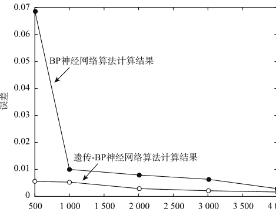），遗传优化版表现显著更优。


## 4. 结论复盘

# 核心成果速览：算法融合与智能仓储决策的关键突破

研究表明，遗传算法与 BP 神经网络的深度融合，成功破解了后者权值阈值初始化随机性大的难题，实现了“全局寻优+局部精搜”的协同增效，显著提升了网络的智能搜索水平。围绕这一核心，本研究形成五大核心产出：

1.  **柔性仓储架构设计**：创新性提出带隔离门的智能危险品仓库方案，通过门控灵活切换双门、四门至八门等多种模式，极大拓宽了客户的选择空间。
2.  **全维度路径规划模型**：以六门仓库为实证载体，构建兼顾双/三叉车工况的多目标规划模型。该模型将路径相似度作为核心指标，巧妙关联作业效率与本质安全，实现成本、效率、安全三维统筹。
3.  **人机协同执行机制**：算法输出闭环路径集合，具体执行顺序交由现场管控决策，确立了“算法生成路径、人工定序调度”的交互范式。
4.  **启发式求解新范式**：针对互通仓库叉车路径难题，率先引入遗传算法与神经网络耦合的启发式求解策略。
5.  **实战仿真验证**：引入上海某危化品物流企业实测参数开展仿真实验，数据结果有力佐证了模型的工程落地性与有效性。

---

## 2.3 互通平仓隔离门决策：从架构构建到算法落地

### 2.3.1 问题背景与研究创新

当前国内危化品仓储以双门平库为主，难以适配日益增长的效能需求。基于大量调研，本章首倡“四门仓库”与“互通仓库”概念，并设计双门常规库与隔离门智能库协同布局（见示意图）。互通仓库的核心亮点在于引入可推拉隔离门，打破物理隔绝，使得单一仓储条件下可衍生出多元存储方案。如何从中甄选最优方案以释放仓库效能、提升企业效益，正是本节攻关的核心。

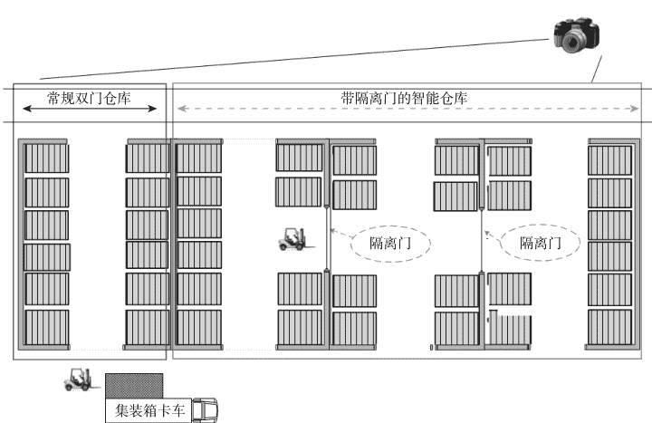

图 2.14 双门仓库与互通危险品仓库协同布局示意

为提炼隔离门启用规律，研究聚焦运输安全、多属性决策及空间/经济/时间三大成本维度。在此基础上，本节形成三大创新点：
*   **搭建决策架构**：确立互通仓库使用的系统性决策框架；
*   **无权重决策突破**：创设 TOPSIS-超立方体分割法，破解指标权重缺失时的方案优选难题；
*   **有权重决策深化**：研发带参数犹豫距离集算法，精准处理权重已知但参数波动下的优选问题。

### 2.3.2 多指标优选问题的建模逻辑

互通仓库的运作遵循三大铁律：
1.  **门控逻辑**：隔离门开启与否，取决于货量体量与叉车投入量；
2.  **路权规则**：强制叉车顺时针单向循环，且单房间同一时刻仅允许一车作业，从源头规避碰撞风险；
3.  **人机分工**：算法负责生成路径集，管理者负责定序调度，应对装卸工时不可控的不确定性。

在叉车资源充足时，适度开启隔离门串联多房间，可显著拓宽作业半径，支持多任务并行，有效消除传统双门库“单线串行、设备闲置”的顽疾。虽平均存储空间略有让渡，但换来的是设备协同效能的质变——无论是多箱同出、同入，还是混合作业，效率均实现跃升。科学使用互通模式，是提升仓储运营水平的关键杠杆。

### 2.3.3 多属性决策模型：双轨并行的解题体系

#### 1. 核心参数界定
基于顺时针单车单间原则，叉车入库路径设计追求“多样化、低相似度”，赋予现场调度灵活腾挪空间，间接筑牢安全防线。成本核算覆盖三大维度：依据国家标准测算仓租形成**空间成本**；结合叉车/集卡速度与运行时长核算**时间成本**；按路径总长×油价核算**经济成本**。决策属性集锁定为 $\{f_1(时间), f_2(空间), f_3(经济), f_4(安全)\}$。设方案集 $X=\{x_1..x_m\}$，属性值向量 $c_h$ 涵盖上述四维指标。叉车速度 $v_1$、集卡速度 $v_2$、日仓租 $a$、日油价 $b$ 为基础系数。

$$

c_{t_h} = e_h^{-1} \left( v_1^{-1} \sum_{i=1}^n l(C, p_i) + v_2^{-1} \sum_{i=1}^{n'-1} l(C_j, C_{j+1}) \right)

$$

路径相似度计算公式为：

$$

c_{sah} = 1 - \frac{abs(l(C, p_i) - l(C, p_j))}{\max \{l(C, p_i), l(C, p_j)\}}

$$

> *注：集卡移动时间受叉车数影响，模型中以线性函数近似处理，实战中可按实况调整函数形式。*

#### 2. 场景一：指标权重完全未知——TOPSIS-超立方体分割法
当决策者无法给定权重结构时，视权重向量 $W$ 为四维超立方体 $V=[0,1]^4$ 上的随机分布（非归一化向量可归一化等价处理）。引入群决策思想，通过超立方体均匀分割生成海量权重向量集合，借 TOPSIS 机制逐一评价，统计各方案获“最优票数”进行排序。

**执行流程：**
*   **步骤 2.23 空间离散化**：将各维权重 $[0,1]$ 均分 $t$ 份，生成 $t^4$ 个种子向量集 $P$，非归一化者按比例修正。
*   **步骤 2.24 构建决策矩阵**：引入调整因子 $\omega_1, \omega_2$ 应对仓租油价波动，实测得到原始决策矩阵 $C$。

$$

C_{m \times 4} = \begin{bmatrix} c_{r1} & c_{sp1}(\omega_1) & c_{e1}(\omega_2) & c_{sa1} \\ c_{r2} & c_{sp2}(\omega_1) & c_{e2}(\omega_2) & c_{sa2} \\ \vdots & \vdots & \vdots & \vdots \\ c_{rm} & c_{spm}(\omega_1) & c_{em}(\omega_2) & c_{sam} \end{bmatrix}

$$

*   **步骤 2.25 定负理想、算距离**：确定负理想点：

$$

C_{\max} = \left( \max_{i=1}^m C_{ri}, \max_{i=1}^m C_{spi}, \max_{i=1}^m C_{ei}, \max_{i=1}^m C_{sai} \right) \tag{2.13}

$$

计算各方案至负理想点的距离：

$$

D_i = (d_{ij})_{j=1,2,3,4} = \begin{pmatrix} \max_{i=1}^m C_{ri} - C_{ri} & \max_{i=1}^m C_{spi} - C_{spi} & \max_{i=1}^m C_{ei} - C_{ei} & \max_{i=1}^m C_{sai} - C_{sai} \\ \max_{i=1}^m C_{ri} & \max_{i=1}^m C_{spi} & \max_{i=1}^m C_{ei} & \max_{i=1}^m C_{sai} \end{pmatrix} \tag{2.14}

$$

*   **步骤 2.26 综合评价排序**：设 $\omega_1=\omega_2=1$，遍历 $P$ 中每个权重向量，计算方案综合相对距离：

$$

C_{ik} = \sum_{i=1}^{4}(w_{1_{ik}} c_{i1} + w_{2_{ik}} c_{i2} + w_{3_{ik}} c_{i3} + w_{4_{ik}} c_{i4})

$$

统计各方案成为最优解的频次，按频次降序定最终序。
*   **步骤 2.27 敏感性剖析**：在 $\omega_1, \omega_2$ 变动区间内，追踪相对距离值演变趋势，评估方案稳健性。
*   **步骤 2.28 基准对比**：引入经典 TOPSIS 结果对标，验证超立方体分割法的有效性与优越性。

#### 3. 场景二：指标权重已知但参数波动——带参数犹豫距离集算法
权重确定时，因 $\omega_1, \omega_2$ 不确定性导致同一属性呈现多值分布，引入犹豫模糊集理论建模处理。

**执行流程：**
*   **步骤 2.29 构建犹豫决策集**：在调整区间内采样，形成含多值的犹豫决策矩阵。

$$

C_{m \times 4} = \begin{bmatrix} c_{r1} & \{c_{sp11}, c_{sp12}, \cdots, c_{sp1n_2}\} & \{c_{e11}, c_{e12}, \cdots, c_{e1n_3}\} & c_{sa1} \\ c_{r2} & \{c_{sp21}, c_{sp22}, \cdots, c_{sp2n_2}\} & \{c_{e21}, c_{e22}, \cdots, c_{e2n_3}\} & c_{sa2} \\ \vdots & \vdots & \vdots & \vdots \\ c_{rm} & \{c_{spm1}, c_{spm2}, \cdots, c_{spmn_2}\} & \{c_{em1}, c_{em2}, \cdots, c_{emn_3}\} & c_{sam} \end{bmatrix}

$$

*   **步骤 2.30 求犹豫负理想点与相对距离矩阵**：

$$

C_{\max} = \left(\max_{i=1}^m c_{ih}, \max_{i=1}^m \left(c_{spi1}, c_{spi2}, \cdots, c_{spin_2}\right), \max_{i=1}^m \left(c_{ei1}, c_{ei2}, \cdots, c_{ein_3}\right), \max_{i=1}^m c_{sai}\right) \tag{2.15}

$$

$$

D_{m \times 4} = \begin{bmatrix} d_{11} & \{d_{sp11}, d_{sp12}, \cdots, d_{sp1n_2}\} & \{d_{e11}, d_{e12}, \cdots, d_{e1n_3}\} & d_{sa1} \\ d_{21} & \{d_{sp21}, d_{sp22}, \cdots, d_{sp2n_2}\} & \{d_{e21}, d_{e22}, \cdots, d_{e2n_3}\} & d_{sa2} \\ \vdots & \vdots & \vdots & \vdots \\ d_{m1} & \{d_{spm1}, d_{spm2}, \cdots, d_{spmn_2}\} & \{d_{em1}, d_{em2}, \cdots, d_{emn_3}\} & d_{sam} \end{bmatrix} \tag{2.16}

$$

*   **步骤 2.31 犹豫距离集两两比较排序**：
    定义两犹豫距离集 $D_1, D_2$ 的优劣关系指标：

$$

C_{D_1 > D_2} = \{(d_{1s}, d_{2t}) \mid |d_{1s} - d_{2t}| > 0, s=1, 2, \cdots, m, t=1, 2, \cdots, n \}

$$

$$

C_{D_1 < D_2} = \{(d_{1s}, d_{2t}) \mid |d_{1s} - d_{2t}| < 0, s=1, 2, \cdots, m, t=1, 2, \cdots, n \}

$$

据此计算 $P_{D_1>D_2}, P_{D_1<D_2}, P_{D_1=D_2}$ 三概率，通过概率大小判定优劣，完成全集排序，敲定最优方案。
*   **步骤 2.32 均值法兜底求解**：提供基于平均值的简化计算路径，供工程快速决策参考。

### 4. 实战复盘：模型落地验证

紧接着上文，我们依据公式 $ d'_{spi} = \sum_{j=1}^n d_{spj} (l(d'_{spj}))^{-1} $ 求出各属性集的均值综合属性值，其中 $ l(c'_{tij}) $ 代表属性集基数，进而构建决策矩阵。

$$

d'_{4 \times 4} = \begin{bmatrix} d'_{t1} & d'_{sp1} & d'_{e1} & d'_{sa1} \\ d'_{t2} & d'_{sp2} & d'_{e2} & d'_{sa2} \\ \vdots & \vdots & \vdots & \vdots \\ d'_{tm} & d'_{spm} & d'_{em} & d'_{sam} \end{bmatrix}

$$

随后运用 $ d_i = \sum_{i=1}^4 (w_1 d'_{ti} + w_2 d'_{spi} + w_3 d'_{ei} + w_4 d'_{sai}), j=1, 2, 3, 4 $ 对综合属性值降序排列，最终锁定最优方案。

本节将引入实战数据，对新构建的仓库方案优选模型进行压力测试。设某物流企业需调度 34 个危险品货位，且出入库环节强制要求人工现场包装/捆扎。在互通仓库模式下，共有四套可行存储方案（详见表 2.1），对应示意图见图 2.15（常规双门仓库参照上海实景绘制）。受限于“单室单时单叉车”作业规范，设定 $ e_1=1, e_2=2, e_3=2, e_4=3 $；外部恒有一叉车待命入库。实地调研得：上海 0# 柴油 6.88 元/升（油价随国际行情浮动），本节按 0.68 元/公里折算。仓储成本方面：单室日均 420 元，按 10 货位/室折算为 42 元/位·天，按 12 货位/室则为 35 元/位·天。设叉车速度 $ v_1=5 $ km/h，集卡速度 $ v_2=15 $ km/h。常规双门仓库尺寸：宽 16m、长 17.5m、门宽 4m；集卡间距 12m，集卡至库距 2m。因库内限单叉车作业，路径相似度为 0，即 $ c_{sa1}=1 $，由此生成决策矩阵 $ C_{4\times4} $：

$$

C_{4 \times 4} = \begin{pmatrix} 0.1762 & 1260 & 0.59364 & 1 \\ 0.1362 & 1680 & 0.9195 & 0.5785 \\ 0.0997 & 1680 & 0.6723 & 0.6188 \\ 0.0967 & 1680 & 0.9798 & 0.6188 \end{pmatrix}

$$

请在上述工况下，判定最优危险品存储方案。

**表 2.1 方案设计对比**

| 候选方案 | 方案设计 | 总货位/个 | 剩余货位/个 |
|---|---|---|---|
| 方案 1 | 三个常规双门仓库 | 36 | 2 |
| 方案 2 | 两个四门互通危险品仓库 | 40 | 6 |
| 方案 3 | 六门互通危险品仓库+常规双门仓库 | 40 | 6 |
| 方案 4 | 八门互通危险品仓库 | 36 | 2 |

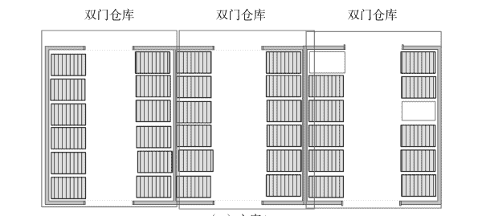
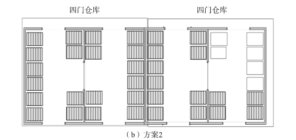
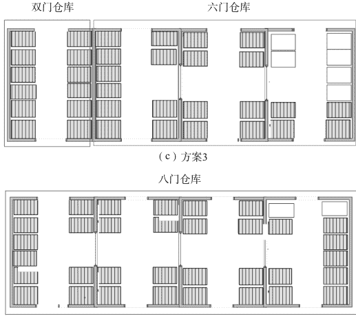

**图 2.15 四大存储方案布局示意**

---

#### 场景一：权重已知的决策环境

首先，依据式 (2.13) 解得各方案负理想点 $ C_{\max} = (0.176, 2, 0.168, 0, 0.979, 8, 1) $。

经测算，各决策方案与负理想点的距离矩阵为：

$ D = \begin{pmatrix} 0 & 0.25 & 0.3941 & 0 \\ 0.227 & 0 & 0.0615 & 0.4215 \\ 0.4342 & 0 & 0.3138 & 0.3812 \\ 0.4512 & 0 & 0 & 0.3812 \end{pmatrix} $

对比四方案相对距离值（均落在 [0, 1.2] 区间），统计支持各方案最优的权重向量数量，**结论指向方案 3 为最优解**。

为佐证，引入常规 TOPSIS 法：权重向量 $ (w_1, w_2, w_3, w_4) = (0.288, 0.144, 0.280, 0.288) $ 下，综合属性值向量 $ (z_1, z_2, z_3, z_4) = (686.4, 705.2, 637.1, 722.3) $。横向比较同样确认 **方案 3 胜出**，与本文方法互证一致。

---

#### 场景二：权重未知的模糊决策环境

设某经济环境下指标权重为 (0.2, 0.3, 0.4, 0.1)。因调整因子不确定性，采用带参犹豫综合属性距离集算法排序。考虑室费、油价波动导致同属性同方案多值化，设单室成本取值 {400, 410, 420, 430, 440}，油价取值 {4.8, 5.4, 6.0, 6.6, 7.2}，构得犹豫决策集：

$ C'_{4\times4} = \left( \begin{matrix} 0.176 & \{120 0.123 0.126 0.129 0.132 0\} & \{0.474, 0.534, 0.594, 0.653, 0.712\} & 1 \\ 0.136 & \{160 0.164 0.168 0.172 0.176 0\} & \{0.736, 0.828, 0.919, 1.012, 1.103\} & 0.5785 \\ 0.099 & \{160 0.164 0.168 0.172 0.176 0\} & \{0.538, 0.605, 0.672, 0.739, 0.807\} & 0.6188 \\ 0.096 & \{160 0.164 0.168 0.172 0.176 0\} & \{0.784, 0.882, 0.979, 1.077, 1.743\} & 0.6188 \\ \end{matrix} \right) $

先求犹豫决策集负理想点，算得相对距离矩阵：

$ D'_{4\times4} = \left( \begin{matrix} 0 & \{0.25, 0.25, 0.25, 0.25, 0.25 0.25, 0.25\} & \{0.395, 0.394, 0.0615, 0.394, 0.59113\} & 0 \\ 0.2270 & \{0.0, 0.0, 0.0, 0\} & \{0.0615, 0.0614, 0.0615, 0.0615, 0.367\} & 0.4215 \\ 0.4342 & \{0.0, 0.0, 0.0, 0\} & \{0.3139, 0.3138, 0.3138, 0.3138, 0.537\} & 0.3812 \\ 0.4512 & \{0.0, 0.0, 0.0, 0\} & \{0, 0, 0, 0\} & 0.3812 \\ \end{matrix} \right) $

两两比较 $ (D_2, D_4), (D_2, D_3), (D_1, D_3) $，得 $ P_{D_2>D_1} = 1, P_{D_3>D_4} = 1, P_{D_4<D_1} = 0.8, P_{D_4>D_2} = 0.8 $。综合距离排序：**$ D_3 > D_1 > D_4 > D_2 $**。

对照“距离平均值法”验证：取 $ C'_{4\times4} $ 第 2、3 列集合元素均值，得简化矩阵：

$ D'_{4\times4} = \left( \begin{matrix} 0 & 0.3330 & 0.3671 & 0 \\ 0.2270 & 0 & 0.1226 & 0.4215 \\ 0.4342 & 0 & 0.3585 & 0.3812 \\ 0.4512 & 0 & 0 & 0.3812 \\ \end{matrix} \right) $

按步骤 2.32 计算综合距离向量 $ d = (0.2467, 0.1366, 0.26836, 0.1284) $，排序结果 **$ D_3 > D_1 > D_4 > D_2 $** 完全吻合。但均值法丢失大量决策信息，无法对各属性下的每个方案全维考量。

---

#### 复盘结论

实例验证确立四大核心发现：
1.  **决策框架有效**：互通危险品仓库隔离门使用决策框架及多指标模型经得起实测；
2.  **无权重环境破局**：针对指标权重缺失场景，创设“超立方体分割 + TOPSIS”多属性决策新范式；
3.  **有权重环境精进**：针对权重已知场景，基于“犹豫距离”概念构建带参决策模型；
4.  **敏感性透视**：引入敏感性分析，量化解析各指标对隔离门决策的影响权重。

综上，算例结果有力支撑模型的**有效性与工程落地可行性**。

---

## 2.4 章节速览：从几何重构到智能决策

为拓宽客户方案库，本章从危险品仓库几何拓扑切入，首倡“四门仓库”与“互通仓库”概念，并以最优化理论双轨验证两类新型仓库的工程可行性。

**2.1 节三大突破**：
① 定义“四门危险品仓库”，为几何设计注入差异化新选项；
② 构建二次指派问题实例，充实最优化案例库；
③ 将粒子群算法推演至离散优化域，创制“改进遗传-离散粒子群算法”。

**2.2 节双核验证**：
① 实证互通平仓仓库显著提升出入库效率、压降物流成本；
② “遗传-BP 神经网络”对标常规 BP，算法优势立判。

**2.3 节决策闭环**：
① 将互通仓库合理使用抽象为多指标决策问题，科学决策赋能效率跃升；
② 理论建模双模型（给定/未给定权重），实例对标经典模型，新方法优势显性化。

**总评**：本章完成互通危险品仓库**结构设计 → 启发式算法验证 → 智能化基建铺基**的完整链路，为仓库几何重构开辟新径。

---

# 第 3 章 互通平仓仓库：分阶段作业与作业链深度解析

为赋能互通仓库智能化运营，本章提炼危险品出入库核心影响因子，从**过程管控、本质安全、效率极致**三维度展开，按作业自动化程度递进序推演：

1.  **管理视角**：聚焦不确定性，首创“三阶段瀑布机制”，落地三阶段出入库管理模型；
2.  **控制视角**：引入“叉车运输安全度”，基于综合成本解析最优作业链；
3.  **优化视角**：建立“三次指派模型”锁定叉车最优线路，神经网络破解求解难题。

**创新内核**：将结构设计与最优化理论深度耦合，衍生更多叉车运行方案，拓宽线路选择权，实现最优路径全局收敛。

**章节地图**：
- **3.1 节**：提炼三大因子（距离/成本、相似度/效率、货位距/安全），构建瀑布机制与三阶段模型（以双入库单出库集卡、双叉车、八门库同步作业为例）。
- **3.2 节**：系统控制视角下，融合安全度、效率、成本，建立三次指派模型，改进神经网络求解最优线路。
- **3.3 节**：全局视角提出“仓储作业链”概念，双叉车同步样本下，以遍历计算、安全度公式、调度评价模型为器，破解互通包装平仓调度难题。
- **3.4 节**：本章小结。

---

## 3.1 互通平仓仓库瀑布作业机制：从理论到落地

### 3.1.1 破题：为何需要瀑布机制？

仓库是物流心脏，运作效率定体系上限。痛点在于：**多数仓库仍靠经验指挥叉车**，致撞车、堵车、绕路频发，安效成三失衡。危险品仓库更要求苛严。

现状：存量多为双门库。虽空间利用率高，但大流量下运营短板暴露——结构制约模式，清库不及时，货物积压成常态。互通仓库虽能同步出入库、效率高，但道路挤占空间，利用率偏低。行业封闭性导致改造成“技术洼地”：企业因安全顾虑保守，准入壁垒高、调研成本大，创新难落地。

**破局逻辑**：必须实现**帕累托改进**——在不降安全、不增成本前提下，提效出入库。本节瀑布机制与三阶段模型，即为这一目标服务。

技术路径上，参阅粒子群算法、瀑布作业机制、叉车路径优化、危化品储运、仓储风评等前沿文献 [103-119]，结合一线管理经验，确立**“叉车线路三阶段优化”技术路线**（见图 3.1）：
- **阶段一**：按服务集卡分货位，全集合裂变为两子集；
- **阶段二**：入库-出库货位匹配 → 不同入库子集间货位匹配；
- **阶段三**：选主/辅集卡，按进度动态授权调整作业序。

三阶段前后顺承，瀑布流式推进，终向每辆叉车下发最优路径。

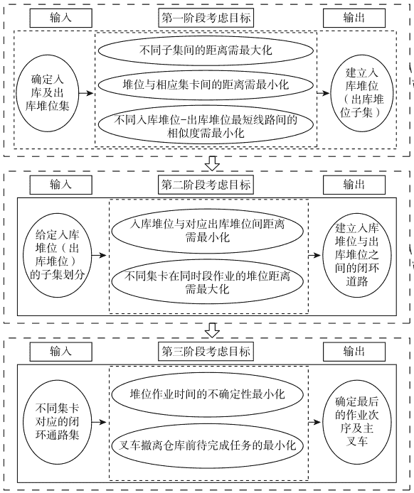

**图 3.1 技术路线图（一）**

---

### 3.1.2 瀑布机制三阶段解构

#### 1. 作业三大核心指标
安全为底线，效费为抓手：
- **指标一·空间隔离**：不同叉车作业区极致远离 → 相遇概率趋零 → **安全基石**；
- **指标二·路径解耦**：相似度极小化（长短差异大） → 长路叉车获回旋余地 → 速度调节避同室同现 → **安全兜底 + 效率拉满（双闭环同步闭环）**；
- **指标三·就近原则**：货位-集卡距离求和最小 → 里程压缩 → 油耗下降 → **成本控制**。

#### 2. 瀑布流三阶段实操逻辑
借鉴生物凝血级联模型，提炼前后强关联因子，形成顺承链条：

- **阶段一·货位分拆**：
  服务不同集卡的叉车分货位 → 两子集。
  约束：**子集间距离极大化**；**货位-集卡距离和极小化**；**两距离集相似度极小化**。

- **阶段二·双重匹配**：
  ① **入库↔出库匹配**：距离和最短 → 单叉车闭环最短；
  ② **入库子集间匹配**：两叉车闭环距离相似度最小 → **双叉车高效并行**。

- **阶段三·动态授权**：
  设主/辅集卡，以主叉车效率为标尺，按序切分货位子集，**现场管理员参照进度实时微调各段作业序** → 刚柔并济，应对动态扰动。

---

### 3.1.3 三阶段落地模型：参数篇

#### 1. 基础参数设定

# 三阶段瀑布模型：破解危险品仓库出入库调度难题

针对制约危险品仓库出入库作业的三大核心因素，本文构建了一套**“互通危险品仓库出入库三阶段瀑布模型”**。为确保研究结论的普适性，我们以“三集卡（双入库、单出库）、双叉车、八门仓库同步作业”为标准场景展开推演。具体设定为：两辆入库集卡分别标记为 $T_1、T_2$，出库集卡标记为 $T_3$；叉车 $F_1$ 负责服务 $T_1$ 与 $T_3$，叉车 $F_2$ 负责服务 $T_2$ 与 $T_3$。所有待入库货位集合记为 $P_0 = \{p_1, p_2, \cdots, p_{M_0}\}$，待出库货位集合记为 $Q_0 = \{q_1, q_2, \cdots, q_{N_0}\}$。接下来，我们将深度解析模型的前置假设，并详细拆解如何通过瀑布式的三个阶段精准匹配货位，最终为每辆叉车规划出最优行驶路径，从而大幅提升作业自动化与智能化水平，规避人工调度的随意性与隐患。

## 2. 实战模型：三阶段瀑布机制如何落地

本节仍以“三集卡、双叉车、八门仓库同步作业”为蓝本，详细阐述危险品出入库三阶段模型的运作逻辑。

首先，**空间划分与作业闭环**。仓库物理空间被切分为入库区与出库区两大功能板块。每辆叉车专属服务一辆入库集卡，并共同分担唯一的出库集卡。作业流程形成一个标准化闭环：叉车从入库集卡取货 $\rightarrow$ 存放入库区货位 $\rightarrow$ 将需转区货物运至出库区货位 $\rightarrow$ 将需出库货物运上出库集卡 $\rightarrow$ 返回入库集卡起点。每辆叉车通过有限次闭环循环，完成对应集卡卸货、分拨存储及出库装车全流程，最终回到原点。核心决策问题在于：如何为每辆叉车设定最优访问序列（先去哪个入库位、再去哪个出库位），以及如何协调双叉车的闭环路径实现无冲突协同。为此，本文设计了分三阶段推进的**瀑布机制**，以下逐阶建模求解。

### 阶段 1：货位资源的初始切分与隔离

**核心任务**：将全量货位集合拆分为两个互不干扰的子集，分别分配给 $F_1$ 与 $F_2$ 执行入库作业。

具体而言，需为 $T_1、T_2$ 确定专属入库货位。设 $T_1、T_2$ 待入库货量分别为 $M_1、M_2$（满足 $M_1 + M_2 \leqslant M_0$）。$T_1$ 对应货位集合 $P_1 = \{p_{11}, \dots, p_{1N_1}\}$，$T_2$ 对应 $P_2 = \{p_{21}, \dots, p_{2N_2}\}$。任取 $p_{1i} \in P_1, p_{2j} \in P_2$，选址需平衡三大目标：
1.  **安全隔离最大化**：$d(p_{1i}, p_{2j})$ 越大越好，物理隔开双叉车作业区域，消除交叉干扰；
2.  **入库成本最小化**：$d(p_{1i}, T_1) + d(p_{2j}, T_2)$ 越小越好，压缩空驶里程；
3.  **节奏协同均衡化**：$d(p_{1i}, T_1)$ 与 $d(p_{2j}, T_2)$ 差异越小越好，保障双叉车作业步调一致，留出协调缓冲空间。

综上，构建如下多目标优化模型（权重 $w_1+w_2+w_3=1$）：

\(\min v = \sum_{s=1}^{M_2} \sum_{s=1}^{M_1} x_{ij} \times \left( -w_1 \times \frac{d\left(p_{1i}, p_{2j}\right)}{\max_{\substack{1<s<N_0 \\ 1<t<N_2}} d\left(p_{1i}, p_{2j}\right)} + w_2 \times \frac{\left(d\left(p_{1i}, T_1\right) + d\left(p_{2j}, T_2\right)\right)}{\max_{\substack{1<s<N_0 \\ 1<t<N_2}} \left(d\left(p_{1i}, T_1\right) + d\left(p_{2j}, T_2\right)\right)} + \cdots, \right. \\

\left. + w_3 \times \left( 1 - \frac{abs\left(d\left(p_{1i}, T_1\right) - d\left(p_{2j}, T_2\right)\right)}{\max \left(d\left(p_{1i}, T_1\right) d\left(p_{1j}, T_2\right)\right)} \right) \right) \\

s.t. \sum_{i=1}^{M_1} x_{ij} = 1, \sum_{j=1}^{M_2} x_{ij} = 1, x_{ij} \in \{0,1\}, w_1, w_2, w_3 \in [0,1], w_1 + w_2 + w_3 = 1\)

### 阶段 2：入库位与出库位的精准配对

**核心任务**：在阶段 1 划定的 $P_1、P_2$ 内部，建立“入库货位 $\leftrightarrow$ 出库货位”的一一映射，同步完成“收货入库”与“调货出库”双重任务。

机制上，对 $P_1$ 中任一货位 $p_{1i}$，从 $P_2$ 中寻找匹配项 $p_{2j}$，安排 $F_1、F_2$ 同步入库。为实现同步出入库，引入对应出库货位 $q_{1s}（对应 p_{1i}）、q_{2t}（对应 p_{2j})$。优化目标聚焦两点：
1.  **转运距离最短**：$d(p_{1i}, q_{1s}) + d(p_{2j}, q_{2t})$ 最小化；
2.  **全程节奏同步**：定义 $F_1$ 单环路径长 $d_{11is} = d(T_1, p_{1i}) + d(p_{1i}, q_{1s}) + d(q_{1s}, T_3)$，$F_2$ 单环路径长 $d_{2jt} = d(T_2, p_{2j}) + d(p_{2j}, q_{2t}) + d(q_{2t}, T_3)$。要求两者差异最小，确保双叉车协调作业不掉队。

由此建立二次指派优化模型：

\(\min v = \left( \sum_{s=1}^{N_0} \sum_{j=1}^{M_2} \sum_{i=1}^{M_1} w_1 \times \frac{x_{1is} \times d\left(p_{1i}, q_s\right) + x_{2j} \times d\left(p_{2j}, q_s\right)}{\max \left( \max_{\substack{1<s<M_0 \\ 1<t<N_0}} d\left(p_{1i}, q_s\right), \max_{\substack{1<s<M_0 \\ 1<t<N_0}} d\left(p_{2j}, q_s\right) \right)} + x_{1is} \times x_{2j} \times w_2 \times \left( 1 - \frac{abs\left(d_{11is} - d_{2jt}\right)}{\max \left( d_{11is}, d_{2jt} \right)} \right) \right) \\

s.t. \sum_{s=1}^{N_0} x_{1is} = 1, \sum_{j=1}^{M_2} x_{2j} = 1, \sum_{j=1}^{M_1} \sum_{i=1}^{M_1} \left(x_{1is} + x_{2j}\right) = 1, \ x_{1is} \in \{0,1\}, x_{2j} \in \{0,1\}, w_1, w_2 \in [0,1], w_1 + w_2 = 1\)

求解模型 (3.2) 得到三大匹配矩阵：
*   $v_1$：$F_1$ 入库位 $\rightarrow$ 出库位映射
*   $v_2$：$F_2$ 入库位 $\rightarrow$ 出库位映射
*   $v_3$：$F_1$ 入库位 $\leftrightarrow$ $F_2$ 入库位 的协同匹配关系

\( v_1 = \begin{pmatrix} p_{11} & \cdots & p_{1M_1} \\ q_{11} & \cdots & q_{1M_1} \end{pmatrix}, \quad v_2 = \begin{pmatrix} p_{21} & \cdots & p_{2M_2} \\ q_{21} & \cdots & q_{2M_2} \end{pmatrix}, \quad v_3 = \begin{pmatrix} p_{31} & \cdots & p_{3M_1} \\ p_{3j_1} & \cdots & p_{3j_{M_2}} \end{pmatrix} \)

### 阶段 3：主辅协同下的最终路径排序

**核心任务**：基于前两阶段结果，确定双叉车的具体作业顺序，解决实时执行中的异步风险。

计算双叉车理论总作业距离：
\( d'_1 = \sum_{i=1}^{M_1} \left( d(T_1, p_{1i}) + d(p_{1i}, q_{1i}) + d(q_{1i}, T_3) + d(T_1, T_3) \right) \)
\( d'_2 = \sum_{j=1}^{M_2} \left( d(T_2, p_{2j}) + d(p_{2j}, q_{2j}) + d(q_{2j}, T_3) + d(T_1, T_3) \right) \)

对比 $d'_1、d'_2$，距离较长者定为**主集卡 $T_a$**（任务重），另一辆为**辅集卡 $T_\beta$**。
*   主集卡 $T_a$：依据仓库货位分布直接规划最优作业序列 $l_a$；
*   辅集卡 $T_\beta$：依据阶段 2 得到的 $v_3$ 映射关系，推导作业序列 $l_\beta$。

**动态容错机制**：考虑到实操中作业时长不可控，当 $F_2$ 无法严格跟随 $F_1$ 节奏时，系统依据 $v_3$ 实时动态调整 $l_\beta$ 的执行顺序，保障双叉车作业流程不中断、不碰撞、不死锁。

## 3. 核心武器：离散粒子群算法（PSO）

模型建好了，怎么解？三阶段求解难度各异：
*   **阶段 1** 是经典指派问题，传统规划算法（如匈牙利算法）遍历可行解即可高效解决。
*   **阶段 3** 属于初等排序数学问题，计算量极小，直接求解。
*   **阶段 2** 却是**带协同约束的特殊二次指派问题 (QAP)**。货位数量一多，解空间呈指数级爆炸，精确算法失效，必须引入启发式算法。

本文选用 **离散粒子群算法** 攻克阶段 2 模型 (3.2)。PSO 由 Eberhart 与 Kennedy 于 1995 年提出，核心哲学是**“群体智慧迭代”**：粒子在解空间中飞翔，通过个体历史最优 ($P_{best}$) 与群体全局最优 ($G_{best}$) 的双重引导，实现从无序搜索到有序收敛，最终逼近全局最优。

**映射到本问题**：
*   每一个粒子 = 一组候选匹配方案 $(v_1, v_2, v_3)$；
*   粒子位置 $X_i$ = 当前货位排列组合；
*   粒子速度 $V_i$ = 下一轮调整排列的方向与幅度；
*   适应度函数 = 模型 (3.2) 目标函数值，**越小越优**。

**迭代核心公式**：
速度更新：
\(V_i = wV_i + c_1r_1(P_{\text{best}, i} - X_i) + c_2r_2(G_{\text{best}} - X_i)\) \hfill (3.3)

位置更新：
\(X_i = X_i + V_i\) \hfill (3.4)

参数设定经验值：惯性权重 $w$ 自适应递减（0.9 $\rightarrow$ 0.1，前期全局探索、后期局部挖掘）；学习因子 $c_1=c_2=1.4961$；$r_1, r_2 \sim U(0,1)$ 随机扰动。

**求解流程框架**：
1.  **初始化**：随机生成/启发式构造 50 个粒子，计算适应度，确定初始 $P_{best,i}$ 与 $G_{best}$。
2.  **迭代循环** ($g=1$ 至 $g_{max}=100$)：
    *   按 (3.3) 更新速度 $V_i$；
    *   按 (3.4) 更新位置 $X_i$（映射为离散排列）；
    *   重算适应度，刷新 $P_{best,i}$ 与 $G_{best}$。
3.  **终止**：输出 $G_{best}$ 对应的最优货位排列。

> **特别说明**：针对本文离散排列空间，位置向量 $X_i$ 编码为四类货架所有可能排列的组合，速度向量 $V_i$ 则定义为排列交换操作序列，确保算法在离散空间中合法飞行。

### 3.1.4 实战复盘：八门互通仓库叉车路径优化案例

#### 1. 场景还原与参数设定

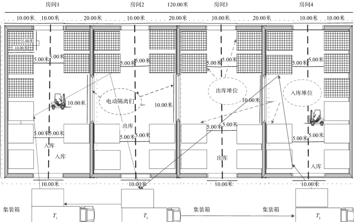

图 3.2 仓库结构

假设一个八门互通危险品仓库（结构见图 3.2）。$T_1、T_2$ 入库，$T_3$ 出库。双叉车 $F_1（服务 T_1, T_3）、F_2（服务 T_2, T_3）$。任务量：$T_1$ 入库 10 货位，$T_2$ 入库 8 货位，$T_3$ 出库 18 货位。货位规格 $5 \times 10 \text{m}^2$，纵向横向通道均 10 米。

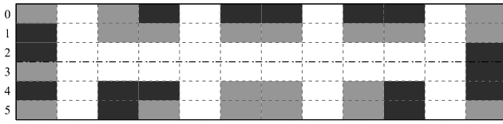

图 3.3 仓库布置示意图

为便计算，将货位映射为离散坐标系（图 3.3）。左上角为原点，第 $m$ 行第 $n$ 列坐标为 $(m, n)$（$m,n$ 从 0 起算）。浅色块属 $F_1$ 作业区，深色块属 $F_2$。集卡坐标固定：$T_1(5,1)$、$T_2(5,10)$、$T_3(5,4)$。第 1、2 行间水平线为界，上为出库区，下为入库区。据此统计：$p_1=10, p_2=8, q_1=10, q_2=8$。

#### 2. 模型求解实录

**解空间构造**：对 $p_1、p_2、q_1、q_2$ 四类货位分别全排列，组合形成海量解空间。阶段 1 用传统规划法秒级求解。

**阶段 2 - PSO 实战参数**：
*   种群规模：50 粒子（每粒子含 4 维属性，对应四类货位空间排布）；
*   适应度函数：模型 (3.2) 目标函数；
*   迭代上限：$g_{max}=100$；
*   学习因子：$c_1=1.49445, c_2=0.5$；
*   惯性权重：$w=1$（本案例固定值测试）。

算法运行结束，输出阶段 2 最优匹配。

**阶段 3 - 排序优化**：重新构造全排列解空间，沿用上述 PSO 参数迭代，直接得到双叉车最优作业序列。

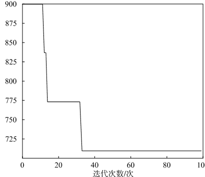

图 3.4 适应度函数数值曲线

**收敛性验证**：图 3.4 展示典型运行曲线。**第 30 代左右即收敛至全局最优**，曲线平稳下降无震荡，证明 PSO 在此离散组合优化问题上具备极强的可行性与高效收敛性。

**最终匹配结果解码**：
因入库出库货位数量不对等（10 vs 8），匹配矩阵引入 `(-1, -1)` 占位符，代表对应叉车的**等待/空闲时槽**，用于同步双叉车节奏。最终计算得到三大核心矩阵：

\(\displaystyle v_1 = \begin{pmatrix} (5,11) & (5,6) & (4,5) & (3,0) & (4,6) & (5,3) & (5,0) & (5,5) & (4,8) & (5,8) \\ (1,9) & (0,11) & (1,6) & (1,3) & (1,2) & (1,5) & (0,2) & (0,0) & (1,8) & (1,11) \end{pmatrix}\)

## 算法稳健性实测与三阶段模型全景解析

在实例复算环节，总运行里程 $L$ 精准落在 720 米。为压测算法鲁棒性，我们锁定参数连跑 50 轮迭代，统计分布见 **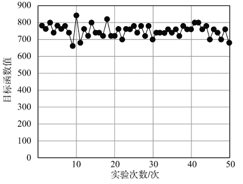** 图 3.5。数据极具说服力：绝大多数结果紧贴 700~800 米区间，均值 748.4 米，离群点寥寥无几，稳定性毋庸置疑。

### 3. 核心结论与创新亮点复盘

实例实锤了本节提出的“出入库瀑布作业机制”与“三阶段算法”完全落地可行。该模型最大的过人之处，在于将制约出入库的碎片化因子系统融合：通过给入库点分组、匹配归属不同集卡的货位，进而界定“主集卡”与“辅集卡”角色，一气呵成解决了危险品混合作业的叉车线路规划难题。全流程弱化人为干预，规划逻辑客观公正；求解端则采取开放兼容策略，仓库管理者可依托软硬件实况自选启发式算法，文中粒子群算法仅作可行性演示。

创新点经实战进一步坐实：
1.  **模型重构**：将叉车线路规划抽象为三阶段决策，有机串联影响要素，提炼出作业内在规律；
2.  **角色定义**：首创“主/辅集装箱卡车”概念，破解多车协同时空冲突，托底作业高效率；
3.  **权重赋能**：引入权重向量量化时效、效率、安全三维指标，赋予模型跨场景适应性——管理者可按实况调参，且框架天然兼容“单入双出”等变体工况，此处不赘述。


## 3.2 互通型危化品平仓库：三次指派模型构建与求解实战

### 3.2.1 问题背景与技术路线

承接第二章“互通仓库”概念体系及 3.1 节对安危、效率、成本三大核心变量的拆解，本节将深度量化三者对出入库活动的边际影响。查阅仓储运输[120-123]、二次指派[124-126]、神经网络[127-134]等前沿文献，以常规双门仓参数为基线，切入互通场景，锚定“安全系数高、作业效率高、经济成本低”三大优化靶心，建立叉车运行线路的**三次指派问题**，并设计改进型 BP 神经网络破解之。技术路线图见 **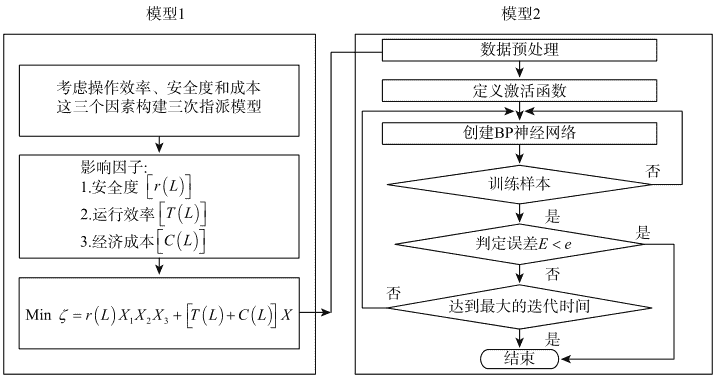** 图 3.6，章节布局如下：
*   3.2.2 立指标：提炼三大关键度量衡；
*   3.2.3 建模型：构建三次指派数学模型；
*   3.2.4 改算法：融合自适应动量因子与特定随机次序学习，给出弱/强收敛性证明；
*   3.2.5 实战验：引入上海某互通仓实数据，对比标准 BP 佐证改进算法优势。


### 3.2.2 三大核心指标：安、效、本的量化锚点

实地调研揭示：叉车是仓库吞吐的“心脏”，其效率直接卡住系统咽喉。出库去程空驶、入库回程空驶，若能让叉车“出入穿插、满载往返”，无效路程大幅收敛。遭遇双集卡同步作业、时效窗口窄的硬仗，需多叉车协同且外部预留待机车辆。安全红线不可触碰：双门规制区域同一时段仅允许单叉车作业。这倒逼路径设计必须“花样百出”——相似度越低，现场调度余地越大，安全边际越厚。

效率看搬运耗时，给定车速下折算时间成本；成本看油耗里程，总长度乘实时油价得经济账。综上，本节锁定三大指标——**线路相似度（安全）、时间成本（效率）、经济成本（本金）**，为三次指派模型立柱架梁。

### 3.2.3 叉车出入库线路三次指派模型详解

#### 1. 基本参数与路径拓扑

建模聚焦“路线优化”，为普适仅讨论出库点多于入库点（$m < n$）工况，反之对称处理。四箱定名：$C_1, C_3$ 入库，$C_2, C_4$ 出库。$m$ 个入库点 $p_i$，$n$ 个出库点 $q_j$，衍生 $m$ 条出入闭环路径 $S_{p_i,q_j}$ 及 $n-m$ 条纯出库路径 $S_{C_t,q_j}$。三叉车同步时，路径相似度 $r$ 以三边长差值乘积比值定义（公式 3.x）。时间成本 $T = C_r e^{-1} v_1^{-1} L$，经济成本 $C = b L$，均显性关联总里程 $L$。

#### 2. 模型构建与求解策略

降维思路：仅匹配入库点与出库点，生成闭环路径集。互通仓库由多双门单元组成，核心目标是压低闭环总距离相似度，赋予现场调度灵活机动空间。三步走建模（步骤 3.7~3.9）：
1.  **标准化**：按模型 (2.1) 归一化原始距离；
2.  **计相似度**：从标准化矩阵抽取三条路径 $l'_{p_1,q_{j_1}}$ 等，算 $r$；
3.  **立目标函数 (模型 3.5)**：最小化 $\gamma$ = 加权相似度 + 时间成本 + 经济成本，约束为经典 0-1 指派条件（一一对应）。

针对标准 BP 依赖固定学习率梯度下降、易陷局部最优且收敛缓慢的痛点，本节提出**“自适应动量因子 + 特定随机次序学习”**双引擎改进方案：
*   **随机次序**：训练循环内无放回抽样，单样本即时更新权值，打破周期性震荡；
*   **自适应动量**：引入梯度范数作为“曲面陡缓探测器”——平坦区（梯度小）增大动量冲出鞍点，陡峭区（梯度大）减小动量抑制越震，动态平衡收敛速度与稳定性。

工程落地六步法（步骤 3.10~3.16）：数据清洗标准化 $\rightarrow$ 选用 tansig 激活 $\rightarrow$ 搭建三层网络拓扑 $\rightarrow$ 喂样本前向传播算误差 $\rightarrow$ 样本轮完？否则循环 $\rightarrow$ 总误差 $E < \varepsilon$ 或达最大代数？是则终止，否则回炉。

### 3.2.4 改进 BP 算法收敛性分析与模型求解

#### 1. 符号体系与数学预备

为严谨论证收敛性，设定三层 BP 网络：输入层 $p$、隐含层 $n$、输出层 1。训练集 $\{X_j, O_j\}_{j=0}^{J-1}$。权值矩阵 $v$（输入$\rightarrow$隐含）、向量 $u$（隐含$\rightarrow$输出），合并为超向量 $W \in \mathbb{R}^{n(p+1)}$。激活函数 $g, f$，隐含层向量映射 $G(Z)$。前向传播：$y = f(u \cdot G(vX))$。误差函数 $E(W) = \frac{1}{2}\sum (O_j - y_j)^2$。梯度公式 (3.8)/(3.9) 给出了 $\nabla_u E$ 与 $\nabla_{v_i} E$ 显式形式，为后续收敛性证明奠定解析基础。

### 核心算法构建：自适应动量 BP 网络迭代机制

我们首先对权重向量进行整合定义：将隐层至输出层权重 $E_{v}(W)$ 与输入至隐层权重 $E_{u}(W)$ 拼接为完整权重矩阵 $E_W(W)$。训练过程中，每个周期均对样本顺序进行随机打乱。在第 $m$ 个周期中，设输入向量的随机排列为 $\{X_{m,1}, \dots, X_{m,J}\}$，权重更新公式如下（式 3.10、3.11）：

对于输出层权重 $u$ 与隐层权重 $v_i$，更新量包含三项：梯度下降项、自适应动量项。其中学习率为 $\eta_m$；动量因子形式为 $e^{-\lambda \frac{\|\nabla\|}{\mu_m}} \mu_m$，由正常数 $\lambda$ 调控幅度，取值区间 (0,1)，随梯度范数动态变化。特别地，采用“重赋零策略”，即每个迭代周期伊始将动量项置零。

梯度计算方面（式 3.12、3.13），$\nabla_k^m u$ 与 $\nabla_k^m v_i$ 分别依据误差函数对 $u、v$ 求导得出，涉及激活函数导数 $f'、g'$ 及中间变量 $G_{mJ+j,m,k} = G(v_{mJ+j} X_{m,k})$、网络输出 $y_{mJ+j,m,k} = f(u_{mJ+j} G_{mJ+j,m,k})$。

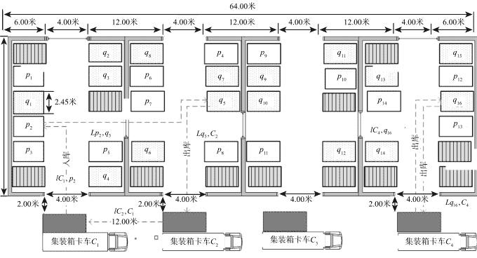

### 理论基石：收敛性假设与定理推导

为严谨证明算法收敛，引入欧氏范数定义及稳定点集 $\Omega_0 = \{ W \in \Omega : E_W(W) = 0 \}$，并定义其在坐标轴上的投影 $\Omega_{0,s}$。基于以下五项假设：

1.  **平滑性**：激活函数导数 $g'(t)、f'(t)$ 局部 Lipschitz 连续。
2.  **学习率衰减**：$\eta_m > 0$，且满足 $\sum \eta_m = \infty、\sum \eta_m^2 < \infty$（经典 Robbins-Monro 条件）。
3.  **动量项平方和收敛**：$\mu_m > 0$，自适应动量因子平方和收敛。
4.  **权重有界性**：迭代序列 $\{W_m\}$ 始终落在有界区域 $\Omega \subset R^n$ 内。
5.  **稳定点集“瘦”性**：投影集 $\Omega_{0,s}$ 不含内点（即测度为零）。

确立两大核心定理：

*   **定理 3.1（弱收敛）**：若假设 3.1~3.4 成立，任意初始权值 $W_0$，按式（3.6）、（3.7）迭代，误差向量范数趋于零：$\lim_{m \to \infty} \| E_W (W_m) \| = 0$。
*   **定理 3.2（强收敛）**：若假设 3.1~3.5 均满足，权重序列强收敛至稳定点集中某一点 $W^*$，即 $\lim_{m \to \infty} W_m = W^*$。

---

### 实战复盘：四室双进双出危化品仓库叉车路径优化

#### 场景还原与数据建模

本案取材上海某危险品仓库实测数据，攻克叉车作业“三次指派”难题。设 $C_1、C_3$ 为入库集装箱（共 14 入库点），$C_2、C_4$ 为出库集装箱（共 16 出库点），形成 14 条进出往返路径与 2 条纯出库往返路径（布局见图 3.7）。仓库长 64m、宽 17.5m，门宽 4m，集卡间距 12m、离库 2m。

求解步骤：
1.  计算 13 入库点至 16 出库点的闭环距离 $d_{ij}$，构建距离矩阵 $D$（行入库、列出库）。
2.  按式（3.1）标准化得矩阵 $D'$（见下表）。
3.  定义路径相似度 $r'$（式 3.15），引入三次指派模型。

```
\begin{cases}
\min \gamma = \sum_{i_1, i_2, i_3 = 1}^{14} \sum_{j_1, j_2, j_3 = 1}^{16} \left[ x_{i_1 j_1} x_{i_2 j_2} x_{i_3 j_3} r^* \left( d'_{p_{i_1} q_{j_1}}, d'_{p_{i_2} q_{j_2}}, d'_{p_{i_3} q_{j_3}} \right) \right] + \sum_{i_1 = 1}^{14} \sum_{j_1 = 1}^{16} x_{i_1 j_1} \left( 22.9d'_{i_1 j_1} + 1.6 \right) \\ 
+ \sum_{i_1, i_2, i_3 = 2 \atop i_1 \neq i_2 \neq i_3}^{14} \sum_{j_1, j_2, j_3 = 2 \atop j_1 \neq j_2 \neq j_3}^{16} \left[ x_{C_{i_1} j_1} x_{C_{i_2} j_2} x_{C_{i_3} j_3} r^* \left( d'_{p_{i_1} q_{j_1}}, d'_{p_{i_2} q_{j_2}}, d'_{p_{i_3} q_{j_3}} \right) \right] + \sum_{i_1 = 2 \atop i_1 \neq j_1}^{14} \sum_{j_1 = 1}^{2} x_{C_{i_1} j_1} \left( 22.9d'_{i_1 j_1} + 1.6 \right) \\
\text{s.t.} \sum_{i_1 = 1}^{14} x_{i_1 j_1} = 1, \sum_{j_1 = 1}^{16} x_{i_1 j_1} = 1, x_{i_1 j_1} \in \{0, 1\}, x_{i_2 j_2} \in \{0, 1\}, x_{i_3 j_3} \in \{0, 1\}, x_{C_{i_1} j_1} \in \{0, 1\}
\end{cases}
```

#### 网络配置与训练细节

采用单隐层单输出 BP 网络，结构参数 $p=2、n=2$。训练集取 1~13 号入库点对应出库点距离，标签为各行最小值；测试集覆盖全量入出库点对。
超参数设定：训练上限 50,000 次，目标误差 0.001，学习率 0.01，动量调控系数 $\lambda=0.05$，初始权值 $[-0.5, 0.5]$ 均匀随机。为公平对比，沿用“每周期动量清零”策略。

#### 结果产出与线路落地

程序运行 56 秒、迭代 8,416 次收敛，输出可行解（详见 ```
\( d' = \begin{pmatrix} 1 & 2 & 3 & 4 & 5 & 6 & 7 & 8 & 9 & 10 & 11 & 12 & 13 & 14 \\ 2 & 3 & 1 & 8 & 4 & 7 & 5 & 6 & 11 & 9 & 12 & 13 & 14 & 16 \end{pmatrix} \)
```）。针对 $q_{10}、q_{15}$ 两出库点未直接给出路径，依就近实测得 $d_{q_{10}, C_2}=54.8、d_{q_{15}, C_4}=13.8$，最终确定叉车全局运行线路。

```
\( d' = \begin{pmatrix} 1 & 2 & 3 & 4 & 5 & 6 & 7 & 8 & 9 & 10 & 11 & 12 & 13 & 14 \\ 2 & 3 & 1 & 8 & 4 & 7 & 5 & 6 & 11 & 9 & 12 & 13 & 14 & 16 \end{pmatrix} \)
```

```
\( d^* = \begin{pmatrix} 1 & 2 & 3 & 4 & 5 & 6 & 7 & 8 & 9 & 10 & 11 & 12 & 13 & 14 & C_2 \\ 2 & 3 & 1 & 8 & 4 & 7 & 5 & 6 & 11 & 9 & 12 & 13 & 14 & 16 & 10 \\ 15 \end{pmatrix} \)
```

必须说明的是，本书聚焦于仓库内叉车运行的路径规划层面，具体落地执行仍需管理人员结合现场实况裁决。通过实例演示，核心成果归纳为四点：

- **(1) 创新建模视角**：以“高效、低本、高安”为导向，选取八门互通仓库为原型，构建了叉车线路多目标规划的三次指派模型，为指派类难题提供了全新的优化范式。
- **(2) 算法融合突破**：将带自适应动量因子的BP神经网络与特定随机次序算法耦合，研发出一种改进型BP神经网络算法，流程简洁、落地性强，应用前景广阔。
- **(3) 强调人机协同**：计算输出为叉车闭环路径集合，而闭环内的线路执行序列由现场管理层把控，这意味着模型落地高度依赖高质量的人机交互机制。
- **(4) 实证验证有效**：引入上海某危险品物流企业的实测参数构建仿真算例。结果显示，改进算法显著加快收敛速度、提升精度并增强稳定性，有力佐证了模型的可行性与有效性。

## 3.3 互通危险品平仓：仓储作业链构建与优化调度策略

### 3.3.1 问题背景与研究切入点

危险品仓储作业中，风险源可划分为两大类：首类是事故的主体与前提，决定后果严重度；次类是诱发首类事故的必要条件。叉车作业中，碰撞风险属首类核心隐患，车辆间距过近则属次类诱因。本节立足平仓仓库场景，锚定“次类危险源防控”这一核心，广泛吸纳危险品仓储[135-139]、多属性决策[140]、最优化理论[141-143]等前沿成果，旨在为多任务工况下的叉车调度提供技术支撑，保障出入库作业安全高效。研究背景设定为一类互通危险品仓库，约束条件为多叉车运行线路，样本选取五个随机出入库点位，深入剖析特定工况下的叉车最优调度问题。

**叉车运行规则界定如下**：
1. 叉车从门外集装箱提取入库货物，行驶至指定货位卸载；
2. 空车驶往出库货位取货，运送至门口出库集装箱，完成单次闭环运输；
3. 单次完整仓储任务包含多次闭环运输。

基于此运行逻辑，研究将从三个维度展开：阐述仓储链与监控机制、建立作业优化模型以支撑调度评价、引入实测参数验证模型有效性。

### 3.3.2 仓储链定义与两级监控机制

#### 1. 仓库几何结构的网格化建模
以5个出库点、5个入库点、双叉车协同作业为例，绘制平仓道路与货位平面分布图（见图3.8），明确各点位坐标。

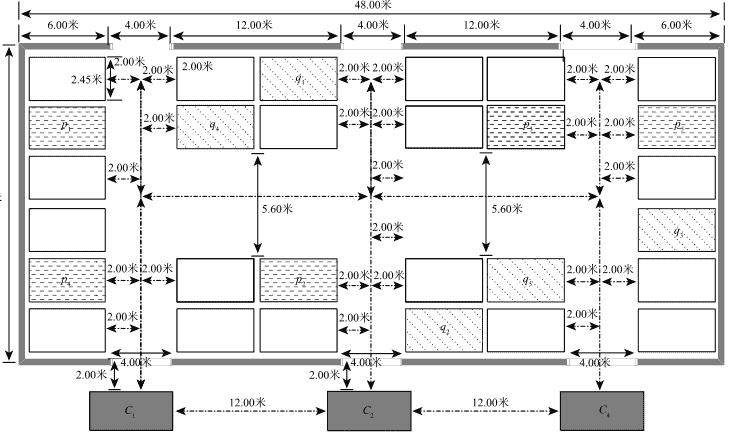

#### 图 3.8 危险品仓库几何结构示意图

为精准表征出入库点位及叉车实时坐标，引入网格化处理：以单辆叉车长度为最小网格单元，以仓库下、左边界为X、Y轴建立平面直角坐标系（详见图3.9）。

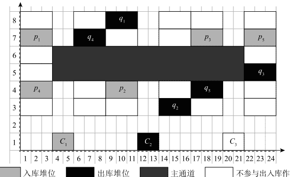

#### 图 3.9 危险品仓库平面网格化坐标图

#### 2. 仓储作业链概念的提炼
前文提出“闭环通路”概念，侧重单次出入库视角的车辆配合。但受行驶距离差异、作业耗时不确定性影响，双车难以实现全程时序匹配（见图3.10），导致安全度量化困难。

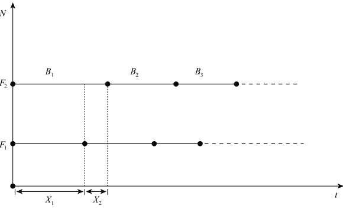

#### 图 3.10 双叉车作业周期时序匹配示意图

借鉴交通行为学“出行链”思想，本节提出**“仓储作业链”**概念，从宏观链条视角重构危险品出入库作业研究范式。定义如下：单次仓储任务中，叉车在集装箱与货位间执行多次闭环运输；单车所有闭环运输的集合即为其“仓储作业链”，记为 $l_k$（$k=1,2$）；双车协同完成任务对应的链对记为 $(l_1, l_2)$。

#### 3. 基于距离阈值的两级监控策略
鉴于危险品仓库特殊性，仅以“不碰撞”为目标不足以管控潜在风险。本节聚焦次类危险源，量化“距离过近导致刹车失误/判断偏差”的隐患。引入距离阈值 $d_0$ 将作业时段二元化：
- **重点监控时段**：车间距离 $< d_0$，潜在危险显性化，安全性下降，此时段时长及距离值对安全指标影响权重最大；
- **常规监控时段**：车间距离 $\ge d_0$。

经充分调研与专家咨询确定边界阈值。理论上可延展为三级或多级监控以精细化管控，本节以两级为基准样本展开研究。

### 3.3.3 融合仓储链与安全度的作业优化模型

#### 1. 核心决策变量界定
叉车调度优化涉及两层决策：出入库点配对、作业顺序排序。配对问题以总路程最小化为目标（$\min \sum x_{ij} d_{ij}$），本节聚焦**作业顺序确定**这一核心环节，构建安全度、效率及综合评价指标体系，最终形成优选模型。

#### 2. 安全度量化函数构建
经咨询管理人员确定安全距离阈值。设任务时段 $[T_0, T_1]$，所有可能作业链对集合为 $\{(l_{i1}, l_{i2}) | i=1..N\}$。定义第 $i$ 对链的重点监控时长 $t_i$、重点监控期平均距离 $d_i$，及极值 $t_{\min}, d_{\min}, t_{\max}$。双叉车第 $i$ 对作业链的安全度函数定义为：

$$ S_i = \frac{ \left( \frac{t_i - t_{\min}}{t_{\max} - t_{\min}} + 1 \right)^{-\omega_1} \times \left( \frac{d_i - d_{\min}}{d_{\max} - d_{\min}} + 1 \right)^{\omega_2} }{ 2 } \quad (3.17) $$

其中 $\omega_1, \omega_2$ 为时长与空间距离在安全度计算中的权重（由管理层依实况赋值，且 $\omega_1+\omega_2=1$）。**特别说明**：因任务分配不对等可能导致双车完工时刻不同，任一车辆停工待命后，碰撞风险随之消除，故安全度计算随首辆停工车辆终止。

#### 3. 基于仓储链的出入库作业建模流程
通过建模双车全过程运动态势，提炼效率与综合评价模型：

*   **步骤 3.17（初始化与入库）**：$t$ 时刻双车坐标 $F_1(a_i,b_i), F_2(x_i,y_i)$。初始均位于入库集卡 $(4,2)、(12,2)$。取货耗时 $t_1'$，驶入卸货耗时 $t_2'$，依配对结果驶向对应出库点取货。
*   **步骤 3.18（出库与闭环判断）**：运货至出库集卡卸货。若仍有入库任务，经外部连接道返回入库集卡，完成单闭环；若任务清空，车辆停留出库集卡，安全计算停止，全流程结束。单车全闭环集合即作业链，双车对应链对 $(l_1, l_2)$。
*   **步骤 3.19（两级监控实施）**：作业全周期内（至任一车停工前），实时计算双车折线距离 $d=|a_i-x_i|+|b_i-y_i|$。距离 $< d_0$ 触发重点监控，$\ge d_0$ 为常规监控，安全度计算贯穿始终。
*   **步骤 3.20（安全度计算）**：沿用步骤 3.20 符号定义，套用式（3.17）求解各链对安全度 $S_i$。
*   **步骤 3.21（综合评价函数）**：记单车作业时间 $t_{ki}$，总耗时 $t_i=t_{1i}+t_{2i}$，效率函数 $\eta_i = t_i/2$。第 $i$ 对链的综合评价指数 $P_i$ 由式（3.18）给出，该式融合了归一化后的安全度倒数项与效率项，权重 $w_1, w_2$（$w_1+w_2=1$）平衡时空维度。
*   **步骤 3.22（管理偏好向量）**：定义偏好向量 $\Omega=\{\omega_1, \omega_2, w_1, w_2\}$，四参数均由管理层依环境赋值（且两组权重各自归一），通过赋值实例化安全度与综合指数。
*   **步骤 3.23（最优策略遴选）**：$P_i^* = \max P_i$ 对应的第 $i^*$ 对链为最优仓储链，其对应线路即最优运行路径。

#### 4. 理论贡献与模型特色补充
1. **安全度公式首创性**：非单一函数形式固化，本节基于仓储链框架，融合“重点监控时长”与“车间距离”双维度，更契合实操逻辑。
2. **监控维度深化**：区别于传统事后监控，本模型通过安全度量化，输出优化线路的同时，将全周期显性划分为重点/常规两级监控时段，实现了对危险源认知的层级跃迁。

### 3.3.4 三室工况下双叉车出入库线路优化实证

#### 1. 算例参数设定
为验证模型可行性，综合调研国内主流危险品仓库布局，提炼关键参数（详表3.1）。基于长三角区域典型平仓布局，设定5入库点、5出库点，求解已知点位下的双叉车最优调度策略。

**表 3.1 危险品仓库关键参数表**

| 核心参数 | 设定数值 | 核心参数 | 设定数值 |
| :--- | :--- | :--- | :--- |
| 仓库总长度 | 48 m | 仓库主过道宽度 | 4 m |
| 仓库总宽度 | 17.5 m | 仓库间过道宽度 | 5.6 m |
| 货位长度 | 6 m | 叉车尺寸 (长×宽) | 1.5 m × 1.2 m |
| 货位宽度 | 2 m | 叉车托盘规格 | 1.1 m × 1.1 m |
| **双车安全距离阈值** | **3 m** | 叉车行驶时速 | 3000 m/h |
| 叉车单次抓放耗时 | 1.5 min | — | — |

#### 2. 求解实施过程

### 双叉车协同调度：从遍历求解到最优路径落地

本节借助 Matlab 实现全空间可行解搜索，对前述场景展开复核。先看出入库任务匹配环节：给定 5 个入库点与 5 个出库点，理论组合达 125 种。经筛选，最优作业方案锁定为：p1 对接 q4、p2 对接 q2、p3 对接 q5、p4 对接 q1、p5 对接 q3。此组合下，双叉车全周期累计行程压缩至 150 米。依据仓储作业链定义，剔除同一时刻轨迹交叉、存在碰撞隐患的方案后，保留有效作业链 98 对。后续将在该集合中遴选双叉车最优作业对。

求解仍采用全量遍历法，对任务执行序列逐一评测，引入安全性、效率性及综合三大评价模型。安全评价聚焦车间距离与重点时段驻留时长；设定双级监控机制，以 3 米为临界阈值划分监控等级；依式（3.17）量化安全度，再按式（3.18）构建综合评价函数，引入偏好向量 $\Omega=\{0.5,0.5,0.8,0.2\}$ 权衡多目标。最终输出 125 组作业链的综合指数。

指数对比显示，方案 8 综合得分最高：作业耗时 2.04 分钟，安全指数 1.2651，调度评价指标 1.5616，确立为最优运行路径。对应的车间距离-时变曲线与双车轨迹图见下文。

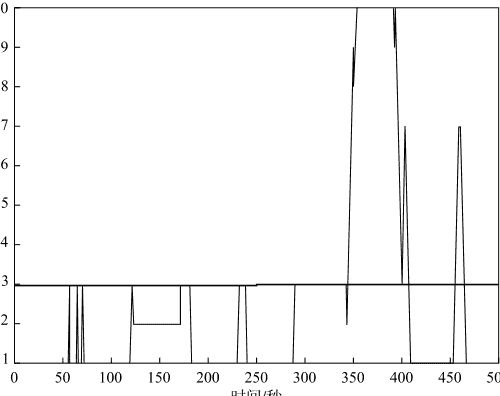

**图 3.11 最优调度策略下叉车距离随时间变化曲线图**

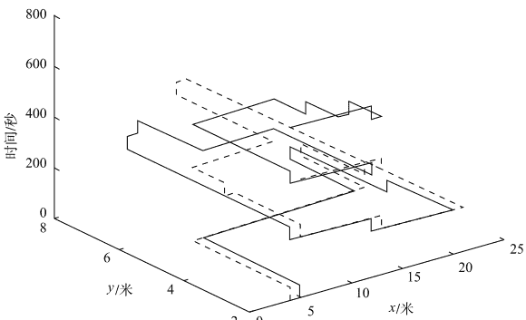

**图 3.12 最优调度策略下两辆叉车运动轨迹图**

算例验证了理论模型的有效性。综上，本节构建的互通平仓双叉车路径规划新范式，能融合主客观决策信息，在保安全的前提下赋能仓储企业提质增效。

## 3.4 本章小结

立足四门与互通两类新型危险品仓库，本章以最优化理论为内核，攻关仓储作业优化，结出丰硕成果。

**3.1 节**构建三阶段自动化模型：首阶段按成本与安全分流入库货位；次阶段按效安指标匹配货位元素；末阶段对双车路径排序成全链路。实证上海某库数据，确证瀑布机制与三阶段模型可行。

**3.2 节**双核心产出：一、拆解三大影响因子，建参数化优化函数，立三次指派模型；二、融合自适应动量 BP 网络与随机序学习，创改进算法求解最优线路。

**3.3 节**双创新点：一、引入交通“出行链”概念，创“仓储作业链”，为安全度精准刻画立基；二、提出双级监控策略，分级建模安全度，支撑调度决策。

# 第 4 章 环岛危险品平仓仓库叉车运行规则及分区作业研究

为响应高时效客户需求，本章在互通仓基础上推演环岛平仓设计。多增隔离门赋予叉车更多线路自由度，使单库可兼容多方案、跨分类运行，释放存储潜能。代价是隔离门占用货位、抬高单位成本、提升算力与人员门槛。权衡利弊，环岛仓适配“重时效、低成本敏感”客群。本章将从运行规则制定与货位分区两维度展开支撑研究。

**4.1 节**定环岛仓概念，引出动态货位布设问题。规则与算法双轨并行，取决于效率成本偏好。以常见规则设置为切口，将问题抽象为特殊指派模型并给解法。

**4.2 节**聚焦空间布局。多任务并行下，分区与非分区两类货位形态并存。引入成本核算新工具，配合数值仿真，提炼环岛平仓货位分区五大规律。

**4.3 节**全章总结。

## 4.1 环岛危险品平仓仓库叉车运行规则设置的决策方法

### 4.1.1 研究问题的提出

国内危险品仓多为双门制，调研表明此布局严重掣肘效率。第三章虽提出互通仓缓解矛盾，但为追求极致时效，本章进阶环岛仓——通过加密隔离门实现货位动态重构。核心决策点在于：动态环境下，是否设定运行规则？是否实施出入库分区？本节以此为背景，以多车多线为条件，以同步作业为样本，系统攻关分区与规则耦合决策。文献梳理聚焦三域：危化仓管（王磊等揭示主观不确定性为主因，Yachba 等用遗传算法识别集卡位，Molero 等论证陆港选址多指标法）、环岛控制（廖刘结合信控优化通行力，Tian 用博弈论预测路径）、交通优化应用（Mesbah 算公交优先路权，Chen 优化收费降耗时，Shahabi 鲁棒优化解不确定最短路，Marinakis 混合粒子群破约束最短路，李军 RFID 赋能自动化识别）。

本节旨在不损空间利用率前提下，实现出入库帕累托改进。以入出库货位数为关键变量，对比“设规则+分区”、“设规则+不分区”、“不设规则+分区”、“不设规则+不分区”四象限，在变量动态下以双目标求最优。规则生效时，环岛区强制单向。计算预备见下图。

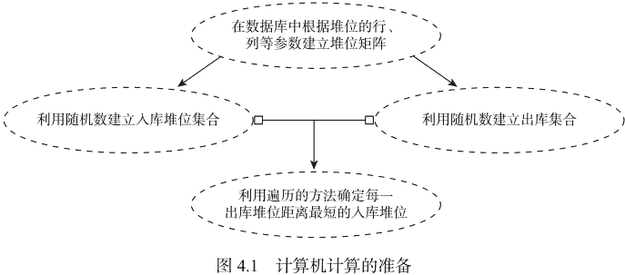

### 4.1.2 环岛危险品仓库条件下的叉车多线路运行

#### 1. 环岛危险品仓库介绍

研究环岛仓旨在存量空间激活增量效率。文中“环岛”特指叉车运行围合区域。无环岛互通仓几何形态见下图，有环岛方案二、三见后文。

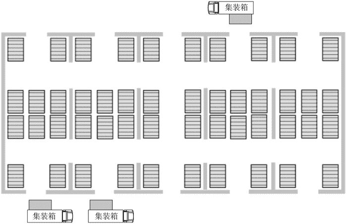

**图 4.2 方案一对应仓库几何结构图**

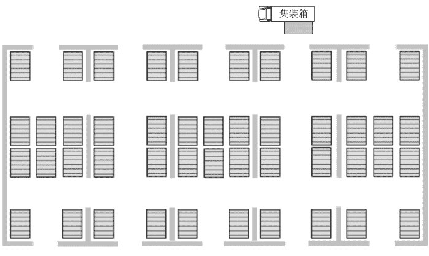

**图 4.3 方案二对应仓库几何结构图**

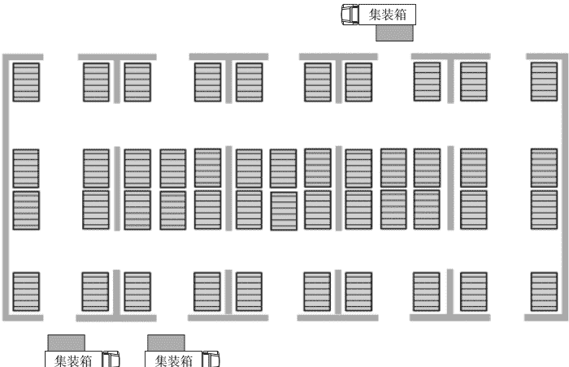

**图 4.4 方案三对应仓库几何结构图**

方案一无环岛功能，排除规则研究。方案三环岛范囲过大，单向限制压缩双向路段、拖累效率，故聚焦方案二。方案二几何解析衍生四种运行模式：
*   **模式一（全自由）：** 全网双向，货位无区域限制。
*   **模式二（环岛单向）：** 环岛单行、其余双向，货位无限制。
*   **模式三（分区自由）：** 全网双向，货位强制分入出两区。
*   **模式四（耦合强控）：** 环岛单行+货位分区。四模式示意见图 4.5-4.8。

#### 2. 环岛危险品仓库条件下叉车运行方案多样化

调研显示：大比例固定货源且量大时，可建分区仓专供，全信息下按时序货量调度货位，实现时段级出入库完全分离；固定货位助力路径最优化（缩程、避让、提速）。反之，货源碎、量小则分区浪费资源、降利用率。建模时，输入矩阵按给定数量随机生成货位分布。分区深度理论置于 4.1.3 节。

### 4.1.3 叉车运行的算法控制和规则控制及其实现方法

#### 1. 基本参数介绍

聚焦效率核心影响因子，探讨动态货位下如何动态调整环岛规则求效率最优。以双车双入单出十门环岛仓为例。记双入库集卡 $T_1,T_2$，出库集卡 $T_3$；$T_1,T_3$ 配车 $F_1$，$T_2,T_3$ 配车 $F_2$；待入库货位集 $M=\{1..m\}$，待出库货位集 $N=\{1..n\}$，$m+n\leqslant 46$；$p_i$ 表入库位，$q_j$ 表出库位。场外车速 $v_f$、程 $d_{out}$。设规则时场内车速 $v_s$、程 $d_s$；不设时车速 $v_{ns}$、程 $d_{ns}$。三工况单位油耗分记 $c_f,c_s,c_{ns}$。

#### 2. 实现叉车运行的仿真设计

**先设非单向规则场景。**

车内行驶方向仅四向、确定性强，故用仿真法求平均最短程 $d_{ns}$。分设/不设单向规则双轨并行，步骤如下：
1.  区域均匀网格化，采集交点坐标。
2.  矩阵化仓库布局。
3.  配置车内运行规则。
4.  初始化入库位置。
5.  按规则搜 $F_1,F_2$ 从入库门到出库门全量最短路并存储。
6.  逐组合校验同一时刻两车位置是否重合；不重合则输出网格交点组成的双车路径。
7.  迭代 $n$ 轮，覆盖 $m,n$ 所有组合，输出双车场内平均行程。网格划分示意见下图。

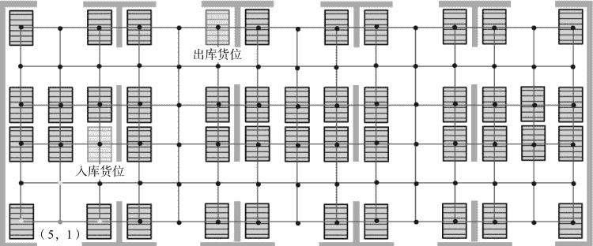

**图 4.9 环岛仓库网格划分示意图**

步骤 3 规则细则：判当前邻接步长 1 交点状态→判下一时刻方向（步长 1）→存可行路径→按最新坐标更新位置→循环至抵达出库门→输出最短径。

**次设单向规则场景。**

主流程不变，步骤 3 新增约束：车入环岛区域坐标子集时，按环岛单行方向限制下一时刻可达集合。更新矩阵与初始坐标可得规则下最优路径长。考虑到 $C_{46}^m C_{46-m}^n$ 组合爆炸，设定最小有效仿真次数，拟合 $m,n$ 全组合平均行程。为防过拟合，选二次曲面最小二乘拟合，得期望行程公式：

$A_v = A \times m^2 + B \times n^2 + C \times m \times n + D \times m + E \times n + F$ （4.1）

$A,B,C,D,E,F$ 为拟合系数。

**最后给出仓库效用评价模型。**

效用函数由油耗与作业时长双因子决定。积分推导得双车三卡模型下，设规则与不设规则效用函数分别为：

$F_s(m,n) = w_1 \times (c_s + c_f) + w_2 \times \left( \frac{d_s}{v_s} + \frac{d_{out}}{v_f} \right)$

$F_{ns}(m,n) = w_1 \times (c_{ns} + c_f) + w_2 \times \left( \frac{d_{ns}}{v_{ns}} + \frac{d_{out}}{v_f} \right)$

两式标准化后可得……

### 4.1.4 实战复盘：五室环岛仓库的出入库效能大比拼

#### 1. 场景还原与参数设定

沿用 4.1.3 节确立的算法框架，我们以图 4.9 展示的十门危险品仓库为蓝本，构建其仓储作业矩阵 $D_1$（见下表）。矩阵编码规则如下：入库货位标记为 1，出库货位标记为 -1，闲置货位标记为 2，通道节点标记为 0，集卡停靠仓门标记为 5。

| | | | | | | | | | | | | | | |
| :-: | :-: | :-: | :-: | :-: | :-: | :-: | :-: | :-: | :-: | :-: | :-: | :-: | :-: | :-: |
| 2 | 0 | 2 | 2 | 0 | 2 | 1 | 0 | 2 | -1 | 5 | 5 | 2 | 0 | 2 |
| 0 | 0 | 0 | 0 | 0 | 0 | 0 | 0 | 0 | 0 | 0 | 0 | 0 | 0 | 0 |
| 2 | 2 | 2 | 1 | 0 | 2 | 2 | -1 | 2 | 2 | 0 | 1 | 2 | 2 | 2 |
| 2 | 2 | 2 | -1 | 0 | 2 | 2 | 2 | 2 | 2 | 0 | 2 | 2 | 2 | 2 |
| 0 | 0 | 0 | 0 | 0 | 0 | 0 | 0 | 0 | 0 | 0 | 0 | 0 | 0 | 0 |
| 2 | 0 | 2 | 2 | 0 | 2 | 2 | 0 | 2 | -1 | 0 | -1 | 2 | 0 | 2 |

当前时刻，仓库内共有 3 个入库货位、5 个出库货位，出库集卡停靠坐标为 (0, 10)。仓库基础参数与仓门布局详见图 4.10。

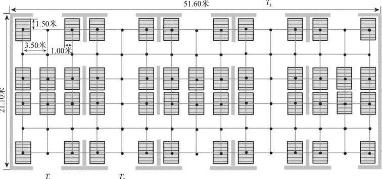

**图 4.10 环岛危险品仓库基础参数示意**

基于实地调研数据，我们为叉车运行参数赋值：
- **非环岛规则（双向）**：库内平均速度 $v_{ns} = 0.41$ m/s，单位油耗 4 L/h。
- **环岛单向规则**：库内平均速度 $v_s = 0.65$ m/s，单位油耗 3.6 L/h。
- **库外通用参数**：平均速度 2.7 m/s，单位油耗 3.05 L/h。
- **作业固定耗时**：入/出库单次货位作业均为 30 秒。

参数对比直观显示：实施环岛单向规则能显著提升库内行驶速度，同时降低单位时间油耗。

#### 2. 双效用模型的实证检验

为保证结论普适性与路程估算精度，我们设计了表 4.1 所示的 5 组入/出库货位数量组合对照实验：
- **第 2、3 组**：总货位数固定 (13)，入/出库数量互换（5:8 vs 8:5），考察“结构比”影响。
- **第 2、4 组**：总货位数固定 (13)，但比例悬殊（5:8 vs 2:11），考察“极端比”影响。
- **第 1、3、5 组**：总货位数递增 (6 → 13 → 25)，考察“规模量”影响。

**表 4.1 对照实验分组设计**

| 组别 | 1 | 2 | 3 | 4 | 5 |
| :---: | :---: | :---: | :---: | :---: | :---: |
| 入库货位数 ($m$) | 3 | 5 | 8 | 2 | 15 |
| 出库货位数 ($n$) | 3 | 8 | 5 | 11 | 10 |
| 总计 | 6 | 13 | 13 | 13 | 25 |

每组实验中，货位位置在给定数量约束下随机生成。理论排布组合数为 $C_{46-m}^m C_{46-n}^n$ 种，峰值出现在 (15,15)、(15,16)、(16,15) 附近，达 $1.538 \times 10^{20}$ 量级。为确定蒙特卡洛迭代次数，我们针对最复杂场景及最简场景 (3,3) 分别测试了 10~50 次迭代，各重复 10 次试验，统计叉车 $F_1, F_2$ 平均路程标准差（见表 4.2）。

**表 4.2 迭代次数对估算稳健性的影响**

| 迭代次数 | 10 | 20 | 30 | 40 | 50 |
| :---: | :---: | :---: | :---: | :---: | :---: |
| **m=15, n=15** | | | | | |
| $F_1$ SD | 0.000 | 0.049 | 0.033 | 0.059 | 0.018 |
| $F_2$ SD | 0.128 | 0.135 | 0.073 | 0.149 | 0.076 |
| **m=3, n=3** | | | | | |
| $F_1$ SD | 3.641 | 1.226 | 0.709 | 1.251 | **0.453** |
| $F_2$ SD | 3.085 | 1.352 | 0.794 | 1.169 | **0.434** |

**结论**：货位充足时，迭代次数对精度影响微乎其微；货位稀缺时，50 次迭代已将标准差压至极低（<0.5）。故全文统一采用 **50 次迭代**，生成 50 个输入矩阵求平均，得到各工况下 $d_s$ 与 $d_{ns}$。详细路程标准差统计见表 4.3。

**表 4.3 不同组合下叉车库内行驶路程标准差**

| 管理方案 | 叉车 | m=3,n=3 | m=5,n=8 | m=8,n=5 | m=2,n=11 | m=15,n=10 |
| :--- | :---: | :---: | :---: | :---: | :---: | :---: |
| **不设环岛 (双向)** | $F_1$ | 2.60 | 0.92 | 1.00 | 2.02 | 0 |
| | $F_2$ | 2.67 | 1.27 | 1.21 | 2.07 | 0.39 |
| **设环岛 (单向)** | $F_1$ | 7.47 | 2.01 | 1.66 | 6.21 | 0.54 |
| | $F_2$ | 6.95 | 2.14 | 2.40 | 5.87 | 0.96 |

**核心发现**：
1. **规模效应**：总货位数 ($m+n$) 越大，路程方差越小。
2. **结构效应**：总量固定时，$m/n$ 趋近 1，方差越小。
3. **规则代价**：环岛单向规则虽提速，但导致**平均路程增加、波动性放大**（绕行所致）。

进一步对全域 $(m,n)$ 组合遍历拟合，得出两叉车在两种规则下的平均步长曲面方程：
- **双向规则**：$A_{s1} = 0.00411863m^2 + 0.003871n^2 + 0.003242399mn - 0.230982m - 0.221084n + 21.6315$
- **单向规则**：$A_{s2} = 0.0100375m^2 + 0.0101523n^2 - 0.538743m - 0.542281n + 28.1999$

结合表 4.4 更新的运行参数（单向：库内 0.6 m/s / 3.8 L/h；双向：库内 0.5 m/s / 4 L/h；库外一致），代入效用函数 (4.2)(4.3)，绘制效用曲面（图 4.11）。

**表 4.4 叉车运行核心参数对照**

| 管理方案 | 库内速度 (m/s) | 库内油耗 (L/h) | 库外速度 (m/s) | 库外油耗 (L/h) |
| :--- | :---: | :---: | :---: | :---: |
| 设环岛单向 | 0.6 | 3.8 | 2.7 | 3.05 |
| 不设环岛 (双向) | 0.5 | 4.0 | 2.7 | 3.05 |

**决策边界**：效用函数值越大越优。计算表明，仅当 $(m,n)$ 落入集合 $S = \{(1,1)...(45,1)\}$ 等 **38 个“极低货位量”组合** 时，双向规则效用更高；**其余绝大多数工况，环岛单向规则占优**。

#### 3. 深度复盘与管理启示

研究揭示：环岛仓库是否实施单向规则，取决于**瞬时入/出库货位量 $(m,n)$**。

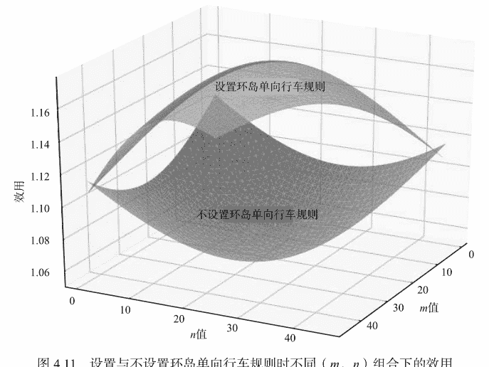

**关键洞见**：
- 若固定货源量超总容量，宜单独建库分区；但现实中危险品周期性与流量常不满足此条件，强行分区反而浪费资源。
- **高灵活性货物场景下**：
  - **货位充足 ($m,n$ 较大)** → 环岛单向规则**效用显著更高**（提速省油红利 > 绕行成本）。
  - **货位稀缺 ($m$ 或 $n$ 极小)** → 宜取消单向，**双向通行效用最大化**（避免大幅绕行）。

这一结论映射城市交通通律：单行道提速但致绕行；车辆油耗在阈值速度前随速降低。本文融合“时间+油耗”双目标，量化了危险品仓库环岛规则的适用边界，揭示其与仓库规模、货位量、布局的耦合关系，为高效运营提供理论支撑。

---

## 4.2 综合效用视角下的环岛危险品平仓分区作业策略

### 4.2.1 问题背景与研究靶向

4.1 节聚焦“环岛叉车跑法”，本节引入**危险品禁配约束**，升级攻关“货位怎么分区”。研究背景锁定环岛平仓，条件设定多叉车并发、危险品同进同出，核心指标盯住**安全红线下的安全度**与**仓储作业效率**。特别提示：受 I~IV 级剧毒易燃易爆扩散特性制约，本节适用范围限定为 **V 级及以上危险品**。

**研究主线**：在安全底线不破的前提，解剖“分区决策 ↔ 作业效率”的内在联系。重点对比两种模式：
1. 环岛单向 + 分区布设
2. 环岛单向 + 不分区

章节路线图：4.2.2 定性剖析分区利弊；4.2.3 算法与规则控制细则；4.2.4 核心模型构建；4.2.5 算例实证输出决策方案。

### 4.2.2 定性透视：分区为何物、分区凭什么

为提效、避撞，本节在环岛基建上叠加**分区管理规则**：
- **路权重塑**：环岛区域强制单向，其余通道双向 → 从源头压降会车概率。
- **功能分区**：下半区 = 入库区，上半区 = 出库区 → 单任务活动范围锁定半径，压缩无效里程。

分区与不分区的拓扑对比见图 4.12、4.13。

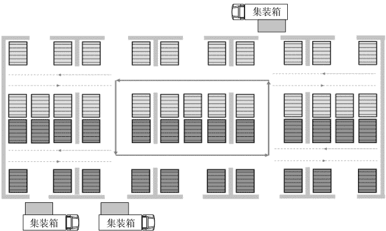
**图 4.12 环岛单向规则下·实行分区布局**

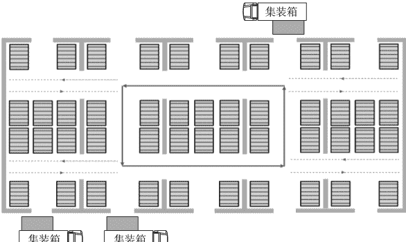
**图 4.13 环岛单向规则下·不实行分区布局**

基于调研与专家访谈，我们从三个维度拆解分区决策机理：

**痛点 1：大需求、不分区、靠经验选位 → “近门优先”陷阱**
固定货源周期 ≫ 流动货源周期 → 靠近入库门的优质货位被长周期货源长期占据 → 迫使后续作业叉车深入腹地 → **库内行程飙升、运营成本激增、安全系数下探**。

**痛点 2：不分区出库 → “随机分布”陷阱**
出库点散落全场 → 出库叉车长距离穿梭、会车碰撞概率飙升 → **成本与隐患双高**。

**痛点 3：分区破局逻辑**
入库区/出库区物理隔离 → 叉车作业半径收敛 → 绕行被抑制、冲突点消解 → **效率与安全同频共振**。

---

*下文将进入 4.2.3 节，详解多叉车协同算法与环岛规则控制器的硬核实现……*

### 4.2.3 包装危险品环岛平仓：货位分区设置的核心逻辑

#### 1. 分区决策的关键影响因素剖析

针对环岛危险品仓库“是否分区”的利弊权衡，本节提出了一套动态调整策略：依据仓库实时运行状态，灵活制定分区存储规则以追求全局最优。我们以“双叉车双集卡入库、单集卡出库”的十门环岛仓库为实证场景，深度解构分区存储规则。

核心判断标准锁定在两个基础变量上：**入库货位数量（m）** 与 **出库货位数量（n）**。研究证实，这两个变量是获取仓库内货物总量的最优入口，而**货物总量**才是分区决策的“定海神针”。通过它们可推导货物周转率，结合存储周期长短匹配最优库位，从而实现“仓储成本最小化”与“安全指标最大化”的双重目标。此外，货物存储时长与危险品周转量作为利润核心指标，由此构建的成本-效用函数，将成为衡量仓库整体运行效能的“金标准”。

#### 2. 分区计算的核心要素与仿真推演

**基础参数建模**  
分区决策函数定义为 $y = f(N, m, n)$。其中 $N$ 为二值开关（1=分区，0=不分区），$m、n$ 为核心自变量。叉车记为 $F$，总运作成本 $C$ 拆解为货位固定成本 $C_r$、人工成本 $C_w$、叉车运行成本 $C_p$。引入进出库货量（$G_{in}, G_{out}$）、叉车内外场速度（$v_s, v_f$）、行驶距离（$d_s, d_{out}$）及对应单位油耗（$c_s, c_f$）等工程参数。

**仿真求解最短路径**  
鉴于叉车库内行驶方向仅四向、确定性强，采用网格化仿真法求解平均最短行驶距离 $d_{min}$。具体流程如下：

- **步骤 4.8-4.9**：仓库区域网格化，获取交点坐标，并以矩阵形式映射布局。
- **步骤 4.10-4.11**：设定单向环岛行车规则（坐标子集限制下一时刻方向），初始化叉车入库坐标。
- **步骤 4.12-4.13**：依规则搜索入库门到出库门所有最短路径并实时存储；校验双叉车同位冲突，无冲突则保存路径。
- **步骤 4.14**：迭代 $n$ 次，输出所有 $m,n$ 组合下双叉车库内平均行程。

**行车规则细化（步骤 4.15-4.20）**：  
通过判断步长为1的邻接节点状态，限制单向行驶可达方向，滚动更新坐标直至抵达出库门，最终输出最优路径。

**组合爆炸与拟合模型**  
给定 $m,n$ 可生成 $C_{46}^m C_{46-m}^n$ 种作业模式。为在有限算力下获取精准均值，设定最小有效仿真次数，结合数据拟合得出叉车 $F_1, F_2$ 库内行驶距离期望公式：

$$A'_n = A m^2 + B n^2 + C mn + D m + E n + F \quad (4.4)$$

（参数 $A-F$ 由拟合确定，可快速响应工程决策需求）

---

### 4.2.4 环岛平仓货位分区：多维决策模型构建

#### 1. 叉车配速视角下的安全度量化模型

**安全度函数定义**  
将“安全”显性化为函数 $\xi = f(d_0, t, d, S)$。自变量包括：安全红线距离 $d_0$、重点监控作业时长 $t$、重点监控态下双叉车最短距离 $d$、叉车运行路径长度 $S$。仅当 $d < d_0$（进入重点监控态）时计算安全度，积分区间为 $[t_i, t_{i+1}]$。

计算公式：
$$\xi = \frac{1}{t} \sum_{i=0}^{N} \int_{t_i}^{t_{i+1}} d_i dt \quad (4.5)$$
物理意义：重点监控态下双叉车平均间距，间距越大、越持久，安全度越高。

**工程落地简化模型**  
考虑布局 $A$、线路 $L$、速度 $v$ 的耦合，定义 $\xi = f(A, L_j, v)$。引入安全因子 $a$（由货物危险特性与商业效益权衡确定），令 $v = a \times \xi$。**洞见：高安全度环境下可适当提速增效。** 对比分区/不分区两态：$v_0 / v_1 = \xi_0 / \xi_1$。

综合安全与速度，定义仓库效率函数：
$$E = S \times \alpha^{-1} \times f(A, L_j, v)^{-1} \quad (4.7)$$

#### 2. 基于存储周期的货位适用度模型

**核心逻辑**：短周期货物流动性强、进出频繁，应安排“单次作业路程 $d_i$ 短”的货位；长周期货物对应长路程货位。  
单次作业路程 $d_i = d(P_i, p_i) + d(p_i, P_{T_j})$（入库口→货位→出库口）。

**适用度量化**  
单货位适用度 $\varphi = S \times n \times \alpha$。  
$S$=完整作业路程，$n$=存储量，$\alpha$=惩罚系数（体现“错位成本”）：
- 长周期货占短路程货位（高适用度位）：$\alpha \ge 0.5$（惩罚力度大）；
- 短周期货占长路程货位（低适用度位）：$\alpha \le 0.5$。

全仓匹配差异度 $\Phi = \sum(S_i \times n \times \alpha)$。对比“随机摆放”与“分区摆放”的 $\Phi$ 差值，即可量化分区带来的布局合理性提升。

#### 3. 分区场景下的作业成本模型

总成本 $C = C_r + C_w + C_p$。前两项短期视为常数，重点建模叉车运行成本 $C_p$（以三集卡场景为例）：

$$C_p(m,n) = w_1(c_s + c_f) + w_2\left(\frac{d_s}{v_s} + \frac{d_{out}}{v_f}\right) \quad (4.9)$$
（$w_1+w_2=1$，权衡油耗与时效）

**库内最短距离 $d_s$**：
$$d_s = \min[d(P_{r_i}, p_{i_i}) + d(p_{i_i}, q_{j_i}) + d(q_{j_i}, P_{r_j})] \quad (4.10)$$
（入库口→入库位→出库位→出库口）

**库外回位距离 $d_{out}$**：$d(P_{r_j}, P_{r_i})$（出库口返回入库口）。

**环岛规则的杠杆效应**：单向行驶避免会车减速 $\Rightarrow v_s > v_{ns}$ 且 $c_s < c_{ns}$；但可能增加行程 $d_s > d_{ns}$。需通过效用函数第二项（时间成本）权衡“提速红利”与“增程代价”。

#### 4. 仿真驱动的多属性决策模型

综合效用 $U = f(c_1, c_2, E)$（短期成本、长期成本、运作效率）。效用与成本负相关、与效率正相关。

**分区态效用**：$U_1 = 1 - [w_1 c_{11} + w_2 c_{12} + w_3(1-E_1)]$  
**非分区态效用**：$U_2 = 1 - [w_1 c_{21} + w_2 c_{22} + w_3(1-E_2)]$

**决策判别式**：
$$\Delta U = (c_{11}-c_{21})w_1 + (c_{22}-c_{12})w_2 + (E_1-E_2)w_3$$
- $\Delta U > 0$ （式4.11）$\Rightarrow$ **倾向分区**；
- $\Delta U < 0$ （式4.12）$\Rightarrow$ **倾向不分区**。

由此划定决策偏好空间，为管理层提供量化决策依据。

---

### 4.2.5 实战算例：五室环岛仓库分区效能验证

#### 1. 安全度与效率实测对比

设定基准参数 $m=2, n=2$，随机抽样货位仿真。结果显示：**分区与否对安全度均值影响不显著**，但**稳定性差异巨大**——
- 分区态安全度方差：**0.238**（波动小、可控强）；
- 非分区态安全度方差：**1.125**（波动大、风险高）。

进一步测算效率比 $\lambda$：
| 指标 | 不分区 ($_0$) | 分区 ($_1$) | 比值 ($_1/_0$) |
| :--- | :--- | :--- | :--- |
| 安全度期望 $\bar{\xi}$ | 1.767 | 1.676 | **0.948** |
| 路线长度期望 $\bar{s}$ | 15457.5 | 1619.3 | **1.046** |
| **综合效率比 $\lambda$** | - | - | **0.99** |

> **解读**：分区虽微增路径长度（+4.6%），但显著收敛安全波动，综合效率基本持平（$\lambda \approx 1$），验证了“以微小效率代价换取安全确定性”的工程价值。

#### 2. 成本与适用度量化对决

沿用 4.1.4 节数据，对比不同 $m,n$ 组合下的核心指标（详见表 4.5）：

**表 4.5 分区 vs 不分区：适用度与路程稳定性 PK**

| 评价维度 | **设置分区规则** | **不设置分区规则** | 优势归属 |
| :--- | :---: | :---: | :--- |
| **货位适用度** | **2.60** | 7.47 | **分区胜**（数值越小匹配度越高） |
| **行驶距离方差** | **0.92** | 2.01 | **分区胜**（路径更稳定可预测） |

**核心结论**：  
在大需求分区场景下，分区管理**大幅降低货位匹配偏差（适用度降 65%）**并**显著压缩路径波动（方差降 54%）**，以极小的平均路程增量换取了作业确定性与本质安全的双重提升。这为“何时分区、如何分区”提供了坚实的数据支撑。

# 第 5 章 多元危化品平仓仓储需求管控策略

#### 3. 多属性决策模型的仿真构建与求解

依据公式 (4.11) 与 (4.12) 推导，效用差平面方程为 $U_1 - U_2 = 0.571w_1 - 0.088w_2 - 0.01$。求该平面与 xOy 面交线可得：若 $0.571w_1 - 0.088w_2 > 0.01$，实施分区能提升仓库综合效用；反之则降低效能并造成资源闲置。图 4.18 至 4.20 展开深度对比，进而划定支持非分区的决策偏好域 D₁ 与支持分区的决策偏好域 D₂（详见图 4.21）。

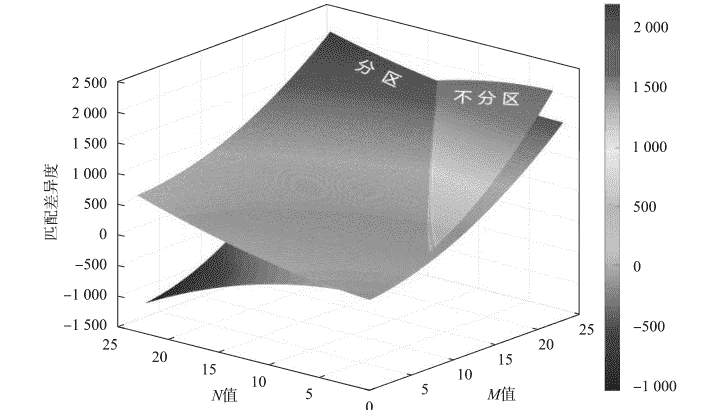
图 4.18 当设置分区与不分区时的匹配差异度比较

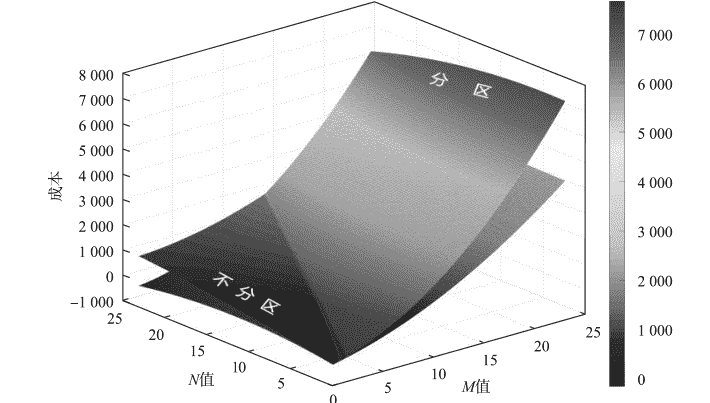
图 4.19 当设置分区与不分区时的成本比较

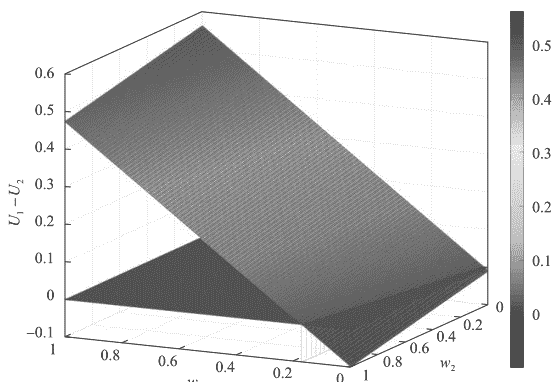
图 4.20 综合效用评价基准面

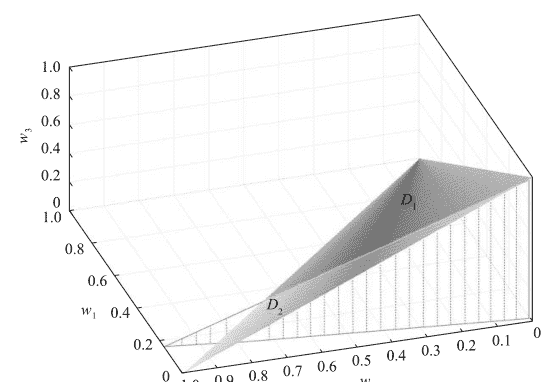
图 4.21 分区与不分区的决策偏好空间

数据表 4.5 显示：若出入库货位数量充足，将迭代轮数控制在 10 到 50 次区间内，对叉车平均作业距离精度的影响几乎一致。反之，当货位稀缺时，实验表明：迭代至 50 轮时，F1 与 F2 两台叉车平均行程的标准差已充分收敛。基于此，我们对所有入出库货位数量组合均执行 50 次迭代，生成 50 组差异化输入矩阵，经运行算法控制模型求解各矩阵下双叉车行程，最终取均值，确定入库位 $m$、出库位 $n$ 条件下的库内平均行程 $d_s$。

进一步分析发现，设置入库分区后，叉车行驶距离与仓库长期适用度的波动均显著收窄。为此，我们采用上述方法，针对 $\sum_{i=1}^{45} i$ 种货位组合场景，每场景随机抽取 50 个布设矩阵遍历计算，分别量化分区与非分区两种模式下，双叉车库内行驶步长及仓库匹配差异度，详细结果见图 4.14 至图 4.17。

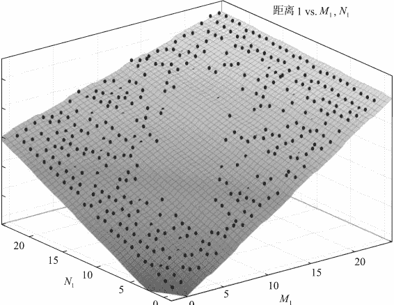
图 4.14 设置仓库分区管理规则后叉车的实际行驶距离

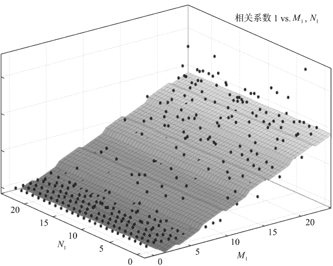
图 4.15 设置仓库分区管理规则后的仓库匹配差异度

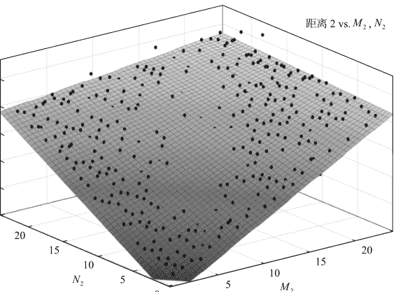
图 4.16 当不设置分区管理规则时叉车实际行驶距离

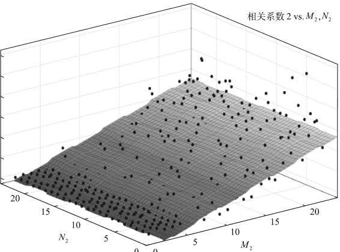
图 4.17 当不设置分区管理规则时仓库匹配差异度

图表直观对比显示：无分区规则下，包装危化品环岛平仓数据波动剧烈，管理可控性低；引入分区规则后，仿真数据平稳收敛，可控性显著增强。

#### 4. 仿真结果深度解析与决策准则

研究揭示：在环岛行车规则约束下，危化品仓储企业必须依据当期出入库量动态制定分区策略。实测数据表明：出库量占优时宜取消分区，入库量占优时宜实施区域划分。结合实例推演，提炼出四大决策准则：

1.  **入库位少于出库位 且 后续存储量低** → 分区利于短期运营降本。
2.  **入库位少于出库位 且 后续存储量高** → 取消分区以控长期适用度差值，降长期成本。
3.  **出库位少于入库位 且 后续存储量高** → 取消分区利于短期运营降本。
4.  **出库位少于入库位 且 后续存储量低** → 分区可降货物适用度差值，从而降长期成本。

综上，企业面临分区抉择时，可结合财务状况、经营理念，参考综合效用函数与长短期成本账，择优决策，实现成本效率帕累托改进。实践中更发现：危化品仓对安全阈值要求远超常规库。本节以环岛运行为背景，融合最优化理论与创新成本模型，经数值仿真验证，攻克了分区设置难题。创新点聚焦三维：实务层面，首创出入库作业叉车运行安全度公式及红线下计算法；理论层面，首将迷宫寻径算法引入效用理论解决出入库问题；验证层面，基于长三角实测参数（双集卡入、单集卡出），确证理论有效性。作业端建议：叉车闯入安全红线时强制触发减速避让预警，进一步压降事故概率。

## 4.3 章节小结：环岛仓库双维解析

为推动危化品仓库多元化发展，本章创设“环岛危化品仓库”概念，从运行规则、空间布局双维深度解析，核心结论三点：

**4.1 节启示：** 动态隔离墙打通多通道建设路径；多通道下叉车运行方案聚焦“立规则”与“设算法”两大流派；规则设置与否，本质是效率与成本的博弈，可通过最优化模型配合启发式算法求解。

**4.2 节突破：** 空间管理层面确立“分区”与“非分区”双范式；首提“安全红线”概念并推导安全度量化公式；理论创新核心在于迷宫寻径算法与效用理论的跨界融合。

对比互通式仓库，环岛结构赋予叉车更丰富的线路自由度，运营优势显著。未来，互通与环岛双模式联动，叠加消防管理智慧，将催生更多元的危化品仓库布局方案。

## 5.1 危化品仓储现状剖析与多元库型构建

鉴于既有研究稀缺，我们实地调研国内外政策，梳理零散认知，结合前期几何结构成果，系统提出平仓仓储需求管理框架。先速览国内外管理特征与政策脉络。

### 5.1.1 全球视野下的危化品仓储管理现状扫描

#### 1. 我国危化品仓储管理：四大核心痛点

广泛调研形成四大核心判断：

**供给短缺、库型单一，难敌旺盛需求。** 危化品关乎民生工业，随经济腾飞与生活升级，需求逐年攀升。然库缺口长期卡在 20% 左右，化工重镇更超 30%。客户被迫异地存储、觅“黑仓”、或降级用普通库，表面缓解实则埋下事故隐患与高额机会成本。

**“一刀切”服务严重，缺位精准匹配。** 需求端呈现多元、差异、个性化爆发，供给端却形式单一、服务单薄、增值稀缺、创新乏力。大数据、AI、物联网等技术重塑时效与多样性标准，倒逼企业推出更多元方案。

**现代化水平滞后，五大短板制约。**
1.  理念陈旧：重经营轻管理、重效益轻服务、重经验轻技术、重眼前轻发展；
2.  手段落后：依赖经验，缺标准化流程与智能化手段；
3.  硬件短板：设施不足、设备老化、自动化率低，老企尤甚，人工作业占比高；
4.  结构落后：平仓为主，空间成本高、效率低（库型占比见表 5.1）；
5.  信息化弱：仅少数企业联网，多数管理水平低，个别甚至无系统。

### 表 5.1 国内危险品仓库类型表

| 名称 | 所占比例 | 特征 |

|---|---|---|

| 平仓仓库 | 50%以上 | 造价低廉，作业方便 |

| 储罐仓库 | 38%左右 | 发展速度较快 |

| 立体仓库 | 5%左右 | 符合现代仓储需要 |

| 货棚 | 3%左右 | 多建于车站、码头和中转库 |

| 堆场 | 3%左右 | 以化工原料为主 |

| 楼仓 | 0.5% | 数量较少 |

| 地下、半地下仓库 | 0.5% | 数量较少 |

**行业标准缺位，专业化建设待启。** 危化品仓储独立性、专业性、特殊性凸显，却长期缺乏自主专业标准与发展规划。

#### 2. 国外典型经验：美英加三国管控范式

**美国：严控风险预测预防。** 执行严格风险管理计划条例（RMP）。装置含危险物质超 140 磅（≈63.5 千克）即强制合规。核心聚焦降低社区暴露风险、最小化环境破坏。涵盖容器识别、风险分级、事故溯源、历史档案、调查报告、预防措施、应急预案等全链条[153]。

**英国：多部门协同规划管理。** 环境食品和乡村事务部、健康与安全执行局、环境署等十余机构按化学品生命周期分工协作。政策目标锚定：环保有效、资源节约、经济稳增、充分就业[153]。

**加拿大：立法强化化学品全链管控。** 联邦省两级法令体系，核心含危害物品法令、管理条例、成分报告条例、资料审核法令/条例。强制销售/进口商提供合规安全标签；成分报告条例列管 1736 种有害物质，超浓度即判定有害并强制标签[154]。

#### 3. 中国危化品仓储政策图谱

洞察政治环境，预判行业趋势。汇总国家层面政策见表 5.2，上海市政策见表 5.3。

### 表 5.2 国家层面危险品仓储政策汇总

| 文件 | 内容 |

| --- | --- |

| 《“互联网+”高效物流实施意见》 | 支持物流企业建设智能化立体仓库，应用智能化物流装备提升仓储、运输、分拣、包装等作业效率和仓储管理水平；推动仓储设施从传统结构向网络结构升级 |

| 《促进大数据发展行动纲要》 | 支持企业开展基于大数据的第三方数据分析发掘服务，技术外包服务和知识流程外包服务；鼓励企业根据数据资源基础和业务特色，积极发展互联网金融和移动金融等新业态；推动大数据与移动互联网、物联网、云计算的深度融合，深化大数据在各行业的创新应用，积极探索创新协作共赢的应用模式和商业模式 |

| 《关于进一步推进物流降本增效促进实体经济发展的意见》 | 依托互联网、大数据、云计算等先进信息技术，大力发展“互联网+”车货匹配、“互联网+”运力优化、“互联网+”运输协同、“互联网+”仓储易货等新业态、新模式；结合国家智能化仓储物流基地示范工作，推广应用先进信息技术及装备，加快智能化发展步伐，提升仓储、运输、分拣、包装等作业效率和仓储管理水平，降低仓储管理成本 |

| 《大数据产业发展规划（2016-2020 年）》 | 加快大数据服务模式创新，培育数据即服务新模式和新业态，提升大数据服务能力，降低大数据应用门槛和成本；提升第三方大数据技术服务能力；推动大数据技术服务与行业深度结合，培育面向垂直领域的大数据服务模式 |

| 《关于促进中小企业健康发展的指导意见》 | 推进发展“互联网+中小企业”，鼓励大型企业及专业服务机构建设面向中小企业的云制造平台和云服务平台，发展适合中小企业智能制造需求的产品、解决方案和工具包，完善中小企业智能制造支撑服务体系 |

### 表 5.3 上海市危险品仓储政策汇总

| 文件 | 内容 |

| --- | --- |

| 《上海市大数据发展实施意见》 | 推动本市大数据产业基地建设，培育和引进一批具有自主知识产权和技术创新能力的产品研发和应用服务型企业，增强大数据骨干企业辐射带动作用。加强协同创新，推动核心芯片、高性能计算机、传感器、存储设备、网络设备、数据仓库、智能分析、数据可视化等软硬件产品的研发与产业化，形成一批垂直领域大数据应用解决方案 |

### 5.1.2 四大危化品平仓模式深度对比：效能、成本与安全的博弈

在前文基础上，我们通过重构室内隔墙并引入电动隔离门，衍生出四门式、互通式及环岛式三种新型危化品平仓。加上传统的双门仓，目前可供调度的仓储形态共四类。值得注意的是，这四种结构并非割裂孤立，而是通过隔离门的开合状态实现“形态转化”：四门仓关门即为双门仓；互通仓按奇数门通行可退化为四门仓；环岛仓仅留单门则变身互通仓。这种嵌套关系意味着，我们可以将四类仓库视为“积木模块”，灵活组合隔离门策略，定制差异化仓储服务。

#### 核心维度横向评测

**1. 作业效率：环岛领跑，双门垫底**
从叉车通道资源看，环岛仓通道最多，依此递减至互通、四门、双门。
从最短运行路径看，环岛仓路径最优，依次优于互通、四门、双门。
综合灵活度而言：**环岛 > 互通 > 四门 > 双门**。
结论：出入库作业效率呈同序排列，环岛仓效能最高，传统双门仓最低。

**2. 运营成本：土地与设备的双重账单**
隔离门占用货位面积，环岛仓平均单货位占地最大，互通、四门、双门依次递减。
隔离门数量上，环岛仓最多，双门仓最少。
综合土地成本与设备投入：**环岛仓单间成本最高，双门仓最低**，中间梯队依次为互通、四门。

**3. 安全管理：冲突点与时效的动态平衡**
*   **低压态势下**：双门仓线路固定、冲突点极少，安全系数最高；四门、互通冲突点增多，碰撞风险上升；环岛仓冲突点最密集，风险最大。安全排序：**双门 > 四门 > 互通 > 环岛**。
*   **高压态势下（追求时效）**：双门仓无路径选择权，只能靠提速作业，事故率飙升；新型三类仓凭借多路径优势疏导压力，在不降安全阈值前提下提效。安全下降速度：**双门最快 > 四门 > 互通 > 环岛最慢**。

**4. 智能化适配度：物理基础决定上限**
环岛仓隔离门最多、通道最密，为智能调度（门控、路径规划、货位分配）提供了最大解空间，适配度最强；双门仓物理自由度最低，智能化提升空间受限。梯队排序：**环岛 > 互通 > 四门 > 双门**。

#### 选型建议
双门仓适配低产力、低时效场景；环岛仓匹配高产力、强时效需求；四门与互通仓则折中兼顾。鉴于国情与客户多元化，企业应按需配置，而非盲目追新。

---

### 5.2 危化品仓储成本核算模型构建

#### 5.2.1 研究背景与技术路径
危化品运输量激增倒逼仓储提质增效。当前国内主流的双门平仓因效率短板难以匹配增量需求。本研究依托新型建材，在室内单元间布设电动隔离门（平时常闭、通行即开），打通单元壁垒，物理层面破解效率瓶颈。研究范围限定为除1类爆炸品外的危化品（爆炸品需专用防爆库）。

针对隔离门方案缺乏评价工具的痛点，本节以双门仓参数为基准，引入**运营成本、机会成本、运营效率**三大核心变量，构建效用评价模型，量化各方案经营成本。理论支撑涵盖最优化理论、统计理论及仿真模拟，技术路线详见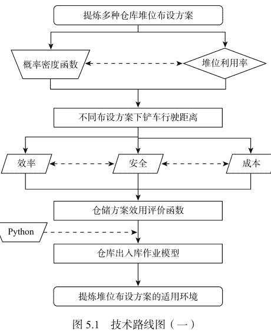。

#### 5.2.2 动态货位布设的前置逻辑与六大方案
样本仓设5个单元（左至右编号1-5），相邻单元间至少设4扇隔离门以实现互通。在此物理约束下，设计了6种货位布设方案（详见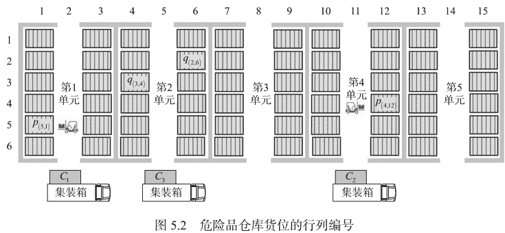-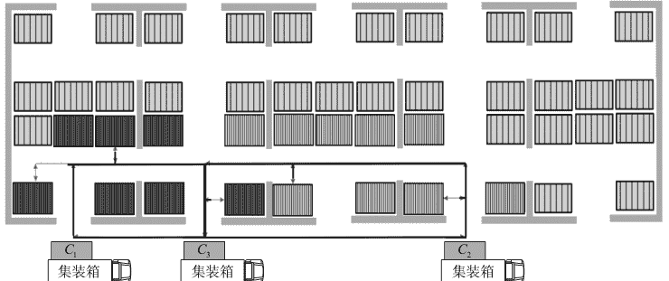及图5.7、5.8）：

*   **方案一（基准）**：传统布局，供对比基准。标注叉车绕行（A/B）与直达（C）路径。
*   **方案二（）**：空间利用率最高，隔离门较少，但叉车路线曲折，适配双侧作业；可通过加门优化绕行。
*   **方案三（）**：过渡形态。
*   **方案四（）与 五（）**：转弯少、利于提速增效，但需大量隔离门，管理复杂，且单元内上下连通性弱。
*   **方案六（/）**：互通性最佳，但空间利用率偏低。

**五门仓调度原则**：
1.  入库优先匹配对应仓门单元货位；
2.  出库优先匹配对应仓门单元货位；
3.  货位非入即出，无中间态；
4.  跨中轴线作业时，叉车优先走环线而非折返。

#### 5.2.3 动态布设下的存储定价与成本模型

**1. 关键参数设定**
场景：双叉车双集卡入库（C1、C2），单集卡出库（C3）。
*   入库点集 $M=\{p_1...p_m\}$，出库点集 $N=\{q_1...q_n\}$，统称货位 $S_i$。
*   叉车 $F_1$ 服务 $C_1/C_3$，$F_2$ 服务 $C_2/C_3$。
*   往返路径长度分别记为 $S_{p_i,q_j}^{C_1}$、$S_{p_i,q_j}^{C_2}$。
*   6种方案编号 $n_s \in \{1..6\}$，引入叉车速度 $v_{n_s}$、货位稀疏度 $\chi_{n_s}$、作业耗时 $t_{n_s}$、单位油耗 $w_{n_s}$、机会成本 $o_{n_s}$、油价 $P_{oil}$。

**建模流程**：
1.  依布局确定叉车平均最短距离概率密度函数；
2.  设运行规则，建立平均最短距离优化模型；
3.  结合速度与稀疏度量化单次作业耗时；
4.  换算油耗成本与机会成本；
5.  求解综合目标函数得运营成本；
6.  仿真验证模型有效性。

**2. 多方案运营成本计算模型**
目标：最小化叉车单次出入库行驶距离。
$$ \min \sum_{N=1}^{2} S^k_{p_i, q_j} = l_{C_N, p_i} + l_{p_i, q_j} + l_{q_j, C_j} + l_{C_N, C_j} \quad (5.1) $$
$s.t.\ i \in M, j \in N, k=1,2$

其中 $l_{p_i,q_j}$ 可由货位坐标（行列号）推导。本节仓库均为6行15列，货位以坐标标识（如 $p_{(1,1)}$）。
不同方案下单元货位数 $N_p^k$ 不一，总货位数 $N_p = N_{p_p} + N_{p_q}$。入库比例 $r_p$，出库比例 $r_q$。
随机取货位时，距 $C_1、C_2$ 最近入库位记为 $p_{(x_1,y_1)}、p_{(x_2,y_2)}$，距 $C_3$ 最近出库位记为 $q_{(x_3,y_3)}$。
据此，叉车 $F_1$ 从 $C_1$ 至最近入库位的期望行程可表示为……[后续公式推导保持原意]。


### 三、危险品仓库仓储作业仿真模型构建

```
0 0 0 0 0 0 0 0 0 0 0 0 0 0 0 0 0 0
0 -1 0 1 1 0 -1 -1 0 -1 1 0 1 -1 0 1 0
0 1 0 1 1 0 1 1 0 1 1 0 1 -1 0 1 0
0 1 0 1 1 0 1 1 0 1 1 0 -1 -1 0 1 0
0 1 0 1 1 0 -1 -1 0 1 1 0 -1 -1 0 -1 0
0 1 0 1 1 0 1 1 0 1 1 0 1 -1 0 1 0
0 1 0 1 1 0 1 -1 0 1 1 0 -1 1 0 1 0
0 0 0 0 0 0 0 0 0 0 0 0 0 0 0 0 0 0
```

**图 5.9 入库货位 45 个、出库货位 15 个的仓储作业矩阵示意**

为校验公式（5.11）的可靠性，我们搭建了基于概率行驶逻辑的仿真平台，通过重复实验统计双叉车的平均行程。仿真流程包含八个核心步骤：

1.  **建模布局矩阵**：针对六种方案差异化的货位布局，分别构建表征仓库货位状态的矩阵模型。
2.  **设定运行规则**：依据 5.2.2 节提出的“十门危险品仓库使用原则”，编码叉车的调度与行驶逻辑。
3.  **初始化坐标**：将双叉车的起始坐标锚定在两个入库集车对应的库门矩阵位置。
4.  **入库路径生成**：遍历矩阵中所有入库货位坐标，按行驶规则依次解析叉车抵达各入库货位的路径。
5.  **坐标更新（入库端）**：将叉车当前坐标依次迭代更新为各入库货位的坐标点。
6.  **出库匹配与路径规划**：识别所有出库货位坐标，按规则将入库货位与出库货位配对，生成叉车从入库点至出库点的完整行驶轨迹。
7.  **坐标更新（出库端）**：将叉车坐标再次迭代为各出库货位位置，并按规则求解从出库货位驶向出库库门的路径。
8.  **闭环寻优**：模拟叉车从出库集车返回入库集车的过程，循环执行步骤 7，在所有候选路径中筛选出全局最短路径。

图 5.9 直观展示了方案 1 布局下的矩阵场景：其中 “0” 代表叉车可通行道路，“1” 标识入库货位，“-1” 标识出库货位。

仿真实验中，对任意给定的入库货位数量，均重复上述流程 1000 次，统计双叉车最短路径的平均值，作为该货位量级下的期望行程基准。

---

### 5.2.4 五单元工况下六大布局方案的成本核算算例

#### 1. 算例背景与参数基准


**图 5.10 传统危险品仓库布设示意图**

图 5.10 给出了传统危化品仓库的基准布局。其余五种方案均在该基准上通过裁减货位衍生而来，因此参数设定全员参照此标准执行。

基于图 5.10 的仓库参数，我们测算出六种布局方案的仓库稀疏度指标，汇总如表 5.4 所示。

#### 表 5.4 六大布局方案仓库稀疏度对比（单位：米）

| 方案 | 方案一 | 方案二 | 方案三 | 方案四 | 方案五 | 方案六 |
| :--- | :--- | :--- | :--- | :--- | :--- | :--- |
| **稀疏度** | 19.09035 | 29.23452 | 30.09624 | 29.09115 | 29.20495 | 30.06011 |

> **特别说明**：方案一因单元间不互通，稀疏度计算以“单元”为单元单元位计算各单元小车行驶路程期望。为便于理解模型应用，下文给出详细核算实例。

#### 2. 六大方案综合成本求解详解

**方案一：分区互斥工况概率建模**

假设第 1、2 单元及第 3、4 单元均至少包含一入一出货位的概率记为 $P_{\text{case1}}$；若将判定区域压缩至仓库中心线以南，对应概率记为 $P'_{\text{case1}}$，则有：

$$P_{case1} = \left[1 - \left(r_p\right)^{24} - \left(r_q\right)^{24}\right]^2, P'_{case1} = \left[1 - \left(r_p\right)^{12} - \left(r_q\right)^{12}\right]^2$$

式中，$P_{\text{case1}}$ 首项 $\left[1 - (r_p)^{24} - (r_q)^{24}\right]$ 表征：在排除“全仓全入”或“全仓全出”极端情况后，1、2 号单元（各 24 个货位）同时存在入库与出库货位的概率；$P'_{\text{case1}}$ 首项同理但样本量减半为 12。后两项分别对应 3、4 号单元的同类概率。随入库货位数变化，$r_q$ 动态调整，驱动上述概率随之波动，趋势见图 5.11。

图 5.11 揭示：当总货位数固定为 60，入库货位数 $x$ 在 12~46 区间波动时，叉车避开上半区绕行的概率超 90%。设货位数服从 $N(30, 10^2)$，由正态分布密度函数可得：落入 (12, 46) 概率 0.90927，落入 (7,12) 与 (46,51) 概率合计 0.06214。据此推导：

$$\sum_{N=1}^2 S_{P_i, d_j}^{C_v} = P(24 < N_{I_p} < 36) \times \left[0.9 \times 137.99 + 0.1 \times \left(\frac{198-137.9}{2} + 137.9\right)\right] + \left[P(15 < N_{I_p} < 24) + P(36 < N_{I_p} < 45)\right] \times 0.95 \times 198 + \left[1 - P(15 < N_{I_p} < 45)\right] \times I_{else}$$

其中 $I_{\text{else}}$ 为非最优路径期望长度。因尾部概率 $1-P(15 < N_{I_p} < 45) < 0.05$，该项乘积可用常数 $\varepsilon_{\text{case1}}$ 近似替代，取值 30。

$$\sum_{N=1}^2 S_{P_i, d_j}^{C_v} = 0.909270 \times (0.9 \times 137.9 + 0.1 \times 167.95) + 0.062141 \times (0.95 \times 198 + \varepsilon'_{case1}) + \varepsilon_{case1} = 169.81 \text{米}$$

**方案二与方案三：复杂拓扑下的理想工况概率**

方案二、三因库内路径拓扑复杂，定义“理想工况”为：1、2 号单元下半区、3、4 号单元下半区，**各自**至少含一入一出货位。记该工况发生概率为 $P_{\text{case2}}$，则：

$$ P_{\text{case2}} = \left[ 1 - \left( r_p \right)^{10} - \left( r_q \right)^{10} \right]^2 $$

### 危险品仓库互通布局深度解析：六大方案成本实测与压仓临时货位决策新范式

接着推演方案三的概率模型。在第 1、2 单元及第 3、4 单元的中轴线下方区域，各自至少包含一个入库与一个出库货位的联合概率 $ P_{case3} $ 计算如下：

$$ P_{case3} = \left[ 1 - \left( r_p \right)^{9} - \left( r_q \right)^{9} \right]^2 $$

入库货位数量波动会引致 $ r_p $ 变化，进而影响 $ P_{case2} $ 与 $ P_{case3} $，具体趋势见下文的图 5.12。


**图 5.12 方案二、三：入库货位数量变动下假设成立的概率分析**

**图 5.12（a）场景解读：** 入出库货位总和固定为 52，入库货位在 14 至 36 个之间随机分布。此时，小车选择中轴线下方行驶的概率超 95%。该区间出现的概率为 0.796087。据此估算叉车行驶距离：

$$ \sum_{N=1}^{2} S_{p_i, q_j}^{C_N} = P(14 < N_{I_p} < 36) \times (0.95 \times 154.2 + \varepsilon'_{case2}) + [1 - P(14 < N_{I_p} < 36)] \times l_{else} $$

其中 $ l_{else} $ 为未覆盖场景的最优路径均长。因 $ 1-P(14 < N_{I_p} < 36) < 0.05 $，该项可近似为 $ \varepsilon_{case2} $。最终方案二叉车平均行驶距离折算为 **161.49 米**。

**图 5.12（b）场景解读：** 入出库货位总和 48，入库货位 15 至 31 个随机分布，叉车走中线下方概率超 95%（区间概率 0.678919）。入库货位落在 (9, 15) 与 (31, 37) 区间概率为 0.238603，此时走中线下方概率超 80%。综合计算得方案三平均行驶距离为 **149.36 米**。

转向方案四与五，因仓库上下部互通性较弱，仅考虑下半区行驶时，记 $ C_1 $ 为第 1、2 单元含出入库货位，$ C_3 $ 为第 3、4 单元含出入库货位，其概率分别为：

$$ P_{case4} = [1 - (r_p)^8 - (r_q)^8] \times [1 - (r_p)^9 - (r_q)^9] $$
$$ P_{case5} = [1 - (r_p)^7 - (r_q)^7] \times [1 - (r_p)^9 - (r_q)^9] $$

随入库货位变化，$ r_q$ 波动，概率变化详见图 5.13。


**图 5.13 方案四、五：入库货位数量变动下假设成立的概率分析**

**图 5.13（a）方案四：** 入出库总和 48，入库货位 15-31 个（概率 0.678919，走下方超 95%）；入库货位在 (10, 15) 与 (31, 36) 区间（概率 0.214215，走下方超 80%）。加权求得方案四平均行驶距离 **144.67 米**。

**图 5.13（b）方案五：** 入出库总和 46，入库货位 16-28 个（概率 0.566186，走下方超 95%）；入库货位在 (10, 16) 与 (28, 34) 区间（概率 0.316333，走下方超 80%）。方案五平均行驶距离压缩至 **141.62 米**。

**方案六** 结构特殊：全仓库范围内第 1、2 单元与第 3、4 单元各含出入库货位的概率为 $ P_{case6} $；若限定在中轴线以下，概率为 $ P'_{case6} $：

$$ P_{case6} = [1 - (r_p)^{18} - (r_q)^{18}] \times [1 - (r_p)^{16} - (r_q)^{16}] $$
$$ P'_{case6} = [1 - (r_p)^9 - (r_q)^9] \times [1 - (r_p)^8 - (r_q)^8] $$

其算法逻辑与方案一同源。入库货位变化导致 $ r_q $ 波动，$ P_{case6} $ 趋势见图 5.14。


**图 5.14 方案六：入库货位数量变动下假设成立的概率分析**

图 5.14 设定入出库总和 44，随机选址。统计显示：入库货位 7-35 个时，叉车超 95% 经上半区行驶；入库货位 12-30 个时，超 90% 无需绕行上半区。入库货位数服从正态分布 $\mu = 22, \sigma = 7.1$，故落在 (12, 30) 区间概率 0.790579，落在 (7, 12) 与 (30, 35) 概率 0.158555。

$$

\sum_{N=1}^2 S_{p_i, q_j}^{C_{n_i}} = P(12 < N_{I_p} < 30) \times \left[ 0.9 \times 142.8 + 0.1 \times \left( \frac{183.5 - 142.8}{2} + 142.8 \right) \right]\\

+ \left[ P(7 < N_{I_p} < 12) + P(30 < N_{I_p} < 35) \right] \times 0.95 \times 183.5\\

+ \left[ 1 - P(15 < N_{I_p} < 45) \right] \times l_{else}\\

= 0.790579 \times (0.9 \times 142.8 + 0.1 \times 163.15) + 0.158555 \times (0.95 \times 183.5) + \varepsilon_{case6}\\

= 142.14 \text{ 米}

$$

---

### 仿真实测与成本核算：谁是性价比之王？

掌握各方案平均最短路程后，依据 5.2.3 节仿真模型编程求解。结果显示：极端货位数量下路径长度虽显著偏离均值，但因货位数服从均值为总货位一半的正态分布，两种估算法结果高度收敛。

代入出入库时间 $t_{n_i}$、运行成本 $C_{n_i}(t)$ 及机会成本 $O_{n_i}(\chi)$ 等参数。为便计算，设定：$\Omega=20$， $w_{t_n} = 3.5L / h$， $v_{n_i} = 0.8m / s$， $p_{oil} = \$1.03 / L$， 权重 $w_1 = 0.5$， $w_2 = 0.2$， $w_3 = 0.3$。汇总得表 5.5 核心成本对比：

**表 5.5 不同布设方案下单位集卡装卸作业成本对比**

| 核心指标 | 方案一 | 方案二 | 方案三 | 方案四 | 方案五 | 方案六 |
| :--- | :---: | :---: | :---: | :---: | :---: | :---: |
| **平均行驶距离 $\sum S$ (m)** | 169.81 | 161.49 | 149.36 | 144.67 | **141.62** | 142.14 |
| **作业时长 $t_{n_i}$ (s)** | 111.19 | 69.05 | 62.03 | 62.16 | 60.61 | **59.11** |
| **运行成本 $C_{n_i}(t)$** | 0.111 | 0.069 | 0.062 | 0.062 | 0.061 | **0.059** |
| **机会成本 $O_n(x)$** | 15.802 | 24.196 | 24.909 | 24.077 | 24.172 | **24.879** |
| **综合目标值 $\min \gamma$** | 60.358 | 41.797 | 38.503 | 38.317 | 37.571 | **37.029** |

> **数据说话：** 方案六在综合目标值（37.029）、作业时长（59.11s）及运行成本上均居榜首；方案五行驶距离最短（141.62m）。互通设计全面碾压传统方案一。

---

#### 3. 核心结论与管理启示

对比传统与互通仓库，**引入电动隔离门实现单元互通，可将作业效用提升至原有水平的 1.63 倍**，且在高周转场景下，叉车路径优化灵活度大幅跃升。

仿真揭示关键规律：**实操中若能压缩入库与出库货位数量之差，叉车行驶距离将显著下降**。这为管理层提供了直接决策依据——**动态调整进出库集卡比例，平衡货位分布**。

此外，互通危险品仓库在各工况下目标函数值均优于传统模式。本模型亦适用于“单集卡入库、双集卡出库”同步作业场景。至于如何精准编排集卡位序与数量以实现全局效用最大化，仍待后续深入探索。

---

## 5.3 压仓工况下临时货位分层决策新框架

### 5.3.1 问题背景与理论溯源

**痛点直击：** 当前国内危险品仓库流量季节性强、波峰波谷明显，主流“双门规制”虽空间利用率高，但出入库效率低。压仓期因结构性瓶颈导致清库滞后、货物积压，高强度作业下叉车碰撞风险、包装破损隐患叠加，严重侵蚀经济效益。

**破局思路：** 为兼得“双门高存储”与“互通高效率”，本文创设**“临时货位+互通作业”方案**：平时按双门模式存储，高峰期启用临时货位切换为互通模式作业。并引入**机会成本理论**为临时货位配置提供量化支撑。

研究立足四大支柱领域既有成果：
1.  **机会成本与无形资产**：Stoll 多维分类辅助决策 [155]；Ozsen 倡导全系统风险管理守护声誉 [156]。
2.  **危险品仓储运输与风控**：Barbucha/Filipowicz 隔离存储数学表达 [157]；Cassini 城市运输风险量化决策 [158]；Elshafey 爆炸冲击防护实验 [159]；Fabiano 路线风险评估降低不确定性 [160]。
3.  **仓位利用优化**：Pang/Chan 订单驱动货位优化 [161]；Jemelka 随机/组合算法求最优 [162]；张壮针对港口压仓建议缩短堆存时间 [163]。
4.  **智能算法应用**：Ling/Liu 神经网络预测绩效 [164]；McCall 遗传算法控制 [165]；Ding 等 GA 优化 BP 规避局部最优 [166]；Patel/Jha 神经网络评估安全行为 [167]；Montiel 柔性路径规避动态障碍 [168]。

**本研究实践：** 调研上海某危险品物流企业，在多功能仓库基础上构建压仓作业方案与机会成本模型。理论推导常规/互通模式适用环境及参数阈值曲面。耦合叉车距离、直接经济成本、时间成本，建立双层模型架构：**模型 2（内层）** 采用遗传神经网络求解最短距离/时间，**模型 1（外层）** 套用内层结果核算综合成本。两模型嵌套关系见图 5.15。


### 5.3.2 压仓条件下危险品仓储作业环境设定

# 5.3.3 压仓场景下危险品仓库作业方案优选策略

当前国内主流的危险品仓库多为双门平仓结构。这类设计虽极大提升了空间利用率——仅预留单条叉车通道，其余皆为货位——却存在显著的作业短板：叉车进仓作业后无法原地掉头，必须绕行仓库外围一圈才能返回集装箱侧继续循环。当危险品吞吐量激增时，这种“单向循环”模式效率低下，极易引发压仓积压。

互通仓库应运而生，其核心是打通相邻双门仓库，赋予叉车多路径进出选择，显著提升存取效率。面对压仓窘境，互通模式能同步加速入库上架与出库交接，有效疏解堵点。

在此基础上，本节提出**多功能仓库方案**：融合双门仓“高空间利用率”与互通仓“高作业效率”双重优势，并纳入模式切换的机会成本核算。核心改造为：在相邻双门仓库间增设推拉式隔离门，门侧设“关键货位”（平时堆货，压仓时腾挪）；原仓单门侧设“临时货位”（占用即锁定两侧相关货位禁用）。**平时落隔离门，按双门模式满仓存储；压仓时腾关键货位货物至临时货位，开隔离门切换互通模式高效作业。** 此过程中产生的搬运风险（包装损坏、次品处理、声誉受损等）量化为直接/间接机会成本，纳入决策模型。

综上，常规双门仓空间大但串行作业效率低、设备协调难；互通仓利于多集装箱并行作业及设备调度。下文将构建分层优选模型，精准界定两种模式的适用边界。

### 符号化建模与成本拆解

为求通用性，仅分析“出库点数＞入库点数”场景（反之同理）。设入库箱C1、C3对应m个入库点P={p1..pm}，出库箱C2、C4对应n个出库点Q={q1..qn}（m<n）。全程含m条往返路径、n-m条纯出库路径。

**往返路径成本**：叉车自C1→pi→qj→C2→空驶回C1，记为$S_{p_i,q_j}$。
**纯出库路径成本**：叉车自Ct(t=2,3)→qj→Ci，记为$S_{C_i,q_j}$。

**常规模式综合成本$z_1$**：时间成本$c'$ + 经济成本$c_e'$。

**互通模式直接成本$z_2$**：含时间成本$c_i$（叉车速$v_1$、卡车速$v_2$、叉车数$e$、总路程$L^*$、门数$n'$）与燃油成本$c_e=bL^*$（油价$b$）。$L^*$由遗传-神经网络算法求解。

**直接机会成本$c_n$**（作业失误导致）：
- 包装凹损未漏：更换同批异型号，或交涉15min（时间成本$c_{dt}$，货量$t$，$c_{pt}=0.25p_s t$）；拒收则换包装（经济成本$c_{de}=p_s\alpha_1$）。
- 次品处理：联系落实耗1h/件（时间成本$c_{st}=pt$），按价值赔偿（经济成本$c_{se}=p_s\alpha_2$）。
- 经调研每小时损失1000元，$c_n = 1000c_{dt}+c_{de}+1000c_{st}+c_{se}$。
- 含直接机会成本总成本$z_2'' = c_i+c_e+c_n$。

**间接机会成本$c_m$**（声誉受损致存量流失）：
- $c_m=\alpha_3$，$\alpha_3=s q \beta h$（存储量$s$、减少量$q$、调整因子$\beta$、费率$h$）。大客户流失影响权重更大。
- 全维度总成本$z_2''' = c_i+c_e+c_n+c_m$。

---

### 1. 考虑直接机会成本的常规作业模型

**场景可视化**：
-  **图 5.16**：平时状态，无隔离门，两双门仓/一四门互通仓并存，空间利用率峰值。
-  **图 5.17**：作业时，变身八门互通仓。借鉴堆场“翻箱”逻辑：关键货位货→临时货位→互通环境高效作业→复原归位。

**双叉车并行优化假设**：
1. 仅匹配入库点与出库点构成闭环，简化路径规划；
2. 单室单车，保障危化品作业安全。

**双目标（低成本、高效率）求解流程**：

| 步骤 | 核心动作 | 关键公式/输出 |
| :--- | :--- | :--- |
| **5.9** | 算常规模式时间成本$c'_t$、经济成本$c'_e$、直接成本$z_1$ | $z_1=c'_t+c'_e$ |
| **5.10** | 建目标函数：短期综合成本最小（含直接机会成本） | $\min z_2'' = e^{-1}[v_1^{-1}L^*+v_2^{-1}\sum l(C_j,C_{j+1})] + BL^* + 1000c_{dt}+c_{de}+1000c_{st}+c_{se}$ (5.12) |
| **5.11** | 规范化相似度$r^*$与路径长度$L^*$（相似度↔效率，长度↔成本） | $r^*=1-\frac{|l_1-l_2|}{\max(l_1,l_2)}$ (5.13)<br>$L^*$线性归一化 (5.14) |
| **5.12** | 构建多目标模型：最小化总相似度指标$\gamma$与总路程$L$ | 见公式 (5.15) 及约束条件 |
| **5.13** | 遗传-神经网络算法求解模型(5.15)，获全局最优点对匹配 | 最优路径集合 |
| **5.14** | 算互通模式$L^*$、$c_t(L^*)$、$c_e(L^*)$、$z_2'$，**对比$z_1$与$z_2'$定适用环境** | 决策依据 |

---

### 2. 考虑间接机会成本的常规作业模型

包装受损后处置牵涉货主（甲方）协同，增其负荷易生不满，引发行业负面口碑，致潜在客户流失。量化“话语权”以存储规模$s$为代理指标。

间接成本$c_m=\alpha_3=s q \beta h$。大客户流失边际成本更高。

**长周期可持续发展模型**（目标函数5.16）：
$$ \min z_2'' = e^{-1}[v_1^{-1}L^*+v_2^{-1}\sum l(c_j,c_{j+1})] + BL^* + 1000c_{dt}+c_{de}+1000c_{st}+c_{se} + s Q \beta h $$
*供追求长期品牌护城河的仓库管理者选用。*

---

### 5.3.4 实证算例：双/三叉车并行路径优化

#### 算例背景

样本：上海某危化品仓库。
- 集装箱：C1、C3入库；C2、C4出库。
- 节点：13入库点、16出库点 → 13条往返路径 + 3条纯出库路径。
- 物理参数：库宽17.5m、长64m、门宽4m、箱车间距12m、箱车离库2m。
- 作业示意见图5.18。

#### 双叉车六门仓实测
构建入库点-出库点闭环距离矩阵$D=(d_{ij})_{13\times16}$（行=入库点，列=出库点，单位：米），局部数据如下：

| 入库点\出库点 | q1 | q2 | q3 | q4 | q5 | q6 | q7 | q8 | q9 | q10 | q11 | q12 | q13 | q14 | q15 | q16 |
| :--- | :--- | :--- | :--- | :--- | :--- | :--- | :--- | :--- | :--- | :--- | :--- | :--- | :--- | :--- | :--- | :--- |
| **p1** | 69.75 | 0 | 64.05 | 0 | 77.55 | 0 | 64.05 | 0 | 76.70 | 0 | 76.70 | 0 | 76.70 | 0 | 79.95 | 0 |
| **p2** | 51.55 | 0 | 57.25 | 0 | 60.50 | 0 | 57.25 | 0 | 51.55 | 0 | 48.25 | 0 | 62.10 | 0 | 64.55 | 0 |
| **p3** | 51.55 | 0 | 55.60 | 0 | 93.30 | 0 | 101.85 | 0 | 53.90 | 0 | 48.20 | 0 | 65.30 | 0 | 67.75 | 0 |
| **p4** | 38.95 | 0 | 51.15 | 0 | 56.85 | 0 | 44.65 | 0 | 53.90 | 0 | 48.20 | 0 | 65.30 | 0 | 67.75 | 0 |
| **p5** | 80.55 | 0 | 98.45 | 0 | 80.55 | 0 | 80.55 | 0 | 45.60 | 0 | 59.60 | 0 | 57.225 | 0 | 66.05 | 0 |
| **p6** | 74.85 | 0 | 92.75 | 0 | 74.85 | 0 | 74.85 | 0 | 39.90 | 0 | 53.90 | 0 | 51.525 | 0 | 60.35 | 0 |
| **p7** | 80.55 | 0 | 98.45 | 0 | 80.55 | 0 | 80.55 | 0 | 59.60 | 0 | 59.60 | 0 | 37.225 | 0 | 60.05 | 0 |
| **p8** | 74.85 | 0 | 92.75 | 0 | 74.85 | 0 | 74.85 | 0 | 39.90 | 0 | 53.90 | 0 | 51.525 | 0 | 60.35 | 0 |
*(矩阵后续行数据省略，完整矩阵代入算法求解)*

后续将基于此矩阵，按上述步骤5.9-5.14迭代求解，输出双叉车/三叉车工况下的最优路径、总成本及模式切换阈值，为仓库动态调度提供量化支撑。

# 5.3 压仓工况下互通仓库作业优选：从数据建模到路径落地的实战复盘

## 核心数据底座：实测距离矩阵与规范化处理

实测获得的测距矩阵 $D$ 维度为 $18 \times 16$（对应 12 个入库点、15 个出库点及扩展节点），原始数据呈现显著的非均匀分布特征。为消除量纲影响、量化节点间相似度，引入两步规范化机制：

1.  **相似度度量 $r^*$**：基于切比雪夫距离思想，定义任意两距离 $d_{i_1j_1}, d_{i_2j_2}$ 的规范化相似度为 $1 - \frac{|差值|}{\max(两值)}$，值域 $[0,1]$，数值越大几何特征越接近。
2.  **距离标准化 $d^*_{ij}$**：采用 Min-Max 归一化，将全矩阵映射至 $[0,1]$ 区间，为后续目标函数加权求和奠定基础。

## 优化模型构建：双目标、多约束、混合整数规划

目标函数 $\min \gamma$ 融合两大核心维度，权重分别为 $w_1, w_2$：

*   **空间协同项**：最小化选定路径节点对（$x_{i_1j_1}x_{i_2j_2}=1$）的相似度加权和，强制路径分散、避免拥堵；
*   **作业效率项**：最小化选定节点的规范化距离 $L^*$ 加权和，压缩总行程；
*   **扩展约束**：同步纳入集装箱卡车交互节点 $C_i$ 的路径协同与距离成本；
*   **决策变量**：$x_{i_1j_1}, x_{C_{ij}} \in \{0,1\}$，满足每行、每列仅选一的指派约束（公式 5.19）。

## 求解策略：遗传算法全局搜 + BP神经网络局部精调

针对该 NP-Hard 组合优化问题，设计混合智能算法，关键超参数设定如下：

| 参数 | 设定值 | 作用 |
| :--- | :--- | :--- |
| 种群规模 | 50 | 保证初始解多样性 |
| 最大迭代 | 100 | 平衡收敛速度与解质量 |
| 交叉概率 $p_c$ | 0.6 | 主导全局探索能力 |
| 变异概率 $p_m$ | 0.001 | 防止早熟收敛 |
| BP 训练轮数 | 1000 | 局部梯度下降精度保障 |
| 训练目标误差 | 0.001 | 网络拟合精度阈值 |
| 学习率 $p_r$ | 0.05 | 权重更新步长控制 |

## 关键产出：最优闭环路径与全链路成本核算

### 1. 仓内叉车基础闭环 $l^*$
算法输出 13 步作业序列（行索引 $\to$ 列索引）：
$$ (1\!\to\!4),\ (2\!\to\!5),\ (3\!\to\!2),\ (4\!\to\!6),\ (5\!\to\!3),\ (6\!\to\!7),\ (7\!\to\!8),\ (8\!\to\!10),\ (9\!\to\!11),\ (10\!\to\!9),\ (11\!\to\!14),\ (12\!\to\!13),\ (13\!\to\!16) $$
总里程 $L^* = 998.525 \text{ m}$。

### 2. 末端衔接：就近原则落实“最后一公里”
实测三大出库点 $q_1, q_{12}, q_{13}$ 至集卡距离：
$l(C_2,q_1)=60.35\text{m},\ l(C_4,q_{12})=49.3\text{m},\ l(C_4,q_{13})=33.3\text{m}$。
补全后完整路径扩展为 16 步，新增衔接段 $C_2\!\to\!1,\ C_4\!\to\!10,\ C_4\!\to\!15$。

### 3. 双成本核算：时间与经济的显性量化
*   **工况设定**：双门单叉车作业（$e=3$），外部常驻待命叉车 1 辆；柴油折算单价 0.68 元/km；叉车/集卡速度 5/15 km/h；集卡调度距离 24 m。
*   **时间成本 $c_t$**：$c_t = e^{-1}[v_1^{-1}L + v_2^{-1}\sum l(C_j,C_{j+1})] = \mathbf{0.067 \text{ h}}$。
*   **经济成本 $c_e$**：$c_e = b L^* = \mathbf{0.679 \text{ 元}}$。

### 4. 风险成本内化：从包装破损到声誉损失的层层递进
*   **直接机会成本**：调研得包装破损率 $p_s=0.04\%$，存储量 $t=46$，推导换包/次品处理成本 $c_u = 9.2 + 0.0004\alpha_1 + 0.0001\alpha_2$。
    *   $\alpha_1$：包装材料单价；$\alpha_2$：危险品单位价值。
    *   **一级模型（仅直接成本）**：$\min z_2'' = \mathbf{76.897 + 0.0004\alpha_1 + 0.0001\alpha_2}$。
*   **间接机会成本**：引入声誉衰减因子 $c_m = \alpha_3$，与客户存储规模 $SQ$、敏感度 $\beta$、时长 $h$ 正相关。
    *   **二级模型（含间接成本）**：$\min z_2'' = \mathbf{76.897 + 0.004\alpha_1 + 0.001\alpha_2 + 0.005 SQ \beta h}$。
*   **管理启示**：当 $\alpha_1, \alpha_2, SQ$ 较小时，互通模式成本优势显著；高价值、大客户场景下需谨慎评估声誉外部性。

---

## 实战总结：四大核心结论与工程落地指南

1.  **建模范式创新**：以“低成本、高效率”为靶心，剥离**包装材料成本、危险品价值、存储量影响**三大关键因子，构建“直接/间接机会成本”双层决策框架，实现安全、效率、成本统一量化。
2.  **人机协同边界清晰**：算法输出**拓扑闭环（节点集合与连接关系）**，而非绝对时序。**作业顺序由现场调度员基于实时工况确定**，模型落地强依赖“人机交互”界面设计。
3.  **参数工程化可调**：$p_s$（破损率）、$p_t$（次品率）源自实地调研/类比，**企业可依据自有历史数据动态校准**，增强模型鲁棒性。
4.  **仿真验证有效性**：引入上海某危化物流企业实测参数，算例结果验证模型求解收敛性、路径可行性及成本核算准确性，具备工程推广价值。

---

# 5.4 章末综述：双仓型协同，构建危化仓储“需求-方案”映射库

本章聚焦**压仓工况（互通仓）**与**动态货位（环岛仓）**两大典型场景，系统攻关危化仓储需求管理难题：

*   **5.1 奠基认知**：梳理四大平库型谱，深度解析三大新型仓库（双门、互通、环岛）特性与环境适用性，确立几何结构创新是智能化物理基石。
*   **5.2 成本量化**：推导全类型仓库运营成本通用公式与叉车行驶距离经验公式，经仿真双重验证，为“按需定制服务”提供精准报价工具。
*   **5.3 压仓破局**：针对最高风险时段，提出双层优选模型——一级锁定“效率+安全+直接成本”，二级外挂“间接机会成本”。分层建模本质是**空间弹性压缩与风险成本内化的统一框架**，给出安全因素的货币化表达。

**展望**：客户需求多元化倒逼方案供给多样化。互通与环岛双引擎驱动，为企业构建起“方案超市”。后续将深挖两大仓型本质属性，推动危化仓储服务向**个性化、精益化**纵深演进。

---

# 第 6 章 危险品平仓仓库智能化建设全景路线图

## 核心逻辑：结构重塑 $\to$ 软件赋能 $\to$ 平台生态，三阶段跃迁

从几何结构改造（双门/互通/环岛 + 隔离门组合拳）切入，解决“物理空间不够用”；进而开发管理软件，解决“作业大脑不够智”；最终建设管理平台，解决“服务生态不够广”。三阶段目标递进：**多样化方案供给 $\to$ 作业优化闭环 $\to$ 个性化服务交付**。

---

## 6.1 三阶段方案顶层设计：为什么必须变？怎么变？

### 变革三大倒逼机制（痛点直击）
1.  **结构锁死效率**：主流双门平库，叉车线路固化单一，效率提升触及天花板。
2.  **方案单一失客**：结构单一导致服务标准化、同质化，无法响应客户差异化需求。
3.  **成本倒挂生存**：人口红利消退、人工成本飙升，现有模式下“成本-效益比”将持续恶化，不改则亡，不智则险。

### 三阶段建设架构与核心使命

| 阶段 | 聚焦领域 | 核心任务 | 战略定位 | 关键产出 |
| :--- | :--- | :--- | :--- | :--- |
| **第一阶段** | **几何结构改造** | 实施双门/互通/环岛及组合变体建设 | **工程基石** | 多类型仓库物理载体，支撑“安全-成本-效率”多目标统筹 |
| **第二阶段** | **管理软件开发** | 构建新型仓库信息管理系统 (WMS+) | **软件核心** | ① 叉车智能寻优路径 ② 仓库建设咨询引擎 ③ 仓储决策咨询中枢 |
| **第三阶段** | **管理平台建设** | 打造行业级大数据智能决策平台 | **终极目标** | 运营决策 SaaS、多元化发展入口、全链路智能化闭环 |

> **核心关系**：三阶段**环环相扣、依次递进**，结构为“体”，软件为“魂”，平台为“境”（详见图 6.1 拓扑结构图）。

---

## 6.2-6.4 分阶段深度执行看板

### 6.2 第一阶段：几何结构改造——打破物理边界的“硬仗”
*   **核心价值**：将定性的“危险度/成本/效率”转化为可量化的几何参数，帮助企业建立**“库型-场景”标准化选型库**，让客户拥有真实的选择权。
*   **关键动作**：隔离门灵活部署 $\to$ 衍生更多复合型仓储单元 $\to$ 形成标准化几何构件库。

### 6.3 第二阶段：软件系统建设——装上“数字大脑”的“巧活”
系统定位：平台建设的**“承上启下”关键中枢**，三大核心功能模块：
1.  **叉车路径规划引擎**：输入出入库点 $\to$ 输出全局最优/次优闭环路径（复用 Ch.5 优化模型）。
2.  **仓库建设咨询模型**：沉淀历史仓储数据 $\to$ 反哺几何结构设计参数（如货位间距、通道宽度、门位布局）。
3.  **仓储决策咨询系统**：集成成本核算、风险评估、资源调度，输出可执行作业方案包。

### 6.4 第三阶段：管理平台建设——织就“行业生态网”的“大局”
*   **技术底座**：现代化数据采集（IoT/视觉/传感器）+ 全球领先大数据处理能力（核心 IP）。
*   **平台使命**：
    *   **对内**：运营决策大脑、智能调度中枢、风险预警哨塔。
    *   **对外**：行业标准制定者、多元化业务孵化器、客户个性化服务入口。
*   **终局愿景**：基本实现危化仓库**“无人化作业、智能化决策、平台化运营”**的智能化终极形态。

---

## 6.5 本章小结

智能化非技术堆砌，而是**业务重构**。本章确立的“结构-软件-平台”三阶段路线图，以几何创新破局，以算法赋能提效，以平台生态增值，为危化仓储行业从“存货仓”向“智慧枢纽”跨越提供了可落地、可复制、可进化的系统性解决方案。

# 危险品仓库智能化建设：三阶段跃迁，重塑仓储核心竞争力

在危险品仓库智能化建设的工程落地期，我们通过灵活运用隔离门，为客户量身定制多元化仓储方案，从根本上提升企业的服务交付能力。针对时效要求迥异的场景：急单选环岛库，缓单配双门库；面对多品类存储需求，推出“仓储套餐”供客户自主决策，以透明化服务构建深度信任。客户是企业立身之本，服务质量的跃升，直接转化为企业的生存韧性与发展后劲。


图 6.1 危险品仓库智能化建设的三个阶段

立足于几何结构的变革，借力现代数据处理技术，我们采用仿真推演与试点验证相结合的路径，精准评估各类方案的环境适配度。这倒逼企业全盘梳理业务全貌、标准化流程节点，进而开发专属软件系统，赋能数据自动采集与处理，在安全底线之上实现全业务链条的信息化、自动化管控，大幅跃升运营效能。智能仓储软件将聚焦知识推理、深度学习、概率统计等核心算力建设，孵化出具有自我进化能力的智能化仓储生态。

客户既是服务对象，也是利润源头。运营体系必须以客户需求为圆心，持续磨炼服务本领。为实现精准触达，行业亟需构建一套开源软硬件协同、云边端联动的仓储需求智能化管理平台。新需求接入即刻触发智能算法解析，自主无人系统支撑下的平台输出服务化、体系化解决方案，以专业度赢得市场认可。

这三个阶段环环相扣、因果循环、层层递进。随着建设深入，危险品仓库将向智能化、数字化、个性化纵深演进：作业更安全可控、成本大幅收敛、效率显著跃升。下文将分三节拆解这三大建设阶段的实施细节。

## 6.2 危险品平仓仓库智能化建筑建设阶段

### 6.2.1 危险品仓库库型的多样化建设

当前，我国危化品生产规模持续扩容（详见图 6.2、6.3），但仓储供给端增速滞后，供需两侧发展严重“失速、错位”。行业面临“需求激增与技术管理相对滞后”的深层矛盾。破局之道在于：坚守以客户为中心，深度洞察需求特征与规律，量化需求画像，“急客户之所急”，以多样化服务产品赋能客户增收；同时加码设备投入与理论攻关，拥抱学术开放生态，用技术迭代与设备革新托举服务品质，凭硬核产品赢取信任。


图 6.2 橡胶和塑料制品业产值折线图


图 6.3 化学原料和化学制品制造业产值折线图

纵观全局，服务升级已成存量博弈中的生存法则。长远看，市场呼唤智能化、订单化、强针对性的个性化服务。然而，转型伊始的最大拦路虎，非技术短板、非客户挑剔，而是企业手中仅握“双门仓库”这一单一牌型。几何结构重塑，是产业升级与条件多样化的物理基石。当务之急，是深化结构改造。著者以存量最大的平仓为切入点，攻关几何结构设计，推出一系列落地可行的差异化方案，为行业多样化进程迈出关键第一步。进而，基于多元库型，引入现代计算与物联网技术迭代新一代管理系统；对客户分层分级，按属性、等级、时段精细化管控需求，在安全前提下释放效益；最终，依托改造后的几何骨架与重构的管理系统，发布行业级仓储需求管理平台，开启需求侧的智能化管理新纪元。

理论复盘提炼出企业改革“三部曲”路线图：
**第一阶段**：设计差异化、多样化、智能化的危险品仓库；
**第二阶段**：基于多类型几何结构，推出现代化管理软件，赋能生产效能跃升；
**第三阶段**：基于现代化管理系统，联网管控出入库作业，引入统计分析即时生产数据，赋能行业管理决策。

### 6.2.2 危险品仓库智能化建筑设计思路

前文（第2-5章）详解了四门、互通、环岛三大新型库型，并为核心环节——出入库作业配套了基础算法。优化算法与控制技术催生了具备自控能力的自动化设备，打通“人-库”信息交互通道；感知层与通网层建设落地了实时采集与通信系统。自动化设备、采集系统、通信网络三位一体，构筑起智能化建设的底层框架。在此框架下，我们遵循“赋予建筑生命力”的设计哲学：

具体落地四大维度：**结构智能化**——隔离门动态布设，按客户画像自适应匹配最优房间结构；**系统智能化**——先进采集技术加持，按货物属性自适应匹配最佳库配；**服务智能化**——无人叉车与仿真堆垛机械臂协同，精准输出作业工时，交付智能化服务体验；**管理智能化**——人机交互界面上线，解锁仓库最高效率管理模式。此外，结合潜在客群与长周期效益，统筹调度全库设备资源，科学支撑设备更新迭代决策。

下文将继续深入第二、三阶段：智能化软件建设与智能化管理平台建设。

## 6.3 危险品平仓仓库智能化软件建设阶段

几何结构改革落地后，第二阶段核心任务转向：开发推广管理信息系统（MIS），为企业运营与多库型调度提供决策支撑，沉淀关键数据资产，为上层平台筑牢软件基座。运营层面，企业需凭借历史数据沉淀“一揽子”开发技术体系，培育专业运维团队，引入头部IT伙伴，推动全员参与系统重构，凝聚合力，熔铸智能化管理基因，更伺候市场。同步推进分级安全管控，筑牢作业相对安全防线。下文剖析系统开发的技术环境图谱。

### 6.3.1 管理信息系统开发的技术环境分析

**1. 技术发展现状**
国内头部企业已在大数据赛道全面布局：底层算力与存储设施完备，技术产品研发与人才梯队建设同步推进。软硬件生态侧，骨干厂商接连发布自研大数据基座，垂域服务商深耕分析工具与创新数据服务。但对标发达国家，新型计算平台、分布式架构、大数据处理分析等核心硬仗仍存短板，导致国产计算机生态在开源技术与软件生态主导权上话语权不足。

**2. 技术发展趋势**
**可视化成标配**：决策离不开数据，传统BI工具重、僵、慢。可视化看板与自助分析工具将普及，图表与强分析能力融合，让一线业务实时洞察运营、拦截风险、发掘机会。
**预测分析起飞**：大数据分析是竞争制高点。从“解释过去”进阶至“预判未来”，精准画像消费者行为，指导软件迭代与业务布局，洞悉市场变化深层逻辑。

### 6.3.2 仓库管理软件的核心业务

新型库型管理系统的核心硬骨头：**分级安全管控**与**分区作业决策**，蕴含大量待攻关的发明专利与软著。决策模型典型路径：设定互通库与叉车环岛运行准则 → 依存储周期算基础参数 → 定安全红线下的安全度函数与最优指标 → 用效用函数综合比选分区存储方案，落子最优解。核心计算指标覆盖：仓库安全度、匹配差异度、综合效用、长短期运营成本、运营权值等。系统架构双核驱动：**智能拣选系统**与**智能管理系统**。

#### 1. 仓库智能拣选业务
智能拣选是物流中枢的“强心针”，保障数据录入快准稳，掌握实时真库存，实现合理管控。化工库拣选系统主打高效流转、提效降错，自动化水平直通物流中心性能上限。实地调研与需求剖析后，著者锁定四大核心功能：
*   **人机协同增效**：软硬件联动，灯显引导，员工轻松精准高速拣货。
*   **串并并存灵活切换**：多模式共存，员工视业务态势自由切换。
*   **自动分配与负载均衡**：任务智能分发，高质量收官分拣。
*   **区域规划与储位分级优化叉车路径**：空间策略赋能线路最优。

**重点**：安全作业监控软件须深度融入路线优化模块，内置安全度计算引擎，针对不同货位布局与作业指令，实时动态调整叉车路径权限，实现本质安全与帕累托效率改进双赢。

#### 2. 仓库智能管理业务
新系统须适配“数据集中、管理个性化”新常态，从精细化切入，动态管控存储与出入库全链路，覆盖货物全生命周期。调研与理论双轨验证后，著者从订单接口、基础支撑、费用计算三维度，提炼化工仓储一体化流程的智能化功能框架。技术选型建议：中小企业可采 **MySQL + JavaScript + SSM(Spring/SpringMVC/MyBatis)** 技术栈，接口实时交互，界面友好，赋能管理层线上高效履职。

## 6.4 危险品平仓仓库智能化管理平台建设阶段

多元库型落地、管理软件上线后，第三阶段启幕：构建行业级智能化管理平台。**仓储需求管理**是平台心脏与行业“神经中枢”。平台打破资源孤岛，聚合分散库源为线上共享池，实现客户需求的高质量、差异化、个性化管控，具备用户体验网络化、能力服务化、数据融合化、资源共享化四大基因。调研显示，平台四大基石功能中，**决策支持**居核心。

### 6.4.1 仓储需求管理平台的四项基本功能

当规模化新系统库型联网，行业物流数据与库参数汇聚，分布式云网络托底，公共服务平台诞生。建设初衷非囤积海量数据，而在**专业化加工**，为每家企业运营决策注入智力支持，精准响应客户需求。阶段核心任务：① 夯实大数据算法基座；② 统计学与大数据技术双轮驱动，提炼运营规律，输出决策参谋。

**功能清单：**
1.  **全渠道商品统一管控**：批号、规格、色版、序列号级精细化管理；流程重构引擎（灵活配置）；策略驱动上架/出库/补货/拣货；入库卸货、点检、质检、配盘多操作协同（流程自定义）；原生适配电商“多品种、大批次、高时效”特质。
2.  **多模交互打破孤岛**：总线规划EDI平台，兼容RF/Scanner/RFID及异构系统开放接口，打通企业内外数据壁垒。
3.  **多点多库多客分布式协同**：多地点/库/客/供应商集中授权管控；责任边界清晰化，权责利对等分配，护航作业相对安全。
4.  **经营决策智能参谋**：大数据底座 + 统计洞察 + 多属性决策模型，输出决策建议供企业参阅。

上述功能中，**决策支持（第4项）** 跨越统计学、决策论、信息管理学三大领域，是平台皇冠上的明珠，详见 6.4.2。

### 6.4.2 仓储需求管理平台的决策支持功能

新平台定位：企业决策支持服务商。依托全量作业数据，大数据分析双重赋能——提升服务能力、提炼管理规律。服务矩阵聚焦三大维度：

**1. 作业支持服务**
链路：客户需求画像分析 → 大数据方案评价体系复核 → 输出库布建议、隔离门策略、分区决策等定制化方案包。核心引擎：**最优化理论 + 多属性决策技术** 深度融合。主攻货位布局、隔离门应用、货位分区三大细分场景。

**2. 定价支持服务**
汇聚全网货位单价 → 推演行业均价（运营规划风向标） → 趋势预测未来定价区间 → 为风险规避、战略转型提供关键评价坐标。

**3. 其他支持服务**
常态化咨询赋能。客户输入发/到地、周期、品类、量级 → 平台规划最优运储路径 → 靶向**成本最小、效率最高、风险最低**三大目标。

### 6.4.3 危险品仓库管理平台的子系统构成

三阶段建设合力，智能化仓库框架成型。前文为框架性顶层设计，落地仍需细分七大子系统：**客户管理、方案设计、仓库运输、货位存取、安全预警、消防应急、库体更新**。终极形态：面向客户，中心计算机分级授权，算法统一调度，全数字化、全自动化闭环。以“降本、增效、保安”三大目标函数发令，掌控全作业流。下文逐一拆解核心子系统。

#### 1. 客户管理系统
客户即利润源，需求即动力。系统设友好交互界面，以客户偏好模式自动采集处理信息。建立客户数据池，聚类分析偏好与需求演变律动，秒级推送适配方案或套餐供选。系统优化驱动信息实时在线更新，赋能电子单证与仓储信息的极速检索与管理。宏观视角：需求响应即服务触达，个性化服务零等待。

#### 2. 仓储方案设计系统
**最优化理论 + 数据处理技术** 深度耦合，大数据/物联网/多源融合技术加持。从历史数据挖掘不同库型仓储规律，细化指标体系，建方案库，持续迭代高质量供给。正向飞轮效应：高效供给吸纳更多企业改造入网 → 采集更精准源数据 → 反哺方案库进化 → 供给更优。

#### 3. 仓库运输系统
试点与仿真采海量数据，最优化理论驱动无人叉车，识别约束与资源需求，先进通信技术护航，单单业务享最高效运力。风控层面：叉车运行风险分级管控 + 信息交互赋能 + 合作博弈论过程管理 = 高效安全运行与预见性制动。算法层面：构建**效率-成本-客户类型**多目标线路优化模型，拓展复杂场景适用边界。

#### 4. 货物存取系统

#### 5. 安全预警体系：织就立体感知网，筑牢零盲区防线

危险品仓储，安全是不可逾越的红线。为从源头锁住风险，系统设计之初即内置“隐患实时排查机制”。借助北斗/GPS定位、地感线圈、传感器集群及终端显控单元，构建起覆盖作业全流程、设备全状态的立体监控网，所有运行参数毫秒级汇聚中枢大脑。

针对易燃、易爆、有毒等多元风险，库区布设“全谱系”报警矩阵：
*   **气体哨兵**：可燃气探测器，微量泄漏即捕即报；
*   **火情捕手**：自动报警器联动感温探测器，星火未燃先觉察；
*   **指挥中枢**：应急广播与声光警报联动，疏散引导令行禁止；
*   **可视决策**：消控室图像调度系统，实现指挥“所见即所得”。

#### 6. 智能消防联动：双核驱动，精准秒灭

消防系统采用“研判+实战”双核架构，核心由算法矩阵驱动。

**核心一：危险源智能研判中枢**
预警触发瞬间，模式识别算法介入，对模糊、不确定信号深度解析，精准画像险源属性、等级与坐标，为决策抢夺黄金窗口期。

**核心二：灭火应急实战单元**
联动控制器接令即动，按预案自动编组，协同消防通道与设施，打出组合拳：
*   智能喷水灭火模块
*   气体灭火模块
*   泡沫灭火模块
*   防火隔离门联控模块
*   防排烟联动模块
场景化、模块化响应，将灾害遏制在萌芽状态。

#### 7. 仓库迭代决策：在博弈中寻找最优解

市场演进不止，设备更新非“一锤子买卖”。物联网生态下，单点升级牵一发动全身——系统重构、硬件置换、潜在风险同步涌现。迭代系统引入决策模型，动态权衡**服务提升、资产效能、转型风险**三角博弈，科学裁决“更新窗口期、更新对象集、平滑切换策略”，确保仓库始终保持最佳竞技状态。

---

上述七大系统协同发力，支撑起我国智能危险品仓库的“数字脊梁”，勾勒出行业进阶的宏大图景。本书深度攻克的核心算法，聚焦**客户服务、方案生成、运输调度、货物存取**四大核心场景，输出一套**“三阶段”智能化建设行动指南**，致力打造智能化、多样化、自动化、数字化的“四化”平仓标杆。注：货控管理、库存盘点、补货决策等子系统已有成熟学术支撑，本书不再展开。

## 6.5 阶段小结：三阶跃迁路径，破解智能化难题

本章以“实现危险品仓库智能化”为靶心，推演出三阶段跃迁路径。当前国内该领域学术探索尚显空白，期望此篇抛砖引玉，助读者建立对平仓仓库发展前景的定性认知。诚然，受限于调研样本、市场动态及认知边界，方案未必臻于完美，但愿所思所得，能激发同仁更多有益探索。

# 第 7 章 总结与展望：几何重塑，铸就行业神经中枢

全书逻辑主线贯穿始终：**以几何结构重塑为刀，以管理系统重构为盾，建设仓储需求管理平台，铺就行业智能化康庄大道。**

**终极愿景**：打破仓库孤岛，汇聚分散资源，构建线上共享生态，将其锻造为危险品仓储行业的“神经中枢”，交付高质量、差异化、个性化的极致服务。

### 核心路径“三驾马车”：

1.  **几何破局——啃下硬骨头（物理重构）**
    聚焦中国体量最大、存量最多的**双门平仓仓库**。引入数学建模，借鉴新加坡等世界标杆经验，紧扣“出入库”核心环节，从**结构优化、线路重规、需求管控**三维发力，实现作业效能的分阶段帕累托最优。

2.  **数字赋能——筑牢软底座（数字底座）**
    面对多元化仓库群，以前沿数字技术重塑管理信息系统，提供多仓型决策支撑，沉淀高质量数据资产，为上层“需求管理平台”夯实数据地基。

3.  **理论融合——造好方法论（理论引擎）**
    以最优化理论与多属性决策理论为双引擎，融合建筑、编程、统计跨学科技艺，推出平仓改造“一揽子”工程包与个性化发展路线图，助力企业产出优质方案，建设智能平仓，服务个性化需求，带动行业整体跃升。

### 学术与工程双重贡献：

*   **理论突破**：首创**危险品平仓作业安全度量化公式**，提炼**三次指派模型**，实现最优化理论与多属性决策理论的深度耦合。
*   **工程落地**：创造性输出平仓改造“一揽子”工程包，绘制中国危险品平仓信息化改造路线图，指引差异化发展。

### 未来图谱：向深、向细、向新进军

研究永无止境。我们将引入比较优势等经济学视角，深耕：
*   多方案博弈下的**仓储定价机制**；
*   多定价约束下的**方案决策模型**；
*   互通/环岛平仓的**碳排放管控**；
*   仓储企业**经济行为微观分析**；
*   构建跨学科新理论体系。

同时，研究重心将从几何设计延伸至**仓储管理精细化、节能减排系统化、叉车作业智能化**。诚邀更多同行入局，共探仓储规律，炼就科学真题，为国家危险品仓储事业添砖加瓦。

---

**核心参考依据**：涵盖《危化品安全管理条例》《建筑防火规范》等国家标准与行业规范、伍德里奇计量经典、廖虎昌决策理论等专著、国内核心期刊高被引文献及IEEE/Elsevier等国际顶刊前沿成果共计三十余篇，详见原著文献目录。

# 核心文献库：智能仓储、危化品物流与优化算法研究全景图谱

构建坚实的理论基石，离不开高质量文献的支撑。本文精心梳理了涵盖**交通流预测、危险品仓储安全、智能仓储系统构架、货位分配与拣选路径优化、以及智能优化算法改进**五大核心维度的46篇关键学术成果（编号[38]-[83]），为相关领域的科研攻关与工程落地提供一站式参考索引。

---

### 一、 交通流感知与数据补全：奠定动态决策基础
该类文献聚焦于利用软计算手段处理交通数据的不确定性与缺失问题，为上游决策提供可靠输入。

*   **[38] 周期特性驱动的模糊神经网络预测模型**  
    Tang J J 等（2017）在 *IEEE Trans. Intell. Transp. Syst.* 上提出改进型模糊神经网络，显式融合交通流周期特征，显著提升车速预测精度。
*   **[39] 混合智能补全框架**  
    Tang J J 等（2015）发表于 *Transp. Res. Part C*，创新性耦合模糊C均值聚类填补与遗传算法优化，有效解决交通流缺失数据估计难题。

---

### 二、 危险品仓储与逆向物流：筑牢安全与合规防线
围绕高风险物品的存储隔离、运输路由及逆向流向管控，构建多层次安全管控理论体系。

*   **[40] 模糊逆向物流库存决策**  
    Shekarian E 等（2016，*Int. J. Fuzzy Syst.*）整合经济订货/生产批量模型，构建模糊环境下逆向物流库存系统。
*   **[41]-[43] 互通型危化品仓库隔离门选型专题**  
    张方伟团队系列成果：[41]（2019，*IEEE Access*）建立隔离门应用模型；[42]-[43]（发明专利，2019/2021）基于犹豫距离集与综合评价法，解决互通仓库隔离门的科学选择难题。
*   **[49] 系统工程视角的公路危化品运输管控**  
    Roncoli C 等（2012，*IEEE Syst. J.*）引入“基于风险的系统集成”方法，管控道路危险品流向。
*   **[50] 天津港爆炸事故复盘与启示**  
    Zhao B（2016，*Nat. Hazards*）深度剖析事故事实与教训，为应急管理提供实证依据。
*   **[68]-[71] 危险品运输网络设计与多式联运优化**  
    涵盖列车编组风险建模[68]（2012）、区域废弃物网络设计改进[69]（2016）、地理多样化路径识别[70]（2008）、以及考虑拥堵与容量的多式联运规划[71]（2015），均发表于 *Transp. Res. Part E* 等权威期刊，系统推进危化品物流网络韧性研究。

---

### 三、 智能仓储系统架构与技术集成：从自动化向智能化跨越
聚焦WMS/WCS设计、物联网赋能、RFID应用及拆零拣选配置，勾勒现代智慧仓库技术演进脉络。

*   **[44] 智能拣选包装决策支持**  
    Tse Y K 等（2012，*Int. J. Prod. Res.*）针对延迟策略作业设计智能决策系统。
*   **[45]-[46] 智能仓储管理系统设计范式**  
    Pulungan R 等（2013）与 Mao J 等（2018，*Wirel. Pers. Commun.*）分别从信息系统架构与无线通信角度构建IWMS框架。
*   **[47] 工程实践视角的自动化拣选配置**  
    李明（2018，机械工业出版社）专著深度解析智慧仓库规划与拆零拣选系统优化配置。
*   **[51]-[53] 物联网与制造物联赋能仓储**  
    Kubác L（2016）探讨物联网在物流应用；Trab S 等（2017，*Concurr. Eng.*）提出面向智能物流与仓储安全的通信对象方法；彭小利等（2018）构建制造物联环境下货位分配模型。
*   **[72] RFID案例推理资源管理**  
    Chow H K H 等（2006，*Expert Syst. Appl.*）设计基于RFID的案例推理仓储资源管理系统。
*   **[73] 联合补给与协同配送优化**  
    Cui L 等（2015，*Knowl.-Based Syst.*）针对仓储中心化供应链设计智能算法求解联合补给问题。
*   **[74] 物联网驱动的智能物流WMS**  
    Lee C K M 等（2018，*Int. J. Prod. Res.*）实现基于物联网的仓储管理系统设计与应用。
*   **[75] 数据挖掘驱动的自适应货位分配**  
    Chiang D M H 等（2011）利用WMS历史数据挖掘优化配送中心存储策略。
*   **[76]-[78] 自动化立体仓库（AS/RS）控制与布局经典**  
    Francesco A 等（2005）研究自动化仓库控制方法；Oudheusden V 等（1992）基于重复订单优化AS/RS货架布局；El Maraghy H A（1985）探讨柔性制造中的自动化刀具管理奠基性工作。

---

### 四、 货位分配与拣选路径优化：效能提升的核心战场
聚焦存储策略、路由规划、多拣选员协同及能耗最小化，直接关乎仓储运营成本与效率。

*   **[54]-[57] 存储策略与路由对效率的影响机理**  
    Petersen C G（1999）量化路由与存储策略影响；Hsieh L 等（2006）探讨最优仓库系统设计；Larco J A 等（2017）平衡效率与工人舒适度；Quintanilla S 等（2015）针对混沌仓库设计启发式货位分配算法。
*   **[58] 绿色仓储能耗最小化**  
    Seval E 等（2016，*Energy*）采用遗传算法最小化仓储能源消耗。
*   **[60] 货架共用模式下的货位优化**  
    张衍会等（2017）针对自动化立体仓库共用货架模式优化货位分配。
*   **[61] 多拣选员波浪式拣选调度**  
    Ardjmand E 等（2018，*Int. J. Prod. Econ.*）最小化多拣选员波次拣选完工时间。

---

### 五、 智能优化算法理论与工程化改进：求解引擎的持续进化
涵盖粒子群（PSO/DPSO）、离散粒子群、神经网络优化、遗传算法及最短路径算法的前沿改进，为上层应用提供强算力支撑。

*   **[59] 动态因子与共享适应度改进PSO**  
    谭熠峰等（2016，*浙江大学学报*）增强粒子群收敛性能。
*   **[62]-[64] 随机/概率环境下最短路径求解前沿**  
    Nazemi A 等（2013）提出高效动态模型；Cheng J 等（2015）研究最大概率最短路径；Wang L 等（2016，*Eur. J. Oper. Res.*）攻克随机相关链路旅行时间约束最短路径。
*   **[65]-[67] 离散粒子群算法（DPSO）工程化应用拓展**  
    Jiang R 等（2010）用于模拟测试点选择；Xiong T 等（2015，*Inf. Sci.*）结合复值RBF神经网络做区间预测；Pradeepton T G 等（2018）改进DPSO求解二次分配问题。
*   **[79]-[83] 神经网络与遗传算法在机器人/优化中的融合**  
    Javier B 等 / Dan S / Woonggie H 等（1997-2018）覆盖神经网络分布式计算、机器人轨迹规划、动态避障路径规划；Xia Y S 等（2004）构建指数收敛循环神经网络求解凸二次规划；Gabriel V 等（2018）综述人工神经网络在优化问题中的应用。

---

### 📎 附：宏观趋势洞察
*   **[48] 机器人替代制造业就业预测**  
    剑桥经济研究所（2016）预测2030年2000万制造业岗位将被机器人取代，为智能仓储自动化升级提供宏观政策与市场佐证。

---

**💡 使用建议：**  
建议研究者根据课题侧重，优先阅读**第二、三、四部分**的核心期刊论文与专著，结合**第五部分**算法改进思路进行模型构建；**第一部分**可作为上游数据预处理参考。专利文献[42][43]具备直接工程转化参考价值。

> *注：文献编号保持原素材序号[38]-[83]不变，方便溯源核对。部分需引用全文信息请至IEEE Xplore、ScienceDirect、CNKI等数据库检索原文。*

# 核心文献图谱：危化品物流优化、智能决策与仓储作业研究全景扫描

在危险化学品物流、智能仓储调度以及复杂系统决策优化的学术探索中，一批高质量研究奠定了坚实的理论基石。本文梳理并归类了涵盖运筹优化、多属性决策、群智能算法、多式联运风险管控及仓储自动化等核心领域的 43 篇关键文献，为相关课题研究提供脉络清晰的参考坐标。

## 一、 仓储存储分配与拣选优化：算法驱动效能跃升
针对订单拣选环节的存储位分配难题，**Eleonora 等 (2012)** 在《国际物流研究与应用杂志》上提出遗传算法优化模型，有效提升了作业效率。针对存储类别划分这一 NP-hard 问题，**Muppani 与 Adil (2008)** 引入模拟退火算法，实现了存储位分配的高效分类。二次分配问题 (QAP) 作为设施布局的经典模型，吸引了多路算法竞逐：**Dokeroglu 与 Cosar (2016)** 设计多启动超启发式算法，**Benlic 与 Hao (2015)** 构建拟合度搜索框架，**Hafiz 与 Abdennour (2016)** 则从概率学习角度改进粒子群算法，三路并进为仓库布局优化提供了多元算力支持。

## 二、 危险品多式联运与铁路运输：风险管控与战术规划
危险品“公铁联运”及铁路专运的安全高效调度是研究热点。**Verma 等 (2012)** 建立双目标模型兼顾规划与管理，**Verma 与 Verter (2010)** 创新引入交货提前期视角，**Verma (2011)** 采用条件暴露法量化运输风险，**Verma 等 (2011)** 进一步深化战术规划模型。早期的 **Nozick 与 Morlok (1997)** 奠定了中长期运营规划模型基础，**Mazzarotta (2002)** 从风险决策角度对比公铁优劣。编组作业安全方面，**Saccomanno 与 El-Hage (1989)** 探讨编组策略降低脱轨风险。中国本土化调研中，**中国仓储协会危险品分会 (2008)** 摸底行业现状，**唐朝纲 (2014)** 系统阐释安全管理基础。事故数据支撑来自 **美国联邦铁路管理局 (2011)** 公开事故库。**Huang 等 (2020)** 利用扩展安全故障事件网络剖析系统性风险，**Ma 等 (2018)** 提出多目标鲁棒路由模型，**Chen 等 (2018)** 引入贝叶斯网络评估事故处置时效，**Hendershot (1988)** 则从设施层面论证降险替代方案。

## 三、 多属性决策理论与犹豫模糊集：认知不确定性的量化利器
面对复杂决策环境下的信息模糊与犹豫，**Tzeng 与 Huang (2011)** 专著系统梳理多属性决策方法与应用。**Yang 与 Hung (2007)** 早期将其应用于厂址布局。**Chen 等 (2014)** 拓展至城市智能网联车辆决策。**Huang 与 Li (2016)** 针对多输入输出不确定数据构建鲁棒分类模型。犹豫模糊集 (HFS) 理论快速演进：**Xu 与 Xia (2011)** 定义距离与修正度量，**Peng 等 (2013)** 推广广义协同加权距离，**Onar 等 (2014)** 融合区间型-2 模糊 AHP 与犹豫模糊 TOPSIS 实战选址，**Liao 等 (2014)** 拓展语言术语集度量，**Farhadinia (2016)** 引入字典序排序，**Zhang 等 (2017)** 创新犹豫距离集用于路况识别，共同构建起处理认知犹豫的完整数学工具链。

## 四、 群智能算法演进：从粒子群到工程落地
粒子群优化 (PSO) 作为元启发式算法主力，理论与应用同步深化。**Shi 与 Eberhart (1998)** 早期探讨参数选取，**Shi (2001)** 综述发展脉络与资源，**Trelea (2003)** 严格证明收敛性与参数选型，**Poli 等 (2007)** 在《群体智能》刊发里程碑式综述，明确算法边界与变体分类。前述 QAP 领域的 PSO 变体应用 (**Hafiz 与 Abdennour, 2016**) 印证了其在组合优化中的实战潜力。此外，**Deb 等 (2002)** 提出的 NSGA-II 确立了多目标进化算法的精英保留标准，被 **Ma 等 (2018)** 等后续危化品路径优化广泛采纳。

## 五、 智能仓储装备与作业自动化：无人叉车与调度大脑
仓储作业无人化进程加速。**Estanjini 等 (2011)** 结合传感器网络与随机学习优化叉车调度。**Vivaldini 等 (2010)** 聚焦机器人叉车的路由、路径规划与自主定位。**Tamba 等 (2009)** 攻克无人叉车路径跟踪控制难题，三者协同勾勒出智能仓储装备层的技术图景。

## 六、 应急疏散与人因安全：生命通道的科学守护
危化品事故应急响应研究关注人员撤离与人为失误。**Fu 等 (2018)** 基于元胞自动机模拟疏散出口选择行为。**Deacon 等 (2013)** 构建海上撤离人为失误分析框架。**Silva (2017)** 从技术演进视角反思事故成因，为本质安全提供制度洞见。

## 七、 跨学科拓展视野：生物医学中的瀑布模型
值得注意的是，文献库中亦收录 **Davide 与 Ratnoff (1964)**、**Downey 与 Kirk (1975)**、**Burattini 等 (1985)** 三篇经典文献，虽属血液凝固与冠脉血流“瀑布模型”范畴，但其非线性动力学建模思想与复杂系统风险传导机制分析具有跨学科启发意义。

---

**结语：** 这 43 篇文献横跨运筹优化、决策科学、群智能计算、危化品物流工程、仓储机器人及安全人因六大维度，既有算法理论的源头活水，也有工程落地的实战范式，互为支撑，共同构筑起当前危化品智慧物流与安全优化研究的“四梁八柱”。研究者可据此图谱，精准定位理论切入点与技术创新高地。

### 核心参考文献速览：智能算法赋能危化品仓储与路径优化研究

**一、 神经网络理论基础与收敛性分析**
[127] Wu W, Xu Y S. 2002. 神经网络在线梯度法的确定性收敛性研究. *Journal of Computational and Applied Mathematics*, 144(1): 335-347.
[128] Li Z X, Wu W, Tian Y L. 2004. 含随机输入前馈神经网络在线梯度法的收敛性. *Journal of Computational and Applied Mathematics*, 163(1): 165-176.
[129] Wu W, Feng G R. 2005. BP神经网络在线梯度法的确定性收敛性. *IEEE Transactions on Neural Networks*, 16(3): 533-640.
[130] Zhang N M, Wu W, Zhang G F. 2006. 双层前馈神经网络带动量梯度法的收敛性. *IEEE Transactions on Neural Networks*, 17(2): 522-525.
[131] Wang J, Yang J, Wu W. 2011. 前馈神经网络循环近似循环带动量学习的收敛性. *IEEE Transactions on Neural Networks*, 22(8): 1297-1306.

**二、 深度学习与智能计算前沿拓展**
[132] Schütt K T 等. 2017. 基于深度张量神经网络的量子化学洞见. *Nature Communications*, 8: 13890.
[133] Carleo G, Troyer M. 2017. 用人工神经网络求解量子多体问题. *Science*, 355(6325): 602-606.
[134] Gu J 等. 2018. 卷积神经网络最新进展综述. *Pattern Recognition*, 77: 354-377.

**三、 危化品仓储管理与决策优化**
[135] 王磊. 2018. 不确定性条件下危险品仓储管理优化研究. *西南交通大学硕士学位论文*.
[136] 张方伟 等. 2007. 偏差最小化方法及其在多属性决策中的应用. *山东大学学报（理学版）*, 42(3): 32-35.
[139] Ma C X 等. 2018. 基于神经网络与遗传算法的危险品道路筛选及配送路径多目标鲁棒优化. *PLoS ONE*, 13(6): 1-22.
[144] Yachba K 等. 2016. 基于遗传算法的危险品集装箱存储管理. *Transport and Telecommunication Journal*, 17(4): 371-383.
[145] Molero G D 等. 2017. 全安全设计：内陆危险品集装箱码头供应链的安全性与作业性提升. *Safety Science*, 100: 168-182.
[153] 中国安防行业网. 2013. 西方国家强化危化品安全管理经验. [EB/OL].
[154] 王次宝, 吴强. 2010. 加拿大化学品管理立法特色与启示. *环境科学与管理*, 35(2): 22-26.
[170] 刘建国. 2015. *中国化学品: 现状与评估*. 北京: 北京大学出版社.

**四、 仓储作业优化：布局、拣选与分类**
[141] Heragu S S 等. 2005. 仓库设计与货位分配数学模型. *International Journal of Production Research*, 43(2): 327-338.
[152] 李军 等. 2018. 基于偏离度的仓储中心拣货路径优化. *辽东学院学报（社会科学版）*, 20(2): 29-37.
[155] Stoll J 等. 2015. 跨工厂中央仓库战略下备件管理关键性多准则分类. *Production Engineering-Research and Development*, 9: 225-235.
[156] Ozsen L 等. 2008. 考虑风险池化的容量约束仓库选址模型. *Naval Research Logistics*, 55(4): 295-312.
[161] Pang K W, Chan H L. 2017. 随机仓库中基于数据挖掘的存储位置分配算法. *International Journal of Production Research*, 55(14): 4035-4052.
[162] Jemelka M 等. 2017. 递归法在仓库ABC分析中的应用. *2017 4th International Conference on Control, Decision and Information Technologies (CoDIT)*: 960-963.
[169] 马向国 等. 2017. *自动化立体仓库规划设计、仿真与绩效评估*. 北京: 中国财富出版社.

**五、 运输路径规划与网络优化算法**
[137] Xu G 等. 2018. 高铁网络服务的出行路径选择与预售票决策. *Transportation Research Part C: Emerging Technologies*, 95: 82-104.
[138] Wu Z J 等. 2019. 双犹豫模糊粗糙集上的新型参数化效用函数及其在模式识别中的应用. *Information*, 10(2): 71.
[140] Hwang S J 等. 2016. 随机点集中的最短路径. *arXiv Preprint arXiv*, 26(5): 2791-2823.
[142] Costa A 等. 2010. 逻辑网络容量分配的分布式方法. *European Journal of Operational Research*, 203: 737-748.
[143] Kuo R J 等. 2016. 模糊蚁群系统解决不确定服务时间的动态车辆路径问题. *Applied Mathematical Modelling*, 40(23/24): 9990-10001.
[146] 廖锦满, 刘恰杉. 2010. 交通环岛优化模型设计及应用. *交通标准化*, (15): 245-250.
[147] Tian R 等. 2018. 环岛处自动驾驶车辆控制的自适应博弈决策. *IEEE*.
[148] Mesbah M 等. 2011. 基于遗传算法的交通网络公交优先优化. *IEEE Transactions on Intelligent Transportation Systems*, 12(3): 908-919.
[149] Chen X 等. 2014. 代理模型优化交通网络最优高速公路收费. *Computer-Aided Civil and Infrastructure Engineering*, 29(5): 359-381.
[150] Shahabi M 等. 2015. 不确定链路通行成本分布下最短路径问题的鲁棒优化策略. *Computer-Aided Civil and Infrastructure Engineering*, 30(6): 433-448.
[151] Marinakis Y 等. 2017. 面向约束最短路径问题的混合粒子群优化-变邻域搜索算法. *European Journal of Operational Research*, 261(3): 819-834.

**六、 智能优化算法在工程与安全领域的应用**
[157] Barbutcha D, Filipowicz W. 1997. 海运中的隔离存储问题. *IFAC Proceedings Volumes*, 30(8): 557-561.
[158] Cassini P. 1998. 危险品公路运输：定量风险评估与路线比较. *Journal of Hazardous Materials*, 61(1/3): 133-138.
[159] Elshafey M M 等. 2009. 危险品更安全运输的数值与实验研究. *Journal of Transportation Security*, 2(1/2): 13-27.
[160] Fabiano B 等. 2002. 危险品运输风险评估与决策策略框架. *Journal of Hazardous Materials*, 93(1): 1-15.
[163] 张壮. 2017. 集装箱港口船舶压港问题分析及对策. *集装箱化*, 28(6): 18-19.
[164] Ling F Y Y, Liu M. 2004. 用神经网络预测新加坡设计-建造项目绩效. *Building & Environment*, 39(10): 1263-1274.
[165] Mccall J. 2005. 用于建模与优化的遗传算法. *Journal of Computational & Applied Mathematics*, 184(1): 205-222.
[166] Ding S 等. 2011. *基于遗传算法的优化BP神经网络算法*. Boston: Kluwer Academic Publishers.
[167] Patel D A, Jha K N. 2016. 基于神经网络模型评估同事安全行为下的建筑项目安全绩效. *Safety Science*, 89: 240-248.
[168] Montiel O 等. 2015. 移动机器人路径规划：基于细菌势场法避障. *Expert Systems with Applications*, 42(12): 5177-5191.

---
### 研究聚焦：人工智能驱动下的危险品平仓仓库多元化设计探索