# 人工智能法学前沿案例评析

## 前言

本书系北京市教育科学规划课题“新时代人才强国战略与人工智能法治人才培养”（3030-0014）的阶段性成果

### 一、人工智能法学的兴起

近年来，互联网、大数据、云计算、人工智能等技术加速创新，日益融入经济社会发展各领域全过程.人工智能技术发展的速度之快、辐射范围之广、影响程度之深前所未有，正在成为重组全球要素资源、重塑全球经济结构、改变全球竞争格局的关键力量.在全球人工智能浪潮之下，各国政府及相关组织持续加强人工智能战略布局，相继出台了人工智能战略和规划文件，将政策重点聚焦于行业促进、人才培养、完善监管以及标准建设等领域，全面推动人工智能技术和产业的发展.^([\[1\]](#fow001.html#footnote_content_fow001_1))我国自 2017 年开始，以《新一代人工智能发展规划》《促进新一代人工智能产业发展三年行动计划（2018-2020 年）》《“互联网+”人工智能三年行动方案》《国家新一代人工智能创新发展试验区建设工作指引》以及《国家新一代人工智能标准体系建设指南》等文件为代表，构筑了我国人工智能顶层设计体系，以技术标准、产业规划、安全伦理等重要领域为先导，推动人工智能与实体经济的深度融合.^([\[2\]](#fow001.html#footnote_content_fow001_2))在国家顶层设计驱动之下，我国的人工智能技术发展迅猛，社会结构历经诸多变革.法学发展和法治建设也从商业文明“赛道”转换至数字文明“赛道”.纵观全球人工智能技术和治理格局，我国也从“跟跑”变为“并跑”甚至“领跑”.^([\[3\]](#fow001.html#footnote_content_fow001_3))这些前沿实践与发展之需时刻召唤着法学研究和法学教育的因应变革.

目前，人工智能技术及其应用已经在法律领域中映射出三个重要态势：第一、全球呈现人工智能立法浪潮，相关法律通过数量创历史新高.该报告对 25 个国家的人工智能立法记录进行分析，与人工智能相关的法案通过成为法律的数量从 2016 年的 1 个增长到 2021 年的 18 个.西班牙、英国和美国在 2021 年通过的人工智能相关法案数量最多，各通过了三项.2021 年，美国各州人工智能提案数量从 2012 年的 2 个增长到 2021 年的 131 个.我国自 2017 年颁布《电子商务法》以来，与人工智能相关的立法明显提速.《个人信息保护法》《数据安全法》《互联网信息服务算法推荐管理规定》《互联网信息服务深度合成管理规定》等法律法规渐次出台，人工智能治理框架初具雏形.欧盟于 2021 年 4 月 21 日提出了《人工智能法案》，并于 2022 年 4 月 20 日发布了拟议的修正案.可以说，人工智能立法进入了名副其实的全球化时代.^([\[4\]](#fow001.html#footnote_content_fow001_4))

第二、人工智能伦理问题日益凸显，人工智能法律与伦理的融合与互动需求加剧.该报告中提到，大型语言模型正在不断创造技术基准的新纪录，但与此同时，大型模型也更能反映出训练数据的偏见.对比 2018 年最先进的 1.17 亿参数模型，2021 年开发的一个 2800 亿参数的模型所引发的毒性（elicited toxicity）增加了 29%.^([\[5\]](#fow001.html#footnote_content_fow001_5))随着时间的推移，算法系统的能力迭代增强，但与之伴随的算法偏见也前所未有地跨域蔓延.对此，人工智能公平性、问责性以及透明度问题已经成为全球人工智能研究者的共同关注.人工智能领域的顶级学术会议 ACM Facct 以及 NeurIPS 已经专门就算法公平、算法问责、算法透明度以及隐私等重要议题举办了系列研讨，并作为未来一段时期内的特定关注.与之相关的研究论文数量也呈直线增长.^([\[6\]](#fow001.html#footnote_content_fow001_6))这表明人工智能伦理问题已经成为技术界、产业界和政策界的共同关注.

第三、人工智能法学研究和法学教育蓬勃兴起.就人工智能相关专业而言，仅 2020 年一年，北美地区每五位获得博士学位的应届计算机科学专业学生中就有一位是人工智能或者机器学习专业.人工智能和机器学习已经是过去十年中最受欢迎的专业.^([\[7\]](#fow001.html#footnote_content_fow001_7))人工智能法学相关领域亦呈现出蓬勃兴起的态势.有研究显示，美国有 26%的法学院至少提供一门涵盖人工智能与法律相关的课程，13%的高校提供多于一门的交叉性课程.为促进法学院在这一领域的深耕，甚至有学者建议美国新闻与世界报道创建最佳人工智能法律类学位项目的排名.^([\[8\]](#fow001.html#footnote_content_fow001_8))我国法学界自 1985 年即有杜飞进撰写的《信息法浅论》一文，以 2002 年中国法学会信息法学研究会成立为代表，诸多学者和高校等科研机构在计算法学、数据法学、智能法学以及人工智能法学等领域积极耕耘，推动着法学教育“从案例到代码”（from cases to code）的转变.^([\[9\]](#fow001.html#footnote_content_fow001_9))作为法学与人工智能深度交叉融合的新兴专业方向，人工智能法学成为我国新文科建设在法学领域最为重要的增长点之一.经过一定时期的努力探索，与人工智能相关的课程、书籍、研究机构纷至沓来，初步形成了有一定政策引导、理论支撑、技术支持和实务依托的人才培养格局.

这三个重要态势不仅预示了人工智能全球发展的重要方向，还预示着一个崭新的学科由此诞生.人工智能技术及其应用重新定义了生产力和生产关系，演绎着数字化发展的新式逻辑，孕育出算法社会这一全新样态，进而对现代法学“产生了某种釜底抽薪效应.”^([\[10\]](#fow001.html#footnote_content_fow001_10))因此，人工智能法学的兴起，并非响应国家战略的一时即兴之举，其已经成为承载信息革命诉求，反映数字时代生产生活关系和行为规律，涵盖法学理论、规范制度以及司法实践的“法学革命”.^([\[11\]](#fow001.html#footnote_content_fow001_11))

### 二、人工智能法学教育的现状与展望

人工智能法学是“人工智能+法学”交叉融合而成的独立新型学科.^([\[12\]](#fow001.html#footnote_content_fow001_12))其不仅是人工智能技术与法学的深度融合，还跨域耦合了新型研究范式和新型法治实践.^([\[13\]](#fow001.html#footnote_content_fow001_13))人工智能法学研究涵纳“法治实践的智能化”与“智能技术的法治化”议题，聚焦智慧法治理论与实践、司法人工智能领域理论、智慧法治相关理论、智能算法风险及其规制、智能技术归责重构以及数据生成、共享与使用等六大领域核心问题，全面回应智能化技术带来的时代挑战.^([\[14\]](#fow001.html#footnote_content_fow001_14))

从人工智能技术架构逻辑来看，其主要分为要素层、平台层和应用层.^([\[15\]](#fow001.html#footnote_content_fow001_15))在要素层，算法、算力与数据构成了驱动人工智能时代发展的三大要素.为深入理解人工智能底层要素的性质与法律规制基础性问题，本书选取了与算法性质、算法规制、算法问责和算法应用相关的法学前沿判例，希冀为读者勾画出与算法相关的前沿司法实践新动态.在平台层和应用层，人工智能技术已经扩展式嵌入到公共与商业场景之中.搜索引擎、人脸识别、信用评价、智慧司法以及智慧警务中均有人工智能技术的广泛应用.本书遴选了这些领域中较具代表性的域外司法判例，通过案件提要、案件要旨、核心争议点、裁判论证过程、审理结果五个部分概括案件全貌、剖析核心法律问题.与此同时，为更好地帮助读者厘清案例裁判思路，每一篇案例分析还专门绘制了思维导图，力求通过可视化方式帮助读者迅速理解案件核心信息和关键层次.

人工智能法学作为一门新兴学科，其发展需要系统化的科学基础和理论基础，其所包含的内容应当具有一致性，能够成为不断累进发展的科学.这种一致性体现为内部逻辑一致，可抽象总结出成体系的法律结构和核心制度规范，并由此实现相关知识在整个法律部门的影响和作用.^([\[16\]](#fow001.html#footnote_content_fow001_16))这种一致性与映射性的达成需要以系统成熟、科学自主的法学教育作为底色和基石.因此，人工智能法学教育对于课程建设、教材规划以及师资储备均具有较高要求.就人工智能法学教育实践来看，我国与人工智能技术发展较快的美国、欧盟和加拿大相比，自有特色和先进经验.以新文科、新法学背景下的人工智能法学教育面向数字法治教育理念，根植数字法学知识体系，正在探索凸显中国法学特色和自主性的深度交叠互动之路.^([\[17\]](#fow001.html#footnote_content_fow001_17))但从整体而言，仍然可以从以下三个方面借鉴提升：

第一，适度拓展人工智能法学课程的数量和规模，探索基础类和研讨类课程，形成逐层递阶的课程体系.有研究统计了美国 U.S.News 排名前一百九十七所法学院开设人工智能法学课程的数据，发现有五十一所法学院开设了法律与人工智能课程.哈佛法学院以九门课程领先，斯坦福法学院和乔治城法学院紧随其后，各有八门课程.在排名前三十的法学院中，几乎均设有人工智能法学课程.^([\[18\]](#fow001.html#footnote_content_fow001_18))这些课程既包括概论性课程，又包括研讨类课程.例如人工智能与国家安全、自动驾驶汽车法律规制、人工智能法学研究的国际视角、人工智能与人权、人工智能与网络安全等.^([\[19\]](#fow001.html#footnote_content_fow001_19))与之相比，我国法学院已经通过网络法学、信息法学、科技法学、人工智能法学、数据法学、计算法学、未来法学等理念，初步形成了数字法学课程体系，但整体而言尚不成规模.各大法学院虽有一些代表性人工智能法学课程，但与之相关的教材、师资和人才培养计划都难言成熟，更多体现为零散化、多元化的初步探索.加之学生整体处于法学基本功和信息技术基础知识的薄弱状态，人工智能法学研讨类课程起步较难、发展缓慢.^([\[20\]](#fow001.html#footnote_content_fow001_20))未来，还需在课程设置层面系统着力，适度拓展人工智能法学课程的数量和规模，加强优势课程的引领效应，切实推进多阶梯、多模式的人工智能法学课程体系.

第二、加大人工智能法学课程教材建设力度，探索体系化、特色化、前沿化兼具的教材形式.在美国等人工智能法学教育较为成熟的国家，由于其人工智能法学教育相对成熟，已有一整套系统化、前沿化、多元化教学材料可供学生学习和参考.例如，伍德罗·巴菲尔德等编写了《法律和人工智能高级入门》（2020 年），萨米尔·抽普拉等撰写了《自主人工智能的法律理论》（2011 年）、帕特里克·林等人编写了《机器人伦理：机器人技术的伦理和社会影响》（2014）和《机器人伦理 2.0：从自动驾驶汽车到人工智能》（2019 年）、乌戈·帕加洛编写了《机器人法：犯罪、合同和侵权行为》（2013 年版）等.此外，为确保人工智能技术相关知识的时效性和开放性，艾瑞克·古德曼还突破了美国传统法学教材的形式，以电子版教材匹配网络法课程，其编写的《互联网法》迄今已更新至第十三版.^([\[21\]](#fow001.html#footnote_content_fow001_21))在一些网络课程资料开源平台上，也不乏开源性教辅资料供学生学习研究之用.^([\[22\]](#fow001.html#footnote_content_fow001_22))与之相比，我国目前“信息技术+法学”教学活动所面临的最显而易见的问题就是教材匮乏.尽管我国已经有《网络法学》、《信息法概论》等教材，但这些教材的时效性、体系性不强.在近年出版的教材中，学科知识的体系性和教材本身的更新速率亦差强人意.^([\[23\]](#fow001.html#footnote_content_fow001_23))一方面人工智能技术艰深晦涩，与之交叉产生的法律问题复杂多变，因此对教材编写所涉议题的精准把握对编写者带来较大挑战.另一方面，人工智能应用迭代迅速，与之配套的法律法规更新速率较快，有关人工智能的学说也不断推陈出新，这亦给教材体系和知识迭代构成考验.^([\[24\]](#fow001.html#footnote_content_fow001_24))未来，应从以下三个方面着力，集中推动人工智能法学相关教材的建设.首先，注重教材形式的多元化.目前，可集中以人工智能法学概论类教材为基础引领，以判例类教材为突破，双轨并行地开展人工智能法学教材的建设.其次，注重教材编写团队的交叉化.由于人工智能法学本身的跨域性和交叉性，与之匹配的教材必然需要编写团队在法学和相关技术科学领域深度融合.最后，还应保障教材的更新频率，确保教材尽量涵盖人工智能领域的最新议题和新兴理论的发展.本书即是以判例集评析的方式，对人工智能法学教材建设的一个初步探索.美式案例教学法（case method teaching）通过精心选择和按照逻辑编辑法官的核心观点，展现法律原则的发展变迁与法律规则的演化应用.在这种教学理念下，特定判例的相关事实、法律问题、判决结果和推理论证均可得到清晰而准确的展现.^([\[25\]](#fow001.html#footnote_content_fow001_25))本书的体例编排虽与美式经典的案例教学读本有所差异，但每一个判例的拆解和剖析架构较大程度上借鉴了美国法学课堂之上教师对所引重点判例的分析方式和逻辑框架.因此我们希冀通过严格拣选前沿和经典案例集的方式初步勾勒出人工智能法学领域的重要议题，以案例方式呈现法律规则在人工智能应用场景中的变迁面向，激发学生们对相关议题的兴趣和思考，培养其批判性思维，与我国法学教育和法律实践形成良性互动.

第三、探索人工智能法学课程与相关技术科学的深度融合之道.如前所述，人工智能法学具有文理交叉、跨域应用的特性.人工智能法学课程需要顺应学科发展规律，积极探索行之有效的知识融合与交叉互动机制.在哈佛大学访学期间，我深度观察了玛莎·米诺教授和辛西娅·德沃克教授联合开设的跨院系网络法课程“公平与隐私：来自法律和概率的视角”.这门课程采用研讨会与读书会的方式对法学与信息科学教学展开深度交叉和融合.该门课程的选课学生来自哈佛大学法学院和工程与应用科学学院.课程要求两个学院的学生深度合作，面对同一议题分别提供各自的专业知识和独特视角.同时在课程阅读材料的设计、课程讨论的议题以及课程论文的撰写上都要求两个学院的学生组成团队精诚合作.我国诸多法学院也在法学与信息交叉融合方面作出了积极尝试.例如，清华大学法学院开设了计算法学课程.该门课程的选课同学来自法学院与计算机、自动化等理工科院系.课程主讲人团队也尽量做到理论与实务兼具，法学与科技融合.未来，还可以借鉴哈佛“公平与隐私”课程的交叉思路，不仅在课程师资上做到交叉化，课程的讲授和开展也要充分调动法学与相关技术学科学生的合作热情，开展全方位、全链条的交叉和互动.

### 三、本书的缘起

面对全球科技竞争浪潮，习近平总书记指出，人工智能是引领新一轮科技革命和产业变革的重要驱动力，应把握全球人工智能发展态势，找准突破口和主攻方向，培养大批具有创新能力和合作精神的人工智能高端人才.为深入贯彻习主席关于人工智能创新人才培养的重要指示，全面推进新文科建设，为探索构建世界水平、中国特色的卓越法治人才培养体系积极贡献力量，作为一名法学教师，我从课程建设和教材建设率先着力，顺应人工智能时代之需，积极探索培育卓越复合型法治英才之路.

2017 年，“信息技术+法学”的教学、科研和组织建设在法学界初兴，国内众多法学院开始探索网络与信息法学前沿教学和交叉研究.虽无成熟方案和样本可寻，但我深知开设一门技术与法学前沿交叉课程的必要性和紧迫性.在系统收集了几十门世界知名高校法学院开设的网络与信息法学相关课程大纲和教材，深入研究课程模块设置方案和教学计划共性的基础上，我与梅夏英院长合开了对外经济贸易大学第一门“法学+科技”前沿类课程——“网络法理论与实务研究”.在课程设计理念上，我们努力聚焦交叉化、前沿化、国际化特色，最大程度凸显新一代信息技术与法律的深度融合.在课程讲授方案上，我们尝试以沉浸式和启发式教学为内核，从基础概论到核心技术，从实体应用到法律规制，从软法治理到立法前沿，从讲授到研讨，逐步带领同学们熟悉和领会各个前沿主题.

在课程建设之外，我们还深刻地意识到人工智能法学课程教材建设的重要性.2019 年教育部提出以知促行、以行践知的“三全育人”方针.科研育人是“三全育人”的重要环节.如何让科研过程成为耕耘学生成长成才的沃土是我在推进科研育人道路时首要思考的问题.而以“蜂群思维”为核心的“众包”协作模式曾在互联网的设计研发过程中闪耀熠熠光辉.受此启发，我希冀在课堂之外探索出一条激发学生科研兴趣、充分锻炼创新潜力、延伸课程讲授边界、深度参与教材建设的“众包协作”之路.在网络法理论与实务的课程上，我鼓励同学们深度参与《人工智能法学前沿案例评析》一书的编写，为同学们讲解外文法学判例分析和外文法律脉络梳理的方法，逐步搭建人工智能法学案例的分析框架.

## 前言

2019-2020 年，我以访问学者身份在哈佛大学访学，全程深度参与了尤查·本科勒教授主讲的“科技与平等”课程.在该门课程上，本科勒教授以一系列经典和前沿判例贯穿讲授全程，全面展现了“案例教学法”在探讨科技与法律主题时提供的情境性和桥梁性功用.这些案例或启发了学生们对法律和科技前沿问题展开热烈讨论，或激发了学生们对人工智能时代法律制度变革议题的持久关注.我由此深感司法判例对于人工智能法学教育和法学研究的重要功用.与之相对，我国虽无判例法传统，司法裁判在推进人工智能治理之时亦起到了不可或缺的功用.尽管一再强调人工智能治理规则的颗粒度，力求通过精细化、精准化的法律法规来监管新技术新业态.^([\[26\]](#fow001.html#footnote_content_fow001_26))但以法律、法规、部门规章等为表现形式的法律规范仍然具有抽象性.尤其面对多元、动态的人工智能技术及其应用，法律规范所呈现的治理效果时常受限.一方面，人工智能技术迅猛发展，其应用日益多元，相关领域的立法和执法实践面临“步伐困境”^([\[27\]](#fow001.html#footnote_content_fow001_27)).另一方面，人工智能技术创新和商业模式创新交织前行，为保障新兴业态充分的发展空间，也不宜释放过强过严的监管信号.相反，应在一定程度上保持治理规则的开放性和灵活性，而这常常需要通过抽象化的法律规范加以实现.因此，应当注重立法与司法、执法与司法等环节的良性互动与动态耦合，适时扩展协同治理主体的范围和结构.^([\[28\]](#fow001.html#footnote_content_fow001_28))在司法实践领域，法官在司法裁判环节既要强调遵从抽象性的法律规则，又需审视个案蕴含的场景和情境，对此综合考虑、权衡取舍、变通补充.这一过程的实质就是通过个案裁判作用和影响利益相关方，间接发挥治理功能.实际上在人工智能治理领域，我国业已存在一系列司法裁判发挥着精准治理的功能.例如，全国首例制造虚假流量刷单案^([\[29\]](#fow001.html#footnote_content_fow001_29))、首例平台行使算法权力合理边界案^([\[30\]](#fow001.html#footnote_content_fow001_30))、首例大数据杀熟成功维权案^([\[31\]](#fow001.html#footnote_content_fow001_31))以及近期引发广泛关注的全国首例算法推荐案.^([\[32\]](#fow001.html#footnote_content_fow001_32))这些案例共同表明，与抽象化、原则化的治理规范相比，司法裁判通过个案审理推动规则明晰化，增加了治理规则的细粒度和精准性.

综上必然性和偶然性原因，叠加诸多内在动力与外在激励，本书历经四年，终得以成形.在编写的过程中，对外经济贸易大学法学院的多位同学为本书作出了巨大贡献.陈慧、陈瑞庭同学全权负责了本书修改过程的协调和统筹工作.赵雅泽、祁辉莹同学严谨而认真地负责了本书书稿的校对和统稿工作.陈慧、冯嘉瑞、张芯瑗、梁诗婷、张逸斐、李皓楠、黄博、苏冠南、周佳徽、陈瑞庭、汪霄航、杨箭宇、梁楚彬、姜帅、谢雨林、丁宛婷同学还为本书人工智能前沿案例的检索工作作出了积极贡献.张凯悦、冯馨墨、林泽祎、杨箭宇、王健宇、黄泽仪、杨中元、王晴、李盈、黄怡、陈瑞庭、李慧、张逸斐、叶童、齐天怡、武志华、杨雨晨、商雯琪、吴楚盈、李纳欣、孟雨柯、李若梅、李文茹、齐佳莹、王韵茜、李朗、许珺、黄博、陈慧、罗鑫、姜帅、张一墨、赵若涵、卢菱菁、高菲、刘柳言、苏冠南、梁铭、周佳徽、张芯瑗、冀辰宇、李飞、徐卓凡、刘博宇、徐忆红、任美羽、赵煦雅等诸位同学深度参与本书各篇案例的撰写.他们的辛勤付出铸造了本书逾四十万字的规模，使得域外人工智能法学前沿案例译介和评析工作得以实现.

本书基本框架形成后，为提升本书的专业性、复合性，我邀请了中央民族大学法学院的朱芸阳老师和我的同事孔祥稳老师加入编著团队，携手推进本书书稿的最终成形.两位老师在出版前审读全书并进行了细致专业的校对工作.本书的出版还要由衷感谢对外经济贸易大学法学院梅夏英院长和冯辉副院长.两位老师为推进法学院教师在网络与信息法学和人工智能法学领域的影响力，亲自牵头与对外经济贸易大学出版社合作“法律+科技”系列教材和著作出版计划.这一计划为本书的出版提供了宝贵契机和平台.对外经济贸易大学出版社的邸蓓蓓主任和编辑老师对于本书出版过程给予了宝贵支持与大力协助，在此诚挚感谢.

我们虽作出了诸多努力确保本书的专业性和可读性，但恐仍有力所不逮之处，恳请诸位读者不吝批评指正，帮助我们更好地完善和改进此书，携手推进人工智能法学的发展与繁荣.

张　欣

2022 年 8 月 31 日于清华园

## 注释

[\[1\]](#fow001.html#footnote_quote_fow001_1)中国信息通信研究院政策与经济研究所人工智能与经济社会研究中心：《全球人工智能战略与政策观察（2020）》，第 1 页.
[\[2\]](#fow001.html#footnote_quote_fow001_2)中国信息通信研究院政策与经济研究所人工智能与经济社会研究中心：《全球人工智能战略与政策观察（2020）》，第 6 页.
[\[3\]](#fow001.html#footnote_quote_fow001_3)危红波：《数字社会的法学教育因应——基于新文科建设视角的理论考察》，《华东政法大学学报》2022 年第 3 期，第 173 页.
[\[4\]](#fow001.html#footnote_quote_fow001_4)斯坦福大学以人为本人工智能研究院：《人工智能指数 2022 年度报告》，2022 年，第 178 页.
[\[5\]](#fow001.html#footnote_quote_fow001_5)斯坦福大学以人为本人工智能研究院：《人工智能指数 2022 年度报告》，2022 年，第 3 页.
[\[6\]](#fow001.html#footnote_quote_fow001_6)斯坦福大学以人为本人工智能研究院：《人工智能指数 2022 年度报告》，2022 年，第 126-129 页.
[\[7\]](#fow001.html#footnote_quote_fow001_7)斯坦福大学以人为本人工智能研究院：《人工智能指数 2022 年度报告》，2022 年，第 166 页.
[\[8\]](#fow001.html#footnote_quote_fow001_8)Brendan Johnson & Francis X. Shen， Teaching Law and Artifi cial Intelligence， 22 Minnesota Journal of Law， Science & Technology 23， 23-24.
[\[9\]](#fow001.html#footnote_quote_fow001_9)苏宇：《“信息技术+法学”的教学、研究与平台建设：一个整体性的观察与反思》，载《中国法律评论》第 170 页.
[\[10\]](#fow001.html#footnote_quote_fow001_10)马长山：《数字法学的理论表达》，载《中国法学》2022 年第 3 期，第 120 页.
[\[11\]](#fow001.html#footnote_quote_fow001_11)马长山：《数字法学的理论表达》，载《中国法学》2022 年第 3 期，第 123 页.
[\[12\]](#fow001.html#footnote_quote_fow001_12)刘艳红：《人工智能法学的“时代三问”》，载《东方法学》2021 年第 5 期，第 35 页.
[\[13\]](#fow001.html#footnote_quote_fow001_13)胡铭：《数字法学：定位、范畴与方法——兼论面向数智未来的法学教育》，载《政法论坛》2022 年第 3 期，第 117 页.
[\[14\]](#fow001.html#footnote_quote_fow001_14)刘艳红：《人工智能法学的“时代三问”》，载《东方法学》2021 年第 5 期，第 38 页.
[\[15\]](#fow001.html#footnote_quote_fow001_15)胡铭：《数字法学：定位、范畴与方法——兼论面向数智未来的法学教育》，载《政法论坛》2022 年第 3 期，第 122 页.
[\[16\]](#fow001.html#footnote_quote_fow001_16)申卫星、刘云：《法学研究新范式：计算法学的内涵、范畴与方法》，载《法学研究》2020 年第 5 期，第 10 页.
[\[17\]](#fow001.html#footnote_quote_fow001_17)危红波：《数字社会的法学教育因应——基于新文科建设视角的理论考察》，载《华东政法大学学报》2022 年第 3 期，第 172-175 页.
[\[18\]](#fow001.html#footnote_quote_fow001_18)Brendan Johnson & Francis X. Shen， Teaching Law and Artifi cial Intelligence， 22 Minnesota Journal of Law， Science & Technology 23， 23-24.
[\[19\]](#fow001.html#footnote_quote_fow001_19)Brendan Johnson & Francis X. Shen， Teaching Law and Artifi cial Intelligence， 22 Minnesota Journal of Law， Science & Technology 23， 23-24.
[\[20\]](#fow001.html#footnote_quote_fow001_20)苏宇：《“信息技术+法学”的教学、研究与平台建设：一个整体性的观察与反思》，载《中国法律评论》第 176 页.
[\[21\]](#fow001.html#footnote_quote_fow001_21)Eric Goldman， Announcing the 2022 Edition of My Internet Law Casebook， Technology & Marketing Law Blog （July 12， 2022）， https：//blog.ericgoldman.org/archives/2022/07/announcing-the-2022-edition-of-my-internet-law-casebook.htm.
[\[22\]](#fow001.html#footnote_quote_fow001_22)Michael Risch， An Open Internet Law Casebook， H2O， https：//opencasebook.org/casebooks/24172-an-open-internet-law-casebook.
[\[23\]](#fow001.html#footnote_quote_fow001_23)苏宇：《“信息技术+法学”的教学、研究与平台建设：一个整体性的观察与反思》，载《中国法律评论》第 175 页.
[\[24\]](#fow001.html#footnote_quote_fow001_24)苏宇：《“信息技术+法学”的教学、研究与平台建设：一个整体性的观察与反思》，载《中国法律评论》第 175 页.
[\[25\]](#fow001.html#footnote_quote_fow001_25)万猛、李晓辉：《问解案例教学法》，《中国大学教学》2014 年第 3 期，第 73 页.
[\[26\]](#fow001.html#footnote_quote_fow001_26)对网络治理精细化的研究可以参见蒋源：《从粗放式管理到精细化治理：社会治理转型的机制性转换》，载《云南社会科学》2015 年第 5 期；锁利铭、冯小东：《数据驱动的城市精细化治理：特征、要素与系统耦合》，载《公共管理学报》2018 年第 4 期；柯尊清、崔运武：《社会治理精细化的生成机理与运行逻辑研究》，载《理论月刊》2018 年第 5 期.
[\[27\]](#fow001.html#footnote_quote_fow001_27)Braden Allenby， Governance and Technology Systems： The Challenge of Emerging Technologies，in Gary Marchant et al. eds.， The Growing Gap Between Emerging Technologies and Legal-Ethical Oversight： The Pacing Problem， Springer， 2011， pp.3-18.
[\[28\]](#fow001.html#footnote_quote_fow001_28)以往在讨论网络治理的协同主体时，多将政府、专业机构、社会团体、企业和社会公众纳入到协同治理机制中来，但却忽视了法院在算法治理中的作用和效果.其实，司法裁判强调法律效果与社会效果的统一，其实质恰恰是通过个案审理作用和影响于社会系统，从而发挥了治理功能.参见梁正：《互联网平台协同治理体系构建——基于全景式治理框架的分析》，载《人民论坛》2021 年 12 月.
[\[29\]](#fow001.html#footnote_quote_fow001_29)知新：《因人工刷流量干扰搜索引擎算法 我爱网一审被判赔 205 万》，https：//f inance.stockstar.com/IG2022011300005868.shtml，最新访问于 2022 年 2 月 3 日.
[\[30\]](#fow001.html#footnote_quote_fow001_30)许兴泉诉被告杭州阿里妈妈软件服务有限公司网络服务合同纠纷案，https：//m.21jingji.com/article/20210913/herald/a7ea86e4bf9f4ca2898dc9a37a03a94c\_zaker.html.
[\[31\]](#fow001.html#footnote_quote_fow001_31)胡某诉上海携程商务有限公司侵权纠纷案.参见余建华：《浙江一女子以携程采集非必要信息“杀熟”诉请退一赔三获支持》，载《人民法院报》2021 年 7 月 17 日第 3 版.
[\[32\]](#fow001.html#footnote_quote_fow001_32)北京爱奇艺科技有限公司诉北京字节跳动科技有限公司侵害《延禧攻略》信息网络传播权案.

# 第一章 人工智能法学基础理论前沿案例

## 1.1 美利坚合众国诉克罗案

### 【案件索引】
United States v. Crowe, No. 11-20481, 2013 U.S. Dist. LEXIS 107794 (E.D. Mich.Aug. 1, 2013)
United States v.Crowe, 614 F. Appx 303 (6th Cir. 2015)
Crowe v.United States, No. 11-20481, 2019 U.S. Dist. LEXIS 64743 (E.D. Mich.Apr. 16, 2019)
United States v.Crowe, No. 11-20481, 2019 WL 7906591(E.D. Mich. Aug. 28, 2019)
United States v.Crowe, No. 11-20481, 2020WL 6544514(E.D. Mich. Nov. 6, 2020)
United States v.Crowe, No. 11-20481, 2020 U.S. Dist. LEXIS 228674 (E.D. Mich.Dec. 7, 2020)

### 【关键词】
算法风险评估；智慧司法

### 【案件提要】
该案以美利坚合众国诉克罗的一系列刑事诉讼案件为背景.在 2013 年美利坚合众国诉克罗案件中，被告人克罗因参与抢劫银行和药店，以及在抢劫过程中持有或使用枪支被判处 535 个月的监禁.2015 年 5 月上诉法院维持了原审法院对于克罗的判决.2019 年 4 月，法院裁定对克罗的案件进行再审.2020 年 12 月，法院判决同意克罗保外就医、将刑期减为实际已服刑期，并且进行为期三年的监督释放.
在法院决定是否允许克罗进行保外就医时，其最后一步是根据《美国法典》第 3553 条（a）款规定的因素，^([\[1\]](#txt001.html#footnote_content_txt001_1))来判断克罗是否符合保外就医的条件.《美国法典》第 3553 条（a）款规定的因素包括：（1）犯罪性质、情节，被告人犯罪史和特点；（2）判刑的必要性；（3）可用的刑罚种类；（4）量刑种类和量刑范围；（5）任何有关的政策声明；（6）对于具有相似记录、犯有类似行为的被告人，避免其判决之间出现无根据的差异；（7）向犯罪受害人提供赔偿的需要.在这一过程中，法院认为美国监狱管理局提出的 PATTERN 模型工具，即“囚犯预计风险和需求评估工具”（Prisoner Assessment Tool Targeting Estimated Risk and Needs， PATTERN）的评估结果并非绝对正确，尽管 PATTERN 评估克罗属于高再犯风险类囚犯，但是法院最终并没有采纳 PATTERN 的评估结果.
开发 PATTERN，是为了帮助实现美国《第一步法案》（First Step Act）^([\[2\]](#txt001.html#footnote_content_txt001_2))的目标.根据《第一步法案》第 101 节第 3632 条（a）款的规定，^([\[3\]](#txt001.html#footnote_content_txt001_3)) PATTERN 用于确定每个囚犯的再犯风险、出现暴力或者其他严重不当行为的风险，除此之外，还用于确定适合每个囚犯的“减少再犯计划”项目.然而，根据《第一步法案》中对于危险计量工具用途的规定，PATTERN 此类囚犯预计风险和需求评估工具的开发目的，并不是专门用于评估囚犯从监狱中监禁转为家中监禁时的再犯风险的.
法院并没有采用 PATTERN 得出的结论，其理由包括三点：首先，PATTERN 有可能会造成种族歧视，导致不同种族在面对再犯危险性评估时遭遇不平等的对待；其次，PATTERN 并不符合《第一步法案》的规定和要求，没有进行独立的验证；最后，法院认为，在得出结论的过程中，PATTERN 所考量的因素的比重对于克罗本人尤为不利.因此，法院最终拒绝根据 PATTERN 的评估结果来判断克罗是否符合保外就医的危险性条件.
本案中，法官在论证过程中采纳了专家学者和研究报告中的部分观点，同时也参考了其他案件的判决结果和理由.2018 年 12 月，《第一步法案》通过并颁布，其第 101 节对风险和需求评估系统的开发和运作作出了有关规定.名为“人工智能伙伴关系”（Partnership on AI）的组织机构于 2020 年 4 月曾发布题为《算法风险评估和新冠肺炎：为什么不应使用 PATTERN 工具》的报告，该报告对 PATTERN 进行了简要介绍，主要分析并论证了 PATTERN 会扩大种族不平等的原因、PATTERN 的风险评估模式对特定类型的囚犯尤为不利，以及在新冠肺炎疫情背景下使用 PATTERN 的不适当性.^([\[4\]](#txt001.html#footnote_content_txt001_4))除此之外，很多专家学者也提出了自己的看法和意见，布兰登·加勒特和梅根·史蒂文森于 2020 年 2 月在期刊上发表了名为《开放风险评估》的文章，也对 PATTERN 的数据样本和评估考量因素在现实操作中的不公平性等问题进行了讨论.^([\[5\]](#txt001.html#footnote_content_txt001_5)) 2020 年 3 月，杰纳·德勒和卡伦·贝斯向司法部致信，他们认为 PATTERN 并没有依照《第一步法案》第 101 节第 3631 条（b）款的规定进行独立验证，^([\[6\]](#txt001.html#footnote_content_txt001_6))有造成种族歧视和性别不平等的潜在可能，并且其并不适用于新冠疫情爆发的特殊情形，因此他们认为，在评估是否应对囚犯采用家中监禁时，使用 PATTERN 是十分不妥的.^([\[7\]](#txt001.html#footnote_content_txt001_7))由以上可以看出，尽管《第一步法案》对此类风险评估工具的适用作出了比较明确的规定，但其在减少评估结果的不公正性等方面仍然存在很大的进步空间.在本案中，法院对不采用 PATTERN 评估结果的原因作出了解释，为此类风险评估工具未来的完善路径指明了方向.

### 【案件要旨】
美国联邦密歇根州南部地区法院（一审法院）：原告 美利坚合众国 被告人雷纳尔威·克罗
美国联邦密歇根州南部地区法院（审理无罪释放申请和进行听证会申请的法院）：原告 美利坚合众国 被告人 雷纳尔威·克罗
美国上诉法院第六巡回法院（上诉法院）：上诉方 雷纳尔威·克罗 被上诉方美利坚合众国
美国联邦密歇根州南部地区法院（申请撤销裁决重新审判法院）：请求人 雷纳尔威·克罗 请求人 美利坚合众国
美国联邦密歇根州南部地区法院（重新审判法院）：原告 美利坚合众国 被告人 雷纳尔威·克罗
美国联邦密歇根州南部地区法院（指示性裁决法院）：原告 美利坚合众国 被告人 雷纳尔威·克罗
美国联邦密歇根州南部地区法院（申请保外就医法院）：原告 美利坚合众国被告人 雷纳尔威·克罗
2011 年 3 月，克罗谋划并参与了一起银行抢劫案和一起药房抢劫案，并且在抢劫过程中携带或使用了枪支.2013 年 3 月 21 日，美国联邦密歇根州南部地区法院陪审团作出裁判，认定被告人犯有一项密谋实施银行和药店抢劫、密谋持有枪支、密谋在联邦暴力犯罪中使用或携带枪支的罪名，一项抢劫银行的罪名，一项抢劫药店的罪名，两项在联邦暴力犯罪中使用或携带枪支的罪名，以及两项持有枪支的重罪.因此，美国联邦密歇根州南部地区法院对克罗判处了 535 个月的监禁.2015 年 6 月，第六巡回上诉法院确认了密歇根州南部地区法院的定罪和判决.2019 年 4 月，美国联邦密歇根州南部地区法院判决重新审判克罗案.2019 年 8 月，美国联邦密歇根州南部地区法院判决将克罗的刑期缩短至五年.2020 年 11 月，美国联邦密歇根州南部地区法院作出指示性裁决，并判决缩短克罗的刑期为实际已服刑期.2020 年 12 月，密歇根州南部地区法院判决将克罗的刑期减为已服刑期，同意克罗进行保外就医，立即释放克罗，并对其进行为期三年的监督释放.关于本案中 PATTERN 的适用争议，其出现在 2020 年 12 月密歇根州南部地区法院对克罗保外就医申请的裁量过程中.
PATTERN 软件于 2019 年 7 月由美国司法部提出，其开发是为了帮助实现《第一步法案》的目标.该软件用于囚犯的风险和需求评估工作，为“减少再犯计划”提供指导，也为如何给每个囚犯分配生产性活动提供参照.PATTERN 软件包括两个模型，一个模型用于预测囚犯从监狱释放后三年内因违法行为而被再次逮捕的风险；另一个模型用于预测囚犯因暴力犯罪而被再次逮捕的风险.两种评估模型配有相同的风险量表：最低、低、中、高.因此，一个囚犯可能会得到两份不同的风险分数和风险分类，该囚犯最终的风险分类采用的是两种模型量级中更高者.^([\[8\]](#txt001.html#footnote_content_txt001_8))美国司法部曾在 2019 年秋季举行了为期 45 天的公众评议，并根据公众评议对 PATTERN 进行了相应修改.^([\[9\]](#txt001.html#footnote_content_txt001_9))它添加了一些动态考量因素，例如是否参与心理健康治疗项目等；并去除了部分可能导致风险分类不同的因素，例如第一次被捕的年龄、是否自愿投降等.尽管作出这些变动的目的在于提高 PATTERN 软件的公正性和准确性，但在修改 PATTERN 软件的相关报告中，其并没有实际深入探讨并验证这些修改是否能够减少 PATTERN 软件中原有的不平等.
本案中，克罗于 1981 年出生在密歇根州底特律市，克罗的童年生活非常不稳定，仅是小学期间，克罗就更换了大约 15 次学校，克罗由此产生了行为和适应问题.克罗的父亲因吸毒和犯罪等问题而无法在克罗的童年时期伴其左右，克罗的母亲常常虐待克罗，导致其精神健康问题加剧.十二岁时，克罗离家出走，并开始贩毒和吸毒.
美国联邦密歇根州南部地区法院认为，在考虑是否允许克罗进行保外就医的过程中，需要考虑几个问题：第一，根据《美国法典》第 3582 条（c）款（i）项的规定，^([\[10\]](#txt001.html#footnote_content_txt001_10))克罗向法院提出的保外就医申请是否已经满足了救济权利用尽的要求；第二，克罗申请保外就医是否具有“特殊且令人信服的理由”；第三，此种减刑是否与联邦量刑委员会发布的有关政策相一致；第四，根据《美国法典》第 3553 条（a）款的规定，法院在确定判处的刑罚时，应当考虑第 3553 条（a）款所规定的因素，这些因素包括犯罪的情节、行为人的过往、犯罪史、性格特征等.而第四个问题涉及到 PATTERN 评估结果与法院对于克罗危险性认识的冲突.
在前三个条件都满足的情况下，法院对第四个问题的分析总结如下：首先，克罗童年和青少年时期的经历在一定程度上引发了克罗的犯罪；其次，克罗已经在监狱中服刑很长时间，法院认为其在监狱中已经接受了足够的教育；再次，克罗已经成为监狱管理中的模范榜样，法院认为此时的克罗不会再对社会安全产生危害；除此之外，由于克罗的犯罪经历主要集中于青少年时期，而成年后的克罗已有明显改变，克罗未成年时期的危险性和犯罪史不能为他现在的危险性判断提供依据.但是，PATTERN 的评估结果将克罗归类于高再犯风险类囚犯，该评估结果与法院的结论产生了明显的冲突.在本案中，法院认为 PATTERN 的评估结果并非是绝对正确的，其在适用上仍存在诸多异议，并极有可能产生不公，所以法院最终没有采信 PATTERN 的评估结果.

### 【案例事实思维导图】
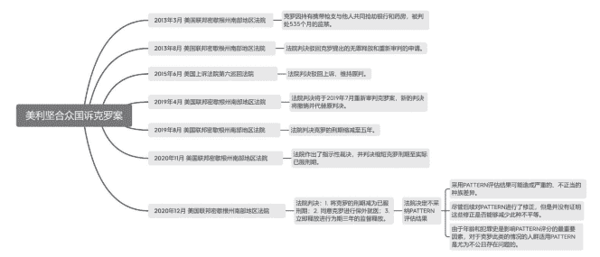

### 【核心争议点】
1.在新冠病毒疫情背景下，将 PATTERN 评估结果纳入保外就医的裁量标准，是否加剧了种族不平等.
2. PATTERN 作为风险评估工具是否依照《第一步法案》的规定进行了独立的验证.
3.在评估再犯风险时，PATTERN 所采用的因素是否对克罗此类人群存在系统性不利.

### 【裁判论证过程】
#### （一）在新冠病毒疫情背景下，将 PATTERN 评估结果纳入保外就医的裁量标准，加剧了种族不平等
美国密歇根州南区地方法院在进行裁量时，引用了“人工智能伙伴关系”（Partnership on AI）组织的观点，即该组织在其发布的《算法风险评估和新冠肺炎：为什么不应使用 PATTERN 工具》报告中提到的观点：“PATTERN 的使用加剧了种族歧视问题”.在该份研究报告中，“人工智能伙伴关系”（Partnership on AI）组织首先对 PATTERN 输入数据中的偏见进行了论证，然后提出新冠疫情背景的特殊性，最终得出结论，认为 PATTERN 工具的使用可能会加剧种族歧视.^([\[11\]](#txt001.html#footnote_content_txt001_11))
首先，PATTERN 的输入数据中存在种族偏见.一方面，罪犯被重新逮捕的数据存在种族歧视问题.PATTERN 是基于罪犯被重新逮捕的数据来进行验证和评估的，但是被重新逮捕的数据并不等同于罪犯重新犯罪的数据，存在诸多因素（例如警方是否以及如何被告知事件、受害者的行为、警察个人的意愿和判断力等）会影响罪犯最终是否被逮捕，而这些因素又会受到种族因素的严重影响，即种族因素间接影响了犯罪者被逮捕的可能性，这也就使得 PATTER 的输入数据存在种族不公的问题.另一方面，在低级别犯罪的数据中同样存在种族歧视的问题.“人工智能伙伴关系”（Partnership on AI）所采用的实证数据表明，在较低级别的犯罪中，黑人罪犯的比例最高，这种现象与目前存在的种族偏见、警务人员的自由裁量权有很大的关联.^([\[12\]](#txt001.html#footnote_content_txt001_12))根据“人工智能伙伴关系”的观点，输入的数据中即便只存在很少的种族偏见，也足以使得 PATTERN 的评估结果存在种族歧视和不公问题.^([\[13\]](#txt001.html#footnote_content_txt001_13))
其次，在 PATTERN 的开发过程中，新冠疫情的考量因素并没有被纳入其中，PATTERN 也并未在新冠疫情爆发的背景下接受检验.监狱中的生活条件和性质导致新冠病毒很容易在监狱囚犯中肆虐，如果采取此种存在种族偏见的风险评估模式来决定是否准许保外就医、监督释放，那么监狱中黑人的新冠病毒感染率和死亡率可能会变得更高，这种种族歧视可能会影响到囚犯的生命安全.

#### （二）PATTERN 作为风险评估工具未依照《第一步法案》的规定进行独立验证
美国密歇根州南区地方法院认为，PATTERN 的评估结果仍存在未被解答的合理怀疑.在《开放的风险评估》这篇文章以及杰纳·德勒等人向司法部的来信中，作者均提出了对 PATTERN 的质疑，法院在论证过程中对这种质疑予以了采信.PATTERN 的开发者并没有开放验证数据.美国司法部主张，由于 PATTERN 所采用的逮捕和定罪信息是由州和地方司法机构直接提供给司法部的，所以有关信息在公开时会受到限制，无法进行进一步检验.也因此，开发者所主张的预测准确性和公平性无法得到验证，未达到《第一步法案》所规定的采信标准^([\[14\]](#txt001.html#footnote_content_txt001_14)).
第二，开发者也没有公布如何设置风险阈值的相关信息.PATTERN 将罪犯的再犯风险划分为最低、低、中、高四个风险量级，但是不同风险等级之间的概率确定标准、确定此种风险阈值的理由都未以透明的方式进行公开.除此之外，关于风险阈值的设置是否具有科学依据也受到质疑.^([\[15\]](#txt001.html#footnote_content_txt001_15))
第三，PATTERN 两种模型的直接预测结果都是囚犯被再次逮捕的可能性，而非囚犯再次犯罪的可能性.尽管逮捕和犯罪在一定程度上具有一致性，但不是所有的犯罪行为都会被警方所知晓，并导致行为人被逮捕.而且，被逮捕也并不必然导致被定罪，因此不能用再次逮捕的数据来替换再次犯罪的数据.
第四，囚犯难以通过参加监狱中的课程来降低其风险评分.根据 PATTERN 计算得分的参考因素，参加监狱内的各种培训课程，是囚犯以主动方式改善 PATTERN 评估结果的唯一方法.但是联邦监狱能够提供的康复培训课程资源不足，尚无法向囚犯们提供足够的康复培训计划.^([\[16\]](#txt001.html#footnote_content_txt001_16))这也就意味着，即使囚犯具有降低其 PATTERN 风险评分的主动性，其意愿也无法完全得到实现，这使得 PATTERN 的囚犯风险评估难以及时反映囚犯的风险变动情况.

#### （三）PATTERN 工具在评估再犯风险时所采用的参考因素对克罗此类人群存有系统性不利
法院认为，由于 PATTERN 评分过程中所考量的不同因素权重不同，会使克罗此类人群很难得到最低风险分类.克罗生于 1981 年，在法院裁决本案时，他的年龄为 39 岁.他曾在 15 岁时进入少管所，17 岁时因持械抢劫被判处 9-30 年的刑罚，在假释后又再次犯罪.年龄和犯罪史是 PATTERN 计算中最重要的考量因素.一方面，就 30 岁以下的男性囚犯而言，他们几乎不可能被 PATTERN 归到最低风险类别；另一方面，如果男性囚犯具有犯罪史，除非他已经超过 40 岁，否则他很难被归类到最低风险.^([\[17\]](#txt001.html#footnote_content_txt001_17))

### 【审理结果】
1.法院判决拒绝依照 PATTERN 评分来判断克罗的危险性，认为其符合保外就医的条件，批准克罗申请保外就医的动议，并将他的刑期减为已服刑期.

## 裁定概要
2.法院下令立即释放克罗，开始为期三年的监督释放，但需要附加以下特殊条件：被告人在获释后应当接受 14 天的严格隔离，并应完全遵守所适用的州或地方的任何禁止外出的命令、社交距离准则或其他公共卫生限制.

## 【相关法条】
### 《美国法典》第 18 卷第 3582 条（c）款（18 U.S.C. § 3582（c））
（c）修改监禁期限.—一旦判处监禁，法院不得修改监禁期限，除非
（1）具有以下情况：
（A）法庭在收到监狱管理局局长的提议后，或者被告人在用尽其权利或向其所在监狱的监狱长提出申请 30 天后，仍不能使得监狱管理局代表被告人提出动议时，法院在考量第 3553 条（a）款所设定的因素后，如果发现有以下情况，可以减少刑期（可以附带或不附带条件地判处缓刑或者监督释放，但不得超过原刑期未执行的部分）：
（i）存在特殊和令人信服的理由证明有必要进行这种减刑；或
（ii）被告人至少 70 岁，根据第 3559 条（c）款判处的刑罚，因被告人目前被监禁的罪行服刑至少有 30 年，监狱局局长已根据第 3142 条（g）款的规定确定被告人不对任何他人或社区的安全构成威胁；
此种减刑应当与量刑委员会发布的适用政策声明相一致；以及
（B）法院可在《规约》或《联邦刑事诉讼规则》第 35 条明文允许的范围内修改所判处的刑期；以及……

### 《美国法典》第 18 卷第 3553 条（a）款（18 U.S.C. § 3553（a））
（a）判刑时应考虑的因素.
法院应判处足够但不超过必要的刑罚，以符合本条第（2）款所述的目的.法院在决定要判处的特定刑罚时，应考虑：
（1）犯罪的性质、情节以及被告人的犯罪史和特点；
（2）判决的必要性：
（A）反映犯罪的严重性，促进对法律的尊重，并对犯罪实施公正的惩罚；
（B）对犯罪行为给予足够的威慑；
（C）保护公众免受被告人进一步犯罪的影响；
（D）以最有效的方式向被告人提供所需的教育或职业培训、医疗护理或其他惩教治疗；
（3）可用的刑罚种类；
（4）量刑种类和量刑范围；
（5）任何相关的政策声明；
（6）有必要避免具有类似记录、犯有类似行为的被告人之间出现无根据的判决差异；
（7）向犯罪行为的任何受害者提供赔偿的需要.

### 《美国法典》第 18 卷第 3632 条（18 U.S.C. § 3632）
开发风险和需求评估系统
（a）在本章节通过后的 210 天内，司法部部长应当与 2018 年《第一步法案》（Frist Step Act）授权的独立审查委员进行协商，开发一款风险和需求评估系统，并在司法部网站上公开发布，该系统应当用于以下目的：
（1）在收监过程中，确定每一名囚犯的再犯风险，将其分为再犯风险最低、低、中、高四类；
（2）在可行的情况下，评估和确定每一名囚犯发生暴力行为或严重不当行为的风险；
（3）根据囚犯的具体犯罪需求以及（b）款的规定，确定适合每个囚犯的减少再犯计划的类型和数量，并相应地给每个囚犯分配此类计划；
（4）根据在押期间动态的、可以合理预期会进行变化的因素，定期对每一名囚犯的再犯风险进行评估；
（5）根据修改后的判决，将囚犯重新安排到适当的、以证据为基础的减少累犯项目或者生产活动中，以确保：
（A）在监禁期间，处于各个危险等级的所有囚犯都有机会降低他们的风险分级；
（B）处理囚犯特定的犯罪性需要；
（C）所有囚犯都能够成功参与此类方案；
（6）根据（e）款决定何时对成功参与减少累犯项目或生产活动的人提供激励和奖励；
（7）根据第 3624 条，决定囚犯何时准备转入释放前羁押或监督释放；
（8）在了解阅读障碍的情况下，确定在课程材料中适当使用音频技术.在执行本小节时，司法部部长可以根据情况使用现有的风险和需求评估工具.

### 《美国法典》第 18 卷第 3142 条（g）款（18 U.S.C. § 3142（g））
（g）应考虑的因素.
司法官员在确定是否存在释放条件，使得能合理确保该人按要求出庭，并确保其他人员和社区的安全时，应考虑以下现有有关信息：
（1）所控罪行的性质和情节，包括该罪行是否为暴力罪行、违反第 1591 条的罪行或联邦恐怖主义罪行，或是否涉及未成年受害者或受管制物质、火器、爆炸或破坏性装置；
（2）对被控人不利的证据的权重；
（3）该人的过往史和特点，包括：
（A）该人的性格、身体和精神状况、家庭关系、就业、财产资源、在社区居住的时间、社区关系、过去行为、吸毒或酗酒史、犯罪史和出庭记录；
（B）在当前犯罪或被捕时，该人是否处于缓刑、假释或其他释放状态，是否在等待根据联邦、州或地方法律所犯罪行的审判、判决、上诉或结束刑期；
（4）释放对他人或者社会造成危险的性质和严重程度.

## 【案例评析】
### （一）明确了算法评估在司法中的辅助地位
在司法审判领域，面对各类算法决策和评估工具，需要对此类算法评估工具的地位予以明确：这种算法工具不能替代法官的自由裁量，只能作为辅助考量因素之一.算法只能辅助裁判而不能代替的原因如下：第一，解释和运用法条的工作本身蕴含着价值判断的要求，富有同理心的人才能够完成；第二，算法本身可能继承了人类既有的偏见，而算法无法自行进行修正，需要法官及时发现问题，予以纠偏，正如本案中 PATTERN 对于克罗的风险评估，其得出结论的基础即存在种族偏见和歧视；第三，算法评估所展示出的记录过于倚重聚类数据，因而在输出结果上灵活性较低^([\[18\]](#txt001.html#footnote_content_txt001_18))，本案法官在面对 PATTERN 风险评估结果的情况下，选择采信克罗在监狱内的表现情况，并且结合了其成长背景、犯罪年龄等因素进行综合评判，体现了法官裁判相较于算法输出结果的灵活性.相较于算法而言，法官的主观能动性使得法官可以针对每一个具体个案作出具体分析，即便情况类似的案例可能会让法官对某类案件形成刻板印象，但是不会像算法的代码一般形成必须遵循的算法逻辑，这就体现了法官自由裁量权的灵活性优势.算法的量刑决策与刑事自由裁量权之间形成了一种张力，通过算法按照法律既定逻辑进行决策，可以防止由于刑事自由裁量权过大而产生的司法不公，同时法官在裁决时可以使用自由裁量权来纠正算法在个案中出现的偏差和错误，实现个案正义.^([\[19\]](#txt001.html#footnote_content_txt001_19))

### （二）对风险评估算法工具可靠性识别的责任分配具有启发意义
确定了算法评估工具的辅助地位后，接下来应当考虑的问题是，应当由谁来识别算法评估工具在判决中的可靠性，才能更好地保护当事人的正当权利，保证司法公正.本案中，法院采信了专家学者对于 PATTERN 提出的质疑，由法官完成了对风险评估算法的可靠性进行识别的任务，但法官在本案当中并非完全依照自我专业知识进行判断，而是借用了有关研究机构、学者的意见.由于法官并不是专业的科学家，即使其经过培训学习了开发设计者所提交的书面风险警示，将识别算法风险的责任全部交给法官，仍然不是最佳方案.若允许双方当事人对风险评估算法的可靠性加以举证质证，由法院根据双方的证据和意见进行裁判，或许更有利于当事人的权利保护.

### （三）对算法评估工具在司法实践中的适用提出排除算法偏见、提高算法透明度等进一步的要求
法院在衡量克罗危险性的裁量过程中，由于对 PATTERN 的开发和运行仍存质疑而没有采信 PATTERN 的评估结果.今后此类风险和需求评估软件若想大范围地投入使用，法院对 PATTERN 提出的质疑，则正是其所需要提升的方向.
首先，在输入数据方面，应该保证输入数据的质量，尽量剔除偏见和歧视因素.PATTERN 软件的基础数据受到种族歧视影响，而除了种族歧视，如果其他“刻板观念”（stereotype），例如针对某一特殊群体（如性服务从业者）的歧视或者对某一类案件（如家暴案件、性侵案件）的特殊情绪，影响了算法基础数据的客观性，这种算法科技的介入将可能导致对实体公正的损害，增加审判的不确定性.^([\[20\]](#txt001.html#footnote_content_txt001_20))为此，算法评估工具在数据输入阶段必须保证数据的质量，规范个人信息的使用，注意数据的精确性，尽量排除偏见和歧视因素，适当运用偏见提出工具，保证输入数据的客观性，也要注重数据量上的均衡.
其次，算法评估工具应当具备可解释性，进行独立验证.尽管 PATTERN 的开发者声称其预测结果具有准确性和公平性，但由于其风险评估的考量因素数据没有进行公开，不同风险的阈值确定基础不透明，以及在实施过程中配套资源的不足，导致其无法进行独立验证，社会各界的专家学者也对 PATTERN 能否达到其预期效果提出了质疑.为此，在设计用于执法、缓刑等用途的工具的过程中，应当保证科学研究数据的可访问性，至少对于当事人而言，这些数据应当是可获取的、可以提出质疑的.只有保证信息的可获得性，才能对风险评估工具的评估效果进行独立验证，才能保证其结果的准确性和公平性.算法“解释权”便于个人对算法决策是否公平公正提出质疑，一般认为，正义观念包括程序正义、互动正义（人们受到有尊严的对待、获得决策者的尊重）以及信息正义（就决策过程及结果向当事人提供相应的信息与解释）等方面^([\[21\]](#txt001.html#footnote_content_txt001_21))，正所谓：“如果我有更正权，那么我就需要看得出错误；如果我有权反对歧视，那么我就需要知道哪些要素被用于决策.否则，信息不对称就会使这些重要的法律权利变得毫无意义.”^([\[22\]](#txt001.html#footnote_content_txt001_22))
再次，风险评分结果的门槛标准应当如何设置、其设置的合理性是否能够获得公众认同，也是需要不断完善的议题.根据《第一步法案》的规定，PATTERN 将风险划分为四个等级，对于任何风险评估工具来说，确定有多少个人被评为最低或低风险，并能够获得与这些指标相关的利益，是最重要的事项之一.同样至关重要的是，它们要使公众以及政策制定者相信，这些门槛的选择是合理的.对于那些对社会只构成很小风险的被告人而言，目前所选择的四类阈值，将会不必要地限制他们争取提前获释的机会.根据目前的规定，被列入中度风险类别的门槛，是在三年内有 24%的可能性被再次逮捕或违反法规.因此，即使—个人在释放时有 75%的可能性可以成功获释，并且没有轻微的被逮捕或违法行为，也将无法获得低风险分类的好处.^([\[23\]](#txt001.html#footnote_content_txt001_23))除此之外，本案也反映出，对于克罗这类人群而言，其获释或保外就医的可能性也受到了 PATTERN 分数的限制.
本案点明了 PATTERN 此类算法风险评估工具在适用中存在的问题，为其实际适用提出了反馈意见，有助于其更好地实现司法辅助功能，也为其未来修改提供了可行路径.

## 【关联判例推荐】
1\. United States v.Hanna, No. 3:19cr74 (JCH), 2021 U.S. Dist. (D. Conn. Aug.23, 2021)
核心事实：汉纳提出保外就医的请求，理由包括其患有的各种疾病在 COVID-19 大流行的背景下加重了使其重伤或死亡的风险，并且其 PATTERN 评分为“低风险”.但法院考虑到他有较多的犯罪经历，PATTERN 评分低是因为其犯罪年龄超过了 40 岁，年龄因素影响了 PATTERN 评分的结果，因此驳回了该申请.
与本案关联点：法院同样对 PATTERN 的风险评估结果提出了质疑，而法院是否采用该评估结果是包含在法官自由裁量权的范围内的.
2\. United States v. Bass, No. 2:97-cr-80235-1 (6th Cir. Nov. 3, 2021)
核心事实：地区法院以巴斯 PATTERN 分数低作为证据，证明巴斯获释后再次犯罪的风险很低.但上诉法院认为使用 PATTERN 来衡量累犯风险的方法存在缺陷，“低”分数仍表示三年之内有 24%的再犯概率，地区法院仅根据被告人是否实施过暴力犯罪来计算 PATTERN 分数，并没有区分不同类型的暴力犯罪.鉴于巴斯犯罪的严重性，上诉法院将该案判决撤销并发回重审.
与本案关联点：法院同样对于 PATTERN 中不同的风险评估因素结果提出了质疑，认为不能单独根据 PATTERN 评分结果进行裁量，因为该系统中的一些评估因素并不完备，从而会导致评估结果存在一定缺陷，而法院是否采用该评估结果，是属于法官自由裁量权范围内的事项.
3\. State v. Jones, No. 2015AP2211-CRNM (2016 Wisc.)
核心事实：琼斯被指控对儿童实施了性侵犯行为，在上诉法院审查初审法院的量刑记录过程中，发现现场审查报告中包括了 COMPAS 评估报告.上诉法院认为，在量刑过程中考量 COMPAS 的危险评估结果，并不侵犯被告人的正当程序权利.
与本案关联点：在克罗的案件中，PATTERN 的评估结果因为存在多方质疑，且其本身在使用过程中存在未被解决的问题，因而没有被法院予以采纳；但琼斯的案件证明如果 PATTERN 能够加以完善，是能够实际投入使用的，并且不违反正当程序原则.

## 1.2 罗琳诉佛罗里达州案
### 【案件索引】
Roeling v. State 880 So. 2d 1234 (Fla. Dist. Ct. App. 2004)

### 【关键词】
智慧风险评估；“弗莱标准”；专家证词；科学证据

### 【案件提要】
本案是利用科学工具对犯罪嫌疑人进行犯罪可能性评估和预测的典型案例.根据佛罗里达州的《吉米莱斯法案》^([\[24\]](#txt001.html#footnote_content_txt001_24))（Jimmy Rice Act），儿童性犯罪者不仅要根据其犯罪行为承担相应的法定刑事责任，同时也要在审理过程中接受心理及精神状态评估.若评估结果判定其有再犯的风险，这一类罪犯将会根据法案的要求接受强制的收容改造，在该州“儿童和家庭服务部”（Department of Children and Family Service）的管控下^([\[25\]](#txt001.html#footnote_content_txt001_25))进行治疗.这一管控并非是刑罚，但由于其关乎罪犯服刑后的人身自由，因此是控辩双方的争议焦点.
本案发生于 2004 年，是刑事司法案件中使用风险评估算法工具的先例.本案中应用的风险评估工具涵盖多个心理学、生理学、精神病学指标，是一种综合计算评估，但需要在专家证人对评估结果进行分析并做出专家证言后，才可成为证据.一方面，该证据是科学工具的评估结果，另一方面，该证据仍然需要专家的证人证言.因此，在法庭辩论中，其证据类型是控辩双方交锋的第一点.依据佛罗里达州的法律规定，专家证言中所包含的新的科学证据需要受到该行业的广泛接受并认可，并且由检方承担举证责任.此外，证据还需要满足“弗莱标准”^([\[26\]](#txt001.html#footnote_content_txt001_26)).
本案最终认定上述风险评估工具符合“弗莱标准”，可以作为证据证明上诉人罗伯特·罗琳具有性犯罪的潜在风险.
时至今日，再犯风险评估工具等算法与科学评估结果仍然会被法庭采信，对于测试结果为有潜在犯罪可能的人群，须依法接受强制措施.
从这一案例中，我们能够看到智慧司法工具较为早期的面貌，为今天诸多的智慧司法问题带来启示.在 2004 年，虽然再犯风险评估系统的评估结果仍然需要结合专家证言进行认定，但实际上，其中蕴含的智慧司法元素与 AI 量刑的裁判思路已经呼之欲出.随着计算科学的不断革新，这类风险评估工具已经逐步改进、演化，并在以著名的“卢米斯诉威斯康星州案”^([\[27\]](#txt001.html#footnote_content_txt001_27))为代表的司法案件中起到重要作用.一方面，其推进了科学算法与司法相结合的进程，然而另一方面，其也带来了一系列新的法律问题.科学工具与定罪量刑之间的关联，不仅产生了新的司法证据形式，也带来了司法证据认定等方面的一系列问题.

### 【案件要旨】
佛罗里达州上诉法院（第一次上诉）：上诉方 罗伯特·罗琳 被上诉方 佛罗里达州
佛罗里达州上诉法院（第二次上诉）：上诉方 罗伯特·罗琳 被上诉方 佛罗里达州
2003 年，本案上诉人罗伯特·罗琳因心理学家和精神病学家的判断，以及包括“性犯罪惯犯风险评估”（PRASOR）、“Static-99”、“暴力风险评估指南”（VRAG）等在内的超过三十个心理测试工具的测试，被认定为《佛罗里达州法规》^([\[28\]](#txt001.html#footnote_content_txt001_28))规定的“性暴力潜在犯罪者”.根据《吉米莱斯法案》和《佛罗里达州法规》^([\[29\]](#txt001.html#footnote_content_txt001_29))的规定，他会被交给“儿童和家庭服务部”监管，接受控制、护理和治疗，以保证其不产生危害社会的不良后果.
2004 年 8 月，上诉人认为佛罗里达州不应当以心理测试工具的测试结果为依据，将其认定为性暴力潜在犯罪者，因而提起上诉，并提出以下抗辩：（1）因为本案中的风险评估工具并未被精神病学家、心理学家以及其他相关领域的专家所认可，故即便该评估工具认定其未来有性暴力犯罪倾向，也不应当被法院采纳为专家意见证词；（2）州政府声称上诉人缺乏自我控制能力而存在性暴力犯罪隐患，但是州政府并未对该主张承担举证责任.因此，上诉人认为其不应当被认定为“性暴力潜在犯罪者”.
最终法官驳回了上诉人罗伯特·罗琳的两条抗辩，理由如下：（1）针对第一条抗辩，法官认为，通过风险评估工具来评判认定上诉人有性暴力犯罪倾向的方法，已经被心理学家、精神病学家等广泛接受，也被当地精神病诊所等机构广泛应用，满足“弗莱标准”的条件，因此，应当认定上诉人具有性暴力犯罪隐患；（2）针对第二条抗辩，法官认为现有证据足以使陪审团认定上诉人缺乏自我控制能力，因此驳回了上诉人的请求.
2012 年 2 月，上诉人再次对佛罗里达州进行上诉，并提出重新审判的请求，此外，上诉人还认为佛罗里达州没有履行其举证责任.最终，因无法认定初审法院采用了错误的审判标准或发生错判，上诉人重新审理案件的请求被予以驳回.

### 【案例事实思维导图】
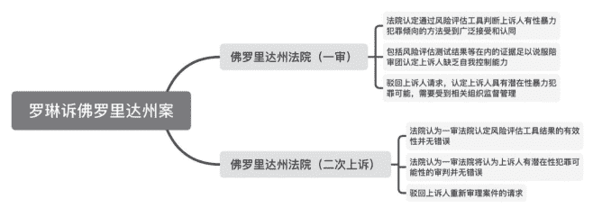

### 【核心争议点】
1.针对性犯罪者的再犯风险评估是否属于新科学证据或纯意见证言，是否需要满足“弗莱标准”.
2.再犯风险评估是否满足“弗莱标准”.
3.再犯风险评估结果是否可推定为实际再犯风险.

### 【裁判论证过程】
#### （一）针对性犯罪实施者的再犯风险评估属于新型科学证据，应当满足“弗莱标准”
在 1923 年“弗莱诉联邦案”中，专家证人所做的证言形成了“弗莱标准”，即此类证言中的新型科学性证据应当被相关领域广泛接受，形成广泛认知，法庭才可认为该证据具有可采性，并允许该证据影响陪审团定罪与法官裁量.

## （一）再犯风险评估系统的证据性质
本案第一个争议焦点，在于控辩双方对再犯风险评估系统证据性质的不同理解.控方为规避“弗莱标准”的要求，认为它属于纯粹意见证词，而辩方则认为是新型科学证据.法官援引了“弗拉纳甘诉佛罗里达案”^([\[30\]](#txt001.html#footnote_content_txt001_30))、“哈登诉佛罗里达案”^([\[31\]](#txt001.html#footnote_content_txt001_31))中涉及的“性犯罪侧写”^([\[32\]](#txt001.html#footnote_content_txt001_32))、“儿童性侵犯综合征评估工具”^([\[33\]](#txt001.html#footnote_content_txt001_33))两种科学证据形式.在上述两个案例中，两种证据形式都被认定为新的科学证据，并且符合“弗莱标准”.法官通过论证本案中性犯罪风险评估工具与上述两种科学证据的相似性，最终得出结论：性犯罪再犯风险评估工具属于新型科学证据，应当符合“弗莱标准”.

## （二）再犯风险评估符合“弗莱标准”
由于法庭先前论述了再犯风险评估工具属于新型科学证据，需要符合“弗莱标准”，因此，双方的第二个争议焦点，在于该证据是否符合“弗莱标准”.被告认为风险再犯评估工具没有取得心理学家、精神病学家等专业人士的广泛认可，因此不符合“弗莱标准”.法官认为，该评估工具在当地的精神病诊所与监护机构中得到了广泛使用，受到了专业的法医学及精神学家的认可，并且，再犯风险评估结果与临床诊断结果相比具有科学性.最终，法官基于行业内的适用频率与广度，专家证人的意见以及行业普遍共识等多个维度，认定本案中的风险评估工具符合“弗莱标准”，具有法律效率.

## （三）再犯风险评估结果可以推定为实际再犯罪风险
在这一部分的论证过程中，法官援引了其他知名心理学家与精神学家的意见，参考了他们与再犯风险评估工具、实际再犯风险相关的著述，如 1998 年贝克与墨菲的文章《我们所了解与不了解的：关于评估与治疗性犯罪者》^([\[34\]](#txt001.html#footnote_content_txt001_34))和 2000 年汉森与索顿的文章《加强性犯罪风险预估：三个现实维度的比较》^([\[35\]](#txt001.html#footnote_content_txt001_35))，证明再犯风险评估结果与实际再犯风险有较强的相关性.

## 【审理结果】
1.初审法院裁定罗伯特·罗琳具有性暴力犯罪风险，应当被管控于州政府的下辖机构“儿童和家庭服务部”，并对其执行收容改造程序，定期进行心理治疗和精神治疗.
2.佛罗里达州上诉法院（第一次上诉）驳回了罗伯特·罗琳的上诉，认定风险评估工具的测试结果具有法律效力，可以依此推定罗伯特·罗琳具有性犯罪倾向，应当予以监管.
3.佛罗里达州上诉法院（第二次上诉）驳回了罗伯特·罗琳重新审判的请求.

## 【相关法条】
### 《联邦证据规则》第 702 条（Federal Rules of Evidence §702）
在下列情况下，根据知识、技能、经验、培训或教育而具备专家资格的证人，可通过专家意见或者其他形式举证：
（a）专家证人的科学、技术或者其他专业知识可帮助法官理解证据或者确定争议事实；
（b）专家证人提供的证据基于充分的事实依据或者详实的数据；
（c）专家证人提供的证据来源于可信的原则和研究方法；
（d）专家证人已将原则和方法可靠地应用于案件事实.

### 《联邦证据规则》第 706 条（Federal Rules of Evidence §706）（节选）
（a）专家证人的指定程序：根据当事人的提议或自身决定，法院可以要求当事人提出不应指定专家证人的理由，也可以要求当事人进行指名.法院可以指定双方约定的任何专家，也可以自行进行选择，但法院只能指定同意参与举证的人.
（b）专家证人的责任：法院必须告知专家其有关职责.法院可以以书面形式进行并将该通知复印件交法院书记存档，或者在所有当事人都有机会参加的会议上口头告知上述职责.该专家：
（1）必须将其做出的研究结果告知当事人；
（2）可受到任何当事人所进行的证言存录；
（3）可受到法院或者任何当事人传唤作证；
（4）可受到任何当事人的交叉询问，包括传唤该专家的当事人.

### 《佛罗里达州法规》第 394 章第 910 条（Florida Statutes §394.910（2002））（节选）
立法机构进一步发现，在监狱环境中改造性暴力犯罪者效果较差，这一人群需要长期持续的治疗.因此，立法机构意图为性暴力犯罪者的长期护理和治疗设置一套收容改造程序.

### 《佛罗里达州法规》第 394 章第 912 条第（9）款（Florida Statutes §394.912（9）（2002））（节选）
（9）“性暴力犯罪”是指：
（a）在从事性侵害时谋杀；
（b）绑架未满 13 岁的儿童，并在该犯罪过程中，实施：
1.性侵害；或
2.对儿童实施下流、淫荡或猥亵性的侵害或行为，或在儿童面前进行上述性犯罪行为.

## 【案例评析】
### （一）本案印证了“弗莱标准”在科学工具中的适用性
在联邦法律层面上，在 1993 年《联邦证据规则》第 702 条（即“道波尔标准”）受到认可后，“弗莱标准”已被废除.
在州法律层面上，由于各州在科学证据的判定上对于“弗莱标准”的运用已经长达七十年之久，所以各州在科学证据可采性标准的选择上陷入了两难境地.一方面，面对科学证据的日新月异与千变万化，“弗莱标准”的可适用性和适用成本与科学领域的快速发展并不匹配.另一方面，“道波尔标准”虽然放宽了法官的裁量权，减轻了原被告双方的举证压力，但也存在语义模糊、过于依赖法官主观判断的问题.截至目前，有 25 个州已经使用“道波尔标准”或者类似的标准，有 15 个州和哥伦比亚特区仍然在使用“弗莱标准”，有 6 个州虽然还没有放弃“弗莱标准”，但已经吸收了“道波尔标准”中的元素，同时也有 4 个州建立了自己的标准.在本案中，运用“弗莱标准”这种行业普遍性规则对科学证据进行审视，说理明析，逻辑缜密.并且在实践上只需要引用行业规范，邀请行业专家进行作证即可.

### （二）审视了“弗莱标准”应用的意义与不足
“弗莱标准”起源于 1923 年，是针对专家证据中新的科学证据的一项原则性审查标准，其核心是：新的科学证据需要受到行业内的广泛认可.在 1923 年的“弗莱诉联邦案”中，该规则首先被应用于血压相关的新科学证据认定中.随着 20 世纪中后期科学技术的突破性发展，“弗莱标准”逐渐普及，其他复杂的科学技术在司法侦察及鉴定领域也开始受到广泛应用.“弗莱标准”因其是较为突出且简明的行业性标准，在证据的可采性判定中受到了广泛应用.“弗莱标准”本身定义明晰，即“行业广泛认可”.因此，只要通过权威专家的论证，并辅以行业内具有广泛认可度的、样本量较大的调研性证据，就可以较好地保证科学证据采集的合理性，帮助法官在法律层面做出对科学证据的正确认识.但随着 20 世纪末期信息时代的到来，“弗莱标准”开始倍受质疑并遇到了一系列挑战.一方面，随着科学技术在法律应用中的发展，科学证据逐渐呈现跨领域化、复杂化的特征.论证“行业普遍认可”不仅成本极高，甚至在大量个案中无法实现.在许多的新兴科学领域中，尚不存在行业的普遍共识，但这些科学领域的结晶已经以证据的形式出现在了法庭当中.另一方面，“弗莱标准”在一定程度上束缚了法庭在科学证据采信上的自由裁量权，拘泥于行业认可，使得整个诉讼过程空耗了大量的资源与精力，不利于法律效率性与终局性的发挥.因此在 1993 年，最高法院通过对“道波尔案”的判例分析，在联邦层面上用《联邦证据规则》第 702 条替代了“弗莱标准”，实质上降低了专家证人科学证据采集的门槛.在本案中，我们发现“弗莱标准”同样科学合理地解决了诉讼中遇到的实际争议.因此，我们同样应当认识到，在一般的简单案件中，“弗莱标准”仍然具备广泛的适用性.

### （三）为后续人工智能以及智能司法的发展奠定了积极基础
由于普通法遵循先例的传统，法官可以运用法律推理、法律解释等手段去弥补法律漏洞，补充法律的不足，创造先例进而达到“法官造法”的结果.这也就意味着，任意一个案件的法官判决都对后续的案件具有指导性意义.在本案中，核心的矛盾实质上是被告人对程序正义、证据合法性的抗辩与计算工具提供的科学证据之间的矛盾.该案发生于 2000 年初，是一个互联网智慧、计算工具尚未全面发展的时代.在此案件之前，有关智慧计算的新科学证据的案件屈指可数，这也就意味着，此案判决具有导向性作用.本案的意义已经不局限于案情本身，更在于较长时间尺度内佛罗里达法院对于此类新科学证据认定的倾向性.
在本案结束后的数十年中，以智慧数据运算为主要载体的科技手段已经大规模地应用于法律中的各个领域.电子眼等智慧数据算法已经应用于法律执行领域；智慧人工智能证据系统逐渐在检察机关的法律适用中起到重要作用，算法同时也在法官的量刑工作中发挥了辅助功能……从当今的科技司法时代回望，本案更像是智慧运算与司法互相磨合的最初钟声，向我们告知了更具划时代意义的事实：司法与智慧运算科学、人工智能相紧密结合的时代已经来临.

## 【关联判例推荐】
### 1. Frye v. United States 293 F. 1013 (D.C. Cir. 1923)
核心事实：1923 年，被告人詹姆斯·弗莱因故意杀人被判处有罪，在一审阶段，被告人的辩护律师依据专家证言及科学理论为被告人进行无罪辩护.专家证人认为，根据早期的测谎理论研究，人在说谎时会有心搏和血压的生理反应，而被告人并无此类反应，因此专家证言认为被告人的陈述具有真实性.但在 1923 年，这一判断方法尚未得到当时科学界的认同及社会的普遍认可，二审法官认为，专家证人所提供的证据应当基于受到高度认可的科学研究结论，而这一科学研究结论，应当由特定科学领域内形成共识的科学原则推理而来（该判断标准后续被总结为“弗莱标准”，成为日后判断科学证据可采性的联邦法律标准），因此支持了公诉方对这一证据的反对动议.
与本案关联点：建立了本案的证据认定标准“弗莱标准”，也为科学证据以及智慧司法的边界划定了清晰的范围.

### 2. Flanagan v. State, 625 So. 2d 827 (Fla. 1993)
核心事实：被告人被控对其有智力障碍、年仅九岁的女儿实施了性侵行为.一名就职于儿童保护中心的心理学家对受害人的心理状况、精神与性格损伤程度进行了评估，通过询问和“性犯罪评估侧写”，证明被告人实施了性犯罪行为.被告人以没有满足“弗莱标准”为由反对该项证据，并认为其不具有可采性.
与本案关联点：都涉及有关于性犯罪的心理与精神状态评估工具，争论都有关于“弗莱标准”.

### 3. State v. Townsend, 635 So. 2d 949 (Fla. 1994)
核心事实：被告人被控对其两岁的女儿实施了性侵行为，根据《佛罗里达州法规》的规定，本案被害者因年龄过小而不具有作证能力，故无法作证.法庭在此案中建立了“受害应激症状”（Ward）^([\[36\]](#txt001.html#footnote_content_txt001_36))规定，由专家证词对儿童受害者遭受犯罪行为的事实进行认定.
与本案关联点：对儿童性侵犯的专家证据做出了特别规定.与本案都包含了性犯罪与嗣后的科学评估.

### 4. Daubert v. Merrell Dow Pharmaceuticals, Inc., 43 F.3d 1311 (9th Cir. 1995)
核心事实：两原告因为出生后的生理缺陷而起诉被告医药公司，并索取赔偿.双方的争议焦点在于，医药公司的产品是否与两原告的生理缺陷具有相当的因果关系.一方面，原告在举证时，邀请了 8 位专家证人提供科学性证据，以证明其生理缺陷与产品之间的相关性.另一方面，被告医药公司邀请了 1 位专家，通过科学实验证明原告生理缺陷与产品之间无因果关系.在上诉至最高法院前，加州法院一直遵循着“弗莱标准”来判断原被告上述证据的可采性.基于“弗莱标准”中“新型科学证据需要得到普遍认可”的证据认定标准，上述两方证据均具有可采性并具有法律效力.而上述两方证据却指向截然相反的案件事实，导致法官与陪审团裁量和审理的困难.最终，在经过“专家证据认证”、“证据相关实验是否具有科学性”、“证据是否存在谬误”等因素的考量后（后被总结为“道波尔标准”），法院认为原告提供的证据存在专家证据效力不足的问题，并判定被告胜诉.
与本案关联点：建立了“道波尔标准”，为科学证据的验证提供了新思路，与本案同样出现了专家证人意见不一致的情况.

### 5. Hadden v. State, 690 So. 2d 573 (Fla.1997)
核心事实：嫌疑人被诉对一名 12 岁的幼女实施了性侵犯行为，一名心理学家对被害人进行了“儿童性侵害症状检测”.在后续的法庭调查环节中，该检测结果作为主要证据被用于证明嫌疑人实施了犯罪行为.嫌疑人认为这一证据是新型科学证据，应当符合“弗莱标准”.检方认为，根据《佛罗里达州法规》中针对儿童性犯罪“受害应急症状”的规定，这一证据应当被归类为纯意见证言，不需要满足“弗莱标准”.最终，法院认定上述“儿童性侵害症状检测”是一项新型科学证据，应当满足“弗莱标准”.
与本案关联点：区分纯意见证言与新型科学证据.

## 1.3 盖斯诉爱荷华州案
### 【案件索引】
Guise v. State of Iowa， 919 N.W.2d 635 （Iowa Ct. App. 2018）^([\[37\]](#txt001.html#footnote_content_txt001_37))
State of Iowa v. Guise， 921 N.W.2d 26 （Iowa 2018）^([\[38\]](#txt001.html#footnote_content_txt001_38))

### 【关键词】
技术正当程序；算法问责；智慧司法

### 【案件提要】
本案是有关算法解释权和技术正当程序的经典案件.该案与爱荷华州诉盖斯的刑事诉讼案件密切相关.
在爱荷华州诉盖斯的案件中，被告人盖斯在审判时认可了判决前调查报告（PSI）及报告中使用的算法风险评估软件（IRR）.而在上诉时，盖斯却向法院提出法院参考 IRR 评估结果侵犯其正当程序权利的主张.盖斯认为 PSI 报告中没有就 IRR 风险评估对法院进行警示说明，即 PSI 报告没有告知法院在审判中要客观审慎地采纳 IRR 评估结果，侵犯了其正当程序权利.并且法院采纳 IRR 风险评估结果构成滥用自由裁量权，且律师没有对此发表意见属于错误保留，构成无效协助.上诉法院支持了盖斯的请求，撤销了地区法院判决，发回重审.州政府上诉要求再审.爱荷华州最高法院驳回了盖斯的请求.州最高法院指出，一审中盖斯已经认可 PSI 报告，且法院有权自由选择量刑参考信息，只有以明显不成立或不合理的理由行使审判权力时才构成滥用自由裁量权.此外，IRR 风险评估软件已经广泛运用于司法实践中，其参考因素也相对确定公开，法院已尽到告知义务，并未损害盖斯的正当程序权利.
“盖斯案”案情与“卢米斯案”^([\[39\]](#txt001.html#footnote_content_txt001_39))高度相似，并且使用了“卢米斯案”作为参考案例.但对风险评估工具的使用、自由裁量权的认定以及案件中程序的不同判断，导致了判决结果的不同.作为算法歧视的经典案例，“盖斯案”对评估工具的细致认定给司法裁判与立法带来了很大启发.
纽约市于 2018 年率先提出《算法问责法》，提出在不阻碍创新和发展的前提下，在公共事业领域中使用自动化决策需要进行影响评估，以确保决策拥有一致性、专业性、客观中立性以及算法评估和审查的有效性.我国《个人信息保护法》第二十四条赋予个人对自动化决策的拒绝权，第五十六条提出个人信息处理的事前风险评估制度.该两条款也是对算法日益普及和发展的态势下，使得个体拥有新型算法权利和践行算法问责制度的一种立法努力.因此，本案对于理解算法解释权、算法问责、算法影响评估制度具有重要意义.

### 【案件要旨】
爱荷华州地区法院（一审法院）：原告 爱荷华州 被告人 蒙特兹·盖斯
爱荷华州上诉法院（上诉法院）：上诉方 蒙特兹·盖斯 被上诉方 爱荷华州
爱荷华州最高法院（二审法院）：上诉方 蒙特兹·盖斯 被上诉方 爱荷华州
2016 年 12 月 31 日，在爱荷华州梅森市，蒙特兹·盖斯违反司法机关签发的禁止接触令，暴力闯入前女友的公寓，抢走钱财并摔碎物品，后被拘捕.该州指控盖斯犯有二级入室盗窃罪和非法监禁罪.2017 年 2 月 6 日，盖斯签署认罪协议，承认了二级入室盗窃罪.爱荷华州地方法院将其在审前释放，交由惩教署监管等候判刑.2 月 23 日，惩戒署报告称，盖斯违反了他的释放条件，包括缓刑期满未到场，违反禁止接触令、拒捕并持有毒品用具.州政府另指控他因违反禁止接触令被捕，干扰公务，盖斯对此无异议.3 月 14 日，在地区法院的指示下，梅森市的缓刑办提交了盖斯的判决前调查报告（PSI）.PSI 建议对盖斯进行密切监视.盖斯除对涉毒问题持有异议外，并不反对量刑时采用 PSI.在量刑听证会上，检察官建议监禁一年，缓刑两年，并处罚款.地区法院驳回了这一建议.首先，法院提出，判决须达到教化、保护社会、威慑的三大目标.考虑到盖斯的犯罪史，法院认为其在社会中难以达成上述目标.此外，法院还参考了盖斯的判决前调查报告（PSI）中加强监视的建议.报告使用了爱荷华州风险评估工具（IRR）.IRR 风险评估软件参考了以下几个因素，包括：年龄、犯罪史、帮派关系、社区矫正的撤销.其中也包括一些动态因素：就业情况、住房不稳定、药物滥用以及先前撤销情况.因此，法院认为盖斯须受到密切监视，不接受认罪协议.3 月 20 日，法院判处盖斯犯有二级入室盗窃罪和干扰公务致人身伤害的行为，对盗窃罪判处不超过十年的不确定刑期，对其干扰公务的行为判处盖斯 90 天监禁，与盗窃罪同时执行.
盖斯根据判决向爱荷华州上诉法院提起上诉，提出两点反对意见.第一，盖斯认为地区法院使用 IRR 风险评估工具侵犯了他的正当权利，具体包括法院侵犯其正当程序权利、法院滥用自由裁量权、律师错误保留三点.盖斯主张，法院使用风险评估工具时未经充分的警示说明指导.他认为目前的调查报告应包含以下警告性说明或建议：（1）风险评估分数基于群体数据，而不是针对被告人个人；（2）是否存在验证研究，包括对爱荷华州人口的交叉验证；（3）使用公式进行问答等用于确定得分的信息披露程度；（4）工具的目的，以及风险评估工具并非为量刑而开发.第二，盖斯认为，法院意图对其判处家庭虐待金，量刑时考虑了其潜在的家庭暴力可能，未经证实和起诉，属于滥用自由裁量权.2018 年 5 月 2 日，上诉法院撤销了地区法院的判决，发回重审，并允许了国家审查的请求.
州政府要求对上诉法院推翻判决的决定进行进一步的复审，案件移交至爱荷华州最高法院.2018 年 12 月 14 日，爱荷华州最高法院判定，判决法院并没有侵犯盖斯的正当程序权利，法院不构成滥用自由裁量权，撤销上诉法院判决，维持地方法院判决.

### 【案例事实思维导图】

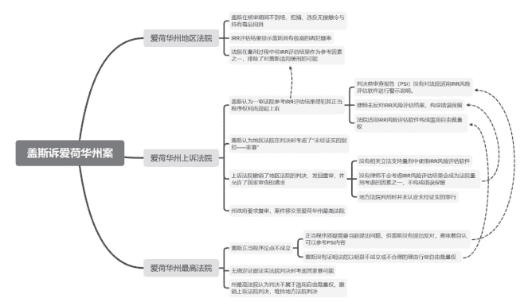

## 核心争议点
1.法院在量刑时未在警示说明的指导下采用 IRR 风险评估软件是否侵犯被告人的正当程序权利.
2.法院在量刑时未在警示说明指导下采用 IRR 风险评估软件意见是否构成滥用自由裁量权.
3.地区法院是否以未经证实或未经起诉的罪行对被告人进行判决，是否构成滥用自由裁量权.

## 裁判论证过程
### （一）量刑时未经警示说明即适用 IRR 风险评估工具并未侵犯被告人的正当程序权利
爱荷华州最高法院认为，虽然盖斯纠正了判决前审查报告（PSI）中的信息错误，但是盖斯没有对报告运用 IRR 风险评估软件提出反对.盖斯没有在一审判刑时提出侵犯其正当程序权利的主张，这意味着盖斯接受了 IRR 风险评估软件的适用，上诉中不得首次另行提起.
爱荷华州最高法院认为，上诉法院判决时并未对正当程序请求做出明确回应.而在上诉法院的少数反对意见（dissenting opinion）中，则详细论证了“量刑时未经警示说明适用 IRR 风险评估软件没有侵犯被告人的正当程序权利”这一观点.反对意见指出，盖斯认为地区法院适用 IRR 风险评估工具侵犯其正当程序权利有两点原因，一是自己的律师没有对 PSI 提出意见构成错误保留，二是 PSI 并没有附上警示说明以指导地区法院适用 IRR 风险评价软件.对此，反对意见认为，证明律师错误保留构成无效协助必须满足两点要求：一是证明律师存在错误，二是证明错误导致偏见.而本案中律师默认 PSI 是法院量刑综合考量的因素并不存在错误，律师没有对 PSI 提出意见不构成错误保留.此外，根据州及联邦正当程序条款的一般规则，法院量刑时考量因素的来源类别不受限制.正当程序只需要给予被告人对考量因素提出反对的权利.因此，PSI 上有无 IRR 风险评估工具的警示说明或者法院有无意识到 IRR 风险评估工具会对量刑有影响，都不影响被告人的正当程序权利，只要被告人当时未提出异议，其正当程序权利就得到了最低要求的保护.
同时，上诉法院的部分法官在反对意见中指出，盖斯之所以提出法院应当在警示说明的指导下适用风险评估工具，极大程度上受到了“卢米斯案”的影响.然而，两案并不相同，“卢米斯案”中风险评估工具运用的数据是被告人在庭上供述的基本信息，而本案中风险评估工具运用的数据是爱荷华州四个社区的信息.因此，对于前者，由于是自身供述的信息，被告人提出反对意见的可能性小，所以 PSI 需要对法官适用风险评估工具进行警示说明；但是对于后者，被告人完全可以当庭对信息提出反对意见，但却没有提出，因此不构成对正当程序权利的侵犯.

### （二）量刑时未在警示说明的指导下采用 IRR 风险评估工具意见不构成滥用自由裁量权
爱荷华州最高法院撤销了上诉法院判决，认为不论是根据法律的规定还是判例法的经验，风险评估工具都没有限制法院在量刑时考虑全部与之相关的、有用的因素.而 IRR 风险评估工具符合该条件，故法院有权在裁量时对其予以考虑.PSI 及包含的 IRR 风险评估工具只是法院量刑时考量的众多因素之一.
上诉法院则认为，国家法律或有关规定并未对量刑中 IRR 风险评估工具的使用进行规定.虽然《爱荷华州法典》授权地方法院接收“任何可能被提供的与量刑有关的信息”，但目前只知道 IRR 风险评估工具建议密切监视，无法确定其中参考的因素，也难以解释算法如何得出结果.在无法确定其可靠性的情形下，采用评估结果等于滥用自由裁量权.因此，量刑条款的一般规则不能解释为授权在量刑中使用一种未经审查的算法.

### （三）地区法院并未以未经证实或未经起诉的指控对被告人进行判决，不构成滥用自由裁量权
爱荷华州最高法院与上诉法院对此争议点的判决意见一致.盖斯认为法院在量刑时考虑了潜在的人身侵犯危险，滥用了自由裁量权.但上诉法院指出，没有确切证据表明地区法院在决定判决时讨论了家庭暴力，上诉时盖斯也承认意图实施攻击是二级盗窃犯罪的要素之一.量刑时法官仅仅知道未被起诉的罪行，这一事实不足以克服自由裁量权被适当行使的假设.必须有确切证据证明，初审法院的判决依赖于未被指控的罪行.因此地区法院并未以未经证实的指控对被告进行判决，不存在滥用自由裁量权的情形.

## 审理结果
1.爱荷华州地区法院判处盖斯不超过 10 年有期徒刑的不定期刑.
2.爱荷华州上诉法院撤销地区法院判决，发回重审.
3.爱荷华州最高法院撤销上诉法院判决，维持原判.

## 相关法条
《美国宪法第十四修正案》第 1 节（United States Constitution，Amendment 14 Section 1）（节选）
不经正当法律程序，不得剥夺任何人的生命、自由或财产.
《爱荷华州法典》第 901 章第 2 条第 1 款（Iowa Code §901.2.1）
一经定罪，法院应当考量国家、司法行政区惩教部门和被告人可能提供的与量刑问题有关的任何信息.法院可以考虑其他来源的信息.
《爱荷华州法典》第 901 章第 3 条第 1 款（Iowa Code §901.3.1）
判决前审查报告（PSI）应当包括：
a.被告人的基本特征、家庭、财务状况、需求和潜在因素.
b.被告人的犯罪记录和社会活动历史.
……
e.对受害者、受害者亲属及社区的伤害程度.
……
h.被告人的精神健康史与药物滥用史.
《爱荷华州法典》第 901 章第 4 条（Iowa Code §901.4）（节选）
判决前审查报告（PSI）是保密的，法院应提供保障措施以确保其机密性，包括但不限于密封报告，只有通过进一步的法院命令才能打开报告.被告人的律师和州检察官应至少在判刑日期前三天查阅报告.被告人的上诉律师和州检察官应当应要求并在无需法院命令的情况下，查阅报告.
《爱荷华州法典》第 901 章第 5 条（Iowa Code §901.5）（节选）
法院应当考量的可能与量刑问题有关的任何信息包括判决前审查报告（PSI）.

## 案例评析
### （一）本案明确了当事人对算法风险评估工具享有正当程序权利
根据本案，当事人对算法风险评估工具享有两种正当程序权利.一是有权对含有算法风险评估内容的 PSI 报告进行称述申辩，这一点与刑事诉讼法中规定的传统的正当程序权利无异.二是有权质疑算法风险评估工具本身应用的算法技术，这种新的权利也被称为“技术性正当程序权利”.
第一种权利简单而言，是可以对用于定罪量刑的所有证据材料进行反驳.它要求向被告人披露并解释所有的证据材料.爱荷华州上诉法院和州最高法院都认为，PSI 报告本身也是法院量刑中考虑的众多因素之一，并不妨碍被告人对该报告内容进行称述申辩.盖斯在州上诉法院和州最高法院都主张，PSI 报告没有就使用算法风险评估工具向法院进行警示说明，侵犯了自己的正当程序权利.但是两个法院都一致认为，盖斯在地区法院初审时是明确知道该份报告的内容的，是完全有机会提出正当程序权利抗辩的，但是其并没有第一时间反对 PSI 报告没有警示说明这一问题，是个人放弃了行使权利，法院并没有侵犯其正当程序权利.州最高法院甚至表示，如果盖斯愿意，他可以就律师没有帮助他行使这项权利而起诉自己的律师.而且上诉法院分析称，本案中的 PSI 报告本来也不需要附上相关的警示说明.详情请见本案案例评析第（二）部分.
第二种权利本该是本案分析的重点，但可惜盖斯没有在初审地区法院及时主张正当程序权利，使得上诉法院不能主动对这个问题展开论述.好在盖斯在上诉中极力主张，在“卢米斯案”中，法院考虑了算法风险评估工具本身是否会侵害正当程序权利的问题.上诉法院借机表达了其对该问题的观点.上诉法院表示，在“卢米斯案”中，卢米斯主张其无法实质性地获取有关算法风险评估工具本身的信息，比如每个数据在风险评估中的权重是多少.卢米斯主张由于无法实质性地获取信息，也就无法针对这个工具提出反驳，这使得自己无法行使正当程序权利.而本案中，PSI 报告中已经明确说明了算法风险评估工具收集了哪些数据，算法是如何评估这些数据的等等.这不同于“卢米斯案”，这说明盖斯实质性地获得了可用于反驳的信息，但他没有行使权利.由此可见，上诉法院也是同意当事人享有针对算法技术的正当程序权利的.

### （二）本案细化了包含算法风险评估工具的 PSI 报告的使用规范
在“卢米斯案”中，威斯康星州最高法院在判决中指出，“除了本文所述的限制外，COMPAS 风险评估的使用还必须受到某些限制.具体而言，任何包含 COMPAS 风险评估的 PSI 报告都必须包含一个警示说明，告知量刑法院客观审慎地考虑关于 COMPAS 风险评估的准确性.向量刑法院提供有关使用 COMPAS 风险评估的警示说明，将使法院能够更好地判断算法风险评估工具的准确性并在量刑时给予风险评分适当的权重.”
在本案中，盖斯同样引用了“卢米斯案”，表明包含 IRR 风险评估软件的 PSI 报告需要向法院提供关于 IRR 风险评估准确性的警示说明，但这一点未被法院认同.爱荷华州上诉法院认为，COMPAS 风险评估依赖的信息是被告人自己的基本信息与当庭供述的信息，其再次质疑的可能性较小.这时需要警示说明指导法院更好地适用算法决策，降低侵犯被告人正当程序权利的风险.而本案中，IRR 风险评估依赖的信息是爱荷华州四个社区的信息，并不是被告人自己的，被告人完全可以质疑信息的准确性.法院的潜在逻辑是说，被告人质疑信息准确性的行为就是在警示法院需要审慎对待算法风险评估工具.所以 PSI 报告无需再单独附上警示说明.
由上可得，包含算法风险评估工具的 PSI 报告是否需要对算法风险评估工具附上警示说明，是根据工具的算法所依赖的参数决定的.如果参数的真实性和准确性较高，那么 PSI 报告就需要附上警示说明，提示法院要客观审慎采纳算法评估的结果.如果参数的真实性和准确性较低，那么 PSI 报告就不需要附上警示说明.当事人对参数的质疑足以达到警示法院的效果.

### （三）本案进一步引发了有关算法技术正当程序权利的讨论
“技术性正当权利”（technological due process）的概念，是在马里兰大学法学院教授希特伦 2007 年发表的一篇名为《技术性正当程序》的论文中提出的.论文指出，告知相对人、听取相对人称述申辩等义务是正当程序对公权力的要求.然而计算机技术的隐蔽性使得相对人无从得知公权力的决策依据，也就无法质疑决策的准确性.这减损了告知义务的效果，架空了相对人称述申辩的权利.因此，需要明确技术性正当程序，要求用于决策的技术应当公平、透明、可问责.^([\[40\]](#txt001.html#footnote_content_txt001_40))
本案中，缓刑办就在决策是否建议对盖斯适用缓刑的时候应用了算法技术.实际上，有研究统计，在 2019 年，美国有不少于 60 种与本案类似的算法风险评估工具应用在刑事审判中.^([\[41\]](#txt001.html#footnote_content_txt001_41))然而，有多个学者在对不同的算法风险评估工具进行针对性研究之后发现，算法风险评估的准确性基本在中等水平，且经常会有评估结果前后不一致的情况，有的工具甚至会加剧对性别、种族的偏见.^([\[42\]](#txt001.html#footnote_content_txt001_42))不论决策如何做出，其实质准确与否，正当程序的价值就在于保障公权力决策程序的公平性与正当性，以尊重个体权利.应用算法技术仍然是服务于人，服务于决策.只要公权力决策需要受到正当程序的约束，那么算法技术亦不例外.
我国学界讨论基本达成共识，即算法技术正当程序作为传统正当程序的延伸，其标准应当来源于传统正当程序，并结合算法技术自身特征加以改良.刘东亮在其提出的正当程序的三项核心要素“排除偏见、听取意见和说明理由”的基础上，延伸出了对应的算法技术正当程序的三项核心要素.刘东亮认为，“排除偏见”是为了保证公权力在做出决策时没有任何利益关联.而公众监督和决策程序一体适用可以有效排除偏见.这就要求算法决策提高透明度，对决策依赖的数据和算法运行机制进行一定程度的披露.而算法运行程序的设计需要确保对每一项决策运用相同的规则，确保决策结果可重复.“说明理由”则要求算法具有可解释性，以此保障相对人实质性了解算法的工作机制和决策依据.“听取意见”则要求算法要在专业的审计人员协助下进行纠错.^([\[43\]](#txt001.html#footnote_content_txt001_43))张凌寒认为正当程序制度包含“信息发送、信息沟通与信息纠错”三种工具，以约束公权力的决策程序.基于此，张凌寒认为，算法决策的基本规则和因素权重应当向社会公开，保证算法公开透明；算法在做出决策前要进行算法影响评估，向公众告知潜在的风险，听取称述申辩，保障公民参与决策；应当创设算法解释权，以调试正当程序制度中的信息沟通工具.^([\[44\]](#txt001.html#footnote_content_txt001_44))雷刚、喻少如认为正当程序的内涵包括决策的中立性、公开性、论证性、公正性四个方面.基于此，算法技术正当程序的内涵应当包括以人为中心实现算法中立，以算法透明与算法可解释实现算法公开，以算法审计实现算法论证，以算法影响评估实现算法公正.^([\[45\]](#txt001.html#footnote_content_txt001_45))
外国学者的讨论更集中在实务层面，旨在规范算法风险评估工具在刑事审判中的使用.有学者认为，应当禁止在刑事审判中使用算法风险评估工具.因为其对被告人正当程序权利的潜在风险较大，且错误评估风险而导致被告人被施加过轻或过重刑罚的危害会超过提高刑事审判质量和效率的收益，所以应当禁止.^([\[46\]](#txt001.html#footnote_content_txt001_46))有学者认为，因为算法风险评估工具在刑事审判中并不起决定性作用，所以法官高估了自己对算法技术造成的风险的控制能力.^([\[47\]](#txt001.html#footnote_content_txt001_47))实际上，需要对法官进行培训，一是让法官理解算法风险评估工具的运行机制，以更加客观审慎地对待评估结果；二是正视算法技术造成的风险，尤其是算法歧视导致被告人风险评估失真的风险.^([\[48\]](#txt001.html#footnote_content_txt001_48))有学者从算法运行机制的角度对评估工具提出了三点要求：一是要求算法收集的数据要与被评估对象具有相关性；二是要求算法评估的结果要具有准确性，其中需要重点关注算法歧视问题；三是要求算法具有公正性，需要提高算法的透明度，通过设立算法解释权对其予以实现.^([\[49\]](#txt001.html#footnote_content_txt001_49))

### （四）有关算法问责制的立法活动
“算法问责”（Algorithm Accountability）简单而言是指要对算法进行追责.诚然，技术只是工具，无法承担责任.算法问责的实现路径就是穿透算法技术，令使用技术的人承担责任.算法问责的实现机制就是通过法律的规定为使用技术的人创设义务，以此来间接规范算法的运行机制.算法透明、算法可解释性、算法的分级分类管理等都是算法问责制的具体规范.
在欧盟，一方面，欧盟通过《一般数据保护条例》（GDPR），赋予个人从透明度、可解释性、影响力评估等方面来对抗算法自动化决策的一簇权利.^([\[50\]](#txt001.html#footnote_content_txt001_50))另一方面，欧盟计划制定《人工智能法案》，采取算法风险分级分类管理制度，提高对人工智能应用领域的风险控制能力.^([\[51\]](#txt001.html#footnote_content_txt001_51))
在美国，2019 年，美国国会两院议员提出《算法问责法案》（Algorithmic Accountability Act），在算法歧视、算法影响力评估、算法透明度方面对大型科技公司做出规定.^([\[52\]](#txt001.html#footnote_content_txt001_52)) 2022 年 2 月，美国国会两院议员再次提出《算法责任法案》（Algorithmic Accountability Act of 2022），更新了 2019 年的《算法问责法案》，首次规定美国联邦贸易法委员会（FTC）应当创建自动化决策系统的公共存储库，提高算法透明度.^([\[53\]](#txt001.html#footnote_content_txt001_53))此外，2019 年 6 月，美国国家科技委员会发布《人工智能研发战略计划》（2019 年更新版），强调通过优化设计来提高 AI 系统的公平、透明和可问责性.^([\[54\]](#txt001.html#footnote_content_txt001_54))
在我国，2021 年我国通过《个人信息保护法》，借鉴欧盟《一般数据保护条例》（GDPR）的规定，赋予个体从透明度、可解释性、影响力评估等方面对抗算法自动画像（profi ling）的一簇权利.同时，我国还向美国进行借鉴，一直在具体应用层面探索算法问责制的构建.比如，在算法推荐方面，网络安全和信息化委员会办公室、工信部、公安部与市场监督管理总局联合发布《互联网信息服务算法推荐管理规定》，旨在引导和规范互联网个性化推荐服务，降低算法歧视等风险.^([\[55\]](#txt001.html#footnote_content_txt001_55))此外，我国于 2017 年发布《新一代人工智能发展规划》^([\[56\]](#txt001.html#footnote_content_txt001_56))，于 2019 年发布《新一代人工智能治理原则》^([\[57\]](#txt001.html#footnote_content_txt001_57))，于 2020 年发布《国家新一代人工智能标准体系建设指南》^([\[58\]](#txt001.html#footnote_content_txt001_58))，全面系统地规划了人工智能领域算法技术的使用规范.

## 关联判例推荐
1. Townsend v. Burke, 334 U.S. 736, 741 (1948)
核心事实：法院对 Burke 的量刑是基于检方对其先前犯罪记录的虚假提供，或法院对犯罪记录粗心大意的误读作出的，侵犯了被告人的正当程序权利.
与本案关联点：被告人在法院适用 PSI 及其中包括的 IRR 风险评估软件时，享有改正其中虚假信息的权利.
2. Williams v. New York, 337 U.S. 241, 246 (1949)
核心事实：纽约州上诉法院认为，正当程序使法官可以考虑 PSI，其中载有的关于被定罪被告人的信息，包括可能有助于判刑、准予缓刑或对被告人进行惩戒的信息.
与本案关联点：法院是否采用风险评估结果属于法官自由裁量权的范围内.
3. State v. Delano, 161 N.W.2d 66 (1968)
核心事实：Delano 对法院在量刑时考虑其社会与经济背景提出反对.爱荷华州最高法院认为法院有权在量刑时尽可能广泛地考虑与量刑有关的信息.

与本案关联点：法院有权在量刑时尽可能广泛地考虑多种相关因素。

## 4. Loomis v. Wisconsin, 137 S.Ct. 2290 (2017)

### 核心事实
卢米斯的 COMPAS 风险评估结果，是基于他对问题的回答和公开获得的有关他犯罪历史的数据而做出的。巡回法院认为卢米斯对信息准确性提出反对的可能性较小，因此报告需要在法院适用风险评估结果时进行警示说明，防止侵犯被告人正当程序权利的潜在风险。但是又因为报告只是法院量刑时考虑的众多因素之一，没有警示说明也不意味着侵犯了被告人的正当程序权利。

### 与本案关联点
IRR 风险评估软件运用的数据是爱荷华州四个社区的信息，不是被告人的基础信息，并不需要警示说明。

## 5. State v. Gordon, 921 N.W.2d 19 (Iowa 2018)

### 核心事实
Gordon 在地区法院审判过程中没有第一时间对 PSI 中的信息错误提出反对，指出其侵犯自己的正当程序权利，意味着接受 PSI。地区法院没有侵犯其正当程序权利。

### 与本案关联点
被告人在审判过程中没有第一时间对 PSI 中的信息提出反对，指出其侵犯自己的正当程序权利，意味着接受 PSI 的适用。法院没有侵犯其正当程序权利。

## 1.4 马歇尔锁匠服务公司诉谷歌案

### 【案件索引】
Baldino’s Lock & Key Service, Inc. v. Google LLC, 285 F.Supp.3d 276 (D.D.C.2018)

Marshall’s Locksmith Serv. Inc. v. Google, LLC, 925 F.3d 1263 (D.C. Cir. 2019)

### 【关键词】
《通信规范法》；网络服务提供者豁免；虚假广告；算法中立

### 【案件提要】
本案有关互联网搜索引擎发布第三方内容的豁免权适用。本案的核心问题是被告谷歌公司作为网络服务提供者，是否对第三方信息发布者提供的虚假信息享有豁免权。美国《通信规范法》（Communications Decency Act， CDA）第 230 条^([59)]规定了网络服务提供者和用户发布信息的豁免权，使之原则上无需为第三方提供的任何信息内容承担法律责任，包括第三方虚假信息。只有当网站实际参与该信息的“创建”或“加工”时，才需要承担责任；而如果网站只是提供了一种中立的方式，让第三方可以独立发布自己选择的信息，则不构成网站对信息的创建或加工。这一条款在诉讼中可作为积极抗辩，法院也可以依此条款驳回起诉。第 230 条^([60)]对“交互式计算机服务”（interactive computer service）作广泛的定义，包括本案中的搜索引擎服务。

原告马歇尔锁匠公司认为：被告网站将第三方提供的地址和联系方式替换成电子地图坐标并发布，该行为对原始内容的增强和更改足以使之成为被告自己发布的新内容，而非被告网站对“第三方提供内容”的转载，因此不享受第 230 条的豁免。

上诉法院反驳原告的诉求，指出：使用中立的算法自动将第三方信息转化成电子地图不构成网站自身对信息的创建或加工，且第六巡回法庭已经认定搜索引擎此类自动编辑行为属于第 230 条的保护范畴。^([61)]

《通信规范法》诞生于互联网的起步阶段，第 230 条避免了网络服务提供者因需对海量信息负责而可能出现的运营成本高昂、用户言论自由过度受限、寒蝉效应等问题，有力促进了互联网的发展，因此被称为“创造了现代互联网的法律”。^([62)]而我国则采取“通知—移除”规则，《民法典》第 1195 条第 1 款规定：“网络用户利用网络服务实施侵权行为的，权利人有权通知网络服务提供者采取删除、屏蔽、断开链接等必要措施。通知应当包括构成侵权的初步证据及权利人的真实身份信息。”同条第 2 款则规定：“网络服务提供者接到通知后，应当及时将该通知转送相关网络用户，并根据构成侵权的初步证据和服务类型采取必要措施；未及时采取必要措施的，对损害的扩大部分与该网络用户承担连带责任。”

### 【案件要旨】
哥伦比亚特区联邦地方法院（一审法院）：原告 马歇尔锁匠公司（等） 被告谷歌公司（等）

哥伦比亚特区联邦巡回上诉法院（上诉法院）：上诉方 马歇尔锁匠公司（等）被上诉方 谷歌公司（等）

本案原告是马歇尔锁匠服务公司等 14 家锁匠公司，它们自称“合法的”锁匠，因为它们的公司地址、注册和/或持有执照地与其在广告中描述的实际经营的辖区相符。而原告所称的“假冒”锁匠公司是指在自己网站的广告中使用虚假地址的其他锁匠公司。假冒锁匠“针对全国每一个人口稠密的地区，发布成百上千个独立网站”，“这些页面要么显示一个虚构的地址要么没有地址，还内含虚假的声明称这些假冒锁匠公司在本地营业。”

本案被告是谷歌、微软和雅虎三个互联网公司，其控制了大约 90%的线上搜索市场份额。原告称被告公司进行了共谋，利用其在线上搜索服务市场的市场力量，故意放任不准确、甚至不存在的锁匠信息充斥搜索结果列表，诱使合法锁匠公司与假冒公司展开广告竞价来消除这些虚假信息对搜索结果的影响，以提高自身广告收入。

原告在一审主张：线上搜索结果扩大了假冒锁匠的影响力—当消费者被锁在屋外或车外时，他们通常会在被告的搜索引擎上搜索网络定位信息，选择与自己距离最近的锁匠。而假冒锁匠公司创建了大量虚假地址，让消费者误以为他们就在附近，合法锁匠公司因此不正当的竞争遭受导了严重经济损失。这些虚假地址被算法转换成了被告网站内的电子地图坐标。原告称被告发布的这些虚假定位信息已经严重阻碍顾客搜到合法锁匠公司的位置信息并与之取得联系。

原告诉讼请求被一审法院驳回。哥伦比亚特区联邦地方法院认为：被告以电子地图的形式转载的第三方虚假信息不构成创造新的内容，被告所增加的任何额外信息均基于第三方提供的原始信息，因此被告适用《通信规范法》第 230 条的豁免权。

原告随后提出上诉。原告修改后的诉讼请求称被告为实施上述计划发布了三种内容，且这些内容不受《通信规范法》保护：（1）发布第三方网站上的假冒锁匠的虚假地址，即使明知这些地址并不存在；（2）将假冒锁匠公司网站上的街道地址和区号信息进一步转换成被告搜索页面内的精确地图坐标，增强了原始内容，构成被告创造的新内容；（3）被告自己凭空捏造的、缺乏原始信息依据的内容。

哥伦比亚特区联邦巡回上诉法院在适用第 230 条（c）款第（1）项时引入了三步测试：（1）被告是网络服务提供者或用户，（2）原告主张被告承担责任的信息是由第三方提供的，（3）该指控旨在要求被告作为该信息的发布者或发言人承担责任。上诉法院重新审查一审法院基于《通信规范法》第 230 条作出的驳回起诉的判决后，认为被告将第三方信息转化成电子地图时使用的是“中立的算法”进行自动编辑，从而维持原判。

### 【案例事实思维导图】
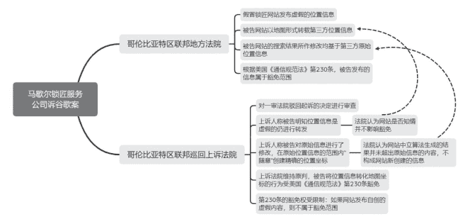

### 【核心争议点】
被告发布的三种类型的信息是否属于《通信规范法案》第 230 条豁免的“其他信息发布者提供的信息”：
1.被告发布的假冒锁匠的第三方网站内含有的虚假位置信息（且被告明知这些地址并不存在）是否可以豁免。
2.被告以电子地图的形式展示第三方位置信息，是否构成被告自己创建的内容从而不能豁免。
3.被告自己创建的无中生有的信息是否可以豁免。

### 【裁判论证过程】
（一）被告发布的第三方网站虚假信息受《通信规范法案》第 230 条豁免
哥伦比亚特区联邦巡回上诉法院认为，此类信息属于网络服务提供者发布的来自第三方网站的信息，其属于第 230 条的豁免范围并无争议。原告的这一诉讼请求正是美国国会通过第 230 条所希望避免的典型诉求。^([63)]原告也并未对上述结论作主要陈述。在初审时，原告律师也承认：仅仅从第三方得到信息并发布，信息本身仍属于豁免内容。在上诉法院审理时，原告的诉讼请求修改为：被告“实际上注意到”此类信息是具有欺诈性的，却还进行转发。

上诉法院援引第一巡回法庭的判例称：“尽管被告注意到这些位置信息是虚假的，也不足以让这些虚假信息变成被告的原创内容，这一规则已经被确立了。”^([64)]对网络服务提供者的豁免无需考虑其是否知道第三方发布的信息是正确还是错误。因此，原告声称的被告转发的第三方信息仍属于第 230 条的豁免范畴。

（二）被告把第三方网页的位置信息转化成电子地图并不构成创造或发展新的信息
原告声称，被告创建电子地图的坐标点来展示假冒锁匠的位置，属于增强了第三方的原始内容，且这种修改和增强足以使之变成被告自己创建的内容。哥伦比亚特区联邦巡回上诉法院分别讨论了两个问题：首先，被告把第三方街道地址信息转化成地图坐标的行为是否排除了此类信息的豁免权；其次，被告将缺乏精确性的位置信息转化成电子地图坐标是否受《通信规范法》的保护。

在讨论第一个问题时，上诉法院认为，网站有权决定以何种方式呈现第三方信息，以地图的形式展示第三方信息不构成第 230 条（f）款第（3）项所指的“创建”或“加工”原始信息。因为这些基本信息完全来自于第三方，而转化为地图的行为本身并不会使搜索引擎变成“信息内容的提供者”。如果以电子地图坐标的方式展示位置信息不能享受豁免，则没有任何转载自第三方的信息将享受豁免—搜索引擎想要展示第三方信息，就不可避免地需要将数字传输内容转化为文字或图片的形式。此外，在原告口头提交的意见中，原告律师承认如果搜索引擎的行为仅仅是将其用户的信息转化成地图坐标，则享有转载第三方信息的豁免权。原告没有证明其自认的转化行为和本案中争议的行为有何区别。至于原告提出的被告应当在其地图上对合法与非法锁匠的信息进行区分，上诉法院认为这一诉求是无根据的，因为国会订立该法案已经豁免了网络服务提供者对任何第三方信息的转载，即使这些信息是错误的。

至于第二个问题，据原告描述，假冒锁匠网站称其“在华盛顿市区提供锁匠服务”，并提供了一个区号为“202”的电话号码。而被告的搜索引擎根据这一模糊信息，“任意地”在华盛顿市区内给假冒锁匠分配了属于上述范围的一个地图定位。上诉法院认为，这样的转化同样受到第 230 条的保护。

首先，正如原告所承认的，被告地图上的精确定位是源自第三方网站的位置信息，且该精确定位不会超出第三方提供的位置范围。上述法院引用第六巡回法院的判例^([65)]，认为在这种情况下被告发布的地图定位是“其他信息发布者提供的信息”。第六巡回法院在其裁判中写道，Yelp 网站在自己平台的搜索结果里以星级评分的方式展现第三方客户服务评价，将第三方复杂的内容简化为一星至五星的分值，其本质上仍是第三方用户数据的表现形式之一。因此，在本案中虽然被告的定位算法并是不完全受限于第三方内容，但这仅仅是算法本身的设计问题—算法在将所有搜索结果图像化时会尽可能地将精度不同的第三方内容精确化。

更重要的是，被告将第三方信息转化为精确地图坐标的行为并不构成创造了新的信息，是因为被告的转化使用的是中立的算法。上诉法院在之前的判例中已经明确，“如果网站只是提供了一种中立的算法，让第三方可以在网上独立选择发布何种信息，那么网站就不构成创造或发展了新的内容。”^([66)]第六巡回法庭也明确了搜索引擎“自动编辑的行为”受该法案保护。^([67)]在本案中，被告使用自动编辑的算法将第三方提供的位置转化成地图的形式，这种算法在自动转化第三方信息时并没有造成对合法锁匠和假冒锁匠的区别对待。因此，被告用中立的算法进行自动编辑，其生成的地图定位信息受《通信规范法案》第 230 条的豁免。

（三）被告发布了区别于第三方信息的原创内容
原告称被告人为地更改了算法，并不是使用第三方提供的信息或算法自动生成的信息，以搜索结果对其利润最大化。但原告在上诉的请求中并没有进一步阐释这一点，法院亦未作讨论。

原告还称被告的算法给同一条假冒锁匠的位置信息分配不同的地图定位，这些具体定位取决于顾客所在的位置，以使假冒锁匠的位置看起来距离顾客更近。但这一请求并未出现在原告修改后的上诉意见中。因此，上诉法院认为这一问题与审查初审法院驳回诉讼请求的法律问题无关。

### 【审理结果】
1.哥伦比亚特区联邦巡回上诉法院认定：被告网站将第三方位置信息转化成地图的行为受《通信规范法》第 230 条豁免。
2.哥伦比亚特区联邦巡回上诉法院认定：被告在第三方位置信息的范围内显示精确地图坐标不构成创造新内容，该中立算法受第 230 条豁免。
3.哥伦比亚特区联邦巡回上诉法院驳回原告上诉，维持原判。

### 【相关法条】
美国《通信规范法》第 230 条（c）款第（1）项（Communications Decency Act§230（c）（1），47 U.S.C. §230（c）（1）（1996））
交互式计算机服务的提供者或用户不得被视为另一个信息内容提供者提供的任何信息的发布者或发言人。

美国《通信规范法》第 230 条（c）款第（3）项（Communications Decency Act§230（c）（3），47 U.S.C. §230（c）（3）（1996））
信息内容提供者，是指对通过互联网或任何其他交互式计算机服务提供的信息的创造或发展负有全部或部分责任的任何个人或实体。

### 【案例评析】
（一）本案进一步明确了美国网络服务提供者的免责条件
根据美国《通信规范法》第 230 条的规定，网络服务提供者无需为“另一个信息内容提供者提供的任何信息”承担责任；只有当其自身“创造或发展”信息时，才会被视为信息内容提供者而必须承担责任。但何为“创造或发展”，在立法上一直欠缺说明。^([68)]

本案确立了“创造或发展”的两层判断标准，为后续案件所延续与采纳。首先，本案认为，当网络服务提供者呈现的信息完全来源于且受限于第三方的信息时，其并未“创造或发展”信息，故符合第 230 条的免责条件。其次，当网络服务提供者利用中立的算法转化第三方信息，即对一切第三方信息采取一视同仁的自动化算法处理时，其亦可受免责条款保护。这些标准的确立，在延续标志性案例“Fair House Council of San Fernando Valley v. Roommates.Com，LLC”所提出的“网络服务提供者只有对内容的非法性提供实质性贡献时才应担责”标准的基础上，进一步进行了细化，为后续案件提供了指导。^([69)]例如，在适用本案标准的“Force v. Facebook 案”中，美国第二巡回上诉法院认为，由于脸书公司的算法只是根据客观的因素将用户提供的信息同其他用户进行配对，其算法是“内容中立的”，脸书公司不可被认定为信息的“发展或创造者”。^([70)]而在“Smith v. Airbnb， Inc.案”中，俄勒冈州上诉法院援引了本案中认为将第三方所提供的信息自动转化为图标是一种“中立工具”的观点，从而类推出 Airbnb 公司在搜索结果中添加图标以显示民宿含热水浴池的做法仍受《通信规范法》第 230 条保护。^([71)]

（二）符合豁免条款促进网络发展、保护言论自由之立法目的
上世纪 90 年代互联网刚刚起步时，美国出现了一系列追究网络平台责任的诽谤侵权诉讼，其中最具影响力的为“Cubby， Inc v. CompuServe， Inc”与“Stratton Oakmont v. Prodigy Servs. Co.”两案。^([72)]在前一案中，被告 CompuServe 公司运营网络论坛，因论坛上的用户发布诽谤性言论而被原告起诉诽谤。法院认为由于 CompuServe 公司对论坛中的言论没有施加任何控制，其应适用传统诽谤侵权责任法中的经销商责任，即只有在明知或应知诽谤性言论存在于其论坛时才需要承担责任。而在后一案中，被告 Prodigy 公司运营的电子布告栏上张贴了涉嫌诽谤原告的信息，原告因此起诉 Prodigy 公司诽谤。法院认为由于 Prodigy 公司对其他人创造的内容进行了一定程度的审查和控制，该公司适用传统诽谤侵权责任中的出版者责任，应当承担严格责任。综合两起案件的结论就会发现，将传统媒介中形成的诽谤侵权责任规则适用于互联网领域时便会出现不合理的结果：如果网络平台不做任何积极审查，网络平台仍可能会对完全由第三人创作的非法内容承担责任；而如果网络平台对这些内容进行审查，反而需要承担更严苛的责任。受这种判例的影响，为了避免承担法律责任，网络平台可能会对用户发布的所有内容进行严格的控制，甚至限制用户发布信息的种类与数量，结果一方面导致“寒蝉效应”，使互联网信息的自由流通受阻，另一方面还会大大增加网络平台的运营成本，抑制互联网的发展。^([73)]

为了消除上述判例带来的负面影响，1996 年，美国国会通过《通信规范法》第 230 条，赋予网络服务提供者豁免保护，使其无需为第三方提供的信息承担责任。同时，为了鼓励网络服务提供者自行审查平台上的信息，又明确了网络服务提供者对不良信息善意的审查行为不会导致豁免权的丧失。^([74)]《通信规范法》第 230 条的立法目的，一是在于促进互联网发展，^([75)]保障用户的言论自由；^([76)]二是在于鼓励网络平台自行审查，减少不良信息的传播。

本案的判决切合了第一种立法目的.针对谷歌公司将第三方网站上地址信息自动转化为地图标签的算法行为，法院认为，“如果这种信息展示方法不能被豁免，则每一种展示方法均不能：搜索引擎的一切展示，都是把第三方网站上的信息转化为另一种文字或图片形式”.可见，如果本案法院当时对谷歌做出了不利判决，则谷歌地图乃至所有搜索引擎所拥有的正常功能都可能会成为被起诉的对象，显然不利于搜索引擎的发展与公众的便利.在这种情境下，如果谷歌仍然希望推出该功能，很可能就需要出台极为严苛的审查制度，最终造成言论自由的过度限制.

## （三）引发了关于网络平台责任的学界讨论

然而，本案判决未体现第二种立法目的—鼓励网络平台自我审查.本案中，法院明确反对了原告认为被告应当对虚假地址信息进行筛查的主张.对此，学者安德鲁·M·塞瓦尼恩认为，为网络服务提供者提供豁免保护并不能鼓励它们自我审查，反而可能抑制自我审查机制的形成，因为它们在第 230 条的保护下，无论自查与否都不影响被豁免保护.^([\[77\]](#txt001.html#footnote_content_txt001_77))鉴于此，有不少学者认为《通信规范法》第 230 条导致互联网充斥着虚假与误导性信息.^([\[78\]](#txt001.html#footnote_content_txt001_78))与此同时，由于互联网具有匿名化的特点，不良信息发布者的身份很可能难以被受害者确认.即使确认了身份，不良信息发布者的财力也很可能有限.^([\[79\]](#txt001.html#footnote_content_txt001_79))尤其是在本案中，假冒锁匠人数庞大，又提供了海量虚假身份信息，这些均加大了原告直接起诉假冒锁匠的困难.因此，一味地豁免网络服务提供者，可能会导致被网络侵害的人得不到任何救济.

针对这些问题，有学者主张借鉴 1998 年《数字千年版权法》（Digital Millennium Copyright Act， DMCA）第 512 条的“通知—撤下”制度.^([\[80\]](#txt001.html#footnote_content_txt001_80))根据该制度，网络服务提供者在接到权利人侵权通知后必须移除争议信息，否则不得免除责任.为了防止侵权通知的滥用，该法还规定了网络服务提供者需将移除行为通知发布争议信息的第三方.如果第三方认为争议信息没有侵权，则可以向网络服务提供者发送“反通知”，请求恢复信息.此时，侵权通知发送者必须在一定期限内提起诉讼，否则网络服务提供者便有权恢复争议信息.^([\[81\]](#txt001.html#footnote_content_txt001_81))可见，“通知—撤下”制度既能减少互联网上的不法信息，使权利人获得排除侵害的救济，又能一定程度上保障合法信息免受限制.然而，亦有学者观察到，“通知—撤下”制度下大部分用户收到撤下通知后并不会抗争，数据表明只有 0.009%的用户会发出“反通知”，因此该制度仍可能会造成“寒蝉效应”.^([\[82\]](#txt001.html#footnote_content_txt001_82))

## （四）体现了《通信规范法》第 230 条的改革需要

近年来，美国立法者也逐渐意识到《通信规范法》第 230 条宽泛的豁免权所引发的问题：不法分子在网络平台上肆意地从事毒品贩卖、儿童性剥削、网络跟踪与人口贩卖等活动，网络平台却无需对这些活动展开任何审查；^([\[83\]](#txt001.html#footnote_content_txt001_83))即使一个网络平台鼓励用户从事非法活动、故意在网页上保留有害信息或从用户的非法活动中获益，也丝毫不影响其享受豁免.^([\[84\]](#txt001.html#footnote_content_txt001_84))这些弊端亦反映在本案中：面对原告声称被告明知假冒锁匠存在却拒绝清理虚假信息的主张，法院援引判例指出被告明知信息的虚假性并不影响其享有豁免权.

为了解决这些问题，美国立法者近年来纷纷提出《通信规范法》第 230 条的改革方案.2018 年，美国国会通过了《反网络性交易法》（Allow States and Victims to Fight Online Sex Traffi cking Act， FOSTA），从此拉开了《通信规范法》第 230 条改革的序幕.该法为第 230 条创设了例外，规定第 230 条不适用于性交易的民刑事指控或“促进或便利卖淫”的行为.^([\[85\]](#txt001.html#footnote_content_txt001_85))随后，美国第 116 届国会出现了 26 项关于改革《通信规范法》第 230 条的提案，^([\[86\]](#txt001.html#footnote_content_txt001_86))其中最具影响力的为《消除对交互式技术的滥用和肆意忽视法案》（Eliminating Abusive and Rampant Neglect of Interactive Technologies Act， EARN IT Act）与《平台责任和消费者透明度法案》（Platform Accountability and Consumer Transparency Act， PACT Act）.“EARN IT 法案”延续了 FOSTA 的思路，旨在取消网络平台对在线儿童性侵内容的豁免权，该法案已在 2022 年 2 月投票通过参议院司法委员会.^([\[87\]](#txt001.html#footnote_content_txt001_87))而“PACT 法案”则不再拘泥于单独领域的例外，而是要求平台建立全面的违法内容举报机制，并规定平台如果在收到举报的 24 小时内不清除违法内容，就会丧失第 230 条下的豁免权.“PACT 法案”改变了本案及其援引的一系列判例对《通信规范法》第 230 条过宽的解释，要求平台为其明知违法的内容承担责任.

除了立法者以外，美国行政部门也热切关注《通信规范法》第 230 条的改革话题.2020 年 5 月，时任美国总统的特朗普签署“防止在线审查”行政命令，概述了行政部门对第 230 条的立场，并指示几个不同的机构采取具体行动落实其立场.^([\[88\]](#txt001.html#footnote_content_txt001_88))而 2020 年 6 月，美国司法部对《通信规范法》第 230 条进行了全面审查，随后发布改革建议书，建议立法者取消对以下几类网络平台的豁免：（1）鼓励违法行为的；（2）侵权内容涉及儿童虐待、恐怖主义与网络跟踪的；（3）侵权内容为平台所明知非法的；（4）涉及民事执行的；（5）涉及反垄断诉讼的.^([\[89\]](#txt001.html#footnote_content_txt001_89))

尽管美国政界普遍存在《通信规范法》第 230 条需要改革的共识，但每一个具体的改革方案都引来了大量批判，导致改革进程阻力重重.例如，“EARN IT 法案”和美国司法部的建议被科技工作者和隐私权拥护者强烈批评，他们认为这些方案都将严重限制言论自由，阻遏科技创新并使执法人员更容易盗取私人信息.^([\[90\]](#txt001.html#footnote_content_txt001_90))

## 【关联判例推荐】

1\. Universal Commc’n Sys., Inc. v. Lycos, Inc., 478 F.3d 413 (1st Cir. 2007)

核心事实：原告主张被告网络论坛上的用户匿名发布了关于自己的虚假和诽谤性信息.上诉法院认为被告根据《通信规范法》第 230 条享受豁免，不应为第三方用户的言论负责.

与本案关联点：网络服务提供者知晓信息的非法性并不会导致其成为该信息的创造者.

2\. Kimzey v. Yelp!, Inc., 836 F.3d 1263 (9th Cir. 2016)

核心事实：原告（企业）因被告（大众评价网站）的用户对原告打了一星评价，主张被告因创立了五星打分系统而“创造或发展”了该评价的内容，应对该评价承担责任.上诉法院认为被告只是创立了一个中立的工具供第三方发布信息，不存在“创造或发展”新内容的情形.

与本案关联点：网络服务提供者利用中立的工具将第三方输入的信息进行展示不是“创造或发展”新的内容.

3\. O’Kroley v. Fastcase, Inc., 831 F.3d 352 (6th Cir. 2016)

核心事实：原告因谷歌搜索引擎上存在自己名字后连有“性侵儿童”文字的搜索结果而起诉谷歌，主张谷歌“创造或发展”了侵权内容.上诉法院认为谷歌公司只是对第三方网页内容进行了“自动化编辑行为”，属于出版者的传统编辑功能，因此应享受豁免权.

与本案关联点：搜索引擎的“自动化编辑行为”一般受豁免权保护.

4\. Bennett v. Google, LLC, 882 F.3d 1163 (D.C. Cir. 2018)

核心事实：原告主张第三方利用谷歌公司提供的平台发布侵权性博文，起诉了谷歌公司.上诉法院认为谷歌公司属于《通信规范法》第 230 条的豁免保护对象而支持初审法院做出的原告败诉判决.

与本案关联点：网络服务提供者满足下列三个条件即可根据《通信规范法》第 230 条享受豁免：被告是网络服务提供者或其用户；原告主张被告应担责的信息为其他信息内容提供者所提供；原告主张被告是该信息的出版者或发表者.

## 【注释】

[\[1\]](#txt001.html#footnote_quote_txt001_1)18 U.S.C. §3553 （2018）.（注：2018 年《美国法典》第 18 卷，第 3553 条.）

[\[2\]](#txt001.html#footnote_quote_txt001_2)美国《第一步法案》于 2018 年 12 月 21 日由特朗普总统签署.该法案旨在改善刑事司法结果，在建立维护公共安全的机制的同时，减少联邦监狱囚犯人数.

[\[3\]](#txt001.html#footnote_quote_txt001_3)First Step Act of 2018， Pub. L. NO.115-391， §101， 132 Stat. 5196 （2018）.

[\[4\]](#txt001.html#footnote_quote_txt001_4)Partnership on AI， Algorithmic Risk Assessment and COVID-19： Why PATTERN Should Not Be Used，Partnership on AI （April 30， 2020）， http：//partnershiponai.org/wp-content/uploads/2021/07/Why-PATTERN-Should-Not-Be-Used.pdf.

[\[5\]](#txt001.html#footnote_quote_txt001_5)Brandon L. Garrett & Megan Stevenson， Open Risk Assessment， 38 Behavioral Science and the Law 279， 279-286 （2020）.

[\[6\]](#txt001.html#footnote_quote_txt001_6)First Step Act of 2018， Pub. L. NO.115-391， §101， 132 Stat. 5196 （2018）.

[\[7\]](#txt001.html#footnote_quote_txt001_7)Jerrold Nadler & Karen Bass， Letter from Jerrold Nadler， Chairman， House Judiciary Comm. & Karen Bass， Chair， Subcomm. on Crime， Terrorism， and Homeland Sec.， to William P. Barr， Att’y Gen.，U.S. Dep’t of Just， U.S. House Judiciary Committee （March.30，2020）， https：//judiciary.house.gov/uploadedfi les/3.30.20\_letter\_to\_ag\_barr\_re\_covid19.pdf.

[\[8\]](#txt001.html#footnote_quote_txt001_8)Partnership on AI， Algorithmic Risk Assessment and COVID-19： Why PATTERN Should Not Be Used，Partnership on AI （April 30， 2020）， http：//partnershiponai.org/wp-content/uploads/2021/07/Why-PATTERN-Should-Not-Be-Used.pdf.

[\[9\]](#txt001.html#footnote_quote_txt001_9)U.S. Department of Justice Offi ce of the Attorney General， The First Step Act of 2018：Risk and Needs Assessment System UPDATE ，National Institute of Justice（Jan. 16， 2020）， https：//nij.ojp.gov/sites/g/files/xyckuh171/files/media/document/the-first-step-act-of-2018-risk-and-needs-assessmentsystem-updated.pdf.

[\[10\]](#txt001.html#footnote_quote_txt001_10)18 U.S.C. §3582.（注：《美国法典》第 18 卷，第 3582 条.该款规定：“一旦判刑，法院不得修改刑期，除非有特殊和令人信服的理由证明有必要进行这种减刑.”）

[\[11\]](#txt001.html#footnote_quote_txt001_11)Partnership on AI， Algorithmic Risk Assessment and COVID-19： Why PATTERN Should Not Be Used，Partnership on AI （April.30，2020）， http：//partnershiponai.org/wp-content/uploads/2021/07/Why-PATTERN-Should-Not-Be-Used.pdf.

[\[12\]](#txt001.html#footnote_quote_txt001_12)Partnership on AI， Algorithmic Risk Assessment and COVID-19： Why PATTERN Should Not Be Used，Partnership on AI （April.30，2020）， http：//partnershiponai.org/wp-content/uploads/2021/07/Why-PATTERN-Should-Not-Be-Used.pdf.

[\[13\]](#txt001.html#footnote_quote_txt001_13)Partnership on AI， Algorithmic Risk Assessment and COVID-19： Why PATTERN Should Not Be Used，Partnership on AI （April.30，2020）， http：//partnershiponai.org/wp-content/uploads/2021/07/Why-PATTERN-Should-Not-Be-Used.pdf.

[\[14\]](#txt001.html#footnote_quote_txt001_14)First Step Act of 2018， Pub. L. NO.115-391， §101， 132 Stat. 5196 （2018）.First Step Act SEC101， 18 U.S.C. §3635 （2018）.（注：《第一步法案》第 101 节，收入 2018 年《美国法典》第 18 卷第 3635 条.）“Defi nitions （6）RISK AND NEEDS ASSESSMENT TOOL.—The term‘ risk and needs assessment tool’ means an objective and statistically validated method through which information is collected and evaluated to determine...”

[\[15\]](#txt001.html#footnote_quote_txt001_15)Sarah L. Desmarais & Evan M. Lowder， Pretrial Risk Assessment Tools： A Primer for Judges，Prosecutors， and Defense Attorneys， 4 Safety and Justice Challenge 1， 1-12 （2019）.

[\[16\]](#txt001.html#footnote_quote_txt001_16)Brandon L. Garrett & Megan Stevenson， Open Risk Assessment， 38 Behavioral Science and the Law 279， 279-286 （2020）.

[\[17\]](#txt001.html#footnote_quote_txt001_17)Partnership on AI， Algorithmic Risk Assessment and COVID-19： Why PATTERN Should Not Be Used，Partnership on AI （April.30，2020），http：//partnershiponai.org/wp-content/uploads/2021/07/Why-PATTERN-Should-Not-Be-Used.pdf.

[\[18\]](#txt001.html#footnote_quote_txt001_18)江溯：《自动化决策、刑事司法与算法规制—由卢米斯案引发的思考》，载《东方法学》2020 年第 3 期.

# 脚注

[\[19\]](#txt001.html#footnote_quote_txt001_19)李立丰、齐弋博：《智能量刑算法决策与刑事自由裁量权的差异与融合》，载《科技与法律（中英文）》2022 年第 1 期.

[\[20\]](#txt001.html#footnote_quote_txt001_20)郑曦：《人工智能技术在司法裁判中的运用及规制》，载《中外法学》2020 年第 32 期.

[\[21\]](#txt001.html#footnote_quote_txt001_21)Sason A. Colquitt 等，《千禧年的正义：组织正义研究 25 年的元分析回顾》，86 Journal of Applied Psychology 425，425-445（2001）.

[\[22\]](#txt001.html#footnote_quote_txt001_22)Margot E. Kaminski，《解释的权利，解释》，34 Berkeley Technology Law Journal 189，213（2019）.

[\[23\]](#txt001.html#footnote_quote_txt001_23)Brandon L. Garrett & Megan Stevenson，《开放风险评估》，38 Behavioral Science and the Law 279，279-286（2020）.

[\[24\]](#txt001.html#footnote_quote_txt001_24)《吉米莱斯法案》：是指佛罗里达州在 1997 年实施的法案，吉米莱斯是一名遭受性暴力的受害儿童的姓名.这项法案旨在加大对未成年人的保护力度，即强制对未成年人实施性犯罪的罪犯在结束其法定刑期后，继续执行收容改造程序.这一法案使得在佛罗里达对儿童进行性犯罪的罪犯可能余生都要在管控机构中度过.

[\[25\]](#txt001.html#footnote_quote_txt001_25)“儿童和家庭服务部”（Department of Children and Family Service）：美国儿童保护组织，在各个州具有分支组织，致力于保护儿童的合法权益，防止儿童受到虐待.

[\[26\]](#txt001.html#footnote_quote_txt001_26)“弗莱标准”：“弗莱标准”是一种判断“科学性结论能否成为法律依据”的判断方法.目前，法律上普遍将 1923 年 Frye v. United States， 293 F. 1013 案中的专家意见作为“弗莱标准”（Frye Standard），以此判断新的科学性结论能否成为法律依据，判定标准为：只有科学性证据在相关领域被广泛接受，并形成广泛认知时，才能够作为证据被采纳，并允许其成为影响陪审团和法官定罪量刑的依据.

[\[27\]](#txt001.html#footnote_quote_txt001_27)Loomis v. Wisconsin， 881 N.W. 2d 749 （2016）. Loomis v. Wisconsin， 137 S. Ct. 2290（2017）.

[\[28\]](#txt001.html#footnote_quote_txt001_28)Florida Statutes §394.910 （2002）（注：2002 年《佛罗里达州法规》第 394 章第 910 条）：立法机构意图为性暴力犯罪者的长期护理和治疗设置一套收容改造程序.

[\[29\]](#txt001.html#footnote_quote_txt001_29)Florida Statutes §394.912 （2002）（注：2002 年《佛罗里达州法规》第 394 章第 912 条）：对性暴力犯罪的范围进行了明确规定，性暴力犯罪为从事性侵害时谋杀或绑架未满 13 岁的儿童，并在其犯罪过程中，实施性侵害或对儿童实施下流、淫荡或猥亵性的侵害或行为，以及在儿童面前进行上述性犯罪行为.

[\[30\]](#txt001.html#footnote_quote_txt001_30)Dennis FLANAGAN v. STATE of Florida， 625 So.2d 827 （1993）.

[\[31\]](#txt001.html#footnote_quote_txt001_31)Timothy Ray HADDEN， Richard BEAULIEU v. STATE of Florida， 690 So.2d 573 （1997）.

[\[32\]](#txt001.html#footnote_quote_txt001_32)“性犯罪侧写”：通过受害人的证词、陈述、心理状态等多种科学方式综合评估性犯罪者的身份.

[\[33\]](#txt001.html#footnote_quote_txt001_33)“儿童性侵犯综合征评估工具”：通过儿童的生理、精神的创伤程度评估其遭受性侵害的程度.

[\[34\]](#txt001.html#footnote_quote_txt001_34)Becker J V， Murphy W D，《我们对性犯罪者评估和治疗的了解与未知》，4 Psychology， Public Policy， and Law 116，116（1998）.

[\[35\]](#txt001.html#footnote_quote_txt001_35)Hanson R K， Thornton D.《改进性犯罪者风险评估：三种精算量表的比较》，24 Law and Human behavior 119，119-136（2000）.

[\[36\]](#txt001.html#footnote_quote_txt001_36)“受害应激症状”（Ward）规定：医生的诊断可作为专家证言，即儿童有胃痛、睡眠障碍和睡眠依赖性等症状时，可作为儿童患有创伤后应激综合症的观点依据.

[\[37\]](#txt001.html#footnote_quote_txt001_37)本案为爱荷华州上诉法院做出的二审判决.

[\[38\]](#txt001.html#footnote_quote_txt001_38)本案为爱荷华州最高法院做出的终审判决.

[\[39\]](#txt001.html#footnote_quote_txt001_39)参见 Loomis v. Wisconsin，137 S. Ct. 2290（2017）.

[\[40\]](#txt001.html#footnote_quote_txt001_40)参见 Danielle K. Citron，《技术性正当程序》，85 Washington University Law Review 1249，1303（2007）.

[\[41\]](#txt001.html#footnote_quote_txt001_41)参见 Angele Christin，《预测算法与刑事量刑》，载于 The Decisionist Imagination，N. Guilhot & D. Bessner（编）Berghahn Books，2019.

[\[42\]](#txt001.html#footnote_quote_txt001_42)参见 Caoimhe Anderson，《算法对刑事量刑中正当程序权利的影响》（Mar.13，2022），https：//pure.qub.ac.uk/en/studentTheses/the-impact-of-algorithms-in-criminalsentencing-on-due-process-ri.

[\[43\]](#txt001.html#footnote_quote_txt001_43)参见刘东亮：《技术性正当程序：人工智能时代程序法和算法的双重变奏》，载《比较法研究》2020 第 5 期.

[\[44\]](#txt001.html#footnote_quote_txt001_44)参见张凌寒：《算法自动化决策与行政正当程序制度的冲突与调和》，载《东方法学》2020 年第 6 期.

[\[45\]](#txt001.html#footnote_quote_txt001_45)参见雷刚、喻少如：《算法正当程序：算法决策程序对正当程序的冲击与回应》，载《电子政务》2021 年第 12 期.

[\[46\]](#txt001.html#footnote_quote_txt001_46)参见 Mirko Bagaric， Gabrielle Wolf，《计算机量刑：增强量刑透明度和可预测性，并（可能）弥合量刑知识与实践之间的差距》，4 George Mason Law Review 1，45（2017）.

[\[47\]](#txt001.html#footnote_quote_txt001_47)参见 Katherine Freeman，《算法不公：威斯康星州最高法院如何在 State v. Loomis 案中未能保护正当程序权利》，18 North Carolina Journal of Law & Technology 75，102（2016）.

[\[48\]](#txt001.html#footnote_quote_txt001_48)参见 Caoimhe Anderson，《算法对刑事量刑中正当程序权利的影响》（Mar.13，2022），https：//pure.qub.ac.uk/en/studentTheses/the-impact-of-algorithms-in-criminal-sentencingon-due-process-ri.

[\[49\]](#txt001.html#footnote_quote_txt001_49)参见 Christopher Slobogin，《法律决策者风险评估入门》（Mar.13，2022），https：//law.vanderbilt.edu/academics/academic-programs/criminal-justice-program/Primer\_on\_Risk\_Assessment.pdf.

[\[50\]](#txt001.html#footnote_quote_txt001_50)参见《欧洲议会和理事会条例（EU）2016/679》，2016 年 4 月 27 日关于自然人在个人数据处理方面的保护以及此类数据自由流动，并废除指令 95/46/EC（通用数据保护条例）。

[\[51\]](#txt001.html#footnote_quote_txt001_51)参见《欧洲议会和理事会条例草案》，规定人工智能的协调规则（人工智能法案）并修改某些欧盟立法行为。

[\[52\]](#txt001.html#footnote_quote_txt001_52)参见 H.R.2231-116th Congress（2019-2020）：2019 年算法问责法案（Mar.13，2022），https：//www.congress.gov/bill/116th-congress/house-bill/2231.

[\[53\]](#txt001.html#footnote_quote_txt001_53)参见 S.3572-117th Congress（2021-2022）：2022 年算法问责法案（Mar.13，2022），https：//www.congress.gov/bill/117th-congress/senate-bill/3572.

[\[54\]](#txt001.html#footnote_quote_txt001_54)参见 National Science & Technology Council，《国家人工智能研究与发展战略计划》（2019 年更新），2019 年 6 月。转引自刘东亮：《技术性正当程序：人工智能时代程序法和算法的双重变奏》，载《比较法研究》2020 第 5 期.

[\[55\]](#txt001.html#footnote_quote_txt001_55)参见《互联网信息服务算法推荐管理规定》，2022 年 1 月 4 日国家互联网信息办公室、中华人民共和国工业和信息化部、中华人民共和国公安部、国家市场监督管理总局发布.

[\[56\]](#txt001.html#footnote_quote_txt001_56)参见《新一代人工智能发展规划》，国发〔2017〕35 号，2017 年 7 月 20 日发布.

[\[57\]](#txt001.html#footnote_quote_txt001_57)参见国家新一代人工智能治理专业委员会：《新一代人工智能治理原则—发展负责任的人工智能》，载中华人民共和国科学技术部官网 2019 年 6 月 17 日，http：//www.most.gov.cn/kjbgz/201906/t20190617\_147107.html.

[\[58\]](#txt001.html#footnote_quote_txt001_58)参见《国家新一代人工智能标准体系建设指南》，国标委联〔2020〕35 号，2020 年 7 月 27 日发布.

[\[59\]](#txt001.html#footnote_quote_txt001_59)Communications Decency Act §230（c）（1）， 47 U.S.C. §230（c）（1）（1996）.（注：《通信规范法》第 230 条（c）款第（1）项，收入 1996 年《美国法典》第 47 卷，第 230 条（c）款第（1）项.）

[\[60\]](#txt001.html#footnote_quote_txt001_60)Communications Decency Act §230（f）（2）， 47 U.S.C. §230（f）（2）（1996）.（注：《通信规范法》第 230 条（f）款第（2）项，收入 1996 年《美国法典》第 47 卷，第 230 条（f）款第（2）项.）

[\[61\]](#txt001.html#footnote_quote_txt001_61)O’Kroley v. Fastcase， Inc.， 831 F.3d 352 （6th Cir. 2016）.

[\[62\]](#txt001.html#footnote_quote_txt001_62)Madeline Byrd & Katherine J. Strandburg，《机器的崛起：人工智能、机器人与法律的重新编程：智能互联网的 CDA 230》，88 Fordham Law Review 405，405（2019）.

[\[63\]](#txt001.html#footnote_quote_txt001_63)Zeran v. Am. Online， Inc.， 129 F.3d 327 （4th Cir. 1997）.

[\[64\]](#txt001.html#footnote_quote_txt001_64)Universal Commc’n Sys.， Inc. v. Lycos， Inc.， 478 F.3d 413 （1st Cir. 2007）.

[\[65\]](#txt001.html#footnote_quote_txt001_65)Kimzey v. Yelp！， Inc.， 836 F.3d 1263 （9th Cir. 2016）.

[\[66\]](#txt001.html#footnote_quote_txt001_66)Klayman v. Zuckerberg， 753 F.3d 1358 （D.C. Cir. 2014）.

[\[67\]](#txt001.html#footnote_quote_txt001_67)O’Kroley v. Fastcase， Inc.， 831 F.3d 352 （6th Cir. 2016）.

[\[68\]](#txt001.html#footnote_quote_txt001_68)张金玺：《美国网络中介者的诽谤责任与免责规范初探》，载《新闻与传播研究》2015 年第 1 期.

[\[69\]](#txt001.html#footnote_quote_txt001_69)Spencer Overton， State Power to Regulate Social Media Companies to Prevent Voter Suppression， 53 U.C. Davis Law Review 1793， 1806-1807 （2020）.

[\[70\]](#txt001.html#footnote_quote_txt001_70)Force v. Facebook， Inc.， 934 F.3d 53 （2d Cir. 2019）.

[\[71\]](#txt001.html#footnote_quote_txt001_71)Smith v. Airbnb， Inc.， 316 Ore. App. 378 （2021）.

[\[72\]](#txt001.html#footnote_quote_txt001_72)Cubby， Inc. v. CompuServe， Inc.， 776 F. Supp. 135 （S.D.N.Y 1991）； Stratton Oakmont v. Prodigy Servs. Co. 23 Media L. Rep. 1794 （1995）.

[\[73\]](#txt001.html#footnote_quote_txt001_73)谢尧雯：《论美国互联网平台责任规制模式》，载《行政法学研究》2018 年第 3 期.

[\[74\]](#txt001.html#footnote_quote_txt001_74)George Fishback， How the Wolf of Wall Street Shaped the Internet： A Review of Section 230 of the Communications Decency Act， 28 Texas Intellectual Property Law Journal 275， 283-85 （2020）.

[\[75\]](#txt001.html#footnote_quote_txt001_75)Madeline Byrd & Katherine J. Strandburg， Rise of the Machines： Artifi cial Intelligence， Robotics， and the Reprogramming of Law： CDA 230 for A Smart Internet， 88 Fordham Law Review 405， 405 （2019）.

[\[76\]](#txt001.html#footnote_quote_txt001_76)Niva Elkin-Koren & Maayan Perel， Separation of Functions for AI： Restraining Speech Regulation by Online Platforms， 24 Lewis & Clark Law Review 857， 892-893 （2020）.

[\[77\]](#txt001.html#footnote_quote_txt001_77)Andrew M. Sevanian， Section 230 of the Communications Decency Act： A“Good Samaritan”Law Without the Requirement of Acting as A“Good Samaritan”， 21 UCLA Entertainment Law Review 121，137 （2014）.

[\[78\]](#txt001.html#footnote_quote_txt001_78)Madeline Byrd & Katherine J. Strandburg， Rise of the Machines： Artifi cial Intelligence， Robotics， and the Reprogramming of Law： CDA 230 for A Smart Internet， 88 Fordham Law Review 405， 405 （2019）.

[\[79\]](#txt001.html#footnote_quote_txt001_79)David Lukmire， Can the Courts Tame the Communications Decency Act？： The Reverberations of Zeran v. America Online， 66 New York University Annual Survey of American Law 371， 402-403（2010）.

[\[80\]](#txt001.html#footnote_quote_txt001_80)David E. Hallett， How to Destroy A Reputation and Get Away with It the Communication Decency Act Examined： Do the Policies and Standards Set Out in the Digital Millennium Copyright Act Provide A Solution for A Person Defamed Online？， 41 IDEA： The Law Review of the Franklin Pierce Center for Intellectual Property 259， 260-261 （2001）.

[\[81\]](#txt001.html#footnote_quote_txt001_81)Andrew P. Bolson， Flawed but Fixable： Section 230 of the Communications Decency Act， 42 Rudgers Computer and Technology Law Journal 1， 14 （2016）.

[\[82\]](#txt001.html#footnote_quote_txt001_82)Rebecca Tushnet， Power Without Responsibility： Intermediaries and the First Amendment， 76 George Washington Law Review 986， 1003 （2008）.

[\[83\]](#txt001.html#footnote_quote_txt001_83)U.S. Department of Justice， Section 230 - Nurturing Innovation or Fostering Unaccountability？ Key Takeaways and Recommendations， （June 2020）， `https：//www.justice.gov/fi le/1286331/download`.

[\[84\]](#txt001.html#footnote_quote_txt001_84)Danielle Keats Citron & Mary Anne Franks， The Internet as a Speech Machine and Other Myths Confounding Section 230 Reform， 2020 The University of Chicago Legal Forum 45， 46 （2020）.

[\[85\]](#txt001.html#footnote_quote_txt001_85)蔡涵淇：《美国平台责任立法：230 免责条款的改革尝试》，载《人工智能资讯周报》2022 第 164 期.

[\[86\]](#txt001.html#footnote_quote_txt001_86)Valarie C. Brannon & Eric N. Holmes， Section 230： An Overview， Congressional Research Service（April 7， 2021）， `https：//crsreports.congress.gov/product/pdf/R/R46751`.

[\[87\]](#txt001.html#footnote_quote_txt001_87)蔡涵淇：《美国平台责任立法：230 免责条款的改革尝试》，载《人工智能资讯周报》2022 第 164 期.

[\[88\]](#txt001.html#footnote_quote_txt001_88)Valarie C. Brannon & Eric N. Holmes， Section 230： An Overview， Congressional Research Service（April 7， 2021）， `https：//crsreports.congress.gov/product/pdf/R/R46751`.

[\[89\]](#txt001.html#footnote_quote_txt001_89)U.S. Department of Justice， Section 230 - Nurturing Innovation or Fostering Unaccountability？ Key Takeaways and Recommendations， （June 2020）， `https：//www.justice.gov/fi le/1286331/download`.

[\[90\]](#txt001.html#footnote_quote_txt001_90)Michael Daly Hawkins & Matthew J. Stanford， Uproot or Upgrade？ Revisiting Section 230 Immunity in the Digital Age， 87 University of Chicago Law Review Online 1， 2 （2020）.

# 第二章 人脸识别领域前沿判例

## 2.1 里维拉等诉谷歌案

### 【案件索引】

Lindabeth RIVERA and Joseph Weiss, on behalf of themselves and all others similarly situated v. GOOGLE INC., 238 F. Supp. 3d 1088 (N.D. Ill. 2017)

Lindabeth RIVERA and Joseph Weiss, on behalf of themselves and all others similarly situated v. GOOGLE INC., 366 F. Supp. 3d 998 (N.D. Ill. 2018)

### 【关键词】

人脸识别；个人信息保护；生物识别信息

### 【案件提要】

随着技术的发展，个人隐私的保护日益成为人们讨论的重点，“里维拉等诉谷歌案”引起了学界对人脸识别领域数据保护的广泛关注.美国伊利诺伊州的《生物识别信息隐私法》（BIPA）是最早关于人脸识别信息的立法，其禁止未经用户允许收集和储存可识别个人身份的生物数据，比如指纹、人脸模型等，并规定了巨额的赔偿金，包括每次违反须支付 1000 美元或 5000 美元的法定赔偿金（视被告的主观过错而定），以及相关的诉讼成本和律师费.

本案中，原告里维拉、韦斯等人，以谷歌获取其面部信息的行为违反 BIPA 规定为由，向法院提起诉讼.法院最终判定谷歌公司保存和收集面部模版的行为均未造成损害，不符合美国联邦最高法院通过 Lujan 和 Laidlaw 两个案件确立的公民诉讼原告资格的基本判断标准，即原告里维拉等人没有证据证明自己遭受了“事实上的损害”.^([\[1\]](#txt002.html#footnote_content_txt002_1))尽管在诉讼中，谷歌并未败诉，但为了避免面部识别技术可能带来的潜在风险，谷歌宣布了包含隐私设计原则等在内的人工智能原则，并主动推迟提供通用的面部识别功能，以解决相关的技术和政策问题.

### 【案件要旨】

伊利诺伊州北区法院：原告 琳达贝丝·里维拉、约瑟夫·韦斯等人 被告谷歌公司

在 2015 年 3 月至 2016 年 3 月期间，一位谷歌用户拍摄了约 11 张里维拉的照片，该组照片一经拍摄，便由谷歌设备自动扫描，并生成具有其独一无二面部特征的面部模板，上传至谷歌照片服务器云端.与里维拉的经历相似，在 2013 至 2016 年间，谷歌用户韦斯拍摄了约 21 张自己的照片，这些照片也同样被谷歌自动上传至云端.谷歌的此类行为均未征得用户同意，且谷歌上传的云端服务器和 IP 地址均在伊利诺伊州.

里维拉和韦斯等人认为，他们并没有授权谷歌收集、储存其面部数据，故向法院提起诉讼，主张谷歌所创建的面部模板属于 BIPA 所规定的“生物识别标识符”.根据 BIPA 的规定，此类信息未经当事人允许不能够被收集、储存，因此谷歌的行为违反了 BIPA.然而，谷歌认为，BIPA 明确规定，照片不属于“生物识别标识符”.因此，原告里维拉和韦斯等人所指控的行为，并未违反 BIPA 的规定；即便谷歌的行为违反了 BIPA 的规定，该行为事实上也并没有发生在伊利诺伊州，不应当受到 BIPA 的管辖；即便谷歌的行为受到 BIPA 管辖，该法律与联邦宪法相违背，不应对其予以认定.

2017 年 2 月 27 日，伊利诺伊州北区法院拒绝被告谷歌请求驳回原告起诉的动议，并指出，谷歌创建、收集并储存面部模板的行为违反了 BIPA 的相关规定.随后，谷歌向法院申请作出简易判决，认为原告并没有遭受“事实上的损害”，原告的起诉不符合法律规定，应予驳回.2018 年 12 月 29 日，美国伊利诺伊州北区地方法院的法官同意谷歌的动议，驳回原告起诉.

### 【案例事实思维导图】

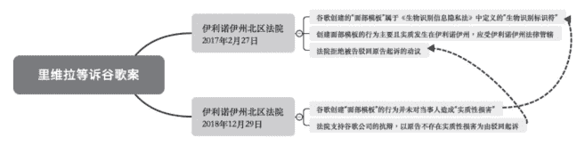

### 【核心争议点】

1.谷歌公司所扫描并收集的面部特征信息是否属于 BIPA 规定的“生物识别标识符”.
2.伊利诺伊州地区法院是否对本案具有管辖权.
3.谷歌公司的行为是否对原告造成了实质性损害.

### 【裁判论证过程】

#### （一）能够识别个人身份特征的“人脸模版”属于伊利诺伊州《生物识别信息隐私法》意义上的“生物识别标识符”和“生物识别信息”

谷歌认为，里维拉和韦斯等人所指控的行为实质上就是谷歌对其照片的使用，而 BIPA 的规定并不适用从照片中获取的信息.然而，原告里维拉和韦斯主张，谷歌系从他们的照片中扫描并上传其面部信息，该数据属于 BIPA 中规定的“生物识别标识符”和“生物识别信息”.

针对这一争议焦点，法院首先根据文义解释进行了分析.BIPA 禁止私人实体未经同意收集和储存个人的“生物识别标识符”和“生物识别信息”，此即确立了一个“通知—同意”规则.此外，根据 BIPA 规定，私人实体储存“生物识别标识符”或“生物识别信息”的，必须提供对该数据的“保留计划”，即明确该数据的储存时间和删除时间.如果私人实体违反了 BIPA 的规定，被侵权人可以向法院提起诉讼.BIPA 中“生物识别信息”的界定参考了“生物识别标识符”的定义范围，因此应当首先明确“生物识别标识符”的概念范围.根据 BIPA 的规定，“生物识别标识符”是指视网膜或虹膜扫描、指纹、声纹或手部或面部几何形状的扫描.该规定通过穷尽式列举的方式，列举了上述“生物识别标识符”的类型.在明确“生物识别标识符”的定义后，BIPA 继而又列举了不属于“生物识别标识符”的类型，其第 15 条（a）款的规定尤其适用于本案，因为其明确提出“照片”不属于“生物识别标识符”.双方的论点也正是基于此排他条款而展开的.

本案中，谷歌所创建的“面部模板”确实满足 BIPA 中的“生物识别标识符”的定义.然而，谷歌认为，从照片中得出的面部扫描结果不满足“生物识别标识符”的资格.在谷歌看来，只有由信息主体亲身完成的面部扫描才属于 BIPA 规定的“生物识别标识符”.法院认为，BIPA 的规定并不能够支持谷歌这一论点.

BIPA 对于“生物识别标识符”的定义仅列出了其所涵盖的特定的生物识别标识符.事实上，特定的生物识别标识符可以通过各种方式收集，但无论何种收集方式，均不会改变其仍是生物识别标识符的事实.同样地，定义中也没有明确对面部模板的扫描是否必须亲自进行，还是可以从照片或视频中生成.事实上，伊利诺伊州立法机构之所以颁布 BIPA，是由于科技在不断进步和发展.因此，通过限制识别方式来限制“生物识别标识符”的定义，并不符合 BIPA 的立法目的.正如法院在判决中所指出：“谁又能知道在未来，虹膜扫描、视网膜扫描、指纹、声纹以及面部和手部扫描将会如何进行？”如果对其限制过多，则会造成对个人隐私的潜在侵犯.法院认为，“生物识别标识符”不是媒介本身，也不是一种测量方式，而是用于识别一个人的特定物理成分（眼睛、手指、声音、手、脸）的一组数据测量值.

谷歌关于“生物识别标识符”的论点主要为 BIPA 第 15 条中的排他条款.根据 BIPA 的规定，照片不属于生物识别标识符.然而，里维拉和韦斯等人也并没有主张照片本身就是生物识别标识符.因此，本案判断的重点不在于照片，而在于谷歌通过扫描个人照片所生成的“面部模板”.在“生物识别标识符”和“生物识别信息”的定义中，谷歌认为，这两个定义是以“内容的来源”为区分标准，即从人身上直接派生得来的是“生物识别标识符”，而随后从“生物识别标识符”中派生出来的是“生物识别信息”.因此，该结构证实了扫描面部模板必须亲身进行，也就是说，如果生物识别信息不能给予生物识别标识符段落中排他条款的内容（比如照片），那么标识符也可能不是基于同一列表中的某些内容.

# 案例分析

## 法院对生物识别标识符与生物识别信息的认定

法院认为，谷歌这一论点的问题在于，BIPA 中并没有直接的文本或结构能够对其提供支持.尽管“生物识别信息”的定义中明确，其是“基于”生物识别标识符的信息，然而，“生物识别标识符”的定义没有使用诸如“源自人”、“亲自衍生”或“基于面对面扫描”之类的词语.因此，二者并没有平行的结构可言.对于伊利诺伊州立法机构来说，在“生物识别标识符”的定义中包含类似的“基于”或“源自”等词并非难事，但立法机构并没有这样做.如前所述，“生物识别标识符”所列示的内容基于生物学的测量，而并未考虑该测量是如何进行的.而且，“生物识别信息”应当确保私人实体不能通过“生物识别标识符”转换为其他格式来绕过 BIPA.因此，与谷歌的论点相反，“生物识别标识符”和“生物识别信息”之间存在着有意义的区别，即“生物识别标识符”是生物识别测量的集合，而“生物识别信息”是将这些测量值转换为不同的、可用的形式，这种区别与谷歌描述的结构无关.

谷歌论点的另一个致命问题在于，它主要依赖于从排他条款中得出的一些结构上的含义.然而，通过排除照片来解释其是否是“生物识别标识符”是不明智的.而且，原告里维拉和韦斯也并没有认为照片本身就是“生物识别标识符”.事实上，如果谷歌只是简单地收集和储存这些照片，而没有进行测量和生成面部模版的扫描，那么就不会违反 BIPA，正如仅记录一个人的声音而不产生声纹的行为也是如此.因此，排他条款中对照片的引用对谷歌的论点毫无帮助.

谷歌继而提出，根据 BIPA 的规定，私人实体若收集个人的“生物识别标识符”或“生物识别信息”，必须先得到该人的“书面授权”.谷歌认为，该规定中所要求的“书面授权”很能说明问题，因为书面授权即要求必须面对面授予，具有亲身性，与此相同，扫描行为也应当亲身进行方属于 BIPA 的规定.法院认为，谷歌所提出的这一论点不能令人信服.首先，也是最重要的一点是，就目前而言，即使假设面对面的同意在逻辑上比远程同意更容易获得，但 BIPA 中并没有明确的文本或结构线索说明“扫描必须是面对面进行的”.其次，“亲自获得书面授权十分容易”这一论点本身就值得质疑.比如，许多法院经常在网站和互联网服务上选择维持一键式同意功能，这也就表明，在许多情况下，远程同意比亲自获得更容易.而且书面授权不仅适用于直接获取“生物识别标识符”的私人实体，该要求也同样适用于任何“通过贸易购买、接收或以其他方式获得‘生物识别标识符’或‘生物识别信息’的私人实体”.因此，这些私人实体也必须获得书面授权，并且没有理由认为从特定个人那里亲自获得授权相较于远程授权更容易完成.

综上所述，谷歌所提出的论点并不能得到法院的支持，能够识别个人身份特征的“人脸模版”属于伊利诺伊州《生物识别信息隐私法》意义上的“生物识别标识符”和“生物识别信息”.

## （二）谷歌创建的“人脸模版”及侵害原告隐私权的行为“主要且实质”发生于伊利诺伊州，因此受该州《生物识别信息隐私法》管辖

谷歌提出的第二个论点是，谷歌的行为并不受到 BIPA 的管辖.针对这个问题，法院首先论证了 BIPA 能否在域外适用的问题.一般而言，伊利诺伊州的法律并不具有域外效力.伊利诺伊州立法机构在颁布 BIPA 时，没有提出要赋予其域外适用的效力，而且，原告里维拉和韦斯等人也没有针对这一问题提出争论，因此，BIPA 并无域外效力.如果 BIPA 不能在域外适用，原告里维拉和韦斯指控的行为必须发生在伊利诺伊州，方能使诉讼得以继续进行.

因此，法院应当首先判断，谷歌从伊利诺伊州的设备自动上传的照片中，扫描并创建里维拉和韦斯等人的面部模板的行为，是否属于 BIPA 的域外应用（如果是的话，则不可诉）.也就是说，法院应当分析，谷歌该行为的相关情况，是否“主要且实质地”发生在伊利诺伊州境内.

原告里维拉和韦斯等人指出，以下行为均是本案与伊利诺伊州的联系：里维拉和韦斯都是伊利诺伊州居民；里维拉和韦斯的照片是在伊利诺伊州拍摄的；里维拉和韦斯的照片所上传到的谷歌照片服务器的 IP 地址属于伊利诺伊州.里维拉和韦斯还指出，谷歌未向里维拉和韦斯提供必要的信息披露，也未征求里维拉和韦斯的同意的行为正是发生在伊利诺伊州.谷歌认为，面部扫描并没有“主要且实质”地发生在伊利诺伊州，扫描行为的发生地应被视为违反 BIPA 的行为发生地，而且本案中，里维拉的案情中摄影师的居住地、韦斯的案情中谷歌照片用户注册地等均不在伊利诺伊州.

由于前已论证 BIPA 不具有域外适用的效力，因此，法院应当分析业务所发生的环境是否“主要且实质”地位于伊利诺伊州.法院支持原告的观点，指出本案原告均为伊利诺伊州的居民，且照片均拍摄于伊利诺伊州，谷歌自动上传云端的行为发生于伊利诺伊州的服务器，且谷歌未能给予原告通知和获取同意的行为亦发生在伊利诺伊州.法院认为上述观点充分论证了违法行为确实发生于伊利诺伊州，因此本案应当归属于伊利诺伊州法院管辖.

## （三）谷歌公司创建和储存面部模板的行为未对原告造成事实上的损害

谷歌后于 2018 年向法院提起简易判决，认为谷歌创建和储存面部模板的行为并没有对原告造成事实上的损害，原告所提起的诉讼不符合美国联邦最高法院所确立的原告起诉资格，应当予以驳回.

针对谷歌这一论点，法院首先引用“Spokeo 案”进行分析.^([\[2\]](#txt002.html#footnote_content_txt002_2))在该案件中，法官提出了以下几项原则：首先，仅程序性地违反法律并不能自动认定为满足宪法第三条的“事实上的损害”的要求.其次，发生损害的风险也可能会满足宪法第三条对损害的要求.根据“Spokeo 案”中所运用的上述原则，法院认为，谷歌创建和保留原告面部模板的行为，并没有对原告造成事实上的损害.

美国联邦最高法院通过 Lujan 和 Laidlaw 两个判例确立了公民提起诉讼的基本要求：（1）其遭受了“事实上的损害”；（2）该损害源于被告的行为；（3）该损害有通过司法裁判进行救济的可能性.其中，“事实上的损害”尤为重要，其判断又细化为若干具体标准：第一，损害必须是已发生的或是迫近的，不能是假设性的或推测性的；第二，损害必须是具体的而不能是抽象的，必须是针对特别人的而不能是集合性的.

法院继而对谷歌创建面部模板的行为进行分析.原告声称，谷歌保留或存储了他们面部模板的行为，违反 BIPA 的相关规定.根据 BIPA 的要求，任何拥有生物识别信息或生物识别标识符的私人实体必须制定、并向公众提供销毁该信息的保留时间和指南，并为储存、传输和保护信息提供某些标准.原告认为，谷歌并没有履行 BIPA 规定的信息披露要求，亦没有获得 BIPA 所要求的授权同意，这一行为侵犯了他们的隐私权.然而，第七巡回上诉法院明确裁定，保留个人的私人信息本身并不足以满足“事实上的损害”.^([\[3\]](#txt002.html#footnote_content_txt002_3))原告对以下事项没有异议：谷歌并没有将其面部模板与其他谷歌照片用户或谷歌以外的个体共享；谷歌或其他私人实体没有未经授权访问与其面部模板相关的账户或数据.

为了证明存在一个高度的受到损害的风险，原告提交了一份补充信息，并附上了一篇新闻文章和谷歌博客.报告中说，谷歌的一个软件漏洞使外部开发人员可以访问 2015 年至 2018 年 3 月期间约 50 万“谷歌加”（Google+）用户的数据，这里的“谷歌加”是另一款谷歌产品.根据原告的说法，这些证据显示，谷歌为了避免监管的审查和自身的声誉受损，并未向公众披露其软件所存在的这个漏洞.然而，法院认为，这些行为均与谷歌照片用户的账户无关，也没有任何证据表明“谷歌加”账户数据与谷歌照片账户数据的披露之间存在关联，因此，这些证据并不能表明其受到了事实上的损害.

法院第三个分析的观点在于，原告是否因谷歌在其未知情的情况下创建其面部模板而遭受事实上的损害.原告韦斯述称，如果他事先知情谷歌的这一行为，不会授权谷歌创建、收集和储存其面部信息.然而，如前所述，原告承认他们的面部模板并未与谷歌以外的任何人共享，并且也没有证据表明这些信息存在将被共享的风险.在考虑未经同意的面部扫描是否足以满足起诉资格时，法院指出，大多数人每天都会向公众暴露自己的脸，也就是说，一个人的脸比社会安全号码等非生物信息被更广泛地公开.事实上，我们将脸暴露在公众面前，这样就不需要对我们的隐私进行额外的侵入即可获得它的信息，这与将手指放置在扫描仪上的行为不同.

BIPA 并没有为“未经同意创建面部模板的行为符合事实上的损害”提供依据.一般而言，普通法有四种公认的侵犯隐私权的行为：（1）无正当理由侵入他人住所；（2）盗用他人姓名或肖像；（3）不正当披露他人隐私；（4）对他人信息进行不正当宣传.本案中，原告未能证明谷歌接收原告等人自愿上传至谷歌照片的行为属于侵犯隐私权的行为.而且，尽管原告认为他们的面部信息属于私人信息，然而，根据第四修正案的判例，个人的脸对于外界而言并不属于隐私.^([\[4\]](#txt002.html#footnote_content_txt002_4))事实上，伊利诺伊州法院之前已经驳回数起以照片或视频侵权为由提起的侵权索赔，因其未能满足隐私侵权要素.本案中原告所指控的损害，即谷歌创建和储存用户面部模板的行为，与入侵他人住宅等侵权行为所损害的法益之间存在较大差距.谷歌所做的只是根据其公开信息（原告的面孔）来创建一个面部模板.而且，创建面部模板的行为并非“高度冒犯性”的入侵.如前所述，面部模板的创建是基于大众可以看到的信息，即原告的脸.侵权行为的关键是入侵本身，而不是之后对入侵所获的东西（如果有的话）做了什么.因此，谷歌对原告的照片的处理方式，即使用它们来创建面部模板的行为，在本案中与入侵他人住宅相比较而言，显得无足轻重.无论如何，根据记录显示，谷歌只使用面部图像来创建面部模板，以便在个人账户中编排照片.原告并没有提供任何证据证明谷歌在商业上“利用”了他们的人脸信息或面部模板.

法院继而分析了是否存在挪用肖像的侵权行为.当被告使用面部肖像的相似性来宣传其业务或产品，处于某种商业目的或为了其自身目的和利益时，便会侵犯原告的法益.如前所述，原告没有证据证明谷歌做了任何与挪用他们的肖像密切相关的事情.谷歌认为，除了为谷歌账户中的照片进行分组之外，没有证据表明谷歌照片生成的任何数据以任何其他方式被使用.原告为了反驳谷歌这一观点，引用了一篇文章，该文章阐述了谷歌的面部识别技术在未来可能被使用的方式，包括数据挖掘、定向广告等.与之相类似，谷歌员工之间的电子邮件中，也发了一篇讨论类似可能用途的文章.然而，这些证据仅展示了谷歌面部识别技术在未来的潜在用途，并没有证明谷歌目前正在采用这些做法.因此，这些证据并不足以证明原告遭受这些伤害的可能性很大.法院指出，原告可能采取的唯一策略是，指出谷歌利用原告的面部信息，创建、收集、储存并使用由此生成的独特的生物识别标识符，以在照片共享服务市场上获得竞争优势，然而，原告并没有提出这一论点，亦没有相关的证据可以支持这一论点.事实上，谷歌仅将其所获取的面部模板用于照片分组，并没有给原告造成事实上的损害.

综上，原告的诉讼请求并没有证据和判例得以支撑，因此，法院认为，原告在本案中并不具备诉讼资格，故驳回原告的起诉.

## 【审理结果】

1.伊利诺伊州地区法院 2017 年拒绝被告“驳回原告起诉”的动议.

2.伊利诺伊州地区法院 2018 年支持谷歌公司的抗辩，以原告不存在实际损害为由驳回起诉.

## 【相关法条】

《伊利诺伊州生物识别信息隐私法》第 10 条（Illinois Biometric Information Privacy Act §10（2008））

“生物识别标识符”是指视网膜或虹膜扫描、指纹、声纹或手部或人脸的结构扫描.“生物识别标识符”不包括书写样本、书面签名、照片、用于有效科学测试或筛查的人类生物样本、人口统计数据、纹身特征或身高、体重、头发颜色或眼睛颜色等身体特征.

“生物识别信息”是指用于识别个人生物识别标识符的任何信息，无论其如何被获取、转换、存储或共享.生物识别信息不包括从生物识别标识符定义中排除的项目或程序中获取的信息.

《伊利诺伊州生物识别信息隐私法》第 15 条（a）款（Illinois Biometric Information Privacy Act §15（a）（2008））

拥有生物识别标识符或生物识别信息的私人实体，应在收集或获取此类标识符或信息的最初目的得到满足时，或个人与私人实体最后一次互动后的 3 年内（以较早发生者为准），制定书面政策规定永久销毁生物识别标识符和生物识别信息的保留时间表和指南，并向公众公开.若没有管辖法院签发的有效逮捕令或传票，拥有生物识别标识符或生物识别信息的私人实体必须遵守其制定的保留时间表和销毁指南.

《伊利诺伊州生物识别信息隐私法》第 15 条（b）款（Illinois Biometric Information Privacy Act §15（b）（2008））

任何私人实体不得通过交易收集、抓取、购买、接收或以其他方式获取个人的或消费者的生物识别标识符或生物识别信息，除非其在此之前已：

（1）书面通知该主体或者该主体的合法授权代表，其生物识别标识符或者生物识别信息正在被收集或存储；

（2）以书面形式通知该主体或该主体的合法授权代表，收集、存储和使用生物识别标识符或生物识别信息的具体目的和市场；及

（3）收到生物识别标识符或生物识别信息主体或该主体的合法授权代表作出的书面许可.

## 【案例评析】

### （一）本案进一步明确了 BIPA 规定的人脸识别信息的范围

本案最重要的一个争议焦点在于，谷歌从照片中获取的信息能否适用 BIPA 的规定.法官通过文义解释和目的解释，明确该信息应当适用 BIPA 的规定，在一定程度上划定了个人生物识别信息保护的边界.法官首先分析谷歌通过对照片的扫描生成的面部模板属于 BIPA 规定的人脸识别信息，继而明确谷歌的行为并没有对原告造成事实上的损害.通过法官的推理和论证，可以看出，在技术不断发展和创新的背景下，司法裁判也要不断地在技术创新和利益保护、个人利益与商业利益之间寻求平衡.尽管本案最终以未造成事实上的损害为由驳回了原告的诉讼请求.然而，在实践中，人脸识别信息应当受到何种保护仍是值得思考的问题.比如，对于苹果手机在相册中根据不同面部特征给照片自动分组的行为，应当如何进行认定？人脸信息不同于指纹，其可以被远程获取，具有非亲身性的特征，而且具有不可更改性，因此，私人实体在收集、储存人脸信息的问题上应当更加谨慎.

合理界定生物识别信息的法律分类是提供个人信息保护的基础和前提，经由生物识别产生的“生物识别信息”可以作为识别个人的“唯一标识”，这是信息时代下确认个人身份的新型方法.^([\[5\]](#txt002.html#footnote_content_txt002_5))我国 2020 年实施的《信息安全技术 个人信息安全规范》规定的个人生物识别信息，包括自然人的身体、生理特征的相关信息，如指纹、声纹、掌纹、耳廓、虹膜、面部特征、个人基因等.从学理的角度来看，个人生物识别信息的权益涉及人格自由、人格尊严、隐私、肖像、财产等多重利益，因此对其进行使用和保护应当以利益平衡为标准，进行综合考量.个人生物识别信息主体的人格尊严属于价值理性的范畴，而生物识别信息控制者的数据利用和管理则属于工具理性的范畴.一方面，法律要保护生物识别信息主体的人格尊严和自由，使其免受个人生物识别信息的泄露或非法使用，从而危害信息主体的人格尊严和自由价值.人是目的而非工具，只有消除个人对“信息化形象”被他人操控的疑虑和恐慌，才能有自尊并受到他人尊重地生活；另一方面，个人生物识别信息包含巨大的经济价值，可以对其进行大规模的处理与应用.法律要适应技术进步与经济发展，平衡个人生物识别信息主体的隐私、利用期待与控制者的数据利用和管理的需要.^([\[6\]](#txt002.html#footnote_content_txt002_6))

本案在一定程度上显示出，在如今的信息时代，个人对于自身信息被私人实体获取、收集和使用而可能会产生的问题的担忧.尽管法官最后认定谷歌的行为并未对原告造成事实上的损害，然而，谷歌在诉讼结束后，仍然对其技术和相关规范进行了修订和整改，以预防潜在的风险.由此可见，尽管法律存在滞后性，技术仍然需要在法律规定的框架内继续前行.

### （二）本案引发了对面部识别技术应用的广泛讨论

近几年面部识别技术发展迅猛，在社会的诸多领域得到了广泛应用，然而该项技术在给人们生活带来便利的同时，也引起了人们对于隐私保护、数据安全的担忧.如果政府部门、私人实体都可以随意获取个人的面部信息，那将对个人隐私造成极大的威胁.在我国，“ZAO”换脸 APP 的应用以及“人脸识别第一案”的诉讼均引起了人们对于该项技术的关注.如果面部信息被泄露或被他人恶意使用，那么可能将会对个人的人格和财产造成重大损失.

本案揭露了在司法过程中对于公民数据保护的边界问题.法律的更新跟不上技术的发展，这就导致在司法裁判的过程中更需要依靠法官的主观判断.由于面部信息及其所涉及的个人信息是动态的、复杂的，用户在不同情况中因为面部信息使用而导致其感受到的侵权程度往往不同，且用户难以完成相应的侵权举证责任，故从评判“实际损害程度”的角度来对各方主体之间的利益进行平衡，不仅会导致各方主体诉讼成本畸高，而且也难以解决该技术应用在未来可能会遭遇的难题.

欧盟地区的数据保护法《通用数据保护条例》（GDPR）规定，面部图像构成特殊类型个人数据下的“生物识别数据”，进而相较于一般个人数据受制于更高的保护要求.根据其定义，“生物识别数据”是指经由特定技术处理，获取的有关自然人身体、生理或行为特征的个人数据，并且该个人数据能够识别或确认特定自然人.我国的《个人信息保护法》中也存在专门的人脸识别条款，第 27 条为在公共场所安装图像采集、个人身份识别设备设定了一定的目的限缩和权益保障.同样地，我国《网络安全法》第 41 条也对人脸图像的获取和后续可能的处理活动进行了规定，建议企业应当确保被采集人充分知悉拟开展的处理活动，并征得其同意.因此，本案对于了解人脸识别领域的相关法律实践具有重要意义.

在数字经济时代，信息化给人们带来便利的同时，也引发了对于个人隐私保护问题的担忧.目前，对于人脸识别信息的规范属性和保障制度，学界还存在争论.部分学者认为，基于人脸识别信息的特殊性和敏感性，应当对人脸识别信息采取特殊规则予以规制.也有学者认为，法律对于刷脸问题的回应不应当停留于简单的“特别规制某一类信息技术”，否则，只会让立法者陷入疲于应付不断涌现的新型信息技术治理活动之中，并不能提供长效的治理方案.^([\[7\]](#txt002.html#footnote_content_txt002_7))

# 人脸识别信息保护与监管

从刷脸支付、刷脸进出等具体的商业实践行为来看，人脸信息不同于人脸识别信息，将个人的肖像转化为可以为算法所应用的信息，需要经过图像采集和数字化处理.因此，对于人脸识别信息的保护不应当过于僵化.一方面，行政监管不应当成为技术发展的枷锁，另一方面，监管机构也应当采取措施预防信息滥用所造成的风险.法律对技术最合理的回应莫过于参与技术的重构过程，如今，人脸识别技术成为越来越多商业活动的主流技术架构，成为未来技术发展的主流趋势，因此，监管应当顺应市场规律，明确人脸识别信息技术规范要求，法律在对人脸识别进行规制时应当保持适当的谦抑性，寻求个人利益与公共利益之间的平衡.

## 关联判例推荐

### 1. Patel v. Facebook, Inc., 932 F.3d 1264 (9th Cir. 2019)

核心事实：2010 年，脸书推出一款面部识别工具，若干用户在伊利诺伊州起诉脸书公司，表示脸书在收集和存储人脸信息时，没有明确告知用户相关事项和数据的保存期限，亦没有征得用户的书面同意，违反了伊利诺伊州《生物识别信息隐私法》的要求.脸书以原告没有诉讼资格为由请求驳回原告用户的诉讼请求，理由是原告没有指控脸书的面部识别技术对其造成了任何具体伤害.
与本案关联点：法院认为，《生物识别信息隐私法》保护的是具体的隐私利益，而违反《生物识别信息隐私法》的程序实际上损害了这些利益，或对这些隐私利益造成了实质性的损害风险.

### 2. Spokeo, Inc. v. Robins, 136 S. Ct. 1540, 194 L. Ed. 2d 635 (2016)

核心事实：被告 Spokeo 公司擅自抓取原告的个人数据并在网站上发布错误信息，地方法院以原告缺乏诉讼主体资格为由驳回了原告的诉讼请求.在本案中，最高法院将诉讼资格规定为：（1）遭受到了事实上的损害；（2）这种损害可以归结为由于被告的行为所导致；（3）这种损害可以通过司法裁判得到弥补.
与本案关联点：该判决是“里维拉诉谷歌案”法院判谷歌胜诉的主要依据.法院认为，“人员搜索引擎”网站呈现的错误信息影响了原告的求职，这是《公平信用报告法》（the Fair Credit Reporting Act）下可被识别的损害.

### 3. Rosenbach v. Six Flags Entertainment Corp., 2019 IL 123186, 129 N.E.3d 1197

核心事实：Six Flags 游乐园默认将采集游客的指纹作为其购买主题公园季票的一部分，原告认为自己和儿子均未被明确告知其指纹收集的具体目的和保留期限，也没有同意 Six Flags 收集或使用该生物识别数据.原告主张 Six Flags 游乐园的行为违反了《生物识别信息隐私法》的要求，寻求金钱赔偿和禁令救济.
与本案关联点：伊利诺伊州最高法院认为，公民根据《生物识别信息隐私法》有资格成为“受损害的人”，即可以因其信息被行为人不当存储或使用，或未经授权被披露而起诉侵权行为人，不论该行为是否造成实质性的损害.

## 2.2 布里奇斯诉南威尔士警署案

### 案件索引

R (Bridges) v. CCSWP and SSHD \[2019\] EWHC 2341 (Admin)
R (Bridges) v. CCSWP and SSHD \[2020\] EWCA Civ 1058

### 关键词

人脸识别；生物识别信息保护；个人信息保护；算法问责

### 案件提要

本案被认为是首例公民质疑执法机关使用新技术合法性的案例.^([\[8\]](#txt002.html#footnote_content_txt002_8))被告南威尔士警署（South Wales Police，以下简称“SWP”）从 2017 年起，在其辖区内的公共场合部署了自动人脸识别技术（Automatic Facial Recognition Technology，以下简称“AFR”）.AFR 会拍摄进入其监控范围的人脸图像，通过将该图像与 SWP 现有的面部图像数据库进行对比，来判断监控范围内是否存在警方“观察名单”上的人.原告爱德华·布里奇斯（Edward Bridges）两次在公共场合被 AFR 抓取到人脸图像，且均未看见任何表明 AFR 正在使用的标识.布里奇斯认为 SWP 的行为干预了其基于《欧洲人权公约》（以下称“公约”）第 8 条享有的权利，且不具备正当性、违反了数据保护原则、未履行公共部门平等义务（Public Sector Equality Duty， PSED），质疑其使用 AFR 的合法性，以此向法院提起诉讼.判断 SWP 行为是否合法的重点在于该行为所依据的法律框架是否充分.上诉法院认为 SWP 行为并无充分的法律框架，因此 SWP 侵犯了布里奇斯基于公约第 8 条第 1 款享有的权利，且并无合法性基础.由于 AFR 法律框架的不充分，而 SWP 根据英国 2018 年《数据保护法》（Data Protection Act）第 64 条作出的数据保护影响评估（Data Protection Impact Assessment， DPIA）是以 AFR 没有触犯公约第 8 条为基础开展的，因此 SWP 作出的数据保护影响评估并不适当，不符合数据保护原则.此外，公共部门平等义务并非是一项结果义务，而是程序义务，尽管目前无法确认 AFR 是否存在歧视，但 SWP 从未主动确保 AFR 不存在歧视，故也未尽到公共部门平等义务.综上所述，SWP 使用 AFR 不具备合法性.
人脸识别作为一项新兴技术，正迅速地广泛应用于各个领域和场景.人脸信息属于敏感信息，能够“唯一”地定位到个体.由于公权力的强制性，公共部门在使用人脸识别技术时可能会侵犯到个体人权.明确公共部门使用新技术的权力和监管边界，是推行新技术过程中的应有之义.本案表明，英国在面对新兴技术时采取了循序渐进的治理模式，更多地强调对人权的尊重.同时，本案明确了人脸识别技术的法律体系和监管要点，向新兴技术的规制提供了极具意义的指导，为平衡个人权利保护与重大公共利益这一传统原则赋予了新的内涵.对于人脸特征等个人信息的规范，我国制定了《中华人民共和国个人信息保护法》（以下简称“《个人信息保护法》”）.其中，第 26 条规定：“在公共场所安装图像采集、个人身份识别设备，应当为维护公共安全所必需，遵守国家有关规定，并设置显著的提示标识.所收集的个人图像、身份识别信息只能用于维护公共安全的目的，不得用于其他目的；取得个人单独同意的除外.”本条涉及对在公共场合获取个人信息行为的规范.此外，第 28 条第 2 款规定，“只有在具有特定的目的和充分的必要性，并采取严格保护措施的情形下，个人信息处理者方可处理敏感个人信息”，体现了对敏感信息处理的要求.相关立法均表明了我国对个人信息愈发重视的态度，对此，本案具有一定的参考价值.

### 案件要旨

英国高等法院（一审法院）：原告 爱德华·布里奇斯（Edward Bridges） 被告南威尔士警署（SWP）
英国上诉法院（上诉法院）：上诉方 爱德华·布里奇斯（Edward Bridges） 被上诉方 南威尔士警署（SWP）
SWP 从 2017 年开始在其辖区的公共场合内部署自动人脸识别技术（Automatic Facial Recognition Technology， AFR）.AFR 能够通过比较两张面部图像来判断它们是否来源于同一人.具体而言，AFR 运行包括以下六个步骤：
1.使用现有图像数据库.AFR 运行的前提是存在一个面部图像数据库.在本案中，该数据库为“观察名单”.SWP 根据每次使用 AFR 的目的将以下六类人列入观察名单：（1）搜查令名单上的人；（2）非法在逃的人（逃离合法羁押）；（3）犯罪嫌疑人；（4）可能需要保护的人（比如失踪人员）；（5）在特定事件场合的出现会带来隐患的人；（6）SWP 对其可能有利益需求的人（persons simply of possible interest to SWP for intelligence purposes）；（7）弱势群体.
2.采集面部图像.AFR 使用监控摄像采集面部图像.当人进入相机拍摄范围时，相机会实时拍摄该人图像.
3.人脸检测.一旦图像拍摄完成，AFR 会检测图像中的人脸部分并将其单独分离出来.
4.特征提取.AFR 提取出独特的人脸特征，该生物特征于上述图像而言是独一无二的.
5.比较.AFR 将提取出的面部特征与观察名单上的面部图像进行比较.
6.匹配.在对两张面部图像进行比较后，AFR 会生成“相似度分数”，以表明两张图像的匹配度，分数越高表明匹配度越高.警方根据“相似度分数”来判断监控范围内是否存在观察名单上的人.在“相似度分数”较高时，AFR 的操作人（即警官）会进一步判断两张图像是否真正匹配，以决定是否通知实施干预警官（intervention offi cers）对被监控人采取进一步行动.警方设置了红灯、黄灯、绿灯表明采取行动的紧迫性.对于未与观察名单匹配的图像，AFR 会立即删除，任何操作人和其他警察都无法查看此图像.
在本案中，英国公民布里奇斯质疑被告使用 AFR 技术的合法性，并提起诉讼，称自己两次被在公共场合部署的 AFR 抓取到人脸图像.两次情形分别为：第一次是在 2017 年 12 月 21 日，被告在卡迪夫市中心的皇后街部署了 AFR，布里奇斯离安装 AFR 的车辆大概有 6 至 10 英寸，因此在相机的抓取范围内，但他在进入抓取范围前未发现任何显示 AFR 正在使用的标志.第二次是在 2018 年 3 月 27 日，卡迪夫市摩托角竞技场（Motorpoint Arena）举办了一场国防展览，竞技场门口安装了 AFR，AFR 在上午 8 点半至下午 4 点一直处于使用状态.布里奇斯距离 AFR 大概有 25-30 米，因此被抓取了图像，但是他没有看到表明 SWP 正在使用 AFR 的任何标识.
对此，布里奇斯向法院提起诉讼，其诉讼请求主要围绕以下方面：
1.被告使用 AFR 干预了其基于《欧洲人权公约》第 8 条第 1 款的权利，即“人人享有私人和家庭生活、家庭以及通信得到尊重的权利”，同时，这种干预因不满足第 8 条第 2 款中“依照法律规定”（in accordance with the law）、“必要性”（necessary）的条件而不具备正当性.
2.被告使用 AFR 违反了 2018 年《数据保护法》中的“数据保护原则”.该诉讼请求包括两个方面：第一，被告作为主管机关未遵循《数据保护法》第 35 节中的数据保护原则.第二，被告未按照《数据保护法》第 64 节第 1 条实施数据保护影响评估.
3.被告未能履行英国 2010 年《平等法》（Equality Act）第 149 节第 1 条规定的公共部门平等义务（Public Sector Equality Duty， PSED）.即“公共部门在行使其职能时必须适当考虑到以下需要：（1）消除歧视、骚扰、伤害和本法禁止或根据本法禁止的任何其他行为；（2）促进具有相关受保护特征的人与不具有此种保护特征的人之间的机会平等；（3）促进具有相关受保护特征的人和不具有相关受保护特征的人之间的良好关系.”上述义务被称为公共部门平等义务.平等义务是公共机构和其他履行公共职能的机构的义务，它确保所有公共机构通过解决歧视来为所有人提供平等机会，在促进社会更加公平方面发挥作用.
一审法院围绕以上三个方面进行论证，判决驳回了原告的全部诉讼请求.
首先，公约第 8 条第一款项下的权利涉及个人数据保护，且人脸信息属于生物特征数据，与尊重私人与家庭生活这一价值密切相关.而本案中 AFR 的使用涉及了人脸信息的提取和使用，干预了原告在第 8 条第一款项下的权利.而在原审法院看来，本案中对公约权利的干预是被允许的.首先，被告对 AFR 的使用拥有来自普通法的一般授权，且受一个合理的现行法律框架的规制，因而是合法的.其次，被告对 AFR 的使用满足了“Bank Mellat 案”^([\[9\]](#txt002.html#footnote_content_txt002_9))中所确立的四步检验法.此方法主要考虑所采取措施的目的正当性、目的适当性、必要性以及狭义比例原则.
其次，被告对 AFR 的使用符合 1998 年《数据保护法》附件一中第一项数据保护原则的要求.原审法院认为 AFR 所处理的生物特征信息能够立即准确识别个人，具有“个性化”特征，因而属于数据保护法所保护的“个人数据”，且 AFR 的使用对于数据控制者（即本案中的 SWP）的合法利益（预防和侦查犯罪）是必要的.
关于 2018 年《数据保护法》第 34 节及第 35 节的规定，原审法院认为，使用 AFR 涉及对公众的生物特征数据的敏感处理，且符合第 35 节第 5 条的前两项要求，即为法律执行目的所严格必要，以及为履行法定职能或重大公共利益所必要.而对于第三项要求，即数据控制者是否有适当的政策文件（appropriate policy document），规定于 2018 年《数据保护法》第 42 条，该文件是一份不断发展的文件，必须不断进行审查和更新，原审法院认为当前没有必要对该政策文件是否适当作出裁决.同时，法官在审理时表示，希望由信息专员就如何履行第 42 条义务提供具体指导.此外，原审法院认为，被告所编写的关于其使用 AFR 设备的影响评估文件，满足了 2018 年《数据保护法》第 64 条关于数据保护影响评估义务的规定.
最后，被告并未违反 2010 年《平等法》的公共部门平等义务（PSED）.原审法院认为，没有迹象表明，在 2017 年 4 月 AFR Locate 试验开始前，被告认识到或者应该认识到所使用的软件可能存在歧视，且其接触不到“训练”该软件的数据集，因而很难确认是否存在歧视.也没有确凿证据表明，被告使用的 NeoFace Watch 软件确实产生了间接歧视的结果.
布里奇斯不服一审判决，向上诉法院上诉.布里奇斯提出了如下五个上诉理由：
1.原审法院错误地认为被告对公约第 8 条第 1 款的权利进行的干预符合第 8 条第 2 款的“依照法律规定”条件.
2.原审法院错误地判断被告使用 AFR 技术具有合比例性，因其未考虑 AFR 对所有被捕捉到面部信息的人的第 8 条权利的累积性干预.
3.原审法院错误地认为被告的数据保护影响评估符合 2018 年《数据保护法》第 64 条的要求，原告主张被告数据保护影响评估的前提存在两项问题：第一，该评估是以 AFR 不违反公约第 8 条为前提假设而开展的；第二，AFR 会处理不在观察名单却被捕捉到面部信息的人的个人生物数据.
4.原审法院错误地就被告是否具备 2018 年《数据保护法》第 42 条要求的适当政策文件，以满足该法第一项数据保护原则作出结论.
5.原审法院错误地认定被告履行了公共部门平等义务，原告主张被告的平等影响评估（Equality Impact Assessment）^([\[10\]](#txt002.html#footnote_content_txt002_10))明显不充分，以及被告并未认识到间接歧视的问题，且其后续评估方法存在瑕疵.
上诉法院对上述五个理由依次进行了审查.2020 年 8 月 11 日，上诉法院作出判决，支持上诉人第一、第三以及第五项诉讼请求，驳回第二项和第四项诉讼请求.

### 案例事实思维导图

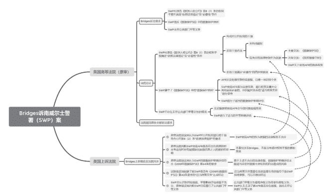
图 1 两审诉讼主张与论证

### 核心争议点

1. SWP 对原告公约第 8 条第 1 款项下权利的干预，是否满足该条第 2 款中的“依照法律规定”和“必要性”的条件.
2. SWP 使用 AFR 技术是否违反 2018 年《数据保护法》中的“数据保护原则”.
3. SWP 是否履行了公共部门平等义务.

### 裁判论证过程

#### （一）AFR 技术并无充分的法律框架加以规制

从一审判决的论证结构来看，这一问题出现在对原告的公约第 8 条项下权利的干预是否“依照法律规定”的判断过程当中，这是本案的核心问题之一.原审法院在一审判决中总结了规制 AFR 技术使用的现行法律框架，分别讨论了该法律框架中主要立法（Primary legislation）、次级立法（Secondary legislative instruments）以及使用者自身的政策这三个层次，分别对应 2018 年《数据保护法》、《监控摄像守则》（The Surveillance Camera Code of Practice）^([\[11\]](#txt002.html#footnote_content_txt002_11))以及 SWP 的自身政策.然而，原审法院回避了一个问题，即在 AFR 试运行期间，被告自身的政策可能会发生变化.原审法院认为这种变化的可能性不是目前法律框架存在问题的理由，仍然认定其具有一定程度的“确定性”（certainty）和“可预见性”（foreseeability），因而满足了第 8 条第 2 款的要求.上诉法院认为，一项干预权利的行为要么符合法律，要么不符合法律，这是一个不可回避的问题.
上诉法院认为原审法院所讨论的法律框架并不充分.在分析开始之前，上诉法院总结了本案具有的四项特征：（1）AFR 是一项新的技术；（2）在绝大多数公民与警方并无利益关系的情况下，AFR 的使用涉及获取大量公民的图像并处理他们的数字信息；（3）各相关方都承认，这是一种 2018《数据保护法》范围内的敏感个人数据；（4）对所涉数据进行了自动化处理.
上诉法院认为当前的法律框架存在两个根本缺陷，即没有涵盖以下两个问题：（1）哪些人员会被列入 AFR 所比对的观察名单；（2）AFR 应当如何选择部署地点.随后，上诉法院分别讨论了三个层次的法律规定.首先，上诉法院认为 2018 年《数据保护法》尽管是判断被告是否侵犯公约第 8 条权利的法律框架中的重要组成部分，但该法及其相关政策实质上只要求有适当的执法目的，其本身并不充分.其次，《监控摄像守则》确实专门负责处理含监控摄像头系统的这一类事项，原则上也可以专门处理个人被列入观察名单的要求以及与 AFR 部署位置相关的政策.同时，摄像头专员于 2019 年 3 月发布了关于“警方在监控摄像头系统中使用自动面部识别技术”的指南，但其中并不包含针对当地警察政策的内容，不仅没有对谁可以被列入观察名单提出任何要求，也没有包含任何关于地方政策应该包含什么以及可以在哪里部署 AFR 的指导，这些就是当前法律框架中的两个关键缺陷.最后，上诉法院详尽地分析了第三个层次，即被告自身关于使用 AFR 技术的政策文件，其中的关键问题是这些文件是否给予了警方过于宽泛的自由裁量权.在被告制作的 AFR 技术隐私影响评估文件当中，其提及被列入观察名单中的人可能包括：（1）因涉嫌犯罪而被通缉的人；（2）根据通缉令而被通缉的人；（3）弱势群体；（4）需要获得其情报的其他人.上诉法院认为，第四种人群实际上可以涵盖任何与警方有关的人，而这实际上赋予了警方过于宽泛的自由裁量权来决定观察名单.与此同时，在被告制作的数据保护影响评估文件当中，仅记录了 AFR 测试时部署过的一些场合，并没有就部署地点制定任何规范性要求，这也同样留有了广泛的自由裁量空间.上诉法院还进行了举例，比如，这种规范性要求可以是：部署地点的选择必须存在合理的理由，该理由使其相信观察名单上的人员会出现在该地点.

#### （二）使用 AFR 进行的权利干预具有合比例性

## 四步检验法与利益平衡

此争议点的标准来自于“`Bank Mellat 案`”^([\[12\]](#txt002.html#footnote_content_txt002_12))，该案就权利干预的合法性提出了四步检验法，即（1）所追求的措施目标是否足够重要，足以证明干预一项基本权利是正当的；（2）措施是否与目标存在合理联系；（3）在不对目标造成无法接受的损害的情况下，是否可以使用一项侵犯性较低的措施；以及（4）考虑到这些问题和后果的严重性，其是否在个人权利和集体利益之间取得了公平的平衡.

上诉人认为，在结合事实对第四步（即利益平衡）进行分析时，除了上诉人本身之外，还应考虑到对在两次部署`AFR`的场合出现过的其他公众造成的影响.而上诉法院认为，本案所涉措施并不是一般性的，而是在特定场合进行的相当具体的部署.所涉及的“平衡”问题是需要进行规范判断的，对于所造成影响的问题，其并非是一个简单的乘法问题，对上诉人公约第 8 条项下权利的影响，不会仅因为还有很多其他公众成员处于同样的情形，这种影响就会变得更严重.因此，上诉法院不支持该项理由.

## （三）被告作出的数据保护影响评估并不适当

在被告`SWP`作出的数据影响保护评估中，尽管其特别地承认了`AFR`在使用生物信息和面部识别信息方面可能会被视为对隐私的侵犯，并因此构成对公约第 8 条的违反，但`SWP`在评估中试图说明，`AFR`如果满足必要性、合比例性并追求合法目的，依照法律规定的要求进行部署，就能避免违法，同时，该评估也对如何部署`AFR`进行了说明.

上诉法院认可上诉人的理由，即数据影响保护评估是以`AFR`没有违反第 8 条为基础而开展的.基于前述`AFR`的法律框架并不充分，`AFR`对公约第 8 条项下权利的侵犯未获得“依照法律规定”的合法性基础，因为它的法律框架存在着根本的缺陷，即上述提到的两项不被允许的广泛自由裁量权.尽管数据影响保护评估试图处理第 8 条的问题，但其未能适当评估数据主体的权利和自由所面临的风险，也未能按照 2018 年《数据保护法》第 64 条第（3）款（b）项和（c）项的要求，为解决广泛自由裁量权所带来的风险而设想措施.因此，法院认为被告`SWP`并未进行适当的数据保护影响评估.

## （四）法院没有必要判断被告在处理敏感数据时持有的政策文件是否适当

该争议点的法律依据为 2018 年《数据保护法》第 35 节第 5 条的（c）款以及第 42 节的第 2 条.数据控制者在涉及到对敏感数据的处理时，必须持有适当的政策文件.原审法院在就被告的政策文件是否适当进行审查时，认为没有必要在当前得出结论，否则会干扰所涉政策文件的发展性.上诉法院同意原审法院的这一处理.法院考虑了`Information Commissioner`的意见，即 2018 年 11 月更新的政策文件.虽然该文件还未达到理想中的详细程度，但符合了第 42 节第 2 条的要求，即解释了其作为数据控制者在涉及敏感处理时对数据保护原则的遵守，以及有关数据的保留与删除问题.该政策文件将根据`Information Commissioner`的指导进行进一步的修订，因此法院并没有必要在此得出最后的结论.

## （五）被告未能履行消除歧视的义务

2010 年《平等法》第 149 节第 1 条规定，公共机构在行使其职能时必须适当考虑到消除歧视、骚扰、伤害和本法禁止或根据本法禁止的任何其他行为，并促进具有相关受保护特征的人与不具有此种特征的人之间的机会平等和良好关系.上诉法院认为，公共部门的该项义务并非是一项结果义务，而是程序义务，即应当关注被告在使用`AFR`过程中有没有做到消除可能存在的歧视，而非仅从结果是否存在歧视来进行判断.

上诉法院重点考察了`Anil Jain`教授的证人证词，他是一位计算机领域的专家，他的证词表示`AFR`系统的准确性很大程度上受“`training datasets`”的影响，而“`training datasets`”可能因为人口组成并不平衡等原因而存在“偏见”，而这一特点也是`AFR`系统容易出现偏见的普遍原因.但针对本案的`AFR`，`Anil Jain`教授并未确认其是否也存在偏见，因为有关数据集处于无法获取的状态.

本案中，被告似乎并没有意识到这种“`training datasets`”的存在.法院特别注意到，被告因为`Anil Jain`教授的这一证词，取得了一份来自证人`Paul Roberts`先生的证词.法院认为，这一行为意味着，如果没有`Anil Jain`教授的主张，被告就不会积极主动地去了解有关信息.`Paul Roberts`先生是`NEC`公司面部识别产品和解决方案的相关负责人，而`NEC`公司所生产的软件`NeoFace Watch`是`AFR`所使用的软件，也是经被告批准使用的.`Paul Roberts`先生表示该软件的算法训练数据确已考虑广泛的种族组成，保证训练数据是全面且有代表性的，但这些数据出于商业敏感考虑不能予以公开.

基于上述情况，上诉法院认为，尽管目前无法确认该软件是否存在歧视，但被告从未试图核实过所使用的软件是否存在关于种族、性别等无法接受的歧视，而被告提出`AFR`还处于试验性阶段的这一事实，并不能使其免于承担公共部门平等义务.因此，法院判定被告并未作出合理努力来消除公共决策中的歧视，导致其未能履行公共部门平等义务.

## 【审理结果】

上诉法院判决就以下事项作出宣告：

1.被上诉人于 2017 年 12 月 21 日和 2018 年 3 月 27 日持续使用`AFR`，涉及《欧洲人权公约》第 8 条第 1 款规定的情况，且不符合第 8 条第 2 款的规定.

2.被上诉人对于其正在使用的`AFR`进行的数据保护影响评估，不符合 2018 年《数据保护法》第 64 节第 3 条中（b）款和（c）款的规定.

3.被上诉人在两次使用`AFR`之前和使用过程中，没有遵守 2010 年《平等法》第 149 条中的公共部门平等义务.

## 【相关法条】

### 《欧洲人权公约》第 8 条（European Convention on Human Rights §8）

1.人人有权享有使自己的私人和家庭生活、家庭以及通信得到尊重的权利.

2.公共机构不得干预上述权利的行使，但是，依照法律规定的干预以及基于在民主社会中为了国家安全、公共安全或者国家经济福利利益的考虑，为了防止混乱或者犯罪，为了保护健康或者道德，为了保护他人的权利与自由而有必要进行干预的，不受此限.

### 英国《2018 年数据保护法》（Data Protection Act of 2018）

1.第 3 节第 2 款 关于“个人数据”的定义：

与已识别或可识别的自然人有关的任何信息，即可直接或间接识别的个人数据，特别是：

（a）诸如姓名、身份识别号码、位置数据或在线标识符等标识符，或

（b）个人的身体、生理、遗传、心理、经济、文化或社会身份特有的一个或多个因素.

2.第 205 节第 1 款 关于“生物特征数据”的定义：

与个人的身体、生理或行为特征有关的，经具体技术处理所产生的个人数据，这些数据允许或保证唯一地识别该个人，如面部图像或指纹.

3.第 3 部分 为法律实施目的而进行的数据处理

第 29 节：

（1）本部分适用于以下情形：

（a）由主管当局（competent authority）全部或部分通过自动化手段处理个人数据，以及

（b）主管当局非通过自动方式处理个人数据，但这些数据构成归档系统的一部分或打算构成归档系统的一部分.

（2）本部分涉及的个人数据处理都是本部分适用的处理情形.

4.第 34 节 数据控制者的一般义务

（1）本章第 35-40 节规定了以下六项数据保护原则：

第一项：数据处理合法且公平；

第二项：数据处理的目的具体、明确且合法；

第三项：个人数据必须合乎需要、相关且不能过度；

第四项：个人数据必须准确，并保持更新；

第五项：个人数据的保留不能超过必要的时间；

第六项：个人数据应当以安全的方式进行处理.

（2）另外，

（a）第 35 条、36 条、38 条、39 条是对其所涉及的原则进行补充的条款；

（b）第 41 条和 42 条是对特定类型的数据处理而规定适用的安全保障措施.

（3）与个人数据相关的数据控制者有责任也必须能够证明其符合本节规定.

5.第 35 节 第一项数据保护原则（1-5）

（1）为任何执法目的处理个人数据必须合法且公平.

（2）为任何执法目的处理个人数据，有且仅有在以法律为基础且处于以下情况下才是合法：

（a）数据主体已经同意进行为此目的的处理，或

（b）处理对于主管当局为此目的执行有关任务是必要的.

（3）此外，对于为任何执法目的而进行的数据处理，在其涉及敏感处理的情况下，只允许其在第（4）条和第（5）条所列的两个情形下进行处理.

（4）第一个情形是：

（a）数据主体已同意为第（2）条（a）款所述的执法目的进行处

理，以及

（b）在进行处理时，数据控制者有适当的政策文件（见第 42 节）.

（5）第二个情形是：

（a）该数据处理对实现执法目的而言是严格必要的，

（b）该数据处理至少满足附件 8 中的一个条件，以及

（c）在进行处理时，数据控制者有适当的政策文件（见第 42 节）.

附 1：本法附件 8 所规定的条件包括：

1.法律规定等目的.条件为：

（a）为行使法律制定或法律规则赋予某人的职能所必需，以及

（b）为重大公共利益所必需.

2.如果处理是正义行政所必需的，则满足此条件.

6.法律主张.条件为

（a）为任何法律程序（包括未来的法律程序） 的目的或与之有关的目的所必需……

附 2：本法第 42 节 敏感处理的保障措施

（2）如果数据控制者制定了满足以下条件的文件，则可以认定数据控制者有一份与敏感处理相关的适当政策文件：

（a）解释控制者在基于数据主体同意或（视情况）基于有关条件进行敏感处理时，确保遵守数据保护原则的程序，

（b）解释控制者对基于数据主体的同意，或（视情况）基于有关条件处理个人数据的保留和删除政策，并说明这些个人数据的保留时间.

6.第 35 节 第一项数据保护原则（8）

本节中的“敏感处理”是指：

（a）处理揭示了种族或族裔出身、政治见解、宗教或哲学信仰或其工会成员身份的个人数据；

（b）处理基因遗传数据或生物特征数据，以唯一地识别个人；

（c）处理有关健康的数据；

（d）处理有关个人性生活或性取向的数据.

附：《数据保护执法指令》第 10 条（Data Protection Law Enforcement Directive§10（2016））（节选）

只有在严格必要的情况下，才允许处理透露种族或族裔出身、政治见解、宗教或哲学信仰或其工会成员身份的个人数据，以及处理遗传数据、为唯一识别自然人的目的而使用的生物特征数据、关于健康的数据或关于自然人性生活或性取向的数据…

7.第 64 节 数据影响评估

（1）如果某类处理可能对个人的权利和自由造成较高风险，控制者必须在处理之前进行数据保护影响评估.

（2）数据保护影响评估是对所预想的处理操作对个人数据保护的影响的评估.

（3）数据保护影响评估必须包括以下内容：

（a）对预想的处理操作的一般说明；

（b）评估数据主体的权利和自由将面临的风险；

（c）为应对这些风险而设想的措施；

（d）保障措施、安全措施和机制，以确保个人数据的保护，并对

会遵守本部分进行证明，同时要考虑到数据主体和其他相关人员的权利和合法权益.

（4）在决定某种数据处理是否可能对个人的权利和自由造成较高风险时，数据控制者须考虑到处理的性质、范围、背景和目的.

### 英国《2010 年平等法》第 149 条第 1 款（Equality Act of 2010 §149（1））

公共部门在行使其职能时必须适当考虑到以下需要：

（a）消除歧视、骚扰、伤害和本法禁止或根据本法禁止的任何其他行为；

（b）促进具有相关受保护特征的人与不具有此种保护特征的人之间的机会平等；

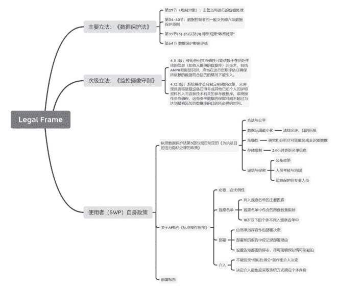

图 2 法院附录的主要法律框架及有关规范

（c）促进具有相关受保护特征的人和不具有相关受保护特征的人之间的良好关系.

## 【案例评析】

### （一）本案对英国人脸识别技术规制的指导意义

人脸信息识别技术作为生物识别技术的一种，正迅速地被应用到公共管理、交通出行、单位考勤、智能安防以及线上支付等广泛的场景当中.人脸识别技术的快速落地，主要来源于其技术特性.人脸识别使得身份认证这一环节摆脱了对移动设备等中间介质的依赖，人们不用拿出手机即可以进入并完成认证过程，这不仅会极大地提高管理效率以及生活服务的便利程度，甚至会带来互联网服务模式和生活方式的一场变革.然而，智能技术将人的特征刻画在数字空间中，在驱动社会革新与变迁的同时，也使我们陷入“对抗技术”的人文困境.^([\[13\]](#txt002.html#footnote_content_txt002_13))正如本案判决中所评价的，生物识别数据本身就能够做到“唯一”地识别到个体，^([\[14\]](#txt002.html#footnote_content_txt002_14))具有“与个人身份的强相关属性”.^([\[15\]](#txt002.html#footnote_content_txt002_15))人脸信息更是能够通过非侵入性的方式获取，而不需要“物理上的进入、接触或强制力”，^([\[16\]](#txt002.html#footnote_content_txt002_16))且容易使采集过程完全不为采集对象所知.人脸信息获取的非接触性和其对隐私的强侵入性，增加了其被滥用的可能和滥用后果的严重程度，因此监管有必要对此加以关注.

本案中，面对新兴技术，英国选择了循序渐进的治理模式.一方面，人脸识别等新技术的应用有助于警方高效地开展工作，加大打击违法犯罪的力度，维护社会公共秩序，提升公民的安全感.另一方面，立法具有滞后性，新技术的实施往往伴随着现有法律框架的不充分，进而侵犯公民的基本权利.英国法院在接纳新技术的同时，对其应用也提出了严格的要求，包括相对完备的监管制度和`AFR`技术使用行为的严苛审查.上诉法院推翻原审判决，认为南威尔士警署使用人脸识别技术的行为不合法，也表明了英国法院倾向于尊重人权的态度.在人脸识别技术尚未成熟的阶段，本案在司法、行政、立法领域都给出了极具意义的指导.

在本案上诉法院宣判后，南威尔士警署计划将法院的判决纳入其业务指导，并于 2019 年委托相关机构对`AFR`有关的算法歧视问题进行学术分析，让该技术更加符合伦理道德以及法律规定的要求.英国政府也随即公布了监视摄像监理专员`Tony Porter`的声明.他认为，法院判决未对`AFR`等新技术产生较大的阻碍，相反，判决为技术的使用设定了更为明确的法律监管边界.`Tony Porter`将考虑修改 2018 年下发给警方的业务指导文件，确保警方对`AFR`技术可能存在的固有歧视问题有更为深刻的认识.此外他还打算与生产厂商合作，以消除技术手段带来的歧视问题.可见，本案对英国公共部门使用类似技术进行公共管理产生了深远影响.

### （二）本案中人脸识别具体应用场景的规范体系

本案最为显著的特点，是原审法院在审查时进行了详尽的法律层次分析，用以判断所涉人脸识别技术是否具备充分的法律框架，从而使其具备合法性基础，以及是否进行了规范合理的监管.从这套法律框架中可以看到，英国法律在新技术方面呈现出了从宏观到微观的较为全面的规范体系.值得一提的是，本案法院在审视现有规范时特别指出，一项新的技术并不意味着必然需要一个为其量身定制的规范体系.^([\[17\]](#txt002.html#footnote_content_txt002_17))这也说明，英国法院对于新技术的认知倾向于从现有规范中来寻找依据，这实际上是一种较为谨慎的态度，也是维护国家法制统一有序的考量.正如图 2 所示，在《欧洲人权公约》保护公民权利自由的整体审查要求下，主要立法、次级立法以及所涉技术操作与应用的具体规范，都必须充分确保不会对公民权利自由造成非法侵害.所涉及的规范类型不仅包括立法机关制定的法律，还囊括了行政机关制定的行为规范，以及具体使用争议技术的公共机构的自我约束规范.

我国对人脸信息的保护主要是从个人信息的保护出发的.从法律层面，在 2017 年正式实施的《中华人民共和国网络安全法》中，个人生物识别信息被确认为个人信息的一种.^([\[18\]](#txt002.html#footnote_content_txt002_18)) 2021 年 11 月 1 日《个人信息保护法》出台，生物识别信息被列为敏感个人信息，处理时需要取得个人的单独同意，并且只有在具有特定的目的和充分的必要性，并采取严格保护措施的情形下，个人信息处理者方可处理敏感个人信息.^([\[19\]](#txt002.html#footnote_content_txt002_19))在保护个人信息的层次上，我国已经逐步出台一系列行政法规落实保护要求，如《网络数据安全管理条例（征求意见稿）》等.除此之外，我国对生物识别信息的收集和使用也早有合规标准存在，如《信息安全技术 个人信息安全规范》就提及了对生物识别信息在收集、存储和共享三个方面的保护要求.^([\[20\]](#txt002.html#footnote_content_txt002_20))个人生物信息法益具有多元属性，其涵盖了对隐私权、人格权、财产权及生物安全法益的保护，这决定了其使用和保护的多元价值.因此在规范体系上，我国生物识别信息安全保护仍需要发挥各个部门法在保护权利和保障安全方面的功能，如促进行政立法与刑法规范的良性互动等.^([\[21\]](#txt002.html#footnote_content_txt002_21))

### （三）人脸识别技术的监管要点

随着人脸识别技术的应用，各国都着手加强对生物识别信息的监管，公共主体逐渐意识到，无论是在社会管理还是商业应用上，人脸识别技术的广泛应用，既会侵害人们对隐私权保护的“合理期待”，同时也会造成公民与社会之间的隔阂，从而影响彼此之间的信任关系.^([\[22\]](#txt002.html#footnote_content_txt002_22))公民的此类信息被公共机构和商业主体双重利用，也让社会对监管的关注更加集中和紧迫.

值得注意的是，虽然本案在讨论法律框架时仅聚焦几个主要的规范内容，但从判决中可以看出，对于警方使用人脸识别技术这一应用场景而言，就牵涉到众多的监管部门、专员办公室、顾问机构以及相关法案、指令、指导意见等，内容涉及从警方职责、调查权力、监控摄像、信息监管到背后的人权、自由、平等保护等诸多方面.有学者认为，这或许与英国社会坚持经验主义的认知原则息息相关.^([\[23\]](#txt002.html#footnote_content_txt002_23))

尽管如此，我们依然能够从本案所提到的规范中窥见关于人脸识别技术的治理要点，包括：第一，公共机构使用该技术是否有法律依据；第二，在使用前是否进行了有关个人数据保护等方面的定期影响评估；第三，采集的数据是否为合法目的所需的最小范围；第四，所采集数据的保留时间及其存储、处理的安全性，这一点在人脸识别技术领域尤为重要，人脸信息能够准确识别个体，但由于人脸不能更换，人脸信息流失或被滥用的侵害则可能是长期甚至永久性的，难以完全恢复原本权利完整的状态.^([\[24\]](#txt002.html#footnote_content_txt002_24))同时，正如本案所提到的，如果在刑事侦查方面使用人脸信息确有足够的公共利益，那么在设计需要重点关注的人名单时是否予以了最小合理范围的考虑，进行比对之后是否在技术上做到了彻底的删除等，显得尤为重要，监管应当要求对生物识别信息的保护采取全流程、全周期的保护措施；第五，比对算法所依赖的数据库是否存在不公平的潜在倾向等等.可以看出，上述要点绝大多数都是个人信息保护的常见思路，而针对人脸信息的固有特点应当有所侧重.当然，监管与治理应当以明确具体的规制对象为前提，即应当根据人脸识别技术的具体应用场景进行设计.

## （四）个人权利保护与重大公共利益的平衡

本案的实质问题，其实在于如何在保护个人权利与侦查及预防犯罪之间取得平衡.该案所涉及的技术引发了广泛讨论，当地某公民组织评论本案这种直播式的人脸识别技术会使得“个体成为行走的身份证”.国内学者更是在研究中强调了滥用人脸信息对人的“尊严贬损风险”.^([\[25\]](#txt002.html#footnote_content_txt002_25))本案法官在论证开始之前也提到了这一问题.判决也体现出，执法机构充分利用现代技术实现公共管理目标时，应当合理地考虑对公民权利、自由以及尊严可能造成的侵犯，而这种“合理考虑”是通过审查公共部门作出行为的法律依据来判断的.从前述分析可知，造成上诉法院推翻原审判决的关键原因，正是争议技术所依据的相关规范给予了执法者过于宽泛的自由裁量权，使得执法者可以任意决定技术使用的场合和所要观察的人员.因此，在新技术背景下审视利益衡量原则，要求我们“必须置身于风险社会及其相伴而生的‘人造风险’的语境中，衡量不同主体在人脸识别应用中所面临的风险和收益，合理分配相关主体之间的权利和义务.”^([\[26\]](#txt002.html#footnote_content_txt002_26))

## 【关联判例推荐】

### 1. R(Catt) v. Commissioner of Police of the Metropolis [2015] UKSC 9; [2015]AC 1065

核心事实：原告 Catt 在 2005 年参加了存在严重混乱和犯罪的游行示威，被两次逮捕但均未被定罪.警方获取了 Catt 参与游行的相关信息，并将其储存在“极端主义数据库”（extremism database）中，具体包含以下两类：（1）一张原告照片，该照片随后被销毁；（2）其他人的信息报告中提及到原告的内容.Catt 将警方系统地收集和储存个人电子信息的行为起诉至法院.欧洲人权法院认为，在此案中警察干预权利与尊重私人生活不具有合比例性，实质上违反了公约第 8 条的规定.

与本案关联点：“Catt 案”是本案判决的主要参考.本案同“Catt 案”一样，原告的信息是以非侵入性的方式被获取的，是由完全公开的记录组成.“Catt 案”判决中认为法律框架只需“合理可预测”，并不需要涉及到每一个可能出现的问题.

### 2. S v. United Kingdom (2009) 48 EHRR 50

核心事实：本案事实涉及警方为侦查犯罪而采集嫌疑人的指纹和 DNA 信息.在本案的上诉中，法院主要解决了在何种情况下，警方可以不经数据主体同意，将其为刑事执法目的采集的 DNA 信息用于除刑事执法以外的目的.

与本案关联点：本案的人脸信息与 DNA、指纹一样能够准确识别到个体.这类信息即使只是暂时地被采集，也触及对公约第 8 条权利的侵犯，也更加需要法律上的保障措施.

## 2.3 哈兹利特诉苹果公司案

#### 【案件索引】

Hazlitt v. Apple, Inc., 500 F. Supp.3d 738 (S.D. Ill. Nov. 12, 2020)

Hazlitt v. Apple, Inc., No. 3:20-CV-421-NJR, 2021 WL 2414669 (S.D. Ill. June 14,2021)

Hazlitt v. Apple Inc., 2021 WL 2457987 (S.D. Ill. June 16, 2021)

#### 【关键词】

人脸识别技术；生物识别信息；个人隐私权保护；文书提出命令

#### 【案件提要】

本案探讨了生物识别技术的商业应用，其核心是个人隐私信息的保护问题.随着互联网科技和网络经济的发展，人脸识别^([\[27\]](#txt002.html#footnote_content_txt002_27))、指纹识别等现代生物识别技术得到了广泛而快速的应用，被大量使用于安全保障、商业支付、教育考试等领域.这些技术在带给我们便捷生活体验的同时，也带来了个人信息尤其是生物识别信息泄露的风险.本案中，来自美国伊利诺伊州的苹果设备用户对苹果公司提起了集体诉讼，针对苹果公司通过相机应用程序对用户进行人脸识别并存储相关数据的违规行为，其根据伊利诺伊州《生物识别信息隐私法》（The Illinois Biometric Information Privacy Act， BIPA）提出了相应的损害赔偿请求.原告们从发布信息处理政策、获取用户同意、使用信息盈利这三个递进的角度出发，指控苹果公司违反了伊利诺伊州《生物识别信息隐私法》（BIPA）第 15 条的要求.

本案的主要法律依据是美国伊利诺伊州的《生物识别信息隐私法》（BIPA），该法在生物识别信息保护领域是值得学习的经典立法著作，常被称为“最严隐私保护法”.其第 15 条（b）款在近些年的信息侵权案件中让众多美国企业屡遭败诉，从脸书（Facebook）、谷歌（Google）和色拉布（Snapchat）等科技巨头，到零售商旺迪斯（Roundy’s）和洲际酒店（InterContinental Hotels）旗下的金普顿（Kimpton）连锁酒店，都遭遇过基于 BIPA 第 15 条（b）款而提起的指控.

目前在全世界范围内，网络法研究方兴未艾：2018 年英国修改后的《数据保护法案》（Data Protection Act， DPA）正式生效；同年欧盟正式通过了《通用数据保护条例》（General Data Protection Regulation， GDPR），该条例被视作欧洲隐私保护领域的“史上最严”立法；2020 年 11 月 3 日，加州选民投票通过了《2020 年加州隐私权法》（California Privacy Rights Act， CPRA），该提案修正并扩展了里程碑式的《2018 年加利福尼亚消费者隐私法》（California Consumer Privacy Act， CCPA）；2020 年 11 月 25 日欧盟委员会通过了《欧洲数据治理条例（数据治理法）》（Data Governance Act， DGA）提案，采取措施使公民和企业更容易为社会利益而提供其数据，促使数据共享（尤其是数据的跨部门和跨国界使用）成为可能；2020 年 12 月，欧盟委员会推出《数字市场法（草案）》（Digital Market Act， DMA），其目标是“创建一套数字领域的交通信号灯系统”，通过监管保证数字市场的“公平和竞争性”；2022 年 1 月 20 日，欧洲议会通过了《数字服务法》（Digital Services Act， DSA），旨在进一步加强对大型互联网平台的监管，确保平台通过内容审核对其算法负责；2022 年 2 月 23 日，欧盟公布了《数据法》（Data Act， DA）草案全文，该草案旨在为数据共享、公共机构的访问条件、国际数据传输、云转换和互操作性提供一个统一的法律框架.在世界主要国家掀起互联网数据领域立法浪潮的背景下，本案中 BIPA 所确立的立法、司法原则值得各国加以学习和移植.

#### 【案件要旨】

伊利诺伊州圣克莱尔县第二十巡回法院（原审法院）：原告 罗斯林·哈兹利特等人 被告 苹果信息科技公司

伊利诺伊州南区法院（移审法院）：原告 罗斯林·哈兹利特等人 被告 苹果信息科技公司

2020 年 3 月，多位伊利诺伊州居民向伊利诺伊州圣克莱尔县第二十巡回法院提起了针对苹果公司的集体诉讼，试图代表全州范围内的苹果设备用户，对苹果公司提出索赔请求.原告指控这家科技公司违反了伊利诺伊州 2008 年颁布的《生物识别信息隐私法》（BIPA）第 15 条（a）款、（b）款和（c）款规定^([\[28\]](#txt002.html#footnote_content_txt002_28))，未经原告同意就收集、占有他们的面部识别信息^([\[29\]](#txt002.html#footnote_content_txt002_29))并从中获利.起诉状称：苹果公司所出售的设备预装了一款照片应用程序，该程序使用人脸识别技术来识别用户存储在设备上的照片，然后将通过用户照片生成的脸部识别数据存储在个人设备上，而用户却无法对这一应用进行修改设置乃至关闭使用的操作；在这一过程中，苹果公司通过人脸识别技术和人工算法创建出了 BIPA 所定义的“生物识别信息”^([\[30\]](#txt002.html#footnote_content_txt002_30))和“生物标识符”^([\[31\]](#txt002.html#footnote_content_txt002_31))，这使得本案原告和伊利诺伊州其他的苹果设备用户都面临着紧迫的信息泄露风险.

苹果公司对圣克莱尔县第二十巡回法院辩称，原告不能根据 BIPA 提出索赔，因为：（1）原告所称的脸部几何扫描信息来源于苹果设备上储存的照片，与单独的可识别个体无关；（2）原告在第二项指控中^([\[32\]](#txt002.html#footnote_content_txt002_32))缺乏依据 BIPA 第 15 条（a）款进行索赔的资格；（3）原告未能指控苹果公司出售生物识别信息并从中获利；（4）原告未能就苹果公司故意或过失违反 BIPA 的行为提出任何事实指控，以支持其所提出的法定损害赔偿.

2020 年 5 月 6 日，苹果公司请求依据《集体诉讼公平法》（Class Action Fairness Act， CAFA）将案件移交至伊利诺伊州南区法院审理，并在一个月后向伊利诺伊州南区法院提交了驳回原告起诉的动议.苹果公司进一步辩称，原告未能提出有效的 BIPA 索赔请求，因为涉案的人脸识别技术只在个人用户的设备上运行—这意味着苹果公司实际上并没有通过相机应用程序收集或占有用户们的生物识别数据.

伊利诺伊州南区法院的罗森斯坦格尔法官驳回了苹果公司的动议.法官表示，尽管人脸识别技术确实只在个人用户设备上运行，但法院采信原告方的说法，即只有苹果公司可以访问相机应用程序所生成的生物识别数据.法院同意苹果公司的另一项观点：原告不能依据 BIPA 第 15 条（a）款、（c）款向联邦法院提起索赔请求，因为原告未能证明基于苹果公司不发布信息处理政策而致其遭受的具体损害，也未能证明苹果公司有通过用户生物识别数据获利的具体行为.最终，罗森斯坦格尔法官裁定拒绝驳回这项集体诉讼，原告根据该州的《生物识别信息隐私法》（BIPA）第 15 条（b）款对苹果公司提出了一项合理的索赔请求；但法官也将原告诉状中基于第 15 条（a）款和第 15 条（c）款的两项诉求发回伊利诺伊州圣克莱尔县巡回法院.

苹果公司随即在 2020 年 11 月 16 日向上诉法院提交了发还本案进行重审的申请，上诉法院撤销了伊利诺伊州南区法院的原裁定，并指令南区法院对本案进行重审.罗森斯坦格尔法官在重审后于 2021 年 6 月 14 日重新做出裁定：苹果公司对原告生物识别信息的非法保留行为，构成了对原告个人隐私潜在的无限期侵害可能，造成了对原告的个人特殊损害，原告具有基于 BIPA 第 15 条（a）款提起诉讼的资格；而原告基于第 15 条（c）款提出的一般性违法指控，则因缺乏联邦法院管辖权所要求的个人特殊损害，将被发还至伊利诺伊州圣克莱尔县巡回法院.

2021 年 6 月 16 日，针对原告向法院提出的“要求苹果公司提交公司内部相关文件”的请求（这些文件将用于帮助原告识别在伊利诺伊州范围内购买了含有涉案应用程序的苹果设备的用户群体，以及同意了苹果终端用户协议的用户群体），伊利诺伊州南区法院作出裁定将其驳回.^([\[33\]](#txt002.html#footnote_content_txt002_33))

#### 【案例事实思维导图】

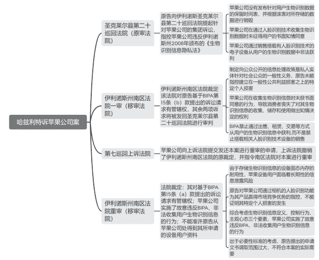

#### 【核心争议点】

1.在《集体诉讼公平法》下，本案是否符合赋予联邦法院集体诉讼管辖权的相关条件.

2.原告就自己所提出的三项索赔主张是否具有起诉资格.

3.在伊利诺伊州《生物识别信息隐私法》下，苹果公司是否故意违反 BIPA 非法收集用户生物识别信息.

4.出于确定集体诉讼原告范围的需要，本案原告能否要求苹果公司向其提交设备用户的相关个人信息.

#### 【裁判论证过程】

##### （一）在《集体诉讼公平法》下，本案符合赋予联邦法院集体诉讼管辖权的相关条件

《集体诉讼公平法》赋予符合下列条件的集体诉讼以联邦法院管辖权：（1）原告中的任一成员州籍不同于任何被告（最小多样性要求）；（2）提起集体诉讼的原告所代表的人数超过 100 人以上；（3）索赔的争议金额总计为 500 万美元以上.

伊利诺伊州南区法院的法官认为：（1）原告都是伊利诺伊州的居民，而苹果公司是一家加州公司，双方公民的身份符合最小多样性要求.（2）原告声称这个集体诉讼所代表的人数包括“数千人”，诉讼群体超过了法定所需的 100 名成员要求.（3）根据《生物识别信息隐私法》，对每一次因故意和鲁莽违反 BIPA 的行为，法定损害赔偿金为 5000 美元，对每一次因过失违反 BIPA 的行为，法定损害赔偿金为 1000 美元；原告在指控中声称至少有三起独立的违反 BIPA 的行为，并声称有数千名类似受害者，即使假设这个群体只有 1000 人，起诉书声称的可能损失也将达到 500 万美元，争议金额达到了要求的阈值.

##### （二）本案原告对依据 BIPA 第 15 条（a）款、（b）款提出的两项索赔请求具有起诉资格，对依据第 15 条（c）款提出的索赔请求不具备起诉资格

联邦法院只有在原告满足宪法第 3 条规定的原告资格时才对本案拥有管辖权.法院认为宪法第 3 条要求的“适格的原告资格”需要具备：（1）原告遭受实际的或即将发生的、具体的、特殊的事实损害；（2）损害与被诉行为之间具有因果关系；（3）存在通过一个有利决定对损害进行救济的可能性.如果被诉行为只是一个与具体损害相分离的程序性违法行为，就不符合该条对事实性损害的要求.^([\[34\]](#txt002.html#footnote_content_txt002_34))

首先，对原告依据 BIPA 第 15 条（a）款提出的第一项索赔请求，伊利诺伊州南区法院先后做出了结论不同的裁定.

在第一次审理中，法院援引“布莱恩特诉美国康帕斯集团案”^([\[35\]](#txt002.html#footnote_content_txt002_35))中第七巡回上诉法院的观点，认为 BIPA 第 15 条（a）款的“书面政策要求”^([\[36\]](#txt002.html#footnote_content_txt002_36))实质上是私人实体针对社会公众的一般性义务，而非针对个体的特殊义务；违反该项要求构成的是公共损害，而非针对原告个人的特殊损害.在这种情形下，想要获得原告资格，在一般性公共利益损害之上的个人特殊损害必须被充分指控；而本案中的原告显然缺乏这样的特殊损害结果作为其起诉支撑，他们并未因书面政策的未发布而遭受任何实际损失.

原告进一步指控苹果公司未能销毁用户的生物识别信息，这侵犯了他们要求删除个人数据信息的权利^([\[37\]](#txt002.html#footnote_content_txt002_37))，使得原告的个人数据容易受到黑客攻击或其他手段的攻击.但法院认为原告并未声称他们已停止使用收集生物识别数据的苹果应用程序和设备，因此最初收集数据的目的并未得到满足，而且距原告最后一次与苹果公司或其设备互动也未满三年.因此法院判定原告对依据 BIPA 第 15 条（a）款提出的第一项索赔请求不具备原告资格.

在案件进行第二次审理之前，第七巡回上诉法院通过“福克斯诉达科他集团案”^([\[38\]](#txt002.html#footnote_content_txt002_38))对 BIPA 第 15 条（a）款进行了重新解释，认为私人主体在第 15 条（a）款下对社会公众的一般性义务，仅限于制定并公开书面信息处理政策；如果原告指控被告未能制定、公开并遵守相关的信息处理政策，造成了用户生物识别数据被非法保留的后果，那就足以证明原告资格所需要的事实损害确实存在，因为“非法保留生物识别数据会造成与非法收集相同的隐私伤害”.因此在第二次审理中，尽管伊利诺伊州南区法院依旧保留了第一次审理中的相关分析，但法院进一步认为：由于存储苹果用户生物识别信息的设备固态内存的耐用性^([\[39\]](#txt002.html#footnote_content_txt002_39))，这些信息面临着一种长期性的泄露风险，使用中的乃至是废弃的苹果设备可能会无限期地对用户构成隐私伤害.所以伊利诺伊州南区法院经过两次审理后，最终裁定原告有权依据 BIPA 第 15 条（a）款提出第一项索赔请求.

其次，对原告依据 BIPA 第 15 条（b）款“书面同意要求”提出的第二项索赔请求，法院继续援引“布莱恩特案”的观点，认为 BIPA 第 15 条（b）款赋予的义务是私人实体^([\[40\]](#txt002.html#footnote_content_txt002_40))对个人的义务，原告主张的也是具体的、特定的事实损害，因此原告对这一项指控具有起诉资格.苹果公司在通过相机应用程序从用户的照片里收集脸部几何识别时，从未要求过或收到过用户的知情同意.由于没有获得书面同意，被告苹果公司“造成了 BIPA 意图制止的具体伤害行为，即消费者丧失了对收集、存储和使用其生物识别信息做出知情决定的权利和能力”.此外法院指出，之所以不遵守知情同意条款会对用户造成具体伤害，是因为对收集方行为的充分了解与否，会改变用户使用该设备的行为方式.

最后，对原告依据 BIPA 第 15 条（c）款“禁止获利要求”提出的第三项索赔请求，法院认为：（1）这项要求同样是一项针对社会公众的义务，原告有义务证明个人特殊损害的发生.（2）原告并未指控苹果公司以直接出售或其他方式从其个人生物识别数据中获利，而是指控苹果公司开发了相机应用程序的人脸识别功能，通过这些功能来向潜在用户宣传其操作系统和设备，为其产品的市场竞争获得了相对优势，最终通过扩大苹果产品销售份额的方式来实现获利.（3）BIPA 第 15 条（c）款明确禁止的是通过出售、租赁、交易等方式从“个体或客户的”生物识别信息中获利，而不是禁止销售搭载该项人脸识别技术的设备.因此法院裁定，本案原告无法证明其因苹果公司出售了搭载相关人脸识别技术的设备而受到了个体特殊影响，原告无权依据 BIPA 第 15 条（c）款提出第三项索赔请求.

## （三）苹果公司实施了故意违反 BIPA、非法收集用户生物识别信息的行为

针对本争议焦点，苹果公司从生物识别信息的定义、苹果公司是否进行了收集、持有等控制行为、苹果公司是否故意或鲁莽地违反了 BIPA 这三个角度出发为自己辩护.

### 第一，关于生物识别信息的定义
苹果公司认为：（1）伊利诺伊州的立法机构之选择将“信息”一词与“生物识别”一词捆绑在一起，是有意排除不能识别任何真实个体身份的信息数据；（2）苹果公司通过人脸识别技术得出的个人信息不能算作是生物识别信息，因为苹果公司并没有使用人脸识别技术来实际识别任何人，用户设备上生成的“脸部模板”都是匿名的；（3）设备用户可以通过自己输入姓名来为用户设备上的“脸部模板”进行“标记”，而苹果公司不会接收到这些信息，识别过程实际上是控制在用户手中的；（4）苹果公司还援引了“蒙罗伊诉肖特福莱案”^([\[41\]](#txt002.html#footnote_content_txt002_41))中的说法，在该案中法院判定从蒙罗伊照片中提取的数据不能构成法律意义上的生物识别信息.

伊利诺伊州南区法院则认为：（1）受法律保护的个人信息的核心要件在于“可识别性”，即“能够单独或者与其他信息结合识别特定自然人”；（2）BIPA 和一些法院已经确定通过扫描人脸照片得到的面部几何识别数据符合“生物识别信息”的定义，苹果公司所援引的“蒙罗伊案”仅是一个个例；（3）“生物识别信息”是指基于生物学的测量、可用于帮助识别个体身份的信息，它是一个正向清单而非反向清单，并没有将那些未用于识别真实人物的数据信息排除在外；（4）即使苹果公司之前的解读是正确的，苹果设备的相机应用程序也在其运行过程中应用了某种算法来识别特定的苹果设备用户，苹果公司所谓的“实际识别未能发生”的说法并不能成立.

### 第二，关于收集、持有等控制行为的有无
原告指控苹果公司使用其应用程序创建、收集用户的人脸识别信息，并将这些信息存储在人脸识别数据库中，只有苹果公司可以单独访问这个数据库并禁止相关的收集行为，其对苹果设备上的数据拥有完全和独占的控制权；而用户只能在允许苹果公司进行人脸识别和数据收集的前提下使用设备，无法对数据的收集和存储行为进行限制和干预，也无法删除相关数据信息.

苹果公司称其并未控制、拥有原告所指的生物识别信息：（1）原告对苹果公司“通过照片应用程序收集生物识别数据并将其存储在用户的本地设备上”的指控是推测性说法，缺乏证据实证；（2）原告也没有指控苹果公司在设备出售后仍然保有访问用户设备照片的权限；（3）人脸识别技术的运行发生在用户持有并控制的苹果设备上，生物识别数据也存储在这些设备的固态存储器之中，拍摄、存储和删除照片数据的行为也是一种用户选择，并不受苹果公司干预.总而言之，苹果公司并不会以苹果设备应用程序的“代理人身份”为其运行承担替代性责任.

法院认为为解决这一问题必须对“占有”（Possession）一词进行准确定义.由于 BIPA 中并未对“占有”（Possession）进行任何定义，法院援引了其他案例的解释：通常理解下，“占有”是指一个人拥有或控制标的财产或持有该财产供其支配.^([\[42\]](#txt002.html#footnote_content_txt002_42))在这样的定义下，BIPA 并不要求被告对目标数据建立一种独占性的排他控制，也并不要求目标数据必须由苹果公司进行储存，苹果公司现有的数据访问权限足以构成 BIPA 下的“占有”概念.

### 第三，关于主观心态状况
法院认为，在 BIPA 颁布 11 年后，苹果公司继续收集伊利诺伊州居民的脸部几何数据，这违反了 BIPA 的规定.这些指控足以造成一种推论，即该行为是疏忽的或鲁莽的，但不足以构成可信的谨慎推断.不过在 BIPA 中，违法主体的主观精神状态仅涉及每一违法行为可能得到的赔偿数额，所以即使原告不能就苹果公司的故意心态提供确凿证据，苹果在本案中的表现也符合 BIPA 对违法行为提出的主观心态要求.

## （四）法院不能准许原告从苹果公司处得到其所申请的苹果设备用户资料

原告在对伊利诺伊州南区法院所提出的申请中，要求苹果公司交出从 2016 年 6 月 13 日至原告起诉时这个期间内的用户群体信息^([\[43\]](#txt002.html#footnote_content_txt002_43)).原告认为：（1）根据《联邦民事诉讼规则》（Federal Rule of Civil Procedure，FRCP）第 23 条（b）款第三项^([\[44\]](#txt002.html#footnote_content_txt002_44))的规定，当案件可以采用集体诉讼的方式来进行审理时，这一方式相较于其他方式具有适用上的优先性；（2）出于确定本案集体诉讼中原告范围的需要，原告需要苹果公司提供有关文件以便于向潜在的集体诉讼原告发出通知；（3）根据《联邦民事诉讼规则》第 26 条（b）款的规定，原告所申请的披露信息与案件的实际需要相比是符合比例原则的要求的；（1）原告还援引了与《电信用户保护法》（Telephone Consumer Protection Act， TCPA）相关的若干案例，称第七巡回法院在这些案件中同样要求被告提供用户群体信息，以确定集体诉讼中的原告范围.

苹果公司则反对这一请求，认为其含糊不清、过于宽泛和繁琐，且需要提供的信息范围也与案件需要不符.其理由如下：（1）如此大规模的用户信息披露，可能需要对以百万计的与本案无关的苹果用户进行身份确认，这种扩散性的调查不符合比例性的要求；（2）在未经苹果用户知情同意的情况下，披露其姓名、住址等个人信息会侵犯苹果用户的消费者隐私权利；（3）本案中集体诉讼的适格原告应当是“脸部出现在苹果设备所存储的照片上的伊利诺伊州居民”，而非原告所提起调查的“购买过苹果设备或同意终端用户协议的伊利诺伊州居民”；（4）这一请求为苹果公司带来了沉重的数据供应负担，苹果公司需要提供数百万苹果用户超过五年的个人信息，并判断这些用户在购买和使用苹果设备时是否具备“伊利诺伊州居民”身份；（5）苹果公司还援引了“奥本海默基金公司诉桑德斯”（Oppenheimer Fund， Inc. v. Sanders）^([\[45\]](#txt002.html#footnote_content_txt002_45))一案，在该案中，最高法院裁定潜在的集体诉讼成员的个人姓名和住址信息不属于《联邦民事诉讼规则》第 26 条（b）款第一项所允许的信息披露范围.

法院认为：（1）私人主体在姓名、住址等个人信息的披露问题上具有私人利益，在不提供事先通知和退出选项的情况下，对数百万消费者的个人信息进行大规模披露是不适当的；（2）原告可以采用扩散性更弱的方式调查潜在的集体诉讼成员，比如说调查伊利诺伊州中一个更切合本案需要的苹果用户子集，而非每一个购买过苹果公司产品的伊利诺伊州居民；（3）原告未能阐明对集体诉讼原告范围的调查与本案优先适用集体诉讼方式之间的关联，《联邦民事诉讼规则》第 23 条（b）款第三项所确立的“集体诉讼方式优先”和“集体利益所涉问题解决优先”的原则并不要求苹果公司必须向原告提供其所要求的信息资料；（4）原告没有向法院或被告明确表明是否具有将这些数据用于其他用途的意图，也未能向法院就苹果公司所提交数据的安全存储和保护问题做出合理保证；在近年来针对美国公司的黑客攻击事件日益增加的背景下，这势必会引起苹果公司用户未来的普遍担忧.

## 【审理结果】

1. 伊利诺伊州南区法院一审裁定：基于伊利诺伊州《生物识别信息隐私法》第 10、15、20 条和宪法第 3 条的规定，法院对原告指控苹果公司“违反知情同意原则进行数据收集”的索赔请求具有管辖权；而另外两项基于公开书面政策和非法获利行为的指控，因缺乏标的管辖权被发还至伊利诺伊州圣克莱尔县第二十巡回法院.

2. 第七巡回上诉法院裁定：撤销伊利诺伊州南区法院的原裁定，并指令南区法院对本案进行重审.

3. 伊利诺伊州南区法院重审裁定：（1）由于苹果设备用户面临着长期性的信息泄露风险，其对基于《生物识别信息隐私法》第 15 条（a）款提出的诉讼请求有管辖权；（2）原告对苹果公司“通过人脸识别功能为其产品赢得竞争优势”的指控，不能证明其个人特殊损害的发生，基于《生物识别信息隐私法》第 15 条（c）款的诉讼请求仍将被发还至圣克莱尔县第二十巡回法院；（3）综合考虑生物识别信息定义、控制行为、主观心态三个要素，苹果公司实施了故意违反 BIPA、非法收集用户生物识别信息的行为；（4）出于文书提出命令必要性标准的考虑，原告提出的申请文书调取范围过大，不能准许原告从苹果公司处得到其所申请的苹果用户资料.

## 【相关法条】

《伊利诺伊州生物识别信息隐私法》第 10 条（Illinois Biometric Information Privacy Act §10（2008））

“生物标识”的定义包括“视网膜或虹膜扫描，指纹，声纹，或者手部或面部几何扫描.”

《伊利诺伊州生物识别信息隐私法》第 15 条（a）款（Illinois Biometric Information Privacy Act §15（a）（2008））

所有拥有生物标识符或生物识别信息的私人实体应当制定向公众公开的书面政策，制定生物识别信息的保留时间表和销毁方针（销毁进行于收集或获取这些生物识别信息的初始目的已被满足时，或者是个体与私人实体进行最后一次信息交换的三年内）.

《伊利诺伊州生物识别信息隐私法》第 15 条（b）款（Illinois Biometric Information Privacy Act §15（b）（2008））

禁止私人实体收集、获得、购买、通过交易接收或以其他方式获取个人的生物标识符或生物识别信息；除非它以书面形式告知该信息的所有者此信息被披露的时间、方式和目的，并收到信息相关主体的书面知情同意.

《伊利诺伊州生物识别信息隐私法》第 15 条（c）款（Illinois Biometric Information Privacy Act §15（c）（2008））

拥有生物标识符或生物识别信息的私人实体不得以出售、租赁、交易或其他方式从个人或客户的生物标识符和生物识别信息中获利.

《伊利诺伊州生物识别信息隐私法》第 20 条（Illinois Biometric Information Privacy Act §20（2008））

对每一项故意和鲁莽违反 BIPA 的行为，法定损害赔偿金为 5000 美元；对每一项过失违反 BIPA 的行为，法定损害赔偿金为 1000 美元.

## 【案例评析】

### （一）直接引发对人脸识别技术领域个人信息保护工作的社会关注与讨论

本案是 2015 年“卡洛·利卡塔诉脸书（Facebook）案”的延续，“卡洛案”中原告指控脸书公司（Facebook）违反伊利诺伊州《生物识别信息隐私法》，未经用户允许擅自使用面部标记功能，最终此案以 6.5 亿美元的和解协议告终.根据该案最终的和解协议，脸书公司（Facebook）将实施一系列改革措施，包括：将其“人脸识别”的默认设置变更为“关闭”，并将其适用于那些没有“肯定地选择或同意生物识别扫描”的用户；该公司还将删除现有的人脸存储模板，除非该公司就如何使用这些模板获得了用户“单独披露后的明确同意”.^([\[46\]](#txt002.html#footnote_content_txt002_46))

这些案件共同引发了全球社会对信息保护议题和人脸识别技术的高度关注，推动了立法、执法层面重大变革的出现.

在立法领域，美国多个州对生物识别信息的保护推出了法律规定，田纳西州《贸易和商业法典》（Texas Business and Commerce Code， TBCC）第 503 章第 1 节规定了对生物识别信息的获取使用规则，禁止在未通知或未经个人同意的情况下获取个人生物识别信息，持有生物识别信息者亦不得在未经个人许可的情况下出售、租赁该生物信息.^([\[47\]](#txt002.html#footnote_content_txt002_47))欧盟颁布了修订后的《人脸识别指南》（“第 108 号公约+”），涵盖了人脸识别技术的使用要点，包括实体面部识别技术；欧盟网络安全局则发布了《数据假名化：先进技术和使用案例》报告，探讨了个人数据保护的假名化问题，旨在通过对个人数据进行假名化的方法，增强数据主体对自身个人数据的控制，并提供了可能的技术和使用案例.^([\[48\]](#txt002.html#footnote_content_txt002_48))我国则在 2020 年颁布了《信息安全技术个人信息安全规范》，在 2021 年颁布了《人脸识别数据安全要求》国家标准，提出了人脸识别数据的基本安全要求、安全处理要求和安全管理要求，意图解决人脸数据滥采、泄露、丢失和人脸信息过度存储、使用的问题；2021 年 7 月 28 日，最高人民法院发布了《关于审理使用人脸识别技术处理个人信息相关民事案件适用法律若干问题的规定》，涉及“人脸识别技术”相关案件在侵权责任、合同规则以及诉讼程序等方面的法律适用，界定了不同场景下人脸识别技术的合法性边界.

在监管执法层面，2019 年美国有 9 个州都颁布了关于禁用人脸识别技术的法案，严禁警察、政府部门在公共场所使用人脸识别技术，旧金山成为美国第一个禁止警察和其他政府官员使用人脸识别的大城市；^([\[49\]](#txt002.html#footnote_content_txt002_49)) 2020 年英国信息专员办公室对万豪集团和英国航空的数据泄漏事件最终分别处以 1840 万英镑和 2000 万的罚款；2020 年 4 月，脸书公司（Facebook）因利用调查工具向现已破产的英国公司“剑桥分析”不当分享了 8700 万全球用户的信息而遭到起诉，被罚款 50 亿美元；2020 年 9 月，爱尔兰数据保护委员会要求脸书公司（Facebook）停止将欧盟用户的相关数据传输到美国，否则将遭到 28 亿美元的罚款.^([\[50\]](#txt002.html#footnote_content_txt002_50))

2021 年美国底特律的一位男子罗伯特·威廉姆斯（Robert Williams）因为人脸识别错误被错当成小偷逮捕，其律师杰里米·舒尔（Jeremy Shur）表示：“由于种种原因，全国各地的城市都应禁止警察使用人脸识别技术.因为该技术是有种族偏见且有缺陷的，并且很容易导致无辜人员被错误逮捕.”^([\[51\]](#txt002.html#footnote_content_txt002_51)) 2021 年 10 月 6 日欧洲议会通过决议，呼吁全面禁止在公共场合进行大规模面部识别，并进一步收紧对警方使用 AI 进行预测性警务活动的限制.欧洲议会成员彼得·维塔诺夫（Petar Vitanov）在决议通过后的声明中表示：“人类的基本权利是无条件的.我们有史以来第一次呼吁暂停部署用于执法的面部识别系统，是因为该技术已被证明是无效的，并且经常导致歧视性结果.”^([\[52\]](#txt002.html#footnote_content_txt002_52))

### （二）本案涉及在生物识别数据领域进行立法、司法需注意的六项原则

#### 第一，政策公开原则
这一原则要求采集生物识别信息的主体，应当制定并公开信息数据的保留和销毁政策，将收集、使用信息的目的、方式和范围等相关事宜告知信息主体.这是出于保护信息主体个人知情权的需要，也是为了将信息流动过程置于社会公众的监督之下.2021 年 2 月 17 日意大利竞争与市场管理局（AGCM）宣布，由于脸书公司（Facebook）未将个人资料的收集方式和使用方式告知用户，故该局决定向其开出 700 万欧元的罚单.^([\[53\]](#txt002.html#footnote_content_txt002_53))

#### 第二，知情同意原则
这一原则要求信息收集等处理行为必须获得当事人的知情同意，通过行使决定权来实现个人对个人信息处理者行为的控制.有学者认为：虽有形式同意，但权利人并非实质自愿的数据收集行为不具有正当性.^([\[54\]](#txt002.html#footnote_content_txt002_54))最高人民法院《关于审理使用人脸识别技术处理个人信息相关民事案件适用法律若干问题的规定》在第 2 条和第 4 条中进一步明确，获得用户授权同意应当是“单独的”且“非变相强迫的”.这意味着通过“捆绑式同意”来要求用户勾选人脸信息收集条款的行为，将不再具有合法性基础.2021 年 6 月宁波 20 家房地产公司就因只展示采集人脸信息的标识，而未经消费者同意合计被罚 203 万元，其非法收集人脸信息的行为被叫停.

北大法治与发展研究院执行院长王锡锌教授认为：仅依靠知情同意进行个人赋权的自主控制，无法实现个人信息保护的目的.缺乏国家规制力量的自主控制只是给了我们一个自主选择被奴役的权利，因为个人在面对大型平台等强势权力时，很难基于个人意志自由做出选择和决定；国家应建立“告知—同意”规则的国家标准及相应的投诉举报机制，相应的监管部门也应对此进行介入审查.^([\[55\]](#txt002.html#footnote_content_txt002_55))

#### 第三，禁止获利原则
这一原则要求生物识别信息的收集处理者不能就所收集的个人信息数据进行销售、租赁等盈利行为，因为生物识别信息的所有权归属于被收集主体.数据权属问题是信息数据保护领域的一个重要议题，其复杂性源于传统的“一物一权”式的产权制度并不适用于数据，因为多方主体都会有对数据主张权利的合理理由.在“郭某诉杭州动物园案”中，二审裁判强调了动物园入园记录的双重属性，即郭兵的个人信息兼动物园的经营信息.^([\[56\]](#txt002.html#footnote_content_txt002_56))全国政协委员皮剑龙在 2022 年全国两会上就建议加快制定《数据产权法》，在明确合法、公平、效率等原则的基础上，确定数据所有权、支配权、使用权、收益权等权利的归属，确定数据产权的流通和交易规范.^([\[57\]](#txt002.html#footnote_content_txt002_57))

### 第四，区分保护原则
本案涉及一个重要的法律概念：“生物识别信息”^[([\[58\]](#txt002.html#footnote_content_txt002_58))]。生物识别信息不同于一般的个人信息，其具有原生性、永久性和不可更改性，例如视网膜、指纹、声纹、面部几何识别图像，这些信息都是后天无法进行修改的。本案中 BIPA 将这些生物识别信息与其他信息相区分，进行专门立法予以特殊保护，正是基于这些生物识别信息的独特性。其一旦泄露所造成的危害要远高于一般信息：个人的账号密码可以在账号被盗后及时进行修改以减少和挽回损失，但生物识别信息的泄露会造成“个人身份信息被盗窃且缺乏追索权的风险大大增加”。

区分保护原则在一般信息保护的基础上，对个人信息进行适当分级并予以了不同程度的保护。欧盟《人脸识别指南》第 6 条将能够识别唯一特定主体的数据列入特殊类型数据，明确承认了生物识别信息的敏感性；欧盟为防范和监管 AI 技术高风险应用而出台的《人工智能行业监管草案》，将人工智能应用场景分为低、有限、高、不可接受四个风险等级，等级越高的应用场景会受到越严格的限制；我国 2021 年出台的《重要数据识别指南》征求意见稿为重要数据的定义、范围和识别方法提出具有可操作性的识别标准，为各部门、各行业制定本部门、本领域的重要数据清单提供了指导。

### 第五，主观心态推定与区分原则
在本案中，苹果公司实施侵权行为时的主观心理状态，是通过其在案件中的行为推定出来的。这一做法在涉及个人信息保护问题的案件中具有普适意义，因为原告方出于举证能力的限制难以对被告的主观心态进行证明。此时可以进行举证责任的倒置，减轻原告方的举证责任，根据被告的涉案行为推定其主观心态，并赋予被告举证推翻法院推定的权利。主观心态的另一作用是决定当事人责任的大小，在 BIPA 中故意、间接故意和过失的不同心理状态对应着被告不同的侵权责任赔偿数额。因为数据权利本身的无形特点，生物识别数据保护的案件往往难以定量评估当事人所遭受的侵权损害，根据侵权人主观心态来确定具体的赔偿数额是一个可供立法者参考的模式。

### 第六，公共责任与个体责任的区分原则
数据收集和处理主体因其违法行为而承担的责任有公共责任和个体责任之分，例如本案中获得用户的知情同意是苹果公司对用户的个人责任，没有获得知情同意即进行数据收集的行为构成了对用户的特殊侵犯；但制定信息保留和销毁政策就是一项公共责任，苹果公司负有向社会公众进行普遍性公开披露的义务。在公共责任下，原告无需证明自己所受到的特殊伤害，被告也仅负有恢复履行一般性公共责任的义务^[([\[59\]](#txt002.html#footnote_content_txt002_59))]，无需对原告未遭受的特殊伤害进行赔偿。

## （三）本案彰显了概念界定问题在个人信息保护立法（如人脸识别等领域）中的重要性
法律概念的界定问题在司法实践中常常成为案件双方争夺的焦点，左右案件最终的审判结果。在本案中，尽管 BIPA 已经对“生物识别信息”和“适用 BIPA 的信息处理行为”进行了准确定义和详尽列举，但原被告双方仍旧针对“占有”、“生物识别信息”和“适用 BIPA 的信息处理行为”等概念进行了激烈的控辩攻防。例如：（1）双方都认识到 BIPA 只适用于那些“拥有”或“收集、搜寻、购买、通过贸易获得或以其他方式获得”生物识别信息的实体，原告敦促法院解释“收集”一词为“将零散的生物识别数据整合为一个整体”，而“占有”一词的意思才是“对数据实施控制”；但苹果公司却敦促法院将“收集”一词定义为“获得或重新获得控制权”。按照原告的解释，被告苹果公司对涉案数据的初步收集行为就已适用 BIPA 的相关规则；而依照被告的解释，苹果公司则可以从控制权的角度论证有关信息处理行为并不符合 BIPA 的控制定义，从而并不适用这一法规。（2）就“占有”一词，原告认为其内涵并不必然包括存储行为，苹果公司未在公司内部服务器存储相关数据并不能否认苹果公司的“实际占有”。（3）此外苹果公司还曾从“生物识别信息”这一概念入手，认为苹果设备所收集的人脸数据并未用于任何识别工作，以证明涉案信息并不属于这一概念范畴。

2021 年 11 月 1 日起，我国《个人信息保护法》正式颁布实施，这标志着我国个人信息保护立法体系进入了新的阶段，《个人信息保护法》与《民法典》、《网络安全法》、《数据安全法》等法律共同构成了我国个人信息保护的法律框架。^[([\[60\]](#txt002.html#footnote_content_txt002_60))]但这些法律仍只是原则性的立法，目前仍缺乏保障数据信息安全的实施细则和具体指引来指导行业企业强化数据安全管理，对个人信息保护领域的重要法律概念也缺乏司法实务所需要的进一步界定和解释。

2021 年 4 月 9 日，备受关注的“中国人脸识别第一案”二审终审宣判。在该案的二审判决中，法院就拍摄的“照片”、采集的“面部识别”和需经技术处理才能形成的“人脸识别信息”进行了概念界定^[([\[61\]](#txt002.html#footnote_content_txt002_61))]，认为并非含有人脸信息内容就属于“人脸识别信息”，最终否定杭州动物园在“收集人脸识别信息”方面存在欺诈行为。^[([\[62\]](#txt002.html#footnote_content_txt002_62))]欧盟颁布的《关于个人数据自动处理过程中的个人保护公约》解释性报告第 59 条也指出：图像处理的环境与数据的敏感性有关，因为并非所有的图像处理都涉及敏感数据的处理。只有当图像通过特定的技术手段处理，允许对个人进行唯一性识别或验证时，才属于生物识别数据的定义范围。^[([\[63\]](#txt002.html#footnote_content_txt002_63))]最高人民法院的《人脸识别司法解释》第 1 条^[([\[64\]](#txt002.html#footnote_content_txt002_64))]将该司法解释的适用对象限制在“使用人脸识别技术处理或生成的人脸信息”，有学者将其解释为“人脸识别技术所抓取的原始人脸图像”和“通过人脸识别技术算法所生成的人脸识别数据”，认为这二者都属于《民法典》所规定的生物识别信息。^[([\[65\]](#txt002.html#footnote_content_txt002_65))]上述争议源于人脸肖像与人脸识别信息之间的部分竞合属性，也彰显了在司法实践中通过司法解释、司法案例来进一步区分、界定人脸识别技术领域中重要法律概念的必要性。

## （四）与证据法的“交集”：文书提出命令规则在人脸识别技术纠纷案件中的适用
文书提出命令，是指在法院经审查认为申请人的申请符合条件时，所发出的要求被申请人提交文书的命令，在美国它又被称为“证据开示制度”。^[([\[66\]](#txt002.html#footnote_content_txt002_66))]其理论依据在于：从客观角度而言，双方当事人在举证层面与证据距离上的不对等，会造成举证能力上的差别；从主观角度而言，该制度是为了避免持有不利证据的一方实施毁损证据或拒不提出证据的妨碍行为。^[([\[67\]](#txt002.html#footnote_content_txt002_67))]

在本案中，我们可以感受到，原告作为苹果公司的设备用户，在诉讼过程中处在一个相对弱势的诉讼地位上。对于一些关键的案件事实，原告无法提出有力证据进行举证，比如苹果公司就质疑：原告对苹果公司“拥有生物识别数据”的指控是推测性的。实践中除非在法院要求或主持下调取被告的相关证据材料，或者被告公司对这一事实进行自认，否则作为普通用户的原告很难进行法律上的有效举证。弱势地位也体现在诉讼前的设备使用过程中，本案中原告声称用户对苹果公司的信息采集和使用行为一无所知，也无权控制、更无法禁止其行为。

因此，本案中原告哈兹利特等人就向法院提交了文书提出命令的申请，请求苹果公司交出从 2016 年 6 月 13 日起至起诉时的相关文件。但文书提出命令必须经法院进行四项标准的审查：一、存在明确的申请对象；二、具有要求对方提交证据的必要性；三、证据确实处在对方当事人的实际控制下；四、提出时间不得超过法定期限。^[([\[68\]](#txt002.html#footnote_content_txt002_68))]本案法院就根据文书提出命令的必要性标准，判定原告哈兹利特等人所申请的文件范围超出案件审理的需要，最终将其申请驳回。必要性原则禁止“过度损害和保障不足”，保障个人信息处理“不得超出正当目的”、“损害最小”以及“信息处理的内在利益”这三者间的平衡。

## （五）人脸识别技术下我国生物识别数据管理模式的讨论
正如纪录片《监视资本主义：智能陷阱》所揭示的那样，智能时代带给我们的硬币的另一面仍然还在慢慢展开。人脸识别技术所生成的生物识别信息具有直接识别个人、采集成本极低、不可匿名性、永久性等特点，这些特点决定了这一信息的滥用会直接威胁到每个人的人身和财产安全。本案中伊利诺伊州制定 BIPA 正是源于对新兴技术的担忧，以及在商业和安全审查领域对生物信息日益增多的收集和使用。

近些年随着互联网技术在中国社会各个层面的广泛应用，个人信息保护的重要性正在凸显。2021 年，我国检察机关起诉侵犯公民个人信息犯罪 9800 余人，同比上升 64%，起诉泄露公民个人信息的行业内部人员 500 余人，公民个人信息泄露成为电信网络诈骗犯罪的源头行为。^[([\[69\]](#txt002.html#footnote_content_txt002_69))]同年中国农业银行因涉及数据安全管理粗放、存在数据泄露风险、互联网门户网站泄露敏感信息等六项问题，被罚 420 万人民币。^[([\[70\]](#txt002.html#footnote_content_txt002_70))]同时大量采集人脸信息的应用方以“安全”“便捷”的面貌出现，但并不主动告知用户人脸数据的收集使用目的与规则，加剧了公众的不信任感。据上海市“12345”市民服务热线统计，在 2020 年 10 月至 2021 年 3 月的半年内，“12345”接到的隐私保护投诉案件达到 430 件，其中涉及人脸识别技术的案件有 45 件。^[([\[71\]](#txt002.html#footnote_content_txt002_71))]

目前国际上形成了三类生物识别数据管理模式：一是国家明确统一管控。代表性国家有俄罗斯、德国、英国、印度等。二是借助身份互认共同管控。以推动国家间的数字身份互认为目标，在数字身份信息上加入生物识别数据，由各国独建或多国共建数据库。三是实施模糊管控。即虽未有国家层面明确的相关数据管理立法，但实际上限制企业的收集存储，在欧盟、美国等较为典型。^[([\[72\]](#txt002.html#footnote_content_txt002_72))]

而我国在生物识别数据管理模式的建构上倾向于国家明确统一管控的模式。中央网信办网络数据管理局副局长方新平在 2021“啄木鸟数据治理论坛”中表示：“中央网信办正在抓紧制定《数据安全法》、《个人信息保护法》的配套法规规章，如正在起草的《个人信息出境标准合同规定》《人脸识别技术应用安全管理暂行规定》，以及数据安全、个人信息保护的合规审计制度和相关标准规范。”^[([\[73\]](#txt002.html#footnote_content_txt002_73))]有学者认为我国应从以下三个方面完善人脸识别技术的法律规制：第一是建立健全一体适用的安全与责任底线；第二是区分公私部门配置不同的规制重心；第三是对人脸信息的采集施加比对一般个人信息的采集更强的规制力度。^[([\[74\]](#txt002.html#footnote_content_txt002_74))]2021 年两会上，政协委员马进建议就特定场所人脸采集的必要性、合理性以及场所所属企业的技术能力与管理能力进行评估，对符合条件的企业与场所颁发许可证；^[([\[75\]](#txt002.html#footnote_content_txt002_75))]政协委员谈剑锋则建议“尽快设立国家‘数据银行’，优先收储个人生物识别、医疗健康数据等具有唯一性、不可再生性的数据，按需提供数据应用，严格审计，保证向个人开放数据使用查询。”^[([\[76\]](#txt002.html#footnote_content_txt002_76))]

## 【关联判例推荐】
1. Bryant v. Compass Group USA, Inc., 958 F.3d 617 (2020)

核心事实：原告使用了一台由被告拥有和经营的自动贩卖机，该机器扫描用户指纹以创建账户用于支付目的。原告声称，被告从未公布过所收集的生物识别信息的销毁政策，这违反了 BIPA 第 15 条（a）款的规定；并且被告在收集指纹时也从未获得书面同意，这违反了 BIPA 第 15 条（b）款的规定。

与本案关联点：信息的收集者如果未能按照要求制定一份对公众公开可见的书面政策，以包含与收集信息有关的保留时间表和销毁指南，并不会对原告造成可供起诉的具体、特殊的事实伤害。

2. Miller v. Southwest Airlines Co., 926 F.3d 898, 902-03 (7th Cir. 2019)

核心事实：当联合航空公司的工作人员面临雇佣条件中与指纹打卡相关的潜在实质性变化时，他们根据 BIPA 第 15 条（a）款向法院充分指控了这些变化带来的一项具体伤害。

与本案关联点：原告如果要具备对信息收集方的起诉资格，必须充分指控来自一般性公共责任之外的个人特定损害。

3. Rivera v. Google, Inc., 238 F.Supp.3d 1088 (N.D. Ill. 2017)

核心事实：原告使用智能手机拍摄了照片，而照片图像未经原告同意就被自动下载到了一个云计算服务之中，这个云计算服务通过扫描照片中的人脸来创建脸部模板。原告对云计算服务的运营商提起集体诉讼，指控未经授权的生物识别数据的收集和储存违反了 BIPA 的规定。

与本案关联点：法院认定的“生物识别信息”的定义，是基于个人生物标识而生成的、用于识别个体身份的任何信息，无论其如何被提取、转换、存储或共享。

4. Stauffer v. Innovative Heights Fairview Heights, LLC., 480 F.Supp.3d 888,889 (S.D. Ill. 2020)

核心事实：一个员工被要求使用指纹进行工作计时和其它工作目的，她在州法院对雇主和控制指纹系统数据库的数据公司提起了集体诉讼。员工声称她从未被书面通知指纹采集、存储和使用的目的和期限，而这违反了 BIPA 的规定。

与本案关联点：法院判定在答辩阶段确定法律责任时不考虑被告的主观心态，其只在确定救济数额时发挥作用。

## 【注释】
[\[1\]](#txt002.html#footnote_quote_txt002_1)See Manuel Lujan， Jr.， Secretary of the Interior， Petitioner v. Defenders of Wildlife， et al.， 504 U.S.555， 112 S. Ct.2130， 119 L.Ed.2d 351 （1991）； Friends of the Earth， Ine， et al.， Petitioners v. Laidlaw Environmental Services， Inc.， 528 U.S. 167， 120 S. Ct. 693， 145 L.Ed.2d 610 （2000）。

[\[2\]](#txt002.html#footnote_quote_txt002_2)Spokeo， Inc.v. Robins， U.S.， 136 S.Ct. 1540， 1547， 194 L.Ed.2d 635 （2016）。

[\[3\]](#txt002.html#footnote_quote_txt002_3)Gubala v. Time Warner Cable， Inc.， 846 F.3d 909， 912-13 （7th Cir. 2017）。

[\[4\]](#txt002.html#footnote_quote_txt002_4)See United States v. Dionisio， 410 U.S. 1， 14， 93 S.Ct. 764， 35 L.Ed.2d 67 （1973）。

[\[5\]](#txt002.html#footnote_quote_txt002_5)参见付微明：《个人生物识别信息的法律保护模式与中国选择》，载《华东政法学报》2019 年第 6 期。

[\[6\]](#txt002.html#footnote_quote_txt002_6)参见冉克平：《论个人生物识别信息及其法律保护》，载《社会科学辑刊》2020 年第 6 期。

[\[7\]](#txt002.html#footnote_quote_txt002_7)参见赵精武：《刷脸问题治理逻辑的一般规则转向—以技术透明度为基本立场》，载《北方法学》2022 年第 1 期。

[\[8\]](#txt002.html#footnote_quote_txt002_8)Kelvin Chan， Activist Loses UK Court Case on Police Facial Recognition， AP News （September 4，2019）， https：//apnews.com/article/0a7f59a5307443e1a7403c1934f238bb。

[\[9\]](#txt002.html#footnote_quote_txt002_9)Bank Mellat v.Her Majesty’s Treasury （No 2） \[2014\] AC 700。

[\[10\]](#txt002.html#footnote_quote_txt002_10)2017 年 4 月，SWP 编写了题为“平等影响评估—初步评估”的文件，并以此作为其遵守 2010《平等法》第 149 条第（1）款公共部门平等义务的证据。

[\[11\]](#txt002.html#footnote_quote_txt002_11)该守则由内政大臣根据英国 2012 年《自由保护法》（Protection of Freedoms Act）第 30 条发布；它载有关于使用监控摄像系统的指导意见。根据该法第 33 条，任何警察局长在行使与之相关的任何职能时，必须考虑到本守则的内容；在对任何诉讼程序中的任何问题进行裁决时，法院可考虑到未能按照本守则的要求行事的情况。该法第 34 条进一步规定，监控摄像头专员的职能包括鼓励遵守本守则并就其内容提供建议。

[\[12\]](#txt002.html#footnote_quote_txt002_12)Bank Mellatv.Her Majesty’s Treasury （No 2） \[2014\] AC 700。

# 脚注

[\[13\]](#txt002.html#footnote_quote_txt002_13)参见林凌、贺小石：《人脸识别的法律规制路径》，载《法学杂志》2020 年第 7 期.

[\[14\]](#txt002.html#footnote_quote_txt002_14)R （Bridges）v. CCSWP and SSHD \[2019\] EWHC 2341 （Admin）， para. 125.

[\[15\]](#txt002.html#footnote_quote_txt002_15)赵淑钰：《生物识别信息法律规制的国际经验与启示》， 载《中国信息安全》2019 年第 11 期.

[\[16\]](#txt002.html#footnote_quote_txt002_16)R （Bridges） v.CCSWP and SSHD \[2019\] EWHC 2341 （Admin）， para. 75.

[\[17\]](#txt002.html#footnote_quote_txt002_17)R （Bridges） v. CCSWP and SSHD \[2019\] EWHC 2341 （Admin）， para. 84.

[\[18\]](#txt002.html#footnote_quote_txt002_18)《中华人民共和国网络安全法》第 76 条第 5 项.

[\[19\]](#txt002.html#footnote_quote_txt002_19)《中华人民共和国个人信息保护法》第 28 条.

[\[20\]](#txt002.html#footnote_quote_txt002_20)国家市场监督管理总局、国家标准化管理委员会《信息安全技术 个人信息安全规范》，GB/T 35273—2020.

[\[21\]](#txt002.html#footnote_quote_txt002_21)张勇：《个人生物信息安全的法律保护—以人脸识别为例》，载《江西社会科学》2021 年第 5 期.

[\[22\]](#txt002.html#footnote_quote_txt002_22)刘佳明：《人脸识别技术正当性和必要性的质疑》，载《大连理工大学学报（社会科学版）》2021 年第 6 期.

[\[23\]](#txt002.html#footnote_quote_txt002_23)段沣育：《英国经验：人脸识别系统治理》，载海国图智研究院公众号，`https：//mp.weixin.qq.com/s/NX7lsOLPHfglfHV3iBFTEA`.

[\[24\]](#txt002.html#footnote_quote_txt002_24)郭春镇：《数字人权时代人脸识别技术应用的治理》，载《现代法学》2020 年第 4 期.

[\[25\]](#txt002.html#footnote_quote_txt002_25)郭春镇：《数字人权时代人脸识别技术应用的治理》，载《现代法学》2020 年第 4 期.

[\[26\]](#txt002.html#footnote_quote_txt002_26)郭春镇：《数字人权时代人脸识别技术应用的治理》，载《现代法学》2020 年第 4 期.

[\[27\]](#txt002.html#footnote_quote_txt002_27)人脸识别是指通过使用包含个人面部信息的数字图像人脸模板进行的自动化处理，以实现对个人的识别或验证.

[\[28\]](#txt002.html#footnote_quote_txt002_28)具体而言，（a）款要求拥有生物标识符和生物识别信息的私人主体制定并遵循（包括相关信息保留时间表和销毁指南的）书面政策；（b）款要求私人主体在以收集、购买等方式获得生物标识符和生物识别信息时，必须得到相关人员的书面知情同意；（c）款则禁止拥有他人生物标识符或生物识别信息的私人实体出售、租赁、交易上述信息并从中获利.

[\[29\]](#txt002.html#footnote_quote_txt002_29)“面部识别信息”（Geometric attributes of faces），包括双眼间距、鼻子宽度及其他识别.

[\[30\]](#txt002.html#footnote_quote_txt002_30)“生物识别信息”（Biometric Information），指基于个人生物标识而生成的任何信息，无论其如何被提取、转换、存储或共享.

[\[31\]](#txt002.html#footnote_quote_txt002_31)“生物标识符”（Biometric Identifi er），指视网膜或虹膜扫描，指纹，声纹，或手或脸的几何扫描.

[\[32\]](#txt002.html#footnote_quote_txt002_32)在第二项指控中，原告指控苹果公司未能制定并遵循包括相关信息保留时间表和销毁指南的书面政策.

[\[33\]](#txt002.html#footnote_quote_txt002_33)目前该案仍有待相关法院进行进一步审理.

[\[34\]](#txt002.html#footnote_quote_txt002_34)Hazlitt v. Apple Inc.， 500 F. Supp. 3d 738 （S. D. Ill. 2020）.

[\[35\]](#txt002.html#footnote_quote_txt002_35)Bryant v. Compass Grp. USA， Inc.， 958 F.3d 617， 621 （7th Cir. 2020）.

[\[36\]](#txt002.html#footnote_quote_txt002_36)BIPA 第 15 条（a）款要求私人主体对所收集的生物识别信息建立有关信息保留和销毁的书面政策.

[\[37\]](#txt002.html#footnote_quote_txt002_37)BIPA 第 15 条（a）款要求“在收集或获取此类数据的最初目的已得到满足时，或在个人与私人实体进行最后一次信息交换后 3 年内（以先发生者为准），生物识别数据应予以销毁”.

[\[38\]](#txt002.html#footnote_quote_txt002_38)Fox v. Dakkota Integrated Systems， LLC， 980 F.3d 1146， 1154 （7th Cir. 2020）.

[\[39\]](#txt002.html#footnote_quote_txt002_39)设备内存的存续时间不仅可能超过用户的自然寿命，甚至可能是永久的.

[\[40\]](#txt002.html#footnote_quote_txt002_40)“私人实体”（Private Entity），指任何个人、合伙企业、公司、有限责任公司、协会或其他组织，不包括政府机构和司法机关及其职务人员.

[\[41\]](#txt002.html#footnote_quote_txt002_41)Monroy v. Shutterfl y， 2017 WL 4099846 （N.D. Ill. Sept. 15， 2017）.

[\[42\]](#txt002.html#footnote_quote_txt002_42)People v. Ward， 215 Ill.2d 317， 294 Ill.Dec. 144， 830 N.E.2d 556， 560 （2005）：possession， as ordinarily understood， occurs when a person has or takes control of the subject property or holds the property at his or her disposal.

[\[43\]](#txt002.html#footnote_quote_txt002_43)这个用户群体购买了载有涉案应用程序的苹果设备或同意了应用程序的终端用户协议.

[\[44\]](#txt002.html#footnote_quote_txt002_44)Federal Rules of Civil Procedure§23（b）（3）（注：《联邦民事诉讼规则》第 23 条（b）款第（3）项）：the court finds that the questions of law or fact common to class members predominate over any questions aff ecting only individual members， and that a class action is superior to other available methods for fairly and effi ciently adjudicating the controversy. The matters pertinent to these fi ndings include：  
（A） the class members’ interests in individually controlling the prosecution or defense of separate actions；  
（B） the extent and nature of any litigation concerning the controversy already begun by or against class members；  
（C） the desirability or undesirability of concentrating the litigation of the claims in the particular forum； and  
（D） the likely diffi culties in managing a class action.

[\[45\]](#txt002.html#footnote_quote_txt002_45)Oppenheimer Fund， Inc. v. Sanders， 437 U.S. 340 （1978）.

[\[46\]](#txt002.html#footnote_quote_txt002_46)Gartner Predicts， Privacy Lawsuit Claims Related to Biometric Information and Cyber-Physical Systems Will Exceed $8 Billion By 2025， M2 Presswire， 2022.

[\[47\]](#txt002.html#footnote_quote_txt002_47)Marie Figarella， Global consensus emerges on biometric data protection， 10 Biometric Technology Today 5， 5-7 （2017）.

[\[48\]](#txt002.html#footnote_quote_txt002_48)曾雄、梁正、张辉：《人脸识别治理的国际经验与中国策略》，载《电子政务》2021 年第 9 期.

[\[49\]](#txt002.html#footnote_quote_txt002_49)Charles N. Insler， How to Ride the Litigation Rollercoaster Driven by the Biometric Information Privacy Act， 43 Southern Illinois University Law Journal 819， 819-826 （2019）.

[\[50\]](#txt002.html#footnote_quote_txt002_50)Michelle Jackson， Opting out： Biometric Information Privacy and Standing， 18 Duke Law &Technology Review 293， 293-305 （2020）.

[\[51\]](#txt002.html#footnote_quote_txt002_51)Dana Chicklas， Farmington Hills Father Sues Detroit Police Department for Wrongful Arrest Based on Faulty Facial Recognition Technology， ACLU Michigan （April 13， 2021）， `https：//www.aclumich.org/en/press-releases/farmington-hills-father-sues-detroit-police-department-wrongful-arrestbased-faulty`.

[\[52\]](#txt002.html#footnote_quote_txt002_52)Yang Dong. Biometric Information Privacy Act： Statutes， Litigation， and Future， 4 Academic Journal of Humanities & Social Sciences 19， 19-23 （2021）.

[\[53\]](#txt002.html#footnote_quote_txt002_53)Sharon Roberg-Perez， The Future Is Now： Biometric Information and Data Privacy， 31 Antitrust 60，60-65 （2017）.

[\[54\]](#txt002.html#footnote_quote_txt002_54)欧阳本祺、王兆利：《涉人脸识别行为刑法适用的边界》，载《人民检察》2021 年第 13 期.

[\[55\]](#txt002.html#footnote_quote_txt002_55)王锡锌：《国家保护视野中的个人信息权利束》，载《中国社会科学》2021 年第 11 期.

[\[56\]](#txt002.html#footnote_quote_txt002_56)参见郭某诉杭州动物园案，浙江省杭州市中级人民法院（2020）浙 01 民终第 10940 号民事判决书.

[\[57\]](#txt002.html#footnote_quote_txt002_57)蒋琳：《全国政协委员皮剑龙：建议制定数字经济促进法、数据产权法》，载南方都市报 2022 年 2 月 28 日，`https：//baijiahao.baidu.com/s？id=1726006397927285011&wfr=spider&for=pc`.

[\[58\]](#txt002.html#footnote_quote_txt002_58)BIPA 详尽地定义了什么是“生物识别信息”，并提供了什么不是“生物识别信息”的例子，如下：“生物识别信息”是指视网膜或虹膜扫描、指纹、声纹或是手或脸的几何扫描；“生物识别信息”不包括书面样本、书面签名、照片、用于有效科学测试或筛选的人类生物样本、人口统计数据、纹身描述或身体描述，如身高、体重、头发颜色或眼睛颜色.

[\[59\]](#txt002.html#footnote_quote_txt002_59)如未制定书面信息处理政策的应及时拟定政策并向社会公布.

[\[60\]](#txt002.html#footnote_quote_txt002_60)王鸿：《人脸识别技术应用的现行规制综述及立法趋势分析》，载《东北师大学报（哲学社会科学版）》2022 年第 2 期.

[\[61\]](#txt002.html#footnote_quote_txt002_61)拍摄照片属于肖像权的载体和呈现形式，人脸识别信息属于通过人脸识别技术获得的个人信息，面部识别则属于照片和人脸识别信息的重合部分.

[\[62\]](#txt002.html#footnote_quote_txt002_62)参见郭某诉杭州动物园案，浙江省杭州市中级人民法院（2020）浙 01 民终第 10940 号民事判决书.

[\[63\]](#txt002.html#footnote_quote_txt002_63)Draft Explanatory Report-Convention for The Protection of Individuals with Regard to Automatic Processing of Personal Data\[ETS No. 108\]， para.59， `https：//rm.coe.int/convention-for-theprotection-of-individuals-with-regard-to-automatic-/16806b6ec2`.

[\[64\]](#txt002.html#footnote_quote_txt002_64)因信息处理者违反法律、行政法规的规定或者双方的约定使用人脸识别技术处理人脸信息、处理基于人脸识别技术生成的人脸信息所引起的民事案件，适用本规定.

[\[65\]](#txt002.html#footnote_quote_txt002_65)洪延青：《最高院人脸识别司法解释之解释》，载“数字经济与社会”微信公众号 2021 年 7 月 28 日，`https：//mp.weixin.qq.com/s/oo7LgtsPQ7LNZlu_qsr2Pw`.

[\[66\]](#txt002.html#footnote_quote_txt002_66)陈杭平：《“事案解明义务”一般化之辨—以美国“事证开示义务”为视角》，载《现代法学》2018 年第 5 期.

[\[67\]](#txt002.html#footnote_quote_txt002_67)高波：《电子数据偏在问题之解决—基于书证提出义务规则的思考》，载《法律科学（西北政法大学学报）》2019 年第 2 期.

[\[68\]](#txt002.html#footnote_quote_txt002_68)张卫平：《当事人文书提出义务的制度建构》，载《法学家》2017 年第 3 期.

[\[69\]](#txt002.html#footnote_quote_txt002_69)张昊：《2021 年全国检察机关起诉电信网络诈骗犯罪 4 万人》，载法治日报 2022 年 3 月 3 日，`https：//baijiahao.baidu.com/s？id=1726267247892426603&wfr=spider&for=pc`.

[\[70\]](#txt002.html#footnote_quote_txt002_70)六盘水中院：《保密安全|盘点 2021 年度国内网络安全事件》，载澎湃新闻 2022 年 3 月 8 日，https：//m.thepaper.cn/baijiahao\_17013245.
[\[71\]](#txt002.html#footnote_quote_txt002_71)上观：《申城半年来与隐私保护相关的投诉达四百三十件 网上购物问题最多》，载潇湘晨报 2021 年 4 月 19 日，https：//baijiahao.baidu.com/s？id=1697430953944306088&wfr=spider&for=pc.
[\[72\]](#txt002.html#footnote_quote_txt002_72)付微明：《个人生物识别信息的法律保护模式与中国选择》，载《华东政法大学学报》2019 年第 6 期.
[\[73\]](#txt002.html#footnote_quote_txt002_73)李玲：《三份报告聚焦平台反垄断和隐私安全》，载南方都市报 2021 年 12 月 17 日，https：//xw.qq.com/cmsid/20211218A01KII00.
[\[74\]](#txt002.html#footnote_quote_txt002_74)邢会强：《人脸识别的法律规制》，载《比较法研究》2020 年第 5 期.
[\[75\]](#txt002.html#footnote_quote_txt002_75)杨欢：《全国政协委员马进：建议对“人脸采集单位”实施许可证管理》，载新民晚报 2021 年 3 月 6 日，https：//baijiahao.baidu.com/s？id=1693467463614863254&wfr=spider&for=pc.
[\[76\]](#txt002.html#footnote_quote_txt002_76)王金晶：《全国政协委员谈剑锋：建议国家设立“数据银行”》，载人民政协报 2021 年 3 月 11 日，https：//m.thepaper.cn/baijiahao\_11662227.

# 第三章 搜索引擎领域前沿判例

## 3.1 搜索王诉谷歌案

### 【案件索引】
Search King Inc.v. Google Technology, Inc.,Not Reported in F. Supp.2d (2003)

### 【关键词】
算法言论；算法规制；侵权责任

### 【案件提要】
本案是关于算法与言论自由的经典案例，左亦鲁教授认为，本案可被称为算法规制第一案，也是算法与言论自由间的张力第一次引起大规模关注.^([\[1\]](#txt003.html#footnote_content_txt003_1))在本案中搜索王（Search King）认为谷歌恶意降低其网站排名，该行为侵犯了搜索王与其他网站订立的合同关系，并向法院寻求禁令救济、补偿性赔偿和惩罚性赔偿.而谷歌方认为搜索王破坏了网页排名（Page Rank）的公正性，声称其并没有义务将搜索王纳入排名或将其排在想要的位置，且该网页排名代表的是谷歌的言论，应当受言论自由的保护.本案涉及的法律问题是谷歌的网页排名是否属于受《宪法第一修正案》保护的言论；谷歌的做法是否侵害了搜索王的合同关系.对于该争议，俄克拉荷马州法院的观点是，被告的网站排名是受保护的意见，根据排序即意见论和编辑论，法院对于算法言论的认定近乎论断而非论证，并将该论断推而广之，引人深思.
本案受到广泛的关注，直接推动了算法与言论以及有关算法的法律规制的讨论，目前法学界都认为算法应当受到法律的规制，而在美国的司法实践中，算法被认为是言论或者是商业秘密而受到法律保护，在保护算法言论和侵权责任中如何抉择，则引起学者广泛的讨论.本案在美国打开先河，言论自由作为算法规制的前置问题已木已成舟，对于其他国家是否有必要遵循这种议程设定，是一个值得思考与讨论的问题.

### 【案件要旨】
俄克拉荷马州地区法院（一审法院）：原告 搜索王 被告 谷歌
本案涉及互联网搜索引擎和互联网广告之间的相互关系，以及它们与第一修正案的共同联系.更具体地说，争论的问题是，网页排名是否是一种受保护的言论形式.如果是这样，那么问题在于，根据俄克拉荷马州法，“发言人”能否因此免于因故意操纵这种陈述而产生的侵权责任.
谷歌经营的搜索引擎都是由算法控制的，其根据文本匹配和其他网站指向网页排名网站的链接数量等因素，创造出网页排名.排名的网站无权决定它们的排名，也无权决定它们是否被包含在谷歌的搜索引擎中.^([\[2\]](#txt003.html#footnote_content_txt003_2))
排名靠前的网站可以对广告空间收取额外费用.搜索王的子公司 PRAN（“PR Ad Network”）利用了这一优势，充当了中间商的角色，向客户收取一笔费用，为客户定位能接受广告的排名靠前的网站，反过来，这些排名靠前的网站也会获得部分费用作为补偿.^([\[3\]](#txt003.html#footnote_content_txt003_3))此后至 2002 年 7 月，搜索王和 PRAN 的排名一直下降，直至再无 PRAN 的排名，网页排名下降给搜索王和 PRAN 带来了损失.
2002 年 10 月，搜索王向美国俄克拉荷马州法院提起诉讼，指控谷歌侵权干扰合同关系，并寻求禁令救济、补偿性和惩罚性损害赔偿.^([\[4\]](#txt003.html#footnote_content_txt003_4))具体来说，搜索王指控谷歌在 2002 年 8 月或 9 月故意、恶意地降低了之前分配给搜索王、PRAN 和谷歌的互联网搜索引擎上某些身份不明的附属网站的网页排名.搜索王声称，这次贬值是在谷歌得知 PRAN 与谷歌竞争之后发生的，因为 PRAN 通过在谷歌的网页排名系统中排名靠前的网站上出售广告位而获利，谷歌声称，由于网页排名构成受保护的言论，因此它免于因贬值而产生的侵权责任.
俄克拉荷马州法院经审理后认为被告谷歌的网页排名是被保护的言论，并且其排名是合法性的，因而不会引起对合同关系的侵权干涉.
俄克拉荷马州法院最终判决驳回原告搜索王的动议.

### 【案例事实思维导图】
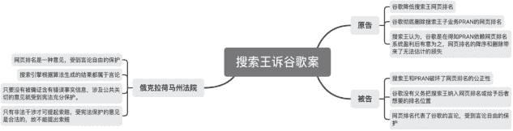

### 【核心争议点】
1.页面排名是否受《宪法第一修正案》关于言论自由的保护.
2.如果页面排名在《宪法第一修正案》的保护范围内，那么发布页面排名本身在俄克拉荷马州法下是否合法，能否因此排除谷歌故意甚至恶意操纵页面排名所带来的侵权责任.

### 【裁判论证过程】
#### （一）页面排名受到《宪法第一修正案》关于言论自由的保护
谷歌声称，根据“杰斐逊县 R1 学区诉穆迪投资者服务公司”一案^([\[5\]](#txt003.html#footnote_content_txt003_5))，页面排名构成了受第一修正案保护的意见.在该案中，第十巡回法院根据最高法院的判决认为，“有关公众关注事项的意见声明，如不包含可证明的虚假事实内涵，将受到宪法的充分保护.”^([\[6\]](#txt003.html#footnote_content_txt003_6))
搜索王认为，页面排名是可以客观验证的，因此不属于言论自由的保护范畴.为了能够证明真假，网页排名系统在本质上必须是客观的.在斯坦福大学的博士论文中，页面排名系统被描述为客观和机械的，且谷歌的网站宣称页面排名系统是“诚实和客观的”.搜索王认为谷歌不可能“两全其美”，一方面宣称页面排名系统的客观性，另一方面为了避免侵权责任而依赖于系统的主观性质.^([\[7\]](#txt003.html#footnote_content_txt003_7))
俄克拉荷马州地区法院认定网页排名是一种意见，该法院明确指出算法结果（网页排名）是主观的，它反映了谷歌对于某一网页关于用户搜索要求的相关性观点.每种搜索引擎确定检索结果意义的方法和考量的因素都不同，其他搜索引擎也都在表达各自不同的意见.搜索引擎的功能是响应用户的搜索指令，并以网页爬虫爬取万维网上所含有搜索关键词的网页信息，并将其呈现于用户眼前.而搜索结果是对每一个搜索引擎算法的独特排序标准而进行的有序呈现.俄克拉荷马州地区法院认为，算法结果（即网页排名）除了含有网页信息等表层含义，最重要的是其具有对搜索结果相关度的建议，这一深层含义具有主观性，构成一种意见.法院还把上述认定推而广之，认为所有搜索引擎根据算法生成的结果都是他们发出的言论.法院认为算法结果不仅是一种言论，也是一种具有“公共关切”属性的意见，根据先例，只要没有被确证含有错误事实信息，涉及公共关切的意见就受到宪法充分保护.

#### （二）谷歌降低网页排名的做法并不能够导致侵害、干涉有利商业关系或合同关系的结果
在“杰斐逊县案”中，第十巡回法院的结论是，根据科罗拉多州的法律，受保护的言论在侵权干涉合同关系的主张中不能构成不当干涉.^([\[8\]](#txt003.html#footnote_content_txt003_8))俄克拉荷马州法院认为俄克拉荷马州的法律在本案中也应该得出同样的结论.^([\[9\]](#txt003.html#footnote_content_txt003_9))
俄克拉荷马州法院认为谷歌的做法是合法的，并不干涉搜索王的合同关系.俄克拉荷马州法律规定，提起关于侵害干涉合同关系的诉讼，原告需要证明被告阻碍了原告的商业或者合同关系；该阻碍是恶意的和不正当的，并且是不公平的、非享有特权的或者不可被原谅的；原告因阻碍造成的直接结果而遭受了损害.^([\[10\]](#txt003.html#footnote_content_txt003_10))在“盖洛德娱乐诉汤普森案”^([\[11\]](#txt003.html#footnote_content_txt003_11))中，俄克拉荷马州最高法院认为，受宪法保护的言论本身是合法的，因此，不能因对干预有利商业关系而提起侵权诉讼.尽管对有利商业关系的侵权干涉的索赔要素与对合同关系的侵权干涉的索赔要素不同，但法院注意到，这两种索赔都要求干涉是非法的.因此，法院认为，根据俄克拉荷马州的法律，在本案中，言论受到保护.页面排名不能引起对合同关系侵权干涉的索赔，因为即使是出于恶意的言论也不能认为其是有错误的，没有错误的意见受到宪法的充分保护，是合法的，因而不能提出侵权诉讼.

### 【审理结果】
俄克拉荷马州地区法院判决驳回原告搜索王的动议.

### 【相关法条】
《侵权法适用解释》第 766 条 B 款（Restatement（Second）of Torts §766B）
一方故意和不适当地干涉另一方的预期合同关系（结婚合同除外）的，要为因关系利益的损失而造成的经济损害向另一方承担责任，不论这种干涉是否包括：
（a）诱导或以其他方式导致第三方不能建立或继续未来的关系；或
（b）阻止对方获得或继续未来的关系.

### 【案例评析】
#### （一）本案直接推动了算法是否受法律规制的讨论
科技的快速发展会创造出一个全新的领域，这些领域究竟是否受到法律的规制，是一个老生常谈的问题.而在算法中，就不可避免地提及到“算法黑箱”^([\[12\]](#txt003.html#footnote_content_txt003_12))和“算法操纵”^([\[13\]](#txt003.html#footnote_content_txt003_13))问题.正是由于算法的不透明性，使得算法在操纵人们的生活时，法律无从下手.所以，“算法黑箱”和“避免算法操纵”成为两个价值冲突的命题，而法律是一种评价性或者价值性的事业（normative enterprise），这表明特定的法律，要么本身就代表某种价值判断—例如民法对于私法自治的肯定，要么提供了某种价值冲突的解决方案—例如“对格式条款的理解发生争议的，应当按照通常理解予以解释”^([\[14\]](#txt003.html#footnote_content_txt003_14)).因而，算法问题可以转译为价值冲突问题，且算法操纵会带来负面影响，所以算法应当受到法律规制.

#### （二）推动了算法是否是言论的讨论
虽然，在理论上，目前法学界都认为算法应当受到法律的规制，但是，在美国的司法实践中，算法经常会被作为言论或者是商业秘密而受到法律的保护.算法作为商业秘密，其保护的力度明显弱于言论，只需要证明其损害了社会利益，便可进行规制.因而，对于算法最强有的保护仍然在于言论方面.算法是否受言论自由保护？这其实可以被拆解成两个相互关联的子问题：一是主体要件，讨论算法（或程序、电脑和机器）是否是一个可以主张言论自由的主体.简言之，主体要件主要讨论算法（或程序、电脑和机器）是不是人.^([\[15\]](#txt003.html#footnote_content_txt003_15))二是客体要件，这关乎算法生成的结果是否属于言论，即算法或算法的结果是不是“话”.^([\[16\]](#txt003.html#footnote_content_txt003_16))但总体而言，在有关言论自由主体资格的讨论中，优势不在算法一边.^([\[17\]](#txt003.html#footnote_content_txt003_17))无论是理论还是常识，都倾向于认为“算法（或机器、电脑）不是人”，从而不能享受言论自由保护.^([\[18\]](#txt003.html#footnote_content_txt003_18))算法支持者更是看到了自己在主体资格问题上的劣势，才选择强调“算法只是人表达的工具”.^([\[19\]](#txt003.html#footnote_content_txt003_19))一方面，这相当于默认“只有人才有言论自由”和“算法不是人”；但另一方面，他们也聪明地回避掉了主体问题，并把争论逐渐引向了对客体问题—“什么是言论”的讨论.^([\[20\]](#txt003.html#footnote_content_txt003_20))伴随着从“发言者”向“言论”的转化，主体和客体要件的并列关系变成了替代关系.^([\[21\]](#txt003.html#footnote_content_txt003_21))客体要件逐渐成为言论自由关注的中心.^([\[22\]](#txt003.html#footnote_content_txt003_22))如果说围绕主体要件的讨论总体上是不利于算法的，客体要件的情况则正好相反.言论自由理论和实践的发展，是站在算法这边的.^([\[23\]](#txt003.html#footnote_content_txt003_23))
左亦鲁博士认为对于主体和客体要件的有关讨论，很大程度上是本质主义.他又从发言者本位、听众本位与强人工智能的言论等实用主义进路进行讨论.他认为在发言者本位下，算法获得保护的途径只有一种，即是证明它有助于促进自然人的表达.^([\[24\]](#txt003.html#footnote_content_txt003_24))而有关算法支持者主张“算法是人进行表达的工具”就是遵循这一逻辑.但从严格的发言者本位出发，算法和人之间的这种联系还是太间接和牵强了.^([\[25\]](#txt003.html#footnote_content_txt003_25))再者，算法具有的智能性使其有可能与自然人构成某种替代和竞争关系.^([\[26\]](#txt003.html#footnote_content_txt003_26))换言之，保护算法的言论反而有可能伤害发言者的利益.因此，发言者本位倾向于不认可算法享有言论自由.听众本位的“言论不问出处”使它不再执着于发言者的主体资格，而是聚焦言论内容的质量.照此逻辑，一些人的言论虽然在语言学意义上毫无争议地属于“言论”，但如果这些言论对其他听众没有价值和意义，那么就不值得受到保护.^([\[27\]](#txt003.html#footnote_content_txt003_27))于是，听众本位为保护算法（以及其他任何非人主体）的言论打开了一道门—只要这些非人主体（不管是算法、鹦鹉、强人工智能还是外星人）的言论能够被证明是有益于人类听众的，那么它们就应当受到保护.但“发言者本位 vs.听众本位”的实用主义进路至少有助于跳出上述循环.^([\[28\]](#txt003.html#footnote_content_txt003_28))如果选择发言者本位，言论自由就是保护有血有肉的自然人的表达，无论强人工智能多么“能说会道”，由于它无法直接服务于自然人表达的利益（甚至还可能形成竞争和替代），因此它们的言论不应受到保护.^([\[29\]](#txt003.html#footnote_content_txt003_29))但如果站在听众本位，有价值的信息和言论对听众越多越好.因此，强人工智能的言论只要能够被证明对人类是有意义和价值的，就应该受到言论自由保护.照此逻辑，甚至是强人工智能间的对话，只要这些内容对人类听众是有价值的，同样应该受到保护.^([\[30\]](#txt003.html#footnote_content_txt003_30))
目前，在美国法学界，对于算法是言论的论证共有三种进路：排序即意见论、编辑论和实用主义进路.我国学者也对这几种进路分别进行了分析和研究.
“搜索王诉谷歌案”对排序即意见论产生了重要的影响，以至于有些学者认为此进路是算法为言论的最优解.此种观点认为，搜索结果的呈现不只有网页内容的表面含义（denotation），在特定的搜索指令语境中，其同时还具有关于所列出的网站（搜索结果）与用户的实际要求之间的相关度建议^([\[31\]](#txt003.html#footnote_content_txt003_31))，因而表现了搜索引擎的观点.但是，谷歌所用的网页排名包含着数量、质量、相关关键字的出现频率、客户满意度等等的客观要素，而非主观价值判断.并且，言论所保护的价值正是价值判断以及主观的心理活动，这种由客观要素所创造出的排名并不应当算作言论.
编辑论是指算法的结果类似于报刊编辑的结果，即搜索引擎并不是简单地把搜索结果放到网页上，而是进行了挑选与编辑.首先，算法与算法结果并不等同，算法决定算法结果，是更为核心，并且需要控制的对象.其次，搜索引擎并未对搜索结果进行编辑，因为其只涉及到数量、质量、相关关键字的出现频率、客户满意度等等的客观要素的排列，而报纸编辑涉及到对内容和价值取向的选取，所以每一家报纸对同一时事热点问题进行报道，其内容不会大面积雷同，因而搜索结果并不能与报纸编辑进行对比.

实用主义进路认为只要能产生对人类有价值的信息，这种活动就构成言论，无论其主体是谁.^([\[32\]](#txt003.html#footnote_content_txt003_32))然而，虽然言论自由的主体已扩充至法律拟制的人，但是如果说言论自由不对主体做任何要求，仍然存在很大争议，联邦最高法院并未承认.其次，在司法实践中，在讨论“数据是否构成言论”的案件中已经明确指出：由机器自动产生、没有人为因素参与其中的数据不是言论，因为成立言论需要信息的双向交流^([\[33\]](#txt003.html#footnote_content_txt003_33))，所以对于实用主义进路来说，算法并不构成言论.

## （三）引起关于算法社会言论自由保护中国家角色的讨论

无论人们在算法的问题上存在什么样的争议，但“算法正在普遍而广泛地影响我们的生活”已经是个越来越明显的事实.所谓“普遍”，意思是说，几乎每个人的生活都正在受到算法的影响；所谓“广泛”，含义是指，人类生活的所有领域几乎都正在受到算法的影响.^([\[34\]](#txt003.html#footnote_content_txt003_34))

面对算法带来的公共风险和以平台为代表的社会权力对言论的威胁，国家权力在言论自由领域应从传统的“消极”角色变为“积极”角色，积极履行规制职责.国家的实体规制是对公共风险的点状修补，而过程性规制改变了“行为主义”规制下的个案审查，将规制范围覆盖到所有接触相关信息的言论社群，通过打破言论社群的封闭状态，鼓励言论社群内部以及不同言论社群之间的沟通交流，避免社群的极端化倾向.过程性规制主要是确保算法价值观的平等和网络空间的开放，过程性规制一方面可降低国家干预的宪法风险，另一方面也能更为有效地破解言论领域的公共风险.^([\[35\]](#txt003.html#footnote_content_txt003_35))

### 【关联判例推荐】

#### 1. Daniels v. Union Baptist Ass’n, 55 P.3d 1012, 1015

核心事实：前教会牧师对教会协会及其传教执行主任提起诉讼，声称其由于后者故意和疏忽的行为而被取代.克利夫兰县法院的赫瑟林顿批准对被告进行简易审判.牧师提起上诉.最高法院副首席大法官瓦特在批准调卷令的请求后认为：（1）院长主持牧师教会的业务会议是在教会环境下进行的，因此免于司法审查；（2）牧师未能提供初步证据，以证明马里恶意干涉合同；（3）协会或其董事对牧师都没有任何责任，因此，不承担过失责任.

与本案关联点：证明恶意介入合同关系，需要证明以下几点：（1）被告介入原告的商业或合同关系；（2）介入是恶意的、错误的，并且是不公正的、不享有特权的、不可原谅的；（3）原告因介入遭受了损失.

#### 2. Gottschalk v. Benson, 409 U.S. 63, 67, 93 S.Ct. 253, 34 L.Ed.2d 273

核心事实：本森为了将二进制编码的十进制（BCD）数转换为纯二进制数的方法，提交了专利权利要求.该权利要求不限于任何特定的技术、任何特定的设备或机械，或任何特定的他们声称涵盖了该方法在任何类型的通用数字计算机中的任何使用.高特沙克要求撤销对专利权利要求的驳回.

与本案关联点：创意不属于专利.

#### 3. Jeff erson County Sch. Dist. No. R-1 v. Moody’s Investor’s Services, Inc.,175 F.3d 848

核心事实：1993 年，学区决定通过发行可退还的债券为部分债权债务再融资，从而获得较低利率的好处.即使过去曾保留穆迪公司的股份，学区还是选择了另外两个机构来对其债券进行评级.结果，它不向穆迪公司支付任何费用，也没有向穆迪公司提供有关其当前财务状况的信息.学区于 1993 年 10 月 20 日将这些债券推向市场.最初，它们卖得很好，学区获得了认购几乎所有发行债券的认购权.然而，在销售期不到两个小时的时间内，穆迪公司就在其“评级新闻”中发布了有关债券的文章，该评级新闻是一种电子分发的信息服务，发送给订户和新闻服务.穆迪公司表示，尽管没有对债券进行评级的要求，但它打算在出售后对该债券进行评级.穆迪公司然后讨论了债券和学区的财务状况，得出结论说：“该区的一般义务债务前景是负面的，反映出该区由于州所承受的持续财务压力”.学区声称穆迪公司的陈述在实质上是错误的，因为它表明学区的财务状况不可靠，并给人以穆迪公司的评估是基于当前信息的印象.学区进一步认为，它发送给穆迪公司的最新财务信息已经使用了一年多.根据学区的说法，穆迪公司发表该文章是为了对它进行报复，因为它决定使用其他信用评级机构，并且该文章对债券的市场营销产生了重大影响.学区将穆迪公司指定为被告，并根据科罗拉多州法律，主张其故意干扰合同关系，故意干扰预期合同关系以及公开了伤害性虚假的主张.作为回应，穆迪公司提出了一项动议，以驳回或以替代方式提出简易判决.该学区提出异议，然后提出动议许可，增加了针对穆迪公司的垄断和企图垄断的反托拉斯要求.

与本案关联点：网页排名与金融评级服务一样属于言论，均受到《宪法第一修正案》的保护.

#### 4. Christopher Langdon v. Google Inc.,474 F. Supp. 2d 622

核心事实：原告兰登拥有两个网站，主要用来发布北卡罗来纳州官场的腐败和黑幕，其中不少消息针对时任北卡总检察长的罗伊·库珀（Roy Cooper）.兰登把谷歌等公司告上法庭，是因为：第一，其指责谷歌不允许他在自己的网站刊登广告.第二，谷歌将他的网站从“Roy Cooper”和“总检察长 Roy Cooper”等关键词的检索结果中移除.兰登认为谷歌的行为侵犯了他的利益，但谷歌则辩称由算法决定的广告呈现和检索结果，是其行使自己言论自由的体现.受理该案的特拉华州地区法院支持了谷歌“算法是言论自由”的主张.法院指出，言论自由既包括说的自由，也包括不说的自由.兰登要求谷歌必须呈现自己网站的广告和将自己的网站排在特定位置，就相当于强迫谷歌必须“说”某些内容.与“搜索王诉谷歌案”判决的正面进路（谷歌可以“说”什么）不同，特拉华州地区法院的论证是从反面进行的—即谷歌不能被强迫“说”什么.“搜索王诉谷歌案”的判决虽然简短，但好歹对这一问题进行了处理；也许是受其影响，特拉华州地区法院直接把这当作给定的前提接受了.此外，特拉华州地区法院还通过对 1996 年《通信规范法》（Communication Decency Act of 1996）第 230 条豁免问题的处理，赋予了算法更多一重的保护.长期以来，该法第 230 条都被视为互联网平台和企业的“护身符”.在规制传统媒体时，法院遵循的是“权利义务对等”原则，即媒体或平台要想享受“发言者”或“出版者”的权利去管理或编辑内容，就必须同时承担义务—对自己管理和编辑的内容负责.简言之，编辑行为可以等同于“说话”，但一旦从“编辑者”变成了“发言者”，相关主体就必须对自己的“言论”—编辑过的内容承担相应责任.报纸就是这一原则最典型的体现.按照传统法理，谷歌通过算法对内容的选择不是不可以被视为“言论”，但如果谷歌获得了“发言者”这一身份，就必须同时对这些内容负责.但 1996 年《通信规范法》第 230 条却在一定程度上豁免了谷歌等平台的义务和责任.“兰登诉谷歌案”涉及的是第 230 条（c）款第（2）项的（A）句，该条款规定：“无论是否受到宪法保护，交互式计算机服务的提供者和用户采取行动，限制对淫秽、低俗、猥亵、粗鄙、过度暴力、使人不安或其他令人无法接受的材料的接触时，不应承担责任.”通过对这一条款的解读，法院认为谷歌等平台进行内容管理（编辑）时，无须因编辑行为承担责任.这使算法拥有了一种超越报纸的地位.在传统言论自由和媒体法法理下，与广播、有线电视等媒体相比，报纸一直享有某种优待地位.“攀附”报纸也一直是互联网巨头和算法支持者最主要的策略之一.报纸的权利义务起码是对等的.但经过“搜索王诉谷歌案”和“兰登诉谷歌案”，算法有“发言者”的权利却不用承担“发言者”的义务.^([\[36\]](#txt003.html#footnote_content_txt003_36))

与本案关联点：媒体和平台担任发言者的角色，对自己的言论和意见负责，并承担相应的责任.

#### 5. Zhang v. Baidu.Com, Inc., 10 F. Supp. 3d 433

核心事实：百度运营着一项名为 Baidu.com 的中国搜索引擎服务，该搜索引擎提供多种服务，如中文语音搜索、高级搜索等.截至 2010 年，百度号称是全球第三大、中国最大的搜索引擎服务提供商，其销量约超过 70%的中文市场份额.原告是一群倡导在中国加强民主的纽约居民，其声称百度密谋阻止“民主政治言论”出现在美国的搜索引擎结果中.具体来说，原告声称百度审查并阻止搜索引擎结果中出现涉及中国民主运动的任何文章、出版物、视频、音频和信息，每个原告都在互联网上发表了有关中国民主运动的文章、录像、录音或其他出版物.这些内容出现在谷歌和必应的其他搜索引擎中，但它们并没有出现在百度的搜索结果中.在此基础上，原告认为侵犯其公民权利、基于种族的公民权利等等，要求获得 1600 万美元的损害赔偿，外加律师费和诉讼费.

与本案关联点：纽约南区法院再次确认搜索算法是受保护的言论，且法院明确采用了将算法“比附”成报纸的进路.

## 3.2 伯恩斯坦诉美国国务院案

#### 【案件索引】

Bernstein v. United States Department of State, 922 F. Supp. 1426 (N.D. Cal. 1996)

Bernstein v. United States Department of State, 945 F. Supp. 1279 (N.D. Cal. 1996)

Bernstein v. United States Department of State 974 F. Supp. 1288 (N.D. Cal. 1997)

#### 【关键词】

算法言论；信息安全；加密技术；出口管制

#### 【案件提要】

“伯恩斯坦案”是迄今为止处理加密产品出口问题的最为典型的案例.伯恩斯坦设计了一个复杂的加密程序并试图将该程序出口.然而，美国国务院根据《国际武器贸易条例》（International Traffi c in Arms Regulations， ITAR）将该程序列入限制出口的军火清单，并禁止出口.^([\[37\]](#txt003.html#footnote_content_txt003_37))伯恩斯坦提出三个理由反对这一规定.首先，《国际武器贸易条例》中所要求获得许可的内容是事前对使用言语代码的干预；其次，《国际武器贸易条例》内容模糊且管得过宽；再次，对“使用言语代码”已经有了一个单独的权利保护措施.对此被告认为，《国际武器贸易条例》是内容中性的监督措施，《国际武器贸易条例》与《出口管制条例》（Export Administration Regulations， EAR）共同保证了国家安全利益，因为加密软件可用于隐藏恐怖分子、毒品走私者或其他意图对美国设施、人员或安全利益采取不法行为的人的通信.被告同时引用“得克萨斯州诉约翰逊案”^([\[38\]](#txt003.html#footnote_content_txt003_38))中得出的界定烧国旗行为的方法—是否传递特殊信息以及多大程度能被人理解接受，主张源代码是一种功能性加密产品，并不是用来传达特定信息，因此并不能被视作“言论”.法院认为伯恩斯坦想要公布的源代码属于《宪法第一修正案》保护的“言论”范围.《国际武器贸易条例》以事先限制的方式对加密软件进行出口许可控制，违反了美国宪法.《出口管制条例》以事先限制的方式对加密软件进行出口许可控制，也违反了美国宪法.

本案是美国首个明确认定软件是受第一修正案保护的“言论”的司法判例，并且是对限制加密软件出口的法律法规的合宪性挑战.本案受到了美国立法者、执法者和政府机构的广泛关注，还对三项提案的产生起到至关重要的作用，包括蒙大拿州参议员康拉德·伯恩斯（Conrad Burns）于 1997 年提出的《Pro-CODE 法案》；参议员帕特里克·莱希（Patrick Leahy）于 1997 年提出的《加密通信隐私法》；弗吉尼亚州的鲍勃·古德莱特（Bob Goodlatte）代表提出的《加密技术保障安全与自由法案》.

#### 【案件要旨】

加利福尼亚北区联邦地区法院：原告 伯恩斯坦 被告 美国国务院

加利福尼亚北区联邦地区法院：原告 伯恩斯坦 被告 美国国务院/美国商务部

1992 年，加州大学伯克利分校的学生丹尼尔·J·伯恩斯坦出于公布学术成果的目的，需要发表论文.论文除涉及他自己的加密技术成果“鼻息”^([\[39\]](#txt003.html#footnote_content_txt003_39))（Snuffle），还有与论文相关的，以“C 语言”写出的两个程序的源代码，以及一个有助于实现前述成果的操作指南.依照美国当时的政策，他的发表行为会被界定为“出口”，要提交相应的“出口”许可申请，在获准后才能实现.伯恩斯坦依法定程序提交了申请，此后开始了长达三年的交涉和等待.1995 年，在长期交涉无果后，伯恩斯坦开始依据美国《宪法第一修正案》赋予的言论自由权寻求司法救济.

受诉法院就“伯恩斯坦案”梳理出两个以待解决的争议点：源代码，即用 C 语言编写的程序，是否属于言论自由权保护的言论范畴？《国际武器贸易条例》（International Traffic in Arms Regulations， ITAR）是否在该案中违宪？被告认为该源代码和加密解密程序属于不受第一修正案保护的行为，并非言论.1996 年 4 月 15 日，加利福尼亚州北区地方法院就第一个争点做出判决：伯恩斯坦想要公布的源代码，属于《宪法第一修正案》保护的“言论”范围.同年 12 月 6 日，法院就第二个争点判决：ITAR 以事先限制（Prior Restraint）言论自由的形式违反了美国宪法.法院就伯恩斯坦案做出判决后，克林顿政府在 1996 年 11 月 15 日发布第 13026 号行政命令，将加密技术产品从受美国国防部管制的“美国军火管制清单”移入受美国商务部管制的“商业管制清单”（the Commerce Control List，CCL）.转移管辖权，实质上是一种逃避管辖权的做法，美国政府不想尊重伯恩斯坦的权利，却想避开法院的判决.伯恩斯又将美国商务部添加为被告.1997 年 8 月 25 日，美国加利福尼亚州北区地方法院仍判决：就伯恩斯坦案而言，商务部的相关管制“事先限制”言论自由.

该案后经美国司法部上诉，经过技术性拖延后，美国政府开始改变策略，对外承诺调整相关管制措施.

#### 【案例事实思维导图】

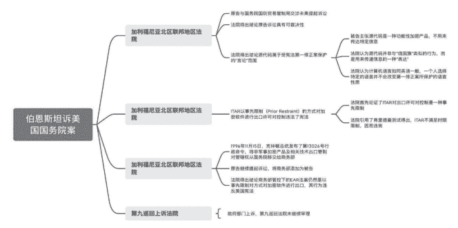

#### 【核心争议点】

1.伯恩斯坦想要公布的源代码是否属于《宪法第一修正案》保护的“言论”范围.

2. ITAR 以事先限制（Prior Restraint）的方式对加密软件进行出口许可控制是否违反了美国宪法.

3. EAR 以事先限制（Prior Restraint）的方式对加密软件进行出口许可控制是否违反了美国宪法.

#### 【裁判论证过程】

##### （一）伯恩斯坦想要公布的源代码属于《宪法第一修正案》保护的“言论”范围

被告引用了“得克萨斯州诉约翰逊案”中得出的界定烧国旗行为的方法^([\[40\]](#txt003.html#footnote_content_txt003_40)).该案主要内容为，一个名叫乔治·李·约翰逊的年轻人当众焚烧了一面美国国旗，德克萨斯州政府控告约翰逊触犯州《国旗保护法》，初审法院认定约翰逊有罪，判决其入狱 1 年，并罚款 2000 美元.约翰逊不服，案件提交德克萨斯州刑事上诉法院.法院推翻有罪判决，认为焚烧国旗的行为属于联邦《宪法第一修正案》所保护的言论自由范围.德州政府不服，上诉至联邦最高法院，最高法院九名大法官于 1989 年 6 月 21 日以 5：4 判决维持德州刑事上诉法院的判决.判断焚烧国旗的行为是否带有足够的交流成分以适用第一修正案，需探究“传递特定信息的意图是否存在，且接收者是否有相当可能去理解这个信息”.法院认为约翰逊以烧国旗的行为来抗议共和党全国集会和里根再次当选总统.同样，被告引用该判断方法，主张源代码是一种功能性加密产品，并不是用来传达特定信息，因此并不能被视作“言论”.然而，加利福尼亚北区联邦地区法院认为源代码与烧国旗、裸体舞蹈等行为大相径庭，并不能等同讨论.同时，法院认为，一个人选择的特定语言不会改变第一修正案所保护的语言的性质，计算机语言与德语或法语无任何区别，虽然源代码只是文本，但是其为“受过编程训练的人能够轻易理解”的一种表达思想的途径.对于伯恩斯坦和其他高技能程序员来说，源代码是一种有效传达复杂数学原理的媒介，就像经济学家和数学家使用图形一样.因此，在界定源代码是否是表达时，法院排除了“未经受过编程训练的人无法理解源代码内涵，仅仅是机械地使用伯恩斯坦的程序”这一情况，毕竟“我们关心的是伯恩斯坦的发言权，而并非其他人的聆听权”.相比较而言，被告一直在强调源代码的功能属性，的确，当源代码被转换为目标代码“语言”时，可以直接用于控制计算机的操作而无需向用户传递信息.法院认为，应当将源代码与目标代码加以区分.源代码是用 Cobalt 或 C+等计算机语言编写的，在转换为目标代码之前无法操作计算机.被称为编译器的计算机程序将源代码翻译成目标代码，目标代码是一系列 1 和 0 的排列，因此它们表示包含在源代码中的相同的计算机命令.法院认为，“忽略源代码和目标代码之间的区别，会掩盖了一个重要事实，即源代码并非仅用于计算机，而是用一种旨在为人类分析和理解的语言编写的.”通过强调源代码和目标代码之间的区别，并将其分析限制在程序员的范围内，法院认为加密源代码具有充分的表达能力，因此值得受到第一修正案的保护.法院可以对原告的主张进行裁决.

##### （二）ITAR 以事先限制（Prior Restraint）的方式对加密软件进行出口许可控制违反了美国宪法

针对出口许可制度，法院首先承认了该许可是一种事先限制（`prior restraint`）的形式.事先限制是指政府对言论进行的事前审查，例如法律规定媒体经批准才能发表某类言论，或是法院通过禁令禁止某人发表特定言论.美国《宪法第一修正案》原则上禁止对言论的事前限制.在“弗里德曼诉马里兰州案”^([\[41\]](#txt003.html#footnote_content_txt003_41))中，联邦最高法院认为，根据第十四修正案，州政府在规制淫秽内容时，不能无视正当程序的要求与宪法对言论的保护.对电影的事前审查给宪法保护的言论带来了极大的危险.与对淫秽内容的事后追诉不同，事前审查将证明责任分配给了电影放映者.因为审查员只顾审查言论，他很难像独立的法院那样关注到言论自由的宪法价值.而且，通过拖延进度，审查员可以让获得司法救济变得十分困难.这让审查员拥有了最终决定权.因此，法官指出了三项程序上的要求来确定某项事先限制是否被宪法所允许：第一，任何对司法审查的事先限制只能在某一短暂期间内实施，该期间具有特殊性，要求在该期间必须有维持某种现状的需要；第二，必须能够对该决定进行迅速的司法审查；第三，一旦拒绝许可，审查员必须承担上法庭陈述拒绝许可理由的责任.上述三个程序性要求即本案所引用的“弗里德曼测试”（`Freedman Test`）.本案中，`ITAR`加密软件许可计划也应受上述三个程序性保护措施的约束.法官经审查后认为，由于`ITAR`许可制度没有规定许可决定的时限，无法进行及时的司法审查，以及国防贸易管制办公室并没有出庭为拒绝许可辩护，因此`ITAR`规定的针对美国军需用品清单第十三类 B 项的许可制度的事先限制由于违反第一修正案被判定违宪.鉴于法院已判决`ITAR`违宪，法院拒绝了伯恩斯坦申请的初步禁令，认为政府行为对伯恩斯坦教授密码学课程不再构成立即的威胁.

## （三）EAR 以事先限制（`Prior Restraint`）的方式对加密软件进行出口许可控制违反了美国宪法

1996 年 11 月 15 日，克林顿总统发布了第`13026`号行政命令，将非军事加密产品及相关技术出口管制的管辖权从国务院移交给商务部.总统的行政命令规定，在美国军需用品清单（`United States Munitions List`， `USML`）下被指定为国防产品的加密产品和《武器出口管制法》（`Arms Export Control Act`，`AECA`）监管的产品，现在将被列入《出口管制条例》（`Export Administration Regulations`， `EAR`）下的商业管制清单（`Commerce Control List`，即`CCL`）.原告继而又向商务部提起诉讼，并且认为总统越权行事.法院判定总统签署本行政命令是非宪法行为，不具有可审查性.即便如此，管辖权转移并不会影响对限制条款的定性，加密源代码都受到《宪法第一修正案》的保护，`EAR`相关事先限制条款仍未通过“弗里德曼测试”（`Freedman Test`），例如，出口申请应在 90 天内得到解决或移交给总统，但一旦移交给总统后就没有了时间限制.于是仍然裁决`EAR`中对加密软件的事先限制是违宪的.

## 审理结果

1.法院判定，《出口管理条例》及其下颁布或实行的所有规则、政策和惯例，其对加密或解密软件及相关设备和技术的许可进行事先限制的行为均违反了《宪法第一修正案》；
2.被告被永久禁止做或使人做下列行为：
（1）继续执行已被宣布违宪的法规、规章、规则、政策和惯例，包括对原告或其他任何使用、讨论、出版原告加密程序和相关材料的人提起刑事或民事诉讼；
（2）对原告或上文所述的任何其他人行使本判决所宣布的宪法权利时进行威胁、拘留、起诉、劝阻或以其他方式干涉.

## 相关法条

《美国宪法第一修正案》（`United States Constitution，Amendment 1`）
国会不得制定关于下列事项的法律：确立国教或禁止信教自由；剥夺言论自由或出版自由；或剥夺人民和平集会和向政府请愿伸冤的权利.

《美国联邦法规》第 22 卷第 120 节第 17 条（a）款（4）项（`22 C.F.R. §120.17（a）（4）`）
“出口”包括：（4）向驻美使馆或者使馆所属机构、分支机构，如外交使团、领事馆，发放或者以其他方式转移国防物品.

《美国宪法第十四修正案》第 1 节（`United States Constitution，Amendment 14 Section 1`）
所有在美国出生或归化并受其管辖的人都是美国及其居住州的公民.任何州不得制定或执行任何剥夺合众国公民特权或豁免权的法律；未经正当法律程序，任何国家不得剥夺任何人的生命、自由或财产；也不得否认其管辖范围内的任何人受到法律的平等保护.

## 案例评析

### （一）本案是首个明确认定软件是受第一修正案保护的“言论”的司法判例

早在 1964 年，软件受版权保护就被确认了，国会在 1980 年通过了《计算机软件著作权法》，将计算机程序软件归为具有版权的文学作品，从而确认了这种归类方法.
本案法官帕特尔没有依赖加密软件的版权性得出结论，而是基于软件的本来性质和属性而进行论证.在将计算机语言等同于口头语言时，法院根据“伊尼古兹诉亚利桑案”^([\[42\]](#txt003.html#footnote_content_txt003_42))得出，语言因其已知含义的复杂性而被定义为“言论”.从定义上讲，语言是言论，任何对语言的规范都是对“言论”的规范.有人指出，随着下一代自动编程软件开始采用用户的一般编程思想并编写必要的软件，计算机语言将变得与口语更加相似.在这种技术的影响下，政府将很难说这样的总体思想与普通的言论是有区别的.
本案观点引起了大量讨论，例如学者凯瑟琳·A·默尔克发表观点，通过对比本案、“卡恩案”与“荣格案”，其认为加密软件源代码本身并不是第一修正案下的“言论”，尽管它仍可享有某些第一修正案的保护，因为它保护了私下表达的能力.

### （二）本案是对限制加密软件出口法律法规的合宪性挑战

本案、“卡恩案”及“荣格案”的先后发生，法院传达出的对加密软件出口限制的态度，使争议不断蔓延至国会，试图消除政府的僵局.国会研究服务部科学政策研究部的玛西娅·史密斯（Marcia Smith）表示：“争议在于，为了执法目的，政府对加密的存储计算机数据或电子通信（语音和数据、有线和无线）应具有何种访问权限.”^([\[43\]](#txt003.html#footnote_content_txt003_43))部分国会议员们强烈地表达了促进放宽出口法规的要求.但是国家安全局和联邦调查局共同反对放宽政策的提议.正因如此，若卡恩，伯恩斯坦以及荣格上诉至最高法院，法院关于软件的第一修正案保护的裁决将极大地影响整个国会辩论中的考虑因素.
本案还对三项提案的产生起到至关重要的作用.第一，蒙大拿州参议员康拉德·伯恩斯（Conrad Burns）提出了 1997 年的《Pro-CODE 法》，即《数字通讯时代在线商业促进法案》.该法案基本上提议取消对加密技术的出口管制，具体来讲，该法案提议禁止商业部颁布或执行旨在通过出口将政府制定的加密标准强加于私营工业部门的条例和规范；禁止联邦政府及各州政府限制具有加密能力的任何产品的出售；禁止联邦政府及各州政府将强制提交“钥匙窃听系统”作为对加密产品解禁的先决条件.第二，参议员帕特里克·莱希（Patrick Leahy）提出了 1997 年《加密通信隐私法》，该法案变通了《数字通讯时代在线商业促进法案》，它既支持政府管理下的“钥匙窃听系统”，同时又指出无论软件的功能如何，个体都可以在任何州或外国使用加密软件.第三项法案被称为《加密技术保障安全与自由法案》，由弗吉尼亚州的鲍勃·古德莱特（Bob Goodlatte）代表提案.该法案减少了对加密产品的出口管制.具体来说，该法案放宽了对国际市场上可用产品的控制；一旦加密软件已进入公众领域，则其出口不需任何许可证.
参议员莱希（Leahy）表示：“这些法案……取消了目前对强密码技术出口的限制，以便美国高科技公司可以自由地在全球市场上竞争，并满足国内外客户对强密码的需求.”^([\[44\]](#txt003.html#footnote_content_txt003_44))

### （三）本案后续的一些最新进展

该案后经美国司法部上诉，经过技术性拖延后，美国政府开始改变策略，对外承诺调整相关管制措施.2003 年 10 月 15 日，美国联邦政府官员再次承诺：政府将不再要求密码学家就诸如对修改加密技术之类的活动提交报告，也不再要求商业图书出版商以及汇编语言出版商必须持有相关许可证.至此，“伯恩斯坦诉美国国务院案”才告一段落.最终没有法院判决的结局，究竟是否真的改善美国法律营造的软环境，即对加密技术领域的科研人员处处设防的软环境，仍需打一个问号.
我国 2020 年 1 月 1 日起施行的《密码法》为我国管制加密解密技术提供了依据：根据《密码法》第 28 条第 1 款，国务院商务主管部门、国家密码管理部门依法对涉及国家安全、社会公共利益且具有加密保护功能的商用密码实施进口许可，对涉及国家安全、社会公共利益或者中国承担国际义务的商用密码实施出口管制.商用密码进口许可清单和出口管制清单由国务院商务主管部门会同国家密码管理部门和海关总署制定并公布.
2020 年 8 月 28 日，商务部、科技部调整发布《中国禁止出口限制出口技术目录》（商务部、科技部公告 2020 年第 38 号）.在限制出口部分，计算机服务业中新增“密码安全技术（编号：186103X）”，其控制要点为：1.密码芯片设计和实现技术（高速密码算法、并行加密技术、密码芯片的安全设计技术、片上密码芯片（SOC）设计与实现技术、基于高速算法标准的高速芯片实现技术）；2.量子密码技术（量子密码实现方法、量子密码的传输技术、量子密码网络、量子密码工程实现技术）.根据《中华人民共和国技术进出口管理条例》，凡是涉及向境外转移技术，无论是采用贸易还是投资或是其他方式，均要严格遵守《中华人民共和国技术进出口管理条例》的规定，其中限制类技术出口必须到省级商务主管部门申请技术出口许可，获得批准后方可对外进行实质性谈判，签订技术出口合同.

## 关联判例推荐

### 1. Karn v. United States Department of State, 925 F. Supp. 1 (D.D.C. 1996)

核心事实：布鲁斯·施奈尔（Bruce Schneier）写了一本关于密码学的书，随带一张软盘出售，二者均包含加密源代码.菲利普·卡恩（Philip Karn）想以此赚钱，因此想知道是否需要根据`ITAR`获得出口许可证.在卡恩提出申请后，美国国务院认定这本书不受`ITAR`的约束，但随附的那张软盘受其约束.卡恩对此向负责政治军事事务的助理国务卿托马斯·麦克纳马拉（Thomas McNamara）提出申诉，麦克纳马拉得出结论，由于软盘含有加密软件，根据美国军需清单，它是一件“国防物品”.卡恩向华盛顿特区地方法院提起诉讼，指控对软盘的管理侵犯了他的言论自由.卡恩称，软盘是一种语言，因为它“包含了散布在源代码中的‘注释’，这些‘注释’只对人类有用，而会被计算机忽略，而且源代码和‘注释’结合在一起才能让人类用代码‘说话’”.在处理卡恩的言论自由主张时，法院只是简单地假定这张软盘是《宪法第一修正案》所指的言论.即使有了如此假设，法院仍然支持`ITAR`的合宪性，因为它相信这些规定是内容中立的，认为政府关于“此类产品的扩散对国家安全有害”的政策解释具有说服力，足以支持对软件进行监管.此外，法院拒绝对外交政策进行裁决，认为这一问题更适合由国会和总统解决.
与本案关联点：是首例质疑政府加密法规的宪法有效性的案件.

### 2. Junger v. Daley, 8 F. Supp.2d 708 (N.D. Ohio 1998)

核心事实：美国的凯斯西储大学法学院教授彼得·荣格尔（Peter D.Junger）编写的教材有关描述计算机加密原理，从而涉及具体加密技术的源代码，因而受到了管制，其不能以纸质以外的形式，尤其是以电子形式通过网络公布.美国俄亥俄州北区地方法院于 1998 年判决荣格尔败诉，不支持涉案源代码属于《宪法第一修正案》对言论自由权保护的范畴，也不支持管制措施是事先限制其言论自由.败诉的荣格尔在参考了“伯恩斯坦案”的经验后，上诉时做了调整.2000 年 4 月 4 日，美国联邦第六巡回上诉法院推翻了地方法院此前的判决.上诉法院认为：计算机源代码是一种交流计算机程序的信息和构想的表达方式，理应受到《宪法第一修正案》的保护.
与本案关联点：均有关计算机源代码性质的认定.

### 3. Freedman v. Maryland, 380 U.S. 51 (1965)

核心事实：马里兰州法律要求，所有电影放映者在影片上映前，要将电影送交“审查委员会”进行审查.委员会负责审查电影是否有淫秽色情、腐化道德、煽动犯罪的内容.电影只有通过审查才能上映.弗里德曼没有送审就在马里兰州放映了电影，因此受到了处罚.他要求法院判决马里兰州这一法律违宪无效.马里兰州上诉法院维持了处罚决定.联邦最高法院全体大法官一致决定，推翻原判.最高法院要求事前限制必须同时配合有明确的程序性保障.最高院认为公开分级委员会无权禁演影片.一部影片的分级必须由分级委员会在一定时间内完成，或者委员会需要向法院提起诉讼请求才可以禁演.同时最高院在判决书中罗列了“弗里德曼测试”的三项标准：第一，任何对司法审查的事先限制只能在某一短暂期间内实施，该期间具有特殊性，要求在该期间必须有维持某种现状的需要；第二，必须能够对该决定进行迅速的司法审查；第三，一旦拒绝许可，审查员必须承担上法庭陈述拒绝许可理由的责任.
与本案关联点：本案引用“弗里德曼测试”证明`ODTC`对加密软件出口的事先限制是违宪的.

## 3.3 荣格诉戴利案

### 案件索引

`Junger v. Daley, 8 F.Supp.2d 708 (1998)`
`Junger v. Daley, 209 F.3d 481 (2000)`

### 关键词

算法言论；美国宪法第一修正案；言论自由

### 案件提要

本案是有关计算机源代码和美国宪法第一修正案的经典案例.本案的核心争议在于加密源代码是否受美国宪法第一修正案的保护.同时也必须首先解决另一个争议，加密源代码的出口是否真的会对国家安全造成实质性危害，以至于有必要对其进行禁止.《出口管制条例》（`Export Administration Regulations`，`EAR`）要求荣格教授先取得许可，才能上传含有自己编写的加密源代码的电子版课本.但是，荣格教授并不认同该规定，他认为`EAR`的这一规定违反了美国宪法第一修正案，于是对商务部部长威廉·戴利等人提起了诉讼.
`EAR`制定了一套管制非军用技术、软件和商品出口的全面许可体系.美国克林顿总统于 1996 年 11 月 15 日签发了第`13026`号行政令，将原属国务院的非军用加密产品的出口管辖权交给了商务部的出口管理局.该命令规定，加密产品如果曾被指定为美国弹药清单上的国防物品，就应当受美国商务部法规（`EAR`）的管制.谈及加密软件管制的必要性时，克林顿认为，之所以对加密软件进行管制，是因为其功能，而不是因为其表达的信息内容.根据`EAR`的规定，除非提供下载的人员能够有效防止代码在美国境外的无权转存，受控加密源代码和目标代码的“出口”，意为在美国境外下载受控软件，或者导致受控软件在美国境外得到下载的行为.^([\[45\]](#txt003.html#footnote_content_txt003_45))事实上，几乎不可能有网络用户能做到有效防止，因此一旦上传加密软件就成立出口行为.
加密程序分为两大形式：目标代码和源代码.源代码是由编程语言写成并下给电脑的一连串指令.目标代码是由同样的指令转化成二进制数字而形成的.因此源代码和目标代码可以相互转换.计算机不能直接执行源代码，但可以通过编制器或者解释器将其转化成目标代码.出于国家安全的考虑，`EAR`规定，管制名单上的出口物品必须先获得许可，向出口管理局提出一份商品分类申请.管制名单上的物品均标有出口管制分类号（`Export Control Classifi cation Number`，`ECCN`）.^([\[46\]](#txt003.html#footnote_content_txt003_46))所有加密品项一共分为三类，其中，加密软件被列于出口管制分类号`5D002`而进行管制.^([\[47\]](#txt003.html#footnote_content_txt003_47))该类别物品的出口需要获得许可，以书面形式出口的除外.^([\[48\]](#txt003.html#footnote_content_txt003_48))一般而言，根据`EAR`，所有加密产品的出口（加拿大不包含在出口目标国内）均需要取得许可.^([\[49\]](#txt003.html#footnote_content_txt003_49))`EAR`对于出口的定义包括在网站上发布软件的行为，但是限制了外国访问的不包含在内.至一审判决时，出口管制条例仍然有效.
俄亥俄州北区法院一审判定`EAR`合宪，因为加密源代码本身具有功能性，`EAR`不直接针对源代码的表达性要素，`EAR`未限制软件的学术讨论或者是软件的印刷版.由此俄亥俄州北区法院作出了有利于被告的简易判决，认为加密源代码不受第一修正案的保护，`EAR`是内容中立的法律法规，没有违宪.俄亥俄州北区法院对荣格教授提出的诉讼事由逐一进行了反驳，下面是法院关于主要实体争议的结论：一是源代码具有功能性，而有时候也会体现出表达性，但其表达性不足以使之受到第一修正案的保护.二是`EAR`没有直接规制表达行为，不属于事前限制，不属于违宪情形.三是`EAR`不存在规定过于宽泛或是模糊的情形.对于前者，原告没能证明`EAR`以不同于原告所受影响的方式侵害了第三方权益.四是相关规定内容中立，应进行中度审查.由于该争议规定不限制源代码的思想，也不会对言论自由进行不必要的限制，因此符合中度审查标准.
荣格教授随后提起上诉.在二审审理前，出口管理局发布了一份暂行最终条例（`Interim Final Rule`），对涉案法规进行了修改.`第六巡回上诉法院`认为加密源代码有相当的表达性，应当受到第一修正案的保护，同时，该案中政府主张的国防安全较为抽象，不够具体，不足以对抗第一修正案保护的言论自由.因此，法院撤销了原判决，将案件发回重申.

### 案件要旨

俄亥俄州北区法院（一审法院）：原告 彼得·荣格 被告 威廉·戴利等
美国第六巡回上诉法院（上诉法院）：上诉方 彼得·荣格 被上诉方 威廉·戴利等

# 案例概述

原告彼得·荣格是凯斯西储大学法学院的一名教授.被告威廉·戴利是美国商务部部长.荣格教授写了用来展示计算机工作原理的加密源代码，想要上传到网上，但这一行为却被`EAR`定义为“出口”，受到了出口管制.1997 年 6 月 12 日，荣格教授向美国商务部提交了三份申请，请求确定加密软件程序和其他商品的商品归类.同年 7 月 4 日，出口管理局告知荣格教授分类号`5D002`涵盖了他所提交的五个软件程序中的四个.虽然软件程序受`EAR`管制，但是荣格教授的《计算机与法律》的第一章内容无须许可即可出口.7 月 18 日，荣格教授提出了一份单独的申请，出口管理局依申请对《计算机与法律》第一章中的软件程序进行了审查.8 月 7 日，出口管理局通知荣格教授，其书中涉及的加密软件均不属于`5D002`类别，不受`EAR`管制.该局表示，不论是电子版的上传还是纸质版的出口，荣格教授都不需要申请任何出口许可.然而，如果第一章包含了`5D002`类别下的加密软件，并且上传其电子版以致境外下载，则必须遵守出口许可制度.自荣格教授收到商品分类决定后，他一直没有去申请出口许可.

之后，荣格教授提起诉讼，提出`EAR`表面违宪的主张，寻求宣告性救济和禁令救济，以期能在自己的网站上不受限制地传阅加密软件.他主张，加密源代码是受宪法保护的言论，`EAR`侵害到了宪法第一修正案所保护的权利.对此，荣格教授提出五点诉讼事由，一、要求加密软件的出口得到许可相当于事前限制，这违反了第一修正案的言论自由条款.二、`EAR`的规定宽泛模糊，不合宪.三、荣格教授认为`EAR`对于某些类型的加密软件作了比其他产品更为严格的规定，涉及违宪性的内容歧视.四、`EAR`限制了他有关软件的交流，这侵害了他学术自由和结社自由的权利.五、根据《国际紧急经济权力法》，加密软件的行政法规违反了权力分立原则.

俄亥俄州北区法院在审查双方的简易判决动议时，首先适用了《联邦民事诉讼法》第五十六条的判决标准.之后，法院审查了美国宪法第一修正案为计算机软件提供的保护制度.在决定提供什么级别的保护以及应该适用什么审查级别时，法院将判断该软件是表达性的还是功能性的.然后，法院将判断商务部的出口许可制度是否构成对言论的事前限制，再是荣格教授是否有向法院提出`EAR`过于宽泛或模糊的诉讼资格，最后判断`EAR`是否包含基于内容的歧视.俄亥俄州北区法院一审判定`EAR`合宪，因为加密源代码本身具有功能性，`EAR`不直接针对源代码的表达性要素，`EAR`未限制软件的学术讨论或者是软件的印刷版.由此俄亥俄州北区法院作出了有利于被告的简易判决，认为加密源代码不受第一修正案的保护，`EAR`是内容中立的法律法规，没有违宪.

荣格教授随后提起上诉，第六巡回上诉法院认为加密源代码具有相当的表达性，应当受到宪法第一修正案的保护，同时，该案中政府主张的国防安全较为抽象，不够具体，不足以对抗宪法第一修正案保护的言论自由.由此，法院撤销了原判决，案件被发回重申.

## 案例事实思维导图

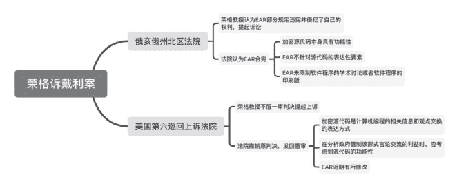

## 核心争议点

1.加密源代码是否受美国宪法第一修正案的保护.

2.加密源代码的出口是否真的会对国家安全造成实质性危害，以至于有必要对其进行禁止.

## 裁判论证过程

### （一）加密源代码是计算机编程的相关信息和思想交换的表达方式，受美国《宪法第一修正案》的保护

一审法院对此持相反看法.俄亥俄州北区法院引用了“特纳广播公司案”^([\[50\]](#txt003.html#footnote_content_txt003_50))来说明言论的司法审查标准，首先是严格审查，也是最高的审查标准，如果某项法律基于言论的思想内容来判断言论类型，那么法院将施以严格审查；如果没有，则不适用.在严格审查标准下，政府必须采取必要且适当的手段来实现公众认同的国家利益.其次是中度审查，如果`EAR`不具有表达性，并且不直接对言论的思想内容进行管制，法院便将适用中度审查.在中度审查标准下，如果某法促进了政府的实质性利益，不涉及压制言论自由，并且该限制带来的损害不大于促进的利益，那么该法就是合宪的.^([\[51\]](#txt003.html#footnote_content_txt003_51))

地区法院认为，加密源代码的表达性是否高到了宪法第一修正案需要对其进行保护的程度，是本案的核心争议.之前有两件类似的案例，但是其判决结果截然相反，地区法院认为，即使加密源代码有时候的确有表达性，其出口并不一定受宪法第一修正案的保护.“卡恩诉美国案”^([\[52\]](#txt003.html#footnote_content_txt003_52))中，法院认为计算机源代码和评论写在一起的时候，受到宪法第一修正案的保护，但是单独的源代码只是控制计算机执行某项功能的工具.而在“伯恩斯坦诉美国案”^([\[53\]](#txt003.html#footnote_content_txt003_53))中，法院认为，源代码属于宪法第一修正案所保护的言论.地区法院在后续对“伯恩斯坦案”“语言即言论”的说法进行了反驳，认为是否受宪法第一修正案保护的决定因素，在于是否表达了思想^([\[54\]](#txt003.html#footnote_content_txt003_54)).

地区法院继续就加密源代码的功能性与表达性进行了论证.有的软件本身具有表达性^([\[55\]](#txt003.html#footnote_content_txt003_55))，有的与之相反，本身具有功能性.在此之中，加密软件的功能性尤胜，与许多计算机软件一样，加密源代码本身具有功能性，用来指令计算机执行特定的任务.加密源代码不仅仅解释加密理论或者软件是如何运作的，更多的是实现加密功能.而在该功能的实现上，其与专用的计算机加密硬件无异.虽然大部分人都不懂加密源代码，但是计算机程序员是熟知的.如荣格教授便会用源代码来交流密码学的信息和思想.

因此，地区法院认为出口加密源代码的行为有时候的确具有表达性，但是仅仅是偶尔体现的表达性，不足以受到宪法第一修正案的保护.正如联邦最高法院在“达拉斯市诉斯坦格林案”中所道，几乎所有行为都能体现出表达性，比如在街上散步或者在商场和朋友见面等行为，但是其中的表达性不足以受到宪法第一修正案的保护.在“斯宾塞诉华盛顿州案”^([\[56\]](#txt003.html#footnote_content_txt003_56))中，联邦最高法院制定了一套标准，用以判断偶尔体现出表达性的行为是否足以受到宪法第一修正案的保护：一是必须要具有传达特定信息的意图，二是结合周围环境，接受信息的人理解信息的可能性应当很大.法院借“约翰森案”^([\[57\]](#txt003.html#footnote_content_txt003_57))和“廷克案”^([\[58\]](#txt003.html#footnote_content_txt003_58))说明了上述标准应如何适用的问题.而加密源代码与两个案件的情况各不相同.源代码因其功能性而生，其编写和出口都是为了执行特定的任务，而不是交流思想.并且，其表达的思想既可能存在歧义又难以一眼看出.综上，加密源代码的出口行为不受宪法第一修正案的保护.

第六巡回上诉法院认为加密源代码的功能特征不影响其表达特征.在美国，大家普遍认为编程员和学者能使用加密源代码展示和传递密码学的信息和思想，好比数学公式或者科学公式.表达媒介是否有功能特征不影响宪法对其的保护.更准确来说，表达媒介的功能性大小是政府合法管制的分析中所要考虑的.对精通计算机编程语言的人来说，源代码是交流密码学观点最为高效和准确的方式.第六巡回上诉法院引用了美国最高法院的判例，认为宪法第一修正案不只是保护纯表达性的言论.其保护的言论多种多样，特别是乐谱，人们大多读不懂，却是音乐家能用来交流的方式.同理，计算机源代码也如此，虽然多数人看不懂，却是受编程员偏好的交流方式.

### （二）不能判定本案中有益于国家安全利益的权力高于加密源代码自由交流的权益

一审法院的论述过程围绕荣格教授的诉求展开，其相关异议阐述如下.俄亥俄州地区法院在判定`EAR`内容中立应当适用中度审查标准时，沿用了如下标准：如果某法促进了政府的重大或实质性利益，不涉及压制言论自由，并且该限制带来的损害不大于其促进的利益，那么该法就是合宪的.^([\[59\]](#txt003.html#footnote_content_txt003_59))首先，`EAR`符合重大利益这一项标准，因为该条例的目的在于保护国家安全，政府担忧加密软件可能会出口到潜在的敌国或敌人手中，才加以管制.其次，`EAR`也符合不涉及压制自由言论这一项标准.并不是法规可能影响到言论自由就必定违宪，只有当该法直接规制行为的交流性质时，才可能导致违宪.最后，`EAR`也符合手段必要且适当这一项标准.

地区法院就重大利益这一项标准作了如下分析：`EAR`符合重大利益这一项标准，因为该条例是为了保护国家安全才设立的，政府担忧加密软件可能会出口到潜在的敌国或敌人手中，才加以管制.一旦没有了该条例的限制，国内的加密软件制造商可能会不论理由或对象，不论是否对敌对势力有利，就将产品出口到国外.即使加密软件的纸质版在国外可见，政府在控制加密软件传播方面的重要利害关系并没有被减弱.不论目前加密软件在国外的普及度有多少，国家在限制加密软件的传播上仍有重大利益.法院在此标注，原告提供的证明加密软件在国外大大普及的证据，其实有些夸大其词了.事实上，由于缺乏支持密钥分发和产品“互操作”^([\[60\]](#txt003.html#footnote_content_txt003_60))的基础设施，外国的加密产品并没有得到广泛的应用.同时，政府也关注于确保最复杂且最有效的加密程序（例如 128 位密钥长度的软件）不会在国外广泛发布.

第六巡回上诉法院认为，在分析管制这种言论交流形式的政府利益时，应考虑源代码的功能性大小，特别是加密源代码的功能性大小.在中度审查标准下，如果“它有利于重要或实质性的政府利益”，则言论管制在一定程度上是有效的.政府必须证明他们所说的危害是真实的，而不是虚构的，他们的管制能够直接实际地减轻危害.我们认同国家安全利益比言论自由利益更重要，需要对相关言论进行管制.

## 审理结果

1.撤销原判决，发回原法院重审.

2.要求原法院根据新修的`EAR`对荣格教授的违宪主张进行审判.

## 相关法条

### 《美国宪法第一修正案》（`United States Constitution，Amendment 1`）

国会不得制定关于下列事项的法律：确立国教或禁止信教自由；剥夺言论自由或出版自由；或剥夺人民和平集会和向政府请愿伸冤的权利.

### 《联邦民事诉讼法》第 56 条（`Federal Rules of Civil Procedure §56`）

如果提出的证据表明没有任何实质性的事实问题，并且动议方有诉讼资格，则将给予简易判决.

### 《美国联邦法规》第 15 卷第 734 节第 2 条（b）款第（1）项（`Export Administration Regulations，15 C.F.R. §734.2（b）（1）`）

出口的定义：出口意为依据`EAR`从美国出发的运输或者转输过程.^([\[61\]](#txt003.html#footnote_content_txt003_61))

### 《美国联邦法规》第 15 卷第 734 节第 2 条（b）款第（9）项（ii）（`Export Administration Regulations，15 C.F.R. §734.2（b）（9）（ii）`）^([\[62\]](#txt003.html#footnote_content_txt003_62))

根据`ECCN`，`5D002`编码的商业管制清单（参见`EAR`第 774 部分的补充第 1 号），因为属于加密品项（`Encrypted Items， EI`）而受控的加密源代码和目标代码软件的出口，包括下载或导致下载此类软件到美国境外（加拿大除外）的某位置（包括电子公告板、因特网文件传输协议和万维网站点），或使美国境外（加拿大除外）的人通过电线、电缆、无线电、电磁、光学照片传输、光电或其他类似的通信设施下载使用，包括从电子公告板、互联网文件传输协议和万维网站点传输，如果提供该软件的人员采取足够的预防措施防止美国或加拿大以外的传输行为则例外.

### 《美国联邦法规》第 15 卷第 734 节第 3 条（b）款第（2）项（`Export Administration Regulations，15 C.F.R. §734.3（b）（2）`）

以下不受`EAR`规制：

全部或部分再现印刷书籍、小册子和杂项出版物（包括报纸和期刊）内容的预录留声机记录；印刷书籍、小册子和杂项出版物，包括装订报纸和期刊；儿童画册；未装订的报纸和期刊，不包括废品；音乐书籍；乐谱；日历和日历方块、纸张；地图、水文图表、地图集、地名录、地球仪罩、地球仪和天球仪；全部或部分摄制上述内容的曝光和显影微缩胶片；曝光显影的电影和配乐；以及上述品类的印刷品广告.

### 《美国联邦法规》第 15 卷第 742 节第 15 条（a）款（`Export Administration Regulations，15 C.F.R. §742.15（a）`）^([\[63\]](#txt003.html#footnote_content_txt003_63))

加密项目可用于维护信息的机密性，因此可能被外国人用于损害美国国家安全、外交政策和执法利益.美国在确保公共和私营部门的重要敏感 信息受到保护的方面具有重大利益.根据瓦森纳协定成员的国际义务，美国有责任保持对加密物品的出口和再出口的控制.正如总统在第 13026 号行政令和 1996 年 11 月 15 日的备忘录中指出的那样，加密软件的出口和再出口，与加密硬件的出口和再出口一样，之所以受控制，是因为这种加密信息的功能，而不是因为此类软件可能反映、包含或代表的任何信息或理论价值，或其出口或再出口可能会转移到国外其他人手中.因此，加密软件的出口管制与 `EAR` 监管的其他软件的不同.

（a）许可证要求.出口和再出口到除加拿大以外的所有目的地时，对于在“控制”段落下受出口管制分类号控制的加密品项，都需要许可证.这些品项包括：受出口管制分类号`5A002`控制的加密商品，`5D002`控制的加密软件和受`ECCN` `5E002`控制的加密技术.有关“加密品项”的定义，请参阅`EAR`第 772 节.

## 案例评析

### （一）本案是加密软件源代码受到言论自由保护的开创性判例

加密软件源代码是否能够作为一种言论，一直是一个饱受争议的难题.本案涉及的问题就是加密软件源代码是否能够作为言论，受到宪法第一修正案的保护.加密和解密技术是伴随战争而生的，其产生于军方，因此美国的法律将其作为一种限制流通的武器来看待.从 80 年代开始，计算机的兴起使得软件的加密和解密技术在新的领域得到了长足的发展，由此，军事用途以外的密码需求急剧增加，随着时间的推移，越来越多的人开始挑战《出口管制条例》（`EAR`）.

本案的原告彼得·荣格是凯斯西储大学法学院的法学教授，他想在其“计算机与法律”课程网站上发布一个加密源代码的示例，以展示计算机是如何工作的.然而，由于听课的学生中有外国留学生，荣格教授在互联网上发布加密源代码的行为也落入了`EAR`所限制的范围，并将因此面临巨额的罚款和刑期.为此，荣格教授在克利夫兰联邦地方法院起诉政府，认为对方限制其在计算机法课程中教授密码学.法院在裁判中认为，加密软件源代码具有固有的功能属性，不能仅解释为表达加密理论或描述软件的功能，加密软件主要用于实现加密功能，并与实施加密的计算机硬件紧密结合.荣格教授为了能够使学生平等地接受该课程的教育，不惜冒险为此选择起诉美国相关政府，并提出源代码是一种应当受到宪法第一修正案保护的言论，而`EAR`对于源代码的限制性规定侵犯了其学术自由权.

“代码从来不是被发现的；它是被编制出来的，而且仅仅是被我们编制出来的.”^([\[64\]](#txt003.html#footnote_content_txt003_64))根据劳伦斯·莱斯格的这一论述，软件源代码应当被视为个人的言论表达.

第六巡回法院最终选择支持原告的诉求，指出，软件源代码是一种言论自由，并且应当受宪法第一修正案保护.法官认为，代码可以被视为是计算机领域的一种语言，不同的机器、程序通过代码、算法这种语言来进行交流.我们不能否认这种语言是通过人的输入而产生的，因此它也就是人们在计算机世界中进行交流的一种渠道，就正如在法律这个行业中，也有既定的法律语言.由此我们可以得出结论，美国政府不能限制软件源代码的自由流通，这毫无疑问为互联网领域的自由增加了一层保护的屏障.

### （二）本案引发了对于源代码能否作为言论的广泛讨论

本案从一开始就一直受到公民自由主义者、计算机程序员和软件行业的密切关注.尽管在本案之前，“伯恩斯坦诉司法部”一案的法官也作出了代码受到言论自由保护的结论.然而，本案中的地区法院并没有直接引用该先例的判决结果，而是作出了支持被告的决定.这是因为地区法院在进行分析时更侧重于代码的功能性，而忽略了代码所具有的表达性功能.最终上诉法院驳回了地区法院的判决，并指出源代码是受到保护的言论.

源代码本身就具有“双重属性”，即表达性和功能性.本案中，地区法院和上诉法院对于代码的这两种属性进行了充分的论述，一审法院认为，源代码所具有的表达性功能并不足以使其受到第一修正案的保护，其功能性特征掩盖了表达性特征.而上诉法院对这种观点进行了反驳，指出一审法院对加密源代码在计算机领域中所起的作用产生了错误的理解.

上诉法院认为，加密源代码表示和传达信息的功能是不可否认的，对于熟悉计算机编程语言的人来说，代码是密码学中最有效率和最简洁的信息传递方式.宪法并不是仅仅保护具有纯粹表达性的言论，相反，美国宪法对于言论保护的范围是十分宽广的，正如最高法院所解释的“任何想法都表达了一定的观点”，加密源代码也同样表达了代码编写者的思想.

也有学者对此提出了质疑的声音.有学者指出上诉法院的判决在扩大第一修正案所保护的言论范围的同时，也忽视了这一范围的扩张所可能带来的问题.根据这一结论，代码总是会传递信息，因此，每一系列的计算机指令都应当受到第一修正案的保护.然而如果编写代码的人利用代码来编写一个破坏性极强的病毒软件，那么对于该软件的源代码又该如何界定呢？同样将其视为受保护的言论吗？

毫无疑问，代码是复杂的，其性质也是充满争议的，然而没有代码就没有虚拟世界，也就没有如今对于这个虚拟世界的诸多讨论，没有讨论和辩论就没有思想市场.我们当然不能因为此判例就将在其之后的所有案例都机械地套上“代码就是言论”的外壳，因为代码所表达的内容也有可能是不被宪法所保护的，代码生成的软件也不能被想当然地看作为言论以得到宪法第一修正案的保护.本案反映了计算机和法律领域的先驱将传统法律学说应用于互联网的努力，将源代码视为言论表达的一种方式，赋予其个人权利，可以使其免受国家和联邦层面可能出现的治理错误或滥用.

### （三）本案在客观上推动了开源运动的发展，使得开源代码本身可以作为言论自由表达的一种形式进入司法审视的范围

# 加密技术、解密技术与言论自由

加密技术与解密技术产生于战争和军队，因此，`EAR`将其列入军火管制的范围.然而，随着计算机的发展，加密软件越来越多地进入到日常生活和学习中，此时再将其一概而论地列入军火管制的范围，便会导致密码学与法律制度发生冲突.在上个世纪九十年代，经过包括本案在内的多场诉讼后，美国如今已经基本明确了加密软件源代码的言论自由的地位.

开源运动与加密运动相辅相成，共同发展.本案对于开源运动的发展起了非常重要的推动作用，明确了加密源代码言论自由的地位，使得美国政府不能够对加密源代码进行审查控制.然而，我们不能仅通过此案就简单地得出美国政府自此以后再也不能够试图限制加密软件源代码流通的结论.首先，本案并非最高法院的判例，其并不具有足以统一全国司法判例的权威性；其次，本案的核心焦点在于，`EAR`对于加密软件源代码的前置审查程序违宪与否，这就导致了个案差异会产生不同案件不同结果的可能.本案所争议的内容是该加密源代码能否在国内教科书上进行出版的问题，如果案件所争议的内容还涉及到其他国家，就进一步加大了裁决的不确定性.

“加密技术可能是保护隐私的唯一可靠方法，但现在这个方法正在被政府限制.依靠政府来保护你的隐私，就像邀请爱偷窥的小偷来帮你安装百叶窗一样.”这是电子前沿基金会在 1996 年 5 月发布的一篇文章里的一段描述，该文章就是关于美国国家安全局建立对加密技术的出口管制的.当时，加密技术尚未向大众和科技公司普及，而美国政府已经开始对这个技术进行管制，禁止任何人将加密技术泄露给外国人.也就是说，加密技术并不应该仅仅是国家秘密，同时还应该是保护个人隐私的一种工具.因此，我们不应当过于依赖政府的行为来保障我们的个人隐私.

## 关联判例推荐

### 1. Roth v. United States, 354 U.S. 476, 484, 77 S.Ct. 1304, 1 L.Ed.2d 1498 (1957)

核心事实：案件围绕淫秽言论是否受宪法第一修正案的保护这一争论点展开辩论.在论及言论或者出版自由的宪法保护范围时，美国最高院认为淫秽言论不在此间，一个论据是，具有社会重要性的言论，不论是异端的，有争议的，还是为主流所厌恶的，均受到宪法的充分保护，而淫秽言论完全没有社会重要性.

与本案关联点：具有社会重要性的思想，即使对社会只有微末用处，也都受宪法第一修正案的充分保护.

### 2. Turner Broadcasting System v. FCC, 512 U.S. 622, 664, 114 S.Ct. 2445, 129 L.Ed.2d 497 (1994)

核心事实：国会通过了《1992 年有线电视消费者保护和竞争法》法案.该法案第 4 节、第 5 节要求有线电视系统将其频道的一部分用于当地的商业和公共广播电台.该法案生效后不久，上诉人、许多有线电视程序员和运营商对必载条款的合宪性提出质疑.地区法院裁定该条款符合宪法第一修正案，其驳回了上诉人严格审查的主张，维持使用中度审查标准.而美国最高法院认为政府的主张存在问题，仅仅辩称言论市场存在障碍或是失灵，不足以让言论管制法规不受宪法第一修正案的审查.

与本案关联点：政府为自己限制言论的行为抗辩时，即使其所主张的政府利益很重要，也不能仅仅停留在只是说出问题的阶段.

### 3. DVD Copy Control Assn., Inc. v. Bunner, 31 Cal. 4th 864, 75 P.3d 1 (2003)

核心事实：原告 DVD CCA 是一个电子交易产业的同业公会，它对 Bunner 等人提起诉讼，称其在网站上公布能使用户破译加密 DVDs 的计算机程序，构成了对其商业秘密的侵占.审判法院对被告发布了预备性禁止令，其内容包括禁止被告在网站上或以其他方式披露或发布该程序，被告 Bunner 提起上诉.上诉法院认为，该通过反向工程得到的，包含了原告的商业秘密的计算机程序是一个能表达思想内容的作品，被告在其主办的网站上公布该程序，这是一个在宪法第一修正案范围内的纯粹言论问题.审判法院发布的禁止令是对被告宪法第一修正案权利的预先限制.相比于原告所称的商业秘密的法定权利，宪法第一修正案所保护的表达自由权利是更为基本的权利.上诉法院推翻了审判法院发布的预备性禁止令.

与本案关联点：被告在网站上公布的计算机程序受到宪法第一修正案言论自由的保护.

## 3.4 佛蒙特州诉小斯图尔特·利佐特案

#### 案件索引

`State v. Lizotte, 2018 VT 92, 208 Vt. 240, 197 A.3d 362 (2018)`

#### 关键词

算法言论；线上监视；算法问责；个人信息保护

#### 案件提要

本案所讨论的问题属于算法言论的延伸问题，即基于算法所采集到的公民个人信息是否侵犯个人隐私，网站基于算法自动采集的信息是否违反美国《宪法第四修正案》.该案与“佛蒙特州诉小斯图尔特·利佐特案”密切相关.在“佛蒙特州诉小斯图尔特·利佐特案”中，被告人小斯图尔特·利佐特被指控犯有与儿童色情制品有关的多项罪行，对于其中一些罪名，被告人供认不讳，但是对于持有儿童色情制品相关的罪行，被告人对其网络在线服务提供商美国在线（American Online，后文简称`AOL`）提出了质疑，他认为`AOL`擅自搜索其传输的信息，并对其中附件进行拦截递交给有关部门侵犯了他的隐私，违反了美国《宪法第四修正案》和《佛蒙特州宪法》第十一条.

“佛蒙特州诉小斯图尔特·利佐特案”受到了多方关注，并引起了与《宪法第四修正案》有关的许多探讨.被告人的在线服务提供商美国在线（`AOL`）搜索其传输的信息，发现可疑的儿童色情制品，并将信息发送给了国家失踪和受剥削儿童中心（`NCMEC`）.本案争议焦点主要在于，在这一过程中，`AOL`打开邮件和附件并将其提供给执法部门的行为，是否侵犯了被告人的第四修正案权利.

美国在线（`AOL`）是美国时代华纳的子公司，著名的因特网服务提供商，其总部设在弗吉尼亚州维也纳，可提供电子邮件、新闻组、教育和娱乐服务，并支持访问因特网.在`AOL`上，所有注册使用`AOL`服务的用户都会被要求同意其服务条款和隐私政策（`TOS`），这些条款旨在保护`AOL`的权利，控制会员在网上使用其服务的行为.服务条款特别声明，除此之外，`AOL`如果认为用户有犯罪行为，则可以访问其通信内容，用户也不能发布、传递或散播非法内容.此外，该服务条款解释说，如果用户发布或传输非法材料，那么`AOL`将冻结其账户并配合执法.

其中对于非法材料的监控，`AOL`也有自己独特的一套程序系统，具体来说就是通过图像检测过滤程序（`IDFP`）等工具监控用户在其网络上发送的内容.`IDFP`是使用`MD5`算法计算`AOL`用户发送、回复或转发的邮件中附件和嵌入图像的散列值.`MD5`散列值则是通过对数字文件或数据集应用数学算法获得的，其得到的散列值是该数字文件或数据集的唯一数字表示.像素与像素相对应的两个图像将具有完全相同的散列值，因此，散列值也被称为“数字指纹”.`MD5`散列值是一种公认的识别和验证电子文件的方法，使用这种算法，扫描系统可以扫描大量的文件并识别那些具有已知散列值的文件.

在本案中，`AOL`通过`MD5`算法截取到用户邮件中的非法附件，并直接将其传递给相关部门，基于算法的特殊性，`AOL`不需要打开邮件便可以得知其内容，因此不涉及侵犯被告人基于美国《宪法第四修正案》所拥有的对隐私的合理期待，被告人关于这一问题的诉求被法院驳回.

除此之外，被告人还辩称执法部门在获得搜查令之前就打开了电子邮件及其附件，引起了关于私人搜查的界限问题的讨论，在查询引用过往案例以及美国最高法院一直以来的判断原则，并经过辩诉变更听证会探讨后，法院认为被告人的这一诉求也不成立.法院的最终结论是，`AOL`在搜索被告人传输的信息时并没有充当执法机构的代理人，`NCMEC`和执法部门并没有通过查看`AOL`已经确认的包含儿童色情内容的文件来扩大其私人搜索范围.此外，任何通过打开相关电子邮件扩大搜索范围的行为都不会使搜查令失效，因为宣誓书中的其他信息独立地提供了搜查理由.

在美国法律界，对于《宪法第四修正案》以及其中涉及的问题总是能引起广泛讨论，在信息化发展迅速的今天，司法程序与实体问题也变更迭代了不少新的形式，那么如何在新型互联网，特别是算法的冲击下解决与之相伴的新问题，就成了需要法律从业者进行思考的一个重要问题.

本案对于理解算法言论，解决基于算法引起的种种公民个人信息与隐私问题具有重要意义，其中引用的一系列案例与本案可以当作一个完整的体系，对以后可能产生的算法隐私问题进行指导.

#### 案件要旨

拉特兰高等法院（一审法院）：原告 佛蒙特州 被告人 小斯图尔特·利佐特

佛蒙特州最高法院（上诉法院）：上诉方 小斯图尔特·利佐特 被上诉方 佛蒙特州

本案上诉方小斯图尔特·利佐特于 2013 年 3 月在`AOL`以“`lilstuisthebest`”为网名注册了一个账户，用来发送邮件和附件.如前文所示，`AOL`的用户需要同意相关服务条款才能使用后续服务，而对于用户传输信息中可能涉及到的非法内容，`AOL`也拥有自己的一套算法程序进行监控，如果用户邮件中的散列值与`AOL`自身的非法材料审查数据库相匹配，那么邮件就会自动递交给有关部门.

具体到本案中，`AOL`数据集中包含的所有散列值都来自于明显的儿童色情图片，这些图片曾被`AOL`图形审查小组的代表查看过，并确定其包含明显的儿童色情图片，如果有人对图片做了更改，那么散列值将无法匹配.当`AOL`使用`IDFP`将某个文件标识为具有与儿童色情文件相同的散列值时，该文件将被拦截，发件人的电子邮件帐户会被冻结，`AOL`将自动向`NCMEC`的检举热线提交报告.`AOL`会发送完整电子邮件的副本、邮件抬头信息以及电子邮件中附加或嵌入的任何图像或文件的副本.`AOL`在将标记的文件提交给`NCMEC`之前不一定要查看它，只依赖于散列值对图像的标识以及它以前对具有相同散列值的图像的观察.

`NCMEC`是一家私营的非营利公司.它的任务是帮助寻找失踪儿童，减少对儿童的性剥削，防止儿童受害.`NCMEC`有五个主要项目领域：（1）失踪儿童；（2）儿童性剥削；（3）培训；（4）安全和预防；（5）儿童受害者和家庭服务.`NCMEC`在多个不同的部门拥有 350 名员工，雇员都不是政府职员或在职执法人员.`NCMEC`的资金来源包括私人捐赠、联邦拨款、基金会和企业捐赠，大约 70%的资金来自司法部和国土安全部的联邦拨款.

`NCMEC`的儿童剥削部门运营着`CyberTipline`和儿童受害者识别计划.儿童受害者识别程序使用散列值来识别包含儿童受害者的图像.`CyberTipline`是通过一笔拨款创建的，当时，政府没有参与发起这项计划，也没有任何法规来管理它的运作.但那之后，联邦政府制定了与`CyberTipline`相关的一些法律法规.同时，联邦法律要求电子服务提供商（ESP）和互联网服务提供商（ISP）通过`CyberTipline`向`NCMEC`报告明显的儿童色情内容，然后由`NCMEC`将报告转发给执法部门.

`NCMEC`收到该报告后，发现该报告被锁定无法修改.然后，一名工作人员使用公开的工具，试图确定与报告对象个人有关的地理信息，以及可能用于传输接收儿童色情图片的电子服务提供商的地理信息.在工作人员确定相关信息后，将通过一个安全的虚拟私人网络将该信息提供给执法机构.联邦法律要求`NCMEC`将报告传送或转发给相应的执法机构进行调查.`NCMEC`的工作人员在将文件发给执法机构之前，并不总是打开和查看文件.工作人员有时会出于两个原因打开文件：确保其被正确传送、确定图像的位置从而锁定发送人.这都是出于帮助受害者而进行的行为.执法部门使用专用网络访问并获取报告.`NCMEC`既没有控制后续的调查，也没有跟进向执法部门发送的任何线索.

在本案中，`AOL`确认了两封电子邮件，其中包含散列值与`AOL`可疑儿童色情数据库匹配的文件.`AOL`隔离了这些传输，不允许将这些电子邮件发送给他们的目标收件人，随后向`NCMEC`提交了两份报告，分别为`1812852`和`1812853`号报告.报告指出，有个人使用了`lilstuisthebest@aol.com`的电子邮件地址，并提供了相关的 IP 地址.`AOL`根据`IDFP`的分析将这一事件认定为儿童色情.

报告发表时，`AOL`的工作人员既没有查看这两封电子邮件的内容，也没有查看附件.在`NCMEC`收到邮件后，`CyberTipline`的一名工作人员查看了视频附件并打开了邮件，利用公开的互联网工具，确定`AOL`识别的 IP 地址与康卡斯特的一个账户有关，该账户可能位于佛蒙特州的拉特兰市.因此，`CyberTipline`向佛蒙特州总检察长办公室发送了相关报告，要求进行独立审查和调查.

总检察长办公室下设有“针对儿童的网络犯罪特别工作组（`ICAC`）”.该部门的一名警探收到一封来自`NCMEC`的电子邮件，称有线索.他登录`NCMEC`虚拟专用网络，下载了`1812852`和`1812853`号报告.报告显示，美国在线没有查看附件.警探打开并查看了电子邮件和视频附件，申请了搜查令，搜查了被告人的住所及在住所内发现的所有电子设备.搜查令宣誓书中包含了`NCMEC`和`CyberTipline`的信息.宣誓书还提供了所附视频的名称、视频内容的描述、发件人的信息以及电子邮件的内容.

根据从这些搜查中获得的信息，被告人被控四项持有儿童色情制品罪、三项宣传儿童色情制品罪、三项严重性侵犯罪和一项猥亵和淫秽行为罪.他辩称，他在电子邮件和相关附件中有合理的隐私预期，其基于美国《宪法第四修正案》和《佛蒙特州宪法》第 11 条的权利都受到了侵犯，因为执法部门在获得搜查令之前已经打开了附件和他的电子邮件.

法院驳回了被告人的这一诉求.根据被告人与`AOL`达成的`TOS`协议，依据善意原则认为有犯罪行为发生，则可以访问或披露其通信，法院认为被告人在本案所涉及的传输中没有合理的隐私期待，`AOL`的行为没有侵犯被告人的权利.

被告人随后提出有条件认罪，承认两项严重性侵犯罪、一项持有儿童色情制品罪和两项宣传儿童色情制品罪.他保留对否决他的镇压动议提出上诉的权利.经过有争议的判决听证会，被告人被判处 22 年无期徒刑.随后，被告人提出上诉.

在上诉中，被告人辩称初审法院本应批准其提出的查禁诉求，因为搜查令所依据的证据违反了美国《宪法第四修正案》和《佛蒙特州宪法》第十一条.被告人还辩称，他的认罪无效，因为法院未能为其中一项严重的性侵指控确立事实依据.

上诉法院驳回其上诉请求，维持了原判.

#### 案例事实思维导图

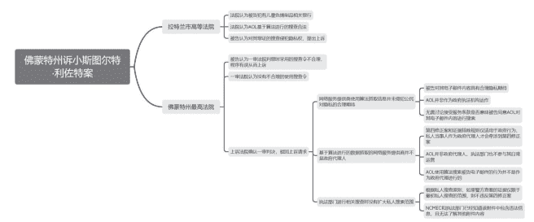

#### 核心争议点

1.网络服务提供商使用算法抓取敏感信息是否侵犯了公民的合理隐私期待

2.基于算法进行数据抓取的网络服务供应商是否可以被视为执法人员.

3.执法部门进行相关搜查时是否扩大了私人搜索范围

#### 裁判论证过程

##### （一）网络服务提供商使用算法抓取敏感信息是否侵犯了公民的合理隐私期待

在上诉中，被告人首先辩称，他对其电子邮件通信内容（包括附在这些电子邮件中的或嵌入在这些电子邮件中的图像）的隐私有合理的期待，这种合理的隐私期待受到《宪法第四修正案》和《佛蒙特州宪法》第十一条的保护.被告人还辩称，他通过同意服务条款给予`AOL`的任何同意，并未减少他根据第四修正案对隐私的合理期待.

为了解决本案争议，法院首先假定被告人在其电子邮件通信内容中有合理的隐私预期，其包括在这些电子邮件中附加或嵌入的图像.

依据下文，法院的结论是`AOL`并没有作为执法机构来运作，所以在判决过程中不需要讨论接受`AOL`的服务是否意味着被告人同意`AOL`对他传输的信息进行搜索.

##### （二）基于算法进行的数据抓取的网络服务供应商是否可以视为执法人员

美国最高法院长期以来一直认为，“由私人进行的不正当搜查或扣押并不违反《宪法第四修正案》，这种私人不法行为并不剥夺政府行使其合法取得证据的权利.”^([\[65\]](#txt003.html#footnote_content_txt003_65))

第四修正案和证据排除规则仅适用于政府行为，因为宪法条款防范了“政府官员的任意入侵”.^([\[66\]](#txt003.html#footnote_content_txt003_66))此外，排除规则的目的是阻止违宪行为，对没有采取行动以确保刑事定罪的个人几乎没有影响.^([\[67\]](#txt003.html#footnote_content_txt003_67))尽管如此，如果私人当事人是政府的代理人，私人搜查将牵涉到第四修正案.

联邦法院认为，第四修正案不保护非内容数据，并认为根据第十一条，用户信息不属于私人信息.美国最高法院解释说，私人团体是否作为政府的工具，取决于政府对私人活动的参与程度.这取决于具体情况，包括政府对私人行动的鼓励、支持和参与.一般而言，如果政府胁迫、支配或指挥私人进行搜查，私人进行的搜查就视为政府搜查.

对于确定一个公民是否可以作为政府代理人进行搜查，一些联邦法院已经确定了需要考虑的因素.第一巡回法庭在三方面进行考察：“（1）政府在煽动或参与搜索方面的作用程度，（2）政府的意图及其对私人搜索的控制程度，以及（3）私人帮助政府或为其自身利益服务的程度.”

第十巡回法庭则分为两部分：“（1）政府是否知道并默许了侵入行为，以及（2）执行搜查的一方是否打算协助执法工作或进一步实现自己的目的.”第六巡回法庭和第九巡回法庭还研究了两个因素：“（1）政府的知情或默许，（2）执行搜查的一方的意图.”

在所有的要素中，关键在于政府在私人活动中的角色和私人进行搜查的动机.此外，被告人还需要承担举证责任，证明私人当事方是政府的代理人.在“佛蒙特州诉小斯图尔特·利佐特案”中，法院将这些考虑因素应用于`AOL`和`NCMEC`基于算法进行的搜查中.

最终法院作出结论，`AOL`使用`MD5`算法在其网络上搜索被告人的传输时，并不是作为政府代理进行的，执法部门也不参与`AOL`的日常运营.联邦法律要求美国在线报告涉嫌违反禁止对儿童进行性剥削的联邦法律的行为，但不要求美国在线监测其网络传输，以发现非法行为.`IDFP`是美国在线用来识别可疑儿童色情制品的技术，它是独立于任何政府机构开发的，政府也没有要求开发该技术.`AOL`自行开发了`IDFP`技术，以进一步解决私营企业的担忧，包括其用户抱怨收到儿童色情图片的问题.

在这种情况下，法院得出结论，`AOL`使用散列技术搜索被告人通过其网络发送的内容时，并不是作为政府代理进行的.`AOL`监控被告人的信息传输是基于其自身商业利益，而不是因为它受到政府的鼓励或指导.这一结论与其他案例一致，即互联网服务提供商不作为执法机构，对涉嫌儿童色情内容的传输进行监控.

联邦法律要求 ESP 和 ISP 报告可疑的儿童色情制品，NCMEC 的 CypberTipline 是唯一指定接收方.法律要求 NCMEC 保存证据，并将网络犯罪报告转发给执法部门.因此，政府知道 NCMEC 将收集关于可疑儿童色情制品的报告是通过立法指示进行的.尽管法规没有要求 NCMEC 公开报告中的信息，但并不妨碍 NCMEC 查看报告内容.法规表明，政府知道 NCMEC 可能会查看和搜索这些报告，至少默许了这一行动.此外，NCMEC 被视为政府的一个部门，因为它被授权接收和拥有儿童色情制品，而儿童色情制品本来就是违禁品.这些事实都表明政府参与了 NCMEC 的搜索，政府知道 NCMEC 搜索的存在，并要求搜索获得的信息与政府共享.

本案中还有一个重要的考虑因素是 NCMEC 打开电子邮件和附件的动机.原告认为，NCMEC 不是执法机构，因为它的动机是帮助寻找失踪儿童、减少对儿童的性剥削和防止儿童受害.NCMEC 并非作为执法机构，因为它有自己的合法利益和动机来创建 CyberTipline.NCMEC 是自己主动创建了 CyberTipline，而非经过政府指导.尽管如此，当 NCMEC 搜查被告人的传输时，它这样做至少部分是为了协助执法.证词表明，NCMEC 有独立的理由，包括确定受害者身份，查看这些图像和电子邮件，但它也试图找到传输的发送者，以协助执法.法院的结论是，结合政府在搜查中的知情和默许，以及 NCMEC 协助执法的动机，表明 NCMEC 在打开和查看被告人的电子邮件和视频附件时充当了政府的代理人.

## （三）执法部门进行相关搜查时是否扩大了私人搜索范围

本案中还存在一个问题，即 NCMEC 和执法部门执行的搜查是否扩大了 AOL 执行的搜查，根据私人搜查原则，如果警方查看的证据仅限于最初私人搜查的范围，则不违反第四修正案.

被告人对搜查提出异议.对此，美国最高法院解释说，最初的搜查是通过私人行动进行的，问题是政府对隐私的额外搜查是否“超出了私人搜查的范围”.最高法院认为，第四修正案并未禁止使用从第三方搜索中获得的信息，但如果政府使用的是对隐私还存有合理期待的信息，则涉及该修正案.

在本案中的问题是，打开电子邮件的附件是否为政府提供了一个机会，使其在搜查过程中了解私人搜索过程中尚未发现的东西.但是根据前文所述，该附件中的所附文件被 AOL 确认具有一个 MD5 散列值，该散列值可以与 AOL 所确定的儿童色情图像相匹配，在检测附件时，AOL 无需打开就可以知道附件所包含的内容.因此，当 AOL 向 NCMEC 发送带有散列值的报告时，NCMEC 确信该图像是 AOL 以前查看过并包含明显儿童色情内容的图像.从这一点看，NCMEC 和执法部门打开 AOL 转发的附件时没有扩大其搜索范围，因为他们已经知道附件中包含了什么，而且他们无法了解更多 AOL 已经知道的附件.因此，法院认为查看附件并没有扩大搜索范围.联邦地区法院在类似的事实上得出了同样的结果，解释说散列值不像写在盒子上的标签；相反，它是一个数字指纹，表示文件中的信息与之前查看的完全相同.

除此之外，也没有理由使最终的搜查令无效，因为即使没有电子邮件内容中的信息，支持搜查令的宣誓书也确立了可能的理由.“搜查令并非仅仅因为有一份载有非法获得的资料的宣誓书作为部分佐证而无效.”^([\[68\]](#txt003.html#footnote_content_txt003_68))

## 【审理结果】

1.佛蒙特州最高法院，经过有争议的判决听证会，判处被告人 22 年无期徒刑.

2.上诉法院驳回了被告人的上诉请求，维持原判.

## 【相关法条】

《美国宪法第四修正案》（United States Constitution，Amendment 4）

人民的人身、住宅、文件和财产享有不受无理搜查和扣押的权利，不得侵犯.除依照合理根据，以宣誓或代誓宣言保证，并具体说明搜查地点和扣押的人或物，不得发出搜查和扣押状.

《佛蒙特州宪法》第 11 条（Vermont Constitution §11）

人民有权使自身、自己的房屋、文件和财产不受搜查或扣押；因此，在没有作出任何宣誓或批准的情况下，逮捕令便为扣押查封提供了足够的基础，而凭借任何官员或信使的命令或要求搜查可疑场所，或逮捕任何人以及没收他们的财产，违反了此项权利，因此不应予以授予.

《佛蒙特州刑事诉讼规则》第 11 条（f）款（Rules of Criminal Procedure §11（f））

确定答辩的准确性.尽管接受了有罪抗辩，法院也不应在不进行调查以使其确信抗辩有事实根据的情况下，对这种抗辩作出判决.

## 【案例评析】

### （一）本案讨论了基于算法进行的私人搜查与公民合理隐私期望之间的关系

回望过去数十年，我们普通大众只会觉得生活发生了翻天覆地的变化，网络真的连成了一个“地球村”，生活中的种种便利也彰显着人类科技的进步.但如果拨开这些变化的表象，深究移动支付与社交媒体等便利平台的内里，我们会发现，是算法在操纵这一切.我们正生活在一个算法统治的世界里，大到总统选举和国家战争，小到订一个外卖、出门和打车，这一切的背后都有着算法的痕迹.

当然，基于算法产生的各种新兴技术所带来的变化也为司法实践带来了挑战，以往基于纸质媒介所制定出的各种规则能否适用于云计算、人工智能、新兴算法等构筑出的现代网络空间还有待商榷.

讨论本案中的种种问题，离不开 MD5 算法，也即散列算法.“散列”是一种加密过程，它为每个加密文件分配其唯一的数学标识符，称为散列值.事实上，两个文件具有相同散列值的可能性非常小，除非这两个文件完全相同.算法会为经过少量编辑的文件分配一个全新的散列值，因此，如果两个散列值相匹配，一个人就可以确切地知道这两个文件是完全相同的，而无需打开任何一个文件.

在国家安全的背景下，散列值提供了找出潜在犯罪者的可能性，如果执法部门合法地查获了一份犯罪计划的副本，那么就可以使用散列值搜索大型数据库，识别存储着相同散列值的其他账户.

事实上，基于散列算法进行的搜索处于第四修正案的灰色地带.

美国《宪法第四修正案》旨在保护公民免受广泛的、侵入性的、不受限制的政府干预，或不合理的搜查和扣押.对于公民的主要保护手段是限制政府行动的搜查令.搜查令必须是特别的，并且说明谁将被搜查，搜查什么，搜查的对象是什么.只有当法官发现该搜查令出自“合理的理由”并相信被搜查的东西将在搜查令上所述的地方出现时，才会签发搜查令.

除此之外的另一种保护方式就是对隐私的合理期待，如果政府在没有搜查令的情况下搜查或获取证据，或者有其他超出授权范围的行为，法院将评估是否应该压制非法搜查的结果.如果政府的行为侵犯了个人对隐私的实际主观期望，并且社会认为这种对隐私的主观期望是合理的，那么该证据将被排除使用.

事实上，“合理的隐私期待”这一理论范围一直存在变化，也有各种学者要求对这一理论进行修正，甚至有学者提出，该理论已不足以保护公民个人权利，建议以“安全权”取代“隐私”作为宪法第四修正案的判断基础.^([\[69\]](#txt003.html#footnote_content_txt003_69))

1967 年“卡茨案”确立了由政府承担隐私保护的责任和严格凭证搜查的原则，据此原则，电话数据和电话通讯都必须凭证搜查.但是时间到了 20 世纪 70 年代，通过“United States v. Miller 案”和“Smith v. Maryland 案”的判决，美国司法实践中又确立了“第三方”原则—“如果本人愿意让政府知道自己的某些秘密并自愿将秘密告知给某个人，那么他对自己泄露出去的信息不享有宪法上的隐私期待利益，并需承担隐私风险”.这意味着一旦公民个人向第三人透露了个人信息，那么无论是否借助第三方的帮助，政府都可以捕捉、使用这一信息.可以看出，这一规定是对公民隐私范围的限缩.

在现实社会中，一切都有边界，线下世界的物理障碍如房屋、栅栏等可以防止他人入侵，这种入侵是有形的，制止手段也是有形的.但是在网络空间中，物理侵入被电子侵入所取代，与物理侵入相比，电子侵入具有无形性，也更加难以被察觉，让人防不胜防.作为使用互联网的普通用户，大多数人没有察觉电子侵入的能力，也难以凭借自己的腕力进行防范.

私人搜查是否会引发宪法隐私的保护问题，关涉到公民个人隐私的保护与国家警察权利的限制，特别是在网络时代，电子入侵成为常态后，在网络黑客、电脑修理工程师、网络监管人员、网络警察的面前，自然人变为电子透明人，其电子（数字）隐私非常容易被上述人员入侵.所以，如果不界定好私人搜查的范围，我们的数字隐私在国家面前将荡然无存，因为数字网络时代“人人都可为警察”.

通过对“佛蒙特州诉小斯图尔特·利佐特案”的分析，我们可以得知，私人搜查是否引发宪法问题主要由两个方面决定：一是私人搜查行为是否有政府执法部门涉入，包括指示、要求、命令、默许等；二是政府随后的搜查行为是否超出了先前的私人搜查范围.所以，为了使保护公民隐私的利益与国家打击犯罪的利益之间达至平衡，应该适当地扩展政府执法人员的范围，缩小私人搜查的范围.在界定政府执法人员及其代理人时，应该将以下人员视为政府执法人员或其代理人：警方的线人；受雇于政府的网络管理人员；依照法律或政府命令必须向政府报告罪证的电脑维修人员；受到政府执法人员的委派、命令、指示、默许或协同进行搜查的人员.在界定私人搜查的范围时，采取“单个文件夹”的标准，可以更好地保护个人隐私.

### （二）明确了司法审判中对于算法言论问题的定位

我们正生活在一个算法社会，在网络占据我们生活的各个角落的同时，算法也不知不觉间笼罩在我们身边，与社会生活息息相关的各种经济和社会决策都是通过算法做出的.算法的重要性也越来越得到彰显，有一种说法就是：“当人们谈论‘算法’时，如果把这个词换成‘上帝’，意思也不会有什么不同.”这虽然是句玩笑话，但也体现了算法无处不在和全知全能的特点.

算法能做到的事如此之多，算法的拥有者得到的相应权力也非常庞大，那么该如何规制和监督算法就成了一个人们不得不去思考的问题.当然，算法的拥有者不希望被规制太多，就打出了“言论自由”这张牌，他们声称算法是一种言论，与算法相应的计算和结果的呈现就是在行使自己的言论自由，规制算法就是限制言论自由.

以美国为例，硅谷的商业巨头们就是以掌握着算法为根基，他们往往会用“言论自由”这张万能牌解决其算法产生的问题.而对于算法是否受言论自由保护，公众有着不同的声音.算法言论问题也在界内引起广泛讨论，以应对将来可能产生的各种问题.

在我国互联网产业迅速发展的背景下，与算法相关的法律规制的不完善是一块潜在的绊脚石，可以看到未来很长一段时间内，我国的互联网产业还是处于发展的黄金期，我们也应该将目光聚焦于算法相关的问题，吸取借鉴别国的经验来完善相关的法律法规.

### （三）引发了对于新兴算法与传统法律原则间矛盾的关注与讨论

随着人类社会科学技术的不断进步，过去只存在于文学与影视作品中的想象越来越多地被付诸于实践，与此同时，飞速发展的互联网技术也让人产生隐隐的担忧，算法与人工智能似乎将人类社会推到了元宇宙与赛博朋克的前进轨道，这种发展对传统法律与道德观念带来了一些颠覆性的挑战，而深埋于水下的问题也随着技术的进步慢慢显露出冰山一角.

本案所探讨的问题就是过去的司法标准不适应现代技术的典型案例之一.

美国《宪法第四修正案》只适用于国家或政府对公民的搜查，而公民私人之间的搜查行为不适用美国《宪法第四修正案》，这其中的主要原因在于，美国宪法修正案是从限制国家权力的角度来保护公民的私人权利的.但是，这也产生了一个问题，即私人搜查可能会被政府利用，从而成为政府侵犯公民宪法隐私的有力工具，这无疑会使公民的宪法隐私处于极度的危险之中，公民的隐私权需要保护，“合理隐私期待理论”便是为满足这一需要应运而生.

事实上，在现代，大多数数字调查都是从对查获的硬盘驱动器进行镜像复制开始的.这一方法在我们的日常生活中也被广泛应用，我们称之为“备份”，把计算机上的东西从一个文件夹复制粘贴到另一个文件夹，对这一副本进行修改.实践中，调查人员也是如此操作，以确保后续的错误不会影响原始硬盘驱动器.

然而，在 1967 年“卡茨诉美国案”的时候，如果让调查人员复印一间装满文件的房间，然后对复印出来的东西进行调查以保持原始证据的完整，这是不可想象的.在这一时期，如果盛有证据的箱子被拿走，那么箱子里的东西就必须与发出的搜查令存在某种合理的联系.

但是，在数字时代，复制和核实查获的硬盘只是初步的调查步骤，因此要求搜查令是没有意义的.如果需要搜查令，是否需要对每一份复制的数据单独发出搜查令，就像一名探员扫描信件时，必须证明复制每一封信是正确的一样.最高法院还没有解决这一问题，因此，复制与通过算法核查硬盘的做法仍处于灰色地带.

哈希法是一种很有前途的数字取证技术，因为它具有准确性、特异性和最小的侵入性，能够有效应用于生活的各个方面，协助执法部门打击犯罪.随着我们的生活越来越多地转向云计算和其他数字形式，如何协调适用于纸质媒体时代的司法标准与第四修正案的基本原理，将变得越来越必要和紧迫.

## 【关联判例推荐】

1\. United States v. Henderson, 595 F.3d 1198, 1199 n.2 (10th Cir. 2010)

核心事实：在执行搜查令时，执法部门在被告人的电脑中发现了儿童色情图片.被告人企图隐瞒证据，他认为这违反了宪法第四修正案赋予他的权利.美国怀俄明州地区法院否决了这一动议.被告人有条件地承认接受儿童色情制品罪，保留他的上诉权，被告人被判刑.而后被告人提起上诉.

与本案关联点：其解释了散列值是从特定图像或视频的逐像素分析发展而来的唯一字母数字序列，被称为“数字指纹”，从而解释了本案讨论问题的基础.

2\. United States v. Peterson, 294 F.Supp.2d 797 (D.S.C.2003)

核心事实：因为电脑故障，Peterson 将自己的电脑送到当地的电脑维修中心修理.电脑工程师 Harry 接受了此项工作，在修理电脑时，他打开了一个文件夹，发现了一些儿童色情图片.回想到新闻报道中的故事：电脑工程师在维修电脑时如果发现罪证，要按照法律的要求向当地警察报告.Harry 决定对此做进一步的搜查，他又打开了一些文档，发现了更多的儿童色情图片和视频，由于不知道下一步如何处理，Harry 复制了上述的一些文件，并将其交给了警察.Harry 所在的州法规定：电脑修理工程师在修理电脑时，如果发现儿童色情文件，应该向警方报告.被告人因此受到犯罪的指控.法院判决认为，Harry 不属于警方的代理人，从法律的规定上不能推论出警方知道或同意 Harry 的搜查行为，因此，也不能确定 Harry 是否有协助警方搜查罪证的意图.最后，法院判决该搜查属于私人搜查行为，因此获得的罪证有效.

与本案关联点：确定私人搜查中的私人是否获得了警方的指示、要求、默许的判断，在此基础上判断搜查是否属于政府的搜查行为，是否会违反《宪法第四修正案》.

3\. State v. Simmons, 2011 VT 69, 27 A.3d 1065 (2011)

核心事实：一名侦探收到线报说被告人使用的电脑是从邻居那里偷来的，于是他展开了调查.在向一个社交网站和一个互联网服务提供商发送了审讯传票后，他发现被告人多次从他邻居的互联网协议地址登录社交网站.最高法院起初认为，初审法院在裁定传讯的信息不受《佛蒙特州宪法》保护方面，没有犯下明显错误.鉴于其有必要且愿意向第三方互联网服务提供商披露互联网用户的接入点身份和使用频率，这些信息不能被合理地视为机密，特别是当社交网站等提供商公开宣布披露政策时.其次，逮捕令的申请得到了来自传票记录、邻居的证据和侦探关于非法无线接入的背景信息等理由的支持.考虑到其他的证据和信息，告密者的可靠性和他的线索来源与逮捕令的可能理由无关.

与本案关联点：用户同意网络服务提供商所拟定的服务条款并不会损害其在《宪法第四修正案》下对隐私的合理期望.

3.5 完美十公司诉谷歌公司和亚马逊公司案

【案件索引】

Perfect 10 v. Google, Inc. et al., 416 F. Supp.2d 828 (C.D.Cal. 2006)

Perfect 10, Inc v. Amazon.com, Inc., 487 F. 3d 701 (2007)

Perfect 10, Inc v. Amazon.com, Inc., 508 F. 3d 1146 (9th Cir. 2007)

Perfect 10, Inc v. Google, Inc., 2010 WL 9479060 (C.D.Cal. 2010)

Perfect 10, Inc v. Google, Inc., 653 F. 3d 976 (9th Cir. 2011)

【关键词】

搜索引擎算法；合理使用；版权侵权责任

【案件提要】

本案是有关搜索引擎和侵犯版权的典型案件.在论述本案之前，首先要介绍一下搜索引擎的内在作用机制.在互联网时代，电脑的所有者可以通过网页将储存在自己电脑上的信息链接给互联网的其他用户，网页由散布在文本中的文字，以及存储在计算机中的使用超文本标记语言（HTML）编写的说明组成.没有图像储存在网页中，网页上的 HTML 指令仅仅会提供储存图像的地址.而搜索引擎作为一类软件程序，可以自动访问数千个网站（网页集合）并在计算机上存储的数据库中对网页进行索引.用户通过搜索引擎查询某类信息后，搜索引擎会以文本、图像或录像等形式将其在网站上检索到的相关信息发送到用户的电脑.在本案中，谷歌的搜索引擎将结果汇总成为一个包含被侵权图像“缩略图”的网页发送给用户，而这些“缩略图”^([\[70\]](#txt003.html#footnote_content_txt003_70))会储存在谷歌的电脑上.本案被告完美十公司认为，谷歌以及亚马逊搜索引擎对侵权第三方网站的链接，以及对侵权图片缩略图的使用、展示直接侵害了自己对图片的版权，并向法院申请对其的初步禁令.而被告谷歌公司认为，谷歌的链接不属于直接侵权，对缩略图的使用也只是合理使用，且谷歌不应该因为第三方网站的侵权承担连带责任.

本案的核心法律问题是：搜索引擎对第三方侵权网站的链接以及侵权图像缩略图的保存，是否会侵犯受保护的图片的版权，以及作为搜索网站的运营者，谷歌和亚马逊是否需要为相关第三方网站的直接侵权行为承担连带的次要责任.

在信息时代，互联网改变了著作权原本的使用方式，通过互联网，大量的作品可以被简便、快捷、高质量、低成本地发表、传播和复制，由此导致了著作权的网络侵权问题日益严重.而搜索引擎由于其“广搜网络信息而呈现之”的特质和作用，频繁出现在第三方网络侵权的案件中.本案中，美国加利福尼亚州法院通过对搜索工具作用机制的剖析说明，以及对美国《数字千年版权法》中规定的合理使用规则的分析阐述，^([\[71\]](#txt003.html#footnote_content_txt003_71))综合各种因素考量，最终采纳了“服务器标准”作为搜索引擎侵权的认定标准.本案也因此常被国内学者所引用，成为证明美国法院在搜索引擎以及链接侵权案件中采用“服务器标准”^([\[72\]](#txt003.html#footnote_content_txt003_72))的重要案例之一.^([\[73\]](#txt003.html#footnote_content_txt003_73))

## 案件要旨

加利福尼亚州地区法院（一审法院）：原告 完美十公司 被告 谷歌公司和亚马逊公司

美国联邦第九巡回上诉法院（上诉法院）：上诉方 完美十公司 被上诉方 谷歌公司和亚马逊公司

完美十公司是一家杂志公司，他们将一些自己享有版权的模特图像上传到自己的网站，用户需要付费订阅才能使用自己的账号密码登录该网站并浏览这些图片，完美十公司通过收取用户的订阅费获得利润.一些独立的第三方网站将这些需要订阅才能浏览的图片未经授权便发布在自己的网站上，此举侵害了完美十公司的版权.谷歌公司的网络搜索引擎功能自动检索到了这些内容，以网页的形式给用户提供了这些侵权图片的缩略图和转到侵权第三方网站的链接.作为谷歌图像搜索功能的一部分，谷歌公司将这些侵权图片以缩略图的形式储存在了自己的电脑中，用户点击这些缩略图不会跳转到侵权的第三方网站，而是在谷歌的页面框上显示其内容.

此外，谷歌公司的一个名为“AdSense”的广告项目使各种规模的第三方网站进入到了谷歌公司庞大的广告商网络，谷歌公司在第三方网站上置放广告，当浏览者点击这些广告时，谷歌公司与第三方网站就可共同分享广告收益.一些侵权的第三方网站也参加了“AdSense 项目”，换言之，谷歌通过“AdSense 项目”从侵权第三方网站上获得了广告收益.

谷歌公司还通过与亚马逊公司达成的协议获取了收入，该协议允许亚马逊内嵌到 Google 的搜索结果链接.亚马逊公司将用户的搜索查询路由到谷歌搜索，并自动将谷歌搜索的响应发送回给用户.亚马逊公司的用户以为是亚马逊公司的搜索引擎在提供搜索结果，实质上是谷歌公司直接将搜索结果传达给了亚马逊的用户.

完美十公司认为谷歌公司和亚马逊公司的行为侵犯了其版权，从 2001 年 5 月开始，完美十公司在四年间连续给谷歌公司发送警告信，但并未解决该问题.2004 年 11 月，完美十公司向加利福尼亚州地区法院提起了对谷歌公司侵犯版权的诉讼，随后，在 2005 年 6 月，完美十公司对提供类似服务的亚马逊公司也提起了诉讼，希望法院能责令谷歌公司和亚马逊公司的搜索引擎拒绝提供转到侵权网站的链接，同时能责令谷歌公司删除储存在其服务器中的缩略图.2005 年 8 月，完美十公司向加利福尼亚州地区法院申请了对两被告的初步禁令.加利福尼亚州地区法院将两个案子合并进行审理.

2006 年，加州地区法院（一审法院）部分批准了对谷歌公司的初步禁令，驳回了对亚马逊公司的禁令，判决要点如下：（1）谷歌公司的搜索引擎本身并未展示或传播其内嵌链接的被侵犯版权的全尺寸图片；（2）谷歌公司的搜索引擎对搜索到的受版权保护的图片的缩略图的提供，构成版权法意义上的“展示”（3）谷歌公司的搜索引擎对被侵权图片的缩略图的使用和存储不构成合理使用；（4）谷歌公司和亚马逊公司不需要因为其用户或者第三方网站对完美公司图片的直接侵权而承担次要责任.

原告和被告双方均提起上诉.2007 年美国联邦第九巡回上诉法院作出如下判决：（1）谷歌图像搜索引擎对侵权第三方网站的链接并未侵犯完美十公司的版权；（2）谷歌图像搜索引擎对被侵权图片的缩略图的使用和存储构成合理使用，谷歌使用缩略图不构成直接侵权；（3）从共同侵权角度，谷歌公司在很大程度上协助了第三方网站的侵权行为，但由于地区法院并未调查谷歌公司和亚马逊公司是否对侵权行为知情却没有采取行动，所以撤销对于谷歌公司和亚马逊公司不需要承担次要责任的判决，并发回重审；（4）由于一些事实没有得到认定，因而在裁定完美十公司满足初步禁令所要求的“不可弥补的损害”因素时，一审法院是否滥用了其裁量权的争议无法被解决.

随后本案又持续了长达 5 年的争论和纠纷.2010 年 7 月，原告完美十公司发现了新证据，再次请求加州地区法院批准对谷歌公司的初步禁令，加州地区法院再次驳回其动议.2011 年 4 月 11 日，联邦第九巡回上诉法院作出判决，维持原判.

## 案例事实思维导图

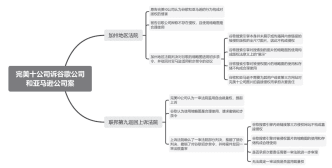

## 核心争议点

1.谷歌公司的搜索引擎对展示以及储存在第三方侵权网站上的全尺寸图片的内嵌链接是否直接侵犯了完美十公司的版权.
2.谷歌公司的搜索引擎对被侵权图片缩略图的使用和存储是否构成合理使用.
3.谷歌公司是否需要因为其用户或者第三方网站对完美公司图片的直接侵权而承担次要责任.

## 裁判论证过程

### （一）谷歌的搜索引擎的内嵌链接并不构成版权法意义上的“展示”和“传播”

判断内嵌链接行为是否构成版权法意义上的“展示”的标准至少有两种：“服务器标准”和“纳入标准”.“服务器标准”从技术角度出发，认为“展示”指的是通过网络提供内容，从物理角度理解，就是通过互联网给用户发送 0 或者 1 的行为；而“纳入标准”则将“展示”理解为用户将内容上传合并到网页，再通过浏览器将内容拉出的行为.加利福尼亚州法院综合考量，最后选用了“服务器标准”.理由如下：

首先考虑的是浏览器的技术作用层面，想要浏览全尺寸图像的用户在点击谷歌搜索引擎搜索汇聚到的缩略图之后，并不能看到谷歌所储存或提供的图片，相反，点击链接或是缩略图后，用户的电脑会直接转到展示并使用侵权图片的第三方网站，由这些第三方网站来把侵权图片传输给用户；其次，采用“服务器标准”既不会招致谷歌等搜索引擎的大规模版权侵权活动，也不会完全排除对此类活动的责任.该标准仅会排除搜索引擎对内嵌链接或框架存储在第三方网站上的侵权内容的直接责任.版权所有者仍可寻求网站的替代责任；第三，网站运营商和法院可以相对容易地理解、应用该标准；第四，本案中最初的直接侵权者，是盗取完美十公司全尺寸图片并发布到互联网上供全世界查看的第三方网站；最后，“服务器标准”保持着版权法所追求的微妙平衡—即鼓励创作作品和鼓励信息传播之间的平衡.

此外，在互联网环境中，“实际传播”是指将文件从一台计算机传输到另一台计算机.尽管谷歌框架和内嵌链接到第三方侵权网站，但将全尺寸图像传输到用户计算机的是这些网站，而不是谷歌.由于谷歌没有参与传输，因此也没有传播侵权内容.

因此，加利福尼亚州法院得出结论：由于储存全尺寸版本侵权图像的主体是第三方网站，而非谷歌公司，故谷歌搜索引擎的框架和内嵌链接不构成对侵权第三方存储和提供的全尺寸图像的“展示”和“传播”.

联邦第九巡回上诉法院也赞同采用“服务器标准”，他们认为，存储在电脑中的图片才是版权法意义上的图片的复制件.当用户电脑上的谷歌页面框中出现了在线链接的侵权图片时，谷歌只是提供了指引用户跳转到第三方网站的 HTML 指令.HTML 指令由一系列 text 文本构成，因此，提供这种指令不等同于展示复制件.此外，地区法院在判断是否直接侵犯传播权时解释道，传播要求对复制件的“实际传播”.在本案中，是第三方侵权网站的电脑通过传送图片，给用户进行了复制件的“实际传播”.由于谷歌公司并未收集完整尺寸图片的复制件，所以“视为传播”规则不能适用于本案.因此谷歌公司的搜索引擎对于侵权第三方网站的内嵌链接，既没有侵犯完美十公司的图片的展示权，也没有侵犯传播权.

### （二）谷歌图像搜索对被侵权图片的缩略图的使用和存储构成合理使用

联邦第九巡回上诉法院认为，在使用目的和性质方面，谷歌搜索引擎的巨大转变性使用，超过了谷歌缩略图的取代性和商业用途.虽然创建图像原本可能是为了娱乐、美学或信息功能的实现，但搜索引擎将图像转换为指针，将用户引导到了其信息源.搜索引擎给原作品提供了一种全新的使用方式，也给社会带来了公共利益.因此，谷歌图像搜索引擎对缩略图的使用是显著的转变性使用.另一方面，在当下，谷歌搜索的缩略图对原件的取代作用和商业用途并不显著.正如最高法院的指示：新作品的转变性使用程度越大，（诸如商业元素等）不利于认定为合理使用的因素的显著性就会越小.因此，该因素更多地支持着谷歌一方.

在受版权保护的作品性质方面，已有的判例认为，拍摄出的图片比基于事实的作品更具有性质上的创造意义，更接近版权保护的核心目的.虽然完美十公司的图片也具有创意，但是曾经发表过，首次发表的权利是“作者有权控制其表达的首次公开露面”.因为完美十公司已经行使过首次发行权，其将不再有权获得针对未出版者的增强保护.因此该因素只能微弱地支持完美十公司.

就与版权作品整体有关的部分而言，在其数量和实质性方面，该因素无法支持二者中的任何一方.正如在“Kelly v. Arriba Soft Corp 案”中提到的，对于搜索引擎来说，使用整个图片是非常必要的，如果仅复制了图像的一部分，则识别起来会更加困难，从而降低了视觉搜索引擎的实用性.

在对版权作品潜在市场或价值的影响方面，该因素同样不支持任何一方.首先，缩略图并不会损害摄影者的完整尺寸图片的市场，因为缩略图无论是尺寸还是分辨率都比原图差，它不能成为原图的替代品.其次，谷歌对于缩略图的使用，更多是出于变革性而非商业目的，不应推定市场受损.最后，并没有证据能证明谷歌用户用手机下载了缩略图，所以完美十公司的小尺寸图像潜在市场受损仅仅是一种假设，并无证据证明.

联邦第九巡回上诉法院在对所有四个因素进行了分析之后，“根据版权的目的”将这些因素进行了综合权衡.其认为，与完美十公司的预期使用相比，谷歌搜索引擎将完美十公司的缩略图放在了不同的使用基础之上.这样做，谷歌公司为公众带来了重大利益.考虑到版权的目的，将这种重大的变革性使用与未经证实的谷歌缩略图用于手机下载的使用权进行权衡，并考虑其他合理使用因素，可以得出结论，谷歌搜索引擎对完美十公司的缩略图的使用是一种合理使用.

### （三）谷歌可能因为第三方网站侵权承担共同责任

联邦第九巡回上诉法院认为，从共同侵权角度，谷歌在很大程度上协助了第三方网站的侵权行为，但由于地区法院并未调查谷歌和亚马逊是否对侵权行为知情却没有采取行动，这个问题需要地区法院进一步调查审理.联邦最高法院将共同侵权责任定义为两种类型：一是通过特定行为积极鼓励侵权行为；二是传播不具有“实质性”或商业意义上的“非侵权用途”的产品.上诉法院认可了谷歌关于“搜索引擎是具有实质上非侵权用途的产品”的辩称，所以只需考虑谷歌的行为是否符合第一种共同侵权责任的标准.在这种标准下，上诉法院认为，如果计算机系统的运营者明确知道具体的侵权产品在其网络上可以被获取，且可以对侵权作品采取简单措施阻止侵权行为，却并未采取行动，则该运营者需要为第三方侵权承担共同责任.谷歌图片搜索极大地协助了网站将其侵权拷贝分发到全球市场的行为，并协助了全世界的用户访问侵权产品.即使谷歌的帮助适用于所有网站，而不仅仅是侵权行为，我们也不能忽视这种服务对版权所有者的影响.一审法院未解决关于完美十公司向谷歌公司发出的通知是否适当、谷歌对这些通知的回应以及谷歌能否简单地阻止侵权事件发生的事实争议.因此，地区法院需要就此问题重新审理，而不能简单断定谷歌无需承担共同侵权责任.

### （四）谷歌不需要对第三方网站的侵权行为承担替代责任

联邦第九巡回上诉法院认为，谷歌没有权利也没有能力阻止第三方网站的侵权行为.搜索引擎的运营者如果有权利且有能力监管直接侵权者，并从这种活动中直接获取金钱利益，则运营者要承担替代责任.首先，虽然谷歌与第三方侵权网站达成了“AdSense”项目合作，但这只是一种广告合作，尽管谷歌有权因为第三方网站的直接侵权而终止与其的合作伙伴关系，但这种终止并未赋予谷歌阻止第三方网站直接侵权的权利.在伙伴关系终止后，第三方网站仍可以继续进行侵权行为.其次，谷歌也缺乏实际上阻止第三方网站侵权的能力.谷歌的图像搜索引擎无法对互联网上的每一张图片进行分析，来判定其是否侵犯了世界上其他有版权图片的版权.

## 审理结果

1. 2006 年，加利福尼亚州法院部分判决谷歌链接第三方网站没有直接侵犯完美十公司的版权，但是谷歌搜索引擎对缩略图的使用侵犯了完美十公司的版权，且谷歌公司和亚马逊公司不需要因为其用户或者第三方网站对完美公司图片的直接侵权而承担次要责任.由此，加利福尼亚州法院批准了对谷歌缩略图的初步禁令，驳回了对谷歌链接第三方网站的初步禁令，驳回了对亚马逊的初步禁令.
2. 2007 年，美国联邦第九巡回上诉法院确认了加利福尼亚州法院有关“谷歌链接第三方网站不属于对完美十公司版权的直接侵权”的判决，推翻了加利福尼亚州法院有关谷歌缩略图侵权的判决，撤销了初步禁令，并将该案发回加利福尼亚州法院重审.
3. 2010 年，加利福尼亚州法院对本案进行重新审理，再次驳回了完美十公司的初步禁令动议.
4. 2011 年，联邦第九巡回上诉法院作出判决，维持原判.

## 相关法条

美国《数字千年版权法》第 501 条（a）款（Digital Millennium Copyright Act§501（a），17 U.S.C. §501（a）（1998））

任何人侵犯第 106 条至第 122 条规定的版权所有者的专有权或第 106 A 条（a）款规定的作者的专有权，或违反第 602 条将复制品或唱片进口到美国，视情况可能被认定为侵犯作者的版权或权利.就本章而言（第 506 条除外），版权应被视为包括第 106A（a）条所赋予的权利.本分节中使用的“任何人”一词包括任何国家、国家的任何部门以及以官方身份行事的国家或国家部门的任何官员或雇员.任何州以及任何此类机构、官员或雇员，应以与任何非政府实体相同的方式和程度受本篇规定的约束.

美国《数字千年版权法》第 106 条（Digital Millennium Copyright Act §106，17 U.S.C. §106（1998））

在遵守第 107 条至第 122 条的规定的前提下，该标题下的版权所有者拥有以下任何一项的专有权：

（1）以复制品或录音制品的形式复制受版权保护的作品；
（2）根据著作权作品制作衍生作品；
（3）通过出售或其他所有权转让，或通过出租、租赁或出借，向公众分发受版权保护作品的副本或录音制品；
（4）对于文学、音乐、戏剧和舞蹈作品，哑剧、电影和其他视听作品，要公开表演受版权保护的作品；
（5）对于文学、音乐、戏剧和编舞作品，哑剧以及绘画、图形或雕塑作品，包括电影或其他视听作品的单个图像，要公开展示受版权保护的作品；
（6）在录音的情况下，通过数字音频传输公开进行受版权保护的作品.

美国《数字千年版权法》第 107 条（Digital Millennium Copyright Act §107，17 U.S.C. §107（1998））

尽管第 106 条和第 106A 条规定，出于批评、评论、新闻报道、教学（包括复制多个副本供教学使用）、奖学金或研究的目的，合理使用著作权作品，包括以复制品或者录音制品或者其他由该条明确规定的其他方式，并不构成对作品著作权的侵犯.在确定在某一特定情况下对著作权作品的使用是否为合理使用时，应考虑的因素包括：

（1）使用的目的和性质，包括该等使用是否具有商业性质或用于非盈利性教育目的；
（2）受版权保护的作品的性质；
（3）从使用部分的数量和实质性两方面评估对整体版权作品的使用程度；和
（4）该使用对版权作品的潜在市场或者价值的影响.

作品未发表的事实本身不应妨碍在考虑了上述所有因素后得出的合理使用的结论.

## 案例评析

### （一）本案的司法论证为审理搜索引擎类案件提供了合理的理论框架

首先，在本案中，美国加利福尼亚法院在判断谷歌搜索引擎的内嵌链接是否构成侵权时所采纳的“服务器标准”，曾为各国司法实践所广为接受.在搜索引擎类侵权案件发生之初，由于搜索引擎类案件涉及复杂、技术难度大的计算机以及互联网的专业知识，法官并不能完全了解搜索引擎以及链接的作用机制，因此法官不能很好地将自己所掌握的法律知识运用到该类案件中.相比较其他标准而言，应用“服务器标准”，只需要判断侵权作品储存于哪一方的服务器之中，即可判断该链接是否构成侵权.因此无论是对于法官还是网站运营者，都能很容易地理解并应用该原则.这是“服务器标准”的优点之一.其次，在促进创造性的作品创作与鼓励信息传输之间，“服务器标准”可以维持一个精妙的平衡.除此之外，虽然深层链接在用户感知上与上传行为有类似之处，但由于直接侵权标准的众多局限性，许多国家的司法实践不约而同地选择了“服务器标准”.^([\[74\]](#txt003.html#footnote_content_txt003_74))然而，随着网络技术的发展，服务器标准逐渐不再符合司法实践需要，因为过于简单的标准很容易被侵权方以各种方式规避，从而极大地损害版权人的合法权益，助长这类“擦边”的侵权行为，“服务器标准”曾经引以为傲的平衡鼓励创作与鼓励信息流通间关系的作用也逐渐失效.因此越来越多的法院开始采用形式上的“服务器标准”，而在举证责任上对此加以弥补.

其次，在本案中，加利福尼亚州法院对于搜索引擎侵犯版权的标准的选择和考量的方法更值得关注与学习.一些学者误以为“服务器标准”是放之四海而皆准的，从而忽视了加利福尼亚法院在选用之前的功能主义分析.^([\[75\]](#txt003.html#footnote_content_txt003_75))加利福尼亚法院在审理案件时，先是从两种标准出发，分别考虑了应用该标准会导致的后果，然后从技术角度、司法难度层面以及公共利益平衡等方面综合考量，才选定了适用标准.在互联网技术日新月异的时代，一味固守某种标准难免会落后于时代.而这种一案一判、综合考量的分析框架则能够更好地适用于各种情形，平衡各方利益，因而更符合司法实践的需要.

### （二）本案推动了“转换性使用”的认定从转换性内容到转换性目的的改变

在本案中，美国联邦第九巡回上诉法院对搜索引擎使用缩略图的行为作出了显著的“转换性使用”的认定，从而将这一行为认定为了版权法上的“合理使用”.在合理使用规则产生之初，美国法院倾向于将“转换性使用”认定为是在原作品的基础上增加了文学、美术或者其他意义上的内容或者内涵.互联网的普及和发展推动了“转换性使用”由侧重转换性内容到转换性目的的改变.本案中，上诉法院出于谷歌图片搜索这一工具本身所带来的巨大社会利益的考量，认为谷歌公司的搜索引擎搜索、储存的缩略图虽然在文学、美术意义上没有改变图像本身的内容，但是谷歌的搜索引擎在运行中产生并储存的缩略图将原本只有美学意义的、出于观赏目的的图像，转换成为了互联网意义上的有信息储存和信息传播意义的图像，这一重大的目的性的改变也可被称之为“显著的转换性使用”.本案的判决也影响了后续许多类似案件的认定.已经有许多的判例显示，仅对原作的使用反映了表达目的的不同，而对其内容进行毫无更改地复制使用，这种情况下法院仍会将其认定为“转换性使用”.

“转换性使用”由内容到目的的改变，也体现出版权法试图在鼓励创作者的激情以及限制保护内容而避免垄断之间保持一种微妙的平衡.^([\[76\]](#txt003.html#footnote_content_txt003_76))在互联网时代，这种利益平衡、公共利益的考量显得尤为重要，例如在“Field v. Google Inc.案”中，法院特别强调了搜索引擎服务“重要的社会性目的”和“利于公众提高网上信息收集技术的作用”.此外，这个改变一定意义上也预示了在搜索引擎技术下版权法的合理使用规则越来越弹性化的趋势.^([\[77\]](#txt003.html#footnote_content_txt003_77))

### （三）本案间接推动了搜索引擎的发展
本案综合了许多相关判例，从版权侵权的认定标准、合适使用规则的适用以及侵权责任的承担等方面，详细阐述了搜索引擎运营者在运营过程中所面临的法律风险的具体情形.从版权侵权来讲，“服务器标准”把搜索引擎运营商从直接侵权的指控中解脱出来，为搜索引擎的基本运行机制做了法律上的辩护，同时也一定程度上节约了搜索引擎运营商的运营成本.从合理使用规则来说，上诉法院将搜索引擎对缩略图的储存和使用认定为版权法意义上的合理使用，是搜索引擎可以汇聚、缓存以及经营发展的重要法律基石.从共同侵权角度来说，搜索引擎运营者可能会以版权间接侵权的方式来协助侵权产品的网络传播，在本案中，即谷歌以将侵权第三方网站链接发送给用户的方式，帮助了第三方网站侵权作品的传播.而对于此种行为是否构成共同侵权，则需要进一步认定搜索引擎运营者是否对侵权行为知情，且能简单采取措施阻止却未行动.从替代责任来说，一般情况下，搜索引擎运营者不同于其他网络服务提供商，他们几乎没有法律上的权利以及现实中的能力去阻止侵权行为的发生.因为搜索引擎不去索引侵权产品，侵权行为也不会因此而停止.此外，搜索引擎由算法自动爬虫运营，难以做到对所有检索的产品进行对比判断是否侵权.所以，本案实际上为搜索引擎的运营者吃了一颗定心丸，让他们得以从诸多的侵权连带责任的指控中脱身，安心运营搜索引擎.但同时由于过于宽松的责任认定，也可能会导致搜索引擎的运营者滥用规则，更加“肆无忌惮”地使用缩略图以及运用各种链接，从而严重损害版权所有者的权益.

### （四）本案引起了关于激励网络技术发展与保护版权二者关系的反思与讨论
从某种意义上来说，影响本案判决作出的一个重要公共利益考量，就是促进搜索引擎的发展以及信息的快速收集与流动.但也不可否认这样的判决一定程度上损害了版权所有者的合法权益.尤其是在互联网搜索引擎十分繁荣的当下，普通链接、内嵌链接、框架链接等各种链接形式层出不穷，繁荣的网络搜索服务一定程度上影响甚至损害了版权所有者的收入、权益.任何技术的进步都不应当以权利的让步作为前提条件.因此，越来越多的学者开始探讨链接侵权的新的认定标准，司法实践中逐渐产生了越来越丰富的新实践、新做法.

## 【关联判例推荐】
### 1. Sony Corp. of America v. Universal City Studios, 464 U.S. 417, 442 (1984)
核心事实：被告公司发行得以边看电视边录像的家用录像机，原告认为其侵害了原告的版权和销售市场，与使用者构成了共同侵权.一审法院、上诉法院和联邦最高法院都驳回了原告的诉讼请求，认为家庭内的时间转换方式是一种合理使用.
与本案关联点：如果产品具有“实质的”或“商业性意义上”的“非侵权用途”，则不构成共同侵权.

### 2. Religious Technology Center v. Netcom On-Line Communication Services,Inc. (Netcom), 907 F.Supp. 1361, 1365-1366 (N.D.Cal. 1995)
核心事实：原告认为被告网通公司应该为其用户未经授权使用原告的作品承担替代责任.法院认为，被告网通公司虽然有能力制裁且阻止该侵权行为，但其只向用户收取固定的月租费，并未从中直接获取经济利益，所以无需承担替代责任.
与本案关联点：在考虑互联网服务提供者的著作权侵权替代责任时，既要考虑服务提供者是否有能力制裁控制侵权行为，也要考虑服务提供者是否从中直接获取经济利益.

### 3. Kelly v. Arriba Soft Corp.,77 F Supp.2d 1116 (D.C.Cal. 1999)
核心事实：原告认为被告阿里巴巴软件公司在用户通过搜索引擎搜索图片时，给用户提供了由缩略图构成的搜索结果，侵犯了其版权.地区法院认为，搜索引擎提供的缩略图是一种基于搜索引擎的转化性的合理使用，不会损害原告市场并且对社会公众有益.
与本案关联点：搜索引擎提供的缩略图是否属于合理使用的判断.

### 4. A & M Records, Inc. v. Napster, Inc., 239 F.3d 1004, 1013 (9th Cir. 2001)
核心事实：原告认为被告 Napster 应该知道并且有权阻止其用户通过该软件分享未经授权的 MP3 音乐文件，但却对此进行放任的行为侵犯了原告的版权，要求对被告采取初步禁令，停止提供音乐交换服务.初审法院和上诉法院均认为被告的行为不构成合理使用，责令被告停止提供有注册版权的音乐交换服务.
与本案关联点：在判断互联网服务提供者是否侵犯传播权，以及是否承担侵犯版权的分担责任时，要考虑该平台是否具有阻止侵权的实际能力.

### 5. Metro-Goldwyn-Mayer Studios Inc. v. Grokster, Ltd. 545 U.S. 913 (2005)
核心事实：一审法院认为由于具有“非中心化”特点，被告无法控制其用户的侵权行为，所以不构成侵权.上诉法院认为被告具有“实质性非侵权用途”，同时也可能不知道侵权行为的发生，所以不构成侵权.联邦最高法院最终采取“积极诱导标准”，将该案发回初审法院，要求其作出对原告有利的判决.
与本案关联点：在判断互联网服务提供者是否与其用户一起构成共同侵权时，采用的一般规则是“积极诱导标准”.

## 3.6 菲尔德诉谷歌案
### 【案件索引】
Field v. Google Inc., 412 F. Supp. 2d 1106 (D. Nev. 2006)

### 【关键词】
合理使用；默示许可；算法侵权；搜索引擎；转换性使用

### 【案件提要】
本案是有关讨论搜索引擎通过自动化程序对原始网页的网页快照是否直接侵犯原始网页内著作权作品的经典案例.在本案中，菲尔德控诉谷歌未经其许可通过自动化程序`Googlebot`对其网页进行网页快照的行为侵犯了其网页内作品的著作权.而被告谷歌则辩称，菲尔德明知可以通过使用`no-archive`元标签、`robots.txt`等方式阻止`Googlebot`对其网页进行网页快照，却并未采取任何措施，该行为可以推定为菲尔德授予了谷歌缓存其网页内作品的“默示许可”.并且，谷歌进一步指出，对网页进行网页快照是为了减轻流量负担和提高网络传输效率，使用户能够尽可能地成功获取到其所需的材料，其实施网页快照的行为是善意的，是对菲尔德网页内作品的转换性使用，是受美国《数字千年版权法》（Digital Millennium Copyright Act， DMCA）“安全港”条款^([\[78\]](#txt003.html#footnote_content_txt003_78))的保护的.另外，谷歌主张其是通过自动化程序`Googlebot`来进行网页快照的，并非谷歌自身有意识的自主行为.综上，谷歌主张其未侵犯原告菲尔德个人网站内作品的著作权.对此争议，内华达州地区法院肯定了谷歌的抗辩理由，认为谷歌对菲尔德个人网站网页的网页快照符合美国《版权法》（Copyright Act，17 U.S.C.）第 107 条^([\[79\]](#txt003.html#footnote_content_txt003_79))中有关“合理使用”的规定，因此，谷歌未侵犯菲尔德作品的著作权.

关于谷歌的“网页快照”行为是否应受《数字千年版权法案》（Digital Millennium Copyright Act， DMCA）第 512 条（b）款保护的问题，虽然这一点目前在学术界仍存在很大的争议，但在没有后续的推翻或修正判决以前，该案例对于处理后续的类似案件具有一定的参考价值，例如“谷歌数字图书馆案”^([\[80\]](#txt003.html#footnote_content_txt003_80)).同时，该案还确立了美国《版权法》（Copyright Act， 17 U.S.C.）第 107 条在网页快照上的适用，彰显了美国法院在处理类似案件时，倾向于结合版权法的立法目的，综合考察该条款规定的四个要素，使得最终作出的判决是有利于公众的，同时也是有利于促进文化创新与发展的.

另外，该案涉及的美国《数字千年版权法》的第 512 条（b）款和有关“默示许可”的认定的内容，对于我国知识产权法的完善具有借鉴意义，例如，在我国《信息网络传播权保护条例》第 23 条^([\[81\]](#txt003.html#footnote_content_txt003_81))和 2012 年最高人民法院发布的《关于审理侵犯信息网络传播权民事纠纷案件适用法律若干问题的规定》第 5 条^([\[82\]](#txt003.html#footnote_content_txt003_82))的内容中，都体现了我国知识产权法对于网络服务提供商“网页快照”行为的认定和规制的补充.最后，本案也让国内互联网公司提高了侵权风险意识，促使其改进升级相关机制，为保护知识产权付出行动，向构建更加规范的信息交流传播平台的目标进一步迈进，推动文化创新与繁荣.综合来讲，本案对于搜索引擎的网页快照行为所引起的著作权侵权纠纷而言，具有重要的研究意义.

### 【案件要旨】
内华达州地区法院（一审法院）：原告 菲尔德 被告 谷歌
原告菲尔德是一名作家、律师，并且是内华达州律师协会的成员，2004 年 4 月 6 日，菲尔德向谷歌提出控诉，主张被告谷歌通过自动化程序`Googlebot`形成了其个人网站网页的网页快照，该网页快照的内容直接侵犯了其发布在个人网站`www.blakeswriting.com`上的作品《Good Tea》的著作权.

2004 年 5 月 25 日，菲尔德提交了一份修正诉状，主张谷歌直接侵犯了菲尔德在其个人网站上发布的另外 50 幅作品.菲尔德要求判处 2，550，000 美元的法定赔偿（包括 51 项注册版权的作品，每项 50，000 美元）和禁令救济.

谷歌方主张其并未直接侵犯菲尔德作品的著作权，其理由如下：（1）“默示许可”：版权所有者可以明示或者通过行为默示授予非独占许可.菲尔德明知道可以使用`no-archive`元标签（`no-archive`元标签是广为人知的行业标准规则）来指示搜索引擎不得对发布者的网页进行网页快照，却并没有使用，菲尔德的做法可以被合理地解释为授予了谷歌进行网页快照的“默示许可”.（2）“禁反言规则”：当原告以沉默或者不作为的方式帮助被告侵权或者促使被告侵权，不得提出侵犯著作权的控告.菲尔德明知，如果其不对谷歌发送“不得缓存”的指示，谷歌将自动生成对其网页的“网页快照”，而谷歌的用户会直接点击`Googlebot`生成的其个人网站网页的“网页快照”.根据“禁反言规则”，菲尔德不得提出侵权主张.（3）“合理使用”：根据美国《版权法》（Copyright Act， 17 U.S.C.）第 107 条规定的“合理使用”条款，法律允许在未经版权人许可的情况下使用部分受版权保护的作品.根据谷歌对菲尔德作品使用的目的与特征、菲尔德作品的性质、从谷歌使用部分的数量和实质性两方面评估对版权作品的使用程度，以及谷歌的使用行为对菲尔德版权作品的潜在市场或价值的影响的综合考量，谷歌的使用行为符合“合理使用”要求，不构成侵权.（3）美国《数字千年版权法》（Digital Millennium Copyright Act， DMCA）的“安全港”条款（第 512 条（b）款）：因服务提供者在其控制或运营的系统或网络上临时储存资料而造成版权侵权的，服务提供者不承担任何金钱救济责任.谷歌符合该条款的要求，因此无需对菲尔德承担金钱赔偿的责任.

2005 年 9 月 27 日，菲尔德提出简易判决动议，认为谷歌侵犯本案争议作品的著作权，应当驳回谷歌基于“合理使用”“默示许可”“禁反言”与“《数字千年版权法》（Digital Millennium Copyright Act， DMCA）安全港”的抗辩理由.而谷歌则基于“非侵权”“默示许可”“禁反言”和“合理使用”的抗辩理由提出了简易判决申请.

2005 年 12 月 19 日，内华达州地区法院审理了双方当事人的申请.在审理中，谷歌基于《数字千年版权法》（Digital Millennium Copyright Act， DMCA）第 512 条（b）款的规定口头提出支持其主张的简易判决申请.最终，法院支持了谷歌方基于《数字千年版权法》（Digital Millennium Copyright Act， DMCA）提出的主张，认为谷歌未侵犯菲尔德个人网页中的作品的著作权，并驳回了菲尔德申请简易判决的动议.

### 【案例事实思维导图】
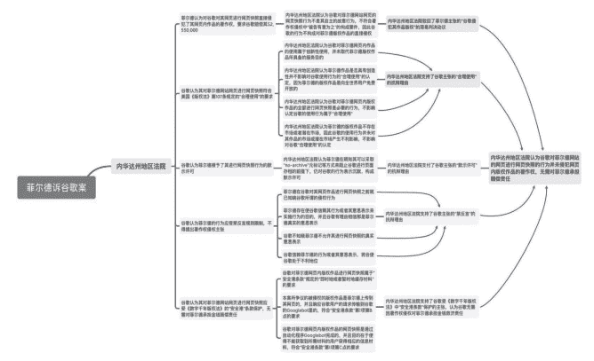

### 【核心争议点】
1.谷歌通过自动化程序生成针对原网页的网页快照，并允许用户访问与下载该网页快照的行为，是否构成对原网页内作品的著作权的直接侵权.
2.谷歌对菲尔德网站网页内作品的使用是否符合美国《版权法》（Copyright Act， 17 U.S.C.）第 107 条规定的“合理使用”的要求.
3.菲尔德的行为是否构成授予了谷歌使用其网页内版权作品的“默示许可”.
4.菲尔德的行为是否符合“禁反言规则”.
5.谷歌对菲尔德网站网页进行网页快照的行为是否要因著作权侵权承担金钱救济责任.

### 【裁判论证过程】
#### （一）谷歌通过自动化程序生成针对原网页的网页快照并允许用户访问与下载该网页快照的行为不构成对原网页内作品著作权的直接侵权
内华达州地区法院认为，原告菲尔德若想要证明被告谷歌侵犯其网页内作品的著作权，则需要证明以下三个因素：（1）其享有作品的著作权；（2）被告复制其作品的行为；（3）被告是有意为之^([\[83\]](#txt003.html#footnote_content_txt003_83)).
法院分别对上述三个因素展开分析：首先，针对第一个因素而言，原被告双方对于“菲尔德享有本案中所争议作品的著作权”这一事实无任何争议；其次，法院认为，双方的主要争议点在于第三个因素，即双方所争议的是谷歌允许用户访问与下载包含菲尔德网站网页内的版权作品的网页快照这一行为，是否构成美国《版权法》（Copyright Act， 17 U.S.C.）中所规定的有意“复制”或者“发行”.对此，内华达州地区法院认为，谷歌允许用户访问与下载其自动化程序`Googlebot`生成的网页快照并不能代表谷歌有侵权的故意，在这个过程当中，谷歌是被动的一方，谷歌的计算机只是自动地响应了用户的访问请求，如果没有用户的请求，网页快照的复制版就不会生成并发送给用户，本案中所控诉的侵权行为也不会发生.
综上所述，内华达州地区法院认为，菲尔德所控诉的谷歌的侵权行为是为了响应用户需求的、自动的、无意识的行为，其并不符合《美国版权法》中规定的“直接侵权”所应具备的“被告有意为之”的构成要件，因此，谷歌的行为不构成对菲尔德原始网页作品著作权的直接侵权.

#### （二）谷歌对菲尔德网站网页内作品的使用是否符合美国《版权法》第 107 条规定的“合理使用”的要求
内华达州地区法院认为，根据美国《版权法》（Copyright Act， 17 U.S.C.）第 107 条有关“合理使用”的规定，判断谷歌对菲尔德网站内版权作品的使用是否符合“合理使用”，需要将以下四大因素作为综合考量标准，分别如下：
（1）使用的目的与性质，其中包括这种使用是否带有商业性质或者是处于非盈利的教育目的；
（2）受版权保护的作品的性质；
（3）从使用部分的数量和实质性两方面评估对版权作品的使用程度；
（4）该使用对版权作品的潜在市场或价值的影响.
法院分别对上述四个因素进行了分析，具体如下：
首先，关于第一个因素，即谷歌使用的目的与性质，内华达州地区法院参考了美国最高法院的观点—“分析‘合理使用’主要就是集中在一个问题：新的使用是否取代了作品原有的服务目的.”同时，法院还参考了对版权保护发展有巨大影响的“Kelly 诉 Arriba Soft Corp 案”^([\[84\]](#txt003.html#footnote_content_txt003_84))，在该案中，第九巡回法庭认为，搜索引擎对于受版权保护的照片作品的缓存是一种转换性的“合理使用”，因为搜索引擎的使用行为是为了改善用户在互联网上获取该照片的途径，因此，其目的区别于该照片作品本身所具有的服务目的，并未代替原作品.

# 案例文本排版

## 合理使用因素分析

同理，内华达州地区法院认为谷歌对菲尔德作品的页面存档也是一种转换性使用，并且其目的区别于作品原有的服务目的。具体原因有以下五点：第一，谷歌的“页面存档”功能使得用户可以在原网页不能进入的情况下获取到网页内容。谷歌对原网页的网页快照并未取代原作品，与之相反，谷歌的网页快照使得用户可以定位和获取到原本不能获得的信息，这是有利于大众的功能；第二，由于网页快照针对的是特定网页的旧内容的缓存，因此，随着时间的流逝，网页快照可以使网络用户察觉到现网页与原网页之间内容上的区别变化；第三，谷歌的页面存档可以自动突出用户的搜索词，从而使用户更加快速地找到他们搜索问题的对应信息，而这个功能并不是原作品所具有的；第四，谷歌使用了各种各样的特定设计来表明其提供页面存档并不是为了取代大众进入原网站的途径，比如说，网页快照的页面顶端有很明显的免责声明，该声明明确告知用户该网页只是原网页的网页快照，并且在免责声明中包含着通往原网页的链接，因此，没有任何证据表明用户通过谷歌的网页快照进入网页取代了进入那些原网页的途径；第五，谷歌确保任何一个网站创建者都可以快速地阻止对其网站网页进行网页快照，比如说“`no-archive`”元标记的行业规则。另外，上亿网页的网站创建者都允许保留页面存档功能的事实也表明，大多数的网站创建者并不将谷歌的页面存档视为他们自己网页的一种替代品。

其次，关于第二个因素，即菲尔德作品的性质，内华达州地区法院与“Kelly 案”中第九巡回法庭持有相同的观点，其认为，在对“合理使用”所有相关因素的综合考察中，第二个要件不具有特别大的重要性。即使假设菲尔德的作品具有创造性，但菲尔德将自己的作品放在网站上供全世界用户免费获取，并且设置了“`robot.txts`”文件以确保他的网站可以出现在所有搜索引擎的搜查结果中，以上菲尔德的种种行为都表明，他希望他的作品尽最大可能地免费提供给用户。因此，菲尔德的作品是否具有创造性这一点对支持菲尔德主张的作用微乎其微。

再次，关于第三个因素，即从谷歌使用部分的数量和实质性两方面评估对菲尔德版权作品的使用程度。内华达州地区法院参考了“索尼诉环球影业制片厂案”^([\[85\]](#txt003.html#footnote_content_txt003_85))中美国最高法院的观点—“只要使用免费作品的目的区别于原作品所具有的目的，即使是复制了作品的全部也不能阻却对‘合理使用’的认定。”与之相同的是，在“Kelly 案”中，第九巡回法庭也认为搜索引擎对原告整张照片作品的使用并不重要。因此，内华达州地区法院认为，就如“索尼案”和“Kelly 案”中的原告们一样，菲尔德允许任何人免费获取其作品，同时，也如前述两个案子中的“合理使用”情况一样，谷歌通过页面存档使用网页的全部内容，是为了实现其创新性与社会目的，这些目的仅靠网页的部分内容并不能有效达成，若谷歌不被允许进入完整的特定网页，谷歌的页面存档将不能帮助网络用户获取到其本不可进入的网页内的内容，也不能实现上述谷歌页面存档所具有的比较目的。再者说，如果仅仅只能存档网页内的部分内容，谷歌页面存档所具有的突出用户搜索词的功能也不再能有效运作，用户将不理解为何该网页与其搜索问题有关。因此，由于谷歌对网页全部内容的使用是必要的，即使谷歌获取了菲尔德作品的全部内容，也不影响对谷歌合理使用菲尔德作品的认定。

最后，关于第四个因素，即谷歌的使用行为对菲尔德版权作品的潜在市场或价值的影响。针对该因素的考量，内华达州地区法院引用了“索尼案”^([\[86\]](#txt003.html#footnote_content_txt003_86))中最高法院的观点—“如果对受版权保护的作品的使用不影响其潜在市场或价值，则无需为了保护作者的创作积极性而对其进行禁止。”在该案中，菲尔德向公众免费公开其全部作品，并且其从未因出卖作品或者允许他人使用作品而收取过费用，因而，本案没有证据证明菲尔德的作品有市场；同时，也没有证据表明谷歌对菲尔德网页进行网页快照会对其作品的潜在市场有任何影响。因此，法院认为，本案中没有证据可以证明谷歌的网页快照对菲尔德版权作品的潜在市场具有不利影响。

另外，除了上述法定的考量因素外，内华达州地区法院还考虑到了谷歌进行网页快照属于善意行为这一情况，具体来讲，谷歌的善意体现在以下三个方面：（1）如果网站创建者不让谷歌进行网页快照，谷歌将不会实施该行为，谷歌严格遵守行业标准协议，即网站创建者可以指示谷歌不去提供有关其网站网页的网页快照；（2）谷歌明确提供了如何设定上述指示的说明书，并且提供快速删除网页快照的自动化服务；（3）谷歌采取了相应措施确保搜查原网页的用户能够通过谷歌搜索引擎轻松进入其所需页面，并且任何一个用户都能从网页快照中看出其不是原网页。值得一提的是，谷歌是在这次诉讼中才知道菲尔德反对谷歌对其网站网页进行网页快照的真实意思，在菲尔德向其提出删除要求之前，谷歌就已立即删除了有关菲尔德网站的网页快照。

综上所述，内华达州地区法院最终认定谷歌的使用行为属于“合理使用”。

### （三）菲尔德的行为是否构成授予了谷歌使用其网页内版权作品的“默示许可”

内华达州地区法院认为，许可是著作权侵权诉讼中一个重要的抗辩理由^([\[87\]](#txt003.html#footnote_content_txt003_87))，著作权人可以通过行为来明示或者默示地授予他人非独占许可^([\[88\]](#txt003.html#footnote_content_txt003_88))。当著作权人实施了他人可以合理地认为其已同意他人使用其作品的行为时，即构成“默示许可”^([\[89\]](#txt003.html#footnote_content_txt003_89))。由此，著作权人授予非独占许可并不必需口头表明，当著作权人明知他人使用行为的存在还放任该行为发生的时候，可在其沉默中合理推断出其授予了他人使用其作品的“默示许可”。

根据双方都无争议的谷歌网络专家 Dr. John Levine 的法庭作证可知，网站创建者通常可以通过元标记来与网络搜索引擎（例如谷歌）表明他们的“许可”。具体来说，网站创建者能够通过使用“`no-archive`”元标记来设置搜索引擎不得缓存其网站网页。同时，根据 Dr. John Levine 的证言可知，“`no-archive`”元标记是行业内众所周知的标准规则。

在本案中，菲尔德承认其知晓上述行业标准规则，并且明知“`no-archive`”元标记的设置可以指引谷歌不去展示其网站网页的网页快照，但是，他还是没有选择在其网站网页中添置“`no-archive`”元标记。其次，他明知谷歌会将“`noarchive`”元标记的缺失理解为其允许谷歌通过网页快照的方式获取其网站网页的内容并进行使用，但他还是选择不设置“`no-archive`”元标记进行阻止，并放任谷歌后续的使用行为，根据上述“默示许可”的规定，他的行为可以被合理地认定为授予了谷歌使用其作品的许可^([\[90\]](#txt003.html#footnote_content_txt003_90))。

综上所述，内华达州地区法院认为，对于谷歌对菲尔德网站网页进行网页快照并使用该网页内版权作品的行为，菲尔德的行为构成“默示许可”。

### （四）菲尔德的行为是否应当适用“禁反言规则”

根据先前判例^([\[91\]](#txt003.html#footnote_content_txt003_91))，所谓“禁反言规则”是指，如果原告帮助被告侵权或以其他方式诱使被告侵权，或实施有相同作用的行为，如以沉默或不作为的方式拖延，则被禁止提出版权侵权主张。

由此，内华达州地区法院认为，被告谷歌的禁反言主张若想获得支持，谷歌必须证明以下四个要素：（1）菲尔德知晓谷歌所谓的侵权行为的存在；（2）菲尔德的意图是让谷歌信赖他的行为或者依照他的意思行动，以至于谷歌有理由相信这是菲尔德的意思表示；（3）谷歌不知晓菲尔德的真实意思表示；（4）谷歌信赖菲尔德的行为将会导致其处于不利地位。以上这四个要素即“禁反言”的四个构成要件。

内华达州法院对上述构成要件分别进行了分析，具体如下：

首先，关于第一个要件，法院认为，原告菲尔德在侵犯其作品的行为发生之前就已知晓谷歌所谓的侵权行为的存在。理由如下：在法庭中，原告菲尔德承认，其明知当其将作品发布在网页上时，除非他指示谷歌不许这样做，谷歌会通过页面存档自动保存其网页内的版权作品；与此同时，菲尔德也知道，如果一个网络用户点击了其网页的网页快照，用户将会有可能下载谷歌缓存系统中那些网页快照的复制版。因此，菲尔德知晓其所控诉的侵权行为的存在，这一事实的认定是毋庸置疑的。

其次，关于第二个要件，菲尔德并未表明其不希望谷歌提供给用户其网站的页面存档的意愿，同时，他还一直对此保持沉默，意图使谷歌信赖他的行为，由此导致谷歌自动地向用户提供菲尔德网页的网页快照。而菲尔德明知可以通过使用“`no-archive`”元标记或者将特定的要求写在“`robot.txts`”文件中来告知谷歌不再继续提供网页快照，但他还是在知晓谷歌会将其沉默的态度理解为同意的情况下，选择保持沉默。因此，基于其沉默态度所带来的影响，菲尔德的沉默符合“禁反言”的第二个要件。

再次，关于第三个要件，谷歌并不知晓菲尔德不愿让谷歌提供包含其版权作品的页面库存的真实意思表示。因此，符合“禁反言”的第三个要件。

最后，关于第四个要件，谷歌信赖菲尔德的行为而使谷歌处于不利地位，如果谷歌知道菲尔德的要求，它是不会提供菲尔德网站网页的网页快照的。如果菲尔德提前和谷歌说明其要求，双方完全可以避免本次诉讼的发生。

综上所述，法院认为菲尔德的行为应当适用“禁反言规则”，其无权提出版权侵权的主张。

### （五）谷歌对菲尔德网站网页进行网页快照的行为是否要因著作权侵权承担金钱救济责任

本案中，菲尔德主张谷歌的行为不符合 1998 年《数字千年版权法》（Digital Millennium Copyright Act， `DMCA`）的“安全港”条款，即第 512 条（b）款的规定，即“因服务提供者在其控制或运营的系统或网络上临时储存资料而造成版权侵权的，服务提供者不承担金钱救济责任。”但内华达州地区法院认为，其并未充分举证证明其主张，并且认为被告谷歌对原告菲尔德网站网页进行网页快照的行为应受 1998 年《数字千年版权法》（Digital Millennium Copyright Act， `DMCA`）的“安全港”条款（第 512 条（b）款）的保护。具体来讲，分为以下三点：

第一，菲尔德主张谷歌进行网页快照的行为不符合《数字千年版权法》（Digital Millennium Copyright Act， `DMCA`）第 512 条（b）款第（1）项所规定的“中间性地或者暂时性地缓存材料”的要求，但内华达州地区法院认为，参考“埃里森诉罗伯逊案”^([\[92\]](#txt003.html#footnote_content_txt003_92))中的做法，在该案中被告美国在线（America Online，`AOL`）在线保存了 14 天原告的作品，最终被第九巡回法庭认定为其属于《数字千年版权法》（Digital Millennium Copyright Act， `DMCA`）第 512 条（b）款第（1）项所规定的“即时地或者暂时地缓存材料”的情况，与之相比，本案中，谷歌所形成的页面存档一般会持续保存菲尔德的作品 14 天至 20 天，同理，谷歌的使用行为应属于“中间性或者暂时性地缓存材料”的情况，符合《数字千年版权法》（Digital Millennium Copyright Act， `DMCA`）第 512 条第 b 款第（1）项的要求。

第二，菲尔德主张谷歌不符合《数字千年版权法》（Digital Millennium Copyright Act， `DMCA`）第 512 条（b）款第（1）项 B 点的规定。《数字千年版权法》（Digital Millennium Copyright Act， `DMCA`）第 512 条（b）款第（1）项 B 点要求案件中所争议的作品材料是被人上传到网上的。结合本案来讲，此人为菲尔德，并且该作品材料通过某人的指示传送到除菲尔德本人以外的其他人手里。在本案中，菲尔德为响应谷歌用户的搜索请求，将发布在其网站网页上的涉案作品传输到了谷歌的`Googlebot`里。谷歌是除了菲尔德以外的其他人。因此，内华达州地区法院认为谷歌的页面存档符合《数字千年版权法》第 512 条（b）款第（1）项 B 点的要求。

第三，菲尔德主张谷歌的网页快照不完全满足《数字千年版权法》（Digital Millennium Copyright Act， `DMCA`）第 512 条（b）款第（1）项 C 点规定的条件。前述条款要求谷歌的网页快照是通过自动化技术程序完成的，并且其目的在于使不能在原网站获取到所需信息的用户们得到相应的信息。本案中，谷歌的网页快照毫无疑问是通过自动化技术程序完成的。同样毋庸置疑的是，谷歌网页快照的主要目的，就在于让无论基于何种原因不能在原网站获取到其所需信息的用户最终能成功收到其搜查的信息。因此，谷歌的行为符合《数字千年版权法》（Digital Millennium Copyright Act， `DMCA`）第 512 条（b）款第（1）项 C 点规定的要求。

综上所述，内华达州地区法院认为，谷歌的情况符合《数字千年版权法》（Digital Millennium Copyright Act， `DMCA`）第 512 条（b）款规定的所有法定条件，其行为应受该条款保护，无需承担侵犯著作权的金钱救济责任。

## 【审理结果】

1. 新泽西州地区法院驳回了菲尔德提出的认定谷歌直接侵犯其作品著作权的简易判决动议。
2. 新泽西州地区法院驳回了菲尔德提出的否认谷歌所有抗辩理由的简易判决动议。
3. 新泽西州地区法院作出了支持谷歌所有抗辩理由的简易判决，认为谷歌未直接侵犯菲尔德作品的著作权，无需对菲尔德承担赔偿责任。

## 【相关法条】

《美国版权法》第 107 条（Copyright Act §107，17 U.S.C.§107（1976））

尽管有第 106 条和第 106A 条的规定，出于批评、评论、新闻报道、教学（包括复制多个副本供教学使用）、奖学金或研究的目的，合理使用著作权作品，包括以复制品或者录音制品或者其他由该条明确规定的其他方式，并不构成对作品著作权的侵犯。在确定在某一特定情况下对著作权作品的使用是否为合理使用时，应考虑的因素包括：

（1）使用的目的和性质，包括该等使用是否具有商业性质或用于非盈利性教育目的；
（2）受版权保护的作品的性质；
（3）从使用部分的数量和实质性两方面评估对版权作品的使用程度；和
（4）该使用对版权作品的潜在市场或者价值的影响。

作品未发表的事实本身不应妨碍在考虑了上述所有因素后得出的合理使用的结论。

《美国数字千年版权法》第 512 条（b）款第（1）项（Digital Millennium Copyright Act §512，17 U.S.C. §512（1998））

（b）系统缓存
（1）免责范围：在以下情况下，服务提供商不承担因在其控制或运营的系统或网络上临时缓存材料而侵犯版权的金钱救济，或（j）小节规定的禁令或其他衡平法救济的责任：
（A）该材料由服务提供商以外的人在线提供；
（B）在（A）项所述人员的指示下，通过系统或网络将材料从
（A）项所述人员传输至（A）项所述人员以外的人员；和
（C）缓存是通过自动化技术进行的，且目的是为了使系统或网络用户可以获取到材料，这些用户在材料按照（B）项所述方式被传输后，要求获取（A）项所述人员提供的材料，
如果满足第（2）款规定的条件。

## 【案例评析】

### （一）本案辨析和明确了美国《版权法》（Copyright Act，17 U.S.C.）第 107 条在网页快照上的适用

美国《版权法》（Copyright Act， 17 U.S.C.）第 107 条列出了法院裁定未经授权使用作品是否构成侵权的四个判断因素，分别为“使用的目的与性质”“受版权保护的作品的性质”“从使用部分的数量和实质性两方面评估对版权作品的使用程度”“该使用对版权作品的潜在市场或价值的影响”，这就是“合理使用”标准。法院可以依据这一灵活的标准，运用自由裁量权对个案进行认定。在长期的法律实践中，这四条规则都不具有决定性作用，并且它们的权重并不等同。在这四个因素中，第一个因素“使用的目的和性质”以及第四个因素“使用对于原作潜在市场或价值的影响”更为重要。^([\[93\]](#txt003.html#footnote_content_txt003_93))而本案的论述说理对此再次进行了确认。在本案中，第一个因素成为了法官重点考量的问题。如果对原作品的使用是非商业性质的，或者引起作品功能的改变并达到新的功能和目的（即“转换性使用”），则更容易被视为“合理使用”。而根据第四个因素，如果对作品的使用会占据原作品的市场，在认定“合理使用”上是更为困难的。同时，第一和第四个因素是有内部联系的：对作品的使用越具有“转换性”，就越没有占据原作市场的可能性。

网页快照是搜索引擎公司运用网络爬虫等算法抓取并自动储存在服务器中的信息。用户主动发出访问请求，才会导致缓存程序运行，而搜索引擎公司在此过程中是被动的，不符合直接侵权要求侵权人具有意志行为的要件，也很难说是出于营利目的。网页快照的主要功能在于，其允许用户在网络连接不畅通或网站无法访问时了解该网站中曾经存在的信息，或与之前的网页做出对比。这种使用目的和功能与原作品相比已经有了显著的不同。因此法庭对谷歌的网页快照功能具有转换性做出确认，并将网页快照可能存在的对原作市场微弱的影响与搜索引擎为社会公民带来的巨大利益相权衡，最终作出“合理使用”的判断。基于便利获取信息这种互联网公益目的的“合理使用”，能够促进知识的流动、文化的发展，具有巨大的公共利益，在这个案子的裁判上，法官也倾向于要给搜索引擎松绑，让文化的活力涌现。而作为版权侵权的抗辩理由之一，“合理使用”的抗辩范围和效果要远优于其他的理由，这无疑是为以后的案件铺平了道路。

在此类案件上，法院还倾向于做出目的性解释。从版权法目的来看，其最终目标是推动信息共享，扩充公共知识，促进科技进步和文化艺术繁荣。作者从版权中受益，激发创造活力，更多的人则从前人的文化创造中获益并另行产出，产生复利效应。建立“合理使用”制度，便是为了让这股活力流动起来。谷歌提供的信息检索和保存服务确实扩充了公众在网络上获取已发布信息内容的方式和手段，因此这种服务对于实现“合理使用”制度所追求的社会效益具有良好的促进作用。

### （二）本案认可网页快照适用`DMCA`“避风港原则”引发争论

# 数字千年版权法第 512 条(b)款与搜索引擎缓存争议

《数字千年版权法》（Digital Millennium Copyright Act， DMCA）第 512 条（b）款规定了在线数据系统缓存的责任限制，设立了一个免除网络服务提供商系统缓存侵权责任的“避风港”条款.在传统的缓存场景下，网络服务提供商充当网站和网络用户两者之间的沉默中介.^([\[94\]](#txt003.html#footnote_content_txt003_94))用户要从网站获取信息，网络服务提供商的中转服务器是信息传输的必经之路.当同时有大量用户要求传输同一网站的信息时，会造成拥堵.因此，为了应对流量过载和提高网络传输效率，网络服务提供商通常会先响应先前用户的要求，获取网站信息并传输，并自动短暂保存经过中间服务器的网站信息，以便迅速响应后来用户的同样要求.系统缓存对网站内容“中间和临时性的储存”是否涉及侵权，是个可以讨论的问题，但“避风港”条款将可能存在的侵权责任给豁免了.

但该条款能否适用于搜索引擎的网页快照服务，在学术界还颇有争议.在本案中，原告菲尔德就主张，“避风港”条款不能应用于谷歌的网页快照.法庭却认为，谷歌是一个运行于信息发布方和信息需求用户之间的资料储存库，因此确认其缓存行为具有中间性.^([\[95\]](#txt003.html#footnote_content_txt003_95))然而，这种观点无视了“避风港”所针对的系统缓存与网页快照的根本不同.从“避风港”条款具体的立法背景和意图来看，其针对的临时性复制，必须发生在服务器向用户传输信息的传输过程之中，即信息原本必须通过“网站服务器—中转服务器—用户”的路径进行传输.但是网页快照却是搜索引擎自主提供的备选项，并非传输信息的必由之路，用户可以点击链接进入原网页，也可以直接通过快照查看信息.这是两种独立的信息获取方式，不能一概而论.西班牙巴塞罗那上诉法院在涉及谷歌“缩略图快照”的案例中就明确指出：该项“避风港”针对的是在信息传输过程之中发生的临时性存储，不适用于谷歌事先存储在其服务器中的“快照”.^([\[96\]](#txt003.html#footnote_content_txt003_96))

尽管学术界对本案中确定的谷歌缓存的性质存在很多质疑，但在没有后续的推翻或修正判决以前，它对认定如网上图书馆之类的在线信息服务机构的信息导航、归档和检索等行为的合法性而言，具有重要且积极的意义.就网上图书馆服务的方法和内容而言，与网络服务提供商有很多相似之处.网上图书馆仅将保存的网页提供给最终用户，所以它可以因网页存档的中间性质主张免责.判例法也已经确认适用“安全港”条款的缓存行为的合法性，为后续案件提供了先例.

### （三）本案确立了搜索引擎上的“默示许可制度”

获得许可是版权侵权的抗辩理由之一，而“默示许可”的原始含义则是民法理论中对民事主体所进行的民事行为的一种认定.但在网络版权领域，是否可以用“默示许可”来判定是否侵犯版权，学术界也一直存在争议.对于版权作品可以适用“默示许可”的观点，其在美国的司法判例中已经屡见不鲜.而“默示许可”理论在网络领域的适用也得到了本案的支持，对此，法庭判断的标准是：版权持有人知晓该使用并且鼓励该使用.法庭认为，菲尔德承认其知晓谷歌的使用行为，但他无动于衷，没有采取任何措施来表达自己的态度，实际上是默许了谷歌对他网页的复制，暗含一种积极的放任.这其实是一种沉默推定，当版权所有者能作为而不作为，他的行为足以使善意相对人相信他同意使用时，沉默即推定为同意.令人遗憾的是，法庭并没有分别展开论述判断的标准.如何才是“知晓”和“鼓励”？本案中菲尔德承认其知晓使用，避免了认定“知晓”的问题，但在其他情况下，“知晓”能否被推定？这些问题仍悬而未决.

用户在网络上获取信息依赖于搜索引擎，而搜索引擎的良好运行依赖于“默示许可制度”.网络时代版权排他封闭性的难题会限制信息共享，制约互联网的发展.人类的技术在不断发展，但法律的发展却滞后于高速发展的信息时代.而这时，行业惯例或规则就发挥了补充调节作用.在互联网实践中，“默示许可”已经成为了一种通用的搜索引擎的行业规则.本案中，法官通过解释其功能的方式，首次确认了搜索引擎的“默示许可”.由此，获得判例的支持为今后在类似问题上适用“默示许可制度”开辟了道路.在网络环境下，面对信息网络发展与版权利益之间的利益权衡，“默示许可制度”必将成为举足轻重的版权侵权抗辩理由.

### （四）本案为互联网参与者提供了版权问题的借鉴

在互联网时代的今天，人们大都依赖搜索引擎工具来获取自己想要的信息，若不好好衡量著作权保护与保障互联网信息传播的关系，未来生活中可能会经常发生这样的争议，因此，为了更好地推进我国知识产权保护的建设工作，需要所有的互联网参与者共同行动，营造良好的有利于知识产权发展、鼓励信息在互联网平台流通的大环境，推动文化创新与传播.

一方面，对于像谷歌这样的为用户提供信息的互联网公司而言，为了避免类似的诉讼，需要从机制上提高对于版权声明的注意，在必要的领域，版权许可方式可以由“默示许可制度”改为“明示许可制度”；在商业化运作模式的项目上，要注意侵权问题.在本案中，谷歌的复制、索引是在未经明示授权的情况下发生的.有学者经过统计，如果将谷歌搜索引擎“网页快照”行为视为侵犯版权，其赔偿数额将大于美国国债的 100 倍.^([\[97\]](#txt003.html#footnote_content_txt003_97))因此，在未来知识产权法对“侵权”范围的划定愈加严格的趋势下，所有的互联网公司都应当尽快采取合理措施防止在“无意”中侵权，规避相关法律风险，减少损失.

另一方面，对于像原告菲尔德这样将自己作品发布于个人网站的著作权人来说，也需要为保护自己的合法权益付出行动，不能再处于被动的地位.例如，在有需要的时候，主动采取 robot 排除协议、元标记等行业标准规则让网站拒绝搜索，或者直接向谷歌等提供信息的搜索引擎请求移除特定内容.在保护自己版权权益的同时，也不要为了一己私利，刻意阻碍信息在互联网平台上的交流互通.

### （五）本案对后续案件的影响

本案也对后续案件产生影响.在紧接其后的“谷歌数字图书馆案”^([\[98\]](#txt003.html#footnote_content_txt003_98))中，涉及到了谷歌扫描并数字化图书，从而使其能被搜索是否适用“默示许可”以及“合理使用”的问题.谷歌于 2004 年开始着手一项数字图书计划，即将大量图书进行扫描，使用户可搜索到原文本并在线浏览，这像是一种另类的“图书快照”，此举遭到全球出版界的抗议和诉讼.该案同样考察了版权法目的和“合理使用制度”的关系，将扩充公共知识、促进文化创造繁荣这一最终目的列为重要的考量因素，最终做出了“合理使用”的判断.但该案件却并未在适用“默示许可制度”上进行拉锯.谷歌主动更改了其许可策略，设定只有经过出版社、作者授权允许的图书才可以被用户搜索并预览.与“菲尔德诉谷歌案”不同的原因首先在于，对全部图书进行复制牵扯到太大的利益，来自出版界的阻力过大；其次，虽然谷歌假设，就像大部分网站希望被搜索一样，绝大部分的作者也是期待自己的图书能够被搜索和广泛传播的，但是并没有一个像“元标记”或者“`robot.txt`”这样的公认的排除协议，能够清楚地推定出版权人的主观意愿.于是再合理的假设也是空中楼阁，难以适用“默示许可”.值得反思的是，在数字图书馆这种关系人类知识传播的重大公共利益面前，知识产权制度的利益天平能否稍稍倾斜，以“默示许可制度”为知识搜索提供更具弹性的空间呢？

## 【关联判例推荐】

### 1. The Authors Guild, Inc. v. Google, Inc., 954 F.Supp.2d 282 (2013)

核心事实：谷歌将图书馆图书数字化并建立了电子数据库，为搜索者显示版权作品的段落.美国出版商和作家协会等一些其他权利人，起诉谷歌侵犯其版权.一审法院认为谷歌公司的行为属于“合理使用”；二审法院考察版权法目的和“合理使用制度”的关系，认为版权法最终的目标是扩充公共知识，通过建立“合理使用制度”，允许特定情况下未经授权的复制，促进信息共享和科技艺术进步，达到扩充公共知识这一最终目的.二审法院也认为谷歌图书馆计划没有构成侵权.

与本案关联点：从版权法目的角度来诠释“合理使用制度”.

### 2. Campbell v.Acuff -Rose Music, Inc., 510 U.S. 569 (1994)

核心事实：上诉法院认为，2 Live Crew 乐队对电影主题歌《漂亮女人》进行重新填词并改变音乐表达形式的行为，不构成“合理使用”.最高法院对“合理使用”的四项判断标准进行了丰富的论述，认为不能孤立对待四个要件，而应当将此四要件一起权衡，每个要件都应作为问题评价的一部分.

与本案关联点：权衡四种因素进行“合理使用”的判断，而不是将其一视为确定性或决定性的标准.

### 3. Perfect 10 v. Google, Inc., 416 F. Supp. 2d 828, 844(C.D. Cal. 2006)

核心事实：初审法院认为谷歌展示的图片会影响 Perfect 10 的图片于手机上的销售，因此与 Arriba 的相比缺少转换性.接着上诉法院推翻了这个判决，上诉法院认为，相比 Perfect10 的图片在手机销售上的损失，谷歌的转换性使用更加重要.谷歌对图片的使用意图与 Perfect 10 的使用意图有着根本的不同，谷歌的使用有着重要的公共价值.

与本案关联点：四要件权重并非完全等同，强调了第一要件“转换性使用”的重要性.

### 4. Religious Tech. Ctr. v. Netcom On-Line Communications Servs., Inc., 907 F.Supp. 1361 (N.D. Cal. 1995)

核心事实：原告 RTC 认为 Erlich 将其著作转帖在 BBS 网站上侵犯其著作权，原告提起诉讼，并将网站经营者和网络服务提供者列为共同被告.BBS 终端设备对于用户上传的资料的短暂保存，为系统设置，并无人为干预，且网站方不能控制用户上传的信息.法院认为，在无人为干预的条件下，自动临时地存储信息并传播给用户的行为是缺乏意志性要素的，并不构成对著作权的直接侵犯，直接侵权需要被告自愿采取行动.

与本案关联点：系统响应用户要求而进行的自动、非意志性的行为不构成直接侵权.

### 5. Keane Dealer Servs., Inc. v. Harts, 968F.Supp. 944, 947 (S.D.N.Y.1997)

核心事实：纽约州南区联邦地方法院认定，允许使用受版权保护的作品并不一定需要语言的明确表示，如果版权持有人知晓该使用并对其予以鼓励，则使用人可基于版权持有人之沉默来推定其同意使用.

与本案关联点：版权拥有者对被告使用的了解以及所有者的沉默构成了“默示许可”.

### 6. Ellison v. Robertson, 357 F.3d 1072, 1081 (9th Cir.2004)

核心事实：第九巡回法庭援引 DMCA 的立法历史，发现按照第 512 条（a）款的要求，将材料进行储存需为“中间性的”和“临时的”，本案中该存储库在发布信息的个人和请求该信息的用户之间运行，存储并允许用户访问帖子的时间大约为 14 天，14 天被视为“临时存储”.

与本案关联点：14 天左右的临时和中间性的储存受到 DMCA“安全港”的庇护.

## 3.7 阿森蒂夫有限责任公司诉观点公司案

### 【案件索引】

Ascentive, LLC v. Opinion Corp., 842 F. Supp. 2d 450 (E.D.N.Y. 2011)

### 【关键词】

商标侵权；通讯规范法；搜索引擎算法

### 【案件提要】

本案是互联网时代催生的一种新型诉讼.本案中计算机软件开发商阿森蒂夫有限责任公司（Ascentive， LLC）和床垫制造商经典品牌有限责任公司（Classic Brands， LLC）分别对消费者评论网站“愤怒消费者”（PissedConsumer）的所有者观点公司（Opinion Corp.）与其高管提起了诉讼，指控其违反了《反勒索及受贿组织法》（Racketeer Infl uenced and Corrupt Organizations Act，RICO）和《兰哈姆法》（Lanham Act）以及各州法律.在合并诉讼后，原告提出初步禁令，要求禁止含有针对其产品的负面评论的网页.

在商标侵权领域，本案法官明确了消费者评论网站侵权责任形态—帮助侵权（contributory infringement）及其相关要件，强调了该类网站作为计算机服务提供者的中立性，因而不应对用户生成内容或第三方广告承担间接侵权责任；且因不存在商业混淆，该类网站亦不构成直接侵权.由此保护了评论网站及其用户的言论自由，降低了该类网站的责任义务，推动互联网产业的高效发展.

本案是《通讯规范法》第 230 条突破其原始出发点即规范色情、低俗内容，拓展至商标侵权及商业欺诈、贿赂等领域，为信息传播活动中交互式计算机服务提供者提供“保护伞”的又一例证—面对原告在州法下提出的不当得利等一系列指控，“愤怒消费者”（PissedConsumer）提出自身在《通讯规范法》第 230 条项下可获得州法豁免的主张，法院最终支持了被告的辩护.

需要注意的是，被告评论网站的身份以及其盈利模式均具有代表性和实时性，其盈利模式中对信息的调控方式在一定程度上区别于过往案例，这都要求本案法院发挥承上启下的关键作用—本案判决关于《通讯规范法》第 230 条适用的论证逻辑清晰，从豁免条款的适用要件入手，把握先例，并与自身论证逻辑建立紧密联系.其论证思路对于了解、认识并适用“好撒马利亚人”条款而言具有借鉴意义与参考价值.

2008 年“roommate.com 案”开创性地认定索取、鼓励非法内容属于对于内容的“形成”（development）^([\[99\]](#txt003.html#footnote_content_txt003_99))，自此，美国法院一定程度上摆脱了奠基性案例“Zeran 案”^([\[100\]](#txt003.html#footnote_content_txt003_100))对解释《通讯规范法》第 230 条的影响，修正了解释条款时可能存在的过度简化网络信息传播活动、忽略信息服务提供者的商业性质等弊端.

本案法院坦言，虽然被告借助网页负面评论牟取暴利的行为一定程度上违背了商业伦理以及一般道德理念，法院依然作出了支持被告获得豁免的保守判断，实质上遵循了国会的立法宗旨，凭借《通讯规范法》第 230 条以对中立的计算机服务提供者进行豁免，从而实现互联网领域的言论自由，避免“寒蝉效应”（“噤声效应”）（chilling eff ect）的出现损害国民在《宪法第一修正案》下享有的宪法权利.虽然也可能和本案指控以及证据的充分性有关，但是在有一定自由裁量空间的条件下，依然存在较大可能纵容了被告凭借其促使生成的负面评论获利的重大嫌疑，未能充分保护原告的合法商业利益，亦引发了关于《通讯规范法》第 230 条适用的进一步思考.

### 【案件要旨】

美国纽约东区法院：原告 阿森蒂夫有限责任公司、经典品牌有限责任公司

被告 观点公司及其高管（首席执行官迈克尔·波多尔斯基、总裁亚历克斯·西罗夫、营销总监乔安娜·克拉克·辛普森）

本案原告阿森蒂夫公司主要从事开发和销售计算机软件产品业务，拥有 Ascentive 等注册商标.而原告经典品牌是一家生产、销售睡眠产品的有限责任公司，拥有 Dormia 的注册商标.本案被告观点公司运营了“愤怒消费者”网站（PissedConsumer.com），该公司建立了含原告商标的子域名，如 ascentive.pissedconsumer.com.消费者可在该页面浏览原告产品和服务的有关信息并发布负面评论.2011 年，阿森蒂夫公司与经典品牌公司根据《联邦民事诉讼规则》第 65 条提交了初步禁令动议，要求关闭观点公司运营的涉案网页“愤怒消费者”.

原告声称，上述网页中包含由被告直接或间接创造的、针对原告产品且真实性不明的负面评价；被告利用“黑帽技术”（black hat techniques）实现了“搜索引擎优化”（search engine optimizations），以致含有负面评论的涉案网页显示位置非常靠前.“愤怒消费者”在这些网页的域名、元标记、内容中注册商标的使用构成《美国法典》第 15 卷第 1114 条第（1）款和第 1125 条（a）款规定的商标侵权、不正当竞争和虚假原产地指定.除此之外，“愤怒消费者”的“声誉管理服务”（reputation management services，RMS）收取高昂服务费用，允许公司联系消费者删除负面评论、高亮商家争议解决方式并隐藏有关负面评论与修改子域名网页描述性内容等行为应构成《反勒索及受贿组织法》（Racketeer Infl uenced and Corrupt Organizations Act，RICO）所禁止的勒索、贿赂和其他欺诈行为.

2011 年 12 月 13 日，纽约东区法院驳回原告的初步禁令，认为“愤怒消费者”的某些行为可能的确不符合商业道德，但并未违反现行法律，无法提供相应的法律救济.2012 年 5 月 3 日，纽约东区法院批准了阿森蒂夫公司在不损害其利益的情况下自愿驳回其索赔的动议.

### 【案例事实思维导图】

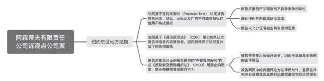

### 【核心争议点】

1.被告在其网页、网址、元标记及投放广告中使用原告注册商标是否构成《美国法典》第 15 卷第 1114 条第（1）款和第 1125 条（a）款规定的商标侵权、不正当竞争和虚假原产地指定.

2.被告是否能在《通讯规范法》230 条项下不被认定为“信息内容提供者”从而就其行为获得州法下的豁免.

3.被告提供的“声誉管理服务”是否构成《反勒索及受贿组织法》禁止的勒索、贿赂和其他欺诈行为.

### 【裁判论证过程】

#### （一）被告在其网页、网址、元标记及投放广告中使用原告注册商标不构成商标侵权、不正当竞争和虚假原产地指定

## 判决分析

纽约东区法院采用了“宝利来测试”（`the Polaroid test`）以评估被告的行为是否具有产生混淆的可能性—“宝利来测试”本身包括七个方面：在先使用者的商标的强度、商标间的相似度、产品的竞争相近性和在先使用者弥合差距的可能性、实际混淆的证据、被告的恶意、被告产品的质量、相关群体的复杂程度等。值得注意的是，对于这些要素的考量并不是机械的，不必考虑这些方面本身的数量，而是应从整体上判断消费者是否可能被混淆。法院认为，在先使用者的商标的强度、商标间的相似度等因素对原告有利，但“宝丽来测试”的其他因素对原告不利：原告与被告的产品及服务不具备竞争相似性，原告未充分证明被告的实际混淆结果及其意图产生混淆的恶意，被告也未造成相当数量的通常谨慎的购买者的误认，认为该产品或服务由商标拥有方赞助（`sponsor`）或同意（`approve`），从而产生消费者混淆。因此，被告在域名、网页内容、元标记、广告中对商标的使用不构成商标侵权。进一步地，法院还根据“宝利来测试标准”，就被告在域名、网页内容、元标记及投放广告等方面使用原告注册商标是否可能造成混淆的问题作出了具体判断：

### 商标侵权判断

首先，对于被告在其运营网页域名中使用原告商标的行为，法官认为，没有一个理性的消费者会在访问一个域名内包含“`Pissed`”等表示愤怒、批判意味的字样的评论网站时，会认为该网页隶属于相应产品的生产销售方或受其赞助。同样，对于被告在网页内容中使用原告商标的行为，一个批评网站的作用显然在于提供一个可以发表批评性意见的平台，而非抢占消费者，其中的负面评论当然亦不可能被产品方所认可、支持。

其次，针对元标记中运用原告商标是否构成商标侵权的问题，法院考量了其是否可能构成“初始兴趣混淆”（`initial interest confusion`），其在本案语境下表现为：当消费者在搜索引擎的帮助下搜索原告的网站时，由于双方的网站地址存在相似性，消费者会被导向被告的网站。法院通过论证否认了这种可能：从主体关系角度出发，被告与原告并不构成竞争关系，因而难以实现消费者转向。在此处另外一个非常重要的争议点在于，原告援引了涉及利用元标记以提升搜索结果排名的行为的“Brookfi eld 案”^([\[101\]](#txt003.html#footnote_content_txt003_101))，主张被告网页在搜索结果中排在前列对其造成了损害，是由于被告不正当地使用了如下“搜索引擎优化策略”（`search engine optimization`，`SEO`）：（1）创建没有内容的网站，并仅使用其创建指向自身网站的链接；（2）在网页内容、网址、网页代码中过多使用原告的品牌名称和商标；（3）在多个网站上重复发布相同的投诉而使本应过时的内容显得新颖……但法院指出，原告认为被告通过元标记实施“搜索引擎优化策略”的认知是一种误解，澄清了当下搜索引擎主要利用算法进行结果排序的事实，并且承认了即便被告不恰当地利用了“搜索引擎优化策略”以提升被告在搜索引擎结果列表中的顺位，但这仅仅属于违反搜索引擎相关政策的行为，其并未违反商标法，不能在商标法下寻求救济。

再次，针对广告侵权，原告主张，被告通过奇缔卡公司的广告投放，在原告产品评论页面出现了其他同类产品的广告，并使用了阿森蒂夫公司的商标，因此被告构成商标侵权。但法官认为，此时，被告并非广告投放商，其仅构成商标帮助侵权（`contributory infringement`），但因原告举证不力，即未证明被告能够控制奇蒂卡的广告投放内容，未证明被告在明知或应当知道奇蒂卡公司的侵权行为后仍提供服务，亦未证明被告诱使奇蒂卡公司投放侵权广告，因此，不予支持原告的该项诉讼。

### 《通讯规范法》第 230 条豁免

纽约东区法院认定被告不属于《通信规范法》230 条（f）款第（3）项中规定的“信息内容提供者”，基于《通信规范法》230 条（e）款第（3）项而获得州法下的豁免。本案中被告虽鼓励消费者提交负面评论，但并未鼓励消费者提交诽谤性内容；被告虽调整了评论的顺序与呈现方式，其并未以删除或增加内容等行为对第三方实质内容（`substantive content`）的形成（`development`）产生影响，并未行使传统发行者所具有的决定出版（`publish`）、撤回（`withdraw`）或修改（`alter`）第三方内容的权利；且被告利用`SEO`提高网站在互联网搜索中的排序，亦不构成对第三方内容的实质性修改。综上，法院认为，评论网站不属于“信息内容提供者”（`information content provider`），被告观点公司无需承担州法下的法律责任。法院更断言：除非国会修改《通信规范法》，否则即便被告拒绝移除这些网页或评论，甚至利用评论为自己谋利，在法律上都无可非议（是否合乎商业道德则在所不问）。

### 反勒索及受贿组织法

纽约东区法院认为：原告并未充分证明被告进行了商业贿赂或勒索行为。被告并非做出负面评论的主体，因此不满足商业贿赂的主体要件，原告亦未证明运营负面评论网站本身是一种违法行为，且未充分证明其因被告的行为出于恐惧而遭受了实际经济损失，被告行为亦不构成勒索。法院进一步明确表示，原告不具有追求其商业利益而不受“愤怒消费者”负面评论影响的权利。

## 审理结果

1. 2011 年 12 月 13 日，纽约东区法院驳回了原告的初步禁令动议；
2. 2012 年 5 月 3 日，纽约东区法院批准阿森蒂夫公司在不损害其利益的情况下自愿驳回其索赔的动议。

## 相关法条

《兰哈姆法》第 32 条第（1）款（Lanham Act §32（1），15 U.S.C. §1114（1）（2005））

（1）未经登记人同意而

（a）将一注册商标的复制品、伪造品、仿冒品或欺骗性的仿制品在商业中运用于商品或服务的销售、许诺销售、分销或推广中，可能引起混淆，误认或欺骗；或

（b）复制、伪造、仿冒或欺骗性仿制注册商标，并将复制、伪造、仿冒或欺骗性仿制的商标在商业中应用于商品或服务的销售、许诺销售、分销或推广所使用或相关的标签、标识、印刷品、包装、包装纸、容器或广告上，可能引起混淆，误认或者欺骗的，

应当在注册人为获得以下规定的救济而提起的民事诉讼中承担责任。

《兰哈姆法》第 43 条（a）款（Lanham Act §43（a），15 U.S.C.§1125（a）（2012））

（a）民事诉讼

（1）任何人在商业中，在商品或服务上或与之相关方面，或在商品的容器上，使用任何文字、术语、名称、符号或图形，或其组合，或任何虚假的原产地标记，对事实的虚假或误导性描述，或对事实的虚假的或误导性表述，

（A）很可能导致混淆，或导致错误，或在该人与另一人的联合、联系或关联方面，或在另一人对其商品、服务或商业活动的来源、赞助或批准方面欺骗，或

（B）在商业广告或推广中，错误表示了他或她或他人的商品或服务或商业活动的性质、特征、质量或原产地，

在任何人认为这种行为已经或可能使其蒙受损害而提起的民事诉讼中，该人应承担责任。

《通讯规范法》第 509 条（Communications Decency Act of 1996 §509，47 U.S.C.§230（2018））

（c）保护“好撒马利亚人”屏蔽和过滤冒犯性材料

（1）出版者或发言人的待遇

交互式计算机服务的提供者或使用者不得被视为其他信息内容提供者所提供的任何信息的出版者或发言人。

（2）民事责任

交互式计算机服务的提供者或用户不应因以下原因承担责任：

（B）采取措施，为信息内容提供者或其他人提供技术手段，以对前款之材料加以限制访问

（e）对其他法律的影响

（3）州法律

本节的任何规定不得解释为阻止任何州执行与本节一致的州法律。根据与本节不一致的任何州或地方法律，不得提起诉讼，也不得施加任何责任。

（f）定义

（2）交互式计算机服务

“交互式计算机服务”是指任何提供或使计算机由多个用户访问计算机服务器的信息服务、系统或访问软件供应商，包括专门提供接入互联网的服务或系统等系统操作或服务提供的库或教育机构。

（3）信息内容提供者

“信息内容提供者”是指对通过互联网或任何其他交互式计算机服务提供的信息的创造或形成负有全部或部分责任的个人或实体。

《反勒索及受贿组织法》第 1962 条（Racketeer Infl uenced and Corrupt Organizations Act §1962，18 U.S.C. §1962（2016））

（c）被从事州际或对外贸易，或其活动影响州际或对外贸易的任何企业雇用或与之有联系的任何人，通过敲诈勒索活动或收取非法债务的方式，直接或间接地进行或参与处理该等企业的事务，即属违法。

## 案例评析

### 修正了域名及元标记商标侵权的相应标准

1996 年，伊斯特布鲁克（`Frank H. Easterbrook`）法官发表《网络空间与马的法律》一文，他指出网络法与“马”的法律别无二致，网络法问题即传统法律问题在互联网领域的延伸.^([\[102\]](#txt003.html#footnote_content_txt003_102))而劳伦斯（`Laurence Lessig`）教授以“代码即法律”（`code is law`）有力说明了网络法在制度解释、预测与建构中应当与传统法律相区别.^([\[103\]](#txt003.html#footnote_content_txt003_103))至此，网络法是否应当具有独立部门或学科地位成为网络法研究的主流问题.^([\[104\]](#txt003.html#footnote_content_txt003_104))

在商标侵权领域中，“Brookfi eld 案”中对传统商标侵权认定标准“初始兴趣混淆”在网络法中的不当移植饱受争议.^([\[105\]](#txt003.html#footnote_content_txt003_105))该案忽略了网络空间内消费者不同商品浏览切换（即页面切换）的便捷性，错误地认定不具有混淆性、难以实现消费者转向的两类产品或服务，仅因域名内使用了原告商标，可能造成消费者登陆错误，就认定其构成了商标侵权.^([\[106\]](#txt003.html#footnote_content_txt003_106))本案着眼于网络空间的特殊性，对“初始兴趣混淆”在互联网领域内的扩张适用持否定态度，推翻了 1999 年“Brookfi eld 案”的结论，以“宝丽来分析标准”明确表示，评论网站作为非竞争者，其域名及元标记中对商标的使用不构成商标侵权，不违反《兰哈姆法》的相关规定，限制了商标权保护范围，某种程度上维护了评论网站等第三方平台的持续高效运营。

然而，可以说本案对于适用“初始兴趣混淆”的否定态度一定程度上源于本案案情的特殊性，而非源自网络空间或搜索引擎的特殊性，故而可能坚持“域名及元标记领域的商标侵权需要基于个案通过‘宝丽来测试’等方法进行具体分析”的态度才是足够审慎的：从根本上讲，“愤怒消费者”难以产生混淆消费者的效果的原因在于，观点公司运用的“愤怒消费者”网本身不经营和原告的竞争性业务，不属于原告的竞争者，而且其域名内包含“`Pissed`”等负面词汇，从而使网页访问者难以产生原被告之间存在授权、赞助关系的联想。而在案情较为相似的“Soter 案”中^([\[107\]](#txt003.html#footnote_content_txt003_107))，原被告都直接经营相似产品业务且存在竞争关系，被告使用了和原告网址`www.fl ysense.net`相似的网址`www.fl ysense.com`，在顾客进入该网址后向其推送和原告经营产品具有明显竞争相似性的自营产品，法院因此判断存在混淆消费者的可能性，便并未排斥“初始兴趣混淆”的分析。

本案被告利用了基于不符合商业道德的“黑帽技术”的“搜索引擎优化策略”，但法院由于原告的主体因素，即二者间并非竞争关系，并未能够在商标法下落实被告的法律责任—该等行为如何规制，则是与域名及元标记商标侵权相关的一个重要问题。本案法官认为如“愤怒消费者”的确违反了搜索引擎服务条款，则搜索引擎运营商可以通过采取降低网站排名或从结果列表移除等措施对其进行惩罚，这意味着搜索引擎运营商可能才是制止该等行为的适格主体。而搜索引擎运营商实际上也在实施着针对使用基于“黑帽技术”的“搜索引擎优化策略”的网页的惩戒措施，比如在“Search King 案”中^([\[108\]](#txt003.html#footnote_content_txt003_108))，谷歌对其认为滥用“搜索引擎优化策略”、滥用乃至操纵其算法`Google Pagerank`的网站“搜索王”（`www.searchking.com`）进行了惩戒，这一行为虽未被谷歌确认，但是得到了其雇员的承认.^([\[109\]](#txt003.html#footnote_content_txt003_109))

### 明确商标侵权中互联网平台责任类型

2001 年，美国联邦第九巡回上诉法庭在“A&M 诉 Napster 案”中确定了知识产权三种间接侵权的责任类型：帮助侵权（`contributory infringement`）、教唆侵权（`inducement infringement`）及替代责任（`vicarious liability`）。^([\[110\]](#txt003.html#footnote_content_txt003_110))其中，帮助侵权是指行为人知道他人行为构成侵权仍然引诱、促成或者进行实质性帮助的行为。^([\[111\]](#txt003.html#footnote_content_txt003_111))本案明确了评论网站这类网络服务提供者间接侵权的主要责任形态应为帮助侵权，且因网络服务提供者难以满足“知道”要件与“帮助”（本案为直接控制（`direct control`））要件，因此在非版权领域无需借助《通讯规范法》（`CDA`）第 230 条豁免，在版权领域无需借助《数字千年版权保护法》（`DMCA`）“避风港规则”而当然不承担侵权责任。

本案法院遵循先例，明确了帮助侵权主观要件，重点审查被告对直接侵权人的侵权行为进行控制（`control and monitor`）的能力与程度，以及被告是否知晓（`know`）或应当知晓（`to have reason to know`）侵权行为并持续为其提供服务。^([\[112\]](#txt003.html#footnote_content_txt003_112))但因本案原告并未进行举证，法院亦未对控制与知晓要件进行详细解释。在“蒂芙尼诉易贝案”中，法院进一步细化了控制要件及知晓要件的审查内容。在考察被告对第三方侵权内容的控制能力时，法院从被告进行内容审查的实际能力出发，考察被告是否有防止侵权行为发生的能力。如果网络服务提供商已积极运用各类算法等技术手段对侵权行为进行审查，或建立并有效执行“通知—移除”制度，尽到注意义务，则不构成辅助侵权；其次，此处的知晓要件应当为“具体认知”（`specifi c knowledge`），也即明确知晓具体侵权者的具体侵权行为。当被告已积极采取各类打击侵权的措施时，被告亦不构成“恶意视而不见”（`intentionally blinded`）。^([\[113\]](#txt003.html#footnote_content_txt003_113))控制要件与知晓要件往往相辅相成，无从知晓，亦无控制与监督的可能性。此举意在保护网络服务提供者及其消费者，否则，网络服务提供者将耗费大量人力物力进行审查，亦会增设第三方内容发布的限制，并将审查成本转嫁至消费者。

我国网络服务提供者间接侵权责任规则虽移植于美国（即`DCMA`“避风港原则”），但我国在移植过程中，将避风港中的责任排除规则转换为责任构成要件，将“有理由知道”转变为“应当知道”，从而对网络服务提供者苛以注意义务。最终网络服务提供者间接侵权责任演变为不作为侵权责任，作为义务来源是网络服务提供者违反注意义务提供网络服务的先前行为。此种转变虽加重了网络服务提供者的责任，但也促进了主动审查下权利的预防性保护，摆脱了美国“避风港规则”的僵化。^([\[114\]](#txt003.html#footnote_content_txt003_114))

### 进一步明确互联网服务提供者在《通讯规范法》第 230 条项下获得责任豁免的适用条件

1996 年《通讯规范法》出台，此后第 230 条的适用经历了对交互式计算机服务提供者的宽泛豁免进行削弱，从而过渡到有条件的豁免的过程。作为交互式计算机服务提供者的评论网站，经由《通讯规范法》第 230 条豁免与构成信息内容提供者而不得豁免的界限显得尤为关键—本案基本遵循了传统的分析思路，即从本条适用要件入手，先认定交互式计算机服务提供者身份，再认定被告是否实质性参与“形成”（`develop`）信息的过程、是否不合理地超越传统出版者的编辑角色两项标准，从而判断其是否构成信息内容提供者而不被豁免。此外，本案亦结合案情特殊性，进一步明确了评论网站利用搜索引擎排序算法，创造若干关联页面以提升评论网页排序的行为，以及对于评论内容呈现及呈现方式的合理的选择与调整都不构成对第三方内容的创造或修改。

就判决结果角度分析，《通讯规范法》第 230 条本身的模糊性扩大了本案法院自由裁量的空间—本案的关键在于被告是否“形成”争议内容，而判决中坦言“形成”在条文中并无准确定义，其性质相对于“创造”（`create`），亦难以直观判断；而美国法院在 1996 年《通讯规范法》出台后较长一段时间内存在较多对第 230 条进行扩张适用的情况，^([\[115\]](#txt003.html#footnote_content_txt003_115))本案可能亦难以避免受此影响。

## 算法中立原则的司法适用

而针对算法运用领域，司法实践坚持算法中立原则，只要算法并未对第三方用户发布的内容进行编辑修改，则网络服务提供商可获得《通信规范法》下的豁免，以充分保障言论自由，鼓励平台自愿移除暴力或淫秽内容.在“谷歌案”中，即便谷歌为广告商提供付费关键词工具（Keyword Tool）服务，让用户在搜索与广告内容相关的关键词时，增加付费广告商的网页排名，虚假广告亦趁虚而入，虽然此时该算法在某种程度上促进了信息的表达，但用户是否发布内容也即广告商是否选择购买此项服务的决定权仍属于用户，谷歌并未参与虚假广告的发布与编辑.^([\[116\]](#txt003.html#footnote_content_txt003_116))在“脸书案”中，法院认为脸书运用的内容审查算法并未对违法内容产生实质性贡献，比如对第三方内容进行编辑，不构成对内容的发展.即便脸书通过算法，让部分帖子具有更高的曝光度，此时仍不构成对内容的实质性变更.^([\[117\]](#txt003.html#footnote_content_txt003_117))而在最近的“谷歌案”中，法院再次重申算法中立，严格恪守《通信规范法》的立法目的，认为《通信规范法》的目的在于保护言论自由，保护未成年人免受暴力及淫秽内容的侵蚀，网络服务提供者并不因为设计算法推荐而不再享有豁免.本案中，尽管谷歌会根据用户历史记录预测偏好，为其提供恐怖组织等违法视频，但此时，谷歌并没有鼓励用户搜索或发布违法内容，不构成对内容的实质性修改.但本案反对法官亦否定了算法中立，认为算法推荐实质上为兴趣相同的用户搭建了联系，仅在网络服务提供商对内容进行实质编辑时才对其进行追责，将会加剧恐怖主义的肆虐与社会分裂.^([\[118\]](#txt003.html#footnote_content_txt003_118))

本案中，对于作为交互式计算机服务提供者的被告，法院尽可能地免除了其可能参与实质性的“形成”争议内容的过程.而就其判决之影响而言并非没有瑕疵：其一，《通讯规范法》第 230 条在最高法院宪法审查中得以保留，原因之一就在于借此促进交互式计算机服务提供者充分发挥其网络中介者的自律作用，而评论网站非但未审慎审查可能具有诽谤性的评论内容，反而借此开发声誉管理服务等项目以从评论内容受害者处牟利，某种程度上无疑是对国会立法初衷的违背，即使得《通讯规范法》第 230 条遭到“滥用”，从而使许多不体面（indecency）的而非体面（decency）的行为获得豁免.^([\[119\]](#txt003.html#footnote_content_txt003_119))其二，对于因负面评论内容而受损者，以及因评论网站利用其对于负面评论的调整手段牟利而受损者而言，其名誉权、财产权难以受到保障，为法院所意识到的商业伦理道德上的瑕疵是否能够假借法律分析的思路而得以修正，引人思考.

## 关联判例推荐

### 1. Brookfi eld Communications v. West Coast Entertainment Corp., 174 F.3d 1036(9th Cir.1999)

核心事实：原告向法院提起诉讼，禁止被告在其网页的元标记中使用原告的注册商标.法院认为，被告行为会造成“初始兴趣混淆”—原本寻找原告的网站，在搜索引擎输入注册商标后，由于被告的元标记使用了原告商标故而排位靠前，消费者可能会因而转向接受被告的服务.

与本案关联点：本案中原告引用此案中第九巡回法院的一项裁决，即“初始兴趣混淆”可能是由元标记的误导性使用造成的，法院推翻了该案中关于域名及元标记商标侵权与“初始兴趣混淆”的判断标准，认定原告的论点不具备说服力.

### 2. Nomination Di Antonio E Paolo Gensini S.N.C. v. H.E.R. Accessories Ltd.,2010 WL 4968072 (S.D.N.Y. 2010)

核心事实：原告诉称，本案许可证颁布商被告向供应商被告颁布的可分解链式表带侵犯了自己的商标权，但法院认为许可证颁布商并不具有防止第三方滥用商标的先行义务，对其他供应商被告的侵权行为并未进行直接控制或监督，因而不承担帮助侵权责任.

与本案关联点：本案中法院明确了商标侵权中第三方帮助责任的侵权要件，即对直接侵权方侵权行为进行直接控制或监督，且知道或有理由知道直接侵权行为的存在.以上构成要件为本案所用，扩张适用至网络服务提供商侵权责任认定中.

### 3. MCW Inc. v.Badbusinessbureau.com, LLC, 2004 WL 833595 (N.D.Tex. 2004)

核心事实：消费者投诉论坛 Badbusinessbureau.com 通过电子邮件鼓励消费者在其商店前拍摄企业主、其汽车和其车牌的照片，以便其在包含“骗子”、“骗局”和“剽窃”等字样的网站标题旁边附加这些照片.法院认为，《通讯规范法》第 230 条赋予交互式计算机服务的豁免范围，并不宽泛到足以豁免在“创造”或“形成”有争议内容方面发挥积极、促进作用的交互式计算机服务，Badbusinessbureau 鼓励并指导消费者收集具体的详细信息的活动远超传统出版者的职能，因而不能在《通讯规范法》第 230 条项下豁免.

与本案关联点：在判断该类评论网站是否超越交互式计算机服务而不能受到《通讯规范法》第 230 条（c）款豁免时，法院引用了是否超越传统出版者的编辑角色以及是否参与形成（develop）信息的过程两项标准，这两项标准作为关键的分析角度在本案中发挥了作用.

### 4. Global Royalties, Ltd. v. Xcentric Ventures, LLC, 544 F.Supp.2d 929 (D.Ariz. 2008)

核心事实：消费者评论网站 ripoff report.com 被指控利用评论作为杠杆，强迫目标企业为其企业宣传计划（Corporate Advocacy Program）付费以帮助调查和解决已发布的消费者投诉，并从中获取经济利益.法院认为 ripoff report.com 的确鼓励发表诽谤性内容，但目前没有法律（包括《通讯规范法》）支持鼓励发布诽谤性内容的被告应对其网站中上述言论的“创造”或“形成”承担责任.最终法院判决批准了被告驳回原告评论的动议.

与本案关联点：在案情与本案较为相似的情况下，法院在承认网站鼓励发表负面评论的同时，提出这类网站利用其鼓励生成（并非直接“创造”或实质性地“形成”）的负面评论牟利的现状尚无法可依.

### 5. Levitt v. Yelp! Inc., 2011 WL 5079526 (N.D.Cal. 2011)

核心事实：原告指控消费者评论网站 Yelp！诱使原告支付广告费用，进而通过删除某些第三方关于原告的负面评论并发布其他评论或更改评论展示顺序，来操纵其评论页面.法院认定被告行为并不构成对于争议内容的“形成”.同时法院在审理该案时注重原告对于被告的指控是否充分，并严格区分具有充分证据支持的主张和仅是猜测性的意见.

与本案关联点：对于相似的针对负面评论的顺序调整、有选择性的显示，该案与本案法院都认定调整网页评论内容顺序的行为并不构成对于争议内容的“形成”，并注重对于指控以及证据是否充分的考察.

## 注释

[\[1\]](#txt003.html#footnote_quote_txt003_1)左亦鲁：《算法与言论—美国的理论与实践》，载《环球法律评论》2018 年第 5 期.

[\[2\]](#txt003.html#footnote_quote_txt003_2)Search King， Inc. v. Google Tech.， Inc.， No. 02-1457， 2003 WL 21464568 （W.D. Okla. May 27， 2003）.

[\[3\]](#txt003.html#footnote_quote_txt003_3)Search King， Inc. v. Google Tech.， Inc.， No. 02-1457， 2003 WL 21464568 （W.D. Okla. May 27， 2003）.

[\[4\]](#txt003.html#footnote_quote_txt003_4)Search King， Inc. v. Google Tech.， Inc.， No. 02-1457， 2003 WL 21464568 （W.D. Okla. May 27， 2003）.

[\[5\]](#txt003.html#footnote_quote_txt003_5)Jeff erson County Sch， Dist， No. R-I v. Moody y Investor Services， Inc.， 175 F.3d 848 （10th Cir， 1999）.

[\[6\]](#txt003.html#footnote_quote_txt003_6)Search King， Inc. v. Google Tech.， Inc.， No. 02-1457， 2003 WL 21464568 （W.D. Okla. May 27， 2003）.

[\[7\]](#txt003.html#footnote_quote_txt003_7)Search King， Inc. v. Google Tech.， Inc.， No. 02-1457， 2003 WL 21464568 （W.D. Okla. May 27， 2003）.

[\[8\]](#txt003.html#footnote_quote_txt003_8)Jeff erson County Sch， Dist， No. R-I v. Moody y Investor Services， Inc.， 175 F.3d 848 （10th Cir， 1999）.

[\[9\]](#txt003.html#footnote_quote_txt003_9)Search King， Inc. v.Google Tech.， Inc.， No. 02-1457， 2003 WL 21464568 （W.D. Okla. May 27，2003）.

[\[10\]](#txt003.html#footnote_quote_txt003_10)Search King， Inc. v.Google Tech.， Inc.， No. 02-1457， 2003 WL 21464568 （W.D. Okla. May 27，2003）.

[\[11\]](#txt003.html#footnote_quote_txt003_11)Gaylord Entertainment v. Thompson 958 P.2d 128 （1998 OK 30）.

[\[12\]](#txt003.html#footnote_quote_txt003_12)算法黑箱是指由于技术本身的复杂性以及媒体机构、技术公司的排他性商业政策，算法犹如一个未知的“黑箱”—用户并不清楚算法的目标和意图，也无从获悉算法设计者、实际控制者以及机器生成内容的责任归属等信息，更谈不上对其进行评判和监督.

[\[13\]](#txt003.html#footnote_quote_txt003_13)算法操纵是指由于算法的广泛应用，算法渐渐地控制人们的生活.

[\[14\]](#txt003.html#footnote_quote_txt003_14)陈景辉：《算法的法律性质：言论、商业秘密还是正当程序？》，载《比较法研究》2020 年第 2 期.

[\[15\]](#txt003.html#footnote_quote_txt003_15)左亦鲁：《算法与言论—美国的理论与实践》，载《环球法律评论》2018 年第 5 期.

[\[16\]](#txt003.html#footnote_quote_txt003_16)左亦鲁：《算法与言论—美国的理论与实践》，载《环球法律评论》2018 年第 5 期.

[\[17\]](#txt003.html#footnote_quote_txt003_17)左亦鲁：《算法与言论—美国的理论与实践》，载《环球法律评论》2018 年第 5 期.

[\[18\]](#txt003.html#footnote_quote_txt003_18)左亦鲁：《算法与言论—美国的理论与实践》，载《环球法律评论》2018 年第 5 期.

[\[19\]](#txt003.html#footnote_quote_txt003_19)左亦鲁：《算法与言论—美国的理论与实践》，载《环球法律评论》2018 年第 5 期.

[\[20\]](#txt003.html#footnote_quote_txt003_20)左亦鲁：《算法与言论—美国的理论与实践》，载《环球法律评论》2018 年第 5 期.

[\[21\]](#txt003.html#footnote_quote_txt003_21)左亦鲁：《算法与言论—美国的理论与实践》，载《环球法律评论》2018 年第 5 期.

[\[22\]](#txt003.html#footnote_quote_txt003_22)左亦鲁：《算法与言论—美国的理论与实践》，载《环球法律评论》2018 年第 5 期.

[\[23\]](#txt003.html#footnote_quote_txt003_23)左亦鲁：《算法与言论—美国的理论与实践》，载《环球法律评论》2018 年第 5 期.

[\[24\]](#txt003.html#footnote_quote_txt003_24)左亦鲁：《算法与言论—美国的理论与实践》，载《环球法律评论》2018 年第 5 期.

[\[25\]](#txt003.html#footnote_quote_txt003_25)左亦鲁：《算法与言论—美国的理论与实践》，载《环球法律评论》2018 年第 5 期.

[\[26\]](#txt003.html#footnote_quote_txt003_26)左亦鲁：《算法与言论—美国的理论与实践》，载《环球法律评论》2018 年第 5 期.

[\[27\]](#txt003.html#footnote_quote_txt003_27)左亦鲁：《算法与言论—美国的理论与实践》，载《环球法律评论》2018 年第 5 期.

[\[28\]](#txt003.html#footnote_quote_txt003_28)左亦鲁：《算法与言论—美国的理论与实践》，载《环球法律评论》2018 年第 5 期.

[\[29\]](#txt003.html#footnote_quote_txt003_29)左亦鲁：《算法与言论—美国的理论与实践》，载《环球法律评论》2018 年第 5 期.

[\[30\]](#txt003.html#footnote_quote_txt003_30)左亦鲁：《算法与言论—美国的理论与实践》，载《环球法律评论》2018 年第 5 期.

[\[31\]](#txt003.html#footnote_quote_txt003_31)陈道英：《人工智能中的算法是言论吗？—对人工智能中的算法与言论关系的理论探讨》，载《深圳社会科学》2020 年第 2 期.

[\[32\]](#txt003.html#footnote_quote_txt003_32)陈道英：《人工智能中的算法是言论吗？—对人工智能中的算法与言论关系的理论探讨》，载《深圳社会科学》2020 年第 2 期.

[\[33\]](#txt003.html#footnote_quote_txt003_33)陈道英：《人工智能中的算法是言论吗？—对人工智能中的算法与言论关系的理论探讨》，载《深圳社会科学》2020 年第 2 期.

[\[34\]](#txt003.html#footnote_quote_txt003_34)陈景辉：《算法的法律性质：言论、商业秘密还是正当程序？》，载《比较法研究》2020 年第 2 期.

[\[35\]](#txt003.html#footnote_quote_txt003_35)齐延平、何晓斌：《算法社会言论自由保护中的国家角色》，载《华东政法大学学报》2019 年第 6 期.

[\[36\]](#txt003.html#footnote_quote_txt003_36)左亦鲁：《算法与言论—美国的理论与实践》，载《环球法律评论》2018 年第 5 期.

[\[37\]](#txt003.html#footnote_quote_txt003_37)22 C.F.R. §120-130 （1994）.（注：《美国联邦法规》第 22 卷，第 120-130 节.）

[\[38\]](#txt003.html#footnote_quote_txt003_38)Texas v. Johnson， 491 U.S. 397 （1989）.

[\[39\]](#txt003.html#footnote_quote_txt003_39)“Snuffl e”是作者冠以的昵称，其全称为“一种基于单向杂凑函数实现的即时私钥流加密机”.

[\[40\]](#txt003.html#footnote_quote_txt003_40)Texas v. Johnson， 491 U.S. 397 （1989）.

[\[41\]](#txt003.html#footnote_quote_txt003_41)Freedman v. State of Md.， 380 U.S. 51 （1965）.

[\[42\]](#txt003.html#footnote_quote_txt003_42)Yniguez v. Arizonans， 69 F.3d 920 （9th Cir.1995）.

[\[43\]](#txt003.html#footnote_quote_txt003_43)Marcia S. Smith， Encryption Technology： Congressional Issues， CRS Issue Brief （Cong. Res. Serv.），Oct. 20. 1997， p.1， 1.

[\[44\]](#txt003.html#footnote_quote_txt003_44)Encryption Bills Make Their Way Back to Capitol Hill， Communications Today （Feb. 28， 1997），https：//www.proquest.com/trade-journals/encryption-bills-make-their-way-back-capitol-hill/docview/219325835/se-2？accountid=14662.

[\[45\]](#txt003.html#footnote_quote_txt003_45)出口管制条例 15 C.F.R. §734.2（b）（9）（1998）.（注：《出口管制条例》，收入 1998 年版《美国联邦法规》第 15 卷，第 734 节第 2 条（b）款第（9）项，现已被删除.）
[\[46\]](#txt003.html#footnote_quote_txt003_46)出口管制条例 15 C.F.R. §740-744（1998）.（注：《出口管制条例》，收入 1998 年版《美国联邦法规》第 15 卷，第 740 节至 744 节，经过多次更改.）
[\[47\]](#txt003.html#footnote_quote_txt003_47)一审引用出口管制条例 15 C.F.R. §774 supp. I. （1998）.（注：《出口管制条例》，收入 1998 年版《美国联邦法规》第 15 卷，第 774 节补充条款第一条.）；二审引用 15 C.F.R.§ 738.2 （2000）.（注：2000 年版《美国联邦法规》第 15 卷，第 738 节第 2 条.）
[\[48\]](#txt003.html#footnote_quote_txt003_48)出口管制条例 15 C.F.R. §734.3，（b）（2）和（b）（3）段的注释（1998）.（注：《出口管制条例》，收入 1998 年版《美国联邦法规》第 15 卷，第 734 节第 3 条（b）款第（2）（3）项的注释.）
[\[49\]](#txt003.html#footnote_quote_txt003_49)出口管制条例 15 C.F.R. §742.15（a）（1998）.（注：《出口管制条例》，收入 1998 年版《美国联邦法规》第 15 卷，第 742 节第 15 条（a）款.）
[\[50\]](#txt003.html#footnote_quote_txt003_50)特纳广播系统公司诉联邦通信委员会案，512 U.S. 622（1994）.
[\[51\]](#txt003.html#footnote_quote_txt003_51)美国诉奥布赖恩案，391 U.S. 367（1968）. 转引自特纳广播公司案.
[\[52\]](#txt003.html#footnote_quote_txt003_52)参见卡恩诉美国国务院案，925 F.Supp. 1，9 n. 19（D.D.C.1996）.（注：此案在本案一审判决时因出口管制权的管辖转移而重新启动.）
[\[53\]](#txt003.html#footnote_quote_txt003_53)伯恩斯坦诉美国国务院案，922 F.Supp. 1426，1436（N.D.Cal.1996）.（注：此案在本案判决时已经上诉，当时将由第九巡回法院开庭审理.）
[\[54\]](#txt003.html#footnote_quote_txt003_54)罗斯诉美国案，354 U.S. 476（1957）；弗吉尼亚州药房委员会诉弗吉尼亚公民消费者委员会公司案，425 U.S. 748（1976）.
[\[55\]](#txt003.html#footnote_quote_txt003_55)查普林斯基诉新罕布什尔州案，315 U.S. 568（1942）.
[\[56\]](#txt003.html#footnote_quote_txt003_56)斯彭斯诉华盛顿州案，418 U.S. 405（1974）.
[\[57\]](#txt003.html#footnote_quote_txt003_57)德克萨斯州诉约翰逊案，491 U.S. 406，109 S. Ct. 2533，105 L. Ed. 2d 342（1989）.
[\[58\]](#txt003.html#footnote_quote_txt003_58)廷克诉得梅因独立社区学区案，393 U.S. 503（1969）.
[\[59\]](#txt003.html#footnote_quote_txt003_59)美国诉奥布赖恩案，391 U.S. 367（1968）. 转引自特纳广播公司案.
[\[60\]](#txt003.html#footnote_quote_txt003_60)互操作，即平台或编程语言之间交换和共享数据的能力，其需要硬件、网络、操作系统、数据库系统、应用软件、数据格式、数据语义等不同层次的互操作.
[\[61\]](#txt003.html#footnote_quote_txt003_61)该法条现已从本法中删除.该条例将“export”定义为“受 EAR 管制的物品自美国实际运出或传输。”出口管制条例 15 C.F.R.§734.2（b）（1）（1998）.
[\[62\]](#txt003.html#footnote_quote_txt003_62)该法条于本案二审前发生变更：增加“……商务管制清单（见 EAR 第 774 部分附录第 1 号），除根据 §§ 740.13（e）和 740.17（a）（5）（i）可出口的源代码外，包括下载或导致下载…… ”；删去加拿大.
[\[63\]](#txt003.html#footnote_quote_txt003_63)该法条于本案二审前发生变更，此条是当时变更后的条款.
[\[64\]](#txt003.html#footnote_quote_txt003_64)\[美\]劳伦斯·莱斯格：《代码 2.0：网络空间中的法律》，李旭、沈伟伟译，清华大学出版社 2009 年版，第 7 页.
[\[65\]](#txt003.html#footnote_quote_txt003_65)沃尔特诉美国案，447 U.S. 649，656（1980）.
[\[66\]](#txt003.html#footnote_quote_txt003_66)州诉斯科夫纳案，174 Vt. 430，431-32，800 A.2d 1072，1074（2002）.
[\[67\]](#txt003.html#footnote_quote_txt003_67)州诉杨案，2010 VT 97，189 Vt. 37，12 A.3d 510（Vt. 2010）.
[\[68\]](#txt003.html#footnote_quote_txt003_68)州诉莫兰案，141 Vt. 10，16，444 A.2d 879，882（1982）.
[\[69\]](#txt003.html#footnote_quote_txt003_69)Jed Rubenfeld，《隐私的终结》，61 Stanford Law Review 101，101-161（2008）.
[\[70\]](#txt003.html#footnote_quote_txt003_70)缩略图是指储存在第三方网站上的全尺寸图像的更小尺寸、更低分辨率版本的图像.
[\[71\]](#txt003.html#footnote_quote_txt003_71)《数字千年版权法》第 107 条，17 U.S.C. §107（1998）.（注：《数字千年版权法》第 107 条，收入 1998 年《美国法典》第 17 卷，第 107 条.）
[\[72\]](#txt003.html#footnote_quote_txt003_72)服务器标准是指仅限于以上传或其他方式， 将作品置于向公众开放的网络服务器中， 除此之外均不属于提供行为.
[\[73\]](#txt003.html#footnote_quote_txt003_73)万勇：《网络深层链接的著作权法规制》，载《法商研究》2018 年第 6 期.
[\[74\]](#txt003.html#footnote_quote_txt003_74)刘家瑞：《为何历史选择了服务器标准—兼论聚合链接的归责原则》，载《知识产权》2017 年第 2 期.
[\[75\]](#txt003.html#footnote_quote_txt003_75)参见万勇：《网络深层链接的著作权法规制》，载《法商研究》2018 年第 6 期.
[\[76\]](#txt003.html#footnote_quote_txt003_76)参见冯晓青：《知识产权法利益平衡理论》，中国政法大学出版社 2006 年版.
[\[77\]](#txt003.html#footnote_quote_txt003_77)陈明涛：《搜索引擎技术语境下的合理使用分析》，载《科技与法律》2009 年第 6 期.
[\[78\]](#txt003.html#footnote_quote_txt003_78)《数字千年版权法》第 512 条，17 U.S.C.§512（1998）.（注：《数字千年版权法》第 512 条，收入 1998 年《美国法典》第 17 卷，第 512 条.）
[\[79\]](#txt003.html#footnote_quote_txt003_79)《美国版权法》第 107 条，17 U.S.C. §107（1976）.（注：《美国版权法》第 107 条，收入 1976 年《美国法典》第 17 卷，第 107 条.）
[\[80\]](#txt003.html#footnote_quote_txt003_80)美国作家协会诉谷歌公司案，954 F.Supp.2d 282（2013）.
[\[81\]](#txt003.html#footnote_quote_txt003_81)《信息网络传播权保护条例》第 23 条：“网络服务提供者为服务对象提供搜索或者链接服务，在接到权利人的通知书后，根据本条例规定断开与侵权的作品、表演、录音录像制品的链接的，不承担赔偿责任；但是，明知或者应知所链接的作品、表演、录音录像制品侵权的，应当承担共同侵权责任.”
[\[82\]](#txt003.html#footnote_quote_txt003_82)《关于审理侵犯信息网络传播权民事纠纷案件适用法律若干问题的规定》（法释〔2012〕20 号），第 5 条：“网络服务提供者为提供搜索服务，按照一定的技术安排生成作品、表演、录音录像制品的网页快照、缩略图等并向公众提供的，人民法院应当认定其构成提供行为.前款规定行为未影响作品、表演、录音录像制品的正常使用，亦未不合理损害权利人对作品、表演、录音录像制品的合法权益，网络服务提供者主张其构成合理使用的，人民法院应予支持.
[\[83\]](#txt003.html#footnote_quote_txt003_83)第一个与第二个因素源自于判例：凯利诉 Arriba Soft 公司案，336 F.3d 811，817（9th Cir.2003）；第三个因素源自于判例：宗教技术中心诉 Netcom 在线通信服务公司案，907 F.Supp.1361，1369-1370（N.D.Cal.1995），“direct infringement requires a volitional act by defendant；automated copying by machines occasioned by others not suffi cient”（“直接侵犯版权需要证明被告是有意为之，因他人引起的机器自动复制行为并不充分”.）
[\[84\]](#txt003.html#footnote_quote_txt003_84)凯利诉 Arriba Soft 公司案，336 F.3d 811（9th Cir.2003）.
[\[85\]](#txt003.html#footnote_quote_txt003_85)索尼公司诉环球城影业公司案，464 U.S. 417，449-niversalS.Ct. 774，78 L.Ed.2d 574（1984）.
[\[86\]](#txt003.html#footnote_quote_txt003_86)索尼公司诉环球城影业公司案，464 U.S. 417，449-450，104 S.Ct. 774，78 L.Ed.2d 574（1984）.
[\[87\]](#txt003.html#footnote_quote_txt003_87)Effects Associates 公司诉科恩案，908 F.2d 555，558-59（9th Cir.1990）.
[\[88\]](#txt003.html#footnote_quote_txt003_88)奎因诉底特律市案，23 F.Supp.2d 741，749（E.D.Mich.1998）.
[\[89\]](#txt003.html#footnote_quote_txt003_89)德福雷斯特无线电电话公司诉美国案，273 U.S. 236，241，47 S.Ct. 366，71 L.Ed. 625（1927）.
[\[90\]](#txt003.html#footnote_quote_txt003_90)基恩经销商服务公司诉哈茨案，968 F.Supp. 944（1997）.（注：该案确立了“著作权人明知被告的使用行为并表示沉默，则构成默示许可”的规则.）
[\[91\]](#txt003.html#footnote_quote_txt003_91)卡森诉戴尼吉公司案，344 F.3d 446，453（5th Cir.2003）.
[\[92\]](#txt003.html#footnote_quote_txt003_92)埃利森诉罗伯逊案，357 F.3d 1072，1081（9th Cir.2004）.
[\[93\]](#txt003.html#footnote_quote_txt003_93)王迁：《搜索引擎提供“快照”服务的著作权侵权问题研究》，载《东方法学》2010 年第 3 期.
[\[94\]](#txt003.html#footnote_quote_txt003_94)翟建雄：《网页保存中的版权问题—来自美国的判例解析》，中国图书馆学会 2008 年年会论文，2008 年 10 月于重庆.
[\[95\]](#txt003.html#footnote_quote_txt003_95)翟建雄：《网页保存中的版权问题—来自美国的判例解析》，中国图书馆学会 2008 年年会论文，2008 年 10 月于重庆.
[\[96\]](#txt003.html#footnote_quote_txt003_96)王迁：《搜索引擎提供“快照”服务的著作权侵权问题研究》，载《东方法学》2010 年第 3 期.
[\[97\]](#txt003.html#footnote_quote_txt003_97)吕炳斌：《网络时代的版权默示许可制度—两起 Google 案的分析》，载《电子知识产权》2009 年第 7 期.
[\[98\]](#txt003.html#footnote_quote_txt003_98)美国作家协会诉谷歌公司案，954 F.Supp.2d 282（2013）.
[\[99\]](#txt003.html#footnote_quote_txt003_99)圣费尔南多谷公平住房委员会诉 Roommates.com 有限责任公司案，521 F.3d 1157（9th Cir.2008）.
[\[100\]](#txt003.html#footnote_quote_txt003_100)泽兰诉美国在线公司案，129 F.3d 327（4th Cir.1997）.
[\[101\]](#txt003.html#footnote_quote_txt003_101)布鲁克菲尔德通信公司诉西海岸娱乐公司案，174 F.3d 1036（9th Cir. 1999）.
[\[102\]](#txt003.html#footnote_quote_txt003_102)Frank H. Easterbrook，《网络空间与马法》，1996 年芝加哥大学法律论坛 207，207-216（1996）.

[\[103\]](#txt003.html#footnote_quote_txt003_103)Lawrence Lessig，《论马法：网络法可能带来的启示》，113 Harvard Law Review 501，501-549，（1999）.
[\[104\]](#txt003.html#footnote_quote_txt003_104)周庆山：《论网络法律体系的整体建构》，载《河北法学》2014 年第 8 期.
[\[105\]](#txt003.html#footnote_quote_txt003_105)Michael Grynberg，《商标诉讼作为消费者冲突》，83 New York University Law Review 60，60-119，（2008）.
[\[106\]](#txt003.html#footnote_quote_txt003_106)Playboy Enterprises， Inc. v. Netscape Commc’ns Corp.， 354 F.3d 1020 （9th Cir. 2004）.
[\[107\]](#txt003.html#footnote_quote_txt003_107)Soter Technologies， LLC v. IP Video Corporation， 523 F.Supp.3d 389 （S.D.N.Y. 2021）.
[\[108\]](#txt003.html#footnote_quote_txt003_108)Search King Inc. v.Google Technology， Inc.， 2003 WL 21464568 （W.D.Okla. 2003）.
[\[109\]](#txt003.html#footnote_quote_txt003_109)Greg Lastowka，《谷歌法》，Duke Science， Technology & Innovation Paper No. 26， 2007， p.24.
[\[110\]](#txt003.html#footnote_quote_txt003_110)A&M Records， Inc. v. Napster， Inc.， 239 F.3d 1004 （C.A.9 （Cal.）， 2001）；朱开鑫：《网络著作权间接侵权规则的制度重构》，载《法学家》2019 第 6 期.
[\[111\]](#txt003.html#footnote_quote_txt003_111)Inwood Labs.， Inc. v. Ives Labs.， Inc.， 456 U.S. 844， 102 S. Ct. 2182， 72 L. Ed. 2d 606 （1982）.
[\[112\]](#txt003.html#footnote_quote_txt003_112)Nomination Di Antonio E Paolo Gensini S.N.C. v. H.E.R. Accessories Ltd.， No. 07 CIV 6959 DAB，2010 WL 4968072 （S.D.N.Y. Dec. 6， 2010）.
[\[113\]](#txt003.html#footnote_quote_txt003_113)Tiff any （NJ） Inc. v. eBay Inc.， 600 F.3d 93 （2d Cir. 2010）.
[\[114\]](#txt003.html#footnote_quote_txt003_114)朱冬：《网络服务提供者间接侵权责任的移植与变异》，载《中外法学》2019 第 5 期.
[\[115\]](#txt003.html#footnote_quote_txt003_115)张金玺：《美国网络中介者的诽谤责任与免责规范初探—以〈通讯端正法〉第 230 条及其司法适用为中心》，载《新闻与传播研究》2015 年第 22 期.
[\[116\]](#txt003.html#footnote_quote_txt003_116)Goddard v. Google， Inc.， 640 F. Supp. 2d 1193 （N.D. Cal. 2009）.
[\[117\]](#txt003.html#footnote_quote_txt003_117)Force v. Facebook， Inc.， 934 F.3d 53， 68 （2d Cir. 2019）.
[\[118\]](#txt003.html#footnote_quote_txt003_118)Gonzalez v. Google LLC， 2 F.4th 871 （9th Cir. 2021）.
[\[119\]](#txt003.html#footnote_quote_txt003_119)Andrew M. Sevanian，《《通信端正法》第 230 条：无需以善良撒玛利亚人身份行事的善良撒玛利亚人法》，21 UCLA Entertainment Law Review 121，121-146，（2014）.

# 第四章 信用评价领域前沿判例

## 4.1 德霍约斯等诉好事达保险公司等案

### 【案件索引】

Dehoyos v. Allstate Corp., 2002 WL 1491650 (2002)
Dehoyos v. Allstate Corp., 345 F.3d 290 (2003)
Allstate Corp. v. DeHoyos, 541 U.S.1010, 124 S.Ct. 2074, 158 L.Ed.2d 621 (2004)
Dehoyos v. Allstate Corp., 2006 WL 2329417 (2006)
Dehoyos v. Allstate Corp., 240 F.R.D. 269 (2007)

### 【关键词】

算法行政；技术正当程序；算法可解释性

### 【案件提要】

本案是有关信用评分和算法歧视的经典案件.原告德霍约斯（Dehoyos）等六名非裔美国人和西班牙裔客户代表针对被告好事达保险公司等（Allstate Insurance Company，下称“好事达公司”）提起集体诉讼，指控被告违反了《美国法典》第 42 卷第 1981 条、第 1982 条和第 3604 条的规定，从事种族歧视性商业行为.具体来说，包括原告德霍约斯在内的六名少数族裔客户指控被告好事达公司等使用“信用评分（credit scoring）”进行不公平种族歧视，据此，非洲裔和西班牙裔保单持有人在购买汽车和房屋保险时被收取的保费要高于同等情况下的白种人客户.
在本案中，原告指控被告利用特定的保险评分算法对少数族裔产生了差别影响，原告的指控为其提起集体诉讼提供充分的理由，故法院裁定本案适用集体诉讼.被告好事达公司否认存在任何歧视，主张其使用的信用报告中的信息是基于可有效预测保险损失且统计上合理的指标，并主张：（1）根据《麦卡伦—弗格森法案》^([\[1\]](#txt004.html#footnote_content_txt004_1))的规定，应当禁止原告提起诉讼；（2）根据伯福德弃权原则（Burford Abstention Doctrine）^([\[2\]](#txt004.html#footnote_content_txt004_2))，法院不应对本案作出判决；（3）原告在其起诉状中未能证明被告存在故意歧视的事实.本案主要围绕以下法律争议焦点开展论证：（1）好事达公司是否歧视集体成员，向其收取的保险费高于向处境相似的白种人收取的保险费；好事达公司的信用评分公式对集体成员是否有差别影响；（2）好事达公司是否通过向原告和集体成员隐瞒重要信息，维持其在种族歧视的基础上为出售其保险而制定的公司政策；（3）好事达公司是否通过培训，指示或要求其代理商隐瞒或不披露其在保险销售和服务过程中的歧视性做法；（4）好事达公司是否系统地拒绝向原告和集体成员披露重大信息，例如计算保费的实际依据等.
经过多次上诉与听证，本案最终以和解告终.在和解协议中，好事达公司同意采用一种新的信用评分公式，替代原告指控的歧视非洲裔美国人和西班牙裔保单持有人的现行保险评分方案，其实施将为少数族裔客户带来实质性利益.好事达公司通过向公众披露信用评分公式的相关信息，帮助消费者了解保险信用评分的运行逻辑，增强保险产品的可信赖性.
本案直接促成了《联邦反歧视法》适用于保险业领域.通过和解来修正好事达公司原有信用评分公式中存在的算法歧视，能够从最大程度上降低算法歧视对少数族裔客户平等权的侵害，从而帮助包括少数族裔在内的客户获得定价更为合理的保险产品.
算法应用的普及对现有法律的适用提出了新的要求，有效约束算法权力的监管法律制度缺位仍是目前监管部门面对的现实困境.在增强算法透明度、克服算法歧视层面，2017 年 12 月，美国纽约市议会通过了美国第一部《算法问责法案》，要求成立专责小组研究公共部门如何使用算法，为公众提供算法透明度报告.2020 年 1 月，美国白宫发布的《人工智能应用监管指南备忘录（草案）》提出：除了有助于改进规则制定流程外，透明度和信息披露还可以提高公众对 AI 应用程序的信任和信心.2016 年 4 月，欧盟议会和欧盟理事会通过的《通用数据保护条例》（GDPR）在第十三条中对自动化决策也作出规定，要求数据控制者向数据主体提供自动化决策机制所涉及的逻辑程序，以及此类处理对数据主体的重要意义和预期后果.我国 2021 年颁布的《个人信息保护法》第二十四条对算法透明度提出了要求，即利用个人信息进行自动化决策，应当保证决策的透明度和处理结果的公平公正.此外，本案的处理结果对各国的信用信息相关立法有重要的启发意义.在社会信用治理层面，美国的《公平信用报告法》要求消费者信用报告机构适用合理的程序，以对消费者公平、公正的方式，秘密、准确、相关且适当地使用消费者信息.
综上，本案对于信用评分系统改进与信用信息立法完善、算法改进与算法和解等具有重要意义.

### 【案件要旨】

得克萨斯州西部地区联邦地方法院圣安东尼奥分院（一审法院）：原告 德霍约斯等人 被告 好事达保险公司等
美国上诉法院第五巡回法院（上诉法院）：上诉方 好事达保险公司等 被上诉方 德霍约斯等人
美国联邦最高法院（上诉法院）：上诉方 好事达保险公司等 被上诉方 德霍约斯等人
得克萨斯州西部地区联邦地方法院圣安东尼奥分院（重审法院）：原告 德霍约斯等人 被告 好事达保险公司等
得克萨斯州西部地区联邦地方法院圣安东尼奥分院（终审法院）：原告 德霍约斯等人 被告 好事达保险公司等
2002 年，来自得克萨斯州和佛罗里达州包括德霍约斯在内的六位集体诉讼成员在美国得克萨斯州西部地区联邦地方法院圣安东尼奥分院对被告好事达公司提起诉讼，质疑其信用评分存在不公平的种族歧视，被告根据该评分向非白种人收取更高的费率.根据原告的控诉，被告从每个申请人的信用报告中获取信息，并不恰当地将这些信息秘密地计入信用评分公式.原告指控被告利用这一信用评分系统将非白种人申请人安排在更昂贵的保单类型中，并在处境相似的情况下，对非白种人出售更为昂贵的保险产品.起诉状指出，原告因种族原因受到了不公正的歧视，违反了《美国法典》第 42 卷第 1981 条（订立合同时不受种族歧视的权利）、第 1982 条（在购买不动产时不受种族歧视的权利），以及第 3604 条（出售或出租房屋的歧视和其他违禁行为）的规定.
被告认为应当驳回原告关于好事达公司收取不公平、歧视性保费的主张，原因如下：（1）原告的主张被《麦卡伦—弗格森法案》所禁止；（2）根据伯福德弃权原则，法院不应对本案作出判决；（3）原告在其起诉状中未能证明被告存在故意歧视的事实.原告坚持认为《麦卡伦—弗格森法案》没有排除原告诉求，并进一步主张，伯福德弃权原则并不妨碍法院保留管辖权和处理原告的索赔诉求.原告还辩称，其充分地指控了被告的歧视意图.
一审法院得克萨斯州西部地区联邦地方法院圣安东尼奥分院认为，如果联邦法律没有“明确涉及保险业务”，并将使州法规“无效、受损或被取代”，那么面对“为规范保险业务……而制定”的州法规，《麦卡伦—弗格森法案》将排除联邦法律的适用.而《美国法典》第 42 卷第 1981 条、第 1982 条以及第 3604 条与保险业务无关，因此，本案的焦点在于将这些联邦反歧视法应用于原告的索赔是否会“使得克萨斯州和佛罗里达州规范保险的法律无效、受损或被取代”.相关的州法规未规定原告可以提出索赔请求的私人诉由，只有联邦反歧视法才能为其提供所需的救济.本案涉及联邦利益，且对此事的裁决不会破坏建立一致的国家保险政策的努力.一审法院认为，在本诉讼程序的早期阶段，原告已充分指控了《联邦民事诉讼规则》第 12 条（b）款第（6）项规定的歧视意图.最终，一审法院否决了被告提出的驳回起诉的动议，驳回了原告要求增加对被告请求驳回起诉的回应页的动议，并最终批准了被告关于延长页数限制的无异议动议.
2003 年，上诉人好事达公司根据《联邦民事诉讼规则》第 12 条（b）款第（6）项提出驳回动议，认为《麦卡伦—弗格森法案》第 2 条（b）款排除了适用联邦法律的可能性^([\[3\]](#txt004.html#footnote_content_txt004_3)).美国上诉法院第五巡回法院判决：（1）《麦卡伦—弗格森法案》并不妨碍原告的索赔；（2）伯福德弃权原则并不妨碍本院保留管辖权和处理原告的索赔；以及（3）原告充分指控了歧视的故意.
2004 年，美国联邦最高法院驳回了好事达公司向第五巡回法院提出的调卷令请求.
2006 年，美国得克萨斯州西部地区联邦地方法院圣安东尼奥分院初步批准了和解协议，并决定交由公平听证会进一步审议.该院同时指出，在审议通过后，和解协议及其每一个条款应视为已纳入本院命令，并具有本院命令的全部效力.
2007 年，集体诉讼结案，和解协议通过.

### 【案例事实思维导图】

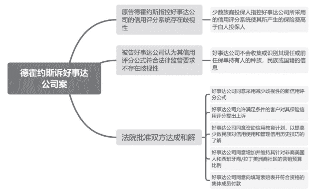

### 【核心争议点】

本案最终以双方达成和解告终，在法院审理阶段核心争议点在于是否应当批准和解协议.美国得克萨斯州西部地区联邦地方法院圣安东尼奥分院提出了六个要点：
1.和解背后是否存在欺诈或串通；
2 .如果案件进行审判，原告能否根据案情胜诉
（1）好事达公司是否利用信用信息对少数族裔人群进行歧视；
（2）原告能否依据《公平住房法》^([\[4\]](#txt004.html#footnote_content_txt004_4))的差别影响理论胜诉；
（3）集体的范围是否符合法律规定.
3.和解给原告带来的好处是否大于进行诉讼的风险（和解是否能够给少数族裔客户带来利益）；
4.诉讼的复杂性、费用和可能的持续时间；
5.当事方是否有足够的信息来评估和解协议的条款；
6.集体诉讼代理律师、集体代表和缺席集体成员的意见.

### 【裁判论证过程】

#### （一）和解背后不存在欺诈或串通

至少有一篇论文认为，如果经过公正的谈判，法院可以认为拟议的和解协议是公平合理的.在没有任何相反证据的情况下，也可以推定律师之间不存在欺诈或串通行为.
在本案中，没有任何欺诈或串通的指控或迹象.首先，法院承认双方的律师在集体诉讼方面都具有丰富的诉讼和谈判经验，包括“涉及种族歧视的指控”的处理经验.此外，当事方进行了冗长的独立协商程序，在过去的 23 个月中，原告和好事达公司的律师进行了超过 50 次谈判会议，包括面谈和电话会议.根据无可争议的记录和与律师的经验，法院认为拟议的和解协议是公平谈判的结果，不存在欺诈或串通.

#### （二）如果案件进行审判，原告难以根据案情胜诉

在原告指控好事达公司信用评分构成歧视方面，存在事实上和法律上的障碍，这些障碍对原告依其主张取得胜诉的能力产生了不利影响.
（1）好事达公司未利用信用信息歧视少数族裔人群
首先，证据表明，好事达公司不了解其客户的种族或民族，也不会追踪此类数据.其次，证据还表明，好事达公司的保险费率在各州法律监管上都是合法的.具体来说，各州保险部门会审查好事达公司的费率，以确定其是否过高、过低或具有不公平的歧视性.最后，好事达公司毫无争议地辩称，保险信用评分是由许多独立运作的公司开发的，其基于行为研究的持续和最新发展，是一种已受到大多数州的规范并明确批准使用的做法.因此，好事达公司业务所在的大多数州对使用信用评分的批准和规范，阻碍了原告提出的歧视索赔请求的胜诉能力.
（2）原告难以依据《公平住房法》的差别影响理论胜诉
首先，原告在确定初步证据时面临重大挑战.原告必须先提供证据，证明保险信用评分结果对非裔美国人和西班牙裔保单持有人的保费产生了差别影响.
假设原告能够证明前述差别影响，好事达公司表示打算在这种情况下提出业务必要性理论.为了支持这一点，其指出许多研究已经证实，信用评分的一个在精算上合理且强大的保险损失预测指标.好事达公司提出的证据表明，保险信用评分是一种大多数保险公司目前使用的为个人保险计划定价的做法，与保险风险“显著相关”.因此，好事达公司合理地认为，保险评分具有业务必要性.
此时，举证责任将转移到原告身上.原告必须证明可以使用其他替代方案，以实现相同的商业目的，并且具有同等的效果，从而产生较小的负面影响.原告还必须证明好事达公司拒绝采用该替代方案.这对原告来说是一个难以应对的困难.在这种情况下，好事达公司争辩说：原告知道没有同等有效的保险评分机制；在本案提交之时，尚无此类评分机制；原告从未向好事达公司提出过任何其他选择，好事达公司也从未拒绝采用任何其他选择.
（3）集体的范围难以确认
好事达公司表示，与不使用保险评分的情况相比，保险评分降低了保单持有人的保费.假设好事达公司有证据证明此种情况属实，那么少数保单持有人会在保险评分中受益，从而使集体资格的确认变得异常困难.因为当集体中含有能够因其控诉对象受益的人员时，该集体的资格是不能够被确认的.^([\[5\]](#txt004.html#footnote_content_txt004_5))因此在本案中，原告对集体资格的确认问题上也处于劣势.
这些事实上和法律上的障碍影响了原告胜诉的可能性，从而有利于和解协议的批准.

#### （三）和解给原告带来的好处大于进行诉讼的风险

法院必须考虑的下一个因素是和解给原告带来的好处是否大于进行诉讼的风险。记录表明，和解不仅将为原告集体的成员提供巨大利益，而且还将为全国各地的保单持有人带来巨大利益。原告的律师认为和解符合集体的最佳利益，因为：（1）给集体成员提供了大量直接利益，包括实施新的信用评分公式；（2）集体诉讼的风险和审判时间；（3）如果对本案进行审判，则可能会出现上诉和进行后续诉讼。

达成和解协议后，好事达公司将会履行其在和解协议中承诺的内容（见下文“审理结果”），这将为少数族裔客户带来实质利益。

法院认为，和解所带来的这些实质性和直接的好处要胜过不确定的、潜在的、长期的和昂贵的诉讼风险，因此有利于批准和解协议。

### （四）诉讼的复杂性、费用和可能的持续时间决定和解是合理选择
诉讼已经进行了五年，其中包括向美国第五巡回上诉法院和美国最高法院提起的上诉。这表明了继续诉讼的复杂性、费用和可能的持续时间。具体来说，正如当事双方的律师得出的结论一样，在没有达成和解的情况下，进一步旷日持久的诉讼（包括上诉）将是不可避免的。考虑到诉讼的复杂性、费用和可能的持续时间，法院认为批准拟议的和解协议具有重要意义。

### （五）当事方具有足够的信息来评估和解协议的条款
在长达 23 个月的谈判过程中，好事达公司制作了成千上万份文件，包括费率手册和政策手册。据报道，好事达公司还产生了大量电子数据，包括用于开发其信用评分公式的高度敏感数据。原告聘用了统计专家，对保单持有人的数据和好事达公司的信用评分公式进行了广泛地歧视影响分析。根据这些发现和原告的统计分析，原告的律师确定拟议的和解方案是公正、充分和合理的，更重要的是，有利于实现原告的最终利益。法院认为，诉讼程序的阶段和完成的调查，已经提供了必要的信息，足以使当事方和法院可以就和解内容做出明智的判断。因此，这一因素有利于接受拟议的和解协议。

### （六）集体诉讼代理律师，集体代表和缺席集体成员同意进行和解
正如所讨论的那样，经过 23 个月的艰苦谈判和认真考虑，特别是考虑到集体诉讼律师在复杂民事诉讼中的丰富经验以及其评估索赔案情的漫长时间，律师和集体代表得出结论，拟议的和解协议符合集体的最佳利益，并且总体而言是一个非常好的结果。鉴于通知书覆盖的范围广泛而反对意见很少，法院认为集体诉讼代理律师、集体代表和缺席集体成员的意见有利于批准和解协议。除反对意见外，法院在考虑了相关因素之后，认为和解协议是公平、合理且充分的。

## 【审理结果】
法院批准双方达成和解。和解协议的主要内容包括：

1. 好事达公司同意使用和解协议中确定的新信用评分公式。该评分公式获得了原告聘请的统计专家的认可，有助于更多少数族裔客户获得定价更为合理的保险产品，从而减少歧视。
2. 好事达公司同意采用一项上诉计划，允许包括集体成员在内的客户在某些“特殊情况”下对保险信用评分提出上诉，例如客户的信用记录可能受到离婚、家庭成员死亡和失业等情况的负面影响。
3. 好事达公司同意资助由全国城市联盟（National Urban League）和 La Raza 国家法律顾问设计的信用教育计划，以提高少数族裔对信用使用和信用记录管理技术的认识。
4. 好事达公司同意增加并维持其针对非裔美国人和西班牙裔/拉丁美洲裔群体的营销预算比例。

## 【相关法条】
### 《美国法典》第 42 卷第 1981 条（42 U.S.C. §1981）
法律面前人人平等

（a）平等权利声明
美国管辖范围内的所有人在每个州和地区内享有同等的权利，以订立和执行合同、起诉、成为当事人、举证，并享有白人公民根据一切法律和诉讼程序所享有的有关人身和财产安全的充分和平等利益，并应受到与白人公民相同的惩罚、痛苦、刑罚、税收、许可和各种征收的约束，而不应受到其他任何约束。

（b）“订立和执行合同”的定义
就本节而言，“订立和执行合同”一词包括合同的订立、履行、修改和终止，以及享有合同关系的所有利益、特权、条款和条件。

（c）保护免受损害
本节所保护的权利不受非政府歧视的损害，也不受国家法律的损害。

### 《美国法典》第 42 卷第 1982 条（42 U.S.C. §1982）
公民财产权
美国所有公民在每个州和地区内，享有与白人公民同等的继承、购买、租赁、出售、持有和转让不动产和动产的权利。

### 《美国法典》第 42 卷第 3601 条（42 U.S.C. §3601）
政策声明
美国的政策是在宪法的约束下，在全国范围内提供公平的住房。

### 《美国法典》第 42 卷第 3604 条（a）款、（b）款（42 U.S.C.§3604（a）（b））
在买卖或租赁房屋方面的歧视和其他被禁止的行为
在第 3603 条适用的情况下，除本卷第 3603 条（b）款和第 3607 条豁免的情况外，下述行为均属非法：

（a）出于种族、肤色、宗教、性别、家庭地位或国籍的原因，在做出善意要约后拒绝买卖或租赁房屋，或拒绝就买卖或租赁房屋进行谈判，或以其他方式使任何人无法获得或拒绝获得住宅。

（b）出于种族、肤色、宗教、性别、家庭地位或民族血统的原因，在住宅买卖或租赁的条款、条件或特权方面，或在提供与住宅有关的服务或设施方面，歧视任何人。

## 【案例评析】
### （一）帮助保险公司持续完善信用评价体系
根据和解协议，好事达公司将实施上诉程序，即允许客户根据九种“特殊情况”对其保险信用评分提出上诉。具体来说，信用记录受到以下任何一种消极影响的人可能有资格根据中立信用评分修正保费：离婚、家庭成员死亡、失业、医疗费、照顾成年被抚养人、身份盗用、长期伤害、疾病或残疾、照顾被抚养人和/或家庭暴力。根据该协议的条款，当好事达公司的保单持有人被告知其因信用评分而未获得最高保费，并且其信用评分导致其所受待遇差于中立待遇时，好事达公司将会告知其上诉的程序。

因保险行业的客户群体具有广泛性、分散性以及持久性，通过和解协议为未参与集体诉讼的客户以及其他客户保留对好事达公司信用评分上诉的权利，以及客户对保险信用评分的持续监督，为包括好事达公司在内的保险公司未来不断完善其信用评价体系提供广泛的客户意见。在本案中，虽然被告声称其保险费率符合各州的法律监管要求，但从原告聘请的统计专家以及和解协议中最终确定的新信用评分公式可以得出结论，面对复杂动态的算法问题，仅以现行监管标准对保险行业的信用评分体系进行规制势必存在缺漏，但企业可以通过持续完善信用评分体系来减少算法歧视以及算法偏见所造成的不公正结果。

除此之外，好事达公司同意资助由全国城市联盟和 La Raza 国家法律顾问这两个主要的少数族裔倡导组织设计的信用教育计划，以提高少数族裔对信用使用和信用记录管理技术的认识。算法透明化是防止歧视发生的方式之一，相对于通过提高算法透明度来帮助人们理解其复杂的运行逻辑，信用教育向消费者提供了简单、直白地了解保险信用评分运作方式的机会。通过理解信用评分对保险定价的影响，消费者可以高效地管理其信用。

美国的《公平信用报告法》规定：消费者可凭适当的身份证明，要求免费获得信用报告副本，并可就报告中信息的准确性和完整性向消费者信用报告机构提出异议。我国国务院办公厅发布的《关于加快推进社会信用体系建设构建以信用为基础的新型监管机制的指导意见》提出：要以信贷征信体系建设为切入点，进一步健全证券业、保险业及外汇管理的信用管理系统，加强金融部门的协调和合作，逐步建立金融业统一征信平台，促进金融业信用信息整合和共享，稳步推进我国金融业信用体系建设。当个人对其信用信息存在异议时，中国人民银行制定的《个人信用信息基础数据库管理暂行办法》（下称“《暂行办法》”）为其提供了具体的救济方式。《暂行办法》第十六条规定：个人认为本人信用报告中的信用信息存在错误（以下简称异议信息）时，可以通过所在地中国人民银行征信管理部门或直接向征信服务中心提出书面异议申请。经济的发展推动了信用体系的普及，然而如果历史信息存在错误，信用评分会在信贷、保险定价、招聘等方面对消费者产生直接或间接的不利影响，此时，消费者修正信用报告中错误信息的权利能够为其争取申诉的机会。总而言之，完善的信用体系应当在保持企业营利性的同时保障消费者的权益免受错误信息的影响。

### （二）本案提高了人们对算法歧视隐蔽性的认识
好事达公司否认其信用评分公式存在任何歧视，并主张其信用报告中使用的信息是对保险损失进行有效统计后的合理预测指标。此外，在诉讼过程中存在无可争议的证据表明，好事达公司的保险费率在各州法律监管上都是合法的。具体来说，各州保险部门会审查好事达公司的费率，以确定其是否过高、过低或具有不公平的歧视性。而且，好事达公司在声明中表示，其不会收集其保单持有人的任何种族识别信息，也没有进行任何差别影响测试。因此，在没有本案的情况下，好事达公司不会在其当时使用的公式中识别出对其少数族裔客户造成不公平影响的变量，也不会以和解协议中规定的方式修改这些公式。

尽管如此，好事达公司仍同意修改其目前做法。好事达公司同意采用一种新的信用评分公式，替代原先原告指控歧视非洲裔美国人和西班牙裔保单持有人的保险评分方案，用于为个人保险计划定价。该公式已经过原告方专家的广泛测试。原告的律师报告称，其统计专家对好事达公司产生的保单持有人数据进行了广泛地差别影响分析。在统计专家的协助下，原告律师相信新评分公式的使用将为少数族裔客户带来实质性利益。

好事达公司同意采用和解协议中的算法，这给集体诉讼成员带来的不仅仅是一次性的利益。集体诉讼成员将在每次续签保单时，从好事达公司较少歧视性的信用使用中受益，并且在好事达公司开始使用和解协议中规定的信用评分公式后的至少两年内，集体成员都能享受到此种好处。此外，任何购买汽车保险或房屋保险的新的少数族裔客户都将受益于该歧视性较小的算法，无论其是否属于集体成员。作为美国最大的上市个人险公司，好事达公司的服务客户数超过 1600 万，修正其原有算法中存在的歧视与偏差将会为数千万客户提供定价更为公正的保险产品，好事达公司本身也会从更完善地信用使用中获益。

最后，除了上述的衡平法救济之外，好事达公司同意向填写索赔表的合格集体成员支付合理的货币款项，并向根据新的信用评分公式重新计算后信用评分显著提高的合格集体成员支付赔偿金。

2018 年，英国议会下属的人工智能特别委员会发布的《英国人工智能发展的计划、能力与志向》报告指出：对于当前这一代以机器学习为核心的人工智能系统，算法开发者需要教会系统如何在数据中发现模式，而这通常是通过向其提供大量数据（通常被称为训练数据集）来实现的。这些系统是为发现模式而设计的，如果数据不具有代表性，或模式反映了历史偏见，那么系统所做的决定也可能不具有代表性或具有歧视性。^[(\[6\]](#txt004.html#footnote_content_txt004_6))即使算法开发者在设计算法时不带有歧视和偏见，如果在算法学习过程中输入现实生活中因个体歧视而产生的数据，那么算法将会习得这一歧视信息，进而导致输出的结果进一步扩大歧视范畴，从个别性歧视发展为系统性歧视。而相较于个体歧视，系统性算法歧视的影响范围更加广泛，加之算法本身的不透明性与复杂性，算法歧视将会在造成大量不公正后果的同时又因其高度隐蔽性而难以被纠正。本案中，原告在诉讼中获胜存在事实上和法律上的障碍，而通过和解来修正好事达公司原有信用评分公式中存在的算法歧视，则能够从系统上降低算法歧视对少数族裔客户平等权的侵害，所带来的长期利益远超一次性的金钱赔付。

### （三）督促保险行业提高算法透明度
在诉讼过程中，被告好事达公司拒绝透露其现行信用算法，而作为和解的一部分，从通知首次发布之日起到公平听证会之日的 60 天内，好事达公司将向集体成员提供其新的信用评分公式。好事达公司还在其网站上公布了在新的信用评分公式中所使用的信用特征的叙述性描述，供公众查看。好事达公司还资助了一个由中立的第三方组织“消费者信用咨询服务（Consumer Credit Counseling Services）”设计的信用教育计划，该计划将通过一些群体倡导组织分配给少数群体。作为和解协议的一部分，这些组织将分担 25 万美元，用于在一年内在其群体中实施教育计划。

评分系统被隐藏在秘密之中。虽然一些分数（如信用分数）是公开的，但评分者拒绝透露其预测系统的运行方式和逻辑。没人能对评分过程和结果提出质疑，因为算法受到商业机密的严格保护。^[(\[7\]](#txt004.html#footnote_content_txt004_7))好事达公司在诉讼过程中拒绝透露其现行信用算法的行为，为原告了解其信用评分的产生过程是否科学、该过程是否使用正确数据以及信用算法是否达到被告所宣称的公正性增加了难度。保险作为一种风险管理手段，涉及客户的人身和财产安全，必要的信息披露是构建企业与客户信任关系的前提。透明度不是简单的“一种一切都清晰可见的精确的最终状态”，而是一种系统性的观察和了解，它代表了一种控制形式。^[(\[8\]](#txt004.html#footnote_content_txt004_8))好事达公司向公众披露信用评分公式的相关信息，有助于消费者理解保险信用评分的运作规律，其目的在于增强客户对保险产品的信赖程度。

不仅是保险行业，在各行业应用算法的过程中，增强算法透明度是监管的必然趋势。欧盟的《通用数据保护条例》指出：数据控制者应当以一种简洁、透明、易懂和容易获取的形式，以清晰和平白的语言来提供和个人信息处理相关的法律所规定的所有信息或者所有交流。我国的《个人信息保护法》第二十四条规定：个人信息处理者利用个人信息进行自动化决策，应当保证决策的透明度和结果的公平、公正。尽管各国从法律层面对数据处理者提出了透明度的要求，在实践中，这个过程基本避过了政府的监督，企业得以根据效率增进、现金流和利润的增长来衡量其成功。除了极少数的例外情况，正义和透明这样的概念几乎不可能被纳进企业的算法模型中。^[(\[9\]](#txt004.html#footnote_content_txt004_9))美国白宫发布的《人工智能应用监管指南备忘录（草案）》对信息披露与透明度给予了具体可参考的标准：信息披露和透明度是否适当需要依据特定情况而定，具体取决于对潜在危害的评估、危害的严重程度、技术水平以及 AI 应用程序的潜在利益等。但算法透明度仅是对不断扩张的算法权力进行监管的一个维度，监管者需要在深入理解算法运行逻辑的基础之上从不同维度来界定算法责任，避免算法控制者利用“算法黑箱”进行监管套利并规避算法责任。

### （四）引发对信用评分监管的关注
本案原告德霍约斯指控好事达公司所采用的信用评分系统对非裔美国人和西班牙裔美国人存在价格歧视，想要指控成立，原告需要证明保险信用评分结果对非裔美国人和西班牙裔保单持有人的保费有差别影响，法院认识到原告在举证上存在重大困难，这是法院最终批准和解的原因之一。由于有关机构在进行个人信用信息记录、收集和传播时，消费者参与度极低，因此在挑战企业的信用评分系统时，消费者天然地处在劣势地位。^[(\[10\]](#txt004.html#footnote_content_txt004_10))而信用评估者、搜索引擎、各大银行和运输安全管理局将我们的数据进行转化后用于评分、评级和风险计算，并生成具有重要影响的监察名单。除非有告发者提起诉讼或揭露实情等特殊情况发生，否则这些专有的运算程序都无需接受审查。^[(\[11\]](#txt004.html#footnote_content_txt004_11))“在实践中，信息的过度不对称甚至导致技术劣势一方依附于技术强势一方的‘数字权威’，从而最终使算法决策演变成为了数字经济时代的精英统治。”^[(\[12\]](#txt004.html#footnote_content_txt004_12))

美国的《公平信用报告法》要求消费者信用报告机构适用合理的程序，以对消费者公平、公正的方式，秘密、准确、相关且适当地使用消费者信息。《平等信用机会法》也规定：信用申请人不得因其性别、婚姻状态、种族、宗教信仰、年龄而受到授信人的歧视。这些法律的制定，在一定程度上保护了消费者的平等权。但面对不公开且不可解释的信用评分算法，个体知情权被进一步压缩，这一困境亟待具有专业知识的监管部门出具完整的责任认定规则，从而对企业的信用评分算法予以规制。即使欧盟《通用数据保护条例》赋予了数据主体免受完全自动化决策结果约束的权利，面对急速膨胀的算法权力，相对滞后的现行监管与问责机制无法对算法权力进行有效规制。而算法的更新速度远超同期法律制定的速度，这是立法者寻求有效监管与效益平衡的最佳方案时不可回避的问题。本案以和解告终，和解协议中所采取的优化现行算法的方式值得信用监管部门的关注。

### （五）本案后续的一些最新进展
作为和解协议的一部分，好事达公司将增加针对非洲裔美国人和西班牙裔/拉丁美洲裔群体的营销预算比例。具体来说，好事达公司已增加其 2005 财年针对少数群体的全国性媒体支出，并将在 2006、2007 和 2008 财年将针对少数群体的全国性媒体支出增加到 15%。

## 【关联判例推荐】
1. Ojo v. Farmers Group Inc., 565 F.3d 1175 (2009)
核心事实：Ojo 是得克萨斯州的非裔美国人，其购买了由农民集团签发的房主财产和意外伤害保险单。虽然 Ojo 从未就房屋的保单提出索赔，但农民集团将奥乔的保险费提高了 9%。Ojo 称农民集团基于通过自动信用评分系统获得的不良信用信息提高了他的保费。
与本案关联点：被告的信用评分系统采用了若干“未公开因素”，对少数群体造成了差别影响，并违反了《公平住房法》（FHA）。

2. Duncan v. JPMorgan Chase Bank, N.A., 2016 WL 4419472 (2016)
核心事实：原告 Duncan 根据《公平信用报告法》对摩根大通银行（下称“大通”）提起了诉讼，声称大通在对其抵押贷款的房产执行止赎程序后，缺乏获得其信用报告的合理目的。原告没有宣称任何实际伤害，因为大通的信用调查对其他债权人不可见且没有影响其信用评分，但她坚持认为大通的行为是“故意”违反法规，并根据《美国法典》第 15 卷第 1681 条主张法定赔偿。原告代表自己和其他大通的客户提起诉讼，她声称当其信用报告被取出时，其在该银行“不再拥有账户”，并要求每位被推定的集体诉讼成员获得法定赔偿。
与本案关联点：在采用和解的集体诉讼中，法院仍然必须裁定该集体符合《联邦民事诉讼规则》第 23 条（a）款和（b）款的适当部分。

3. In re Heartland Payment Systems, Inc. Customer Data Sec. Breach Litigation,851 F.Supp.2d 1040 (2012)
核心事实：信用卡持卡人对计算机系统被黑客入侵的信用卡交易处理者提起诉讼，指控其违反合同、疏忽、虚假陈述和违反多个州消费者保护法。诉讼合并和转移后，各方当事人提出了和解集体确认、和解批准和律师费的请求。
与本案关联点：在信用卡持卡人对信用卡交易处理者的集体诉讼中，拟议的和解协议是公平、合理和充分的。

4. Neff v. VIA Metropolitan Transit Authority, 179 F.R.D. 185 (1998)

# 案例：美国残疾人法与康复法集体诉讼

## 核心事实
根据《美国残疾人法》和《康复法》，原告针对大都市交通当局向州法院提起集体诉讼，就该当局据称未能履行其法定职责向符合条件的残疾人提供适当的公共交通系统，寻求禁令救济和确认侵权的救济.关于双方共同提出的批准和解协议的议案，地区法院的法官认为：（1）符合集体诉讼认证条件的要求；（2）拟议的和解方案是公平、充分和合理的；（3）关于支付律师费和费用的协议是合理的.

## 与本案关联点
关于双方共同提出的批准和解协议的动议，提议的解决是公平、充分和合理的.

# 5. Larson v. Sprint Nextel Corp., 2009 WL 1228443 (2009)

## 核心事实
该集体诉讼涉及原告的索赔，即 Sprint 公司收取的提前终止费（ETF）违反了《联邦通信法》和州《消费者保护法》.在试用期后但“服务计划”期限结束之前的任何时间，无论客户取消其无线服务的原因为何，Sprint 公司都会收取 150 到 200 美元的费用.

## 与本案关联点
在集体诉讼中，当没有合理的方法来充分识别集体成员时，应向部分集体成员发出通知.此外，公司可以通过其数据库确定个人所属的子集体，这些人有权根据和解协议获得赔偿.

## 4.2 肯尼斯·西顿诉猫途鹰案

## 【案件索引】
Seaton v. TripAdvisor LLC, No. 3:11-cv-549 (2012)
Seaton v. TripAdvisor LLC, No. 12-6122 (2013)

## 【关键词】
互联网信用评价；用户评论；消费者评分网站；言论自由；诽谤

## 【案件提要】
本案是互联网领域关于信用评价的前沿案例.在本案中，被告猫途鹰（TripAdvisor）是一家基于其网站的用户评价和问卷调查结果的旅游信息网络平台.该平台将位于田纳西州的大度假村酒店（Grand Resort Hotel and Convention Center）列为“2011 年最脏酒店”榜单之首，并声称这一评分名单是客观公正的.但根据用户对大度假村酒店的评分，大度假村酒店并不是得分最低、最脏的酒店.因此，大度假村酒店的所有人即肯尼思·西顿（Kenneth Seaton，下称“西顿”）提起诉讼，认为被告进行评分排名的算法系统存在缺陷，得出了失实的评分排名，被告却试图让公众相信排名真实可信.原告认为被告的行为恶意歪曲事实，发表不实言辞，对原告大度假村酒店的声誉和潜在商业合作关系造成了极其严重的损害.因此，原告指控被告构成诽谤（defamation）、虚假事实侵害隐私（false-light invasion of privacy）、商业诽谤/致害诋毁（trade libel/injurious falsehood）及对潜在业务关系侵权干扰（tortious interference with prospective business relationships）四项罪名.
面对原告的指控，被告猫途鹰辩称，无论进行评分排名的算法系统是否存在漏洞，最终得出的排名即“2011 年最脏酒店”榜单，属于主观意见，而非对客观事实的论断，不存在是否失实之说，因此被告并未违法.相反，这一主观意见还应受宪法第一修正案规定的言论自由原则的保护.最终这一观点得到了田纳西州初审法院和上诉法院的支持.这反映了美国在互联网领域对言论自由保护的力度之大.^([\[13\]](#txt004.html#footnote_content_txt004_13))
本案回应了当前关于互联网信用评价的法律属性的争议，美国联邦第六巡回法院认为互联网信用评价属于主观意见，因此具有合法性.本案还引发了对互联网信用评价体系中的不同主体行为的合法性的思考和讨论，并且讨论结果倾向于认可其合法性.此外，本案的社会影响也引起了公众的广泛讨论和关注，其中不乏质疑的声音.一方面，本案为互联网信用评价营造了宽松的监管环境，有利于互联网信用评价体系蓬勃发展，更好发挥其节约消费者信息成本、增加商家曝光度等有利影响；另一方面，本案可能会使互联网信用评价偏离真实，助长利用有缺陷的评级算法掩盖诽谤和恶意评论等不良行为，损害个人名誉和商家信誉，对诚实守信的社会风气产生不利影响.

## 【案件要旨】
田纳西州东部地方法院（初审法院）：原告 肯尼思·西顿 被告 猫途鹰
美国联邦第六巡回上诉法院（上诉法院）：上诉方 肯尼思·西顿 上诉方猫途鹰
2011 年 10 月 11 日，西顿在田纳西州塞维尔县的巡回法庭起诉猫途鹰，声称猫途鹰使用与真实情况不符的评分系统，损害了大度假村酒店的声誉和潜在的商业机会.西顿指控猫途鹰涉嫌诽谤和虚假事实侵害隐私两项罪名，并要求五百万美元的损害赔偿和五百万美元的惩罚性赔偿.
2011 年 11 月 17 日，猫途鹰提出管辖权异议，请求将案件移送至田纳西州东部地区法院.随后，根据《联邦民事诉讼规则》第 12 条（b）款第（6）项，猫途鹰提起一项驳回案件的动议，并附上其网站上“2011 年最脏酒店”的屏幕截图.该截图显示，“2011 年最脏酒店”是由猫途鹰用户的入住评价汇总得出的.
2012 年 3 月 31 日，西顿修改起诉状，增加两项控诉：商业诽谤/致害诋毁和对潜在业务关系的侵权干扰.西顿称，猫途鹰使用未经查实的数据和错误的算法系统，得出大度假村酒店是“2011 年最脏酒店”的结论.同时，猫途鹰具有侵权的故意，其明知或应当知道“2011 年最脏酒店”是罔顾事实的虚假陈述，还放任这一名单损害大度假村酒店的商誉.
2012 年 8 月 22 日，田纳西州东部地方法院批准了猫途鹰驳回案件的动议，理由如下：“2011 年最脏酒店”的名单是猫途鹰用户的主观言论，受宪法第一修正案的言论自由原则保护，不具有诽谤性.同时，法院驳回了西顿修改诉状的动议，因为西顿无法证明猫途鹰进行了虚假陈述.
2012 年 9 月 21 日，西顿向美国联邦第六巡回上诉法院提起上诉，并于 2013 年 1 月 4 日提交诉状.西顿声称，猫途鹰强调其言辞可靠准确，因此猫途鹰作出的评分排名是客观、可诉的.另外，西顿表示，猫途鹰使用存在缺陷的算法系统得出评分排名，因此猫途鹰的言辞直接构成了诽谤，而美国《通讯规范法》（Communications Decency Act， CDA）第 230 条^([\[14\]](#txt004.html#footnote_content_txt004_14))并不能使猫途鹰免责.
2013 年 2 月 20 日，猫途鹰提交答辩状以支持初审法院的结论.猫途鹰称，“2011 年最脏酒店”是主观意见，而不是客观、可诉的；同时，该排名的依据也是主观意见即用户评分.
2013 年 8 月 28 日，上诉法院分别针对西顿提出的诽谤、虚假事实侵害隐私、商业诽谤/致害诋毁和对潜在业务关系侵权干扰这四项指控，论证侵权不成立，最终维持初审法院的判决.

## 【案例事实思维导图】
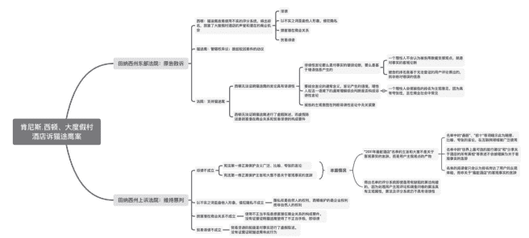

## 【核心争议点】
1.根据宪法第一修正案，主观意见受言论自由原则的保护，具有合法性.根据田纳西州法律，罔顾事实的言辞构成诽谤.在本案中，猫途鹰基于评分系统得出的“2011 年最脏酒店”名单是合法的主观意见还是罔顾事实的言辞、构成诽谤.
2.如果猫途鹰得出“2011 年最脏酒店”名单的算法系统存在漏洞，算法系统及其得出的评分排名是否会被视为罔顾事实的言辞，从而构成诽谤.

## 【裁判论证过程】
### （一）猫途鹰基于评分系统得出的“2011 年最脏酒店”名单是合法的主观言论，受宪法第一修正案的保护，不构成诽谤
根据田纳西州法律的规定，要成立诽谤，原告需要证明：（1）一方发表了言辞；（2）知道这一言辞是不实的，会对他人名誉造成损害；（3）罔顾言辞的真实性或者由于过失，未能查明言辞的真实性.^([\[15\]](#txt004.html#footnote_content_txt004_15))
田纳西州东部地方法院结合 Gallagher v. E.W. Scripps Company^([\[16\]](#txt004.html#footnote_content_txt004_16))一案，认为判断是否构成诽谤的第一个关键问题是，被告的言论是否具有诽谤性.当被告的言论可被视为对事实的错误论断，或者基于错误信息产生时，该言论可能具有诽谤性.判断被告的言论是否具有诽谤性时，还需要结合言论产生的语境，言论的通常含义，理性人在这一语境下的通常理解进行判断，而被告发表言论的主观意图则无关紧要.在本案中，一个理性人会将评分排名视为对酒店的主观意见，因为其具有夸张性，且商业评分排名在日常生活中随处可见.并且，一个理性人不会认为被告用数据支撑观点，就是对事实的客观论断.最后，被告基于无法证实的网络用户评论得出评分排名，不意味着这一评分系统就是错误的，具有诽谤性.
在诽谤案件中，法院都不可避免的需要依据宪法第一修正案的定义，区分合法言论和非法言论.根据最高法院的先例，宪法第一修正案保护的言论是“不必然反映客观事实的言论”.该言论具有随意性、比喻性和夸张性，不会给一个理性人留下“作者在认真论断客观事实”的印象.受宪法第一修正案保护的言论将不构成诽谤.
美国联邦第六巡回上诉法院结合上述标准审查后认为，“2011 年最脏酒店”名单是受宪法第一修正案保护的主观意见.因为名单中使用了随意的、比喻的和夸张的词汇，同时其主旨和大意没有“传达某些超过猫途鹰用户观点的东西”，具有主观性，不会被公众误认为是“反映客观事实的言论”.因此，猫途鹰不构成诽谤.
具体理由如下：第一，“2011 年最脏酒店”中的“最脏”字眼本身具有夸张性，是主观概念.没有读者会认为“大度假村酒店是最脏酒店”是对事实的客观论断.第二，猫途鹰公布的“2011 年最脏酒店”名单不会让公众误认为是“反映客观事实的言论”，因为猫途鹰的网站清晰标明“美国最脏酒店的排名是基于猫途鹰用户数据得出的报告”.这意味着该评分排名是用户的主观意见，而非客观的、已查证的事实.第三，读者看到大度假村酒店网页显示的用户差评和相关照片，并不会据此判定大度假村酒店就是 2011 年美国最脏的酒店.读者能意识到，这只是入住过大度假村酒店的用户基于个人经历作出的主观评价.第四，“2011 年最佳酒店”名单上关于其他酒店的评价也同样夸张，这些评价具有娱乐读者的性质.这佐证了名单不会让读者误认为是“反映客观事实的言论”.第五，含有“前十”等字眼的排名在互联网上层出不穷，一个理性人能意识到这些排名是数千万在线用户的主观意见，而非客观事实.

### （二）即使猫途鹰的算法系统存在漏洞，导致计算错误，算法系统及其得出的评分排名也不具有诽谤性
上诉法院援引了先例进行论证.在 Compuware Corp. v. Moody’s Investors Services， Inc.^([\[17\]](#txt004.html#footnote_content_txt004_17))案中，法院认为，金融评级机构 Moody 给出的信用评级仅是预测性观点，它由 Moody 主观确定多个复杂因素的权重后，利用算法系统计算得出，可见 Moody 的信用评级过程具有主观性.因此，信用评级并未传达关于客观事实的虚假内容，即使从信用评级中能得出某些关于事实的推论，这些推论也无法被证伪，而指控诽谤的前提就是推论能被证伪.这一案例再次确认了美国宪法第一修正案保护无法被证伪的言辞.
上诉法院据此表明，在本案中，即使猫途鹰的算法系统存在计算错误，算法系统及其得出的评分名单仍具有固有的主观性，因此是合法的.

## 【审理结果】
1.田纳西州东部法院批准了猫途鹰驳回案件的动议，驳回了原告西顿修改诉状的动议.
2.美国联邦第六巡回上诉法院维持了原判.

## 【相关法条】
美国宪法第一修正案（Constitution of the United States First Amendment）
国会不得制定关于下列事项的法律：确立国教或禁止宗教自由；限制言论自由或出版自由；限制人民和平集会和向政府请愿申冤的权利.
美国《通信规范法》第 230 条（c）款第（1）项（Communications Decency Act§230（c）（1），47 U.S.C.§230（c）（1）（2006））
发布者或发言人的处理
任何交互式计算机的服务提供者或者使用者不得被视为其他信息内容的发布者或者发言人.

## 【案例评析】
### （一）本案引发了关于作出信用评价的互联网平台的角色定位的思考
本案的争议焦点之一就是互联网平台作出的信用评价属于对事实的客观论断，还是主观意见.事实上，理论领域和实务领域还存在另一种观点，认为互联网信用评价是自我实现的预言，被评价的主体会自我实现和强化评价内容.三种观点反映了三种关于互联网评分平台角色定位的不同观点：第一种观点认为互联网评分平台负有告知世界某一事物的真相的责任；第二种观点认为互联网评分平台只需提供对某一事物的个人价值判断即可；第三种观点认为互联网评分平台具有强大的影响力，其发布的互联网信用评价会被广泛认可和接受.^([\[18\]](#txt004.html#footnote_content_txt004_18))本案最终采取了第二种观点.

### （二）本案引发了关于互联网信用评价系统合法性的思考，反映了美国对互联网信用评价较强的接受度和包容性
首先，本案引发了消费者进行互联网信用评价的合法性的思考.从司法层面，在多数诉讼中，原告会根据消费合同或者相关协议中的非歧视性条款主张互联网信用评价构成歧视和诽谤，但多被法院驳回.例如在 Palmer v. Kleargear.com 案中，法院认为被告消费者 Palmer 对商品服务的负面评价属于个人观点，而非可证实的事实.从立法层面，美国的马里兰州和加利福尼亚州已制定法律保护消费者的评分自由.^([\[19\]](#txt004.html#footnote_content_txt004_19))因此，消费者进行互联网信用评价受言论自由原则的保护，具有合法性.
其次，本案引发了消费者评论网站为信用评价提供平台的合法性的思考.根据美国《通信规范法》第 230 条，互联网服务的运营者不应被视为信息内容的发布者，不应为平台用户发表的言论承担法律责任.但是，在 Isuzu Motors Ltd. v. Consumers Union of US， Inc.^([\[20\]](#txt004.html#footnote_content_txt004_20))、Compuware Corporation v. Moody’s Investors Services， Inc.^([\[21\]](#txt004.html#footnote_content_txt004_21))和 Jones v. Dirty World Entertainment Recordings LLC^([\[22\]](#txt004.html#footnote_content_txt004_22))等案例中，法院都认为，如果故意采纳第三方诽谤性言论，互联网平台不再受美国《通信规范法》第 230 条的保护.例如，消费者评论网站通过不透明的算法系统将负面评价推至网页顶部，而将正面评价放至网页的次要位置.^([\[23\]](#txt004.html#footnote_content_txt004_23))因此，只要消费者评论网站没有故意采纳第三方诽谤性言论，就不用为用户评论本身的真实性负责，进而具有合法性.
再次，本案引发了消费者评论网站简单处理用户评价后，得出商家评分排名的合法性的思考.本案和 Browne v. Avvo Inc.^([\[24\]](#txt004.html#footnote_content_txt004_24))案的法院都认为，互联网评分系统是主观意见，受言论自由原则的保护，而不是可查证的事实，不构成诽谤.因此，消费者评论网站依据用户评价直接得出的各种排名依旧受言论自由原则的保护，具有合法性.
更一般地，消费者评论网站整合用户评价后得出的新内容，用户生成内容网站基于用户评论形成的新内容，搜索引擎网站基于用户数据展示的搜索结果，甚至记者、科研人员等主体基于公众数据创作的新内容也开始具有合法性的趋势.而在此前多年，其合法性都遭到质疑.因为虽然美国《通信规范法》第 230 条免除了网站对用户评论本身的法律责任，但网站基于用户评论得出的新内容是否在免责范围之内仍然存在争议.例如，在 Levitt v. Yelp^([\[25\]](#txt004.html#footnote_content_txt004_25))案中，法院表明美国《通信规范法》第 230 条适用于网站对其用户评级的汇编；而在 Fair Housing Council of San Fernando Valley v. Roommates.com， LLC^([\[26\]](#txt004.html#footnote_content_txt004_26))案中，法院则认为用户生成内容网站收集和发布的用户结构化数据将不适用于美国《通信规范法》第 230 条规定的豁免权.^([\[27\]](#txt004.html#footnote_content_txt004_27))但是，本案另辟蹊径，绕开美国《通信规范法》，根据宪法第一修正案的言论自由原则，论证说明在基础数据是用户的主观评论的前提下，第三方主体整合用户评论后形成的新内容具有合法性.^([\[28\]](#txt004.html#footnote_content_txt004_28))

### （三）本案推动了互联网信用评价体系蓬勃发展，有利于商家提高曝光度，增加营业收入
本案指出了在互联网领域信用评价普遍存在的事实.在此背景下，互联网信用评价愈发倾向于被认定为主观意见，在宽松的监管环境下蓬勃发展.美国法院在多个案例中都认为，一个理性人不会将在消费者评价网站等网络领域的言论视为对事实的客观论断.^([\[29\]](#txt004.html#footnote_content_txt004_29))这反映出美国法院对互联网领域中的语言惯例的关注^([\[30\]](#txt004.html#footnote_content_txt004_30))，例如层出不穷的评分网站整合消费者评论发布的“最好”“最坏”“前十”等名单.同时，这也反映出美国法院对互联网用户互动的价值的肯定，以及对个体的主观审美和价值判断的尊重.^([\[31\]](#txt004.html#footnote_content_txt004_31))

本案将互联网信用评价视为主观意见并具有合理性，因为评价的创建者需要选择忽略什么内容、侧重什么内容，信用评价本身就包含了创建者的价值取向.^([\[32\]](#txt004.html#footnote_content_txt004_32))同时，本案也将对社会发展产生积极的影响.当今，互联网信用评价渗透进消费领域的方方面面，对消费者决策和商家营业的影响越来越大.尽管负面的互联网信用评价可能使得少数商家信誉降低，营业收入减少，但其实互联网信用评价体系能增加大多数商家的曝光度和营业收入.Yelp 称其 80%的用户评分为 3 到 5 颗星（满分为 5 颗星），TripAdvisor 称其 75%的用户评论是“非常好”或“优秀”.哈佛大学的一项研究表明，在 Yelp 上增加一星的评分会使公司的营业收入增加 5%-9%.这表明互联网信用评价对商家的声誉和财务状况越来越重要.^([\[33\]](#txt004.html#footnote_content_txt004_33))

## （四）本案会使互联网信用评价偏离真实，助长利用有缺陷的评级算法掩盖诽谤和恶意评论等不良行为，对个人名誉、商家信誉和社会风气产生不利影响

首先，本案忽略了当可查证评分排名是否客观属实时，平台发布的商家信用排名可能会构成对事实的客观论断.^([\[34\]](#txt004.html#footnote_content_txt004_34))同时，例如在 2012 年 2 月，英国广告标准局支持了在线声誉管理公司 KwikChex 的一项投诉.在该案中，猫途鹰声称其网站上发布的内容是“您可以信任的评论”、“阅读真实旅行者的评论后发布的内容”.英国广告标准局认为这一行为具有误导性.^([\[35\]](#txt004.html#footnote_content_txt004_35))事实上，有些互联网信用评价广泛依赖事实数据和经验观察.^([\[36\]](#txt004.html#footnote_content_txt004_36))另外，虽然有人建议将互联网平台包括信用评价在内的言论都视为具有主观性，但这一观点并没有获得广泛认同.^([\[37\]](#txt004.html#footnote_content_txt004_37))因为构建互联网信用评价体系的初衷就是节约用户的信息成本，尽快中断自己的调查，转而依赖评级.^([\[38\]](#txt004.html#footnote_content_txt004_38))可见，即使在互联网领域，大多数公开发布的内容也实然且应然地反映某种程度的真相.然而，本案的判决结果可能会促使互联网信用评价体系逐渐偏离真实，失去其原本的价值.

其次，本案可能会助长信用评价网络平台使用有缺陷的评级算法，掩盖诽谤目的的侵权行为，^([\[39\]](#txt004.html#footnote_content_txt004_39))让不良互联网平台污蔑商家有机可乘.特别是有些信用评价网络平台虽然不是公权力机构，却在某一网络领域具有巨大的影响力，发布的观点具有说服力和权威性.如果这些互联网平台在进行商家信用评价时歪曲事实，就会误导公众，并对商家信誉造成严重损害.同时，一些商家也会反向利用有缺陷的评级算法，夸大自己的排名.^([\[40\]](#txt004.html#footnote_content_txt004_40))

再次，本案忽略了恶意的用户评论对商家信誉带来的损害.有时商家不愿意满足消费者提出的不合理要求，消费者就恶意发布了负面评论.而在本案的影响下，消费者评论网站由于不为用户评论担责，因此缺乏不断完善平台用户评价规则以提高用户评价的真实性与准确性的动力.^([\[41\]](#txt004.html#footnote_content_txt004_41))商家无法依据消费者评论网站规则与恶意评论的用户进行交涉，对此只能提起法律诉讼.然而诉讼成本高昂，耗时长，无法及时消除恶意评论的负面影响.^([\[42\]](#txt004.html#footnote_content_txt004_42))同时，收到恶意评论的商家还不一定能获得有利判决结果，因为查明匿名用户的真实身份面临着程序性困难和合宪性挑战.^([\[43\]](#txt004.html#footnote_content_txt004_43))此外，有些商家会雇佣用户发表虚假的正面评论，还有些商家通过向消费者提供免费产品来激励客户撰写好评.^([\[44\]](#txt004.html#footnote_content_txt004_44))久而久之，商家将“在消费者评论网站上付费进行广告宣传，与消费者评论网站合作以增加自己收到的正面评论数量，减少自己收到的负面评价数量”视为互联网时代新增的必要成本支出.^([\[45\]](#txt004.html#footnote_content_txt004_45))这些行为与创建互联网信用评价体系的初衷背道而驰，互联网信用评价体系沦为商家进行营销推广，消费者评论网站赚取广告费的工具.这看似只是互联网时代新增的一种商业模式，但这种商业模式会助长弄虚作假、恶性竞争的商业行为，恶化营商环境，造成不良的社会影响.

即使负面用户评论是真实的、非恶意的，基于互联网的特点，负面的互联网信用评价传播快，将永久留存在互联网世界，商家甚至都还来不及了解消费者投诉实情或解决问题，商家信誉就已经受损且难以弥补.即使商家改进运营，有关商家改进做法的最新消息也会淹没在负面评价中，消费者无法获得这些信息.^([\[46\]](#txt004.html#footnote_content_txt004_46))可见，如果对互联网信用评价完全不加以监管，对真实性、动态性、无差别展示等没有任何监管要求，互联网信用评价将沦为商家信誉自我实现的工具.

在互联网时代，无论是平台还是用户都能对个人或商家作出信用评价，并因互联网传播性强、范围广的特性，互联网信用评价具有不容小觑的影响力.因此，过分强调互联网平台和用户的言论自由，将忽略互联网信用评价对个人名誉和商家信誉的影响，不利于维护公平正义、诚实守信的社会风气.

## 【关联案例推荐】

### 1. Kimzey v. Yelp! Inc., 836 F.3d 1263 (9th Cir. 2016)

核心事实：原告 Kimzey 诉称，被告 Yelp 通过评星功能将用户评论转化成被告自己的内容，进而对原告的锁匠业务进行了负面评价.法院驳回了原告的诉讼请求.法院认为，被告的评分系统是将第三方用户评分信息简化得出的综合指标，是基于“自愿输入”运行的“中立工具”^([\[47\]](#txt004.html#footnote_content_txt004_47))，不涉及对用户评论内容的开发或创作，因此在美国《通信规范法》第 230 条的豁免范围之内.^([\[48\]](#txt004.html#footnote_content_txt004_48))

与本案关联点：与本案观点基本相同，法院认为网站基于用户评价形成的信用评分内容中立，具有合法性.不过与本案的法律依据不同，该案依据的是美国《通信规范法》第 230 条关于内容中立的互联网平台的豁免规定.

### 2. Consumer Cellular, Inc. v. ConsumerAff airs.com, Inc., 3:15-CV-01908-PK(D. Or. 2016)

核心事实：原告是一家手机服务供应商，被告是一家为手机服务供应商打分的网站.被告的网站区别对待付费会员供应商和非会员供应商：（1）将用户对付费会员供应商的评论描述为“评论和投诉”，将用户对非会员供应商的评论描述为“投诉和评论”；（2）允许会员回应负面评论甚至将其删除，而非会员则无法回应负面评论；（3）评论非会员的页面包含“对产品或服务没有印象”的部分，以及跳转到会员商品或服务的链接，而评论会员的页面没有相关部分；（4）在非会员评论页面上，评论按时间倒序显示，而在会员评论页面上，正面评论会移至页面顶部.此外，在原告拒绝成为付费会员后，被告将关于原告的正面评论移动到原告“投诉和评论”页面，并拒绝用户发表新的正面评价.据悉，被告对一位付费会员的评分为 5 星，而对其他 39 家非会员供应商的评分均低于 2 星.原告对此提起诉讼，指控被告诽谤、损害潜在商业关系、电信欺诈、敲诈勒索等.法院认为，被告的星级评分具有诽谤性.该星级评分不是评论本身，而是被告自己的客观论断，是其基于评论计算得出的关于“总体满意度”的陈述，因此不是受保护的主观意见.法院强调，被告在发布声明时就知道该声明是错误的，因为被告故意没有在其评级计算中纳入正面评价.同样，美国《通信规范法》第 230 条也无法构成对星级评分的豁免，因为实际有争议的陈述不是第三方的陈述，而是被告主持和策划第三方陈述后，得出的自己的陈述.^([\[49\]](#txt004.html#footnote_content_txt004_49))

与本案关联点：与本案观点不同，法院认为网站没有直接展示用户评价，而是筛选、整理用户评论后自己给出信用评价时，网站的信用评价可能不被视为受保护的主观言论，如果有诽谤的故意，可构成诽谤.另外，此时网站也不在美国《通信规范法》第 230 条的豁免范围内.

### 3. McKee v. Laurion, A11-1154 (Minn. App. 2012)

核心事实：被告 Laurion 不满意原告 McKee 在其父亲中风后的检查，因此被告在两个“评价你的医生”网站上发表了关于 McKee 本人及其检查的评论.在一条评论中，Laurion 表示一名护士告诉他 McKee 是一个“真正的工具”.原告 McKee 对此提起诉讼，其主张却被明尼苏达州地方法院驳回.地方法院认为这些陈述不具有诽谤性.原告随后向明尼苏达州上诉法院提出上诉，该法院撤回原判，发回初级法院重审，并指示陪审团应决定其中六项陈述是否损害原告的名誉.Laurion 就该裁决向明尼苏达州最高法院提出上诉.McKee 辩称，Laurion 关于医生是“真正的工具”的陈述不是受保护的意见.最高法院认为，将某人称为“真正的工具”属于纯粹的意见，而不是对事实的陈述，因为无法证明这一意见的真伪.因此，明尼苏达州最高法院裁定，Laurion 在在线医生评论网站上发表的关于神经科医生 McKee 博士的言论不是对事实的诽谤性陈述，并驳回了 McKee 的诉讼，推翻了明尼苏达州上诉法院的裁决并维持了地方法院的裁决.^([\[50\]](#txt004.html#footnote_content_txt004_50))

与本案关联点：与本案观点相同，最高法院认为互联网信用评价属于受宪法第一修正案保护的主观意见，而非对事实的诽谤性陈述.

### 4. Browne v. Avvo, Inc., 525 F.Supp.2d 1249 (W.D. Wash. 2007)

核心事实：被告是关于律师的评级网站，被告根据某种评分系统和未公开的系统，从 1 到 10 为原告打分，原告得分 5.5 分.原告认为该评分不实，对此提起诉讼，指控被告的网站上显示了有关律师和比较评级系统的信息，违反了《华盛顿消费者保护法》（Washington Consumer Protection Act， CPA）.案件争议点在于，评分是否能被解释为对事实的客观论断.法院认为，评分是受宪法第一修正案保护的主观言论，无法被证伪，因此不能视为对事实的客观论断.

与本案关联点：与本案观点相同，法院认为互联网评分排名属于主观意见，不能被解释为对事实的客观论断.

### 5. Moving & Storage, Inc. v. Panayotov, CIVIL ACTION NO. 12-12262-GAO(D. Mass. 2014)

核心事实：被告是一家名为 MyMovingReviews.com 的搬家公司评论网站，其删除了对原告公司的正面客户评论，同时还删除了被告经营的搬家公司 Xpress Movers 的负面客户评论.原告提出了虚假广告、不公平竞争以及侵权干扰等指控.被告声称其享有美国《通信规范法》的豁免权.法院支持原告，认为被告的主张并非基于“第三方提供的信息”，因此被告不是用户生成内容的信息服务提供者，而是错误信息的“开发者”.删除对他人的正面评论和对其公司的负面评论这一行为导致被告失去美国《通信规范法》豁免权.此外，法院认为，被告向用户保证其提供了“准确”的数据，“认真对待评论质量”，并且让读者“看到最准确和最新的评级信息”.然而被告的行为有悖于其网站上提供准确性和公正性信息的主张.

与本案关联点：互联网评分网站如果对用户评论进行自己另外的处理，或者进行有偏差的展示，并且还扬言其评分结果是准确公正的，将有可能失去美国《通信规范法》的豁免权.

## 4.3 莫利纳里诉艾克飞公司案

### 【案件索引】

Molinari v. Equifax Inc., 18-CV-3282 (E.D.N.Y. 2019)

### 【关键词】

信用评分；公平信用报告法；事实损害

### 【案件提要】

本案是有关信用报告机构（Credit Reporting Agency， CRA）向个人用户提供信用评分相关争议的案例.本案中，原告约翰·莫利纳里（John Molinari）对被告信用报告机构艾克飞公司及艾克飞消费者服务有限公司（Equifax， Inc.，Equifax Consumer Services LLC，以下统称为“艾克飞公司”）提起诉讼，主张艾克飞公司提供的信用评分与信贷发放者通常使用的信用评分并非基于同一模型而存在差异，因而违反了《公平信用报告法》（Fair Credit Reporting Act，FCRA）的规定.本案的主要争议点在于原告是否满足事实损害（Injury-infact）^([\[51\]](#txt004.html#footnote_content_txt004_51))的要求.最终，法院认为原告未满足事实损害要求而撤销诉讼.本案体现了两个方面的标准：第一，依据《公平信用报告法》提起诉讼所适用的时效制度应当遵循发现规则（Discovery Rule），即当原告知道或应当知道起诉所依据的事由时，诉讼时效即开始计算；第二，在基于《公平信用报告法》要求损害赔偿的案件中，原告的诉讼资格应当符合事实损害或者事实损害风险的构成要件.

在互联网+金融的发展模式下，基于个人信息的非线性算法进行的信用评分有助于消除贷款市场上的信息不对称，一定程度上规避道德风险，理论上讲，相比于传统贷款业务依靠以风险溢价对抗不确定性的方式，以大数据消除信息不对称更有助于提高贷款市场的资源配置效率.因此为促进以信用为基础的商业发展以及保护此过程中消费者的个人权益，信用评分的可靠性和公平性便成为问题的关键.现阶段，在我国拥有资质提供信用评级的机构只有个位数，且有形成垄断的趋势.在垄断的信用评级机构市场地位和不透明的信用评价机制的双重影响下，公众缺乏相应的救济手段.我国可借鉴美国《公平信用报告法》的做法，对个人信用评分进行单独立法，赋予公民知情权、异议权以及事后的救济权，以对抗不公平信用评级造成的影响.

### 【案件要旨】

纽约东区地区法院（一审法院）：原告 约翰·莫利纳里 被告 艾克飞公司、艾克飞消费者服务有限公司

艾克飞公司作为全美最大的信用报告机构之一，收集个人的征信信息并提供给企业，同时也直接向消费者销售信用评分的产品用以预测其贷款计划是否会得到支持.信贷发放者也依靠信用评分来预测借款人是否会按约偿还贷款，通常这种评分是基于美国费尔艾萨克公司（Fair Isaac Corporation， 下称“FICO”）开发的模型得出的.但包括被告在内的直接向消费者提供信用评分的机构使用的是不同的模型，被告所使用的模型很少被信贷发放者使用，被告在其出售个人信用评分产品的页面底部将这一点以免责声明的方式告知了消费者.

2015 年 3 月 29 日，原告莫利纳里在被告网站上购买了信用评分服务，虽然有免责声明的存在，原告仍然相信其收到的信用评分和信贷发放者所参考的评分相一致.

2017 年 1 月 3 日，美国消费者金融保护局调查了艾克飞公司的营销方式，认定其在 2011 年 1 月 21 日至 2014 年 3 月 14 日之间以欺骗性的营销手段售卖信用评分，违反了《消费者金融保护法》（Consumer Financial Protection Act，CFPA），调查也表明艾克飞公司的信用评分与信贷发放者使用的基于 FICO 模型得出的信用评分存在显著差异.基于此调查结果，原告向法院提起个人和类似消费者的群体诉讼，认为被告的行为违反了《公平信用报告法》.

被告提出请求撤销诉讼的动议，认为原告的诉讼（1）超过了诉讼时效；（2）没有提出事实损害的要件事实.最终法院裁定认可该动议，认为原告的主体资格没有满足事实损害要求，撤销诉讼.

### 【案例事实思维导图】

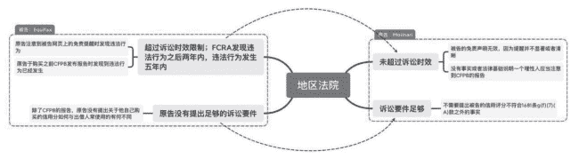

### 【核心争议点】

1.原告的主张是否超过诉讼时效，即诉讼时效何时起算以及被告的免责声明或第三方报告是否构成损害的发现.

2.原告的诉讼资格是否满足事实损害的要求.

### 【裁判论证过程】

#### （一）原告的主张未超过诉讼时效

纽约东区地区法院认为，原告根据《公平信用报告法》提起诉讼不得晚于以下时间，以二者中较早者为准：（1）原告发现违法行为发生之日起 2 年；（2）违法行为发生之日起 5 年.^([\[52\]](#txt004.html#footnote_content_txt004_52))被告艾克飞公司辩称，莫利纳里的起诉已超过诉讼时效，因为莫利纳里在购买艾克飞公司信用评分服务之后两年多才提起诉讼，而在其购买时就已经对艾克飞公司的违法行为知情，并了解艾克飞公司提供的信用评分与信贷发放者使用的信用评分不一致.具体来讲，艾克飞公司主张：第一，由于艾克飞公司已在其网站上刊登了免责声明，莫利纳里应当了解其提供的信用评分与信贷发放者使用的信用评分不一致的事实.第二，莫利纳里应当已经阅读了消费者金融保护局的另外两个报告，报告解释了这些信用评分仅供购买者参考，该信用评分与信贷发放者使用信用评分并不一致，且报告在莫利纳里购买信用评分服务之前就已经发布.对此，莫利纳里主张：第一，艾克飞公司的免责声明是无效的，因为该声明并不清晰明确.第二，普通的消费者并不会阅读消费者金融保护局的报告，甚至可能不知道消费者金融保护局的存在，因此该局报告并不能使其对艾克飞公司的违法行为知情.

纽约东区地区法院认为，首先，尚不清楚艾克飞公司网站上的免责声明是否清晰明确，因此现阶段无法确定莫利纳里是否了解免责声明的存在甚至阅读过免责声明.其次，尽管普通消费者并不会阅读消费者金融保护局的报告，但是莫利纳里自己在起诉书中提及了该报告，这引起了其在购买艾克飞公司的信用评分服务之前是否了解消费者金融保护局报告的问题.

纽约东区地区法院认为，只有当信贷发放者拒绝了莫利纳里的信贷展期申请，或者当莫利纳里单独购买了与艾克飞公司的信用评分存在显著差异的 FICO 评分时，莫利纳里才能意识到艾克飞公司的违法行为并了解信用评分不一致的事实，而不是在购买艾克飞公司的信用评分服务时就意识到其违法行为的存在.因此，纽约东区地区法院认为一个理性的购买者在购买艾克飞公司信用评分服务时，并不会发现艾克飞公司违反《公平信用报告法》，因而莫利纳里的起诉并未超过诉讼时效.

## （二）原告的诉讼资格不满足事实损害的要求

尽管消费者金融保护局认为艾克飞公司的欺诈性营销行为违反了《消费者金融保护法》，但是莫利纳里只主张艾克飞公司违反了《公平信用报告法》第 609 条.该条款规定信用报告机构必须：（1）向消费者提供信用评分，以帮助消费者理解对其信用行为的评估以及对其未来信用行为的预测；（2）告知消费者其购买的信用评分所使用的模型与信贷发放者使用的模型不同.^([\[53\]](#txt004.html#footnote_content_txt004_53))值得注意的是，符合第 2 点的规定，并不意味着信用机构提供了符合第 1 点规定的信用评分.在本案中，原告认为如果其使用的信用评分模型不同于 FICO 的评分模型，则两种信用评分的差距可能极大，以致艾克飞公司的消费者无法准确了解对其的信用评估.因此，莫利纳里声称，这使其购买的艾克飞公司信用评分变得毫无价值.

除了主张其信用评分符合《公平信用报告法》的规定，艾克飞公司还辩称莫利纳里没有起诉的立场，因为他没有证明艾克飞信用评分与信贷发放者通常使用的信用评分有何不同的事实.莫利纳里对此回应称，其只需要提出当其购买艾克飞信用评分服务时，该信用评分不符合《公平信用报告法》的规定，即该信用评分不能帮助其了解自己的信用度.

纽约东区地区法院认为，莫利纳里的主张存在缺陷.原告必须遭受事实损害、被诉行为与损害之间的因果关系以及明智的决定可能会减少损害，才符合《美国宪法》第 3 条的规定.联邦最高法院近期观点认为，在与《公平信用报告法》有关的案件中，原告必须遭受事实损害.此外，原告并不会因为法律规定了起诉权而自动满足事实损害要件的要求.第二巡回法院认为，事实损害的潜在风险也可以满足该要求.因此，本案的关键问题是：提供给消费者没有价值的信用评分是否会引起一定程度的风险，从而导致消费者满足事实损害的要求.

纽约东区地区法院认为，莫利纳里在起诉书中并没有提出违反《公平信用报告法》第 609 条的行为有引起事实损害的风险.莫利纳里仅仅主张由于艾克飞信用评分和信贷发放者使用的评分之间存在巨大差异，艾克飞信用评分不能帮助消费者了解信贷发放者怎样看待其信用.更重要的是，莫利纳里没有提出艾克飞信用评分与信贷发放者使用的评分之间的差异是什么，以及其如何知道艾克飞信用评分不能对其提供实际帮助.

综上，纽约东区地区法院认为，仅仅是存在信用评分的差异不能满足《美国宪法》第 3 条规定的事实损害要求，因而莫利纳里没有提起诉讼的主体资格.

## 【审理结果】

1.纽约东区地区法院认为莫利纳里只有在信贷发放者拒绝了莫利纳里的信贷展期申请，或者单独购买了与艾克飞公司的信用评分存在显著差异的 FICO 评分时，才会发现艾克飞公司的违法行为，因而莫利纳里的起诉并未超过诉讼时效；
2.莫利纳里仅仅主张信用评分存在差异，并未主张事实损害，不满足《美国宪法》第 3 条的要求，没有提起诉讼的主体资格，因此支持了艾克飞公司要求驳回起诉的动议.

## 【相关法条】

美国《公平信用报告法》第 609 条（f）款第（7）项（Fair Credit Reporting Act§609（f）（7），15 U.S.C.§1681g（f）（7）（2003））

某些情况下的合规性.为遵守本款规定，消费者报告机构应—

（A）向消费者提供信用评分，该信用评分来自于消费者报告机构向用户广泛分发的与住宅不动产贷款有关的信用评分模型，或有助于消费者了解对其信用行为的评估以及对其未来信用行为的预测；以及

（B）声明其使用的信息和信用评分模型可能与信贷发放者使用的不同.

美国《公平信用报告法》第 618 条（Fair Credit Reporting Act§618，15 U.S.C.§1681p（2003））

法院管辖权；诉讼时效

可以在任何适当的美国地区法院提起诉讼，以强制执行根据本法产生的任何责任，而无需考虑争议的金额或任何其他有管辖权的法院.提起诉讼的时间不得晚于以下时间，以二者中较早者为准：（1）原告发现作为该责任基础的违法行为之日起 2 年内；或（2）作为该责任基础的违法行为发生之日起 5 年内.

## 【案例评析】

### （一）《公平信用报告法》概述

《公平信用报告法》旨在规范美国消费者信用信息的收集、汇总和使用.自 1970 年制定以来，该法已经多次修订，其中最广泛的两次修订是 1996 年和 2003 年的修订.其中 1996 年修正案扩大了信用报告机构的职责，增加了消费者报告使用者（特别是雇主）的义务.2003 年修正案则包含与本案有关的《公平信用报告法》下的案件诉讼时效何时起算的问题.^([\[54\]](#txt004.html#footnote_content_txt004_54))

《公平信用报告法》主要规范信用报告机构的行为，这些机构收集消费者信息并将其编入消费者报告，供信贷发放者、保险公司、雇主、房东和其他实体在作出资格决定时使用.《公平信用报告法》的目的是：（1）防止敏感的消费者信息被滥用，把使用者限制在有合法需要的人；（2）提高信用报告系统的准确性和完整性.根据《公平信用报告法》，信用报告机构必须建立合理的程序以确保报告的准确性和合法性，向消费者披露其档案中的信息，并调查有争议的项目.

### （二）《公平信用报告法》中的诉讼时效问题

一般来说，在美国有两种关于确定基于联邦法律的诉讼时效何时起算的理论.其中一种计算方式是“损害规则（Injury Rule）”，当使得原告可以提起诉讼的事由发生时，诉讼时效就开始计算.另一种计算方式是“发现规则（Discovery Rule）”，当原告知道或应当知道起诉所依据的事由时，诉讼时效即开始计算.^([\[55\]](#txt004.html#footnote_content_txt004_55))

在《公平信用报告法》于 2003 年修订前，针对在《公平信用报告法》下提起的诉讼，美国最高法院采取的是第一种观点，即诉讼时效于诉讼事由发生时，也即被告需要承担责任之时起计算，比如在天合公司诉安德鲁斯案^([\[56\]](#txt004.html#footnote_content_txt004_56))中，最高法院即持有此种观点.^([\[57\]](#txt004.html#footnote_content_txt004_57))

在《公平信用报告法》于 2003 年修订后，其条文规定如下：原告根据《公平信用报告法》提起诉讼不得晚于以下时间，以二者中较早者为准：（1）原告发现违法行为发生之日起 2 年；（2）违法行为发生之日起 5 年.此外，根据第五巡回法院在麦克诉平稳上升金融公司案^([\[58\]](#txt004.html#footnote_content_txt004_58))中的观点，较短的 2 年诉讼时效应当从原告发现引起诉讼的事由时开始起算，而不是从原告发现被告行为构成违法时起算.^([\[59\]](#txt004.html#footnote_content_txt004_59))由此可见，基于《公平信用报告法》提起的诉讼，法院应当采取“发现规则”来裁定诉讼时效的起算问题.

具体到本案，即使被告艾克飞公司辩称原告莫利纳里已经阅读过消费者金融保护局的报告，且纽约东区地区法院认为原告莫利纳里的诉求以消费者金融保护局为依据而推定莫利纳里阅读过消费者金融保护局的报告，并知晓艾克飞公司的欺诈性宣传行为违反了《消费者金融保护法》，根据前述观点，莫利纳里仅仅是发现了艾克飞公司的违法行为，据此不能引起诉讼时效的起算.依照纽约东区地区法院的观点，只有当原告莫利纳里发现其从艾克飞公司处购买的信用评分与信贷发放者使用的信用评分不一致时，诉讼时效才开始起算.因此，即使莫利纳里在阅读消费者金融保护局的报告后，知晓了艾克飞公司提供的信用评分与信贷发放者使用的信用评分不一致这一事实，但是这并不能够引起诉讼时效的起算.原因是具体到莫利纳里本人，其并不知道艾克飞公司给出的关于其本人的信用评分，是否与信贷发放者使用的关于其的信用评分相一致.总之，只是知道艾克飞公司提供与信贷发放者使用的不一致的信用评分不能够引起诉讼时效的起算，只有当原告莫利纳里发现其从艾克飞公司购买本人的信用评分与信贷发放者使用的信用评分不一致时，才会引起诉讼时效的起算.那么莫利纳里何时会发现这一具体事实呢？纽约东区地区法院认为：只有当信贷发放者依据不同的信用评分拒绝了莫利纳里的信贷展期申请，或者当莫利纳里单独购买了与艾克飞公司提供的完全不一致的信用评分时，才符合原告知道或应当知道引起诉讼之事由的要件，因而才会引起诉讼时效的起算.

本案关于诉讼时效的另一争议在于，莫利纳里在艾克飞公司网站购买信用评分时，莫利纳里阅读艾克飞公司网站上的免责声明能否引起诉讼时效的起算.此问题的关键在于，艾克飞公司网站上的免责声明是否清晰明确，并使得莫利纳里了解艾克飞公司的信用评分与信贷发放者的信用评分不一致的事实.笔者认为此处可以参考关于格式条款的相关规定，当前大多数网络平台在提供商品或服务时都事先要求用户同意特定的条款，如果不同意这些条款，用户则不能获得平台的商品或服务.而问题在于平台的这些条款内容庞杂，一般的用户通常不会阅读其中的具体内容而直接选择同意这些条款.这就容易导致用户在不知情的情况下同意了可能减损其权利或增加其义务的一些条款，从而对自身产生不利影响.法律通常要求平台采取合理的方式提醒用户，使得用户能够注意到这类可能减损用户权利或增加用户义务的条款.具体到本案中，则需要确定艾克飞公司网站的免责声明是否清晰明确，是否以合理的方式引起用户的注意，从而使得用户知晓其免责声明的内容，这需要结合免责声明在网页中所处的位置以及呈现方式来判断.但即使艾克飞公司采取了合理的方式使得用户能够阅读其免责声明，并知晓其提供的信用评分与信贷发放者使用的信用评分不一致的事实，这也不能引起诉讼时效的起算.论证逻辑同上，只有当原告莫利纳里了解到其从艾克飞公司购买的本人信用评分与信贷发放者使用的信用评分不一致时，才会引起诉讼时效的起算.

### （三）《公平信用报告法》中的事实损害问题

在《公平信用报告法》下原告是否因遭受了损害而具有起诉的资格，这一问题的判断标准是美国最高法院在斯伯克公司诉罗宾斯案^([\[60\]](#txt004.html#footnote_content_txt004_60))中确立的.根据《美国宪法》第 3 条，一个人如果要有起诉的资格，必须满足以下条件：（1）一个人必须遭受事实上的损害—该损害既特定（particularized）又具体（concrete）；（2）该种损害是由被告的被诉行为引起的；（3）这种损害必须有可能通过有利的司法判决得以纠正.在这个案件中，最高法院进一步裁定：根据《公平信用报告法》起诉的个人必须证明“具体的”损害，而不能仅仅指控存在技术上违反法规的情况.换句话说，仅简单地列出法定请求权的要素不能建立有效的请求权.^([\[61\]](#txt004.html#footnote_content_txt004_61))

斯伯克公司是《公平信用报告法》所涵盖的一家信用报告机构，经营着一个“人员搜索引擎”.斯伯克公司的网站上显示着罗宾斯具有研究生学历，已婚，比较富裕，但这些与罗宾斯本人的真实情况不符.罗宾斯在发现这些错误后，指控斯伯克公司违反了《公平信用报告法》，没有适当地保护其所拥有信息的真实性和准确性.^([\[62\]](#txt004.html#footnote_content_txt004_62))

在这个案子中，美国最高法院认为为了符合《美国宪法》第 3 条的诉讼主体资格，即使是在违反法律的情况下也要有具体的损害，即使损害是无形的和仅存在实际损害的风险，亦满足事实损害的要求.但是，罗宾斯不能指控一个没有任何事实损害的纯粹的程序性违法行为，还必须满足第 3 条规定的事实损害要求.

具体到本案，情况也是如此.莫利纳里仅仅是主张艾克飞公司提供的信用评分与信贷发放者使用的信用评分不一致，这使其不能合理地了解自己的信用度，因此艾克飞公司的行为违反了《公平信用报告法》的规定，据此向法院起诉艾克飞公司.适用在斯伯克公司诉罗宾斯案中确定的标准，莫利纳里仅仅是声称被告的行为违反了《公平信用报告法》的规定，而未能证明具体的损害，因此不满足第 3 条规定的事实损害要求.

首先，莫利纳里只是指出艾克飞公司提供的信用评分与信贷发放者使用的信用评分存在差异，但其未指明这种差异具体是什么，艾克飞公司的信用评分是高于还是低于信贷发放者使用的信用评分.而且，在斯伯克公司诉罗宾斯案中，斯伯克公司错误地记载了罗宾斯的信息，尚且不能满足事实损害的要求.那么在本案中，仅仅是由于使用不同的模型而计算出不同的信用评分，理应不及错误记载信息的程度，当然也不满足事实损害的要求.

此外，纽约东区地区法院认为损害必须是具体（concrete）且特定（particularized）的，只有当莫利纳里声称的信用评分差异会给其本人带来损害时，才能符合第 3 条规定的事实损害要求.假设莫利纳里向信贷发放者申请贷款时，信贷发放者因使用不同的信用评分拒绝莫利纳里的贷款要求，莫利纳里才会遭受由信用评分差异导致的具体的和特定的损害.但是在本案中，莫利纳里并未做出借款的行为，也没有因为信用评分被拒绝提供贷款.诚然，斯伯克公司诉罗宾斯案中确定实际损害的风险也满足事实损害的要求，那么莫利纳里可能因信用评分不一致而被拒绝提供贷款的风险也可以满足事实损害的要求.但是，归根结底，无论是贷款被拒绝的实际损害，抑或是被拒绝提供贷款的风险，原告莫利纳里都没有予以主张并证明，因而其在《公平信用报告法》下并未满足事实损害的要求，不具有起诉的资格.

综上所述，在《公平信用报告法》下的诉讼，仅仅是因使用不同的算法模型而计算得出存在差异的信用评分，并不能当然满足《美国宪法》第 3 条事实损害的要求，原告需要进一步主张并证明会因此遭受事实损害.

### （四）我国信用评分现状与分析

国务院曾明确提出：“社会信用体系是社会主义市场经济体制和社会治理体制的重要组成部分.”当下我国已有 20 多个城市实行了个人信用评分制度，比较典型的有厦门的“白鹭分”、苏州的“桂花分”、宿迁的“西楚分”、福州的“茉莉分”以及杭州的“惠信分”，此外也有互联网公司提供个人信用评分服务，如阿里巴巴推出的“芝麻信用分”.个人信用评分的应用场景十分广泛，涵盖出行、住房、就业、金融、医疗等诸多领域.个人信用评分的广泛应用，可以帮助行政机关、企事业单位和民众简化很多冗杂的审核流程，极大地便利民众的日常生活.同时，个人信用评分作为一种声誉机制，与失信惩戒措施相结合，可以解决社会治理中的诸多难题，促进民众诚实守信，营造良好的社会风气.

然而，如同本案中原告莫利纳里主张的信用评分因使用不同计算模型而存在差异，我国的个人信用评分也存在这样的情况.根据评分计算模型的不同，我国的个人信用评分可以分为两类：一类是采用 FICO 信用评分模型设定的个人信用评分，如厦门的“白鹭分”、苏州的“桂花分”以及“芝麻信用分”；另一类是采用多维评分系统的个人信用评分，如宿迁的“西楚分”、福州的“茉莉分”以及杭州的“惠信分”.^([\[63\]](#txt004.html#footnote_content_txt004_63))此外，各城市采用的评分指标也存在一定差异.这就导致了个人信用评分的跨区域互认困难，不利于个人信用评分的跨区域应用.结合本案，我国公民是否能够仅仅因为其所在城市给出的个人信用评分与互联网企业对其的个人信用评分存在差异而提起诉讼，是否需要证明这类差异会给其带来事实上特定且具体的损害，仍需要进一步的探讨.此外，我国的个人信用评分也面临与其他自动化决策算法同样的困境，即缺乏透明度.对于个人信用评分的计算，我国法律法规并未赋予公民事先的程序参与权、知情权以及异议权，也没有对提供个人信用评分的机构和企业设定解释的义务，因而公众易受到“算法黑箱”的不利影响.^([\[64\]](#txt004.html#footnote_content_txt004_64))

当前我国并没有关于个人信用评分的单独立法，仅有《征信业管理条例》对个人征信制度进行了相应的规定.在立法方面，我国可以借鉴美国《公平信用报告法》的规定，对个人信用评分进行专门立法，明确个人信用评分的应用范围，对提供个人信用评分的机构和企业规定一定的义务，并赋予公民知情权和异议权等基本权利.此外，针对不同城市个人信用评分体系不同的问题，在未来或许可以由全国标准化组织制定统一的国家标准，实现个人信用评分的跨地域适用.

## 【关联判例推荐】

1\. Staehr v. Hartford Financial Services Group, Inc., 547 F.3d 406 (2d Cir. 2008)

核心事实：投资者对保险公司及其高级管理人员提起诉讼，声称由于被告在保险人和经纪人参与的回扣、操纵投标和价格操纵计划方面存在遗漏、虚假陈述以及欺诈性隐瞒，导致投资者以人为抬高的价格收购了公司股票.康涅狄格州地区法院以超过诉讼时效为由驳回了起诉，但第二巡回法庭撤销了地区法院的裁决并发回重审.

与本案关联点：确定原告是否有足够的事实使其对知悉被告的违法行为，不适用于驳回起诉的动议.

2\. Spokeo, Inc. v. Robins, 136 S.Ct. 1540 (2016)

核心事实：被告作为一家信用报告机构发布了有关原告的年龄、教育程度、家庭状况和就业情况的虚假信息.原告由此提起诉讼，指控该被告违反了《公平信用报告法》.

与本案关联点：基于《公平信用报告法》提起诉讼，原告必须符合依据《美国宪法》第 3 条确立的事实损害要求才有起诉资格，即原告必须提出并证明其遭受了具体的损害或具有遭受实质损害的潜在风险.

3\. Sgouro v. TransUnion Corp., 817 F.3d 1029 (7th Cir. 2016)

核心事实：原告从汽车经销店贷款人那里获悉，贷款人使用的信用评分比原告购买的被告的“消费者信用评分”中包含的信用评分低 100 分以上，并且根据这一较低的分数，该汽车经销店贷款人拒绝提供原告所需的汽车贷款.

与本案关联点：原告需要提出其购买的信用评分与贷款人使用的信用评分之间的差异的具体内容.

4.4 哈默诉艾克飞信息服务有限责任公司等案

## 【案件索引】

Hammer v. Equifax Information Services LLC, et al, 2018 WL 10483887 (2018)

Hammer v. Equifax Information Services LLC, et al, 2019 WL 7604744 (2019)

# Hammer v. Equifax Information Services LLC, et al

Hammer v. Equifax Information Services LLC, et al, 2019 WL 7602463 (2019)

Hammer v. Equifax Information Services LLC, et al, 974 F.3d 564 (5th Cir. 2020)

## 关键词

信用评价；信用法律制度；公平信用报告法

## 案件提要

本案是有关美国信用评价法律制度的经典案件.原告斯考特·大卫·哈默（Scott David Hammer，下称“哈默”）对艾克飞信息服务有限责任公司（Equifax Information Services LLC，下称“艾克飞公司”）^([\[65\]](#txt004.html#footnote_content_txt004_65))以及益百利信息服务有限责任公司（Experian Information Solutions Inc.，下称“益百利公司”）提起民事诉讼，指控这两家公司将其信用报告中有利的信用项目删除并拒绝恢复，该行为违反了《公平信用报告法》及《美国法典》第 15 卷第 41 章“消费者信用保护”的有关条款.原告声称被告未能遵循适当程序来确保被告向第三方报告的原告相关信息的准确性，且在其质疑信用报告的准确性后没有进行合理调查，最终使其遭受实际损害与精神痛苦.法院经审理认为，原告所出示的证据未能充分证明被告提供的消费者报告中包含不准确的信息，且被告没有义务在报告中涵盖所有信息，因此原告的索赔请求未获法院支持.

美国消费者获得信贷、住房、保险、基本公用事业服务甚至就业机会，都越来越多地取决于信用历史的集中记录和这些记录的自动解释.长期以来，各种形式的信用记录一直是决定是否向消费者提供信贷的重要因素.^([\[66\]](#txt004.html#footnote_content_txt004_66))在商业领域，人们普遍认为信用评分可以提高消费信贷市场的分配效率与分配公平，^([\[67\]](#txt004.html#footnote_content_txt004_67))然而随着“大数据”信用评价产品的广泛适用，长期以来对信用评价报告准确性和公平性的担忧正进一步加剧.^([\[68\]](#txt004.html#footnote_content_txt004_68))个人信用记录的详细摘要包含个人信息、账户信息、查询等消费者的重要信息，^([\[69\]](#txt004.html#footnote_content_txt004_69))信用评分公司往往将对这些重要信息的算法分析视为商业机密，虽然缺乏透明度的信用评价算法会让消费者感到疑惑，与自己息息相关的信息如何影响信用评级的结果，但是在这个过程中消费者往往缺乏提出质疑的渠道与能力.本案正是我们了解美国信用评价行业及信用评价法律制度的一个窗口.

美国信用法律制度有深厚的历史传统、文化传统和实践基础，体系庞大，形式多样.美国的早期信用法律制度主要集中于《美国法典》第 15 卷第 41 章“消费者信用保护”，其基础是国会于 1968 年制定的《消费者信用保护法》（Consumer Credit Protection Act， CCPA）.1970 年美国国会通过了《公平信用报告法》（Fair Credit Reporting Act， FCRA），规定联邦贸易委员会（FTC）与消费者金融保护局（CFPB）为美国征信业务监管部门.《公平信用报告法》成为美国规范个人信用相关法律的核心.其后，相关部门又出台了《信用控制法》（Credit Control Act）、《诚实借贷法》（Truth in Lending Act）、《平等信用机会法》（Equal Credit Opportunity）、《公平信用结账法》（Fair Credit Billing Act）、《公平信用结账法》（Fair Credit Billing Act）、《公平信用和贷记卡披露法》（Fair Credit and Charge Card Disclosure Act）、《信用修复机构法》（Credit Repair Organization Act）等一系列相关法律.信用评价产品在社会生活中的普遍应用与信用评价法律的相继出台，共同促进了美国信用法律制度的完善与信用评价行业的规范发展.除了信用法律体系，信用档案登记制度、信用风险预警制度、个人信用评估制度等相关配套措施也在协同跟进，为美国信用经济的发展提供必要的制度保障.

近年来，中国正大力推进社会信用体系建设，信用立法取得重要进展.我国目前已有多部涉及个人征信的行政法规和部门规章.在总体制度架构层面，国务院出台了《社会信用体系建设规划纲要（2014-2020 年）》《国务院办公厅关于加快推进社会信用体系建设构建以信用为基础的新型监管机制的指导意见》等具有统筹性、指导性的规范性文件.在具体实施层面，各部门出台了一系列具有针对性和可操作性的规章制度，如中国人民银行发布的《个人存款账户实名制规定》《个人信用信息基础数据库管理暂行办法》、海关总署发布的《中华人民共和国海关企业信用管理办法》、民政部发布的《社会组织信用信息管理办法》和中国人民银行、国家发展和改革委员会、财政部、中国证券监督管理委员会多部门联合出台的《信用评级业管理暂行办法》等.此外，《社会信用法（草案）》也正在征求各地方和相关部门的意见.社会信用建设的最终目的是在主体信用信息真实、客观、准确的前提下，保护消费者利益、满足商业交易需求、促进经济发展与社会进步.在当今信用经济蓬勃发展与我国社会信用体系建设的大背景下，本案对于感知互联网技术给人们经济生活带来的变化，探究信用评价体系建设、信用评价制度完善等方面具有重要意义.

## 案件要旨

美国联邦地区法院得克萨斯州达拉斯分部（一审法院）：原告 斯考特·大卫·哈默 被告 艾克飞信息服务有限责任公司、益百利信息服务有限责任公司

美国联邦地区法院得克萨斯州达拉斯分部（二审法院）：原告 斯考特·大卫·哈默 被告 艾克飞信息服务有限责任公司、益百利信息服务有限责任公司

美国联邦地区法院得克萨斯州达拉斯分部（再审法院）：原告 斯考特·大卫·哈默 被告 艾克飞信息服务有限责任公司、益百利信息服务有限责任公司

美国上诉法院第五巡回法院（上诉法院）：上诉方 斯考特·大卫·哈默 被上诉方 艾克飞信息服务有限责任公司、益百利信息服务有限责任公司

2010 年，原告哈默从第一资本银行（Capital One Bank）获得了一张信用卡.此后每个月，哈默都持续使用该信用卡并按时还款.在 2017 年之前，美国三大消费者信用报告机构^([\[70\]](#txt004.html#footnote_content_txt004_70))出具的报告中都包含哈默的第一资本信用卡账户及其还款信息.在得知三大消费者信用报告机构停止报告该信用卡账户信息后，哈默要求三大消费者信用报告机构恢复该账户的信息，但艾克飞公司和益百利公司拒绝了原告这一请求.

2018 年 6 月 12 日，原告哈默对艾克飞公司、益百利公司提起民事诉讼，指控其违反了《公平信用报告法》.原告声称被告疏忽大意并故意不遵循适当程序来确保其向第三方提供的信用报告的准确性，而这一行为违反了《公平信用报告法》第 607 条（b）款的规定：“每当消费者信用报告机构准备消费者信用报告时，应遵循合理的程序，以确保报告所涉及的个人信息尽可能准确”^([\[71\]](#txt004.html#footnote_content_txt004_71)).此外，原告认为被告在其质疑信用报告准确性后没有进行合理调查，由于被告未能履行《公平信用报告法》规定的职责，导致其遭受了实际损害与精神痛苦.

被告艾克飞公司主张依据以下理由驳回原告索赔的请求：（1）原告未能证明其声称的艾克飞信用档案中的第一资本信用卡账户信息存在任何不准确之处；（2）原告未能证明艾克飞公司向任何第三方报告的信息致使其遭受了任何损害；（3）原告未能证明艾克飞公司在报告中删除第一资本信用卡账户信息后又重新插入该账户信息.除此之外，2018 年 7 月 31 日，被告艾克飞公司根据《联邦民事诉讼规则》第 12 条（b）款第（6）项有关规定申请驳回原告索赔的请求，原告未能及时对该动议做出响应.一审法院于 2018 年 8 月 28 日做出判决，驳回了原告对艾克飞公司提出的所有索赔.^([\[72\]](#txt004.html#footnote_content_txt004_72))

2018 年 9 月 4 日，原告哈默依据《联邦民事诉讼规则》第 59 条（e）款法院在何种情况下可以重新审判的有关规定，对一审判决的正确性提出质疑并要求撤销原判决.二审法院认为第 59 条（e）款项下的申请仅服务于允许一方当事人纠正法律或事实明显错误或提出新证据等狭义目的.二审法院经审理认为，原告存在不可原谅的疏忽并且其权利主张在法律上无法胜诉，而审查记录显示艾克飞公司的抗辩理由未能完全驳回原告根据《公平信用报告法》第 611 条提出的索赔.因此，二审法院判令撤销一审判决，原告于 2018 年 9 月 4 日提出撤销判决的申请部分获得批准，部分主张被驳回.

2019 年，法院再次审理此案.根据原告哈默提交的书状，法院认为原告没有充分指控其消费者报告包含不准确的信息.此外，联邦贸易委员会曾指出“消费者信用报告机构不需要在其报告中囊括所有关于消费者的现存的或贬损的或有利的信息”.原告根据《公平信用报告法》第 607 条和第 611 条对艾克飞公司提出的索赔均无法获得支持.根据《公平信用报告法》第 607 条和第 611 条，艾克飞公司驳回原告索赔的请求获得批准，原告对被告艾克飞公司的第二次修正申诉被驳回.

2020 年，原告哈默提出上诉.原告声称被告违反了《公平信用报告法》第 611 条（a）款，未及时对其第一资本账户在消费者报告中的遗漏进行调查.该条款允许消费者对“消费者文件中包含的任何信息的完整性或准确性”提出质疑，并要求信用报告机构“进行合理的重新调查，以确定有争议的信息是否准确”.如果有争议的项目涉及“不准确、不完整或无法验证”的情况，则信用评价机构必须立即对其进行修改或删除.第五巡回法院经审理认为原告哈默的主张无效，地方法院没有滥用自由裁量权.因此，第五巡回法院确认了原审地方法院的判决.

## 案例事实思维导图

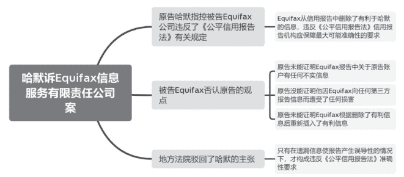

## 核心争议点

消费者信用报告机构在其出具的信用报告中漏报对消费者有利的信息是否违反《公平信用报告法》的相关规定.

## 裁判论证过程

信用报告遗漏对消费者有利的信息未违反《公平信用报告法》的相关规定

《公平信用报告法》第 607 条（b）款规定：“每当消费者信用报告机构准备消费者信用报告时，应遵循合理的程序，以确保报告所涉及的个人信息尽可能准确.”除此之外，《公平信用报告法》第 602 条（b）款要求消费者信用报告机构依据该法要求采取合理的程序，“以对消费者公平、公正的方式，秘密、准确、相关且适当地使用消费者信息，从而满足商业对消费者信用、人事、保险和其他信息的需求”.^([\[73\]](#txt004.html#footnote_content_txt004_73))根据《公平信用报告法》第 607 条（e）款或第 611 条的规定，原告如果想要在索赔案件中胜诉，必须证明其消费者报告中包含不准确信息.^([\[74\]](#txt004.html#footnote_content_txt004_74))第五巡回法院给出了“不准确信息”具体内涵的判定标准：“信用记录可能属于法规所指的‘不准确信息’，要么是因为其明显不正确，要么因为其具有误导性，可能会在一定程度上对信用决定产生不利影响.”^([\[75\]](#txt004.html#footnote_content_txt004_75))法院指出原告必须证明：（1）其信用报告中包含了不准确的信息；（2）信息不准确是由于被告未能遵循合理的程序来确保最大可能的准确性；（3）原告遭受了伤害；（4）原告所受伤害是由不准确信息所造成的.此外，要根据《公平信用报告法》第 611 条提出索赔，原告必须证明：（1）其对被告的消费者档案中所含信息项的完整性或准确性提出异议，并直接通知了被告；（2）被告未在法定期限内免费重新调查，并且记录有争议的信息的当前状态或以《公平信用报告法》第 611 条（a）款第（5）项规定的方式从档案中删除此信息；（3）被告不合规是疏忽或故意的；（4）原告遭受了伤害；（5）原告受到伤害是由于被告未能重新调查和记录争议信息的当前状态或从文件中删除此信息造成的.虽然原告声称被告的信用评分报告使其失去了正在进行的贸易活动，^([\[76\]](#txt004.html#footnote_content_txt004_76))但在不明确《公平信用报告法》是否规定艾克飞公司与益百利公司等消费者信用报告机构出具的信用报告对原告某些贸易行为具有确定义务的情况下，由于原告提供的证据没有充分证明其消费者报告包含不准确信息，因此其辩护理由不具有法律价值.^([\[77\]](#txt004.html#footnote_content_txt004_77))

《公平信用报告法》要求信用报告机构立即删除或修改信用报告中不准确或不完整的信息，但并不要求信用报告机构添加有利、准确的信息来进行报告.遗漏了准确的信息，信用报告不一定构成《公平信用报告法》所规定的“不准确”情况，使用信用报告的企业没有理由相信该报告反映了消费者的所有相关信息.事实上，对于信用报告机构来说，这样的要求亦不可能得到满足，因为信用主体只在自愿的基础上向信用评价机构提供消费者信息.^([\[78\]](#txt004.html#footnote_content_txt004_78))只有在遗漏的信息使报告产生了误导性的情况下，才可以推定信用报告将对信用决策产生不利影响.^([\[79\]](#txt004.html#footnote_content_txt004_79))本案中，哈默的信用报告遗漏了一条对其有利的信息，被告艾克飞公司未从哈默的信用档案中删除第一资本信用卡账户，而只是未在信用报告中体现该账户的信息，^([\[80\]](#txt004.html#footnote_content_txt004_80))这不属于《公平信用报告法》规定的信用报告“不准确”或“具有误导性”的情况.因此信用报告遗漏对消费者有利的信息并未违反《公平信用报告法》关于信用报告最大可能准确性的要求.

与《公平信用报告法》第 607 条（b）款涉及“信息”的准确性不同，第 611 条（a）款关于有争议的信息是否完整或准确的规定只适用于“信用条目”，如账户、破产案件、民事诉讼或税收留置权.而根据原告的申诉，其质疑的是信用报告的完整性，而非报告中的某一项.因此，原告的申诉理由没有触发第 611 条（a）款项下的调查义务.^([\[81\]](#txt004.html#footnote_content_txt004_81))第五巡回法院认为，遗漏一项信用项目并不会使报告“不准确”或“具有误导性”.哈默没有指控信用报告机构违反了其声明的披露政策，或制定了未披露的删除某些有利信息的政策.因此，原告的索赔请求无法得到法院的支持.

## 审理结果

1.美国联邦地区法院得克萨斯州达拉斯分部驳回原告对被告艾克飞公司提出的所有索赔请求.
2.美国联邦地区法院得克萨斯州达拉斯分部撤销原审法院判决，但须提交修改后的判决.
3.美国联邦地区法院得克萨斯州达拉斯分部驳回原告对被告的第二次修正申诉.
4.第五巡回法院裁定维持原审地方法院的判决.

## 相关法条

### 美国《公平信用报告法》第 602 条（Fair Credit Reporting Act§602，15 U.S.C.§1681（2018））

国会调查结果和目标声明

（a）信用报告的准确性和公正性.国会得出以下结论：

（1）银行系统依赖于公平和准确的信用报告.不准确的信用报告会直接损害银行系统的效率，不公平的信用报告方法会削弱公众的信心，而这种信心对于银行系统的持续运作至关重要.

（2）已建立完善的调查和评估消费者的信用价值、资信状况、信用能力、性格和一般声誉的机制.

（3）在收集和评估消费者信用和消费者其他信息方面，消费者信用报告机构发挥着至关重要的作用.

（4）有必要确保消费者信用报告机构公平、公正地履行其重要责任，并尊重消费者的隐私权.

（b）合理的程序.本法的目的是要求消费者信用报告机构按照本法的规定，采取合理程序，以对消费者公平、公正的方式，秘密、准确、相关且适当地使用消费者信息，从而满足商业对消费者信用、人事、保险和其他信息的需求.

### 美国《公平信用报告法》第 603 条（d）款第（1）项（Fair Credit Reporting Act§603（d）（1），15 U.S.C.§1681a（d）（1）（2018））

一般规定.“消费者报告”是指消费者信用报告机构就消费者的信用价值、资信状况、信用能力、性格、一般声誉、个人特征或生活方式所进行的任何书面、口头或其他形式的信息交流.这些信息全部或部分的使用、预期使用或收集的目的是作为确定消费者以下资格的一个因素：

（A）主要用于个人、家庭或共同居住成员的信贷或保险；

（B）就业；或

（C）第 604 条（《美国法典》第 1681b 条）授权的任何其他事项.

### 美国《公平信用报告法》第 607 条（b）款（Fair Credit Reporting Act§607（b），15 U.S.C.§1681e（b）（2018））

报告的准确性.每当消费者信用报告机构准备消费者信用报告时，应遵循合理的程序，以确保报告所涉及的个人信息尽可能准确.

### 美国《公平信用报告法》第 611 条（a）款第（1）项（A）目（Fair Credit Reporting Act§611（a）（1）（A），15 U.S.C.§1681i（a）（1）（A）（2018））

一般规定.在遵守（f）款的前提下，除（g）款另有规定外，消费者对消费者信用报告机构的消费者档案中所含任何信息项目的完整性或准确性提出异议，并且消费者直接或通过经销商间接通知该机构的，该机构应免费进行合理的重新调查，以确定有争议的信息是否不准确，并记录争议信息的当前状态，或在该机构收到消费者或经销商的争议通知之日起 30 天内，根据第（5）项从档案中删除该项目.

## 案例评析

### （一）本案有助于理清信用报告准确性标准的定义

原告哈默指控艾克飞公司故意地未能维持和遵循适当的程序，以确保其向第三方报告的有关消费者信用信息的最大准确性，违反了《公平信用报告法》.尽管《公平信用报告法》对信用报告机构提出最大可能准确性的要求，但在数字经济时代，信用消费的普及使得信用报告对金融机构的参考价值不断增大，金融机构在使用这些信用报告时往往更加关注数据所能提供的经济价值，而往往容易忽略一份不准确的信用报告会给消费者造成怎样不公正、不合理且持续性的影响.本案中，原告哈默认为因为其信用评分下降，其个人信用消费行为受到重大影响，与此同时还失去了正在进行的贸易活动.接踵而来地，哈默申请信用卡被拒绝，同时正在申请的一笔抵押贷款被拒绝，而另一笔抵押贷款被提高了利率.^([\[82\]](#txt004.html#footnote_content_txt004_82))

哈默认为有利的信息被删除导致信用报告不完整，与信用评分下降存在直接关联.在裁判论证过程中，法官指出，不是只要有信息遗漏，信用报告就会变得不准确，而只有在遗漏信息使报告“具有误导性，以致以某种方式和程度对信用决策产生不利影响”时，信用报告才是不准确的.^([\[83\]](#txt004.html#footnote_content_txt004_83))但是在利用机器学习构建信用评价模型的情况下，遗漏信息与信用决策不利结果之间关联性的证明则变得尤为困难.使用机器学习开发和完善信用评分模型，这可能会对消费者施加严峻的认知负担.数据转换、元变量开发、特征选择以及最终通过多个模型过滤重要特征的信用评分算法的构建过程非常复杂，即使是最老练的消费者也可能难以理解或确定原始数据中是否存在任何不准确之处，进而对其最终信用分数产生了负面影响.^([\[84\]](#txt004.html#footnote_content_txt004_84))

对消费者来说，在消费者信用报告机构普遍以机器学习构建信用评分模型的情况下，《公平信用报告法》中的尽可能准确的要求也应当与计算机语言接轨，为消费者提供更利于提出质疑、更加标准化的参考标准.只有当个人信息充分标准化、计算机化和客观化时，评分系统才能大规模的发挥作用并合法地广泛传播.^([\[85\]](#txt004.html#footnote_content_txt004_85))在本案中，因原告哈默的信用卡账户信息未被纳入信用报告而引发争议，法院认为这并未导致信用报告的不准确.尽管信用报告机构拥有决定是否将有利于消费者的数据作为输入数据的自主权，但因账户及相关数据未被纳入信用报告对消费者所造成的连锁性影响，信用报告机构应当有所警醒.准确性是衡量信用报告结果的一个维度，信用报告机构应当认识到，在算法模型日益复杂的情形下，准确性这一单一标准所能提供的价值非常有限，为避免消费者遭受无法挽回的严重损害，消费者信用报告机构应当将更加公正、准确的信用评分算法引入信用评价体系.

## （二）引发了对信用评价领域技术正当程序的关注

信用报告中信息的自动量化不仅被用来决定是否发放信贷，而且还被用来设定抵押贷款和其他消费信贷的价格和条款.在某些情况下，即使分数差异很小，也可能导致新贷款的利率大幅上升，贷款条件更加严苛.^([\[86\]](#txt004.html#footnote_content_txt004_86))《公平信用报告法》第 607 条（b）项要求消费者信用报告机构采用合理的程序，以对消费者公平、公正的方式满足商业对消费者信用、人事、保险和其他信息的需求.人工智能高度渗透于现代社会之中，因自动化决策高速、适用人群广泛的特征所造成的信息不对称，使得传统的合理程序标准更多地纳入技术正当程序的要求.在判断信用评价机构的程序是否合理时，法院给出的参考标准系“一个合理审慎的人在这种情况下的做法”.^([\[87\]](#txt004.html#footnote_content_txt004_87))然而，不仅对消费者来说难以理解某项具体信息将会对最后的报告结果产生怎样的影响，现实情况是，面对复杂的信用评价模型，合理审慎的非专业人士也难以应对信用评价算法中存在的不准确、不合理、不公正等问题.想要理解复杂的信用评价模型的运行逻辑、效用以及现实风险，^([\[88\]](#txt004.html#footnote_content_txt004_88))不仅需要专业技术人员查看评分系统挖掘的数据集，还需要查看源代码和程序员在评分系统的算法中嵌入的描述变量、相关性和推论的注释.^([\[89\]](#txt004.html#footnote_content_txt004_89))在信用评价过程中，消费者信用报告机构对合理的程序负有法律义务，而合理程序的定义也在逐渐演变，不应局限于传统的程序正义，必须更多加入对技术正当程序的要求，使信用评价算法具有法律和技术双重意义上的正当性.技术性正当程序作为规范自动化决策的一种手段，在应对因现代社会信息技术的高速发展，相应的配套规范与不断革新的信息技术之间脱节而引起的技术恐慌时，通过合理的过程、可理解的逻辑、有保障的救济来促进公众对信用评价的信赖.技术性正当程序是规范过程中取得公众信赖的有效手段，必须要为消费者质疑和挑战对其公众生活产生重大影响的程序提供窗口.与此同时，由于评分系统对消费者的生活了深远的影响，正当程序的基本价值—透明度、准确性、问责制、参与性和公平性—也应激发人们对评分系统的监督.^([\[90\]](#txt004.html#footnote_content_txt004_90))

## （三）促进信用评价领域的公众监督机制的完善

算法解释以及算法逻辑的公开，都有利于自动化决策的相对人了解对其不利的决定是如何做出的，为确实遭受算法歧视和数据错误负面影响的相对人提供了解救济途径的前提.^([\[91\]](#txt004.html#footnote_content_txt004_91))由于认知限制以及结构性权力不平衡，作为不平衡结构中的弱势方，消费者在信用评价行为中很容易受到侵害，需要通过监管机制的倾斜以获得额外保护.^([\[92\]](#txt004.html#footnote_content_txt004_92))而目前的监管架构也需要不断演变以适应快速数据化的消费者信用市场.

本案以及其他数起针对艾克飞公司等消费者信用报告机构的类似诉讼，促使艾克飞公司在其官方网站中提供自助申诉渠道以便消费者提出异议：如果用户认为艾克飞公司出具的信用报告中存在不准确、不完整或是欺诈性的信息，只需通过网页提出异议.根据《公平信用报告法》中规定的发生准确性争议时的处理程序，艾克飞公司必须免费对争议事项进行合理调查，并在 30 天内反馈结果.^([\[93\]](#txt004.html#footnote_content_txt004_93))艾克飞公司在其网页公开了争议事项的处理流程与需要提供的文件.^([\[94\]](#txt004.html#footnote_content_txt004_94))机构内部的申诉和反馈功能，在争议初始时期为用户提供寻求救济的窗口，初期纠正能最为及时地降低不准确信息演化为系统性风险的可能性.但争议事项的处理规则和判断标准由各机构自行设定，机构内部所能提供的实质性救济仍处于良莠不齐的状态.目前，消费者仍持续抱怨数据提供者未能全面地处理消费者提交的用于证明争议项目的支持文件.^([\[95\]](#txt004.html#footnote_content_txt004_95))《公平信用报告法》将争议项目“不准确、不完整或无法验证”的处理责任交托给消费者信用报告机构，同时鼓励消费者主动发现信用报告中的错误.然而，仅仅寄希望于依靠公司自身的“自我监管”—仅有找到最有效且最经济的处理方式的义务，无法维护包括公平在内的社会价值观.^([\[96\]](#txt004.html#footnote_content_txt004_96))除了机构自身提供的自助申诉渠道，对算法设计和相关数据展开系统评估、外部问责和审计力量的介入也是完善信用评价体系不可或缺的一环.^([\[97\]](#txt004.html#footnote_content_txt004_97))信用评价算法应用场景往往关涉重大公共利益可能引发社会风险，而消费者个人的行动空间和选择能力有限，以至于试错成本极高，^([\[98\]](#txt004.html#footnote_content_txt004_98))故应当考虑及时引入公众监督机制、开放外部监督渠道等监督形式.引入公众监督，让受不准确评分影响最深切同时也是最有动力纠正不准确信息的消费者作为公众监督者，可以降低不准确、不完整或无法验证的信息发展为决定性、系统性、长期性的风险.

### 【关联判例推荐】

1. McDonald v. Equifax Inc., CIVIL ACTION NO.3:15-CV-3212-B (N.D. Tex.2017)

核心事实：这是一起《公平信用报告法》相关案件，原告指控三家信用报告机构未能准确报告其信用信息.原告声称其信用报告上的错误导致其信贷申请被拒绝，因此原告对三家信用报告机构违反《公平信用报告法》的行为提出索赔.

与本案关联点：《公平信用报告法》要求消费者信用报告机构采取合理程序，“以对消费者公平、公正的方式，秘密、准确、相关且适当地使用消费者信息，从而满足商业对消费者信用、人事、保险和其他信息的需求.”根据第 607 条（b）款和第 611 条，为成功获得索赔，原告必须证明其消费者报告包含不准确的信息.

2. Johnson v. Trans Union, LLC, 10 C 6960 (N.D. Ill. 2012)

核心事实：原告大卫·强生（David Johnson）根据《公平信用报告法》和伊利诺伊州法律对三家信用报告机构提出诉讼，因为其消费者报告上存在不准确信息，且信用报告机构未能按照其要求进行更正.

与本案关联点：根据《公平信用报告法》第 607 条（b）款和第 611 条，原告必须证明其消费者报告包含不准确的信息.

3. Krosch v. Equifax Information Services, LLC, Case No.19-CV-2784 (NEB/KMM) (D. Minn. 2020)

核心事实：原告特洛伊·柯尔施（Troy Krosch）起诉了艾克飞公司和其他信用报告机构，指控他们未能在其信用报告中报告某些信息，违反了《公平信用报告法》.

与本案关联点：法官认为《公平信用报告法》没有要求信用报告机构在报告中涵盖所有与原告相关的信息.

4. Welford v. Equifax Information Services, LLC, CAUSE NO.1:20-cv-151-LG-RPM (S.D. Miss. 2020)

核心事实：原告称其在给艾克飞公司的一封信中对开户状态提出异议，艾克飞公司将该信转发给专业收款公司，专业收款公司未能对争议进行适当的调查或采取行动.原告根据《公平信用报告法》提起诉讼，指控艾克飞公司和专业收款公司故意违反法律，损害了其信用，并给其带来了情感伤害以及压力和焦虑.

与本案关联点：《公平信用报告法》第 611 条允许消费者客户对“消费者档案中所含任何信息的完整性或准确性”提出异议，并要求消费者信用报告机构合理地重新调查，以确定有争议的信息是否准确.

### 【注释】

[\[1\]](#txt004.html#footnote_quote_txt004_1)McCarran-Ferguson Act of 1945.（注：1945 年《麦卡伦—弗格森法案》，收入 2018 年《美国法典》第 15 卷，第 1011-1015 条.）美国国会于 1945 年通过了《麦卡伦—弗格森法案》，重申由各州对保险业进行监管是符合公共利益的，并且确认了在保险领域联邦法律不得取代或优先于各州法律的原则.

[\[2\]](#txt004.html#footnote_quote_txt004_2)根据伯福德弃权原则，联邦法院应避免干预复杂的州管理计划.

[\[3\]](#txt004.html#footnote_quote_txt004_3)McCarran-Ferguson Act §2（b）， 15 U.S.C. §1012（b）（2018）.（注：《麦卡伦—弗格森法案》第 2 条（b）款，收入 2018 年《美国法典》第 15 卷，第 1012 条（b）款.）

[\[4\]](#txt004.html#footnote_quote_txt004_4)美国《公平住房法》是 1968 年《民权法》的主要部分，收入《美国法典》第 42 卷第 3601 条以下.该法案旨在禁止住房的直接提供者（如房东和房地产公司）以及其他实体（如市政当局、银行或其他贷款机构和业主保险公司）的歧视性做法，防止人们因种族或肤色、宗教、性别、国籍、家庭状况或残疾等原因而无法获得住房.

[\[5\]](#txt004.html#footnote_quote_txt004_5)Pickett v. Iowa Beef Processors， 209 F.3d 1276 （2000）.

[\[6\]](#txt004.html#footnote_quote_txt004_6)Artifi cial Intelligence Committee， AI in the UK： Ready， Willing and Able？， UK Parliament （Apr. 16，2017）， https：//publications.parliament.uk/pa/ld201719/ldselect/ldai/100/10002.htm.

[\[7\]](#txt004.html#footnote_quote_txt004_7)Frank Pasquale & Danielle Keats Citron， The Scored Society： Due Process for Automated Predictions，89 Washington Law Review 1， 1-34 （2014）.

[\[8\]](#txt004.html#footnote_quote_txt004_8)Mike Ananny & Kate Crawford， Seeing Without Knowing： Limitations of the Transparency Ideal and Its Application to Algorithmic Accountability， 20 New Media and Society 973， 973-989 （2018）.

[\[9\]](#txt004.html#footnote_quote_txt004_9)［美］凯西·奥尼尔：《算法霸权》，马青玲译，中信出版社 2018 年版，第 16 页.

[\[10\]](#txt004.html#footnote_quote_txt004_10)参见陈锋、于茜虹：《信用消费体系建设中的法律思考—中美比较研究》，载《比较法研究》2013 年第 3 期.

[\[11\]](#txt004.html#footnote_quote_txt004_11)参见［美］弗兰克·帕斯奎尔：《黑箱社会》，赵亚男译，中信出版社 2009 年版，第 7 页.

[\[12\]](#txt004.html#footnote_quote_txt004_12)郑智航、徐昭曦：《大数据时代算法歧视的法律规制与司法审查—以美国法律实践为例》，载《比较法研究》2019 年第 4 期.

[\[13\]](#txt004.html#footnote_quote_txt004_13)David Lizerbram， Listing On“Dirtiest Hotels In America”Defamatory？，David Lizerbram &Associates （Oct. 1， 2013）， https：//lizerbramlaw.com/2013/10/01/listing-on-dirtiest-hotels-inamerica-defamatory/.

[\[14\]](#txt004.html#footnote_quote_txt004_14)Communications Decency Act §230， 47 U.S.C. §230 （1996）.（注：《通讯规范法》第 230 条，收入 1996 年《美国法典》第 47 卷，第 230 条.）

[\[15\]](#txt004.html#footnote_quote_txt004_15)Sullivan v. Baptist Mem’l Hospital， 995 S.W.3d 569 （Tenn.1999）.

[\[16\]](#txt004.html#footnote_quote_txt004_16)Gallagher v. E.W. Scripps Co.， 2009 U.S. Dist. LEXIS 45709， \*20， 2009 WL 1505649 （W.D.Tenn.2009）.

[\[17\]](#txt004.html#footnote_quote_txt004_17)Compuware Corp. v. Moody’s Investors Services， Inc.， 499 F.3d 520 （6th Cir. 2007）.

[\[18\]](#txt004.html#footnote_quote_txt004_18)James Grimmelmann， Three Theories of Copyright in Ratings， 14 Vanderbilt Journal of Entertainment and Technology Law 851， 869 （2012）.

[\[19\]](#txt004.html#footnote_quote_txt004_19)James J. McGuire， Deanna K. Shullman & Allison Kirkwood Simpson， Seeing Stars： Courts and Congress Consider Whether to Knock out Online Ratings Defamation Claims， 32 Communications Lawyer 19， 19-24 （2016）.

[\[20\]](#txt004.html#footnote_quote_txt004_20)Isuzu Motors Ltd. v. Consumers Union of US， Inc.， 12 F.Supp.2d 1035 （C.D. Cal. 1998）.

# 脚注

[\[21\]](#txt004.html#footnote_quote_txt004_21)Compuware Corporation 诉 Moody’s Investors Services， Inc.， 324 F.Supp.2d 860 （E.D. Mich. 2004）.

[\[22\]](#txt004.html#footnote_quote_txt004_22)Jones 诉 Dirty World Entertainment Recordings LLC， 755 F.3d 398 （6th Cir. 2014）.

[\[23\]](#txt004.html#footnote_quote_txt004_23)Lucille M. Ponte，保护品牌形象还是操纵系统？众包评价和评论时代的消费者“禁言”合同，7William and Mary Business Law Review 59，95 （2016）.

[\[24\]](#txt004.html#footnote_quote_txt004_24)Browne 诉 Avvo， Inc.， 525 F.Supp.2d 1249 （W.D. Wash. 2007）.

[\[25\]](#txt004.html#footnote_quote_txt004_25)Levitt 诉 Yelp！ Inc.， 765 F.3d 1123 （9th Cir. 2014）.

[\[26\]](#txt004.html#footnote_quote_txt004_26)Fair Housing Council of San Fernando Valley 诉 Roommates.com， LLC， 04-56916o， 04-57173 （9th Cir. 2007）.

[\[27\]](#txt004.html#footnote_quote_txt004_27)Eric Goldman，TripAdvisor 的“最脏酒店”排名在法庭上获得认可，Forbes （Aug. 27，2012）， `https：//www.forbes.com/sites/ericgoldman/2012/08/27/tripadvisors-dirtiest-hotels-rankingmakes-the-grade-in-court/？sh=612dabab3aab`.

[\[28\]](#txt004.html#footnote_quote_txt004_28)Jim Rosenfeld & Sam，第六巡回法院裁定 TripAdvisors 的“最脏酒店”排名受保护意见，Davis Wright Tremaine （Sept. 16， 2013）， `https：//www.dwt.com/insights/2013/09/6th-circuitrules-that-tripadvisors-ranking-of-dir`.

[\[29\]](#txt004.html#footnote_quote_txt004_29)Lyrissa Lidsky & RonNell A.Jones，关于合理读者和不合理发言者：网络世界中的诽谤法，23Virginia Journal of Social Policy & the Law 155，171 （2016）.

[\[30\]](#txt004.html#footnote_quote_txt004_30)Lyrissa Lidsky & RonNell A.Jones，关于合理读者和不合理发言者：网络世界中的诽谤法，23Virginia Journal of Social Policy & the Law 155，173 （2016）.

[\[31\]](#txt004.html#footnote_quote_txt004_31)James Grimmelmann，评价中版权的三种理论，14 Vanderbilt Journal of Entertainment and Technology Law 851，870 （2012）.

[\[32\]](#txt004.html#footnote_quote_txt004_32)James Grimmelmann，评价中版权的三种理论，14 Vanderbilt Journal of Entertainment and Technology Law 851，870 （2012）.

[\[33\]](#txt004.html#footnote_quote_txt004_33)Holly Miller，企业和专业人士因 Yelp 和负面在线评论而呼救“帮助！”：反击批评性网络帖子需要谨慎的法律考虑，Media， Privacy and Defamation Law Committee Newsletter （2014）， `https：//www.faegrebd.com/webfiles/TIPS\_Winter14%20Newsletter.pdf`.

[\[34\]](#txt004.html#footnote_quote_txt004_34)Lyrissa Lidsky & RonNell A. Jones，关于合理读者和不合理发言者：网络世界中的诽谤法，23Virginia Journal of Social Policy & the Law 155，173 （2016）.

[\[35\]](#txt004.html#footnote_quote_txt004_35)Barrie Goldsmith，Tripadvisor 上的负面反馈：酒店的噩梦，4 Journal of Tourism and Hospitality Management 135，137 （2016）.

[\[36\]](#txt004.html#footnote_quote_txt004_36)James Grimmelmann，评价中版权的三种理论，14 Vanderbilt Journal of Entertainment and Technology Law 851，870 （2012）.

[\[37\]](#txt004.html#footnote_quote_txt004_37)Lyrissa Lidsky & RonNell A. Jones，关于合理读者和不合理发言者：网络世界中的诽谤法，23Virginia Journal of Social Policy & the Law 155，173 （2016）.

[\[38\]](#txt004.html#footnote_quote_txt004_38)James Grimmelmann，评价中版权的三种理论，14 Vanderbilt Journal of Entertainment and Technology Law 851，872 （2012）.

[\[39\]](#txt004.html#footnote_quote_txt004_39)Lyrissa Lidsky & RonNell A. Jones，关于合理读者和不合理发言者：网络世界中的诽谤法，23Virginia Journal of Social Policy & the Law 155，173 （2016）.

[\[40\]](#txt004.html#footnote_quote_txt004_40)Lucille M. Ponte，保护品牌形象还是操纵系统？众包评价和评论时代的消费者“禁言”合同，7 William and Mary Business Law Review 59，96 （2016）.

[\[41\]](#txt004.html#footnote_quote_txt004_41)Lori A. Roberts，与消费者评论网站霸凌者搏斗，84 University of Cincinnati Law Review 633，648 （2016）.

[\[42\]](#txt004.html#footnote_quote_txt004_42)Lori A. Roberts，与消费者评论网站霸凌者搏斗，84 University of Cincinnati Law Review 633，638 （2016）.

[\[43\]](#txt004.html#footnote_quote_txt004_43)Lori A. Roberts，与消费者评论网站霸凌者搏斗，84 University of Cincinnati Law Review 633，648 （2016）.

[\[44\]](#txt004.html#footnote_quote_txt004_44)Holly Miller，企业和专业人士因 Yelp 和负面在线评论而呼救“帮助！”：反击批评性网络帖子需要谨慎的法律考虑，Media， Privacy and Defamation Law Committee Newsletter （2014）， `https：//www.faegrebd.com/webfiles/TIPS\_Winter14%20Newsletter.pdf`.

[\[45\]](#txt004.html#footnote_quote_txt004_45)Lori A. Roberts，与消费者评论网站霸凌者搏斗，84 University of Cincinnati Law Review 633，637 （2016）.

[\[46\]](#txt004.html#footnote_quote_txt004_46)Lucille M. Ponte，保护品牌形象还是操纵系统？众包评价和评论时代的消费者“禁言”合同，7 William and Mary Business Law Review 59，93 （2016）.

[\[47\]](#txt004.html#footnote_quote_txt004_47)Gonzalo Mon，Kimzey 诉 Yelp！ Inc.，Kelley Drye （Nov. 1， 2016）， `https：//www.kelleydrye.com/News-Events/Publications/Articles/Kimzey-v-Yelp！-Inc`.

[\[48\]](#txt004.html#footnote_quote_txt004_48)John Crosetto & Chike Eze，平衡用户生成内容的风险与回报，Foster Gar-vey （Dec. 7， 2016）， `.https：//www.foster.com/assets/htmldocuments/BloombergBNA2016\_Balancing%20the%20Risks%20and%20Rewards%20of%20User%20Generated%20Content.pdf`.

[\[49\]](#txt004.html#footnote_quote_txt004_49)Eric Goldman，评论网站在法庭上受重创-Consumer Cellular 诉 ConsumerAffairs，Technology & Marketing Law Blog （June 15， 2016）， `https：//blog.ericgoldman.org/archives/2016/06/review-website-gets-hammered-in-court-consumer-cellular-v-consumeraff airs.htm`.

[\[50\]](#txt004.html#footnote_quote_txt004_50)Holly Miller，企业和专业人士因 Yelp 和负面在线评论而呼救“帮助！”：反击批评性网络帖子需要谨慎的法律考虑，Media， Privacy and Defamation Law Committee Newsletter （2014）， `https：//www.faegrebd.com/webfiles/TIPS\_Winter14%20Newsletter.pdf`.

[\[51\]](#txt004.html#footnote_quote_txt004_51)事实损害系《美国宪法》确立的原告主体资格最基本的构成要件之一.以卢汉诉野生生物卫士案（Lujan v.Defenders of Wildlife， 504 U.S.555 （1992））为标志，美国联邦最高法院根据《美国宪法》（Constitution of the United States）第 3 条关于司法机关的规定，确认了原告取得宪定诉讼资格的基本判断标准：（1）原告必须遭受或即将遭受事实损害（Injury-in-fact）；（2）损害与被诉行为之间存在因果关系（Causation）；（3）损害是可以被救济的（Redressability）.参见齐树洁、李叶丹：《美国公民诉讼的原告资格及其借鉴意义》，载《河北法学》2009 年第 9 期.

[\[52\]](#txt004.html#footnote_quote_txt004_52)《公平信用报告法》第 618 条，15 U.S.C. §1681p （2003）.（注：《公平信用报告法》第 618 条，收入 2003 年《美国法典》第 15 卷，第 1681p 条.）

[\[53\]](#txt004.html#footnote_quote_txt004_53)《公平信用报告法》第 609（f）（7），15 U.S.C.§1681g（f）（7）（2003）.（注：《公平信用报告法》第 609 条（f）款第（7）项，收入 2003 年《美国法典》第 15 卷，第 1681g 条（f）款第（7）项.）

[\[54\]](#txt004.html#footnote_quote_txt004_54)Timothy St. George & David Anthony，对联邦法院公平信用报告法集体诉讼的实用辩护方法，8 Business Law Today 1，1-6 （2017）.

[\[55\]](#txt004.html#footnote_quote_txt004_55)Lawrence C. Maxwell，建筑作品的版权：是否需要改变，6 Landslide 16，16-21 （2013）.

[\[56\]](#txt004.html#footnote_quote_txt004_56)TRW Inc.诉 Andrews，534 U.S. 19 （2001）.

[\[57\]](#txt004.html#footnote_quote_txt004_57)Remy Y. Chang，反对 Auscape International 诉 National Geographic Society 作为统一民事版权诉讼发现规则的归属，44 U.C. Davis Law Review 1381，1389-1391 （2011）.

[\[58\]](#txt004.html#footnote_quote_txt004_58)马克诉易可升金融有限责任公司，748 F.3d 663（第五巡回法院，2014 年）。

[\[59\]](#txt004.html#footnote_quote_txt004_59)拉杰夫·穆特雷贾与梅尔·费德尔，《理解《公平信用报告法》》，Jones Day（2016 年 4 月/5 月），https：//www.jonesday.com/en/insights/2016/04/understanding-the-fair-credit-reporting-actipractical-law-litigationi。

[\[60\]](#txt004.html#footnote_quote_txt004_60)斯波科公司诉罗宾斯，136 S.Ct. 1540（2016 年）。

[\[61\]](#txt004.html#footnote_quote_txt004_61)艾伦·史密斯，高等法院：“具体”损害是提起 FCRA 诉讼的必要条件，SHRM（2016 年 5 月 17 日），https：//www.shrm.org/resourcesandtools/legal-and-compliance/employment-law/pages/concreteharm-fcra.aspx。

[\[62\]](#txt004.html#footnote_quote_txt004_62)贷款律师有限责任公司，FCRA 要求对法定损害赔偿造成具体伤害，Loan Lawyers（2017 年 7 月 25 日），https：//www.fi ght13.com/fcra-requires-concrete-injury-for-statutory-damages。

[\[63\]](#txt004.html#footnote_quote_txt004_63)朱浩、黄险峰、陈彦舟：《国内城市个人信用评分指标体系和应用场景研究》，载《征信》2019 年第 4 期。

[\[64\]](#txt004.html#footnote_quote_txt004_64)张涛：《个人信用评分的地方实践与法律控制—以福州等 7 个城市为分析样本》，载《行政法学研究》2020 年第 1 期。

[\[65\]](#txt004.html#footnote_quote_txt004_65)Equifax 是一家跨国征信公司，始建于 1899 年，创始人为凯特·伍福特（Cator Woolford），是三大消费者信用报告机构中在美国本土历史最悠久的一家，总部设立在美国的亚特兰大。

[\[66\]](#txt004.html#footnote_quote_txt004_66)美国消费者联合会国家信用报告协会，《信用评分准确性及其对消费者的影响》，档案（2002 年 12 月 17 日），https：//consumerfed.org/\_archives/elements/www.consumerfed.org/fi le/fi nance/121702CFA\_NCRA\_Credit\_Score\_Report\_Final.pdf。

[\[67\]](#txt004.html#footnote_quote_txt004_67)尼基塔·阿加瓦尔，《算法信用评分的规范》，《剑桥法律杂志》第 80 卷第 42 页（2021 年）。

[\[68\]](#txt004.html#footnote_quote_txt004_68)赫尔利·米凯拉与朱利叶斯·阿德巴约，《大数据时代的信用评分》，《耶鲁法律与技术杂志》第 18 卷第 148 页，148-216 页（2016 年）。

[\[69\]](#txt004.html#footnote_quote_txt004_69)Equifax，《信用报告》，Equifax（2022 年 3 月 10 日），https：//www.equifax.com/personal/education/credit/report/。

[\[70\]](#txt004.html#footnote_quote_txt004_70)美国三大消费者信用报告机构即艾克飞（Equifax）公司、益百利（Experian）公司和环联（TransUnion）公司。

[\[71\]](#txt004.html#footnote_quote_txt004_71)《公平信用报告法》第 607 条（b），15 U.S.C. §1681e（b）（2018 年）。（注：《公平信用报告法》第 607 条（b）款，收入 2018 年《美国法典》第 15 卷，第 1681e 条（b）款。）

[\[72\]](#txt004.html#footnote_quote_txt004_72)汉默诉 Equifax 信息服务有限责任公司等，2018 WL 10483887（2018 年）。

[\[73\]](#txt004.html#footnote_quote_txt004_73)《公平信用报告法》第 602 条（b），15 U.S.C. §1681（b）（2018 年）。（注：《公平信用报告法》第 602 条（b）款，收入 2018 年《美国法典》第 15 卷，第 1681 条（b）款。）

[\[74\]](#txt004.html#footnote_quote_txt004_74)汉默诉 Equifax 信息服务有限责任公司，2019 WL 7602463（2019 年）。

[\[75\]](#txt004.html#footnote_quote_txt004_75)塞普尔瓦多诉 CSC 信用服务公司，158 F.3d 890（第五巡回法院，1998 年）。

[\[76\]](#txt004.html#footnote_quote_txt004_76)汉默诉 Equifax 信息服务有限责任公司等，2018 WL 10483887（2018 年）。

[\[77\]](#txt004.html#footnote_quote_txt004_77)汉默诉 Equifax 信息服务有限责任公司，2019 WL 7602463（2019 年）。

[\[78\]](#txt004.html#footnote_quote_txt004_78)汉默诉 Equifax 信息服务有限责任公司等，974 F.3d 564（第五巡回法院，2020 年）。

[\[79\]](#txt004.html#footnote_quote_txt004_79)塞普尔瓦多诉 CSC 信用服务公司，158 F.3d 890（第五巡回法院，1998 年）。

[\[80\]](#txt004.html#footnote_quote_txt004_80)汉默诉 Equifax 信息服务有限责任公司等，974 F.3d 564（第五巡回法院，2020 年）。

[\[81\]](#txt004.html#footnote_quote_txt004_81)汉默诉 Equifax 信息服务有限责任公司等，974 F.3d 564（第五巡回法院，2020 年）。

[\[82\]](#txt004.html#footnote_quote_txt004_82)汉默诉 Equifax 信息服务有限责任公司，2018 WL 10483887（2018 年）。

[\[83\]](#txt004.html#footnote_quote_txt004_83)塞普尔瓦多诉 CSC 信用服务公司，158 F.3d 890（第五巡回法院，1998 年）。

[\[84\]](#txt004.html#footnote_quote_txt004_84)赫尔利·米凯拉与朱利叶斯·阿德巴约，《大数据时代的信用评分》，《耶鲁法律与技术杂志》第 18 卷第 148 页 148-216 页（2016 年）。

[\[85\]](#txt004.html#footnote_quote_txt004_85)巴尔巴拉·基维亚特，《美国的信用评分》，《欧洲电子通讯经济社会学》第 21 卷第 33 页，33-42 页（2019 年）。

[\[86\]](#txt004.html#footnote_quote_txt004_86)美国消费者联合会国家信用报告协会，《信用评分准确性及其对消费者的影响》，档案（2002 年 12 月 17 日），https：//consumerfed.org/\_archives/elements/www.consumerfed.org/fi le/fi nance/121702CFA\_NCRA\_Credit\_Score\_Report\_Final.pdf。

[\[87\]](#txt004.html#footnote_quote_txt004_87)汤普森诉圣安东尼奥零售商协会，682 F.2d 509（第五巡回法院，1982 年）。

[\[88\]](#txt004.html#footnote_quote_txt004_88)刘东亮：《技术性正当程序：人工智能时代程序法和算法的双重变奏》，载《比较法研究》2020 年第 5 期。

[\[89\]](#txt004.html#footnote_quote_txt004_89)丹妮尔·基茨·西特隆与弗兰克·A·帕斯夸莱，《评分社会：自动化预测的正当程序》，《华盛顿法律评论》第 89 卷第 1 页，1-34 页（2014 年）。

[\[90\]](#txt004.html#footnote_quote_txt004_90)丹妮尔·基茨·西特隆与弗兰克·A·帕斯夸莱，《评分社会：自动化预测的正当程序》，《华盛顿法律评论》第 89 卷第 1 页，1-34 页（2014 年）。

[\[91\]](#txt004.html#footnote_quote_txt004_91)张凌寒：《商业自动化决策的算法解释权研究》，载《法律科学（西北政法大学学报）》2018 年第 3 期。

[\[92\]](#txt004.html#footnote_quote_txt004_92)尼基塔·阿加瓦尔，《算法信用评分的规范》，《剑桥法律杂志》第 80 卷第 42 页，42-73 页（2021 年）。

[\[93\]](#txt004.html#footnote_quote_txt004_93)《公平信用报告法》第 611 条（a）（1）（A），15 U.S.C. §1681i（a）（1）（A）（2018 年）。（注：《公平信用报告法》第 611 条（a）款第（1）项（A）目，收入 2018 年《美国法典》第 15 卷，第 1681i 条（a）款第（1）项（A）目。）

[\[94\]](#txt004.html#footnote_quote_txt004_94)Equifax，《对 Equifax 信用报告中的信息提出异议》，Equifax（2022 年 3 月 11 日），https：//www.equifax.com/personal/credit-report-services/credit-dispute/。

[\[95\]](#txt004.html#footnote_quote_txt004_95)消费者报告，《消费者报告调查发现超过三分之一的消费者在其信用报告中发现错误》，消费者报告（2022 年 3 月 12 日），https：//www.consumerreports.org/media-room/press-releases/2021/06/consumer-reports-investigation-finds-more-than-one-thirdof-consumers-found-errors-in-their-credit-reports/。

[\[96\]](#txt004.html#footnote_quote_txt004_96)丹妮尔·基茨·西特隆与弗兰克·A·帕斯夸莱，《评分社会：自动化预测的正当程序》，《华盛顿法律评论》第 89 卷第 1 页，1-34 页（2014 年）。

[\[97\]](#txt004.html#footnote_quote_txt004_97)张欣：《算法影响评估制度的构建机理与中国方案》，载《法商研究》2021 年第 2 期。

[\[98\]](#txt004.html#footnote_quote_txt004_98)张欣：《从算法危机到算法信任：算法治理的多元方案和本土化路径》，载《华东政法大学学报》2019 年第 6 期。

# 第五章 智慧司法领域前沿判例

## 5.1 卢米斯诉威斯康星州案

### 【案件索引】

卢米斯诉威斯康星州，881 N.W.2d 749（2016 年）

威斯康星州诉卢米斯，2016 WI 68，371 Wis.2d 235，881 N.W.2d 749（2016 年）

卢米斯诉威斯康星州，137 S.Ct. 2290（2017 年）

### 【关键词】

算法解释权；算法影响评估；算法问责；智慧司法

### 【案件提要】

本案是有关算法解释权和技术正当程序的经典案件.本案与威斯康星州诉卢米斯的刑事诉讼案件密切相关.在威斯康星州诉卢米斯案件中，被告埃里克·卢米斯（Eric L. Loomis）通过正式程序获知，其将接受“提供替代性制裁矫正犯罪管理画像（COMPAS）”风险评估工具^([\[1\]](#txt005.html#footnote_content_txt005_1))提供的累犯风险评估，但浮于形式、流于表面的“知情权”不仅限制了被告的抗辩权，算法决策的复杂性、技术性也限制了法院的理解和判断.该案刑事诉讼被告卢米斯主张基于群体行为数据的累犯风险评估存在准确性和科学性风险，侵犯了被告享有的单独并在准确信息基础上接受审判的权利，COMPAS 对性别的考虑侵犯了其正当程序权利.卢米斯在该案中进一步指出，其虽处于反驳 COMPAS 风险评估的最佳位置，但却无法仅基于开发者在预测报告中提供的有限信息进行质疑，除非其能够知晓影响分数的因素被赋予的权重以及风险评分的运行逻辑.面对这一诉求，COMPAS 的开发者 Northpointe 称卢米斯所需获知的信息具有专有性，无法向卢米斯以及一审法院公开其评分决策所涉因素的具体权重，但 COMPAS 生成的评估分数具有科学性和准确性.虽然这一观点得到了纽约州刑事司法部门研究报告的支持，但质疑的意见此起彼伏.

卢米斯案受到了美国立法者、执法者、司法者、非政府机构和社会公众的广泛关注.与人类决策相比，算法决策存在本质不同.对于受到算法决策影响的用户和相关个体而言，适用于传统决策时代的知情权、参与权、异议权和救济权面临诸多挑战.首先，算法模型的存在和运行常处于保密状态，使得相关公众无从知晓其切身利益可能受到机器决策的干预和影响.其次，即使算法运行的事实已被知晓，但算法控制者常藉由商业秘密或者知识产权为合法理由拒绝披露实际操作原理.再次，即使算法底层代码和运行原理被全面披露，技术性知识鸿沟导致监管者无从问责，数据主体难以有效行使参与权、异议权和救济权.2016 年威斯康星州最高法院审理的卢米斯案以及一系列针对`COMPAS`软件的争论，可以深度展现前述三项挑战以及算法解释权在辅助个体行使正当权利时的重要功用.知名非营利机构`ProPublica`于 2016 年 5 月专门发布了《机器偏差》（`Machine Bias`）的报告，对`COMPAS`软件潜在的种族歧视进行了详细报告.^([\[2\]](#txt005.html#footnote_content_txt005_2))该报告以评估和审查视角，对美国司法领域中被告再犯风险预测和评估算法的潜在偏误和种族歧视问题予以系统揭露.在`ProPublica`之外，依托纽约大学运行的跨学科机构—人工智能现代研究所（`AI Now`）也对纽约市算法影响评估立法议程和实施机制予以了有力推动.因此，纽约市于 2018 年率先提出《算法问责法》，明确在不阻碍创新和发展的前提下，在公共事业领域中使用自动化决策需要进行影响评估，以确保决策具有一致性、专业性和客观中立性.我国《个人信息保护法》第 24 条赋予个人对自动化决策以拒绝权，第 55 条提出个人信息保护影响评估制度.该两条款也是在算法日益普及和发展的态势下，保护个体所拥有的新型算法权利和践行算法问责制度的一种立法努力.卢米斯案还引发了实务界与学界广泛参与到司法领域算法决策工具辅助地位的讨论中，人工智能的应用领域越来越广泛，本案提醒了人们算法在司法审判过程中可能带来的准确性、个性化、歧视性风险，从而进一步探索规范算法决策工具的规则体系.代码就是法律，算法技术本身也应当符合技术性正当程序原则.总之，本案对于理解算法解释权、算法问责、算法影响评估制度具有重要意义.

## 案件要旨

拉克罗斯巡回法院（一审法院）：原告 威斯康星州 被告 埃里克·卢米斯

威斯康星州上诉法院（上诉法院）：上诉方 埃里克·卢米斯 被上诉方 威斯康星州

威斯康星州最高法院（二审法院）：上诉方 埃里克·卢米斯 被上诉方 威斯康星州

2013 年 2 月，美国威斯康星州西部城市拉克罗斯发生一起与驾车射击有关的犯罪，威斯康星州以该犯罪所涉及到的五项罪名指控被告卢米斯.卢米斯否认其参与了射击犯罪，但承认其在当晚晚些时候驾驶了该涉案汽车.卢米斯承认了被指控的五项罪名中较轻的两项—“企图躲避交通官员罪、未经车主同意驾驶汽车罪”.在对被告卢米斯量刑时，拉克罗斯巡回法院使用了`COMPAS`风险评估工具.由于`COMPAS`背后的评估方法属于商业秘密，因此`Northpointe`仅向法院提交了再犯风险的评估数值.`COMPAS`风险评估软件针对被告生成了三项评估结果，包括审前再犯风险、一般再犯风险和暴力再犯风险，这三项评估结果的高数值显示出被告具有极高的再次犯罪概率.拉克罗斯巡回法院参考`COMPAS`评估结果排除对被告卢米斯适用缓刑的可能性，判处被告六年有期徒刑和五年社区监督.卢米斯向拉克罗斯巡回法院提出定罪后获得宽免（post-conviction relief）的申请，但该申请被法院驳回.

卢米斯根据法官裁决向威斯康星州上诉法院提起上诉，认为拉克罗斯巡回法院在量刑过程中参考`COMPAS`出具的风险评估结果的做法侵犯其正当程序权利.其理由如下：（1）巡回法院参考`COMPAS`风险评估结果，侵犯了被告根据准确信息获得判决的正当程序权利，部分原因是`COMPAS`的专有性质使被告无法质疑风险评估结果的科学有效性；（2）巡回法院参考的是`COMPAS`基于群体数据所出具的评估结果，侵犯了被告获得个性化判决的权利；（3）`COMPAS`在风险评估过程中考虑性别因素，该行为侵犯了被告的正当程序权利.

威斯康星州上诉法院将案件移交至威斯康星州最高法院.2016 年 7 月，威斯康星州最高法院维持原判，认定法官可以在量刑时参考`COMPAS`风险评估结果，不构成对被告正当程序权利的侵犯，但必须注意该工具的“限制和注意事项（limitations and cautions）”.

随后，卢米斯向美国联邦最高法院申请再审.2017 年 6 月 26 日，美国联邦最高法院驳回了其再审令状，拒绝审理此案.

## 案例事实思维导图

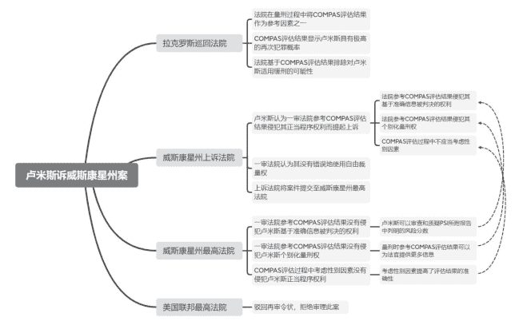

## 核心争议点

1.量刑时使用`COMPAS`风险评估软件是否侵犯被告基于准确信息被量刑的权利.

2.量刑时使用`COMPAS`风险评估软件是否侵犯被告个性化量刑权.

3.法院在审判时依赖于考虑性别因素的风险评估软件是否构成违宪.

## 裁判论证过程

### （一）量刑时使用风险评估工具没有侵犯被告在信息准确的基础上获得量刑的正当程序权利

威斯康星州最高法院安·沃尔什·布莱德利（Ann Walsh Bradley）法官^([\[3\]](#txt005.html#footnote_content_txt005_3))认为，虽然卢米斯不能审查和质疑`COMPAS`算法是如何计算风险的，但其至少可以审查和质疑附着于判决前审查报告（`Presentence Investigation Report`， `PSI`）的`COMPAS`风险评估报告中列明的风险分数.`COMPAS`的风险评估结果是基于他对问题的回答和公开获得的有关他犯罪历史的数据得出的，卢米斯有机会核实`COMPAS`报告中列出的问题和回答是否准确.巡回法庭和卢米斯获得了同一份风险评估报告，卢米斯可以通过主张风险评估报告中其他因素或信息不准确来质疑其风险分数.

### （二）在量刑时使用风险评估工具没有侵犯被告个性化量刑的正当程序权利

布莱德利法官强调了个性化量刑的重要性，并承认`COMPAS`仅提供与被告相似群体的再犯风险聚合数据.但她解释说，在决定卢米斯的量刑时，`COMPAS`的风险评分并非决定性因素，对该评分的考虑得到了其他独立因素的支持.她认为在量刑时考虑`COMPAS`风险评估结果以及其他相关因素有助于量刑法庭获得尽可能多的信息，从而得出一个个性化的判决.`COMPAS`可能为量刑法庭提供更完整的信息，以满足法院对更完整信息不断增强的需求.印第安纳州最高法院研究了类似的风险评估工具，并解释说这些工具可以帮助法院权衡所有的量刑因素：“这种评估工具使量刑法官能够更有效地评估和衡量若干明确的法定量刑情节，例如犯罪历史、判决缓刑或短期监禁的可能性以及表明被告不太可能犯另一罪行的性格和态度.”^([\[4\]](#txt005.html#footnote_content_txt005_4))此外，法院拥有必要的自由裁量权和信息，以否定不适当的评估.因此，将`COMPAS`风险评估纳入考虑的行为没有侵犯被告的个性化量刑权.

### （三）风险评估工具考虑被告的性别没有侵犯被告的正当程序权利

布莱德利法官认为`COMPAS`在计算风险评分时考虑性别是有事实依据的.相反，无法区分男性和女性的风险评估工具可能会对两性进行错误的分类.正如一位评论者指出的那样：“至少在预测再犯风险时，不考虑性别因素本身就是不公平的.”^([\[5\]](#txt005.html#footnote_content_txt005_5))布莱德利法官认为`COMPAS`对性别的考虑是基于提高准确性的非歧视目的，最终有利于包括被告在内的司法系统.此外，卢米斯没有提供充分证据，表明判决法院实际上依赖性别作为一个量刑的因素.因此，布莱德利法官得出结论，在判决时使用`COMPAS`风险评估并没有侵犯卢米斯的正当程序权利，巡回没有滥用自由裁量权.

此外，布莱德利法官补充说，`PSI`应当向量刑法院说明关于使用`COMPAS`风险评估软件的限制和注意事项，从而有助于法院更好地估量评估的准确性和给予风险评分的适当权重.`COMPAS`风险评分软件不能用于确定刑罚的严重程度或罪犯是否应当被监禁，在决定被告是否可以在社区中安全且有效地进行监督时，`COMPAS`风险评估可能不具有决定性作用.具体而言，任何包含`COMPAS`风险评估的`PSI`必须向量刑法院提供以下五项书面警告：第一，`COMPAS`的专有性质会阻碍与如何权衡各种因素或如何确定风险分数有关的信息的披露；第二，由于`COMPAS`的风险评估分数是基于群体数据得出的，其仅能够确定高风险罪犯群体而非特定的高风险个体；第三，相关研究提出了一些问题，即`COMPAS`风险评估分数是否不成比例地将少数罪犯群体认定为具有更高再犯风险；第四，`COMPAS`风险评估软件将被告与全国样本进行比较，但针对威斯康星州人口的交叉验证研究尚未完成.由于人口和亚人口的变化，风险评估工具必须被不断监测和重新规范，以保证其准确性；第五，`COMPAS`的开发并非致力于判刑，而是为了协助惩教署做出有关治疗、监督和假释的决定.布莱德利法官明确表示，希望这些警告能够引起人们对`COMPAS`风险评估工具准确性的普遍怀疑，以及针对少数罪犯群体评估风险的更具体的怀疑.亚伯拉罕森（Shirley S. Abrahamson）法官在协同意见中指出，一个重要的问题是法院缺乏对`COMPAS`的理解并因此需要得到帮助.她进一步认为，当判决结果参考了`COMPAS`或其他风险评估工具时，法院考虑其是否符合正当程序的前提是审判记录中阐明了有意义的推理过程，以解释风险评估工具的相关性、优势和不足.量刑法院为国家、被告以及公众提供具有透明性和可理解的解释不仅可以为上诉法院的审查提供基础，还能够提高法院对新型决策辅助工具的认知.

## 审理结果

1.拉克罗斯巡回法院判决卢米斯六年有期徒刑和五年社区监督.

2.拉克罗斯巡回法院驳回了卢米斯定罪后获得宽免的申请.

3.威斯康星州最高法院否定了卢米斯的正当程序论点，维持原判.

4.美国联邦最高法院于 2017 年 6 月 26 日驳回了再审令状，拒绝审理此案.

## 相关法条

美国宪法第五修正案（Constitution of the United States Fifth Amendment）

非经大陪审团提出报告或起诉，任何人不受死罪和其他重罪的惩罚，唯在战时或国家危急时期发生在陆、海军中或正在服役的民兵中的案件不在此限.任何人不得因同一犯罪行为而两次遭受生命或身体伤残的危害；不得在任何刑事案件中被迫自证其罪；未经正当法律程序，不得剥夺任何人的生命、自由和财产；非有恰当补偿，不得将私有财产充作公用.

美国宪法第十四修正案第一款（Constitution of the United States Fourteenth Amendment Section 1）

在合众国出生或归化于合众国并受合众国管辖的人，均为合众国和他所居住的州的公民.无论何州均不得制定或实施任何剥夺合众国公民的特权或豁免的法律；无论何州未经正当法律程序均不得剥夺任何人的生命、自由或财产；亦不得拒绝给予在其管辖下的任何人以同等的法律保护.

## 案例评析

### （一）本案直接推动了算法问责相关立法的出台

卢米斯案所引起的算法风险争议正是源于算法的不透明性、复杂性与正当程序规则之间存在激烈冲突，而刑事司法涉及人身自由、生命等基本权利，因此算法问责立法在刑事司法领域算法适用问题上发挥的监督与约束作用尤为重要.受`ProPublica`在 2016 年发布的《机器偏差》的报告的影响，纽约市议会成为首家通过算法透明法案的地方立法机构.纽约市 2018 年第 49 号法设置了“算法问责特别工作组（`Algorithmic Accountability Task Force`）”，负责调查市政府使用算法的情况，并就如何加强纽约市算法应用的公共问责提出建议.^([\[6\]](#txt005.html#footnote_content_txt005_6))由于政府使用的算法可能会广泛适用于公共利益领域，公众对于该类算法透明度与可解释性的要求高于不涉及公共利益的算法.2017 年 12 月 18 日，纽约市市长比尔·白思豪签署通过《算法问责法》，这是美国立法史上第一个对公共事业领域算法进行问责的法案，其篇幅虽然不长，但建立了算法问责的核心治理框架.此后，各个国家和地区开始更加重视算法问责的相关立法，本案甚至影响了关于算法可解释性和算法影响评估的制度构建.

2022 年 2 月，美国俄勒冈州民主党参议员 Ron Wyden 与参议员 Cory Booker 和众议员 Yvette Clarke 推出 2022 年《算法问责法案》.^([\[7\]](#txt005.html#footnote_content_txt005_7))该法案是对 2019 年《算法问责法案》的更新版本.从制度设计机理来看，美国在算法治理领域采用的是依靠外部专家、行政机构和公众进行算法稽核和算法评估的问责机制.算法问责机制的核心在于算法使用者或者控制者有义务报告并证明算法系统设计和决策应用的合理性，并有义务减轻算法可能带来的任何负面影响或者潜在危害.^([\[8\]](#txt005.html#footnote_content_txt005_8))具体而言，该法案要求科技业在使用自动化决策系统做出关键决策时，对偏见、有效性和相关因素进行系统化的影响评估.

与美国的外部问责治理范式不同，欧盟《通用数据保护条例》（下称“`GDPR`”）主要通过赋予数据主体知情权、访问权、更正权、删除权、限制处理权以及数据可携权等新型权利的方式，对算法决策施加影响和控制.学界对`GDPR`是否规定了数据主体的“算法解释权”展开了广泛讨论，但可以肯定的是，`GDPR`对算法的可解释性提出了要求.例如，根据`GDPR`第 13 条的规定，在获取个人数据时，数据控制者应当为数据主体提供确保合理与透明处理其数据所必要的进一步信息，具体包括“存在自动化决策（包括用户画像），以及在这种情形下，与自动化决策运行逻辑、此类处理对于数据主体的重要性和预期后果的相关的有效信息.”

受美国与欧盟立法影响，我国的《个人信息保护法》第 24 条对算法的透明度与公平性也进行了相应规定：“个人信息处理者利用个人信息进行自动化决策，应当保证决策的透明度和结果公平、公正，不得对个人在交易价格等交易条件上实行不合理的差别待遇.”进而为避免运用自动化决策可能引发的一系列侵权行为，《个人信息保护法》创设了新的权利维护手段.尽管与国际通行的算法影响评估实践和算法审计制度有所不同，该法中亦规定了自动化决策影响评估制度和审计制度.

### （二）推动司法审判中算法决策辅助地位的明确

从教育到健康，从金融到媒体，每个行业都在拥抱算法趋势，司法系统也不例外.在美国的警务活动中，警察部门正在使用算法来让社区更安全.由加州大学洛杉矶分校教授、圣克拉拉大学教授和洛杉矶警察局教授的合作项目发展起来的创新企业`Predpol`通过分析犯罪历史数据，预测未来犯罪地点.美国一些州正在使用算法来取代过时的、歧视性的保释制度.我国也正在逐步实现司法信息数据化，量刑辅助系统智能化，通过人工智能实现对实体裁判的预测.2017 年 7 月，国务院印发的《新一代人工智能发展规划》指出：“建设智慧法庭是推进社会治理智能化的重点领域之一.”^([\[9\]](#txt005.html#footnote_content_txt005_9)) 2018 年 3 月，上海高级人民法院与科大讯飞公司共同研发的上海刑事案件智能辅助办案系统（即`206 系统`）在上海全面推广运用.`206 系统`将影响犯罪嫌疑人、被告人社会危险性程度的因素细化为七个方面 32 项指标，采用深度学习方式构建社会危险性评估模型，由此提升了评估的全面性、科学性和准确性.

总的来说，法律中的算法应用前景广泛，因为算法能够帮助行为主体最有效地部署有限的司法资源，促进司法实践现代化并减少偏见，从而实现司法正义.然而，算法带来的准确性、透明度、歧视性、可理解性、问责制等方面的风险亦不容忽视.考虑到`COMPAS`等评估工具在判决中的使用与正当程序之间的争论，威斯康星州最高法院在判决中提及，使用风险评估工具的法官必须阐明除了风险评估之外作出量刑的其他理由.在充分考虑`COMPAS`的限制和注意事项的情况下，一审法院在量刑中使用算法风险评估软件并未侵犯被告的正当程序权利，但是，法院仍然应当在未来审理过程中，对风险评估算法的使用提供充足的程序性保障措施，包括在预测报告中明确指出评估的优势、相关性以及不足.威斯康星州最高法院的判例为美国其他法院在审判中使用风险评估软件提供了标准，即风险评分不可作为判决的决定性因素.在《输入偏见，输出偏见》一文中，基姆（Sandra Kim）反对利用算法对人们未来实施犯罪的可能性进行风险评估.其认为，由于风险评估往往依赖于过去的信息以预测未来，因此很容易产生偏见.基姆主张，不应采用算法来预测未来的犯罪，而应将算法作为诊断工具来查找司法决策中存在的差异、偏见和其他缺陷.易言之，利用算法对被告作出判决很可能会产生偏见，而利用算法改进司法决策则可能有所裨益.^([\[10\]](#txt005.html#footnote_content_txt005_10))

在司法审判领域，面对各类算法决策工具，首先需要明确算法决策工具的工具性价值，即算法决策工具只能起到辅助裁判的作用，而不能替代法官.^([\[11\]](#txt005.html#footnote_content_txt005_11))司法裁判是一项兼具专业判断和价值判断的复杂作业，应当坚持法官的主体性和裁判的独立性，避免锚定效应、数据主义对法官自由意志的侵蚀.^([\[12\]](#txt005.html#footnote_content_txt005_12))在明确算法辅助地位的基础上，新型决策辅助工具为法官提供了尽可能全面的参考信息，帮助法官结合具体案情作出个性化判决.其次，重视司法智能化改革的法治化进程，完善算法决策工具的配套措施，以使风险可控.在卢米斯案中，复杂的模型架构和商业秘密相关法律的保护，使得被告卢米斯无法质疑 COMPAS 风险评估结果的科学有效性.可见，算法决策工具的技术黑箱和法律黑箱问题，将导致难以解释、难以质疑、难以修复的问责难题，进而可能威胁个人的基本权利.卢米斯案及其相关论争反映了算法风险与程序正义的复杂问题.事实上，除了量刑之外，从事实认定、证据确认、案情分析、作出裁判乃至整个庭审管理以及后续的收监、假释、减刑等环节，都有人工智能的用武之地.因此，有必要确立司法智能化改革和算法辅助裁判系统应用的制度框架，例如明确有权要求算法使用者或控制者强制披露算法工具相关信息的主体、披露内容、披露风险及预防.再次，重视伦理标准和技术标准等软法对硬法的补充和协调作用，从而推动算法治理标准化和法治化的良性衔接与融合.由于人工智能系统的技术原理复杂、发展日新月异、应用范围广泛，人工智能治理范式不可避免地从单一的以国家为中心、以法律为核心的硬法模式向基于政府、互联网企业、技术社群、民间机构、公民等多元主体参与的，以协同性、动态性、分层性、复合型为特征的软法治理体系转变.^([\[13\]](#txt005.html#footnote_content_txt005_13))伦理标准和技术标准等软法在算法治理过程中扮演者愈来愈重要的角色，不仅有助于解决相对滞后的法律制度难以适应发展迅速的人工智能技术的步伐困境，而且有助于协调人工智能技术创新与个人权利保护、法律制度构建之间的矛盾.最后，算法决策辅助系统最终要服务于法官，依赖于人的作用，因此如何构建“人工智能+法律”的复合型人才培养机制也是当今人工智能领域的重要议题.

## （三）引发了对个体技术性正当权利的关注

2008 年，时任马里兰大学法学教授的希特伦（Danielle K. Citron）提出了“技术性正当程序（technological due process）”的概念，强调通过优化计算机程序设计的方式，提高自动化决策系统的透明性和可问责性.^([\[14\]](#txt005.html#footnote_content_txt005_14))一方面，代码就是网络空间的法律，网络空间由代码的架构决定，通过改造代码我们可以拥有一个更容易被规制的网络空间.另一方面，法官在审判时需要进行充分论证，以保证判决结果具有可接受性与可理解性.但在本案中，COMPAS 风险评估软件并未如此运作，开发者 Northpointe 声称被告卢米斯所需获知的信息具有专有性，因而无法向卢米斯和一审法院公开其评分决策的方式以及所涉因素的具体权重.如果自动化决策无法提供一个具有逻辑性的论证过程，那么个体在面对复杂且不透明的算法时，其技术性正当权利必然会受到压制.算法黑箱不仅容易滋生腐败、造成侵权和伤害，而且透明性缺失反过来也会动摇、瓦解公众的信赖，导致自动化决策系统的应用与实施停滞不前.^([\[15\]](#txt005.html#footnote_content_txt005_15))

从设计的角度加强算法的透明度和可问责性是各国算法监管进程的必然趋势.2019 年 6 月，美国国家科技委员会发布《国家人工智能研发战略计划：2019 年更新版》，强调通过优化设计提高 AI 系统的公平、透明和可问责性.^([\[16\]](#txt005.html#footnote_content_txt005_16))2020 年 11 月 17 日，美国白宫发布了《人工智能应用监管指南》，指出 AI 的部署致力于提高效率、有效性、公平性、福利、透明度以及其他经济和社会目标.^([\[17\]](#txt005.html#footnote_content_txt005_17))政府对 AI 的监管和非监管措施应以增强公众对 AI 的信任、风险评估与管理、披露和透明度为原则，保障个体技术性正当权利是增强公众信任的必然举措之一.我国国家新一代人工智能治理专业委员会于 2021 年 9 月 25 日发布的《新一代人工智能伦理规范》第 12 条规定：“在算法设计、实现、应用等环节，提升透明性、可解释性、可理解性、可靠性、可控性，增强人工智能系统的韧性、自适应性和抗干扰能力，逐步实现可验证、可审核、可监督、可追溯、可预测、可信赖.”

## （四）本案后续的一些最新进展

本案以美国联邦最高法院驳回了卢米斯的再审令状，拒绝审理此案告终.但卢米斯案作为算法自动化决策在刑事司法领域适用的典型案例，仍受到算法设计人员的持续关注.

华沙大学、华沙理工大学和华沙经济学院的研究人员在研究 COMPAS 分数建模后提出了预测累犯的新的解决方案.^([\[18\]](#txt005.html#footnote_content_txt005_18))与 ProPublica 的研究结论不同，他们认为 COMPAS 的真正问题在于其专有性质以及从无法公开访问的问卷中收集的一百多个（手动输入）变量，导致无法识别数据输入错误、数据集成错误、数据缺失以及其他种类的不准确性.研究人员试图对 COMPAS 模型进行解释，以寻找 COMPAS 风险评估模型中存在的潜在种族偏见和性别偏见，探索确保模型公平性的潜在方法.虽然公开获得的数据不够丰富，从而无法完全重现 COMPAS 的评估分值，但实验表明，相较于原始 COMPAS 和在 COMPAS 上训练的模型，研究人员设计的直接累犯模型能够提供更好的结果.同时，该实验还表明，即使是性能最佳的模型也存在种族偏见，但是使用偏见消除器（Prejudice Remover），能够以降低准确性的代价显著提高模型的公平性.

卢米斯案引起了有关算法解释权与技术正当程序的争论，同时也引起了研究人员对于算法在司法领域运用过程中所产生不透明、不公平以及歧视性现象的关注.ProPublica 等机构与个人为 COMPAS 以及其他风险评估软件提供了具有实践意义的修正建议，风险评估软件可以通过优化算法结构以及引入偏见消除器以减少评估结果的不准确性与算法中存在的偏见，最终有利于实现司法公正.

## 【关联判例推荐】

### 1. Malenchik v. State, 928 N.E.2d 564, (Ind. 2010)

核心事实：初审法院在量刑时参考 LSI-R^([\[19\]](#txt005.html#footnote_content_txt005_19))以及 SASSI^([\[20\]](#txt005.html#footnote_content_txt005_20))评估结果.被告质疑判决时评估工具的可采性，根据印第安纳州证据规则的有关规定，认为评估工具缺乏科学可靠性.印第安纳州最高法院认为，这些测试结果有助于提高初审法官对量刑证据的个性化评价和选择最适合罪犯改造的刑罚方案.此外，量刑程序不受证据规则的约束，以便为初审法官提供最广泛的相关信息，从而做出明智的决定.

与本案关联点：在量刑过程中使用评估工具有助于法官对量刑证据的个性化评价和选择最适合罪犯改造的刑罚方案.

### 2. State v. Samsa, 2015 WI App 6, 359 Wis.2d 580, 859 N.W.2d 149 (2014)

核心事实：COMPAS 评估报告表明被告 Samsa 的暴力或非暴力再犯风险较低，然而巡回法院否认了这一评估结果.上诉法院认定初审法院没有滥用量刑自由裁量权，因为 COMPAS 仅仅是法院在判刑时一种可用的工具，法院可以自由地信赖评估的部分内容而拒绝其他部分.

与本案关联点：法院是否采用风险评估工具的评估结果属于法官自由裁量的范畴.

### 3. State v. Travis, 347 Wis.2d 142, 832 N.W.2d 491 (Wis. 2013)

核心事实：一审法院误以为应对被告 Travis 适用至少五年强制监禁期，法院基于此错误信息做出判决.上诉法院认为适用强制性最低监禁期的法律错误，构成结构性错误，并将案件发回重审.经过无害分析，威斯康星州最高法院认为该错误既不是结构性错误，也不是无害的错误，最终判决维持上诉法院的决定，但基于不同的理由将此案发回重审.

与本案关联点：被告享有受宪法保护的基于准确信息被审判的正当程序权利.

### 4. State v. Gallion, 2002 WI App 265, 258 Wis.2d 473, 654 N.W.2d 446 (2002)

核心事实：被告 Gallion 认为法院在量刑时考虑了两个不恰当的因素，即被害人良好品格以及被告性格与被害人性格之间的差异.上诉法院认定量刑法院在评估被告犯罪造成的伤害时，有权考虑被害人良好的品格.

与本案关联点：法院在量刑时有权考虑被告或被害人的品格，基于对被告或者被害人品格的判断作出判决.

### 5. Harris v. State, 75 Wis.2d 513, 250 N.W.2d 7 (1977)

核心事实：被告因引诱一名十八岁以下少女从事卖淫活动而被一审法院判处九年零十一个月的有期徒刑.被告提起上诉.威斯康星州上诉法院认为量刑时考虑诸多其他因素是初审法院的职责.这些因素包括：（1）过去的犯罪记录；（2）不良行为模式的历史；（3）被告的人格、性格和社会特征；（4）量刑前调查结果；（5）犯罪的恶性或者加重性质；（6）被告的罪责程度；（7）被告在审判中的行为；（8）被告的年龄、教育背景、就业记录；（9）被告的悔悟、悔改与配合；（10）被告需要密切的改造控制；（11）公众权利；（12）审前羁押期限.上述各因素的权重由初审法院在其广泛的自由裁量权范围内作出决定.

与本案关联点：COMPAS 等评估工具能够为法官提供更广泛的信息，而在量刑时考虑多种其他因素是法官的职责.

## 5.2 纽约州诉贝尔案

#### 【案件索引】

People v.Belle, 2015 N.Y. Slip Op. 50663 (N.Y. Sup. Ct. 2015)

#### 【关键词】

智慧司法；司法鉴定；证据资格

#### 【案件提要】

本案是有关算法技术在司法审判中适用问题的经典案件.原告纽约州（The People of the State of New York，下称“纽约州”）将被告温德尔·贝尔（Wendell Belle，下称“贝尔”）的名字加入到原告提出的、与一起持枪杀人案件中 DNA 相关的概率分析证据的名单中，原告作出这一行为的依据是警方采用了一种名为法医统计工具（Forensic Statistical Tool，下称“FST 算法”）的计算机程序，这款软件由纽约市首席法医办公室（Offi ce of the Chief Medical Examiner，下称“OCME”）研发，用于计算特定物证上混合 DNA 样本包含被告 DNA 可能性的大小.

由于算法决策的复杂性，FST 算法得出的数据性证据是否能够作为证据应用于司法过程中，成为被告与法院争论的焦点.被告聘请的专家利用相同数据运行 FST 算法后得出了与法院提供的数据相比差异巨大的结果，原告试图据此得出 FST 算法存在明显的弊端与缺点，因此其结果不适宜作为证据被采纳的结论，并提出排除该项证据、代之以召开 Frye 听证会的动议.布朗克斯区最高法院认为根据 Frye 标准，当一项技术被相关科学界的专家广泛接受时，该证据可以被作为证据采纳而不需要召开 Frye 听证会.布朗克斯区最高法院通过评析相关判例以及逻辑分析等方式，得出 FST 算法已被普遍接受的结论，进而采纳了该证据.

纽约州诉贝尔案体现了 DNA 分析软件在司法鉴定领域中日益突出的地位，也反映了计算机算法在刑事侦查阶段与物证鉴定领域愈加广泛的应用.同时，随着 DNA 分析软件在司法机关定罪量刑中的影响力与日俱增，人们开始关注在刑事案件中 DNA 分析软件的源代码是否应当向社会公开的问题.就现阶段而言，出于保护 DNA 分析软件的商业价值等种种目的，美国政府及软件研发主体并未将软件的源代码向社会公开，然而，面对实践中产生的种种质疑，投入司法实践的 DNA 分析软件也在不断地根据实际情况做出调整与优化.FST 算法已经于 2017 年停止使用，取而代之的是号称具有更高精确性的 STRmix 软件.

#### 【案件要旨】

布朗克斯区最高法院（一审法院）：原告 纽约州 被告 温德尔·贝尔

2014 年，在美国纽约州布朗克斯区发生了一起持枪杀人案件，纽约州以二级谋杀罪指控被告贝尔.贝尔被指控案发当日在布朗克斯区朝一人射击，随后逃往附近的一幢公寓，不久即被逮捕.贝尔被逮捕时并未发现其随身携带枪支，但是在贝尔闯入的公寓公共区域的供暖设备后面，警方发现了一把上膛的半自动手枪.通过对这把手枪进行化验，警方在手枪的三个位置上采集了 DNA 样本，除了其中一个位置的 DNA 样本不适合进行比对之外，另外两处的 DNA 样本皆为复杂混合样本，且每个混合样本至少来自三个不同的人.警方将贝尔的 DNA 与这两处进行了比对，发现这两个混合样本中都可能有属于贝尔的 DNA.之后，警方采用了 OCME 研发的 FST 计算机程序，计算出这两个混合 DNA 样本中含有贝尔 DNA 的可能性相比不包含贝尔 DNA 的可能性分别高出了 1470 万倍与 86.4 万倍.

2014 年年末，美国法律援助协会声称其取得了 FST 算法采用的特定公式.在法律援助协会工作的伊莱·夏皮罗博士（Dr. Eli Shapiro，下称“夏皮罗博士”）根据公式得出了自己的计算结果：混合 DNA 中包含贝尔 DNA 的可能性仅比不包含高出 5.8 倍.贝尔故以计算结果不可靠为由，向布朗克斯区最高法院申请将作为证据的 FST 计算结果予以排除，随后又撤回了该申请.

2015 年 3 月 25 日，根据夏皮罗博士重新计算得出的结果（混合 DNA 中包含贝尔 DNA 的可能性比不包含高出 9.32 万倍），贝尔向布朗克斯区最高法院申请排除 FST 数据性证据，同时申请召开 Frye 听证会（决定能否采纳 DNA 证据的听证会）.

2015 年 4 月 29 日，布朗克斯区最高法院判决驳回被告贝尔要求举行 Frye 听证会和排除采纳 FST 科学证据的申请.

#### 【案例事实思维导图】

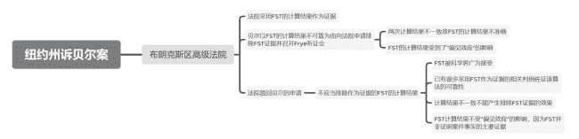

#### 【核心争议点】

1.在 Frye 标准下，如何判断一项科学证据是否可采纳.

2. FST 算法是否被相关科学界广泛接受.

3.判例中对于 FST 算法的认定情况.

4.被告方根据 FST 算法得出的不同计算结果，是否能够说明 FST 算法不具有可靠性.

5. FST 数据性证据的证明价值是否大于对被告的偏见性影响.

#### 【裁判论证过程】

##### （一）在 Frye 标准下，判断一项科学证据是否可被采纳的关键是判断该技术是否被科学界广泛接受

根据“弗赖伊诉美国案”^([\[21\]](#txt005.html#footnote_content_txt005_21))（下称“Frye 案”）中确定的标准，即 Frye 标准，只有获得相关领域专家认可的证据才能被作为正当的证据采纳.根据 Frye 标准，判断某项科学证据是否可采纳时，法院必须评估一个基本问题，即这项受质疑的技术在适当执行时是否产生了相关科学界公认的可靠结果.“相关科学界”包括那些对特定科学或技术领域有专业知识的人，这些领域包括开发、研究和理解该技术的相关领域.在 Frye 标准下，该技术不需要得到科学界的一致认可，但必须是可靠的、被普遍接受的.

当一项特定技术被相关科学界专家普遍接受时，通常不需要进行 Frye 听证.另外，如果其他法官做出的裁决中认定相同的技术被普遍接受，这些裁决可以帮助本案确定该技术所产生的证据的可采纳性，而 Frye 听证会则不是必要的.法院可以在不进行听证的情况下，根据双方在本案中提交的重要书面文件和此前其他法官面临同样要求的裁决作出判断.

纽约上诉法院在韦斯利案^([\[22\]](#txt005.html#footnote_content_txt005_22))中也进行过类似的论证，认为在确定 DNA 分析证据是否可以采纳时，应当特别注意相关科学界对此类证据的接受程度.Frye 案中确立的长期公认规则是，只有在特定领域获得普遍接受的专家证词才是可采纳的.

##### （二）FST 算法被相关科学界广泛接受

FST 算法是一系列复杂的数学方程，用来计算一个已知个体的 DNA 被包含在一个复杂的混合 DNA 样本中的可能性.该算法包括基于 DNA 分析中一种被称为“等位基因脱离（allele drop-out）”的有据可查的现象的数学假设，该部分通常是当事人提出对该算法的质疑并申请召开 Frye 听证会的核心理由.

涉及等位基因嵌入率和脱离率的验证研究被认为是低拷贝 DNA 证据可以被认定为“足够可靠”的一个原因.^([\[23\]](#txt005.html#footnote_content_txt005_23))这种对等位基因脱离率的预测被认为是全面验证的 DNA 科学（overall validated DNA science）的一部分.利用电脑程序将等位基因嵌入率或脱离率作为算法的一部分来确定 DNA 相似比的方法已经被其他州的法院认可.^([\[24\]](#txt005.html#footnote_content_txt005_24))

被告对此并无异议，他认为 FST 算法使用的等为基因嵌入率和脱离率不符合 Frye 标准.布朗克斯区最高法院认为 FST 算法是一种详尽的验证程序，众多专业的科学团体对 OCME 使用 FST 算法的有效性进行了同行评审，并接受了其有效性.FST 算法的计算仅仅是基于确定的数学原理的统计公式.OCME 已经在许多国家级科学会议上提出其对于等位基因的嵌入率和脱离率的经验性判断，且利用该判断的 FST 算法也已经被该领域的专家反复验证和认可.并且，FST 的整体方法也已经通过纽约州法医科学委员会和国家法医科学技术中心的认证.因此，布朗克斯区最高法院认为，上述证据足以证明 FST 算法作为确定相似比的可靠方法已经被科学界普遍接受，这完全符合 Frye 标准.

##### （三）其他法院判例认为 FST 算法已被普遍接受，这些判例有助于确定该证据的可采纳性

布朗克斯区最高法院指出，驳回对 FST 算法进行 Frye 听证的申请符合绝大多数判例中法院的做法.正如该院发现的那样，这些法院裁定 FST 数据性证据可采纳所依据的理由是一致的，即根据已发表的文章和在大量的动议和答复中提出的主张，FST 算法的计算仅仅使用了基于确定的数学原理的统计公式，而且利用 OCME 等位基因嵌入率和脱离率的 FST 算法已经被该领域的专家反复验证和认可.

布朗克斯区最高法院指出，在质疑 FST 技术的两三年间，共有两位法官裁决进行了 Frye 听证会.

# 案件背景

在 2013 年的纽约州诉威廉·罗德里格斯案^([\[25\]](#txt005.html#footnote_content_txt005_25))中，纽约州最高法院详尽地总结双方传唤的证人所提供的证据，法院指出，四名辩方证人中的三名甚至同意了“使用包含等位基因脱离率在内的相似比概念在科学界被普遍接受”这一观点.第四位辩方证人，辩护专家夏皮罗博士曾承认他在法学统计领域的知识不如另外一名证人—阿黛尔·米切尔博士（Dr. Adele Mitchell），后者在`OCME`帮助开发了`FST`软件并对其进行了测试.`夏皮罗博士在那次听证会声称“任何相似比程序都无法为一个复杂的`DNA`混合物赋予真正的统计值”，他支持另一种被称为`CPI`的分析方法，但双方的其他专家都不相信在发生任何类型的等位基因缺失的情况下，这种方法能够产生有效的结果.最终，在听证会之后，该法院认为`FST`算法满足`Frye`标准并且驳回了被告排除`FST`算法适用的动议.

## 2014 年联合听证会

2014 年，两起相互之间没有关联的案件^([\[26\]](#txt005.html#footnote_content_txt005_26))就其中涉及的`FST`技术在金斯县举行`Frye`联合听证会，法院认定`FST`算法不符合`Frye`标准.该做法使得后来许多案件的被告要求法院遵循该裁决结果，排除基于`FST`算法得出的相似比证据，或者进行`Frye`听证会.该做法也使得许多之前被法官驳回`Frye`听证会申请的当事人，开始提出重新讨论的动议.

## 布朗克斯区最高法院观点

布朗克斯区最高法院同意大多数法官的观点，即`FST`算法并非新颖的技术，也不具有实验性.`FST`算法以长期建立的用于计算统计概率的原则为基础，并在可能的情况下利用这些原则计算一个简单易懂的数学数字，来衡量某一`DNA`混合样本包含特定被告的`DNA`的可能性.即使科学界存在怀疑态度和质疑声音，认为应当进行更多的验证研究，但布朗克斯区最高法院认为`FST`算法已经得到了充分的验证.

### （四）被告提出的根据 FST 算法得出的不同计算结果，不能说明 FST 算法不具有可靠性

被告贝尔提出辩方专家根据`FST`算法得出的计算结果与`OCME`的犯罪学家的结果不同，因此他认为`FST`算法不具有可靠性.

布朗克斯区最高法院指出，被告提出`FST`算法不具有可靠性，但被告方专家却在计算中使用了与`FST`算法相同的计算方式，并得出了他们认为在该算法下正确的相似比结论，这一做法本身就很怪异.同时，辩方专家夏皮罗博士通过`FST`算法得出了从该枪支上取得的混合`DNA`样本中包含贝尔`DNA`的可能性比不包含高出 9.32 万倍的结论，该`DNA`相似比的结论具有独立性.这个数据虽然比`OCME`的犯罪学家所得到的 86.4 万倍这一数据小得多，但都足以说明被告极有可能曾经持有过该枪支.

布朗克斯区最高法院认为从逻辑角度来说，虽然双方利用相同的`FST`算法却计算出了不同的结果，但这并不能说明`FST`算法本身是无效的.为了论证这一点，法院举例说，两个数学系学生根据同一数学公式使用相同数据计算出的结果应该相同，但如果一方出现了计算错误进而计算出了不同的结果，并不能说明该数学公式本身应当被归为无效.此外，原告提出出现差异的原因是辩方专家的计算出现错误，他们指出法律援助协会`DNA`部门的一个专家曾根据`FST`算法得出了被告的`DNA`不在该混合样本中的结论，但后来该专家承认这是由于其计算出现了错误.总之，法院认为在本案中，双方的相似比结果不同只能说明夏皮罗博士或`OCME`其中一方的计算有误，而与算法本身的可靠性无关.

布朗克斯区最高法院认为在本案中，被告提出的争论的是一场潜在的“专家之争”，关键点是使用相同的科学程序和数学程序但获得的结果不同的问题，被告试图证明`FST`算法无效且陪审团不应考虑这些结果.布朗克斯区最高法院认为这并非针对方法本身，而是该方法是否得到了恰当地执行，属于证明力大小的问题而非可采纳性的问题.正如贝尼特斯法官（Justice Benitez）曾论述的：“法院关于这个问题的普遍观点是，相关科学界普遍接受`FST`算法，而关于该算法所得出的结以及被告方认为其存在的任何潜在的弱点或缺点的争议，就像许多科学证据一样，取决于证据的证明力而非可采纳性.这些问题需要通过交叉询问和/或辩方专家证词来探讨或质疑，并最终由陪审团评估.”^([\[27\]](#txt005.html#footnote_content_txt005_27))布朗克斯区最高法院认为这正是本案应该发生的情况，特别是在被告有能力聘请专家对`OCME`的计算结果进行挑战的情况下，由于曾经出现辩护律师在类似的案件中，为了保护被代理人利益而频繁更改对于`FST`数据性证据可采纳性的认定意见的情况，法院认为辩方关于科学证据可采纳性的检验标准必须与控方一致.布朗克斯区最高法院认为`FST`算法是可靠的，就本案而言，这意味着除非发现其中一方计算有误，双方都可以介绍其`FST`结果，并向陪审团解释混合`DNA`样本中包含被告`DNA`的可能性比不包含高出 9.32 万或 86.4 万.

### （五）FST 数据性证据对被告不具有偏见性影响

被告请求法院认定：`FST`数据性证据的证明价值是否大于对被告的偏见性影响.法院拒绝了这一申请.布朗克斯区最高法院指出本案并非一起基于`DNA`的起诉.根据本案案情，有枪击事件的目击者看到枪在被告手上，并且其弹道与枪击案相符.这把枪是在枪击发生后不久，在被告进入后又离开的一栋建筑内发现的.在枪支上发现的两处适合比对的`DNA`样本证明，不能排除混合样本中存在被告`DNA`的嫌疑.根据`OCME`和法律援助协会`DNA`部门的专家进行比较后得出结论，被告的`DNA`在那把枪上的可能性非常高.考虑到其他证据，`DNA`相似比证明被告极有可能持有那把枪，结合目击者证词，被告不仅持有该枪支还朝另一个人开了枪.因此，布朗克斯区最高法院认为适用`FST`数据性证据并无偏见存在，该证据不应被排除.

## 审理结果

布朗克斯区最高法院认定，本案中所采纳的`FST`证据符合`Frye`标准，判决驳回被告贝尔要求举行`Frye`听证会和排除采纳`FST`科学证据的申请.

## 相关法条

### 美国《联邦证据规则》第 401 条（`Federal Rules of Evidence§401`）

相关证据的标准

在下列情况下，证据具有相关性：

（a）具有该证据与没有该证据相比，使得某事实更可能存在或者更不可能存在的任何趣向；并且

（b）该事实对于确定诉讼具有重要意义.

### 美国《联邦证据规则》第 402 条（`Federal Rules of Evidence§402`）

相关证据的一般可采性

除下列情形另有规定外，相关证据均可以采信：

● 美国宪法；
● 联邦法规；
● 本规则；或者
● 最高法院规定的其他规则.

不相关的证据不予采纳.

### 美国《联邦证据规则》第 403 条（`Federal Rules of Evidence§403`）

因偏见、混淆、浪费时间或者其他原因而排除相关证据

如果相关证据的证明价值被以下一种或多种危险大大抵消，法院可以排除相关证据：不公平的偏见、混淆问题、误导陪审团、过分拖延、浪费时间或不必要地提出累积证据.

### 美国《联邦证据规则》第 601 条（`Federal Rules of Evidence§601`）

作证能力的一般规定

除本规则另有规定外，每个人都有能力成为证人.但在民事案件中，证人对州法律提供裁决规则的索赔或辩护方面的能力受州法律管辖.

### 《美国联邦法院证据规则》第 702 条（`Federal Rules of Evidence§702`）

专家证人证言

在知识、技能、经验、培训或者教育方面具备专家资格的证人，可以在以下情况以意见或者其他形式作证：

（1）专家的科学、技术或其他专业知识将有助于事实审判者理解证据或确定有争议的事实；
（2）证言基于充足的事实或者数据；
（3）证言是可靠的原则或者方法的产物；以及
（4）专家已将这些原则和方法可靠地适用于案件的事实.

### 《美国联邦法院证据规则》第 703 条（`Federal Rules of Evidence§703`）

专家意见证言的依据

专家可以根据其了解或亲自观察到的案件中的事实或数据提出意见.如果特定领域的专家在形成该主题相关的意见时，会合理地依赖这些事实或数据，那么这些事实或数据不需要具有可采性来使专家意见被采纳.但是，如果这些事实或数据本身不具有可采性，则只有在其帮助陪审团评估意见的证明价值远远超过其不利影响的情况下，意见提出者才可以将其披露给陪审团.

## 案件评析

### （一）本案标志着计算机技术在司法鉴定中的地位日益突出

在美国的司法判例中，将复杂`DNA`分析软件应用于刑事案件最早可以追溯至 2009 年的宾夕法尼亚州诉佛雷案（`Commonwealth v. Foley`），此案所采用的`TrueAllele`算法与`FST`算法的原理大致相同，两种算法都应用了高灵敏性测试.自此之后，此类复杂`DNA`分析软件陆续被证明符合`Frye`标准、`Daubert`标准，进而被广泛地应用于司法鉴定之中.在`FST`算法投入使用的七年中，仅有两个案件的法官通过了被告请求召开`Frye`听证会的申请，在其余案件中法官皆直接采用了`FST`算法的计算结果作为刑事案件的鉴定意见证据.

一系列智能技术在司法鉴定领域的应用，能够在很大程度上将人从复杂的司法鉴定工作中解放出来，降低司法鉴定对人力资源的需求；依托大数据技术以及人工智能技术实现对大量司法信息的高效收集和分析，能够将与案件相关联的各项要素进行整合以及智能关联，实现对案件的精准回溯与分析；相较于传统的司法鉴定手段，不仅在鉴定的效率上有了很大的提升，同时也大大提高了鉴定的准确度；促进了司法鉴定的信息化发展以及智能化发展.然而，随着计算机技术在司法鉴定领域的地位日益突出，人工智能与大数据技术不断介入刑事诉讼，为各国的司法制度带来了各种风险与危机，如威胁控辩平等原则、压缩律师辩护空间、削弱对司法的制约与监督等等.

### （二）本案引发了关于在刑事案件中 DNA 分析算法的源代码是否应当公开的讨论

`FST`这类的`DNA`分析软件的主要功能是为刑事案件提供证据，而刑事案件审判公开一直以来都是美国法院传统，其中自然包括审判过程中的证据公开.美国最高法院在理查蒙德报业公司诉弗吉尼亚州案^([\[28\]](#txt005.html#footnote_content_txt005_28))的判决书中就曾写过：“美国司法制度最本质的特征就蕴含在刑事审判公开这一原则之中.”由此引发了人们关于`DNA`分析算法的源代码保密与刑事审判公开原则是否冲突这一问题的讨论.

`DNA`分析算法源代码之所以保密，很大程度上是出于保护研发主体商业利益的需要.`OCME`曾给法院致信，请求法院不公开软件源代码从而维护`FST`算法的商业价值.`OCME`在信中说道：“在过去的四年中，`OCME`在`FST`算法的研发过程中投入了大量时间和金钱，虽然我们尚未决定通过`FST`算法获取利润以收回投资成本，但是在私人领域，`FST`算法是我们的宝贵资源，并且具有盈利的潜力.”法院在审判过程中大都支持`OCME`的主张，维护了`DNA`分析软件源代码的保密性.很多法院曾驳回当事人查阅`FST`算法源代码的申请，还有一些法院虽然允许当事人查阅`FST`算法源代码，但是要求查阅者对源代码严格保密，禁止任何人利用在查阅源代码的过程中知晓的信息获取利润.

然而，近年来许多采用`DNA`分析软件计算结果作为证据的案件都存在争议，主张开放`FST`算法源代码的呼声越来越高，艾丽什·克罗斯（Aislinn Klos）律师认为，如果政府部门从公共利益的角度出发，绕开私人公司和专利制度，自主研发`DNA`分析软件并将源代码向社会公开，如此一来社会上的程序员和独立研究者能够共同完善源代码，刑事案件审判结果准确性和权威性也会随之提升.

### （三）本案引起了算法缺陷对司法公正的干扰的讨论

如同任何软件一般，`FST`算法以及类似的用于司法领域的算法都有存在软件工程上的缺陷和漏洞的问题.特别是目前新兴的基于大数据和人工智能的软件，面临模型预测准确度的问题，也就是说，任何一个计算机软件和人工智能模型都有失误和失效的可能性.司法的判断权属性决定了在案件争议中必然会有一方取得胜利，而另外一方则会失败，因此，随着各种各样的智能技术在法院中扮演的角色越来越突出，当事人对于智能技术的警惕性也变得越来越高.因此，在使用这些算法的过程中，存在两方面的问题：（1）如何避免算法本身出现错误，造成对于司法公正的干扰和亵渎；（2）如何面对和回应社会公众对于计算机算法和程序的争议和质疑.^([\[29\]](#txt005.html#footnote_content_txt005_29))在本案中，由于第三方机构展示的计算结果和警方展示的计算结果出现了重大的不一致，因此引起了公众对于算法可靠性的广泛讨论.虽然在本案中，无论采用何种方法计算出来的枪支上面包含被告`DNA`的概率均远大于枪支上面不包含被告`DNA`的概率，同时有清晰的证据链表明被告确实曾经持有案件中的枪支，从而`FST`算法可能存在的错误没有影响到最终的判决结果.但是本案的被告和美国法律援助协会对`FST`算法准确性抱以怀疑态度也合乎常情，毕竟，算法的设计缺陷、软件编码错误或者机器学习模型预测结果不准确都完全有可能导致证据偏离客观事实的问题，进而威胁到司法的公正性.

针对计算机算法的这一特点，采用开放源代码和算法的方式不失为一种解决方案.通过大量专业人士的反复审核，能够尽可能完善代码逻辑以提升算法准确性，并且能够针对每一个用例是否出现问题进行具体分析和讨论.目前，大数据和人工智能技术也被广泛引入到了司法领域，很多大数据算法的应用目前存在向司法系统引入系统性偏见和歧视的可能性.这就要求对于基于大数据的算法，不仅仅要公开算法源代码，还要同时公开用于训练算法的数据集，以保证算法的均衡性、公平性和可靠性.

计算机算法提供的证据往往以概率的形式出现，这就在要求证据严谨和确定的司法场景下产生了模糊性.如何在计算机程序输出模糊结果的情况下确定证据的有效性和作出司法判决，也是该案所衍生出的一个值得关注的讨论点.而另一方面，如同本案中`OCME`最终采取了对软件进行升级的措施一样，软件的升级必然是为了提升软件的精确性和修补软件所存在的问题.应当如何处理这些受到已知软件问题所影响的司法判决，如何补偿相关当事人，软件提供商应当承担怎样的责任，这些都是人工智能算法应用于司法领域时不得不面对的问题.^([\[30\]](#txt005.html#footnote_content_txt005_30))

### （四）本案引起了对算法技术应用所造成的“技术鸿沟”和“刑侦中心主义”问题的讨论

在本案中，纽约警方独立完成了从枪支上面采集`DNA`样本，到运用`FST`算法分析`DNA`样本中是否包含嫌疑人`DNA`的整个技术鉴定过程，这一整个流程相对于审判机关和社会公众来说是封闭的、不透明的；而这个过程中出现了由于计算失误导致警方结果和第三方计算结果不一致的问题，更加深了公众对于这一过程可能造成司法不公的疑虑和对于通过计算机算法获取的证据的证明力的质疑.

随着高科技侦查技术越来越广泛的运用和世界范围内警企合作的不断深化，目前主要由侦查机关掌握和使用大量刑侦相关的计算机技术，在侦查机关和审判机关以及社会公众之间，已经形成了一道“数字鸿沟”.目前`FST`等应用于刑侦领域的计算机算法具有商业软件的性质，普遍不对公众开放源代码，且即使在将来出现了相关的开放源代码软件，其运作方式对于审判机关人员和非相关技术领域出身的公众也是难以理解的，从而造成了法官和社会公众在案件审理过程中和事实认定过程中的“失语”.

具体来说，算法所造成的“证据理解判断黑箱”的后果主要体现在两个方面：（1）法院对于证据的最后决定权受损，从而背离了审判中心主义的法治原则，削弱了法官的自由裁量权.要实现审判中心主义的法治原则，其中最核心的要义就是要发挥法院在整个审判体系中的核心作用.对于诉讼来说，核心内容就是对案件的事实认定和对证据的审查判断，唯有落实审判阶段法官对于案件的事实认定和证据的审查判断的决定权，才能保证审判中心主义的落实.而在“数字鸿沟”的冲击之下，法院的角色日趋从“中立的裁判者”变为了“被动接受新技术的落后者”.这将使得侦查机关主导证据及其证明力的判断，从而缩小了法官对于证据的自由裁量权，威胁了法治的健康.（2）凭借强大的科技力量，侦查机关成为了诉讼关系的中心，整个司法体系中对侦查机关的权力制衡力量日趋被削弱.由于在新技术条件下，审判机关对于通过技术手段获取的证据被迫未经实质审查便加以认可，造成了法院的事实认定权力的旁落，并且降低了案件的公开透明程度，产生了滋生权力滥用、权力寻租和腐败以及冤假错案的空间.特别是在目前世界范围内的警企合作的背景下，很多国家的公安机关和相关企业具有深度的合作关系.这样的合作会将算法的设计者和算法的使用者合二为一，从而进一步加强侦查机关对算法的把控力度.^([\[31\]](#txt005.html#footnote_content_txt005_31))这无疑会加大侦查机关对案件审判结果的影响力.

### （五）本案后续的一些最新进展

本案虽然以纽约州高级法院驳回贝尔的上诉请求宣告终结，但是越来越多的人怀疑`FST`算法计算结果的准确性，其中就包括全美`DNA`数据库的构建者之一，法医学专家布鲁斯·布德沃博士（Dr. Bruce Budowle）.`布德沃博士曾在作证时指出，纽约州所采用的`FST`软件缺乏严谨性.

2016 年 9 月，`OCME`给所有客户发去一份备忘录，称将在 2017 年 1 月 1 日用新的`DNA`分析技术替换目前所采用的高灵敏性测试和`FST`软件.取代`FST`算法的新款`DNA`分析算法名为“`STRmix`”.这是一款通过美国联邦调查局审查的商业软件，主要功能与`FST`算法基本相同，能够分析复杂的混合`DNA`样本.目前，数十个公立实验室都已经开始使用`STRmix`算法.虽然应用于刑事案件中的`DNA`分析技术的精确性仍然面临种种质疑，但是司法系统将计算机软件与司法鉴定相结合已然是大势所趋.

## 关联判例推荐

1. `Frye v. United States`, 293 F. 1013 (D.C. Cir 1923)

核心事实：被告被判二级谋杀罪，并在上诉中辩称，初审法院拒绝让专家证人就被告进行的收缩血压欺骗测试的结果作证的做法是错误的.法院确认了被告的定罪.法院认为，被告未能证明该试验是示范性的，而不仅仅是实验性的.在审判时，收缩血压欺骗测试没有在心理和生理权威机构中获得必要的地位和科学承认，因此不能说明就该测试提出的专家证词是合理的.

与本案关联点：该案确定了某项科学技术能否在审判中作为证据被采纳的标准，即该项技术是否在相关领域被广泛承认和接受.该项标准后来在有关科学技术适用的大量判例中被广泛引用.

2. `People v. Middleton`, 54 N.Y.2d 42 (1981)

# 咬痕证据案例

## 核心事实
核心事实：被告是医院的一名维修员工，其主管被发现倒在他办公室的地板上并在不久后被宣告死亡.法医进行尸检后发现，受害者背部有五个明显的咬痕.公诉方要求被告接受 OCME 的牙医对其口腔进行检查并制作石膏或模具，被告以牙医的证词缺乏科学有效性为由请求法院排除牙医证词.初审法院驳回了该请求.上诉法院指出，咬痕证据作为一种识别犯罪嫌疑人身份的手段，其可靠性已经在科学界得到充分确认，足以使这种证据在刑事案件中被采纳，而无需在每个案件中单独确认其可靠性；但是应该以证据证明所用材料的真实性和在具体案件中所遵循程序的适当性，并进行交叉询问，以验证其结论的可靠性.

## 与本案关联点
与本案关联点：当一项技术被科学界普遍接受时，无需再单独验证该技术本身的可靠性，但是应当对证据所需的材料以及所遵循的的程序进行交叉询问，以保证结论的可靠性.

# People v. Wesley, 83 N.Y.2d 417 (N.Y. 1994)

## 核心事实
核心事实：一个女人被发现死在自己的公寓里.工作人员在对被告公寓的例行检查中，发现了血迹斑斑的衣服且衣服上有灰白色的头发.DNA 测试的结果为被告衬衫上的 DNA 与死者的 DNA 相符.此外，被告衣服上的血液中的 DNA 与死者的不同.审判前，初审法院就该 DNA 证据举行了听证会，裁定其为可采证据.被告被判有罪.被告提出上诉，声称 DNA 证据不可采信.经复审，法院认为 DNA 证据应当被采用.法院解释说，DNA 证据符合 Frye 标准，因为它是被相关科学界普遍接受的证据.

## 与本案关联点
与本案关联点：法院根据 Frye 标准确定，DNA 证据能够作为证据被采用.

# People v. Garcia, 39 Misc.3d 482 (N.Y. Sup. Ct. 2013)

## 核心事实
核心事实：被告在介绍低拷贝数（Low Copy Number，下称“LCN”）DNA 测试结果的可采性和有关 FST 的证词之前，提交了一份 Frye 听证会的动议.法庭发现，LCN DNA 测试和 FST 都不是新颖的科学，并且，二者在法医科学界都被普遍认为是可靠的.因此，没有必要举行 Frye 听证会.

## 与本案关联点
与本案关联点：当一项技术符合 Frye 标准，即被科学界普遍接受时，不必举行 Frye 听证会.

## 5.3 萨姆萨诉威斯康星州案

## 【案件索引】
State v. Samsa, 859 N.W.2d 149, 2015 WI App 6, 359 Wis.2d 580 (Wis. Ct. App.2014)

## 【关键词】
自动化决策；算法影响评估；自由裁量权；智慧司法

## 【案件提要】
本案是有关讨论自动化决策结果与法官自由裁量权之间的关系的案件.该案与威斯康星州诉萨姆萨（Jordan John Samsa，下称“萨姆萨”）的刑事诉讼案件密切相关.在威斯康星州诉萨姆萨案中，在量刑阶段，经各方同意，马里内特县巡回法院对萨姆萨进行了判决前调查（Presentence Investigation， PSI），即包含 COMPAS 软件在内的累犯风险评估分析.COMPAS 软件的全称是“替代性制裁的矫正罪犯管理分析（Correctional Off ender Management Profi ling for Alternative Sanctions）”，是运用算法依据累犯和犯罪职业特征相关行为和心理结构设计的为一般和暴力累犯以及审前不当行为的风险预测评估软件.COMPAS 是威斯康星州惩教部使用的风险和需求评估工具，作为识别罪犯风险以及其治疗和规划需求的手段.风险级别（低、中或高）旨在帮助惩教专业人员决定罪犯所需的监督水平.经巡回法院对其判决前调查（PSI）结果进行综合考虑，最终判处被告萨姆萨五年有期徒刑外加五年的社区监督.而被告萨姆萨认为该判决结果是不合理、不公正的，其辩称，巡回法院在量刑时只考虑了 COMPAS 报告中有关其犯罪需求可能性高的评估结果，而忽略该报告中其再犯风险低的结果，滥用了法院的自由裁量权.另外，被告还认为其提交的有关 COMPAS 软件的评估原理和对其评估结果的解释原理的信息可以构成申请改判的新因素，因此，被告向上诉法院申请重判或者改判.总体来说，原告萨姆萨的论点基本上是，量刑法院的自由裁量权应当基于 COMPAS 的评估结果.而面对这一诉求，威斯康星州上诉法院则认为，如何利用 COMPAS 的评估结果属于法官行使自由裁量权的事项，COMPAS 评估软件只能作为辅助法官判决的工具，不得决定最终的判决结果.

在当前人工智能技术逐渐推广运用到司法工作中的背景下，该案对于我国司法工作中如何运用人工智能软件产生的自动化决策结果具有重要的借鉴意义.目前，国内法院对于人工智能技术运用表现出高度热情，各地法院正在开发各种人工智能软件并将其应用于司法工作中，^([\[32\]](#txt005.html#footnote_content_txt005_32))但鉴于司法审判具有复杂性与主观性的特质以及算法可能会存在“算法歧视”、“算法黑箱”等缺陷，人工智能技术始终只能作为辅助工具加以利用，而不能轻易取代传统司法审判方式.另外，由于算法具有极强的商业秘密或国家安全属性，导致其往往具有不公开性、不透明性.同时，我国目前缺乏相应配套的法律法规来引导法院以及司法工作者应用人工智能技术手段来辅助审判，为了更加顺利地推进我国未来的智慧司法进程，通过立法手段来搭建有关适用人工智能技术辅助审判的法律规范体系就变得尤为重要，这既有利于未来智慧司法改革于法有据，又有利于从制度和技术上防范与化解大数据和人工智能辅助刑事裁判的复杂性、不确定性、可解释性风险.总的来说，本案对于未来我国司法系统智能化建设起到了原则性的引导作用.

## 【案件要旨】
马里内特县巡回法院（一审法院）：原告 威斯康星州 被告 乔丹·约翰·萨姆萨

威斯康星州上诉法院（上诉法院）：上诉方 乔丹·约翰·萨姆萨 被上诉方威斯康星州

2013 年，萨姆萨因性侵犯罪行为被马里内特县巡回法院以三级性侵的罪名指控，萨姆萨对该项指控无异议.在量刑阶段，各方共同建议对被告萨姆萨进行一次判决前调查（PSI），但仍可以对判决结果展开自由辩论.惩教部的判决前调查（PSI）结果建议判处一年有期徒刑，缓期五年执行.而威斯康星州要求先关押四年，再外加四年的社区监督.之后，巡回法院先后讨论了被告萨姆萨犯罪的性质、被告萨姆萨的品行以及附加在判决前调查（PSI）中的 COMPAS 评估报告的结果，虽然 COMPAS 软件对萨姆萨再犯风险的评分较低，但对其犯罪需求的评估在大多情况下都呈高度可能的结果.最终，马里内特县巡回法院认定被告萨姆萨未来再犯可能性很高，判处其五年有期徒刑和五年社区监督.

萨姆萨不服判决结果，向一审法院提出定罪后获得宽免的申请，但该申请被马里内特县巡回法院驳回.

之后，萨姆萨根据法官裁决向威斯康星州上诉法院提起上诉，认为一审法院错误地应用了 COMPAS 报告有关犯罪需求部分的评估结果要求重审，或者因 COMPAS 报告的正确信息构成一个新因素申请改判.其理由如下：（1）COMPAS 报告中关于犯罪需求的评估结果只能用来预测罪犯需要接受惩教服务的领域，而不能预测罪犯的再犯危险性.原审法院只关注 COMPAS 报告中对罪犯的犯罪需求的评估结果而不考虑其再犯风险性低的结果，是对 COMPAS 评估结果的错误应用，滥用了其自由裁量权；（2）在审判时，初审法院忽略了有关 COMPAS 软件的评估原理和对其评估结果的解释原理的信息，这些信息应构成申请改判的一个新因素.

2014 年 12 月 16 日，威斯康星州上诉法院认为，原审法院未错误应用和解释 COMPAS 报告中关于犯罪需求的评估结果，未滥用其自由裁量权；被告萨姆萨未证明其提交的有关 COMPAS 的补充信息构成申请改判的新因素.因此，威斯康星州上诉法院驳回了被告改判的申请，裁定维持原判.

## 【案例事实思维导图】
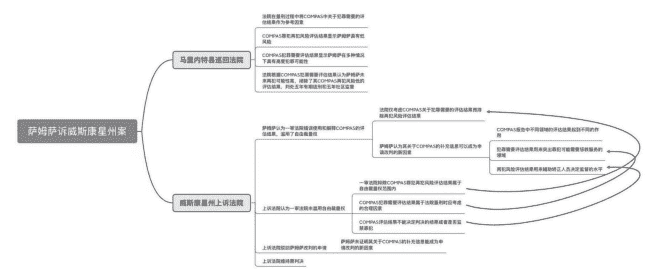

## 【核心争议点】
1.马里内特县法院出于对“保护公众的需要”这一量刑因素的考量，只参考 COMPAS 中萨姆萨犯罪需求的评估结果而量刑，是否滥用了法院的自由裁量权.
2.萨姆萨所提交的关于 COMPAS 软件的评估原理和 COMPAS 评估结果的应用解释原理的补充信息，是否构成其申请改判的新因素.

## 【裁判论证过程】
### （一）马里内特县法院出于对“保护公众的需要”这一量刑因素的考量，只参考 COMPAS 中萨姆萨犯罪需求的评估结果进行量刑，不属于滥用了法院的自由裁量权
首先，威斯康星州上诉法院认为，量刑法院在量刑时必须考虑三大因素：（1）犯罪的严重程度；（2）罪犯的品行和改造需要；（3）保护公众的需要.^([\[33\]](#txt005.html#footnote_content_txt005_33))因此，法院的量刑决定通常是在综合考察上述三种因素后所得出的具有强合理性的推理结果，只有当量刑法院（即本案中的马里内特县巡回法院）未能说明影响其决定的相关的和实质性因素而依赖非实质性因素时，或者在考察各种因素的过程中过于重视某个因素时，该法院才构成滥用自由裁量权.而上述所谓的“不恰当的量刑因素”是指与要做出的判决完全无关或无关紧要的因素.^([\[34\]](#txt005.html#footnote_content_txt005_34))毋庸置疑的是，本案中 COMPAS 对罪犯的犯罪需求的评估结果并非是一个不恰当的、非实质性的量刑因素.因为虽然 COMPAS 对萨姆萨的再犯风险的评估分数较低，但 COMPAS 对萨姆萨的犯罪需求的评估结果显示其在多种情况下都有犯罪的高度可能性，而 COMPAS 的犯罪需求的评估结果具有预测未来最有可能影响罪犯再犯的特定需求的作用.综合来看，萨姆萨日后再犯的可能性很高.所以，马里内特县法院出于保护公众的需要对萨姆萨判处五年有期徒刑和五年社区监督是十分合理的，并没有滥用其自由裁量权.另外，马里内特县巡回法院对萨姆萨 COMPAS 犯罪需求结果的参考并不构成“过于重视某个因素”，法院作出的判决是对萨姆萨 COMPAS 评估结果内容的综合考虑所得出的结论.

其次，根据马里内特县巡回法院的听证会报告内容可知，COMPAS 并不具有预测未来两年内萨姆萨再犯可能性的功能，针对像萨姆萨这样的性犯罪者，应使用专门针对该犯罪群体的替代筛查（alternative screening），即使用 STATIC 99、VASOR 等用于筛查性犯罪者的筛查工具.

最后，威斯康星州上诉法院认为，COMPAS 风险评估系统只能是作为辅助法官量刑的工具，并不能够用来决定判刑的严重程度或者罪犯是否被监禁.萨姆萨主张，在评估其重新犯罪的风险时，应禁止量刑法院考虑 COMPAS 中犯罪需求的评估内容.但这显然是违反了量刑法院具有高度自由裁量权的原则，法院有权自由选择参考 COMPAS 评估结果的任何部分或者不参考任一部分内容，这完全在法院的自由裁量权范围内.

综上所述，威斯康星州上诉法院认为，马里内特县巡回法院出于对“保护公众的需要”这一量刑因素的考量，只参考 COMPAS 软件中萨姆萨犯罪需求的评估结果进行量刑，不属于滥用了法官的自由裁量权.

### （二）萨姆萨所提交的关于 COMPAS 软件的评估原理和 COMPAS 评估结果的应用解释原理的补充信息，不构成其申请改判的新因素
威斯康星州上诉法院认为，申请改判的新因素是指：与量刑高度相关的一个事实或一组事实，但在初审时不为初审法官所知，要么是因为当时不存在，要么是因为即使当时存在，但在不知不觉中被各方忽视.^([\[35\]](#txt005.html#footnote_content_txt005_35))而萨姆萨作为被告人有责任以明确和令人信服的证据证明该新因素的存在.^([\[36\]](#txt005.html#footnote_content_txt005_36))本案中，萨姆萨主张其提交的有关 COMPAS 评估机制的补充信息构成其申请改判的新因素，该补充信息的主要内容在于说明 COMPAS 软件的评估原理以及如何应用与解释 COMPAS 报告中评估结果的原理.萨姆萨提交的报告指出：“关于犯罪需求的评估结果是旨在显示罪犯可能需要社区矫正服务的领域.若只看犯罪需求结果而不考虑风险水平，可能会对个人的风险做出不准确的解释.萨姆萨的 COMPAS 评估结果显示，其需要在多个领域进行改造.但是其再犯风险被确定为低，建议在低水平的监督下提供社区矫正服务.如果没有经过有关 COMPAS 评估机制的专门培训，很容易误解评估结果.”

但威斯康星州上诉法院认为，被告萨姆萨未能证明其提交的关于 COMPAS 报告的补充信息构成了申请改判的新因素，原因在于以下两点：第一，被告萨姆萨的主张本质上是要求量刑法院的自由裁量权必须服从 COMPAS 的评估结果，这显然是一个站不住脚的立场.COMPAS 的评估结果只对法官量刑起到辅助作用，马里内特县法院对萨姆萨的 COMPAS 评估结果的参考与应用属于其自由裁量权之内的事情，其有权自由选择参考 COMPAS 评估结果的任何部分的内容来辅助其量刑；第二，马里内特县巡回法院在定罪后听证会上的报告证明了其对萨姆萨 COMPAS 评估结果的解释与应用没有错误，并且，在其宣判时，已充分意识到 COMPAS 报告中萨姆萨各种犯罪需求之间的区别和风险评估结果.因此，萨姆萨所提交的关于 COMPAS 的补充信息不属于申请改判的新因素.

综上所述，威斯康星州上诉法院最终驳回了萨姆萨该项动议，不认可其提交的关于 COMPAS 评估机制的补充信息可以成为其申请改判的新因素.

## 【审理结果】
1.马里内特县巡回法院在量刑时只参考了萨姆萨 COMPAS 评估报告中有关犯罪需求的部分内容，没有滥用其自由裁量权.
2.有关评估和应用 COMPAS 犯罪需求和再犯风险的基本原则的内容，并不构成申请改判的新因素.
3.威斯康星州上诉法院维持了马里内特县巡回法院对萨姆萨判处五年有期徒刑和五年社区监督的判决.

## 【相关法条】
美国宪法第五修正案（Constitution of the United States Fifth Amendment）

非经大陪审团提出报告或起诉，任何人不受死罪和其他重罪的惩罚，唯在战时或国家危急时期发生在陆、海军中或正在服役的民兵中的案件不在此限.任何人不得因同一犯罪行为而两次遭受生命或身体伤残的危害；不得在任何刑事案件中被迫自证其罪；未经正当法律程序，不得剥夺任何人的生命、自由和财产；非有恰当补偿，不得将私有财产充作公用.

美国宪法第十四修正案第一款（Constitution of the United States Fourteenth Amendment Section 1）

在合众国出生或归化于合众国并受合众国管辖的人，均为合众国和他所居住的州的公民.无论何州均不得制定或实施任何剥夺合众国公民的特权或豁免的法律；无论何州未经正当法律程序均不得剥夺任何人的生命、自由或财产；亦不得拒绝给予在其管辖下的任何人以同等的法律保护.

## 【案例评析】
### （一）该案认为，在司法审判中，有选择性地参考风险评估软件的结果属于法官自由裁量权的范围
在本案中，被告人萨姆萨认为，法官在量刑的过程中只参考了 COMPAS 软件评估结果中犯罪需求这一指标，忽略其再犯风险为低这一评估结果，该做法是滥用自由裁量权的表现.最终法院认为风险评估软件只能作为司法审判的辅助工具，法官有权自主决定如何参考软件的评估结果，法官的做法属于自由裁量权的范围.

“以事实为依据，以法律为准绳”是法官在运用自由裁量权的过程中需要遵守的原则，但是人工智能的不断发展给衡量法官自由裁量权的限度带来了新的因素，也带来了新的挑战.一方面，人工智能技术运用于司法审判领域是大势所趋，经过严密计算的风险评估软件具有一定的合理性，其作为一种辅助工具有助于减少审判人员的劳动量，提高司法效率.另一方面，由于存在技术障碍，现阶段在司法审判领域应用人工智能技术具有一定的风险.一是数据方面的障碍.辅助量刑的人工智能软件需要以大量的数据作为支撑，但目前能收集到的法律数据是有限的，且司法裁判具有一定的主观性.司法案例数据库中，数据的适用常常无法同所处的环境、地域和文化相匹配，也会造成数据运用的障碍，这就会使得应用结果出现“算法歧视”问题.二是算法具有漏洞.算法是人工智能技术的核心，为了保障结论的公正性，人工智能应用需要保证一定的算法公开和算法可解释性.但基于保护商业秘密等原因，应用于司法裁判领域的人工智能算法通常不会公开；再者，“算法黑箱”的存在也使得一些算法缺少可解释性.

总之，应当对于风险评估软件的评估结果保持谨慎的态度，本案中原审法院根据实际情况拒绝某一部分的评估结果自然属于自由裁量权范围.

### （二）更加明确了风险评估工具在司法审判中的辅助地位
目前大多数学者都认为，在司法实践中，风险评估工具等人工智能系统应当处于帮助法官裁判的辅助地位.卢米斯案中，威斯康星州为美国其他法院在审判中使用风险评估工具提供了标准，即风险评分不能作为判决的决定性工具.在本案中，上诉法院认为初审法官有选择性地参考 COMPAS 软件的评估结果属于自由裁量权范围，这一结论更加证实了风险评估工具辅助量刑的地位.

价值判断是司法裁判中的重要因素，所以法官的量刑过程会带有一定的主观色彩，这是单纯的机器算法所不能解决的不确定因素.风险评估工具如 COMPAS 只能基于某些可以量化的指标进行评估，但还有很多不可量化的因素会对人的行为产生影响.在算法的僵化性和人类智慧的能动性中找到平衡点是价值判断的关键.提高审判水平使得量刑更为公正的关键在于人，风险评估工具等人工智能系统归根结底也只是人的工具.只有正确利用人工智能系统在数据收集、处理、分析等方面的优势，从而辅助审判人员进行一定的判断，而不是将其评估结果放置在决定性地位，才能够更好地保证司法裁判的公平公正.

### （三）为了最大程度地避免算法黑箱侵权隐患，国内应当加快推进制定算法审查及公开机制
在推动智慧司法的过程中，各种人工智能辅助设施的算法逻辑和源代码，都因具备极强的商业秘密或国家安全属性难以绝对公开，由此将导致算法黑箱的存在.法官与当事人只能知晓人工智能的裁判建议结果，对其推理、决策过程一头雾水，这在一定程度上会侵害当事人的知情权.因此，应当制定必要的算法审查机制.

首先，只有保证算法的透明度，或者至少是一定程度上的透明度，才能够使得算法的歧视性、准确性等问题得以被发现，也才能使得各利益相关方得以发现自己权益被侵害的事实，并提出相应的权利主张.^([\[37\]](#txt005.html#footnote_content_txt005_37))其次，人工智能算法的可解释性直接涉及到当事人的知情权问题.《欧盟数据保护通用条例》（General DataProtection Regulation， GDPR）规定，每个数据主体均有权获知个人数据被处理的目的，如果可能，应有权获知个人数据处理的期限、数据的接收方、任何自动化处理数据的算法逻辑以及至少基于数据画像（profi ling）的自动化处理结果.

我国目前尚无有关适用人工智能辅助裁判的法律规范.因而，着眼于我国司法改革智能化、规范化、现代化的趋势，结合国家人工智能战略，有必要建立相应的司法智能化改革路线图和基本框架，至少在量刑环节制定智能辅助量刑的司法解释意见，从制度上和技术上防范和化解大数据和人工智能辅助刑事裁判的复杂性、不确定性、可解释性风险.^([\[38\]](#txt005.html#footnote_content_txt005_38))

## 【关联判例推荐】

### 1. Loomis v.Wisconsin, 137 S.Ct. 2290 (2017)

核心事实：在威斯康星州诉卢米斯案（Wisconsin v.Loomis）中，被告埃里克·卢米斯（Eric Loomis）因参与驾车枪击事件被判有罪.在关押期间，卢米斯回答了一系列的问题，并被输入到 COMPAS 分析系统中，COMPAS 风险评估软件针对被告生成的评估结果显示出其具有极高的再次犯罪概率.拉克罗斯巡回法院参考 COMPAS 评估结果排除对被告卢米斯适用缓刑的可能性，判处被告六年有期徒刑和五年社区监督.卢米斯向威斯康星州上诉法院提起上诉，认为法院在量刑过程中参考 COMPAS 出具的风险评估结果侵犯其正当程序权利.

与本案关联点：在量刑过程中使用风险评估工具不会侵犯罪犯的正当程序权力.

### 2. Malenchik v. State, 928 N.E.2d 564, 574 (Ind.2010)

核心事实：初审法院在量刑时参考 LSI-R^([\[39\]](#txt005.html#footnote_content_txt005_39))以及 SASSI^([\[40\]](#txt005.html#footnote_content_txt005_40))评估结果.被告质疑判决时评估工具的可采性，根据印第安纳州证据规则的有关规定，认为评估工具缺乏科学可靠性.印第安纳州最高法院认为，这些测试结果有助于提高初审法官对量刑证据的个性化评价和选择最适合罪犯改造的刑罚方案.此外，量刑程序不受证据规则的约束，以便为初审法官提供最广泛的相关信息，从而做出明智的决定.

与本案关联点：在量刑过程中使用评估工具有助于法官对量刑证据的个性化评价和选择最适合罪犯改造的刑罚方案.

## 5.4 堪萨斯州诉希夫利案

### 【案件索引】

State v. Shively, 987 P.2d 1119, 26 Kan. App.2d 302 (Kan. Ct. App. 1999)

State v. Shively, 268 Kan. 573, 999 P.2d 952 (Kan. 2000)

### 【关键词】

测谎仪；技术应用；司法证据；智慧司法

### 【案件提要】

本案是有关作为现代科技的测谎仪能否在司法中作为证据适用的经典案件.发生时间为 2000 年左右，是测谎仪在证据收集与司法审判中的较早实践，体现了早期人工智能对于现代司法的辅助作用.

在当时，美国大多数州认为测谎仪证据本身在审判中是不可接受的，或者仅根据法律法规规定才是可以接受的.在当事人没有规定的情况下，在本案堪萨斯州以往进行的刑事审判实践中，测谎仪的证据长期以来一直也是不允许直接采用的，关于测谎仪证据的采用具有严谨的制度规定，因为它一旦被采用相当于一种关于被告有罪或无罪的缺席证人.在这一过程中，如果要使测谎仪形成有效的诊断意见，检查员的培训和经验至关重要.例如，在得克萨斯州，测谎仪检查员必须获得执业证照、经过专门的正规培训、通过严格的检验并参加持续的继续教育才可以胜任.

在本案中，被告斯蒂芬·梅德福·希夫利（Stephen Medford Shively，下称“希夫利”）在枪杀警察时是否知道对方身份为警察的测谎仪检查结果能否作为证据使用，对于案件审判具有关键意义，被告希夫利和上诉方堪萨斯州有着不同的主张.本案中，被告希夫利认为自己所进行的测谎测试数据通过计算机得出，相较于传统测谎结果更具有准确性，而上诉方堪萨斯州则认为即使最终测谎数据有借助于计算机来记录也不应当采用测谎仪得出的证据.

不同国家对于测谎仪有着截然相反的态度.例如，直到现在 FBI 依然通过测谎仪的结果来评估嫌疑人撒谎的可能性；而在我国，测谎仪结论不能作为刑事及民事诉讼中的证据使用，不属于法律明确规定的证据类型.换言之，我国检察院在办理案件的过程中可以使用测谎技术帮助审查、判断证据，但不能将测谎鉴定结论作为证据使用.

本案发生在智慧司法实践的早期阶段，测谎仪等一些结合现代心理学、生理学知识的工具在司法领域的运用正处于兴起阶段，尤其是结合计算机技术的测谎仪所得出的结果能否作为证据使用颇受争议.将此类工具应用在司法判案中，有利于扩展办案人员的视野，但同时在没有科学证明其完全准确性的前提下也不能盲目相信此类工具，以免造成司法不公.

### 【案件要旨】

堪萨斯州肖尼地区法院（一审法院）：原告 堪萨斯州 被告 斯蒂芬·希夫利堪萨斯州上诉法院（上诉法院）：上诉方 堪萨斯州 被上诉方 斯蒂芬·希夫利

堪萨斯州最高法院（二审法院）：上诉方 堪萨斯州 被上诉方 斯蒂芬·希夫利

被告希夫利于 1996 年 4 月因二级故意谋杀、严重袭击执法人员以及数项与毒品有关的指控而受到审判，这些指控源于 1995 年 10 月发生的一起事件.当日，当地警察凌晨三点突袭被告所在社区进行检查时，希夫利看到有朦胧的人影试图闯入自己家中，为了自身安全便朝这些方向开枪，结果杀死了一名叫作托尼·帕特森（Tony Patterson）的警察.原告堪萨斯州认为希夫利开枪时已经知道对方是警察，一名现场工作人员麦金莱（McKinley）声称当时受害人托尼·帕特森在开枪前曾大喊“警察，搜查令”以对被告表明自己的警察身份.而被告希夫利则辩称并不知道射击对象为警察才开枪以保护自己的.

对于测谎仪的态度，初审法院堪萨斯州肖尼地区法院拒绝将测谎结果用于保释和预审，但允许被告在庭审中就测谎结果出示证据，其中包括：测谎检查员 Gary Davis 的证词，测谎专家和支持者 David C. Raskin 博士的书面声明，以及 David C. Raskin 于 1988 年 5 月向国家司法研究所提交的题为《刑事调查中测谎有效性的研究最终报告》的研究报告副本.

初审法院判决认为，被告希夫利谋杀罪不成立，但严重袭击罪和所有被指控的毒品犯罪均成立，并支持了被告的大部分证词，包括承认测谎仪证据.

堪萨斯州上诉法院确认了对被上诉人的定罪，堪萨斯州政府对保留问题提出上诉.

堪萨斯州最高法院对案件进行了重新审理，就案件中律师藐视法庭、是否允许采用希夫利的测谎证据作出了最终判决.堪萨斯州最高法院重申，根据之前的法律实践，寻求接受测谎仪证据的一方需要根据 Frye 标准，证明该测谎仪结果的可靠性.尽管测谎技术取得了进步，但实质上并未提高其结果的可靠性以达到能运用该测谎结果定罪的效果，因此最终判定在本案审判中不可采纳测谎仪的结果.

### 【案例事实思维导图】

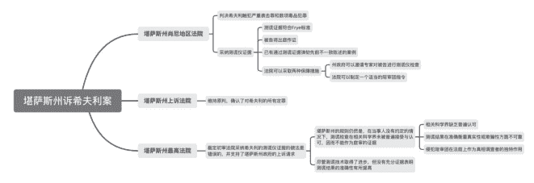

### 【核心争议点】

1.测谎仪的检查结果能否作为证据使用.

2. 计算机化的测谎仪的结果准确性是否提高，进而能否作为证据被采纳.

### 【裁判论证过程】

#### （一）测谎仪的检查结果不能作为证据使用

在堪萨斯州，法院采纳了有关专家科学证据可接受性的一般规则，即在弗赖伊诉美国案^([\[41\]](#txt005.html#footnote_content_txt005_41))（下称“Frye 案”）中确立的“Frye 标准（Frye Test）”^([\[42\]](#txt005.html#footnote_content_txt005_42))，该规则通常禁止专家就有关科学原理或发现作出专家证词，除非该原理已被充分证实，在其所属的特定领域获得普遍接受.也就是说，有关科学证据可接受性的测试要求，在专家科学意见被作为证据采纳之前，必须证明该意见所依据的科学理论是可靠的，且在专家的特定科学领域内被普遍接受.如果一项新的科学技术的有效性还没有被普遍认可，或者只被认为是一种实验性技术，那么基于其结果的专家证词就不应该被接受.寻求采纳证据的一方有责任通过证明其所依据的基本科学理论的可靠性以及该理论在适当的科学领域的接受度来满足该测试.

在本案中，希夫利就其开枪时是否知道对方为警察的问题接受了测谎仪的检查，并试图在申请减少保释金、预审甚至审判的过程中引入测谎结果.本案原告堪萨斯州政府反对采纳希夫利的测谎证据，主张根据 Frye 标准，在双方没有明确约定的情况下，该证据是不可接受的，而且它构成了传闻证据.被告希夫利辩称，根据 Frye 标准，这项源自 1995 年的技术所生成的证据是可以接受的.在对减少保释金的请求和预审作出审前裁决时，法院认为希夫利的测谎证据即使符合 Frye 标准，仍然存在有关传闻证据的异议，因此驳回了希夫利要求采纳该证据的动议.在审判中，当被告律师在向陪审团作开场陈述并提到测谎结果时，这个问题又重新出现了.被告辩称，由于希夫利将在审判中作证，传闻证据的反对意见不复存在，因此该证据是可以接受的.

初审法院起初支持州政府的反对意见，最终又允许将该测谎结果作为补强证据使用.初审法院认为：（1）被告方专家进行的测谎检查符合科学界的现行标准；（2）被告律师保证被告将出庭作证；（3）已经有接受测谎结果以弹劾先前不一致陈述的可信性的案例；（4）法院可以采取两种保障措施：一是州政府可以邀请专家对被告进行测谎仪检查，从而可能得出与被告测谎证据相冲突的结果；二是法院可以制定一个适当的陪审团指令，以告知陪审团不应该盲目地依赖专家意见作为事实判断的决定性因素，而应该综合考虑该证据和案件中的所有证据.因此，初审法院基于有限目的以及上述保障措施，决定允许将测谎仪的结果作为对被告证词的肯定或佐证.

堪萨斯州最高法院认为，首先，在大多数州，除非当事人约定，测谎仪证据本身在审判中是不可接受的.并且长期以来，在没有当事人约定的情况下，堪萨斯州的刑事审判中一直不接受将测谎仪的结果作为证据使用.即便是科学界也没有对测谎仪证据的可靠性达成共识.其次，采纳此类证据将损害交叉询问规则，因为尽管可以对检查员的资格、方法等进行交叉询问，但机器本身可以逃避所有交叉询问.再次，在准确衡量真实性和欺骗性方面，测谎仪的结果是不可靠的，而且这种证据侵犯了陪审团作为真相调查者的独特作用.陪审团不会过分依赖测谎证据的研究以及法院对陪审团的警告性声明不能为改变长期存在的规则提供正当理由.最后，测谎证据的有限使用（即只允许测谎证据作为佐证）实际上使问题复杂化，陪审团需要推测希夫利说了什么以及希夫利应该如实回答的测试问题问了什么.这样的证据还会给陪审员一个总体印象，即希夫利对事件的庭外和庭内描述一致.这只会在审判中引发更多猜测，而几乎没有提供有价值的信息.因此，堪萨斯州最高法院认为初审法院采纳测谎结果的做法是错误的.

#### （二）计算机化的测谎仪的结果准确性没有提高

Frye 案涉及早期版本的测谎仪，称为“收缩压欺骗测试（systolic blood pressure deception test）”.其基本原理为测量血压变化，与当今测谎仪的原理相同.由于测谎仪的检查尚未在生理学和心理学权威中获得普遍的认可，以证明专家证词的正当性，因此 Frye 案的测谎证据未被接受.堪萨斯州声称测谎仪的计算机化方面并没有采取任何措施来提高测谎结果的可靠性.被告希夫利则辩称，测谎仪证据，特别是在本案中使用的计算机化的测谎仪生成的证据，通过了 Frye 标准的一般可接受性检验，因而是可以接受的.

计算机测谎仪和传统测谎仪都是基于同样的理论运作的，即某些刺激，如在测谎仪检查期间对威胁性测试问题作出欺骗性回答，会产生由自主神经系统控制的不自主变化，这些变化可被测谎仪记录并破译以揭示真相和欺骗行为.在测谎仪操作中，两种类型的测谎仪测量的生理参数基本相同.两者都使用横跨胸部和腹部的附件来测量胸腔和腹部的呼吸；使用手指传感器来记录皮肤导电或抗电的能力；使用心脏血压计或手臂上的血压袖带来记录血压.两种仪器都永久地记录了从附件传送过来的生理数据，但传统的仪器是在提问和回答问题时通过穿过仪器的移动的纸上的墨水痕迹来记录数据；而计算机化的仪器则将数据记录在计算机光盘上，以后可以用来打印类似于传统仪器自动生成的图表.

对此，最高法院指出测试结果存在如下问题：首先，测谎仪对于机器本身的准确性和可靠性要求较高；其次，不同的人可能会对测谎仪具有完全不一样的反应，难以达到科学和心理上的准确性，从而影响证据的有效性.另一方面，被告希夫利没有提供任何证据表明计算机测谎仪或计算机测谎仪评分在某种程度上比相对传统的测谎仪更准确.此外，仍然存在关于测谎仪证据的其他担忧，比如陪审团可能会对其过度重视，以及其在证人是否说实话的问题上作为一种缺席证人，损害了陪审团的作用.

因此，堪萨斯州最高法院认为，尽管测谎仪被计算机化，被告希夫利一直声称测谎仪在在测谎技术和评分的计算机化方面取得了进展，但没有充分证据表明测谎结果的准确性有所提高.堪萨斯州的规则仍然是，在当事人没有约定的情况下，测谎检查在相关科学界未被普遍接受与认可，因而不能作为庭审的证据.

### 【审理结果】

1.初审法院采纳了被告希夫利的测谎证据，并宣告被告谋杀罪名不成立，但认定其触犯了严重袭击罪和毒品犯罪.

2.堪萨斯州上诉法院维持原判.

3.堪萨斯州最高法院重申，不可采用被告的测谎仪证据.最高法院认为审判法庭接受希夫利的测谎仪测试结果的做法是错误的，并支持了堪萨斯州政府的上诉请求.

### 【相关法条】

美国宪法第四修正案（Constitution of the United States Fourth Amendment）

不得侵犯人民的人身、住宅、文件和财产不受无理搜查和扣押的权利.除依照合理根据，以宣誓或代誓宣言保证，并具体说明搜查地点和扣押的人或物，不得签发搜查和扣押令状.

美国《联邦证据规则》第 703 条（Federal Rules of Evidence§703）

专家意见证言的依据

专家可以根据其了解或亲自观察到的案件中的事实或数据提出意见.如果特定领域的专家在形成该主题相关的意见时，会合理地依赖这些事实或数据，那么这些事实或数据不需要具有可采性来使专家意见被采纳.但是，如果这些事实或数据本身不具有可采性，则只有在其帮助陪审团评估意见的证明价值远远超过其不利影响的情况下，意见提出者才可以将其披露给陪审团.

### 【案例评析】

#### （一）本案体现出司法实践对于早期智慧司法技术的保守态度

在本案中，堪萨斯州最高法院判决计算机测谎结果不可采纳，法院结合 Frye 案中确立的原则（即 Frye 标准），提出不采纳测谎证据的两项重要理由：第一，由传统测谎量表获得的测谎结果其可靠性和可采性存疑，且将测谎仪计算机化并不能提高其准确度；第二，采纳测谎证据会侵犯陪审团作为真相发现者的权威，且法官和陪审团存在高估测谎准确性的风险.本案发生于计算机技术尚未足够发达的二十一世纪初，司法实践对于智慧司法技术仍持保守态度.本案所得出的结论，至今仍被众多有关排除测谎证据的案件引用.^([\[43\]](#txt005.html#footnote_content_txt005_43))

测谎仪是一种测量各类生理活动的设备，如皮肤电活动、血压和呼吸.测谎仪并不能“检测谎言”，而是记录每种测谎技术所假设的与说谎有关的生理活动，^([\[44\]](#txt005.html#footnote_content_txt005_44))从而基于其所监测到的生理数据来判断某人是否撒谎.科学证据的可采性向来广受争议，测谎结果是刑事诉讼中常出现的科学证据.传统上对测谎证据采取全面排除的规则，但这一趋势正在逐渐减弱.部分州法院和联邦法院的案件已经开始改变传统的排斥态度，会结合所使用具体方法的可靠性、该测谎证据的用途、引起过度混淆或偏见风险的可能性大小等因素，采用更具有针对性和灵活性的方法.^([\[45\]](#txt005.html#footnote_content_txt005_45))

#### （二）测谎仪计算机化、传统测谎技术与 AI 相结合将为测谎证据可采性的认定带来挑战

从以数字为指标的传统心理学测谎仪，再到结合 AI 技术的智能测谎系统，测谎技术正在飞速发展，通过精准识别各项数据，测谎结果的准确性已经大大提高.然而，复杂且先进的测谎算法是否能为测谎结果可靠性背书？测谎证据的可采性是否会因此提高？机器学习和算法的深度学习能够使我们更加了解说谎的模式，提高识破谎言的效率；但同时，算法黑箱现象的存在会使得复盘测谎过程困难重重.诚然，具有足够可靠性的测谎证据，将会在诸多方面上明显提高司法实践的效率.赋予测谎算法可解释性或许是一条值得考虑的道路，由此探索出兼顾合法性和准确性的测谎结果.

#### （三）我国目前不承认测谎结果的证据资格

在我国，测谎结果通常仅做参考、不具有合法证据资格.2020 年 8 月 14 日，我国最高人民法院发布了《最高人民法院关于人民法院民事诉讼中委托鉴定审查工作若干问题的规定》，明确规定人民法院不得委托鉴定测谎结果.在刑事诉讼领域，多数案件在排除测谎结果时语焉不详.有学者通过对我国 2010 年至 2018 年间涉及测谎结果的刑事案件进行实证研究发现，近半数的案件未对测谎结果做专门记录，近四成案件中侦查机关以“情况说明”的方式提交法庭.由此可见，测谎程序以及测谎结果的采信过程论证存在多处司法盲区.^([\[46\]](#txt005.html#footnote_content_txt005_46))鉴于测谎技术在实践中的广泛运用，测谎结果作为证据的性质、适用程序等相关方面的规定亟待完善.

### 【关联判例推荐】

#### 1. State v. White, 494 P.3d 248 (Kan. Ct. App. 2021).

核心事实：怀特（White）被指控犯有严重的猥亵儿童罪，初审法院排除了其所有的测谎证据.怀特首先援引美国宪法第六修正案的强制程序条款和第十四修正案的正当程序条款，认为初审法院的此项行为剥夺了其提出全面辩护的权利；其次，怀特称之所以提出该测谎证据，并非是想要证明某个信息的真实性，而是想展现自己认罪悔罪的态度，属于“用于有限目的”、可以采用测谎证据的例外情况.上诉法院认为，被告提出抗辩的权利需要受到合理限制，排除测谎证据并不侵犯被告提出证据的权利，且根据遵循先例原则，排除测谎证据的适用.

与本案关联点：法院援引本案所得出的结论，即测谎证据不具有可采性，且进一步指出即使存在可采用的理由，堪萨斯州最高法院没有规定“排除测谎证据”此项一般规则具有例外情形.因此，某项测谎证据欲证明的信息与测谎结果的正确性无关，法院必须将测谎证据排除在外.

#### 2. Savery v. State, No. 122,083 (Kan. Ct. App. 2020).

## 萨弗里案

核心事实：一审法院判决萨弗里（Savery）犯有强奸罪和鸡奸罪，萨弗里认为其辩护律师并未为其提供有效协助，因而提起上诉.萨弗里在上诉中提出了三项律师的“无效协助”，其中包括“未要求进行测谎测试”.针对此项请求，堪萨斯州上诉法院认为：测谎证据不具有可采性，不能因为律师没有要求进行测谎，也即不能因为律师未能协助被告提供一项无效的证据而被追责；萨弗里也并未提供相关判例来佐证其观点.

与本案关联点：法院援引本案所得出的结论，即测谎证据不具有可采性，认为其辩护律师没有申请测谎仪测试的行为并不构成失职，驳回了萨弗里的此项动议.

### 3. State v. Engelhardt, 280 Kan. 113, 119 P.3d 1148 (2005).

核心事实：一审法院判决被告恩格尔哈特（Engelhardt）犯有一级预谋谋杀罪，且具有加重情节，因而判处被告无期徒刑，被告不服、提出上诉.其中，被告对于一审法院排除“证人的测谎结果”此项证据的决定提出质疑.堪萨斯州最高法院提出，堪萨斯州对于测谎证据的规定为，若无当事人的约定，测谎结果不可用于刑事诉讼；且测谎证据不能用于证明或弹劾.这是因为：一方面，测谎方法的可靠性存疑；另一方面，此项规定可以保护陪审团作为“真相发现者”的作用.法院最终驳回被告的各项主张，维持原判.

与本案关联点：由于测谎方法的不可靠性，以及陪审团作为“真相发现者”的权威，若无当事人的约定，测谎证据不具有可采性.

### 【注释】

[\[1\]](#txt005.html#footnote_quote_txt005_1)COMPAS 全称为提供替代性制裁矫正犯罪管理画像（Correctional Off ender Management Profi ling for Alternative Sanctions），是运用算法依据累犯和犯罪职业特征相关行为和心理结构设计的为一般和暴力累犯以及审前不当行为的风险预测评估软件.

[\[2\]](#txt005.html#footnote_quote_txt005_2)Julia Angwin， Jeff Larson， Surya Mattu & Lauren Kirchner， Machine Bias， ProPublica （May 23， 2016），https：//www.propublica.org/article/machine-bias-risk-assessments-in-criminal-sentencing.

[\[3\]](#txt005.html#footnote_quote_txt005_3)安·沃尔什·布莱德利系为该法庭撰写判决书的法官.

[\[4\]](#txt005.html#footnote_quote_txt005_4)Malenchik v. State， 928 N.E.2d 564， 574 （Ind. 2010）.

[\[5\]](#txt005.html#footnote_quote_txt005_5)Melissa Hamilton， Risk-Needs Assessment： Constitutional and Ethical Challenges， 52 American Criminal Law Review 231， 255 （2015）.

[\[6\]](#txt005.html#footnote_quote_txt005_6)陆凯：《美国算法治理政策与实施进路》，载《环球法律评论》2020 年第 3 期.

[\[7\]](#txt005.html#footnote_quote_txt005_7)S.3572， Algorithmic Accountability Act of 2022， https：//www.congress.gov/bill/117th-congress/senate-bill/3572/text？r=251&s=5， last visited March 13， 2022. 译文参考吴建昊：《美国算法问责法案（2022）》，载微信公众号“网络法理论与实务前沿”，2022 年 2 月 20 日.

[\[8\]](#txt005.html#footnote_quote_txt005_8)张欣：《从算法危机到算法信任：算法治理的多元方案和本土化路径》，载《华东政法大学学报》2019 年第 6 期.

[\[9\]](#txt005.html#footnote_quote_txt005_9)《国务院关于印发新一代人工智能发展规划的通知》（国发〔2017〕35 号）.

[\[10\]](#txt005.html#footnote_quote_txt005_10)Sandra G. Mayson， Bias In， Bias Out， 128 The Yale Law Journal 2218， 2218-2301 （2018）.

[\[11\]](#txt005.html#footnote_quote_txt005_11)江朔：《自动化决策、刑事司法与算法规制—由卢米斯案引发的思考》，载《东方法学》2020 年第 3 期.

[\[12\]](#txt005.html#footnote_quote_txt005_12)锚定效应是指个体在不确定情境下的决策会受到初始无关锚的影响，致使其随后的数值估计偏向该锚的一种判断偏差现象，此种效应在司法裁判中也会存在.参见朱体正：《人工智能辅助刑事裁判的不确定性风险及其防范—美国威斯康星州诉卢米斯案的启示》，载《浙江社会科学》2018 年第 6 期.

[\[13\]](#txt005.html#footnote_quote_txt005_13)张欣：《我国人工智能技术标准的治理效能、路径反思与因应之道》，载《中国法律评论》2021 年第 5 期.

[\[14\]](#txt005.html#footnote_quote_txt005_14)Danielle K. Citron， Technological Due Process， 85 Washington University Law Review 1249， 1249-1314 （2008）.

[\[15\]](#txt005.html#footnote_quote_txt005_15)刘东亮：《技术性正当程序：人工智能时代程序法和算法的双重变奏》，载《比较法研究》2020 年第 5 期.

[\[16\]](#txt005.html#footnote_quote_txt005_16)National Science & Technology Council， The National Artificial Intelligence Research and Development Strategic Plan： 2019 Update， NITRD （June 21， 2019）， https：//www.nitrd.gov/pubs/National-AI-RD-Strategy-2019.pdf.

[\[17\]](#txt005.html#footnote_quote_txt005_17)Executive Office of the President Office of Management and Budget， Guidance for Regulation of Artifi cial Intelligence Applications， White House （Nov. 17， 2020）， https：//www.whitehouse.gov/wpcontent/uploads/2020/11/M-21-06.pdf.

[\[18\]](#txt005.html#footnote_quote_txt005_18)XAI Stories： Case Studies for EXplainable Artificial Intelligence， Github （Oct. 14， 2020）， https：//pbiecek.github.io/xai\_stories/index.html.

[\[19\]](#txt005.html#footnote_quote_txt005_19)LSI-R（Level of Service Inventory-Revised）是指用于决定监督和治疗水平的有关犯罪者属性和犯罪者情况的定量调查.

[\[20\]](#txt005.html#footnote_quote_txt005_20)SASSI 是指药物滥用细微筛查清单.

[\[21\]](#txt005.html#footnote_quote_txt005_21)Frye v. United States， 293 F. 1013 （D.C. Cir. 1923）.

[\[22\]](#txt005.html#footnote_quote_txt005_22)People v. Wesley， 83 NY2d 417 （N.Y. 1994）.

[\[23\]](#txt005.html#footnote_quote_txt005_23)Daubert v. Merrell Dow Pharms， Inc.， 509 U.S. 579 （1993）.

[\[24\]](#txt005.html#footnote_quote_txt005_24)Commonwealth v. Foley， 2012 Pa. Super. 31 （Pa. Super. Ct. 2012）； State v. Bander， 150 Wn. App. 690（Wash. Ct. App. 2009）.

[\[25\]](#txt005.html#footnote_quote_txt005_25)People v. William Rodriguez， Ind. No. 5472/2009 （Sup. Ct. NY County 2013）.

[\[26\]](#txt005.html#footnote_quote_txt005_26)People v. Andrew Peaks， Ind. No. 7689/2010； People v. Jaquan Collins， Ind No. 8077/2010 （Sup. Ct.Kings County）.

[\[27\]](#txt005.html#footnote_quote_txt005_27)People v. Graham， Ind. No， 2784/2012 （Sup Ct Bronx County 2015）.

[\[28\]](#txt005.html#footnote_quote_txt005_28)Richmond Newspapers， Inc. v. Virginia， 448 U.S. 555， 100 S. Ct. 2814 （1980）.

[\[29\]](#txt005.html#footnote_quote_txt005_29)郑曦：《人工智能技术在司法裁判中的运用及规则》，载《中外法学》2020 年第 3 期.

[\[30\]](#txt005.html#footnote_quote_txt005_30)郑戈：《算法的法律与法律的算法》，载《中国法律评论》2018 年第 2 期.

[\[31\]](#txt005.html#footnote_quote_txt005_31)马明亮、王士博：《论大数据证据的证明力规则》，载《证据科学》2021 年第 6 期.

[\[32\]](#txt005.html#footnote_quote_txt005_32)郑曦：《人工智能技术在司法裁判中的运用及规制》，载《中外法学》2020 年第 3 期.

[\[33\]](#txt005.html#footnote_quote_txt005_33)State v. Jackson， 110 Wis.2d 548， 329 N.W.2d 182 （1983）.

[\[34\]](#txt005.html#footnote_quote_txt005_34)Elias v. State， 93 Wis.2d 278， 286 N.W.2d 559 （1980）.

[\[35\]](#txt005.html#footnote_quote_txt005_35)Rosado v.State，70 Wis.2d 280， 234 N.W.2d 69 （1975）.

[\[36\]](#txt005.html#footnote_quote_txt005_36)State v. Harbor， 2011 WI 28， 36， 333 Wis.2d 53， 797 N.W.2d 828 （2011）.

[\[37\]](#txt005.html#footnote_quote_txt005_37)江溯：《自动化决策、刑事司法与算法规制—由卢米斯案引发的思考》，载《东方法学》2020 年第 3 期.

[\[38\]](#txt005.html#footnote_quote_txt005_38)朱体正：《人工智能辅助刑事裁判的不确定性风险及其防范—美国威斯康星州诉卢米斯案的启示》，载《浙江社会科学》2018 年第 6 期.

[\[39\]](#txt005.html#footnote_quote_txt005_39)LSI-R（Level of Service Inventory-Revised）是指用于决定监督和治疗水平的有关犯罪者属性和犯罪者情况的定量调查.

[\[40\]](#txt005.html#footnote_quote_txt005_40)SASSI 是指药物滥用细微筛查清单.

[\[41\]](#txt005.html#footnote_quote_txt005_41)Frye v. United States， 54 App.D.C. 46， 293 F. 1013 （D.C. Cir. 1923）.

[\[42\]](#txt005.html#footnote_quote_txt005_42)Frye 标准：又称普遍接受标准，指用于作证某项证据的相关科学原则或规则没有获得相关的专家群体的“普遍接受”，就会被排除.但在目前的司法实践中，该标准基本被更为全面的“多伯特规则（Daubert Rule）”（又称综合观察标准）取代.

[\[43\]](#txt005.html#footnote_quote_txt005_43)受美国立法体系的影响，本案主要引用于在堪萨斯州内发生的案件.

[\[44\]](#txt005.html#footnote_quote_txt005_44)Yuhwa Han， Deception Detection Techniques Using Polygraph in Trials： Current Status and Social Scientifi c Evidence， 8 Contemporary Readings in Law and Social Justice 115， 116 （2016）.

[\[45\]](#txt005.html#footnote_quote_txt005_45)Frederick Schauer， Lie-Detection， Neuroscience， and the Law of Evidence， Virginia Public Law and Legal Theory Research Paper No. 2012-49， Available at SSRN： https：//ssrn.com/abstract=2139508.

[\[46\]](#txt005.html#footnote_quote_txt005_46)付凤、杨天琪：《刑事法官视角下测谎证据的审查与采信—以 2010-2018 年刑事裁判文书为研究样本》，载《中国人民公安大学学报（社会科学版）》2020 年第 1 期，第 39 页.

# 第六章 算法行政和智慧警务领域前沿判例

## 6.1 迈克尔等人诉凯伦·鲍林案

### 【案件索引】

Michael T., et al. v. Bowling, No.2:15-CV-09655, 2016 (S.D.W. Va. Sept.13, 2016)

### 【关键词】

自动化决策；算法行政；正当程序

### 【案件提要】

本案是有关算法决策影响低收入者接受医疗补助的案件.原告迈克尔等人是有资格接受西弗吉尼亚州“智力/发育残疾家庭和社区医疗补助计划”（Intellectual/Developmental Disability Home and Community Based Services waiver program，以下简称“I/DD 医疗补助计划”）的参与者，负责管理该医疗补助计划的西弗吉尼亚州卫生和人力资源部下属的医疗服务局（The Bureau for Medical Services，以下简称“BMS”）与 APS 医疗保健公司（APS Healthcare Inc.，以下简称 APS 公司）签订合同，由 APS 公司对 I/DD 医疗补助计划的参与者进行年度评估，并应用“APS 算法”对评估结果进行分析，生成每个参与者的年度服务预算，由服务提供机构在预算范围内为参与者提供医疗健康服务.若需要提供超出预算的服务，需要向 APS 公司提交服务授权请求.通常情况下 APS 公司会批准通过该请求，但 2014 年 9 月，BMS 指示 APS 公司停止单方面批准服务成本超过“APS 算法”预算的计划，所有超过预算的服务资金申请都必须由 BMS 通过“二级谈判”对员工资料进行审查评议后批准.由于超出预算的申请批准更加严格，原告获得的服务资金变得有限，通过 I/DD 豁免计划获得的总福利从 2014 年到 2015 年大幅减少.

原告于 2015 年 9 月 28 日提出申诉，主张被告削减医疗福利侵犯其合法权益而寻求禁令救济.根据最高法院指定的实施初步禁令的标准，寻求初步禁令的当事人应当证明：（1）提出禁令的一方在实体审理上胜诉的可能性极大；（2）若不颁布初步禁令将遭受不可挽回的损害；（3）原被告双方的利益和损失权衡后仍应该支持禁令的颁布；（4）禁令的颁布促进美国公众利益的保护.经过分析，法院支持了原告的诉讼请求，部分同意原告的初步禁令动议，初步命令被告将原告的个人 I/DD 医疗补助计划预算恢复至 2014 年的水平，但仅限于 2014 年之后受到个人预算减少的原告.

该案是自动化行政中算法决策的不透明性破坏程序公正，侵犯行政相对人合法权益的典型案例.算法的黑箱性、行政主体对算法的依赖性以及相关制度规范的缺失导致行政主体基于算法作出的行政决策缺乏公平性与准确性，且导致行政相对人难以采取有效的救济手段.对自动化行政中的算法决策过程出现的问题进行分析，有利于削弱算法决策与正当程序之间的冲突，完善关于自动化行政方面的法律法规，明确算法的工具属性，使算法更好地辅助行政主体，有效实施行政行为.因此，本案对于理解自动化行政中的法律问题、算法决策与正当程序具有重要意义.

## 案件要旨

美国西弗吉尼亚州地区法院查尔斯顿分庭：原告 迈克尔等人 被告 西弗吉尼亚州卫生和人力资源部部长凯伦·鲍林

原告迈克尔等人是“I/DD 医疗补助计划”的接受者，他们对 2015 年开始实施的福利削减提出了抗议.

“I/DD 医疗补助计划”被纳入西弗吉尼亚州医疗补助计划，用于为低收入家庭提供医疗保健服务.“BMS”是负责管理西弗吉尼亚州医疗补助计划的州机构.为了协助管理 I/DD 医疗补助计划，BMS 与 APS 公司签订了合同.每个 I/DD 医疗补助计划的成员每年能获得多少服务，取决于 APS 公司为成员们提供的“预算”.为确定每个成员的预算，APS 公司会对每个 I/DD 医疗补助计划参与者进行“年度评估”.然后，APS 公司应用多变量统计分析（“APS 算法”），根据特定的数据，对每个成员的评估结果进行分析，以产生一个预算.APS 算法是 APS 公司专有的，因此，APS 算法考虑的确切因素、赋予每个因素的权重以及确定各州预算的总体方法也不是公开的信息.一旦 APS 公司确定每个 I/DD 医疗补助计划成员的预算，它就会向成员发送一封信，通知他们被分配到的预算金额为多少.通知发出后，一个专业的跨学科团队会根据 I/DD 医疗补助计划提供的一系列服务，制定一个个性化计划，详细列明对医疗补助的接受者进行单独评估所得出的在安全、健康和护理方面所需的每种服务的数量.个性化计划一旦制定完成，APS 公司便对计划进行审查，以确保其符合 BMS 政策，并解决会员的健康和安全问题，如果计划中的服务成本在 APS 算法计算的预算内，服务提供商则会要求 APS 公司批准计划.但是，如果跨学科团队确定计划有必要超过 APS 算法计算的预算，则服务协调员需向 APS 公司提交服务授权请求.2014 年 9 月，BMS 员工发现 I/DD 医疗补助计划超出预算，APS 公司批准的服务成本超出了预算的个性化计划.BMS 随后指示，APS 公司需要停止单方面地批准服务成本超过预算的计划申请.从那时起，所有超过预算的服务资金申请都必须由 BMS 通过“二级谈判”批准.在“二级谈判”中，BMS 的员工会审查成员的档案、附加资金申请所附的任何材料以及 APS 公司的建议，如有要求，还会与成员或其他相关方会面，然后决定是否批准或拒绝资金申请.

在 2015 年之前，APS 公司批准了原告提出的超出其个别预算的资金申请.然而，自 2014 年秋季 BMS 设立了“二级谈判”标准后，BMS 拒绝了原告超出预算的资金申请，导致原告通过 I/DD 医疗补助计划获得的总福利从 2014 年到 2015 年大幅减少，尽管原告在此期间对服务的需求并没有减少.这一较低的经费相应地减少了原告可以购买的服务项目.

2015 年 9 月 28 日，原告提出了第一次申诉，请求法院颁布初步禁令进行救济.该申诉代表了处境相似的一类原告所提出的指控.申诉包括以下权利要求：（1）被告违反正当程序权利的要求；（2）被告违反《医疗补助法》通知和公平听证的要求；（3）被告违反《美国残疾人法》的主张；（4）被告违反 1973 年《康复法》第 504 条的主张.根据最高法院指定的实施初步禁令的标准—寻求初步禁令的当事人应当证明：（1）提出禁令的一方在实体审理上胜诉的可能性极大；（2）若不颁布初步禁令将遭受不可挽回的损害；（3）在对原被告双方的利益和损失进行权衡后仍应该支持禁令的颁布；（4）禁令的颁布促进美国公众利益的保护.原告辩称，在本案中，上述每个因素都得到了满足，并请求法院进入初步禁令救济.被告则对每一项因素都提出了异议.经过分析，法院支持了原告的诉讼请求，部分同意原告的初步禁令动议，初步命令被告将原告的个人 I/DD 医疗补助计划预算恢复至 2014 年的水平，但仅限于 2014 年之后受到个人预算减少的原告.

## 案例事实思维导图

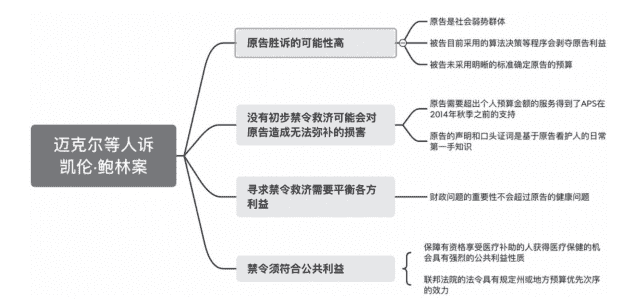

## 核心争议点

1.被告采用 APS 算法确定医疗补助预算的这一行为是否剥夺了原告的正当程序权利.
2.若没有得到初步禁令的救济，原告是否可能遭受无法弥补的损害.
3.医疗补助超出预算所带来的财政问题与原告的健康问题之间的平衡问题.
4.州政府的财政政策和原告获得医疗补助两种公共利益的平衡问题.

## 裁判论证过程

### （一）被告采用 APS 算法确定医疗补助预算的这一行为剥夺了原告的正当程序权利

根据实施初步禁令的第一个要求，寻求初步禁令救济的原告必须证明他们有可能根据案情胜诉.法院应关注原告根据《美国法典》第 42 卷第 1983 条提出的主张，即被告在确定原告医疗补助年度服务预算时采用 APS 算法侵犯了原告的正当程序权利.

《美国法典》第 42 卷第 1983 条允许个人在合法权益被侵犯时获得禁令救济.为了维持该诉讼，原告必须证明：（1）他被剥夺了宪法和美国法律所保障的权利；（2）被告根据任何法律采取某项行动时剥夺了这一权利.在本诉讼中，被告是根据法律来确定原告在 I/DD 医疗补助计划中的年度服务预算的.因此，此处的争议焦点是，在采用 APS 算法确定原告预算时，被告是否剥夺了原告的正当程序权利.最高法院认为，公共医疗福利是有资格领取福利的人所享有的法定权利，此类权利被视为受正当程序条款保护的财产形式.在本案中，原告有资格通过 I/DD 医疗补助计划获得福利是毫无争议的.因此，法院认为，原告在继续获得这些福利时有受保护的财产利益.如果原告能够证明他们获得这些福利时没有经过正当程序，就可以在这一主张上胜诉.

对于正当程序的主张，在特定情况下，什么样的行为过程是有保证的，取决于以下三个因素的平衡：首先，行为的实施影响私人利益；其次，通过所使用的程序错误地剥夺这种利益的风险，以及保障行为实施的附加或替代程序可能带来的价值；最后，政府的利益，包括所涉及的政府职能以及附加或替代程序将带来的财政和行政负担.

首先，原告属于智力或发育残疾的群体，处于社会中最弱势的成员.如果原告没有通过 I/DD 医疗补助计划获得足够的资金，他们可能会获得不充分的医疗保健服务，并可能面临住院的风险.因此，法院认为，原告在这一方面的私人利益的重要性不言而喻.

其次，被告目前采用的程序存在着错误剥夺原告利益的严重风险.最终决定医疗补助计划接受者个人预算的 APS 算法是 APS 公司的专有算法，因此纳入 APS 算法的因素、赋予每个因素的权重以及计算每个接受者利益的方法都不清楚.法院的结论是，被告在确定原告个人预算时使用的 APS 算法没有采用可确定的标准，根本无法确定 APS 算法如何生成每个医疗补助计划接受者的个性化预算.实际上，在 APS 公司发送给接受者通知其个人预算的信件中写道，APS 公司仅提供预算金额，不提供关于预算分配的方法等内容.因此，原告很有可能成功证明 APS 公司的这些预算决定存在错误决定和剥夺原告财产利益的严重风险.尽管如此，被告辩称，在个别预算确定之后采用的程序根据正当程序条款提供了适当的程序.特别是，被告声称，如果受益人对他们的预算决定提出质疑，如果需要额外的服务来保证个人在社区和机构外的安全和健康，被告会将其当作例外并增加受益人的预算.然而，在实践中，房舍管理处在“二级谈判”阶段却不是这么做的.例如，I/DD 医疗补助计划的政策手册规定，接受者必须在预算内购买服务.此外，根据 BMS 发给一些原告的通知信可知，BMS 在“二级谈判”阶段拒绝了原告超出预算的资金请求，但其仅提供了拒绝原告请求的一个理由，即该请求将超过原告的个人预算.这一证据表明，无论被告是否有在“二级谈判”阶段增加预算请求的既定政策，以保持个人在社区中的安全和健康，被告仍然回避了这一政策，只接受由 APS 算法确定的预算金额.

在本案中，专有 APS 算法缺乏透明度，使得被告的个人预算决定有可能变得不标准.这种潜在的无舵决定产生了任意和错误的高风险，因此，这种行为根据正当程序条款是不被允许的.

最后，记录中几乎没有证据表明，被告在确定每个接受人所应享受的医疗保健福利时，采用了可确定的标准，因此被告将面临确定预算所带来的各种形式的不当负担.毫无疑问，西弗吉尼亚州目前正面临《金融时报》的挑战.然而，该记录并未反映出，在作出个人预算决定时，通过提供可确定的标准来弥补 APS 算法中体现的程序缺陷，将对被告或西部各州造成任何形式的财政或行政负担.因此，法院认为，被告继续使用 APS 算法，而不是采用可确定标准的替代程序，没有遵守正当程序条款，因而被告对此没有合法利益.

基于以上的因素，法院认为被告利用 APS 算法确定医疗补助预算的程序不符合正当程序的要求.因此，法院认为，原告已充分表明，他们很有可能通过主张被告采用 APS 算法确定原告的医疗补助预算侵犯其正当程序权利而胜诉.

### （二）若没有得到初步禁令的救济，原告可能会遭受无法弥补的损害

为了获得初步禁令，原告接下来必须证明他们“在没有初步禁令救济的情况下，很可能遭受无法弥补的损害.”在公共医疗福利方面，受益者可以通过证明强制执行一项规则可能会使他们无法获得所需要的医疗护理服务来达到此目的.此外，许多联邦法院已经认识到，公共医疗福利的减少或取消对被削减医疗服务项目的接受者造成了不可挽回的伤害.

在本案中，当事各方就“原告如果得不到初步禁令救济是否可能遭受无法弥补的损害”这一问题提交了相互矛盾的证据.原告提交了来自其父母的详细事实声明，说明了每个原告所面临的限制，以及基于 APS 算法的当前预算将剥夺原告所需的医疗服务，并产生制度化风险的原因.此外，在初步禁令听证会上，两名原告的父母提供了支持这些主张的证词.被告则提交了 BMS 家庭和社区服务办公室主任尼斯贝特的声明，在这份声明中，对于为何原告不需要超过 APS 算法预算的金额，就能保持社区安全和健康，其进行了概括性描述.尼斯贝特在初步禁令听证会上也提供了证词，她在听证会上概括地陈述了被告拒绝原告额外资金请求的决定依据.

在这个初步阶段，法院认为，关于原告若得不到禁令救济可能会遭受不可弥补的损害这一点，原告的主张更可信.原因有三：首先，原告声称他们需要超出其个人预算金额的服务以保持社区健康和安全，而 APS 公司在 2014 年秋季之前所作出的决定均支持原告这一请求，当时被告还未撤回 APS 公司的二级决策权，APS 公司仍有权批准原告超出其预算的资金请求.第二，原告的声明和口头证词是基于原告看护人的日常第一手知识的.相比之下，被告的相反证据是基于对原告档案的行政审查，可能是与相关方的讨论，而不是审查人与原告的个人日常互动.在目前的初步禁令阶段，法院应根据第一手的知识和经验对原告的证据给予更大的重视.最后，法院在初步禁令听证会上听取了两名原告父母的证词，以及尼斯贝特代表被告的证词.就临时动议而言，法院认为，原告就这一主张的证词比尼斯贝特的证词更可信.因此，法院认为，对于原告若得不到禁令救济可能会遭受不可弥补的损害这一点，庭审期间的证词更有利于原告的主张.

基于这些原因，法院认为，原告已经证明被告在“二级谈判”时拒绝给予每个原告个人预算以上的资金可能会剥夺原告获得其所需服务的权利.因此，法院认为，原告已充分证明在没有初步禁令救济的情况下，他们很可能遭受无法弥补的损害.

### （三）原告的健康问题比医疗补助超出预算所带来的财政问题更具重要性

原告还必须证明，在平衡当事人各方的利益和损失后，仍然需要对原告颁发初步禁令救济，才能获得初步禁令.在每种情况下，法院都必须平衡各方的损害赔偿请求，并且必须考虑给予或拒绝救济对每一方的影响.被告辩称，回到 2014 年的服务资金提供水平将给纳税人带来负担，且会对 I/DD 医疗补助计划造成损害，因为它削弱了西弗吉尼亚州向新一波符合条件的个人“继续提供”服务的能力.而原告则辩称，他们是西弗吉尼亚州最贫困、最弱小的公民，他们目前得不到所需的医疗保健服务，而且“给财政造成的负担”并不能抵消原告所面临的困难.法院支持了原告的立场.

如上所述，原告已经充分证明，目前被告禁止超出预算提供医疗服务资金的决定剥夺了他们获得其所需服务的权利，并且这一决定具有制度化的趋势.虽然被告指出，将原告的预算增加到 2015 年之前的水平可能会给纳税人和 I/DD 医疗补助计划带来财政负担，但即使州的财政状况威胁到其他医疗补助服务，财政问题也不会比原告的健康问题更重要.因此，法院认为，原告已证明在平衡当事人各方的利益和损失后，仍然需要对其颁发初步禁令救济.

### （四）保障公共健康的公共利益比州政府的财政政策考虑更具重要性

最后，原告必须证明“禁令的颁布符合公共利益”才能获得初步的禁令救济.衡平法院应特别注意在采用特别禁令补救措施时的公共后果.

本案提出了相互冲突的公共利益考虑.一方面，保障有资格享受医疗补助的人获得医疗保健的机会具有强烈的公共利益.另一方面，联邦法院的法令具有规定州或地方预算优先次序的效力.州和地方政府的资金有限，当联邦法院命令为一个项目拨款时，其结果往往是从其他重要项目中拿走资金.

尽管如此，州政府的财政问题不能成为被告作出有关医疗补助决定的最关键因素.在类似的医疗补助案中，面对这些相互冲突的公共利益考虑，第四巡回法庭发现，有利于保障公共健康的公共利益要比一个州的财政政策考虑更重要.法院同样认为，保护原告获得医疗保健和所需服务的公共利益超过了西弗吉尼亚州的财政考虑，以及相应的联邦制利益.因此，法院认为原告已证明初步禁令的颁布符合公共利益.

总之，法院认为，原告已经证明他们很有可能在实体审理中胜诉，他们若没有得到初步禁令救济很有可能遭受无法弥补的损害，在平衡当事人各方的利益和损失后仍然需要对原告颁发初步禁令救济，且初步禁令救济符合公众利益.因此，法院认为，原告已满足寻求初步禁令救济的各项要求，本案中的这一特殊衡平法救济是确有必要的.

## 审理结果

1.法院同意原告关于“恢复 2014 年的医疗补助福利”这部分的初步禁令请求.
2.被告将原告的个人 I/DD 医疗补助计划预算恢复至 2014 年的水平，但仅限于 2014 年之后受到个人预算减少的原告.
3.在本诉讼结果出来之前，本初步禁令应继续有效.

## 相关法条

### 《联邦民事诉讼规则》第 65 条（Federal Rules of Civil Procedure§65）

禁令和限制令

（a）初步禁令

（1）注意：法院只有在通知对方后才能发布初步禁令.

（2）将听证会与案情审判结合起来：在初步禁令动议的听证会开始之前或之后，法院可以根据案情推进审判，并将其与听证会合并.即使在没有下令合并的情况下，在动议中收到的、在审判中可以接受的证据也将成为审判记录的一部分，在审判中无需重复.但法院必须维护任何一方接受陪审团审判的权利.

### 《美国法典》第 42 卷第 1983 条（42 U.S.C.§1983）

根据任何州或地区或哥伦比亚特区的任何法令、条例、法规、习俗或惯例，使美国公民或其管辖范围内的其他人被剥夺任何权利、特权的任何人，在法律诉讼、衡平法诉讼或其他适当的补救程序中受到损害的一方，应承担宪法和法律保障的豁免权.但在因司法人员的司法行为或不作为而对司法人员提起的任何诉讼中，除非违反了宣告性法令或无法获得宣告性救济，否则不得给予禁令性救济.就本节而言，仅适用于哥伦比亚特区的任何国会法案，应被视为哥伦比亚特区的法规.

### 《美国宪法第十四修正案》第 1 节（United States Constitution，Amendment 14 Section 1）

第一节

所有在美国出生或归化并受其管辖的人，都是美国及其居住州的公民.任何州不得制定或执行任何剥夺合众国公民特权或豁免权的法律；未经正当法律程序，任何国家不得剥夺任何人的生命、自由或财产；也不得否认其管辖范围内的任何人受到法律的平等保护.

## 案例评析

### （一）引起对自动化行政中算法决策与正当程序冲突的反思

大数据时代下，行政主体通过算法作出决策进而开展行政活动已较为普遍，例如 2020 年疫情环境下健康码的开发使用，便是基于大数据收集与算法分析决策，对个人的健康和风险状况进行评估，从而为行政机关开展疫情防控提供了有力的技术支持.但是，算法决策在提高行政机关办事效率、优化公共资源配置的同时，也因算法决策过程的自动性、复杂性和模糊性而冲击了法律上的正当程序、公平正义等原则.

“正当程序”是指行政机关在作出影响行政相对人权益的决定前，需要向相对人说明行为的根据和理由，听取相对人的陈述、申辩等.作为行政法的一项基本原则，“正当程序原则”通过规范行政主体做出行政决策的过程，以达到维护公民基本权利、实现社会公平正义的目的.然而，算法决策在自动化行政中的应用，为正当程序原则的履行带来了挑战.

一方面，算法决策侵犯了行政相对人获得行政行为解释的权利.“正当程序原则”要求行政机关作出决定时，应向相对人阐明根据和理由，证明行为的合法性与合理性.然而，算法自动决策使行政机关和算法设计者可因如下理由而拒绝作出解释：首先，算法的自动决策结果是通过算法开发者设计的模型和程序，将传入的大量数据进行自动学习、分析和推理而得出，该过程由于模型的复杂性和学习的自动性而变得不可解释.其次，算法内容因涉及商业秘密而不可对外公开.最后，对算法决策加以解释会影响决策的有效性.基于上述理由，行政机关拒绝对算法决策作出解释，使相对人无从知晓决策过程和依据，因而无法做出合理的申辩并寻求有效的救济.^([\[1\]](#txt006.html#footnote_content_txt006_1))另一方面，算法决策侵犯了行政相对人陈述、申辩的权利.“正当程序原则”要求行政机关在行政决策作出前，应听取相对人的利益诉求和意见表达，法律也通过设定相应的程序来保障相对人及利益相关者进行陈述、申辩的权利.然而，算法的自动决策是机器在自主学习的基础上根据算法模型而自动生成决策结果，相对人无法参与到决策过程中，无法行使法律赋予的陈述、申辩等程序性权利，对决策结果只能是被动接受，严重侵犯了相对人的基本程序权利.^([\[2\]](#txt006.html#footnote_content_txt006_2))

在本案中，西弗吉尼亚州政府通过 APS 算法对 I/DD 医疗补助计划的参与者进行评估，根据评估结果计算出每个人应得的医疗服务的预算金额，参与者虽然被通知了根据 APS 算法得到的预算金额，但由于 APS 算法的专有性，纳入 APS 算法的因素、赋予每个因素的权重以及计算每个接收者利益的方法都不清楚，无法确定 APS 算法如何生成每个参与者的个性化预算，因而其侵犯了 I/DD 医疗补助计划的参与者获得解释的权利，也难以对决策过程提出陈述和申辩.由此可见，算法决策体现出的“黑箱性”，使算法开发者在自动化行政背景下通过掌握算法权利进而触碰国家权力，如果不对其加强管制，则权力极容易被滥用而使相对人的知情权、平等权受到侵害.因此，本案有助于我们对算法决策如何危及程序正义进行反思，从而更合理地利用算法提高行政水平，更好地保护相对人的合法权益.

## （二）有利于加强自动化行政中的立法规制

公共利益是一切行政活动的落脚点，维护公共利益是实现个人利益的前提.为避免自动化行政中因算法决策造成公共利益的损害，需在立法方面加强对行政活动的规制.目前，我国只颁布了《网络安全法》、《国家信息化发展战略纲要》、《新一代人工智能发展规划》（以下简称《发展规划》）等战略规划文件，几乎没有关于算法决策在自动化行政中应用的专门性法律法规，只是在《发展规划》提到安全便捷的智能社会建设.之后，尽管地方各级政府也出台了有关智能政务的地方性文件，但均未对人工智能与政务结合的具体场景做出细致说明；在行政决策方面，更未有算法决策应用的详细规定.因此，完善自动化行政方面的法律法规实属必要.

### 首先，应当限制算法决策的应用场景.
如果将算法决策不加限制地应用于自动化决策中，技术决策可能会完全取代人为决策，在社会治理中许多需要考虑人情、关系等因素的行政决策便失去准确性.^([\[3\]](#txt006.html#footnote_content_txt006_3))因此，并非所有的行政决策都需要算法的参与.德国行政程序法对完全自动化行政的适用明确提出两个限定性条件：（1）法律保留，即仅限定于法律法规允许时适用；（2）行政机关不存在裁量或判断余地时适用.这些规定对于明确我国算法决策在自动化行政中的应用场景具有借鉴意义.对于法律保留，立法者应当提供原则性指引而非全方面干预，例如，法律可以在授益行为和不涉及当事人重大利益等事项上，对算法决策在自动化行政中的应用给予概括性授权，释放权力和空间.又如，算法决策在自动化行政中应当适用于事实清楚，又易数据化、类别化等事项.对于情况较为复杂，尤其切关人身权益或建筑物拆除令等行政决定不可逆的场景中，行政机关应当谨慎应用算法决策.^([\[4\]](#txt006.html#footnote_content_txt006_4))

### 其次，法律应明确行政主体的算法解释责任.
督促行政主体进行算法解释，这并非要求行政主体对算法决策的技术细节进行解释，只要求当行政相对人提出异议时，行政主体通过保留解释能力对个案进行事后监督.^([\[5\]](#txt006.html#footnote_content_txt006_5))包括对输入算法系统的数据真实性、准确性进行监督，以及对输出结果产生异议时对算法系统内部程序进行修复.本案中，西弗吉尼亚州政府通过 APS 算法对各医疗补助计划参与者进行评估并产生预算，但纳入 APS 算法的因素、赋予每个因素的权重以及计算每个参与者利益的方法未明确公示，缺乏判断该预算结果是否合理的标准，因此相对人在权益受到侵害时难以得到合理的救济.APS 公司应对其算法决策给出明确的解释，如若不能解释，西弗吉尼亚州政府也应收回决策权，对接受医疗补助者的预算进行人为决策，以保证程序的正当性.

### 最后，通过法律保障行政相对人的权利救济途径，听取相对人对算法决策的陈述和申辩.
欧盟《通用数据保护条例》第 22 条第 1 款规定，除例外情形，数据主体有权反对自动化决策.同时，明确算法决策应用场景并保留人为决策，在某种程度上也是对行政相对人权利救济的扩张.

## （三）有利于明确行政机关的主体地位和算法的工具属性

算法决策无论为开展行政活动带来多大的便捷，终究只是辅助行政主体进行决策的工具.即便是在自动化行政的背景下，行政机关在行政决策中仍然要占据主体地位，应当综合事实证据等客观因素和人伦情感等主观因素，在算法技术的帮助下，完成一个较为精准的决策.自动化行政中的算法决策也仅具有工具属性，其功能就是辅助行政机关作出决策.强调行政机关的主体地位，不仅能够防止机械化的算法决策系统掌握控制权，而且在特殊个案中，能减少对技术的依赖，从主客观角度全面分析利弊，最大限度地避免对行政相对人合法权益的侵害，从而有效抑制算法决策取代人为决策.

明确行政机关的主体地位，可以通过对决策系统进行提前预审来更准确地掌握算法决策，即对决策系统分别进行适应性判断、均衡性判断和必要性判断.^([\[6\]](#txt006.html#footnote_content_txt006_6))所谓适应性判断，就是判断算法决策系统的运行是否合理合法，对数据的收集、选择和处理是否准确可靠.所谓均衡性判断，就是判断算法决策系统对数据的处理和结果的应用是否产生了歧视性决策等消极影响，并保证其可能带来的积极影响要大于消极影响.所谓必要性判断，就是行政机关应用算法决策系统产生的消极影响必须是最小程度的，应尽可能地降低技术的不确定性和数据质量瑕疵，以保障决策结果的可靠性.只有同时满足上述三者判断的算法决策系统才可通过预审并投入实践应用.

本案中，尽管西弗吉尼亚州政府提出，如果 I/DD 医疗补助计划的参与者对其预算结果提出质疑，需要超出预算的医疗补助服务来保证个人安全和健康，政府将通过对参与者进行综合审查，决定是否批准增加预算.然而，在实践中，无论西弗吉尼亚州政府是否有在“二级谈判”阶段增加福利的既定政策，以保持个人在社区中的安全和健康，政府仍然回避了这一政策，赞成由 APS 算法决定参与者的预算，体现了政府对算法系统决策的依赖性.因此，明确行政机关的主体地位和算法的工具属性，在自动化行政中具有重大意义.

## 【关联判例推荐】

### 1. Winter v. NRDC, Inc., 129 S. Ct. 365, 555 U.S. 7, 172 L.Ed.2d 249 (2008)
核心事实：在美国海军南加州行动区的水域中，至少有 37 种海洋哺乳动物，包括海豚、鲸鱼和海狮.海军的训练活动受到了强烈质疑，特别是使用主动声纳的行为，会在多大程度上伤害这些动物或破坏它们的行为模式.法院同意海军的意见，认为第九巡回法院对初步救济的“可能性”不可弥补的伤害标准过于宽大.经常重申的标准要求寻求初步救济的当事人证明，在没有禁令的情况下，不可弥补的损害是“可能的”.鉴于海军没有对四项限制提出异议（海军仅对禁令中六项限制中的两项提出异议），地方法院没有重新考虑造成不可弥补损害的可能性.即使原告在海军的训练演习中受到了无法弥补的伤害，但公众利益和海军对有效、现实地训练其海员的利益都超过了这种伤害.仅对这些因素进行适当考虑，就要求拒绝所请求的禁令救济.
与本案关联点：法院考虑了寻求禁令救济需要满足“原告受到了不可弥补的损害”的条件.

### 2. Zinermon v. Burch, 494 U.S. 113 (1990)
核心事实：医生和其他人辩称，患者的投诉未能根据第 1983 条陈述索赔，因为他仅声称“随意”、“未经授权”违反了佛罗里达州有关精神病患者入院的法规.病人声称，被告在没有经由正当法律程序的情况下剥夺了他的自由，将他作为“自愿”精神病人送入医院，因为他没有能力对他的入院给予知情同意.法院维持撤销驳回的判决.
与本案关联点：法院考虑了 APS 算法决策是否违反“正当程序”.

### 3. Amoco Prod. Co. v. Vill. of Gambell, 480 U.S. 531 (1987)
核心事实：土著村落辩称，出售外大陆架（OCS）上的土地会对他们在 OCS 上捕鱼和狩猎的土著权利产生不利影响，内政部长未能遵守《阿拉斯加国家利益土地保护法》第 16 卷第 3120 节第 810 条（a）款的规定.法院认为，下级法院发布初步禁令，停止向石油公司出售土地是错误的.在这样的判决中，法院认为：（1）禁令是一种公平的补救措施，当然不应发布；（2）第 810 条没有禁止所有会对生存资源产生不利影响的联邦土地使用行动，只是规定，对生存用途的使用的限制必须是必要的，并应当采取合理措施将不利影响降至最低；（3）运输部长在其生产和发展计划中应遵守第 810 条的规定，法院对此没有异议；（4）第 810 条不适用于 OCS，因为 OCS 不在其所在地阿拉斯加州；（5）下级法院错误地假定了一个机构没有彻底评估拟议行动的环境影响而造成的无法弥补的损害.
与本案关联点：法院平衡了 APS 算法决策时出现的财政问题与原告健康问题的重要性.

## 6.2 鲍瑟曼诉失业保险局案

### 【案件索引】
Bauserman v. Unemployment Insurance Agency, 2017 WL 3044120
Bauserman v. Unemployment Insurance Agency, 909 N.W.2d 268
Bauserman v. Unemployment Insurance Agency, 931 N.W.2d 539
Bauserman v. Unemployment Insurance Agency, 950 N.W.2d 446
Bauserman v. Unemployment Insurance Agency, 950 N.W.2d 737
Bauserman v. Unemployment Insurance Agency, 951 N.W.2d 309
Bauserman v. Unemployment Insurance Agency, 954 N.W.2d 832
Bauserman v. Unemployment Insurance Agency, 956 N.W.2d 234
Bauserman v. Unemployment Insurance Agency, 957 N.W.2d 340
Bauserman v. Unemployment Insurance Agency, 957 N.W.2d 820
Bauserman v. Unemployment Insurance Agency, 964 N.W.2d 808

### 【关键词】
算法行政；行政正当程序；算法透明；自动化决策；算法问责

### 【案件提要】
本案是有关算法透明度和技术正当程序的经典案件.算法在政府自动化决策中的系统性失误直接引发了该案.^([\[7\]](#txt006.html#footnote_content_txt006_7))这一上诉源于原告为向被告失业保险局（Unemployment Insurance Agency， UIA）申请失业救济而对被告提起的集体诉讼.2015 年 9 月 9 日，原告鲍瑟曼（Bauserman）等人向索赔法院提起集体诉讼，指控被告利用自动化决策系统来检测和裁定涉嫌雇佣福利欺诈的事件.鲍瑟曼进一步声称，被告的自动化决策系统—“密歇根综合数据自动化系统”（Michigan Integrated Data Automated System， MiDAS）剥夺了失业保险局（Unemployment Insurance Agency， UIA）索赔人的正当程序权利及公平公正的待遇.“密歇根综合数据自动化系统”（Michigan Integrated Data Automated System，MiDAS）由密歇根州政府从第三方供应商处采购，可自动检测个人记录中的数据异常，并作为个人非法行为的证据，用于对福利欺诈进行裁决和处罚.在 2013 年 10 月至 2015 年 8 月期间，该系统对超过 4000 名密歇根州居民做出了其涉嫌欺诈的错误认定.^([\[8\]](#txt006.html#footnote_content_txt006_8))在本案中，失业保险局在未发出通知的情况下确定当事人有罪，且没有对当事人有罪进行证明，没有在实施制裁之前给原告听取其证词的机会.此外，在确定鲍瑟曼（Bauserman）在失业救济金方面有欺诈行为之后，在没有通知鲍瑟曼（Bauserman）具体的指控理由、没有提供 60 天举证期、没有给他举证机会、没有联邦法律和密歇根州宪法要求的通知且没有经过其他正当程序的情况下，被告没收了鲍瑟曼的财产.

本案经数次上诉，对正当程序与算法透明度等问题进行了探讨，对立法、司法、公共政策及公民认知都具有一定的启发意义.在算法日益发展并普及、准确性与便捷性跃步提升的社会背景下，人机互动形成了对自动化的过度依赖，即自动化偏见.^([\[9\]](#txt006.html#footnote_content_txt006_9))与针对特定对象的个性化应用所带来的可控风险不同，类似于本案中算法的“公共性”应用更容易带来深层次、宽领域的风险.^([\[10\]](#txt006.html#footnote_content_txt006_10))算法裁决错误将给公民权利带来系统性侵害.^([\[11\]](#txt006.html#footnote_content_txt006_11))算法应用的普及对现有法律的适用提出了新的要求，传统上用于限制公权力行使的法律规则难以有效应用，有效约束算法权力的监管法律制度的缺位仍是目前监管部门面对的现实困境.

破解“算法黑箱”是应对算法操控者借由“数字鸿沟”、“算法权力”肆意扩大影响力的前提，其中算法透明与算法问责规则的设立将会成为促进决策信息有效披露的强力保障.^([\[12\]](#txt006.html#footnote_content_txt006_12)) 2016 年，纽约市尝试通过立法强制政府机构披露源代码.2018 年，纽约市提出《算法问责法》，要求在公共事业领域中使用自动化决策需进行影响评估.2019 年，美国参议员科瑞·库克（Cory Cooker）和罗恩·韦登（Ron Wyden）提出《算法问责法（草案）》，要求对算法进行系统评估.^([\[13\]](#txt006.html#footnote_content_txt006_13))欧盟《通用数据保护条例》（General Data Protection Regulation， GDPR）第 13 条至第 15 条规定了数据主体应当获得自动化决策逻辑的相关信息.第 35 条则为数据控制者设定了数据保护影响评估的义务，要求其对数据处理风险进行评估和控制.美国《公平信用报告法》（Fair Credit Reporting Act， FCRA）和《信用机会平等法》（Equal Credit Opportunity Act， ECOA）都规定了“不利行动告知”（adverse action notice）条款.^([\[14\]](#txt006.html#footnote_content_txt006_14)) FCRA 还要求消费者报告机构使用合理的程序、对消费者公平公正的方法，保密、准确、中肯而适当地使用消费者信息.2020 年 1 月，美国白宫发布的《人工智能应用监管指南》提出：透明度和信息披露除了有助于改进规则制定流程外，还可以提高公众对 AI 应用程序的信任和信心.政府行政机关应当建立合适的审查机制，寻找技术创新与技术信赖之间的平衡.2020 年 10 月 21 日，全国人大常委会公布了《个人信息保护法》，对自动化决策透明度及处理结果的公平合理提出要求.《个人信息保护法》第 7 条规定：处理个人信息应当遵循公开、透明的原则，明示个人信息处理规则.第 24 条规定：利用个人信息进行自动化决策，应当保证决策的透明度和处理结果的公平合理.个人认为自动化决策对其权益造成重大影响的，有权要求个人信息处理者予以说明，并有权拒绝个人信息处理者仅通过自动化决策的方式作出决定.这些都是在算法日益普及的态势下，对保护个体权利和完善算法问责制度所做出的一种立法努力，是强调预防与整体正义的集体性风险治理的具体体现.^([\[15\]](#txt006.html#footnote_content_txt006_15))此外，在算法备案、技术规制等方面进行有益尝试，也是算法治理的可行方向.本案对于理解算法透明度、算法问责、正当程序等具有重要意义.

### 【案件要旨】
密歇根州索赔法院（初审法院）：原告 鲍瑟曼（Bauserman）、卡尔·威廉（Karl Williams）、泰迪·布罗（Teddy Broe）被告 失业保险局（Unemployment Insurance Agency， UIA）
密歇根州上诉法院（上诉法院）：上诉方 失业保险局（Unemployment Insurance Agency， UIA）被上诉方 鲍瑟曼（Bauserman）、卡尔·威廉（Karl Williams）、泰迪·布罗（Teddy Broe）
密歇根州最高法院（上诉法院）：上诉方 鲍瑟曼（Bauserman）、卡尔·威廉（Karl Williams）、泰迪·布罗（Teddy Broe）被上诉方 失业保险局（Unemployment Insurance Agency， UIA）
密歇根州上诉法院（重审法院）：上诉方 鲍瑟曼（Bauserman）、卡尔·威廉（Karl Williams）、泰迪·布罗（Teddy Broe）被上诉方 失业保险局（Unemployment Insurance Agency， UIA）
密歇根州最高法院（上诉法院）：上诉方 失业保险局（Unemployment Insurance Agency， UIA）被上诉方 鲍瑟曼（Bauserman）、卡尔·威廉（Karl Williams）、泰迪·布罗（Teddy Broe）

# 密歇根失业保险自动化系统案

## 案件背景与程序

在 2013 年 10 月到 2014 年 3 月 29 日期间，鲍瑟曼（Bauserman）从失业保险局（Unemployment Insurance Agency， UIA）领取着失业救济金.被告失业保险局（Unemployment Insurance Agency， UIA）因鲍瑟曼（Bauserman）从他的前雇主那里收到了一笔款项而认定其涉嫌欺诈，这笔款项是他在 2013 年受雇于前雇主期间获得的“延期支付按比例分配的 2013 年奖金”.其后，被告向鲍瑟曼（Bauserman）及其前雇主发出问卷调查此事.虽然鲍瑟曼（Bauserman）和他的前雇主最终回复了被告的询问，但被告仍不清楚鲍瑟曼（Bauserman）前雇主所支付款项的性质.根据投诉，被告随后认定其向鲍瑟曼（Bauserman）多支付了失业救济金，并评估了罚款和利息.鲍瑟曼（Bauserman）收到了“不合格判定”和“欺诈重新判定”，还被告知惩罚措施将包括：拦截州所得税退税、拦截联邦退税、没收工资，以及通过法庭进行合法的征收活动.鲍瑟曼（Bauserman）声称，案件中来自其前雇主的争议款项是他的奖金，且在他收到奖金时，他仍然受雇于他的前雇主，鲍瑟曼（Bauserman）就这一主张对被告发送了通知.被告在收到通知后，对先前认定“鲍瑟曼（Bauserman）没有申请失业福利的资格以及他从事了欺诈行为”的判断进行了重新考虑.

2015 年 9 月 9 日，鲍瑟曼（Bauserman）等人向索赔法院提起集体诉讼，指控被告利用自动化决策系统来检测和裁定涉嫌雇佣福利欺诈的事件.鲍瑟曼（Bauserman）进一步声称，被告的自动化决策系统“密歇根综合数据自动化系统”（Michigan Integrated Data Automated System， MiDAS）剥夺了失业保险局（Unemployment Insurance Agency， UIA）请求权人的正当程序权利及公平公正的待遇.申诉称，在确定鲍瑟曼（Bauserman）在失业救济金方面有欺诈行为之后，在没有通知鲍瑟曼（Bauserman）具体的指控理由、没有提供 60 天举证期、没有给他举证机会、没有联邦法律和密歇根州宪法要求的通知且没有经过其他正当程序的情况下，被告没收了鲍瑟曼的财产.

2015 年 10 月 19 日，原告首次提出修改申诉，除鲍瑟曼（Bauserman）外，威廉（Williams）和布罗（Broe）也加入诉讼成为了原告.在上诉中，被告辩称，如果原告的索赔要求没有按照《索赔法院法》的管辖规定^([\[16\]](#txt006.html#footnote_content_txt006_16))提出，则审判法院驳回其即决处理动议是错误的.法院支持了被告的这一主张.

法院指出，正当程序的一项基本要求是，在剥夺生命、自由或财产之前，索赔人的意见应当在一个合理的时间、以合理的方式被听取.本案的原告错误地将焦点放在了违反正当程序的潜在后果上，即剥夺他们的财产，而不是经正当程序索赔的特征、被通知权和被审理的机会上.通过利用自动决策系统来检测和确定欺诈案件，自动决策过程中的计算机代码包含用于确定索赔人有罪的规则，这些规则改变了犯罪的实质性标准，且不符合正当程序的要求.初审法院没有适当考虑原告何时受到伤害，而是将其重点放在了结论上，即原告是否确实从事欺诈活动是其“索赔理论的固有要素”.因此法院撤销了其决定.

2019 年 4 月，密歇根州最高法院对上诉进行了审理，对原审判决部分确认、部分撤销，同时在判决书中指出：（1）引起向政府机构寻求金钱救济的诉讼事由、触发向政府机构发出通知的六个月期限的事件的发生，与该等索赔发生时，并无实质区别；（2）寻求金钱救济的正当程序索赔自原告被剥夺财产之日起产生，而非自原告被剥夺诉讼程序之日起产生；（3）对于特定索赔人，正当程序索赔应从机构截获索赔人联邦和州所得税退税时起计算：（4）至于另一名索赔人，正当程序索赔日期从机构扣发索赔人的工资时起计算.

2019 年 12 月，密歇根州上诉法院肯定原审判决，并指出：（1）机构使用自动决策系统是国家政府官员的既定做法；（2）索赔人就违反国家正当程序条款提出了明确的索赔要求；（3）行政程序没有为索赔人提供寻求所需救济的途径；（4）代理机构被指控行为的不可靠程度，有利于损害救济的司法推理.

2020 年 11 月，密歇根州最高法院决定就失业保险局（Unemployment Insurance Agency， UIA）提起的上诉安排口头辩论.

2020 年 12 月，密歇根州最高法院批准了上诉人失业保险局（Unemployment Insurance Agency， UIA）关于延长提交补充书状时间的动议.

2021 年 3 月，密歇根州最高法院批准了被上诉人鲍瑟曼（Bauserman）等关于延长提交补充书状时间的动议.

2021 年 4 月，密歇根州最高法院批准了被上诉人鲍瑟曼（Bauserman）关于延长提交补充书状时间的第二、三项动议.

2021 年 4 月，密歇根州最高法院批准了上诉人失业保险局（Unemployment Insurance Agency， UIA）关于延长提交补充书状的时间的动议.

2021 年 10 月，密歇根州最高法院批准了密歇根州司法协会关于将书状提交给法庭之友的动议，提交给法庭之友的书状被接受.

## 案例事实思维导图

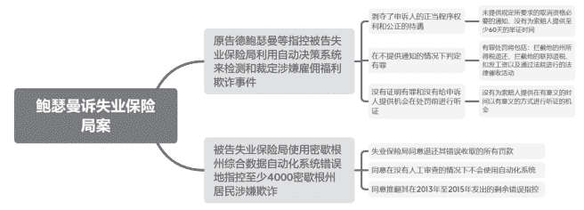

## 核心争议点

被告失业保险局在没有经过正当法律程序的情况下剥夺他人财产的行为是否违反了宪法有关正当程序的规定.

## 裁判论证过程

失业保险局违反了正当程序的有关规定

通过利用自动化决策系统来检测和确定欺诈案件，使得自动化决策过程中的计算机代码包含了用于确定索赔人有罪的规则，这些规则改变了有罪或无罪的实质性标准，与正当程序的要求并不一致.密歇根州失业保险局通过不当拦截税收返还，扣押工资和强迫偿还索赔人的权利，侵犯了并将继续侵犯原告和集体成员的权利：

a. 未提供所要求的取消资格的必要通知.

b. 没有为索赔人提供至少 60 天的举证时间；

c. 不考虑事实依据，或不赞成或不支持发现犯罪行为的证据；

d. 没有举办听证会；

e. 没有为索赔人提供在有意义的时间以有意义的方式发表意见的机会；

f. 通过利用自动化决策系统来检测和确定欺诈案件，使自动化决策过程中的计算机代码包含了用于确定索赔人有罪的规则，这些规则改变了有罪或无罪的实质性标准，与正当程序的要求不一致；

g. 通过例行与大规模的过度评估罚款收取罚款利息，以及使用授权的收取方法不当收取罚款，被告失业保险局制定了这样一项政府政策，违反了《密歇根州宪法》正当程序和公平待遇的规定.

具体而言：

### 一、失业保险局在未进行充分通知和提供听证机会的情况下，扣押当事人财产并从事非法收款的行为违反了正当程序原则

正当程序条款禁止国家在没有正当法律程序的情况下剥夺一个人的生命、自由或财产.显然，只有在生命、自由或财产被剥夺的情况下，该条款才会被违反.正当程序条款保障了当事人“获得有意义的听证机会”的绝对权利，以及在被剥夺个人财产之前发表意见的机会.

### 二、失业保险局在未进行通知的情况下，采用自动欺诈检测系统判定当事人有罪违反了正当程序原则

在本案中，原告鲍瑟曼方声称失业保险局系统性地非法截获了他们的州和联邦退税，扣押其工资，并强迫他们偿还合法取得的失业救济金.经修订的申诉进一步指称，失业保险局违反州法律，对领取失业救济金的个人施加处罚，并收取未经州法律授权的利息.该机构在没有提供“取消失业救济金资格的必要通知”或举办听证会、不允许其在自己的辩护中提出证据的情况下，通过使用计算机系统启动自动化过程，检测和认定欺诈案件，导致个人被取消领取福利的资格、受到处罚并遭到刑事起诉，违反了正当程序原则.

### 三、现行法律未为当事人提供有效救济途径

虽然《密歇根州就业保障法》规定的程序为原告提供了质疑失业保险局关于其失业救济金决定的方法，但它并没有为原告提供适当的途径，以质疑该机构系统性剥夺其正当程序权利的行为，也没有为原告提供以金钱救济形式寻求补救的途径.

## 审理结果

1.索赔法院驳回了失业保险局关于即决处置的动议.

2.密歇根州上诉法院撤销初审法院驳回即决处置动议的决定，失业保险局可根据《密歇根州法院规则》第 7 节第 219 条的规定对费用征税.

3.密歇根州最高法院对原审判决部分确认、部分撤销，并发回重审.

4.密歇根州上诉法院确认了原审判决.

5.密歇根州最高法院决定就失业保险局提出的上诉安排口头辩论.

6.密歇根州最高法院分别批准了双方关于延长提交补充书状的时间等动议.

7.此案仍在上诉审理中，有待进一步完善.

## 相关法条

《密歇根州法律汇编》第 421 节（《密歇根州就业保障法》）第 48 条第 1 款（Michigan Employment Security Act，Michigan Compiled Laws§421.48（1））

（1）个人在没有提供任何服务且未向其支付报酬的任何一周内，或支付给该个人的报酬低于其每周福利率的 1 到 1/2 的情况下，应被视为失业者.例外情况是在新增第 15a 条的修正法案生效之日起至 2015 年 10 月 1 日之前，如果支付给个人的薪酬低于其每周福利率的 1 到 3/5，则任何一周或更短时间内的全职工作都将被视为失业.但是，个人在任何一周内因雇佣单位未能提供全职、定期雇用以外的任何原因而产生的任何报酬损失，应作为本条及第 27 条（c）款规定的报酬而被列入.损失的报酬总额按照失业机构的规定确定.就本法而言，个人的每周福利率是指根据第 27 条（b）款确定的每周福利率.

《密歇根州法律汇编》第 600 节（《1961 年司法法修订案》）第 6431 条（Revised Judicature Act of 1961，Michigan Compiled Laws§600.6431）

（1）除本节另有规定外，不得主张针对本州的索赔，除非索赔人在索赔产生后 1 年内向索赔法院书记员办公室提交书面索赔通知，或向该州或其任何部门、委员会或机构提出索赔的书面通知.

（2）第（1）款下的索赔或通知必须包含以下所有事项：

（a）对索赔发生的时间和地点的说明.

（b）详细说明索赔的性质，以及其所指控或声称遭受损害的项目.

（c）指定与索赔有关的任何国家部门、委员会或机构.

（d）索赔人在有权管理宣誓的军官面前签字并核实.

（3）索赔人应在向总检察长和本州各部门、委员会、赔偿请求或通知书中指定的机构提交说明性复函时，根据第（1）款向书记员提交赔偿请求或通知书的副本.

（4）针对本国的财产损害或人身伤害提出索赔请求，索赔人应在导致索赔的事件发生后 6 个月内，根据第（1）款向索赔法院的书记员提出索赔请求或通知.

（5）本节不适用于根据《非法监禁赔偿法》（《密歇根州法律汇编》第 691 节第 1751 条至第 1757 条）提出的赔偿请求.

《密歇根州法院规则》第 7 节第 219 条（Michigan Court Rules§7.219）（节选）

（A）获得费用的权利.除非上诉法院另有指示，否则民事案件的胜诉方有权承担费用.

（B）申请时间.当事人自发出处分令、意见或拒绝复议令之日起二十八天内，得向书记员送交经核证的诉讼费单，并将副本送达其他当事人.帐单上的每一项都必须注明.未在规定期限内提交诉讼费单的，视为放弃取得诉讼费的权利.

（C）异议.任何其他方可于账单副本送达后 7 天内向书记员提出对费用单的异议.反对方必须将反对意见的副本送达胜诉方，并提出该送达的证明.

（D）征税.书记员将及时核实账单，并按允许的费用征税.

（E）复核.上诉法院会根据任何一方自课税日期起 7 天内提出的动议复核诉讼，但在复核时，只有先前向书记员提出的誓章或反对意见才可获得法庭的考虑.

（F）应税费用.胜诉方只能对上诉法院发生的合理费用征税.

《密歇根州法律汇编》第 600 节（《1961 年司法法修订案》）第 5827 条（Revised Judicature Act of 1961，Michigan Compiled Laws§600.5827）

除非另有明确规定，限制期从索赔产生之时起计算.索赔应于第 5829 条至 5838 条规定的时间发生，在这些条款未涵盖的情况下，无论损害何时发生，索赔的依据都是错误的.

## 案例评析

### （一）本案直接推动了算法行政相关立法的出台

“密歇根综合数据自动化系统”是本案中被告失业保险局使用的自动信息系统，用于向雇主征收失业税，并向符合条件的申请人支付失业福利保险.“地面数字多媒体广播”（Digital Terrestrial Multimedia Broadcast，DTMB）承包了“密歇根综合数据自动化系统”（Michigan Integrated Data Automated System，MiDAS）的设计和配置，以实现取代已有 30 年历史的大型机系统的目标.“密歇根综合数据自动化系统”（Michigan Integrated Data Automated System，MiDAS）宣称其目标包括：改善客户服务、提高数据准确性、改善数据安全和隐私、降低运营成本、提高自动化程度等.显然，针对失业保险局“密歇根综合数据自动化系统”（Michigan Integrated Data Automated System， MiDAS）激增的诉讼数量证明，在其提高自动化程度的同时，“密歇根综合数据自动化系统”（Michigan Integrated Data Automated System，MiDAS）未能达成其宣称的提高数据准确性、改善客户服务的目标.本案牵涉到多达 34000 位密歇根州失业人员，与此同时，欺诈行为和施加罚款为失业保险局带来了巨额资金.在一年多时间内，失业保险局的收入从 300 万美元增加到了 6900 万美元.^([\[17\]](#txt006.html#footnote_content_txt006_17))

“密歇根综合数据自动化系统”（Michigan Integrated Data Automated System，MiDAS）缺乏人工审查，且在接收到内部早期预警之后仍拒绝更正，使得该州大量失业人员遭受了财产损失、信誉与声誉受损、破产以及房屋被抵押、赎回权被取消等不利后果.与以往因算法引起争议的案件相类似，“密歇根综合数据自动化系统”（Michigan Integrated Data Automated System， MiDAS）的开发公司拒绝公开其算法，受“密歇根综合数据自动化系统”（Michigan Integrated Data Automated System，MiDAS）欺诈指控的失业人员在困惑之中想要通过电话咨询失业保险局，发现电话无法接通，等到电话接通时却被告知已经错过 30 天的上诉期限.面对政府自动化系统引起的巨大争议，密歇根州同意修改州失业法，并且同意设立“密歇根综合数据自动化系统”（Michigan Integrated Data Automated System，MiDAS）受害者补偿基金.在 2017 年，密歇根州通过了一项法律，通过改进欺诈指控通知和降低罚款来预防此类灾难性事件的发生.

美国通过引入外部监督机构来进行算法问责，密歇根州针对“密歇根综合数据自动化系统”（Michigan Integrated Data Automated System，MiDAS）出具的审计报告中指出：失业保险局目前的安全管理计划无法对“密歇根综合数据自动化系统”（Michigan Integrated Data Automated System，MiDAS）进行有效控制.欧盟《通用数据保护条例》（General Data Protection Regulation， GDPR）通过赋予个体异议权来保障数据主体的正当程序权利，其中第 3 章第 4 条规定：“如果控制者没有采取相应的行动来对数据主体的请求做出回应，那么对于其在收到请求后一个月内未能采取行动的具体原因，控制者应及时告知该数据主体，同时告知该数据主体可向监管机构提出申诉，寻求司法救济.”

我国《国务院办公厅关于全面推行行政执法公示制度执法全过程记录制度重大执法决定法制审核制度的指导意见》要求行政部门通过事前公开、事中公示、事后公开等正当程序维护公民权益，执法决定信息要在执法决定作出之日起 7 个工作日内公开.目前各国算法行政相关规则供给不足，导致现有法律难以应对复杂多变的算法问题.本案直接推动了算法行政相关立法的出台，以为后续开展算法问责提供法律依据.

### （二）本案通过诉讼方式纠正了政府自动化系统的错误

“密歇根综合数据自动化系统”（Michigan Integrated Data Automated System，MiDAS）欺诈指控的内部审计报告中指出：失业保险局没有完全实施一个全面的安全管理程序，以确保“密歇根综合数据自动化系统”（Michigan Integrated Data Automated System， MiDAS）的安全性；没有充分分析和审查“密歇根综合数据自动化系统”（Michigan Integrated Data Automated System，MiDAS）的数据，以帮助确定需要进一步审查的失业保险福利支出.针对审计报告中指出的问题，失业保险局同意在未经人工审查的情况下不使用自动化系统，同时还同意推翻其在 2013 年至 2015 年发出的剩余错误指控.本案对政府权力行使具有警示意义：算法系统对立法、行政与司法的影响与日俱增，管理自动化趋势增强.我们应清醒地认识到，行政决策仍属法治范围.^([\[18\]](#txt006.html#footnote_content_txt006_18))代码驱动下的智能行政与政府决策仍需遵循比例原则等基本要求.人工智能技术的发展无疑有助于提升行政效率，但自动化决策必须在必要的时刻、以合适的手段、在可进行充分解释的限度内行使，从而赋予自动化决策以正当性和说服力.本案对数字化时代公民积极运用法律武器维护自身合法权益与公民权利救济也具有启发意义.在互联网时代，信息传播速度加快、政策影响范围扩展，较之于传统的行政决策，自动化决策对公民权益的影响更具直接性和广泛性，算法黑箱、决策系统中内含的非理性因素，以及决策执行中可能存在的侵入性呼吁着对公民实现更高程度的法律保护，通过集体诉讼来实现权利救济.

### （三）引发有关算法行政和公共事业领域算法应用的公共讨论

“鲍瑟曼诉失业保险局案”并非公共事业领域算法应用存在严重失误的唯一案例.相较于私人部门，政府所应用的算法与自动化决策系统涉及范围更为广泛，影响深度也远超其他机构.公共事业领域算法应用于刑事司法、保险、金融、税务、福利分配等决定公民生活乃至生存条件的重要行业，其监管却处于空白地带，受本案中“密歇根综合数据自动化系统”（`Michigan Integrated Data Automated System`， `MiDAS`）影响的失业人员在后续就业、退税、财产安全与人身安全上持续遭受不公正对待.被诬告欺诈的当事人，不仅将面临更加艰难的就业处境，还要通过长时间的诉讼程序来维护自身名誉、保障正当权益.

美国 AI NOW 研究所发布的研究报告指出，采用算法决策系统的政府机构认为该方法可以节省成本、促进标准化，而这些算法通常针对被认为“最昂贵”的人群，其中包括在政治、社会和经济上处于最边缘地位的群体.然而这些机构往往未能对这类制度的真实成本和收益进行严格评估，特别是未对实施这些制度将受巨大影响的人开展评估.失业保险局在一年内收入的明显变化，清晰地指向了一个事实：在真实从事欺诈行为的失业人数始终仅占据总失业人口较小比重的情况下，短期内涉及失业欺诈的人数增长至未使用“密歇根综合数据自动化系统”（`Michigan Integrated Data Automated System`， `MiDAS`）前的五倍，罚款金额异常增多，现应用的自动化系统正错误地将未从事欺诈的失业人员归类于涉嫌福利欺诈人群.

而后针对失业保险局错误认定欺诈人员的审计工作结果也肯定了这一事实，在进行部分审查后，审查涉及的 2.2 万项“密歇根综合数据自动化系统”（`Michigan Integrated Data Automated System`， `MiDAS`）欺诈指控中，几乎所有指控都是错误的（该机构还审查了另一组欺诈指控，并进行了一定程度的人工审查.虽然错误率仍高达 44%，但自动化系统的错误率是这个数字的两倍多）^([\[19\]](#txt006.html#footnote_content_txt006_19)).

## （四）本案为公共事业领域算法问责的制度设计设定了标准

失业保险局使用的自动化决策系统无法提供一个具有逻辑性的理解过程，在缺少救济渠道的情况下，受到无端指控的失业人员所受的负面影响将可能伴其终生.透明性的缺失也为算法问责制度设计增加了难度.

在各国算法监管制度设计过程中，强化算法的透明度与可问责性应是必然选择，就目前各国所公布的制度规范来看，这一点也得到了印证.美国国家科技委员会发布的《人工智能研发战略计划》中指出：应通过优化设计提高人工智能系统的公平、透明和可问责性.^([\[20\]](#txt006.html#footnote_content_txt006_20)) 2020 年 1 月，美国白宫发布了《人工智能应用监管指南备忘录（草案）》，指出人工智能的部署应致力于提升安全性、公平性、透明度，并用于增进福利及其他社会目的.该草案中所提及的政府对人工智能的监管和非监管措施，应以增强公众对人工智能的信任、优化风险评估与管理、强化披露和透明度要求为原则.增强公众信任是算法治理的主要目的之一，透明度、可解释性等要求都将服务于增进公众对算法应用的信赖，提升其可预期性.

## （五）本案后续的一些最新进展

“鲍瑟曼案”引发了有关算法行政与正当程序的争论.因本案涉及近 34000 名失业人员，该案同时也引发了研究人员对于“密歇根综合数据自动化系统”（`Michigan Integrated Data Automated System`， `MiDAS`）通过算法生成大量欺诈指控这一现象的关注.尽管有 64%的欺诈指控正在行政法院的上诉中进行审查或被推翻，但失业保险局仍顽固地为“密歇根综合数据自动化系统”（`Michigan Integrated Data Automated System`， `MiDAS`）（以及它所产生的用于支付国家支出的所有“盈余资金”）抵抗内部警告，这些警告指出，“密歇根综合数据自动化系统”（`Michigan Integrated Data Automated System`， `MiDAS`）在认定欺诈行为上存在错误.在联邦政府与州政府的压力下，失业保险局（`Unemployment Insurance Agency`， `UIA`）决定于 2015 年 9 月停止使用“密歇根综合数据自动化系统”（`Michigan Integrated Data Automated System`， `MiDAS`），并进行纯自动化欺诈评估.^([\[21\]](#txt006.html#footnote_content_txt006_21))

2020 年初，参与密歇根州集体诉讼的律师呼吁成立特别工作组，监督州政府运用的所有算法与自动化系统.美国其他州也相继成立了类似的特别工作组，以此监督公共事业领域内自动化决策系统与算法的应用.

## 【关联判例推荐】

### 1. Cahoo v.SAS Analytics Inc., 912 F.3d 887 (2019)

核心事实：失业保险申请人错误地受到了州自动欺诈检测系统虚假的欺诈认定，故对涉及该系统的公司和个人提起了集体诉讼.美国密歇根州东区法院否决了个别机构被告的动议，即以合格豁免权驳回原告根据《宪法第四修正案》和《宪法第十四修正案》提出的要求.

与本案关联点：领取失业救济金的人，在失业救济金方面拥有受宪法保护的财产利益.

### 2. Department of Licensing and Regulatory Affairs/Unemployment Insurance Agency v. Lucente, 946 N.W.2d 836 (2021)

核心事实：许可和监管事务部/失业保险机构要求审查密歇根赔偿上诉委员会（`Michigan Compensation Appellate Commission`， `MCAC`）的决定，根据《密歇根州就业保障法》（`Michigan Employment Security Act`， `MESA`），在获得全职工作后继续领取救济金的失业救济金申请人无需支付赔偿金和欺诈罚款.

与本案关联点：失业机构在发布收回错误支付福利的决定时，无需为当事人提供通知和质疑的机会.

### 3. Frank v. Linkner, 894 N.W.2d 574 (2017)

核心事实：成员们对有限责任公司的其他成员提起诉讼，在公司出售其全部资产、成员从其普通股中没有获得任何好处后，原告对被告压迫公司成员、违反合同和违反受托责任等行为提出了索赔请求.

与本案关联点：通过关注原告申诉中指控的“可诉伤害”，来确定原告首先遭受损害的日期.

### 4. Bonner v. City of Brighton, 848 N.W.2d 380 (2014)

核心事实：土地所有者对市政府提起诉讼，挑战地方法令关于“如果不安全的建筑存在经济上的不合理性，便可以作为公共妨害而被拆除”这一假设的合宪性.

与本案关联点：正当程序条款禁止国家在没有正当法律程序的情况下剥夺一个人的生命、自由或财产.如果不存在这种剥夺，任何程序都是“正当的”，因此没有造成任何损害.

### 5. Cahoo v. SAS Institute Inc., 322 F.Supp.3d 772 (2018)

核心事实：失业保险申请人错误地受到州自动欺诈检测系统虚假的欺诈认定，对涉及该系统的公司和个人提起了集体诉讼，根据联邦和州法律提出了若干理论.与本案关联点：都涉及与公民权利相关的正当程序问题.失业保险申请人错误地遭受了虚假的欺诈裁定，他们有理由主张这违反了正当程序.

### 6.3 休斯顿教师诉休斯顿学区案

#### 【案件索引】

`Houston Fed’n of Teachers, Local 2415 v. Houston Indep. Sch. Dist., 251 F. Supp. 3d 1168 (S.D. Tex. 2017)`

#### 【关键词】

正当程序；算法透明度；自动化决策；商业秘密；知情权；算法影响评估

#### 【案件提要】

本案是在行政领域算法决策语境下有关公民程序性权利保护的经典案例.

在“休斯顿教师诉休斯顿学区案”中，被告休斯顿独立学区（`The Houston Independent School District`， 下称“学区”）采用`EVAAS`系统（`Educational Value-Added Assessment System`，教育增值评估系统）评估教师的教学表现，并将评分结果（下称“`EVAAS`评分”或“评分”）作为决定是否终止劳动人事关系的核心指标之一.`EVAAS`系统打分的依据是教师所在班级学生的考试成绩变动情况.但是，开发者`SAS`公司以保护商业机密为由，拒绝将`EVAAS`的底层代码和原始数据透露给学区或教师本人.

原告以以下四个理由主张被告侵犯了教师们的正当程序权利：第一，当学区以教师`EVAAS`评分过低为由而与之终止劳动人事关系时，教师们无法获取足够的信息来质疑学区行为的合理性；第二，学区应用`EVAAS`的行为和目的（即提升学区教师质量）之间缺乏合理的联系；第三，`EVAAS`的评分机制不透明，对评分结果的说明和分析也很笼统，教师难以知晓如何取得更高的评分以避免遭受解雇等不利后果；第四，学区依照`EVAAS`评分对教师们进行分类并以此区别对待，违反了平等保护原则.

近年来，在联邦政府的大力推动下，以`EVAAS`系统为代表的`VAM`产品（`Value-Added Models`）在美国公立教育系统中日益风靡.`VAM`被视为适应算法时代、以技术驱动教学进步的有力工具，并成为某些影响教师重大利益决策（例如涨薪、职称评定乃至解雇等）的重要依据.但在获得迅速推广的同时，`VAM`的应用在诸多方面饱受争议.对`VAM`的主要批评包括：

1. `VAM`实际评分结果并不如其所宣传的准确、公正；
2. `VAM`对教学的改进作用未达预期；
3. 多数政府在决定采购和使用`VAM`前，未委托专业人士进行详尽测评，亦未召开听证会加以充分讨论，对算法影响评估重视不足；
4. 因低评分而遭解雇的教师难以验证其分数背后的原始数据、运算过程，无法进行准确、有效的陈述和申辩等.

美国政府于 2015 年 12 月出台了《每一个学生成功法案》（`Every Student Succeeds Act`， 下称“`ESSA`”），取消了联邦政府对积极使用`VAM`的州的激励措施，且不再允许各州强制其学区使用`VAM`.但该法案并没有限制各学区继续自主使用`VAM`，亦未对`VAM`的合法性问题予以回应.本案中，法院认为学区使用缺乏透明度的`EVAAS`存在侵犯教师程序性正当程序要求的可能性，故拒绝了学区一方在此项上所提出的简易判决请求（但本案最终是调解结案）.而在此之前，教师们针对`VAM`所发起的诉讼均未曾赢得法院的支持.因此，本案被视为教师群体在司法层面对`VAM`取得的突破性胜利，甚至有学者评论“再次为教师们打开了来自联邦法院的救济的大门”.本案所涉及的程序性权利保护、算法影响评估、算法透明度、商业秘密与知情权的衡量等议题，对算法治理，尤其是教育领域算法的运用具有一定借鉴意义.

#### 【案件要旨】

得克萨斯州南区地方法院休斯顿分院（一审法院，2017 年）：原告 休斯顿当地教师联合会 2415 及多名其他当地教师 被告 休斯顿独立学区、利益相关方、`SAS`公司

2010 年，休斯顿独立学区为了提升教师队伍质量，开始采用定量分析的方法评估教师们的教学质量，并以此作为是否和教师维持劳动人事关系的重要依据.其中，“学生在标准化测试中的成绩进步情况”是评价教学质量的重要指标.为了更准确地反映教学质量和学生成绩的进步情况之间的关系，休斯顿学区于 2012 年引入了`SAS`公司开发的`EVAAS`系统，并通过该系统为教师们的表现打分.`EVAAS`的基本原理是：跟踪教师对学生考试成绩的影响来衡量教师质量，并为教师打分.`EVAAS`评分的计算原理是：将教师所教学生的平均成绩与全州同年级或修读同课程的学生的平均成绩进行对比，再通过复杂的方法处理后得出`EVAAS`评分.

在`EVAAS`系统被引入后不久，学区将`EVAAS`评分作为是否与教师解除劳动关系的重要考察指标之一，声称“在`EVAAS`评分不合格的教师中，只有 15%可以继续留在学区工作”.为了达到上述目标，学区在 2011-2014 年间分别与 20.3%、24.4%、25%评分不合格的教师终止了劳动人事关系.

然而，尽管`EVAAS`在很大程度上决定了教师们的去留，`EVAAS`的底层代码和其他有关其打分机制的信息却被`SAS`公司作为商业机密严格保密.

本案就是在此背景下发生的.原告向法院起诉，主张学区使用`EVAAS`的做法违反了《美国宪法第十四修正案》，具体包括：

1. 侵犯了教师们的程序性正当程序权利，因为当学区以教师`EVAAS`评分过低为由而与之终止劳动人事关系时，教师们无法获取足够的信息来质疑学区行为的合理性.
2. 侵犯了教师们的实体性正当程序权利，因为学区应用`EVAAS`的行为和目的（即提升学区教师质量）之间缺乏合理的联系.
3. 侵犯了教师们的实体性正当程序权利，因为`EVAAS`的评分机制不透明，对评分结果的说明和分析也很笼统，教师难以知晓如何取得更高的评分以避免遭受解雇等不利后果.
4. 学区违反了平等保护原则，因为学区依据`EVAAS`的评分对教师们进行分类，并以此区别对待.

值得说明的是，在本案的调查阶段，`SAS`公司曾向原告的专家辅助人`Rothstein`开放级别较高的权限，允许其进入`EVAAS`系统的底层以了解其代码和其他信息.但是，`Rothstein`表示，即使其获得了比一般用户高得多的权限，也无法重现教师们的`EVAAS`评分.

原告起诉后，被告就原告提出的四个理由均提起了简易判决的申请.法院审理后，支持了被告关于后三个理由的简易判决申请（即驳回了原告的后三个理由），而认为被告存在侵犯了原告程序性正当程序权利的可能性.本案最终调解结案.

#### 【案例事实思维导图】

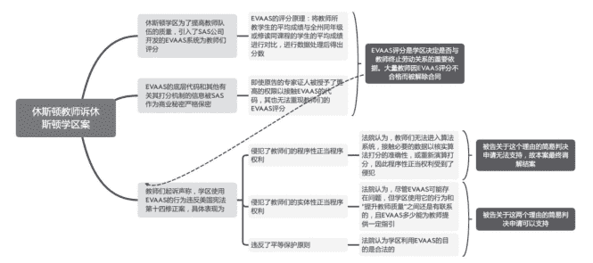

#### 【核心争议点】

1. 原告在与被告的劳动人事关系中是否存在受保护的财产权.
2. 被告将`EVAAS`系统评分作为和教师续签或解除劳动人事合同的重要依据是否侵犯了原告的程序性正当程序权利.
3. 被告采用`EVAAS`评分是否符合实质性正当程序所要求的合理性依据审查标准.
4. 鉴于`EVAAS`评分机制的不透明，被告对`EVAAS`系统的使用是否侵犯了原告的实质性正当程序权利.
5. 被告基于`EVAAS`评分对教师进行分类及区分对待的做法是否违反了平等保护原则.

#### 【裁判论证过程】

##### （一）原告在与被告的劳动人事关系中存在受保护的财产权，符合适用正当程序条款的前提条件

《美国宪法第十四修正案》（正当程序条款）禁止国家未经正当法律程序剥夺任何人的生命、自由或财产.在适用该条款前，法院必须首先考虑是否有足够的证据表明原告在和学区的劳动人事关系中存在受保护的财产权.

本案中，学区通过签订试用合同、固定期限劳动合同和无固定期限劳动合同聘用教师.法院认为，这些劳动合同为教师创设了受正当程序条款保护的财产权利：无固定期限劳动合同只有基于正当理由才能终止，因此签订该类合同的教师在不限期内拥有受宪法保护的被继续雇佣的财产权益；试用合同和固定期限劳动合同则在合同有效期内创设了受保护的财产权益.

针对原告主张被告违反了正当程序原则，被告辩称：原告未能证明其宪法权利已经被实际侵害，故正当程序条款无法适用.但法院认为，原告的诉讼请求并非金钱赔偿，而是预防性救济，即请求法院确认学区使用`EVAAS`决定终止或拒绝延续与教师的劳动人事关系的做法违法，并颁布禁令，禁止学区继续进行上述行为.对于此类预防性救济，原告无须证明其权益已经被实际侵害，而只需证明其权益存在“被侵害的现实危险”即可.本案中，学区依据`EVAAS`评分决定终止劳动人事关系或不再续聘教师，对原告在就业中受宪法保护的财产权益的确构成了威胁，符合适用正当程序条款的前提条件.

##### （二）被告将`EVAAS`系统评分作为和教师续签或解除劳动合同的重要依据存在侵犯原告的程序性正当程序权利的可能

由于无法获取`EVAAS`的算法代码和数据，原告无法验证其`EVAAS`评分的准确性，故主张被告对`EVAAS`的使用未达到最低程序性正当程序标准，即当被告以教师的`EVAAS`评分过低为由终止劳动人事关系时，未能“充分详细地告知教师终止劳动人事关系的原因，以便教师能够证明可能存在的任何错误”.

学区辩称，`EVAAS`评分是由`EVAAS`系统的开发者`SAS`公司而非学区计算的.评分由精密的算法生成，采用了“复杂的软件和多层计算”.`SAS`公司将`EVAAS`评分的计算机制视为商业机密，拒绝向学区或教师本人透露.学区不会自行或聘请其他机构核实或审计从`SAS`公司收到的`EVAAS`分数.学区承认，教师无法自行计算其`EVAAS`评分.甚至，原告的专家证人证实：当他在`SAS`公司的授权下，获得了更高的`EVAAS`底层代码访问权限时，他依然无法复现`EVAAS`评分的运算过程.

`EVAAS`系统是人类设计的，其运作与任何其他人类活动一样可能出现失误，包括从数据输入错误到计算机代码运行本身的小故障等等.学区承认，`EVAAS`评分的计算可能是不准确的.但是，即使发现某位教师的评分存在错误，其评分也不会立即被纠正.这是因为：第一，一旦评分计算完成，更改一名教师的信息需要重新运行整个学区的分析计算系统，而这意味着高昂的成本；第二，重新计算某个教师的`EVAAS`评分还有可能会改变所有其他教师的评分.

然而，学区的上述答辩引发了新的质疑：第一，难道为了节约成本，就可以牺牲教师评分的准确性？第二，这更显凸显了`EVAAS`系统的脆弱性—如果更正一个教师的分数可能导致其他教师的分数一并变化，那么这意味着一个教师`EVAAS`评分的不准确会导致其他教师的评分也不准确.

法院认为，被告将`EVAAS`评分作为和教师延期或终止劳动人事关系的重要依据，却未向原告提供有效途径以了解评分的形成过程、准确性等，阻碍了原告对评分结果进行陈述、申辩的权利，存在侵犯原告程序性权利的可能性，此项争议需另提起诉讼进一步审理，故不支持被告申请就本案中程序性正当程序问题作出简易判决的主张.

##### （三）学区采用`EVAAS`系统评估教师的表现符合合理性依据审查要求

原告声称学区侵犯了其实质性正当程序的权利，因为学区使用`EVAAS`评分的做法与其声称的合法目的（即“在每个学区教室中都有一位有效的老师，从而使每个学区学生都为成功做好了准备”的目标）之间没有合理的关系.与此同时，原告主张`EVAAS`不是一个理性的评估工具，“其根据所教班级的类型和规模而对教师进行区别性对待；评分结果因使用的评分模型或考试成绩不同而波动剧烈；评分结果与其他衡量教师能力的指标的评价结果存在显著不同.”

## 学区回应与合理性审查

学区对此回应道，美国 42 个州和哥伦比亚特区在评估教师效能时已将学生表现纳入考量范围，其中增值评估模型（即`VAM`）得到了学术界的充分评估和认可.且值得注意的是，学区援引了第五巡回法院辖区以外的三个案例（详情参见后文“关联判例推荐”部分的“`Cook v. Bennett 案`”、“`Wagner v. Haslam 案`”和“`Trout v. Knox Cty. Brd. of Educ 案`”）.在这三个案例中，原告均指控当地使用`VAM`的做法侵犯了其实质性正当程序权利，但都没有得到法院的支持.

法院认为，在进行合理性依据审查，即判断被告的行为和目的是否存在“合理联系”时，法院应当采取宽松的审查标准，因为我们不能期待行政主体的每个政策都能准确、有效地实现其目的.因此，只要被告的行为和目的之间确实存在联系，哪怕其行为对于目的的实现只能产生微乎其微的促进效果，被告就能满足合理性依据审查要求.而本案中，尽管`EVAAS`评分的可靠性、科学性确实存在疑问，但仍不可否认其在一定程度上有利于实现政府促进教学的目的.因此，法院认为被告对`EVAAS`评分的应用符合合理性依据审查要求.

## （四）学区采用 EVAAS 系统评估教师的表现不构成因含糊不清而违宪

原告主张，`EVAAS`的打分机制不透明，对评分的分析和应用也不够清晰，违反了《美国宪法第十四修正案》为保障实质性正当程序权利所提出的要求，即一个规则（在本案体现为员工的评价政策）应当足够清晰，以至于能让受规则约束的人可以得到清晰的行为指引（例如规则允许/鼓励/禁止什么行为）.

法院认为，在判定一项政策是否过于含糊不清以致违宪时，侧重点应在于考察其规定是否足够清晰明确，而非深究规则本身的公平性或出错的可能性.

本案中，学区已告知教师`EVAAS`评分过低可能会导致其合同终止，并介绍了`EVAAS`系统的一般信息以及它如何衡量教学质量.虽然教师可能无法验证其`EVAAS`分数的准确性，但可以“评估他们的行为是否符合`EVAAS`实施条例规定的解雇标准”.因此法院认为，学区采用`EVAAS`系统评估教师的表现不构成因规定含糊不清而违宪.

## （五）对原告提起的平等保护请求不予支持

原告声称，学区依照`EVAAS`评分对教师们进行分类，并据此对他们实施了区别对待.原告进一步控诉，学区政策还要求主管人员所作出的教学表现等级评定需与`EVAAS`分数保持一致，这一做法破坏了前者的独立性.

法院认为，原告如欲基于平等保护条款提出请求，须证明其“遭受了故意的区别对待，且该做法缺乏合理依据”.本案中，原告既未能证明“学区政策要求主管人员所作出的教学表现等级评定需与`EVAAS`分数保持一致”事实存在，亦未能充分说明该做法对教师构成了何种区别对待.此外，由于平等保护条款适用宽松的合理性依据审查标准，即使该区别对待的确存在，考虑到其符合促进教学的目的，该行为依然不构成违法.综上，法院对原告所提出的平等保护请求不予支持.

## 【审理结果】

学区所提出的简易判决申请在程序性正当程序方面的要求遭到拒绝，但在其他方面的主张均获批准.换言之，法院驳回了原告关于被告违反了实质性正当程序原则和平等保护原则的请求，但需要继续审理被告是否侵犯了原告的程序性正当程序权利.

但是，本案最终调解结案.学区同意成立教学咨询小组委员会，讨论与教师评核程序有关的问题.并进一步承诺，除非个体评分能够得到验算（`verifi able`），学区不会再使用`VAM`（包括但不限于`EVAAS`）作为终止劳动人事关系的依据.^([\[22\]](#txt006.html#footnote_content_txt006_22))

## 【相关法条】

### 《美国宪法第十四修正案》第 1 节（`United States Constitution，Amendment 14 Section 1`）

所有在合众国出生或归化合众国并受其管辖的人，都是合众国和他们居住州的公民.任何一州，都不得制定或实施限制合众国公民的特权或豁免权的法律；不经正当法律程序，不得剥夺任何人的生命、自由或财产；在州管辖范围内，也不得拒绝给予任何人以平等法律保护.

### 《美国法典》第 42 卷第 1983 条（`42 U.S.C.§1983（1996）`）

任何人凭借任何州或领地或哥伦比亚特区的任何法律、法令、条例、习惯、惯例，剥夺或促使剥夺任何美国公民、或在其管辖区域内的其他人，根据宪法和法律而享有的任何权利、特权或特免，必须对受害人依照法律、衡平法提起的诉讼承担责任，或依其他适当的救济程序的责任.从本节的适用而言，国会制定的只适用于哥伦比亚特区的法律，视为哥伦比亚特区的法律.^([\[23\]](#txt006.html#footnote_content_txt006_23))

### 《得克萨斯州教育法典》第 21 章第 154 条（`21 Tex. Educ. Code§154（1995）`）

根据无固定期限合同聘用的教师有权在未来的学年里直接继续担任教师职务或学区的（其他）职务，而无需经过每年提名或重新任命的程序，除非其：

（1）辞职；
（2）根据德克萨斯州教师退休制度退休；
（3）因第 21 章第 157 条规定的必要裁员而在学年结束时被学区解雇；
（4）根据第 21 章第 156 条规定的正当理由并按照本章规定的程序被解除；
（5）因 1995 年 9 月 1 日或之前存在的教师合同中所述的原因，并按照本章规定的程序被解聘；或者
（6）根据第 21 章第 106 条的授权，被恢复到试用状态.

## 【案例评析】

### （一）使用 VAM 评估教师表现的学区在本案判决作出后有所减少

本案所涉及的`EVAAS`系统属于`VAM`的一种具体产品.根据维基百科的介绍，`VAM`是一种评价教师的方法，通过对学生的考试成绩进行（与其他学生的）横向对比和（与同一学生在上一学年成绩的）纵向对比来衡量教师在该学年的教学质量.^([\[24\]](#txt006.html#footnote_content_txt006_24))`VAM`由于在原理上只聚焦于学生的成绩，因此在诞生之初时被认为是一种客观、公正、有效的评价机制.联邦政府在早年间也认为`VAM`是一种评价教师表现、提升教学质量的有效工具，于是投入大量人力、财力来推广这一系统.例如，在奥巴马执政期间，联邦政府规定：采用`VAM`对教师进行打分，并将`VAM`得分和教师的绩效工资和劳动关系存续挂钩的州可以获得更多的补贴.换言之，越是激进地使用`VAM`，就能得到越多的补贴.^([\[25\]](#txt006.html#footnote_content_txt006_25))

在上述政策的驱动下，美国几乎所有的学区都采纳了这一系统，并将其作为某些影响教师重大利益的决策（如是否涨薪、是否续约等）的依据.休斯顿学区是美国教学质量相对靠后的学区—该学区的多数学生背景被评定为“高（辅导）需求”，64%的学生被评定为“（成长）有风险”，60%的学生被评定为“英语水平有限”，^([\[26\]](#txt006.html#footnote_content_txt006_26))该学区的总体表现在 2019 年被联邦教育部评为 B 级.^([\[27\]](#txt006.html#footnote_content_txt006_27))可能是急于改善学区教学质量，休斯顿学区较为激进地使用了`EVAAS`系统.“休斯顿案”的判决书显示，“学区在 2011-2014 年间分别与 20.3%、24.4%、25%`EVAAS`评分不合格的教师终止了劳动人事关系”.而事实上，休斯顿学区在 2011 年以“`EVAAS`评分不合格”为由解雇的教师多达 221 名.^([\[28\]](#txt006.html#footnote_content_txt006_28))

与`VAM`在美国公立教育系统中快速推广相呼应的是，民间对`VAM`的质疑声则一浪高过一浪.例如，美国教师联合会主席 Randi Weingarten 认为`VAM`（声称）只聚焦于考试成绩的做法是片面的，因为成绩不是一个学生的全部；^([\[29\]](#txt006.html#footnote_content_txt006_29))也有观点声称`VAM`并没有其宣传的那么客观公正，其评分存在若干疑点（例如，有研究发现同一个教师的`EVAAS`得分在短时间能发生剧烈的波动、数学老师的`EVAAS`得分明显高于其他学科老师等），^([\[30\]](#txt006.html#footnote_content_txt006_30))而将这种不太成熟的系统用于决定教师们的去留，未免过于草率.在司法层面，也出现了一系列教师通过诉讼质疑学区使用`VAM`的做法（如 2011 年的“`Cook v. Bennett 案`”， 2016 年的“`Trout v. Knox County Board of Education 案`”，详情参见后文“关联判例推荐”部分）.

可能是出于对上述讨论的回应，美国于 2015 年 12 月出台了《每一个学生成功法案》（`Every Student Succeeds Act`），取代了自 2002 年开始实施的《不让一个孩子掉队法案》（`No Child Left Behind Act`）.两个法案的立法思路存在重大差异：新法案大幅降低了联邦政府对各州公立学校学生成绩的考核压力，将对教师问责的权力很大程度上返还给了各州.^([\[31\]](#txt006.html#footnote_content_txt006_31))这一指导思想在`VAM`的表现就是：新法案取消了联邦政府对积极使用`VAM`的州的激励措施，并且不再允许各州强制其学区使用`VAM`.^([\[32\]](#txt006.html#footnote_content_txt006_32))但是，新法案并没有限制各学区对`VAM`的自主使用，更没有直接回应`VAM`的合法性问题.而在“休斯顿案”之前，所有教师有关`VAM`的诉讼都无一例外地被法院驳回了.因此，“休斯顿案”是教师群体在司法层面取得的对`VAM`的胜利，可谓是“再次为教师们打开了来自联邦法院的救济的大门”.因此，本案具有一定的开创性意义，对算法治理，尤其是教育领域算法的运用产生了一定的影响.

在“休斯顿案”的判决和调解结果公布后，美国使用`VAM`来决定教师去留的学区数量有所减少.但是，“休斯顿案”并没有立刻导致`VAM`在美国消亡.有学者在 2020 年 1 月进行统计，发现美国仍有 12 个州允许或鼓励其学区以`VAM`评分作为决定教师去留的主要甚至唯一依据，23 个州允许或鼓励学区综合`VAM`评分和其他因素决定教师的去留.对于这一现象产生的原因，该学者认为可能有两个：一是“休斯顿案”毕竟不是联邦最高法院的判决，其法律效力并不及于全美，许多地方的教育政策制定者仍不知晓该案件的存在及其影响；二是美国已经为`VAM`的使用和推广投入了大量的人力和财力，已经有了“政策惯性”和“路径依赖”.^([\[33\]](#txt006.html#footnote_content_txt006_33))因此，“休斯顿案”对美国教育政策的转向是存在的，但也是相对有限的.

### （二）该案所体现的算法治理问题得到了世界的普遍关注

`VAM`在全美推广使用的十余年（2010 年至今）是算法在美国公立学校教师评价体系的应用的集中体现.从`VAM`深刻决定教师们的命运开始，围绕`VAM`的讨论、争议乃至诉讼就从未停息，并在“休斯顿案”达到了高潮.尽管“休斯顿案”本身并不至于轰动全美乃至全球，但其所体现的社会、行政领域的算法治理问题已经在当下成为越来越重要的社会议题.事实上，除了公立学校的教师评价问题，美国在其他领域也已经出现了由算法自动化决策而引发的诉讼（详情请参见“关联判例推荐”部分）.

作为对算法治理问题的回应，全球各地在近些年陆续出台了各类有关算法治理的规范性文件或指引性文件.例如，2019 年 4 月，欧盟出台了《可信赖的人工智能伦理准则》，阐释了可信赖的人工智能伦理框架及建议的实现路径.该文件认为，可信赖的`AI`应当符合以下四条准则，以更好地造福人类：^([\[34\]](#txt006.html#footnote_content_txt006_34))

表 1 欧盟《可信赖的人工智能伦理准则》规定的伦理准则

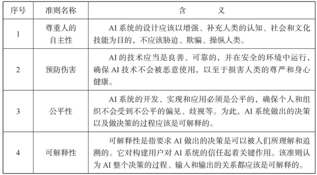

同时，欧盟将上述原则细化成了 7 个更具操作性的要点，包括“人的能动性与监督”“技术稳健性与安全性”“隐私与数据管理”“社会与环境福祉”“多样性、非歧视性与公平性”“透明性”和“问责制度”.在教育领域，“透明性”是其中最重要的要点，并具体表现为可追溯、可解释和可被识别三个方面：^([\[35\]](#txt006.html#footnote_content_txt006_35))

表 2 欧盟《可信赖的人工智能伦理准则》中“透明度”在教育领域的体现

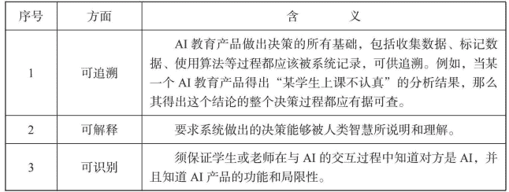

与之类似的是，德国政府也十分重视算法自动化决策的透明度问题，并在其第 36 届信息官员自由会议中通过了一项文件—《算法在公共管理中的透明度》，使得算法在行政管理领域的适用能遵守信息公开原则.根据此文件，德国政府部门使用的算法必须要公布：（1）有关程序输入和输出数据的数据类别的信息；（2）算法所涉的逻辑，尤其是使用的计算公式，包括输入数据的权重，基本的专业知识以及用户部署的个人配置；（3）最终决策的范围以及程序可能产生的后果.^([\[36\]](#txt006.html#footnote_content_txt006_36))

而从上述两个法律文件对“透明度”的要求来审视`EVAAS`，就不难理解为何`EVAAS`在“休斯顿案”中未能通过法院的程序合法审查.`EVAAS`在可解释性方面存在显著的不足，呈现出“黑箱”的特征，使得教师无法判断自己的`EVAAS`得分是否准确.这一方面使得教师对`EVAAS`的信任度降低，另一方面也降低了`EVAAS`评分对教师的指引作用.事实上，`EVAAS`的效用也并没有达到公众的预期.有研究表明，3-8 年级的休斯顿学区学生在阅读、写作、理科、社会科学和社会研究方面没有看到`SAS`公司所承诺的进步.^([\[37\]](#txt006.html#footnote_content_txt006_37))

### （三）有助于推进以算法影响评估保证公众参与算法系统订购与使用

本案中，学区将`EVAAS`评分作为决定是否解聘教师的核心指标之一，涉及教师在就业方面的重要财产权益，却未在采购前对该系统进行专业评测，亦没有面向教师召开听证会加以讨论，该做法引发了公众的强烈质疑.学区与教师随后签订的调解书显示，学区同意成立教学咨询小组委员会，讨论与教师评核程序有关的问题.并进一步承诺，除非个体评分能够得到验算（`verifi able`），学区不会再使用`VAM`（包括但不限于`EVAAS`分数）作为终止合同的依据.^([\[38\]](#txt006.html#footnote_content_txt006_38))

休斯顿学区在采购`EVAAS`系统前没有听取教师们的意见，一定程度上也是本案纠纷发生的因素.这体现了算法影响评估制度的重要性.所谓“算法影响评估”，其内核与我国目前已广泛进行的“环境影响评估”^([\[39\]](#txt006.html#footnote_content_txt006_39))类似，目的在于让政府使用算法自动化决策前，能够创造机会使得行政相对人、研究人员和决策者共同参与影响评估.这为公众提供了算法系统部署前发现问题、表达诉求主张，甚至反对使用算法的机会，是一种向社会提供算法系统信息的机制，能够让公众更加了解情况、增加算法透明度，并让政府部门、算法研发人员和公众进行富有成效的对话.其体现出行政程序不应是行政主体单方用来约束公民、组织的工具，更是要体现出民主、责任、参与、法治的原则.

目前，我国各级警务部门的算法系统上线过程基本采用“个别试点后全面上线运行”的模式.^([\[40\]](#txt006.html#footnote_content_txt006_40))这种模式可以被视为试运行阶段的算法影响测评，但上线前此类算法系统并无明确的评估程序，公众无法借助参与过程来提出自身的诉求.为了保证算法自动化决策系统被安全地部署于政府部门，欧洲议会提出了“算法影响评估（`AIA`）”的制度框架，即对于可能对公民权利造成影响的算法自动化决策系统，应允许社区和利益相关者进行评估，以确定是否可以以及在什么领域使用算法.^([\[41\]](#txt006.html#footnote_content_txt006_41))一些国家则已经将算法影响评估制度从倡议落实为制度.加拿大在 2020 年生效（已在 2021 年再次更新）的《自动化决策指令》中，提出了对算法影响的评估制度.^([\[42\]](#txt006.html#footnote_content_txt006_42))美国华盛顿州通过了众议院和参议院的针对公共部门算法系统的《`HB165 法案`》，^([\[43\]](#txt006.html#footnote_content_txt006_43))要求政府部门的算法系统在使用之前必须由政府在公共网站上公布，“并邀请公众就算法问责报告发表评论，时间不得少于 30 天”.^([\[44\]](#txt006.html#footnote_content_txt006_44))实际上，欧盟《一般数据保护条例》（`General Data Protection Regulation， GDPR`）第 35 条^([\[45\]](#txt006.html#footnote_content_txt006_45))规定的“数据处理活动影响评估”制度实际上也是类似于算法自动化决策系统影响评估的制度，而且既适用于私营公司也适用于公共部门.^([\[46\]](#txt006.html#footnote_content_txt006_46))

算法自动化决策的评估程序，不仅是公众参与算法治理的有效路径，也是算法设计者和使用者（平台或政府）进行自我监管的重要方式.例如，2018 年 11 月 30 日生效的《具有舆论属性或社会动员能力的互联网信息服务安全评估规定》将某些算法应用定义为“具有舆论属性或社会动员能力的互联网信息服务”，并要求其进行自我安全评估.因此，当算法被用于公共领域的行政管理时，相应的的算法也不应被置于秘密黑箱之中，而应在经过公众参与的算法评估程序后再投入使用.我国 2021 年 9 月生效的《`数据安全法`》提出了重要数据处理者的风险评估制度以及政务数据委托处理的批准程序，^([\[47\]](#txt006.html#footnote_content_txt006_47))但此类规定是出于保护数据安全而推出的，基于保护公民权利的程序制度尚付诸阙如.

### （四）体现了行政信息公开原则与保护算法商业秘密的衡量

EVAAS 评分由算法生成，采用了“复杂的软件和多层计算”.SAS 公司将这些算法和软件视为商业机密，拒绝将其底层代码、数据等验证 EVAAS 评分所必需的信息透露给学区或教师本人.因低分被解雇的教师因而无法进行准确、有效的陈述和申辩.本案中，法院认为，当公共机构采用基于不符合最低正当程序要求的秘密算法作出高风险就业决策，而算法开发者又以商业秘密为由拒绝披露相关的相应信息时，适当的处理方案是：让公共机构不再使用该算法.这样，就既可以避免算法相关的商业秘密被泄露，又不至于让该算法的秘密性损害其他主体的合法权益.本案的这一争议点由此引申出了一个学术问题：如何平衡“促进算法透明度”和“保护算法相关的商业秘密”？

一直以来，公开算法模型的主张时常被算法开发者以“保护商业秘密”为由反对.这不禁引人思考：私营企业的商业秘密可否凌驾于行政正当程序对信息公开的要求之上？

为回答上一问题，我们必须考虑商业秘密保护与公民正当权利之间的价值位阶.行政信息公开是一种集体语境下的程序正义.而类似地，一套算法系统可对多个行政相对人产生法律效力，一旦发生错误，可能会产生弥散化的损害后果（例如在本案中，SAS 公司拒绝让教师们验证其评分的一个理由就是：教师们之间的分数是相互关联的，有“牵一发而动全身”的效果）.而具备正当性的规则应具有可预测性，即人们可以根据规定，事先估计到当事人双方将如何行为及行为的后果，从而对自己的行为作出合理的安排.^([\[48\]](#txt006.html#footnote_content_txt006_48))这种对规则的知情权既是一种天赋的人权，也是可依据我国宪法推导出的公民权利，^([\[49\]](#txt006.html#footnote_content_txt006_49))故相对于私营公司的商业秘密保护，显然价值位阶更高.

需要强调的是，“保护公民知情权”、“增进算法透明度”等主张并不必然等于要求开发者公布技术源代码.前文提到，欧盟《可信赖的人工智能伦理准则》对算法透明度的要求之一是“要求系统做出的决策能够被人类智慧所说明和理解”，这说明公开算法底层代码并不是必需的—真正需要被公开的，是“被代码化的法律规则”.^([\[50\]](#txt006.html#footnote_content_txt006_50))因此，商业秘密和正当程序之间的矛盾并没有“水火不容”般紧张.

此外，算法透明度不仅是保障公民正当程序权利的要求，也是保障算法“提升行政效率”功能的有力支撑.这是因为，算法透明度的缺失会导致公民对算法自动化决策的结果信任不足，进而引发相关的纠纷（例如美国就有大量因学区使用 VAM 而引发的教师和学区之间的诉讼），消耗宝贵的社会资源（如司法资源），使得算法提升社会运行效率的最初目的难以如预期般实现.鉴于算法的技术性，美国学者尝试引入“技术性正当程序”的概念，即强调通过编码公开、开发公众参与程序、系统软件测试等来实现程序所要求的透明化、公开和可问责等要求.^([\[51\]](#txt006.html#footnote_content_txt006_51))因此，未来有必要在政府内部增加专业力量，由既懂行政规则又懂技术的人员来监督算法的设计运行.

## 关联判例推荐

### 1. Cook v. Bennett, 792 F.3d 1294 (11th Cir. 2015)

核心事实：佛罗里达州引入了 FCAT VAM 系统，以 4-10 年级学生的英语考试成绩和 4-8 年级学生的数学考试成绩为依据对教师们进行评分，评价其业绩.然而，该州规定，那些教低于 4 年级、高于 10 年级的学生或者所教学科不是数学或英语的老师的业绩评价也要和 FCAT VAM 评分挂钩.换言之，这些老师的业绩评价要和一些他们没教过的学生或科目的成绩挂钩.部分佛罗里达州教师起诉到法院，认为该做法侵犯了其实质性正当程序权利，违反了平等保护原则.美国第 11 巡回上诉法院驳回了教师们的诉讼请求，认为法院应以宽松的态度审查“实质性正当程序”和“平等保护”问题.尽管佛罗里达州的做法对于部分教师确实有些不公平，但其手段和合法目的（提升教学质量）之间是存在联系的.那些教其他科目或年级的老师，也可以通过为学生培养良好的学习习惯和氛围等方式间接提升其数学和英语成绩.至于 FCAT VAM 对部分教师的不公平问题，应当通过民主的方法修改政策，而非以司法介入的方式解决.

与本案关联点：涉及到在教育领域使用 VAM 在实质性正当程序和平等保护原则方面的合法性判断问题.“休斯顿案”的法院在说理时也援引了本案的观点，同意应对 VAM 的使用在实质层面的审查采宽松态度.

### 2. Wagner v. Haslam, 112 F. Supp. 3d 673 (M.D. Tenn. 2015)

核心事实：本案的事实与“Cook v. Bennett 案”类似.两位原告分别是田纳西州的体育老师和美术老师，其起诉称田纳西州使用的 TVAAS 系统（与“休斯顿案”的 EVAAS 系统类似，也是 VAM 的一种）侵犯了其实质性正当程序权利，因为 TVAAS 的评分依据涉及到原告根本没有教的科目和学生.美国田纳西州中部地区地方法院纳什维尔分庭认为，法院对一项政策的合理性只应进行“最低限度的审查”，法院应对民选政府花费大量时间、精力制定的政策保持尊重.而在本案中，田纳西州使用 TVAAS 还是有一定合理性的，正如许多公司的职员的奖金多少与全公司的业绩挂钩.因此，原告的诉讼请求不能被支持.

与本案关联点：涉及到在教育领域使用 VAM 在实质性正当程序和平等保护原则方面的合法性判断问题.“休斯顿案”的法院在说理时也援引了本案的观点，同意应对 VAM 的使用在实质层面的审查采宽松态度.

### 3. Trout v. Knox Cnty. Bd. of Educ., 163 F. Supp. 3d 492 (E.D. Tenn. 2016)

核心事实：原告 Trout 和 Taylor 是田纳西州的中学教师.田纳西州于 2010 年引入了 TVAAS 系统来评价教师的教学质量，并将 TVAAS 评分作为决定教师去留、以及能否得到奖金的重要依据.原告的 TVAAS 评分由于学校的操作失误而得到了不准确的分数，没有得到奖金.原告起诉称 TVAAS 的使用违反了《美国宪法第十四修正案》（正当程序条款）.美国田纳西州东区地方法院认为，奖金是雇佣关系中的“纯粹利益”，不受正当程序条款保护.即使奖金受正当程序条款保护，由于法院对实质性正当程序和平等保护采宽松的审查态度，原告的诉讼请求也不能被支持.

与本案关联点：涉及到在教育领域使用 VAM 的合法性问题，也是“休斯顿案”中法院援引说理的判例.

### 4. Ark. Dep’t of Human Servs. v. Ledgerwood, 2019 Ark. 121, 571 S.W.3d 911

核心事实：原告是数位有严重身体残疾的低收入个人，能定期获得政府救助金.阿肯色州政府后来颁布政策，完全依靠 RUGs 计算机系统来重新计算每个受助者所需的救助金数额（下称“新政策”）.原告就此起诉到法院，认为新政策违反了行政程序，使得原告平均能获得的护理时间减少了 43%，并申请法院发出禁令，禁止政府用 RUGs 重新计算其应得的救助金金额，并将其应获得的救助金数额恢复至新政策出台之前.法院认为，州政府在颁布新政策时没有保障原告的知情权（没有就新政策适当地通知原告，因而原告也无从行使评论和监督的权利），违反了正当程序，故同意发出原告申请的禁令.

与本案关联点：本案是算法自动化决策在社会福利领域中使用的案例，也涉及正当程序原则的适用.

## 6.4 卡彭特诉美国案

### 案件索引

U.S.v. Carpenter, 2013 WL 6385838, E.D. Mich. (2013)
U.S. v. Carpenter, 2013 WL 6729900, E.D. Mich. (2013)
U.S. v. Carpenter, 2014 WL 943094, E.D. Mich. (2014)
U.S. v. Carpenter, 819 F.3d 880, 6th Cir.(Mich.) (2016)
Carpenter v. U.S., 138 S. Ct. 2206, U.S. (2018)
United States v. Carpenter, 926 F.3d 313, 6th Cir.(Mich.) (2019)
United States v. Carpenter, 788 Fed. Appx. 364, 6th Cir.(Mich.)(2019)

### 关键词

算法行政；智慧警务；美国宪法第四修正案；个人信息保护；隐私权

### 案件提要

该案是有关算法行政和智慧警务的经典案件.其讨论的争议焦点是，警方调取被告人连续多天的基站^([\[52\]](#txt006.html#footnote_content_txt006_52))位置信息（cell-site location information， CSLI）的行为是否构成《美国宪法第四修正案》中的搜查.如果构成搜查，便意味着警方在行为前必须申请搜查证，而本案警方认为自己的行为不构成搜查，自然也没有事先申请搜查证，只是根据《存储通信法案》（Stored Communication Act，SCA）第 2703 条（d）款的规定申请了法院令以调取 CSLI，也因此，需要判断该涉案行为是否构成搜查进而违宪.

本案的争议起源于一个刑事案件，该案件的定案证据便是警方调取的相关 CSLI，而该案中的两个被告人卡彭特和桑德斯认为警方获取 CSLI 的行为属于《美国宪法第四修正案》规定的搜查，以警方无证搜查违宪为由，请求排除该证据.一审法院和上诉法院均驳回了两人的排除证据请求.最后，在联邦最高法院的审理中，原告方主要引用了“第三方原则”^([\[53\]](#txt006.html#footnote_content_txt006_53))，强调手机位置信息属于商业记录，被告人对此不享有隐私期待，警方从第三方获取商业记录的行为不属于搜查.被告方主要引用了“美国诉琼斯案”^([\[54\]](#txt006.html#footnote_content_txt006_54))中索托马约尔和阿利托大法官的观点—长期的位置监控损害了个人的隐私期待，同时强调了法律应与时俱进的问题.最后，多数意见认为警方侵害了被告人对 CSLI 的隐私期待，警方的行为属于搜查，需要申请搜查证.

本案中，如何为 CSLI 这类个人信息定性并提供相应的法律保护，是解决问题的关键.CSLI 的原理如下：CSLI 于手机与基站通讯时生成.用户进行拨打电话、发送短信或打开手机等行为时，其手机便会与最近的基站通讯，由此产生了 CSLI.CSLI 也可以自动生成—例如在用户收到短信的时候.基站在地理位置上的分布越密集，其产生的位置数据就越准确.提供手机服务的无线运营商出于商业目的会保留 CSLI 的历史生成记录，而这些保留下来的信息经过长时间的积累，可以推导出某台手机持有人在某段时间内的全部位置轨迹.

本案判决是个人信息保护的又一个里程碑.在美国，个人隐私权的保护呈现出一套从松到严的体系，包括本案原告已经采取的法院令和被告人寻求的宪法保护.而宪法所保护的隐私并没有明确的范围，联邦最高法院的判例对 GPS 定位信息、银行账单、座机的拨出号码等信息类型做出过判断（对应判例为“美国诉琼斯案”、“美国诉米勒案”^([\[55\]](#txt006.html#footnote_content_txt006_55))、“史密斯诉马里兰州案”^([\[56\]](#txt006.html#footnote_content_txt006_56))等），认定其均不受宪法保护.因此，在没有明确保护范围的情况下，本案判决便借这些案例推导出了“不受宪法保护的隐私期待”的特征.可以说，这些判例均无法直接适用，但给本案提供了可参考的反例.

根据我国《中华人民共和国个人信息保护法》第二章第二节敏感个人信息的处理规则（即第二十八条至第三十二条），其包含了个人行踪信息等敏感个人信息的处理，但处理的前提是，个人信息处理者需具有特定的目的和充分的必要性，另外还需遵从取得个人同意的规定以及相当的告知义务.该法第三节是国家机关处理个人信息的特别规定（即第三十三至第三十七条）.根据我国现行宪法第四十条，中华人民共和国公民的通信自由和通信秘密受法律的保护.除因国家安全或者追查刑事犯罪的需要，由公安机关或者检察机关依照法律规定的程序对通信进行检查外，任何组织或者个人不得以任何理由侵犯公民的通信自由和通信秘密.根据《中华人民共和国刑事诉讼法》第一百三十八条，进行搜查，必须向被搜查人出示搜查证.在执行逮捕、拘留的时候，遇有紧急情况，不另用搜查证也可以进行搜查.第一百四十三条规定，侦查人员认为需要扣押犯罪嫌疑人的邮件、电报的时候，经公安机关或者人民检察院批准，即可通知邮电机关将有关的邮件、电报检交扣押.不需要继续扣押的时候，应即通知邮电机关.

### 案件要旨

美国密歇根州东区地方法院（一审法院）：原告 美国 被告人 蒂莫西·卡彭特 蒂莫西·桑德斯

美国第六巡回上诉法院（上诉法院）：上诉方 蒂莫西·卡彭特 蒂莫西·桑德斯 被上诉方 美国

美国联邦最高法院：申诉方 蒂莫西·卡彭特 被申诉方 美国

2011 年 4 月，在底特律河西岸，四名男子因涉嫌 Radio Shack 和 T-Mobile 两家商店的武装连环抢劫而被警方抓捕.一名嫌疑人向 FBI 坦白，几人一共抢劫了位于密西根州和俄亥俄州的九家商店，同时另有 15 人参与了犯罪，并供出了包括自己在内的嫌疑人的手机号码.FBI 之后根据《存储通信法案》第 2703 条（d）款的规定向法院申请了两份法院令，分别从 MetroPCS 和 Sprinte 两大通信服务公司处调取到了 16 个手机号在一段时间内的信息，包括号主信息、费用记录、呼叫记录、通话记录以及目标手机的拨出地和接听地的位置信息.其中有被告人卡彭特 127 天、7 天和被告人桑德斯 88 天的手机号码信息.FBI 从这些信息中发现，在抢劫发生的时候，两人的手机定位在案发商店附近，由此逮捕了两人.

此案的一审法院是美国密歇根州东区法院，卡彭特和桑德斯以及其他被告人被控协助和教唆抢劫罪，以及联邦暴力犯罪项下的协助和教唆携带枪支等罪名.在庭审前，卡彭特和桑德斯提出，公诉机关调取手机定位信息的行为属于搜查，其仅根据《存储通信法案》第 2703 条（d）款的规定取得了法院令，但并没有取得搜查证就进行了搜查，违反了《美国宪法第四修正案》，请求法院排除该项证据.而该请求遭到了地区法院的驳回.在此之后，两人申请了无罪辩护，同样遭到地区法院的驳回.庭审时，七名同案犯均指认卡彭特是主犯.并且，联邦调查员提供了专家证言，其在讲述了 CSLI 的原理后，提交了标有卡彭特手机定位的地图，地图显示手机定位在四个抢劫案的发生地.公诉机关认为，调取到的位置信息表明了卡彭特在案发的时候正好处在案发的地点，铁证如山.一审判决中，因申请排除非法证据未果，卡彭特和桑德斯均被判有罪，两人之后上诉到了美国第六巡回上诉法院.

第六巡回上诉法院维持了地区法院的判决，先引用“Ex parte Jackson 案”^([\[57\]](#txt006.html#footnote_content_txt006_57))和“卡茨案”等来说明，第四修正案保护的只是通信内容，而不包括通信所需信息，这两类信息间存在明显差异，前者一直被视为隐私，而后者则并非隐私.法院之后以“史密斯诉马里兰州案”为主要法律依据，因用户都知道运营商收集了自己的通信信息以作商用，即利用这些信息来维持正常的通信服务，用户对这些信息当然不享有任何产权.CSLI 自然而然地被划分为通信所需信息.综上，法院认为卡彭特是自愿将 CSLI 交由无线运营商的，作为搭建通信的途径，其属于无线运营商的商业记录（business records），所以卡彭特对此不享有合理的隐私期待.也因此，公诉机关调取 CSLI 的行为不属于搜查，无须取得搜查证，并不存在违反《美国宪法第四修正案》的情形.值得一提的是，法院又给出两点理由：一是国会制定的《存储通信法案》第 2703 条（d）款已经提供了一条中间道路，国会作为民主选举出来的代表，其观点或许能被视作社会认同的合理，即“卡茨案”确立的“合理”；二是科技发展之快，法院对一些新技术的认识相对受限，熟悉度或许不如政府.

卡彭特接着申请联邦最高法院的调卷令，联邦最高法院审查了此案案卷材料后，同意受理该案.联邦最高法院以“5 比 4”通过多数意见，撤销了原判决，将案件发回第六巡回上诉法院重审.判决如下：

（1）根据第四修正案的立法目的，由 CSLI 得到的个人行迹，个人有合法正当的隐私期待；
（2）根据《存储通信法案》第 2703 条（d）款的规定，从被告的无线运营商获得的七天 CSLI 历史记录，是“搜查”的结果；
（3）公诉机关调取被告 CSLI 的 127 天历史记录的行为侵犯了被告的合理隐私期待；
（4）政府在调取 CSLI 之前，必须获得有合理根据支持的搜查令，特殊情况除外.

第六巡回上诉法院根据联邦最高法院的判决，认定涉案政府行为属于搜查，因其没有事先申请搜查证，故该行为违宪.但是，相关 FBI 警员有合理理由相信《存储通信法案》中第 2703 条（d）款的规定，可知其主观上是善意的，因此法院依然维持了密歇根州东区地方法院的判决.

### 案例事实思维导图

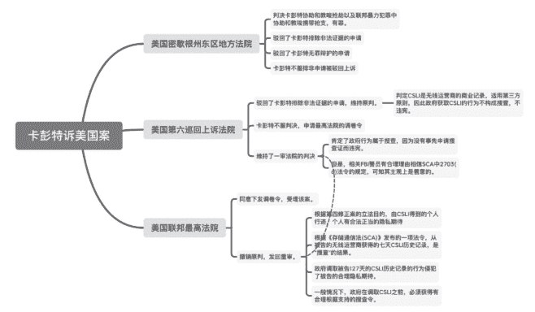

### 核心争议点

1. 《美国宪法第四修正案》的保护对象是否包括合理的隐私期待.
2. 本案能否直接适用已有的判例.
3. 作为定案证据的 CSLI 是否属于“第三方原则”中的商业记录，卡彭特是否享有合理的隐私期待.
4. 警方从无线运营商处调取上述 CSLI 的行为是否构成搜查.

### 裁判论证过程

#### （一）《美国宪法第四修正案》的保护对象包括合理的隐私期待

联邦最高法院裁判论证伊始，其法院意见回溯历史，以《美国宪法第四修正案》的立法目的为基本遵循，解释了《美国宪法第四修正案》是否保护隐私期待、保护何种隐私期待两个问题.不过，其并没有针对第二个问题给出最终唯一的回答，第二个问题仍待未来的科技和法律来解决.

念及公权力之强大，私主体之弱小，必须制定法律来保护私权利，以抵御政府对私人领域的侵犯.《美国宪法第四修正案》应运而生，其最初立法是为了反抗殖民地的英国官员肆无忌惮地进入私人住宅搜查犯罪证据^([\[58\]](#txt006.html#footnote_content_txt006_58)).在之后的判例中，1967 年的“卡马拉案”^([\[59\]](#txt006.html#footnote_content_txt006_59))明确，第四修正案的根本目的是保护个人隐私和安全不受公权力随意侵犯.同年“卡茨案”^([\[60\]](#txt006.html#footnote_content_txt006_60))对第四修正案进行了扩大解释：第四修正案究其根本是保护人权，而不是人的所在地.其不应只保护人民的财产权利，还应保护人民的隐私期待.“史密斯案”将隐私期待这个概念进行了进一步框定，提出了“社会认为合理的隐私期待”.通过引用上述案例，法院意见论证了第四修正案的保护对象.

紧接着，便是探究隐私期待的法律含义，具体什么信息属于隐私并且受宪法保护？首先，法院意见引用了“卡罗尔案”^([\[61\]](#txt006.html#footnote_content_txt006_61))所述的“违宪的调查取证行为”，以及“博伊德案”^([\[62\]](#txt006.html#footnote_content_txt006_62))和“迪尔案”^([\[63\]](#txt006.html#footnote_content_txt006_63))所体现的“第四修正案保护公民隐私免受强权侵犯”，来辅助推断某调查取证行为是否合宪.其次，法院意见借“基洛案”^([\[64\]](#txt006.html#footnote_content_txt006_64))和“莱利案”说明了新侦查技术对公民隐私威胁之大，需要慎重考虑.

## （二）根据以往的判例，第三方保管的个人位置信息具有双重性质，不能同一而论

“合理的隐私期待”这个概念从被提出至“卡彭特案”为止，一直没有出现明确的判断标准，关于如何适用“合理的隐私期待”这个概念，需要对先前的判例进行归纳总结.法院认为，本案不存在完全可以适用的判例，所有相关判例可以分为两类并且共同适用.第一类案件以“琼斯案”为代表，所争论的是个人对自己的位置信息是否享有“合理的隐私期待”；第二类案件以“史密斯案”和“米勒案”为代表，所争论的是个人对自己交由第三方保管的信息是否享有“合理的隐私期待”.CSLI 属于交由第三方保管的个人位置信息.

法院就第一类案件主要讨论了“诺茨案”^([\[65\]](#txt006.html#footnote_content_txt006_65))和“琼斯案”两案，“诺茨案”先于“琼斯案”.警察在诺茨同伙欲购买的氯仿容器中放置了一个传呼机，之后其同伙在明尼阿波利斯上车，到达了威斯康星州，警方利用传呼机的信号顺利地跟随他们到了目的地.“诺茨案”的判决认为，个人因为驾驶的汽车行驶在公路上而不对行车轨迹享有“合理的隐私期待”.个人驾驶汽车行驶在公路上的时候，即默认路上所有看到他的人都可以知道他的行踪和目的地.回到本案，本案法院意见对“诺茨案”进行了提炼，认为“诺茨案”其实将传呼机这一粗糙的跟踪技术与其他更为先进的侦查技术进行了区分，强调了传呼机用处的有限性（其仅限于用信号辅助跟踪车辆），并没有说明如果该技术允许 24 小时侦查的话，是否可能违反宪法.“诺茨案”之后，法院探讨了“琼斯案”，FBI 调查员在琼斯的车上安装了 GPS 定位装置，并对该车进行了 28 天的远程监控.GPS 技术比起传呼机更为先进复杂，能够得到目标车辆的所有活动轨迹.回到本案，本案法院的意见借“琼斯案”提出：如果长时间连续监控目标人物的所有活动轨迹，存在侵犯隐私的问题，乃至触犯宪法.

法院就第二类案件主要讨论了“史密斯案”和“米勒案”，这两个案件同时也是“第三方原则”的代表案件.“米勒案”先于“史密斯案”，“米勒案”的判决认为，政府依传票调取米勒银行账单的行为不构成搜查，原因有二：一是米勒的银行账单属于银行的商业记录，米勒既未占有也不对其享有所有权；二是米勒的银行账单不是保密信息，而只是商业交易中的文书材料，并且银行员工都可对该材料进行查看.总的来说，米勒应承担“银行可能会把保存的信息透露给其他人”的风险.“史密斯案”的核心逻辑与“米勒案”基本相似，只是银行账单换成了拨号记录，法院同样认为电话用户对自己的拨号记录一般不抱有隐私期待，他们都知道通信公司会将这些记录用在正常业务上.因此其结论也为，用户应承担相应信息被透露的风险.

有关“琼斯案”和“诺茨案”的具体适用问题，肯尼迪大法官认为这两个案件与本案件处在不同的维度之上，本案警方事先申请了法院令再去调取证据，具有司法授权.法院意见回应，这其实是搜查是否合理的问题.是否申请法院令并不能主导隐私期待有无的问题.并且，“琼斯案”和“诺茨案”实际上并没有解释电子侦查技术应事先经过哪一方授权.

## （三）CSLI 具有极大的隐私隐患，不能适用“第三方原则”

在探讨上述问题后，不可避免地要分析 CSLI 的技术特点.政府可以通过某个人手机的 CSLI 追查到他过去一段时间内的行动轨迹.针对该新型侦查方式，法院分析出其五个技术特点：一是 CSLI 详细、全面、易于收集，与 GPS 定位技术相似；二是 CSLI 连续不断地传递到通信公司处形成记录；三是通过 CSLI 可以追溯个人过去的行踪，时间跨度可达五年；四是因手机的高普及率和高使用率，CSLI 几乎能涵盖所有本国人的信息；五是 CSLI 的相关技术仍在不断精进.在分析这五个特点之前，法院意见首先借“卡茨案”明确了“公共空间可见的行踪信息仍应受到宪法保护”的观点.再是借“琼斯案”指出，在整个社会的期待中，执法机关不可能也不能长期秘密地监控个人的所有行车轨迹.

法院意见在分析 CSLI 的技术特点时，先将 CSLI 与 GPS 定位信息进行了比较，引用“琼斯案”和“莱利案”强调：位置信息与国人生活的方方面面都息息相关，其与 GPS 定位信息类似，具有详细、全面、易于收集的特点.但是结合 CSLI 的其它特点，法院意见分析道，对于“机不离手”的现代生活而言，CSLI 带来的隐私隐患甚至高过 GPS.CSLI 可以给予政府近乎完美的监控能力，能够实时定位个人，就像是给手机用户安装了脚腕带监视仪.同时，由于手机普及率之广泛，几乎每个人都逃不过手机的定位.警方甚至不需要提前知晓跟踪目标或时间，就能在锁定目标后得到他过去五年的行动轨迹^([\[66\]](#txt006.html#footnote_content_txt006_66)).只有少数没有手机的人才能逃脱这无休止、密不透风的位置监控.

另外，在将 CSLI 与 GPS 定位信息进行比较时，还存在定位精确度的问题.公诉机关和肯尼迪大法官均认为，CSLI 的精确度低于 GPS 定位信息的精确度，无法精确到犯罪地点，只能显示出一块区域，所以公诉机关调取 CSLI 的行为合法.法院予以反驳，127 天的 CSLI 结合其他信息足以推测出卡彭特的全部行程，包括他何时在抢劫地.而且，本案作为证据的 CSLI 体现的是 2010 年初的科技水平，如今基站的数量持续增加，每个基站覆盖的区域越来越小.CSLI 的精确度会越来越接近 GPS 定位的精确度.

法院在大概分析完 CSLI 的特点后，便结合以上特点来回应公诉机关主张的“第三方原则”.公诉机关和肯尼迪大法官均认为，本案涉及的新技术特点并不影响“第三方原则”的正常适用.但是在法院看来，CSLI 存在很大的隐私隐患，其特质已经远远超出了“第三方原则”所能适用的信息范围.法院继续解释道，个人对自己信息的隐私期待因自愿分享给第三方而降低，这是“第三方原则”的原理.其中，分享和自愿两个要件在本案中都存在适用问题.前一个要件不仅要考虑到分享行为，还应考虑到个人信息的本身，“米勒案”和“史密斯案”的判决理由并不只是“分享行为会导致合理的隐私期待的丧失”，其还考虑到了所分享的信息的性质和内容.公诉机关的主张忽略了 CSLI 的特殊之处，生搬硬套“第三方原则”，是把“第三方原则”强行适用到截然不同的信息类型上.后一个要件在本案中不成立，原因有二：一是手机和手机服务是参与现代社会生活所不可或缺的手段；二是用户只是开机，就能产生 CSLI.其他任何操作包括接打电话、接收短信或邮件，以及浏览新闻、天气或者动态时自动建立的无线连接，都能产生 CSLI.唯有不联网才能避免留下位置信息.综上所述，“第三方原则”于本案并不适用.

## （四）本判决适用范围有限

本案所探讨的法律问题仍存在许多争议.法院意见特别提到，本判决所载观点不针对涉案以外的问题，如实时 CSLI 和“基站定点数据”^([\[67\]](#txt006.html#footnote_content_txt006_67))（tower dumps）；不影响“史密斯案”和“米勒案”的正确适用；不限制摄像头等传统侦查技术和工具；不针对其他位置信息的商业记录；不涉及任何外交事务或者国家安全相关的侦查技术.

## （五）一般情况下，政府在调取 CSLI 之前，必须获得有相当理由支持的搜查证

综合以上论述，法院意见已经得出，警方调取涉案 CSLI 的行为属于搜查，受到《美国宪法第四修正案》的限制.第四修正案中“相当理由”（probable cause）条款的要求要远高于《存储通信法案》第 2703 条（d）款规定的要求.法院类推适用先前的判例时一直都是谨慎仔细的.

本案存在“法院令和第四修正案该适用何者”的问题，阿利托大法官认为，只要公诉机关是通过强制程序调取的数据记录，就不需要事先申请搜查证.文件数据的法院调取令与宪法的搜查条款不同，所授权行为不属于直接的取证行为，只能算作是经司法授权的被命令主体所做的“搜查”（constructive search）.法院意见回应，如果因选择法院令，限制了第四修正案适用对象的种类，那么第四修正案就形同虚设.另外，也不是调取文件记录就必须具备相当理由.法院传票和“相当理由”条款各自存在与其相应的适用范围.在犯罪嫌疑人的记录保存在第三方处的情况下，只有少数存在合法隐私利益的时候，才需要申请搜查证.

一般情况下，政府需要搜查证才能获取 CSLI，紧急情况的无证搜查系属例外.紧急情况包括追捕逃犯、个人面临紧迫危险以及证据即将被摧毁的情形.本案判决未排斥紧急情况下的无证搜查.

## 【审理结果】

1.美国密歇根州东区地方法院判决卡彭特有期徒刑 118 年又三个月.

2.美国密歇根州东区地方法院驳回了卡彭特排除非法证据的申请.

3.美国密歇根州东区地方法院驳回了卡彭特无罪辩护的申请

3.美国第六巡回上诉法院驳回了卡彭特排除非法证据的申请，维持原判.

4.美国联邦最高法院撤销原判，发回重审.

5.美国第六巡回上诉法院根据最高院意见改判，但是仍然驳回卡彭特排除非法证据的申请.

6.美国第六巡回上诉法院将案件发回密歇根州东区地方法院重判刑期.

## 【相关法条】

《美国法典》第 18 卷第 1951 条（a）款（18 U.S.C.§1951（a））

以任何形式阻碍、拖延、影响商业或者商品物品的商业流动，抢劫、勒索的，或者试图或共谋抢劫、勒索的，或者对任何人或财产实施身体暴力、或以身体暴力相威胁的，违反了本节的计划或目的，应根据本法处以罚款或 20 年以下的监禁，或两者并罚.

《美国法典》第 18 卷第 924 条（c）款（18 U.S.C.§924（c））（节选）

(1)

（A）除非本小节或其他法律规定了更高的最低刑罚，否则任何人使用、携带枪支的，或为实施此类犯罪而持有枪支的，除对此类暴力犯罪或买卖毒品犯罪规定的刑罚外，任何涉及暴力犯罪或买卖毒品犯罪（包括因使用致命或危险武器、装置而加重处罚的暴力犯罪或买卖毒品犯罪）的人应当—

（i）被判处不少于 5 年的监禁；

（ii）如果展现枪支的，将被判处 7 年以上的监禁刑；以及

（iii）如果开枪的，将被判处 10 年以上的监禁刑.

（B）如果被判犯有违反本款的人持有的枪支……

……

（D）尽管有任何其他法律规定—

（i）法院不得对被判违反本款的人进行缓刑；以及

（ii）根据本款判处的监禁刑不得与其他监禁刑同时计算，包括对使用、携带或持有枪支的暴力犯罪或买卖毒品犯罪判处的监禁刑.

……

《美国法典》第 18 卷第 2703 条（d）款（18 U.S.C.§2703（d））

只有在政府主体提供具体和明确的事实，有合理根据（reasonable grounds）相信电报或电子通信的内容，或所查询的记录或其他信息，与正在进行的刑事侦查有关并且重要的，予以签发法院传票.

《美国宪法第四修正案》（United States Constitution，Amendment 4）

人民的人身、住宅、证件和财产权利不受不合理的搜查和扣押，不受侵犯，在有合理根据的情况下，并且以宣誓或誓词为依据，特别说明搜查地点和扣押的人或物，才能予以签发搜查证.

## 【案例评析】

### （一）本案进一步明确了《美国宪法第四修正案》保护的隐私权益

本案判决以“卡茨案”为判例依据之一，认为“合理隐私期待”受《美国宪法第四修正案》保护.法院意见简要叙述了第四修正案的历史，着重强调了其立法目的，合理化了隐私权益的宪法保护，以“合理隐私期待”为基本论据之一，将 CSLI 作为个人隐私权益划进了第四修正案的保护圈.但是隐私期待毕竟缺乏明确规定，凭借这一点，托马斯大法官全面否定了“卡茨案”中的“合理隐私期待”，认为并不是政府侵犯个人的“合理隐私期待”，政府就成立搜查.无论是扩大第四修正案的保护范围，还是对搜查的定义，都不应该涉及隐私权益.另外，肯尼迪大法官认为第四修正案的保护对象应通过相关产权理论来解释.托马斯和戈萨奇两位大法官都不认同“卡茨案”对第四修正案保护范围的扩大，认为应当继续沿用“卡茨案”之前的解释，同样也是以公民是否具有产权来判断其是否享有第四修正案的保护.学界与三位大法官持相同意见的学者其实并不在少数.

实际上，哈兰大法官在“卡茨案”中提出的“合理隐私期待”及其成立要件一直备受争议.这源于第四修正案的法律解释的发展变化，有观点认为，“卡茨案”不是对第四修正案的忠实解读，而且法院作为司法机构不可随意立法.^([\[68\]](#txt006.html#footnote_content_txt006_68))《美国宪法第四修正案》明文规定，应当保护人民的人身、住宅、证件和财产的安全，使之免受不合理的搜查和扣押.从文字解释来看，其并不包含隐私期待之类的字眼.

本案的多数意见进一步明确了新时代下第四修正案对隐私权益的保护，意义重大.CSLI 具有隐蔽性、连续性、不加区分性、侵入性和回溯性，其收集过程廉价高效且包罗万象，深度揭示了公民日常生活的全景图.^([\[69\]](#txt006.html#footnote_content_txt006_69))本案中，CSLI 成了关键的定罪证据，证明了 CSLI 在现代司法活动中的重要作用.CSLI 毫无疑问体现了个人隐私权益和公共利益的平衡.

### （二）本案肯定了“第三方原则”适用例外的可能性

本案主要是以所分享信息的性质为切入点对“第三方原则”进行了反驳.正如联邦最高法院对“第三方原则”的评价一样，“第三方原则”并不完美.“第三方原则”中的“自愿”是有条件的，在个案适用中有很大的解释空间.CSLI 属于第三方保存的信息，按照先前的判例和“第三方原则”，CSLI 本应该适用“第三方原则”，被排除在第四修正案的保护范围之外.但是法院意见多次引用了“史密斯案”和“米勒案”以反证 CSLI 不适用“第三方原则”.阿利托大法官提到，法院意见区分了 CSLI 和电话号码或者银行交易记录的敏感程度，依照不同的敏感度来判断“史密斯案”和“米勒案”的判决是否适用 CSLI.CSLI 的特殊之处让它比电话号码或银行交易记录有更高的敏感度，不是单纯的商业记录.法院意见从深度和广度、涉及人数、是否无法躲过被收集、是否自动被收集等方面对 CSLI 进行了分析，主要引用了“琼斯案”，把 CSLI 和 GPS 监控相比较，认为 CSLI 目前的精确度虽不及 GPS 监控，但随着科技进步，CSLI 的精确度在不断增加，再加上 CSLI 更易于被收集且成本更低廉，应将其作为高敏感信息予以区别对待.

### （三）直接推动了有关个人数据隐私权利的公共讨论

本案因 CSLI 存在的两个特点而引起了广泛争议，一是数据信息的庞杂带来的隐患，二是介入主体的利益分配.科技发展之迅速难以想象，个人隐私在这样一个逐渐电子化的时代，根本无处可躲.无线运营商掌握的手机位置信息从一开始的粗略到现在越来越精确.这样的大数据时代有好也有坏，在公共安全方面，警方如果能掌握更加详细和精确的个人信息，比如本案中的手机位置信息，将大大提高破案和抓捕罪犯的效率.但是在个人隐私方面，其意味着不仅仅是罪犯或是犯罪嫌疑人的关键信息会被警方掌握，他们的无关信息甚至是无辜民众的无关信息也将落入警方手中.正如联邦最高法院所述，在几乎人人手中一台手机的时代，只有少数没有手机的人才可能逃过政府的监控.

### （四）本案后续的一些最新进展

本案判决实际有一些模糊地带，法院意见主要以“CSLI 具有极大的隐私隐患”这一论点赋予了 CSLI 特殊地位，反驳了“第三方原则”的适用.但是对于后面的案件来说，其并没有给出一个通用且明确的适用尺度.^([\[70\]](#txt006.html#footnote_content_txt006_70))本案特别说明该判例不点评实时 CSLI 或“基站定点数据”（tower dumps）的问题，不影响“史密斯案”和“米勒案”的适用，不涉及传统监控技术和设备，不类推其他位置信息的商业记录，不考虑其他涉及外交事务或国家安全的证据搜集技术.但是即使法院特别限制了本案判例的适用范围，其仍然在数据隐私法律保护方面产生了巨大的影响.

## 【关联判例推荐】

1\. Smith v. Maryland, 442 U.S. 735 (1979)

核心事实：警方使用笔式记录器（记录座机内拨出号码的装置）来监控史密斯家中固定电话拨出的号码.该案围绕警方对非内容电话记录的调取权限进行辩论.法院认为，笔记录器的功能有限，只是记录拨出号码，并且用户知道电话号码会被电话公司用在各种不同的合法商业目的上，对此用户一般不存有隐私期待.史密斯拨打电话的同时，相当于自愿传号码给电话公司，电话公司之后可能把数据给警方的风险由史密斯自己承担.因此，警方使用笔式记录器来监控嫌疑人拨出号码的行为不属于搜查.

与本案关联点：如果个人自愿把信息交给第三方，个人依法对该信息不再有隐私期待.

2\. Katz v. United States, 389 U.S. 347 (1967)

核心事实：卡茨使用电话亭跨州打赌博电话，违反了联邦法律.FBI 探员在电话亭的顶部放置了一个窃听装置，录下了卡茨结束通话的部分.根据这份录音，一审法院判决卡茨有罪.上诉法院确认了一审法院的判决，认为卡茨的第四修正案权利没有受到侵犯，因为警方没有亲自进入电话亭.最高法院认为，第四修正案保护的是人，而不是地方.

与本案关联点：《宪法第四修正案》不仅仅保护财产权益而且还保护某些隐私期待.

# 3. United States v. Jones, 132 S. Ct. 945 (2012)

## 核心事实
警方在琼斯的车中安装了 GPS 追踪装置，对该车的动向实施了 28 天的监控。该案因警方使用 GPS 跟踪装置前是否需要先申请搜查证而引起争议。斯卡利亚大法官书写的多数意见认为，警方安装跟踪装置的行为相当于非法入侵，另外，阿利托和索托马约尔大法官一致认为，无论被调查人的行踪是否普遍暴露在公众之间，长期在调查中利用 GPS 装置监控犯罪行为侵犯了被调查人的隐私期待。

## 与本案关联点
长期监控个人的行踪是对个人隐私期待的侵犯。

## 6.5 尼尔诉费尔法克斯县警察局案

## 【案件索引】
Neal v.Fairfax Cty. Police Dep’t, 94 Va. Cir. 485 (2016)
Neal v.Fairfax Cty. Police Dep’t, 295 Va. 334, 812 S.E.2d 444 (2018)
Neal v.Fairfax Cty. Police Dep’t, 102 Va. Cir. 11 (2019)
Neal v.Fairfax Cty. Police Dep’t, 299 Va. 253, 849 S.E.2d 123 (2020)

## 【关键词】
个人信息保护；信息系统；执法机构个人信息保护义务

## 【案件提要】
本案是有关执法机构获取并保存公民车牌信息是否违反弗吉尼亚州的《政府数据收集与传播行为法》（Government Data Collection and Dissemination Practices Act）^([\[71\]](#txt006.html#footnote_content_txt006_71))的案例。费尔法克斯县居民哈里森·尼尔称其车牌信息至少已被费尔法克斯县警察局（Fairfax County Police Department， FCPD）的车牌自动读取（Automatic License Plate Reader， ALPR）系统记录两次，主张根据《政府数据收集与传播行为法》获得救济。本案共经过四次审判程序。经过前两次审判，法院确定了 ALPR 系统中的车牌号不是该法定义的“个人信息”；经过后三次审判，法院认定 ALPR 数据库并不构成该法定义的“信息系统”，费尔法克斯县警察局使用该系统并不违法。
该案受到了如美国公民自由联盟（American Civil Union， ACLU）、布伦南司法中心（Brennan Center for Justice）及电子前沿基金会（Electronic Frontier Foundation， EFF）等美国众多非盈利组织的广泛关注，它们对原告尼尔的起诉与上诉表示了支持。本案弗吉尼亚州最高法院（下称“州最高法院”）紧扣《政府数据收集与传播行为法》法条，准确界定了“个人信息”与“信息系统”的概念，说理清晰，逻辑严密。

## 【案件要旨】
费尔法克斯巡回法院^([\[72\]](#txt006.html#footnote_content_txt006_72))（一审法院）：原告 哈里森·尼尔 被告 费尔法克斯县警察局等
弗吉尼亚州最高法院（上诉法院）：上诉方 哈里森·尼尔 被上诉方 费尔法克斯县警察局等
费尔法克斯巡回法院（重审法院）：原告 哈里森·尼尔 被告 费尔法克斯县警察局等
弗吉尼亚州最高法院（重审上诉法院）：上诉方 费尔法克斯县警察局等 被上诉方 哈里森·尼尔；上诉方 哈里森·尼尔 被上诉方 费尔法克斯县警察局等
费尔法克斯县警察局（下称“县警察局”）是费尔法克斯县的主要执法机构，其至少从 2010 年起就开始使用 ALPR 技术以捕获通行车辆的车牌。县警察局在警车或其他固定物体上安装了具备车牌自动读取功能的专用摄像头。这些摄像头捕捉到过往车辆的牌照图像后，由光学字符识别技术将图像转化为文本。单个的车牌号连同图像被捕获时的日期、时间点及位置信息被一并存储在费尔法克斯县警察局的数据库中。
弗吉尼亚州警察局（下称“州警察局”）每天发布两次涉嫌犯罪活动的重点车牌清单（下称“重点清单”），获得授权的执法人员可以通过网站进行查看。重点清单可以由服务器自动导入到车牌自动读取系统中，系统用户（即操作的警察）也可以手动输入牌照并附上与被盗车辆和嫌疑人相关的备注。车牌自动读取软件在移动电脑端的后台运行，所捕获的车牌图像被转化为文本后，会与重点清单中已知的车牌号进行交叉核对，通过电脑屏幕上的声音和视觉警报自动提醒值班警察附近潜在的被盗车辆或车牌。^([\[73\]](#txt006.html#footnote_content_txt006_73))这被称为 ALPR 的“积极使用”。不管是否发生“命中”，县警察局都会将捕获的车牌信息在数据库中存储 364 天，期满后将从数据库中清除数据。这被称为 ALPR 的“消极使用”。
2014 年 5 月 9 日，居民哈里森·尼尔根据《弗吉尼亚州信息自由法》（Virginia Freedom of Information Act， FOIA）向县警察局请求提供他的一辆弗吉尼亚牌照的车辆记录，车牌号为“ADDCAR”。县警察局回复尼尔该牌照在 364 天内被 ALPR 系统记录过两次，并向其送达了两页纸，每页都有两张照片和一个表格。照片是他的车辆（显示了牌照），表格信息则是至少其中一张照片拍摄时的时间、日期和 GPS 定位。
2015 年 5 月 5 日，尼尔对县警察局和警察局长小埃德温·C·罗斯勒上校（后文统称为“FCPD”）提起了诉讼。尼尔并不质疑 FCPD“积极使用”ALPR 的正当性，但他认为，在不涉嫌犯罪的情形下，警察局收集和存储车牌数据的行为，即“消极使用”ALPR 的行为违反了《政府数据收集与传播行为法》，并试图根据该法寻求救济。该法旨在更好地确保政府机构保护个人隐私，适用于弗吉尼亚州的记录保存机构和各级政府。具体而言，他援引了《弗吉尼亚法典》第 2.2 卷第 3800 条（C）款（2）项的要求，即“除非事先明确确定了需要”，否则不得收集信息。随后，FCPD 承认其存在尼尔描述的“积极”和“消极”进行车牌自动读取的行为，但否认这两种使用都违反了《政府数据收集与传播行为法》。FCPD 还称车牌号不是个人信息，所以尼尔无权根据该法获得救济。
2016 年 8 月 4 日，FCPD 提出一项动议，要求即决判决。FCPD 认为以下事实几乎是没有争议的：（1）县警察局是通过固定或安装在警车上的摄像头捕捉过往车辆牌照的图像的方式进行车牌自动读取的；（2）应用程序会将捕捉到的车牌图像转换为不特定于州的数字或字母的组合，并与重点清单中的车牌号进行实时比较；（3）捕获的图像、车牌对应的数字/字母转化形式，以及图像捕获时的时间、日期、位置信息（这些信息统称为“ALPR 信息”）都要在县警察局运营的电子数据库（下称“ALPR 数据库”）中存储 364 天；（4）ALPR 数据库是用于检测犯罪活动或响应“安珀警报”^([\[74\]](#txt006.html#footnote_content_txt006_74))、失踪或濒死人员警报的调查工具；（5）县警察局可以访问 ALPR 数据库，以协助其自身以及其他地方的刑事调查；（6）ALPR 数据库只能按车牌号进行检索，不列出车辆的品牌、型号、年份或注册信息；（7）ALPR 设备不会拍摄或以其他方式识别车辆所有者或驾驶员，也不会捕获其身份信息；（8）关于“ADDCAR”牌照的 ALPR 信息不包括尼尔的姓名、住址、出生日期或其他与该牌照注册人有关的任何信息。
鉴于以上事实，FCPD 认为尼尔的请求应当被驳回，且尼尔无权获得救济，因为：（1）尼尔未证明 ALPR 数据库包含“专门针对尼尔的信息”；（2）即使车牌号属于个人信息，尼尔也未证明 ALPR 数据库包含构成数据主体“姓名、个人号码或其他识别信息”的“第二条信息”，从而构成《政府数据收集与传播行为法》定义的“信息系统”；（3）ALPR 数据库的设立是为了进行与犯罪活动有关的调查和情报收集，根据《弗吉尼亚法典》第 2.2 卷第 3802 条 7 款应排除适用该法。
同一天晚些时候，尼尔也提出了一项即决判决动议，声称 ALPR 数据库应受《政府数据收集与传播行为法》管辖。尼尔对事实的陈述与 FCPD 相似，但还包括以下两个事实：（1）ALPR 数据库存储了尼尔的车辆和车牌图像；（2）FCPD 可以随时访问弗吉尼亚州机动车管理局（Virginia Department of Motor Vehicles，DMV）运营的数据库，并可以使用 ALPR 信息从这些数据库中获取社会安全号码、出生日期和住址等个人信息。
费尔法克斯巡回法院（下称“巡回法院”）于 2016 年 9 月 8 日进行了审判，并于 11 月 18 日作出了对被告有利的裁决。巡回法院认为此案不适用于《政府数据收集与传播行为法》，因为车牌号不是该法定义的“个人信息”。原告方于 2017 年 2 月 22 日向州最高法院递交了上诉书。
州最高法院于 2018 年 4 月 26 日推翻了初审结果，认定 ALPR 数据库中存储的车牌号不是“个人信息”，但照片和位置数据是“个人信息”。但是，由于不确定 ALPR 数据库是否可以通过车牌号识别出车主身份从而构成“信息系统”，州最高法院将此案发回重审。
2018 年 12 月 18 日至 19 日，巡回法院对本案进行了重审。调查发现，经过培训和认证为 ALPR 用户的警察拥有进入 ALPR 系统的 ID 和密码，^([\[75\]](#txt006.html#footnote_content_txt006_75))如果再用由州颁发的 ID（不同于县颁发的 ID）登录一个叫做 I/MOBILE 的软件程序，就能访问 NCIC、VCIN 和 DMV 这些机构的数据库，从而轻易将车牌号与车主进行匹配。2019 年 4 月 1 日，法院判决 ALPR 数据库构成《政府数据收集与传播行为法》定义的“信息系统”，并禁止 FCPD 继续“被动使用”ALPR 系统。双方均上诉。
2020 年 10 月 22 日，州最高法院撤销了巡回法院下达的禁令，并裁定支持 FCPD：尽管 ALPR 数据库与其他数据库结合使用可以获取个人的身份识别信息，但 ALPR 数据库本身不是《政府数据收集与传播行为法》规定的“信息系统”。

## 【案例事实思维导图】
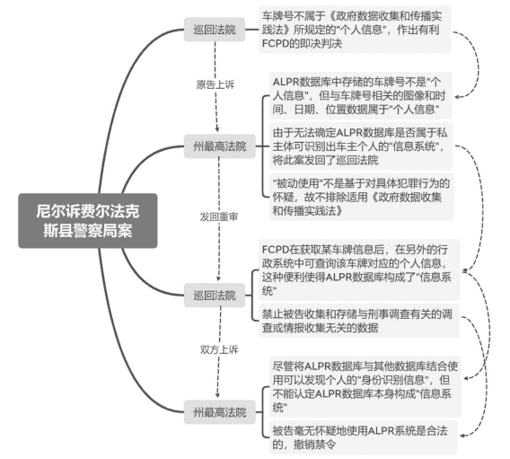

## 【核心争议点】
1.本案中 ALPR 信息是否属于《政府数据收集与传播行为法》定义的“个人信息”。
2.本案中 ALPR 数据库是否属于《政府数据收集与传播行为法》定义的“信息系统”。
3.本案情形是否属于豁免适用《政府数据收集与传播行为法》的法定情形。

## 【裁判论证过程】
### （一）ALPR 数据库中的车牌号不是《政府数据收集与传播行为法》定义下的“个人信息”
巡回法院一审时认为，全案仅仅围绕着一个核心问题：车牌号是否属于“个人信息”。《弗吉尼亚法典》第 2.2 卷第 3801 条对“个人信息”的定义没有明确列举车牌号。虽然这一定义并不是封闭性的，但其列举的各信息示例均指向个人，而车牌号指向的是车辆而非个人。法官罗伯特·J·史密斯表示无法找到解决“车牌是否是个人信息”这一问题的案例，而只能发现讨论“车牌号是否具有隐私利益”的案例（这些案例认为不具有隐私利益）。但是法官认为，基于隐私的分析对本案很有帮助，不涉及隐私利益的信息就不太可能是个人信息，而一旦在“车牌是否是个人信息”这一问题作出否定回答，就不存在实质性的事实问题，也不需要进行进一步的分析。
然而，州最高法院首先注意到存储在 ALPR 数据库中的信息由两种不同类型的信息组成：车牌号和与每个车牌号相关的图片和数据。因此，州最高法院依次分析每种类型的信息，以确定它是否构成《政府数据收集与传播行为法》下的“个人信息”。在这一部分先讨论车牌号是否构成“个人信息”。
《政府数据收集与传播行为法》将“个人信息”定义为可描述、定位、索引个人的任何内容的信息，包括但不限于……机构颁发的识别号……；或为推断个人特征提供依据的信息。根据这一定义，如果车牌号在技术上是“机构颁发的识别号”，那么就可能被视为“个人信息”。DMV 是弗吉尼亚州的一个机构，机动车登记后，DMV 所颁发的车牌应当展示分配给该机动车及其车主的登记号。因此，DMV 数据库中的一个车牌号，例如“ADDCAR”，是一个识别车辆所有者（在本案中则是原告尼尔）的“机构颁发的识别号”。然而，在其他情况下，车牌号不是“个人信息”。如果没有什么方法把车牌号码和个人联系起来，它就只是字母/数字的组合，并不描述、定位或索引任何人的任何方面。此外，字母/数字转换不是特定到州的，因此理论上 ALPR 数据库中的车牌号可以与 50 多辆不同的车相关联。事实上，与社保号或驾照号不同，一个车牌号对应的可能不是“个人”（individual），因为允许“企业”注册车辆，也可能向“多人”颁发车辆产权证。基于以上理由，州最高法院认定 ALPR 数据库中的车牌号不可能构成“个人信息”。

### （二）ALPR 数据库中与各车牌号相关的图片和数据是《政府数据收集与传播行为法》定义下的“个人信息”
州最高法院认为，虽然 ALPR 数据库中，图像经过转化后形成的车牌号不是“个人信息”，但与各车牌号相关的图片和数据，即 ALPR 系统捕获并存储的原始车辆图像，以及图像被捕获时的时间、日期和 GPS 定位，构成《政府数据收集与传播行为法》定义下的“个人信息”。这些图片和数据“为推断个人特征提供了依据”，例如可以推断车主所做的事情或他人对其做的事情，以及推断在特定时间、特定地点车主是否在场。认为这些图片和数据是“个人信息”的结论也符合立法机关的目的，即纠正广泛收集、保留、使用和传播个人信息造成的潜在危害和滥用。

### （三）ALPR 系统不构成《政府数据收集与传播行为法》定义的“信息系统”，因此 FDPR“被动使用 ALPR”系统是合法的
在本案中法院认为牌照本身并不是“个人信息”。但是，法院进一步指出，ALPR 系统包括车辆的图像、牌照、周边环境、GPS 位置、时间和日期，当图像被捕获时，这些信息联系在一起，这一系列数据组合在一起时确实构成了“个人信息”。
根据《政府数据收集与传播行为法》，“信息系统”是一个“记录保存过程”的全部组件和操作，包括通过计算机网络和因特网自动或手动收集或管理的信息，其中包含个人信息及信息主体的姓名、个人号码或其他识别细节（identifying particulars）。反过来，“数据主体”被定义为这样的“个人”—在信息系统中，其个人信息在其姓名、个人号码或其他识别细节目录下被索引到（或可能被置于此目录下）。因此，如果机构的“记录保存过程”同时包含个人的“个人信息”和“姓名、个人号码或其他识别细节”，则它就是一个“信息系统”。如前所述，FCPD 对 ALPR（包括 ALPR 数据库）的“被动使用”是一个“记录保存过程”，其中包含了“个人信息”，即原始车辆图像及图像被抓获时的时间、日期和 GPS 定位。所以，ALPR 数据库是否为《政府数据收集与传播行为法》定义的“信息系统”，关键在于其是否包含个人的“姓名、个人号码或其他识别细节”。
州最高法院认为，目前将车牌号与“识别细节”挂钩还缺乏充分的理由，因为原审判过程中仅有的案件事实尚且不能建立充分联系（link），但是 ALPR 记录保存过程的全部组件和操作仍然可能有某种方法将车牌号与车主轻易地联系起来。为了确定是否存在这种方法，州最高法院将案件发回巡回法院重审。
巡回法院发现，虽然 ALPR 系统本身并不包括车主相关个人信息，但是 FCPD 可以通过其使用 ALPR 系统的电脑（移动数据终端）访问其他行政系统的数据库。将车牌号与车主身份进行匹配只需要屏幕上的几次点击就能实现：登录 ALPR 软件并从中获取车牌号；关闭 ALPR 软件；登录 I/MOBILE 软件并输入车牌号。虽然这个过程可能有些繁琐—至少用到两个程序和三个密码，但不妨碍 ALPR 系统与其他个人信息建立充分联系（link），从而构成一个信息系统。
然而州最高法院不认可这一看法。ALPR 记录保存过程本身并没有收集车主的“识别细节”或与之直接联系，“识别细节”只能从其他机构运营的数据库中收集，而且这些数据库是与 ALPR 数据库分开访问的。尼尔辩称“记录保存过程”包括退出 ALPR 系统后登录其他机构维护的数据库并获取额外信息的过程，该观点无法得到支持。
《弗吉尼亚法典》第 2.2 卷第 3801 条所言“记录保存过程”中的“保存（keep）”是一种人的行为，对象是“记录”，根据该法，就是指保存、维护记录。“保管人（keeper）”是对某事物负责护理、监护或管理，并对其负有法律责任的人。FCPD 得以在其他各种数据库中查询数据，不是违反《政府数据收集与传播行为法》的理由。没有证据表明，FCPD 在其他数据库中搜索信息后，将这些信息“保存”在 ALPR 系统中。该法的其他条款也能帮助解释“访问”不同于“保存”。例如，《弗吉尼亚法典》第 2.2 卷第 3800 条（C）款规定了记录保存机构的义务：任何“持有”个人信息的机构要确保其可靠性，并采取预防措施防止其滥用。如果严格解释法律规定，那么机构只是对自己保存的数据负有责任和义务，从其他来源查询的数据并不包含在内。
此外，“记录保存过程”使用了名词的单数形式。当然，“记录保存”可能涉及来自多个来源的多次输入，例如从州警察局（也可能来自其他来源）直接下载，或由操作员手动输入。然而，一个（单数的）记录保存过程，似乎不可能由多个单独生成、单独运营的系统组合而成。州最高法院之前的审理在不同情形下均使用了“ALPR 记录保存过程”的表述，但 ALPR 的一次“记录保存”并不包括注销 ALPR 系统再单独登录到其他数据库查询内容这些步骤。因此，通过对“记录保存过程”的文义理解，尼尔的扩大解释并不能得到支持。
《弗吉尼亚法典》第 2.2 卷第 3803 条（A）款要求机构：（1）在系统中保持信息的准确性、完整性、及时性和针对性，以确保与数据主体有关的决定的公平性；（2）保留一个频繁访问信息系统中个人信息的所有个人或组织的列表；（3）完整而准确地记录每次查阅系统任何个人资料者的身份和目的，保留三年或直至个人信息被清除为止；（4）设立适当的保障措施，确保系统免受任何合理可预见的对其安全的威胁。为了履行这些义务，《政府数据收集与传播行为法》必然假定机构控制“记录保存过程”的组成部分和操作，可见它不打算让一个机构对其他机构的信息系统负责。

## 最高法院的反驳与结论

为了辩驳以上观点，尼尔提出了很多其他论点.他先是把注意力转移到了《弗吉尼亚法典》第 2.2 卷第 3801 条的“通过计算机网络和因特网自动或手动收集或管理的信息”，然而，法条的表述表明信息来源是多样的，并非所有“通过计算机网络和互联网收集或管理”的信息都被纳入“信息系统”.至于“手动”一词，指的是在特定的记录保存过程中手动输入数据，而不是操作员登录到另一个系统获得额外信息.然后，尼尔又提出，ALPR 系统会从 VCIN 数据库中下载重点清单.但是重点清单只是一些与犯罪有关的车牌号罢了，并不包括“姓名、个人号码或其他识别细节”.尼尔还说，警报响起后警察要从其他数据库中获得信息来进一步核实“命中”是否准确.但是其他数据库并不是“ALPR 记录保存过程”的一部分.最后，他认为《政府数据收集与传播行为法》是一部救济法，因此应该从广义上解释法条.但是州最高法院认为不能随意以违背立法机关意图的方式来曲解法令的含义，否则就是改法、立法，而不是释法.

最后弗吉尼亚最高法院得出结论，虽然其他机构运营的其他数据库可以让 FCPD 了解数据主体的姓名、个人号码或其他可识别细节，但 ALPR 系统本身却不能.因此 ALPR 系统不构成“信息系统”，FCPD“被动使用”ALPR 系统是合法的.

### （四）本案不能排除适用《政府数据收集与传播行为法》

ALPR 的“被动使用”违法的前提是 ALPR 信息是“个人信息”，ALPR 数据库是“信息系统”，并且 ALPR 数据库不能豁免适用法律.就豁免适用问题，州最高法院在第一次审理时就给出了回答.

《弗吉尼亚法典》第 2.2 卷第 3802 条第 7 款规定其不适用于涉及与犯罪活动相关的调查和情报收集相关的个人信息系统.然而，被告在回应原告的第一次诉请时承认，在他们捕获并存储那些在 ALPR 数据库中的信息时，这些信息不被视为任何具体执法调查或目的的一部分.这些信息被储存在数据库中是为了日后可能进行的搜索匹配，对调查或犯罪活动的未来价值完全是推测性的，而第 3802 条第 7 款中的豁免仅适用于与特定犯罪活动有关的“个人信息”的收集和保留，因而即便 ALPR 系统构成“信息系统”，也不能排除适用《政府数据收集与传播行为法数据法》.

## 审理结果

1.州最高法院推翻巡回法院的重审判决.
2.州最高法院认定 FCPD 使用 ALPR 系统合法，撤销巡回法院对费尔法克斯县警察局的禁令.

## 相关法条

《弗吉尼亚法典》第 2.2 卷第 3800 条（C）款（2.2 Code of Virginia§3800（C））

本州的记录保存机构和各级政府应遵守以下信息实践原则，以确保个人隐私得到保障：……（8）任何持有个人信息的机构都应确保其可靠性，并采取预防措施防止其滥用.《弗吉尼亚法典》第 2.2 卷第 3803 条（A）款（2.2 Code of Virginia§3803（A））

任何维护包含个人信息的信息系统的机构应：……（4）在系统中保持信息的准确性、完整性、及时性和针对性，以确保与数据主体有关的决定的公平性；……（6）保留一个频繁访问信息系统中个人信息的所有个人或组织的列表；（7）完整而准确的记录每次查阅系统任何个人资料者的身份和目的，保留三年或直至个人信息被清除为止；……（9）设立适当的保障措施，确保系统免受任何合理可预见的对其安全的威胁.

《弗吉尼亚法典》第 2.2 卷第 3801 条（2.2 Code of Virginia§3801）

“信息系统”是指记录保存过程的全部组件和操作，包括通过电脑网络和因特网收集或管理的信息（无论是自动还是手动的），其中包含个人信息以及数据主体的姓名、个人号码或其他识别细节.

“个人信息”是指：（1）描述、定位或索引有关个人的任何内容的任何信息，包括但不限于其社会保险号、驾照号、机构颁发的识别号、学生身份证号、从纳税申报表中获得的不动产或个人财产，以及其教育、金融交易、医疗史、血统，宗教、政治意识形态、犯罪记录或就业记录；或者（2）为推断个人特征提供依据的任何信息，例如指纹、声纹、照片，由该个人或为该个人完成的事情，出席、注册或加入某个组织或活动、被机构录取的记录.

《弗吉尼亚法典》第 2.2 卷第 3802 条（2.2 Code of Virginia§3802）

本法不应适用于此类个人信息系统：……7. 涉及与犯罪活动有关的调查和情报收集.

## 案例评析

### （一）本案州最高法院回归“个人信息”本身的定义，抛弃了巡回法院的隐私分析方法，凸显了个人信息权益的独立保护价值

个人信息与隐私可能会发生部分重合，但二者并不是两个相互替代的概念.个人信息权是一种主动的权利，大陆法系国家将其称为“信息自决权”，指个人对个人信息具有支配和自主决定的权利.隐私权是被动的权利，就信息而言，重点在于私密信息不被非法披露，保护方式侧重于事后救济.此外，个人信息不仅关系到个人利益，还有可能涉及公共利益，因此对个人信息的保护可能会超越私权的保护，^([\[76\]](#txt006.html#footnote_content_txt006_76))要在信息主体的利益和信息管理者的利益之间取得平衡.我国《个人信息保护法》第一条就说明了立法目的是双重的：既要“保护个人信息权益”，又要“促进个人信息的合理利用”，而“规范信息处理活动”是实现目的的手段和方法.^([\[77\]](#txt006.html#footnote_content_txt006_77))

美国法从实用主义出发，并未对个人信息权益与隐私权作出严格的界分.美国法上的隐私权是“大隐私权”，个人信息也被纳入隐私权保护的范畴.^([\[78\]](#txt006.html#footnote_content_txt006_78))本案初审法官由于无法根据法条对“个人信息”的定义直接判断车牌号是不是个人信息，于是根据车牌号不涉及隐私权，推测车牌号不是个人信息.法官参照了一个先例，该先例判定其不具有隐私权的理由是“车牌号已经进入公众视野”.^([\[79\]](#txt006.html#footnote_content_txt006_79))然而，这种认为“只要被公众所知就不存在隐私”的“全有或全无”式理解将很多信息都排除在了隐私保护范围之外，因为某种个人信息并不完全属于公众或完全属于私密，在大数据时代这种情况将更为常见.^([\[80\]](#txt006.html#footnote_content_txt006_80))

本案初审法官承认，判定“车牌号不涉及隐私权”的先例并没有给出“车牌号是否为个人信息”这个特定问题的答案，可见在其心目中“个人信息”并不等同于隐私.州最高法院在回答这一特定问题时并没有采用隐私分析方法，而是紧扣“个人信息”本身的定义进行解释，使得说理更加严密，也从侧面肯定了“个人信息”具有不同于隐私的独立价值.

### （二）本案分情况讨论车牌号是否为“个人信息”，体现了“个人信息”界定的场景化考量

针对车牌号这一个分析对象，州最高法院认为，在某些情况下它可能是“个人信息”，而在另外的情况下则可能不是“个人信息”.在 DMV 数据库这个场景（context）下，可以通过车牌号识别车主身份，而在 ALPR 数据库这个场景下，车牌号只是一串字符，因此，不能对“车牌号是否为个人信息”这个问题做笼统的回答，而应当在区分场景的前提下进行界定.

场景不同，风险不同，“基于场景的风险评估”方法，要求把信息保护置于动态的场景中讨论，厘清何种信息在何种场景中是被允许处理的.^([\[81\]](#txt006.html#footnote_content_txt006_81))各国将“场景理论”嵌入了个人信息界定，即对个人信息的界定需要依据具体的场景加以个案判断.值得注意的是，即便在特定的场景中，一项信息是否能构成个人信息，也无法作“是或非”的二元化界定，而只能作“程度化”考量，^([\[82\]](#txt006.html#footnote_content_txt006_82))也就是要基于特定场景进行风险评估，在本案中则是要评估该信息在该场景中“描述、定位或索引”个人的可能性.

本案分情况讨论车牌号是否为“个人信息”，是“场景理论”的一次具体实践，为个人信息界定提供了新的思路.

### （三）本案在确定 ALPR 系统是否构成“信息系统”时，采用了传统的法律解释方法，体现了法治的权威

针对 ALPR 系统是否构成“信息系统”，尼尔主张从广义上解释法条以实现法律的救济功能，而州最高法院表示“我们的任务不是通过权衡对效率和安全方面的价值竞争需求与隐私方面的考虑来达到正确的公共政策平衡.我们的职责更为温和：我们必须从《政府数据收集与传播行为法》的文本和结构中确定立法机构划定的界限”以及“不能随意以违背立法机关意图的方式来曲解法令的含义”，体现了传统的法律解释视角.

传统的法律解释学以逻辑演绎方法为主，以保障文本意义的安全性、固定性为己任，试图把立法者的意图贯彻到现实中，而现代的法律解释学以价值衡量方法、论证方法、社会学方法等归纳方法为主，使得法律解释得以不断更新.^([\[83\]](#txt006.html#footnote_content_txt006_83))州最高法院严格采用文义解释和体系解释的方法，尊重立法者意志，有利于了解法律规范的真实内容和含义，体现了对依法办事的重视和提倡.但是，不论价值衡量方法是否会影响甚至“扭转”最终结论，对于价值衡量方法，法官都不应当对其采取直接回避的态度.

总的来说，本案最终得到的结论还是比较稳妥的.不论是大陆法系还是英美法系，法典或法条是最终判决结论的基本立足点.即便案例需要运用多种解释方法，文义解释仍然划定了最大意义范围，即合法性的底线范围，也被称为“文义射程”.^([\[84\]](#txt006.html#footnote_content_txt006_84))本案中，不管车牌号是否属于构成“信息系统”要求的“第二条信息”之“识别细节”，“信息系统”的含义也不可能超出“记录保存过程”的最大意义范围，仍然体现了法治的权威.

## 关联判例推荐

1\. Low Splint Coal Co., Inc. v. Bolling, 224 Va. 400 (1982)

核心事实：工业委员会做出裁决，要求残疾申请人的雇主在其住宅后方为其提供一个改善的入口斜坡，并改装其浴室.弗吉尼亚最高法院认为劳工补偿法规定的必要医疗服务并不包括这些要求.

与本案关联点：在法律本身缺乏明确的定义时，法律的自由解释不能通过改变法律语言的含义来变相修改法律.

2\. U.S. v. Ellison, 462 F .3d 557 (2006)

核心事实：埃里森在消防通道违法停车后，警官检索其车牌号发现车主名下存在重罪搜查令.之后警官对其进行搜查逮捕.地方法院认为那辆货车并没有非法停车，因此这名警官没有合理的理由去检查埃里森的车牌.第六巡回上诉法院认为车牌号中所包含的信息不涉及汽车驾驶员的隐私利益，而且随后进入计算机系统检索其他非私人信息也不构成搜查.

与本案关联点：巡回法院初审时根据车牌号不涉及隐私利益推断车牌号不是“个人信息”.

3\. Davis v.City of Chesapeake, 74 Va. Cir. 367 (2007)

核心事实：记者向该市发出了几份 FOIA 请求，以获取有关该市支付的一般责任索赔和汽车索赔的信息.记者要求提供具体姓名的请求被拒绝.法院认定个人索赔人的姓名不受《弗吉尼亚法典》第 2.2 卷第 3803 条^([\[85\]](#txt006.html#footnote_content_txt006_85))保护.

与本案关联点：《政府数据收集和传播行为法》的颁布，是为了回应对政府可能滥用信息收集做法的担忧，包括通过技术加强此类个人信息的可用性.该法不要求对此类个人信息保密，但规定了在收集、保留和传播该信息时必须遵循的某些做法.该法案的目的是提供政府机构在运行个人信息系统时必须遵守的标准.

## 注释

[\[1\]](#txt006.html#footnote_quote_txt006_1)陈飏、裴亚楠：《论自动化行政中算法决策应用风险及其防范路径》，载《西南民族大学学报（人文社会科学版）》2021 年第 1 期.

[\[2\]](#txt006.html#footnote_quote_txt006_2)张凌寒：《算法自动化决策与行政正当程序制度的冲突与调和》，载《东方法学》2020 年第 6 期.

[\[3\]](#txt006.html#footnote_quote_txt006_3)张恩典：《人工智能算法决策对行政法治的挑战及制度因应》，载《行政法学研究》2020 年第 4 期.

[\[4\]](#txt006.html#footnote_quote_txt006_4)马颜昕：《自动化行政的分级与法律控制变革》，载《行政法学研究》2019 年第 1 期.

[\[5\]](#txt006.html#footnote_quote_txt006_5)马颜昕：《自动化行政方式下的行政处罚：挑战与回应》，载《政治与法律》2020 年第 4 期.

[\[6\]](#txt006.html#footnote_quote_txt006_6)王禄生：《司法大数据与人工智能技术应用的风险及伦理规制》，载《法商研究》2019 年第 2 期.

[\[7\]](#txt006.html#footnote_quote_txt006_7)汪庆华：《算法透明的多重维度和算法问责》，载《比较法研究》2020 年第 6 期.

[\[8\]](#txt006.html#footnote_quote_txt006_8)陆凯：《美国算法治理政策与实施进路》，载《环球法律评论》2020 年第 3 期.

[\[9\]](#txt006.html#footnote_quote_txt006_9)汪庆华：《算法透明的多重维度和算法问责》，载《比较法研究》2020 年第 6 期.

[\[10\]](#txt006.html#footnote_quote_txt006_10)孙清白：《人工智能算法的“公共性”应用风险及其二元规制》，载《行政法学研究》2020 年第 4 期.

[\[11\]](#txt006.html#footnote_quote_txt006_11)汪庆华：《算法透明的多重维度和算法问责》，载《比较法研究》2020 年第 6 期.

[\[12\]](#txt006.html#footnote_quote_txt006_12)衣俊霖：《数字孪生时代的法律与问责—通过技术标准透视算法黑箱》，载《东方法学》2021 年第 4 期.

[\[13\]](#txt006.html#footnote_quote_txt006_13)朱朱：《算法规制的美国径路：〈算法问责法〉简介》，载“大数据和人工智能法律研究院”公众号 2019 年 5 月 2 日，https：//mp.weixin.qq.com/s？\_\_biz=MzU0MTU5Nzk5Mg==&mid=2247485460&idx=1&sn=3e70b135ff 947f19ccaa1fc28055fecb&chksm=fb26c053cc514945be43a540441fe7dc779691f027901b732e138735297fda4c09ee2a410c26&scene=21#wechat\_redirect.

[\[14\]](#txt006.html#footnote_quote_txt006_14)汪庆华：《算法透明的多重维度和算法问责》，载《比较法研究》2020 年第 6 期.

[\[15\]](#txt006.html#footnote_quote_txt006_15)程莹：《元规制模式下的数据保护与算法规制—以欧盟〈通用数据保护条例〉为研究样本》，载《法律科学（西北政法大学学报）》2019 年第 4 期.

[\[16\]](#txt006.html#footnote_quote_txt006_16)Revised Judicature Act of 1961， Michigan Compiled Laws §600.6419（注：《1961 年司法法修订案》，收入《密歇根州法律汇编》第 600 节第 6419 条.）等.

[\[17\]](#txt006.html#footnote_quote_txt006_17)Robert N. Charette， Michigan’s MiDAS Unemployment System： Algorithm Alchemy Created Lead，Not Gold， IEEE Spectrum （Feb. 24， 2021）， https：//spectrum.ieee.org/riskfactor/computing/software/michigans-midas-unemployment-system-algorithm-alchemy-that-created-lead-not-gold.

[\[18\]](#txt006.html#footnote_quote_txt006_18)Mireille Hildebrandt， Algorithmic Regulation and the Rule of Law， THE ROYAL SOCIETY （Mar. 10，2021）， https：//doi.org/10.1098/rsta.2017.0355.

[\[19\]](#txt006.html#footnote_quote_txt006_19)Stephanie Wykstar， Governments’ Use of Algorithm Serves Up False Fraud Charge， UNDARK （Feb，24， 2021）， https：//undark.org/2020/06/01/michigan-unemployment-fraud-algorithm/.

[\[20\]](#txt006.html#footnote_quote_txt006_20)National Science & Technology Council， The National Artificial Intelligence Research and Development Strategic Plan （2019 Update）， NITRD （Jun， 2019）， https：//www.nitrd.gov/news/National-AI-RD-Strategy-2019.aspx.

[\[21\]](#txt006.html#footnote_quote_txt006_21)Robert N. Charette，密歇根州 MiDAS 失业系统：算法炼金术造就铅而非黄金，IEEE Spectrum（2021 年 2 月 24 日），https：//spectrum.ieee.org/riskfactor/computing/software/michigans-midas-unemployment-system-algorithm-alchemy-that-created-lead-not-gold.
[\[22\]](#txt006.html#footnote_quote_txt006_22)参见《和解及完全最终解除协议》第 1 条和第 2 条，（2021 年 2 月 21 日），https：//www.aft.org/sites/default/fi les/settlementagreement\_houston\_100717.pdf.
[\[23\]](#txt006.html#footnote_quote_txt006_23)该翻译引自王名扬：《美国行政法》（下册），中国法制出版社 1995 年版，第 833 页.转引自杨明宇、程啸：《美国政府侵权行为责任模式及评析》，载中国民商法律网 2001 年 7 月 30 日，http：//old.civillaw.com.cn/article/default.asp？id=8239.
[\[24\]](#txt006.html#footnote_quote_txt006_24)增值建模，Wikipedia（2021 年 2 月 8 日），https：//en.wikipedia.org/wiki/Value-added\_modeling.
[\[25\]](#txt006.html#footnote_quote_txt006_25)Rashida Richardson， Jason M. Schultz， & Vincent M. Southerland， 《诉讼算法 2019 美国报告：政府使用算法决策系统的新挑战》， AI Now Institute（2019 年 9 月），https：//ainowinstitute.org/litigatingalgorithms-2019-us.html.
[\[26\]](#txt006.html#footnote_quote_txt006_26)Audrey Amrein-Beardsley， 《教育增值评估系统（EVAAS）受审：具有政策与实践影响的开创性诉讼》， eJEP：教育政策电子期刊，2019 年春季.
[\[27\]](#txt006.html#footnote_quote_txt006_27)教师起诉德州机构反对学校董事会接管计划， Courthouse News Service（2020 年 2 月 25 日），https：//www.courthousenews.com/houston-teachers-union-sues-state-education-agencyover-school-board-takeover-plan/.
[\[28\]](#txt006.html#footnote_quote_txt006_28)Mark A. Paige & Audrey Amrein-Beardsley，“休斯顿，我们有诉讼”：价值增值模型在高风险就业决策实施中的警示故事， 49 Educational Researcher 350， 350-359（2020）.
[\[29\]](#txt006.html#footnote_quote_txt006_29)Janet Bass， 好消息！教师的增值衡量（VAM）在休斯顿已死！，Prince George’s County Parents， Maryland Blog（2017 年 10 月 10 日），https：//pgcpsmess.wordpress.com/2017/10/11/good-news-value-added-measures-vam-for-teachers-is-dead-in-houston/.
[\[30\]](#txt006.html#footnote_quote_txt006_30)Amrein-Beardsley， A. & Geiger， T， 尽是噱头没有实质：增值模型在休斯顿并未增值， 99 Phi Delta Kappan 53， 53-59（2017）.
[\[31\]](#txt006.html#footnote_quote_txt006_31)参见高原：《美国当代标准化测试的命运与教育权利的转移—从〈不让一个孩子掉队法案〉到〈每一个学生成功法案〉》，载《课程·教材·教法》2016 年第 9 期.
[\[32\]](#txt006.html#footnote_quote_txt006_32)Rashida Richardson， Jason M. Schultz & Vincent M. Southerland， 《诉讼算法 2019 美国报告：政府使用算法决策系统的新挑战》， AI Now Institute（2019 年 9 月），https：//ainowinstitute.org/litigatingalgorithms-2019-us.html.
[\[33\]](#txt006.html#footnote_quote_txt006_33)Mark A. Paige & Audrey Amrein-Beardsley，“休斯顿，我们有诉讼”：价值增值模型在高风险就业决策实施中的警示故事， 49 Educational Researcher 350， 350-359（2020）.
[\[34\]](#txt006.html#footnote_quote_txt006_34)参见张涛：《欧盟发布最新〈人工智能道德准则〉，能保证我们信赖 AI 吗？》，载腾讯研究院百家号 2019 年 4 月 30 日，https：//baijiahao.baidu.com/s？id=1632221446815518067&wfr=spider&fo r=pc.
[\[35\]](#txt006.html#footnote_quote_txt006_35)参见沈苑、汪琼：《人工智能在教育中应用的伦理考量—从教育视角解读欧盟〈可信赖的人工智能伦理准则〉》，载《北京大学教育评论》2019 年第 4 期.
[\[36\]](#txt006.html#footnote_quote_txt006_36)参见张凌寒：《算法自动化决策与行政正当程序制度的冲突与调和》，载《东方法学》2020 年第 6 期.
[\[37\]](#txt006.html#footnote_quote_txt006_37)Amrein-Beardsley， A. & Geiger， T， 尽是噱头没有实质：增值模型在休斯顿并未增值， 99 Phi Delta Kappan 53， 53-59（2017）.
[\[38\]](#txt006.html#footnote_quote_txt006_38)参见《和解及完全最终解除协议》第 1 条和第 2 条，（2022 年 3 月 13 日），https：//www.aft.org/sites/default/fi les/settlementagreement\_houston\_100717.pdf..
[\[39\]](#txt006.html#footnote_quote_txt006_39)《环境影响评价法》第 2 条：本法所称环境影响评价，是指对规划和建设项目实施后可能造成的环境影响进行分析、预测和评估，提出预防或者减轻不良环境影响的对策和措施，进行跟踪监测的方法与制度.
[\[40\]](#txt006.html#footnote_quote_txt006_40)参见张涛：《论大数据警务及其法律控制》，载《北京科技大学学报（社会科学版）》2020 年第 3 期.
[\[41\]](#txt006.html#footnote_quote_txt006_41)Ansgar Koene， Chris Clifton， Yohko Hatada， et al.， 《算法问责与透明度的治理框架》， European Parliamentary Research Service（2019 年 4 月），https：//www.europarl.europa.eu/RegData/etudes/STUD/2019/624262/EPRS\_STU（2019）624262\_EN.pdf.
[\[42\]](#txt006.html#footnote_quote_txt006_42)《自动化决策指令》， Government of Canada（2021 年 4 月 1 日），https：//www.tbs-sct.gc.ca/pol/doc-eng.aspx？id=32592.
[\[43\]](#txt006.html#footnote_quote_txt006_43)华盛顿众议院法案 1655， LEGISCAN（2020 年 5 月 28 日），https：//legiscan.com/WA/bill/HB1655/2019.2020-04-13.
[\[44\]](#txt006.html#footnote_quote_txt006_44)华盛顿众议院法案 1655，第 5 条， LEGISCAN（2020 年 5 月 30 日），https：//legiscan.com/WA/drafts/HB1655/2019.
[\[45\]](#txt006.html#footnote_quote_txt006_45)《一般数据保护条例》第 35 条第 1 款：当某种类型的处理—特别是适用新技术进行的处理—很可能会对自然人的权利与自由带来高风险时，在考虑了处理的性质、范围、语境与目的后，控制者应当在处理之前评估计划的处理进程对个人数据保护的影响.若多项高风险处理活动属于同一种类，那么此时仅对其中某一项活动进行评估即可.
[\[46\]](#txt006.html#footnote_quote_txt006_46)TAP Staff ， GDPR 如何处理算法问责， Technology Academics Policy，https：//www.techpolicy.com/Blog/November- 2019/How-the-GDPR-Approaches-Algorithmic-Accountability.aspx.
[\[47\]](#txt006.html#footnote_quote_txt006_47)《数据安全法》第 40 条：国家机关委托他人建设、维护电子政务系统，存储、加工政务数据，应当经过严格的批准程序，并应当监督受托方履行相应的数据安全保护义务.受托方应当依照法律、法规的规定和合同约定履行数据安全保护义务，不得擅自留存、使用、泄露或者向他人提供政务数据.
[\[48\]](#txt006.html#footnote_quote_txt006_48)又称为可预测性、安定性.参见雷磊：《法律方法、法的安定性与法治》，载《法学家》2015 年第 4 期.
[\[49\]](#txt006.html#footnote_quote_txt006_49)参见胡建淼、马良骥：《政府管理与信息公开之法理基础》，载《法学论坛》2005 年第 4 期.
[\[50\]](#txt006.html#footnote_quote_txt006_50)参见张凌寒：《算法自动化决策与行政正当程序制度的冲突与调和》，载《东方法学》2020 年第 6 期.
[\[51\]](#txt006.html#footnote_quote_txt006_51)Citron， D. K.， 科技正当程序， 85 Washington. University Law Review 1249， 1249-1313（2007）.
[\[52\]](#txt006.html#footnote_quote_txt006_52)基站：是指在一定的无线电覆盖区中，通过移动通信交换中心，与移动电话终端之间进行信息传递的无线电收发信电台.
[\[53\]](#txt006.html#footnote_quote_txt006_53)第三方原则：在史密斯案和米勒案中，联邦最高法院判定个人对自愿提供给第三方的信息不享有隐私期待.
[\[54\]](#txt006.html#footnote_quote_txt006_54)United States v. Jones， 132 S. Ct. 945 （2012）.
[\[55\]](#txt006.html#footnote_quote_txt006_55)United States v. Miller， 425 U. S. 435 （1976）.
[\[56\]](#txt006.html#footnote_quote_txt006_56)Smith v. Maryland， 442 U.S. 735 （1979）.
[\[57\]](#txt006.html#footnote_quote_txt006_57)Ex parte Jackson， 96 U.S. 727 （1877）.
[\[58\]](#txt006.html#footnote_quote_txt006_58)Riley v. California， 573 U.S. 373 （2014）.
[\[59\]](#txt006.html#footnote_quote_txt006_59)Camara v. Municipal Court of City and County of San Francisco， 387 U.S. 523， 528， 87 S. Ct. 1727，18 L.Ed.2d 930 （1967）.
[\[60\]](#txt006.html#footnote_quote_txt006_60)Katz v. United States， 389 U.S. 347， 351， 88 S. Ct. 507， 19 L.Ed.2d 576 （1967）.
[\[61\]](#txt006.html#footnote_quote_txt006_61)Carroll v. United States， 267 U. S. 132， 149 （1925）.
[\[62\]](#txt006.html#footnote_quote_txt006_62)Boyd v. United States， 116 U. S. 616， 630 （1886）.
[\[63\]](#txt006.html#footnote_quote_txt006_63)United States v. Di Re， 332 U. S. 581， 595 （1948）.
[\[64\]](#txt006.html#footnote_quote_txt006_64)Kyllo v. United States， 533 U. S. 27， 34 （2001）.
[\[65\]](#txt006.html#footnote_quote_txt006_65)United States v. Knotts， 460 U. S. 276 （1983）.
[\[66\]](#txt006.html#footnote_quote_txt006_66)五年保留政策：即大部分无线运营商可以保留用户数据五年.
[\[67\]](#txt006.html#footnote_quote_txt006_67)基站定点数据：下载某个时段内某个基站连接上的所有设备里的数据.
[\[68\]](#txt006.html#footnote_quote_txt006_68)Lucas Henry Funk， Carpenter 诉美国案与第四修正案的追寻， 17 Northwestern Journal of Technology and Intellectual Property 369， 369-400（2020）.
[\[69\]](#txt006.html#footnote_quote_txt006_69)王仲羊：《科技定位侦查与隐私权的层级保护—以美国 Carpenter 案为视角》，载《河北法学》2021 年第 3 期.

[\[70\]](#txt006.html#footnote_quote_txt006_70)Matthew Tokson， The Next Wave of Fourth Amendment Challenges After Carpenter， 59 Washburn Law Journal 1， 6 （2020）.

[\[71\]](#txt006.html#footnote_quote_txt006_71)2.2 Code of Virginia §3800-3809.（注：《弗吉尼亚法典》第 2.2 卷第 3800-3809 条.）

[\[72\]](#txt006.html#footnote_quote_txt006_72)即弗吉尼亚第十九巡回法院（19th Judicial Circuit of Virginia）.

[\[73\]](#txt006.html#footnote_quote_txt006_73)警报响起不代表找到了目标车辆，警察还需要用肉眼观察车牌，核实州和字符是否正确，之后还要通过检查国家犯罪信息中心（National Criminal Information Center， NCIC）或弗吉尼亚州犯罪信息网（Virginia Criminal Information Network， VCIN）的数据库来确保重点清单仍然处于有效状态.

[\[74\]](#txt006.html#footnote_quote_txt006_74)“安珀警报”（AMBER Alert）是当确认发生儿童绑架案件时，透过各种媒体向社会大众转播的一种警戒告知，其中 AMBER 是 America’s Missing： Broadcasting Emergency Response 的缩写.该警报系统同时也是根据 1996 年美国得克萨斯州艾灵顿市一名被绑架并被杀害的 9 岁女童 Amber Hagerman 命名的.

[\[75\]](#txt006.html#footnote_quote_txt006_75)指的是进入软件程序的用户名和密码.整个 ALPR 系统包括三部分：硬件、软件和服务器组件.硬件是指警车后备箱内的电脑处理器，负责将摄像头捕捉的图像转化为数字/字母组合序列，它和警车前方的移动数据终端通过网线连接在一起.移动数据终端是一个便携电脑，其上安装了需要登录才能访问的软件程序.摄像头收集的所有的信息都储存在操作系统中.

[\[76\]](#txt006.html#footnote_quote_txt006_76)王利明：《论个人信息权的法律保护—以个人信息权与隐私权的界分为中心》，载《现代法学》2013 年第 4 期.

[\[77\]](#txt006.html#footnote_quote_txt006_77)参见张新宝主编：《〈中华人民共和国个人信息保护法〉释义》，人民出版社 2021 年版.

[\[78\]](#txt006.html#footnote_quote_txt006_78)王利明：《论个人信息权的法律保护—以个人信息权与隐私权的界分为中心》，载《现代法学》2013 年第 4 期.

[\[79\]](#txt006.html#footnote_quote_txt006_79)See U.S. v. Walraven， 892 F，2d 972 （1989）.

[\[80\]](#txt006.html#footnote_quote_txt006_80)参见张凌寒、杜婧：《基于隐私权的个人信息保护路径研究—以美国为研究视角》，载《网络法律评论》2016 年第 1 期.

[\[81\]](#txt006.html#footnote_quote_txt006_81)童云峰：《证立与提倡：读者个人信息的民法分类分级保护》，载《现代情报》2021 年第 12 期.

[\[82\]](#txt006.html#footnote_quote_txt006_82)范为：《大数据时代个人信息定义的再审视》，载《信息安全与通信保密》2016 年第 10 期.

[\[83\]](#txt006.html#footnote_quote_txt006_83)陈金钊：《再论法律解释学》，载《法学论坛》2004 年第 2 期.

[\[84\]](#txt006.html#footnote_quote_txt006_84)孙光宁：《法律解释方法在指导性案例中的运用及其完善》，载《中国法学》2018 年第 1 期.

[\[85\]](#txt006.html#footnote_quote_txt006_85)属于《政府数据收集和传播行为法》的内容，该条规定了机构责任、互联网隐私政策以及例外情形.

# 第七章 算法合谋

## 7.1 Eturas 公司及旅行社诉立陶宛共和国竞争委员会案

### 【案件索引】

Supreme Administrative Court of Lithuania decision, Case No A-97-858/2016 (2016)

Eturas and Others v. Lietuvos Respublikos konkurencijos taryba, Case C 74/14 (2016)

### 【关键词】

算法合谋；协同行为

### 【案件提要】

本案是有关算法合谋的经典案件，主要涉及协同行为中默示合谋的认定.首先，该案的提起基于立陶宛共和国竞争委员会（Competition Council，下称“竞争委员会”）的行政处罚决定，Eturas UAB（E-TURAS 在线系统的专有权持有人和系统管理员，下称“Eturas 公司”）和使用该系统的旅行社对竞争委员会关于对旅行社的反竞争行为处以罚款的决定提出异议.

竞争委员会对原告 Eturas 公司与使用 E-TURAS 预售系统的旅行社展开调查后发现，旅行社通过 E-TURAS 预售系统限制旅游套餐预订折扣的上限，沟通了市场交易价格，存在默示合谋，构成协同行为（concerted actions）.使用 E-TURAS 预售系统的旅行社随即诉至法院，称其不应为 Eturas 公司的单方行为承担责任，况且部分旅行社并未收到或阅读过邮件内容.法院基于《欧盟运行条约》（Treaty on the Functioning of the European Union， TFEU）第 101 条第（1）款，对是否存在默示合谋进行认定.双方就系统分发邮件是否足以证明旅行社对邮件的反竞争内容知情或应当知情从而达成合谋存在争议.对此，立陶宛最高行政法院（Supreme Administrative Court of Lithuania）将案件移交欧洲法院（Court of Justice of the European Union， CJEU）.欧洲法院最终认定，旅行社除非有明确意思表示反对或实际更改折扣的行为，否则应认定存在默示合谋，构成协同行为.

Eturas 公司及旅行社算法合谋案受到反垄断执法机构、立法机构与学界的广泛关注.作为算法合谋的典型案例，本案明确了《欧盟运行条约》第 101 条在算法合谋规制中的适用，为如何在司法审判中认定存在算法合谋提供论证思路.此外，本案还直接推动了对算法时代反垄断规制的讨论.如经济合作与发展组织（Organisation for Economic Co-operation and Development，下称“OECD”）于 2017 年 6 月召开关于算法反垄断规制的论坛，并发表了《算法与合谋：数字时代的竞争政策》报告.其中，欧盟的报告对纵向垄断与横向垄断中的算法进行了分类讨论.报告强调，随着算法在商业领域日益广泛的适用，传统的默示合谋也应当作出扩大解释.而美国司法部与联邦贸易委员会两部门的联合报告则集中讨论了算法与定价之间的关系.该报告明确了一个基本原则，即执法者与法院不宜干涉经营者利用算法进行定价，只有当经营者利用算法进行定价是为了以价格途径反竞争或产生了反竞争的效果，才会进入竞争法的视野.过去，我国对算法合谋的规制散见于《反垄断法》与《电子商务法》中.2021 年 2 月 7 日，国务院反垄断委员会制定发布《关于平台经济领域的反垄断指南》（下称“《指南》”）.《指南》指出，平台经济领域垄断协议包括经营者虽未明确订立协议或者决定，但通过数据、算法、平台规则或者其他方式实质上存在协同行为，有关经营者基于独立意思表示所作出的价格跟随等平行行为除外.《指南》充分体现了我国对反垄断领域算法合谋规制的高度重视，积极应对算法时代科技进步带来的挑战，是一次重要的立法尝试.因此，本案对算法合谋规制的理解适用以及相关的执法立法具有重要意义.

### 【案件要旨】

维尔纽斯行政法院（一审法院）：原告 Eturas 公司与使用 E-TURAS 预售系统的旅行社 被告 立陶宛竞争委员会

立陶宛最高行政法院（二审法院）：上诉方 Eturas 公司与使用 E-TURAS 预售系统的旅行社、立陶宛竞争委员会

欧洲法院（初步裁决法院）：原告 Eturas 公司与使用 E-TURAS 预售系统的旅行社 被告 立陶宛竞争委员会

E-TURAS 预售系统是一个用于处理和系统化有关旅游服务以及旅游组织者提供的相关服务信息的在线系统，其允许已通过合同方式从 Eturas 公司获得运营许可的旅行社，通过 Eturas 确定的统一展示方式在其网站上出售旅行预订服务，同时，上述许可合同不允许系统管理员更改定价条款.

2010 年，立陶宛竞争委员会对 Eturas 公司与使用 E-TURAS 预售系统的三十余家旅行社展开调查，认为旅行社正在通过该系统协调预订折扣.调查指出，各旅行社在 E-TURAS 预售系统内拥有一个个人账户，类似于电子邮件系统，收件人可以打开并阅读使用该系统发送的信息.2009 年 8 月 25 日，E-TURAS 预售系统的持有者与管理员即 Eturas 公司的总监向数家旅行社分发了一封题为“投票”的电子邮件，要求收件人就“是否同意系统将线上折扣率由 4%降至 1%-3%”进行投票.2009 年 8 月 27 日，E-TURAS 预售系统的管理员分发邮件称：“根据投票，系统将提供 0%-3%的线上折扣.如果旅行社在预售系统上的票价折扣超过 3%，那么自今天下午二时起，系统将自动将折扣调整至 3%.”经查，此后八家旅行社网站显示提供 3%价格折扣的广告.虽然系统自动调整折扣上限至 3%，但这并未限制旅行社提供大于 3%的折扣，只是需要进一步采取技术手段进行调整.立陶宛竞争委员会认为，鉴于系统邮件包含的限制票价折扣的内容本身属于反竞争的内容，何况旅行社未表示反对，继续使用该预售系统自动调整的折扣上限，即证明其默示同意并实施了该反竞争的内容.同时，Eturas 公司的 E-TURAS 预售系统促成了旅行社间的合谋.综上，Eturas 公司与使用 E-TURAS 预售系统的旅行社已经构成了《欧盟运行条约》第 101 条第（1）款的“协同行为”，并处以罚款.

涉案旅行社向维尔纽斯行政法院提起诉讼，法院支持了其部分请求，并减少了罚款数额.

涉案旅行社与竞争委员会均向立陶宛最高行政法院提出上诉.双方就系统分发邮件是否足以证明旅行社对邮件的反竞争内容知情或应当知情，从而达成合谋存在争议.旅行社主张：（1）折扣限制是由系统自动做出的，旅行社没有实施限制折扣行为的意志，不可能实施协同行为，不能为 Eturas 公司的单方行动承担责任；（2）部分旅行社未收到或未读取邮件，且未注意系统的修改；（3）原则上旅行社仍然能提供额外折扣；（4）即使 E-TURAS 系统进行了折扣限制也无其他替代品，旅行社只能继续使用该系统.因此不应认定为达成合谋.法院指出，无罪推定可适用于惩罚违反竞争法的行为.法院需进一步确定，是否发出信息即可证明旅行社知情或应当知情邮件内容与反竞争的后果，以及在认定算法合谋时应当考虑哪些因素.因此，立陶宛最高行政法院于 2014 年 1 月 17 日作出中止诉讼程序的决定，将案件移交欧洲法院，要求根据《欧盟运行条约》第 267 条作出初步裁决.

经审理，欧洲法院第五分庭于 2016 年 1 月 21 日作出初步裁决，认为旅行社构成《欧盟运行条约》第 101 条第（1）款中的“协同行为”.其理由如下：（1）经营者之间通过默示的方式达成合谋.虽然基于无罪推定原则，不能依据系统给旅行社分发含有反竞争内容的邮件就直接认定旅行社对邮件的内容知情.但是无罪推定原则不排除法院根据其他客观一致的证据，推定旅行社对邮件内容知情，除非旅行社可以提出相反证据推翻这一推定.根据既往第 101 条（1）款“协同行为”的判例，经营者以默示的意思联络或未明确反对合谋也视为达成合谋.结合本案，旅行社仍应承担一定的举证责任.因此，除非旅行社对邮件明确表示过反对，证明自己没有收到邮件或没有读取邮件内容，否则应认定为达成合谋.（2）经营者存在反竞争的市场行为.虽然系统并未限制旅行社提供大于 3%的折扣上限，但是没有旅行社曾对此提出异议或设置超过 3%的折扣.（3）市场行为与合谋之间具有因果关系.3%的折扣上限不仅妨碍了市场竞争秩序，也起到了沟通价格的作用，因此旅行社之间构成协同行为.并且 Eturas 公司的 E-TURAS 预售系统促成了旅行社之间的合谋，也应受到处罚.

2016 年 5 月 2 日，立陶宛最高行政法院根据欧洲法院作出的初步裁决，作出了裁决.^([\[1\]](#txt007.html#footnote_content_txt007_1))在裁决中，最高行政法院对相关旅行社是否都知道 E-TURAS 系统中施加的折扣限制，以及是否反对这一限制进行审议.法院审判委员会评估了竞争委员会就每个申请人收集的证据，并考虑了每个机构在申请期间是否承认知道折扣限制，以及案件中是否有其他证据显示旅行社知道 E-TURAS 中的限制（例如，有证据表明旅行社在了解限制后减少了折扣），了解折扣限制的旅行社是否退出了协同行动（例如，通过系统提供额外的折扣）.最高行政法院在评估竞争委员会所收集的关于每个申请人的证据后，将受竞争委员会处罚的旅行社归类，最终裁决，仅处罚那些知道并且不反对这一限制的旅行社；并且，鉴于审判委员会没有发现任何减轻处罚的情节，支持了竞争委员会提出的部分上诉请求，改变了初审法院对从事反竞争行为的申请人减少罚款的判决.

### 【案例事实思维导图】

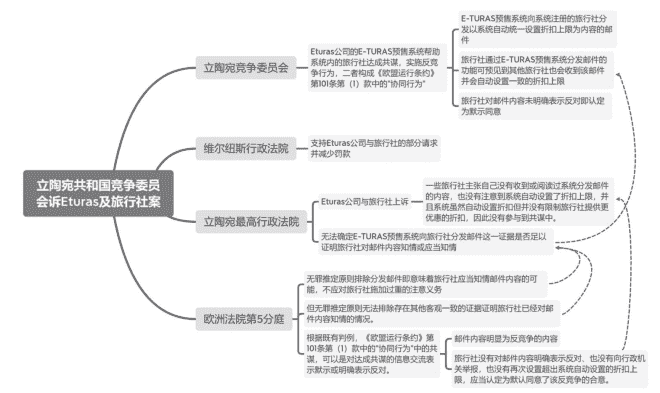

### 【核心争议点】

旅行社之间是否构成《欧盟运行条约》第 101 条第（1）款中的“协同行为”.

### 【裁判论证过程】

#### （一）旅行社未对 E-TURAS 预售系统分发的含有反竞争内容的邮件明确表示反对的事实，可以证明旅行社对该邮件的内容知情或应当知情，在旅行社没有提出相反证据的情况下，可以认定旅行社之间存在默示合谋

欧洲法院第五分庭指出，根据判例法，认定经营者之间是否构成协同行为，关键在于判断经营者之间是否存在有意识的、自愿且一致的意思联络，即是否存在合谋（collusion）.

欧洲法院第五分庭认为，根据《关于适用〈欧盟运行条约〉第 81 条和第 82 条中竞争规则的理事会条例》（Council Regulation（EC）No 1/2003，下称“《理事会条例》”）第 2 条，如果适用《欧盟运行条约》第 101 条第（1）款，应当由反垄断执法机构即立陶宛竞争委员会举证证明旅行社构成协同行为.^([\[2\]](#txt007.html#footnote_content_txt007_2))在本案中，立陶宛竞争委员会举出了两个事实予以证明.第一个事实是 E-TURAS 预售系统向各个旅行社在系统上的邮箱中分发了一份邮件.邮件的内容是：“如果旅行社在预售系统上的票价折扣超过 3%，那么自今天下午二时起，系统将自动将折扣调整至 3%.”第二个事实是旅行社并未明确反对该邮件的内容.欧洲法院第五分庭认为，需要判断立陶宛竞争委员会的举证是否达到了证明标准，以证明旅行社之间存在合谋.法院指出，《理事会条例》第 2 条只规定了举证责任的承担，并没有规定欧盟法层面的证明标准.根据既有判例，法院认为，欧盟法层面的证明标准应当符合等价性（equivalence）与有效性（eff ectiveness）的要求.所谓等价性是指欧盟法层面的证明标准与各个成员国国内的证明标准在相似情形中会产生等价的证明效果.这一规定是为了统一欧盟的证明标准.所谓有效性则是指欧盟法层面的证明标准应当具备现实适用的可能性.这一规定是为了避免设定的证明标准阻碍欧盟竞争规则的执行.在 Total Marketing Services v. Commission 案的判决中，法院认为在大部分认定协同行为的案件中，法院都需要从种种迹象（coincidences and indicia）中推断经营者之间是否存在合谋.这说明，证明标准的有效性不要求法院只能通过直接证据证明事实，在证据客观一致的前提下，法院也可以通过间接证据证明事实.

基于上述理由，欧洲法院第五分庭认为，E-TURAS 预售系统向旅行社分发含有反竞争内容的邮件与旅行社并没有明确反对邮件内容这两个事实属于证明合谋存在的间接证据.根据这两个间接证据可以做出如下推定：如果旅行社知道该邮件的内容，且没有明确表示反对，同时还一致地将票价折扣降至 3%，那么足以认定旅行社之间存在合谋，构成协同行为.如果旅行社不知道该邮件的内容，那么当其发现系统上的票价折扣自动降低时，就有权反对这种反竞争的行为.在同一市场中的每个经营者都必须独立进行经营活动，不得通过直接或间接的方式影响竞争对手从而达到操纵市场的目的.当每个经营者都独立地、互相平行地并且一致地调整了价格，一定有符合市场经济规律的理由.然而旅行社却没有对降低折扣的行为明确提出反对意见.但是，欧洲法院第五分庭仍然指出，根据《欧盟基本权利宪章》第 48 条第（1）款规定的无罪推定原则，在本案中，旅行社可以对此进行解释或者举出相反证据推翻上述推定.旅行社抗辩称其并不知道系统分发了邮件.正因为其不知道邮件的内容，所以旅行社之间不可能有意思联络，也就不可能存在合谋.至于旅行社之所以在发现系统上的票价折扣自动降低时未采取反对措施，是因为其受到 E-TURAS 系统的技术限制.然而欧洲法院第五分庭认为，在此情形下，旅行社可以通过邮件向系统管理员明确表示反对.此外，旅行社还可以通过向有关行政机关举报的方式表示其反对该反竞争的行为.欧洲法院第五分庭指出，根据认定协同行为的既有判例，无罪推定原则也不排除存在其他客观且一致的间接证据，证明经营者之间存在合谋的情况.在本案中，旅行社没有举出相反证据证明自己对该邮件的内容不知情，也无法解释后续实施的相应行为.因此，无罪推定原则不能排除旅行社对该邮件中包含的反竞争的内容知情或应当知情.鉴于邮件内容本身就是反竞争的，且各旅行社使用同一系统，因此旅行社能够意识到自己和其他旅行社均知情该邮件的反竞争内容.即各个旅行社虽然没有直接进行意思联络，但在事实上利用了 E-TURAS 预售系统的公共信息分发功能，通过默示的方式达成了合谋.因为 Eturas 公司的预售系统在此次默示合谋中起到了关键的促进作用，所有也应当认定 Eturas 公司参与了合谋.

综上，E-TURAS 预售系统向旅行社分发邮件且旅行社没有明确表示反对的事实，足以证明旅行社对邮件中的限制票价折扣这一反竞争内容知情或应当知情，在旅行社没有提出相反证据的情况下，可以认定旅行社之间存在默示合谋。

## （二）旅行社之间构成《欧盟运行条约》第 101 条第（1）款中的“协同行为”

欧洲法院第五分庭认为，根据既往判例，协同行为的构成要件有三：一是经营者之间存在合谋，二是经营者实施了反竞争的市场行为，三是市场行为与合谋之间具有因果关系.

首先，针对构成要件一，如前文所述，可以认定旅行社之间以默示的方式达成合谋.其次，针对构成要件二，法院认为，根据既往判例，如果经营者之间的合谋是出于排除、限制竞争的目的，则无需考虑其行为是否实际产生排除、限制竞争的效果，也不要求经营者基于此合谋具体实施了相关行为.只要经营者继续在相关市场上开展经营活动，则推定其必将会考虑实施相关的反竞争行为.如果无法从经营者之间的合谋判断出其具有排除、限制竞争的目的，则应考虑该合谋是否会对经营者的市场行为产生影响，并且考察相应的市场行为是否可能产生排除、限制竞争的效果，但是不要求该行为已经实际产生相应的反竞争效果.欧洲法院第五分庭认为，本案中，通过邮件本身就可以推断旅行社之间的合谋是出于排除、限制竞争的目的.更何况，旅行社在系统自动将票价折扣降至 3%之后并没有明确表示反对，且自此之后再也没有给予过高于 3%的票价折扣.因此，这些旅行社亦实施了反竞争的市场行为.最后，法院认为旅行社之间的合谋与市场行为之间存在因果关系.3%的折扣上限不仅妨碍了市场竞争秩序，也起到了沟通价格的作用.

综上，欧洲法院第五分庭认为，在 E-TURAS 预售系统中的旅行社构成《欧盟运行条约》第 101 条第（1）款规定的“协同行为”.

## 审理结果

1.立陶宛竞争委员会认为 Eturas 公司与使用 E-TURAS 预售系统的旅行社已经构成了《欧盟运行条约》第 101 条第（1）款规定的“协同行为”，并处以罚款.

2.维尔纽斯行政法院支持了 Eturas 公司与使用 E-TURAS 预售系统的旅行社的部分请求，减少了罚款数额.

3.立陶宛最高行政法院无法确定 E-Turas 预售系统向旅行社分发调整折扣的邮件这一证据，是否足以认定旅行社对邮件内容知情或应当知情从而达成合谋，因此将案件移交欧洲法院.

4.欧洲法院判决 Eturas 公司与使用 E-TURAS 预售系统的旅行社已经构成了《欧盟运行条约》第 101 条第（1）款的“协同行为”.

5.立陶宛最高行政法院最终裁决，处罚那些知道且不反对折扣限制的旅行社，并且支持了竞争委员会提出的部分上诉请求，改变了初审法院减少处罚数额的判决.

## 相关法条

### 欧盟《关于适用〈欧盟运行条约〉第 81 条和第 82 条中竞争规则的理事会条例》第 2 条（Council Regulation（EC）No1/2003 of 16 December 2002 on the implementation of the rules on competition laid down in Articles 81 and 82 of the Treaty§2）

举证责任

在任何适用《条约》第 81 条和第 82 条之规定的国家或共同体诉讼中，应当由指控违法行为的当事方或当局承担违反《条约》第 81 条第（1）款或第 82 条的证明责任.主张《条约》第 81 条第（3）款利益的企业或企业联合体，应当承担满足该款条件的证明责任.

### 欧盟《〈欧盟条约〉和〈欧盟运行条约〉综合文本》第 101 条第（1）款（Consolidated versions of the Treaty on European Union and the Treaty on the Functioning of the European Union§101（1））

所有可能影响成员国间的贸易，并以阻碍、限制或扭曲共同市场内的竞争为目的或有此效果的企业之间的协议、企业协会的决议和协同行为，均被视为与共同体市场不相容而被禁止，尤其是下列行为：

（a）直接或间接地固定购买或销售价格或任何其他交易条件；

（b）限制或控制生产、销售、技术开发和投资；

（c）划分市场或原材料供应；

（d）对同等交易的其他贸易伙伴适用不同的条件，从而使其处于不利的竞争地位；

（e）使合同的缔结取决于贸易伙伴对额外义务的接受，而无论是依其性质或按照商业惯例，该额外义务均与合同的标的无关.

## 案例评析

### （一）本案明确了算法合谋规制中的法律适用

不同于传统合谋，算法合谋使得经营者之间避免通过会议、协议等方式直接交换信息，转而利用隐蔽性好与技术性高的算法达成合谋或产生合谋的效果.

目前欧盟没有对算法合谋进行新的立法，而是力求将新问题置于现有规则下解决.在欧盟监管者眼中，算法是经营者实施垄断行为的工具，经营者能够通过技术设计控制算法，从而将其实施垄断行为的意志注入其中.^([\[3\]](#txt007.html#footnote_content_txt007_3))因此，算法合谋虽然会在事实和证明上给监管者提出新的挑战，但并不会在法律上增设新的垄断类型.《欧盟运行条约》第 101 条规定了“协同行为”，这种垄断类型旨在解决没有经营者直接交换信息的会议、协议等记录，但是有其他证据证明经营者之间确实存在合意（concurrence of wills）的情况.如果经营者令其算法互相匹配，即算法之间可以传递信息并互相理解，那么经营者之间就更有可能在此基础上达成合谋，实施平行的价格变动.但是，监管者仍然要面临一个判例法约束的问题：法律并不反对经营者根据竞争对手的市场行为进行自我调整.^([\[4\]](#txt007.html#footnote_content_txt007_4))因此，问题的关键在于如何穿透经营者使用算法的行为探得经营者的意志.总而言之，欧盟监管者认为，算法合谋基本可以被现有规则解决，但是仍需要观察并总结其类型，获得更多的经验事实.

目前美国也没有对算法合谋进行新的立法，而是将其置于美国现有的反垄断规则之下，分析其对应的反垄断类型并加以规制.

我国在算法合谋规则的探索上走在世界前列.2021 年 2 月 7 日，国务院反垄断委员会制定发布《关于平台经济领域的反垄断指南》.结合平台经济特点，《指南》明确了垄断协议的形式，对其他协同行为做出具体规定，对平台经济领域认定经营者达成横向垄断协议、纵向垄断协议、轴辐协议以及协同行为的具体方式、执法考量因素等作出说明，并细化了宽大制度的规定.《指南》指出，经营者虽未明确订立协议或者决定，但通过数据、算法、平台规则或者其他方式实质上存在协同行为，也应认定为平台经济领域的垄断行为，但经营者基于独立意思表示所做出的价格跟随等平行行为除外.构成横向垄断协议的情形包括：利用平台收集并且交换价格、销量、成本、客户等敏感信息；利用技术手段进行意思联络；利用数据、算法、平台规则等实现协调一致行为等.关于认定平台经济领域协同行为，《指南》指出，可以通过直接证据判定是否存在协同行为的事实，但如果直接证据较难获取，则可以根据《禁止垄断协议暂行规定》第六条的规定，按照逻辑一致的间接证据，认定经营者对相关信息的知悉状况，判定经营者之间是否存在协同行为.经营者可以提供相反证据证明其不存在协同行为.

### （二）本案为如何在司法审判中认定存在算法合谋提供论证思路

根据协同行为的构成要件，反垄断执法机构或法院需要判断：其一，经营者存在数个平行的市场行为；其二，经营者之间存在合谋；其三，平行的市场行为与合谋之间存在因果关系.在实践中，因为算法具有高度隐蔽性与技术性，所以执法机构或法院往往缺乏经营者达成合谋的直接证据.因此，本案欧洲法院第五分庭在认定旅行社是否存在合谋时，认为仅靠 E-TURAS 系统分发邮件这一证据不足以证明旅行社对反竞争的邮件内容知情.但是欧洲法院第五分庭进一步认为，在缺乏直接证据的情况下，可以综合间接证据推定旅行社之间存在合谋.当然这种推定需要受到无罪推定原则的限制，即旅行社有权举出相反证据推翻这一推定.在本案中，旅行社并没有对邮件内容明确表示反对，并且在系统允许旅行社重新设置折扣上限的情况下接受了系统自动设置的折扣上限.这些证据表明，旅行社对于系统分发邮件的反竞争内容知情或者应当知情.因此，法院认为旅行社利用算法系统达成了合谋.

OECD 曾发布《在缺少垄断协议的直接证据的情况下查处卡特尔报告》（Prosecuting Cartels without Direct Evidence of Agreement）.报告指出，反垄断执法机构应当综合使用直接证据和间接证据（circumstantial evidence），认定经营者之间是否存在合谋.间接证据主要指向经营者之间互相知悉对方的竞争策略，比如电话记录、共同参会的记录等；或者做出一些市场行为，比如默契地一致行动、实施了可以促进合谋达成的行为等.报告指出，能够证明经营者之间互相知悉对方竞争策略的间接证据累积起来，足以推定经营者之间存在合谋.报告还提出了“在经营者没有信息交流的情况下实施平行行为”的场景下，间接证据应当达到何种程度才能证明存在合谋.即，经营者之间的平行行为（一致行动）不符合市场正常规律或不符合自身利益.^([\[5\]](#txt007.html#footnote_content_txt007_5))

上述采用间接证据综合认定的论证思路，给我国反垄断执法机构和法院应对算法合谋问题提供了解决方案.由于算法合谋行为具有隐蔽性，执法机构和法院有必要采取沟通证据和经济证据等间接证据进行整体评估.间接证据的数量及是否能够形成逻辑闭环是认定一项“垄断协议”是否存在的重要考量因素.由于间接证据具有更多模糊性，其并不直接描述算法合谋的具体内容，因此在适用间接证据的过程中应贯彻审慎、谦抑的规制理念，对证据采纳方面进行适当限制.有学者主张，在我国的反垄断实务中，应根据证明力的大小，对间接证据进行分类，并将其纳入证据链之中.在证明标准上，应当采用“优势证据”的标准而非直接推定.^([\[6\]](#txt007.html#footnote_content_txt007_6))

此外，还需要关注算法合谋行为效果的二元性，厘清反垄断规制边界.算法合谋并非必然排除、限制市场竞争，算法所带来的“数字效率”“技术创新”“社会公共利益”等是衡量算法合谋是否适用我国《反垄断法》规定的豁免制度的关键要素.

### （三）直接推动了有关算法反垄断规制的学理讨论

有学者认为，本案提出了协同行为的一种新的类型，即三方协同.申言之，有两方是有竞争关系的经营者，第三方与其不具有竞争关系.就如同本案中，旅行社之间具有竞争关系，而 Eturas 公司只是搭建了一个在线平台，与旅行社之间不具有竞争关系.因为协同行为是垄断协议的一种，而现行垄断协议一般只限定在具有竞争关系的经营者之间，所以在现行反垄断规则体系下，不能认定此三方都构成合谋.然而，需要注意的是，第三方的加入并不影响对具有竞争关系的经营者之间存在合谋的认定.因为本质上，第三方是信息交流的发起者和促进者，其余两方经营者是在第三方的帮助下达成合谋的.对于第三方的责任承担问题，欧盟委员会在 2015 年的 AC Treuhand 案中已经指出，为了保证《欧盟运行条约》第 101 条第（1）款对垄断协议违法行为的全面有效规制，合谋信息的发起者或者促进者也应当承担责任.本案将 AC Treuhand 案中的逻辑扩展到计算机系统领域，对在线预订系统的信息分发或者交换者给予警示.^([\[7\]](#txt007.html#footnote_content_txt007_7))

OECD 于 2017 年 6 月召开关于算法反垄断规制的论坛，并将各成员的竞争委员会提交的相应报告最终整合为《算法与合谋：数字时代的竞争政策》^([\[8\]](#txt007.html#footnote_content_txt007_8)).

欧盟提交的报告首先从算法定价的角度，分析算法在经营者追踪市场定价中发挥的作用.相比传统通过中间人、消费者调查等方法了解市场定价，算法可以更加及时与低成本地帮助经营者捕获与监测市场定价.如此一来，市场最低价格、销售量、库存成本等等信息均变得更加透明，这使得经营者的价格调整等竞争策略更加全面有效.但同时，算法也为经营者以更隐蔽、更方便的方式从事垄断行为创造了条件.

在欧盟的报告中，欧盟委员会对纵向垄断类型中的算法与横向垄断类型中的算法进行了分类论述.欧盟委员会认为，在纵向垄断类型中，算法有关的垄断行为集中在限制转售价格.其中，算法的关键作用在于监测下游经营者给出的市场定价是否偏离上游经营者给定的转售价格.在横向垄断类型中，运用算法进行价格监测从而达成垄断协议或构成协同行为是普遍存在的横向垄断行为.规制垄断协议或协同行为的核心是认定经营者之间存在“合谋”.算法除了可以帮助经营者达成明确、直接的合谋，即传统的合谋形式，也可以因其隐蔽性帮助经营者达成默示合谋.在传统合谋的情况下，算法可以发挥三个作用，第一是帮助经营者达成合谋，第二是帮助经营者根据合谋进行定价，第三是监测经营者对于价格合谋的执行情况.值得注意的是，这里的合谋都是明确的、直接的，而算法是经营者明示希望达成合谋或执行合谋的工具在默示合谋状态下，算法并没有改变经营者之间形成默示合谋需要的基本条件（并非构成要件），即经营者需具备一定的竞争力（其他经营者认为需要与其形成合谋），且认为实施价格合谋的效果比进行价格竞争更好，从而做出与其他经营者完全一样的平行行为.

综上，欧盟委员会得出结论，总的来说算法合谋可以被置于传统的欧盟竞争法规制框架中.

在美国的报告中，美国司法部与联邦贸易委员会两部门集中讨论了算法与定价之间的关系.报告明确了一个基本原则：执法者与法院不宜干涉经营者利用算法进行定价，这不符合美国《谢尔曼法》的立法精神，也不符合经营者自主决策的市场精神；只有当经营者利用算法进行定价是为了以价格途径反竞争或产生了反竞争的效果，才会进入竞争法的视野.

两部门认为，算法定价（algorithmic pricing）可以作为经营者之间合谋垄断的工具.形成合谋的经营者通常会用价格追踪软件（本质是算法自动追踪）追踪市场最低价格，之后通过价格匹配算法达到比最低价格还具有竞争力的价格.算法定价合谋经常会类似于传统垄断类型中的“轴辐协议（hub and spoke）”，指以一个经营者为轴心，与多个经营者（轴辐）分别达成协议，并且有其他证据证明经营者之间具有某种共识.如果轴心与轴辐经营者存在某种共识，均使用某种特定的算法，那么经营者就会违反美国反垄断法.但是如果轴心与轴辐经营者不存在某种共识，即经营者在不知道存在合谋的情况下使用了同样的算法，则不应当认为其违法.

## 关联判例推荐

### 1. AC-Treuhand v. Commission, C 194/14 P, EU:C:2015:717

核心事实：经营者之间通过会议达成垄断协议，参会的经营者未对垄断协议明确表示反对的，诸如不参加此次会议、将协议内容向反垄断行政机关报告等，视作对垄断协议这一合谋的默示同意，违反《欧盟运行条约》第 101 条.

与本案关联点：经营者未对反竞争的内容明确表示反对的，构成对合谋的默示同意.

### 2. VEBIC, C 439/08, EU:C:2010:739; Nike European Operations Netherlands, C 310/14, EU:C:2015:690

核心事实：各成员国可以根据国内法律自主设置证明标准.

与本案关联点：欧盟层面的证明标准要符合等价性与有效性.所谓等价性是指欧盟法层面的证明标准与各成员国国内的证明标准在效果上等价.所谓有效性则是指欧盟法层面的证明标准具备现实适用的可能性.

### 3. T-Mobile Netherlands and Others, C 8/08, EU:C:2009:343

核心事实：《欧盟运行条约》第 101 条第（1）款的适用需要认定经营者合谋与市场行为之间具有因果关系.

与本案关联点：欧洲法院第五分庭认定旅行社使用系统自动设置的折扣上限与合谋之间存在因果关系.

### 4. Total Marketing Services v. Commission, C 634/13 P, EU:C:2015:614

核心事实：法院在判断经营者是否存在合谋时，需要综合所有客观一致的证据.同时，在认定经营者存在协同行为等没有面对面信息交流的合谋时，除证明其未参加会议、将垄断协议举报给反垄断行政机关外，经营者可以提出其他证据证明自己没有参与合谋.

与本案关联点：欧洲法院第五分庭在认定旅行社是否达成合谋时，不仅分析了 E-TURAS 系统给旅行社分发邮件的事实，还综合考虑了旅行社对于邮件的默示态度.

## 7.2 美国诉美国航空机票价格公布公司、航空公司等案

### 案件索引

United States v. Airline Tariff Pub. Co., 836 F.Supp. 9 (D.D.C. 1993)

### 关键词

算法合谋；和解协议

### 案件提要

本案是有关算法合谋、反垄断和解协议的经典案件.本案以美国司法部对美国八家主要航空公司^([\[9\]](#txt007.html#footnote_content_txt007_9))（以下统称“航空公司”）和美国航空机票价格公布公司（Airline Tariff Publishing Company，下称“ATP 公司”）的调查为背景.^([\[10\]](#txt007.html#footnote_content_txt007_10))美国多家航空公司共同成立 ATP 公司，负责收集每日航班价格信息，并通过计算机预订系统（Computer Reservation System， 下称“CRS 系统”）发送给航空公司和旅行社.各航空公司曾多次利用 ATP 公司的机票价格信息分发系统（fare dissemination system）先后发布票价上涨的信息.

司法部指控，被告航空公司通过使用被告 ATP 公司的票价分摊服务达成协议，通过提高票价、取消折扣票价和设定票价限制来固定价格，除此之外，还进行包括使用票价代码和票务日期发送信号或协调的市场行为.航空公司则回应称，提前宣布票价是为了保护消费者利益与增加销量，脚注（footnote）中并不包含协议信息，而且大型公司客户折扣保密与难以预测竞争对手运送的旅客数这两点也阻碍了合谋.由于相互竞争的平行价格变动（parallel price movements）并不违法，如何认定航空公司间存在合谋并进行补救就成为制定和解协议的一大难题.最终和解协议约定，禁止未经广泛宣传预先宣布未来票价及购票期间，且脚注中不得包含基础信息外的信息，并约定了相应的限制条件.两家航空公司接受了和解协议，而在法院审查并支持了和解协议后，其余六家航空公司也达成协议.

虽然最终本案是通过和解协议的方式解决，但也反映了随着新通信技术不断发展，原有反垄断规制体系已出现漏洞.90 年代美国航空产业迅速发展，航空定价系统日渐成熟复杂.在新通信技术的支持下，航空公司间的沟通协商方式更加隐蔽与多元.算法一方面大大降低了经营者的合谋难度，但另一方面也提升了执法机关发现合谋的难度.本案明确了通过和解协议追查协同定价案件这一新思路，并提出此类案件中可能出现的争议问题与相应的解决措施.但由于本案未进入审判阶段，因此并未设立法律先例.此外，由于补救措施仅涉及航空行业的制度方面，因此几乎没有对《谢尔曼法》第 1 条的灰色地带提供任何指导.

## 【案件要旨】

哥伦比亚特区联邦地区法院：原告 美国司法部 被告 美国航空机票价格公布公司、美国航空公司

1992 年 12 月 21 日，司法部正式对 ATP 公司与八大航空公司的垄断行为提起诉讼，指控八大航空公司通过 ATP 公司的机票价格信息分发系统达成合谋，提高票价，限制竞争.此前，司法部曾与被告就案件进行过长时间的非正式会谈与和解谈判.

ATP 公司类似于一个票价信息的中央集散地.八大航空公司每天都向 ATP 公司以电子化脚注的方式发送最新的票价信息变化情况.这些脚注由计算机随机生成，不遵循数字顺序.但是上传脚注的航空公司会提供“脚注指示符（footnote designator）”即脚注的名称来帮助识别信息.ATP 公司汇总这些脚注后，会分发给八个航空公司和美国所有的 CRS 系统.次日，消费者、旅行社和所有其他航空公司就可以从 CRS 系统中了解到最新的票价信息.票价信息包括机票价格基础代码（一个代码表示一个价格）、机票价格、售票与停止售票的日期、航班的起点与终点、航班起程与返程的日期、以特定票价购买所受的限制条件（比如在一定日期前购买、只面向特定群体等）.售票与停止售票的日期也可以称为新票价的生效与终止日期.这意味着机票价格从现价变为新票价之间有一段期间.通过新票价的生效与终止日期，购票人可以提前知道票价的变化情况.而本案件的焦点，正与航空公司使用脚注和机票价格基础代码，设定新票价的生效日期来提前宣布票价有关.

司法部指控称，航空公司提前宣布机票价格便于航空公司之间进行合谋，达成价格垄断协议.司法部调查搜集的证据表明，当某家航空公司宣布将在未来几周内上调某一航线上的票价时，其他航空公司就会相继发布公告上调同一航线上的票价，且新票价的生效时间与最先宣布上调票价的航空公司设定的时间一致.若有的航空公司未宣布其将一同提价，那么通常所有的航空公司最终也不会提价.司法部发现，在这种情况下机票价格逐步上涨.并且为了让所有航空公司都有充分的时间考虑是否提价，新票价的生效日期与最先宣布提价的航空公司宣布提价的日期之间的间隔越来越长.司法部认为，航空公司通过 ATP 公司的机票价格信息分发系统交换价格信息进行合谋，达成了价格垄断协议.此外，司法部还指控称，ATP 公司信息分发系统中的脚注、机票价格基础代码以及新票价的生效日期使得航空公司间不仅可以协商同一条航线的机票价格，还可以协商不同航线间的机票价格.

面对司法部的指控，航空公司辩称，第一，航空公司所有的定价行为都是为了自身利益的最大化.对于理性的经营者而言，在定价时考虑竞争对手的票价情况，对竞争对手的行为做出预测是十分正常的.第二，提前公布票价上涨的信息可以让消费者有充足的时间做出调整，有利于提高公司服务质量，增加消费者福利，提高公司声誉，绝非合谋的手段.第三，机票价格基础代码与脚注也无法让航空公司进行合谋.首先，并非所有航空公司的所有机票价格都包含在脚注中，对于某些大公司客户的价格折扣是完全保密的，航空公司对这部分票价难以进行合谋.其次，航空公司并不能完全掌握其他航空公司在同一航线上究竟会运送多少乘客.与合谋提价从而提高利润相比，航空公司也完全可以通过增加低票价机票的数量来展开降价竞争.

司法部回应称，第一，航空公司确实可以自主调整价格，但是根据调查收集的证据显示，最先宣布提价的航空公司都是等待其余航空公司全部宣布提价后才会真正实施提价.如果有一家航空公司没有宣布提价，那么价格通常不会变化.第二，提前公布票价上涨的信息确实有利于消费者.但是，与合谋价格对竞争秩序的损害相比，促进竞争的效果（消费者能够获益）太小，无法弥补竞争损害.第三，卖给大公司的机票数量有限，所占市场比重较小.这表明航空公司合谋价格还是会影响到很大部分消费者.同时，航空公司可以通过售票界面是否允许购票来判断机票是否售罄，从而大概判断对方运送的旅客人数.

然而，司法部面临的一大问题是，联邦最高法院曾在 Brooke Group Ltd. v.Brown Williamson Tobacco Corp.^([\[11\]](#txt007.html#footnote_content_txt007_11))案中表明，相互平行的提价行为不能证明经营者之间存在价格合谋.因此，司法部需要举出更加直接的证据证明航空公司间存在价格合谋，达成了垄断协议.

在提起诉讼的同时，司法部还宣布与美国联合航空公司和美国航空公司达成和解协议.根据该协议，司法部要求航空公司不得设定新票价的生效日期，并且除了在大规模宣传的情况下不得设定新票价的终止日期.司法部认为这会增加航空公司借助 ATP 公司的机票价格信息分发系统达成价格合谋的成本.举例而言，一家航空公司在自主调整价格后，新价格并没有固定的期限，其他航空公司并不知道下一次价格调整是什么时候，也不知道下一次的价格会是多少.此外，司法部还对航空公司使用的脚注做出限制.这些电子化的内容只能包含基础信息，如机票价格、航班信息、购买条件等，并且航空公司提供的脚注指示符必须统一.司法部认为这样会降低航空公司通过脚注加密通话的可能性.美国联合航空公司和美国航空公司不认为自己达成了价格合谋，但同意遵守该协议提出的要求.根据《特尼法案》（Antitrust Procedures and Penalties Act，Tunney Act， 下称“《特尼法案》”），为确保政府不与特定被告达成幕后交易，政府反垄断调查签署的和解协议必须得到联邦法院的批准，法院需要公开审查和解协议是否满足保护“公共利益”的要求.在法庭上，其他被指控的航空公司强烈反对该协议，坚持认为自己并没有达成价格垄断协议.法院最终仍然根据《特尼法案》批准了该和解协议.不久后，其余被告与司法部进行了进一步谈判.在与 ATP 公司的和解协议中，司法部特别强调了 ATP 公司需要对自己的系统进行技术限制，包括禁止向航空公司分发关于新票价的生效与终止日期的信息，禁止在新票价向消费者公布前将价格变动信息分发给各个航空公司等.1994 年 3 月 17 日，ATP 案最终以和解协议的方式审结，其余被告同意接受相同的要求.和解协议于 2004 年失效.

## 【案件事实思维导图】

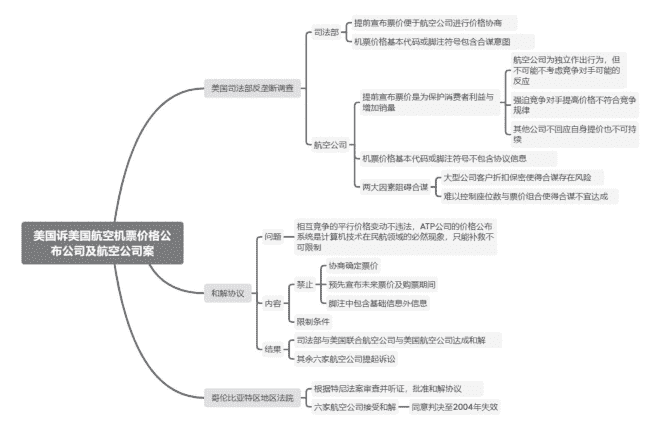

## 【核心争议点】

1.航空公司是否借助 ATP 公司机票价格信息分发系统进行了价格合谋.

2.司法部在和解协议中是否应当限制航空公司使用脚注及 ATP 公司机票价格信息分发系统，以及有无弥补竞争损害的补救措施.

## 【裁判论证过程】

### （一）ATP 公司机票价格信息分发系统有助于航空公司进行合谋，但是没有直接证据证明航空公司之间存在价格合谋

司法部认为，脚注中包含新票价的生效与终止日期.航空公司可以借助 ATP 公司机票价格信息分发系统交换这些脚注及信息，达成价格合谋.

司法部认为，这些航空公司借助 ATP 公司机票价格信息分发系统通过脚注就定价问题进行合谋，交换策略，达成垄断协议.司法部指出，根据其调查发现，如果一家航空公司率先宣布一条航线的机票价格会在未来几周后的某日上涨，那么其他航空公司也将宣布同一航线上的机票价格会在同一日上涨，尽管提价的程度不同.如果有哪家航空公司没有宣布其将同其他公司一样提价，那么通常所有的航空公司最终不会提价.这种情况发生了很多次.司法部认为航空公司借助计算机系统，通过脚注进行“低沟通成本的协商（cheap talk）”，以便达成价格合谋.

除此之外，司法部认为，航空公司通过脚注还可以协商不同航线上的机票价格.比如，航空公司 A1 与 A2 都在城市 1 至城市 2 这条航线上经营，其中 A1 的飞机是直飞，而 A2 的飞机需要经停.A1 与 A2 还在城市 3 至城市 4 这条航线上经营，但是此时，A1 的飞机需要经停，而 A2 的飞机是直飞.一般来讲，需要经停的飞机的机票较为便宜.假如 A1 想要在城市 1 至城市 2 这条线路上获得更多利润，它会提高自己在城市 3 至城市 4 这条线路上的飞机机票价格，新价格与 A2 公司直飞的机票价格一致.一旦需要经停的飞机的机票价格与直飞的机票价格相同，那么按照常理，消费者肯定都会选择直飞.此时，相当于 A1 向 A2 传递了一个信号，希望通过让渡自己在城市 3 至城市 4 这条航线上的利润，让 A2 保障 A1 在城市 1 至城市 2 这条航线上获得更多利润.假如 A2 同意，那么 A2 就会提高自己在城市 1 至城市 2 这条航线上的机票价格，新价格与 A1 公司直飞的机票价格一致.这样，等于 A1 与 A2 公司达成了一个排除竞争的协议，互相让渡自己在需要经停的航线上的利润，来换取直飞航线上的更多利润.而以上协商的过程，全部都可以通过脚注和 ATP 公司的机票价格信息分发系统完成.

但是，联邦最高法院曾在 Brooke Group Ltd. v. Brown & Williamson Tobacco Corp.案中表明，相互平行的提价行为不能证明经营者之间存在价格合谋.如果一个经营者提高价格，假如这个价格高于市场均衡价格，那么消费者就会转向其他经营者，而这个经营者的提价就没有任何意义，最终仍然需要回到均衡价格水平上.假如一个经营者提高价格，消费者并没有因此而转向，那么就说明现阶段的市场价格低于市场达到均衡时的价格.此时，所有经营者同时平行提价是很正常的，是出于市场竞争目的而做出的，不能认为他们之间存在合谋.因此，司法部需要举出更直接的证据证明航空公司之间已经达成了价格合谋，而不是只证明脚注有助于航空公司进行合谋.

### （二）司法部可以在和解协议中限制航空公司使用脚注及 ATP 公司的系统，但是和解协议必须符合《特尼法案》规定的公共利益原则

在哥伦比亚特区联邦地区法院审理本案之前，司法部与航空公司之间已经经过多轮谈判.司法部承认，现有证据只能合理推测航空公司间可能存在合谋，但不能直接证明其行为违法.即便司法部能够证明存在合谋而在法庭上获胜，司法部也应当同时提出弥补航空公司对竞争秩序造成损害的救济措施.然而，司法部认为，航空公司使用脚注和 ATP 公司机票价格信息分发系统是计算机技术在民航业运用的必然现象，很难予以禁止.因此，司法部决定与航空公司达成和解协议，对航空公司使用该系统设置限制条件，提高其利用系统达成价格合谋的成本.

根据《特尼法案》，像本案这样的政府反垄断调查假如要以和解协议的方式结案，必须经过联邦法院法庭的同意，以确保政府部门没有通过和个别被告达成某种协议而得到好处.根据《特尼法案》，联邦法院必须审查和解协议，倾听来自各利益方的观点，判断该和解协议是否符合法案规定的公共利益原则.

在哥伦比亚特区联邦地区法院审查和解协议的过程中，除了美国联合航空公司和美国航空公司，其余 6 家航空公司坚决反对签署和解协议.它们坚持主张没有证据证明它们利用 ATP 公司进行合谋.司法部认为，如果航空公司真的没有利用 ATP 公司进行合谋，那么就应当同意司法部在和解协议中设置限制条件，从而防止其进行价格合谋.这符合公共利益的要求.最后，司法部与 ATP 公司和 8 家航空公司均达成和解协议，并获得法院批准.

和解协议对 8 家航空公司的限制具体为：

1.禁止与其他航空公司达成协议以固定、提高或维持机票价格；

2.禁止公布任何新票价的生效或终止日期以及任何有关价格调整的计划，在大规模宣传的情况下除外；

3.在向 ATP 公司上传机票信息时设置的脚注指示符必须统一；

4.脚注指示符中的每个元素与信息必须一一对应，不得出现同一个信息用多个脚注指示符指代的情况；

5.脚注只能包含基础信息，如机票价格、航班信息、购买条件等.

同时，司法部同意以下情形不构成违反和解协议：

情形 1：某一周的周五的中午，航空公司 A 传输给 ATP 公司某些城市之间机票价格上涨 10%的信息.消费者可以通过 CRS 系统在周五下午 5 点以新票价进行订票.周六，航空公司 B 传输给 ATP 公司其将在相同城市之间将机票价格上涨 5%的信息.周日，当航空公司 A 获知其他航空公司并没有提供相同的涨价幅度，它便取消了机票价格上涨 10%的计划.然后，航空公司 B 也取消了机票价格上涨 5%的计划.下一周的周五，航空公司 A 又重新将相同城市之间的机票价格上涨 5%.周六，航空公司 B 也重新把相同城市间的机票价格提高 5%，之后，两家航空公司开始销售提价后的这些机票.

情形 2：航空公司 A 在一条对于航空公司 B 非常重要的航线上提供低价机票（如 101 美元）.航空公司 B 把这一航线上的价格也降到 101 美元，同时，航空公司 B 在一条对于航空公司 A 非常重要的航线上提供 101 美元的低价机票.次日，航空公司 B 取消了这两次 101 美元的机票价格变动.再次日，航空公司 A 也取消了它最初的 101 美元机票价格变动.

司法部声称，这些情形是市场上运营商的经济行为，并不完全用于传递运营商的未来机票价格变动信息，不会遭到禁止.

## 【审理结果】

司法部与航空公司达成和解协议，航空公司只能使用机票价格基础代码或脚注符号宣布航班的基本信息，不能通过特定的代码来串通不同的机票价格，除非在大规模宣传的情况下，航空公司不能提前宣布价格上涨.同时，司法部同意“不完全以宣布机票价格变动为目的”的市场行为不违反和解协议.

## 【相关法条】

美国《特尼法案》第 16 条（e）款（Antitrust Procedures and Penalties Act§16（e），15 U.S.C.§16（e）（2004））

（e）公共利益的确定

（1）在美国政府根据本节作出任何同意性判决之前，法院应确定作出该等判决符合公共利益.为作出此种裁定，法院应考虑：

（A）该判决的竞争性影响，包括终止被指控的侵权行为、关于执行和修改的规定、寻求补救的期限、实际考虑的替代补救办法的预期效果、其条款是否含糊不清，以及法院认为对决定同意判决是否符合公共利益所必需的任何其他与该判决的充分性有关的竞争性考虑；以及

（B）作出此种判决对相关市场竞争、对一般公众和声称因被诉侵权行为而遭受具体损害的个人的影响，包括对审判中问题的裁决所产生的公共利益（如果有的话）的考虑.

（2）本节的任何内容均不得解释为要求法院进行证据听证会或要求法院允许任何人进行干预.

## 【案例评析】

### （一）本案透露出司法部在追查价格合谋案件时的新思路

在以往司法部查处的价格合谋案件中，司法部都有较为明确的证据，比如经营者间的协议、沟通记录等可以证明经营者之间确实存在合谋.而 ATP 公司机票价格信息分发系统的应用，即快速实现信息沟通的计算机通讯技术的出现，模糊了合谋的概念.这让反垄断执法机构难以区分系统中分发的信息是为了向公众宣布，还是为了与竞争对手协商.由此，司法部在本案中并没有直接的证据表明航空公司间存在合谋.根据美国《谢尔曼法》，经营者间平行的价格变动并不构成固定价格类型的垄断协议，必须要有更直接的证据证明经营者间存在合谋.因此，司法部采取新的思路，即通过达成和解协议的方式提出相应的救济措施.如前所述，救济措施包括了对航空公司的行为限制，以及对 ATP 公司计算机系统的技术限制.和解协议的根本目的是通过增加航空公司之间达成价格合谋的成本，来代替法院做出的垄断行为违法的判决.

作为最早的算法合谋反垄断审查案例之一，ATP 案对之后的行政与司法审查具有重要的借鉴意义.^([\[12\]](#txt007.html#footnote_content_txt007_12))但本案仍然留有遗憾，由于本案并未进入审判阶段，因此没有设立关于算法合谋的裁判先例.

### （二）本案推动了对算法合谋的公众讨论，引发了反垄断领域对算法技术的关注

本案是最早的有关算法辅助经营者交换价格信息的案件之一.从司法部的主张来看，算法合谋案件中违法行为的认定与传统合谋案件并无明显差异.但是算法不仅能大幅降低经营者达成和实施合谋的成本，也进一步加大了执法机关发现合谋的难度.在传统市场竞争环境中，经营者单方面发出合谋信号的风险较大.若大部分竞争对手不接受或故意不回应，发出合谋信号的经营者便会因率先提高价格而承受消费者流失和利润减损的不利后果.但是算法存在于计算机空间内，具有隐蔽性，执法机关和消费者都不易察觉.参与合谋的经营者可以通过算法自动追踪竞争对手释放的信号，进行快速议价，从而降低甚至完全消除发布合谋信号的成本.

本案发生在 1992 年，经营者采用的算法技术相对简单.如今随着算法日益深入生活，合谋手段也更为多样隐蔽.经济合作与发展组织（OECD）于 2017 年发布的《算法与合谋：数字时代的竞争政策》报告将有利合谋实现的算法分为四类，即监督算法、平行算法、信号算法与自我学习算法.^([\[13\]](#txt007.html#footnote_content_txt007_13))算法不仅可以用来追踪市场信息，还能够将决策过程自动化、发出特定信号便于制定复杂决策.利用机器学习和深度学习技术，竞争者之间甚至不需要设置达成合谋的具体算法即可达成合谋的结果.^([\[14\]](#txt007.html#footnote_content_txt007_14))

斯坦福大学法学院与维也纳大学法学院合办的科技法论坛于 2021 年联合发布研究报告《美国与欧盟人工智能与反竞争合谋：从“意思联络”到“算法联络”？》^([\[15\]](#txt007.html#footnote_content_txt007_15))，该报告指出，算法在合谋中发挥两项作用，一是作为信息交流的工具，辅助经营者达成合谋；二是算法本身承载经营者反竞争的意思表示，通过自我学习、价格追踪、自我决策，自主达成合谋.算法合谋常见的形式是轴辐（Hub and Spoke）.想象一个轮胎，其中一个经营者作为轴心，算法就是轮毂，其促进或帮助处在轴辐的经营者达成合谋.美国与欧盟在规制算法合谋时面临的一个共性问题：如何发现和规制算法自主达成的合谋（发挥第二种作用的算法）.无论是美国还是欧盟，均认为垄断协议是违法的.换言之，只要经营者之间存在反竞争的合谋，根据经验这种行为一定会对市场产生反竞争的效果，因此不必再进行经济学的分析，可以直接认定其违法.但是，算法的使用既可以产生促进竞争的效果，也会有限制竞争的效果，目前无法根据经验做出准确的判断.^([\[16\]](#txt007.html#footnote_content_txt007_16))有学者指出要对此类垄断协议进行效果分析，不能直接认定其违法.^([\[17\]](#txt007.html#footnote_content_txt007_17))有学者认为不应当纠结于分析方法，而应当采用事前监管的方式测试现有算法对竞争的影响效果，以便为后续执法积累经验.^([\[18\]](#txt007.html#footnote_content_txt007_18))有学者主张制定黑名单，禁止经营者使用某种经过设计的算法.^([\[19\]](#txt007.html#footnote_content_txt007_19))还有学者提议对处在市场集中度较为分散（市场中没有寡头）并使用算法的经营者加征税收，因为算法对价格的自主监测一定会使市场价格超过市场均衡价格.^([\[20\]](#txt007.html#footnote_content_txt007_20))

算法技术作为数字经济兴起的必要支撑，有助于经营者对市场环境做出精准化的分析与决策，对用户进行个性化的市场营销，增强用户的黏性.然而，随着算法技术优势的不断突出，在位的经营者构建起较高的市场准入壁垒，导致潜在经营者无法吸引更多地用户从而与之竞争.由此，经营者在算法技术的赋能下不断巩固和加强自身的市场力量.各国监管者都在积极探索在市场经营中应用算法的竞争规则与规制方式.欧盟在 2020 年提出《数字市场法（草案）》（Digital Market Act），通过总结数字市场的执法经验，划定一部分借助数据、算法技术对市场有重大影响力的经营者为相应市场中的“守门人”，禁止或限制“守门人”的特定市场行为.法国竞争管理局宣布成立一个新的专业部门—数字经济部门（Digital Economy Unit），旨在加强执法人力资源，致力于监测和分析数字市场中经营者所采取的行为.^([\[21\]](#txt007.html#footnote_content_txt007_21))英国竞争与市场监管局（Competition and Market Authority）启动了“算法分析项目”，邀请学者和行业专家分析算法应用对特定市场的潜在影响.^([\[22\]](#txt007.html#footnote_content_txt007_22))美国国会众议院通过的《美国选择和在线创新法案》聚焦通过技术手段实施的滥用市场支配地位的行为.^([\[23\]](#txt007.html#footnote_content_txt007_23))

我国对算法合谋的规制也日渐深入、细致.2021 年 2 月 7 日，国务院反垄断委员会制定发布《关于平台经济领域的反垄断指南》（下称“《指南》”）.《指南》的出台充分体现了我国对反垄断领域算法合谋规制的高度重视，不仅保护了消费者权益，也维护了行业的健康发展.

### (三) 本案后续的一些最新进展

本案作为早期信息技术对反垄断领域的挑战的典型案例受到学界的持续关注.弗吉尼亚联邦大学教授 Amalia R. Miller 对本案和解协议的市场效果做了跟踪调查.该调查将市场分为受影响的市场（aff ected market），即该市场中被禁止和限制实施相关行为的航空公司较多，与不受影响的市场（control or unaff ected market），即市场中被禁止和限制实施相关行为的航空公司较少或者没有.该调查运用经验主义的分析模型，对比在施加禁止和限制条件前后，机票价格与数量的变化情况.该调查假设，如果禁止和限制条件对受影响的市场是有效的，则该市场上的机票价格应当下降，机票销售数量应当上升.根据数据显示，1994 年和解协议刚刚达成时，总的来说市场上的机票平均季度销售量有所上升，但是这有可能跟同时期的旅行人数增加有关.同时，在不受影响的市场中，机票销售量大幅增加；而在受影响的市场中，机票销售量却大幅下降.因此，销售量上升似乎不能归功于和解协议.在和解协议的整个效力区间（1994-2004 年）综合考察全部因素后发现，机票的销售量基本不变.可见，禁止和限制条件并没有持续产生促进竞争的效果.从机票价格数据也可得出相同的结论.因此，该调查表明，本案和解协议中设定的禁止和限制条件并没有产生很好的市场效果，并不是一个很好的救济措施.^([\[24\]](#txt007.html#footnote_content_txt007_24))

此外，佛罗里达州立大学经济学院的两位教授 Gary M. Fournier 和 Thomas W. Zuehlke 也对本案做了实证研究.因为本案中司法部提出一种可能，即航空公司可以通过算法互相协调两条不同航线之间的价格（见前文裁判论证过程），所以两位教授专门针对和解协议是否对不同航线间的价格协调起到限制作用做了实证研究.该研究取 1991 年至 2001 年这十年间每年的第二季度的数据为样本，以达成和解协议这一年（1994 年）为分界点，分为干预前（presettlement）与干预后（post-settlement）两个区间.研究表明，只有 1994 年这一年，和解协议对不同航线间的价格协调起到很好的限制作用.在 1994 年至 2001 年这段区间内，不同航线间的价格协调效果与和解协议达成之前的效果无异.从整个 10 年内平均来看，不同航线间的价格协调效果愈发明显.因此，可以说，本案和解协议中设定的禁止与限制条件并没有产生很好的市场效果.^([\[25\]](#txt007.html#footnote_content_txt007_25))

在和解协议失效的两年后（即 2016 年），41 家旅行社对三家航空公司和 ATP 公司提起集体诉讼，再次主张这三家总共占据 70%的市场份额的寡头航空公司利用 ATP 公司的机票价格信息分发系统达成固定价格类型的垄断协议.而加州北区联邦地区法院在审查时指出，审查固定价格类型的垄断协议的关键在于证明经营者间存在合谋.在以往的案件中，证明合谋往往需要证明经营者明确就价格事宜进行了沟通.原告除了举出被告存在平行的提价行为外，没有任何其他直接证据证明三个公司就价格事宜交换了意见.

### 【关联判例推荐】

1\. Brooke Group Ltd.v. Brown & Williamson Tobacco Corp., 509 U.S. 209, 113 S.Ct. 2578 (1993)

核心事实：卷烟制造业作为一个垄断行业，由包括原被告双方在内的六家公司主导.原告利格特（Liggett）提起诉讼，指控被告向批发商提供的回扣相当于价格歧视，有损害竞争的可能性，违反了《罗宾逊—帕特曼法》（Robinson-Patman Act）.原告声称，回扣是掠夺性定价计划的一部分，被告定价低于成本，迫使原告提高仿制品的标价，从而抑制其市场份额的增长，并保持被告在品牌香烟上的超高利润.在陪审团作出有利于原告的裁决后，地区法院认为，由于市场份额增长没有放缓，各制造商也没有默契地协调价格，因此竞争不会受到损害.美国第四巡回上诉法院裁定维持原判，该法院认为在没有合谋的情形下，平行定价（parallel pricing）会发生在竞争或者寡头垄断市场中，而在掠夺性定价环境中，市场垄断者之间有意识的平行定价行为不会损害竞争.

与本案关联点：航空公司使用 ATP 公司的机票价格信息分发系统宣布变动价格属于平行定价行为，在没有其他证据的情况下，不能推断为存在合谋.

### 【注释】

[\[1\]](#txt007.html#footnote_quote_txt007_1)SACL Has Rendered a Decision in the Travel Agencies’ Case， Lithuanian Courts （May 2， 2016），https：//www.lvat.lt/en/news/sacl-has-rendered-a-decision-in-the-travel-agencies-case/390.

[\[2\]](#txt007.html#footnote_quote_txt007_2)Council Regulation （EC） No 1/2003 of 16 December 2002 on the implementation of the rules on competition laid down in Articles 81 and 82 of the Treaty §2. 需要说明的是，欧盟于 2012 年 10 月 26 日颁布了《〈欧盟条约〉和〈欧盟运行条约〉综合文本》（Consolidated versions of the Treaty on European Union and the Treaty on the Functioning of the European Union， 2012/C 326/01），其中《欧盟运行条约》第 81 条和第 82 条分别重新编为第 101 条和第 102 条.

[\[3\]](#txt007.html#footnote_quote_txt007_3)Practical Law Competition， Speech by Margrethe Vestager on Algorithms and Competition， Practical Law （Mar. 16， 2017）， https：//uk.practicallaw.thomsonreuters.com/w-006-9643？contextData=（sc.Defa ult）&transitionType=Default&fi rstPage=true.

[\[4\]](#txt007.html#footnote_quote_txt007_4)OECD， Algorithms and Collusion： Competition Policy in the Digital Age， OECD （Sept. 13， 2017），www.oecd.org/competition/algorithms-collusion-competition-policy-in-the-digital-age.htm.

[\[5\]](#txt007.html#footnote_quote_txt007_5)OECD， Prosecuting Cartels without Direct Evidence （2006）， 9 OECD Journal of Competition Law and Policy 49， 49-105， https：//doi.org/10.1787/clp-v9-art11-en.

[\[6\]](#txt007.html#footnote_quote_txt007_6)江山：《反垄断法上协同行为的规范认定》，载《法商研究》2021 年第 5 期，第 187 页.

[\[7\]](#txt007.html#footnote_quote_txt007_7)Andreas Heinemann & Aleksandra Gebicka， Can Computers Form Cartels？ About the Need for European Institutions to Revise the Concertation Doctrine in the Information Age， 7 Journal of European Competition Law & Practice 431， 434-435 （2016）.

[\[8\]](#txt007.html#footnote_quote_txt007_8)OECD， Algorithms and Collusion： Competition Policy in the Digital Age， OECD （Sept. 13， 2017），www.oecd.org/competition/algorithms-collusion-competition-policy-in-the-digital-age.htm.

[\[9\]](#txt007.html#footnote_quote_txt007_9)八家航空公司分别是：Alaska Airline， American Airline， Continental Airline， Delta Airline，Northwest Airline， Trans World Airline， United Airline 和 US Airways Airline.

[\[10\]](#txt007.html#footnote_quote_txt007_10)由于本案以和解协议形式结案，案件的背景与过程细节并未体现在判决当中.本案的背景与过程细节来自就本案向司法部提供专家咨询的 Severin Borenstein 教授撰写的案例评析.See Severin Borenstein， Rapid Price Communication and Coordination： The Airline Tariff Publishing Case （1994）， https：//global.oup.com/us/companion.websites/fdscontent/uscompanion/us/pdf/kwoka/9780195322972\_09.pdf.

[\[11\]](#txt007.html#footnote_quote_txt007_11)Brooke Group Ltd. v. Brown & Williamson Tobacco Corp.， 509 U.S. 209， 113 S.Ct. 2578 （1993）.

[\[12\]](#txt007.html#footnote_quote_txt007_12)Severin Borenstein， Rapid Price Communication and Coordination： The Airline Tariff Publishing Case （1994）， https：//global.oup.com/us/companion.websites/fdscontent/uscompanion/us/pdf/kwoka/9780195322972\_09.pdf.

[\[13\]](#txt007.html#footnote_quote_txt007_13)OECD， Algorithms and Collusion： Competition Policy in the Digital Age， OECD （Sept. 13， 2017），www.oecd.org/competition/algorithms-collusion-competition-policy-in-the-digital-age.htm.

[\[14\]](#txt007.html#footnote_quote_txt007_14)韩伟：《算法合谋反垄断初探—OECD〈算法与合谋〉报告介评（上）》，载《竞争政策研究》2017 年第 5 期.

[\[15\]](#txt007.html#footnote_quote_txt007_15)Giuseppe Colangelo， Artifi cial Intelligence and Anticompetitive Collusion in EU and the U.S.： From the‘Meeting of Minds’ towards the ‘Meeting of Algorithms’？， Stanford-Vienna TTLF Working Paper No. 74（May 27， 2021）， https：//www-cdn.law.stanford.edu/wp-content/uploads/2021/02/colangelo\_wp74.pdf.

[\[16\]](#txt007.html#footnote_quote_txt007_16)Giuseppe Colangelo， Artifi cial Intelligence and Anticompetitive Collusion in EU and the U.S.： From the ‘Meeting of Minds’ towards the ‘Meeting of Algorithms’？， Stanford-Vienna TTLF Working Paper No.74 （May 27， 2021）， https：//www-cdn.law.stanford.edu/wp-content/uploads/2021/02/colangelo\_wp74.pdf.

[\[17\]](#txt007.html#footnote_quote_txt007_17)Stefan Thomas， Harmful Signals： Cartel Prohibition and Oligopoly Theory in the Age of Machine Learning， 15 Journal of Competition Law and Economics 159， 159-203 （2019）.

[\[18\]](#txt007.html#footnote_quote_txt007_18)Ariel Ezrachi & Maurice Stucke， Virtual Competition： The Promise and Perils of the Algorithm-Driven Economy， Harvard University Press， 2016.

[\[19\]](#txt007.html#footnote_quote_txt007_19)Joseph E. Harrington，《由自主定价代理人串谋而发展的竞争法》，14 Journal of Competition Law and Economics 331，331-412（2018）.

[\[20\]](#txt007.html#footnote_quote_txt007_20)GUAN Zheng & HONH Wu，《串谋算法作为单纯工具、超级工具或法律主体》，15 Journal of Competition Law and Economics 123，123-158（2019）.

[\[21\]](#txt007.html#footnote_quote_txt007_21)竞争管理局宣布其 2020 年优先事项，Autorité de la Concurrence（2020 年 1 月 9 日），https：//www.autoritedelaconcurrence.fr/en/press-release/autorite-de-la-concurrenceannounces-its-priorities-2020。另见 Giuseppe Colangelo，《欧盟和美国人工智能与反竞争串谋：从“思想汇聚”到“算法汇聚”？》，Stanford-Vienna TTLF Working Paper No. 74（2021 年 5 月 27 日），https：//www-cdn.law.stanford.edu/wp-content/uploads/2021/02/colangelo\_wp74.pdf.

[\[22\]](#txt007.html#footnote_quote_txt007_22)英国竞争与市场管理局，《定价算法》，GOV.UK（2018 年 10 月 8 日），https：//www.gov.uk/government/publications/pricing-algorithms-research-collusion-and-personalised-pricing.

[\[23\]](#txt007.html#footnote_quote_txt007_23)江山：《美国数字市场反垄断监管的方法与观念反思》，载《国际经济评论》2021 年第 6 期，第 43 页.

[\[24\]](#txt007.html#footnote_quote_txt007_24)Amalia R. Miller，《航空票价公布案件是否减少了串谋》，53 Journal of Law &Economics 569，569-586（2010）.

[\[25\]](#txt007.html#footnote_quote_txt007_25)Gary M. Fournier & Thomas W. Zuehlke，《多市场接触与航空票价公布公司反垄断和解（1994）》，https：//myweb.fsu.edu/tzuehlke/papers/reciprocal.pdf.

# 第八章 零工经济领域前沿判例

## 8.1 戴纳梅克斯公司诉洛杉矶高等法院案

### 【案件索引】
Lee v. Dynamex, Inc., 2016 WL 6064271 (2006)
Lee v. Dynamex, Inc., 166 Cal. App. 4th 1325 (Cal. Ct. App. 2008)
Dynamex Operations West, Inc. v. Superior Court, 230 Cal. App. 4th 718 (2014)
Dynamex Operations West, Inc. v. Superior Court, 4 Cal.5th 903 (2018)

### 【关键词】
零工经济；ABC 测试；博雷洛测试；《AB 5 法案》；劳动关系认定

### 【案件提要】
本案是零工经济（Gig Economy）中关于独立承包人（independent contractor）和雇员（employee）错误分类的经典案件.在查尔斯·李诉戴纳梅克斯公司案中，原告查尔斯·李（Charles Lee，下称“李”）对一家全国性的包裹文件快递公司即被告戴纳梅克斯公司（Dynamex Operations West， Inc.，下称“戴纳梅克斯公司”）提起诉讼，指控戴纳梅克斯公司将自己及与自己处境类似的工人错误划分为独立承包人，违反了加州工业关系部（California Department Of Industrial Relations）颁布的《工业福利委员会（IWC）关于运输业的第 9 号加州工资令》（The Industrial Welfare Commission（IWC）Wage Order #9 Transportation Industry，下称“加州工资令”）^([\[1\]](#txt008.html#footnote_content_txt008_1))、《商业和职业法》（Bussiness and Professions Code）以及《劳工法》（Labor Code）.在确定工人应该被归类为雇员还是独立承包人时，加州工资令明确规定了与加州雇员的最低工资、最长工作时间和有限的基本工作条件（如对吃饭和休息时间的最低要求）有关的义务.

李希望通过集体诉讼的方式来进行诉讼，因此提出了集体诉讼认证申请.洛杉矶高等法院最初否决了李的申请，加州上诉法院随后推翻原判决，并发回重审.洛杉矶高等法院在撤销了其做出的原判决后，于 2011 年同意了李的集体诉讼认证申请.但在接下来的两年中，戴纳梅克斯公司两次申请取消该认证，均被驳回.当第二次申请被驳回时，戴纳梅克斯公司向加州上诉法院递交了授权令申请，对洛杉矶高等法院拒绝取消该集体诉讼认证提出质疑，辩称洛杉矶高等法院在确认司机的集体诉讼成员身份时，没有采用适当的标准.根据戴纳梅克斯公司的说法，本案应当适用普通法下的博雷洛测试（Borello Test，又称为“控制权测试”），但法院却不当采用了马丁内斯（Martinez）案^([\[2\]](#txt008.html#footnote_content_txt008_2))对加州工资令中“雇员”所作的替代定义标准（下称“马丁内斯标准”），故而必须取消该集体诉讼认证.而加州上诉法院认为，在决定案件是否能适用加州工资令进行索赔时，应当依赖加州工资令中所规定的雇用关系的替代定义对雇员和独立承包人进行区分，洛杉矶高等法院同意原告的集体诉讼认证申请合法有据，因此驳回了与这些索赔有关的令状请求.戴纳梅克斯公司再次提起上诉，加州最高法院在适用加州工资令的“雇佣”替代定义的基础上，采用 ABC 测试^([\[3\]](#txt008.html#footnote_content_txt008_3))对该标准下的雇员范围进行进一步的限缩，根据测试结果最终确认了上诉法院做出的判决.

加州最高法院在戴纳梅克斯公司诉高等法院案的判决中详细论述了与本案相关的加州司法裁决，并根据加州法律对马丁内斯标准即“容受或准许工作”标准的目的进行了历史审查，同时梳理了加州工人分类测试的发展历程，因此本案对于全面了解加州工人分类的相关判例及法律具有重要意义.此外，本案中加州法院在没有预先存在的州立法或判例法的情况下，采用了 ABC 测试区分本案原告是雇员和独立承包人，开拓了先河，对加州工人分类的司法实践具有里程碑意义.^([\[4\]](#txt008.html#footnote_content_txt008_4))此后，加州州长签署了《加州议会第 5 号法案》（Assembly Bill No. 5，下称“《AB 5 法案》”），将本案的决定编撰成为法律，使得 ABC 测试在加州取代了普通法下的博雷洛测试，成为加州区分独立承包人和雇员的法定方式.

近年来，我国的零工经济发展迅速，以与本案相同或类似的方式提供劳务的人员在 2020 年已达到 8400 万.^([\[5\]](#txt008.html#footnote_content_txt008_5))然而，截至目前，我国对于互联网平台公司与劳务提供方之间的关系认定问题还未出台专门的规范性文件，法院只能依赖现有的劳动法做出判决，这导致司法实践中对于此类关系的认定存在分歧.^([\[6\]](#txt008.html#footnote_content_txt008_6))因此，本案对于理解零工经济下如何区分独立承包人和雇员具有重要帮助，对于我国应如何制定相关立法也有所启示.

### 【案件要旨】
洛杉矶高等法院（初审法院）：原告 查尔斯·李 被告 戴纳梅克斯公司
加州上诉法院（上诉法院）：上诉人 查尔斯·李 被上诉人 戴纳梅克斯公司
加州上诉法院（上诉法院）：上诉人 戴纳梅克斯公司 被上诉人 洛杉矶高等法院
加州最高法院（二审法院）：上诉人 戴纳梅克斯公司 被上诉人 洛杉矶高等法院

戴纳梅克斯公司是一家全国性的快递服务公司.在 2004 年之前，戴纳梅克斯公司将其加州司机归为雇员，并根据该州的工资和工时法对司机进行补偿.之后，出于公司的财务安排考虑，戴纳梅克斯公司将其所有司机归为独立承包人.

2005 年 1 月，李与戴纳梅克斯公司签订书面独立承包人协议，为戴纳梅克斯公司提供送货服务.根据戴纳梅克斯公司的说法，李为戴纳梅克斯公司执行了总共 15 天的按需（on-demand）送货服务，并且从未为戴纳梅克斯公司以外的任何公司执行送货服务.2005 年 4 月 15 日，在离开戴纳梅克斯公司三个月后，李作为唯一的集体诉讼代表，代表自己和具有类似情形的戴纳梅克斯公司司机提起了诉讼，质疑戴纳梅克斯公司将其所有司机划分为独立承包人的合法性.

在提起诉讼后不久，李与戴纳梅克斯公司就集体诉讼认证的申请发生争议.加州上诉法院认为，洛杉矶高等法院允许原告依据马丁内斯标准处理属于加州工资令范围的索赔，该做法是正确的.只有在处理不属于加州工资令范围的索赔时，普通法下的博雷洛测试标准才更具适当性.

戴纳梅克斯公司向加州最高法院提出复审申请，对上诉法院的结论提出质疑，认为：（1）马丁内斯标准只能用于共同雇佣的情形；（2）马丁内斯标准会导致雇员范围的不当扩大.对此，加州最高法院认为，马丁内斯标准不是如此有限的标准，其对于工人分类问题的适用并不受限于共同雇佣.与此同时，虽然马丁内斯标准中的“容受或准许工作”标准的确宽泛，但这符合加州工资令扩大对雇员的保护的立法目的.随后，为了确保正确分类，法院运用了 ABC 测试进行进一步验证，最终维持了原判决.

### 【案例事实思维导图】
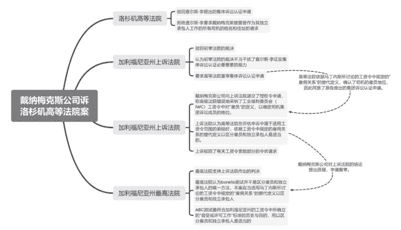

### 【核心争议点】
1.马丁内斯标准是否能够普遍适用于雇员分类问题.
2\. ABC 测试与博雷洛测试何者更适用于区分雇员与独立承包人.
3.根据 ABC 测试，戴纳梅克斯公司的司机是否为该公司的雇员.

### 【裁判论证过程】

#### （一）马丁内斯标准能够普遍适用于雇员分类问题

1.马丁内斯标准
2010 年，加州最高法院在马丁内斯案中认为，根据工业福利委员会的定义，对于雇佣关系的解释可以采取三种替代定义，即（a）对工资、工时或工作条件实行控制，或（b）容受或准许工作，或（c）聘请，从而建立普通法雇佣关系.这是加州最高法院在审查加州工资令中关于“雇佣”和“雇主”的定义后做出的裁决.在本案中，尽管马丁内斯标准没有直接解决有关工人是雇员还是独立承包人的问题，但它的作用在于解释了加州工资令中使用的术语“雇佣”的含义.

2.马丁内斯标准可适用于共同雇佣以外的情形
马丁内斯案的核心争议与共同雇佣有关，即当工人是主要雇主的准雇员时，与主要雇主有某种关系的其他企业或实体是否应适当地被视为该工人的共同雇主，以及是否应当与主要雇主一起负责加州工资令规定的义务.戴纳梅克斯公司认为，马丁内斯案判决所确定的三个替代定义中的前两个定义，即雇主（a）对工资、工时或工作条件实行控制以及（b）容受或准许工作，只能用于申请确认共同雇主的情形.而本案中并不存在其他潜在的雇主，所以，马丁内斯标准并不适用于本案.

对此，加州最高法院指出，加州工资令的文本中没有任何一条说明该标准适用范围如此有限.概括而言，马丁内斯案与本案都要确认工人与相关公司是否成立雇佣关系，无需因为缺乏先例的支持，便非得将成立雇佣关系问题和成立联合雇佣关系问题进行强行区分.此外，法院在马丁内斯案中讨论“容受或准许工作”这一措辞的来源和历史时发现，在 1916 年加州工资令最初采用“容受或准许工作”这一用词时，该用词“已经出现在全国范围内的规制和禁止童工（有时是妇女）的法规中”，这非常清楚地表明，这一标准可以适用于共同雇佣之外的情形.

3.马丁内斯标准中的“容受或准许工作”标准可适用于雇员与独立承包人的分类问题
戴纳梅克斯公司认为，即使“容受或准许工作”这一标准可以在共同雇佣之外的情形适用，即马丁内斯案所引用的早期童工案的情形，但并不能因此认为该标准也能适用于检验工人是雇员还是独立承包人的问题.其主要依据是，尽管一个多世纪以来加州工资令中一直使用“容受或准许工作”这一术语，但自 1989 年博雷洛案^([\[7\]](#txt008.html#footnote_content_txt008_7))判决颁布后，加州的判决绝大多数采用了博雷洛测试来区分雇员和独立承包人，包括因为加州工资令产生的案件.因此，马丁内斯案的判决没有改变一直以来都是使用博雷洛测试来进行检验的做法.戴纳梅克斯公司认为，更重要的是“容受或准许工作”标准太过宽泛.根据该标准的字面意义，所有直接向企业提供服务的个体工作者都将被认定为企业雇员.因为，企业雇用个体工作者向其提供服务时，往往就代表企业是有意“容受或准许”个体工作者为其工作.即使企业雇佣的是水管工、电工、建筑师、独立执业律师等（这些都毫无疑问是独立工作者）—他们只是偶尔为企业提供与企业主营业务无关的服务，但如果从字面上应用“容受或准许工作”标准，他们也将被认为是公司雇员.这会导致雇员范围的不当扩大.

但加州最高法院认为，马丁内斯案中的相关段落清楚地表明，在确认工人是雇员还是独立承包人的问题上，法院并没有将博雷洛测试认定为唯一适用的标准.同时法院承认，“容受或准许工作”标准的字面表达本身并不能解决工人是否被正确地视为受保护的雇员的问题，但该标准对于确定争议工人是否为加州工资令下的雇员仍具有重大意义.概言之，就加州工资令规定的义务而言，“容受或准许工作”的标准在评估工人类别方面是相关且重要的，该标准有助于确定谁应被适当地视为受保护的雇员，而不是被排除在外的独立承包人.

“容受或准许工作”标准的确是宽泛的.作为《公平劳动标准法案》（Fair Labor Standards Act， FLSA 系主要的联邦工资和工时立法）的一部分，立法者提出并通过了容受或工作许可标准.其立法者之一，即当时的参议员（后来的美国最高法院大法官）雨果·L·布莱克（Hugo L. Black）将这一标准描述为“最广泛的定义”，旨在将法律或法规的覆盖范围扩大到合理的、属于社会福利法规范围的、最广泛的工人类别.

法院认为，加州工资令是一种补救立法的更一般的原则，必须以服务于其补救目的的方式进行自由解释.加州的工资和工时法规和加州工资令之所以采用这一特别宽泛的标准，原因在于个体工人通常比雇佣企业拥有更少的议价能力，并且工人为了家庭生存而赚取收入的基本需求可能导致其接受低于标准工资的工作或工作环境，而加州工资令设置这一定义的基本目标是保护工人的健康和福利，确保这些工人能够获得最低工资和工作条件，使其能够维持生计.鉴于历史所反映的“容受或准许工作”标准的预期广泛范围，以及加州工资令是补救立法一种，虽然在马丁内斯案之前，没有案件讨论过“容受或准许工作”的具体定义与范围，但法院仍需尊重工业福利委员会的立法权利，在本案中采用该替代定义.同时，法院也有义务对“容受或准许工作”的标准进行解释和广泛适用，因为只有这样才能使所有应被视为“雇员”却在一定标准下被视为在企业中工作的独立承包人的工人，被正确地涵盖于“雇员”的类别之内.

#### （二）ABC 测试更适用于区分雇员和独立承包人
如上文所提及，“容受或准许工作”标准在《劳工法》中也有所规定.联邦法院在适用该标准时表示，相较于之前存在的博雷洛测试，“容受或准许工作”标准旨在更加广泛同时也更具有包容性地区分雇员与独立承包人，让应当被归类为雇员的工人得到应得的保护.但为了防止标准过于宽泛导致独立承包人被归类为雇员，联邦法院制定了经济现实测试，以对工人进行更加细致的测试划分.各地方的立法、行政条例和法院裁决也采用了若干更加详细的标准来对工人进行区分，广泛使用的有博雷洛测试、ABC 测试等.

1.博雷洛测试标准
博雷洛测试系加州最高法院在先例中确立的判断劳动关系的标准，一共包括 10 项考察要素，涵盖劳动关系在各个方面的可能表现.但这些要素中没有一项对判断劳动关系有决定性作用，法官必须在个案中分别评估和衡量.这些要素包括：（1）接受服务的人是否有权控制完成预期结果的方式和方法；（2）无理由随意退出的权利；（3）提供服务的人是否从事与委托人不同的职业或业务；（4）参考当地情况，该类业务通常是在委托人指挥下进行还是由专业人员独立完成；（5）是否需要特定技能；（6）委托人或工人是否为从事该工作的人提供劳动工具和场所；（7）提供服务的时间长度；（8）支付报酬的方式是依时间还是工作量；（9）该工作是否构成委托人常规业务的组成部分；（10）双方当事人是否认为缔结了劳动关系.

2\. ABC 测试标准
ABC 测试标准系本案中加州最高法院所使用的标准.在此标准下，工人均被视为雇员，只有在雇佣实体确定工人同时满足以下三个条件时，才可将工人认定为独立承包人：（A）工人所从事的工作不受雇主的控制和指导；（B）工人从事的工作超出了雇佣实体的正常业务范围；（C）工人独立地从事既定业务，而不是简单地为公司工作.

3.二者中 ABC 测试更适用于区分雇员与独立承包人

正如戴纳梅克斯公司所指出的那样，初审法院在其集体诉讼认证令中适用“容受或准许工作”标准时，对其采取了字面解释，如果直接适用这种解释方式将使得许多传统的独立承包人（如独立水管工或电工）被不合理地视为企业雇员.因此，加州最高法院认为，虽然本案情形符合“容受或准许工作”标准，但仍须通过其他相关测试进行进一步区分雇员与独立承包人.

戴纳梅克斯公司提出应当适用博雷洛测试.加州最高法院认为，博雷洛测试虽然确实被广泛地运用于许多司法辖区，以区分工人是雇员还是独立承包人，但应当注意的是，其存在难以忽视的缺陷.首先，博雷洛测试是一种多因素标准，且没有一个因素可以对测试结果产生决定性的影响.标准的复杂性和结果的不确定性，直接导致了在实践中博雷洛测试缺乏一个容易且统一适用的标准.拟招聘与应聘的企业与工人难以事先确定特定类别工人的分类结果，对与工资和工作条件有关的日常问题也难以达成统一意见，只能在雇员或独立承包人离开后，对争议提起诉讼再由司法裁决确定.其次，使用多因素标准还可能会为雇佣企业提供“暗箱操作”的余地.即，雇佣企业可以通过改变个体工人的工作条件等影响因素，使得测试结果将工人归类为独立承包人，从而逃避其在工资和工时法下的基本责任.

相较于博雷洛测试，ABC 测试在初始条件下默认工人为雇员，仅在同时满足三项条件后才能将其归类为独立承包人的测试形式，使得每一要素对于分类结果都具有绝对性的影响，为企业与员工在事前正确对特定工种进行分类提供了清晰且一致的标准.与此同时，ABC 测试简洁且难以通过其他手段对其产生影响的特点，也极大减少了雇主操纵最终分类结果的可能.

此外，加州最高法院认为，相比于其他测试，ABC 测试最符合加州工资令中“容受或准许工作”标准的历史和目的，具体而言：在普通法标准下，博雷洛测试依照企业对员工实施的控制类型和程度进行判断，只有对员工的工作方式与细节进行精准控制的企业才会被认定为雇主，但事实上由于用工类型的不同，有的雇主只需对雇员保持必要的控制即可.而在 ABC 测试下，对于标准 A 而言，雇佣实体必须证明工人不受此类必要控制.对于标准 B 而言，需要判断工人所做的工作本质上是否符合雇员的通常工作内容与方式.标准 B 能够防止企业之间产生“逐底竞争”，故意将为其业务工作的工人分类为独立承包人以减少用工成本；同时该标准可以避免将管道工这类典型的的独立承包人划分为雇员，从而精确适用“容受或准许工作”标准.对于标准 C 而言，独立承包人通常会采取一定的措施来建立和发展其独立业务—例如，通过注册、获得执照、发放广告、向公众或许多潜在客户提供独立服务或产品等.标准 C 预防了在工人尚未独立决定建立和开展独立业务时，却被雇佣实体单方面地指定为独立承包人的情形，从而防止雇佣实体通过错误分类来逃避雇主责任.

总的来说，ABC 测试具有简单且便于事前判断的优点，将被错误归类为独立承包人的雇员的纳入其保护范围，更加符合加州工资令中“容受或准许工作”标准的历史与目的，故而法院最终选择适用 ABC 测试.

### (三) ABC 测试下戴纳梅克斯公司的司机系该公司的雇员

在认定初审法院对“容受或准许工作”标准的解释过于宽泛后，加州最高法院采用了 ABC 测试对戴纳梅克斯公司的司机进行进一步检验，并基于两点独立理由，最终认定其为该公司的雇员.

首先，根据 ABC 测试的标准 B，戴纳梅克斯公司的送货司机的工作并未超出该公司通常的业务范围.具体而言，在其他类型的业务中，产品的交付可能并不会被视为公司业务的通常内容.但作为一家运输公司，戴纳梅克斯公司的全部业务就是提供送货服务.由此可知，戴纳梅克斯公司的签约司机所进行的持续从该公司客户处收发快递的工作，显然是戴纳梅克斯公司业务的通常内容.同时，由于 ABC 测试的每个部分都可以独立地决定工人分类的结果，因此法院认定，上述理由已经足够证明戴纳梅克斯公司的司机是其雇员.

其次，根据 ABC 测试的标准 C，戴纳梅克斯公司的送货司机并没有从事独立的送货业务.本案中，初审法院认证的司机集体仅限于在争议时间段内仅为戴纳梅克斯公司提供送货服务的司机，并不包括为其他公司或司机的个人客户提供送货服务的司机，同时也排除了拥有自己员工的司机.因此，相关送货司机的全部业务均来自戴纳梅克斯公司，其进行的运输活动也均依靠该公司指派，而没有其他独立的业务来源，故而不能将其认定为能够独立从事运输业务的司机.因此法院认定，该类司机不符合 ABC 测试中标准 C 的要求.

综上所述，加州最高法院最终确认了上诉法院的判决，认定在 ABC 测试下，戴纳梅克斯公司的司机为该公司雇员，对本案具有共同的诉讼利益，因此审判法院做出的集体诉讼认证令合法有效.

## 审理结果

1.洛杉矶高等法院驳回了李的集体诉讼认证申请.

2.加利福尼亚州上诉法院推翻了初审法院的判决.

3.加利福尼亚州上诉法院驳回了有关加州工资令索赔部分的令状请求.

4.加利福尼亚州最高法院于 2018 年 4 月 30 日确认了上诉法院的判决.

## 相关法条

加利福尼亚州《工业福利委员会（IWC）关于运输业的第 9 号加州工资令》节选（The Industrial Welfare Commission（IWC）Wage Order #9 Transportation Industry，8 California Code of Regulations§11090）

第 1 条 本令的适用范围

本令适用于运输行业的所有雇员，无论是按时间、计件、佣金或其他方式支付，但以下情况除外：

（A）本令第 3 条至第 12 条的规定不适用于行政人员、主管人员或专业人员.应适用以下标准确定雇员的职责是否符合该豁免条件：……

第 2 条 定义

（E）“雇用”是指委聘、容受或准许工作.

（F）“雇员”是指任何受雇于雇主的人员.

（G）“雇主”是指《劳工法》第 18 条所定义的任何人，直接或间接（通过代理人或任何其他人）地雇用或控制任何人的工资、工时或工作条件.

## 案例评析

### (一) 本案标志着加州关于工人分类的判例的转变

正如前文所述，自 1989 年博雷洛测试标准确立以来，加州法院在任何情况下都适用博雷洛测试来区分雇员和独立确立承包人，这其中也包括根据加州工资令产生的案例.但随着社会的发展变化，普通法下的博雷洛测试已经不能正确发挥作用.^([\[8\]](#txt008.html#footnote_content_txt008_8))在奥康纳诉优步案中，法官表示，博雷洛测试中的许多因素已经显得过时了，并且未能涵盖那些可能反映了当前的经济现实的因素（例如，各当事方产生和共享的收入比例、相对议价能力以及各方可以选择的范围）.^([\[9\]](#txt008.html#footnote_content_txt008_9))正因如此，在本案中，加州最高法院没有采用普通法下的博雷洛测试，反而质疑了其分析方法在戴纳梅克斯公司情况下是否仍有帮助，同时还在没有先前立法以及在先判例的情况下，采用了 ABC 测试标准.^([\[10\]](#txt008.html#footnote_content_txt008_10))这标志着加州关于工人分类的判例的转变.同时，这也意味着加州最高法院通过本案实现了普通法原则的现代化，^([\[11\]](#txt008.html#footnote_content_txt008_11))摆脱了过时的普通法原则，以更好地应对社会变化，处理新出现的社会问题.

### (二) 推动了加州进行相关立法

正如本案判决中所指出的，像博雷洛测试这样的包含多个因素的标准，需要根据具体情况，在个案及整体情况的基础上，考虑不同就业安排中所有潜在的相关事实才能对雇员和独立承包人加以区别，这使得雇佣企业和工人都难以事先确定某一类工人如何分类.这不仅增加了企业的合规成本，还导致了工人维权难等问题.^([\[12\]](#txt008.html#footnote_content_txt008_12))因此，加州最高法院对本案做出判决后，本案判决的支持者迅速采取行动，将本案的判决内容编纂成法律.2019 年 9 月 18 日，《AB 5 法案》签署成为法律.但值得注意的是，《AB 5 法案》在《劳工法》中增加了相关章节，扩大了 ABC 测试的适用范围.^([\[13\]](#txt008.html#footnote_content_txt008_13))原本 ABC 测试在本案判决中仅解决加州工资令下的雇员和独立承包人区分问题，但现在《AB 5 法案》已经将 ABC 测试的适用扩大至整个劳工、失业和工人补偿.^([\[14\]](#txt008.html#footnote_content_txt008_14))

### (三) 本案后续的一些最新进展

正如前文所述，本案的裁决解决的是在加州工资令的目的之下，应采用什么标准来区分工人是雇员还是独立承包人的问题，但是法院的裁决未对 ABC 测试的溯及力问题与如何适用等关键问题作出说明.这是雇主们十分关心的问题.因此，雇主提出了重新审理的请愿书，要求法院解决这一明显的疏忽.^([\[15\]](#txt008.html#footnote_content_txt008_15))但法院驳回了重审请求.

本案裁决曾引发了一波诉讼浪潮.^([\[16\]](#txt008.html#footnote_content_txt008_16))之前和目前被划分为独立承包人的工人都在努力争取使本案的裁决具有溯及力.这可能将使得加州成千上万的企业承担之前依赖博雷洛测试将工人错误分类的责任.2019 年 5 月 2 日，美国第九巡回上诉法院在巴斯克斯案中针对该问题发表了意见.^([\[17\]](#txt008.html#footnote_content_txt008_17))第九巡回法庭认为本案的裁决具有溯及力.然而，2019 年 7 月 22 日，第九巡回法庭又撤回了命令，并要求加州最高法院回答溯及力问题.加州最高法院于 2021 年 1 月 19 日对该问题做出回应，确认本案的裁决具有溯及力.

除溯及力问题之外，加州法院在本案裁决的适用范围上也存在分歧.在本案之后，有些人敦促法院扩大本案裁决的适用范围.^([\[18\]](#txt008.html#footnote_content_txt008_18))不久后，加州第四区上诉法院审查了特许经营背景下的 ABC 测试适用问题，并认为 ABC 测试不适用于联合雇佣问题.^([\[19\]](#txt008.html#footnote_content_txt008_19)) 2019 年 10 月 8 日，加州第一区上诉法院在一起类似案件中也做出了同样的裁定，认为本案判决的适用范围仅限于工人错误分类问题，并且无意成为适用于联合雇佣的广泛检验标准.^([\[20\]](#txt008.html#footnote_content_txt008_20))此外，在萨拉查诉麦当劳案中，法院也明确指出，本案判决在该案中不适用，该案无关区分工人是雇员还是独立承包人的问题，而是关于特许经营商的员工是否也是特许人（麦当劳）员工的问题.^([\[21\]](#txt008.html#footnote_content_txt008_21))但在巴斯克斯案中，美国第九巡回法庭持有不同意见.上诉法庭尽管表面上将案件发回下级法院以审理 ABC 测试的适用问题，但其只是没有断然表明，由于特许人与特许经营商的雇员都从事同一业务，因此根据 ABC 测试的标准 B，特许人有可能被认定为特许经营商本身的雇主，从而可能需要对其特许经营商的雇员负有工资和工时法所规定的责任.^([\[22\]](#txt008.html#footnote_content_txt008_22))尽管《AB 5 法案》已经将本案裁决编纂成为法律，但法案并未对本案裁决的适用范围问题做出规定.

### (四) 《AB 5 法案》的后续发展

《AB 5 法案》的出台对现有的零工经济平台造成了巨大的冲击.该法案阻止了企业通过将工人划为独立承包人以减少用工成本的监管套利行为，但也导致一些在博雷洛测试下被划为独立承包人的工人重新被归类为雇员，从而造成企业劳工成本的增加.同时，在《AB 5 法案》下，企业的用工风险也大大增加.根据美国劳动法相关规定，雇主违反有关雇员的法律规定将构成犯罪.不过，相较于博雷洛测试，ABC 测试结果的明确性也使得用工企业的诉讼成本大大降低，避免了许多不必要的诉讼案件.^([\[23\]](#txt008.html#footnote_content_txt008_23))

《AB 5 法案》的出台遭到了像优步公司这样极度依赖零工的平台公司的极力反对，工人们也并非全都对此法案表示欢迎.因为《AB 5 法案》使许多公司不得不缩减规模或完全取消在该州使用独立承包人，这导致了这些工人收入减少甚至失业.^([\[24\]](#txt008.html#footnote_content_txt008_24))此外，一些希望独立工作、不愿受雇主束缚的工人也对该《AB 5 法案》表示不满，认为该法案忽视了个人作为独立承包人而不是雇员的选择.2020 年 1 月 8 日，在《AB 5 法案》生效后，优步公司和另外一家公司的司机（奥森和佩雷兹）就试图以新法规违反美国和州宪法的平等保护、正当程序以及合同条款为由，抵制新法规实施.除此之外，挑战《AB 5 法案》的诉讼还有很多.^([\[25\]](#txt008.html#footnote_content_txt008_25))

《AB 5 法案》引发争议的原因还在于其规定的豁免情形.《AB 5 法案》明确了部分行业仍然使用此前的博雷洛测试.在正式法律文本中，超过 50 个行业被确定为仍然适用博雷洛测试，而网约车、外卖平台等使用零工的行业则全部没有进入这个名单.^([\[26\]](#txt008.html#footnote_content_txt008_26))优步公司和来福车公司这些基于应用程序（APP）的运输和快递公司推出了《保护基于应用程序的司机和服务法案》（Protect App-Based Drivers and Services Act，下称“第 22 号提案”）.这是一项投票倡议，即在加利福尼亚加州 2020 年 11 月的投票中，由选民投票决定《AB 5 法案》对于优步司机这类网约车司机身份认定的适用问题.2020 年 11 月 3 日，加州选民最终批准了第 22 号提案，赞成将基于应用程序提供服务的司机划分为独立承包人.^([\[27\]](#txt008.html#footnote_content_txt008_27))

对于《AB 5 法案》造成的混乱，加州议会提出了近三十项提案，以修改、废除或取代这项法律.但是由于这些提案几乎都是由共和党议员提出的，因此这些提案的命运不甚明朗.迄今为止，加州议会的绝大多数民主党议员已经拒绝了重新审议这项法律的努力.^([\[28\]](#txt008.html#footnote_content_txt008_28))

### (五) 对于我国立法和司法的借鉴意义

本案对于我国在“零工经济”时代的工人保护问题提供了启示.首先，加州工资令中的“容受与准许工作”标准与 ABC 测试中默认工人为雇员的前置条件，都体现出对雇员“倾斜保护”的价值取向.我国人口众多，有大量的灵活就业人员，对雇员的“倾斜保护”能够避免单个劳动者因为议价能力弱而权利受到侵害，同时也能促进零工经济在解决就业、稳定就业上的作用.其次，本案判决延伸出的《AB 5 法案》，在普遍使用 ABC 测试的条件下，豁免部分职业适用博雷洛测试，为劳动者保护提供了分类化、区别化对待的新思路，平衡了雇员与雇主、企业与工人之间的利益.^([\[29\]](#txt008.html#footnote_content_txt008_29))基于此，我国或许也可以尝试更加灵活的方式，充分尊重“互联网+”劳动市场的特点，尊重网约工灵活就业的意愿，避免使用“一揽子”或“一刀切”式的简单手段将所有零工经济用工划归为劳动关系或者非劳动关系，^([\[30\]](#txt008.html#footnote_content_txt008_30))从而防止一些从业者因为分类错误而失去相应的权益保护.

尽管 ABC 测试有许多重要的优点，但是 ABC 测试并不是一个完美的解决雇员和独立承包人区分问题的方案.最显著的问题就是因其缺乏灵活性可能会导致以下情况：绝大多数证据表明不应将某人归类为雇员，但由于不能满足 ABC 测试的任何一个标准而将其归类为雇员.这实际上也是区分工人类型的二元分类方式所面临的残酷现实，即要么将个人认定为雇员，要么将其认定为独立承包人.因此，也有美国学者提出引入第三类工人分类.^([\[31\]](#txt008.html#footnote_content_txt008_31))故而，我国在借鉴 ABC 测试和《AB 5 法案》时，也应当结合我国国情进行进一步的修改与完善.

## 关联判例推荐

1\. Vazquez v. Jan-Pro Franchising International, Inc., No. 17-16096 (9th Cir. 2021)

核心事实：原告声称，清洁业务的主要国际特许经营商 Jan-Pro 开发了一种复杂的“三级特许经营模式”，通过错误地将其归类为独立承包人，以避免向其支付最低工资和加班费.在戴纳梅克斯案（即本案）判决做出之前，初审法院依据马丁内斯案和帕特森案的判例，作出有利于 Jan-Pro 的简易判决，认定原告是独立承包人而非雇员，即由于 Jan-Pro 公司没有对原告的工作施加足够的控制，也不满足马丁内斯案做出的关于“雇佣”的三个替代定义，因此认为特许人和特许经营商之间不存在雇佣关系.但在戴纳梅克斯案判决做出之后，第九巡回法庭撤销了下级法院的判决，要求其根据 ABC 测试重新审议关于雇员的认定问题.在戴纳梅克斯案判决的溯及力问题上，加州最高法院认为，所有非最终判决案件可以溯及适用戴纳梅克斯案判决，没有违背司法裁决具有追溯效力的一般原则.

与本案关联点：在戴纳梅克斯案判决做出之前的所有非最终判决案件可以溯及适用 ABC 测试.

2\. Henderson v. Equilon Enterprises, LLC, 40 Cal.App.5th 1111 (2019)

核心事实：法院审查了壳牌（Shell）公司与其第三方服务加油站经营者丹维尔（Danville）是否属于“联合雇主（joint employer）”的问题.原告亨德森负责管理丹维尔运营的数个壳牌品牌加油站，但从未直接受雇于壳牌公司.丹维尔在收到性骚扰指控后解雇了原告，原告起诉丹维尔拖欠工资等，根据《商业与职业法》提出赔偿、禁令和声明性救济，并声称壳牌公司作为其“联合雇主”负有责任.上诉法院维持对壳牌公司有利的判决，驳回了原告适用戴纳梅克斯案判决的申请，认为采用 ABC 测试是为了处理工人被错误地归类为独立承包人而不是受保护的雇员的问题，而对于联合雇主的共同责任索赔问题，仍然需要通过马丁内斯标准而非 ABC 测试解决.

与本案关联点：戴纳梅克斯案判决所确立的 ABC 测试仅适用于解决工人被错误分类的问题，不能扩大其适用范围.

3\. Anderson v.Kids Included Together, No. D074368 (Cal. Ct. App. 2020)

## 核心事实
初审法院认定安德森是独立承包人，而不是被告公司的雇员。在审判结束后，加州最高院做出了戴纳梅克斯案判决。因此，安德森在上诉时声称，必须推翻初审法院的判决，重新审判，并要求被告在戴纳梅克斯案判决所确立的 ABC 测试下证明安德森不是雇员。加州第四区上诉法院认为，安德森从未提出基于加州工资令的索赔，法院也从未被要求决定与加州工资令有关的问题，因此，戴纳梅克斯案判决不适用于该案。

## 与本案关联点
戴纳梅克斯案判决所确立的 ABC 测试仅适用于依据加州工资令提出的索赔。

## Patterson v. Domino’s Pizza, LLC, 333 P.3d 723 (Cal. 2014)

### 核心事实
原告受雇于一家特许经营商，并声称其受到该特许经营商的一名主管的性骚扰。原告试图追究该特许人的替代责任，但是，加州最高法院认为，特许人无需对其特许经营商及其雇员的行为承担替代责任，除非特许人在雇用、指导、监督、纪律、解雇等日常工作方面对特许经营商及其雇员拥有一般控制权。

### 与本案关联点
特许人仅在对雇用、指导、监督、纪律、解雇等日常工作相关因素具有一般控制权的情况下，才对被特许人及其雇员承担替代责任。

## 8.2 意大利户户送有限责任公司算法歧视案

### 案件索引
Filcams Cgil Bologna and others v. Deliveroo ITALIA S.R.L, Case N. R.G. 2949/2019(2020)

### 关键词
算法歧视；间接歧视；零工经济；算法透明度

### 案件提要
本案是由外卖平台骑手因平台算法歧视性遭受不合理待遇而引发的纠纷，也是意大利法院乃至欧洲首次就算法歧视问题做出的司法判决。随着零工经济的不断发展，数字平台劳务提供者权利保障问题在世界范围内引发了更多的关注。在本案中，骑手通过访问外卖平台的自助预定系统，预定工作时段。平台算法的评分机制直接影响骑手进入平台预定工作时间的先后顺序，从而影响骑手工作机会的多寡。博洛尼亚当地工会组织认为意大利户户送有限责任公司（Deliveroo ITALIA S.R.L.，下称“户户送公司”）的算法具有歧视性，请求法院判令被告采取行动消除歧视性影响并赔偿损失。2020 年 12 月 31 日，博洛尼亚法院判决确认被告户户送公司的算法构成间接歧视。

《欧洲人权公约》规定：不得因诸如性别、种族、肤色、语言、宗教、政治或其他意见等任何理由而受到歧视。但是在算法的帮衬下，企业可以绕过这些反歧视约束，实现对特定人群的分组.^([\[32\]](#txt008.html#footnote_content_txt008_32))本案中，户户送公司利用算法赋予重要时间段送餐数较多的骑手更高分数，使得该时段有正当理由未能参加工作的骑手分数降低，工作机会也随之减少。骑手想要获得更多的工作机会，则会倾向于在平台规定的时间段内，完成更多的订单。平台和组织可以利用算法来引导这类特定人群做出（或多或少）可预测的选择，这些选择有利于算法运营者，但不会提高骑手的福利，实际上可能会减少骑手的福利.^([\[33\]](#txt008.html#footnote_content_txt008_33))

在中国，外卖骑手权益保障问题同样引发了社会广泛讨论。《外卖骑手，困在系统里》一文中有关外卖骑手现状的描述在国内引起热议，文章指出骑手们永远也无法靠个人力量去对抗系统分配的时间.^([\[34\]](#txt008.html#footnote_content_txt008_34))为应对依托互联网平台就业劳务提供者数量大幅增加的新问题，2021 年 7 月 16 日，人力资源社会保障部等八部门联合发布的《关于维护新就业形态劳务提供者劳动保障权益的指导意见》规定：落实公平就业制度，消除就业歧视。企业招用劳务提供者不得违法设置性别、民族、年龄等歧视性条件，不得以缴纳保证金、押金或者其他名义向劳务提供者收取财物，不得违法限制劳务提供者在多平台就业。2021 年 7 月 26 日市场监管总局等七部门联合印发的《关于落实网络餐饮平台责任切实维护外卖送餐员权益的指导意见》对互联网平台的算法设计提出具体要求：优化算法规则，不得将“最严算法”作为考核要求，要通过“算法取中”等方式，合理确定订单数量、准时率、在线率等考核要素，适当放宽配送时限。因此，本案对算法间接歧视、数字平台劳务提供者权益保护以及零工经济的发展等诸多社会热点问题具有重要参考意义。

### 案件要旨
博洛尼亚法院

原告 博洛尼亚运输业劳务提供者工会，商业、旅游与服务业劳务提供者工会，非典型劳务提供者工会

被告 意大利户户送有限责任公司

意大利户户送公司是一家提供在线送餐服务的跨国公司。2015 年起，户户送公司在意大利与该地区多家餐厅合作，开展送货上门业务。骑手与户户送公司通过签署自营合同建立劳动关系，为了开展业务，骑手需要在智能手机上安装公司提供的软件（所谓的“应用程序”），该软件会生成个性化的配置文件，通过该配置文件，骑手可以注册并访问被告的数字平台。完成注册后，平台通过“弗兰克算法（Frank）”^([\[35\]](#txt008.html#footnote_content_txt008_35))，为骑手提供工作流程的分配和管理。

根据合同的措辞，“自助预定（SSB）”和“免费登录”是数字平台向骑手提供的两种接收送货订单的可选方式.^([\[36\]](#txt008.html#footnote_content_txt008_36))自助预定系统是一种提前计算出满足每周所需骑手数量的机制，它还设置了相应数量的班次（平台将其定义为“时段”），供骑手在周日进行预定。

预定系统将根据两个参数，对骑手进行评分，即可靠性和参与度。可靠性统计的是骑手预定工作时间后未赴约的次数，骑手一旦预定了与特定送货区域相关的工作时段，如果没有提前 24 小时取消预定，则必须在最长 15 分钟内与预定的工作区域范围进行连接，在此期限内未能连接会导致分数降低。参与度是由骑手在平台确定的高峰时期（周五至周日 20：00-22：00）配送次数所确定的，配送次数越多，相应的得分也会越高。

每周预定系统允许得分最高的骑手优先预定工作时段（班次或时段），这些工作时段逐渐饱和后，优先级较低的骑手将失去选择的机会。具体来说，每周日下午，系统会根据排名情况，通知所有在平台上注册的骑手，下周可以预定的时间段。第一个时段在 11：00，允许分数位于前 15%的骑手进行预订；第二个时段和第三个时段，分别在 15：00 和 17：00，由分数较低的骑手依次进行预订。因此，可用的时段会随着时间的推移逐渐减少，排名靠后的骑手可选择的工作时段也越来越少。

在这些前提下，原告请求：（1）确定并宣布通过被告的数字平台进入自助预定系统的条件具有歧视性，因为它没有区分骑手决定取消或拒绝工作的各种可能原因；（2）确定并宣布被告的行为和做法具有歧视性；（3）消除妨碍受害方行使其权利的歧视行为或做法；（4）命令被告改变其自助预定系统，防止对因罢工、疾病与残疾状况和其他原因无法参与工作的骑手产生歧视性影响；（5）命令被告在合同条款和平台上“常见问题”区域披露判决结果；（6）在至少五份全国性报纸上刊登所要求的判决结果；（7）命令被告对上述歧视性行为所造成的非物质损害进行赔偿；（8）采取一切适当措施，消除宣布的歧视性行为的影响。

针对原告的请求，被告提出：（1）骑手具有选择是否使用预定系统的权利；（2）取消预定对骑手的统计数据没有影响；（3）被告公司的“弗兰克算法”与可选择的预定系统完全无关，因为“弗兰克算法”是一种分配算法，与统计数据无关；（4）系统允许骑手根据生活和活动（包括参加工会）的需要自行管理时间。此外，在 2020 年 11 月 10 日提交的文件中，被告附加了以下内容：“相关（可选）预定系统已不复存在”。

### 案例事实思维导图
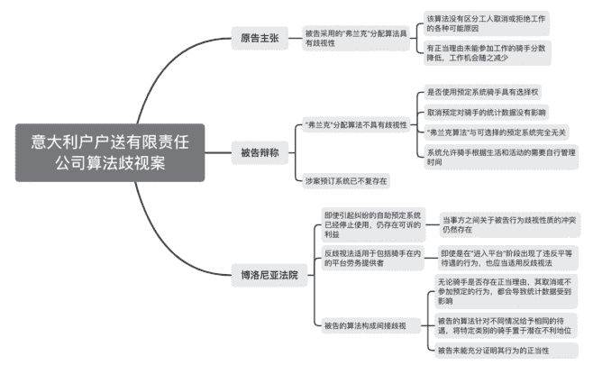

### 核心争议点
1.被告已经停止原告声称存在歧视性的自助预定系统，法院是否应当裁定终止审理。
2.反歧视法是否可以适用于平台骑手。
3.被告意大利户户送公司的算法是否具有歧视性。

### 裁判论证过程

#### （一）即使引起纠纷的自助预定系统已经停止使用，仍存在可诉的利益
被告公司要求停止诉讼，理由是“要求宣布具有歧视性的制度已不复存在，因此上诉人所要求的措施不再有用”。然而，在这一点上法院的观点与被告所希望的相反，被告所称的取消预定制度并在时间上错开访问的情况并不能证明争议事项已完全停止。一方面，原告工会采取的行动不仅旨在使被告公司定罪，以修改上述预定工作时间段的机制，而是更进一步地查明机制本身的歧视性以及补偿相应的损害。另一方面，争议事项的结束应以当事各方相互承认的实质性情况变化为前提，并应向法院提出符合这些变化的意见。在没有这样一项协定的情况下，只有一方提出的一项事实的指控必须由法院裁决。因此，法院不能宣布争端事项的终止，因为当事方之间关于被告行为歧视性质的冲突仍然存在，必须就这一点做出裁决。

此外，预定系统在全国范围内停止使用，歧视性行为已经结束，这一点各方都没有争议。因此，自 2020 年 11 月 2 日起，法院无法下令要求被告停止非法行为，而只能下令要求其消除歧视性影响。

#### （二）反歧视法可适用于包括骑手在内的平台劳务提供者
意大利第 81/2015 号法令第 47 条第 5 款规定禁止歧视：“为雇员提供的反歧视规则和保护工人自由和尊严的规则，包括进入平台的机会，应适用于第 47 条之二所述的工人。”即使是在“进入平台”阶段出现了违反平等待遇的行为，也同样违法，可以说在本案中就发生了这种情况.^([\[37\]](#txt008.html#footnote_content_txt008_37))第 81/2015 号法令第 47 条之二第 1 款指出，本章规定为在城市地区，借助单车或机动车，通过平台（包括数字平台）代表他人开展货物交付活动的自营职业者，规定了最低水平的保护。

此外，第 216/2003 号法令载有关于在就业和工作条件方面不分宗教、个人信仰、残疾、年龄和性取向的人之间实行平等待遇的规定，明确规定反歧视立法适用于“在公营和私营部门的所有人”。从字面意思来看，工会并没有与法令中提及的宗教、个人信仰、残疾、年龄和性取向的因素产生连接，而一旦对“信仰”一词的理解扩大到可以包括工会信仰，则可以认为反歧视法适用于保护工会自由.^([\[38\]](#txt008.html#footnote_content_txt008_38))在这一方面，法院给出了可以适用第 216/2003 号法令的理由：与社会所主张的一般观念不同，基于工会理由的歧视也可以作为个人信仰的一部分，其特征在于延伸到社会关系领域的思想歧视，因此禁止因工人加入工会或参加工会活动而对其施加各种差别待遇或偏见。在原告援引反歧视法的情况下，因工会原因而引发的歧视完全可归入其中。

最后法院指出：鉴于关于保护骑手的立法和判例法的最新演变，毫无疑问，将从属性劳动保护规范适用于这类劳务提供者具有必要性，无论雇佣各方赋予合同何种的法律名称，特别是就本案而言，应当保护工人在获得工作机会方面免受一切形式歧视。

#### （三）被告意大利户户送有限责任公司的算法构成间接歧视
意大利第 216/2003 号法令第 2 条将歧视分为直接歧视与间接歧视两种不同形式，前者的定义为：“由于宗教、个人信念、残疾、年龄或性取向，一个人的待遇不如他/她曾经或另一个人将在类似情况下受到的待遇”；间接歧视是指：“表面中立的规定、标准、实践、行为、契约或措施，可能会将信奉特定宗教或另一种性质意识形态的人、残疾人、特定年龄或性取向的人置于与其他人相比特定的劣势”。

根据这些定义，被告采用的预定系统实施的不是直接歧视，而是间接歧视。被告采用了一项表面中立的算法，然而该算法将特定类别的骑手（参与罢工的骑手）置于潜在特别不利的地位。法院不否认该预定系统会在某些方面为骑手提供便利的事实，也不鼓励预防性地取消不打算继续使用的预定系统，重点在于骑手不能以法律上有充分根据的理由来取消或不参加先前的预定。

被告平台采用的骑手画像系统，基于可靠性和参与度这两个参数，决定每个骑手的“分数”，进而对骑手开放进入预定系统的时间段。可预定的工作时段会随着时间的推移而逐渐减少，在后一时间段进入预定系统的骑手可以使用前一时间段中未被预定的工作时段，而在最后时间段才进入系统的骑手只能选择先前进入的同事留下的空位，因“分数”较低只能在靠后时间段进入系统的骑手可以获得的工作机会越来越少。一旦骑手因生病、有残障或协助残障人士或照顾生病的未成年人等原因无法提前取消或参加未取消的预定，那么将会面对“分数”降低、遭受歧视性待遇的风险。这些情况下，无论骑手的行为是否存在正当理由，骑手的统计数据都会受到惩罚，被告户户送公司明确承认，平台不知道也不想知道骑手取消预定或不参加已预定且未取消的时间段的原因，平台认为不参加预定的时间段或推迟、取消预定的理由是无关紧要的。这必然意味着针对不同情况给予相同的待遇，即间接歧视通常包含的内容。

另外，被告在其网站澄清说，即使没有预约，骑手也可以随时登录，但前提是“如果在某个区域有正在进行的时间段可用”。而从文件中也可以明显看出，被告鼓励其骑手加入优先组，以获得更多工作机会的优势，并且在许多情况下强调属于这一组的骑手所有的“特权”，这显然促进了预定系统的使用。

法院指出，平台在这个过程中利用技术优势挤压骑手平等获得工作机会的可能性，这一行为具有故意的性质：“平台在需要的时候，可以将导致其‘失明’或‘失去知觉’的眼罩取下，来了解骑手无法工作的原因，如果他不这样做，那是平台故意地选择。”意大利第 150/2011 号法令第 28 条第 4 款规定：“如果原告提供的事实，包括统计数据，可以推断出存在歧视行为、契约或行为的，由被告承担不存在歧视的证明责任。”被告公司有责任证明合法目的以及用于实现目的的手段的适当性和必要性，在这一点上，被告公司未能报告和证明处理骑手统计数据的算法的具体运行机制，基本上排除了对该问题进行更深入审查的可能性。事实上，在案件审理过程中，显然负有举证责任的被告从未澄清用于确定每个骑手分数的具体计算标准，也没有在其平台上宣传这些特定标准，其中仅对现在已知的可靠性和参与度参数提供了通用参考。法院认为被告未能充分证明其行为的正当性。

因此，法院最终确认被告采用的算法构成对骑手的间接歧视，将特定类别的骑手置于潜在的特别不利的地位。

### 审理结果
1.确定并宣布被告意大利户户送公司的行为具有歧视性。
2.要求被告公司通过在其网站和其平台的“常见问题”区域发布判决结果，来消除歧视行为的影响；
3.责令被告在《共和报》中标明的全国性报纸上刊登法院判决的摘要，费用由被告公司承担；
4.判决被告公司向原告支付 50，000.00 欧元加上判决中的法定利息，作为损害赔偿金；
5.责令被告公司支付原告的诉讼费用。

### 相关法条
《欧洲人权公约》第 14 条（European Convention on Human Rights§14）

保障本公约规定的权利和自由的享有，不得因诸如性别、种族、肤色、语言、宗教、政治或其他意见、民族或社会出身、与少数民族的联系、财产、出生或其他地位等任何理由而受到歧视。

意大利第 216/2003 号法令第 3 条第 1 款（L’art. 3，comma 1，del d. Igs.216/2003）

平等待遇原则不区分宗教、个人信仰、残疾、年龄和性取向，应适用于公营和私营部门的所有人。

意大利第 150/2011 号法令第 28 条第 4 款（L’art. 28，comma 4，del d. Igs.150/2011）

如果原告提供的事实，包括统计数据，可以推断出存在歧视行为、契约或行为的，由被告承担不存在歧视的证明责任。

意大利第 81/2015 号法令第 47 条之五第 1 款（L’art. 47 quinquies，comma 1，del d. Igs. 81/2015）

为雇员提供的反歧视规则和保护工人自由和尊严的规则，包括进入平台的机会，应适用于第 47 条之二所述的工人。

### 案例评析

#### （一）明确算法歧视属于间接歧视的一种表现形式
伴随网络平台兴起，“零工经济”开始大规模快速渗透到社会生活的各方面，在“零工经济”快速发展的过程中，建立在大数据基础上的算法在平台经济中被大量使用，企业可以使用算法的限制和推荐机制来指导平台劳务提供者，使用记录和评价机制来评估他们，以及使用替换和奖励机制来规训他们.^([\[39\]](#txt008.html#footnote_content_txt008_39))通过推荐和评价机制等规则设定，使得劳务提供者以“自主的”、“自愿的”态度加入到劳动中来。除此之外，平台还可以利用数字技术将工作场所规则编码到劳务提供者完成工作任务必须使用的数字工具当中，以此降低劳务提供者抵制、逃避或挑战平台建立的规则和期望的能力，^([\[40\]](#txt008.html#footnote_content_txt008_40))可以说零工经济代表了一种“顺从”式的劳动.^([\[41\]](#txt008.html#footnote_content_txt008_41))与此同时，一种区别于传统的歧视形式也在算法大规模使用的过程中逐渐成型，算法歧视正在以隐蔽化、系统化和规模化的方式对特定群体的正当权益造成不可忽视的损害。

正如意大利第 216/2003 号法令第 2 条对于间接歧视的规定：表面中立的规定将特定人群置于与其他人相比特定的劣势之中。算法的中立性、客观性和自动决策等特征，往往会模糊算法歧视背后人类主观因素所施加的真正影响。本案中，尽管所有骑手都使用相同的系统，延迟取消或未取消且未赴约的惩罚后果也是相同的，然而正是由于该算法规则呈现出的表面中立性，更易让人忽略算法本身的歧视性。算法分析使公司更容易发现哪些人最容易被操纵，以及他们如何最容易和有效地被操纵，^([\[42\]](#txt008.html#footnote_content_txt008_42))这种操纵往往是出于商业目的的考量。被告户户送公司在分析骑手工作参与度时，采用的指标是其认为最重要的时间段内（周五至周日 20：00-22：00）骑手的配送次数，骑手的配送次数越多，公司的收益也会随之增加，因此被告的算法歧视并不是针对某一特定骑手。算法筛选有利于企业实现利益的骑手，给予这类骑手更高的评分以及获得更多工作机会的可能性，而与之相对的另一部分骑手则不可避免地被边缘化。

无论算法本身具有怎样的合理性、客观性与中立性，都无法否认算法是由人类实现某一目的而设计出的。人们使用算法对整个人群进行分类、选择、理解和决策。这种关系不仅仅是市场利润的关系，也是一种治理关系.^([\[43\]](#txt008.html#footnote_content_txt008_43))揭开算法表面中立的面纱，平台有责任确保其在构建算法实现其商业目的的同时，不会给第三方增添不合理的负担。

#### （二）为数字平台劳务提供者的权益保障提供了可供参考的标准

被边缘化所带来的长期影响会在骑手每次接单时叠加，而户户送公司的“弗兰克算法”没有为骑手的正当理由预留余地，骑手必须进入其预定的工作区域内才能登录平台的应用程序，因为应用程序可以通过地理定位系统检测地理位置.因此，为避免对自己的统计数据造成不利影响，想要罢工的骑手仍应在预定时段开始后的 15 分钟内进入工作区域，即使出现在工作场所与行使罢工权不相容—罢工权意味着完全不工作；此外，骑手还可能会面临因为疾病状态或需要帮助生病的未成年儿童，从而不可能离开家的情况.^([\[44\]](#txt008.html#footnote_content_txt008_44))当骑手必须面对更多的工作机会和被边缘化两种生硬的评分结果，评分方式的不合理、单一化势必会进一步压缩骑手的选择余地.

被剥夺的潜在工作机会难以量化，对不同的骑手个体来说损失的工作机会也是不同的，就业领域的反歧视与平等保护自身就是一个涵盖诸多因素极其复杂的问题.虽然博洛尼亚法院并未正面确认平台与劳务提供者之间的关系，但博洛尼亚法院在认定被告的算法是否存在歧视性的问题上，充分考虑了原告面对算法黑箱时的弱势地位，正视原告与被告之间因技术不平等而产生的力量差距，在赔偿、预防和惩罚之间取得平衡.

意大利户户送公司的算法歧视被视为算法歧视第一案，法院的判决为后续司法实践提供了有价值的参考标准.表面客观中立的算法规则运行所依赖的数据是与个体状况剥离的无生命的数字符号，而受制于算法规则的骑手需要更多发声的渠道和保障措施，这同时也是设计和运营算法的平台所应肩负的责任，关注每一数字符号背后真实存在的人类.

### （三）推动深化和规范与“数字”工作相关主题的干预措施

依托算法所产生的决策会隐蔽地决定人类的生活方式，算法本身的复杂性、专业性和封闭性导致一般人很难理解其背后的运作逻辑以及评价标准，这也造成了法律监督的困境.^([\[45\]](#txt008.html#footnote_content_txt008_45))本案中引起争议的“弗兰克算法”并未向大众公开，涉案当事人试图从外部以个体对算法规则模糊的认知来理解算法的运行逻辑，并不能完全还原该算法的全貌.事实上，面对缺乏透明度的算法，一般人甚至很难评估自己是否已经遭受了歧视.

对算法的规制在欧盟多部法律中均有体现，并且正在不断深化与加强中.《通用数据保护条例》规定：个人数据应以与数据主体有关的、合法、公正、透明的方式处理.因此，平台劳务提供者应当有权要求平台提供处理其个人数据时产生的信息.反歧视法有利于保护用户免受算法歧视，但反歧视法的问题在于没有针对间接歧视建立一个明确的黑白分明的规则体系.结合欧洲人权法院对间接歧视的定义：对某一特定群体产生不成比例的不利影响的一般政策或措施，即使不是专门针对该群体，也没有任何歧视意图，也可能被认为是歧视性的.^([\[46\]](#txt008.html#footnote_content_txt008_46))间接歧视的概念产生了相当开放的标准，往往难以在实践中应用.^([\[47\]](#txt008.html#footnote_content_txt008_47))此外，《通用数据保护条例》赋予数据主体不受完全基于自动化决策的约束的权利.但现在谈论《通用数据保护条例》规则对算法自动化决策的影响还为时过早，关于自动化决策的《通用数据保护条例》条款几乎没有付诸实践.^([\[48\]](#txt008.html#footnote_content_txt008_48))总之，有待后续司法实践扩充对该权利的具体解释.

2021 年 4 月 21 日，欧盟委员会通过了《人工智能法》提案，^([\[49\]](#txt008.html#footnote_content_txt008_49))针对“数字”工作相关主题的探索正在不断深化.《人工智能法》提案与欧盟范围内重要的个人数据保护条例《通用数据保护条例》将会共同应对某些人工智能系统的不透明性、复杂性、偏见、一定程度的不可预测性等问题.《人工智能法》提案将用于就业、工人管理和自营职业的人工智能系统归类为高风险，因为这些系统可能会明显影响这些人未来的职业前景和生计.该提案对高风险系统提出了相应的透明度要求：“高风险人工智能系统应附有相关文档和使用说明，并包括简明清晰的信息，包括与基本权利和歧视可能面临的风险有关的信息.”与此同时，《人工智能法》提案引入人工监督，要求高风险人工智能系统的设计和开发方式应使自然人可以监督其功能.对于数字平台的劳务提供者来说，《人工智能法》提案的有效实施能够避免其权利受到人工智能系统中偏见可能导致的歧视的影响.

平台经济的兴起，将个人生活、劳动、技能和精力等方方面面都商品化，这个更深层次的问题变得更加紧迫和突出.^([\[50\]](#txt008.html#footnote_content_txt008_50))为应对人工智能使用增加带来的挑战和担忧，确保公民的权利得到充分尊重，保障个体正当权利是增强公众信任的必然举措.欧盟委员会关于人工智能、数据和相关技术的立法行动，将有效应对伴随技术快速变革而来的挑战和困境，让人们和其他用户有信心接受基于人工智能的解决方案.^([\[51\]](#txt008.html#footnote_content_txt008_51))

### （四）本案后续的最新进展

在调查了意大利户户公司的算法以及应用程序后，意大利数据保护局认为意大利户户送公司未能向其骑手提供有关骑手轮班管理算法的透明信息.此外，数据保护局发现户户送公司的应用程序收集了不成比例的乘客个人数据，违反了《通用数据保护条例》规定的合法、透明、数据最小化和存储限制的原则，并就上述事项处对户户送公司处以 2，500，000 欧元的罚款.^([\[52\]](#txt008.html#footnote_content_txt008_52))

2021 年 5 月 11 日，西班牙第 9/2021 号皇家法令（Royal Decree-Law 9/2021）出台，^([\[53\]](#txt008.html#footnote_content_txt008_53))其主要目标是保障通过数字平台从事快递服务的人员的就业权利.具体目标有两个：（i）规范数字平台快递领域中存在的雇佣关系，以及（ii）规范工人代表在数字化工作环境中获取信息的权利.政府启动立法后不久，户户送公司宣布将结束在西班牙的业务.^([\[54\]](#txt008.html#footnote_content_txt008_54))户户送公司表示，鉴于其在该国的业务规模，与其他市场相比，留在西班牙需要太多投资.^([\[55\]](#txt008.html#footnote_content_txt008_55))将本案与因西班牙法律确定平台与劳务提供者之间的雇佣关系导致户户送公司提前结束在西班牙的业务进行比较分析，可以发现劳动关系的界定会在极大程度上影响数据平台的运营成本.

数据的收集、存储、分析和利用正在深远地影响着工作场所，制约着就业的发生地点和发生方式，对劳资关系产生了决定性的作用.^([\[56\]](#txt008.html#footnote_content_txt008_56))对于劳务提供者和网络平台企业来说，劳动关系全有或全无的规制路径可能会造成过度规制或规制不足的问题.^([\[57\]](#txt008.html#footnote_content_txt008_57))如何平衡平台运营成本与劳务提供者权益保护，有待各国法律实践进一步探索.

## 【关联判例推荐】

### 1. Aslam Y., Farrar J., and others v. Uber B.V. and others, no. 2202551/2015(2016)

核心事实：Yaseen Aslam 和 James Farrar 认为在 Uber 公司作为司机工作，应该根据 1998 年的《国家最低工资法》获得最低工资，并根据 1998 年的《工作时间条例》享受带薪年假.Uber 荷兰子公司 Uber BV 辩称，他们的司机是个体经营的独立承包商，并表示“优步和合作伙伴之间不应建立雇佣关系”.英国最高法院裁定 Uber 必须向其司机支付国民生活工资^([\[58\]](#txt008.html#footnote_content_txt008_58))，以及至少 28 天的带薪假期.

与本案关联点：英国最高法院确定数字平台劳务提供者的员工身份.

### 2. Sørensen and Rasmussen v. Denmark, no.52562/99 (2006)

核心事实：丹麦当时允许工作场所与工会签订排他性协议的规则，侵犯了个人自行决定是否愿意成为有关工会成员的权利.欧洲人权法院认为，结社自由的内涵也包括消极的结社自由，这意味着员工有不参加工会的自由.

与本案关联点：欧洲人权法院对“信仰”一词进行横向解释，把工会信仰包括在内.

### 3. Schmidt and Dahlstrbm v. Sweden, no. 5589/72 (1976)

核心事实：原告为瑞典公民，隶属于代表瑞典国家雇员的两个主要联合会的工会.1971 年，在一项集体协议到期后和新协议的谈判期间，原告工会召集了不影响原告工作部门的选择性罢工，因此原告没有罢工.在签订新协议时，原告作为未参加罢工的非工会雇员被拒绝支付某些追溯福利.

与本案关联点：罢工是工会保护会员利益的最重要手段之一，参与罢工所引起的不平等待遇也应受反歧视法的保护.

## 8.3 伯威克诉优步公司案

### 【案件索引】

Barbra Berwick v. Uber Technologies, Inc., CASE NO. 11-46739 EK (2015)

### 【关键词】

零工经济；劳动关系认定；博雷洛标准

### 【案件提要】

本案是有关零工经济模式下网约车司机劳动关系的典型案件.在伯威克诉优步科技公司一案中，原告芭芭拉·伯威克（Barbra Berwick， 下称“伯威克”）与优步科技公司（Uber Technologies， Inc.， 下称“优步公司”）签订协议为其代驾，后未经事先通知，优步公司取消了其代驾资格.伯威克声称，从 2014 年 7 月 23 日至 2014 年 9 月 18 日期间她是优步公司的雇员（employee），并主张赔偿.但优步公司认为，伯威克是优步公司的一名独立承包人（independent contractor）.

为认定本案中的劳动关系，加利福尼亚州劳工委员会援引博雷洛案^([\[59\]](#txt008.html#footnote_content_txt008_59))中的判断标准—博雷洛标准（Borello Test，亦称为“控制权标准”），并添加了新的考量因素.加州劳工委员会认为，委托人不需要对劳动者的活动进行完全的控制，在某些情况下，对其进行最低限度的控制就足以将劳动者认定为雇员.虽然司机工作所用车辆并非公司提供而是归司机个人所有，但这并非决定因素，其他事实要素均表明公司已经对司机的运营活动构成了必要控制，具体包括：没有优步公司的手机应用程序，司机就不可能搭载乘客；定价权在公司；司机在工作中不需要发挥其管理技能等.此外，加州劳工委员会认为，司机的业务一直处于优步公司的监督之下，包括司机的准入核查制度、乘客打分制度等.优步公司还为司机提供运营所需的知识产权和除车辆以外的工作所需工具.因此，加州劳工委员会做出了对伯威克有利的裁决，认为她是优步公司的雇员.

随后，优步公司于 2015 年 6 月 16 日在旧金山高等法院对加州劳工委员会提出了上诉，附上了劳工专员的命令，并申请强制仲裁.旧金山高等法院驳回了优步公司强制仲裁的动议.

本案所讨论的平台与零工劳动者之间的劳动法律关系问题一直是此类案件争议的焦点.美国普通法中的博雷洛标准通过识别雇员的身份来确定雇主是否需要对第三人因劳动者不法行为而遭受的损害承担赔偿责任，是确定美国保护性立法的主体适用范围的最重要方式.但是，博雷洛标准确定的雇员范围相对比较狭窄，容易被雇主利用从而使雇员被界定为独立承包人.因此，普通法中开始将经济因素和经济风险纳入考量，逐渐采用“经济现实标准（Economic Realities Test）”解决社会福利和法律保护的覆盖范围问题，以防止雇主操纵博雷洛标准.此后，为了适用经济社会现实的变化，博雷洛标准得到了进一步发展.本案即是对博雷洛标准中各项因素的一次更新，重新界定了雇主对劳动者的“控制”应达到的程度，具有里程碑的意义.2019 年，美国加州立法机关通过了关于劳动关系认定的《加州议会第 5 号法案》（Assembly Bill No. 5，下称“《AB 5 法案》”），以立法的形式明确，在某些情况中应当采用对雇员更加友好的 ABC 检验标准（ABC Test）替代博雷洛标准.^([\[60\]](#txt008.html#footnote_content_txt008_60))

本案与关于优步公司司机法律地位的一系列案件，是对传统劳动关系认定标准的挑战.本案推动了各国对司机利益保护的重视，要素式而非要件式的认定方式，为立法机关制定零工经济背景下劳动关系认定标准的新规则提供依据，对我国认定网约车司机的法律地位有理论上的借鉴作用.此外，本案对于理解人工智能对劳动关系的影响、零工劳动者权益保护具有重要意义.

### 【案件要旨】

加利福尼亚州劳工委员会：原告 芭芭拉·伯威克 被告 优步科技公司

旧金山高等法院（上诉法院）：上诉方 优步科技公司 被上诉方 芭芭拉·伯威克

2014 年 7 月 23 日，伯威克与提供乘车服务的优步公司签订了一份冗长的协议，这份协议将优步公司视为连接驾驶员用户和乘客用户的“关系引导服务（lead generation service）”.需要乘车的个人可以登录智能手机应用程序，请求乘车，通过应用程序与可用的驾驶员配对，由可用的驾驶员接送，并最终在个人选择的目的地下车.伯威克称，从 2014 年 7 月 23 日开始，至 2014 年 9 月 18 日优步公司未经通知取消其代驾资格，期间她是优步公司的员工.但优步公司认为，伯威克是一名独立承包人.

2014 年 9 月 16 日，伯威克向加州劳工委员会提出了首次索赔，要求优步公司赔偿：（1）2014 年 7 月 25 日至 2014 年 9 月 16 日拖欠的工资；（2）未支付的费用及利息；（3）违约赔偿金；（4）未在规定时间付款的惩罚性赔偿.加州劳工委员会仅对雇员与雇主之间的纠纷有管辖权，因此核心问题是伯威克是否为优步公司的员工.

主要事实包括：首先，优步驾驶员使用自己的车辆，且公司不控制驾驶员的工作时间，也没有规定其必须进行的最低搭载次数，但是，如果驾驶员暂停使用智能手机应用程序超过 180 天，则该程序将过期.此外，驾驶员也不受地理限制.其次，驾驶员必须从加州公用事业委员会获得许可后才能搭载乘客，如有必要，优步公司可向司机提供一部 iPhone，并收取可退还的押金.优步公司还需对潜在司机进行背景调查，所有司机都必须提交加州驾驶执照、社会保险号码、个人地址、银行信息和保险证明.司机一旦被雇用，优步公司通过鼓励乘客给司机评分来控制司机的工作质量，如果司机的评分低于 4.6 分（满分 5 星），其优步应用程序将被关闭.

2014 年 9 月 16 日，伯威克向加州劳工委员会提出了索赔，劳工专员于 2015 年 6 月 3 日做出了对她有利的裁决，认为伯威克是优步公司的雇员.

2015 年 6 月 16 日，优步公司在旧金山高等法院对劳工委员会提出上诉，并申请强制仲裁.旧金山高等法院驳回了优步公司强制仲裁的动议.

### 【案例事实思维导图】

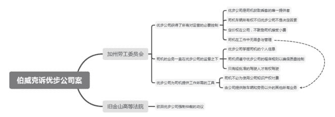

### 【核心争议点】

1.认定原告伯威克是雇员还是独立承包人时应采取何种标准.

2.如何认定雇佣关系中雇主对雇员工作的“控制”程度.

3.被告优步公司是否对原告伯威克的工作形成了必要控制.

4.被告优步公司是否应当对原告伯威克进行赔偿，赔偿范围是什么.

### 【裁判论证过程】

#### （一）加州劳工委员会援用博雷洛标准认定被告优步公司与原告伯威克的劳动关系

在判断原告伯威克是被告优步公司的雇员还是独立承包人的问题上，加州劳工委员会援用了博雷洛标准，具体考虑因素包括：（1）提供服务的人是否从事与委托人不同的职业或业务；（2）提供的服务是否是委托人或所谓“雇主”日常业务的一部分；（3）委托人是否向工人提供器具、工具和劳动场所；（4）所谓的“雇员”对其任务所需的设备或材料的投资，或其雇用的帮手；（5）提供服务是否需要特定技能；（6）参照当地情况，该类型的职业通常是在委托人的指导下完成，还是在没有监督的情况下由专家进行；（7）工人的获利或损失是否取决于其管理技能；（8）提供服务的时间长度；（9）委托人与工人之间工作关系的持久程度；（10）付款方式是按照时间还是工作数量；（11）当事人是否认为他们正在建立雇主—雇员关系可能对这个问题有一定影响，但不是决定性的，因为这是一个基于客观标准的法律问题.

#### （二）认定雇佣关系时雇主对雇员的工作需达到总体上的必要控制

加州劳工委员会认为，博雷洛案表明，判断雇佣关系时，不需要雇主对工人所有工作细节形成完全控制，仅在总体上对业务操作形成必要控制即可.原因在于，工人的工作一方面不需要较高程度的技能，另一方面是构成雇主业务所必需的组成部分.

首先，在雇佣关系中，雇员的工作以雇主的业务为基础，代表雇主从事劳动或服务.如当雇主面对需要快递服务的客户时，其提供的是代表自己从事劳动工作的雇员.此外，尽管雇主没有对雇员所有工作细节实现完全控制，但只要达到总体上的必要控制，且工人的职责是整体业务的组成部分，那么此种工作性质就决定了细节性控制是不必要的.

其次，根据加州《劳工法》第 3357 条和博雷洛案，主张原告为独立承包人的一方应当承担证明责任.易言之，若不能证明原告是独立承包人的，则推定原被告之间为雇佣关系.

最后，交通工具的所有权不是重要的判断标准.如在丰田汽车销售诉高等法院案^([\[61\]](#txt008.html#footnote_content_txt008_61))中，尽管披萨店要求外卖员使用自己的车辆并自付汽油和保险费用，根据博雷洛案之前的传统普通法标准，法院仍然认定外卖员为雇员.所以，最新的趋势为，当工人所做工作是雇主正常业务的一个组成部分，并且工人相对于雇主不提供独立的业务或专业服务时，就构成雇佣关系.

#### （三）被告优步公司对原告伯威克的工作形成了必要控制

本案中，加州劳工委员会参照博雷洛案中的测试标准，对原被告之间的劳动关系进行了具体的分析与认定.其中，加州劳工委员会重点围绕“提供的服务是否是委托人日常业务的一部分”、“委托人是否向工人提供器具、工具和劳动场所”以及“工人的获利或损失是否取决于其管理技能”等要素作出判断，最终认为被告优步公司对原告伯威克的工作形成了必要控制.

首先，原告提供的服务是被告日常业务的一部分.优步公司不是中立的技术平台，而是参与到运营的各个方面.司机应向优步公司提供个人银行卡账号、住址和社保卡账号.司机只有通过优步公司的背景检查和机动车管理局的审查才能使用优步公司的手机应用程序.优步公司利用登记审批、监督司机的批准评估制度等工具，达到掌握并监督司机工作的目的.此外，司机、乘客、优步公司的经营模式也是由优步公司确定的.

其次，被告向原告提供了手机应用程序知识产权这一重要工具.原告的汽车和她的劳动是其唯一资产.原告的工作不包括任何影响收益或损失的“管理性”技能.除了汽车之外，原告在业务上没有投资.如果没有被告提供的手机应用程序知识产权，原告就不能做这份工作.

综上所述，加州劳工委员会认为被告优步公司对原告伯威克的工作已经形成了必要控制，原告伯威克是被告优步公司的雇员，因此加州劳工委员会对该案有管辖权.

### （四）被告优步公司对原告伯威克的赔偿范围包括支出费用及利息

根据加州《劳工法》第 2802 条规定，雇主应当赔偿雇员在履行其职责过程中的所有必要支出，包括所有到期应付而未付费用的利息.本案中，原告共驾驶 6468 英里，按照 2014 年美国国税局每英里 0.56 美元的里程费率支付，共计 3622.08 美元.此外，原告还支付了 256 美元的通行费.但其并没有证明她在被告的要求下使用了手机或收到了违章停车罚单.因此，被告应赔偿原告 3878.08 美元的费用，以及到期应付而未付费用的利息 274.12 美元.

关于工资和违约金的索赔，原告拒绝提供任何付款记录，理由是由于相关信息记录是由公司保存，原告无法获得.但原告作为提出主张的一方，负有举证责任，包括最初的举证责任和优势证据的说服责任.原告没有提供足够的实质性证据来支持其主张.因此，原告根据《劳工法》第 1194.2 条主张的工资和违约金以及根据《劳工法》第 203 条主张的惩罚性赔偿，加州劳工委员会不予支持.

## 【审理结果】

1.加利福尼亚州劳工委员会做出了对伯威克有利的裁决，认为她是优步公司的雇员；并命令被告赔偿原告 3878.08 美元费用以及 274.12 美元利息，共计 4152.20 美元.

2.旧金山高等法院驳回了优步公司强制仲裁的动议.

## 【相关法条】

加利福尼亚州《劳工法》第 2802 条（a）款、（b）款（Labor Code§2802（a）（b））

（a）雇主应赔偿其雇员因履行职责或服从雇主的指示而直接导致的所有必要开支或损失，即使是非法的，除非雇员在服从指示时知道这些指示是非法的.

（b）法院或劳工标准执法处根据本条规定为偿还必要开支而作出的所有裁决，应按与民事诉讼判决的相同利率计算利息.利息应从雇员发生必要开支或损失之日起计算.

加利福尼亚州《劳工法》第 3357 条（Labor Code§3357）

除独立承包人以外，任何为他人提供服务的人均被推定为雇员，本法明确排除的除外.

## 【案例评析】

### （一）为立法机关制定零工经济背景下劳动关系认定标准的新规则提供依据

传统的劳动关系中，用人单位与劳动者通过签订合同建立的雇佣关系，并依法确定权利义务，劳动者的合法权利受到法律保障.由于劳动者通常只受雇于一家用工单位，对该单位具有组织从属、经济从属等隶属关系，因而传统的劳动关系具有持续性、控制性和稳定性的特点.人工智能和移动互联时代，通过网络平台从事临时工作的劳动者越来越多，这种新兴的“零工经济”对传统的劳动关系造成了巨大冲击—劳动者不再长期受雇于某一组织，通过在网络平台注册，根据平台提供的信息直接与雇主对接.平台成为介入雇主与劳动者之间的第三人，分担了雇主的部分职能，使传统劳动关系的二元结构演变为非典型劳动关系的三角结构.^([\[62\]](#txt008.html#footnote_content_txt008_62))一方面，劳动者成为了自由择业者，对公司的从属性大大降低；另一方面，平台企业或第三人承担雇主的角色，大大降低了企业的用工成本，有利于企业提高劳动生产率.随着零工经济规模的不断扩大，这种灵活用工的形式不断涌现.由于这种新型劳动关系不同于传统劳动关系那样明确双方雇员雇主的身份，且劳资双方有时会通过协商规避劳动法的强制规定，零工劳动者的权益难以受到法律保护.因此需要对零工劳动者的身份进行明确界定，判断零工劳动者是独立承包人或是企业雇员，从而将零工劳动者的权益纳入法律的保护范围.

随着时代的发展，认定劳动关系的标准也在不断演进.从博雷洛标准、经济现实标准，到添加了新要素的博雷洛标准，再到如今的 ABC 检验标准，美国法对劳动者法律保护的程度不断加大.加利福尼亚州法院长期以来一直采用博雷洛标准来确定零工劳动者是独立承包人或企业雇员.这是一种多因素测试标准，主要考察平台企业对零工劳动者的控制程度.随着网约车平台与司机等新型劳动关系的出现，传统的认定标准不能够完全适用.本案中，加州劳工委员会继续援引博雷洛标准，委托人优步公司并没有向司机提供工作所需的工具（车辆），优步公司和司机双方对他们之间关系的性质未形成统一意见.可见，优步公司与司机之间的关系并不完全符合传统劳动关系判断标准中的要件，“非黑即白”的武断定性显然是不负责任的.在传统的博雷洛标准基础上，劳工委员会进一步地指出，在判断雇佣关系时，雇主不需要对工人所有工作细节形成完全控制，仅在总体上对业务操作形成必要控制即可.从劳动关系的“永久性”和对工作人员工作的控制这两大美国法律分类标准的因素来看，本案对控制因素进行了创新，使得劳动关系的判断标准更加合理化.进一步来看，2018 年 4 月 30 日，加利福尼亚州最高法院废除了一直采用的博雷洛标准，确定除非雇主符合三项 ABC 检验标准—（A）被雇方在工作绩效方面不受雇佣方指挥和控制，（B）被雇方完成的工作不是雇佣方的主营业务，（C）被雇方通常以独立的形态参与交易、经营或者执业—否则该劳动者将被加州认定为雇员.法院明确指出，下级法院可以按任何顺序考虑 ABC 检验标准，但雇佣方必须符合这三项检验标准，才能成功将劳动者归类为独立承包人.^([\[63\]](#txt008.html#footnote_content_txt008_63))这被认为是一项具有里程碑意义的裁决.2019 年 9 月 18 日，加利福尼亚州州长签署了《AB 5 法案》，使之正式成为法律.根据该法案，平台企业必须将包括网约车司机在内的零工劳动者作为正式雇员对待.^([\[64\]](#txt008.html#footnote_content_txt008_64))

此外，在传统的劳动关系认定标准中，“从属性”为以美国为代表的英美法系国家的抓手.美国关于劳动关系从属性的认定标准主要包括博雷洛标准与经济现实标准.博雷洛标准主要包括雇主对工作细节控制的程度、工作是否为雇主常规业务的组成部分、工作的时长等.^([\[65\]](#txt008.html#footnote_content_txt008_65))根据该标准，没有任何一个要素发挥决定性作用，劳动关系的认定须综合考虑所有要素，但雇主的控制程度是最重要的要素，其并非指实际的控制，而是指有权控制的程度.^([\[66\]](#txt008.html#footnote_content_txt008_66))经济现实标准主要从雇主控制的程度、双方关系的持久性、雇员所提供的服务是雇主必要业务的程度等方面考虑.^([\[67\]](#txt008.html#footnote_content_txt008_67))

与传统劳动关系相比，网络平台下的新型劳动关系有其独有的特点.以网约车为例，首先，司机与消费者在平台上直接交易，不必经过平台的审核.虽然平台可以通过消费者评分间接监督，但运营的过程中少了委托人形式上的监督.其次，劳动者工作的灵活度较高.相当一部分网约车司机是兼职，且工作时间和地点可以自由选择，不具有传统劳动者工作的稳定性.此外，在 Lyft 案^([\[68\]](#txt008.html#footnote_content_txt008_68))中，法官 Vince Chhabria 暗示现行劳工法过时的规则被广为引用，由于缺乏立法介入，加州已过时的判断雇员身份的标准将继续使用，但这一标准对于问题的解决帮助甚微.^([\[69\]](#txt008.html#footnote_content_txt008_69))

本案中加州劳工委员会认为，虽然司机工作所用车辆并非公司提供而是归司机所有，但这并非决定因素，其他事实要素均表明公司已经对司机运营构成了必要控制，这种要素式而非要件式的分析方法给之后的认定标准提供了依据.不考虑“人格从属性”（网约车司机工作较灵活，不符合此特点），仅对“组织从属性”与“经济从属性”进行考察，为之后的立法提供了依据.

### （二）对我国认定网约车司机的法律地位有理论上的借鉴作用

我国现行劳动关系从属性的认定标准以 2005 年出台的《关于确立劳动关系有关事项的通知》（下称“《通知》”）确立的认定标准为核心，无论是各行各业相继出台的实施细则，抑或法院颁行的相关裁判指导文件，均未脱离该认定标准.《通知》以构成要件的形式规定：劳动关系从属性的构成需符合“劳动者受用人单位的劳动管理”“劳动者从事用人单位安排的有报酬的劳动”“劳动者提供的劳动是用人单位业务的组成部分”三大要件.司法实践针对各要件确立了“非黑即白”的认定模式.然而，在缺乏各要件细化认定指标的视域下，各法院在进行各要件认定时常常出现基于相似事实得出迥异结论的情形.在劳动关系从属性认定标准的理念上，从要件式认定方法到要素式认定范式的思路对我们有借鉴意义.

网络平台与零工经济带来的挑战并非中国独有，在域外特别是在如美国这样的平台经济高度发达的国家，这一情形当然同样存在.中美两国的劳动法与平台经济的形态虽然并不完全一致，但通过分析美国劳动法的实践与改革建议，我们完全有可能从理论层面借鉴其有益的经验，从而对中国当下的劳动法提出改革建议.面对网络与信息时代劳动关系的高度不确定性，很多学者和政策建议者也指出了全有或全无的劳动关系面临的困境.在这些学者和政策建议者看来，全有或全无的劳动关系更多是一种“向后看”的法律思维方式，采取的是根据传统的普通法来确定劳动关系以及救济手段的进路.但是，法律必须“向前看”，必须根据当下的现实发展与未来的社会需要进行规制.因此，法律必须根据平台与零工经济的需要进行调整，而不是将平台与劳动者之间的关系要么定义为雇佣劳动关系，要么定义为独立承包人.^([\[70\]](#txt008.html#footnote_content_txt008_70))

如《网络预约出租汽车经营服务管理暂行办法》第十八条规定，网约车平台公司应当保证提供服务的驾驶员具有合法从业资格，按照有关法律法规规定，根据工作时长、服务频次等特点，与驾驶员签订多种形式的劳动合同或者协议，明确双方的权利和义务.由于签订劳动合同并非有利于全体网约车司机，且并非全部网约车司机都应当被定性为“劳动者”（相当于美国法上的“雇员”），与“非黑即白“的认定模式相比，这种将身份选择权交给私法主体自治并借助法院提供事后救济的方案更加适用于当今时代.^([\[71\]](#txt008.html#footnote_content_txt008_71))

可见，虽然现行劳动立法对各种保护手段的适用范围未做典型劳动关系与非典型劳动关系的区分，但裁判实践中不必将各种保护手段都不加选择地适用于非典型劳动关系.即是说，对裁判者而言，虽然现行劳动立法在保护手段配置上存在“一刀切”的不足，但这种立法模式只加重了其选择适用保护手段的难度，而未排除其选择适用保护手段的空间.法治语境下，裁判者应当尽可能缩小、弥补立法缺陷，而不是放任、放大立法缺陷，故不宜以立法“一刀切”之不足为借口，从严甚至拒绝认定非典型劳动关系，将本应纳入劳动法范围的对象排斥在外.如此，才能更好认定劳动关系，进而保护零工劳动者的基本权益.^([\[72\]](#txt008.html#footnote_content_txt008_72))

### （三）推动对零工劳动者基本权益保护的重视

本案争议焦点在于司机是独立承包人还是雇员，如果优步公司与司机最终被认定为雇佣关系，对于司机来说，不仅能在最低工资、超时加班、社会保险、医疗保险、工伤赔偿、失业保险等方面享受和正常的劳动者同等的待遇，平等地受到反歧视法、平价医疗法案的保护；更为重要的是，他们能够成立工会，并通过工会进行集体谈判，争取更多的利益.而对于优步公司来说，一旦司机的身份被认定为雇员，其运营成本将大幅度提高；尤其是一旦受到劳动基准法的规制，优步公司将不得不采取轮班制，同时需要严格遵守不超过 40 个小时工作时间的限制，而这将一定程度上削弱优步公司的市场竞争力；此外，司机组成的工会也势必会削弱优步公司在与司机利益博弈中的优势.^([\[73\]](#txt008.html#footnote_content_txt008_73))

虽然加州劳工委员会在援引博雷洛标准的同时进一步解读了“控制”因素，传统的劳动关系认定标准仍然有其局限性.雇员的范围过小以及该标准容易被雇主操纵等问题，导致无法将更多的零工劳动者纳入企业雇员管理标准，使其能够获得基本的工作保障，并享有劳动法所规定的基本权利.扩大雇员范围之后，平台企业不能再因为劳动者是独立承包人而越过劳动法和相关行业保护政策与劳动执行标准，从而优化了劳动者的工作条件，建立了最低工资标准，使得劳动者可以获得加班薪酬补贴、家庭假期、失业和伤残保险以及补偿金等工作福利，更好地保障了劳动者的权益.

### （四）引发了对零工经济模式的进一步思考

任何新鲜事物都具有两面性.零工经济作为人工智能和移动互联时代下的新生就业形态，带来的机遇与挑战是并存的.对于劳动者来说，零工经济以任务为导向，模糊了用工关系的持续性和从属性，劳动者的自由度和收入有所提高；但由于零工经济的商业模式大多以低用工成本为基础，劳动者的利润空间不断压缩，其合法权利无法受到法律保障.对平台企业来说，一方面，互联网企业不断强调自己的“平台”身份，将这些低收入、低技能的零工劳动者视为“个人创业者”，从而规避国家法律或行业标准规定的企业应对雇员履行的义务.另一方面，企业为了树立良好的服务口碑，提高客户的忠诚度，必然会为零工劳动者提供培训以及设置明确的工作要求，这样一来就会引发对劳动者身份关系认定的争议.如果法律将零工劳动者认定为雇员，那么零工经济的低用工成本优势就不复存在，从而失去投资吸引力.正如一家互联网企业的创始人所承认的：“一旦其将合同工转为正式员工，这种商业模式就将遭到毁灭性的打击.”

此外，企业将会承担更多的社会责任.自从加州劳工委员会认定优步司机伯威克是雇员而非独立承包人以来，优步公司在侵权、就业、税务等法律适用领域又承担了几项新的责任.优步公司现在需要对司机疏忽驾驶造成的伤害承担责任；如果司机犯罪，受害人可以起诉优步公司疏忽雇佣等；优步公司必须遵守雇主所须面对的严格规定.经上诉审查后，加州劳工委员会的决定必定会激励优步公司进行更彻底的雇员背景调查，以确保其司机的任职资格.优步公司可能会更深入地挖掘潜在司机的过去，并可能收紧其要求，从而使我们的道路更安全.当我们进入这个共享乘车、共享食物、共享服务以及未来可能会出现更多新型商业模式的新时代时，加州劳工委员会的决定以及后续法案的确立带来的法律意义是长远的，企业将会承担更多的社会责任以维护市场经济秩序，促进社会和谐发展.

如何做到既能够保障零工劳动者的合法权益，又能使零工经济持续健康发展，值得行业和政府进一步思考.

### （五）本案后续的一些最新进展

在戴纳梅克斯公司诉洛杉矶高等法院案^([\[74\]](#txt008.html#footnote_content_txt008_74))中，法官确立了关于劳动关系的最新认定标准—ABC 检验标准.2019 年 9 月 18 日，加利福尼亚州州长签署了《AB 5 法案》，使之正式成为法律.根据这一法案，企业必须将包括网约车司机在内的零工劳动者作为正式雇员对待.

## 【关联判例推荐】

1\. S.G. Borello & Sons, Inc. v. Department of Industrial Relations, 48 Cal. 3d 341 (1989)

核心事实：法院提出了认定劳动关系的若干标准要素，即博雷洛标准，具体包括：（1）根据协议，雇主可能对工作细节进行控制的程度；（2）受雇人是否从事不同的职业或业务；（3）参照当地情况，该类型的职业通常在雇主指导下完成，还是由专业人员独立完成；（4）特定职业需要的技能；（5）由谁提供设备、工具和工作场所；（6）关系的持续时间；（7）支付方式；（8）工作是否为雇主日常经营的组成部分；（9）当事人对关系性质的看法；（10）受雇人是否从事管理.通过识别雇员的身份来确定雇主是否需要对第三人因劳动者不法行为而遭受的损害承担赔偿责任.

与本案关联点：加州劳工委员会援引了本案中的博雷洛标准，并再此基础上进一步解读了“控制”因素，指出在判断雇佣关系时，雇主不需要对工人所有工作细节形成完全控制，仅在总体上对业务操作形成必要控制即可.

2\. Anfi nson v.FedEx Ground Package System, Inc., 174 Wash.2d 851, 281 P.3d 289 (2012)

核心事实：法院提出了新的认定劳动关系的标准，即经济现实标准.根据该标准，法院在判断是否构成雇佣关系时，除考虑雇主对工作内容的控制程度之外，还应当考量工作安排的持久性、工作所需技能的级别、工作要素的投资以及劳动者因工作获利的机会.华盛顿州最高法院在适用经济现实标准的同时指出，华盛顿《最低工资法案》（Minimum Wage Act， MWA）以及联邦《1983 年公平劳动标准法案》（Fair Labor Standards Act of 1938， FLSA）的目的，在于向劳动者提供保护，旨在避免劳动者因收入过低而遭受生活窘迫之苦以及因过度工作而可能造成的健康减损.

与本案关联点：在判定劳动关系的标准上，是对本案援引的博雷洛标准的进一步发展.

3\. O’Conner v. Uber Technologies, Inc., 82 F. Supp. 3d 1133 (2015)

核心事实：法院判决主要集中在按照加州法律，网约车平台是否对司机实现预期结果的方式进行控制.优步公司主张司机可以自行决定工作量，进而排除平台对司机的控制.但法官认为司机的这项自由并不能排除其雇员的身份，法官主要审查平台对司机的指示以及监督情况.法官发现司机在工作中都受到顾客的监督，且平台应用数据可对司机行为进行实时监督.公司对司机遵守规则的情况的监督程度表明，优步公司对司机履职的方式具有很大程度的控制.

与本案关联点：反思了传统劳动关系认定标准的缺陷.法院认为，一方面，雇主对雇员缺乏工作地点与时间层面的控制并不必然排除劳动合同的存在；另一方面，必须存在比缺乏工作地点与时间控制更为重要的相反因素才可能认定劳动关系从属性的存在.

4\. Cotter v. Lyft, Inc., 60 F.Supp.3d 1067 (N.D.Cal. 2015)

## 核心事实
在 Lyft 案中，法官发现一旦司机选择了为 Lyft 平台工作，平台对司机的工作方式保留了相当程度的控制。此外，司机的工作属于平台业务的重要组成部分，没有司机平台无法生存，且司机为平台工作所需的驾驶技术并非特殊技能。可见，司机和通常应自身具备技能的独立承包人不同。但同时，一些要素将司机指向了独立承包人身份：司机可兼职提供驾驶服务，平台不一定是司机收入的主要来源，司机享有工作时间与地点层面的自由，司机在驾驶过程中极少与公司管理层沟通。

## 与本案关联点
在本案中，法官暗示现行劳工法过时的规则被广为引用，由于缺乏立法介入，加州已过时的判断雇员身份的标准将继续使用，但这一标准对于问题的解决帮助甚微。

## 注释
[\[1\]](#txt008.html#footnote_quote_txt008_1)在加州，根据《加利福尼亚州宪法》第 14 条第 1 款以及《劳工法》的相关规定，加州工资令是宪法授权的、具有法律效力的准立法条例.

[\[2\]](#txt008.html#footnote_quote_txt008_2)Martinez v. Combs， （2010） 49 Cal.4th 35， 109 Cal.Rptr.3d 514， 231 P.3d 259 （Cal. 2010）.

[\[3\]](#txt008.html#footnote_quote_txt008_3)ABC 测试假定所有工人都是雇员，只有在雇主证明有关工人满足以下三个条件时，才允许将工人归类为独立承包人：（a）无论是根据工作合同还是在事实上，该工人在执行工作方面不受雇主的控制和指示；（b）该工人从事的工作超出雇佣实体的通常业务范围；（c）该工人通常从事与其为雇佣实体所提供的工作性质相同的独立设立的贸易、职业或业务.

[\[4\]](#txt008.html#footnote_quote_txt008_4)Abigail S. Rosenfeld， ABC to AB 5：加州最高法院在 Dynamex Operations West， Inc. v. Superior Court 案中对普通法原则进行现代化， 61 Boston College Law Review 112，124 （2020）.

[\[5\]](#txt008.html#footnote_quote_txt008_5)国家信息中心：《中国共享经济发展报告（2021）》，载国家信息中心网 2021 年 2 月 19 日，`http：//www.sic.gov.cn/News/557/10779.htm`.

[\[6\]](#txt008.html#footnote_quote_txt008_6)王天玉：《基于互联网平台提供劳务的劳动关系认定—以“e 代驾”在京、沪、穗三地法院的判决为切入点》，载《法学》2016 年第 6 期，第 51 页.

[\[7\]](#txt008.html#footnote_quote_txt008_7)S.G. Borello & Sons， Inc. v. Department of Industrial Relations， 48 Cal. 3d 341 （1989）.

[\[8\]](#txt008.html#footnote_quote_txt008_8)Abigail S. Rosenfeld， ABC to AB 5：加州最高法院在 Dynamex Operations West， Inc. v. Superior Court 案中对普通法原则进行现代化， 61 Boston College Law Review 112，131 （2020）.

[\[9\]](#txt008.html#footnote_quote_txt008_9)O’Connor v. Uber Technologies， Inc.， 82 F.Supp.3d 1133 （2015）.

[\[10\]](#txt008.html#footnote_quote_txt008_10)Abigail S. Rosenfeld， ABC to AB 5：加州最高法院在 Dynamex Operations West， Inc. v. Superior Court 案中对普通法原则进行现代化， 61 Boston College Law Review 112，129 （2020）.

[\[11\]](#txt008.html#footnote_quote_txt008_11)Abigail S. Rosenfeld， ABC to AB 5：加州最高法院在 Dynamex Operations West， Inc. v. Superior Court 案中对普通法原则进行现代化， 61 Boston College Law Review 112，129 （2020）.

[\[12\]](#txt008.html#footnote_quote_txt008_12)Anna Deknatel & Lauren Hoff -Downing， ABC 在成文法与法院中：对近期独立承包人与错误分类法规的分析， 18 University of Pennsylvania Journal of Law and Social Change 53， 75 （2015）.

[\[13\]](#txt008.html#footnote_quote_txt008_13)Quinn Emanuel Urquhart & Sullivan， LLP， 2021 年 1 月：加州选民批准第 22 号提案，批准“应用型”司机“独立承包人”身份， JD Supra （Jan. 29， 2021）， `https：//www.jdsupra.com/legalnews/january-2021-california-voters-approve-1061564/`.

[\[14\]](#txt008.html#footnote_quote_txt008_14)苏奎：《商业模式政治化，Uber 们再次卷入 2020 美国大选》，载观察者网 2019 年 9 月 29 日，`https：//www.guancha.cn/Sukui/2019\_10\_08\_520495\_1.shtml`.

[\[15\]](#txt008.html#footnote_quote_txt008_15)Michael Lotito， Bruce Sarchet & Patrick Stokes， 第九巡回法院撤回关于 Dynamex v. Superior Court 溯及力的意见，将向加州最高法院认证该问题， JD Supra （July 25， 2019）， `https：//www.jdsupra.com/legalnews/ninth-circuit-withdrawsopinion-21316/`.

[\[16\]](#txt008.html#footnote_quote_txt008_16)Michael Lotito， Bruce Sarchet & Patrick Stokes， 第九巡回法院撤回关于 Dynamex v. Superior Court 溯及力的意见，将向加州最高法院认证该问题， JD Supra （Jan. 29， 2021）， `https：//www.jdsupra.com/legalnews/ninth-circuit-withdrawsopinion-21316/`.

[\[17\]](#txt008.html#footnote_quote_txt008_17)Vazquez v. Jan-Pro Franchising International， Inc.， No. 17-16096 （9th Cir. 2021）.

[\[18\]](#txt008.html#footnote_quote_txt008_18)Michael Lotito & James Paretti， Jr.， 特许经营与加州的十字路口：Dynamex 与 ABC 测试的动态， JD Supra （July 19， 2019）， `https：//www.jdsupra.com/legalnews/franchising-and-california-at-a-65981/`.

[\[19\]](#txt008.html#footnote_quote_txt008_19)Curry v. Equilon Enterprises， LLC.， 23 Cal.App.5th 289 （2018）.

[\[20\]](#txt008.html#footnote_quote_txt008_20)Henderson v. Equilon Enterprises， LLC.， 40 Cal.App.5th 1111 （2019）.

[\[21\]](#txt008.html#footnote_quote_txt008_21)Salazar v. McDonalds Corp.， No. 17-15673 （9th Cir. 2019）.

[\[22\]](#txt008.html#footnote_quote_txt008_22)苏奎：《商业模式政治化，Uber 们再次卷入 2020 美国大选》，载观察者网 2019 年 9 月 29 日，`https：//www.guancha.cn/Sukui/2019\_10\_08\_520495\_1.shtml`.

[\[23\]](#txt008.html#footnote_quote_txt008_23)涂永前：《零工群体劳动权益保护研究：域外实践及我国的应对》，载《政法论丛》2021 年第 2 期，第 70 页.

[\[24\]](#txt008.html#footnote_quote_txt008_24)Michael J. Lotito， Bruce J. Sarchet & Jim Paretti， AB 5：加州消除独立承包人的实验的余波为其他州提供了警示， Littler （Mar. 10， 2020），`https：//www.littler.com/publication-press/publication/ab-5-aftermath-californias-experimenteliminate-independent`.

[\[25\]](#txt008.html#footnote_quote_txt008_25)Olson v. State of California， Case No. CV 19-10956-DMG （RAOx） （2020）.

[\[26\]](#txt008.html#footnote_quote_txt008_26)苏奎：《商业模式政治化，Uber 们再次卷入 2020 美国大选》，载观察者网 2019 年 9 月 29 日，`https：//www.guancha.cn/Sukui/2019\_10\_08\_520495\_1.shtml`.

[\[27\]](#txt008.html#footnote_quote_txt008_27)Quinn Emanuel Urquhart & Sullivan， LLP， 2021 年 1 月：加州选民批准第 22 号提案，批准“应用型”司机“独立承包人”身份， JD Supra （Jan. 29， 2021）， `https：//www.jdsupra.com/legalnews/january-2021-california-voters-approve-1061564/`.

[\[28\]](#txt008.html#footnote_quote_txt008_28)Michael Lotito & James Paretti， Jr.， 特许经营与加州的十字路口：Dynamex 与 ABC 测试的动态， JD Supra （July 19， 2019）， `https：//www.jdsupra.com/legalnews/franchising-and-california-at-a-65981/`.

[\[29\]](#txt008.html#footnote_quote_txt008_29)涂永前：《零工群体劳动权益保护研究：域外实践及我国的应对》，载《政法论丛》2021 年第 2 期，第 75 页.

[\[30\]](#txt008.html#footnote_quote_txt008_30)涂永前、王倩云：《零工经济崛起与零工劳动者权益保护—来自美国〈加州零工经济法〉的启示》，载《中国劳动关系学院学报》2020 年第 5 期，第 97 页.

[\[31\]](#txt008.html#footnote_quote_txt008_31)John A. Pearce II & Jonathan P. Silva， 独立承包人的未来及其作为非雇员的地位：超越普通法标准， 14 Hastings Business Law Journal 1， 29（2018）.

[\[32\]](#txt008.html#footnote_quote_txt008_32)\[英\]阿里尔·扎拉奇、\[美\]莫里斯·E.斯图克：《算法的陷阱》，余潇译，中信出版社 2018 年版.

[\[33\]](#txt008.html#footnote_quote_txt008_33)Jack M. Balkin， 2016 年 Sidley Austin 大数据法律与政策杰出讲座：大数据时代的机器人三大法则， 78 Ohio State Law Journal 1217， 1217-1242 （2017）.

[\[34\]](#txt008.html#footnote_quote_txt008_34)赖祐萱：《外卖骑手，困在系统里》，载人物网 2020 年 9 月 8 日，`https：//baijiahao.baidu.com/s？id=1677231323622016633&wfr=spider&for=pc`.

[\[35\]](#txt008.html#footnote_quote_txt008_35)“弗兰克算法”基于强大的预测技术，可根据餐厅、乘客和顾客的位置评估最有效的订单分配方式.机器学习有助于预测准备餐点所需的时间，从而有助于简化交付体验.Deliveroo，技术驱动， Deliveroo （Mar. 13， 2022）， `https：//deliveroo.com.sg/about-us`.

[\[36\]](#txt008.html#footnote_quote_txt008_36)Ilaria Purifi cato， Deliveroo 算法幕后：弗兰克盲点的歧视性影响， 14 Italian Labour Law e-Journal Issue 169， 169-194 （2021）.

[\[37\]](#txt008.html#footnote_quote_txt008_37)Ilaria Purificato， Deliveroo 算法幕后：弗兰克盲点的歧视性影响， 14 Italian Labour Law e-Journal Issue 169， 169-194 （2021）.

[\[38\]](#txt008.html#footnote_quote_txt008_38)Ilaria Purificato， Deliveroo 算法幕后：弗兰克盲点的歧视性影响， 14 Italian Labour Law e-Journal Issue 169， 169-194 （2021）.

[\[39\]](#txt008.html#footnote_quote_txt008_39)罗毕·瓦林、邓肯·麦肯、姚建华、路珏、覃琳嫣：《数字经济中的权力和责任：数据、算法与劳动监控》，载《国外社会科学前沿》2021 年第 9 期.

[\[40\]](#txt008.html#footnote_quote_txt008_40)Vallas Steven & Juliet B. Schor， 平台做什么？理解零工经济， 46 Annual Review of Sociology 273， 273-294 （2020）.

[\[41\]](#txt008.html#footnote_quote_txt008_41)Gandini Alessandro， 劳动过程理论与零工经济， 72 人际关系 1039， 1039-1056 （2019）.

[\[42\]](#txt008.html#footnote_quote_txt008_42)Jack M. Balkin， 2016 年 Sidley Austin 大数据法律与政策杰出讲座：大数据时代的机器人三大法则， 78 俄亥俄州立法律杂志 1217， 1217-1242 （2017）.

[\[43\]](#txt008.html#footnote_quote_txt008_43)Jack M. Balkin， 2016 年 Sidley Austin 大数据法律与政策杰出讲座：大数据时代的机器人三大法则， 78 俄亥俄州立法律杂志 1217， 1217-1242 （2017）.

[\[44\]](#txt008.html#footnote_quote_txt008_44)Filcams Cgil Bologna 等及其他人诉 Deliveroo ITALIA S.R.L， 案号 N. R.G. 2949/2019.

[\[45\]](#txt008.html#footnote_quote_txt008_45)郭哲：《反思算法权力》，载《法学评论》2020 年第 6 期.

[\[46\]](#txt008.html#footnote_quote_txt008_46)Biao 诉 Denmark （大法庭）， 案号 38590/10 （2016）.

[\[47\]](#txt008.html#footnote_quote_txt008_47)Zuiderveen Borgesius & Frederik J， 加强针对算法和人工智能歧视的法律保护， 24 国际人权杂志 1572， 1572-1593 （2020）.

[\[48\]](#txt008.html#footnote_quote_txt008_48)Zuiderveen Borgesius & Frederik J， 加强针对算法和人工智能歧视的法律保护， 24 国际人权杂志 1572， 1572-1593 （2020）.

[\[49\]](#txt008.html#footnote_quote_txt008_49)European Commission， 制定人工智能协调规则的条例， EUR-Lex （2021 年 4 月 21 日）， `https：//eur-lex.europa.eu/legal-content/EN/TXT/？uri=CELEX%3A52021PC0206`.

[\[50\]](#txt008.html#footnote_quote_txt008_50)Lobel Orly， 零工经济与就业和劳动法的未来， 51 圣弗朗西斯科大学法律评论 51， 51-74 （2017）.

[\[51\]](#txt008.html#footnote_quote_txt008_51)European Commission， 制定人工智能协调规则的条例， EUR-Lex （2021 年 4 月 21 日）， `https：//eur-lex.europa.eu/legal-content/EN/TXT/？uri=CELEX%3A52021PC0206`.

[\[52\]](#txt008.html#footnote_quote_txt008_52)GPDP， 针对 Deliveroo Italy s.r.l. 的罚款令 - 2021 年 7 月 22 日， GPDP （2021 年 7 月 22 日）， `https：//www.garanteprivacy.it/web/guest/home/docweb/-/docweb-display/docweb/9685994#`.

[\[53\]](#txt008.html#footnote_quote_txt008_53)Spain’s Offi cial State， 皇家法令第 9/2021 号， 西班牙官方国家公报 （2021 年 5 月 12 日），`https：//cms.law/en/media/local/cms-asl/files/publications/publications/royal-decree-law-17-2021-dated-14-september-on-urgent-measures-to -mitigate-the-impact-of-rise-in-natural-gas-priceson-the-retail-gas-and-el？v=1`.

[\[54\]](#txt008.html#footnote_quote_txt008_54)Deliveroo， Deliveroo 不再在西班牙运营， Deliveroo （2021）， `https：//deliveroo.es/en/`.

[\[55\]](#txt008.html#footnote_quote_txt008_55)Jasper Jolly， Deliveroo 公布在‘骑手法’后退出西班牙的计划， The Guardian （2021 年 7 月 30 日）， `https：//www.theguardian.com/business/2021/jul/30/deliveroo-unveils-plans-to-pull-outof-spain-in-wake-of-rider-law`.

[\[56\]](#txt008.html#footnote_quote_txt008_56)罗毕·瓦林、邓肯·麦肯、姚建华、路珏、覃琳嫣：《数字经济中的权力和责任：数据、算法与劳动监控》，载《国外社会科学前沿》2021 年第 9 期.

[\[57\]](#txt008.html#footnote_quote_txt008_57)丁晓东：《平台革命、零工经济与劳动法的新思维》，载《环球法律评论》2018 年第 4 期.

[\[58\]](#txt008.html#footnote_quote_txt008_58)国民生活工资是指英国向 23 岁及以上英国工人支付的强制性最低工资.

[\[59\]](#txt008.html#footnote_quote_txt008_59)S.G. Borello & Sons， Inc. 诉 Department of Industrial Relations， 48 Cal. 3d 341 （1989）.

[\[60\]](#txt008.html#footnote_quote_txt008_60)陈靖远：《事实优先原则的理论展开与司法适用—劳动法理论中的一个经典问题》，载《法学家》2021 年第 2 期，第 81 页.

[\[61\]](#txt008.html#footnote_quote_txt008_61)Toyota Motor Sales 诉 Superior Court， 220 Cal.App.3d 864 （1990）.

[\[62\]](#txt008.html#footnote_quote_txt008_62)董成惠：《零工劳动对传统劳动关系的解构以及应对措施》，载《湖南社会科学》2020 年第 5 期.

[\[63\]](#txt008.html#footnote_quote_txt008_63)Dynamex 诉 Superior Court， 416 P.3d 1 （Cal. 2018）.

[\[64\]](#txt008.html#footnote_quote_txt008_64)涂永前、王倩云：《零工经济崛起与零工劳动者权益保护—来自美国〈加州零工经济法〉的启示》，载《中国劳动关系学院学报》2020 年第 5 期.

[\[65\]](#txt008.html#footnote_quote_txt008_65)叶嘉敏、李少军：《共享经济视域下网约车平台用工劳动关系从属性认定标准研究—以“权重位序法”为核心进路》，载《河北法学》2020 年第 11 期.

[\[66\]](#txt008.html#footnote_quote_txt008_66)Mark A. Rothstein， Charles B. Craver， Elinor P. Schroeder， Elaine W. Shoben & Camille L. Hebert， 劳动法 第 5 版， West Academic Publishing， 2015， 第 70 页， 338.

[\[67\]](#txt008.html#footnote_quote_txt008_67)叶嘉敏、李少军：《共享经济视域下网约车平台用工劳动关系从属性认定标准研究—以“权重位序法”为核心进路》，载《河北法学》2020 年第 11 期.

[\[68\]](#txt008.html#footnote_quote_txt008_68)Cotter 诉 Lyft， Inc.， 60 F.Supp.3d 1067 （N.D.Cal. 2015）.

[\[69\]](#txt008.html#footnote_quote_txt008_69)Bernd Waas， Wilma B. Liebman， Andrew Lyubarsky & Katsutoshi Kezuka， 众包 - 比较法视角， Bund-Verlag GmbH， 2017， 第 50-52 页.

[\[70\]](#txt008.html#footnote_quote_txt008_70)丁晓东：《平台革命、零工经济与劳动法的新思维》，载《环球法律评论》2018 年第 4 期.

[\[71\]](#txt008.html#footnote_quote_txt008_71)楼秋然：《美国法上的网约车监管理论与实践—兼评七部门〈网络预约出租汽车经营服务管理暂行办法〉》，载《政治与法律》2017 年第 10 期.

[\[72\]](#txt008.html#footnote_quote_txt008_72)王全兴、刘琦：《我国新经济下灵活用工的特点、挑战和法律规制》，载《法学评论》2019 年第 4 期.

[\[73\]](#txt008.html#footnote_quote_txt008_73)陆胤、李盛楠：《分享经济模式对传统劳动关系的挑战—美国 Uber 案和解的一些借鉴》，载《中国劳动》2016 年第 16 期.

[\[74\]](#txt008.html#footnote_quote_txt008_74)Dynamex 诉 Superior Court， 416 P.3d 1 （Cal. 2018）.

# 第九章 社交媒体相关前沿判例

## 9.1 帕金汉姆诉北卡罗来纳州案

### 【案件索引】

State v. Packingham, 229 N.C. App. 293, 748 S.E.2d 146 (N.C. Ct. App. 2013)

State v. Packingham, 368 N.C. 380, 777 S.E.2d 738 (2015)

Packingham v.North Carolina, 137 S.Ct. 1730, 198 L.Ed.2d 273, 85 USLW 4353 (2017)

### 【关键词】

言论自由；社交媒体；公共论坛；性犯罪者

### 【案件提要】

本案是有关互联网言论自由的早期典型案例之一.该案与北卡莱罗纳州诉帕金汉姆案密切相关.在北卡莱罗纳州诉帕金汉姆案中，被告帕金汉姆（Lester Gerard Packingham）作为注册在案的性犯罪者，由于在社交媒体 Facebook 上发布了一条消息而违反了 2015 年版《北卡莱罗纳州一般法规》（North Carolina General Statutes）第 14 章第 202.5 条，被判处监禁.被告以州立法违宪为由提出上诉.上诉法院认为该立法是内容中立的，适用中度审查（而不是基于内容的严格审查）.尽管如此，该立法仍然因为过于宽泛、对言论自由施加了不合乎目的的负担而违宪.而州最高法院以该立法主要规范行为，仅对言论施加未超出保护重大利益所必须的次要负担，且提供了充足替代方案等理由，撤销上诉法院判决.最终，美国联邦最高法院的判决终止了这个长达 7 年的争议，从即使适用中度审查也并非完全符合重大利益和过于宽泛两个维度判定该州立法违宪，并援引里诺诉美国公民自由联盟案^([\[1\]](#txt009.html#footnote_content_txt009_1))，认定社交媒体是“庞大的互联网民主论坛”，社交网络上的言论自由也应受宪法的保护.然而，各方的激烈讨论仍在进行中，如阿利托等大法官认为不应轻率地将更具隐蔽性的网络空间与公共场相等同，否则可能意味着各州立法甚至无权限制最危险的性犯罪者访问社交网站.

本案作为早期确认社交媒体应是公共论坛的典型案例之一，在网络日益发达的当今社会无疑具有十分重要的意义，也为之后随着科技发展可能带来的交流媒介改变而引发的言论自由问题提供了借鉴.另外，本案还影响了有关公职人员的社交媒体账户是否为公共论坛的认定，类似的案件频繁出现，如在戴维森诉兰德尔案^([\[2\]](#txt009.html#footnote_content_txt009_2))中，弗吉尼亚州地方法院裁定县官员在其官方 Facebook 页面上屏蔽用户的行为是违宪的.私人账号公共化是政治生活中常见的情况，亟待法院明确宪法第一修正案的新的适用范围.本案也对我国网络言论自由立法提供了有益的参考，我国宪法同样赋予了公民言论自由，同时我国也有限制言论自由的法律，如《中华人民共和国未成年人保护法》第六十六条提到：“应当加强对未成年人网络保护工作的监督检查，依法惩处利用网络从事危害未成年人身心健康的活动，为未成年人提供安全、健康的网络环境.”总体来说，我国对于网络领域言论自由的规范较为宽泛，在实践中给予了法官更大的自由裁量权.本案对于处理网络空间的言论自由问题具有非常重要的指导意义.

### 【案件要旨】

北卡莱罗纳州上诉法院：原告 北卡莱罗纳州 被告 帕金汉姆

北卡莱罗纳州最高法院：原告 北卡莱罗纳州 被告 帕金汉姆

美国联邦最高法院：原告 帕金汉姆 被告 北卡莱罗纳州

帕金汉姆曾于 2002 年因猥亵一名 13 岁的儿童被登记为性犯罪者.2012 年，帕金汉姆在 Facebook 上发布了一条有关免除交通违法通知单的消息，违反了州立法中性犯罪者不得接触商业社交网络的禁令，因此被起诉.北卡莱罗纳州未宣称原告在网络中与未成年人有联系或实施了其他非法行为.帕金汉姆以该立法违反第一修正案为由要求驳回起诉，北卡莱罗纳州初审法院否决了该动议，判处其 6 至 8 个月监禁，缓刑 12 个月.

帕金汉姆以《北卡莱罗纳州一般法规》第 14 章第 202.5 条违反第一修正案保障的言论自由为由向北卡莱罗纳州上诉法院提出上诉，上诉法院撤销了初审法院的裁决，理由是：（1）该立法通过禁止与立法意图无关的广泛的交流和表达活动给所有记录在案的性犯罪者任意加重负担，过于宽泛；（2）该立法在保护儿童免受性侵方面并非严格符合州政府重大利益.

北卡莱罗纳州最高法院撤销了上诉法院的裁决，理由是：（1）该立法主要规范的是使用网站的行为，仅对言论施加附带负担.（2）该立法是内容中立的，因此适用中度审查.州立法满足美国诉奥布莱恩案^([\[3\]](#txt009.html#footnote_content_txt009_3))确立的四因素审查标准，即：①在政府的宪法权力范围内；②促进了重要或实质性的政府利益；③该政府利益与压制言论自由无关；④对言论自由的附带限制是促进该利益所必需的.州立法是为满足政府重大利益而制定的，建立了四个必要的特定标准规定禁止使用网站的范围：①该网站的运营人员从会员费、广告费和与网站运营有关的其他来源获取收入；②该网站为两个人或更多人之间以友谊、会见或者信息交换为目的的社交介绍提供便利；③该网站允许用户创建网页或个人简介，所含信息可以是用户的真名与昵称、用户置于个人网页的照片、用户的其他个人信息，以及其他用户或来访者可以访问的，通向用户的朋友或同事的个人社交网页的链接；④该网站给用户和来访者提供与其他用户交流的机制，例如留言板、聊天室、电子邮件、或即时通讯工具.这些规定具有狭窄性，并提供了充足的替代方案.（3）案件事实极大影响了该立法是否违宪.被告没有表现出对法律的尊重和遵守法律的努力，对被告施加的言论自由限制没有超过保护儿童免受注册在案犯罪者侵害的州利益的必要限度.

2017 年 6 月 19 日，美国联邦最高法院撤销北卡莱罗纳州最高院判决并发回重审.

### 【案例事实思维导图】

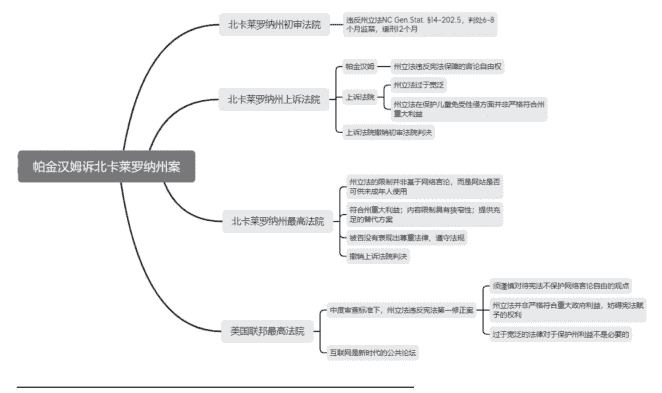

### 【核心争议点】

1.中度审查标准下，州立法是否违反宪法第一修正案.

2.互联网是否是新时代的公共论坛.

### 【裁判论证过程】

（一）中度审查标准下，州立法违反了宪法第一修正案

美国联邦最高法院认为，宪法第一修正案确立的一个最根本的原则是所有人有权进入特定场所倾听与表达.如今网络为宪法所保护的交流活动提供了广阔的相对低成本的空间.在日新月异的今天，在认定“宪法第一修正案不保护网络言论自由”之前必须慎之又慎.

美国联邦最高法院认为，即使假设州立法的内容中立，适用中度审查标准而非更严格的审查标准，该立法对言论自由的限制也并非严格符合某种特别重大的政府利益，且已经超出了促进政府正当利益所必要的限度.论证过程中有两个假设：（1）州立法用词非常宽泛，以至于适用于广义且泛化的社交媒体，可以推定州立法适用于常见的社交媒体，如脸书、领英和推特；（2）第一修正案允许州颁布具体且严格的立法，以遏制性犯罪者实施预示着性犯罪的行为，例如联络未成年人或利用网站收集未成年人的信息.保护儿童免遭性侵是非常重要的政府利益，应优先用其他更加严格的法律来具体规制，但无论如何也不能脱离宪法的要求.社交媒体代表了广阔的思想世界，州立法全面排除了性犯罪者进入商业社交媒体的权利，包括通过社交媒体获得合法利益，给其言论自由施加了过重的负担.即使是性犯罪者也可能通过社交媒体获取正当利益，以寻求改过自新和追求合法有益的生活.

美国联邦最高法院认为，北卡莱罗纳州未能有效证明该社交媒体全面禁令对于让性犯罪者远离儿童是合理且必要的.北卡莱罗纳州援引了伯森诉弗里曼案^([\[4\]](#txt009.html#footnote_content_txt009_4))来支撑其主张，但是该案给出了更明确的限定—不得在投票站 100 英尺内举行竞选活动.此举为实现保护投票的基本权利所施加的限制与负担是更有限的，因此不能支持北卡莱罗纳州实施过于宽泛的禁令.此外，美国联邦最高法院认为洛杉矶市场委员会董事会诉耶稣犹太人公司案^([\[5\]](#txt009.html#footnote_content_txt009_5))是一个更类似的案例.该案中，一项禁止在洛杉矶机场进行“第一修正案活动”的条例被驳回，因为其包含了各种各样受保护的、非破坏性的行为，包括“谈话和阅读或者佩戴竞选徽章和穿戴象征性服饰”等.如果在该案中“一条禁止在机场进行所有受保护的自由表达的法律违宪”，那么也可以推断出北卡莱罗纳州不能颁布这样严格、全面的禁令，禁止现代社会不可或缺的网络表达权利.

## （二）互联网是新时代的公共论坛

美国联邦最高法院认为，宪法第一修正案给了公民进入特定场所倾听与表达的权利，街道和公园是行使第一修正案权利的典型的公共讨论场所.法官援引里诺诉美国公民自由联盟案^([\[6\]](#txt009.html#footnote_content_txt009_6))的判定，认为：通常来说，网络空间，尤其是社交媒体，应是“庞大的互联网民主论坛”.

阿利托大法官、首席大法官和托马斯大法官支持法院关于州立法违反宪法第一修正案的结论，但对于互联网是否是新时代的公共论坛的问题有不同意见：

### （1）保护儿童免于性侵是一项重大的州利益，适用于网络空间.网络是性侵者的有力工具之一，包括获取个人信息、以虚假身份引诱儿童参与性对话甚至会面、定位等等.

### （2）州立法对言论的限制超出了维护政府正当利益的范围.《北卡莱罗纳州一般法规》第 14 章第 202.5 条禁止性犯罪者接触符合四个要件的社交网络，阻碍了大量与性犯罪几乎无关的网站的使用，如亚马逊等购物网站、华盛顿邮报等新闻网站、医疗网站等.因此，尽管州立法解决的是一项重要的问题，但过于宽泛的界定不满足宪法言论自由条款的要求.

### （3）网络空间同物理世界有很大的不同.法院的意见将整个互联网与公园街道几乎等同，这种用词会被解读为州政府无权限制性侵者访问青少年交友网站.网络空间与物理世界的重要不同在于：对于父母来说，监管孩子在物理空间中逗留的地点和交谈的人比监管孩子在网络空间的活动更容易；物理空间中性犯罪者接近儿童的行为更易被察觉，但网络空间的匿名性使得性犯罪者可隐瞒身份.因此，我们还未能认识到网络空间的全部维度，应当谨慎地将言论自由适用于网络.

## 【审理结果】

1.北卡莱罗纳州初审法院判处帕金汉姆 6 至 8 个月监禁，缓刑 12 个月.

2.北卡莱罗纳州上诉法院撤销初审法院判决.

3.北卡莱罗纳州最高法院撤销上诉法院判决.

4.美国联邦最高法院于 2017 年 6 月 9 日撤销北卡莱罗纳州最高法院判决并发回重审.

## 【相关法条】

美国宪法第一修正案（Constitution of the United States First Amendment）

国会不得制定关于下列事项的法律：确立国教或禁止宗教自由；限制言论自由或出版自由；限制人民和平集会和向政府请愿申冤的权利.

美国《北卡莱罗纳州一般法规》第 14 章第 202.5 条（North Carolina General Statutes§14-202.5（2015））

禁止性犯罪者使用商业社交网站.

（a）罪行.根据《一般法规》第 14 章第 27A 条注册的性犯罪者，如果知道一个商业社交网站允许未成年儿童成为会员，或在该网站上创建或维护个人网页，则不得访问该网站，否则将构成犯罪.

（b）就本条而言，“商业社交网站”是指符合以下所有要求的互联网网站：

（1）该网站的运营人员从会员费、广告费和与网站运营有关的其他来源获取收入；

（2）该网站为两个人或更多人之间以友谊、会见或者信息交换为目的的社交介绍提供便利；

（3）该网站允许用户创建网页或个人简介，所含信息可以是用户的真名与昵称、用户置于个人网页的照片、用户的其他个人信息，以及其他用户或来访者可以访问的，通向用户的朋友或同事的个人社交网页的链接；

（4）该网站给用户和来访者提供与其他用户交流的机制，例如留言板、聊天室、电子邮件或即时通讯工具.

（c）商业社交网站不包括以下互联网网站：

（1）仅提供以下独立服务之一：照片分享、电子邮件、即时通讯、聊天室或留言板；或者

（2）其主要目的是为其成员或访客之间涉及商品或服务的商业交易提供便利.

（d）管辖权.就确定管辖权而言，如果构成犯罪的表达来自该州或在该州接收，则该犯罪行为是在该州实施的.

（e）惩罚.违反本条的行为是一级重罪.

## 【案例评析】

### （一）本案再次确认社交媒体是公共论坛

现代社会人类科技以惊人的速度进步，法律和社会制度却时常滞后于这种变革发展，许多新问题和新挑战不断产生.随着越来越多可供公众表达意见的社交媒体渠道出现，关于宪法第一修正案保护的权利是否存在于社交网络的讨论时有发生.近年来，网络空间与言论自由的交集已成为美国下级法院中越来越流行的话题，在里诺诉美国公民自由联盟案中，美国联邦最高法院认为：网络空间，尤其是社交媒体，是“庞大的互联网民主论坛”.在本案的最新判决中，法院再次援引并认可了这一点，裁定访问互联网和社交媒体是一项受宪法保护的权利，将社交媒体和互联网视为行使第一修正案权利的“最重要的场所（在空间意义上）”，认为社交媒体是新时代的公共论坛.

芝加哥大学的法学教授哈里·凯尔文首先提出了公共论坛的概念.他认为，诸如公园街道之类的公共场所，是一个民主社会公民可以自由讨论发表言论的设施.传统上，普通人在大众媒体上发声的机会很少，他们发表自己的观点的场所大都是面向不特定人的公共场所.人民行使言论自由的场所虽说难以划出确切的范围，但显然并非不受任何限制，在此过程中不免涉及到政府应当开放哪些政府地产作为公共论坛以及在哪些情况下开放的讨论，这便是公共论坛问题.在美国的司法实践中，逐渐将地产划分为不同的类型来规制表达行为.1983 年，最高法院在佩里教育协会诉佩里地方教育工作者协会案^([\[7\]](#txt009.html#footnote_content_txt009_7))中阐明了公共论坛学说的框架.将政府地产归纳为公共论坛、非公共论坛和受限制的或被指定的公共论坛三种类型.非公共论坛是指不被指定为用于公众交流地点的公共地产或者传统上不被认为是供公众交流使用的公共地产，比如监狱、军事基地；受限制的公共论坛是指传统上不为公众集合和辩论而开放的、但政府已经开放为公众表达活动地点的公共地产，比如公立大学设施、公共所有的戏院.^([\[8\]](#txt009.html#footnote_content_txt009_8))这样分类的意义在于，完整意义上的公共论坛受到宪法第一修正案最大程度的保护，一旦落入其范畴，政府只有符合一些复杂的标准，才能规制公众言论.

通常来讲，言论自由的违宪审查自有标准.美国的表达自由包括广义上的言论自由以及象征性的言论自由两类.前者就是传统上的用口头、书面等媒介表达各式各样的言论，而后者则是通过一些富含象征性意义的行为来表达意愿，如集会、游行等等.象征性言论由言论和行为组成，其审查标准也是通过这两者的关系来进行区分的.把言论和行为区分开来审查的标准叫做附带性审查（中度审查）；而不区分言论和行为，把两者都视为言论而给予宪法第一修正案保护的标准是严格审查标准.就前者而言，如果言论和非言论的成分结合于同一行为之中，足够重要的公共利益能够为偶然限制第一修正案的自由提供正当理由.在本案中，州立法禁止性犯罪者接触社交网络，似乎是禁止行为，又附带性地限制了性犯罪者在社交网络上发表言论，应当适用中度审查.尽管法官们对此存在争议，却规避了该问题，认为即便是中度审查该州立法也不符合宪法要求.

而社交媒体是否为公共论坛，则是一个更为明晰的问题.规制公共论坛的言论要满足三个条件：第一，政府的规制行为必须是内容中立的，即不能基于内容对言论进行限制，除非能通过更严格的审查标准.第二，出于促进重要的政府利益的目的，可以对公共论坛的时间、地点或者方式进行合理的限制，但需要留有充分、开放且可选的言论交流渠道.第三，使用公共论坛的许可证和执照制度必须为重要目的服务，且许可机关需要制定清楚的标准，几乎不留下自由裁量的空间，此外，程序保障也是必须的.^([\[9\]](#txt009.html#footnote_content_txt009_9))在之前的案件中，法院认为街道和公园是表达的“典型公共论坛”，这被广泛解释为将传统公共论坛限制为街道、公园、人行道或其他政府财产.但是，仅这些公共场所不足以涵盖所有传统的公共论坛，可以将公共论坛的概念更好地归纳为“传统上对公众表达活动开放的领域”.这种对传统和历史使用的强调，已成为法院公共论坛分析的重要因素.因此，法院拒绝将传统的公共论坛的范围扩大到新技术应用的场景，比如在过往的判例中，法院曾拒绝承认机场航站楼、广播辩论、网上图书馆等是公共论坛.

但随着网络时代的发展，社交媒体对人们生活的影响越来越不可忽视.互联网有着庞大、低成本且易于访问的空间维度，它已成为思想自由交流的最重要的场所，这一不可辨驳的事实也成为肯尼迪大法官做出最终论断的理由.虽然仍存在不小的质疑声音，比如认为该认定过于宽泛，没有考虑到公共和私人空间的混合性，物理空间和网络空间存在着实质的区别等等，但最高法院的判决无疑再次认可了网络空间对于言论表达已经举足轻重.

### （二）本案影响了公职人员的社交媒体账户是否为公共论坛的认定

本案最先引发的问题是，公职人员阻止用户进入其官方社交媒体页面的行为是否违反第一修正案.在本案之前，就有法院明确表明，将公共论坛理论应用于政府拥有的财产时，公共论坛可能位于抽象的空间，甚至占据政府租用的私有财产.因此，尽管公职人员的社交媒体账号是私有的，却很有可能是一个公共论坛.尤其是法院认识到，脸书和推特之类的社交网站为用户参与政治活动和公众辩论的提供了良好的契机，在政治监督方面发挥着重要作用.

截止到 2021 年 2 月，一共发生了三起类似的案件.2017 年 8 月，弗吉尼亚州地方法院在戴维森诉兰德尔案^([\[10\]](#txt009.html#footnote_content_txt009_10))中裁定，县官员在其官方脸书页面上屏蔽用户的行为是违宪的，法院引用了本案的主张，认为社交媒体为人们的思想交流开启了一个数字化的公共论坛，并且表明本案将继续对下级法院产生影响.2019 年 1 月 7 日，第四巡回法庭认可了地方法院的判决.

在之后的奈特研究所诉特朗普案^([\[11\]](#txt009.html#footnote_content_txt009_11))中，一审法院和上诉法院也做出了相同的判决.一些推特用户因在特朗普总统推特下批评了他或他的政策，而被特朗普总统和他的通讯团队屏蔽.这些用户因被阻止访问或评论总统的推特而起诉了总统及其团队.2019 年 7 月 9 日，美国纽约州南区地方法院裁定，总统的推特账户构成受第一修正案保护的公共论坛，因此，总统不能因言论的内容而限制用户的发言.美国第二巡回上诉法院确认了地区法院的裁决，并于 2020 年 3 月 23 日驳回了被告方的复审请愿.然而，联邦最高法院对此有不同看法.联邦最高法院认为，由于推特公司对平台账号近乎无节制的控制，推特平台系一个由私人主体控制的言论空间，特朗普的推特账号及其评论区域并非政府控制下的社会公共论坛.

在坎贝尔诉赖斯案^([\[12\]](#txt009.html#footnote_content_txt009_12))中，情况有所不同.美国第八巡回上诉法院裁定，身为密苏里州议员的被告阻止个人进入其推特账户页面的行为没有违反宪法第一修正案.因为在多数人的观点中，该账户“绝大多数情况下用于竞选活动而不是公务”.法院同时表明，用于官方目的的公职人员的社交媒体账户必须遵守第一修正案.目前，三个联邦巡回法院都采用了相同的一般框架来评估政府官员限制社交媒体言论的行为.

美国各级公职人员都越来越倾向于将社交媒体作为政治交流的手段.所有州长、参议院以及众议院的成员都是推特的用户.随着公职人员使用社交媒体进行交流变得司空见惯，推特以及其他类似平台已成为现代民主的中心舞台，这要求法院完善并确定第一修正案保护范围的新框架.

### （三）本案引起了关于第一修正案利益衡量问题的讨论

宪法具有无可比拟的法律地位，作为写在第一修正案里的言论自由，同样具有特殊地位，代表了基本且重要的法益与权利.但作为一种规范语句，“言论自由”只是一种很笼统的规定，所指向的自由和权利的范围并不明晰.它的效力可以毫无边界地扩张吗，或者说，世上存在绝对的权利吗？随着美国法治实践的发展，该问题曾引起了热烈的争论.在 20 世纪 60 年代初，作为美国最高法院的大法官雨果·布莱克（Justice Hugo Black）裁决了许多与第一修正案有关的案例，他是“第一修正案乃绝对权利”的坚定拥护者.他认为第一修正案的禁律是完全的、无例外的和无条件的.^([\[13\]](#txt009.html#footnote_content_txt009_13))但此时，以菲利克斯·菲兰克福特大法官（Justice Felix Frankfurter）为代表的反对主义立场同样盛行.他们认为，绝对的权利乃至宪法第一修正案所赋予的绝对自由都是不存在的.当关乎公共秩序以及安全的更重要的利益与宪法赋予的基本权益发生冲突时，法官应当默许那些有可能对后者产生不利影响的行为.菲兰克福特宣称，为了维护民主社会的表达自由以及国家安全利益的需要，需要对同一法律制度范围内使法秩序紧张的各种利益进行权衡，这种解决问题的手段远远好于遵循僵死的教条.时至今日，在洋洋洒洒的著述中，该问题越辩越明，已经有了明确的指向.从实然层面上来说，如果肯定“绝对权利说”，那么制裁诽谤、欺诈等法律将没有容身之所；从立法层面上来说，只有在法益之间有着合理界限的绝对成熟的法律体系之中，才可能给绝对权利一个定义；而从法哲学的角度来说，这种绝对权利并不拥有与之相称的义务.综上，摒弃绝对权利的僵化，给第一修正案以利益衡量的空间，是更受推崇的做法.^([\[14\]](#txt009.html#footnote_content_txt009_14))充分考虑个案背后的复杂层次和差异，逐案比较并权衡，才能最大程度实现个案正义.

在本案中，法院就保护儿童的法益和言论自由进行了权衡.虽然保护少年儿童的身心健康是一项紧迫的政府利益，但这不意味应该对言论施加超过其必要目的的限制.在本案中具体表现为，州政府制定的这种尺度大张的全面禁令，不仅禁止了性犯罪者接触少年儿童，还限制了其正常的网络生活.显然，通过压制合理言论来禁止非法言论是不合理的，这已经超过了保护法益所必需的力度.

Facebook、Twitter 和其他类似社交网站，让我们时刻保持联系，它们已经以一种十几年前难以想象的方式，为我们的社会身份和人际关系注入新的诠释，这种诠释挑战了我们现有的价值观和道德观.现在，这个世界上有超过 10 亿人注册了 Facebook 账号，其中大概有一半的人每天都登录它.^([\[15\]](#txt009.html#footnote_content_txt009_15))对于来自如此广泛的背景的人而言，社交媒体的许多潜在用途与自由密不可分，而这正是第一修正案保护的核心.社交媒体已变成一种促进个人之间互动以及个人有效行使其言论和结社自由权的关键工具.

实施社交媒体禁令的国家时刻关注性犯罪者将这些资源用于邪恶目的的情况，但因为社交媒体是一种在现代社会中越来越不可或缺的工具，不能排除某些性犯罪者出于合法目的使用社交媒体的情形.现在的普通人大多通过社交媒体来发表言论，但州立法的社交媒体禁令并没有留下足够的开放的交流渠道.人们有着性犯罪者普遍累犯率极高的印象，可能是由于这种信念，各州立法者和联邦法院抵制性侵害的努力，难以自抑地超出了宪法允许的界限.但是这种做法无疑给性犯罪者受到宪法保护的那部分言论自由权利施加了超额的负担.最高法院一贯明确表示，即使是囚犯也受到美国宪法的保护—“监狱的墙不构成分隔囚犯与宪法保护的屏障”.曾经的性罪犯者使用社交媒体的权利应当同样受到第一修正案的保护，尽管这种权利是受限的.

虽然有时为了保护极其重大的利益，而不得不对言论做出一定的限制，但是州或联邦政府在立法上仍有灵活调整的空间和未穷尽的手段，这也是本案大法官的意见.州立法本可以通过制定一些更严格的性犯罪相关法律来打击犯罪以保护儿童的利益，而不是去动宪法第一修正案这块更易引起争议的蛋糕.法律的制定应当注重以最恰当的手段，平衡各方面的法益.

### （四）对我国立法的启示与借鉴

首先，美国对待限制网络言论的法律的谨慎态度十分值得我们学习.对重要的政府利益的主张和立法，在任何情况下都不得脱离宪法的限制.民主社会的基本要求之一就是允许各种不同声音存在，主流意见和观点应当受到保护，但同时也要给予边缘的、少数的以及非正统的意见以空间.立法应当做出谨慎的平衡，而不是为了实现一项重大的利益而完全牺牲另外的利益.

# 网络言论自由的规范与实践

其次，各式各样的言论在网络这个开放的媒介上汇聚碰撞，不良信息的危害和思想言论丰富多样带来的活力同台竞技.要想抑制不良信息泛滥，又不破坏言论的自由空间，规范原理的明确性和可操作性就显得尤为重要.经过历史的发展，美国的“公共论坛”原理将公共场所区分为“传统公共论坛”、“有限公共论坛”和“非公共论坛”，并按照这种分类赋予不同程度的宪法保护.公众因此获得具体行为的后果预期，不再因为“法不可知则威不可测”而噤若寒蝉，执法者也能精准地进行管理.随着时代的发展，还能通过对传统的规范原理进行新的解释，解决新领域的问题.反观我国的网络立法，延续了传统思路，对于言论内容的限制大多只做了笼统的规定.此外，在我国现有的几部关于网络的行政法规中，有关限制言论自由的表述存在着与《中华人民共和国未成年人保护法》《广播电视管理条例》《音像制品管理条例》《出版管理条例》等雷同的现象，网络领域的言论自由与这些领域貌似相同，实则不能一概而论，网络空间的言论自由应有其特殊的法律界限.但从我国目前的实践看来，在这方面做得还不够.

## 关联判例推荐

### 1. Reno v. American Civil Liberties Union, 521 U.S. 844 (1997)

核心事实：1996 年美国国会通过了《通信规范法》（CDA），禁止向未成年人传播“淫秽或不雅”信息及冒犯的材料，以保护未成年人免受互联网上有害信息的侵害.CDA 遭到了美国公民自由联盟（ACLU）和其他原告的质疑.地方法院裁定 CDA 的规定违反了第一修正案.美国最高法院表示同意，认为：网络空间，尤其是社交媒体，是“庞大的互联网民主论坛”，社交媒体为各种形式的交流提供了相对无限的、低成本的空间.

与本案关联点：互联网是现代社会交换想法的最重要的场所之一.

### 2. McCullen v. Coakley, 134 S. Ct. 2518 (2014)

核心事实：2007 年，马萨诸塞州议会在堕胎诊所的入口、出口和车道周围建立了一个 35 英尺的缓冲区，禁止示威者进入，并在一定范围内禁止示威者接触其他人员和用噪音示威等.反对者在地方法院提起诉讼，主张该法律违反了《第一修正案》对言论自由的保护.地方法院认为，该法律虽然限制了言论表达的时间、地点和方式，但它是内容中立的，并且保留了足够的交流手段，所以没有违宪.最高法院认为该法律的适用范围仍然不够狭窄，不能满足政府的重大利益，因此这对请愿人的第一修正案所保证的权利造成了太大的负担，其中部分内容不必要地限制了示威者的言论自由.

与本案关联点：一条合宪的法律必须内容中立，严格符合某种特别重大的政府利益，且不能在实质上给予言论超出促进政府正当利益所必要的负担.

### 3. Ward v.Rock Against Racism, 491 U.S. 781 (1989)

核心事实：一个名为“反对种族主义摇滚音乐”的民间组织，每年都在纽约中央公园举办演讲和摇滚音乐会.附近居民不堪其扰.为了解决这个问题，纽约市政府于 1986 年出台了一项规则，要求该组织和所有其他露天演出场所租用者都使用市政府统一提供的音响设备.该组织认为纽约市的新规则侵犯了其言论自由，从而提起诉讼.联邦地区法院认为新规则合理，判决其败诉，但联邦巡回法院否决这一判决.联邦最高法院认为，纽约市的新规则符合关于时间、场所或方式限制的三项要求：第一，限制必须是“内容中立”的，即应当对所有言论内容一视同仁；第二，限制必须是为了实现某项“重要的政府利益”，且限制措施应当是严格限缩的；第三，限制必须有足够的替代表达方式.因此，最高法院裁定该法没有违反宪法保护的言论自由.

与本案关联点：为了重要的政府利益，政府可以通过内容中立的立法对言论表达的时间、场所或方式进行限制，但必须提供足够的替代表达方式.

### 4. New York v. Ferber, 458 U.S. 747 (1982)

核心事实：纽约州刑法规定，任何人不得推广含有 16 周岁以下少年儿童性行为的表演.费伯是一名书店店主，在纽约曼哈顿区经营各类色情图书和音像制品.他曾因被便衣警察发现出售关于未成年男孩的性行为的电影，而被纽约州地方法院判定有罪.但纽约州上诉法院认为该法并未区分淫秽和非淫秽的性行为，因此违反了宪法第一修正案.美国最高法院认为政府在管制儿童色情作品方面应享有更多的权限，政府保护儿童的身体健康和精神幸福是一种紧迫的利益.

与本案关联点：州立法服务于一项极具重要性的利益—保护儿童身心健康.

### 5. Perry Education Association v. Perry Local Educators’ Association, 460 U.S.37(1983)

核心事实：该案法院将公共论坛原理体系化了.法院将公共地产归纳为三种类型：公共论坛，限制的公共论坛，非公共论坛.法院认为，应当根据公共地产的不同特征，对进入公共地产的权利和限制该权利的标准进行不同的规定.

与本案关联点：政府规制言论的合宪性与公共地产的类型有关.

## 9.2 利弗曼诉彼得斯堡市案

### 案件索引

Liverman v. City of Petersburg, 106 F.Supp.3d 744 (E.D. Va. 2015)

Liverman v. City of Petersburg, 844 F.3d 400 (4th Cir. 2016)

### 关键词

社交媒体；言论自由；劳动关系

### 案件提要

本案是有关雇佣单位社交网络政策和雇员言论自由的案件.该案与彼得斯堡市警察局发布的一项社交网络政策密切相关，该政策规定，禁止单位雇员在社交网络上发表会损害单位及其雇佣人员声誉或者其他会导致单位遭受不利影响的言论.一审原告赫伯特·利弗曼（Herbert Liverman，下称“利弗曼”）和万斯·理查兹（Vance Richards，下称“理查兹”）在社交平台 Facebook 上发表了对新手警察太快晋升为指挥官不满的言论，并在评论区针对该问题展开了讨论，之后两人因违反社交媒体政策受到了单位的纪律处分.两位原告根据宪法第一修正案主张其言论自由受到了侵犯，并对其受到纪律处分提出质疑.在本案中，弗吉尼亚地区法院采取了皮克林平衡分析法（Pickering）对该案进行分析，对于涉及公众关切的问题，通过权衡公共利益与部门利益，以确定原告的言论是否受到宪法第一修正案中有关言论自由的保护.最终法院认为，原告利弗曼的言论受到宪法第一修正案的保护，部门对其做出的惩戒违反了宪法规定.

在社交网络蓬勃发展的当下，社交媒体拓展了言论自由的边界，人人都能通过社交媒体平台向公众发表言论，作为雇员，这些言论可能对雇佣单位产生影响.该案对讨论雇佣单位限制劳动者在社交媒体上言论的边界具有重要的参考价值.从宪法第一修正案的角度看，言论自由是公民的一项基本权利；从劳动法的角度看，劳动者的言论自由应当与其忠实义务和雇主的利益相平衡.我国学者谢增毅教授根据相关司法实践，提出了从“行为是否符合雇主规章制度要求”、“行为动机”、“行为后果”、“行为情节”四个方面确立劳动者言论自由的边界，^([\[16\]](#txt009.html#footnote_content_txt009_16))这与本案中法官采用的皮克林平衡分析法（Pickering）有异曲同工之处.总而言之，本案汇集了社交媒体、言论自由和劳动关系三个方面的要素，针对劳动者在社交媒体平台上的言论自由的边界展开了探讨.

### 案件要旨

美国弗吉尼亚州地区法院（一审法院）：原告 赫伯特·利弗曼和万斯·理查兹被告 彼得斯堡市和约翰·迪克森

美国第四巡回法院（上诉法院）：上诉人 赫伯特·利弗曼 被上诉人 彼得斯堡市

原告利弗曼和理查兹是彼得斯堡市警察局的雇员.两位都在约翰·迪克森（John Dixon，下称“迪克森”）局长的领导下担任公职人员，迪克森局长在城市行政长官的总体指导下工作.2013 年 4 月，迪克森局长发布了一项命令，对一项 2010 年制定的管理公职人员对社交网络的使用的社交网络政策进行了修改.修订后的政策禁止公共部门雇员大范围散布任何会使该部门或者彼得斯堡市其他政府部门及其雇员的声誉受到不利影响的信息.

2013 年 6 月 17 日下班时，利弗曼在社交平台 Facebook 上发布了一条信息，对目前新手警察太快晋升为现场培训官或指挥官的现象表示不满.有超过 30 人点赞或评论了该条信息，理查兹也评论了该条信息，对利弗曼的说辞表示认同，之后两人又就该问题在评论区展开了一番交谈.在点赞或评论该帖子的人中，大多数是现任公职人员或前部门公职人员.利弗曼和理查兹的主管，两名警局队长得知了这次交谈，把这一问题告知了迪克森局长.迪克森局长认为该言论违反了部门的社交网络政策，并指示两名主管对这两位公职人员进行纪律处分.警局在纪律处分表中指出，利弗曼的后续评论和理查兹的评论均违反了负面评论规定.他们二者都受到了口头谴责和六个月的留待察看，但被告知这种纪律处分不会影响其晋升资格.市行政长官和人力资源总管均签署了指明其留待察看状态的人事处理表.然而，几周后，迪克森局长更改了晋升标准，新规定明确禁止任何留待察看官员参加晋升程序.因此，当利弗曼和理查兹申请中士职位时，该部门通知他们，他们没有资格参加晋升考试.2013 年 10 月 1 日，两位警官致信市政厅，质疑该纪律处分.此后不久，利弗曼和理查兹成为该部门的数项投诉和调查的对象，根据调查结果，迪克森局长决定解雇利弗曼，但利弗曼在被辞退之前就已经辞职了.

2014 年 3 月 5 日，利弗曼和理查兹针对迪克森局长和市政厅各种违反宪法第一修正案的行为，向弗吉尼亚地区法院提起六项控告，要求损害赔偿和其他救济.在第一项和第二项控告中，两名原告分别指出社交网络政策侵犯了其言论自由权.利弗曼和理查兹分别在第三项和第四项控告中对所受到的纪律处分提出质疑.在第五项和第六项指控中，他们分别指出，部门随后对他们进行了调查，是为了报复他们对其提起的诉讼.

弗吉尼亚州地区法院就该案作出简易判决：（1）对有关利弗曼的第一项控告予以确认，但以理查兹的言论不受宪法第一修正案保护为由，驳回了理查兹的类似主张.（2）对于第三项和第四项控告，判决迪克森局长和市政厅无需对纪律处分负责.（3）对于第五项和第六项控告，判决迪克森局长及其所在单位并未对原告的索赔行为采取报复性行为.

原告利弗曼随后提起上诉.上诉法院认为，该部门的社交网络政策违宪，并且根据该政策对上诉人采取的纪律处分也是不被允许的，即对上述第二点予以驳回.但是，上诉人的关于被上诉人的报复申诉没有任何根据，该申诉涉及对所谓警察不当行为的调查，而与任何言论自由无关，即对上述第三点予以确认.

因此，上诉法院部分维持了地方法院的判决，部分推翻，并发回以继续进行与该判决相符的进一步诉讼.

### 案例事实思维导图

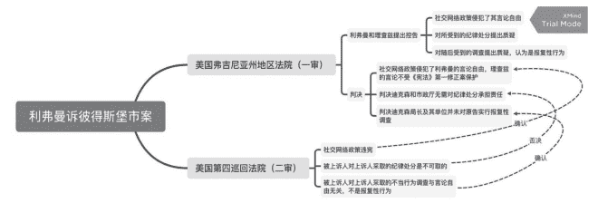

### 核心争议点

1.依据皮克林平衡分析法，2010 年与 2013 年的社交网络政策是否违反宪法第一修正案.

2.劳工部门依据 2013 年社交媒体政策对原告采取的纪律处分是否能够免责.

3.对于侵犯言论自由行为的报复性行为进行索赔是否能够成立.

### 裁判论证过程

#### （一）依据皮克林平衡分析法，2013 年的社交网络政策违宪

社交媒体的发展拓展了美国宪法第一修正案中言论自由的受保护范围，值得注意的是，公职人员在社交媒体上的言论自由边界需要进一步明确.根据既往判例，公职人员不会因为受雇而失去其在宪法第一修正案中的所有权利，美国最高院认为，为政府工作的公民仍然是公民.宪法第一修正案限制了公共机构利用雇佣关系来限制雇员作为私人公民所享有的言论自由的能力，若雇员作为一个公民发言以解决公众关心的问题，则该行为受到宪法第一修正案的保护.^([\[17\]](#txt009.html#footnote_content_txt009_17))

本案中，弗吉尼亚州法院认为，在分析 2010 年与 2013 年的社交网络政策是否违反宪法第一修正案时，需要进行皮克林平衡分析，具体分为以下两个步骤：第一步，需要确定利弗曼和理查兹两人是否就公共问题发表言论.一审法院认为，利弗曼的评论是对“官员安全与责任”问题的关注，是对公职人员履行职责和机构运作受到阻碍表示关切，而非对其雇主的针对性批评，因此，利弗曼的评论涉及公众关心的问题，受到宪法第一修正案的保护.至于理查兹，一审法院认为理查兹的评论是其个人对就业条件的不满和控诉，其指向明确，并非是想通过自己的评论加强公众对利弗曼提出的公共关切的关注，仅仅是通论评论表达自己的私人不满，因此，理查兹的发言不涉及公共利益，不应受到宪法第一修正案的保护.第二步，需要比较利弗曼和公众的利益与部门的利益.在进行皮克林平衡分析之前，需要界定 2013 年社交媒体政策限制的范围.2013 年社交媒体政策禁止雇员在社交媒体平台上发表可能会给彼得堡市警察局和其他任何部门带来不利名誉的言论.结合既往判例，宪法第一修正案不保护在社交媒体上对于该局内部运作的负面评论以及影响公众对该局看法的行为.回归到本案，利弗曼的言论不涉及对该局的负面评论，而是对公共利益的关切，所以，利弗曼的在 Facebook 上发表的言论受到宪法第一修正案保护.接下来，进行皮克林平衡分析.利弗曼作为雇员针对“官员安全与责任”发表的评论具有重要意义，相比之下，部门人员之间的凝聚力、有效的征聘工作、社区信任等促进执法高效率和部门内部有效运作的部门利益，不足以超过利弗曼和公众对公众关心的问题发表意见的利益.根据皮克林平衡分析，利弗曼发表的言论涉及公众关切的问题，其利益超过部门利益，受到宪法第一修正案中言论自由条款的保护，因此依据 2013 年社交网络政策对其进行纪律惩戒是违宪的.

#### （二）劳工部门依据 2013 年社交媒体政策对原告采取的纪律处分不能免责

弗吉尼亚州法院认为，由于皮克林平衡分析在适用过程中比较困难，难以具体化、明确化.因此，迪克森作为部门负责人，难以认识到自己对于利弗曼的惩戒行为侵犯了宪法第一修正案中的权利，不能认定迪克森不合理地利用了 2013 年的社交网络政策，所以，迪克森不需要因其惩戒行为承担责任.至于市政部门是否需要承担责任，弗吉尼亚州法院认为只有当市政部门是该政策的最终制定者时，才需要承担市政责任.本案中纽约市从未批准 2013 年的社交网络政策，不能仅仅因为其雇佣了侵权人迪克森而追究其市政责任.上诉法院不同意一审法院的意见，上诉法院认为迪克森对利弗曼的惩戒是不合理的.言论自由并非是一个灰色地带，反对限制言论自由的一刀切的做法，政府事先全面禁止反对意见的表达是不合理的，因此，利弗曼因为发表带有反对性质的意见而受到惩戒是不合理的，这不利于公众行使监督权利.因此，迪克森没有理由免责.至于市政责任，上诉法院认为，迪克森尽管不具有制定该项政策的最终权力，但其可能受到纽约市政府的指导和控制，因此，应当发回地方法院进行更具体的调查.

#### （三）有关部门对原告采取的不当行为调查与言论自由无关，不是报复性行为

一般来说，要获得侵权机构的赔偿，利弗曼和理查兹必须证明：（1）其就公众关心的问题进行的发言是作为公民而不是雇员作出的；（2）其作为公民在有关言论中获得的利益，超过了雇主为公众提供有效和高效服务的利益；（3）发表该言论和部门的报复性行为之间有充分的因果关系.显然，利弗曼的发言符合前两个条件，而理查兹的评论不符合第一个条件.对于第三点，上诉法院认为针对两位原告的调查都有独立的依据.利弗曼一共受到两次调查，第一次是有关部门发现利弗曼曾向一名女警官发送过色情邮件.其所在部门发起了一项性骚扰调查，在调查期间，利弗曼承认在工作期间从事了不正当性行为.此外，利弗曼还因无视迪克森局长的命令，未能按指示坚守岗位而被调查.因此，对利弗曼进行调查与其言论自由受到侵犯并无直接因果关系，其不能主张索赔.理查兹也被调查了两次.这两次调查都是其同事提出投诉的结果，与迪克森局长无关.第一个投诉与理查兹向媒体举报另一名警官的配偶有关.在理查兹证明自己无罪后，警局在一周内就结束了调查.第二个投诉是他参与了百货商店的一个警察项目.有关部门再次确定这些指控是毫无根据的.因此，原告没有任何证据能够证明其被实施了与发表案涉言论相关的报复性行为.

### 审理结果

1.弗吉尼亚州法院判决 2013 年的社交网络政策侵犯了利弗曼的言论自由，并未侵犯理查兹的言论自由，上诉法院确认了这一判决.

2.弗吉尼亚州法院判决迪克森依据 2013 年社交媒体政策对利弗曼和理查兹进行纪律处分的行为享有豁免权，无需承担责任，上诉法院驳回这一判决，判决迪克森承担责任.

3.弗吉尼亚州法院判决纽约市政府无需承担市政责任，上诉法院裁定发回重审.

4.弗吉尼亚州法院判决迪克森及其部门无需承担对于侵犯言论自由行为的报复性索赔，上诉法院确认这一判决.

### 相关法条

美国宪法第一修正案（Constitution of the United States First Amendment）

国会不得制定关于下列事项的法律：确立国教或禁止宗教自由；限制言论自由或出版自由；限制人民和平集会和向政府请愿申冤的权利.

### 案例评析

#### （一）引发了关于社交媒体政策限制与个人言论自由边界的讨论

美国宪法第一修正案禁止政府通过立法限制公民的言论自由，肯定了公民享有言论自由的权利.而社交网络政策却与此相悖，多对言论自由加以限制.言论自由的边界究竟在哪里？首先要明确的是，根据以往判例确定的特殊类型言论：煽动违法行为的言论、淫秽言论、构成犯罪行为的言论、殴斗言论、儿童色情、构成严重和现实威胁的言论，这些言论并不受到宪法第一修正案的保护；其次，不实言论，如诽谤的言论也不受言论自由的保护.本案中利弗曼和理查兹在社交媒体上发布的评论并非以上言论，那么雇员针对公职部门的评论是否受到言论自由保护？此类问题的解答，需要借助于 Connick 案^([\[18\]](#txt009.html#footnote_content_txt009_18))和 Pickering 案^([\[19\]](#txt009.html#footnote_content_txt009_19))中提出的传统分析，即权衡公共利益与部门利益以确定该言论是否受到言论自由的保护.本案判决表明：当言论所涉及的公共利益大于部门利益时，该言论受到宪法第一修正案的保护，可以对侵犯该言论的行为提起诉讼.可以看出，皮克林平衡分析已成为判断公民对公共部门的评论是否违反社交媒体政策的重要分析方法.

#### （二）引发了关于劳动者社交媒体言论自由的讨论

劳动者使用社交媒体发布不利于用人单位的评论，进而引起劳动者与用人单位之间的纠纷，成为职场的热点话题.在美国，尽管《国家劳动关系法案》（National Labor Relation Law）为劳动者的言论自由提供了相当的保护，但劳动者的言论自由也不是绝对的.《国家劳动关系法案》保护劳动者结社以及参与其他集体行动的权利，但该法同时保护雇主管理企业的合法利益，包括“保持职场纪律及促进公司效率的无可争议的权利”.^([\[20\]](#txt009.html#footnote_content_txt009_20))劳动者社交媒体言论自由的边界究竟在哪里？以我国为例，在实务中，法院通常会考虑以下因素：（1）劳动者反映的问题是否属实；（2）行为是否对公司造成损害；（3）行为的严重程度；（4）言论的传播范围；（5）惩戒措施是否合理.谢增毅认为，确立劳动者社交媒体言论自由边界应考量四个要素：第一，用人单位关于劳动者社交媒体行为的规章制度，由于劳动者社交媒体权利弹性较大，用人单位内部制度成为判断雇员行为是否合法的一项标准；第二，劳动者言论的动机，实践中常常出现雇员权利受到损害，进而在社交媒体上发布不利于用人单位的言论的情形，此种言论是合理诉求的表达，应给予更高的宽容度；第三，劳动者言论造成的后果，只有当造成现实伤害时，雇员的言论才应受到限制；第四，具体情节及其严重程度，如劳动者发布言论的起因、传播的范围、行为是否具有可替代性、雇主是否进行了警告和提示等.此外，雇主对劳动者社交媒体行为的惩戒措施应符合比例原则，不应当过于苛刻，应该做到罪责具体明确、公平合理、程序正当.^([\[21\]](#txt009.html#footnote_content_txt009_21))

## （三）推动对社交媒体政策多方规制的完善

近年来美国社交媒体异军突起，迅猛发展.社交媒体具有分布范围广、传播速度快、影响力大等特点.美国联邦最高法院也意识到，就人们相互交流观点而言，如果说以前还很难判断哪些场所是最重要的，现在则无疑是互联网，尤其是社交媒体.^([\[22\]](#txt009.html#footnote_content_txt009_22))与此同时，由于没有统一的法律对社交媒体进行规制，各种社交媒体政策层出不穷，由于立场的不同，社交媒体政策可能会在一定程度上侵犯人们的权利，因此，针对社交媒体政策进行多方规制的重要性不断凸显.首先，依靠现有法律进行规制.尽管美国宪法第一修正案充分肯定了言论自由的权利，但并不保护煽动违法行为的言论、淫秽言论等类型的言论，社交媒体领域也是如此，社交媒体的发展拓展了传统法律规则适用的范围，现有的法律目前仍然是影响社交媒体政策的主要力量.其次，网络平台成为规制社交媒体的重要抓手.社交媒体开放性的运行模式突破了传统媒介控制言论发表的模式，平台无需对信息提供者发布的内容直接承担责任.同时，《1996 年通讯法》（Telecommunications Act of 1996）规定，如果一个网络信息平台“真诚地”认为来自网络信息提供者的某些信息内容是淫秽、猥亵、下流、肮脏、过于暴力、构成骚扰或以其他方式令人反感的，该平台有权拒绝发表或删除该等内容，即使这些内容本身仍属于《美国宪法》保护的言论.也就是说，网络信息平台在某些方面享有比政府更大的限制言论自由的权力.因而社交媒体政策应充分重视网络平台的特殊地位，以发挥社交媒体的作用.最后，网络用户也成为规制社交媒体政策的重要力量.^([\[23\]](#txt009.html#footnote_content_txt009_23))本案利弗曼通过侵权之诉确认 2013 年社交网络政策侵犯了其言论自由权，说明网络用户可以通过诉讼等方式捍卫自己的权利.因而网络用户也成为规制社交网络政策的重要力量.

## 【关联判例推荐】

### 1\. Grutzmacher v.Howard Cnty., 851 F.3d 332 (4th Cir. 2017)

核心事实：马里兰州霍华德县消防和救援服务部的两名雇员将原告 Grutzmacher 的 Facebook 帖子转发给了部门内的另一营长.Jerome 向原告发送电子邮件，指示其查看其最近在 Facebook 上发布的信息，并删除与该部门的社交媒体政策不符的任何内容.原告尽管坚持认为自己遵守社交媒体政策，但最终删除了 1 月 20 日的帖子.原告将此事提交巴尔的摩马里兰州地方法院，指控被告因原告行使其第一修正案的言论自由权而对其进行报复性解雇；此外，该部门解雇原告所依据的社交媒体政策违反了宪法第一修正案.法院认为，消防员的种族歧视言论与政府雇员关于工作场所公共政策问题的言论不“相同”.

与本案关联点：该案探讨了在个案中如何衡量部门对工作秩序和效率的维护与雇员在社交媒体上的言论自由.

## 9.3 奈特研究所诉特朗普案

### 【案件索引】

Knight First Amendment Institute at Columbia University v. Trump, 302 F.Supp.3d 541 (S.D.N.Y. 2018)

Knight First Amendment Institute at Columbia University v.Trump, 928 F.3d 226 (2d Cir. 2019)

Knight First Amendment Institute at Columbia University v. Trump, 953 F.3d 216 (2d Cir. 2020)

Biden v. Knight First Amendment Institute at Columbia University, 141 S.Ct. 1220 (2021)Knight First Amendment Institute at Columbia University v. Biden, 2021 WL 5548367(2d Cir. 2021)

### 【关键词】

美国宪法第一修正案；社交媒体平台；公职人员社交账号；公共论坛

### 【案件提要】

本案是美国宪法第一修正案所规定的言论自由原则在互联网空间的延伸.美国宪法第一修正案在 1791 年并入宪法后的一百多年里，对言论、出版自由的保护功能处于完全休眠的状态；直到“《纽约时报》诉沙利文案”之后，联邦最高法院开始通过案件判决不断丰富修正案中寥寥数语的含义.^([\[24\]](#txt009.html#footnote_content_txt009_24))本案则探讨了第一修正案在新型社交媒体平台推特（Twitter）上的应用.唐纳德·特朗普（下称“特朗普”）因原告在其推特账号的评论区域里发表了反对性言论，而将数位原告的推特账号拉黑，原告因此失去了直接浏览和回复特朗普推特内容的能力.他们和哥伦比亚大学奈特第一修正案研究所（下称“奈特研究所”）共同对总统和其他被告提起了诉讼，请求法院宣告被告的拉黑行为违反了宪法第一修正案，并禁止被告进行此类行为.

本案的特殊之处在于，@realDonaldTrump 账号并不是一个典型的官方账号或政府账号.特朗普总统早年以私人身份申请并使用这个账号，但在就职总统后大量使用该账号用于政府公务而非私人目的，而本案原告所发表的批评性言论也与总统本人通过该账号发布的政府政策有关.@realDonaldTrump 账号的特殊属性在纽约州南区法院和美国第二巡回上诉法院引起了案件双方对账号性质、拉黑行为性质等问题的争议.

在特朗普方上诉到美国联邦最高法院之后，本案发生了戏剧性的变化：拜登在总统竞选中击败特朗普成为美国第 46 任总统，而推特也在特朗普下台后永久性关闭了其个人推特账号.联邦最高法院基于这一事实，将本案的讨论核心从公职人员的社交媒体使用上，拓展到网络社交媒体平台与宪法第一修正案言论自由原则之间的关系上.在本案中托马斯大法官认为：类似案件与其关注像特朗普这样的公职人员阻止回应者的行为，不如关注这些平台本身所行使的权力.“如果我们的目标是确保民众的言论不被扼杀，那么更引人注目的必须是占主导地位的数字平台本身.”

### 【案件要旨】

美国纽约州南区法院（一审法院）：原告 哥伦比亚大学奈特第一修正案研究所和丽贝卡等人 被告 唐纳德·特朗普、霍普·希克斯、萨拉·赫卡比·桑德斯、丹尼尔·斯卡维诺

美国第二巡回上诉法院（上诉法院）：上诉方 唐纳德·特朗普、萨拉·赫卡比·桑德斯、丹尼尔·斯卡维诺 被上诉方 哥伦比亚大学奈特第一修正案研究所和丽贝卡等人

美国联邦最高法院（上诉法院）：上诉方 约瑟夫·拜登 被上诉方 哥伦比亚大学奈特第一修正案研究所和丽贝卡等人

特朗普于 2009 年 3 月在推特上创建了@realDonaldTrump 账号.在就职总统之前，他一直使用这个账号发送推文，谈论政治、商业、流行文化等各种话题.自 2017 年 1 月就职总统以来，特朗普开始使用@realDonaldTrump 账号作为他与社会公众就其个人执政表现进行互动沟通的渠道.本案中的个人原告都是关注了@realDonaldTrump 账号的推特用户，他们中的每个人都曾在特朗普账号的推文评论区中发布过个人评论，以抨击特朗普在推特中发布的政府政策和个人观点.个人原告们的推特账号随即被@realDonaldTrump 账号拉黑，这种状态一直持续到原告们向纽约州南区法院提起诉讼时，并直接导致原告们无法再通过本人的推特账号来查看@realDonaldTrump 账号的相关消息.而本案中的另一原告奈特研究所是一个致力于通过诉讼、研究和公共教育来捍卫和加强数字时代的言论自由和新闻自由的机构，它认为本案中特朗普拉黑个人原告账号的行为，直接侵害了该机构阅读和了解个人原告对特朗普推文所发表的评论的权利.

2017 年 7 月，奈特研究所和个人原告们向纽约州南区法院提起诉讼，质疑总统禁止个人原告访问其推特平台账号的行为，并将总统、白宫社交媒体总监丹尼尔·斯卡维诺（下称“斯卡维诺”）和时任白宫新闻秘书肖恩·斯派塞列为共同被告，向法院寻求宣告性和禁令性救济.

2018 年 5 月 23 日，纽约州南区法院经审理后判决：（1）原告有权起诉总统及白宫社交媒体总监，但没有资格起诉白宫新闻秘书.（2）原告寻求参与的推特社交平台讨论活动应受到宪法第一修正案的保护.（3）特朗普和斯卡维诺实施了对@realDonaldTrump 账号特定的政府性控制；特朗普推特账号的评论区域在公共论坛原则的分析下，被定性为政府指定的公共论坛.（4）特朗普基于个人评论内容将原告账号拉黑的行为，是被宪法第一修正案所禁止的观点歧视行为，并且不能被宪法第一修正案所保护的总统个人利益合法化.（5）在假定被告判决后会纠正前述违宪行为的前提下，法院拒绝发布针对总统和其他人员的禁令性救济，仅同意原告的宣告性救济请求，判定特朗普总统的行为违反了宪法第一修正案.

随后本案被告特朗普一方向美国第二巡回上诉法院提起上诉，请求驳回原告的诉讼请求，其理由如下：（1）该账号仅是总统的私人账号，而非用于行政的政府官方账号；拉黑行为是总统个人的私人行为，并不是代表国家的政府行为.（2）该账号的评论区域不是政府指定的公共论坛，即使该账号是公共论坛，总统拉黑个人原告推特账号的行为也不会阻止原告们通过其他途径访问@realDonaldTrump 账号.（3）在该账号被政府所控制的范围内，发表在@realDonaldTrump 账号上的言论属于政府言论，而第一修正案所确立的言论自由原则不适用于这种言论的规制.

2019 年 7 月，美国第二巡回上诉法院驳回了这一上诉请求，维持初审法院判决.之后被告方再次向美国第二巡回上诉法院提交了全体重审请求，但这一请求于 2020 年 3 月被法院驳回.

2020 年 8 月 20 日，被告向美国联邦最高法院申请再审.在联邦最高法院审理本案之前，2020 年美国大选结果出炉，拜登战胜特朗普当选为美国第 46 任总统，并代位承继了本案中被告方的诉讼权利和义务.联邦最高法院审理后认为：基于推特公司关闭注销特朗普推特社交账号的行为，可以认定特朗普总统对该账号的控制非常有限，公共论坛所要求的政府控制条件在本案中并不能够被满足；同时本案中推特平台的相关行为没有受到政府胁迫，也不存在可以将推特平台类比为公共承运人或公共设施的特殊情形，宪法第一修正案的言论自由原则不能在本案中适用.联邦最高法院最终裁定撤销第二巡回上诉法院的原判决，将案件发回第二巡回上诉法院重审.

2021 年 5 月 26 日，美国第二巡回上诉法院基于联邦最高法院的判决，裁定驳回原告的诉讼请求.

### 【案例事实思维导图】

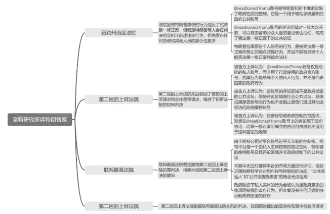

### 【核心争议点】

1.本案中的@realDonaldTrump 账号是特朗普总统的私人账号，还是用于政府公务的公共账号.

2.特朗普总统拉黑用户推特账号的行为是一项私人行为还是政府行为.

3.在政府言论原则和公职人员的宪法第一修正案权利下，公职人员拉黑公众社交账号的行为能否被合法化.

4.特朗普推特账号的评论区域是否是一个可供公众自由发表观点的公共论坛.

5.推特作为一个被私人实体控制的社交媒体平台，是否存在适用宪法第一修正案言论自由原则的可能性.

### 【裁判论证过程】

#### （一）@realDonaldTrump 账号是一个总统用于辅助履职的政府公共账号

公共论坛是一个必须由政府拥有或控制的空间，它是一种公共财产或专用于公共用途的私人财产.因此即使政府对某个空间没有法律所有权，该空间也可能基于政府控制而形成公共论坛.^([\[25\]](#txt009.html#footnote_content_txt009_25))

被告特朗普一方认为：推特是一个私人拥有和运营的社交媒体平台，而特朗普在 2009 年 3 月以@realDonaldTrump 的名称建立了属于自己的私人账号；自从担任总统以来，特朗普保留了对该账号的个人控制权，该账号的私人性质没有发生改变，它仍是特朗普自己的私人言论平台.

一审法院和上诉法院则认为：本案讨论的是该账号现在的性质，应主要考察该账号现在的使用状况.（1）账号的公开信息展示以及与之相关的网页均表明这是一个代表国家、由政府负责运营的官方账号，总统及其办公室的多名成员也将总统对这一账号的使用描述为具有官方性质，负责维护政府记录的国家档案馆也得出结论：特朗普总统的推特推文属于一种官方记录；（2）原被告双方也都同意，就职以来特朗普就一直使用该账号并“将其作为与公众就行政相关事项进行互动沟通的重要渠道”，该账号是白宫开展政务活动的主要工具之一.出于这些原因，法院得出结论：指向该账号的公共、非私人性质及其用于总统与公众交流的因素是压倒性的，官方账号属性在分析中所占的比重远超私人账号属性.

因此，特朗普总统和白宫社交媒体总监斯卡维诺对@realDonaldTrump 账号的各个方面行使着政府性的控制权，满足本文前述的政府控制要素；特朗普个人也确实将该账号视为总统账号，并使用该账号来进行只有拥有总统身份的人才能采取的行动.

#### （二）特朗普总统拉黑用户推特账号的行为是一项政府行为

一项行为是否是“以政府名义”进行的与一项行为是否构成“政府行为”，其判断标准是相同的，即行为人是否“行使政府所拥有的权力”，并披上了政府的权威.^([\[26\]](#txt009.html#footnote_content_txt009_26))被告方认为总统的拉黑行为不是触发第一修正案审查的政府行为，而只是特朗普的私人行为，因为拉黑功能是每个推特用户都可以使用的功能，并不是一项政府或公职人员才能行使的特殊权力.

一审法院和上诉法院认为：政府官员在纯粹属其个人所有的社交账号下进行的拉黑行为当然不属于政府行为，但必须考虑本案中特朗普拉黑行为的特定背景.（1）对账号行使控制权的主体是一个公职人员（总统）及其下属，该账号也已经被法院认定为属于政府公共账号，特朗普总统的拉黑行为可以视作政府作为财产所有者或控制者行使排他权、限制他人进入和使用其财产的行为，这当然是一种政府行为.（2）同时，特朗普在发推文时是以总统身份而不是普通公民的身份来行事的，因此法院得出结论，当总统拉黑那些反对其推文内容的人时，其同样在以总统身份做这件事.政府公职人员的典型特征是“公职身份给其个人决定增加了国家影响力”，因为特朗普在以总统身份执行这件事情，所以拉黑行为属于政府行为.

但第二巡回上诉法院的两位异议法官对这个问题提出了少数意见，他们赞同被告的上诉意见.两位法官认为：（1）陪审团的推理—因为特朗普一贯以总统身份在@realDonaldTrump 账号上发布消息，所以其使用推特的拉黑功能也是一种政府行为—是一种错误分析，这导致依据特朗普推特账号的部分政府性使用，将整个账号的全部推文和与其相关的所有使用行为都变成了政府行动；法院的关注重点应该是拉黑行为这种具体行为的行为性质，而不是整个账号的某种状态.（2）总统在推特上大量谈论其在任期间的工作，但这不足以使其个人账号转变为政府性质的公共账号；否则公职人员将为了不把个人社交媒体账号上的所有活动转化为政府行为，从而避免在其个人社交账号中讨论任何公共事务.（3）最后，两位法官认为上诉法院在这一问题上的判断过度依赖案件事实所带来的直观印象，而没有确定一个清晰直观、不易混淆的政府行为判断原则，这导致了社会公众对公职人员的个人社交媒体活动何时会成为政府行为的困惑.例如，从上诉法院的决定来看，特朗普总统的推特活动变成政府行为的时间节点并不清晰—它是发生在总统就职日还是取决于一份来自@realDonaldTrump 账号的特定“官方声明”？将总统的私人推文转化为具有社会影响力的政府行为又需要这个账号发布多少条带有公共政策内容的推文呢？

#### （三）在政府言论原则和公职人员的宪法第一修正案权利下，公职人员拉黑公众社交账号的行为不能被合法化

政府言论属于不适用言论自由原则的言论：当政府进行自己的演讲时，它被允许“为自己说话”并“选择它想要表达的观点”.“言论自由条款仅限制政府对私人言论的规制；它不规制政府言论本身.”^([\[27\]](#txt009.html#footnote_content_txt009_27))

被告认为：既然法院已经认定该账号被政府控制并成为了一个公共账号，那么该账号上的言论应当是政府言论，与政府言论相关的公众评论也就不适用言论自由原则了.一审法院和上诉法院则认为：（1）@realDonaldTrump 账号发送的推文内容属于政府言论，但这个推特账号的评论区域却并非如此；（2）发送评论者以私人名义进行评论，政府无法对个人评论的内容保持控制力；（3）推特账号的评论区域满足公共论坛“开放获取”和“观点中立”两个关键属性：推特是对公众普遍开放的，唯一的限制是 13 岁的年龄限制；推特在观点上是中立的，它只是一个用户发表意见的平台，平台本身不对社会事件发表任何看法.

# 案例分析

被告同时主张，公职人员保留了第一修正案所涉及的个人利益，可以自由选择本人的交流对象；原告无权要求总统听取其言论，“没有宪法权利强迫政府必须听取他们的意见”.对此一审法院和上诉法院认为，公职人员在就职后不会失去其第一修正案权利，第一修正案或最高法院判例中也没有任何内容表明：言论、结社和请愿的权利要求政府决策者必须倾听或回应个人在公共问题上的任何沟通.但本案中的拉黑行为不仅是一种忽视或不回应，而且是一种对公众言论发表自由的主动限制.该行为限制了被拉黑用户向社会公众表达观点的权利，因为用户的推文评论本来对其他人而言是可见的，并且可能会被其他用户回复.

被告进一步辩称：拉黑行为的影响事实上可以通过各种变通办法来补救，比如换号登录，实际上该行为并没有阻碍或禁止任何人发表言论.但法院认为：尽管存在各种“变通办法”，这仍然给原告的言论发表造成了额外的负担；根据言论内容排斥个人原告的做法是典型的“观点歧视”行为，即使只是造成言论发表的额外负担也无疑违反了宪法第一修正案.

## （四）特朗普推特账号的评论区域并非可供公众自由发表观点的公共论坛

公共论坛适用于这样的情况：在不破坏政府财产或政府项目基本功能的前提下，政府拥有的某项财产或项目能够自由容纳大量的公众演说，为社会公众就各项社会议题提供一个自由的意见表达空间.相比之下，当“政府拥有广泛的自由裁量权，可以根据私人言论内容，决定是否给公众提供一个空间时，就不能适用公共论坛理论”.

第二巡回上诉法院认为考虑一个互动空间是否为公共论坛时，应当考虑：政府的意图、政策、过往实践、相关财产的性质及其与表达活动的兼容性.（1）本案中，@realDonaldTrump 账号的评论区域对一般大众开放，这种开放不考虑政治立场或其他任何限制条件；（2）总统助理斯卡维诺公开宣称该账号的评论区域是“总统与美国人民进行直接交流的一种方式”；（3）同时没有任何迹象表明特朗普推特账号的评论区域与公众的表达活动不相兼容，反之，推特平台的广泛互动性使其可以容纳网民大量的意见表达.一审法院和上诉法院都认为如果政府开放一种“供大众不受歧视地自由使用”的交流手段，这将为整个社会创建一个公共论坛；而特朗普就任总统一职后，反复使用该账号进行政府政策的公开讨论，将其作为白宫治理的官方工具，并使公众不受限制地使用其互动评论功能，这种行为无疑创造了一个可供民众自由发表观点的公共论坛.

然而，上诉法院的两位异议法官同样发表了反对意见：政府只能通过有意，而不能通过某种不作为或允许有限个体进行话语表达的形式，来创建一个网络公共论坛.（1）特朗普在 2009 年创建@realDonaldTrump 账号是为了表达自己的个人观点，之后使用这一账号发布政府政策也只是出于便利和使用习惯，他并未想通过这一账号的评论区域为美国的社会公众提供一个自由的意见表达空间.（2）@realDonaldTrump 账号的评论区域也并不是向所有人开放的，只有关注了该账号的用户才可以就特朗普发布的推文发表评论.

这一问题在案件上诉到联邦最高法院之后发生了新的变化：在特朗普卸任美国总统一职后，推特公司以“担心进一步煽动暴力”为由，永久性关闭了特朗普的个人推特账号.基于这一事实，联邦最高法院对这个问题做出了新的判断.最高法院大法官们援引了“克里希纳理论国际学会诉李案”中的观点—政府指定的公共论坛是“国家为部分或全部公众的表达活动所开放的财产”^([\[28\]](#txt009.html#footnote_content_txt009_28))—指出特朗普推特账号的某些方面确实类似于一个公共论坛，如使用该账号进行官方身份的发言、评论区域允许用户公开评论.但公共论坛本质上是一个为政府所控制的社会空间，而不受某些私人实体控制，这是判定公共论坛存在与否的一个核心标准.为此最高法院的大法官们举例进行说明：政府机构在酒店租用会议室就拟议法规举行公开听证会时，不能因为参与者表达了对新法规的担忧而将其赶出会议室；^([\[29\]](#txt009.html#footnote_content_txt009_29))而政府官员在酒店与选民进行非正式聚会时，则可以要求酒店赶走一名挤进聚会中大声表达自己观点的讨厌顾客.^([\[30\]](#txt009.html#footnote_content_txt009_30))区别在于：第一种情况下政府控制整个空间，而在后一种情况下控制者是私人酒店.

在本案中，特朗普仅仅只是阻止了几个人与其进行信息互动，而推特平台不仅禁止特朗普与其支持者们互动，更是将其账号从整个平台中永久性移除.根据 2020 年 6 月 18 日生效的推特用户协议服务条款，推特公司可以在任何时候出于任何原因从其平台上删除任何人的社交账号（包括美国总统在内）.与推特公司对平台账号近乎无节制的控制权相比，特朗普本人对个人账号的控制显得苍白无力.联邦最高法院最终判定：推特平台是一个由私人主体控制的言论空间，特朗普的推特账号及其评论区域并非政府控制下的社会公共论坛.

## （五）推特作为一个由私人实体控制的社交媒体平台，不符合适用言论自由原则的三种特殊情形

虽然推特平台已经被联邦最高法院的大法官们定性为私人集中控制的在线社交平台，但这并不意味着宪法第一修正案下的言论自由原则对其而言不存在适用空间了.联邦最高法院的大法官们讨论了以下三种可能适用言论自由原则的特殊情形：

### （1）公共承运人（Common Carriers）
公共承运人是一种特殊的私人实体，在交通、通讯行业比较普遍.在英美法中，政府通常会对被视作公共承运人的企业施加特殊管理规定，以限制这些私人公司的排他权限，比如要求这些企业为所有寻求交易的客户提供一般性服务，限制这些企业的拒绝交易权.^([\[31\]](#txt009.html#footnote_content_txt009_31))但同时政府也会给予这些私人实体特殊优惠待遇，比如实施行业特许经营许可使得其他企业难以与其竞争，或者赋予其豁免于特定类型诉讼的特权.通过施加在这些企业上的限制与特权，政府将这类企业转化为了一种特定类型的私人主体，并使其承担一些传统上由国家负责的某些公共职能.

有观点认为作为公共承运人的企业必须以支配性的市场力量作为前提.但也有观点认为公共承运人身份的获得并不需要支配性的市场力量，只需要这个企业对社会公众进行普遍性的开放，任何愿意为他人提供运输服务的私人个体都可以成为公共承运人.^([\[32\]](#txt009.html#footnote_content_txt009_32))联邦最高法院在本案中认为，公共承运人的本质是限制其部分私人权益而使其更多服务于社会公共利益；即便是在一个传统上不被承认为公共承运人的行业，一个企业如因其所处状况和业务性质从一个完全的私人企业转变为服务于社会公共利益的企业，那么其公共承运人身份也是可以被承认的.

将本案中的推特平台类比为英美法上的公共承运人是有合理性基础的.因为在美国的先例中，政府曾将类似于推特平台的传统通信网络服务商认定为公共承运人并实施监管：西部联合电报公司曾被起诉要求出于公共利益为所有客户提供一视同仁的服务，不得有歧视性的经营行为.^([\[33\]](#txt009.html#footnote_content_txt009_33))但联邦最高法院最终否定了本案中进行这种类比的合理性：首先，在案件的审理记录中，没有任何内容可以评估推特平台的市场力量；其次，诉讼方和先前的审理法院也都没有发现任何可以限制推特平台关闭用户推特账号权限的法规.推特平台如果想要成为一个适用言论自由原则的政府控制空间，就必须像公共承运人一样接受政府对其排他权限的限制，不具备随意关闭用户推特账号的权力，但目前的情况显然不符合这一点.

### （2）公共设施提供者（Public Accommodation）
这一概念与公共承运人类似，适用于产品服务对社会公众进行普遍性开放的非交通、通讯类企业，例如公共娱乐性场所.^([\[34\]](#txt009.html#footnote_content_txt009_34))布莱克法律词典将公共设施提供者定义为向公众提供住宿、食品、娱乐或其他服务的经营商，^([\[35\]](#txt009.html#footnote_content_txt009_35))推特与其他网络社交平台公司符合这一定义.但司法实务对“公共设施”中是否包括物理地点以外的社交网络平台存在着明显的争议，“多伊诉奥马哈互惠保险公司案”^([\[36\]](#txt009.html#footnote_content_txt009_36))中，法院认为《美国残疾人法》（Americans with Disabilities Act， ADA）第三章的内容包含了互联网网站；而“帕克诉大都会保险公司案”^([\[37\]](#txt009.html#footnote_content_txt009_37))中，法院则认为《美国残疾人法》第三章的覆盖范围应只限于物理实体.

联邦最高法院则采用了公共承运人分析中的同样理由否定了这种适用可能：公共设施提供者的概念要求存在对推特平台单方面关闭特朗普账号之权力的限制，以证明本案中的推特账号确实由政府控制，并创建了一个公共论坛；但本案中不存在对推特平台的类似规制.

### （3）政府胁迫（Government Threats）
虽然“私人实体通常不受第一修正案的约束”，但如果政府强制或诱使其采取政府本身不允许采取的行动，例如审查观点表达的合法性，这一原则就会发生变化.^([\[38\]](#txt009.html#footnote_content_txt009_38))政府可能通过一些不利于当事人的政府行动来威胁私人实体（如提起刑事诉讼），胁迫私人主体代替政府完成一些自己不便实施的违宪行为.^([\[39\]](#txt009.html#footnote_content_txt009_39))在这种情形下，由于私人实体的自由意志受到了明显限制，其行为会被认为是政府意志的体现，进而被视作政府行为.

在本案中，如果拉黑原告个人账号或关闭特朗普个人账号的行为是推特平台在政府胁迫下进行的，那么推特平台对平台账号的私人控制就会被政府控制所代替，也就可以适用公共论坛下的言论自由原则了.但本案双方没有就推特平台提出任何指控，也没有任何证据能够证明政府胁迫的存在.

## 【审理结果】

1.美国纽约州南区法院认定@realDonaldTrump 账号是一个用于辅助总统履职的政府公共账号，特朗普拉黑原告推特账号的行为属于违反宪法第一修正案的观点歧视行为，同意原告的宣告性救济请求；但在假定判决后被告会纠正前述违宪行为的前提下，法院拒绝发布针对总统和其他人员的禁令性救济.

2.美国第二巡回上诉法院驳回被告的上诉请求，维持了初审判决.

3.美国第二巡回上诉法院再次驳回了被告的全体重审请求.

4.联邦最高法院审理后认为：特朗普推特账号的评论区域不是一个可供公众自由发表观点的公共论坛；推特作为一个由私人实体控制的社交媒体平台，不符合公共承运人、公共设施提供者、政府胁迫这些可能适用言论自由原则的特殊情形.联邦最高法院最终裁定撤销第二巡回上诉法院的判决，将案件发回第二巡回上诉法院重审.

5.美国第二巡回上诉法院基于联邦最高法院的判决，裁定驳回原告的宣告性和禁令性诉讼请求.

## 【相关法条】

美国宪法第一修正案（Constitution of the United States First Amendment）

国会不得制定关于下列事项的法律：确立国教或禁止宗教自由；限制言论自由或出版自由；限制人民和平集会和向政府请愿申冤的权利.

美国《总统档案法》第 2201 条第（2）款（Presidential Records Act§2201（2），44 U.S.C.§2201（2）（1978））

“总统档案”一词是指总统、总统直属工作人员或总统行政办公厅中以向总统提供咨询或协助为职能的单位或个人，在开展与履行宪法、法定或其他官方或礼仪职责有关或对其产生影响的活动过程中，制作或收到的文件材料或其任何合理可分的部分.该术语—

（A）包括与总统或总统幕僚的政治活动有关的任何文件材料，但前提是此类活动与总统履行宪法、法定或其他官方或礼仪职责有关或对其有直接影响；但

（B）不包括任何属于以下内容的文件材料：（i）某机构的官方记录（定义见《美国法典》第 5 卷第 552 条（e）款）；（ii）个人记录；（iii）出版物和文具库存；或（iv）仅为方便参考而制作的有明确标识的文件的额外副本.

## 【案例评析】

### （一）引发了对社交媒体平台与宪法第一修正案的关系的进一步讨论

本案在“帕金汉诉北卡罗莱纳案”^([\[40\]](#txt009.html#footnote_content_txt009_40))（下称“帕金汉案”）之后继续讨论言论自由原则在社交媒体平台中的应用.在帕金汉案中，肯尼迪大法官认识到网络空间是互联网上巨大的民主论坛，社交平台用户参与社交媒体活动将会受到第一修正案的广泛保护.而在本案中，托马斯大法官从平台控制权的角度，论述了应当谨慎地将社交媒体平台视为社会公共论坛的观点.

正如帕金汉案中所传达的那样：第一修正案的一个最根本的原则是所有人有权进入特定场所，从而能够倾听与表达，并在思考后进一步倾听与表达.这种对社会公众普遍开放的特性决定了社会公共论坛的政府控制属性，一个言论表达空间只有在政府控制下才能够以公共服务产品的形态向社会公众无差别地开放，让所有人不受限制地自由表达.而这种空间一旦为私人主体所拥有，该私人主体就可以基于所有权之上的排他权利在这个空间内合法地限制言论表达.在本案中，推特用户服务协议就赋予了推特平台在任何时间以任何理由关闭用户账号的权利.

托马斯大法官指出了本案所要解决的核心问题：传统法律原则应如何适用于网络社交平台这种所有权高度集中的私有化信息设施上.他在本案中总结出了可供参考的明确原则：私人控制的社交媒体平台不应理所当然地被认定为可供公众自由发表观点的公共论坛；第一修正案下的言论自由原则的适用，应以存在限制某个网络社交平台排他权限的具体法规，从而保证宪法第一修正案所要求的公众自由进入和自由表达为前提.

本案中所确立的司法原则是对帕金汉案结论的进一步发展，在这之后被“斯旺森诉格里芬案”^([\[41\]](#txt009.html#footnote_content_txt009_41))等十余个案件在论证判决理由时所引用.美国田纳西州立大学政治学教授瓦伊尔认为，托马斯法官虽然没有完全认可原告的立场，但他在联邦最高法院的判决中积极探索了网络社交平台需要对限制言论自由的行为承担责任的可能情形—一种是被视为公共承运人，另一种是被视为公共设施的提供者.虽然这两种责任概念还有待判例法的完善，但托马斯大法官的意见肯定会在这一司法领域引发进一步的讨论和发展.^([\[42\]](#txt009.html#footnote_content_txt009_42))

### （二）引发了对公职人员和政府机构社交媒体使用的司法讨论

近十几年来，美国的社交媒体异军突起，迅猛发展.根据美国皮尤中心的调查，2019 年底美国成年人中互联网、智能手机和社交媒体使用者的比例分别达到 90%、81%和 72%；脸书（Facebook）、推特（Twitter）和优兔网（YouTube）等社交媒体平台已经取代传统媒体，成为多数美国人获取信息资源、进行社交活动的主要渠道.这一方面极大地方便和丰富了美国人的生活，但另一方面也带来了对公职人员和政府机构社交媒体使用的司法争议.^([\[43\]](#txt009.html#footnote_content_txt009_43))

在本案中，一审法院和上诉法院都做出了特朗普拉黑原告账号的行为违反宪法第一修正案的裁定.有学者认为，本案判决对公职人员社交媒体使用产生了如下影响：公职人员应该认识到，如果他们想让自己在社交媒体平台上保持私人状态，从而不受第一修正案的规制，就不应该发布任何涉及公务行为的信息，也不应向社会公众开放账号的互动部分.公职人员一旦将个人或准个人社交媒体账号用于公务，他们需要意识到他们可能已经建立了一个公共论坛，之后他们对账号的支配能力也将受到限制.^([\[44\]](#txt009.html#footnote_content_txt009_44))

但也存在与本案一审法院和上诉法院相反的意见.康奈尔大学法律信息研究所评论道：“第二巡回上诉法院关于@realDonaldTrump 账号是一个公共论坛的结论，与我们经常将公共论坛描述为‘政府控制的空间’的说法相矛盾.”^([\[45\]](#txt009.html#footnote_content_txt009_45))随着越来越多的类似案件被提起，美国司法系统中也出现了和本案结论截然相反的法院判决，如在“坎贝尔诉赖施案”^([\[46\]](#txt009.html#footnote_content_txt009_46))中，该案审理法院认为州立法委员的社交媒体账号是一个私人账号，立法委员有权在该账号中自由地进行任何拉黑活动.

本案中，上诉法院的两位异议法官在法官意见的结尾表达了对一审法院和上诉法院两次判决结果的担忧：“这一意见将远远超出白宫的范围，对各级政府官员使用社交媒体的情况造成不确定性.”他们担心本案中的决定将影响公职人员使用社交媒体的方式，降低公职人员通过社交平台工具抵御仇恨和骚扰的能力，使其社交媒体页面充斥着无端谩骂和仇恨言论，并最终“无意中造成言论较少的后果”.但哥伦比亚大学的调查报告指出，自特朗普案法院意见发表以来，政府官员使用社交媒体的方式没有发生明显变化；事实上情况恰恰相反：在过去的几个月里，总统在推特上发帖的速度是 2017 年的三倍多.如何在社会公众的言论自由权利与公职人员的个人账号控制之间寻求一个合适的平衡点，这有待各国网络法学者的进一步研究.

而就政府机构的社交媒体使用状况而言，2020 年 4 月美国个人教育权利基金会调查了 200 多个公立大学和政府机构的官方社交媒体账号，其随后发布的调查报告《无可评论：政府机构的社交媒体使用情况和宪法第一修正案》表明：在 198 所回应机构中，80%以上的机构都在广泛使用社交媒体的过滤工具来审查与之相关的批评性言论.^([\[47\]](#txt009.html#footnote_content_txt009_47))这引起了美国律师组织对这些政府机构社交媒体功能设置的担忧，因为特朗普案中的法院意见得到了之后美国几十起案件判决的确认.相关律师督促这些机构制定公开的账号使用书面政策，并及时修改可能导致社会公众意见无法表达的屏蔽或审查功能，以避免可能产生的法律责任.

有评论指出，如果政府机构想要在自己的社交媒体平台上，对政府与社会公众间的双向信息流动施加一些限制，为了使这些限制尽可能符合宪法要求，就必须考虑下列因素：确保公众的意见表达不因观点内容而被选择性屏蔽；只对反复违反政府限制规定的平台用户施以短期的禁言处罚；保证社交媒体账号的管理人员实施管理行为时保持观点中立和非歧视性原则.^([\[48\]](#txt009.html#footnote_content_txt009_48))

# （三）揭示了公共论坛的两项根本组成要素：言论的“自由发出”和“自由到达”

在讨论本案是否存在一个公共论坛时，初审法院和美国第二巡回上诉法院的两位少数意见法官提出了不同看法.初审法院并没有将@realDonaldTrump 账号作为一个整体进而视为公共论坛，而是将账号分解成推文和评论区域两部分；他们认为特朗普总统有关行政工作的推文内容属于政府言论，因此不适用第一修正案和公共论坛原则；但账号的评论区域形成了一个可供公众自由互动的公共论坛.但上诉法院的两位法官则反对这一观点，认为无法进行这样“人为的、机械的”分解，@realDonaldTrump 账号并不存在一个初审法院所指的公共论坛.

因此两边进行了针锋相对的举例.初审法院认为：在政府举行的市政厅会议上，官员们发表的政治声明是受保护的政府言论（如同@realDonaldTrump 账号的推文）；但如果这个会议允许公众发表评论—就像@realDonaldTrump 账号的评论区域—官员们就不能根据个人所发表的观点内容阻止一些在场人士参加辩论.而上诉法院的两位法官则举出反例：（1）如果一名官员当众发布政府政策并只允许该政策的支持者进行当场评论，这并不需要向其反对者开放发言权；（2）如果官员向公众分发印有政府政策的小册子，并通过信件形式征集公众意见，这也不会剥夺其从中挑选一些意见并进行公开发布的权利.上诉法院两位法官的核心论点是：本案中这种“政策发布+公众评论”的模式，并不一定能使后一环节（公众评论）形成一个可供公众自由发表言论的公共论坛.

初审法院的逻辑在于将@realDonaldTrump 账号的推文和评论区域划分成两个独立、平等、可切割的部分，评论区域可以单独构成一个适用宪法第一修正案的公共论坛.而在上诉法院两位法官的逻辑下，二者是附属关系，评论区域附属于@realDonaldTrump 账号的推文，正如例（1）和例（2）中的政策支持者的评论和通过信件反馈的公众意见附属于政策发布行为；正是由于“政策发布”行为是无需考虑宪法第一修正案的政府言论，具有附属性质的“公众评论”环节也就“沾染”了这种特性而摒弃言论自由原则，因而公职人员可以对公众发言的条件施加限制.

笔者认同初审法院的看法.上诉法院的两位法官将本案中的@realDonaldTrump 账号与他们的两个举例等同，但实际上二者并不能够等同.公共论坛的两项根本组成要素是言论的“自由发出”和“自由到达”，@realDonaldTrump 账号和初审法院所举的市政厅会议的例子满足这两个要素，在这两种情形下公民若在账号的评论区域或市政厅的大厅发表自己的个人意见，这种意见将毫无阻碍地展现给其他推特用户或其他旁听公民，其意见的“自由发出”和“自由到达”都不会受到妨碍.但在上诉法院两位法官的例（1）中，由于政府官员只允许该政策的支持者进行当场评论，因此实际上限制了持有反对意见公民的言论的“自由发出”；而在例（2）中，由于官员可以挑选意见进行公开发布，因此公众言论的“自由到达”受到了他人干涉.

笔者认为，公共论坛是一个不需要外力干预就能自动传递言论的空间，公众言论从表达者口中“自由发出”，并“自由到达”其他受众.@realDonaldTrump 账号的评论区域符合这两项特征，而上诉法院两位少数意见法官的论证举例却没有注意到这一点.虽然联邦最高法院最终以推特平台对特朗普账号的私人绝对控制为由否定了其公共论坛地位，但认识到公共论坛的这两项组成要素，有助于在司法实践中对复杂的现实情况做出准确的法律性质判断.

## 【关联判例推荐】

### 1. Rosenberger v. Rector & Visitors of Univ. of Virginia, 515 U.S. 819, 115 S.Ct.2510, 132 L.Ed.2d 700 (1995)

核心事实：一所大学的学生组织出版了一份带有基督教观点的报纸，该组织对所在大学提起诉讼，质疑该大学基金会拒绝资助其出版印刷费用的行为.最高法院肯尼迪大法官认为：（1）拒绝资助等同于观点歧视；（2）在一个问题上排除几种观点与只排除一种观点对第一修正案的违反程度是相同的；（3）缺乏资金不是大学根据言论内容进行歧视性资助的合理理由.

与本案关联点：无论是“形而上学的（metaphysical）”论坛，还是空间或者地理意义上的论坛，都不得对论坛限制范围内的言论进行观点歧视.

### 2. Pleasant Grove City v. Summum, 555 U.S. 460, 129 S.Ct. 1125 (2009)

核心事实：一个宗教组织对市政府提起诉讼，声称市政府拒绝在一个已经建有十诫纪念碑的公园中建立其他纪念碑的行为，侵犯了其言论自由的权利.美国犹他州地区法院驳回了该组织的禁令请求，最高法院认可了这一判决并认为：市政府允许他人在公共公园中放置其捐赠的永久纪念碑，是在行使不受言论自由条款审查的政府言论权利.

与本案关联点：言论自由条款只限制政府对私人言论的规制行为，而不限制政府言论.

### 3. Sorrell v. IMS Health Inc., 564 U.S. 552, 131 S.Ct. 2653, 180 L.Ed.2d 544(2011)

核心事实：佛蒙特州药品生产商协会提起诉讼，质疑佛蒙特州《处方保密法》的合宪性（该法律限制出售、披露和使用载有个人医生处方的药房记录（pharmacy records））.美国佛蒙特州地区法院驳回了原告的救济请求；美国第二巡回上诉法院撤销了原审判决并发回重审.

与本案关联点：政府不可以通过施加内容审查或者言论负担来压制不受欢迎的言论.

### 4. Robinson v.Hunt Cty., Texas, 921 F.3d 440 (5th Cir. 2019)

核心事实：社交媒体用户提起诉讼，指控政府办公室对其社交媒体页面的审查违反了宪法第一修正案.德克萨斯州北区法院因原告未能提出合法的索赔请求驳回了原告的初步禁令动议.上诉法院随后撤销了北区法院的判决，并将案件发回重审.

与本案关联点：公职人员禁止选民进入政府官方社交媒体页面的行为是违反宪法的观点歧视行为.

## 9.4 门罗诉中心巴克斯学校案

### 【案件索引】

Munroe v. Central Bucks School Dist., 34 F.Supp.3d 532 (2014)

Munroe v. Central Bucks School Dist., 805 F.3d 454 (2015)

### 【关键词】

社交媒体；言论自由；劳动关系

### 【案件提要】

本案是有关社交媒体平台上的劳动者言论自由界限的经典案件.在本案中，原告门罗（Natalie Munroe）在其个人不设访问限制的博客上发表引人争议的言论，经过新闻媒体的报道，严重扰乱了学校的教学环境和秩序，因此被校方开除.原告门罗主张其在博客上发表的内容构成对于公共事务的讨论，故应当受到宪法第一修正案的保护.上诉法院经过讨论认为，原告在博客上所发表的内容属于对于公共事务的讨论，但是公职人员的言论若想受到宪法第一修正案的保护，还应当通过皮克林平衡性测试，即证明言论发布者参与公共事务讨论所产生的价值大于雇主工作环境和工作秩序由于该言论的不利影响而蒙受的损失.原告发布的言论未通过皮克林平衡性测试（Pickering balancing test），上诉法院的法官最终以 2：1 的结果决定驳回原告基于宪法第一修正案的的报复性主张（First Amendment retaliation），认定该案件事实清楚，应当适用简易程序进行判决.

本案对于明确劳动者在社交媒体平台行使言论自由权利的界限产生了积极影响，表明劳动者发表的不利于雇主并对其所在单位的工作秩序造成重大不良影响的言论，不受宪法第一修正案的保护.本案在劳动者享有的言论自由权利与雇主维持工作场所秩序与效率的权利之间进行了精细的比较与衡量，是对两种不同法益的一次平衡校正.同时，随着社交媒体影响力的扩大，本案也间接促成了与员工言论自由相关的法律解释的更新，使得美国劳动法更能反映网络时代下保护与限制言论自由的新特点.

### 【案件要旨】

宾夕法尼亚东区联邦地区法院（一审法院）：原告 娜塔莉·门罗 被告 中心巴克斯学校

联邦第三巡回上诉法院（上诉法院）：上诉方：娜塔莉·门罗 被上诉方 中心巴克斯学校

门罗是一名受聘于中心巴克斯学校的英语老师，该学校位于美国宾夕法尼亚州东区，为当地的一所公立学校.2009 年 8 月至 2010 年 11 月期间，门罗在其博客上累计发表了 84 条博文，其中绝大多数博文与门罗的工作无关，但是其中几条涉及门罗对其学生的评价的博文却逐渐引发社会的广泛关注.门罗在这几条饱受争议的博文中言辞刻薄，在一篇描述给学生写评语的感受的博文中，门罗戏谑地写道模板化的好评不能表达她对学生的看法，而建议在模板化评语中加入“惊人的愚蠢”、“骗子与作弊者”、“有一天可能会上街持枪扫射（希望我在开玩笑）”等等，并且门罗的个别评价对学生的描述非常细致，能够让与被评价学生相熟的人士对号入座.2011 年 2 月开始，一家当地媒体发现了门罗的未设访问限制的博客，随后此事件便不断发酵，几家在全国范围内具有影响力的媒体相继报道了此事，导致中心巴克斯学校的学生和家长的反应一度十分强烈.门罗接受了媒体的采访，但在采访中未表示任何歉意，而是积极捍卫自己博客上所发表的言论.中心巴克斯学校的校长卢卡堡知晓了此事后，责令门罗办理了停薪留职手续，恰好门罗在此时按校方规定享有产假，产假期满之后才再次返回工作岗位.2011 年 6 月 15 日，校长卢卡堡以门罗上个学期的教学表现不达标为由将其开除.

2014 年 6 月，门罗以其受到宪法第一修正案保护的权利受到侵犯为由，向宾夕法尼亚东区联邦地区法院申请基于宪法第一修正案的报复性主张.法院并未支持其主张，并且做出了准予被告申请简易判决动议的决定.

2015 年 6 月，门罗向联邦第三巡回上诉法院再次申请基于宪法第一修正案的报复性主张，上诉法院维持了一审法院准予简易判决动议的决定.

### 【案例事实思维导图】

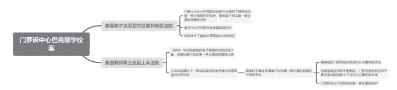

### 【核心争议点】

1.教师的言论是否应当受到特别限制.
2.如何判断门罗在社交媒体的言论是否受宪法保护.
3.门罗的言论是否满足“涉及公共事务”这一要件.
4.依据皮克林平衡性测试标准，哪方利益更值得保护.

### 【裁判论证过程】

#### （一）教师言论应当受到特别限制

一方面，门罗是一位公立学校的老师，这意味着她同时也是一位政府的公职人员.政府作为雇主管理其雇员的言论，与作为统治者管理一般公民的言论有重大不同.因为政府拥有着广泛的权力，当公民成为政府的公职人员时，为了确保其言行有助于高效地履行公共职能，公职人员必然要接受政府对其言行自由的一定限制.

另一方面，门罗的教师身份又将她与其他公职人员区分开来.教育工作者的工作牵涉到一系列相当特定的社会环境和社会关系，尤其是极易受到影响的学生群体.与其他许多公共就业岗位不同，公立学校的教师更加需要一定程度的社会信任.最高法院曾指出，在涉及教师的言论的认定时，应当考虑该言论是否“妨碍了教师在课堂上正常履行日常职责”或“干扰了学校的一般正常运作”.^([\[49\]](#txt009.html#footnote_content_txt009_49))

因此，美国宾夕法尼亚东区联邦地区法院和美国联邦第三巡回上诉法院均认为，作为公立学校的教师，门罗的言论应当受到特别限制.

#### （二）判断门罗在社交媒体的言论是否受宪法保护需要考虑三个因素

根据第一修正案的规定，公职人员的言论若要达到受宪法保护的程度，必须满足以下三个条件：（1）该公职人员的言论必须是以普通市民的身份做出的；（2）该言论必须涉及公共事务；（3）在皮克林平衡性测试下，政府没有充足的理由，基于雇主的需求来区别对待该公职人员和普通社会公众.^([\[50\]](#txt009.html#footnote_content_txt009_50))即，该公职人员作为公民所享有的自由评论公共事务的利益大于政府作为雇主享有的通过该公职人员提高公共服务效率的利益.

在本案中，门罗的博客内容大多关于其个人生活事务，例如对于食物和电影的评价.尽管博客内容未设密码，但是门罗并未意图使其被公众阅读，以往的阅读量也不多于九人，因此可以认为其言论是以普通市民的身份做出的.

故而分析门罗的言论是否受到宪法保护的关键是要判断该言论是否涉及公共事务，以及考虑在皮克林平衡性测试下的利益平衡.

#### （三）从整体来看，门罗的言论满足“涉及公共事务”这一要件

美国最高法院曾经解释说，如果该言论可以被公正地认为是与任何政治、社会、社区等问题相关，^([\[51\]](#txt009.html#footnote_content_txt009_51))或者与具有普遍利益、具有公众价值和受到公众关注的课题相关，^([\[52\]](#txt009.html#footnote_content_txt009_52))则可以认为该言论涉及公共事务.

在一审中，美国宾夕法尼亚东区联邦地区法院同意被告的观点，认为门罗的言论没有涉及公共事务.地区法院指出，从整体来看门罗的博客内容主要与其私人事务相关，仅在偶尔的几篇博客当中提及诸如学术诚信、荣誉、努力的重要性这些内涵更加宽泛的内容，但提及这些内容也是为了讨论其个人的事务.“原告（在博客上的言论）并没有涉及教育改革、教学方法或具体的学校政策等更广泛的讨论，而是主要在抱怨她的学生辜负了她的期望，并关注于她和学生之间的负面互动.”^([\[53\]](#txt009.html#footnote_content_txt009_53))

美国联邦第三巡回上诉法院则认为尽管门罗的博客中的大部分内容都是关于其平凡的生活，与其工作无关，但令其在社交媒体上受到广泛关注的原因却并非这些平凡的生活，而是其中与学生相关的内容.而正如地区法院所承认的那样，这些内容涉及了一些公共事务.上诉法院举例说，门罗在博客中特别详细地描述了她在课堂上为了解释荣誉的概念而作出的尝试，以及她的学生对她的努力经常作出的敌对反应.尽管地区法院批判门罗对学区的评分政策和做法所采取的谩骂的方式，但毕竟，幽默、讽刺甚至“个人谩骂”都可以用来为关于政治、社会、社区等公众关注问题的观点润色.这都表明，门罗的博客不仅仅是针对其学生或管理部门的个人抱怨.

同时，媒体对门罗博客的广泛报道和她对媒体的声明所产生的全国范围的影响力都表明门罗的言论符合了“涉及公共事务”这一因素，即合法的新闻利益也是一种公共事务.

因此，上诉法院认为门罗的言论满足“涉及公共事务”这一要件，进而对其进行皮克林平衡性测试.

#### （四）依据皮克林平衡性测试标准，门罗的言论不值得被保护

皮克林平衡性测试要求法院平衡公职人员作为市民所享有的评论公众事务的利益和政府作为雇主享有的通过该公职人员提高公共服务效率的利益.^([\[54\]](#txt009.html#footnote_content_txt009_54))该价值平衡因为言论的性质差异而不尽相同，但法院通常会考虑以下因素：该言论是否影响工作纪律和员工和谐，是否对需要个人忠诚和信心的密切工作关系产生不利影响，是否妨碍作出该言论者履行职责，以及是否干扰了企业的正常经营.^([\[55\]](#txt009.html#footnote_content_txt009_55))简而言之，这项调查“涉及一个浮动比例”，其中“一个公共雇主不得不忍受的破坏程度与该有争议的言论对公众的重要性成正比.”^([\[56\]](#txt009.html#footnote_content_txt009_56))

美国宾夕法尼亚东区联邦地区法院在平衡各方利益之后，得出结论：“原告的言论，无论是在效果上还是在语气上，都具有足够的破坏性，以至于削弱了其言论的任何合法利益，因此其言论不受保护.”

但门罗认为地区法院只关注了她的个人抱怨以及她发表言论的方式，而几乎没有考虑其中的价值.门罗认为，她的博客，可能正是由于使用了强烈的语言，从而引发了一场全国范围的关于郊区公立学校学生的表现和预期的讨论.

美国联邦第三巡回上诉法院认为即使认定门罗的言论涉及公共事务，在皮克林平衡性测试中，门罗的言论中代表她以及社会利益的部分只占很小的分量.上诉法院指出，虽然不合时宜的语气与该言论是否涉及公共事务无关，但是却在确定是否造成破坏或者造成破坏的可能性方面发挥着重要作用.毕竟，这种强烈的语言显然可能引起该雇员与其上级以及接受其服务的人之间的矛盾.

上诉法院认为，地区法院考虑门罗的言论是否破坏了师生之间尊重和信任的关系是非常恰当的.虽然第一修正案一般不允许行使所谓的“乌合之众的否决权（heckler’s veto）”，即不允许民众在不借助政府帮助下的情况下，压制能够引发众怒的不受欢迎的言论，但是在公立学校的老师与学生和家长之间存在着一种特殊的（甚至是独特的）关系.简而言之，父母和学生都不是局外人—相反，他们是公共教育的参与者，没有他们的合作，公共教育就无法发挥作用.因此在考虑价值平衡时，应当考虑学生及其家长对于该教育者言论的反应.

在本案中，门罗在其公开的、不设密码的博客中用刻薄的语言记录对其学生以及工作环境的负面评价，表达出极大的敌意和厌恶.并且随后该博客被媒体发现，打破了门罗之前对其言论阅读量小和相对匿名化的假设.在她的一些贬损性的评论中，学生们能够辨认出他们自己或他们的同学.父母们偶尔也可以通过门罗对学生的“生动的评价”来识别他们自己和他们的孩子.门罗随后还在当地的和全国性的媒体采访中拒不道歉，并维护自己的言论.这一系列行为并不符合宾夕法尼亚州教育工作者的行为准则，以及公众对这一职业的预期，对学生、家长以及学区都造成了负面的影响.许多家长纷纷向学区发邮件表示不愿门罗再继续教授他们的孩子，许多学生集体退出门罗的课程，学区不得不雇佣另一位老师来完成门罗的教学计划.学区认为门罗的言论不仅影响了其作为教学工作者的教学职责的履行，还严重干扰了正常的教学秩序，造成了大范围的破坏.

因此，美国联邦第三巡回上诉法院认为，基于皮克林平衡性测试，门罗的言论不受第一修正案的保护，并维持地区法院作出的批准被告提出的简易判决动议的决定.

#### （五）巡回法官安布罗对维持一审判决的结果提出反对意见

安布罗法官认为，门罗在被学区停职后接受的一系列媒体采访是导致其被解雇的重要原因，而美国宾夕法尼亚东区联邦地区法院并没有强调这一论点，因此安布罗法官认为简易判决是不合适的，应该由陪审团来判断是否是门罗的采访导致了报复性解雇.

安布罗法官认为，门罗在媒体采访中的发言引起了公众的广泛关注和讨论，因此该言论涉及公共事务.在皮格林平衡性测试中，学区没有指控门罗接受采访的行为妨碍了其教育学生的能力，或者影响了教育工作者的士气.安布罗法官认为其他法官也没有很好地解决这个问题.学区只表示该等采访没有起到安抚性的作用，反而煽动了矛盾；但并没有指明这是否使得学校的运营工作变得更加困难，并且也并未采取措施平息风波，从而使学校能够完成教育使命.同时，安布罗法官指出，在门罗的博客公开之后，面对随之而来的公众舆论的风暴，学区本可以宣称其教育责任超过了门罗的言论自由并解雇她，但学区最终只决定让她停职（这对门罗来说影响不大，因为这与其产假正好吻合）.2011 年 8 月，门罗的停职解除后，^([\[57\]](#txt009.html#footnote_content_txt009_57))学生集体退出了她所在的班级，这是该学区开除门罗或令其转至其他地方的第二次机会.但是学区依然没有这样做.安布罗法官认为，学区因此丧失了与其运营利益相匹配的权利，而门罗的言论自由利益却受到了损害.因此，安布罗法官并不认同法院基于皮格林平衡测试而支持学区的利益的决定.

安布罗法官认为，学区对门罗的表现的低评分并非导致其被解雇的原因，真正的原因是门罗接受媒体采访并使其在博客上的言论公开，从而引起了学区官员的不安.而学区所声称的门罗在最近几次教学评分中表现不佳、评分较低，只是学区用于避免陷入宪法困境的借口.安布罗法官认为需要陪审团来理清学区是否存在这些刻意安排，因此他反对维持一审判决结果.

## 审理结果

1.美国宾夕法尼亚东区联邦地区法院认为门罗的言论不构成对公共事务的讨论，不受宪法第一修正案保护，从而做出了准予简易判决动议的决定.
2.美国联邦第三巡回上诉法院基于门罗的言论未能通过皮克林平衡性测试，维持了一审法院准予简易判决动议的决定.

## 相关法条

### 美国宪法第一修正案（Constitution of the United States First Amendment）

国会不得制定关于下列事项的法律：确立国教或禁止宗教自由；限制言论自由或出版自由；限制人民和平集会和向政府请愿申冤的权利.

### 《美国法典》第 42 卷第 1983 条（42 U.S.C.§1983）

**剥夺权利的民事诉讼**

凡以任何州或地区或哥伦比亚特区的任何法规、条例、规章、习俗或惯例为借口，剥夺美国公民或其管辖范围内的其他人的受宪法和法律所保障的任何权利、特权或豁免权的人，或导致前述权利、特权或豁免权被剥夺的人，应在法律诉讼、衡平法诉讼或其他适当的程序中对受害方负责；但在对司法官员以其司法身份采取的行为或不行为提起的任何诉讼中，不得授予禁令性救济，除非违反了宣告性法令或无法获得宣告性救济.就本节而言，任何专门适用于哥伦比亚特区的国会法案都应被视为哥伦比亚特区的法规.

## 案例评析

### （一）本案建立和完善了检验劳动者通过社交媒体发表不利雇主言论行为合法性的标准

本案所涉及的劳动者使用社交媒体发表对用人单位不利言论并与雇主产生劳动纠纷问题，已成为当下的热点问题之一.然而，判断劳动者在社交媒体上发布的言论是否合法尚缺乏明晰的具体标准.因此，如何明确劳动者言论自由的界限并找到相应的理论依据，处理好劳动者言论自由权利与劳动者忠实义务之间的关系，成为各国在立法过程与司法实践中亟需解决的问题.在美国，受聘于公共机构的员工可以借助皮克林平衡性测试，试图通过证明自己参与了公共事务的讨论，并且参与公共事务讨论所产生的价值大于雇主所承受的因扰乱工作秩序而带来的损失，以此将自己的言论置于美国宪法第一修正案的保护之下.本案的原告门罗就是诉诸该种方法.但是，对于不具有公共服务性质的私人企业，劳动者并不能以其不利于雇主的言论属于参与公共事务讨论为由为自己开脱，美国《国家劳动关系法案》（National Labor Relation Law）规定：私人企业的雇员仅在劳动合同条款问题，如工时、工资和福利等事项上，享有一定程度上的发表对雇主不利言论的自由.同时不论是服务于公共机构的员工还是受聘于私人企业的员工，在涉及职场骚扰、歧视与报复的情景下，都可以采取积极的行动予以规避，其中包括采用在社交媒体上发表言论的方式来维护自身或者他人的权利.由此可见，受聘于私人企业的劳动者享有的言论自由权限明显小于服务于公共机构的员工.美国通过对公共机构与私人企业加以区分对待，完成了劳动者言论自由权利边界的框架性划定.

近年来，此类由于劳动者在社交媒体上发表不利于雇主的言论而引发的劳动纠纷在中国亦是屡见不鲜.在我国，劳动者的言论自由受到劳动关系一般规则的限制，也就是不得侵犯公民、法人的名誉权、荣誉权、商业秘密等权利.由于劳资关系属于劳资双方在相互信任的基础上形成的一种组织管理关系，劳动者还负有维护劳动秩序的义务，也就是所谓的忠实义务.劳动者超出这两项限制在社交媒体上发表言论，一般应承担不利的法律后果.我国现阶段仍然较依赖司法实践中形成的习惯来判定劳动者有关雇主的不利言论能否受到法律保护，具体而言需要在个案中考察劳动者社交媒体行为是否符合雇主规章制度要求、行为动机、行为后果、行为情节等因素，从而判定劳动者行为是否损害雇主利益、违反忠实义务，并以此判定劳动者的社交媒体行为是否超过言论自由边界及是否合法.^([\[58\]](#txt009.html#footnote_content_txt009_58))

### （二）深化了人们对社交媒体公共领域属性的认识

公共领域（public sphere）这一概念最早由政治哲学家汉娜·阿伦特提出.后来，哈贝马斯在《公共领域的结构转型》一书中，重新梳理和解释了这一概念：“介于国家与私人之间的中间地带.立足于私人领域，又不属于私人领域，公众自愿加入并展开对某些事物的批判性讨论，形成公共意见.”在本案中，尽管在新闻媒体曝光门罗博客之前，浏览过门罗的博客的人数仅为 9 人，门罗的博客仍然具有被任意读者阅读的可能，因此并不能将其视为门罗的私人领域.同时，正如美国联邦第三巡回上诉法院在判决中所确认的那样，门罗博客中所涉及的教学和师生关系的内容，构成了对公共事务的讨论.由此可以看出，社交媒体具有塑造数字公共领域、促进公民社会发展的能力，不能简单地将社交媒体视作可供个人宣泄负面情绪或使用语言暴力而无须承担法律后果的自由港.美国麻省理工大学公民媒体中心教授佐客曼（Ethan Zuckerman）在《社交媒体在民主政治中的六个或者七个功能》一文中说道：“社交媒体除了社交、娱乐、商业属性之外，还具有展示多样观点、为人民提供思考与辩论的场所以及放大个人声音促进公共意见的形成、增强社会凝聚力等功能.”^([\[59\]](#txt009.html#footnote_content_txt009_59))随着互联网时代的到来，社交媒体极大地拓展了公共领域的范围：社交媒体上涌现出积极参与网络讨论的公众，与传统意义上只有少数知识阶层参与其中的公共领域相比，社交媒体所塑造的公共领域将参与权相对平等地扩展到全体公民；相比现实的公共领域，参与者较少受阶级及社会身份限制，弱势或边缘群体也平等地享有进入互联网的权利；社交媒体的交互性改变了传播过程中传播者与接受者的地位，让普通公民也能拥有一定的话语权；同时，社交媒体不受地域限制的特性消除了传统公共领域的地域限制，让各种各样的意见和见解在数字公共领域中有了碰撞的机会.然而，正因为社交媒体所塑造出的公共领域具有广泛的社会参与度，其相比于传统公共领域也存在着许多非理性的特征与倾向，如网民素质良莠不齐导致的讨论内容思想空洞与言词粗鄙；利用匿名制保护肆意宣泄情绪，恣意侵犯他人名誉权与隐私权；缺乏独立思考和批判现实的能力，盲目“去精英化”与解构传统伦理和道德等等.这些特性都大大降低了社交媒体的公共领域价值，特别是现如今随着社交媒体广泛使用算法对其用户进行精准推送，让每一位社交媒体使用者都面对着沉入“信息孤岛”的风险，这让社交用户难以形成包容开放的观点和见解，无法经过独立思考得到真正代表自己的“民意”.被资本控制的社交媒体平台也会以“热搜”、“大家都在看”的方式引导公众关注的方向，从而赚取流量变现.为了应对商业化、碎片化、娱乐化的互联网趋势，应当对社交媒体的公共领域属性予以关注，以恢复并保持社交媒体传达公众广泛而真实的意见的功能为目标，并对阻碍该目标实现的相关因素进行治理.

### （三）促进了劳动者言论自由相关法律解释的更新

虽然本案认定了门罗在社交媒体上发表言论的利益未能超过雇主维护工作秩序与工作环境的利益，但是由于总体来看雇员相对于雇主处于弱势地位，而社交媒体的出现也需要对网络平台言论自由的保护和与限制做出变通，近年来，包括门罗诉中心巴克斯学校案在内，诸多涉及社交媒体平台劳动者言论自由的案件推动了相关法律解释的更新.美国《国家劳动关系法案》规定：“员工享有自我组织的权利，有权组织、加入或者协助组织工会，自主选定代表与雇主协商劳动条款，从事以维护集体利益或者员工间相互帮助和保护为目的的其他活动”，即规定了对于员工“集体行为（concerted activities）”的保护.而随着社交媒体的力量日益壮大，言论自由这一权利在网络技术高速发展的助力之下得到了很大程度上的释放，美国国家劳动关系委员会（National Labor Relation Board， NLRB）在界定“集体行为”时也显现出宽容化的趋势，劳动者为受聘于同一雇主的其他劳动者在社交媒体上发布的内容点赞的行为，也能够被认定为“联合”其他劳动者的行为，构成“集体行为”，从而受到法律的保护.在德国，基本法第 5 条规定了包括劳动者在内的公民言论自由权，劳动关系中的言论自由权也受到该法的保护.魏玛共和国宪法第 118 条第 1 款已经明确将劳动关系中的雇员纳入进言论自由的适用范围.雇员使用的是什么社交媒体并不重要，他可以通过口头方式阐述自己的观点，可以向报纸发出读者来信，也可以在“脸书”等媒体上发表意见.^([\[60\]](#txt009.html#footnote_content_txt009_60))在澳大利亚，劳动者在社交媒体上的言论除了受到言论自由权的一般保护之外，通常被视为是劳动者的私生活领域而不应当受到干涉，法院在大部分案件中，都认为雇员的线上行为不足以成为解雇员工的理由.^([\[61\]](#txt009.html#footnote_content_txt009_61))正如《社交媒体纠纷中的雇员与雇主利益平衡》一文的作者弗洛门霍夫特所说，社交媒体正在成为劳动法案件的一个核心要素.^([\[62\]](#txt009.html#footnote_content_txt009_62))

## 关联案例推荐

### 1. Pickering v. Board of Education, 391 U.S. 563, 88 S.Ct. 1731, 20 L.Ed.2d 811(1968)

**核心事实**：高中教师马文·皮克林（Marvin L. Pickering）向当地一家报纸发出一封信，该信对董事会和校监局处理为学校增加新收入的建议的方式提出了批评.董事会在经过充分听证后认定，该信的公布“不利于该区学校的高效运作和管理”，因此将其解雇.皮克林对教育委员会提起诉讼并要求复职.美国最高法院大法官马歇尔认为，质疑学校是否需要额外资金是公众对于学校行政决策的合法关注，教师是最有可能对分配给学校运营的资金应该如何使用知情并提出明确意见的社区成员，因此教师可以就这些问题畅所欲言而不用担心被解雇.法院还进一步指出，由于缺乏该教师故意或过失作出虚假陈述的证据，皮克林的信件不能作为解雇的依据.美国最高法院推翻初审法院判决并发回重审.

**与本案关联点**：教师拥有就公共问题发表言论的权利；法院根据平衡性测试衡量公职人员作为雇员和政府作为雇主所享有的利益，来确定公职人员发表的对雇主不利的言论是否值得保护.

### 2. Miller v. Clinton County, 544 F.3d 542 (3d Cir.2008)

**核心事实**：县缓刑办公室的前雇员给法官写了一封信，抱怨缓刑办公室主管的行为.法官收到信后立即解雇了该雇员.该雇员因此提出了索赔，声称该法官侵犯了其第一修正案的言论自由权以及第十四修正案的正当程序权.上诉法院认为，虽然信的内容提及缓刑办公室运行不力等问题，涉及公共事务，但整个信件都集中了该雇员的私人不满，因此该信并不构成受第一修正案保护的言论.上诉法院撤销一审法院决议，发回案件.

**与本案关联点**：公职人员的言论只有涉及公共事务时才有可能获得宪法保护，当该言论主要集中于个人抱怨时，第一修正案不予保护.

### 3. Snyder v. Phelps, 562 U.S.443, 453, 131 S.Ct. 1207, 179 L.Ed.2d 172 (2011)

**核心事实**：上诉法院认为尽管关于海军陆战队员的葬礼抗议问题并不能达到社会或政治评论的程度，但他们强调的问题—美国及其公民的政治和道德行为、国家的命运、军队中的同性恋以及涉及天主教神职人员的丑闻—都是公共问题，这些内容显然与整个社会普遍关心的问题有关，而不是纯粹私人关心的问题.

**与本案关联点**：关于涉及公共事务与否的认定并不限于社会或政治评论，可以是与社会利益有关的、公众普遍关心的问题.

### 4. Craig v. Rich Township High School District 227, 736 F.3d 1110 (7th Cir.2013)

**核心事实**：布莱恩·克雷格（Bryan Craig）是芝加哥南郊里奇中央高中的终身指导顾问.克雷格在工作期间，出版了一本名为《这是她的错》的书，该书收集了克雷格对成人关系的建议.美国第七上诉法院认为，该书主题引起了公众的极大兴趣，而且大量涉及这一主题的咨询专栏恰恰证明了其新闻价值，因此可以说明克雷格的书涉及公共事务.

**与本案关联点**：具有新闻价值的话题可以认为涉及公共事务.

## 9.5 克雷曼诉扎克伯格案

### 案件索引

Klayman v. Zuckerberg, 910 F. Supp. 2d 314 (D.D.C. 2012)

Klayman v. Zuckerberg, 753 F.3d 1354 (D.C. Cir. 2014)

### 关键词

社交媒体；交互式计算机服务；平台责任；通讯规范法

### 案件提要

本案是有关社交媒体平台责任的经典案件.该案与美国《通讯规范法》（Communications Decency Act， CDA）第 230 条密切相关，该条被视为美国保护言论自由的基石，也被誉为让美国互联网成长至今的重要条款.1996 年，美国总统克林顿签署了被称为是“美国新旧通信世界的分水岭”的《通讯规范法》，其中第 230 条是特朗普任内开始备受关注的关于互联网的条款.《通讯规范法》旨在将网络空间中的（儿童可接触到的）低俗言论、暴力内容以及淫秽言论纳入监管.在制定《通讯规范法》时，国会认为互联网和相关的计算机服务“代表了教育和信息获取方面的卓越进步”，“为真正多样化的政治话语、独特的文化发展机会和丰富的智慧活动提供一个平台”，并将这些理念记载于《通讯规范法》第 230 条.因此，国会将“促进互联网持续发展”和“维护充满活力及自由竞争的互联网和其他交互式计算机服务的市场，不受联邦或州监管的约束”列为“美国政策”，且自国会颁布法令以来，在法定豁免下蓬勃发展的创新者已经能够掌握技术前沿，由此产生的信息自由市场比人类历史上任何时候都要强大.《通讯规范法》第 230 条规定，任何交互式网络服务提供者都不必对其用户的不当行为负责.^([\[63\]](#txt009.html#footnote_content_txt009_63))具体而言，美国建立了一个间接侵权的基本责任框架，并划分为“信息发布者”和“信息传播者”两种处理模式.其中信息发布者应当为第三方的信息内容负责，而《通讯规范法》第 230 条规定网络服务提供者不得被认定为信息发布者.这意味着，互联网服务提供者不必对第三方在其平台发布的每一条信息进行严格的过滤、审查，其法律风险和责任大幅降低，使得言论自由充分体现在互联网平台之上，促进社交媒体等互联网平台以飞快的速度蓬勃发展.同时，《通讯规范法》第 230 条给了平台清除不当内容的广泛权限，保护了互联网服务提供者出于善意考虑，而对部分冒犯性的内容进行限制，或者赋予他人技术手段来限制冒犯性内容的行为.这也为本案的争议埋下了伏笔.

本案因涉及美国最大的互联网公司之一即脸书（Facebook）以及社交媒体的平台责任问题，获得了广泛关注.当今社交媒体的用户逐年增长，已经成为很多人生活中不可或缺的一部分，社交媒体是否需要为第三方的言论负责，与每位用户息息相关.当前数字经济高速发展，互联网作为数字经济的主力军，应受到法律、法规的制约，但对于互联网平台责任的制约方式以及规制的尺度范围，一直以来都是各界热门的议题.随着我国互联网产业的迅速崛起，以及“互联网+”等理念的推广，网络立法及互联网平台的法律规制问题亟待解决，相关法规陆续出台.例如，我国采取“以网管网”原则，依据相应的法律规范对互联网平台进行规制，具体措施包括平台准入规则、事前过滤机制、已发表内容的处理机制等.全国人大常委会于 2016 年 11 月 7 日发布的《网络安全法》明确了网络运营者的管理义务.《网络安全法》第 47 条规定：“网络运营者应当加强对其用户发布的信息的管理，发现法律、行政法规禁止发布或者传输的信息的，应当立即停止传输该信息，采取消除等处置措施，防止信息扩散，保存有关记录，并向有关主管部门报告.”但实践中，互联网上仍然存在许多不良行为，需要法律加以规制.

此外，新冠肺炎疫情的影响放大了互联网在交流与工作中的作用，引发了各界对互联网中权利保护的思考.除法律的规制外，互联网平台规则的实施对基本权利的影响也不容小觑，应当在充分认识互联网平台角色的基础上，合理确定互联网平台的权利（力）和义务边界，以保护个人的基本权利.在当今新型中美关系背景下，未来中国网络治理研究不仅要从规范和促进国内行业发展的角度出发，也要辅之以国际视野，结合中国在互联网行业治理方面的独特优势和成功经验，为国际网络空间治理输出更多中国智慧，引领新型国际网络空间治理的方向.在互联网治理问题上，对于类似《通讯规范法》第 230 条这类基石性法律条款的处理，应吸取美国的前车之鉴，恪守客观中立的态度，最终回归到尊重产业界的逻辑规律中.

因此，本案对于理解社交媒体、平台责任、互联网立法具有重要意义.

### 案件要旨

哥伦比亚特区地区法院（一审法院）：原告 克雷曼 被告 扎克伯格及脸书（Facebook）

哥伦比亚特区巡回法院（上诉法院）：上诉方 克雷曼 被上诉方 扎克伯格及脸书（Facebook）

被告脸书（Facebook）是一家运营社交网络网站 www.facebook.com 的公司，用户可以在该平台上与他人分享信息，包括与家庭成员和朋友有关的文章、照片、新闻以及对全球事件的看法.用户可以浏览其他成千上万的脸书（Facebook）用户发布于脸书（Facebook）网站的信息.为了使用脸书（Facebook）的服务，用户必须开通一个账号，这是免费提供的.

原告拉里·克雷曼（`Larry Klayman`，下称“克雷曼”）是一名律师，在一个名为“自由观察（`Freedom Watch`）”的组织中担任主席兼总法律顾问，他拥有一个与本人同名的脸书（`Facebook`）账户。

2011 年，克雷曼在使用脸书（`Facebook`）时，偶然注意到一个标题为“第三次巴勒斯坦起义”的页面，呼吁穆斯林在 2011 年 5 月 15 日的伊斯兰祈祷会结束后发动起义，宣布并威胁道“审判日只会在穆斯林杀死所有犹太人的时候降临”。这个页面的参与者超过了 36 万人，而其他三个类似的呼吁“第三次巴勒斯坦起义”的页面则吸引了七千多名订阅用户。

注意到这些页面出现之后，以色列公共外交部长致信脸书（`Facebook`）及其创始人、董事长兼首席执行官扎克伯格，要求“删除该页面以及类似和相关的页面”。克雷曼声称，他也曾要求删除这些页面，但没有说明具体时间。“很多天”后，脸书（`Facebook`）删除了这些页面。

但在克雷曼看来，这一删除行为相当缺乏诚意、不够及时。因此，克雷曼在哥伦比亚特区高级法院起诉了脸书（`Facebook`）和扎克伯格，声称脸书（`Facebook`）未能及时删除“第三次巴勒斯坦起义”页面以及类似页面，构成了故意伤害，以及过失违反了脸书（`Facebook`）对克雷曼的注意义务。具体而言，克雷曼声称，起义的内容“相当于对非穆斯林，特别是犹太人的暴力威胁”，使他“有理由相信可能会受到严重的身体伤害或死亡”。关于过失，克雷曼认为：“作为脸书（`Facebook`）的用户和公众成员之一，被告脸书（`Facebook`）对其负有注意义务，而被告因允许及纵容这一死亡威胁页面而违反了这一义务。”

克雷曼申请禁制令（`injunctive relief`），以阻止起义页面和其他类似页面出现在脸书（`Facebook`）网站上，并要求获得超过 10 亿美元的补偿和惩罚性赔偿。

脸书（`Facebook`）向将此案移送到美国哥伦比亚特区地区法院，并申请了驳回案件的动议。哥伦比亚特区地区法院批准了该动议，理由如下：首先，脸书（`Facebook`）属于《通讯规范法》第 230 条（f）款第（2）项定义的“交互式计算机服务的提供者”；其次，原告克雷曼要求脸书（`Facebook`）承担责任的基础是其他方提供的信息，脸书（`Facebook`）只是该信息的“发布者或发言人”；最后，脸书（`Facebook`）不是争议信息的内容提供者；因此，脸书（`Facebook`）受到《通讯规范法》第 230 条（c）款第（1）项的豁免保护。

随后，克雷曼向哥伦比亚特区巡回法院提起上诉。哥伦比亚特区巡回法院确认了地方法院驳回此案的判决，维持原判。

2014 年克雷曼向美国联邦最高法院申请再审。2014 年 11 月 17 日，美国联邦最高法院驳回了再审令状，拒绝审理此案。

## 案例事实思维导图

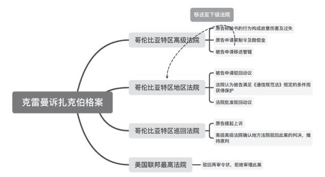

## 核心争议点

1. 脸书（`Facebook`）是否是“交互式计算机服务的提供者”。
2. 脸书（`Facebook`）是否为第三方提供的信息的“发布者或发言人”。
3. 脸书（`Facebook`）是否为信息内容的提供者。

## 裁判论证过程

### （一）脸书（`Facebook`）属于“交互式计算机服务的提供者”

根据《通讯规范法》第 230 条（f）款第（2）项，“交互式计算机服务”是一种通过给予多方用户访问其计算机服务器的权限来提供信息的服务。法院通常认为网站符合“交互式计算机服务”的定义，且在弗雷利诉脸书（`Facebook`）^([\[64\]](#txt009.html#footnote_content_txt009_64))等案件中，其他法院已经肯定了脸书（`Facebook`）符合《通讯规范法》所定义的“交互式计算机服务”。脸书（`Facebook`）网站使其用户可以创建、上传、（可能与其他成千上万的用户）分享各种类型的信息，也就是说，脸书（`Facebook`）通过允许多数用户利用计算机接入托管其社交网站的计算机服务器，从而向用户提供信息。因此法院认为，脸书（`Facebook`）属于交互式计算机服务提供者。同时，由于扎克伯格是脸书（`Facebook`）交互式计算机服务的“提供者”，因此也有资格获得保护。

因此，法院认定被告是交互式计算机服务的提供者。

### （二）脸书（`Facebook`）是第三方提供的信息的“发布者或发言人”

《通讯规范法》第 230 条（c）款第（1）项明确规定，不得将交互式计算机服务提供者视为由其他人所提供信息的发布者或发言人，即交互式计算机服务提供者无需为第三方的信息内容负责。这意味着，当原告的诉讼请求在《通讯规范法》的范围内时，法院通常会审查被指控的行为是否源自其信息“发布者或发言人”的地位或行为。如果得到肯定答案，法院会依据该条款排除被告的法律责任。根据先前判例，“发布者”是指“审核、编辑并决定是否公开或删除第三方内容”的一方。

在本案中，原告克雷曼主张脸书（`Facebook`）构成了故意伤害及过失违反注意义务。哥伦比亚特区地区法院指出，故意伤害是一种“通过言语或行为，对受害者造成身体伤害的，蓄意和非法的企图或威胁”。而为了在过失索赔中胜诉，原告“必须证明：（1）被告对原告负有义务；（2）被告违反了该义务，以及（3）原告因该违约行为受到了伤害。”法院认为，就这两项索赔而言，无论是通过“使用”脸书（`Facebook`）网站发布某些内容（即发布），“允许”某些内容发布到网站上（即决定是否发布），还是“拒绝删除这些帖子”，被告被指控的行为归因于其信息发布者的地位。即，被告的潜在责任源于其作为“发布者或发言人”的身份或行为，而根据《通讯规范法》的规定，被告无需对此承担责任。

原告克雷曼辩称，被告被指控的行为并非源于其作为发布者的身份，而是源于其违反了“合同、准合同和信托义务”，因此被告无权根据《通讯规范法》获得豁免。哥伦比亚特区地区法院以原告未能提出与该索赔一致的事实，且未能及时修改其起诉书为由，拒绝受理该请求。在上诉过程中，克雷曼反驳说，其主张源于上诉人违反了其职责，而“该职责源于当事人之间基于合同关系和合同义务产生的特殊关系”，并特别提及脸书（`Facebook`）网站的《权利与责任声明》。上诉法院认为，脸书（`Facebook`）网站的《权利与责任声明》文本恰好否定了原告所主张的“特殊”法律关系，因为该声明明确警告：“脸书（`Facebook`）不对第三方的行为、内容、信息或数据负责。”此外，克雷曼的起诉书中未出现违约索赔，因此克雷曼无权再要求违约索赔。

因此，法院认定被告为第三方提供的信息的“发布者或发言人”。

### （三）脸书（`Facebook`）不是信息内容的提供者

原告似乎承认《通讯规范法》第 230 条（c）款第（1）项中的“另一信息内容提供者”创造了该信息，然而原告辩称，根据《通讯规范法》，被告本身就是信息内容提供者，故应当要承担责任。被告辩称，由于其并未“创造或开发”违法内容，因此不能被归为信息内容提供者。

哥伦比亚特区地区法院认为，被告有成为信息内容提供者的可能性，其他法院将相关问题界定为被告是否为“争议陈述或出版物之部分内容的信息提供者”。将被告作为信息内容提供者的责任限制在全部或至少部分由被告实际创造或开发的信息上，符合《通讯规范法》的立法目的，即“维护互联网和其他交互式计算机服务的目前充满活力和竞争的自由市场，不受联邦或州法规的限制”^([\[65\]](#txt009.html#footnote_content_txt009_65))。在本案中，原告仅辩称被告通过未及时删除的方式，鼓励“第三次巴勒斯坦起义”页面的存在。原告在其起诉书和反对意见中都没有主张被告对争议页面的内容有贡献，相反，原告关注的是被告在“发布”争议页面的过程中所扮演的角色。因此，法院认为被告不是《通讯规范法》意义上的信息内容提供者。

类似地，哥伦比亚特区巡回法院认为，事实上，原告的起诉书中没有任何地方声称甚至暗示脸书（`Facebook`）提供、创建或开发了对其造成伤害的任何内容。相反，上述责任正是源自第 230 条（c）款第（1）项意义上的“另一个信息内容提供者提供的信息”。哥伦比亚特区巡回法院进一步指出，当一个网站只是提供一种中立的手段，让第三方可以在网上发布其独立选择的信息时，该网站不会被认定为内容的创造者或开发者。

综上所述，法院认为：（1）脸书（`Facebook`）交互式计算机服务提供者，（2）克雷曼试图要求脸书（`Facebook`）作为第三方信息的发布者或发言人承担责任，（3）脸书（`Facebook`）本身并不是与争议信息有关的信息内容提供者，而根据《通讯规范法》，脸书（`Facebook`）享有诉讼豁免权，无需为第三方信息承担责任。

## 审理结果

1. 哥伦比亚特区地区法院批准了被告的驳回起诉动议。
2. 哥伦比亚特区巡回法院确认地方法院驳回此案的判决，维持原判。

## 相关法条

美国《通讯规范法》第 230 条（c）款第（1）项（`Communications Decency Act§230（c）（1）`，`47 U.S.C.§230（c）（1）（2006）`）

发布者或发言人的处理

任何交互式计算机的服务提供者或者使用者不得被视为其他信息内容的发布者或者发言人。

美国《通讯规范法》第 230 条（f）款第（2）项（`Communications Decency Act§230（f）（2）`，`47 U.S.C.§230（f）（2）（2006）`）

交互式计算机服务.

“交互式计算机服务”是指提供或允许多数使用者的计算机接入一个计算机服务器的任何信息服务、系统或接入软件的提供者，具体包括提供接入互联网的服务或系统，以及由图书馆和教育机构运营的此类系统或提供的此类服务。

## 案例评析

### （一）本案肯定了《通讯规范法》第 230 条的保护作用

在本案中，《通讯规范法》第 230 条为脸书（`Facebook`）撑起一把保护伞，明确说明脸书（`Facebook`）作为交互式计算机服务的提供者而免除承担法律责任。这条法令存在的二十多年来，已成为让互联网成长至今的关键性法律。对美国人而言，互联网与其他交互式计算机服务意味着前所未有的教育与信息资源，为多元化政治讨论构筑平台，为文化发展创造机会，为智识活动提供通道。^([\[66\]](#txt009.html#footnote_content_txt009_66))正是因为有第 230 条，才使互联网既有能力为公众提供信息又可以删除信息，第 230 条是拥有强大力量的开放网络的基础。如果没有第 230 条，平台要么会过度过滤内容，要么根本无法过滤内容。^([\[67\]](#txt009.html#footnote_content_txt009_67))《通讯规范法》第 230 条尽管只有短短 26 个英文单词，却给美国互联网行业创造了宽容的监管环境并促进其高速发展，更为随后社交媒体的兴起铺平了道路。有学者评价：“第 230 条促进了`Web2.0`的出现，这是一个互联网服务的世界，它帮助我们以强大而新颖的方式相互交流和参与，许多顶级互联网服务依赖第 230 条，我们每小时都依赖第 230 条提供的服务。”^([\[68\]](#txt009.html#footnote_content_txt009_68))

美国参议院商业、科学和运输委员会主席罗杰·韦克尔（`Roger Wicker`）曾表示近 25 年来，维护互联网自由一直是美国数字经济繁荣的标志，这一成功很大程度上归功于宽松的监管框架和《通讯规范法》第 230 条。通过给予交互式计算机服务提供者免责保护，以删除和调整平台或其用户认为淫秽、暴力、骚扰等令人反感的内容，第 230 条为在线平台的早期发展和快速增长提供了庇护。这种免责一方面在保护互联网平台免受无休止的、毁灭性的诉讼方面发挥了关键作用，但另一方面也赋予了这些互联网平台以任何符合其利益的标准审查、控制甚至扼杀内容的能力。

《通讯规范法》第 230 条指出，互联网服务提供者不必为其用户的行为负责。这意味着互联网服务提供者无需小心翼翼地监视并追踪其用户在互联网上的所作所为，同时也意味着互联网服务提供者可能面临的法律风险和责任大大降低。如果没有这条强有力的法令，那些当今最流行的网络平台可能难以出现在公众视野，公众也无法在互联网上创造各式各样的内容。通过免除平台企业对用户的监视和追踪义务，这条法律不仅保护了用户的隐私权，而且减少了平台企业的运营成本；通过清晰的企业责任认定，这条法律为平台企业减少了被起诉的担忧；通过豁免平台企业对第三方创造的内容的责任，这条法律创造了宽松的营商环境，鼓励平台企业创造经济价值，并取得了显著成效。而另一方面，《通讯规范法》第 230 条也没有让互联网平台放弃对内容的保护，反而赋予了平台清除不当内容的广泛权限，在事实上促使平台采取更好的调节措施，从而促进和引导网络环境健康发展。

### （二）对《通讯规范法》第 230 条保护作用的质疑

不可否认，《通讯规范法》第 230 条给予互联网服务提供者豁免的特权，对互联网的发展和言论自由的进步起到了重要的推动作用。但是，随着`Google`、`Facebook`、`Twitter`这些大型互联网搜索引擎和社交网络的发展，越来越多的反对者认为，《通讯规范法》第 230 条已经偏离了其最初立法目的，并且无情地剥夺了受害人寻求救济的权利。有观点认为第 230 条在司法判例中被援用的过于泛滥，致使本应鼓励互联网服务提供者监视网上不良内容的权力规范，却成了互联网服务提供者免于责任的护身符。^([\[69\]](#txt009.html#footnote_content_txt009_69))有观点认为作为一项免责条款，第 230 条在制度设计上存在模糊和笼统的问题，其免责条件和免责范围过于宽泛。^([\[70\]](#txt009.html#footnote_content_txt009_70))

然而，现在互联网不再是一项新兴技术，很多互联网企业已经成为世界上最大的公司之一，在经济、文化和公共话语中拥有巨大的力量。它们创建的应用程序正在以前所未有的方式连接世界，远远超出了当时立法者的想象。这些公司以压倒性的力量控制着公众可以分享和获取的新闻和信息。令人担心的是，这些平台已经成为强大的仲裁者，决定了内容的审查标准和可及性。然而，公众对其决策过程知之甚少，以至于当用户权利受到侵害时，几乎无法有效地寻求救济。^([\[71\]](#txt009.html#footnote_content_txt009_71))有学者认为，第 230 条应将一些极端情形（如侵犯生命健康权）的豁免权排除在外，“至少应取消对造成人身伤害的言论的豁免权”。但很难在不破坏大量有效沟通的前提下设置例外条款，因此需要进行一些广泛的听证会，仔细权衡。^([\[72\]](#txt009.html#footnote_content_txt009_72))

2016 年，一对纽约的夫妇因不满脸书（`Facebook`）的用户在其网站上上传了一张载有他们女儿尸体的照片，而对脸书（`Facebook`）提起诉讼。他们并没有向脸书（`Facebook`）提出金钱赔偿的请求，而是要求脸书（`Facebook`）删除照片并向他们提供照片下载者的名单。但是律师认为，脸书（`Facebook`）受《通讯规范法》第 230 条 c 款的保护，原告很难胜诉。这一案件再次引发了大量由来已久的争论。豁免条款的抗议者认为，国会可以在侵权法领域基于先例通过细微的调整来确立一个联邦标准，而非毫无限制地向那些侵权者提供豁免。《通讯规范法》第 230 条 c 款对于那些相较于网络服务提供者而言明显处于弱势的受害者而言过于绝对又残酷。另外，由于网络信息来源的多样性和隐蔽性，受害者若想通过最初的信息提供者寻求救济，将会耗费大量的资源而且往往难以成功。

互联网已然成为言论自由的基础设施，其中互联网平台在信息传播过程中担任着重要的角色，这一角色的重要性与影响力要求平台在内容规制中需逐渐承担更多的公共责任。各国立法已经开始逐渐向该方向转变。例如，在德国的一揽子互联网立法规划的第三部《网络执行法》中，立法价值取向从保障自由转向保障安全，要求社交网络平台承担更重的责任。我国的互联网相关立法也要求互联网平台承担更多管理义务。由于平台的责任范围将影响到信息内容规制措施的实施，立法者应当重新审视互联网平台的责任标准，对互联网平台课加更合理的责任。因此，修改及完善《通讯规范法》第 230 条的呼声日益高涨。

### （三）关于《通讯规范法》第 230 条的完善意见

如今，脸书（`Facebook`）、、推特（`Twitter`）等不再仅仅是一个社交网站，他们已成为世界历史上最大的媒体巨头，是出版商和广播公司的结合。依据《通讯规范法》第 230 条，网络服务提供者不用因为用户上传到网站上的信息承担任何责任，但却可以审查这些信息的内容，甚至可以删除和过滤信息，这无疑是无限放大了网络服务提供者的权利。相对而言，用户在利益受到侵犯时却没有有效的救济途径。下文将探讨《数字千年版权法》中的“提示规则”是否可以对《通讯规范法》第 230 条作出限制和完善。

在《通讯规范法》第 230 条开创性的基础上，1998 年 10 月美国颁布了《数字千年版权法》。该法案对世界范围内的互联网立法具有重要意义。《数字千年版权法》第 512 条规定了网络服务提供者的版权侵权责任，与《通讯规范法》第 230 条共同为作为内容中介的互联网服务提供商提供了避风港：只要采取合理措施删除或阻止访问某些内容，就无需对该内容承担责任。这些保护措施允许互联网领域不用担心法律后果的试验和创新，为搜索引擎、社交媒体等平台类现代互联网服务奠定了基础。有学者认为，可借鉴《数字千年版权法》所规定的“提示规则”这一形式化的规则来解决《通讯规范法》第 230 条的不足之处。

支持者认为，运用这一形式主义的规则可以向受害者提供请求删除内容的救济途径。但是反对者认为即使如此，“提示规则”的负面效应也远远大于还存在争议的潜在利益。首先，如果网络服务提供者需要对其传播的信息承担潜在的责任风险，他们将会限制其愿意提供的信息种类。其次，《数字千年版权法》规制的是侵犯版权的行为，而《通信规范法》第 230 条豁免的是除知识产权侵权之外的其他侵权行为，侵权种类的不同导致“提示规则”无法适用于《通讯规范法》第 230 条。再次，“提示规则”受到了联邦最高法院的质疑，法官担忧这一规则将会创造出一种极端的、不被允许的“反对者否决权”，而这一权利的创造会激发人们对于干涉或封锁他人言论自由的能力的渴望，进而让网络服务提供者陷入无尽的司法程序之中。最后，从言论自由和违宪性审查的角度来说，删除信息会极大地侵犯言论自由。正如联邦最高法院指出的那样，在处理那些删除或禁止有争议信息的案件中，一旦涉及言论自由的问题，任何法院都应当具体问题具体分析，灵活平衡各方的利益。

# 提示规则与中国互联网治理

实际上，“提示规则”仍是国际上通行的规则，大多数欧盟国家都采用了这一规则，我国也不例外。我国《民法典》第 1195 条规定：“网络用户利用网络服务实施侵权行为的，权利人有权通知网络服务提供者采取删除、屏蔽、断开链接等必要措施。通知应当包括构成侵权的初步证据及权利人的真实身份信息。网络服务提供者接到通知后，应当及时将该通知转送相关网络用户，并根据构成侵权的初步证据和服务类型采取必要措施；未及时采取必要措施的，对损害的扩大部分与该网络用户承担连带责任。”

基于庞大的人口优势带来的丰富应用场景、基建优势带来的网络可及性叠加资本对产业的青睐，我国的互联网产业快速取得了蓬勃的发展。如今，互联网已经融入国民经济的方方面面，渗透入国民日常生活的各个角落。我国的社会共识与凝聚力较强，政府权威性和作为性较高，各级政府都针对虚假信息建立了信任度较高的辟谣平台。政府的公信力和人民对官方的高度信任有效阻断了虚假信息与极端内容的生成与传播。另外，我国在个人信息保护、竞争政策方面已经着手开展了相关治理工作，监管部门也采取了更为积极主动的监管思路，在包容审慎原则的基础上更强调平台的责任。

## 关联判例推荐

### 1. Doe v. MySpace, Inc., 528 F.3d 413 (2008)

核心事实：原告是一位母亲，控告经营社交网络的公司没有采取足够的措施防止其 13 岁的女儿为了谎报年龄，以便在该社交网络上建立个人档案，最终导致其女儿被所谓的“捕食者”联系、同意见面并遭到性侵犯。法院认为，被告系交互式计算机服务提供者，受到《通讯规范法》第 230 条的保护，因此驳回了原告的起诉。

与本案关联点：社交媒体属于《通讯规范法》规定的交互式计算机服务，受到该法律的保护。

### 2. Barnes v. Yahoo!, Inc., 570 F.3d 1096 (2009)

核心事实：巴尔内斯的前男友与其分手后，在雅虎网站上发布其裸照，并在聊天室中以其名义和单身男性聊天，在聊天室中公布了巴尔内斯的住址、电话、公司地址等信息。在受到许多陌生男子的骚扰后，巴尔内斯要求雅虎删除这些内容，但雅虎迟迟没有行动。巴尔内斯将雅虎告上法庭，要求雅虎承担过失责任，但雅虎由于不是该侵权信息的发布者，受到《通讯规范法》第 230 条（c）款第（1）项的保护而免于承担责任。

与本案关联点：根据《通讯规范法》第 230 条（c）款第（1）项，交互式计算机服务提供者不是第三方信息的发布者，无须为此承担法律责任。

### 3. Carafano v. Metrosplash.com, Inc., 339 F.3d 1119 (2003)

核心事实：某婚恋网站的用户盗取原告的个人信息在该网站上创建了档案，原告收到骚扰和威胁性的电子邮件后才发现其被盗取，并随即将该婚恋网站告上法庭。但法院认为，盗取和发布原告个人信息的是该网站的用户，婚恋网站并非相关内容的创建者、开发者，因此不需要承担责任。

与本案关联点：社交媒体受到《通讯规范法》保护，不因其用户发布的内容承担法律责任。

## 注释

[\[1\]](#txt009.html#footnote_quote_txt009_1)Reno v.American Civil Liberties Union， 521 U. S. 844， 868 （1997）.

[\[2\]](#txt009.html#footnote_quote_txt009_2)Davison v. Loudoun County Board of Supervisors， 2016 WL 4801617 （E.D. Va. 2016）.

[\[3\]](#txt009.html#footnote_quote_txt009_3)United States v. O’Brien， 391 U.S. 367 （1968）.

[\[4\]](#txt009.html#footnote_quote_txt009_4)Bursonv. Freeman， 504 U.S. 191 （1992）.

[\[5\]](#txt009.html#footnote_quote_txt009_5)Board of Airport Comm’rs of Los Angeles v.Jews for Jesus， Inc.， 482 U.S. 569 （1987）.

[\[6\]](#txt009.html#footnote_quote_txt009_6)Reno v.American Civil Liberties Union， 521 U. S. 844， 868 （1997）.

[\[7\]](#txt009.html#footnote_quote_txt009_7)Perry Education Association v. Perry Local Educators’ Association， 460 U.S. 37 （1983）.

[\[8\]](#txt009.html#footnote_quote_txt009_8)赵娟：《论美国言论自由判例中的公共论坛原理—从 2009 年萨姆案谈起》，载《行政法学研究》2010 年第 4 期.

[\[9\]](#txt009.html#footnote_quote_txt009_9)赵娟：《论美国言论自由判例中的公共论坛原理—从 2009 年萨姆案谈起》，载《行政法学研究》2010 年第 4 期.

[\[10\]](#txt009.html#footnote_quote_txt009_10)Davisonv. Loudoun County Board of Supervisors， 2016 WL 4801617 （E.D. Va. 2016）.

[\[11\]](#txt009.html#footnote_quote_txt009_11)Knight First Amendment Inst. at Columbia Univ. v.Trump， 302 F.Supp.3d 541 （S.D.N.Y. 2018）， 928 F.3d 226 （2d Cir. 2019）， 953 F.3d 216 （2d Cir. 2020）； Biden v. Knight First Amendment Institute at Columbia University， 141 S.Ct. 1220 （2021）.

[\[12\]](#txt009.html#footnote_quote_txt009_12)Campbell v. Reisch， No. 19-2994 （8th Cir. 2021）.

[\[13\]](#txt009.html#footnote_quote_txt009_13)熊静波：《权利之间的界限—以美国宪法第一修正案为中心》，载《现代法学》2007 年第 4 期.

[\[14\]](#txt009.html#footnote_quote_txt009_14)熊静波：《权利之间的界限—以美国宪法第一修正案为中心》，载《现代法学》2007 年第 4 期.

[\[15\]](#txt009.html#footnote_quote_txt009_15)\[英\]苏珊·格林菲尔德：《思维转变：社交网络、游戏、搜索引擎如何影响大脑认知》，张璐译，机械工业出版社 2020 年版，第 114-121 页.

[\[16\]](#txt009.html#footnote_quote_txt009_16)谢增毅：《劳动者社交媒体言论自由及其限制》，载《法学研究》2020 年第 4 期.

[\[17\]](#txt009.html#footnote_quote_txt009_17)Garcetti v. Ceballos， 547 U.S. 410， 419， 126 S.Ct. 1951， 164 L.Ed.2d 689 （2006）.

[\[18\]](#txt009.html#footnote_quote_txt009_18)Connick v. Myers， 461 U.S. 138， 103 S.Ct. 1684， 75 L.Ed.2d 708 （1983）.

[\[19\]](#txt009.html#footnote_quote_txt009_19)Pickering v. Bd. of Edu.， 391 U.S. 563， 88 S.Ct. 1731， 20 L.Ed.2d 811 （1968）.

[\[20\]](#txt009.html#footnote_quote_txt009_20)谢增毅：《劳动者社交媒体言论自由及其限制》，载《法学研究》2020 年第 4 期.

[\[21\]](#txt009.html#footnote_quote_txt009_21)谢增毅：《劳动者社交媒体言论自由及其限制》，载《法学研究》2020 年第 4 期.

[\[22\]](#txt009.html#footnote_quote_txt009_22)张毅：《美国“言论自由”的边界》，载《美国研究》2020 年第 5 期.

[\[23\]](#txt009.html#footnote_quote_txt009_23)谢增毅：《劳动者社交媒体言论自由及其限制》，载《法学研究》2020 年第 4 期.

[\[24\]](#txt009.html#footnote_quote_txt009_24)\[美\]安东尼·刘易斯：《批评官员的尺度》，何帆译，北京大学出版社 2015 年版，第 7 页.

[\[25\]](#txt009.html#footnote_quote_txt009_25)Pamela L. Morris & Susan H. Sarapin， You Can’t Block Me： When Social Media Spaces Are Public Forums， 54 First Amendment Studies 52， 52-70 （2020）.

[\[26\]](#txt009.html#footnote_quote_txt009_26)Jeff Kosseff ， First Amendment Protection for Online Platforms， 35 Computer Law & Security Review 199， 199-213 （2019）.

[\[27\]](#txt009.html#footnote_quote_txt009_27)Jemimah Roberts， Trump， Twitter， and the First Amendment， 44 Alternative Law Journal 207， 207-213（2019）.

[\[28\]](#txt009.html#footnote_quote_txt009_28)International Soc. for Krishna Consciousness， Inc. v. Lee， 505 U.S. 672， 678， 112 S.Ct. 2701， 120 L.Ed.2d 541 （1992）.

[\[29\]](#txt009.html#footnote_quote_txt009_29)Southeastern Promotions， Ltd. v.Conrad， 420 U.S. 546， 547， 555， 95 S.Ct. 1239， 43 L.Ed.2d 448（1975）.

[\[30\]](#txt009.html#footnote_quote_txt009_30)Manhattan Community Access Corp. v. Halleck， 139 S.Ct. 1921， 1930， 204 L.Ed.2d 405 （2019）.

[\[31\]](#txt009.html#footnote_quote_txt009_31)Adam Candeub， Bargaining for Free Speech： Common Carriage， Network Neutrality， and Section 230， 22 Yale Journal of Law and Technology 391， 398-403 （2020）.

[\[32\]](#txt009.html#footnote_quote_txt009_32)Ingate v. Christie， 3 Car. & K. 61， 63， 175 Eng. Rep. 463， 464 （N. P. 1850）.

[\[33\]](#txt009.html#footnote_quote_txt009_33)Primrose v. Western Union Telegraph Co.， 154 U.S. 1， 14， 14 S.Ct. 1098， 38 L.Ed. 883 （1894）.

[\[34\]](#txt009.html#footnote_quote_txt009_34)Civil Rights Cases， 109 U.S. 3， 41-43， 3 S.Ct. 18， 27 L.Ed. 835 （1883）.

[\[35\]](#txt009.html#footnote_quote_txt009_35)Black’s Law Dictionary 20 （11th ed. 2019）.

[\[36\]](#txt009.html#footnote_quote_txt009_36)Doe v. Mutual of Omaha Ins. Co.， 179 F.3d 557， 559 （C.A.7 1999）.

[\[37\]](#txt009.html#footnote_quote_txt009_37)Parker v.Metropolitan Life Ins. Co.， 121 F.3d 1006， 1010-1011 （C.A.6 1997）.

[\[38\]](#txt009.html#footnote_quote_txt009_38)Bantam Books， Inc. v. Sullivan， 372 U.S. 58， 68， 83 S.Ct. 631， 9 L.Ed.2d 584 （1963）.

[\[39\]](#txt009.html#footnote_quote_txt009_39)Blum v.Yaretsky， 457 U.S. 991， 1004-1005， 102 S.Ct. 2777， 73 L.Ed.2d 534 （1982）.

[\[40\]](#txt009.html#footnote_quote_txt009_40)Packinghamv.North Carolina， 137 S. Ct. 1730， 198 L. Ed. 273 （2017）.

[\[41\]](#txt009.html#footnote_quote_txt009_41)Swanson v. Griffi n， 526 F.Supp.3d 1005 （D.N.M. 2021）.

[\[42\]](#txt009.html#footnote_quote_txt009_42)Haley Griffi n， Laws in Conversation： What the First Amendment Can Teach Us about Section 230， 32 Fordham Intellectual Property， Media and Entertainment Law Journal 473， 487 （2022）.

[\[43\]](#txt009.html#footnote_quote_txt009_43)张毅：《美国“言论自由”的边界》，载《美国研究》2020 年第 5 期.

[\[44\]](#txt009.html#footnote_quote_txt009_44)Deborah Fox， Meg Rosequist， David Mehretu & Meyers Nave， Social Media， First Amendment and Government： New Rules of Engagement， League of California Cities （Sept. 22， 2021）， https：//www.calcities.org/docs/default-source/annual-conference---session-materials/09.2021-rosequist-foxac-paper-social-media-first-amendement-and-government.pdf？Status=Master&sfvrsn=6d998b c8\_3.

[\[45\]](#txt009.html#footnote_quote_txt009_45)Joseph Russomanno， Kalven Jr.， Harry. The New York Times Case： A Note on“The Central Meaning of the First Amendment，”1964 Sup. Ct. Rev. 191， 25 Communication Law and Policy 400， 400-405（2020）.

[\[46\]](#txt009.html#footnote_quote_txt009_46)Campbell v. Reisch， 986 F.3d 822 （8th Cir. 2021）.

[\[47\]](#txt009.html#footnote_quote_txt009_47)Adam Steinbaugh， Social Media Filters Risk First Amendment Scrutiny， 21 Campus Legal Advisor 1，1-3 （2020）.

[\[48\]](#txt009.html#footnote_quote_txt009_48)Lauren Beausoleil， Is Trolling Trump a Right or a Privilege？： The Erroneous Finding in Knight First Amendment Institute at Columbia University v. Trump， 60 Boston College Law Review II.-31， II.-31-II.-46 （2019）.

[\[49\]](#txt009.html#footnote_quote_txt009_49)Pickering v. Board of Education， 391 U.S. 563， 88 S.Ct. 1731， 20 L.Ed.2d 811 （1968）.

[\[50\]](#txt009.html#footnote_quote_txt009_50)Gorum 诉 Sessoms， 561 F.3d 179， 185 （3d Cir.2009）.

[\[51\]](#txt009.html#footnote_quote_txt009_51)Connick 诉 Myers， 461 U.S. 138， 146， 103 S.Ct. 1684， 75 L.Ed.2d 708 （1983）

[\[52\]](#txt009.html#footnote_quote_txt009_52)City of San Diego 诉 Roe， 543 U.S. 77， 83-84， 125 S.Ct. 521， 160 L.Ed.2d 410 （2004）； Snyder 诉 Phelps， 562 U.S. 443， 453， 131 S.Ct. 1207， 179 L.Ed.2d 172 （2011）.

[\[53\]](#txt009.html#footnote_quote_txt009_53)上诉法院指出，地区法院对门罗的报复性主张进行了皮克林平衡性测试.地区法院观察到，即使门罗“可能偶尔以一个普通公民的身份就公众关注的问题写作”，但门罗“无礼的语调”可能会引起任何与其所在的高中有关的人的强烈反应.因此地区法院在“平衡各方利益”之后得出结论：该言论不值得受宪法保护.上诉法院认为地区法院对于门罗的言论是否涉及公共事务的讨论，应当理解为适用皮克林平衡性测试的一部分.简而言之，地区法院在平衡各方的利益时，因为“博客的整体要旨降低了其对公共事务讨论的价值”，所有对门罗和公众在其言论中的利益给予了最低的权重.

[\[54\]](#txt009.html#footnote_quote_txt009_54)Pickering 诉 Board of Education， 391 U.S. 563， 568 （1968）.

[\[55\]](#txt009.html#footnote_quote_txt009_55)Dougherty 诉 Sch. Dist. of Philadelphia， 772 F.3d 979 （3d Cir.2014）.

[\[56\]](#txt009.html#footnote_quote_txt009_56)Miller 诉 Clinton County， 544 F.3d 542 （3d Cir.2008）.

[\[57\]](#txt009.html#footnote_quote_txt009_57)校长卢卡堡声称，门罗有在博客上谈论其学生的“合法权利”，也有“返回”学区的“权利”.

[\[58\]](#txt009.html#footnote_quote_txt009_58)谢增毅：《劳动者社交媒体言论自由及其限制》，载《法学研究》2020 年第 4 期.

[\[59\]](#txt009.html#footnote_quote_txt009_59)Ethan Zuckerman，《社交媒体能为民主做的六七件事》，Ethan Zuckerman （May 30， 2018）， https：//ethanzuckerman.com/2018/05/30/six-or-seven-things-social-media-can-do-fordemocracy/.

[\[60\]](#txt009.html#footnote_quote_txt009_60)\[德\]沃尔夫冈·多伊普勒：《德国劳动法》，王倩译，上海出版社 2016 年版，第 218 页.

[\[61\]](#txt009.html#footnote_quote_txt009_61)Wolfgang Däubler，《数字化与劳动法：互联网、劳动 4.0 与众包工作》，Aufl age，Bund-Verlag， Frankfurt 2018， Kapitel 4， Rn.31ff . 转引自谢增毅：《劳动者社交媒体言论自由及其限制》，载《法学研究》2020 年第 4 期.

[\[62\]](#txt009.html#footnote_quote_txt009_62)Tara R. Flomenhoft，《在社交媒体纠纷中平衡雇主与雇员利益》， 6 American University Labor and Employment Law Forum 1，1-31 （2016）.

[\[63\]](#txt009.html#footnote_quote_txt009_63)该法条的原文为：“任何交互式计算机服务的提供者或使用者，均不得被视为另一信息内容提供者所提供信息的出版者或发言人。”值得注意的是，《通讯规范法》的其他条款在 1997 年被判决为违反美国宪法第一修正案，而第 230 条得以保留至今.

[\[64\]](#txt009.html#footnote_quote_txt009_64)Fraley 诉 Facebook， Inc.， 830 F.Supp.2d 785 （N.D. Cal. 2011）.

[\[65\]](#txt009.html#footnote_quote_txt009_65)Communications Decency Act §230（b）（2）， 47 U.S.C. §230（b）（2）（2006）.（注：《通信规范法》第 230 条（b）款第（2）项，收入 2006 年《美国法典》第 67 卷，第 230 条（b）款第（2）项.）

[\[66\]](#txt009.html#footnote_quote_txt009_66)张金玺：《美国网络中介者的诽谤责任与免责规范初探—以〈通讯端正法〉第 230 条及其司法适用为中心》，载《新闻与传播研究》2015 年第 1 期.

[\[67\]](#txt009.html#footnote_quote_txt009_67)Sundar Pichai，《桑达尔·皮查伊在参议院商务委员会的证词》， Google （Oct.28， 2020）， https：//blog.google/outreach-initiatives/public-policy/sundar-pichai-testimony-senatecommerce-committee/.

[\[68\]](#txt009.html#footnote_quote_txt009_68)Eric Goldman，《致拜登总统：你应保留而非废除第 230 条》， 77 Bulletin of the Atomic Scientists 36， 36-37.

[\[69\]](#txt009.html#footnote_quote_txt009_69)杨忠仁：《美国〈通讯法〉中互联网站的侵权责任研究》，载《现代商贸工业》2009 年第 5 期.

[\[70\]](#txt009.html#footnote_quote_txt009_70)张金玺：《美国网络中介者的诽谤责任与免责规范初—以〈通讯端正法〉第 230 条及其司法适用为中心》，载《新闻与传播研究》2015 年第 1 期.

[\[71\]](#txt009.html#footnote_quote_txt009_71)《第 230 条的广泛豁免是否助长了大型科技公司的不良行为？》， U.S. Senate Committee on Commerce， Science & Transportation （Oct. 28， 2020）， https：//www.commerce.senate.gov/2020/10/does-section-230-s-sweeping-immunity-enable-big-tech-bad-behavior.

[\[72\]](#txt009.html#footnote_quote_txt009_72)Bryan Mena & Duncan Agnew，《共和党人和民主党人都想废除数字内容法律的一部分，但专家称这将极其困难》， the Texas Tribune （Jan. 21， 2021），https：//www.texastribune.org/2021/01/21/section-230-internet-social-media/.

# 第十章 数据相关前沿判例

## 10.1 Craigslist 公司诉 3Taps 等公司案

### 【案件索引】

Craigslist Inc. v. 3Taps Inc., 942 F.Supp.2d 962 (N.D. Cal. 2013)

Craigslist Inc. v. 3Taps Inc., 964 F.Supp.2d 1178 (N.D. Cal. 2013)

### 【关键词】

数据抓取；公开数据；访问权限

### 【案件提要】

随着大数据技术不断发展，国内外由数据引起的法律争议屡见不鲜，本案发生于 2013 年，是有关数据抓取问题的早期代表性案例.

原告 Craigslist 在发现被告 3Taps、Padmapper、Discover Home Network（下称“3Taps 等”）对其网站进行异常访问后，便向被告发送了“制止函（ceaseand-desist letter）”并屏蔽了被告的相关 IP 地址.但在收到制止函后，被告仍通过其他 IP 地址和代理服务器继续爬取数据.法院裁判认为，原告 Craigslist 实质上已经撤销了对被告访问其网站的授权，被告无视“制止函”继续抓取数据的行为违反美国《计算机欺诈和滥用法》（Computer Fraud And Abuse Act，CFAA）^([\[1\]](#txt010.html#footnote_content_txt010_1))以及相关州法律.《计算机欺诈和滥用法》为“未经授权故意访问计算机或超越授权访问权限，从而从任何受保护的计算机获取信息”的行为设定了刑事责任，“任何因违反本条规定而遭受损害或损失的人，可以对违反者提起民事诉讼，以获得补偿性损害赔偿和禁令救济或其他衡平法上的救济”.

被告认为这一决定是对互联网文化的批判，称“《计算机欺诈和滥用法》是为了保护私人信息免受恶意黑客的攻击，而不是为了限制公开数据所创造的社会效益”.被告预测，“对《计算机欺诈和滥用法》的广泛解释将限制竞争、损害创新，最终损害互联网的开放”.对此法院认为，这些问题应当通过立法加以解决.

本案审结之后，在 2015 年 6 月 26 日，Craigslist 与 3Taps、Padmapper 另外达成和解协议，Craigslist 获赔 100 万美元，并打算将其捐赠给为此案提供较大帮助的电子前沿基金会（Electronic Frontier Foundation）.不过值得注意的是，近年来美国司法实践对于数据抓取问题出现明显的态度转变，本案对于《计算机欺诈和滥用法》保护范围的界定已在 hiQ 诉领英案^([\[2\]](#txt010.html#footnote_content_txt010_2))中被推翻.

### 【案件要旨】

加利福尼亚北区联邦地区法院：原告 Craigslist 公司 被告（反诉方）3Taps 公司、Padmapper 公司、Discover Home Network 公司

原告 Craigslist 是美国一家知名的互联网分类广告网站，为用户提供免费的广告发布和浏览服务，用户在使用网站服务前需要同意其用户协议.被告 3Taps 等从 Craigslist 上直接或间接抓取数据，并将该内容展示在自己的网站上.^([\[3\]](#txt010.html#footnote_content_txt010_3))

Craigslist 在知悉该抓取行为后，向三名被告发送了“制止函”，要求其停止与 Craigslist 有关的任何活动、并禁止其以任何理由访问 Craigslist 网站或服务.此外，Craigslist 对被告网站设置了 IP 壁垒以限制抓取行为，但 3Taps 等转而通过其他 IP 地址或代理服务器继续抓取数据.2012 年 6 月 20 日，Craigslist 以该等抓取行为违反《计算机欺诈和滥用法》及相关州法律等为由将其诉至法院，之后 3Taps 等提起反诉.^([\[4\]](#txt010.html#footnote_content_txt010_4))Craigslist 的主张主要可以分为三个方面，^([\[5\]](#txt010.html#footnote_content_txt010_5))此处主要叙述有关数据抓取和《计算机欺诈和滥用法》的部分.^([\[6\]](#txt010.html#footnote_content_txt010_6))

在 Craigslist Inc. v. 3Taps Inc.^([\[7\]](#txt010.html#footnote_content_txt010_7))一案中，原告认为，其网站的用户协议中明确声明禁止抓取网站数据，因此被告的抓取行为构成“未经授权”.法院认为该声明不可触发《计算机欺诈和滥用法》的监管，但 3Taps 等在 Craigslist 发出“制止函”、采取技术手段后的爬取行为，构成“未经授权”的违法抓取行为.Padmapper 要求驳回 Craigslist 关于共谋^([\[8\]](#txt010.html#footnote_content_txt010_8))的指控，即 Padmapper 与 3Taps 共谋侵权、违约和盗用，非法抓取 Craigslist 上的广告，并在 Padmapper 的网站上显示盗用的广告.在被告提起的反诉中，原被告双方都认可 3Taps 等的行为构成访问网站，且有意从“受保护的计算机系统”中获取信息，争议点在于 3Taps 等的抓取行为是否属于“未经授权”.

3Taps 等认为，Craigslist 提供分类广告公共网站的行为，相当于对全世界用户的访问行为进行授权，因此 3Taps 等获得了访问 Craigslist 的授权，法院对此予以认可.由此衍生出一个问题：公共网站所有者是否有权撤销特定用户访问该网站的授权.3Taps 等认为 Craigslist 无权对特定人“取消授权”，但其缺乏足够论据.法院对此不予支持.

最终，法院确认了公开数据属于《计算机欺诈和滥用法》的保护范围，Craigslist 发出“制止函”和设置 IP 地址的行为，即代表取消 3Taps 等的访问授权，故 3Taps 等的行为构成“未经授权”的违法抓取行为，驳回被告的反诉，支持原告的主张.

### 【案例事实思维导图】

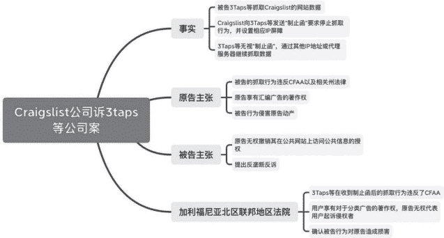

### 【核心争议点】

1.公开数据是否属于《计算机欺诈和滥用法》的保护范围.

2.公共网站所有者是否有权撤销特定用户访问该网站的授权.

3.被告行为是否属于“未经授权”或“超越授权”.

4\. 《计算机欺诈和滥用法》是否适用于公共网站所有者采取措施限制特定主体进行访问的情况.

### 【裁判论证过程】

#### （一）公开数据属于《计算机欺诈和滥用法》的保护范围

法院提出，若国会意图让《计算机欺诈和滥用法》仅保护非公开数据，则其会在法案中予以明确，例如在《美国法典》第 1030 条中列明了只保护“非公开”信息、禁止未经授权访问“非公开”的政府计算机、仅适用于某些类型的财务信息.而本案涉及的争议法条即《美国法典》第 1030 条（a）款第（2）项（C）目中并无相关限制，且法院认为若将公开数据排除在《计算机欺诈和滥用法》所保护的信息之外，将会限缩《计算机欺诈和滥用法》的适用范围.因此公开数据亦在保护范围之内.

#### （二）公共网站所有者有权撤销特定用户访问该网站的授权

法院首先认可了 3Taps 等所提出的“通过将其网站上的分类广告公之于众，Craigslist 已经‘授权’全世界（包括 3Taps 在内）都可以访问 craigslist.org”.^([\[9\]](#txt010.html#footnote_content_txt010_9))不过，3Taps 等对于“Craigslist 无权撤销其访问授权”并未提供足够论据，此处法院援引了 LVRC Holdings v. Brekka^([\[10\]](#txt010.html#footnote_content_txt010_10))一案.在该案中，第九巡回法院认为：“计算机所有者有权撤销其授予的授权.”因此法院认为，Craigslist 作为公共网站所有者，有权撤销特定用户的访问授权.

#### （三）被告行为属于“未经授权”和“超越授权”

双方均认可 3Taps 等故意访问 Craigslist 的受保护计算机并从中获取信息，故争议焦点集中于 3Taps 等的权限问题.由于《计算机欺诈和滥用法》对于“未经授权”和“超越授权”作出了不同规定，因此首先需要界定 3Taps 等的行为性质.法院从两个角度进行了论述.

一方面，从文义解释角度，法院引用了第二巡回法院的结论，^([\[11\]](#txt010.html#footnote_content_txt010_11))指出“授权”是指当权者授予的许可或权力，而“未经授权”是指不论出于何种原因，未经授权的人不能访问相关计算机.^([\[12\]](#txt010.html#footnote_content_txt010_12))因此，“获得授权与否”取决于授权者的决定.结合本案，Craigslist 即为授权方，作为“公众”的一员，3Taps 等获得公共网站 Craigslist 的访问授权；但由于 3Taps 等的抓取行为，Craigslist 通过“制止函”和 IP 壁垒的方式，撤销了 3Taps 等的访问授权.因此，在授权被撤销之后，3Taps 等的抓取行为构成“未经授权”.

另一方面，遵循 United States v.Nosal^([\[13\]](#txt010.html#footnote_content_txt010_13))一案（下称“Nosal 案”）中确立的规则，第九巡回法院在该案中澄清了《计算机欺诈和滥用法》的适用范围.《计算机欺诈和滥用法》中“超出授权访问”这一规定是对信息访问方式的限制，而非对信息使用方式的限制.此外，第九巡回法院提到“将违反私主体制定的政策^([\[14\]](#txt010.html#footnote_content_txt010_14))界定为刑事犯罪所带来的危险性和负面效应”，认为一方面，在通常的合法访问情况下，大多数用户不会去阅读此类“私主体政策”；另一方面，私主体制定的政策通常含义模糊且时常变更.因此，若把“违反私主体制定的政策”界定为刑事犯罪，将会给犯罪构成系统带来极大的不稳定性.在本案中，Craigslist 提出，网站用户协议中明确声明禁止爬取网站数据，^([\[15\]](#txt010.html#footnote_content_txt010_15))因此 3Taps 等的抓取行为属于“超越授权”.法院结合 Nosal 案对《计算机欺诈和滥用法》的解释认为，3Taps 等违反用户协议中关于数据抓取声明的行为，属于“超越授权”.

## （四）《计算机欺诈和滥用法》适用于被告未经授权爬取数据和公共网站所有者采取措施限制特定主体进行访问的情况

3Taps 等引用 Nosal 案对《计算机欺诈和滥用法》进行限缩解释.3Taps 等表示，Craigslist 的“取消授权”行为，实际上是对 3Taps 等信息使用行为的限制.对此，法院认为，首先，被禁止访问的用户只需遵循一条简单明确^([\[16\]](#txt010.html#footnote_content_txt010_16))的规则—不要访问该网站.本案中，Craigslist 的积极作为（“制止函”、IP 壁垒）向被告表明，3Taps 等的访问权已经被撤销；而 3Taps 等无视上述措施、绕过 IP 封锁继续抓取数据的行为，足以证明 3Taps 等的行为未经授权.其次，Craigslist 已经明确表达了对于限制访问的立场和态度，^([\[17\]](#txt010.html#footnote_content_txt010_17))并设置了技术壁垒以切断相关访问.此类包含明确通知和具体措施在内的真正“访问限制”，并不会导致泛刑事化问题的出现.

3Taps 等的其余论点均集中于《计算机欺诈和滥用法》的模糊性，即由于《计算机欺诈和滥用法》是模棱两可的，因此可以被合理解释为“禁止计算机所有者有选择地撤销在公共网站上访问公共信息的授权”.被告提出了宪法回避原则的抗辩事由.根据宽恕原则（rule of lenity），如果刑事法规存在“严重的模糊性”，则应对该法规进行解释，以避免施加非预期的惩罚.同时，根据宪法回避原则（the constitutional avoidance doctrines），如果对一项法规存在两种以上的“合理”解释，其中一种足以使法规的有效性存在严重的宪法问题，则法院应选择不存在宪法问题的解释.对此，法院结合宽恕原则和宪法回避原则认为：第一，最高法院指出，大多数法规在技术上都是模棱两可的，仅仅是有可能提出更狭义的解释，并不能导致适用宽恕原则；^([\[18\]](#txt010.html#footnote_content_txt010_18))第二，前述对于“未经授权”和“超越授权”的分析，此项宪法回避的抗辩事由并不成立，基于两项理由：一是，另一种解释本身是不靠谱的，二是，无论是从该法的立法历史来看，还是从公共政策的视角来看，法院对《计算机欺诈和滥用法》的解释没有严重的宪法疑虑.

法院指出，相关的问题是该法规是否“在适用于争议的特定事实时^([\[19\]](#txt010.html#footnote_content_txt010_19))含糊不清，因为从事某些明确禁止的行为的原告不能抱怨适用于他人行为的法律含糊不清.”在本案中，3Taps 等公司（1）收到了写有其个人地址的“制止函”，要求其不得出于“任何原因”访问 Craigslis 的网站；（2）发现其 IP 地址根本无法再访问该网站；（3）因为在规避了 IP 限制后继续访问该网站而被起诉.一个智力正常的人都会将 Craigslist 的行为理解为对访问该网站的授权的撤销，从而合理地意识到其进一步访问是“未经授权”.

综上，法院认为被告在原告发出“制止函”和设置 IP 壁垒后的数据抓取行为属于《计算机欺诈和滥用法》下的“未经授权”.

## 【审理结果】

1.美国加州北区联邦地区法院于 2013 年 4 月 29 日作出判决，驳回了被告提出的不应适用《计算机欺诈和滥用法》及州法律进行索赔的请求，驳回原告关于著作权的相关索赔，以及驳回原告对 Padmapper 公司提出的以民事共谋为前提的索赔.

2.美国加州北区联邦地区法院于 2013 年 8 月 16 日再次驳回被告提出的驳回《计算机欺诈和滥用法》索赔以及《加州刑法典》第 502 条索赔的诉讼请求.

## 【相关法条】

美国《计算机欺诈和滥用法》第 1030 条（a）款第（2）项（C）目（Computer Fraud and Abuse Act§1030（a）（2）（C），18 U.S.C.§1030（a）（2）（C））

未经授权故意访问计算机或超越授权访问权限，从而从任何受保护的计算机获取信息的，应当按照本条（c）款的规定予以处罚.

美国《计算机欺诈和滥用法》第 1030 条（g）款（Computer Fraud and Abuse Act§1030（g），18 U.S.C.§1030（g））

任何因违反本条规定而遭受损害或损失的人，可以对违反者提起民事诉讼，以获得补偿性损害赔偿和禁令救济或其他衡平法上的救济.

## 【案例评析】

### （一）数据抓取行为是否经授权是合法性的关键因素

本案发生于 2012-2015 年间，数字经济还没有发展到现如今的规模，但“网络爬虫”行为已经开始出现.利用现代化技术在网上自动抓取数据，不仅仅是一种新兴的数据收集手段，更是一种生产手段、研究手段，甚至已经成为当前互联网访问的重要组成部分.《计算机欺诈和滥用法》被认为是美国关于数据抓取领域最为重要的法律依据，其中第 1030 条是被援引最多的条款.如何理解“未经授权”、“超越授权访问权限”、“受保护的计算机”，成为司法实践中法官审理此类案件的重点和难点.本案中法院认为，Craigslist 发送“制止函”并设置 IP 壁垒的行为足以构成对在线侵入的通知，原告可以以该侵入违反了《计算机欺诈和滥用法》对被告进行追责.本案对于《计算机欺诈和滥用法》提供的先例是，如果网站阻止了某个用户的 IP 地址，而该用户继续通过代理或者 VPN 等其他方式访问其服务器，会被认定为违法行为，而 Craigslist 事先在网站上发布的相关声明没有被法院认为是 3Taps 等违法的依据.有人指出，本案是第一个“直接解决此问题”的裁决.

而 3Taps 等则请求法院裁定可公开访问的网站的所有者无权撤销特定用户访问该网站的授权，并辩称如果将其在《计算机欺诈和滥用法》下进行的活动认定为刑事犯罪，可能会损害互联网秩序与用户体验.第九巡回上诉法院裁定，无论从文义解释还是先例来看，3Taps 等都没有提供有力的论据.法院认为，知识产权的封锁、停止和终止都可以单独视为充分的撤销访问通知，在发送“制止函”以及采取相关技术措施之后，被告继续访问 Craigslist 网站构成了“未经授权的访问”.^([\[20\]](#txt010.html#footnote_content_txt010_20))此外法院还认为，如国会意图使《计算机欺诈和滥用法》仅保护非公开数据，会在法案中予以明确.因此最终认定 3Taps 等在收到制止函之后仍进行抓取行为，进而违反了《计算机欺诈和滥用法》.

原告 Craigslist 是一家知名的大型互联网分类广告网站，为用户提供免费的互联网广告发布和浏览服务，而我国的 58 同城、赶集网等都采取了类似的运营模式.本案的争议焦点之一便是此类网站上的公开数据是否属于《计算机欺诈和滥用法》的保护范围，法院最终根据 Craigslist 在事后采取的函告声明行为和技术手段，认定 3Taps 等在收到制止函后采用技术手段继续爬取数据的行为构成“未经授权”.随着互联网企业的快速发展，规范数据抓取的法律法规扮演着越来越重要的角色，面对错综复杂的网络纠纷，本案对国内外相关法律法规的完善也提出了新的要求，比如注意数据的分类、严格规范爬取手段、合理控制抓取的数量等.

### （二）引发了对互联网领域数据版权属性的关注

美国法院在应对爬虫相关问题时，涉及的法律主要包括：合同法、著作权法、《计算机欺诈和滥用法》、侵权法、隐私法等.这需要看爬取的数据类型和爬取方式予以区分.如果爬取的数据属于有版权的书籍、视频，那么著作权法的权重会大一些；如果爬取的是社交网络的非公开数据，可能隐私法的权重会大一些.版权法在思想及其表达之间作了根本的区分.例如，电话簿中的大多数信息如人的名字和电话号码等都是不受版权法保护的事实，有人认为公寓的价格、卧室数量和地址等详细信息是有关广告的事实，而不是 Craigslist 或其用户的创造性选择，这意味着该信息可能根本不受版权法的保护.而在本案中，Craigslist 主张对分类广告享有汇编作品著作权，法院分析后认为 Craigslist“决定设置哪些类别和标题”的行为“展示出最低水平的创造”，因而享有著作权.对于 Craigslist 来说，该网站之前只要求用户提供非专有许可，然而其最新版本（2012 年 2 月）的使用条款则要求用户“明确授予其所有权利”以获得版权，也从一方面说明本案的版权问题还存在争议.

企业的平台数据中常常包含大量的个人数据，因此对平台数据的所有权存在很多争议，有观点认为平台数据由个人所有、平台所有、个人与平台共有，也有观点认为平台数据是互联网空间的公开数据.在法律界，以中美两个互联网大国为代表，各国对数据权属都没有直接、明确的立法，学界也没有达成广泛的共识.而在实务层面，当事人常常会选择直接绕开这一争议，从实际场景出发，在已有法律明确规定和保护的范畴内解决问题.数据版权问题一直以来在国内外都备受关注，如国内的“大众点评网诉爱帮网案”、“今日头条著作权侵权案”、“携程网诉去哪儿网案”等都是由此引起的.明确数据的著作权归属，需要综合考察获取数据的目的、途径等，构建一个权责明晰的网络环境.当数据权属不明时，切勿盲目切断一切数据抓取行为，应当尊重语境制定数据使用方式的规制框架，根据具体的案件情况，决定是否构成对于数据版权的侵犯.

### （三）对公众动产权益以及企业之间的信息获取产生了直接影响

Craigslist 作为美国最大的分类网站，有着广泛的用户基础，是用户获取信息的主要渠道之一.它与 3Taps 以及 Padmapper 之间的诉讼在一定程度上对于网站用户来说是不利的，因为在本案作出裁决后，一旦 3Taps 等将在 Craigslist 网站上获取的信息发表在其他网站上，将有可能侵犯用户的权利.很多用户以及新闻评论者在网络上发表了对 Craigslist 做法的批评意见，电子前沿基金会对法院的决定—在 2012 年 7 月 26 日至 2012 年 8 月 8 日期间的临时服务条款中维持 Craiglist 的版权—也主张批评态度.

Craiglist 最初为公众谋福利的理念受到了大量的尊重和赞美，但他们却将主要精力放在诉讼上，借版权之名把那些使用者放在对立面.作为一家有着大量数据和社会贡献的公司，Craigslist 的这种做法使得许多用户都渐渐地拒绝使用其网站，转向其他拥有相似功能的网站.作为在线社区的一员，Craigslist 已经从一条开放自由的互联网之路转向了一条充满门锁和刑事诉讼的狭窄之路，与要求密码才能访问的系统相比，普通用户更容易误解 Craigslist 的 IP 限制措施.事实上，用户可以改变自己的 IP 地址或者绕过阻止访问某项特定服务的限制，所以当阻止 IP 地址的行为被赋予法律的力量时，反而会降低用户对于该网站的信任感.这种做法开创了将用户获取公开数据的利益边缘化，以促进单个企业短期竞争力的先例.事实上，这些不应该成为 Craiglist 网站封闭的原因，开放的政策才能为其带来真正的创新.

笔者认为，对于公开数据而言，数据权利的本质是一种共享权，共享的基本前提是开放，共享的本质在于让数据权利、数据利用、数据保护和数据价值融为一体.对公众易得的公开数据，应当承认其公共属性以确保较好的用户体验.在不对系统安全造成严重影响的前提下，不宜对其进行公法打击.在维护系统运行安全的前提下，法律应综合考察数据获取的目的、未来使用的场景、给被爬取方造成的损失等进行个案判断.

### （四）本案后续的一些最新进展

2015 年 6 月 26 日，Craigslist 与 3Taps 和 Padmapper 达成和解，两个和解协议都要求被告永久性地停止直接或间接地从 Craigslist 获取内容.3Taps 最终支付了 1000000 美元的赔偿额，Craigslist 则称将在十年内把这笔钱捐赠给电子前沿基金会.

3Taps 在其官方网站上的发布了一个声明，其中写道：尽管 3Taps 缺乏继续战斗所需的资源，但该解决方案为联邦应急部队提供了急需的资源，因为在这种情况下，仍然有很多问题需要进一步的研究.例如，公共网站的私人公司是否可以选择性地排除访问者，从而根据《计算机欺诈和滥用法》使被禁止的访问者承担民事和刑事责任.5 月 26 日，Craigslist 已将和解协议发布在公司的官方博客上，这是针对 Padmapper、Lovely 和 3Taps 的最终判决和永久禁令.

此外，这不太可能是涉及 Craigslist 版权的最后诉讼，尤其是考虑到 Craigslist 之后在某些用户生成的帖子中有选择地进行版权分配和注册^([\[21\]](#txt010.html#footnote_content_txt010_21))的实践，但 Craigslist 未告知访问者哪些帖子获得了版权分配与注册，这为粗心的访客创建了有效的版权诉讼陷阱.继 3Taps、Padmapper 之后，Mashery 也收到了停止服务的通知函.

Craigslist 在之后的 hiQ v.Linkedln 案（下称“Linkedln 案”）中以法庭之友的身份向法庭提交了书面意见，目的自然在于维护其作为平台的商业利益.在本案中，法院关注的重点在于数据的抓取是否违反了数据被抓取方的警示措施，判决认为 Craigslist 发送的制止函以及设置的 IP 壁垒可被视为撤销了对被告继续访问该网站的授权；而在 Linkedln 案中，法院则考虑到了被抓取数据的性质.虽然 LinkedIn 同样向 hiQ 发送了制止函并且采取了相应的禁止 IP 访问的技术措施，但由于 hiQ 所抓取的数据具有公共开放性，导致 LinkedIn 撤销 hiQ 接入自己公共部分的授权，并不会使 hiQ 的行为变成《计算机欺诈和滥用法》意义上的“未经授权”.并且，正是因为担心如果绕开 LinkedIn 的技术措施会导致其承担法律责任，hiQ 才向法院申请禁令.这强调了在明确数据属性后，对方企业授权的重要性.

## 【关联判例推荐】

### 1. eBay, Inc. v. Bidder’s Edge, Inc., 100 F.Supp.2d 1058 (N.D. Cal. 2000)

核心事实：2000 年，美国 Bidder’s Edge 公司对 Ebay 网站进行了数据爬虫，Ebay 因此向加利福利亚北区法院提起诉讼，理由包括：该爬虫行为违反了 robot 协议，构成非法侵入（trespass）、计算机欺诈和滥用、不公平竞争等违法行为.法院认为 Ebay 公司的服务器是私人财产，而公众访问权限是由其授予的，因此 Ebay 一般不允许爬虫机器人进行访问.此外，Ebay 已经明确告知 Bidder’s Edge 公司不许对其网络进行爬取.法院认同了非法入侵这一控告，认为被告未经授权干扰原告在计算机系统中的占有权益，直接导致原告受到损害.

与本案关联点：在该案中，法院回避了数据权属的问题，主要以服务器私有这一理由认定了 Bidder’s Edge 公司的行为属于非法入侵动产，这等于间接承认了爬取公开数据需要平台的授权.

### 2. United States v. Nosal, 676 F.3d 854 (9th Cir. 2012)

核心事实：该案涉及根据《计算机欺诈和滥用法》对前雇员的刑事起诉范围，第九巡回法庭的第一项裁定规定，员工如果以违反公司计算机使用政策的方式访问计算机，并不会构成《计算机欺诈和滥用法》下的“超越授权”.

与本案关联点：3Taps 引用了 Nosal 案中第九巡回法院的观点，即违反使用政策没有违反访问限制那么严重.Craigslist 已采取的措施是为防止 3Taps 以某种方式使用列表，而没有直接撤销其的访问权限.

### 3. CollegeSource, Inc. v. AcademyOne, Inc., 597 Fed.Appx.116 (3d Cir. 2015)

核心事实：原告 CollegeSource 公司是一家专注于做美国大学生转校咨询的公司，同时也提供很多在线大学课程，被告 Acdaemy One 经营类似业务.被告为了收集并建立自己的学习资源库给用户使用，雇佣了承包商撰写爬虫脚本，对原告公司网站的资源进行爬取，共收集了超过 18000 份 pdf 文档.pdf 文档的第二页，都有明确的条款说明：禁止在任何未经同意的情况下，进行重新分发、修改或商业使用.2007 年 4 月，原告向被告发送了一封制止函，要求其停止爬取行为.

与本案关联点：法院认定“违反任何技术壁垒或合同使用条款”，都可以被解释为“未经授权”.也就是说如果网站页面上没有说明，但是提供的相关产品或者服务里有相关明确说明，一样可以被认定为“未经授权”.

### 4. Facebook, Inc. v. Power Ventures, Inc.et al., 844 F.3d 1058 (9th Cir. 2016)

核心事实：与本案类似，第九巡回法院最终维持原判，认为在有明确函告和技术手段的情况下，构成“未经授权”.

与本案关联点：该案与本案法院观点基本一致，都认为仅凭网站的“使用条款”，无法构成认定《计算机欺诈和滥用法》下的“未经授权”或“超出授权”的依据；但事后的函告或技术性手段，可以成为认定为“未经授权”或“超出授权”行为的依据.

### 5. HiQ Labs, Inc. v. LinkedIn Corp., 938 F.3d 985 (9th Cir. 2019)

核心事实：原告领英要求被告 hiQ 停止利用爬虫抓取数据的行为，此后 hiQ 向地区法院提起诉中禁令并上诉至联邦巡回法庭.地区法院和上诉法院都赞同，hiQ 对领英的积极的正当性抗辩提出了实体法上的重要问题.根据之前的叙述，领英对于其平台上的数据只有非排他性许可，而并不具有所有权权益.领英的会员对其在公开资料中分享的信息的隐私预期并不确定，领英自己开发数据分析工具这一行为也削弱了其声称考虑到了会员隐私利益这一说法.法院对《计算机欺诈和滥用法》中“未经授权”条款进行狭义解释.

## 10.2 hiQ 诉领英案

## 与本案关联点
与本案关联点：同是关于数据抓取的典型案例，该案意义十分重大，这是加州法院第一次正面回应爬取“公开”信息的法律问题，因为公开数据不同于《计算机欺诈和滥用法》中规定的“受保护的计算机”，前者缺少数据保护措施（如密码）.

## 案件索引
hiQ Labs, Inc.v. LinkedIn Corp., 273 F.Supp.3d 1099 (U.S. Dist. 2017)

hiQ Labs, Inc. v. LinkedIn Corp., 938 F.3d 985 (9th Cir. 2019)

hiQ Labs, Inc. v. LinkedIn Corp., No. 17-cv-03301-EMC, 2020 U.S. Dist. (N.D. Cal.2020)

hiQ Labs, Inc. v. LinkedIn Corp., 485 F.Supp.3d 1137 (N.D. Cal. 2021)

## 关键词
数据抓取；公开数据；数据垄断；不正当竞争；《计算机欺诈与滥用法》

## 案件提要
本案是公开数据抓取的标杆性案例，其中既涉及到程序上的禁令救济问题，又涉及到实体上的《反不正当竞争法》《计算机欺诈与滥用法》（Computer Fraud and Abuse Act， CFAA）、《侵权行为法》以及言论自由规则等法律适用问题.尽管法院尚未对本案的实体纠纷作出终局性的判决，但本案的临时禁令裁定已经在法学界和互联网实务界引发了热议，并在美国司法实务中产生影响.本书所要介绍的案例就是本案临时禁令申请的二审裁定.

本案的被告领英（LinkedIn）是微软旗下全球最大的职业社交平台，拥有超过 5 亿的用户.领英用户可以在其网站上建立个人档案，记录自身教育背景、工作经历和技能等信息，并自由选择对履历档案进行不同程度的隐私保护.原告 hiQ 是一家数据分析公司，主营业务是抓取、分析被告领英平台上用户公开的职业信息，并为企业提供人力资源服务.领英在计划推出与 hiQ 类似的产品后，便禁止了 hiQ 的抓取行为.hiQ 于是申请法院发布临时禁令，禁止领英拒绝 hiQ 进行数据抓取的行为，并提起诉讼，指控领英构成侵犯合同权利、滥用市场支配地位等等.hiQ 的禁令申请先后被一、二审法院批准，而实体纠纷目前仍在审理当中.

在法律规则的适用方面，本案具有较大的开创和指导意义.由于本案是联邦法院第一次对《计算机欺诈与滥用法》在公开数据抓取领域的适用发表意见，且其对《计算机欺诈与滥用法》采用了限缩解释，即认为构成“未经授权的访问”的前提应是访问该数据需要获取一定的特别权限或许可，若涉诉数据为公开状态，不存在“授权”的需要，“未经授权”便无从谈起.此种观点与美国法院先前判例中的宽松认定做法存在较大差异，故本案被视为是《计算机欺诈与滥用法》解释论走向限缩的里程碑式案件.此外，本案也是美国法院少数对“数据垄断”问题发表意见的案例.尽管在实体判决中，hiQ 的反垄断法主张由于其相关市场界定错误而尚未被支持，但法院对领英是否构成“拒绝交易”、“搭售”等违法行为的分析十分具有借鉴意义，这在“数据垄断”愈发成为社会关注热点的当下显得尤为重要.

在比较法研究方面，本案同样是很好的学术研究素材.作为互联网经济发展的另一大先驱，中国近些年出现了一大批数据抓取案件，如在被称为“抓取公开信息入刑”第一案即晟品非法获取计算机信息系统数据一案（以下简称“晟品案”）等法院判决中，法院的分析路径和价值取向与本案不尽相同.因此，美国法院多元化的分析思路以及促进数据流通的开放态度，对中国法学界解决此类纠纷有重要的参考意义.

## 案件要旨
美国加州北区地方法院（禁令裁定一审法院）：原告 hiQ 被告 领英

美国第九巡回上诉法院（禁令裁定二审法院）：原告 hiQ 被告 领英

美国加州北区地方法院（实体判决一审法院）：原告 hiQ 被告 领英

美国加州北区地方法院（实体判决一审法院）：原告 hiQ 被告 领英

领英是世界上最大的职业社交平台.用户可以在该网站建立个人职业档案，并与其他用户联系.在建立档案时，用户可以选择档案信息的公开程度，包括“全网公开”、“仅向领英用户公开”、“仅向领英直接关系人公开”等等.本案所争论的是“全网公开”的职业信息的抓取问题.

hiQ 是新兴的数据分析公司，通过抓取和分析领英上的用户设置为“全网公开”的职业信息，判断这些用户什么时间可能辞职或某用户具备的职业技能，为企业提供人力资源方面的服务.例如，提示企业通过涨薪等方式挽留有离职倾向的员工，告知企业员工所普遍缺乏的职业技能以提示企业提供针对性的培训等.

hiQ 抓取并分析领英用户数据的商业模式早已被领英所知晓.但在 hiQ 设立的早期，领英对此采取默许的态度，甚至双方曾在非正式场合对此进行过友好的交流.但在领英计划推出与 hiQ 类似的数据分析产品后，领英于 2017 年 5 月向 hiQ 发函，要求其立即停止数据抓取行为，否则将违反《计算机欺诈与滥用法》等法律.同时，领英也采取了技术手段禁止 hiQ 的数据抓取行为.但与此同时，谷歌等其他网络平台仍可以正常抓取.hiQ 于是申请法院发布临时禁令，禁止领英拒绝 hiQ 进行数据抓取的行为，并提起诉讼，指控领英构成侵犯合同权利、滥用市场支配地位等等.

2017 年 8 月，美国加州北区地方法院准许了 hiQ 的禁令申请，领英不服，提起上诉.2018 年 3 月，美国第九巡回上诉法院裁定维持一审裁定，驳回上诉.2020 年 9 月，美国加州北区地方法院作出了对实体争议的一审判决，认为领英构成侵犯 hiQ 的合同权利，但由于 hiQ 对相关市场的界定存在错误，故无法支持其有关滥用市场支配地位的主张.法院表示，hiQ 可以修改其对相关市场界定的观点，再次提起诉讼.

随后，hiQ 再次提起向美国加州北区地方法院提起诉讼.法院在 2021 年 4 月作出判决，认为：第一，关于 hiQ 的数据抓取行为是否违反《计算机欺诈与滥用法》，由于领英已经就禁令之诉上诉到了联邦最高法院，且联邦最高法院正在审理 United States v. Van Buren^([\[22\]](#txt010.html#footnote_content_txt010_22))一案，故联邦最高法院会在不久后对《计算机欺诈与滥用法》在公开数据抓取案件中的适用发表观点.因此，法院将在联邦最高法院对上述两案作出判决后再就该争议焦点作出判决；第二，尽管 hiQ 已经被终止了作为领英网站注册用户的资格，但根据领英的网站声明，任何使用领英网站的用户（不局限于注册用户）都需要受到用户协议的约束，而用户协议禁止用户使用自动化工具抓取领英网站上的数据.因此，hiQ 存在违约的可能性；第三，尽管领英不是数据的所有权人，但对涉诉数据拥有财产性权益（property rights）或准财产性权益（quasi-property rights），故 hiQ 可能构成挪用财产（misappropriation，属于不正当竞争行为的一种）和侵犯他人财产权（trespass to chattels）.因此，hiQ 数据抓取的合法性问题无法通过简易判决解决，还需要后续继续审理.

## 案例事实思维导图
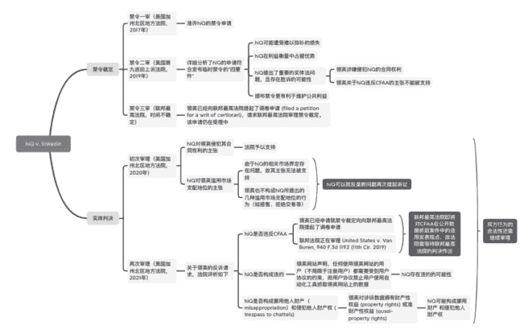

## 核心争议点
1. hiQ 的临时禁令申请是否满足四个要件：（1）若不采取临时救济措施，原告会遭受难以弥补的损害；（2）在利益衡量中，原告更占据优势；（3）原告在实体法上存在胜诉的可能性；（4）颁布禁令更有利于公共利益.
2. 抓取公开数据的行为是否会对用户隐私造成威胁，并有可能破坏用户对于公共平台网站的信赖.
3. 公共平台网站对于用户所提供的数据是否享有受保护的财产权益.
4. 抓取公开数据的行为是否属于《计算机欺诈与滥用法》所规定的“未经授权的访问”，且存在胜诉的可能.
5. 允许抓取公开数据是否更有利于维护公共利益.

## 裁判论证过程
本案中，法院主要参考了 Winter v. NRDC， Inc.^([\[23\]](#txt010.html#footnote_content_txt010_23))一案中提出的四个衡量标准，即原告寻求临时禁令必须证实：（1）若不采取临时救济措施，原告可能遭受难以弥补的损害；（2）在原告与被告之间的利益权衡中，原告更占据优势；（3）原告在实体法上存在胜诉的可能性；（4）颁布禁令更有利于公共利益.

### （一）若不采取临时救济措施，hiQ 有可能遭受难以弥补的损失
hiQ 提出，hiQ 的整个商业模式都建立在“全网公开”的领英用户信息之上，因为目前市面上没有其他实际可替代的数据来源.而一旦其数据抓取遭到阻止，hiQ 可能会被迫违反与 eBay、Capital One 和 Go Daddy 等现有客户的合同，同时面临失去潜在客户的风险.事实上，hiQ 所遭受的损失已非停留于纸面的假设：收到领英要求停止访问数据的通知之际，hiQ 正处于融资阶段，领英的阻碍使 hiQ 业务存续能力遭到了质疑，融资谈判陷入僵局，还有部分员工因公司前景未卜而选择离职.

领英则反驳称 hiQ 可以寻找到替代的数据来源，其中特别举例如 Facebook 上的职业信息.对此法院认为，hiQ 的商业模式依赖于用户面向全世界公开分享的信息，而 Facebook 的数据通常是无法获取的，其并非一个等同的、可替代的数据源.

领英还辩称，即使缺乏可替代的数据源，hiQ 也可以选择自行收集数据.法院则认为，一方面，hiQ 是一家数据分析公司，而不是一家数据收集公司.新建一个数据收集系统意味着需要投入大量的金钱和时间成本，在现有业务难以为继的窘境下，hiQ 公司能否存续以及是否有能力搭建新系统值得怀疑.另一方面，从数据分析转向数据收集将从根本上改变 hiQ 的业务性质.因此，领英的这一主张恰恰反映了 hiQ 的商业模式高度依赖于领英的数据.

综上，法院认为，访问领英用户的公开信息数据对于 hiQ 维持业务具有重要的意义.因此，若不颁布禁令，hiQ 有可能遭受难以弥补的损失.

### （二）hiQ 在利益衡量中占据优势
首先，从商业利益角度看，若不颁发禁令，hiQ 可能面临前文所述的巨大损失乃至破产风险.

其次，领英声称，hiQ 的数据抓取行为会威胁其用户的隐私，并有可能破坏用户对领英的信赖.领英特别指出，有超过 5000 万用户使用了“请勿广播”功能（更改个人资料时不通知其他用户）.领英认为，这一功能的广泛使用表明，许多用户（包括选择公开分享信息者）并不想让雇主知道他们正在寻找新工作.而且，雇主如果得知员工有离职的打算，其未必会设法留住员工，甚至可能引发反效果，如限制该员工访问敏感信息、先行解雇等.一审法院认为，领英的观点具有一定合理性，但仍不足以成为阻碍法院发布禁令的理由，原因如下：

第一，难以推断且几乎没有证据表明那些选择公开个人资料的领英用户对其公开信息实际保持着隐私预期.且领英的隐私政策明确规定，“您在领英上公开的任何信息及发布的任何内容都可能被他人看到”，并提示用户不要“在您的个人资料中发布或添加您不想公开的个人信息”.因此，在用户已经对“全网公开的信息可能被任何人访问”这一政策知情的情况下，不应再承认用户对相应的信息保有隐私预期.

第二，缺乏证据表明，多数使用“请勿广播”功能的用户是为了防止其雇主知晓其在离职前所做的个人资料修改.用户使用该功能还有可能基于其他原因，例如仅仅是希望避免在每次修改个人资料时都推送烦人的通知.此外，即使没有收到通知，只要雇员选择了公开信息，雇主依然可以随时查看其资料，了解最近是否有任何变动.雇员若真有意向雇主隐瞒此类信息，则完全可以选择不公开模式，并取消雇主的联系人身份.

第三，领英自身行为与其主张相矛盾.若领英认为 hiQ 的数据抓取行为侵害了消费者的隐私，则很难解释其为何又推出了数个与 hiQ 业务类似的产品.例如，领英新开发的“招聘者（Recruiter）”产品使招聘人员能够“跟踪”潜在目标，并在对方修改个人资料时获得“提醒”，进而“利用这些提醒作为信号，在适当的时候伸出援手”，同时又不为对方所知.领英“人才招聘、营销及销售解决方案”产品的订阅者则可以从领英用户的公开资料中导出数据，包括姓名、现就职公司、当前职务等.

最后，领英还声称其在防范“搭便车者”任意使用平台数据方面享有利益.法院认为，用户才是个人资料的所有权人，领英对用户所提供的数据并不享有受保护的财产权益.至于“全网公开”的信息，用户显然有意允许他人访问—包括出于商业目的，如正在寻找具备特定证件候选者的雇主.当然，领英也可以通过取消公开分享功能以防范“搭便车”现象，尽管这可能牺牲许多用户的偏好，甚至损害领英自身的利益.

### （三）hiQ 提出了重要的实体法问题，且存在胜诉的可能性
第一个问题有关合同的侵权干涉.

hiQ 提出，领英妨害了其与客户的现有合同关系，并提供了多方面的证据.领英对其实施的妨害行为之客观存在没有过多异议，只是坚称其行为是正当的，因为它是出于“合法的商业目的”.但法院对领英这一观点并不认同，理由如下：

第一，hiQ 在履行与 eBay、Capital One 等大客户的合同义务方面有着重要的商业利益.这些公司受益于 hiQ 访问、汇总和分析领英用户公开信息数据的能力.而一旦 hiQ 无法再抓取领英平台上的数据，则将无法正常提供上述合同项下的义务，从而构成违约.这将严重损害 hiQ 的经营利益.

第二，领英所采取的妨害举措不属于“公认的商业惯例”手段.在充满竞争的市场中，经营者采取一定手段削弱竞争对手的竞争优势，甚至减损竞争对手的合同权益都是无可厚非的.但是，上述的“一定手段”应当符合“公认的商业惯例”，否则可能构成违法.“公认的商业惯例”包括诸如“广告”、“降价”、“雇佣他人的雇员用于雇主的业务”等形式，侧重间接干扰竞争对手，而非从根本上破坏对手的基础商业模式.而在本案中，领英全面禁止 hiQ 访问其平台数据的行为，动摇了 hiQ 的业务根基.

第三，领英的行为很可能并不在公平竞争的范围内.hiQ 提出了一个重要的问题—领英之所以禁止 hiQ 抓取数据，实际是为推广其开发的（与 hiQ 的）竞品.hiQ 作出这一推断的依据是：在此争议发生的几年前，领英便已知晓 hiQ 及其对外部数据的依赖，却长期对此保持默许.而在领英宣布其计划利用其平台数据为雇主开发一款新产品（其功能与 hiQ 的 Skill Mapper 近似）的一个月后，领英就开始禁止 hiQ 的数据抓取行为.hiQ 认为领英的行为有不正当竞争之嫌，并进一步指出：如果像领英这样拥有大量公共数据的公司，被许可有选择地禁止潜在竞争对手访问、使用这些公开的数据，将不利于创新者们聚合、分析数据.

第四，领英声称的私人商业利益（“保护用户的数据和开发平台的投资”以及“强制执行其用户协议对自动抓取的禁令”）相对较弱.领英对在其平台上公开分享的数据只享有非排他性许可，而非所有权.领英的核心业务模式是提供一个共享职业信息的平台，这并不要求禁止 hiQ 使用这些信息.至于领英用户对其数据的利益，hiQ 则援引了前文利益衡量中一审法院的观点，即用户对公开资料中信息的隐私期望“充其量是不确定的”.而且，领英自身也推出了与 hiQ 业务类似的竞品，这和其主张产生了矛盾.此外，领英还没有解释，既然 hiQ 的用户身份已经终止，那么如何针对 hiQ 强制执行用户协议.

综上，二审法院认为，领英未能充分论证其存在“合法的商业目的”以实施妨碍 hiQ 合同履行的行为.

第二个问题有关《计算机欺诈与滥用法》的适用.

领英指控道，hiQ 在领英发函警告后依然继续实施数据抓取行为，违反了《计算机欺诈与滥用法》，因此其在实体判决上无法胜诉，法院不应同意其禁令申请.对于这一主张，法院通过多种方法对《计算机欺诈与滥用法》的有关条文进行了解释，并选择不支持领英的观点.

《计算机欺诈与滥用法》规定：“未经授权故意访问计算机或超越授权访问权限，从而从任何受保护的计算机获取信息的，应当按照本条（c）款的规定予以处罚.”（详见后文“相关法条”部分）本案的争议焦点在于，hiQ 在明知领英不允许其抓取的情况下依然进行爬虫行为，是否属于“未经授权的访问”？为解决这一问题，法院首先需要对“未经授权”一词作出解释.对此，法院从文义解释、目的解释、历史解释等多个角度进行了探讨.

文义解释方面，法院认为，如果要构成“未经授权的访问”，那意味着正常情况下，访问该数据需要获取一定的特别权限或许可，而本案的涉诉数据是公开的，不存在“授权”的需要，“未经授权”也就无从谈起.

目的解释和历史解释方面，法院以判例和国会立法文件为依据进行了论证.在 United States v. Nosal^([\[24\]](#txt010.html#footnote_content_txt010_24))案中，第九巡回法院认为《计算机欺诈与滥用法》的立法目的是防止非法侵入计算机系统的行为，即黑客行为；而在 1984 年国会的报告中（The 1984 House Report），立法机关表示《计算机欺诈与滥用法》的立法目的是为了打击非法侵入行为，并将这种行为比喻为“破坏后进入（breaking and entering）”.而在本案中，由于涉诉数据是公开的，hiQ 也没有对领英的计算机系统采取技术破坏行为，故不应适用《计算机欺诈与滥用法》规制 hiQ 的行为.

最后，刑法的谦抑性原则也促使法院应当对《计算机欺诈与滥用法》进行限缩解释.由于《计算机欺诈与滥用法》在民事领域和刑事领域皆可适用，而法院需要在两类诉讼中保持一致解释，故应优先依据刑法的从宽原则，对《计算机欺诈与滥用法》采取限缩解释，防止“将一个刑事黑客犯罪法条转变为一个‘广泛的网络警察授权书’”.

综上所述，法院认为《计算机欺诈与滥用法》规定的“未经授权”应局限于技术入侵行为，而 hiQ 的行为显然不属于技术入侵，故领英关于《计算机欺诈与滥用法》的主张不能得到支持.

### （四）颁布禁令更有利于维护公共利益
原告和被告都声称自身的立场将有助于最大限度地实现互联网信息的自由流动，进而有利于公共利益.

hiQ 提出，数据抓取是一种常用的信息收集手段，被搜索引擎、学术研究人员和其他许多人广泛运用.此外，如果允许掌握大量用户数据的企业决定谁能从公共网站上爬取数据，将使企业对数据的使用方式拥有过大的控制权.

领英则主张，颁布临时禁令将诱导恶意访问、攻击领英的服务器等行为.在此情形下，领英等运营公共网站的公司将被迫作出抉择：放任攻击，抑或是从原来的公开模式转向用密码保护自己的网站，后者将使之淡出公众视野.

法院认为，用户公开发布的数据本身并非归平台所有，如果允许领英这类公司自由决定谁能收集、使用这些数据，会对互联网的数据公开和自由流动造成威胁，进而危及公众利益.而且，颁布禁令并不意味着向网络攻击等恶意活动打开大门，领英依然可采用技术手段抵御此类行为，如通过“反机器人措施（anti-bot measures）”来防范对其服务器的有害入侵或攻击等.

## 审理结果
### （一）关于禁令裁定
1. 美国加州北区地方法院支持原告请求，发布临时禁令，禁止领英限制 hiQ 的数据抓取行为.
2. 美国第九巡回上诉法院认同 hiQ 申请禁令的条件成就，维持地方法院的裁定.

### （二）关于实体判决

## 1. 初次审理
在初次审理中，美国加州北区地方法院认为领英构成侵犯`hiQ`的合同权利，但由于`hiQ`对相关市场的界定存在错误，故无法支持其有关滥用市场支配地位的主张。

## 2. 再次审理
在再次审理中，美国加州北区地方法院认为`hiQ`可能构成违约、挪用财产（`misappropriation`）和侵犯他人财产权（`trespass to chattels`）。对于`hiQ`是否违反《计算机欺诈与滥用法》，需等待联邦最高法院对`United States v. Van Buren`等案的审理结果。因此，法院还需后续再审理双方行为的合法性。

## 相关法条
### 美国《计算机欺诈与滥用法》第 1030 条（a）款第（2）项（C）目（`Computer Fraud and Abuse Act§1030（a）（2）（C）`，`18 U.S.C.§1030（a）（2）（C）`）
未经授权故意访问计算机或超越授权访问权限，从而从任何受保护的计算机获取信息的，应当按照本条（c）款的规定予以处罚。

### 美国《计算机欺诈与滥用法》第 1030 条（c）款第（2）项（A）目（`Computer Fraud and Abuse Act§1030（c）（2）（A）`，`18 U.S.C.§1030（c）（2）（A）`）
除（B）目另有规定外，对于本条（a）款第（2）项、第（3）项、第（6）项规定的犯罪行为，如果为第一次触犯前述罪名，没有根据本条规定的另一犯罪行为被定罪，或者企图实施本条规定的应受处罚的犯罪行为的，根据本编规定单处或并处罚款和/或一年以下有期徒刑。

### 美国《计算机欺诈与滥用法》第 1030 条（e）款第（2）项（B）目（`Computer Fraud and Abuse Act§1030（e）（2）（B）`，`18 U.S.C.§1030（e）（2）（B）`）
“受保护的计算机”是指用于或影响州际或外国商业或通信的计算机，包括位于美国境外且其使用方式影响美国州际或外国商业或通信的计算机。

### 美国《计算机欺诈与滥用法》第 1030 条（g）款（`Computer Fraud and Abuse Act§1030（g）`，`18 U.S.C.§1030（g）`）
任何因违反本条规定而遭受损害或损失的人，可以对违反者提起民事诉讼，以获得补偿性损害赔偿和禁令救济或其他衡平法上的救济。

### 美国《存储通信保护法案》第 2701 条（a）款（`Stored Communications Act§2701（a）`，`18 U.S.C.§2701（a）`）
侵入（`Off ense`）。除非本条（c）款另有规定，任何人：
（1）未经授权，故意访问提供电子通信服务的设施；或
（2）故意超出授权范围访问该设施；
并因此获得、更改或阻止在该系统中以电子方式存储的有线或电子通信的授权访问的，应按照本条（b）款的规定予以处罚。

### 美国《存储通信保护法案》第 2701 条（b）款（`Stored Communications Act§2701（b）`，`18 U.S.C.§2701（b）`）
惩罚。对本条（a）款所述罪行的惩罚是：
（1）如果为了私人商业利益、进行恶意破坏或损害而实施犯罪行为，或进行其他违反联邦或各州宪法或法律的任何犯罪或侵权行为—
（A）对于初犯，根据本法规定单处或并处罚款和/或 5 年以下有期徒刑；
（B）对于非初犯，根据本法规定单处或并处罚款和/或 10 年以下有期徒刑；以及
（2）在任何其他情况下，
（A）对于初犯，根据本法规定单处或并处罚款和/或 1 年以下有期徒刑；
（B）对于非初犯，根据本法规定单处或并处罚款和/或 5 年以下有期徒刑。

## 案例评析
### （一）本案折射出了美国法院对《计算机欺诈与滥用法》解释论的变迁
本案中，尽管原被告双方就`hiQ`抓取行为的合法性进行了激烈的辩论，并各自援引了多部法律作为自身论点的依据，但全案争议的核心是《计算机欺诈与滥用法》在公开数据抓取案件的适用问题—这也是法院花了最多篇幅论证的内容。有学者指出，本案之所以有如此重大的学术研究价值和实践指导意义，很大程度上就是因为本案法院对《计算机欺诈与滥用法》的解读相较于几个先例^([\[25\]](#txt010.html#footnote_content_txt010_25))有了重大的突破：法院选择限缩对《计算机欺诈与滥用法》适用范围的解释，将公开数据抓取排除《计算机欺诈与滥用法》的规制范围之外。^([\[26\]](#txt010.html#footnote_content_txt010_26))

《计算机欺诈与滥用法》是一部美国国会于 1986 年通过的法律。《计算机欺诈与滥用法》有时被俗称为《反黑客法》，但根据美国国会研究服务处（`Congressional Research Service， CRS`）报告的介绍，实际上它的规制范围比“反黑客”更广，涵盖了多种涉计算机的侵权行为。^([\[27\]](#txt010.html#footnote_content_txt010_27))

《计算机欺诈与滥用法》是美国数据抓取案件中的被抓取者最常援引的法律。被抓取者对《计算机欺诈与滥用法》青睐有加的原因主要有两个，一是“管辖范围广”，二是“法律责任重”。所谓“管辖范围广”，是指《计算机欺诈与滥用法》是联邦层面的法律，全美的民事主体都可以援引它提出法律主张—这相较于管辖范围有限的州法有显著优势。所谓“法律责任重”，是指《计算机欺诈与滥用法》规定了包括刑事责任在内严苛的法律责任（可参见“相关法条”部分）。当然，正如法院在禁令上诉判决的脚注 15 所说明的那样，《计算机欺诈与滥用法》不是被抓取者唯一的“救命稻草”，被抓取者也可以以其他法律理由寻求救济，例如主张抓取者构成违约、侵犯财产权益（`trespass to chattels`）、著作权侵权等等，并且也确实存在被抓取者以上述理由取得胜诉的案例（可参见“关联判例推荐”部分）。但毫无疑问的是，《计算机欺诈与滥用法》为被抓取者提供了最有力的自卫武器。

《计算机欺诈与滥用法》规定，“未经授权故意访问计算机或超越授权访问权限，从而从任何受保护的计算机获取信息的”，构成违法。违法者可能面临损害赔偿、罚金乃至有期徒刑的法律责任。在数据抓取案件中，当事双方对能否适用《计算机欺诈与滥用法》的争议点就在于：未经被抓取者同意的数据抓取行为是否属于“未经授权”的访问行为？

由于美国联邦最高法院尚未对《计算机欺诈与滥用法》条文的“未经授权的访问”进行解释，美国各地法院“同案不同判”的现象时常出现，同一法院的态度也时常转变。有学者将美国法院对“未经授权”的解释论变迁大致归纳为“先宽松—后严格”，即：早期的美国法院通常认为，只要被抓取者的网站服务协议规定“不得抓取数据”，或者被抓取者对抓取者进行了警告，且抓取者不顾上述提示继续抓取，就构成“未经授权”的访问；而后期的美国法院认为，只有当数据爬取者突破网络技术限制进行访问时，才可能构成未经授权的访问。^([\[28\]](#txt010.html#footnote_content_txt010_28))而本案正是美国法院对《计算机欺诈与滥用法》解释论走向限缩的标志性案例—为了解释何为“未经授权的访问”，法院在本案中综合采用了文义解释、历史解释的目的解释的方法：从文义解释的角度来看，如果构成“未经授权的访问”，那意味着正常情况下，访问该数据需要获取一定的特别权限或许可，而本案涉诉数据为公开的，不存在“授权”的需要，“未经授权”也就无从谈起；从历史解释和目的解释的角度来看，美国国会和联邦最高法院都曾认为《计算机欺诈与滥用法》的立法目的在于打击黑客行为和非法侵入（`trespass`）计算机系统的行为（法院形象地比喻为“`breaking and entering`”），而`hiQ`的行为显然不属于此类。

法院的这一解释方法在学界和互联网行业引起了巨大的反响。在本案的诉讼期间，电子前线基金会（`Electronic Frontier Foundation`，一个国际非营利性的宣传数字版权和法律的组织）就曾向法院提交一份报告，说明允许数据抓取行为对维护市场活力、促进科研发展有重要的意义。^([\[29\]](#txt010.html#footnote_content_txt010_29))而在法院同意`hiQ`的禁令申请后，有学者称赞它“有利于促进数据的自由流通，推动数据分析行业的发展”，^([\[30\]](#txt010.html#footnote_content_txt010_30))有学者表示“很多初创企业都是靠数据抓取起步，认可数据抓取的合法性有利于扶持中小企业发展”。^([\[31\]](#txt010.html#footnote_content_txt010_31))当然，法院的部分论证也引起了一定的争议。例如在本案中，法院特地说明了为什么`hiQ`不违反《计算机欺诈与滥用法》，而`Facebook Inc. v. Power Ventures`案（下称“Facebook 案”）中的`Power Ventures`违反《计算机欺诈与滥用法》^([\[32\]](#txt010.html#footnote_content_txt010_32))：本案的涉诉数据为公开数据，而 Facebook 案的涉诉数据需要用户用账号密码登录后才可访问。但这一观点也有商榷的余地，因为一方面，网站设置登录系统的目的不一定是保护数据安全，而可能只是落实法律上的实名验证要求，登录系统的存在与否不应有如此大的影响；另一方面，抓取者很容易通过批量申请账号的方式绕考登录系统的限制。

事实上，尽管本案的终局性判决尚未作出，但本案限缩《计算机欺诈与滥用法》的适用的观点已经从学界延伸到司法实务界。例如，在 2018 年的`Sandvig v. Sessions`案中，法院认为：“如果将《计算机欺诈与滥用法》适用于以学术研究为目的的数据抓取行为，将违反美国宪法有关言论自由和新闻自由的规定。”^([\[33\]](#txt010.html#footnote_content_txt010_33))

但值得注意的是，在本案选择让更少的数据抓取者遭受刑事制裁的同时，中国也出现了“抓取公开信息入刑”的第一案：晟品非法获取计算机信息系统数据案（下称“晟品案”）。在该案中，被告人破解了被害人字节跳动公司的防抓取措施，抓取了被害人服务器中的视频数据（对应的视频是公开的）。法院认为被告人构成非法获取计算机信息系统数据罪。^([\[34\]](#txt010.html#footnote_content_txt010_34))该案的主审法官曾撰文详细阐释其判决的理由，包括“虽然被抓取的视频是公开的，但其对应的数据并不公开”，这体现为用户只能在线观看视频，而不能自由储存到本地。^([\[35\]](#txt010.html#footnote_content_txt010_35))本案“抓取公开信息可能入刑”的结论引发了中国法学界的热烈讨论，并且不乏批评之声，例如有学者质疑抓取公开数据问题是否有必要动用《刑法》进行治理。^([\[36\]](#txt010.html#footnote_content_txt010_36))晟品案和本案在学界引发的激烈讨论都说明，运用刑法治理数据抓取，尤其是公开数据抓取问题仍然是有丰富探讨空间的问题。中美两国的学界和法院对此问题的态度如何，以及能否达成共识，还有待进一步观察。

### （二）本案体现了中美法院在处理数据抓取纠纷时的不同的分析路径
作为公开数据抓取纠纷的标志性案例，本案生动体现了美国法院在解决数据纠纷时多样的分析路径。如前所述，尽管《计算机欺诈与滥用法》有关“未经授权的访问”的规定是美国法院解决数据抓取纠纷的核心规则，但美国法院还援引了其他法律规范作为辅助规则。在本案的禁令裁决中，法院就对其他法律适用问题进行了分析：例如，从侵权法的角度看，领英构成侵犯合同权利（`Tortious Interference with Contract`）；从竞争法的角度看，领英的做法涉嫌构成不正当竞争（参见二审裁定书脚注 9），有构成数据垄断的风险。此外，在禁令的一审诉讼中，双方当事人还就领英的行为是否违反加州的言论自由条款进行了激烈的争论—尽管法院的态度比较谨慎，拒绝在没有先例的情况下轻易地将言论自由规则完全引入互联网领域，但正如有学者评论道，这一争论体现了“私人财产权益和言论、信息和知识自由流通之间的冲突”。^([\[37\]](#txt010.html#footnote_content_txt010_37))而如果我们将视线跳出本案本身，则更能看到美国法院在处理数据抓取纠纷时分析路径的多元化，例如`Compulife Software Inc. v. Newman`案中法院运用了商业秘密条款进行分析，`Ebay v. Bidder’s Edge`案中法院运用了普通法上的“侵犯财产权益”规则进行分析的，等等。^([\[38\]](#txt010.html#footnote_content_txt010_38))

而与之形成对比的是，中国法院处理数据抓取纠纷的“法律工具”则显得单薄许多。在目前的中国司法实践中，法院几乎清一色地采用《反不正当竞争法》作为裁判依据。其中，除个别案例（如新浪诉饭友案）^([\[39\]](#txt010.html#footnote_content_txt010_39))适用了“互联网专条”的兜底条款^([\[40\]](#txt010.html#footnote_content_txt010_40))外，绝大多数案例是以该法的一般条款^([\[41\]](#txt010.html#footnote_content_txt010_41))作为裁判依据。然而，由于一般条款和互联网专条的兜底条款都十分抽象，中国法院通常都是采用海带配额案^([\[42\]](#txt010.html#footnote_content_txt010_42))、45 号指导案例^([\[43\]](#txt010.html#footnote_content_txt010_43))等权威判例所确立的“竞争关系—实际损害—行为正当性”的分析框架，综合考虑被抓取者、抓取者、消费者等多方主体的利益。换言之，中国法律在数据抓取纠纷的规定几近空白，使得法院不得不用依赖于抽象的一般条款，在利益衡量中得出裁判结论。

对于这种现象，有不少学者提出批评，认为这种“向（抽象的）一般条款逃逸”的行为“削弱了司法的正当性和安定性”，^([\[44\]](#txt010.html#footnote_content_txt010_44))提出可以通过立法的方式明确数据权属，以解决这一问题。^([\[45\]](#txt010.html#footnote_content_txt010_45))但也有学者认可中国法院的做法，认为数据权属问题相当复杂，立法者目前难以恰当地事先安排好数据利益的分配问题，让法院在个案分析中摸索经验方为稳妥之道。^([\[46\]](#txt010.html#footnote_content_txt010_46))本书认为，学界双方的观点都有一定的合理性，而以本案为代表的美国司法实践也许可以为中国提供一种新的思路：可以考虑通过对《反不正当竞争法》的有关条款（如互联网专条、商业秘密条款）、《刑法》的部分条款（如非法侵入信息系统罪）的完善和解释，让中国法院可以在法律尚未明确规定数据权属问题的情况下，用更清晰、更具操作性的条文来解决此类纠纷。

### （三）本案体现了中美法院在处理数据抓取纠纷时的不同的价值取向
如果说“分析路径多元化”是本案形式推理的特点，那么本案实体内容所体现的价值取向或许更值得中国法律界关注，即：对数据抓取行为持较为开放的态度，鼓励数据的自由流通，而对被抓取者的数据利益保护强度较低。这一价值取向在法院分析领英指控`hiQ`涉嫌“搭便车”时体现的最为明显：在禁令二审中，领英表示其向`hiQ`发出警告的行为是为了防止其“搭便车”地使用领英平台上的用户职业信息，而法院不以为然，表示“领英对用户提供的数据没有受保护的财产权益，（只有）用户对其个人资料享有所有权”，而用户既然选择公开这些信息，领英就无权干涉。而与之形成鲜明对比的是，中国法院对被抓取者的保护力度要高的多。这主要体现为以下两个方面：

第一，中国法院通常会认可网络平台对其承载数据具有财产性利益，即使这些数据由用户创造，且处于公开状态，例如认为大众点评对用户的点评信息有财产性权益，^([\[47\]](#txt010.html#footnote_content_txt010_47))新浪对用户填写的个人资料^([\[48\]](#txt010.html#footnote_content_txt010_48))和发表的微博^([\[49\]](#txt010.html#footnote_content_txt010_49))有财产性权益等。中国法院承认这种合法权益，一般是出于对平台为吸引用户提供数据所付出的成本和努力，例如搭设功能丰富、操作方便的平台，提供补贴，进行营销等。

第二，中国法院对“数据”这一财产性利益的保护强度较高。这一特点在中国法院所确立的“三重授权原则”表现的最为明显。^([\[50\]](#txt010.html#footnote_content_txt010_50))该原则是“针对第三方应用通过开放平台（如`OpenAPI`）获取用户信息时应遵循的原则，要求数据获取方在获取数据时既要获得用户的同意，也要获得数据提供方企业的同意”。^([\[51\]](#txt010.html#footnote_content_txt010_51))“三重授权”中的“平台授权”，即“获得数据提供方企业的同意”—这与本案的价值取向差异甚大。有学者就曾撰文表示对“平台授权”的反对，认为如果消费者同意将自己存储在甲平台的数据开放给乙平台，则甲平台无权干涉，因为甲平台已经获得了“使用用户数据”作为其收集数据成本的对价。^([\[52\]](#txt010.html#footnote_content_txt010_52))

对于中美两国裁判取向的区别，本书认为并无优劣之分，而只是各国在不同的经济发展水平下作出的不同价值判断。美国法院更容许数据抓取，可以促进数据的自由流通，发挥数据的经济价值，扶持数据相关的中小企业发展；中国法院更保护数据平台，可以激励更多企业投入资源以吸引用户提供数据，增加网络领域的数据供给量。事实上，如前文在介绍《计算机欺诈与滥用法》的解释论变迁时所述，美国法院也曾对数据抓取行为采取较为严厉的“打击”态度，甚至引入刑事制裁。因此，等到未来随着中国互联网世界的数据供给量逐渐变多，数据垄断问题逐渐显现时，中国法院的裁判倾向也有可能发生转变。

### （四）本案体现了数据垄断已经成为值得关切的社会问题

# 数据垄断与反垄断争议

在本案的禁令裁定中，法院将“数据垄断”作为了认定发出禁令有利于维护公共利益的一个理由：“如果让领英这样的巨头任意决定谁能获取数据，则会有造成信息垄断、危害公共利益的风险.”而在实体判决中，数据垄断问题更是成为了全案的核心法律争议，法院也对领英是否构成几种典型的滥用市场支配地位的情形进行了分析.但遗憾的是，由于法院不认同 hiQ 所界定的相关市场，故无需分析领英是否具体构成某种滥用市场支配地位行为（例如“必需设施理论”对领英是否适用等）就驳回了 hiQ 的主张.因此，我们还需等待法院在 hiQ 修改了相关市场界定的主张后所作出的新判决，以更深入地了解法院对这一问题的观点.

但是，尽管本案的反垄断法争议尚未尘埃落定，本案所体现的“数据垄断”问题已经愈发成为社会关注的问题.事实上，除了本案中法院所担忧的“互联网巨头任意决定谁能获取数据”外，“大数据杀熟”、“平台二选一”也已经成为消费者所普遍关切的问题.2019 年 1 月，中国人民大学网络与移动数据管理实验室发布了《中国隐私风险指数分析报告》.该报告显示，中国 10%的数据收集者获取了 99%的权限数据.^([\[53\]](#txt010.html#footnote_content_txt010_53)) 2021 年中国两会前夕，有学者发布报告，称其通过 836 次打车的调研发现，中国网约车平台确实存在“杀熟”现象.^([\[54\]](#txt010.html#footnote_content_txt010_54))而在随后的会议期间，有人大代表提交议案，表示“数据成为市场竞争的核心要素，而算法为协同定价创造了条件，带来了共谋风险，也增加了滥用市场力量侵害消费者利益的可能性和强度.应当在（《反垄断法》的）总则部分明确禁止协同行为，为分章规制算法共谋、数据滥用、大数据杀熟、平台二选一等行为发挥引领作用”.^([\[55\]](#txt010.html#footnote_content_txt010_55))在 2021 年中国《政府工作报告》强调“强化反垄断和防止资本无序扩张，坚决维护公平竞争市场环境”的背景下，^([\[56\]](#txt010.html#footnote_content_txt010_56))数据垄断已经成为愈发重要、亟需解决的社会问题.

回到数据抓取纠纷.在本案的实体诉讼中，hiQ 主张领英构成拒绝交易（Unilateral Refusal to Deal）、拒绝开放必需设施（Denial of Essential Facilities）、封锁（Lock-In）、搭售（Tying）、提升竞争对手的成本（Raising Rivals’ Costs）等滥用市场支配地位行为.尽管法院认为 hiQ 的相关市场界定存在问题，但简单论证了为何领英拒绝数据抓取的行为不构成上述违法行为—唯一的例外是：法院对“涉诉数据是否属于必需设施”这一问题采取了回避态度.

法院对“必需设施理论”能否适用的沉默，一定程度上是学界对此争论不休的结果.所谓“必需设施理论”，是指“当垄断者对竞争所必要的原料或者资源享有瓶颈式的控制，尤其是对下游市场竞争所必要的设施享有控制时，且设施不能被复制，垄断者必须与下游市场的竞争者共享设施”.^([\[57\]](#txt010.html#footnote_content_txt010_57))这一理论滥觞于美国（尽管联邦最高法院并未明确采纳过该理论），并已被我国的《禁止滥用市场支配地位行为暂行规定》（国家市场监督管理总局令第 11 号）采纳.^([\[58\]](#txt010.html#footnote_content_txt010_58))这一理论本身就存在较大的争议，而将其运用在数字经济领域则引起了更多疑问.尽管有观点支持这一理论的适用，认为：“当数据垄断者对下游市场前景缺乏认知时，会先通过交易大数据将潜在的竞争对手作为市场试验石.待市场前景明晰之后，便通过拒绝大数据交易将竞争对手挤出市场.对此，如果不适用必要设施原则以强制开放数据，那么会严重抑制下游市场的竞争和创新.”^([\[59\]](#txt010.html#footnote_content_txt010_59))但更多学者认为该理论在数据纠纷中的适用存在很大困难：首先，由于“数据之间的替代性难以评估”，相关市场的界定十分困难；^([\[60\]](#txt010.html#footnote_content_txt010_60))其次，认定某一事物为必需设施的条件十分苛刻，抓取者在证明自己无法“以合理的投入另行投资建设”等条件方面存在困难；最后，适用必需设施理论可能会给市场带来较大的震动，这使得法院在裁判时通常保持慎之又慎的态度，如欧洲法院所言，“强制进行交易的义务可以在短期之内促进竞争，但长期来看，可能会减损竞争对手开发竞争性设施的积极性”.^([\[61\]](#txt010.html#footnote_content_txt010_61))

由此可见，尽管“数据垄断”已经愈发成为社会的“热点”甚至“痛点”，但现行反垄断法规则在处理这些争论时仍存在许多障碍.关于数据垄断问题在美国的走向会是如何，还有待本案最终判决的作出.

## 关联判例推荐

### 1. PeopleBrowsr, Inc. v. Twitter, Inc., No. C-12-6120 EMC, 2013 U.S. Dist.(N.D. Cal. 2013)

核心事实：本案被告 Twitter 为全球知名的社交媒体.原告 PeopleBrowsr 是专业的数据分析公司，主要业务是对用户发表的推文进行数据分析并出售分析报告.PeopleBrowsr 每年向被告支付 100 万美元以换取抓取 Twitter 数据的权限.Twitter 后来也打算进军这一数据分析市场，并为此展开了一系列并购活动.随后，Twitter 关闭了 PeopleBrowsr 访问 Twitter 数据的权限.PeopleBrowsr 认为 Twitter 关闭数据访问权限的行为是为了打击 PeopleBrowsr，为自己的数据分析产品铺路，属于不正当竞争，对消费者福利和社会公共利益也有害.本案最后调解结案，以 PeopleBrowsr 获得 8 个月数据使用权结束.

与本案关联点：该案原被告之间的关系与本案类似，都是上下游市场（数据收集市场和数据分析市场）的关系；被告拒绝向原告开放数据的理由也与本案类似，即被告试图进军到数据分析市场.该案的缺憾在于法院并未对原告的实体主张进行详细的分析，且最后为调解结案.

### 2. Ebay v. Bidder’s Edge, 100 F.Supp.2d 1058 (N.D. Cal. 2000)

核心事实：本案原告 Ebay 为全球知名的电子商务平台，提供在线拍卖等服务.被告 Bidder’s Edge 是一个信息聚合类平台，通过抓取各大电商平台公开的拍卖信息并予以整合，使得消费者可以用被告的产品看到多家电商平台的怕买信息.美国加州北区地方法院查明，Bidder’s Edge 的数据爬取行为相当于每天给 Ebay 带来了 8 万到 10 万用户访问量的负担（Ebay 称约占其服务器每日负担的 1.5%）.法院认为，Bidder’s Edge 在明知 Ebay 拒绝其他企业未经授权擅自自动抓取其平台数据的情况下，依然自行抓取，给 Ebay 的服务器带来了负担，侵犯了 Ebay 的财产权益（即美国法上的“trespass chattels”）.如果放任这种行为，则相当于法律鼓励任何人擅自爬取 Ebay 的数据，这会给 Ebay 的服务器带来不可承受之重担.因此，法院支持了 Ebay 的禁令申请，禁止 Bidder’ Edge 自行抓取数据.

与本案关联点：该案也涉及公开数据的抓取问题，是本案脚注 15 援引的案例.本案中，法院援引该案的目的是说明：尽管领英不能援引《计算机欺诈与滥用法》来寻求救济，但有可能可以像 Ebay v. Bidder’s Edge 案中的 Ebay 一样以侵犯财产权益（trespass chattels）为由寻求救济.

### 3. Compulife Software Inc. v. Newman, 959 F.3d 1288 (11d Cir. 2020)

核心事实：原被告是“保险报价服务市场”的直接竞争者，主营业务都是以便捷、直观的方式为客户展示各大保险公司的保险定价，并提供相关服务.原告 Compulife 从各大保险公司的官网中获取其保险费率表，进行汇编、整合、加工后形成自己的数据库，并对其进行了加密处理.Compulife 的客户可以付费以获得进入该数据库的权限.Compulife 同时为普通消费者提供报价查询服务：消费者可以在原告的网站上一次输入一个查询指令，以获得指令条件下的保险报价.被告通过机器人在原告网站上输入了所有可能的查询指令（累计超过 4300 万个），实际上相当于获取了 Compulife 的整个数据库.Compulife 指控被告侵犯其商业秘密.一审法院认为被告不构成侵犯商业秘密，因为任何人都可以通过指令获取原告数据库中的报价信息.二审法院认为，尽管每个报价信息是公开的，但不能简单以此认定 Compulife 的整个数据库不构成商业秘密，法院还需要做更深入的分析.故裁定撤销原判，发回重审.

与本案关联点：该案为公开数据抓取领域较新的案例.与一般的抓取案件（例如本案）不同，该案原告 Compulife 是通过商业秘密而非《计算机欺诈与滥用法》寻求救济的.该案为解决公开数据抓取案件提供了一个新的思路—公开数据是否也可能构成商业秘密呢？

### 4. Ryanair Ltd v. PR Aviation BV, C-30/14, (Court of Justice of the European Union, Jan. 15, 2015)

核心事实：本案被告 PR Aviation 运营一个机票比价网站，用户可以通过支付佣金预订航班.PR Aviation 在未经原告瑞安航空（Ryanair）授权的情况下，自行抓取了其航班数据（包括航班价格）.用户在进入瑞安航空的网站查询航班信息时，需要点击“同意未经授权的数据抓取行为”.欧盟法院认为，瑞安航空网站提供的航班数据不能受到著作权法或数据库权的保护，但可以通过合同条款限制其他企业自动抓取其数据的行为.2015 年 1 月，法院判决瑞安航空有权禁止 PR Aviation 以自动化系统抓取网站数据并应用于商业活动.

与本案关联点：该案为公开数据抓取在欧盟的代表性案例.特别的是，该案的被抓取者是通过合同权利来寻求救济的.

## 10.3 罗森巴赫诉六旗娱乐公司案

### 案件索引

Rosenbach v. Six Flags Entm’t Corp., 2017 IL App (2d) 170317, 147 N.E.3d 125, 438 Ill. Dec. 856 (Ill. App. 2 Dist. 2017)

Rosenbach v. Six Flags Entm’t Corp., 2018 Ill. LEXIS 522, 420 Ill. Dec. 732, 98 N.E.3d 36 (Ill. 2018)

Rosenbach v. Six Flags Entm’t Corp., 2019 IL 123186, 2019 Ill. LEXIS 7, 432 Ill.Dec. 654, 129 N.E.3d 1197 (Ill. 2019)

### 关键词

指纹识别；生物识别信息；数据隐私

### 案件提要

本案是有关生物识别信息保护的经典案件.本案发生在美国的伊利诺伊州，该州于 2008 年颁布了《生物信息隐私法》（The Biometric Information Privacy Act， BIPA），这是美国在州立法层面上的第一部保护个人生物信息隐私数据的法律.该法规定，生物信息识别符是指视网膜或虹膜扫描、指纹、声纹、掌纹或面部特征.生物识别信息是指，基于个人的生物信息识别符并以任何形式采集、转换、储存或共享的，用于识别个人的信息.

本案在被采集了指纹信息的消费者与使用了生物识别信息技术作为入园手段的游乐园服务提供商之间展开.原告罗森巴赫（Stacy Rosenbach）认为被告六旗娱乐公司违反了上述法案，未尽到该法案规定的声明通知义务，要求被告赔偿.被告抗辩称，由于原告并未遭受任何实质性的损害，不是该法案定义下的“受害者”（aggrieved person），故原告不是本案的适格主体，不享有诉权.故本案的争议焦点在于，当侵权者仅违反了《生物信息隐私法》的相关规定而尚未对被侵权人造成事实上的实质损害时，被侵权人是否属于该法案所称的“受害者”，能否根据该法案获得诉权，以寻求赔偿或要求法院提供其他救济途径.于是围绕该法案所定义的“受害者”，该州的上诉法院和最高法院展开了一系列的探讨，最终认定原告属于此法案定义下的“受害者”，享有相应的诉权，是本案的适格主体.

具体而言，解决本案的争议焦点所依靠的，实际上是法律解释的方法论.不同的法院为我们展示了不同的法律解释方法与实现路径.而这背后所蕴含的，实则是新兴的实体法如何与传统的程序法相衔接、新兴的实体权利如何在传统的诉讼框架中得以实现的问题.本案对于厘清该州《生物信息隐私法》的立法宗旨、明确生物信息的司法救济模式具有启发性意义；对于强化企业对于用户的生物信息保护责任也具有参考价值.此外，随着近年来我国个人信息保护领域的立法实践不断发展，我国的司法实践中也已经出现了类似的案例.本案对我国借鉴域外经验以思考对个人生物信息隐私保护的法律规制具有重要意义.

### 案件要旨

伊利诺伊州莱克县巡回法院（一审法院）：原告 罗森巴赫^([\[62\]](#txt010.html#footnote_content_txt010_62)) 被告 六旗娱乐公司

伊利诺伊州上诉法院（中间上诉法院^([\[63\]](#txt010.html#footnote_content_txt010_63))）：上诉人 罗森巴赫 被上诉人 六旗娱乐公司

伊利诺伊州最高法院（上诉法院）：上诉人 罗森巴赫 被上诉人 六旗娱乐公司

2014 年 5 月或 6 月，原告罗森巴赫 14 岁的儿子亚历山大（Alexander）购买了被告旗下运营的六旗游乐园的季票，被告采集了原告儿子的指纹，以便他可以通过指纹识别进入游乐园.原告向伊利诺伊州莱克县巡回法院提起诉讼称，根据《生物信息隐私法》第 15 条（b）款的要求，原告及其儿子均未签署书面声明或收到书面通知.原告并未主张她或她的儿子受到了特定的伤害，但是声称如果她知道六旗游乐园收集了生物识别数据，她就不会为儿子购买季票.原告代表所有经历类似遭遇的顾客提起了集体诉讼，并根据《生物信息隐私法》要求最高赔偿（每次违规 5，000 美元）.

伊利诺伊州莱克县巡回法院就原告是否属于该法案所称的“受害者”，从而是否享有损害赔偿和禁令救济权，向伊利诺伊州上诉法院提出复审.

伊利诺伊州上诉法院认为原告并未受到实际损害，不能认定为该法案所称的“受害者”，故不享有相应诉权，从而不是本案的适格主体.

原告就上诉法院的判决向伊利诺伊州最高法院提出上诉.最高法院通过解读立法意图、参照其他法案的例证、对照字典释义和援引类案，判决原告无需主张受到实际损害，即可被认定为“受害者”，并享有相应的诉权.最高法院推翻上诉法院的判决，将案件发回巡回法院进一步审理.

### 案例事实思维导图

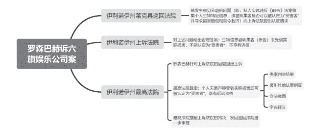

### 核心争议点

原告所主张的“损害”仅为违反了相关法规而缺乏实际损害的情况下，原告能否构成伊利诺伊州《生物信息隐私法》所定义的“受害者”，即原告是否具有诉讼主体资格.

### 裁判论证过程

原告无需受到实际损害即可被认定为该法案定义下的“受害者”，拥有相应的诉权

伊利诺伊州最高法院重点释明了该州《生物信息隐私法》的立法宗旨，针对性地回应了上诉法院在进行法律解释时出现的问题，并通过类案判决结果、其他法案、字典释义等途径，论证了即使原告没有遭受实质性损害，当其所主张的损害仅为被告违反了该州《生物信息隐私法》的相关规定时，原告仍构成该法案所指的“受害者”，拥有针对六旗游乐园的起诉权.

首先，伊利诺伊州最高法院指出，尽管上诉法院认为被告的抗辩具有说服性，但是从其他地区上诉法院^([\[64\]](#txt010.html#footnote_content_txt010_64))以及近期的联邦地区法院^([\[65\]](#txt010.html#footnote_content_txt010_65))的裁判结果来看，均应否决被告的抗辩，即法院不支持由于原告未遭受实质性损害，因而不是所谓的“受害者”而没有诉权这一主张.此外，法院还指出，法律解释的首要目的是释明立法原意并使法案发挥应有的作用.“我们分析的起点在于法律解释的基本原则.当解释某一项法案时，我们的首要目标是确定并实施立法机构的意图.”^([\[66\]](#txt010.html#footnote_content_txt010_66))此外，最高法院还强调，“当法案的语言明确无歧义时，我们不能通过在法律中加入例外、限制或其他条件使其偏离法律条款，将立法者没有表达的例外、限制或条件解读到法律中.我们也不能增加法律中没有的规定.”^([\[67\]](#txt010.html#footnote_content_txt010_67))上诉法院机械地适用文义解释，根据字典释义中对于该词语的一般性含义作出的解释，与该法案最初设定的预防侵害个人生物识别信息行为的宗旨相悖.

其次，伊利诺伊州最高法院认为，被告对于该州《生物信息隐私法》的法律解释是经不起推敲的，这是因为“当州议会希望在其他情况下施加这样的要求时，它将会明确表示这一意图”.^([\[68\]](#txt010.html#footnote_content_txt010_68))随后法院列举了《反消费者欺诈和欺骗性商业行为法》（Consumer Fraud and Deceptive Business Practices Act）第 10 条（a）款，指出当州议会希望将实质损害这一限制性条件加之于原告时，会明确表示此意图.与之不同的是《艾滋病保密法》（AIDS Confi dentiality Act）中的规定，该法案指出，违反此法案规定即构成损害，符合构成受害者的要件，并赋予了受害者诉权.同时，法院也承认，尽管上述对比具有启发性，但非决定性，因为相同的术语在立法目的不同的法案中可能具有不同的含义.而一旦承认了法律解释的基本原则，即法律解释须使立法发挥应有之义，达到立法的初衷，则可以得出原告不必受到实质性损害即可取得诉权这一结论.即原文所指出的，“然而，公认的法律解释原则会迫使人们得出结论，一个人不需要在其根据该法享有的权利受到侵犯之外还遭受实际损害，就可以根据该法提起诉讼.”^([\[69\]](#txt010.html#footnote_content_txt010_69))

再次，伊利诺伊州最高法院指出，尽管一个多世纪以前，法院普遍认为“受害（aggrieved）”即是指发生了人身或财产的实质损害，但是这些损害不是构成“受害”的所必需的，在法律意义上的“受害”，可以是其法定权利遭受侵害或者其财产性利益受到直接影响.这一理解在伊利诺伊州法院被反复适用且深刻嵌入了法理，并被《生物信息隐私法》所采纳.

最后，伊利诺伊州最高法院援引了韦氏大学词典、布莱克法律词典中的相关定义，指出上述理解与字典中对于“受害”的标准定义是一致的.此外，最高法院还特别强调了始终贯穿《生物信息隐私法》的立法意图，即“通过该法案，我们的州议会已经将以下内容编入法典：个人拥有对其生物信息识别符和生物识别信息的隐私权和控制权”且“不需要主张或证明额外的后果.违法行为本身就足以支持个人或消费者的法定诉讼理由”.^([\[70\]](#txt010.html#footnote_content_txt010_70))

该最高法院的判决中大量论述都指向了《生物信息隐私法》的立法宗旨，反复强调该法案的特殊性及其保护的权利的特殊性.生物识别数据与其他的隐私信息不同，具有可识别性、特定性和不可更改性.一旦泄露或被不法利用，具有极高风险并难以救济.因此，议会立法的目的在于，使个人能够切实享有对自己隐私的所有权并能够掌控个人的生物信息识别符和生物识别信息.故该法案体现出较强的预防性功能和遏制此类侵害发生的目的，带有未雨绸缪之意.^([\[71\]](#txt010.html#footnote_content_txt010_71))尽管上诉法院也意识到法律解释应使其遵循立法意图，彰显立法精神，但一味地依赖字典释义、过于宽泛地类比其他侵权案件，导致其忽视了本案中生物识别信息这一权利的特殊性和相应法案的特殊性，在法律解释的过程中逐渐偏离了立法本意.

基于上述分析，伊利诺伊州最高法院认为上诉法院判决有误，支持原告符合该州《生物信息隐私法》所规定的“受害者”并取得相应的诉权.

## 【审理结果】

1.伊利诺伊州上诉法院认为原告并未受到实际损害，不能认定为该法案所称的“受害者”，故不享有相应诉权，从而不是本案的适格主体.

2.伊利诺伊州最高法院认定原告属于“受害人”并拥有相应的诉权，是本案的适格主体，从而推翻了上诉法院的判决.

## 【相关法条】

### 美国伊利诺伊州《生物信息隐私法》第 15 条（b）款（Biometric Information Privacy Act§15（b），740 Illinois Compiled Statutes§14/15（b）（2013））

任何私人实体不得收集、捕获、购买、通过交易接收或以其他方式获得个人或消费者的生物识别符或生物识别信息，除非首先进行以下活动：

（1）以书面形式通知该主体或该主体的合法授权代表，正在收集或存储生物识别符或生物识别信息；

（2）以书面形式通知该主体或该主体的合法授权代表，正在收集、存储和使用生物识别符或生物识别信息的具体目的和期限告；

（3）收到生物识别符或生物识别信息的主体或该主体的合法授权代表签署的书面许可.

### 美国伊利诺伊州《生物信息隐私法》第 20 条（Biometric Information Privacy Act§20，740 Illinois Compiled Statutes§14/20（2013））

诉讼权.任何因违反本法而受害的人都有权向州巡回法院提起诉讼，或作为附加要求（supplemental claim）在联邦地区法院起诉违法方.胜诉方可以就每项违法行为进行追偿：

（1）对因疏忽而违反本法规定的私人实体，要求 1，000 美元的违约金或实际损害赔偿，以较高者为准.

（2）对故意或鲁莽地违反本法规定的私人实体，要求 5，000 美元违约金或实际损害赔偿，以较高者为准；

（3）合理的律师费和其他费用，包括专家证人费用和其他诉讼费用；以及

（4）州或联邦法院认为适当的其他救济，包括禁止令.

## 【案例评析】

### （一）明确《生物信息隐私法》的立法宗旨，具有启发性意义

正如本案的州最高法院在判决书中指出的那样，“本法案赋予个人和消费者掌控自己的生物信息的权利，具体形式包括要求私人主体在收集生物信息前予以通知，并赋予个人和消费者拒绝同意此类收集行为的权力”，而且，“这些程序性的保护措施在我们目前的数字化世界中至关重要，因为现在的技术允许大量收集和存储个人唯一的生物信息识别符，而这些生物信息识别符一旦遭到破坏或滥用，则无法更改”.^([\[72\]](#txt010.html#footnote_content_txt010_72))上述对于法案宗旨的解释也得到了州议会的认同，州议会认为，当前，生物识别技术的全部后果尚未被完全认识.个人生物特征识别信息具有不可更改性，这一点不同于以往应用于金融领域的识别符或其他敏感信息，例如密码的泄露可以通过更改密码进行补救；但是生物识别信息对于每一个个体而言都是独一无二的且无法更改的，一旦泄露，该个体则会面临着身份被伪造而个人难以追索的艰难境地.因此，该法案的目的在于事前防止上述问题的发生，具体规制路径包括两种：一是事前采取保障措施，以确保个人或消费者对于其生物信息识别符和生物特征识别信息的隐私权得到尊重和保护；二是无论是否具有实质损害，未能遵守法案要求的私人实体需要承担相应责任，包括法定赔偿金、禁令、律师费和“每一个违反法案行为”的诉讼费用等.

从上述论述可以看出，美国伊利诺伊州的立法机构和司法机构出于现阶段对生物识别技术风险的不确定性，以及一旦生物识别信息遭到泄露后所具有的极大破坏性的考量，对该技术的应用采取了极为谨慎的态度.该州的《生物信息隐私法》于 2008 年颁布，在生物特征识别技术及其相关的产业领域经历了十余年的发展后，该法案已成为世界上对于生物识别信息保护最为严格的法律.

《生物信息隐私法》对生物识别信息的特殊保护，也体现了对于更广义上的个人信息进行分类分级的规制思想.个人信息具有多重价值，首先，信息主体有对信息隐私的保护需求.其他个体侵害私人生活秘密的可能性，以及现代信息处理技术促使公私机构不当收集、处理、利用和传输个人信息从而实现商业价值和公共管理价值的现实，使得个人对其个人信息的保护诉求更为强烈.其次，信息业者对个人信息有利用需求.无论是传统产业经营者通过大量收集和处理个人信息提高营销回应率、把握市场需求（例如本案中的六旗游乐园收集和使用人脸信息提高自己的效率），还是出现了专门以信息的收集、处理、储存、利用和传输为主要业务的信息服务提供者，个人信息的可利用性给人类社会创造出巨大的商业机会.最后，政府对个人信息同样具有利用需求.一方面，公共安全、公共管理和公共福利的推进都离不开对居民个人信息的掌握；另一方面，对行政效率的追求也会不断促使政府积极探索个人信息利用的限度和价值.^([\[73\]](#txt010.html#footnote_quote_txt010_73))个人信息的多重价值使得信息的主体利益呈现多元化态势，因此法律需要在各主体的利益之间进行衡量和协调.在功能上，主要表现为在信息的保护和利用上进行衡量和协调.没有进行差异化保护和分类分级的“一刀切”模式，只能对保护和利用择一进行保障，无法做到二者之间的平衡.此时对个人信息的分类分级即显示出必要性.根据本案最高法院的论证，针对生物特征识别信息所特有的泄露风险，该州立法对其采取了更为严格的保护措施.而基于风险的分类分级保护理念在欧盟的相关立法中也有所体现.^([\[74\]](#txt010.html#footnote_quote_txt010_74))我国《个人信息保护法》中也对敏感信息进行了特殊规定.此外，有学者提出基于信息的生命周期理论对信息进行分类分级，从而实现对个人信息的动态保护.^([\[75\]](#txt010.html#footnote_quote_txt010_75))

### （二）明确生物特征识别信息权利的司法救济模式，促进《生物信息隐私法》的适用

鉴于个人生物特征识别信息的不可变更性与主体唯一性，生物特征识别信息一旦被泄露或冒用，可能会对信息主体造成难以弥补或永久性的伤害与损失，法院在本案中确立了生物特征识别信息权利的司法保护规则：即使公民生物识别信息未遭受实质损害，信息主体仍有权寻求司法救济.相较于一般个人信息侵权，生物特征识别信息的司法保护标准显然更高.之所以生物特征识别信息侵权案件的司法诉讼门槛要求较低，是为了保证生物特征识别信息主体可以及时地主张权利，以提前预防将来可能遭受的损失.毕竟一旦遭受现实损害，损害后果将难以弥补.^([\[76\]](#txt010.html#footnote_quote_txt010_76))对生物特征识别信息施加比一般个人信息更为严格的特别保护和特别规制，更有利于保护个人生物特征识别信息，这种做法值得我国借鉴.^([\[77\]](#txt010.html#footnote_quote_txt010_77))

也正是因为这一救济模式的确立，《生物信息隐私法》开始受到重视.该法案于 2008 年通过，直至 2015 年才发生针对企业违反该法律而提起的 5 例集体诉讼，因此该法案并未得到很好地适用.本案判决实质上鼓励了在《生物信息隐私法》下开展更多诉讼，并影响了其他适用《生物信息隐私法》地区的未决案件，例如针对 Facebook 收集人脸信息的集体诉讼案件.作为世界上首部生物特征识别信息隐私保护法律，《生物信息隐私法》的适用一方面能够给予公民生物特征识别信息以更好地保护，另一方面也让更多的商业巨头面临集体诉讼.从发展现状来看，“其中很多过于严格的规定已经不适应发展的实际情况，不仅会加大创新型企业的合规成本，也增大了消费者滥诉的风险”.^([\[78\]](#txt010.html#footnote_quote_txt010_78))有美国媒体认为，该判决并未实现在鼓励创新和规制不良行为之间取得平衡的立法目标，而是过分强调了对不良行为的规制而破坏了这种平衡.

另外，值得思考的是，“无救济则无权利”，在《生物信息隐私法》对生物信息主体的各项实体权利进行确认和保护的同时，该项立法也对传统的诉讼制度和结构提出挑战，程序上如何保持同步和衔接是本案的重要争议焦点（原告是否是本案的适格主体）.在我国，《民法典》将包括生物识别信息在内的个人信息归入隐私权中，而生物识别信息在属性上具有不可变更性与主体唯一性；在权属上又具复杂性，生物识别信息的主体、公权力机关和相关企业都对其享有部分权利.因而如何认定侵权、具体的救济方式和执行程序等诉讼模式都需要在实践基础上，借鉴域外经验对此进行回应和改进.

### （三）作为域外经验，本案对我国个人生物识别信息立法保护具有借鉴意义

伊利诺伊州的《生物信息隐私法》的立法模式属于专门立法保护的模式.该法案的主要内容包括：定义了五大专属的法律概念，^([\[79\]](#txt010.html#footnote_quote_txt010_79))进而明确三大相对权责，^([\[80\]](#txt010.html#footnote_quote_txt010_80))并规定了三大禁止规范和三个豁免条款，^([\[81\]](#txt010.html#footnote_quote_txt010_81))以及较为明晰地规定了私人诉讼权利和违约赔偿标准，并设立了相关的监管机构.这种立法模式“具有特定的立法宗旨，专属的法律概念，清晰的权利义务相对方，明确的保护规则以及解决具体问题的特定方法，针对性和操作性较强.”^([\[82\]](#txt010.html#footnote_quote_txt010_82))

另一种立法保护模式被称为综合立法保护模式，比较典型的是 2018 年生效的欧盟《通用数据保护条例》（General Data Protection Regulation， GDPR）.这种立法模式是在统一的个人信息或数据保护立法中对个人生物识别信息进行规定，将个人生物识别信息作为敏感个人信息的一类加强保护.^([\[83\]](#txt010.html#footnote_quote_txt010_83))此外，该种立法模式确立了个人特殊敏感类型数据处理的特定法律原则，例如：“禁止处理”^([\[84\]](#txt010.html#footnote_quote_txt010_84))“明示同意”“法定必需”^([\[85\]](#txt010.html#footnote_quote_txt010_85))等.

上述两种不同的立法模式均基于各自不同的国情、社会公众对生物识别技术的接受度、生物识别技术商业化应用程度等多重考量而形成.

一方面，我们应该看到我国国情的不同之处，例如我国政府与民间对于生物识别技术的发展和应用总体上呈现较为积极乐观的态势，在立法规制的层面应认识到保护技术创新和产业发展的重要性；另一方面，欧美立法模式中对于发展迅猛而风险未知的生物识别技术所采取的审慎态度，也值得我们学习和参考.正如有学者指出：“人脸识别技术的收益与风险关系直接决定了法律规制的基本态度.如果收益大于风险，法律的天平就应该向利用一侧倾斜.如果风险大于收益，法律的天平就应该向保护一侧倾斜.如果收益与风险的关系不确定，则法律应该谨慎，而不能盲目放开其利用.”^([\[86\]](#txt010.html#footnote_quote_txt010_86))因此，除了选择恰当的立法模式，还应注重构建完善的权利救济机制，将法律对于个人生物识别信息的保护落在实处，不仅嵌入日常的监管和企业的合规自律行为中，也要通过司法实践不断强化.

2020 年生效的《民法典》第一千零三十四条将生物识别信息归入“个人信息”进行保护；^([\[87\]](#txt010.html#footnote_quote_txt010_87)) 2021 年我国颁布的《个人信息保护法》在此基础上更进一步，将生物识别信息定义为“敏感个人信息”而给予特殊保护.^([\[88\]](#txt010.html#footnote_quote_txt010_88))可以看到，生物识别信息已经成为国内外个人信息保护的重点对象，我国在法律层面也对此进行了积极回应，不断探索能够平衡和协调各方利益的规则和机制.本案对于全面认识个人生物信息保护的立法现状，借鉴域外经验，从而思考对于个人生物信息隐私保护的法律规制原理具有重要意义.

但是，本案判决也存在反对的声音.首先是对于“受害者”定义的冲击和颠覆.例如，联邦法院和州法院在解释法律中的“受害者”时，都认为其应当具备实际伤害或因涉嫌违反法律规定而造成的伤害.^([\[89\]](#txt010.html#footnote_quote_txt010_89))同时，美国最高法院认为，宪法要求原告在向联邦法院提起诉讼之前，必须有具体和特定的事实伤害，而不仅仅是对法规的技术性违反.^([\[90\]](#txt010.html#footnote_quote_txt010_90))其次，就法定意图而言，几乎每条法规都可以被描述为具有预防或威慑目的，但这并不意味着未受伤害的人可以提起集体诉讼，寻求无上限的、汇总的法定损害赔偿，而这些损害赔偿与所谓的法定损害所造成的任何实际或可补偿的损害完全无关.^([\[91\]](#txt010.html#footnote_quote_txt010_91))

## 【关联判例推荐】

1\. Patel v. Facebook Inc., 290 F.Supp.3d 948 (N.D. Cal.2018)

核心事实：原告 Facebook 用户根据伊利诺伊州的《生物信息隐私法》起诉，认为 Facebook 公司在没有事先提醒注意或得到同意的情况下，非法地获取并储存了用户的生物数据.被告 Facebook 公司认为，原告未能证明自己遭受到了事实上的具体侵害，要求法院根据《联邦民事诉讼规则》和相关判例驳回原告的诉讼请求.法院最终否决了被告 Facebook 公司的动议.

与本案关联点：根据伊利诺伊州《生物信息隐私法》，原告无需证明受到事实上的具体侵害即享有诉权.

2\. Sekura v. Krishna Schaumburg Tan, Inc., 2018 IL App (1st) 180175, 426 Ill.Dec. 158, 115 N.E.3d 1080 (Ill.App. 1 Dist. 2018)

核心事实：在原告 Sekura 未签署书面同意的情况下，被告 Krishna Schaumburg Tan 公司收集了原告的指纹以验证身份，后又将该信息披露给第三方.伊利诺伊州上诉法院认定原告仅因被告违反《生物信息隐私法》而受害（生物隐私权被侵害）即可起诉，无需证明受到实际损害.

与本案关联点：根据伊利诺伊州《生物信息隐私法》，原告无需证明受到实际损害即享有诉权.

3\. In re Facebook Biometric Information Privacy Litigation, 326 F.R.D. 535 (N.D.Cal. 2018).

核心事实：原告是 Facebook 用户.被告 Facebook 公司的“标签建议”程序用于扫描并识别用户上传的照片中的人，以促进用户标签的生成.原告指控 Facebook 违反其隐私权以及伊利诺伊州《生物信息隐私法》的规定，未经事先通知或同意即收集和存储其生物识别数据.联邦地区法院裁定，当“所诉行为侵害了合法权利”时，个人就“受了侵害”.根据《生物信息隐私法》，原告无需为了提起诉讼而出示更多证据.

与本案关联点：原告无需证明受到实际损害即享有诉权，因为《生物信息隐私法》并未规定私人诉权仅限于遭受“实际”损害的人.

4\. In re Estate of Harmston, 10 Ill.App.3d 882, 295 N.E.2d 66 (Ill.App. 3 Dist.1973)

核心事实：原告罗里得克·路德（已故）是赫伯特·哈姆斯顿庄园的管理者，被告是该不动产的潜在购买者，为本案的上诉人.潜在购买者认为，巡回法院没有遵守伊利诺伊州《遗嘱认证法》有关死者房地产销售的规定.法院认为潜在购买者没有资格对判决提出上诉，因为其尚未对房地产产生既得利益.法院指出，购买者未按照《遗嘱认证法》的规定“受害（aggrieved）”，因此无权对有关命令提出上诉.

与本案关联点：伊利诺伊州法院在遗产领域类的判决同样表明，司法实践中对于“受害”的理解是原告无需证明受到实际损害即享有诉权.

## 【注释】

[\[1\]](#txt010.html#footnote_quote_txt010_1)美国《计算机欺诈和滥用法》于 1986 年颁布，该法案明确了计算机犯罪中欺诈和滥用罪的定义，禁止未经授权访问或获取受保护的计算机的信息，是美国关于网络安全的法案.

[\[2\]](#txt010.html#footnote_quote_txt010_2)HiQ Labs， Inc. v. LinkedIn Corp.， No. 17-16783 （2017）.

[\[3\]](#txt010.html#footnote_quote_txt010_3)三家公司分别运营着 Craiggers（基本原样照搬 Craigslist）、Padmapper（抓取 Craigslist 上房地产广告相关数据）、Lovely（通过 3Taps 间接使用 Craigslist 的数据）三家网站.

[\[4\]](#txt010.html#footnote_quote_txt010_4)3Taps 等所提出的反诉分为了两部分，这也是为何本案会有两份判决书的原因.第一份判决书主要论述了 CFAA、著作权、侵害动产的相关问题；第二份判决书详细论述了 CFAA 相关问题，分析了何为“未经授权”以及 CFAA 的保护范围.

[\[5\]](#txt010.html#footnote_quote_txt010_5)矫鸿彬、幸自奇：《中美数据抓取案件裁判思路之比较分析》，载金杜律师事务所网 2020 年 3 月 12 日，`https：//www.chinalawinsight.com/2020/03/articles/intellectual-property/中美数据抓取案件裁判思路之比较分析/`.

[\[6\]](#txt010.html#footnote_quote_txt010_6)另外两个部分为：针对原告对于分类广告享有汇编作品著作权的主张，法院认为 Craigslist 享有网页排版的著作权、用户享有其所发布的分类广告的著作权，而 Craigslist 无权代表其用户起诉侵权者；针对侵害财产的主张，法院认可被告的行为占用了原告的资源，降低了原告的服务能力，构成对于原告的损害.

[\[7\]](#txt010.html#footnote_quote_txt010_7)Craigslist Inc. v. 3Taps Inc.， 942 F.Supp.2d 962 （N.D. Cal. 2013）.

[\[8\]](#txt010.html#footnote_quote_txt010_8)根据加州法律，共谋是一种理论，要求那些虽然自己没有实际实施侵权行为，但与直接侵权人共同计划或设计实施侵权行为的人承担责任.共谋行为有三个要素：（1）阴谋的形成和运作，（2）促进阴谋的不法行为，以及（3）不法行为产生的损害.

[\[9\]](#txt010.html#footnote_quote_txt010_9)此处 3Taps 援引了 Pulte Homes， Inc.v. Labore’s Intern’l Union of N. Am.， 648 F.3d 295， 304 （6th Cir. 2011）一案，以证明公众推定有权访问“未受保护的网站”.

[\[10\]](#txt010.html#footnote_quote_txt010_10)LVRC Holdings LLC v. Brekka， 581 F.3d 1127 （9th Cir. 2009）

[\[11\]](#txt010.html#footnote_quote_txt010_11)United States v. Morris， 928 F.2d 504， 511 （2d Cir. 1991）.

[\[12\]](#txt010.html#footnote_quote_txt010_12)为便于理解，此处附上判决原文：未经授权使用计算机的人对相关计算机没有任何权利，无论是有限的还是其他的，都无权访问该计算机。

[\[13\]](#txt010.html#footnote_quote_txt010_13)United States v. Nosal， 676 F.3d 854 （9th Cir. 2012）.

[\[14\]](#txt010.html#footnote_quote_txt010_14)例如，网站用户协议、单位规章制度等.

[\[15\]](#txt010.html#footnote_quote_txt010_15)Craigslist Inc. v. 3Taps Inc.， 942 F.Supp.2d 962， 968 （N.D. Cal. 2013）.

[\[16\]](#txt010.html#footnote_quote_txt010_16)具体取决于网站所有者表明态度和立场的清晰程度.

[\[17\]](#txt010.html#footnote_quote_txt010_17)在“制止函”中，Craigslist 要求 3Taps 等“不得出于任何原因访问其网站”.

[\[18\]](#txt010.html#footnote_quote_txt010_18)Muscarello v. United States， 524 U.S. 125， 138， 118 S.Ct. 1911， 141 L.Ed.2d 111 （1998）.

[\[19\]](#txt010.html#footnote_quote_txt010_19)Holder v. Humanitarian Law Project， 561 U.S. 1， 130 S.Ct. 2705， 2719， 177 L.Ed.2d 355 （2010）.

[\[20\]](#txt010.html#footnote_quote_txt010_20)明示的“未经授权”包括与员工签署的保密协议、网页上的告知、警告、弹窗、最终用户协议、产品或服务备注的说明、解释等.

[\[21\]](#txt010.html#footnote_quote_txt010_21)版权侵权诉讼的前提.

[\[22\]](#txt010.html#footnote_quote_txt010_22)United States v. Van Buren， 940 F.3d 1192 （11th Cir. 2019）.

[\[23\]](#txt010.html#footnote_quote_txt010_23)Winter v. NRDC， Inc.， 555 U.S. 7， 129 S.Ct. 365 （2008）.

[\[24\]](#txt010.html#footnote_quote_txt010_24)United States v. Nosal， 676 F.3d 854 （9th Cir. 2012）.

[\[25\]](#txt010.html#footnote_quote_txt010_25)Craigslist Inc. v. 3Taps Inc.， 964 F.Supp.2d 1178 （N.D. Cal. 2013）； Facebook， Inc. v. Power Ventures，Inc.， 844 F.3d 1058 （9th Cir. 2016）.

[\[26\]](#txt010.html#footnote_quote_txt010_26)Benjamin L. W. Sobel， A New Common Law of Web Scraping， 25 Lewis & Clark Law Review 147，147-208 （2021）.

[\[27\]](#txt010.html#footnote_quote_txt010_27)Peter G. Berris， Cybercrime and the Law： Computer Fraud and Abuse Act （CFAA） and the 116th Congress， Congressional Research Service （Sept. 21， 2020）， `https：//crsreports.congress.gov/product/pdf/R/R46536`.

[\[28\]](#txt010.html#footnote_quote_txt010_28)李谦：《美国场景化司法规制数据爬取的经验与启示》，载《电子政务》2020 年第 11 期，第 90-91 页.

[\[29\]](#txt010.html#footnote_quote_txt010_29)James Keenan， What the HiQ vs. LinkedIn Case Means for Automated Web Scraping， CPO Magazine（Dec. 26， 2019）， `https：//www.cpomagazine.com/data-privacy/what-the-hiq-vs-linkedin-casemeans-for-automated-web-scraping/`.

[\[30\]](#txt010.html#footnote_quote_txt010_30)Amber Zamora， Making Room for Big Data： Web Scraping and an Affirmative Right to Access Publicly Available Information Online， 12 Journal of Business， Entrepreneurship and the Law 203，203-228 （2019）.

[\[31\]](#txt010.html#footnote_quote_txt010_31)李晨晔：《数据挖掘要当心“雷区”》，载搜狐网 2017 年 10 月 30 日，`https：//www.sohu.com/a/201303823\_505841`.

[\[32\]](#txt010.html#footnote_quote_txt010_32)Facebook 案是该院先前审理的案件，故法院需要说明为何两案的结论不同.

[\[33\]](#txt010.html#footnote_quote_txt010_33)Sandvig v.Sessions， 315 F.Supp.3d 1 （D.D.C. 2018）.

[\[34\]](#txt010.html#footnote_quote_txt010_34)晟品非法获取计算机信息系统数据案，北京市海淀区人民法院（2017）京 0108 刑初 2384 号刑事判决书.

[\[35\]](#txt010.html#footnote_quote_txt010_35)游涛、计莉卉：《使用网络爬虫获取数据行为的刑事责任认定—以“晟品公司”非法获取计算机信息系统数据罪为视角》，载《法律适用》2019 年第 10 期，第 8-9 页.

[\[36\]](#txt010.html#footnote_quote_txt010_36)石经海、苏桑妮：《爬取公开数据行为的刑法规制误区与匡正—从全国首例“爬虫”入刑案切入》，载《北京理工大学学报（社会科学版）》2021 年第 1 期，第 3-4 页.

[\[37\]](#txt010.html#footnote_quote_txt010_37)Teresa Scassa， Ownership and control over publicly accessible platform data， 43 Online Information Review 986， 986-1002 （2019）. 国内也有学者从“数据具有言论的属性”角度，论证为何对数据财产权益的保护强度不宜过高，参见王燃：《论网络开放平台数据利益分配规则》，载《电子知识产权》2020 年第 8 期，第 51 页.

[\[38\]](#txt010.html#footnote_quote_txt010_38)对这两个案件的详细介绍，请参见“关联判例推荐”部分.

[\[39\]](#txt010.html#footnote_quote_txt010_39)新浪诉饭友案，北京知识产权法院（2019）京 73 民终 2799 号民事判决书.

[\[40\]](#txt010.html#footnote_quote_txt010_40)《反不正当竞争法》第 12 条第 2 款第 4 项：经营者不得利用技术手段，通过影响用户选择或者其他方式，实施下列妨碍、破坏其他经营者合法提供的网络产品或者服务正常运行的行为：（四）其他妨碍、破坏其他经营者合法提供的网络产品或者服务正常运行的行为.

[\[41\]](#txt010.html#footnote_quote_txt010_41)《反不正当竞争法》第 2 条：经营者在生产经营活动中，应当遵循自愿、平等、公平、诚信的原则，遵守法律和商业道德.本法所称的不正当竞争行为，是指经营者在生产经营活动中，违反本法规定，扰乱市场竞争秩序，损害其他经营者或者消费者的合法权益的行为.本法所称的经营者，是指从事商品生产、经营或者提供服务（以下所称商品包括服务）的自然人、法人和非法人组织.

[\[42\]](#txt010.html#footnote_quote_txt010_42)海带配额案，最高人民法院（2009）民申字第 1065 号民事裁定书.在该案中，法院认为“总体而言，适用反不正当竞争法第二条第一款和第二款认定构成不正当竞争应当同时具备以下条件：一是法律对该种竞争行为未作出特别规定；二是其他经营者的合法权益确因该竞争行为而受到了实际损害；三是该种竞争行为因确属违反诚实信用原则和公认的商业道德而具有不正当性或者说可责性.”

[\[43\]](#txt010.html#footnote_quote_txt010_43)45 号指导案是指百度诉奥商公司案，山东省高级人民法院（2010）鲁民三终字第 5-2 号民事判决书.在该案中，法院认为：“判断经营者的行为构成不正当竞争，应当考虑以下方面：一是行为实施者是反不正当竞争法意义上的经营者；二是经营者从事商业活动时，没有遵循自愿、平等、公平、诚实信用原则，违反了反不正当竞争法律规定和公认的商业道德；三是经营者的不正当竞争行为损害正当经营者的合法权益.”

[\[44\]](#txt010.html#footnote_quote_txt010_44)许可：《数据保护的三重进路—评新浪微博诉脉脉不正当竞争案》，载《上海大学学报（社会科学版）》2017 年第 6 期，第 23 页；李晓宇：《权利与利益区分视点下数据权益的类型化保护》，载《知识产权》2019 年第 3 期，第 60 页；

[\[45\]](#txt010.html#footnote_quote_txt010_45)许可：《数据保护的三重进路—评新浪微博诉脉脉不正当竞争案》，载《上海大学学报（社会科学版）》2017 年第 6 期，第 23-25 页；李晓宇：《权利与利益区分视点下数据权益的类型化保护》，载《知识产权》2019 年第 3 期，第 60 页；丁文联：《数据竞争的法律制度基础》，载《财经问题研究》2018 年第 2 期，第 16-17 页；刘金瑞：《数据财产保护的权利进路初探》，载《中国信息安全》2017 年第 12 期，第 39 页.

[\[46\]](#txt010.html#footnote_quote_txt010_46)黄晓锦：《大数据时代数据分享与抓取的竞争法边界》，载《财经问题研究》2018 年第 2 期，第 20 页；刘影、眭纪刚：《日本大数据立法增设“限定提供数据”条款及其对我国的启示》，载《知识产权》2019 年第 4 期.

[\[47\]](#txt010.html#footnote_quote_txt010_47)大众点评诉百度案，上海知识产权法院（2016）沪 73 民终 242 号民事判决书.

[\[48\]](#txt010.html#footnote_quote_txt010_48)新浪诉脉脉案，北京知识产权法院（2016）京 73 民终 588 号民事判决书.

[\[49\]](#txt010.html#footnote_quote_txt010_49)新浪诉饭友案，北京知识产权法院（2019）京 73 民终 2799 号民事判决书.

[\[50\]](#txt010.html#footnote_quote_txt010_50)新浪诉脉脉案，北京知识产权法院（2016）京 73 民终 588 号民事判决书；腾讯诉抖音行为保全案，天津市滨海新区人民法院（2019）津 0116 民初 2091 号民事裁定书.

[\[51\]](#txt010.html#footnote_quote_txt010_51)徐伟：《企业数据获取“三重授权原则”反思及类型化构建》，载《交大法学》2019 年第 4 期，第 23 页.

[\[52\]](#txt010.html#footnote_quote_txt010_52)王燃：《论网络开放平台数据利益分配规则》，载《电子知识产权》2020 年第 8 期，第 49 页.对“平台授权”的批评，还可参见徐伟：《企业数据获取“三重授权原则”反思及类型化构建》，载《交大法学》2019 年第 4 期，第 26-35 页.

[\[53\]](#txt010.html#footnote_quote_txt010_53)孟小峰、王雷霞、刘俊旭：《人工智能时代的数据隐私、垄断与公平》，载《大数据》2020 年第 1 期，第 39 页.

[\[54\]](#txt010.html#footnote_quote_txt010_54)《手机越贵，打车越贵？复旦教授三万字打车报告来验证》，载澎湃新闻 2021 年 3 月 7 日，`https：//m.thepaper.cn/baijiahao\_11569999`.

[\[55\]](#txt010.html#footnote_quote_txt010_55)《全国人大代表杨松：建议立法规制大数据杀熟、平台二选一等》，载新浪财经 2021 年 3 月 3 日，`https：//fi nance.sina.com.cn/jjxw/2021-03-03/doc-ikftssaq0163761.shtml`.

[\[56\]](#txt010.html#footnote_quote_txt010_56)《李克强总理作政府工作报告（文字摘要）》，载中华人民共和国中央人民政府网站 2021 年 3 月 5 日，`http：//www.gov.cn/premier/2021-03/05/content\_5590492.htm`.

[\[57\]](#txt010.html#footnote_quote_txt010_57)曾彩霞、朱雪忠：《必要设施原则在大数据垄断规制中的适用》，载《中国软科学》2019 年第 11 期，第 55 页.

[\[58\]](#txt010.html#footnote_quote_txt010_58)《禁止滥用市场支配地位行为暂行规定》第 16 条：禁止具有市场支配地位的经营者没有正当理由，通过下列方式拒绝与交易相对人进行交易：……（五）拒绝交易相对人在生产经营活动中，以合理条件使用其必需设施.在依据前款第五项认定经营者滥用市场支配地位时，应当综合考虑以合理的投入另行投资建设或者另行开发建造该设施的可行性、交易相对人有效开展生产经营活动对该设施的依赖程度、该经营者提供该设施的可能性以及对自身生产经营活动造成的影响等因素.

[\[59\]](#txt010.html#footnote_quote_txt010_59)Zachary Abrahamson，《Essential data》，124 Yale Law Journal 867，867-[vii]（2014）。转引自曾彩霞、朱雪忠：《必要设施原则在大数据垄断规制中的适用》，载《中国软科学》2019 年第 11 期，第 56 页.

[\[60\]](#txt010.html#footnote_quote_txt010_60)曾雄：《数据垄断的竞争分析路径》，载《金融创新法律评论》2018 年第 1 辑，第 120 页.

[\[61\]](#txt010.html#footnote_quote_txt010_61)韩伟：《如何从反垄断法角度审视人工智能》，载《网络法律评论》2017 年第 1 期，第 10 页.

[\[62\]](#txt010.html#footnote_quote_txt010_62)虽然在诉讼中罗森巴赫被称为原告，但这在技术上并不准确.实际上原告系罗森巴赫的儿子亚力山大，罗森巴赫是其诉讼代理人.

[\[63\]](#txt010.html#footnote_quote_txt010_63)在法院对诉讼中的所有诉讼请求作出裁决之前，一方可通过所谓的“中间上诉”对其持有异议的判决提出上诉.当事人并非当然地享有该等上诉权利，进行该等上诉需要初审法院批准.

[\[64\]](#txt010.html#footnote_quote_txt010_64)Sekura 诉 Krishna Schaumburg Tan, Inc., 2018 IL App（1st）180175, 426 Ill. Dec. 158, 115 N.E.3d 1080.

[\[65\]](#txt010.html#footnote_quote_txt010_65)关于 Facebook 生物识别信息隐私诉讼案, 326 F.R.D. 535, 545-47（N.D. Cal. 2018）.

[\[66\]](#txt010.html#footnote_quote_txt010_66)Rosenbach 诉 Six Flags Entm’t Corp., 2019 IL 123186, 2019 Ill. LEXIS 7, 432 Ill. Dec. 654, 129 N.E.3d 1197（Jan. 25, 2019）, 第 24 段.

[\[67\]](#txt010.html#footnote_quote_txt010_67)Rosenbach 诉 Six Flags Entm’t Corp., 2019 IL 123186, 2019 Ill. LEXIS 7, 432 Ill. Dec. 654, 129 N.E.3d 1197（Jan. 25, 2019）, 第 24 段.

[\[68\]](#txt010.html#footnote_quote_txt010_68)Rosenbach 诉 Six Flags Entm’t Corp., 2019 IL 123186, 2019 Ill. LEXIS 7, 432 Ill. Dec. 654, 129 N.E.3d 1197（Jan. 25, 2019）, 第 25 段.

[\[69\]](#txt010.html#footnote_quote_txt010_69)Rosenbach 诉 Six Flags Entm’t Corp., 2019 IL 123186, 2019 Ill. LEXIS 7, 432 Ill. Dec. 654, 129 N.E.3d 1197（Jan. 25, 2019）, 第 28 段.

[\[70\]](#txt010.html#footnote_quote_txt010_70)Rosenbach 诉 Six Flags Entm’t Corp., 2019 IL 123186, 2019 Ill. LEXIS 7, 432 Ill. Dec. 654, 129 N.E.3d 1197（Jan. 25, 2019）, 第 33 段.

[\[71\]](#txt010.html#footnote_quote_txt010_71)Rosenbach 诉 Six Flags Entm’t Corp., 2019 IL 123186, 2019 Ill. LEXIS 7, 432 Ill. Dec. 654, 129 N.E.3d 1197（Jan. 25, 2019）, 第 36 段.

[\[72\]](#txt010.html#footnote_quote_txt010_72)Rosenbach 诉 Six Flags Entm’t Corp., 2019 IL 123186, 2019 Ill. LEXIS 7, 432 Ill. Dec. 654, 129 N.E.3d 1197（Jan. 25, 2019）, 第 34 段.

[\[73\]](#txt010.html#footnote_quote_txt010_73)张新宝：《从隐私到个人信息：利益再衡量的理论与制度安排》，载《中国法学》2015 年第 3 期，第 47-48 页.

[\[74\]](#txt010.html#footnote_quote_txt010_74)1981 年欧盟《数据自动化处理保护协定》第 6 条、1995 年《通用数据保护条例》第 8 条以及 2018 年最新实施的欧盟《通用数据保护条例》第 9 条都对种族、宗教、信仰和个人健康、性生活等有关的特殊信息处理给予严格的特殊保护，规定了原则上全面禁止的处理原则.

[\[75\]](#txt010.html#footnote_quote_txt010_75)袁泉、王思庆：《个人信息分类保护制度及其体系研究》，载《江西社会科学》2020 年第 7 期，第 198 页.

[\[76\]](#txt010.html#footnote_quote_txt010_76)商希雪：《生物特征识别信息商业应用的中国立场与制度进路—鉴于欧美法律模式的比较评价》，载《江西社会科学》2020 年第 2 期，第 202 页.

[\[77\]](#txt010.html#footnote_quote_txt010_77)邢会强：《人脸识别的法律规制》，载《比较法研究》2020 年第 5 期，第 59 页.

[\[78\]](#txt010.html#footnote_quote_txt010_78)赵淑钰：《生物识别信息法律规制的国际经验与启示》，载《中国信息安全》2019 年第 11 期，第 43 页.

[\[79\]](#txt010.html#footnote_quote_txt010_79)与生物识别信息相关的五大专属法律概念包括“生物标识”“生物识别信息”“私人实体”“机密敏感信息”和“书面发布”.参见付微明：《个人生物识别信息的法律保护模式与中国选择》，载《华东政法大学学报》2019 年第 6 期，第 79 页.

[\[80\]](#txt010.html#footnote_quote_txt010_80)该法赋予生物识别信息主体以知情权、同意权、信息自决权三大权利；要求“私人实体”履行告知通知义务、安全保障义务、合法合规处理三大义务和责任.参见付微明：《个人生物识别信息的法律保护模式与中国选择》，载《华东政法大学学报》2019 年第 6 期，第 80 页.

[\[81\]](#txt010.html#footnote_quote_txt010_81)三大禁止规范即：禁止收集、捕获、购买、通过交易接收或以其他方式获得个人生物标识或信息；禁止从个人或客户的生物标识或信息中获利；禁止未经生物识别信息主体同意而收集、储存、使用、披露或以其他方式传播个人或客户的生物标识或信息.三个豁免条款即可以披露个人生物识别信息的三种法定必需条件：经生物识别信息主体或主体合法授权的代表请求或授权而在金融交易中披露或重新披露；州或联邦法律或市政条例要求披露或重新披露；根据有管辖权的法院签发的有效的令状或传票的披露或重新披露.参见付微明：《个人生物识别信息的法律保护模式与中国选择》，载《华东政法大学学报》2019 年第 6 期，第 80 页.

[\[82\]](#txt010.html#footnote_quote_txt010_82)付微明：《个人生物识别信息的法律保护模式与中国选择》，载《华东政法大学学报》2019 年第 6 期，第 80 页.

[\[83\]](#txt010.html#footnote_quote_txt010_83)赵淑钰：《生物识别信息法律规制的国际经验与启示》，载《中国信息安全》2019 年第 11 期，第 37 页.

[\[84\]](#txt010.html#footnote_quote_txt010_84)“禁止处理”即包括自然人、法人、公共机构、行政机关或其他非法人组织在内的“控制者”“处理人”“第三方”在通常情况下无权“仅以识别自然人为目的”处理个人生物识别信息.付微明：《个人生物识别信息的法律保护模式与中国选择》，载《华东政法大学学报》2019 年第 6 期，第 81 页.

[\[85\]](#txt010.html#footnote_quote_txt010_85)“法定必需”即可以不经生物识别信息主体同意而处理其生物识别信息的法定事由，通常包括为工作职责、社会重大利益、公共利益的必需，为法律原因的必需，为数据主体和第三人的重大利益的必需，以及特定协会、组织、非营利组织内部在适当的安全保障措施之下进行的数据处理.付微明：《个人生物识别信息的法律保护模式与中国选择》，载《华东政法大学学报》2019 年第 6 期，第 81 页.

[\[86\]](#txt010.html#footnote_quote_txt010_86)邢会强：《人脸识别的法律规制》，载《比较法研究》2020 年第 5 期，第 52 页.

[\[87\]](#txt010.html#footnote_quote_txt010_87)《民法典》第一千零三十四条：自然人的个人信息受法律保护.个人信息是以电子或者其他方式记录的能够单独或者与其他信息结合识别特定自然人的各种信息，包括自然人的姓名、出生日期、身份证件号码、生物识别信息、住址、电话号码、电子邮箱、健康信息、行踪信息等.

[\[88\]](#txt010.html#footnote_quote_txt010_88)《个人信息保护法》第二十八条：敏感个人信息是一旦泄露或者非法使用，容易导致自然人的人格尊严受到侵害或者人身、财产安全受到危害的个人信息，包括生物识别、宗教信仰、特定身份、医疗健康、金融账户、行踪轨迹等信息，以及不满十四周岁未成年人的个人信息.只有在具有特定的目的和充分的必要性，并采取严格保护措施的情形下，个人信息处理者方可处理敏感个人信息.

[\[89\]](#txt010.html#footnote_quote_txt010_89)Gubala 诉 Time Warner Cable, Inc., 846 F.3d 909（7th Cir. 2017）；Spade 诉 Select Comfort Corp., 181 A.3d 969, 972（N.J. 2018）.

[\[90\]](#txt010.html#footnote_quote_txt010_90)Spokeo, Inc.诉 Robins, 136 S.Ct. 1540（2016）.

[\[91\]](#txt010.html#footnote_quote_txt010_91)客户警报，Rosenbach 诉 Six Flags - 伊利诺伊州最高法院对《生物识别信息隐私法》下的法定起诉资格采取扩张性观点，Akin Gump（Jan. 28, 2019），https：//www.akingump.com/en/news-insights/rosenbach-v-six-flags-illinois-supreme-court-takes-expansive.html.
