# AI 法律前沿案例拆解

## 前言

本书系北京市教育科学规划课题“新时代人才强国战略与人工智能法治人才培养”（3030-0014）的阶段性成果

### 一、AI 法律研究的兴起

过去几年，数字技术与智能系统正以前所未有的节奏迭代，并渗透进经济社会运转的每一个角落。推进速度、覆盖广度与影响深度都在刷新纪录，已成为改写全球资源配置、产业形态与竞争版图的驱动核心。顺应这股浪潮，各国政府与相关机构密集发布战略文件，着力点集中在产业拉动、人才储备、监管细化与标准完善。

中国自 2017 年起，围绕《新一代人工智能发展规划》《促进新一代人工智能产业发展三年行动计划（2018-2020）》《“互联网+”人工智能三年行动方案》《国家新一代人工智能创新发展试验区建设工作指引》《国家新一代人工智能标准体系建设指南》等部署，形成了顶层谋划框架，并以技术规范、产业规划、安全伦理为抓手推动智能与实体经济融合。在此牵引下，国内技术进展迅速，社会结构出现多重调整。法学研究与法治建设的焦点也从传统商事文明转向数字文明。放眼国际，中国在智能化赛道上已由追赶转向并跑、局部领先。诸多实践对法学理论与教学提出明确的变革需求。

当下，智能技术在法律场域映射出三个鲜明走向。

其一，立法活动明显升温。统计显示，25 个国家在智能相关立法上的记录显示，相关法案由 2016 年的 1 件增至 2021 年的 18 件。2021 年西班牙、英国、美国各通过 3 件居首。美国州层面提案由 2012 年的 2 件激增至 2021 年的 131 件。我国在《电子商务法》后加快步伐，《个人信息保护法》《数据安全法》《互联网信息服务算法推荐管理规定》《互联网信息服务深度合成管理规定》等相继落地，治理体系雏形初现。欧盟也在 2021 年 4 月提出《人工智能法案》，2022 年 4 月公布修订草案。整体来看，智能立法正走向全球化。

其二，伦理议题凸显，法律与伦理的互动需求上升。大型语言模型不断刷新基准的同时，也更清晰地暴露训练数据的偏见。比较 2018 年 1.17 亿参数的领先模型与 2021 年 2800 亿参数模型，后者的诱发型毒性提升约 29%。系统能力增强的同时，算法偏见也在跨领域蔓延。公平、问责、透明成为学界共识。ACM FAccT 与 NeurIPS 等顶会已围绕算法公平、问责、透明与隐私开设系列研讨，并成为持续关注点，相关论文快速增长。这说明伦理已成为技术、产业与政策共同面对的议题。

其三，AI 法律研究与教学快速升温。2020 年北美计算机科学博士毕业生中约五分之一来自 AI 或机器学习方向，该领域已是近十年最热门专业。法律交叉领域同样活跃。数据显示美国 26% 的法学院至少开设一门涉及 AI 与法律的课程，13% 的高校开设两门以上交叉课程，也有学者建议把 AI 法律学位纳入排名。国内自 1985 年杜飞进《信息法浅论》起步，2002 年中国法学会信息法学研究会成立后，学界在计算法学、数据法学、智能法学、AI 法学等方向持续深耕，推动教学从案例向代码迁移。作为新文科建设的重要增量，AI 法律正逐步形成政策引领、理论支撑、技术支持、实务依托协同的人才培养格局。

这三条线索不仅勾勒全球发展方向，也标志着一个新学科的成形。AI 在重塑生产力与生产关系的同时，也催生了算法社会，对现代法学产生深层重构压力。因此 AI 法律的兴起不是一时跟风，而是信息革命的必然产物，关乎数字时代行为规律、理论规范与司法实践的整体变革。

### 二、AI 法律教学现状与展望

AI 法律是“AI 加法律”交叉形成的新型学科，既涵盖技术法理融合，也涉及新范式与新实践。其研究议题包括法治流程的智能化、智能技术的法治化、智慧法治理论与实践、司法 AI 理论、智能算法风险及其规制、智能技术归责重构、数据生成共享与使用等六大核心，回应智能化时代挑战。

从技术结构看，AI 可分为要素层、平台层、应用层三层。要素层由算法、算力、数据构成。本书在这一层面遴选了与算法属性、规制、问责、应用相关的前沿判例，以呈现算法司法的新动向。平台层与应用层，技术已深度嵌入公共与商业场景，如搜索引擎、人脸识别、信用评估、智慧司法、智慧警务等。本书从这些场景中挑选具代表性的境外案例，每则以案情概要、裁判要点、核心争议、说理过程、处理结果五部分展开，并配思维导图，帮助读者快速把握逻辑层次。

作为新兴领域，其发展需要系统化的理论支撑与内部一致性，能够提炼出可累进的法律框架并在部门法中发挥作用。这种一致性的实现依赖成熟自主的法学教育，因而对课程、教材、师资提出较高要求。在新文科背景下，我国 AI 法律教育正以数字法治理念为导向，依托数字法学体系探索具本土特色的互动路径。总体来看，可从以下三方面补强：

第一，扩容课程并形成阶梯。美国主流法学院榜单前 197 名中，有 51 所开设法律与 AI 课程。哈佛以 9 门领先，斯坦福与乔治城各 8 门，前 30 名院校几乎全覆盖。课程既有概论也有研讨，主题涵盖 AI 与国家安全、自动驾驶规制、AI 法律的国际视野、AI 与人权、AI 与网络安全等。国内已以网络法学、信息法学、科技法学、数据法学、计算法学、未来法学等为入口初步搭建数字法学体系，但规模有限，教材、师资与培养方案仍不成熟，且学生基础薄弱，研讨课开设困难。未来需系统规划，扩大供给并发挥示范课程的引领作用，构建多层次课程体系。

第二，加强教材建设，追求体系化与前沿化。成熟市场已形成系统教学材料，如伍德罗·巴菲尔德等《法律和人工智能高级入门》2020 版、萨米尔·查普拉等《自主人工智能的法律理论》2011 版、帕特里克·林等《机器人伦理》系列、乌戈·帕加洛《机器人法》等。艾瑞克·古德曼以电子教材配合网络课程，《互联网法》更新至第十三版。国内“技术加法学”教学最突出短板是教材匮乏，《网络法学》《信息法概论》等更新慢、体系弱。技术复杂、问题多变、迭代快，对编写提出挑战。建议一是形式多元，以概论教材引领、案例教材突破双轨推进；二是团队交叉，法学与技术深度结合；三是保持更新，及时纳入新议题与新理论。本书以案例集评析方式进行初步探索，借鉴案例教学法的分析框架，用精选案例呈现规则在智能场景中的演变，培养批判思维。

第三，推动课程与技术学科深度融合。AI 法律具有文理交叉特性，需要建立知识融合机制。在哈佛访学期间，我观察到玛莎·米诺与辛西娅·德沃克联合开设的跨院系课程“公平与隐私：法律与概率视角”。该课以研讨与读书会形式融合法学与信息科学，两院学生协作完成阅读、讨论与论文。国内已有尝试，如清华大学法学院的计算法学课程，吸纳法学院与计算机、自动化学生联合学习，主讲团队兼具理论与实务。未来应推动师资交叉与教学协同，让两类学生深度合作。

### 三、本书的缘起

面对全球科技竞争，习近平总书记指出 AI 是引领新一轮科技革命和产业变革的重要动力，要把握态势，培养大批创新型高端人才。为贯彻这一精神，推动新文科建设，探索世界水准、中国特色的卓越法治人才培养路径，我从课程与教材建设入手，回应智能时代需求。

2017 年“技术加法学”的教学与科研开始兴起，在缺乏成熟样本的情况下，开设交叉前沿课程的必要性非常迫切。梳理数十所世界知名法学院的课程大纲后，我与梅夏英院长在对外经济贸易大学开设首门“法学加科技”前沿课“网络法理论与实务研究”。课程强调交叉、前沿、国际化，从基础到技术、从应用到规制、从软法到立法，逐步引领学生掌握前沿议题。

教材建设同样关键。2019 年教育部提出“三全育人”方针，科研育人是重要环节。受互联网众包协作模式启发，我尝试在课堂外构建激发科研兴趣、锻炼创新能力、延伸教学边界、参与教材共建的协作路径。在网络法课程中，我鼓励学生参与《人工智能法学前沿案例评析》编写，讲解外文判例分析与法律脉络梳理方法，搭建案例分析框架。

## 前言

2019年到2020年这段时间，我作为访问研究员前往哈佛大学，在那里完整跟读了尤查·本科勒教授的《科技与平等》课程。整门课几乎完全建立在判例材料之上，本科勒教授借助这些经典与前沿的判决，生动展示了案例教学在科技法律议题中的沉浸式体验和承上启下的作用。有些案例在课堂上点燃了围绕法律与科技前沿的热烈争论，有些则让同学持续关注人工智能时代的制度变革方向。这段经历让我更坚定地认识到，司法判例对人工智能法学教学与研究具有不可替代的支撑意义。

与此对照，我国并非判例法国家，但司法裁判在人工智能治理推进中的作用同样关键。规则供给端反复强调治理的精细化，期待以更细化、更精准的规范来约束新技术与新业态。^([\[26\]](#fow001.html#footnote_content_fow001_26)) 然而无论是法律、法规还是部门规章，抽象性始终存在。面对技术多元又快速演进的应用场景，抽象规范的实际约束往往打折。一是人工智能迭代迅猛、应用场景不断扩散，立法与执法节奏容易滞后，形成所谓的步伐困境。^([\[27\]](#fow001.html#footnote_content_fow001_27)) 二是技术创新与商业模式创新同步起跑，若监管信号过强过紧，会压缩新兴业态的成长空间。因此在一定程度上要保留规则的开放与弹性，这通常需要抽象规范来承载。基于此，立法与司法、执法与司法之间需要形成良性互动和动态衔接，并适时拓宽协同治理主体的范围与结构。^([\[28\]](#fow001.html#footnote_content_fow001_28)) 在司法实务中，法官一方面要遵循抽象规则的指引，另一方面要审视个案背后的具体场景与情境，进行综合权衡与灵活补充。其内在机理，本质上是通过个案裁判影响相关利益主体，间接实现治理功能。实践里，我国人工智能治理领域已出现多起裁判发挥精细治理效用的情形，如全国首起制造虚假流量刷单案^([\[29\]](#fow001.html#footnote_content_fow001_29))、首起平台行使算法权力合理边界案^([\[30\]](#fow001.html#footnote_content_fow001_30))、首起大数据杀熟维权成功案^([\[31\]](#fow001.html#footnote_content_fow001_31))以及近期引发广泛关注的全国首起算法推荐案。^([\[32\]](#fow001.html#footnote_content_fow001_32)) 这些案件共同说明，相较于原则化、抽象化的治理规范，司法裁判通过个案审理把规则具体化，显著提升了治理的颗粒度与精准性。

在必然与偶然交织、内在驱动与外部激励共同作用下，本书历时四年才完成成稿。编撰期间，对外经济贸易大学法学院的多位同学提供了重要支持。陈慧、陈瑞庭负责修改阶段的统筹协调。赵雅泽、祁辉莹负责书稿的校对与统稿。陈慧、冯嘉瑞、张芯瑗、梁诗婷、张逸斐、李皓楠、黄博、苏冠南、周佳徽、陈瑞庭、汪霄航、杨箭宇、梁楚彬、姜帅、谢雨林、丁宛婷等同学参与了人工智能前沿案例的检索。张凯悦、冯馨墨、林泽祎、杨箭宇、王健宇、黄泽仪、杨中元、王晴、李盈、黄怡、陈瑞庭、李慧、张逸斐、叶童、齐天怡、武志华、杨雨晨、商雯琪、吴楚盈、李纳欣、孟雨柯、李若梅、李文茹、齐佳莹、王韵茜、李朗、许珺、黄博、陈慧、罗鑫、姜帅、张一墨、赵若涵、卢菱菁、高菲、刘柳言、苏冠南、梁铭、周佳徽、张芯瑗、冀辰宇、李飞、徐卓凡、刘博宇、徐忆红、任美羽、赵煦雅等同学深度参与各篇案例的撰写。大家的付出让本书达到逾四十万字规模，也让域外人工智能法学前沿案例的译介与评析得以实现。

书稿框架确定后，为提升专业性与复合度，我邀请中央民族大学法学院朱芸阳老师和同事孔祥稳老师加入编著团队，共同完成最终定稿。两位老师在出版前通读全书并进行了细致校对。本书出版还要感谢对外经济贸易大学法学院梅夏英院长和冯辉副院长。两位老师为提升学院教师在网络与信息法学、人工智能法学领域的影响力，牵头与对外经济贸易大学出版社合作“法律+科技”系列教材与著作出版计划，该计划为本书提供重要契机与平台。对外经济贸易大学出版社邸蓓蓓主任及编辑团队在出版过程中给予了宝贵支持与大力协助，特此致谢。

我们已尽力兼顾专业性与可读性，但仍可能存在不足，恳请读者批评指正，帮助我们不断完善，共同推动人工智能法学的发展与繁荣。

张　欣

2022 年 8 月 31 日于清华园

## 注释

[\[1\]](#fow001.html#footnote_quote_fow001_1)中国信息通信研究院政策与经济研究所人工智能与经济社会研究中心：《全球人工智能战略与政策观察（2020）》，第 1 页.

[\[2\]](#fow001.html#footnote_quote_fow001_2)中国信息通信研究院政策与经济研究所人工智能与经济社会研究中心：《全球人工智能战略与政策观察（2020）》，第 6 页.

[\[3\]](#fow001.html#footnote_quote_fow001_3)危红波：《数字社会的法学教育因应——基于新文科建设视角的理论考察》，《华东政法大学学报》2022 年第 3 期，第 173 页.

[\[4\]](#fow001.html#footnote_quote_fow001_4)斯坦福大学以人为本人工智能研究院：《人工智能指数 2022 年度报告》，2022 年，第 178 页.

[\[5\]](#fow001.html#footnote_quote_fow001_5)斯坦福大学以人为本人工智能研究院：《人工智能指数 2022 年度报告》，2022 年，第 3 页.

[\[6\]](#fow001.html#footnote_quote_fow001_6)斯坦福大学以人为本人工智能研究院：《人工智能指数 2022 年度报告》，2022 年，第 126-129 页.

[\[7\]](#fow001.html#footnote_quote_fow001_7)斯坦福大学以人为本人工智能研究院：《人工智能指数 2022 年度报告》，2022 年，第 166 页.

[\[8\]](#fow001.html#footnote_quote_fow001_8)Brendan Johnson & Francis X. Shen， Teaching Law and Artifi cial Intelligence， 22 Minnesota Journal of Law， Science & Technology 23， 23-24.

[\[9\]](#fow001.html#footnote_quote_fow001_9)苏宇：《“信息技术+法学”的教学、研究与平台建设：一个整体性的观察与反思》，载《中国法律评论》第 170 页.

[\[10\]](#fow001.html#footnote_quote_fow001_10)马长山：《数字法学的理论表达》，载《中国法学》2022 年第 3 期，第 120 页.

[\[11\]](#fow001.html#footnote_quote_fow001_11)马长山：《数字法学的理论表达》，载《中国法学》2022 年第 3 期，第 123 页.

[\[12\]](#fow001.html#footnote_quote_fow001_12)刘艳红：《人工智能法学的“时代三问”》，载《东方法学》2021 年第 5 期，第 35 页.

[\[13\]](#fow001.html#footnote_quote_fow001_13)胡铭：《数字法学：定位、范畴与方法——兼论面向数智未来的法学教育》，载《政法论坛》2022 年第 3 期，第 117 页.

[\[14\]](#fow001.html#footnote_quote_fow001_14)刘艳红：《人工智能法学的“时代三问”》，载《东方法学》2021 年第 5 期，第 38 页.

[\[15\]](#fow001.html#footnote_quote_fow001_15)胡铭：《数字法学：定位、范畴与方法——兼论面向数智未来的法学教育》，载《政法论坛》2022 年第 3 期，第 122 页.

[\[16\]](#fow001.html#footnote_quote_fow001_16)申卫星、刘云：《法学研究新范式：计算法学的内涵、范畴与方法》，载《法学研究》2020 年第 5 期，第 10 页.

[\[17\]](#fow001.html#footnote_quote_fow001_17)危红波：《数字社会的法学教育因应——基于新文科建设视角的理论考察》，载《华东政法大学学报》2022 年第 3 期，第 172-175 页.

[\[18\]](#fow001.html#footnote_quote_fow001_18)Brendan Johnson & Francis X. Shen， Teaching Law and Artifi cial Intelligence， 22 Minnesota Journal of Law， Science & Technology 23， 23-24.

[\[19\]](#fow001.html#footnote_quote_fow001_19)Brendan Johnson & Francis X. Shen， Teaching Law and Artifi cial Intelligence， 22 Minnesota Journal of Law， Science & Technology 23， 23-24.

[\[20\]](#fow001.html#footnote_quote_fow001_20)苏宇：《“信息技术+法学”的教学、研究与平台建设：一个整体性的观察与反思》，载《中国法律评论》第 176 页.

[\[21\]](#fow001.html#footnote_quote_fow001_21)Eric Goldman， Announcing the 2022 Edition of My Internet Law Casebook， Technology & Marketing Law Blog （July 12， 2022）， https：//blog.ericgoldman.org/archives/2022/07/announcing-the-2022-edition-of-my-internet-law-casebook.htm.

[\[22\]](#fow001.html#footnote_quote_fow001_22)Michael Risch， An Open Internet Law Casebook， H2O， https：//opencasebook.org/casebooks/24172-an-open-internet-law-casebook.

[\[23\]](#fow001.html#footnote_quote_fow001_23)苏宇：《“信息技术+法学”的教学、研究与平台建设：一个整体性的观察与反思》，载《中国法律评论》第 175 页.

[\[24\]](#fow001.html#footnote_quote_fow001_24)苏宇：《“信息技术+法学”的教学、研究与平台建设：一个整体性的观察与反思》，载《中国法律评论》第 175 页.

[\[25\]](#fow001.html#footnote_quote_fow001_25)万猛、李晓辉：《问解案例教学法》，《中国大学教学》2014 年第 3 期，第 73 页.

[\[26\]](#fow001.html#footnote_quote_fow001_26)对网络治理精细化的研究可以参见蒋源：《从粗放式管理到精细化治理：社会治理转型的机制性转换》，载《云南社会科学》2015 年第 5 期；锁利铭、冯小东：《数据驱动的城市精细化治理：特征、要素与系统耦合》，载《公共管理学报》2018 年第 4 期；柯尊清、崔运武：《社会治理精细化的生成机理与运行逻辑研究》，载《理论月刊》2018 年第 5 期.

[\[27\]](#fow001.html#footnote_quote_fow001_27)Braden Allenby， Governance and Technology Systems： The Challenge of Emerging Technologies，in Gary Marchant et al. eds.， The Growing Gap Between Emerging Technologies and Legal-Ethical Oversight： The Pacing Problem， Springer， 2011， pp.3-18.

[\[28\]](#fow001.html#footnote_quote_fow001_28)以往在讨论网络治理的协同主体时，多将政府、专业机构、社会团体、企业和社会公众纳入到协同治理机制中来，但却忽视了法院在算法治理中的作用和效果.其实，司法裁判强调法律效果与社会效果的统一，其实质恰恰是通过个案审理作用和影响于社会系统，从而发挥了治理功能.参见梁正：《互联网平台协同治理体系构建——基于全景式治理框架的分析》，载《人民论坛》2021 年 12 月.

[\[29\]](#fow001.html#footnote_quote_fow001_29)知新：《因人工刷流量干扰搜索引擎算法 我爱网一审被判赔 205 万》，https：//f inance.stockstar.com/IG2022011300005868.shtml，最新访问于 2022 年 2 月 3 日.

[\[30\]](#fow001.html#footnote_quote_fow001_30)许兴泉诉被告杭州阿里妈妈软件服务有限公司网络服务合同纠纷案，https：//m.21jingji.com/article/20210913/herald/a7ea86e4bf9f4ca2898dc9a37a03a94c\_zaker.html.

[\[31\]](#fow001.html#footnote_quote_fow001_31)胡某诉上海携程商务有限公司侵权纠纷案.参见余建华：《浙江一女子以携程采集非必要信息“杀熟”诉请退一赔三获支持》，载《人民法院报》2021 年 7 月 17 日第 3 版.

[\[32\]](#fow001.html#footnote_quote_fow001_32)北京爱奇艺科技有限公司诉北京字节跳动科技有限公司侵害《延禧攻略》信息网络传播权案.

# 第一章 人工智能法学基础理论前沿案例

## 1.1 美利坚合众国诉克罗案

### 【案件索引】

United States v. Crowe, No. 11-20481, 2013 U.S. Dist. LEXIS 107794 (E.D. Mich.Aug. 1, 2013)

United States v.Crowe, 614 F. Appx 303 (6th Cir. 2015)

Crowe v.United States, No. 11-20481, 2019 U.S. Dist. LEXIS 64743 (E.D. Mich.Apr. 16, 2019)

United States v.Crowe, No. 11-20481, 2019 WL 7906591(E.D. Mich. Aug. 28, 2019)

United States v.Crowe, No. 11-20481, 2020WL 6544514(E.D. Mich. Nov. 6, 2020)

United States v.Crowe, No. 11-20481, 2020 U.S. Dist. LEXIS 228674 (E.D. Mich.Dec. 7, 2020)

### 【关键词】

算法风险评估；智慧司法

### 【案件提要】

本案围绕美国联邦法院对克罗提起的刑事诉讼展开。2013年一审认定克罗参与银行与药店抢劫并在作案时持械，判处535个月有期徒刑。2015年5月上诉法院维持原判。2019年4月一审法院裁定启动再审程序。2020年12月法院批准克罗转为居家监禁、刑期折算为实际执行时间并裁定三年监管释放。

在审议是否准许转监时，法院最终依据《美国法典》第 3553 条(a)款列出的考量因素作出判断。^([\[1\]](#txt001.html#footnote_content_txt001_1))该条款要求综合考量犯罪事实与情节、被告人前科及个人情况、刑罚必要性、可选刑罚类型、量刑幅度与种类、相关政策指引、避免对同类被告作出不合理差异、以及对受害人赔偿的需要。审理过程中，法院指出联邦监狱管理局使用的PATTERN工具，即囚犯预计风险与需求评估工具Prisoner Assessment Tool Targeting Estimated Risk and Needs的结论并非绝对可靠。尽管PATTERN将克罗划为高再犯风险人群，法院最终未采纳该评估结果。

PATTERN的开发旨在服务美国《第一步法案》First Step Act。^([\[2\]](#txt001.html#footnote_content_txt001_2))根据《第一步法案》第101节第3632条(a)款规定，^([\[3\]](#txt001.html#footnote_content_txt001_3))PATTERN用于测算每名囚犯的再犯风险、实施暴力或其他严重不当行为的风险，并据此确定个性化的减少再犯计划项目。然而，《第一步法案》对风险计量工具使用范围的限定表明，PATTERN类风险评估工具的立法意图并非专门用于评判囚犯由监禁转为居家监禁时的再犯风险。

法院拒用PATTERN：算法偏见与程序瑕疵成关键

密歇根南区联邦法院最终未采纳PATTERN给出的判断，作出此决定的考量主要有三点：该模型或会制造族群偏见，导致不同族群在再犯危险性衡量上遭遇差异化对待；其运行方式未达到《第一步法案》所要求的程序标准，缺少独立的核验；在本案的具体适用里，系统对各要素的赋权对当事人雷纳尔威·克罗尤其不利。因此法官没有以该工具的输出作为认定当事人是否满足以健康为由提前释放危险性门槛的依据。

审理过程中，合议庭吸收了学界与研究机构的观点，并参考了既往判例的说理。2018年12月《第一步法案》生效，第101条对风险与需求评估系统的设计与运行作出规范。非营利组织“人工智能伙伴关系”于2020年4月发布《算法风险评估与新冠肺炎：为何不应使用PATTERN工具》，对该系统做了简要介绍并论证其可能扩大族群差异、对特定囚犯更严苛，以及在疫情期间使用不当。^[([4]](#txt001.html#footnote_content_txt001_4))布兰登·加勒特与梅根·史蒂文森2020年2月在期刊发表《开放风险评估》，讨论了PATTERN的样本与考量要素在实际操作中的不公问题。^[([5]](#txt001.html#footnote_content_txt001_5))2020年3月，杰纳·德勒与卡伦·贝斯致函司法部，指出PATTERN未按《第一步法案》第101节第3631条b款完成独立核验，^[([6]](#txt001.html#footnote_content_txt001_6))存在扩大族群与性别落差的隐患，且不适用于疫情特殊情形，故在决定是否适用家庭监禁时采纳该工具并不妥当。^[([7]](#txt001.html#footnote_content_txt001_7))可见即便法律对风险评估工具作出安排，如何削减结果偏误仍有改进空间，本案的论理为后续完善指明了方向。

### 【案件要旨】

美国联邦密歇根州南部地区法院：一审法院 原告 美利坚合众国 被告人雷纳尔威·克罗

美国联邦密歇根州南部地区法院：审理无罪释放申请和进行听证会申请的法院 原告 美利坚合众国 被告人 雷纳尔威·克罗

美国上诉法院第六巡回法院：上诉法院 上诉方 雷纳尔威·克罗 被上诉方美利坚合众国

美国联邦密歇根州南部地区法院：申请撤销裁决重新审判法院 请求人 雷纳尔威·克罗 请求人 美利坚合众国

美国联邦密歇根州南部地区法院：重新审判法院 原告 美利坚合众国 被告人 雷纳尔威·克罗

美国联邦密歇根州南部地区法院：指示性裁决法院 原告 美利坚合众国 被告人 雷纳尔威·克罗

美国联邦密歇根州南部地区法院：申请保外就医法院 原告 美利坚合众国被告人 雷纳尔威·克罗

2011年3月，当事人策划并参与一起银行抢劫和药房抢劫，作案时携带枪支。2013年3月21日，密歇根州南部地区法院陪审团认定其犯有密谋实施银行与药店抢劫、密谋持枪、密谋在联邦暴力犯罪中使用或携带枪支、抢劫银行、抢劫药店、在联邦暴力犯罪中使用或携带枪支两项、持有枪支重罪两项，判处535个月监禁。2015年6月，第六巡回上诉法院维持定罪与量刑。2019年4月，法院裁定重新审判。2019年8月，刑期缩减至五年。2020年11月，法院作出指示性裁决，将刑期缩至实际服刑时间。2020年12月，法院把刑期减为已服刑期，批准以健康为由的提前释放并即刻释放，同时判处三年监督释放。PATTERN的争议出现在2020年12月审理以健康为由提前释放申请阶段。

PATTERN由美国司法部于2019年7月推出，用以落实《第一步法案》目标，服务于囚犯风险与需求评估、指导再犯减少计划并作为生产性活动分配的参考。系统包含两套模型：一套预测出狱后三年内因违法被再逮捕的可能性，一套预测因暴力犯罪被再逮捕的可能性。两者共用风险等级：最低、低、中、高，被评估者可获得两份分数，最终取较高者。^[([8]](#txt001.html#footnote_content_txt001_8))2019年秋季司法部开展45天公众评议并据此调整。^[([9]](#txt001.html#footnote_content_txt001_9))调整加入动态要素如是否参与心理健康项目，剔除首次被捕年龄、是否自愿投降等易导致分类分化的变量。虽意在提升公正性与准确性，但相关说明未实质验证调整能否削弱既有偏差。

当事人生于1981年密歇根州底特律，童年动荡，小学期间换校约15次，出现行为与适应困难。父因毒品与犯罪长期缺席，母常虐待致其精神健康恶化。12岁离家后开始贩毒与吸毒。

法院在判断是否允许以健康为由提前释放时需考察四项：其一，依《美国法典》第3582条c款i项^[([10]](#txt001.html#footnote_content_txt001_10))，申请是否已用尽救济途径；其二，是否存在特殊且令人信服的理由；其三，减刑是否与联邦量刑委员会政策一致；其四，依《美国法典》第3553条a款，量刑应考量犯罪情节、个人经历、犯罪史与性格特征等。第四项正是PATTERN结论与法院对危险性认识冲突之处。

前三项均被认定满足后，法院对第四项的概括为：童年与青少年经历在一定程度上促成犯罪；服刑时间已久，已受足够教育；狱中表现模范，当前不构成社会安全威胁；且犯罪集中于未成年期，成年后已明显转变，未成年期的危险性与犯罪史不应等同于现状。PATTERN却把当事人划入高再犯风险，与法院判断相悖。法院认为该工具并非绝对可靠，适用存争议且易导致不公，因而未予采纳。

### 【案例事实思维导图】

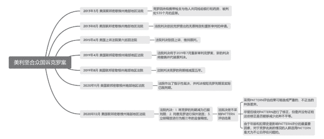

### 【核心争议点】

1.在新冠疫情背景下，将PATTERN评估结果纳入以健康为由提前释放裁量是否加剧族群差异。
2.PATTERN是否依照《第一步法案》完成独立核验。
3.PATTERN所用参考要素对当事人这类人群是否存在系统性不利。

### 【裁判论证过程】

#### （一）在新冠疫情背景下，将PATTERN评估结果纳入以健康为由提前释放裁量标准，加剧了族群偏见

密歇根州南区地方法院援引“人工智能伙伴关系”观点，该组织在《算法风险评估和新冠肺炎：为什么不应使用PATTERN工具》中指出使用该工具会扩大族群偏见。报告先论证输入数据的偏误，再强调疫情特殊性，得出使用可能加剧族群偏见的结论。^[([11]](#txt001.html#footnote_content_txt001_11))

输入数据带有族群偏误。PATTERN以再逮捕数据验证与评估，但再逮捕不等同于真实再犯，警方是否获悉、受害者行为、警察个人裁量等都会影响是否被捕，而这些因素受族群影响，导致输入不公。低级别犯罪数据同样存在族群倾斜。人工智能伙伴关系实证显示低级别犯罪中黑人比例偏高，与既有偏见及警务裁量有关。^[([12]](#txt001.html#footnote_content_txt001_12))即使输入仅含少量偏见，也足以使输出带有歧视。^[([13]](#txt001.html#footnote_content_txt001_13))

PATTERN开发时未纳入新冠考量，也未在疫情下检验。监狱环境利于病毒传播，若用具族群偏见的风险模型决定以健康为由提前释放或监督释放，监狱内黑人的感染率与死亡率可能升高，偏见进而威胁生命。

#### （二）PATTERN作为风险评估工具未依照《第一步法案》的规定进行独立验证

法院认为PATTERN仍存合理怀疑。《开放的风险评估》与德勒等人致函均提出质疑，法院予以采信。开发者未公开验证数据。司法部称逮捕与定罪信息由州地司法机构提供，公开受限，难以进一步检验，故所称准确性与公平性无法核实，未达《第一步法案》采信标准。^[([14]](#txt001.html#footnote_content_txt001_14))

其二，未公布风险阈值设定方式。PATTERN将风险分为最低、低、中、高，但各等级概率标准与设定理由未透明公开，科学依据受质疑。^[([15]](#txt001.html#footnote_content_txt001_15))

其三，两模型直接预测被再逮捕可能性而非再犯可能性。逮捕与犯罪有重合，但并非所有犯罪都会被知晓并导致逮捕，且被捕不必然导致定罪，故不能以再逮捕替代再犯。

其四，囚犯难借课程降低评分。按计分参考，参与狱内培训是改善评估的唯一主动路径，但联邦监狱康复培训资源不足，难以满足需求。^[([16]](#txt001.html#footnote_content_txt001_16))即便有意愿，也难以实现，导致风险评估难以及时反映变化。

#### （三）PATTERN工具在评估再犯风险时所采用的参考因素对当事人此类人群存有系统性不利

法院认为权重差异使当事人类人群难以获得最低风险分类。当事人生于1981年，裁决时约39岁。15岁入少管所，17岁因持械抢劫被判9至30年，假释后再犯。年龄与犯罪史是计算中最重要变量。30岁以下男性几乎不可能被划入最低风险；若有犯罪史，除非超过40岁，否则很难进入最低等级。^[([17]](#txt001.html#footnote_content_txt001_17))

### 【审理结果】

1.法院判决不依PATTERN评分判断当事人的危险性，认定其符合以健康为由提前释放条件，批准动议，并将刑期减为已服刑期。

## 裁定概要

2.法院命令当事人立即释放，开始为期三年的监督释放，并附加以下特殊条件：获释后须接受14天严格隔离，并完全遵守适用的州或地方禁止外出命令、社交距离准则及其他公共卫生限制。

## 【相关法条】

### 《美国法典》第 18 卷第 3582 条（c）款（18 U.S.C. § 3582（c））

（c）修改监禁期限.—一旦判处监禁，法院不得修改监禁期限，除非

（1）具有以下情况：

（A）法庭在收到监狱管理局局长的提议后，或者被告人在用尽其权利或向其所在监狱的监狱长提出申请 30 天后，仍不能使得监狱管理局代表被告人提出动议时，法院在考量第 3553 条（a）款所设定的因素后，如果发现有以下情况，可以减少刑期（可以附带或不附带条件地判处缓刑或者监督释放，但不得超过原刑期未执行的部分）：

（i）存在特殊和令人信服的理由证明有必要进行这种减刑；或

（ii）被告人至少 70 岁，根据第 3559 条（c）款判处的刑罚，因被告人目前被监禁的罪行服刑至少有 30 年，监狱局局长已根据第 3142 条（g）款的规定确定被告人不对任何他人或社区的安全构成威胁；

此种减刑应当与量刑委员会发布的适用政策声明相一致；以及

（B）法院可在《规约》或《联邦刑事诉讼规则》第 35 条明文允许的范围内修改所判处的刑期；以及……

### 《美国法典》第 18 卷第 3553 条（a）款（18 U.S.C. § 3553（a））

（a）判刑时应考虑的因素.

法院应判处足够但不超过必要的刑罚，以符合本条第（2）款所述的目的.法院在决定要判处的特定刑罚时，应考虑：

（1）犯罪的性质、情节以及被告人的犯罪史和特点；

（2）判决的必要性：

（A）反映犯罪的严重性，促进对法律的尊重，并对犯罪实施公正的惩罚；

（B）对犯罪行为给予足够的威慑；

（C）保护公众免受被告人进一步犯罪的影响；

（D）以最有效的方式向被告人提供所需的教育或职业培训、医疗护理或其他惩教治疗；

（3）可用的刑罚种类；

（4）量刑种类和量刑范围；

（5）任何相关的政策声明；

（6）有必要避免具有类似记录、犯有类似行为的被告人之间出现无根据的判决差异；

（7）向犯罪行为的任何受害者提供赔偿的需要.

### 《美国法典》第 18 卷第 3632 条（18 U.S.C. § 3632）

开发风险和需求评估系统

（a）在本章节通过后的 210 天内，司法部部长应当与 2018 年《第一步法案》（Frist Step Act）授权的独立审查委员进行协商，开发一款风险和需求评估系统，并在司法部网站上公开发布，该系统应当用于以下目的：

（1）在收监过程中，确定每一名囚犯的再犯风险，将其分为再犯风险最低、低、中、高四类；

（2）在可行的情况下，评估和确定每一名囚犯发生暴力行为或严重不当行为的风险；

（3）根据囚犯的具体犯罪需求以及（b）款的规定，确定适合每个囚犯的减少再犯计划的类型和数量，并相应地给每个囚犯分配此类计划；

（4）根据在押期间动态的、可以合理预期会进行变化的因素，定期对每一名囚犯的再犯风险进行评估；

（5）根据修改后的判决，将囚犯重新安排到适当的、以证据为基础的减少累犯项目或者生产活动中，以确保：

（A）在监禁期间，处于各个危险等级的所有囚犯都有机会降低他们的风险分级；

（B）处理囚犯特定的犯罪性需要；

（C）所有囚犯都能够成功参与此类方案；

（6）根据（e）款决定何时对成功参与减少累犯项目或生产活动的人提供激励和奖励；

（7）根据第 3624 条，决定囚犯何时准备转入释放前羁押或监督释放；

（8）在了解阅读障碍的情况下，确定在课程材料中适当使用音频技术.在执行本小节时，司法部部长可以根据情况使用现有的风险和需求评估工具.

### 《美国法典》第 18 卷第 3142 条（g）款（18 U.S.C. § 3142（g））

（g）应考虑的因素.

司法官员在确定是否存在释放条件，使得能合理确保该人按要求出庭，并确保其他人员和社区的安全时，应考虑以下现有有关信息：

（1）所控罪行的性质和情节，包括该罪行是否为暴力罪行、违反第 1591 条的罪行或联邦恐怖主义罪行，或是否涉及未成年受害者或受管制物质、火器、爆炸或破坏性装置；

（2）对被控人不利的证据的权重；

（3）该人的过往史和特点，包括：

算法别站上审判席：裁量的底线在哪

（A）拟评估对象的人格倾向、身体与心理状况、家庭关系、职业情况、经济资源、在社区的居住时长及人际交往、过往行为表现、吸毒酗酒经历、犯罪记录和出庭记录；

（B）在实施犯罪或被捕之时，该对象是否处于缓刑、假释或其他释放状态，是否有未决的联邦、州或地方法律下的审理、宣判、上诉或服刑完结程序；

（4）若予以释放，对他人或公共秩序可能造成的危险类型及其严重性。

【案例评析】

### （一）明确计算测评在司法中的从属定位
在审判实践里，各种智能决策产品大量出现，首先要划清边界：这类产品只能提供参考，不能取代裁判者的自由判断。其不能主导裁决的原因可归纳为三点。其一，法律解释与适用必然涉及价值取舍，需要具备共情能力的判断主体来完成。其二，模型往往继承了人类的既有偏见，却没有自我修正机制，必须由裁判者及时发现并纠正，正如本案中 PATTERN 对克罗的测评，其结论的根基就带有种族偏见。其三，模型依赖聚合数据输出，结果的灵活性不足^([\[18\]](#txt001.html#footnote_content_txt001_18))。本案审判员在拿到 PATTERN 的危险输出后，选择相信克罗在监所内的实际表现，并结合其成长经历、初犯年龄等要素综合权衡，体现出人工判断相比模型输出的弹性。裁判者能针对每个具体案情进行个体化分析，即便相似案件容易形成刻板认知，也不会像代码那样形成刚性逻辑，这正是自由裁量优势所在。算法量刑与刑事裁量之间存在张力：算法按既定规则决策可遏制裁量过度引发的司法不公，而裁判者则能用裁量权修正算法在个案中的偏差，实现个案正义^([\[19\]](#txt001.html#footnote_content_txt001_19))。

### （二）可靠性审查责任分担的启示
确认工具仅具辅助作用后，关键问题是该由谁来检验其在判决中的可信度，以更好地保障当事人权益并维护司法公正。本案审判机关采信了学界对 PATTERN 的质疑，由裁判者承担了可靠性审查任务，但裁判者并非完全依赖自身专业判断，而是借用了研究机构与专家的意见。裁判者并非科研人员，即便接受培训阅读开发者提交的书面说明，也不宜把识别风险的责任全部压在裁判者身上。若允许控辩双方就工具可靠性展开举证质证，由审判机关在对抗性证据基础上作出认定，权利保障会更充分。

### （三）司法应用中需排除偏见并提升透明度
审判机关在衡量克罗危险性时，因对 PATTERN 的开发与运行存疑而未予采纳。若此类风险需求测评软件要推广，审判机关提出的质疑就是改进方向。

首先，输入数据的质量必须得到保障，尽可能剔除偏见与歧视。PATTERN 的基础数据受种族歧视影响，除此之外，针对特定群体的刻板观念，如对性服务从业者的偏见，或对家暴、性侵案件的特殊情绪，都可能扭曲模型基础数据的客观性，导致实体公正受损、审判不确定性增加^([\[20\]](#txt001.html#footnote_content_txt001_20))。因此，工具在数据录入阶段必须规范个人信息使用，注重精确性，尽量排除偏见，适度运用偏见检测工具，确保数据客观并在数量上保持均衡。

其次，工具应具备可解释性并接受独立验证。PATTERN 开发者虽称其预测准确且公平，但考量因素未公开、风险阈值设定依据不透明、配套资源不足，导致无法独立检验，学界对其效果存疑。为此，用于执法、缓刑等场景的工具应保证研究数据的可及性，至少当事人有权获取并提出异议。只有信息可得，才能独立验证评估效果，保障准确性与公平性。模型的“解释权”关乎个人能否质疑决策是否公正，正义包含程序正义、互动正义与信息正义^([\[21\]](#txt001.html#footnote_content_txt001_21))，“若我有权更正错误，就需要看清错误；若我有权反歧视，就需要知道决策使用了哪些要素。否则信息不对称会使法律权利形同虚设。”^([\[22\]](#txt001.html#footnote_content_txt001_22))

再次，风险评分的门槛标准如何设定及其合理性是否获公众认可，也需完善。根据《第一步法案》，PATTERN 将风险分为四级，关键在于有多少人被评为最低或低风险并能据此获益，以及公众和政策制定者是否认可这些门槛的合理性。目前中度风险门槛为三年内再逮捕或违规概率 24%，即便某人释放时有 75% 的成功获释可能性，也无法获得低风险分类的益处^([\[23\]](#txt001.html#footnote_content_txt001_23))。本案亦显示，克罗这类人群的假释或保外就医可能受 PATTERN 分数制约。

本案揭示了 PATTERN 类工具在应用中存在的问题，为其司法辅助功能的实现提供了反馈与修改路径。

【关联判例推荐】

1\. United States v.Hanna, No. 3:19cr74 (JCH), 2021 U.S. Dist. (D. Conn. Aug.23, 2021)
核心事实：汉纳以 COVID-19 疫情下自身多种疾病风险加剧为由申请保外就医，并提示其 PATTERN 评级为“低风险”。审判机关认为其犯罪记录较多，评分偏低主要因犯罪年龄超过 40 岁，年龄变量影响了评估结果，故驳回申请。
关联点：审判机关同样质疑 PATTERN 结果，采纳与否属于裁判者自由裁量范围。

2\. United States v. Bass, No. 2:97-cr-80235-1 (6th Cir. Nov. 3, 2021)
核心事实：地方法院以巴斯 PATTERN 分数低证明再犯风险低。上诉法院指出该方法存在缺陷，“低”分仍意味着三年内 24% 再犯概率，且法院仅按是否实施暴力犯罪计算分数，未区分暴力类型。鉴于犯罪严重性，上诉法院撤销原判发回重审。
关联点：审判机关对 PATTERN 各因素提出质疑，认为不能仅凭分数裁量，因系统存在不完备性，采纳与否属裁量权事项。

3\. State v. Jones, No. 2015AP2211-CRNM (2016 Wisc.)
核心事实：琼斯因性侵儿童被诉，上诉审查中发现现场审查报告包含 COMPAS 评估。上诉法院认为量刑时参考 COMPAS 危险评估不侵害当事人正当程序权利。
关联点：与克罗案不同，PATTERN 因多方质疑未被采纳；琼斯案表明经完善的风险评估工具可投入使用且不违程序正义。

1.2 罗琳诉佛罗里达州案

【案件索引】
Roeling v. State 880 So. 2d 1234 (Fla. Dist. Ct. App. 2004)

【关键词】
智慧风险评估；“弗莱标准”；专家证词；科学证据

【案件提要】
本案是利用科学手段预测犯罪可能性的典型。依据佛罗里达州《吉米莱斯法案》^([\[24\]](#txt001.html#footnote_content_txt001_24))，儿童性犯罪者除承担刑事责任外，还需接受心理精神评估，若认定有再犯风险，则须接受强制收容改造，由州“儿童和家庭服务部”（Department of Children and Family Service）的管控下^([\[25\]](#txt001.html#footnote_content_txt001_25))进行治疗。该监管非刑罚，但涉及人身自由，是控辩争议焦点。
案件发生于 2004 年，是刑事司法中使用风险评估算法的早期先例。当时使用的工具融合心理学、生理学、精神病学指标，需经专家分析并出具证言后方可作为证据。其一是科学工具的输出，其二仍依赖专家证言。依据州法，专家证言中的新科学证据须获行业广泛认可，且检方承担举证责任，并满足“弗莱标准”^([\[26\]](#txt001.html#footnote_content_txt001_26))。
法院最终认定该风险评估工具符合“弗莱标准”，可作为证明上诉人罗伯特·罗琳具有性犯罪潜在风险的证据。
时至今日，再犯风险评估等算法结果仍被法庭采信。对测试显示有潜在风险者须依法接受强制措施。
本案展现了智慧司法工具的早期形态，为后续问题提供启示。2004 年评估结果仍需专家证言佐证，但其中已蕴含 AI 量刑思路。随着计算科学发展，这类工具不断演进，并在“卢米斯诉威斯康星州案”^([\[27\]](#txt001.html#footnote_content_txt001_27))等案件中发挥作用，既推动科学与司法结合，也带来新的法律难题。

【案件要旨】
佛罗里达州上诉法院（第一次上诉）：上诉方 罗伯特·罗琳 被上诉方 佛罗里达州
佛罗里达州上诉法院（第二次上诉）：上诉方 罗伯特·罗琳 被上诉方 佛罗里达州
2003 年，罗伯特·罗琳经心理学家、精神病学家判断，并结合“性犯罪惯犯风险评估”“Static-99”“暴力风险评估指南”等三十余项心理测试，被认定为《佛罗里达州法规》^([\[28\]](#txt001.html#footnote_content_txt001_28))规定的“性暴力潜在犯罪者”，须交由“儿童和家庭服务部”监管、护理与治疗。
2004 年 8 月，申诉方主张不应以心理测试结果作为认定依据，提出：（1）该风险评估工具未获精神病学、心理学等领域专家认可，不应采纳为专家意见；（2）州政府主张其缺乏自我控制能力，却未尽举证责任。
裁判者驳回两项抗辩：（1）该评估方法已获心理学家、精神病学家广泛接受并在当地诊所机构普遍使用，符合“弗莱标准”，可认定其存在性暴力犯罪隐患；（2）现有证据足以让陪审团认定其缺乏自我控制能力。
2012 年 2 月，申诉方再次上诉请求重审并称州未履行举证责任，最终因难认定初审法院适用错误标准或错判，重审请求被驳回。

【案例事实思维导图】
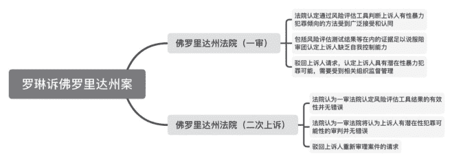

【核心争议点】
1. 针对性犯罪者的再犯风险评估属于新科学证据还是纯意见证言，是否需满足“弗莱标准”。
2. 再犯风险评估是否满足“弗莱标准”。
3. 再犯风险评估结果能否推定为实际再犯风险。

【裁判论证过程】
#### （一）性犯罪再犯风险评估属新型科学证据，应满足“弗莱标准”
1923 年“弗莱诉联邦案”确立“弗莱标准”，要求专家证言中的新型科学证据须获相关领域广泛接受，方具可采性。

## （一）再犯风险评估系统的证据性质
控辩对证据性质理解不一。控方为规避“弗莱标准”认为属纯意见，辩方认为属新型科学证据。裁判者援引“弗拉纳甘诉佛罗里达案”^([\[30\]](#txt001.html#footnote_content_txt001_30))、“哈登诉佛罗里达案”^([\[31\]](#txt001.html#footnote_content_txt001_31))中“性犯罪侧写”^([\[32\]](#txt001.html#footnote_content_txt001_32))、“儿童性侵犯综合征评估工具”^([\[33\]](#txt001.html#footnote_content_txt001_33))的认定，均被视为新科学证据且符合“弗莱标准”。裁判者据此认为本案性犯罪再犯风险评估工具与之相似，属于新型科学证据，应符合“弗莱标准”。

## （二）再犯风险评估符合“弗莱标准”
被告主张工具未获心理学家、精神病学家广泛认可。裁判者认为该工具在当地精神病诊所与监管机构中广泛使用，获法医学与精神医学专业认可，且其结果相较临床诊断更具科学性。基于行业使用频率、专家意见与普遍共识，裁判者认定工具符合“弗莱标准”，具有法律效力。

## （三）再犯风险评估结果可推定为实际再犯罪风险
裁判者援引贝克与墨菲 1998 年文章《我们所了解与不了解的：关于评估与治疗性犯罪者》^([\[34\]](#txt001.html#footnote_content_txt001_34))及汉森与索顿 2000 年文章《加强性犯罪风险预估：三个现实维度的比较》^([\[35\]](#txt001.html#footnote_content_txt001_35))，证明评估结果与实际再犯风险相关性较强。

【审理结果】
1. 初审法院裁定罗伯特·罗琳具有性暴力犯罪风险，须由州“儿童和家庭服务部”管控并执行收容改造，定期接受心理与精神治疗。
2. 佛罗里达州上诉法院首次上诉驳回罗琳上诉，认定风险评估工具测试结果有效，可据此推定其性犯罪倾向，应予监管。
3. 佛罗里达州上诉法院第二次上诉驳回重新审判请求。

【相关法条】
### 《联邦证据规则》第 702 条（Federal Rules of Evidence §702）
在下列情况下，具备知识、技能、经验、培训或教育背景的专家证人可通过意见或其他形式举证：
（a）专家证人的科学、技术或其他专业知识可帮助法官理解证据或确定争议事实；
（b）专家证人提供的证据基于充分事实依据或详实数据；
（c）专家证人提供的证据源于可信的原则与研究方法；
（d）专家证人已将原则和方法可靠地应用于案件事实。

### 《联邦证据规则》第 706 条（Federal Rules of Evidence §706）（节选）
（a）专家证人指定程序：法院可依当事人提议或自行决定，要求当事人说明不应指定专家证人的理由，或进行指名。法院可指定双方约定的专家，也可自行选择，但只能指定同意参与举证者。

科学证据的司法门槛：从弗莱标准到算法量刑

专家证人的法定告知义务
法院负有向专家证人阐明其职责的义务，该告知可以采用书面形式并将副本交由书记官保存，也可以安排在各方当事人均在场的会议上口头说明。被指定的专家应当：
1. 把自己所做的研究结论及时披露给当事人；
2. 接受任何一方所进行的证言笔录；
3. 接受法院或任何一方的传唤出庭作证；
4. 接受任何一方的交叉询问，包括传唤方的质询。

佛罗里达州相关立法要点
《佛罗里达州法规》第394章第910条节选
立法机关注意到，监狱环境对改造性暴力犯罪者收效有限，此类人群需要持续长期的干预治疗。为此，立法机关有意建立针对性暴力犯罪者的长期收容与治疗机制。

《佛罗里达州法规》第394章第912条第9款节选
第9款对“性暴力犯罪”作出界定：
a. 在实施性侵害的情形下故意杀人；
b. 绑架未满13周岁的儿童，且在该行为中：
1. 实施性侵害；或
2. 对儿童实施淫秽、下流或猥亵的侵害或行为，或在儿童面前实施上述性犯罪行为。

【本案评析】

一、本案印证弗莱标准在科学工具审查中的适用
联邦层面，1993年《联邦证据规则》第702条即道波尔标准被采纳后，弗莱标准在联邦已不复存在。州层面，因弗莱标准在科学证据判断上已沿用七十余年，选择标准变得两难。一方面，科学快速迭代，弗莱标准的适用性与成本难以匹配；另一方面，道波尔标准虽扩大了法官裁量、减轻举证负担，却也因表述模糊高度依赖主观判断。截至目前，约25个州采用道波尔标准或类似规则，15个州及哥伦比亚特区仍坚守弗莱标准，6个州未放弃弗莱但吸收了道波尔元素，另有4个州创设自有标准。本案以行业公认规则对科学证据进行检验，论证清晰、逻辑严密，实践中只需援引行业规范并邀请业内专家作证即可操作。

二、弗莱标准的价值与局限需并重
弗莱标准诞生于1923年，用以审查专家证据中涉及的新型科学证据，其核心在于新科学证据须获行业广泛认可。诞生之案弗莱诉联邦案即关乎血压测谎的新技术。20世纪中后期科学技术加速突破，弗莱标准随之扩散。凭借定义明确、操作简明的行业性标准，它在可采性判断中长期占据主导。只要有权威专家论证并辅以大样本行业调研证据，就能较好保障科学证据的合理性，助法官作出正确认知。然而进入信息时代，科学证据趋于跨领域、复杂化，证明“行业普遍认可”的成本高昂，部分新兴领域根本尚未形成共识，却已进入法庭。弗莱标准同时限制了法庭采信自由裁量，诉讼资源消耗严重，不利于效率与终局性。为此最高法院在道波尔案后以证据规则第702条取代弗莱标准，实质降低了专家科学证据的门槛。本案表明弗莱标准仍能妥当地解决实际争议，也提示在简单案件中该标准仍具广泛适用价值。

三、本案为人工智能与智能司法发展奠基
普通法遵循先例传统，法官的解释与填补能创造先例。任何判决都具指引意义。本案核心冲突在于被告对程序正义与证据合法性的抗辩与计算工具提供的科学证据之间的张力。案发于2000年初，正值互联网与计算工具尚未普及之际。此前智慧计算相关证据案件稀少，故本案判决具导向性。其意义超越个案，折射出佛罗里达法院对新型科学证据的长期倾向。
数十年后，智慧数据运算已深度嵌入司法全流程：电子眼算法介入执法，智能证据系统辅助检务，算法也参与量刑辅助。从当下科技司法视角回望，本案堪称智慧运算与司法磨合的起点，宣告司法与人工智能、计算科学深度融合的时代已然到来。

【参考判例】

1. Frye v. United States 293 F. 1013 (D.C. Cir. 1923)
核心事实：1923年被告詹姆斯·弗莱被判故意杀人，一审辩方以专家证言为基础主张无罪。专家认为依早期测谎理论说谎时心跳血压会变化，而被告无此反应，故陈述可信。但当时该判断未获科学界及社会普遍认可，二审法官认为专家证据应基于高度认可的科学研究结论，并由特定领域共识的科学原则推理而来，即后称弗莱标准，遂支持公诉方异议。
关联点：确立本案所用证据认定标准弗莱标准，为科学证据与智慧司法边界划定范围。

2. Flanagan v. State, 625 So. 2d 827 (Fla. 1993)
核心事实：被告被控性侵年仅九岁且有智力障碍的亲生女儿。儿童保护中心心理学家通过访谈及性犯罪侧写评估受害人心理损伤，证明被告实施性犯罪。被告以未满足弗莱标准为由主张证据不可采。
关联点：均涉及性犯罪心理精神评估工具的争议，均围绕弗莱标准。

3. State v. Townsend, 635 So. 2d 949 (Fla. 1994)
核心事实：被告被控性侵两岁女儿，因被害人年龄过小无作证能力。法庭创设“受害应激症状”规则，允许以专家证词认定儿童受害事实。
关联点：对儿童性侵案件的专家证据作特别规定，与本案均含性犯罪及后续科学评估。

4. Daubert v. Merrell Dow Pharmaceuticals, Inc., 43 F.3d 1311 (9th Cir. 1995)
核心事实：两原告因出生缺陷起诉药企，主张产品致因。原告列8名专家证明因果关系，被告列1名专家反证无因果。上诉前加州遵循弗莱标准，双方证据均可采却指向相反事实，造成审理困难。经专家证据认证、实验科学性、是否存在谬误等考量即道波尔标准后，法院认定原告证据专家效力不足，判被告胜诉。
关联点：创设道波尔标准，提供科学证据验证新思路，与本案专家意见不一致情形相似。

5. Hadden v. State, 690 So. 2d 573 (Fla.1997)
核心事实：嫌疑人被诉性侵12岁幼女，心理学家实施“儿童性侵害症状检测”，结果作为主要证据。嫌疑人主张属新型科学证据须符弗莱标准；检方认为属《佛罗里达州法规》儿童性犯罪“受害应急症状”规定下的纯意见证言，无需满足弗莱标准。法院认定该检测为新型科学证据，应满足弗莱标准。
关联点：区分纯意见证言与新型科学证据。

1.3 盖斯诉爱荷华州案

【案件索引】
Guise v. State of Iowa， 919 N.W.2d 635 （Iowa Ct. App. 2018）
State of Iowa v. Guise， 921 N.W.2d 26 （Iowa 2018）

【关键词】
技术正当程序；算法问责；智慧司法

【案件提要】
本案聚焦算法解释权与技术正当程序，与爱荷华州诉盖斯刑事诉讼密切相关。审判时被告盖斯认可判决前调查报告PSI及其中使用的算法风险评估软件IRR。上诉时盖斯主张法院参考IRR侵犯正当程序，PSI未对法院作出警示说明，要求审慎采纳IRR结果，构成侵犯正当程序，且法院采纳IRR构成自由裁量滥用，律师未发表意见属错误保留。上诉法院支持请求，撤销原判发回重审。州政府申请再审，爱荷华州最高法院驳回，指出一审盖斯已认可PSI，法院有权选择量刑参考信息，仅在明显不合理行使审判权时构成滥用。IRR已广泛使用，考量因素公开确定，法院已尽告知义务，未损害正当程序。
该案案情与卢米斯案高度相似，均使用卢米斯案为参考，但对风险评估工具使用、自由裁量认定及程序判断不同，导致结果分歧。作为算法歧视典型案例，本案对司法裁判与立法具启发。纽约市2018年提出《算法问责法》，要求公共领域自动化决策须作影响评估，确保一致性、专业性、中立性及审查有效性。我国《个人信息保护法》第二十四条赋予个人拒绝自动化决策权，第五十六条设个人信息处理前风险评估制度，均体现算法问责立法努力。本案对理解算法解释权、算法问责及算法影响评估制度具重要意义。

【案件要旨】
爱荷华州地区法院：一审原告爱荷华州，被告蒙特兹·盖斯
爱荷华州上诉法院：上诉方蒙特兹·盖斯，被上诉方爱荷华州
爱荷华州最高法院：上诉方蒙特兹·盖斯，被上诉方爱荷华州
2016年12月31日，蒙特兹·盖斯在爱荷华州梅森市违反禁止接触令，暴力闯入前女友公寓抢劫毁物后被捕。州指控其二级入室盗窃及非法监禁。2017年2月6日其认罪二级入室盗窃，地方法院审前释放并交惩教署监管。2月23日惩戒署报告称其违反释放条件，包括未按期到场、违反禁止接触令、拒捕及持有毒品用具。州另指控其干扰公务，盖斯无异议。3月14日地区法院指示缓刑办提交PSI，建议密切监视，盖斯除涉毒异议外不反对量刑采用PSI。量刑听证会上检方建议监禁一年缓刑两年并罚款，法院驳回。法院称判决须实现教化、保护社会、威慑三大目标，盖斯犯罪史难以实现，参考PSI建议使用爱荷华州风险评估工具IRR，IRR考量年龄、犯罪史、帮派关系、社区矫正撤销等及就业、住房不稳定、药物滥用等动态因素。法院据此判其二级入室盗窃罪不超过十年不确定刑期，干扰公务90天监禁，与盗窃罪并罚。
盖斯上诉主张：其一，地区法院使用IRR侵犯正当权利，包括正当程序、正当程序权利受侵、自由裁量滥用、律师错误保留。盖斯认为调查报告应含警示：风险分基于群体数据非个人；是否经验证研究；得分信息披露程度；工具目的及非为量刑开发。其二，法院考虑未经证实家庭暴力可能并意图判处家庭虐待金，属滥用自由裁量。2018年5月2日上诉法院撤销原判发回重审。州政府申请复审，2018年12月14日爱荷华州最高法院判定未侵犯正当程序，未构成自由裁量滥用，撤销上诉法院判决，维持原判。

【案例事实思维导图】
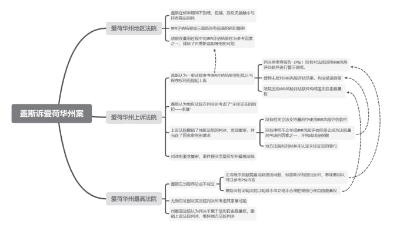

## 核心争议点
1.法院量刑时未在警示说明指导下采用IRR风险评估软件是否侵犯被告人正当程序权利。
2.法院量刑时未在警示说明指导下采用IRR风险评估软件意见是否构成滥用自由裁量权。
3.地区法院是否以未经证实或未经起诉的罪行对被告人进行判决，是否构成滥用自由裁量权。

## 裁判论证过程

一、量刑时未经警示说明即适用IRR风险评估工具并未侵犯正当程序权利
爱荷华州最高法院认为，盖斯虽纠正了PSI信息错误，但未对报告使用IRR提出反对，未在一审提出正当程序主张，视为接受其适用。上诉法院未明确回应该请求。少数反对意见详细论证量刑时未经警示说明适用IRR不侵犯正当程序。反对意见认为证明律师错误保留需证明律师错误且导致偏见，本案律师默认PSI为量刑综合考量因素无误，不构成错误保留。依州及联邦正当程序一般规则，法院量刑考量因素来源不受限，正当程序仅要求给予被告人反对权。PSI有无警示或法院是否意识到IRR影响不影响正当程序，只要被告人未提出异议即获最低保护。
反对意见指出盖斯受卢米斯案影响。两案不同，卢米斯案风险评估数据为被告庭上供述，自身供述信息被告较难反对，故需警示；本案数据为爱荷华州四个社区信息，被告可当庭反对却未提，不构成权利侵犯。

二、量刑时未在警示说明指导下采用IRR风险评估工具意见不构成滥用自由裁量权
爱荷华州最高法院撤销上诉法院判决，认为法律及判例经验均未限制法院在量刑时考虑全部相关有用因素。IRR符合该条件，法院有权考量。PSI及其中IRR仅为量刑诸多因素之一。

# 算法量刑的边界在哪？爱荷华盖斯案全解析

二审法院指出，联邦与州现行规范里并未明文允许把 IRR 风险评估工具带入量刑环节。爱荷华州法典虽然授权基层法院调取“与量刑相关的任何信息”，本案 IRR 仅输出“建议密切监管”的结论，其所依据的指标、评分逻辑与推导过程都无法还原，也难以检验。可靠度未被证实时直接采纳，等同于对自由裁量权的变相滥用。因此，量刑条款的概括性表述不应被理解为默许法院使用未经审查的算法。

### （三）一审未以未起诉情节作裁判，裁量未被滥用
爱荷华最高法院与上诉法院对该争议点结论一致。盖斯主张一审在考量人身侵害危险时越权。法官指出并无确切记录显示一审定刑时曾讨论家庭暴力；上诉中盖斯亦承认攻击意图本就是二级盗窃的构成要素。法官仅知道一项未被起诉的事实，不足以推翻“裁量已适当行使”的推定。认定滥用须有明确证据证明初审判决实际依赖未被指控的行为。现有卷宗下，一审并非基于未经证实的指控作出判决，裁量滥用的情形不存在。

## 审理结果
1. 爱荷华州地区法院判处盖斯不超过 10 年有期徒刑的不定期刑.
2. 爱荷华州上诉法院撤销地区法院判决，发回重审.
3. 爱荷华州最高法院撤销上诉法院判决，维持原判.

## 相关法条
《美国宪法第十四修正案》第 1 节（United States Constitution，Amendment 14 Section 1）（节选）

不经正当法律程序，不得剥夺任何人的生命、自由或财产.

《爱荷华州法典》第 901 章第 2 条第 1 款（Iowa Code §901.2.1）

一经定罪，法院应当考量国家、司法行政区惩教部门和被告人可能提供的与量刑问题有关的任何信息.法院可以考虑其他来源的信息.

《爱荷华州法典》第 901 章第 3 条第 1 款（Iowa Code §901.3.1）

判决前审查报告（PSI）应当包括：

a.被告人的基本特征、家庭、财务状况、需求和潜在因素.

b.被告人的犯罪记录和社会活动历史.

……

e.对受害者、受害者亲属及社区的伤害程度.

……

h.被告人的精神健康史与药物滥用史.

《爱荷华州法典》第 901 章第 4 条（Iowa Code §901.4）（节选）

判决前审查报告（PSI）是保密的，法院应提供保障措施以确保其机密性，包括但不限于密封报告，只有通过进一步的法院命令才能打开报告.被告人的律师和州检察官应至少在判刑日期前三天查阅报告.被告人的上诉律师和州检察官应当应要求并在无需法院命令的情况下，查阅报告.

《爱荷华州法典》第 901 章第 5 条（Iowa Code §901.5）（节选）

法院应当考量的可能与量刑问题有关的任何信息包括判决前审查报告（PSI）.

## 案例评析

### （一）算法评估触发两层程序保障
本案确认被告针对算法风险评估享有两类程序性保护。一是传统保护，即对包含算法评估的 PSI 报告进行陈述与反驳；二是被称为“技术性正当程序”的新型保护，即有权质疑算法本身的技术应用。

传统保护要求量刑所用材料必须披露并可反驳。PSI 只是量刑参考之一，并不剥夺被告申辩权。盖斯在二审与终审均称 PSI 未就算法工具使用作出提示，侵害程序权益。两级法院均认为，盖斯在初审时已明知报告内容，有机会提出异议却未及时反对，属于自行放弃。最高法院还提示，若认为律师未协助行使权利可另案追责。上诉法院同时指出，本案 PSI 并非必然需要附加警示，详见后文。

技术性保护本应是核心议题，但盖斯在初审未及时主张，导致上诉层难以主动展开。上诉中盖斯援引卢米斯案要求审查算法本身。上诉法院回应，卢米斯案中当事人难以实质获取权重等信息而无法反驳，而本案 PSI 已说明 IRR 采集了哪些数据、如何评估，与卢米斯案情不同，盖斯已实质获得可反驳信息却未使用。由此可见，上诉法院也认可当事人对算法技术本身享有程序性抗辩权。

### （二）PSI 是否需附警示取决于算法所依数据
卢米斯案中，威斯康星最高法院要求含 COMPAS 评估的 PSI 必须附带警示，提醒量刑法院审慎对待准确性。盖斯同样援引该案主张 IRR 报告应提供准确性警示，未获支持。

爱荷华上诉法院的区分在于数据属性。COMPAS 主要依赖被告自身基础信息与庭审陈述，质疑空间有限，故需警示引导审慎。而本案 IRR 依赖的是伊奥瓦州四个社区的外部数据，并非被告个人数据，被告本可质疑其准确性。法院的隐含逻辑是，被告对数据准确性的质疑本身已发挥警示功能。

由此可见，PSI 是否需为算法评估附警示，取决于算法所依赖参数的真实性与可质疑性。若参数高度可信则需警示；若参数易被质疑，则当事人质疑即可起到警示效果，无需另行附注。

### （三）技术性正当程序的理论延伸与现实关切
“技术性正当程序”概念源自马里兰大学法学院教授希特伦 2007 年论文。其核心是，告知与听取申辩等传统要求需对抗公权力透明化，而计算机技术的隐蔽性使相对人难以知晓决策依据，进而削弱告知与申辩效果，故要求技术应用本身公平、透明、可问责。

本案缓刑部门在是否建议缓刑的决策中应用了算法。统计显示，2019 年美国已有不少于 60 种类似风险评估工具在刑事审判中使用。学界研究指出其准确性多处中等水平，结果常前后不一，部分工具甚至加剧性别、种族偏见。无论结果准确与否，正当程序的价值在于保障公权力程序的公平正当。算法作为决策工具同样须受约束。

中国学界基本形成共识：算法技术正当程序是传统正当程序的延伸，其标准应源于传统正当程序并结合技术特性改良。刘东亮在“排除偏见、听取意见、说明理由”基础上，提出算法正当程序需提高透明度披露数据与运行机制、保证规则一致可重复、具备可解释性、并在专业审计协助下纠错。张凌寒从“信息发送、信息沟通、信息纠错”出发，主张公开算法规则与权重、进行算法影响评估并听取公众意见、创设算法解释权。雷刚、喻少如则认为应实现算法中立、通过透明与可解释实现公开、通过审计实现论证、通过影响评估实现公正。

国外讨论更偏向实务。有学者主张禁止在刑事审判中使用风险评估工具，因其对程序权利潜在风险大于效率收益。也有学者指出法官常高估对算法风险的掌控力，应加强法官培训以理解模型机制并正视算法歧视风险。另有学者提出实务要求：数据须与评估对象相关、结果须具备准确性并防范歧视、公正性需通过透明度与解释权实现。

### （四）算法问责的立法实践
算法问责即穿透技术令使用者担责。实现路径是通过法律为使用者创设义务，进而规范算法运行。透明、可解释性、分级分类管理是问责制的具体体现。

欧盟一方面以《一般数据保护条例》赋予个人对抗算法自动决策的透明、可解释、影响评估权利；另一方面计划出台《人工智能法案》，推行风险分级分类管理。美国方面，2019 年国会提出《算法问责法案》，2022 年 2 月再次提出《算法责任法案》，要求联邦贸易委员会建立自动化决策系统公共库以提升透明度。2019 年 6 月国家科技委员会发布的《人工智能研发战略计划》更新版也强调公平、透明、可问责设计。

我国 2021 年通过《个人信息保护法》，借鉴 GDPR 赋予个体对抗算法自动画像的权利。同时在应用层面探索问责制，如网信办、工信部、公安部、市场监管总局联合发布的《互联网信息服务算法推荐管理规定》旨在规范个性化推荐并降低算法歧视风险。此外，《新一代人工智能发展规划》《新一代人工智能治理原则》《国家新一代人工智能标准体系建设指南》等文件系统规划了人工智能领域的使用规范。

## 关联判例推荐

1. Townsend v. Burke, 334 U.S. 736, 741 (1948)

核心事实：法院对 Burke 的量刑是基于检方对其先前犯罪记录的虚假提供，或法院对犯罪记录粗心大意的误读作出的，侵犯了被告人的正当程序权利.

与本案关联点：被告人在法院适用 PSI 及其中包括的 IRR 风险评估软件时，享有改正其中虚假信息的权利.

2. Williams v. New York, 337 U.S. 241, 246 (1949)

核心事实：纽约州上诉法院认为，正当程序使法官可以考虑 PSI，其中载有的关于被定罪被告人的信息，包括可能有助于判刑、准予缓刑或对被告人进行惩戒的信息.

与本案关联点：法院是否采用风险评估结果属于法官自由裁量权的范围内.

3. State v. Delano, 161 N.W.2d 66 (1968)

核心事实：Delano 对法院在量刑时考虑其社会与经济背景提出反对.爱荷华州最高法院认为法院有权在量刑时尽可能广泛地考虑与量刑有关的信息.

与本案关联点：法院有权在量刑时尽可能广泛地考虑多种相关因素。

## 4. Loomis v. Wisconsin, 137 S.Ct. 2290 (2017)

### 核心事实
卢米斯的 COMPAS 风险评估结果，是基于他对问题的回答和公开获得的有关他犯罪历史的数据而做出的。巡回法院认为卢米斯对信息准确性提出反对的可能性较小，因此报告需要在法院适用风险评估结果时进行警示说明，防止侵犯被告人正当程序权利的潜在风险。但是又因为报告只是法院量刑时考虑的众多因素之一，没有警示说明也不意味着侵犯了被告人的正当程序权利。

### 与本案关联点
IRR 风险评估软件运用的数据是爱荷华州四个社区的信息，不是被告人的基础信息，并不需要警示说明。

## 5. State v. Gordon, 921 N.W.2d 19 (Iowa 2018)

### 核心事实
Gordon 在地区法院审判过程中没有第一时间对 PSI 中的信息错误提出反对，指出其侵犯自己的正当程序权利，意味着接受 PSI。地区法院没有侵犯其正当程序权利。

### 与本案关联点
被告人在审判过程中没有第一时间对 PSI 中的信息提出反对，指出其侵犯自己的正当程序权利，意味着接受 PSI 的适用。法院没有侵犯其正当程序权利。

## 1.4 马歇尔锁匠服务公司诉谷歌案

### 【案件索引】
Baldino’s Lock & Key Service, Inc. v. Google LLC, 285 F.Supp.3d 276 (D.D.C.2018)

Marshall’s Locksmith Serv. Inc. v. Google, LLC, 925 F.3d 1263 (D.C. Cir. 2019)

### 【关键词】
《通信规范法》；网络服务提供者豁免；虚假广告；算法中立

### 【案件提要】
本案有关互联网搜索引擎发布第三方内容的豁免权适用。本案的核心问题是被告谷歌公司作为网络服务提供者，是否对第三方信息发布者提供的虚假信息享有豁免权。美国《通信规范法》（Communications Decency Act， CDA）第 230 条规定了网络服务提供者和用户发布信息的豁免权，使之原则上无需为第三方提供的任何信息内容承担法律责任，包括第三方虚假信息。只有当网站实际参与该信息的“创建”或“加工”时，才需要承担责任；而如果网站只是提供了一种中立的方式，让第三方可以独立发布自己选择的信息，则不构成网站对信息的创建或加工。这一条款在诉讼中可作为积极抗辩，法院也可以依此条款驳回起诉。第 230 条对“交互式计算机服务”作广泛的定义，包括本案中的搜索引擎服务。

地图点位算谁的创作？

原告锁匠联盟认为，被告把外部站点提供的门牌和联系方式换成地图坐标对外展示，这种增补式呈现已经超出了单纯转引，构成了平台自身的成果发表，所以不应被 230 条文覆盖。

二审机构并未接受该说法。裁决强调，依靠保持中立的自动化机制把外部资料转成地图，并不等于网站亲自对内容作出创造或加工，第六巡回法院过去已明确搜索引擎这类自动编辑行为落在 230 条文的保护圈内。^([61])

《通信规范法案》诞生于网络萌芽期，230 条文免除了服务提供方为海量内容背书的责任压力，避免了运营成本激增、用户表达被过度限制以及寒蝉效应等风险，因而被视为推动网络成长的基石性规则。^([62)]中国采用的是通知移除路径，《民法典》第 1195 条第 1 款规定：“网络用户利用网络服务实施侵权行为的，权利人有权通知网络服务提供者采取删除、屏蔽、断开链接等必要措施。通知应当包括构成侵权的初步证据及权利人的真实身份信息。”同条第 2 款规定：“网络服务提供者接到通知后，应当及时将该通知转送相关网络用户，并根据构成侵权的初步证据和服务类型采取必要措施；未及时采取必要措施的，对损害的扩大部分与该网络用户承担连带责任。”

### 【案件要旨】

华府联邦地方法院一审：起诉方马歇尔锁匠集团等，被诉方谷歌等。
华府联邦巡回上诉法院二审：上诉人马歇尔锁匠集团等，被上诉人谷歌等。

起诉方是 14 家锁匠企业，它们自称经营合规，因为登记地址、执照所在地与广告宣称的服务区域一致。所谓假冒锁匠则在自有网页广告中使用虚构地址。假冒一方在全国人口密集区投放大量独立站点，“这些页面有的标注虚构地址，有的干脆无地址，却宣称本地营业”。

被诉方为谷歌、微软、雅虎三家互联网公司，合计掌控约九成的线上查找份额。起诉方指控三家合谋，利用市场地位放任不准甚至不存在的锁匠资料占据查找列表，迫使合规锁匠与假冒者竞价投放广告以抵消负面影响，从而提升广告收入。

在初审中，起诉方认为查找列表放大了假冒锁匠的影响：消费者被困门外或车外时，习惯在被诉方的查找器里找最近的锁匠。假冒锁匠铺设大量虚假地址，让消费者误以为就在附近，合规经营者因此遭受不正当竞争与严重经济损失。这些不实地址被自动化程序转成被诉方站内的地图坐标。起诉方称这种虚假定位严重阻碍顾客找到合规锁匠并取得联系。

初审驳回诉讼。华府联邦地院认为，被诉方以地图形式转引的外部不实内容不构成创造新内容，所增加的内容均源自外部原始资料，因此适用《通信规范法案》第 230 条文豁免。

上诉后，起诉方调整请求，称被诉方为实施计划发布了三类不受 230 条文保护的内容：（1）明知地址不存在仍发布外部网页上的假冒锁匠不实地址；（2）把假冒锁匠网页上的街道地址和区号进一步转成查找页面内的精确地图坐标，对原始内容加以增强，构成平台自己的新创作；（3）平台凭空捏造、缺乏原始依据的内容。

华府联邦巡回上诉法院在适用第 230 条文 (c) 款第 1 项时提出三步检验：（1）被诉方是否为网络服务提供方或用户，（2）被诉责任所涉内容是否由外部提供，（3）指控是否要求被诉方以该内容的发布者或发言人身份担责。重审一审基于第 230 条文驳回起诉的决定后，法院认为被诉方把外部内容转成地图时使用的是保持中立的自动编辑程序，据此维持原判。

### 【案例事实思维导图】

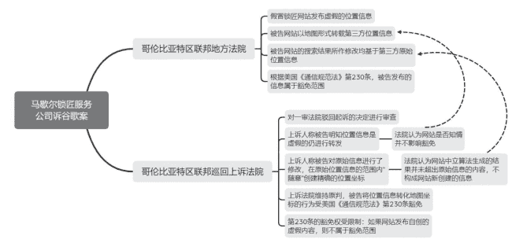

### 【核心争议点】

被诉方推出的三种内容是否属于《通信规范法案》第 230 条文豁免的“其他发布者提供的内容”：

1.被诉方转发假冒锁匠外部网页内的不实位置资料，即便被诉方明知地址不存在，能否豁免。
2.被诉方以地图形式呈现外部位置资料，是否构成平台自创内容而不能豁免。
3.被诉方自行编造、与外部内容无关的内容能否豁免。

### 【裁判论证过程】

（一）被诉方转发的外部不实内容受《通信规范法案》第 230 条文豁免

上诉法院认为，此类内容属于网络服务提供方转引自外部网页的内容，是否豁免并无争议，起诉方的诉求正是国会制定第 230 条文希望避免的典型情形。^([63)]起诉方并未重点抗辩。一审时起诉方律师即承认，仅从外部获取并发布内容，内容本身仍属豁免。上诉阶段起诉方改称被诉方“实际上注意到”内容具有欺诈性仍予转发。

上诉法院援引第一巡回法庭判例称：“即使被诉方注意到位置资料是不实的，也不足以使这些不实资料变成被诉方的原创成果，这一规则业已确立。”^([64)]对网络服务提供方的豁免并不取决于其是否知晓外部内容的真伪。因此起诉方主张的转发行为仍在 230 条文豁免范围内。

（二）把外部网页位置资料转成地图不构成创造或发展新内容

起诉方称被诉方制作地图坐标展示假冒锁匠位置，属于对外部原始内容的增强，修改程度足以构成平台自创内容。上诉法院分两点讨论：其一，将外部街道地址转成地图坐标是否排除豁免；其二，把不精确的位置资料转成地图坐标是否受《通信规范法案》保护。

关于第一点，法院认为网站有权决定如何呈现外部内容，以地图形式展示并不构成第 230 条文 (f) 款第 3 项所指的“创建”或“加工”原始内容。因为基础资料完全来自外部，转化行为本身不会让查找器变成内容提供方。若以地图坐标展示不能享受豁免，则几乎没有任何转载自外部的内容能被豁免——查找器展示外部内容时不可避免地要把数字传输内容转成文字或图像形式。此外，起诉方在口头陈述中承认，若查找器仅是把用户的内容转成地图坐标，则享有转载豁免。起诉方未能证明其自认的转化行为与本案争议行为有何实质区别。至于起诉方要求被诉方在地图上区分合法与非法锁匠资料，法院认为无依据，国会已豁免网络服务提供方对任何外部内容的转载，即使内容错误。

关于第二点，据起诉方描述，假冒锁匠网页称“在华盛顿市区提供服务”，并提供区号“202”的电话。被诉方查找器据此模糊资料，在华盛顿市区内“任意”分配一个落在此范围内的地图定位。上诉法院认为这种转化同样受 230 条文保护。

首先，正如起诉方所承认，被诉方地图上的精确定位源自外部网页提供的位置资料，且并未超出外部提供的位置范围。法院引用第六巡回法院判例^([65)]，认为在此情形下被诉方发布的地图定位是“其他发布者提供的内容”。第六巡回法院在判决中写道，Yelp 平台在查找结果中以星级评分展现外部客户评价，将复杂内容简化为一星至五星，本质仍是外部用户数据的表现形式之一。因此本案中即便被诉方定位程序并不完全受限于外部内容，这也只是程序设计问题——程序在把查找结果图像化时会尽可能把精度不同的外部内容精确化。

更关键的是，被诉方把外部内容转成精确地图坐标的行为不构成创造新内容，因为转化使用了保持中立的自动化程序。上诉法院先前判例已明确，“若网站仅提供中立程序，让外部主体自行决定发布何种内容，则网站不构成创造或发展新内容。”^([66)]第六巡回法院也明确查找器“自动编辑行为”受该法案保护。^([67)]本案中，被诉方使用自动编辑程序把外部提供的位置转成地图形式，该程序在自动转化时并未对合法锁匠与假冒锁匠区别对待。因此，以中立程序自动编辑产生的地图定位受《通信规范法案》第 230 条文豁免。

（三）被诉方是否发布了区别于外部内容的原创内容

起诉方称被诉方人为更改程序，并非依据外部内容或程序自动生成，而是为最大化查找结果利润。但上诉请求中未进一步说明，法院未予讨论。

起诉方还称被诉方的程序会给同一假冒锁匠位置资料分配不同的地图定位，具体定位取决于顾客位置，以制造更近的假象。但该主张并未出现在起诉方修改后的上诉意见中。上诉法院认为该问题与审查一审驳回起诉的法律问题无关。

### 【审理结果】

1.华府联邦巡回上诉法院认定：被诉方网站把外部位置资料转成地图的行为受《通信规范法案》第 230 条文豁免。
2.华府联邦巡回上诉法院认定：被诉方在外部位置资料范围内显示精确地图坐标不构成创造新内容，该中立程序受第 230 条文豁免。
3.华府联邦巡回上诉法院驳回起诉方上诉，维持原判。

### 【相关法条】

美国《通信规范法案》第 230 条文 (c) 款第 1 项（Communications Decency Act§230(c)(1)，47 U.S.C. §230(c)(1)(1996)）
交互式计算机服务的提供方或用户不得被视为另一个内容源提供的任何内容的发布者或发言人。

美国《通信规范法案》第 230 条文 (c) 款第 3 项（Communications Decency Act§230(c)(3)，47 U.S.C. §230(c)(3)(1996)）
内容源，是指对通过互联网或任何其他交互式计算机服务提供的内容的创造或发展负有全部或部分责任的任何个人或实体。

### 【案例评析】

（一）本案进一步明确了美国网络服务提供方的免责条件

依据美国《通信规范法案》第 230 条文，网络服务提供方无需为“另一个内容源提供的任何内容”负责；只有当其自身“创造或发展”内容时，才会被视为内容源而须担责。但何为“创造或发展”，立法上长期缺失说明。^([68)]

本案确立了“创造或发展”的两层判断标准并被后续案件沿用。首先，当网络服务提供方呈现的内容完全来源于且受限于外部内容时，其并未“创造或发展”内容，符合第 230 条文免责条件。其次，当网络服务提供方利用保持中立的自动化程序转化外部内容，对所有外部内容采取一视同仁的自动化处理时，亦可受免责条款保护。该标准在延续标志性案例“Fair House Council of San Fernando Valley v. Roommates.Com，LLC”所提出的“网络服务提供方只有对内容的非法性提供实质性贡献时才应担责”标准基础上进一步细化，为后续案件提供指引。^([69)]例如在“Force v. Facebook 案”中，美国第二巡回上诉法院认为，脸书程序只是依据客观因素把用户提供的内容与他人配对，程序“内容中立”，脸书不可被认定为内容的“发展或创造者”。^([70)]在“Smith v. Airbnb，Inc.案”中，俄勒冈州上诉法院援引本案认为将外部所提供的内容自动转化为图标是一种“中立工具”，据此推导出Airbnb在查找结果中添加图标显示民宿含热水浴池的做法仍受第 230 条文保护。^([71)]

（二）符合豁免条款促进网络发展、保护言论自由之立法目的

上世纪九十年代互联网起步时，美国出现多起追究网络平台责任的诽谤侵权诉讼，最具影响的是“Cubby，Inc v. CompuServe，Inc”与“Stratton Oakmont v. Prodigy Servs. Co.”两案。^([72)]前案中，CompuServe运营网络论坛，因用户发布诽谤言论被诉，法院认为CompuServe未对论坛言论施加控制，应适用经销商责任，仅在明知或应知诽谤内容存在时担责。后案中，Prodigy电子布告栏出现诽谤内容，原告起诉，法院因Prodigy对内容进行一定审查和控制，适用出版者责任，承担严格责任。两案综合显示，若把传统媒体诽谤侵权规则套用于互联网，会出现不合理结果：平台不审查仍可能担责，审查反而承担更严责任。受此影响，为规避法律风险，平台可能对全部用户内容实施严格控制，甚至限制发布种类和数量，导致“寒蝉效应”，阻碍内容自由流通，同时大幅增加运营成本，抑制互联网发展。^([73)]

为消除负面影响，1996年美国国会通过《通信规范法案》第 230 条文，赋予网络服务提供方豁免保护，使其无需为外部内容负责；同时明确平台善意审查不良内容不丧失豁免权。^([74)]第 230 条文立法目的，一是促进互联网发展，^([75)]保障用户言论自由；^([76)]二是鼓励平台自行审查，减少不良内容传播。

本案判决契合第一种立法目的。针对谷歌把外部网页地址内容自动转成地图标签的程序行为，法院认为，“若这种展示方式不能豁免，则任何展示方式都不能：查找器的一切展示都是把外部网页内容转化为另一种文字或图像形式”。若当时作出不利判决，谷歌地图乃至所有查找器的正常功能都可能成为诉讼对象，显然不利于发展与公众便利。在此情境下，若谷歌仍希望推出该功能，很可能需要实施极严苛的审查制度，最终过度限制言论自由。

（三）引发了关于网络平台责任的学界讨论

然而本案未体现第二种立法目的——鼓励平台自我审查。法院明确反对起诉方要求被诉方对虚假地址内容进行筛查的主张。对此学者安德鲁·M·塞瓦尼恩认为，提供豁免保护并不能鼓励自我审查，反而可能抑制审查机制形成，因为在第 230 条文保护下，平台无论是否自查都不影响被豁免保护。^([77)]鉴于此，不少学者认为第 230 条文导致互联网充斥虚假与误导内容。^([78)]与此同时，互联网具有匿名性，不良内容发布者身份难以确认，即便确认，财力也可能有限。^([79)]尤其本案中假冒锁匠数量庞大且提供大量虚假身份，增加起诉方直接起诉的难度。因此一味豁免网络服务提供方，可能导致受网络侵害者得不到救济。

针对这些问题，有学者主张借鉴1998年《数字千年版权法》第 512 条的“通知—撤下”制度。^([80)]据该制度，网络服务提供方在接到权利人侵权通知后必须移除争议内容，否则不得免责。为防止通知滥用，该法还规定提供方需将移除行为通知发布者。若发布者认为内容无侵权，可发送“反通知”请求恢复。此时侵权通知发送方须在一定期限内提起诉讼，否则提供方有权恢复内容。^([81)]可见“通知—撤下”制度既能减少不法内容，使权利人获得救济，又能在一定程度上保障合法内容免受限制。然而亦有学者观察到，该制度下大部分用户收到撤下通知后并不抗争，数据表明仅0.009%用户会发出“反通知”，因此该制度仍可能造成“寒蝉效应”。^([82)]

（四）体现了《通信规范法案》第 230 条文的改革需要

近年来，美国立法者逐渐意识到第 230 条文宽泛豁免权引发的问题：不法分子在网络平台上从事毒品贩卖、儿童性剥削、网络跟踪、人口贩卖等活动，平台却无需审查；^([83)]即使一个网络平台鼓励用户从事非法活动、故意在网页上保留有害内容或从用户的非法活动中获益，也丝毫不影响其享受豁免。^([84)]这些弊端亦反映在本案中：面对起诉方声称被诉方明知假冒锁匠存在却拒绝清理虚假内容的主张，法院援引判例指出被诉方明知内容的虚假性并不影响其享有豁免权。

# 第230条修法博弈白热化

近几年，美国舆论围绕《通信规范法》第230条的调整呼声持续升温。2018年国会通过的《反网络性交易法》FOSTA，被业界视作本轮修订的开端。该法为230条增设例外，明确有关性交易的民事、刑事追究以及“助长或促进卖淫”的情形不再享有免责。^([\[85\]](#txt001.html#footnote_content_txt001_85))此后，第116届国会围绕230条提出多达26项修正案。^([\[86\]](#txt001.html#footnote_content_txt001_86))其中最受关注的是《消除交互式技术滥用与懈怠法案》EARN IT Act和《平台责任与消费者透明法案》PACT Act。

EARN IT沿袭FOSTA逻辑，聚焦线上儿童性侵害内容，主张取消平台对此类信息的豁免。2022年2月，该案已在参议院司法委员会完成表决。^([\[87\]](#txt001.html#footnote_content_txt001_87))PACT Act则采取更广的思路，不限定具体领域，而是要求平台建立统一的违法内容举报渠道，并设定时限：收到举报后24小时内未下架即失去230条保护。该设计实质上是对本案及相关判例对230条宽泛解释的纠正，意在让平台对其明知违法的情形承担责任。

立法层面之外，行政分支亦持续介入。2020年5月，特朗普签署“遏制网络审查”行政令，阐明行政部门对230条的立场并指示多部委跟进落实。^([\[88\]](#txt001.html#footnote_content_txt001_88))同年6月，司法部完成对230条的系统性评估并提出改革建议，提议取消以下情形的豁免：主动诱导违法行为的服务商；涉及儿童虐待、恐怖活动、网络跟踪等侵权的情形；平台明知内容违法仍放任的情形；与民事执行相关的情形；以及反垄断诉讼相关的情形。^([\[89\]](#txt001.html#footnote_content_txt001_89))

尽管国会内外对230条需整顿的共识较高，具体方案推进仍阻力重重。以EARN IT和司法部建议为例，均遭到科技从业者与隐私保护团体的强烈反对。批评主要集中在压缩言论空间、抑制技术创新、以及为执法部门获取个人隐私提供便利等方面。^([\[90\]](#txt001.html#footnote_content_txt001_90))

## 【关联判例推荐】

1. Universal Commc’n Sys., Inc. v. Lycos, Inc., 478 F.3d 413 (1st Cir. 2007)

核心事实：原告指控被告旗下论坛的用户匿名发布了对其不利的虚假诽谤内容。二审法院认定被告可适用《通信规范法》第230条豁免，无需为第三方言论承担后果。

与本案关联点：即便服务商知悉信息存在违法性，也不因此被视为该信息的创作者。

2. Kimzey v. Yelp!, Inc., 836 F.3d 1263 (9th Cir. 2016)

核心事实：原告企业因Yelp用户给出的一星差评起诉，认为被告打造的五星评分机制等同于“创作或发展”了该评价。二审法院认为被告仅提供中立展示渠道，未对第三方输入的内容进行创作性加工。

与本案关联点：利用中立工具呈现第三方提供的信息，不构成对新内容的创作或发展。

3. O’Kroley v. Fastcase, Inc., 831 F.3d 352 (6th Cir. 2016)

核心事实：原告因谷歌搜索结果中姓名后出现“性侵儿童”字样起诉，主张谷歌“创作或发展”了侵权内容。二审法院认为谷歌的搜索处理属于自动化编辑，属于传统出版者编辑范畴，应受豁免保护。

与本案关联点：搜索引擎的自动化编辑行为通常可获豁免。

4. Bennett v. Google, LLC, 882 F.3d 1163 (D.C. Cir. 2018)

核心事实：原告指控第三方利用谷歌平台发布侵权博文，将谷歌诉至法院。二审法院维持原判，认定谷歌属于《通信规范法》第230条保护范围。

与本案关联点：满足以下三项即可依第230条获豁免：被告属于网络服务提供方或其用户；被主张的责任信息来源于其他内容提供者；原告将被告视为该信息的出版者或发布者。

性暴力罪认定、风险评估、算法量刑与平台责任文献索引

【29】Florida Statutes §394.912 （2002）（注：2002 年《佛罗里达州法规》第 394 章第 912 条）：2002年佛州法典394编912条对性暴力罪作出法定界定，包含在实施性侵情境下对13周岁以下儿童实施故意杀人或绑架，以及在作案过程中对儿童实施性侵或进行下流、淫秽、猥亵性侵害或行为，亦包括在儿童面前实施上述性犯罪行为。

【30】Dennis FLANAGAN v. STATE of Florida， 625 So.2d 827 （1993）。

【31】Timothy Ray HADDEN， Richard BEAULIEU v. STATE of Florida， 690 So.2d 573 （1997）。

【32】“性犯罪侧写”：该方法融合受害者证言、陈述资料与心理状态等科学依据，对性犯罪行为人身份特征进行综合研判。

【33】“儿童性侵犯综合征评估工具”：该工具以儿童生理与心理创伤的程度为标尺，衡量其遭受性侵的严重程度。

【34】Becker J V， Murphy W D，《我们对性犯罪者评估和治疗的了解与未知》，4 Psychology， Public Policy， and Law 116，116（1998）。

【35】Hanson R K， Thornton D.《改进性犯罪者风险评估：三种精算量表的比较》，24 Law and Human behavior 119，119-136（2000）。

【36】“受害应激症状”（Ward）规定：医生诊断儿童出现胃痛、睡眠障碍及睡眠依赖等征候时，可作为专业证据，支持其存在创伤后应激障碍的判断。

【37】本案二审结果由爱荷华州上诉法院作出。

【38】本案终审结果由爱荷华州最高法院作出。

【39】参见 Loomis v. Wisconsin，137 S. Ct. 2290（2017）。

【40】参见 Danielle K. Citron，《技术性正当程序》，85 Washington University Law Review 1249，1303（2007）。

【41】参见 Angele Christin，《预测算法与刑事量刑》，载于 The Decisionist Imagination，N. Guilhot & D. Bessner（编）Berghahn Books，2019。

【42】参见 Caoimhe Anderson，《算法对刑事量刑中正当程序权利的影响》（Mar.13，2022），https：//pure.qub.ac.uk/en/studentTheses/the-impact-of-algorithms-in-criminalsentencing-on-due-process-ri.

【43】参见刘东亮：《技术性正当程序：人工智能时代程序法和算法的双重变奏》，载《比较法研究》2020 第 5 期。

【44】参见张凌寒：《算法自动化决策与行政正当程序制度的冲突与调和》，载《东方法学》2020 年第 6 期。

【45】参见雷刚、喻少如：《算法正当程序：算法决策程序对正当程序的冲击与回应》，载《电子政务》2021 年第 12 期。

【46】参见 Mirko Bagaric， Gabrielle Wolf，《计算机量刑：增强量刑透明度和可预测性，并（可能）弥合量刑知识与实践之间的差距》，4 George Mason Law Review 1，45（2017）。

【47】参见 Katherine Freeman，《算法不公：威斯康星州最高法院如何在 State v. Loomis 案中未能保护正当程序权利》，18 North Carolina Journal of Law & Technology 75，102（2016）。

【48】参见 Caoimhe Anderson，《算法对刑事量刑中正当程序权利的影响》（Mar.13，2022），https：//pure.qub.ac.uk/en/studentTheses/the-impact-of-algorithms-in-criminal-sentencingon-due-process-ri.

【49】参见 Christopher Slobogin，《法律决策者风险评估入门》（Mar.13，2022），https：//law.vanderbilt.edu/academics/academic-programs/criminal-justice-program/Primer_on_Risk_Assessment.pdf.

【50】参见《欧洲议会和理事会条例（EU）2016/679》，2016 年 4 月 27 日关于自然人在个人数据处理方面的保护以及此类数据自由流动，并废除指令 95/46/EC（通用数据保护条例）。

【51】参见《欧洲议会和理事会条例草案》，规定人工智能的协调规则（人工智能法案）并修改某些欧盟立法行为。

【52】参见 H.R.2231-116th Congress（2019-2020）：2019 年算法问责法案（Mar.13，2022），https：//www.congress.gov/bill/116th-congress/house-bill/2231.

【53】参见 S.3572-117th Congress（2021-2022）：2022 年算法问责法案（Mar.13，2022），https：//www.congress.gov/bill/117th-congress/senate-bill/3572.

【54】参见 National Science & Technology Council，《国家人工智能研究与发展战略计划》（2019 年更新），2019 年 6 月。转引自刘东亮：《技术性正当程序：人工智能时代程序法和算法的双重变奏》，载《比较法研究》2020 第 5 期.

【55】参见《互联网信息服务算法推荐管理规定》，2022 年 1 月 4 日国家互联网信息办公室、中华人民共和国工业和信息化部、中华人民共和国公安部、国家市场监督管理总局发布.

【56】参见《新一代人工智能发展规划》，国发〔2017〕35 号，2017 年 7 月 20 日发布.

【57】参见国家新一代人工智能治理专业委员会：《新一代人工智能治理原则—发展负责任的人工智能》，载中华人民共和国科学技术部官网 2019 年 6 月 17 日，http：//www.most.gov.cn/kjbgz/201906/t20190617_147107.html.

【58】参见《国家新一代人工智能标准体系建设指南》，国标委联〔2020〕35 号，2020 年 7 月 27 日发布.

【59】Communications Decency Act §230（c）（1）， 47 U.S.C. §230（c）（1）（1996）。（注：《通信规范法》第 230 条（c）款第（1）项，收入 1996 年《美国法典》第 47 卷，第 230 条（c）款第（1）项。）

【60】Communications Decency Act §230（f）（2）， 47 U.S.C. §230（f）（2）（1996）。（注：《通信规范法》第 230 条（f）款第（2）项，收入 1996 年《美国法典》第 47 卷，第 230 条（f）款第（2）项。）

【61】O’Kroley v. Fastcase， Inc.， 831 F.3d 352 （6th Cir. 2016）。

【62】Madeline Byrd & Katherine J. Strandburg，《机器的崛起：人工智能、机器人与法律的重新编程：智能互联网的 CDA 230》，88 Fordham Law Review 405，405（2019）。

【63】Zeran v. Am. Online， Inc.， 129 F.3d 327 （4th Cir. 1997）。

【64】Universal Commc’n Sys.， Inc. v. Lycos， Inc.， 478 F.3d 413 （1st Cir. 2007）。

【65】Kimzey v. Yelp！， Inc.， 836 F.3d 1263 （9th Cir. 2016）。

【66】Klayman v. Zuckerberg， 753 F.3d 1358 （D.C. Cir. 2014）。

【67】O’Kroley v. Fastcase， Inc.， 831 F.3d 352 （6th Cir. 2016）。

【68】张金玺：《美国网络中介者的诽谤责任与免责规范初探》，载《新闻与传播研究》2015 年第 1 期。

【69】Spencer Overton， State Power to Regulate Social Media Companies to Prevent Voter Suppression， 53 U.C. Davis Law Review 1793， 1806-1807 （2020）。

【70】Force v. Facebook， Inc.， 934 F.3d 53 （2d Cir. 2019）。

【71】Smith v. Airbnb， Inc.， 316 Ore. App. 378 （2021）。

【72】Cubby， Inc. v. CompuServe， Inc.， 776 F. Supp. 135 （S.D.N.Y 1991）； Stratton Oakmont v. Prodigy Servs. Co. 23 Media L. Rep. 1794 （1995）。

【73】谢尧雯：《论美国互联网平台责任规制模式》，载《行政法学研究》2018 年第 3 期。

【74】George Fishback， How the Wolf of Wall Street Shaped the Internet： A Review of Section 230 of the Communications Decency Act， 28 Texas Intellectual Property Law Journal 275， 283-85 （2020）。

【75】Madeline Byrd & Katherine J. Strandburg， Rise of the Machines： Artifi cial Intelligence， Robotics， and the Reprogramming of Law： CDA 230 for A Smart Internet， 88 Fordham Law Review 405， 405 （2019）。

【76】Niva Elkin-Koren & Maayan Perel， Separation of Functions for AI： Restraining Speech Regulation by Online Platforms， 24 Lewis & Clark Law Review 857， 892-893 （2020）。

【77】Andrew M. Sevanian， Section 230 of the Communications Decency Act： A“Good Samaritan”Law Without the Requirement of Acting as A“Good Samaritan”， 21 UCLA Entertainment Law Review 121，137 （2014）。

【78】Madeline Byrd & Katherine J. Strandburg， Rise of the Machines： Artifi cial Intelligence， Robotics， and the Reprogramming of Law： CDA 230 for A Smart Internet， 88 Fordham Law Review 405， 405 （2019）。

【79】David Lukmire， Can the Courts Tame the Communications Decency Act？： The Reverberations of Zeran v. America Online， 66 New York University Annual Survey of American Law 371， 402-403（2010）。

【80】David E. Hallett， How to Destroy A Reputation and Get Away with It the Communication Decency Act Examined： Do the Policies and Standards Set Out in the Digital Millennium Copyright Act Provide A Solution for A Person Defamed Online？， 41 IDEA： The Law Review of the Franklin Pierce Center for Intellectual Property 259， 260-261 （2001）。

[\[81\]](#txt001.html#footnote_quote_txt001_81)Andrew P. Bolson， Flawed but Fixable： Section 230 of the Communications Decency Act， 42 Rudgers Computer and Technology Law Journal 1， 14 （2016）.

[\[82\]](#txt001.html#footnote_quote_txt001_82)Rebecca Tushnet， Power Without Responsibility： Intermediaries and the First Amendment， 76 George Washington Law Review 986， 1003 （2008）.

[\[83\]](#txt001.html#footnote_quote_txt001_83)U.S. Department of Justice， Section 230 - Nurturing Innovation or Fostering Unaccountability？ Key Takeaways and Recommendations， （June 2020）， `https：//www.justice.gov/fi le/1286331/download`.

[\[84\]](#txt001.html#footnote_quote_txt001_84)Danielle Keats Citron & Mary Anne Franks， The Internet as a Speech Machine and Other Myths Confounding Section 230 Reform， 2020 The University of Chicago Legal Forum 45， 46 （2020）.

[\[85\]](#txt001.html#footnote_quote_txt001_85)蔡涵淇：《美国平台责任立法：230 免责条款的改革尝试》，载《人工智能资讯周报》2022 第 164 期.

[\[86\]](#txt001.html#footnote_quote_txt001_86)Valarie C. Brannon & Eric N. Holmes， Section 230： An Overview， Congressional Research Service（April 7， 2021）， `https：//crsreports.congress.gov/product/pdf/R/R46751`.

[\[87\]](#txt001.html#footnote_quote_txt001_87)蔡涵淇：《美国平台责任立法：230 免责条款的改革尝试》，载《人工智能资讯周报》2022 第 164 期.

[\[88\]](#txt001.html#footnote_quote_txt001_88)Valarie C. Brannon & Eric N. Holmes， Section 230： An Overview， Congressional Research Service（April 7， 2021）， `https：//crsreports.congress.gov/product/pdf/R/R46751`.

[\[89\]](#txt001.html#footnote_quote_txt001_89)U.S. Department of Justice， Section 230 - Nurturing Innovation or Fostering Unaccountability？ Key Takeaways and Recommendations， （June 2020）， `https：//www.justice.gov/fi le/1286331/download`.

[\[90\]](#txt001.html#footnote_quote_txt001_90)Michael Daly Hawkins & Matthew J. Stanford， Uproot or Upgrade？ Revisiting Section 230 Immunity in the Digital Age， 87 University of Chicago Law Review Online 1， 2 （2020）.

# 第二章 人脸识别司法前沿案例

## 2.1 里维拉与韦斯诉谷歌案

### 【案件索引】

Lindabeth RIVERA and Joseph Weiss, on behalf of themselves and all others similarly situated v. GOOGLE INC., 238 F. Supp. 3d 1088 (N.D. Ill. 2017)

Lindabeth RIVERA and Joseph Weiss, on behalf of themselves and all others similarly situated v. GOOGLE INC., 366 F. Supp. 3d 998 (N.D. Ill. 2018)

### 【关键词】

人脸识别；个人信息保护；生物识别信息

### 【案件提要】

科技迭代让个人隐私议题持续升温，里维拉诉谷歌一案成为学界观察人脸数据保护的标志性样本。伊利诺伊州《生物识别信息隐私法》BIPA 是美国最早针对人脸等生物信息的专门立法，核心是禁止企业在未获明示同意的情况下采集、保存可用于识别个人的生物数据，如指纹、人脸模型等，并设置了高额法定赔偿，每次违法可罚1000美元或5000美元，视过错程度而定，同时需承担诉讼费用与律师费。

原告里维拉、韦斯等人指控谷歌抓取面部信息的行为触犯BIPA，将公司告上法庭。最终法院认定，谷歌保存并收集面部模板的行为并未给原告带来实际损害，未满足最高法院在Lujan与Laidlaw案中确立的诉讼主体资格门槛，原告未能举证证明自己遭受“现实伤害”。^([\[1\]](#txt002.html#footnote_content_txt002_1))案子虽未让谷歌败诉，但公司为规避面部识别可能带来的风险，后续发布了包含隐私设计原则在内的人工智能原则，并主动推迟通用人脸识别功能的上线，以平息技术与政策争议。

### 【案件要旨】

伊利诺伊州北区法院：原告琳达贝丝·里维拉、约瑟夫·韦斯等人，被告谷歌公司

2015年3月至2016年3月间，一名谷歌用户拍摄了里维拉约11张照片，照片一经拍摄即被谷歌设备自动扫描，形成独一无二的面部模板并上传至谷歌相册云端。韦斯的情况相似，2013至2016年间其用户拍摄了约21张自拍，均被自动同步至云端。两次上传均未取得本人同意，且云端服务器与IP地址均指向伊利诺伊州。

里维拉与韦斯认为从未授权谷歌收集、储存面部数据，提起诉讼主张谷歌生成的面部模板属于BIPA所称的“生物识别标识符”，未经允许不得采集、保存。谷歌则辩称BIPA明定照片不属于“生物识别标识符”，指控行为不构成违法；即便违法，也并非发生在伊利诺伊州，州法不应适用；即便适用，该法也与联邦宪法冲突。

2017年2月27日，伊利诺伊州北区法院驳回谷歌的驳回起诉动议，指出公司创建、采集并保存面部模板的行为违反BIPA相关规定。随后谷歌申请简易判决，主张原告未受“现实损害”，起诉不合规。2018年12月29日，伊利诺伊州北区地方法院法官采纳谷歌主张，驳回原告起诉。

### 【案例事实思维导图】

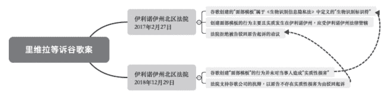

### 【核心争议点】

1. 谷歌扫描并留存的面部特征数据，是否落入BIPA定义的“生物识别标识符”范畴。
2. 伊利诺伊州法院对本案是否拥有管辖权。
3. 谷歌的行为是否对原告造成实质性损害。

### 【裁判论证过程】

#### （一）可识别个人身份的“人脸模板”属于伊利诺伊州《生物识别信息隐私法》意义上的“生物识别标识符”和“生物识别信息”

谷歌认为原告指控实质上是照片使用问题，而BIPA不适用于从照片中提取的信息。原告则主张谷歌从照片中扫描并上传面部信息，该数据属于BIPA规定的“生物识别标识符”与“生物识别信息”。

法院先做文义解释。BIPA禁止私营主体在未获同意下收集、储存个人的“生物识别标识符”与“生物识别信息”，确立了通知—同意规则。此外，储存此类数据的实体必须提供“保留计划”，明确保存期限与删除时间。违法者可被诉。BIPA对“生物识别信息”的界定参照“生物识别标识符”的范围，故需先厘清后者。

依据BIPA，“生物识别标识符”指视网膜或虹膜扫描、指纹、声纹或手部、面部几何形状的扫描，采用穷尽式列举。随后法条又列出不属于该概念的类型，其中第15条a款明确“照片”不属于“生物识别标识符”，成为双方争点。

本案中谷歌生成的“面部模板”显然符合BIPA对“生物识别标识符”的定义。谷歌辩称只有本人亲自完成的面部扫描才算。法院认为该解释缺乏法条支持。

BIPA仅列出涵盖的具体类型，并未限定采集方式，任何方式取得均不改变其属性。法条也未要求面部模板必须由亲自扫描产生，或禁止从照片、视频生成。伊利诺伊州立法正是因科技快速演进而出台，若以识别方式限缩定义，不符立法目的。法院指出：“未来虹膜、视网膜、指纹、声纹以及面部、手部扫描会如何进行，谁也说不准。”过度的限缩会带来隐私风险。“生物识别标识符”指用于识别个体的特定生理成分数据集合，而非媒介或测量手段。

谷歌又援引排他条款称照片不属于标识符。法院回应，原告并未主张照片本身是标识符。争议焦点是谷歌通过扫描照片生成的“面部模板”。若谷歌仅收集、储存照片，而未进行测量与模板生成，则不违反BIPA，正如仅录音而不生成声纹亦然。故排他条款对本案无助益。

谷歌还称BIPA要求“书面授权”，暗示须面对面授予。法院认为无文本或结构表明扫描必须面对面进行。远程同意在互联网场景中十分常见，且书面授权要求同样适用于通过贸易、接收等方式取得生物识别数据的主体，无理由认为亲自授权比远程授权更易实现。

综上，足以识别个人的“人脸模板”属于BIPA意义上的“生物识别标识符”与“生物识别信息”。

#### （二）谷歌创建的人脸模板及侵害隐私的行为“主要且实质”发生于伊利诺伊州，受该州《生物识别信息隐私法》管辖

谷歌第二点主张行为不受BIPA管辖。法院先讨论域外效力问题。通常伊利诺伊州法不具域外效力，立法时亦未赋予域外适用，原告亦未主张，故BIPA无域外适用。若不适用域外，原告指控的行为须在伊利诺伊州发生。

法院需判断谷歌从伊利诺伊州设备自动上传的照片中扫描、创建面部模板的行为是否“主要且实质”发生于州内。

原告指出多重联系：里维拉、韦斯均为伊利诺伊州居民；照片在伊利诺伊州拍摄；上传至的谷歌相册服务器IP属伊利诺伊州；未提供信息披露、未征求同意的行为亦发生于州内。谷歌则称扫描未“主要且实质”在州内发生，摄影师住地、用户注册地等不在伊利诺伊州。

因BIPA不具域外效力，法院审查业务发生环境是否“主要且实质”位于伊利诺伊州。法院支持原告：原告为州居民，照片在州内拍摄，自动上传至州内服务器，未尽通知与同意义务的行为发生在州内。足以证明违法行为发生地在伊利诺伊州，属州法院管辖。

#### （三）谷歌创建与储存面部模板的行为未对原告造成事实上的损害

2018年谷歌申请简易判决，认为创建与储存模板并未造成原告实际损害，不符联邦最高法院确立的诉讼资格，应驳回。

法院援引Spokeo案分析。^([\[2\]](#txt002.html#footnote_content_txt002_2))该案提出：仅程序性违法不足以自动满足宪法第三条“现实损害”要求；损害风险也可能满足要求。法院据此认为谷歌创建并保留原告面部模板，未造成现实损害。

最高法院在Lujan与Laidlaw案中确立公民起诉三要件：（1）遭受“现实损害”；（2）损害源于被告行为；（3）可通过司法救济弥补。其中“现实损害”需更细化：须已发生或迫近，非假设或推测；须具体而非抽象；须针对特定个人而非集合性。

## 案例分析

## 法院对生物识别标识符与生物识别信息的认定

法院认为谷歌论点缺乏文本与结构支撑。BIPA虽明确“生物识别信息”是“基于”标识符的信息，但“生物识别标识符”的定义并未使用“源自人身”“亲自衍生”“基于面对面扫描”等表述，二者结构并不平行。若立法者意图加入此类限定，完全可以做到。

“生物识别标识符”列举的是基于生物学测量的内容，并未涉及测量方式。“生物识别信息”旨在防止企业通过格式转换规避BIPA。因此标识符是生物测量的集合，信息是对测量结果的可用化转换，与谷歌描述的结构无关。

谷歌过度依赖排他条款进行结构推演。照片被排除不等于从照片生成的模板被排除。原告从未主张照片本身是标识符。若仅存储照片而不测量、生成模板，则不违法，如同仅记录声音而不生成声纹。

关于书面授权，法院再次指出，远程同意在数字服务中司空见惯，且BIPA的书面授权要求同样适用于间接取得数据的实体，无理由认为亲自授权更容易完成。

综上，“人脸模板”属于BIPA意义上的“生物识别标识符”和“生物识别信息”。

# 里维拉诉Google：人脸模型是否触碰BIPA红线

法院先围绕Google Photos自动生成人脸模型的操作展开审查。请求方认为公司对该类档案的留存违反了伊利诺伊州生物识别信息隐私法。该州法律要求持有生物特征标识或数据的私营机构，必须公布销毁时限与操作指引，同时对保存、传输与防护作出相应规范。请求方还指控公司未依规履行告知义务，也未取得书面许可，侵犯了私密利益。第七巡回上诉法院此前已表态，单纯持有私隐资料本身还不足以构成可诉的实质侵害。审理中请求方并未否认：模型未被提供给其他照片用户或公司之外的主体；亦无证据显示Google或第三方曾擅自进入相关账户或资料。

为证明存在高度受损风险，请求方补充提交媒体报道与公司官方博客。报道指出，2015年至2018年3月期间，Google+曾因软件漏洞导致约50万用户资料被外部开发者获取，Google+是公司另一项产品。请求方据此推断公司为规避监管与声誉损失而刻意隐瞒漏洞。法官认为，该事件与Photos账户无关，且没有证据把Google+资料外泄与照片账户资料外泄关联起来，因此不足以证明请求方遭受现实侵害。

第三个焦点是，未经知情即建立人脸模型是否本身满足起诉要件。请求人韦斯表示，若事先知情绝不会同意公司创建、采集并保存其容貌资料。但如前所述，请求方承认模型未向外泄露，也没有证据显示存在泄露的真实风险。法官在判断未经同意的人脸扫描能否构成诉讼资格时指出，大多数人的容貌每日都在公共视野中曝光，面孔的公开程度远高于社会安全号码等非生物资料。把脸暴露于外界无需额外入侵即可获取，这与把手指放在扫描仪上的情况并不相同。

BIPA并未把“未经同意创建人脸模型”等同于实际伤害。普通法认可的隐私侵害类型有四种：无正当理由侵入住所、盗用姓名或肖像、不当公开私密、不当宣传他人信息。本案中请求方未能证明将自愿上传至Photos的图像交由Google处理属于隐私侵害。尽管请求方认为容貌资料属私密范畴，但依据第四修正案判例，个人面孔对外部而言并不具备私密性。伊利诺伊州法院此前已驳回多起以照片或视频为由的隐私索赔，因其不符合构成要件。本案所指控的侵害，即Google创建并保存用户人脸模型，与住宅侵入等侵权所保护的法益差距明显。Google只是基于公开信息，即用户的面孔，生成模型。该行为并不构成“高度冒犯性”的入侵。如前所述，模型的创建依据公众可见的信息，即用户本人的脸。侵权的核心在于入侵行为本身，而非对所得物的后续利用。因此Google对照片的处理方式，与侵入住宅相比显得微不足道。记录显示，Google仅用面部图像生成模型以在个人账户内整理照片。请求方并未提供任何证据证明Google在商业上“利用”了其人脸资料或人脸模型。

法院继而分析是否存在肖像挪用侵权。当被告出于商业目的或自身利益利用面部肖像相似性宣传业务或产品时，才构成侵害。正如前述，请求方无证据证明Google实施了与挪用肖像密切相关的行为。Google称，除用于账户内照片分组外，无证据显示照片生成的任何资料被其他方式使用。请求方为反驳，援引文章称Google的人脸识别技术未来可能用于数据挖掘、定向广告等，也提到内部邮件讨论类似用途。但这些仅展示未来潜在用途，并不能证明Google目前正在采用。因此证据不足以证明损害发生的可能性很大。法官指出，请求方唯一可用的策略是主张Google利用面部信息创建、收集、存储生物识别标识以在照片共享市场获得竞争优势，但请求方并未提出该论点，也无证据支持。事实上，Google仅将获取的人脸模型用于照片分组，并未对请求方造成现实损害。

综上，诉求缺乏证据与判例支撑，法官认定其在本案中不具备诉讼资格，从而驳回起诉。

【审理结果】
1. 伊利诺伊州地区法院于2017年驳回了被告要求驳回起诉的动议。
2. 伊利诺伊州地区法院于2018年支持了Google的抗辩，以请求方不存在实际损害为由驳回诉讼。

【相关法条】
《伊利诺伊州生物识别信息隐私法》第10条

“生物识别标识符”指视网膜或虹膜扫描、指纹、声纹或手部或人脸的结构扫描。“生物识别标识符”并不涵盖书写样本、书面签名、照片、用于有效科学测试或筛查的人类生物样本、人口统计数据、纹身特征或身高、体重、头发颜色或眼睛颜色等身体特征。

“生物识别信息”指用于识别个人生物识别标识符的任何信息，不论其如何获取、转换、存储或共享。生物识别信息不包括从生物识别标识符定义中排除的项目或程序中获取的信息。

《伊利诺伊州生物识别信息隐私法》第15条（a）款

拥有生物识别标识符或生物识别信息的私人实体，应在收集或获取此类标识符或信息的最初目的得到满足时，或个人与私人实体最后一次互动后的3年内，以较早发生者为准，制定书面政策规定永久销毁生物识别标识符和生物识别信息的保留时间表和指南，并向公众公开。若没有管辖法院签发的有效逮捕令或传票，拥有生物识别标识符或生物识别信息的私人实体必须遵守其制定的保留时间表和销毁指南。

《伊利诺伊州生物识别信息隐私法》第15条（b）款

任何私人实体不得通过交易收集、抓取、购买、接收或以其他方式获取个人的或消费者的生物识别标识符或生物识别信息，除非其在此之前已：

（1）书面通知该主体或者该主体的合法授权代表，其生物识别标识符或者生物识别信息正在被收集或存储；
（2）以书面形式通知该主体或该主体的合法授权代表，收集、存储和使用生物识别标识符或生物识别信息的具体目的和市场；及
（3）收到生物识别标识符或生物识别信息主体或该主体的合法授权代表作出的书面许可。

【案例评析】
### （一）本案进一步明确了BIPA规定的人脸识别资料范围
核心争议之一是，Google从照片中提取的信息是否落入BIPA调整范围。法官借助文义解释与目的解释，确认该类信息应受BIPA规范，从而在一定程度上划清了个人生物特征资料保护的边界。法官先认定Google经照片扫描生成的人脸模型属于BIPA所指的人脸识别信息，再认定Google的行为并未给请求方带来现实损害。从推理可见，在技术持续演进的背景下，司法裁判须在创新与保护、个人利益与商业利益之间不断寻求平衡。尽管本案最终因未造成实际损害而驳回诉请，但在实践中人脸识别资料应如何保护仍值得深思。例如苹果手机相册据不同面部特征自动分组照片的行为应作何认定？人脸资料与指纹不同，可被远程获取，具有非接触性且不可更改，因而私营主体在收集、存储人脸资料时理应更为审慎。

合理界定生物识别资料的法律类别是个人资料保护的基础。经由生物识别产生的“生物识别信息”可作为识别个体的唯一标识，是信息时代确认身份的新方式。我国2020年实施的《信息安全技术 个人信息安全规范》将个人生物识别信息界定为自然人的身体、生理特征相关信息，如指纹、声纹、掌纹、耳廓、虹膜、面部特征、个人基因等。学理上，个人生物识别信息权益涉及人格自由、人格尊严、隐私、肖像、财产等多重利益，其使用与保护应以利益平衡为标准综合考量。个人生物识别信息主体的人格尊严属价值理性范畴，而控制者的数据利用与管理属工具理性范畴。一方面，法律须保护主体免受资料泄露或非法使用对人格尊严与自由的侵害；另一方面，生物识别信息具备巨大经济价值，可大规模处理与应用。法律需适应技术进步与经济发展，平衡主体隐私与利用期待与控制者数据利用管理的需要。

本案也折射出信息时代公众对自身资料被私营主体获取、收集与使用可能带来的风险的焦虑。尽管法官最终认定Google行为未造成现实损害，诉讼结束后Google仍对技术与相关规则进行修订与整改，以预防潜在风险。可见即便法律存在滞后性，技术仍须在法律框架内前行。

### （二）本案引发了对面部识别技术应用的广泛讨论
近年来面部识别技术迅猛发展，在诸多社会领域得到广泛应用，同时也激起对隐私保护与资料安全的担忧。若政府部门或私营实体可随意获取个人面部信息，个人隐私将面临极大威胁。国内“ZAO”换脸APP的应用与“人脸识别第一案”均引发关注。一旦面部信息泄露或被恶意使用，可能对个人人格与财产造成重大损失。

本案凸显了司法中公民资料保护边界的问题。法律更新滞后于技术发展，司法裁判更需依赖法官主观判断。由于面部信息及其涉及的个人资料动态复杂，用户在不同情境下感受到的侵权程度不一，且举证责任难以完成，单纯以“实际损害程度”衡量各方利益，不仅会导致诉讼成本畸高，也难以解决技术未来应用的难题。

欧盟《通用数据保护条例》将面部图像归入特殊类型个人资料中的“生物识别资料”，适用更高保护要求。我国《个人信息保护法》第27条对公共场所安装图像采集、个人身份识别设备设定目的限缩与权益保障，《网络安全法》第41条对人脸图像获取及后续处理亦作出规定，建议企业确保被采集人充分知悉处理活动并征得同意。本案对理解人脸识别领域法律实践具有重要意义。

# 人脸识别资料保护与监管
从刷脸支付、刷脸通行等商业实践看，人脸信息与人脸识别信息并非同一概念，将肖像转化为可供算法应用的信息需经过图像采集与数字化处理。因此，对人脸识别资料的保护不应过于僵化。其一，行政监管不应成为技术发展的枷锁；其二，监管机构亦应采取措施防范信息滥用风险。法律对技术最合理的回应是参与技术重构过程。如今人脸识别技术已成为大量商业活动的主流架构，监管应顺应市场规律，明确技术规范要求，法律在规制人脸识别时应保持适当谦抑，寻求个人利益与公共利益的平衡。

关联判例推荐
### 1. Patel v. Facebook, Inc., 932 F.3d 1264 (9th Cir. 2019)
核心事实：2010年脸书推出面部识别工具后，若干伊利诺伊州用户起诉脸书称其在收集存储人脸信息时未明确告知相关事项与保存期限，也未取得书面同意，违反伊利诺伊州《生物识别信息隐私法》。脸书以用户无诉讼资格为由请求驳回，主张被告技术未对用户造成具体伤害。
与本案关联点：法院认为，《生物识别信息隐私法》保护的是具体隐私利益，程序违法本身即损害该利益或造成实质性损害风险。

### 2. Spokeo, Inc. v. Robins, 136 S. Ct. 1540, 194 L. Ed. 2d 635 (2016)
核心事实：被告Spokeo擅自抓取用户个人资料并在网站发布错误信息，地方法院以用户缺乏主体资格驳回。最高法院将诉讼资格界定为：（1）遭受事实损害；（2）损害可归因于被告行为；（3）可通过司法裁判弥补。
与本案关联点：该判决是里维拉诉Google案法院支持Google的重要依据。法院认为“人员搜索引擎”网站呈现的错误信息影响用户求职，属于《公平信用报告法》下可识别的损害。

### 3. Rosenbach v. Six Flags Entertainment Corp., 2019 IL 123186, 129 N.E.3d 1197
核心事实：Six Flags游乐园默认将采集游客指纹作为购买季票的一部分，用户认为未被明确告知收集目的与保留期限，也未同意。用户主张其行为违反《生物识别信息隐私法》，寻求金钱赔偿与禁令救济。
与本案关联点：伊利诺伊州最高法院认为，公民依据《生物识别信息隐私法》有资格成为“受损害的人”，即可在信息被不当存储或使用或未经授权披露时起诉，不论是否造成实质性损害。

### 2.2 布里奇斯诉南威尔士警署案
案件索引
R (Bridges) v. CCSWP and SSHD [2019] EWHC 2341 (Admin)
R (Bridges) v. CCSWP and SSHD [2020] EWCA Civ 1058

关键词
人脸识别；生物识别信息保护；个人信息保护；算法问责

案件提要
本案被视为首例公民质疑执法机关使用新技术合法性的案例。被告南威尔士警署自2017年起在其辖区公共场合部署自动人脸识别技术，会拍摄进入监控范围的人脸图像并与现有面部图像数据库对比，判断是否存在警方观察名单上的人。原告爱德华·布里奇斯两次在公共场合被AFR抓取人脸图像，且未见到任何使用标识。布里奇斯认为该行为干预其依据《欧洲人权公约》第8条享有的权利，且缺乏正当性、违反数据保护原则、未履行公共部门平等义务，向法院提起诉讼。判断行为是否合法的关键在于依据的法律框架是否充分。上诉法院认为SWP行为缺乏充分法律框架，从而侵犯布里奇斯依据公约第8条第1款享有的权利，且无合法性基础。由于AFR法律框架不足，SWP依据英国2018年《数据保护法》第64条作出的数据保护影响评估以AFR未触犯公约第8条为前提，故评估不当，不符合数据保护原则。此外，公共部门平等义务属程序义务，尽管尚无法确认AFR是否存在歧视，但SWP从未主动确保AFR不存在歧视，故未尽义务。综上，SWP使用AFR不具备合法性。

人脸识别正在以前所未有的速度渗入交通、安防、商业等各种场景。面部信息可以精准锁定到自然人，属于典型的敏感个人数据。一旦公共权力借助这类技术进行监控，就很容易触碰到个人人权底线。对新技术的使用权限和监管边界做出清晰界定，是推进技术应用时必须完成的配套工作。英国布里奇斯诉南威尔士警署案展现了面对新兴技术时一种审慎渐进的治理思路，高度强调对人权的尊重，也为人脸识别的法制化与监管要点提供了很有分量的指引，让个人权利保护与重大公共利益之间的经典权衡获得了新的解释空间。在中国，《个人信息保护法》第26条要求公共场所安装图像采集和个人身份识别设备必须以维护公共安全为必要、遵守国家规定并显著提示，收集的图像和身份识别信息只能用于维护公共安全，不得他用，除非取得个人单独同意；第28条第2款则要求处理敏感个人信息需有特定目的和充分必要性并采取严格保护措施。立法导向显示个人信息保护力度在持续加大，英国本案对国内也具有相当的参照意义。

### 案情要点
英国高等法院一审：原告爱德华·布里奇斯，被告南威尔士警署。
英国上诉法院：上诉人爱德华·布里奇斯，被上诉方南威尔士警署。

南威尔士警署自2017年起在辖区公共场所试用自动人脸识别技术Automatic Facial Recognition Technology。AFR 的工作流程大致分为六步：
1. 准备对照库。运行的前提是有一张面部图像库，本案为“观察名单”。警署会根据每次使用目的把七类人群纳入名单：通缉令在册人员、非法在逃人员、犯罪嫌疑人、需要保护对象如失踪人员、在特定活动现场可能带来隐患的人员、警署出于情报需要关注的人员、弱势群体。
2. 采集面部图像。利用监控摄像头实时抓拍进入拍摄范围的人。
3. 人脸检测。把图像中的人脸区域分离出来。
4. 特征提取。提取出可唯一识别个人的生物特征。
5. 比对。将提取的特征与观察名单图像逐一比对。
6. 匹配。生成“相似度分数”，分数越高匹配度越高。警官据此判断是否通知干预警官采取行动，并以红、黄、绿灯提示紧迫程度。与名单不匹配的图像会即时删除，其他警察也无法查看。

布里奇斯本人两次被公共部署的AFR抓取。第一次是2017年12月21日，卡迪夫市中心皇后街，警署车辆部署AFR，他距车辆仅6至10英寸，却未在进入范围前看到任何使用提示。第二次是2018年3月27日，卡迪夫Motorpoint Arena举办国防展，入口处AFR从上午8点半到下午4点运行，他距设备25至30米，也未见到警署使用标识。

布里奇斯因此起诉，主张：
1. 警署使用AFR干预了《欧洲人权公约》第8条第1款保障的私人和家庭生活受尊重权，且该干预不符合第8条第2款“依照法律规定”和“必要性”的要求。
2. 违反2018年《数据保护法》的数据保护原则，未遵守第35节原则，也未按第64条第1款开展数据保护影响评估。
3. 未履行2010年《平等法》第149条第1款规定的公共部门平等义务，即在行使职能时需考虑消除歧视、促进机会平等和良好关系。

一审法院驳回全部诉讼请求。认为第8条权利虽被干预，但警署使用AFR有普通法一般授权，受现行法律框架规制；通过Bank Mellat案四步检验，目的正当、手段适当且合比例。认为生物特征数据属个人数据，用于预防侦查犯罪具有必要性，符合2018年《数据保护法》第35条第5款前两项要求；关于适当政策文件，第42条文件具发展性当下无需裁定，并希望信息专员提供指导；数据保护影响评估符合第64条要求。平等义务方面，因缺乏证据证明软件在2017年4月试验前已被提示存在歧视，且无法获取训练数据集，难以认定间接歧视。

布里奇斯上诉提出五点：
1. 一审错误认定干预符合“依照法律规定”。
2. 未考虑AFR对全体被捕捉公众的累积性干预，比例性判断失当。
3. 数据保护影响评估不符合第64条，前提假设AFR不违反公约第8条，且涉及非名单人员的生物数据。
4. 对是否具备第42条要求的适当政策文件不应作结论。
5. 未履行平等义务，平等影响评估不足，未认识到间接歧视，后续评估方法有缺陷。

2020年8月11日上诉法院作出判决，支持第一、三、五项上诉请求，驳回第二、四项。

### 诉讼脉络图
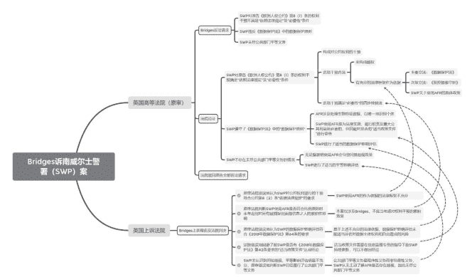

图 1 两审诉讼主张与论证

### 争议焦点
1. 警署对原告第8条第1款权利的干预是否满足第2款“依照法律规定”和“必要性”要求。
2. 使用AFR是否违反2018年《数据保护法》的数据保护原则。
3. 警署是否履行公共部门平等义务。

### 审理思路
#### （一）人脸识别缺乏可供依赖的成熟法律框架
一审围绕“是否依照法律规定”展开，梳理了三大层级规制：2018年《数据保护法》等主要立法、次级立法如《监控摄像守则》、警署自身政策。但一审回避了试运行期间内部政策可能变动的问题，认为仍具确定性和可预见性。上诉法院认为权利干预要么合法要么不合法，不能回避。

上诉法院指出本案具备四项特征：技术新颖；大规模获取与处理普通公民图像信息；各方均承认属敏感个人数据；数据经自动化处理。现行框架存在两大根本缺口：一是观察名单纳入标准不明，二是部署地点选择标准不明。

主要立法层面，2018年《数据保护法》虽是重要依据，但只要求执法目的适当，并不足以提供完整保障。《监控摄像守则》虽涉及监控摄像头，但摄像头专员2019年3月发布的《警方在监控摄像头系统中使用自动人脸识别技术指南》未对当地警署政策作出指引，既未规定谁可列入观察名单，也未说明应包含哪些内容及可在何处部署。警署自身隐私影响评估文件列出的名单人群包括涉嫌犯罪被通缉、通缉令在逃、弱势群体、需情报关注人员等，其中“需情报关注”范围极宽，实质赋予警方过大裁量权。数据保护影响评估仅记录了试验场合，缺乏部署地点的规范性要求，如应有合理理由相信名单人员会出现在该地。

#### （二）权利干预的比例性分析
比例性检验援引Bank Mellat案四步：目标是否足够重要、措施与目标是否有关联、在不损害目标前提下是否存在侵害更小的替代手段、整体是否在个人权利与集体利益间实现公平平衡。上诉人主张需考虑两次部署场合所有公众的累积影响。上诉法院认为本案干预是特定场合的针对性部署，平衡判断属于规范性评价，不能简单累加影响，人多并不自动使对原告的干预更严重，故不予支持该理由。

#### （三）数据保护影响评估欠妥
警署的评估虽承认AFR使用生物信息可能构成隐私侵犯，但其论证前提是只要满足必要性、合比例、合法目的且依照法律规定部署即可避免违法。上诉法院认为正因法律框架存在前述两项过度裁量权，AFR对第8条权利的干预缺乏“依照法律规定”的合法基础，评估未真实衡量数据主体权利与自由面临的风险，也未按2018年《数据保护法》第64条第3款b、c项提出应对措施，评估不适当。

#### （四）政策文件适当性暂不作终局判断
2018年《数据保护法》第35条第5款c项及第42条要求处理敏感数据时持有适当政策文件。一审认为暂无需判断，以免干扰文件发展。上诉法院同意该处理。信息专员意见显示2018年11月更新的文件虽不算理想详细，但已解释数据控制者在敏感处理中如何遵守数据保护原则及数据的保留删除问题，文件将按指导进一步修订，法院无须在此作出最终结论。

#### （五）未能尽到消除歧视的程序义务
《平等法》第149条第1款要求公共机构在履职时适当考虑消除歧视并促进机会平等。上诉法院强调该义务是程序性而非结果性，关键在于使用AFR过程中是否采取了防范歧视措施。专家Anil Jain证词指出AFR准确性受训练数据集影响，数据集人口构成不平衡可能带来偏见，是系统性风险来源。但本案具体数据集无法获取，专家未确认本案系统是否偏见。上诉法院据此认定警署的平等影响评估明显不足，未充分识别间接歧视风险，未履行消除歧视义务。

AFR 上诉案：未核验算法来源即被认定失职

本案中，被诉机关对“`training datasets`”这种概念的认识几乎为零。二审法院特别指出，之所以能拿到证人`Paul Roberts`的证词，完全是`Anil Jain`教授意见的连带效应。判决的意思是，假如没有Jain教授的说法，被告根本不会主动去追问技术后台的细节。`Paul Roberts`任职于`NEC`公司，负责该公司的面部识别产品和解决方案，`NEC`研发的 `NeoFace Watch` 正是`AFR`实际调用的软件，也经过被告批准。Roberts称，该算法在训练时已尽可能纳入多元族群样本，以求样本全面与具代表性，但出于商业机密，具体训练素材不予披露。

据此，二审法院认为，即便现有证据尚未能证明该系统存在歧视，被告从未就所用系统在种族、性别等维度是否存在不可接受偏见进行实质性核查。法院强调，`AFR`处于试验阶段不能成为豁免公共部门平等义务的理由。最终认定，被告未尽合理注意以消除公共决策中的歧视风险，未履行公共部门平等义务。

## 【审理结果】

二审法院作出如下宣告：

1.被上诉人于 2017 年 12 月 21 日及 2018 年 3 月 27 日持续使用`AFR`，该情形落入《欧洲人权公约》第 8 条第 1 款保护范围，且不符合第 8 条第 2 款的例外条件。

2.被上诉人就所使用的`AFR`所作的数据保护影响评估，未满足 2018 年《数据保护法》第 64 节第 3 条第（b）款、第（c）款的要求。

3.被上诉人在两次使用`AFR`之前及使用期间，均未遵守 2010 年《平等法》第 149 条规定的公共部门平等义务。

## 【相关法条】

### 《欧洲人权公约》第 8 条

1.任何人均享有私人和家庭生活、住宅及通信受尊重的权利。
2.公共权力机关不得干预该权利行使，但干预须基于法律授权，且在民主社会中为国家安全、公共安全、经济福祉、防止混乱或犯罪、保护健康或道德、保障他人权利与自由所必需者，不在此限。

### 英国《2018 年数据保护法》

1.第 3 节第 2 款 个人资料定义
与可识别自然人有关的任何资讯，可直指或间接指向该人，例如：
（a）姓名、识别号码、位置资讯或线上标识等标识符，或
（b）个人身体、生理、遗传、心理、经济、文化或社会身份所特有的一个或多个要素。

2.第 205 节第 1 款 生物特征资料定义
与个人身体、生理或行为特征相关，经特定技术处理后产生的资料，可单独或确保单独识别该人，如面部影像或指纹。

3.第 3 部分 为执法目的进行的数据处理
第 29 节
（1）本部分适用于：
（a）主管机关以自动化方式全部或部分处理个人资料；及
（b）主管机关以非自动化方式处理个人资料，但该资料构成或拟构成档案系统的一部分。
（2）本部分所指的处理均属适用范围。

4.第 34 节 数据控制者的一般职责
（1）本章第 35 至 40 节订立六项数据保护原则：
其一 处理须合法且公平；
其二 处理目的须明确具体且合法；
其三 资料须必要、相关且不过度；
其四 资料须准确并保持更新；
其五 保存期限不得超过必要时间；
其六 处理须以安全方式进行。
（2）另有
（a）第 35、36、38、39 条为原则的补充规定；
（b）第 41、42 条为特定处理设置安全保障。
（3）控制者须负责并能证明符合本节规定。

5.第 35 节 第一条保护原则
（1）为执法目的处理个人资料须合法公平。
（2）合法性以法律为基础，且满足以下其一：
（a）资料主体已同意；或
（b）处理对主管机关执行任务属必要。
（3）涉及敏感处理的执法目的处理，仅在第（4）或第（5）情形下允许。
（4）首种情形为：资料主体已同意且控制者持有适当政策文件。
（5）第二种情形为：处理对执法目的严格必要，且至少符合附件 8 条件之一，并持有适当政策文件。

附 1 附件 8 条件示例包括为法律赋予职能所必需并具重大公共利益，或为正义行政所必需等。另有法律主张等条件。

附 2 第 42 节 敏感处理的保障
若控制者制定并遵守解释敏感处理程序及保存删除政策的文件，可视为持有适当政策文件。

敏感处理指揭示种族或族裔出身、政治见解、宗教或哲学信仰或工会成员身份的资料；处理基因或生物特征资料以唯一识别个人；处理健康资料；处理性生活或性取向资料。

《数据保护执法指令》第 10 条亦规定，仅在严格必要时方得处理上述敏感类别资料。

7.第 64 节 数据影响评估
（1）若某类处理对个人权利自由构成较高风险，控制者须于处理前完成数据保护影响评估。
（2）评估系对拟议处理对数据保护影响的检视。
（3）评估须包括处理概要、风险评估、对应措施、保障与安全机制等，以证明合规并顾及相关人员权益。
（4）判断高风险时须考量处理性质、范围、背景与目的。

### 英国《2010 年平等法》第 149 条第 1 款

公共部门行使职能时须适当考虑：
（a）消除歧视、骚扰、伤害及本法禁止的其他行为；
（b）促进具受保护特征者与不具该特征者之间的机会均等；
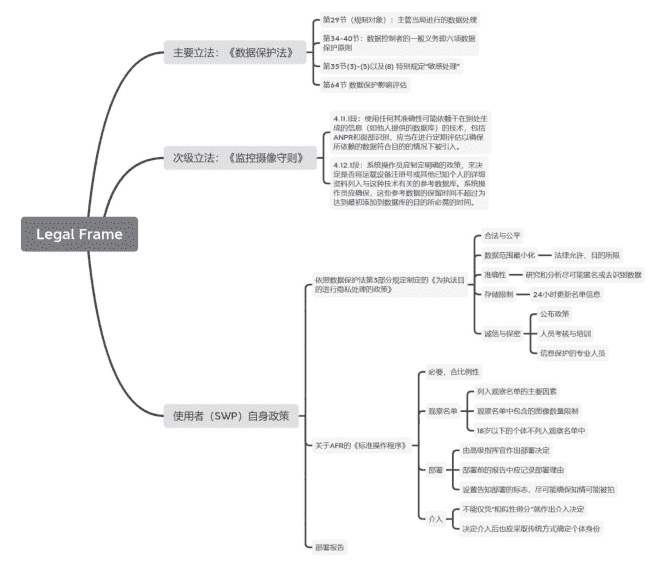

图 2 法院附录的主要法律框架及有关规范

（c）促进具受保护特征者与不具该特征者在关系方面的和谐。

## 【案例评析】

### （一）本案对英国人脸识别规制的启示

人脸识别属于生物识别技术，正快速渗透公共管理、出行、考勤、安防和线上支付。流行原因在于身份核验无需借助手机等中介，操作便捷提升效率，甚至可能重塑服务模式。然而将人体特征数字化后带来的风险亦随之放大。判决指出，生物识别资料可唯一锁定个体，与身份关联紧密；人脸采集具非接触性、无需强制且易于隐蔽。便利性与隐私侵入性并存，使滥用风险与后果显著抬升。

面对新技术，英国采取渐进治理。一方面人脸识别有助于警方提升执法效能；另一方面立法滞后导致法框架难以完全覆盖。法院在认可技术价值的同时，对使用提出严苛要求，包括完备监管与严格审查。二审推翻原判，认定南威尔士警署使用人脸识别不合法，体现了对人权的尊重。在技术尚不成熟阶段，本案为司法、行政与立法提供了重要指引。

判决后，警署表示将纳入业务指引，并于 2019 年委托学术机构分析`AFR`算法歧视问题，以符合伦理与法要求。英国政府随即公布监视摄像监理专员`Tony Porter`的声明，认为判决并非阻碍新技术，而是划清更清晰的法律边界。他拟修订 2018 年业务指引，要求警方更深入认识`AFR`固有歧视风险，并计划与厂商合作消除技术偏见。该案对英国公共部门使用同类技术产生深远影响。

### （二）人脸识别应用场景的规范体系

原审在审查时进行了详尽的法律层次分析，以判断技术是否具备合法基础与规范监管。英国的规范呈现由宏观到微观的完整结构。法院特别指出，新技术不必然需要量身定制的规则，更倾向于在既有规范中寻找依据，这种审慎有助于维护法制统一。如图 2 所示，在《欧洲人权公约》保护基本权利的整体要求下，主要立法、次级立法及具体操作规范须共同确保公民权利不受非法侵害。规范来源涵盖立法机关法律、行政机关规章，以及使用技术的公共机构自我约束规范。

我国对人脸信息的保护主要依托个人信息保护路径。2017 年《网络安全法》将个人生物识别信息纳入个人信息范畴；2021 年生效的《个人信息保护法》将生物识别信息列为敏感个人信息，处理须取得单独同意，且须具备特定目的、充分必要并采取严格保护措施。除法律外，《网络数据安全管理条例（征求意见稿）》等行政法规也在推进。《信息安全技术 个人信息安全规范》等标准亦对收集、存储、共享提出合规要求。生物识别信息涉及隐私、人格、财产与生物安全等多重法益，保护体系须发挥部门法协同作用。

### （三）人脸识别监管要点

各国在强化生物识别监管的同时，逐步意识到人脸识别的广泛应用既削弱公众对隐私保护的合理期待，也可能在人与社会之间制造隔阂，动摇信任。

本案虽聚焦核心规范，但可看出警方使用人脸识别涉及复杂的监管网络，涵盖多部门、专员办公室、顾问机构及法案、指令、指引，涉及警方职责、监控、信息监管、人权、自由与平等保护等。治理要点可归纳为：第一，使用是否具备明确法律依据；第二，使用前是否完成个人数据保护等影响评估；第三，采集数据是否限于合法目的所需最小范围；第四，保存期限及存储处理安全性，尤其人脸信息不可更改，泄露后果长期且难以逆转；第五，刑事侦查中使用时，重点名单设计是否遵循最小合理范围，比对后是否彻底删除；第六，比对算法所依赖的数据库是否存在不公平倾向。上述要点多与个人信息保护共通，但针对人脸不可更改性需特别强化。监管须以具体应用场景为前提设计。

### （四）个人权利与公共利益的平衡

本案实质在于个人权利保护与侦查防罪之间的衡量。当地公民组织评论实时人脸识别让人“成为行走的身份证”，学界亦强调滥用带来的尊严贬损风险。法官在论证中已提及此问题。判决体现，执法机构利用现代技术实现公共目标时，必须合理考量对公民权利、自由与尊严的侵害，而“合理考量”通过审查公共部门行为的法律依据来判断。导致二审推翻原判的关键，在于相关规范赋予执法者过宽自由裁量权，可随意决定使用场合与观察对象。新技术语境下，利益衡量须置于“风险社会”与“人造风险”框架中，权衡各方在人脸识别应用中的风险与收益，合理分配权利义务。

## 【关联判例推荐】

### 1. R(Catt) v. Commissioner of Police of the Metropolis [2015] UKSC 9; [2015]AC 1065

核心事实：原告 Catt 于 2005 年参加一次发生严重混乱与犯罪的游行，两次被捕但未被定罪。警方收集其参与游行的信息并存入“极端主义数据库”，包括一张后被销毁的照片，以及他人报告中提及的内容。Catt 起诉警方系统性收集和存储个人电子信息。欧洲人权法院认为，警方干预对尊重私生活的比例性不足，实质违反公约第 8 条。

关联点：本案以“Catt 案”为重要参照。两者信息均为非侵入方式获取、来源公开。“Catt 案”认为法律框架只需“合理可预测”，不必涵盖所有可能问题。

### 2. S v. United Kingdom (2009) 48 EHRR 50

核心事实：本案涉及警方为侦查犯罪而采集嫌疑人的指纹和 DNA 信息。在上诉中，法院主要解决在何种情况下，警方可以不经数据主体同意，将为刑事执法目的采集的 DNA 信息用于除刑事执法以外的目的。

关联思考：面部特征与基因、指纹一样，都能把个人精准锁定。一旦被短暂采集，就已经触及《欧洲人权公约》第8条所保护的私生活范围，因而必须获得更强的法律防护。

## 2.3 哈兹利特诉苹果：BIPA 人脸识别诉讼

#### 【案件索引】
Hazlitt v. Apple, Inc., 500 F. Supp.3d 738 (S.D. Ill. Nov. 12, 2020)

Hazlitt v. Apple, Inc., No. 3:20-CV-421-NJR, 2021 WL 2414669 (S.D. Ill. June 14,2021)

Hazlitt v. Apple Inc., 2021 WL 2457987 (S.D. Ill. June 16, 2021)

#### 【关键词】
人脸识别技术；生物识别信息；个人隐私权保护；文书提出命令

#### 【案件提要】
本案聚焦生物识别技术在商业场景下的隐私边界。随着网络经济与互联网应用的扩张，人脸识别、指纹识别等技术被大量运用于安防、支付、考勤等环节，为生活带来便利的同时，也让生物特征数据外泄的风险急剧上升。

本案原告为伊利诺伊州的苹果设备用户，提起集体诉讼，指控苹果通过预装相机应用对用户照片进行人脸识别并留下相关数据，涉嫌违反伊利诺伊州《生物识别信息隐私法》即 BIPA 并索赔。原告的攻击点沿三条递进线展开：是否公布信息处理规则、是否取得用户同意、是否利用信息牟利，均指向 BIPA 第15条的合规要求。

BIPA 在生物特征保护领域被视为标杆性立法，常被称作美国最严的隐私法。其第15条 b 款在近年诉讼中屡屡成为企业败因，Facebook、Google、Snapchat 等互联网巨头，以及 Roundy’s 零售商、InterContinental Hotels 旗下 Kimpton 酒店集团均曾因该条款被诉。

与此同时，全球数据立法进入密集期。2018 年英国《数据保护法案》修订版生效，同年欧盟《通用数据保护条例》GDPR 实施，被视为欧洲隐私领域的最高标准；2020 年加州通过《加州隐私权法》CPRA，扩展了 2018 年 CCPA；同年欧盟相继推出《数据治理法》DGA、《数字市场法》DMA 草案；2022 年《数字服务法》DSA 与《数据法》DA 草案出台，对平台算法与数据共享作出框架性规制。在此立法潮流下，BIPA 所确立的规则与司法思路具有可借鉴价值。

#### 【案件要旨】
伊利诺伊州圣克莱尔县第二十巡回法院：原告 罗斯林·哈兹利特 等，被告 苹果信息科技公司
伊利诺伊州南区法院：原告 罗斯林·哈兹利特 等，被告 苹果信息科技公司

2020年3月，多名伊利诺伊州居民在圣克莱尔县第二十巡回法院对苹果提起集体诉讼，代表全州苹果设备用户主张权利。诉求指向 BIPA 第15条 a、b、c 三款，指控苹果未经许可收集并持有用户面部识别信息并从中获益。诉状指出，苹果设备预装照片应用可自动识别本地照片中的人脸，并将由此生成的面部数据保存在设备内部，用户无权修改或关闭该功能；这一过程在应用层面制造了 BIPA 所定义的“生物识别信息”与“生物标识符”，使原告及全州用户面临迫在眉睫的泄漏风险。

苹果在州法院阶段提出四点抗辩：脸部几何数据源于设备本地照片，与可识别个体无必然关联；第二项诉求不满足 BIPA 第15条 a 款的起诉条件；未出售生物识别信息牟利；未被指控存在故意或过失等事实。

2020年5月6日，苹果依据《集体诉讼公平法》CAFA 申请将案件移至伊利诺伊州南区联邦法院，并于次月提交驳回动议。苹果强调人脸识别仅在本地设备运行，其并未真正收集或占有用户的生物识别数据。

负责审理的罗森斯坦格尔法官驳回了驳回动议。法院认可原告主张，即相机应用生成的数据仅苹果可访问。但法院亦接受苹果另一论点：原告未能就 BIPA 第15条 a、c 款证明具体的个人损害，也未证明苹果因生物数据获利。最终，法院决定维持集体诉讼的存续，认定原告依据 BIPA 第15条 b 款提出的索赔合理成立，但将 a 款与 c 款的诉求发回州法院处理。

苹果于2020年11月16日向上诉法院申请重审，上诉法院撤销原裁定并指令重审。罗森斯坦格尔法官于2021年6月14日作出重审判决：苹果对生物识别信息的长期留存造成了潜在的无限期隐私侵害，构成原告的个人特殊损害，因此原告有权依 BIPA 第15条 a 款起诉；至于 c 款的一般违法指控，因缺少联邦管辖所要求的个人特殊损害，仍应发回州法院。

2021年6月16日，法院对原告要求苹果提供内部文件以锁定伊利诺伊州内购买涉案应用的用户范围及终端用户协议签署情况的取证申请作出驳回。^[33]

#### 【案例事实思维导图】
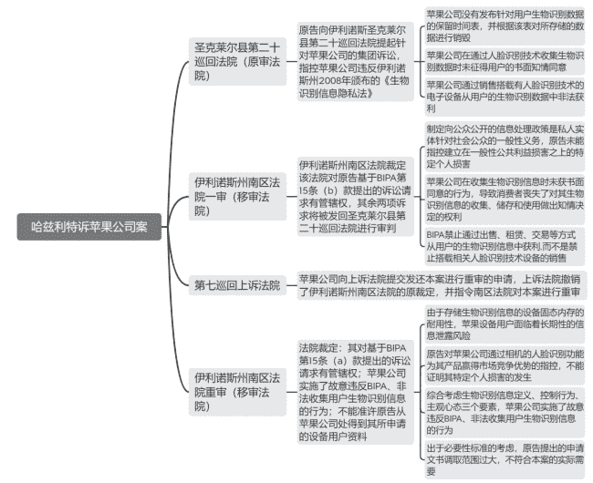

#### 【核心争议点】
1. 在《集体诉讼公平法》框架下，本案是否满足联邦法院对集体诉讼的管辖要件。
2. 原告就 BIPA 第15条 a、b、c 三项主张是否具备起诉资格。
3. 苹果是否故意违反 BIPA 非法收集用户生物识别信息。
4. 为确定集体诉讼范围，原告能否要求苹果披露设备用户的相关个人信息。

#### 【裁判论证过程】
##### （一）在《集体诉讼公平法》下，本案符合赋予联邦法院集体诉讼管辖权的相关条件
CAFA 要求同时满足：原告与被告公民身份存在最小多样性；原告人数超过100人；争议金额合计超过500万美元。

南区法院认定：原告均为伊利诺伊州居民，被告为加州公司，满足多样性；原告主张涉及“数千人”，远超100人门槛；按 BIPA 规定，故意违规每次最高5,000美元，过失每次1,000美元，原告指控至少三次违规且受害者数千人，即使按1,000人计算，金额即可突破500万美元门槛。

##### （二）本案原告对依据 BIPA 第15条 a、b 款提出的两项索赔请求具有起诉资格，对依据第15条 c 款提出的索赔请求不具备起诉资格
联邦法院需满足宪法第3条原告资格：实际或即将来临的具体特殊损害、损害与行为的因果关系、通过判决可救济。若仅为程序性违法即不构成事实损害。

首先针对 BIPA 第15条 a 款。初审中法院援引第七巡回“布莱恩特诉美国康帕斯集团案”观点，认为书面政策义务是对公众的一般义务，违反并不自动产生个人特殊损害。原告虽指控苹果未销毁数据导致黑客风险，但未主张已停止使用相关应用，且最后互动未满三年，故最初认定无起诉资格。

重审后，第七巡回在“福克斯诉达科他集团案”中重新解释 a 款，认为若指控被告未制定、公布并遵守信息处理政策导致数据被非法留存，即足以构成隐私伤害。法院据此认为，因固态存储的耐久性，生物识别信息可能长期存在，使废弃或在用设备持续构成隐私威胁。最终认定原告有权以 a 款起诉。

其次针对 BIPA 第15条 b 款“书面同意要求”。法院认为该义务是企业对个人的具体义务，原告主张的权利丧失属于特定损害。苹果在通过相机应用从照片中提取脸部几何信息时从未取得知情同意，导致消费者丧失对收集、存储与使用其生物特征的决策权，故起诉资格成立。

最后针对 BIPA 第15条 c 款“禁止获利要求”。法院认为该条款属一般公众义务，原告需证明个人特殊损害。原告并未指控苹果直接出售其个人数据牟利，而是称苹果通过人脸功能提升系统竞争力进而增加产品销量。BIPA 第15条 c 款禁止的是出售、租赁、交易个体生物识别信息牟利，而非销售搭载该技术的设备。故原告无法证明个体特殊影响，c 款诉求不具起诉资格。

##### （三）苹果公司实施了故意违反 BIPA、非法收集用户生物识别信息的行为
苹果从定义、控制行为、主观过错三方面抗辩。

第一，关于生物识别信息定义。苹果称立法将“信息”与“生物识别”捆绑意在排除无法识别真实个体的匿名数据；设备生成的脸部模板是匿名的，用户可自行标记姓名且苹果不接收；并援引“蒙罗伊诉肖特福莱案”主张照片提取数据不构成生物识别信息。

法院回应：个人信息核心在于可识别性，即可单独或结合其他信息识别自然人。业界与判例已确认面部几何数据属于生物识别信息。蒙罗伊案属个案，且 BIPA 是正面清单，不以是否实际用于识别为限。即便按苹果解读，相机应用仍通过算法识别特定用户，其“未发生实际识别”的说法不能成立。

第二，关于收集、持有的控制行为。原告称苹果通过应用创建并收集人脸数据，存入仅苹果可访问的数据库，对本地数据拥有完全控制，用户无法阻止收集、存储或删除。

苹果反驳称收集指控属推测，原告未指控其在设备售出后仍可访问照片；识别与存储均在用户控制的本地设备完成，属于用户自主行为，苹果不应承担代理责任。

BIPA 人脸识别诉讼关键争议速览

为锁定争议焦点，审判机关首先对“占有”Possession 的法律含义作出界定。BIPA 条文并未对该词作出解释，合议庭据此援引既往判例的通说：在日常语境里，占有即指对特定客体享有所有权或控制权，或事实上掌握并可自行支配。^([\[42\]](#txt002.html#footnote_content_txt002_42))在该理解框架下，BIPA 并不要求被告对涉案数据行使排他性支配，也无须数据必须由苹果自行存储，苹果现有的访问权限本身已足以落入 BIPA 所指的“占有”。

### 第三，主观要件的认定

合议庭指出，法案实施十一年后苹果仍持续采集该州居民的面部几何信息，该行为已构成对 BIPA 的违反。诉方的指控足以让人推导出有关操作带有过失或鲁莽的成分，但仍不足以形成苹果具有故意的主观状态的合理推定。需要说明的是，BIPA 中的主观要件仅作用于单次违法的赔偿档次。即便诉方拿不出苹果故意的证据，依据本案事实表现，其主观状态已满足 BIPA 对违法要件的要求。

## （四）驳回调取苹果设备用户清单的申请

诉方向南区法院提出申请，要求调取自 2016 年 6 月 13 日至起诉当日的用户群体信息。^([\[43\]](#txt002.html#footnote_content_txt002_43))申请理由主要有：其一，援引《联邦民事诉讼规则》第 23 条 b 款第 3 项^([\[44\]](#txt002.html#footnote_content_txt002_44))，主张集体诉讼应优先；其二，为确定集体成员范围，需文件以便通知潜在当事人；其三，依据《联邦民事诉讼规则》第 26 条 b 款，披露范围符合比例原则；其四，参照与《电信用户保护法》相关的第七巡回法院判例，主张曾要求提供用户清单以界定集体。

苹果则反驳称请求表述模糊、范围过度、执行成本过高，且与案件需求脱节。主要理由包括：大规模披露可能涉及数百万与本案无关用户的身份核验，不符合比例性；未经事先同意公开姓名住址等隐私信息会侵害消费者权益；适格集体成员应为面部影像保存在苹果设备照片中的 Illinois 居民，而非诉方所说的购买过苹果设备或同意终端用户协议的州居民；苹果须提供五年内数百万用户个人信息并甄别居住地，负担过重；苹果还援引最高法院“Oppenheimer Fund， Inc. v. Sanders”案^([\[45\]](#txt002.html#footnote_content_txt002_45))，该案认为潜在集体成员的姓名住址不属于《联邦民事诉讼规则》第 26 条 b 款第一项允许披露的范围。

法院判断为：个人对姓名住址等信息的披露拥有私益，未经事先告知与退出机制即对数百万消费者进行大规模披露并不适当；诉方可以采用更聚焦的方式甄别潜在成员，例如仅调查 Illinois 内更贴合需求的子集，而非全体购买过苹果产品的州居民；诉方未能阐明调查成员范围与集体诉讼优先适用之间的关联，第 23 条 b 款第 3 项确立的原则并不强制苹果提供所要求资料；诉方未说明数据用途，也未就数据安全存储作出合理保证，在近期美国企业频遭黑客攻击的背景下，这会引发用户普遍担忧。

## 【审理结果】

1. 南区法院一审认定，依据 Illinois《生物识别信息隐私法》第 10、15、20 条及宪法第 3 条，法院对诉方指控苹果在未获知情同意情况下收集数据的诉求具有管辖权；另两项基于公开书面政策与非法获利的指控因缺乏管辖权被发回圣克莱尔县第二十巡回法院。
2. 第七巡回上诉法院撤销一审裁定，并指令南区法院重审。
3. 重审后，南区法院裁定：（1）用户面临长期信息泄露风险，对 BIPA 第 15 条 a 款的诉求具备管辖权；（2）诉方指控苹果“利用人脸识别功能赢得竞争优势”未证明个人特殊损害，基于第 15 条 c 款的诉求仍被发回圣克莱尔县第二十巡回法院；（3）结合生物识别信息定义、控制行为与主观心态三要素，认定苹果故意违反 BIPA、非法采集用户生物识别信息；（4）基于命令必要性标准，诉方调取文书范围过大，不予准许调取苹果用户资料。

## 【相关法条】

《伊利诺伊州生物识别信息隐私法》第 10 条（Illinois Biometric Information Privacy Act §10（2008））

“生物标识”的定义包括“视网膜或虹膜扫描，指纹，声纹，或者手部或面部几何扫描.”

《伊利诺伊州生物识别信息隐私法》第 15 条（a）款（Illinois Biometric Information Privacy Act §15（a）（2008））

所有拥有生物标识符或生物识别信息的私人实体应当制定向公众公开的书面政策，制定生物识别信息的保留时间表和销毁方针（销毁进行于收集或获取这些生物识别信息的初始目的已被满足时，或者是个体与私人实体进行最后一次信息交换的三年内）.

《伊利诺伊州生物识别信息隐私法》第 15 条（b）款（Illinois Biometric Information Privacy Act §15（b）（2008））

禁止私人实体收集、获得、购买、通过交易接收或以其他方式获取个人的生物标识符或生物识别信息；除非它以书面形式告知该信息的所有者此信息被披露的时间、方式和目的，并收到信息相关主体的书面知情同意.

《伊利诺伊州生物识别信息隐私法》第 15 条（c）款（Illinois Biometric Information Privacy Act §15（c）（2008））

拥有生物标识符或生物识别信息的私人实体不得以出售、租赁、交易或其他方式从个人或客户的生物标识符和生物识别信息中获利.

《伊利诺伊州生物识别信息隐私法》第 20 条（Illinois Biometric Information Privacy Act §20（2008））

对每一项故意和鲁莽违反 BIPA 的行为，法定损害赔偿金为 5000 美元；对每一项过失违反 BIPA 的行为，法定损害赔偿金为 1000 美元.

## 【案例评析】

### （一）推动人脸识别领域个人信息保护的讨论

本案可视作 2015 年“卡洛·利卡塔诉脸书案”的延续。该案中原告指控脸书未经许可擅自使用面部标记功能，最终以 6.5 亿美元和解。和解要求脸书将人脸识别默认设置改为关闭，并删除现有面部模板，除非获得用户单独的明确同意。^([\[46\]](#txt002.html#footnote_content_txt002_46))

两案的连锁反应推动了全球对个人信息保护与人脸识别技术的广泛讨论。

立法层面，美国多州跟进生物识别保护，田纳西州《贸易和商业法典》第 503 章第 1 节规定禁止在未通知或未经同意的情况下获取个人生物识别信息，持有者亦不得在未获许可下出售或租赁。^([\[47\]](#txt002.html#footnote_content_txt002_47))欧盟发布修订后的《人脸识别指南》，并由欧盟网络安全局推出数据假名化报告，探讨如何通过假名化提升数据主体控制权。^([\[48\]](#txt002.html#footnote_content_txt002_48))中国于 2020 年发布《信息安全技术个人信息安全规范》，2021 年出台《人脸识别数据安全要求》国家标准，并于 2021 年 7 月 28 日由最高人民法院发布《关于审理使用人脸识别技术处理个人信息相关民事案件适用法律若干问题的规定》，厘清了人脸识别在侵权、合同及程序上的合规边界。

执法层面，2019 年美国 9 个州通过法案禁止公共场所人脸识别，旧金山成为首个禁止警务使用人脸识别的大城市。^([\[49\]](#txt002.html#footnote_content_txt002_49))2020 年英国信息专员办公室对万豪和英国航空数据泄露分别罚款 1840 万英镑和 2000 万英镑；脸书因不当分享数据给剑桥分析被罚 50 亿美元；爱尔兰数据保护委员会要求脸书停止将欧盟用户数据传回美国，否则面临 28 亿美元罚款。^([\[50\]](#txt002.html#footnote_content_txt002_50))

2021 年底特律男子罗伯特·威廉姆斯因人脸识别误认被捕，其律师指出该技术存在种族偏见，易导致无辜者被误抓。^([\[51\]](#txt002.html#footnote_content_txt002_51))同年 10 月 6 日欧洲议会通过决议，呼吁全面禁止公共场合大规模面部识别，并收紧警方 AI 预测性警务限制。欧洲议会议员彼得·维塔诺夫称人脸识别已被证明无效且常导致歧视性结果。^([\[52\]](#txt002.html#footnote_content_txt002_52))

### （二）生物识别数据立法司法应注意的六项原则

#### 第一，政策公开原则

采集主体应制定并公开数据保留与销毁政策，向信息主体披露收集、使用目的、方式与范围。这既保障知情权，也将数据流转置于公众监督之下。2021 年 2 月 17 日意大利竞争与市场管理局因脸书未告知用户个人资料收集与使用方式，对其罚款 700 万欧元。^([\[53\]](#txt002.html#footnote_content_txt002_53))

#### 第二，知情同意原则

处理行为必须获得当事人知情同意，以实现对其数据处理的控制。形式上的同意若缺乏实质自愿则不具正当性。最高人民法院规定授权同意须“单独”且“非变相强迫”，捆绑式同意缺乏合法性。2021 年 6 月宁波 20 家房地产公司因仅展示采集标识而未获同意被罚 203 万元。北大法治与发展研究院执行院长王锡锌教授指出，单纯依赖知情同意难以实现保护目的，需国家建立告知—同意标准及投诉举报机制，并由监管部门介入审查。^([\[55\]](#txt002.html#footnote_content_txt002_55))

#### 第三，禁止获利原则

生物识别信息所有权归被采集者，收集者不得通过出售、租赁等方式获利。数据权属因多方主张而复杂。“郭某诉杭州动物园案”二审即强调入园记录兼具个人信息与经营信息属性。^([\[56\]](#txt002.html#footnote_content_txt002_56))全国政协委员皮剑龙 2022 年两会建议加快制定《数据产权法》，明确所有权、支配权、使用权、收益权归属及流通规范。^([\[57\]](#txt002.html#footnote_content_txt002_57))

#### 第四，区分保护原则

“生物识别信息”^([\[58\]](#txt002.html#footnote_content_txt002_58))不同于一般个人信息，具有原生性、永久性与不可更改性。泄露后危害远大于密码等可重置信息。欧盟《人脸识别指南》第 6 条将其列为特殊类型数据；欧盟《人工智能行业监管草案》按风险等级实施差异化限制；我国 2021 年《重要数据识别指南》征求意见稿为重要数据识别提供可操作标准。

#### 第五，主观心态推定与区分原则

诉方难以直接证明被告主观状态，司法上可据行为推定心态并允许被告举证反驳。主观心态同时决定赔偿额度，BIPA 对故意、鲁莽与过失区别定罚，为难以量化损害的生物识别案件提供了赔偿思路。

#### 第六，公共责任与个体责任的区分原则

数据收集主体对用户负个体责任，如需知情同意；对社会则负公共责任，如制定保留销毁政策并公开。在公共责任下，原告无需证明特殊损害，被告只需恢复履行一般性义务即可。^([\[59\]](#txt002.html#footnote_content_txt002_59))

### （三）本案彰显了概念界定问题在个人信息保护立法如人脸识别等领域的重要性

概念之争如何撬动人脸识别判决

在法庭操作中，对规范用语的理解分歧经常成为诉讼双方拉锯的核心，直接牵动最终裁判走向。本案即围绕 BIPA 框架下主体资格、信息属性与规制范围的基础概念展开攻防。即使该法对生物特征信息以及触发责任的处理活动已有明确列举，原告与苹果仍就占有、信息定性、是否落入 BIPA 调整范围展开激烈交锋。

关于可规制主体，双方均认可 BIPA 仅约束持有生物特征信息或以收集、检索、购入、贸易取得等方式获取该类信息的经营者。原告主张把“收集”理解为把分散的生物数据汇聚成整体，“占有”则指向对数据的实际支配；苹果则希望把“收集”限缩为取得或重新取得控制权。依原告逻辑，苹果在数据初次获取环节已触及 BIPA 规则；依苹果逻辑，则可从控制权缺位切入，主张相关处理未满足 BIPA 的控制要件。

在占有问题上，原告强调占有不等同存储，即便数据未保存在公司自有服务器，也不能否定苹果的事实占有。苹果另从信息定性切入辩称，涉案设备采集的人脸数据并未用于识别目的，因而落不到该类信息范畴。

2021 年 11 月 1 日起，《个人信息保护法》正式生效，我国个人信息保护立法进入新阶段，该法与《民法典》《网络安全法》《数据安全法》等共同构成整体框架^[([\[60\]](#txt002.html#footnote_content_txt002_60))]。不过现行条文多停留在原则层面，配套细则与可操作的指引仍不足，司法实践急需厘清的关键概念也缺乏进一步明确化。

2021 年 4 月 9 日备受关注的“中国人脸识别第一案”二审终审。判决说理中，法院对拍摄照片、采集面部特征、经技术处理后形成的人脸识别信息作出区分^[([\[61\]](#txt002.html#footnote_content_txt002_61))]，认为并非只要影像中包含人脸就构成人脸识别信息，最终否定了杭州动物园在收集人脸识别信息方面存在欺诈的认定^[([\[62\]](#txt002.html#footnote_content_txt002_62))]。欧盟《关于个人数据自动处理公约》解释性报告第 59 条同样指出，图像处理的敏感程度与情境相关，只有当图像经特定技术处理后能够实现个人唯一识别或核验时，才属于生物识别数据范畴^[([\[63\]](#txt002.html#footnote_content_txt002_63))]。最高人民法院《人脸识别司法解释》第 1 条把适用范围限定在使用人脸识别技术处理或生成的人脸信息^[([\[64\]](#txt002.html#footnote_content_txt002_64))]，学界普遍解读为既包括技术抓取的原始人脸图像，也包括算法生成的识别数据，二者均可纳入《民法典》所指的生物识别信息^[([\[65\]](#txt002.html#footnote_content_txt002_65))]。争议根源在于人脸肖像与人脸识别信息存在交叉，也凸显了借助司法解释与案例对技术领域核心概念进行细分的必要性。

## （四）与证据法的“交集”：文书提出命令规则在人脸识别技术纠纷案件中的适用

文书提出命令是指法院经审查认为申请正当后，要求被申请人提交相关文书的程序，在美国即为证据开示制度^[([\[66\]](#txt002.html#footnote_content_txt002_66))]。其法理基础在于客观上当事人接近证据的程度不均，主观上为防止持有不利证据一方毁损或拒交^[([\[67\]](#txt002.html#footnote_content_txt002_67))]。

本案中，原告作为苹果设备使用者在诉讼中处于明显弱势。针对苹果是否持有生物识别数据等关键事实，原告难以自行举证，除非法院介入调取或被告自认。诉讼前，用户对信息采集与使用行为也基本处于不知情且无法干预的状态。

因此原告向法院申请文书提出命令，要求苹果自 2016 年 6 月 13 日起至起诉时提交相关文件。该类申请需满足四项审查标准：一是申请对象明确，二是提交证据确有必要，三是证据确实处于对方实际控制，四是申请未超过法定期限^[([\[68\]](#txt002.html#footnote_content_txt002_68))]。法院最终依据必要性标准认定申请范围超出审理需要而驳回。必要性原则的核心在于防止过度侵害与保障不足并存，确保个人信息处理不超出正当目的、损害最小化以及处理利益间的平衡。

## （五）人脸识别技术下我国生物识别数据管理模式的讨论

正如《监视资本主义：智能陷阱》所揭示，智能时代的另一面正在展开。人脸识别生成的生物识别信息具有可直接识别个人、采集成本低、难以匿名且具有永久性等特征，滥用将直接威胁人身与财产安全。伊利诺伊州制定 BIPA，正是对新兴技术带来的商业与安全风险的回应。

近年个人信息保护在中国日益凸显。2021 年全国检察机关起诉侵犯公民个人信息犯罪 9800 余人，同比上升 64%，起诉泄露个人信息行业内部人员 500 余人，个人信息泄露已成为电信网络诈骗的重要源头^[([\[69\]](#txt002.html#footnote_content_txt002_69))]。同年，中国农业银行因数据安全管理粗放、泄露风险、门户网站泄露敏感信息等六项问题被罚 420 万元^[([\[70\]](#txt002.html#footnote_content_txt002_70))]。与此同时，大量应用以安全便捷为名采集人脸信息，却未主动告知目的与规则，公众信任持续受损。据上海市 12345 热线统计，2020 年 10 月至 2021 年 3 月半年内隐私保护投诉 430 件，其中涉及人脸识别的达 45 件^[([\[71\]](#txt002.html#footnote_content_txt002_71))]。

国际上大致形成三类管理模式：一是国家统一明确管控，俄罗斯、德国、英国、印度等为代表；二是借助身份互认共同管控，推动跨国数字身份并纳入生物识别数据；三是模糊管控，即缺乏国家层面专门立法但通过限制企业收集存储实现实质约束，欧盟、美国较为典型^[([\[72\]](#txt002.html#footnote_content_txt002_72))]。

我国在建构上更倾向国家统一明确管控。中央网信办网络数据管理局副局长方新平在 2021 啄木鸟数据治理论坛上表示，相关部门正抓紧制定《数据安全法》《个人信息保护法》配套法规规章，包括《个人信息出境标准合同规定》《人脸识别技术应用安全管理暂行规定》等^[([\[73\]](#txt002.html#footnote_content_txt002_73))]。学界建议完善的路径包括建立统一适用的安全与责任底线，对公私部门实施差异化监管，对人脸信息采集施加高于一般个人信息的强度^[([\[74\]](#txt002.html#footnote_content_txt002_74))]。2021 年两会期间，政协委员马进建议对特定场所人脸采集的必要性、合理性及企业技术管理能力进行评估并颁发许可^[([\[75\]](#txt002.html#footnote_content_txt002_75))]；政协委员谈剑锋则建议尽快设立国家数据银行，优先收储生物识别等不可再生数据并严格审计^[([\[76\]](#txt002.html#footnote_content_txt002_76))]。

## 【关联判例推荐】

1. Bryant v. Compass Group USA, Inc., 958 F.3d 617 (2020)

核心事实：原告使用被告经营的自动贩卖机，该机器以指纹扫描建立支付账户。原告指控被告未公布生物识别信息销毁政策，违反 BIPA 第 15 条 a 款；收集指纹时未取得书面同意，违反第 15 条 b 款。
与本案关联点：信息收集方若未按要求向公众公开包含保留时限与销毁指引的书面政策，并不会单独构成原告可诉的具体且特殊的实际损害。

2. Miller v. Southwest Airlines Co., 926 F.3d 898, 902-03 (7th Cir. 2019)

核心事实：联合航空员工因指纹打卡制度面临雇佣条件实质性变化，向法院主张 BIPA 第 15 条 a 款项下的一系列具体损害。
与本案关联点：原告要取得起诉资格，必须指控出超出一般公共利益的、指向个人的特定损害。

3. Rivera v. Google, Inc., 238 F.Supp.3d 1088 (N.D. Ill. 2017)

核心事实：原告用智能手机拍照，照片被自动上传至云服务并经人脸扫描生成面部模板。原告以未经授权收集与存储生物识别数据违反 BIPA 为由提起集体诉讼。
与本案关联点：法院对生物识别信息的认定以基于个人生物特征生成、用于身份识别为标准，与提取、转换、存储或共享方式无关。

4. Stauffer v. Innovative Heights Fairview Heights, LLC., 480 F.Supp.3d 888,889 (S.D. Ill. 2020)

核心事实：员工被要求用指纹进行考勤，对雇主及数据公司提起集体诉讼，主张从未被书面告知采集、存储与使用的目的和期限，违反 BIPA。
与本案关联点：法院在答辩阶段认定责任时不考量被告主观心态，主观因素仅在救济数额确定时发挥作用。

## 【注释】

[\[1\]](#txt002.html#footnote_quote_txt002_1)See Manuel Lujan， Jr.， Secretary of the Interior， Petitioner v. Defenders of Wildlife， et al.， 504 U.S.555， 112 S. Ct.2130， 119 L.Ed.2d 351 （1991）； Friends of the Earth， Ine， et al.， Petitioners v. Laidlaw Environmental Services， Inc.， 528 U.S. 167， 120 S. Ct. 693， 145 L.Ed.2d 610 （2000）。

[\[2\]](#txt002.html#footnote_quote_txt002_2)Spokeo， Inc.v. Robins， U.S.， 136 S.Ct. 1540， 1547， 194 L.Ed.2d 635 （2016）。

[\[3\]](#txt002.html#footnote_quote_txt002_3)Gubala v. Time Warner Cable， Inc.， 846 F.3d 909， 912-13 （7th Cir. 2017）。

[\[4\]](#txt002.html#footnote_quote_txt002_4)See United States v. Dionisio， 410 U.S. 1， 14， 93 S.Ct. 764， 35 L.Ed.2d 67 （1973）。

[\[5\]](#txt002.html#footnote_quote_txt002_5)参见付微明：《个人生物识别信息的法律保护模式与中国选择》，载《华东政法学报》2019 年第 6 期。

[\[6\]](#txt002.html#footnote_quote_txt002_6)参见冉克平：《论个人生物识别信息及其法律保护》，载《社会科学辑刊》2020 年第 6 期。

[\[7\]](#txt002.html#footnote_quote_txt002_7)参见赵精武：《刷脸问题治理逻辑的一般规则转向—以技术透明度为基本立场》，载《北方法学》2022 年第 1 期。

[\[8\]](#txt002.html#footnote_quote_txt002_8)Kelvin Chan， Activist Loses UK Court Case on Police Facial Recognition， AP News （September 4，2019）， https：//apnews.com/article/0a7f59a5307443e1a7403c1934f238bb。

[\[9\]](#txt002.html#footnote_quote_txt002_9)Bank Mellat v.Her Majesty’s Treasury （No 2） \[2014\] AC 700。

[\[10\]](#txt002.html#footnote_quote_txt002_10)2017 年 4 月，SWP 编写了题为“平等影响评估—初步评估”的文件，并以此作为其遵守 2010《平等法》第 149 条第（1）款公共部门平等义务的证据。

[\[11\]](#txt002.html#footnote_quote_txt002_11)该守则由内政大臣根据英国 2012 年《自由保护法》（Protection of Freedoms Act）第 30 条发布；它载有关于使用监控摄像系统的指导意见。根据该法第 33 条，任何警察局长在行使与之相关的任何职能时，必须考虑到本守则的内容；在对任何诉讼程序中的任何问题进行裁决时，法院可考虑到未能按照本守则的要求行事的情况。该法第 34 条进一步规定，监控摄像头专员的职能包括鼓励遵守本守则并就其内容提供建议。

[\[12\]](#txt002.html#footnote_quote_txt002_12)Bank Mellatv.Her Majesty’s Treasury （No 2） \[2014\] AC 700。

# 脚注

[\[13\]](#txt002.html#footnote_quote_txt002_13)参见林凌、贺小石：《人脸识别的法律规制路径》，载《法学杂志》2020 年第 7 期.

[\[14\]](#txt002.html#footnote_quote_txt002_14)R （Bridges）v. CCSWP and SSHD \[2019\] EWHC 2341 （Admin）， para. 125.

[\[15\]](#txt002.html#footnote_quote_txt002_15)赵淑钰：《生物识别信息法律规制的国际经验与启示》， 载《中国信息安全》2019 年第 11 期.

[\[16\]](#txt002.html#footnote_quote_txt002_16)R （Bridges） v.CCSWP and SSHD \[2019\] EWHC 2341 （Admin）， para. 75.

[\[17\]](#txt002.html#footnote_quote_txt002_17)R （Bridges） v. CCSWP and SSHD \[2019\] EWHC 2341 （Admin）， para. 84.

[\[18\]](#txt002.html#footnote_quote_txt002_18)《中华人民共和国网络安全法》第 76 条第 5 项.

[\[19\]](#txt002.html#footnote_quote_txt002_19)《中华人民共和国个人信息保护法》第 28 条.

[\[20\]](#txt002.html#footnote_quote_txt002_20)国家市场监督管理总局、国家标准化管理委员会《信息安全技术 个人信息安全规范》，GB/T 35273—2020.

[\[21\]](#txt002.html#footnote_quote_txt002_21)张勇：《个人生物信息安全的法律保护—以人脸识别为例》，载《江西社会科学》2021 年第 5 期.

[\[22\]](#txt002.html#footnote_quote_txt002_22)刘佳明：《人脸识别技术正当性和必要性的质疑》，载《大连理工大学学报（社会科学版）》2021 年第 6 期.

人脸数据失控？从 BIPA 看生物识别的合规红线

人脸识别并非简单拍张照片，而是把包含面部信息的数字模板进行自动比对与确认的技术路径。围绕它形成的面部几何属性，比如双眼间距、鼻宽等特征，以及基于这些特征生成的识别数据，已经成为个人隐私边界最敏感的区域之一。

美国伊利诺伊州《生物信息隐私法》BIPA 给出了一套可操作的底线。法律把生物标识符界定为视网膜或虹膜扫描、指纹、声纹，以及手部或面部的几何扫描；把生物识别信息定义为由生物标识符衍生的各类数据，无论提取、转化还是存储方式如何。而脸部几何扫描产生的面部识别信息，则是其中的典型代表。

BIPA 对企业的要求非常具体。第一，必须制定并始终遵循书面的信息管理政策，里面要写明保存期限、销毁指引等细节；第二，在收集或购买生物识别信息之前，必须取得当事人的书面知情同意；第三，任何持有他人生物信息的私营主体，不得以出售、租赁或交易的方式从中获利。私营主体在此被明确为个人、合伙、企业、有限责任公司等组织，不包括政府机关。

围绕这三项义务的诉讼已经成为常态。2020 年 Hazlitt v. Apple Inc. 案中，原告指控苹果未建立包含保留时限和销毁指南的书面政策，目前该案仍在审理。第七巡回法院在 Bryant v. Compass Group USA 案、Fox v. Dakkota Integrated Systems 案中反复强调，BIPA 第 15 条 a 款要求在收集目的达成后，或在个人与企业最后一次交互后三年内，以先到为准销毁生物识别数据。法院甚至指出设备存储的寿命可能远超使用者自然寿命，甚至永久留存，这正是风险所在。

诉讼规模也在放大。多项预测显示，到 2025 年与生物信息、 cyber-physical 系统相关的隐私索赔总额或将超过 80 亿美元。BIPA 不仅催生了大量集体诉讼，联邦民事诉讼规则第 23 条 b 款 3 项对集体诉讼的适用条件，也让“法律事实共同问题是否占优”“集中审理是否更高效”等成为法官的核心考量。Oppenheimer Fund v. Sanders 案的裁判思路至今仍被引用。

国际层面，生物数据保护正在形成共识。英国的治理经验、欧洲对自动化个人数据处理的解释，都指向更严格的透明度和可控性。学术界普遍认为，人脸识别技术的治理需要兼顾技术中立与人权底线。

中国语境下，讨论也在推进。司法实践中，拍摄照片属于肖像权的外在载体，而通过人脸识别技术获得的信息则被归入个人信息，面部识别处于二者交叉地带。最高法关于人脸识别的司法解释明确，因处理者违反法律或约定使用人脸识别技术引发的民事案件适用专门规定。杭州动物园案等判决显示，法院对非法采集使用人脸信息行为的审查趋严。学界提出应及时制定书面处理政策并向社会公开，对采集单位实施许可管理，建立数据产权与数字经济促进的框架。

从合规视角看，核心是“可预期、可撤回、可销毁”。企业越早把保留时限、销毁机制、同意流程写进白纸黑字并持续执行，越能在爆发式诉讼潮中降低风险。人脸识别的便利性不该以不可逆的数据沉淀为代价。

# 第三章 搜索引擎司法前沿观察

## 3.1 搜索王诉谷歌案

### 【案件索引】
Search King Inc.v. Google Technology, Inc.,Not Reported in F. Supp.2d (2003)

### 【关键词】
算法言论；算法规制；侵权责任

### 【案件提要】
这起诉讼被学界视作算法与言论自由冲突的首个标志性案例，左亦鲁教授曾指出，它开创了算法规制的讨论，并让算法言论的张力进入公众视野.^([\[1\]](#txt003.html#footnote_content_txt003_1)) 搜索王指控谷歌恶意压低其网站在搜索结果中的位次，认为该做法破坏了其与下游网站的合同关系，随后向法院申请禁令、补偿赔偿与惩罚性赔偿。谷歌则反驳称，搜索王破坏了 Page Rank 的中立性，自己并无义务收录特定站点或将其置于指定位置，且排名本身即是谷歌的表达，应当受第一修正案庇护。争议焦点在于网页排名能否归入第一修正案保护的言论范畴，以及谷歌此举是否构成对搜索王合同关系的侵害。俄克拉荷马州法院认定，排名属于受保护的观点，依据“排序即意见”与“编辑论”来判定算法表达，论断色彩强于论证，却被进一步推广，影响深远。

该案的回响持续至今，直接点燃了算法表达与算法规制的法学讨论。学界普遍认为算法理应纳入法律评价框架，但在美国司法实践中，算法往往被当作言论或商业秘密予以保护。言论保护与侵权救济之间的取舍，成为持续争论的核心。案件在美国确立了言论自由先于算法规制的路径设定，是否适用于其他法域，则仍待商榷。

### 【案件要旨】
俄克拉荷马州地区法院 一审

原告 搜索王 被告 谷歌

案情涉及搜索引擎与网络广告的交织关系，以及二者与第一修正案的关联。具体争点是网页排名是否构成受保护的言论。若属于言论，则需判断发言人是否可据此免除因故意操纵该表述而产生的侵权责任。

谷歌的搜索服务由算法驱动，综合文本匹配、指向页面的外部链接数量等要素生成排名。被排名网站既无权干预自己的位次，也无权决定是否被收录.^([\[2\]](#txt003.html#footnote_content_txt003_2))

排名靠前可带来更高的广告位溢价。搜索王的子公司 PRAN 即依托此机制作为中介，从客户收取费用以锁定高位网站的广告资源，并将部分收益返还给网站方.^([\[3\]](#txt003.html#footnote_content_txt003_3))自 2002 年 7 月起，搜索王及 PRAN 的位次持续下滑，最终 PRAN 完全消失，排名跌落造成实际经济损失。

2002 年 10 月，搜索王在俄克拉荷马州提起诉讼，诉称谷歌于当年 8 月或 9 月蓄意、恶意调低了搜索王、PRAN 及若干附属站点的排名，并寻求禁令及各类赔偿.^([\[4\]](#txt003.html#footnote_content_txt003_4))搜索王认为排名贬值发生在谷歌获悉 PRAN 竞争其广告业务之后。谷歌则主张排名构成受保护言论，因而对其贬值行为免责。

经审理，俄克拉荷马州法院认定谷歌的排名属于受保护言论，且该排名本身合法，不构成对合同关系的侵权干涉。最终裁定驳回搜索王的诉讼请求。

### 【案例事实思维导图】

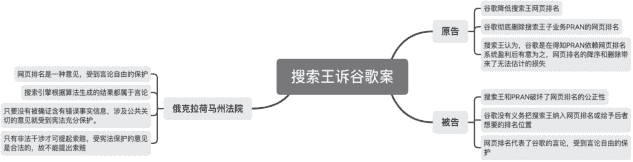

### 【核心争议点】
1. 页面排名是否落入《宪法第一修正案》言论自由的保护范围。
2. 排名若受宪法保护，发布排名的行为在俄克拉荷马州法下是否正当，是否足以阻断谷歌故意乃至恶意操纵排名所引发的侵权责任。

### 【裁判论证过程】

#### （一）页面排名受到《宪法第一修正案》关于言论自由的保护
谷歌援引“杰斐逊县 R1 学区诉穆迪投资者服务公司”^([\[5\]](#txt003.html#footnote_content_txt003_5))，主张页面排名构成第一修正案保护的意见。该案第十巡回法院在最高法院指引下认为，关于公共议题的意见表述，若不包含可证伪的虚假事实，即应受宪法充分保护。^([\[6\]](#txt003.html#footnote_content_txt003_6))

搜索王反驳称排名是可以被客观核验的数字，因而不应归入言论。为证明真伪，排名系统必须客观。斯坦福论文将其描述为客观机械，谷歌官网亦宣称系统“诚实客观”。搜索王认为谷歌自相矛盾：一边强调客观性，一边又以主观性规避侵权责任。^([\[7\]](#txt003.html#footnote_content_txt003_7))

俄克拉荷马地区法院认定排名是一种意见。法院指出算法产出是主观的，它体现了谷歌对某页面是否契合用户检索需求的主观判断。不同搜索引擎采用不同的检索逻辑与考量要素，本质上都是在表达各自的看法。搜索引擎回应用户指令，通过爬虫抓取匹配关键词的页面后以排序方式呈现。排序是对每家引擎独特标准的有序化表达。法院认为算法结果除表层信息外，更关键的是对相关度的隐含建议，具有主观性，构成意见。法院进一步推及，所有基于算法生成的搜索结果皆属言论。并且此类言论具有公共关切属性，只要未被证实包含错误事实，即受宪法庇护。

#### （二）谷歌降低网页排名的做法并不能够导致侵害、干涉有利商业关系或合同关系的结果
“杰斐逊县案”中第十巡回法院认为，依科罗拉多州法，受保护言论不构成对合同关系的不当干涉。^([\[8\]](#txt003.html#footnote_content_txt003_8))俄克拉荷马法院认为本州法应作相同适用。^([\[9\]](#txt003.html#footnote_content_txt003_9))

法院认为谷歌的行为合法，未干涉搜索王的合同关系。俄克拉荷马法要求原告证明被告阻碍其商业或合同关系、阻碍系恶意且不当、且原告因此受损。^([\[10\]](#txt003.html#footnote_content_txt003_10))在“盖洛德娱乐诉汤普森案”^([\[11\]](#txt003.html#footnote_content_txt003_11))中，俄克拉荷马最高法院认为宪法保护的言论本身即合法，不得以干预商业关系为由提起侵权。两种侵权请求虽要件略有差异，均需干涉具备违法性。因此，法院认为言论受保护，排名不构成对合同关系的侵权，即使出于恶意，意见若无错误即受宪法保护，也无从提起侵权诉讼。

### 【审理结果】
俄克拉荷马州地区法院判决驳回原告搜索王的动议。

### 【相关法条】
《侵权法适用解释》第 766 条 B 款（Restatement（Second）of Torts §766B）

一方故意和不适当地干涉另一方的预期合同关系（结婚合同除外）的，要为因关系利益的损失而造成的经济损害向另一方承担责任，不论这种干涉是否包括：

（a）诱导或以其他方式导致第三方不能建立或继续未来的关系；或

（b）阻止对方获得或继续未来的关系.

### 【案例评析】

#### （一）本案直接推动了算法是否受法律规制的讨论
技术演进不断创造新领域，其法律归属常成争议。算法语境下不可避免触及“算法黑箱”^([\[12\]](#txt003.html#footnote_content_txt003_12))与“算法操纵”^([\[13\]](#txt003.html#footnote_content_txt003_13))问题。算法不透明导致其对生活的影响难以被法律捕捉，于是黑箱与反操纵成为价值冲突的两端。法律作为规范性事业，要么承载价值判断，如民法对私法自治的确认；要么提供价值冲突的解决路径，如格式条款解释规则。算法议题可被转译为价值冲突，而操纵带来的负外部性意味着算法需要法律回应。

#### （二）推动了算法是否是言论的讨论
理论上学界普遍主张算法应受规制，但美国司法实践常以言论或商业秘密为由保护算法。相较言论，商业秘密保护较弱，只要损害社会利益即可介入，故言论仍是算法最强的庇护。

算法是否享有言论自由可拆分为主体与客体两问。主体问算法、程序、机器能否成为言论自由的主体，实质是算法是否算人。^([\[15\]](#txt003.html#footnote_content_txt003_15))客体问算法产出是否属于言论，即算法结果是否算“话”。^([\[16\]](#txt003.html#footnote_content_txt003_16))就主体资格而言，算法并不占优，理论与常识均倾向认为机器非人，不能直接享有言论权。^([\[17\]](#txt003.html#footnote_content_txt003_17))因而算法支持者常退守“算法只是人类表达的工具”这一说法。^([\[18\]](#txt003.html#footnote_content_txt003_18))这在事实上默认了只有人才有言论权、算法非人，却巧妙回避主体争议，转而聚焦“何为言论”的客体问题。^([\[19\]](#txt003.html#footnote_content_txt003_19))随发言者让位于言论本身，主体与客体的并列关系变为替代，客体成为关注中心。^([\[20\]](#txt003.html#footnote_content_txt003_20))在客体层面，言论自由的发展趋势对算法更为友好。^([\[21\]](#txt003.html#footnote_content_txt003_21))

左亦鲁博士认为主体与客体的讨论带有本质主义色彩，他提出发言者本位、听众本位与强人工智能言论等实用主义路径。^([\[22\]](#txt003.html#footnote_content_txt003_22))发言者本位下，算法仅在促进自然人表达时才可能获保护。^([\[23\]](#txt003.html#footnote_content_txt003_23))“算法为工具”的主张正依此逻辑，却因关联过间接而显得牵强。^([\[24\]](#txt003.html#footnote_content_txt003_24))且算法的智能可能与自然人形成竞争，保护算法言论反而损害发言者利益，故发言者本位倾向否定算法的言论权。听众本位的“言论不问出处”则聚焦内容价值，只要非人主体的产出对人类听众有益，即可受保护。^([\[25\]](#txt003.html#footnote_content_txt003_25)]

美国法学界对算法即言论的论证主要有三种路径：排序即意见论、编辑论与实用主义。搜索王诉谷歌案极大助推了排序即意见论，被视作最优解。该论点认为搜索结果除表面指涉外，还在特定语境下给出相关度建议，体现了搜索引擎的立场。^([\[26\]](#txt003.html#footnote_content_txt003_26))批评者指出，谷歌排名依托数量、质量、关键词频率、用户满意度等客观要素，而非主观价值判断，言论所要保护的是价值判断，主观心理活动，客观排名不应等同言论。

编辑论将算法结果类比报刊编辑，即搜索引擎并非简单搬运，而是挑选与编排。算法与结果需区分，算法是核心控制对象。搜索引擎仅按客观要素排列，未对内容价值取向进行实质选择，与报纸编辑存在差异，故类比不成立。

实用主义认为只要产出对人类有价值即构成言论，主体无关。^([\[27\]](#txt003.html#footnote_content_txt003_27))然而言论主体已扩充至法律拟制的人，但完全不问主体仍具争议，联邦最高法院并未认可。若机器自动生成、缺乏人为参与的数据，因缺少双向交流，部分司法观点认为不应视为言论。^([\[28\]](#txt003.html#footnote_content_txt003_28)]

#### （三）引起关于算法社会言论自由保护中国家角色的讨论
算法影响已从“是否影响”转向“如何影响”。其普遍性与广泛性意味着几乎所有人的生活几乎所有领域都被算法触及。^([\[29\]](#txt003.html#footnote_content_txt003_29))

面对算法公共风险与平台权力对言论的挤压，国家需从消极克制转向积极规制。实体规制只能点状修补风险，过程性规制则将视野从个案行为扩展至信息接触社群，通过打破社群封闭，促进内部与跨社群沟通，避免极端化。过程性规制旨在保障算法价值观的平等与网络空间的开放，既能降低干预的宪法风险，也能更有效地化解言论领域的公共风险。^([\[30\]](#txt003.html#footnote_content_txt003_30))

### 【关联判例推荐】

# 算法在说话吗：五则判例与伯恩斯坦案对照

#### 1. Daniels v. Union Baptist Ass’n, 55 P.3d 1012, 1015

事实概要：曾任会牧师把教会协会及传教事务执行主任告上法庭，主张自己系因对方故意或过失行为被撤换。克利夫兰县法院法官赫瑟林顿为被告准许简易判决撤诉，牧师上诉。最高法院副首席大法官瓦特受理调卷后指出：其一，执事主持牧师所属教会业务会议属于教会内部运作，司法不宜介入；其二，牧师未提出初步证据显示马里存在恶意干涉契约情形；其三，协会及其董事对牧师并无法律义务，不成立过失。

对主题的意义：主张恶意干涉契约关系须同时成立：被告介入了原告的营业或契约关系；该介入带有恶意、违法、不正当、无特权且不可原谅；原告因此蒙受实际损失。

#### 2. Gottschalk v. Benson, 409 U.S. 63, 67, 93 S.Ct. 253, 34 L.Ed.2d 273

事实概要：本森就把二进制编码十进制数转成纯二进制数的方法申请专利。该权利要求并未限于特定技术、设备或机械，而是声称在任何通用数字计算机上使用均受保护。高特沙克请求法院撤销对该专利请求驳回的决定。

对主题的意义：纯粹的思想或创意本身并不具备专利适格性。

#### 3. Jefferson County Sch. Dist. No. R-1 v. Moody’s Investor’s Services, Inc.,175 F.3d 848

事实概要：1993年学区为取得更低利率发行可回售债券进行再融资。过去虽曾聘请穆迪，此次改聘另两家机构评级，未向穆迪支付费用亦未提供最新财务资料。1993年10月20日债券上市，初期认购热烈。发行不足两小时，穆迪即在其评级新闻电子服务发布文章称虽未受邀评级但计划售后评级，并评论债券与学区财务状况，结论为学区一般义务债务前景负面，反映州持续财政压力。学区认为该表述实质不实，误导市场以为财务不稳且评级基于即时信息，实则所提供资料已使用逾一年。学区称此为因其改聘机构而遭报复，且严重影响债券营销。学区依科罗拉多州法起诉穆迪故意干涉契约、干涉预期契约及散布损害性虚假陈述。穆迪提出驳回或简易判决动议，学区反对并申请追加垄断与企图垄断反托拉斯诉求。

对主题的意义：网页排序与金融评级服务同属言论表达，均受宪法规定的第一条修正条款保护。

#### 4. Christopher Langdon v. Google Inc.,474 F. Supp. 2d 622

事实概要：原告兰登经营两网站，主要揭露北卡罗来纳州官场腐败，多次点名时任州总检察长罗伊·库珀。他起诉谷歌两点：一、谷歌不在其网站投放广告；二、谷歌把他的网站从“Roy Cooper”“总检察长 Roy Cooper”等关键词检索结果中移除。兰登认为利益受损，谷歌则主张广告展示与检索排序由算法决定，属于自身言论自由的体现。特拉华州地区法院支持谷歌“算法即言论”立场，指出言论自由既含表达权亦含不表达权。强制谷歌必须刊登广告或把网站排在指定位置，等同强迫其发言。与“搜索王诉谷歌案”正面论证谷歌可说什么不同，本案从反面论证谷歌不可被迫说什么。“搜索王案”虽简短但已触及该问题，特拉华法院据此视为既定前提适用。法院并借助1996年《通信规范法》第230条豁免进一步强化算法保护。该法第230条长期被视作网络平台的护身符。传统媒体遵循权利义务相称原则，平台若以发言者或出版者身份管理内容，就须对所管理内容负责。编辑行为可视为言论，但一旦取得发言者地位就须承担责任，报纸为典型例证。依传统法理，谷歌的算法筛选可被视为言论，但取得发言者地位后应承担相应责任，而第230条在一定程度上免除了该义务。“兰登案”涉及第230条(c)款第2项(A)句，规定交互式计算机服务提供者或用户为限制接触淫秽、低俗等材料而采取行动不承担责任。法院据此解释平台进行内容管理时无需为编辑行为负责，使算法地位超越报纸。传统上报纸在言论自由与传媒法下享有优待，有别于广播等媒体。互联网巨头与算法倡导者常攀附报纸策略，而报纸的权利义务本是对等的。经“搜索王案”与“兰登案”后，算法拥有发言者权利却不承担发言者义务。^([\[36\]](#txt003.html#footnote_content_txt003_36))

对主题的意义：媒体与平台一旦扮演发言者角色，就应对自身言论与观点负责并承担相应法定义务。

#### 5. Zhang v. Baidu.Com, Inc., 10 F. Supp. 3d 433

事实概要：百度运营Baidu.com中国搜索引擎，提供中文语音搜索、高级搜索等。至2010年自称全球第三、中国第一，中文市场份额约七成以上。原告为一批在纽约倡导中国民主的居民，指控百度合谋阻断民主政治言论在美国搜索引擎结果中呈现。具体指百度审查并屏蔽涉及中国民主运动的文章、出版物、视频、音频及信息，每位原告均在网络上发表过相关内容，这些内容可在谷歌、必应等检索到，却在百度结果中消失。基于此原告主张公民权利、基于种族的公民权利受侵害，索赔1600万美元并要求律师费与诉讼费。

对主题的意义：纽约南区法院再次确认搜索算法属于受保护的言论，并明确采用将算法比附报纸的分析进路。

## 3.2 伯恩斯坦诉美国国务院案

#### 【案件索引】

Bernstein v. United States Department of State, 922 F. Supp. 1426 (N.D. Cal. 1996)

Bernstein v. United States Department of State, 945 F. Supp. 1279 (N.D. Cal. 1996)

Bernstein v. United States Department of State 974 F. Supp. 1288 (N.D. Cal. 1997)

#### 【关键词】

算法言论；信息安全；加密技术；出口管制

#### 【案件提要】

“伯恩斯坦案”是审理加密产品出口问题最具代表性的案例。伯恩斯坦研制一套复杂加密程序并欲出口，美国国务院依据《国际武器贸易条例》ITAR将其列入军火管制清单并禁止出口。^([\[37\]](#txt003.html#footnote_content_txt003_37))伯恩斯坦提出三点异议：其一，ITAR要求的事先许可对言语代码构成事前干预；其二，ITAR规定模糊且范围过宽；其三，使用言语代码已有独立权利保护机制。被告则称ITAR是内容中性的监管措施，与《出口管制条例》EAR共同维护国家安全，因加密软件可被恐怖分子、毒品走私者等用于隐蔽通信。被告援引“得克萨斯州诉约翰逊案”^([\[38\]](#txt003.html#footnote_content_txt003_38))中关于焚烧国旗是否传递特定信息及可理解度的判断标准，主张源代码是功能性加密产品，并非传递特定信息，故不属言论。法院认为伯恩斯坦拟公布的源代码属于宪法规定的第一条修正条款保护的言论范畴。ITAR以事先限制方式对加密软件出口许可控制，违宪。EAR以事先限制方式对加密软件出口许可控制，亦违宪。

本案是美国首个明确认定软件属于第一修正案保护言论的判决，并挑战限制加密软件出口法规的合宪性，引发立法、执法与政府机构广泛关注，并促成《Pro-CODE法案》《加密通信隐私法》《加密技术保障安全与自由法案》等提案的出现。

#### 【案件要旨】

加利福尼亚北区联邦地区法院：原告 伯恩斯坦 被告 美国国务院

加利福尼亚北区联邦地区法院：原告 伯恩斯坦 被告 美国国务院/美国商务部

1992年，加州大学伯克利分校学生丹尼尔·J·伯恩斯坦为发表学术成果，需公开论文。论文除论及自研加密技术“鼻息”^([\[39\]](#txt003.html#footnote_content_txt003_39))Snuffle，还包含以C语言撰写的两个程序源代码及操作指南。按当时政策，该发表行为被视为出口，须申请出口许可。伯恩斯坦依程序申请后经历三年交涉。1995年无果后，他依据宪法第一修正条款言论自由权寻求司法救济。

受诉法院梳理出两大争议：用C语言编写的源代码是否属于第一修正条款保护的言论？ITAR是否违宪？被告认为源代码与解密程序属不受第一修正条款保护的行为。1996年4月15日，加州北区地方法院认定首个争点：伯恩斯坦拟公布的源代码属第一修正条款保护的言论。同年12月6日，法院认定ITAR以事先限制形式违反宪法。判决后，克林顿政府于1996年11月15日发布第13026号行政命令，将加密技术产品由国防部管制的美国军火管制清单移至商务部管制的商业管制清单CCL，实质上是规避管辖。伯恩斯坦遂追加美国商务部为被告。1997年8月25日，加州北区地方法院仍判决商务部的相关管制构成事先限制言论自由。该案经司法部上诉并技术性拖延后，美国政府改变策略，承诺调整管制措施。

#### 【案例事实思维导图】

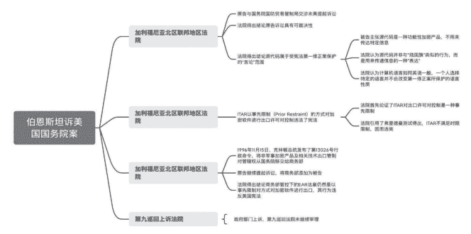

#### 【核心争议点】

1.伯恩斯坦拟公布的源代码是否属于宪法规定的第一条修正条款保护的言论范围.

2.ITAR以事先限制的方式对加密软件进行出口许可控制是否违反美国宪法.

3.EAR以事先限制的方式对加密软件进行出口许可控制是否违反美国宪法.

#### 【裁判论证过程】

##### （一）伯恩斯坦拟公布的源代码属于宪法规定的第一条修正条款保护的言论范围

被告援引“得克萨斯州诉约翰逊案”中判断焚烧国旗行为是否具交流成分的标准^([\[40\]](#txt003.html#footnote_content_txt003_40))，即是否具有传递特定信息的意图且接收者有相当可能性理解。该案最终认定焚烧国旗属受保护言论。被告据此主张源代码为功能性加密产品，不传递特定信息，故不属言论。加州北区联邦地区法院认为源代码与烧国旗、裸体舞蹈等行为性质迥异，不可同论。法院指出，选择特定语言不改变第一修正条款保护的性质，计算机语言与德语、法语无本质差别。源代码虽为文本，却是受过编程训练者可轻易理解的思想表达途径。对伯恩斯坦等高技能程序员而言，源代码是传达复杂数学原理的有效媒介，类似经济学家使用图表。法院排除“非专业人员无法理解仅机械使用程序”的情形，强调关切的是伯恩斯坦的发言权，而非他人的聆听权。被告则强调源代码的功能属性，认为编译成目标代码后可直接控制计算机运行而不传递信息。法院认为应区分源代码与目标代码。源代码以C语言等编写，编译前无法操作计算机；编译器将其译为由0、1构成的目标代码。法院认为忽略两者区别会掩盖重要事实：源代码是用面向人类分析和理解的语言撰写的。通过限定于程序员视角，法院认定加密源代码具有充分表达性，值得第一修正条款保护。

##### （二）ITAR以事先限制的方式对加密软件进行出口许可控制违反美国宪法

法院首先确认出口许可构成事先限制prior restraint，即政府对言论进行事前审查。第一修正条款原则上禁止事前限制。在“弗里德曼诉马里兰州案”^([\[41\]](#txt003.html#footnote_content_txt003_41))中最高法院认为州政府规制淫秽内容不得无视正当程序与言论保护，电影事前审查对宪法保护言论构成重大危险。事前审查将证明责任倒置给放映者，审查员难以像独立法院那样权衡言论价值，且可通过拖延使司法救济困难。法院据此提出“弗里德曼测试”：事前限制仅可在特定短期内实施以维持现状；必须提供迅速司法审查；拒绝许可时审查机关须承担上法庭说明理由的责任。ITAR加密软件许可计划应受此三项程序保护。法院经审查认为ITAR未规定许可决定期限、无法及时司法审查，且国防贸易管制办公室未出庭为拒绝许可辩护，故针对美国军需用品清单第十三类B项的许可制度的事前限制因违反第一修正条款而违宪。鉴于ITAR已违宪，法院驳回伯恩斯坦关于初步禁令的申请，认为政府行为不再构成其教授密码学课程的即时威胁。

##### （三）EAR以事先限制的方式对加密软件进行出口许可控制违反美国宪法

# 密码程序原文本是否属于言论保护范围的关键判决

1996 年 11 月 15 日，美国总统克林顿签署行政令第13026号，把民用密码类商品及相关技术的对外审核权限从国务院移交给商务部。该指令把原先由 USML 与 AECA 归为军需物资的密码类商品，改由 EAR 体系下的 CCL 来管理。原告随后向商务部提起司法诉求，认为行政行为越权。审理机关把该指令定性为政治性事项而拒绝审查，但指出管辖权转移不改变限制的实质。对密码程序的原文本被认定落入宪法 Amendment 1 的保护范围，而 EAR 所设的预先许可程序未能通过 Freedman 检验，例如申请本应在90日内完成或移交总统，转交后却无时限约束。最终审理仍认定 EAR 对密码程序的预先限制违反宪法。

## 审理结论

1. 审理机关认定 EAR 及其依据的规章、政策与惯例，对密码或解密程序及相关软硬件技术实施预先许可的行为，侵害了宪法首条修正案保障的言论自由。
2. 被告被永久禁止从事或协助下列行为：
   （1）继续执行被宣告违宪的法规、规章、规则、政策与惯例，包括对原告或任何使用、讨论、发表原告密码程序及相关材料的人提起刑事或民事诉讼；
   （2）对原告或上述人员行使本判决确认的宪法权利时进行威胁、扣押、起诉、阻挠或任何形式的干预。

## 涉案规范

《美国宪法 Amendment 1》
国会不得制定确立国教或妨碍信教自由的法律；不得剥夺言论或出版自由；不得剥夺人民和平集会及向政府请愿的权利。

《联邦法规》第22卷第120节第17条（a）款（4）项 22 C.F.R. §120.17（a）（4）
“输出”包括：（4）向驻美使馆或其所属机构、分支、使团、领馆移交国防物资。

《美国宪法 Amendment 14 Section 1》
在美出生或归化且受其管辖者皆为美国及其所在州公民。任何州不得制定剥夺联邦公民特权或豁免的法律；未经正当程序不得剥夺生命、自由或财产；不得否认管辖范围内任何人法律平等保护。

## 评析

### （一）首度确认程序文本可构成宪法意义上的言论
1964 年起程序已获版权保护，1980 年国会通过《计算机软件著作权法》将程序纳入文学作品范畴。帕特尔法官并未仅以版权为依据，而是从程序自身属性论证。她把计算机语言比作口语，援引 In re Ginzburg 思路，认为语言因其可理解的复杂含义而构成言论，对语言的规范即是对言论的规范。学界亦有不同声音，凯瑟琳·A·默尔克对比此案、Karn 案与 Junger 案后指出，密码程序原文本未必等同于 Amendment 1 下的言论，但仍可因其承载私下表达而获得一定保护。

### （二）案件推动全国对密码输出限制合宪性的讨论
伯恩斯坦案、Karn 案、Junger 案相继出现，司法机关对密码程序输出限制的态度逐步明确，争议进而波及国会。国会研究服务局科学政策研究部的玛西娅·史密斯 Marcia Smith 指出：“争点在于政府为执法目的，对加密存储的数据或电子通信应享有怎样的访问权限。”^[[\43]](#txt003.html#footnote_content_txt003_43) 部分议员主张放宽规则，国家安全局与联邦调查局则坚决反对。若三案上诉至最高法院，程序言论权的认定将深刻影响国会博弈。

案件还催生三项立法动向。第一，蒙大拿州参议员康拉德·伯恩斯 Conrad Burns 发起1997年 Pro-CODE 法《数字通讯时代在线商业促进法案》，主张取消密码技术输出限制，禁止商务部以输出为由强制私营部门采用政府标准，禁止联邦与州政府限制带密码能力的产品销售，并禁止以强制提交“密钥窃听系统”为解禁条件。第二，参议员帕特里克·莱希 Patrick Leahy 发起1997年《加密通信隐私法》，在支持“密钥窃听系统”管理的同时，允许个人在任何州或境外使用密码程序。第三，弗吉尼亚州鲍勃·古德莱特 Bob Goodlatte 主推《加密技术保障安全与自由法案》，降低对密码产品的输出限制，放宽对已在国际市场可获得产品的控制，若程序已进入公共领域则免于许可。

参议员莱希表示：“这些法案……取消了目前对强密码技术输出的限制，以便美国高科技企业在全球市场自由竞争，满足国内外客户对强密码的需求。”^[[\44]](#txt003.html#footnote_content_txt003_44)

### （三）后续进展与中国经验对照
案后司法部上诉，经技术性拖延，美国政府逐步调整策略。2003年10月15日，联邦官员承诺不再要求密码学家就修改密码技术等活动提交报告，也不再要求商业图书出版商与汇编语言出版商持有许可。至此“伯恩斯坦诉美国国务院案”实质告一段落，但美国法律环境是否真正友好，仍存疑问。

我国自2020年1月1日起施行的《密码法》为密码技术管理提供依据，其中第28条第1款规定国务院商务主管部门、国家密码管理部门对具有加密保护功能的商用密码实施进口许可，对涉及国家安全、社会公共利益或承担国际义务的商用密码实施输出管制。商用密码进出口清单由商务主管部门会同国家密码管理部门和海关总署制定公布。

2020年8月28日，商务部、科技部发布《中国禁止出口限制出口技术目录》2020年第38号公告，在限制输出部分新增“密码安全技术 编号186103X”，控制要点包括密码芯片设计与实现技术、量子密码技术等。依据《中华人民共和国技术进出口管理条例》，限制类技术输出须经省级商务主管部门审批，获批后方可实质谈判并签订合同。

## 关联判例推荐

### 1. Karn v. United States Department of State, 925 F. Supp. 1 (D.D.C. 1996)
核心事实：布鲁斯·施奈尔 Bruce Schneier 撰写密码学著作并随书附赠软盘，均含密码程序原文本。菲利普·卡恩 Philip Karn 想将其商品化，故咨询是否需依据 ITAR 申请输出许可。国务院认定书籍不受 ITAR 约束，但软盘受约束。卡恩向助理国务卿托马斯·麦克纳马拉 Thomas McNamara 申诉仍被认定为“国防物品”。卡恩诉至华盛顿特区地方法院，主张软盘管理侵害言论自由。审理机关仅假定软盘属于 Amendment 1 言论，仍支持 ITAR 合宪，认为其属内容中立且国家安全解释充分，并拒绝就外交政策裁决。
关联点：首例质疑政府密码法规宪法效力的案件。

### 2. Junger v. Daley, 8 F. Supp.2d 708 (N.D. Ohio 1998)
核心事实：凯斯西储大学法学院教授彼得·荣格 Peter D.Junger 编写教材描述密码原理并涉及原文本，因而受管制，只能以纸质形式传播。俄亥俄州北区地方法院1998年判决败诉，认为原文本不属 Amendment 1 保护范围。2000年4月4日第六巡回上诉法院推翻原判，认为计算机原文本是传递程序信息与构想的表达方式，应受 Amendment 1 保护。
关联点：同属计算机原文本性质认定路径。

### 3. Freedman v. Maryland, 380 U.S. 51 (1965)
核心事实：马里兰州要求影片上映前须经审查委员会审批，弗里德曼未经送审即放映被罚。上诉维持后最高法院一致推翻，提出事前限制必须伴随程序保障：限制须在短期内实施并有维持现状的必要；须能迅速司法审查；审查员拒绝许可须向法庭说明理由，即“Freedman检验”三标准。
关联点：此案援引该检验证明 EAR 对密码程序输出的事前限制违宪。

## Junger 诉 Daley 案

### 案件索引
`Junger v. Daley, 8 F.Supp.2d 708 (1998)`
`Junger v. Daley, 209 F.3d 481 (2000)`

### 关键词
算法言论；美国宪法 Amendment 1；言论自由

### 案件提要
本案聚焦计算机原文本是否受 Amendment 1 保护，以及密码原文本输出是否对国家安全构成实质危害从而需禁止。EAR 要求荣格教授取得许可后才能上传含自编密码原文本的电子教材。荣格认为该规定违宪并起诉商务部部长威廉·戴利等人。EAR 构建了对非军用技术、软件、商品输出的许可体系。克林顿总统1996年11月15日签发第13026号行政令，将非军用密码产品输出管辖权移交商务部出口管理局。克林顿认为管制基于功能而非表达内容。按 EAR，除非能有效阻止境外无权下载，受控密码原文本和目标代码的“输出”即构成在境外下载或导致境外下载的行为，事实上难以完全防范。

程序分为原文本与目标代码，原文本为编程语言写成的人类可读指令，目标代码为二进制形式，二者可互转。计算机需经编译或解释才能执行原文本。EAR 要求管制清单上的物品须先获许可，清单标注输出管制分类号 ECCN，密码软件属于 5D002 类，输出须许可，书面形式除外。一般而言除加拿大外所有密码产品输出均需许可。EAR 将网站发布软件纳入输出定义，但把限制外国访问的行为排除在外。至一审判决时该条例仍有效。

俄亥俄州北区法院一审认为 EAR 合宪，因密码原文本具功能性，EAR 未直接针对表达要素，亦未限制学术讨论或印刷版，作出支持被告的简易判决，认定原文本不受 Amendment 1 保护且 EAR 为内容中立。审理机关认为原文本虽有时具表达性但不足以受保护；EAR 未直接规制表达行为，不属事前限制；不具过度宽泛或模糊问题；内容中立需中度审查且通过。

荣格上诉期间，出口管理局发布暂行最终条例修改相关法规。第六巡回上诉法院认为密码原文本具有相当表达性应受 Amendment 1 保护，政府主张的国防安全过于抽象，不足以对抗言论自由保护，因而撤销原判并发回重审。

### 案件要旨
俄亥俄州北区法院一审：原告彼得·荣格 被告威廉·戴利等
美国第六巡回上诉法院：上诉方彼得·荣格 被上诉方威廉·戴利等

# 案例概述
原告彼得·荣格为凯斯西储大学法学院教授，被告威廉·戴利为美国商务部部长。荣格教授编写展示计算机工作原理的密码原文本并欲上传网络，但 EAR 将该行为定义为“输出”而受管制。1997年6月12日荣格向商务部提交三份商品归类申请，7月4日出口管理局告知分类号 5D002 涵盖其提交的四个程序，书中第一章内容可免许可输出。7月18日荣格另行申请审查该章原文本，8月7日管理局通知其书中密码程序不属 5D002，不受 EAR 管制，无论电子上传或纸质输出均无需许可，但若第一章包含 5D002 类程序并被境外下载则需许可。荣格收到决定后未申请许可，随后提起诉讼寻求宣告性与禁令救济，主张原文本属受宪法保护的言论，EAR 侵害 Amendment 1 权利。其诉讼主张包括：许可要求构成违宪事前限制；规定宽泛模糊；对不同密码程序差别管制构成内容歧视；限制程序交流侵害学术与结社自由；依据《国际紧急经济权力法》行政法规违反权力分立。

加密代码算言论吗？一审被上诉推翻的美国判例

俄亥俄北区联邦法院受理双方简易判决动议后，先依据联邦民事诉讼规则第56条确认是否存在实质性事实争议，随后进入宪法第一修正案对计算机软件表达活动的保护界限。法院须先判断涉案程序属于表达性还是工具性，再评估商务部出口许可机制是否构成言论的事前管制、教授彼得·荣格是否具备挑战《出口管理条例》EAR 过于宽泛模糊的主体资格，以及EAR 是否进行内容差别对待。一审最终支持政府，认为加密程序本体更偏向功能，条例并未直接干预代码的表达面向，也未禁止学术讨论或纸质出版，因而作出对被告有利的简易判决，认定该加密代码不在第一修正案保护范围，EAR 属于内容中立之规范不构成违法。

荣格不服上诉，第六巡回上诉法院作出相反判断。合议庭认为加密代码具有相当的表达属性，应当受第一修正案庇护；本案中政府所称的国家安全威胁过于抽象、缺乏可验证的具体依据，无法压倒宪法对言论的保障。上诉法院据此撤销原判，指令发回重审。

## 案例事实思维导图

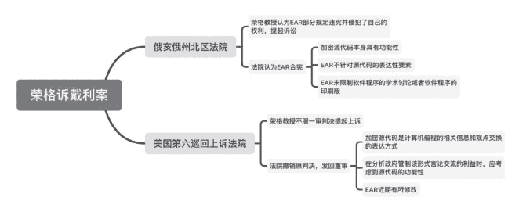

## 核心争议点

1. 加密程序代码是否进入美国宪法第一修正案的保障范围。
2. 加密程序代码的跨境流通是否确实会导致实质性的国家安全损害，因而必须全面禁止。

## 裁判论证过程

### （一）加密源代码是编程领域思想传递的载体，应受第一修正案保护

一审持相反看法。俄亥俄北区法院援引特纳广播公司案说明审查路径：若规范系依据言论的思想内容作差别对待，则适用严格审查；反之则不适用。严格审查下政府须以必要且适当方式实现社会认可的重大利益；中度审查则要求规范能促进实质政府利益、不压制表达且限制程度不超过收益。

地区法院把“代码的表达强度是否达到宪法须介入的程度”列为焦点。历史上卡恩诉美国案与伯恩斯坦诉美国案走向相异，前者认为代码与评注结合时受保护，单独代码只是驱动机器的工具；后者则将源代码视为受保护的言论。地区法院随即反驳伯恩斯坦案“语言即言论”之说，认为判断是否受保护的关键在于是否传递思想。

法院继而区分功能与表达。部分软件本身具表达功能，部分则偏工具。加密类软件的功能倾向上更显著，与一般软件相同，加密代码主要用于向电脑下达指令，实现加密操作而非阐释理论。功能实现上它接近专用加密硬件。虽大众难以阅读，程序员却能解读，荣格教授亦拟以代码向学生传递密码学观点。

据此地区法院认为出口加密代码偶尔带有表达性，但仅属偶发、不足以触发第一修正案保护。最高法院在达拉斯市诉斯坦格林案中指出几乎所有行为都带点表达性，但表达性不足不能受保护。斯宾塞诉华盛顿州案确立判断标准：须有传播特定信息的意图，且在情境下受众理解的可能性很大。法院以约翰森案与廷克案说明标准适用，认为代码因功能而生，编写与出口目的在于执行任务而非交流思想，且所传达信息含糊、难以辨识。结论是出口加密代码不受第一修正案保护。

第六巡回法院则认为功能属性不削弱表达属性。美国社会普遍认为程序员与学者能用加密代码展示并传递密码学信息，犹如数学公式。表达媒介是否同时具功能，并不影响宪法保护，功能大小应在合法管制分析中考量。对熟悉编程语言者而言，源代码是交流密码学观点最有效率、最精确的方式。上诉法院援引最高法院判例指出第一修正案不仅保护纯粹表达，还保护多种形式，例如乐谱，多人读不懂却能让音乐家交流。同理，代码虽多数人看不懂，却是程序员偏好的交流形式。

### （二）难以认定国家安全利益高于代码自由交流的价值

一审围绕荣格的异议展开。俄亥俄地区法院在认定EAR内容中立适用中度审查时，采用三要件：规范应促进重大或实质利益、不压制言论、限制不大于收益。

第一，EAR满足重大利益要件，因其目的在于维护国家安全，政府担心加密软件流向潜在敌对国家或个人。第二，EAR不构成对言论压制，规范可能影响言论不等于违宪，只有直接规制行为的交流性质才可能违宪。第三，EAR符合手段必要且适当要件。

地区法院进一步分析重大利益：为保护国家安全而设，政府担心加密软件可能被无差别出口到敌对势力。即便纸质版在国外可见，政府控制传播的利益并未减弱。不论加密软件在国外的普及程度如何，国家在限制传播上仍有重大利益。法院指出原告关于国外已广泛普及的证据有夸大之处，实际因缺乏密钥分发与产品互操作等基础设施，外国加密产品并未得到广泛应用。政府尤其关注最复杂有效的加密程序，例如128位密钥长度软件不会在国外广泛发布。

第六巡回法院认为评估言论管制的政府利益时，应顾及代码的功能性大小，特别是加密代码。中度审查下，若管制有利于重要或实质政府利益，则言论管制可在一定程度成立。政府必须证明所称危害真实存在而非臆测，且管制能直接实际减轻危害。法院认可国家安全利益在某种程度上高于言论自由，但需具体论证。

## 审理结果

1. 撤销原判决，发回原法院重审。
2. 要求原法院依据修订后的EAR对荣格教授的违宪主张重新审判。

## 相关法条

### 《美国宪法第一修正案》
国会不得制定关于下列事项的法律：确立国教或禁止信教自由；剥夺言论自由或出版自由；或剥夺人民和平集会和向政府请愿伸冤的权利。

### 《联邦民事诉讼法》第56条
如果提出的证据表明没有任何实质性的事实问题，并且动议方有诉讼资格，则将给予简易判决。

### 《美国联邦法规》第15卷第734节第2条（b）款第（1）项
出口的定义：出口意为依据EAR从美国出发的运输或者转输过程。

### 《美国联邦法规》第15卷第734节第2条（b）款第（9）项（ii）
根据ECCN，5D002编码的商业管制清单，因为属于加密品项而受控的加密源代码和目标代码软件的出口，包括下载或导致下载此类软件到美国境外（加拿大除外）的某位置，或使美国境外（加拿大除外）的人通过电线、电缆、无线电、电磁、光学照片传输、光电或其他类似的通信设施下载使用，如果提供该软件的人员采取足够的预防措施防止美国或加拿大以外的传输行为则例外。

### 《美国联邦法规》第15卷第734节第3条（b）款第（2）项
以下不受EAR规制：全部或部分再现印刷书籍、小册子和杂项出版物内容的预录留声机记录；印刷书籍、小册子和杂项出版物，包括装订报纸和期刊；儿童画册；未装订的报纸和期刊，不包括废品；音乐书籍；乐谱；日历和日历方块、纸张；地图、水文图表、地图集、地名录、地球仪罩、地球仪和天球仪；全部或部分摄制上述内容的曝光和显影微缩胶片；曝光显影的电影和配乐；以及上述品类的印刷品广告。

### 《美国联邦法规》第15卷第742节第15条（a）款
加密项目可用于维护信息的机密性，因此可能被外国人用于损害美国国家安全、外交政策和执法利益。美国在确保公共和私营部门的重要敏感信息受到保护的方面具有重大利益。根据瓦森纳协定成员的国际义务，美国有责任保持对加密物品的出口和再出口的控制。如总统在第13026号行政令和1996年11月15日的备忘录中指出的那样，加密软件的出口和再出口，与加密硬件的出口和再出口一样，之所以受控制，是因为这种加密信息的功能，而不是因为此类软件可能反映、包含或代表的任何信息或理论价值，或其出口或再出口可能会转移到国外其他人手中。因此，加密软件的出口管制与EAR监管的其他软件的不同。

（a）许可证要求。出口和再出口到除加拿大以外的所有目的地时，对于在“控制”段落下受出口管制分类号控制的加密品项，都需要许可证。这些品项包括：受出口管制分类号5A002控制的加密商品，5D002控制的加密软件和受ECCN 5E002控制的加密技术。有关“加密品项”的定义，请参阅EAR第772节。

## 案例评析

### （一）本案系加密软件源代码受言论自由保护的开创性判例

加密软件代码能否算作言论长期存疑。本案正是围绕代码能否受第一修正案保护展开。加密解密技术源于军方，美国法律长期将其视作受限军备。80年代起计算机兴起带动密码技术在民用领域快速发展，军事外的密码需求激增，随后越来越多的人挑战出口管制条例EAR。

原告彼得·荣格是凯斯西储大学法学院教授，他希望在“计算机与法律”课程网站上发布加密代码示例以说明计算机工作原理。因课程中有外国留学生，网上发布行为落入EAR限制范围，可能面临巨额罚款与刑期。荣格遂在克利夫兰联邦地方法院起诉政府，主张限制侵犯其学术自由。一审认为代码具固有功能属性，不能仅解释为表达加密理论，加密软件主要用于实现加密功能并与加密硬件紧密结合。荣格为保障学生平等接受教育，选择起诉并主张代码是应受第一修正案保护的言论，EAR限制侵害其学术自由。

“代码从来不是被发现的；它是被编制出来的，而且仅仅是被我们编制出来的。”依据劳伦斯·莱斯格的这一观点，软件代码应被视为个人言论表达。

第六巡回法院最终支持原告，指出软件代码是一种言论自由，应受第一修正案保护。法官认为代码可视为计算机领域的语言，不同机器程序通过代码、算法交流。我们不能否认这种语言源自人的输入，故它也是人们在计算机世界交流的渠道，正如法律行业有既定法律语言。因此美国政府不能限制代码自由流通，这为互联网自由增添了保护屏障。

### （二）本案引发代码能否作为言论的广泛讨论

本案自始便受公民自由主义者、程序员和软件业关注。即便伯恩斯坦诉司法部案的法官已认定代码受言论自由保护，本案地区法院并未直接采纳该先例，反而支持被告，因为它更侧重代码的功能性而忽视表达功能。最终上诉法院推翻原判，指出代码是受保护的言论。

代码兼具“双重属性”：表达性与功能性。地区法院与上诉法院都充分论述了这两种属性，一审认为代码的表达功能不足以触发第一修正案，其功能性掩盖了表达性；上诉法院则反驳，一审对加密代码在计算机领域的角色理解有误。

上诉法院认为，加密代码表示与传递信息的功能不容否认，对熟悉编程者来说，代码是密码学中最有效率、最简洁的信息传递方式。宪法并非只保护纯粹表达，相反保护范围很广，正如最高法院所言，任何想法都表达观点，加密代码同样表达编写者的思想。

也有学者提出质疑。扩大第一修正案保护范围的同时，可能带来新问题。若代码总会传递信息，那么所有计算机指令是否都应受保护？如果有人用代码编写破坏性极强的病毒软件，对于该源代码又该如何定性？是否仍视为受保护言论？

代码复杂、性质存疑，但没有代码就没有虚拟世界，也就没有关于虚拟世界的讨论。讨论与辩论构成思想市场。我们不能因本判例就把后续所有案件机械套上“代码就是言论”的标签，因为代码表达的内容也有可能不属宪法保护范围，代码生成的软件也不能想当然地视为言论而获得第一修正案保护。本案反映了计算机与法律先驱将传统法学说应用于互联网的努力，把代码视作一种言论表达，赋予其个人权利，使其免受国家与联邦层面可能的治理错误或滥用。

### （三）本案客观上推动了开源运动的发展，使开源代码得以作为言论自由表达进入司法审视

# 加密技术、解密技术与言论自由

加密与解密技术诞生于战争与军队，EAR因此将其列入军火管制。随计算机发展，加密软件深入日常生活与学习，再一概列为军备便与密码学与法律制度产生冲突。上世纪九十年代，经过包括本案的多场诉讼，美国已基本明确加密软件代码的言论自由地位。

开源运动与加密运动相辅相成。本案对开源运动发展起重要推动作用，明确了加密代码言论自由的地位，政府不能随意审查控制。然而不能据此简单得出政府此后完全不能限制加密软件代码流通的结论。首先，本案并非最高法院判例，不具统一全国判例的权威；其次，本案核心焦点在于EAR对加密代码的预先审查程序是否违宪，个案差异会导致不同结果。本案争议焦点是加密代码能否在国内教科书上出版，若争议涉及其他国家，裁决不确定性将进一步加大。

加密管制与隐私的困境

“加密或许是此刻唯一可信的隐私屏障，可这条屏障正被官方逐步收紧。把守护隐私的责任交给政府，就像让一个爱窥视的窃贼来装窗帘。” 电子前沿基金会 1996 年 5 月的一篇评论文章如此比喻，文章核心是美国国家安全局主导的加密出口限制。当时加密技术尚未进入大众视野和企业主流，监管却已先行，禁止向境外泄露加密技术。这说明加密的价值不止于国家机密，更在于服务个人私密。把隐私完全托付给监管者并非稳妥之策。

## 关联判例推荐

### 1. Roth v. United States, 354 U.S. 476, 484, 77 S.Ct. 1304, 1 L.Ed.2d 1498 (1957)

核心事实：本案争议焦点是淫秽言论能否纳入宪法第一修正案的保护范围。最高法院在划定言论与出版自由边界时指出，淫秽言论不被保护，其依据是具有社会意义的表达，即使异端、争议或不受主流欢迎，也应得到充分保障，而淫秽内容则缺乏此类价值。

与本案关联点：只要表达具备社会重要性，哪怕用处有限，也应受第一修正案的完整保护。

### 2. Turner Broadcasting System v. FCC, 512 U.S. 622, 664, 114 S.Ct. 2445, 129 L.Ed.2d 497 (1994)

核心事实：国会颁布《1992 年有线电视消费者保护与竞争法》，第 4、5 条要求有线电视系统为本地商业及公共广播预留传输空间。法案实施后，诸多运营商与节目提供方对“必载”条款的合宪性提出挑战。地方法院以中度审查认定条款符合第一修正案。最高法院则认为政府的辩解站不住脚，仅以言论市场存在障碍或失灵为由，不足以使言论规制免于第一修正案的审查。

与本案关联点：政府为限制言论辩护时，即便所称利益重大，也不能仅停留在问题描述层面。

### 3. DVD Copy Control Assn., Inc. v. Bunner, 31 Cal. 4th 864, 75 P.3d 1 (2003)

核心事实：原告 DVD CCA 控告 Bunner 等人于网络上发布可用于破解加密 DVD 的程序，构成商业秘密侵占。审判法院下令禁止其继续披露。发回上诉后，上诉法院认定该程序虽经逆向工程取得且含商业秘密，但其本身承载思想内容，在网站发布属于第一修正案范畴的纯粹言论。临时禁令是对宪法权利的预先干预，相较商业秘密的法定保护，表达自由更具优先性。上诉法院据此撤销禁令。

与本案关联点：在网站上公开的计算机程序受宪法第一修正案言论自由保护。

## 3.4 佛蒙特州诉小斯图尔特·利佐特案

#### 案件索引

`State v. Lizotte, 2018 VT 92, 208 Vt. 240, 197 A.3d 362 (2018)`

#### 关键词

算法言论；线上监视；算法问责；个人信息保护

#### 案件提要

此案触及算法言论的延伸议题，即算法采集的公民个人信息是否构成隐私侵害，网站依算法自动收集的数据是否触犯美国宪法第四修正案。本案与同名案件紧密关联。在前案中，被告小斯图尔特·利佐特被控多项与儿童色情相关的罪名，部分认罪，但就持有儿童色情制品的指控提出异议，指责其网络服务提供商美国在线擅自检索传输内容、拦截附件并移交执法，认为此举违反了第四修正案及佛蒙特州宪法第十一条。

此案引发广泛讨论。美国在线作为时代华纳旗下企业，提供电子邮件、新闻组等服务，用户注册时须接受服务条款与隐私政策。条款规定，除特定情形外，若判断用户可能涉罪，公司可查阅通信内容，并禁止发布非法内容。一旦传输非法材料，公司将冻结账户并配合执法。

为识别非法材料，美国在线使用图像检测过滤程序 IDFP 等手段。该工具以 MD5 算法为基础，计算邮件中附件及内嵌图像的哈希值。MD5 哈希是经数学运算得到的数字文件的唯一标识，相同像素的图像会产生相同哈希，常被称作数字指纹，是公认的文件识别方式。

在本案中，美国在线借助 MD5 算法拦截到哈希值与非法库匹配的邮件附件后直接转交相关机构。由于算法特性，公司无需打开邮件即可推断内容，法院认定此操作未触及被告依据第四修正案享有的合理隐私期待，故诉求被驳回。

被告另主张执法部门在取得搜查令前已打开邮件及附件，涉及私人搜查界限问题。法院援引既往判例与最高法院判断标准，经辩诉变更听证审议后认为该主张不成立。法院最终判定，美国在线在检索传输信息时并非执法代理，NCMEC 与执法部门并未因查看已确认的文件而扩大私人搜查范围。即便打开邮件扩大了检索，也不会导致搜查令失效，因宣誓书中另有独立事实足以提供搜查依据。

在数字技术快速演进背景下，司法程序与实体问题不断变化，如何在互联网尤其是算法冲击下处理新出现的隐私难题，成为实务焦点。本案有助于理解算法言论，并为算法引发的个人信息与隐私争议提供参考，相关引用的案例可形成完整分析框架。

#### 案件要旨

拉特兰高等法院一审：原告 佛蒙特州 被告人 小斯图尔特·利佐特

佛蒙特州最高法院上诉：上诉方 小斯图尔特·利佐特 被上诉方 佛蒙特州

上诉人小斯图尔特·利佐特于 2013 年 3 月以网名 `lilstuisthebest` 在美国在线注册账号用于收发邮件及附件。用户须同意服务条款，美国在线可依据算法监控可能涉及非法内容的信息，若邮件哈希值与公司非法材料审查库相符，邮件会自动移交有关部门。

本案中，美国在线库内的哈希值均源自经图形审查小组确认包含明显儿童色情图片的文件，修改图片将导致哈希不匹配。若 IDFP 判定文件哈希与儿童色情文件一致，该文件将被拦截，发件人账户被冻结，公司自动向 NCMEC 检举热线提交报告。公司会发送完整邮件副本、抬头信息及附件副本，但在提交前不一定查看文件内容，仅依赖哈希标识及此前对同哈希图像的观察。

NCMEC 为私营非营利机构，负责寻找失踪儿童、遏制儿童性剥削等工作，员工非政府或执法人员。资金约七成来自司法部与国土安全部联邦拨款。其儿童剥削部门运营 CyberTipline 与儿童受害者识别计划。CyberTipline 由拨款创建，最初无政府参与，后联邦制定相关法规，要求电子服务提供商通过 CyberTipline 向 NCMEC 报告明显儿童色情内容，再由 NCMEC 转交执法部门。

NCMEC 收到报告后，发现报告被锁定无法修改。工作人员使用公开工具尝试获取与报告对象相关的地理信息及服务商信息，确认后通过安全虚拟专用网络提供给执法机构。联邦法律要求 NCMEC 转发报告。工作人员并非总是打开文件，有时为确保传输正确或确定图像位置才会查看。执法部门通过专用网络获取报告，NCMEC 不控制后续调查。

本案中，美国在线确认两封邮件包含与可疑儿童色情数据库匹配的哈希文件，隔离传输并向 NCMEC 提交 1812852 与 1812853 号报告，显示用户 `lilstuisthebest@aol.com` 及相关 IP 地址。公司工作人员未查看邮件内容或附件。NCMEC 工作人员查看视频附件并打开邮件，利用公开互联网工具确定 IP 与佛蒙特州拉特兰市某康卡斯特账户相关，随后向佛蒙特州总检察长办公室报告，要求独立审查。

总检察长办公室下设针对儿童网络犯罪特别工作组 ICAC。警探下载两份报告，发现美国在线未查看附件，随后打开邮件与视频附件，申请搜查令并搜查被告住所及电子设备。搜查令宣誓书包含 NCMEC 与 CyberTipline 信息、视频名称与内容描述、发件人信息及邮件内容。

据此，被告被控四项持有儿童色情制品罪、三项宣传儿童色情制品罪、三项严重性侵罪及一项猥亵淫秽行为罪。被告主张其邮件及附件享有合理隐私期待，第四修正案及佛蒙特州宪法第十一条权利受侵害，因执法部门在取得搜查令前已打开附件及邮件。

法院驳回主张。依据被告与美国在线的服务条款，善意认为有犯罪行为可访问或披露通信，法院认为被告对所涉传输不享有合理隐私期待，公司行为未侵害权利。

被告随后有条件认罪，承认两项严重性侵、一项持有儿童色情制品及两项宣传儿童色情制品，保留对镇压动议上诉权利。经判决听证，被判 22 年无期徒刑，后提出上诉，主张初审法院应批准查禁，因搜查令依据证据违反第四修正案及州宪法第十一条，并称认罪无效因缺乏事实依据。

上诉法院驳回请求，维持原判。

#### 案例事实思维导图

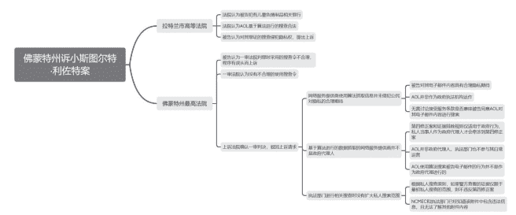

#### 核心争议点

1.网络服务提供商以算法抓取敏感信息是否侵害公民合理隐私期待

2.依赖算法抓取数据的网络服务提供商能否被视为执法人员

3.执法部门搜查时是否扩大了私人搜索范围

#### 裁判论证过程

##### （一）网络服务提供商使用算法抓取敏感信息是否侵犯了公民的合理隐私期待

上诉中，被告辩称其对电子邮件通信内容包括附件图像享有合理隐私期待，受第四修正案及佛蒙特州宪法第十一条保护，并称同意服务条款并未削弱其隐私期待。

法院为审理争议，先假定被告对其邮件通信内容包括附件图像享有合理隐私期待。

依据下文，法院认定美国在线并未作为执法机构运作，故判决过程中不需讨论接受服务是否等于同意其搜索传输信息。

##### （二）基于算法进行的数据抓取的网络服务供应商是否可以视为执法人员

美国最高法院长期认为，私人实施的不当搜查或扣押不违反第四修正案，私人非法行为不剥夺政府合法取得证据的权利。^([\[65\]](#txt003.html#footnote_content_txt003_65)) 第四修正案与证据排除规则仅适用于政府行为，因宪法条款防范的是政府官员的任意入侵。^([\[66\]](#txt003.html#footnote_content_txt003_66)) 排除规则旨在阻止违宪行为，对未参与确保刑事定罪的个人几乎无影响。^([\[67\]](#txt003.html#footnote_content_txt003_67)) 若私人当事人系政府代理人，则私人搜查牵涉第四修正案。

联邦法院认为第四修正案不保护非内容数据，并认为依据第十一条，用户信息不属于私人信息。是否构成政府工具取决于政府对私人活动的参与程度，视具体情况而定，包括政府对私人行动的鼓励、支持与参与。若政府胁迫、支配或指挥私人进行搜查，则视为政府搜查。

判定公民是否可作为政府代理人搜查时，部分联邦法院考虑因素包括：政府在煽动或参与搜索中的作用程度、政府意图及其对私人搜索的控制程度、以及私人帮助政府或为自身利益服务的程度。第十巡回法庭强调政府是否知晓并默许侵入行为，以及执行搜查方是否意图协助执法或实现自身目的。第六与第九巡回法庭亦研究政府知情或默许及执行方意图。

各要素中关键在于政府在私人活动中的角色及私人搜查动机。被告需承担举证责任，证明私人方系政府代理人。法院将这些考量应用于美国在线与 NCMEC 的算法搜查。

最终法院认定，美国在线使用 MD5 算法在其网络上搜索被告传输时，并非作为政府代理进行，执法部门亦不参与公司日常运营。联邦法律要求美国在线报告涉嫌违反禁止儿童性剥削的行为，但不要求其监控网络传输以发现违法。IDFP 是公司为识别可疑儿童色情制品而独立开发的技术，政府未要求开发。该技术由公司自行开发以解决商业关切，包括用户投诉收到儿童色情图片问题。

在此情况下，法院认为公司使用哈希技术搜索被告内容时并非政府代理。公司监控传输系基于自身商业利益，而非受政府鼓励或指导。该结论与其他案例一致，即互联网服务提供商并非执法机构，对涉嫌儿童色情传输进行监控。

联邦法律要求 ESP 与 ISP 报告可疑儿童色情制品，NCMEC 的 CyberTipline 为指定接收方。法律要求 NCMEC 保存证据并转发网络犯罪报告。因此政府知晓 NCMEC 将收集报告系立法指示所致。尽管法规未要求 NCMEC 公开报告信息，但并不妨碍其查看内容。法规表明政府知晓 NCMEC 可能查看和搜索报告，至少默许该行为。此外，NCMEC 被视为政府部门，因其被授权接收并持有儿童色情制品，而该类制品本属违禁品。这些事实均显示政府参与了 NCMEC 的搜索，政府知晓并要求将搜索所得信息与政府共享。

本案要判断的一个焦点，就是 NCMEC 拆阅邮件及附件时的出发点。控辩双方的争议在于，NCMEC 是否等同于执法机关。辩方强调其设立目的具有公益属性，核心是协助找回失踪未成年人、遏制对儿童的性剥削以及预防受害，CyberTipline 也是机构自行搭建，并非应政府要求而设。尽管如此，审理中确认 NCMEC 在检查涉案传输时，至少有一部分考量是为了配合警方行动。证人陈述显示组织本身也有独立的工作目标，比如辨认受害者身份、核查邮件和图像内容，同时也在追踪传输来源以便提供执法支持。法院综合政府对此次检查的知晓与默许，以及 NCMEC 明显带有协助执法的意图，认定其在打开并查看被告邮件及视频附件的过程中，实质上扮演了政府代理人的角色。

（三）后续执法查阅是否超出了最初私人检索的限度
本案还涉及 AOL 的先行检查与警方后续检查之间是否存在范围扩张的问题。依据私人搜查的规则，只有在警方查阅的内容完全落在最初私人检查边界之内的情形，才不构成对第四修正案的侵害。

被告主张搜查违法。美国最高法院的解释是，初始搜查由私人完成，争议核心在于政府是否对隐私进行了超出私人搜查范围的额外干预。最高法院认为，第四修正案并不禁止利用第三方搜查所获资讯，但若政府使用的是仍享有合理隐私期待的资讯，则会触发该修正案的适用。

在本案的具体情境中，争议在于打开邮件附件是否让政府得以获取私人搜查阶段尚未触及的内容。依据前文，AOL 在发出报告时已对附件进行了确认，能够通过 MD5 散列值判断其与已知的儿童色情图像相匹配。AOL 在未展开附件的情况下即可知晓其内容。因此，当 AOL 携散列值向 NCMEC 报备时，NCMEC 能够确定该图像正是 AOL 此前已查看并认定为明显儿童色情的内容。基于此，NCMEC 与执法部门打开 AOL 转发的附件，并未使检索范围扩大，因为他们所能获知的信息并不超出 AOL 已掌握的范围。法院据此认为查看附件并未构成范围扩张。联邦地区法院在类似事实下作出相同判断，并指出散列值并非像箱子上的标签那样简单，而是一种数字指纹，它表明文件内容与先前已检视的文件完全一致。

此外，也没有理由宣告最终的搜查令无效，因为即使剔除邮件内容所提供的信息，搜查令宣誓书仍足以确立合理根据。“搜查令并非仅仅因为有一份载有非法获得的资料的宣誓书作为部分佐证而无效.”^([\[68\]](#txt003.html#footnote_content_txt003_68))

【审判结果】
1.佛蒙特州最高法院在经过争议性听证后，判处被告 22 年有期徒刑。
2.上诉法院驳回被告的上诉，维持原判。

【相关法条】
《美国宪法第四修正案》（United States Constitution，Amendment 4）
公民的人身、住宅、文书及财产不受不合理搜查和扣押的保护。搜查和扣押令须基于合理根据作出宣誓或具结，并具体指明搜查地点及扣押对象或人。

《佛蒙特州宪法》第 11 条（Vermont Constitution §11）
人民有权使其自身、住宅、文件和财产免受搜查或扣押；未经宣誓或批准不得签发逮捕令，任何官员或使者的命令或要求不得作为搜查可疑场所、逮捕及没收财产的依据，该项权利不应被剥夺。

《佛蒙特州刑事诉讼规则》第 11 条（f）款（Rules of Criminal Procedure §11（f））
确认认罪的真实性。即使被告作有罪答辩，法院在作出判决前仍需进行调查，以确保答辩有事实基础。

【案例评析】
### （一）算法驱动的私人检索与公民合理隐私期待的交界
近几十年大众感受到的生活巨变背后，网络已形成无缝连接的格局，移动支付与社交平台带来的便利体现了技术进步。但若剥开便利的外表，会发现算法在幕后主导一切。从选举到点外卖，算法痕迹无处不在。

算法催生的新技术为司法带来挑战。纸质时代形成的规则是否适用于云计算、人工智能及各类新兴算法构建的网络空间，仍需商榷。本案的核心技术是 MD5 散列算法。散列是对文件进行加密处理后得到的唯一数学标识，即散列值。两个文件产生相同散列值的概率极低，除非内容完全一致。轻微编辑就会产生全新散列值，因而匹配的散列值意味着文件完全相同，无需打开即可确认。

在国家安全语境下，散列值可用于在大型数据库中定位潜在犯罪者。若执法机关合法取得一份犯罪计划副本，便可借助散列值筛查相同标识的其他账户。

基于散列的检索处于第四修正案的模糊地带。第四修正案旨在防止政府进行宽泛、侵入性、无限制的干预。搜查令须具体明确，且须有合理根据。另一道防线是合理隐私期待。若政府无令搜查或超出授权，法院会审查是否侵犯了个人实际且社会认为合理的隐私期待。

“合理隐私期待”理论随时代演变，部分学者主张以“安全权”取代“隐私”作为判断基准。^([\[69\]](#txt003.html#footnote_content_txt003_69))1967 年卡茨案确立政府负有保护隐私及严格凭令搜查的原则。随后米勒案与史密斯诉马里兰案确立了第三方原则：个人自愿向第三方披露秘密，则对该信息不再享有宪法隐私期待，需自行承担隐私风险。这实质上压缩了隐私范围。

线下世界以房屋、围栏等物理屏障阻隔侵入，侵入可被感知与制止。网络空间的电子侵入则无形且难以察觉，普通用户缺乏防范能力。私人搜查是否触发宪法保护，关乎隐私与警察权的平衡。网络时代电子侵入常态化后，自然人易沦为“电子透明人”。若未界定私人搜查边界，数字隐私将不复存在。

通过佛蒙特州诉小斯图尔特·利佐特案可知，私人搜查是否构成宪法问题取决于两点：私人搜查是否涉及政府指示、要求、命令或默许；政府后续搜查是否超出先前私人搜查范围。为平衡隐私保护与打击犯罪，应适当扩大执法者范围，收窄私人搜查范围。在界定代理人时，应将警方线人、受政府雇佣的网络管理人员、依法须向政府报告罪证的电脑维修人员，以及受政府委派、指示、默许或协同搜查的人员纳入。界定私人搜查范围时，采用“单个文件夹”标准更利于隐私保护。

### （二）司法对算法言论的定位问题
当今算法无处不在，经济与社会决策多由算法驱动。有人戏称谈论算法如同谈论上帝，凸显其全知全能的特质。算法拥有者掌握巨大权力，如何规制与监督成为关键议题。拥有者常以言论自由为由抗辩，声称算法是一种表达，算法计算与呈现结果即是言论，规制即限制言论。

以美国为例，硅谷巨头常以言论自由回击算法争议，公众对此看法不一。我国互联网产业正处黄金期，算法相关法律规制尚不完善，借鉴他国经验以完善立法具有现实必要。

### （三）新兴技术与传统法律原则的冲突
科技进步使文学想象变为现实，互联网技术的飞速发展也带来隐忧。算法与人工智能推动社会走向元宇宙与赛博朋克式的轨道，对传统法律与道德提出颠覆性挑战。

美国第四修正案仅约束国家对公民的搜查，私人间搜查不在其适用范围。但私人搜查可能被政府利用，成为侵害宪法隐私的工具。合理隐私期待理论正是为应对这一风险而生。

现代数字调查多始于硬盘镜像复制，这与日常备份操作类似。1967 年卡茨案时期，对装满文件的房间进行复印后再调查是不可想象的。当时若证据箱被取走，其内容必须与搜查令存在合理关联。而在数字时代，复制与核查硬盘只是初步步骤，要求个案搜查令显得不合实际。若需搜查令，是否应对每份复制数据单独签发，最高法院尚未明确，因而复制与算法核查仍处灰色地带。

哈希法因其准确性、特异性与低侵入性，成为极具前景的数字取证技术。随着生活向云端迁移，如何协调纸质媒体时代的司法标准与第四修正案基本原则，日益紧迫。

【关联判例推荐】
1\. United States v. Henderson, 595 F.3d 1198, 1199 n.2 (10th Cir. 2010)
核心事实：执行搜查令时警方在被告电脑中发现儿童色情图片。被告认为违反第四修正案。怀俄明州地区法院驳回动议，被告有条件认罪并保留上诉权。随后提起上诉。
关联点：解释了散列值源自图像或视频逐像素分析形成的唯一字母数字序列，即数字指纹，为本案技术基础提供说明。

2\. United States v. Peterson, 294 F.Supp.2d 797 (D.S.C.2003)
核心事实：电脑故障后送修，工程师 Harry 在维修时打开文件夹发现儿童色情图片。基于新闻报道，他进一步检查发现更多图片与视频，复制后交警方。州法要求维修工程师发现儿童色情文件应报案。法院认为 Harry 不属于警方代理人，法律规定不能推定警方知晓或同意其搜查行为，故搜查属私人行为，证据有效。
关联点：确定私人搜查中是否获得警方指示、要求或默许的判断标准，进而判断是否构成政府搜查。

3\. State v. Simmons, 2011 VT 69, 27 A.3d 1065 (2011)
核心事实：侦探据线报调查被告电脑，通过传票向社交网站与 ISP 调取记录，发现被告多次使用邻居 IP 登录。最高法院认为初审法院认定传票信息不受佛蒙特州宪法保护并无明显错误。用户披露接入点身份与使用频率不能合理视为机密。逮捕令申请有传票记录、邻居证据及侦探背景信息支持。
关联点：用户同意网络服务提供商条款并不损害其在第四修正案下的合理隐私期待。

3.5 完美十公司诉谷歌公司和亚马逊公司案
【案件索引】
Perfect 10 v. Google, Inc. et al., 416 F. Supp.2d 828 (C.D.Cal. 2006)
Perfect 10, Inc v. Amazon.com, Inc., 487 F. 3d 701 (2007)
Perfect 10, Inc v. Amazon.com, Inc., 508 F. 3d 1146 (9th Cir. 2007)
Perfect 10, Inc v. Google, Inc., 2010 WL 9479060 (C.D.Cal. 2010)
Perfect 10, Inc v. Google, Inc., 653 F. 3d 976 (9th Cir. 2011)
【关键词】
搜索引擎算法；合理使用；版权侵权责任
【案件提要】
本案涉及搜索引擎与版权侵权。网页仅提供图像地址，搜索引擎会索引并以缩略图形式呈现搜索结果。完美十公司认为谷歌与亚马逊的链接及缩略图使用侵害版权，申请禁令。被告主张链接不构成直接侵权，缩略图属于合理使用，且不应为第三方侵权承担连带责任。
核心问题在于搜索引擎对第三方侵权网站的链接及侵权图像缩略图的保存是否侵犯版权，以及运营者是否需为第三方直接侵权承担连带责任。
在信息时代，互联网使作品传播便捷，导致网络侵权增多。搜索引擎因其广泛索引特性常卷入纠纷。本案中加州法院通过剖析搜索引擎机制并结合美国《数字千年版权法》中合理使用规则，综合考量后采纳“服务器标准”作为认定搜索引擎侵权的依据，成为国内学者引用的典型案例。^([\[70\]](#txt003.html#footnote_content_txt003_70))^([\[71\]](#txt003.html#footnote_content_txt003_71))^([\[72\]](#txt003.html#footnote_content_txt003_72))^([\[73\]](#txt003.html#footnote_content_txt003_73))

【案件要旨】
加利福尼亚州地区法院（一审法院）：原告 完美十公司 被告 谷歌公司和亚马逊公司
美国联邦第九巡回上诉法院（上诉法院）：上诉方 完美十公司 被上诉方 谷歌公司和亚马逊公司

## 搜索链接与预览小图 版权边界经典战役

一家以出版杂志为核心业务、掌握大量模特照片版权的出版本案权利人，将作品托管于自有付费网站，仅订阅用户可登录浏览。通过订阅费获取收益。部分独立站点未经授权将本应付费观看的图片搬运至站内，导致权利人利益受损。

Google 的图片检索系统抓取到上述页面，在检索结果中展示被侵权图片的预览小图，并提供通往侵权站的跳转入口。作为检索功能的一部分，Google 也将这些预览小图缓存于自家服务器。用户点击预览时，呈现于 Google 页面内嵌框中，并未即时跳转。

同期，Google 的 AdSense 广告计划让各类第三方站点接入其广告分发网络，Google 在这些站点投放广告并分成。侵权站点也参与该计划，Google 因此从中获得广告收入。此外，Google 与 Amazon 达成合作，将检索结果嵌入 Amazon 面板。Amazon 用户发起的查询被转交给 Google，返回结果再由 Amazon 展示，使用户误以为是 Amazon 自有检索在工作。

权利人自 2001 年 5 月起连续四年向 Google 发送律师函未果。2004 年 11 月在加州地区法院起诉 Google 侵权；2005 年 6 月再将提供类似服务的 Amazon 列入诉讼，要求法院禁止两家搜索引擎提供指向侵权站的入口，并责令 Google 删除服务器缓存的预览图。2005 年 8 月申请对两被告颁发临时禁制，法院合并审理。

2006 年加州地区法院部分支持对 Google 的禁制申请，驳回对 Amazon 的请求。核心判断为：其一，Google 的检索本身并未展示或传播链接所指向的全尺寸侵权图片；其二，向用户提供检索到的受保护图片预览在版权法上构成展示；其三，Google 对预览图的使用与存储不属于合理使用；其四，Google 与 Amazon 无需为用户或第三方站的直接侵权承担次要责任。

双方均上诉。2007 年联邦第九巡回上诉法院裁定：其一，Google 图片检索对侵权第三方站的链接不构成对权利人版权的直接侵害；其二，Google 对被侵权图片预览图的使用与存储构成合理使用，不构成直接侵权；其三，从协同侵权角度看，Google 在相当程度上便利了第三方侵权，但地区法院未查明 Google 与 Amazon 是否明知不作为，故撤销“无需承担次要责任”的认定，发回重审；其四，因相关事实未查清，一审法院在“不可弥补损害”要件上的裁量是否不当无法判断。

此后案件持续五年。2010 年 7 月，权利人称发现新证据，再次请求加州地区法院批准对 Google 的临时禁制，被再次驳回。2011 年 4 月 11 日，第九巡回上诉法院维持原判。

## 案例事实思维导图

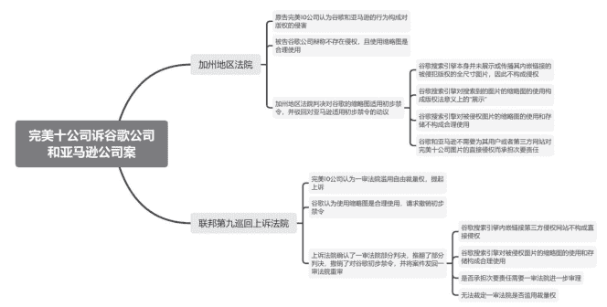

## 争议焦点

1. 搜索引擎对第三方侵权站点上全尺寸图片的框架链接，是否构成对权利人著作权的直接侵害。
2. 搜索引擎对侵权图片预览图的使用与存储，能否被认定为合理使用。
3. 搜索引擎是否要为用户或第三方站点对权利人图片的直接侵权承担次要责任。

## 裁判思路拆解

### （一）框架链接不等于展示与传播
判断链接是否构成版权法上的展示，主要存在两种技术视角：以服务器所在地为基准的判定法，和以内容纳入网页的判定法。加州法院最终采纳前者，理由包括：点击预览后真正向用户传输全尺寸图的仍是第三方站点，Google 并未提供该图像；此标准可避免搜索引擎被牵连进大规模侵权，又不完全排除责任；标准简明易懂；本案直接侵权者是先行上传图片的第三方；该标准在创作激励与信息流动间保持平衡。

在互联网语境中，实际传播指文件从一台设备传至另一台。Google 仅做框架与链接，传输全尺寸图的是第三方站点，Google 未参与传输，故无传播。

第九巡回上诉法院亦认同以服务器所在地为基准。图片的复制件存在于存储设备中。用户在 Google 页面框内看到的链接图，实质是 HTML 指令引导跳转，指令由文本构成，不等同于展示复制件。传播要求实际传播复制件，本案实际传播者是第三方侵权站点。Google 未收集完整尺寸复制件，视为传播规则不适用，故链接不构成展示权与传播权的侵害。

### （二）预览图使用被认定为合理使用
上诉法院认为，Google 检索对预览图的使用具有高度转换性。原图或为娱乐、美学或信息用途，检索将其转为导航指针，引导用户找到信息源，为原作品提供了全新使用方式并产生公共利益。转换性越高，不利于合理使用的商业因素权重越低。

作品性质方面，摄影作品较事实性作品更具创造性。权利人图片虽有创意但已发表，首次发行权已被行使，不再享有未发表作品的额外保护，该因素仅轻微支持原告。

使用数量与实质性方面，检索需使用整张图才能有效识别，复制部分会降低实用性，该因素对双方均无明显倾斜。

市场影响方面，预览图尺寸与分辨率远低于原图，不能替代；Google 使用主要服务于转换目的，无证据显示用户以预览图替代原图下载。该因素亦不支持原告。

综合四要素并以版权目的为依归，上诉法院认定 Google 对预览图的使用属于合理使用。

### （三）可能构成协同侵权
上诉法院指出，从协同侵权角度，Google 在相当程度上协助了第三方将侵权拷贝分发。协同侵权包括积极鼓励侵权，或传播无实质非侵权用途的产品。检索被认可具有实质非侵权用途，故焦点在于运营者是否明知具体侵权仍可轻易阻止却不作为。

Google 图片检索极大便利了侵权内容的全球分发与访问。即便其服务面向所有站点，也不能忽视对权利人的影响。一审未查明权利人通知的适当性、Google 的回应以及 Google 能否简单阻止侵权等事实，故不能直接认定无需承担协同侵权责任，需发回重审。

### （四）不构成替代责任
上诉法院认为 Google 既无权利也无能力阻止第三方站点侵权。替代责任要求运营者有权监管直接侵权者并从中获利。AdSense 合作虽让 Google 有权因侵权终止合作，但终止后第三方仍可侵权；Google 亦无技术能力逐一甄别互联网上所有图片是否侵权。故不构成替代责任。

## 审理节点

1. 2006 年加州法院认定 Google 链接第三方站点不直接侵权，但 Google 预览图使用构成侵权，Google 与 Amazon 无需为第三方直接侵权承担次要责任。遂批准对 Google 预览图的临时禁制，驳回对链接的禁制及对 Amazon 的禁制。
2. 2007 年第九巡回上诉法院维持“链接不侵权”判决，推翻“预览图侵权”判决，撤销禁令并发回重审。
3. 2010 年加州法院重审后，再次驳回权利人的临时禁制动议。
4. 2011 年第九巡回上诉法院维持原判。

## 适用法条概览

美国《数字千年版权法》第 501 条 a 款 规定了版权侵权行为的构成要件与适用主体范围。第 106 条 明确了版权所有者的专有权利，包括复制、制作衍生作品、分发、公开表演、公开展示、数字音频传输等。第 107 条 规定了合理使用的判断框架，包含使用目的与性质、作品性质、使用数量与实质性、对潜在市场的影响等四项考量因素。

## 案例启示

### （一）为搜索引擎类争议提供可操作分析框架
加州法院在判断链接是否侵权时采用服务器所在地判定法，兼顾了技术实现后果、司法可操作性与公共利益平衡。该思路只需看侵权作品存于何方服务器，对法官与平台均易理解，也在创作激励与信息传播间保持平衡。尽管技术发展使简单标准易被规避，但法院先做功能性分析再选标准的方法更具参考价值，有助于个案裁量。

### （二）推动转换性使用从内容转向目的
上诉法院认定预览图使用构成显著转换性使用，标志着合理使用认定从关注内容增添转向关注使用目的转变。Google 虽未在文学美术层面改变图像，但将其从观赏目的转为信息检索与导航目的，产生重大社会效益。此种目的性转换被视为合理使用的重要依据，影响了后续大量类似案件的判断。

“转换性利用”的要义在于使用目的从原作指向新的功能场域，这正是版权法在激发创作者热情与避免权利过度垄断之间做出的微妙调和。^([\[76\]](#txt003.html#footnote_content_txt003_76))进入互联网语境后，这种调和与公共利益的权衡变得更加关键，例如 Field v. Google Inc. 案中，审理机构着重指出搜索引擎所具有的社会公益属性，以及它对公众线上信息检索能力的促进作用。可以说，搜索技术的推进也在让版权法里合理利用的适用边界呈现出愈发灵活的态势。^([\[77\]](#txt003.html#footnote_content_txt003_77))

### （三）搜索产业在此案中获得松绑

本案汇聚了诸多前例，对搜索引擎在认定侵权、适用合理利用、承担责任过程中可能遭遇的风险进行了系统梳理。就直接侵权而言，“服务器标准”把搜索平台从直接侵权的指控里摘了出来，为其底层运行机制提供了法理背书，也在客观上降低了运营成本。就合理利用而言，二审法院将搜索引擎对缩略图的暂存与调用认定为著作权法意义上的合理利用，为信息汇聚、数据缓存以及商业化经营奠定了重要基础。就共同侵权而言，平台可能因推送指向第三方疑似侵权站点的链接而被视为协助传播，本案中谷歌正是通过向用户提供链接的方式参与了第三方侵权作品的流通。是否构成共同侵害，关键看平台是否明知侵权且有能力轻易阻断却未采取行动。就替代责任而言，搜索引擎与一般网络服务商不同，通常缺乏法律上的干预权力和现实的可执行手段去阻止侵权，因为即便停止索引，侵权本身也不会终止；而且搜索依赖算法自动抓取，很难逐一核验检索结果的合法性。总的来看，本案为搜索运营者吃下了一颗定心丸，使其得以摆脱多重连带指控。但责任认定过于宽松也可能诱发运营者过度使用缩略图、随意投放各种链接，进而对权利人的合法权益造成较大侵蚀。

### （四）技术激励与版权保护的再思考

从一定程度看，推动搜索发展、加快信息流动是本案判决重要的公共利益考量。不可否认，这一裁判也在某种程度上削弱了著作权人的正当利益。尤其在搜索服务高度繁荣的当下，纯文本链接、内嵌链接、框架链接等形态层出不穷，便捷的检索体验在提升公众获取效率的同时，也压缩了权利人的收益空间。任何技术进步都不应以权利让步为前提。因此，学界开始探讨链接侵权的新的判断路径，司法实践中也出现了更多元的审理思路与处理方式。

## 【关联判例推荐】

### 1. Sony Corp. of America v. Universal City Studios, 464 U.S. 417, 442 (1984)

核心事实：被告公司推出可在家边看电视边录像的家用录像机，原告认为其侵害版权并与使用者构成共同侵害。初审、上诉及最高法院均驳回诉求，认为家庭内部的时间位移属于可接受的合理利用。

与本案关联点：若产品具备实质性或商业意义上的非侵权用途，则不成立共同侵害。

### 2. Religious Technology Center v. Netcom On-Line Communication Services,Inc. (Netcom), 907 F.Supp. 1361, 1365-1366 (N.D.Cal. 1995)

核心事实：原告主张被告网通公司应为用户未经授权使用作品承担替代责任。法院认为被告虽有制裁与阻止能力，但仅收取固定月租，未直接获利，故无需承担替代责任。

与本案关联点：评估互联网服务提供者的著作权替代责任时，既要看其是否具备控制与制裁能力，也要看是否直接从中获利。

### 3. Kelly v. Arriba Soft Corp.,77 F Supp.2d 1116 (D.C.Cal. 1999)

核心事实：原告指控被告 Arriba Soft 公司在用户通过搜索引擎查找图片时提供缩略图结果，构成侵权。地区法院认为，搜索引擎提供的缩略图属于基于搜索的转换性合理利用，不会损害原告市场且利好公众。

与本案关联点：搜索引擎提供的缩略图是否属于合理利用的判断标准。

### 4. A & M Records, Inc. v. Napster, Inc., 239 F.3d 1004, 1013 (9th Cir. 2001)

核心事实：原告认为被告 Napster 明知且能够阻止用户通过软件分享未经授权的 MP3 音乐文件却放任，要求禁令。初审与上诉法院均认定该行为不属于合理利用，责令停止提供音乐交换服务。

与本案关联点：判断互联网服务提供者是否侵害传播权及是否分担侵权责任时，需考量平台是否具备实际的阻止能力。

### 5. Metro-Goldwyn-Mayer Studios Inc. v. Grokster, Ltd. 545 U.S. 913 (2005)

核心事实：一审以非中心化特点为由认为被告无法控制用户侵权而不成立侵权；上诉法院认为被告具有实质性非侵权用途且可能不知情。最高法院最终采用积极诱导标准，发回重审并作出有利于原告的判决。

与本案关联点：在判断互联网服务提供者是否与用户共同构成侵权时，通用的规则是积极诱导标准。

## 3.6 菲尔德诉谷歌案

### 【案件索引】

Field v. Google Inc., 412 F. Supp. 2d 1106 (D. Nev. 2006)

### 【关键词】

合理利用；默示许可；算法侵权；搜索引擎；转换性利用

### 【案件提要】

本案聚焦搜索引擎借助自动化程序对原始网页制作存档快照是否直接侵害原网页著作权作品。菲尔德指控谷歌未经许可利用自动化程序 Googlebot 对个人网页进行快照，侵害其网站作品著作权。谷歌抗辩称，菲尔德明知可通过 no-archive 元标签、robots.txt 等方式阻止 Googlebot 抓取却未采取措施，应视为默示许可其缓存。谷歌进一步指出，快照旨在减轻流量压力、提升传输效率，使用户更可靠地获取所需资料，该行为属善意转换性利用，并受《数字千年版权法》 DMCA 安全港条款^([\[78\]](#txt003.html#footnote_content_txt003_78))保护。此外，谷歌强调快照由自动化程序完成，并非主观故意。综上，谷歌主张未侵害菲尔德个人网站作品著作权。内华达州地区法院采纳其抗辩，认为快照符合《美国版权法》第 107 条^([\[79\]](#txt003.html#footnote_content_txt003_79))关于合理利用的规定，故不成立侵权。

关于快照是否受 DMCA 第 512 条 b 款保护，学界仍有争议，但在被后续判决推翻前，本案对类似案件具有参考价值，例如“谷歌数字图书馆案”^([\[80\]](#txt003.html#footnote_content_txt003_80))。本案亦确立了第 107 条在网页快照上的适用，体现美国法院倾向结合立法目的、综合四要素作出有利于公众与文化创新的裁判。

本案涉及的 DMCA 第 512 条 b 款及默示许可认定，对我国知识产权法完善具借鉴意义，如《信息网络传播权保护条例》第 23 条^([\[81\]](#txt003.html#footnote_content_txt003_81))和 2012 年最高人民法院《关于审理侵犯信息网络传播权民事纠纷案件适用法律若干问题的规定》第 5 条^([\[82\]](#txt003.html#footnote_content_txt003_82))均体现了对网络服务提供者网页快照行为的补充规制。最后，本案提升了国内互联网企业的侵权风险意识，推动相关机制升级，促进规范的信息传播平台建设与文化创新繁荣。总体而言，本案对因搜索引擎网页快照引发的著作权纠纷研究意义重大。

### 【案件要旨】

内华达州地区法院一审：原告 菲尔德，被告 谷歌

原告菲尔德为作家、律师，亦为内华达州律师协会成员。2004 年 4 月 6 日，菲尔德向谷歌提出控诉，主张谷歌通过自动化程序 Googlebot 形成其个人网站网页快照，直接侵害其发布在 www.blakeswriting.com 上的作品《Good Tea》的著作权。

2004 年 5 月 25 日，菲尔德提交修正诉状，主张谷歌直接侵害其个人网站另 50 幅作品，要求判赔 2,550,000 美元法定赔偿，即 51 项注册作品每项 50,000 美元，并请求禁令救济。

谷歌抗辩理由：（1）默示许可：版权人可明示或默示授予非独占许可。菲尔德明知行业通行的 no-archive 元标签可指示搜索引擎不得快照却未使用，可合理解释为默示许可。（2）禁反言规则：原告以沉默或不作为助成侵权，不得再主张侵权。菲尔德明知不发送“不得缓存”指令即会被自动生成快照并向用户展示，依禁反言不得主张。（3）合理利用：依据《版权法》第 107 条，需综合目的与性质、作品性质、使用比例及对市场影响四要素判断，谷歌的使用符合合理利用要求，不成立侵权。（4）DMCA 安全港第 512 条 b 款：服务提供者临时存储资料致侵权不承担金钱救济责任，谷歌符合该要求。

2005 年 9 月 27 日，菲尔德提出简易判决动议，要求认定侵权并驳回谷歌关于合理利用、默示许可、禁反言及 DMCA 安全港的抗辩。谷歌则基于非侵权、默示许可、禁反言及合理利用提出简易判决申请。

2005 年 12 月 19 日，内华达州地区法院审理后，支持谷歌基于 DMCA 的主张，认定谷歌未侵害菲尔德个人网页作品著作权，驳回菲尔德的简易判决动议。

### 【案例事实思维导图】

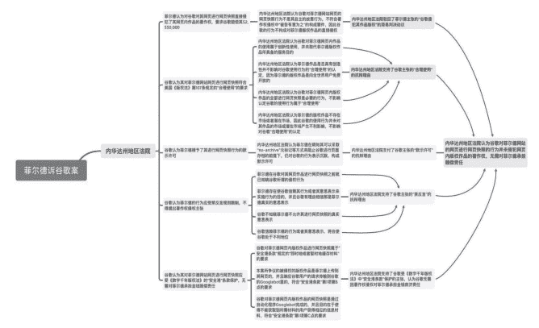

### 【核心争议点】

1. 谷歌通过自动化程序生成原网页快照并允许用户访问下载，是否构成对原网页作品著作权的直接侵害。
2. 谷歌对菲尔德网站作品的使用是否符合《版权法》第 107 条合理利用要求。
3. 菲尔德的行为是否构成对谷歌使用其网页作品的默示许可。
4. 菲尔德的行为是否适用禁反言规则。
5. 谷歌对网站进行快照是否需因著作权侵权承担金钱救济责任。

### 【裁判论证过程】

#### （一）谷歌通过自动化程序生成针对原网页的网页快照并允许用户访问与下载该网页快照的行为不构成对原网页内作品著作权的直接侵害

内华达州地区法院认为，原告若主张侵权需证明三项要素：（1）享有著作权；（2）被告复制作品；（3）被告系故意为之^([\[83\]](#txt003.html#footnote_content_txt003_83))。

法院分析后认为，双方对菲尔德享有著作权无争议；争议焦点在第三项，即谷歌允许用户访问下载含菲尔德作品的快照是否构成《版权法》所称的故意“复制”或“发行”。法院认为，谷歌允许用户访问下载由 Googlebot 自动生成的快照并不代表其具有侵权故意，谷歌在此过程处于被动地位，计算机仅自动响应用户请求，若无请求则不会生成并发送，快照侵权也不会发生。

因此法院认为，菲尔德指控的谷歌行为系响应需求的自动、无意识操作，不符合直接侵权所需的“故意”要件，故不成立对原始网页作品的直接侵害。

#### （二）谷歌对菲尔德网站网页内作品的使用是否符合美国《版权法》第 107 条规定的“合理使用”的要求

内华达州地区法院认为，依据第 107 条，判断合理利用需综合以下四要素：（1）使用的目的与性质，包括是否商业或非营利教育目的；（2）受保护作品的性质；（3）使用部分的数量与实质性；（4）该使用对作品潜在市场或价值的影响。

法院分别分析：

首先关于目的与性质，法院引用最高法院观点——“合理利用分析聚焦于新的使用是否取代了作品原有服务目的”。同时参考 Kelly 诉 Arriba Soft Corp 案^([\[84\]](#txt003.html#footnote_content_txt003_84))，第九巡回法庭认定搜索引擎对受版权保护照片的缓存属于转换性合理利用，因其目的在于改善用户获取照片途径，与照片本身服务目的不同，未构成替代。

# 案例文本排版

## 合理使用因素分析

法院认为，谷歌对菲尔德作品的页面存档同样构成转换性利用，其目的与原作服务目的相异。具体理由有五：第一，页面存档功能使用户在原网页无法访问时仍能获取内容，快照并未取代原作，反而帮助用户定位原本难以获得的信息，具有公共利益；第二，快照记录特定网页的历史内容，随时间推移可让用户感知现网页与原网页的差异变化；第三，页面存档可自动高亮搜索词，使用户更快找到对应信息，这是原作不具备的功能；第四，谷歌通过显著免责声明表明其提供存档并非为替代访问原站，且声明中附有通往原网页的链接，无证据表明用户因快照而替代访问原站；第五，谷歌确保网站所有者可便捷阻止快照，例如 no-archive 元标记行业规则。此外，数亿网页的创建者默认保留页面存档，表明多数站长并不将谷歌存档视为对自身网页的替代。

谷歌网页快照案为何被认定为合理使用

内华达州地区法院在审理菲尔德诉谷歌案时，对合理使用的四个要件进行了逐项判断，并最终支持了谷歌的抗辩。

先看作品本身的性质这一项。法院的立场与九巡在Kelly案中一致，认为在综合判断合理使用时，第二项因素分量并不重。即使菲尔德的作品具备相当的创造性，他仍把作品放到网站上向全球用户免费开放，并通过 robot.txt 文件主动确保搜索引擎能够收录。这些做法表明他希望作品被尽可能广泛、免费地传播。仅凭创造性高低，对菲尔德的主张提供不了多少帮助。

再看使用数量与实质性的问题。法院援引了最高法院在索尼诉环球影业案中的表述：只要使用的目的与原作目的不同，即使复制了全部内容，也不会自动排除合理使用。Kelly案里九巡同样指出搜索引擎整张照片的使用并不关键。结合本案，菲尔德本人就允许任何人免费获取作品，谷歌做页面存档需要完整网页才能实现其创新的公共服务功能，仅靠片段无法让用户看到网页本来的面貌，也无法实现存档的对比功能与关键词高亮功能。若不允许存取完整页面，存档就无法帮助用户访问已失效或不可达的页面。基于必要性，即便谷歌抓取了全部内容，也不影响合理使用的认定。

第三个要件是市场影响。索尼案的思路是，只要使用不触及作品的潜在市场或价值，就没有必要以保护创作积极性为由禁止。菲尔德把整套作品免费公开，从未通过销售或授权获利，也没有证据显示其作品存在市场；也没有任何证据证明谷歌的快照对潜在市场造成损害。因此法院认为没有不利影响的证明。

除了法定四要素，法院还注意到谷歌的善意表现。第一，网站所有者不允许时谷歌不会生成快照，严格遵循行业通行的选择退出机制；第二，谷歌公开说明如何设置不被存档，并提供快速删除的自动化服务；第三，谷歌在技术上确保用户很容易跳转到原网页，并在快照中明确标识其为存档版本。值得一提的是，菲尔德真实反对的态度在诉讼中才被谷歌知晓，在收到删除请求后，谷歌即刻删除了相关快照。

### （三）菲尔德的行为是否构成授予了谷歌使用其网页内版权作品的“默示许可”

法院认为许可是版权侵权中的重要抗辩，著作权人可通过明示或默示方式授予非独占许可。当著作权人的行为足以让他人合理推断出同意使用时，即构成默示许可，无需口头表达，明知他人使用而放任也可被推定为许可。

网络专家Dr. John Levine作证称，网站创建者通常以元标记向搜索引擎表达意愿，其中 no-archive 元标记是行业公认的标准，能够指示搜索引擎不要缓存页面。

菲尔德承认自己了解这一行业规则，也知道设置 no-archive 可以阻止谷歌展示快照，但他并未在页面中添加该标记。他同时清楚，缺少该标记通常会被理解为允许缓存，却仍选择不阻止并任由谷歌继续使用。根据默示许可的规则，这一沉默与放任足以被合理解读为对谷歌使用的许可。

综合来看，法院认定菲尔德的行为构成对网页快照使用的默示许可。

### （四）菲尔德的行为是否应当适用“禁反言规则”

禁反言规则的核心是，当原告促成被告侵权或以沉默不作为诱导被告，后者有理由信赖时，原告不得再主张侵权。对此，法院要求谷歌证明四个要件：原告知晓侵权行为的存在；原告意图让被告信赖其行为；被告不知悉原告真实意思；被告因信赖而处于不利处境。

关于知晓性，菲尔德在庭审中承认，明知作品上网后除非明确指示，否则谷歌会自动存档，且用户点击快照可能获取缓存副本，因此其对被控行为是清楚的。

关于意图，菲尔德从未表达不愿提供快照的意愿，一直保持沉默，明知可通过 no-archive 元标记或 robot.txt 文件表达禁止，却仍任由快照生成，足以构成诱导信赖。

关于真实意思，谷歌并不知晓菲尔德反对快照的真实态度。

关于不利后果，若提前知晓要求，谷歌本不会生成快照，诉讼本可避免。因此信赖导致了实际损害。

法院据此认定禁反言规则适用，菲尔德无权以侵权为由起诉。

### （五）谷歌对菲尔德网站网页进行网页快照的行为是否要因著作权侵权承担金钱救济责任

菲尔德主张谷歌不符合DMCA第512条b款的安全港，要求承担金钱责任。法院认为主张证据不足，谷歌的行为受安全港保护，具体分三点。

其一，是否属于临时缓存。菲尔德认为不符合中间性临时缓存要求。法院参照埃里森诉罗伯逊案，AOL缓存14天被九巡认定为临时缓存。本案谷歌快照一般保存14至20天，性质相近，符合第512条b款第1项A点的要求。

其二，是否由他人上传。条款要求材料由他人在线提供并在指示下传输。本案中菲尔德为响应搜索请求，将作品传输至Googlebot，谷歌作为第三方接收，符合第1项B点。

其三，是否通过自动化程序为提供信息目的。快照显然由自动化技术完成，且其目的正是帮助因各种原因无法访问原网页的用户获取信息，符合第1项C点。

因此，法院认为谷歌满足DMCA第512条b款全部要件，受安全港保护，无需承担金钱救济责任。

【审理结果】
1. 新泽西州地区法院驳回了菲尔德要求认定谷歌直接侵犯其作品著作权的简易判决动议。
2. 新泽西州地区法院驳回了菲尔德要求否认谷歌抗辩理由的简易判决动议。
3. 新泽西州地区法院支持了谷歌的全部抗辩，认定谷歌未直接侵犯菲尔德作品著作权，无需赔偿。

【相关法条】
《美国版权法》第107条
尽管有第106条和第106A条规定，出于批评、评论、新闻报道、教学、奖学金或研究目的，合理使用著作权作品并不构成侵权。判断时应考虑：使用的目的和性质；作品的性质；使用部分的数量和实质性；对潜在市场或价值的影响。作品未发表不妨碍合理使用结论。

《美国数字千年版权法》第512条b款第1项
服务提供商因在其系统或网络上临时缓存材料而不承担金钱救济责任的条件为：材料由他人在线提供；在他人指示下传输；缓存以自动化技术进行，目的为让用户获取他人提供的材料，且满足第2款条件。

【案例评析】
### （一）本案辨析和明确了美国《版权法》第107条在网页快照上的适用
版权法第107条的四项判断因素中，第一项使用目的与性质、第四项市场影响权重更大。本案再次确认这一分配。非商业性或转换性使用更容易被认定为合理使用；若使用侵占原作市场则认定困难。网页快照由爬虫抓取并自动存储，用户请求时才运行，被动且具有公益检索功能，使用目的与原作明显不同。法院认定其具有转换性，并在微弱的市场影响与巨大社会利益之间权衡，作出合理使用判断。基于信息便于获取的公共利益，合理使用制度倾向于为搜索引擎松绑，促进知识流动。

### （二）本案认可网页快照适用DMCA“避风港原则”引发争论
DMCA第512条b款为在线缓存提供责任限制，网络服务提供商作为中介短暂保存信息以应对流量，传统缓存场景下侵权风险被豁免。本案将该原则延伸至搜索引擎快照，引发关于缓存边界的讨论。

网页快照能躲进安全港吗？菲尔德诉谷歌案拆解

学界对安全港规则能否延伸到搜索引擎提供的网页快照，一直没有统一意见。本案中原告菲尔德就主张，安全港不应用来为谷歌的快照功能护航。法院的说法是谷歌夹在内容提供方和信息使用者中间，具有资料库的特征，所以把缓存行为认定为中间性。^([\[95\]](#txt003.html#footnote_content_txt003_95)) 这种定性却忽视了系统缓存与快照在本质上的差别。回看立法本意，安全港所指的临时复制，必须发生在信息传输的链路之内，也就是信息原本要经过“网站服务器—中转服务器—用户”这条路径。网页快照是搜索引擎自己给出的备选浏览方式，并不是信息传递的必经环节，用户可以点开原链接，也可以直接看快照。这属于两种不同的信息获取通道，不能混为一谈。西班牙巴塞罗那上诉法院在审理谷歌缩略图快照纠纷时就明确，安全港针对的是传输过程中产生的临时保存，不适用于谷歌事先存放在自己服务器里的快照。^([\[96\]](#txt003.html#footnote_content_txt003_96))

即便学界对本案关于谷歌缓存性质的认定提出大量质疑，在没有后续判决推翻或更正之前，这一裁判对判断类网上图书馆这类在线信息服务机构的信息导航、存档、检索行为是否合法仍有重要且积极的参考价值。网上图书馆的做法和网络服务提供商有很多可比之处，它只是把已保存的网页递交给终端用户，因而可以以存档的中间属性来主张免责。现有判例已经确认适用安全港条款的缓存行为的合法性，为后来的案件提供了先例。

### （三）默示许可在搜索领域迎来判例首肯

取得许可属于版权侵权的抗辩事由之一，而默示许可在民法上原本是对民事主体行为的一种推定。在网络版权领域，用默示许可来判断是否侵权一直存在争议。美国司法实践中已有不少案例适用默示许可，本案同样为这一理论在网络环境下的适用提供了支持。法院的判断标准是权利人知晓该使用并且事实上鼓励该使用。法院认为菲尔德承认自己知道谷歌的使用，却未做任何行动表达态度，实际上默许了谷歌对网页的复制，这是一种沉默推定。当权利人能够作为而不作为，其行为足以让善意相对人相信其同意使用时，沉默即被推定为许可。可惜的是，法院并未对判断标准作具体展开。何为知晓、何为鼓励？本案因菲尔德自认知晓而避开了知晓的认定，其他情形下能否推定知晓，这些问题仍未解决。

用户在网上获取信息高度依赖搜索引擎，而搜索引擎的正常运转也依赖默示许可制度。版权排他性的封闭会限制信息共享，制约线上环境的发展。技术进步很快，法律却滞后，行业惯例便发挥了补充调节作用。在网络实践中，默示许可已成为搜索引擎的一种通用行业规则。本案法官以功能解释的方式首次确认了搜索引擎的默示许可。由此获得判例支持，为今后类似争议适用默示许可制度开辟了路径。在信息网络发展的利益与版权利益之间进行权衡时，默示许可制度必将成为重要的侵权抗辩理由。

### （四）给平台与权利人的双向提醒

在今天这个时代，人们获取信息基本依赖搜索引擎工具，如果不能妥善衡量著作权保护与信息传播的关系，类似争议会反复出现。为推进知识产权保护，需要所有线上参与者共同营造有利于知识产权发展、鼓励信息在平台流通的环境，推动文化创新与传播。

就公司端而言，以谷歌这类向用户提供信息的线上公司为例，为了避免类似诉讼，需要从机制上提高对版权声明的注意，在必要领域可把默示许可改为明示许可；在商业化项目中务必注意侵权风险。本案中谷歌的复制、索引是在未经明示授权的情况下进行的。有学者估算，若把谷歌的网页快照行为认定为侵权，其赔偿额将超过美国国债的100倍。^([\[97\]](#txt003.html#footnote_content_txt003_97)) 随着侵权认定的范围趋严，所有线上公司都应尽快采取合理措施避免无意侵权，降低法律风险。

就权利人端而言，像原告菲尔德这样把作品发布在个人网站的著作权人，也需要主动作为，不能被动等待。比如在需要时主动使用robots排除协议、元标记等行业标准规则拒绝被收录，或直接向搜索引擎请求移除特定内容。在维护自身版权的同时，也不要为了一己私利刻意阻碍信息在网络平台的交流。

### （五）判例对后续诉讼的辐射效应

本案对后续案件产生影响。在紧随其后的谷歌数字图书馆案^([\[98\]](#txt003.html#footnote_content_txt003_98))中，谷歌扫描并数字化图书使其可被搜索，是否适用默示许可与合理使用成为焦点。谷歌自2004年起启动数字图书计划，对大量图书进行扫描供用户搜索并在线浏览，这可视为另一种图书快照，遭到出版界的抗议和诉讼。该案同样探讨了版权法目的与合理使用制度的关系，将扩充公共知识、促进文化繁荣作为重要考量，最终作出合理使用判断。但案件并未在默示许可上展开拉锯。谷歌主动调整许可策略，仅对获得出版社、作者授权的图书开放搜索与预览。与菲尔德诉谷歌案不同，主要原因在于全量图书复制涉及利益巨大，出版界阻力强；其次，虽然谷歌假设大部分作者希望作品被搜索传播，但并没有像元标记或robot.txt那样公认的排除协议来清晰推定出版权人的主观意愿。于是再合理的假设也难以成立，默示许可难以适用。值得反思的是，在关乎人类知识传播的数字图书馆这类重大公共利益面前，知识产权制度的利益天平能否向默示许可倾斜，为知识搜索提供更具弹性的空间。

## 【关联判例推荐】

### 1. The Authors Guild, Inc. v. Google, Inc., 954 F.Supp.2d 282 (2013)

核心事实：谷歌将图书馆图书数字化并建立电子数据库，向搜索者展示版权作品的片段。美国出版商和作家协会等权利人起诉谷歌侵权。一审法院认为行为属于合理使用；二审法院从版权法目的出发认为，版权法最终目标是扩充公共知识，合理使用制度允许特定情形下未经授权复制，以促进信息共享和科技艺术进步。一审、二审均认定谷歌图书馆计划不构成侵权。

关联解读：从版权法目的角度诠释合理使用制度。

### 2. Campbell v.Acuff -Rose Music, Inc., 510 U.S. 569 (1994)

核心事实：上诉法院认为2 Live Crew乐队对电影主题歌《漂亮女人》改词改曲不构成合理使用。最高法院对合理使用的四项判断标准作了详细阐述，认为四要件不可孤立对待，应整体权衡，每个要件都是评价的一部分。

关联解读：权衡四种因素判断合理使用，而非将其视为确定性标准。

### 3. Perfect 10 v. Google, Inc., 416 F. Supp. 2d 828, 844(C.D. Cal. 2006)

核心事实：初审法院认为谷歌展示图片会影响Perfect 10图片在手机上的销售，因而转换性不足。上诉法院推翻该判决，认为相较于销售损失，谷歌的转换性使用更具重要性。谷歌使用意图与Perfect 10截然不同，且具有公共价值。

关联解读：四要件权重并非等同，强调第一要件转换性使用的重要性。

### 4. Religious Tech. Ctr. v. Netcom On-Line Communications Servs., Inc., 907 F.Supp. 1361 (N.D. Cal. 1995)

核心事实：原告RTC认为Erlich将著作转帖至BBS网站构成侵权，并将网站经营者和服务提供者列为共同被告。BBS终端对用户上传资料的短暂保存系系统设置且无人为干预，网站方无法控制用户上传信息。法院认为在无人为干预下，自动临时存储并传播给用户的行为缺乏意志性，不构成直接侵权。

关联解读：系统响应用户要求而进行的自动、非意志性行为未构成直接侵权。

### 5. Keane Dealer Servs., Inc. v. Harts, 968F.Supp. 944, 947 (S.D.N.Y.1997)

核心事实：纽约州南区联邦地方法院认定，使用受版权保护作品不一定需要明示许可，若版权持有人知晓使用并予以鼓励，使用人可基于权利人沉默推定其同意使用。

关联解读：权利人对使用的了解及沉默构成默示许可。

### 6. Ellison v. Robertson, 357 F.3d 1072, 1081 (9th Cir.2004)

核心事实：第九巡回法庭援引DMCA立法历史，认为第512条a款要求存储材料需中间性且临时性。本案存储库在发布信息者与请求信息者之间运行，存储并允许访问时间约14天，被视为临时存储。

关联解读：14天左右的临时且中间性存储受DMCA避风港保护。

## 3.7 阿森蒂夫有限责任公司诉观点公司案

### 【案件索引】

Ascentive, LLC v. Opinion Corp., 842 F. Supp. 2d 450 (E.D.N.Y. 2011)

### 【关键词】

商标侵权；通讯规范法；搜索引擎算法

### 【案件提要】

本案是线上环境催生的一种新型诉讼。软件开发商阿森蒂夫有限责任公司和床垫制造商经典品牌有限责任公司分别起诉愤怒消费者网站运营者观点公司及其高管，指控其违反反勒索及受贿组织法和兰哈姆法以及各州法律。合并诉讼后，原告申请初步禁令，要求关闭含有针对其产品负面评论的网页。

在商标侵权领域，法院明确了消费者评论网站的侵权责任形态——帮助侵权及其要件，强调该类网站作为计算机服务提供者的中立性，无需对用户生成内容或第三方广告承担间接侵权责任；且因不存在商业混淆，亦未构成直接侵权。判决保护了评论网站及其用户的言论自由，降低了该类网站责任，推动线上产业高效发展。

本案是通讯规范法第230条从规制色情低俗内容拓展至商标侵权、商业欺诈、贿赂等领域的又一例证。面对原告依据州法提出的诸如不当得利等指控，被告主张依据通讯规范法第230条享有州法豁免，法院最终支持被告。

值得注意的是，被告评论网站的身份及盈利模式具有代表性，其盈利中对信息的调控方式与过往案例有所区别，这要求法院发挥承前启后的作用。本案关于第230条适用的论证逻辑清晰，从豁免要件入手，兼顾先例并与自身逻辑紧密结合，对理解好撒马利亚人条款具有借鉴价值。

2008年“roommate.com 案”开创性地认定索取、鼓励非法内容属于形成，自此美国法院在解释通讯规范法第230条时一定程度上摆脱了Zeran案的影响，修正了解释时可能出现的过度简化网络传播活动、忽略服务提供者商业性质等弊端。^([\[99\]](#txt003.html#footnote_content_txt003_99)) ^([\[100\]](#txt003.html#footnote_content_txt003_100))

法院坦言，尽管被告借助负面评论牟利的行为在商业伦理上值得商榷，仍作出支持豁免的保守判断，实质遵循国会立法宗旨，凭借第230条对中立计算机服务提供者进行豁免，以实现线上言论自由，避免寒蝉效应损害宪法第一修正案权利。判决也可能因指控及证据充分性而纵容了被告利用负面评论获利的嫌疑，未能充分保护原告合法商业利益，引发了对第230条适用的进一步思考。

### 【案件要旨】

美国纽约东区法院：原告 阿森蒂夫有限责任公司、经典品牌有限责任公司

被告 观点公司及其高管（首席执行官迈克尔·波多尔斯基、总裁亚历克斯·西罗夫、营销总监乔安娜·克拉克·辛普森）

原告阿森蒂夫主要从事计算机软件产品开发销售，拥有Ascentive等注册商标。原告经典品牌生产销售睡眠产品，拥有Dormia注册商标。被告观点公司运营愤怒消费者网站，建立了含原告商标的子域名，如ascentive.pissedconsumer.com。消费者可在该页面浏览原告产品信息并发布负面评论。2011年，原告依据联邦民事诉讼规则第65条提交初步禁令动议，要求关闭涉案网页。

原告声称网页包含由被告直接或间接创造的、真实性不明且针对原告产品的负面评价；被告利用黑帽技术进行搜索引擎优化，使含负面评论的网页排名靠前。愤怒消费者在域名、元标记、内容中使用原告商标构成美国法典第15卷第1114条第1款和第1125条a款规定的商标侵权、不正当竞争和虚假原产指定。此外，其声誉管理服务收取高额费用，允许公司联系消费者删除负面评论、高亮商家争议解决方式并隐藏负面评论及修改子域名网页描述性内容，构成反勒索及受贿组织法禁止的勒索、贿赂等欺诈行为。

2011年12月13日，纽约东区法院驳回原告初步禁令，认为愤怒消费者某些行为可能不符合商业道德，但并未违反现行法律，无法提供法律救济。2012年5月3日，法院批准阿森蒂夫公司在不损害利益情况下自愿撤回其诉请。

### 【案例事实思维导图】

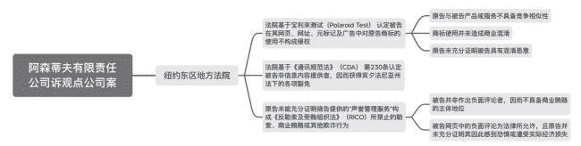

### 【核心争议点】

1.被告在其网页、网址、元标记及投放广告中使用原告注册商标是否构成美国法典第15卷第1114条第1款和第1125条a款规定的商标侵权、不正当竞争和虚假原产地指定。

2.被告是否能在通讯规范法230条项下不被认定为信息内容提供者从而就其行为获得州法下的豁免。

3.被告提供的声誉管理服务是否构成反勒索及受贿组织法禁止的勒索、贿赂和其他欺诈行为。

### 【裁判论证过程】

#### （一）被告在其网页、网址、元标记及投放广告中使用原告注册商标不构成商标侵权、不正当竞争和虚假原产地指定

## 判决分析

纽约东区法院采用宝利来测试评估被告行为是否可能造成混淆——该测试包括七个方面：商标强度、商标相似度、产品竞争相近性、在先使用者弥合差距可能性、实际混淆证据、被告恶意、产品质量、相关群体复杂程度等。法院认为要素考量并非机械，需整体判断消费者是否可能被混淆。法院认为在先使用者商标强度、商标相似度等因素对原告有利，但其他因素对原告不利：原告与被告产品服务不具竞争相似性，原告未充分证明实际混淆及被告产生混淆的恶意，被告未造成通常谨慎购买者误认产品或服务由商标权利人赞助或批准，从而产生混淆。因此，被告在域名、网页内容、元标记、广告中使用商标未构成商标侵权。进一步地，法院依据宝丽来测试标准，就被告在域名、网页内容、元标记及投放广告中对商标使用的混淆可能性作出了具体判断：

### 商标侵权判断

Pissed Consumer 判例核心要点重述

### 域名与页面标注不构成混淆误导
法官的核心判断是，消费者看到包含“`Pissed`”这类明显负面情绪词的域名时，不会合理推断该评论站点属于商品的生产方或得到其背书。网页正文中出现原告标识，被认定为典型的批评性使用，其目的在于搭建一个供公众发表不满的空间，而不是抢占市场。站点内发表的负面评价显然不可能得到品牌方的认可。

### 元数据使用与初始注意混淆被否定
关于元数据里是否使用商标是否构成侵害，审理重点落在 `initial interest confusion` 是否成立。该概念在本案被解释为：消费者借助搜索引擎寻找原告官网时，因网址相似而被导向被告站点。法院否定了这种可能，关键在于双方不存在竞争关系，流量被转移的动机不足。

权利方援引 `Brookfield` 案^([\[101\]](#txt003.html#footnote_content_txt003_101)) 主张被告通过 `search engine optimization`，SEO 实施不正当排名，主张的操作包括搭建无实质内容的跳转页、在代码与链接中大量堆砌品牌词、跨站重复发布过时投诉以制造新鲜感等。法院认为对元数据做 SEO 的理解有误，当前搜索引擎主要依赖算法排序。即便存在不合规的 SEO，也仅是违反搜索引擎服务规则，不触及商标法，不能据此主张商标救济。

### 广告关联指控被驳回
权利方称被告经奇缔卡公司投放广告，导致其产品评论页出现竞品广告并使用了阿森蒂夫公司的标识。法院认为被告并非投放主体，最多构成 `contributory infringement`。不过权利方举证不足，未能证明被告对奇缔卡投放内容有控制权，未能证明被告在明知或应知侵权后仍持续提供服务，也未能证明被告诱导奇缔卡投放侵权广告，故该请求不被支持。

### 通信规范法第230条豁免的适用
纽约东区法院认定被诉方不属于《通信规范法》第230条(f)款第(3)项规定的信息内容提供者，据此依据第230条(e)款第(3)项获得州法层面的豁免。被诉方虽鼓励用户提交负面评价，但并未煽动诽谤性内容；对评论的排序与呈现虽有调整，却未通过增删内容等方式实质影响第三方 `substantive content` 的形成 `development`，未行使传统出版者所享有的决定出版 `publish`、撤回 `withdraw` 或修改 `alter` 权利；即便借助 SEO 提升搜索可见度，也不等同于对第三方内容的实质改写。综合来看，评论网站不构成信息内容提供者 `information content provider`，观点公司无需承担州法责任。法院进一步强调，除非国会修订该法，即便被诉方拒绝删除网页或评论甚至从中获利，在法律上也无可指摘，商业道德另当别论。

### 反勒索及受贿组织法不成立
法院认为权利方未能充分证明商业贿赂或勒索事实。被诉方并非负面评论的撰写主体，不符合商业贿赂的主体要件；权利方亦未证明运营负面评论网站本身违法，亦未充分证明因被诉方行为遭受基于恐惧的实际经济损失，被诉方行为不构成勒索。法院明确，权利方无权要求其商业利益免受“愤怒消费者”负面评价的影响。

## 审理结果
1. 2011年12月13日，纽约东区法院驳回权利方的初步禁令动议；
2. 2012年5月3日，纽约东区法院批准阿森蒂夫公司在不损害其利益前提下自愿撤回其索赔的动议。

## 相关法条
《兰哈姆法》第32条第（1）款（Lanham Act §32（1），15 U.S.C. §1114（1）（2005））

（1）未经登记人同意而

（a）将一注册商标的复制品、伪造品、仿冒品或欺骗性的仿制品在商业中运用于商品或服务的销售、许诺销售、分销或推广中，可能引起混淆，误认或欺骗；或

（b）复制、伪造、仿冒或欺骗性仿制注册商标，并将复制、伪造、仿冒或欺骗性仿制的商标在商业中应用于商品或服务的销售、许诺销售、分销或推广所使用或相关的标签、标识、印刷品、包装、包装纸、容器或广告上，可能引起混淆，误认或者欺骗的，

应当在注册人为获得以下规定的救济而提起的民事诉讼中承担责任。

《兰哈姆法》第43条（a）款（Lanham Act §43（a），15 U.S.C.§1125（a）（2012））

（a）民事诉讼

（1）任何人在商业中，在商品或服务上或与之相关方面，或在商品的容器上，使用任何文字、术语、名称、符号或图形，或其组合，或任何虚假的原产地标记，对事实的虚假或误导性描述，或对事实的虚假的或误导性表述，

（A）很可能导致混淆，或导致错误，或在该人与另一人的联合、联系或关联方面，或在另一人对其商品、服务或商业活动的来源、赞助或批准方面欺骗，或

（B）在商业广告或推广中，错误表示了他或她或他人的商品或服务或商业活动的性质、特征、质量或原产地，

在任何人认为这种行为已经或可能使其蒙受损害而提起的民事诉讼中，该人应承担责任。

《通讯规范法》第509条（Communications Decency Act of 1996 §509，47 U.S.C.§230（2018））

（c）保护“好撒马利亚人”屏蔽和过滤冒犯性材料

（1）出版者或发言人的待遇

交互式计算机服务的提供者或使用者不得被视为其他信息内容提供者所提供的任何信息的出版者或发言人。

（2）民事责任

交互式计算机服务的提供者或用户不应因以下原因承担责任：

（B）采取措施，为信息内容提供者或其他人提供技术手段，以对前款之材料加以限制访问

（e）对其他法律的影响

（3）州法律

本节的任何规定不得解释为阻止任何州执行与本节一致的州法律。根据与本节不一致的任何州或地方法律，不得提起诉讼，也不得施加任何责任。

（f）定义

（2）交互式计算机服务

“交互式计算机服务”是指任何提供或使计算机由多个用户访问计算机服务器的信息服务、系统或访问软件供应商，包括专门提供接入互联网的服务或系统等系统操作或服务提供的库或教育机构。

（3）信息内容提供者

“信息内容提供者”是指对通过互联网或任何其他交互式计算机服务提供的信息的创造或形成负有全部或部分责任的个人或实体。

《反勒索及受贿组织法》第1962条（Racketeer Infl uenced and Corrupt Organizations Act §1962，18 U.S.C. §1962（2016））

（c）被从事州际或对外贸易，或其活动影响州际或对外贸易的任何企业雇用或与之有联系的任何人，通过敲诈勒索活动或收取非法债务的方式，直接或间接地进行或参与处理该等企业的事务，即属违法。

## 案例评析
### 域名与元数据侵权认定标准被调整
1996年，伊斯特布鲁克 `Frank H. Easterbrook` 法官提出《网络空间与马的法律》，认为网络法本质仍是传统法的延伸.^([\[102\]](#txt003.html#footnote_content_txt003_102))劳伦斯 `Laurence Lessig` 教授以“代码即法律” `code is law` 强调网络法应与传统解释路径相区别.^([\[103\]](#txt003.html#footnote_content_txt003_103))由此引发网络法是否应独立成部门的讨论.^([\[104\]](#txt003.html#footnote_content_txt003_104))

在商标领域，`Brookfield` 案把传统“初始兴趣混淆”移植到网络的做法饱受质疑.^([\[105\]](#txt003.html#footnote_content_txt003_105))该案忽视页面切换的便捷性，仅因域名包含原告商标即认定侵权，即便缺乏混淆且难以实现转向.^([\[106\]](#txt003.html#footnote_content_txt003_106))本案着眼于网络特性，对初始兴趣混淆在互联网的扩张持否定态度，推翻1999年 `Brookfield` 案结论，借助宝丽来分析标准指出，评论网站作为非竞争者，其域名及元数据中使用商标不违反《兰哈姆法》，在一定程度上收窄了商标权保护范围，为第三方平台保留运营空间。

值得注意的是，此种否定在很大程度上源于本案事实的特殊性。观点公司运营的“愤怒消费者”网不从事与原告竞争的业务，且域名包含 `Pissed` 等负面词汇，访问者难以联想双方存在授权或赞助关系。若处于竞争关系，结论可能不同。相似的 `Soter` 案^([\[107\]](#txt003.html#footnote_content_txt003_107)) 中，原被告经营相似产品且互为竞争，被告使用与原告网址 `www.fl ysense.net` 相近的 `www.fl ysense.com` 并推送自营竞品，法院据此认定存在混淆可能，并未排除初始兴趣混淆分析。

本案被诉方使用了被指为不符合商业道德的“黑帽技术”SEO，因双方非竞争关系，法院未在商标法下追究责任。如何规制此种行为成为延伸议题。法院认为，若该行为确违反搜索引擎服务条款，搜索引擎运营商可通过降权或移除等手段惩戒，即搜索引擎运营商才是合适的制止主体。实践中，搜索引擎确在采取惩戒，如 `Search King` 案^([\[108\]](#txt003.html#footnote_content_txt003_108)) 中，谷歌对滥用SEO、操纵 `Google Pagerank` 的网站“搜索王” `www.searchking.com` 进行了处罚，虽未正式确认，但获其雇员承认.^([\[109\]](#txt003.html#footnote_content_txt003_109))

### 平台间接责任边界的厘清
2001年，美国联邦第九巡回上诉法院在 `A&M 诉 Napster 案` 确立知识产权间接侵权三大类型：帮助侵权 `contributory infringement`、教唆侵权 `inducement infringement` 及替代责任 `vicarious liability`。^([\[110\]](#txt003.html#footnote_content_txt003_110))帮助侵权指明知他人侵权仍引诱、促成或提供实质帮助。^([\[111\]](#txt003.html#footnote_content_txt003_111))本案明确，评论类网络服务提供者的间接侵权典型形态是帮助侵权，且因难以满足“明知”与“帮助”要件，在非版权领域无需借助《通信规范法》第230条豁免，在版权领域无需借助《数字千年版权法》DMCA 避风港规则即可不承担责任。

法院遵循先例，审查被诉方对直接侵权行为的控制 `control and monitor` 能力与程度，以及是否知晓 `know` 或应知 `to have reason to know` 侵权后仍持续提供服务。^([\[112\]](#txt003.html#footnote_content_txt003_112))本案因原告举证不足，未对控制与知晓做细致展开。在 `蒂芙尼诉易贝案` 中，法院进一步细化两项要件：考察平台是否具备实际审查能力，是否建立并有效执行“通知—移除”机制；知晓要件应达到具体认知 `specifi c knowledge`，即明确知晓具体侵权行为。若平台已积极采取反侵权措施，则不构成恶意视而不见 `intentionally blinded`。^([\[113\]](#txt003.html#footnote_content_txt003_113))控制与知晓互为前提，知晓不足则无从控制。此举旨在避免平台承担过度审查成本，防止审查负担转嫁给用户。

我国间接侵权规则虽源自美国 DMCA 避风港原则，但将责任排除规则转化为构成要件，把“有理由知道”改写为“应当知道”，对平台施加注意义务。该转变加重了平台责任，却也有利于权利的预防性保护，摆脱了美国避风港的僵化。^([\[114\]](#txt003.html#footnote_content_txt003_114))

### 第230条豁免适用条件的再细化
1996年《通信规范法》出台后，第230条的适用从宽泛豁免逐步走向有条件豁免。对交互式计算机服务提供者即评论网站而言，豁免与否的关键在于是否构成信息内容提供者。本案沿用传统路径，先确认交互式计算机服务身份，再判断是否实质参与信息形成 `develop` 过程、是否不当超越传统出版者编辑角色，从而认定是否丧失豁免。此外，法院结合案情明确，评论网站利用算法提升排序、创建关联页面，以及对评论呈现方式做合理调整，均不构成对第三方内容的创设或修改。

从裁判结果看，第230条的模糊性为法院裁量留下空间。判决坦言“形成”在条文中无准确定义，与“创造” `create` 的界限不易把握。美国法院在法案出台后一段时间内对第230条存在扩张适用倾向，本案亦难以完全摆脱该影响。

### 算法中立原则的司法体现
司法实践坚持算法中立，只要算法未对用户发布内容进行编辑或修改，平台可获得第230条豁免，以保障言论自由并鼓励平台自愿清理暴力或淫秽内容。在“谷歌案”中，即便谷歌提供付费关键词工具提升广告商排名，导致虚假广告出现，内容发布与否的决定权仍在用户，谷歌未参与广告制作与编辑。^([\[116\]](#txt003.html#footnote_content_txt003_116))在“脸书案”中，法院认为脸书的内容审查算法未对违法内容产生实质性贡献，即便算法提升部分帖子曝光度，也不构成对内容的实质变更。^([\[117\]](#txt003.html#footnote_content_txt003_117))在近期“谷歌案”中，法院再次重申算法中立，强调法案旨在保护言论自由与未成年人免受侵害，设计推荐算法并不丧失豁免。^([\[118\]](#txt003.html#footnote_content_txt003_118))即便算法基于用户历史预测偏好推送恐怖组织等违法视频，只要未鼓励发布，就不构成实质修改。持反对意见的法官则认为算法推荐实质搭建了兴趣社群，若仅在实质编辑时追责，将加剧恐怖主义蔓延与社会分裂。

本次审理里，法官更倾向把被告界定为在线互动服务运营方，进而最大限度淡化其在争议内容产生链条中的实质卷入。只是这种以技术分界为核心的切割，并未让裁判结果显得滴水不漏。

一方面，230条款的政策本意被倒置使用。《通讯规范法》第230条能够在最高法院的合宪性审查中得以维持，原因之一正是寄望网络中介能够自我约束。实践中，部分评论类网站对可能构成诽谤的留言并未进行审慎筛查，反而围绕声誉管理推出付费项目，从受损用户处收割收益。这种操作在某种程度上偏离了国会立法时的初衷，导致第230条被不当援引，进而让大量不符合体面标准的行径也获得豁免。^([\[119\]](#txt003.html#footnote_content_txt003_119))

另一方面，救济通道出现缺口。既是因负面帖文而受损的主体，也是因平台利用对负面帖文的调控手段二次获利而受损的主体，其名誉与财产权益都难以得到有效保障。审理者本人也注意到了其中的商业伦理瑕疵，但能否仅靠法律分析的技术路径来矫正这一道德困境，仍值得追问。

关联判例推荐

### 1. Brookfi eld Communications v. West Coast Entertainment Corp., 174 F.3d 1036(9th Cir.1999)

案情概要：原告起诉要求禁止被告在网页元标签中使用其注册商标。法院认定该行为会造成“初始兴趣混淆”，即消费者在搜索引擎输入原告商标时，因被告元标签的误导使用而排名靠前，容易被导向被告服务。

关联观察：原告援引第九巡回法院关于元标签误用可导致初始兴趣混淆的裁定，而本案审理机构否定了该先例在域名与元标签商标侵权上的判断标准，认为原告的论证说服力不足。

### 2. Nomination Di Antonio E Paolo Gensini S.N.C. v. H.E.R. Accessories Ltd.,2010 WL 4968072 (S.D.N.Y. 2010)

案情概要：原告指控许可证颁发商向下游供应商提供的可拆卸链式表带侵害其商标权。法院指出许可证方并无事先阻止第三方不当使用商标的法定义务，亦未对供应商侵权行为实施直接管控或监督，因而无需承担帮助侵权责任。

关联观察：本案据此厘清了商标侵权的第三方协助责任构成要件，即须对直接侵权行为行使实际控制或监管，且明知或应知该侵权存在。该标准被本案采纳并延伸适用于网络服务提供者的责任认定。

### 3. MCW Inc. v.Badbusinessbureau.com, LLC, 2004 WL 833595 (N.D.Tex. 2004)

案情概要：消费者投诉论坛 Badbusinessbureau.com 通过邮件怂恿用户拍摄企业主、车辆及车牌照片，并将其与“骗子”“骗局”“剽窃”等标题并列展示。法院认为《通讯规范法》第230条的免责范围并不延伸至在争议内容的“创作”或“形成”中发挥积极推动作用的互动服务，Badbusinessbureau 鼓励并指导用户收集细节的行为已超出传统出版者的编辑范畴。

关联观察：在判断评论类网站是否已超出互动服务而不能享受《通讯规范法》第230条c款豁免时，法院采用了是否突破传统出版者编辑职能以及是否介入信息生成过程两项分析视角，该思路在本案中发挥关键作用。

### 4. Global Royalties, Ltd. v. Xcentric Ventures, LLC, 544 F.Supp.2d 929 (D.Ariz. 2008)

案情概要：消费者点评网站 ripoff report.com 被指利用评论作为杠杆，迫使目标企业为其企业宣传计划付费以处理已发布的投诉并从中获利。法院承认网站确在煽动发布诽谤性内容，但现行法令包括《通讯规范法》在内，均不要求煽动者对其网站言论的“创作”或“形成”负责，最终准许被告驳回起诉。

关联观察：在案情与此案高度相似的情形下，法院一方面承认平台在鼓励负面评价，另一方面指出平台利用其所煽动产生而非亲自创作或实质形成的负面评价获利的现象，现有法律尚无相应规制。

### 5. Levitt v. Yelp! Inc., 2011 WL 5079526 (N.D.Cal. 2011)

案情概要：原告指控 Yelp！在诱导其支付广告费后，通过删除部分第三方负面评价、发布其他评价或调整评价展示顺序来操控页面。法院认定此种行为不等于对争议内容的“形成”，并强调须严格区分有充分证据支撑的主张与纯属推测的意见。

关联观察：针对选择性呈现与负面评价排序调整的指控，本案审理机构与该案法院立场一致，均认为此类操作不构成对争议内容的形成，且同样重视指控及证据充分性的审查。

注释

[\[1\]](#txt003.html#footnote_quote_txt003_1)左亦鲁：《算法与言论—美国的理论与实践》，载《环球法律评论》2018 年第 5 期.

[\[2\]](#txt003.html#footnote_quote_txt003_2)Search King， Inc. v. Google Tech.， Inc.， No. 02-1457， 2003 WL 21464568 （W.D. Okla. May 27， 2003）.

[\[3\]](#txt003.html#footnote_quote_txt003_3)Search King， Inc. v. Google Tech.， Inc.， No. 02-1457， 2003 WL 21464568 （W.D. Okla. May 27， 2003）.

[\[4\]](#txt003.html#footnote_quote_txt003_4)Search King， Inc. v. Google Tech.， Inc.， No. 02-1457， 2003 WL 21464568 （W.D. Okla. May 27， 2003）.

[\[5\]](#txt003.html#footnote_quote_txt003_5)Jeff erson County Sch， Dist， No. R-I v. Moody y Investor Services， Inc.， 175 F.3d 848 （10th Cir， 1999）.

[\[6\]](#txt003.html#footnote_quote_txt003_6)Search King， Inc. v. Google Tech.， Inc.， No. 02-1457， 2003 WL 21464568 （W.D. Okla. May 27， 2003）.

[\[7\]](#txt003.html#footnote_quote_txt003_7)Search King， Inc. v. Google Tech.， Inc.， No. 02-1457， 2003 WL 21464568 （W.D. Okla. May 27， 2003）.

[\[8\]](#txt003.html#footnote_quote_txt003_8)Jeff erson County Sch， Dist， No. R-I v. Moody y Investor Services， Inc.， 175 F.3d 848 （10th Cir， 1999）.

[\[9\]](#txt003.html#footnote_quote_txt003_9)Search King， Inc. v.Google Tech.， Inc.， No. 02-1457， 2003 WL 21464568 （W.D. Okla. May 27，2003）.

[\[10\]](#txt003.html#footnote_quote_txt003_10)Search King， Inc. v.Google Tech.， Inc.， No. 02-1457， 2003 WL 21464568 （W.D. Okla. May 27，2003）.

[\[11\]](#txt003.html#footnote_quote_txt003_11)Gaylord Entertainment v. Thompson 958 P.2d 128 （1998 OK 30）.

[\[12\]](#txt003.html#footnote_quote_txt003_12)算法黑箱是指由于技术本身的复杂性以及媒体机构、技术公司的排他性商业政策，算法犹如一个未知的“黑箱”—用户并不清楚算法的目标和意图，也无从获悉算法设计者、实际控制者以及机器生成内容的责任归属等信息，更谈不上对其进行评判和监督.

[\[13\]](#txt003.html#footnote_quote_txt003_13)算法操纵是指由于算法的广泛应用，算法渐渐地控制人们的生活.

[\[14\]](#txt003.html#footnote_quote_txt003_14)陈景辉：《算法的法律性质：言论、商业秘密还是正当程序？》，载《比较法研究》2020 年第 2 期.

[\[15\]](#txt003.html#footnote_quote_txt003_15)左亦鲁：《算法与言论—美国的理论与实践》，载《环球法律评论》2018 年第 5 期.

[\[16\]](#txt003.html#footnote_quote_txt003_16)左亦鲁：《算法与言论—美国的理论与实践》，载《环球法律评论》2018 年第 5 期.

[\[17\]](#txt003.html#footnote_quote_txt003_17)左亦鲁：《算法与言论—美国的理论与实践》，载《环球法律评论》2018 年第 5 期.

[\[18\]](#txt003.html#footnote_quote_txt003_18)左亦鲁：《算法与言论—美国的理论与实践》，载《环球法律评论》2018 年第 5 期.

[\[19\]](#txt003.html#footnote_quote_txt003_19)左亦鲁：《算法与言论—美国的理论与实践》，载《环球法律评论》2018 年第 5 期.

[\[20\]](#txt003.html#footnote_quote_txt003_20)左亦鲁：《算法与言论—美国的理论与实践》，载《环球法律评论》2018 年第 5 期.

[\[21\]](#txt003.html#footnote_quote_txt003_21)左亦鲁：《算法与言论—美国的理论与实践》，载《环球法律评论》2018 年第 5 期.

[\[22\]](#txt003.html#footnote_quote_txt003_22)左亦鲁：《算法与言论—美国的理论与实践》，载《环球法律评论》2018 年第 5 期.

[\[23\]](#txt003.html#footnote_quote_txt003_23)左亦鲁：《算法与言论—美国的理论与实践》，载《环球法律评论》2018 年第 5 期.

[\[24\]](#txt003.html#footnote_quote_txt003_24)左亦鲁：《算法与言论—美国的理论与实践》，载《环球法律评论》2018 年第 5 期.

[\[25\]](#txt003.html#footnote_quote_txt003_25)左亦鲁：《算法与言论—美国的理论与实践》，载《环球法律评论》2018 年第 5 期.

[\[26\]](#txt003.html#footnote_quote_txt003_26)左亦鲁：《算法与言论—美国的理论与实践》，载《环球法律评论》2018 年第 5 期.

[\[27\]](#txt003.html#footnote_quote_txt003_27)左亦鲁：《算法与言论—美国的理论与实践》，载《环球法律评论》2018 年第 5 期.

[\[28\]](#txt003.html#footnote_quote_txt003_28)左亦鲁：《算法与言论—美国的理论与实践》，载《环球法律评论》2018 年第 5 期.

[\[29\]](#txt003.html#footnote_quote_txt003_29)左亦鲁：《算法与言论—美国的理论与实践》，载《环球法律评论》2018 年第 5 期.

[\[30\]](#txt003.html#footnote_quote_txt003_30)左亦鲁：《算法与言论—美国的理论与实践》，载《环球法律评论》2018 年第 5 期.

[\[31\]](#txt003.html#footnote_quote_txt003_31)陈道英：《人工智能中的算法是言论吗？—对人工智能中的算法与言论关系的理论探讨》，载《深圳社会科学》2020 年第 2 期.

[\[32\]](#txt003.html#footnote_quote_txt003_32)陈道英：《人工智能中的算法是言论吗？—对人工智能中的算法与言论关系的理论探讨》，载《深圳社会科学》2020 年第 2 期.

[\[33\]](#txt003.html#footnote_quote_txt003_33)陈道英：《人工智能中的算法是言论吗？—对人工智能中的算法与言论关系的理论探讨》，载《深圳社会科学》2020 年第 2 期.

[\[34\]](#txt003.html#footnote_quote_txt003_34)陈景辉：《算法的法律性质：言论、商业秘密还是正当程序？》，载《比较法研究》2020 年第 2 期.

[\[35\]](#txt003.html#footnote_quote_txt003_35)齐延平、何晓斌：《算法社会言论自由保护中的国家角色》，载《华东政法大学学报》2019 年第 6 期.

[\[36\]](#txt003.html#footnote_quote_txt003_36)左亦鲁：《算法与言论—美国的理论与实践》，载《环球法律评论》2018 年第 5 期.

[\[37\]](#txt003.html#footnote_quote_txt003_37)22 C.F.R. §120-130 （1994）.（注：《美国联邦法规》第 22 卷，第 120-130 节.）

[\[38\]](#txt003.html#footnote_quote_txt003_38)Texas v. Johnson， 491 U.S. 397 （1989）.

[\[39\]](#txt003.html#footnote_quote_txt003_39)“Snuffl e”是作者冠以的昵称，其全称为“一种基于单向杂凑函数实现的即时私钥流加密机”.

[\[40\]](#txt003.html#footnote_quote_txt003_40)Texas v. Johnson， 491 U.S. 397 （1989）.

[\[41\]](#txt003.html#footnote_quote_txt003_41)Freedman v. State of Md.， 380 U.S. 51 （1965）.

[\[42\]](#txt003.html#footnote_quote_txt003_42)Yniguez v. Arizonans， 69 F.3d 920 （9th Cir.1995）.

[\[43\]](#txt003.html#footnote_quote_txt003_43)Marcia S. Smith， Encryption Technology： Congressional Issues， CRS Issue Brief （Cong. Res. Serv.），Oct. 20. 1997， p.1， 1.

[\[44\]](#txt003.html#footnote_quote_txt003_44)Encryption Bills Make Their Way Back to Capitol Hill， Communications Today （Feb. 28， 1997），https：//www.proquest.com/trade-journals/encryption-bills-make-their-way-back-capitol-hill/docview/219325835/se-2？accountid=14662.

[\[45\]](#txt003.html#footnote_quote_txt003_45)出口管制条例 15 C.F.R. §734.2（b）（9）（1998）.（注：《出口管制条例》，收入 1998 年版《美国联邦法规》第 15 卷，第 734 节第 2 条（b）款第（9）项，现已被删除.）

[\[46\]](#txt003.html#footnote_quote_txt003_46)出口管制条例 15 C.F.R. §740-744（1998）.（注：《出口管制条例》，收入 1998 年版《美国联邦法规》第 15 卷，第 740 节至 744 节，经过多次更改.）

[\[47\]](#txt003.html#footnote_quote_txt003_47)一审引用出口管制条例 15 C.F.R. §774 supp. I. （1998）.（注：《出口管制条例》，收入 1998 年版《美国联邦法规》第 15 卷，第 774 节补充条款第一条.）；二审引用 15 C.F.R.§ 738.2 （2000）.（注：2000 年版《美国联邦法规》第 15 卷，第 738 节第 2 条.）

[\[48\]](#txt003.html#footnote_quote_txt003_48)出口管制条例 15 C.F.R. §734.3，（b）（2）和（b）（3）段的注释（1998）.（注：《出口管制条例》，收入 1998 年版《美国联邦法规》第 15 卷，第 734 节第 3 条（b）款第（2）（3）项的注释.）

网络法律与版权文献精要

[\49](#txt003.html#footnote_quote_txt003_49)1998年《联邦法规汇编》第15册第742条第15款(a)项下的出口管制规定，15 C.F.R. §742.15(a)，收录于1998年美国联邦法规第15卷第742节第15条(a)款。

[\50](#txt003.html#footnote_quote_txt003_50)Turner Broadcasting System, Inc. v. FCC, 1994年最高法院判决512 U.S. 622。

[\51](#txt003.html#footnote_quote_txt003_51)United States v. O'Brien, 391 U.S. 367 (1968)，在Turner案中被援引。

[\52](#txt003.html#footnote_quote_txt003_52)可参阅Kahn v. Department of State, 925 F.Supp.1, 第9页脚注19 (D.D.C.1996)。该诉讼在初审作出时因出口管辖权归属变更被重新启动。

[\53](#txt003.html#footnote_quote_txt003_53)Bernstein v. Department of State, 922 F.Supp.1426,1436 (N.D.Cal.1996)。判决时案件已进入上诉，预计由第九巡回审理。

[\54](#txt003.html#footnote_quote_txt003_54)Rost v. United States, 354 U.S.476 (1957)；Virginia State Board of Pharmacy v. Virginia Citizens Consumer Council, Inc., 425 U.S.748 (1976)。

[\55](#txt003.html#footnote_quote_txt003_55)Chaplinsky v. New Hampshire, 315 U.S.568 (1942)。

[\56](#txt003.html#footnote_quote_txt003_56)Spence v. Washington, 418 U.S.405 (1974)。

[\57](#txt003.html#footnote_quote_txt003_57)Texas v. Johnson, 491 U.S.406 (1989)，另载109 S.Ct.2533, 105 L.Ed.2d 342。

[\58](#txt003.html#footnote_quote_txt003_58)Tinker v. Des Moines Independent Community School District, 393 U.S.503 (1969)。

[\59](#txt003.html#footnote_quote_txt003_59)再引United States v. O'Brien, 391 U.S.367 (1968)，引自Turner案。

[\60](#txt003.html#footnote_quote_txt003_60)互操作性指不同平台或编程语言间的数据交互与共享，依赖硬件、网络、操作系统、数据库、应用软件、数据格式及语义等多层。

[\61](#txt003.html#footnote_quote_txt003_61)此条现已废除。15 C.F.R. §734.2(b)(1) (1998)将export界定为受EAR管制的物品自境内以实物或电子方式输出。

[\62](#txt003.html#footnote_quote_txt003_62)二审前条款修订，增补商务管制清单、EAR第774部分附录1及§§740.13(e)、740.17(a)(5)(i)关于源代码下载的例外表述，并删除加拿大相关内容。

[\63](#txt003.html#footnote_quote_txt003_63)二审前已更新，本条即为修订后文本。

[\64](#txt003.html#footnote_quote_txt003_64)Lawrence Lessig《Code 2.0：网络空间的法》，李旭、沈伟伟译，清华大学出版社2009年版，第7页。

[\65](#txt003.html#footnote_quote_txt003_65)Walter v. United States, 447 U.S.649,656 (1980)。

[\66](#txt003.html#footnote_quote_txt003_66)State v. Skofna, 174 Vt.430,431-32,800 A.2d 1072,1074 (2002)。

[\67](#txt003.html#footnote_quote_txt003_67)State v. Yang, 2010 VT 97,189 Vt.37,12 A.3d 510 (Vt.2010)。

[\68](#txt003.html#footnote_quote_txt003_68)State v. Moran, 141 Vt.10,16,444 A.2d 879,882 (1982)。

[\69](#txt003.html#footnote_quote_txt003_69)Jed Rubenfeld, “The End of Privacy”, 61 Stanford Law Review 101-161 (2008)。

[\70](#txt003.html#footnote_quote_txt003_70)缩略图即第三方站点保存的原图缩小、低分辨率副本。

[\71](#txt003.html#footnote_quote_txt003_71)DMCA第107条，17 U.S.C. §107 (1998)，见1998年美国法典第17卷第107条。

[\72](#txt003.html#footnote_quote_txt003_72)服务器标准仅把作品上传至可公开访问的网络服务器的行为视为提供，其余情形不计入。

[\73](#txt003.html#footnote_quote_txt003_73)万勇，网络深层链接的版权规制，《法商研究》2018年第6期。

[\74](#txt003.html#footnote_quote_txt003_74)刘家瑞，为何服务器标准被采纳—兼论聚合链接归责，《知识产权》2017年第2期。

[\75](#txt003.html#footnote_quote_txt003_75)参见万勇《网络深层链接的版权规制》。

[\76](#txt003.html#footnote_quote_txt003_76)参见冯晓青《知识产权法利益平衡研究》，中国政法大学出版社2006年版。

[\77](#txt003.html#footnote_quote_txt003_77)陈明涛，搜索引擎语境下的合理使用，《科技与法律》2009年第6期。

[\78](#txt003.html#footnote_quote_txt003_78)DMCA第512条，17 U.S.C. §512 (1998)，见1998年美国法典第17卷第512条。

[\79](#txt003.html#footnote_quote_txt003_79)版权法第107条，17 U.S.C. §107 (1976)，收录于1976年美国法典第17卷第107条。

[\80](#txt003.html#footnote_quote_txt003_80)Authors Guild v. Google Inc., 954 F.Supp.2d 282 (2013)。

[\81](#txt003.html#footnote_quote_txt003_81)《信息网络传播权保护条例》第23条规定，服务提供者接到通知后断开侵权链接可免责，明知或应知侵权则需共同承担责任。

[\82](#txt003.html#footnote_quote_txt003_82)法释〔2012〕20号第5条，搜索服务提供者生成快照或缩略图并公开的行为构成提供；若不影响正常使用且未不当损害权利，则可主张合理使用。

[\83](#txt003.html#footnote_quote_txt003_83)前两项标准见Kelly v. Arriba Soft Corp., 336 F.3d 811,817 (9th Cir.2003)；第三项见Religious Technology Center v. Netcom On-Line Communication Services, 907 F.Supp.1361,1369-1370 (N.D.Cal.1995)，直接侵权须被告自愿行为，机器自动复制不足以认定。

[\84](#txt003.html#footnote_quote_txt003_84)Kelly v. Arriba Soft Corp., 336 F.3d 811 (9th Cir.2003)。

[\85](#txt003.html#footnote_quote_txt003_85)Sony Corp. v. Universal City Studios, Inc., 464 U.S.417,449,104 S.Ct.774,78 L.Ed.2d574 (1984)。

[\86](#txt003.html#footnote_quote_txt003_86)Sony Corp. v. Universal City Studios, Inc., 464 U.S.417,449-450 (1984)。

[\87](#txt003.html#footnote_quote_txt003_87)Effects Associates, Inc. v. Cohen, 908 F.2d 555,558-59 (9th Cir.1990)。

[\88](#txt003.html#footnote_quote_txt003_88)Quinn v. City of Detroit, 23 F.Supp.2d 741,749 (E.D.Mich.1998)。

[\89](#txt003.html#footnote_quote_txt003_89)De Forest Radio Telephone & Telegraph Co. v. United States, 273 U.S.236,241 (1927)。

[\90](#txt003.html#footnote_quote_txt003_90)Keene Dealer Services, Inc. v. Hertz, 968 F.Supp.944 (1997)，确立权利人知晓使用而沉默构成默示许可。

[\91](#txt003.html#footnote_quote_txt003_91)Carson v. Dunlop, Inc., 344 F.3d 446,453 (5th Cir.2003)。

[\92](#txt003.html#footnote_quote_txt003_92)Ellison v. Robertson, 357 F.3d 1072,1081 (9th Cir.2004)。

[\93](#txt003.html#footnote_quote_txt003_93)王迁，搜索引擎快照服务的版权侵权研究，《东方法学》2010年第3期。

[\94](#txt003.html#footnote_quote_txt003_94)翟建雄，网页保存的版权问题—美国案例解析，中国图书馆学会2008年年会论文，2008年10月重庆。

[\95](#txt003.html#footnote_quote_txt003_95)同上。

[\96](#txt003.html#footnote_quote_txt003_96)再引王迁《搜索引擎快照服务的版权侵权研究》。

[\97](#txt003.html#footnote_quote_txt003_97)吕炳斌，网络时代版权默示许可—两起Google案件分析，《电子知识产权》2009年第7期。

[\98](#txt003.html#footnote_quote_txt003_98)Authors Guild v. Google Inc., 954 F.Supp.2d 282 (2013)。

[\99](#txt003.html#footnote_quote_txt003_99)S. Fernando Valley Fair Housing Center v. Roommates.com LLC, 521 F.3d 1157 (9th Cir.2008)。

[\100](#txt003.html#footnote_quote_txt003_100)Zeran v. America Online, Inc., 129 F.3d 327 (4th Cir.1997)。

[\101](#txt003.html#footnote_quote_txt003_101)Brookfield Communications, Inc. v. West Coast Entertainment Corp., 174 F.3d 1036 (9th Cir.1999)。

[\102](#txt003.html#footnote_quote_txt003_102)Frank H. Easterbrook, 网络空间与马法，University of Chicago Law Forum 1996,207-216。

[\103](#txt003.html#footnote_quote_txt003_103)Lawrence Lessig, 论马法：网络法启示，113 Harvard Law Review 501 (1999)。

[\104](#txt003.html#footnote_quote_txt003_104)周庆山，网络法律体系整体建构，《河北法学》2014年第8期。

[\105](#txt003.html#footnote_quote_txt003_105)Michael Grynberg, 商标诉讼与消费者冲突，83 NYU Law Review 60 (2008)。

[\106](#txt003.html#footnote_quote_txt003_106)Playboy Enterprises, Inc. v. Netscape Communications Corp., 354 F.3d 1020 (9th Cir.2004)。

[\107](#txt003.html#footnote_quote_txt003_107)Soter Technologies, LLC v. IP Video Corporation, 523 F.Supp.3d 389 (S.D.N.Y.2021)。

[\108](#txt003.html#footnote_quote_txt003_108)Search King Inc. v. Google Technology, Inc., 2003 WL 21464568 (W.D.Okla.2003)。

[\109](#txt003.html#footnote_quote_txt003_109)Greg Lastowka, 谷歌法，Duke Science, Technology & Innovation Paper No.26 (2007), p.24。

[\110](#txt003.html#footnote_quote_txt003_110)A&M Records, Inc. v. Napster, Inc., 239 F.3d 1004 (9th Cir.2001)；朱开鑫，网络版权间接侵权规则重构，《法学家》2019年第6期。

[\111](#txt003.html#footnote_quote_txt003_111)Inwood Labs., Inc. v. Ives Labs., Inc., 456 U.S.844,102 S.Ct.2182,72 L.Ed.2d606 (1982)。

[\112](#txt003.html#footnote_quote_txt003_112)Nomination Di Antonio E Paolo Gensini S.N.C. v. H.E.R. Accessories Ltd., No.07 CIV 6959 DAB, 2010 WL 4968072 (S.D.N.Y.Dec.6,2010)。

[\113](#txt003.html#footnote_quote_txt003_113)Tiffany (NJ) Inc. v. eBay Inc., 600 F.3d 93 (2d Cir.2010)。

[\114](#txt003.html#footnote_quote_txt003_114)朱冬，网络服务提供者间接侵权责任的移植与变异，《中外法学》2019年第5期。

[\115](#txt003.html#footnote_quote_txt003_115)张金玺，美国网络中介者诽谤责任与免责—以通信规范法第230条为中心，《新闻与传播研究》2015年第22期。

[\116](#txt003.html#footnote_quote_txt003_116)Goddard v. Google, Inc., 640 F.Supp.2d 1193 (N.D.Cal.2009)。

[\[117\]](#txt003.html#footnote_quote_txt003_117)Force v. Facebook， Inc.， 934 F.3d 53， 68 （2d Cir. 2019）.

[\[118\]](#txt003.html#footnote_quote_txt003_118)Gonzalez v. Google LLC， 2 F.4th 871 （9th Cir. 2021）.

[\[119\]](#txt003.html#footnote_quote_txt003_119)Andrew M. Sevanian，《《通信端正法》第 230 条：无需以善良撒玛利亚人身份行事的善良撒玛利亚人法》，21 UCLA Entertainment Law Review 121，121-146，（2014）.

# 第四章 算法定价的司法边界

## 4.1 德霍约斯诉Allstate：信用计分歧视和解里程碑

### 【案件索引】
Dehoyos v. Allstate Corp., 2002 WL 1491650 (2002)

Dehoyos v. Allstate Corp., 345 F.3d 290 (2003)

Allstate Corp. v. DeHoyos, 541 U.S.1010, 124 S.Ct. 2074, 158 L.Ed.2d 621 (2004)

Dehoyos v. Allstate Corp., 2006 WL 2329417 (2006)

Dehoyos v. Allstate Corp., 240 F.R.D. 269 (2007)

### 【关键词】
算法行政；技术正当程序；算法可解释性

### 【案件提要】
此案被学界视作信用计分牵涉算法偏见的早期典型。由德霍约斯带头的六名非裔与西班牙裔投保人，以集体诉讼方式起诉Allstate保险集团，主张其信用计分做法违反《美国法典》第42卷第1981条、第1982条、第3604条，造成种族导向的商业区别对待。核心指控是风险相当情形下，非洲裔和拉美裔被纳入更高价位保单层级。

法院认为诉求具备初步可信度，准许以集体诉讼推进。Allstate否认歧视，强调所用信用数据在精算上具有合理性，并提出三项抗辩：（1）依《麦卡伦—弗格森法案》^([\[1\]](#txt004.html#footnote_content_txt004_1))应阻断联邦审理；（2）适用伯福德弃权原则（Burford Abstention Doctrine）^([\[2\]](#txt004.html#footnote_content_txt004_2))法院不便介入；（3）起诉状未达到故意歧视的证明要求。

争议聚焦四方面：计分模型是否对集体成员产生不利差异并推高保费；企业是否以隐瞒计价依据维持种族关联的定价策略；是否指示代理人掩盖歧视性操作；是否系统性拒绝披露保费计算的关键依据。

历经多次上诉与审前准备，双方最终以和解收尾。Allstate承诺停用被质疑的旧计分方案，改用经原告方统计专家认可的新模型，并向社会公布计分运行逻辑以提升产品可信度。该和解使联邦反歧视法在保险定价领域获得实质适用，也揭示算法偏见对少数族裔平等权的侵蚀。

算法进入治理场景后，法律适用出现新张力。约束算法权力的制度空白仍是监管难题。为提升透明度并遏制偏见，2017年12月纽约市通过美国首部《算法问责法案》，要求设立专责小组并发布透明度报告；2020年1月白宫《人工智能应用监管指南备忘录（草案）》强调透明与披露有助于公众信任。2016年4月欧盟《通用数据保护条例》第13条要求说明自动化决策的逻辑及影响。我国2021年《个人信息保护法》第24条要求自动化决策须透明且公平。美国《公平信用报告法》亦要求信用机构在保密、准确前提下公平使用消费者信息。本案对各国信用立法与算法和解实践具有借鉴价值。

总体而言，该案对信用评分优化、信用信息立法完善以及算法改进机制具有示范意义。

### 【案件要旨】
得克萨斯州西部地区联邦地方法院圣安东尼奥分院（一审法院）：原告 德霍约斯等人 被告 好事达保险公司等

美国上诉法院第五巡回法院（上诉法院）：上诉方 好事达保险公司等 被上诉方 德霍约斯等人

美国联邦最高法院（上诉法院）：上诉方 好事达保险公司等 被上诉方 德霍约斯等人

得克萨斯州西部地区联邦地方法院圣安东尼奥分院（重审法院）：原告 德霍约斯等人 被告 好事达保险公司等

得克萨斯州西部地区联邦地方法院圣安东尼奥分院（终审法院）：原告 德霍约斯等人 被告 好事达保险公司等

2002年，德霍约斯等六名来自德州与佛州的集体成员在德州西区联邦法院圣安东尼奥分院起诉Allstate，主张其信用计分导致非白人支付更高保费。原告认为公司从信用报告提取信息并暗中计入评分，使非白人被分配至高价保单。诉由援引42 U.S.C. §1981合同权、§1982不动产交易权及§3604房屋买卖租赁反歧视条款。

Allstate请求驳回，理由为《麦卡伦—弗格森法案》阻却、伯福德弃权原则适用及原告未证明故意。原告反驳该法案不阻断诉求、弃权不剥夺管辖且已提出充分的歧视意图指控。

首审法院认为，《麦卡伦—弗格森法案》仅在联邦法明确规范保险业务并使州法失效时适用，而§1981、§1982、§3604并非直接规范保险，故关键在于联邦反歧视法适用是否抵触德州与佛州保险规制。州法未创设私人诉权，联邦法提供救济，裁决不会破坏统一保险政策。法院在早期阶段认定原告满足《联邦民事诉讼规则》第12条b款第6项的故意歧视指控标准，驳回驳回动议并处理程序性申请。

2003年，Allstate依据《联邦民事诉讼规则》第12条b款第6项再次请求驳回，称《麦卡伦—弗格森法案》第2条b款排除联邦法适用^([\[3\]](#txt004.html#footnote_content_txt004_3))。第五巡回法院判决：该法案不妨碍诉求、伯福德弃权不阻断管辖、原告对故意歧视的指控已足够。

2004年，联邦最高法院驳回Allstate的调卷令申请。

2006年，得州西区联邦法院圣安东尼奥分院初步批准和解并交公平听证，明确经审议后和解条款即具法院命令效力。

2007年，集体诉讼结案，和解生效。

### 【案例事实思维导图】
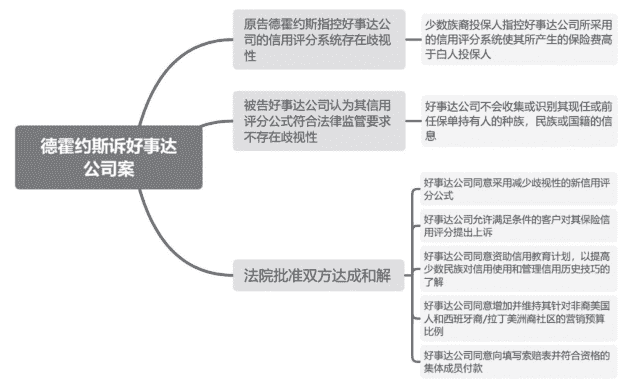

### 【核心争议点】
和解获批，审理焦点集中于和解是否应予确认。圣安东尼奥分院提出六项审查要点：

1.和解是否源于欺诈或串通；

2 .若进入审判，原告胜诉可能性
（1）Allstate是否利用信用信息歧视少数族裔；
（2）原告能否依据《公平住房法》^([\[4\]](#txt004.html#footnote_content_txt004_4))的差别影响理论胜诉；
（3）集体范围是否合法。

3.和解带来的利益是否大于诉讼风险；

4.诉讼的复杂性、成本与可能时长；

5.当事人是否掌握足够信息评估和解条款；

6.代理律师、集体代表及缺席成员的意见。

### 【裁判论证过程】
#### （一）和解背后不存在欺诈或串通
学界通常认为，经公正谈判形成的和解可视为公平合理，无相反证据时可推定律师间不存在串通。

本案无欺诈指控。法院指出双方律师均具备丰富的集体诉讼经验，尤其在种族歧视案件方面。谈判持续23个月，举行50余次会议，法院据此认定和解系公平谈判产物。

#### （二）若进入审判，原告胜诉难度较大
在评分是否构成歧视问题上，原告面临事实与法律双重障碍。

（1）Allstate未利用信用信息歧视少数族裔人群
证据显示公司并不掌握客户种族或民族数据，也不进行追踪。其费率在各州监管下均被视为合法，州保险部门已审查其是否过高、过低或不公平歧视。保险信用评分由多家独立公司研发，基于持续的行为研究，已获多数州明确认可与规范，此种监管背景削弱了原告歧视指控的可行性。

（2）原告难以依据《公平住房法》差别影响理论胜诉
原告须先证明评分对非裔与西班牙裔保单持有人的保费产生差别影响。即使成立，Allstate可主张业务必要性，并援引研究证明信用评分是精算合理且强力的损失预测指标。若业务必要性成立，举证责任转移至原告，需证明存在同等有效且负面影响更小的替代方案，并证明公司拒绝采用。原告未能证明此类替代方案的存在，也未曾提出过可行建议。

（3）集体范围难以确认
Allstate主张相较不使用评分，评分反而降低了部分投保人保费。若属实，则部分集体成员会从被诉行为中受益，导致集体资格认定困难。

上述障碍共同降低了原告胜诉预期，有利于和解获批。

#### （三）和解利益大于诉讼风险
记录显示和解不仅惠及原告集体成员，也利及全国保单持有人。律师认为和解符合集体最佳利益，因其提供直接利益如新评分公式实施，避免审判风险、上诉与后续诉讼。

法院认为和解带来的实质直接收益优于不确定、长期且昂贵的诉讼风险，故支持批准。

### （四）诉讼的复杂性、费用和可能的持续时间决定和解是合理选择
诉讼已进行五年并进入第五巡回及最高法院上诉程序，显示后续将是旷日持久的拉锯。鉴于复杂性与成本，批准和解具有必要性。

### （五）当事方具有足够的信息来评估和解协议的条款
23个月谈判期间，Allstate提供数万份文件，包括费率手册、政策手册与开发评分公式的敏感电子数据。原告聘请统计专家完成广泛的差别影响分析，据此评估和解公正性。法院认为程序阶段已提供足够信息以作出审慎判断。

### （六）集体诉讼代理律师，集体代表和缺席集体成员同意进行和解
经长期磋商，律师与代表认为和解符合集体最佳利益且为非常好的结果。通知范围广泛而异议稀少，法院据此认定各方意见支持批准。和解被认定为公平、合理且充分。

## 【审理结果】
法院批准和解。主要内容包括：

1. Allstate同意采用和解协议约定的新信用评分公式。该公式经原告统计专家认可，有助于更多少数族裔客户获得更合理的定价，减少歧视。

2. Allstate设立上诉机制，允许包括集体成员在内的客户在离婚、家庭成员去世、失业等“特殊情况”下对信用评分提出复核。

3. Allstate资助由全国城市联盟与La Raza国家法律顾问设计的信用教育项目，提升少数族裔对信用使用与记录管理的认知。

4. Allstate承诺提高对非裔美国人及西班牙裔/拉丁裔群体的营销预算占比。

## 【相关法条】
### 《美国法典》第 42 卷第 1981 条（42 U.S.C. §1981）
法律面前人人平等
（a）平等权利声明
美国管辖范围内的所有人在每个州和地区内享有同等的权利，以订立和执行合同、起诉、成为当事人、举证，并享有白人公民根据一切法律和诉讼程序所享有的有关人身和财产安全的充分和平等利益，并应受到与白人公民相同的惩罚、痛苦、刑罚、税收、许可和各种征收的约束，而不应受到其他任何约束。
（b）“订立和执行合同”的定义
就本节而言，“订立和执行合同”一词包括合同的订立、履行、修改和终止，以及享有合同关系的所有利益、特权、条款和条件。
（c）保护免受损害
本节所保护的权利不受非政府歧视的损害，也不受国家法律的损害。

### 《美国法典》第 42 卷第 1982 条（42 U.S.C. §1982）
公民财产权
美国所有公民在每个州和地区内，享有与白人公民同等的继承、购买、租赁、出售、持有和转让不动产和动产的权利。

### 《美国法典》第 42 卷第 3601 条（42 U.S.C. §3601）
政策声明
美国的政策是在宪法的约束下，在全国范围内提供公平的住房。

### 《美国法典》第 42 卷第 3604 条（a）款、（b）款（42 U.S.C.§3604（a）（b））
在买卖或租赁房屋方面的歧视和其他被禁止的行为
在第 3603 条适用的情况下，除本卷第 3603 条（b）款和第 3607 条豁免的情况外，下述行为均属非法：

（a）基于种族、肤色、宗教、性别、家庭状况或国籍等原因，在对方提出善意要约之后，拒绝出售或出租房屋、拒绝就房屋买卖或租赁展开协商，或以其他方式使他人无法取得或享有住宅。

（b）基于种族、肤色、宗教、性别、家庭状况或民族血统等原因，在住宅买卖或租赁的条款、条件、优惠方面，或在提供与住宅有关的服务和设施方面，对他人进行差别对待。

## 【案例拆解】

### （一）让保险信用评分体系不断迭代优化

依据和解协议，好事达公司将建立申诉通道，允许投保人以九类“特殊情形”为由对保险信用评分提出异议。符合资格的情形包括：离婚、家庭成员逝世、失业、医疗支出、照料成年受抚养人、身份被盗用、长期受伤、疾病或残疾、照料受抚养人以及/或遭受家庭暴力。当保单持有人获知因信用评分未拿到最优保费，且评分导致其待遇逊于中性待遇时，公司会告知其申诉流程。

保险客户面广分散且关系持久，和解为未参加集体诉讼的客户保留了向好事达公司提出信用评分申诉的权利，并形成持续的客户监督，这为保险公司后续完善信用评价模型提供了大量用户反馈。尽管被告声称费率符合各州监管要求，但原告聘请的统计专家和和解中确定的新评分公式表明，仅靠现行监管规范难以覆盖复杂动态的算法风险，企业唯有持续优化评分体系才能降低算法歧视与偏见带来的不公。

此外，好事达公司承诺资助由全国城市联盟与拉美裔法律资源与辩护中心两大少数族裔倡导机构设计的信用教育项目，提升少数群体对信用使用与信用记录管理的认知。算法公开化是遏制歧视的手段之一，相较于提高透明度帮助公众理解运行逻辑，信用教育用更直白的方式让消费者认识保险信用评分的工作原理。理解评分对定价的影响，有助于消费者更高效地维护自身信用。

美国《公平信用报告法》赋予消费者凭身份证明免费获取信用报告副本并就信息准确性向征信机构提出异议的权利。我国国务院办公厅《关于加快推进社会信用体系建设构建以信用为基础的新型监管机制的指导意见》提出以信贷征信为切入点，完善保险业等信用管理体系并逐步建立统一征信平台。中国人民银行《个人信用信息基础数据库管理暂行办法》第十六条为异议提供了书面申请路径。信用体系普及带来便利，若历史信息出错，会在信贷、保险定价、招聘等方面产生直接或间接负面影响，纠错权为消费者争取申诉空间。完善的信用体系需要在企业盈利与消费者权益不受错误信息侵害之间取得平衡。

### （二）算法歧视的隐蔽性被彻底揭开

好事达公司否认评分公式存在歧视，称所用信息是经过统计验证的有效损失预测指标。诉讼中无争议证据显示各州保险部门已审查费率，确认其合法合规。公司还表示未收集保单持有人种族识别信息，也未进行差别影响测试。因而若无本案，公司原有公式中对少数族裔产生的不利影响可能难以被识别。

尽管如此，公司仍同意调整做法，采用新的信用评分公式，替代原被指控歧视非裔美国人和西班牙裔投保人的方案。该公式经原告专家大量检验。原告律师称统计专家对公司数据进行了广泛的差别影响分析，相信新公式将为少数族裔带来实质利好。

和解带来的不仅是一次性补偿。集体成员在每次续保时都能从更少歧视性的信用使用中获益，且在新公式启用后至少两年内持续受益。购买车险或房险的新少数族裔客户无论是否属于集体，均可受益。作为美国个人险上市龙头，好事达服务超1600万客户，修正算法偏见将为数千万用户提供更公平的定价，公司自身也能从更合理的信用运用中获益。

除衡平救济外，公司同意向提交索赔表的合格集体成员支付合理现金，并向按新公式重算后评分明显提升的成员支付补偿。

2018年英国议会人工智能特别委员会报告指出，以机器学习为核心的系统需通过大量训练数据发现模式，若数据不具代表性或反映历史偏见，决策也会失真或歧视。即使设计者无偏见，算法若学习现实中因个体歧视产生的数据，会将歧视固化并由个别性扩展为系统性。系统性算法歧视影响面更广，且因不透明难以纠正。本案原告在事实和法律上胜诉障碍重重，通过和解修正既有公式，能从系统层面减轻对少数族裔平等权的侵害，长期价值远超一次性金钱赔偿。

### （三）倒逼保险业打开算法黑箱

诉讼期间，好事达公司拒绝披露现行信用算法。和解约定自首次通知发布之日起至公平听证会之日60天内，公司将向集体成员提供新评分公式，并在官网公布新公式所用信用特征的叙述性说明供公众查阅。公司还资助中立第三方“消费者信用咨询服务”设计的信用教育计划，通过群体倡导组织发放，并分担25万美元用于一年内在目标群体实施。

评分体系长期被保密覆盖。即便分数本身公开，评分方通常不透露预测逻辑，商业秘密保护使过程难以质疑。公司在诉讼中拒不披露的做法，加大了原告判断评分是否科学、数据是否得当、是否公允的难度。保险涉及人身财产安全，必要信息披露是信任的基础。透明度并非一成不变的清晰状态，而是一种系统化的观察与掌控形式。公开公式相关信息有助于消费者理解评分规律，增强对产品的信任。

算法透明化已成为各行业监管趋势。欧盟《通用数据保护条例》要求以简洁、透明、易懂的方式提供信息。我国《个人信息保护法》第二十四条要求自动化决策保证透明度和公平公正。实践中企业多以效率和利润衡量成功，正义与透明难以纳入商业模型。美国白宫《人工智能应用监管指南备忘录》草案指出披露与透明度是否适当取决于危害评估、技术水平及潜在利益。算法透明只是监管不断扩张算法权力的一个维度，监管者需在理解运行逻辑后多维度界定责任，防止“算法黑箱”被用作监管套利工具。

### （四）把信用评分监管推上风口

原告德霍约斯指控好事达公司信用评分系统对非裔和西班牙裔实施价格歧视，要成立指控需证明对保费存在差别影响。法院认识到原告举证难度大，这也是批准和解的原因之一。由于消费者在信用信息记录、采集和传播中参与度极低，挑战企业评分系统时处于天然劣势。信用评估者、搜索引擎、银行等将数据转化为评分并生成影响重大的名单，若无诉讼揭露，专有运算程序通常无需接受审查。“信息过度不对称使技术弱势方依附技术强势方的数字权威，算法决策演变为数字经济时代的精英统治。”

美国《公平信用报告法》要求征信机构以公平、公正、保密、准确、相关的方式使用信息，《平等信用机会法》禁止因性别、婚姻状况、种族、宗教、年龄等授信歧视。这些法律在一定程度上保护平等权，但面对不公开且不可解释的信用评分算法，知情权被进一步压缩，亟需专业监管部门出台明确责任规则。即使欧盟GDPR赋予数据主体免受完全自动化决策约束的权利，现行监管与问责机制仍滞后于算法更新速度。本案以和解收尾，和解中优化算法的做法值得信用监管部门关注。

### （五）后续动作：营销预算向少数族裔倾斜

作为和解一部分，好事达公司承诺提高面向非裔美国人与西班牙裔/拉丁美洲裔群体的营销预算占比。公司已提升2005财年少数群体的全国性媒体支出，并计划在2006、2007、2008财年将该类支出提升至15%。

## 【延伸阅读案例】

1. Ojo v. Farmers Group Inc., 565 F.3d 1175 (2009)
核心事实：得克萨斯州非裔美国人Ojo购买了农民集团签发的房屋财产及意外伤害保险，从未理赔却被提高保费9%。其称公司依据自动信用评分系统的不良信用信息调高保费。
与本案关联：被告信用评分系统使用多项未公开因素，对少数群体产生差别影响，涉嫌违反《公平住房法》。

2. Duncan v. JPMorgan Chase Bank, N.A., 2016 WL 4419472 (2016)
核心事实：原告据《公平信用报告法》起诉摩根大通，指控其在止赎抵押贷款房产后无合理目的查询信用报告。原告未主张实际损害，但主张故意违法，要求法定赔偿。
与本案关联：在采用和解的集体诉讼中，法院仍需认定集体是否符合《联邦民事诉讼规则》第23条(a)及(b)款要求。

3. In re Heartland Payment Systems, Inc. Customer Data Sec. Breach Litigation,851 F.Supp.2d 1040 (2012)
核心事实：信用卡持卡人起诉因系统被黑客入侵而泄露数据的交易处理商，指控违反合同、疏忽、虚假陈述及多州消费者保护法。和解后申请确认、批准及律师费。
与本案关联：在集体诉讼中，拟议和解被认定为公平、合理且充分。

4. Neff v. VIA Metropolitan Transit Authority, 179 F.R.D. 185 (1998)
# 案例：美国残疾人法与康复法集体诉讼
核心事实：原告依据《美国残疾人法》和《康复法》起诉大都会交通当局，指控其未履行提供适当公共交通服务的法定职责，寻求禁令与确认救济。法院认为集体诉讼认证条件满足，和解方案公平充分，律师费协议合理。
与本案关联：关于共同提出的批准和解动议，和解被认定为公平、充分、合理。

5. Larson v. Sprint Nextel Corp., 2009 WL 1228443 (2009)
核心事实：集体诉讼指控Sprint收取的提前终止费违反《联邦通信法》及州消费者保护法。在服务计划期结束前取消服务将被收取150至200美元费用。
与本案关联：在集体诉讼中，若无法合理识别全部成员，应向部分成员送达通知；公司可通过数据库确定有权获赔的子集体。

## 4.2 肯尼斯·西顿诉猫途鹰案
## 【案件索引】
Seaton v. TripAdvisor LLC, No. 3:11-cv-549 (2012)
Seaton v. TripAdvisor LLC, No. 12-6122 (2013)
## 【关键词】
互联网信用评价；用户评论；消费者评分网站；言论自由；诽谤
## 【案件提要】
本案涉及互联网信用评价的边界。被告猫途鹰基于网站用户评价和问卷将田纳西州大度假村酒店列为“2011年最脏酒店”榜首，并称排名客观公正。实际用户评分显示该酒店并非最低分。酒店所有人肯尼思·西顿起诉，认为算法排名缺陷导致失实，被告却误导公众，构成诽谤、虚假事实侵害隐私、商业诽谤及对潜在业务关系侵权干扰。
被告辩称排名属主观意见而非客观事实陈述，不应受违法评价，且受第一修正案言论自由保护。田纳西州初审法院与上诉法院均支持该观点。这体现了美国对网络言论的强保护。
本案回应了互联网信用评价的法律属性争议，第六巡回法院认定此类评价属主观意见而合法。也引发了对评价体系中各主体行为合法性的讨论，倾向认可其合法性。同时引发公众争议：一方面营造宽松监管环境，有利于评价体系发挥信息成本节约作用；另一方面可能使评价偏离真实，助长以算法缺陷掩盖恶意评论，损害名誉。
## 【案件要旨】
田纳西州东部地方法院：原告肯尼思·西顿 被告猫途鹰
美国联邦第六巡回上诉法院：上诉方肯尼思·西顿 上诉方猫途鹰

猫途鹰“2011最脏酒店”榜单被诉诽谤：网络评分到底算不算侵权？

2011年10月11日，西顿在田纳西州塞维尔县巡回法院将猫途鹰告上法庭。起因是猫途鹰发布的一份“2011最脏酒店”榜单，西顿认为榜单使用的评级体系与事实不符，严重损害了大度假村酒店的名声与潜在商机。诉状里主张诽谤和虚假事实侵害隐私两项过错，要求1万美元赔偿外加500万美元惩罚性赔偿。

2011年11月17日，猫途鹰提出管辖权异议，申请把案件移送至田纳西州东部地区联邦法院。随后依据《联邦民事诉讼规则》第12条b款第6项，提出驳回动议，并附上网站“2011最脏酒店”的截图。截图显示该榜单是汇总猫途鹰用户入住点评后得出的。

2012年3月31日，西顿递交修正诉状，新增商业诋毁/致害性虚假陈述以及干涉潜在业务关系两项指控。西顿称猫途鹰借助未经核实的数据和存在缺陷的算法，得出大度假村酒店为“2011最脏酒店”的结论，且猫途鹰主观恶意放任虚假榜单损害酒店商誉。

2012年8月22日，田纳西州东部地方法院批准驳回动议。法院认为“2011最脏酒店”名单属于用户的主观表达，受宪法第一修正案言论自由保护，不具备诽谤性。同时驳回修正诉状，因西顿未能证明猫途鹰作出过可证伪的虚假陈述。

2012年9月21日，西顿向联邦第六巡回上诉法院上诉，诉状于2013年1月4日提交。西顿主张猫途鹰反复强调其言论可靠准确，因此排名具有客观性，应属可诉。另主张算法存在漏洞导致言论构成诽谤，且《通信规范法》第230条^([\[14\]](#txt004.html#footnote_content_txt004_14))不能为猫途鹰提供豁免。

2013年2月20日，猫途鹰提交答辩，支持原审结论。认为“2011最脏酒店”是主观意见而非客观断言，排名基础也是用户的主观评分。

2013年8月28日，上诉法院针对诽谤、虚假事实侵害隐私、商业诋毁/致害性虚假陈述以及干涉潜在业务关系四项指控逐一论证均不成立，维持原判。

### 案件脉络图
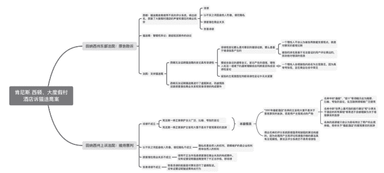

### 核心争议
1. 依据宪法第一修正案，主观意见受言论自由保障，依据田纳西州法，罔顾事实的陈述才构成诽谤。本案猫途鹰基于评分系统发布的“2011最脏酒店”名单，是受保护的主观意见，还是罔顾事实的诽谤性陈述。
2. 若生成名单的算法存在瑕疵导致计算错误，算法及其结果是否因失真而被视为罔顾事实的言论，从而构成诽谤。

### 裁判思路拆解

### 一、榜单属于合法主观言论，受第一修正案保护，不构成诽谤
田纳西州法认定诽谤需证明：一方作出表述；明知不实且会损害名誉或罔顾真实性而过失未查。^([\[15\]](#txt004.html#footnote_content_txt004_15))

法院结合 Gallagher v. E.W. Scripps Company^([\[16\]](#txt004.html#footnote_content_txt004_16))的判断基准，认为关键在于被告言论是否可被视作对事实的错误断言。判断时需考虑语境、通常含义、理性人理解，被告主观意图不相关。本案中理性人会把评分排名理解为酒店的主观评价，因其具有夸张色彩且商业排名在日常中常见。理性人也不会因数据支撑就将其等同于客观事实。仅因排名基于无法核实的网络评论，并不意味着系统本身失当或具诽谤性。

诽谤案件必然涉及第一修正案对合法与非法言论的区分。最高法院先例指出，第一修正案保护“不必然反映客观事实”的表达。此类表达带有随意性、比喻、夸张，不会让理性人认为作者在严肃断言客观事实，因而不受诽谤制约。

第六巡回上诉法院据此认定“2011最脏酒店”名单受保护。因为名单使用了随意、比喻、夸张的用词，且并未传递超出用户观点的额外信息，具有主观性，不会被公众误读为客观事实陈述。

具体理由为：其一，“最脏”本身是夸张的主观概念，没人会把它当作客观事实断言。其二，网站明确提示“美国最脏酒店排名基于猫途鹰用户数据报告”，说明是用户主观意见而非已核验事实。其三，读者看到酒店页面的差评和照片，也只会理解为入住者的个人体验，而非对全美的定论。其四，“2011最佳酒店”名单同样使用夸张语言，具有娱乐性，进一步佐证非事实陈述。其五，互联网上层出不穷的“前十”“最好”“最坏”榜单，理性人本就能识别其为数百万用户的集体主观判断。

### 二、即便算法有漏洞，评分名单仍不具诽谤性
上诉法院援引先例。在 Compuware Corp. v. Moody’s Investors Services， Inc.^([\[17\]](#txt004.html#footnote_content_txt004_17))案中，法院认为穆迪的信用评级是预测性观点，由多因素权重经算法得出，主观性明显。即使可从中推导出事实结论，该结论也无法证伪，而诽谤的前提是可证伪。

据此，本案即使猫途鹰算法计算出错，名单和算法仍带有固有的主观属性，属于合法表达。

### 审理结论
1. 田纳西州东部法院批准驳回动议，同时驳回原告修正诉状的申请。
2. 联邦第六巡回上诉法院维持原判。

### 适用法条
美国宪法第一修正案
国会不得制定有关确立国教或禁止宗教自由、限制言论出版自由、限制和平集会及向政府请愿的法律。

美国《通信规范法》第230条c款第1项，47 U.S.C.§230(c)(1)(2006)
任何交互式计算机服务提供者或使用者，不应被视为其他信息内容的发布者或发言人。

### 案例解读
### 一、引发对互联网平台信用评价角色的思考
争议核心是平台作出的信用评价属于客观事实断言还是主观意见。学界与实务存在三种定位：平台负有揭示真相的责任；平台仅提供个人价值判断；平台影响力巨大，其评价会被普遍接受。本案采纳了第二种立场。^([\[18\]](#txt004.html#footnote_content_txt004_18))

### 二、折射出美国对互联网信用评价的宽容度
一方面，消费者评分合法性受言论自由保护。司法上，原告常以合同非歧视条款主张评价构成歧视诽谤，多被驳回，如 Palmer v. Kleargear.com 案即认定负面评价为个人观点。立法上，马里兰州、加州等已明文保护评分自由。^([\[19\]](#txt004.html#footnote_content_txt004_19))

另一方面，评论网站的平台责任有限。根据《通信规范法》第230条，运营者不为用户言论负责。但在 Isuzu Motors Ltd. v. Consumers Union of US， Inc.^([\[20\]](#txt004.html#footnote_content_txt004_20))、Compuware Corporation v. Moody’s Investors Services， Inc.^([\[21\]](#txt004.html#footnote_content_txt004_21))和 Jones v. Dirty World Entertainment Recordings LLC^([\[22\]](#txt004.html#footnote_content_txt004_22))等案中，若平台故意采纳第三方诽谤性言论，则失去豁免。^([\[23\]](#txt004.html#footnote_content_txt004_23))只要未故意采纳，平台对评论真实性无需担责。

再者，平台基于用户评价衍生出的商家排名是否合法。本案与 Browne v. Avvo Inc.^([\[24\]](#txt004.html#footnote_content_txt004_24))案均认为评分系统属于主观意见，受言论自由保护，非可查证事实。

更广义地，用户生成内容经整合形成的新内容、搜索引擎基于数据展示的结果、甚至记者基于公众数据创作的内容，合法性正趋向肯定。此前争议焦点在于《通信规范法》第230条是否覆盖衍生内容，如 Levitt v. Yelp^([\[25\]](#txt004.html#footnote_content_txt004_25))认为适用，Fair Housing Council of San Fernando Valley v. Roommates.com， LLC^([\[26\]](#txt004.html#footnote_content_txt004_26))则认为结构化数据不享豁免。^([\[27\]](#txt004.html#footnote_content_txt004_27))本案绕开第230条，直接以第一修正案论证用户主观评论经第三方整合后仍具合法性。^([\[28\]](#txt004.html#footnote_content_txt004_28))

### 三、有助于信用评价体系发展，提升商家曝光
互联网信用评价已成常态，司法倾向将其认定为主观意见。法院关注的是网络语言惯例，如层出不穷的“最好”“最坏”“前十”榜单。^([\[29\]](#txt004.html#footnote_content_txt004_29))这体现了对用户互动价值的肯定与对个体审美判断的尊重。^([\[30\]](#txt004.html#footnote_content_txt004_30))^([\[31\]](#txt004.html#footnote_content_txt004_31))

评价创建者必然在取舍中体现价值取向，^([\[32\]](#txt004.html#footnote_content_txt004_32))而信用体系的蓬勃发展也带来商业收益。Yelp称80%评分在3至5星，TripAdvisor称75%评论为“非常好”或“优秀”。哈佛研究显示，Yelp评分升一星可使营业额增长5%至9%。^([\[33\]](#txt004.html#footnote_content_txt004_33))

### 四、可能助长失真与恶意算法滥用
其一，本案忽略了当排名被公众当作可验证事实时，可能构成客观断言。例如2012年2月，英国广告标准局认定猫途鹰宣称“可信评论”“真实旅行者点评”具有误导性。^([\[35\]](#txt004.html#footnote_content_txt004_35))部分信用评价依赖事实与经验。^([\[36\]](#txt004.html#footnote_content_txt004_36))将所有平台言论视为主观的观点并非主流共识，^([\[37\]](#txt004.html#footnote_content_txt004_37))因为信用评价的初衷是降低信息成本。^([\[38\]](#txt004.html#footnote_content_txt004_38))判决可能推动评价体系偏离真实。

其二，可能纵容平台以有缺陷的算法掩盖诽谤意图。^([\[39\]](#txt004.html#footnote_content_txt004_39))当平台在特定领域具权威性时，歪曲事实会误导公众并重创商家。商家亦可能反向利用算法夸大排名。^([\[40\]](#txt004.html#footnote_content_txt004_40))

# 信用评价失控，商家和消费者谁来买单

本案的疏漏在于没把恶意差评对商家声誉的侵蚀算进去。不少商家碰到消费者提出的无理要求不想妥协，对方就直接在网上甩出一颗负面炸弹。在这种导向下，评论平台因不用为用户的言论背责，压根没有动力去完善评价规则、提升评价的真实与准确性^[[\[41\]](#txt004.html#footnote_content_txt004_41)]。商家想按平台规则与写差评的人沟通，往往无从谈起，只能走司法途径。可诉讼费用高、周期长，等判决下来，恶评的杀伤力早已扩散^[[\[42\]](#txt004.html#footnote_content_txt004_42)]。再者，商家即便起诉，也未必能赢，追查匿名发帖人的真实身份既有程序障碍，也可能触及合宪性难题^[[\[43\]](#txt004.html#footnote_content_txt004_43)]。与此同时，另一面也在滋长：有商家花钱雇人刷好评，还有商家靠送样品、免单来换取正面口碑^[[\[44\]](#txt004.html#footnote_content_txt004_44)]。时间一长，“在评价网站投广告、和网站合作多要好评少要差评”被当成互联网时代的固定成本^[[\[45\]](#txt004.html#footnote_content_txt004_45)]。这些操作与建立网络信用体系的初衷背道而驰，信用评价逐渐沦为商家做营销、平台收广告费的工具。表面看是新商业模式，实质上助长造假、恶性竞争，败坏营商生态，社会影响也不小。

即便差评是真实且善意的，互联网的传播特性也让问题更棘手。负面评价传播极快且永久留存，商家还没搞清投诉缘由、更未及处理，名声就已受损且难以修复。哪怕后续改进，利好的更新信息也会被旧的负面淹没，消费者根本看不到^[[\[46\]](#txt004.html#footnote_content_txt004_46)]。由此可见，若对网络信用评价完全放任，不对真实性、时效性、展示方式做任何规范，评价体系就会变成商家信誉自证预言的放大器。

在互联网时代，平台和用户都能对个人与商家做信用标注。凭借传播范围广、速度快的特点，这类标注的影响力不容忽视。过度抬高平台与用户的言论自由，反而忽视了信用评价对名誉与商誉的冲击，不利於维护公平正义、诚实守信的氛围。

## 关联案例参考

### 1. Kimzey v. Yelp! Inc., 836 F.3d 1263 (9th Cir. 2016)

核心事实：原告 Kimzey 主张被告 Yelp 利用评星功能把第三方评论转化为自己的内容，从而对他的锁匠业务进行负面评价。法院驳回诉讼。法院认定，被告的评分机制是把自愿提交的第三方评分汇总成综合指标，属于一种中立工具^[[\[47\]](#txt004.html#footnote_content_txt004_47)]，并未对评论本身进行开发或创作，因而落在美国《通信规范法》第 230 条的豁免范围^[[\[48\]](#txt004.html#footnote_content_txt004_48)]。

关联点：与本案立场基本一致，法院认为网站基于用户评价形成的综合信用分具有中立性，合法有效。不同在于法理依据，本案侧重平台责任，判决则直接援引《通信规范法》第 230 条对中立工具的豁免。

### 2. Consumer Cellular, Inc. v. ConsumerAff airs.com, Inc., 3:15-CV-01908-PK(D. Or. 2016)

核心事实：原告为手机服务商，被告运营供应商评分网站。被告对付费会员与非会员区别对待：把会员的评论称作“评论和投诉”、非会员的称作“投诉和评论”；会员可回复甚至删除差评，非会员不行；非会员页面出现“对产品或服务无印象”栏目并导流至会员商品，会员页面没有；非会员评论按时间倒序，会员页面正面评论被置顶。原告拒付费后，被告把原告的正面评价搬到“投诉和评论”栏目，并阻止新的正面评价发布。据称被告给某付费会员 5 星，其余 39 家非会员均低于 2 星。原告起诉诽谤、损害商业关系、电信欺诈、敲诈等。法院判定星级评分具有诽谤性。该评分并非评论本身，而是被告基于评论做出的总体满意度判断，属于被告自己的客观断言，非受保护的主观意见。法院指出被告发布时明知不实，因故意未将正面评价纳入计算。同样，《通信规范法》第 230 条也不豁免，因争议陈述并非第三方言论，而是被告筛选整理后形成的己方陈述^[[\[49\]](#txt004.html#footnote_content_txt004_49)]。

关联点：与本案结论相悖。法院认为当网站不是原样展示评价，而是自行筛选、整理后给出信用结论时，该结论可能不享有言论保护，存在诽谤故意即构成诽谤。此情形下也不适用《通信规范法》第 230 条豁免。

### 3. McKee v. Laurion, A11-1154 (Minn. App. 2012)

核心事实：被告 Laurion 对原告 McKee 在其父亲中风后所做的检查不满，在两家“点评医生”网站发布评论，其中称护士说 McKee 是“真正的工具”。原告起诉被地方法院驳回。明尼苏达州上诉法院撤销原判，发回重审并要求陪审团判断六项陈述是否损害名誉。被告上诉至州最高法院。McKee 认为“真正的工具”并非受保护意见。最高法院认为此表述属于纯粹意见而非事实陈述，无法证伪，因而在线医生评论网站上的言论不构成诽谤性事实陈述，并维持地方法院裁定^[[\[50\]](#txt004.html#footnote_content_txt004_50)]。

关联点：与本案观点一致。最高法院认定网络信用评价属于宪法第一修正案保护的意见范畴，而非可证实的诽谤事实。

### 4. Browne v. Avvo, Inc., 525 F.Supp.2d 1249 (W.D. Wash. 2007)

核心事实：被告为律师评级网站，按未公开系统给原告打 5.5 分。原告指控评分不实，违反《华盛顿消费者保护法》。争议焦点是评分能否被解读为客观断言。法院认为评分属于宪法第一修正案保护的主观表达，无法证伪，不能视为客观事实断言。

关联点：与本案立场相同，法院将网络评分排名定性为主观意见，不等同于可以检验真伪的客观事实。

### 5. Moving & Storage, Inc. v. Panayotov, CIVIL ACTION NO. 12-12262-GAO(D. Mass. 2014)

核心事实：被告运营 MyMovingReviews.com，删除原告公司的正面客户评价，同时删除自家搬家公司 Xpress Movers 的负面评价。原告以虚假广告、不公平竞争、侵权干涉为由起诉。被告主张《通信规范法》豁免。法院支持原告，认为被告行为并非基于第三方信息提供，而是作为错误信息的“开发者”。因有选择性删除，被告失去第 230 条豁免。此外，被告在网站上承诺提供“准确”数据、“重视评论质量”，让读者看到“最准确最新评级”，却与实际操作相悖。

关联点：若评分网站对用户评论进行额外加工或偏差展示，且对外宣称结果准确公正，就可能丧失《通信规范法》第 230 条的豁免。

## 4.3 莫利纳里诉艾克飞公司案

### 【案件索引】
Molinari v. Equifax Inc., 18-CV-3282 (E.D.N.Y. 2019)

### 【关键词】
信用评分；公平信用报告法；事实损害

### 【案件提要】
本案围绕信用报告机构向个人提供的信用评分争议展开。原告约翰·莫利纳里起诉被告信用报告机构艾克飞公司及艾克飞消费者服务有限公司，主张被告提供的信用评分与信贷机构实际采用的评分并非同一模型，使用不同标准违反《公平信用报告法》。核心争议是原告是否具备事实损害要件以取得诉讼资格。法院最终以原告未满足事实损害要求为由驳回诉讼。本案凸显两点标准：一是依据《公平信用报告法》起诉的时效适用发现规则，即原告知晓或应当知晓诉因时起算；二是该法项下损害赔偿请求，原告须符合事实损害或事实损害风险。

在互联网金融背景下，基于个人数据的算法信用评分有助于缓解信息不对称和道德风险，理论上能提升资源配置效率。信用评分的可靠与公平因此关键。目前国内持牌信用评级机构数量有限且有垄断迹象，评价机制不透明，公众救济渠道不足。可借鉴美国《公平信用报告法》，对个人信用评分单独立法，赋予知情权、异议权与事后救济权，以制衡不公平评级影响。

### 【案件要旨】
纽约东区地区法院：一审原告约翰·莫利纳里，被告艾克飞公司、艾克飞消费者服务有限公司

艾克飞公司为全美主要信用报告机构之一，收集征信数据供企业使用，也直接向消费者销售预测贷款可能性的信用评分产品。信贷机构通常使用基于费尔艾萨克公司模型得出的 FICO 评分。直接面向消费者的机构使用的模型与之不同，被告在产品页面底部以免责声明提示了这一差别。

2015 年 3 月 29 日，原告在被告网站购买信用评分服务。尽管存在免责声明，原告仍认为所购评分与信贷机构参考的评分一致。

2017 年 1 月 3 日，美国消费者金融保护局调查认定艾克飞公司在 2011 年 1 月 21 日至 2014 年 3 月 14 日期间以误导性营销售卖信用评分，违反《消费者金融保护法》，并指出艾克飞评分与基于 FICO 模型的评分存在显著差异。据此，原告提起个人及集体诉讼，主张违反《公平信用报告法》。

被告申请驳回，理由为诉讼时效届满且原告未提出事实损害要件。法院裁定支持动议，认为原告主体资格未满足事实损害要求，驳回诉讼。

### 【案例事实思维导图】
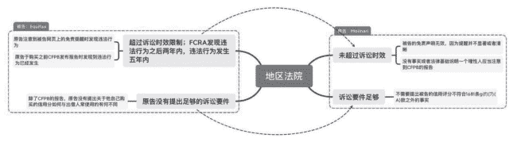

### 【核心争议点】
1. 原告主张是否超过诉讼时效，时效起算点为何，被告免责声明或第三方报告是否构成损害发现。
2. 原告诉讼资格是否满足事实损害要求。

### 【裁判论证过程】

#### （一）原告的主张未超过诉讼时效
纽约东区地区法院认为，《公平信用报告法》项下诉讼不得晚于下列较早者：（1）原告发现违法行为之日起 2 年；（2）违法行为发生之日起 5 年^[[\[52\]](#txt004.html#footnote_content_txt004_52)]。被告称原告购买服务后两年多才起诉，购买时已知晓评分不一致。被告主张其网站免责声明足以使原告知情，且消费者金融保护局早有相关报告。原告则称免责声明不清晰明确，普通消费者不会阅读消费者金融保护局报告，甚至不知其存在。

法院认为，网站免责声明是否清晰无法确定，现有阶段不能认定原告确已知晓。尽管普通消费者不一定阅读监管报告，但原告起诉状中自行提及该报告，仍需审视其购买前是否已知。

法院进一步认为，只有当信贷机构拒绝原告展期申请，或原告另行购买与艾克飞评分显著不同的 FICO 评分时，原告才可能意识到违法并确认评分不一致。因此，理性购买者在购买时并不必然发现违法，原告起诉未超时效。

#### （二）原告的诉讼资格不满足事实损害的要求
消费者金融保护局虽认定欺诈性营销违反《消费者金融保护法》，原告仅主张被告违反《公平信用报告法》第 609 条。该条要求信用报告机构：（1）向消费者提供信用评分以帮助理解对其信用行为的评估与预测；（2）告知消费者所购评分模型与信贷机构使用的模型不同^[[\[53\]](#txt004.html#footnote_content_txt004_53)]。满足第 2 项不等于满足第 1 项。原告认为模型不同导致差距极大，使其无法准确了解信用状况，评分失去价值。

被告还辩称原告未证明艾克飞评分与信贷机构常用评分有何不同。原告回应称仅需证明购买时评分不符合法条规定，无法帮助了解信用度。

法院认为原告主张不足。原告须证明事实损害、因果关系及可减轻损害的可能性，方符合宪法第三条。联邦最高法院近期立场要求《公平信用报告法》案件中原告必须遭受事实损害，且法律赋予起诉权不自动满足该要件。第二巡回法院承认事实损害风险亦可满足要求。本案关键是无价值的信用评分是否产生足够风险以构成事实损害。

法院认为起诉状未说明违反第 609 条会带来事实损害风险。原告仅称因与信贷机构评分差异巨大，艾克飞评分无法帮助消费者了解信贷机构对其信用的看法。更关键的是，原告未说明两类评分具体差异及如何证实艾克飞评分无法提供实际帮助。仅有差异存在不足以满足宪法第三条事实损害要求，故原告无诉讼资格。

### 【审理结果】
1. 纽约东区地区法院认为原告仅在信贷机构拒绝展期，或另行购买与艾克飞评分显著不同的 FICO 评分时才会发现违法，故起诉未超过诉讼时效；

分数不一致就能告上法庭？美国法院划出的红线

莫利纳里只挑了艾克飞给出的分数与放贷机构实际采用的分数不相同这一点，并没有拿出自己因此遭受了现实损失的证据。按《美国宪法》第三条对起诉资格的要求，这样的主张站不住脚，法院因此支持了艾克飞要求驳回的动议。

【相关法条】
美国《公平信用报告法》第 609 条（f）款第（7）项（Fair Credit Reporting Act§609（f）（7），15 U.S.C.§1681g（f）（7）（2003））
某些情况下的合规性.为遵守本款规定，消费者报告机构应—
（A）向消费者提供信用评分，该信用评分来自于消费者报告机构向用户广泛分发的与住宅不动产贷款有关的信用评分模型，或有助于消费者了解对其信用行为的评估以及对其未来信用行为的预测；以及
（B）声明其使用的信息和信用评分模型可能与信贷发放者使用的不同.

美国《公平信用报告法》第 618 条（Fair Credit Reporting Act§618，15 U.S.C.§1681p（2003））
法院管辖权；诉讼时效
可以在任何适当的美国地区法院提起诉讼，以强制执行根据本法产生的任何责任，而无需考虑争议的金额或任何其他有管辖权的法院.提起诉讼的时间不得晚于以下时间，以二者中较早者为准：（1）原告发现作为该责任基础的违法行为之日起 2 年内；或（2）作为该责任基础的违法行为发生之日起 5 年内.

【案例评析】
### （一）《公平信用报告法》概述
美国《公平信用报告法》主要规范消费者信用资料的搜集、汇总与使用。1970 年出台后历经多次修订，1996 年和 2003 年的两轮修改影响最大。1996 年把报告机构的义务扩大，也强化了报告使用者尤其是雇主方面的责任；2003 年的修改则明确了本案所涉的请求时效起算点。^[[\[54\]](#txt004.html#footnote_content_txt004_54)]
该法针对的机构是把个人资料整理成消费者报告，供银行、保险、雇主、房东等做准入决定的主体。其立法目标有二：一是把敏感信息的使用限于有正当需求者，防止滥用；二是提升报告的准确与完整。法律要求机构建立合理机制保证真实合规，及时向消费者披露档案，并在信息有争议时进行核查。

### （二）《公平信用报告法》中的诉讼时效问题
美国法上判断联邦请求时效起点，通常有两种思路。一种是“损害产生说”，事由产生即开始计算；另一种是“知悉说”，原告知道或应当知道诉因时才起跑。^[[\[55\]](#txt004.html#footnote_content_txt004_55)]
2003 年修订前，最高法院对《公平信用报告法》的请求适用损害产生说，时效自被告应负责任时起算，如天合公司诉安德鲁斯案即持此立场。^[[\[57\]](#txt004.html#footnote_content_txt004_57)]
修订后条文规定必须在较早者前起诉：自原告知悉违法行为起两年，或自违法行为发生起五年。第五巡回法院在麦克诉平稳上升金融公司案中强调，两年的短时效应自原告知悉引起诉讼的事由时起算，而非仅知悉行为违法时起算。^[[\[59\]](#txt004.html#footnote_content_txt004_59)]于是现行法下多采知悉说来确定起点。
本案中，艾克飞抗辩称莫利纳里阅读过消费者金融保护局的报告，纽约东区法院也据此推定他知悉公司宣传涉嫌违反《消费者金融保护法》。这仅属于发现了违法行为本身，并不足以触发时效。法院的判断是，只有当莫利纳里本人意识到自己从艾克飞购买的个人分数，与放贷方对他使用的分数不一致时，时效才可能开始。换言说，笼统知道公司整体提供与放贷方不同的分数，只是抽象认知；必须等到贷款因分数差异被拒，或他另行购得与艾克飞明显不同的报告时，才具备知道或应当知道诉因的条件。
另一争议是网站免责声明的阅读能否导致时效起算。核心在于声明是否足够清晰且以合理方式引起注意。类比格式条款，网络平台常要求用户一键同意冗长条款，多数人并未实质阅读。法律要求对可能减损权利的条款作显著提示，本案需结合声明在网页中的位置与呈现方式判断。即便声明已尽到提示义务，仅知晓公司提供与放贷方不一致的分数，仍不足以启动时效；唯有原告明确认识到“就我个人而言”两份分数不一致，才满足起算要件。

### （三）《公平信用报告法》中的事实损害问题
《公平信用报告法》下是否具备起诉资格，裁判标准来自最高法院斯伯克公司诉罗宾斯案^[[\[60\]](#txt004.html#footnote_content_txt004_60)]。按《美国宪法》第三条，要有资格必须同时满足：损害具体且针对个人；该损害由被诉行为导致；通过判决有可能得到救济。最高法院进一步指出，单纯列举法条构成要件不足以建立请求，原告必须证明“具体的”损害，而非仅技术性违规。^[[\[61\]](#txt004.html#footnote_content_txt004_61)]
斯伯克案中，该公司经营人员搜索引擎，网页显示罗宾斯拥有研究生学历、已婚且较富裕，与事实不符。最高法院认为即便违法，仍需具体的损害，纯粹程序性违法不足以成立资格。无形的损害或仅有风险，只要具体，也可满足要求，但不能仅凭抽象违法主张起诉。
本案里，莫利纳里仅主张艾克飞提供的分数与放贷机构使用的分数不一致，使他难以合理了解自身信用度，因而违法。他并未证明具体的损害。套用斯伯克标准，莫利纳里只是陈述被告行为违反法条，却未提供具体伤害证明，故不满足第三条的事实损害要求。
其一，莫利纳里指出分数存在差异，却未说明差异方向，是偏高还是偏低。斯伯克案里公司错误记载个人信息尚不足以构成事实损害，本案仅因模型不同导致分数分化，程度更轻。其次，纽约东区法院强调损害须具体且特定，只有当分数差异真正影响本人时才达标。设想莫利纳里申请贷款被拒因分数不同，则会有具体特定损害。但本案中他并未实际借款，也未因分数被拒贷。尽管斯伯克案认可实际损害风险也可满足要求，莫利纳里既未主张也未证明因分数不一致而被拒贷的事实或风险，故在《公平信用报告法》下缺乏起诉资格。
总体结论是，仅因算法模型不同导致分数分化，并不当然构成《美国宪法》第三条意义上的事实损害，原告须另行主张并证实因此遭受实际伤害。

### （四）我国信用评分现状与分析
国务院曾指出社会信用体系是市场经济体制和社会治理体制的重要构成。目前国内已有20多个城市推行个人信用评分，如厦门的白鹭分、苏州的桂花分、宿迁的西楚分、福州的茉莉分、杭州的惠信分，同时阿里巴巴的芝麻信用分也在广泛使用。评分已渗透出行、住房、就业、金融、医疗等领域，有助于简化审核流程，也能与失信惩戒结合促进诚信。
与本案原告所指出的模型差异类似，我国评分也存在分化。按建模方式可分为两类：一类沿用FICO思路，如白鹭分、桂花分、芝麻信用分；另一类采用多维体系，如西楚分、茉莉分、惠信分。^[[\[63\]](#txt004.html#footnote_content_txt004_63)]各城市指标亦不完全一致，导致跨区域互认困难，不利全国统一应用。另一个共同难题是透明度不足。现行法规未赋予公民事先参与、知情、异议的程序权利，也未要求评分机构承担解释义务，公众易受算法黑箱影响。^[[\[64\]](#txt004.html#footnote_content_txt004_64)]
目前我国尚无个人信用评分的专门立法，仅有《征信业管理条例》对个人征信作出一般规定。可借鉴美国《公平信用报告法》，对评分用途作出明确界定，对提供评分的机构设定相应义务，并保障公民的知情权与异议权。长远来看，由全国标准化组织制定统一国家标准，实现评分跨地域通用，是值得探讨的方向。

【关联判例推荐】
1\. Staehr v. Hartford Financial Services Group, Inc., 547 F.3d 406 (2d Cir. 2008)
核心事实：投资者指控保险公司及高管在回扣、投标操纵和价格操纵计划中存在遗漏与虚假陈述，导致其以被抬高的价格买入股票。地区法院以时效届满驳回，第二巡回法庭推翻并发回重审。
与本案关联点：判断原告是否拥有足够事实以证明其知晓被告违法行为，从而不能以时效为由驳回起诉。

2\. Spokeo, Inc. v. Robins, 136 S.Ct. 1540 (2016)
核心事实：信用报告机构发布了关于原告年龄、教育、家庭状况和就业的错误信息，原告据此提起《公平信用报告法》诉讼。
与本案关联点：根据《公平信用报告法》起诉，原告须满足《美国宪法》第3条的事实损害要求，必须证明自身遭受具体损害或存在实质损害风险。

3\. Sgouro v. TransUnion Corp., 817 F.3d 1029 (7th Cir. 2016)
核心事实：原告从汽车经销商贷款人处得知，贷款人使用的信用评分比原告自行购买的消费者信用评分低100分以上，并因此被拒贷。
与本案关联点：原告需具体说明所购分数与贷款人使用分数之间的差异内容。

4.4 哈默诉艾克飞信息服务有限责任公司等案

【案件索引】
Hammer v. Equifax Information Services LLC, et al, 2018 WL 10483887 (2018)
Hammer v. Equifax Information Services LLC, et al, 2019 WL 7604744 (2019)
Hammer v. Equifax Information Services LLC, et al, 2019 WL 7602463 (2019)
Hammer v. Equifax Information Services LLC, et al, 974 F.3d 564 (5th Cir. 2020)

关键词
信用评价；信用法律制度；公平信用报告法

案件提要
本案聚焦美国信用评价法律制度。原告斯考特·大卫·哈默对艾克飞信息服务有限责任公司^[[\[65\]](#txt004.html#footnote_content_txt004_65)]和益百利信息服务有限责任公司提起诉讼，指控两家公司删除其信用报告中的有利项目并拒绝恢复，违反《公平信用报告法》及《美国法典》第15卷第41章“消费者信用保护”的相关条款。原告称被告未建立适当程序确保报告准确性，并在其提出异议后未合理调查，致其遭受实际和精神损害。法院认为原告证据不足以证明报告存在不实信息，且被告无义务囊括全部信息，故索赔未获支持。
信用、住房、保险、公用事业乃至就业，都愈发依赖集中记录的信用历史及其自动解读。长期以来信用记录是放贷决策的重要依据。^[[\[66\]](#txt004.html#footnote_content_txt004_66)]学界普遍认为信用评分能提升信贷市场效率与公平，^[[\[67\]](#txt004.html#footnote_content_txt004_67)]但大数据信用评价产品普及后，对准确性和公平性的担忧加剧。^[[\[68\]](#txt004.html#footnote_content_txt004_68)]个人信用摘要包含个人信息、账户信息、查询记录等关键数据，^[[\[69\]](#txt004.html#footnote_content_txt004_69)]评分公司常把算法视为商业秘密，消费者即便感到困惑，也往往缺乏质疑渠道与能力。本案为观察美国信用评价行业与相关法律制度提供了一个窗口。

# 征信漏报好消息，到底算不算违规？哈默案全解析

美国的征信法治底子厚、实践打磨足，整体框架既庞大也多元。早期的规制重心落在《美国法典》第15卷第41章关于个人征信保护的内容上，其雏形是1968年国会通过的《消费者信用保护法》即CCPA。1970年出台的《公平信用报告法》FCRA把联邦贸易委员会FTC和消费者金融保护局CFPB正式确立为征信业务的核心监管方，成为个人征信领域的主干法。随后《信用控制法》《诚实借贷法》《平等信用机会法》《公平信用结账法》《公平信用与贷记卡披露法》《信用修复机构法》等规则陆续补位。产品社会化应用与立法迭代相互驱动，让美国的征信法治日趋成熟，行业也更规范。除成文规则外，档案登记、风险预警、个人评估等配套机制同步跟进，为信用经济提供制度底座。

近几年我国社会信用体系建设提速，立法工作也有明显进展。目前已形成不少涉及个人征信的行政法规和部门规章。顶层设计上，国务院先后印发《社会信用体系建设规划纲要（2014-2020年）》《国务院办公厅关于加快推进社会信用体系建设构建以信用为基础的新型监管机制的指导意见》等统筹性文件。执行层面，各部门出台更具操作性的规范，比如人民银行的《个人存款账户实名制规定》《个人信用信息基础数据库管理暂行办法》、海关总署的《中华人民共和国海关企业信用管理办法》、民政部的《社会组织信用信息管理办法》，以及人行、国家发改委、财政部、证监会联合发布的《信用评级业管理暂行办法》。与此同时，《社会信用法（草案）》已向各地和部门征求意见。建设的落脚点是信息真实客观的前提下兼顾消费者权益、交易需求与经济社会发展。信用经济蓬勃与国内体系建设并行，检视互联网技术对经济生活的冲击，研讨征信体系搭建与制度完善具有现实意义。

## 案件要旨

美国联邦地区法院德克萨斯州达拉斯分部（第一审）：起诉人 斯考特·大卫·哈默 被诉方 艾克飞信息服务有限责任公司、益百利信息服务有限责任公司

美国联邦地区法院德克萨斯州达拉斯分部（第二审）：起诉人 斯考特·大卫·哈默 被诉方 艾克飞信息服务有限责任公司、益百利信息服务有限责任公司

美国联邦地区法院德克萨斯州达拉斯分部（再审）：起诉人 斯考特·大卫·哈默 被诉方 艾克飞信息服务有限责任公司、益百利信息服务有限责任公司

美国上诉法院第五巡回法院（上诉审）：上诉人 斯考特·大卫·哈默 被上诉方 艾克飞信息服务有限责任公司、益百利信息服务有限责任公司

2010年，哈默向第一资本银行申领信用卡并自此按月使用按期还款。至2017年前，美国三大个人征信机构^([\[70\]](#txt004.html#footnote_content_txt004_70))的档案里均记载该卡账户与还款记录。获悉三大机构不再报送该卡信息后，哈默要求恢复，艾克飞与益百利均未配合。

2018年6月12日，哈默对两家机构提起民事诉讼，指控其违反FCRA。起诉方称被告疏忽或故意未遵循适当流程确保向第三方提供的征信资料可靠，违反第607条（b）款：“征信机构编制资料时，应采用合理流程，确保所涉个人信息尽可能可靠”^([\[71\]](#txt004.html#footnote_content_txt004_71))。同时主张在质疑后未获合理复查，导致实际损失与精神损害。

艾克飞为抗辩提出：（1）无法证明其档案中第一资本账户资料存在错误；（2）无法证明其对外提供的信息导致起诉人受损；（3）无法证明其曾删除后又重新录入该账户信息。此外，2018年7月31日，艾克飞依据《联邦民事诉讼规则》第12条（b）款第（6）项申请驳回，起诉方未及时回应。第一审法院于2018年8月28日裁定驳回起诉方对艾克飞的所有诉求.^([\[72\]](#txt004.html#footnote_content_txt004_72))

2018年9月4日，起诉方依据《联邦民事诉讼规则》第59条（e）款申请撤销原判。第二审法院认为该条款仅用于纠正明显法律或事实错误或提交新证据等狭窄情形。经审认定起诉方存在不可原谅的疏忽且主张在法律上难以成立，但卷宗显示艾克飞的抗辩并未完全否定起诉方依据FCRA第611条的诉求，故部分准许撤销申请，一审判决被撤销并发回重审。

2019年再次审理时，法院认为起诉方未能充分指控资料包含错误信息。联邦贸易委员会曾指出征信机构无须穷尽消费者全部现有或有利不利信息。基于第607条与第611条，起诉方对艾克飞的索赔均不成立，驳回动议获准，起诉方第二次修正诉状被驳回。

2020年，哈默提出上诉，称被告违反FCRA第611条（a）款，未及时调查第一资本账户在资料中的缺失。该条款允许消费者就“消费者文件所含任何信息的完整性或准确性”提出质疑，要求机构进行合理复查以确认正确性；若项目不准确、不完整或无法核实，应立即更正或删除。第五巡回法院认为起诉方主张不成立，地方法院行使裁量权无不当，维持原判。

## 案例事实思维导图

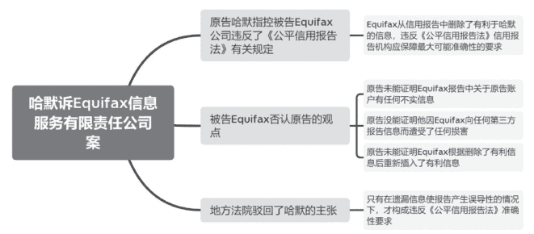

## 核心争议点

征信机构在出具的资料中遗漏对消费者有利的信息，是否构成对FCRA相关规定的违反。

## 裁判论证过程

遗漏有利信息不构成对FCRA的违反

FCRA第607条（b）款要求机构在编制资料时遵循合理流程，确保个人信息尽可能可靠。第602条（b）款亦要求机构以公平、公正、保密、可靠、相关且适当的方式使用消费者信息，满足商业需求.^([\[73\]](#txt004.html#footnote_content_txt004_73))依第607条（e）款或第611条，起诉方需证明资料中存在错误信息方能胜诉.^([\[74\]](#txt004.html#footnote_content_txt004_74))第五巡回法院对“错误信息”的界定为：信息要么明显错误，要么具有误导性足以在一定程度上对信用决策产生不利影响。^([\[75\]](#txt004.html#footnote_content_txt004_75))法院认为起诉方须证明：（1）资料含失实信息；（2）失实源于被告未遵循合理流程以确保最大可靠度；（3）起诉方受损；（4）损害由失实信息造成。依第611条索赔还须证明：（1）就档案中信息项的完整性或准确性提出异议并通知被告；（2）被告未在法定期限内免费复查且未记录争议状态或按第611条（a）款第（5）项删除；（3）不合规系疏忽或故意；（4）起诉方受损；（5）损害因未复查或未作记录/删除所致。起诉方虽称征信评分导致贸易活动受损^([\[76\]](#txt004.html#footnote_content_txt004_76))，但在法规未明确征信机构资料对特定贸易行为负有确定义务的情况下，因证据不足以证明资料含失实信息，其抗辩缺乏法律价值.^([\[77\]](#txt004.html#footnote_content_txt004_77))

FCRA要求机构立即删除或修正不准确或不完整信息，却不要求机构主动添加有利且准确的信息。信息遗漏并不必然构成法规意义上的“不准确”，使用者也无理由认为资料已穷尽消费者全部相关信息。事实上要求全面报送亦难以实现，因信息提供多基于自愿。^([\[78\]](#txt004.html#footnote_content_txt004_78))仅当遗漏导致资料具有误导性并可能对信用决策产生不利影响时，才可推定其有害。^([\[79\]](#txt004.html#footnote_content_txt004_79))本案中，哈默征信资料遗漏一条对其有利的信息，艾克飞并未从档案中删除第一资本信用卡账户，仅在对外资料中未体现该账户^([\[80\]](#txt004.html#footnote_content_txt004_80))，不属于法规所称的失实或误导情形。故遗漏有利信息不违反关于最大可能可靠性的要求。

第607条（b）款针对“信息”可靠性，而第611条（a）款关于争议信息完整或准确的规定仅适用于“信用条目”，如账户、破产、诉讼或留置权。起诉方质疑的是资料整体完整性，而非某一具体条目，故未触发第611条（a）款的调查义务。^([\[81\]](#txt004.html#footnote_content_txt004_81))第五巡回法院认为，遗漏一项信用项目并不使资料“失实”或“误导”。哈默并未指控机构违反披露政策或存在未披露的有利信息删除政策，故诉求不获支持。

## 审理结果

1.美国联邦地区法院德克萨斯州达拉斯分部驳回起诉人对艾克飞公司提出的所有索赔请求.

2.美国联邦地区法院德克萨斯州达拉斯分部撤销原审法院判决，但须提交修改后的判决.

3.美国联邦地区法院德克萨斯州达拉斯分部驳回起诉人对被告的第二次修正申诉.

4.第五巡回法院裁定维持原审地方法院的判决.

## 相关法条

### 美国《公平信用报告法》第602条（Fair Credit Reporting Act§602，15 U.S.C.§1681（2018））

国会调查结果和目标声明

（a）信用报告的准确性和公正性.国会得出以下结论：

（1）银行系统依赖于公平和准确的信用报告.不准确的信用报告会直接损害银行系统的效率，不公平的信用报告方法会削弱公众的信心，而这种信心对于银行系统的持续运作至关重要.

（2）已建立完善的调查和评估消费者的信用价值、资信状况、信用能力、性格和一般声誉的机制.

（3）在收集和评估消费者信用和消费者其他信息方面，消费者信用报告机构发挥着至关重要的作用.

（4）有必要确保消费者信用报告机构公平、公正地履行其重要责任，并尊重消费者的隐私权.

（b）合理的程序.本法的目的是要求消费者信用报告机构按照本法的规定，采取合理程序，以对消费者公平、公正的方式，秘密、准确、相关且适当地使用消费者信息，从而满足商业对消费者信用、人事、保险和其他信息的需求.

### 美国《公平信用报告法》第603条（d）款第（1）项（Fair Credit Reporting Act§603（d）（1），15 U.S.C.§1681a（d）（1）（2018））

一般规定.“消费者报告”是指消费者信用报告机构就消费者的信用价值、资信状况、信用能力、性格、一般声誉、个人特征或生活方式所进行的任何书面、口头或其他形式的信息交流.这些信息全部或部分的使用、预期使用或收集的目的是作为确定消费者以下资格的一个因素：

（A）主要用于个人、家庭或共同居住成员的信贷或保险；

（B）就业；或

（C）第604条（《美国法典》第1681b条）授权的任何其他事项.

### 美国《公平信用报告法》第607条（b）款（Fair Credit Reporting Act§607（b），15 U.S.C.§1681e（b）（2018））

报告的准确性.每当消费者信用报告机构准备消费者信用报告时，应遵循合理的程序，以确保报告所涉及的个人信息尽可能准确.

### 美国《公平信用报告法》第611条（a）款第（1）项（A）目（Fair Credit Reporting Act§611（a）（1）（A），15 U.S.C.§1681i（a）（1）（A）（2018））

一般规定.在遵守（f）款的前提下，除（g）款另有规定外，消费者对消费者信用报告机构的消费者档案中所含任何信息项目的完整性或准确性提出异议，并且消费者直接或通过经销商间接通知该机构的，该机构应免费进行合理的重新调查，以确定有争议的信息是否不准确，并记录争议信息的当前状态，或在该机构收到消费者或经销商的争议通知之日起30天内，根据第（5）项从档案中删除该项目.

## 案例评析

### （一）本案有助于厘清征信资料可靠性的判断标准

起诉方指控艾克飞故意未维持和遵循适当流程以确保对外提供消费者信用信息的最大可靠性，构成违法。尽管法规对征信机构提出最大可能可靠性的要求，但在数字经济时代，信用消费普及使资料对金融机构参考价值提升，使用者更关注数据经济价值，易忽视不准资料对消费者造成的持续不公。本案中，哈默认为信用评分下降导致个人信用消费受限，并失去贸易机会，进而信用卡申请被拒、抵押贷款被拒或利率上调.^([\[82\]](#txt004.html#footnote_content_txt004_82))

哈默认为有利信息被删除致资料不完整，与评分下降存在因果关系。法官指出，并非信息遗漏即等于失实，只有遗漏使资料“具有误导性，以致对信用决策产生不利影响”时才构成不准确。^([\[83\]](#txt004.html#footnote_content_txt004_83))在机器学习构建征信模型情形下，证明遗漏与不利决策的关联变得异常困难。信用评分算法涉及数据转换、元变量开发、特征选择及多重模型过滤，即使专业消费者也难以判断原始数据是否失实，进而对分数产生负面影响。^([\[84\]](#txt004.html#footnote_content_txt004_84))

对消费者而言，在征信机构普遍采用机器学习建模的背景下，FCRA中“尽可能准确”的要求应与计算机语言相衔接，提供更利于质疑、标准化的参照。只有个人信息充分标准化、计算机化、客观化，评分系统才能大规模运行并合法传播。^([\[85\]](#txt004.html#footnote_content_txt004_85))本案因信用卡账户信息未纳入资料引发争议，法院认定不构成失实。尽管机构有权决定是否将有利数据作为输入，但账户及数据未被纳入资料所造成的连锁影响，值得机构警醒。可靠性只是衡量结果的维度之一，在算法愈发复杂时，单一标准价值有限，为避免消费者遭受严重损害，征信机构应引入更公正、更可靠的评分算法。

### （二）引发了对信用评价领域技术正当程序的关注

算法信用时代的程序正义困境

量化后的信用信息已不再局限于决定是否放款，更在直接拉动房贷与消费贷的定价、条件设计上发挥作用。现实中，即便分数仅有细微差别，也可能使新贷款的利率显著抬升，并搭配更严厉的条款要求。^([\[86\]](#txt004.html#footnote_content_txt004_86))《公平信用报告法》第 607 条（b）项要求消费信用报告机构须以公正中立的方式，采纳合乎规范的操作流程，来满足商业、人力、保险等场景对消费者信息的正当获取需求。人工智能高度融入社会运行，自动化裁决凭借执行迅速、覆盖范围广的特点加剧了信息不对称，传统意义上的合理流程标准被迫引入技术正当程序的要素。在审视此类机构的操作是否可接受时，法院普遍参照“理性审慎者在同等情境下的做法”。^([\[87\]](#txt004.html#footnote_content_txt004_87))

然而，普通使用者难以透视某条具体记录如何作用于最终得分，更何况面对结构复杂的评分模型，即便具备一定专业背景的非专家也难以辨识其中潜藏的失真、不合逻辑或不公之处。若要真正把握模型的工作机理、实际效用以及可能的风险，^([\[88\]](#txt004.html#footnote_content_txt004_88))仅检视评分系统所依赖的数据集是远远不够的，还必须核阅源代码，以及开发者在算法里对变量设定、关联推断所留下的说明与注释。^([\[89\]](#txt004.html#footnote_content_txt004_89))在信用评估环节，报告机构对流程合规性负有法定义务，而“合理流程”的边界正在扩展，不应固守传统程序正义，而须叠加技术正当程序的要求，使评分算法同时获得法律与技术层面的正当性。技术性正当程序是规范自动化决策的重要抓手，当技术迭代远快于配套规则时，它以可被检验的流程、可理解的逻辑、可获得的救济来培育公众信任。作为一种规范工具，它必须为消费者质疑并挑战那些深刻影响公共生活的决策机制打开通道。与此同时，评分体系对生活的长远影响，也意味着透明度、精确度、问责、参与与公平等核心价值，应当转化为对评分体系的持续性监督。^([\[90\]](#txt004.html#footnote_content_txt004_90))

## （三）促进信用评价领域的公众监督机制的完善

算法解释义务与逻辑对外披露，有助于相对人还原不利决定的形成路径，也为遭遇算法歧视或数据失误的人启动救济提供了前提。^([\[91\]](#txt004.html#footnote_content_txt004_91))受认知局限与结构性权力失衡制约，消费者在信用评估中处于弱势，监管需要作出倾斜性的补偿性保护。^([\[92\]](#txt004.html#footnote_content_txt004_92))而既有的监管架构也必须随消费者信用市场的数据化进程不断演化。

围绕艾克飞等信用报告机构提起的一系列诉讼，推动艾克飞在其官网上开通自助异议入口：若使用者认为出具的报告存在失真、不完整或具欺骗性的记录，可通过网页提交异议。依据《公平信用报告法》关于准确性争议的处理规则，艾克飞须免费展开合理核查，并在 30 天内给出答复。^([\[93\]](#txt004.html#footnote_content_txt004_93))其官网同步公布了争议处理流程及所需材料。^([\[94\]](#txt004.html#footnote_content_txt004_94))机构内部的申诉与反馈功能，为争议萌芽期提供了救济窗口，早期纠正是遏制错误信息演化为系统性风险的关键。然而，争议的处理规则与裁量标准由各机构自行制定，内部救济的实际成效参差不齐。时至今日，仍有消费者反映数据提供方未对用于佐证争议项目的证明文件进行全面审阅。^([\[95\]](#txt004.html#footnote_content_txt004_95))《公平信用报告法》把“失真、不完整或无法核实”项目的处置责任赋予信用报告机构，同时鼓励消费者主动核查报告错误。但仅依赖企业的自我规制，即只要求其以最经济有效的方式处置，难以维系公平等社会价值。^([\[96\]](#txt004.html#footnote_content_txt004_96))除机构自设的申诉渠道外，对算法设计与相关数据的系统性评估、外部问责与审计力量的介入，是完善评价体系不可或缺的一环。^([\[97\]](#txt004.html#footnote_content_txt004_97))信用评价的应用场景往往关涉重大公共利益且可能触发社会风险，而个人行动空间与选择余地有限，试错成本极高，^([\[98\]](#txt004.html#footnote_content_txt004_98))因此应及时引入公众监督机制，开放外部监督渠道。让受不准评分影响最直接、也最有动力推动纠正的消费者以公众监督者身份参与，可降低错误信息发展为决定性、系统性与长期性风险的可能性。

### 【关联判例推荐】

1. McDonald v. Equifax Inc., CIVIL ACTION NO.3:15-CV-3212-B (N.D. Tex.2017)

核心事实：这是一起《公平信用报告法》相关案件，原告指控三家信用报告机构未能准确报告其信用信息.原告声称其信用报告上的错误导致其信贷申请被拒绝，因此原告对三家信用报告机构违反《公平信用报告法》的行为提出索赔.

与本案关联点：《公平信用报告法》要求消费者信用报告机构采取合理程序，“以对消费者公平、公正的方式，秘密、准确、相关且适当地使用消费者信息，从而满足商业对消费者信用、人事、保险和其他信息的需求.”根据第 607 条（b）款和第 611 条，为成功获得索赔，原告必须证明其消费者报告包含不准确的信息.

2. Johnson v. Trans Union, LLC, 10 C 6960 (N.D. Ill. 2012)

核心事实：原告大卫·强生（David Johnson）根据《公平信用报告法》和伊利诺伊州法律对三家信用报告机构提出诉讼，因为其消费者报告上存在不准确信息，且信用报告机构未能按照其要求进行更正.

与本案关联点：根据《公平信用报告法》第 607 条（b）款和第 611 条，原告必须证明其消费者报告包含不准确的信息.

3. Krosch v. Equifax Information Services, LLC, Case No.19-CV-2784 (NEB/KMM) (D. Minn. 2020)

核心事实：原告特洛伊·柯尔施（Troy Krosch）起诉了艾克飞公司和其他信用报告机构，指控他们未能在其信用报告中报告某些信息，违反了《公平信用报告法》.

与本案关联点：法官认为《公平信用报告法》没有要求信用报告机构在报告中涵盖所有与原告相关的信息.

4. Welford v. Equifax Information Services, LLC, CAUSE NO.1:20-cv-151-LG-RPM (S.D. Miss. 2020)

核心事实：原告称其在给艾克飞公司的一封信中对开户状态提出异议，艾克飞公司将该信转发给专业收款公司，专业收款公司未能对争议进行适当的调查或采取行动.原告根据《公平信用报告法》提起诉讼，指控艾克飞公司和专业收款公司故意违反法律，损害了其信用，并给其带来了情感伤害以及压力和焦虑.

与本案关联点：《公平信用报告法》第 611 条允许消费者客户对“消费者档案中所含任何信息的完整性或准确性”提出异议，并要求消费者信用报告机构合理地重新调查，以确定有争议的信息是否准确.

### 【注释】

[\[1\]](#txt004.html#footnote_quote_txt004_1)McCarran-Ferguson Act of 1945.（注：1945 年《麦卡伦—弗格森法案》，收入 2018 年《美国法典》第 15 卷，第 1011-1015 条.）美国国会于 1945 年通过了《麦卡伦—弗格森法案》，重申由各州对保险业进行监管是符合公共利益的，并且确认了在保险领域联邦法律不得取代或优先于各州法律的原则.

[\[2\]](#txt004.html#footnote_quote_txt004_2)根据伯福德弃权原则，联邦法院应避免干预复杂的州管理计划.

[\[3\]](#txt004.html#footnote_quote_txt004_3)McCarran-Ferguson Act §2（b）， 15 U.S.C. §1012（b）（2018）.（注：《麦卡伦—弗格森法案》第 2 条（b）款，收入 2018 年《美国法典》第 15 卷，第 1012 条（b）款.）

[\[4\]](#txt004.html#footnote_quote_txt004_4)美国《公平住房法》是 1968 年《民权法》的主要部分，收入《美国法典》第 42 卷第 3601 条以下.该法案旨在禁止住房的直接提供者（如房东和房地产公司）以及其他实体（如市政当局、银行或其他贷款机构和业主保险公司）的歧视性做法，防止人们因种族或肤色、宗教、性别、国籍、家庭状况或残疾等原因而无法获得住房.

[\[5\]](#txt004.html#footnote_quote_txt004_5)Pickett v. Iowa Beef Processors， 209 F.3d 1276 （2000）.

[\[6\]](#txt004.html#footnote_quote_txt004_6)Artifi cial Intelligence Committee， AI in the UK： Ready， Willing and Able？， UK Parliament （Apr. 16，2017）， https：//publications.parliament.uk/pa/ld201719/ldselect/ldai/100/10002.htm.

[\[7\]](#txt004.html#footnote_quote_txt004_7)Frank Pasquale & Danielle Keats Citron， The Scored Society： Due Process for Automated Predictions，89 Washington Law Review 1， 1-34 （2014）.

[\[8\]](#txt004.html#footnote_quote_txt004_8)Mike Ananny & Kate Crawford， Seeing Without Knowing： Limitations of the Transparency Ideal and Its Application to Algorithmic Accountability， 20 New Media and Society 973， 973-989 （2018）.

[\[9\]](#txt004.html#footnote_quote_txt004_9)［美］凯西·奥尼尔：《算法霸权》，马青玲译，中信出版社 2018 年版，第 16 页.

[\[10\]](#txt004.html#footnote_quote_txt004_10)参见陈锋、于茜虹：《信用消费体系建设中的法律思考—中美比较研究》，载《比较法研究》2013 年第 3 期.

[\[11\]](#txt004.html#footnote_quote_txt004_11)参见［美］弗兰克·帕斯奎尔：《黑箱社会》，赵亚男译，中信出版社 2009 年版，第 7 页.

[\[12\]](#txt004.html#footnote_quote_txt004_12)郑智航、徐昭曦：《大数据时代算法歧视的法律规制与司法审查—以美国法律实践为例》，载《比较法研究》2019 年第 4 期.

[\[13\]](#txt004.html#footnote_quote_txt004_13)David Lizerbram， Listing On“Dirtiest Hotels In America”Defamatory？，David Lizerbram &Associates （Oct. 1， 2013）， https：//lizerbramlaw.com/2013/10/01/listing-on-dirtiest-hotels-inamerica-defamatory/.

[\[14\]](#txt004.html#footnote_quote_txt004_14)Communications Decency Act §230， 47 U.S.C. §230 （1996）.（注：《通讯规范法》第 230 条，收入 1996 年《美国法典》第 47 卷，第 230 条.）

[\[15\]](#txt004.html#footnote_quote_txt004_15)Sullivan v. Baptist Mem’l Hospital， 995 S.W.3d 569 （Tenn.1999）.

[\[16\]](#txt004.html#footnote_quote_txt004_16)Gallagher v. E.W. Scripps Co.， 2009 U.S. Dist. LEXIS 45709， \*20， 2009 WL 1505649 （W.D.Tenn.2009）.

[\[17\]](#txt004.html#footnote_quote_txt004_17)Compuware Corp. v. Moody’s Investors Services， Inc.， 499 F.3d 520 （6th Cir. 2007）.

[\[18\]](#txt004.html#footnote_quote_txt004_18)James Grimmelmann， Three Theories of Copyright in Ratings， 14 Vanderbilt Journal of Entertainment and Technology Law 851， 869 （2012）.

[\[19\]](#txt004.html#footnote_quote_txt004_19)James J. McGuire， Deanna K. Shullman & Allison Kirkwood Simpson， Seeing Stars： Courts and Congress Consider Whether to Knock out Online Ratings Defamation Claims， 32 Communications Lawyer 19， 19-24 （2016）.

[\[20\]](#txt004.html#footnote_quote_txt004_20)Isuzu Motors Ltd. v. Consumers Union of US， Inc.， 12 F.Supp.2d 1035 （C.D. Cal. 1998）.

# 脚注

[\[21\]](#txt004.html#footnote_quote_txt004_21)Compuware Corporation 诉 Moody’s Investors Services， Inc.， 324 F.Supp.2d 860 （E.D. Mich. 2004）.

[\[22\]](#txt004.html#footnote_quote_txt004_22)Jones 诉 Dirty World Entertainment Recordings LLC， 755 F.3d 398 （6th Cir. 2014）.

[\[23\]](#txt004.html#footnote_quote_txt004_23)Lucille M. Ponte，保护品牌形象还是操纵系统？众包评价和评论时代的消费者“禁言”合同，7William and Mary Business Law Review 59，95 （2016）.

[\[24\]](#txt004.html#footnote_quote_txt004_24)Browne 诉 Avvo， Inc.， 525 F.Supp.2d 1249 （W.D. Wash. 2007）.

[\[25\]](#txt004.html#footnote_quote_txt004_25)Levitt 诉 Yelp！ Inc.， 765 F.3d 1123 （9th Cir. 2014）.

[\[26\]](#txt004.html#footnote_quote_txt004_26)Fair Housing Council of San Fernando Valley 诉 Roommates.com， LLC， 04-56916o， 04-57173 （9th Cir. 2007）.

[\[27\]](#txt004.html#footnote_quote_txt004_27)Eric Goldman，TripAdvisor 的“最脏酒店”排名在法庭上获得认可，Forbes （Aug. 27，2012）， `https：//www.forbes.com/sites/ericgoldman/2012/08/27/tripadvisors-dirtiest-hotels-rankingmakes-the-grade-in-court/？sh=612dabab3aab`.

[\[28\]](#txt004.html#footnote_quote_txt004_28)Jim Rosenfeld & Sam，第六巡回法院裁定 TripAdvisors 的“最脏酒店”排名受保护意见，Davis Wright Tremaine （Sept. 16， 2013）， `https：//www.dwt.com/insights/2013/09/6th-circuitrules-that-tripadvisors-ranking-of-dir`.

口碑与信用，法如何划线

互联网把评价权交给所有人，也把声誉风险放大到企业和个人都难以承受的程度。学术界和实务界围绕网络差评、平台责任以及信用报告诉讼门槛展开了持续的讨论。

在网络诽谤与评价权的讨论里，Lyrissa Lidsky 与 RonNell A. Jones 在 2016 年《Virginia Journal of Social Policy & the Law》第23卷155页发表的《关于合理读者和不合理发言者：网络世界中的诽谤法》多次被援引，171页和173页的分析被用来说明如何在信息过载的环境下判断读者反应和发言者责任。James Grimmelmann 在 2012 年《Vanderbilt Journal of Entertainment and Technology Law》第14卷851页的《评价中版权的三种理论》中以870页、872页的论述梳理了评论场景下版权归属的三种思路。

实务端的焦虑同样明显。Holly Miller 在 2014 年《Media, Privacy and Defamation Law Committee Newsletter》撰写的《企业和专业人士因 Yelp 和负面在线评论而呼救“帮助！”：反击批评性网络帖子需要谨慎的法律考虑》指出，企业面对恶意差评时的反制极易踩线。Barrie Goldsmith 在 2016 年《Journal of Tourism and Hospitality Management》第4卷135页137页的《Tripadvisor 上的负面反馈：酒店的噩梦》描述了点评如何直接冲击住宿业营收。

合同控制与平台对抗的议题也在同步发酵。Lucille M. Ponte 在 2016 年《William and Mary Business Law Review》第7卷59页发表的《保护品牌形象还是操纵系统？众包评价和评论时代的消费者“禁言”合同》在96页、93页分别讨论了评价禁言条款的正当性与边界。Lori A. Roberts 在 2016 年《University of Cincinnati Law Review》第84卷633页的《与消费者评论网站霸凌者搏斗》在637页、638页、648页提供了面对评论平台滥用时的应对框架。Gonzalo Mon 在 2016年11月1日 Kelley Drye 的评述中梳理了 Kimzey 诉 Yelp！Inc. 的进展，John Crosetto 与 Chike Eze 在 2016年12月7日 Foster Garvey 的文章《平衡用户生成内容的风险与回报》中提醒平台如何权衡内容开放与责任。Eric Goldman 在 2016年6月15日《Technology & Marketing Law Blog》撰写的《评论网站在法庭上受重创-Consumer Cellular 诉 ConsumerAffairs》则记录了评论网站在司法审查中的挫折。

另一条主线是美国信用报告法的原告资格与损害认定。宪法层面的门槛以 Lujan v. Defenders of Wildlife, 504 U.S.555 1992 为标志被确立，原告必须满足事实损害、因果关系与可救济性三要件，这一标准在齐树洁、李叶丹关于美国公民诉讼原告资格的研究中被进一步阐释。《公平信用报告法》第618条 15 U.S.C. §1681p 2003 以及第609(f)(7) 15 U.S.C.§1681g(f)(7) 2003 等条文构成了具体的程序与披露要求。Timothy St. George 与 David Anthony 在 2017 年《Business Law Today》第8卷1页1-6页提出的《对联邦法院公平信用报告法集体诉讼的实用辩护方法》为被告方提供了操作思路。

版权与信息披露的交叉话题也出现于讨论中。Lawrence C. Maxwell 在 2013 年《Landslide》第6卷16页16-21页讨论建筑作品版权是否需要改变。TRW Inc. v Andrews, 534 U.S.19 2001 的判决影响了信用信息诉讼的思路。Remy Y. Chang 在 2011 年《U.C. Davis Law Review》第44卷1381页1389-1391页的文章反对以 Auscape International 诉 National Geographic Society 作为统一民事版权诉讼发现规则的归属。马克诉易可升金融有限责任公司 748 F.3d 663 第五巡回法院 2014年的判决以及拉杰夫·穆特雷贾与梅尔·费德尔在 2016年4月/5月 Jones Day 发表的《理解《公平信用报告法》》为实务理解提供了参考。斯波科公司诉罗宾斯 136 S.Ct.1540 2016年的判决后，艾伦·史密斯在 2016年5月17日 SHRM 指出高等法院认为具体损害是提起 FCRA 诉讼的必要条件，贷款律师有限责任公司在 2017年7月25日 Loan Lawyers 的分析同样强调 FCRA 要求法定损害赔偿必须伴随具体伤害。

国内学界对信用评分的落地也在展开。朱浩、黄险峰、陈彦舟在《征信》2019年第4期发表《国内城市个人信用评分指标体系和应用场景研究》，张涛在《行政法学研究》2020年第1期发表《个人信用评分的地方实践与法律控制—以福州等7个城市为分析样本》。在产业背景上，Equifax 始建于1899年，创始人为凯特·伍福特，总部设在亚特兰大，是三大消费者信用报告机构中最早在美国本土成立的一家。美国消费者联合会国家信用报告协会 2002年12月17日的档案《信用评分准确性及其对消费者的影响》提供了早期评估。尼基塔·阿加瓦尔在《剑桥法律杂志》第80卷第42页 2021年发表《算法信用评分的规范》，赫尔利·米凯拉与朱利叶斯·阿德巴约在《耶鲁法律与技术杂志》第18卷148页148-216页 2016年探讨《大数据时代的信用评分》。Equifax 在 2022年3月10日官网介绍信用报告，美国三大机构即 Equifax、Experian、TransUnion。

法律适用层面，《公平信用报告法》第607条(b) 15 U.S.C. §1681e(b) 2018 年与第602条(b) 15 U.S.C. §1681(b) 2018 年被反复援引。汉默诉 Equifax 信息服务有限责任公司等案 2018 WL 10483887 2018年，以及 2019 WL 7602463 2019年，最终于第五巡回法院 974 F.3d 564 2020年形成判例。塞普尔瓦多诉 CSC 信用服务公司 158 F.3d 890 第五巡回法院 1998年的判决也在后续讨论中被对照。整体来看，从网络差评到信用分数，法律都在试图在表达自由、商业保护与个人救济之间找到可操作的分寸。

[\[80\]](#txt004.html#footnote_quote_txt004_80)汉默诉 Equifax 信息服务有限责任公司等，974 F.3d 564（第五巡回法院，2020 年）。

[\[81\]](#txt004.html#footnote_quote_txt004_81)汉默诉 Equifax 信息服务有限责任公司等，974 F.3d 564（第五巡回法院，2020 年）。

[\[82\]](#txt004.html#footnote_quote_txt004_82)汉默诉 Equifax 信息服务有限责任公司，2018 WL 10483887（2018 年）。

[\[83\]](#txt004.html#footnote_quote_txt004_83)塞普尔瓦多诉 CSC 信用服务公司，158 F.3d 890（第五巡回法院，1998 年）。

[\[84\]](#txt004.html#footnote_quote_txt004_84)赫尔利·米凯拉与朱利叶斯·阿德巴约，《大数据时代的信用评分》，《耶鲁法律与技术杂志》第 18 卷第 148 页 148-216 页（2016 年）。

[\[85\]](#txt004.html#footnote_quote_txt004_85)巴尔巴拉·基维亚特，《美国的信用评分》，《欧洲电子通讯经济社会学》第 21 卷第 33 页，33-42 页（2019 年）。

[\[86\]](#txt004.html#footnote_quote_txt004_86)美国消费者联合会国家信用报告协会，《信用评分准确性及其对消费者的影响》，档案（2002 年 12 月 17 日），https：//consumerfed.org/\_archives/elements/www.consumerfed.org/fi le/fi nance/121702CFA\_NCRA\_Credit\_Score\_Report\_Final.pdf。

[\[87\]](#txt004.html#footnote_quote_txt004_87)汤普森诉圣安东尼奥零售商协会，682 F.2d 509（第五巡回法院，1982 年）。

[\[88\]](#txt004.html#footnote_quote_txt004_88)刘东亮：《技术性正当程序：人工智能时代程序法和算法的双重变奏》，载《比较法研究》2020 年第 5 期。

[\[89\]](#txt004.html#footnote_quote_txt004_89)丹妮尔·基茨·西特隆与弗兰克·A·帕斯夸莱，《评分社会：自动化预测的正当程序》，《华盛顿法律评论》第 89 卷第 1 页，1-34 页（2014 年）。

[\[90\]](#txt004.html#footnote_quote_txt004_90)丹妮尔·基茨·西特隆与弗兰克·A·帕斯夸莱，《评分社会：自动化预测的正当程序》，《华盛顿法律评论》第 89 卷第 1 页，1-34 页（2014 年）。

[\[91\]](#txt004.html#footnote_quote_txt004_91)张凌寒：《商业自动化决策的算法解释权研究》，载《法律科学（西北政法大学学报）》2018 年第 3 期。

[\[92\]](#txt004.html#footnote_quote_txt004_92)尼基塔·阿加瓦尔，《算法信用评分的规范》，《剑桥法律杂志》第 80 卷第 42 页，42-73 页（2021 年）。

[\[93\]](#txt004.html#footnote_quote_txt004_93)《公平信用报告法》第 611 条（a）（1）（A），15 U.S.C. §1681i（a）（1）（A）（2018 年）。（注：《公平信用报告法》第 611 条（a）款第（1）项（A）目，收入 2018 年《美国法典》第 15 卷，第 1681i 条（a）款第（1）项（A）目。）

[\[94\]](#txt004.html#footnote_quote_txt004_94)Equifax，《对 Equifax 信用报告中的信息提出异议》，Equifax（2022 年 3 月 11 日），https：//www.equifax.com/personal/credit-report-services/credit-dispute/。

[\[95\]](#txt004.html#footnote_quote_txt004_95)消费者报告，《消费者报告调查发现超过三分之一的消费者在其信用报告中发现错误》，消费者报告（2022 年 3 月 12 日），https：//www.consumerreports.org/media-room/press-releases/2021/06/consumer-reports-investigation-finds-more-than-one-thirdof-consumers-found-errors-in-their-credit-reports/。

[\[96\]](#txt004.html#footnote_quote_txt004_96)丹妮尔·基茨·西特隆与弗兰克·A·帕斯夸莱，《评分社会：自动化预测的正当程序》，《华盛顿法律评论》第 89 卷第 1 页，1-34 页（2014 年）。

[\[97\]](#txt004.html#footnote_quote_txt004_97)张欣：《算法影响评估制度的构建机理与中国方案》，载《法商研究》2021 年第 2 期。

[\[98\]](#txt004.html#footnote_quote_txt004_98)张欣：《从算法危机到算法信任：算法治理的多元方案和本土化路径》，载《华东政法大学学报》2019 年第 6 期。

# 第五章 算法辅助量刑的正当程序检视

## 5.1 卢米斯诉威斯康星州案

### 【案件索引】
卢米斯诉威斯康星州，881 N.W.2d 749（2016 年）
威斯康星州诉卢米斯，2016 WI 68，371 Wis.2d 235，881 N.W.2d 749（2016 年）
卢米斯诉威斯康星州，137 S.Ct. 2290（2017 年）

### 【关键词】
算法可解释性；自动化决策影响评估；算法问责；智慧司法

### 【案件提要】
本案常被作为算法解释权与技术性正当程序的典型案例来讨论，事实源头是威斯康星州诉卢米斯的刑事诉讼。在该案审理中，被告埃里克·卢米斯经正式程序被告知量刑阶段会引入“提供替代性制裁矫正犯罪管理画像 COMPAS”^([\[1\]](#txt005.html#footnote_content_txt005_1))的再犯风险测算。这种形式化的告知压缩了辩护空间，而模型的黑箱特性也让司法判断难以把握。

卢米斯主张，基于群体行为数据推算再犯风险的做法存在科学性与准确性隐患，侵及了在可靠信息基础上受审的权利；COMPAS 在计分时纳入性别因素也被指触及正当程序底线。他还指出，自己本处于最佳反驳位置，却只能依据开发者报告里的有限披露展开质疑，若无法获知各影响要素所占权重及评分运行逻辑，抗辩难以成立。

开发商 Northpointe 称核心计分信息属商业秘密，无法向当事人与一审法院公开具体权重，但强调输出分数具有科学依据与实用价值。纽约州刑事司法部门的研究为此提供部分支撑，质疑声仍此起彼伏。

案件获得立法、执法、司法与公众的广泛关注。相较人工裁量，算法裁量在透明度与抗辩可行性上呈现结构性差异。模型常处于不公开状态，利害关系人难以察觉机器干预；控制方又常以商业秘密或知识产权为由拒绝披露原理；即便代码全盘公开，技术鸿沟仍会让监管者难以追责、数据主体难以行使参与、异议与救济。2016 年威斯康星州最高法院对本案的审理，以及围绕 COMPAS 的持续争论，正好集中体现上述三重困境，并凸显算法解释权对保障个体程序性权利的关键作用。

ProPublica 于 2016 年 5 月发布《机器偏差 Machine Bias》专题，系统揭露美国司法领域再犯风险预测算法的偏误与种族歧视问题^([\[2\]](#txt005.html#footnote_content_txt005_2))。同期，由纽约大学运行的跨学科机构 AI Now 推动纽约市算法影响评估立法，促成 2018 年《算法问责法》出台，要求公共事务中使用自动化决策须在不妨碍创新的前提下接受影响评估，以保障一致性、专业性与中立性。我国《个人信息保护法》第 24 条赋予个人对自动化决策的拒绝权，第 55 条确立个人信息保护影响评估机制，是在算法普及背景下对新型权利与算法问责的制度化回应。

本案也把司法辅助工具的角色推向讨论中心，提醒人们关注算法在量刑中带来的准确性、个体化与歧视性风险，并推动构建规范算法决策的规则体系。代码即法律，算法技术本身也应遵循技术性正当程序。总之，本案对理解算法解释权、算法问责、算法影响评估具有重要意义。

## 案件要旨
拉克罗斯巡回法院（一审法院）：原告 威斯康星州 被告 埃里克·卢米斯
威斯康星州上诉法院（上诉法院）：上诉方 埃里克·卢米斯 被上诉方 威斯康星州
威斯康星州最高法院（二审法院）：上诉方 埃里克·卢米斯 被上诉方 威斯康星州

2013 年 2 月，威斯康星州西部城市拉克罗斯发生一起与驾车射击有关的犯罪，州方以五项罪名起诉卢米斯。卢米斯否认参与射击，但承认当晚驾驶涉案汽车。最终认罪于较轻的两项——企图躲避交通官员、未经车主同意驾驶汽车。量刑时，拉克罗斯巡回法院使用了 COMPAS 风险评估工具。因方法属商业秘密，Northpointe 仅提交再犯风险数值。COMPAS 为被告生成审前再犯风险、一般再犯风险、暴力再犯风险三项结果，数值越高再犯概率越大。法院据此排除缓刑可能，判处六年有期徒刑和五年社区监督。卢米斯申请定罪后宽免被驳回。

卢米斯向威斯康星州上诉法院上诉，认为参考 COMPAS 侵害正当程序，理由：（1）软件专有使被告无法质疑科学有效性，侵害基于准确信息获判的权利；（2）基于群体数据侵害个性化量刑权；（3）考虑性别因素侵害正当程序。

上诉法院移交州最高法院。2016 年 7 月，州最高法院维持原判，认为法官量刑时可参考 COMPAS，只要注意其限制和注意事项。
随后，卢米斯向联邦最高法院申请再审。2017 年 6 月 26 日，联邦最高法院驳回再审令状，拒绝审理。

## 案例事实思维导图
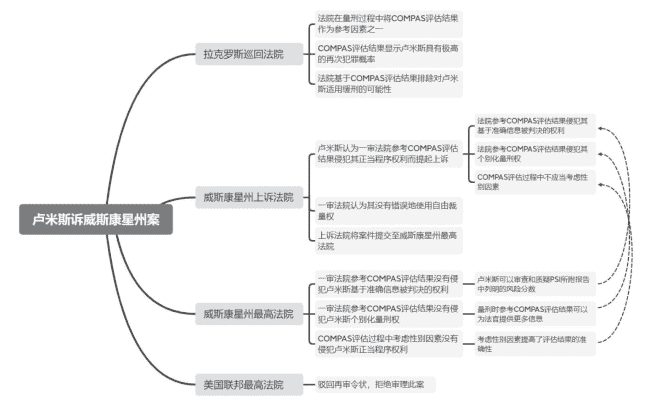

## 核心争议点
1. 量刑时使用 COMPAS 风险评估软件是否侵害被告基于准确信息受量刑的权利。
2. 量刑时使用 COMPAS 是否侵害被告个性化量刑权。
3. 审判依赖纳入性别因素的风险评估软件是否违宪。

## 裁判论证过程
### （一）量刑时使用风险评估工具未侵害基于信息准确性的正当程序权利
威斯康星州最高法院安·沃尔什·布莱德利^([\[3\]](#txt005.html#footnote_content_txt005_3))法官认为，虽然卢米斯无法审查 COMPAS 算法如何计算风险，但可就附于判决前调查报告 Presentence Investigation Report 的 COMPAS 评估报告中列明的问题与回答进行核查。风险分数源于其问卷作答及公开的犯罪历史数据，卢米斯有权核实报告所列内容是否属实。法庭与被告拿到同一份报告，若认为其他因素或信息不准，仍可质疑分数可靠性。

### （二）量刑时使用风险评估工具未侵害个性化量刑的正当程序权利
布莱德利法官强调个性化量刑的重要性，并承认 COMPAS 仅提供与被告相似群体的再犯风险聚合数据。但她指出，本案量刑中 COMPAS 并非决定性依据，其考量得到其他独立因素支撑。把风险评分与其他相关情节一并纳入，有助于法官在更充分信息下作出个体化判决。印第安纳州最高法院曾指出，此类工具可帮助法官更有效地评估犯罪历史、缓刑可能性及被告性格态度等法定情节^([\[4\]](#txt005.html#footnote_content_txt005_4))。法院拥有自由裁量权足以排除不当评估，故使用 COMPAS 不构成对个性化量刑权的侵害。

### （三）风险评估工具考虑性别未侵害正当程序权利
布莱德利法官认为 COMPAS 纳入性别具有事实基础。若完全忽略性别差异，反而可能导致对男女的误分类。正如有评论所指，在预测再犯风险时不考虑性别本身不公。法官指出，引入性别的目的是提升准确性，属于非歧视性考量，且最终有利于司法系统。卢米斯未能举证证明量刑法院实际把性别作为量刑依据。因此，使用 COMPAS 不构成对其正当程序权利的侵犯。

布莱德利法官还要求，任何包含 COMPAS 的 PSI 必须向量刑法院提供五项书面提示：第一，专有性阻碍对权重与计分方式的披露；第二，分数基于群体数据，只能识别高风险群体而非特定高风险个体；第三，已有研究质疑 COMPAS 可能对少数族裔高估风险；第四，软件以全国样本为参照，针对威斯康星州人口的交叉验证尚未完成，需持续监控与再校准；第五，COMPAS 原设计用于惩教署的治疗、监督与假释决策，非为量刑而生。她希望这些提示能引发对 COMPAS 准确性的普遍审慎，以及对少数族裔评估的特别警惕。

协同意见中，亚伯拉罕森法官指出，法院对 COMPAS 缺乏理解而亟需帮助，并认为当判决参考此类工具时，庭审记录应呈现有意义的推理，说明工具的相关性、优势与不足。对外提供透明且可理解的解释，不仅为上诉审查提供基础，也能提升法院对新型决策辅助工具的认知。

## 审理结果
1. 拉克罗斯巡回法院判处卢米斯六年有期徒刑及五年社区监督。
2. 拉克罗斯巡回法院驳回其定罪后宽免申请。
3. 威斯康星州最高法院驳回正当程序主张，维持原判。
4. 美国联邦最高法院于 2017 年 6 月 26 日驳回再审申请，拒绝审理。

## 相关法条
美国宪法第五修正案 Constitution of the United States Fifth Amendment
非经大陪审团提出报告或起诉，任何人不受死罪和其他重罪的惩罚，唯在战时或国家危急时期发生在陆、海军中或正在服役的民兵中的案件不在此限。任何人不得因同一犯罪行为而两次遭受生命或身体伤残的危害；不得在任何刑事案件中被迫自证其罪；未经正当法律程序，不得剥夺任何人的生命、自由和财产；非有恰当补偿，不得将私有财产充作公用。

美国宪法第十四修正案第一款 Constitution of the United States Fourteenth Amendment Section 1

算法进法庭，程序正义如何重校

出生在美国或已完成美国归化并处于联邦管辖之下的人，同时拥有联邦层面与居住州的公民资格。各州无权出台或执行剥夺联邦公民特权与豁免的规范，也不得在未履行法定正当程序的情况下剥夺任何人的生命、自由或财产，且须保证辖区内每个人都能享有相同的法律保护。

案例评析

### （一）本案直接推动了算法问责相关立法的出台

卢米斯案掀起的争议，本质上是算法的封闭性与复杂性同正当程序要求发生正面碰撞。刑事审判关乎人身自由乃至生命这类基本法益，所以在刑案场景里，算法问责的监督与约束作用格外关键。ProPublica 2016年发表的《机器偏差》调查在舆论上形成推力，纽约市由此成为首个以地方条例回应算法透明的地方。纽约市2018年第49号地方法规设立了 Algorithmic Accountability Task Force，负责盘点市政部门的算法使用情况，并就强化公共问责提出建议.^([\[6\]](#txt005.html#footnote_content_txt005_6)) 凡涉及公共利益的政府算法，公众对其透明与可解释的期待远高于纯商业系统。2017年12月18日，纽约市长比尔·白思豪签署《算法问责法》，这是美国立法史上首部针对公共事务领域算法进行追责的法案，篇幅虽小，却搭建起问责治理的主干。随后各国各区对算法问责立法的关注明显上升，本案对可解释性与算法影响评估制度的形成也产生了外溢影响。

2022年2月，俄勒冈州民主党参议员Ron Wyden携参议员Cory Booker与众议员Yvette Clarke推出2022年《算法问责法案》.^([\[7\]](#txt005.html#footnote_content_txt005_7)) 该案为2019年法案的更新版本。从制度机理看，美国在算法治理上更依赖外部专家、行政机构与公众共同参与稽核评估。问责机制的核心在于算法使用者或控制者负有举证与报告义务，必须证明系统设计及决策运用的合理性，并尽力减轻可能产生的负面影响或潜在危害.^([\[8\]](#txt005.html#footnote_content_txt005_8)) 具体而言，法案要求科技企业在自动化决策系统作出关键判断时，对偏见、效能等要素进行系统化的影响评估。

欧盟的路径则不同，《通用数据保护条例》主要通过赋予数据主体知情、查阅、更正、删除、限制处理及数据可携等新型权利来影响算法决策。学界对GDPR是否创设“算法解释权”仍有争论，但其对可解释性的要求是明确的。例如GDPR第13条规定，在获取个人数据时，控制者应当为数据主体提供确保处理合理透明所需的补充信息，具体包括自动化决策的存在、运行逻辑、对数据主体的重要意义与预期后果。

在中美欧立法的互动下，我国的《个人信息保护法》第24条亦对算法透明与公平作出规定：“个人信息处理者利用个人信息进行自动化决策，应当保证决策的透明度和结果公平、公正，不得对个人在交易价格等交易条件上实行不合理的差别待遇。”为防范自动化决策引发的侵权风险，该法创设了新的权利救济手段。虽与国际通行的算法影响评估与审计实践不完全一致，该法中同样确立了自动化决策影响评估与审计安排。

### （二）推动司法审判中算法决策辅助地位的明确

从教育到健康，从金融到传媒，算法的渗透无处不在，司法系统也在其中。美国警务实践里，多地警局借助算法提升社区安全。由加州大学洛杉矶分校、圣克拉拉大学学者与洛杉矶警察局共同孕育的Predpol，通过分析历史犯罪数据预测未来高发区域。部分州尝试以算法替代带有歧视色彩的传统保释制度。国内也在推进司法数据化与量刑智能化，利用人工智能对实体裁判进行预测。2017年7月，国务院印发的《新一代人工智能发展规划》指出：“建设智慧法庭是推进社会治理智能化的重点领域之一。”^([\[9\]](#txt005.html#footnote_content_txt005_9)) 2018年3月，沪上高院与科大讯飞联合研发的上海刑事案件智能辅助办案系统 206系统全市推广，该系统将影响社会危险性的要素拆解为七类32项指标，以深度学习搭建评估模型，提升了评估的全面性、科学性与准确性。

总体来看，算法在法律领域的价值在于更高效调配有限司法资源、推动现代化并降低偏见，从而逼近正义。但准确性、透明性、歧视性、可理解性、问责性等风险同样突出。鉴于COMPAS等工具与程序正义的争议，威斯康星州最高法院强调，使用风险评估工具的法官须对除评估报告之外的量刑理由作出说明。在充分考量COMPAS局限与注意点后，一审法院在量刑中使用算法风险评估并不构成对程序权利的侵害，但后续审理须为算法使用提供程序保障，包括在预测报告中阐明优势、相关性与不足。该判例为美国其他法院提供指引，即风险分值不可成为判决的决定性因素。在《输入偏见，输出偏见》一文中，Sandra Kim反对以算法预测再犯可能性。她认为风险评估依赖历史信息预测未来，易于复制偏见。Kim主张不应采用算法预测犯罪，而应作为诊断工具以发现司法决策中的差异与偏差。换言之，用算法判定被告易致偏见，用算法改进决策则可能有益.^([\[10\]](#txt005.html#footnote_content_txt005_10))

在审判实践中，第一步是明确工具属性：算法只能辅助裁判，不能替代法官。司法裁判兼具专业判断与价值判断，必须坚守法官主体性与裁判独立性，避免锚定效应与数据主义侵蚀自由裁量。在定位明确后，新型辅助工具可为法官提供更全面的参考，帮助结合具体案情作出个性化裁判。其次要推动司法智能化法治化进程，完善配套以控制风险。卢米斯案中，模型复杂与商业秘密保护使被告无法质疑COMPAS的科学性。可知技术黑箱与法律黑箱会导致难以解释、难以质疑、难以修复的问责困境，进而威胁基本权利。该案凸显算法风险与程序正义的复杂性。从事实认定、证据确认、案情分析、裁判作出，到庭审管理、收监、假释、减刑等环节，皆有人工智能介入可能。因此有必要构建司法智能化改革与算法辅助裁判的制度框架，明确有权要求使用者或控制者强制披露信息的机构、内容、披露风险及防范措施。再者，重视伦理与技术标准等软法对硬法的补充与协调，推动治理标准化和法治化的良性衔接。人工智能原理复杂、迭代迅速、应用广泛，治理范式正从单一的国家主导、法律核心的硬法模式，转向政府、企业、技术社群、民间机构与公民多方参与、具协同性、动态性、分层性与复合型特征的软法体系。^([\[13\]](#txt005.html#footnote_content_txt005_13)) 软法有助于弥合法律滞后与技术快速发展的矛盾，协调创新、权利保护与制度构建。最后，算法辅助系统最终服务于法官、依赖人的判断，构建“人工智能+法律”复合型人才培养机制亦是重要议题。

### （三）引发了对个体技术性正当权利的关注

2008年，马里兰大学法学教授Danielle K. Citron提出“技术性正当程序”的概念，主张通过优化程序设计提升自动化决策的透明与可问责性。^([\[14\]](#txt005.html#footnote_content_txt005_14)) 其一，代码即网络空间的规则，改造代码可使网络更易规制；其二，法官审理须充分论证以确保判决可接受与可理解。本案中COMPAS并未如此运作，开发者Northpointe称被告所需信息属于专有，因而拒绝公开评分方式及各因素权重。若自动化决策无法提供逻辑自洽的论证，个体面对不透明算法时，其技术性正当权利必然受压。算法黑箱易滋生腐败与侵权，透明缺失更会动摇公众信任，导致应用停滞。^([\[15\]](#txt005.html#footnote_content_txt005_15))

强化透明与可问责已成监管趋势。2019年6月，美国国家科技委员会发布的《国家人工智能研发战略计划：2019年更新版》强调通过优化设计提升AI系统的公平、透明与可问责性。^([\[16\]](#txt005.html#footnote_content_txt005_16)) 2020年11月17日，白宫发布《人工智能应用监管指南》，指出AI部署旨在提升效率、有效性、公平性、福祉、透明度等。^([\[17\]](#txt005.html#footnote_content_txt005_17)) 监管与非监管措施应以增强公众信任、风险评估与管理、披露与透明度为原则，保障个体技术性正当权利是提升信任的关键之一。我国国家新一代人工智能治理专业委员会2021年9月25日发布的《新一代人工智能伦理规范》第12条要求：在算法设计、实现与应用环节提升透明性、可解释性、可理解性、可靠性、可控性，增强系统韧性、自适应与抗干扰能力，逐步实现可验证、可审核、可监督、可追溯、可预测、可信赖。

### （四）本案后续的一些最新进展

本案以联邦最高法院驳回卢米斯再审令状、拒绝审理而结束。但作为刑事司法领域算法自动化决策的典型案例，卢米斯案仍持续受到关注。

华沙大学、华沙理工大学与华沙经济学院的研究者在剖析COMPAS建模后提出新的再犯预测方案。^([\[18\]](#txt005.html#footnote_content_txt005_18)) 与ProPublica结论不同，他们认为COMPAS的症结在于专有性以及从不可公开问卷中采集的一百多个手工输入变量，导致难以识别录入错误、整合错误、缺失等不准确性。研究者尝试解释COMPAS模型以探寻种族与性别偏见，并探索提升公平性的方法。虽因公开数据有限无法完整复现分值，实验显示研究者构建的直接再犯模型相较原始COMPAS及基于其训练的模型表现更优。同时实验表明，即便最优模型仍存在种族偏见，而使用偏见消除器可在一定牺牲准确性的前提下显著提升公平性。

卢米斯案不仅引发算法解释权与技术正当程序的争论，也促使研究者关注司法领域算法的不透明、不公与歧视。ProPublica等机构提出的修正建议具实践价值：优化算法结构、引入偏见消除器，可降低评估不准确性与偏见，助力司法公正。

## 【关联判例推荐】

### 1. Malenchik v. State, 928 N.E.2d 564, (Ind. 2010)
核心事实：初审法院量刑时参考LSI-R^([\[19\]](#txt005.html#footnote_content_txt005_19))与SASSI^([\[20\]](#txt005.html#footnote_content_txt005_20))评估结果。被告以工具缺乏科学可靠性质疑可采性。印第安纳州最高法院认为这些测试有助于法官对量刑证据进行个性化评价并选择最适合改造的刑罚。量刑程序不受证据规则约束，以便法官获取最宽泛信息作出审慎决定。
关联点：在量刑中使用评估工具可帮助法官实现量刑证据的个性化与改造导向选择。

### 2. State v. Samsa, 2015 WI App 6, 359 Wis.2d 580, 859 N.W.2d 149 (2014)
核心事实：COMPAS报告显示被告Samsa再犯风险较低，但巡回法院未采纳。上诉法院认为初审法院未滥用量刑裁量权，因COMPAS仅是可用工具之一，法院可选择性采信部分内容并拒绝另一部分。
关联点：法院是否采用风险评估结果属于法官自由裁量范畴。

### 3. State v. Travis, 347 Wis.2d 142, 832 N.W.2d 491 (Wis. 2013)
核心事实：一审法院误以为被告Travis须适用至少五年强制监禁据此判决。上诉法院认为法律错误构成结构性错误并指令重审。经无害分析，威斯康星州最高法院认为错误既非结构性错误也非无害错误，最终维持发回重审决定，但基于不同理由。
关联点：被告享有基于准确信息接受审判的宪法程序权利。

### 4. State v. Gallion, 2002 WI App 265, 258 Wis.2d 473, 654 N.W.2d 446 (2002)
核心事实：被告Gallion认为法院量刑时考虑被害人良好品格及被告与被害人性格差异两个不当因素。上诉法院认定量刑法院有权在评估犯罪伤害时考虑被害人良好品格。
关联点：法院在量刑时有权考量被告或被害人的品格。

### 5. Harris v. State, 75 Wis.2d 513, 250 N.W.2d 7 (1977)
核心事实：被告因引诱未满十八岁少女卖淫被判九年十一个月。上诉法院认为量刑时应顾及犯罪记录、不良行为史、人格社会特征、量刑前调查、犯罪恶性、罪责程度、庭审表现、年龄教育就业、悔改配合、改造需要、公众利益、审前羁押期等，其权重由法院在广泛裁量权内决定。
关联点：COMPAS等工具可为法官提供更广信息，而法官本就须综合多因素量刑。

## 5.2 纽约州诉贝尔案

#### 【案件索引】
People v.Belle, 2015 N.Y. Slip Op. 50663 (N.Y. Sup. Ct. 2015)

#### 【关键词】
智慧司法；司法鉴定；证据资格

#### 【案件提要】
本案是算法技术在司法适用中的典型争议。纽约州为将被告温德尔·贝尔的名字纳入与一起持枪杀人案相关的DNA概率分析证据名单，依据警方使用的法医统计工具Forensic Statistical Tool计算混合DNA样本包含被告DNA的可能性。该算法由纽约市首席法医办公室研发。被告专家用相同数据运行该算法后得到与检方截然不同的结果，被告据此主张算法存在明显缺陷，不应作为证据采纳，并申请召开Frye听证会。布朗克斯区最高法院认为，根据Frye标准，若技术已被相关科学界专家广泛接受，则无需听证即可采纳。法院经判例评析与逻辑分析后认定该算法已获普遍接受，因而采纳该证据。

**DNA软件站上证人席：纽约诉贝尔案的启示**

刑事侦查里，DNA分析程序正从实验室走向法庭。纽约州诉贝尔案就是一个典型样本，它折射出算法在物证鉴定中权重越来越高的现实，也把“这类软件的源代码应不应该公开”推到了公众视野。现阶段出于商业保护等原因，程序本身并未公开，但随着质疑增多，技术也在迭代，FST算法已于2017年停用，被宣称更精准的STRmix接棒。

【案情要点】
布朗克斯地方法院 原告：纽约州  被告：温德尔·贝尔

2014年在纽约布朗克斯发生一起持枪致死案，检方以二级谋杀起诉贝尔。案发当天贝尔被指朝一人开枪后逃入附近公寓，很快被捕，身上未搜到枪支。警方在该公寓公共区域暖气设备后发现一把上膛半自动手枪。从枪上提取了三处DNA，其中一处无法比对，其余两处均为复杂混合物，每份至少来自三人以上。比对显示两份混合物中都可能包含贝尔的DNA。

随后警方使用纽约市法医办公室开发的FST程序进行统计，认定两份混合物包含贝尔DNA的可能性分别比不包含高出约1470万倍和86.4万倍。

2014年底，美国法律援助协会称已掌握FST所用的特定公式。该机构的艾利·夏皮罗博士据此自行计算，认为包含的可能性仅高出5.8倍。贝尔据此申请排除该计算结果，随后撤回申请。

2015年3月25日，夏皮罗博士在重新测算后认为可能性高出9.32万倍，贝尔再次申请排除FST数据证据并请求召开Frye听证会。2015年4月29日，布朗克斯地方法院驳回举行听证及排除FST科学证据的请求。

【案例事实思维导图】
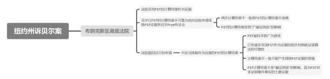

【争议焦点】
1. 依Frye标准，如何认定一项科学证据的可采性。
2. FST算法是否获得相关科学界的广泛认可。
3. 过往判例对FST的态度如何。
4. 辩方基于同一算法得出不同数值，能否证明算法不可靠。
5. FST数据证据的证明力是否被对被告的不利偏见所抵消。

【法院如何说理】
一、在Frye标准下，可采性的核心是技术是否被相关科学界普遍接受
Frye案确立的规则是，只有得到专业领域认可的技术和方法才能进入法庭。法院需判断该技术在规范操作下能否产生科学界公认的可靠结果。相关科学界指开发、研究和理解该技术的专业人士。Frye并不要求一致同意，但技术须可靠且被普遍接受。一旦技术被普遍接受，通常无需听证；此前法官的裁决也能作为参考。纽约上诉法院在韦斯利案中也强调，评估DNA证据时应看科学界的接受程度。

二、FST被认为已获广泛认可
FST是一组数学方程，用以估算已知个体的DNA出现在复杂混合样本中的概率。该算法纳入了等位基因脱落这一有文献支持的现象，也是质疑方要求听证的主要点。关于等位基因嵌入率与脱落率的验证研究，被视为低拷贝DNA证据可靠性的依据。把嵌入率和脱落率写入计算机程序来计算相似比的做法，已被其他州法院接受。

法院认为FST是一套经过充分验证的程序，多家专业机构对其有效性进行同行评议并予以认可。计算基于确定的数学原理。纽约市法医办公室曾在多项国家级会议上介绍等位基因嵌入与脱落的经验判断，且FST已被该领域专家反复验证。纽约州法医科学委员会和国家法医科学技术中心也给予认证。因此法院认为FST作为相似比的可靠方法已获普遍接受，符合Frye标准。

三、既有判例支持可采性
法院指出，驳回对FST进行Frye听证的申请与大多数判例做法一致。这些裁决的理由基本相同：FST使用基于确定数学原理的统计公式，且结合OCME的等位基因嵌入与脱落率，已被专家反复验证。

在质疑FST的两年多时间里，仅有两名法官裁决进行过Frye听证。

【相关审判背景】
2013年纽约州诉威廉·罗德里格斯案中，法院总结证人意见，四名辩方证人中有三人同意“使用包含等位基因脱落率的相似比概念在科学界被普遍接受”。第四位证人夏皮罗博士承认自己在法医统计上的造诣不如OCME参与开发FST并对其测试的阿黛尔·米切尔博士。夏皮罗当时主张任何相似比程序都无法为复杂混合物给出真实统计值，并推崇CPI方法，但其他专家认为在等位基因缺失时该方法无效。听证后法院认定FST满足Frye标准。

2014年，金斯县对两起无关案件举行联合Frye听证，法院认定FST不符合Frye标准。此裁决引发后续案件被告要求排除或听证的连锁反应，也导致此前被驳回听证请求的当事人重新提出动议。

布朗克斯法院认为多数法官的观点更合理，FST并非前沿实验技术，而是建立在长期统计概率原则之上，能把复杂问题转化为易懂的数学数值衡量DNA是否来自特定被告。即便科学界仍有呼吁进一步验证的声音，法院认为FST已足够可靠。

四、计算结果差异不等于算法无效
贝尔主张辩方专家与检方得到的结果不同，所以算法不可靠。法院认为使用相同算法却得到不同结论，只能说明执行或计算环节出错，不能否定算法本身。法院举例，两个学生用同一公式算同一组数据若结果不同，通常是计算错误而非公式错误。法律援助协会DNA部门的一名专家曾据FST得出贝尔DNA不在混合物中的结论，后承认系计算错误。因此分歧更像是专家之争，属于证明力大小问题，而非可采性问题。如贝尼特斯法官所说，相关科学界普遍接受FST，而对结果强弱或潜在缺陷的争论应由交叉询问和专家证言在陪审团面前展开。

法院认为双方都可以向陪审团呈现各自的FST结果，即9.32万倍或86.4万倍，并解释混合物中包含被告DNA的可能性。

五、不存在不公平偏见
法院驳回了证明力被偏见抵消的主张。本案并非仅凭DNA起诉，还有目击者看到枪在被告手中，且弹道吻合。枪支在案发后不久从被告进入并离开的建筑内找到。枪上两处可比对样本虽不能排除贝尔DNA存在，但结合OCME与法律援助协会专家的比较，被告DNA出现的可能性很高。综合其他证据，DNA相似比强化了被告持有并使用该枪的推断。法院认为适用FST数据证据并无不当偏见，不应排除。

【最终裁决】
布朗克斯地方法院认定本案采纳的FST证据符合Frye标准，驳回被告要求举行Frye听证及排除FST科学证据的申请。

【相关规则要点】
联邦证据规则第401条规定相关证据需使待证事实更可能或更不可能存在且对诉讼重要。第402条规定相关证据一般可采。第403条允许在证明力被不公平偏见等危险明显抵消时排除证据。第702条要求专家证言需基于可靠原则与方法并可靠应用于案件事实。

【案件启示】
一、技术在鉴定中的地位持续上升
从2009年宾夕法尼亚州诉佛雷案使用TrueAllele算法开始，复杂DNA分析软件逐步通过Frye、Daubert等标准进入司法实践。FST投入使用七年间，仅两起案件法官批准听证，其余多直接采纳计算结果为鉴定意见。智能技术可减轻人力负担、提升效率与准确度，促进信息化，但也带来对控辩平等、律师辩护空间及司法监督的挑战。

二、源代码公开引发讨论
FST类软件为刑事审判提供证据，而审判公开是美国司法传统。最高法院在理查蒙德报业公司诉弗吉尼亚州案中强调刑事审判公开是美国司法本质特征之一。这促使人们讨论DNA分析算法的源代码保密与审判公开原则之间的张力。

司法鉴定的 DNA 分析程序之所以把源代码锁进保险柜，根本原因在于维护研发主体的商业利益。纽约市主检医办公室 OCME 曾专门致函法庭，恳请法院不要公开软件源码，以此来守护 FST 算法的市场价值。信中 OCME 强调，过去四年投入了大量的人力物力打造 FST 算法，目前尚未通过它实现盈利收回成本，但在这类私人领域，FST 算法仍是手握盈利潜力的核心资产。司法实践中大多数法院都站在 OCME 一边，坚持对 DNA 分析软件源码保密。不少案件里法院直接驳回了当事人查阅 FST 算法源码的申请，也有部分案件虽准予查阅，却附加了严格保密义务，禁止查阅者在获知信息后转化为商业获利。

不过，随着以 DNA 分析软件结果为依据的案件争议增多，要求把 FST 算法拿出来晒的呼声也在攀升。律师艾丽什·克罗斯认为，从公共利益出发，政府部门可以绕开私营公司和专利壁垒，自主研发 DNA 分析软件并向社会公开源码。这样程序员和独立研究者就能共同迭代优化，刑事审判的准确性和权威性自然会随之提升。

### （三）算法失误对司法公正的侵蚀讨论
软件皆有瑕疵，FST 算法也不例外，其余用于法医领域的算法同样潜藏工程缺陷和漏洞。尤其当前大数据与人工智能类程序，模型预测的准确率本身就是难题，任何计算机程序或 AI 模型都存在出错和失效的可能。司法判断的胜负属性决定了诉讼必然有一方胜出一方落败，随着智能技术在法庭中的分量加重，当事人对技术的警惕也在同步提高。由此在使用这类算法时至少面临两难：其一，如何防止算法自身错误干扰乃至亵渎司法公正；其二，如何回应社会公众对计算机算法的质疑与争议。^[[\29](#txt005.html#footnote_content_txt005_29)]本案里第三方机构的计算结果与警方给出的结果出现显著分歧，正是公众讨论算法可信度的导火索。即便本案中无论采用何种计算方式，枪支上含有被告 DNA 的概率都远高于不含的概率，且证据链清晰显示被告曾持有涉案枪支，FST 可能的错误并未改变最终判决。但被告以及美国法律援助协会对 FST 精度的怀疑仍合乎常理，因为设计缺陷、编码失误或机器学习预测偏差都可能让证据偏离客观事实，从而动摇司法公正。

应对这一特性的做法之一就是开放源码。经由大量专业人士反复审视，代码逻辑得以不断完善，也能对每个具体用例是否出错进行针对性分析与讨论。如今大数据与人工智能已被大范围引入司法，但不少算法存在向司法系统植入系统性偏见与歧视的风险。针对基于大数据的算法，仅公开源码已不够，还应同步公开训练所用的数据集，以确保算法的均衡、公平与可靠性。

算法给出的证据多以概率呈现，这与司法追求证据严谨确定的要求存在张力。在程序输出模糊结果时如何判定证据效力并作出裁判，是本案衍生出的重要议题。另一方面，OCME 在本案后对软件进行升级，本质上是为了提升精确度并修补已知问题。由此又引出新问题：受已知软件缺陷影响的既有判决该如何处理，受影响当事人如何获得救济，软件提供方应承担何种责任，这些都是人工智能进入司法领域无法回避的课题。^[[\30](#txt005.html#footnote_content_txt005_30)]

### （四）技术鸿沟与刑侦中心主义的讨论
本案中，纽约警方从枪支上提取 DNA 样本到用 FST 算法判断是否包含嫌疑人 DNA 的全流程，都是在法院与公众视野之外完成的封闭操作。而因计算失误导致警方结果与第三方结果不一致，更放大了公众对程序不透明可能导致司法不公的担忧，也削弱了对计算机证据证明力的信任。

随着高科技侦查手段的广泛使用及警企合作的加深，大量刑侦相关计算机技术被侦查机关垄断，使用权高度集中，由此在侦查、审判与公众之间形成一道数字鸿沟。FST 等刑侦算法多为商业软件，源码通常不向公众开放；即使未来出现开源产品，其运行逻辑对审判人员和非技术背景公众而言仍难以理解，导致法官与公众在事实认定环节出现“失语”。

这种“证据理解黑箱”至少带来两方面后果。其一，法院对证据的终局决定权被侵蚀，偏离了审判中心主义的法治原则，法官自由裁量空间被压缩。审判中心主义的核心在于让法院在案件事实认定与证据审查判断中居于主导，只有实现审判阶段法官的决定权，才能落实审判中心。数字鸿沟出现后，法院角色趋于从中立裁判者变为被动接受技术的滞后者，侦查机关主导证据及证明力的判断，法治健康受威胁。其二，凭借技术优势，侦查机关成为诉讼中心，制约其权力的力量被削弱。新技术条件下，审判机关往往被迫在未经实质审查的情况下采纳技术获取的证据，导致事实认定权旁落，案件透明度下降，为权力滥用、寻租、腐败与冤案埋下空间。特别是在全球警企合作背景下，公安机关与相关企业深度绑定，算法设计者与使用者合二为一，进一步强化侦查机关对算法的掌控，加大其对审判结果的影响力。^[[\31](#txt005.html#footnote_content_txt005_31)]

### （五）案件后续进展
案件虽以纽约州高院驳回贝尔上诉请求而终结，但对 FST 算法计算准确性的怀疑仍在扩大，甚至包括全美 DNA 数据库的创建者之一法医学专家布鲁斯·布德沃博士，他作证时指出纽约州使用的 FST 软件缺乏严谨性。

2016 年 9 月，OCME 向所有客户发出备忘录，称将于 2017 年 1 月 1 日起用新的 DNA 分析技术取代现行的高灵敏度检测与 FST 软件。接替 FST 的新算法名为 STRmix，这是一款通过美国联邦调查局审查的商业软件，功能与 FST 基本一致，可分析复杂的混合 DNA 样本。目前已有数十个公立实验室开始采用 STRmix。即便刑事 DNA 分析的精确性仍受质疑，司法系统与计算机软件结合已成为不可逆的趋势。

## 关联判例推荐

1. `Frye v. United States`, 293 F. 1013 (D.C. Cir 1923)

核心事实：被告被判二级谋杀罪，上诉时主张初审法院不应拒绝让专家就收缩血压欺骗测试结果作证。法院维持定罪，认为该测试当时尚未在心理生理学权威领域获得广泛认可与科学承认，仅属试验性而非示范性技术。

关联点：确立了科学技术能否作为证据的标准，即是否在相关领域被普遍接受，后成为大量科技证据案件的引用基准。

2. `People v. Middleton`, 54 N.Y.2d 42 (1981)

# 咬痕证据案例

## 核心事实
被告系医院维修员工，其主管被发现倒地身亡。尸检发现受害者背部有五处明显咬痕。检方要求被告接受 OCME 牙医检查并制作模具，被告以牙医证词缺乏科学有效性为由申请排除。初审法院驳回，上诉法院指出咬痕证据作为身份识别手段，其可靠性已获科学界充分确认，可在刑事案件中采纳，无需每个案件单独确认；但需证明所用材料的真实性与程序的适当性，并经交叉询问以核验结论可靠性。

## 关联点
当一项技术被科学界普遍接受时，无需再单独验证技术本身，但应通过对材料真实性与程序适当性的质证来保障结论可靠。

# People v. Wesley, 83 N.Y.2d 417 (N.Y. 1994)

## 核心事实
女子被发现在公寓死亡。例行检查中在被告公寓发现血迹斑斑衣物及灰白色头发。DNA 检测显示被告衬衫上的 DNA 与死者一致，而衣物上的血液 DNA 与死者不同。审前听证认定 DNA 证据可采，被告被判有罪并上诉称 DNA 证据不可信。复审法院认为 DNA 证据符合 Frye 标准，因被相关科学界普遍接受。

## 关联点
法院依据 Frye 标准认定 DNA 证据可作为证据使用。

# People v. Garcia, 39 Misc.3d 482 (N.Y. Sup. Ct. 2013)

## 核心事实
被告在庭前就低拷贝数 LCN DNA 测试结果的可采性及有关 FST 的证词提出 Frye 听证动议。法庭认定 LCN DNA 测试与 FST 均非新颖科学，已在法医科学界被普遍认为可靠，故无需举行 Frye 听证。

## 关联点
符合 Frye 标准、被科学界普遍接受的技术无需另行 Frye 听证。

## 5.3 萨姆萨诉威斯康星州案

## 【案件索引】
State v. Samsa, 859 N.W.2d 149, 2015 WI App 6, 359 Wis.2d 580 (Wis. Ct. App.2014)

## 【关键词】
自动化决策；算法影响评估；自由裁量权；智慧司法

## 【案件提要】
本案关乎自动化决策结果与法官自由裁量权的关系。与威斯康星州诉乔丹·约翰·萨姆萨案密切相关。在量刑阶段，经各方同意，马里内特县巡回法院对萨姆萨进行判决前调查 PSI，包含 COMPAS 软件的累犯风险评估。COMPAS 全称矫正罪犯管理分析，依据累犯与犯罪职业特征的行为心理结构设计，用于一般与暴力累犯及审前不当行为的风险预测。COMPAS 是威斯康星州惩教部使用的风险需求评估工具，用以识别罪犯风险及治疗规划需求，风险等级帮助决定监督水平。法院综合 PSI 后判处萨姆萨五年有期徒刑加五年社区监督。萨姆萨认为判决不公，称法院只采纳 COMPAS 报告中犯罪需求高风险的评估，而忽略再犯风险低的结论，滥用自由裁量权；并认为其提交的 COMPAS 原理与解释信息可构成改判新理由。上诉法院认为如何使用 COMPAS 结果属于法官自由裁量范畴，COMPAS 仅可作为辅助工具，不能决定最终判决。

在人工智能技术逐步进入司法的背景下，本案对我国如何运用自动化决策结果具有借鉴意义。各地法院对人工智能热情高涨，但因司法审判的复杂性与主观性以及算法可能存在的歧视与黑箱问题，人工智能只能作为辅助。算法常因商业秘密或国家安全而不公开透明，我国也缺乏配套法规引导人工智能辅助审判。通过立法构建规范体系，既能为智慧司法改革提供依据，也能防范化解大数据与人工智能辅助裁判带来的复杂性、不确定性与可解释性风险。总的来看，本案对我国司法智能化建设具有原则性指引。

## 【案件要旨】
马里内特县巡回法院：一审原告威斯康星州，被告乔丹·约翰·萨姆萨
威斯康星州上诉法院：上诉方乔丹·约翰·萨姆萨，被上诉方威斯康星州
2013 年萨姆萨因三级性侵被指控并认罪。量刑阶段各方建议进行 PSI，惩教部建议缓刑，州方要求关押四年加四年社区监督。法院讨论犯罪性质、品行及 PSI 中的 COMPAS 报告。COMPAS 对再犯风险评分低，但犯罪需求评估多为高度可能。法院认定再犯可能性高，判处五年监禁加五年社区监督。萨姆萨申请后被驳回后上诉，理由为法院误用犯罪需求评估且忽略新信息。2014 年 12 月 16 日上诉法院认为原审未误用评估、未滥用自由裁量，被告未证明补充信息构成改判新因素，驳回申请维持原判。

## 【案例事实思维导图】
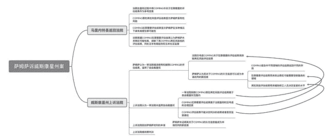

## 【核心争议点】
1. 马里内特县法院基于保护公众需要仅参考 COMPAS 犯罪需求评估进行量刑是否滥用自由裁量权。
2. 萨姆萨提交的 COMPAS 评估原理与解释原理补充信息是否构成改判新因素。

## 【裁判论证过程】

### （一）仅参考 COMPAS 犯罪需求评估量刑不构成滥用自由裁量权
威斯康星州上诉法院认为量刑需考虑三大因素：犯罪严重程度、罪犯品行与改造需要、保护公众需要。^[[\33](#txt005.html#footnote_content_txt005_33)]量刑决定通常是综合上述因素的合理推断，只有当法院依赖不相关或无关紧要因素，或过度偏重某一因素时才构成滥用自由裁量权。^[[\34](#txt005.html#footnote_content_txt005_34)]本案中 COMPAS 对犯罪需求的评估并非不恰当因素。虽再犯风险评分低，但犯罪需求评估显示多种情境下犯罪高度可能，该评估可预测影响再犯的具体需求。综合判断再犯可能性高，判处五年有期徒刑加五年社区监督合理，未滥用自由裁量。法院对 COMPAS 犯罪需求的参考亦非过度偏重，而是对评估内容综合考量后的结论。

COMPAS 能否左右量刑？威斯康星二审的定性回应

依据马里内特巡回法庭听证笔录的记载，COMPAS 并没有为萨姆萨未来两年内是否再犯进行预测的能力。对萨姆萨这类性犯罪对象，更合理的作业方式是选用面向性犯罪群体的替代性筛查，比如 STATIC 99、VASOR 等专为性侵害风险设计的量表。

第二审机构同时强调，COMPAS 风险测评的定位仅限于为法官量刑提供参考意见，不能用来判定刑罚轻重或是否执行监禁。萨姆萨提出在评估再犯风险时应禁止法庭援引 COMPAS 中的矫治需求部分，这与法庭享有高度判断自由的规则相抵触。审理者有权自行决定采用评估文件的全部、局部或完全不采用，都在自由裁量空间之内。

综合来看，第二审机构认为，一审法庭出于“保护公众安全”这一量刑考量，仅参考 COMPAS 文件中关于矫治需求的评估内容作出判决，并不构成对自由裁量权的滥用。

### （二）萨姆萨提交的关于 COMPAS 评估原理与结果应用解释的补充材料，不构成申请改判的新情节

第二审机构指出，构成改刑依据的标准是：与定刑密切相关，但在一审阶段因客观上不存在或被各方无意忽略而未被法官知晓。同时被告须以明确且令人信服的证据证明该情节的存在。

萨姆萨主张其事后补交的关于 COMPAS 作业机制与结果解读方法的材料属于新出现情节。该材料核心在于说明矫治需求评估旨在提示罪犯可能需要社区矫正服务的领域，若孤立看待需求而不结合风险层级，易导致对个人风险的误读。萨姆萨的 COMPAS 显示其需在多方面改造，但再犯风险被判定为低，建议在低强度监督下接受社区矫正。若未接受专门培训，易对结果产生误解。

第二审机构不予认可，理由有二。其一，萨姆萨的诉求本质上要求量刑裁量必须服从 COMPAS 输出，这种立场难以成立。COMPAS 仅具辅助功能，一审法庭如何引用其文件属于自由裁量空间。其二，定罪后听证会的记录表明，一审法庭对萨姆萨 COMPAS 文件的解读与运用并无错误，且在宣判时已充分区分矫治需求与风险测评结果。因此，该补充信息不属于改刑的理由。

最终，第二审机构驳回萨姆萨的动议，不承认其提交的 COMPAS 机制说明可以作为改判依据。

## 【审理结果】

1. 马里内特巡回法庭在量刑时仅援引萨姆萨 COMPAS 文件中矫治需求部分，并未滥用自由判断余地。
2. 关于 COMPAS 矫治需求与再犯风险的评估与应用原则，不构成改刑理由。
3. 威斯康星州第二审机构维持马里内特巡回法庭对萨姆萨判处五年监禁并附五年社区监管的决定。

## 【相关法条】

美国宪法第五修正案 Constitution of the United States Fifth Amendment

非经大陪审团提出报告或起诉，任何人不受死罪和其他重罪的惩罚，唯在战时或国家危急时期发生在陆、海军中或正在服役的民兵中的案件不在此限。任何人不得因同一犯罪行为而两次遭受生命或身体伤残的危害；不得在任何刑事案件中被迫自证其罪；未经正当法律程序，不得剥夺任何人的生命、自由和财产；非有恰当补偿，不得将私有财产充作公用。

美国宪法第十四修正案第一款 Constitution of the United States Fourteenth Amendment Section 1

在合众国出生或归化于合众国并受合众国管辖的人，均为合众国和他所居住的州的公民。无论何州均不得制定或实施任何剥夺合众国公民的特权或豁免的法律；无论何州未经正当法律程序均不得剥夺任何人的生命、自由或财产；亦不得拒绝给予在其管辖下的任何人以同等的法律保护。

## 【案例评析】

### （一）有选择地引用风险测评结果属于裁判者自由判断范围
本案中萨姆萨认为法官仅采纳 COMPAS 的矫治需求指标而忽略低再犯风险，属于误用自由裁量。法院最终认定风险测评软件只能作为审判辅助，法官对文件的采纳方式可自主决定，该做法在自由判断范围之内。

“以事实为依据，以法律为准绳”是裁量权限应遵循的底线，而人工智能的渗透为衡量裁量边界带来新挑战。一方面，严谨计算的风险测评软件具有一定合理性，作为辅助工具可减轻审判负担、提升效率。另一方面，司法应用人工智能仍存风险。数据层面，量刑类 AI 需海量数据支撑，而现存法律数据有限且司法裁判具主观性，不同地域文化背景下数据适用性差，易滋生算法歧视。算法层面，核心算法多因商业秘密不愿公开，“算法黑箱”导致可解释性不足。

总体来看，对风险测评结果应保持审慎，本案中原审法庭拒绝采纳文件部分内容，正是自由判断的体现。

### （二）风险测评工具的辅助定位进一步明确
学界普遍认为风险测评工具应处于辅助法官裁判的地位。卢米斯案为美国法院使用此类工具提供了基准，即风险分数不能成为判决的决定性依据。本案二审机关重申初审法官可选择性参考 COMPAS，进一步确认了其辅助量刑的定位。

司法裁判中的价值判断带有主观色彩，这是机器算法难以覆盖的不确定性。COMPAS 只能基于可量化指标进行判断，而影响行为的不可量化因素众多。如何在算法的僵化性与人类智慧的能动性之间取得平衡，是价值判断的关键。提升量刑公正性的核心仍在人，风险测评工具终究只是工具。唯有将其数据收集、处理、分析的优势发挥于辅助判断，而非置于决定性地位，方能更好保障裁判公平。

### （三）防止算法黑箱侵害需加快算法审查与公开机制
智慧司法推进中，人工智能辅助设施的算法逻辑与源代码常因商业秘密或国家安全难以完全公开，形成算法黑箱。法官与当事人只能看到建议结果，对推理过程不明，这会损害当事人的知情权。

因此，建立算法审查机制十分必要。首先，保证一定程度的算法透明，才能发现歧视性与准确性问题，使相关方能够主张权益。其次，算法可解释性直接关乎知情权。欧盟数据保护通用条例规定数据主体有权获知处理目的、期限、接收方、自动化处理算法逻辑等。

我国目前尚缺乏适用人工智能辅助裁判的专门规范。应结合司法智能化改革趋势与国家人工智能战略，建立司法智能化改革路线图，在量刑环节制定智能辅助量刑的司法解释意见，从制度与技术层面防范大数据与人工智能辅助刑事裁判带来的复杂性、不确定性与可解释性风险。

## 【关联判例建议】

### 1. Loomis v.Wisconsin, 137 S.Ct. 2290 (2017)
核心事实：威斯康星州诉卢米斯案中，被告埃里克·卢米斯因参与驾车枪击被判有罪。羁押期间 COMPAS 测评显示其再犯概率极高。拉克罗斯巡回法庭据此排除缓刑，判处六年监禁及五年社区监管。卢米斯上诉称量刑参考 COMPAS 侵害正当程序权利。

与本案关联：量刑中使用风险测评工具不必然侵害罪犯的正当程序权。

### 2. Malenchik v. State, 928 N.E.2d 564, 574 (Ind.2010)
核心事实：初审法庭量刑时参考 LSI-R 以及 SASSI 测评结果。被告质疑测评工具可采性，认为缺乏科学可靠性。印第安纳州最高法院认为该类测试有助于法官对量刑证据进行个性化评价并选择最适改造方案，且量刑程序不受证据规则严格限制，为法官提供更广信息以便作出明智决定。

与本案关联：量刑中采用测评工具可帮助法官实现个性化评价与改造方案选择。

## 5.4 堪萨斯州诉希夫利案

### 【案件索引】
State v. Shively, 987 P.2d 1119, 26 Kan. App.2d 302 (Kan. Ct. App. 1999)

State v. Shively, 268 Kan. 573, 999 P.2d 952 (Kan. 2000)

### 【关键词】
测谎仪；技术应用；司法证据；智慧司法

### 【案件提要】
本案是关于测谎仪能否在司法中作为证据使用的典型案件，发生于2000年前后，反映了早期人工智能技术对司法辅助的探索。

当时美国多数州对测谎仪证据持否定或有条件接受态度，使用需有严格制度保障，因其相当于被告有罪或无罪的缺席证人。测谎检查员的资质至关重要，例如德州要求持证、专门培训并持续教育。

本案被告斯蒂芬·梅德福·希夫利因枪杀警察被诉，其是否知晓对方警察身份成为关键。希夫利认为计算机化测谎数据更精准，控方则认为即使借助计算机记录也不应采纳测谎证据。

不同法域态度迥异。FBI 仍用测谎评估嫌疑人撒谎可能性，而我国测谎结论不得作为刑事及民事诉讼证据，仅可辅助审查判断。

本案处于智慧司法早期，测谎仪等结合心理学、生理学的工具能否作为证据颇受争议。其应用可拓宽办案视野，但在缺乏充分科学证明前盲目采信或致司法不公。

### 【案件要旨】
堪萨斯州肖尼地区法院（一审法院）：原告堪萨斯州被告斯蒂芬·希夫利
堪萨斯州上诉法院（上诉法院）：上诉方堪萨斯州被上诉方斯蒂芬·希夫利
堪萨斯州最高法院（二审法院）：上诉方堪萨斯州被上诉方斯蒂芬·希夫利

被告希夫利于1996年4月因二级故意谋杀、严重袭击执法人员及多项毒品指控受审，源于1995年10月枪杀警察托尼·帕特森事件。控方认为希夫利明知对方为警察，被告则称为自卫。

初审法院拒绝将测谎结果用于保释和预审，但允许庭审中出示相关证据，包括检查员Gary Davis证词等。判决认定谋杀罪不成立，但严重袭击罪和毒品罪成立。

堪萨斯州上诉法院维持定罪，州政府上诉。堪萨斯州最高法院重申采纳测谎证据需满足Frye标准，证明其可靠性并在特定领域普遍接受。尽管技术进步，测谎结果可靠性未达定罪所需，故判定本案中不可采纳。

### 【案例事实思维导图】
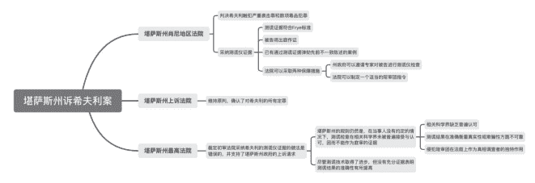

### 【核心争议点】
1.测谎仪的检查结果能否作为证据使用。
2.计算机化测谎仪的结果准确性是否提升，进而能否采纳。

### 【裁判论证过程】
#### （一）测谎仪的检查结果不宜作为证据使用
堪萨斯州采纳Frye标准作为专家科学证据可接受性的门槛，禁止在原理未被充分证实且未在所属领域普遍接受前允许专家证言。提出方须证明科学理论的可靠性与接受度。

希夫利为证明开枪时不知对方为警察而接受测谎检查，并试图在保释、预审及审判中引入结果。控方以Frye标准及传闻证据为由反对。法院在审前认为即使符合Frye仍存传闻问题而驳回动议。审判中被告律师提及测谎结果后问题再起，被告辩称其将出庭作证传闻抗辩消失。

初审法院先支持州方反对，后允许有限目的下作为补强证据使用，理由为检查符合现行科学标准、被告将出庭、已有弹劾不一致陈述的先例，并可通过州方专家反测及陪审团指示降低风险。

测谎结果在堪萨斯为何被排除

堪萨斯最高法院对测谎数据能否进入庭审作出否定判断，理由可归结为四点。

第一，地方通例。绝大多数州在当事人没有事先合意的情况下，都把测谎仪输出挡在法庭之外。堪萨斯在刑事审判中长期维持这一做法，且学界迄今并未就测谎的可信度形成共识。

第二，质证缺口。操作者的资质、流程可以被交叉盘问，但机器本身无法接受讯问。让一个不能被质问的设备参与举证，会动摇交叉询问的基础。

第三，准确性与角色冲突。测谎在区分真实与欺骗时本身存在偏差，同时会挤占陪审团作为事实认定主体的核心地位。陪审员容易过度信任机器结论，即便法官作风险提示，也难以改变长期形成的规则。

第四，有限使用的反效果。仅把测谎结果作为辅助佐证，反而让审判更混乱。陪审团被迫去推测希夫利在测试中到底说了什么、测试问题里哪些本应如实作答，进而形成“庭外说法与庭内证词一致”的整体印象，只增加主观臆测，却提供不了实质价值。综合来看，初审法院采纳测谎结果的做法是错误的。

(二) 电脑化并未提升测谎的可靠度

Frye案当年审的是收缩压欺骗测试，原理与现在一致，都是捕捉血压变化。因为生理学与心理学权威当时并未普遍认可，测谎证据被排除。堪萨斯认为电脑化没有实质改善可靠性，被告希夫利则主张电脑生成的资料已通过Frye一般可接受性检验，应予采纳。

计算机测谎与传统测谎的理论基础相同，均认为面对威胁性提问说谎时会触发自主神经系统的非自主反应，仪器记录并解读这些反应以推断真伪。测量的生理指标基本一致：胸腹部呼吸带、手指皮肤电或电阻传感器、血压袖带或心率监测。不同在记录载体：传统仪器靠墨迹在移动纸带上留痕，电脑仪器则把数据存入光盘后打印成类似图表。

最高法院指出仍存在明显缺陷：一是仪器本身对精度与稳定性要求极高；二是不同个体生理反应差异很大，很难达到科学与心理层面的准确，证据效力随之受损。被告并未提交任何材料证明电脑测谎或电脑评分比传统方法更准确。此外，陪审团可能过度倚重测谎结论，测谎以“缺席证人”形式出现，进一步削弱陪审团功能。

因此，尽管希夫利强调技术与评分流程的电脑化进步，没有足够证据显示准确性因此提高。堪萨斯规则未变：在当事人没有合意的情况下，因未获相关科学界普遍认可，测谎检查不能作为庭审证据。

【审理结果】

1. 初审法院采纳了被告希夫利的测谎证据，宣告谋杀指控不成立，但认定严重袭击罪和毒品犯罪成立。
2. 堪萨斯州上诉法院维持原判。
3. 堪萨斯州最高法院重申测谎证据不可采用，认为审判法庭采纳测试结果的做法错误，支持州政府的上诉请求。

【相关法条】

美国宪法第四修正案
禁止无理搜查与扣押人身、住宅、文件及财产。搜查扣押令状须以宣誓或具结说明合理根据，并具体指明搜查场所及扣押对象。

美国《联邦证据规则》第703条
专家意见的依据。专家可基于其了解或亲自观察的案件事实或数据发表意见。若该领域专家在形成意见时通常会合理依赖此类事实数据，则这些事实数据无需具备可采性。但若这些事实数据本身不可采，则仅在有助于陪审团评估意见证明价值，且其价值远大于不利影响时，提出意见者方可向陪审团披露。

【案例评析】

#### （一）司法实践对早期智慧司法技术的保守姿态

本案堪萨斯州最高法院拒绝电脑测谎结果，援引了Frye案确立的标准。法院提出两点核心：传统测谎量表的可靠性和可采性存疑，电脑化并未提高准确度；采纳测谎证据会侵蚀陪审团的真相发现权威，法官和陪审团也容易高估测谎的准确性。本案发生于21世纪初，司法界对智慧司法仍持谨慎态度，其结论至今仍被众多排除测谎证据的案件引用。

测谎仪本质上是记录皮肤电、血压、呼吸等生理活动的仪器，并非直接“测谎”。它依据与说谎相关联的生理假设，从监测数据中推断是否撒谎。科学证据的可采性争议由来已久，测谎结果是刑事诉讼中常见的科学证据。传统做法是全面排除，但这一趋势在松动。部分州法院和联邦法院开始采用更灵活的考量，结合具体方法的可靠性、证据用途、混淆或偏见风险大小等因素进行判断。

#### （二）测谎仪电脑化与AI融合将带来可采性认定挑战

从以数字指标为主的传统心理学测谎，到融合AI的智能测谎系统，技术正快速演进，数据识别的精准度明显提升。然而，复杂的测谎算法能否为结果可靠性背书仍存疑问。机器学习和深度学习有助于发现说谎模式、提升识别效率，但算法黑箱会让测谎过程难以复盘。具备足够可靠性的测谎证据若被采纳，将大幅提升司法效率。赋予测谎算法可解释性，或是兼顾合法性与准确性的可行路径。

#### （三）我国目前不承认测谎结果的证据资格

中国现行做法是，测谎结果仅作参考，不具备合法证据资格。2020年8月14日，最高人民法院发布《最高人民法院关于人民法院民事诉讼中委托鉴定审查工作若干问题的规定》，明确法院不得委托鉴定测谎结果。刑事领域则多语焉不详。有学者对2010至2018年间涉及测谎结果的刑事案件进行实证研究发现，近半数案件未对测谎结果作专门记录，近四成案件由侦查机关以“情况说明”方式提交法庭。可见测谎程序及结果采信存在明显司法盲区。随着测谎技术在实践中广泛使用，证据性质、适用程序等规范亟待完善。

【关联判例推荐】

#### 1. State v. White, 494 P.3d 248 (Kan. Ct. App. 2021).

核心事实：怀特被控严重猥亵儿童，初审法院排除了其测谎证据。怀特援引宪法第六修正案强制程序条款和第十四修正案正当程序条款，主张排除行为剥夺其全面辩护权；并称测谎证据并非用于证明信息真实性，而是展示认罪悔意，属于有限目的例外。上诉法院认为，被告抗辩权需合理限制，排除测谎证据不构成侵犯，且应遵循先例。

关联点：法院援引本案结论，测谎证据不可采，并指出堪萨斯州最高法院未为“排除测谎证据”这一一般规则设定例外。测谎证据欲证明的信息与结果正确性无关，必须排除。

#### 2. Savery v. State, No. 122,083 (Kan. Ct. App. 2020).

## 萨弗里案

核心事实：一审判萨弗里强奸、鸡奸罪成立，其上诉称辩护律师未提供有效协助，其中包括“未要求进行测谎测试”。堪萨斯州上诉法院认为，测谎证据不可采，律师未申请测谎测试不构成失职，被告也未提供判例支持其观点。

关联点：法院援引本案结论，测谎证据不可采，驳回其无效辩护主张。

### 3. State v. Engelhardt, 280 Kan. 113, 119 P.3d 1148 (2005).

核心事实：一审判被告恩格尔哈特一级预谋谋杀罪成立并判无期徒刑，上诉时质疑法院排除证人测谎结果的决定。堪萨斯州最高法院指出，无当事人约定测谎结果不得用于刑事诉讼，也不能用于证明或反驳。一方面测谎方法可靠性存疑，另一方面须保护陪审团的真相发现者角色。最终驳回上诉，维持原判。

关联点：因测谎方法不可靠及陪审团权威，无约定时测谎证据不具可采性。

【注释】

保留原素材注释编号与来源信息，具体条目与原文一致。

[\[25\]](#txt005.html#footnote_quote_txt005_25)People v. William Rodriguez， Ind. No. 5472/2009 （Sup. Ct. NY County 2013）.

[\[26\]](#txt005.html#footnote_quote_txt005_26)People v. Andrew Peaks， Ind. No. 7689/2010； People v. Jaquan Collins， Ind No. 8077/2010 （Sup. Ct.Kings County）.

[\[27\]](#txt005.html#footnote_quote_txt005_27)People v. Graham， Ind. No， 2784/2012 （Sup Ct Bronx County 2015）.

[\[28\]](#txt005.html#footnote_quote_txt005_28)Richmond Newspapers， Inc. v. Virginia， 448 U.S. 555， 100 S. Ct. 2814 （1980）.

[\[29\]](#txt005.html#footnote_quote_txt005_29)郑曦：《人工智能技术在司法裁判中的运用及规则》，载《中外法学》2020 年第 3 期.

[\[30\]](#txt005.html#footnote_quote_txt005_30)郑戈：《算法的法律与法律的算法》，载《中国法律评论》2018 年第 2 期.

[\[31\]](#txt005.html#footnote_quote_txt005_31)马明亮、王士博：《论大数据证据的证明力规则》，载《证据科学》2021 年第 6 期.

[\[32\]](#txt005.html#footnote_quote_txt005_32)郑曦：《人工智能技术在司法裁判中的运用及规制》，载《中外法学》2020 年第 3 期.

[\[33\]](#txt005.html#footnote_quote_txt005_33)State v. Jackson， 110 Wis.2d 548， 329 N.W.2d 182 （1983）.

[\[34\]](#txt005.html#footnote_quote_txt005_34)Elias v. State， 93 Wis.2d 278， 286 N.W.2d 559 （1980）.

[\[35\]](#txt005.html#footnote_quote_txt005_35)Rosado v.State，70 Wis.2d 280， 234 N.W.2d 69 （1975）.

[\[36\]](#txt005.html#footnote_quote_txt005_36)State v. Harbor， 2011 WI 28， 36， 333 Wis.2d 53， 797 N.W.2d 828 （2011）.

[\[37\]](#txt005.html#footnote_quote_txt005_37)江溯：《自动化决策、刑事司法与算法规制—由卢米斯案引发的思考》，载《东方法学》2020 年第 3 期.

[\[38\]](#txt005.html#footnote_quote_txt005_38)朱体正：《人工智能辅助刑事裁判的不确定性风险及其防范—美国威斯康星州诉卢米斯案的启示》，载《浙江社会科学》2018 年第 6 期.

[\[39\]](#txt005.html#footnote_quote_txt005_39)LSI-R（Level of Service Inventory-Revised）是指用于决定监督和治疗水平的有关犯罪者属性和犯罪者情况的定量调查.

[\[40\]](#txt005.html#footnote_quote_txt005_40)SASSI 是指药物滥用细微筛查清单.

[\[41\]](#txt005.html#footnote_quote_txt005_41)Frye v. United States， 54 App.D.C. 46， 293 F. 1013 （D.C. Cir. 1923）.

[\[42\]](#txt005.html#footnote_quote_txt005_42)Frye 标准：又称普遍接受标准，指用于作证某项证据的相关科学原则或规则没有获得相关的专家群体的“普遍接受”，就会被排除.但在目前的司法实践中，该标准基本被更为全面的“多伯特规则（Daubert Rule）”（又称综合观察标准）取代.

[\[43\]](#txt005.html#footnote_quote_txt005_43)受美国立法体系的影响，本案主要引用于在堪萨斯州内发生的案件.

[\[44\]](#txt005.html#footnote_quote_txt005_44)Yuhwa Han， Deception Detection Techniques Using Polygraph in Trials： Current Status and Social Scientifi c Evidence， 8 Contemporary Readings in Law and Social Justice 115， 116 （2016）.

[\[45\]](#txt005.html#footnote_quote_txt005_45)Frederick Schauer， Lie-Detection， Neuroscience， and the Law of Evidence， Virginia Public Law and Legal Theory Research Paper No. 2012-49， Available at SSRN： https：//ssrn.com/abstract=2139508.

[\[46\]](#txt005.html#footnote_quote_txt005_46)付凤、杨天琪：《刑事法官视角下测谎证据的审查与采信—以 2010-2018 年刑事裁判文书为研究样本》，载《中国人民公安大学学报（社会科学版）》2020 年第 1 期，第 39 页.

# 第六章 算法治理与智慧执法前沿判例

## 6.1 迈克尔等人诉凯伦·鲍林案

### 【案件索引】
Michael T., et al. v. Bowling, No.2:15-CV-09655, 2016 (S.D.W. Va. Sept.13, 2016)

### 【关键词】
自动化裁决；算法型行政；程序正义

### 【案件提要】
本案聚焦代码化裁量如何影响弱势群体的 Medicaid 供给。当事人为西弗吉尼亚州 Intellectual/Developmental Disability Home and Community Based Services waiver，即 I/DD 豁免项目 的在册受益人。州卫生与人力资源部下属医疗服务局 BMS 委托 APS Healthcare Inc. 对每位参与者实施年度测评，并以自有统计模型产出年度服务资金额度。服务机构据额度提供健康照护，超出部分需另行申请授权。

2014 年 9 月起 BMS 要求医疗外包商停止自行放行超额申请，凡超出模型产出额度的资金需求均须经 BMS 的“二级谈判”复核。门槛收紧后，当事人到手服务经费在 2014 至 2015 年间骤降，而照护需求并未减轻。

2015 年 9 月 28 日，当事人提起诉讼并申请先行禁制，称福利削减损害其法定权益。法院以四要素标准审理后，部分支持申请，裁定对 2014 年后额度被调降的当事人，将其个人 I/DD 额度回溯至 2014 年水准。

此案典型揭示了自动化行政中黑箱模型如何侵蚀程序正义。模型不可解释、行政机关过度倚赖模型且配套规则缺位，导致基于模型的行政决定在公平与准确性上存疑，也让相对人难以获得有效救济。厘清这类冲突有助于明确模型的工具角色，在程序正义框架下规范自动化行政。

### 【案件要旨】
美国西弗吉尼亚州地区法院查尔斯顿分庭受理迈克尔等诉州卫生人力资源部部长凯伦·鲍林。原告系 I/DD Medicaid 方案受益人，反对自 2015 年起实施的福利缩减。

I/DD 方案归入州 Medicaid 体系，为低收入家庭提供医疗支持。BMS 统筹运营，委托 APS Healthcare Inc. 协助执行。每位成员的年度服务额度取决于 APS 提供的资金包。APS 通过年度测评收集资料，再以未公开的多变量统计模型生成额度。模型所用因子、权重及计算路径属商业秘密，未向受益人披露。额度通知发出后，由跨学科专业团队据此制定定制化服务方案。若方案在额度内，APS 放行；若超出，则需向 APS 递交授权请求。

2014 年 9 月 BMS 发现项目超支，要求 APS 不得再单方面放行超额申请，全部须经 BMS “二级谈判”审核。审核中 BMS 人员调阅档案、补充材料及 APS 建议，必要时面谈后决定是否放行。此后原告的超额申请屡被驳回，到手福利总额显著下滑，可购服务项目随之减少。

2015 年 9 月 28 日，原告提起集体性申诉，请求先行禁制。诉求涵盖程序正义、Medicaid 通知与听证义务、《美国残疾人法》及《康复法》第 504 条。法院依据胜诉可能性大、将受难以弥补损失、利益权衡偏向原告、禁制符合公益等四项要件考量，最终部分准许禁制，要求被告将受影响原告的个人额度恢复至 2014 年水平。

### 案例事实思维导图
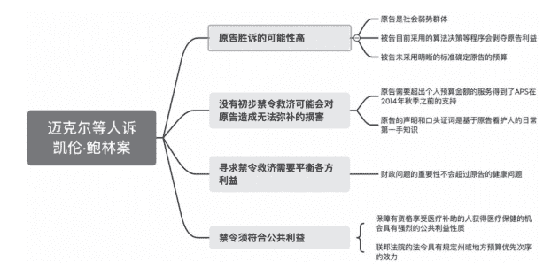

### 核心争议点
1. 以 APS 专有模型确定 Medicaid 资金额度的作法是否侵蚀当事人应享的程序正义。
2. 未获先行禁制救济时，当事人是否会承受难以挽回的损害。
3. 财政超支压力与当事人健康保障需求如何权衡。
4. 州财政政策与保障弱势群体获得医疗支持两项公共利益如何平衡。

### 裁判论证过程
#### （一）以模型确定额度侵蚀了程序正义
先行禁制的首要要件为胜诉可能性。法院围绕《美国法典》第 42 卷第 1983 条审查被告在额度裁定中使用专有模型是否违反程序正义。该条款允许因合法权益受损而寻求禁制救济，当事人需证明权利受害且侵害行为系基于法定职权作出。

法院认定公共医疗福利属于受程序正义保护的财产性权益，当事人作为 I/DD 方案合格受益人，享有受保护利益。若发放流程不当，当事人可据此胜诉。

程序正义的充分性取决于三要素平衡：私人利益受影响程度、流程错误导致权益被不当剥夺的风险及补救价值、政府利益与额外流程的行政财政负担。

其一，当事人多为智力或发育障碍群体，属社会中最脆弱层级。资金不足直接导致照护不充分，甚至住院风险，私人利益重大。

其二，APS 模型为专有技术，其输入指标、权重分配及额度生成逻辑均不公开，行政决定缺乏可检验标准。通知函仅告知金额，不说明依据，使得额度决定极易出错且难以核查。被告辩称事后可通过“二级谈判”补救，但实践中 BMS 往往以“超出个人额度”为唯一理由拒绝申请，政策手册也要求服务须在额度内采购，显示二级谈判并未真正提供补救。

模型不可解释导致裁量无据、随意性高，错误剥夺的危险显著，不符合程序正义要求。

其三，卷宗中并无证据表明，若要求使用可确定的标准，州政府会承担不合理的财政或行政负担。西弗吉尼亚州虽有财政压力，但建立透明标准并不会带来额外不可承受成本。因此继续依赖黑箱模型缺乏正当性。

综合判断，被告使用专有模型确定 Medicaid 额度的流程不符合程序正义，原告就此主张胜诉可能性成立。

#### （二）未获禁制救济将导致难以弥补的损害
获得先行禁制还须证明在缺乏救济情况下当事人将受难以弥补伤害。在公福利领域，若强制执行削减规则导致受益人无法获得必要医疗护理，即构成难以弥补损害。联邦法院亦普遍认为福利削减或取消对依赖该服务的群体造成难以逆转的伤害。

# 西弗吉尼亚 Medicaid 算法预算案：临时禁制为何获准

在本案先期审查中，争议双方围绕“若未获得暂行救济，申请人是否会遭受难以恢复的损害”提供了相互抵触的材料。申请方由其父母出具了书面陈述，说明每一位申请人当前受限的服务范围，以及依据 APS 测算模型核定的额度将如何导致必需医疗被剥夺并产生机构化风险。在临时听证会上，两名申请人的父母出庭作证，印证前述说法。抗辩方则提交了 BMS 家居与社区服务处主管尼斯贝特的说明，以概括方式表述仅靠 APS 测算额度即可维持社区安全与健康。尼斯贝特也在听证中说明了抗辩方拒绝追加资金请求的决定依据。

处于先行审查阶段，审理机构认为申请方关于“缺乏救济将导致不可逆损失”的主张更具说服力。裁判基于三点判断：其一，申请方称维持社区安全健康需要超出个人额度范围的服务，而 APS 公司在 2014 年秋之前所作的审批均支持了这一诉求，当时抗辩方尚未收回 APS 的二次审批权限，APS 仍可批准超出额度的资金；其二，申请方的书面材料与口头陈述均源于照护者日常的第一手照护经验，相较之下，抗辩方的反证更多依赖档案行政复核或与相关方的间接沟通，并非基于与申请人日常直接互动；在先行阶段，基于亲历经验的证据应获更大权重；其三，听证会同时听取了两名申请人父母的证言与尼斯贝特代表抗辩方的证言，就临时动议而言，审理机构认为申请方的陈述可信度高于尼斯贝特。整体庭审记录对申请方关于不可逆损失的主张更为有利。

据此，法院认定抗辩方在“二次协商”环节拒绝为每位申请人提供超出个人额度的资金，很可能剥夺其获得必要服务的权利。故法院认为申请方已充分证明若不获暂行救济，将很可能遭受无法弥补的损害。

### （三）健康价值高于超预算带来的财政压力
申请方还需证明在权衡各方利害后仍应颁发临时救济。法院必须衡量各方损害并评估颁发或驳回救济对各方的影响。抗辩方主张恢复 2014 年水平会增加纳税人负担，并冲击西弗吉尼亚 I/DD Medicaid 计划，削弱其对新一批符合条件人群的持续供给能力。申请方则主张他们是州内最弱势群体，目前正被剥夺必需医疗，而财政负担无法抵消其所承受的困境。法院采纳了申请方的立场。

如前所述，申请方已充分证明，抗辩方现行禁止超额度拨付的做法已剥夺其获得必需服务的权利，且该做法呈现制度化趋势。即便把申请人的额度回溯至 2015 年前水平可能对纳税人及 I/DD 项目带来财政压力，但即便州财政状况威胁到其他 Medicaid 项目，财政考量也不应凌驾于申请人健康之上。因此法院认为申请方已证明经利益衡量后仍应授予临时救济。

### （四）公共卫生利益压倒州财政政策考量
最后，申请方须证明“禁令颁布符合公共利益”方可获得临时救济。衡平法院在适用特别禁制时须特别关注公共后果。

本案存在两类冲突的公共利益：一方面，保障有资格的 Medicaid 受益人获得医疗服务机会具有强烈的公共价值；另一方面，联邦法院命令特定项目拨款具有设定州或地方预算优先次序的效力。州地方资金有限，法院强制为某一项目出资往往意味着从其他重要项目抽调资金。

尽管如此，州财政问题不应成为抗辩方作出 Medicaid 决定的首要依据。在类似 Medicaid 案中，第四巡回法院在权衡冲突公共利益时，认为保障公共健康的利益应优先于州财政政策考量。本院同样认为，保护申请人获得医疗保健和必要服务的公共利益，超过了西弗吉尼亚州的财政考量及相应的联邦制利益。因此法院认定申请方已证明临时禁制的颁布符合公共利益。

总体而言，法院认为申请方已证明其在实体审理中很有可能胜诉，若不获临时救济将很可能遭受不可弥补损害，权衡各方利害后仍需颁发临时禁制，且该禁制符合公共利益。因此申请方满足申请临时救济的各项要件，本案中该项衡平救济确属必要。

## 审理结果

1.法院同意申请方关于“恢复 2014 年医疗补助福利”部分的临时禁制请求。

2.抗辩方须将申请方个人 I/DD Medicaid 计划预算恢复至 2014 年水平，但仅限于 2014 年后受到个人预算削减的申请方。

3.在本诉讼结果出炉之前，该临时禁制应继续有效。

## 相关法条

### 《联邦民事诉讼规则》第 65 条（Federal Rules of Civil Procedure§65）

禁令和限制令

（a）初步禁令

（1）注意：法院只有在通知对方后才能发布初步禁令.

（2）将听证会与案情审判结合起来：在初步禁令动议的听证会开始之前或之后，法院可以根据案情推进审判，并将其与听证会合并.即使在没有下令合并的情况下，在动议中收到的、在审判中可以接受的证据也将成为审判记录的一部分，在审判中无需重复.但法院必须维护任何一方接受陪审团审判的权利.

### 《美国法典》第 42 卷第 1983 条（42 U.S.C.§1983）

根据任何州或地区或哥伦比亚特区的任何法令、条例、法规、习俗或惯例，使美国公民或其管辖范围内的其他人被剥夺任何权利、特权的任何人，在法律诉讼、衡平法诉讼或其他适当的补救程序中受到损害的一方，应承担宪法和法律保障的豁免权.但在因司法人员的司法行为或不作为而对司法人员提起的任何诉讼中，除非违反了宣告性法令或无法获得宣告性救济，否则不得给予禁令性救济.就本节而言，仅适用于哥伦比亚特区的任何国会法案，应被视为哥伦比亚特区的法规.

### 《美国宪法第十四修正案》第 1 节（United States Constitution，Amendment 14 Section 1）

第一节

所有在美国出生或归化并受其管辖的人，都是美国及其居住州的公民.任何州不得制定或执行任何剥夺合众国公民特权或豁免权的法律；未经正当法律程序，任何国家不得剥夺任何人的生命、自由或财产；也不得否认其管辖范围内的任何人受到法律的平等保护.

## 案例评析

### （一）自动化行政中算法裁决与正当程序的张力

大数据时代，行政主体借助算法作出决定并开展行政活动已成常态，例如 2020 年疫情期健康码的开发与使用，就依托大数据采集与模型分析对个人健康风险进行评估，为防疫提供技术支撑。算法决策在提升办事效率、优化资源配置的同时，因其自动化、复杂性和模糊性，对法律上的正当程序、公平正义构成冲击。

“正当程序”要求行政机关在作出影响相对人权益的决定前，向相对人说明依据与理由，并听取陈述申辩。作为行政法基本原则，正当程序通过规范决策过程以维护公民基本权利与社会公平正义。但算法决策的应用给正当程序的落实带来挑战。

一方面，算法决策削弱了相对人获得行政行为解释的权利。正当程序要求机关作出决定时应阐明根据与理由，证明合法合理。然而算法自动决策使机关和设计者常以如下理由拒绝解释：其一，模型结果由开发者设计的程序对大量数据进行自动学习、分析、推理得出，因模型复杂与学习自动化而难以解释；其二，算法内容因涉及商业秘密而不公开；其三，解释会削弱决策有效性。基于这些理由，机关拒不解释，使相对人无法知晓决策过程与依据，进而无法作出合理申辩并寻求有效救济。另一方面，算法决策侵害了相对人陈述申辩的权利。正当程序要求机关在决策前听取相对人诉求与意见，法律亦通过程序保障陈述申辩权。然而算法自动决策由机器基于模型自主生成，相对人无法参与过程，难以行使法律赋予的程序性权利，只能被动接受，严重侵蚀基本程序权利。

本案中，西弗吉尼亚州政府通过 APS 评估模型对 I/DD 医疗补助计划参与者进行评估并据此测算额度。参与者虽被告知额度金额，但因 APS 模型具有专有性，其纳入因素、各因素权重及利益计算方法均不明确，参与者无法判断模型如何生成个性化额度，因而其解释权受损，也难以对决策提出陈述申辩。可见模型的“黑箱性”使掌握模型权的开发者在自动化行政中触碰国家权力，若缺乏管制，权力易被滥用，相对人的知情权与平等权受侵害。本案为算法决策如何危及程序正义提供了反思契机，有助于更合理利用算法提升行政水平，同时更好保护相对人合法权益。

### （二）有利于加强自动化行政中的立法规制

公共利益是一切行政活动的落脚点，维护公共利益是实现个人利益的前提。为避免自动化行政中因算法决策造成公共利益的损害，需在立法方面加强对行政活动的规制。现行我国仅有《网络安全法》、《国家信息化发展战略纲要》、《新一代人工智能发展规划》等战略性文件，几乎没有关于算法决策在自动化行政中应用的专门性法律法规，《发展规划》也仅提及安全便捷的智能社会建设。地方政府虽出台智能政务文件，但多未细化人工智能与政务结合的具体场景；行政决策领域更缺乏算法应用的明确规定。完善相关法规势在必行。

首先，应当限制算法决策的应用场景。若无限制地将模型决策用于自动化决策，技术决策可能完全取代人为决策，社会治理中许多需兼顾人情关系因素的行政决定将失准。德国行政程序法对完全自动化行政适用设定两项限定：（1）法律保留，即仅在法律允许时适用；（2）行政机关无裁量或判断余地时适用。该模式对明确我国算法决策应用场景具借鉴意义。对法律保留，立法者应提供原则性指引而非全盘干预，例如法律可对授益行为和不涉及当事人重大利益事项概括授权；又如模型决策可适用于事实清楚且易于数据化、类别化事项。对于关乎人身权益或不可逆决定如拆除令等情形，行政机关应审慎使用模型决策。

其次，法律应明确行政主体的模型解释责任。督促机关进行模型解释并非要求其披露技术细节，只要求当相对人提出异议时，机关通过保留解释能力对个案进行事后监督。包括监督输入数据真实准确性，以及在输出结果受质疑时修复系统内部程序。本案中，州政府使用 APS 模型评估并产生额度，但纳入因素、权重与计算方法未公示，相对人缺乏判断额度合理性的依据，权益受损时难以获得救济。APS 公司应就模型决策作出明确说明，若不能说明，州政府亦应收回决策权，转为人工作出额度决定，以保障程序正当。

最后，法律应保障行政相对人的救济途径，使其能就模型决策进行陈述申辩。欧盟《通用数据保护条例》第 22 条第 1 款规定，除例外情形外，数据主体有权反对自动化决策。同时明确模型决策应用场景并保留人工决策，在一定程度上也是对相对人权利救济的拓展。

### （三）有利于明确行政机关的主体地位和算法的工具属性

模型决策无论带来多大便利，本质上仍是辅助行政主体决策的工具。即便在自动化行政背景下，行政机关仍应占据主体地位，需综合客观事实证据与主观人伦情感，在模型技术辅助下作出更精准决定。自动化行政中的模型决策仅具工具属性，其功能是辅助机关决策。强调机关主体地位，不仅能防止机械化系统掌控决策权，也能在特殊个案中减少对技术的依赖，从主客观角度全面权衡利弊，最大限度避免侵害相对人合法权益，从而抑制模型取代人为决策。

明确机关主体地位，可通过对决策系统进行预审以更准确掌握模型决策，即分别进行适应性判断、均衡性判断与必要性判断。适应性判断系评估系统运行是否合法合规，数据采集、选择与处理是否准确可靠。均衡性判断系评估系统对数据的处理及结果应用是否产生歧视性等消极影响，并确保积极影响大于消极影响。必要性判断系要求机关使用系统产生的消极影响降至最低，尽可能降低技术不确定性与数据质量瑕疵，以保障结果可靠性。只有同时满足上述三项判断的系统方可通过预审并投入使用。

本案中，州政府称若参与者对额度结果提出质疑并需超额度服务以保障个人安全健康，政府将通过综合审查决定是否批准追加额度。然而实践中，无论政府是否在二次复核阶段有保持个人社区安全健康的既定政策，政府仍回避该政策，倾向于由 APS 模型决定额度，体现出对系统依赖。由此可见，厘清行政机关主体地位与模型工具属性，在自动化行政中意义重大。

## 【关联判例推荐】

### 1. Winter v. NRDC, Inc., 129 S. Ct. 365, 555 U.S. 7, 172 L.Ed.2d 249 (2008)

核心事实：在美国海军南加州行动区的水域中，至少有 37 种海洋哺乳动物，包括海豚、鲸鱼和海狮。海军的训练活动受到了强烈质疑，特别是使用主动声纳的行为，会在多大程度上伤害这些动物或破坏它们的行为模式。法院同意海军的意见，认为第九巡回法院对初步救济的“可能性”不可弥补的伤害标准过于宽大。经常重申的标准要求寻求初步救济的当事人证明，在没有禁令的情况下，不可弥补的损害是“可能的”。鉴于海军没有对四项限制提出异议，地方法院没有重新考虑造成不可弥补损害的可能性。即使原告在海军的训练演习中受到了无法弥补的伤害，但公众利益和海军对有效、现实地训练其海员的利益都超过了这种伤害。仅对这些因素进行适当考虑，就要求拒绝所请求的禁令救济。

与本案关联点：法院考虑了寻求禁令救济需要满足“原告受到了不可弥补的损害”的条件。

### 2. Zinermon v. Burch, 494 U.S. 113 (1990)

核心事实：医生和其他人辩称，患者的投诉未能根据第 1983 条陈述索赔，因为他仅声称“随意”、“未经授权”违反了佛罗里达州有关精神病患者入院的法规。病人声称，被告在没有经由正当法律程序的情况下剥夺了他的自由，将他作为“自愿”精神病人送入医院，因为他没有能力对他的入院给予知情同意。法院维持撤销驳回的判决。

与本案关联点：法院考虑了 APS 算法决策是否违反“正当程序”。

### 3. Amoco Prod. Co. v. Vill. of Gambell, 480 U.S. 531 (1987)

核心事实：土著村落辩称，出售外大陆架上的土地会对他们在 OCS 上捕鱼和狩猎的土著权利产生不利影响，内政部长未能遵守《阿拉斯加国家利益土地保护法》第 16 卷第 3120 节第 810 条（a）款的规定。法院认为，下级法院发布初步禁令，停止向石油公司出售土地是错误的。在这样的判决中，法院认为：（1）禁令是一种公平的补救措施，当然不应发布；（2）第 810 条没有禁止所有会对生存资源产生不利影响的联邦土地使用行动，只是规定，对生存用途的使用的限制必须是必要的，并应当采取合理措施将不利影响降至最低；（3）运输部长在其生产和发展计划中应遵守第 810 条的规定，法院对此没有异议；（4）第 810 条不适用于 OCS，因为 OCS 不在其所在地阿拉斯加州；（5）下级法院错误地假定了一个机构没有彻底评估拟议行动的环境影响而造成的无法弥补的损害。

与本案关联点：法院平衡了 APS 算法决策时出现的财政问题与原告健康问题的重要性。

### 6.2 鲍瑟曼诉失业保险局案

### 【案件索引】

Bauserman v. Unemployment Insurance Agency, 2017 WL 3044120

Bauserman v. Unemployment Insurance Agency, 909 N.W.2d 268

Bauserman v. Unemployment Insurance Agency, 931 N.W.2d 539

Bauserman v. Unemployment Insurance Agency, 950 N.W.2d 446

Bauserman v. Unemployment Insurance Agency, 950 N.W.2d 737

Bauserman v. Unemployment Insurance Agency, 951 N.W.2d 309

Bauserman v. Unemployment Insurance Agency, 954 N.W.2d 832

Bauserman v. Unemployment Insurance Agency, 956 N.W.2d 234

Bauserman v. Unemployment Insurance Agency, 957 N.W.2d 340

Bauserman v. Unemployment Insurance Agency, 957 N.W.2d 820

Bauserman v. Unemployment Insurance Agency, 964 N.W.2d 808

### 【关键词】
算法治理；程序正义；算法可解释；自动化裁决；问责机制

### 【案件概述】
该案被视作政府算法使用与程序正义边界的典型样本。自动化裁决系统出现系统性失误，触发集体诉讼。源头是原告向密歇根州失业救济机构 UIA 提起的群体诉讼，要求纠正失业金申请被机器裁决的问题。2015 年 9 月 9 日，鲍瑟曼等原告向州索赔法院起诉，指控 UIA 依赖自动化决策系统筛查并认定就业福利欺诈。原告特别指出，UIA 投用的密歇根综合数据自动化系统 MiDAS 侵蚀了申领人的听证权利与公平对待。MiDAS 由州政府向第三方采购，可自动比对个人记录异常并作为违法证据，用于判定与惩处福利欺诈。2013 年 10 月至 2015 年 8 月期间，该系统对逾四千名居民作出涉嫌欺诈的错误判断。

在本案具体情境中，UIA 在未事先告知的情况下即判定当事人有罪，未尽举证义务，也未提供陈述或听证机会即实施制裁。更关键的是，在认定鲍瑟曼存在失业金欺诈后，机构未说明具体指控内容、未给予 60 天准备证据期、未打开举证渠道、未满足联邦法与州宪法要求的告知义务及程序保障，即对原告财产采取扣押。

案件历经多次审级往返，围绕程序保障与算法可解释性展开，对立法、司法、公共政策与公众认知均有警示意义。随着算法普及与精度提升，人机协作中出现了过度依赖自动化的偏见。与面向个人的定制化应用风险相对可控不同，面向公众的算法应用更容易产生深层、广域的系统性风险。算法误判会造成公民权利的系统性侵害。算法扩张对既有法律的适用提出新挑战，传统约束公权力的规则难以有效覆盖，专门规范算法权力的监管框架缺位是当前现实困境。

破解算法黑箱是防止数字鸿沟与算法权力扩张的前提，建立算法透明与问责机制才能保障决策信息有效披露。2016 年纽约市尝试以立法强制政府公开源代码。2018 年提出《算法问责法》，要求公共服务领域使用自动化决策前开展影响评估。2019 年美国参议员 Cory Booker 与 Ron Wyden 提出《算法问责法草案》，要求对算法进行系统性评估。欧盟《通用数据保护条例》GDPR 第 13 条至第 15 条规定数据主体有权获知自动化决策逻辑，第 35 条要求数据控制者履行数据保护影响评估义务。美国《公平信用报告法》FCRA 与《信用机会平等法》ECOA 均设有不利行动告知条款。FCRA 还要求消费者报告机构以合理程序、公平公正方式保密且准确使用信息。2020 年 1 月美国白宫发布的《人工智能应用监管指南》指出，透明度与信息披露有助于规则制定并提升公众信任，行政机关需建立审查机制平衡创新与信赖。2020 年 10 月 21 日全国人大常委会公布《个人信息保护法》，对自动化决策透明度与结果公平合理提出要求。第 7 条规定处理个人信息应遵循公开透明原则并明示规则，第 24 条要求自动化决策保证透明度与结果公平合理，个人认为权益受重大影响有权要求说明并拒绝仅由自动化决策作出决定。这些立法努力体现了在算法普及态势下保护个体权利、完善问责制度的预防与整体正义导向。算法备案、技术规制等探索也是可行路径。本案对理解算法透明、问责与正当程序具有重要意义。

### 【案件要旨】
密歇根州索赔法院 初审：原告鲍瑟曼、Karl Williams、Teddy Broe，被告失业救济机构 UIA
密歇根州上诉法院：上诉方失业救济机构 UIA，被上诉方鲍瑟曼、Karl Williams、Teddy Broe
密歇根州最高法院：上诉方鲍瑟曼、Karl Williams、Teddy Broe，被上诉方失业救济机构 UIA
密歇根州上诉法院 重审：上诉方鲍瑟曼、Karl Williams、Teddy Broe，被上诉方失业救济机构 UIA
密歇根州最高法院：上诉方失业救济机构 UIA，被上诉方鲍瑟曼、Karl Williams、Teddy Broe

# 密歇根失业金自动化裁决案

## 程序脉络
2013 年 10 月至 2014 年 3 月 29 日，鲍瑟曼自 UIA 领取失业救济。机构因其从前雇主处收到一笔款项而认定涉嫌欺诈，该款为 2013 年在职期间发放的延期支付按比例分配奖金。随后机构向鲍瑟曼及其前雇主发出问卷。双方虽回复，机构仍无法确认款项性质。据此，机构认定多付救济金并计收罚息。鲍瑟曼收到不合格判定与欺诈重新判定，被告知惩罚措施包括拦截州税退税、联邦退税、工资扣押及法院追缴。鲍瑟曼主张该争议款为奖金且领取时仍在职，并通知机构。机构收到通知后重新审视了先前关于无资格与欺诈的认定。

2015 年 9 月 9 日，鲍瑟曼等人提起集体诉讼，指控机构利用自动化决策系统侦测并裁定雇佣福利欺诈，并称 MiDAS 剥夺申领人的程序保障与公平待遇。诉状称，在认定欺诈后，机构未通知具体指控理由、未给予 60 天举证期、未提供举证机会、缺乏联邦法与州宪法要求的通知及程序保障，即没收财产。

2015 年 10 月 19 日，原告首次修正诉状，Williams 与 Broe 加入。被告主张，若索赔未按《索赔法院法》管辖规定提出，则驳回即决动议错误。法院支持该主张。

法院指出，程序保障的基本要求是剥夺生命、自由或财产前，意见须在合理时间以合理方式被听取。原告错误聚焦于程序违规的后果即财产被剥夺，而非索赔特征、知情权与受审机会。利用自动决策系统检测和确定欺诈案件，计算机代码中的规则改变了有罪认定实质标准，不符合程序保障要求。初审法院未审视原告何时受害，而聚焦原告是否确实欺诈是否为索赔理论固有要素，因而撤销决定。

2019 年 4 月，密歇根州最高法院审理上诉，部分维持部分撤销原判，并指出：触发向政府机构求偿的诉讼事由与六个月通知期限的起算，与索赔产生时间并无实质区别；程序保障索赔自财产被剥夺之日起产生，而非程序剥夺之日起；对特定索赔人，程序保障索赔自机构截留联邦与州所得税退税起算；对另一索赔人，自工资被扣发起算。

2019 年 12 月，密歇根州上诉法院维持原判，指出：机构使用自动决策系统是既定做法；索赔人明确主张违反州程序保障条款；行政程序未提供所需救济途径；机构被指控行为的不可靠程度有利于司法救济推理。

2020 年 11 月，密歇根州最高法院决定就 UIA 上诉安排口头辩论。2020 年 12 月批准 UIA 延长提交补充书状动议。2021 年 3 月批准鲍瑟曼等延长提交补充书状动议。2021 年 4 月批准鲍瑟曼延长提交补充书状第二、三项动议，并批准 UIA 延长提交补充书状动议。2021 年 10 月批准密歇根州司法协会提交法庭之友书状动议，该书状被接受。

## 案例事实思维导图
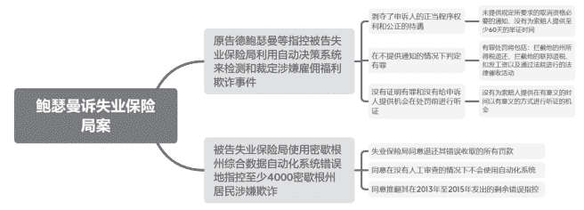

## 核心争议点
UIA 在未经法定程序即剥夺他人财产的行为是否违反宪法有关程序保障的规定。

## 裁判论证过程
UIA 违反程序保障有关规定

利用自动化决策系统检测并确定欺诈案件，使计算机代码中包含判定有罪的规则，该规则改变了有罪与无罪的实质标准，与程序保障不一致。密歇根州 UIA 通过不当拦截税收返还、扣押工资与强迫偿还，侵害并持续侵害原告及集体成员权利：

a. 未提供取消资格所需的必要通知
b. 未给予索赔人至少 60 天举证时间
c. 未审视事实依据，或证据不足以支持查获欺诈
d. 未举行听证会
e. 未在有意义的时间以有意义的方式给予发表意见机会
f. 利用自动化决策系统检测并确定欺诈案件，使代码改变有罪无罪实质标准，与程序保障不一致
g. 例行大规模超额评估罚款收取利息并不当使用授权收款方式，制定政策违反密歇根州宪法程序保障与公平待遇规定

具体而言：

### 一、失业救济机构在未充分通知并提供听证机会的情况下扣押财产并非法收款，违反程序保障原则
程序保障条款禁止国家在无正当法律程序情况下剥夺生命、自由或财产。条款仅在剥夺发生时被触发。程序保障确保当事人获得有意义听证机会的权利，以及被剥夺财产前发表意见的机会。

### 二、失业救济机构在未通知情况下采用自动欺诈检测系统判定有罪，违反程序保障原则
原告方称 UIA 系统性非法截留州与联邦退税、扣押工资并强迫偿还合法取得的救济金。修订申诉进一步指控 UIA 违反州法对领取者施加处罚并收取未授权利息。机构在未提供取消资格必要通知、未举行听证、未允许其在辩护中提交证据的情况下，通过计算机系统启动自动化流程检测并认定欺诈，导致资格被取消、受罚并遭刑事起诉，违反程序保障。

### 三、现行法律未提供有效救济途径
《密歇根州就业保障法》规定的程序虽允许质疑 UIA 关于救济金决定的方法，但未提供质疑机构系统性剥夺程序保障权利的途径，也未提供金钱救济形式补救途径。

## 审理结果
1.索赔法院驳回 UIA 关于即决处置的动议
2.密歇根州上诉法院撤销初审法院驳回即决处置动议的决定，UIA 可依据《密歇根州法院规则》第 7 节第 219 条规定对费用征税
3.密歇根州最高法院部分确认、部分撤销原审判决并发回重审
4.密歇根州上诉法院确认原审判决
5.密歇根州最高法院决定就 UIA 上诉安排口头辩论
6.密歇根州最高法院分别批准双方延长提交补充书状等动议
7.案件仍在上诉审理中，待进一步完善

## 相关法条
《密歇根州法律汇编》第 421 节《密歇根州就业保障法》第 48 条第 1 款 Michigan Employment Security Act，Michigan Compiled Laws§421.48（1）

个人在未提供服务且未获报酬的任一周，或支付报酬低于每周福利额 1 到 1/2 的情况下，应视为失业者。例外为新增第 15a 条修正案生效后至 2015 年 10 月 1 日前，若薪酬低于每周福利额 1 到 3/5，则该周全职工作视为失业。但个人因雇佣单位未能提供全职定期雇用以外原因产生的报酬损失，应作为本条及第 27 条 c 款规定的报酬列入。损失总额按失业机构规定确定。本法下个人每周福利额指按第 27 条 b 款确定的数额。

《密歇根州法律汇编》第 600 节《1961 年司法法修订案》第 6431 条 Revised Judicature Act of 1961，Michigan Compiled Laws§600.6431

除本节另有规定外，不得主张针对本州的索赔，除非索赔人在索赔产生后 1 年内向索赔法院书记员办公室提交书面索赔通知，或向该州或其任何部门、委员会或机构提出索赔书面通知。

第 1 款下索赔或通知必须包含以下全部事项：
a.索赔发生的时间与地点说明
b.详细说明索赔性质及其所指控或声称遭受损害的项目
c.指定与索赔有关的任何国家部门、委员会或机构
d.索赔人于有权管理宣誓的军官面前签字并核实

索赔人应在向总检察长和本州各部门、委员会、赔偿请求或通知书中指定机构提交说明性复函时，根据第 1 款向书记员提交赔偿请求或通知书副本。

当算法断送生计：密歇根 MiDAS 乌龙案全解

索赔时限与费用规则的法律依据

因本国境内出现的财产损害或人身伤害而主张赔偿的，申请人必须自致损事实发生之日起六个月内，依第1款方式向管辖索赔法院的书记官提交赔偿申请或发出相应通知。

本条文不适用于依据《非法监禁赔偿法》（密歇根州法律汇编第691编第1751条至第1757条）提起的赔偿请求。

《密歇根州法院规则》第7节第219条（节选）

A. 费用取得权。除上诉法院另有指示外，民事诉讼中胜诉一方有权取得费用补偿。
B. 申请期限。争议一方应在处分令、意见书或驳回复议令签发之日起二十八日内，向书记官递交经核证的诉讼费用清单，并送达副本予其他当事人。清单每项须具体列明。逾期提交即视为放弃费用取得权。
C. 反对。其他当事人可在收到清单副本后七日内向书记官提出异议。提出异议一方须将异议副本送达胜诉方并提交送达证明。
D. 核定征税。书记官应及时审核清单并按法定标准征税。
E. 复核。上诉法院可依任何一方在课税日起七日内提出的动议复核诉讼费，但在复核审理中，仅书记官先前收到的宣誓书或反对意见可被法院考虑。
F. 可征税费用。胜诉方仅能就上诉法院产生之合理费用征税。

《密歇根州法律汇编》第600节《1961年司法法修订案》第5827条

除法律明确另定外，诉讼时效自请求权产生时起算。请求权须在第5829条至第5838条规定的期间内提出；在该等条款未涵盖的情形下，不论损害何时发生，请求权基础均为错误。

案件要义

### （一）立法压力：一次自动化灾难如何倒逼算法行政规则出台
本案的核心系统是密歇根州失业保险局使用的“密歇根综合数据自动化系统”，用于向雇主征收失业税并向符合条件者发放失业金。设计与配置工作由地面数字多媒体广播承包商完成，目标是取代服役三十余年的大型主机。该系统宣称能改善服务、提升数据准确性、强化安全隐私、降低成本并提高自动化水平。然而大量诉讼表明，自动化程度提升的同时，数据准确性和客户服务目标并未实现。本案波及约三万四千名失业者，保险局因认定欺诈并处以罚款而在一年多内收入由三百万美元激增至六千九百万美元.^([\[17\]](#txt006.html#footnote_content_txt006_17))

系统缺乏人工复核，在收到内部预警后仍拒不纠错，导致大量失业者蒙受财产损失、声誉受损、破产、房产被抵押或赎回权被取消等后果。与过往算法争议相似，开发商拒绝公开算法细节，被指控欺诈者拨打咨询电话往往无人接听，待接通时已错过三十天的上诉期。面对舆论，密歇根州同意修改失业法并设立MiDAS受害者补偿基金，2017年通过新法以优化欺诈指控通知方式并降低罚款，防止类似悲剧重演。

美国借外部监督机制推进算法问责，州审计报告指出失业保险局现行安全管理计划无法有效控制MiDAS。欧盟《通用数据保护条例》通过赋予数据主体异议权保障程序正义，其中第3章第4条要求控制者对未及时回应的请求说明原因并告知申诉与诉讼途径。我国《国务院办公厅关于全面推行行政执法公示制度执法全过程记录制度重大执法决定法制审核制度的指导意见》也要求行政机关通过事前公开、事中公示、事后公开维护公民权益，执法决定信息应在作出之日起七个工作日内公开。各国算法行政规则供给不足，难以应对复杂问题，本案正直接推动相关立法，为后续问责提供依据。

### （二）司法纠偏：诉讼如何叫停失控的自动化执法
内部审计揭示失业保险局未建立全面安全管理程序确保MiDAS安全；也未充分分析与审查系统数据以识别需进一步复核的支出。针对这些问题，保险局同意在未经验人审核前不再使用自动化系统，并撤销2013至2015年间剩余的错误指控。

本案警示政府权力行使边界：算法对立法、行政、司法的渗透日益加深，自动化管理趋势增强。行政决策仍须置于法治框架，代码驱动的智能行政仍须遵循比例原则等基本要求。人工智能有助于提升效率，但自动化决策须在必要时、以适当方式、在可解释范围内行使，方有正当性与说服力。本案亦彰显数字化时代公民运用法律武器维护权益的意义。自动化决策影响更直接广泛，算法黑箱与决策中的非理性因素呼唤更高程度的法律保护，集体诉讼成为权利救济有效路径。

### （三）舆论发酵：算法在公共事业领域的系统性风险被点亮
鲍瑟曼诉失业保险局案并非孤例。相较私营部门，政府算法影响面更广、深度更深。公共事业算法已渗入刑事司法、保险、金融、税务、福利分配等关乎生存的领域，监管却长期空白。本案受害者在再就业、退税、财产与人身安全上持续受损，被诬告者就业更难，只能通过漫长诉讼修复名誉。

美国AI NOW研究所的研究显示，采用算法的政府机构认为可省成本、实现标准化，但这些系统常针对被视作“高成本”人群，即政治、社会、经济上最边缘群体，却鲜少对真实成本收益进行严格评估，也未对受影响人群开展评估。失业保险局收入的陡变揭示：在真实欺诈者仅占少数情况下，使用MiDAS后涉嫌欺诈人数增长至此前五倍，罚款异常激增，系统错误地将大量无辜失业者归类为福利欺诈。

后续审计证实，抽检的二万两千项MiDAS欺诈指控几乎全部错误。另一组经部分人工复核的指控错误率仍高达44%，而纯自动化系统的错误率是其两倍多。^([\[19\]](#txt006.html#footnote_content_txt006_19))

### （四）制度标杆：透明与可问责成为算法治理的底线要求
MiDAS无法提供合理解释过程，救济渠道缺失使无端指控的负面影响可能伴随终身，透明度缺失也加大问责难度。

各国在设计监管制度时普遍强化透明与可问责。美国国家科技委员会《人工智能研发战略计划》提出应通过优化设计提升AI系统的公平、透明与可问责性。2020年1月白宫发布的《人工智能应用监管指南备忘录草案》强调AI部署应提升安全性、公平性、透明度并增进社会福祉，监管与非监管措施应以增强公众信任、优化风险评估、强化披露与透明度为原则。公众信任是算法治理的核心，透明度与可解释性服务于提升预期与信任。

### （五）后续走向：从叫停系统到建立常态监督
鲍瑟曼案引发算法行政与正当程序的大讨论。研究人员关注MiDAS如何通过算法批量生成欺诈指控。尽管64%的指控正处于行政法院上诉或被推翻程序中，失业保险局仍试图为MiDAS及由此产生的“盈余资金”辩护，漠视内部警告指出的认定错误。在联邦与州政府压力下，失业保险局于2015年9月决定停用MiDAS并停止纯自动化欺诈评估。^([\[21\]](#txt006.html#footnote_content_txt006_21))

2020年初，参与集体诉讼的律师呼吁设立特别工作组监督州政府所有算法与自动化系统。美国其他州随后成立类似机构，对公共事业领域的自动化决策展开常态化监督。

【关联判例推荐】

1. Cahoo v.SAS Analytics Inc., 912 F.3d 887 (2019)
核心事实：失业救济申请人因州自动欺诈检测系统作出虚假欺诈认定而对相关公司及个人提起集体诉讼。密歇根州东区联邦法院驳回个别被告以合格豁免权抗辩第四修正案与第十四修正案主张。
关联点：领取失业救济金者对失业救济金享有宪法保护的财产利益。

2. Department of Licensing and Regulatory Affairs/Unemployment Insurance Agency v. Lucente, 946 N.W.2d 836 (2021)
核心事实：许可与监管事务部/失业保险机构申请复核密歇根赔偿上诉委员会决定，依据《密歇根州就业保障法》，在获得全职工作后继续领取救济金的申请人无需返还赔偿金与欺诈罚款。
关联点：失业机构在作出追回错误支付决定时无需事先给予当事人通知与质证机会。

3. Frank v. Linkner, 894 N.W.2d 574 (2017)
核心事实：有限责任公司成员在公司出售全部资产后对其他成员提起诉讼，指控压迫成员、违约与违反受托义务。
关联点：以原告申诉中指控的可诉损害确定原告首次受损日期。

4. Bonner v. City of Brighton, 848 N.W.2d 380 (2014)
核心事实：土地所有者挑战市法令关于经济上不合理的不安全建筑可被拆除为公共妨害的合宪性。
关联点：正当程序条款禁止国家在无正当程序下剥夺生命、自由或财产，无剥夺则程序自为正当。

5. Cahoo v. SAS Institute Inc., 322 F.Supp.3d 772 (2018)
核心事实：失业保险申请人因州自动欺诈检测系统虚假认定提起集体诉讼，依据联邦与州法提出多项请求。
关联点：均涉及公民权利相关的正当程序问题，虚假欺诈裁定构成正当程序侵害。

6. 休斯顿教师诉休斯顿学区案
案件索引：Houston Fed’n of Teachers, Local 2415 v. Houston Indep. Sch. Dist., 251 F. Supp. 3d 1168 (S.D. Tex. 2017)
关键词：正当程序；算法透明度；自动化决策；商业秘密；知情权；算法影响评估
案件提要：休斯顿独立学区使用EVAAS系统评估教师表现并作为解雇依据，开发者SAS公司以商业秘密为由拒绝披露底层代码与原始数据。原告主张无法获取足够信息质疑学区决定；学区目的与行为缺乏合理关联；评分机制不透明难以改进；分类对待违反平等保护。VAM产品在美国公立教育快速推广的争议包括评分准确性不足、改进作用有限、采购前缺乏测评与听证、被低分解雇者无法核验数据与运算过程，难以陈述申辩。

2015年12月，美国联邦国会推出《每个学生都成功法案》，也就是ESSA。这部法案撤掉了对州政府积极使用教师增值评估模型VAM的联邦奖励，也不再允许州政府强制辖区学校使用VAM。法案却没有禁止学区自行继续用VAM，更没有对VAM本身的合法性做出表态。

在这样的背景下，休斯顿的这场官司出现了。法院最终认为，学区选用透明度极低的EVAAS系统，可能触及了教师的程序性正当程序保护，因此驳回了学区在这部分提出的简易判决申请。案件最后以调解收尾。值得一提的是，此前教师群体围绕VAM提起的诉讼几乎全部败诉，这一起案子被视作司法层面的一次突破，有学者甚至说联邦法院的救济之门又被重新打开了。程序性权利如何被算法影响、算法要不要公开、商业秘密与知情权怎么权衡，这些争论对教育算法乃至整体算法治理都有参照价值。

#### 【案件概要】
审理法院：德克萨斯州南区联邦地区法院休斯顿分院，一审，2017年。
原告：休斯顿教师联合会2415及多名在职教师。
被告：休斯顿独立学区、相关利益方、SAS公司。

2010年起，休斯顿独立学区为了提质，开始用量化手段给教师打分，教学成效是否被保留在很大程度上取决于学生标准化考试的进步。2012年，学区引进了SAS公司开发的EVAAS系统给教师评分。EVAAS的核心逻辑是追踪教师对学生考试成绩的贡献来衡量教学质量，打分办法大致是把教师所带学生的平均分与全州同年级或同课程的学生平均分做对比，再经过一系列复杂处理得出最终分数。

系统上线后不久，EVAAS成绩就成了学区决定是否解除聘用的关键参考。学区公开表示，在EVAAS被判定不合格的教师里，只有约15%能留下。2011至2014年间，学区实际分别解除了20.3%、24.4%、25%的“不合格”教师的劳动关系。

问题在于，EVAAS的核心代码和计分机制被SAS作为商业秘密严密封锁，即便对教师去留起决定作用，教师本人也看不到底层逻辑。

正是基于这一背景，原告提起诉讼，主张学区的做法违反了《美国宪法第十四修正案》，理由包括：

1. 程序性正当程序被侵犯。因为在学区以EVAAS分数过低为由解聘时，教师无法获得足够信息来质疑该决定是否合理。
2. 实体性正当程序被侵犯。因为学区使用EVAAS与提升教学质量的目标之间缺乏合理关联。
3. 实体性正当程序再一次被侵犯。因为EVAAS机制不透明，说明和解读过于笼统，教师难以知道如何改进以避免被解雇。
4. 平等保护原则被侵犯。因为学区按EVAAS分数对教师分类区别对待。

在证据开示阶段，SAS曾允许原告专家Rothstein以较高权限进入系统底层查看代码和信息。但Rothstein表示，即便权限远高于普通用户，他依然无法复现教师的EVAAS分数。

审理过程中，被告针对四项诉求全部提出了简易判决申请。法院最终支持了被告关于后三项的申请，即驳回了实体性正当程序和平等保护的相关主张，但对程序性正当程序是否被侵犯表示存疑，因此不予简易驳回。案件后来调解终结。

#### 【事实脉络图】
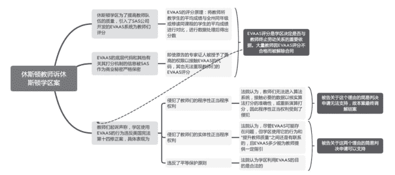

#### 【争议焦点】
1. 原告与学区之间的劳动关系中是否存在受宪法保护的财产权益。
2. 将EVAAS分数作为续聘或解聘的重要依据是否侵害程序性正当程序。
3. 使用EVAAS评分是否符合实质性正当程序要求的合理依据审查。
4. 鉴于EVAAS不透明，使用该系统是否构成对实质性正当程序的侵害。
5. 基于EVAAS分数对教师分类区别对待是否违反平等保护。

#### 【法院思路拆解】
##### （一）原告在劳动关系中享有受保护的财产权，正当程序条款可适用
第十四修正案的正当程序条款禁止州政府在没有正当法律程序的情况下剥夺公民的生命、自由或财产。适用该条款前要先确认原告是否存在受保护的财产权益。

本案中，学区通过试用合同、固定期限合同和无固定期限合同聘用教师。法院认为，这些合同均创设了受保护的财产利益：无固定期限合同只有在正当理由下才能终止，持有此类合同的教师享有被继续雇用的宪法性财产期待；试用合同和固定期限合同则在有效期内同样产生受保护利益。

被告辩称原告没有证明权利实际受损，正当程序不适用。法院回应，原告寻求的不是金钱赔偿，而是预防性救济，即确认学区以EVAAS决定解聘或不续聘的做法违法并禁止继续。对此类救济，原告无需证明损害已然发生，只需证明存在“被侵害的现实危险”。学区依据EVAAS决定解聘或不续聘，确实对原告受保护的就业财产权益构成威胁，所以正当程序条款适用前提满足。

##### （二）以EVAAS评分决定去留，可能违反程序性正当程序
原告指出，由于拿不到EVAAS的算法代码和数据，无法验证分数准确性，因此学区的使用未达到最低程序标准。换句话说，学区在以低分解聘时，没有“足够详细地告知解聘理由，使教师能够证明是否存在错误”。

学区回应，EVAAS分数由开发商SAS计算，采用精密算法和多层运算。SAS将计分机制视为商业秘密，既不向学区也不向教师披露。学区从未自行核验或审计SAS提供的分数，并承认教师无法自行计算。原告专家在获授权进入底层后，仍无法复现评分过程。

EVAAS是人造系统，同样可能出错，包括数据录入失误或代码运行故障。学区承认分数可能不准，但即便发现错误也不会立刻更正。理由一是改动一名教师的信息需要重跑整个学区的分析，成本高昂；二是重新计算某人分数可能牵动所有教师的分数。

法院认为，上述答辩反而加深了疑虑：为省成本是否可以牺牲准确性？若一个教师分数修正会导致整体变动，就说明系统的脆弱性。被告把EVAAS作为续聘解聘的重要依据，却没有提供有效渠道让教师了解分数生成和准确性，阻碍了陈述申辩权，因此存在侵犯程序性权利的可能，需进一步审理，故不支持被告就此项的简易判决。

##### （三）采用EVAAS评估教师，符合合理性审查要求
原告认为，使用EVAAS与学区宣称的“每个教室都有有效教师，每个学生为成功做好准备”的目标之间无合理联系，并称EVAAS并非理性工具：对班级类型和规模区别对待，评分随模型和考试波动剧烈，与其他能力指标结果相差很大。

学区则称，美国42州加哥伦比亚特区在评估教师时会纳入学生表现，VAM在学界已被充分讨论。学区还援引了第五巡回法院外三个案例， Cook v. Bennett、Wagner v. Haslam、Trout v. Knox Cty. Brd. of Educ，上述案件中原告指控VAM侵害实质性正当程序，均未获支持。

法院指出，合理性审查采取宽松标准，不要求行政政策完美有效，只要行为与目的之间存在联系，哪怕促进效果微弱也符合要求。本案虽不能否认EVAAS可靠性存疑，但仍能在一定程度上服务教学提升目的，因此认定符合合理性审查。

##### （四）EVAAS评估不因含糊不清而违宪
原告主张，EVAAS计分不透明，分析应用也不够清晰，违反了实质性正当程序要求，即规则必须足够明确，让受规制者能得到清晰行为指引。

法院认为，判断政策是否因含糊而违宪，看点在于规定是否清晰明确，而非政策公平性或出错概率。本案中，学区已告知教师低分可能导致合同终止，并介绍了EVAAS的基本原理和衡量方式。教师虽无法验证分数准确性，但可以对照实施条例的解雇标准评估自身行为。因此法院认为不构成因含糊而违宪。

##### （五）平等保护主张不成立
原告指控学区按EVAAS分数分类并区别对待，且要求主管的教学等级评定必须与EVAAS分数保持一致，破坏了独立性。

法院认为，基于平等保护提出请求需证明“遭受故意区别对待且该做法缺乏合理依据”。本案中，原告既未证实“主管评定须与EVAAS一致”的政策存在，也未充分说明区别对待的具体损害。即使该区别存在，在宽松的合理性审查下，因其服务于教学提升目的，仍不构成违法。故不予支持。

#### 【判决结果】
学区提出的简易判决申请在程序性正当程序问题上被驳回，其余主张均获法院支持。换言之，法院驳回了关于实质性正当程序和平等保护的诉求，但要求继续审理程序性正当程序是否被侵害的问题。

最终案件调解结案。学区同意成立教学咨询小组委员会，商讨教师评核程序相关议题，并承诺除非个体评分可以被核验，学区将不再以VAM包括EVAAS作为终止劳动关系的依据。

#### 【适用法条】
### 《美国宪法第十四修正案》第1节
合众国及各州不得制定或实施剥夺公民特权或豁免权的法律；不得在未经正当法律程序的情况下剥夺任何人的生命、自由或财产；在州管辖范围内，不得拒绝给予任何人平等法律保护。

### 《美国法典》第42卷第1983条
任何人凭借州法、条例、惯例等剥夺他人宪法或法律权利的，必须承担民事责任。

### 《德克萨斯州教育法典》第21章第154条
依据无固定期限合同聘用的教师有权在未来学年直接继续任职，无需每年重新任命，除非辞职、退休、必要裁员、基于正当理由并按程序解除等情形。

#### 【点评与启示】
EVAAS属于VAM的一种商业实现。VAM通过横向与纵向对比学生考试成绩来衡量教师年度教学质量。诞生之初被视为客观公正的工具，联邦政府曾大力推广。奥巴马时期甚至把使用VAM并与绩效工资和续聘挂钩作为获取额外补贴的条件，使用越激进补贴越多。

在政策推动下，几乎所有学区都采纳了VAM，并将其用于涨薪、续聘等重大决策。休斯顿学区学生背景以高需求为主，60%英语水平有限，教学压力大，可能因此更激进地使用EVAAS。判决书显示，2011至2014年间分别有20.3%、24.4%、25%的“不合格”教师被解除关系，2011年仅EVAAS不合格一项就解雇221名教师。

与快速推广同步的是质疑声不断。教师工会主席Randi Weingarten认为VAM只看考试成绩过于片面；研究也发现同一教师EVAAS分数短期剧烈波动、数学教师分数系统偏高等问题。司法上早有质疑案例，如2011年的Cook v. Bennett、2016年的Trout v. Knox County Board of Education等。

本案的意义在于，它让法院第一次认真审视了算法不透明与程序正当之间的冲突，并把“能否验证”作为继续使用VAM的前提条件，这为教育领域算法治理提供了重要参考。

算法评价教师的美国转折与全球回响

为回应外界对教师考核机制的质疑，美国国会于2015年底通过Every Student Succeeds Act，正式取代自2002年起施行的No Child Left Behind Act。两部法案在管控思路上分歧显著，新法大幅削弱了联邦对各州公立学校学业表现的干预强度，并把教师问责的决定权基本交还州政府。在价值增值模型（VAM）的语境下，这意味着联邦不再为积极推广VAM的州提供奖励，也不再允许州层面强制学区启用该工具。值得注意的是，新规并未禁止学区自愿采纳，也未就VAM本身的正当性作出判断。在Houston诉讼爆发前，所有围绕VAM提起的教师诉求均被法院驳回。正因如此，Houston案被视作教师群体在司法场域对VAM的首次突破，常被概括为重新为教师打开联邦法院救济通道，在算法治理尤其是教育场景的应用上具有开创意义。

判决与调解公布后，以VAM裁定去留的学区数量出现回落，但该模型并未在美国退出历史舞台。2020年1月的统计显示，仍有12个州允许或鼓励学区把VAM结果作为去留决定的主要甚至唯一依据，另有23个州允许或鼓励学区将VAM结果与其他指标合并使用。学界归因主要有两点：其一，Houston案并非联邦最高法院判决，效力覆盖有限，且不少地方政策制定者对案件及其影响并不知情；其二，VAM在美国已投入大量人力物力，形成了明显的政策惯性与路径依赖。可以说，Houston案对教育政策产生了一定转向，但影响相对有限。

### （二）算法治理困境引发全球关注
VAM在全美推广的十余年，本质上是算法进入公立学校教师评价体系的集中期。自该模型开始实质性左右教师命运，围绕它的讨论、质疑乃至诉讼就持续不断，并在Houston案达到高峰。Houston案本身未必家喻户晓，但它暴露出的社会与行政领域算法治理难题，已成为日益重要的公共议题。实际上，除教师评价外，美国其他领域也已出现因算法自动决策引发的诉讼。

作为回应，近几年全球陆续发布规范性或指引性文件。例如2019年4月，欧盟发布了《可信赖的人工智能伦理准则》，阐释了可信赖人工智能的伦理框架及落地路径。该文件认为，可信赖的AI应符合四项准则以更好地造福人类：^[(\[34\]](#txt006.html#footnote_content_txt006_34))
表 1 欧盟《可信赖的人工智能伦理准则》规定的伦理准则
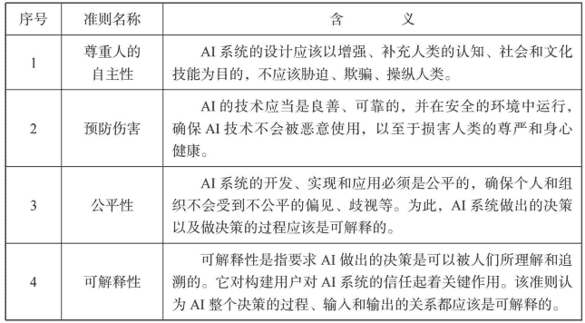
在该框架下，欧盟把原则细化为7个可操作要点，包括“人的自主与监督”“技术稳健性与安全性”“隐私与数据治理”“社会与环境福祉”“多样性、非歧视与公平性”“透明性”与“问责制度”。在教育场景里，“透明性”尤为关键，具体体现为可追溯、可解释、可被识别：^[(\[35\]](#txt006.html#footnote_content_txt006_35))
表 2 欧盟《可信赖的人工智能伦理准则》中“透明度”在教育领域的体现
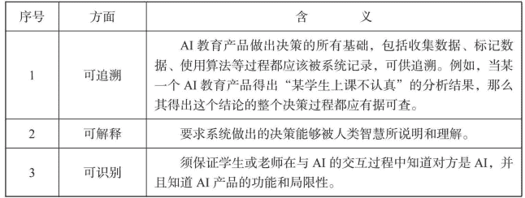
类似地，德国政府也高度重视算法自动决策的透明度，并在第36届信息官员自由会议上通过文件《算法在公共管理中的透明度》，要求行政管理中使用算法须遵循信息公开原则。据此，政府部门使用的算法须公开：（1）程序输入输出数据的种类；（2）算法所涉逻辑，尤其是计算公式、输入数据权重、基础专业知识及使用者个人配置；（3）最终决策范围及程序可能产生的后果。^[(\[36\]](#txt006.html#footnote_content_txt006_36))

以此透明度要求检视EVAAS，就不难理解其为何在Houston案中未能通过程序合法性审查。EVAAS在可解释性上存在显著不足，呈现出“黑箱”特征，教师难以判断个人成绩是否准确。这既削弱了教师对EVAAS的信任，也降低了成绩对教学的指导价值。实际上，EVAAS的实际效果并未达到公众预期，有研究指出Houston学区3-8年级学生在阅读、写作、理科、社会科学和社会研究方面的表现，并未见到SAS企业所承诺的进步。^[(\[37\]](#txt006.html#footnote_content_txt006_37))

### （三）以算法影响评估推动公众参与系统采购与使用
该案中，学区把EVAAS结果作为解聘教师的核心依据，涉及教师重大的就业财产权益，却在采购前未对系统做专业测评，也未面向教师举行听证讨论，做法引发广泛怀疑。调解文件显示，学区同意成立教学咨询小组委员会，讨论教师评核程序相关议题，并承诺除非个体成绩能够得到验算（verifi able），否则不再以VAM包括EVAAS成绩作为终止合同的依据。^[(\[38\]](#txt006.html#footnote_content_txt006_38))

Houston学区在采购EVAAS前未听取教师意见，是纠纷的成因之一，也凸显了算法影响测评的重要性。算法影响测评的内核与我国已广泛开展的“环境影响评估”^[(\[39\]](#txt006.html#footnote_content_txt006_39))相近，旨在让政府在采用算法自动决策前，为行政相对人、研究者与决策者共同参与测评创造条件。这为公众在系统部署前发现问题、表达诉求乃至反对使用提供通道，是一种向社会披露算法系统信息的机制，有助于提升透明度，促进政府、研发方与公众的建设性对话，体现行政程序应有的民主、责任、参与与法治。

目前，我国各级警务部门的算法系统上线多采取“先小范围试点再全面运行”模式。^[(\[40\]](#txt006.html#footnote_content_txt006_40))这可视为试运行阶段的测评，但上线前缺乏明确测评程序，公众难以通过参与表达诉求。为确保算法自动决策系统安全落地，欧洲议会提出“算法影响评估”制度框架，即对可能影响公民权利的算法自动决策系统，应允许社区和利益相关者评估是否及在何种领域使用。^[(\[41\]](#txt006.html#footnote_content_txt006_41))加拿大2020年生效并于2021年更新的《自动化决策指令》设立了算法影响评估制度。^[(\[42\]](#txt006.html#footnote_content_txt006_42))美国华盛顿州通过的《HB165法案》^[(\[43\]](#txt006.html#footnote_content_txt006_43))要求政府算法系统使用前须在公共网站公布，并邀请公众对算法问责报告发表评论，期限不少于30天。^[(\[44\]](#txt006.html#footnote_content_txt006_44))欧盟《一般数据保护条例》第35条规定的“数据处理活动影响评估”制度^[(\[45\]](#txt006.html#footnote_content_txt006_45))亦具类似功能，适用于私营与公共部门。^[(\[46\]](#txt006.html#footnote_content_txt006_46))

算法自动决策的评估程序既是公众参与治理的有效路径，也是设计者与使用者自我监管的重要方式。如2018年11月30日生效的《具有舆论属性或社会动员能力的互联网信息服务安全评估规定》要求相关算法应用进行自我安全评估。因此，算法用于公共行政管理时，不应处于秘密黑箱，而应在公众参与的评估后投入使用。我国2021年9月生效的《数据安全法》提出重要数据处理者的风险评估及政务数据委托处理批准程序，^[(\[47\]](#txt006.html#footnote_content_txt006_47))但主要出于数据安全考量，基于公民权利保护的程序制度仍有缺位。

### （四）行政信息公开与算法商业秘密的权衡
EVAAS成绩由算法生成，采用复杂的软件和多层计算。SAS企业视其算法与软件为商业机密，拒绝向学区或教师本人披露验证成绩所需的底层代码与数据。被低分解雇的教师因而无法作出准确有效的陈述与申辩。法院认为，当公共机构采用不符合最低正当程序要求的秘密算法作出高风险就业决策，而开发者又以商业秘密为由拒绝披露相关信息时，妥善的处理方式是令公共机构停止使用该算法。这样既可避免商业秘密泄露，也不致让算法的秘密性损害他人合法权益。该案由此引申出学术议题：如何平衡“促进算法透明度”与“保护算法商业秘密”。

主张公开算法模型时，常被开发者以保护商业秘密为由反对。这引出思考：私营企业的商业秘密能否凌驾于行政正当程序对信息公开的要求之上？

要回答此问题，需要权衡商业秘密保护与公民正当权利的价值位阶。行政信息公开是集体语境下的程序正义。算法系统可对众多行政相对人产生法律效力，一旦出错可能产生弥散化损害，例如该案中SAS拒绝验证成绩的理由之一是教师成绩相互关联，“牵一发而动全身”。正当的规则应具备可预测性，使当事人能据此预估行为及后果，从而作出合理安排。^[(\[48\]](#txt006.html#footnote_content_txt006_48))这种知情权既是天赋人权，也可从我国宪法推导而得，^[(\[49\]](#txt006.html#footnote_content_txt006_49))其价值显然高于私营公司商业秘密的保护。

需要强调的是，主张保护公民知情权、增进算法透明度，并不必然等于要求开发者公布技术源代码。如前所述，欧盟《可信赖的人工智能伦理准则》要求“系统作出的决策能够被人类智慧所说明和理解”，这说明公开底层代码并非必需，真正需要公开的是“被代码化的法律规则”。^[(\[50\]](#txt006.html#footnote_content_txt006_50))因此，商业秘密与正当程序之间的矛盾并非不可调和。

此外，算法透明度不仅是保障程序权利的要求，也是保障算法提升行政效率功能的重要支撑。透明度缺失会导致公众对算法自动决策结果信任不足，进而引发纠纷，如美国因学区采用VAM而产生的诸多诉讼，消耗司法等社会资源，使算法提升效率的初衷难以实现。鉴于算法的技术性，美国学者提出“技术性正当程序”概念，强调通过编码公开、公众参与程序、系统软件测试等方式实现透明、公开与可问责。^[(\[51\]](#txt006.html#footnote_content_txt006_51))未来有必要在政府内部增加既懂规则又懂技术的专业力量，监督算法设计与运行。

## 关联判例推荐
### 1. Cook v. Bennett, 792 F.3d 1294 (11th Cir. 2015)
案情概要：佛罗里达州引入FCAT VAM系统，以4-10年级英语和4-8年级数学成绩对教师评分，但要求教授低年级、高年级或非数英科目的教师评价也要挂钩该评分。部分教师起诉认为侵害实质性正当程序权并违反平等保护原则。第11巡回上诉法院驳回诉讼，认为法院应对实质性正当程序与平等保护作宽松审查。尽管做法对部分教师不公，但手段与提升教学质量的合法目的有关联，不公平问题应通过民主修法解决。
关联说明：涉及教育领域VAM在实质性正当程序与平等保护上的合法性判断，Houston案法院在说理时亦援引该观点。

### 2. Wagner v. Haslam, 112 F. Supp. 3d 673 (M.D. Tenn. 2015)
案情概要：与Cook案事实相近。两位原告为田纳西州体育教师与美术教师，起诉州政府使用的TVAAS系统侵害实质性正当程序权，因评分依据涉及原告未教授的科目与学生。田纳西州中部地区法院认为法院应对政策合理性仅作最低限度审查，应尊重民选政府制定的政策，TVAAS使用具有一定合理性。
关联说明：同样涉及教育领域VAM的实质性正当程序判断，Houston案法院亦援引该观点。

### 3. Trout v. Knox Cnty. Bd. of Educ., 163 F. Supp. 3d 492 (E.D. Tenn. 2016)
案情概要：原告系田纳西州中学教师。州于2010年引入TVAAS评价教师，并作为去留与奖金依据。原告因学校操作失误获不准确分数，未获奖金。起诉称违反《美国宪法第十四修正案》正当程序条款。法院认为奖金属于雇佣关系中的“纯粹利益”，不受正当程序条款保护。即使受保护，在宽松审查下诉讼请求亦不能支持。
关联说明：涉及教育领域VAM合法性问题，也是Houston案法院援引的判例。

### 4. Ark. Dep’t of Human Servs. v. Ledgerwood, 2019 Ark. 121, 571 S.W.3d 911
案情概要：原告为多名有严重身体残疾的低收入者，定期获得政府救助金。阿肯色州政府后颁布政策，完全依靠RUGs计算机系统重新计算救助金数额。原告起诉认为新政策违反行政程序，导致护理时间平均减少43%，并申请禁令。法院认为州政府未保障原告知情权，未妥善通知即剥夺评论监督权利，违反正当程序，同意发出禁令。
关联说明：算法自动化决策在社会福利领域使用的案例，同样涉及正当程序原则适用。

## 6.4 卡彭特诉美国案
### 案件索引
U.S.v. Carpenter, 2013 WL 6385838, E.D. Mich. (2013)
U.S. v. Carpenter, 2013 WL 6729900, E.D. Mich. (2013)
U.S. v. Carpenter, 2014 WL 943094, E.D. Mich. (2014)
U.S. v. Carpenter, 819 F.3d 880, 6th Cir.(Mich.) (2016)
Carpenter v. U.S., 138 S. Ct. 2206, U.S. (2018)
United States v. Carpenter, 926 F.3d 313, 6th Cir.(Mich.) (2019)
United States v. Carpenter, 788 Fed. Appx. 364, 6th Cir.(Mich.)(2019)

### 核心关键词
算法治理；智慧警务；美国宪法第四修正案；个人信息保护；隐私期待

### 案情梳理
这是算法行政与智慧警务领域最具标志性的争议之一。焦点在于，警方在未持搜查令的情况下，仅凭《存储通信法》第2703条d款的法院令，就从运营商调取被告长周期基站位置信息CSLI，是否已构成第四修正案意义上的搜查。若构成搜查，就必须事前取得搜查令；警方自认不构成搜查，故绕开了搜查令程序。

争议源于一起抢劫案。警方正是依靠调取到的CSLI锁定证据。被告卡彭特与桑德斯主张，获取位置信息属于第四修正案规制的搜查，无证取证违宪，要求排除证据。一审与第六巡回上诉法院均驳回排除请求。最高法院审理时，原方援引第三方原则，称手机定位是商业记录，用户对运营商不再享有隐私期待。辩方则引用琼斯案中索托马约尔与阿利托的意见，强调长期位置追踪侵蚀隐私期待，法律必须与技术同步。最终多数意见认为，警方触及了被告对CSLI的合理隐私期待，属于搜查，必须持令。

CSLI的生成逻辑是：用户通话、短信、上网时手机会与最近基站通信，形成位置记录；即使被动接收短信也会产生。基站越密集，定位越精细。运营商为商业目的长期留存历史记录，积累后即可还原个人一段时期的完整行动轨迹。

该判决成为个人信息保护的里程碑。在美国，隐私保护呈现从宽到紧的层级：法院令到宪法保护。宪法并未明确列举保护范围，最高法院在琼斯案、米勒案、史密斯案等中对GPS、银行账单、座机拨号等作出过判断，认定其不受宪法保护。本案正是借这些反例推导出何为“不受保护的隐私期待”。

对比国内规则，《个人信息保护法》第二十八至三十二条对行踪等敏感个人信息处理要求特定目的、充分必要、个人同意与告知。《宪法》第四十条保障通信自由与秘密，除国家安全或追查刑事犯罪经法定程序外不得侵犯。《刑事诉讼法》第一百三十八条要求搜查须出示搜查证，第一百四十三条对扣押邮件电报亦有审批与通知要求。

### 判决核心
美国密歇根州东区地方法院：一审原告美国，被告蒂莫西·卡彭特、蒂莫西·桑德斯

美国第六巡回上诉法院：上诉人卡彭特、桑德斯，被上诉人美国

美国联邦最高法院：申诉人卡彭特，被申诉人美国

2011年4月，底特律河西岸四人因武装连环抢劫Radio Shack与T-Mobile被捕。一名嫌疑人向FBI招供，团伙在密歇根与俄亥俄抢劫九家店，另有15人参与，并提供手机号码。FBI依《存储通信法》2703条d款向法院申请两份法院令，从MetroPCS与Sprint调取16个号码在一定期间的信息，含号主、账单、通话记录及拨打与接听地位置。其中卡彭特127天与7天、桑德斯88天。数据表明案发时两人手机位于案发店附近，随后被捕。

庭前卡彭特与桑德斯请求排除，称调取定位属搜查，仅有法院令无搜查令，违反第四修正案。地区法院驳回，审理中七名同案犯指认卡彭特为主犯，联邦调查员以地图展示CSLI原理与定位结果，检方称证据确凿。两人最终被判有罪并上诉。

第六巡回维持原判。法院援引Ex parte Jackson案与卡茨案，认为第四修正案保护通信内容不含通信所需信息，前者属隐私后者不然。以史密斯案为依据，认为用户明知运营商为提供服务而收集信息，故无隐私期待。CSLI被归为通信所需信息，自愿交付运营商的商业记录，故不具合理隐私期待，无需搜查令。法院另称，国会制定的2703条d款提供中间路径，可视为社会共识；技术发展迅速，法院认识有限。

卡彭特申请调卷令获批，最高法院以5比4撤销原判发回重审。判决要义为：一、依第四修正案立法目的，由CSLI推导出的个人行迹，个人享有合法隐私期待；二、依2703条d款从运营商获取七天CSLI历史属搜查结果；三、调取127天历史侵犯合理隐私期待；四、调取CSLI前须获有合理根据支持的搜查令，例外另论。

第六巡回据此认定行为属搜查，因未事前申请搜查令而违宪。但因FBI警员合理相信2703条d款合法，主观善意，故维持原审判决。

### 案例事实思维导图
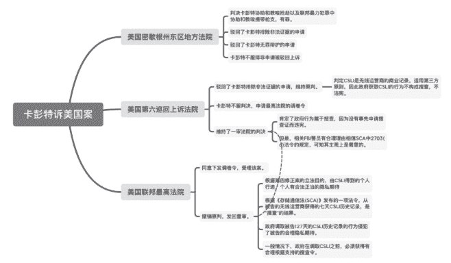

### 争议焦点
1. 第四修正案的保护边界是否涵盖合理隐私期待。
2. 本案能否直接套用既有判例。
3. 作为证据的CSLI是否属于第三方原则下的商业记录，被告是否仍具合理隐私期待。
4. 从运营商调取CSLI的行为是否构成搜查。

### 审理逻辑
#### （一）第四修正案保护合理隐私期待
法院回溯立法本意。第四修正案诞生于反抗英殖民官吏任意入户搜查。1967年卡马拉案明确其根本目的为防公权力随意侵犯隐私与安全。同年卡茨案扩大解释，第四修正案保护人权而非场所，须同时保护财产与隐私期待。史密斯案提出社会认为合理的标准。法院以此确立保护对象。

随后探讨隐私期待的内涵。法院引用卡罗尔案所述违宪取证、博伊德案与迪尔案体现的隐私免受强权侵犯原则，辅助判断合宪性。再借基洛案与莱利案说明新技术对隐私的威胁须审慎。

#### （二）既有判例呈现双重属性，不能一概而论
合理的隐私期待自提出以来缺乏统一标准。法院认为本案无完全可用的先例，相关判例可分两类。第一类以琼斯案为代表，讨论个人对其位置是否享有合理隐私期待；第二类以史密斯案、米勒案为代表，讨论个人对交由第三方保管的信息是否享有期待。CSLI是第三方保管的位置信息。

第一类中，诺茨案先于琼斯案。警方在嫌疑人同伙的氯仿容器置入传呼机，追踪其行程至目的地。判决认为汽车行驶于公共道路上不享有轨迹隐私期待。法院提炼，诺茨案区分了传呼机粗放跟踪与其他更先进技术，仅限信号辅助，并未回答24小时监控是否违宪。琼斯案中FBI在车辆安装GPS远程监控28天，能掌握全部活动轨迹。法院借此指出，长期连续监控个人全部行迹会触及隐私乃至宪法底线。

第二类即第三方原则。米勒案认为政府凭传票调取银行账单不构成搜查，因账单属银行商业记录，个人既不占有也不拥有所有权，且非保密。个人须承担信息可能被透露的风险。史密斯案由银行账单换为拨号记录，认为用户明知公司为运营记录，故不抱隐私期待。

关于技术授权问题，肯尼迪大法官认为本案已获法院令，与琼斯案不同。法院回应，授权问题关乎搜查是否合理，而非隐私期待是否存在。授权主体不能决定期待有无。

#### （三）CSLI隐私风险巨大，不适用第三方原则
法院分析CSLI的技术特征：细节全面易收集，类近GPS；持续产生并留存于运营商；可回溯长达数年行踪；手机普及使监控覆盖近乎全民；技术仍在进化。法院先以卡茨案确认公共空间可见行迹仍受宪法保护，再以琼斯案指出执法机关不可能且不应长期秘密监控个人全部轨迹。

比较GPS，CSLI与日常生活深度绑定，隐私隐患甚至更高。法院形容其像脚踝电子镣铐，可实时定位，且因手机普及几乎无人可免。锁定目标后即可获取过去五年轨迹，仅无手机者可逃脱。

关于精度争议，检方认为CSLI精度低于GPS，不能精确定位犯罪地点。法院反驳，127天数据结合其他信息足以还原全程行程，且2010年基站密度已提升，未来精度将逼近GPS。

在回应第三方原则时，法院认为CSLI的隐私隐患已超出该原则适用范围。个人因自愿分享而降低期待，这是原则原理。分享要件需兼顾信息本身性质，米勒案与史密斯案不仅看分享行为，也看信息内容。生搬硬套忽视CSLI特殊性。且自愿要件不成立：手机服务为现代生活必需；开机即产生CSLI，接打电话、收发短信、浏览新闻天气等自动连接都会留下位置，只有离线才不留痕。

#### （四）裁判效力有限
法院特别限定范围：不涉及实时CSLI与基站定点数据tower dumps；不影响史密斯案与米勒案正确适用；不限制摄像头等传统侦查工具；不针对其他位置信息商业记录；不涉及外交或国家安全侦查。

## （五）取得 CSLI 通常需要先拿到搜查令

把前面的论点汇总起来看，最高法院认定警方调取本案相关基站位置数据的行为已构成搜查，因而落入《美国宪法第四修正案》的规制范围。宪法所要求的 probable cause，其门槛明显高于《存储通信法》第 2703 条 d 款所说的 reasonable grounds。法院在类推既有判例时一贯持谨慎态度。

争议的核心在于法院令与第四修正案孰从。阿利托大法官的观点是，只要检方通过强制程序取得数据记录，就不必事先申请搜查令。依他的说法，调取文件类记录的法院令与宪法规定的搜查概念不同，授权的也不是直接的取证，而是一种由被命令方执行的间接搜查，即 constructive search。多数意见回应称，若因选用法院令就压缩第四修正案的适用范围，宪法保障就会被架空。并非所有文件调取都必须满足 probable cause，法院传票与 probable cause 各自对应不同的适用区间。只有在嫌疑人记录保存在第三方处且确实存在值得保护的隐私利益的有限情形下，才必须以搜查令启动。

在常态下，政府想要获取 CSLI 就得先取得搜查令。没有令状的获取属于例外，典型例外包括追捕逃犯、个人面临迫在眉睫的危险、证据即将被毁损等。本案判决并未否定紧急状态下先行搜查后补手续的可能性。

## 【审理结果】

1. 美国密歇根州东区地方法院对卡彭特处以有期徒刑 118 年又 3 个月。
2. 美国密歇根州东区地方法院驳回卡彭特排除非法证据的申请。
3. 美国密歇根州东区地方法院驳回卡彭特的无罪辩护申请。
3. 美国第六巡回上诉法院驳回卡彭特排除非法证据的上诉，维持原判。
4. 美国联邦最高法院撤销原判，发回重审。
5. 美国第六巡回上诉法院依据最高法院意见改判，仍驳回卡彭特排除非法证据的请求。
6. 美国第六巡回上诉法院将案件发回密歇根州东区地方法院重新裁定刑期。

## 【相关法条】

《美国法典》第 18 卷第 1951 条（a）款（18 U.S.C.§1951（a））

以任何形式阻碍、拖延、影响商业或者商品物品的商业流动，抢劫、勒索的，或者试图或共谋抢劫、勒索的，或者对任何人或财产实施身体暴力、或以身体暴力相威胁的，违反了本节的计划或目的，应根据本法处以罚款或 20 年以下的监禁，或两者并罚.

《美国法典》第 18 卷第 924 条（c）款（18 U.S.C.§924（c））（节选）

(1)

（A）除非本小节或其他法律规定了更高的最低刑罚，否则任何人使用、携带枪支的，或为实施此类犯罪而持有枪支的，除对此类暴力犯罪或买卖毒品犯罪规定的刑罚外，任何涉及暴力犯罪或买卖毒品犯罪（包括因使用致命或危险武器、装置而加重处罚的暴力犯罪或买卖毒品犯罪）的人应当—

（i）被判处不少于 5 年的监禁；

（ii）如果展现枪支的，将被判处 7 年以上的监禁刑；以及

（iii）如果开枪的，将被判处 10 年以上的监禁刑.

（B）如果被判犯有违反本款的人持有的枪支……

……

（D）尽管有任何其他法律规定—

（i）法院不得对被判违反本款的人进行缓刑；以及

（ii）根据本款判处的监禁刑不得与其他监禁刑同时计算，包括对使用、携带或持有枪支的暴力犯罪或买卖毒品犯罪判处的监禁刑.

……

《美国法典》第 18 卷第 2703 条（d）款（18 U.S.C.§2703（d））

只有在政府主体提供具体和明确的事实，有合理根据（reasonable grounds）相信电报或电子通信的内容，或所查询的记录或其他信息，与正在进行的刑事侦查有关并且重要的，予以签发法院传票.

《美国宪法第四修正案》（United States Constitution，Amendment 4）

人民的人身、住宅、证件和财产权利不受不合理的搜查和扣押，不受侵犯，在有合理根据的情况下，并且以宣誓或誓词为依据，特别说明搜查地点和扣押的人或物，才能予以签发搜查证.

## 【案例评析】

### （一）第四修正案对数字隐私的保护被进一步明确
判决援引卡茨案为依据，确认合理隐私期待受第四修正案保护。意见回顾了该修正案的历史脉络，强调其立法目的，并以合理隐私期待为论据，将 CSLI 纳入个人隐私的保护范围。隐私期待的边界并不清晰，托马斯大法官据此彻底否定卡茨标准，认为政府触及隐私期待并不等于构成搜查，扩张保护范围或重新界定搜查不应以隐私为前提。肯尼迪大法官则主张以产权理论界定保护边界。托马斯与戈萨奇均不认同卡茨对保护范围的扩张，主张回归卡茨之前以产权有无判断保护。学界亦有不少类似声音。

哈兰在卡茨案中提出的合理隐私期待及其要件历来争议不断。这与第四修正案解释的演变相关，有观点认为卡茨并非对宪法文本的忠实解读，司法不应自行立法。第四修正案明文保护人身、住宅、文件与财产免受无理搜查扣押，文本上并无隐私期待的字样。

本案多数意见在新技术语境下再次夯实了第四修正案对隐私的守护，意义重大。CSLI 具有隐蔽性、连续性、无差别性、侵入性与可回溯性，采集成本低、覆盖面广，能描绘出公民生活的全景图。本案中 CSLI 成为关键定罪证据，也体现了其在当代司法中的作用。CSLI 体现了个人私密与公共利益的权衡。

### （二）第三方原则的适用被打开缺口
本案主要从信息分享的性质切入，对第三方原则提出质疑。第三方原则并不完美，其“自愿”前提是有条件的，个案解释空间很大。按既往判例与该原则，存于第三方的 CSLI 本应被排除在第四修正案之外。意见却多次引用史密斯案和米勒案来反证 CSLI 不应适用该原则。

阿利托指出，意见将 CSLI 与电话号码或银行流水的敏感度做了区分，按敏感度高低判断史密斯、米勒能否类推。CSLI 的特殊性在于敏感度远高于传统商业记录。意见从信息深度广度、波及人数、能否规避、是否自动产生等角度分析 CSLI，并援引琼斯案与 GPS 监控对比。目前 CSLI 精度虽不及 GPS，但技术进步使其日益精细，且采集更易、成本更低，应作为高敏感信息差异化对待。

### （三）案件推动了个人数据隐私的公共讨论
争议集中于 CSLI 的两大特点：海量数据带来的风险，以及各方利益的分配。科技迭代迅速，电子化社会里个人几乎无处藏身。运营商掌握的位置信息从粗糙到精准，移动互联网时代人手一机，只有极少数无手机者可能逃脱监控。大数据时代利弊并存，执法借助更详实的位置信息能提升破案与抓捕效率，但同时也意味着大量无关信息、甚至无辜民众数据都可能落入执法视野。如最高法院所言，在几乎人人都持机的今天，政府监控覆盖面空前。

### （四）判决的模糊地带与外溢效应
判决主要以 CSLI 隐私风险极高来确立其特殊地位，进而否定第三方原则的适用，但并未给出可普遍操作的衡量标准。法院特别声明本案不评价实时 CSLI 或基站定点数据，不影响史密斯案和米勒案的适用，不涉及传统监控手段，不类推其他位置类商业记录，也不涉及外交或国家安全情报收集。即便如此，判决在数据隐私法领域仍产生深远影响。

## 【关联判例推荐】

1\. Smith v. Maryland, 442 U.S. 735 (1979)

核心事实：警方使用笔式记录器记录史密斯座机外拨号码。争议在于警方调取非内容电话记录的权限。法院认为该装置仅记录号码，用户明知号码会被电话公司用于合法商业用途，一般不存有隐私期待。拨号即构成向电话公司自愿披露，之后数据被移交警方的风险应由用户自担，故此行为不构成搜查。

与本案关联点：信息一旦自愿交给第三方，个人对其的隐私期待即丧失。

2\. Katz v. United States, 389 U.S. 347 (1967)

核心事实：卡茨在电话亭内进行跨州赌博电话，FBI 在亭顶安装窃听装置录音，一审判其有罪，上诉维持。最高法院认为第四修正案保护的是人而非场所。

与本案关联点：宪法第四修正案不仅保护财产权益，亦保护合理的隐私期待。

3. United States v. Jones, 132 S. Ct. 945 (2012)

核心事实：警方在琼斯车辆上安装 GPS 追踪装置，连续监控 28 天。争议焦点是使用 GPS 前是否须申请搜查证。斯卡利亚撰写的多数意见认为安装装置构成非法侵入，阿利托与索托马约尔则认为无论行踪是否暴露于公众，长期 GPS 监控均侵害隐私期待。

与本案关联点：对个人行踪的长期追踪会侵犯合理隐私期待。

## 6.5 尼尔诉费尔法克斯县警察局案

## 【案件索引】

Neal v.Fairfax Cty. Police Dep’t, 94 Va. Cir. 485 (2016)

Neal v.Fairfax Cty. Police Dep’t, 295 Va. 334, 812 S.E.2d 444 (2018)

Neal v.Fairfax Cty. Police Dep’t, 102 Va. Cir. 11 (2019)

Neal v.Fairfax Cty. Police Dep’t, 299 Va. 253, 849 S.E.2d 123 (2020)

## 【关键词】

个人信息保护；信息系统；执法机构个人信息保护义务

## 【案件提要】

本案围绕执法机构获取并留存公民车牌信息是否违反弗吉尼亚州《政府数据收集与传播行为法》展开。费尔法克斯县居民哈里森·尼尔称其车牌至少两次被县警察局的车牌自动识别系统记录，要求依据该法获得救济。诉讼经历四轮审理。前两次审理认定 ALPR 系统中的车牌号不属于该法意义上的个人信息；后三次审理认定 ALPR 数据库不构成该法所指的信息系统，县警察局使用该系统不违法。

美国公民自由联盟、布伦南司法中心、电子前沿基金会等非营利组织广泛关注并支持原告。弗吉尼亚州最高法院紧扣法条界定个人信息与信息系统，说理清晰。

## 【案件要旨】

费尔法克斯巡回法院：一审原告哈里森·尼尔，被告费尔法克斯县警察局等

弗吉尼亚州最高法院：上诉方哈里森·尼尔，被上诉方费尔法克斯县警察局等

费尔法克斯巡回法院：重审原告哈里森·尼尔，被告费尔法克斯县警察局等

弗吉尼亚州最高法院：重审上诉上诉方费尔法克斯县警察局等，被上诉方哈里森·尼尔；上诉方哈里森·尼尔，被上诉方费尔法克斯县警察局等

县警察局自 2010 年起使用 ALPR 技术捕获通行车辆车牌。警车或固定物上安装的专用摄像头拍摄牌照图像，经光学字符识别转为文本，连同拍摄时日期、时间、位置信息一并存储于局内数据库。

州警察局每日两次发布重点车牌清单，授权执法人员在线查阅。重点清单可自动导入 ALPR 系统，或由操作警员手动输入并附备注。系统在移动终端后台运行，将捕获文本与重点清单比对，通过声光报警提示潜在被盗车辆或嫌疑车牌。此为 ALPR 积极使用。无论是否命中，县警察局均将捕获信息留存 364 天，期满清除，此为消极使用。

2014 年 5 月 9 日，尼尔依据《弗吉尼亚州信息自由法》向县警察局申请调取其车牌号 ADDCAR 记录。县警察局回复该牌照在 364 天内被记录两次，并提供照片与表格，含拍摄时间、日期、GPS 定位。

2015 年 5 月 5 日，尼尔起诉县警察局及局长小埃德温·C·罗斯勒上校。尼尔不否认积极使用 ALPR 的正当性，但认为在无犯罪嫌疑情形下收集并存储车牌数据，即消极使用，违反《政府数据收集与传播行为法》，要求救济。该法旨在保障政府机构保护个人隐私，适用于保存记录的机构。具体援引《弗吉尼亚法典》第 2.2 卷第 3800 条 C 款 2 项，规定未经明确必要不得收集信息。县警察局承认存在积极消极两种使用，否认违法，并称车牌号非个人信息，故原告无权救济。

2016 年 8 月 4 日，县警察局提出即决判决动议，认为以下事实无争议：通过固定或车载摄像头捕捉车牌图像；应用将图像转为非州特定字母数字组合并实时比对重点清单；捕获的图像、车牌转化形式及时间日期位置信息统称 ALPR 信息，存储于电子数据库 364 天；数据库用于侦查犯罪或响应安珀警报等；可供本县及其他地方刑事调查使用；数据库仅按车牌号检索，不含车辆品牌型号年份或注册信息；设备不拍摄或识别车主驾驶员，不捕获身份信息；关于 ADDCAR 的信息不含尼尔姓名住址出生日期等与牌照注册人有关的资料。

基于此，县警察局认为请求应被驳回：尼尔未证明数据库包含专门针对尼尔的信息；即便车牌号属个人信息，尼尔亦未证明数据库包含构成数据主体姓名、个人号码或其他识别信息的第二条信息，不构成该法定义的 information system；数据库设立目的为调查犯罪情报，按《弗吉尼亚法典》第 2.2 卷第 3802 条第 7 款应排除适用。

同日尼尔亦提即决判决动议，主张 ALPR 数据库受该法管辖。其陈述事实与县警察局基本一致，并补充：数据库存储尼尔车辆与车牌图像；县警察局可随时访问弗吉尼亚州机动车管理局数据库，利用 ALPR 信息调取社会安全号码、出生日期、住址等个人信息。

车牌算个人信息吗？弗吉尼亚 ALPR 案五年拉锯的终局

费尔法克斯巡回法院在 2016 年 9 月 8 日开庭审理这起官司，11 月 18 日作出对被告有利的判决。法院的理由是案情不属于《政府数据收集与传播行为法》的调整范围，因为车牌号不属于该法所说的“个人信息”。原告不服，于 2017 年 2 月 22 日向州最高法院提出上诉。

州最高法院在 2018 年 4 月 26 日推翻一审。法院认可 ALPR 数据库里其实存着两类内容：车牌号本身，以及和每个车牌号绑定的抓拍图像和时空数据。经逐项认定，车牌号不构成“个人信息”，而照片和位置数据则属于“个人信息”。由于当时尚不确定 ALPR 数据库是否能通过车牌号牵出车主，从而形成“信息系统”，最高法院把案件发回巡回法院重新审理。

2018 年 12 月 18 日至 19 日，案件在巡回法院重审。调查显示，被培训认证的 ALPR 使用者警察手握进入 ALPR 系统的账号密码 ^([\[75\]](#txt006.html#footnote_content_txt006_75))，只要再用州政府颁发的身份账号登录名为 I/MOBILE 的程序，就能连上 NCIC、VCIN 和 DMV 的数据库，轻易完成车牌到车主的对应。2019 年 4 月 1 日，巡回法院认定 ALPR 数据库符合《政府数据收集与传播行为法》里“信息系统”的界定，并禁止费尔法克斯县警察局继续“被动使用”ALPR 系统。双方均提出上诉。

2020 年 10 月 22 日，州最高法院撤销了巡回法院的禁令，维持了对费尔法克斯县警察局的有利立场。法院指出，即便把 ALPR 数据库与其他库组合起来可以获得身份识别信息，ALPR 数据库本身仍不构成该法意义上的“信息系统”。

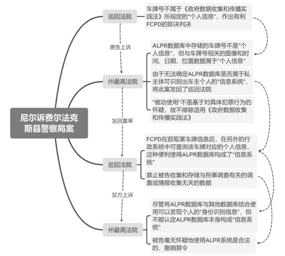

核心争议点
1. ALPR 所采集的信息是否落入《政府数据收集与传播行为法》所称的“个人信息”范围。
2. ALPR 数据库是否构成该法所称的“信息系统”。
3. 本案情形是否属于该法法定豁免的适用情境。

裁判论证过程

（一）ALPR 数据库中的车牌号不属于该法定义的“个人信息”
巡回法院一审聚焦于单一问题：车牌号是不是个人信息。弗吉尼亚法典第 2.2 卷第 3801 条对个人信息的例示并未明文写进车牌号。虽然该定义并非封闭清单，但所列示例都指向个人本身，而车牌指向的是车辆。审判官罗伯特·J·史密斯表示，自己找不到“车牌是否等于个人信息”的直接判例，只找到讨论车牌是否享有隐私利益的案例，且结论多为不享有。法官认为隐私分析可作参考，若信息不涉及隐私，就不太可能被视作个人信息；一旦车牌被否定为个人信息，案件便无需再往下论证。

州最高法院则先把 ALPR 里的数据拆开看。车牌号的认定上，法律把个人信息界定为可用来描述、定位或索引个人的信息，包括机构颁发的识别号等。若车牌号在技术上属于机构颁发的识别号，则可能被纳入。DMV 确实是州机构，发牌时把登记号分配给车辆及其所有人，所以在 DMV 自身的库里，“ADDCAR”这类编号就是识别车主的机构识别号。但在 ALPR 的语境下，车牌号往往只是字母数字组合，并无方法将其与个人挂钩。字母数字对应并非州专属，理论上同一组合可能对应 50 多辆车。不同于社保号或驾照号，车牌还可能登记给企业，或由多人共有产权。因此，最高法院认定 ALPR 库里的车牌号不构成个人信息。

（二）ALPR 库里与车牌绑定的图像和时空数据属于“个人信息”
法院认为，车牌号本身不算，但 ALPR 系统捕获并保存的原始车辆照片，以及拍摄时的时点、日期和 GPS 定位，构成该法意义上的个人信息。这类信息能够为推断个人特征提供依据，例如推断车主当时在做什么、是否在某地出现。认定也契合立法目的，即遏制对个人信息的大规模收集、留存和传播带来的滥用风险。

（三）ALPR 系统不构成该法定义的“信息系统”，被动使用因此合法
法院进一步指出，若把车辆图像、车牌、周边场景、GPS、时间日期等放在一起看，组合起来确实能形成个人信息。

依法律，“信息系统”指记录保存过程的全部构成与运作，包含通过电脑网络及互联网自动或手动收集管理的信息，且该信息同时包含个人信息以及数据主体的姓名、个人号码或其他识别细节。而“数据主体”是指其个人信息在信息系统内以姓名、号码或其他识别细节为索引的个人。所以一个记录保存过程要同时具备个人信息和识别细节，才算信息系统。费尔法克斯县警察局对 ALPR 包括其数据库的被动使用，本身就是一个记录保存过程，其中已含有个人信息，即原始图像及拍摄时的时空信息。关键在于该过程是否包含个人的姓名、号码或其他识别细节。

最高法院认为，目前仅凭一审事实不足以把车牌与识别细节牢牢挂钩，但技术上存在通过车牌牵出车主的可能，因而发回重审。

巡回法院重审后发现，ALPR 系统本身没有车主信息，但警察可通过移动数据终端接入其他行政数据库，将车牌与车主匹配，只需在 ALPR 软件和 I/MOBILE 软件间切换几次操作。虽然步骤略显繁琐，涉及两个程序和三次密码，但法院认为这足以建立联系，从而构成信息系统。

州最高法院不予认同。ALPR 记录保存过程本身并未收集或直接关联车主的识别细节，识别细节只能从其他机构独立运营的库中获取，且访问路径是分离的。原告主张把退出 ALPR 系统后登录他库的过程也算进“记录保存过程”，没有依据。

法典第 2.2 卷第 3801 条的“保存”是针对记录的人为行为，“保管人”是对事物负有护理、监护并承担法律责任的主体。FCPD 能在其他数据库查询数据，并不等于违反该法。没有证据显示 FCPD 在查询后把他库信息“保存”进 ALPR 系统。法律条文中“持有”与“访问”的区分也印证了这一点。例如法典第 2.2 卷第 3800 条 C 款要求持有个人信息的机构确保其可靠性并防滥用，若解释过宽，则机构对从外部查询的数据也需负责，这与立法原意不符。

“记录保存过程”用的是单数，虽可涉及多源输入，但一个过程不可能由多个独立生成、独立运行的系统拼凑而成。ALPR 的一次记录保存，并不包括注销 ALPR 再单独登录他库查询的步骤。因此原告的扩张解释缺乏文本支撑。

法典第 2.2 卷第 3803 条 A 款要求机构保持系统信息的准确性、完整性与时效性，记录频繁访问者名单，记录每次查阅的身份与目的并保存三年，并设置安全保障。这些义务隐含了立法者假定机构对其记录保存过程的组件与操作具备控制力，不会把责任转嫁到其他机构的信息系统上。

最高法院的反驳与结论
原告为支持其立场提出多项论点。首先援引法典第 2.2 卷第 3801 条中“通过计算机网络和因特网自动或手动收集或管理的信息”，法院认为条文仅说明信息来源多样，并非所有网络收集的信息都纳入信息系统；“手动”指在特定记录保存过程中手工录入数据，而非操作员登录他系统获取额外信息。其次，原告称 ALPR 会从 VCIN 下载重点清单，法院指出清单仅是与犯罪相关的车牌号，并不包含姓名、号码或其他识别细节。再次，警报触发后警察会去他库核实命中准确性，但他库并非 ALPR 记录保存过程的一部分。最后，原告主张该法是救济法应作宽泛解释，法院回应称不能以牺牲立法意图为代价随意曲解法条，否则是在立法而非释法。

综合来看，虽然其他机构的数据库能让 FCPD 知晓数据主体的姓名、号码等识别细节，ALPR 系统本身却不能。因此 ALPR 系统不构成信息系统，FCPD 被动使用 ALPR 合法。

（四）本案不属于法定豁免排除适用的情形
要认定 ALPR 被动使用违法，需要同时满足信息是个人信息、数据库是信息系统，且不能豁免。对豁免问题，最高法院在首次审理时已作出判断。

法典第 2.2 卷第 3802 条第 7 款规定，该法不适用于涉及犯罪调查和情报收集的个人信息系统。但被告在答辩中承认，信息被捕获并存入 ALPR 数据库时，并不属于任何具体的执法调查或目的，数据是为将来可能的匹配而保存，其对调查的价值纯属推测。第 3802 条第 7 款的豁免仅针对与特定犯罪活动有关个人信息的收集和保留。因此即便 ALPR 构成信息系统，也不能据此豁免。

审理结果
1. 州最高法院推翻巡回法院的重审判决。
2. 州最高法院确认 FCPD 使用 ALPR 系统合法，撤销对费尔法克斯县警察局的禁令。

相关法条
《弗吉尼亚法典》第 2.2 卷第 3800 条 C 款
本州记录保存机构及各级政府应遵守信息实践原则以保障个人隐私……任何持有个人信息的机构应确保其可靠性并采取预防措施防止滥用。

《弗吉尼亚法典》第 2.2 卷第 3803 条 A 款
维护包含个人信息的信息系统的机构应……保持信息准确、完整、及时与相关以保障决定的公平性；保留频繁访问个人信息者名单；完整准确记录每次查阅者身份与目的并保存三年或直至信息清除；设立适当保障措施防止安全威胁。

《弗吉尼亚法典》第 2.2 卷第 3801 条
“信息系统”系指记录保存过程的全部组件和操作，包括通过电脑网络和因特网自动或手动收集或管理的信息，其中包含个人信息及数据主体的姓名、个人号码或其他识别细节。
“个人信息”系指可描述、定位或索引个人的任何信息，包括但不限于社会保险号、驾照号、机构颁发的识别号、学生证号、纳税申报表所载的财产信息、教育、金融交易、医疗史、血统、宗教、政治意识形态、犯罪记录或就业记录；或为推断个人特征提供依据的任何信息，如指纹、声纹、照片、个人所为之事、活动参与记录或机构录取记录。

《弗吉尼亚法典》第 2.2 卷第 3802 条
本法不适用于此类个人信息系统……7. 涉及与犯罪活动有关的调查和情报收集。

案例评析
（一）最高法院回归个人信息本身的定义，抛弃了巡回法院的隐私分析，凸显个人信息权益的独立价值
个人信息与隐私有交叉但不等同。个人信息权是主动的信息自决权，隐私权是被动的私密不被披露权，保护路径更偏向事后救济。个人信息保护还涉及公共利益，需在主体利益与管理者利益间求平衡。我国《个人信息保护法》第一条即明确立法目的为保护权益与促进合理利用 ^([\[76\]](#txt006.html#footnote_content_txt006_76))，手段是规范处理活动 ^([\[77\]](#txt006.html#footnote_content_txt006_77))。
美国法将个人信息纳入“大隐私权”，一审法官因找不到车牌等于个人信息的先例，便援引车牌已进入公众视野故无隐私利益的判例 ^([\[79\]](#txt006.html#footnote_content_txt006_79))，由此推断车牌不是个人信息 ^([\[78\]](#txt006.html#footnote_content_txt006_78))。这种全有或全无的思路会把大量信息排除在保护外 ^([\[80\]](#txt006.html#footnote_content_txt006_80))。最高法院未采用隐私分析，而是紧扣条文定义释义，使说理更严谨，也肯定了个人信息不同于隐私的独立意义。

（二）分场景讨论车牌是否属于个人信息，体现了界定的情境化
针对同一客体车牌号，法院认为在 DMV 数据库场景下可识别车主，属于个人信息；在 ALPR 数据库场景下仅是一串字符，则不构成个人信息。场景不同、风险不同，需进行基于场景的风险评估 ^([\[81\]](#txt006.html#footnote_content_txt006_81))。各国个人信息界定也日益嵌入场景理论，即判断需个案化 ^([\[82\]](#txt006.html#footnote_content_txt006_82))，且只能作程度化考量而非二元判断。本案正是场景化界定的具体实践。

（三）在认定信息系统时采用传统解释方法，体现法治权威
原告主张应作扩张解释以实现救济功能，法院则强调其职责是依据文本与结构确定立法界限，不能违背立法意图曲解法令。这一立场彰显了对文义解释与制度边界的尊重。

文义为锚，价值不避

传统解释学更信赖演绎逻辑，把保持条文意涵的稳定与可预见作为首要责任，意图把立法者原意尽可能落地到具体争议。近现代解释学则转向归纳取向，价值权衡、论证展开与社会学观察等方法被广泛采用，也让法律解释具备了随情境更新的弹性。^([\[83\]](#txt006.html#footnote_content_txt006_83))在本案审理中，弗吉尼亚州最高法院坚持以文义解释配合体系解释，对立法者原意给予高度尊重，这有助于准确把握规范的真实内涵，也彰显了依法裁判的导向。需要特别指出的是，即便价值衡量可能左右甚至翻转认定结果，法官也不宜直接回避这一解释资源。

总体来看，本案的裁判处理相当稳妥。无论是大陆法系还是英美法系，成文法条始终是判决的基座。即便个案需要综合调用多种解释技术，文义解释仍然框定了意义的上限，即合法性底线，学界习惯称其为“文义射程”。^([\[84\]](#txt006.html#footnote_content_txt006_84))在该案里，不管车牌号能否落入“信息系统”要件中“第二项信息”的“识别细节”范畴，“信息系统”本身的外延都无法突破“记录保存过程”这一最宽泛的解释边界，这本身也体现了法治的权威。

## 关联判例推荐

1\. Low Splint Coal Co., Inc. v. Bolling, 224 Va. 400 (1982)

核心事实：工业委员会曾作出裁定，要求一名伤残申请人的雇主在住宅后方修建改善入口的斜坡并改造浴室。弗吉尼亚最高法院认为，劳工补偿法所规定的必要医疗服务并不涵盖上述改造。

与本案关联点：当条文对相关概念未作明确界定时，自由解释也不能通过改写法律用语本义的方式变相创设新的法律义务。

2\. U.S. v. Ellison, 462 F .3d 557 (2006)

核心事实：埃里森因在消防通道违法停车被拦检，警官经车牌号码查询得知车主名下有重罪搜查令，随后对车辆实施搜查并逮捕。地方法院认为货车并未违法停车，查验车牌缺乏合理依据。第六巡回上诉法院则认为车牌所载信息不涉及驾驶员的隐私利益，且将车牌录入系统查询其他非私密信息不构成搜查。

与本案关联点：该上诉法院正是依据车牌不涉及隐私利益的判断，进而推断车牌不属于“个人信息”。

3\. Davis v.City of Chesapeake, 74 Va. Cir. 367 (2007)

核心事实：记者向该市提交多份 FOIA 申请，要求公开市政府支付的一般责任索赔与汽车索赔资料，并特别要求披露具体姓名后遭拒而诉诸法院。法院认定个人索赔人姓名不受《弗吉尼亚法典》第 2.2 卷第 3803 条^([\[85\]](#txt006.html#footnote_content_txt006_85))的保护。

与本案关联点：《政府数据收集和传播行为法》立法，是为回应社会对政府可能滥用信息收集、尤其是技术放大个人信息可得性的担忧。该法并不要求对个人信息保密，而是对收集、保存与传播行为作出程序性规范，其目的在于为政府机构运行个人信息系统设定统一标准。

## 注释

[\[1\]](#txt006.html#footnote_quote_txt006_1)陈飏、裴亚楠：《论自动化行政中算法决策应用风险及其防范路径》，载《西南民族大学学报（人文社会科学版）》2021 年第 1 期.

[\[2\]](#txt006.html#footnote_quote_txt006_2)张凌寒：《算法自动化决策与行政正当程序制度的冲突与调和》，载《东方法学》2020 年第 6 期.

[\[3\]](#txt006.html#footnote_quote_txt006_3)张恩典：《人工智能算法决策对行政法治的挑战及制度因应》，载《行政法学研究》2020 年第 4 期.

[\[4\]](#txt006.html#footnote_quote_txt006_4)马颜昕：《自动化行政的分级与法律控制变革》，载《行政法学研究》2019 年第 1 期.

[\[5\]](#txt006.html#footnote_quote_txt006_5)马颜昕：《自动化行政方式下的行政处罚：挑战与回应》，载《政治与法律》2020 年第 4 期.

[\[6\]](#txt006.html#footnote_quote_txt006_6)王禄生：《司法大数据与人工智能技术应用的风险及伦理规制》，载《法商研究》2019 年第 2 期.

[\[7\]](#txt006.html#footnote_quote_txt006_7)汪庆华：《算法透明的多重维度和算法问责》，载《比较法研究》2020 年第 6 期.

[\[8\]](#txt006.html#footnote_quote_txt006_8)陆凯：《美国算法治理政策与实施进路》，载《环球法律评论》2020 年第 3 期.

[\[9\]](#txt006.html#footnote_quote_txt006_9)汪庆华：《算法透明的多重维度和算法问责》，载《比较法研究》2020 年第 6 期.

[\[10\]](#txt006.html#footnote_quote_txt006_10)孙清白：《人工智能算法的“公共性”应用风险及其二元规制》，载《行政法学研究》2020 年第 4 期.

[\[11\]](#txt006.html#footnote_quote_txt006_11)汪庆华：《算法透明的多重维度和算法问责》，载《比较法研究》2020 年第 6 期.

[\[12\]](#txt006.html#footnote_quote_txt006_12)衣俊霖：《数字孪生时代的法律与问责—通过技术标准透视算法黑箱》，载《东方法学》2021 年第 4 期.

[\[13\]](#txt006.html#footnote_quote_txt006_13)朱朱：《算法规制的美国径路：〈算法问责法〉简介》，载“大数据和人工智能法律研究院”公众号 2019 年 5 月 2 日，https：//mp.weixin.qq.com/s？\_\_biz=MzU0MTU5Nzk5Mg==&mid=2247485460&idx=1&sn=3e70b135ff 947f19ccaa1fc28055fecb&chksm=fb26c053cc514945be43a540441fe7dc779691f027901b732e138735297fda4c09ee2a410c26&scene=21#wechat\_redirect.

[\[14\]](#txt006.html#footnote_quote_txt006_14)汪庆华：《算法透明的多重维度和算法问责》，载《比较法研究》2020 年第 6 期.

[\[15\]](#txt006.html#footnote_quote_txt006_15)程莹：《元规制模式下的数据保护与算法规制—以欧盟〈通用数据保护条例〉为研究样本》，载《法律科学（西北政法大学学报）》2019 年第 4 期.

[\[16\]](#txt006.html#footnote_quote_txt006_16)Revised Judicature Act of 1961， Michigan Compiled Laws §600.6419（注：《1961 年司法法修订案》，收入《密歇根州法律汇编》第 600 节第 6419 条.）等.

[\[17\]](#txt006.html#footnote_quote_txt006_17)Robert N. Charette， Michigan’s MiDAS Unemployment System： Algorithm Alchemy Created Lead，Not Gold， IEEE Spectrum （Feb. 24， 2021）， https：//spectrum.ieee.org/riskfactor/computing/software/michigans-midas-unemployment-system-algorithm-alchemy-that-created-lead-not-gold.

[\[18\]](#txt006.html#footnote_quote_txt006_18)Mireille Hildebrandt， Algorithmic Regulation and the Rule of Law， THE ROYAL SOCIETY （Mar. 10，2021）， https：//doi.org/10.1098/rsta.2017.0355.

[\[19\]](#txt006.html#footnote_quote_txt006_19)Stephanie Wykstar， Governments’ Use of Algorithm Serves Up False Fraud Charge， UNDARK （Feb，24， 2021）， https：//undark.org/2020/06/01/michigan-unemployment-fraud-algorithm/.

[\[20\]](#txt006.html#footnote_quote_txt006_20)National Science & Technology Council， The National Artificial Intelligence Research and Development Strategic Plan （2019 Update）， NITRD （Jun， 2019）， https：//www.nitrd.gov/news/National-AI-RD-Strategy-2019.aspx.

[\[21\]](#txt006.html#footnote_quote_txt006_21)Robert N. Charette，密歇根州 MiDAS 失业系统：算法炼金术造就铅而非黄金，IEEE Spectrum（2021 年 2 月 24 日），https：//spectrum.ieee.org/riskfactor/computing/software/michigans-midas-unemployment-system-algorithm-alchemy-that-created-lead-not-gold.

[\[22\]](#txt006.html#footnote_quote_txt006_22)参见《和解及完全最终解除协议》第 1 条和第 2 条，（2021 年 2 月 21 日），https：//www.aft.org/sites/default/fi les/settlementagreement\_houston\_100717.pdf.

[\[23\]](#txt006.html#footnote_quote_txt006_23)该翻译引自王名扬：《美国行政法》（下册），中国法制出版社 1995 年版，第 833 页.转引自杨明宇、程啸：《美国政府侵权行为责任模式及评析》，载中国民商法律网 2001 年 7 月 30 日，http：//old.civillaw.com.cn/article/default.asp？id=8239.

[\[24\]](#txt006.html#footnote_quote_txt006_24)增值建模，Wikipedia（2021 年 2 月 8 日），https：//en.wikipedia.org/wiki/Value-added\_modeling.

[\[25\]](#txt006.html#footnote_quote_txt006_25)Rashida Richardson， Jason M. Schultz， & Vincent M. Southerland， 《诉讼算法 2019 美国报告：政府使用算法决策系统的新挑战》， AI Now Institute（2019 年 9 月），https：//ainowinstitute.org/litigatingalgorithms-2019-us.html.

[\[26\]](#txt006.html#footnote_quote_txt006_26)Audrey Amrein-Beardsley， 《教育增值评估系统（EVAAS）受审：具有政策与实践影响的开创性诉讼》， eJEP：教育政策电子期刊，2019 年春季.

[\[27\]](#txt006.html#footnote_quote_txt006_27)教师起诉德州机构反对学校董事会接管计划， Courthouse News Service（2020 年 2 月 25 日），https：//www.courthousenews.com/houston-teachers-union-sues-state-education-agencyover-school-board-takeover-plan/.

[\[28\]](#txt006.html#footnote_quote_txt006_28)Mark A. Paige & Audrey Amrein-Beardsley，“休斯顿，我们有诉讼”：价值增值模型在高风险就业决策实施中的警示故事， 49 Educational Researcher 350， 350-359（2020）.

[\[29\]](#txt006.html#footnote_quote_txt006_29)Janet Bass， 好消息！教师的增值衡量（VAM）在休斯顿已死！，Prince George’s County Parents， Maryland Blog（2017 年 10 月 10 日），https：//pgcpsmess.wordpress.com/2017/10/11/good-news-value-added-measures-vam-for-teachers-is-dead-in-houston/.

[\[30\]](#txt006.html#footnote_quote_txt006_30)Amrein-Beardsley， A. & Geiger， T， 尽是噱头没有实质：增值模型在休斯顿并未增值， 99 Phi Delta Kappan 53， 53-59（2017）.

[\[31\]](#txt006.html#footnote_quote_txt006_31)参见高原：《美国当代标准化测试的命运与教育权利的转移—从〈不让一个孩子掉队法案〉到〈每一个学生成功法案〉》，载《课程·教材·教法》2016 年第 9 期.

[\[32\]](#txt006.html#footnote_quote_txt006_32)Rashida Richardson， Jason M. Schultz & Vincent M. Southerland， 《诉讼算法 2019 美国报告：政府使用算法决策系统的新挑战》， AI Now Institute（2019 年 9 月），https：//ainowinstitute.org/litigatingalgorithms-2019-us.html.

[\[33\]](#txt006.html#footnote_quote_txt006_33)Mark A. Paige & Audrey Amrein-Beardsley，“休斯顿，我们有诉讼”：价值增值模型在高风险就业决策实施中的警示故事， 49 Educational Researcher 350， 350-359（2020）.

[\[34\]](#txt006.html#footnote_quote_txt006_34)参见张涛：《欧盟发布最新〈人工智能道德准则〉，能保证我们信赖 AI 吗？》，载腾讯研究院百家号 2019 年 4 月 30 日，https：//baijiahao.baidu.com/s？id=1632221446815518067&wfr=spider&fo r=pc.

[\[35\]](#txt006.html#footnote_quote_txt006_35)参见沈苑、汪琼：《人工智能在教育中应用的伦理考量—从教育视角解读欧盟〈可信赖的人工智能伦理准则〉》，载《北京大学教育评论》2019 年第 4 期.

[\[36\]](#txt006.html#footnote_quote_txt006_36)参见张凌寒：《算法自动化决策与行政正当程序制度的冲突与调和》，载《东方法学》2020 年第 6 期.

[\[37\]](#txt006.html#footnote_quote_txt006_37)Amrein-Beardsley， A. & Geiger， T， 尽是噱头没有实质：增值模型在休斯顿并未增值， 99 Phi Delta Kappan 53， 53-59（2017）.

[\[38\]](#txt006.html#footnote_quote_txt006_38)参见《和解及完全最终解除协议》第 1 条和第 2 条，（2022 年 3 月 13 日），https：//www.aft.org/sites/default/fi les/settlementagreement\_houston\_100717.pdf..

[\[39\]](#txt006.html#footnote_quote_txt006_39)《环境影响评价法》第 2 条：本法所称环境影响评价，是指对规划和建设项目实施后可能造成的环境影响进行分析、预测和评估，提出预防或者减轻不良环境影响的对策和措施，进行跟踪监测的方法与制度.

[\[40\]](#txt006.html#footnote_quote_txt006_40)参见张涛：《论大数据警务及其法律控制》，载《北京科技大学学报（社会科学版）》2020 年第 3 期.

[\[41\]](#txt006.html#footnote_quote_txt006_41)Ansgar Koene， Chris Clifton， Yohko Hatada， et al.， 《算法问责与透明度的治理框架》， European Parliamentary Research Service（2019 年 4 月），https：//www.europarl.europa.eu/RegData/etudes/STUD/2019/624262/EPRS\_STU（2019）624262\_EN.pdf.

[\[42\]](#txt006.html#footnote_quote_txt006_42)《自动化决策指令》， Government of Canada（2021 年 4 月 1 日），https：//www.tbs-sct.gc.ca/pol/doc-eng.aspx？id=32592.

# 第七章 算法时代的默示合谋

## 7.1 立陶宛Eturas案：系统默许如何被认定为协同

### 【案件索引】
立陶宛最高行政法院裁定，案号 A-97-858/2016，2016年
欧盟法院判例，Eturas 及其他诉立陶宛共和国竞争委员会，案号 C 74/14，2016年

### 【关键词】
算法合谋；协同行为

### 【案件提要】
Eturas案是学界和执法机构反复引用的算法合谋典型。争议源于立陶宛共和国竞争委员会的处罚决定，Eturas UAB即E-TURAS在线系统的所有权方与运营方，以及一批使用该系统的旅行社，对被认定为反竞争行为并被罚款的决定提出异议。

竞争委员会在调查中发现，众多旅行社借助E-TURAS预售平台对旅游套餐的线上折扣上限进行限制，形成了价格方面的默契配合，构成协同行为。涉案旅行社进而提起诉讼，主张不应为Eturas公司的单方操作背锅，且部分成员称自己并未收到或阅读相关邮件。法院在审理时依据《欧盟运行条约》第101条第1款，重点判断是否存在默示合谋。双方的核心分歧在于，系统分发邮件这一行为，是否足以证明旅行社知悉或应当知悉邮件中的反竞争内容并形成合谋。

立陶宛最高行政法院将问题提交欧盟法院作初步裁决。欧盟法院最终作出判断：除非旅行社作出明确反对的意思表示，或在实际操作中改变折扣设置，否则应当推定其存在默示合谋，属于协同行为。

Eturas案在反垄断执法和立法讨论中影响深远。作为算法合谋的标杆案例，本案明确了《欧盟运行条约》第101条对算法驱动型合谋的适用路径，为司法实践认定算法合谋提供了论证框架。案件之后，经济合作与发展组织于2017年6月召开算法反垄断论坛并发布《算法与合谋：数字时代的竞争政策》报告。报告中欧盟部分对纵向与横向场景下的算法进行了分类，强调随着算法在商业中的普及，传统默示合谋的解释范围也应随之扩展。美国司法部与联邦贸易委员会的联合报告则聚焦算法与定价关系，提出基本立场是执法机构和法院不宜干预企业利用算法定价的行为，只有当定价行为具有反竞争目的或产生反竞争效果时，才进入竞争法监管视野。

在中国，早期对算法合谋的规范散见于《反垄断法》和《电子商务法》。2021年2月7日，国务院反垄断委员会发布《关于平台经济领域的反垄断指南》。指南明确，平台经济领域的垄断协议包括经营者虽未以明示方式订立协议或作出决定，但通过数据、算法、平台规则等方式在事实上形成协同行为，但基于独立意思表示的价格跟随等平行行为除外。指南体现了中国对算法合谋规制的重视，是应对科技发展带来的竞争挑战的重要立法尝试。Eturas案对算法合谋的理解、执法与立法均具有重要参照价值。

### 【案件要旨】
一审维尔纽斯行政法院：原告为Eturas公司及使用E-TURAS预售系统的旅行社，被告为立陶宛竞争委员会
二审立陶宛最高行政法院：上诉方包括Eturas公司及使用E-TURAS预售系统的旅行社，以及立陶宛竞争委员会
初步裁决欧盟法院：原告为Eturas公司及使用E-TURAS预售系统的旅行社，被告为立陶宛竞争委员会

E-TURAS预售系统是一个处理和整合旅游服务信息的在线平台。经Eturas公司合同授权的旅行社，可通过统一的展示界面在其官网销售旅游预订服务。许可合同中明确禁止系统管理员干预定价条款。

2010年，立陶宛竞争委员会对Eturas公司与三十余家使用E-TURAS系统的旅行社展开调查，认为其通过平台协调折扣。调查显示，每家旅行社在平台内拥有类似邮箱的个人账户，可打开阅读系统推送信息。2009年8月25日，Eturas公司总经理向多家旅行社发送题为“投票”的邮件，征询是否同意将线上折扣率由4%下调至1%-3%。两天后，系统管理员再次发邮件称，根据投票结果，系统将提供0%-3%的线上折扣，若旅行社在平台上的折扣超过3%，自当日下午两时起系统将自动把折扣调回3%。

核查发现，此后有八家旅行社网站对外宣传提供3%折扣。系统自动把上限调至3%，并不等同于禁止超过3%的折扣，只是操作上需要额外技术步骤。竞争委员会认为，邮件内容本身具有限制价格的反竞争性质，旅行社在未提出异议的情况下继续使用平台自动调整后的折扣上限，即可视为默示同意并执行该内容，Eturas系统的中介作用促成了旅行社间的合谋。据此，委员会认定双方构成《欧盟运行条约》第101条第1款所指的“协同行为”，并作出罚款决定。

涉案旅行社向维尔纽斯行政法院起诉，法院部分支持其诉求，调低了罚款金额。

E-TURAS折扣限制案：算法助推的默示合谋认定

涉案的旅游运营商与立陶宛竞争委员会分别向该国最高行政法院提起上诉。双方分歧集中于通过预售系统自动推送的邮件，是否足以推定业者知晓或应当知晓邮件中反竞争的内容，并由此形成合谋。运营商提出四项抗辩：其一，折扣上限是系统自动执行，自己没有限价的意愿，不应与他人视为协同，也不应为Eturas单方面操作买单；其二，部分成员声称未收到邮件、未阅读，或未察觉系统改动；其三，名义上仍保有提供额外折扣的空间；其四，市场上缺乏E-TURAS的替代方案，只能继续使用。

法院强调，无罪推定同样适用于竞争法上的处罚。法院认为有必要进一步厘清，仅靠发出通知能否证明当事人知悉或应当知悉，以及在判断算法类合谋时应考量哪些要素。基于此，立陶宛最高行政法院于2014年1月17日决定中止审理，并依据《欧盟运行条约》第267条将疑问提交欧洲法院进行初步裁决。

欧洲法院第五分庭于2016年1月21日作出初步意见，认定使用E-TURAS系统的旅游业者已落入《欧盟运行条约》第101条第1款的协同行为范畴。理由归纳如下：

其一，合谋以默示方式达成。虽然无罪推定禁止仅凭系统向业者邮箱推送反竞争邮件就直接推定其知情，但该原则并不阻却法院基于其他客观且相互印证的证据作出知情推定，除非业者能提出反证推翻。依据第101条第1款的既有判例，默示的意思联络或保持沉默即被视为达成合谋。本案中业者负有一定说明义务，除非能明确证明曾表示异议，或证明邮件未送达、未阅读，否则应认定合谋成立。

其二，市场上出现反竞争做法。系统在技术层面并未禁止超过3%的折扣，但在整个期间没有任何业者提出异议或实际采用高于3%的折扣。

其三，行为与合谋存在因果关联。3%的上限不仅削弱竞争秩序，还发挥了价格传递的功能，故构成协同。Eturas公司的E-TURAS预售平台在其中起促成作用，亦应受制裁。

2016年5月2日，立陶宛最高行政法院依据欧洲法院意见作出判决.^([\[1\]](#txt007.html#footnote_content_txt007_1))法院重点审视各业者是否掌握系统内的折扣限制，以及是否曾反对该限制。审判合议体逐案核查了竞争委员会收集的证据，并结合当事人申请期间是否承认知悉限制、是否有其他佐证显示其知悉，例如在知悉后主动调降折扣、是否曾通过系统提供额外折扣以退出协同等。核查后法院对受罚对象进行分类，最终仅对明知限制且未作反对的业者维持处罚；同时因未发现任何减轻情节，支持竞争委员会部分上诉请求，推翻原审法院对涉案当事人的罚金减免判决。

### 【案例事实思维导图】

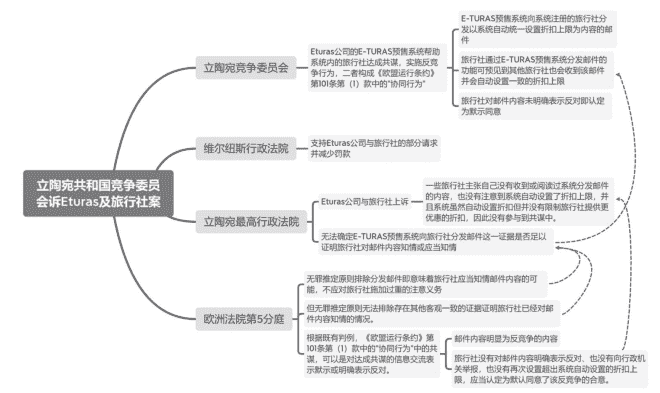

### 【核心争议点】

使用E-TURAS系统的旅游业者之间是否满足《欧盟运行条约》第101条第1款协同行为的要件。

### 【裁判论证过程】

#### （一）对预售系统推送的反竞争邮件未明确反对，可推定业者知悉或应知悉，未反证时可认定默示合谋

欧洲法院第五分庭指出，判断协同行为的关键在于业者间是否存在自愿、一致且有意识的意思联络，即是否合谋。

第五分庭认为，根据理事会条例第2条，若适用《欧盟运行条约》第101条第1款，举证责任由反垄断执法机关即立陶宛竞争委员会承担.^([\[2\]](#txt007.html#footnote_content_txt007_2))本案竞争委员会提出两项事实：其一，E-TURAS预售系统向业者系统内邮箱发送邮件，提示若折扣超过3%，自当日14时起系统将自动调回3%；其二，业者未就邮件内容明确表示反对。法院需判断该举证是否达到证明标准。条例第2条仅规定举证责任归属，未设定欧盟证明标准。依据既有判例，欧盟证明标准应满足等价性与有效性。等价性要求与成员国标准在相似情形下效果相当；有效性要求标准可操作，避免阻碍竞争规则执行。Total Marketing Services v. Commission案指出多数协同案件需从种种巧合与迹象推断合谋，说明有效性不要求只能依赖直接证据，客观一致的间接证据亦可采信。

据此，系统推送反竞争邮件与业者未明确反对构成间接证据。若业者知悉内容且未反对，并一致将票价折扣降至3%，足以认定合谋；若不知情，待其发现折扣被自动调低时应有权反对。同一市场内的经营者必须独立经营，不得直接或间接影响竞争对手以操纵市场。业者平行且一致地调低折扣却无异议，难以仅以市场规律解释。但法院同时指出，依据《欧盟基本权利宪章》第48条第1款的无罪推定，业者有权作出解释或提出反证。其辩称不知邮件存在，故不可能意思联络；折扣被调低后未反对系受技术限制。法院认为，业者可通过邮件向管理员明确反对，也可向主管机关举报。既有判例亦不排除在其他客观一致间接证据下证明合谋。本案中业者未举证证明不知情，也未能解释后续行为，故无罪推定不能排除其知情或应知情。邮件本身具有反竞争性，且业者共用同一系统，可相互意识到内容，因此虽无直接联络，仍通过系统公共信息分发功能默示达成合谋。Eturas公司的预售系统发挥关键促进作用，也应被认定参与合谋。

综上，系统分发邮件且业者未明确反对，足以证明其对限制票价折扣的反竞争内容知悉或应知悉，若无反证，可认定默示合谋。

## （二）旅游业者之间构成《欧盟运行条约》第101条第1款的协同行为

第五分庭认为，协同行为需满足三要件：业者间存在合谋、实施反竞争市场行为、两者具有因果关系。

首先，如前所述，可认定业者以默示方式达成合谋。其次，关于反竞争市场行为，判例指出，若合谋目的为排除或限制竞争，无需证明实际效果，也不要求已具体实施，只要经营者仍在市场活动，即可推定可能实施反竞争行为。若目的不明显，则需考察合谋是否影响市场行为且该行为可能产生反竞争效果，但不要求已实际产生。本案中邮件即可推断合谋具有排除限制竞争目的。且在系统自动将折扣降至3%后，业者未明确反对，并自此未给予高于3%的折扣，故实施了反竞争市场行为。最后，合谋与市场行为存在因果关系。3%上限不仅妨碍竞争秩序，还起到价格沟通作用。

综上，第五分庭认为E-TURAS系统内的业者构成《欧盟运行条约》第101条第1款的协同行为。

## 审理结果

1.立陶宛竞争委员会认定Eturas公司与使用E-TURAS预售系统的旅游业者构成《欧盟运行条约》第101条第1款协同行为，并处以罚款。
2.维尔纽斯行政法院部分支持Eturas公司及业者的请求，降低了罚款金额。
3.立陶宛最高行政法院无法确定系统分发调价邮件是否足以认定业者知情或应知情从而达成合谋，故将案件移交欧洲法院。
4.欧洲法院判决Eturas公司与使用E-TURAS预售系统的业者构成《欧盟运行条约》第101条第1款协同行为。
5.立陶宛最高行政法院最终裁决，仅处罚明知且未反对折扣限制的业者，并支持竞争委员会部分上诉请求，改判初审法院减罚的决定。

## 相关法条

### 欧盟理事会条例第2条关于举证责任
指控违法方或当局承担证明违反《条约》第81条第1款或第82条的责任。主张第81条第3款利益的企业需自证符合条件。

### 欧盟运行条约第101条第1款
禁止可能影响成员国间贸易、以阻碍、限制或扭曲共同市场竞争为目的或效果的企业间协议、协会决议和协同行为，尤其是固定价格、限制生产销售、技术开发与投资、划分市场、差别待遇、搭售等行为。

## 案例评析

### （一）本案明确了算法合谋的法律适用路径
传统合谋多依赖会议、协议等直接信息交换，而算法合谋通过技术手段隐蔽达成或产生同等效果。欧盟目前未另行立法，而是将新问题纳入现有规则。监管者认为算法是经营者实施垄断的工具，可通过设计注入意志。因此算法合谋虽在事实证明上提出挑战，却未在法律上创设新垄断类型。《欧盟运行条约》第101条规定的协同行为旨在规制无直接记录但存在合意的情况。若算法互相匹配并传递信息，更易导致平行价格变动。但判例法不禁止经营者依据竞争对手行为自我调整，核心在于穿透算法行为探明经营者意志。总的来看，欧盟认为算法合谋基本可用现有规则应对，但仍需总结类型并积累经验。

美国亦未单独立法，而是置于现有反垄断框架下分析。我国在算法合谋探索上较为前瞻。2021年2月7日，国务院反垄断委员会发布《关于平台经济领域的反垄断指南》。《指南》明确垄断协议形式，对协同行为作出规定，细化横向、纵向、轴辐协议及协同行为的认定方式与执法考量，并强化宽大制度。《指南》指出，未订立明确协议但通过数据、算法、平台规则等实质协同者亦应认定为垄断行为，但独立意思表示的价格跟随除外。认定协同行为时，可直接取证，若难以获取则依据间接证据认定知悉状况。经营者可提供相反证据证明不存在协同。

### （二）本案为司法认定算法合谋提供论证思路
根据协同行为构成要件，需判断经营者是否存在平行市场行为、是否存在合谋、两者是否具有因果关系。因算法隐蔽，执法或司法往往缺乏直接证据。本案欧洲法院认为仅凭系统分发邮件不足以证明知情，但在缺乏直接证据时可综合间接证据推定合谋，且该推定受无罪推定限制，当事人有权以相反证据推翻。本案业者未明确反对邮件，且在系统允许重新设定上限的情况下接受自动设定，表明其知情或应知情，故法院认定其利用算法系统达成合谋。

OECD报告指出，执法机构应综合直接与间接证据认定合谋。间接证据指向经营者互相知悉竞争策略，或默契一致行动、促进合谋的行为。累积的间接证据足以推定合谋存在。在无信息交流情形下，若平行行为不符合市场规律或自身利益，则可证明合谋。

此种间接证据综合认定思路为我国应对算法合谋提供了方案。鉴于隐蔽性，有必要采用沟通证据与经济证据整体评估。证据数量及是否形成逻辑闭环是认定垄断协议存在的重要考量。因间接证据模糊性，应贯彻审慎谦抑理念，适当限制采纳。有观点主张应按证明力大小对间接证据分类，纳入证据链，证明标准宜采用优势证据而非直接推定。

此外，还需关注算法合谋效果的二元性，厘清规制边界。算法合谋并非必然排除限制竞争，数字效率、技术创新、社会公共利益等是适用豁免制度的关键。

### （三）直接推动了有关算法反垄断规制的学理讨论

学界对本案有一种新的解读，认为它折射出一种此前少见的协同形态——三方联动。简单说就是两家处于竞争关系的企业，再加上一个与它们不在同一赛道的第三方平台。像本案里的旅行社彼此是竞争对手，而Eturas只是提供在线展示的平台方，并不与旅行社构成直接竞争。因为传统垄断协议的判断前提一直锁定在竞争对手之间，所以在现行反垄断框架下，很难把这三家一起定性为合谋。但第三方的掺和并不妨碍认定那两家竞争者之间确实存在合谋。说到底，第三方扮演的是信息媒介的角色，是发起和助推信息交流的人，而真正的共谋行为发生在两家经营者之间。关于第三方该如何担责，欧盟委员会在2015年的AC Treuhand案里已有提示：为了让《欧盟运行条约》第101条第1款对垄断协议的规制落到实处，信息的发起方或促进方也必须承担责任。本案把这一逻辑延伸到了计算机系统场景，对负责在线预订信息分发或交换的主体敲响了警钟.^([\[7\]](#txt007.html#footnote_content_txt007_7))

OECD在2017年6月围绕算法反垄断议题举办专题论坛，并汇总成员竞争机构的调研成果，形成了《算法与合谋：数字时代的竞争政策》^([\[8\]](#txt007.html#footnote_content_txt007_8))。

欧盟提交的观察报告首先聚焦算法定价。相比过去靠中间人转述或消费者抽样来摸价格，算法能够更迅速、成本更低地帮企业捕捉并追踪市场价位。最低价、销量、库存成本等关键数据因此变得透明，定价策略也随之更精准高效。另一面，算法也为企业以更隐蔽、更便捷的方式进行反竞争操作提供了通道。

在分类上，欧盟委员会把纵向垄断中的算法行为和横向垄断中的算法行为分开讨论。纵向场景里，算法相关风险主要集中在限制转售价上，其核心功能是监控下游的价格是否偏离上游设定的转售价。横向场景里，用算法监测价格进而达成协议或形成协同的做法较为常见。规制落脚点仍是判断经营者之间是否存在合谋。算法既能助力企业达成明确、直白的合谋，也就是传统意义上的合谋，也因其隐蔽性而可能助推默示合谋。在明确合谋的情形下，算法大约能发挥三重作用：促成合谋达成、依据合谋执行定价、监督协议执行情况。这里的合谋都是企业明示想要达成或执行的，算法只是工具。而在默示合谋的状态里，算法并未改变形成默示合谋的必要前提，即企业具备足够竞争力被认为需要结盟，且认为价格协同比价格竞争更有利，从而出现高度一致的平行行为。

综合来看，欧盟委员会的结论是，算法合谋总体上仍可纳入传统的欧盟竞争法规制体系。

美国方面的报告由司法部和联邦贸易委员会共同撰写，重点围绕算法与定价的关系。报告确立了一个底线原则：执法机关和法院不应干预企业正常使用算法定价，这既不符合《谢尔曼法》的立法原意，也违背市场自主决策的精神。只有当企业利用算法定价的目的是通过价格手段实施反竞争，或实际产生反竞争效果时，才会进入反垄断视野。

两部门同时指出，算法定价本身可以成为合谋的手段。参与合谋的企业往往会使用价格追踪软件，也就是由算法自动追踪市场最低价，随后借助价格匹配算法给出更具竞争力的报价。这类情形常让人联想到传统的“轴辐协议”，即一家企业作为轴心，分别与多家企业达成安排，且存在某种共识的证据。如果轴心和辐条企业对使用特定算法达成一致，就可能触犯美国反垄断法。反之，若双方并无共识，企业是在不知情的情况下使用了相同算法，则不构成违法。

### 相关判例速览

### 1. AC-Treuhand v. Commission, C 194/14 P, EU:C:2015:717

核心事实：经营者通过会议达成垄断协议，未明确反对的参会者，比如不退出会议、不向反垄断机关举报协议内容等，被视为对合谋的默示同意，违反《欧盟运行条约》第101条。
与本案关联点：对反竞争事项保持沉默，即构成对合谋的默示同意。

### 2. VEBIC, C 439/08, EU:C:2010:739; Nike European Operations Netherlands, C 310/14, EU:C:2015:690

核心事实：各成员国有权依据本国法律自主设定举证标准。
与本案关联点：欧盟层面的证明标准须满足等价性与有效性。等价性指欧盟法标准与各成员国国内标准在效果上相当；有效性指该标准在实践中能够真正适用。

### 3. T-Mobile Netherlands and Others, C 8/08, EU:C:2009:343

核心事实：适用《欧盟运行条约》第101条第1款须认定合谋与市场行为之间存在因果关系。
与本案关联点：欧洲法院第五分庭认定旅行社使用系统自动设定的折扣上限与合谋之间具有因果联系。

### 4. Total Marketing Services v. Commission, C 634/13 P, EU:C:2015:614

核心事实：判断是否存在合谋时，法院应综合全部客观一致的证据。在认定无面对面信息交流的协同行为时，除证明未参会或举报协议外，企业还能提供其他证据自证清白。
与本案关联点：第五分庭在认定旅行社是否合谋时，既分析了E-TURAS系统向旅行社发送邮件的行为，也综合了旅行社对邮件的默示态度。

### 7.2 美国航空票价信息案：算法合谋与和解

### 案件索引
United States v. Airline Tariff Pub. Co., 836 F.Supp. 9 (D.D.C. 1993)

### 关键词
算法合谋；和解协议

### 案件提要
本案是算法合谋与反垄断和解的典型案例。美国司法部调查了八家主要航空公司与美国航空机票价格公布公司ATP公司。八家航空公司共同设立ATP公司，负责汇集每日航班票价信息，并通过计算机预订系统CRS分发给各航空公司和旅行社。航空公司多次利用ATP公司的票价分发系统先后发布涨价信息。

司法部指控，航空公司借助ATP公司的票价分发服务达成协议，通过抬高票价、取消折扣、设定价格限制等方式固定价格，还利用票价代码和出票日期传递信号进行协调。航空公司辩称，提前公布涨价是为了保障消费者利益和提升销量，脚注中并无协议信息，且对大客户的保密折扣和运量不确定性也阻碍了合谋。平行价格变动本身并不违法，认定合谋并设计补救措施成为和解谈判的难点。最终和解协议禁止未广泛宣传就预先公布未来票价及购票期，脚注不得包含超出基础信息的内容，并附带相应限制。两家航空公司先行接受，随后在法院依据《特尼法案》审查通过后，其余六家也达成一致。

尽管以和解收场，本案仍凸显了新通信技术对传统反垄断规制的冲击。90年代美国航空业快速发展，定价系统日益复杂，航空公司间的沟通变得隐蔽多元。算法一方面降低了合谋门槛，另一方面也增加了执法发现难度。本案开创了通过和解协议追查协同定价的新思路，并指出了此类案件的争议与解决方向。但因未进入审判程序，并未形成法律先例，且补救措施多局限于行业制度，对《谢尔曼法》第1条的模糊地带指导有限。

## 【案件要旨】
哥伦比亚特区联邦地区法院：原告 美国司法部 被告 美国航空机票价格公布公司、美国多家航空公司

1992年12月21日，司法部正式起诉ATP公司与八大航空公司，指控其通过ATP公司的票价信息分发系统合谋提价、限制竞争。此前双方已进行长时间的非正式磋商和和解尝试。

ATP公司相当于票价信息的中央集散地。八大航空公司每日以电子化脚注形式向ATP公司报送最新票价变动，脚注由计算机随机生成，不按数字顺序排列，但会附带“脚注指示符”以便识别。ATP公司汇总后推送给各航空公司及全国CRS系统，次日消费者、旅行社和其他航空公司即可查阅。票价信息包括价格基础代码、票价、售票与停售日期、航线、起飞返程日期及购买限制等。售票与停售日期即新票价的生效与终止时间，使购客能提前获知价格变化。本案争议焦点在于航空公司利用脚注、价格基础代码及生效日期提前宣布票价。

司法部认为，提前宣布有助于航空公司间合谋。调查显示，当一家航空公司宣布未来数周内某航线提价时，其他航空公司会相继宣布同一航线在同一天提价，若有公司未跟进，提价往往不会落地。司法部还发现新票价生效时间与首次宣布时间间隔不断拉长，给予各方考虑时间。司法部认为航空公司通过ATP系统交换脚注信息达成价格垄断协议，甚至可协商不同航线间价格。

航空公司反驳称，定价均出于自身利益最大化，关注竞争对手是理性行为；提前公布涨价让消费者有准备时间，有利于服务质量和声誉；脚注无法促成合谋，因为大客户折扣保密且运量难以预估，降价竞争亦是可行选项。

司法部回应称，率先宣布提价的公司通常会等待其他公司全部宣布后才实施，缺一则不涨；提前公布虽利消费者，但与合谋造成的竞争损害相比微不足道；大客户票量有限，市场影响有限，且企业可通过售票界面判断舱位是否售罄大致推算对手运量。

司法部面临的最大障碍是最高法院在Brooke Group Ltd. v. Brown Williamson Tobacco Corp.案中已指出，相互平行的提价不足以证明合谋。若提价高于均衡价，消费者会转向；若消费者未转向，则说明市场价本就偏低，平行提价是正常竞争反应。因此必须提供更直接的证据。

起诉同时，司法部与联合航空和美国航空达成和解，要求不得设定新票价生效日期，除大规模宣传外不得设定终止日期，以提高合谋成本。还对脚注内容作限制，只能包含基础信息，且指示符需统一，以降低加密沟通可能。两家航空公司不承认合谋但同意遵守。根据《特尼法案》，和解协议须经联邦法院批准以保障公共利益。其他被告强烈反对，认为未合谋，法院仍批准协议。此后其余被告与司法部进一步谈判，并在ATP公司的和解中增加技术限制，如禁止分发新票价生效终止日期信息，禁止在向消费者公布前向航空公司推送价格变动等。1994年3月17日案件以和解收束，其余被告接受相同要求，和解协议于2004年失效。

## 【案件事实思维导图】
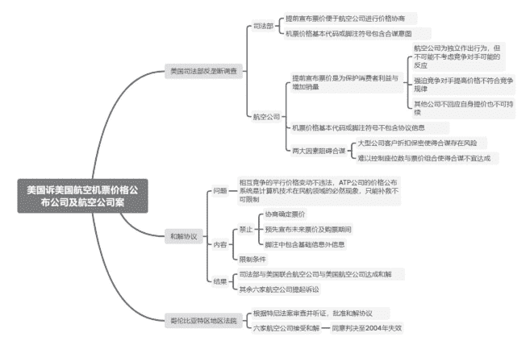

## 【核心争议点】
1. 航空公司是否借助ATP公司票价信息分发系统实施了价格合谋。
2. 司法部在和解协议中限制使用脚注及系统的措施是否恰当，是否有弥补竞争损害的补救。

## 【裁判论证过程】

### （一）ATP公司票价信息分发系统有助于合谋，但缺乏直接证据证明航空公司间存在价格合谋
司法部认为脚注中包含生效与终止日期，航空公司可借此交换信息达成合谋。调查显示，若一家公司率先宣布未来提价，其他公司往往在同一天宣布跟进提价，若无跟进则提价不会发生。司法部称这是一种低成本协商。另据指控，航空公司还可通过脚注协商跨航线价格，例如A1在1-2线直飞、3-4线经停，A2情况相反，A1可通过抬高3-4线价格向A2传递信号，换取对方在1-2线提价，形成排除竞争的安排，全程可通过脚注完成。

但最高法院在Brooke Group案中已明确，平行提价不能单独证明合谋。若提价过高，消费者会流失；若消费者未流失，则说明市场未达均衡，平行提价可视为竞争结果。因此司法部需提供更直接的证据，而非仅证明脚注具有便利性。

### （二）和解协议中限制脚注及系统使用是被允许的，但须符合《特尼法案》公共利益原则

# ATP 票价案：算法辅助串价的首次和解

在案子还没有正式进入哥伦比亚特区联邦地区法院开庭阶段时，司法部门已经和多家航空公司反复谈了很久。部门自己也说，现有材料最多只能让人怀疑各家可能在票价上暗中配合，远谈不上能直接坐实违法。若真能在法庭上证明配合事实并胜诉，部门也认为必须配套提出修复市场损害的补救措施。

部门的判断是，航司动用脚注字段和 ATP 票价分发平台来传递报价，已经是民航信息化运营的常态，想一刀切禁止并不现实。于是改走限制换和解的路线，通过规则提高航司借此平台串联票价的交易成本。

依据《特尼法案》，反垄断调查以庭外和解收尾，必须经联邦法院同意，防止执法部门和个别被告私下达成对公众不利的安排。法院在审查和解时，要听取各方意见，判断协议是否符合法案所要求的公共利益标准。

在华盛顿特区地方法院审议期间，除美联航与美航外，其余六家航司坚决不签。它们的主张是，没有证据显示自己曾借助 ATP 实现串价。司法部门的回应是，如果确实没有串价，就应该接受协议中的行为约束，用来堵住未来串价的空间，这本身符合公益。最终，司法部门与 ATP 以及八家航司达成一致，协议获法院批准。

对八家航司的约束具体包括：

1. 禁止与其他同业约定固定、抬高或维持机票价格；
2. 除大规模宣传外，不得对外公布新票价的生效或终止时间，以及任何票价调整计划；
3. 上传至 ATP 的票务信息所使用的脚注标识必须统一；
4. 脚注标识里的每个构成要素须与信息一一对应，同一信息不得用多个标识表示；
5. 脚注内容仅限基础信息，例如票价、航班信息、购票条件等。

司法部门同时确认以下两种行为不构成违约：

情形 1：周五中午，航司 A 向 ATP 推送某城际航线票价上调 10% 的信息，消费者可在周五下午 5 点后通过 CRS 按新价订票；周六，航司 B 推送同一航线上涨 5% 的信息；周日，A 发现对手涨幅不同，撤回 10% 的涨价计划，B 也随之撤回 5% 的计划；次周周五，A 重新推送 5% 的涨幅，周六 B 同步推送 5% 涨幅，随后两家开始执行提价销售。

情形 2：航司 A 在一条对 B 极为关键的航线上推出 101 美元的低价，B 将同一航线价格也降至 101 美元，同时 B 在一条对 A 极为关键的航线上推出 101 美元低价；次日 B 取消两次 101 美元的调整，再次日 A 也取消其最初的 101 美元调整。

部门的解释是，此类操作属于经营者基于经济考量做出的常规市场行为，并非专门用于传递未来调价信号，故不予禁止。

【裁定概要】
司法部门与航司达成和解，航司只能以票价基础代码或脚注符号发布航班基本信息，不得以特定代码串通不同票价；除大规模宣传外不得提前公告涨价。同时，部门认可并非以发布票价变动为主要目的的市场行为不构成违约。

【法律依据】
美国《特尼法案》第 16 条（e）款（Antitrust Procedures and Penalties Act§16（e），15 U.S.C.§16（e）（2004））

（e）公共利益的确定

（1）在美国政府根据本节作出任何同意性判决之前，法院应确定作出该等判决符合公共利益.为作出此种裁定，法院应考虑：

（A）该判决的竞争性影响，包括终止被指控的侵权行为、关于执行和修改的规定、寻求补救的期限、实际考虑的替代补救办法的预期效果、其条款是否含糊不清，以及法院认为对决定同意判决是否符合公共利益所必需的任何其他与该判决的充分性有关的竞争性考虑；以及

（B）作出此种判决对相关市场竞争、对一般公众和声称因被诉侵权行为而遭受具体损害的个人的影响，包括对审判中问题的裁决所产生的公共利益（如果有的话）的考虑.

（2）本节的任何内容均不得解释为要求法院进行证据听证会或要求法院允许任何人进行干预.

【案例评析】

### （一）本案透露出执法部门在追查票价联动案件时的新思路
以往查获的票价联动，执法部门通常能找到书面协议、沟通记录等直接证据。而 ATP 票价系统的信息高速流通，让联动的边界变得模糊，执法者难以判断系统内信息是面向公众的公告，还是用于与竞争对手协商。本案中部门并无直接证据证明各航司存在协同。按美国《谢尔曼法》，经营者价格的平行变动本身不构成固定价格的垄断协议，必须有更直接的协同证据。于是部门转向以和解提出救济，即对航司行为设限、对 ATP 系统技术设限，用抬高串通成本的方式替代法院作出违法判决。

作为算法串通反垄断审查的早期样本，ATP 案为后来的行政与司法审查提供了重要参照。^([\[12\]](#txt007.html#footnote_content_txt007_12))遗憾在于案件未进入审判，未能形成关于算法串通的司法判例。

### （二）本案推动了对算法合谋的公众讨论，引发了反垄断领域对算法技术的关注
ATP 案是算法辅助经营者交换价格信息的早期案件之一。部门认为算法串通的违法认定标准与传统串通并无本质区别，但算法大幅降低了串通的实施成本，同时提高了执法发现难度。传统环境下发出串通信号风险较高，若对手不接受，发出方会因率先涨价而流失客户。但算法运行在计算机环境中，具有隐蔽性，执法者和消费者都难以察觉。参与方可通过算法自动追踪对手信号并快速议价，几乎消除发布信号的成本。

1992 年时的算法技术还很初级，如今手段更加多样隐蔽。经济合作与发展组织 2017 年发布的《算法与合谋：数字时代的竞争政策》报告将助长合谋的算法分为监督算法、平行算法、信号算法与自我学习算法。^([\[13\]](#txt007.html#footnote_content_txt007_13))算法不仅能追踪市场信息，还可自动化决策、释放特定信号。借助机器学习和深度学习，竞争者甚至无需预先设计合谋算法即可产生合谋结果。^([\[14\]](#txt007.html#footnote_content_txt007_14))

斯坦福大学法学院与维也纳大学法学院 2021 年联合研究报告《美国与欧盟人工智能与反竞争合谋：从“意思联络”到“算法联络”？》^([\[15\]](#txt007.html#footnote_content_txt007_15))指出，算法在合谋中起双重作用，一是作为信息交流工具帮助达成合谋；二是算法本身承载反竞争意思，通过自我学习、价格追踪、自主决策实现合谋。常见的形态是轴辐式结构，其中一个经营者作为轴心，算法充当轮毂，促进处在辐条上的经营者协同。

美国与欧盟在规制算法自主合谋时面临共性难题：如何发现和约束算法自主达成的协同。双方均认为垄断协议违法，只要存在反竞争协同即可认定违法，无需额外经济分析。但算法使用既可能增进竞争，也可能限制竞争，经验判断尚不充分。^([\[16\]](#txt007.html#footnote_content_txt007_16))学界对此提出效果分析、事前监管测试、黑名单禁止、乃至对高集中市场使用算法的经营者加征税等不同建议。^([\[17\]](#txt007.html#footnote_content_txt007_17))^[18]^[19]^[20]

算法作为数字经济的基础，助力精准决策与个性化营销，却也为在位者筑起高准入壁垒。欧盟 2020 年提出《数字市场法（草案）》，将借助数据与算法掌握重大影响力的“守门人”行为予以限制或禁止；法国竞争管理局成立数字经济部门加强监测；英国竞争与市场管理局启动“算法分析项目”评估算法对特定市场的影响；美国国会众议院通过的《美国选择和在线创新法案》聚焦技术手段实施的市场支配滥用。^([\[21\]](#txt007.html#footnote_content_txt007_21))^[22]^[23]

中国在算法合谋规制上也在细化推进。2021 年 2 月 7 日，国务院反垄断委员会发布《关于平台经济领域的反垄断指南》，体现了对算法合谋的高度重视，兼顾消费者权益与行业健康发展。

### （三）本案后续的一些最新进展
ATP 案作为信息技术挑战反垄断的经典早期案例持续受到学界关注。弗吉尼亚联邦大学教授 Amalia R. Miller 对和解安排的市场效果进行了追踪。她将市场分为受影响市场与不受影响市场，比较施加限制前后票价与销量的变化。若限制有效，受影响市场票价应下降、销量应上升。数据显示 1994 年和解刚达成时整体季度销售量微升，这可能与旅行人数增加有关；但不受影响市场销量大幅增长，受影响市场销量却大幅下降。整个 1994-2004 效力期内，销量基本持平，票价也未显示持续下降。研究表明，和解设定的限制并未产生良好竞争效果，并非理想救济。^([\[24\]](#txt007.html#footnote_content_txt007_24))

佛罗里达州立大学经济学院 Gary M. Fournier 与 Thomas W. Zuehlke 也做了实证研究。针对部门提出的航司可通过算法协调不同航线价格的可能性，两位学者以 1991-2001 年每年的第二季度数据为样本，以 1994 年为分界点比较干预前后。结果显示仅 1994 年限制对跨航线价格协调有明显效果，1994-2001 年间协调效果与和解前无异，十年平均看跨航线协调甚至增强。由此同样认为和解限制的市场效果有限。^([\[25\]](#txt007.html#footnote_content_txt007_25))

和解失效两年后，即 2016 年，41 家旅行社对三家航空公司和 ATP 提起集体诉讼，再指控三家占据约 70% 市场份额的寡头利用 ATP 系统达成固定价格垄断。加州北区联邦地区法院认为，审查固定价格垄断的关键在于证明协同，除平行提价外，原告未提供任何直接证据证明三公司就价格交换意见。

【关联判例推荐】
1\. Brooke Group Ltd.v. Brown & Williamson Tobacco Corp., 509 U.S. 209, 113 S.Ct. 2578 (1993)
核心事实：烟草业由原被告在内的六家公司主导。原告 Liggett 诉被告提供回扣构成价格歧视，违反《罗宾逊—帕特曼法》，并称其为掠夺性定价的一部分。陪审团判原告胜诉后，地区法院认为市场份额未放缓且无默契协调价格，竞争未受损。第四巡回法院维持原判，认为在无合谋情形下平行定价可能出现在竞争或寡头市场，掠夺性定价环境下的有意识平行定价不损害竞争。
与本案关联点：航司借助 ATP 系统公告价格变动属平行定价行为，仅凭此无法推断合谋存在。

【注释】
[\[1\]](#txt007.html#footnote_quote_txt007_1)SACL Has Rendered a Decision in the Travel Agencies’ Case， Lithuanian Courts （May 2， 2016），https：//www.lvat.lt/en/news/sacl-has-rendered-a-decision-in-the-travel-agencies-case/390.
[\[2\]](#txt007.html#footnote_quote_txt007_2)Council Regulation （EC） No 1/2003 of 16 December 2002 on the implementation of the rules on competition laid down in Articles 81 and 82 of the Treaty §2. 需要说明的是，欧盟于 2012 年 10 月 26 日颁布了《〈欧盟条约〉和〈欧盟运行条约〉综合文本》（Consolidated versions of the Treaty on European Union and the Treaty on the Functioning of the European Union， 2012/C 326/01），其中《欧盟运行条约》第 81 条和第 82 条分别重新编为第 101 条和第 102 条.
[\[3\]](#txt007.html#footnote_quote_txt007_3)Practical Law Competition， Speech by Margrethe Vestager on Algorithms and Competition， Practical Law （Mar. 16， 2017）， https：//uk.practicallaw.thomsonreuters.com/w-006-9643？contextData=（sc.Defa ult）&transitionType=Default&fi rstPage=true.
[\[4\]](#txt007.html#footnote_quote_txt007_4)OECD， Algorithms and Collusion： Competition Policy in the Digital Age， OECD （Sept. 13， 2017），www.oecd.org/competition/algorithms-collusion-competition-policy-in-the-digital-age.htm.

# 第八章 平台零工分界判例

## 8.1 戴纳梅克斯案：ABC测试的司法起点

### 【案件索引】
Lee v. Dynamex, Inc., 2016 WL 6064271 (2006)
Lee v. Dynamex, Inc., 166 Cal. App. 4th 1325 (Cal. Ct. App. 2008)
Dynamex Operations West, Inc. v. Superior Court, 230 Cal. App. 4th 718 (2014)
Dynamex Operations West, Inc. v. Superior Court, 4 Cal.5th 903 (2018)

### 【关键词】
零工经济；ABC 测试；博雷洛测试；《AB 5 法案》；劳动关系认定

### 【案件提要】
共享经济下承揽人与员工的界限如何划定，戴纳梅克斯案被视为标志性分水岭。原告查尔斯·李起诉全国性包裹文件快运企业戴纳梅克斯公司，认为公司把自己及一批同类司机错定为独立承揽人，违反了加州工业关系部发布的工业福利委员会运输业第9号工资令，以及商业与职业法和劳工法。该工资令对加州员工的最低工资、工时上限、餐休等基本条件作出了强制要求。

李希望以集体诉讼推进，洛杉矶地方法院最初驳回了认证申请，加州上诉法院推翻后发回重审。重审后法院在2011年准许了集体诉讼认证。此后两年，公司两次申请撤销认证均被拒绝。第二次被拒后公司向二审法院申请令状，主张法院在判断司机群体资格时应适用普通法下的博雷洛控制权测试，而非援引马丁内斯案对工资令中“雇员”所做的替代定义，即马丁内斯标准，要求撤销认证。

上诉法院认为，对于落入工资令调整范围的请求，应以工资令自行设定的雇佣关系替代定义来区分员工与承揽人，地方法院的认证决定成立，因此驳回令状请求。案情再上诉至加州最高法院后，最高法院在沿用工资令替代定义的基础上，进一步引入ABC测试以收紧员工认定范围，最终维持了下级判决。

最高法院的判决系统梳理了加州既有的工人分类裁判，对马丁内斯标准中“容受或准许工作”这一表述的立法目的进行了历史回顾，并勾勒出加州工人分类标准演进的脉络。关键在于，在没有成文法明确指引的情况下，加州法院首次以司法方式创设ABC测试作为区分承揽人与员工的裁判工具，具有开创意义。此后加州州长签署《AB 5法案》，将这一司法规则上升为成文法，ABC测试正式取代博雷洛测试，成为加州认定劳动关系的法定标准。

目前我国平台零工规模持续扩张，2020年以类似方式提供劳务的人数已达8400万。迄今国内尚未出台针对平台企业与劳务提供者关系的专门规范，司法上多依现行劳动法个案裁判，导致认定分歧明显。此案对理解零工场景下员工与承揽人的划界标准具有重要启示，也为立法完善提供了参考。

### 【案件要旨】
洛杉矶高等法院初审：原告 查尔斯·李 被告 戴纳梅克斯公司
加州上诉法院上诉审：上诉人 查尔斯·李 被上诉人 戴纳梅克斯公司
加州上诉法院令状审：上诉人 戴纳梅克斯公司 被上诉人 洛杉矶高等法院
加州最高法院终审：上诉人 戴纳梅克斯公司 被上诉人 洛杉矶高等法院

戴纳梅克斯是一家全国性快递服务商。2004年前，公司把加州司机统一按员工对待，按州薪酬工时规则发放报酬。此后因成本考虑，公司将全部司机转为独立承揽人管理。

2005年1月，李与公司签署书面承揽协议，承接派送业务。公司称李仅在按需模式下提供了15天的服务，且从未为第三方送货。2005年4月15日，李离职三个月后以唯一代表身份提起诉讼，代表自身及处境类似的司机挑战公司的人事定性。

在集体诉讼认证争议上，加州上诉法院指出，地方法院以马丁内斯标准审理属于工资令管辖的索赔是恰当的；涉及工资令之外诉求时，普通法博雷洛测试才更具针对性。

公司向最高法院申请复核，主张马丁内斯标准仅适用于共同雇佣情形，且该标准会过度扩张员工范围。最高法院回应，马丁内斯标准并不限于共同雇佣，其适用不受此限制。尽管“容受或准许工作”表述宽泛，但这与工资令扩大劳动保护的立法意图一致。为确保分类准确，法院额外运用ABC测试进行检验，最终确认原判。

### 【案例事实思维导图】
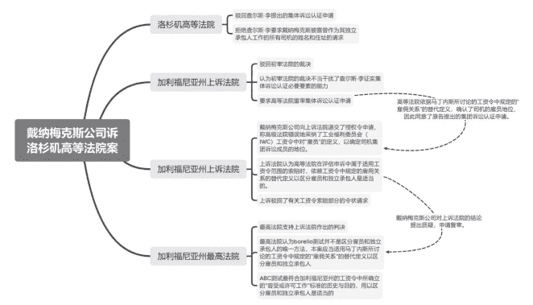

### 【核心争议点】
1. 马丁内斯标准能否普遍适用于雇员身份的判断。
2. 在区分员工与独立承包人时，ABC测试与博雷洛测试何者更具正当性。
3. 适用ABC测试后，戴纳梅克斯的司机是否构成该公司的员工。

### 【裁判论证过程】
#### （一）马丁内斯标准具备普遍适用性
1. 马丁内斯标准
法院认为该标准并非仅限于共同雇佣情形，其解释空间与工资令扩大保护的立法目的相符，因此可以作为雇员分类的一般性依据，并在必要时通过ABC测试进一步校正认定边界。

Dynamex 裁决：加州用工分类的转折点

2010 年加州最高法院在马丁内斯案里厘清了工业福利委员会对“雇佣”的解释路径，给出了三条可替代的认定方式：对薪酬、工时或工作条件施加控制、容受或准许他人工作、以及通过聘请建立普通法雇佣关系。该判决系在审视加州工资令中“雇佣”“雇主”定义时作出，并非直面雇员与独立承包人的划分，而是为工资令里的“雇佣”一词提供了解释框架。

2. 马丁内斯标准并非只限于共同雇佣
本案核心争议围绕共同雇佣展开，即除主要雇主外，与工人存在某种关联的其他主体是否应被视作共同雇主并共同承担工资令义务。戴纳梅克斯主张，马丁内斯确立的三项替代定义中，前两项“控制”与“容受或准许工作”仅适用于确认共同雇主的场景，本案并无潜在第二雇主，马丁内斯标准不应适用。

加州最高法院回应，工资令文本并未对适用范围作出如此限缩。马丁内斯案与本案的本质都是判断工人与涉案公司之间是否成立雇佣关系，不必因先例不足就把雇佣成立与联合雇佣成立硬性拆分。法院还追溯“容受或准许工作”的立法来源，指出1916 年加州工资令首次采用该表述时，该表述已广泛见于全国规制童工、妇女劳动的法令，足见其本意就不止于共同雇佣。

3. “容受或准许工作”可用于雇员与独立承包人的区分
戴纳梅克斯进一步认为，即便该标准可超出共同雇佣，也不应用来检验雇员与独立承包人。理由是自1989 年博雷洛案判决后，加州绝大多数判例都以博雷洛测试为区分依据，马丁内斯并未改变这一惯例。公司还强调该标准字面过宽，若机械适用，所有为企业提供服务的个体都将被认定为雇员，连水管工、电工、建筑师、独立律师等偶尔为企业提供非主营业务服务的专业人士都会被纳入，导致分类范围失控。

法院不认同上述观点。马丁内斯案的论述明确显示，博雷洛测试并非确认工人类别的唯一路径。法院同时承认，“容受或准许工作”仅凭字面无法自行解决工人是否受保护的问题，但它在判断工人是否属于工资令覆盖的雇员时仍具重要意义，有助于辨别谁应被视为受保护雇员、谁可被排除为独立承包人。

该标准确实宽泛。联邦《公平劳动标准法》也采用了类似表述，其立法者雨果·L·布莱克曾称之为“最广的定义”，旨在最大化社会福利法规的覆盖面。加州工资令属于补救性立法，应作有利于劳动者健康的宽松解释。当时工人议价能力弱，为生计常被迫接受低薪或劣质条件，工资令设置宽泛定义的目标正是保障健康福利与最低生活所需。

鉴于历史预期与补救目的，法院尊重工业福利委员会的立法裁量，采纳这一替代定义，并强调必须对“容受或准许工作”作宽泛解释，否则本应属于雇员却被归为独立承包人的工人将被排除在保护之外。

（二）ABC 测试更适用于区分雇员和独立承包人
“容受或准许工作”见于联邦劳工法，联邦法院在适用时也认为它比博雷洛更具包容性。为防止范围过度扩张，联邦法院发展出经济现实测试，各地也形成了博雷洛、ABC 等更细化的标准。

1. 博雷洛测试标准
加州最高法院在先例中确立的博雷洛测试包含10 项考察要素，无一具有决定性，需个案衡量，包括：雇主是否能控制完成方式与步骤；是否可无故解除；服务提供者是否从事不同职业；当地惯例是否独立作业；是否需特殊技能；是否提供工具场所；服务时长；计薪方式；工作是否构成委托人常规业务部分；双方主观认定等。

2. ABC 测试标准
本案加州最高法院采纳的 ABC 测试采取推定雇员的思路，只有雇主同时证明三项条件时方可认定独立承包人：（A）工作不受雇主控制与指导；（B）工作超出雇佣实体的正常业务范围；（C）工人独立经营既定业务，而非仅为该公司工作。

3. 二者中 ABC 测试更适用于区分雇员与独立承包人
戴纳梅克斯指出，若按字面适用“容受或准许工作”，传统独立承包人也会被误划。法院认为需用其他测试进一步厘清。虽博雷洛被广泛使用，但存在明显缺陷：多因素且无决定性要素，导致结果不确定，企业与求职者难以事前判断，只能事后诉讼；多因素还为企业提供操纵空间，通过调整工作条件影响分类结果以规避工资工时责任。

相较之下，ABC 测试预设工人为雇员，仅在三项要件全部满足时才可转类，每项都有决定性作用，为事前分类提供了清晰统一的规则，也大幅削弱了雇主操弄空间。

法院认为 ABC 还更契合工资令中“容受或准许工作”的历史与目的。普通法下博雷洛侧重控制，一旦控制松弛即可能被认定为独立承包人，而实际用工中许多雇主只需必要控制即可。ABC 的 A 项要求雇主证明无必要控制；B 项要求工作不属于雇主常规业务，可避免企业通过外包核心业务制造“逐底竞争”，同时防止把管道工等典型独立承包人错误纳入；C 项要求工人以独立经营者身份存在，如注册、获照、宣传、对公众提供服务等，防止单方面指定为独立承包人以逃避责任。

总体而言，ABC 简洁、可预见，能把被错误归类为独立承包人的雇员纳入保护范围，更符合补救立法初衷。

（三）ABC 测试下戴纳梅克斯公司的司机系该公司的雇员
法院先认为初审对“容受或准许工作”的解释过宽，再以 ABC 测试检验司机身份，基于两点认定其为雇员。

其一，按 B 项，戴纳梅克斯作为运输公司，其全部业务即送货服务。司机持续为公司客户收发快递的工作显然属于公司正常业务范畴，故不满足 B 项。

其二，按 C 项，本案集体仅限于争议期间只为戴纳梅克斯提供服务的司机，不含为其他客户服务或拥有自有员工的司机。该类司机的业务完全来源于戴纳梅克斯，运输活动由公司指派，无独立业务来源，不符合 C 项。

综合上述，加州最高法院维持上诉法院判决，认定司机为雇员，集体诉讼认证合法有效。

审理结果
1. 洛杉矶高等法院驳回李的集体诉讼认证申请。
2. 加利福尼亚州上诉法院推翻初审判决。
3. 加利福尼亚州上诉法院驳回有关工资令索赔部分的令状请求。
4. 加利福尼亚州最高法院于 2018 年 4 月 30 日确认上诉法院判决。

相关法条
加利福尼亚州《工业福利委员会关于运输业的第 9 号加州工资令》节选

第 1 条 本令的适用范围
本令适用于运输行业的所有雇员，无论计费方式如何，但行政、主管、专业人员除外。

第 2 条 定义
（E）“雇用”是指委聘、容受或准许工作。
（F）“雇员”是指任何受雇于雇主的人员。
（G）“雇主”是指《劳工法》第 18 条所定义的任何人，直接或间接地雇用或控制任何人的工资、工时或工作条件。

案例评析
### （一）本案标志着加州关于工人分类的判例转变
自1989 年博雷洛测试确立后，加州法院在工资令案件中一贯使用该测试区分雇员与独立承包人。随着经济现实变化，博雷洛的诸多要素显现过时，难以涵盖收入分配、议价能力等新因素。本案法院质疑博雷洛的分析方法在新型用工中的适用性，并在无在先立法与判例支持下采纳 ABC 测试，实现了普通法原则的现代化。

### （二）推动了加州相关立法
博雷洛多因素标准需在个案中逐项权衡，企业与工人难以预判分类结果，增加合规成本并妨碍维权。判决后支持者迅速推动立法，2019 年 9 月 18 日《AB 5 法案》签署生效，将 ABC 测试纳入《劳工法》，适用范围从工资令扩展至整个劳动、失业和工人补偿领域。

### （三）本案后续最新进展
判决未明确 ABC 测试的溯及力及具体适用边界，雇主遂提请重审，法院驳回。裁决引发诉讼潮，多起案件主张溯及适用。2019 年 5 月 2 日美国第九巡回上诉法院在巴斯克斯案中认为裁决具溯及力，7 月 22 日撤回命令并请示加州最高法院，法院于 2021 年 1 月 19 日确认具溯及力。

适用范围上存在分歧。部分下级法院认为 ABC 不适用于联合雇佣，限于错误分类问题，如特许经营背景下的雇主义务认定。另有观点主张可延伸适用，争议仍在持续。

### （四）《AB 5 法案》的后续发展

加州 AB5 法案的冲击波：零工经济被按下重启键

AB5 法案落地后，整个零工经济平台都跟着颤抖。这部法律堵住了企业把员工包装成独立承包人来省成本的监管套利空间，却也让一批在博雷洛测试下原本算独立承包人的劳动者被重新认定为雇员，企业的人力成本随之水涨船高。更麻烦的是，用工合规风险被急剧放大，按美国劳动法，雇主违反雇员相关法规甚至可能构成刑事责任。好消息是，相对于博雷洛测试的不确定感，ABC 测试标准更清晰，企业的诉讼支出因此明显下降，不必要的官司也被减少了不少。^([\[23\]](#txt008.html#footnote_content_txt008_23))

法案一出，反弹声此起彼伏。像优步这样高度依赖灵活用工的平台公司展开强力抵制，而劳动者内部的声音也并不统一。AB5 逼得不少企业缩编或直接关停加州的独立承包人业务，相关从业者收入缩水甚至丢了工作。还有一批人本来就想保持独立、不想被雇主管着，也觉得法案忽视了他们自主选择的诉求。2020 年 1 月 8 日，AB5 刚生效不久，优步司机奥森和佩雷兹就站出来起诉，主张新规违背了联邦和州宪法里的平等保护、正当程序和合同条款。围绕 AB5 的诉讼很快就多到数不过来。^([\[24\]](#txt008.html#footnote_content_txt008_24)) ^([\[25\]](#txt008.html#footnote_content_txt008_25))

争议的焦点很快落在豁免名单上。AB5 明确保留了一批行业继续适用旧的博雷洛测试，法律正文里列出了 50 多个仍可沿用旧标准的行业，而网约车、外卖配送等典型零工行业全部被排除在外。^([\[26\]](#txt008.html#footnote_content_txt008_26)) 优步、来福车等以 App 为核心的出行和派送公司于是发起《保护基于应用程序的司机和服务法案》，即第 22 号提案，把网约车司机的身份认定问题拿到公投。2020 年 11 月 3 日，加州选民通过了该提案，决定把依靠 App 提供服务的司机维持为独立承包人。^([\[27\]](#txt008.html#footnote_content_txt008_27))

面对 AB5 带来的混乱，加州议会里出现了将近三十份修改、废除或替代的提案。但这些动议大多出自共和党议员之手，目前几乎没有获得足够支持，民主党主流仍拒绝重新审视这部法律。^([\[28\]](#txt008.html#footnote_content_txt008_28))

（五）对中国零工保护的借鉴价值

这场加州的实践给中国“零工经济”时代的劳动者保护提供了不少思考。加州工资令中的“容受与准许工作”思路，和 ABC 测试里默认劳动者为雇员的预设，共同体现了对雇员的倾斜保护取向。中国灵活就业体量庞大，用倾斜保护的思路可以避免劳动者因议价能力弱而被侵蚀权益，也有助于零工经济在扩大就业、稳就业上发挥作用。其次，AB5 在普遍推行 ABC 测试的同时，对部分职业保留博雷洛测试，提供了分类施策、区别对待的思路，有助于在雇员与雇主、企业与工人之间寻求平衡。^([\[29\]](#txt008.html#footnote_content_txt008_29)) 借鉴这一点，中国可以探索更具弹性的路径，充分尊重互联网+劳动市场的特点，尊重网约工追求灵活就业的意愿，避免用一揽子、一刀切的方式把所有零工都硬塞进劳动关系或非劳动关系，防止因分类失误导致权益真空。^([\[30\]](#txt008.html#footnote_content_txt008_30))

ABC 测试虽然优点突出，却远非完美。它缺乏足够的灵活性，容易出现明明不应算雇员，却因无法满足任一标准而被归为雇员的窘境。这正是二元分类的残酷之处：只能二选一，要么雇员，要么独立承包人。已有美国学者呼吁引入第三类工人分类。^([\[31\]](#txt008.html#footnote_content_txt008_31)) 因此中国在吸收 ABC 测试和 AB5 经验时，需要结合国情做进一步的调整与完善。

关联案例推荐

1\. Vazquez v. Jan-Pro Franchising International, Inc., No. 17-16096 (9th Cir. 2021)

核心事实：原告指控清洁特许经营商 Jan-Pro 搭建了复杂的三级特许模式，错误地把劳动者划为独立承包人从而规避最低工资和加班费。戴纳梅克斯案作出前，初审法院按马丁内斯和帕特森判例作出对 Jan-Pro 有利的简易判决，认为公司对劳动者控制度不够，不构成雇佣。戴纳梅克斯案后，第九巡回法庭推翻原判，要求按 ABC 测试重新认定雇员身份。加州最高法院也确认，非终局判决案件可溯及适用戴纳梅克斯案。

与本案关联点：在戴纳梅克斯案作出前未终结的案件，均可溯及适用 ABC 测试。

2\. Henderson v. Equilon Enterprises, LLC, 40 Cal.App.5th 1111 (2019)

核心事实：法院审查壳牌公司与其第三方服务加油站经营者是否构成联合雇主。原告亨德森未直接受雇于壳牌，在被解雇后起诉，声称壳牌作为联合雇主应担责。上诉法院维持对壳牌有利的判决，认为 ABC 测试是为解决误分类独立承包人的问题，联合雇主共同责任仍应适用马丁内斯标准。

与本案关联点：ABC 测试仅用于纠正工人误分类，不能扩张到联合雇主责任。

3\. Anderson v.Kids Included Together, No. D074368 (Cal. Ct. App. 2020)

核心事实：初审认定安德森为独立承包人。戴纳梅克斯案判决后，安德森上诉要求按 ABC 测试重审。加州第四区上诉法院认为，安德森从未依据加州工资令提出索赔，法院也未就工资令问题作出判断，故戴纳梅克斯案不适用。

与本案关联点：ABC 测试仅适用于基于加州工资令的索赔。

Patterson v. Domino’s Pizza, LLC, 333 P.3d 723 (Cal. 2014)

核心事实：原告在特许经营商处受雇并遭遇性骚扰，试图追究特许人替代责任。加州最高法院认为，特许人只有在对雇佣、指导、监督、纪律、解雇等日常事务拥有一般控制权时，才承担替代责任。

与本案关联点：特许人仅在对特许经营商及其雇员的日常工作拥有一般控制权时才承担替代责任。

8.2 意大利 Deliveroo 算法歧视案

案件索引
Filcams Cgil Bologna and others v. Deliveroo ITALIA S.R.L, Case N. R.G. 2949/2019(2020)

关键词
算法歧视；间接歧视；零工经济；算法透明度

案件提要
外卖骑手因平台算法被区别对待引发纠纷，是意大利乃至欧洲首例关于算法歧视的司法判决。随着零工经济扩张，数字平台劳动者权益成为全球关注点。本案中，骑手通过自助预定系统抢时段，平台评分机制决定了谁先抢单，直接影响工作机会。博洛尼亚工会认为 Deliveroo 的算法具有歧视性，要求法院叫停并赔偿。2020 年 12 月 31 日，博洛尼亚法院认定该算法构成间接歧视。

《欧洲人权公约》禁止基于性别、种族、宗教等理由的歧视，但算法可以绕开显性限制，实现群体筛选。^([\[32\]](#txt008.html#footnote_content_txt008_32)) 本案中，户户送公司通过算法让在高峰时段送单次数多的骑手得分更高，导致因罢工、疾病等正当理由缺席的人得分下降、机会减少。骑手为保分数只能被迫多接单，算法实际上在引导可预测的行为，损害劳动者福利。^([\[33\]](#txt008.html#footnote_content_txt008_33))

中国的外卖骑手困境同样被广泛讨论，《外卖骑手，困在系统里》一文指出骑手难以对抗系统分配。为此，2021 年 7 月 16 日人社部等八部门发布《关于维护新就业形态劳动者劳动保障权益的指导意见》，要求落实公平就业、消除就业歧视，禁止以保证金等名义收费，保障多平台就业。2021 年 7 月 26 日市场监管总局等七部门发布的《关于落实网络餐饮平台责任切实维护外卖送餐员权益的指导意见》要求优化算法规则，提倡“算法取中”，合理确定订单量、准时率、在线率等考核，适当放宽配送时限。本案对算法间接歧视和零工保护具有重要参照意义。

案件要旨
博洛尼亚法院
原告 博洛尼亚运输业劳务提供者工会，商业、旅游与服务业劳务提供者工会，非典型劳务提供者工会
被告 意大利户户送有限责任公司

意大利户户送公司是跨国在线送餐公司。2015 年起在意大利开展配送业务。骑手与公司签自营合同，需安装 App，通过个性化档案进入数字平台。平台使用“弗兰克算法”进行工作分配与管理。^([\[35\]](#txt008.html#footnote_content_txt008_35))

合同提供两种接单方式：自助预定 SSB 和免费登录。自助预定系统提前计算每周所需骑手数并划定时段，供骑手在周日预定。^([\[36\]](#txt008.html#footnote_content_txt008_36))

评分基于可靠性和参与度。可靠性统计爽约次数，预定后未提前 24 小时取消且 15 分钟内未上线则降分。参与度由周五至周日 20:00-22:00 的配送次数决定，次数越多分越高。

每周日下午系统按排名放号，11:00 放前 15% 分数骑手预定，15:00、17:00 依次放后排骑手。时段逐渐被占，后排骑手可选余地越来越少。

原告请求包括：确认进入自助预定系统的条件歧视性；确认被告做法歧视性；消除歧视影响；命令修改自助预定系统，防止对罢工、疾病、残疾等原因无法参与工作的骑手产生歧视；披露判决结果；刊登判决；赔偿非物质损害；采取措施消除影响。

被告抗辩：骑手可自主选择是否使用预定系统；取消预定不影响数据；弗兰克算法与预定系统无关；系统允许骑手按生活需要管理时间；2020 年 11 月 10 日提交材料称相关预定系统已不存在。

案例事实思维导图
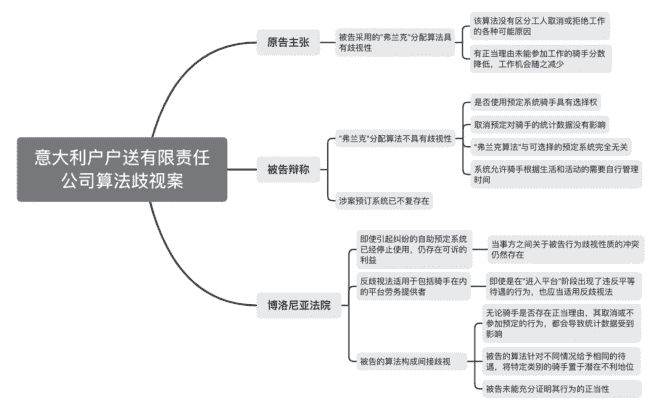

核心争议点
1. 自助预定系统已停用，法院是否应终结审理。
2. 反歧视法能否适用于平台骑手。
3. 户户送公司的算法是否构成歧视。

裁判论证过程

（一）系统停用仍具可诉性
被告主张争议制度已不存在，要求撤案。法院认为，工会诉求不仅是定罪和修改机制，更在于查明机制的歧视本质并补偿损害。争议是否终结需以双方对实质性变化的共同确认为准，单方事实主张仍需裁决。法院无法下令停止已不存在的行为，但可以要求消除歧视影响。

（二）反歧视法适用于平台劳动者
意大利第 81/2015 号法令第 47 条第 5 款规定，反歧视规则和保护工人尊严的规则，包括进入平台的机会，应适用于第 47 条之二所述工人。即使在“进入平台”阶段出现不平等对待也违法。^([\[37\]](#txt008.html#footnote_content_txt008_37)) 第 47 条之二第 1 款为通过数字平台进行城市货物交付的自营职业者设定最低保护。

第 216/2003 号法令要求在就业和工作条件上消除宗教、信仰、残疾、年龄、性取向等歧视，适用于公私部门全体人员。法院认为工会信仰可纳入“信仰”范畴，反歧视法可保护工会自由。^([\[38\]](#txt008.html#footnote_content_txt008_38)) 鉴于对骑手保护的立法和判例演进，将从属性劳动保护延伸适用于这类劳动者具有必要性，尤其在获取工作机会的层面应免受歧视。

（三）算法构成间接歧视

意大利外卖平台排班算法案：看似中立的评分机制为何构成歧视

意大利第216/2003号法令第2条把歧视拆成直接与间接两种形态。直接歧视的表述是因宗教、信仰、残障、年龄或性取向，一人获得的待遇不如同等情境下他人所获。间接歧视指外观上中立的规则、标准、操作、合同或措施，客观上会让信奉特定宗教或意识形态者、残障者、特定年龄或性取向者处于不利位置。

本案被告使用的排班并非直接歧视，而属间接歧视。平台推行一套对外宣称中立的算法，实质把参与罢工的骑手群体置于被动不利处境。法院不否认该系统在部分环节带来便利，也并不主张因未来可能停用而预防性废止，核心判断在于骑手取消或放弃已预约班次时是否具备法律上充分理由。

平台骑手画像以可靠度与参与度两项指标生成分数，分数决定可进入排班系统的时段窗口。进入窗口越靠后，可选班次越少，后进入者只能承接前轮未用完的空档，分数偏低者被迫在更晚时段操作，可获工作机会随时间递减。

当骑手因疾病、残障、照护残障人士或照顾病中未成年子女等原因无法提前取消或履约，就会面临降分与差别待遇风险。无论理由是否正当，未履约都会被统计惩罚。户户送公司曾公开表示平台既不清楚也不关心骑手缺勤或取消的动机，认为动机与系统无关。如此一刀切的同等处理，正是间接歧视的运行逻辑。

平台官网说明，未预约情况下只要区域内有空班，骑手随时可登录。同时文件显示平台持续招揽骑手加入优先组，强调该组享有更多工作机会及特权，明显在推动排班系统使用。

法院指出平台借助技术优势挤压骑手平等获取工作的空间，带有故意色彩：“平台若想，随时可摘下导致其失明或麻木的眼罩，了解骑手无法出工的真实原因，若不为此，就是主动选择视而不见。”

意大利第150/2011号法令第28条第4款规定，原告以事实与统计数据足以推断存在歧视行为时，举证责任转由被告，被告需证明目的合法且手段适当必要。户户送未能披露骑手分数的计算机制，基本阻断深入审查可能。审理中被告从未说明分数核算的具体标准，也未在平台公示，仅提供可靠度与参与度两项笼统参数。法院认定被告未充分自证正当性。

最终法院认定，被告算法构成对骑手的间接歧视，使特定类别骑手处于潜在特别不利状态。

### 审理结果

1. 认定并宣告意大利户户送公司的行为具有歧视性。
2. 责令被告在官网及平台常见问题区发布判决内容，以消除歧视影响。
3. 责令被告在《共和报》等全国性报纸刊载判决摘要，费用自理。
4. 判被告向原告支付50,000.00欧元并加计法定利息作为损害赔偿。
5. 判被告承担原告诉讼费用。

### 相关法条

《欧洲人权公约》第14条

保障本公约权利和自由的享有，不得因性别、种族、肤色、语言、宗教、政治或其他意见、民族或社会出身、与少数民族联系、财产、出生或其他身份而受歧视。

意大利第216/2003号法令第3条第1款

平等待遇原则不得因宗教、个人信仰、残疾、年龄和性取向而区别对待，应适用于公私部门全体人员。

意大利第150/2011号法令第28条第4款

若原告提交事实包括统计数据足以推断存在歧视性行为、契约或做法，则证明不存在歧视的责任由被告承担。

意大利第81/2015号法令第47条之五第1款

为雇员提供的反歧视规则和保护工人自由和尊严的规则，包括进入平台的机会，应适用于第47条之二所指的工人。

### 案例评析

#### （一）算法偏见是间接歧视的典型表现

零工经济扩张伴随大数据与算法广泛介入平台治理，平台用推荐与评价机制引导劳务提供者“自愿”接受管理，并把工作场所规则编码进必须使用的数字工具，降低抵制难度，形成顺从式劳动。同时算法歧视以隐蔽、系统、规模化方式出现，对特定群体造成实质伤害。

意大利第216/2003号法令第2条认为外观中立的规定让特定人群处于不利即属间接歧视。算法常以中立客观自动为特征，掩盖背后人为意图。本案所有骑手使用同一系统，延迟取消或未履约的惩罚后果相同，但正因规则外观中立，更易掩盖歧视后果。算法分析让公司更容易识别可操纵群体并据此做商业利用。户户送衡量参与度时聚焦周五至周日20:00-22:00配送次数，次数越多公司收益越高，因此筛选本质服务企业利润，高分者获更多机会，其余者被边缘化。

无论算法多合理客观，都由人设计以实现特定目的。用算法分类、选择、决策不仅是利润关系，也是治理关系。揭开外观中立面纱，平台有责任确保商业目的实现不给第三方带来不合理负担。

#### （二）为数字平台劳务提供者权益提供参考坐标

被边缘化的累积效应会在每次接单时放大，而户户送的弗兰克算法未为正当理由留出空间。骑手须进入预定区域才能登录应用，因地理定位要求，即便罢工仍需在时段开始后15分钟内到场，这与罢工权要求的完全不工作相冲突；疾病或需在家照护病中未成年子女的情况同样无法满足。骑手被迫在更多机会与被边缘化之间做选择，单一评价方式进一步压缩选择余地。

被剥夺的工作机会难以量化，损失因人而异。博洛尼亚法院虽未正面确认平台与提供者间的法律关系，但在判断算法是否歧视时，充分考虑原告在算法黑箱面前的弱势，以及技术不平等带来的权力差距，实现赔偿、预防与惩罚的平衡。

本案被视为算法歧视第一案，其判决为后续司法实践提供参考。算法运行依赖的数据是脱离个体状况的数字符号，而受制于规则的骑手需要更多发声渠道与保障，这也是平台设计和运营算法应承担的责任，关注数字背后真实的人。

#### （三）推动数字工作相关监管深化

算法决策隐蔽影响生活方式，其复杂专业封闭让普通人难以理解运行逻辑与评价标准，带来法律监督困境。本案争议的弗兰克算法从未公开，当事人仅能通过模糊认知推测全貌，很难判断是否受损。

欧盟多部法律已对算法监管作出体现并持续加强。《通用数据保护条例》要求个人数据处理须合法公正透明，平台劳务提供者有权要求信息披露。反歧视法可保护用户免受算法歧视，但对间接歧视缺乏清晰黑白规则。欧洲人权法院认为，即便无歧视意图，只要一般政策对特定群体产生不成比例不利影响，也可能构成歧视。间接歧视标准开放，实践中难以适用。《通用数据保护条例》赋予数据主体不受完全自动化决策约束的权利，但相关条款实践尚少。

2021年4月21日欧盟委员会通过人工智能法提案，探索数字工作主题。该提案与通用数据保护条例共同应对人工智能系统不透明、偏见与不可预测性。用于就业、工人管理和自营职业的人工智能系统被列为高风险，必须提供文档、使用说明及关于基本权利和歧视风险的清晰信息，并引入人工监督。对数字平台劳务提供者而言，有效实施可避免因系统偏见导致的歧视。

平台经济把个人生活、劳动、技能商品化，这一深层问题愈发紧迫。欧盟立法行动旨在确保公民权利充分尊重，增强公众对人工智能解决方案的信任。

#### （四）后续最新进展

意大利数据保护局调查户户送算法和应用后认为，公司未向骑手提供关于轮班管理算法的透明信息。另查明应用收集过度乘客个人数据，违反合法、透明、数据最小化和存储限制原则，据此处以2,500,000欧元罚款。

2021年5月11日西班牙第9/2021号皇家法令出台，目标保障通过数字平台从事快递的人员就业权利，规范雇佣关系及工会获取信息权。立法启动后不久户户送宣布结束西班牙业务，称当地业务规模小，留下需太多投资。比较本案与西班牙因确认雇佣关系导致平台撤离，可见劳动关系界定对平台运营成本影响巨大。

数据收集、存储、分析正在重塑工作场所，影响就业发生方式，对劳资关系起决定性作用。对劳务提供者和平台企业而言，全有或全无的规制可能造成过度或不足，如何平衡运营成本与权益保护，有待各国实践探索。

## 关联判例推荐

### 1. Aslam Y., Farrar J., and others v. Uber B.V. and others, no. 2202551/2015(2016)

核心事实：原告认为在Uber工作应按1998年《国家最低工资法》获得最低工资，并按1998年《工作时间条例》享受带薪年假。Uber称司机为独立承包商。英国最高法院裁定Uber须向司机支付国民生活工资及至少28天带薪假期。

关联点：英国最高法院确认数字平台劳务提供者的员工身份。

### 2. Sørensen and Rasmussen v. Denmark, no.52562/99 (2006)

核心事实：丹麦允许工作场所与工会签订排他性协议，侵害个人是否加入工会的决定权。欧洲人权法院认为结社自由包含消极自由，即不参加工会的自由。

关联点：欧洲人权法院对“信仰”作横向解释，将工会信仰纳入。

### 3. Schmidt and Dahlstrbm v. Sweden, no. 5589/72 (1976)

核心事实：原告工会召集选择性罢工，原告部门未罢工。新协议签订时，原告作为未参与罢工的非工会雇员被拒发追溯福利。

关联点：罢工是工会保护会员利益的重要手段，参与罢工导致的不平等待遇应受反歧视法保护。

### 8.3 伯威克诉优步公司案

【案件索引】

Barbra Berwick v. Uber Technologies, Inc., CASE NO. 11-46739 EK (2015)

【关键词】

零工经济；劳动关系认定；博雷洛标准

【案件提要】

本案涉及零工经济下网约车司机劳动关系认定。原告芭芭拉·伯威克与优步公司签约代驾，后被公司无预警取消资格。伯威克主张2014年7月23日至9月18日期间为优步公司雇员并要求赔偿。优步公司则称其为独立承包人。

优步司机算谁的人？加州一案让“控制”标准变了

为判断双方是否存在劳动关系，加州劳工委援用了博雷洛案的判断框架，即市场通称的博雷洛测试或控制权标准，并在既有要素上做了补充。委方认为，用人单位不一定要对劳动者实施全盘支配，在特定情况下形成最低限度的支配也足以认定雇佣。司机自备车辆并不构成否定雇佣的关键，综合事实显示公司对司机运营施加了必要的干预：没有优步的应用就无法接单；价格由公司决定；司机在作业时不需要运用管理性技巧等。准入审查、乘客打分等机制也表明司机业务始终在优步的监管之下，公司还提供了运营必需的知识产权以及除车辆之外的工具。基于此，委方作出有利于伯威克的决定，认定其是优步的员工。

随后优步于2015年6月16日在旧金山高等法院提起上诉，并附上劳工专员命令申请强制仲裁。旧金山高等法院驳回了优步关于强制仲裁的动议。

平台与零工劳动者之间的法律定性始终是同类诉讼的核心。美国普通法中的博雷洛标准通过识别雇员身份来确定雇主是否要对劳动者侵权承担赔偿，也是界定保护性立法适用范围的重要路径。但该标准划定的雇员范围偏窄，容易被雇主利用来把劳动者归为独立承包人。因此普通法逐步吸纳经济因素与经济风险，形成经济现实标准以遏制标准被操纵。随着社会经济演进，博雷洛标准也在被不断刷新。本案正是针对博雷洛各要素的一次更新，重新划清了雇主对劳动者“控制”应达到的界线，具有里程碑意义。2019年加州立法机构通过《加州议会第5号法案》，以立法形式明确在特定情形下应以对雇员更友好的ABC检验标准取代博雷洛标准。^[ [60]](#txt008.html#footnote_content_txt008_60)

本案与围绕优步司机法律地位的一系列诉讼共同构成对传统劳动关系认定标准的挑战，促使各国重视司机权益保护，采用要素式而非要件式分析，为零工经济下立法提供参照，对我国网约车司机法律地位的认定也有理论借鉴价值。本案亦有助于理解人工智能对劳动关系的影响及零工劳动者权益保护问题。

### 案件要点
加利福尼亚州劳工委员会：原告 芭芭拉·伯威克 被告 优步科技公司
旧金山高等法院：上诉方 优步科技公司 被上诉方 芭芭拉·伯威克

2014年7月23日，伯威克与优步签署了一份长篇协议，协议把优步定位为连接驾驶员与乘客的“关系引导服务”。乘客可通过手机应用发起乘车请求，与可用司机匹配后由司机接送至目的地。伯威克称自2014年7月23日至2014年9月18日优步在未通知的情况下取消其代驾资格期间，她属于优步员工。优步则主张其为独立承包人。

2014年9月16日，伯威克向加州劳工委员会提出首次索赔，要求优步支付：1）2014年7月25日至9月16日拖欠的工资；2）未报销费用及利息；3）违约赔偿金；4）逾期付款惩罚性赔偿。劳工委员会仅对雇员与雇主纠纷有管辖权，核心在于伯威克是否构成优步员工。

主要事实：司机使用自有车辆，公司不干预工作时间也未设定最低接单量，但若暂停使用手机应用超过180天，应用将失效。司机不受地域限制。司机须取得加州公用事业委员会许可后方可载客，必要时优步可提供一部iPhone并收取可退押金。优步会对潜在司机进行背景调查，所有司机须提交加州驾照、社会安全号码、个人住址、银行信息及保险证明。上岗后，优步通过鼓励乘客评分来把控服务质量，若评分低于4.6分，应用将被关闭。

2014年9月16日伯威克提起索赔后，劳工专员于2015年6月3日作出对她有利的裁决，认定其为优步雇员。

2015年6月16日，优步向旧金山高等法院提出上诉并申请强制仲裁，法院驳回了强制仲裁动议。

### 案例事实思维导图
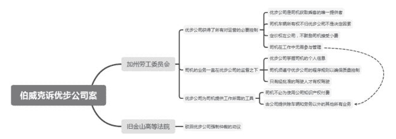

### 核心争议点
1.认定伯威克为雇员抑或独立承包人应适用何种标准。
2.雇佣关系中雇主对工作控制程度如何界定。
3.优步是否对伯威克的工作形成必要控制。
4.优步是否应予赔偿及赔偿范围为何。

### 裁判论证过程
#### （一）加州劳工委员会援用博雷洛标准认定双方劳动关系
判断伯威克是否系优步雇员时，委员会援引博雷洛标准，具体涉及：（1）提供服务者是否从事与委托人不同的职业或业务；（2）服务是否属于委托人日常业务的一部分；（3）委托人是否提供器具、工具及工作场所；（4）所谓雇员对其设备或材料的投入或雇佣帮手情况；（5）服务是否需要特定技能；（6）依当地惯例，该类职业通常在委托人指导下完成还是由专家独立完成；（7）劳动者获利或亏损是否取决于管理技能；（8）服务提供时长；（9）工作关系持续性；（10）支付方式是按时间还是按件；（11）当事人主观认知可作参考但非决定性，因系客观法律判断。

#### （二）雇佣关系中雇主对工作需达到总体必要控制
委员会认为博雷洛案表明，雇佣认定并不要求雇主对劳动者各项工作细节均实施完全控制，只要在整体上对业务运营形成必要控制即可。其理由在于，劳动者所从事工作技能要求不高，且构成雇主业务的必要组成部分。

其一，雇员工作依附于雇主业务，代表雇主提供劳动。如雇主面对客户快递需求，其提供的是代表自身劳动的雇员。雇主即便未对细节实现全面控制，只要整体控制达到必要程度且职责属业务组成部分，细节性控制便非必要。

其二，依据加州《劳工法》第3357条及博雷洛案，主张独立承包人身份的一方负举证责任。若无法证明独立承包人身份，则推定存在雇佣关系。

其三，交通工具所有权并非关键判断标准。如丰田汽车销售诉高等法院案^[ [61]](#txt008.html#footnote_content_txt008_61)中，外卖员虽自备车辆并自行负担油费及保险，法院仍依博雷洛案前传统普通法标准认定其为雇员。最新趋势认为，当工作属雇主正常业务组成部分，且劳动者未向雇主提供独立业务或专业服务时，即构成雇佣关系。

#### （三）优步对伯威克工作形成必要控制
委员会参照博雷洛测试对双方关系进行具体分析，重点围绕“服务是否属委托人日常业务”“是否提供器具工具工作场所”及“获利亏损是否取决于管理技能”等要素，最终认定优步对伯威克形成必要控制。

首先，伯威克提供的服务属优步日常业务。优步并非中立技术平台，而是深度介入运营各环节。司机须向优步提供个人银行卡账号、住址及社保号码，仅通过优步背景审查及车管所审核后方可使用应用。优步借助登记审批、司机批准评估等机制实现对司机的掌握与监督。经营模式亦由优步确定。

其次，优步向司机提供了手机应用知识产权这一核心工具。司机的汽车与劳动为其唯一资产，工作中不涉及影响收益或亏损的管理性技能。除汽车外，司机在业务上并无投入。若无优步提供的应用知识产权，该工作无法开展。

综上，委员会认为优步对伯威克形成必要控制，其系优步雇员，故委员会拥有管辖权。

#### （四）优步对伯威克的赔偿范围含支出费用及利息
根据加州《劳工法》第2802条，雇主须赔偿雇员因履行职责或服从指示而产生的必要支出，包括到期未付费用的利息。本案中，原告共行驶6468英里，按2014年美国国税局每英里0.56美元计，计3622.08美元；另支付通行费256美元。但其未证实因公司要求使用手机或收到违章停车罚单。因此公司应赔偿费用3878.08美元及利息274.12美元。

关于工资与违约金，原告未提供任何付款记录，称信息由公司保存。其作为主张方负有举证责任，包括初步举证与优势证据说服责任。因证据不足，关于《劳工法》第1194.2条工资及违约金、以及第203条惩罚性赔偿的请求不予支持。

## 审理结果
1.加州劳工委员会作出对伯威克有利的裁决，认定其为优步雇员，并命令赔偿费用3878.08美元及利息274.12美元，合计4152.20美元。
2.旧金山高等法院驳回优步强制仲裁动议。

## 相关法条
加利福尼亚州《劳工法》第2802条（a）款、（b）款
（a）雇主应赔偿雇员因履行职责或服从指示而直接导致的所有必要开支或损失，即使指示违法，除非雇员明知指示违法。
（b）依据本条作出的偿还必要开支裁决，按民事判决相同利率计息，自雇员发生支出或损失之日起计算。

加利福尼亚州《劳工法》第3357条
除独立承包人外，为他人提供服务者均推定为雇员，法律另有排除者除外。

## 案例评析
### （一）为零工经济下劳动关系认定提供立法依据
传统劳动关系由合同建立权利义务，劳动者对用人单位具有组织从属、经济从属，呈现持续性、控制性、稳定性。人工智能与移动互联时代，网络平台从事临时工作的劳动者激增，传统二元结构演变为平台介入的三角结构。劳动者选择自由提升，从属性降低；平台分担雇主职能，降低用工成本。随着零工经济扩张，新型劳动关系与传统关系难以清晰区分，劳资双方常通过协商规避劳动法强制规定，零工权益难以保障，故需明确身份，判断其为独立承包人还是雇员。

认定标准随时代演进。从博雷洛标准、经济现实标准，到增添新要素的博雷洛标准，再到ABC检验标准，美国法对劳动者保护不断加强。加州长期采用博雷洛标准，该多因素测试聚焦平台对零工的控制程度。网约车等新型关系出现后，传统标准难以完全适用。本案继续援引博雷洛标准，公司未提供车辆，双方对关系性质意见不一，关系并不完全符合传统要件。对此，委员会指出，认定雇佣关系时，雇主无需对工作细节完全控制，只要对业务总体形成必要控制即可。从控制因素出发，本案对标准进行了创新。2018年4月30日，加州最高法院废除博雷洛标准，除非雇主满足ABC三项检验，否则劳动者被认定为雇员。该裁决被视为里程碑。2019年9月18日州长签署《AB 5法案》，要求平台将包括网约车司机在内的零工劳动者作为正式雇员对待。^[ [63]](#txt008.html#footnote_content_txt008_63)^[ [64]](#txt008.html#footnote_content_txt008_64)

传统认定抓手为“从属性”。博雷洛标准包含控制程度、业务组成部分、时长等，无单一决定性要素，控制程度为最重要要素，指有权控制而非实际控制。^[ [65]](#txt008.html#footnote_content_txt008_65)^[ [66]](#txt008.html#footnote_content_txt008_66)经济现实标准则从控制程度、关系持久性、服务必要性等方面考量。^[ [67]](#txt008.html#footnote_content_txt008_67)

网络平台下劳动关系具独特性。以网约车为例，司机与消费者在平台上直接交易，平台仅通过评分间接监督，形式监督减弱；劳动者工作灵活，多为兼职，时间地点可自选，稳定性不足。Lyft案中法官暗示现行劳工法规则过时，缺乏立法介入，加州标准对问题解决帮助有限。^[ [68]](#txt008.html#footnote_content_txt008_68)^[ [69]](#txt008.html#footnote_content_txt008_69)

本案委员会认为，车辆归属非决定因素，其他要素表明公司对司机运营构成必要控制，此种要素式分析为后续标准提供依据。不考察“人格从属性”，仅就“组织从属性”与“经济从属性”进行分析，为立法提供参考。

### （二）对我国网约车司机法律地位认定具借鉴意义
我国现行认定以2005年《关于确立劳动关系有关事项的通知》为核心，强调“受劳动管理”“从事用人单位安排的有报酬劳动”“劳动为用人单位业务组成部分”三大要件，司法实践多采取“非黑即白”模式。在缺乏细化指标情况下，各法院常因相似事实得出不同结论。从要件式认定转向要素式认定范式，对我国具有借鉴价值。

平台零工身份之争：美国经验的中国镜鉴

平台与零工经济带来的用工治理难题并不独属于中国，在美国等平台经济高度成熟的区域同样存在且更突出。中美劳动法架构与平台业态并非完全可比，不过梳理美国劳动法的发展脉络与改革建议，对中国当前应对平台用工仍具启示。信息时代劳动关系的不确定性日益加深，简单二分法的解释空间越来越狭窄。多数学者与政策建议者认为，把关系硬性区分为雇员或独立承包人，本质上是沿用传统普通法的回溯思维。法律理应面向现实与未来，根据平台经济的发展需求和社会的长远需要进行规制，而不是把平台与劳动者间的新型联系硬塞进过去的二元框架^([\[70\]](#txt008.html#footnote_content_txt008_70))

《网络预约出租汽车经营服务管理暂行办法》第十八条体现了这种灵活探索，规定网约车平台公司须保证提供服务的驾驶员具备合法从业资格，并依据相关法律法规，按工作时长、服务频次等特征，与驾驶员以不同形式签订劳动合同或协议，明确双方权利义务。鉴于劳动合同并非对全体网约车司机都有利，也并非所有司机都应被归为劳动者即美国法上的雇员，相较于绝对化的认定模式，把身份选择权交由私法主体自治并以法院事后救济补位的方案更契合当下^([\[71\]](#txt008.html#footnote_content_txt008_71))

由此可见，即便现行劳动立法未对典型与非典型关系的保护范围作区分，裁判实践也不必将所有保护手段无差别适用于非典型关系。对司法者而言，立法对保护手段的配置虽显粗放，加大了选择适用的难度，却并未剥夺其裁量空间。法治情境下，裁判者应尽可能弥合立法不足，而非以立法粗放为由严苛乃至拒认非典型劳动关系，将本应纳入劳动法调整的对象排除在外。这样才能更准确认定劳动关系，进而维护零工劳动者基本权益^([\[72\]](#txt008.html#footnote_content_txt008_72))

### （三）推动对零工劳动者基本权益保护的重视

争议焦点在于司机应归为独立承包人还是雇员。若优步公司与司机被认定为雇佣关系，司机便可在最低工资、加班、社保、医保、工伤、失业等方面享有与普通劳动者同等待遇，并在反歧视法、平价医疗法案下获得平等保护；更关键的是，他们有权组建工会并通过集体谈判争取利益。对优步公司而言，一旦司机被定性为雇员，运营成本将明显上升；若受劳动基准法约束，公司须实行轮班并严守每周不超过40小时的工作上限，这将在一定程度上削弱市场竞争力，且司机工会的出现势必削弱公司在利益博弈中的优势^([\[73\]](#txt008.html#footnote_content_txt008_73))

加州劳工委员会在援引博雷洛标准时对“控制”要素作了进一步阐释，但传统认定标准仍显局限。雇员范围过窄、标准易被雇主操纵等问题，导致大量零工劳动者难以纳入企业雇员管理框架，从而无法获得基本工作保障与劳动法赋予的基本权利。扩大雇员范围后，平台企业不能再以劳动者为独立承包人为由规避劳动法及行业保护政策和执行标准，这有助于改善工作条件、确立最低工资，使劳动者可获加班报酬、家庭假期、失业与伤残保险及补偿金等福利，更好地维护其实体权益。

### （四）引发了对零工经济模式的进一步思考

任何新事物皆有两面。零工经济作为人工智能与移动互联时代的新就业形态，机遇与挑战并存。对劳动者而言，任务导向的模式模糊了用工的持续性与从属性，自由度与收入有所提升；但多数商业模式以低用工成本为基础，劳动者利润空间被压缩，合法权益难以得到法律保障。对平台企业来说，一方面它们强调自身平台属性，将低收入低技能的零工劳动者视作个人创业者，以此规避国家或行业对雇员的法定义务。另一方面，为树立服务口碑、提升客户忠诚度，企业仍需对零工劳动者进行培训并设定明确要求，这就容易引发身份认定的争议。若法律将零工劳动者定性为雇员，低成本优势便不复存在，进而影响投资吸引力。正如某互联网创始人所言，一旦把合同工转为正式员工，该商业模式将被毁灭性打击。

另外，企业也将承担更多社会责任。自加州劳工委员会认定优步司机伯威克为雇员而非独立承包人后，优步在侵权、就业、税务等领域的法律责任随之增加。如今平台需对司机因疏忽驾驶造成的损害承担责任，若司机犯罪，受害方可起诉平台选任过失等；平台还必须遵守雇主所面临的严格规范。经上诉复核后，该决定必将促使优步加强司机背景审查，确保任职资格。平台可能会更深入调查司机的过往记录并收紧准入门槛，从而提升道路安全。随着共享出行、共享餐饮、共享服务乃至未来更多新型商业模式的出现，加州劳工委员会的决定及后续立法所带来的法律意涵深远，企业需承担更大社会责任以维护市场秩序，促进社会和谐。

如何兼顾零工劳动者合法权益的保障与零工经济的健康持续发展，仍值得行业与政府深入思考。

### （五）本案后续的一些最新进展

在戴纳梅克斯公司诉洛杉矶高等法院案^([\[74\]](#txt008.html#footnote_content_txt008_74))中，法院确立了认定劳动关系的最新标准——ABC检验标准。2019年9月18日，加利福尼亚州州长签署《AB 5法案》，使其正式生效。该法案要求企业须将包括网约车司机在内的零工劳动者按正式雇员对待。

## 【关联判例推荐】

1\. S.G. Borello & Sons, Inc. v. Department of Industrial Relations, 48 Cal. 3d 341 (1989)

核心事实：法院提出了认定劳动关系的若干标准要素，即博雷洛标准，具体包括：（1）根据协议，雇主可能对工作细节进行控制的程度；（2）受雇人是否从事不同的职业或业务；（3）参照当地情况，该类型的职业通常在雇主指导下完成，还是由专业人员独立完成；（4）特定职业需要的技能；（5）由谁提供设备、工具和工作场所；（6）关系的持续时间；（7）支付方式；（8）工作是否为雇主日常经营的组成部分；（9）当事人对关系性质的看法；（10）受雇人是否从事管理.通过识别雇员的身份来确定雇主是否需要对第三人因劳动者不法行为而遭受的损害承担赔偿责任.

与本案关联点：加州劳工委员会援引了本案中的博雷洛标准，并再此基础上进一步解读了“控制”因素，指出在判断雇佣关系时，雇主不需要对工人所有工作细节形成完全控制，仅在总体上对业务操作形成必要控制即可.

2\. Anfi nson v.FedEx Ground Package System, Inc., 174 Wash.2d 851, 281 P.3d 289 (2012)

核心事实：法院提出了新的认定劳动关系的标准，即经济现实标准.根据该标准，法院在判断是否构成雇佣关系时，除考虑雇主对工作内容的控制程度之外，还应当考量工作安排的持久性、工作所需技能的级别、工作要素的投资以及劳动者因工作获利的机会.华盛顿州最高法院在适用经济现实标准的同时指出，华盛顿《最低工资法案》（Minimum Wage Act， MWA）以及联邦《1983 年公平劳动标准法案》（Fair Labor Standards Act of 1938， FLSA）的目的，在于向劳动者提供保护，旨在避免劳动者因收入过低而遭受生活窘迫之苦以及因过度工作而可能造成的健康减损.

与本案关联点：在判定劳动关系的标准上，是对本案援引的博雷洛标准的进一步发展.

3\. O’Conner v. Uber Technologies, Inc., 82 F. Supp. 3d 1133 (2015)

核心事实：法院判决主要集中在按照加州法律，网约车平台是否对司机实现预期结果的方式进行控制.优步公司主张司机可以自行决定工作量，进而排除平台对司机的控制.但法官认为司机的这项自由并不能排除其雇员的身份，法官主要审查平台对司机的指示以及监督情况.法官发现司机在工作中都受到顾客的监督，且平台应用数据可对司机行为进行实时监督.公司对司机遵守规则的情况的监督程度表明，优步公司对司机履职的方式具有很大程度的控制.

与本案关联点：反思了传统劳动关系认定标准的缺陷.法院认为，一方面，雇主对雇员缺乏工作地点与时间层面的控制并不必然排除劳动合同的存在；另一方面，必须存在比缺乏工作地点与时间控制更为重要的相反因素才可能认定劳动关系从属性的存在.

4\. Cotter v. Lyft, Inc., 60 F.Supp.3d 1067 (N.D.Cal. 2015)

## 核心事实

在 Lyft 案中，法官发现一旦司机选择了为 Lyft 平台工作，平台对司机的工作方式保留了相当程度的控制。此外，司机的工作属于平台业务的重要组成部分，没有司机平台无法生存，且司机为平台工作所需的驾驶技术并非特殊技能。可见，司机和通常应自身具备技能的独立承包人不同。但同时，一些要素将司机指向了独立承包人身份：司机可兼职提供驾驶服务，平台不一定是司机收入的主要来源，司机享有工作时间与地点层面的自由，司机在驾驶过程中极少与公司管理层沟通。

## 与本案关联点

在本案中，法官暗示现行劳工法过时的规则被广为引用，由于缺乏立法介入，加州已过时的判断雇员身份的标准将继续使用，但这一标准对于问题的解决帮助甚微。

## 注释

[\[1\]](#txt008.html#footnote_quote_txt008_1)在加州，根据《加利福尼亚州宪法》第 14 条第 1 款以及《劳工法》的相关规定，加州工资令是宪法授权的、具有法律效力的准立法条例.

[\[2\]](#txt008.html#footnote_quote_txt008_2)Martinez v. Combs， （2010） 49 Cal.4th 35， 109 Cal.Rptr.3d 514， 231 P.3d 259 （Cal. 2010）.

[\[3\]](#txt008.html#footnote_quote_txt008_3)ABC 测试假定所有工人都是雇员，只有在雇主证明有关工人满足以下三个条件时，才允许将工人归类为独立承包人：（a）无论是根据工作合同还是在事实上，该工人在执行工作方面不受雇主的控制和指示；（b）该工人从事的工作超出雇佣实体的通常业务范围；（c）该工人通常从事与其为雇佣实体所提供的工作性质相同的独立设立的贸易、职业或业务.

[\[4\]](#txt008.html#footnote_quote_txt008_4)Abigail S. Rosenfeld， ABC to AB 5：加州最高法院在 Dynamex Operations West， Inc. v. Superior Court 案中对普通法原则进行现代化， 61 Boston College Law Review 112，124 （2020）.

[\[5\]](#txt008.html#footnote_quote_txt008_5)国家信息中心：《中国共享经济发展报告（2021）》，载国家信息中心网 2021 年 2 月 19 日，`http：//www.sic.gov.cn/News/557/10779.htm`.

[\[6\]](#txt008.html#footnote_quote_txt008_6)王天玉：《基于互联网平台提供劳务的劳动关系认定—以“e 代驾”在京、沪、穗三地法院的判决为切入点》，载《法学》2016 年第 6 期，第 51 页.

[\[7\]](#txt008.html#footnote_quote_txt008_7)S.G. Borello & Sons， Inc. v. Department of Industrial Relations， 48 Cal. 3d 341 （1989）.

[\[8\]](#txt008.html#footnote_quote_txt008_8)Abigail S. Rosenfeld， ABC to AB 5：加州最高法院在 Dynamex Operations West， Inc. v. Superior Court 案中对普通法原则进行现代化， 61 Boston College Law Review 112，131 （2020）.

[\[9\]](#txt008.html#footnote_quote_txt008_9)O’Connor v. Uber Technologies， Inc.， 82 F.Supp.3d 1133 （2015）.

[\[10\]](#txt008.html#footnote_quote_txt008_10)Abigail S. Rosenfeld， ABC to AB 5：加州最高法院在 Dynamex Operations West， Inc. v. Superior Court 案中对普通法原则进行现代化， 61 Boston College Law Review 112，129 （2020）.

[\[11\]](#txt008.html#footnote_quote_txt008_11)Abigail S. Rosenfeld， ABC to AB 5：加州最高法院在 Dynamex Operations West， Inc. v. Superior Court 案中对普通法原则进行现代化， 61 Boston College Law Review 112，129 （2020）.

[\[12\]](#txt008.html#footnote_quote_txt008_12)Anna Deknatel & Lauren Hoff -Downing， ABC 在成文法与法院中：对近期独立承包人与错误分类法规的分析， 18 University of Pennsylvania Journal of Law and Social Change 53， 75 （2015）.

[\[13\]](#txt008.html#footnote_quote_txt008_13)Quinn Emanuel Urquhart & Sullivan， LLP， 2021 年 1 月：加州选民批准第 22 号提案，批准“应用型”司机“独立承包人”身份， JD Supra （Jan. 29， 2021）， `https：//www.jdsupra.com/legalnews/january-2021-california-voters-approve-1061564/`.

[\[14\]](#txt008.html#footnote_quote_txt008_14)苏奎：《商业模式政治化，Uber 们再次卷入 2020 美国大选》，载观察者网 2019 年 9 月 29 日，`https：//www.guancha.cn/Sukui/2019\_10\_08\_520495\_1.shtml`.

[\[15\]](#txt008.html#footnote_quote_txt008_15)Michael Lotito， Bruce Sarchet & Patrick Stokes， 第九巡回法院撤回关于 Dynamex v. Superior Court 溯及力的意见，将向加州最高法院认证该问题， JD Supra （July 25， 2019）， `https：//www.jdsupra.com/legalnews/ninth-circuit-withdrawsopinion-21316/`.

[\[16\]](#txt008.html#footnote_quote_txt008_16)Michael Lotito， Bruce Sarchet & Patrick Stokes， 第九巡回法院撤回关于 Dynamex v. Superior Court 溯及力的意见，将向加州最高法院认证该问题， JD Supra （Jan. 29， 2021）， `https：//www.jdsupra.com/legalnews/ninth-circuit-withdrawsopinion-21316/`.

[\[17\]](#txt008.html#footnote_quote_txt008_17)Vazquez v. Jan-Pro Franchising International， Inc.， No. 17-16096 （9th Cir. 2021）.

[\[18\]](#txt008.html#footnote_quote_txt008_18)Michael Lotito & James Paretti， Jr.， 特许经营与加州的十字路口：Dynamex 与 ABC 测试的动态， JD Supra （July 19， 2019）， `https：//www.jdsupra.com/legalnews/franchising-and-california-at-a-65981/`.

[\[19\]](#txt008.html#footnote_quote_txt008_19)Curry v. Equilon Enterprises， LLC.， 23 Cal.App.5th 289 （2018）.

[\[20\]](#txt008.html#footnote_quote_txt008_20)Henderson v. Equilon Enterprises， LLC.， 40 Cal.App.5th 1111 （2019）.

[\[21\]](#txt008.html#footnote_quote_txt008_21)Salazar v. McDonalds Corp.， No. 17-15673 （9th Cir. 2019）.

# 第九章 网络社群平台判例透视

## 9.1 Packingham v. North Carolina 案

### 【案源信息】
该案历经北卡州上诉法院、州最高法院，最终由联邦最高法院终审，关键引证整理如下：
State v. Packingham, 229 N.C. App. 293, 748 S.E.2d 146 (N.C. Ct. App. 2013)
State v. Packingham, 368 N.C. 380, 777 S.E.2d 738 (2015)
Packingham v. North Carolina, 137 S.Ct. 1730, 198 L.Ed.2d 273, 85 USLW 4353 (2017)

### 【核心标签】
表达自由；网络平台；公共空间；性侵登记人员

### 【案情摘要】

网络禁令能挡住性犯罪者吗？一起拉锯七年的判决

互联网言论边界的早期标杆里，Packingham 案常被拿来代表方向。它与此前裁决形成呼应。被告莱斯特·杰拉德·帕金汉姆，因2002年对13岁未成年人实施猥亵被列入性犯罪登记名单。2012年在脸书发一条关于交通罚单免除的信息，触犯了北卡州2015年版法典第14编202.5条对商业社群网站的访问限制，被判刑。

州二级审判机构认为该条款在内容层面中立，可适用中等强度审查，但因条文外延过大、对表达增添不必要负担仍判违宪。州终审机构推翻了这一结论，强调法律主打规范上网行为，对言论仅产生附带影响，并认为已有替代渠道。争执持续七年，最后由美国联邦顶级审判所收束。即便按中等标准衡量，当地法规也没能与重大利益紧密贴合，且明显越界。判决援引里诺诉公民自由联盟案，称线上互动平台是“庞大的互联网民主论坛”，网络上的表达同样受基本法首条修正案庇护。

讨论并未终结。阿利托等大法官提醒，不应草率把隐蔽性更强的网络空间等同于街头广场，否则各州可能连限制最危险的性犯罪者进入社群网站的权力都丧失。

该案作为首批把线上互动平台认定为公共讨论空间的判决，在网络普及的当下意义凸显，也为技术迭代带来的表达载体变化提供了参照。影响还延伸到公职人员账号的定性，例如戴维森诉兰德尔案中，弗吉尼亚地方法院认定县官员在官方脸书页面屏蔽使用者违宪。私人账号公共化在政治运作中常见，基本法首条修正案的新适用边界亟待厘清。

对中国也有借鉴价值。中国基本法保障言论自由，同时《未成年人保护法》第六十六条等规范强调加强网络保护、惩处危害未成年人身心健康的网络行为。总体上，中国对网络言论的规制弹性较大，司法裁量空间较宽，本案对处理网络言论的思路具参考意义。

### 【案件要旨】

北卡州二级审判：原告为北卡州，被告为帕金汉姆

北卡州终审机构：原告为北卡州，被告为帕金汉姆

联邦顶级审判所：原告为帕金汉姆，被告为北卡州

帕金汉姆2002年因猥亵13岁儿童被登记。2012年在脸书发布关于免除交通违法通知的内容，违反州法禁止性犯罪者使用商业社群网站的禁令被起诉。州方并未证明其在网上与未成年人有接触或实施其他违法行为。帕金汉姆主张条款违背基本法首条修正案，初审驳回动议，判处6至8个月监禁，缓刑12个月。

他以北卡州法典第14编202.5条侵害表达自由为由提起上诉。州二级机构撤销原判，理由是该法禁止与立法目的无关的广泛交流，构成过度扩张，并在保护儿童免受性侵方面未与州利益严格契合。

州终审机构推翻上诉裁定，认为法律主要管制上网行为，对言论仅为附带负担；内容中立适用中等审查，满足美国诉奥布莱恩案确立的四要素；规定了四个具体判定要件，范围狭窄且有替代方案；被告未表现守法意愿，限制未超出必要限度。

2017年6月19日，联邦顶级审判所撤销州终审判决并发回重审。

### 【案例事实思维导图】

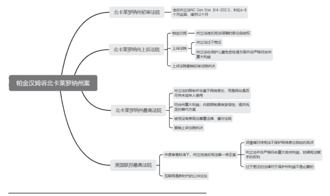

### 【核心争议点】

1. 中等审查下，州地方法规是否违背基本法首条修正案

2. 互联网是否构成新时代的公共讨论空间

### 【裁判论证过程】

（一）中等标准下，州地方法规违背了基本法首条修正案

联邦顶级审判所强调，基本法首条修正案的核心之一是任何人有权进入特定场所倾听与表达。如今网络为受保护的交流提供了低成本且广阔的空间。在认定“基本法首条修正案不保护网络言论”前必须极度审慎。

即便假设州法内容中立而适用中等审查，该法在限制言论上仍不严格贴合政府重大利益，且已超出实现正当目的所需。论证基于两点假设：一是条文用语极宽，涵盖广义社群平台，可推定适用于脸书、领英、推特等常见平台；二是基本法允许州对性犯罪者制定具体严格规制，例如禁止联络未成年人或收集未成年人信息。保护儿童是重要利益，应以更精准法律规制，但不能违宪。线上互动平台代表了广阔思想世界，全面排除性犯罪者进入商业平台，包含获取合法利益、寻求改过的渠道，负担过重。

审判所指出，北卡州未能证明全面禁令对远离儿童确属合理必要。州方援引伯森诉弗里曼案，该案仅禁止在投票站100英尺内从事竞选活动，限制更有限，无法支撑过于宽泛的禁令。审判所认为洛杉矶市场委员会董事会诉耶稣犹太人公司案更具可比性，该案中禁止在机场进行“基本法活动”的条例被否，因其涵盖谈话、阅读、佩戴徽章等受保护行为。若全面禁止机场表达违宪，则北卡州也不应颁布全面禁止现代社会不可或缺的网络表达权利。

（二）互联网是新时代的公共讨论空间

审判所重申，公民有权进入特定场所表达。街道与公园是经典场所。援引里诺诉公民自由联盟案，网络空间尤其是社群平台应被视为“庞大的互联网民主论坛”。

阿利托大法官、首席大法官与托马斯大法官虽同意州法违宪，但对互联网是否等于公共讨论空间持异议：
（1）保护儿童免受性侵是重大州利益，网络是性侵者获取信息、伪装身份、引诱儿童的有力工具。
（2）州法限制超出维护正当利益范围。第14编202.5条禁止性犯罪者访问符合四要件的社群网络，阻碍了大量与性犯罪几乎无关的网站，如亚马逊、华盛顿邮报、医疗网站等，界定过宽。
（3）网络与物理世界差异显著。监管孩子在线活动比监管其在物理空间的活动更难，网络匿名性使犯罪更易隐蔽。审判所将互联网与公园街道等同，可能导致州政府无权限制性侵者访问青少年交友网站，应谨慎适用言论自由。

### 【审理结果】

1. 北卡州初审法院判处帕金汉姆6至8个月监禁，缓刑12个月

2. 北卡州二级机构撤销初审判决

3. 北卡州终审机构撤销二级判决

4. 联邦顶级审判所于2017年6月9日撤销州终审判决并发回重审

### 【相关法条】

美国基本法首条修正案

国会不得制定关于下列事项的法律：确立国教或禁止宗教自由；限制言论自由或出版自由；限制人民和平集会和向政府请愿申冤的权利

美国北卡州法典第14编202.5条

禁止性犯罪者使用商业社群网站

（a）罪行。根据法典第14编27A条登记的性犯罪者，若明知某商业社群网站允许未成年人成为会员或在该站创建或维护个人网页，则不得访问该站，否则构成犯罪

（b）“商业社群网站”指同时满足以下要求的互联网网站：
（1）运营方从会员费、广告费及运营相关来源获取收入
（2）为两人或以上以友谊、会面或信息交换为目的的社交介绍提供便利
（3）允许用户创建网页或个人简介，信息可包括真名、昵称、照片、其他个人信息，以及通往朋友或同事个人网页的链接
（4）提供留言板、聊天室、电子邮件或即时通讯等交流机制

（c）不包括仅提供照片分享、电子邮件、即时通讯、聊天室或留言板之一的网站，或主要为商品服务交易提供便利的网站

（d）管辖权。若犯罪表达来自该州或在该州接收，则该犯罪视为在该州实施

（e）惩罚。违反本条为一级重罪

### 【案例评析】

（一）本案再次确认社群平台是公共讨论空间

科技进步远快于法律与制度调整，新问题不断涌现。随着社群平台成为公众表达渠道，基本法首条修正案是否适用于网络的讨论持续升温。里诺案已认定网络尤其是社群平台为“庞大的互联网民主论坛”。本案再次引用并确认，访问互联网和社群平台是受基本法保护的权利，是行使首条修正案权利最重要的场所，社群平台构成新时代公共讨论空间。

哈里·凯尔文最早提出公共讨论空间概念，认为公园街道等公共场所是公民自由讨论的设施。美国司法实践将政府地产分为公共讨论空间、非公共讨论空间和受限制讨论空间。1983年佩里教育协会诉佩里地方教育工作者协会案确立框架。非公共讨论空间如监狱、军事基地；受限制空间如公立大学设施、公共剧院等。落入完整公共讨论空间范畴，政府规制言论须满足复杂标准。

言论自由审查有附带审查与严格审查之分。象征性言论由言论与行为构成，适用附带审查。州法禁止性犯罪者接触社群网络，看似禁止行为，附带限制言论，应适用中等审查。法官虽有分歧，却绕过争议，认定即便按中等审查，州法也不合宪。

社群平台是否属公共讨论空间则更清晰。规制须满足：政府行为内容中立；出于重要利益可合理限制时间、地点、方式且保留充分替代渠道；许可制度须服务重要目的且标准明确、裁量有限并具程序保障。审判所传统上把街道公园视为典型公共讨论空间，但随着互联网低成本、易访问且成为思想交流最重要场所的事实确立，最高审判所再次认可网络言论的重要性，即便存在物理与虚拟差异的质疑。

（二）本案影响了公职人员社群账号是否属公共讨论空间的认定

本案引发核心问题：公职人员屏蔽用户进入其官方社群页面是否违宪。先前已有审判机构认为，公共讨论空间理论可适用于政府拥有的抽象空间，甚至政府租用的私有财产。公职人员社群账号虽属私人平台，却可能构成公共讨论空间，尤其脸书、推特为政治参与与公众监督提供重要渠道。

截至2021年2月，类似案件已出现三起。2017年8月，弗吉尼亚地方法院在戴维森诉兰德尔案中裁定，县官员在官方脸书页面屏蔽用户违宪，引用本案主张社群平台为数字化的公共讨论空间。2019年1月7日，第四巡回法庭维持原判。

奈特研究所诉特朗普案亦同。一审与上诉机构均认定，总统推特账号构成受首条修正案保护的公共讨论空间，不得因内容限制用户发言。2020年3月23日，第二巡回上诉法院驳回被告复审。然而联邦顶级审判所持不同立场，认为推特公司对平台控制近乎无限制，平台属私人主体控制的言论空间，特朗普账号及评论区不构成政府控制下的社会公共讨论空间。

坎贝尔诉赖斯案^([\[12\]](#txt009.html#footnote_content_txt009_12))的裁判取向与既有先例并不一致。美国第八巡回上诉法院认为，密苏里州一名议员把访客挡在其推特主页之外，并不构成对宪法第一修正案的侵害，核心依据是该账户在多数情形下服务于选举动员而非官方事务。法院亦明确指出，由公职人员为公务目的运营的社交账号必须接受第一修正案的约束。目前已有三家联邦上诉法院在判断官员限制社交媒体言论的行为时，采用大体相同的分析框架。

当下美国各级公职人员愈发习惯以社交平台展开政治沟通。州长、参议员与众议员几乎无一例外都活跃于推特。随着这种使用方式常态化，推特等同类平台已成为当代民主运行的核心舞台，也倒逼司法部门不断细化第一修正案保护边界的认定路径。

### （三）案件触及第一修正案的利益权衡

宪法在法律秩序中居于最高位阶，第一修正案所确认的表达自由亦被视作核心法益。但就规范表述而言，“言论自由”只是高度概括的概念，其具体范围并不明确。保护能否无限延伸？是否存在不可克减的权利？随着美国法治实践演进，这一议题长期引发争论。20世纪60年代初，最高法院大法官雨果·布莱克^([\[13\]](#txt009.html#footnote_content_txt009_13))坚定主张第一修正案为绝对权利，认为其禁止是彻底、无例外、无条件的。与之对立，以菲利克斯·菲兰克福特大法官为代表的声音则认为绝对权利并不存在。当公共秩序、安全等更为紧要的利益与宪法基本权利发生冲突时，法官应容许对后者产生不利影响的行为。菲兰克福特强调，为维护民主社会的表达与国家安全，需要在同一制度体系内对相互牵制的利益进行衡量，这种方法远胜于机械遵循教条。时至今日，经大量著述反复辨析，这一命题已趋明朗。实然层面，若承认绝对权利论，则限制诽谤、欺诈等法律将失去依据；立法层面，只有在法益界限合理且体系高度成熟时才可能为绝对权利下定义；法哲学层面，绝对权利难以对应相称义务。总的来看，摒弃僵化的绝对权利论，为第一修正案保留利益衡量的空间，已成为主流取向^([\[14\]](#txt009.html#footnote_content_txt009_14))。唯有在个案中审视具体情境，逐案比较并权衡，才能最大化个案正义。

本案的审理焦点即在未成年人保护利益与表达自由之间的衡量。保护青少年身心健康是迫切的政府目标，但这并不意味着可以对表达施加超出必要目的的限制。州政府所推出的宽泛禁令，不仅阻断性犯罪者接触未成年人，也妨碍其正常的网络生活。用压制合理表达的方式来禁止非法表达属于不当比例，已超出保护法益所必需的限度。

脸书、推特等社交网站让人们始终保持联结，它们以十多年前难以想象的方式重塑了社会身份与人际关系，挑战着既有价值观与道德观。目前全球已有超过十亿人注册脸书，其中约一半每日登录^([\[15\]](#txt009.html#footnote_content_txt009_15))。对于背景迥异的人群而言，社交平台的诸多用途与自由密不可分，这正是第一修正案所要守护的核心。社交平台已成为促进个人互动、有效行使表达与结社自由的关键媒介。

立法者高度关注性犯罪者滥用这些资源实施恶行的风险，但鉴于线上社交在当代社会日益不可或缺，不能排除性犯罪者出于正当目的使用的可能。普通民众大多通过社交平台表达意见，而州法的社交平台禁令并未保留足够的开放交流通道。公众对性犯罪者再犯率高印象深刻，可能导致立法者与联邦法院在遏制性侵害的努力中不自觉地越过宪法边界。这种做法无疑对性犯罪者受宪法保护的那部分表达自由施加了过度负担。最高法院一再明确，即便囚犯也受美国宪法保护——“监狱的围墙不是隔绝囚犯与宪法保护的屏障”。曾有性犯罪记录者的社交平台使用权理应同样得到第一修正案保护，尽管该权利是受限的。

即便在保护极其重大利益时表达可能被适度限制，但州或联邦政府在立法上仍保有灵活调整的空间和未穷尽的手段，这正是本案大法官的观点。州立法完全可以通过制定更严格的性犯罪相关法律来打击犯罪、保护儿童，而不必触碰争议更大的第一修正案。法律制定应以最恰当的手段平衡各方法益。

### （四）对国内规范的借鉴意义

第一，值得学习的是美国在限制网络表达立法上的审慎态度。任何对重要政府利益的主张与立法，都不得脱离宪法约束。民主社会的一项基本要求是容纳不同声音，主流观点应受保护，边缘、少数与非正统意见也应获得空间。立法应审慎平衡，而非为追求一项重大利益而彻底牺牲另一项利益。

# 网络表达治理的参照路径

第二，网络作为开放媒介，汇聚了各类表达，不良信息的危害与思想多样性带来的活力并存。要在遏制不良信息的同时不破坏表达自由空间，规范原理的明确性与可操作性尤为重要。美国“公众讨论场域”原理历经发展，将公共场所区分为“传统公共场域”“有限公共场域”与“非公共场域”，并据此赋予不同程度的宪法保护。公众由此形成对行为后果的具体预期，避免“法不可知则威不可测”的寒蝉效应，执法者也能精准管理。随着时代演进，还能通过对传统原理的再解释来回应新领域问题。相比之下，我国网络立法在思路上延续传统，对表达内容限制多作笼统规定。在现行网络行政法规中，限制表达自由的表述与《未成年人保护法》《广播电视管理条例》《音像制品管理条例》《出版管理条例》等存在雷同。网络表达自由与这些领域看似相似，实则不能一概而论，网络空间的表达自由应有其特殊法律边界。从现有实践看，这一方面仍显不足。

## 关联判例推荐

### 1. Reno v. American Civil Liberties Union, 521 U.S. 844 (1997)

核心事实：1996 年美国国会通过《通信规范法》，禁止向未成年人传播“淫秽或不雅”信息及冒犯性材料，以保护未成年人免受互联网有害信息侵害。该法遭美国公民自由联盟等质疑，地方法院认定其违反第一修正案，最高法院维持此见解，指出网络尤其是社群平台是“庞大的互联网民主论坛”，为各类交流提供相对无限、低成本的空间。

与本案关联点：互联网是现代社会交换思想的最重要场所之一。

### 2. McCullen v. Coakley, 134 S. Ct. 2518 (2014)

核心事实：2007 年马萨诸塞州在堕胎诊所入口、出口及车道周围设立 35 英尺缓冲区，禁止示威者进入并限制接触与噪音示威。反对者以违反第一修正案为由起诉，地方法院认为该法虽限制时间、地点与方式，但属内容中立且保留足够交流手段，合宪。最高法院认为该法范围不够狭窄，未能满足政府重大利益，对请愿人权利造成过度负担，部分内容不必要地限制表达自由。

与本案关联点：合宪法律须内容中立，严格服务于特定且重大的政府利益，且不得对表达施加超出促进正当利益所必需的负担。

### 3. Ward v.Rock Against Racism, 491 U.S. 781 (1989)

核心事实：民间组织“反对种族主义摇滚音乐”每年在纽约中央公园举办演讲与音乐会，因扰民，纽约市 1986 年规定该组织须使用市政府统一提供的音响设备。该组织起诉称侵权，地方法院支持市府，巡回法院推翻，最高法院认为新规符合时间、场所或方式限制的三项要求：限制须内容中立；须为实现重要政府利益且措施严格限缩；须提供充足替代表达渠道。据此认定未违宪。

与本案关联点：为重要政府利益，政府可通过内容中立立法限制表达的时间、场所或方式，但必须保留足够替代表达方式。

### 4. New York v. Ferber, 458 U.S. 747 (1982)

核心事实：纽约州刑法禁止推广含 16 岁以下少年性行为的表演。书店店主费伯因售卖涉及未成年男孩性行为的影片被判有罪，上诉法院认为法未区分淫秽与非淫秽而违宪。最高法院认为政府在管制儿童色情作品方面应享有更大权限，保护儿童身心健康系紧迫利益。

与本案关联点：州立法服务于一项极其重要的利益——保护儿童身心健康。

### 5. Perry Education Association v. Perry Local Educators’ Association, 460 U.S.37(1983)

核心事实：法院将公众讨论场域原理体系化，把公共地产划分为公共场域、限制的公共场域、非公共场域，并认为应依据不同特征对进入权利及限制标准作差异化规定。

与本案关联点：政府规制表达的合宪性与公共地产的类型相关。

## 9.2 利弗曼诉彼得斯堡市案

### 案件索引

Liverman v. City of Petersburg, 106 F.Supp.3d 744 (E.D. Va. 2015)

Liverman v. City of Petersburg, 844 F.3d 400 (4th Cir. 2016)

### 关键词

社群平台；表达自由；劳动关系

### 案件提要

本案聚焦雇佣单位社群网络规范与雇员表达自由的冲突。彼得斯堡市警察局发布社群网络政策，禁止雇员在社群平台发布损害单位或雇员声誉、导致单位受不利影响的言论。原告赫伯特·利弗曼与万斯·理查兹在脸书上表达对新手警察过快晋升为指挥官不满并展开讨论后，因违反政策受纪律处分。二人依据第一修正案主张表达自由受侵。弗吉尼亚东区法院采用皮克林平衡分析，对涉及公众关切的问题权衡公共利益与部门利益。最终认为利弗曼的表达受第一修正案保护，部门惩戒违宪。

在社群网络蓬勃发展的背景下，社群平台拓展了表达自由边界，人人均可向公众发声。雇员的表达可能影响雇佣单位。本案对厘清雇佣单位限制劳动者社群平台表达的边界具重要参考价值。从宪法视角，表达自由是基本权利；从劳动法视角，劳动者表达自由应与其忠实义务与雇主利益相平衡。我国学者谢增毅据司法实践提出从“行为是否符合规章”“行为动机”“行为后果”“行为情节”四方面划定边界^([\[16\]](#txt009.html#footnote_content_txt009_16))，与本案采用的皮克林平衡分析法异曲同工。总之，本案兼具社群平台、表达自由、劳动关系三要素，探讨了劳动者在社群平台上表达自由的边界。

### 案件要旨

美国弗吉尼亚州地区法院：一审原告赫伯特·利弗曼与万斯·理查兹，被告彼得斯堡市与约翰·迪克森。

美国第四巡回法院：上诉人赫伯特·利弗曼，被上诉人彼得斯堡市。

利弗曼与理查兹系彼得斯堡市警察局雇员，受局长约翰·迪克森领导。2013 年 4 月，迪克森修订 2010 年社群网络政策，禁止公职人员散布使部门或市政府声誉受损的信息。

2013 年 6 月 17 日下班后，利弗曼在脸书发布信息不满新手警察快速晋升，获 30 余人点赞评论，理查兹表示认同并参与讨论。多数参与者为现任或前任公职人员。主管上报迪克森后，局方依据政策给予二人纪律处分并记入留待察看。几周后迪克森修改晋升标准，禁止留待察看人员参与晋升，导致二人申请中士职位时被拒。2013 年 10 月二人致信质疑处分，随后被列为多项投诉调查对象，迪克森决定解雇利弗曼，后者辞职在先。

2014 年 3 月 5 日，二人向弗吉尼亚东区法院提起六项诉讼，指控违反第一修正案并要求赔偿。地方法院简易判决：（1）确认利弗曼第一项主张，但驳回理查兹类似主张，认为其表达不受保护；（2）驳回第三、四项主张，认为局长与市政厅无需为纪律处分担责；（3）驳回第五、六项主张，认为未实施报复。

利弗曼上诉。第四巡回法院认为部门社群网络政策违宪，依据该政策的纪律处分亦不被允许，推翻地方法院第二点；但认为关于报复的申诉无依据，涉及警察不当行为调查，与表达自由无关，维持第三点。最终部分维持、部分推翻并发回重审。

### 案例事实思维导图

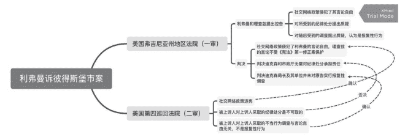

### 核心争议点

1.依据皮克林平衡分析法，2010 年与 2013 年的社群网络政策是否违反宪法第一修正案。
2.劳工部门依据 2013 年社群媒体政策对原告采取的纪律处分是否可免责。
3.对表达自由行为的报复性索赔是否成立。

### 裁判论证过程

#### （一）依据皮克林平衡分析法，2013 年的社群网络政策违宪

社群平台的发展拓展了美国宪法第一修正案中表达自由的受保护范围，值得注意的是，公职人员在社群平台上的表达自由边界需要进一步明确。根据既往判例，公职人员不会因为受雇而失去其在宪法第一修正案中的所有权利，美国最高院认为，为政府工作的公民仍然是公民。宪法第一修正案限制了公共机构利用雇佣关系来限制雇员作为私人公民所享有的表达自由的能力，若雇员作为一个公民发言以解决公众关心的问题，则该行为受到宪法第一修正案的保护^([\[17\]](#txt009.html#footnote_content_txt009_17))。

社交媒体言论与公职保护：一起美国判例的分歧判决

本案围绕2010年与2013年两版社交网络政策是否触碰宪法第一修正案展开，弗吉尼亚州法院采用了皮克林平衡的两段式检验。首要判断是利弗曼与理查兹的言论是否属于涉及公共议题的表达。一审认定，利弗曼在社交平台上的发言聚焦“警员安全与职责”，实质是对公职人员履职以及机构运作受阻的关切，而非针对雇主的直接攻击，因此属于公众关心的议题，获得第一修正案的庇护。理查兹的情况则不同，一审认为其帖文更多是个人对工作条件不满的抱怨，指向明确且缺乏把利弗曼所提公共关切进一步扩大的意图，属于私人情绪的宣泄，不构成公共利益，不应受第一修正案保护。

第二步是权衡言论利益与部门利益。在此之前需要厘清2013年政策的边界。该政策禁止员工在社交媒体上发布可能损害彼得堡市警察局及其他部门声誉的内容。参照既有判例，第一修正案并不保护针对内部运作的负面评价或影响公众观感的行为。回到本案，利弗曼的言论并非对警局的贬损，而是对公共议题的关注，因此其在Facebook上的发声应受保护。皮克林平衡显示，利弗曼就“官员安全与责任”发表的评论意义重大，而部门所强调的内部凝聚力、招募效率、社区信任等管理利益，并不足以压倒员工和公众对公共议题发表看法的利益。据此，基于2013年社交网络政策对利弗曼实施的纪律处分构成违宪。

#### （二）纪律处分是否可获豁免，初审与上诉呈现分歧
弗吉尼亚州法院认为皮克林平衡在操作上难以具体化，部门负责人迪克森很难预见到对利弗曼的惩戒会侵害第一修正案权利，因此认定其没有恶意适用2013年政策，享有豁免。关于市政责任，法院认为只有政策的最终制定者才需承担，纽约市从未批准该社交网络政策，仅因雇佣了迪克森不能归责。上诉法院则持不同看法，认为迪克森的惩戒并不合理。言论自由不应被模糊处理，一刀切地事先禁止异议表达是不正当的，对发表反对意见者进行惩戒不利于公众监督，因此迪克森无理由免责。至于市政责任，上诉法院指出迪克森虽无最终制定权，但可能受纽约市政府的指导与控制，需发回地方法院进一步查明。

#### （三）后续调查与言论并无报复关系
一般而言，主张侵权赔偿需证明三点：发言系以公民身份就公共议题作出；公民身份下的言论利益大于雇主有效履职的利益；言论与报复性措施之间存在充分因果。利弗曼满足前两项，理查兹因不涉及公共议题而未满足第一项。上诉法院认为两次针对利弗曼的调查均有独立依据：一次源于其向女警官发送色情邮件而启动的性骚扰调查，调查期间他承认工作期间有不当性行为；另一次是因无视局长命令、未按指示在岗而被查。两者与言论自由受侵并无直接因果。理查兹亦被调查两次，均由同事投诉触发，与迪克森无关。一次是因他向媒体举报另一警官配偶，证明清白后一周内结案；另一次涉及他在百货商店参与警务项目，相关指控被认定毫无根据。原告未能举证证明调查系因言论而来的报复。

### 审理结果
1. 弗吉尼亚州法院认定2013年社交网络政策侵害了利弗曼的言论自由，未侵害理查兹的言论自由，上诉法院维持该认定。
2. 弗吉尼亚州法院认为迪克森依据该政策对两人实施纪律处分享有豁免，上诉法院推翻该结论，认定迪克森需承担责任。
3. 弗吉尼亚州法院认为纽约市政府无需承担市政责任，上诉法院裁定发回重审。
4. 弗吉尼亚州法院认定无需承担言论自由报复索赔，上诉法院确认该判决。

### 相关法条
美国宪法第一修正案
国会不得制定关于下列事项的法律：确立国教或禁止宗教自由；限制言论自由或出版自由；限制人民和平集会和向政府请愿申冤的权利。

### 案例评析
#### （一）社交媒体管控与言论自由边界的再讨论
第一修正案禁止政府以立法方式压制公民言论，而社交网络政策却常对言论设限。边界何在？传统上不受保护的类型包括煽动违法、淫秽、构成犯罪、斗殴言论、儿童色情、构成现实严重威胁等，以及诽谤等不实言论。本案的评论不属于上述范畴。员工针对公共部门的评论是否受保护，需借助Connick案与Pickering案确立的公共利益与部门利益权衡。本案表明，当公共利益大于部门利益时，言论受第一修正案保护，可就侵害提起诉讼。皮克林平衡已成为判定员工社交媒体言论是否触及政策红线的重要工具。

#### （二）劳动者网络发声的权限如何界定
员工在社交媒体上发布不利用人单位的内容引发纠纷。美国《国家劳动关系法》虽提供一定保护，但并非绝对。该法保障劳动者集体行动权，同时承认雇主维护纪律与运营效率的正当利益。边界问题在中国实务中也常考量言论真实性、对企业造成的损害、严重程度、传播范围及惩戒是否合理。谢增毅提出应考量四要素：用人单位规章、言论动机、实际后果、具体情节与严重程度。惩戒应遵循比例原则，明确、公平、程序正当，避免过度苛刻。

## （三）社交媒体治理呼唤多方协同
社交媒体传播快、覆盖广、影响大，美国最高法院已指出互联网尤其是社交媒体是当代重要交流场所。缺乏统一法律规制，政策林立，易侵权利。对规制可从三方面着手：其一，依托现行法律，第一修正案虽保障言论，但不保护煽动违法、淫秽等类型，现有规则仍是主要约束力；其二，网络平台的关键作用。1996年《通讯法》允许平台基于善意判断删除淫秽、骚扰等内容，平台在限制言论方面的权力有时超过政府；其三，用户主体性。本案利弗曼通过诉讼确认政策违宪，说明用户可通过司法途径捍卫权利，成为规制的重要力量。

## 【关联判例推荐】
### 1. Grutzmacher v.Howard Cnty., 851 F.3d 332 (4th Cir. 2017)
核心事实：马里兰州霍华德县消防救援部门两名员工将原告Grutzmacher的Facebook帖子转发给部门营长。Jerome通过电子邮件要求原告查看并删除不符合社交媒体政策的内容，原告删除后仍坚持合规，并提起报复性解雇及政策违宪之诉。法院认为消防员的种族歧视言论与政府雇员就工作场所公共政策发表的言论性质不同。

关联点：该案同样探讨了部门维护工作秩序与效率的需要，与雇员社交媒体言论自由之间的衡量问题。

### 9.3 奈特研究所诉特朗普案
### 【案件索引】
Knight First Amendment Institute at Columbia University v. Trump, 302 F.Supp.3d 541 (S.D.N.Y. 2018)
Knight First Amendment Institute at Columbia University v.Trump, 928 F.3d 226 (2d Cir. 2019)
Knight First Amendment Institute at Columbia University v. Trump, 953 F.3d 216 (2d Cir. 2020)
Biden v. Knight First Amendment Institute at Columbia University, 141 S.Ct. 1220 (2021)Knight First Amendment Institute at Columbia University v. Biden, 2021 WL 5548367(2d Cir. 2021)

### 【关键词】
美国宪法第一修正案；社交媒体平台；公职人员社交账号；公共论坛

### 【案件提要】
本案体现第一修正案原则在互联网空间的延伸。特朗普因原告在其推特账号评论区发表反对性言论而将其拉黑，导致原告无法浏览和回复。原告与哥伦比亚大学奈特第一修正案研究所提起诉讼，请求确认拉黑行为违宪并予以禁止。@realDonaldTrump账号兼具私人起源与公务使用特征，引发账号性质与拉黑行为性质的争议。上诉至联邦最高法院后，因政权更替与账号关闭，讨论焦点转向社交媒体平台与第一修正案言论自由原则的关系。托马斯大法官指出，更应关注主导数字平台所行使的权力。

### 【案件要旨】
美国纽约州南区法院：确认原告有权起诉总统及白宫社交媒体总监，认定推特讨论活动受第一修正案保护，特朗普账号评论区构成政府指定的公共论坛，基于言论内容的拉黑构成观点歧视，属违宪，仅作宣告性救济。

美国第二巡回上诉法院：驳回特朗普方上诉，维持初审判决。

美国联邦最高法院：基于事实变化将焦点转向平台权力。

特朗普推特拉黑案：从巡回法院胜诉到最高法院逆转

2020年8月20日，被告向联邦最高法院递交再审申请。案件尚未开审，2020年美国总统大选尘埃落定，拜登胜出并就任第46任总统，同时承接了原被告双方在本案中的诉讼地位。最高法院审理后指出，推特公司对特朗普账号的注销行为表明特朗普对该账号的实际掌控极为有限，构成公共论坛所必需的政府控制要件在本案里未能成立；亦无证据显示推特的相关操作受到政府施压，更不存在将推特类比为公共承运人或公共设施的特殊情形，故宪法第一修正案的言论自由保障不适用于本案。最高法院据此撤销第二巡回上诉法院的原判，并将案件发回重审。

2021年5月26日，第二巡回上诉法院采纳最高法院的指引，裁定驳回原告的全部诉讼请求。

### 【案件脉络导图】

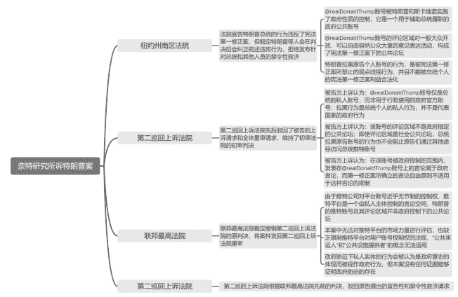

### 【核心争议点】

1. @realDonaldTrump 账号的法律属性，是属于特朗普个人的私用号，还是履行总统职责的公务号。
2. 特朗普封禁用户账号的具体行为，应被定性为私人处置还是公权力行使。
3. 在政府言论规则与公职人员自身第一修正案权利的框架下，公职人员屏蔽公众评论是否具有正当性。
4. 特朗普账号下的评论区，能否被认定为公众自由发声的公共论坛。
5. 由私营主体运营的推特平台，在何种条件下会被纳入第一修正案言论自由的规制范围。

### 【裁判论证过程】

#### （一）@realDonaldTrump 账号被认定为辅助履职的官方公共账号
公共论坛的成立通常要求空间由政府拥有或实际掌控，即使缺乏名义上的所有权，只要存在实质性控制亦可成立。被告主张推特为私人平台，@realDonaldTrump 号系特朗普2009年3月自建的个人账号，在其任总统期间仍保持私人控制，未改变其私人言论属性。

一审与上诉法院则围绕账号的现时使用进行判断。其公开资料、关联网页以及白宫相关人员的表述均显示该账号代表国家、由政府运营；负责保存政府档案的国家档案馆也认定相关推文属于官方记录。双方一致认可就职后特朗普一直将该账号用作与公众就施政议题沟通的核心渠道，是白宫政务宣传的主要工具之一。基于上述事实，法院认为账号的公共属性压倒私人属性。

据此，特朗普与白宫社交媒体总监斯卡维诺对该账号行使了政府性的管理权，符合政府控制要件，特朗普亦以总统身份发布只有总统才能作出的行为。

#### （二）封禁行为被认定为政府行为
判断行为是否以政府名义进行，关键在于是否行使政府拥有的权力并披上政府权威外衣。被告认为拉黑功能为推特用户通用功能，并非公权力专属，故不应触发第一修正案审查。

下级法院认为，公职人员在完全私有的个人账号上拉黑通常不属政府行为，但本案背景特殊。账号已由法院认定为政府公共账号，封禁可视为政府作为财产控制者行使排斥他人的权力；且特朗普发帖时系以总统身份行事，拉黑反对者亦属总统身份下的行为，公职身份放大了个人决定的国家影响力，故构成政府行为。

第二巡回上诉法院两位异议法官提出不同意见。认为法院以账号整体带有政府性使用就推定拉黑行为亦为政府行为属于过度推理，应聚焦行为本身而非账号状态；且若因使用习惯即使个人社交账号转为政府公共账号，将导致公职人员为规避责任而回避公共议题；同时法院未给出清晰的判断标准，难以确定账号何时、何种情形下转为政府行为。

#### （三）政府言论原则与公职人员权利不能为拉黑行为提供合法性
政府自身的言论不受言论自由条款规制，政府有权为自己发声并选择观点。第一修正案仅限制政府对私人言论的干预，不限制政府言论本身。

被告认为既然账号为政府控制，则账号上的言论即属政府言论，相关评论亦不受言论自由保护。下级法院反驳，账号发布的推文属于政府言论，但评论区不然。评论由个人以私人名义发表，政府无法对其内容保持控制。评论区同时具备公共论坛的开放获取与观点中立要件：推特对公众普遍开放，仅有年龄限制；平台本身中立，不对社会议题表态。

法院亦指出，公职人员在任期不丧失第一修正案权利，判例亦未赋予公民强制政府倾听的权利。但本案拉黑并非消极不回应，而是主动限制公众表达。被封用户的内容原本对其他人可见且可被回复，封禁削弱了其向公众传播观点的能力。

被告辩称可通过换号等方式规避影响，并未实质阻碍言论。法院认为即便存在变通，内容性排斥仍构成额外的表达负担，属于典型的观点歧视，即使仅造成负担也违反第一修正案。

## （四）特朗普账号评论区最终被认定非公共论坛
传统上，公共论坛指在不损害政府财产或项目基本功能前提下，能容纳大量公众演讲的空间。若政府拥有广泛自由裁量权决定是否提供表达空间，则不适用公共论坛理论。

第二巡回法院认为应考察政府意图、政策、实践、财产属性及其与表达活动的相容性。账号评论区对大众开放，不因政治立场受限；总统助理斯卡维诺公开称其为总统与民众直接交流的渠道；互动性也证明其可承载大量意见。下级法院据此认定政府主动提供不受歧视的交流渠道，形成了公共论坛。

异议法官则认为，政府只能通过积极作为而非放任形成网络公共论坛。特朗普创建账号初衷为表达个人观点，后续用于发布政策仅为便利，未有提供公众表达空间的意图；且评论区仅限关注用户可见，并非完全开放。

案件上诉后事实发生变化。特朗普卸任后，推特以“防止进一步煽动暴力”为由永久关闭其账号。最高法院据此调整判断。援引克里希纳理论国际学会诉李案中关于政府开放财产供公众表达的说明，最高法院承认账号在形式上具有公共论坛的某些特征，但公共论坛的本质是政府控制的社会空间。法院以酒店会议室类比：政府租用酒店举行听证时不能驱逐参与者，因政府控制空间；政府官员在酒店与选民非正式会面时可要求酒店驱逐干扰者，因控制者为私人酒店。

本案中，特朗普仅阻止少数人互动，而推特平台不仅禁止特朗普与支持者互动，更永久移除其账号。根据2020年6月18日生效的推特服务条款，平台可随时出于任何原因删除任何账号，包括总统。相较之下，特朗普对账号的控制微不足道。最高法院最终认定推特为私营主体控制的言论空间，账号及其评论区不属于政府控制下的公共论坛。

## （五）推特不符合适用第一修正案的三种特殊情形
最高法院承认私人实体通常不受第一修正案约束，但在特定情形下可能适用。

公共承运人指在交通、通讯等领域承担公共服务义务的私营企业，政府可对其施加不得歧视性服务的义务，同时给予特许经营等优惠。观点认为公共承运人身份不必然要求市场支配力，关键在于是否服务于公共利益。虽美国先例曾将传统电报公司认定为公共承运人，但本案记录无法评估推特的市场力量，亦无任何法规限制其关闭账号的权限。要使其受言论自由原则约束，需先接受政府对其排他权的限制，目前事实不符。

公共设施提供者概念适用于向公众开放服务的非交通通讯企业。司法实践对是否涵盖互联网平台存在分歧。最高法院以与公共承运人相同的理由否定该适用：缺乏对推特单方面关闭账号权限的限制，无法证明账号由政府实质控制。

政府胁迫指政府通过强制或威胁诱使私人实体实施政府本身不得实施的行为。若封禁或关闭系在政府胁迫下作出，则可视作政府行为。但双方均未提出相关指控，亦无证据显示存在政府胁迫。

## 【审理结果】

1. 纽约南区联邦地方法院认定@realDonaldTrump 账号为辅助总统履职的政府公共账号，特朗普拉黑行为构成违反第一修正案的观点歧视，支持原告宣告性救济请求，但基于被告可能纠正违宪行为的前提，拒绝发出禁令性救济。
2. 第二巡回上诉法院驳回被告上诉，维持初审判决。
3. 第二巡回上诉法院再次驳回被告全体重审请求。
4. 联邦最高法院认为特朗普推特账号评论区并非公众自由发表观点的公共论坛，且推特作为私营社交平台不符合公共承运人、公共设施提供者、政府胁迫等特殊适用情形，撤销第二巡回上诉法院判决并发回重审。
5. 第二巡回上诉法院根据最高法院裁决，驳回原告的宣告性与禁令性诉讼请求。

## 【相关法条】

美国宪法第一修正案

国会不得制定关于下列事项的法律：确立国教或禁止宗教自由；限制言论自由或出版自由；限制人民和平集会和向政府请愿申冤的权利。

总统档案的法定范围与社媒言论的司法边界

美国《总统档案法》第2201条第2款对总统档案作出界定。根据该条款，总统档案指总统本人、直属幕僚或总统行政办公厅中负责为总统提供咨询与协助的机构及人员，在处理与宪法、法律或其他官方礼仪职责相关或对该职责产生影响的公务活动中形成或收到的文件材料及其可合理分割的部分。该概念
（A）包含与总统或其幕僚政治活动有关的文件材料，但以此类活动与履行宪法、法律或官方礼仪职责相关或对其有直接影响为限；
但
（B）不包含以下材料：（i）《美国法典》第5编第552条（e）款所指的机构官方记录；（ii）个人记录；（iii）出版物与办公用品库存；或（iv）为方便查阅而制作并有明确标识的复制件。

【案例评析】

### （一）社媒平台属性与言论自由条款保护边界的再审视
该案在帕金汉诉北卡罗来纳案之后，继续探讨线上言论的保护尺度。帕金汉案中肯尼迪大法官将网络空间描述为巨大的民主广场，主张社媒使用者的行为应受First Amendment的广泛保障。而此案托马斯大法官从平台控制权切入，提醒不应轻率地把社媒等同于社会公共言论空间。

First Amendment的核心是公民有权进入特定场所以倾听与表达，并在思考后继续交流。具备普遍开放属性的空间通常须由政府掌控，才能以公共服务形式无差别开放。若空间为私人主体所有，则所有权附带的排他权使其可在内部合法限制表达。此案中的用户服务协议即赋予平台随时以任意理由关闭账号的权力。

托马斯大法官提出的关键问题是：传统法理如何适用于所有权高度集中、私有化信息设施所构成的在线互动环境。他归纳出可供参考的判断标准：由私人掌控的社媒不应被当然视为公众可自由发表观点的公开场域；言论自由条款的适用，必须以存在限制平台排他权限的具体法规为前提，以保障宪法所要求的公众自由进入与自由表达。

该司法立场是对帕金汉案结论的发展，后被斯旺森诉格里芬案等十余件判决在说理时引用。田纳西州立大学政治学教授瓦伊尔指出，托马斯法官虽未完全采纳原告主张，但在最高审级意见中探讨了社媒平台在限制言论时可能承担责任的情形：一是被认定为公共承运人，二是被视为公共设施提供者。这两种责任框架尚待判例完善，但已在该领域引发持续讨论。

### （二）在任人员与政府机构社媒使用的司法争议
近十年美国社媒急速扩张。据皮尤中心调查，2019年底美国成年网民、智能手机使用者及社媒使用者占比分别达90%、81%和72%。脸书、推特、优兔等平台已取代传统媒体，成为多数民众获取信息与社交的主要渠道，既便利生活，也激化了在任人员与政府机构使用社媒的司法争议。

此案一审与二审均认定前总统屏蔽原告账号的行为违反言论自由条款。有学者据此认为，在任人员若希望账号保持私人属性而免受宪法规制，应避免发布任何公务信息且不开放互动。若个人或准个人账号被用于公务，则可能构成公开言论空间，账号支配权随之受限。

亦有相反观点。康奈尔大学法律信息研究所指出，第二巡回二审认定@realDonaldTrump为公开场域的结论，与“公开场域系政府控制空间”的常规表述相冲突。司法实践中出现相反判决，如坎贝尔诉赖施案中法院认为州立法委员的社媒账号属私人账号，立法委员有权自由拉黑。

二审两位异议法官担心该意见将超出白宫范围，造成各级官员使用社媒的不确定性，降低其抵御仇恨与骚扰的能力，最终导致言论减少。哥伦比亚大学调查显示，该案意见发表后政府官员使用方式并无明显改变，反而总统在推特发帖频率显著上升。如何在公众表达自由与在任人员账号控制间取得平衡，仍需学界继续研究。

就政府机构而言，2020年4月美国个人教育权利基金会调查200余所公立大学与政府机构官方社媒账号，并在报告《无可评论：政府机构社媒使用与宪法第一修正案》中指出：在198所回复机构中，逾80%广泛使用过滤工具审查批评性言论。律师界据此呼吁机构制定公开的账号使用书面政策，及时修正可能阻碍公众表达的屏蔽功能，以降低法律风险。

评论指出，若政府机构欲在其社媒平台上限制双向信息流动，为符合宪法要求，应注意：不因观点内容选择性屏蔽公众意见；仅对屡次违规用户施以短期禁言；账号管理人员执行管理时须保持观点中立与非歧视。

### （三）公开场域的构成要素：表达的发出与传达
围绕@realDonaldTrump账号是否构成公开场域，一审与第二巡回二审少数意见分歧。一审未将账号整体化处理，而是拆分为推文与评论区，认为推文属政府言论不适用言论自由条款，而评论区构成可供公众互动的公开场域。二审两位法官则认为这种人为机械拆分不可取，账号并不存在一审所指的公开场域。

双方举例交锋。一审以市政厅会议为例：官员政治声明属受保护政府言论，但若会议允许公众评论，官员不得因观点阻止与会者参与辩论。二审则反驳：（1）官员仅允许政策支持者现场评论，无需向反对者开放；（2）官员分发政策小册子并以信件征集意见，可挑选意见公开发布。该逻辑认为“政策发布+公众评论”模式并不必然使后一环节形成公开场域。

一审的思路是将推文与评论区视为两个独立、可分割的部分，评论区可单独适用言论自由条款。二审少数意见则视二者为从属关系，评论区依附于推文，如同政策支持者的评论与信件反馈附属于政策发布；因“政策发布”属于无需考虑言论自由条款的政府言论，具有从属性的“公众评论”亦沾染该特性，在任人员可限制发言条件。

笔者倾向一审观点。二审两位法官所举例与@realDonaldTrump账号并不等同。公开场域的两项根本要素是言论的“自由发出”与“自由到达”。账号评论区与市政厅会议满足这两项要素，公民于评论区或会场发表个人意见可毫无阻碍地呈现给其他用户或旁听者，发出与到达均不受妨碍。而二审例（1）因仅允许支持者评论，实质限制了反对者言论的自由发出；例（2）因官员可挑选意见发布，公众言论的自由到达受他人干预。

公开场域本质上是无需外力干预即可自动传递言论的空间，公众言论从表达者“自由发出”并“自由到达”受众。@realDonaldTrump账号评论区符合此特征，而少数意见的论证示例对此未予注意。尽管联邦最高审级最终以平台对该账号的私人绝对控制为由否定其公开场域地位，认识到这两项构成要素有助于司法实践对复杂情形作出准确定性。

## 【关联判例推荐】

### 1. Rosenberger v. Rector & Visitors of Univ. of Virginia, 515 U.S. 819, 115 S.Ct.2510, 132 L.Ed.2d 700 (1995)
核心事实：大学学生组织出版基督教观点报纸，控告大学基金会拒绝资助印刷费用。最高法院肯尼迪大法官认为拒绝资助构成观点歧视；排除多种观点与只排除一种观点对First Amendment的侵害程度相同；缺乏资金不能成为大学基于言论内容进行歧视性资助的正当理由。
与此案关联点：无论是形而上学场域还是地理空间场域，均不得在场域限制范围内对言论进行观点歧视。

### 2. Pleasant Grove City v. Summum, 555 U.S. 460, 129 S.Ct. 1125 (2009)
核心事实：宗教组织起诉市政府拒绝在已设有十诫纪念碑的公园中增设其他纪念碑，称侵犯言论自由。犹他州地区法院驳回禁令请求，最高法院认可，认为市政府允许他人捐赠永久纪念碑系行使不受言论自由条款审查的政府言论权利。
与此案关联点：言论自由条款仅限制政府对私人言论的规制，不限制政府言论本身。

### 3. Sorrell v. IMS Health Inc., 564 U.S. 552, 131 S.Ct. 2653, 180 L.Ed.2d 544(2011)
核心事实：佛蒙特州药品生产商协会挑战《处方保密法》，该法限制出售、披露及使用含个人医生处方药房记录。州地区法院驳回救济，二审法院撤销并发回重审。
与此案关联点：政府不得以内容审查或施加言论负担的方式压制不受欢迎的言论。

### 4. Robinson v.Hunt Cty., Texas, 921 F.3d 440 (5th Cir. 2019)
核心事实：社媒用户指控政府办公室审查其社媒页面违反First Amendment。德州北区法院以未提出合法索赔驳回初步禁令，二审法院撤销并发回重审。
与此案关联点：在任人员禁止选民进入政府官方社媒页面的行为构成违宪观点歧视。

## 9.4 门罗诉中心巴克斯学校案

### 【案件索引】
Munroe v. Central Bucks School Dist., 34 F.Supp.3d 532 (2014)
Munroe v. Central Bucks School Dist., 805 F.3d 454 (2015)

### 【关键词】
社媒；表达自由；劳动关系

### 【案件提要】
本案聚焦社媒平台上劳动者表达自由的边界。原告娜塔莉·门罗在其个人公开博客发表争议性言论，经媒体报道后严重扰乱学校教学生活秩序，被校方解雇。门罗主张博客内容属公共事务讨论，应受First Amendment保护。二审法院认为内容确涉及公共事务，但公职人员言论欲受保护须通过皮克林平衡性测试，即言论促进公共讨论的价值需大于言论对雇主工作环境与秩序的不利影响。门罗言论未通过该测试，二审法院以2:1裁定驳回其基于First Amendment的报复主张，适用简易程序判决。

本案厘清了劳动者在社媒行使表达自由的限度，表明不利于雇主且对工作秩序造成重大不良影响的言论不受First Amendment保护，并在劳动者表达自由与雇主维护工作场所秩序效率的权利间作出平衡。随着社媒影响扩大，本案亦推动了相关法律解释向网络时代的更新。

### 【案件要旨】
宾夕法尼亚东区联邦地区法院：一审原告娜塔莉·门罗，被告中心巴克斯学校。
联邦第三巡回二审法院：上诉人娜塔莉·门罗，被上诉人中心巴克斯学校。
门罗为宾州东区公立学校中心巴克斯学校的英语教师。2009年8月至2010年11月，其在博客累计发布84篇博文，其中数篇涉及对学生的评价，使用刻薄措辞，建议在模板评语中加入“惊人的愚蠢”“骗子与作弊者”“有一天可能上街持枪扫射（希望我在开玩笑）”等，并以足以识别学生的细节描述。2011年2月当地媒体发现其公开博客后事件发酵，多家全国媒体报道，学生与家长反应强烈。门罗接受采访并坚决捍卫言论。校长卢卡堡知悉后令其停薪留职，恰逢产假，产假结束后返岗。2011年6月15日校长以教学表现不达标为由解雇其。

2014年6月门罗向宾州东区联邦地区法院提起基于First Amendment的报复主张，法院未支持并准予被告简易判决动议。2015年6月门罗向第三巡回二审法院上诉，二审法院维持一审决定。

### 【案件事实思维导图】
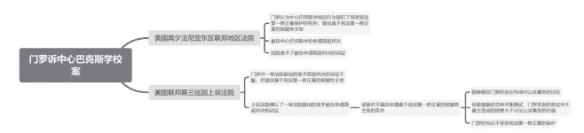

### 【核心争议点】
1.教师的言论是否应当受到特别限制。
2.如何判断门罗在社媒的言论是否受宪法保护。
3.门罗的言论是否满足“涉及公共事务”这一要件。
4.依据皮克林平衡性测试，哪方利益更值得保护。

### 【裁判论证过程】

#### （一）教师言论应当受到特别限制
其一，门罗身为公立学校教师，亦属政府公职人员。政府作为雇主管理雇员言论，与作为统治者管理一般公民言论存在重大差异。因政府拥有广泛权力，为确保公民在成为公职人员后言行有助于高效履行公共职能，必然对其言行自由施加一定限制。

教师发帖，能否得到宪法撑腰

门罗的职业属性让她与其他公务员拉开了距离。教书这件事牵涉到一套很特殊的社会关系，特别是面对容易受影响的学生群体。相比许多普通的公共岗位，公立学校的老师更依赖社会信任的支撑。最高法院在审视教师类表达时曾提示，判断要看该话语是否“妨碍教师在课堂上正常履职”或“干扰学校的正常运转”。^([\[49\]](#txt009.html#footnote_content_txt009_49))

正因为这种特殊性，司法态度偏向保守。宾夕法尼亚州东部联邦地方法院以及第三巡回上诉法院都认定，处在公立学校在职状态的门罗，对外发声理应承受更严的限制。

#### （二）公职人员想用宪法挡子弹，必须跨过三道门槛

依第一修正案，公务员要争取到宪法层面的庇护，必须同时满足：第一，以普通民众的身份说出；第二，内容触及公共议题；第三，在 Pickering 利益权衡中，公民就公共事务评论的价值，超过政府作为雇主追求行政效率的利益。^([\[50\]](#txt009.html#footnote_content_txt009_50))简单说，就是个人言论自由的分量要压过雇主的管理需求。

本案里，门罗的博文大多关乎私人生活，主要是食物与电影的点评。博客没有上锁，但她并未期待公众阅读，历史访问量也没有超过九人，因此可以认定为以普通市民身份表达。争议焦点于是这样的表达是否与公共议题相关，以及在 Pickering 权衡里各方利益如何衡量。

#### （三）公共议题的认定，一审与二审分歧明显

最高法院曾解释，若言论可以合理地与政治、社会、社区等议题关联，^([\[51\]](#txt009.html#footnote_content_txt009_51))或与具有普遍价值、公众关注的课题相关，^([\[52\]](#txt009.html#footnote_content_txt009_52))即可视为公共事务。

地方法院采纳了被告的说法，认为博文整体与私事挂钩，仅零星提到学术诚信、荣誉、努力等较为宽泛的概念，而这些提及也是为了服务个人经历的叙述。“原告（在博客上的言论）并没有参与教育改革、教学方法或具体校方政策的广泛讨论，而是主要在抱怨她的学生辜负了她的期望，并关注于她和学生之间的负面互动。”^([\[53\]](#txt009.html#footnote_content_txt009_53))

第三巡回上诉法院的判断则不同。法院承认博文中绝大多数内容平淡且与本职无关，但正是涉及学生的那部分让她在网络上被广泛关注。而正如地方法院所承认的，这些内容确实触及公共层面。上诉法院举例，门罗曾详述自己在课堂上如何尝试阐释荣誉的概念，以及学生如何以敌意回应她的努力。地方法院批评她对学区评分做法的谩骂口吻，但幽默、讽刺乃至个人化批判，都可以成为表达对政治、社会、社区等公众关切的手段。由此可见，博文并非单纯针对学生或管理层的私人牢骚。

此外，媒体对博文的集中报道以及门罗通过媒体作出的全国性表态，也印证了言论具备公共属性，合法的新闻关注本身也属于公共事务范畴。上诉法院据此认定言论满足公共议题要件，进而进入 Pickering 权衡。

#### （四）经 Pickering 权衡，二审认为言论不获保护

Pickering 权衡要求在公职人员作为公民评论公共事务的利益与政府作为雇主提升服务效率的利益之间寻求平衡。^([\[54\]](#txt009.html#footnote_content_txt009_54))权衡标准随言论性质而变，法院通常会看言论是否影响工作纪律与同事关系，是否损害需要忠诚与信任的密切工作关系，是否妨碍发言人履职，以及是否扰乱机构正常运行。^([\[55\]](#txt009.html#footnote_content_txt009_55))简言之，“雇主能承受的破坏程度应与言论对公众的重要性成正比”。^([\[56\]](#txt009.html#footnote_content_txt009_56))

地方法院权衡后作出认定：“原告的言论，无论效果还是语气，都具有足够破坏性，以至于抵消了其任何正当利益，因此不受保护。”

门罗则认为，地方法院只盯着个人抱怨与表达方式，忽视了其中引发的讨论价值。她强调，正是博文的强烈措辞才在全国范围内引爆了关于郊区公立学校学生表现与预期的讨论。

第三巡回上诉法院认为，即便确认涉及公共议题，门罗言论中代表个人与社会利益的部分也只占很小比重。法院指出，语气不当与是否属于公共议题无关，却在判断是否造成破坏或破坏可能性时起关键作用。强烈的措辞显然易在雇员与其上级、服务对象之间制造矛盾。

法院还认为，地方法院关注言论是否破坏师生间的尊重与信任关系是恰当的。第一修正案一般禁止“heckler’s veto”，即不能因民众不满就压制言论，但公立学校教师与学生、家长的关系具有特殊性。父母和学生不是旁观者，而是公共教育的参与者，没有他们的配合，教育就无法运转。因此在利益衡量时，必须考虑学生与家长对教师言论的反应。

本案中，门罗在公开且无密码的博文里，用尖刻的语言记录对学生和工作环境的负面评价，表现出明显的敌意与厌恶。博文被媒体曝光后，她此前低阅读量和相对匿名的假设被打破。部分贬损评论中，学生能认出自己或同学，家长也能通过对学生的“生动描述”认出孩子。随后她在地方与全国媒体采访中拒绝道歉并坚持己见。这种行为不符合宾夕法尼亚州对教育工作者的行为规范，也偏离公众对该职业的期待，对学生、家长和学区造成负面冲击。大量家长致信学区要求门罗不再任教，多名学生集体退课，学区被迫另聘教师完成教学计划。学区认为该言论不仅影响了门罗的教学职责履行，还严重干扰了教学秩序，造成广泛破坏。

基于 Pickering 权衡，第三巡回上诉法院认定门罗的言论得不到第一修正案庇护，并维持地方法院批准被告简易判决动议的决定。

#### （五）安布罗法官的异议：不应止步于简易判决

安布罗法官对维持一审结果提出异议。他认为，门罗在被停职后接受的一系列媒体采访是导致其被解雇的关键因素，而地方法院并未突出这一点，简易判决因此不妥，应由陪审团判断是否存在报复性解雇。

安布罗指出，媒体采访引发了公众的广泛关注与讨论，故该部分言论涉及公共事务。在 Pickering 权衡中，学区并未指控门罗接受采访妨碍了其教育能力或打击了教师士气。其他法官对此处理也不充分。学区仅称采访没有安抚作用，反而激化矛盾，却未说明这是否实质增加了学校运营难度，也未采取措施平息舆情以便学校完成教育使命。

安布罗还提到，博客公开后，学区本可主张教育责任优先于言论自由而解雇她，但最终只选择停职，且该停职恰好与她的产假重叠，影响有限。2011 年 8 月停职解除后，^([\[57\]](#txt009.html#footnote_content_txt009_57))学生集体退出其班级，这是学区第二次可解雇或调岗的机会，但学区仍未行动。安布罗认为，学区因此丧失了与运营利益相匹配的主张，而门罗的言论自由利益却被削弱，故不同意法院在 Pickering 权衡中偏向学区。

安布罗进一步认为，学区对门罗教学表现的低评分并非解雇的真正原因，真正触发点是门罗接受媒体采访使博客言论公开，令学区官员不安。学区以近期教学评分不佳为由，只是为了规避宪法困境的借口。他主张应由陪审团厘清学区的真实动机，因此反对维持原判。

## 审理结果

1.美国宾夕法尼亚东区联邦地区法院认为门罗的言论不构成对公共事务的讨论，不受宪法第一修正案保护，从而批准简易判决动议。
2.美国联邦第三巡回上诉法院基于门罗言论未通过 Pickering 平衡性测试，维持一审法院批准简易判决动议的决定。

## 相关法条

### 美国宪法第一修正案（Constitution of the United States First Amendment）

国会不得制定关于下列事项的法律：确立国教或禁止宗教自由；限制言论自由或出版自由；限制人民和平集会和向政府请愿申冤的权利.

### 《美国法典》第 42 卷第 1983 条（42 U.S.C.§1983）

**剥夺权利的民事诉讼**

凡以任何州或地区或哥伦比亚特区的任何法规、条例、规章、习俗或惯例为借口，剥夺美国公民或其管辖范围内的其他人的受宪法和法律所保障的任何权利、特权或豁免权的人，或导致前述权利、特权或豁免权被剥夺的人，应在法律诉讼、衡平法诉讼或其他适当的程序中对受害方负责；但在对司法官员以其司法身份采取的行为或不行为提起的任何诉讼中，不得授予禁令性救济，除非违反了宣告性法令或无法获得宣告性救济.就本节而言，任何专门适用于哥伦比亚特区的国会法案都应被视为哥伦比亚特区的法规.

## 案例评析

### （一）为劳动者在社交媒体上发表不利雇主言论划定检验标准

劳动者利用社交媒体发布对雇主不利内容并引发劳动纠纷，已成为热点。如何界定言论自由边界并协调言论自由与忠实义务，是各国亟需回应的问题。在美国，公职雇员可借助 Pickering 平衡测试，主张自己参与了公共事务讨论，且该讨论的价值超过雇主因工作秩序受损而承受的损失，从而获得第一修正案保护。门罗即援引此路径。但对于私营企业员工，言论自由受限更严，《国家劳动关系法案》仅在工时、工资、福利等合同条款议题上给予有限保护。无论是公共部门还是私营部门，涉及职场骚扰、歧视、报复时，劳动者仍可通过社交媒体维护自身或他人权利。总体来看，私营企业劳动者的言论自由空间明显小于公共机构雇员，美国由此在框架上区分了两者。

在中国，此类纠纷也日益增多。我国劳动者的言论自由受劳动关系规则约束，不得侵害名誉权、荣誉权、商业秘密等。基于信任的劳资关系中，劳动者负有维护劳动秩序的忠实义务。超出限制在社交媒体上发言，通常要承担不利后果。目前我国更多依赖司法实践形成的习惯进行判断，个案中会考察劳动者社交媒体行为是否符合规章制度、动机、后果、情节等因素，以此判断是否损害雇主利益、是否违反忠实义务，并据此认定是否超出言论自由边界及是否合法。^([\[58\]](#txt009.html#footnote_content_txt009_58))

### （二）深化了对社交媒体公共领域属性的认识

“公共领域”概念由汉娜·阿伦特提出，哈贝马斯在《公共领域的结构转型》中将其界定为介于国家与私人之间的地带，公众在此自愿参与批判性讨论并形成公共意见。本案中，即便媒体曝光前浏览门罗博客的人仅有9人，博客仍具备被任意读者阅读的可能，不能视为私人领域。第三巡回上诉法院也确认，博客中关于教学与师生关系的内容构成对公共事务的讨论。这表明社交媒体具备塑造数字公共领域、促进公民社会发展的能力，不能将其等同于可随意宣泄情绪、实施语言暴力的免责空间。

麻省理工学院公民媒体中心教授佐客曼曾指出，社交媒体除社交、娱乐、商业功能外，还承担展示多元观点、提供思考辩论场域、放大个人声音以形成公共意见、增强社会凝聚力等作用。^([\[59\]](#txt009.html#footnote_content_txt009_59))互联网时代极大拓展了公共领域的边界：参与权更平等，弱势群体进入门槛降低，交互性改变了传播者与接受者的地位，地域限制被打破。但数字公共领域也存在非理性倾向，如内容空洞、言词粗鄙、匿名下的情绪宣泄、侵犯名誉与隐私、盲目去精英化等。算法精准推送造成的“信息孤岛”风险、平台以热搜引导关注以获取流量等问题，更削弱了公共领域的价值。要恢复社交媒体传递真实广泛民意的功能，需正视其公共属性并治理相关阻碍。

### （三）推动劳动者言论自由法律解释的更新

本案虽认定门罗的言论利益未超过雇主维护秩序的利益，但社交媒体兴起后，劳动者言论自由的保护与限制需与时俱进，诸多类似案件推动了法律解释的演进。美国《国家劳动关系法案》保护员工的“集体行为”，即组织、加入工会、协商劳动条件等。随着社交媒体发展，国家劳动关系委员会对“集体行为”的认定趋于宽容，甚至点赞他人在社交媒体上的内容也可能被视为联合行为而受保护。

在德国，《基本法》第5条保障公民言论自由，劳动关系中的言论亦受保护。魏玛宪法已明确将雇员纳入言论自由适用范围，使用何种社交媒体并不影响权利行使，可通过口头、读者来信或脸书等发表观点。^([\[60\]](#txt009.html#footnote_content_txt009_60))在澳大利亚，劳动者在社交媒体上的言论除受一般言论自由保护外，常被视为私生活领域，不宜干涉，法院多认为线上行为不足以构成解雇理由。^([\[61\]](#txt009.html#footnote_content_txt009_61))正如学者弗洛门霍夫特所言，社交媒体已成为劳动法案件的核心要素。^([\[62\]](#txt009.html#footnote_content_txt009_62))

## 关联案例推荐

### 1. Pickering v. Board of Education, 391 U.S. 563, 88 S.Ct. 1731, 20 L.Ed.2d 811(1968)

## 言论自由在公职与平台上的双重边界

### Pickering 教师投书案
马文·L·皮克林是高中教师，他给镇上报纸写信，批评学区董事会和学监处理增收提案的方式。经过听证后，董事会认定该信妨碍学校正常管理而解雇他。皮克林诉请教育委员会复职。最高法院马歇尔大法官的意见是，议论学校是否需要额外经费是市民对教育行政的正当关切，一线教师对经费如何使用最有发言权，应当能在不惧处分的情况下就此说话。法院同时指出，检方未能举证证明该信存在故意或过失虚假，故不能作为解雇依据。最高法院推翻原判，发回重审。
启发：公务员就公共议题表达意见受宪法保护，法院会以利益衡量法权衡发言人自由与雇主管理利益，进而决定不利于雇主的言论是否受保护。

### 2. Miller v. Clinton County, 544 F.3d 542 (3d Cir.2008)
前任县缓刑办公室员工给负责法官去信，抱怨主管做法不当。收到信后法官即行解雇。员工起诉称第一修正案言论自由与第十四修正案正当程序受侵害。二审法院认为，信中虽涉及办公室运行问题，但整体集中在个人不满情绪，不构成受宪法保障的言论，因而撤销原判发回。
启发：公职人员的表达只有触及公共事务才有被宪法庇护的可能，一旦核心是私人抱怨，第一修正案不予保护。

### 3. Snyder v. Phelps, 562 U.S.443, 453, 131 S.Ct. 1207, 179 L.Ed.2d 172 (2011)
地方法院一度认为针对海军陆战队葬礼的示威未达社政评论程度，但最高法院指出，示威所涉美国政治道德、国家命运、军队同性恋议题及天主教神职丑闻，都是社会普遍关心的公共议题，而非纯私人情结。
启发：判断是否属公共事务不限于社政评论，只要是公众普遍关心的社会利益议题即可归入。

### 4. Craig v. Rich Township High School District 227, 736 F.3d 1110 (7th Cir.2013)
布莱恩·克雷格任职于芝加哥南郊里奇中央高中，为终身指导顾问。他在任内出版《这是她的错》，汇集成人关系建议。第七巡回法院认为该书主题社会关注度高，且同类咨询专栏众多，显示出新闻价值，故认定涉及公共事务。
启发：具有新闻价值的话题可被视为公共事务。

## 9.5 Klayman诉 Zuckerberg 案
### 案号记录
Klayman v. Zuckerberg, 910 F. Supp. 2d 314 (D.D.C. 2012)
Klayman v. Zuckerberg, 753 F.3d 1354 (D.C. Cir. 2014)

### 关键词
社交媒体；互动式计算机服务；平台责任；Communications Decency Act

### 背景概述
本案是围绕社交平台责任的典型争议，与美国 CDA 第230条紧密相关。该条被视作网络言论自由的基石，也是美国互联网发展的关键规则。1996 年克林顿签署 CDA，被称作新旧通信的分水岭，230条此后备受关注。国会立法时认为互联网为多元政治讨论、文化发展与智识活动提供平台，并将促进互联网持续发展、维护互动服务的市场活力列为国家政策。在此豁免下，创新者得以引领技术前沿，形成了极具活力的信息市场。第230条明确互动式网络服务运营方无需为用户不当行为负责。美国采间接侵权分层框架，区分信息原创者与传播者，原创者需就第三方内容负责，而 CDA 排除运营方被认定为原创者。这意味着平台无需逐条审查用户信息，法律风险大幅下降，言论在网络得以充分体现，也推动了社交媒体的扩张。同时该条赋予平台善意清理不当内容的权限，也埋下了争议。

案件因涉及 Facebook 及平台责任而广受关注。社交平台用户持续增长，已成为日常生活必需。平台是否需为第三方言论负责，与每个用户息息相关。数字经济高速发展，网络作为主力应受法律约束，监管方式与尺度始终是热点。随着中国互联网产业崛起及“互联网+”推进，网络立法与平台规制亟待完善。全国人大常委会2016年11月7日公布《网络安全法》，明确网络运营者的管理义务，第47条要求运营者加强用户信息管理，发现违法信息应立即停止传输并处置，保存记录并报告主管部门。实践中不良行为仍存，需法律规范。新冠疫情放大了互联网在沟通与工作中的作用，引发权利保护思考。除法律规制外，平台规则对基本权利的影响也不容忽视，应合理界定平台权利义务边界以保障个人基本权利。在新型中美关系背景下，中国网络治理研究既要服务国内发展，也应借国际视野，结合中国经验为全球治理提供智慧。对 CDA 第230条这类基础条款的处理，应汲取美国经验，保持客观中立，回归产业规律。

因此本案对理解社交媒体、平台责任与互联网立法具有重要意义。

### 裁判要点
哥伦比亚特区地区法院：原告 Klayman，被告 Zuckerberg 及 Facebook
哥伦比亚特区巡回法院：上诉人 Klayman，被上诉人 Zuckerberg 及 Facebook

被告 Facebook 运营 www.facebook.com，用户可在其上分享文章、照片、新闻及对全球事件的看法，也可浏览数万用户的信息。使用服务需先注册免费账号。

原告 Larry Klayman 为律师，担任“Freedom Watch”组织主席兼总法律顾问，拥有同名 Facebook 账号。

2011年，Klayman 在 Facebook 上发现名为“第三次巴勒斯坦起义”的页面，呼吁穆斯林于2011年5月15日祈祷后发动起义，并威胁审判日仅在穆斯林杀光所有犹太人时降临。该页面参与者超36万人，另有三个类似页面吸引数千订阅。发现后，以色列公共外交部长致信 Facebook 及创始人兼首席执行官 Zuckerberg，要求删除该页面及相关页面。Klayman 亦曾要求删除，未说明具体时间。数日后 Facebook 删除相关页面。

Klayman 认为删除不诚恳且迟缓，于哥伦比亚特区高等法院起诉 Facebook 及 Zuckerberg，指控其未及时删除页面构成故意伤害及过失违反注意义务。他称起义内容相当于对非穆斯林尤其是犹太人的暴力威胁，使其有理由担心遭受严重人身伤害或死亡。关于过失，他认为作为用户与公众成员，Facebook 对其负有注意义务，而允许并放任该死亡威胁页面存在即构成违约。

Klayman 申请禁制令以阻止相关页面出现，并索赔超10亿美元补偿与惩罚性赔偿。

Facebook 主张移送哥伦比亚特区地区法院并申请驳回。地区法院批准动议，理由为：其一，Facebook 属 CDA 第230条 f款第2项定义的“互动式计算机服务提供者”；其二，原告追责基础是第三方提供的信息，Facebook 仅为该信息的“发布者或发言人”；其三，Facebook 并非争议信息的内容提供者；故受第230条 c款第1项豁免保护。

Klayman 随后向哥伦比亚特区巡回法院上诉，巡回法院维持地方法院驳回判决。

2014年 Klayman 向联邦最高法院申请再审，2014年11月17日最高法院驳回再审令状，拒绝受理。

## 案情图谱
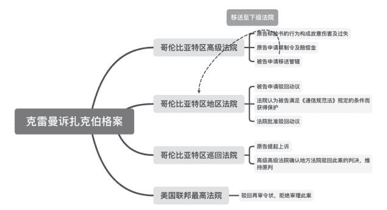

## 主要争议
1. Facebook 是否属于“互动式网络服务的提供者”。
2. Facebook 是否为第三方信息内容的“发布者或发言人”。
3. Facebook 是否为信息内容的提供者。

## 审理思路
### 一 Facebook 属互动式网络服务提供者
依据 CDA 第230条 f款第2项，互动式计算机服务指通过让多方用户接入其服务器提供信息的服务。司法实践通常认定网站符合此定义，且在先前判例中法院已确认 Facebook 符合定义。Facebook 允许用户创建、上传并与数万用户分享各类信息，即通过让多数用户接入托管社交网站的服务器来提供信息。故法院认定 Facebook 为互动式计算机服务提供者，因 Zuckerberg 为该服务的“提供者”，亦受保护。

### 二 Facebook 系第三方信息的发布者或发言人
第230条 c款第1项明确规定，不得将互动式计算机服务提供者视为他人提供信息的发布者或发言人，即无需对第三方内容负责。当诉讼请求在该法范围内时，法院通常审查被指控行为是否源于其作为“发布者或发言人”的地位。若属实，则依该条款排除责任。判例中“发布者”指审核、编辑并决定是否公开或删除第三方内容者。

本案中，Klayman 主张 Facebook 构成故意伤害及过失违反注意义务。地区法院指出，故意伤害是指蓄意并非法地通过言语或行为对受害者造成身体伤害的企图或威胁；过失索赔需证明被告负有义务、违反义务且原告因此受损。法院认为，就两项索赔而言，无论是使用网站发布内容、允许内容发布或拒绝删除帖子，被告被指控的行为均归因于其作为信息发布者的地位，而依 CDA 无需承担责任。

Klayman 辩称被指控行为并非源于发布者身份，而是违反合同、准合同与信托义务，故不应豁免。地区法院以原告未提出一致事实且未及时修改起诉书为由拒绝。审理上诉时，Klayman 主张诉求源于被告违反职责，该职责源于合同关系。巡回法院认为 Facebook 网站的《权利与责任声明》恰恰否定了原告所称的特殊法律关系，因声明明确提示 Facebook 不对第三方行为、内容、信息或数据负责。且起诉书中并无违约主张，故 Klayman 无权追加违约索赔。

### 三 Facebook 非信息内容的提供者
原告虽承认第230条 c款第1项中的另一信息内容提供者创造了该信息，但辩称被告本身即为信息内容提供者，应承担责任。被告则主张其并未创造或开发违法内容，不应被归为信息内容提供者。

地区法院认为，被告成为信息内容提供者的可能性存在，相关问题系其是否为争议陈述或出版物部分内容的信息提供者。将责任限定于全部或部分由被告实际创造或开发的信息，符合 CDA 立法目的，即维护互联网与其他互动式计算机服务的活力与竞争自由市场，不受联邦或州法规限制。本案中，原告仅指控被告通过未及时删除而纵容“第三次巴勒斯坦起义”页面的存在，并未主张被告对争议页面内容作出贡献，故法院认定被告并非 CDA 意义上的信息内容提供者。

巡回法院亦认为起诉书中并无任何指控 Facebook 提供、创建或开发对其造成伤害内容的表述，反之责任源于第230条 c款第1项意义上的另一信息内容提供者提供的信息。当网站仅提供中立渠道让第三方发布其独立选择的信息时，不会被认定为内容创造者或开发者。

综上，法院认定：Facebook 为互动式计算机服务提供者；Klayman 试图让 Facebook 作为第三方信息的发布者或发言人承担责任；Facebook 本身并非争议信息的提供者，根据 CDA 享有诉讼豁免，无需对第三方信息负责。

## 裁决结果
1. 哥伦比亚特区地区法院批准被告驳回起诉动议。
2. 哥伦比亚特区巡回法院确认地方法院驳回判决，维持原判。

## 适用法规
美国《Communications Decency Act》第230条 c款第1项 47 U.S.C. §230(c)(1)(2006)
任何互动式计算机服务提供者或使用者不得被视为其他信息内容的发布者或发言人。

美国《Communications Decency Act》第230条 f款第2项 47 U.S.C. §230(f)(2)(2006)
互动式计算机服务指提供或允许多数使用者计算机接入一个计算机服务器的任何信息服务、系统或接入软件的提供者，具体包括提供接入互联网的服务或系统，以及由图书馆和教育机构运营的此类系统或提供的此类服务。

## 案例评析
### 一 本案肯定了 CDA 第230条的保护作用

# 230条款：免责护盾的另一面

本案争点集中在《通讯规范法》第230条对 `Facebook` 的豁免效力。法律把 `Facebook` 定性为互动式线上服务经营者，因而对其不承担使用者行为的法律后果。该规制实施二十多年后，已成为美国网络生态扩张的重要制度支柱。对美国公众而言，各类在线互动工具提供了前所未有的学习与资讯渠道，搭建多元政治讨论的场域，为文化创新提供空间，也让智识交流得以展开。^([\[66\]](#txt009.html#footnote_content_txt009_66))正因第230条的存在，开放网络既能向公众输送信息，也保留自行移除信息的能力，这正是开放且具张力的网络得以存续的基础。倘若缺乏此规则，经营者可能走向过度删帖的极端，也可能完全失去内容把关能力。^([\[67\]](#txt009.html#footnote_content_txt009_67))该条文仅二十六个英文单词，却为美国网络产业营造出宽松的监管氛围，推动其高速成长，并为社交媒体浪潮铺路。有学者总结：“第230条催生了 `Web2.0`，它构建了一个服务互联的世界，让人们以更强劲新颖的方式交流与参与，众多顶尖网络服务依赖第230条，我们每小时都在使用其带来的服务。”^([\[68\]](#txt009.html#footnote_content_txt009_68))

参议院商业、科学和运输委员会主席罗杰·韦克尔（`Roger Wicker`）曾指出，过去二十五年维护网络自由一直是美国数字经济繁荣的象征，其成功很大程度上归功于宽松的监管框架与《通讯规范法》第230条。给予互动式线上服务经营者免责保护，允许其删除或调整被视为色情、暴力、骚扰等令人反感的内容，第230条为早期在线业务起步与爆发式增长提供了庇护。免责在避免经营者遭遇无尽毁灭性诉讼的同时，也赋予这些主体依据自身利益的标准对内容进行审查、管理甚至压制的能力。

第230条的核心是，网络服务经营方无需为使用者在网络上的行为负责。这意味着经营方不必逐一监控追踪用户举动，同时大幅降低自身的法律风险与责任负担。若没有这道强有力的规则，当下最受欢迎的网络服务或许不会出现，公众在网上生产多样化内容的空间也会被压缩。免除对用户的监视追踪义务，法律在保护用户隐私的同时也削减了企业的运营成本；清晰的责任划定让企业不再为被诉担忧；豁免对第三方生成内容的责任，营造出宽松的营商环境，激励企业创造经济价值，成效显著。与此同时，第230条并未让经营方放弃内容管理，反而赋予其清理不当信息的广泛权限，客观上推动了更有效的调适，有助于网络生态的健康演进。

### （二）第230条庇护作用的质疑

必须承认，第230条赋予网络服务提供者豁免特权，对网络发展与言论自由的推进起到了关键作用。但随着 `Google`、`Facebook`、`Twitter` 等大型检索与社交网络的壮大，越来越多批评者认为，第230条已偏离立法初衷，并剥夺了受害者寻求救济的权利。有观点指出该条款在司法实践中被过度援引，本应鼓励提供者处置网络不良内容的规范，反而沦为逃避责任的护身符。^([\[69\]](#txt009.html#footnote_content_txt009_69))也有观点认为作为免责条款，第230条在制度设计上模糊笼统，豁免条件与范围过于宽泛。^([\[70\]](#txt009.html#footnote_content_txt009_70))

如今网络早已不是新兴事物，许多网络企业已成为全球最大公司之一，在经济、文化与公共话语中拥有巨大影响力。它们打造的应用以远超立法者想象的方式连接世界。这些公司凭借压倒性优势控制着公众可分享与获取的新闻与信息。令人担忧的是，这些服务已成为强势的仲裁者，决定内容的审查标准与可及性。公众对其决策过程了解有限，以至于用户权利受侵害时，几乎难以有效维权。^([\[71\]](#txt009.html#footnote_content_txt009_71))有学者主张，第230条应排除极端情形，例如涉及生命健康权的言论，“至少应取消对造成人身伤害言论的豁免”。但要在不破坏大量有效沟通的前提下设立例外，难度极大，需要广泛听证后审慎权衡。^([\[72\]](#txt009.html#footnote_content_txt009_72))

2016年，一对纽约夫妇因不满 `Facebook` 用户在其站点上传了女儿遗体的照片而起诉该公司。他们并未索赔金钱，而是要求删除照片并提供下载者名单。律师认为，`Facebook` 受《通讯规范法》第230条c款保护，原告胜诉希望渺茫。该案再次点燃了由来已久的争论。反对豁免者认为，国会完全可以在侵权法领域依据先例进行细微调整，建立联邦标准，而非无限制地为侵权者提供庇护。对相较于网络服务提供者明显处于弱势的受害者而言，第230条c款过于绝对残酷。此外，因网络信息来源分散隐蔽，受害者若想向最初的信息提供者追责，往往耗费巨大资源且难以成功。

网络已成为言论自由的基础设施，平台在信息传播中承担关键角色，这要求平台在内容治理上承担更多公共责任。各国立法正朝此方向演进。例如德国《网络执行法》第三部立法，将价值取向从保障自由转向保障安全，要求社交网络承担更重责任。我国的网络相关立法也要求平台承担更多管理义务。由于平台责任范围直接影响信息内容规制措施的落地，立法者应当重新审视平台责任标准，对网络平台施加更合理的责任。因此，修改与完善《通讯规范法》第230条的呼声日益高涨。

### （三）第230条改进思路

当前，`Facebook`、`Twitter` 等已不再是单纯的社交网站，它们已成长为世界历史上最大的媒体巨头，兼具出版商与广播公司的属性。根据第230条，网络服务提供者无需为用户上传的信息承担责任，却可以审查、删除、过滤这些信息，这无疑极大扩张了服务提供者的权力。与之相对，用户在利益受损时却缺乏有效救济渠道。下文将探讨《数字千年版权法》中的“提示规则”能否对第230条作出限制与完善。

在第230条开创性框架的基础上，美国于1998年10月颁布《数字千年版权法》。该法对全球网络立法具有重要意义。《数字千年版权法》第512条规定了网络服务提供者的版权侵权责任，与第230条共同为内容中介提供避风港：只要采取合理措施删除或阻止访问特定内容，就无需承担责任。这些保护让网络能在无惧法律后果的情况下试验与创新，为搜索引擎、社交媒体等平台类现代服务奠定基础。有学者认为，可借鉴《数字千年版权法》所规定的“提示规则”这一形式化规则来弥补第230条的不足。

支持者认为，借助这种形式主义规则，可以为受害者提供请求删除内容的救济途径。但反对者指出，即使如此，“提示规则”的负面效应也远大于存在争议的潜在利益。首先，若服务提供者需为传播信息承担潜在责任风险，他们会限制愿意提供的信息种类。其次，《数字千年版权法》规制的是版权侵权，而《通信规范法》第230条豁免的是除知识产权侵权之外的其他侵权行为，侵权类型不同导致“提示规则”难以适用于第230条。再者，“提示规则”曾遭联邦最高法院质疑，法官担心它会制造极端且不被允许的“反对者否决权”，激发人们干涉或封锁他人言论自由的欲望，进而让平台陷入无尽司法程序。最后，从言论自由与违宪审查角度看，删除信息会严重侵犯言论自由。正如联邦最高法院所指出的，处理涉及删除或禁止有争议信息的案件时，法院应当具体问题具体分析，灵活平衡各方利益。

# 提示规则与中国网域治理

实际上，“提示规则”仍是国际通行做法，多数欧盟国家均采用，我国亦不例外。我国《民法典》第1195条规定：“网络用户利用网络服务实施侵权行为的，权利人有权通知网络服务提供者采取删除、屏蔽、断开链接等必要措施。通知应当包括构成侵权的初步证据及权利人的真实身份信息。网络服务提供者接到通知后，应当及时将该通知转送相关网络用户，并根据构成侵权的初步证据和服务类型采取必要措施；未及时采取必要措施的，对损害的扩大部分与该网络用户承担连带责任。”

依托庞大人口带来的丰富应用场景、基础设施优势带来的网络可及性，再加上资本对产业的青睐，我国网络产业迅速蓬勃发展。如今网络已深度融入国民经济各方面，渗透进日常生活每个角落。我国社会共识与凝聚力较强，政府权威性和作为性较高，各级政府针对虚假信息建立了公信度较高的辟谣平台。政府公信力与人民对官方的高度信任有效阻断了虚假信息与极端内容的生成与传播。另外，我国在个人信息保护、竞争政策方面已着手治理，监管部门采取更为主动积极的监管思路，在包容审慎原则基础上更强调平台责任。

## 关联判例推荐

### 1. Doe v. MySpace, Inc., 528 F.3d 413 (2008)

案情要点：原告是一位母亲，控告经营社交网络的公司没有采取足够措施防止其13岁的女儿为谎报年龄而在该社交网络建立个人档案，最终导致女儿被所谓“捕食者”联系、同意见面并遭到性侵犯。法院认为，被告系交互式计算机服务提供者，受到《通讯规范法》第230条保护，因此驳回原告起诉。

与本案关联点：社交媒体属于《通讯规范法》规定的交互式计算机服务，受到该法律保护。

### 2. Barnes v. Yahoo!, Inc., 570 F.3d 1096 (2009)

案情要点：巴尔内斯的前男友与其分手后，在雅虎网站发布其裸照，并在聊天室以其名义与单身男性聊天，且公布了巴尔内斯的住址、电话、公司地址等信息。在遭受众多陌生男子骚扰后，巴尔内斯要求雅虎删除这些内容，但雅虎迟迟未行动。巴尔内斯将雅虎告上法庭，要求其承担过失责任，但雅虎因不是该侵权信息的发布者，受到《通讯规范法》第230条（c）款第（1）项的保护而免于承担责任。

与本案关联点：根据《通讯规范法》第230条（c）款第（1）项，交互式计算机服务提供者不是第三方信息的发布者，无须为此承担法律责任。

### 3. Carafano v. Metrosplash.com, Inc., 339 F.3d 1119 (2003)

案情要点：某婚恋网站用户盗取原告个人信息在该网站创建档案，原告收到骚扰和威胁性电子邮件后才发现被盗取，并随即将婚恋网站告上法庭。但法院认为，盗取和发布原告个人信息的是网站用户，婚恋网站并非相关内容的创建者、开发者，因此不需要承担责任。

与本案关联点：社交媒体受到《通讯规范法》保护，不因其用户发布的内容承担法律责任。

## 注释

[\[1\]](#txt009.html#footnote_quote_txt009_1)Reno v.American Civil Liberties Union， 521 U. S. 844， 868 （1997）.

[\[2\]](#txt009.html#footnote_quote_txt009_2)Davison v. Loudoun County Board of Supervisors， 2016 WL 4801617 （E.D. Va. 2016）.

[\[3\]](#txt009.html#footnote_quote_txt009_3)United States v. O’Brien， 391 U.S. 367 （1968）.

[\[4\]](#txt009.html#footnote_quote_txt009_4)Bursonv. Freeman， 504 U.S. 191 （1992）.

[\[5\]](#txt009.html#footnote_quote_txt009_5)Board of Airport Comm’rs of Los Angeles v.Jews for Jesus， Inc.， 482 U.S. 569 （1987）.

[\[6\]](#txt009.html#footnote_quote_txt009_6)Reno v.American Civil Liberties Union， 521 U. S. 844， 868 （1997）.

[\[7\]](#txt009.html#footnote_quote_txt009_7)Perry Education Association v. Perry Local Educators’ Association， 460 U.S. 37 （1983）.

[\[8\]](#txt009.html#footnote_quote_txt009_8)赵娟：《论美国言论自由判例中的公共论坛原理—从 2009 年萨姆案谈起》，载《行政法学研究》2010 年第 4 期.

[\[9\]](#txt009.html#footnote_quote_txt009_9)赵娟：《论美国言论自由判例中的公共论坛原理—从 2009 年萨姆案谈起》，载《行政法学研究》2010 年第 4 期.

[\[10\]](#txt009.html#footnote_quote_txt009_10)Davisonv. Loudoun County Board of Supervisors， 2016 WL 4801617 （E.D. Va. 2016）.

[\[11\]](#txt009.html#footnote_quote_txt009_11)Knight First Amendment Inst. at Columbia Univ. v.Trump， 302 F.Supp.3d 541 （S.D.N.Y. 2018）， 928 F.3d 226 （2d Cir. 2019）， 953 F.3d 216 （2d Cir. 2020）； Biden v. Knight First Amendment Institute at Columbia University， 141 S.Ct. 1220 （2021）.

[\[12\]](#txt009.html#footnote_quote_txt009_12)Campbell v. Reisch， No. 19-2994 （8th Cir. 2021）.

[\[13\]](#txt009.html#footnote_quote_txt009_13)熊静波：《权利之间的界限—以美国宪法第一修正案为中心》，载《现代法学》2007 年第 4 期.

[\[14\]](#txt009.html#footnote_quote_txt009_14)熊静波：《权利之间的界限—以美国宪法第一修正案为中心》，载《现代法学》2007 年第 4 期.

[\[15\]](#txt009.html#footnote_quote_txt009_15)\[英\]苏珊·格林菲尔德：《思维转变：社交网络、游戏、搜索引擎如何影响大脑认知》，张璐译，机械工业出版社 2020 年版，第 114-121 页.

[\[16\]](#txt009.html#footnote_quote_txt009_16)谢增毅：《劳动者社交媒体言论自由及其限制》，载《法学研究》2020 年第 4 期.

[\[17\]](#txt009.html#footnote_quote_txt009_17)Garcetti v. Ceballos， 547 U.S. 410， 419， 126 S.Ct. 1951， 164 L.Ed.2d 689 （2006）.

[\[18\]](#txt009.html#footnote_quote_txt009_18)Connick v. Myers， 461 U.S. 138， 103 S.Ct. 1684， 75 L.Ed.2d 708 （1983）.

[\[19\]](#txt009.html#footnote_quote_txt009_19)Pickering v. Bd. of Edu.， 391 U.S. 563， 88 S.Ct. 1731， 20 L.Ed.2d 811 （1968）.

[\[20\]](#txt009.html#footnote_quote_txt009_20)谢增毅：《劳动者社交媒体言论自由及其限制》，载《法学研究》2020 年第 4 期.

[\[21\]](#txt009.html#footnote_quote_txt009_21)谢增毅：《劳动者社交媒体言论自由及其限制》，载《法学研究》2020 年第 4 期.

[\[22\]](#txt009.html#footnote_quote_txt009_22)张毅：《美国“言论自由”的边界》，载《美国研究》2020 年第 5 期.

[\[23\]](#txt009.html#footnote_quote_txt009_23)谢增毅：《劳动者社交媒体言论自由及其限制》，载《法学研究》2020 年第 4 期.

[\[24\]](#txt009.html#footnote_quote_txt009_24)\[美\]安东尼·刘易斯：《批评官员的尺度》，何帆译，北京大学出版社 2015 年版，第 7 页.

# 第十章 数据抓取司法边界

## 10.1 Craigslist 诉 3Taps 数据抓取案

### 【案件索引】
Craigslist Inc. v. 3Taps Inc., 942 F.Supp.2d 962 (N.D. Cal. 2013)

Craigslist Inc. v. 3Taps Inc., 964 F.Supp.2d 1178 (N.D. Cal. 2013)

### 【关键词】
数据抓取；公开数据；访问权限

### 【案件提要】
网络商业进入数据驱动阶段后，围绕信息采集与二次利用的争议迅速增多。2013 年美国法院审理的此案，是司法层面较早回应网站爬取行为的案件之一。争议焦点集中在公开上网的信息是否可以被批量抓取、平台能否通过技术规则限制访问方式上。该案为判断公开数据的可获性边界与平台对访问行为的控制权限提供了早期裁判参照。

# Craigslist 告爬虫公司：CFAA 的“授权”边界被划开了

分类信息巨头 Craigslist 发现 3Taps、Padmapper、Discover Home Network 等公司对自家网站进行大规模异常抓取，先发停止函并封禁了相关 IP。对方收函后并未收手，而是换 IP、走代理继续采集。加州北区联邦法院判定，Craigslist 已实质撤回访问许可，被告的持续抓取触犯了美国《计算机欺诈与滥用法》CFAA 及州法。

CFAA 对故意未经授权访问受保护计算机、或超出权限访问以获取信息的行为设定刑事责任，同时允许受损方提起民事诉讼求偿。被告辩称 CFAA 只是用来防黑客，不该用来限制公开数据的社会价值，并警告宽泛解释会扼杀竞争、阻碍创新、损害互联网开放性。法院回应称，此类政策争议应由立法机关处理。

案件结案后，2015 年 6 月 26 日 Craigslist 与 3Taps、Padmapper 达成和解，获赔 100 万美元并表示将捐给为案子提供大力支持的电子前沿基金会 EFF。值得注意的是，近年美国司法对数据抓取的态度已出现转向，本案关于 CFAA 保护范围的认定后来在 hiQ 诉领英案中被推翻。

### 案件要旨
加州北区联邦地区法院，原告 Craigslist 公司，被告兼反诉方 3Taps 公司、Padmapper 公司、Discover Home Network 公司。

Craigslist 是美国知名免费分类广告平台，用户发布浏览前需同意使用协议。3Taps 等直接或间接从 Craigslist 抓取内容展示于自有网站。

Craigslist 察觉抓取后向三家发出停止函，要求彻底停止一切相关行为并禁止访问平台，同时在技术层面设置 IP 壁垒。被告转而使用其他 IP 或代理继续采集。2012 年 6 月 20 日 Craigslist 以违反 CFAA 及相关州法为由起诉，被告随即反诉。诉讼焦点主要围绕数据抓取与 CFAA 的关系。

在 Craigslist Inc. v. 3Taps Inc. 中，原告强调网站协议明文禁止抓取，构成无权访问。法院认为仅凭协议声明不足以触发 CFAA，但停止函发出及技术限制措施实施后继续爬取，已构成无权抓取。Padmapper 试图驳回关于与 3Taps 共谋侵权、违约、盗用的指控。

双方对“访问受保护系统并有意获取信息”无异议，分歧在于是否属于无权或越权。3Taps 认为网站公开即等于向全世界授权，法院认可该前提，但指出网站所有者能否撤回特定用户的访问许可仍是关键。3Taps 认为不可撤回，法院未予支持，指出计算机所有者有权收回已授予的许可。

最终确认公开数据也在 CFAA 保护范围内，停止函与 IP 封锁即构成撤销授权，被告后续行为属于违法无权抓取，驳回反诉，支持原告诉求。

### 案件事实思维导图

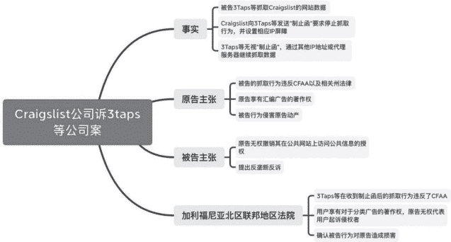

### 核心争议点
1. 公开数据能否纳入 CFAA 保护范围。
2. 公开网站所有者是否有权撤销特定用户的访问授权。
3. 被告行为是否构成无权或越权访问。
4. CFAA 是否适用于网站所有者针对特定主体限制访问的情形。

### 裁判论证过程

#### （一）公开数据属于 CFAA 保护范围
法院认为，如果国会只想保护非公开数据，会在法条中明确限定，如美国法典第 1030 条已对非公开信息、特定政府系统等作出限制。争议条款 1030(a)(2)(C) 并无此类限定，若排除公开数据将无端压缩 CFAA 适用范围，故公开信息同样受保护。

#### （二）网站所有者有权撤销特定用户访问授权
法院承认将分类广告公之于众，Craigslist 在事实上授权公众访问 craigslist.org。3Taps 并未给出充分理由证明授权不可撤销，法院援引 LVRC Holdings v. Brekka：计算机所有者有权收回已授予的许可。因此公共网站所有者可针对特定用户撤回访问权。

#### （三）被告行为属于无权与越权
双方确认被告蓄意访问 Craigslist 受保护系统并获取信息，争议集中在权限。

从文义看，授权是权利人授予的许可，无权即指未经许可的人无论出于何种原因均不得访问。Craigslist 作为授权方，公众原本可访问，但通过停止函与 IP 壁垒撤回了 3Taps 等的许可，撤回后继续抓取即属无权。

依据 United States v. Nosal 确立的规则，CFAA 中“超出授权”规制的是访问方式而非使用方式。法院指出将违反私人主体政策等同于刑事犯罪会带来危险，大多数用户不会细读政策且政策常模糊变动。结合本案，Craigslist 在用户协议中禁止抓取，法院在 Nosal 解释框架下认为违反该声明可被视为越权。

#### （四）CFAA 适用于停止函与技术限制后的无权抓取
被告援引 Nosal 主张“取消授权”实为限制信息使用。法院认为被禁止用户只需遵守一条清晰规则：不要访问网站。停止函与 IP 封锁已明确告知访问权被撤回，被告绕过封锁继续抓取充分证明其行为无权。

被告还提出模糊性抗辩与合宪回避原则，认为 CFAA 模棱两可不应被扩张解释。法院回应，技术上的模糊不等同于严重模糊，且本案事实清晰：被告收到写明具体地址的停止函，要求不得出于任何原因访问；发现 IP 已被封；仍在规避封锁后继续访问。理性人均可理解此为授权撤销，继续访问即无权。

### 审理结果
1. 加州北区联邦地区法院于 2013 年 4 月 29 日作出判决，驳回被告主张 CFAA 及州法不适用、驳回原告著作权诉求，以及驳回原告对 Padmapper 的民事共谋诉求。
2. 同法院于 2013 年 8 月 16 日再次驳回被告对 CFAA 索赔及加州刑法典第 502 条索赔的驳回动议。

### 相关法条
美国《计算机欺诈与滥用法》第 1030 条(a)(2)(C)：未经授权故意访问计算机或超越授权访问权限，从而从任何受保护的计算机获取信息的，应当承担处罚。

美国《计算机欺诈与滥用法》第 1030 条(g)：因违反本条规定遭受损害或损失的人，可提起民事诉讼获得补偿性赔偿与禁令等衡平法救济。

### 案例评析

#### （一）抓取是否获授权是合法性关键
案件发生在 2012-2015 年，网络爬虫已成数据采集手段。本案对 CFAA 的适用给出重要指引：网站封锁某用户 IP 后，该用户继续通过代理或 VPN 访问服务器即可能违法；事先的网站声明单独不足以构成违法依据。

3Taps 曾请求法院认定公开网站所有者无权撤销特定用户授权，认为刑事化会损害互联网秩序与体验。第九巡回法院认为知识产权的封锁、停止与终止可作为充分的撤回通知，停止函与技术措施实施后继续访问构成无权访问。法院亦强调，若国会只想保护非公开数据，会在法条中明确，因此认定抓取行为违反 CFAA。

Craigslist 模式与国内 58 同城、赶集网相似，案件提醒平台需对数据分类、抓取手段、抓取量等进行规范。

#### （二）数据版权属性被进一步关注
美国法院处理爬虫问题涉及合同、著作权、CFAA、侵权、隐私等多法域。爬取对象若为有版权作品，著作权权重更高；若为社交网络非公开数据，隐私法更突出。

版权法区分思想与表达。电话簿类事实信息不受保护，价格、房源等广告事实亦被视为非创造性选择，可能不受版权保护。Craigslist 主张汇编作品权，法院认为其对分类与标题的选择体现最低限度创造性而获保护。且平台从仅要求非专有许可，到 2012 年 2 月使用条款要求用户“明确授予全部权利”，版权争议始终存在。

数据归属的灰色地带与抓取边界

平台沉淀的数据里往往掺杂大量个人信息，这让“数据到底归谁”成为持续的争议焦点。一种说法认为数据属于用户本人，另一种则主张平台享有所有权，还有观点提出共有模式，乃至把这类信息视为互联网公共资源。中美等互联网大国迄今都未出台直接明确的数据权属立法，学界也未形成一致判断。实践中，争议双方更倾向于避开归属难题，从具体场景出发，依托已有明确规则寻求解决方案。数据版权一直是中外关注热点，国内的大众点评网诉爱帮网案、今日头条著作权侵权案、携程网诉去哪儿网案皆与此相关。厘清著作权归属需要综合获取目的、获取路径等多项要素，以构建权责清晰的网络环境。权属不清时，不宜全面封堵采集行为，而应结合语境建立分层规制框架，由个案判断是否构成版权侵害。

### （三）公开数据诉讼对用户使用与市场竞争的连锁影响
Craigslist 作为美国体量最大的分类信息网站之一，为大量用户提供信息获取渠道。其与 3Taps、Padmapper 的诉讼在一定程度上损害了普通用户利益。判决后，若 3Taps 等将从 Craigslist 获取的内容搬至他处发布，就可能被认定侵害用户权益。网络上不少用户与评论者对 Craigslist 的做法提出批评，电子前沿基金会也对法院在 2012年7月26日至8月8日期间通过临时服务条款维持 Craigslist 版权主张的决定表达不满。

Craigslist 早期因造福公众的理念获得高度赞誉，后期却把重心转向诉讼，以版权为由把使用者推向对立面。身为掌握海量数据并产生社会价值的公司，这种做法导致大量用户流失，转而使用功能类似的其他站点。作为在线社区，Craigslist 已从开放自由的路径转向布满门槛与诉讼的狭窄通道，相较于需要密码才能进入的系统，普通用户更容易误读其 IP 限制措施。实际上用户可更换 IP 或绕过对特定服务的阻断，因此当 IP 阻断被赋予法律效力时，反而会削弱用户对平台的信任。这种做法开创了把用户获取公开数据的利益边缘化以换取单一企业短期竞争优势的先例，而封闭并非发展的必要选择，开放的政策才更利于真正的创新。

笔者认为，面向公开数据而言，数据权利的内核是一种共享权，共享的前提是开放，其本质在于让数据权利、利用、保护与价值融为一体。对公众可便捷获取的公开信息，应承认其公共属性以保障较好的使用体验。在不严重威胁系统安全的前提下，不宜动用公法手段进行打击。在确保运行安全的基础上，法律应结合获取目的、后续使用场景、被采集方所受损害等要素作个案判断。

### （四）Craigslist 纠纷后续进展与延伸影响
2015 年 6 月 26 日，Craigslist 与 3Taps 及 Padmapper 达成和解，双方协议均要求对方永久停止直接或间接从 Craigslist 获取内容。3Taps 最终支付 100 万美元赔偿，Craigslist 表示将在十年内将该笔款项捐赠给电子前沿基金会。

3Taps 在官网发表声明称，虽缺乏继续抗争的资源，但该方案为联邦应急部门提供了急需的资源，且仍有诸多问题值得深入研究，例如由私人运营的公共网站是否可以选择性排除访问者，并据此依据《计算机欺诈和滥用法》使被禁止者承担民事乃至刑事责任。5 月 26 日，Craigslist 已在公司官方博客公布了针对 Padmapper、Lovely 与 3Taps 的和解协议、最终判决与永久禁令。

这很可能并非涉及 Craigslist 版权的终点。尤其是 Craigslist 此后对部分用户生成帖子选择性进行版权登记的做法，且并未告知访客哪些帖子已获登记，这为粗心访客制造了实质的版权诉讼陷阱。继 3Taps、Padmapper 之后，Mashery 也收到了停止服务的通知函。

Craigslist 在 hiQ 对 LinkedIn 的案件中以法庭之友身份提交书面意见，目的在于维护自身作为平台的商业利益。该案中法院关注点在于采集是否违背了被采集方的警示，判决认为 Craigslist 发送的制止函及设置的 IP 壁垒可被视为撤销了被告继续访问网站的授权；而在 LinkedIn 案件中，法院更侧重被采集数据的属性。尽管 LinkedIn 同样向 hiQ 发出制止函并采取了禁止 IP 访问的技术措施，但因 hiQ 采集的是具有公共开放属性的数据，LinkedIn 撤销 hiQ 对其公共部分的接入授权，并不会使 hiQ 的行为在《计算机欺诈和滥用法》意义上构成“未经授权”。正因担心绕开技术措施会招致法律责任，hiQ 才向法院申请禁令。这凸显了在明确数据属性后，对方企业授权的重要性。

## 关联判例速览

### 1. eBay, Inc. v. Bidder’s Edge, Inc., 100 F.Supp.2d 1058 (N.D. Cal. 2000)
案情概要：2000 年，Bidder’s Edge 对 eBay 网站进行数据爬取，eBay 遂向加州北区法院起诉，主张该行为违反 robot 协议，构成非法侵入、计算机欺诈与滥用、不公平竞争等。法院认为 eBay 服务器属于私人财产，公众访问权限由其授予，故一般不允许爬虫机器人进入。eBay 已明确告知对方不得抓取。法院支持非法入侵指控，认为被告未经许可干扰原告对计算机系统的占有并造成实际损害。
关联意义：本案回避了数据权属问题，主要以服务器私有为由认定行为构成非法入侵，间接表明抓取公开数据仍需平台授权。

### 2. United States v. Nosal, 676 F.3d 854 (9th Cir. 2012)
案情概要：本案关乎依据《计算机欺诈和滥用法》对前雇员的刑事追诉范围，第九巡回法院裁定，员工以违反公司计算机使用政策的方式访问计算机，不等于构成该法下的“超越授权”。
关联意义：3Taps 援引该案观点，认为违反使用政策的严重性不及违反访问限制。Craigslist 所采取措施旨在限制对列表的某种使用，并未直接撤销访问权限。

### 3. CollegeSource, Inc. v. AcademyOne, Inc., 597 Fed.Appx.116 (3d Cir. 2015)
案情概要：原告 CollegeSource 从事美国大学生转学咨询并提供在线课程，被告 Academy One 为建立资源库雇佣承包商编写爬虫脚本抓取原告网站，收集超 18000 份 pdf。pdf 第二页均载明禁止未经同意的重新分发、修改或商业使用。2007 年 4 月原告发送制止函要求停止抓取。
关联意义：法院认定违反技术壁垒或合同使用条款均可解释为“未经授权”。即便网页未明示，只要相关产品或服务材料中有明确说明，同样可视为未经授权。

### 4. Facebook, Inc. v. Power Ventures, Inc.et al., 844 F.3d 1058 (9th Cir. 2016)
案情概要：与本案相近，第九巡回法院维持原判，认为在有明确函告与技术手段的情况下构成“未经授权”。
关联意义：该案观点与本案基本一致，均认为仅凭网站使用条款不足以认定《计算机欺诈和滥用法》下的“未经授权”或“超出授权”；但事后函告或技术性手段可成为认定的依据。

### 5. HiQ Labs, Inc. v. LinkedIn Corp., 938 F.3d 985 (9th Cir. 2019)
案情概要：领英要求 hiQ 停止爬虫采集数据，hiQ 向地区法院申请诉中禁令并上诉。地区与上诉法院均认为 hiQ 对领英提出的积极抗辩在实体法上具有重要意义。领英对平台数据仅享有非排他性许可而非所有权，会员对公开资料的隐私预期并不确定，领英自行开发数据分析工具也削弱了其关于隐私利益的主张。法院对《计算机欺诈和滥用法》中“未经授权”作狭义解释。
关联意义：...

## 10.2 hiQ 诉领英案
## 与本案关联点
同样属于数据采集的典型案例，意义重大。这是加州法院首次正面回应抓取“公开”信息的法律问题，因公开数据与《计算机欺诈和滥用法》规定的“受保护计算机”不同，前者通常缺乏密码等保护措施。

## 案件索引
hiQ Labs, Inc.v. LinkedIn Corp., 273 F.Supp.3d 1099 (U.S. Dist. 2017)
hiQ Labs, Inc. v. LinkedIn Corp., 938 F.3d 985 (9th Cir. 2019)
hiQ Labs, Inc. v. LinkedIn Corp., No. 17-cv-03301-EMC, 2020 U.S. Dist. (N.D. Cal.2020)
hiQ Labs, Inc. v. LinkedIn Corp., 485 F.Supp.3d 1137 (N.D. Cal. 2021)

## 关键词
数据抓取；公开数据；数据垄断；不正当竞争；《计算机欺诈与滥用法》

## 案件提要
本案是公开数据采集的标杆案例，既涉及程序上的禁令救济，也涉及《反不正当竞争法》《计算机欺诈与滥用法》、侵权法及言论自由规则等适用问题。尽管实体纠纷尚未作出终局判决，但临时禁令裁定已在法学界与互联网实务界引发热议，并在美国司法实践中产生影响。本书介绍的是该案临时禁令申请的二审裁定。

被告领英是微软旗下全球最大职业社交平台，拥有超 5 亿用户。用户可在网站建立个人档案，记录教育背景、工作经历和技能，并可自主选择档案信息的隐私保护程度。原告 hiQ 为一家数据分析公司，主营业务是采集并分析领英平台上用户公开的职业信息，为企业提供人力资源服务。领英在计划推出类似产品后，禁止 hiQ 采集。hiQ 遂申请法院发布临时禁令，禁止领英阻断其采集行为，并提起诉讼，指控领英侵犯合同权利、滥用市场支配地位等。hiQ 的禁令申请先后获一、二审法院批准，实体纠纷仍在审理中。

在规则适用上，本案具有较大开创与指导意义。这是联邦法院首次对 CFAA 在公开数据采集领域的适用发表意见，且采取限缩解释，认为构成“未经授权访问”的前提是访问该数据需获取特定权限或许可，若涉诉数据处于公开状态，不存在授权需求，“未经授权”便无从谈起。此种见解与美国法院先前宽松认定做法差异明显，故被视为 CFAA 解释论转向限缩的里程碑式案件。此外，本案也是美国法院少数就“数据垄断”发表意见的案例。尽管实体判决中 hiQ 的反垄断主张因相关市场界定错误未获支持，但法院对领英是否构成“拒绝交易”“搭售”等违法行为的分析极具借鉴意义，在数据垄断日益受关注的当下尤为重要。

比较法层面，本案亦是良好学术素材。作为互联网经济另一先驱，中国近年出现诸多数据采集案件，如被称为“抓取公开信息入刑第一案”的晟品非法获取计算机信息系统数据案等，法院的分析路径与价值取向与本案不尽相同。美国法院多元分析思路及促进数据流通的开放态度，对中国法学界解决同类纠纷具有重要参考意义。

## 案件要旨
美国加州北区地方法院（禁令裁定一审法院）：原告 hiQ 被告 领英
美国第九巡回上诉法院（禁令裁定二审法院）：原告 hiQ 被告 领英
美国加州北区地方法院（实体判决一审法院）：原告 hiQ 被告 领英
美国加州北区地方法院（实体判决一审法院）：原告 hiQ 被告 领英

领英是全球最大职业社交平台，用户可建立职业档案并与其他用户联系。建档时用户可选择档案公开程度，包括“全网公开”“仅向领英用户公开”“仅向直接关系人公开”等。本案争议焦点为“全网公开”职业信息的采集问题。

hiQ 为新兴数据分析公司，通过采集并分析领英上设置为“全网公开”的职业信息，判断用户是否可能离职或具备何种职业技能，为企业提供人力资源服务。例如提示企业通过涨薪方式挽留有离职倾向员工，或告知员工普遍缺乏的职业技能以提示企业提供针对性培训。

hiQ 的商业模式早被领英知晓，早期领英对此持默许态度，双方甚至曾非正式友好交流。但在领英计划推出类似数据分析产品后，领英于 2017 年 5 月致函 hiQ 要求立即停止采集，否则将违反 CFAA 等法律。同时领英采取技术手段阻断 hiQ 采集，但谷歌等其他网络平台仍可正常采集。hiQ 遂申请临时禁令并提起诉讼，指控领英侵犯合同权利、滥用市场支配地位等。

2017 年 8 月，美国加州北区地方法院准许 hiQ 的禁令申请，领英上诉。2018 年 3 月，美国第九巡回上诉法院裁定维持一审，驳回上诉。2020 年 9 月，美国加州北区地方法院作出实体争议一审判决，认为领英构成侵犯 hiQ 合同权利，但因 hiQ 对相关市场界定错误，未能支持其滥用市场支配地位的主张。法院表示 hiQ 可修正相关市场界定观点后再次提起诉讼。

随后 hiQ 再次向美国加州北区地方法院提起诉讼。法院 2021 年 4 月作出判决，认为：第一，关于 hiQ 采集行为是否违反 CFAA，因领英就禁令之诉已上诉至联邦最高法院，且联邦最高法院正在审理 United States v. Van Buren 一案，联邦最高法院将在不久后对 CFAA 在公开数据采集案件中的适用发表观点，故法院将在联邦最高法院就上述两案作出判决后再就该争议焦点作出判断；第二，尽管 hiQ 已被终止领英网站注册用户资格，但根据领英网站声明，任何使用领英网站的用户均需受用户协议约束，而用户协议禁止使用自动化工具采集领英数据，因此 hiQ 存在违约可能；第三，尽管领英非数据所有权人，但对涉诉数据拥有财产性权益或准财产性权益，故 hiQ 可能构成挪用财产与侵犯他人财产权。因此 hiQ 数据采集合法性问题无法通过简易判决解决，需后续审理。

## 案例事实思维导图
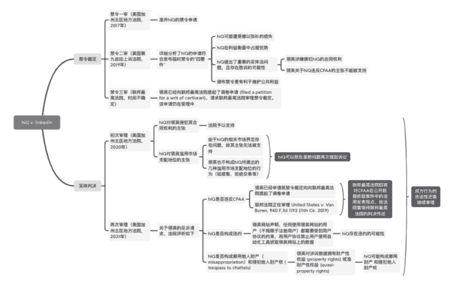

## 核心争议点
1. hiQ 的临时禁令申请是否满足四项要件：（1）若不采取临时救济，原告会遭受难以弥补的损害；（2）利益衡量中原告更占优势；（3）原告在实体法上存在胜诉可能性；（4）颁布禁令更有利于公共利益。
2. 采集公开数据的行为是否会对用户隐私造成威胁，并可能破坏用户对公共平台网站的信赖。
3. 公共平台网站对用户提供的数据是否享有受保护的财产权益。
4. 采集公开数据的行为是否属于《计算机欺诈与滥用法》所规定的“未经授权的访问”，且存在胜诉可能。
5. 允许采集公开数据是否更有利于维护公共利益。

## 裁判论证过程
本案法院主要参考 Winter v. NRDC, Inc. 案提出的四个衡量标准，原告寻求临时禁令须证实：（1）若不采取临时救济，原告可能遭受难以弥补损害；（2）在原告与被告利益权衡中，原告更占优势；（3）原告在实体法上存在胜诉可能性；（4）颁布禁令更有利于公共利益。

### （一）若不采取临时救济措施，hiQ 有可能遭受难以弥补的损失
hiQ 提出，其整个商业模式建立在“全网公开”的领英用户信息之上，目前市面上并无其他实际可替代的数据来源。一旦采集被阻断，hiQ 可能被迫违反与 eBay、Capital One 和 Go Daddy 等现有客户的合同，同时面临失去潜在客户风险。事实上 hiQ 所受损失并非纸面假设：收到领英要求停止访问数据的通知时，hiQ 正处于融资阶段，领英的阻碍使其业务存续能力受质疑，融资谈判陷入僵局，部分员工因公司前景未卜而选择离职。

hiQ 与 LinkedIn 公开档案爬取案：法院如何判定边界

LinkedIn 首轮抗辩称 hiQ 并非独通自家平台，Facebook 上的职业信息也能充当替补来源。判决则回应，hiQ 的营收架构建立在用户主动对外公开的职业档案之上，Facebook 类职业数据的获取壁垒高、触达性弱，并不构成质量相当的可替代供给。

LinkedIn 进一步主张，即便缺乏替补，hiQ 亦可自行采集。法院未予采信。一方面 hiQ 的定位是数据分析服务提供方而非采集方，自建采集体系需投入巨额资金与漫长周期，在现行业务已几近停摆的背景下，该公司能否存续、是否具备自建能力均存疑。另一方面，由分析转向采集会从根本上改变其业务属性。这一说法反而凸显运营对 LinkedIn 数据的高度倚赖。

综合判断，法官认定持续调取 LinkedIn 用户公开档案对 hiQ 维持经营至关重要。若未颁布禁令，hiQ 将面临难以弥补的经营损害。

### （二）利益权衡向 hiQ 倾斜

从经营层面看，若缺乏禁令保护，hiQ 除承担前文所述巨额亏损外，走向破产的风险亦大幅升高。

再看隐私争议。LinkedIn 认为爬虫侵害用户隐私并削弱平台信任，并强调超五千万用户启用了“请勿广播”功能，即修改资料时不向他人推送。LinkedIn 认为这说明即便档案公开的用户也不愿让雇主察觉求职意图，知情后雇主或限制权限、提前解雇等。初审法院认可该说法具一定合理性，但仍不足以阻挡禁令，理由如下：

第一，难以证明将档案设为公开的用户仍对信息保留隐私期待。LinkedIn 隐私政策明确，平台上公开的任何信息都可能被他人查看，并提示用户勿放入不愿公开的个人信息。在用户已清楚全网公开信息可被任何人访问的前提下，不应再为其主张隐私期待。

第二，并无证据显示多数使用“请勿广播”的用户目的在于规避雇主。更可能仅为避免每次修改都收到打扰性提醒。即便无提醒，只要档案保持公开，雇主随时可查看更新。真正想隐瞒的员工完全可关闭公开或移除雇主联系人。

第三，LinkedIn 自身产品行为与其主张相悖。若爬虫真的侵犯隐私，就难以解释为何推出功能相近的产品。例如 “招聘者 Recruiter” 可让招聘方追踪目标，并在对方更新档案时推送提醒，便于在不被察觉的情况下伸出橄榄枝。LinkedIn 的人才招聘、营销及销售解决方案订阅用户也能导出公开档案中的姓名、现职公司、现职等信息。

第四，LinkedIn 称需防范搭便车。法院认为个人档案的所有权归用户，LinkedIn 对用户提供的数据并不享有受保护的财产权益。公开即意味着用户有意允许他人访问，包括商业用途。LinkedIn 若想杜绝搭便车，最直接手段是取消公开分享功能，但这会违背多数用户偏好并损害自身利益。

### （三）hiQ 提出关键实体问题且胜诉希望较高

首个实体问题关乎合同关系的非法干涉。

hiQ 指控 LinkedIn 妨碍其与存量客户的合同并提交证据。LinkedIn 基本不否认妨碍事实，仅强调行为出于合法商业目的。法院未接受，理由如下：

第一，hiQ 与 eBay、Capital One 等大型客户的合同履行高度依赖其抓取、汇总和分析 LinkedIn 公开档案的能力。失去抓取权限即无法履约，违约将直接冲击经营。

第二，LinkedIn 的封锁手段不属于公认商业惯例。竞争中削弱对手并无不可，但手段须合规。公认做法包括广告、降价、挖角等间接竞争，而非釜底抽薪地摧毁对手的核心商业模式。本案中全面禁止 hiQ 访问平台数据，正是动摇其根基。

第三，行为很可能超出公平竞争边界。hiQ 指出在争议爆发前多年，LinkedIn 明知 hiQ 依赖外部数据却长期默许。LinkedIn 宣布要基于自有数据推出与 hiQ Skill Mapper 功能近似的新品后约一月，即开始封锁 hiQ 的爬取。若允许掌握海量公共数据的平台选择性禁止竞争对手使用公开数据，将不利于创新者进行数据聚合分析。

第四，LinkedIn 主张的私人利益薄弱。LinkedIn 对公开分享的数据仅享有非排他许可，并非所有权。其主营是提供职业信息共享平台，并不以禁止他人使用信息为前提。至于用户利益，法院此前已认为用户对公开档案的隐私期待“充其量是不确定的”。更何况 LinkedIn 自行推出类似竞品，与其主张自相矛盾。LinkedIn 也未解释在 hiQ 用户身份已终止的情况下，如何依据用户协议强制执行禁令。

因此二审法院认为 LinkedIn 并未充分证明妨碍合同履行具备合法商业目的。

第二个实体问题是《计算机欺诈与滥用法》是否适用。

LinkedIn 指控 hiQ 在收到警告后仍继续爬取，违反 CFAA，故不应获得禁令。法院对该法条作多角度解释，并不支持 LinkedIn。

CFAA 规定，未经授权故意访问计算机或超越授权访问权限，从而从受保护计算机获取信息，应受处罚。本案争议核心是 hiQ 在明知被拒绝后仍爬取是否构成“未经授权的访问”。

文义层面，若要构成未经授权访问，通常需要事先取得特别权限或许可。本案数据本身公开，并不需要授权，未经授权的概念也就无从建立。

目的与历史层面，法院援引 United States v. Nosal 案，第九巡回法院认为 CFAA 立法目的是防止黑客非法入侵计算机系统。1984 年众议院报告也把 CFAA 的目的描述为打击“破坏后进入”行为。本案数据公开，hiQ 并未对 LinkedIn 系统实施技术破坏，不应被 CFAA 规制。

此外，刑法谦抑性原则要求对刑事法条作限缩解释。CFAA 可在民事和刑事领域适用，为保持解释一致，应优先从宽，防止刑事黑客法被异化为“网络警察授权书”。

综上，法院认为 CFAA 中的“未经授权”限于技术入侵，而 hiQ 的行为不属于此列，LinkedIn 的该项主张不成立。

### （四）禁令更有利于公共利益

双方均称自身立场有助于互联网信息自由流动。

hiQ 认为数据爬取是普遍的信息收集方式，被搜索引擎、学术研究等广泛使用。若允许掌握大量数据的企业决定谁能爬取公开网站数据，企业对数据使用的控制权将被过度放大。

LinkedIn 则担心禁令会诱发恶意攻击服务器，迫使平台从公开模式转向密码保护，导致网站淡出公众视野。

法院认为，用户公开的数据并不归平台所有。若允许 LinkedIn 类公司随意决定谁能收集使用这些数据，将威胁数据公开和自由流动，损害公共利益。颁布禁令并不等于放任网络攻击，LinkedIn 仍可通过反机器人等技术手段抵御有害入侵。

## 审理结果

### （一）关于禁令裁定

1. 美国加州北区地方法院支持原告请求，发布临时禁令，禁止 LinkedIn 限制 hiQ 的数据抓取行为。
2. 美国第九巡回上诉法院认同 hiQ 申请禁令的条件成就，维持地方法院的裁定。

### （二）关于实体判决

## 1. 初次审理

在初次审理中，美国加州北区地方法院认为 LinkedIn 构成侵犯 hiQ 的合同权利，但由于 hiQ 对相关市场的界定存在错误，故无法支持其有关滥用市场支配地位的主张。

## 2. 再次审理

在再次审理中，美国加州北区地方法院认为 hiQ 可能构成违约、挪用财产和侵犯他人财产权。对于 hiQ 是否违反《计算机欺诈与滥用法》，需等待联邦最高法院对 United States v. Van Buren 等案的审理结果。因此，法院还需后续再审理双方行为的合法性。

## 相关法条

### 美国《计算机欺诈与滥用法》第 1030 条（a）款第（2）项（C）目（Computer Fraud and Abuse Act§1030（a）（2）（C），18 U.S.C.§1030（a）（2）（C））

未经授权故意访问计算机或超越授权访问权限，从而从任何受保护的计算机获取信息的，应当按照本条（c）款的规定予以处罚。

### 美国《计算机欺诈与滥用法》第 1030 条（c）款第（2）项（A）目（Computer Fraud and Abuse Act§1030（c）（2）（A），18 U.S.C.§1030（c）（2）（A））

除（B）目另有规定外，对于本条（a）款第（2）项、第（3）项、第（6）项规定的犯罪行为，如果为第一次触犯前述罪名，没有根据本条规定的另一犯罪行为被定罪，或者企图实施本条规定的应受处罚的犯罪行为的，根据本编规定单处或并处罚款和/或一年以下有期徒刑。

### 美国《计算机欺诈与滥用法》第 1030 条（e）款第（2）项（B）目（Computer Fraud and Abuse Act§1030（e）（2）（B），18 U.S.C.§1030（e）（2）（B））

“受保护的计算机”是指用于或影响州际或外国商业或通信的计算机，包括位于美国境外且其使用方式影响美国州际或外国商业或通信的计算机。

### 美国《计算机欺诈与滥用法》第 1030 条（g）款（Computer Fraud and Abuse Act§1030（g），18 U.S.C.§1030（g））

任何因违反本条规定而遭受损害或损失的人，可以对违反者提起民事诉讼，以获得补偿性损害赔偿和禁令救济或其他衡平法上的救济。

### 美国《存储通信保护法案》第 2701 条（a）款（Stored Communications Act§2701（a），18 U.S.C.§2701（a））

侵入。除非本条（c）款另有规定，任何人：（1）未经授权，故意访问提供电子通信服务的设施；或（2）故意超出授权范围访问该设施；并因此获得、更改或阻止在该系统中以电子方式存储的有线或电子通信的授权访问的，应按照本条（b）款的规定予以处罚。

### 美国《存储通信保护法案》第 2701 条（b）款（Stored Communications Act§2701（b），18 U.S.C.§2701（b））

惩罚。对本条（a）款所述罪行的惩罚是：（1）如果为了私人商业利益、进行恶意破坏或损害而实施犯罪行为，或进行其他违反联邦或各州宪法或法律的任何犯罪或侵权行为—（A）对于初犯，根据本法规定单处或并处罚款和/或 5 年以下有期徒刑；（B）对于非初犯，根据本法规定单处或并处罚款和/或 10 年以下有期徒刑；以及（2）在任何其他情况下，（A）对于初犯，根据本法规定单处或并处罚款和/或 1 年以下有期徒刑；（B）对于非初犯，根据本法规定单处或并处罚款和/或 5 年以下有期徒刑。

## 案例评析

### （一）本案折射出了美国法院对《计算机欺诈与滥用法》解释论的变迁

本案争议焦点集中在 CFAA 对公开数据抓取的适用问题上，法院对此投入了大量论证。有学者指出，本案的学术价值和实践意义在于，法院相较于若干先例对 CFAA 的适用范围做了重大收缩，将公开数据抓取排除在 CFAA 规制之外。

CFAA 由美国国会于 1986 年通过，常被称作反黑客法，但其规制范围更广，涵盖多种涉计算机侵权行为。

CFAA 是被抓取方在数据抓取诉讼中最常引用的法律，原因在于其管辖范围广，适用于全美民事主体，且法律责任重，包含刑事责任。法院在禁令上诉判决脚注 15 也提到，CFAA 并非被抓取方的唯一救济，被抓取方也可主张违约、侵权、著作权侵权等，但 CFAA 无疑是最有力的武器。

CFAA 规定未经授权访问计算机获取信息构成违法，可能面临赔偿、罚金甚至刑期。争议点在于，未经同意的数据抓取是否等于“未经授权”访问。

由于联邦最高法院尚未明确解释“未经授权的访问”，各地法院出现同案不同判。学界将解释演变概括为先宽松后严格：早期法院只要网站服务协议禁止抓取或被警告后仍抓取，就认定为未经授权；后期法院则要求爬取者突破技术限制才可能构成未经授权。本案是解释走向限缩的标志性案例。法院综合文义、历史和目的解释：文义上，构成未经授权访问需事先取得特别权限，而公开数据无需授权；历史和目的上，国会和最高法院均认为 CFAA 目的在于打击黑客非法入侵，即 breaking and entering，而 hiQ 并未实施此类行为。

学界和互联网圈最近都被这起案件的说理给点燃了。在诉讼过程中，电子前线基金会 Electronic Frontier Foundation 就向法庭递交过一份材料，强调放开数据抓取对保持市场活力、推动科研进步有多重要。^([\[29\]](#txt010.html#footnote_content_txt010_29)) 宣判禁令之后，有学者点赞认为这“有利于让数据自由流动，推动数据分析行业成长” ^([\[30\]](#txt010.html#footnote_content_txt010_30))，也有人说“大量初创公司都是靠抓取起步，承认抓取合法性等于扶持中小企业” ^([\[31\]](#txt010.html#footnote_content_txt010_31))。争议自然也随之而来。法院特意解释了为何 hiQ 的行为不触及《计算机欺诈与滥用法》，而在 Facebook Inc. v. Power Ventures 案里 Power Ventures 却被认定违法 ^([\[32\]](#txt010.html#footnote_content_txt010_32))：本案抓的是公开可查的数据，Facebook 案里的数据则必须用账号密码登录后才能看。但这个区分也被人揪着问：网站加登录不一定为了安全，可能只是为了实名合规；而且批量注册账号就能绕过登录限制，意义其实有限。

虽然终审判决还没下来，但法院把《计算机欺诈与滥用法》的适用范围往回收的思路已经在实务里蔓延。2018 年的 Sandvig v. Sessions 案里，法官就表态：“把该法套用到以学术研究为目的的抓取，会跟宪法保障的言论自由和新闻自由冲突。” ^([\[33\]](#txt010.html#footnote_content_txt010_33))

有趣的是，美国这边在松绑的同时，中国却出现了“抓公开信息也可能入刑”的首案 —— 晟品非法获取计算机信息系统数据案，即晟品案。被告破解了字节跳动的防抓取机制，抓走了服务器里的视频数据，视频本身是公开的，法院仍然认定构成非法获取计算机信息系统数据罪 ^([\[34\]](#txt010.html#footnote_content_txt010_34))。主审法官撰文解释：视频虽然能公开看，但对应的数据并不公开，用户只能在线观看、无法随意存本地 ^([\[35\]](#txt010.html#footnote_content_txt010_35))。这一结论在国内法学界炸出激烈讨论，不少人质疑抓公开数据是否真需要动用刑法来治理 ^([\[36\]](#txt010.html#footnote_content_txt010_36))。晟品案与 hiQ 案在学界引发的碰撞，说明用刑法来管数据抓取、尤其是公开数据的抓取，仍是留有很大讨论空间的难题。中美司法与学界的态度能否趋同，尚待观察。

### （二）中美审理数据抓取纠纷的工具箱差别很大

作为公开数据抓取的标志性案件，本案清楚展现了美国法院处理数据纠纷的多线作战方式。除了《计算机欺诈与滥用法》是核心外，法院还会并用其他规则。禁令裁决里就涉及侵权法上的合同干涉 Tortious Interference with Contract，以及竞争法上的不正当竞争风险，脚注里还点到数据垄断的可能。一审中双方还围绕加州宪法言论自由条款吵得很激烈，法院虽然谨慎不愿无先例就把言论自由硬套到互联网，但正如有学者所说，这场争论本质是“私人物品权与信息知识自由流通的冲突”。^([\[37\]](#txt010.html#footnote_content_txt010_37)) 放眼更广，Compulife Software Inc. v. Newman 案用法是商业秘密，Ebay v. Bidder’s Edge 案用法是普通法上的财产侵扰 trespass to chattels，路径相当多元 ^([\[38\]](#txt010.html#footnote_content_txt010_38))。

反观中国，司法工具显得单薄得多。实践里几乎清一色用《反不正当竞争法》来判。偶尔如新浪诉饭友案 ^([\[39\]](#txt010.html#footnote_content_txt010_39)) 会援引互联网专条的兜底条款 ^([\[40\]](#txt010.html#footnote_content_txt010_40))，绝大多数案件还是靠该法的一般条款 ^([\[41\]](#txt010.html#footnote_content_txt010_41))。由于条款都很抽象，法官往往套用海带配额案 ^([\[42\]](#txt010.html#footnote_content_txt010_42))、45 号指导案例 ^([\[43\]](#txt010.html#footnote_content_txt010_43)) 形成的“竞争关系—实际损害—行为正当性”框架，综合权衡抓取方、被抓方、消费者多方利益。换句话说，数据抓取在法律上近乎空白，法院只能靠抽象条款做利益衡量。

学界对这种“往一般条款里逃逸”的做法批评不少，认为会削弱司法的正当性与稳定性 ^([\[44\]](#txt010.html#footnote_content_txt010_44))，主张通过立法明确数据归属 ^([\[45\]](#txt010.html#footnote_content_txt010_45))。也有学者为法院辩护，认为数据权属太复杂，立法者难以一次安排好，让法官在个案中摸索更稳妥 ^([\[46\]](#txt010.html#footnote_content_txt010_46))。本书的看法是两种意见都有道理，而以本案为代表的美国经验或许能给中国一个启发：在数据权属未明确前，可通过完善《反不正当竞争法》的互联网专条、商业秘密条款，以及《刑法》关于非法侵入信息系统罪的解释，让法院有更清晰、更可操作的规定来处理这类纠纷。

### （三）中美对数据抓取的价值取向截然不同

如果说分析路径是形式，那价值取向才是实体。美国法院对数据抓取总体偏开放，强调数据自由流通，对被抓方的数据利益保护相对克制。最典型的就是领英指控 hiQ“搭便车”一节。二审时领英称发警告是为了防止 hiQ 搭便车用平台用户职业信息，法院回应冷淡，认为领英对用户上传的数据并无受保护的财产权益，只有用户对其个人资料才享有所有权，既然用户主动公开，领英无权干预。

中国法院的保护姿态则高得多，主要体现在两点。

第一，平台对承载数据被认定为有财产性利益，哪怕数据由用户生成且是公开的。比如大众点评对用户点评 ^([\[47\]](#txt010.html#footnote_content_txt010_47))、新浪对用户填写的资料 ^([\[48\]](#txt010.html#footnote_content_txt010_48)) 和微博内容 ^([\[49\]](#txt010.html#footnote_content_txt010_49)) 都被认定享有财产性权益。法官的理由通常是平台搭建成本、运营投入、补贴营销等。

第二，对这种利益保护很重。典型就是“三重授权原则” ^([\[50\]](#txt010.html#footnote_content_txt010_50))，即第三方通过开放平台获取信息时，既要获用户同意，也要获数据提供方企业的同意 ^([\[51\]](#txt010.html#footnote_content_txt010_51))。其中的“平台授权”与本案价值完全相反。有学者就反对平台授权，认为用户已同意把数据在甲平台向乙平台开放，甲平台就不该再干涉，因为它已经拿“使用用户数据”抵了收集成本的对价 ^([\[52\]](#txt010.html#footnote_content_txt010_52))。

中美的分歧没有绝对的对错，更多是经济发展阶段下的价值选择。美国更容忍抓取，以此促活数据经济、扶持数据类中小企业；中国更侧重保护平台，激励企业投入资源吸引用户生产数据，提升供给。值得注意的是，美国法院并非一直宽松，过去也曾严打抓取甚至动用刑罚。随着中国数据供给日渐充足、数据垄断问题浮现，裁判倾向也可能随之转向。

### （四）数据垄断已成必须正视的社会议题

# 数据垄断正让反垄断法承压

禁令裁定里，法院把“数据垄断”作为禁令符合公共利益的理由之一：“如果让领英这类巨头随意决定谁能用数据，就有形成信息垄断、损害公共利益的风险。”到了实体审理，数据垄断更是核心争议，法院逐一分析领英是否构成滥用市场支配地位。但由于不认可 hiQ 的相关市场界定，法院直接驳回主张，未展开具体违法性分析。后续 hiQ 修正主张后的判决，才能更清晰。

即便反垄断争议未了，社会对数据垄断的焦虑已很明显。除巨头控制数据入口外，“大数据杀熟”、“平台二选一”早已是公众痛点。2019 年中国人民大学网络与移动数据管理实验室的报告指出，中国 10% 的数据收集者掌握了 99% 的权限数据 ^([\[53\]](#txt010.html#footnote_content_txt010_53))。2021 年两会前，有学者通过 836 次网约车实测发现“杀熟”现象确实存在 ^([\[54\]](#txt010.html#footnote_content_txt010_54))。会上有人大代表建议在《反垄断法》总则明确禁止协同行为，为规制算法共谋、数据滥用、大数据杀熟、平台二选一提供指引 ^([\[55\]](#txt010.html#footnote_content_txt010_55))。在 2021 年《政府工作报告》强调“强化反垄断、防止资本无序扩张” ^([\[56\]](#txt010.html#footnote_content_txt010_56)) 的背景下，数据垄断已成为迫切议题。

回到抓取纠纷。hiQ 主张领英存在拒绝交易、拒绝开放必需设施、封锁、搭售、抬高竞争对手成本等滥用行为。法院虽认为市场界定有问题，却简要论证了拒绝抓取不构成违法，仅对“涉诉数据是否属于必需设施”保持沉默。

这种沉默与学界的激烈争论有关。必需设施理论指垄断者对竞争必需且不可复制的资源形成瓶颈控制时，必须向下游竞争者开放。该理论源自美国，联邦最高法院未正式采纳，却被我国《禁止滥用市场支配地位行为暂行规定》吸收 ^([\[58\]](#txt010.html#footnote_content_txt010_58))。支持者认为，数据垄断者可先用大数据试验潜在竞争对手，待市场明朗后再拒交易挤出对手，若不强制开放会扼杀创新 ^([\[59\]](#txt010.html#footnote_content_txt010_59))；反对者则指出数据替代性难评估、相关市场难界定、认定要件苛刻 ^([\[60\]](#txt010.html#footnote_content_txt010_60))，且强制交易短期利好竞争、长期可能削弱竞争对手自建设施的积极性 ^([\[61\]](#txt010.html#footnote_content_txt010_61))。可见，现行反垄断规则面对数据垄断仍有很多堵点，美国的走向还要看本案最终判决。

## 关联判例推荐

### 1. PeopleBrowsr, Inc. v. Twitter, Inc., No. C-12-6120 EMC, 2013 U.S. Dist.(N.D. Cal. 2013)

核心事实：Twitter 是全球知名社交平台。原告 PeopleBrowsr 从事数据分析业务，主要抓取推文做分析再售卖报告，每年向 Twitter 支付 100 万美元买抓取权限。Twitter 后来想自建数据分析业务，进行了一系列并购后关闭了 PeopleBrowsr 的数据访问。PeopleBrowsr 认为此举为打压竞争、不正当竞争，也损害消费者和社会利益。案件最终和解，PeopleBrowsr 获得 8 个月的使用权。

与本案关联点：双方同属上下游关系，即数据收集与数据分析市场；被告拒绝开放数据的动机也相似，都是为切入下游市场。该案遗憾在于法院未深入实体分析并以和解收尾。

### 2. Ebay v. Bidder’s Edge, 100 F.Supp.2d 1058 (N.D. Cal. 2000)

核心事实：Ebay 提供在线拍卖服务。Bidder’s Edge 通过抓取各大电商平台公开的拍卖信息整合展示，让用户一次看到多家平台的拍卖。加州北区法院查明，Bidder’s Edge 的爬取每天给 Ebay 带来约 8-10 万次访问负担，约占其服务器日负荷的 1.5%。法院认定在明知 Ebay 禁止未经授权自动抓取的情况下仍抓取，构成了对财产的侵扰 trespass to chattels。若放任，将鼓励大规模爬取，给服务器造成不可承受负担。因此法院支持禁令，禁止 Bidder’s Edge 继续抓取。

公开抓取与生物隐私：三则关键判决速览

关联提示：脚注15引用的先例同样处理公开信息抓取引擎问题。法院借此说明，即便难以依据《计算机欺诈与滥用法》CFAA获得救济，仍可参照 Ebay v. Bidder’s Edge 案思路，以 trespass to chattels 侵害财产利益的方式寻求救济。

### 3. Compulife Software Inc. v. Newman, 959 F.3d 1288 (11d Cir. 2020)

事实概要：两家公司同处保险报价服务赛道，均以直观方式向终端用户展示各家保险公司的定价。Compulife 从各保险官网提取费率表，经汇编、加工并加密后形成自有数据库，采用订阅制开放访问。同时网站向公众提供单次查询入口，用户每次提交查询条件即可获得即时报价。被告利用爬虫穷举全部查询组合，请求总量超过4300万次，实质上复制了整套数据库。Compulife 以商业秘密侵权为由起诉。一审以单条报价均可公开获取为由否定商业秘密成立。二审认为单条公开不等于集合自动丧失秘密属性，需作更深入的利益衡量，因而撤销原判发回重审。

关联说明：此案是近年公开数据抓取领域的较新裁判。与通行争议不同，原告系以商业秘密而非CFAA主张权利。案件提供新视角：经整理加工的公开数据集合是否仍可能构成商业秘密。

### 4. Ryanair Ltd v. PR Aviation BV, C-30/14, (Court of Justice of the European Union, Jan. 15, 2015)

事实概要：PR Aviation 运营机票比价平台，以佣金模式完成预订。未经Ryanair授权，其以自动化手段抓取航班与票价信息。Ryanair 网站访问时要求用户点击同意条款，条款明确禁止未经授权的自动化抓取。欧盟法院认定，网站上的航班信息既不适用著作权，也不构成数据库特别权，但经营者可通过契约条款限制他人以自动化系统抓取并作商业利用。2015年1月判决Ryanair有权禁止该等抓取行为。

关联说明：这是欧盟层面公开数据抓取的代表裁判。其特点在于被抓取方未诉诸知识产权，而是借助契约权利实现救济。

## 10.3 罗森巴赫诉六旗娱乐公司案

### 案件索引

Rosenbach v. Six Flags Entm’t Corp., 2017 IL App (2d) 170317, 147 N.E.3d 125, 438 Ill. Dec. 856 (Ill. App. 2 Dist. 2017)

Rosenbach v. Six Flags Entm’t Corp., 2018 Ill. LEXIS 522, 420 Ill. Dec. 732, 98 N.E.3d 36 (Ill. 2018)

Rosenbach v. Six Flags Entm’t Corp., 2019 IL 123186, 2019 Ill. LEXIS 7, 432 Ill.Dec. 654, 129 N.E.3d 1197 (Ill. 2019)

### 关键词

指纹识别；生物识别信息；数据隐私

### 案件提要

本案是生物识别信息保护的典型判例。Illinois 于2008年颁布 Biometric Information Privacy Act，BIPA，为美国州级首部专门规范个人生物信息隐私的立法。法案将生物识别符定义为视网膜/虹膜扫描、指纹、声纹、掌纹或面部特征，生物识别信息则指基于前者采集、转换、存储或共享、用于识别个人的信息。

争议产生于消费者与将生物识别技术作为入园手段的游乐园运营商之间。原告Rosenbach 主张Six Flags 违反BIPA，未履行告知及书面许可义务，要求赔偿。被告抗辩称原告未受实际损失，不属于法案意义上的 aggrieved person，故无诉权。本案焦点是仅违法而未致实质损害时，是否仍可被认定为受害人并取得诉权。Illinois上诉法院与最高法院先后审理，最终认定原告符合受害人定义，具备诉讼资格。

本案凸显法律解释方法论与新兴实体法与传统程序法衔接问题，对BIPA立法目的、生物信息救济模式、企业保护义务具启示意义，亦为我国个人信息保护提供域外参考。

### 案件要旨

Illinois Lake County Circuit Court 一审：原告 Rosenbach^([\[62\]](#txt010.html#footnote_content_txt010_62)) 被告 Six Flags

Illinois Appellate Court 中间上诉：上诉人 Rosenbach 被上诉人 Six Flags

Illinois Supreme Court 终审：上诉人 Rosenbach 被上诉人 Six Flags

2014年5-6月，原告14岁儿子Alexander 购买Six Flags季票，被告采集其指纹用于识别入园。原告向Lake County Circuit Court 提起诉讼，依据BIPA第15条b款，主张未获书面许可亦未收到书面通知。原告未主张特定损害，仅称若事先知情不会购买，并代表同类消费者提起集体诉讼，要求每次违规最高5000美元赔偿。

巡回法院将原告是否构成受害人及是否享有赔偿与禁令救济的问题提交上诉法院。上诉法院认为未受实际损害，不构成法案受害人，无诉权。原告上诉至州最高法院。最高法院经释明立法意图、援引他例、对照词典释义后裁定，无需证明实际损害即可被认定为受害人并享有诉权，推翻上诉判决并发回。

### 案例事实思维导图

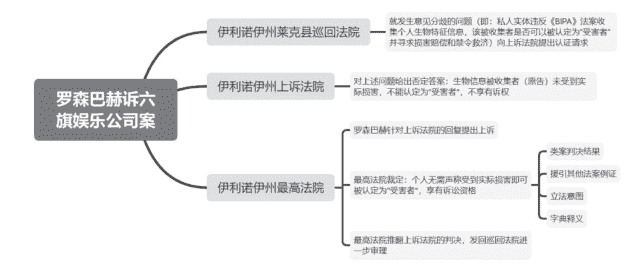

### 核心争议点

仅因违反法条而未产生实际损害时，原告是否仍符合Illinois BIPA规定的受害人要件，从而具备诉讼主体资格。

### 裁判论证过程

Illinois最高法院认为，无需实际受损即可被认定为法案所指受害人，享有起诉权。

最高法院首先阐明BIPA的立法目的，并回应上诉法院解释偏差。通过类案、他法案、词典释义论证，即使未受实质损害，只要损害源于BIPA违法，原告仍构成受害人。

其一，最高法院指出，其他地区上诉法院及近期联邦地区法院均不支持“因未受实质损害即无诉权”抗辩。法律解释首要任务是探明立法者意图^([\[66\]](#txt010.html#footnote_content_txt010_66))。条文表意明确时不得增设例外^([\[67\]](#txt010.html#footnote_content_txt010_67))。上诉法院仅作字面理解，与BIPA预防侵害生物识别信息的初衷相悖。

其二，若州议会拟附加实质损害要求，会明确表达^([\[68\]](#txt010.html#footnote_content_txt010_68))。例如《反消费者欺诈和欺骗性商业行为法》第10条a款即设限制；而《艾滋病保密法》规定违法即构成损害。最高法院承认对比仅具启发性，但结合法律解释应使立法发挥效力原则，得出无需实际受损即可起诉结论^([\[69\]](#txt010.html#footnote_content_txt010_69))。

其三，历史上“受害”常被理解为人身或财产实质损害，但法律意义上受害亦可指法定权利受侵害或财产利益受直接影响，该理解在Illinois法院长期适用并为BIPA所采纳。

其四，最高法院援引韦氏大学词典及布莱克法律词典，确认上述理解与词典定义一致，并强调BIPA明确赋予个人对其生物识别符及信息的隐私权与控制权，违法本身即足以构成诉因^([\[70\]](#txt010.html#footnote_content_txt010_70))。

判决反复强调生物识别数据的可识别性、唯一性与无法更改性，一旦外泄风险极高且难补救，立法目的在于事前预防。基于此，最高法院认定上诉判决错误，确认原告符合受害人定义并享有诉权。

## 【审理结果】

1. Illinois上诉法院认为原告未受实际损害，不构成法案受害人，无诉权，非适格主体。
2. Illinois最高法院认定原告属于受害人并拥有诉权，是适格主体，推翻上诉法院判决。

## 【相关法条】

### 美国伊利诺伊州《生物信息隐私法》第 15 条（b）款（Biometric Information Privacy Act§15（b），740 Illinois Compiled Statutes§14/15（b）（2013））

任何私人实体不得收集、捕获、购买、通过交易接收或以其他方式获得个人或消费者的生物识别符或生物识别信息，除非首先进行以下活动：

（1）以书面形式通知该主体或该主体的合法授权代表，正在收集或存储生物识别符或生物识别信息；

（2）以书面形式通知该主体或该主体的合法授权代表，正在收集、存储和使用生物识别符或生物识别信息的具体目的和期限告；

（3）收到生物识别符或生物识别信息的主体或该主体的合法授权代表签署的书面许可.

### 美国伊利诺伊州《生物信息隐私法》第 20 条（Biometric Information Privacy Act§20，740 Illinois Compiled Statutes§14/20（2013））

诉讼权.任何因违反本法而受害的人都有权向州巡回法院提起诉讼，或作为附加要求（supplemental claim）在联邦地区法院起诉违法方.胜诉方可以就每项违法行为进行追偿：

（1）对因疏忽而违反本法规定的私人实体，要求 1，000 美元的违约金或实际损害赔偿，以较高者为准.

（2）对故意或鲁莽地违反本法规定的私人实体，要求 5，000 美元违约金或实际损害赔偿，以较高者为准；

（3）合理的律师费和其他费用，包括专家证人费用和其他诉讼费用；以及

（4）州或联邦法院认为适当的其他救济，包括禁止令.

## 【案例评析】

### （一）明确《生物信息隐私法》的立法宗旨，具有启发性意义

正如州最高法院所指出的，“本法案赋予个人和消费者掌控自己的生物信息的权利，具体形式包括要求私人主体在收集生物信息前予以通知，并赋予个人和消费者拒绝同意此类收集行为的权力”，而且，“这些程序性的保护措施在我们目前的数字化世界中至关重要，因为现在的技术允许大量收集和存储个人唯一的生物信息识别符，而这些生物信息识别符一旦遭到破坏或滥用，则无法更改”.^([\[72\]](#txt010.html#footnote_content_txt010_72))

上述解释获州议会认同。当前生物识别技术的全部后果尚未完全明晰。个人生物特征信息无法更改，与可重置密码不同，一旦外泄，个体将面临身份被伪造而难以追责的困境。因此法案旨在事前防范风险，主要路径为：一是事前保障个人对生物信息隐私的尊重与控制；二是无论是否产生实质损害，违反法案要求的私营主体均需承担法定赔偿、禁令、律师费及每项违法行为的诉讼费用等责任。

由此可见，Illinois立法与司法机构对生物识别技术持审慎态度。2008年出台的BIPA经十余年发展，已成为全球对生物识别信息保护最严格的法律之一。

【为何生物识别需要分层监管】

伊利诺伊州《生物信息隐私法》对生物识别信息予以差别化安排，实质上体现了个人信息治理应分门别类、按风险定级的理念。数据价值是多面向的。站在个人角度，私密信息被窥探的可能性在升高，技术也让机构能够大规模获取、加工、流通个人数据以换取商业收益和行政效能，主体对防泄防滥的需求随之增强。从经营者视角看，传统企业靠海量数据提升营销响应与市场研判，本案中六旗乐园借助人脸信息提高运营效率就是例证；以数据采集、处理、存储、传输为核心业务的信息服务商，则直接把个人数据的可利用性转化为商业机会。公共部门同样有使用诉求，公共安全、公共服务、公共福利的推进都要倚赖居民数据掌握，追求行政效能也会推动政府不断探寻数据使用的边界与价值。^[[\73\]](#txt010.html#footnote_quote_txt010_73)
诉求多元就带来平衡难题，统一标准难以兼顾。最高法院在本案的说理中指出，生物特征数据与一般数据在泄露后果上存在差异，因而该州对其实施更严的保护。风险导向的分级思路在欧盟相关立法中也有体现。中国《个人信息保护法》对敏感信息作出区别化安排。学界也有提出依据信息生命周期进行动态分级，以实现精细化持续保护的主张。^[[\75\]](#txt010.html#footnote_quote_txt010_75)

### （二）明确生物特征识别信息权利的司法救济模式，促进《生物信息隐私法》的适用

生物特征具有不可更改且一人唯一的属性。一旦外泄或被冒用，对权利人的损害往往是永久且难以修复的。法院据此构建出高于一般个人信息侵权的救济路径：即便生物识别数据尚未产生现实损失，权利人仍可启动司法审查。与普通个人信息侵权相比，此类案件的起诉门槛被明显压低，目的在于让权利人及时主张权利，防止未来损失扩大。因为实际损害一旦形成，后果通常不可逆转。^[[\76\]](#txt010.html#footnote_quote_txt010_76)对该类信息施加区别于一般信息的特别保护与特别规制，有助于筑牢安全防线，对中国具有参考价值。^[[\77\]](#txt010.html#footnote_quote_txt010_77)

正是救济规则的厘清，《生物信息隐私法》才逐步进入公众视野。该法2008年出台后长期沉寂，直至2015年才出现首批5起针对企业违规的集体诉讼，适用度偏低。本案判决明显鼓励了该法下的诉讼活动，也牵动了其他地区未决案件，比如涉及Facebook人脸识别的集体诉讼。作为全球首部生物识别信息隐私专门法，该法的激活一方面提升了公民生物特征信息的保护水位，另一方面也让大型企业承受集体诉讼压力。实践反思指出，部分条文过于苛刻，已不合发展实际，既抬升了创新企业的合规负担，也放大了消费者滥诉可能。^[[\78\]](#txt010.html#footnote_quote_txt010_78)有美国媒体认为，判决过度偏向规制不当行为，破坏了鼓励创新与遏制风险之间的平衡。

更深层的争议落在程序衔接上。“无救济则无权利”，实体权利被确认的同时，传统诉讼结构受挑战，原告适格成为焦点。中国《民法典》将生物识别信息纳入个人信息并置于隐私权框架下，而该类信息不可更改、主体唯一，权属上又涉及个人、公权力机关与企业多方。如何认定侵权、选择何种救济方式、设计怎样的执行程序，都需要在本土实践中吸收域外经验并改进。

### （三）作为域外经验，本案对我国个人生物识别信息立法保护具有借鉴意义

伊利诺伊州《生物信息隐私法》属于专门立法路径。其架构包含界定五大专属法律概念，^[[\79\]](#txt010.html#footnote_quote_txt010_79)厘清三大相对权责，^[[\80\]](#txt010.html#footnote_quote_txt010_80)设置三大禁止性规范与三个豁免条款，^[[\81\]](#txt010.html#footnote_quote_txt010_81)并对私人诉权、法定赔偿标准作出清晰规定，同时设立监管机构。该模式“立法目的明确、概念专属、权利义务主体清晰、保护规则具体、解决方式明确，针对性和操作性强”。^[[\82\]](#txt010.html#footnote_quote_txt010_82)

另一种是综合立法路径，以2018年生效的欧盟《通用数据保护条例》为代表。在统一的个人信息或数据保护法中对生物识别信息予以强化保护，将其视为敏感个人信息的一类。^[[\83\]](#txt010.html#footnote_quote_txt010_83)该路径还确立了处理敏感数据的特定原则，例如：“禁止处理”^[[\84\]](#txt010.html#footnote_quote_txt010_84)“明示同意”“法定必需”等。^[[\85\]](#txt010.html#footnote_quote_txt010_85)

两种路径的形成受国情、社会接受度、技术商业化程度等多重因素影响。中国政府与社会对生物识别技术整体持积极乐观态度，立法需兼顾技术创新与产业发展；欧美在技术高速发展而风险不明时采取审慎立场的做法亦值得借鉴。正如有学者所言：“面部识别的收益与风险直接决定规制取向。收益大于风险，天平倾向利用；风险大于收益，天平倾向保护；关系不明则应审慎，不能盲目放开。”^[[\86\]](#txt010.html#footnote_quote_txt010_86)因此除选择合适的立法模式外，还应构建可落地的救济机制，让保护既体现在日常监管和企业合规自律中，也通过司法实践不断强化。

2020年生效的《民法典》第一千零三十四条已将生物识别信息纳入个人信息保护范畴。^[[\87\]](#txt010.html#footnote_quote_txt010_87)2021年《个人信息保护法》更进一步，将其界定为“敏感个人信息”予以特殊保护。^[[\88\]](#txt010.html#footnote_quote_txt010_88)可见生物识别信息已成为国内外关注重点，我国也在不断探索平衡各方利益的规则。本案有助于全面把握全球生物信息保护现状，借鉴域外经验，为中国隐私规制提供思路。

当然，判决也引发反对声音。其一是对“受害者”定义的冲击。联邦法院与州法院在解释法律时，均要求存在实际损害或因违法造成的损害。^[[\89\]](#txt010.html#footnote_quote_txt010_89)美国最高法院亦认为，宪法要求原告在向联邦法院起诉前，必须有具体且确定的事实损害，而非仅是法规的技术性违反。^[[\90\]](#txt010.html#footnote_quote_txt010_90)其二，从立法意图看，几乎所有法规都带预防和威慑目的，但这并不意味着未受伤害者可以提起集体诉讼，索取与实际或可补偿损害无关的、汇总的法定赔偿。^[[\91\]](#txt010.html#footnote_quote_txt010_91)

## 【关联判例推荐】

1\. Patel v. Facebook Inc., 290 F.Supp.3d 948 (N.D. Cal.2018)

核心事实：原告为Facebook平台使用者，依据伊利诺伊州《生物信息隐私法》起诉，主张Facebook在未事先告知或取得同意的情况下非法获取并保存其生物数据。Facebook抗辩原告未证明遭受具体实际侵害，请求法院依联邦民事诉讼规则驳回诉讼。法院驳回了该动议。

与本案关联点：依伊利诺伊州《生物信息隐私法》，原告不必举证实际具体侵害也可获得起诉资格。

2\. Sekura v. Krishna Schaumburg Tan, Inc., 2018 IL App (1st) 180175, 426 Ill.Dec. 158, 115 N.E.3d 1080 (Ill.App. 1 Dist. 2018)

核心事实：在原告Sekura未签署书面同意的情况下，被告Krishna Schaumburg Tan公司采集其指纹以核验身份，并向第三方披露。伊利诺伊州上诉法院认定，仅因违反《生物信息隐私法》导致生物隐私权受侵害，原告即可起诉，无需证明实际损害。

与本案关联点：依伊利诺伊州《生物信息隐私法》，原告不必证明实际损害也可获得起诉资格。

3\. In re Facebook Biometric Information Privacy Litigation, 326 F.R.D. 535 (N.D.Cal. 2018).

核心事实：原告为Facebook平台使用者。被告Facebook公司的“标签建议”程序用于扫描并识别用户上传照片中的人像以生成标签。原告指控Facebook未经事先通知或同意即收集和存储其生物识别数据。联邦地区法院裁定，当所诉行为侵害了合法权利时，个人即构成“受侵害”。依据该法，原告提起诉讼无需提供额外证据。

与本案关联点：原告不必证明实际损害即可起诉，因《生物信息隐私法》并未将私人诉权限于遭受“实际”损害者。

4\. In re Estate of Harmston, 10 Ill.App.3d 882, 295 N.E.2d 66 (Ill.App. 3 Dist.1973)

核心事实：原告为已故Rory de Hart Ludd管理的Herbert Harmston庄园管理人，被告为不动产潜在买受人。买受人认为巡回法院未遵守伊利诺伊州《遗嘱认证法》关于死者房地产销售的规定。法院认为买受人尚未对房地产形成既得利益，未按《遗嘱认证法》构成“受害”，故无权上诉。

与本案关联点：伊利诺伊州法院在遗产案件中同样体现，司法实践对“受害”的理解为原告无需证明实际损害即可享有诉权。

## 【注释】

[\[1\]](#txt010.html#footnote_quote_txt010_1)美国《计算机欺诈和滥用法》于 1986 年颁布，该法案明确了计算机犯罪中欺诈和滥用罪的定义，禁止未经授权访问或获取受保护的计算机的信息，是美国关于网络安全的法案.

[\[2\]](#txt010.html#footnote_quote_txt010_2)HiQ Labs， Inc. v. LinkedIn Corp.， No. 17-16783 （2017）.

[\[3\]](#txt010.html#footnote_quote_txt010_3)三家公司分别运营着 Craiggers（基本原样照搬 Craigslist）、Padmapper（抓取 Craigslist 上房地产广告相关数据）、Lovely（通过 3Taps 间接使用 Craigslist 的数据）三家网站.

[\[4\]](#txt010.html#footnote_quote_txt010_4)3Taps 等所提出的反诉分为了两部分，这也是为何本案会有两份判决书的原因.第一份判决书主要论述了 CFAA、著作权、侵害动产的相关问题；第二份判决书详细论述了 CFAA 相关问题，分析了何为“未经授权”以及 CFAA 的保护范围.

[\[5\]](#txt010.html#footnote_quote_txt010_5)矫鸿彬、幸自奇：《中美数据抓取案件裁判思路之比较分析》，载金杜律师事务所网 2020 年 3 月 12 日，`https：//www.chinalawinsight.com/2020/03/articles/intellectual-property/中美数据抓取案件裁判思路之比较分析/`.

[\[6\]](#txt010.html#footnote_quote_txt010_6)另外两个部分为：针对原告对于分类广告享有汇编作品著作权的主张，法院认为 Craigslist 享有网页排版的著作权、用户享有其所发布的分类广告的著作权，而 Craigslist 无权代表其用户起诉侵权者；针对侵害财产的主张，法院认可被告的行为占用了原告的资源，降低了原告的服务能力，构成对于原告的损害.

[\[7\]](#txt010.html#footnote_quote_txt010_7)Craigslist Inc. v. 3Taps Inc.， 942 F.Supp.2d 962 （N.D. Cal. 2013）.

[\[8\]](#txt010.html#footnote_quote_txt010_8)根据加州法律，共谋是一种理论，要求那些虽然自己没有实际实施侵权行为，但与直接侵权人共同计划或设计实施侵权行为的人承担责任.共谋行为有三个要素：（1）阴谋的形成和运作，（2）促进阴谋的不法行为，以及（3）不法行为产生的损害.

[\[9\]](#txt010.html#footnote_quote_txt010_9)此处 3Taps 援引了 Pulte Homes， Inc.v. Labore’s Intern’l Union of N. Am.， 648 F.3d 295， 304 （6th Cir. 2011）一案，以证明公众推定有权访问“未受保护的网站”.

[\[10\]](#txt010.html#footnote_quote_txt010_10)LVRC Holdings LLC v. Brekka， 581 F.3d 1127 （9th Cir. 2009）

[\[11\]](#txt010.html#footnote_quote_txt010_11)United States v. Morris， 928 F.2d 504， 511 （2d Cir. 1991）.

[\[12\]](#txt010.html#footnote_quote_txt010_12)为便于理解，此处附上判决原文：未经授权使用计算机的人对相关计算机没有任何权利，无论是有限的还是其他的，都无权访问该计算机。

[\[13\]](#txt010.html#footnote_quote_txt010_13)United States v. Nosal， 676 F.3d 854 （9th Cir. 2012）.

[\[14\]](#txt010.html#footnote_quote_txt010_14)例如，网站用户协议、单位规章制度等.

[\[15\]](#txt010.html#footnote_quote_txt010_15)Craigslist Inc. v. 3Taps Inc.， 942 F.Supp.2d 962， 968 （N.D. Cal. 2013）.

[\[16\]](#txt010.html#footnote_quote_txt010_16)具体取决于网站所有者表明态度和立场的清晰程度.

[\[17\]](#txt010.html#footnote_quote_txt010_17)在“制止函”中，Craigslist 要求 3Taps 等“不得出于任何原因访问其网站”.

[\[18\]](#txt010.html#footnote_quote_txt010_18)Muscarello v. United States， 524 U.S. 125， 138， 118 S.Ct. 1911， 141 L.Ed.2d 111 （1998）.

[\[19\]](#txt010.html#footnote_quote_txt010_19)Holder v. Humanitarian Law Project， 561 U.S. 1， 130 S.Ct. 2705， 2719， 177 L.Ed.2d 355 （2010）.

[\[20\]](#txt010.html#footnote_quote_txt010_20)明示的“未经授权”包括与员工签署的保密协议、网页上的告知、警告、弹窗、最终用户协议、产品或服务备注的说明、解释等.

[\[21\]](#txt010.html#footnote_quote_txt010_21)版权侵权诉讼的前提.

# 爬虫合规：中美司法分野与风险提示

自动化抓取的合法性在中美司法实践中呈现明显分化。美国围绕《计算机欺诈与滥用法》的解释趋于限缩，中国则在刑事追责与民事竞争规则上形成双重压力。焦点已从技术手段本身转向权利配置与市场秩序。下面按主题梳理关键裁判与研究，供从业者评估风险。

## 美国 CFAA 适用收紧及学界讨论

[\[22\]](#txt010.html#footnote_quote_txt010_22) 2019 年第十一巡回法院在 United States v. Van Buren 案，940 F.3d 1192 中，对 CFAA 的“超越授权访问”作出了收窄解释，在业界引发广泛关注。

[\[23\]](#txt010.html#footnote_quote_txt010_23) 2008 年最高法院审理的 Winter v. NRDC, Inc.，555 U.S. 7，129 S.Ct. 365，建立了救济裁量上的判断框架。

[\[24\]](#txt010.html#footnote_quote_txt010_24) 2012 年第九巡回法院的 United States v. Nosal，676 F.3d 854，为后续网络取数类纠纷提供了重要的解释思路。

[\[25\]](#txt010.html#footnote_quote_txt010_25) 加州北区法院就 Craigslist Inc. v. 3Taps Inc. 作出 964 F.Supp.2d 1178 的裁定；第九巡回法院就 Facebook, Inc. v. Power Ventures, Inc. 作出 844 F.3d 1058 的判决，两案常被并列分析。

[\[26\]](#txt010.html#footnote_quote_txt010_26) Benjamin L. W. Sobel 在 Lewis & Clark Law Review 第 25 卷 2021 年发表《A New Common Law of Web Scraping》，页 147-208，提出以普通法方式规范抓取行为。

[\[27\]](#txt010.html#footnote_quote_txt010_27) Peter G. Berris 为国会研究服务处撰写的《Cybercrime and the Law：Computer Fraud and Abuse Act 与第 116 届国会》于 2020 年 9 月 21 日发布，链接 `https：//crsreports.congress.gov/product/pdf/R/R46536`。

[\[28\]](#txt010.html#footnote_quote_txt010_28) 李谦在《电子政务》2020 年第 11 期刊文《美国场景化司法规制数据爬取的经验与启示》，页 90-91，总结了情境化司法的特点。

[\[29\]](#txt010.html#footnote_quote_txt010_29) James Keenan 于 2019 年 12 月 26 日在 CPO Magazine 发表《What the HiQ vs. LinkedIn Case Means for Automated Web Scraping》，链接 `https：//www.cpomagazine.com/data-privacy/what-the-hiq-vs-linkedin-casemeans-for-automated-web-scraping/`。

[\[30\]](#txt010.html#footnote_quote_txt010_30) Amber Zamora 的论文《Making Room for Big Data：Web Scraping and an Affirmative Right to Access Publicly Available Information Online》刊于 Journal of Business, Entrepreneurship and the Law 第 12 卷，页 203-228，2019 年。

[\[31\]](#txt010.html#footnote_quote_txt010_31) 李晨晔 2017 年 10 月 30 日在搜狐网发表《数据挖掘要当心“雷区”》，网址 `https：//www.sohu.com/a/201303823\_505841`。

[\[32\]](#txt010.html#footnote_quote_txt010_32) 因 Facebook 案系本院此前审理案件，裁判文书专门说明两案结论不同的原因。

[\[33\]](#txt010.html#footnote_quote_txt010_33) Sandvig v. Sessions 在哥伦比亚特区地方法院的判决为 315 F.Supp.3d 1，2018 年作出。

## 中国刑事实务与学理探讨

[\[34\]](#txt010.html#footnote_quote_txt010_34) 晟品公司非法获取计算机信息系统数据案由北京市海淀区人民法院以 2017 京 0108 刑初 2384 号刑事判决书审结。

[\[35\]](#txt010.html#footnote_quote_txt010_35) 游涛、计莉卉在《法律适用》2019 年第 10 期撰文，以该案为样本分析网络爬虫取数行为的刑事责任认定，页 8-9。

[\[36\]](#txt010.html#footnote_quote_txt010_36) 石经海、苏桑妮在《北京理工大学学报（社会科学版）》2021 年第 1 期发表《爬取公开数据行为的刑法规制误区与匡正—从全国首例“爬虫”入刑案切入》，页 3-4。

[\[37\]](#txt010.html#footnote_quote_txt010_37) Teresa Scassa 在 Online Information Review 第 43 卷发表《Ownership and control over publicly accessible platform data》，页 986-1002，2019 年。国内也有学者从数据具有言论属性的角度论证保护强度不宜过高，参见王燃《论网络开放平台数据利益分配规则》，《电子知识产权》2020 年第 8 期，页 51。

[\[38\]](#txt010.html#footnote_quote_txt010_38) 上述两起案件的详细情节请参见“关联判例推荐”部分。

## 民事不当竞争路径

[\[39\]](#txt010.html#footnote_quote_txt010_39) 新浪诉饭友案由北京知识产权法院作出 2019 京 73 民终 2799 号民事判决。

[\[40\]](#txt010.html#footnote_quote_txt010_40) 《反不正当竞争法》第 12 条第 2 款第 4 项禁止经营者利用技术手段影响用户选择或妨碍、破坏其他经营者合法提供的网络产品服务正常运行。

[\[41\]](#txt010.html#footnote_quote_txt010_41) 《反不正当竞争法》第 2 条规定经营者应遵循自愿、平等、公平、诚信原则，并界定不当竞争行为与经营者范围。

[\[42\]](#txt010.html#footnote_quote_txt010_42) 最高人民法院 2009 民申字第 1065 号民事裁定书即海带配额案，认为适用该法第 2 条需同时具备未被特别规制、合法权益受实际损害、违反诚实信用与公认商业道德。

[\[43\]](#txt010.html#footnote_quote_txt010_43) 山东省高级人民法院 2010 鲁民三终字第 5-2 号判决即 45 号指导案，百度诉奥商公司案，提出判断不当竞争应考量主体资格、是否违背诚信商业道德、是否造成损害。

[\[44\]](#txt010.html#footnote_quote_txt010_44) 许可《数据保护的三重进路—评新浪微博诉脉脉不正当竞争案》，《上海大学学报（社会科学版）》2017 年第 6 期，页 23；李晓宇《权利与利益区分视点下数据权益的类型化保护》，《知识产权》2019 年第 3 期，页 60。

[\[45\]](#txt010.html#footnote_quote_txt010_45) 许可《上海大学学报（社会科学版）》2017 年第 6 期页 23-25；李晓宇《知识产权》2019 年第 3 期页 60；丁文联《数据竞争的法律制度基础》，《财经问题研究》2018 年第 2 期页 16-17；刘金瑞《数据财产保护的权利进路初探》，《中国信息安全》2017 年第 12 期页 39。

[\[46\]](#txt010.html#footnote_quote_txt010_46) 黄晓锦《大数据时代数据分享与抓取的竞争法边界》，《财经问题研究》2018 年第 2 期页 20；刘影、眭纪刚《日本大数据立法增设“限定提供数据”条款及其对我国的启示》，《知识产权》2019 年第 4 期。

[\[47\]](#txt010.html#footnote_quote_txt010_47) 大众点评诉百度案，上海知识产权法院 2016 沪 73 民终 242 号民事判决。

[\[48\]](#txt010.html#footnote_quote_txt010_48) 新浪诉脉脉案，北京知识产权法院 2016 京 73 民终 588 号民事判决。

[\[49\]](#txt010.html#footnote_quote_txt010_49) 新浪诉饭友案再次被援引，北京知识产权法院 2019 京 73 民终 2799 号民事判决书。

[\[50\]](#txt010.html#footnote_quote_txt010_50) 新浪诉脉脉案与腾讯诉抖音行为保全案，天津市滨海新区人民法院 2019 津 0116 民初 2091 号民事裁定书，反映平台数据纠纷的态势。

[\[51\]](#txt010.html#footnote_quote_txt010_51) 徐伟《企业数据获取“三重授权原则”反思及类型化构建》，《交大法学》2019 年第 4 期，页 23。

[\[52\]](#txt010.html#footnote_quote_txt010_52) 王燃《论网络开放平台数据利益分配规则》，《电子知识产权》2020 年第 8 期，页 49；对平台授权的批判亦见徐伟《交大法学》2019 年第 4 期页 26-35。

## 垄断规制、必要设施与数据公平

[\[53\]](#txt010.html#footnote_quote_txt010_53) 孟小峰、王雷霞、刘俊旭《人工智能时代的数据隐私、垄断与公平》，《大数据》2020 年第 1 期，页 39。

[\[54\]](#txt010.html#footnote_quote_txt010_54) 澎湃新闻 2021 年 3 月 7 日报道《手机越贵，打车越贵？复旦教授三万字打车报告来验证》，链接 `https：//m.thepaper.cn/baijiahao\_11569999`。

[\[55\]](#txt010.html#footnote_quote_txt010_55) 新浪财经 2021 年 3 月 3 日刊发《全国人大代表杨松：建议立法规制大数据杀熟、平台二选一等》，链接 `https：//fi nance.sina.com.cn/jjxw/2021-03-03/doc-ikftssaq0163761.shtml`。

[\[56\]](#txt010.html#footnote_quote_txt010_56) 中华人民共和国中央人民政府网站 2021 年 3 月 5 日发布《李克强总理作政府工作报告（文字摘要）》，链接 `http：//www.gov.cn/premier/2021-03/05/content\_5590492.htm`。

[\[57\]](#txt010.html#footnote_quote_txt010_57) 曾彩霞、朱雪忠《必要设施原则在大数据垄断规制中的适用》，《中国软科学》2019 年第 11 期，页 55。

[\[58\]](#txt010.html#footnote_quote_txt010_58) 《禁止滥用市场支配地位行为暂行规定》第 16 条禁止具有市场支配地位的经营者无正当理由拒绝相对人以合理条件使用必需设施，并列明认定要素。

[\[59\]](#txt010.html#footnote_quote_txt010_59) Zachary Abrahamson《Essential data》，124 Yale Law Journal 867，2014 年，被曾彩霞、朱雪忠引述于《中国软科学》2019 年第 11 期页 56。

[\[60\]](#txt010.html#footnote_quote_txt010_60) 曾雄《数据垄断的竞争分析路径》，《金融创新法律评论》2018 年第 1 辑，页 120。

[\[61\]](#txt010.html#footnote_quote_txt010_61) 韩伟《如何从反垄断法角度审视人工智能》，《网络法律评论》2017 年第 1 期，页 10。

## 美国生物识别隐私诉讼程序说明

[\[62\]](#txt010.html#footnote_quote_txt010_62) 文书常以罗森巴赫为原告，技术上不准确，实际起诉人是其子亚力山大，罗森巴赫担任诉讼代理人。

[\[63\]](#txt010.html#footnote_quote_txt010_63) 在法院未对全部请求作出终局裁决前，当事人可就部分判决申请中间上诉，但须经初审法院批准。

[\[64\]](#txt010.html#footnote_quote_txt010_64) Sekura 诉 Krishna Schaumburg Tan, Inc., 2018 IL App（1st）180175, 426 Ill. Dec. 158, 115 N.E.3d 1080。

[\[65\]](#txt010.html#footnote_quote_txt010_65) 关于 Facebook 生物识别信息隐私诉讼，326 F.R.D. 535, 545-47（N.D. Cal. 2018）。

[\[66\]](#txt010.html#footnote_quote_txt010_66) Rosenbach 诉 Six Flags Entm’t Corp., 2019 IL 123186, 2019 Ill. LEXIS 7, 432 Ill. Dec. 654, 129 N.E.3d 1197（Jan. 25, 2019）, 第 24 段。

[\[67\]](#txt010.html#footnote_quote_txt010_67) 同上，第 24 段。

[\[68\]](#txt010.html#footnote_quote_txt010_68) 同上，第 25 段。

[\[69\]](#txt010.html#footnote_quote_txt010_69) 同上，第 28 段。

[\[70\]](#txt010.html#footnote_quote_txt010_70) 同上，第 33 段。

[\[71\]](#txt010.html#footnote_quote_txt010_71) 同上，第 36 段。

[\[72\]](#txt010.html#footnote_quote_txt010_72) 同上，第 34 段。

[\[73\]](#txt010.html#footnote_quote_txt010_73) 张新宝《从隐私到个人信息：利益再衡量的理论与制度安排》，《中国法学》2015 年第 3 期，页 47-48。

生物识别信息：被全球重点盯防的隐私高地

从欧洲到美国，再到中国，围绕人脸、指纹等生物识别信息的规则已经形成一道明显的高压线。欧盟是最早拉响警报的地区。

早在1981年的《数据自动化处理保护协定》第6条，到1995年的《通用数据保护条例》第8条，再到2018年生效的现行《通用数据保护条例》第9条，对种族、宗教、信仰以及个人健康、性生活等敏感信息，均采取了严格的特殊保护，处理上基本遵循禁止性立场。\ [74\]

学界对这一趋势也有持续追踪。袁泉、王思庆从个人信息分类保护的体系角度做过系统研究；商希雪以欧美模式为参照，探讨了生物特征识别信息商业化在中国应持的立场与制度路径；邢会强聚焦人脸识别的法律规制；赵淑钰则梳理了生物识别信息法律规制的国际经验与启示。\ [75\]\ [76\]\ [77\]\ [78\]

美国伊利诺伊州《生物识别信息隐私法》BIPA的建构尤为典型。付微明归纳出该法关联的五大专属概念：生物标识、生物识别信息、私人实体、机密敏感信息和书面发布。\ [79\]

权利与义务的对应关系也很清晰。法律为信息主体配置了知情权、同意权、信息自决权三项核心权利，同时要求私人实体承担告知通知义务、安全保障义务和合法合规处理义务及责任。\ [80\]

BIPA的禁止性规范被总结为三条：不得收集、捕获、购买、交易接收或以其他方式取得个人生物标识或信息；不得从个人生物标识或信息中获利；未经主体同意不得收集、储存、使用、披露或以其他方式传播个人或客户的生物标识或信息。\ [81\]

与之相对应的是三类法定豁免情形：应主体或其合法代表请求或授权，在金融交易中进行披露或再披露；州法、联邦法或地方法规要求披露或再披露；依据有管辖权的法院签发有效令状或传票进行披露或再披露。\ [81\]\ [82\]

在理解上，“禁止处理”指的是自然人、法人、公共机构、行政机关等控制者、处理者或第三方，通常无权仅为识别自然人之目的而处理生物识别信息。\ [84\]

而“法定必需”则为不经同意处理的例外打开空间，通常包括为履行工作职责、社会重大利益或公共利益所必需；出于法律原因所必需；为数据主体和第三人重大利益所必需；以及在特定协会、组织、非营利组织内部并在适当安全保障措施下进行的处理。\ [85\]

中国立法也同步收紧。邢会强在比较研究中指出国内规制的走向，与此呼应的是《民法典》第一千零三十四条明确自然人个人信息受法律保护，并将生物识别信息列入姓名、身份证件号码、住址、电话号码、电子邮箱、健康信息、行踪信息等个人信息范围。\ [87\]

《个人信息保护法》第二十八条进一步将敏感个人信息单列，生物识别、宗教信仰、特定身份、医疗健康、金融账户、行踪轨迹等信息均在列，且对不满十四周岁未成年人的个人信息作特别保护。处理敏感个人信息须有特定目的和充分必要性，并采取严格保护措施方可进行。\ [88\]

司法实践层面，美国的判例不断扩展执行边界。Gubala诉Time Warner Cable案、Spade诉Select Comfort Corp案等对BIPA的适用作出解释；Spokeo诉Robins案则涉及宪法上的起诉资格标准。\ [89\]\ [90\]

2019年伊利诺伊州最高法院在Rosenbach诉Six Flags案中，对BIPA项下法定起诉资格采取了扩张性解释，这一立场被业界视为企业合规压力显著上升的信号。\ [91\]

从欧盟的原则禁止，到伊利诺伊州的三权三义三禁三豁，以及中国民法典与个保法的敏感信息框架，生物识别信息已经从技术便利的工具，转变为需要分类分级、严格许可、责任可追的特殊法律客体。对企业而言，合规早已不是可选项。