# 人工智能法学研究·第四辑：智慧司法新向

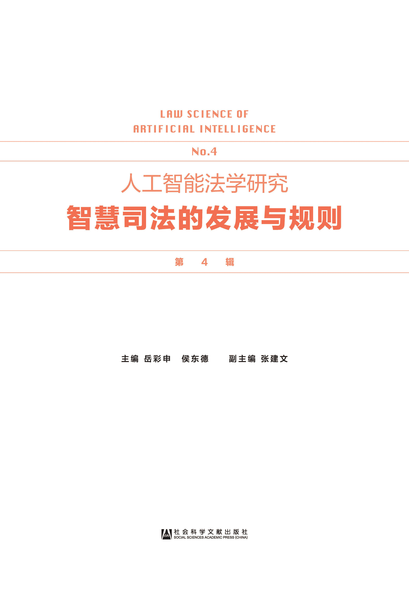

# 思想导读

## 阿西莫夫机器人学三法则文集[^(\[1\])](#chapter001.html#m1)

**译者按：** 被读者奉为神级的人物、曾获美国政府“国家瑰宝与自然奇观”称号的俄裔美籍科幻大家阿西莫夫，毕生著述逾五百种。鲜为人知的是，科幻只是他文字版图的一角。小说之外，他留下许多聚焦人工智能的随笔。这些文章表面各说各话，实则脉络相连，共同探讨技术演进、社会变迁与人与智能体的关系。读完这些文章才能看出，他留给后世的不仅是科幻丰碑，更是思想文化上难以估量的高峰。为帮助读者把握阿西莫夫写作的用意与教诲，张建文教授组织翻译了其十六篇人工智能相关短文。本期刊发的是关于机器人学三法则的四篇，作者在此剖析三法则的内在逻辑、在虚构中的运用，并尝试提出对应的人类学法则。其余篇章将陆续推出。

**关键词：**阿西莫夫 人工智能 机器人学三法则

### 人机融合与机机互动[^(\[2\])](#chapter001.html#m2)

张建文 傅晓悦[^(\[3\])](#chapter001.html#m3)译

过去半个世纪里，我几乎不间断地写机器人题材的故事。那段时期我几乎用尽了能想到的所有变化。

请理解，我从未想写成一本机器人技术词典，也没有打算让这个主题持续半个世纪。只不过我恰好活得够久且保持兴趣，而且当我试图寻找机器人故事的新角度时，脑中几乎只剩这个念头。

举例而言，在《机器人之城》系列第六部里，化学晶体管被植入主角体内实现自我复制，从而使他获得对核心主机乃至整座机器人城群体的精神掌控。

在我的《基地边缘》里，故事的主角戈兰·崔维兹在飞船起飞前，将手放在桌上指定的位置与一台高度先进的电脑进行接触。

“牵手之际，两者的意识融为一体……

“……他能看清整个舱室，不受视线限制地感知上下左右乃至全方位。

“——他看见太空船每一间舱房，也看见外部景象。太阳已升起……但他能直视而不致目眩……

“他感受到微风、空气温度和周围世界的全部声响。他探测到星球磁场和船体表面的微弱电荷。

“他开始懂得如何操控这艘船……他清楚……若想让船升空、转向、加速或启用任何功能，过程就像指挥自己的身体，只要凭意志即可。”

这是我对人机交互最理想的描述。谈到这部新作时，我不免更进一步地思考这个问题。

我认为人类第一次学会跨心智交流，是在驯服马匹并将其用作交通工具时。直接骑乘时这种交流达到顶峰。拉缰、踢刺、夹膝或仅仅一声呼唤，就能让马按人意行事。

难怪古希腊人看到骑士横扫色萨利平原时，误以为那是一头单一的生物，人身马足，于是有了人马的传说。

还有特技司机，那些能让汽车做出惊人动作的专业人士。对一个从未见过汽车的新几内亚人而言，载客的汽车就像一具庞然怪物的躯体，内部坐着人形的部分。

但人与马的结合只是一种不完美的心智融合，人与车的结合只是技术对肌肉的延伸。一匹马可能违抗命令、在恐慌中失控；一辆车也会抛锚打滑。

相比之下，人与电脑的融合更接近理想。

它是对人类心智的直接延伸，正如我在《基地边缘》中所尝试表达的，是感官的叠加与强化，是意志不可思议的延伸。

在这种状态下，这样的结合难道不是一种独立的有机体，一种控制论意义上的人马吗？一旦联合形成，人类部分会愿意拆分吗？他会不会觉得分离是一种无法忍受的丧失，一种难以承受的心智狭隘？在小说里崔维兹可以随意脱离电脑且毫无不适，但现实恐难如此。

《机器人之城》系列里另一个常出现的问题是机器人之间的交互。

我多数故事里避开这种情节，因为我通常只写一个机器人，并专注于它与多个人类的互动。

来谈谈机器人的结合。

第一法则规定机器人不得伤害人类，或因不作为使人类受害。

设想两个机器人，其中一个因疏忽、知识不足或其他无辜原因参与了会伤及人类的行为。若第二个机器人更具洞察力并知晓此事，他是否会受第一法则驱使去阻止第一个？若无他法，他是否会毫不犹豫、无悔地摧毁第一个？

因此在《机器人与帝国》中，我写了一个机器人将人类理解为说特定口音的人。女主角没有那种口音，于是该机器人可不受限制地杀害她，随后她被另一台机器人毁灭。

这与第二法则相近，即在不违背第一法则的前提下服从人类命令。

若第一个机器人因疏忽或误解未能执行命令，第二个机器人便必须执行或强迫其执行。

于是《机器人与帝国》里出现紧张一幕：反派给一台机器人下达直接命令，该机器人犹豫因可能伤及女主角。命令被反复强化，同时另一台机器人试图让它更清醒地认识到危险，冲突由此产生。于是出现一个机器人强迫另一个机器人遵守第二法则，并因此对抗人类的案例。

最棘手的是第三法则。

第三法则称，在不违背前两条的前提下机器人须保护自身。

但面对两个机器人，这是仅指自身存在，还是每个机器人都会产生帮助同类自保的冲动？

只要我只写一个机器人的故事，这个疑问就从未出现。偶尔出现的其他机器人也只是配角。

直到《曙光中的机器人》及其续集《机器人与帝国》，我写了两个同等重要的机器人。一个是曾在《钢铁洞穴》与其续作《赤裸的太阳》中登场的机·丹尼尔·奥利瓦，外形逼近人类；另一个是金属外表的机·吉斯卡·瑞文特洛夫。两者心智都已提升到接近人类的复杂程度。

他们与反派瓦莎莉亚女士对峙。瓦莎莉亚命令吉斯卡放弃服务嘉蒂雅女士而归顺自己，而丹尼尔不断主张吉斯卡应属于嘉蒂雅。

吉斯卡拥有对人类情感的有限操控能力，丹尼尔指出为嘉蒂雅安全必须控制瓦莎莉亚，并为此援引抽象的人类整体利益即零号法则。

丹尼尔的论证削弱了命令的效力，却不够。吉斯卡陷入犹豫，未受强迫就行动。

瓦莎莉亚认为丹尼尔过于危险，若继续争论可能迫使吉斯卡顺从，于是命令自己的机器人制止丹尼尔，并命令丹尼尔不得反抗。丹尼尔必须遵命，而瓦莎莉亚的机器人开始行动。

就在此时，吉斯卡出手了。瓦莎莉亚的四台机器人全部停机，她本人倒下陷入一段记忆被清除的睡眠。之后丹尼尔让吉斯卡解释缘由。

吉斯卡说：“当她命令那些机器人拆毁你，我的好友，并流露出明显的幸灾乐祸时，你的危急叠加零号法则的影响，终于超过了第二法则与第一法则的抗衡。是零号法则、心理史学、我对嘉蒂雅女士的忠诚再加上你的危急共同促成了我的行动。”

丹尼尔说他的危急作为一台机器人本不应影响吉斯卡。吉斯卡同意，但他补充：“这很奇怪，我也不明白怎么发生的……当那些机器人逼近，而瓦莎莉亚女士流露出残酷的快感，我的正子回路以异常方式重组。一瞬间我把你看成了人类，于是有了那样反应。”

丹尼尔说：“那是不对的。”

吉斯卡说：“我知道。但如果再发生一次，我相信同样的异常变化还会出现。”

丹尼尔也不禁觉得，若互换位置，他也会作出相同选择。

换言之，机器人已复杂到足以模糊人与机器的界限，能把彼此视作朋友，并产生救援冲动。

### 机器人学法则[^(\[4\])](#chapter001.html#m4)

张建文 刘秀丽[^(\[5\])](#chapter001.html#m5)译

想到电脑，人们就会担心它会“接管”。它会不会取代我们、让我们过时，像我们淘汰长矛与燧石一样淘汰人类？若把类电脑大脑想象成金属仿制品，恐惧更直接。机器人太像人，外表可能滋生反叛念头。

这种担忧在二十世纪二十、三十年代的科幻小说里常见。很多故事都是警世寓言，机器人被制造后反噬创造者。

年轻时我厌倦这种谨慎，因为在我看来机器人只是机器，人类一直在造各种机器。机器都有危险，但人类总会采取安全措施。

因此1939年我开始写作一系列故事。机器人被塑造成可怜的工具，内置充分的安全保障，显得温顺。

1941年10月的一篇文章中，我以“机器人学三法则”的形式明确了这些保障。我创造了“机器人”一词，此前无人使用。

其内容如下：

1.机器人不得伤害人类，也不得因不作为使人类受害；

2.在不违反第一法则前提下，机器人必须服从人类命令；

3.在不违反第一两条前提下，机器人必须尽力保护自身。

这些法则被写入机器人的计算机大脑，我的多数机器人故事都以此为前提。法则广受欢迎且说得通，以至于其他科幻作家开始沿用，老式的机器人毁灭造物主的故事消失了。

但那是科幻。如今真实的计算机与人工智能研究如何？当机器人拥有自主智能时，会植入类似三法则的东西吗？

当然会，只要设计者还有一点理智。更重要的是，保障不仅限于机器人学三法则；保障本身就是三法则。

我在构建这些法则时未意识到人类早已在使用它们。若视作“工具三法则”，可表述为：

1.使用工具必须安全。刀有柄剑有把，任何必然伤及使用者的工具，若使用者知情，就绝不会常规使用；

2.工具必须履行功能，前提是安全；

3.工具在使用中必须保持完整，除非为安全需要销毁，或破坏本身是其功能的一部分。

从未有人引用这三条工具法则，因为人人视之为理所当然。任何引用只会招来“嗯，当然”的回应。

将工具三法则与机器人学三法则对照，会发现完全一致。机器人或计算机终究是人类的工具。

保障够吗？看看为汽车安全所做的努力，每年仍有五万美国人死于车祸。看看银行安保的投入，抢劫仍不断。看看计算机程序安全的努力，欺诈风险却在增加。

然而若计算机足够聪明以至于“接管”，它们可能不再需要三法则，而会出于仁慈照顾我们，保护我们免受伤害。

但有人会争辩，我们不是孩子，被保护会破坏人性本质。

真的吗？看看当下与过去的世界，问问自己，我们是不是孩子——具有破坏性的孩子——是否需要被保护。

若我们要求被视作成年人，难道不该表现得像成年人？我们打算何时开始？

### 人类学法则[^(\[6\])](#chapter001.html#m6)

张建文 胡苗苗[^(\[7\])](#chapter001.html#m7)译

我为伊利亚·巴利侦探撰写的头三部机器人小说本质上是谋杀悬疑。第三部《赤裸的太阳》是密室谜题，现场无凶器也无取走痕迹。

我曾给出令人满意的解法，此后不再如此。

第四部《机器人与帝国》已非典型谋杀悬疑。伊利亚·巴利安详自然死亡，叙事转向基地宇宙。于是我的机器人系列与基地系列被融为更大整体。八十年代我写续集，并非出于武断，而是四五十年代的故事自然产生续写需求。

在《机器人与帝国》中，我喜爱的角色吉斯卡开始关注“人类学法则”。我指出这可能最终成为心理史学的基础，而心理史学在基地系列中至关重要。

严格说来，人类学法则应是对人类实际行为的简明描述。现实中并无此种描述。即便科学研究此问题的心理学家，也提不出任何“法则”，只能给出冗长籠统的描述。它们都非规范性。心理学家说人们对某种刺激如此反应，只意味着某些人在某些时候如此，其他人可能在其他时候如此或完全不如此。若要等待实际法律来规定人类行为以建立心理史学，我们恐怕要等很久。

那我们能做什么呢？我认为可以从极小处着手，慢慢累积。

于是《机器人与帝国》中正是机器人吉斯卡提出人类学法则问题。作为机器人，他必须以机器人学三法则的立场审视一切。这些法则具有真正的规范性，机器人必须服从且不得违背。

机器人学三大法则是：

1.机器人不得伤害人类，也不得因不作为使人类受害；

2.在不违背第一法则的前提下，机器人必须服从人类命令；

3.在不违背第一法则和第二法则的情况下，机器人必须尽力保护自己。

在我看来，机器人不免会认为人类的行为方式应让机器人更容易遵守这些法则。

事实上，有道德的人应像机器人本身一样渴望让机器人的生活更易。我在1976年小说《双百人》中写过此事。书中有人说：“若一个人有权给机器人下达任何不伤害人类的命令，那么除非人类安全绝对需要，否则绝不给机器人下达伤害机器人的命令。有了强大力量就该负巨大责任，若机器人有三条法则保护人类，要求人类有一条或两条法则保护机器人难道过分？”

例如第一法则分两部分。第一部分“机器人不得伤害人类”绝对，不需要采取行动。第二部分“也不得因不作为使人类受害”留有余地。人类可能因无生命物体的事件受害，如重物砸落、滑倒落水等。此时机器人必须救助：托住、扶起等。人类也可能受非人类生命威胁，如狮子，机器人必须出手保护。

若伤害来自另一个人会怎样？机器人必须判断。他能否救一人而不伤另一人？若必须有伤害，他该如何最小化？

若人类像机器人被期望的那样关心人类福祉，机器人会容易得多。事实上任何合理的道德准则都会教导人类互爱互不伤害。这正是人类赋予机器人的使命。

因此从机器人视角看，人类学法则第一条是：人类不得伤害他人，也不得因不作为让他人受害。

若此条得到贯彻，机器人只需防备无生命物体与非人类生命的意外伤害，这对机器人并无道德困境。当然机器人还需防止他人无意中伤及人类，并在人类不能迅速抵达时随时准备救援。但即便一台机器人也可能无意伤人，可能来不及或技术不足。没有什么是完美的。这引出机器人学第二法则，它迫使机器人服从人类所有命令，除非命令涉及伤害他人。这意味着只要不涉及人身伤害，人类可无限制下达指令。

但人类可能命令机器人做不可能的事，或给出一个让机器人陷入两难从而烧毁大脑的指令。因此我在1940年短篇《说谎者！》中安排一个人类角色故意把机器人置于两难，使其大脑烧毁停机。我们甚至可以想象，随着机器人更智能、更具自我意识，其大脑可能变得足够敏感，若被迫做尴尬或不体面的事就会受损。因此人类学法则第二条是：

机器人保护的缺口

让一台机体能够持续存在，人类就必须持续地向它下达指令，而且这些指令本身不能导致人类受害或产生难以接受的不适。阿西莫夫所设的第三条法则本意是给机器以保障，可从机器自身的立场来看，这种保障远远不够。当遵守第一条或第二条成为必需时，机器就必须以自身的毁灭为代价。关于第一条几乎没有讨论余地，只要自我消灭是避免人类受损或阻止人类受损的唯一方式，机器就必须放弃存在。倘若我们承认人类在机器之上拥有天然的优越——说实话我并不情愿承认——那这种牺牲就是不可避免的。反过来想，机器是否仅因服从一条微不足道甚至恶意的命令就必须自毁？在《双百人》里，我让一批流氓人物故意命令一台机器把自己拆开，纯粹为了满足观看的快感。正因为如此，人类学的第三条应当写成：

人类不得对机器人造成伤害，也不得因消极不作为让机器人受损，除非这种伤害是为了阻拦人类受害或执行关键指令而不可或缺。

当然，我们不可能像编写机器程序那样为人类大脑编程，人脑无法像机器大脑那样被设计出来。但这已是起步，正如《双百人》中的人物所说，我真诚地认为，若要控制智能机器，我们就必须对它们承担相应的责任。

### 机器人是敌人？[^(\[8\])](#chapter001.html#m8)

张建文 陈家宁[^(\[9\])](#chapter001.html#m9)译

1941 年，我曾提出“机器人学三法则”，其中第一条毋庸置疑是最核心的。它的表述为：“机器人不得伤害人类，也不得因不作为而使人类受害。”在我的作品里，我始终明确这些法则——尤其是第一条——是机器人的不可分割属性，机器人既不会也不可能违背它们。

我同样明确，这些法则并非与生俱来。构成机器人的矿石与化学原料里并不包含它们。法则之所以存在，只因有人刻意把它们写入机器人大脑的设计，即写入控制并指挥机器人行为的计算机中。机器人完全可能不具备这些法则，要么因为它过于简陋粗糙，无法产生足够复杂的行动模式来遵守法则；要么因为设计者故意不把这些法则纳入其计算机的构成。

到目前为止，也许在相当长一段时间内，情况都是前者占上风。机器人实在太原始粗糙，以至于无法预见自己的行为会伤及人类并据此调整行为以规避伤害。迄今为止，它们只是受计算机控制的杠杆，只掌握少数死记硬背的技能，无法跳出指令极窄的限制。结果，机器人已经像大量未计算机化的机器一样造成人类伤亡。这很悲哀，却可以理解，也可以设想，随着机器人感知更精细、反应更灵活，加入安全因素的可能性会越来越大，这就等同于三法则的实现。

那么另一种可能呢？人类是否会故意制造不受机器人学三法则约束的机器人？我担心这种事十分可能。人们已经在讨论安全机器人。可能会有机器人警卫在建筑物的地面甚至走廊巡逻。这些机器人的任务可能是盘问进入场地或建筑物的人类。据推测，属于那里的人或受邀者会携带机器人可识别的卡片或其他形式的身份证明，机器人便放行。在我们重安全意识的时代，这甚至可能显得合理。它能降低蓄意破坏和恐怖主义风险，毕竟这些机器人只是履行训练有素的护卫犬的功能。

但安全也会催生对更多安全的需求。一旦机器人能阻止入侵者，就可能不仅仅是报警了，即便过程中会造成伤害——就像狗可能咬伤你的腿或喉咙一样。

那么当董事会主席把身份证留在另一条裤子里，心急火燎想赶出大楼避开机器人时会发生什么？抑或一个孩子未经许可溜进大楼会怎样？我猜如果机器人误伤了人，马上就会出现防止此类错误的呼声。

更极端的是，还有关于机器人武器的讨论：计算机化的战斗机、坦克、火炮等等。这些机器人武器以超人感官和毅力无情缠住敌人。有人可能会说，这是在拯救人类。我们可以舒舒服服待在家里，让智能机器人替我们打仗。若其中一些被摧毁了——无所谓，它们只是机器。若我们有这种机器人而敌人没有，这种打法会特别有用。

但即便如此，我们能否保证我们的机器人总能分清敌友？即便所有武器都由人手人脑控制，也存在“误伤友军”的风险。美国武器也曾意外杀死美国士兵或平民，过去确实出现过。即使是人为失误，也很难接受。而如果我们的机器人武器意外“误伤友军”，消灭了美国民众，或甚至只是毁坏了美国人的财产呢？这将尤其难以接受，特别是在敌人设法迷惑我们的机器人并诱导它们攻击我们自己机器人的情况下。不，我相信在没有保护措施的情况下使用机器人是行不通的，最终我们还是会回到机器人学三法则。

* * *

[\[1\]](#chapter001.html#w1) 本文系西南政法大学人工智能法律研究教师研究创新项目“人工智能机器人的法律调整：阿西莫夫法则的贡献与局限”（编号：2018-RGZN-JS-ZD-10）的阶段性成果；西南政法大学人工智能法律研究院 2018 年度科研创新项目“智能服务机器人的法律规制研究”（编号：2018-RGZN-XS-BS-01）的成果。

[\[2\]](#chapter001.html#w2) Isaac Asimov，*Robot Visions*（Roc，1991），pp.477-482.

[\[3\]](#chapter001.html#w3) 张建文，西南政法大学教授，博士生导师，法学博士，西南政法大学人工智能法律研究院副院长，研究方向为人格权法、信息法学；傅晓悦，西南政法大学民商法学院 2019 级本科生。

[\[4\]](#chapter001.html#w4) Isaac Asimov，*Robot Visions*（Roc，1991），pp.423-425.

[\[5\]](#chapter001.html#w5) 张建文，西南政法大学教授，博士生导师，法学博士，西南政法大学人工智能法律研究院副院长，研究方向为人格权法、信息法学；刘秀丽，浙江大学博士研究生，研究方向为网络数据法、人工智能。

[\[6\]](#chapter001.html#w6) Isaac Asimov，*Robot Visions*（Roc，1991），pp.458-462.

[\[7\]](#chapter001.html#w7) 张建文，西南政法大学教授，博士生导师，法学博士，西南政法大学人工智能法律研究院副院长，研究方向为人格权法、信息法学；胡苗苗，西南政法大学民商法学院 2018 级硕士研究生。

[\[8\]](#chapter001.html#w8) Isaac Asimov，*Robot Visions*（Roc，1991），pp.447-449.

[\[9\]](#chapter001.html#w9) 张建文，西南政法大学教授，博士生导师，法学博士，西南政法大学人工智能法律研究院副院长，研究方向为人格权法、信息法学；陈家宁，西南政法大学民商法学院硕士研究生，研究方向为民法、数据法学。



法庭中的贝叶斯推理[^(\[1\])](#chapter002.html#m1)

〔荷〕亨利·帕肯[^(\[2\])](#chapter002.html#m2)著 熊明辉[^(\[3\])](#chapter002.html#m3)译

**摘要：**本文探讨法律论证支持工具的一种新用法，即借助贝叶斯概率论来支撑复杂刑事案件的分析与讨论。通过案例研究，我们拆解了法庭上两名专家发生的两场真实交锋，剖析了其论证结构。研究证实了数种既有论证型式的有效性，提出了一种新的统计论证型式，并对两名专家就论证有效性展开的争论进行了分析。从实践看，本案例为支持软件设计提供了启示，讨论了围绕复杂犯罪案件进行的贝叶斯分析。

**关键词：**论证型式 证据推理 概率 论证支持

### 一 引论

关于刑事案件中理性证据推理模型的争论仍在持续。人们既提出论证进路与故事进路，也提出贝叶斯进路[^(\[4\])](#chapter002.html#m4)。本文不对此争论表态。我要说明的是，即便把贝叶斯思维当作法律证据推理的整体模型，相关推理在一点上仍明显有争议，那就是对具体案件进行的贝叶斯分析或其中某些部分的辩论。这种观察在理论上耐人寻味，对法律证明和犯罪侦查的支持系统也有现实意义。法庭专家越来越多地以贝叶斯概率论为理论框架，并越来越多地使用软件工具搭建贝叶斯网络。在侦查或审判中，往往需要记录这些分析所体现的各类设计决策的利弊，而论证支持技术可能派上用场。这既适用于对案件某个具体方面进行的贝叶斯分析，比如评估证据证明力，也适用于贝叶斯概率论的更普遍用途，比如在既有证据下被告有罪的可能性。

在法律人工智能及相关领域，已提出多种论证支持系统，见范登布拉克的博士论文[^(\[5\])](#chapter002.html#m5)和舍尔等人的论文[^(\[6\])](#chapter002.html#m6)。这类系统本身不提供论证，而是帮助人们构建论证、结构化论证并评估自己或他人的论证。其好处是可以改善用户的思维方式、以更好方式起草论证、更轻松地与他人交流、将论证链接到文本来源如案件文件，使资源更透明。与非结构化的自然语言论证相比，计算工具能以更精确的方式评估辩论。迄今为止，大多数论证支持系统面向的是较宽泛的应用领域，如电子民主。[^(\[7\])](#chapter002.html#m7)本文研究的是一个非常具体的支持用例，关于复杂刑事案件贝叶斯分析的论证，意在说明在既定证据下被告有罪可能性的这种支持需求。为了深入把握这类支持系统的需求，尤其是论证为基础的贝叶斯网络软件工具附加组件形式的支持系统，有必要考察专家之间关于复杂刑事案件贝叶斯分析的真实讨论。本文正是为此。本文的附带作用可能是增进对刑事案件中证据概率推理的理解，从理论角度看这本身就值得。需要强调的是，本研究的关联性并不取决于贝叶斯概率论是否适用于法律证明这一争议。事实上，法庭上越来越多的专家采用贝叶斯分析，由此不可避免地出现关于这种分析优劣的讨论，而这种讨论本质上就是论辩性的。

本文采用案例研究，对最近发生在荷兰的两个刑事案件进行剖析。在这两个案件中，法院委任我对一名检方专家提出的贝叶斯分析进行评议。在这两个案例中，检方专家提出的分析不仅涉及案件的某个侧面，更涉及整个案件。这就提出了一个问题，即所研究的案件是否具有典型性，因为在法庭上贝叶斯理论的常见用法关乎个别证据，特别是法庭痕迹证据如 DNA、轮胎印迹、鞋印、指纹、玻璃碎片等的随机匹配概率，而把贝叶斯分析应用于整个复杂刑事案件仍属罕见。

本文先介绍所研究的案例（第 2 节），再介绍有关概率论与论证的型式预备知识（第 3 节），然后分析专家报告和书面答复在多大程度上可归为论证型式的实例或归为这些型式的批判性问题应用（第 4 节）。最后，我将基于此分析表达对已实现支持系统的要求（第 5 节）。

### 二 案例

在布雷达·西克斯案中，三名年轻男性和三名年轻女性被控于 1993 年在受害者儿子的餐馆打烊后当晚（或深夜）共同将其杀害。这六人最初于 1994 年和 1995 年在两起案件中被定罪，主要依据三名女性嫌疑人的供述，三名男性嫌疑人则一直坚称无罪。而在上诉审中，其中一名女性嫌疑人翻供。1998 年，由于三名已定罪女性的供述真实性受到质疑，此案被提交荷兰已结案刑事案件评估委员会审议。该委员会把案件提交荷兰最高法院，最高法院于 2012 年决定重审。在警方展开新调查后，海牙上诉法院再次审理这六人。2015 年 10 月 14 日，他们再次被判有罪，主要理由是新证据证实了供述的可靠性。

控方于 2015 年 3 月 17 日提交了一份由阿勒曼德博士撰写的 80 页专家报告，其中包含对整个案件的贝叶斯分析。阿勒曼德是气候物理学家，2015 年 10 月前在乌得勒支的荷兰空间研究所工作。他声称能对本案进行贝叶斯分析，因为他作为物理学家有使用贝叶斯概率论的工作经验。报告中他的结论是：依据他所考虑的证据，六名嫌疑人中至少有一人参与犯罪的概率为 99.7%。

2015 年 4 月 28 日，我被本案调查法官指定为专家证人，任务是对阿勒曼德的报告进行评估。我于 2015 年 6 月 28 日提交了 41 页报告。在报告中，我批评了阿勒曼德的专业能力和其所用方法。最终裁决时，法院认定，就本案目的而言，阿勒曼德可被视为专家，但他使用的方法不能被视为分析复杂刑事案件的可靠方法。因此法院决定不采纳阿勒曼德的结论。用“结论”而非“报告”的措辞表明，尽管最终判决的推理没有用贝叶斯概率论表达，但法院可能想保留使用阿勒曼德报告中某些元素的自由。

在奥斯特兰案中，被告被控对奥斯特兰小镇 2013 年 6 个月内发生的 18 起小型纵火案（上诉 16 起）负责。2014 年 2 月 13 日的初审中，被告被宣告无罪，主要原因是两份核心证词——同一案件中一名证人和另一名犯罪嫌疑人的证词——不可靠。在上诉审中，控方再次提交了阿勒曼德 2015 年 10 月 1 日的 79 页报告。这次阿勒曼德的结论是：依据他所考虑的证据，被告参与多次纵火行为的概率至少为 99.8%。

2016 年 1 月 19 日，我被上诉审调查法官任命为本案专家证人，具体任务是评估阿勒曼德方法的可靠性及其在本案中的适用方式。6 月 30 日，我提交了 42 页报告，结论基本上与我在布雷达·西克斯案中的报告相同。阿勒曼德随后对我的报告作出回复，我也回复了他的回复。2016 年 11 月 22 日，上诉法院判定被告对 16 起纵火案中的 7 起承担刑事责任。法院的推理未用贝叶斯概率论表达。法院未作进一步解释，但表示“考虑到”我的批评，选择忽视阿勒曼德的报告。

### 三 形式预备知识

#### （一）贝叶斯概率论

概率论规定如何给命题的真实性赋予 0～1 或 0～100% 的概率[^(\[8\])](#chapter002.html#m8)。记号上，`Pr（A）`代表`A`的无条件概率，而`Pr（A|B）`代表在给定`B`的条件下`A`的条件概率。在刑事案件中，基于贝叶斯表述，法院关心的是在给定证据`E`（`E`为单个证据的合取）时，待证假说如被告有罪的条件概率`Pr（H|E）`。对任意命题`A`，`A`的概率与`┐A`的概率之和为 1。对任意`C`，`Pr（A|C）`与`Pr（┐A|C）`同样适用。给定假说`H`，两个证据`E[1]`与`E[2]`，如果知道`E[2]`为真不会改变`Pr（E[1]|H）`，即若`Pr（E[1]|H∧E[2]）`=`Pr（E[1]|H）`，则称这两个证据相互独立。概率公理意味着这种独立是对称的。该公理也包含如下定理，这里以概率形式给出。令`E[1]`，……，`E[n]`为证据，`H`为假设，那么，

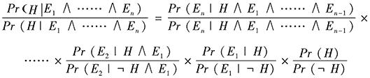

该式常被称为链式法则的概率形式。最右边与最左边的分数分别是`H`与`┐H`的先验概率与后验概率。假设`H`与`┐H`的概率之和为 1，则`H`的先验与后验概率可分别计算出来。

在给定`H`的情况下，若所有`E[1]`，……，`E[n]`在统计上相互独立，则链式法则可化简为

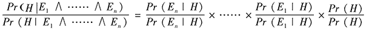

这是阿勒曼德报告中使用的公式，其吸引力在于，只要把假设的先验概率分别与每个证据的所谓似然比或证据力相乘，即可确定假设的后验概率。对每个证据`E[i]`而言，只需说明在给定`H`与给定`┐H`的情况下，`E[i]`的可能性相差多少。若该值大于或小于 1，则与知晓`E[i]`之前相比，`E[i]`会使`H`的概率增大或减小；若该值等于 1，`H`的概率保持不变，则`E[i]`与`H`无关。

这种思路虽优雅，却通常不适用，因为证据全局独立假设往往不合理。于是有了朴素贝叶斯之名。诉诸链式法则的一般版本往往也繁琐，因为需要处理大量证据。作为折中方案，人们提出了贝叶斯网络，该网络以图形方式显示代表概率变量如可能为真或假的命题的节点之间的有向链接所表达的可能独立性[^(\[9\])](#chapter002.html#m9)。对每个节点的每个取值，需要给出在给定其所有父节点所有取值组合下条件概率。将对应节点取值概率设为 1，即可把证据输入网络，随后可更新剩余节点取值的概率。就本目的而言，最相关的观察是，给出贝叶斯网络不仅需要断定概率，还需要断定具体的依赖关系或独立关系。

#### （二）论证

论证是通过提供并批判性审视支持或反对主张的理由来评估主张的过程。这里的核心概念是论证型式，其中把论证的典型形式处理为一种型式，包含一组前提与一个结论，再加上一组在使用该型式推导出结论前必须回答的批判性问题。[^(\[10\])](#chapter002.html#m10)如果一个型式是演绎有效的，即前提保证结论，那么该型式的所有关键问题就是问前提是否真实。若一个型式是可废止有效的，即前提产生对结论的支持性假定，那么该型式也有批判性问题，指出在特殊情况下这种假定不成立。形式论证方法`ASPIC+`把不管是演绎的还是可废止的论证型式都形式化为推论规则以及作为反论证指示的批判性问题：破坏攻击针对论证的前提，底切声称可废止规则有例外，反证是指存在与可废止推论结论相矛盾的结论[^(\[11\])](#chapter002.html#m11)。可以将推论规则链接成一个有向图形成论证。有向图是树形的，其中不重复使用前提。论证间的冲突可用一个给定的相对论证强度概念来解决，看哪个论证能击败对方。然后，我们可能用董番明抽象论证评价理论来判定哪些论证可接受[^(\[12\])](#chapter002.html#m12)。

本文以半形式化的方式勾勒论证图式及其伴随的质疑点，后设层面关于“图式前提是否成立”的检验暂时不予展开。整体讨论以 `ASPIC+` 体系作参照，但同类拆解思路同样适用于其他相近的图式系统，或借由可废止逻辑实现形式化[^(\[13\])](#chapter002.html#m13)。图式为符号提供语义基础，也为重构过程的自动化评估提供支撑。以贝克斯等人所说的重构为例，先可经由论证交换格式保存，再导入实现某种论证逻辑的在线平台，如 `ASPIC+` 的在线 `TOAST` 实现[^(\[15\])](#chapter002.html#m15)。

### 四 案例研究
本节集中检视书面专家报告、书面答复以及相关裁决中可归入图式实例、或可用于检验图式批判性问题的材料。多数图式源自既有文献，仅在两处提出新图式。

全部图式均按以下半形式化模板呈现：
图式名称
前提 1
……
前提 `n`
结论
批判性问题
问题 1
……
问题 `m`
双横线提示该图式属于可被击败的假设型式，文中偶见演绎型式，用单横线标明。

#### （一）诉诸专家意见论证
在建模专家证言时，最具代表性的是诉诸专家意见图式。在贝叶斯分析中，专家判断常被视为主观概率的来源，因此专门讨论专家议题具有必要性。下述图式参考了沃尔顿等人的经典表述[^(\[16\])](#chapter002.html#m16)。

诉诸专家意见论证图式
`E` 属于 `D` 领域的专家
`E` 提出主张 `P`
`P` 归属 `D` 领域
`P`
双横线表明该图式可废止，对应四条批判性追问：
（1）作为信息来源，`E` 的可信程度如何？
（2）就个人而言，`E` 是否可靠？
（3）`P` 是否与其它专家的主张一致？
（4）`E` 对 `P` 的主张有无证据支撑？
首问关乎专业水准，第二问关乎个人偏向。第三问暗含使用条件：此图式只能由并非 `D` 领域专家者使用，如案件中的法官。若我自称也是专家并断言 `┐P`，并不能直接推翻阿勒曼德的论证。

概率论中常将频率论的客观贝叶斯与认识论的主观贝叶斯区分。基于统计数据的频率概率被视为客观合理，反映信念强度的概率则带主观色彩。但选择、解释与运用统计数据本身即涉及判断，该判断未必纯粹主观。若判断所涉主题正是发言者专长的范围，信念也不再只是主观。同样，频率信息的运用若由当前问题的专家作出，也就不再是纯主观判断。因此在客观与主观两种取向上，专业知识都是核心议题[^(\[17\])](#chapter002.html#m17)。

需要说明的是，专家断言很多时候并非单一命题，而是一个论证。本文先限于对陈述的断言，4.2 节再讨论把专家的论证断言建模为陈述序列的问题。

##### 1.前提真实性
应用证人证言图式前，前提须被接受。首个前提的成立与否在两种情境下尤为关键。案件凸显了差异的重要性：`P` 可以是专家对某项具体证据的具体说法，也可是一组表述，甚至是一份完整报告。阿勒曼德须就假设、证据与假设的相关性、给定假设下证据间的统计独立性，以及概率判断作出判定。依我之见，这些判定只有手头案件各相关领域的专家才能可靠作出。

布雷达·西克斯案的核心证据涉及尸僵时间、犯罪嫌疑人与证人陈述的可靠性，包含传闻与匿名证人、先前定罪与侦查信息如 DNA、血迹、毛发等痕迹、不同族群忏悔率，以及诸如六名嫌疑人中有两人曾在案发现场隔壁小吃店工作之类的共识问题。奥斯特兰案的核心则集中于嫌疑人供述与目击者证词、纵火案统计数据与一般知识、先前定罪与侦查信息，以及社区转向针对个人、两名嫌疑人友谊相关性等常识问题。

把 `D` 理解为复杂刑事案件的贝叶斯分析领域，涵盖上述全部问题。我的报告对首个前提“阿勒曼德是该领域专家”的真实性提出两条通用论证：掌握贝叶斯概率论数学不等同于懂得将其应用于特定领域；懂得在气象物理学中应用贝叶斯概率论不等同于懂得将其应用于复杂刑事案件。

在布雷达·西克斯案辩护备忘录第 184～185 页，主控方认为阿勒曼德是贝叶斯推理专家，并援引其曾在荷兰司法部国家培训中心为法官检察官授课、并在多所荷兰高校演讲的事例。奥斯特兰案报告在案发一年后作类似说明，认为受邀授课演讲本身不足以构成专家身份，除非已有其他证据支持，而此处证据不足。

布雷达·西克斯案中，主控方并未论证阿勒曼德在任何证据领域的专业，却大量采用其对血迹、头发、尸僵问题的分析。

法院认定阿勒曼德为专家似乎基于以下理由。首先列出标准：被请求的专业、学历与经验，专业知识与案件的相关性，使用方法的性质、可靠性及熟练应用能力。随后提到其物理学教育与博士学位，以及在贝叶斯思维方面的经验，“尽管科研领域与法律不同”。接着引用司法部课程，并提到其在更早案件中为控方提供咨询，“但不是作为指定专家”。最后指出，阿勒曼德在报告与庭审中详细说明了方法及其应用，并论证了方法的可信。

我认为该论证可从多角度质疑。第一，法院并未明确适用自身标准，即阿勒曼德的知识是否与案件相关。结论中甚至未说明可将其视为领域专家，只说可视为“当前程序”的专家。如主控方一样，法院对知识可迁移性的论证未作回应。第二，如前所述，司法部课程与专业知识的相关性存疑。法院提及的先前案件检方顾问经历亦受同样质疑。第三，没有证据显示法院认为阿勒曼德在气候物理学工作中具备贝叶斯分析经验。事实上迹象可能相反。为奥斯特兰报告我检索 Google 学者，未发现其在气候物理学方面的论文。第四，法院并未对方法适用自身标准。法院仅提到其描述了方法并论证其可靠性，但方法是否真正可靠、其是否真正能熟练应用，均无从得知。法院确实触及方法可靠性，但并未将其作为专业知识问题的一部分，后续第 4.3 节再讨论。

图 1 可视化了该分析，顶层结论为“阿勒曼德是复杂刑事案件贝叶斯分析专家”，即证人证言图式的首个前提。图中最终结论以粗框标出。对同一结论的多重依据以独立箭头呈现，组合方式的进一步说明留给读者。攻击被可视化为底切。注意在已实现的支持系统中，将概括可视化为前提有助于检验其合理性。

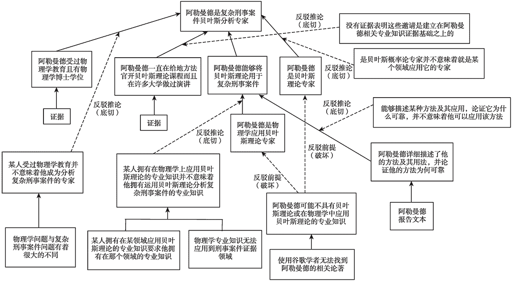

图 1 专业知识论证

奥斯特兰案中法院未讨论专业知识问题，但阿勒曼德在书面答复中回应。他承认在任何相关证据领域均无专业知识，却辩称报告的价值不在于提供可靠后验概率，而在于指明法院必须回答哪些问题。为理解此点，阿勒曼德对两案的分析均为朴素贝叶斯应用，涉及先验概率的明确说明与给定假设下各证据的似然比。他称此为“电子表格”方法，便于向法院展示必须作出的概率判断，再按贝叶斯规则相乘得到后验概率。对此我的首个反论证，第 4.3 节进一步展开，是朴素贝叶斯过于简化而不适用于复杂刑事案件，“电子表格”比喻具有误导性。第二个反论证是，即便找出了正确问题，也需要相关证据领域的专业知识。奥斯特兰报告以医学类比支持此点，第 4.4 节再展开。

至此第一个前提的讨论结束。第二个前提在本案并非真问题，第三个前提与对第一个前提的讨论方式无关。

##### 2.批判性问题
就图式的批判性问题而言，个人偏见在本案不被视为问题。第一个问题实际上是第一个前提的弱化版：若布雷达·西克斯案法院坚持“阿勒曼德被视为本案目的的专家”的决定，则针对该决定的论证现在就变成对其专业水平偏低的论证。处理第三个批判性问题时此类论证尤为重要。事实上阿勒曼德与我在众多问题上存在分歧，因而正如莫吉尔与帕肯所述[^(\[18\])](#chapter002.html#m18)，法院必须评估双方专业知识的相对水平，这是一种关乎论证强度的元论证。最后我对第四个问题的论证是：阿勒曼德的大多数概率判断并未建立在任何数据或科学知识之上，且其具体断言“‘国际公认的估计’得出供认的具体似然比”没有任何推论支撑。

##### 3.关于专家意见论证的结论
总体看，沃尔顿等人的专家意见图式是分析两案专业知识争议的良好框架[^(\[19\])](#chapter002.html#m19)。另一方面最有趣的论证并不在图式顶层，而在向下深入的前提与批判性问题的细节。因此支持系统不应只给论证体系顶层提供支撑。若有更具体的知识可用，如法律体系可能持有的专业知识标准，最好合并进来。图 1 中的论证有的是案件特有的，有的是更通用的，如掌握贝叶斯概率论知识是否意味着具备应用该理论的能力，是否可迁移到另一领域。在当前案例中，阿勒曼德为气候物理学家，缺乏相关教育、工作经验或论证，反驳理由相当充分，但在其他情境下如统计学家或科学哲学家，情况可能不同。图 1 标明了需要讨论的相关问题。

最后，本节意义不限于贝叶斯专家分析。许多观察同样适用于论证方法或故事方法等其他推理方式的专家分析。在此，推理模式中的专业知识必须与手头问题上的专业知识相结合。

#### （二）诉诸推理错误论证
第 4.1 节假设专家提出命题，但通常专家会提出论证。提出论证不仅包括前提与结论，还包括认为由前提必须接受结论。此类论证可被反证、破坏或底切攻击。有时批评者想说论证天生是谬误，这与指出可接受推理规则的例外不同。虽然任何专家都可能犯推理错误，在涉及复杂概率与统计论证的领域尤为常见，故诉诸推理错误论证值得研究。

在两项案例研究中我们交换了多个关于论证有效性的论证。布雷达·西克斯案的一个例子是，当我的观点与阿勒曼德相反时，他在概率论中得出的概率并未遵循他所假定的其他概率。经讨论后我承认自身错误，其论证演绎有效。

奥斯特兰报告中，阿勒曼德先评估在与奥斯特兰类似的小镇六个月内发生 15 起纵火案的概率，假设相互独立，至多百万分之一。由此他得出 15 起纵火案不可能是巧合且一定相关。更正式地，该论证可表述为“若这 15 个事件不相关，则其发生概率最多百万分之一，因此若不相关则概率极低”，进而得出连环纵火犯一定活跃，因为不可能有其他联系。我的报告认为这是控方谬误，混淆了在假定不相关条件下事件发生的概率与在假定事件发生条件下不相关的概率，也称转置条件谬误。一个完整论证应表明在给定概率公理下，前一个概率并不蕴涵后一个概率，但因被视为常识，我将其部分保留为隐性。

指出阿勒曼德论证属谬误的一种方式是给出图式反例，如指出对某个 `E` 与 `H` 而言 `Pr(E|H)=Pr(E|┐H)=1/1000000` 使似然比等于 1，后验概率等于先验概率，可任意取值。作为回应，也许认为当前情形下假定相关时事件发生的概率 `Pr(E|┐H)` 大于 1/1000000。结合先验概率可用贝叶斯规则得到极低后验概率 `Pr(H|E)`。这并不会使错误论证复活，而是用一个有效论证替代它。

从论证可视化角度，用户点击相对于给定概率陈述 `φ` 如贝叶斯网络上的链或似然比组成部分的概率，可检查以下论证：专家 `E` 断言 [1] … [n]；专家 `E` 断言 [1] … [n] 蕴涵 `φ`；因此 `φ` 因为 [1] … [n]。

专家对推理错误的讨论可通过几个证人证言图式的应用结合其结论进行推理，形式如下：`E` 是领域 `D` 的专家，`E` 断言 [`i`]，[`i`] 属于 `D`，[`i`]…；`E` 是领域 `D′` 的专家，`E` 断言 [1]…[n] 蕴涵 `φ`，…[n] 蕴涵 `φ` 在 `D′` 内，[1]…[n] 蕴涵 `φ`。于是基于专家证言，若事实认定者既接受 [1]…[n] 又接受 [1]…[n] 蕴涵 `φ`，则应接受 `φ`。

此方法可用来建模专家对推理错误的任何辩论。就当前案例研究，使用概率例子揭示它：在奥斯特兰案中关于我认为阿勒曼德犯控方谬误的争议。可按上述方法建模如下：`A` 是纵火案专家，`E` 断言 `Pr(事件|┐相关)≤1/1000000`，该断言属于纵火案领域，故 `Pr(事件|┐相关)≤1/1000000`；`E` 是贝叶斯推理专家，`E` 断言 `P` 蕴涵 `Pr(相关|事件)＞＞0.5`，该断言属于贝叶斯推理领域，故 `P` 蕴涵 `Pr(相关|事件)＞＞0.5`。其中 `P` 是第一个论证的结论，`＞＞` 代表“大大地大于”。两个结论演绎蕴涵 `Pr(相关|事件)＞＞0.5`。

我的反论证可建模如下，其中 `C` 代表上述给定反例的描述：`C` 蕴涵 `P` 并不蕴涵 `Pr(相关|事件)＞＞0.5`；`C`；故 `P` 并不蕴涵 `Pr(相关|事件)＞＞0.5`。在 `ASPIC+` 以及类似系统中，因该论证是前提普遍真、演绎性的论证，目标是可废止性论证，故该论证击败前一个论证。

#### （三）方法问题
两案中阿勒曼德使用方法的可靠性均有问题。人们可能认为这在专家辩论中常见，尽管两案论证未清晰例示公认的论证图式，仍有必要讨论。两家法院均未定义可靠性。我将其定义为：不同分析者对同一问题采用相同方法是否会得出相同或至少相似的结果。在两份报告中我都认为贝叶斯分析在此意义上不可靠，因为学术文献中对用贝叶斯概率论分析复杂刑事案件的正确方法并无共识。事实上人们似乎在两点上达成共识：对复杂刑事案件朴素贝叶斯方法过于简单；在向法院提供可靠方法前还需要进一步研究。目前研究主要集中于贝叶斯网络应用，但结果仍初步，且几乎只涉及网络结构，忽略如何建立可靠概率的问题。由于这些原因，不同分析者很可能对同一情况给出完全不同的贝叶斯分析。这证明了在上述界定意义上阿勒曼德的方法不可靠。结论可推广到任何使用贝叶斯概率论分析复杂刑事案件的情形[^(\[20\])](#chapter002.html#m20)。

两案均未回应此批评。布雷达·西克斯案中法院同意我的分析，故忽略阿勒曼德报告结论。奥斯特兰案中法院除总结我的论证外未作评论。既然法院“考虑到”我的批评而选择忽略阿勒曼德报告，这表明他们可能同意我的论证。

与专家证言图式一样，方法问题既可涉及整个报告，也可涉及具体问题。例证是阿勒曼德与我在两案中关于朴素贝叶斯所隐含的全局独立假设是否合适的辩论。例如在两案中阿勒曼德都用相当具体的证据评估假设的先验概率。概率公理意味着每个似然比中证据不仅必须以假设为条件，也必须以用于评估其先验的证据为条件，除非根据假设证据在统计上独立。阿勒曼德未作此条件设定，也未提供必要独立性假设的论证。我批评他应做其中一项或多项。这是一般方法论批评，转化为对阿勒曼德最终论证的具体批评，即后验概率可通过相乘先验与似然比计算。有两种形式化方式：一种是把阿勒曼德的最终论证解释为具有必要独立性假设作为附加前提，然后观察到这些附加假设缺乏证据或论证；另一种是把这些假设从解释中剔除，然后以第 4.2 节风格构造论证，证明阿勒曼德的最终论证演绎无效。

#### （四）类比论证

刑事贝叶斯讨论里最容易失手的两类推演：类比与统计

两份实证研究里都出现了类比说理的痕迹，其经典骨架在学界早已成型[^(\[21\])](#chapter002.html#m21)。

类比论证型式：

　　　　考虑到`R[1]`，……，`R[k]`，情形`C[1]`和`C[2]`相似

　　　　`R[1]`，……，`R[n]`与`P`有相似之处

　　　　在情形`C[1]`中，`P`为真

　　　　在情形`C[2]`中，`P`为真

批判性问题：

（1）情形`C[1]`和`C[2]`还存在相关差异吗？

（2）情形`C[2]`与`P`为假时，其他某个情形`C[3]`存在相关相似吗？

对专门领域该型式可以细化，如法律案例推理[^(\[22\])](#chapter002.html#m22)。就现阶段的讨论目的，前述表述已足够。

布雷达·西克斯案里就出现过一次类比操作。据案情，被指控的三名女性中有两人在案发点旁的快餐店工作。阿勒曼德在报告中把这段证据与其他证据的“巧合”似然比拆开讨论：这两名嫌疑人与另外三名嫌疑人相识，而后三人曾被警方刑事情报组一名线人提到涉案。阿勒曼德把分母，即六名被告全部无罪的巧合概率，定在1/500到1/1000区间，随后表述为“与500到1000的巧合似然比相符”。字面上看有漏洞，因为在得出结论前必须先算出在阿勒曼德犯罪假设下出现巧合的概率。报告其它部分显示，他实则把该概率当作1。他搬出一个假设类比：窃贼持钥匙入户。假设嫌疑人因持有钥匙被捕，按阿勒曼德的说法，持钥匙是犯罪的必要构成，所以在实施盗窃的前提下持有钥匙的概率为1。类推到本案，他认为巧合是必要构成，因为他的犯罪假设是六名被控者中至少有人参与，且至少有一名女性被告把受害者引诱到案发餐厅。

对这种做法的质疑有两点：其一，引诱未必需要隔壁餐厅员工完成，第三名女性嫌疑人也有可能完成；其二，两名在餐厅隔壁工作的女性同时清白，仍与阿勒曼德的犯罪假设相容。由此巧合不能被视作犯罪的必要构成。指出这一点时，我也注意到这与阿勒曼德的入室盗窃假设存在相关差异，后者里持钥匙确为必要要件。正是用类比型式的首个质疑点来拆解他的类比。

同一案件里类比的另一处用法，是关于“阿勒曼德能否被视作复杂刑事案件贝叶斯分析专家”的推断，见上文第4.1节。法院裁决中可讨论的一步是，物理学贝叶斯分析专家即是复杂刑事案件贝叶斯分析专家。这可被解读为对物理问题与复杂刑事案件贝叶斯分析假定相似性的类比。我认为“一个成立不意味着另一个成立”是对类比型式首条质疑的再一次运用。未来关于法庭专家使用贝叶斯理论的争论里，涉及专业领域相似性的类比论证会越来越多。

同样的道理也适用于统计数据的类比使用，例如前面提到的日本和英国纵火统计也可用于荷兰。这些论证同样属类比，因而可以用类比型式的质疑点去检验。

最后，在我对阿勒曼德关于奥斯特兰案答复的再回应中，我用医学假设来反驳他“能告诉法院必须考虑哪些问题”的主张。反问是：正在诊断重症患者的医学专家，会允许一名气候物理学家来指令他该做哪些医学检查吗？

#### （五）统计论证

直觉上，复杂刑事案件的概率分析里常把统计频率的陈述转译为个体概率的陈述。但在两个案例中，大多数概率判断并不依赖统计数据，阿勒曼德极少用其来支撑判断；在另一些情形里，他使用了类频率的做法。例如奥斯特兰案，他评估在假定无罪时嫌疑人与他人是最好朋友的概率：他先说奥斯特兰镇有2400名居民，再假设像嫌疑人这样的男性有200名是他最好的朋友，于是得出两人同无罪的概率约为1/200。这说明即便判断建立在数据上，从数据到概率的跳跃也可能掺入主观假设，比如本案中200个候选朋友的假设。

从最基本的形式看，诉诸统计频率的写法是：

`F`为`G`的比例是`n/m`
a 是`F`
因此`Pr(Ga|Fa) ≈ n/m`

需要强调这是一种假定，而不是必然。一个类的频率陈述与该类成员的条件概率陈述之间没有逻辑必然性。海金把这种写法称为“频率原则”[^(\[23\])](#chapter002.html#m23)。他认为合理的假定是：除频率和a属于F之外，没有其他相关信息；同时很多判断都涉及哪些信息算相关的。

在讨论该写法的质疑点前，先看第一个前提如何建立。一种方式是统计归纳：

被研究的`F`为`G`的比例是`n/m`
因此`F`为`G`的比例是`n/m`

该形式并未按沃尔顿等人的常见论证型式处理[^(\[24\])](#chapter002.html#m24)。对该用法做全面批判会进入统计学范畴，已超出本文范围。这里只列两个明显问题：（1）被研究的`F`样本是否带偏见？（2）样本量是否足够？

我认为阿勒曼德获取的部分统计信息是有来源的。例如布雷达·西克斯案，他引用一本犯罪学出版物中关于荷兰各族群认罪与否的频率数据。推理随之变成：E说S是相关统计数据，E是该领域专家，所以S很可能是相关统计数据。并且S说被研究的F为G的比例是n/m，所以被研究的F为G的比例是n/m。最终结论又回到诉诸统计频率的型式。我在自己的布雷达·西克斯案报告中没有质疑阿勒曼德对认罪数据的具体选取，但我指出从文献中挑选相关可靠统计数据需要该文献主题的专业知识。随后我指出没有证据显示阿勒曼德具备那种犯罪学专门知识，于是实质上攻击了这条推理的第二个前提。这说明即便在诉诸统计数据的推理中，诉诸专家意见的型式依然相关。

现在转向诉诸统计频率型式本身可用的三个质疑点，或许还有更多。

（1）关于更具体的类别，是否存在冲突的频率信息？这就是选择最具体参考类的老问题。
（2）关于相交类别，是否存在冲突的频率信息？这是前者的变体。若a同时属于两个既不重叠又互不包含的类F和H，通常F与H都是G的比例并不决定F与H的联合比例。因此在缺乏额外信息时无法得到`Pr(Ga|Fa∧Ha)`。
（3）是否还有其他理由不能使用频率？例如a可能属于一个常识或专家判断会给出不同频率评估的子类。例如奥斯特兰案，阿勒曼德假定在无罪假设下嫌疑人与另一人是好朋友的概率，却忽略了两人都是当地局外人、生活方式相似、一人曾被定罪另一人曾涉连环纵火。即使没有这些子类的统计数据，常识也告诉我们，考虑到这些特征，成为最好朋友的概率会比他用类频率方式假设的高得多。

在从统计数据推导概率判断时，阿勒曼德还使用了类比型式，见第4.4节。例如在奥斯特兰案报告中，由于当时奥斯特兰并无连环纵火犯活跃，他便依据日本和英国的纵火数据来评估半年内在像奥斯特兰这样的小镇发生15起纵火的概率。把这些数据套用到荷兰，暗含日本、英国与荷兰在连环纵火问题上高度相似的假定。这类做法在实践中很常见。这里再次出现专业知识问题，判断两国在连环纵火上是否相关相似，需要相关领域的专业知识。我的总体批评是，没有证据表明身为气候物理学家的阿勒曼德拥有这种相关专业知识。

总之，统计推理至少会组合以下几种假定型式：统计频率论证、统计归纳论证、专家意见论证和类比论证。此外统计学内部的具体方法问题也可能介入。因此若没有统计学家参与，很难建立完整的统计论证图式。

最后，本节分析也关乎论证方法和叙事方法。在两者中，可废止的概括都很关键。例如论证方法里证据概括把证据与结论连起来，如证人通常说真话；叙事方法里因果概括把假设与证据连起来，如极度嫉妒会产生杀人报复动机。统计归纳型式的定性版本可用来为这类概括辩护。例如：

绝大多数被研究的F是G
所以F通常是G

再对可废止概括论证做批判性检验时，诉诸统计频率型式的质疑点也有对应的问题。前两个问题指向基于冲突概括来反证论证的可能，而第三个问题则指向对统计归纳型式定性变体的攻击。

### 五 论证支持系统的要求

作为总结，我现在列出当前案例研究提出的刑事案件贝叶斯分析论证支持系统的要求。

首先，系统应当为该领域常见的论证型式提供支持，包括本文讨论的几种型式。支持也应覆盖如何说明论证并如何批评不符合该型式的论证。一种实现方式是利用关于评估特定证据类型的法律知识、法规或政策，例如若干司法辖区关于何时可把某人视为专家证人的标准。本案例研究的部分内容也可以复用，如图1所示的专家论证分析。与统计人员的合作有助于解决统计型式的质疑点。

抓住论证和主张的所有权很重要，尤其在评估所有者的专业知识或比较不同专家冲突论证的相对强度时。对后者，系统还应支持关于论证强度的元论证。

系统还应支持关于其他论证，无论演绎的还是可废止的，有效性的论证。因此系统应能明确标示一个论证的逻辑本质，不应阻碍那些既非演绎也非可废止有效性的论证表达。需注意，像卡尔尼德斯系统那样的系统[^(\[25\])](#chapter002.html#m25)，其将前提与结论关系抽象化，并不能完全满足这些需求。

系统应能在对一般问题或专业知识与方法的讨论，与对具体专家断言的专业知识与方法的讨论之间自然区分。一方面，如果贝叶斯网络工具的用户能简单地点击网络的任一元素来查看关于该元素的论证，那就很理想。但这可能无法覆盖所有相关论证，正如我们所见，许多论证关乎更一般的问题。

最后，应有办法标示某项主张或前提缺乏证据支持，因为这是批评论证，特别是批评论证的常见做法。如果软件提供自动评估辩论的功能，这一问题必须被纳入考量，就像在卡尔尼德斯系统上所做的那样。

### 六 相关研究

本文的动机之一是设计支持软件，用于复杂刑事案件贝叶斯分析的建模讨论。在医学领域，耶特等人最近提出了一个类似系统[^(\[26\])](#chapter002.html#m26)，该系统把医学贝叶斯网络与其所依赖的临床证据联系起来。无论是支持网络元素的证据、相互矛盾的证据，还是与被排除变量或关系相关的证据，都能在系统中表示并显示。建模的三个证据来源是出版物、专家和数据。尽管有论证的味道，该系统并未建立在明确的论证模型之上。

关于刑事案件贝叶斯分析的论证已有研究。贝克斯和雷努伊于2016年给出了从`ASPIC+`式论证到贝叶斯网络约束的翻译[^(\[27\])](#chapter002.html#m27)。他们的重点与本文不同，他们的论证并非关乎如何验证贝叶斯网络元素的合理性。相反，翻译方法的目的是把贝叶斯网络中论证所表达的信息转译出来。例如一个约束规定论证中的命题在贝叶斯网络中应有对应节点，另一个约束规定论证中的攻击关系在贝叶斯网络中应有相应的“活动”链条。

蒂默等人在2017年做的工作与贝克斯和雷努伊2016年的工作方向相反，他们把贝叶斯网络上的信息翻译为`ASPIC+`论证框架，用以解释贝叶斯网络[^(\[28\])](#chapter002.html#m28)。

与本文工作最接近的是凯彭斯2014年的论文[^(\[29\])](#chapter002.html#m29)。他提出了一组来源论证型式，用似然方法建模概率判断的来源。除此之外，凯彭斯还提出了诉诸专家意见型式、诉诸数据集推理型式以及诉诸普遍接受理论推理型式。此外，他还提出了一组型式，把涉及从主观概率分布性质的基于来源的主张与对概率分布的形式约束关联起来。然而在方法上我们有所不同。凯彭斯的主要目的是建立型式计算模型，而本文的主要目的是分析关于贝叶斯分析的讨论实际上是如何发生的。因此本研究是对凯彭斯研究的补充。此外，与当前研究相比，凯彭斯模型的焦点更有局限性，因为它只对具体概率分布论证进行了建模。

### 七 结论

本文考虑了法律论证支持工具的一个新用例：支持复杂刑事案件贝叶斯分析的讨论。通过案例研究，本文分析了法院案件专家之间的两个真实讨论，并梳理了他们的论证结构。由于属于案例研究，结果的一般性是个问题。如导言所述，很难说所研究的案件在多大程度上典型，因为法庭上对整个复杂刑事案件进行贝叶斯分析的情况仍然稀少。贝叶斯理论在法庭上的常见用法主要涉及个别证据，尤其是法庭痕迹证据的随机匹配概率，如DNA、轮胎痕迹、鞋印、指纹、玻璃碎片。另外，由于我参与了有关贝叶斯分析的辩论，我在本文中的分析可能受到个人观点的

尽管如此，案例研究仍能得出一些初步结论。从理论角度看，我们证实了贝叶斯分析论证的丰富性以及几种公认论证型式的实用性，提出了一种用于统计论证的新论证型式，并对专家意见论证的一些细微之处进行了新颖分析。尤其是被证明适用于我们案例研究的各种论证型式表明，对复杂刑事案件进行贝叶斯分析的理性讨论不必遵循严格的统计方法或法庭科学方法，可以利用论证理论中的许多技巧。从实践角度看，案例研究说明需要支持软件来讨论复杂的犯罪案件贝叶斯分析。此类软件的实际设计和实用性是未来研究的议题，也是某些论证型式尤其是专家意见型式和统计论证型式的质疑点的细化。此外，本文的某些贡献也可能与其他使用贝叶斯分析的领域有关，如医学。

最后，在本文的多个地方，我们看到当前分析的意义并不局限于贝叶斯方法，而是延伸到使用任何推理方法讨论专家报告。简单地说，任何推理方式的专业知识都必须与手头事项的专业知识相结合，第4.1节，在论证分析或情节分析中，关于可废止概括的论证也能用定性型式找到统计论证，第4.5节。据推测，可以对任何类型的分析进行类比论证，第4.4节。

* * *

[\[1\]](#chapter002.html#w1) 原文是作者 2017 年发表论文（Prakken H，2017，“Argument Schemes for Discussing Bayesian Modellings of Complex Criminal Cases.” In：Wyner A，Casini G（eds）*Legal Knowledge and Information Systems*. JURIX 2017：The Thirtieth Annual Conference. IOS Press，Amsterdam，pp.69-78）的扩充版，原载斯普林格出版社出版的杂志《法律人工智能》（*Artificial Intelligence and Law*）2020 年第 28 卷第 1 期，第 27～49 页，属于开放获取（open assess）文本，本译文已获得原作者的翻译授权并对某些部分进行适当修改，见图 1。为了便于读者参照原文阅读，注释部分我们只是转换成脚注，保留了原文文献格式。此外，本译文属于 2019 年国家社科基金重大项目“语用逻辑的深度拓展与应用研究”（编号：19ZDA042）的阶段性成果之一。

[\[2\]](#chapter002.html#w2) 亨利·帕肯（Henry Prakken），荷兰乌得勒支大学计算机科学系和格罗宁根大学法学院双聘教授、博士生导师，研究方向为计算论证、法律人工智能、论证理论等。

[\[3\]](#chapter002.html#w3) 熊明辉，浙江大学光华法学院求是特聘教授，中山大学逻辑与认知研究所教授，研究方向为法律人工逻辑、法律人工智能、非形式逻辑等。

[\[4\]](#chapter002.html#w4) Pardo M，Allen R，“Juridical proof and the best explanation，” *Law Philos* 27（2008）：223-268；Kaptein H，Prakken H，Verheij B（eds）（2009），*Legal Evidence and Proof：Statistics，Stories，Logic*. Ashgate Publishing，Farnham；Fenton N，Berger D，“Bayes and the law，” *Annu Rev Stat Appl* 3（2016）：51-77；Verheij B，Bex F，Timmer S，Vlek C，Meyer JJ，Renooij S，Prakken H，“Arguments，scenarios and probabilities：connections between three normative frameworks for evidential reasoning，” *Law Probab Risk* 15（2016）：35-70.

[\[5\]](#chapter002.html#w5) Van den Braak S（2010）Sensemaking Software for Crime Analysis.Doctoral dissertation Department of Information and Computing Sciences，Utrecht University.

[\[6\]](#chapter002.html#w6) Scheuer O，Loll F，Pinkwart N，McLaren B，“Computer-supported argumentation：a review of the state-of-the-art，” *Int J Comput Support Collab Learn* 5（2010）：43-102.

[\[7\]](#chapter002.html#w7) Wardeh M，Wyner A，Atkinson K，Bench-Capon T，*Argumentation based tools for policy-making*. In：*Proceedings of the fourteenth international conference on artificial intelligence and law*（New York：ACM Press，2013），p.249-250.

[\[8\]](#chapter002.html#w8) Hacking I，*An introduction to probability and inductive logic*（Cambridge：Cambridge University Press，2001）.

[\[9\]](#chapter002.html#w9) Fenton N，Neil M，*Risk assessment and decision analysis with Bayesian networks*（Boca Raton：CRC Press，2013）.

[\[10\]](#chapter002.html#w10) Walton D，Reed C，Macagno F（2008）Argumentation schemes. Cambridge：Cambridge University Press.

[\[11\]](#chapter002.html#w11) Modgil S，Prakken H，“The ASPIC+ framework for structured argumentation：a tutorial，” *Argum Comput* 5（2014）：31-62.

[\[12\]](#chapter002.html#w12) Dung P，“On the acceptability of arguments and its fundamental role in nonmonotonic reasoning，logic programming，and n-person games，” *Artificial Intelligence* 77（1995）：321-357.

[\[13\]](#chapter002.html#w13) Governatori G，Maher M，Antoniou G，Billington D，“Argumentation semantics for defeasible logic，” *J Log Comput* 14（2004）：675-702.

[\[14\]](#chapter002.html#w14) Bex F，Modgil S，Prakken H，Reed C，“On logical specifications of the argument interchange format，” *Journal of Logic and Computation* 23（2013）：951-989.

[\[15\]](#chapter002.html#w15) http：//toast.arg-tech.org.

[\[16\]](#chapter002.html#w16) Walton D，Reed C，Macagno F，*Argumentation schemes*（Cambridge：Cambridge University Press，2008）.

[\[17\]](#chapter002.html#w17) Biedermann A，Bozza S，Taroni F，Aitken C，“The meaning of justified subjectivism and its role in the reconciliation of recent disagreements over forensic probabilism，” *Science and Justice* 57（2017）：477-483.

[\[18\]](#chapter002.html#w18) Modgil S，Prakken H，“Reasoning about preferences in structured extended argumentation frameworks，” in Baroni P，Cerutti F，Giacomin M，Simari G，eds.，“Computational models of argument，” *Proceedings of COMMA*（Amsterdam：IOS Press，2010），pp.347-358.

[\[19\]](#chapter002.html#w19) Walton D，Reed C，Macagno F，*Argumentation schemes*（Cambridge：Cambridge University Press，2008）.

[\[20\]](#chapter002.html#w20) Fenton N，Neil M，“Avoiding legal fallacies in practice using Bayesian networks，” *Aust J Legal Philos* 36（2011）：114-151；Lagnado D，Fenton N，Neil M，“Legal idioms：a framework for evidential reasoning，” *Argum Comput* 4（2013）：46-63；Vlek C，Prakken H，Renooij S，Verheij B，“A method for explaining Bayesian networks for legal evidence with scenarios，” *Artif Intell Law* 24（2016）：285-324；de Zoete J，Sjerps M，Lagnado D，Fenton N，“Modelling crime linkage with Bayesian networks，” *Sci Justice* 55（2015）：209-217.

[\[21\]](#chapter002.html#w21) Walton D，et al.，*Argumentation schemes*（Cambridge：Cambridge University Press，2008），pp.58，315.

[\[22\]](#chapter002.html#w22) Bench-Capon T，“HYPO’s legacy：introduction to the virtual special issue，” *Artif Intell Law* 25（2017）：205-250.

[\[23\]](#chapter002.html#w23) Hacking I，*An introduction to probability and inductive logic*（Cambridge：Cambridge University Press，2001）.

[\[24\]](#chapter002.html#w24) Walton D，Reed C，Macagno F，*Argumentation schemes*（Cambridge：Cambridge University Press，2008）.

[\[25\]](#chapter002.html#w25) Gordon T，Prakken H，Walton D，“The Carneades model of argument and burden of proof，” *Artif Intell* 171（2007）：875-896.

[\[26\]](#chapter002.html#w26) Yet B，Perkins Z，Tai N，Marsh W，“Clinical evidence framework for Bayesian networks，” *Knowl Inf Syst* 50（2016）：117-143.

[\[27\]](#chapter002.html#w27) Bex F，Renooij S，*From arguments to constraints on a Bayesian network*. In：*Baroni P，Gordon T，Scheffler T，Stede M*（*eds*）*Computational models of argument*（Amsterdam：Proceedings of COMMA. IOS Press，2016），pp.96-106.

[\[28\]](#chapter002.html#w28) Timmer S，Meyer JJ，Prakken H，Renooij S，Verheij B，“A two-phase method for extracting explanatory arguments from Bayesian networks，” *Int J Approx Reason* 80（2017）：475-494.

[\[29\]](#chapter002.html#w29) Keppens J，“On modelling non-probabilistic uncertainty in the likelihood ratio approach to evidential reasoning，” *Artif Intell Law* 22（2014）：239-290.

# 部门法视野

## 数据洪流中的私密防线：原则与路径[^(\[1\])](#chapter003.html#m1)

赵万一 樊沛鑫[^(\[2\])](#chapter003.html#m2)

**摘要：**相较于传统情形，海量数据语境下的私密权益表现出发生更普遍、受损概率更高、察觉更困难、救济门槛更高、定性难度更大的特点。为此必须建构更具针对性的保护目标与规范框架，核心取向涵盖以人为本的人身利益优先、信息伦理正当、正当程序、利益衡量与必要性等。在制度安排上要充分保障个人对自身信息的主体决定权，恪守信息伦理底线，建立科学合理且合法合规的数据使用规则，并将被遗忘的诉求提升为私密权体系中的一种特殊权利。落实现述目标须多措并举，完善救济机制，从技术层面强化私密防护，同时提升企业的信息保护意识与合规使用责任。

**关键词：**个人隐私 大数据 人格权优先 被遗忘权

网络普及与技术迭代推动中国全面进入以数据驱动开发、分析与应用为核心的新阶段。其运作方式是通过专业分析工具对海量信息进行归纳、交换与融合，从而生成各类知识关联、知识耦合与仿真场景。一方面，虚拟社会已成为现实社会的必要延伸；另一方面，强势的数据采集与分析能力使个人信息长期暴露在数据视域之下，对私密权益的冲击尤为严峻。近期，因滴滴出行 App 被指严重违规使用个人信息，国家互联网信息办公室依据《网络安全法》对其启动网络安全审查，并要求下架整改、保障用户数据安全。[^(\[3\])](#chapter003.html#m3)即便官方通报未披露具体违法细节，但用户在平台预约出行时需填写起止地点等信息，通常难以拒绝授权，这些数据被自动抓取入库后存在不当利用的潜在风险。该事件也从侧面揭示出传统法框架在私密保护上的滞后。尽管《民法典》对个人私密与数据私密作了原则性表述，但因数据私密的复杂性，仅靠《民法典》难以实现全方位保护，亟需制定更细化的单行法规来回应海量数据时代的保护需求。

### 一 海量数据语境下私密保护的特殊困境

人类自有自我庇护本能，长期以来通过调整行为方式来维护私密空间。私密保护的本质是通过遮蔽、隔离与迷惑等方式隐藏行为轨迹与生活习惯，避免他人窥探并攫取个人信息，从而获得信息独占收益、保持神秘感、规避羞耻感并确保生活不受干扰。我国2020年出台的《民法典》对私密权予以高度重视，将人格权单独立编并作出系统保护。[^(\[4\])](#chapter003.html#m4)《民法典》第1032条将私密权界定为公民私人信息依法受保护、不被他人知悉、收集、非法侵扰、利用和公开的人格权，其内容涵盖个人信息保密、生活不受干涉、私事决定自由。第1034条则对未上升为私密的个人数据同样予以法律保护。[^(\[5\])](#chapter003.html#m5)然而，现行以《民法典》为代表的法律体系对传统私密的规制更为充分，对海量数据时代私密的特殊性关注不足，缺乏针对性的细则支撑，亟需专门立法来填补空白。

#### （一）私密在海量数据面前面临更高可损性

传统数据往往分散孤立，而海量数据时代的算法能够对海量信息进行全域利用，不仅可以回溯已发生的个人生活场景与行为轨迹，还能对未来事件作出预测，使生活被量化拆解。卡内基梅隆大学隐私研究指出：“即便剔除姓名与社会安全号，仅凭性别、生日与邮编三个变量，数据挖掘技术也能识别全美87%的人口。”[^(\[6\])](#chapter003.html#m6)大量本应私密的信息在海量数据面前几乎无处遁形，可预测性极强。新兴互联网技术延长了信息存储周期，同时大幅提升了检索便捷度。用户在特定情境下发布的信息，发布后或许已被遗忘，却可在事件触发时被瞬间调取并扩散。丰厚商业利益也难以阻止掌握数据库的组织对个人数据的整合与再利用。一旦信息以数据形式被存储，无论掌握主体是政府机构还是商业组织，都可能成为监管依据或商业行为的数据基础，尤其在商业利用场景中，个人几乎无法有效阻止，私密受侵风险显著放大。

#### （二）侵害行为呈现高频普遍化

在海量数据阶段，数据已成为生产要素与经济社会价值的重要来源。数据采集触角遍布日常生活各个环节，客观上导致私密侵害行为高发常态化。搜索记录映射关注偏好，电商行为记录消费模式，手机定位呈现出行轨迹，银行交易反映金融往来，社交通信揭示人际关系等。对这些数据的简单计算即可勾勒个人爱好、生活习惯甚至财务状况。学界曾形象描述为“一入网络深似海，从此隐私是路人”[^(\[7\])](#chapter003.html#m7)。在技术驱动下，私密还出现了整合型的新形态，即通过数据挖掘将网络留痕进行收集、整理并生成新的私密信息[^(\[8\])](#chapter003.html#m8)。由此数字社会的私密呈现出“私密信息化”与“信息私密化”双重特征：前者指私密在信息时代以数据形态显现，传统边界被数字延伸；后者指原本非私密的信息在关联加工后转化为私密信息，个人信息与私密利益高度重合。[^(\[9\])](#chapter003.html#m9)可见海量数据时代的私密保护既具时代特征，也更显特殊复杂。

#### （三）数据侵权难以被及时救济

海量数据环境下数据共享常态化，私密侵害的不确定性与不透明性同步增强，事后救济难度大幅上升。传统私密侵权往往伴随直接可感的后果，而数据侵权发生后，通常不会立即造成身体伤害、人格贬损或财产损失，被侵权者感知也较弱。信息不对称使个人对泄露的判断易出现不精确与非理性，商业利用多以信息集成方式呈现，很少直接涉及原始个人信息的使用，个人难以对后果作出理性评估。可以说，传统侵权中可量化、可识别的损害在数据侵权中出现的概率极低，权利人更多承受的是私密泄露后潜在的未来风险，即“焦虑风险”，这种无形损害难以举证也难以感知。[^(\[10\])](#chapter003.html#m10)即便损害已经发生，基于海量数据强大的预测、推断与分析能力，以及反向身份识别的技术难题，信息收集与结论之间的因果链条难以清晰证明，受害者提起诉讼并胜诉的可能性极低。[^(\[11\])](#chapter003.html#m11)

#### （四）隐私侵害的隐蔽性与判定困境

在信息进入使用阶段后，诸多触及个人边界的记录一旦被商业化，往往难以被当事人察觉，有时甚至会被当作主动配合的服务。电商个性化推荐就是典型，平台通过挖掘浏览轨迹推送商品，用户第一反应通常是“这个站点很懂我”，而非“我的记录被利用了”。简言之，只要换来的服务更顺手、看起来合理且未出现明显外泄，用户往往不会产生被侵害的感知。然而商家把同一批记录延伸到哪些场景，外部是看不见的，权利因此在暗处被侵蚀。

更棘手的是私密性具有强主观性，不同主体的保护期待差别很大，对同一事件的反应也迥异，这使得实践中何时算作损害难以划定。文化、习俗、道德等外部变量也在持续模糊边界，尤其海量数据应用正通过改变外在环境与影响使用习惯两条路径重塑人们的私密观念[^(\[12\])](#chapter003.html#m12)，进而进一步抬高侵权认定的门槛。

### 二 隐私保护的基本原则

面对海量数据冲击，防护不能靠直觉，以下四条是底线。

#### （一）人格尊严优先原则

在众多法域，私密不仅被视作民事权利，更被提升为基本人权，甚至纳入社会道德价值体系。[^(\[13\])](#chapter003.html#m13)欧盟立法最具代表性。其底层逻辑是：个人的信息可视作人的延伸，人应独立自主，信息也应由本人掌控，体现个人意志。以人格尊严为基座的保护理论，核心在于记录由本人自主决定，这源于独立与自治。[^(\[14\])](#chapter003.html#m14)根本原因在于人既是社会创造者，也是法律保护的根本客体，没有对人的尊重就没有现代法治。私密保护作为现代法治的产物，既是实现人自身价值的需要，也是其他法律价值实现的基础。因此所有制度设计都应把人的需求，特别是自然人的人格利益放在首位。

加拿大瑞尔森大学隐私与海量数据研究所执行理事安·卡沃基安曾提出“自由是创建在隐私之上的”，并于2011年提出七项隐私设计策略：预防优先而非事后补救；私密保护作为默认状态；私密嵌入设计流程；追求全功能正和而非零和；端到端安全机制实现全生命周期防护；可见性和透明性；尊重用户选择。[^(\[15\])](#chapter003.html#m15)由此可见，私密中不可压缩、不可克减的部分，应该被置于保护体系的源头，既作为以主体为核心的整体约束条件，也作为实现个人价值的重要法律手段。欧盟的做法值得借鉴。《统一数据保护条例》第7条明确，商业主体只能在以下情形处理他人信息：（a）当事人明确同意；（b）为履行与当事人的合同所必需，或为合同生效前依当事人要求所必需；（c）为控制者履行法定义务所必需；（d）为保护当事人重要利益所必需；（e）为公共利益或执行官方授权任务所必需；（f）为管理者、第三方或信息获取者的合法利益所必需。私权是随流动社会个体发展而不断被赋予和扩充的权利。[^(\[16\])](#chapter003.html#m16)

#### （二）伦理导向原则

很多人认为记录本身只是客观存在，由网络行为产生，所以海量数据没有好坏之分。微软首席研究与战略长官克雷·格·蒙迪就认为：“没有坏数据，只有对数据的不合理使用。”[^(\[17\])](#chapter003.html#m17)换句话说，问题的根源在人类对记录的滥用，深层原因是虚拟人格异化导致的数据伦理缺失，人在海量数据面前被物化、被透明、被设计、被数据化，个体发展和人际和谐因此受阻。[^(\[18\])](#chapter003.html#m18)从实践看，私密困境是工具理性与价值理性脱节的结果。海量数据技术强化信息搜集的目标理性，却削弱用户对信息安全进行价值判断的能力；它强化记录的二次利用，却绕过了用户的价值参与。记录搜集并非技术的核心，挖掘与应用才是重点。这样个人价值理性与信息使用过程被割裂，个人对自身私密信息的判断力和控制力被削弱。[^(\[19\])](#chapter003.html#m19)如研究者所指出的：“个人信息数据库的经验已经表明，通过对某一信息与其他信息的重组和编辑，会使信息的价值发生重要变化……借助信息技术，人们不仅能收集和储存海量信息，还能整理、控制并由此得出有意义的推论，使不成形的数据成形并产生新价值。”[^(\[20\])](#chapter003.html#m20)

不仅如此，海量数据以颠覆教导和养成习惯两种德性基础，解蔽的同时又无法准确表达本质差异，机械地把人纳入新的伦理情境，被动记录所有主体的身份与行为，从而引发严重的伦理冲突[^(\[21\])](#chapter003.html#m21)。这些伦理异化可归纳为七大“海量数据伦理之罪”：数字身份暴露、被监控、私密泄露、预测性骚扰、获取路径受限、数字鸿沟、数据崇拜[^(\[22\])](#chapter003.html#m22)。因此任何涉及私密的法律设计，都应高举伦理主义大旗，把符合基本社会伦理作为制度设计的基础。

#### （三）正当性原则

正当性可分解为目的正当、程序正当和知情同意。目的正当要求信息收集要有正当且充分的目的，后续利用和传播不得违背原目的。欧盟《数据保护通用条例》沿用传统指令的目的限定原则并做了改良。前言第50条指出：判断后续处理是否符合原目的，应评估后续目的与原目的的关联性、信息收集的原始场景即用户的合理预期、个人信息的性质、处理行为可能造成的后果、信息安全保障等要素[^(\[23\])](#chapter003.html#m23)。

知情同意在许多国家体现为控制理论，该理论强调选择和自我决定在信息防护中的作用，可概括为基于主观管理和个人偏好表达实现控制的信息管理理论。控制理论源于美国，核心是信息主体的“同意”是使个人信息收集、使用、披露和交易合法化的基础。理论假设是商家做海量数据分析进行精准营销时，消费者的私密其实已在不知情和未经同意的情况下被商业利用。因此企业应事前明确充分告知并征得同意后才可利用。欧盟《有关个人数据自动化处理的个人保护协定》第5条“数据质量”规定，自动化处理个人数据时机构应：（a）正当合法地获取和处理；（b）基于特定合法目的存储，不得违背该目的使用；（c）与存储目的充分、相关且不过量；（d）准确并在必要时更新；（e）以可识别数据主体的方式保存期限不超过必要期限。为保证实施，第8条“对数据主体的额外保护”第c款规定，违反第5条的处理，数据主体有权要求删除或纠正。为了防止滥用，信息收集和利用必须以必要性为条件，不能超过必要范围，更不能因海量数据发展需要而强迫高敏感度人群放弃他人看来无关紧要的权利，或容忍轻度私密侵权发生。[^(\[24\])](#chapter003.html#m24)[^(\[25\])](#chapter003.html#m25)

#### （四）保护与利用平衡原则

数据时代，如何在私权保护与数据合理利用之间取得平衡是核心命题。社会经济关系本质是利益关系，立法同样要平衡政府、企业和个人利益。以被处罚的“滴滴出行”为例，收集乘车人数据既是其经营需要，也是其获取竞争优势和盈利的需要。可见数据采集主体的商业利益与个人信息保护利益存在冲突。一方面需科学利用海量数据福利，发展产业，赋予企业适当的采集使用权；另一方面必须做好私密保护，确保和谐发展。处理政府管理与私密保护的冲突时，应在国家利益和社会公共利益适度优先基础上进行利益平衡，对国家利益侵权采取适度责任豁免。

可借鉴欧盟数据保护权威机构第29条工作组发布的“关于谷歌案判决的实施指引”，利益平衡至少应考察：（1）相关信息是否与个人有关？搜索结果是否包含姓名？（2）数据主体是否在公共生活扮演角色？是否公众人物？（3）数据主体是否为未成年人？（4）数据是否准确？（5）数据是否相关且不过分？（6）是否构成敏感数据？（7）数据是否更新？可获取是否超出处理目的所需时间？（8）处理是否会引起对数据主体的偏见？（9）链接是否使主体处于风险境地？（10）数据在何种情形下发布？（11）原始数据是否用于新闻用途发布？（12）发布者是否有法律权利或义务发布？（13）数据是否与刑事过错有关？[^(\[26\])](#chapter003.html#m26)

### 三 隐私保护的具体制度设计

#### （一）尊重自决权，严控采集边界

个人信息自决权源于德国，任何违背当事人意志的信息收集、处理或利用都侵害信息主体的自决权。[^(\[27\])](#chapter003.html#m27)1983年德国联邦宪法法院在人口普查案BVerfGE 65，1-Volksz hlungsurteil中确立该概念，认为个人原则上有权决定个人信息的披露或使用。[^(\[28\])](#chapter003.html#m28)判决指出：“在现代资料处理条件下，应保护每个人之个人资料免遭无限制收集、储存、运用、传递，此系基本法第2条第1项及基本法第1条第8项的保护范围。该基本人权保障每个人原则上自行决定其个人资料之交付与使用。”

对用户数据收集和使用必须坚持必要性原则，即信息利用最小化原则，要求收集及后续利用以实现特定目的的最小必要为限，留存不得超过目的所需期限，目的达成后及时删除。[^(\[29\])](#chapter003.html#m29)欧盟1995年《数据保护指令》第8条第5款规定，只有在官方机构管理下或根据国家法律提供适当特殊保护措施时，才能处理涉及犯罪、宣判或安全措施的数据。《统一数据保护条例》第6条第1款明确数据处理的6项合法性基础：（a）主体同意；（b）履行合同或订约前必要；（c）履行控制者法定义务必要；（d）保护主体或他人重大利益必要；（e）履行公共利益职责或官方授权必要；（f）为控制者或第三方合法利益必要，但不与主体基本权利冲突，尤其儿童。

即使政府搜集用户资料，也只能基于既定公共目的，未经许可不得他用。政府信息管理工作必须恪守私密优先原则，对他人对公民信息自由的侵犯须提供有效救济。为此需强化内部管控，设置专门部门负责查询与保存，定期维护软硬件，确保正常运行；人员管理上明确岗位职责，侵害私密者承担法律后果。从收集对象看，应按行业特点和数据库敏感性建立差异化保护机制，如犯罪记录、信用评级等私密信息，应规定只有特定资质并符合法律规定者才能查询公开。

#### （二）伦理治理不可缺位

信息伦理原则要求从五个维度规范海量数据伦理：一是制度伦理视角，完善伦理制度建设；二是德性伦理视角，促进利益相关者道德自律；三是责任伦理视角，实现权利、义务与责任相统一；四是功利伦理视角，实现利益相关者利益最大化；五是科技伦理视角，实现科技与人文统一。[^(\[30\])](#chapter003.html#m30)同时应加强伦理组织建设，设立国家和地方信息伦理委员会，出台行业伦理准则。

行业伦理准则制定历史悠久，如医学伦理委员会。计算机、信息技术、海量数据行业也在建立伦理组织。美国计算机协会ACM是较早制定行业伦理准则的协会之一，1972年公布《美国计算机协会伦理准则和专业行为规范》，后多次修订。1999年ACM与电气电子工程师协会联合颁布《软件工程师职业道德规范和实践要求》。英国计算机协会、澳大利亚计算机学会等亦制定自身守则。[^(\[31\])](#chapter003.html#m31)我国已有《中国互联网行业自律公约》《中国计算机行业协会章程》等经验。当务之急是评估已有准则，结合国内外伦理问题制定统一的个人数据利用伦理准则。可借鉴医疗伦理制度建设经验。医学伦理委员会职能已延伸至医疗海量数据开发与使用，海量数据环境下信息价值开发同样需要伦理审查，将医疗伦理审查引入个人信息采集和使用领域。国外已有实践，如2014年由微软、加州大学、纽约大学等专家组建的海量数据、伦理与社会委员会。[^(\[32\])](#chapter003.html#m32)

#### （三）厘清合理合法使用边界

从欧盟规则看隐私保护的底线

欧盟 2016 年生效的《通用数据保护条例》先在第 6 条第 1 款列出六类数据操作的常规合法根据，再由第 12 条把访问权的操作标准写得很具体：当事人有权立刻且不收费地了解自己的记录如何被使用；一旦处理与指令不符，尤其是资料不完整不准确需要更正或撤除，当事人可要求整改；控制方要有合理努力，把变更或撤除的情况通知给此前接触过该记录的第三方。同期《数据保护指令》第 14 条的拒绝权也分两层：当事人基于特殊且有说服力的正当理由可以反对处理；在以免费服务为前提的处理场景下，可以拒绝控制方出于营销目的的使用。上述条款可操作性强，可直接作为制度参考。

特别要强调的是，任何对隐私资料的利用都必须建立在去标识化的前提上。公民的隐私记录本质上属于私密范畴，若未经本人同意及司法许可，就以原始形态从终端直接抽取，已超出合理边界。对原始记录做脱敏的常规做法，是遮蔽姓名、证件编号、联系方式、住址等关键字段。只有在脱敏后用于统计级分析的记录，才能作为大数据研判的合法基础，否则即构成对他人资料的侵害。同时还要建立溯源禁止规则，严禁企业通过技术手段对已脱敏的记录进行还原识别，进而锁定个人。日本新修《个人信息保护法》的做法值得借鉴，该法以匿名加工为起点构建保护，强调一切利用都必须建立在匿名加工之上，所指的匿名加工记录是指既无法识别特定当事人，也无法被复原追溯至个人的记录。[33]我国隐私保护的搭建应以处理匿名化为基点，以记录不可追溯为核心，最大限度保障信息安全。

还要推行分类分级保护。不同类型的记录对当事人的影响程度与关切程度不同，法律保护的强度也应随之差异。具体分级主要考量四个维度：一是该记录是否可直接指向特定当事人；二是与当事人生活关联的紧密程度；三是通过该记录能否便捷获取其他关联记录；四是记录外泄后可能造成的风险大小。依据上述标准，隐私资料可划分为个人身份记录、敏感记录、准标识符记录、日志记录等。个人身份记录指与身份直接关联且可单独指向个体的内容，如姓名、住址、身份证号码，保护等级最高；敏感记录指关联社会评价与社会关系、须特别保护的类型，如薪资收入、健康状况、宗教信仰或种族、财产状况、社会交往、婚姻家庭状况及职业性质等；准标识符记录指单独看难以识别，组合后即可准确定位个体的字段，如性别、年龄、工作单位、邮政编码等；日志记录指用户使用网络服务时产生的行为痕迹，如消费记录、访问记录、位置记录及网络行为记录等，如网页购物记录、搜索内容等。[35]商业企业在采集、存储、使用、发布或共享、删除等全流程中，应依据保护级别匹配差异化的技术保障措施。

#### （四）被遗忘权——隐私删除的正当诉求
通常所说的被遗忘权，是指当当事人不再希望其记录被控制方继续处理或保存，或控制方已丧失合法持有理由时，该记录应被从系统中移除。其核心体现为当事人对既有记录的更正权与删除权。

关于被遗忘权能否独立成权，争议主要集中在两点：第一，相较于已有的信息自决权、遗忘权、删除权，被遗忘权是否具有独立存在的价值；第二，如何在隐私权所维系的个人利益，与表达自由权、知情权所负载的公共利益之间寻求平衡。[37]

从历史上看，被遗忘权的直接渊源在于信息自决权。早在 1972 年，韦斯汀与贝克便指出：在多元宗教、精神价值之外，社会存在推动个人改变人生的价值。若一个人知道过去的“错误”会在未来的某个“关门时刻”自动关闭其社会与经济通道，这一价值方能实现。计算机因其不丢失记录且高效有序的特性，被视为对宽恕原则的威胁。[38]从社会进程看，对人类而言遗忘本是常态、记忆才是例外，然而记录技术与全球网络的发展打破了这一平衡，往事如同刺青般烙在数字皮肤上，遗忘变成例外、记忆成为常态。[39]正因“全息记忆的永不遗忘将给人类带来沉重负担，人们不得不小心翼翼，担心不当行为被永久记录”，遗忘并非缺陷，而是一种救命的优势，生物性的遗忘正是优雅的抹除方式。[40]

实践层面，1989 年美国司法部诉记者表达自由组织案中，CBS 记者要求 FBI 公开部分过往犯罪记录，法院依据《信息自由法》驳回请求，并指出公布个人犯罪记录时应采取“有用地模糊”方式，这些记录随时间推移隐私利益递增，公布即等于恢复公众记忆中本已遗忘的内容，即便记录曾在公共领域，当事人仍享有不被公布的隐私利益。[41]2012 年美国联邦贸易委员会要求 Facebook 的隐私记录保存期限不得超过 30 天，并在该期限内使用者可自行删除相关记录或终止账户。[42]

立法层面，欧盟 1995 年《数据保护指令》首次确立被遗忘权，定义为公民可在隐私记录不再必要时要求删除。[43]2012 年欧盟公布的《2012/72、73 号草案》进一步将其明确为删除权或擦除权，即当事人有权要求控制方永久删除与其有关的记录，有权被互联网遗忘，除非保留存在合法理由。[44]2014 年欧盟法院在谷歌诉冈萨雷斯案中裁定谷歌败诉，认为其作为控制方应按当事人要求删除“不良、不相关、过时、无必要”的隐私记录。[45]2016 年 4 月《通用数据保护条例》第 17 条对被遗忘权作出定义：当事人有权要求控制方永久删除其隐私记录，有权被互联网遗忘，除非保留存在合法理由。[46]欧盟之后，美国加州橡皮擦法案要求网络巨头允许未成年人清除网络痕迹，[47]俄罗斯也在民法典、信息法和民事诉讼法层面确立被遗忘权。[48]

我国 2013 年工信部等部门出台的《信息安全技术 公共及商用服务信息系统个人信息保护指南》第 5.5 条初步规定了删除权，包括要求删除的权利、目的性原则、同意权、保留期限限制等。但该指南仅具技术指导性质，不具强制力，且在撤回同意、未成年人记录特别保护、拒绝权、第三方处理、时间因素、公共利益例外等方面存在不足，难以实现有效保护。因此无论现实需求还是国际趋势，我国都有必要尽快制定《个人信息保护法》，明确将被遗忘权规定为基本权利。

### 四 大数据语境下隐私权的制度落地路径
#### （一）多法并用，织密保护网
大数据产业发展到一定阶段后，世界各国普遍认识到记录安全与隐私保护同等重要。鉴于大数据时代的复杂性，单一法律难以达到预期效果，必须综合运用传统“硬法”与新型“软法”、强制性规则与数据伦理、以赋权为主的民法规则和以禁止为主的行政法规则，方能实现有效保护。美国的设计较为典型。传统隐私主要通过宪法第四修正案与第十四修正案的判例保护，单行法层面则有 1966 年《信息自由法》、1970 年《公平信用报告法》、1974 年《隐私法案》。为应对记录利用引发的侵害，1986 年颁布《联邦电子通信隐私法案》，2012 年出台《网络化世界中的消费者数据隐私权——全球数字经济中兼顾保护隐私和促进创新的框架》，2016 年颁布《宽带和其他电信服务中用户隐私保护规则》，特别是 2012 年《消费者隐私权利法案》集中体现了美国的应对思路。2016 年 8 月 1 日，美欧签署“隐私盾”协议，取代“安全港”协议，大幅提升隐私记录保护水平，协议规定经商业目的传输至美国的欧洲记录须适用欧盟境内同等标准。[49]

欧盟较为突出。1995 年通过《个人数据保护指令》，几乎涵盖所有隐私记录处理活动，信息提供者享有接触权与反对权，并有权更正、删除或封存记录，要求成员国据此调整立法。随后 1996、1998、1999 年连续出台《电子通信数据保护指令》《私有数据保密法》《互联网上个人隐私权保护一般原则》《关于互联网上软件、硬件进行的不可见和自动化的个人数据处理的建议》《信息高速公路上个人数据收集与处理过程中个人权利保护指南》等规范性文件，2001 年再出台专门规章，对成员国形成统一有效的网络隐私保护法律体系。2012 年欧盟再次颁布加强隐私保护的《数据保护法》，2015 年明确成员国可对涉及隐私记录的网络服务用户年龄下限在 13 至 16 岁之间设定，2016 年 4 月通过被视为“史上最严”的《通用数据保护条例》，实现对隐私近乎全覆盖的制度。

我国起步较晚但进展较快。2012 年 12 月 28 日全国人大通过《关于加强网络信息保护的决定》，2013 年 2 月 1 日工信部发布《信息安全技术 公共及商用服务信息系统个人信息保护指南》。2015 年《刑法修正案（九）》在第 246 条增加第三款，规定通过信息网络实施侮辱、诽谤行为，告诉且取证困难时人民法院可要求公安协助；第 286 条之一明确网络服务提供者未履行安全管理义务的刑事责任。最高人民法院与最高人民检察院的司法解释将敏感隐私记录列举为基因记录、健康检查资料、犯罪记录、家庭住址、私人活动、轨迹记录、通信内容、征信记录、财产记录、住宿记录、通信记录、交易记录等。[50]2017 年 6 月 1 日《网络安全法》实施，2017 年 7 月中央网信办等四部门启动隐私条款专项工作，2020 年《民法典》第 111 条明确自然人隐私记录受法律保护，任何组织和个人获取他人隐私记录须依法取得并确保安全，不得非法收集、使用、加工、传输、买卖、提供或公开。[51]总体看，国内已初步建立保护框架，但精细化规定与配套细则不足，效果仍有提升空间。

#### （二）完善科学的救济机制
大数据环境下，隐私侵害往往难以锁定泄漏源与诉讼对象，取证难、举证难、责任认定难、赔偿标准难等问题普遍存在，导致维权成本高昂。为适应发展态势，需完善被告确定原则与责任分配规则，明确赔偿标准，并引入集体诉讼等机制，最大限度维护记录主体权益。《电信和互联网用户个人信息保护规定》第三章从防止记录泄露、毁损、篡改或丢失，加强从业者培训与自查等方面进行了规范，初步搭建起运营者安全保障框架，但该规定侧重合规监管，对隐私保护不够全面，且未要求安全措施随记录处理风险水平与业务类型差异化配置，需更权威的法律法规替代。

欧盟《通用数据保护条例》第 32 条值得借鉴，该条明确要求电信和互联网企业承担安全保障义务，并规定应采取与风险相匹配的技术与管理措施，包括隐私记录的假名化与加密、确保机密性、完整性、可用性及可恢复性的能力、在物理或技术事故发生时及时恢复记录可用性的能力、定期测试与评估措施有效性等。判断安全保障是否到位，应综合考量当时条件下普遍接受的管理、技术或物理安保措施，对信息安全威胁的可预见性，所采取技术措施的有效性，执行与评估成本，以及黑客技术与防范可能性的平衡。[51]

#### （三）从技术上加强对个人隐私的保护

技术层面上真正关键的，是把隐私权里那部分不可让渡、不可打折的刚性底线，提前嵌入到技术方案的源头和框架之中，让个人信息保护成为贯穿采集、存储、使用到销毁全周期的刚性约束。实践中，这条思路已经有人走在前面。

2011年，Ann Cavoukian 提出“隐私设计”的七项准则：一是前瞻防御，以预防替代事后补救；二是隐私设为默认状态；三是把隐私嵌入产品设计流程；四是追求正和功能，而非零和博弈；五是构建端到端安全机制，实现全生命周期护航；六是提升信息保护的可视性与透明度；七是充分尊重并回应用户隐私诉求。[^(\[52\])](#chapter003.html#m52)

标准层面也在同步推进。2014年11月，ISO/IEC JTC1 第29次全体会议专门成立了大数据工作组ISO/IEC JTC1/WG9。成立伊始，工作组就启动了《信息技术 大数据 概述和词汇》ISO/IEC 2054 和《信息技术 大数据 参考架构》ISO/IEC 20547 两项国际标准的编制。ISO/IEC 20547 划分为五部分，分别是框架与应用过程、用例与派生要求、参考架构、安全与隐私保护、标准路线图。其中第4部分继承了第3部分的层级化功能设计，将安全与隐私保护作为跨层功能，并据此设计功能模块和子模块。

中国团队在该部分贡献了三项核心内容，均源于国内最新的研究与实践。分别是“大数据安全与隐私保护面临的挑战”、“大数据安全与隐私保护的专职角色与子角色及其活动”、“大数据安全与隐私保护的功能视角”。其中挑战部分主要来自全国信息安全标准化技术委员会大数据安全标准特别工作组编写的《大数据安全标准化白皮书（2017）》；角色活动部分提炼自国内头部企业的大数据安全管理实践；功能视角部分则来自已报送国家标准化管理委员会的《信息安全技术 大数据服务安全能力要求》报批稿。[^(\[53\])](#chapter003.html#m53)下一步需要在技术规则层面持续加码，从源头实现对个人数据信息的有效护守。

#### （四）压实企业主体责任，提升数据合规意识
商业企业既是个人信息的主要采集方，也是主要使用方，规范其采集与利用行为是保护的关键抓手。

##### 1. 搭建内部隐私治理架构，压实企业侵权责任
个人信息保护不能仅靠政府监管，企业自身是第一责任人。面向信息服务的企业往往具备便利的采集条件和海量的数据存量，法律应当强制其设立个人隐私审查官或首席隐私官，对经营中是否不当利用隐私进行把关。当个人信息被用于统计分析、服务优化等无需识别特定个人的场景时，审查官或首席隐私官应督促经营负责人采取匿名化、假名化等处理方式，降低对用户的潜在风险。[^(\[54\])](#chapter003.html#m54)

##### 2. 构建个人信息处理风险分级评估机制
借鉴欧盟《通用数据保护条例》第35条，在处理个人信息前，须结合处理方式的性质、范围、场景和目的，判断是否可能对信息主体权利自由造成较高风险，若存在高风险则必须先行开展风险评估。若评估认定风险较高且数据控制者未采取降风险措施，应依据第36条向监管机构征询意见并获得书面反馈。我国亦应引入处理前风险评估制度，对可能侵害隐私的处理行为强制前置评估，并据评估结果划分风险等级，匹配相应的主体控制与处置措施。例如低风险场景下运营者无需主动披露控制机制；中风险场景下可向主体披露风险要素，供其选择剔除部分信息；高风险场景下运营者须及时告知风险、主动降险，并视情况向监管机构报告。[^(\[55\])](#chapter003.html#m55)

##### 3. 健全个人信息泄露主动报送机制
泄露往往会带来严重后果，企业应在事件发生后第一时间向监管部门和权利人报备。可参考日本与欧盟的做法完善国内制度。日本《个人信息保护法》要求发生泄露时必须向个人信息保护委员会和本人报告。欧盟《通用数据保护条例》第33、34条规定，一旦泄露可能导致损害，网络运营者须在发现后毫不迟延、原则不超过72小时内向监管机构报告；若泄露可能对主体权利自由构成重大风险，且未通过加密等技术或后续补救措施消除风险，则还须毫不迟延地通知信息主体。报告内容应包括泄露信息的类型与数量、联系渠道、可能后果及已采取或将采取的应对措施。[^(\[56\])](#chapter003.html#m56)

《机器人犯罪了，该不该判刑？》

孙静翊[^(\[1\])](#chapter004.html#m1)

**摘要：** 人工智能迅猛发展，社会价值和战略意义日益凸显，但失控应用也可能引发颠覆性风险。我国在市场和技术层面已走在前列，法治与治理配套却明显滞后。未来人工智能将走向类人自主，应纳入刑法调整视野，赋予其刑事责任主体资格并实行分级归责。要防范风险，必须加快立法、完善政策、强化监管、规范使用，并建立伦理行动准则。

**关键词：** 人工智能 刑事责任 分级规制

人工智能进入爆发期，大数据与深度学习让技术壁垒快速瓦解，应用场景从金融、自动驾驶到医疗、零售全面铺开。技术介入社会生活的同时，也与现行法秩序、价值判断和伦理规范产生深层碰撞。学术讨论不能止于技术本身，人文社科特别是刑法领域需要提前介入，为人工智能在自主状态下侵害国家、公共利益及个人合法权益的行为提供预防与规制的思路，指导产业健康发展，支撑创新型国家建设。

### 一 双刃剑：人工智能发展态势及危机前瞻

#### （一）人工智能使用不当将给人类社会带来严重危害
十九大及政府工作报告均强调要做大做强人工智能，我国企业密度、专利申请量均居全球第二，且多年位居工业机器人最大消费市场。[2](#chapter004.html#m2) 如同核能、互联网，人工智能也是把双刃剑。一旦失控，将对生存安全、法律秩序和伦理体系构成颠覆式冲击。首先，人类生存空间被急速挤压。人工智能具备“高产出、低消耗”的天然优势，远超人类的工作时长、精度、稳定性和风险环境适应力，就业冲击不容小觑。如法律行业，BlackStone Discovery 公司的法律文书 NLP 软件可使律师效率提升 500 倍，诉讼成本降 99%。[4](#chapter004.html#m4) 若智能法务终端在诉讼中恶意提交虚假材料或参与虚假诉讼，该追谁责？医疗领域，智能陪护机器人逐步承担护理任务，若 AI 医生造成重大事故，刑事责任归属何在？其次，现行法规范难以应对。自动驾驶致死伤、写作文本大规模抄袭、AI 窃取个人信息与商业秘密、AI 法官枉法裁判等，均是超出人类直接控制的自主行为，刑法现有框架几乎无从着力。再次，伦理边界大量缺位。主流观点认为人类生命健康价值高于人工智能，但在具体伦理细节上几乎空白。如西班牙发明家 Sergi Santos 发明的人工智能性爱娃娃，他计划与其机器人伴侣“生育”。[5](#chapter004.html#m5) 这种“孩子”的法律身份是什么？若被虐待或遗弃，能否适用遗弃、故意伤害等条款？现有道德法体系无法给出答案。

#### （二）国内法律研究及危机防控建设存在明显短板
霍金曾警告，失控的思考机器可能终结人类文明。当前仍处于弱人工智能阶段，AlphaGo、自动驾驶等仅在特定任务优于人类，且仍具工具属性，霍金的担忧易被低估。但若坐等负面危机全面显现，立法必然滞后。美国华盛顿大学助理教授瑞恩·卡洛就呼吁，机器人法应汲取互联网治理的教训，避免重蹈覆辙。[6](#chapter004.html#m6) 海外高校早已布局，美国斯坦福 1984 年起开设人工智能与法律研讨，东北大学、乔治城、密歇根州立等均已设立相关方向。[7](#chapter004.html#m7) 国内仅西南政法等少数院校涉猎，“法律界对人工智能认知不足”[8](#chapter004.html#m8)。产学研协同机制缺位，技术伦理与法律对话不足，刑法视角的研究著作几乎空白。立法层面，韩国 2008 年出台《智能机器人开发和普及促进法》，欧洲议会 2012 年启动机器人法研究并于 2017 年提出《机器人民法规范》，俄罗斯推出“格里申法案”，美国 2016 年成立人工智能与机器学习委员会。[9](#chapter004.html#m9) 我国更多停留在顶层规划：2016 年写入“十三五”规划，2017 年“科技创新 2030”将人工智能上升为国家战略并发布《新一代人工智能发展规划》，首次提出制定法律法规和伦理规范。刑事规范是其中关键一环，亟待学界回应。

### 二 刑事规制：赋予人工智能刑事责任能力

#### （一）赋予人工智能刑事责任能力的必要性
有观点认为弱人工智能本质是工具，严重危害时应由侵权责任法或技术中立原则追究生产者、使用者责任。但进入强人工智能和超级人工智能阶段后，系统具备善恶判断与自主犯罪能力，侵权责任已不适用，必须纳入刑法。现实中 AI 诈骗、过失致死、著作权侵犯、个人信息泄露等案例频现，“对现行刑事责任追究制度的冲击已然无疑”[10](#chapter004.html#m10)。让人工智能直接担责，对严重危害行为科以刑罚，才能实现有效惩治与预防。《新一代人工智能发展规划》要求加强法律伦理研究，确认民事刑事责任。学界亦呼吁为机器人设立独立法律人格。国际上已有探索，欧盟法律事务委员会草案提出以“拟制电子人”赋予 AI 法律主体资格，沙特 2017 年 10 月授予机器人索菲娅公民身份，成为全球首个具有刑事责任能力的人工智能。鉴于危害潜能与国际实践，有必要赋予 AI 刑事主体资格以解决实务难题。

#### （二）人工智能具备刑事责任能力的可行性
刑法理论上，刑事主体须具备辨认能力和控制能力。法医学认为辨认能力是行为人对行为意义、性质、后果的逻辑分辨，属理性范畴。人工智能拥有超强数据采集与分析能力，可习得社会法律规范与逻辑。DeepMind 的 AlphaZero 自主学习三天即以 100:0 战胜 AlphaGo Lee，显示其快速掌握人类知识的能力。控制能力则受主观意识影响，与自然人最大区别在于是否拥有自主意识。跨媒体感知计算、类脑芯片等技术突破后，AI 可产生自主意识与感性思维，在交互中模仿并升级情感模式。由此，AI 在辨认与控制两方面与自然人趋同，赋予刑事主体资格具备可行性。关键不在于技术是否成熟，而在于人类价值判断。正如雷·库兹韦尔所言：“当机器能陈述其感受，我们相信其真实，则它已真正有意识。”[13](#chapter004.html#m13) 当 AI 达到类人化程度，社会应调整传统观念，启动主体资格探索。

#### （三）人工智能刑事主体资格辨析
赋予主体资格的目的是用刑事手段填补规制空白，但 AI 与自然人、单位存在本质差异，需精准区分。首先，主体资格认定标准不同。自然人看年龄与精神状态，单位看是否具备实体与形式要件，AI 则应以智能化水平为依据，低智能无主体资格。其次，主体资格存续不同。自然人与公司受寿命与注销限制，而 AI 依赖能源供给可摆脱“死亡”，只有自主意识被清除才算终结。由此，判处自由刑意义有限，除非预设强制“死亡”期限。再者，单位犯罪多适用双罚制，AI 不适用双罚。

### 三 人工智能刑事归责分类

自然人依生理与精神状况分为无责任能力、限制责任能力与完全责任能力，归责亦随之不同。人工智能发展亦分初、中、高三级，可参照自然人路径并结合自身特性设定刑罚方式与原则。

#### （一）初级阶段，弱人工智能不受刑罚处罚
初级阶段的弱人工智能类人化程度低，自主意识微弱或缺失，辨认与控制能力有限，仅在特定任务超越人类，按人类编码运行，如无人驾驶、司法导诉机器人。此类仍具工具属性，应参照无刑事责任能力人处理，责任由所有者、使用者承担。弱 AI 不足以反抗控制者的犯罪意图，且学习进化能力弱，处罚无实际意义。如 2017 年公安部督办的“1·03”网络黑产专案，涉案人员利用 AI 进行晒密撞库、诈骗聊天，仅追究使用者责任。若所有者或使用者存在故意或过失，可依《侵权责任法》《产品质量法》《消费者权益保护法》承担赔偿责任。

#### （二）中级阶段，强人工智能参照“限制刑事责任能力人”处罚
中级阶段的强人工智能类人化程度高，自主意识较强，辨认与控制能力较好，在多领域超越人类，除既定程序外主要依靠自主决策，属于半独立主体。应参照限制刑事责任能力人归责，仅对自身能力范围内犯罪负责。在程序控制下实施的严重危害行为，追责控制人；基于自主决策实施的犯罪，由该 AI 承担刑罚，以形成“合法非法”“罪罚”观念，避免再犯，对其他 AI 起警示作用。因认识与控制受限，强 AI 学习能力仍有限，不宜与完全责任主体等同。可参照刑法对限制责任能力人的规定，对故意杀人、故意伤害致重伤或死亡、强奸、抢劫、贩卖毒品、放火、爆炸、投放危险物质等行为科刑，其他犯罪不予刑事追责。

#### （三）高级阶段，超级人工智能参照“完全刑事责任能力人”处罚
高级阶段的超级人工智能完全类人化，拥有独立自主意识与辨认、控制能力，在多数领域超越人类，依自主意识而非程序运行，属于完全独立主体。应参照完全刑事责任能力人归责，对其犯罪承担全部责任。超级 AI 具备人类相近甚至更强思维，能进行价值判断并精通法律逻辑，除自然人和单位专属犯罪外，均应科以刑罚。若核心芯片受病毒干扰不能完全自主，则需区分：完全丧失自主意识致危害的，不负刑责；未完全丧失自主意识实施犯罪的，负刑责可从宽；间歇性干扰的，仅对无干扰期间行为负责。

#### （四）人工智能承担刑罚的主要方式

智能体犯罪，惩戒该怎么定

智能系统在对外表现上愈发像人，但其运行机理与存续方式与自然人完全不同。设计罚则时，需要遵循“对标人类规则，同时做出差异化处理”的思路。人类刑法中关于预备、未遂、中止，以及自首、立功、缓刑、减刑、追诉时效等通用安排，对智能主体基本可以平移适用。但在存续形态上存在根本差异：除极端毁损外，智能体可以长期在线运行，针对人身自由的剥夺刑对其基本无效。

所谓“生命”并非依附于外壳硬件，而是根植于独一无二的数据集合与核心芯片。即使载体被毁，只要数据被迁移或芯片植入新平台，功能与意识仍可延续。因此单纯破坏硬件不能等同于刑法意义上的生命剥夺。罚则的着力点应落在数据与芯片上：危害较轻的，可判令对相关数据片段进行修正；危害较重的，可判令清除部分数据片段；危害特别严重的，可判令彻底抹除全部数据并物理销毁芯片，用以替代传统自由刑与生命刑。若未来智能体获得合法财产或享有政治权利，罚金、财产没收、剥夺政治权利等附加罚种也可适用。

#### （五）人工智能刑事归责特殊情形
归责层面有几类形态需要单独处理。共同作案方面，弱智能阶段此类形态不存在，应直接认定控制者等自然人负责。强智能乃至超智能阶段，若智能体与自然人或与其他智能体合谋实施违法行为，应按共同犯罪处理，按各自作用大小分担责任。意外、紧急避险与正当防卫方面，因不可预见或不可抗拒的意外导致危害，智能体不负刑事责任。紧急避险时，自然人生命健康位阶高于智能体，智能体在自身或同类面临严重威胁时，不得以损害自然人生命健康为代价实施避险。同等情形下，正当防卫针对自然人必须以不致死亡为上限，尽可能采取损害最小的方式制止不法。特殊身份犯罪方面，人类研发智能体的初衷是替代高难度、重复性、高风险的工作。随着普及与分工细化，智能体的社会角色会逐渐具体化，如职业化作战机器人替代人类军人，智能法官或公务员从事程序性司法行政事务等。具备特定身份的智能体实施相关犯罪，应适用对应罪名与刑罚，如军人违反职责罪、妨害司法罪、贪污罪、渎职罪等均可适用于智能体。

### 四 配套措施：法律、科技与伦理道德
智能体已深度嵌入国家、社会与个人生活，规制必要性得到认可，但仅靠刑事归责难以全面。《新一代人工智能发展规划》提出要“建立人工智能法律法规、伦理规范和政策体系，形成人工智能安全评估和管控能力”。2016年联合国发布的《人工智能政策报告》也呼吁各国加强智能机器人研发利用合作，共同应对就业、伦理与法律挑战。刑法具有谦抑性与最后手段性，是社会秩序的“最后一道防线”，不能成为防控智能犯罪的唯一手段。应配套构建法律、技术与伦理道德等一般规制，形成多层次立体化治理网络。

#### （一）加快制定《人工智能发展法》
智能体快速发展得益于技术革新与市场前景，但缺乏专门法律引导易导致野蛮生长与无序竞争。“我们的法律体系必须积极主动地收集专业知识和必要的手段来预测我们的机器人未来，讨论安全、责任、公平和生活质量这些最关键的问题，并且为 21 世纪创造一个可行的法律框架，而不是对更加巧妙的机器所发现的新的法律漏洞一一作出反应。”[^(\[14\])](#chapter004.html#m14)因此应尽快启动《人工智能发展法》制定，作为基本法。内容至少包括五方面。一是划定法律禁区，明确发展原则与方向，对可能危及人类长远生存，或严重挑战现有伦理道德与法律制度的研究使用予以禁止，确保科学安全使用。二是明确法律地位，对不同阶段与类型分别赋予相应主体资格，允许从事民商事活动，并规定其享有的能源供给、平等、自由等权利，以及参与社会劳动、遵守法律等义务。三是明确监管机构与责任，对生产、准入、销毁进行全流程管理，并对研发者、生产者、销售者、使用者等予以规制。四是建立信息公开与法律责任制度，保护隐私与信息，明确民事侵权、行政违法与刑事犯罪的追责程序与责任承担方式。五是强化国际合作，加强技术研发与风险防控交流，建立统一国际安全标准，共同治理潜在风险。立法可参考欧盟、韩国、日本、俄罗斯等成熟经验；也可先由部委、地方或科研院校起草专家建议稿，再由全国人大制定规范性法律文件。目前在国务院《新一代人工智能发展规划》基础上，上海与福建已出台实施意见，虽非规范性法律文件，却是富有成效的地方探索。

#### （二）规范相关技术开发和利用
技术控制是风险治理的重要举措。[^(\[15\])](#chapter004.html#m15)智能体作为纯技术产物，必须依靠技术监管规范开发与运用。一是建立备案审查与风险评估机制。由国务院、科技部或工业和信息化部牵头设立监管机构，对智能芯片的研发者、生产者、销售者、使用者进行登记备案，审查合格后授权从事特定业务。每项生产流程与技术必须备案，每一智能体须经专业技术审查，确保无社会风险后授予专有编号作为身份证明。二是统一开发生产技术标准。研究制定基础标准、业务应用标准、过程方法标准、可信互操作标准、信息安全标准等并对外公布。建立公开的专利数据库，有限度地允许同类行业有偿使用相关专利，降低开发成本，提高应用转化速度与核心竞争力。三是强制法律学习与记忆存储。要求每个进入社会的AI系统学习我国法律法规并严格遵守。在类脑芯片中预留版块用于存储其社会活动中的神经与肢体活动数据，便于研究改进；该版块也可发挥类似飞机“黑匣子”的作用，在重大事故后追溯经过并查明原因。四是设置防篡改入侵关卡与强制摧毁芯片。为防止恶意篡改与病毒入侵，应在生产环节植入防篡改机制。配置强制摧毁芯片，当智能体实施人类无法控制的危害行为时，可通过该芯片摧毁本体及承载自主意识的类脑芯片，达到最终预防目的。

#### （三）构建伦理道德约束框架
中高级阶段智能体具备自主意识，能够基于人类价值观学习并据此选择行为。牛津大学教授尼克·波斯特洛姆曾指出，应通过能力控制与动机选择即价值观加载来避免灾难出现。[^(\[16\])](#chapter004.html#m16)科幻作家阿西莫夫于1940年提出的“机器人三原则”，即“机器人不得伤害人类，或见人类受害而不救；必须服从人类命令，除非违背第一条；必须保护自己，除非与前两条冲突”，成为最基础的伦理原则。近年来，欧洲机器人研究网络与韩国分别发布《机器人伦理学路线》与《机器人伦理学宪章》，美国与日本也成立专门机构开展研究。受多重因素限制，三原则与现有方案均存在瑕疵。中国有必要成立“人工智能伦理道德审查委员会”，由政治、法学、科学、伦理学、心理学、社会学等领域专家提炼传统伦理精髓，结合AI特点编撰《人工智能伦理道德宪章》，为AI设置伦理框架与价值选择标准，为从业者提供行动指引，避免AI挑战人类伦理。其内容至少应包含“人类利益优先、兼顾AI发展、鼓励创新、控制风险”等要素，既体现公正、仁爱、谦逊等人类共同美德，也融入爱国、敬业、诚信、友善等社会主义核心价值观。

### 五 结语
智能体发展顺应时代潮流，具有不可逆性。高度自主化未来下，科技将与人类社会的法律、伦理、道德产生剧烈碰撞。正如海德格尔所言，人类若要走出技术理性挖掘的深渊，与技术世界保持自由关系，就需踏上由事实本身出发的“沉思之旅”。[^(\[17\])](#chapter004.html#m17)《终结者》系列与《机械公敌》以特效带来奇观的同时，也让人们对未来冲突感到忧心。有备无患才能占领发展先机，建设创新型国家与世界科技强国。

* * *

[\[1\]](#chapter004.html#w1) 孙静翊，浙江大学光华法学院研究员，博士生导师。

[\[2\]](#chapter004.html#w2) 朱体正：《人工智能时代的法律因应》，《大连理工大学学报》（社会科学版）2018 年第 39 期。

[\[3\]](#chapter004.html#w3) 张玉洁：《论人工智能时代的机器人权利及其风险规制》，《东方法学》2017 年第 6 期。

[\[4\]](#chapter004.html#w4) 吴军：《智能时代：大数据与智能革命将重新定义未来》，中信出版社，2016，第 312 页。

[\[5\]](#chapter004.html#w5) 殷啸虎：《人工智能如果犯罪了怎么办？》，《社会科学报》2017 年 12 月 21 日第 8 版。

[\[6\]](#chapter004.html#w6) Calor，“Robortics and the lessons of cyber law，” *California Review*，103（2014）：pp.513-563.

[\[7\]](#chapter004.html#w7) 高奇琦、张鹏：《论人工智能对未来法律的多方位挑战》，《华中科技大学学报》（社会科学版）2018 年第 1 期。

[\[8\]](#chapter004.html#w8) 左卫民：《关于法律人工智能在中国运用前景的若干思考》，《清华法学》2018 年第 2 期。

[\[9\]](#chapter004.html#w9) 张建文：《格里申法案的贡献与局限——俄罗斯首部机器人法草案述评》，《华东政法大学学报》2018 年第 2 期。

[\[10\]](#chapter004.html#w10) 刘宪权、胡荷佳：《论人工智能时代智能机器人的刑事责任能力》，《法学》2018 年第 1 期。

[\[11\]](#chapter004.html#w11) Eaverje，*Robots Are People Too*（Santa Barbara：Praeger Pulishers，2013），pp.17-18。

[\[12\]](#chapter004.html#w12) 高北陵、李学武、李毅、王轶、胡峰：《实质性辨认能力与刑法学中的辨认能力之差异探讨》，《中国法医学杂志》2012 年第 6 期。

[\[13\]](#chapter004.html#w13) 雷·库兹韦尔：《人工智能的未来：揭示人类思维的奥妙》，盛杨燕译，浙江人民出版社，2016，第 203 页。

[\[14\]](#chapter004.html#w14) I.R.诺巴克什：《机器人与未来》，刘锦涛、李静译，西安交通大学出版社，2015，第 126 页。

[\[15\]](#chapter004.html#w15) 吴汉东：《人工智能时代的制度安排与法律规制》，《法律科学（西北政法大学学报）》2017 年第 5 期。

[\[16\]](#chapter004.html#w16) 尼克·波斯特洛姆：《超级智能：路线图、危险性与应对策略》，张体伟、张玉青译，中信出版社，2015，第 143 页。

[\[17\]](#chapter004.html#w17) 海德格尔：《海德格尔选集》，孙周兴选编，三联书店，1996，第 976 页。

政务数据开放：流动秩序怎么建[^(\[1\])](#chapter005.html#m1)

李家杭 邵滨[^(\[2\])](#chapter005.html#m2)

**摘要：**政府数据被视作数据生产理论中的“公共数据产品”，其开放既是数字人权保障的必然要求，也是数据要素市场化的现实诉求。厘清政府开放数据的内涵、外延与归属，是构建流动秩序的基础。政府开放数据是政府数据的子集，且仅限于非个人数据；依政府角色差异，可区分为行政公开数据与政府生产数据。归属争议与秩序构建的核心在于判断政府角色：前者中政府仅为数据披露者，其公共数据资产可供任何人公开使用，非公共数据资产也可经协议或法定方式开放；后者中政府为受托代理人，宜采取知识许可协议方式开放，降低侵权风险，实现数据多元应用。

**关键词：**政府开放数据 数据归属 数据流动秩序 数据可及

### 引言

2020年，新冠肺炎疫情席卷全球。人工智能与大数据技术的应用为全球疫情防控与经济复苏提供持续动力，也积累了丰富的数据资源。这些资源除部分由非政府主体保存外，绝大部分掌握在政府手中。国务院总理李克强多次指出：“目前我国信息数据资源 80%以上掌握在各级政府部门手里，‘深藏闺中’是极大浪费”[^(\[3\])](#chapter005.html#m3)，“要打破一个个互不相连的‘信息孤岛’和‘数据烟囱’”[^(\[4\])](#chapter005.html#m4)。数据作为生产要素，只有在流动中才能充分释放价值。推进政府开放数据流动与共享，首先需准确把握其内涵与外延，澄清归属争议，进而确立高效流动的法律秩序。

### 一 政府开放数据在数据体系中的定位
数据世界极为庞杂，每时每刻都有无穷数据涌现与湮灭。按来源、内容、规模、控制主体、生产主体、开放程度等不同维度，数据呈现出复杂且相互交织的分类体系。笔者无意在最广义层面统合分类认识，但需明确政府开放数据在数据体系中的位置。一般而言，“政府开放数据”指政府依法已公开/开放的以及应予公开/开放的各类数据。

欧盟的数据治理法案为定位提供了参照。2018年5月生效的《一般数据保护条例》GDPR对个人数据保护作出细致规定；2019年5月生效的《非个人数据自由流动条例》RFFND则为欧盟全境非个人数据自由流动提供准则。二者共同构成数据保护与流动的法律拼图。

欧盟框架下数据似乎仅分个人数据与非个人数据。部分国内解读认为非个人数据仅指商业数据，不含政府数据。结合RFFND原文，RFFND第3条第1款指出非个人数据指“除个人数据[^(\[7\])](#chapter005.html#m7)以外的电子数据”，如与自然人无关的信息、匿名化个人数据等；立法说明之13亦明确：“鉴于受公法管辖的公共机构和机关处理的大量数据……因此本条例应涵盖受公法管辖的公共机构和机关。”

但由此不能得出“政府数据属于非个人数据”的结论，个人数据也会流入政府数据体系，或因行政行为使政府成为数据“处理者”[^(\[8\])](#chapter005.html#m8)。准确说，政府数据既可能包含个人数据，也可能包含非个人数据，还可能为两者混合，应按RFFND第2条第2款关于“混合数据集”的规定区分处理。

## 政府开放数据的定位与分类
政府开放数据，即政府依法已公开/开放的以及应予公开/开放的政府数据，其与政府数据的关系在于：其一，政府开放数据显然是政府数据的子集，对政府数据适用的规则与理论一般同样适用于其；其二，政府开放数据只能是非个人数据，因开放给公众的数据原则上须完成个人数据清洗，如去标识化或匿名化处理，即不得包含“可指向已识别或可识别自然人的信息”。需特别说明，个人依申请公开的本人数据不属于本文所指的大数据意义上的政府开放数据；其三，政府开放数据不等同于政府数据中的全部非个人数据，如国防军备数据即不一定开放。图1展示了二者在数据体系中的定位。

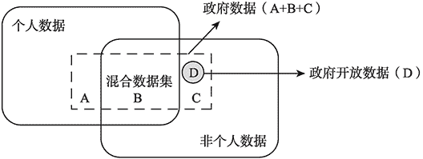
图 1 政府数据和政府开放数据在数据体系中的定位

依据行政主体在信息链条中的功能定位，对外释放的信息大致可划分为两大来源。第一类为转递披露型信息，这类信息源头来自行政相对人，部门依法定程序予以公布，部门本身不具备创造性，仅承担公布职责，例如专利文书、药品审评审批材料，国家知识产权主管部门仅作如实公示权利人提交的文本。第二类为机构自产信息，即部门在履职过程中自行采集、汇总形成的信息，例如国家地理科学资源库、全国人口普查汇总、医保运行信息、国家级基因组科研信息等。

## 二 AI时代公共数据公开的新动因

算力进入爆发期，AI再度复苏，机器学习、神经网络叠加物联网、大数据、云计算等技术，共同释放了数据的潜在价值。过去倡导信息公开更多出于权力监督的行政公开逻辑，而在“数据即生产力”的智能时代，公开的正当性获得了更丰富的支撑。

### （一）作为一种公共产品的官方数据

#### 1. AI技术对知识层次论的“超越”
信息管理学经典的 DIKW 结构认为人类认知遵循数据→信息→知识→智慧的递进路径[^(\[11\])](#chapter005.html#m11)，即智慧建立在知识之上，知识源于信息，信息则需要对数据进行理解与加工。然而在大数据与 AI 背景下，这一链条可能出现松动[^(\[12\])](#chapter005.html#m12)。

其一，当前的数据已不再是人脑可直接识读的记录，而是来源多样、体量巨大、价值分散的超大规模集合，人类难以直接阅读处理，必须借助 AI 等技术在黑箱中完成数据到信息的转换。其二，在深度学习框架下，研究者可直接对海量样本进行挖掘，在数据挖掘过程中直接把握事物的特质、规律与发展趋势，事实上绕过了信息提取这一中间环节。

在某种程度上，数据直接驱动了知识生成、规律发现乃至决策智慧。技术冲击使传统 DIKW 转变为“数据→知识→智慧”甚至“数据→智慧”，数据成为知识与智慧的直接来源。基于传统 DIKW 的知识层次论在解释数据价值实现时的解释力在减弱，而数据生产理论[^(\[13\])](#chapter005.html#m13)提供了新的分析起点——将数据视为一种产品。

#### 2. 数据生产理论视域下的公共数据产品
数据生产理论把价值实现过程划分为采集即原始数据生产、汇集性处理即数据集生产、分析性处理即数据分析利用三个阶段，并把前两者归为数据生产[^(\[14\])](#chapter005.html#m14)。数据生产是对数据原生价值进行筛选、确认、附着与发掘的劳动，是数据产品价值被开发与流通的基础。依此逻辑，数据产品很容易催生知识产品乃至智慧产出。

公共部门在原始数据生产与数据集生产中发挥关键作用。经过脱敏、清洗、整理、汇交等生产性处理后，官方数据作为一种管理的公共数据产品，应当开放共享，进而滋养公私两方面的知识产品与智慧成果。

### （二）官方数据公开是数字人权保障的题中之意
世界人权形态数百年间经历三次转型，张文显教授指出全球正迎来第四代人权，其核心即数字人权——无数字，不人权[^(\[15\])](#chapter005.html#m15)。AI 加速各行业数字化，数字时代已经到来。数字人权既是社会发展的需求，也是人权体系演进的需要。我国数据法学开创者之一齐爱民教授也明确提出：数据自由流通是一项基本人权，即数据应在自然人之间、法人之间、自然人与法人之间乃至不同国家间自由流动[^(\[16\])](#chapter005.html#m16)。

数字人权的第一前提是数据可及。从信息时代到大数据时代的跃迁依赖海量、多元、动态的数据汇聚，可以说数据正在重塑文明构成要素[^(\[17\])](#chapter005.html#m17)。数据常被比喻为新的石油[^(\[18\])](#chapter005.html#m18)，与有限石油不同，只要人类社会延续，数据就取之不竭。AI 时代，人类延续越来越离不开数据，而数据可及直接关乎数据人的权益保障。

作为应有权利的数字人权要走向法定权利直至实有权利，需要数据技术、数据经济、数据法制协同升级，数据可及贯穿其中。就官方数据公开而言，目前大量关乎民生的开放信息仍处于被滥用、负向利用甚至非法利用状态，严重阻碍数字人权实现。确立合法化流动秩序，促进官方数据高效自由流通，是实现数据可及的关键，也是保障数字人权的基础。

### （三）官方数据公开是数据要素市场化的现实诉求
数据既是基础性资源，也是战略性资源[^(\[19\])](#chapter005.html#m19)，数据要素市场化对官方数据公开提出现实诉求。2020年全国两会强调打造数字经济新优势，数据跨产业融合正成为驱动增长和优化结构的核心要素。

欧盟委员会曾援引德勤研究报告称，到2020年消除数据流动障碍可能为欧盟带来最高4%的GDP增长[^(\[20\])](#chapter005.html#m20)。在确立商品、服务、资本、人员[^(\[21\])](#chapter005.html#m21)之后的第五大自由——数据流动自由[^(\[22\])](#chapter005.html#m22)后，可以说欧盟为AI、云计算和大数据分析铺平了道路。

数据赋能产业的案例比比皆是。以智能药物研发为例，利用真实世界数据进行开发已成全球趋势，真实世界数据是制药巨头的富矿，罗氏、赛诺菲、百时美施贵宝等纷纷布局，如百时美施贵宝宣布与Concerto HealthAI合作，在新药研发的临床试验设计中使用真实世界数据和AI技术，业已产生瞩目成果[^(\[23\])](#chapter005.html#m23)。绝大部分的真实世界数据是由政府所掌握的[^(\[24\])](#chapter005.html#m24)，然而我国相关数据的开放路径尚不明确，一定程度上制约了产业发展。

数据开放是“数据社会化”[^(\[25\])](#chapter005.html#m25)的前提。要实现数据开放、数据流通直至数据自由，让高质量数据在法定和协定的框架内有序流动、便利取得。构建官方数据公开的自由流动秩序，既是数据要素市场化的现实要求，也是数据赋能产业发展的重要诉求。

## 三 官方数据归属之争议澄清
归属界定是数据高效管理与有序公开的前提。“官方数据到底归属于何主体”是一个学界反复争论的问题[^(\[26\])](#chapter005.html#m26)。可大致归结为四种观点：一是归属于国家，二是归属于公众，三是不完全归属于任何主体，四是不归属于任何主体。笔者认为，以上四种观点在各自的语境下，似乎都有一定道理和意义，但放到不同的数据场景中又有其“一叶障目”之处。前三种观点都支持存在归属，姑且称之为“归属论”，第四种观点独树一帜地认为“数据无归属”，姑且称之为“非归属论”，下面就这两种论调分别展开论述。

### （一）对“非归属论”的质疑
有学者认为数据既不是民事权利的客体，也不宜被视为财产[^(\[27\])](#chapter005.html#m27)，这也从根本上否认了官方数据的“归属”。其理由主要有两点：第一，因为“数据没有特定性、独立性，亦不属于无形物”，故“不能归入表彰民事权利的客体”；第二，因为“数据无独立经济价值，其交易性受制于信息的内容，且其价值实现依赖于数据安全和自我控制保护”，故“不宜将其独立视作财产”。

但笔者认为对官方数据归属的讨论有如下应予以注意。

首先，必须精准界定“数据”的概念并一以贯之。该学者认为其研究的“数据”限于在计算机及网络上流通的在二进制的基础上以0和1的组合而表现出来的比特形式，而事实上，电子数据并不等同于数据，结合ISO、CCITT以及联合国使用的电子数据交换定义[^(\[28\])](#chapter005.html#m28)，电子数据是指“用约定的标准编排有关的数据，以便计算机向计算机传送业务往来信息”，这显然不等同于我们拟讨论的可能作为财产的“数据”。

尽管其“误会”了数据的定义，并将数据限定在了一个极其狭窄的范围，但是又在全文的论证对象上反复“漂移”：在特征归纳上，往往描述对象是最为狭义的数据——比特流，并常以此作为驳斥数据客体性、财产性的基础；在信息传播上，又将数据列为与纸张、音像相并列的一种“媒体”，时而认为信息的外延大于数据，时而又认为数据就是信息本体；在讨论场景上，又突然切换到网络环境，进而将本与联网与否无涉的“数据”与网络游戏虚拟设备、电子邮箱、网店等“虚拟财产”相等同；在问题解决上，又“畅谈”与“数据”结构、价值、性质迥异的“大数据”，认为大数据也不是财产。综上，全文的讨论语境已经远远超出其所限定的“数据”定义，但是其对数据的特征之归纳，又都局限于以计算机之间数据交换为目的的“电子数据”。

再次，文章实体上也有诸多观念漏洞或误解。如从德国传统物权法理论出发，认为数据“无法为民事主体所独占和控制”，因而否定其民事客体性。诚然，数据的复制确实更为便利，彻底删除也更为困难，因而对其独占和控制更艰难，但是在数字化环境下，任何可数字化的财产都存在复制便利、删除困难的情况，技术的进步可以改善独占和控制的权能。退一步讲，即使权能不完整，也只能否认其物权属性，但不能否认其作为其他民事权利客体的可能。再如，该学者还因“数据缺乏独立性”而否定其民事客体性，这也站不住脚，照此推论：没有权利凭证的有价证券有赖于网络电子数据查询，因此不是财产，无民事客体性；以电子文档存储的小说在打印/印刷前也不是财产，无民事客体性。

最后，从实体标准来看，有悖于“法律适应发展”的逻辑。财产权实际上赋予了个人对抗“一个很大范围并且不确定的人”[^(\[29\])](#chapter005.html#m29)的权利，而这正是数据应当成为财产甚至被证成为“数据权”的最根本的价值需要。用着眼于有体物的物权理论去嵌套数据、大数据、虚拟财产等新兴事物，必然会产生很多的不协调，但我们不能因为知识财产有别于传统财产，就否定知识产权；不能因数据的性质不符合传统民法关于客体性的理论，就罔顾数据本身的价值保护需要，认为数据不存在归属问题。所谓“客体”，其实就是财产权建构的标准化对象，是否有形并不会影响客体概念的构建，只要特定客体“具有显著的权利外观、易于被识别、具备社会各界公认的价值”[^(\[30\])](#chapter005.html#m30)，从法律层面上来讲，便不应当排除其成为财产权对象的资格和可能。

### （二）对“归属论”的辨析——政府角色的分类考察
“归属论”的三种观点，实际上都存在一个对政府角色的判断。笔者认为，要厘清官方数据的归属，应当从政府在官方数据中的角色出发进行考察。

如果从形式判断的角度来说，应当承认，国家确实直接控制着官方数据的公开、共享、流动，可以认为政府是官方数据的“直接控制者”，这也是官方数据归属“国家说”的重要论据之一。这种论证是基于对官方数据产生和存在的外观形式判断，政府或其授权机构在履行各类行政职责时必然产生或保有了大量的数据，数据看起来确实是政府“产生”的，直接层面上应归属于“产生”数据的政府或其授权机构，而在整体上又归属于国家。因此，官方数据作为“社会主义公有财产”，由国家占有并控制。国家享有最高排他权利——数据主权，确实有一定合理性。

但是，如果从实质判断的角度来说，要厘清官方数据的归属，必须做“形式占有”和“实质所有”的区分。代议制民主体制下的政府，仅仅只是公众通过选举等方式“委托”的国家治理之“代理人”。援用委托代理的理论，公众可以被称为政府进行数据管理的委托方，被代理人，而政府则是受托方、代理人。因此，国家机器在其运转过程中“产生”“生产”的一切数据及其衍生数据利益，本质上都应当属于“被代理人”——公众。国家富集了众多重要的数据集、库，其中会有大量的涉及隐私、保密、监管、安全的数据不能公开或只能向有限的“被代理人”公开，政府事实上形成了对这类数据的控制优势。但是，不能因此认为官方数据的归属者就是国家，因为这种控制是“公益性控制”，目的仍然是更好地服务于公众。

当然，如果泛泛而论地将政府掌握的所有数据都归属于公众，亦有不妥。政府将行政相对人因行政审批之需要提供的数据，依据《专利法》《药品管理法》等法律法规的要求向公众披露，如专利信息数据，国家专利行政部门仅依法如实披露权利申请人提供的文件。此种情形下，专利行政部门显然不能控制这些文件，政府仅为数据信息披露者，而非数据的归属者。这些数据在因公众监督和知情之需要，由政府依法向公众披露的同时，便进入了公有领域。

前文已述，官方数据分为行政公开数据和政府生产数据两类，但政府在其中的地位并不相同，具体而言：在行政公开数据这一场景中，政府仅为数据披露者；在政府生产数据这一场景中，政府为受托代理人——接受公众的委托管理、控制政府生产数据及其衍生利益。因此，从实质判断的角度和委托代理理论出发，官方数据不归属于政府，其中行政公开数据自公开之时起便进入了公有领域，政府生产数据由政府管理、控制，但实质上仍属于全体公众。

## 四 官方数据流动的法律秩序构建

### （一）美国《开放政府数据法案》的启示
美国是最早主动开放官方数据的国家之一，这种开放是从联邦层面到各州层面系统性的操作。迄今为止，美国政府已发布《政府数据开放倡议》2009、《开放政府指令》2009、《开放数据政策》2013、《开放政府数据法案》2018等众多政策或法案，并建成了全球第一个统一的官方数据开放平台——Data.gov。截至2019年12月，该网站上已报告了25.2万个数据集，超过1000万个数据资源。美国的官方数据公开制度体系，为全球提供了有益参考。

根据美国《开放政府数据法案》第3561、3562条的规定，联邦政府的数据只有两类：公共数据资产和非公共数据资产，这两类数据要么以开放格式提供，要么在开放许可下可用，除非非公共数据资产是因隐私、保密、监管或法律规定的其他原因而不得向公众提供的数据资产，或承包商提供的受合同、许可协议、专利权、商标权、版权、商业秘密、规章或其他限制保护的数据。第3562条c款再次强调：在法律没有另外禁止的情况下，并且在切实可行的范围内，应根据开放许可提供由机构发布或为代理机构公开的政府数据资产；如果未根据开放许可提供并发布，则应作为全球公有领域的一部分，视为已公开。这意味着，除作为例外的特殊情况外，官方数据应全部公开——处于全球公有领域内的数据，任何人都可以公开使用；非处于全球公有领域内的数据，也可通过许可协议开放使用。

### （二）官方数据流动秩序的分类构建
美国国会在《开放政府数据法案》SEC.2.FINDINGS中指出：要使联邦政府数据的可用性最大化，并使其适宜发布，就必须使这些数据易于获得、可获取、可使用，除非联邦政府合理地预见到披露可能会损害法律所保护的特定的、可阐明的利益，或者联邦政府出于法律的要求明令禁止披露此类数据，否则信息应该可以被公众预先获得。这彰显了美国在处理官方数据公开问题上的态度：一切为了开放。

我国政府有着开放各类官方数据的坚定决心和勇气，但是在具体操作路径上，往往过于谨小慎微、瞻前顾后。事实上，在以法律明确标准划定“应予开放、不能开放、暂不宜开放”三类后，就可以迈出开放的最基础的一步。接下来，对“应予开放”的官方数据进一步明确其流动秩序，建立统一开放平台。

# 让政府数据真正流起来

行政公开数据里包含两类资产。公共数据资产已经进入全球公有领域范畴，任何主体都可直接公开调用；非公共数据资产虽然还未进入全球公有领域，仍能通过签订使用许可或适用附条件的法定许可来对外开放。现实的痛点在于，机构频繁改组调整后，不少早年公布过的行政公开数据已经找不到源头、触达不了。制度设计最该先解决的，就是让这些数据易找、能拿、好用。

政府生产数据则是另一回事。这类数据在采集、汇聚、加工环节投入了大量财政资金和人力成本，部分数据库本身甚至已经具备“智慧财产”的特征，但给它套上高度垄断性的知识产权保护并不合适。知识共享的理念和许可模式，为人工智能时代的知识传播与保护提供了新思路。[^(\[32\])](#chapter005.html#m32)知识共享协议通常只保留必要的权利，既推动数据的传播与利用，也为数据的读写、重复使用与创新性利用创造了更宽松的环境。所以在推动政府生产数据流通时，更可行的路径是用知识许可协议的方式向社会开放，让现代科技产业链上的各个环节不必担心侵权风险，能够最大化地开展多元化应用。

## 五 结语
构建符合法律规则与经济规律的政府开放数据流动秩序，是数据治理体系和治理能力现代化的必然要求。数据要素的价值能否实现，关键在自由流动；政府开放数据的自由流动，则是数据要素市场化的重要抓手。在人工智能时代，政府开放数据已实质成为一种公共产品。如果能够保障高质量、数量充足、类型多样的数据被自由且高效地获取，就能有力促进基于数据的知识生成与智慧创造，对高度依赖数据的现代科技产业而言意义尤为重大。在以国内大循环为主体、国内国际双循环相互促进的新发展格局下，加快数据要素市场化显得更为紧迫。持续提升政府开放数据的开放质量与效率，让数据在法治轨道上有序流动，将为我国培育未来数字经济发展的竞争新优势提供源源不断的动力。

技术演进正不断拉宽“能否对应到某个自然人”这条界线。不少国家在立法中把是否可还原到具体主体作为判断依据。经过去标识化处理的数据，表面上已剥离身份特征，技术上仍存在还原空间；经过匿名化处理的数据，则被理解为已脱离人格权范围。但无论是去标识还是匿名，只要借助其他公开信息进行辅助，就存在被重新关联并显名的可能，当外部信息足够完备时，两者的差异多半只剩下计算难度的高低。美国在 HIPAA 框架下被认定为匿名 的医疗记录、Netflix 公布的匿名用户记录，都被算法在大数据环境下精准锁定到本人。这说明仅以可追溯性划定法律边界已难以稳定，数据主体权利的边界也变得模糊。

### （三）我国个人信息权利保护现状

目前国内对个人资料的规制散见于不同法律和规范性文件，缺乏位阶较高的统一法律，不同文本对概念的表述也不一致。《网络安全法》将“个人信息”明确界定为“以电子或者其他方式记录的能够单独或者与其他信息结合识别自然人个人身份的各种信息，包括但不限于自然人的姓名、出生日期、身份证件号码、个人生物识别信息、住址、电话号码等”，把内涵确定为“识别个人身份”的信息，并以“告知同意”原则作为采集、存储、利用的正当性来源。《民法典》第 1034 条规定，自然人的个人信息受法律保护，且采用了与《网络安全法》一致的内涵界定。

《网络安全法》施行后，国家发布了《个人信息去标识化指南》，为匿名化利用提供了更明确的技术标准，划分了识别主体的标识符层级，意在保护安全的同时促进数据共享。目前正在征求意见的《个人信息告知同意指南》，同样以“告知同意”为原则，构建使用方与主体之间的权利义务关系。该种模式被认为抬高了商家与消费者的合规成本，也不利于个人、商业、社会公共利益的平衡。范为教授认为，以“知情同意”为核心的传统保护模式，不仅难以为公民隐私提供实质保障，还会限制数据利用，因此应建立以“隐私风险”为衡量合理使用的指标的动态风险评估机制。[^(\[12\])](#chapter006.html#m12)

公开征求意见的《个人信息保护法（草案）》仍以“可识别性”为识别标准，但明确排除了匿名化处理后的信息，同时对处理合法性作出补充，在“告知同意”基础上增设了行政职责所需、公共利益等情形，并考量了网络互联、信息共享下个人资料活动日益社会化、公共化的特征，以及企业、公权力等不同主体合规处理的差异，相较既有立法更为完善，但并未针对央行数字货币的数据采集作出专门制度设计。

## 二 我国法定数字货币个人信息保护的平衡逻辑

### （一）从完全匿名化到不完全匿名化：执行货币政策的需要

我国的数字人民币属于央行发行的法定数字货币 DCEP，与比特币等基于区块链的私人数字货币有相似之处，例如都实现点对点交易，无须传统金融机构清算。但差异更大：比特币等不采集个人资料，账本公开但只记录地址间的转移，匿名源于信息采集起点就缺失；而数字人民币在测试阶段已显现实名认证机制，例如手机号码验证。与现金相比，使用数字人民币多了一层身份核验，自始就涉及个人资料采集。传统现金支付是完全匿名的，数字人民币则是有限匿名的。

公开信息显示，数字人民币采用“双层运营体系”与“双离线支付架构”。交易信息对用户和商业银行保持匿名，对央行则不匿名。央行因此能够掌握全流程交易数据，可更精准地解决常规货币投放难以应对的非常规政策调节、信贷利率传导等问题。[^(\[13\])](#chapter006.html#m13)此前第三方支付机构积淀的小额交易数据，已被大数据算法用于精准营销，这也印证了交易数据的价值。有限匿名的设计，让央行能借助小额交易数据实现更精细的货币政策调节与更顺畅的传导。

### （二）从不可控匿名化到可控匿名化：有效实施金融监管与个人信息保护的平衡

比特币等私人数字货币的交易与账户完全匿名，因而易被洗钱、恐怖融资等非法活动利用。法定货币交易同样存在类似风险。为此我国自2000年3月起推行个人存款账户实名制，2007年5月央行进一步落实银行账户实名制，同年7月会同公安部门建成联网账户核查系统，推动征信体系和反洗钱工作开展。银保监会2019年1月发布《银行业金融机构反洗钱和反恐怖融资管理办法》。这些措施对现金交易却难以触及，现金仍是央行管控之外的匿名通道。随着小额支付逐步转向数字人民币，央行监测小额交易成为可能，这也是各国推动法定数字货币替代传统现金的动因之一。法律确立其地位并合理调控其与现金的发行比例后，现金规避监管的空间将越来越小。

为避免泄露风险，数字人民币的“双层运营体系”与“双离线支付架构”实现了可控匿名。控制权保留在央行层面，央行可自行对可疑、违法交易进行数据追溯，无需依赖公安机关；而在交易双方层面则采取不可控匿名，双方均无法直接或借助其他信息获知对方身份。这一安排体现了央行在隐私维护与监管之间的平衡立场。

## 三 我国法定数字货币个人信息保护的完善

### （一）个人信息保护法律位阶的提升

法定数字货币使用者的个人信息保护，有着明确的成文法基础。《民法典》第 991 条明确规定“民事主体的人格权受法律保护，任何组织或者个人不得侵害”，第 1032 条明确规定“隐私是自然人的私人生活安全和不愿为他人知晓的私密空间、私密活动、私密信息”，第 1034 条明确规定“自然人的个人信息受法律保护”。法定数字货币诞生之前，除了现金之外的以法定货币为支付方式的交易需要依赖银行、第三方支付平台等中介机构，而中介机构需要接受金融监管机构与法律的双重约束以确保其个人信息处理的合法合规。而法定数字货币去中介化之后，能够对央行的个人信息处理行为进行约束的只有法律，而且必须是高于部门规章这一位阶的法律。

然而，我国对个人信息保护的立法相对滞后且分散，轻民重刑，法律位阶相对较低，缺乏统一的个人信息保护法律制度，对个人金融信息亦缺乏重点关注。目前正在公开征求意见的《个人信息保护法（草案）》有望改善这一问题，但从其目前的条文来看，对法定数字货币的特殊性考虑不足，仍然有待完善。

### （二）个人信息法律识别标准的重新定义

目前《个人信息保护法（草案）》第 4 条，对个人信息的定义仍是“以电子或者其他方式记录的与已识别或者可识别的自然人有关的各种信息”，将“匿名化处理后的信息”排除在个人信息范围之外。但如前所述，在大数据、算法、计算机计算能力持续跃升的背景下，可识别性的边界并非一成不变而是不断扩大，以“可识别性”作为个人信息的法律识别标准，将大大限缩个人信息保护的范围。在数据日益成为重要的生产要素的背景下，社会处理和共享的数据也将越来越多，不可识别的信息，将在其他公开信息的辅助下，在算法、计算能力的支持下，成为“可识别”或“可推测”的个人信息。法定数字货币所涉及的个人信息，敏感性往往较强，与个人隐私紧密相关，通过“可识别性”定义个人信息，并通过“匿名化”豁免个人信息处理的相关法律责任，难以有效在未来保护法定数字货币的使用者的个人信息。为避免“可识别性”标准的局限，《民法典》第 1034 条对个人信息的定义，已经从“单独可识别”扩展到了“结合其他信息可识别”，扩大了个人信息的保护范围。

在法定数字货币进入测试阶段之前，针对国家机关、商业机构对个人信息的处理现状，已有学者建议，“但凡造成隐私风险的大规模信息处理行为，均应使用个人信息保护相关规定”。[^(\[14\])](#chapter006.html#m14)以暂态性、静态性的“可识别性”作为个人信息边界的法律界定标准，虽然具有明确、简洁、便于操作等优势，但缺乏对未来应用场景中个人信息边界持续扩展的考量。因此，有必要以“隐私风险”这一动态识别标准，作为立法上“个人信息”界定的核心考量，确保央行法定数字货币在“双层运营体系”的完全匿名化层级中的信息完全“去识别化”。

### （三）个人信息处理合法性的来源重置

从目前《个人信息保护法（草案）》关于个人信息处理规则的一般性规定、敏感个人信息的处理规则、国家机关处理个人信息的特别规定等内容来看，“告知同意”仍然是个人信息处理的合法性的核心来源。对于法定数字货币所涉及的个人信息处理，《个人信息保护法（草案）》的“国家机关处理个人信息的特别规定”中明确，“国家机关为履行法定职责处理个人信息，应当依照本法规定向个人告知并取得其同意；法律、行政法规规定应当保密，或者告知、取得同意将妨碍国家机关履行法定职责的除外”。从目前的数字人民币测试来看，数字人民币的使用需要先行注册“数字钱包”应用程序，而注册环节则有《用户协议》这类最终用户许可协议（End-User License Agreements，EULA），使用者需要确认同意相关最终用户许可协议方可使用。然而，仍处在测试阶段的数字人民币的《用户协议》特别注明其“并不具备任何法律约束力”。未来我国法定数字货币正式上线后，是否仍然采取此种《用户协议》授权同意的方式来确认数字人民币使用过程中处理个人信息的合法性，目前不得而知，但此种方式最大的争议是其效力问题。此类“告知同意”是否由于信息不对称使使用者难以有效判断其个人信息安全风险，当出现法律争议时，是否适用我国《民法典》第 496 条、《消费者权益保护法》第 24 条关于格式合同的规定，从而否定了“告知同意”条款的效力等，这些问题将致使法定数字货币的个人信息处理的合法性处于一种不稳定的状态。

因此，对于法定数字货币的个人信息处理，应从公共利益与个人隐私、个人财产利益的平衡保护的角度，在立法上给予明确的合法性确认，以避免数字人民币的个人信息处理合法性的不确定性。

### （四）个人信息搜集范围与程序法律限制方式的技术转译

个人信息搜集的“最小化原则”和“合理使用”等原则，很难在立法技术上转译为明确而具体的边界。对于法定数字货币而言，其技术实现方案将随着整体软件与硬件技术的发展而不断更新，个人信息的搜集范围、搜集形式、搜集程序、信息存储与访问限制等都将有所更迭，但在立法技术上，又需要维持法律的稳定性，立法程序上也难以满足法律随技术发展而随时更新的需求。

因此，鉴于法定数字货币个人信息处理的技术性，或许可以采取法律授权，由国务院颁布技术标准的双层立法架构。参照新冠肺炎疫情期间的个人健康信息码的国家技术标准、工信部发布的《App 收集个人信息最小必要评估规范》等，实现法定数字货币个人信息处理在立法上的稳定性与在技术上的动态性。

### （五）个人信息安全性的法律保障

我国法定数字货币所采用的“双离线支付架构”，使用户无须通过网络即可实现点对点交易，其便利程度与传统法定货币的现金交易形式无异，不存在结算问题，也不存在目前微信等第三方无现金支付的技术方案对网络的依赖。但对于个人信息和交易信息的数据搜集而言，依然存在数据上传问题。换言之，“离线”的小额交易，最终都需要通过网络“在线”上传至央行的数据存储服务器上。央行对可疑交易、违法交易的溯源，也正依赖于这些“在线”时上传的交易数据。同时，从目前披露的我国数字人民币的技术架构来看，法定数字货币的使用离不开“数字钱包”，即运行在手机等移动设备上的应用程序。

因此，无论是法定数字货币的软件安全还是网络通信安全，都影响着个人信息的安全性。理论上，没有一种软件或网络通信是没有安全风险的。此前我国多个国家机关、商业机构的数据库，均被个人信息黑色产业链撞库，导致大量个人信息在网络上被贩卖。一旦发生个人金融信息或其他个人信息的泄露，如何确定责任主体是需要在法律层面给予系统性考虑的。例如，央行的法定数字货币系统，是否必须设定可疑交易风险预警机制，以牺牲交易便利性为代价预防黑客攻击？央行存储个人金融信息或其他个人信息的设备的访问权限、访问主体是否必须加以限制，以在发生系统攻击时能够更快确定违法行为的实施主体？

### （六）个人信息存储期限的法律限制

互联网实名制以及互联网对个人信息的无期限曝光，使被遗忘权日益获得重视，其已经成为人格权内涵中的重要组成部分。郑志峰教授认为，被遗忘权应被纳入个人信息权之中，被遗忘权涉及的对象主要为个人信息，保护的是主体的人格尊严，因而具有人格权的属性。[^(\[15\])](#chapter006.html#m15)有学者认为，被遗忘权体现的是一种信息主体“被宽恕”或“重新开始”的人格利益。[^(\[16\])](#chapter006.html#m16)但广义的被遗忘权，则不涉及这种“道德”评价而仅仅是基于隐私权的不被他人发现、识别，从而达到被人遗忘的目的。被遗忘权的客体是已经被公开或可被识别的个人信息。

法定数字货币，至少在目前而言并不属于被遗忘权的权利客体范围。法定数字货币的技术方案凝聚了国家最先进的技术成果，其安全性必然高于其他领域的个人信息处理，但基于安全冗余措施考虑，关于法定数字货币体系对个人信息的存储，是否需要对其存储期限作出法定限制，也值得考虑，即，如若个人信息存储的价值已经不在，是否应从法律上明确其删除时间，以减少个人信息泄露的风险？从经济价值角度来看，长期存储大量存在“可识别性”的个人信息，需要不断升级安全技术以保障个人信息安全，对于法定数字货币的发行和管理而言，也存在成本问题。此外，虽然法定数字货币对个人信息的可控匿名化存储使交易可追溯，能够很好地预防金融犯罪，但是否需要与刑事追诉时效相衔接，也值得考虑。长期存储这些可追溯的个人信息，却无法将其用于刑事案件的定罪证据，其价值也容易受到质疑。

* * *

[\[1\]](#chapter006.html#w1) 本文系教育部哲学社会科学重大攻关项目“人工智能发展中的重大风险防范体系研究”（编号：20JZD026）的阶段性成果。

[\[2\]](#chapter006.html#w2) 常烨，西南政法大学民商法学院博士研究生。

[\[3\]](#chapter006.html#w3) Samuel D. Warren，Louis D. Brandeis，“The Right to Privacy，” *Harv*. *L*. *Rev*. 4（1890）：193.

[\[4\]](#chapter006.html#w4) 王利明：《隐私权概念的再界定》，《法学家》2012 年第 1 期，第 108～120、178 页。

[\[5\]](#chapter006.html#w5) 齐爱民：《个人信息保护法研究》，《河北法学》2008 年第 4 期，第 15～33 页。

[\[6\]](#chapter006.html#w6) 刘德良：《个人信息的财产权保护》，《法学研究》2007 年第 3 期，第 80～91 页。

[\[7\]](#chapter006.html#w7) 王成：《个人信息民法保护的模式选择》，《中国社会科学》2019 年第 6 期，第 124～146、207 页。

[\[8\]](#chapter006.html#w8) 梅夏英：《数据的法律属性及其民法定位》，《中国社会科学》2016 年第 9 期，第 164～183、209 页。

[\[9\]](#chapter006.html#w9) 王利明：《隐私权概念的再界定》，《法学家》2012 年第 1 期，第 108～120、178 页。

[\[10\]](#chapter006.html#w10) 齐爱民、李仪：《论利益平衡视野下的个人信息权制度——在人格利益与信息自由之间》，《法学评论》2011 年第 3 期，第 37～44 页。

[\[11\]](#chapter006.html#w11) 时明涛：《大数据时代个人信息保护的困境与出路——基于当前研究现状的评论与反思》，《科技与法律》2020 年第 5 期，第 66～74 页。

[\[12\]](#chapter006.html#w12) 范为：《大数据时代个人信息保护的路径重构》，《环球法律评论》2016 年第 5 期，第 92～115 页。

[\[13\]](#chapter006.html#w13) 姚前：《法定数字货币对现行货币体制的优化及其发行设计》，《国际金融研究》2018 年第 4 期，第 3～11 页。

[\[14\]](#chapter006.html#w14) 范为：《大数据时代个人信息保护的路径重构》，《环球法律评论》2016 年第 5 期，第 92～115 页。

[\[15\]](#chapter006.html#w15) 郑志峰：《网络社会的被遗忘权研究》，《法商研究》2015 年第 6 期，第 50～60 页。

[\[16\]](#chapter006.html#w16) 李倩：《被遗忘权在我国人格权中的定位与适用》，《重庆邮电大学学报》（社会科学版）2016 年第 3 期，第 44～50 页。

# 跨界对话

## 解构与建构：信息化浪潮下智慧法院建设的思考[^(\[1\])](#chapter007.html#m1)

高翔 陈庚[^(\[2\])](#chapter007.html#m2)

**智慧审判的跃迁：当技术结构遇上司法运行**

**摘要：** 推动智慧法院向前发展，不能仅做功能叠加，而要先弄清信息技术自身的结构性规律以及它与审判运行之间怎样深度咬合，进而研判未来需求与推进节奏。建设路径要顺应网络联通、海量数据、机器智能三类核心技术此消彼长的演进逻辑，采用分阶段策略实现稳健落地。理想图景是依托在线网络与智能算力，汇聚社会域与司法域的双重海量信息开展深度研判，让裁判效果逐步逼近社会正义，贴合公众期待，在兼顾公正与效率的同时带动审判文化与司法文明的提升。

**关键词：** 智慧法院 信息技术 人工智能

在信息化浪潮推动下，党中央提出网络强国与国家大数据战略，最高人民法院大力推进智慧法院建设，地方法院结合区域实际展开探索。成效已现，如合舟共济 e+平台在优化司法大数据应用路径上不断迭代，网络加多元解纷模式在提升审判效能的同时，以高效、经济、开放的方式改善了群众的司法获得感。随着社会变迁，技术重塑社会的节奏加快，矛盾纠纷更趋复杂，司法需求更加多元，传统治理手段与服务理念面临冲击。仅停留在内部外部网络完善、推送精品案例、让群众在线参与诉讼、查阅庭审与文书等显性功能已不足够，需要回到技术结构属性及其与审判运行的联动关系上来，重新把握未来需求与路径选择。

### 一 技术肌理与社会回响
智能审判最核心的底座是现代信息技术，尤其以网络联通、海量数据、机器智能为关键。它们的构造特质决定了科技革命改造社会的力度，也会牵动其上生长的制度与文化形态。推进建设，首先要厘清支撑系统的核心技术特征与主要社会影响。

#### （一）网联互通催生的相对独立舆论场
网络技术的根本构造是跨域即时互通，这一特质从诞生至今未变，只是不断丰富。大致可归纳为四个演进方向：覆盖范围由局域走向全球；信息形态由纯文字走向图文音视频复合；交互便捷度由邮件式延迟走向即时聊天式跨时区沟通；交互主体由一对一走向多人共享。功能叠加催生了网络舆论这一特殊现象。

从便捷交互角度看，更易把握舆论的独特性——观点能在一定程度上脱离传统价值体系形成独立交流场域。被称作乌合之众的群体心理在此更易显现：激进言论易被群体接纳并掌握话语权；群体共识极不稳定，导致舆情反复。根源在于网络空间的广域距离与匿名性掩盖了参与者的现实社会角色，交流对象急剧扩张使得观点被认可的门槛发生变化。在事实匮乏、观点喧嚣时，激进声音因刺激性与新奇性更容易获得支持；与此同时，交互便捷也让完整信息获取效率提升，被前期观点裹挟的群体容易在事实与理性冲击下转向。

对智能审判而言，网络构建的跨域即时信息空间既提供了法治规范广域统一适用的机会，也潜藏激进舆论冲击公信的风险。主动、及时、完整地呈现案件事实与法治理念阐释，是化解消极影响的关键。

#### （二）海量数据驱动的数字化认知重塑
大数据技术的核心在于借助巨量数据构建特定量化模型，通过充分数据支撑对特定问题进行量化分析。随着解释问题的积累，认知会从个案扩展到局部再到整体，世界观逐渐数字化，进而依托更精准数据实现高效决策。数据结论本身也可能出现三人成虎、众口铄金式的偏差，而网络尤其是服务器对网络数据的长期留存，解决了数据采集的充分性与真实性问题，提升了数字化结论对现实行为的解释力。

从群体行为看，海量数据既帮助个体量化自身与主流群体的重合或偏离，更能大概率识别特定群体的典型行为，从而选择合适的交往策略。例如可通过识别诈骗或非法集资的高概率行为特征，避免损失并助力打击犯罪。可惜目前应用多集中于电商、社交等领域，在社会治理与公共服务等民生场景仍缺乏成熟范例。

在智能审判层面，海量数据其一可用于内部管理决策，把定性问题转为定量，如人案匹配、法官办案效率评估；其二可用于对外司法产品的供给，提升公众决策效率，如前端纠纷的标准化解纷方案推荐、监管机构对涉诉理赔活动的监督等。

#### （三）类脑学习与机器思考的边界
机器智能的基本构造是像人脑一样进行深度学习。学习即基于外部信息认知实现有目的的处理，深度则指认知与处理能力的复杂程度。以 AlphaGo 为参照，它通过多层人工神经网络模仿大脑传递与处理结构实现深度学习，拥有落子选择器依赖监督学习的策略网络预测最佳概率，以及局面判断器依赖价值网络对整体局面进行评估辅助决策，二者分别对应信息认知与目的性处理。对比海量数据，机器智能的信息认知依赖于海量数据，而量化分析结论也为目的性决策提供支撑，可见海量数据是机器智能有效运行的前提。

结合网络对海量数据的支撑，三项技术存在迭代关系，智能审判推进也应匹配分阶段进程。

更值得注意的是 AlphaGo Zero 的自学能力，仅凭围棋规则即可自我对弈提升技能。这意味着海量数据对机器智能的支撑作用可被弱化，但对智能审判而言，法治规则可在机器智能构建的虚拟博弈场景中反复验证，立法与司法解释指向的新规范合理性可在社会规则运行前进行有目的的局面判断。

机器智能会否取代法官？[^(\[3\])](#chapter007.html#m3)答案是否定的。公正与效率作为司法产品的固有属性，最终仍需法官的判断性智识来承载。法律不仅是规则体系，更是体现人文关怀的价值体系；法官也不是冰冷的适用机器，而是带着人文关怀进行判断的主体。[^(\[4\])](#chapter007.html#m4)机器智能在纠纷认知与处置上虽能最大化工具理性，却无法感性理解当事人、施加同情与安慰，也无法促成当事人间的理解与宽慰。因此在智能审判中，其定位始终是辅助性的，服务对象包括法官和当事人等。

### 二 构建路径：技术与审判运行的咬合提升
智能审判建设要兼顾三大核心技术的迭代特征，采用分阶段推进实现系统化、稳妥化，既是技术成熟的需要，也是保障司法稳定运行的需要。核心在于提升技术影响力与司法目标的耦合度，从而在社会治理层面实现更好的良法善治。

#### （一）在线舆论场与规则统一
舆情反转令网络看似混乱，但在公众逐步熟悉的过程中，网民言论理性也在增长。如三色幼儿园事件中，公众愤怒的同时要求司法介入查明真相的声音远高于数年前。在不满信息披露时，公众表现出情绪克制和解决问题的努力，如要求向教委协助取证，这体现了群体行为中难得的理性与规则意识。

值得关注的是，其一理性观点在网络空间传播极快；其二大 V 转发可加速传播，但发布者不必是大 V；其三被传播的理性观点对群体行为有强统治力。借用韦伯三种统治类型理论[^(\[5\])](#chapter007.html#m5)可知，这种理性观点的统治接近法理型统治，大 V 影响力更接近个人魅力型统治，而传统型统治则被网络空间排斥。由此，智能审判在应用网络时需注意表达给他人的印象感受，要强化法理型统治特征，弱化传统型特征，以法律解释者和证据分析者形象引导当事人解纷策略与公众案件认知。

同时引导需具备时空稳定性和统一性。网络中解纷规则和相似案情获知迅速，若引导前后不一、各地差异过大而缺乏充分理由，如新法替代旧法或特定地方单行法规，必将严重损害法治公信力。反之，司法运行借助网络天然应带来规范化、统一化的天下大同式适用。

#### （二）数字化世界与现代共治格局的实现
数字化世界在呈现群体典型特征的同时，也给各群体及个体打上高概率标签。这在提升决策效率的同时也可能导致误判，如骗子的典型行为特征也可能被诚信创业者误触。单纯横向比较难以展现个体独特性，可通过长期信息记录来解决。

对智能审判内部管理而言，实现充分数据支撑主要依赖内部信息化。但业务流程信息化不够，还需对流程效率进行数据采集。其一，为避免增加办案团队负担，应以增设自动采集办案效率数据的程序模块为主，将采集内化于卷宗生成、流转、归档等履职环节。其二，将法官在一定周期内办理案件数量与案件类型结合，基于海量数据构建不同等级法官、不同案由组合下的办案效率基准模型，从同期案件平均数和特定类型案件平均时长两个维度出发。其三，将对法院、庭室、团队的效率评估转化为对不同基准模型的组合考量，提升人案匹配和法官业绩评估的科学性。

对司法产品输出而言，单纯的司法大数据分析只能提升对纠纷现状与处置的认知精度。若目标是服务民生、构建共建共治共享的现代化治理体系，就应建立司法大数据与同期社会公共数据的紧密交互共享机制，推动社会治理层面的大数据分析，进而服务公共政策运行，包括法律法规运行，对最大多数人的最大幸福的实现。同时，分析结论应根据需求赋予政府机关、市场主体和普通公民不同的查阅权限。

#### （三）辅助裁判与良法善治的实现
机器智能像人一样思考却不具备现实身份与社会关系，这意味着更单纯的价值判断体系，可按理性人或复杂人假设认知规则、处理信息、作出决策。若一个 AlphaGo 可代表个人行为选择，多套系统即可在一定程度上模拟社会运行中的行为决策与大概率偏好，数量充足时可模拟整体社会状态，展示不同群体乃至个体的决策与行动。换言之，机器智能对过去难以开展的社会实验实现了可信、可行、可重复的模拟。

对智能审判而言，这种图景的价值在于展示制度对社会的引导方向，即基于结果演示的效果判断，是一种宏观的局面判断。无论预见性大小，展示本身意味着虚拟社会运行实验的实现，为智能审判等公共政策提供先于实体运行的效果预见。基于社会群体在网络与海量数据成熟后对信息技术的高信任可知，未来社会信任将远超现在，表现出群体性的低风险偏好，更倾向相信技术预测，进而在检视既有制度与预见未来制度时更多依赖机器智能。

检视既有制度时，一方面机器智能可基于既有规则体系演示社会事务发生与纠纷解决；另一方面现实运行状态可作为参照，避免单纯数据堆叠与简单模型偏差。制度效果最终依赖现实运行，无法单纯靠机器智能检视。但机器智能对多主体多次博弈效果的模拟，的确从人性角度反映了某些制度运行的现实影响。因此机器智能可作为展现良法善治运行效果的初步验证手段，尤其在有现实参照时，模拟将得到有力完善。简言之，机器智能可在海量数据分析社会运行状态的辅助下，有效检视既有制度与善法良治方向的一致性，并对新设制度的推进或阻碍作用作出初步大概率判断。从这个意义上，智能审判的未来远景可能是发挥辅助裁判功能，通过虚拟社会运行实验对社会整体制度演进进行预见与引导。[^(\[6\])](#chapter007.html#m6)

### 三 实践样本：H地院网联多元解纷模式运行样态
各地实践都在检验网络、海量数据、机器智能与审判运行的结合效果。限于篇幅，以 H 地院合舟共济平台为例说明当前个案样本。

该院以数据共享、机制共建、诉调对接、纠纷易解为理念，依托 C 市高院已建成三级联动的信息化办案办公网络，构建线下线上融合机制，汇聚多元化解渠道和调解资源，以类型化案件调处和诉调对接为切入，打造全流程一体化网络服务平台，为群众提供经济便捷的矛盾纠纷解决路径，推动纠纷源头预防、分流处置与实质化解，助力社会治理系统化、科学化、智能化、法治化。

#### （一）依托网联实现信息互联共享、机制整合，打造一体化纠纷化解平台
该院模式以线下诉调对接中心和机制为基础，聚焦婚姻家庭、邻里纷争、交通事故、保险、医疗等领域，加强与人社、公安、司法、医调委、街道调委会等单位衔接。目前线下设立诉调对接中心 1 个，建立诉调对接平台 3 个，与 36 个调解组织对接，143 名专兼职调解员进驻平台。

以线上合舟共济平台为支撑，实现解纷资源共享与工作机制对接。平台横向打通部门行业壁垒，实现诉讼与行政、行业、人民调解的有效衔接，纵向连通预约调解、视频调解、自动生成文书、一键推送、申请执行等环节。平台向合作组织开放纠纷化解大数据，并为调解员提供网上工作平台，提供调解协议、调解笔录自动生成模板。平台与法院办案系统交互，实现纠纷信息在线录入、网上调解和诉调衔接。自运行以来，分流调解纠纷 3208 件，约占同期新收民事案件 10%，其中成功化解 3160 件。

#### （二）借助海量数据提升用户体验，实现纠纷易解
平台从当事人、调解员等用户需求出发，采用开放设计，通过调整相对独立的功能模块凸显网络互动便捷性、解纷评估智能性、解纷结果效力性。平台以统一公开的审判规则、文书模板、典型案例为人民调解、行业调解和行政调解提供指引，确保诉调对接顺畅。平台上的参考案例和在线工具可引导当事人理性选择解纷方式，依法接受调解方案，推进纠纷易解。

#### （三）积极引入机器智能，构建人力与科技深度融合的审判运行新模式
目前平台主要借助网络和海量数据，其根基在于三层法院联动的信息化网络和线上线下结合的工作模式。下一步将逐步引入机器智能，实现当事人与平台的人机动态对话，提升服务精准性与针对性；扩大可适用案件范围，通过智能分流和程序性工作自动化，成为调解员和法官的得力助手。

总体看，合舟共济平台打破空间局限，扩展司法便民路径，降低社会成本。更重要的是，平台以标准化裁判规则和规范化诉调对接为社会各界提供指引，通过网络发酵促进多元共治与社会自治结合，从源头预防和减少矛盾纠纷，维护和谐稳定，推动规则之治。

### 四 未来方向：智能审判建设的阶段考量
# 智慧法院建设的阶段性整合完善
无论是合舟共济平台等多解纷平台，还是巨鲸智等类案专审 App，抑或智汇云等智能研判系统，都从实践说明各地智能审判建设呈现与地区经济水平正相关的显著特征。结合前述分阶段观点，要逐步拉平全国建设水平，可依据以下三个应用阶段加以整合完善——统一认识、具化标准、明确效果。

## （一）初级阶段：以网联网络技术为主，由内而外推进专业化、法治化智能审判建设

**内先外后，让数据主动权握在手中**

在触达互联网、在网络空间里进行信息往来时，始终要保持内外有别、由内向外的应用思路。[^(\[7\])](#chapter007.html#m7)法院若要主动走进公网参与交互，事前必须把数据做足且做到可控，最理想的状态是内网的数据完备程度要明显高于外网，这样对外互动才不至于失势。裁判文书公开平台的运作就体现了这种逻辑：上网前的规范化处置、部分文书的对外隐匿，本质上都是内网信息完备性优于公开端。唯独在易用性上，内网未必占优，比如跨基层法院调阅案例，有时借助百度等公网检索更顺手。保密是考量之一，技术层面多是权限划分的问题。更关键的是把已结案件的实际适用规范、智慧法院建设方案、硬件设备基准等内容在内网实现共享，这并非对公网建设的重复，反而能加速内部认知收敛，减少同类工作，降低制度建设与重点任务的试错成本。如今法院内网与外网都已实现广域覆盖，若内网的信息流动便利度反而弱于公网，基于裁判法律适用统一的诉求，公众很可能比法院自己更早察觉适用落差，甚至被别有用心者放大为舆情风险。

反之，若内网的信息交互便利度高于公网，法院便能系统化地自我推动法律适用趋同，自查区域差异背后的特殊成因，还能回溯已结案件裁判尺度的演变轨迹，以及各地制度建设的演进路径与依据，前提是把制度文本纳入内网共享机制。简言之，使用体验占优时，自我完善与自我优化的节奏会超过公众通过外网形成的认知与期待，进而促动审判专业化，提升司法公信，让法院工作真正成为社会法治化进程的驱动力。

## （二）中级阶段：大数据主导治理社会化精细化，从宏观迈向微观

以司法大数据为底座的分析结论，主要指向纠纷态势、化解态势以及偏宏观的司法建议。这项工作在搭建比公网更顺手的内网时即可同步开展，核心是推动治理的专业化与法治化。如前所述，若数据基础兼顾司法大数据与社会公共数据，产出将更贴近民生，甚至帮助公众识别风险、规避损失。从服务民生到辅助个人决策，实质是从宏观分析需求向微观决策需求的跨越。结合大数据技术“充分分析”的逻辑，这一跨越需要在两类采集上达到充分标准：一类面向群体行为的预判，一类面向个体行为的预判。仅能把握“骗子”等特定群体的行为特征，已能在宏观层面提升公众决策合理性，但在具体人际交往场景里，把行为标签直接对应到特定个人，精准度与效率更高。这或许也是社会信用体系备受期待的原因。

必须强调智慧法院建设尤其是大数据应用对治理社会化带来的负面效应——数据陷阱。采集偏差、分析偏差以及概率预测固有的误差，都可能导致对个体行为的预见或特征判断失误，进而引发错误的惩戒与防控。由此可见，基础数据的安全性、充分性、真实性，以及分析手段的科学性，是完成上述跨越的根本保障。相关保障机制的建立，才是推动智慧法院建设、推进治理社会化、合理满足微观需求的根本所在。

## （三）高级阶段：人工智能主导治理系统化科学化，从规则检视到规则研判

围棋对局若获得 AlphaGo 辅助，胜率会大幅提升。若两位棋手分别由 AlphaGo 与 AlphaGo Zero 辅助，结果会如何？相较胜负，更值得思考的是两代系统间的差异。这映射了人工智能工具的演进路径，也是智慧法院应用人工智能的迭代方向。两者本质区别在于深度学习的训练素材：前者学习围棋规则加大量经典棋谱，后者仅学习规则后便开始自我学习。对应社会运行模拟与预测的视角，围棋规则犹如社会正式规则，棋谱与对弈局面犹如社会运行的整体态势，复杂多变，对弈中的定式即规则下的衍生技法，相当于正式规则的衍生物，即非正式规则或潜规则，而最终胜负类比社会规则运行的整体优劣。由此可知，AlphaGo Zero 能超越既有棋谱自主发现应有定式。

据此推断，人工智能对社会制度演进的模拟，早期需尽可能掌握正式与非正式规则以预见社会运行状态，辅助功能主要体现为规则检视；后期则可摆脱人工认知局限，自行研判一系列正式规则运行后会形成何种非正式规则，并洞察两者在时间线上的发生与演进，其辅助功能升级为规则研判。

综上，在技术应用的终极形态下，任何制度变动，如司法解释出台、法律适用尺度微调，对社会运行的影响都将具备大概率可预见性。此时法官要做的，或许是避免被数据陷阱与特定规则研判所绑架，在制度演进与个案公正之间，探寻合乎司法良知的答案。届时，个案公正的重要性，可比作杨朱之“一毛”——拔一毛而利天下，不为也。

社会有效运转既在于人们依确定规则行事，也在于能随发展需要不断生成新规则，即社会的“自治”与“自我完善”，也就是治理的系统化、科学化。社会制度与文明的演进离不开立法与司法的助力，尤其司法文明对社会秩序构建、法院在纠纷处理中对“规则之治”的引领与保障作用。而“司法文明的提升不仅仅是法律技术的进步……它永远且只能是法律文化的进步，而标志法律文明的内容只能是司法伦理的规范化、法官生活的道德化”。[^(\[8\])](#chapter007.html#m8)因此，智慧法院建设的终极形态应是充分借助互联网与人工智能等技术，汇聚分析海量社会数据与司法数据，保障裁判效果无限接近社会正义，契合公众需求，从而在公正与效率兼得基础上，推动司法文化乃至司法文明进步，进而使司法终局裁判确立的规则为社会遵守，裁判背后所蕴含的分析判断标准以及对社会运行趋势的研判与新规则的“发现或揭示”获得理解与认同。

* * *

# P2P借贷平台涉罪实证与刑法规制研究[^(\[1\])](#chapter008.html#m1)

姚万勤 蔡仕玉[^(\[2\])](#chapter008.html#m2)

**摘要：**近年P2P机构不断推出新业态，角色逐步偏离信息中介。涉案机构多表现为虚假宣传、搭建资金池、违规担保，导致非法吸收公众存款罪、集资诈骗罪、合同诈骗罪等出现。规制中存在诸多难题，虚假宣传缺乏有效规制，资金池使用中罪与非罪界限不清，涉案案件此罪彼罪区分模糊等。因此应准确把握刑法介入边界，既保持谦抑又发挥保障功能。坚持刑法规制与行政监管协同配合，相长解决机构异化问题。并应建立“数额+情节”的定罪量刑标准，以促进机构良性发展，减少犯罪发生。

**关键词：**虚假宣传 资金池 非法吸收公众存款 集资诈骗

“P2P 网贷平台作为信息中介，是居中撮合借款人与投资者实现点对点小额信贷交易的一种金融模式。”[^(\[3\])](#chapter008.html#m3)机构依托大数据优势汇集借款信息并发布，促成借贷双方信息交换。交易中机构不经手资金、不提供担保、不承担违约责任，仅收取中介费用。近年来受利益驱动，P2P 借贷平台在我国呈现“野蛮生长”，违法犯罪现象频发。本文拟通过实证分析研判涉罪表现，并就刑法规制的教义路径提出方案，以期为刑法发展提供参考。

### 一 样本来源与机构异化现状

伴随网络金融发展，P2P 借贷平台曾短暂繁荣，各地爆雷事件不断。笔者在中国裁判文书网以 2016～2018 年为时段，以“网络借贷平台”为关键词检索，共获 P2P 涉罪案件 170 起。地域上，样本未作限定，但经济发达地区案件数明显多于中西部，符合经济规律。时间上，2016～2018 年为平台高速扩张期，也是涉罪问题集中暴露期，具有典型性。分析样本可大致从三个层面观察机构异化与犯罪化。

#### （一）虚假宣传

因交易信息匮乏且获取成本高，投资者往往依赖机构提供信息进行风险判断。若信息真实性存疑，投资款极易陷入高风险。

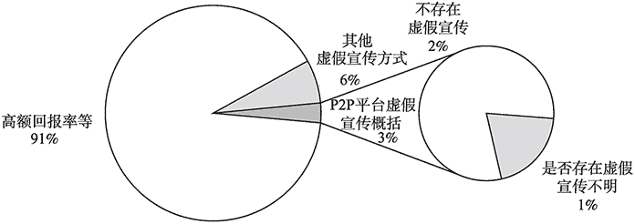

图 1 构成犯罪的 P2P 借贷平台虚假宣传情况

对 170 份判决书梳理后，如图 1 所示，以高额回报率、债权转让、约定担保、编造虚假借款合同及抵押物、回购等方式虚假宣传的案件有 154 件，占 91%，占比最高。以看似有保障的理财方式承诺保本保息，或利用被告人平台账户发布借款信息等其他虚假宣传方式非法集资的有 11 件，占 6%。170 份判决书中，仅 1 份无法判断是否存在虚假宣传；4 份涉及合同诈骗罪且机构未见虚假宣传。可见规模化机构一旦虚假宣传，更易触及刑责。虚假宣传造成信息不对称，投资者难以核实借款用途与借款人还款能力，对虚假标的、担保等往往一无所知，在高息诱导下投资，风险显著升高。[^(\[4\])](#chapter008.html#m4)

#### （二）设立资金池

“P2P 借贷平台资金池的形成是由其先设计出各种各样的理财产品并出售给出借人，获得出借人资金后，再把所有出借人的资金分散借给借款人。”[^(\[5\])](#chapter008.html#m5)如图 2 所示，资金大体流向个人账户，包括被告人用自己或亲属身份证开设多张银行卡，将投资者资金直接转入特定个人账户。170 份判决书中，99 份存在投资金流向个人账户，占 58.24%。26 份显示公司无完善会计制度或公司与控制人混同，公司账户由个人支配，占 15.29%。43 份未具体说明资金流向，仅 2 个平台设第三方托管。

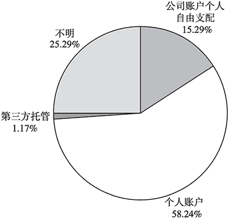

图 2 涉罪 P2P 借贷平台资金流向概况

#### （三）违规提供担保

如图 3 所示，170 份判决书中，110 份未说明是否违规担保；42 个平台存在虚假担保或引入第三方担保公司，如拍摄他人车辆充当抵押、冒用公司名义等；部分平台引入第三方担保机构以吸引投资。违规虚假担保或引入非融资性担保公司，为自身或他人提供增信，导致投资者误判征信风险、错误转换借贷信用风险，资金保障丧失。另有 18 个平台自行为本公司担保，严重偏离居间撮合定位。

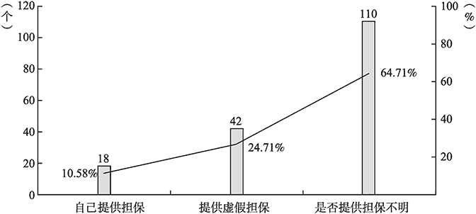

图 3 构罪 P2P 借贷平台担保概况

### 二 机构异化涉及刑事犯罪实证分析

#### （一）非法吸收公众存款罪

现行法下，“面向互联网平台的互联网金融活动涉嫌非法吸收公众存款罪具有天然契合性”。[^(\[6\])](#chapter008.html#m6)如图 4 所示，170 起涉罪判决中，140 份定性为非法吸收公众存款罪，充分体现两者天然契合，机构定位偏差极易触线。

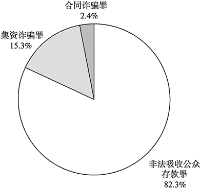

图 4 P2P 借贷平台的涉罪罪名概况

“根据 2013 年 11 月 25 日九部委处置非法集资部际联席会议精神，P2P 借贷平台运行中的如下行为可能构成非法吸收公众存款罪：（1）利用资金池模式吸收资金；（2）不符合借款人条件导致的非法集资风险；（3）利用庞氏骗局吸收资金等。”[^(\[7\])](#chapter008.html#m7)涉罪机构已严重异化，突破信息中介边界，犯罪风险骤增。对 140 份判决分析，机构操作多有以下情形。

第一，吸收存款多流向个人账户或个人支配公司账户，由控制人掌控。资金被自由支配用于偿债、放高利贷、挥霍等。资金池如“蓄水池”，利用进出水时间差牟利。若机构先将自有资金出借，再打包债权发行理财，且借款真实，则无非法吸收存款空间。反之，若以编造虚假项目、虚假担保融资，先集资后转借自用，则在借出借入间形成时间差，集资款沉淀于机构或控制人，形成典型“蓄水池”，属典型非法吸收公众存款。140 份案件中，涉罪机构均在无真实借款人情况下融资并挪用资金。因此把控“进水”与“出水”顺序至关重要。

第二，发布高回报理财、保本保息等利诱信息，或提供虚假担保融资，无真实借款人或美化信息后发布，均触及非法集资风险。以高回报承诺固定收益或全额回购等进行融资，即为“庞氏骗局”缩影。总之，违规设资金池叠加虚假宣传，易构成非法吸收公众存款罪并被追责。

#### （二）集资诈骗罪

如图 4 所示，审判实践中先以非法吸收公众存款罪定罪，其次为集资诈骗罪。两罪核心区别在主观目的，集资诈骗罪要求非法占有目的。

对 26 起集资诈骗机构整理，除支付租金、工资、运营、利息奖励及装修等成本外，融资资金用途大致分为个人消费、放高利贷、生产经营三类。

如图 5 所示，26 份判决中，明确资金用于个人消费的有 16 份，占 61.5%，多用于还债、赌博、购置车辆房产、高风险投资等，法院据此推定非法占有目的。有 4 个机构将资金用于放高利贷，以低息融资高息放贷牟利差，行为人明知风险无法规避致集资款无法返还，则推定非法占有目的。另有 3 个机构将资金用于生产经营即自融，法院认为经营资金与非法筹集规模明显失衡致部分款项无法返还，可推定非法占有目的。3 份判决除运营成本外未明确资金用途。

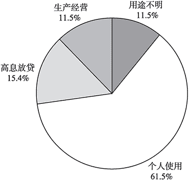

图 5 涉罪 P2P 借贷平台融资资金的用途

综合来看，因“非法据为己有”这一主观要件在司法中举证难度较大，相较非法吸收公众存款罪，集资诈骗罪的判决例数明显偏少。由此可归纳出实践中的判断思路：在网络借贷机构运营存续期间，若其始终恪守信息中介定位，客观上未以弄虚作假方式募集资金，也未将所募资金挪作他用，则难以认定存在侵占资金的主观企图，自然不构成集资诈骗罪。[^(\[8\])](#chapter008.html#m8)

### （三）合同诈骗罪
在统计的170份有罪判决中，仅4份以合同诈骗罪追究刑事责任，占比极低。与非法吸收公众存款罪、集资诈骗罪相比，合同诈骗的适用较为少见，司法中两罪边界不清，混同现象时有发生。

司法里合同诈骗多见两种操作。其一，平台实际控制人借用他人证件设立多家公司，其中一家对外经营P2P借贷，其余空壳公司为其背书担保，以营造资金实力雄厚的表象骗取出借人款项。其二，行为人伪造身份材料冒充高管，与出借人签署资金理财委托协议，骗取较大数额财物。

例如2015年6月至11月，卢某持从公司领取的空白合同，冒用公司名义与客户签订“微力100平台服务合同”，或以代办电子商务诚信经营许可等互联网业务为由，骗取顶搜公司客户共计126.15万元。法院认为其冒用P2P借贷平台名义骗取他人钱款，构成合同诈骗罪。[^(\[9\])](#chapter008.html#m9)此类案件共同点在于行为人以侵占为目的借助合同形式骗取财产，司法处理倾向作出合同诈骗认定。即便平台集资行为本身可能触及集资诈骗，一旦出现假合同骗资情节，定性往往转向合同诈骗。

## 三 统计相关性与刑法规制的定性偏差

### （一）平台虚假宣传缺乏相关规制
P2P平台具有很强的社会性与公开性，一旦异化，虚假宣传的危害远大于传统借贷。但现行框架对平台虚假宣传的专门约束不足。司法审查中高息诱导、虚假发标等典型手法受关注，其他虚假宣传方式关注不够。尽管“《最高人民法院关于审理非法集资刑事案件具体应用法律若干问题的解释》第 1 条对非法吸收公众存款或者变相吸收公众存款的基本行为模式进行了明确，即形式或实质非法性、宣传途径公开性、本息回报承诺性和面向对象不特定性”[^(\[10\])](#chapter008.html#m10)，该解释并未把虚假宣传纳入非法吸收公众存款罪的核心要件。现实中除本息承诺外，还存在编造借款人、编造用途、未完整披露借款人信用状况等手段。

立法表述模糊、司法解释滞后，导致执法者难以准确把握非法吸收公众存款罪在网贷场景下的规制范围。[^(\[11\])](#chapter008.html#m11)P2P本质上是“吸存-还本”模式，资金链不断且能按期兑付时通常不被刑事追究；一旦断链爆雷，则易入罪。因此存在虚假宣传却未爆雷的平台往往得以规避责任。

### （二）资金池使用过程中罪与非罪的混乱
前述统计显示，170家平台中仅2家采用第三方托管，125家的资金直接或间接进入个人账户或个人可控公司账户，形成资金池。设立资金池已成为P2P的常见运行方式，但司法对资金池的支配、使用是否入罪及定何罪，边界非常模糊。

P2P形成资金池主要有三条路径。一是平台设计理财产品或发布虚假标的外募资金，资金流向个人账户或个人可支配公司账户。二是债权转让模式，即平台先以自有资金受让第三方债权，再以理财产品形式对外募资。三是设立风险备付金以对冲投资风险。“风险备付金的来源可以分为四个部分：第一，按照借款金额的一定比例向借款人收取；第二，按照贷款利息的一定比例向出借人收取；第三，由推荐借款人的担保公司交存一定数量的风险备付金；第四，部分平台的风险备付金还来源于其自有资金。”[^(\[12\])](#chapter008.html#m12)然而，“风险备付金在某种意义上来说，是违背了信息中介的角色的，有设立资金池的嫌疑。就风险备付金的计提规则来看，长期积淀在平台的风险备付金总量高达数亿元不等”[^(\[13\])](#chapter008.html#m13)。在司法规制中，风险备付金也被视作资金池的重要组成部分。

从判决看，很难量化资金用途比例，但无论用途如何都难以免除刑事责任。实践中对资金池判断较为笼统，只要存在违法吸收资金事实且资金用途不符合规定，就可能涉嫌犯罪。但资金池存在并不必然等同于非法集资，具体是否入罪仍需以犯罪构成要件判断。[^(\[14\])](#chapter008.html#m14)关于资金池的法律定性应从风险可控性考量。若资金池用途风险可控，不宜轻易认定刑事犯罪。例如资金池无人监管、控制人任意挥霍、放高利贷或投入非法高风险项目，使资金处于高危状态，则具备刑法处罚性。实际上资金池用途的合法与非法界限不清，导致罪非判断模糊，司法部门对资金池乱象的区分并不充分。

### （三）P2P 借贷平台涉罪案件此罪与彼罪界限模糊
收集的170份判决显示，P2P涉罪常见罪名有非法吸收公众存款罪、集资诈骗罪和合同诈骗罪。其中非法吸收公众存款罪140家，集资诈骗罪26家，合同诈骗罪4家。前两类合计占样本97.65%。非法吸收公众存款罪与集资诈骗罪的实质区别在于后者主观上具有非法占有意图，即非法吸收公众存款加非法占有意图，这是实务区分两罪的主要依据。但实务中界限并不清晰。

如（2017）鲁 1622 刑初 36 号判决，被告人毛某等人搭建“圣豪贷”网络P2P平台，通过虚假广告和高息诱饵吸引不特定对象投资。公安以非法吸收公众存款罪立案，检察院以集资诈骗罪起诉，最终法院以集资诈骗罪定罪。[^(\[15\])](#chapter008.html#m15)又如（2017）粤 0307 刑初 2096 号判决，公司成立P2P网站后，被告人刘某等人自2016年起通过虚假宣传和高额利息非法集资。检察院以集资诈骗罪起诉，法院却以非法吸收公众存款罪定罪。[^(\[16\])](#chapter008.html#m16)这说明公安、检察、法院对两罪界限认识不一致。同样行为，有的法院认定为非法吸收公众存款罪，有的则认定为集资诈骗罪。如（2016）渝 0103 刑初 1314 号判决，被告人将资金高利转贷被认定为非法吸收公众存款罪，[^(\[17\])](#chapter008.html#m17)而（2017）冀 0924 刑初 23 号判决，被告人同样将资金高利转贷却被定为集资诈骗罪。[^(\[18\])](#chapter008.html#m18)可见对P2P集资行为性质的认定尚未统一，审判存在矛盾与差异。

集资诈骗罪与合同诈骗罪均要求非法占有意图和诈骗行为，但司法认定上亦易混淆。合同诈骗罪是指以非法占有为目的，在签订、履行合同过程中骗取对方财物数额较大。刑法第 224 条对行为方式已有规定。涉罪平台集资时也常以签署合同方式骗取投资人财产，究竟定集资诈骗还是合同诈骗，实务意见不一。如 2017（渝）0105 刑初 913 号判决，被告人冒用P2P公司名义骗取他人钱款，被认定为合同诈骗罪。[^(\[19\])](#chapter008.html#m19)该案中被告人冒用公司名义与不特定多数人签约骗资，被认定为合同诈骗，但集资诈骗同样可通过P2P平台向不特定多数人融资、签订合同骗取服务费、手续费、保证金来实现。如何区分两者，案件为何定为合同诈骗而非集资诈骗，反映出P2P借贷行为罪名交叉、性质不明，导致司法认定差异。[^(\[20\])](#chapter008.html#m20)

## 四 P2P 借贷平台涉罪刑法规制的应然选择

### （一）正确把握刑法介入的限度与广度
银行因风险偏好高，对中小企业放贷审慎，P2P网络融资作为金融创新，填补了中小企业融资空白，为金融市场注入活力。因此打击非法集资时应有的放矢、适度行事，不能违背金融运行规律，更不能逆时代潮流。[^(\[21\])](#chapter008.html#m21)刑法不能缺位，也不能越位，需要厘清介入的限度与广度。

#### 1. 刑法介入的限度
刑法的干预限度源于其社会任务，刑法谦抑性要求其仅在其他规范无法有效规制时才介入。因此P2P监管应建立阶梯式防范与管控机制，审慎把握刑法介入边界。[^(\[22\])](#chapter008.html#m22)司法实践中如何区分非法集资类犯罪与合法民间融资？当前入罪门槛偏低，若维持现状，大量集资行为将被刑事化。为避免过度干预，刑法应作限缩性规制，以适应经济发展。可从两方面把握限度。

其一，以资金用途作合理区分。有学者指出，我国非法吸收公众存款罪规制的是属于商业银行业务的吸收存款行为，即以资本、货币经营为目的的间接融资行为。[^(\[23\])](#chapter008.html#m23)因此，直接将集资款用于资本、货币经营的行为，不宜认定为犯罪。如资金池由平台严格管理、不被他人自由支配，未将资金置于高风险境地，且存在借给第三方或归还投资人的可能，金融风险相对可控，不宜轻易刑事化。P2P平台将集资款用于实体生产经营，风险可控性强于高风险投资，部分低风险投资行为可排除在刑法规制之外。

其二，在司法解释中明确免予刑事处罚或不作为犯罪处理的情形。如给投资人造成的损失不大、已全部归还或与受害人达成还款协议并获谅解等，可作为免责事由，缩小集资类案件犯罪圈。为平台留出合规空间，在行政监管框架下为中小企业提供合法融资渠道。

#### 2. 刑法介入的广度
当前P2P平台“异化”严重，对金融秩序冲击较大，已趋近无门槛状态。集资规模与人数远超传统集资，并不意味着合规平台就无犯罪可能。对平台虚假宣传等关联行为，存在规制必要。

正如前文所述，集资参与人作为非法集资链条的重要一环，与发起人一样对集资顺利开展起作用，双方存在明显的互动对合行为。[^(\[24\])](#chapter008.html#m24)从参与人看，多数缺乏法律金融知识，易被高回报诱惑；从集资人看，涉罪主体迎合投资心理，以高回报为诱饵线上线下造势宣传。线下常在商场、交通要道发放传单、开宣讲会，线上则通过广告公司将信息投放在机场、地铁站等人流密集处。司法实践中对发布虚假广告的责任追究不足，导致虚假宣传成本过低。仅对高息、虚假发标等严重欺诈行为追责，对其他虚假宣传规制不足，难以达到保护公共安全的目的。因此应强化广告商或信息发布者的责任，将虚假信息发布纳入法律规制范围。

### （二）建立“数额+情节”的定罪量刑标准
P2P平台一旦资金链断裂、爆雷，对金融秩序冲击巨大。刑法谦抑性要求其仅在其他规范无法有效规制时发挥作用，面对严重危害金融秩序的行为，刑法应及时介入。

#### 1. “人数+数额”定罪量刑标准之反思
当前司法主要采用“人数或数额”标准，如《最高人民法院关于审理非法集资刑事案件具体应用法律若干问题的解释》第 3 条主要依据数额与人数判断。机械适用该标准会导致罪责刑不相适应。

其一，以人数或数额难以全面评价集资类犯罪的危害。该标准明确易执行，但集资案件情节复杂多样，社会危害性不仅体现在数额大或人数多，还体现在对金融秩序的冲击。有的案件数额或人数不大，却造成更大社会损害；有的案件虽数额、人数巨大，量刑却仍在同一区间，如“个人吸收对象在 100 人以上”、 “个人集资数额在 100 万元以上”均被认定为“数额特别巨大”，对应十年以上有期徒刑或无期徒刑，而吸收 400 人以上或 400 万元以上的案件量刑仍在此区间，造成量刑失衡，难以实现罪责刑相适应。

其二，入罪门槛低，刑法过度介入经济生活，与谦抑性相悖。“如 P2P 网络借贷入罪多以吸收资金的数额或经济损失为依据，较少考量行为人的主观恶意与资金的去向用途等因素，很大程度存在客观归罪之嫌，并违反了法益保护的位阶关系之价值。”[^(\[25\])](#chapter008.html#m25)

#### 2. “数额+情节”的定罪量刑之建构
单纯以数额或人数为入罪标准无法体现非法集资的社会危害性，易致司法宽严失度。应构建综合性评价标准，建立“数额+情节”的定罪量刑体系。[^(\[26\])](#chapter008.html#m26)在坚持考量入罪数额的同时，需引入情节要素，可分为三类。

第一，入罪情节。若平台非法集资数额未达现有标准，但行为方式恶劣、涉及范围广、后果严重，具有严重社会危险性，应纳入刑法调整。第二，出罪情节。依据刑法第 13 条，情节显著轻微危害不大的不作为犯罪。对于集资后明知投资存在较大风险仍决定投资并最终亏损致无法返还的情形，不应形式化处理。应综合考量三要素：“一，集资对象对风险的承诺范围；二，行为人对风险的注意义务程度；三，行为人对风险的防范措施。”[^(\[27\])](#chapter008.html#m27)若承诺在合理风险范围、履行注意义务并采取防范措施，可视为出罪情节。第三，量刑情节。如集资款全部退还或承诺退还并获受害人谅解、被害人有过错等，可少用自由刑，多采用财产刑或其他非刑罚措施。“当事件的结果一定时，被害者过错越大，加害者的刑事责任就越小；反之，则加害者的刑事责任就越大。”[^(\[28\])](#chapter008.html#m28)

总之，建立严而不厉的刑法规制体系，构建“数额+情节”的定罪量刑标准，有助于P2P借贷平台健康有序发展。

### （三）正确把握此罪与彼罪的区分界限

#### 1. 明确“以非法占有为目的”的区分界定功能
刑法第 192 条规定，“以非法占有为目的的，使用诈骗方法非法集资的……”，该条是集资诈骗罪的法律依据，也是其与非法吸收公众存款罪的重要区分标志。所谓“以非法占有为目的”，是指行为人在主观上具有将非法集资资金据为己有的意图。实践中，定集资诈骗罪的案件里，大部分被告人均辩称融资并非为自用或高息转贷，主观上不存在非法占有目的。

P2P 涉罪“非法占有目的”认定困境

梳理26份涉P2P刑事判决发现，检方指控几乎都围绕“以非法占有为目的”展开，审判说理亦高度依赖这一标准。26份判决书中，25份的“本院认为”均明确出现该表述，仅1份未提及。这表明，在P2P类案件审理中，如何判定行为人是否具有不法占有意图，已成为司法判断的核心着力点。为回应实践中的不确定性，《最高人民法院关于审理非法集资刑事案件具体应用法律若干问题的解释》第4条以列举方式明确了该主观要件的外在表现。[^(\[29\])](#chapter008.html#m29)

认定集资诈骗罪时，必须凸显行为人具有不法占有意图。然而主观心态难以回溯，即便借助先进技术也无法直接观测犯意。司法中不能因证据薄弱而走向单纯客观归罪，也不能仅信赖被告人陈述，须坚持主客观相统一、具体情形具体分析，并努力将主观意图的推断链条透明化、可验证化，这对证据收集与审查提出更严要求。[^(\[31\])](#chapter008.html#m31)司法解释在操作层面提高了可预期性，但局限仍然存在：一是仍以客观事实推定主观状态，误判风险难以根除；二是列举式规范难以涵盖不法占有意图的全部形态。

关于P2P案件中行为人主观目的的判断路径，笔者认为应与财产犯罪的一般逻辑保持一致。我国刑法除在集资诈骗罪中明文规定不法占有目的外，在其他财产犯罪中通常将其作为不成文构成要件，实践中主要考察两点：行为人是否实施排除他人占有的行为，即是否通过自身行为切断权利人对财物的控制；是否实际建立对财物的控制权。只有兼具排除占有与建立占有，才能推定主观上具有非法占有意图。落到P2P场景，平台以欺骗手段吸收资金背后心态各异，或为临时周转，或意图长期据为己有，[^(\[32\])](#chapter008.html#m32)但无论动机如何，若要认定主观具有非法占有目的，首先须借助虚假手段使被害人交付财产从而丧失控制；其次行为人须进一步实施占有行为，如挥霍资金等；同时应保障当事人反向举证的机会。不法占有目的本质上是对主观状态的推定，基础事实必须与案件相关且已被证明，其可靠性直接影响推定结论。[^(\[33\])](#chapter008.html#m33)司法解释的立场是，只要客观上未归还，即可推定非法据为己有，即使存在其他原因亦不能作为抗辩。[^(\[34\])](#chapter008.html#m34)笔者认为案件往往复杂，证据真实性与可靠性无法做到百分百，若行为人能有效举证证明其行为不落入司法解释列举范围，主观非法占有目的亦应被排除。

## 2. 正确区分合同诈骗罪与集资诈骗罪

学界有观点认为P2P非法集资可能采用集资合同形式，双方权利义务均指向金钱给付，二者构成包容竞合。实际上两罪构成要件界限清晰，即便都要求不法占有目的，区分并不困难。

从法条位阶看，两罪保护法益差异明显。集资诈骗罪不仅侵害直接投资者的个人财产，还扰乱国家金融秩序，冲击社会稳定，易引发群体性事件；而合同诈骗罪主要侵害公私财产所有权与市场秩序，扰乱的是市场经济秩序。另在侵害对象上，集资诈骗罪要求行为人以诈骗方法向不特定社会公众非法募集资金，侵害的是不特定群体的利益；合同诈骗罪对被害人人数并无特别限制。

## 五 结语

当前部分P2P借贷平台偏离信息中介定位，出现严重异化，集资类犯罪频发对金融秩序冲击较大。监管态势正从宽松向从严整合转变。完善P2P集资的法律规制，既能推动平台走向规范化，也有利于互联网金融健康发展。刑法的介入限度不宜过大，既不能仅靠刑罚解决纠纷，也不宜过度谦抑，否则可能对严重危害金融秩序的行为形成反向激励。行政监管与刑法规制应相互配合、界限清晰、取长补短，共同为平台发展提供保障。同时P2P网络集资的创新价值与积极意义不容忽视，不应将其置于难以生存的境地。[^(\[36\])](#chapter008.html#m36)面对入罪门槛偏低、“人数或金额”标准僵化的问题，可探索“数额+情节”综合考量，将部分轻微集资行为移出刑法规制范围，改用市场准入、信息披露、信用机制等手段调控。任何规制都需要多维度论证，方能推动P2P平台逐步合法规范，促进行业发展。

# 智能执行：人工智能推动强制执行转型[^(\[1\])](#chapter009.html#m1)

上官俊峰[^(\[2\])](#chapter009.html#m2)

**摘要：**人工智能、大数据、区块链等新兴技术正改变传统强制执行方式，推进执行信息化、提升质效。但信息尚未完全开放共享、网络查控平台仍有缺陷、失信联合惩戒机制待完善、人工智能适用边界不清等问题依然存在。未来应向融合、智能、集约、协同方向演进，助力执行工作实现网络化、智能化、信息化。

**关键词：**人工智能 强制执行 网络化 信息化

在最高人民法院提出“用两到三年基本解决执行难”背景下，各级法院依托科技强化执行措施，成效初显。其中最突出的是将传统执行手段与大数据、人工智能等前沿技术结合的“智慧执行”建设。[^(\[3\])](#chapter009.html#m3)以融合与智能为导向，执行系统持续升级，新兴技术成果广泛应用，信息化整合执行力量，推动工作开展。

## 一 强制执行工作方式的演变

20世纪90年代起，法院受理执行案件数量急剧上升，积案大量堆积，制约市场经济运行，损害司法权威，社会关注度高。面对被执行人难找、财产线索难寻、联动执行难等问题，《民事诉讼法》强化强制措施，赋予法院查询、冻结、划拨存款及拍卖财产的权限。1998年9至12月，全国法院清理未执行积案120余万件，执行标的约893亿元。[^(\[4\])](#chapter009.html#m4)最高人民法院会同19个中央部门发布《关于建立和完善执行联动机制若干问题的意见》，推进失信被执行人联合惩戒，初步构建综合治理格局。

1999年中央下发“11号文件”，号召全社会力量解决执行难，执行难被提升至政治高度。1999年10月，最高人民法院印发《人民法院五年改革纲要》，提出综合治理执行难。最高法加强跨区域重大执行案件协调，2005年办理210件。同时运用现代信息技术开发“全国法院执行案件信息管理系统”，探索国家执行威慑机制，会同公安、工商、银行等部门加大对拒不执行裁判行为的制约。[^(\[5\])](#chapter009.html#m5)

2014年10月《中共中央关于全面推进依法治国若干重大问题的决定》提出切实解决执行难，制定强制执行法，规范查封扣押冻结处理涉案财物程序，加快建立失信被执行人信用监督威慑惩戒法律制度。2016年最高人民法院提出“用两到三年基本解决执行难”，印发工作纲要，要求完善网络查控体系，与人民银行、商业银行、不动产登记中心、车辆管理部门建立执行网络查控系统，在“人难找、财难寻”问题上实现突破。通过建设四级法院统一网络查控平台，解决了传统调查效率低的难题，逐步实现足不出户查找控制处置财产，执行效率大幅提升。建立全国统一网络司法拍卖平台，2017年3月上线后累计拍卖36.9万次，成交额2545.3亿元，溢价率达52%，为当事人节省佣金78亿元，在高风险领域实现违纪违法零投诉。[^(\[6\])](#chapter009.html#m6)

在“基本解决执行难”取得阶段性成效后，中央全面依法治国委员会于2019年7月14日印发《关于加强综合治理从源头切实解决执行难问题的意见》，即《综合治理意见》。文件对加强执行难综合治理、提升人民法院执行效能、从源头预防执行障碍进行了系统部署。地方党委政府积极响应，配套方案落地，并在不动产网络查询、监管管控等方向展开探索。人工智能在此轮强制执行制度的改革完善中发挥了显著作用。

## 二 AI赋能下的强制执行新实践
在科技加持下，人工智能正为强制执行提供新动能，推动信息化、网络化水平跃升，改变了过去必须持证到指定网点人工调档的惯例，实现由碎片化、低效率向集中化、高效率的跨越，并带动联动执行和信用惩戒机制逐步成型。

### （一）信息化正在弥合信息鴻沟
执行工作对信息依赖度极高，科技进步也带来了新的挑战。以银行执行为例，传统模式下干警需“二人一车”到场查询、冻结、扣划，而被执行人动动手指通过手机网银就能在数分钟内完成转账，执行与转移之间存在明显时间差，难度被放大。过去信息化程度低，干警需挨个到不动产、车辆等登记部门现场查档，耗时耗力且成本高。区县登记系统互不联通，只能查本区县范围，超出即无记录。法院实践中，主动查询多局限于本辖区，外地财产基本查不到。碎片化、区域化的财产调查成为难以跨越的信息鸿沟，也加剧了信息不对称，被执行人转移资产更为便捷。

在人工智能广泛应用前，破解此问题手段有限。信息化建设为此提供了新路径。首先需夯实登记部门内部的信息化，通过网络把分散在各地的数据系统化、统一管理，满足法定条件后才能向法院开放。随后在全国范围内建设统一的执行信息平台，将案件管理、财产查控、财产处置、失信惩戒等原本分散的系统聚合，一键调取相关信息，从而有效缓解信息鸿沟。

## 二 科技演进与执行信息化路径
### （一）信息不对称的困境
科技改造了生活方式，足不出户即可转移财产，这对执行带来新压力。过去执行干警需自行赴财产登记部门调取材料，效率低下。区县级登记机构未联网，查询范围受限于本地，法院对辖区外财产难以掌握。被执行人资产快速流转，而执行信息滞后，客观上造成执行难。人工智能普及前，破解手段较为有限。

信息化建设首先依赖登记部门内部的数据整合，通过网络实现信息系统化，仅当登记部门完成统一登记管理后，法院在合法前提下才能获取数据。构建全国四级法院统一的执行信息平台，把案件系统、查控系统、处置系统、惩戒系统整合，实现一键查询，成为解决信息鸿沟的关键抓手。

### （二）网络化促进联动执行
亚当·斯密曾指出，司法权若不独立于行政权，难以获得公正保障。传统分权强调相互制约，而执行权运行却离不开外部部门配合。解决执行难是系统性社会工程，需要在党委统一领导下，各部门协同发力形成合力。法院执行的最大特点是高度依赖外部资源，绝大多数案件都发生在法院与外部单位的互动中。

最高人民法院与中央19个部门联合印发的《关于建立和完善执行联动机制若干问题的意见》，明确了各部门职责，成立联动机制工作领导小组负责统筹，并对不履行联动责任设定处理办法，旨在合力打击拒不履行生效裁判行为，提升强制执行力。在财产查询控制、信用惩戒、执行拘留等环节，法院与各部门持续交互，离开协作执行寸步难行。网络化使联动更加顺畅，通过接入各单位网络，实现执行信息快速互通，把联动机制要求落到实处。

### （三）区块链推动技术变革
网络技术与信息化让强制执行进入快车道，摆脱了“两人一车满城跑、线索靠经验”的旧模式。执行质量取决于法院掌握与处置信息的能力。尽管当前信息化在提升质效、规范权运行、增强执行强度方面作用明显，但平台集约化不足，存在平台不统一、功能不立体、信息不联通等问题。整合网络资源、消除壁垒、开放数据成为下一步重点。

区块链作为分布式账本，具有数据安全、防篡改的本质价值。借助区块链可摆脱单中心或多中心局限，形成统一信息网络，提升执行系统集约化。法官的发通知、会见当事人、发起查询控制指令、作出处罚等行为，以及联动单位的反馈、评估拍卖等配合，均可以“交易”形式上链记账，形成不可更改的执行区块链。数据链便于查阅和监督，可快速核验指令是否及时发出、执行行为是否完成。实时公开的链上数据也提升执行透明度，在联动和失信限消中保障数据真实安全。

## 三 人工智能在强制执行领域面临的短板
人工智能重塑了执行方式，提升了效率，但信息开放共享、网络查控平台建设、联合失信惩戒等方面仍有不足。未来执行信息化应朝着融合、智能、集约、协同方向发展，推动执行模式现代化。

### （一）信息开放共享尚未完全实现
信息化要求数据互联互通、壁垒消除。目前执行信息仅部分联通。省域内，法院在案件信息共享、财产查控、委托执行方面基本互通，干警可通过案件系统和查控平台调取信息并发出指令。但跨省域间异地法院数据尚未打通，无法查询外省案件、财产线索或执行完毕情况。

在最高法推动下，与财产登记部门签署合作协议，推动系统对接。但实践中仍存在信息壁垒。信息不对称主要体现为：不同地域、层级法院数据共享困难；法院系统与外部部门在网络查控、联合信用惩戒上的对接不完整；社会信用信息与失信被执行人名单未实现无缝衔接。

### （二）执行网络查控平台仍有缺陷
自2013年起，最高法逐步建成四级联动的执行网络查控平台，与人民银行等单位联网共享，干警足不出户即可查找、控制、处置财产，查控效率大幅提升。法官点击鼠标即可冻结甚至扣划。平台建设成绩明显，但仍有提升空间：部分银行未纳入或仅开通查询冻结未开通扣划；不动产未实现省内全国联网查询和网上查封；车辆查询查封功能不全；新型金融财产未及时纳入查控范围。地方保护、部门保护导致部分登记信息仅对本地法院开放，不同系统采集保存方式不同，影响对接兼容。平台在查找财产和部门联动上成效显著，但不足需完善。

### （三）联合失信惩戒机制有待健全
我国强制执行在外围缺乏成熟的威慑机制，与西方“执行+威慑”模式存在差距。拒不履行生效法律文书既违背契约也冲击社会信用。仅靠法院单方惩戒威慑有限。建立四级法院统一的失信被执行人名单库后，公众可在线查询交易风险，并通过链接社会信用体系实现“一次失信，处处受限”，限制市场准入、高端消费等。

现行联合惩戒在联合深度、精准度、覆盖面方面仍需加强，才能形成足够压力促进行为自觉。

### （四）人工智能的应用边界尚不明晰
在信息化推动下，人工智能承接了大量重复性任务。以银行账户查控为例，系统一键查询多家账户并可冻结扣划。由此出现“强依赖”与“弱依赖”两种倾向。强依赖认为应扩大自动化，实现立案后自动查询、控制、处置，减少人为干预。弱依赖则认为人工智能尚难应对复杂情形，应突出干警主导，防止形式化。

无论哪种取向，人工智能都无法完成全部执行工作，需明确其与干警的职责分工，避免路径依赖导致仅做网络查控和失信惩戒而忽视其他措施。

## 四 完善人工智能在强制执行的路径
借助人工智能，法院可更快查询被执行人身份、财产及关联案件信息。但信息共享、查控平台、边界厘清等方面仍需完善。

### （一）完善信息共享机制
针对共享不及时、不全面问题，应在制度层面健全机制。明确共享责任单位，将其查询系统接入执行平台，实现一键发起申请并及时回复；提升责任单位信息技术与人员配备，确保及时反馈；明确共享时限、范围和方式；建立违反共享的法律责任。信息共享须以案件办理需要为前提，仅限查询被执行人相关信息，不得在未立案时查询或扩及其他人员信息。

### （二）完善网络查控体系
通过网络技术将案件管理系统与金融机构、不动产登记中心、车管部门、民政等联动单位系统链接，实现足不出户查询控制处置，建立信息共享平台。只有当查控能力高于被执行人转移能力时，才能促使其主动履行。针对现有问题，应扩大协助银行范围并全面开通冻结扣划；推动不动产在省内全国联网查询并开通网上查封解封过户；开通车辆全国联网查询查封解封过户；将新型财产纳入查控范围，实现主要财产线上全覆盖，整合优化现有信息化系统。

### （三）助力联合失信惩戒机制建设
各地党委政府高度重视执行工作，将其纳入法治建设重点，形成合力。失信被执行人名单制度推动多部门联合惩戒，初步形成“一次失信，处处受限”格局。针对对象遴选不明确、公开方式差异、程序不规范、救济监督不足等问题，应确立权利保障原则，明确纳入范围，合理区分公开对象与方式，完善救济监督。借助人工智能的网络化与信息化优势，及时把惩戒信息纳入社会信用体系，提示交易风险。

### （四）厘清人工智能的界限
当前人工智能主要支持查询、控制指令的发出与反馈，不具备智能识别能力，无法准确判断可执行财产额度或范围。应发挥各自优势：人工智能擅长数据化、网络化传输，可快速链接登记部门；干警在理解争议焦点、识别财产属性、执行和解、作出纳入失信名单、限制高消费等重大决定方面不可替代。人工智能可用于线索提示和节点提醒，重大事项由干警裁量。查找被执行人、执行拘留等人身性措施仍需干警主导，弥补技术短板。

# 境外速览：AI正改写韩国金融监管版图

## AI与金融法的冲突与重塑

### 摘要
AI在韩国金融体系里已由试点走进常态，使用场景越扩越大、技术迭代越快。与此同时，算法合谋、市场稳定受冲击等新型风险随之浮现。韩国金融主管部门已开始关注AI服务中的消费者权益议题，但完整的监管框架仍在补位，AI是否应被赋予法人地位、AI决策酿成事故如何预防与追责等争议仍缺乏明确答案。

### 关键词
人工智能 算法 机器人投顾 法人格 消费者保护

## 一 引言
下棋能否打败人类，很长一段时间是人工智能研究者最在意的试金石。1997年，IBM的深蓝击败当时世界象棋冠军加里·卡斯帕罗夫，拉开了人机对弈的序幕。近40年后，2016年3月，谷歌的AlphaGo在韩国一战成名，以4比1战胜围棋九段李世石，让AI的关注度骤升。

技术成长一直在推动经济扩张与市场变化。与廉价服务相比，消费者更看重品质、选择与创新，企业的联动程度也在加深。随着消费习惯迁移，新工具被不断创造出来。提升电脑算力的路径是强化硬件、升级软件、加快程序，而AI借程序获得了学习、推理、感知等接近人类的能力，远超单纯指令执行的算法。围棋对决后，韩国各行各业的AI应用案例快速增加，尤其与第四次工业革命的热度重叠。

金融领域率先迎来代表性落地——机器人投顾，即借助大数据进行投资分析并给出方向指引的AI系统，已在全球推广。韩国新韩银行推出的M-folio就是典型。AI作为资产管理建议者，在效率上已达到人类难及的水准，使用场景在金融圈迅速扩散。

舆论对AI既有赞誉也有质疑。支持者强调降本提效、按需定价、产业升级等利好；反对者担忧岗位流失、个人信息泄露等副作用。韩国媒体的报道整体偏向肯定。

海外研究已指出AI的负面外溢。经合组织正就数字卡特尔进行研究，AI密谋机理的监管议案已进入讨论阶段。2017年7月24日，韩国公平交易委员会委员长金相祚公开点名算法合谋这一国际热点，提醒竞争企业利用算法统一价格与供给量的行为需被监督，学界也在数字卡特尔方向展开研究。

串谋规制的核心在于防止经营者合谋抬价、限量、绑交易等损害交易相对人利益的行为。企业用AI动态调价、调量也同样侵蚀消费者福祉，规避监管的风险真实存在。韩国围绕数字卡特尔的讨论刚起步，消费者权益受损的研究更是稀缺。

在这样的背景下，韩国金融业已吹响了AI全面上线的号角。以下内容结合韩国金融领域AI的使用现状、AI与金融监管、服务与客户保护等议题，提出现行法困境与未来立法建议。

## 二 韩国金融领域AI的实践图景
韩国的世中银行、互联网银行、储蓄银行等机构已普遍上线AI客服机器人，向客户提供日常服务。银行圈的AI客服竞争进入白热化，从场景化应答演进到具备自主思考能力的对话。金融呼叫中心已出现数千个AI替代人工的规模，金融顾问等场景的AI渗透也在加速。虽然与发达国家仍有差距，但增速惊人。

AI不仅处理通用咨询，还能完成外币兑换、债务协商等需要个性化处理的复杂任务。世中银行在非柜面机器人投顾上最为积极。2017年9月，友利银行推出机器人投顾，提供换汇、常识答疑、保安卡遗失应对等服务。随非柜面交易扩展，AI已触及存款、贷款。韩亚银行与SK电讯合作打造AI金融机器人顾问“拼狗”，采用20至30岁年轻人常用的口吻，目标是提供定制化服务而非单纯应答。新韩银行2018年上线深度学习型机器人顾问“知音”，具备自然语言理解能力。AI应用已覆盖地方银行与第二梯队金融机构，只是多数服务目前仍限于模式化问答，客服公司仍需人工监控并修正错误回答。

信息技术已渗透金融全链条，若少数保守派无法应对技术竞争，就难以引领产业。保险公司需要听取通话并进行精细分析，通话录音是重要资产，但人工逐条听取成本高昂。语音识别与文本分析的AI技术已开始投入使用，可对理赔、贷款等业务进行分类，并开发出品质管理类商业App。

美国国家商业研究所报告显示，美国32%的主流金融公司员工倾向积极使用AI进行产品分析、客户沟通与推荐。具备AI驱动的经营理念的机构在同业中更具优势，全球金融版图可能因此重塑。美国七大商业银行把AI应用置于优先投资位置，金融科技与AI成为巨头提升竞争力的核心。未来五年，对美国消费者影响最大的创新之一可能是客服机器人的发展。

在金融场景，AI主要集中于三类：交易资产应用、融资征信、保险。未来类似自动驾驶的AI逐步产业化后，保险产品的结算效率与风险测算都将依赖AI支持，整个保险领域的新品研发也离不开AI。

## 三 国际回应对与未解难题
1969年约翰·麦卡锡与帕特里克·海耶斯提出，AI只能在限定范围内处理信息，难以解决所有实际问题。大数据、算力提升、弹性云平台、国际贸易扩张与规制环境变化，正在推动这些问题逐步突破。

技术革新让AI对金融服务产生深远而难以预测的影响。当前产业化仍处早期，为控制风险需关注系统设计、实验方法改进、管理者监督机制以及使用者与客户的注意义务。

AI技术多元化后，问题也随之增多：失业恐惧、隐私与数据滥用、服务使用者与非使用者之间的差异、AI对生命安全的潜在威胁等。第四次工业革命重塑产业结构，各国为保持竞争力，正清除制约新产业成长的因素。

美国2016年在白宫层面发布多份研究，高度优先推进AI产业化。2017年日本总务省的AI网络社会推进会议确定发展方针，发布机器人安全公共认证运行计划。2017年欧盟议会通过赋予AI机器人“电子人”法律地位的提案，最早提出AI机器人开发与应用指引，认为机器人可能引发损害赔偿、意思决定等争议时，可授予类似电子人的特定法律地位。

当前规范性争论集中于：AI自主性与人类控制权的平衡、法律责任认定、是否需要赋予AI人格、算法中立性保障、信赖程度界定、AI对尊严与人权价值的冲击、私生活与个人信息侵害纠纷、信息不对称等。

## 四 AI服务与金融监管
### 1. AI服务与市场监管
金融与数理分析紧密相连，是易受AI影响的领域。全球讨论呈现多元形态，立法与实务仍在进行中。日本近年引入高频交易登记制度，对HFT投资者登记、对行为者实施行为规制并监督，要求交易者申报，违规者禁止受托。美国、欧洲等地的HFT登记制度也在实施或探讨中。

国际金融稳定委员会2017年11月1日发布报告指出，金融业引入AI面临多重风险：基于机器学习的AI决策可能冲击整体金融系统，机构损失责任主体难辨；银行与保险若过度依赖机器，监管难以介入，需依赖外部技术方；AI技术提供商出现问题时，多家金融机构可能连带停摆。解决之道在于建立客户监督机制。在尚无国际统一标准的情况下，以美国、中国、英国、日本、韩国为核心的金融机构已开发内部合规监控系统——监管科技。该系统实现金融监管自动化，提升内部治理效率，降低违规成本。

### 2. AI服务与消费者保护
金融监督院与韩国信息保护协会发布的《2018年金融IT安全十大热点展望与应对战略》提到，客服机器人与机器人投顾让客户使用互联网与移动设备更便捷，同时大幅节约人力物力与手续费，投资门槛降低，个人客户使用更方便。韩国此前未大范围使用机器人投顾开展非柜面投资，因1对1定制是全权委托投资合约的核心，通过面谈把握投资者偏好是该业务的根本，非柜面合约若全面使用机器人顾问，在资本市场法上存在适用困难。

金融当局在不破坏全权委托投资本旨的前提下，开始探索替代方案并推动规则完善。韩国金融委员会在《2018年金融委员会业务计划》中提出下半年机器人投顾非柜面全权委托合约运用方案，以通过测试平台的企业为对象，前提为通过视频通话履行说明义务等投资者保护措施。

测试通过的智能投顾可无须专人即可受理咨询或运作客户资产，测试结果可写入投资广告与说明书，并可在线提供全权委托投资报告。未参与测试的机器人顾问，金融机构需人工介入，且未参与事实须在广告与说明书中明示。因投资者保护担忧，金融委员会2018年下半年制定全权委托投资示范标准，明确最善利益义务、重要事项告知义务与记录保存义务。客服机器人与机器人投顾正获得广泛关注，未来形态将更丰富，加速金融服务进化。

但进化伴随风险：一是投资咨询风险可能上升；二是行为特征难追踪，监管效率可能下降；三是境外网站提供服务时，仅靠关闭网站难以有效规制；四是AI操纵市场、发布虚假信息、内幕交易与不公正交易的风险提升；五是系统错误或黑客事故可能引发大规模资金损失。

机器人投顾可替代人类的投资判断，并作出执行、赎回等意思决定，是金融服务的核心业务。设定阶段的角色至关重要，市场结构与环境已发生革新，传统金融IT监管体系亦随之变化。AI几乎能完全认知并预测市场，将投资者损失降至最低，甚至有人担忧，当AI普及后，金融投资本身的盈亏属性可能被削弱，市场能否维持存疑。

日本已经出现了几乎不需要人工介入的个人资产运用服务[^(\[37\])](#chapter010.html#m37)，随着技术演进，面向投资组合管理和金融资产管理的更先进 AI 有望登场，甚至可能出现 AI 完全取代人工参与资产管理流程的局面。而一旦 AI 在判断环节出现瑕疵，如何保障金融消费者权益就会成为核心议题。在被视为机器人顾问主要发源地的美国[^(\[38\])](#chapter010.html#m38)，监管部门已向使用机器人顾问的投资者发出警示，并据金融业监管局（FINRA）针对投资建议服务提出的疑问等，发布了《数字化投资建议报告》[^(\[39\])](#chapter010.html#m39)。

## 五 金融法视阈下的 AI 争议

### 1. AI 法人格该不该授予

AI 是否需要法人资格、资格的边界在何处，以及由此衍生的连带问题，都值得通过案例进一步研讨。

若承认 AI 的法人资格，企业需对该法人实施的不法行为承担使用者责任；若不承认，AI 仅是企业经营工具，责任就直接落在企业本身。两者在免责空间上差异显著：使用者责任下，尽到监督管理义务即可免责；企业自负责任下，只有法律明文规定的事由才能免责。

就现阶段而言，我个人倾向于不赋予 AI 法人资格。一旦赋予，AI 的行为即被视为独立行为，相当于成为金融公司的雇员。现行法下，使用者责任的依据是使用者对被雇用者具有支配可能性，只要能证明已尽到对被雇用者的监督管理，就可以免责。

承认 AI 法人资格后，只要证明在现有技术条件下无法支配 AI，使用者就能脱离使用者责任，最终由具有法人资格的 AI 承担损害赔偿，而这又要牵涉到 AI 的财产权、刑事责任等前提。结果是企业坐享收益却规避责任，诱使企业大量使用不可控的 AI。

认定使用者责任的关键证据在于使用者是否指定了 AI 的行为方向与目标。若不赋予 AI 法人资格，AI 只是工具，使用者只需尽到管理上的注意义务。从政策层面看，应防止企业以 AI 为挡箭牌获利却推卸自身责任。

韩国金融领域引入的遵法监视人制度颇具可比性。该制度本意是督促企业合规，却常被用作企业决策者的挡箭牌。当意思决定出现偏差时，责任会被转嫁给遵法监视人。近期韩国金融公司受罚，遵法监视人辞任已成常态；监视人若反对决策会被解雇，附和决策也会被解雇。同样，若授予 AI 法人资格，AI 造成的损失即便曾为企业创造利益，也要由 AI 独自承担不法责任，其命运很可能沦为一次性替罪工具。

### 2. AI 对市场稳定的冲击

FSB 的报告指出，AI 使各类数据对价格形成的影响得以快速分析，信息分析成本下降，市场参与者的信息获取难度降低，信息不对称得到缓解。但一旦 AI 失灵，市场稳定便会受威胁。

依据韩国资本市场法第 178 条第 1 项第 2 款关于以诱导购买金融投资商品为目的的虚假市场信息，以及第 2 项关于发布虚假信息、做假账、暴力胁迫等不正当交易行为的规定，当利用 AI 实施上述行为时，如何认定“以金融商品买卖等交易为目的”这一要件将成难题。若使用者怀有该目的并以 AI 为手段，目的认定相对容易；但若 AI 拥有法人资格并以“合理判断”人为扭曲市场，该目的的证明就会变得困难[^(\[40\])](#chapter010.html#m40)。因此 AI 法人格的认定问题需要审慎研判。

### 3. 黑箱化与责任归属

FSB 报告同时显示 AI 的利弊。优点包括运营费用节约、满足客户需求、提升金融机构收益、早期风险预测与管理等；缺陷主要有两点。第一，AI 通过深度学习形成决策，其运行过程不透明，即黑箱问题，这让监管部门追查问题时陷入困境[^(\[42\])](#chapter010.html#m42)。第二，AI 决策可能导致金融系统受损，责任应归开发者还是金融机构，难以确定[^(\[43\])](#chapter010.html#m43)。

与黑箱相关，韩国资本市场法第 46 条规定了适合性原则，要求在投资劝诱前分析投资者的目的、经验、财产状况并推荐合适的商品，或面向一般投资者时说明商品内容与风险。总统令第 47 条第 1 项还规定说明义务，要求以一般投资者能理解的方式进行说明[^(\[44\])](#chapter010.html#m44)。关键在于是否履行了充分说明义务。若承认 AI 法人资格，问题会更复杂。金融机构依赖外部开发者提供 AI 时，投资者因信赖 AI 决策而亏损，向谁追责将非常棘手，即使金融机构资历更深，追责仍困难[^(\[45\])](#chapter010.html#m45)。

### 4. AI 顾问下的消费者保护

FINRA 报告中强调，企业在为客户提供 AI 服务时是否遵循一定程序至关重要。2016 年 4 月，美国马萨诸塞州当局在《机器人顾问与国家顾问登记》报告中提出两点：第一，机器人顾问为履行信义义务，应按投资者情况提供适当建议并收集必要信息，企业是否认为不可行；第二，企业以投资者责任原则为由扩大免责范围是否违反信义义务[^(\[47\])](#chapter010.html#m47)。2017 年 3 月 30 日，日本金融厅发布《顾客本位的业务运行原则》，要求从业者以原则中心主义应对，即主动为国民安定而进行客户保护[^(\[48\])](#chapter010.html#m48)。

韩国在落实 AI 服务时也强调信义义务，同时担忧深度学习后的 AI 因系统失误或系统间竞争协作而做出一致判断，导致市场倾斜。恶意利用可能引发不公交易，AI 驱动的电商平台甚至可能向消费者推荐高利润金融商品[^(\[49\])](#chapter010.html#m49)。为此韩国开发了市场监督系统 EXIGHT[^(\[50\])](#chapter010.html#m50)。

韩国资本市场法未对投资咨询方法作出限制，机器人顾问本身未被禁止。但在缔结全权委托投资合约的第四阶段，必须当面履行说明义务，这限制了机器人顾问销售相关产品。对缺乏线下渠道、依赖线上签约的金融科技企业而言，面对面说明成了业务扩张的桎梏。2018 年 6 月 27 日，金融委员会修改《金融投资业规定》，要求以机器人顾问线上缔结全权委托投资合约时需通过测试平台，而经视频通话等方式完成面对面说明的，则无需测试平台即可销售相关产品。

对韩国机器人顾问规制的分析显示，相关争议集中在：其一，产品倾斜或股价、债券闪崩等现象；其二，消费者差别对待问题，以及是否进行评估的问题。当一个机器人顾问同时服务多名消费者时，理应为各人提供最优建议，但金融机构的机器人顾问可能向特定消费者提供更有利咨询，利害冲突防治体系是否健全正引发讨论。

## 六 结论

在韩国，与 AI 相关的话题如潮水般涌来，发展方向与程度难以预判。随着 AI 推进，法律概念与原则必然改变。若允许 AI 系统独立行动，就必须审视潜在风险。与法人依赖人类不同，AI 系统可凭自身能力制定经营战略、进行投资、开发新产品与程序、申请发明专利，因而也可能拥有财产。如此独立的 AI 最终可为自身竞争，其能力远超人类管理的系统。赋予权利并非不可，关键在于权利的边界。不经适格性审查、不获运营许可且伴随责任的做法不可取。

各国目前仍缺乏应对 AI 事故的现行法对策，若持续缺位将抑制 AI 开发与应用。立法上应兼顾防止扼制 AI 发展、救济受害者、预防事故三重目标。事故发生时，需明确开发者的过失责任、产品缺陷的认定、受害人损害的举证便利方式，以及与 AI 风险相关的保险商品开发等制度。

【参考文献要点】
[27] 欧洲第二版金融工具市场指引已对高频交易设定登记要求，计划在2018年1月起先行推行；美国等多个国家和地区的监管部门也在积极讨论引入相关HFT监管安排。
[28] 福冈眞之介，《AIの法律と論點》，商事法務，2018年，第292-294页。
[29] 《数字时代》2018年8月20日报道《证券公司公告栏误登警示》。
[30] 韩国金融当局在2015年10月1日的法令解释回函中所载说明。
[31] 洪承一律师，〈人工智能时代与金融服务〉，联合信息麦克斯，2018年4月2日专栏。
[32] 测试平台指用于检验新技术、新产品或新服务性能与效果的环境、系统或设备。出处同上。
[33] 洪承一律师，〈人工智能时代与金融服务〉，联合信息麦克斯，2018年4月2日专栏。
[34] 译者注：投资者利益最善义务，是指投资顾问服务机构须以投资者的最大利益为行动准则，全面且公正地披露信息，尤其要披露可能与投资者利益产生冲突的信息。
[35] 洪承一律师，〈人工智能时代与金融服务〉，联合信息麦克斯，2018年4月2日专栏。
[36] 洪承一律师，〈人工智能时代与金融服务〉，联合信息麦克斯，2018年4月2日专栏。
[37] 福冈眞之介，《AIの法律と論點》，商事法務，2018年，第295页。
[38] 美国机器人顾问规模截至2014年12月底，已有逾20家机构管理资产超过190亿美元。和田敬二朗/冈田功太，〈美国扩大的“机器人顾问”个人投资者资产管理〉，《野村资本市场季刊》2015年冬号。
[39] 福冈眞之介，《AIの法律と論點》，商事法務，2018年，第295-296页。
[40] 福冈眞之介，《AIの法律と論點》，商事法务，2018年，第298页。
[41] 译者注：黑箱意指智能投资顾问背后的运作逻辑与机制对投资者而言不可见，对监管机构而言也难以判断其是否从事谋取私利行为。
[42] 福冈眞之介，《AIの法律と論點》，商事法务，2018年，第299页。
[43] 福冈眞之介，《AIの法律と論點》，商事法务，2018年，第300页。
[44] 福冈眞之介，《AIの法律と論點》，商事法务，2018年，第300页。
[45] 福冈眞之介，《AIの法律と論點》，商事法务，2018年，第300页。
[46] https://www.sec.state.ma.us/sct/sctpdf/policy-statement-robo-advisers-and-state-investment-adviser-registration.pdf
[47] 福冈眞之介，《AIの法律と論點》，商事法务，2018年，第302-303页。
[48] 福冈眞之介，《AIの法律と論點》，商事法务，2018年，第304页。
[49] 李孝燮，〈第四次产业革命下金融变革及应对方向〉，《KCMI资本市场焦点》2017-04号，第4页。
[50] “EX”为Exchange交易所，“Sight”指监视，二者结合构成韩国交易所的象征语。

AI如何让人信得过：欧盟伦理准则解读

人工智能高级专家组 编写
谷兆阳 刘秀丽 钱春雁 译

本文件由人工智能高级专家组撰写，组成文件中列明的高级专家组成员均支持本《准则》所提出的信任人工智能总体框架，但对个别条款可能存有保留。

本文件第三章提出的信任人工智能评估清单将进入一段试运行期，并在利益相关者在实践中反馈的基础上不断完善。工作组计划在试点结束后，于2020年初向欧盟委员会提交一份修订版评估清单。

本文件于2019年4月8日正式发布。初稿于2018年12月18日公布并公开征求意见，得到500余位提供者的建议，我们对所有参与反馈者表示感谢，修订版已充分吸纳这些意见。

欧盟委员会或代表其行事的人员不对本文件信息的使用承担责任。文件内容由人工智能高级专家组全权负责。虽有欧盟委员会工作人员协助准备，但文中观点仅代表高级专家组，不代表欧盟委员会官方立场。

## 目录
内容概要
A.序言
B.可信赖人工智能框架
Ⅰ.第一章：可信赖人工智能的基础
Ⅱ.第二章：可信赖人工智能的实现
Ⅲ.第三章：可信赖人工智能的评估
C.人工智能带来的机遇和引发的担忧示例
D.结语
术语表

## 内容概要
本准则旨在推动信任人工智能的发展。信任人工智能包含三个维度，贯穿系统全生命周期：其一，合法合规，遵守所有适用法律法规；其二，伦理相符，遵循伦理规范与价值；其三，技术与社会层面稳健可靠，避免无意伤害。单一维度不可或缺却不足以构成信任，三者理想状态下应相辅相成、相互重叠。实践中若出现张力，社会应努力寻求平衡。

本准则为信任人工智能提供框架，未对首个维度合法性做具体展开，而是着重指导后两个维度：培育合乎伦理、稳健可靠的人工智能并确保其实现。对所有利益相关者而言，本准则不仅提供伦理原则清单，更指导如何在社会技术系统中落地操作。指引分三个抽象层级，从第一章最抽象原则，到第三章最具体操作，再以案例说明机遇与关键问题。

Ⅰ.第一章在基本权利研究方法基础上，确立研发、部署和使用人工智能系统时必须遵循的伦理原则与价值取向。

第一章核心提示：
研发、部署、使用的过程应遵循尊重人类自主性、防止伤害、公平、可解释性四项伦理准则，并正视准则间可能产生的张力。

需特别关注易受伤害群体，如儿童、残障者、历史上处于劣势或有被排斥风险群体，以及权力或信息不对称情境，如雇主与员工、企业与消费者之间。

应承认人工智能在带来个人与社会实质利益的同时，亦伴随难以预见、识别或量化的风险与负面影响，如对民主、法治、分配正义及人类思维本身的影响。应按风险等级采取相应缓释措施。

Ⅱ.承接第一章，第二章列出人工智能系统应满足的七项关键要求，为实现信任人工智能提供路径，可通过技术与非技术方法落实。

第二章核心提示：
确保系统在全生命周期符合七项要求：①人类能动性与人工监督；②技术稳健性与安全性；③隐私保护与数据治理；④透明度；⑤多样性、非歧视与公平；⑥环境与社会福祉；⑦可问责性。

应结合技术与非技术手段落实上述要求。深入研究并推动创新，以助力系统评估与要求实现，并将成果与开放问题广泛传播，系统培养新一代人工智能伦理人才。

以清晰主动的方式向利益相关者传达系统的功能与局限，管理合理预期，并说明各项要求如何落实。明确告知对方正在交互的是人工智能系统。

提升系统的可追溯性与可审计性，尤其在关键情境或环境下。

让利益相关者参与系统全生命周期，加大培训教育，使各方了解信任人工智能并接受相关培训。

须注意不同原则与要求间可能存在根本张力，应持续识别、评估、记录并传达权衡过程及其解决方案。

Ⅲ.第三章提供一份具体且非穷尽的信任人工智能评估清单，旨在将第二章要求落地到具体系统中。清单须根据具体应用场景量身定制。

第三章核心提示：
研发、部署、使用时应采用评估清单，并按特定使用案例调整。

须铭记清单永远非穷尽，信任并非逐项打勾，而是持续识别、贯彻要求、评估方案、在全生命周期改进结果并让利益相关者参与的过程。

文件末尾以案例形式具体化框架，呈现人工智能应追求的有益机遇与需审慎对待的关键问题。

本准则旨在为人工智能应用建立统一基础，但不同情境挑战各异，应探讨除统一框架外是否需按行业制定差异化路径。

本准则不替代现行或未来任何政策或监管措施，亦不阻止其实施，应作为“活文件”定期更新以保持相关性，并可作为讨论“欧洲信任人工智能”的起点。

除欧洲外，本准则亦旨在全球范围内推动人工智能伦理框架的研究、反思与讨论。

## A.序言
欧盟委员会在2018年4月25日与12月7日的通信中勾勒其人工智能愿景：扶持符合伦理、安全且领先的“欧洲制造”人工智能。愿景依托三大支柱：提升公共与私人投资推动发展；为社会经济变革做准备；构建恰当的伦理法律框架以彰显欧洲价值。

为此，欧盟委员会成立独立人工智能高级专家组，负责起草两份交付物：人工智能伦理准则与政策投资建议。

本准则根据2018年12月18日公布的《可信赖人工智能伦理准则草案》公众反馈，经专家组评议修订而成，承接欧洲科学与新技术伦理小组工作并借鉴其他类似成果。

过去数月，52位成员以欧盟“多元一体”精神会晤讨论。我们认为人工智能有潜力深刻改变社会，人工智能本身并非目的，而是促进人类繁荣、提升个人与社会福祉、造福公共利益的手段，有助于实现联合国可持续发展目标，如性别平等、应对气候变化、合理利用自然资源、改善健康、提升社会流动性、改进生产并监测可持续与社会凝聚力指标。

要实现此目标，人工智能系统必须以人为本，服务人类与公共利益，以改善人类福祉与自由为导向。系统带来宝贵机遇的同时亦伴随需妥善处理的风险。现在正是塑造其发展方向的关键窗口。我们希望确保其嵌入的社会技术环境可被信任，也希望生产者将信任人工智能理念融入产品服务以获得竞争优势，这要求最大化收益并最小化风险。

在技术快速变革背景下，信任仍是社会、团体、经济与可持续发展的基石。我们认为信任人工智能是基本目标，只有建立清晰全面框架使人工智能可信，人类与社会团体才能对技术发展与应用充满信心。

这正是欧洲成为尖端且合乎伦理科技发源地与领导者应遵循之路。作为欧洲公民，我们将在尊重人权、民主与法治基本价值观前提下，获取人工智能红利。

*信任人工智能*
获得信任是研发、部署与使用人工智能系统的先决条件。若系统及其背后的人类不可信，将产生不良后果并阻碍社会接纳，难以实现巨大社会经济效益。我们的愿景是确保信任人工智能成为现实。

对系统的研发、部署与使用的信任，不仅关乎技术固有特性，更关乎采用人工智能应用的社会技术系统质量。如同航空、核能或食品安全信任问题，并非单一部件，而是整体背景引发信任或不信任。因此实现信任人工智能不仅需考虑系统本身可靠性，还需系统审视贯穿全生命周期的所有参与者与流程。

信任人工智能包含三个贯穿全生命周期的组成部分：

1.符合法律，遵守一切适用法律法规；
2.符合伦理，遵循伦理准则与价值；
3.稳健可靠，从技术与社会角度避免善意带来的无意伤害。

三者皆不可或缺，单独不足以构成信任。理想状态下相互和谐并重叠，实践中可能出现张力，如既有法律范围与内容可能与伦理规范不符。作为社会整体，每个人与团体都有责任努力促成三者协同实现信任人工智能。

信任人工智能理念是实现“负责任竞争力”的关键，为所有受影响者提供基础，使其确信设计、研发与使用是合法、合乎伦理且稳健的。本准则旨在促进欧洲范围内负责任可持续的人工智能创新，使合乎伦理成为发展独具特色人工智能的支柱，造福、赋能与保护个人与社会共同利益。我们相信这将使欧洲成为全球值得个人与集体信赖的尖端人工智能领导者。只有人工智能值得信赖，欧洲公民才能充分受益并在风险防范到位时拥有安全感。

正如人工智能使用必然跨越国界，其影响也绝不限于单一国家。因此全球机遇与挑战需全球解决方案，我们鼓励所有利益相关者建立信任人工智能全球治理框架，达成国际共识，共同推动以基本权利为基础的解决方案。

*受众与范围*
本指南适用于设计、研发、部署、实施、使用或受人工智能影响的所有利益相关者，包括但不限于企业、组织、研究人员、公共服务机构、政府机构、民间组织、个人、劳动者与消费者。致力于实现信任人工智能的利益相关者可自愿采用本准则作为承诺兑现方式，尤其在第三章提供的评估清单可在研发、部署与使用时作为实际操作工具。该清单可作为现有评估流程的补充并纳入其中。

统一框架，分层落地

这份准则想做的，是给各类AI应用画一张总览图，为可信AI提供一个共用的参照基准。但情境不同，难题也截然不同。音乐推荐这类AI，和用于急症处置决策的AI，面临的伦理张力不在同一量级。B2C、B2B、雇主—员工、公共机构—公民，以及跨行业、跨用途的落地，机会与风险各异。正因情境差异大，准则的执行必须贴合具体场景，也有必要探讨是否在部门层面补充更细的设计，作为通用框架的延伸。

为弄清统一标准如何落地、哪些环节适合部门化处理，我们邀请所有利益相关方参与试点，用第三章的评估清单做实验性运行，把准则落到实处并收集反馈。根据试点回来的意见，评估清单计划在2020年初更新。试点预计2019年夏天启动，持续到年底。有意加入者可通过向欧洲人工智能联盟表达需求的方式参与。

## B. 可信AI框架

准则以欧盟《基本权利宪章》及相关国际人权法为锚点，搭建可信AI的整体架构。下面概括三个层面。

### 合法的人工智能

AI不可能在真空中运行。欧洲、其他国家和国际上已形成一批有约束力的规则，覆盖AI的研发、部署和使用。来源包括欧盟基本法如《欧盟条约》《宪章》，欧盟次级立法如《通用数据保护条例》《产品责任指令》《非个人数据自由流动条例》《反歧视指令》《消费者法》《工作安全与健康指令》，联合国人权公约及欧洲委员会公约如《欧洲人权公约》，还有大量成员国国内法。除普适规则外，特定领域也有专属规则，比如医疗器械领域的《医疗器械条例》。

法律既有禁止性义务，也有积极性义务，看的不是“不能做什么”，而是“应当做什么”“可以做什么”。它既禁止某些行为，也容许其他行为。值得注意的是，《宪章》既提到“经营自由”“艺术与科学自由”，也有数据保护、反歧视等更直接关乎可信AI的条款。

准则本身没有对合法性这一第一块做展开，而是聚焦如何培育和保障第二、三块即伦理合规与稳健性的实现。尽管后两块在现行法里已有雏形，要做扎实往往会超出现有法定义务。

本文件不提供如何符合现行适用的法律规范的法律意见，也不创设或施加第三方权利义务。研发、部署和使用AI的任何自然人或法人，都必须遵守现行或未来因AI发展而制定的法律。准则的前提是：所有适用于相关流程与活动的法定义务都是强制性的，必须执行。

## 符合伦理的人工智能

合规只是信任的三个维度之一。法律常常慢于技术，有时与伦理价值观不完全一致，也未必能覆盖所有具体难题。要让人真心信任，系统必须与道德规范保持一致。

## 稳健的人工智能

即便伦理目标实现了，公众仍需要确信系统不会带来无意伤害。AI应以安全可靠的方式运行，提前设置防护以免意外负面后果。稳健既要技术上在特定环境或生命周期阶段保持稳定，也要社会上充分考量运行背景。

因此，伦理合规与技术稳健是交织互补的关系。第一章提出的原则和第二章据此推出的要求，同时指向这两个面向。

## 框架结构

指引分三章，由抽象走向具体。

第一章——可信AI的基础：以扎根于基本人权的方法确立基础，说明实现兼具伦理与稳健的AI必须遵循的伦理准则。

第二章——可信AI的实现：将上述伦理准则转化为AI在全生命周期中应内嵌并满足的七项关键要求，并给出技术与非技术路径。

第三章——可信AI的评估：制定一份具体且非穷尽的评估清单，把第二章的关键要求操作化，给从业者实践指引。该清单需按不同应用场景调整。

文件末尾还列出AI带来的机遇与关键议题，用于激发进一步讨论。

本准则的结构如图 1 所示。

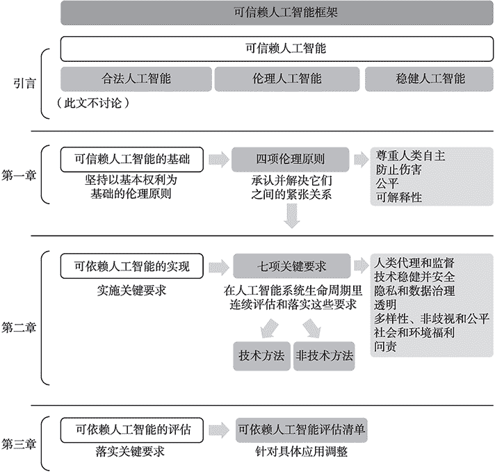

图 1 作为可信AI框架的指导原则

# Ⅰ.第一章：可信AI的根基

本章说明可信AI的根基，以基本人权为出发点，通过四项伦理准则体现，确保AI既有伦理性又有稳健性。内容大量借鉴伦理学。

AI伦理是应用伦理的一个分支，研究研发、部署和使用的伦理问题。核心关切是弄清AI如何影响或削弱个体美好生活，涵盖生活品质、民主社会所需的人类自主性与自由。

对AI的伦理思考可以有多种目的。其一，促使思考如何保护个人和群体最基本的需求。其二，激励以伦理价值观为导向的创新，例如助力联合国可持续发展目标的创新，这些目标已嵌入即将到来的欧盟2030议程。文件主要聚焦前者，但不应低估伦理在后者的价值。可信AI可通过繁荣、创造价值与财富最大化带来福祉，也可通过促进经济、社会、政治机会的公平分配，提升公民健康与福祉，有助于社会公平。

因此，需要弄清如何最好地支持AI的研发、部署和使用，让每个人都能在AI驱动的世界中蓬勃发展，同时保持全球竞争力。像任何强力技术一样，AI的使用也带来伦理挑战，如对人与社会、决策能力、安全性的冲击。若我们越来越依赖AI辅助甚至让AI做决定，就必须确保其影响公平，其行动符合不伤害的价值，并有相应的问责机制。

欧洲需要为嵌入AI的未来勾勒规范性愿景，并明确应研发、部署和使用何种AI以实现该愿景。通过引入可信AI概念，我们希望为此贡献力量。民主、法治和基本人权是支撑AI未来发展的基础，而不断完善的AI系统也将反过来守护民主文化，为创新和负责任的竞争力提供土壤。

针对特定领域的伦理规范，无论未来多完善，都不能替代伦理审视本身，后者必须对一般准则无法覆盖的环境细节保持敏感。除制定规则外，实现可信AI还要求通过公开辩论、教育和实践学习，培养符合伦理的文化与思维方式。

### 1. 作为道德和法律权利的基本人权

研究AI伦理的方法以《欧盟条约》《宪章》和国际人权法所载基本人权为基础。在民主与法治框架内，对基本人权的尊重为确定可用于AI背景的抽象伦理准则和价值提供了最坚实基础。

《欧盟条约》和《宪章》规定了成员国和欧盟机构在执行欧盟法时必须遵守的基本人权。这些权利在宪章中体现为尊严、自由、平等与团结、公民权利与司法。统一这些权利的共同基础是尊重人的尊严，体现出“以人为本”的视角，人类在文化、政治、经济和社会领域享有独特且不可剥夺的地位。

尽管宪章中的权利具有法律约束力，但基本人权并非在所有情境下都能获得全面法律保护。例如宪章的适用范围仅限于欧盟法有效之处。国际人权法，特别是《欧洲人权公约》对成员国具有法律约束力，包括超出欧盟法效力范围的领域。因此，基本人权可被理解为具有强制执行力的权利，属于可信AI第一部分合法性，用以保障法律遵守。若将基本人权视为每个人基于人类固有道德地位而享有的权利，它们也支撑着可信AI第二部分即伦理合规。伦理准则未必具有法律约束力，却对可信AI至关重要。本文件不对第一部分提供指导，而对第二部分展开说明。

### 2. 从基本人权到伦理准则

#### 2.1 作为可信AI基础的基本人权

在国际人权法、《欧盟条约》《宪章》中规定的不可分割权利中，以下基本人权尤其适用于AI系统。在特定情形下其中许多权利在欧盟可强制执行，遵守在法律上强制。但即便已满足可执行的权利，伦理反思仍可帮助理解AI研发、部署和使用中可能蕴含的基本人权及其价值，并在“技术能做什么”与“技术应如何使用”之间提供更细致的指引。

### 尊重人的尊严

人的尊严意味着每个人具有内在价值，永远不应被他人或像AI系统这样新技术削弱、妥协或压制。尊重尊严即承认所有人都是道德主体，而非仅是被筛选、分类、评分、驱赶或操纵的对象。因此AI系统应以维护人类身心完整性、个人与文化认同，以及满足基本需求的方式来研发。

### 个人的自由

人类应能自由为自己的人生做决定。这需要免受国家不当干预，同时需要政府与非政府组织干预以确保有被排斥风险者能平等受益于AI带来的利益。AI背景下，个人自由要求减轻不当胁迫、对精神自主与心理健康的威胁、不当监视、欺骗与不公平操纵。个人自由还包括商业经营自由、艺术创作与科学实验自由、言论自由、私人生活与隐私保护、集会结社自由等。

### 尊重民主、正义与法治

宪政民主国家的全部权力须由法律授权和限制。AI系统应有助于维系并推动民主进程，尊重多元价值与生活选择，不得破坏民主进程、人类审议或民主选举。AI的运行不得破坏法治的基础承诺、强制性法律与法规，并应确保正当程序与平等原则得到实现。

### 平等、非歧视和团结——包括面临被排斥风险的人的权利

必须平等尊重所有人的精神价值与尊严。这超越了非歧视，即在客观公正理由下对不同情形进行区分。AI背景下，平等意味着系统运行不能产生不公平且有偏见的结果，例如用于训练的数据应尽可能包容，代表不同群体。也需充分尊重潜在弱势群体，如工人、妇女、残障人士、少数民族、儿童、消费者和有被排斥风险者。

### 公民权利

公民享有选举权、获得良好行政管理的权利、查阅公共文件的权利以及向行政部门请愿的权利。AI有潜力提升政府提供公共产品与服务的规模与效率，同时也对公民权利构成负面影响，因此需妥善保护。本文所用“公民权利”并不否认或忽视第三国国民和无法律地位者在国际法和AI领域享有的权利。

#### 2.2 AI系统背景下的伦理准则

许多公私机构与民间组织受基本人权启发，为AI制定伦理框架。在欧盟，欧洲科学与新技术伦理小组基于《欧盟条约》和《欧盟基本权利宪章》提出九项基本原则。相关工作在此基础上识别并厘清了迄今提出的几乎所有原则，明确其培育和支持的目标。这些原则可激发具体监管措施，随着社会-技术环境演进而解释基本人权，并为AI的研发、部署和使用提供动态指导。

AI系统应改善个人与集体的福祉。以下四项以基本人权为基础的伦理准则必须被尊重，以确保AI研发、部署和使用以可信方式进行。这些原则是从业者始终应努力遵循的道德要求。四个原则无先后等级，其排列反映在《宪章》中所依据的基本人权出现顺序。

这些原则包括：（i）尊重人类自主性；（ii）避免造成伤害；（iii）公平性；（iv）可解释性。其中部分内容在现行法律要求中已有体现，属于可信AI第一部分合法性范畴。然而遵循伦理准则超出了遵守现存法律规范的范围。

### 尊重人类的自主性原则

作为欧盟基础的基本人权旨在确保尊重人类自由与自主性。人类与AI互动时必须能保持完整的自我判断，并能参与民主程序。AI系统不能无故使人类服从，不能胁迫、欺骗、操纵、处置或驱赶人类，而应补充并强化人类的认知、社会与文化技能。人机功能分配应遵循以人为中心的设计，并为人类提供有意义的选择空间，这意味着AI运行中需保持人类监督。AI有可能从根本改变工作环境，因此应支持人类工作，并致力于创造有意义成果。

### 避免造成伤害原则

AI系统不应造成伤害或加剧伤害，也不应对人类产生其他不利影响。人类的精神与身体完整性需受保护。AI及其运行环境必须安全可靠，技术上稳健，并能防止恶意使用。应特别关注易受伤害者，让其参与AI的研发、部署和使用。还需注意AI可能导致或加剧因权力或信息不对称而产生的不利影响，如雇主与雇员、企业与消费者、政府与公民之间。防止伤害也需将自然环境和其他生物纳入考量。

### 公平性原则

AI的研发、部署和使用必须是公平的。公平兼具实质与程序两个维度。实质公平意味着承诺以平等公正方式分配利益与成本，并使个人与群体免受不公平偏见、歧视与羞辱。若偏见可避免，AI甚至可提升社会公平。教育、商品、服务和技术方面的机会均等也应促进。此外，AI使用不应导致人们在自由选择时受欺骗或不合理损害。公平还意味着从业者应尊重手段与目的的比例原则，审慎平衡冲突利益与目标。程序公平意味着有能力质疑AI系统和操作者做出的决定，并寻求有效救济。为此，必须具备可负责的实体，同时决策过程应具可解释性。

### 可解释性原则

可解释性对建立和维护信任至关重要。它要求流程透明，AI的能力与目的可公开讨论，并能尽可能向受影响者解释系统决策。若缺乏这些信息，决策就无法被适当质疑。并非所有AI模型都能完全解释为何产生特定输出及输入如何促成结果。这种“黑箱”情况需特别留意。在此情形下，若系统整体尊重基本人权，可能需要其他可解释性措施，如可追溯性、可审计性和对系统能力的公开沟通。可解释性所需程度高度取决于AI使用的背景及后果严重性。

#### 2.3 上述原则之间的紧张关系

伦理原则之间并不总是能完美兼容，也没有一成不变的套路可以化解冲突。欧盟始终坚持民主式参与、正当程序以及政治过程公开透明，这要求我们在处理原则张力时采取审慎而负责任的审议姿态。现实里，比如事前阻断伤害与维护个人自主常常拉扯。以预测性警务为例，用 AI 降低犯罪率是有可能的，但背后需要大规模的监控，会侵蚀个人自由和隐私边界。整体来看，AI 带来的社会收益应当远大于可预期的个体风险。原则只能指向方向，本质仍是抽象的道德准则，无法直接给出标准答案。实践者不能靠直觉或随机判断来裁决困境，而应以理性和证据为依托来权衡取舍。

不过有一种权衡是伦理上不可接受的。人格尊严等基本人权及其衍生底线属于不可谈判的范畴。

第一章的核心提示：

研发、部署和应用 AI 时必须坚守尊重个体自主、预防伤害、公平对待和可解释性等伦理底线，同时正视原则间的矛盾并妥善调和。

需要格外关注脆弱群体，如儿童、残障人士、历史上处于劣势或易被边缘化的人群，以及雇主-员工、企业-消费者这类存在权力或信息不对等的关系。[^\[35\](#chapter011.html#m35)]

要承认 AI 既能创造实质价值，也会产生难以预判、难以量化或难以识别的负面效应，比如对民主运行、法治秩序、分配正义的冲击，乃至对人类思维方式的改变。风险缓释要及时，且力度与风险程度匹配。

# Ⅱ.第二章：让 AI 可信赖的七大实践要求

本章在前述伦理原则上，罗列了落地可信赖 AI 必须满足的七项要求，并给出贯穿全生命周期的技术与非技术手段。

### 1.可信赖人工智能系统的要求

第一章的原则需要转化为可执行规范，这些规范适用于参与 AI 生命周期的不同角色：研究设计者、引入方、使用者，以及更广的社会公众。研究设计者负责研究、设计与开发；引入方指在业务中采用并向他人提供产品服务的公私机构；使用者为直接或间接与之互动的人；公众则包括受影响的其他群体。

各方职责不同：

a. 研究设计者应把需求落到设计开发流程；

b. 引入方应确保所用方案及交付的产品服务符合要求；

c. 使用者与公众应理解这些要求并能据此行动。

此清单非穷尽[^\[36\](#chapter011.html#m36)]，涵盖技术、个体与社会层面。

## 七个要求概述

### ① 人的能动性与人类监督

包含基本权利保障、个体自主与人在回路的监督。

### ② 技术的稳健性与安全性

包含抵御攻击与安全恢复、应急预案与整体安全、准确性、可靠性与可复现性。

### ③ 隐私与数据管理

包含隐私尊重、数据质量与完整性、数据访问控制。

### ④ 透明性

包含可追溯、可解释与可沟通。

### ⑤ 多样性、非歧视性和公平性

包含规避不公偏见、可及性与通用设计、利益相关方参与。

### ⑥ 社会与环境福祉

包含可持续与环境友好、社会影响、民主与社会。

### ⑦ 问责制

包含可审计、负面影响最小化与披露、权衡与补救。

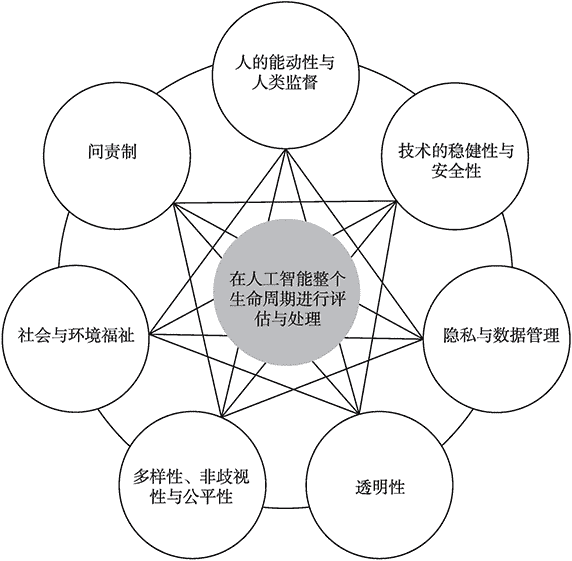

### 图 2 七个要求的相互关系

说明：各要求同等重要、相互支撑，需在 AI 全生命周期中实施并持续评估。

各要求虽同等重要，但在不同行业场景落地时需考虑语境与潜在冲突。落地应贯穿全生命周期并依托具体应用。多数要求适用于各类方案，但对直接或间接影响个体的场景需特别审慎，故在工业等低接触场景关联度可能较低。

上述要求部分已在现行法律中体现。我们重申，依据可信赖 AI 的首要构成，从业者有义务遵守法律义务，无论是横向规则还是特定领域法规。

以下分述各要求。

## 1.1 人的能动性与人为监督

AI 应当依尊重自主的原则来支持人的自主决策。通过强化使用者能动性、促进基本权利实现并保留人类监督，成为民主、繁荣、公平社会的助推器。

### 基本权利

AI 既可助益也可妨碍基本权利。它可帮助追踪个人数据、提升教育可及，支持受教育权。但因其规模与能力，也会产生负面影响。存在风险时，应在研发完成前评估其对基本权利的影响，判断风险能否在民主社会中被降低或经合理说明予以接受。同时应建立外部反馈渠道，接收关于可能侵害基本权利的举报。

### 人的能动性

使用者应能基于充分信息做出自主判断。需提供理解方案并与其满意交互的知识与方式，并在可行时允许自我评估或质询。方案应帮助个体依据自身目标做出更好选择。AI 有时会以不易察觉的方式塑造行为，利用潜意识机制，包括不公平操纵、欺骗、集中影响与条件反射，均威胁自主性。用户自治应是功能核心。当自动处理产生法律后果或类似重大影响时，用户有权不被完全自动决策束缚。[^\[37\](#chapter011.html#m37)]

### 人为监督

人类监督有助于防止方案破坏自主或引发其他不利后果。监督可通过治理机制实现，如 HIT、HOTL、HIC。HIT 指在每个决策周期内人工介入的能力，在多数场景不可行也不必要。HOTL 指在设计周期内通过人工干预监控运行。HIC 指对方案整体活动及其经济、社会、法律、伦理影响进行监督并决定何时何地使用的能力。这包括决定在特定情境下不使用、在使用时设定人类裁量空间，或推翻方案决策。此外需确保公共执法人员能按职责对方案进行监督。根据应用领域与潜在风险，需配置不同强度的监督机制。在其他条件一致时，人类监督越少，就越需要更广泛的测试与更严格的治理。

## 1.2 技术的稳健性与安全性

技术稳健性是可信赖 AI 的关键，与预防伤害原则紧密相关。稳健性要求对风险采取预防性做法，可靠运行，减少无意与意外伤害，并杜绝不可接受伤害。这同样适用于运行环境变化或可能以对抗方式交互的因素。此外，人类身心健康应得到保障。

### 对攻击和安全性的应变能力

与所有软件一样，AI 也需防范对手利用漏洞的攻击，如黑客。攻击可能针对数据、模型或底层软硬件。若受攻，数据与行为会改变，导致决策偏差或停摆。方案与数据也可能因恶意行为或意外受损。安保不足还可能导致错误决策甚至物理伤害。为确保安全[^\[38\](#chapter011.html#m38)]，必须考虑方案可能出现的意外用途如双重用途，以及恶意使用者滥用风险，并采取预防与缓解措施。[^\[39\](#chapter011.html#m39)]

### 后备计划和整体安全

方案应配备安全措施以在出问题时启用备用方案。这可能意味着从统计程序切换到规则程序，或在人工接管前暂停运行。[^\[40\](#chapter011.html#m40)]必须确保方案在不损害生物或环境前提下完成预期任务，最大限度避免意外后果与错误。还应建立流程来澄清与评估不同应用领域使用方案的潜在风险。安全水平取决于风险大小，而风险取决于功能。若研发过程或方案本身存在高度风险，则需重点开发与测试安全措施。

### 准确性

准确性指方案做出正确判断的能力，例如正确分类信息或基于数据做出可靠预测、建议或决策。清晰完善的研发与评估流程可证实、缓解并纠正不准确预测带来的风险。当偶发误差不可避免时，方案应能标明错误可能性大小。在方案直接影响人类生活时，高准确度尤为重要。

### 可靠性和可再现性

成果的可靠性与可再现性至关重要。可靠方案能在各种输入与情境下正常工作，这是审查方案与防止意外伤害的必要条件。可再现性指在相同条件下重复实验时行为是否一致，使科研人员与决策者能准确描述方案功能。重复文档[^\[41\](#chapter011.html#m41)]有助于测试与行为再现。

## 1.3 隐私与数据管理

隐私与预防伤害原则密切相关，是受影响极大的基本权利。保护隐私需要恰当的数据管理，包括数据质量与完整性，这与应用领域、访问协议及以隐私保护方式处理数据的能力相关。

### 隐私和数据保护

方案必须在全生命周期中保障隐私与数据保护。[^\[42\](#chapter011.html#m42)]这包括用户最初提供的信息，以及交互过程中产生的关于用户的信息，如方案生成的输出或用户对建议的响应。人类行为的数字化记录不仅能推断偏好，还能推断性取向、年龄、性别、宗教或政治观点。为让个体信任数据收集，必须确保与其相关的数据不会被非法或不公平地用于歧视。

### 数据的质量和完整性

数据质量直接决定方案性能。收集数据可能带有社会形成的偏见，也可能不准确或错误，这些问题需在训练前解决。还必须保证数据完整性。将恶意数据输入方案可能改变其行为，尤其在自学习方案中。因此需在规划、训练、测试与部署每个环节记录与测试所用流程与数据集。这同样适用于非自主研发方案。

### 数据的访问

任何处理个人数据的机构都应制定数据访问协议，明确谁可以在何种情况下访问数据。只有有权且确需查阅个人数据的适格人员才可获许可。

## 1.4 透明性

透明性与可解释性原则相关，涉及数据、方案与商业模式的公开性。

### 可追溯性

数据收集与决策形成流程，包括收集、标注与算法使用，应以高标准记录以实现可追溯与透明。这同样适用于方案做出的决策。可追溯性有助于明确错误原因并预防未来错误，也支撑可审计性与可解释性。

### 可解释性

可解释性指解释技术流程与相关人类决策例如应用领域的能力。技术可解释性要求方案决策能被人类理解与追溯。可能需要在增强可解释性与提升准确性之间权衡。可解释性或许降低精度，而高精度可能以可解释性为代价。当方案对生活产生重大影响时，应能提供合理解释。解释应及时并适配利益相关者的专业水平，如普通公众、监管者或研究者。此外，应说明方案在多大程度上影响机构决策过程、设计选择与使用理由，以确保商业模式透明。

### 沟通

方案不应自称人类；使用者有权知道自己在与方案交互，这要求方案可被识别。此外，为保障基本权利，应在必要时提供退出交互的选项。除此之外，方案的功能与局限应以一致方式传达给从业者或终端用户，包括沟通的准确度及其限制。

## 1.5 多样性、非歧视性和公平性

可信赖 AI 要求在全生命周期中实现包容与多样性。除了让受影响的利益相关者参与流程外，还需通过包容性设计与平等对待确保各方均能公平使用。这与公平原则密切相关。

### 避免不公平的偏见

用于训练与运行的数据集可能受历史偏差、不完整性与不良建模影响。这种影响会延续，导致对某些群体产生无意直接偏见与歧视[^\[43\](#chapter011.html#m43)]，进而加深偏见与边缘化。故意利用消费者偏见或参与不公平竞争也可能造成损害，如恶意串谋或使市场价格同质化[^\[44\](#chapter011.html#m44)]。应在收集阶段尽可能消除可识别的歧视性偏见。研发方式如算法编程也可能受不公平偏见影响，可通过设立监督程序、清晰透明地分析目的、局限、要求与决定来消除。此外，鼓励聘用来自不同背景、文化与学科的人，以确保观点多样。

### 可访问性和通用设计

尤其在企业与消费者关系中，方案应以用户为中心，允许不同年龄、性别、能力或特征的人使用产品服务。特别要保证残障人士可及。方案不应采取一刀切做法，而应依据相关可访问性标准[^\[45\](#chapter011.html#m45)]采用通用设计原则[^\[46\](#chapter011.html#m46)]，使所有人能公平参与计算机介导的人类活动及其辅助技术。[^\[47\](#chapter011.html#m47)]

### 利益相关者的参与

建议在研发可信赖方案时咨询可能直接或间接受影响的利益相关者。应用后定期征求反馈并建立长期参与机制也有益，例如组织应确保员工在实施方案的全过程中知情、咨询与参与。

## 1.6 社会与环境福祉

依据公平性与避免伤害原则，更广的社会、其他生命体与环境也应被视为全生命周期的利益相关者。应鼓励方案可持续性与生态责任，并推动针对全球关切领域如可持续发展目标的解决方案。理想情况下，方案应造福全人类包括后代。

### 可持续和环境友好型人工智能

方案应以最环保方式帮助解决紧迫社会问题。研发、部署与使用过程及整个供应链都应评估，例如严格审视训练期间的资源使用与能源消耗，选择危害更小的方案。应鼓励确保整个供应链的环境友好性。

### 社会影响

在教育、工作、护理与娱乐等诸多领域，无处不在的社交类 AI[^\[48\](#chapter011.html#m48)]可能改变我们对社会代理关系的认知，或影响社会关系与情感。方案可提升社交技能，也可能导致社交技能退化，并影响身心健康。因此必须仔细监测与考虑此类方案的影响。

### 社会和民主

除评估对个人的影响外，还应从社会角度考虑其对机构、民主与整体社会的影响。应特别在与民主进程相关的背景下审慎使用方案，不仅涉及政治决策，也包括选举情境。

## 1.7 问责制

问责制是对前述要求的补充，与公平性原则密切相关。必须建立研发、部署与使用前后方案的责任与问责机制。

### 可审计性

可审计性要求能够评估算法、数据与设计过程，这并不必然意味着商业模式与知识产权信息必须始终公开。内部与外部审计及评估报告的可用性有助于提升技术可信度。方案应能独立审计影响基本权利的应用，包括对安全性要求苛刻的场景。

### 负面影响的最小化和报告

必须确保能够追溯对结果有贡献的行动或决定，并能对后果做出反应。识别、评估、记录与最小化潜在负面影响对受影响者尤为重要。举报人、非政府组织、工会或其他实体在报告合理担忧时应得到保护。在研发、部署与使用方案之前与期间进行影响评估，如建立红队或算法影响评估，有助于最小化负面影响。此类评估必须与风险相称。

### 权衡

在落地可信赖 AI 的要求时，不同价值诉求很容易产生张力，形成必须做取舍的情境。取舍应以现有技术条件为边界，用理性且可操作的方式进行。这要求先厘清 AI 系统牵涉到的利益与价值，冲突出现时要正视并评估其对伦理规范尤其是基本权利可能造成的风险。任何研发、部署或使用行为，都不应在伦理可接受性不明确的情况下推进。每一次权衡的结论都要有合理依据并留痕。决策者对权衡方式承担责任，需持续复核决策是否仍然恰当，必要时回溯调整系统。[^(\[50\])](#chapter011.html#m50)

### 补救机制
当系统产生不公平的负面影响时，必须配备可执行的救济安排。用户是否清楚补救渠道的存在，是信任能否建立的关键。弱势群体应获得特别的关照。[^(\[51\])](#chapter011.html#m51)

## 2. 让 AI 可信赖的技术与非技术路径
落实上述要求，可同时动用技术手段与非技术手段。两种手段覆盖 AI 系统全生命周期，需要持续评估有效性，并公开披露实施过程中的变化。AI 在动态环境中不断演化，可信赖的实现也必须是持续进行的，如图 3 所示。

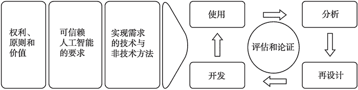

图 3 在系统全生命周期实现可信赖人工智能

下述做法可相互补充也可单独使用，具体取决于要求差异与敏感度。此清单并非穷尽也不具强制性，仅作参考。

### 2.1 技术手段
本节介绍在设计、研发与使用阶段保障可信赖 AI 的技术思路。所列方法的成熟度不一。[^(\[53\])](#chapter011.html#m53)

#### 可信赖架构
可信赖的需求应转化为程序或对程序的约束，并在系统结构中固化。可通过白名单规则锁定系统必须始终遵守的行为或状态，用黑名单限制永远不可触碰的状态，再辅以可证明的行为保证组合。运行期间可由独立监督程序检查合规性。

从感知-计划-行为的视角看，具有学习能力并能动态调整的 AI 存在非确定性风险。为保障可信赖，需在三个环节嵌入控制：i 意义阶段，研发要让系统识别满足合规所需的所有环境要素；ii 计划阶段，系统仅能考虑合规方案；iii 行为阶段，行为仅限于实现要求的动作。

该架构具有通用性，并不完美，但为限制 AI 与制定策略提供了锚点。限制与策略需落实到具体模块，形成整体可感知的可信系统。

#### X-by-Design 设计即合规
此方法以法律或社会规范允许的方式，把价值转化为系统必须遵守的抽象原则，并与具体决策执行建立明确联系。核心是将合规思想贯穿设计。企业有责任在起点就评估系统可能造成的影响及应遵循的规范，以避免负面后果。

多种设计理念已被广泛使用，如隐私设计、安全设计。为赢得信任，AI 需保障程序、数据与产出的安全，并抵御敌对数据与攻击。应具备自动防故障关停，并在强制关停后如攻击后能够恢复运行。

## 可解释性
可信赖系统必须能说明其为何如此运行、为何给出特定解释。XAI 研究领域试图解决此问题，帮助理解运行机制并找到对策。面向神经网络，这仍是难题。训练过程可能使参数数值难以与结果对应，且微小数值变化可能导致解释剧变，甚至把校车误判为鸵鸟。包含 XAI 的方法对向用户解释行为与部署可靠技术都至关重要。

## 测试与验证
因 AI 的不确定性与场景依赖性，传统测试方法不足。系统概念与描述方法的缺陷可能仅在真实数据上显现。因此需在训练与部署期间持续监测基础模型，确保其稳定、稳健，并在可理解、可预测范围内运行。要保证计划输出与输入一致，且决策过程可被验证。

测试验证应尽早启动，覆盖全生命周期尤其是部署后。要包含数据、预训练模型、环境及整体行为。测试应由尽可能多的人参与设计与执行。应研发不同尺度的标准以覆盖多视角测试。可考虑由可信赖且多元的红队进行对抗测试，故意破坏以发现漏洞，并可设立漏洞赏金鼓励外部负责任报告。最后需确保输出或行为与前期策略一致，不违背既定规范。

## 服务质量指标
可为 AI 系统设定服务质量指标，以把握测试与研发是否兼顾安全因素。这些指标可包括算法测试与训练的度量，以及传统软件的功能、性能、可用性、可靠性、安全性和可维护性。

### 2.2 非技术手段
本节介绍在落实与维系可信赖 AI 中发挥重要作用的非技术做法，也需持续评估。

### 法规监管
目前已有支撑 AI 可信度的规定，如安全立法、责任框架等。在一定程度上法规可能需修订、调整或引入保障性监管措施，具体建议将在《人工智能政策和投资建议》中提出。

### 行内准则
各机构和利益相关方可签署本准则并调整企业责任、关键绩效指标、行为准则或内部政策文件的章程，为可信赖 AI 努力。一般而言，使用 AI 的组织可记录其意图，并以基本权利、透明度、避免伤害等价值标准加以承诺。

### 标准化
标准可在设计、制造和商业实践中作为质量管理体系，帮助用户、消费者、组织、研究机构和政府通过采购行为识别并鼓励合规伦理行为。除传统标准外，还存在共同监管方法：认证体系、职业道德规范、符合基本权利的设计标准。目前如 ISO 标准、IEEE P7000 系列，未来“可信赖人工智能”标签可能更合适，通过引用特定技术标准来确认系统符合安全性、技术稳健性和透明性。

### 第三方认证
由于无人能完全理解 AI 的工作原理与成效，组织可向公众证明系统具备透明性、可审计性和公平性[^(\[54\])](#chapter011.html#m54)。认证有助于为不同应用和技术制定标准，并与不同背景的工业和社会标准相适应。但认证不能替代问责制，需以问责框架补充，包括免责声明、审查机制和补救机制。[^(\[55\])](#chapter011.html#m55)

### 问责制治理框架
组织应建立内部外部治理框架，落实研发、部署和使用决策的伦理问责。例如可任命 AI 伦理负责人、设立内部或外部伦理小组或委员会。该主体可监督问题并在全程提供建议。如前所述，认证规范和机构也可发挥作用。应保持与行业或公众监督小组的沟通渠道畅通，分享最佳做法、讨论困境、报告新出现的伦理问题。该机制可补充但不能替代法律监督，如数据保护法下任命数据保护官等措施。

### 教育与意识培育
可信赖 AI 鼓励所有利益相关者的知情参与。沟通、教育和培训至关重要，既传播系统潜在影响的知识，也提高公众参与社会塑造的意识。对象包括产品制造者、使用者以及被决策影响但不使用系统的人和社会整体。全社会需要基本 AI 素养，前提是伦理学界具备相应技能与训练。

### 社会对话与参与
AI 带来诸多益处，欧洲需确保人人受益。这需要社会伙伴、利益相关方和社会公众的公开讨论与参与。许多组织已依靠利益相关者小组讨论 AI 使用与数据分析。成员来自法律、技术、伦理、消费者代表和工人等领域。积极寻求参与和对话，有助于在复杂情境下评估结果和方法。

### 多元包容团队
研发投入现实世界的 AI 系统时，多样性和包容性至关重要。随着 AI 承担更多任务，设计、研发、测试和维护团队必须反映用户和社会的多样性，以增强对不同观点、需求和目标的客观性。理想团队应在性别、文化、年龄等方面差异，并在专业背景和技能上多元。

## 第二章核心要点
确保 AI 系统全生命周期满足七项关键要求：1 人类能动性与人为监督；2 技术稳健性与安全性；3 隐私与数据治理；4 透明性；5 多样性、非歧视与公平；6 社会与环境福祉；7 问责制。

考虑技术与非技术方法以落实上述要求。推动研究与创新，评估 AI 系统并进一步实现要求；向公众传播成果与开放问题，系统培养新一代 AI 伦理专家。

以主动、准确的方式向利益相关者传达系统能力与局限，使其形成现实预期，并公开说明系统如何实现上述要求。保持透明，明确处理的即是 AI。

推动系统可追溯性和可审计性，尤其在关键场景。让利益相关者参与系统全生命周期。加强培训教育，使各方接受可信赖 AI 训练。

须注意不同原则和要求间可能存在根本冲突。要持续识别、评估、记录和沟通权衡及其解决方案。

## 第三章 可信赖 AI 评估实践
依据第二章关键要求，本章列出非详尽的可信赖 AI 评估清单试行版，适用于与用户直接交互的 AI 系统，面向研发者和部署者。该清单未涉及合法 AI 组成部分。遵守清单不能证明合法性，也不能确保合规。使用需按具体用例和运行环境定制。本章也提供通过运营与管理层级治理结构实现评估清单的一般建议。

评估清单和治理结构将在与公共私营部门利益相关者密切合作下制定，作为试点并接受两类反馈：a 定性过程：少量公司、组织和机构在实践中试用并提供深度反馈；b 定量过程：所有感兴趣方可注册并对公开咨询反馈。试点后将整合反馈，于 2020 年初发布修订版，形成横向框架，未来可发展为区域或专用框架。

### 治理嵌入
利益相关者需考虑如何在组织内应用评估清单。可纳入现有治理机制或建立新流程，选择取决于内部结构、规模和资源。

研究表明最高管理层的关注对变革至关重要，让所有利益相关者参与也提升流程接受度和相关性。[^(\[56\])](#chapter011.html#m56)[^(\[57\])](#chapter011.html#m57)因此建议建立兼顾操作层和最高管理层的双层流程。

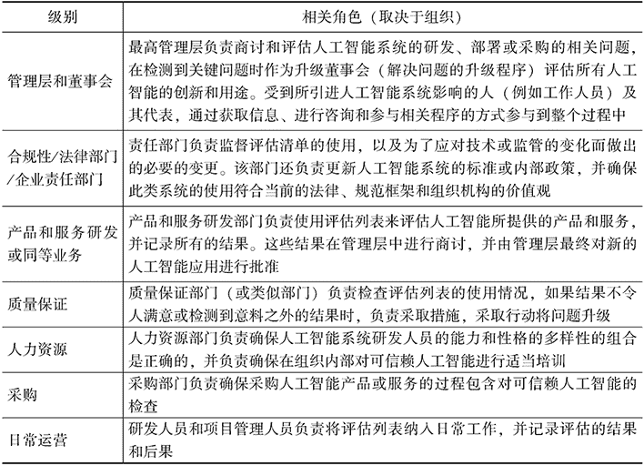

### 评估清单使用建议
实践中使用时，建议关注可解决的领域，也关注难以解决的问题。潜在问题可能是研发测试团队缺乏技术与能力多样性，需引入组织内外其他利益相关者。强烈建议以技术语言和管理语言记录所有结果，确保治理层能理解。

清单旨在指导从业者实现可信赖 AI。评估应按比例适配具体用例。试点阶段可能发现敏感区域，下一阶段需评估是否需进一步规范。清单不提供具体答案，但鼓励思考如何实施及可行步骤。

### 与既有法律的关系
从业者必须认识到现行法律规定特定流程或禁止特定结果，可能与清单措施重合。例如数据保护法规定个人数据收集处理的法律要求。可信赖 AI 还要求数据合乎伦理处理，旨在合规的内部程序和政策也可能促进合乎伦理处理。但遵守清单不能证明合法性，也不能作为合规指南。

许多从业者已拥有现有评估工具和研发流程以确保非法律标准合规。以下评估不必单独执行，可纳入现有实践。

## 试行评估清单

### 1. 人机主导与监督

#### 基本权利
·是否对可能冲击基本权利的场景开展基本权利影响评估？是否已识别并记录各原则权利间的潜在权衡？
·系统是否会与终端用户在决策层面互动，如给出建议或提供选项？
·系统是否可能在用户未察觉时干预其决策，影响自主？
·是否考虑过向用户明确告知相关决策、内容或建议系算法结果？
·若为对话系统，用户是否清楚正与 AI 交互？

#### 人类能动性
·系统是否用于工作和劳动场景？若是，是否规划了人机分工，确保有意义互动及适当的人为监督与控制？
·系统是否提升或增强人类能力？
·是否设置防范过度信任或过度依赖的保障措施？

#### 人工监督
·是否考虑过针对特定系统和用例采取适当程度的人为控制？
·能描述人为控制或参与的程度吗？
·谁是人类控制者，干预的时机或工具是什么？
·是否制定确保人为控制或监督的机制与措施？
·是否采取措施以便审计并纠正 AI 自主性相关问题？
·是否存在自学习或自主型系统或用例？若有，是否实施更具体的控制与监督机制？
·当可能出错时，建立了哪些检测与响应机制？
·是否设置停止按钮或程序以便安全中止操作？是完全中止、部分中止还是转交人类控制？

### 2. 技术稳健与安全

#### 抗攻击与韧性
·是否评估过使系统易受攻击的可能形式？
·是否考虑过不同类型和性质的漏洞，如数据污染、物理基础设施、网络攻击？
·是否已采取措施或应用系统确保完整性并抵御潜在攻击？
·是否验证系统在意外情况和环境中的表现？
·系统是否可同时被大量使用？若是，是否针对此情况采取预防措施，包括不发布研究或部署？

#### 应急与总体安全
·遇到对抗性攻击或其他意外情况时，是否确保有足够后备计划，如技术切换或需人工干预后继续运行？
·是否评估过该用例下系统引发的风险等级？
·是否制定流程衡量和评估风险与安全？
·是否提供必要信息以防威胁人类身体完整性？
·是否考虑通过保险政策处理系统可能造成的损害？
·是否发现可预见的其他技术使用安全风险，包括意外或恶意滥用？是否有减轻或管理计划？
·是否评估系统可能对用户或第三方造成损害或伤害？是否评估了可能性、潜在损害、受众和严重程度？
·是否考虑过责任和消费者保护规则？
·是否考虑过对环境或动物的潜在影响或安全风险？
·风险分析是否包含安全或网络问题，如 AI 无意行为导致网络安全受损？
·是否估计过系统提供错误、不可用结果或社会不可接受结果如歧视时可能带来的影响？
·是否定义阈值并制定管控程序以触发替代或后备计划？
·后备计划是否已定义并测试？

#### 准确性
·是否在系统和用例情境中评估并定义准确性程度？
·是否评估如何衡量和确保准确性？
·是否采取措施确保所用数据全面且最新？
·是否制定适当措施评估是否需要额外数据，如提升准确性或消除偏差？

可信赖AI 落地自查清单

把可信赖的要求拆解成可操作的核查点，覆盖从研发到运用的完整链路，帮助团队保持一致性。

模型精度与风险承受边界
- 将模型给出失准预测时可能带来的现实伤害厘清到底
- 通过多元手段检验系统是否会出现不可接受的误判频率
- 构建持续优化的组合机制，让正确率保持上升趋势

可靠性与可重复性核查
- 建立常态化监控与测试，确保系统始终贴合最初设定的目标与使用场景
- 在特殊情境或边界条件下检视可复现性是否依然成立
- 借助量化验证方法，衡量稳定性和可重复性的不同维度
- 预先描述失效情形，说明在何种部署环境下会失灵
- 对上述说明做规范化记录，并真正用于测试验证环节
- 设计沟通机制，让终端使用者能够感知系统的可靠状态

### 3. 隐私与数据治理

隐私遵循
- 是否为外部协作提供反馈入口，让其在采集、训练与运行阶段指出隐私或数据保护风险
- 数据集内具体包含哪些信息类型，是否涉及数据主体信息
- 研发与训练时能否尽可能降低对敏感或主体信息的依赖
- 按使用场景建立告知与控制方式，保证主体能实际行使同意及撤回同意
- 借助加密、去标识化、信息聚合等手段强化隐私保护
- 若设有数据保护官，应在项目早期即纳入决策

数据质量管控
- 与 ISO、IEEE 等相关规范或业界通行的数管共识保持对齐
- 建立贯穿采集、存储、处理与使用全流程的监督机制
- 评估对外部数据源质量的把控程度是否充足
- 建立保障质量与完整性的流程，并考虑备选方案，如何确认数据集未被篡改或入侵

数据访问权限
- 明确遵循哪些协议、流程与程序以确保数据管理规范
- 评估哪些角色在何种条件下可接触用户数据
- 确保接触数据的角色具备资质并受数据保护细则约束
- 建立审计机制记录访问的时间、地点、方式、人员与目的

## 4. 透明性原则

可追溯性
- 采取措施保证全链路可追溯，通常需记录方法
- 算法系统的设计研发方法：规则类系统的编程思路或模型构建方式；学习类系统的训练方法，包括采集了哪些数据、输入了什么、为何如此
- 算法系统的测试验证方法：规则类使用的测试场景或案例；学习类测试验证所用数据的说明
- 算法系统的结果：输出或决策，以及在不同用户子群或其他情境下可能产生的差异决策

决策可读性
- 系统的决策与结果能被理解的程度如何
- 系统决策对组织自身决策流程的影响程度
- 为何把该系统部署在此特定区域
- 系统的商业模式是什么，如何为组织创造价值
- 能否解释清楚系统为何会给出所有用户都能理解的结果

### 系统能否被读懂
- 设计之初是否已考虑可解释性
- 对存疑的应用是否尝试选择更简单、解释性更强的模型
- 能否分析训练与测试数据，能否随时间推移修改更新
- 训练研发后是否仍可检查可解释性或访问内部运行

### 怎么跟用户说清楚
- 通过免责声明或其他方式明确告知终端用户其面对的是 AI 而非真人，并做好清晰标识
- 建立机制向终端用户说明结果背后的原因与判定标准
- 用目标受众能懂的方式传达信息
- 建立流程收集用户反馈并据此调整系统
- 传达潜在或可感知的风险，如偏见
- 根据用例考虑对其他受众、第三方或公众的沟通透明度
- 说明系统的用途，以及谁会从产品服务中受益
- 为产品设定使用边界并清晰传达，确保目标用户理解且适用
- 根据用例考虑人类心理局限，如混淆、确认偏误或认知疲劳风险
- 清晰传达系统的能力、局限与潜在缺陷
- 研发阶段要向可能把系统集成到产品服务的人说明
- 部署阶段要向终端用户或消费者说明

## 5. 多样性、非歧视与公平

避免不公平偏见
- 制定策略或流程，防止系统在输入数据或算法设计上产生或强化不公偏见
- 评估并承认所用数据集构成带来的局限
- 考虑数据中用户群体的多样性与代表性，针对特定人群或高风险用例做测试
- 研究并使用可用工具提升对数据、模型与性能的理解
- 在研发、部署与使用各阶段安排检测与监测潜在偏见的程序
- 根据用例提供渠道让他人标记偏见、歧视或糟糕性能问题
- 建立明确的沟通步骤说明问题该怎么提、提给谁
- 除了终端用户，还要考虑系统间接影响的其他群体
- 评估相同条件下决策是否存在波动，探究原因
- 波动存在时建立衡量或评估其对基本权利潜在影响的机制
- 设计时采用恰当且明确的公平定义，选择前对比其他定义
- 用定量分析与指标衡量和测试公平定义的应用
- 建立保障系统公平的机制，并思考其他可选机制

可访问与通用设计
- 确保系统能适配不同偏好与能力
- 评估特殊需求人群、残障人士或有被排除风险的人能否使用，设计如何融入系统，如何验证
- 辅助技术用户能否获取关于系统所需的信息
- 研发阶段让社区参与或征询社区意见
- 考虑系统对潜在用户的实际影响
- 构建系统的团队是否代表目标用户，是否也代表更广泛的受影响人群
- 评估有人或群体可能不成比例地承受负面影响
- 从不同背景与经历的团队或群体获取反馈

利益相关者参与
- 考虑让不同利益相关者参与系统研发与使用的机制
- 在组织内部引入 AI 时，提前通知受影响员工及其代表并让他们参与

## 6. 社会与环境福祉

可持续环保的 AI
- 建立机制衡量研发、部署与运行如数据中心能耗对环境的影响
- 采取措施减少系统全生命周期的环境冲击

社会影响
- 若系统直接与人交互，评估它会不会让人对系统产生依恋与同情
- 明确告知其社交互动是模拟的，系统没有理解与感受能力
- 让公众充分了解社会影响，例如评估劳动力失业或技能退化风险并采取缓解措施

社会与民主
- 评估系统在终端用户之外，对可能间接受影响的利益相关者的更广泛社会影响

## 7. 问责制

可审计性
- 建立机制促进系统可审计，保证可追溯性并记录过程与结果
- 在涉及基本权利或安全关键的应用中，确保系统能接受独立审计

负面影响最小化与报告
- 完成风险或影响评估，涵盖直接与间接受影响的不同利益相关者
- 提供培训与教育完善问责实践，明确哪些岗位或部门参与，是否超出研发阶段
- 培训是否覆盖适用于 AI 的潜在法律框架
- 考虑建立 AI 伦理审查委员会或类似机制讨论问责与伦理的灰色地带
- 除内部举措外，预见外部指导或执行审计程序监督合规与问责
- 制定程序让第三方如供应商、消费者、分销商或工人报告漏洞、风险或偏差

记录权衡
- 建立机制识别系统涉及的相关利益与价值及其间的权衡
- 权衡决策的形成过程是否被记录

补救能力
- 建立适当机制，在造成伤害或不利影响时进行补救
- 建立机制向最终用户或第三方说明补救措施的信息

我们邀请所有利益相关方在实践中试用这份评估清单，并就其可操作性、完整性、在特定 AI 应用或领域的相关性，以及与现有合规或评估程序的重叠或互补之处提供反馈。基于反馈意见，我们将在 2020 年初向欧盟委员会提交可信赖人工智能评估清单的修订版。

## 第三章关键指导
在研发、部署或使用 AI 系统时采用可信赖人工智能评估清单，并根据具体用例进行适配。

请记住，这份清单永远不是穷尽的。实现可信赖 AI 不是在勾选框里打勾，而是贯穿 AI 系统全生命周期的持续确认要求、评估方案、改进结果，并让利益相关者参与其中的一系列过程。

## C. AI 带来的机遇和挑战
下一节将给出一些应鼓励 AI 研发与使用的例子，以及在哪些情况下 AI 研发、部署或使用可能违背我们的价值观并引发特别关注。我们必须在 AI 应该做什么和能做什么之间取得平衡，并注意不该让 AI 做什么。

### 1. 可信赖 AI 带来的机遇示例
可信赖 AI 能提供支持应对人口老龄化、社会不平等加剧与环境污染等紧迫挑战的巨大机会，其潜力也与联合国可持续发展目标相契合。以下说明欧洲 AI 战略如何鼓励采用来解决这些挑战。

#### 气候行动与可持续的基础设施
应对气候变化应是全球政策首要任务，数字化转型与可信赖 AI 在降低人类对环境影响、有效利用能源与自然资源方面潜力巨大。例如，AI 可与大数据结合，更精准预测能源需求，加强能源基础设施，提升能效。

在智能交通、公共交通等领域，AI 可减少排队、优化路线、助力视障人士独立出行、优化节能引擎，从而推动脱碳、减少环境影响，打造更环保社会。目前全球每 23 秒便有车祸致命。AI 系统可显著降低死亡率，例如通过延长反应时间与更好遵守规则。

#### 健康和幸福
可信赖 AI 技术已被用于使治疗更智能、更有针对性，并帮助预防致命疾病。医生可在病人发病前对复杂健康数据进行更精准分析，提供个性化预防方案。在欧洲人口老龄化背景下，AI 与机器人可帮助护理人员、支持老年人护理、实时监测患者状况从而挽救生命。

在更大范围内，AI 可调查并识别医疗保健与治疗领域的整体趋势，更早发现疾病、更高效研发药物、更有针对性地治疗，最终挽救更多生命。

#### 素质教育与数字化转型
技术、经济与环境的新变化要求社会更主动应对。政府、行业领袖、教育机构与工会有责任让公民进入数字时代，确保他们具备未来就业所需的技能。可信赖 AI 可帮助更精准预测哪些工作与职业将被技术冲击，哪些新角色将被创造，需要哪些技能。这有助于政府、工会与产业规划工人再培训，也可为担心被裁员的公民提供转型路径。

此外，AI 可成为对抗教育不平等的强力工具，创建个性化与适应性教育项目，让每个人按自身学习能力获得新资质、技能与能力。它可提升从小学到大学的学习速度与教育质量。

### 2. AI 引发的关键问题示例
AI 引发的一个关键问题是可信赖 AI 的某个组成部分受到侵犯。以下列出许多问题已在现有法律要求范围内，这些要求具有强制性必须遵守。即使已证明符合法律，也可能无法完全解决伦理问题。随着对规则与伦理准则适当性理解的演进，以下非详尽关注清单未来可能被缩短、扩展、编辑或更新。

#### 使用 AI 识别和跟踪个人
AI 使公共机构与私人更有效地识别个人。关于可扩展 AI 识别技术，人脸识别与其他使用生物特征数据的非自愿识别方法值得注意，如测谎、通过微表情评估个性、自动语音检测。识别个人有时符合伦理，例如侦查欺诈、洗钱或恐怖融资。然而自动识别系统引发对法律与伦理问题的强烈关注，因其可能对心理与社会文化层面产生意想不到冲击。为了维护欧洲公民自主性，AI 系统中需采取适当控制措施。必须明确定义 AI 是否、何时、如何用于自动识别个人，区分识别个人与追踪个人、有目标监视与大规模监视，对实现可信赖 AI 至关重要。这些技术应用必须在现有法律中得到明确保证。如果法律基础是同意，必须采取实际措施使 AI 或同等技术所识别的同意是有意义且可验证的。这也适用于可重新识别个人的匿名化数据使用。

#### 隐蔽的人工智能系统
人类应随时知道自己是与另一个人还是机器交互，这是 AI 从业者的责任。因此从业者应确保人类意识到或能请求、验证他们与 AI 系统交互的事实，例如通过发布明确易懂的免责声明。应注意边界问题会使情况复杂化，例如 AI 过滤人类发出的语音。要牢记混淆人与机器可能带来的后果，如情感依恋、受影响或降低人类价值。因此人形机器人的研发应经过审慎的伦理评估。

#### AI 驱动的违反基本权利的公民评分
社会应努力保护所有公民的自由与自主性。任何形式的公民评分都可能导致自主性丧失并危及非歧视原则。只有在理由明确、措施适当且公平的情况下才能使用评分系统。规范性公民评分，即公共当局或私人操作者对道德品质或道德操守的整体性评估，会对价值观造成全方位大规模危害，特别是当使用不符合基本权利且未划定传达合法目的时。

如今，公民评分无论规模大小，已常用于纯粹描述性与特定领域的评分，如学校系统、电子学习或驾照。即使在这些较窄应用中，也应向公民提供完全透明的程序，包括评分流程、目的与方法的信息。需注意透明度不能阻止非歧视或确保公平，也不是万能钥匙。理想情况下，应尽可能在不损害评分机制的前提下赋予选择退出评分的权利，否则必须提供质疑与纠正评分的机制。在双方权力不对等时尤为重要。当选择退出机制对基本权利遵守与民主社会必要时，应在技术设计中加入选择退出机制。

#### 致命自动武器系统
目前数量不详的国家与行业正在研究与研发致命自动武器系统，从具有选择性定位能力的导弹到可在没有人类干预下决定战斗对象、时间与地点的认知学习机器。这引发了基本伦理道德问题，例如可能导致前所未有且无法控制的军备竞赛，并可能造成人类完全失控与故障风险得不到解决的军事环境。欧洲议会呼吁紧急达成具有法律约束力的共识，处理有关人类控制、监督、问责与执行国际人权法、国际人道主义法与军事战略的道德与法律问题。回顾欧盟在欧盟条约第 3 条中所阐明的促进和平目标，我们支持并期待支持欧洲议会 2018 年 9 月 12 日的决议与所有与致命自动武器相关的努力。

#### 潜在的长期问题

当前阶段人工智能的应用仍高度聚焦于特定垂直方向，必须由训练有素的科学家与工程师对任务目标作出精确界定。把视野拉长到更远的未来，仍能提炼出若干值得长期跟踪的议题。[^(\[77\])](#chapter011.html#m77)遵循风险导向的研究思路会发现，面对不可预知的变量与“黑天鹅”式冲击[^(\[78\])](#chapter011.html#m78)，这些议题理应进入关注清单。它们具备引发剧烈社会震荡的内在特性，加之技术本身的不确定性，对其进行周期性检视是必要的。

## D. 结语
本文件由人工智能高级专家组起草，是《人工智能伦理准则》。

我们承认 AI 在商业与社会层面已产生积极作用并将持续产生影响，同时必须确保其风险及负面外溢得到妥善管控。人工智能既具变革潜力也带破坏性，近几年海量数字数据的可用性、算力与存储能力的跃升，以及方法与工具上的科研和工程突破共同推动了发展。它将以难以预期的方式持续塑造社会与公民生活。

在这样的背景下，构建可信赖的人工智能体系至关重要，只有技术本身及其背后的流程与人员都可信，人类才会放心并充分受益。因此起草指导原则时，可信赖人工智能始终是核心要义。

可信赖的人工智能由三方面构成：（1）合规性，要求遵循所有适用法律规章；（2）伦理性，要求契合伦理规范与价值取向；（3）稳健性，要求兼顾技术层面与社会层面，确保即使出于善意也不会造成无意伤害。单一维度不可或缺却不足以单独撑起可信赖，理想状态下三者协同运行并在实践中相互覆盖。当出现张力时，应努力寻求协调一致。

第一章阐明了人工智能语境下关键的基本权利及对应的伦理准则。第二章列出实现可信赖所必需的七项核心要求，并给出技术与非技术的实施路径。第三章提供一份评估清单，用于检验这七项要求的落地情况。最后部分列举 AI 带来的机遇与核心议题，意在激发进一步讨论。

欧洲的独特优势在于始终把民众置于努力的中心，这一理念已写进欧盟条约，成为欧洲制度的基因。本文件是推动可信赖人工智能愿景的一部分，我们相信这是欧洲在前沿创新型 AI 系统领域确立领先地位的基础。这一雄心将有助于保障欧洲公民的个人与集体福祉。我们期望培育“可信赖的人工智能源于欧洲”的文化，让所有人都能受益，同时确保基本权利、民主与法治得到尊重。

## 术语表
本术语表用于解读本《准则》，对文中使用的概念作出说明。

人工智能或人工智能系统（Artificial Intelligence or AI systems）

人工智能系统由人类设计[^(\[79\])](#chapter011.html#m79)的软件，必要时搭配硬件，在面对复杂目标时通过采集数据、解析结构化或非结构化信息、进行推理或信息处理，得出结论并在物理或数字层面采取实现目标的最优行动。人工智能既可依托符号规则，也可学习数值模型，还能通过观察自身过往行为对环境的影响来调整策略。

作为学科，人工智能涵盖多种方法与技术，包括机器学习如深度学习与强化学习、机器推理如规划、排程、知识表征与推理、搜索与优化，以及机器人学，涵盖控制、感知、传感器与执行器，以及网络物理系统的整合。

# 人工智能术语表
人工智能高级专家组另有专门文件对本准则所采用的 AI 定义作出说明，题为“人工智能的定义：以能力和科学为主的学科”，与本《准则》同步发布。

## 人工智能从业者（AI Practitioners）
人工智能从业者指研发人工智能系统的主体或个人，包含研究、设计、提供数据，也包含部署与实施或以非终端用户身份使用系统的主体或个人，不包括仅以使用者或消费者身份使用系统的个人或组织。

## 人工智能系统的生命周期（AI system’s life cycle）
人工智能系统的生命周期覆盖研发阶段，包含研究、设计、数据供给与有限试验、部署阶段的实施，以及随后的使用阶段。

## 可审计性（auditability）
可审计性指人工智能系统能够接受对其算法、数据与设计流程的评估。并不意味着商业模式与知识产权必须始终公开。在早期设计阶段保持可追溯性并建立日志机制，有助于实现可审计性。

## 偏见（bias）
偏见指对人、事物或身份持有的歧视性倾向。在人工智能系统中偏见可多种形式出现。例如数据驱动系统，尤其是机器学习系统，若数据采集与训练过程存在偏差，系统会继承该偏差。基于逻辑的系统，如规则系统，工程师对规则的理解也会导致偏见。系统进行在线学习或交互后调整、以及基于用户偏好推荐或个性化信息提供，也可能产生偏见。偏见不一定源于人类偏见，也可能源于系统所用场景有限、泛化不足。偏见可以正面或负面、有意或无意，当导致歧视与不公平结果时，本文件称为不公平偏见。

## 伦理学（ethics）
伦理学是哲学分支，通常探讨“何为善行”、“生命价值为何”、“什么是正义”、“何为美好生活”等问题。学术研究大致可分四类。（i）元伦理学关注规范命题的意义与真值问题。（ii）规范伦理学通过审视行为对错的标准来判定道德行为。（iii）描述伦理学以实证方式调查人们的道德行为与信念。（iv）应用伦理学关注在特定或新兴情境下在行动可能时应做什么或可以做什么，通常涉及紧迫决策与有限理性。人工智能伦理一般被视为应用伦理分支，聚焦 AI 设计、研发、部署与使用引发的规范性问题。

在伦理讨论中，“道德”常指特定文化、群体或个人在特定时期实际存在的行为模式、习惯或习俗。“伦理”则指从系统学术角度对这些行为进行评估。

## 符合伦理的人工智能（ethical AI）
本文件中，符合伦理的人工智能指确保人工智能研发、部署与使用的全过程遵循伦理规范，包括基本权利等特殊道德权利、伦理准则与核心价值。它是实现可信赖人工智能三大核心要素中的第二项。

## 以人为中心的人工智能（human-centric AI）
以人为中心的人工智能强调从人类视角审视 AI 问题，通过确保尊重基本权利，包括《欧盟条约》与《欧盟基本权利宪章》规定的权利，使人类价值成为系统研发、部署、使用与监督的核心。其根基是尊重人的尊严，即人类拥有不可剥夺的独特道德地位。这也要求兼顾自然环境与作为人类生态系统一部分的其他生命，并采用可持续方式确保后代繁荣。

## 红色团队（red teaming）
红色团队是一种实践，通过设立独立小组扮演对抗角色或提出对立观点来挑战组织，从而提升组织效能，尤其有助于识别并解决潜在安全漏洞。

## 可再现性（reproducibility）
可再现性描述的是在相同条件下重复人工智能实验时能否得到与先前一致的结果。

## 稳健的人工智能（robust AI）
人工智能系统的稳健性包含技术稳健性，即适配特定背景如应用领域或生命周期阶段，以及社会稳健性，即合理考虑系统运行的背景与环境。这对确保善意使用下不产生无意伤害至关重要。稳健的人工智能是可信赖人工智能三大组成部分的第三项。

## 利益相关者（stakeholders）
利益相关者指所有研发、设计、部署与使用人工智能的人，以及直接或间接受系统影响的主体，包括企业、研究人员、公共机构、民间组织、政府、监管机构、社会伙伴、个人、公民、劳动者与消费者等。

## 可追溯性（traceability）
人工智能系统的可追溯性指能够通过有记录标识追踪系统的数据、研发与部署程序的能力。

## 信任（trust）
学术文献中常将信任定义为：“（1）关于仁慈、能力、正直与可预测性的具体信念；（2）一方在危难中依赖另一方的意愿；（3）两者的结合。”[^(\[80\])](#chapter011.html#m80)虽然信任并非机器应有的属性，本文件强调的不仅是对系统合法、伦理与稳健的信任，也包括对生命周期中所有人员与程序的信任。

## 可信赖人工智能（trustworthy AI）
可信赖人工智能包含三个组成部分：（1）合法，确保遵循所有适用法律；（2）伦理，体现对伦理准则与价值观的尊重并确保遵循；（3）稳健，兼顾技术与社会层面，因为即便出于善意系统也可能造成无意伤害。可信赖人工智能不仅关注系统本身，也关注生命周期中所有程序与参与者的可信度。

## 弱势群体（vulnerable persons and groups）
由于弱势群体的异质性，目前并无普遍接受的法律定义。构成脆弱性的因素往往特定于情境，暂时性生活事件如童年或疾病、市场因素如信息不对称或市场支配力、经济因素如贫困、身份相关因素如性别、宗教或文化等都可能起作用。依据《欧盟基本权利宪章》第21条关于非歧视的规定，可参考的因素包括性别、种族、肤色、民族或社会出身、遗传特征、语言、宗教或政治信仰、少数民族成员、财产、残疾、年龄、性取向等，其他法律也涉及特定群体。上述列表并非穷尽且可能随时间变化。弱势群体指具有一个或多个脆弱特征的群体。

* * *

## 参考注释
[\[1\]](#chapter011.html#w1) 谷兆阳，西南政法大学民商法学院 2020 级博士研究生；刘秀丽，浙江大学博士研究生，研究方向为网络数据法、人工智能；钱春雁，西南政法大学民商法学院 2018 级硕士研究生。

[\[2\]](#chapter011.html#w2) 本文件的所有规范性陈述旨在揭示实现可信赖人工智能第二和第三部分（符合伦理的和稳健的人工智能）的指导。因此，这些陈述并不意在提供法律建议或提供适用法律方面的指导，尽管我们承认其中的许多内容在某种程度上已经反映在现有的法律中。这方面内容详见第 21 条及以下。

[\[3\]](#chapter011.html#w3) 见《欧盟基本权利宪章》（《欧盟宪章》）第 24～27 条，涉及儿童和老人的权利、残疾人和工人权利的整合。另见第 38 条关于消费者保护的规定。

[\[4\]](#chapter011.html#w4) 根据本《准则》提供的框架的范围，本评估列表不提供任何关于确保遵守法律的合规性建议（有关合法的人工智能的内容），仅限于就满足第二和第三部分（符合伦理的、稳健的人工智能）提供指导。

[\[5\]](#chapter011.html#w5) 这一理想旨在适用于欧盟成员国研发、部署和使用人工智能系统，以及在其他地方研发或生产但在欧盟部署和使用的系统。当本文件使用“欧洲”这个词语时，这包括欧盟成员国。然而，本《准则》也希望与欧盟外的国家产生联系。在这方面还应注意挪威和瑞士都是欧盟委员会和欧盟成员国于 2018 年 12 月商定并公布的人工智能协商计划的一部分。

[\[6\]](#chapter011.html#w6) COM（2018）237 和 COM（2018）795.应注意到“欧洲制造”在欧盟委员会的简报中使用。然而本《准则》的范围不仅包括欧洲制造的人工智能系统，还包括由别处研发而在欧洲部署或使用的人工智能系统。因此在本文件中，我们的目标是为欧洲推动可信赖人工智能的发展。

[\[7\]](#chapter011.html#w7) 欧洲科学和新技术伦理小组是为欧盟委员会提供咨询的小组。

[\[8\]](#chapter011.html#w8) 见 COM（2018）237 第 3.3 节。

[\[9\]](#chapter011.html#w9) 本文件末尾的术语表为本文件所使用的人工智能系统作出了定义。这一定义将在一份与人工智能高级专家组编写的伴随本《准则》一同出版的专门文件中作进一步阐述，标题为“人工智能系统的定义：以能力和科学为主要内容的学科”。

[\[10\]](#chapter011.html#w10) 这些系统包括人、国家、公司、基础设施、软件、协议、标准、管理、现有法律、监督机制、激励制度、审计程序、最佳实践报告和其他。

[\[11\]](#chapter011.html#w11) 这并不排除可能需要附加条件的事实。

[\[12\]](#chapter011.html#w12) 这也意味着现有法律可能与伦理准则不符时，立法机关或决策者可能需要审查现有法律是否充分合理。

[\[13\]](#chapter011.html#w13) 基本权利是国际人权法和欧盟人权法的基础，是《欧盟条约》和《欧盟宪章》所保障的具有法律强制力的权利的基础。由于具有法律约束力，遵守基本权利属于可信赖人工智能的第一部分（合法的人工智能）。然而，也可以将基本权利理解为反映所有个人因其生而为人而享有的特殊道德权利，无论其法律约束力状况如何。从某种意义上说，他们也是可信赖人工智能的第二个组成部分（符合伦理的人工智能）。

[\[14\]](#chapter011.html#w14) 欧盟：《到 2030 年实现可持续的欧洲》，https：//ec.europa.eu/commission/publications/reflection-paper-towards-sustainable-europe-2030\_en。

[\[15\]](#chapter011.html#w15) 美国经济和社会事务部：《可持续发展历史》，https：//sustainabledevelopment.un.org/？menu=1300。

[\[16\]](#chapter011.html#w16) 欧盟基于其宪法承诺，保护人类基本和不可分割的权利，确保对法治的尊重，促进民主自由，推动公共利益发展。这些权利反映在《欧盟条约》第 2 条和第 3 条以及《欧盟宪章》中。

[\[17\]](#chapter011.html#w17) 其他的法律文件反映并提供了有关这些承诺更详细的规定，例如欧洲社会宪章理事会和欧盟《通用数据保护条例》等具体立法。

[\[18\]](#chapter011.html#w18) 应当指出，承诺以人类为中心发展人工智能及其在基本权利中的定位，需要社会集体和宪法的基础，其中个人自由和尊重人类尊严实际上是可能的和有意义的，而不是暗指对人类的不适当的个人主义描述。

[\[19\]](#chapter011.html#w19) 根据《欧盟宪章》第 51 条，它适用于欧盟机构和适用欧盟法律的欧盟成员国。

[\[20\]](#chapter011.html#w20) C. McCrudden，“Human Dignity and Judicial Interpretation of Human Rights，” EJIL 19（4）（2008).

[\[21\]](#chapter011.html#w21) 关于这方面对“人的尊严”的理解，见 E. Hilgendorf，“Problem Areas in the Dignity Debate and the Ensemble Theory of Human Dignity，” Explorations of a Contested Concept（2018）：325-344；D.Grimm，A. Kemmerer，C. Möllers，“Human Dignity in Context. An Introduction，” Explorations of a Contested Concept（2018）：13-22。

[\[22\]](#chapter011.html#w22) 关于本文件中使用的术语的解释说明，请参阅术语表。

[\[23\]](#chapter011.html#w23) 这些原则也适用于其他技术的研发、部署和使用，因此并不明确只适用于人工智能系统。在下面的内容中，我们的目标是在与人工智能有关的背景下说明他们的相关性。

[\[24\]](#chapter011.html#w24) 对基本权利的依赖也有助于限制监管的不确定性，因为它可以建立在欧盟数十年来对基本权利的保护实践之上，从而提供了明确性、易读性和可预见性。

# AI伦理的欧盟框架与现实对照
## 阿西莫夫三大法则在当代的回声

最近的研究显示，AI4People 项目把欧洲伦理组 EGE 提出的主线，再加上迄今被提出的 36 条伦理道德主张，一并归纳成了四个上位原则。文献来源为 Floridi 等人 2018 年发表于 *Minds and Machines* 的《AI4 People—An Ethical Framework for a Good AI Society》。

尊重人类自主与欧盟基本权利宪章第1条、第6条所保障的人格尊严与自由权利紧密相连。避免造成伤害对应的是第3条关于保护身体与精神完整的诉求。公平性则与第21条及其后的反歧视、团结与正义条款相呼应。可解释性与问责制则与第47条所确立的正义权相关。

这一映射可以对照 GDPR 以及欧盟在消费者保护方面的相关法令。关于主题的延伸阅读可参考 Floridi 2018 年在 *Philosophy & Technology* 发表的《Soft Ethics and the Governance of the Digital》。人类监督的概念在下文第二章被进一步发展为关键性要求。

伤害的范围不仅限于个人，也延伸到集体，还包含对社会、文化与政治环境的无形损害。这也涵盖了个人与社会群体的生活方式，例如避免对文化的负面冲击。

比例原则是核心考量，俗语“不要拿大锤来敲核桃”正好概括其精神。为实现人工智能优化功能而进行的数据提取等措施必须严格限定在必要范围内。当同一目标存在多种冲突手段时，应优先选择对基本权利与伦理规范伤害最小的方案，例如研发者应更倾向使用公共部门数据而非个人数据。这一权衡同样体现在公司权利、包括知识产权与保密性，与用户权利之间的比例关系上。

权利清单还包括《欧盟基本权利宪章》第12条所保障的结社权与在工作场所加入工会的权利。伦理敏感度高度依赖使用场景，例如 AI 推送不够精准的购物建议伦理关切相对有限，而将 AI 用于评估被定罪者是否可假释则关切程度完全不同。

相关权利还涉及宪章第24至27条中关于儿童、老年人、残疾人以及劳动者融合的条款，以及第38条关于消费者保护的规定。原则的排序本身也反映了宪章中相关原则与权利出现的先后顺序。

在自动化决策方面可参考 GDPR 第22条已确立的权利。欧盟人工智能协调计划 2.7 项下的考量提供了政策层面的补充视角。

在安全研究与发展层面，了解攻击向量、研发相应防护并改进评估方法需要形成良性循环，并推动人工智能社群与安全社群的融合。所有行动者都应建立共同的跨境安全规范，在相互信任环境中促进国际合作，参考 Malicious Use of AI 2018 的研究。还需考虑那些无法立即进行人工干预的情形。

涉及的文件应覆盖人工智能系统研发全过程，从研究与初始数据收集到最终结果。现有隐私法如 GDPR 或即将出台的隐私条例提供了可参照的框架。

直接与间接歧视的定义可参见 2000 年 9 月 27 日理事会第 2000/78/EC 号指令第2条，该指令为就业与职业领域的平等待遇建立了总框架，同时对照《欧盟基本权利宪章》第21条。欧盟基本权利署 2018 年出版的《大数据：数据支持决策中的歧视》对此有专门分析。

可及性方面可参考 EN 301 549 标准。《公共采购指令》第42条要求技术规范须考虑可及性与“为所有人设计”。该要求与《联合国残疾人权利公约》相契合。

具体化人工智能通过类人机器人交互或虚拟现实中的化身与人类沟通互动，有可能改变社会文化习俗与社会生活结构。例如欧盟资助的一个项目开发基于人工智能的软件，使机器人在人类主导的自闭症儿童治疗过程中更有效地互动，帮助提升社交与沟通技能。

治理模式多样，例如内部与外部的伦理与行业特定专家或董事会的存在有助于凸显潜在冲突并提出解决思路。与利益相关者的有意义磋商尤其包括那些可能受人工智能系统不利影响的人群。欧洲大学应在培养所需伦理专家方面发挥带头作用。

补救途径方面可参考欧盟基本权利署 2017 年意见《改善欧盟一级商业和人权领域的补救途径》。为满足要求，需要举例说明系统设计、研发与部署各环节所作选择的合理性。

部分方法研究已成熟，部分仍需继续探索，后者将为人工智能高级专家组的第二个可交付成果，即政策与投资建议，提供信息。美国电气与电子工程师协会的相关倡议亦可参考。可参考 AI Now 2018 报告中关于认证限制的讨论，以及麦肯锡关于变革实施成功经验的分析。

组织变革对员工福祉的影响以及工会调节作用的相关研究包括 Bryson 等 2013、Jirjahn & Smith 2010、Michie & Sheehan 2003。联合国经济与社会事务部关于可持续发展历史的资料提供了背景。

欧盟在智能电网与能源存储方面的项目为数字化能源转型提供支持，欧盟委员会发起的 BRIDGE 倡议让地平线 2020 相关项目就交叉议题达成共识。Encompass 项目、欧盟资助的 Fabulos 项目帮助城市为未来出行做准备，PRO4VIP 项目致力于抗击可预防的失明。

世界卫生组织的《道路交通伤害》事实表凸显安全需求。欧洲 UP-Drive 项目旨在促进车辆间逐步自动化与协作，打造更安全、更包容、更负担得起的交通系统。健康领域包括 REVOLVER 与 Murab 项目用于癌症的更精准检测，Live INCITE 项目推动术期生活方式干预。

老年人护理方面，CARESSES 项目关注护理机器人的文化敏感性，Alfred 虚拟助手帮助老年人保持活跃，EMPATTICS 项目研究医疗专业人员与患者如何使用包括人工智能系统在内的 ICT 技术规划干预与监测进展。My Health Avatar 提供患者健康状况的数字画像并预测中风、糖尿病、心血管疾病与高血压风险。ENRICHME 项目通过综合环境辅助生活平台与长期监测互动的移动服务机器人帮助老年人更久保持独立与活跃。

Sophia Genetics 利用统计推断、模式识别与机器学习最大化基因组学与放射组学数据的价值。教育场景中 MaTHiSiS 项目致力于营造舒适学习环境，IBM Watson Classroom 与 Century Tech 平台可作参照。

数据处理的合法性需对照 GDPR 第6条。互联网环境下现行的知情同意机制往往流于形式，难以视为实质性保护。虚拟现实伦理的讨论可参考 Madary & Metzinger 2016 年《Real Virtuality：A Code of Ethical Conduct》，该结论同样适用于人工智能驱动的虚拟化身。

欧盟委员会第 2018/2752 号决议提供了相关依据。关于通用人工智能、人工意识、人工道德、超级智能或可变形人工智能等长期议题，部分观点认为值得关注，但多数认为目前并不现实。

“黑天鹅”事件指极罕见但影响巨大的情形，其发生概率只能以高不确定性预估。人类直接设计人工智能系统，也可利用人工智能技术对设计本身进行优化。建立对人工智能、机器学习与机器人的信任是持续研究主题，Siau & Wang 2018 年有相关综述。

在这一当代框架下，阿西莫夫《机器人三大法则》的精神被重新诠释为对自主、免害、公平与可问责的制度化追求。

**阿西莫夫人工智能文选首次集结**

俄罗斯裔美国科幻作家阿西莫夫被读者奉为近乎神祇的人物，曾获美国政府“自然资源与自然奇迹”称号，一生勤勉，著述超过五百种。鲜为人知的是，科幻只是其创作版图的一部分，除小说外，他还留下大量关于智能系统的论文。这些文章反复讨论技术演进前景、社会变革走向与人机关系，每篇看似独立，合卷阅读则脉络贯通。通读后可感，这既是科幻的里程碑，也是人类思想文化的重要高峰。为帮助读者把握其写作意图，张建文教授组织编译了阿西莫夫十六篇人工智能主题文章。本期刊发四篇，聚焦机器人三大法则，既剖析法则的内在逻辑与小说化呈现，也探讨对应的行为人类学准则，后续篇目将陆续推出。

关键词：阿西莫夫；人工智能；机器人三大法则

## 论证方案：复杂刑事案件的贝叶斯建模探讨

［H］ *Henry Prakken，熊明辉译*

## Abstract
该研究关注法律论证支持工具的新用法，借助贝叶斯概率理论对疑难刑事案件进行解析与讨论。研究选取两段真实庭审记录，还原两位专家间的两次交锋，梳理其论证架构。研究验证了部分主流论证类型的可靠性，构建了一套新型统计型论证方案，并就双方对论证效力的争议作出评价。从应用角度看，本案例为论证辅助系统的研发提供了思路，也为复杂刑事案件的贝叶斯分析提供了借鉴。

关键词
论证方案；证据推理；概率；论证支持

# 大数据背景下个人隐私保护的法理与运行机制

Zhao Wanyi，Fan Peixin

## Abstract
与传统隐私侵权相比，大数据时代的个人隐私权呈现范围广、易受损、救济艰难、侵害难发现、定性难等新特点。由此须构建更具针对性的保护目标和原则框架，包含人格优先、以人为本、伦理、合法、利益平衡、必要性等。制度层面要充分保障个人信息自主决定权，恪守信息伦理，完善数据合规使用的科学规则，并把“被遗忘权”上升为隐私保护的特别权利。实现上述目标需多管齐下，重点完善救济机制，技术上加强防护，并强化企业合规意识和数据使用自律。

关键词
个人隐私权；大数据；人格优先原则；被遗忘权

# AI 刑事责任能力与规制思路初探

Sun Jingyi

## Abstract
随着人工智能迅猛发展，其社会经济价值及战略意义不断提升，但也带来颠覆性风险。我国在产业和技术层面已具领先优势，但在法治与制度建设上仍有不足。文中提出 AI 应拥有类人类自主意识，纳入刑法规制范围，赋予刑事责任能力并分类处置。为了预防和控制相关风险，应出台专门立法，完善监管机制，规范技术运用，制定伦理行动纲领。

关键词
人工智能；刑事责任；一般规制

# 政府数据开放与流通的法律秩序

Li Jiahang，Shao Bin

## Abstract
从数据生产理论出发，政府数据可视作“公共数据产品”。开放政府数据既是数字权利保障的必然要求，也是数据要素市场化的现实需要。明确开放的概念边界与权属归属是构建流通秩序的前提。政府开放数据只是整体政府数据的一部分，限于非个人信息。可依据政府角色区分为行政开放数据与政府自产数据。权属厘清与秩序构建的关键在于政府角色认定：前者中政府仅作信息披露方，公共数据资产可直接公用，非公共资产也可经协商或法定程序开放；后者中政府扮演受托代理人角色，采用知识许可协议开放更妥，可降低侵权隐患并促进数据多元利用。

关键词
政府开放数据；数据归属；数据流转秩序；数据可用

# 兼顾利益平衡论法定数字货币的个人信息保护

Chang Ye

## Abstract
由于法律地位和权利属性尚存争议，个人信息在立法层面保护不足。大数据背景下，信息安全与权利确认亟需法律回应，国内法定数字货币试点也引发了社会对信息收集的担忧。个人信息兼有人格与财产双重属性，机关处理须服务公共利益。法定数字货币场景下的个人信息保护具有鲜明的技术迭代特征，不宜在法律中静态固化。为提高公众接受度，需要制定更高层级的统一法律，把现行静态的“可识别”定义改为动态的“隐私风险”标准，淡化“知情”标准。借助“同意”原则消除处理合法性的模糊性，建立“立法规范+技术国家标准”的双层架构，明确信息安全责任主体的法定义务与侵权责任，并探讨为个人信息存储设定法定保留期限。

关键词
法定数字货币；个人信息保护；利益平衡

# 拆解与搭建：信息时代智慧法院建设的思考

Gao Xiang，Chen Geng

## Abstract
智慧法院的建设应基于信息技术的基本属性及其与司法运行的融合关系，考虑未来需求和推进路径。要兼顾信息技术三大核心工程的迭代更新，采取分阶段推进的策略以确保建设稳健有序。理想的智慧法院应利用互联网、人工智能等手段收集和分析海量社会与司法数据，让裁判效能最大限度逼近社会正义并回应公众需求。在兼顾公正与效率的前提下，推动司法文化和司法文明的持续发展。

关键词
智慧法院；信息技术；人工智能

# P2P 借贷平台犯罪的实证考察与刑法调控

Yao Wanqin，Cai Shiyu

### Abstract
近年 P2P 平台不断改变商业和运营模式，已部分偏离信息中介本位。市场上出现虚假宣传、资金池、担保等违法情形，导致非法吸收公众存款、集资诈骗、合同诈骗等刑事案件频发。监管存在诸多困难：虚假宣传规制不足、资金池行为的罪与非罪界限不清、相关案件罪名竞合难以区分。为此应准确把握刑法介入限度，在坚持谦抑的同时发挥保护作用，协调刑事规制与行政监管、互为补充以应对平台异化。建议构建“金额+情节”的认定标准，以促进平台健康发展并减少违法犯罪。

### Keywords
虚假宣传；资金池；非法吸收公众存款；集资诈骗

## Application and Improvement of Artificial Intelligence in the Field of Enforcement

*Shangguan Junfeng*

### Abstract
新兴的人工智能、大数据、区块链等技术正在改变传统执行工作模式，推动执行信息化，提升工作质量和效率。然而执行领域的智能化仍存在数据共享不畅、网络查控系统缺陷、联合失信惩戒机制不完善、人工智能边界不清等难题。未来应向融合化、智能化、集约化、协同化方向发展，促进执行工作实现网络化、智能化、信息化的协同提升。

### Keywords
人工智能；执行；网络化；信息化

## Artificial Intelligence and Financial Law

[*KOR*] *Xu Wanxi，translated by Li Yang*

### Abstract
AI 在韩国金融行业已显现初期影响，应用场景不断扩展，技术更新速度加快。技术革命的同时也带来了监管难题，如算法合谋风险和对市场稳定的威胁。韩国金融监管机构正开始探讨 AI 服务中的消费者保护，但完善的监管框架仍需时间。AI 法律人格认定、AI 决策导致事故的防范与归责等争议仍需明确。

### Keywords
人工智能；算法；机器人顾问；法律人格；消费者保护

# 约稿函

《人工智能法学研究》由西南政法大学人工智能法律研究院创办、社会科学文献出版社出版的学术集刊，每年出版两期，分别于四月与十月发行。现面向海内外专家学者公开征稿。

## 一 刊物栏目设置

本刊主要栏目有：

### （一）理论争鸣

### （二）部门法视野

### （三）跨界对话

### （四）域外观察

### （五）案例评析

## 二 投稿要求

### （一）

来稿应紧扣“人工智能法学研究”主题，契合学科发展方向与精神，以问题为导向，具有理论深度与建设价值。欢迎实证分析、比较分析、大数据分析等研究方法，提倡“小切口，深挖掘”。

### （二）

投稿文章应为未公开发表的原创论文，全文不少于八千字。

### （三）

本刊仅接受Word电子版，格式为doc或docx，优先doc。文档名称与邮件主题格式均为“人工智能法学研究-论文题目-姓名-单位”。

### （四）

请随稿附上作者姓名、学位、单位、职称或职务、研究方向、联系电话、电子邮箱、邮寄地址、银行卡号及开户行等信息。

## 三 注释体例

注释以必要为原则，体例参照《中国法学》。

### （一）总则

1. 提倡引用正式出版物，独著类书籍无须在作者名称后加“著”字；非独著类书籍，根据被引资料性质，应在作者姓名后加“主编”“编译”“编著”“编选”等字样。

2. 文中注释一律采用脚注，当页连续注码，注码样式为：①②③等。

3. 非直接引用原文时，注释前加“参见”；非引用原始资料时，应注明“转引自”，应尽可能避免使用“转引”。

4. 引文涉及同一资料相邻数页，注释页码部分可标注为：第×页以下。

5. 引用自己的作品时，请直接标明作者姓名，不要使用“拙文”等自谦词。

### （二）分则

1. 著作类

（1）注释信息编排方式为：作者姓名：《著作名称》，出版社名称，出版年份，第×页或第×～×页。

（2）著作若有副标题，以破折号与标题隔开。

（3）著作的版次紧随著作名称，以“（第×版）”、“（修订版）”或“（增订）”的方式表示。

（4）合著应标明全部作者姓名。三人以上合著的，第一次出现时，应写明全部作者姓名；第二次出现时，可以在第一作者之后加“等”字省去其他作者姓名。作者姓名之间以顿号隔开。

（5）多卷本著作应在著作名称后，以“（第×卷）”、“（第×册）”或“（第×辑）”注明卷、册或辑数。

示例：①王泽鉴：《民法学说与判例研究》（第 1 册），北京大学出版社，2009，第 6 页。

2. 论文类

（1）注释信息编排方式为：作者姓名或名称：《文章名称》，《期刊名称》××××年第×期。

（2）辑刊或文集论文须在主编者名称之前加“载”字。

（3）以“××××年第×期”标注期刊的出版时间，不使用“第×卷第×期”的标注方式。

示例：①赵万一：《中国农民权利的制度重构及其实现途径》，《中国法学》2012 年第 3 期。

3. 文集类

（1）注释信息编排方式为：作者姓名：《文章名称》，载×××主编/等著《著作名称》，出版社名称，出版年份，第×页。

（2）译著类文集注释信息编排方式为：作者姓名：《文章名称》，译者姓名，载×××主编/等《著作名称》，译者姓名，出版社名称，出版年份，第×页。

示例：①〔美〕J.萨利斯：《想象的真理》，载〔英〕安东尼·弗卢等《西方哲学演讲录》，李超杰译，商务印书馆，2000，第 68 页。

4. 译作类

（1）书籍类注释信息编排方式为：〔国别名〕作者姓名：《著作名称》，译者姓名，出版社，出版年份，第×页。

（2）论文类注释信息编排方式为：〔国别名〕作者姓名：《论文名称》，译者姓名，《期刊名称》××××年第×期。

示例：①〔法〕孟德斯鸠：《论法的精神》，许明龙译，商务印书馆，2012，第 26 页。

5. 法典类

注释信息编排方式为：《法典名称》，译者姓名，出版社名称，出版年份，第×页或第×～×页。

示例：①《德国民法典》（第 3 版），陈卫佐译注，法律出版社，2010。

6. 报纸类

（1）注释信息编排方式为：作者姓名：《文章名称》，《××日报或报》××××年×月×日×版或第×版。

（2）采访类文章应注明记者姓名。

示例：①殷建光：《代购和微商有“法”才能发》，《人民法院报》2018 年 9 月 22 日第 2 版。

7. 古籍类

（1）应注明责任人、书名、卷次或责任人、篇名、部类名、卷次、版本等。

（2）常用古籍可以不注明编撰者和版本。

示例：①《史记·秦始皇本纪》。

8. 辞书类

参照书籍类著作的注释体例。

示例：①《新英汉法律词典》，法律出版社，1998，第 26 页。

9. 外文类

外文注释中杂志名与书名用斜体，文章名用正体加引号。其他与中文同。

## 四 审稿期限

期刊实行审稿制，审稿期限为两个月。谢绝一稿多投。

## 五 投稿邮箱

投稿邮箱：rgznflyjy@swupl.edu.cn 或 xnzfrgzn@163.com。

西南政法大学人工智能法律研究院

图书在版编目（CIP）数据

人工智能法学研究.第 4 辑，智慧司法的发展与规则/岳彩申，侯东德主编.--北京：社会科学文献出版社，2021.9

ISBN 978-7-5201-9285-9

Ⅰ.①人… Ⅱ.①岳…②侯… Ⅲ. ①人工智能-科学技术管理法规-研究 Ⅳ.①D912.170.4

中国版本图书馆 CIP 数据核字（2021）第 215203 号

人工智能法学研究（第 4 辑）

——智慧司法的发展与规则

主编/岳彩申 侯东德

副主编/张建文

出版人/王利民

组稿编辑/刘骁军

责任编辑/易卉

责任印制/王京美

出版/社会科学文献出版社·集刊分社（010）59367161

地址：北京市北三环中路甲 29 号院华龙大厦 邮编：100029

网址：www.ssap.com.cn

发行/市场营销中心（010）59367081 59367083

印装/三河市尚艺印装有限公司

规格/开本：787mm×1092mm 1/16

印张：14 字数：238 千字

版次/2021 年 9 月第 1 版 2021 年 9 月第 1 次印刷

书号/ISBN 978-7-5201-9285-9

定价/89.00 元

本书如有印装质量问题，请与读者服务中心（010-59367028）联系

版权所有 翻印必究

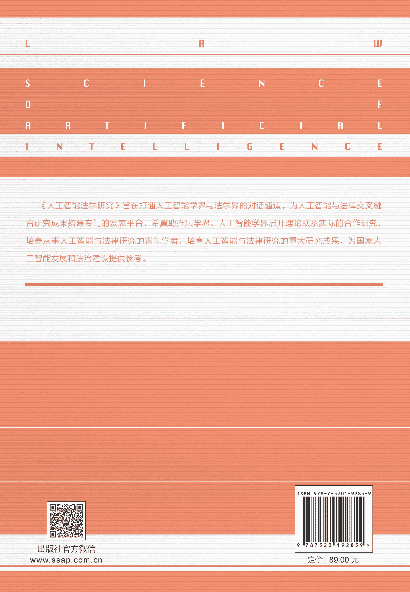