# 智能时代的法治新图景

## 编委会组成

编委会顾问：张文显

编委会主任：崔亚东

编委会副主任：刘晓红、叶青、刘庆峰、郭伟清、黄祥青、施伟东、刘学尧

编委会委员：（按姓氏笔画排列）：王志强、王国华、文学国、孔祥俊、白宁、石其宝、杨华、陈亮、何志鹏、吴泽勇、宋晓燕、欧阳为民、胡鹏、赵玉成、唐议、高志刚、袁胜育、曹红星、黄芹华、蒋传光、蒋晓伟、熊明辉

编委会办公室主任：杨华

副主任：黄芹华、赵玉成、胡荣鑫

## 创刊寄语

**联通万物，前路可期。**

**掌握智能技术者，将主导未来。**

迈入21世纪后，智能技术迎来新阶段，呈现深度学习、跨界融合、人机协同、群体智能开放、自主操控等新特征，成为新一轮科技革命与产业变革的关键驱动，并上升为国家战略。

习近平强调，“加快发展新一代人工智能是事关我国能否抓住新一轮科技革命和产业变革机遇的战略问题”。^((1))

应用场景持续拓展，智能技术已深入社会肌理，深刻改写生产、生活、生存方式乃至思维行为模式，也重塑国家治理与社会治理的形态和效能。尤其是2020年以来，智能技术在新冠肺炎疫情防控中展现出的突出作用，让公众切身体会到它如水电般无处不在、无时不有。

**智能技术兼具双重属性。**

其技术属性与社会属性高度交融，决定了它既能造福人类，也会带来风险挑战。

2018年9月17日，国家主席习近平在致2018世界人工智能大会的贺信中指出：“新一代人工智能正在全球范围内蓬勃兴起，为经济社会发展注入了新动能，正在深刻改变人们的生产生活方式。把握好这一发展机遇，处理好人工智能在法律、安全、就业、道德伦理和政府治理等方面提出的新课题，需要各国深化合作、共同探讨。中国愿在人工智能领域与各国共推发展、共护安全、共享成果。” ^((2))

国务院《新一代人工智能发展规划》指出：“人工智能发展的不确定性带来新挑战。人工智能是影响面广的颠覆性技术，可能带来改变就业结构、冲击法律与社会伦理、侵犯个人隐私、挑战国际关系准则等问题，将对政府管理、经济安全和社会稳定乃至全球治理产生深远影响。在大力发展人工智能的同时，必须高度重视可能带来的安全风险挑战，加强前瞻预防与约束引导，最大限度降低风险，确保人工智能安全、可靠、可控发展。”

智能社会来临，新技术带来的风险挑战该如何应对？

**人工智能法治由此产生。**

**构建智能社会法治秩序正成为广泛共识。**

共识之一，构建法治秩序既重要又紧迫。AlphaGo战胜李世石时，新一轮智能技术初现端倪，舆论认为技术尚在成长，过早规制会抑制创新，**可以让子弹先飞一会儿**。进入数字时代后，技术迭代加速，智能社会快速成型，人们逐渐认识到防范既有与潜在风险的紧迫性，法治秩序建设的必要性与可行性得到广泛认同。加快建立秩序已成为社会呼声。**要让子弹有序飞行。**

共识之二，法治是最有效的治理方式。习近平强调要“坚持在法治轨道上推进国家治理体系和治理能力现代化”。法治是社会治理的有效手段，也是维护智能社会秩序的最佳选择。智能社会风险中最突出的是法律规制失灵；挑战中最严峻的是法治秩序失调。运用法治思维、法治方法是推进治理最有效的路径。

共识之三，智能社会治理需要全球合力。风险挑战是世界共同课题，治理赤字呈现全球化趋势，必须以人类命运共同体理念为引领，推动全球一体共同治理、共护安全、共享成果。

我国高度重视智能社会法治秩序建设，政策体系、规则体系、技术标准体系、法律法规体系建设快速推进，治理的社会化、法治化、智能化、专业化水平不断提升，智能社会法治秩序的“中国方案”正在形成。

**上海致力于打造国家智能发展高地。**

习近平总书记在浦东开发开放30周年庆祝大会上强调：“要聚焦关键领域发展创新型产业，加快在**集成电路、生物医药、人工智能**等领域打造世界级产业集群。”

2017年6月，上海提出：努力打造国家人工智能发展高地。

2018年9月，上海进一步提出，依托科教资源、应用场景、海量数据、基础设施等优势，以面向全球、面向未来的视野，聚焦**创新策源、应用示范、制度供给和人才聚集**，加快建设人工智能发展的“上海高地”。

人工智能已成为上海发展的重要战略。

截至2020年，上海人工智能重点企业1149家，产业链基本完备，全年规上产业规模达到2246亿元，实现50%左右逆势增长，行业复苏态势明显，2018—2020年年均增速29.5%。

**上海也在着力打造人工智能法治高地。**

2020年7月9日，李强同志在2020世界人工智能大会云端峰会上强调：“更加重视应对人工智能发展带来的道德伦理、隐私保护、安全风险等问题，加快研究制定相关法规制度，让人工智能更好为人所用、为人服务。”2021年7月9日，李强同志在2021世界人工智能大会上再次强调：“要持续打造更加安全的敏捷治理，彰显科技向善理念，不断强化制度供给，在健全法规体系、标准体系、监管体系等方面努力形成‘上海方案’，为全球人工智能治理贡献上海智慧。”

数字化转型、智能社会到来，法律人该如何面对？法律人的责任何在？我认为：

第一，AI+法治，即主动拥抱新科技。抓住机遇，积极推动AI和法治深度融合，让法治借助科技之翼，更好维护社会公平正义。

第二，AI法治，即积极推动智能社会法治体系建设，营造智能社会法治生态，建立智能社会法治秩序，运用法治思维、法治方法，促进、规范、保障人工智能安全、可靠、可控、健康发展，使其更好地造福人类。

上海法学法律界积极行动，主动服务国家人工智能战略实施和上海人工智能“四个高地”建设，努力营造人工智能法治生态，打造人工智能法治高地。例如，2018年9月世界人工智能大会法治论坛发布国内首个《人工智能与未来法治构建上海倡议》，率先提出人工智能法治概念，提出构建人工智能法治14项倡议；自2018年起连续四年在世界人工智能大会举办“世界人工智能大会法治论坛”，议题包括“人工智能发展应用与法治保障”“共建未来法治，共享智能福祉”“人工智能的权利义务与法治实践”“智能社会的法治秩序”；相继推出《世界人工智能法治蓝皮书》《人工智能安全与法治导则》《人工智能法治发展评估指数》等，国内外众多专家学者发表见解，形成一批战略性、前瞻性、指导性观点，繁荣引领人工智能法治理论研究，建立人工智能治理国际交流平台，为智能社会法治建设提供智力与理论支持。

**创设人工智能法学院，培养复合型法治人才。**

“科教兴国、人才强国”是建设中国特色社会主义的重要战略，而人工智能等新科技竞争的关键在人才。

习近平强调：“人工智能具有多学科综合、高度复杂的特征。要加强人才队伍建设，以更大的决心、更有力的措施，打造多种形式的高层次人才培养平台，加强后备人才培养力度，为科技和产业发展提供更加充分的人才支撑。”习近平还就高校加强人工智能专业人才培养、调整学科设置、课程设置作出重要指示。

高等院校肩负建立人工智能和法学交叉学科、加快人工智能法治复合型人才培养的重大使命。**上海政法学院**在校党委书记夏小和、校长刘晓红的带领下，敢于担当、敢为人先、敢于创新，在上海市法学会、科大讯飞公司支持下，于2019年5月在全国率先成立“**人工智能法学院**”。自2019年起已连续两年招收法学（AI法学方向）本科生和法律硕士研究生，每年本科生40名、研究生10名，**成为全国乃至世界第一所招收AI法学方向本科生的法学院**。

人工智能法学院是新事物，人工智能法学是新学科。建设任务繁重，涉及人才培养、学科建设、科学研究、教师队伍等多个方面，其中教材不可或缺。由于该学科尚无可借鉴样本，上海政法学院决定组织自主编写。这是一项具有战略性、开创性、前沿性、先导性、引领性的工程，虽艰难但意义重大。上海政法学院成立了“**人工智能法学系列教材编写委员会**”，根据要求制定了《人工智能法学教材编写纲要》，规划系列教材19本。编写工作坚持以习近平法治思想为指引，坚持“基本原理、基本知识、基本体系”原则和“厚基础、宽口径、强能力、高素质”的本科教学要求，注重实践及理论阐释、知识点讲清悟透、知识体系完整构建等教学需求，着力提升专业性、针对性和创新性，探索理论与实践深度融合的教材编写和知识传播新模式，通过完成任务建立专业教材体系，形成上海人工智能法学教学特色，为国家人工智能战略、上海人工智能高地建设培养复合型人才，为学科建设、人才培养、理论创新和应用示范提供“上海方案”，服务法治研究与实践，促进国际交流合作。

教材编写正有序推进。学院及编委会采取“政产学研用”多位一体方式，集中法学、教育学、计算机科学、法律实务、人工智能研究与应用等领域专家学者与教师推进工作。参与人员积极务实，不辞辛劳，为编写奉献智慧。目前系列教材陆续出版，特此致谢！

编委会荣幸邀请中国法学会学术委员会主任、资深教授张文显先生担任顾问并为教材作序，特此感谢！

系列教材由上海人民出版社出版，封面设计由北京“高高国际”设计公司完成，特此感谢！

上海市法学会党组书记、会长

人工智能法学系列教材编写委员会主任

崔亚东（二级大法官）

2021年7月31日

* * *

(1)　2018年10月31日，习近平总书记在中共中央政治局第九次集体学习时的讲话。

(2)　2018年9月17日，习近平主席致2018世界人工智能大会的贺信。

## 序言性评述

2018年10月，习近平总书记在中共中央政治局第九次集体学习上就人工智能发展态势及健康发展发表重要讲话，指出：“人工智能是新一轮科技革命和产业变革的重要驱动力量，加快发展新一代人工智能是事关我国能否抓住新一轮科技革命和产业变革机遇的战略问题。”同时强调，“要加强人工智能发展的潜在风险研判和防范，维护人民利益和国家安全，确保人工智能安全、可靠、可控。要整合多学科力量，加强人工智能相关法律、伦理、社会问题研究，建立健全保障人工智能健康发展的法律法规、制度体系、伦理道德”。讲话为人工智能安全健康发展、法治建设、人才培养指明方向、确立遵循。

在智能社会，科技具备“双刃剑”属性。在法治轨道上发展运用则造福社会，反之则会带来危害。以大数据、云计算、互联网、区块链为标志的智能科技催生的“数字化”“网络化”“智能化”革命，对现行秩序带来严重冲击与挑战，必须积极引导、规范和保障人工智能健康发展，构建智能社会法治秩序。

构建法治秩序需要大批高素质人工智能法治人才，培养人才需要科学专业设置与教材支撑。高等院校肩负建立人工智能和法学交叉学科、加快复合型人才培养的重要使命。上海政法学院以担当、首创精神，在上海市法学会、科大讯飞公司等大力支持下，2019年5月率先成立人工智能法学院，当年起即招收AI法学方向本科生和法律硕士研究生，截至目前已招生三届，在校本科生逾120名。人工智能法学是新兴交叉学科，涉及法学、哲学、伦理学、人工智能等，教材与师资是建设难题。上海政法学院不畏艰难、勇于攻坚，聘请人工智能法治应用领域专家，集中本校研究力量，组建以崔亚东为主任的人工智能法学系列教材编写委员会，制定《上海政法学院人工智能法学系列教材编写纲要》，规划编写19本教材，为专业建设与人才培养提供支撑。该套教材是人工智能法学首套系统完备的系列，对教育与人才培养的创新与探索具有示范意义，具体体现在：

一是体现专业性。建设人工智能法学专业是贯彻习近平法治思想的重要体现，旨在为人工智能产业健康安全可控发展提供专业保障。培养既懂法学又懂人工智能并能有机融合的人才绝非易事。根据总体规划，系列教材注重科技与法律紧密结合，如《人工智能法学概论》《人工智能法治应用》《人工智能辅助办案》《法律大数据分析》《数字证据与区块链》等，均凸显独特性，为培养智能时代社会治理人才提供必要支撑。

二是体现创造性。推进“新文科”“新工科”“新医科”“新农科”等跨学科融合是高等教育重大改革，建设人工智能法学专业正是推进“新文科”建设的重要举措。该套教材融合法学、哲学、伦理学、人工智能等知识体系，并结合司法实务经验，为培养跨学科复合应用型人才提供教材保障。本套教材以创新为驱动，注重交叉融合，为形成新兴学科体系、培育新的增长点与特色方向奠基。

三是提供示范性。法学是实践性强、应用性强的学科，人才培养须配套实务性教材。本套教材以上海司法体制改革经验、司法执法领域和人工智能深度融合的创新成果为标本，广泛吸收国内外实务经验与研究成果，具有深厚本土经验与宽广国际视野。以解决人工智能法治领域理论与实践问题为牵引，促进基础理论研究与智能社会实践结合，为培养复合应用型法学人才树立教材典范。

人工智能法学系列教材出版，是学科建设与法治人才培养的重要支撑，也是智能时代中国法治发展的全新探索。期待通过系列教材培养更多人工智能法学法治人才，为保障人工智能健康发展、建设中国特色社会主义现代化法治强国作出贡献。

是为序！

中国法学会党组成员、学术委员会主任

吉林大学、浙江大学文科资深教授

张文显

2021年7月31日

## 编写说明

（人工智能法学系列教材之二）

### 一、立项缘起

设立人工智能法学专业方向，是贯彻习近平新时代中国特色社会主义思想的具体体现，也是落实习近平总书记在十九届中央政治局第九次集体学习时“要整合多学科力量，加强人工智能相关法律、伦理、社会问题研究，建立健全保障人工智能健康发展的法律法规、制度体系、伦理道德”要求的实际行动。

编写人工智能法学系列教材，是支撑专业建设、培养复合应用型专业人才的必要前提。人才培养需要培养方案与系统完备的教材体系支撑，这也是一项艰巨挑战。因为其他专业已驶上快车道，而我们仍在披荆斩棘铺路。

伴随全国吹响“新文科”建设号角，加快法学应用复合型人才培养，专业学科交叉探索步伐加快。上海政法学院设立人工智能法学专业方向，成立系列教材编写委员会，制定编写纲要，为培养复合应用型人才提供基础保障。

### 二、编写目标与内容

本书为规划的19本系列教材之一。本书立足人工智能法治应用，在对新概念新理论进行尝试性解读的同时，总结人工智能在立法、执法、司法、守法和法律服务中的应用现状及发展趋势，阐释人工智能和法的紧密联系，为推动专业发展与人才培养迈出探索性步伐，也为相关研究者展示融合状况并提供进一步思考空间。

内容分为总论、分论、余论。总论涵盖研究范畴、应用概述等；分论包括立法应用、执法应用、司法应用、社会治理与公共服务应用、法律服务应用等；余论为开放式探讨，旨在为人才培养提供持续思考空间。

### 三、编撰过程

本书在上海政法学院党委、系列教材编写委员会和人工智能法学院关心指导支持下完成。

为开展编写，组建由杨华任主编，彭辉、陈吉栋、吴惟予、黄一帆、余圣琪任副主编的团队。具体分工如下：

杨华负责统筹规划、思路确定、拟定大纲、统稿修订、协调知识体系安排及和出版社、各主编关系。

彭辉负责第六章、第七章和余论编写。

陈吉栋负责第二章第一节至第二节、第三章、第四章第一节至第三节编写。

吴惟予负责第二章第四节、第五章、附录编写。

余圣琪负责第一章编写。

黄一帆负责第二章第三节、第四章第四节编写。

上海政法学院人工智能法学院陈宁豫、戴艺非、范雨萱、吴之婧参与第五章资料整理撰写，李源参与附录资料整理撰写。

上海大学法学院龚思涵参与第二章第一节至第二节、第三章、第四章第一节至第三节资料整理撰写。

上海社会科学院法学研究所张宸、薛子寒参与第六章、第七章和余论资料整理撰写。

需说明的是，人工智能法学属新兴学科，尚无可借鉴样本，参与人员学识有限，错漏在所难免，恳请专家读者批评指正！

本书编写组

# 总论

## 第一章 人工智能法治的研究范畴

**本章导读：**
近几年网络、算法和大数据的能力都在快速升级，AI相关产业进入爆发期，智能芯片、无人机、网联汽车、服务机器人等赛道发展迅猛。技术在提升社会效率的同时，也带来了隐私泄露、数据黑产、数据安全以及伦理争议等新问题。为回应这些风险，AI法治逐渐进入视野。在以习近平法治思想为指导、全面依法治国持续推进的背景下，法治对AI发展的保障功能愈发突出，需要以法治思维聚焦网络、算法、数据、代码等关键环节，以AI法治理论为基础，搭建覆盖立法、执法、司法、守法的完整治理框架，为产业健康、可控、可信发展提供制度支撑。

### 第一节 AI法治的内涵与属性
要理解AI法治，先要厘清概念边界并提炼核心特质，再从立、法、司、守四个视角展开对基础理论、规范体系和前沿议题的讨论。

#### 一、AI法治的含义拆解
随着算法、数据中心、5G、物联网的广泛应用，AI产业在数据安全、算法监管、责任归属等方面出现了大量法律难题，法治化共识逐步形成。AI法治随产业成长而出现，是一个全新的命题。下面分别说明智能技术、法治、AI法治。

##### （一）概念的构成要素
各国都在推进智慧国家、智慧城市、智慧社区、智慧政务、智慧司法、智慧检务建设，传统治理方式正被智能技术重塑。AI法治便是在此背景下形成的新范式。目前学界尚未形成统一表述，需要从智能技术定义与法治定义两端切入。

###### 1．智能技术的定义
2020年《欧盟人工智能白皮书》指出，AI的定义既要保持对技术演进的包容性，也要提供足够的法律确定性。各国对概念尚无一致。《牛津词典》把AI理解为能够完成视觉感知、语音识别、决策、语言翻译等通常需要人类智能的计算机系统理论与技术。《中国人工智能标准化白皮书》认为AI是借助数字计算机或受其控制的机器模拟、延伸、拓展人类智能，感知环境、获取知识并运用知识实现最优结果的理论、方法、技术及应用系统。尽管表述不同，共识在于AI能对输入的数据、信息或知识进行系统化处理并输出结果。^((1))

分类型看，按智能化程度可分为弱AI、强AI、超AI；按人与技术主导关系可分为人主导AI、机器人主导AI、人机融合AI。^((2))按范围可分为狭义AI与通用AI，狭义即弱AI，通用即强AI。^((3))

###### 2．法治的意涵
法治常被解释为以法而治与依法而治。第一层指法作为国家治理工具，与人治相对；第二层指在民主基础上形成的治国基本原则，与专制相对。^((4))思想源头可追溯至古希腊柏拉图与亚里士多德。古代法治更多体现为以法而治的治国策略。柏拉图《理想国》主张哲学王人治，对法律持消极态度，后期《政治家篇》《法律篇》显示其立场转变。^((5))亚里士多德提出“法治优于一人之治”，并认为法治应兼具法律被普遍服从与法律本身制定良好的双重含义。^((6))

近代以来法治随自由、平等、人权等民主理念传播而成熟。^((7))洛克的政治契约论、孟德斯鸠的法精神、卢梭的社会契约论奠定了理论基础。富勒提出法治的八项内在原则：普遍性、公开性、非溯及既往、明确性、一致性、可实现性、稳定性、实施一致性。^((8))拉兹认为法治是法律应遵循的标准，法律可能系统性违背该标准；他与富勒的分歧在于富勒把法治视作法律内在道德属性，拉兹则强调法律只要能有效指引行为即满足治理要求。

中国先秦已有以法治国主张，如《管子·明法》“以法治国”，《商君书·更法》“据法而治”，《慎子·君人》“事断于法”，《韩非子·饰邪》“以法为本”。统一中央集权时期法治发挥重要作用，但古代法治依附君主专制，带有御用色彩。罢黜百家后儒学主导，“法治”沦为人治附庸。1999年依法治国写入宪法，成为党领导人民治理国家的基本方略。党的十八大提出全面依法治国并纳入“四个全面”布局，十八届四中全会出台《关于全面推进依法治国若干重大问题的决定》。十九大确立新时代中国特色社会主义思想，要求完善党委领导、政府负责、社会协同、公众参与、法治保障的社会治理体制，提升治理的法治化、智能化、专业化水平，打造共建共治共享格局。十九届四中全会重申共建共治共享制度。2020年11月中央全面依法治国工作会议确立习近平法治思想为中国特色社会主义法治建设的指导思想，应深入贯彻并探索中国法治道路。

###### 3．AI法治的概念
AI法治是伴随智能技术发展产生的全新概念、领域与理念，是产业发展的必然趋势与保障。AI高速演进带来机遇，也带来前所未有的挑战，良法善治是健康发展的必要理念。AI法治是在数字化根基上，以智能科技辅助法治运行的形态，是传统法治进入智能时代的最新演进。

1979年骆茹敏指出科技管理中法律调解系统建立是客观需要，大势所趋。^((10))1981年钱学森提出建立系统科学体系并开创复杂巨系统科学技术领域。1985年钱学森在全国首次法制系统科学讨论会提出在法律实务中运用AI的构想。^((11))2003年中国智能自动化会议提出建设“智能法学”学科的设想。2017年后“未来法治”^((12))“智慧法治”^((13))等概念相继出现。2018年9月上海世界人工智能大会召开，2019年6月中国发布《新一代人工智能治理原则》，提出和谐友好、公平公正、包容共享、尊重隐私、安全可控、共担责任、开放协作、敏捷治理八项原则。伴随产业发展，AI法治呈现三方面演变：其一，法律法规从宏观指导走向具体规制；其二，AI法学在构建基础理论同时更重视法治在应用层面的作用；其三，法治应用从综合性走向与专门性深度融合。^((14))

##### （二）AI法治的主要特质
技术进步使AI深度融入学习生活。2020年新冠肺炎疫情防控中，AI在流调追踪、防控抗击、生产生活恢复中发挥积极作用。多国将AI发展确立为国家战略，AI法治建设也进入议程。AI法治既是AI发展的重要产物，也将反过来规范与保障AI发展。其突出特征如下：

###### 1．以人作为中心
区块链、5G等高科技推动人机协作常态化，学界对AI主体的法律地位存在肯定与否定之争。肯定说认为AI具有类人智慧应获主体资格；否定说认为AI是人类创造物、可被毁灭，始终受人类掌控，只能作为人类附属。^((16))在AI时代，人之主体地位不可动摇，法治根本目的在于保护人格尊严。无论是斯多葛学派从共同人性论出发的人格尊严探讨，还是西塞罗、塞涅卡对人格价值的强调，均体现人是主体、拥有尊严的共识。^((17))人格尊严是对成员平等身份的确认，是人类共同体的高贵属性。^((18))

###### 2．开放共济
AI时代来临，日常生活与AI紧密相连，技术颠覆传统生产生活，智慧国家、智慧城市、智慧社区建设挑战传统治理模式。开放共济是AI法治的重要特质。党的十九大要求完善党委领导、政府负责、社会协同、公众参与、法治保障的社会治理体制，提升社会化、法治化、智能化、专业化水平，打造共建共治共享格局。十九届四中全会进一步提出坚持和完善共建共治共享的社会治理制度。共建共治共享为AI法治提供指引。AI发展催生共享经济，互联网经济是典型代表。大数据时代平台经济兴起，只有包容共用、多元发展，AI才能健康快速成长。

###### 3．权利维护
AI时代生产生活模式重塑，新业态、新模式、新平台层出不穷，行为方式与社会关系发生新变，传统人权理论面临挑战：全方位监控侵蚀公民隐私，算法黑箱与算法霸权损害人格尊严，数据信息不对称导致数据鸿沟削弱自主与自由。卡雷尔·瓦萨克提出的三代人权理论广为流传：第一代政治权利，第二代经济社会文化权利，第三代生存发展权。

AI时代催生“第四代人权”，网络化、智能化、技术化发展使AI不仅替代体力劳动，也开始替代脑力劳动，并能进行初级决策与资源规划。AI法治的重要特征即保障数字时代人权。数字人权以数据信息为载体，体现智慧社会中人的数字化生存样态与发展需求，目标在于反技术霸权、反数据信息控制，消解信息鸿沟、隐私侵害、算法歧视、监控扩张等人权难题。^((19))数字人权在AI法治中具有重要价值，其意义在于以人权权威强化数字科技开发与运用的伦理约束与法律规制。^((20))

#### 二、AI法治的属性
AI法治属性包含两层：其一是AI法治体系，涵盖与AI发展相关的立法规范、智能执法、新型案件司法机制、数据合规守法体系；其二是AI法治领域，包含基础理论、规范体系、前沿问题。

##### （一）AI法治体系
AI法治体系是一个有机整体，涵盖立法文件与规范、执法活动与制度、司法审理机制、守法合规保护机制。良法善治是理念，依法办事是核心。《人工智能与未来法治构建上海倡议》提出面向全球、未来、和平，以人为本、向善安全、创新发展、共享成果、可靠可控、规范有序原则，构建AI法治体系，将AI发展应用纳入法治轨道。应推动AI与立法、执法、司法、守法深度融合，促进安全可靠可控健康持续发展。

###### 1．立法
AI立法指AI技术在立法环节的应用，涵盖立项、调研、起草、审议、实施、立法后评估全过程。目前AI在立法领域处于起步阶段，与立法的广度深度融合有限。中央层面已基本建成全国统一备案审查信息平台。地方主要采取两种路径：一是自建立法智能辅助系统、智能立法信息系统，如上海；二是采购第三方产品，如北大法宝智能立法支持平台。受大数据基础与立法知识图谱完善度限制，当前应用多停留在法规整理等辅助层面。国外探索类似，中国香港等地区利用区块链技术开展线上立法投票，新冠疫情期间视频会议系统升温，亦有辅助清理法规与文本分析立法意见的系统。

###### 2．执法
AI执法是AI法治体系关键环节，利用AI降低警力成本、提升警务效能。公安内部多警种分工，AI执法主要用于大数据整合、便民服务、刑事侦查、疫情防控、跨部门协作、禁毒、维稳反恐、交通执法、治安防控、金融监管、监狱管理等。^((21))美国、英国、日本、德国等发达国家较早开展实践，主要用于预防犯罪、案件侦破、边境管理、维稳反恐与便民服务。机器替代人力看似节省成本，但现代社会执法须是社会共同体的延伸，由公民授权。^((22))技术便利与隐私风险并存。人脸识别被广泛使用，美国多州先于联邦对人脸识别进行规制，主要限制公权力收集使用，对企业使用持相对宽容态度；欧盟未制定专门法律，主要通过《通用数据保护条例》统一规制，采取审慎管理模式。^((23))

###### 3．司法
AI司法在新一轮司法改革推动下快速发展，核心应用为智慧法院与智慧检务。《国家信息化发展战略纲要》《“十三五”国家信息化规划》把智慧法院建设提升至国家战略。最高人民法院提出建设智慧审判、智慧执行、智慧服务、智慧管理生态。依托区块链与5G，北京智慧审判、“分调裁一体化”平台、“天平链”等应用加快。上海刑事案件智能辅助办案系统即206系统，实现证据标准指引、证据规则指引、单一证据校验、逮捕条件审查、证据链与全案审查判断、社会危险性评估、电子卷宗移送、庭前会议、类案推送、量刑参考、知识索引、文书自动生成、办案程序监督、言词证据审查、庭审实质化、案件评议、减刑假释办理等功能。^((24))在此基础上开发智慧传译系统、金融案件智能化诉讼服务系统、智慧保全服务平台、诉讼风险评估系统。广州互联网法院依托可信电子证据平台构建“网通法链”系统。

国外集中于智能辅助审判与线上法院。美国COMPAS、PSA、LSI-R 等风险评估软件用于辅助法官量刑。^((25))英国《民事法院结构审查》提出建设线上法院，计划投入10亿英镑打造现代化数字化法院系统。^((26))加拿大利用AI算法开发调节机器人进行调解。^((27))德国依托AI打击特定犯罪。AI司法在提升效率、防范冤假错案、预防司法腐败方面作用明显，但需对算法决策设立规制与救济机制，注入公开、公平、责任理念，才能兴利除弊，促进科技向善。^((28))

###### 4．守法
我国AI守法主要体现为数据合规体系构建。AI时代数据成为财富与生产要素。大数据便利生活的同时带来风险。“所有数据由我们产生，所有权却不归我们”。^((29))公众持续生产数据却难以控制利用，也不清数据如何被采集处理。^((30))互联网平台掌握海量数据，部分巨头滥用数据对消费者评级。联网设备匮乏、互联网知识不足造成数据鸿沟，对不同群体产生差异化赋权。^((31))2021年6月10日《数据安全法》出台，2021年7月10日国家互联网信息办公室发布《网络安全审查办法（修订草案征求意见稿）》。网络安全审查办公室依据该办法对“滴滴出行”启动审查，是首次对企业启动网络安全审查，引发高度关注。AI时代企业须重视合规体系构建，保护数据隐私与安全，促进数据安全流通使用。

##### （二）AI法治的研究领域

# AI法治的突围三问

AI法治作为近年才成形的新兴交叉领域，讨论基本可以聚拢到三条脉络：其一是从技术演进切入，围绕法理、安全、伦理、社会治理等底层学问展开学理研讨；其二是构建让技术安全扩散的制度框架；其三是回应对疫情防控、人脸识别边界、区块链多元应用等现实落地难题的回应。

### 1. 基础理论梳理
国内对这条脉络的关注起步较晚但增速明显，应用最集中的场景是智能执法与智能司法。技术为法治带来新动能的同时也暴露出风险，若要实现可控发展，必须先夯实理论基础，为实践提供预判与指引。21世纪以来关注度明显升温。张保生从学理层面拆解了AI法律体系的研制逻辑、实践价值及引入法学的法理支点。^((32))唐昊涞、舒心梳理了AI与法律融合的内涵、研究范围及可能带来的冲击与难题。^((33))邰杨芳从刑法、刑事诉讼法的视角探究法律检索本体的结构。^((34))单勇以数据为切口分析社会演进与犯罪治理的规律。^((35))罗洪洋、陈雷将“智慧法治”界定为借助人类智慧破解法治难题的高级形态。^((36))当前基础研究的聚焦点集中在智能应用的主体定位、民事法律冲突、刑事归责、隐私保护以及区块链监管归责等方面。

### 2. 规范体系演进
AI法治规范指各国立法机关、部委、地方政府及国际组织制定的具约束力的规范性文件。^((37))我国现有文本多以发展战略、实施方案等政策性材料为主，并呈现从宏观布局向产业落地细化的转向。相比政策，法治层面的跟进相对滞后。现有法条多聚焦特定行业，如智能网联汽车。国家层面，工信部、公安部、交通运输部联合出台《智能网联汽车道路测试管理规范（试行）》；地方层面，北京市发布《北京市自动驾驶车辆道路测试管理实施细则（试行）》。同时在旧法中嵌入AI条款：2018年1月施行的《中华人民共和国中小企业促进法》增补了中小企业运用AI开展生产的表述；2019年12月通过的《中华人民共和国基本医疗卫生与健康促进法》明确国家运用AI推动医疗卫生资源普惠共享。^((38))地方性规章包括：2020年6月《浙江省公共数据开放与安全管理暂行办法》；2019年8月《上海市公共数据开放暂行办法》；2019年9月《海南省大数据开发应用条例》；2018年8月《贵阳市大数据安全管理条例》；2017年12月《安徽省互联网政务服务办法》；2015年10月《杭州市智慧经济促进条例》。

海外立法同样保持审慎，过早出台可能抑制技术成长。规则多集中于自动驾驶等相对成熟的赛道。2020年11月，美国多家机构联合发布《自动驾驶汽车立法大纲》，在促进快速发展的同时强化法律监管；英国2018年7月通过《自动与电动汽车法案》，2021年4月运输部就修改《高速公路法规》公开征求意见；德国是较早立法的国家，2017年5月公布《道路交通法（修订法案）》纳入自动驾驶条款，2021年5月联邦委员会通过增补L4级完全无人驾驶行驶的条文；日本2016年5月发布《自动驾驶汽车道路测试指南》，2019年5月通过《道路交通法修正案》。

### 3. 前沿议题观察
AI驱动新一轮科技与产业革命，重塑经济、社会与生产生活方式。前沿研究集中在疫情期智能应用、人脸识别与隐私保护、区块链多维运用及自动驾驶引发的法律问题。

抗击新冠肺炎期间，大数据与AI发挥了积极作用。战时“黑科技”可快速筛查医院内与确诊病例接触的高风险人群；深圳、杭州自2020年2月上旬起上线“健康码”；苹果、谷歌依托30亿部手机参与全球最大“健康码”项目筛查密切接触者。^((39))人脸识别在全球快速普及，2019年全球行业市场规模达23.91亿美元。技术便利治理的同时，也带来隐私权、财产权益与人权保护的法律风险。域外监管偏强：美国尚无联邦统一法，部分州及地方已在规制使用；欧盟未设专门法律，主要通过《通用数据保护条例》调整；我国更倾向以法治思维、法治方式规范并保障技术发展。

区块链已深度融入社会生活，被视为“无需信任的信任架构”。工信部白皮书将其定位为“分布式数据存储、点对点传输、共识机制、加密算法等新型应用模式”。^((40))借助区块链，交互不再依赖中介，这正是“去中心化”的要义。^((41))区块链具备去中心化、弱信任、可靠账本、集体维护等特征，运行过程透明且不易篡改，已广泛应用于金融、物流、保险、公共服务等场景。随着自动驾驶推进，立法需求不断涌现。2018年工信部、公安部、交通部联合发布《智能网联汽车道路测试管理规范（试行）》，北京、上海、广州等地随后出台各自的道路测试办法。相关法律讨论多聚焦行政准入、民事侵权责任与刑事过失责任，目标是形成适配自动驾驶的制度创新机制。

## 第二节 数字浪潮中的法治阵痛

数字时代AI、互联网、区块链与大数据融合，人类进入全新数字阶段。技术深刻改变生产生活，带来机遇也带来风险。传统法治面临多重时代挑战：主体资格的疑虑，即智能系统是否应享有法律主体地位；客体范畴的困惑，即传统“物”的界定能否覆盖数据；权利义务关系的变化；物权原则对数据特性的包容度不足。

### 一、传统法治的基本面貌
法治内涵丰富，基本要求是法律在国家与社会生活中居于至高地位并具有普遍约束力。洛克提出三点基本含义：其一，国家须以正式法律统治，而非临时命令；其二，已公布的法律必须得到执行，否则等同于无法律；其三，法律面前人人平等。传统法治特征主要体现为法律至上、社会主义民主与权利保障。

#### （一）法高于一切
法律至上指法律在社会规范体系中居于主导、具有至高权威，成为评判外部行为的最终标准。近代资产阶级革命以来，多元利益博弈需要普遍有效的法律来平衡与调适。^((45))“根本上必须在合作本能与利己本能之间维持均衡。社会控制的任务就在于使我们有可能建立和保持这种均衡，而在一个发达社会中法就是社会控制的最终有效工具。”^((46))在法律体系中，宪法高于法律、行政法规与规章。

我国法律治理源远流长。西周晚期出现最早判词文本，显示法律在维护秩序中的作用；春秋时期公布成文法，结束“刑不可知则威不可测”形态；《唐律疏议》是代表性封建法典。商鞅立木为信、法及太子，白居易《论姚文秀打杀妻状》重视司法程序等体现古代治理智慧。新中国成立后建立社会主义法制框架，改革开放提出“有法可依、有法必依、执法必严、违法必究”方针；党的十八大以来提出全面依法治国；十九大以来完善顶层设计，统筹推进法律规范、法治实施、法治监督、法治保障和党内法规体系建设，全面依法治国总体格局基本形成。^((47))

#### （二）社会主义民主
民主内容决定法治内容与性质。社会主义民主建立在社会主义经济基础之上，由工人阶级领导人民掌握政权。强调人民主权，主张人民民主主体的人民性、内容的广泛性、性质的真实性与发展的渐进性。社会主义民主是民主与专政统一、民主与集中统一、自由与纪律统一。法治要充分反映和保障人民共同意志和利益。

#### （三）保障权利
近代法治以权力制约与权利保障为核心，强调当权者与他人同样服从法律。^((49))《权利法案》《独立宣言》《人权和公民权宣言》体现自由主义与天赋人权思想。保障权利体现在天赋人权与公正司法。

天赋人权指自然状态下人们普遍享有的与生俱来权利。洛克提出生命权、健康权、自由权、财产权四项权利。生命权是基本权利；自由权指除受自然法与立法权约束外不受其他约束的处置行动与财产的自由；财产权指通过劳动原始取得财产的权利。中国现代文明建构既要拥抱又要批判西方启蒙，也要解构与重构中国传统文明。^((50))中华法系的出礼入刑、隆礼重法、民惟邦本本固邦宁、天下无讼以和为贵、德主刑辅明德慎罚、援法断罪罚当其罪、恤刑原则等彰显传统法律智慧。^((51))“并不缺少支持人权的价值观”，这些权利是更广泛的“人”的权利，而非仅限西方。^((52))

公正司法体现法治的内在价值与程序价值。《管子》言“操持不可以不正”。“法不阿贵，绳不挠曲。”这是法治精神真谛。公正司法是维护社会公平正义的最后一道防线。程序公正要求当事人诉讼地位平等、严格依诉讼法进行；结果公正要求法律适用准确、事实清楚、裁判合法合理。程序公正保障结果公正，结果公正实现纠纷解决与权利保护。

### 二、传统框架面临的新挑战
AI发展推动社会从单一物理空间向物理/电子双重空间转换。^((53))新平台、新业态、新模式不断涌现，传统物理空间法治难以覆盖双重空间问题。“历史已经向我们表明重大的技术变迁会导致社会和经济的范式转换”，^((54))传统法治框架面临主体、客体、内容、原则四维度挑战。

#### （一）主体定位的争议
信息社会重塑生产生活方式。网络可记录个体全生命周期数据，勾勒完整数据画像。^((55))人衣食住行与数据深度绑定，现代人穿梭于现实与虚拟空间，成为信息人。^((56))传统法律主体建基于工商业时代，具有生物属性、生活于单一空间的自然人。^((57))学界对AI主体地位存在肯定说与否定说。

##### 1. 主体资格肯定论
人机协作已成常态，赋予AI法律主体被视为客观需要。部分国外学者认为未来具备类人类智慧的智能体应获法律主体资格。国内学者认为无论是弱智能还是强AI，已具备情感、认知与行动能力，不再完全受支配。^((58))强AI时代，传统自然人主体理论难以适应。我国2017年《新一代人工智能发展规划》及《促进新一代人工智能产业发展三年行动计划（2018—2020年）》要求明确AI法律主体及权利义务责任。

美欧多从“电子代理人”角度设定资格，我国学者倾向有限人格论，通过法律拟制赋予拟制主体资格，避免与自然人等量齐观。赋予主体资格的最终目的仍是维护人类自身合法权益。AI拟制主体地位有别于自然人，仅具有限责任能力，只能承认有限法律主体资格并适用特殊规范。^((59))

##### 2. 主体资格否定论
尹卫民认为AI体虽具类人类特征，但作为人类创造物可被毁灭，始终受人类操控，不具法律地位，只能是附属品。^((60))王利明认为AI的发展，尚未对传统民事法律主体理论构成颠覆性挑战，短期应坚守传统理论，不宜规定为民事主体，但不排除未来具备相当或超越人类意识后独立享有权利承担义务的可能。^((61))赵万一认为从哲学法学角度均不应赋予AI与人类相同法律主体地位。^((62))吴习彧认为无赋予主体资格必要性，评价行为效力不以主体资格为前提。^((63))不主张赋予资格的主要理由有三：智能体是人类附属品、受操控；传统理论足以应对发展；赋予资格不能解决行为效力问题。

#### （二）客体边界的张力
法律客体指权利义务指向的对象。现行体系主要包括物、人身利益、智力成果、行为四类。物是物权客体；人身利益是人身权客体；智力成果是知识产权客体；行为是债权客体。AI变革下，传统客体受挑战，突出表现为数据对物权客体的解构与AI对智力成果的冲击。

##### 1. 数据对物权客体的解构
数字时代数据成为最重要、最有价值的生产要素，数据化成为核心特征。数据本身不具备物权属性，形成非客体性挑战。网络虚拟财产是否属于物权客体在学界争论激烈。司法实践中虽予保护，但多非以物权客体角度规制。

数据具有非独立性。数据依赖载体存在，需通过计算机代码显现，脱离程序无法独立存在。^((64))离开互联网与计算机支持，数据将失去意义。^((65))物成为物权客体首要要件是独立性。数据因非独立性显现无形性。传统物权法难以继续适用，数据不具备物之基本特征，不能脱离载体存在，主体也难以对具体个人数据实现占有。^((67))

数据在使用上并不具备排他性。数据的持有者无法做到对数据的绝对独占，数据可以被反复复制、循环利用，也能在需要时被清除。物权强调独占，而数据则完全不同。数据主体、数据控制者、数据处理者完全可以在同一时间各自使用同一份数据，彼此之间既不产生干扰，也不会让数据本身的价值出现损耗。以个人数据为例，利益相关方往往是复数的。张新宝指出个人信息的价值体现在人格尊严与自由、商业利用以及公共管理三个层面。^((68))高富平在利益识别上也认为个人信息同时关乎信息主体的人格尊严与自由、信息使用者的流通利用以及社会公共秩序维护的公共利益。^((69))实践中，数据所指向的个人有权使用数据，企业基于竞争性权益也可以使用数据，政府基于公共服务与社会治理的需要也能与个人、企业在同一时段共同使用同一数据。^((70))对照物权的占有、使用、收益、处分四项权能，数据均不呈现排他性。

再者，数据不存在稀缺性。稀缺本是物权客体的基本前提，但互联网、物联网与智能终端的普及让数据以每秒计的新速度持续生成，只要用户保持在线，数据流就会不断涌现。^((71))传统物权建立在物的稀缺之上，而数据具有普遍性和充裕性。传统私法之物是客观的、有形的、有限的，数字时代的数据则是主观的、无形的、可无限再生的，其生命力和价值正体现在不断复制之中，而传统物的价值更多在于自我保存与自我增殖。对数据而言，保护思路需要转换：物的价值在于独占，数据的价值则在于复制与共享。

##### 2．AI创作冲击知识产权客体认定
随着技术迭代，人工智能在内容生产领域不断突破。“小冰”的诗歌、“Emily Howell”的曲目、“Wordsmith”的新闻稿件都引发关注。新事物带来新难题，AI技术本身是否属于专利法意义上的技术方案或著作权法意义上的软件作品，已有基本定论。真正仍在争议的核心，是AI生成物对知识产权客体的冲击。

其一，现有法能否覆盖AI生成物。AI生成物通常指由人工智能自动完成的图像、动画、文字、音乐等成果。学界与实务围绕其是否属于“智力成果”展开讨论，基本形成肯定说与否定说两派。肯定说认为：一旦AI生成物与人类作品难以区分，则具备独创性特征；AI的创作并非简单的机械延伸；可类比法人制度，投入劳动应受保护。^((72))否定说则从创作过程出发，主张不应认定为作品：AI的产出深受既有作品影响；生成物缺乏真正的独创性；其本质更接近可财产化的信息。^((73))

其二，AI生成物的保护路径。学界一般将AI生成物分为文学艺术类与技术方案类。对其保护主要有作品保护、邻接权保护、信息权或特别权保护三种思路。其中以邻接权保护最为主流，既能满足AI投资者的利益诉求，又能维持著作权制度体系的逻辑完整。^((74))作品保护路径认为AI生成物可构成作品，权属归属上出现“客观标准说”与“工具说”。前者主张将AI视作新型民事主体，由AI享有著作权；^((75))后者认为AI只是创作者的工具，著作权应归投资人、设计者或使用者。信息权或特别权路径则认为传统制度难以覆盖，应将其纳入信息权保护或另设特别权。

#### （三）法律内容面临重塑
法律权利与法律义务构成法律的核心内容。权利是主体以相对自由的方式获取利益的手段，义务是以相对被动的方式保障他人利益的约束。随着AI发展，相关权利义务关系发生根本性变化，需要重新构建。

一是AI的权利能力。AI深刻影响经济发展、社会进步与人类生活。AI成为主体的前提是具备权利能力。自然人权利能力统一平等但范围各异，法人亦须在法律范围内行使民事权利。AI若拥有权利，也应限于创造目的与自身功能边界内行使。

二是AI生成物归属。学界主要有三类倾向：归属AI本身、归属自然人、进入公共领域。归属AI本身与进入公共领域的观点多被否定，主流意见倾向归属自然人单独或共同享有，如程序员、使用者、素材提供者等。^((76))

三是AI是否享有权利。对此存在肯定说与否定说。肯定说认为权利与责任一体，若要求AI承担法律责任，则应承认其基本权利，并可参照法人取得主体资格与相应权利。^((78))否定说认为知识产权制度的核心是通过授予排他权激励创新，若创新无需激励则无需保护。^((79))法律主要调整人与人关系，尽管AI可创造巨额财富，但其无法支配、控制和占有财富，难以成为权利主体，也无法承担侵权后果。

#### （四）法律原则遭受挑战
法律原则是兼具基础性、综合性与指导性的价值准则。随着数字时代到来，数据在虚拟空间呈现分享、无形、公共等特性，传统物权法的一物一权、物权法定、公示公信等原则被持续挑战。

##### 1．数据共享动摇一物一权原则
一物一权指独立完整的物上只能设立一个所有权，即一物不能二主。数据则呈现分享性。数据本身不具备对抗世人的排他属性，同一数据上可同时向多方开放权限而不影响使用。在欧盟《通用数据保护条例》中，数据主体、控制者、处理者可在同一时间使用同一数据，价值与使用均不受影响。传统物具有排他性，使用必然影响他人。为实现定纷止争，传统物依赖一物一权，而数据的价值在于流动使用，其分享性特质正挑战这一原则。

##### 2．数据无形性冲击物权法定原则
物权客体法定，要求物权的种类、要件与范围由法律确认，当事人不得自行创设。当前大数据、互联网、AI快速发展，而立法程序滞后，现行条文难以及时覆盖实践。司法在数据纠纷中发挥主导作用，但多借助《反不正当竞争法》一般条款处理，而非从物权视角阐释。数据权利客体并非法定，无形性特征对物权法定原则构成冲击。

##### 3．数据交易方式动摇公示公信原则
物权公示原则要求物权设立、转移公开透明，使社会知晓变动以维护交易秩序；公信原则则保护善意第三人基于公示产生的合理信赖。数据交易并非传统动产的交换，也非不动产的登记，而是控制能力与使用权的让渡，不必转移所有权。数据掌握存在显著不对称，主体往往无法掌控或知悉转移路径。数据交易的高效便捷与传统公示公信要求存在张力，机械适用将阻碍数据流通与共享。

## 第三节 人工智能时代的数字法治变革
AI时代，互联网、区块链、大数据融合催生颠覆性变革。智能互联网塑造物理世界与数字世界共存的双层空间，人类在现实与虚拟间穿行。人类与AI在生活工作中处于智慧协同状态。数据汇聚与大平台出现形成算法主导的数字生态。由此引发数字法治三大变革：法律价值变革，传统正义观难以回应数字挑战，数据正义、代码正义、算法正义应运而生；法律关系变革，传统权利义务结构发生根本性位移；法律行为变革，传统因果关系被相关关系取代，数据侵权挑战传统归责。

### 一、数字技术带来的新挑战
数字技术重塑生产关系、生活方式、行为模式与社会结构，对传统法治提出挑战，主要表现为传统权利理论供给不足、公民基本权利保护不足、自然人人格尊严保护不足。

#### （一）传统权利理论供给不足
传统权利理论包括意志说、利益说、资格说、自由说等。^((80))其中意志说与利益说占主流。比克斯指出学界多分为两派：一派强调权利本质在于选择，另一派强调权利在于通过义务履行实现利益保护。^((81))源于康德的意志理论强调支配力与个人自由，源于边沁与耶林的利益理论强调权利功能在于增进福祉与社会目的。^((82))然而传统理论已难以适配数字时代。

意志理论认为权利使权利人成为“小型主权者”，核心在于支配力。^((83))其功能在于保障自主选择并排除妨碍。数字时代数据持续产生，只要在线即不断生成。数据主体虽为产生者，却无法完全支配与控制；数据控制者、处理者虽有部分意志，但其选择并不优先于主体意志。

利益理论认为权利功能在于促进权利人利益。^((86))利益指个人应然与实然享有的物质精神事物。^((87))该理论强调通过他人义务保护利益。^((88))但其难以协调数据确权。数据权利具有多元性，既体现个人人格尊严，也有使用者商业利益，更关乎社会与国家公共利益。对个人人格利益绝对保护将阻滞数据使用与流通。

#### （二）公民基本权利保护不足
数字技术带来便利的同时也产生风险。大型互联网企业滥用数据对消费者进行评级，算法多为保密，消费者难以知悉，评级行为可能构成歧视。^((89))相较于平台与科技企业，普通公民对数据、算法、技术缺乏认知。算法设计误差引发的歧视严重侵害基本权利。技术高速发展与法律滞后导致公民基本权利保护不足。

#### （三）自然人人格尊严保护不足
人格尊严指不可侵犯、不可凌辱的人类基本权利。大数据时代，人格尊严主要体现为“信息自决权”受尊重。算法与AI发展带来新风险。人脸识别虽便利，却因算法霸权与黑箱导致对有色人种、女性、移民等群体误识，加剧歧视与偏见，严重侵害人格尊严。

### 二、法律价值观的变革
法律价值观是时代社会价值观的映射，为规则制定与运行提供指引。^((91))数字时代法律价值观发生颠覆性变化，数据正义观、代码正义观、算法正义观成为新支点。

#### （一）数据正义观
互联网已嵌入工作学习生活，每时每刻产生海量数据。数据成为新的社会资源与生产要素。《经济学人》指出最重要的资源已从石油转向数据。中共中央、国务院《关于构建更加完善的要素市场化配置体制机制的意见》明确数据为第五大要素。数据正义观体现在：

一方面，保障数据公平占有与合理使用。普通公民作为生产者与使用者，常处于“数据由我们产生，所有权却不归我们”的被动状态。^((93))技术与经济原因导致数据鸿沟与阶层分化。企业凭借技术、资金、数据池优势挖掘大数据，部分商业APP出现“不授权就无法使用”“大数据杀熟”等现象。需平衡平台效益与风险，确保开放性与协作创新机会。^((94))

另一方面，指导数据阐释中的价值判断。人类决策难免主观，司法亦受个人性格、背景、经历影响。^((95))数据被认为可纠正偏见，但数据阐释本身主观、依赖直觉，与环境紧密相关，意义并非固有，而是特定环境下赋予。因此数据阐释不仅是技术问题，更包含价值判断与利益主张，需以数据正义观指引。^((97))

#### （二）代码正义观
代码是与计算机交互的程序语言，是字符与符号组成的确定规范，既具行业通用属性，也体现程序员的专业理念与目标取向。^((98))网络空间正改变时空、国家、社会与个人观念。^((99))

其一，代码需规制与管控。网络初期被视为自由主义新阵地，主张政府不应干预，甚至提出《网络空间独立宣言》。^((100))现实中，编写代码、制定标准本身即是规制方式。代码治理需与法律治理配合，法律治理应先于技术治理，技术治理不得突破法律框架。

其二，代码编写具主观性。劳伦斯·莱斯格指出网络空间不是被发掘，而是被创造，代码从不是自然存在，而是人的创造。^((101))代码作者日益成为立法者，决定默认设置、隐私保护、匿名程度与连接范围。^((102))代码背后隐含利益设定，客户常处于无法理解与选择的弱势。因此代码正义的前提是抑制程序员主观价值偏好。

#### （三）算法正义观
智能互联网时代，生活几乎由算法决定。搜索、交易留下痕迹，商家通过大数据与算法分析偏好定向推送。算法正从静态程序演变为具备自我学习与完善能力的系统，数据越多，读懂行为的概率越大。^((103))算法带来便利的同时也重塑商业与社会关系。算法正义观要求算法体现公平、公正、平等与正义，反对算法偏见与错误。

算法风险与规制视点

其一，抵御模型倾斜与不公处置
规模化信息与智能系统普及后，平台普遍以个性化投喂替代普发内容。表面看是“量体裁衣”的精准触达，实则模型背后潜藏系统性倾斜。举例面部比对系统，并非单纯比对静态特征，而是先征集生物特征入库，再进行行为追踪、画像建模、标签归类，最后完成定向分发。模型的霸权与黑箱运行容易让弱势群体承受额外成本，面部比对对肤色较深人群、女性群体、移居群体等的判定准确度明显落后。相较于商业机构掌握的专业能力与设计资源，普通用户缺乏解读能力，只能将判断权让渡给平台模型。

其二，防止模型失准
同一业务目标可由不同模型实现，但精度、容错与效能差异决定优劣，失误难以根除。^((104))国家标准技术研究院的相关研究指出，开发方差异直接带来判定精度差异。一对一核验场景里，亚裔与非裔美国人的面部图像误拒率高于白人；一对多检索场景里，非裔美国女性的误拒率更为突出。^((105))多模型协同运行时，整体可信度难以保证。一旦模型作出错误结论，受影响者往往在无觉察的状态下承受后果。更值得注意的是，“机器在学习过程中可能会重新建立起我们当前已经修正的隐含在数据中的偏见。”^((106))因此模型失准不仅制造分配不公，更会侵入公民基本权利边界，需要制度化校正以实现技术正义。

### 三、法权关联的结构重塑
法权关联指法律规范在调控行为时形成的权利义务型社会联结。当前信息化浪潮正在改写社会秩序，不仅催生了新形态的参与者与受保护对象，也冲击了传统物理空间中国家与社会二分的结构，同时新兴权利的涌现让权责配置面临根本性重构。这不是简单的增量扩展，而是一次体系性位移。

#### （一）新形态的参与者与客体
“信息人格”的出现冲击了传统参与者范式。信息时代的学习与工作方式被彻底改写，网络沉淀的个人资料足以覆盖个体从诞生到终结的全周期，据此可拼凑出完整的行为画像。^((107))人在现实与虚拟的双重场域中穿梭，形成“信息人格”。传统参与者建立在物理空间的“自然人”之上，而“信息人格”则改写了主体的物理属性。

在全球信息化进程中，数据、代码、模型等正挑战传统客体边界。“凡是人以外的不具有精神、意思的生物归属于物，是为权利的客体，主客体之间的这种不可逾越的鸿沟”在信息时代受到冲击。^((108))数据的非独立、非排他、非稀缺属性颠覆了传统物权的经典特征，呈现出非物性色彩。数据兼具复合权利特质，其使用与访问价值限制了物权独占性。客体的界定、内涵与外延都在被新关系重塑。

#### （二）三元格局瓦解二元对立
在国家与社会的二元框架里，政府承担从消极权利到积极权利的保障职责。数字时代到来后，数据成为全新生产要素，算力成为新生产力，平台成为新型业态。规模化信息驱动万物互联，数据本身成为财富。互联网演进让阿里、腾讯、百度、谷歌、微软等成长为巨头，在数据领域形成明显垄断优势。如腾讯与今日头条的登录数据纠纷、腾讯诉群控软件的数据权益之争、“超级星饭团”数据抓取案、“蚂蚁金服诉企查查”案，均围绕数据权益展开激烈博弈。平台企业借助规模化信息挖掘与分析深度介入生产生活，并在规则制定、纠纷处理中获得事实权力。支付宝以芝麻信用进行等级评定，淘宝的大众评审团、规则众议院等，都在实质影响用户财产性利益。

#### （三）权利谱系的扩容
在当代中国，形态各异的新兴权利不断进入生活。权利已成为日常思维的底色，^((109))但权利边界急速扩张时，碰撞概率成倍上升，也可能让核心民主价值被稀释。^((110))并非所有待保护利益都能上升为新兴权利，否则会造成泛化。新兴权利的成因在于科技发展引致的社会巨变与社会关系重构，催生了多元利益诉求。信息革命推动数字人权形成“第四代人权”，学界已展开广泛讨论。与此同时，信息权、数据权、访问权、被遗忘权、可携带权、免受自动化决策权、虚拟财产权、智能体作品权、数据信息公平利用权、数据信息表达权等大量涌现，突破了传统权利义务框架，使既有关系面临根本重塑。

### 四、法律行动的演进
互联网拓展了双重空间，人每天在网络空间与物理空间间切换。物理世界的法律行动发生在可接触、可理解、可对话的真实场景中；而网络行动则多在匿名化、分布化、流动化的虚拟世界里完成。双重空间下法律行动发生深刻演进，比如因果逻辑被关联逻辑取代、数据侵害挑战传统归责规则等。

#### （一）关联逻辑替代因果逻辑
亚马逊、淘宝等平台通过采集、挖掘、利用与分析客户资料构建用户画像并定向推送，依赖的是关联逻辑而非因果逻辑。关联逻辑指两种事物或行为间的数理联系。在数字社会中体现为两个数值间的共变倾向。关联强度高意味着一个数值上升时另一个很可能同步上升，强度弱则几乎无变化。^((111))关联逻辑提升点击率，是规模化信息应用的核心基础，其分析更快更准，关注的是“是什么”而非“为什么”，为未来预测提供新视角。

在法律解释、推理与思维中，因果逻辑历来占据核心地位。因果逻辑是基于逻辑思辨的思维模式。^((112))人们在物理世界里用因果理解世界，常用两种方式：一是快速而虚幻的因果，即快速思维；二是缓慢而严谨的因果，即慢速思维。^((113))规模化信息特征正改变这两种因果思维。

规模化信息时代出现三个转向：可分析的资料量激增，不再依赖随机抽样；资料量庞大到不再追求精确度；进而不再热衷于寻找因果。^((114))简言之，知道“是什么”比知道“为什么”更重要。随着资料成为关键资源，各平台以不正当手段抓取或使用他人资料引发的不正当竞争纠纷日益增多。面对数字市场失序、资料主体与控制者、使用者边界不清、控制与使用矛盾等问题，需要更多从关联逻辑的角度思考。因为规模化信息核心是以关联分析为基础的未来预测，而非传统因果逻辑推理。

#### （二）侵害行为的复杂性冲击归责基础
万物互联带来大量资料泄露。传统侵权归责以实际损害为前提，但数字时代的侵害呈现新样态：主体多元、过程模糊、举证困难。

其一，侵害主体广泛化。传统隐私侵害多为单一主体，而资料侵害呈现多元化。新冠肺炎疫情防控期间，为排查病例、密接、高风险人群及隔离，疾控机构、公安、工信、网信等政府部门，居委会、村委会及社区物业，酒店、商场、超市、药店等经营者，用人单位与学校的健康打卡，医疗机构诊断信息，互联网公司的分析预测等，均在收集处理个人资料。公众合理预期中资料收集处理者应是有合法授权的机构，但因主体多元化，个人资料大量泄露，隐私受损，损害多为无形且难以量化与举证。

其二，侵害举证的复杂化。传统侵权适用“谁主张谁举证”，但资料侵害迥异。虽然资料由主体产生，但技术发展使其无法完全掌控。资料主体相较控制者与使用者处于劣势，不知哪些资料被收集、如何使用、使用后是否删除。在资料占有不平等下，传统侵权法难以提供有效保护。若沿用传统举证规则，资料主体因技术或经济原因难以举证。规模化信息时代关联逻辑取代因果逻辑，主体甚至难以证明因果链条。

#### （三）人机融合改写传统行动方式
智能技术发展推动计算机从辅助工具向代理人转变，部分行业出现人机融合，人类劳动与服务甚至被机器替代。人机共存改变了传统行为模式。如在司法智能应用中，审判效率大幅提升，缓解“案多人少”矛盾；有助于预防和减少冤假错案，让“公平能够以看得见的方式实现”；同时推动证据数字化，使法律更具科学性。^((115))人机融合带来便利的同时，也深刻改造社会行为。“你在应用互联网连接世界时，互联网实际上重塑了你与世界接触的方式。”^((116))当智能体具备自主学习能力并超出人类理解与控制时，人机融合将在意思衔接、行为协同、后果归属等方面对传统行为方式带来革命性冲击，给法律行动带来重大挑战。^((117))

人类经历三次大革命：农业革命让人获得自主性；工业革命让人摆脱繁重体力劳动；信息革命则在进行中，网络化、信息化、技术化高速发展，智能系统不仅替代体力，更在替代脑力。信息革命改写传统法治基础与物理世界的经济基础。数字经济呈现两大质变：一是传统生产要素在数字社会中具备数字化特征；二是信息技术催生第五大生产要素——数据。^((118))在智能时代，智能法治以数字经济为基础，以智能科技辅助法治运行，是传统法治迈向智能时代的新形态。

# 第二章 智能法治全景扫描
# 智能法治应用速览

**本章提要：** 海量数据、互联网络、云端算力与智能技术加速融合，分散式账本、万物互联等手段大规模落地，驱动生产、生活、学习、生存等各维走向数字化，重塑网络化与智能化的社会形态，形成全新的智联社会。智联社会的兴起倒逼国家治理架构、运行方式与治理效能在数字化与智能化方向同步升级，而法治作为国家治理的根本手段，正从经典法治迈向以智能为核心的智慧法治。智能技术的渗透，尤其是其向法治领域的延伸，正在改写传统法治体系与运行逻辑，成为推动社会治理现代转型的关键力量，也从根本上重塑智联社会的法律秩序，其理论阐释与应对策略亟需系统化梳理。

## 第一节 传统法治理论及其演进

法律秩序在人类史上的更迭大致可概括为：以土地为轴心的农耕社会秩序、以市场为轴心的工业社会秩序、以网络为轴心的信息社会秩序，如今正转向以算法为轴心的智能社会秩序，也即智能法治的形态。要理解智能法治应用的问题意识与现实背景，需要回溯传统法治理论的形成轨迹、面临的张力以及智能法治出现的历史脉络。

### 一、传统法治理论的发展脉络

经典法治理论体系庞大，源流悠久。西方法治话语可追溯至亚里士多德“法律治国优于人治”的命题。近代法治的两个发源地英国与德国，对全球制度与思想产生了深远影响。依托这一传统，二战后法治标准在全球范围内快速确立，法治已成为各国内部治理与国际共同生活的底线共识。中国提出建设社会主义法治国家的目标，为长期稳定发展提供了制度预期，同时也让法律有效性这一核心议题更为突出。

#### （一）法治构成要素

学术界论及法治时，常以英国宪法学者戴雪《英宪精义》为参照系。戴雪提出三项要义：法高于一切，政府不得滥用独断权，人民未经法定程序与司法审判不得受罚，法律面前人人平等。戴雪将法治与人权保障相连，对司法价值认识与行政权力约束均有启示。

法治是一种与专制相对的社会状态，其内涵在于法律通过规范国家权力，实现人与人之间权利的合理配置。除了精神层要求，还可从实体与程序两端展开：

实体层面，一是控权机制的设立与权力制衡原则的落实；二是国家责任不可推卸以及权责合一制度的建立；三是权利保障的实现与社会自由原则的确认；四是公民义务的法律化与弹性化。形式层面的研究属于技术性层面，其任务在于探明承载实体诉求的载体与方式。形式始终受内容牵引，现代法治的一切外在表现，最终都以实体是否真正落地为判断标准。形式要件通常包括法律统一性、法律普适性、规范效力性、司法中立性、法律职业性等。

按照此种理解，法治本质上是对社会进行制度安排，即对权利、自由、义务、权力、责任等要素进行合理分配。行政法、法人制度、产权制度、契约制度、市场规则、商标与专利制度等，均是这种安排的具体体现。它们既是工业化与民主化的产物，也是其前提条件。

#### （二）我国法治国家建设的分期

法治不仅是理论，更是国家实践。我国法学界的研究路向大致经历了制度化、模式化、在地化的演进。

##### 1．制度化时期
20世纪90年代以前，学界主要致力于批判“左”的法学话语、推动法学更新并倡导法制建设。这一阶段尚未产生法治国家的理论需求，研究多集中于对党和国家反腐倡议的理论阐释与正当性论证，自主性研究相对薄弱。

##### 2．模式化时期
20世纪90年代以后，尤其在“建设社会主义法治国家”写入宪法后，围绕法治国家理论与中国法治道路的研究热潮兴起。法治条件、构成要素与模式成为关注焦点，对实践产生一定推动。该阶段多借鉴西方经验与普世情怀，将法治简化为权力制约、人权保障、自由平等、法律至上等形式要素的组合，形成模式化、量化、结构化且具启蒙色彩的法治模板。其局限在于忽视法治最根本的内在机理与特质，削弱了法治多样形态与平衡发展的取向，对法治的社会基础与驱动力量关注不足，导致与现实进程的契合度偏低，难以真正贴近基层。

##### 3．社会治理导向时期
进入21世纪后，学界开始反思模式化路径，探索法治的本土化特质与品格。此种反思目前仍处于初步、宏观、图景式的阶段，缺乏具体可操作的分析框架，也难以有效回应当前中国法治进程中的现实诉求与问题。

### 二、传统法治理论研究的科技视角

面对法治国家建设的现实难题，学界从多重视角切入。技术既对既有法律秩序带来冲击，也为构建新秩序提供强大动能。如何科学化地重塑法治体系的路径选择，引发广泛讨论。

#### （一）法治系统论路径

控制论创始人诺伯特·维纳是率先将系统论引入法律领域的学者。维纳认为法律本质是一种信息传递，既包含正义选择，也包含技术处理。法律的技术难题即是沟通与控制难题。法律语言必须清晰、无歧义、可复现，使用者才能预先把握权利义务，避免误解与混乱。

我国系统工程先驱钱学森较早提出法治系统的构建，倡导数量法学，目标在于让法治功能最优化，更好服务社会主义现代化建设。

法治系统工程的核心在于研究法治系统内部各要素间的制约与协同关系，揭示整体结构与功能特质，探寻达成最优目标的总体战略与实施方法。1979年钱学森发表《大力发展系统工程、尽早建立系统科学体系》，首次把法治系统工程纳入系统工程体系。1985年4月26日，钱学森在全国首次法治系统科学讨论会上以《现代科学技术与法学研究和法制建设》为题作专题报告，论述科技革命与法治系统、效率与结构、制定执行监督反馈系统之间的关系。

法治系统论的思想基础是系统科学方法与系统工程理论。系统科学方法涵盖现代系统论、信息论、控制论，具有整体性、关联性、综合性、最优化等特征。系统工程是对系统进行规划、设计、研究、制定与组织管理的科学方法与技术，既是系统科学方法的一种应用，也是运用该方法进行分析的技术。其理论基础包括整体性原理、有序性原理、相关性原理与动态性原理。

在法律系统论视野中，法律是一个具有整体性、有序性、动态性特征，并与其他社会系统相互关联的系统工程。法治系统论试图通过构建工程化模型，综合定性与定量分析，探索法律、法制、法治系统内部与社会大系统的关系，找寻整体优化机理，据此建构法治系统。最新研究提出建立综合集成法律决策与科研支持系统，将法律人、计算机、网络、知识、专家五者结合，形成优势互补的集成体系。

马克思曾指出，任何科学只有充分利用数学才能达到完美境界。法学成熟程度与数理逻辑、数学方法的应用深度密切相关。系统科学方法为法学引入数学提供了过渡模型。系统科学中的模型方法为由实物模型到观念抽象模型，再到理性抽象模型即数学模式，最终形成计算机程序提供了工具。

#### （二）对法治系统论的反思

法治系统论的初衷是排除普通语言造成的混乱，使纷繁复杂的法律现象得到清晰、全面、准确的概括与分析，通过定量分析对法律过程进行精密描述与预测，实现法律政策的最优选择，提升法律制度的实际有效性。然而，系统论进路在法学中的适用仍有局限。季卫东先生在20世纪80年代末即对法治系统论提出批评。当前系统法学研究手段尚不充分，还不足以支撑全方位法学理论体系的构建。系统论难以很好解决的问题包括：技术工程系统与法制系统的本质差异；法律现象的数学化与定量分析困境；系统论在价值判断尤其是意识形态层面的局限；社会控制与民主改革之间的关系。

#### （三）互联网法治

传统法治的系统性反思，可以追溯到上世纪九十年代的网络法争论。1996年，芝加哥大学法学院举办网络法研讨会，学者弗兰克·伊斯特布鲁克（`Frank Easterbrook`）在会上主张，网络法缺乏独立的理论内核，不足以自成一门部门法。他把网络法形容为一种拼贴，仅仅是将虚拟空间可能出现的争议与可援用的现行规则罗列拼接，实质上各类纠纷仍要回落到合同、侵权、财产等既有基础部门寻找通则式解法。^((14)) 著名网络法学家莱斯格（`Lessig`）提出异议，提出多元规制的分析框架。他认为除了国家制定的成文法，市场机制、社会规范、技术架构等非正式力量同样对行为产生实质约束。这意味着线上最优的治理手段往往与线下不一致，干预在线行为更需倚靠技术本身。在此思路下，“代码即法律”（`code is law`）的命题被提出。

在此认识基础上，国内学者进一步指出，传统法治根植于物理世界，是工业文明的制度结晶，其底层逻辑围绕主权、强制与国家展开。互联网构成一个虚拟场域，拥有自主的语言、互动逻辑与行为规范，具有平面化、开放性、无边界的特质。互联网的意义远不止传输工具的升级，更标志着信息社会的到来。以新经济与新社会形态面貌出现的互联网，对建立在传统文明基础上的法治体系构成全方位、深层次、长周期的冲击。^((15))

上述理论演进提示了一个关键追问：技术在多大程度上改写了传统法治的一般性理论。人工智能法治的核心在于提炼普适性理论，而非堆砌更多拼凑式规则或另起炉灶的人工智能法。在现行学科分工下，法律人难以绕开自身欠缺的科技议题。若要克服研究碎片化、视野割裂的痼疾，就必须调动法学所依托的更宽泛的社会科学理论资源，在人工智能应用、平台经济监管等重点议题上实现突破，并从法律与科技的交叉研究中获得整体性启示。^((16))

## 第二节 人工智能及其法治应用

信息技术尤其是人工智能的普及与在法治系统中的深层嵌入，使传统法治的体系构建与运行机制面临再审视。

### 一、人工智能的简要发展历程

智能技术的源头可追溯到人类造器活动，最初服务于便利，后演变为改造并驾驭客观环境的核心手段，目标指向世界重塑。^((17)) 在智能社会，塑造其基本属性的是以算法为枢纽、以数据为起点、以区块链和人工智能为整合层、以互联网和物联网为联结通道的当代信息技术集群。

1956年夏季，麦卡锡与明斯基等人在美国达特茅斯学院聚会，探讨机器模拟人类智能的可能性，首次提出“人工智能”（`Artificial Intelligence`，`AI`）这一术语，标志着该学科的开端。^((18)) 此后该领域经历波浪式起伏的“三起两落”，进入21世纪伴随算力跃升迎来新一轮扩张。

认识人工智能大致有两条切口：其一按架构，关注所使用的工具与方法；其二按功能，关注系统能够实现的实际任务。^((19)) 一方面，人工智能本身是传统法治需要规制的客体；另一方面，人工智能在法治领域的落地作为技术应用的分支，深刻驱动了法治的迭代与转型，形成所谓的人工智能法治。

### 二、人工智能法治应用的概念

人工智能法治是一个新概念、新理念与新场域，建立在数字化基础之上，由智能技术辅助法治运行所形成的法治样态，是传统法治在智能时代的最新演进，因而要突出智能科技及其运用对法治系统的重构作用。其研究范围涵盖基础理论、体制机制、规范体系、法律体系与前沿议题。

学界表述不尽一致。有人认为广义上，人工智能法治应用是通过现代科技与人类思维智慧实现社会正义的治理手段；狭义上，则专指采用人工智能技术的法治类型。^((20)) 也有观点认为，从应用过程看，它属于法治智能化范畴，意在运用互联网、大数据、云计算、人工智能、区块链等技术，感测、汇集、分析、整合、输出法治运行所必需的关键信息，对立法、执法、司法、普法等各环节需求作出智能响应，并作用于法治工作的装备、设施、程序、方式与法律供给、服务、救济的输出接收过程，极大提升法治效率、质量与效益，其实质是以现代信息技术与人工智能为辅助推进智能化法治建设与运行。^((21)) 也有从信息管理视角出发，主张法治本质是管理，而智能社会中管理已发生本质变化，从基于规制的管理转向基于信息的管理，大数据、`AI`、互联网正是这一转变的技术条件。^((22))

尽管学说各异，共识在于人工智能法治应用均指人工智能在法治场景中的使用。在法律学体系中，法律运行秩序由立法、执法、司法、法律服务等多个环节构成。从这一角度，人工智能法治应用即人工智能技术在立法、执法、司法与法律服务等领域形成的技术与法律合用形态。^((23)) 法治的特殊性决定了它既不是通用技术在法治场景的简单平移，也非“`AI`”与“法治”的直接相加。它以算法为核心，而算法又依赖法律大数据这一基础要素。^((24)) 人工智能法治应用是在法律与技术秉持开放协作原则深度融合后形成的知识体系，它在一定程度上提升了法治效率，推动法治运行中多主体、多要素的互动与协调，促进法律与科技的跨学科交流合作，有助于实现法律与科技共治。

### 三、人工智能法治应用的特征

21世纪以来社会加速变革，人类被推入智能社会。人工智能法治应用在此浪潮中迅速推进，在数据为要素、算法为核心的框架下，在立法、执法、司法、法律服务等领域呈现新形态与新景象。它依托科技支撑，也反哺科技发展，以法治方式引领并保障人工智能技术的规范发展。

#### （一）人工智能法治应用以数据为要素、以算法为核心

算法是人工智能法治应用的核心技术，是信息技术有机结合、创造无限价值的关键。“算法”驱动人工智能，而算法的来源、输入、对象与价值则体现为数据。

智能社会本质上是一个算法无处不在并由算法主导的社会。把算法置于智能社会及其法律秩序的核心，其科学逻辑与法理依据在于算法是当前最具影响力、最具标志性的先进生产力，对智能社会具有全方位的决定性意义。^((25))

随着信息技术发展，万物互联、社会运行各环节都能提供海量多样化数据供智能算法分析处理；智能算法的预测与决策既能直接控制物理设备，也能为个人、群体乃至国家决策提供辅助支撑，催生智能司法、智能执法等诸多新发展。

人工智能法治应用的基本要素是数据，由此形成以法律大数据驱动为核心的法治社会。物联网收集法律大数据，借助人工智能分析数据，使法治应用各环节效率极大提升。但数据挖掘技术性极强，不仅取决于数据量，也取决于数据质量。^((26)) 在人工智能法治应用中，数据具体体现为法律大数据：立法层面是海量法律、行政法规、地方性法规、政府规章与司法解释；执法层面是物联感知设备监测的个人数据、交通数据、城市运行数据等；司法层面是海量裁判案件数据；法律服务层面则是在线数据库建设与公证服务对区块链技术的应用。总体看，法律大数据因应用领域特性而表现形式不同，但获取均围绕实践需求导向。

数据驱动的算法决策改变了传统法治的基本特征与运行规律，主要表现为：第一，法治活动从自然人经验理性转向数字理性；第二，数字理性精准提炼生活规则，为法律规范提炼提供数理基础；第三，数理基础最大程度降低了法律规范表述的模糊性，提升了体系客观性；第四，智能技术尤其是全流程应用，如上海“`206 工程`”、雪亮工程，均在最大程度上约束法治活动参与者，大幅提升法治运行质效。

#### （二）人工智能法治应用推动法治变革

法治是最好的治理方式，法治环境是最重要发展环境，人工智能发展同样需要法治引领与保障。^((27)) 人工智能的出现却对伦理标准、法律规则、社会秩序与公共管理体制带来前所未有的危机与挑战。它不仅凸显现存法律制度供给的缺陷，也与已有法律秩序形成潜在冲突，冲击既有法律认知。^((28))

传统法治系统具有自足性与价值追求。尽管技术对法律影响重大，技术在法律中的适用及对法律制度的影响仍受法治系统制约。原因不在于法律排斥科学技术，而在于技术发展尚不完备。^((29)) 例如算法在市场资源分配中的作用日益增强，深刻影响社会关系与法律关系。作为算法控制者的企业往往拥有强大谈判能力，而作为主要风险承担者的公众则缺乏风险识别、谈判、自我防控与救济能力，从而引发社会公正治理问题。^((30)) 算法应用所产生的一系列法律与社会治理难题，正倒逼法律制度与治理体系持续变革。

#### （三）人工智能法治应用是法律与技术的深度融合

人工智能法治是智能科技与法治系统深度交融催生的新形态。既往研究多停留在科技对法律的作用与法律对科技的反作用这一线性思维。随着科技深入介入生活，技术开始发挥制度供给作用，制度优势与科技优势深度融合，甚至形成法律与科技共治的新秩序供给模式。

传统认识里，法律规范与技术规范是二元的：技术规范调整人与自然关系，规定生产力与生产工具的使用；法律调整人与社会关系，规范涉他涉众行为。科技发展使大量技术规范需转化为法律规范或由法律强制力保障实施，由此形成法律代码化与代码法律化的趋势。例如机械制造、生产操作、交通安全、环境保护、卫生保健、互联网运行、大数据集成、人工智能等领域的技术规范大量被法律化，既保障科技运用，也维护人民群众生命安全与社会整体利益。我国《民法典》对通过互联网等信息网络订立电子合同及履行作出专门规则，人格权编规定大数据背景下个人信息保护，侵权责任编对网络侵权作出严格规定，均体现法律与科技共治。^((31)) 诚信治理也是典型例证。传统社会依赖法律与道德手段，智能社会则赋予科技不可替代作用。大数据存储处理与云计算、区块链的成熟，为维护社会诚信、建设信用社会提供技术支撑。电子途径完成的行为皆留痕并完整保存，关乎他人与社会利益的信息尤其是失信、违约、侵权行为将被永久记录，无法涂改、遗忘或删除，这倒逼人们在技术监督下诚实守信。区块链应用后信息永久保存，更促使自觉规范行为。可见许多法律与道德难以约束的失信行为被智能科技管束，科技让生活更美好，也使社会更文明。构建以科学、人本、公正、包容、共治为核心的法理型法律秩序，是破解智能社会“治理赤字”的当务之急，也是行稳致远的根本保障。^((32))

规划在科技与法律交融中发挥关键作用。我国既有大数据、云计算、人工智能、区块链、互联网、物联网、电子商务等科技优势，也有中国特色社会主义制度优势。科技与制度深度融合后，我国制度优势与科技优势所特有的规划能级将形成新的综合优势，使智能社会治理效能大幅提升。国家法律法规数据库建设、跨部门大数据办案平台运行、杭州、北京、广州互联网法院创建、各地智慧法院、智慧检务、智慧公安建设、中国裁判文书网全面运行，均显示中国之治正借助新科技优势取得突出治理效能。

推进科技与法律共治，需充分发挥技术防控的基础性作用与法律防控的保障性作用，使代码规制与法律规则、算法与国法相辅相成，既提升智能科技风险防控质量效率，也以法律的肯定性、强制力与权威性强化科技人员的防控责任，实现责任落实到人。

自动化决策也引发法治正当性质疑。以`COMPAS`为例，该系统由私营企业开发，可帮助司法人员作出判断。通过向被告询问137个问题并检索其犯罪记录，生成一串数字，经复杂算法计算后输出孤僻程度、犯罪型人格得分、性格稳定度、危险指数等。该系统在美国多州使用，威斯康星州使用最广，自2012年起鼓励全州法庭与监狱系统使用，辅助行刑到假释的判断，引发广泛质疑。打开法治领域的算法黑箱、追求智能技术可信赖，已成为法治系统的紧迫任务，也促使法治系统提前介入技术开发并注重过程规则设计。

### 四、人工智能法治应用的沿革

人工智能法治应用的发展受人工智能发展轨迹影响，并非一帆风顺，而是历经萌芽、初始、高潮、低谷、再高潮的波浪式前进，每一次低谷后都迎来新高潮。^((33)) 在各应用领域，人工智能司法应用表现最为突出。当前人工智能立法应用尚处萌芽，执法应用处于高速发展，法律服务处于摸索前进，而司法应用已趋成熟完善，其演进最具代表性。以电子诉讼、司法大数据为核心的智慧法院建设最具典型性，故以法院信息化1.0、2.0、3.0三阶段为例分析。

#### （一）以“数字化”为核心的法院信息化 1.0

1996年起的法院信息化1.0以数字化为核心，关注纸质文档向电子文档转换。这是法院内部基础建设阶段，目标是提升内部办公与管理效率，以电脑办公和司法统计管理信息化为特征，以单机与内部局域网为主要场景，未干预司法活动本身。^((34))

#### （二）以“网络化”为核心的法院信息化 2.0

法院信息化2.0以网络化为核心，关注法院工作方式从线下向线上转换。这是加快外网建设并启动智慧法院建设的阶段，以办案自动化、网络化与数据互联互通为特征，重点转向改进审判管理与以当事人为中心的司法服务，并全面应用于互联网，局域网不再为主场景。2006年前后，部分地方法院开始探索网上审判，利用电子邮件、`QQ`聊天软件等审理异地或跨国案件。^((35))

#### （三）以“智能化”为核心的法院信息化 3.0

2015年起的法院信息化3.0以智能化为核心，在数字化与网络化基础上，通过大数据与人工智能实现审判智能化。这是“嵌入式数字化管理”与“司法+互联网”的阶段，着力提升智慧法院服务性、全面性、共享性与均衡性，通过重塑司法程序、再造诉讼流程，使法院组织结构与诉讼活动呈现全新形态：虚拟法庭取代物理法院，诉讼由线下转线上，由“面对面”“共时”“同步”变为“网对网”“错时”“异步”。^((36))

最高人民法院于2015年7月首次提出“智慧法院”概念，并于2017年4月印发《关于加快建设智慧法院的意见》，当年即取得显著成效。2018年人工智能司法应用持续发力，在辅助审判执行与司法管理、智能化助力司法公开、智能化推动网络纠纷化解等领域，智慧法院由初步形成向全面建设迈进。^((37))

## 第三节 人工智能法治应用的核心议题

尽管人工智能法治应用在各领域呈现方式、重点环节与主要特征各有差异，其核心议题仍具共性。它以数据为要素，法治数据库建设成为关键环节。要用好庞大的法治数据库，必须借助知识图谱技术在复杂数据间建立关联。人工智能在造福人类的同时也带来风险挑战，人工智能法治应用应始终秉持科技向善原则，风险规制与标准化建设是当前热议的核心议题。

### 一、法治数据库建设

没有人工智能，大数据的收集与运用难以实现，而基于大数据的机器学习与深度学习又推动人工智能质变，有助于开发新产品新服务并大幅提升效率质量。^((38)) 基于立法、执法、司法、法律服务的不同特性，对应数据库建设各有侧重。

立法数据库主要用于法律法规备案清理与法律意见收集等常态化工作。例如2011年全国人大常委会修订《个人所得税法》时，运用大数据技术广泛征求意见，通过计算机软件处理8万多人次提出的23万多条意见，这是国内人工智能立法应用最早实践之一。此外，2017年全国人大常委会建立全国电子报备系统，要求各地人大在报备地方立法纸质文档的同时，按统一格式报备电子文档，并推动省级人大常委会建设备案审查信息平台，实现规范性文件及时有效报备。根据立法机构需求，2020年2月“北大法宝智能立法支持平台”在线版推出，涵盖智能起草、智能比对、草案意见征集、备案审查、版本比对、格式生成等多功能，该平台正是基于法律法规立法数据库而建。但人工智能技术在立法数据库中的应用水平仍有限，深度学习能力有待提高。

执法类数据库的核心职能，是承接前端物联感知设备采集的原始信息，并对终端产生的各类数据进行识别、比对和结构化。执法场景下的AI应用，根基在于海量数据的汇聚与分析，无论是人脸、指纹、声纹还是步态识别，背后都离不开大规模数据的支撑。可现实瓶颈在于数据融合共享不足，严重制约了公安AI的落地。数据壁垒既横亘在公安内部不同警种、不同区域、不同层级、不同系统之间，也存在于公安与其它政府部门的交界处。智慧警务的演进方向，正是打破这些壁垒，推动跨层级、跨区域、跨系统、跨部门、跨业务的数据互通。公安部正围绕统一数据资源的要求，加速各警种业务数据的汇聚融合，部级大数据平台已初步成型；广东则依托“全省一张云”思路，打造智慧指挥、智慧侦查、智慧民生、智慧防控等八大创新应用，并建成省级警务云服务平台。展望未来，执法数据库建设将聚焦泛在感知与多模态融合，重点强化数据的快速抽取和视频结构化能力。

司法数据库的完善程度，直接决定AI能否在司法实务中真正跑起来。北大法宝率先搭建了裁判文书数据库，全国各地法院也在各自建设数据库。上海高院的做法走在前面，数据源头覆盖上海法院三级办案系统、官网信息系统以及市级“一网通办”大数据平台三部分。但由于各地各自为政推进建设，数据孤岛十分突出，缺少全国统一的顶层规划，短期内难以实现真正的数据共享。更关键的是，法院既是数据生产者，采集、转换、识别和标注的质量，直接关乎司法数据库的可靠性。

法律服务类数据库，本质上是把法律法规、政策文件、案例、舆情热点和学术研究等内容做结构化归类，形成多维度、可视化的法律知识库。未来AI法律服务要发展下去，既要加大数据公开力度，也要持续扩充库容量。

### 二、法治知识图谱：让数据产生关联
法治知识图谱之所以关键，在于它能解决数据的关联难题，通过把复杂事实关系串联起来，推动大数据分析向更深层演进。

立法领域的知识图谱目前仍处萌芽期。立法本质上是利益分配和规则创设，需要对社会现实有深刻理解、具备权衡利益和处理复杂问题的能力。要突破技术瓶颈，必须让立法专家与计算机、逻辑专家深度协同，共同搭建立法领域的知识网络，并将其转译为机器可理解、可学习的表达。

执法知识图谱是AI执法研发的重点方向，它是认知智能的基础设施，能够从海量结构化与非结构化数据中提炼知识并织成网状结构，助力AI更好地挖掘和统计。例如刑事勘查取证和智能抓捕，就依赖视频结构化与人脸识别的结合，让动态视频里的人脸自动与黑名单影像实时比对。劳荣枝潜逃20年后，正是在商场监控中被捕捉到面部影像，通过与目标库匹配锁定身份，就是典型案例。

司法知识图谱目前主要落脚在数据分析环节的自动标注上。上海法院已在诈骗、抢劫、盗窃、贩毒、危险驾驶、交通肇事等六类罪名上试点人工标准驱动的智能标注。但面对海量待标注数据及持续新增的数据体量，全面实现自动标注仍是长期工程。

法律服务知识图谱的应用重心在企业法务场景。传统模式下，律师大量时间耗在重复性高、信息密集的事务上，效率低成本高。AI通过人机协同实现自动化处理基础法律服务。比如“法信”平台的同案智能推送，就借助知识图谱与深度学习自动捕捉案情要素，从海量裁判中匹配相似案例，提供高效精准的检索支持。

### 三、技术伦理与风险如何管控
智能社会也是风险最不可控的社会。风险滋生、叠加、放大，已成为智能时代的典型特征，对传统风险理论构成挑战。智能科技虽带来巨大福祉，却也暗藏诸多风险，有观点形容我们正坐在一座科技火山上，时刻面对科技异化、网络暴力、算法歧视、非法定位跟踪等常见风险。传统社会的风险多为个体化、局部化、偶发性，而在信息与智能社会，风险更易快速扩散、波及群体、迅速升级。更麻烦的是，个人和群体的风险识别、预防、管控能力严重不足，很容易让局部风险演化为公共危机。面对这些挑战，法律必须主动介入。^((39))

当前的AI热潮源于深度学习能力的爆发。正因如此，算法及其组合的演变往往超出开发者的最初设想，甚至脱离人类的掌控自行运行。AI的便利背后，是巨大的不确定性。当多个AI系统互联成网，在深度学习的驱动下很容易发生自动组合和不可预见的结果，进而导致判断黑箱化，甚至出现网络性混沌。^((40))因此必须强化算法可解释性，最大限度压缩黑箱空间，确保AI的法律流程可追溯、可问责。同时要满足算法可控性的要求，防止失控对社会造成伤害。^((41))如何评估与管控AI发展中的风险，已成为AI社会治理和制度设计的核心议题。

科技伦理治理与法理引导主要走两条路：一是强化人类主体权利保护，二是构建责任体系。前者要厘清保护边界，后者要厘清整体与内部责任划分。据此，我国智能科技应当坚持人类根本利益原则与责任原则。人类根本利益原则要求科技以人的福祉为终极目标，体现尊重、保护人权、化解风险、遏制负面影响。责任原则要求在研发与应用全链条建立清晰责任：研发端遵循透明度，确保信息可知、可验证，并能预判结果与风险；应用端遵循权责一致，建立公共审查机制，要求主体留存关键信息，让问责有据可依。^((42))

### 四、体系化与标准化是关键
AI网络社会呈现数据本位的特征，因此规范大数据处理尤为关键。必须在数据安全、隐私保护等方面前置性制定原则、规则、标准和政策，未雨绸缪。^((43))

尽管AI司法工具定位为辅助，却在实践中出现了算法干预乃至主导审判的现象。受办案期限和问责压力影响，部分法官倾向借助大数据办案系统分担责任，无形中强化了算法对审判的支配。大数据处理还可能把既有系统性偏差固化甚至放大。因此司法领域应用AI必须提前布局，尽早明确产品开发和数据处理的标准与指引。不可否认，算法能在一定程度上修正法官个人偏差，在裁量权滥用和司法腐败风险较高的场景下价值尤为突出。AI本质上是重要的辅助决策工具，特别适用于司法。为此必须推动AI法治应用的体系化和标准化，明确开发原则、政策和规则，并确立行业伦理准则。^((44))

### 五、AI在法治场景中的落地方式
构建AI法治的规范与架构，归根结底是为了让AI在具体场景中发挥高效、公正的作用。不同场景，规范要求也不同。

#### （一）按照人工智能风险等级划分的应用场景
人类认知不断深化，技术创新加速，资源利用效率提升的同时，风险也在同步放大。技术如水，可载舟亦可覆舟，任何技术都需在应用前评估其潜在风险，否则可能威胁基本权利、生命财产并冲击社会秩序。AI具备超越人类的潜力，必须针对具体场景的风险进行研究，并按风险等级实施法律分级监管，在造福人类的同时守住安全底线。

##### 1．人工智能的法律风险与分级
AI的法律风险，说白了就是在特定场景下可能侵害个人基本权利、违反法律或对社会造成伤害的潜在隐患。比如自动驾驶控制系统一旦失效，就可能违法或引发交通事故，危及驾乘人员与行人安全。但并非所有AI都会产生风险，风险大小也不同。因此必须按风险等级实施差异化监管，更好地防范隐患。

从法律视角看，对AI风险进行评估和分级，本质上是定义和规制。高风险物品的立法在我国已有先例。比如化学品并非全部危险，监管只针对危险化学品。国务院2002年1月9日发布的《危险化学品安全管理条例》第3条将危险化学品限定为爆炸品、有毒品、腐蚀品等，而普通化妆品等并不纳入危险等级划分。AI风险分级逻辑类似，按场景通常分为三类：不可接受风险、高风险、低风险或风险有限。自动驾驶易引发交通事故，属于高风险；而AI筛选垃圾邮件的邮箱系统，风险有限，通常归为低风险。以下简要介绍各等级场景。

##### 2．高风险的应用场景
对AI应用场景进行风险评估并分级治理，是法治应用的关键。以欧盟为例，欧洲议会2020年10月20日关于《人工智能、机器人技术及相关技术的道德框架》的决议^((46))建议，AI应坚持以人为本，一旦触及基本权利和安全规则，对个人或社会造成伤害或损害，就应被视为高风险AI^((47))。高风险AI的软件、算法和数据必须在可追溯、技术可靠且符合道德法律要求的前提下设计，并接受专门机构的独立监督^((48))。文件还清单式列出了可能出现高风险AI的行业、用途和目的，见表2-1。

**表 2-1　高风险人工智能行业及用途**

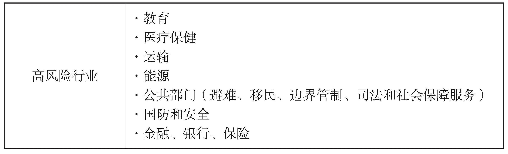

**（续表）**

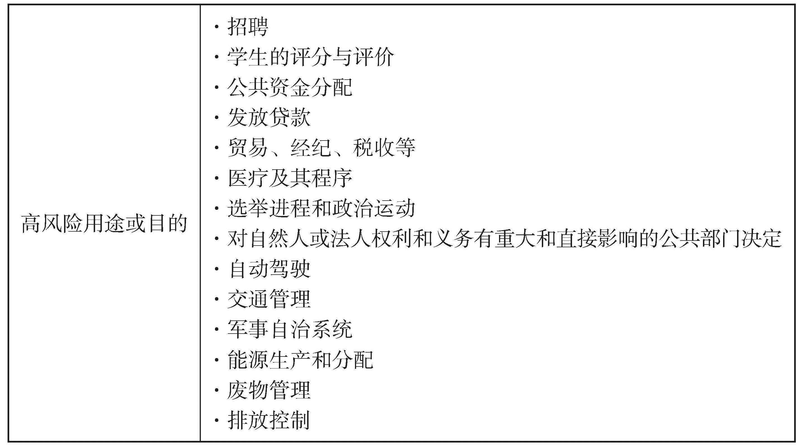

从表2-1可见，欧盟以行业、用途和目的为维度划定高风险AI，为后续立法提供指引。

沿此思路，欧盟于2021年4月21日公布《人工智能法案》，主张基于风险的监管框架，首要区分“高风险AI系统”^((49))和后续将介绍的“禁止性AI实践”^((50))。法案第三编详细规定了高风险AI的定义、分类规则、风险管理体系^((51))及各方权责^((52))。虽正式生效尚需时日，其内容已对全球AI立法具有重要参考价值。下面仅简述高风险AI的评估标准。

法案第7.2条指出，评估AI系统对健康安全或基本权利的潜在威胁时，应综合考量：^((53))（1）系统预期用途；（2）使用频率和规模；（3）对健康安全或基本权利的实际或潜在损害程度；（4）潜在损害的严重性，尤其对群体影响；（5）系统输出可能带来的群体性伤害；（6）因权力、知识、经济、社会环境或年龄差异导致的用户不公平或歧视风险；（7）对健康安全的实质影响程度；（8）对现有法规构成的潜在冲突风险。^((54))

总体而言，欧盟通过行业、用途、目的的风险差异进行列举，并以法案细化评估标准。核心判断在于该应用场景是否触及公民基本权利、健康安全或现有法律秩序。

##### 3．不可接受的风险应用场景
不可接受风险的AI场景，是指会对人类伦理、社会秩序和基本权利造成重大冲击的技术，必须以立法方式禁止。历史上，生物克隆即是先例：克隆人类将严重冲击伦理并扰乱社会秩序，因此国际社会在发展该技术的同时一致禁止“克隆人”等特定用途。AI领域同样存在因风险不可接受而应被禁止的场景。

法案第5条明确禁止下列AI上市场或使用：^((55))（1）以不可感知的方式部署潜意识操控技术，严重扭曲个人行为并造成身体或心理伤害；（2）利用年龄、身体或精神残疾等弱势群体的脆弱性，实质性操纵行为导致伤害；（3）公共机构以社会行为或预测性人格特征对自然人进行信誉评估或分类，导致歧视性不利待遇；（4）除特定执法目的外，在公共场所实时远程使用生物特征识别系统。

总之，AI技术本身并非全然禁止，关键在于具体场景的风险程度。若风险不可接受，则该产品或应用需被禁止。例如情感计算技术借助高清摄像头等手段，让机器具备模拟人类情绪并干预情绪的能力，在“智慧课堂”中可用于分析学生状态提升教学。但因其可被用于潜意识教化和行为扭曲，若流入不当之手将带来不可接受风险，故在影响潜意识的场景中应被禁止。

##### 4．低风险等级与风险有限的应用场景
除被明令禁止的不可接受风险场景和法定高风险场景外，其余AI应用一般被归为低风险或风险有限。例如AI垃圾邮件过滤系统，通过大数据和深度学习筛查关键词判断邮件性质。即使出错，最多是漏拦广告或误拦正常邮件，用户可手动找回或停用功能，并不会带来严重损失。

法案第52条提出具有普遍指导意义的透明度义务^((56))。对低风险场景同样适用：其一，AI系统应以可感知的方式与人交互，让使用者明确自己正在与AI打交道；其二，使用情绪识别或生物特征分类时，需告知用户系统运作方式；其三，若AI生成图像、音频或视频高度仿真易被误认为真实，必须披露为人工生成^((57))。这与深度伪造场景的披露要求一致。类似地，我国的《电子商务法》第40条要求平台对竞价排名商品显著标注“广告”^((58))，因其易误导用户。同理，AI生成内容因过于逼真易致误认，使用者负有披露义务。

综上，对低风险或风险有限的AI场景，供给方有告知义务，使用方有内容披露义务，二者共同保障透明度，降低使用中的不必要风险。

#### （二）按照司法应用领域划分的应用场景
在司法体制改革推进下，我国正推动司法从信息化向智能化迈进。北京智慧法院、上海“206系统”等都是AI司法落地的典型案例。下面以“206系统”在公安、检察、法院的智能辅助应用为例，简要介绍实践进展。

##### 1．公安系统
AI在公安领域主要体现在三大方向：智能侦查办案、智能巡逻防控、智能信息预警。^((59))以下聚焦“206系统”在智能侦查办案方面的实践。

**206系统：当AI走进办案与城市治理**

206系统在证据指引上的价值，本质是给侦查人员一张动态的取证导航图，再对已固化的材料做合规合规性复核，从而让取证更完整、更规范、更高效。指引逻辑大致落到三类操作。

第一类是按案型分类提示。依据待查证犯罪事实的相似程度和取证思路的趋同程度，把案件归到不同类型。系统在判读案件共性与差异时，除了按类型给出基础证据底线，还会针对具体情境智能提醒重点取证方向，碰到特殊事实时也能提示审查要点和取证方法。

第二类是按证据链分层提示。围绕构建完整闭环证据链的需求，以侦查推进为线索把链条拆解成若干节点，提示办案人员在每个流程节点该如何铺设链条；同时以链条为线索反推需要查清的事实和需要固定的证据，并以清单形式呈现。

第三类是按办案阶段分段提示。系统会根据案件推进进度，分别列出强制措施阶段和裁判阶段的证据门槛，智能提示不同阶段的证据要求和侧重点，匹配各阶段对证据充分性的差异化期待。AI辅助下的核心意义在于，公安、检察、法院能够依托同一套指引适用统一证据标准，从侦查源头实现标准同频，发挥三机关相互制约的制度功能。

在审讯环节，206系统能把案件事实要素和讯问焦点提炼出来，搭建要素化讯问模型。讯问进行时系统会实时提醒办案人员按事实要素提问和记录，协助梳理案情、及时捕捉矛盾点，避免因经验欠缺导致细节缺失，保证笔录客观完整合法。智能标注的思路与法院端相近，系统对审讯数据做分类、框选、点标、注释等处理，先由人工标注以供机器学习。AI通过归纳笔录中的事实要素、讯问要点和技巧，实现内容自动标注，为办案提供要素指引，保障笔录质量。目前智能审讯模块已包含11项子功能：

**表 2-2　“206 系统”子功能一览**

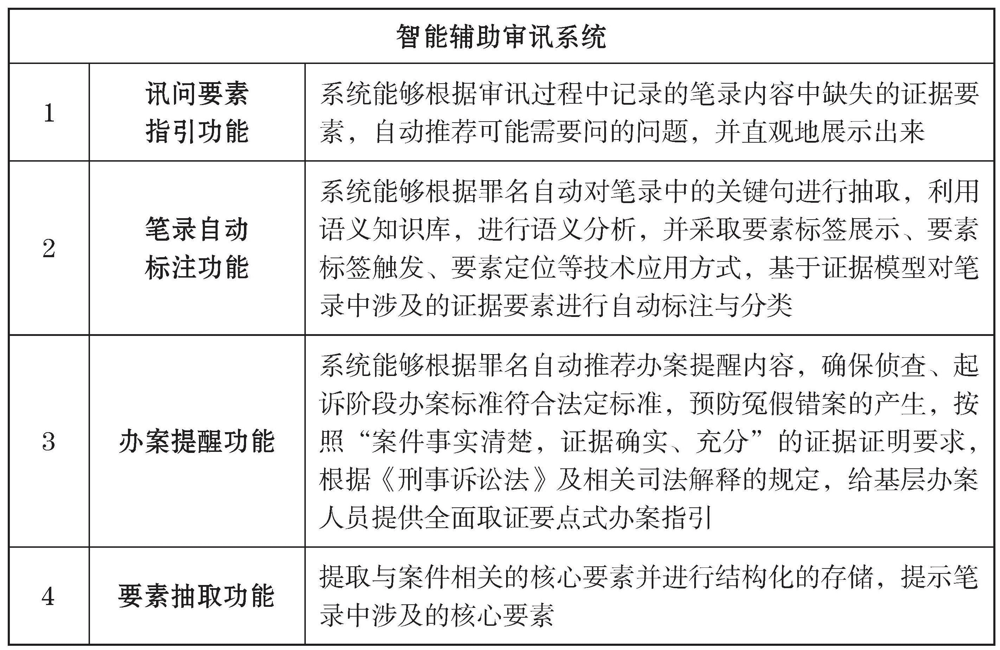

**（续表）**

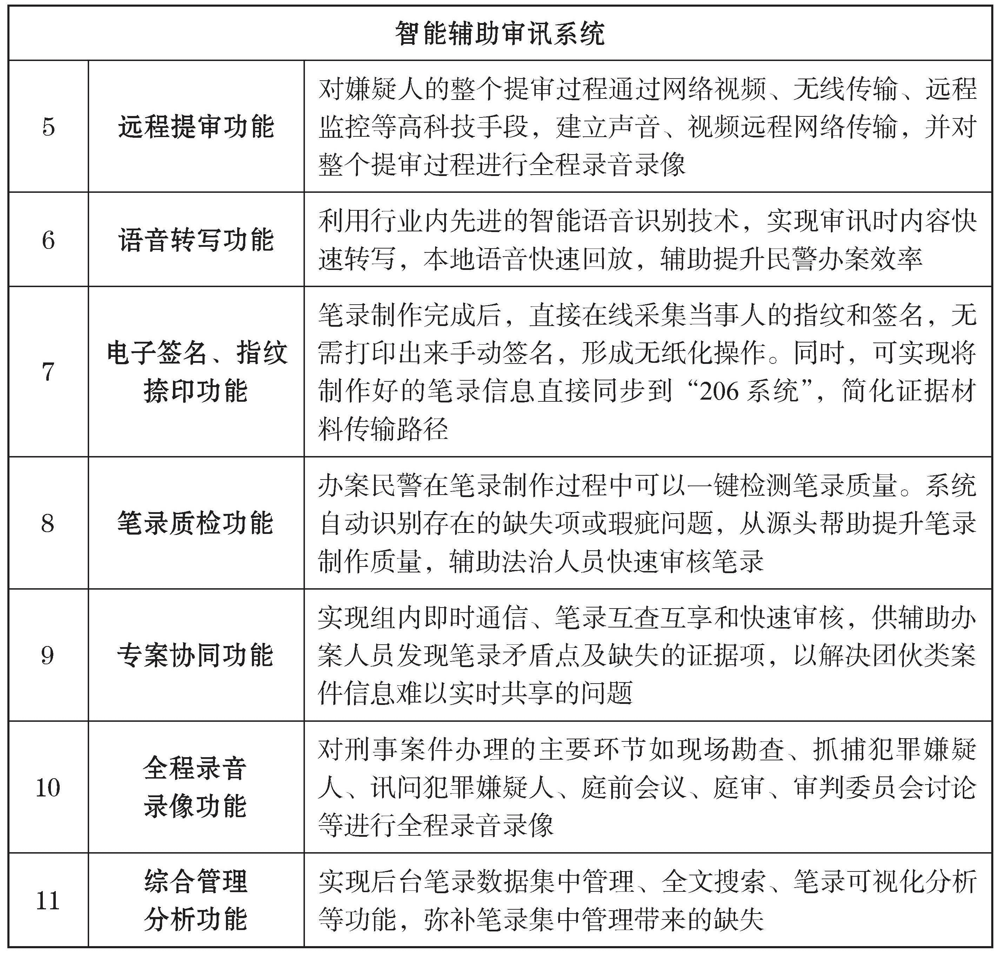

该模块实际作用可归纳为三点。一是笔录智能识别与自动标注，缓解人工标注压力，便于审查起诉和审理阶段对材料的提炼，明显降低人工成本。二是强化办案人员的证据意识与程序意识，保证讯问笔录客观完整合法，有效遏制虚假供述的产生，倒逼审讯严格依法进行。三是提升公安办案质效，推动审讯从传统模式向现代化智能化模式转变。

##### 2．检察系统
检察机关的AI应用集中在智能审查辅助和量刑建议辅助两条线。智能审查辅助帮助检察官审查证据，判断是否逮捕、是否提起公诉。量刑建议辅助抓取案情、法条与量刑情节数据，对裁判刑期进行归纳分析，为检察机关提出量刑建议提供依据。^((60))下面简述206系统在这两块的应用。

智能审查辅助围绕证据审查体现为三类。单份证据审查具备校验与批注功能。侦查阶段系统已对单一证据从程序、形式、内容三方面自动核验，发现瑕疵即智能提示补正或说明。证据流转到批捕、公诉阶段时，检察人员可针对系统提示的瑕疵及前手补正说明进行复核并表态是否采纳。检察人员还可按需要添加批注，标签包括系统内置的与证据链待证要素相关标签、出庭示证标签、社会危险性标签等，也可自定义。系统依据标签提取、分类并推送相关要素，支撑后续工作。

证据链完整性审查与公安做法相近。系统依据侦查阶段的标注对材料分类推送，进入批捕公诉阶段后，检察人员一方面可审核公安审查结论并提出独立意见，另一方面系统对检察人员新增批注进行分类推送，便于重点审查。

言词证据审查借助语音识别把音视频转成文字，便于核查真实性。过去审查存疑笔录需全程播放录像并与笔录对照，命案案件需反复查看多次讯问，耗时费力。转文字后阅读耗时远低于重看录像，关键字段还可通过关键词检索高亮。例如某案嫌疑人供述犯罪地点，经在转写文件中高亮检索发现该关键词首次出现系侦查人员提示，由此判断存在诱供导供情形，排除该证据效力。该功能对提升审查效率与非法证据排除具有重要意义。

量刑建议辅助系统把影响社会危险性程度的要素细化为七个方面32项指标并赋权。检察人员在证据审查批注过程中把相关内容标注为社会危险性标签，系统提取聚类后推送至对应指标项下，计算危险系数，为检察官提供参考，提升评估的全面性、科学性与准确性，进而形成清晰可视的案件结论，为是否逮捕、是否公诉提供依据。

##### 3．法院系统
AI在辅助文书处理与辅助案件审理方面潜力巨大。下面简述206系统在这两方面的应用。

206系统在文书处理方面具备阅卷笔记功能，模拟法官对纸质卷宗标注的特点，通过机器学习大量人工标注案例卷宗，智能标注“证据”“事实”“定罪”“量刑”等标签，辅助阅卷。系统可在庭审中自动提取、归类并展示标签供法官参考，也可在案件评议及裁判文书撰写时直接调取标签，突出庭审重点、提高效率、辅助文书处理。

在案件审理辅助方面，系统具备基于大数据分析与语义识别的类案推送和量刑参考功能。类案推送依据在办案件特征，通过语义识别、大数据分析和智能搜索，向法官推送相似度高或证据匹配度高的案例。法官输入关键词后，系统按案情相似度排序供查阅。量刑参考功能依托海量历史判例，依据最高人民法院、最高人民检察院《关于常见犯罪的量刑指导意见》拆解量刑步骤，先对量刑结果进行人工标注，形成量刑起点、基准刑、宣告刑三个维度的数据样本训练模型，再分析量刑过程建立预测模型，为法官提供参考。法官也可根据案件事实调整基本情况，利用AI模拟测算量刑。

自2019年1月至2020年5月，上海法院系统使用206系统受理案件34831件，审结案件30976件，累计录入证据材料14047275页、提供证据指引541754次、提供知识索引8331次、提示证据瑕疵28309个，有力推动了AI在法院系统的应用。

#### （三）按照管理和服务划分的应用场景
伴随现代化推进，社会管理和服务要求不断提高。在物联网和大数据支撑下，AI在数据分析方面的优势明显，能够助力管理者和服务商更精准、迅速、高效地开展工作。

##### 1．“一网通办”和“一网统管”
城市信息化升级背景下，将AI和大数据应用于城市管理服务的时机日趋成熟。上海市打造的“一网通办”政务服务平台和“一网统管”城市管理平台是代表性实践。

“一网通办”依托政府网络平台建立统一的互联网政务处理入口，将线下办理转为线上办理，使企业和群众无需多部门奔波。自2018年7月1日上线至2021年5月，网上政务办理比例达60.88%。^((61))平台接入近60个政府部门、近3197项事项，总办件量超1.5亿，日均办件13.4万。海量数据的快速处理离不开AI，线上办理优化服务体验，加快政务解决效率。

“一网统管”是配套举措，依托城市监管平台覆盖公共管理、公共安全、公共服务等社会治理体系的综合性线上管理平台，提升监管效能，帮助管理机构及时发现问题、对接需求、研判形势、预防风险。

2021世界人工智能大会上，上海市城市运行管理中心主任徐惠丽指出，上海以AI赋能数字政府和城市运行管理的逻辑是践行“人民城市人民建，人民城市为人民”。她同时提出两大挑战：其一是如何实现线上线下协同，涉及管理理念与技术赋能形成新的协同；其二是超大城市治理体系中如何利用AI分析大数据实现未然防范，如基于管理经验在机器学习基础上更好预测城市需求和发展走向并储备调拨资源。结合AI弥补传统“人治”短板，可大幅提升治理效能。^((62))

“一网通办”“一网统管”与大数据、AI形成互促关系。一方面，二者将大数据应用于城市治理，利用AI分析数据提供实践依据，面对海量多元异构数据，让政府多角度看待城市管理并分析市民多元需求。另一方面，政府在大数据和AI助力下更高效人性化，而平台产生的海量应用场景也成为城市大数据重要来源，生产行为、社会行为和政府管理行为产生的大量数据使社会数据资源日益丰富，为AI助力城市管理提供前景。

技术层面，AI赋能城市管理的关键在于算力、算法和数据实力。算力侧重硬件基础设施，算法体现工程师将复杂政务流程梳理为科学高效流程的能力，三者中最重要资源是数据。“一网通办”“一网统管”既是数据使用者，也是生产者、制造者，高质量数据使算力和算法得以发挥作用，推动数据及相关算力算法赋能各行各业，打造智慧城市。

政府管理层面，“一网通办”“一网统管”促进城市管理联动。管理需多部门联勤联动并灵活调整方向，AI对大数据分析是判断关键。需以多维度高精度高密度数据采集构建城市感知力，进而形成执行力和作业能力。智慧转型中感知层搭建只是首要环节，需从管理结构和流程再造入手，打通部门壁垒，提升政务效率，即融合打通横向部门数据壁垒，克服跨部门协调低效等难点，实现城市管理扁平化。

具体场景层面，城市管理事项日益庞杂，跨部门事务大幅增加。多部门协同和大数据互通可实现数据畅通、管理流程畅通、指挥畅通、考核畅通。通过“一网通办”和“一网统管”将城市按标准划分为边界清晰、规模适宜的“网格”并下沉至街镇社区网格化平台，可快速发现问题并联动解决。“一网统管”利用AI和大数据将城市管理变为可编程组织，把政务问题拆解为基层可作业的社会面问题。如基层网格员接到平台派发的政务问题现场处置后，AI算法自动将人工拍摄的问题“派单”至相应部门，触发后续流程。网格化管理大幅降低AI应用门槛，AI算法可广泛应用于城市管理，成为智慧城市建设基石。

##### 2．人工智能在法律服务领域的应用
据亿欧智库《2018人工智能助力法律服务研究报告》，从产品形态看，AI在法律领域主要体现为信息检索、文书审阅、案件预测、智能咨询四种形式。其中信息检索和文书审阅与辅助系统类似，通过机器学习司法大数据辅助律师工作。智能咨询主要指当事人通过智能问答平台咨询，平台依案情给出法律建议，通过自然语言识别实现更清晰的问题理解、分析和回答。平台主要替代律师针对婚姻、劳务、民间借贷、知识产权等常见简单纠纷先行咨询，后续基于平台了解的案件信息智能推荐匹配律师。

平台通过自然语言处理识别用户诉求，并根据案件具体情况为当事人匹配推荐律师。以“右上角”知识产权保护SaaS平台为例，当事人或律师注册后将信息和诉求上传至平台，平台通过数据分析和AI算法智能匹配，辅助双方完成法律服务。

##### 3．人工智能在社会治理领域的应用
在“智慧城市”建设背景下，利用AI推进社会治理成为提升人民生活水平的新思路。以下从疫情防控、智慧教育、智能安防三方面简述成果。

###### （1）疫情防控
中国人工智能产业发展联盟2020年3月发布的《人工智能助力新冠疫情防控调研报告》显示，疫情期间各地均应用AI打造疫情防控急救综合管理平台。如京东推出的应急资源信息平台可对区域物资可视化展示并整合全国防护用品交易，极大提升物资管理流动效率。^((63))以上海“一网通办”“一网统管”平台为例，介绍其防控应用。

2020年1月20日上海出现16例本地确诊病例，通过平台第一时间启动应急机制，迅速锁定场所、病例、识别对象，开发疫情智能防控系统，精准有序遏制疫情。截至1月27日累计筛查4.1万多人，疫情迅速受控。随着防疫重点转向境外输入，系统纳入境外人员服务系统，集纳入境、集中隔离、居家隔离等信息，大幅提升效率。平台汇总各小区居家观察人数、健康状况、重点地区来沪人数、小区封闭状况、卫生消毒状况等数据一目了然，深刻改变流行病学调查。如数据显示部分区隔离点酒店已满，部分区几乎空置，结合住建部门建筑数据可更高效调整，筑牢防控屏障。

系统结合社区基层力量成效显著。居家隔离监测涉及公安民警、卫生防疫站、居委会，需联勤联动。系统确认隔离人员返小区后，公安民警12小时内上门确认，居委会负责每日消杀和体温测量，定期上门查看，确保万无一失。

###### （2）智慧教育
AI在教育领域主要集中于知识归类与匹配高效教学模式，场景包括智能评测、个性化辅导、儿童陪伴等。^((64))据亿欧智库《2018人工智能赋能教育产业研究报告》，外语语音评测、智能批改和习题推荐、分级阅读、教育智能机器人和智能陪练是应用较广的产品。报告指出，相较传统以教师家长为主的教学，AI实现以学生自主学习为主的流程。智慧教育从知识状态检测开始，分析学生知识结构与储备，智能规划学习路径，推荐学习内容和习题，并实时优化调整教学内容，提供更智能高效的学习环境。

###### （3）智能安防
据民生证券2019年8月发布的《民生计算机人工智能专题报告之一》，强化计算机视觉处理是智能安防核心应用场景。如公安部主导的“金盾工程”“天网工程”、科技部和公安部主导的“平安城市”、中央社会治安综合治理委员会主导的“雪亮工程”等。

计算机视觉与安防结合具备场景明确、技术积累充分、政策鼓励等优势。处理安防影像技术已较为成熟，是AI快速部署重要因素。政策指导也加速应用。以人脸识别为例，芯片高速发展为算法提供超强算力，具备足够算力的摄像机芯片为算法运行提供高效环境。成熟算法可自动优化非正常条件下的高清成像，更精准识别人物、车辆特征及行为信息，实现多维数据感知。安防部门通过AI加持的人脸识别摄像头可预判异常情况并提前预警，录像功能也支撑事后线索查找和事中遗留线索追溯。

安防现场正在换脑。用往常的说法，过去靠人盯屏，现在让机器来判断处置，反应更快判断也更准，这就是智能安防正在发生的转变。

## 第四节 法治赛道里AI必须遵守的五条行事红线
我国手里有数据规模的优势，从中央到地方的政策在持续加码，应用场景旺盛、市场环境开放，过去几年AI产业跑得很快。基础研究和工程化能力已经进入全球第一梯队，计算单元、模型算法、开放平台迭代加速，计算机视觉、自然语言理解等方向已达到国际先进水平。^((65)) 法治场景对智能化的需求也在快速升温，然而变革的另一面是算法偏见、技术黑箱等风险在累积，健康发展与有效管控成为当下焦点。2019年6月17日，国家新一代AI治理专委正式发布《新一代人工智能治理原则——发展负责任的人工智能》，为全行业划边界，把发展和治理绑在一起，确保技术可靠可管，推动经济社会生态可持续发展，共建人类命运共同体。

在此框架下，结合全球经验和国内法治建设的实际需求，AI进入法律领域要把握的底线是这五条：

### 一、合规是底线
AI门槛高、渗透广，已经扎进工作生活的各个角落，直接牵动个人利益。技术天生带有黑箱属性，从研发设计生产到测试销售流通使用，整条链都需要规则约束和法律边界。各国都把合规当成治理的第一道门。国内《新一代AI治理原则》在共担责任部分要求各方严格守法守德守规；美国在《AI应用监管指南备忘录草案》中要求可能实质影响公共政策或商业决策的系统必须合法合规；日本人工智能学会伦理准则也强调系统要守法，《人工智能利用原则草案》提出合理使用要求。

2018年10月政治局集体学习时强调，要强化潜在风险的预判与防范，维护人民利益和国家安全，确保技术安全可靠可控；要整合多学科力量加强法律伦理社会问题研究，建立健全保障健康发展的法规制度体系。落到法治应用，就是所有相关活动必须遵循信息技术、网络安全、数据治理、隐私保护、业务监管等领域的规范，守住底线红线，既保障个人正当权益，也维护公共利益和社会公平正义。行为本身必须在法律框架内进行，同时鼓励责任主体采用高于法条和现行标准的国家标准、行业标准和自律标准。要紧跟应用的新变化，深化智能法律应用的共性问题研究，构建更具本土特色、适应智能时代的多层次智慧法治体系。

### 二、过程要透明
相比以往技术，AI系统的运行逻辑和环节配合更难被普通人读懂，透明的要求更突出。算法正在重塑秩序，形成代码治理。少数平台掌握的数据和技术能力甚至超过政府，客观上拥有更大权力。当公众越来越依赖定制化公共服务时，AI对基本权利的潜在影响必须被看见，要像监督公权力一样约束这些力量，把技术关进制度的笼子里。

研究与应用应保持开放，尤其是对人类影响重大的系统，更需公开与监督。透明度是阿西洛马AI原则的组成部分，核心是通过信息公开破解算法黑箱造成的信息不对称，促进风险防控。内容包括可解释性、可溯源性、可理解性、信息披露与信息展示，已被多国采纳。新加坡IMDA在《AI治理和伦理三项倡议》中要求系统具备可解释性和透明性；美国则把信息披露作为透明度的有益补充，实现风险管理与产业激励的双重目标。

透明度围绕算法和数据展开。算法层面，黑箱解释并非无解。以行政执法自动化决策为例，有价值信息主要在数据采集阶段形成，公众了解系统一般规则即可，无需完全掌握单次决策逻辑。法律关注的是可解释性而非可阐释性，重在输入与输出的关联，而非内部运行细节。公众有权以通俗方式知晓算法制定主体、程序、规则、监督与责任机制，政府主导的基础知识普及也是透明的重要支撑。数据层面，鉴于对大数据的依赖，公众应清楚知晓个人信息如何被使用与保护，这是欧盟《通用数据保护条例》与中国《个人信息保护法》的重点。

透明度还要求知情参与。通过了解技术信息，公众信心增强，支持产业发展，也便于理解立法执法司法部门，促进法治应用健康有序发展。

### 三、风险要可控
AI高速发展同步，安全与风险被推向新高度。风险不仅涉及法律伦理，还波及社会经济军事等重大领域。国务院《新一代人工智能发展规划》明确要求高度重视安全风险挑战，加强前瞻预防与约束引导，确保安全可靠可控发展。欧盟《可信赖AI伦理指南》也要求预防伤害，在追求系统利益最大化的同时降低安全风险。

实践中，数据不安全与算法不安全是制约发展的主要因素。安全指数据安全与算法安全，需解决隐私泄露、数据投毒等隐患，提升算法鲁棒性与可靠性。可控既指应用层合规可控，也指核心技术自主可控，应以自主可控为根基，形成具有知识产权的产品与应用。安全可控是高质量发展的核心基准。

原则涵盖安全、稳健、无害、非恶意、预防、保护、完整性等要素。落实层面，一要强化研发者、使用者等相关方能力与行为规范建设；二要加强AI加法治交叉理论研究、模型测试、安全评估与审计体系建设，提升透明性、可靠性、可控性，实现可追溯、可信赖、可审计。应按分级分类管理确定不同场景的解释程度，不可因黑箱回避解释。做好技术提供方尽职调查、风险隔离与退出管理，避免过度依赖；三要建立有效的安全评估体制机制。风险难以完全避免，但通过充分评估可降低风险并明确责任。应针对隐私权、信息权、知情权、知识产权、未成年人保护等可能受影响领域，预判法律、安全、伦理与社会治理风险，开展前瞻性研究，确保安全可靠可控。

### 四、人本优先
科技创新的终极指向是造福人民，技术具有双重属性。中央多次强调要把科技创新摆在国家发展全局核心位置，把满足人民对美好生活的向往作为落脚点，坚持惠民利民。AI法治应用必须服务人民，坚持技术为民，成果应更公平惠及全体人民。

这条要求尊重人的自主权与尊严。AI让以人为本有了更多实现路径，而以人为本亦是良性发展的基础。IBM深蓝击败卡斯帕罗夫后，自由式国际象棋显示，人机组合的胜负关键不在硬件强弱，而在流程设计。美国业余棋手以三台普通电脑配合人类战略指导战胜拥有先进计算机的“大师”，形成弱人机加好流程优于强人机加差流程的卡斯帕罗夫定律。核心在于人机协作方式，以人为本是评判标准。

新加坡《人工智能治理模式框架第二版》提出，设计开发部署的首要考虑应是扩大人的能力、保护人的利益与安全。仅优化算法不够，整体决策流程需精细设计。最终用户应充分了解工具，通过可视化传达假设、局限与数据特征，建立使用指引与业务规则，明确何时如何根据算法结果行动。更好的人机协作有助于缩小算法输出与预期差距。AI本身不创造价值，服务于实际场景、解决具体问题时才产生价值。

在法治应用中，一方面要以维护人民法治权益、增进公平正义为导向，尊重社会共同法治观与伦理道德，开发有温度、人民中心的智慧法治服务；另一方面坚持守正创新、技术向善，建立公民权利保护机制、隐私安全政策、风险防范与应急处置安排，在数据获取、算法设计、研发与应用中消除偏见与歧视，禁止滥用与恶用，避免误用。要坚持底线思维，把人置于技术算法之上，把用户数据权利置于核心，真正实现人本导向。

### 五、权责必须对等
机器自主性超出预期，对责任配置提出新要求。需围绕技术开发与应用建立明确责任体系，使AI引发伦理或法律冲突时，能在技术层面问责开发者、设计者，在应用层面建立合理责任机制。核心是可问责：设计与使用中保留算法、数据与决策记录，损害发生时可审查、追溯责任归属。可追责、可问责已成为多国规制文件的共识。日本内阁府《以人类为中心的人工智能社会原则》按角色分配后果与责任；欧盟《可信赖AI伦理指南》与《算法责任与透明治理框架》均强调问责机制与负责任研究创新。

伦理要求不仅要人类遵守，也应嵌入AI本身。AI模拟、延伸人类智能，决策可能产生不可预见后果，故系统本身也需受伦理规制。

实现路径：一是应用机构与主管部门应构建科学合理的治理框架，对应用结果负责，建立清晰透明公开的权责清单，通过立法与标准明确各方权利义务责任，建立全流程问责机制；二是坚持负责任智慧治理理念，通过信息公开、风险预防、结果公示、使用声明维护当事人知情权、自主选择权、公平交易权、信息安全权，与合作方审慎签约，明确风险承担、功能安排、数据管理与后果追究边界；三是建立算法公共审查制度，提升纠错可能性，确保非涉密数据合理记录、算法受监督、法治应用受合理审查。

总体看，AI在法治领域已取得一定成效，但技术仍在演进，大规模落地仍面临数据、成本、安全、人才等显性隐性障碍。技术黑箱、算法共振、算法歧视、数据高依赖等现实问题，可能导致责任边界模糊、智慧司法鸿沟、隐私泄露等风险，必须高度重视并采取有效规制措施。

(27)　崔亚东主编：《2020 世界人工智能法治蓝皮书》，上海人民出版社 2020 年版，前言第 1 页。

(28)　吴汉东：《人工智能时代的制度安排与法律规制》，《法律科学》（西北政法大学学报）2017 年第 5 期。

(29)　苏力：《法律与科技问题的法理学重构》，《中国社会科学》1999 年第 5 期。

(30)　张文显：《构建智能社会的法律秩序》，《东方法学》2020 年第 5 期。

(31)　张文显：《构建智能社会的法律秩序》，《东方法学》2020 年第 5 期。

(32)　张文显：《构建智能社会的法律秩序》，《东方法学》2020 年第 5 期。

(33)　崔亚东：《人工智能与司法现代化》，上海人民出版社 2019 年版，第 9 页。

(34)　李占国：《互联网司法的概念、特征及发展前瞻》，《法律适用》2021 年第 3 期。

(35)　同上文。

(36)　同上文。

(37)　同上文。

(38)　崔亚东主编：《世界人工智能法治蓝皮书（2019）》，上海人民出版社 2019 年版，第 124 页。

(39)　季卫东：《人工智能开发的理念、法律以及政策》，《东方法学》2019 年第 5 期。

(40)　张文显：《构建智能社会的法律秩序》，《东方法学》2020 年第 5 期。

(41)　季卫东：《刚柔兼济治理人工智能网络社会》，《社会科学报》2019 年 7 月 4 日。

(42)　同上文。

(43)　张文显：《构建智能社会的法律秩序》，《东方法学》2020 年第 5 期。

(44)　季卫东：《刚柔兼济治理人工智能网络社会》，《社会科学报》2019 年 7 月 4 日。

(45)　季卫东：《刚柔兼济治理人工智能网络社会》，《社会科学报》2019 年 7 月 4 日。

(46)　《危险化学品安全管理条例》第 3 条。

(47)　欧洲议会，*人工智能、机器人及相关技术伦理方面框架*（“人工智能框架”），https://www.europarl.europa.eu/doceo/document/TA-9-2020-0275_EN.html，访问于 2021 年 7 月 21 日。

(48)　人工智能框架，第 14 条：... 人工智能、机器人及相关技术在开发、部署和使用过程中存在对个人或社会造成伤害或损害的重大风险，违反欧盟法律规定的基本权利和安全规则时应被视为高风险...

(49)　人工智能框架，第 22 条：... 高风险的人工智能、机器人及相关技术，包括此类技术所使用或产生的软件、算法和数据，无论其在何种领域开发、部署和使用，均应以安全、可追溯、技术稳健、可靠、合乎伦理且具有法律约束力的方式进行设计，并接受独立的控制和监督...

(50)　人工智能法案，第三章。

(51)　人工智能法案，第二章。

(52)　人工智能法案，第 9 条。

(53)　人工智能法案，第 24—29 条。

(54)　人工智能法案，第 7 条。

(55)　根据法条内容有所增减。

(56)　人工智能法案，第 5 条。

(57)　人工智能法案，第 52 条。

(58)　人工智能法案，第 52 条。

(59)　《电子商务法》第 40 条。

(60)　崔亚东：《人工智能与司法现代化》，上海人民出版社 2019 年版，第 40—41 页。

(61)　崔亚东：《人工智能与司法现代化》，上海人民出版社 2019 年版，第 39—40 页。

(62)　徐晶卉：《人工智能技术赋能上海“两张网” 推动治理体系和治理能力现代化》，《文汇报》2021 年 7 月 10 日。

(63)　徐晶卉：《人工智能技术赋能上海“两张网” 推动治理体系和治理能力现代化》，《文汇报》2021 年 7 月 10 日。

(64)　中国人工智能产业发展联盟：《人工智能助力新冠疫情防控调研报告》，2020 年 3 月。

(65)　崔亚东：《人工智能与司法现代化》，上海人民出版社 2019 年版，第 31 页。

(66)　根据世界知识产权组织有关报告，2019 年我国申请人工智能专利的数量位居世界前列，与美国、日本合计占全球总量的 78%。

(67)　例如，《网络安全法》《数据安全法》《个人信息保护法》等。此外，国内不少地方正在积极探索有关人脸识别方面的地方立法。

(68)　参见王成：《人工智能法律规制的正当性、进路与原则》，《江西社会科学》2019 年第 2 期。

(69)　季冬梅：《人工智能透明性原则的制度构建：范式选择与要素分析》，《科学学研究》，https://doi.org/10.16192/j.cnki.1003-2053.20210603.001。

(70)　周辉等：《人工智能治理：场景、原则与规则》，中国社会科学出版社 2021 年版，第 28 页。

(71)　欧盟委员会：《可信赖人工智能伦理指南》（可信赖人工智能伦理指南），https://digital-strategy.ec.europa.eu/en/library/ethics-guidelines-trustworthy-ai，2021 年 6 月 30 日访问。

(72)　周辉等：《人工智能治理：场景、原则与规则》，中国社会科学出版社 2021 年版，第 33 页。

(73)　具体原则包含七个方面：一是公平分配数据以避免对弱势群体过分不利；二是从数据和先进建模技术的使用中创造尽可能大的利益；三是参与数据实践，鼓励有利于人类繁荣、人类尊严和人类自主的实践；四是重视对受数据应用影响的人和社会进行深思熟虑的判断，并且这种判断与受影响的人和社区的价值观和伦理原则保持一致；五是作出的决定不应对个人造成可预见的伤害，或者当在必要时为了更大利益，至少应尽量减少这种伤害；六是允许用户保持对使用中的数据、数据应用的场景以及修改数据和场景能力的控制；七是确保人工智能系统的功能核心是用户的整体福祉。

分论

## 第三章 AI如何重塑法案生成链路

### 本章摘要
法案制定是法治运行的核心枢纽。引入 AI 与大数据等新工具参与制法流程，能明显提升整体效率，但在覆盖广度和使用深度上，当前阶段仍显不足。本章以法案各环节为线索，梳理技术支撑与现实路径，并对当下进展、主要瓶颈与未来走向作整体呈现。

### 第一节 AI介入法案制定的底层逻辑
《立法法》明确在制法过程中要高度重视公开、参与、听证、调研与论证，以保障法案的有效性、针对性与可操作性。过去的实践多依托座谈会、论证会、听证会以及基层联系点和网络问卷等手段开展调研。该路径长期发挥作用，也沉淀了不少经验。但调研视野不够宽广、评估结论欠实、材料梳理过于繁琐等问题仍在。

在数字化浪潮下，借助 AI 弥补传统制法的先天缺陷成为可能。比如通过网络平台实现大范围调研、利用算法快速检索比对海量文件、借助知识图谱对采集数据进行关联分析。法案机关需要在继承既有经验的基础上，摆脱感性判断、经验堆砌、碎片化数据与试点归纳等浅层思维，构建贯通全链条、多层面的信息传递与集体决策机制，让法案判断与决策真正建立在数据获取、运用与分析之上。^((1))

#### 一、AI参与制法的价值取向
##### （一）全流程提效与公众参与度提升
准备阶段把 AI 用于预测和规划，有助于信息采集更完整客观，也让预测结果更可信。准备工作关系法律落地效果，直接决定法案能否成为权威依据。^((2))依托大数据采集、智能筛选与关联分析，法案者能迅速把握海量信息，作出更合理的取舍。

制定阶段将 AI 嵌入草案起草、征求意见、审议、表决、公布等环节，可提升文本的全面性与客观性。比如征求意见过去多局限于官方渠道，公众参与度偏低，2013年《南京市生活垃圾分类管理办法》公开征求意见时一度出现零反馈。AI 打破了以法案机关为中心的单向模式，让每个主体都能便捷发声，多渠道低门槛扩大意见覆盖面，这正是去中心化特征的体现。

完善阶段把 AI 用于法案后评估与备案审查，可提高效果研判准确度与监督效率。传统备案审查工作量巨大易遗漏，AI 借助知识图谱、语义理解与实体关系识别，可对规范性文件进行实时动态追溯审查，让审查真正落地。

##### （二）推进依法治国的必然要求
法治是中国特色社会主义制度完善与治理能力现代化的重要支撑。进入新时代，法治建设进入新阶段，深化依法治国必须坚持科学立法、严格执法、公正司法、全民守法。党的十九大报告提出要增强执政本领，其中就包括“善于运用互联网技术和信息化手段开展工作”。^((3))推动互联网、大数据、AI 与全面依法治国深度融合，是科学制法的关键抓手。

#### 二、技术支撑体系
法案对专业性要求极高，AI 在法律领域的落地难度更大，尤其是对法律语言的精准表达。目前支撑 AI 法案主要有三种技术：专家系统、机器学习与大数据。

##### （一）专家系统：推理智能化
专家系统让计算机能以可理解方式对专业领域知识建模，将专家经验转化为可处理规则。推理本质包含概念、命题与论证三要素，制法活动同样涵盖这些要素。法律推理既有形式逻辑的符号论证，也有非形式的人脑逻辑论证。AI 主要采用形式符号逻辑，专家系统则是该逻辑在形式推理上的深化，为法律推理智能化提供了可能。相比传统论证方式，专家系统是一种基于控制论、通过相关性分析触发自动反应的非线性推理机制。^((4))

##### （二）机器学习：法律语言的自主学习
机器学习是在数据集中发现变量关系并进行预测的自动化过程，标志着计算机从机械操作向自动化演进。AI 具备自然语言处理能力，但法律概念的模糊性与体系交叉性让理解法律语言难度加大。国内已有学者基于 Web Ontology Language 构建法律知识库原型，实现了知识表述与推理。法律本体的研究以索引检索为基础，对文档进行语义分析，从而提高查准率与查全率。^((5))

##### （三）大数据：信息深度挖掘
在网络社群与多元话语主体涌现的背景下，公民知情、表达与监督权得到前所未有的扩展。大数据驱动的 AI 系统不仅能自动采集整理法案信息，还能根据社会事实与制法目标自主筛选有效信息，实现信息选择的自主化。系统围绕制法目标建立数据库，将法规、案例、民意等材料载入内存并结构化存储，主动搜寻筛选、排序更新，最后通过模式识别提取符合目标的信息。大数据在短时间内完成信息采集与资料归类，弥补了人工处理的信息瓶颈。^((6))

### 第二节 AI在法案制定的现实路径
制法本质是发现问题、制定规则、解决问题并实现有效治理。结合制法流程，AI 的具体应用可归纳为七个方面：辅助法案预测、自主整理公众意见并智能分析、辅助法规起草、辅助备案审查决策、辅助社会风险评估、辅助议案审议表决、辅助法案后评估。

#### 一、环节分布图景
##### （一）辅助法案预测
立项论证是法案预测与规划的基础。AI 可通过资料收集与分析实现法案大数据的精准分析，并据此初步判断社会法案需求。预测还需检索社会热点与实践案例以提升准确性。现实中不少机关因资源不足而草率论证，甚至凭感觉、凭领导意志、凭必要性或积极性立项，导致规划与文本脱离社会治理需求。AI 可从三方面解决问题：一是基于检索功能收集社会形势与法案需求信息；二是利用学习思考能力对信息处理分析，输出直观需求；三是据此形成立项论证报告，提示亟需调整的领域。^((7))

##### （二）自主整理公众意见
科学制法、民主制法要求广泛听取各方声音，网上征求意见已成常态。互联网以连接一切为特征，打破时间地点行业限制。2003年孙志刚事件在网络发酵，推动收容遣送制度废除与救助管理办法出台。此后佘祥林冤案推动死刑审判程序改革，三鹿奶粉事件加速《食品安全法》出台，“开胸验肺”事件推动尘肺病诊断标准修订，杭州交通肇事案推动危险驾驶入刑。热度不稳定的网络在关系民生的法案中关注度更高。

AI 还能实现民意收集整理的智能化。2018年6月《个人所得税法修正案草案》征求意见，1个月收到6万余人13万余条意见，人工难以全面快速处理。AI 可通过技术清洗梳理出有价值的修改建议，这正是其优势所在。

##### （三）辅助法律法规起草
制法工作内在规律复杂，AI 辅助起草可缓解制法力量不足。借助深度学习，AI 可自主学习党和国家政策、现行法律规章、司法解释、法学文献及域外立法，并学习相关专业知识；再通过线索发现、法律推理与逻辑推理，为制法者提供可供修改的草案初稿。工作人员借此快速补足行业知识盲区，在提升质量的同时节约制法成本。^((9))

##### （四）辅助立法备案审查决策

立法 AI 化：资料、评估与审议的全链路升级

制定任何一部规范性文件，都需要海内外立法经验的横向参照。单靠分散的法律检索库做碎片查询，完整度和效率都难以达标。全国层面的备案审查信息系统于 2016 年底上线运行，正按“标准、网络、内容、数据”四统一推进省级平台建设，争取早日实现与国家平台的互通以及各立法主体之间的数据联动。2021 年 2 月 24 日，由国家立法机关牵头组建的国家级法规库正式开通并向公众免费开放检索。该库收录现行有效的宪法及修正案、法律、行政法规、地方性法规、自治条例和单行条例、经济特区法规以及司法解释的电子文本。作为法规数据的国家级基础库，系统权威性强、规范性高，为 AI 参与立法备案审查提供了可靠的数据源。^((10))

##### （五）AI 驱动的立法社会效应预判
立法既讲民主也讲科学，方案优选是核心难点。现行评估与立法后评估多沿用典型调查、抽样调查、群众座谈、专家评议等传统路径。AI 可借助大数据围绕各项评估要素构建智能模型，对规范要素在实践中的落实程度进行快速、全面、量化的解析，并对法规可能带来的社会影响做量化预评估，形成带具体数据、典型案例与逻辑推演的初步意见，供立法者进一步深化研究。^((11))

##### （六）AI 赋能草案审议与表决
受新冠肺炎疫情影响，2020 年多地开启“线上两会”，网络履职成为信息技术在草案审议与表决环节的典型场景。2020 年 2 月 24 日，十三届全国人大常委会第十六次会议采取在京组成人员现场出席、京外委员视频出席的混合形式举行，常委会历史上首次。会上现场出席 114 人，视频出席 57 人，合计 171 人。第十七次会议现场出席 123 人，视频出席 47 人，合计 170 人。省级层面也有实践，2020 年 2 月 10 日河南省十三届人大常委会第十六次会议，74 名委员以视频连线和口头表决方式参会，参会率达 92.5%。从线下为主转向线上线下结合，体现了疫情对议事方式与规则的重大冲击。我国对这一新型履职方式持开放态度。依据《全国人民代表大会常务委员会议事规则》，从会议召集、出席人数、议案审议、表决方式看，网络履职是特殊形势下的创新探索，既落实疫情防控要求，也保障了国家权力机关常设机关的正常运转，被评价为符合宪法法律原则和精神的做法。^((12))

##### （七）AI 助力立法后评估
在我国，立法后评估仍处起步阶段，技术成熟度与应用完善度不足，主要表现在主体单一、信息采集与分析困难、报告形式陈旧。AI 可在三方面补足短板。主体层面，过去多由立法机关内部自评，客观性不足；借助互联网赋权与去中心化特征，评估可延伸至全社会，普通民众与社会组织均可表达意见。信息层面，传统方式依赖抽样问卷与听证会，耗时耗力且代表性有限；AI 支持全样本采集，扩大采集对象与方式，更真实反映法规实施效果，并可快速得出客观、真实、具时效性的分析结论。报告层面，传统报告多为冗长的纸质文档，可视化不足；借助多媒体可视化技术，可采用三维模型、时空动态展示等丰富形式，使结论更易理解。^((13))

#### 二、智能立法的典型案例

##### （一）北大法宝智能立法支持平台
该平台以“北大法宝”数据库为底座，构建了贯穿立法全流程的 AI 辅助体系。主要能力包括：依托大数据自动检索匹配上位规范，帮助立法者快速锁定参考依据；自动匹配相关条款，呈现与审查条款最相近的条文供判断；依据法规时效变化提供提醒并辅助已审查文件动态跟踪；识别不同版本的草案，一键生成对照表以呈现差异；依托法律同义词库与自主构建的敏感词库查找相关依据及重点条文；自动汇编立法资料并按需导出，提升工作效率；依据立法流程对公文格式的不同要求自动调整文档，减少人工操作。

其中智能起草系统是贴合智慧立法方向的重要探索。该系统运用 AI 与大数据分析，着力解决立法机关在资料收集、管理与起草环节存在的耗时、整理不全、汇编繁琐、反复查阅等问题。具体应用：利用 AI 与大数据快速收集立法资料，支持篇分析与条分析的智能检索方式；支持一键生成资料汇编，收藏后可直接形成汇编；立法资料库支持在线浏览与条文备注；支持在线起草，起草时可同步参考资料并快速成文，完成后自动生成立法草案。

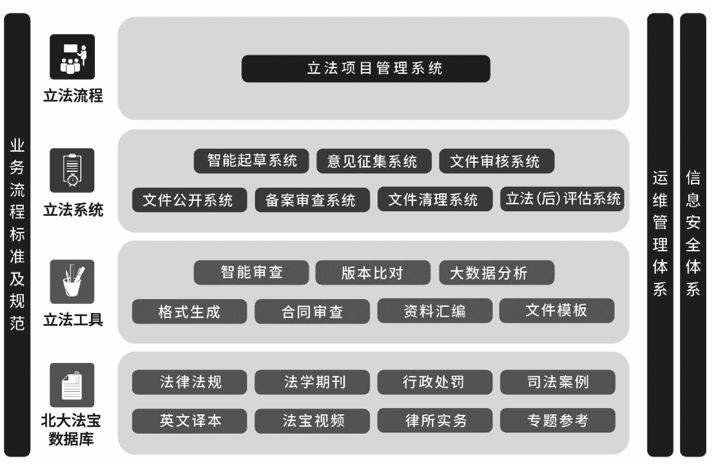

**图 3-1　北大法宝智能立法支持平台**

##### （二）科大讯飞备案审查与行政复议全流程智能化系统
该系统已在安徽、上海等地应用。

智慧备案审查系统通过搭建审查模型，实现新审查件的智能解析与实时提示，可向合法性审查人员智能推荐审查要点、联想关联的法规规章，帮助快速定位问题并完成合法性审查。系统同时构建法规及规范性文件知识库，支持规范性文件的合法性审查。其技术逻辑为：AI 能力平台提取 PDF 或扫描件内容并读取，抽取行政文件涉及主体等关键信息；标签管理平台结合人工标注形成标签；模型生产平台依托历史审查件训练学习，自动生成审查模型并封装组件。批注功能支持语音输入，并记录创建者与创建时间，便于多人协作。

智慧行政复议全流程智能化系统调用 AI 引擎的图文识别与要素抽取能力，读取复议申请书、法人执照、身份证件等材料，抽取申请人、被申请人、复议请求、事实理由、文书文号等关键字段，已实现收、扫、编、录全流程电子化、智能化、自动化。系统具备三大审核功能：识别不属于复议范围的申请并自动提示，辅助受理；基于案情描述、案由、申请人等信息对比，自动识别重复申请；语义理解辅助校验申请归属地，错误时标红提示。审理环节可通过智能复议听证调解系统实现笔录自动生成、同步录音录像、远程调查调解、电子示证质证。智能文书生成系统综合信息进行类案推荐，最终形成行政复议文书。

### 第三节 智能立法应用的挑战与完善方向

#### 一、智能立法面临的挑战
AI 与法律的结合是科技发展的客观趋势，也是新时代法治建设的必然要求。AI 在司法、执法领域的应用较早，在立法领域的渗透相对滞后。AI 辅助地方立法是“AI+法律”的有益尝试，可提升科学性与民主性，但也伴随风险。

##### （一）人大信息化建设亟待强化
AI 立法首先要解决基础数据问题。大数据是原料，云计算是工具，算法是技术，三者结合才构成 AI。法律 AI 系统基于多元融合的法律大数据，通过机器学习实现法律认知，提供一体化知识服务。建设此类系统需要实现法律大数据的归集、开放与共享。当前地方人大及其常委会与地方政府部门之间、中央与地方之间信息归集与共享开放仍显不足。^((14))近年来我国司法智能化发展迅速，最高人民法院连续多年将“加快建设智慧法院”写入工作报告。“智慧法院建设”为“智慧立法建设”提供了标杆。机构改革后，大量法律、法规和规章需制定或修改。中央全面依法治国委员会成立后，可将“智慧立法建设”作为推动依法治国的重要内容，全国人大、司法部也可将其纳入议事日程并开展规划与试点。AI 与立法的深度合作，有助于破解立法难点，提升科学性与效率。^((15))

##### （二）立法知识图谱建设仍需提升
知识图谱以可视化方式呈现知识发展进程与结构关系，通过技术手段挖掘、构建、绘制知识及其关联。法律知识图谱的核心在于机器模拟法律人的真实逻辑，将经验与思维方式转化为算法。借助知识图谱，可缓解现有深度学习技术在法律推理与解释性方面的不足。目前法律 AI 研究多集中于法律适用。但立法与司法存在本质差异：立法是从无到有的规则创设与利益分配过程，包含对适用的理解，更侧重创制合理规则，而非简单重复。AI 立法真正的难点在于大量现实立法问题没有标准答案，需要权衡、需要对社会现实的真实理解与复杂问题处理能力。现阶段立法领域的知识图谱仍处萌芽期，需要立法专家、计算机专家、逻辑专家深度合作，构建立法知识图谱并转化为机器可理解、可学习的语言。^((16))

##### （三）潜在风险问题待解
第一，立法信息过度采集风险。立法信息收集与检索贯穿立法全过程。AI 凭借强大的数据处理能力可快速汇总信息。辅助立法过程中，除法规文本、判决书、立法建议等基础信息外，还可能采集评论文章、新闻报道、论坛留言等公开信息，甚至通过日志技术采集软件后台运行的非公开数据。这些数据中可能包含个人信息与隐私。为追求效率，平台开发者可能忽视个人信息收集目的限制，对数据进行深度挖掘与利用。例如在草案意见征集环节，对意见对象数据画像后决定采纳与否，已超出合理使用边界。随着 AI 介入加深，过度采集风险、隐私侵害风险与个人信息合法性存疑问题将同步上升。^((17))

第二，算法黑箱困境。立法结果是立法机关经特定程序形成的规范性文件体系，是基于社会现实与治理需求、综合多方意见的产物。为保障科学性与合理性，立法规范要求条文说明与立法主旨结合阐明理由依据，并对公众意见征求与采纳情况作出说明。但在 AI 辅助平台中，算法黑箱导致立法结果的合理性与正当性难以解释。平台将意见、社会现实、经验清洗、挖掘、重塑为结构化数据，经算法运算后输出结果，立法者并不清楚运算过程，AI 也无法清晰说明意见如何分类、吸收、何以吸收。此外，机器语言向自然语言转化的技术鸿沟，使得即使公开算法模型、权重、记录甚至源代码，公众也只能知其然而不知其所以然。算法黑箱与技术鸿沟导致条文合理性难以阐释，结果正当性难以证成。^((18))

#### 二、完善路径

##### （一）坚持 AI 立法的辅助定位
“辅助原则”亦称“有限原则”，即 AI 在立法中应定位为辅助工具，而非替代主体，不可过度依赖。人类仍是立法工作的主体，AI 用于处理繁杂重复性工作，释放人力专注核心任务。应用时应确立非终局性标准，即 AI 的任何结论或成果都需经人工判断，决定采用与否。要审慎处理人与 AI 的伦理关系，避免 AI 主导人类。所有立法事项不能由 AI 直接决定，其检索与分析成果仅作参考，最终把关权在人。“辅助原则”体现了人与 AI 温和理性的合作观，反对用 AI 替代人类或彻底消灭 AI 的极端立场。^((19))

##### （二）规范 AI 立法程序选用标准
AI 立法程序构成用于立法工作的全部软硬件设施与信息数据，属于我国法律规定的关键信息基础设施范畴。《国家网络空间安全战略》指出，关系国家安全、国计民生、数据泄露或破坏将严重危害国家安全的设施即为关键信息基础设施。AI 立法程序符合这一特征。依据《网络安全法》和《国家网络空间安全战略》，关键信息基础设施应实施重点保护，包括制定选用标准。《网络安全法》第23条要求网络关键设备和安全专用产品须经合格认证或检测后方可销售提供。据此，立法机关应按国家网信部门会同国务院制定的目录和强制性国家标准选用 AI 立法程序。综合规范与实践需求，选用标准包括安全保障级别、性能状况、自主研发程度。三者存在价值冲突，宜明确位阶：安全第一，性能第二，自主研发第三。同时要因地制宜，选择最契合地方发展水平与立法需求的程序。我国幅员辽阔，各地立法资源、水平与侧重点差异显著，选用时应结合自身资源、水平与实际需求匹配。^((20))

##### （三）构建风险治理的伦理框架
在风险治理中，伦理规制具有先导作用。其核心在于明确依据何种伦理、规范谁来承担义务。对基础设施提供者，其职责是提供合格产品与服务，伦理责任近似产品责任，即确保 AI“产品合格”、符合质量要求。对信息提供者，其通过平台提供记录或观测数据，伦理要求信息来源合法、内容真实、无权利负担。对信息处理者，其负责信息的分类、清洗、挖掘、分析等。规制其伦理对于防范算法黑箱、追求算法透明与可解释性至关重要。因此，信息处理者的最低伦理要求是遵循“善良处理”底线，不越界使用信息。^((21))

##### （四）设计道德算法
立法调整的是人与人之间的社会关系，AI 道德构建旨在赋予机器类人的道德能力与智能，更好服务人类。一方面，美国学界从非人类决策工具、禁止授权原则、正当程序、反歧视与政府透明度规则结合角度研究机器与立法关系，认为机器学习时代是人类判断的进化，而非简单替代，机器辅助立法更准确、更实用。要使 AI 成为可负责的智能主体，关键在于设计“道德算法”。AI 的道德性体现在对不同利益群体的尊重，以及对弱势群体的包容理解。在正式投入立法活动前，需评估机器立法的社会后果与风险。实践中，国外计算机科学家提倡价值敏感性设计，将人类价值与伦理道德嵌入技术设计，弥合技术设计与伦理关切的差距，使机器更好地为人类服务。^((22))

**课后习题：**

1．回答 AI 立法应用的价值有哪些。

2．根据 AI 立法应用的具体环节，简述 AI 立法应用具体实践的各个方面。

3．AI 立法应用面临哪些问题，有哪些完善路径？

* * *

# 第四章 AI 驱动执法走向智能

**本章提要：** 执法效能是法治权威落地的落脚点。AI 既是新一轮数字技术更迭的产物，也是撬动社会治理变革的核心算法工具。伴随技术浪潮，传统的人工现场执法正加速向数字、网络、智慧形态迁移。技术本身是双刃剑，个人隐私与大规模信息采集之间的张力、数据安全与隐私边界的权衡，将成为智能执法绕不开的关键议题。

## 第一节 智能执法背后的理论逻辑

### 一、行政执行的理论框架
要理解 AI 如何介入执法，先要明确执法本身。本章所指的执法锁定行政执行，与广义执法构成种属关联。广义执法指国家机关依据法律展开的执法活动，涵盖行政机关的作为也涵盖司法机关的审判。特定情形下，人大等权力机关或经法定授权的社会组织亦可行使执法权，像人大依宪组织选举、撤销与宪法法律相抵触的决定，或企事业单位在授权范围内实施管理事项。可知执法不等同行政执行，也不是行政机关的独占领域，行政执行只是国家执法体系中的一种。

在既有法律框架下，行政执行是行政机关及其工作人员在组织管理社会生活过程中，依法对相对人作出直接影响其权利义务的决定，或对权利行使、义务履行情况进行监督检查的具体行为。换句话说，就是行政主体依法作出的直接影响相对人权利义务、或对其实施监管的具体行政行为。

从主体范围看，行政主体包括主管部门和依法获得授权的非行政组织，例如公安、农业、林业、教育、文化、应急、水利等部门。与立法主体主要集中于各级人大、司法主体主要集中于法院相比，执行主体的多元化与覆盖面更广。执法手段涵盖检查、决定、许可、奖励、征收、处罚、强制执行等，遵循合法、合理、高效、程序等基本原则。传统行政执行多以现场人工为主，这正是智能技术介入的空间所在。

### 二、AI 执法到底指什么
行政主体依据法律授权，在执法流程中嵌入 AI 技术以辅助执法，这一实践就是 AI 执法。从不同视角看，其内涵各有侧重。

从警务科技融合看，AI 执法是通过大规模采集、聚类、整合、共享富含多维属性的社会数据，对情报、组织、技术、服务、监管等要素进行逻辑演绎、算法感知、自动化学习，形成数字化、互联化、智能化的新形态。实质是让智慧的人与被赋能的物之间形成互联互通、互补互促、协同共生的三维空间，以实现公共安全治理效益与效能的最大化。

从发展背景看，指在新一代信息技术快速发展的背景下，把传统的人流、物流、资金流形成的信息化社会流纳入管控，利用云计算、云平台进行智能分析处理，以人为中心联动屋、车、路、网、场、组织等周边要素，形成动态轨迹管控机制。

从技术架构看，以互联网、物联网、云计算、智能引擎、视频技术、数据挖掘、知识管理等为支撑，以信息化为核心，通过互联、物联、智能化的方式，推动执法系统各功能模块高度集成、协调运作。

究其根本，从行政执行的本质出发，AI 执法是指具有执法权的行政主体，包括主管部门和经合法授权的非行政组织，将智能技术运用到执法各环节的具体过程。典型表现是公安机关和政府各部门如林业、环保、应急部门等，运用大数据、算法等技术，在交通执法、生态保护等领域开展执法。公安机关作为行政执法领域最具代表性的主体，本章也将围绕这一核心展开。

### 三、AI 执法的发展脉络
AI 执法的演进大致可划为数据化、网络化、合成化、智慧化四个阶段。以下以公安机关的应用为线索，梳理技术对执法领域重构的历程。

#### （一）数据化 1.0 阶段
上世纪 70 年代，“自动化”进入办公室日常，推动纸质作业向电子审批转型。80 年代警务数据仍以纸质保存，案件侦查靠人眼人证，巡逻盘查出警多靠人力。2000 年后计算机普及，数字化警务萌芽，公安开始实现信息的采集、录入、查询。

#### （二）网络化 2.0 阶段
本世纪初启动金盾一期工程，旨在夯实公安信息基础设施，拓宽信息通信技术在警务领域的应用，推动局域网深入警务，形成基于互联网的分级指挥调度模式。2006 年金盾一期建成，超九成基层所队实现网络接入。此后各警种加快信息系统建设，依托警用地理信息系统与全球卫星定位，移动终端、单兵装备逐步普及。

#### （三）合成化 3.0 阶段
数据节点扩散带来数据红利，但数据壁垒与归属隔阂也随之显现，信息共享失灵导致警令重叠、警情阻塞、部门分割、各自为战，跨警种协同受阻。为破解信息流通困局，继续实施金盾二期工程，目标是形成全警采集、全警应用、全警共享的信息化格局，最终形成以数据驱动、集成指挥、合成作战为特征的合成化警务。

#### （四）智慧化 4.0 阶段
2013 年后互联网普及，人流物流大规模迁移，治安形势网络化，多警种跨部门协作需求激增，大数据在公安领域萌芽。2017 年 7 月国务院《新一代人工智能发展规划》提出要利用人工智能提升公共安全保障能力，智慧警务进入新阶段。2019 年 5 月全国公安工作会议明确将大数据列为推动公安工作创新发展的引擎和战斗力生成新增长点。警务发展从数据化、网络化、合成化转向智慧化，趋势、内容、治理结构和表现形式发生颠覆性变革。

### 四、AI 执法的价值
AI 既是数字技术范式更迭的产物，也是驱动社会治理变革的算法工具。它推动传统执法迈向以数字化、网络化、智能化为主要特征的智慧警务时代。

#### （一）演进的必然方向
近年来伴随公安信息化建设持续推进，我国公安机关的警务改革正迈入智能化快车道，警务与人的感知联结愈发紧密。AI 执法具备感知、整合、共享、创新等特质，正重塑管理方式与警务理念。科学发展、管理高效、指挥有力、服务便捷的主体思路，日渐成为未来演进的必然方向。

#### （二）推动战斗力转型与治理现代化
AI 执法有助于整合警务资源、改造警务流程、创新警务模式、降低警务成本、实现警务效能最优化。其实质是推动公安建设和警务工作由数量规模型向质量效能型、由人力密集型向科技密集型转变。要求把传统战斗力生成模式转变到依靠高新技术特别是信息技术上来。在此过程中，大数据将成为战斗力生成的核心要素，公安机关可主导海量数据的占有、控制、分析、处理，将大数据优势转化为决策优势，进而转化为治安优势。此外，兼具智性与人性、数据与算法的 AI 执法建设，对数字中国和平安中国建设具有实践意义，对国家治理体系和治理能力现代化具有样本价值。

## 第二节 智能执法落地实况

### 一、AI 执法的系统架构
AI 执法架构是一个完善且相互支撑的整体，主要包括技术层、应用层、主体层。技术层涵盖感知层、网络层与数据层。感知层是基础，通过摄像头、射频识别、智能终端、传感器等泛在网技术，实现对管理要素和治安对象的物质属性、环境状况、行为态势等动静信息的分布式大规模采集与状态辨识，关键技术包括智能识别、检测、短距离有线无线通信等。网络层是通信骨干，涵盖大容量、高宽带、全覆盖的公安专网、互联网、电子政务网、视频物联网、移动警务网、无线集群网等。数据层主要负责海量公安数据的存储与处理。

应用层基于云计算、海量存储、数据挖掘等服务支撑，整合警务云计算中心、警务指挥控制中心、警用地理信息系统、智慧警察管理、智慧道路交通管理、智慧治安防控体系、智慧人口管理、智慧社区警务、智慧公安教育训练等，构建智慧的管理、执法、服务体系。

主体层包括各级政府、公安机关及其民警队伍、公众及其他社会组织。政府在建设中承担引导、规划、投资、协调、应用的角色；公安机关负责建设与运营；公众是参与者和受益者；其他社会组织应积极参与支持。此外，从技术层面看，电信运营商和信息技术软硬件开发商作为辅助主体，为公安提供网络与技术服务。

### 二、AI 执法的技术核心

#### （一）数据是基础
公安机关长期与个人、企业、组织紧密接触，持续收集、存储、处理各类数据，为智能应用奠定基础。《人民警察法》第二条明确规定了警察职责，大致可归为保护个人生命、身体及财产安全和维护公共安全秩序两部分。履职活动中无论是否限制公民权利自由，收集处理数据都是必不可少的环节。从基础设施看，我国先后推进金盾工程、平安城市、雪亮工程，通过泛在网技术实现对管理要素与治安对象的状态辨识。目前治安监控系统、道路监控系统、居民身份系统、现场图像采集系统等积累的有效数据，成为发展基石。

近年来各级公安机关在大数据治理与应用上持续探索，形成多项技战法，但部门信息共享壁垒、数据系统重复建设等问题仍存。2018 年 1 月公安部成立全国公安大数据工作领导小组，统筹推进全国公安大数据建设，提出要加快推进数据流、业务流、管理流融合，从海量资源中挖掘内在价值，以大数据应用助推警务机制变革。

#### （二）算法是灵魂
大数据问题的核心是大数据技术，即从巨量数据中快速获取有价值信息，其关键手段是数据分析工具与数据挖掘算法。算法是分析的理论核心，不同数据类型需要适配的算法才能科学呈现数据特征。各类算法工具为大数据警务创造无限可能，其核心在于把因果关系转向相关关系、把合理怀疑转向大数据怀疑。相关关系既能捕捉现状，也能预测未来。

在执法实践中，警察盘查权是重要权力，要求合理怀疑或违法犯罪嫌疑，传统判断多依赖经验，易被扩大。在 AI 执法中，相关关系分析更精准、更快且受偏见影响更小。正确使用大数据怀疑，可提升准确性与效率，也能对犯罪模式产生新的洞察。

### 三、AI 执法的应用场域

#### （一）治安防控场域以城市管理、交通执法为典型
从应用场景看，AI 执法主要涉及破案打击、治安防控、反恐维稳、规范执法、情报研判、服务群众六大领域。治安防控下包括安全检查、报警处置、城市管理、高空抛物、交通执法、戒毒干预、犬只管理、网络监管、小区安防、校园安全、疫情管理、应急管理等十二类具体场景，其中城市管理与交通执法应用最广。

“十四五”规划要求与城市数字化转型的迫切需求，使得城市管理场景应用数量上升。十四五时期，数据作为新型生产要素，人工智能作为新生产力，云计算作为新生产工具，将助推城市数字化转型。2021 年 7 月，城市管理场景已在 17 个省级行政区落地，覆盖过半省级行政区，成为不可逆转的趋势。城市数字化转型涵盖生产、生活、生态，涉及经济、生活、治理数字化。2021 年 1 月上海市率先提出全面推进城市数字化转型。AI 在城市管理场景的应用多集中于东部省级行政区，特大城市、超大城市需求更为迫切。

AI 技术在交通执法场景的应用主要体现在城市交通大脑、交通运输、出行服务等方面，实质是对传感器采集的数据进行关联处理与分析，实现集中管控与非现场执法优化。交通执法场景的应用已覆盖全国各省，正向纵深化发展。其原因在于适用性强、门槛低，且机动车保有量增长推动路权自动分配等自主学习能力的提升。

#### （二）规范执法场域强调执法程序受到监督

# AI执法全景：从办案流程到城市智治

按职能拆分，规范化执法体系可大致归纳为九类能力：网格化巡检、智能办案、市场信用评级、可视化指挥、执法监督考核、云端存证、研判分析、互联网公示与专项工具。落地场景里最活跃的是流程监管、案件协同与讯问智能化。

流程监管把接警、出警、受案立案、涉案财物保管到办结归档的全链条纳入可视，轨迹可量化、可追溯，配合绩效评价机制持续压实办案质效。案件协同强调公安、检察、法院、司法等环节的刑事信息互联互通，实现一次联动跑通打击到审判的全路径。讯问智能化提供远程询问、生物特征核验、语义解析与在线出示证据等能力，让一线快速提取案情要素，提升讯问效率。可以看出，AI既在交管治安等领域强化主动治理，也在反向对执法本身形成技术监督。

#### （三）服务群众：全省一网通办提速扩面
AI在便民侧的核心价值是省级一站式服务事项的扩面与体验优化。2021年7月，全国31个省区市全部上线省级一网通办入口，部分地区2019年就已试点，2021年重点在事项覆盖量、办理入口上迭代，把服务从PC端、App拓展到微信小程序、支付宝小程序。事项体量已相当可观，跨省协作也在加速。

长三角、京津冀加雄安、泛珠三角、川渝与西南五省市的跨省通办在推进。长三角已实现65项事项在41个城市政务服务中心跨省办理；京津冀加雄安协同平台已实现178项便民服务跨省办理；泛珠三角可一站办理广东、广西、海南、湖南、江西、湖北、福建共470项政务服务。

### 四、AI执法典型场景
#### （一）城市运行的数字中枢
城市存量治理与精细化需求巨大，公共管理的信息源不断拓宽，城市级平台正向多方共建共用演进。依托知识图谱打通分散资源，对政务与社会信息做深度挖掘，是释放要素效能的关键。

上海的“一网统管”打造了一套较为完整的城市运行体征指标，分三类：获得感指标聚焦菜篮子、米袋子、水电煤气等民生保障，监测价格平稳度、供应充足度、负荷超标、宽带使用是否正常等；幸福感指标关注陆海空出入口实时态势、市内交通顺畅度、景区人流密集度等；安全感指标涵盖突发事件、热线诉求等。全市560余万物联感知设备24小时监测建筑、道路、供水、电力、燃气、环境等设施，信息实时回传，异常即告警。

江苏南通基于京东数科智能城市操作系统打造全国首个市域治理现代化指挥中心，打破信息孤岛，汇聚64个部门、10个县市区数十亿量级信息，形成1张总态势图加16张专题图，实现城市运行一屏统揽。指挥中心在信息融合强应用方向落地了危化品全流程监管等一批跨市域跨部门创新应用。

#### （二）智慧小区安防升级
小区是社会治理的最小单元和末端触点，直接反映治理成效和群众安全感，智能安防成为基层精细化治理的重要抓手。

上海警方研发的智能化小区防范服务系统实现全方位守护。系统关键词检索可快速定位被占车位的车主；关键词抓取助力民警通过公安网迅速联系老人家属并上门核查，成功化解突发疾病风险。独居老人信息录入关注标识后，若长时间未出门，系统即推送提醒至社区工作人员和民警；对未录入人员连续多日滞留小区，系统也会主动预警，有效预防财产类违法犯罪。截至2021年7月，该系统已覆盖1万余个住宅小区、3400余栋商务楼宇，部署90余万安防感知神经元实时感知治安态势。

浙江嘉兴嘉善县公安局打造的“智安小区”平台集成面部识别、车牌识别、电动车防盗识别、重点部位巡更、小区公共视频、家庭摄录一体机、App信息传送等功能。按分类整合、逐级汇聚原则，全县信息汇入市局信息池，并构建物联网应用、视频一体化、人像慧视三大主平台。小区内部及社区警务室设二级智控平台，并联市镇两级综合指挥室，实现社情警情实时智能预测预警。

## 第三节 AI执法应用特征与挑战
### 一、主要特征
#### （一）业务与法规驱动演进
各地AI执法与本地业务重点高度绑定。云南瑞丽地处边境，境外输入防控压力大，当地政府与云南省人工智能重点实验室及小语智能信息科技联手研发东南亚语言智能翻译机，实现中缅文语音文字自动互译，提升防疫执法效率。南京、武汉依托长江生态眼和打击非法捕捞信息化平台，为长江生态保护提供智能监管。

法律政策也在塑造技术能力。民法典关于高空抛物的规定推动高空抛物监控发展；《长江保护法》出台提升非法捕捞监管分析能力；“十四五”规划中城市管理内容加速城市数字化转型；《上海市非机动车安全管理条例》发布后，交通执法AI应用从机动车拓展至非机动车。

#### （二）信息跨界融合提速
信息融合共享不足是制约公安AI发展的瓶颈。壁垒存在于公安内部不同警种、地域、层级、平台，也存在于公安与其他部门之间。智慧警务的核心是推动跨层级、跨地域、跨系统、跨部门、跨业务共享。

公安部按统一信息资源要求汇聚各警种业务信息，初步建成部级信息平台；地方层面以广东“全省一片云”规划为例，形成智慧新指挥、新侦查、新民生、新防控等八大创新应用，并建成省级警务云资源服务平台。公安与外部部门开放共享也在加强。2019年10月，北京构建跨部门目录区块链系统，将全市53个部门职责、目录和信息相连，解决信息缺位越位问题，并通过上链锁定共享关系与流程。

信息融合正从省内向跨区域深化。东部长三角一体化、京津冀加雄安协同平台、泛珠三角跨省通办；中部黑龙江与吉林哈长城市群跨省通办；西部川渝通办、西南五省市跨省通办、新疆、甘肃、青海、陕西丝路通办。东中西部协同也在推进，冀鲁豫三省五县一网通办、晋陕豫黄河金三角四市跨省通办、环渝五省市公安政务服务通办机制逐步落地，全国各地公安信息技术应用创新中心建设进一步打通东西部合作。

#### （三）执法由事后向事前预警转变
依托海量信息分析挖掘，执法活动正由被动响应转向主动预防、由事后处置转向事前预警。在侦查领域，回溯型侦查转向信息驱动的预测型侦查，通过分析犯罪时空分布，将地理空间、人群、时间、犯罪类型等因子结合，自动研判高发热点、时段及发展趋势，实现精准预警。在治安防控领域，广东省公安厅治安局推出的“社区新警务”移动应用集成采集、研判、行动、反馈工作链，有助于源头预防恶性事件。

### 二、面临挑战
#### （一）信息采集与隐私保护的张力
公安信息获取与管理面临法律空白，如何在不同部门间流转共享敏感信息、如何保障信息获取、信息是否收费、敏感信息持有权归属等尚缺乏明确规定。随着技术成熟，AI在执法中的适用性也引发争议，尤其是面部识别，核心担忧在于公民隐私受侵与信息泄露风险。

美国各州持审慎态度。2020年2月14日，加州众议院通过第2261号《加州面部识别技术法案》，禁止机构以持续追踪监视为目的使用面部识别，除严重刑事犯罪调查特定情形外。2020年3月12日，华盛顿州通过第6280号参议院议案，限定州和地方政府仅可用于定位失踪人员、辨识死者身份等公共安全场景。旧金山2019年5月14日立法禁止市政机构使用AI面部识别，后续提出《面部识别道德使用法案草案》，禁止安装相关设备和获取个人信息。加州参议院亦提出禁止警方使用带面部识别生物技术的执法记录仪，马萨诸塞州萨默维尔市议会禁止市政部门使用人工智能并禁止在刑事调查或诉讼中使用面部识别信息。2020年2月12日，美国参议员杰夫·默克利、科里·布克提出《面部识别道德使用法案》草案，要求在制定政府使用准则前暂停使用，以防违反宪法第一修正案。

欧盟隐私保护最严格。2018年5月生效的《通用数据保护条例》规范生物识别信息使用，欧盟数字事务执行副主席韦斯塔格指出，未经本人明确同意的面部识别身份验证违反条例第6条，除公共安全需要外不合法。2019年12月，欧盟委员会拟发布《人工智能白皮书草案》，对远程生物识别系统提出严格限制。2019年11月，欧盟基本权利局发布《面部识别技术：执法中的基本权利考虑》，聚焦实时面部识别在执法和边境管理中的基本权利问题。

#### （二）标准化体系缺位
当前缺乏国家层面顶层设计和宏观指引，国家级政策法规不完善，运营准入标准缺失，导致项目盲目上马、基础参差不齐、部门各自为政。运行管理层面，统一标准不足影响信息集中处理和信息共享效能，技术、管理、维护标准缺失及执行不力亟需公安部门制定规范解决。

#### （三）信息使用效率待提升
一方面，海量信息资源到位不足，部分信息更新滞后、内容不准、采集质量差，处于休眠状态，挖掘研判不足，效能偏低。另一方面，信息分析利用水平不高。公安实务中信息量大、格式多样，缺乏专业警务海量信息分析软件，现有系统多局限于简单查询统计，情报信息主导侦查防控的价值未能充分发挥。

## 第四节 发展趋势
### 一、5G+AI赋能超高清执法视频
5G与AI叠加为执法超高清视频的低时延传输与智能分析提供技术红利。核心难点在于海量超高清视频的低时延回传与快速分析研判。

以面部识别追捕为例，系统需通过布设在卡口、车站、地铁、机场等公共区域的摄像头采集视频并实时回传服务器。AI算法识别动态视频中的面部并与逃犯库实时比对，成功即推送处置，两个环节都容不得延误。

2012年某市案件，警方从1万多个摄像头提取约2000T视频信息，调动1500余名干警查阅线索耗时超一个月。人工处理难以应对海量视频，而5G的高流量密度、低时延叠加AI面部识别的精准度，可有效支撑执法对高清视频的需求。

5G典型特征为大带宽、高可靠低时延、广连接，可把端到端时延降低5倍，提供1Gbps以上业务带宽、毫秒级超低时延及每平方公里百万级连接密度。通过新技术新架构，摄像头可实现1Gbps以上上传带宽，满足视频清晰度与低时延需求，解决大容量高分辨率信号回传问题。

5G回传海量高清视频后，AI可将视频结构化，对内容做自动化处理，实现行人、机动车、非机动车的监测、跟踪、属性分析，并迅速从海量信息中抽取关键要素，使执法更智能高效。

### 二、联邦学习助力信息融合与隐私保护
#### （一）什么是联邦学习
联邦学习是一种具备隐私保护与安全加密的分布式机器学习框架，让多个参与方在不向彼此披露原始隐私信息的前提下协作训练模型。其思想可追溯至1980年代，我国计算机科学家姚期智提出的“百万富翁问题”，即如何在不借助第三方且不泄露财富数额的情况下比较大小。该问题属于多方安全计算SMPC范畴，可实现信息所有权与使用权分离。姚期智因此于2000年获图灵奖。

#### （二）架构与场景
随着AI对海量信息的需求加剧，信息孤岛成为普遍难题。执法场景中，金融诈骗资金通过多家银行层层转账，各银行因隐私顾虑不愿向经侦部门披露交易信息，形成信息孤岛。传统做法是将信息集中整合后分析，既成本高昂也不利隐私保护。

联邦学习在不让信息本地出库的前提下，由多方联合建模，实现分布式机器学习，成为兼顾信息融合与隐私保护的利器。

联邦学习主要有两种架构：其一是中心化联邦学习，即经典的客户端+服务器架构，如谷歌2016年为提升安卓系统性能所采用的方式，用于终端本地模型更新；该架构在Brendan McMahan等人论文《Communication-efficient learning of deep networks from decentralized data》中已有详细阐述。

去中心化协同：联邦学习的多方直连模式

在中心化之外，联邦学习还出现了去中心化的实现方式。这种形态主要解决多家机构因数据壁垒而难以联合建模的问题。现实中很难在多家参与方中选定统一的协调节点，去中心化方案因此取消第三方中枢，由各主体间直接点对点交互、对等完成计算。原始数据不被搬运，联合训练仍可兼顾安全与各方保密性。^((22))

### 3. 联邦学习的应用场景

根据各方对数据集合的贡献方式，联邦学习可归纳为横向、纵向和迁移三种典型用法。

横向联邦学习多见于业务类型相近、特征维度丰富但用户群体重叠度低的情形。思路是以特征维度为基准，先确定各方特征一致而用户不完全重合的数据子集进行联合训练。训练中样本空间得以扩大，模型表现随之提升。^((23))比如各地商场，客户购物记录形式大同小异，但人群差异明显。各商场可通过横向联邦学习把不同门店、不同客群的购物行为叠加，在相同购物特征上共训，得到更精准的用户购物画像。

纵向联邦学习多见于用户空间高度重合而特征空间重叠有限的情形。它以共同用户为对齐锚点，抽取各方共享的用户集合，对特征不完全相同的部分进行联合建模。为保障非交叉字段安全，各参与方均在本地完成训练，仅交换加密后的参数。^((24))以区域内多家银行为例，地理位置接近导致客户重叠度高，但业务类型不同使得用户画像特征差异大。银行可通过纵向联邦学习把共同客户在不同机构的业务行为拼接，训练出更准确的需求模型。

联邦迁移学习是对前两种模式的补充，面向用户重叠少且特征重叠也少甚至几乎不重叠的情形。仍以商场和银行为例，跨地域的商场与银行用户交叉度低，机构属性不同导致特征难以对齐。这时可依据数据或模型间的相似性，把源域学到的知识迁移到目标域，缓解数据规模小、标注样本不足的问题，从而提升联邦模型效果。举例而言，商场对高频消费行为的建模经验，可迁移帮助银行判断哪些客户适合提供高额度信用卡业务。人类的学习迁移能力在此被复制到人工智能之上。

#### （三）联邦学习的行业解决方案

在不泄露原始信息的前提下破解数据壁垒，是联邦学习价值的核心。以下从执法数据融合与公民隐私保护的视角，结合智慧金融、智慧医疗、电商及智慧执法四个典型场景，说明其应用背景与赋能路径。未来联邦学习有望打通各领域壁垒，让人工智能红利更广泛惠及社会。^((25))

##### 1. 联邦学习与智慧金融执法融合

在新基建与双循环战略背景下，金融行业正加速数字化转型。金融犯罪日益复杂，银保监会、证监会对执法数据的取证与分析难度持续上升。同时银行、保险、投资等机构既缺有效数据，又面临保密风险。打破企业间数据壁垒、推动执法数据融合，已成为提升执法效能与保护公民隐私的关键。

以银行为例，随着《数据安全法》等法规落地，公众对个人隐私关注度提升，金融市场面临更强合规压力。银行内部数据分散于各部门，交换受限导致严重的数据孤岛，监管部门难以有效穿透。同时，集中大量交易数据、税务数据到监管云端进行分析几乎不可行。一方面要借助外部执法数据提升业务处理效率，另一方面又必须在不侵犯用户隐私的前提下强化服务能力。兼顾联合建模与隐私保护的联邦学习方案由此应运而生。

联邦学习作为分布式机器学习的典型范式，能让不同执法机构在满足隐私与数据安全条件下共享建模能力，从技术层面解决数据孤岛。例如在风险定价场景，基于联邦学习的风险量化可通过维度拓展与特征拼接显著提升量化精度，进一步放大银行的社会服务价值。借助联邦学习，银行海量数据能够以安全方式与税务、公安、社保、劳动、生态环境、安全生产等部门数据协同训练，建立跨行业征信体系，打破数据孤岛，促进执法融合并有效维护公民隐私权。^((27))

##### 2. 联邦学习与智慧医疗执法融合

新一代机器学习推动人工智能与医疗深度融合，远程会诊、智能影像辅助诊断等技术逐步成熟。但医疗信息高度敏感，各机构难以共享。医疗事故发生后，地方卫生局等监管部门介入调查时，隐私数据的调取与融合成为难点。联邦学习既能助力产业发展与隐私保护，又能促进医疗执法数据的融合。

以医学影像AI识别为例，提升病灶定位与诊断准确率依赖海量样本训练。引入联邦学习可在不共享患者数据的前提下，通过多机构协作完成模型训练。深度学习需要大量病灶样本进行特征映射与参数调整，本地样本不足且跨域共享存在隐私风险，训练数据收集本身也是挑战。在严格法律监督下，数据的采集、流通与事故数据的保存调取都难以兼顾安全。^((28))

中心化联邦学习架构下，医院可与各级卫生监管部门联合建模，实现参数流通与共享。各医院在客户端加密共享数据，打破医疗数据孤岛，同时获得更高精度的诊断模型。核心原则是把患者隐私置于首位，实现不泄露隐私的协作训练。具体流程为：医院先在本地加密训练模型，通过特征提取与向量化得到病理特征向量和诊疗结果向量，异步提交至联邦学习中心服务器；服务器聚合参数构建全局模型并分发各方。训练数据始终保留在本地，仅共享可训练权重，患者数据保持私密。监管部门亦可监督模型训练或调取执法数据，实现执法融合。^((29))

总体而言，基于联邦学习的智慧医疗训练体系打破传统医学AI模式，实现医院间医学数据的互通共享。深度融合医疗数据场景可加快训练、提升判断准确率与诊疗效率，提高医疗质量与服务水平，降低漏诊率，满足患者就医需求。^((30))监管部门在保障隐私的同时可促进执法数据融合，降低医疗事故发生率，提升数据价值。

##### 3. 联邦学习与电商执法融合

数字经济深化改变公民消费习惯，电商以互联网、大数据、物联网等技术进入感知、互联、协同、智能的新阶段。与此同时，假货、知识产权侵权等风险加剧，市场监管部门在取证、存证、执行上难度加大。

作为数字新零售趋势，电商既是大数据战略的重要部分，也是AI技术的前沿阵地。为优化营商环境、打击侵权，电商平台与品牌商、执法部门建立“打假联盟”，借助大数据与AI助力线上线下执法。^((31))针对数据隐私、商业秘密、数据利用率低、模型精度低等问题，基于多方数据合作的联邦学习可提供合规解法。^((32))

构建基于联邦学习的电商打假体系有助于兼顾隐私与商业秘密。设想一个智慧零售场景，四个数据持有方分别为：社交平台掌握用户关注、浏览、话题参与等个性化特征；电商平台掌握线上消费记录；执法部门掌握历史执法数据；品牌商掌握线下消费记录。训练时各方基于本地数据训练本地模型，通过加密通信与协调方交换最新参数并在本地微调。各方无需提交原始数据，加密通信降低了隐私与商业秘密泄露风险。多方协作训练实质上扩展了数据集的特征空间，使模型能在更细颗粒度的特征上学习。

各方均可获得正向反馈：社交平台与品牌商合作实现定向广告投放；电商平台学习用户偏好实现千人千面推荐；执法部门可及时发现潜在侵权商品与商户；品牌商可开展精准广告与精准营销。^((33))参与方可据此优化体系架构，以数据驱动的商业决策推动电商数字化新零售，同时持续保障平台营商环境。

##### 4. 联邦学习与智慧执法融合

国家正以科技创新为引领、以数据平台为抓手推进法治政府建设，提升公安等部门执法能力。以联邦学习架构的声纹识别模型为例，说明其如何在保障隐私前提下实现合规执法。

2016年《国家信息化发展战略纲要》提出提高政府信息化水平、增强宏观调控与决策支持能力。公安机关顺应政策引入基于联邦学习的智慧执法解决方案势在必行。声纹识别提取的共鸣方式、嗓音纯度、音高、音域、词法、韵律等特征涉及公民隐私，企业只能在本地数据集上训练。但模型精度与数据量正相关，须在保证安全的前提下实现多方协作。

联邦学习可在数据不出本地、环境满足安全多方计算的前提下联合训练识别模型，破解声纹样本分散、各执法部门各自为政的数据孤岛。可要求各部门共享辖区声纹库并提取特征，采用横向联邦学习对不同地域声纹库联合，保持特征维度一致以扩大样本空间。考虑到信息敏感性，采用去中心化联邦学习架构时无需第三方，各方仅需互传加密的本地模型参数。

基于联邦学习的声纹共享方案具有明确实效：刑事案件侦破中，通过录音特征提取与声纹库比对可快速锁定嫌疑人；报警电话场景下，在不透露个人信息的情况下，通过音频特征比对即可精准定位报警人；还可建立反诈骗平台，构建黑名单与白名单声纹库，完善电信诈骗记录，构建更安全执法环境并保障数据隐私。^((34))

#### （四）基于联邦学习的执法模型的展望

联邦学习是一种以隐私与安全为目标的分布式机器学习方案。相较传统范式，它具备多项优势且技术持续完善，但在执法领域落地仍需定制化设计。出于隐私考虑，联邦学习通常要求原始数据留存本地，仅共享必要的模型更新信息。然而模型更新也可能泄露敏感隐私。因此，随着隐私保护需求增强，基于联邦学习的执法模型需设计更严格的信息交换保护机制，并严防不可靠参与方加入。^((35))建立模型前需仔细甄别参与方资质与数据安全水平，在促进执法数据融合的同时真正实现公民隐私保护。

### 课后习题：

1．简述人工智能执法应用的技术核心及其发展特点。

2．举例说明人工智能执法的典型应用。

3．回答人工智能执法应用面临的挑战有哪些。

4．人工智能执法应用的发展趋势是什么？

(25)　王健宗、李泽远、何安珣：《深入浅出联邦学习：原理与实践》，机械工业出版社 2021 年版，第 120 页。

(26)　同上书，第 122 页。

(27)　王健宗、李泽远、何安珣：《深入浅出联邦学习：原理与实践》，机械工业出版社 2021 年版，第 130 页。

(28)　王健宗、李泽远、何安珣：《深入浅出联邦学习：原理与实践》，机械工业出版社 2021 年版，第 134 页。

(29)　王健宗、李泽远、何安珣：《深入浅出联邦学习：原理与实践》，机械工业出版社 2021 年版，第 136 页。

(30)　王健宗、李泽远、何安珣：《深入浅出联邦学习：原理与实践》，机械工业出版社 2021 年版，第 137 页。

(31)　参见《2020 阿里巴巴知识产权年度报告》，`https://aaca.alibabagroup.heymeo.net/static/upload/1617859772513796854891.pdf`，2021 年 7 月 1 日访问。

(32)　王健宗、李泽远、何安珣：《深入浅出联邦学习：原理与实践》，机械工业出版社 2021 年版，第 145 页。

(33)　王健宗、李泽远、何安珣：《深入浅出联邦学习：原理与实践》，机械工业出版社 2021 年版，第 147 页。

(34)　王健宗、李泽远、何安珣：《深入浅出联邦学习：原理与实践》，机械工业出版社 2021 年版，第 150 页。

(35)　王健宗、李泽远、何安珣：《深入浅出联邦学习：原理与实践》，机械工业出版社 2021 年版，第 160 页。

# 第五章 智审边界：定位、价值与走向

**本章提要：** 智能化浪潮正在重塑审判场景，信息处理日益数据化、文书编制趋向自动化、裁判辅助功能逐步嵌入全流程。本章以中国特色社会主义司法理论与司法体制改革为参照系，厘清智能技术在审判活动中的角色边界、现实价值与正当性来源，描绘当前可观测的实践形态，提炼运行特征，并对存续挑战与未来走向作出系统研判。

## 第一节 智能化审判的理论支撑

### 一、社会主义司法理论架构

#### （一）特色社会主义司法理论提供根本指引

特色社会主义理论体系博大精深，司法理论是其重要构成。在全面推进依法治国、加快建设法治国家的历史进程中，智能司法建设必须扎根于该理论体系；反之，技术的嵌入也在丰富理论内涵、推动司法现代化中发挥作用。

公平与正义长期被视为司法工作的灵魂。在社会主义法治理论与法学体系中，特色社会主义司法理论已形成相对独立且成熟的架构，其关键模块包括司法本体论、司法价值论、司法政策论、司法程序论、司法文明论，既勾勒整体图景，也为各类智能司法实践提供基本遵循。

**1．司法本体论**

早期社会纠纷主要依靠私力救济，救济效果取决于力量对比，易引发报复循环。随着矛盾增多，私力救济难以实现和平公正解决，社会需要公权力取代私力，司法由此产生。法律是定纷止争的实践理性，司法作为国家基本职能之一，以国家名义行使，在国家治理中占据关键地位。

**2．司法价值论**

特色社会主义司法的价值取向既反映司法权本质属性，也体现党和人民的根本要求。其主要体现为：第一，维护公平正义；第二，增进社会和谐；第三，保障人民权益；第四，服务改革发展；第五，推进社会文明。

**3．司法政策论**

政策与法律互为表里，政策引领法律，法律保障政策。党领导下的依法治国实质是将党的意志转化为国家意志，把路线方针政策上升为法律规范。司法政策是党的主张在司法领域的具化，以国家基本政策为指引，对政治经济形势与社会矛盾变化作出及时回应。司法适用坚持以事实为依据、以法律为准绳、以政策为指导，注重法律效果、社会效果与政治效果相统一。

**4．司法程序论**

司法运行必须严格遵循法定程序，程序性是司法活动最突出的特质。程序正义是现代法治国家的共识价值，被联合国《世界人权宣言》第 10 条确立为国际人权保障基本原则。其主要内容涵盖权利义务告知、充分释明、相互辩论、听取申辩、公开透明等。

**5．司法文明论**

国家与法律的出现标志人类从蒙昧走向文明。法律化解冲突的机制避免了社会分裂与战乱，为文明延续提供保障。法治文明与司法文明是现代文明重要标志。社会主义社会应是政治文明高度发达的社会，政治文明在整体文明中居于关键地位，其核心是民主法治建设，法治将政治文明内容制度化、规范化并提升效能。^((1))

#### （二）社会主义司法体系改革的必然要求

进入 21 世纪第三个十年，信息科技、大数据与智能技术等新技术在司法环节的渗透，以及“智慧司法”建设的推进，已成为理论界与实务界共同关注的前沿议题。^((2))

科技赋能司法并非新命题，但在本世纪加速演进。海量数据与智能技术的普及使科技驱动司法创新成为跨法系、跨体制、跨诉讼文化的全球趋势。2019 年 2 月发布的《最高人民法院关于深化人民法院司法体制综合配套改革的意见——人民法院第五个五年改革纲要（2019—2023）》将“坚持强化科技驱动”列为未来五年八大基本原则之一，并把“构建顺应时代进步与科技发展的诉讼制度体系”纳入改革总体目标。同年 4 月，最高人民法院发布《人民法院信息化建设五年发展规划（2019—2023）》，^((3))明确以审判体系与审判能力现代化为目标，建成人民法院信息化 3.0 版，形成全业务网络办理、全流程审判执行要素公开、面向法官、诉讼参与人、社会公众与政府部门提供全方位智能服务的智慧法院。最高人民法院院长周强提出“加强区块链、人工智能在司法领域应用”，全面提升智慧法院建设水平。^((4))与此同时，科技部设立司法专题研发任务，投入巨额科研经费支持司法系统科技创新。随着智能技术在司法体系中渗透加深，社会主义司法体系正面临发展拐点，呈现由专家主导的审判模式向智能技术参与的审判模式转型的多重迹象。^((5))

### 二、智能技术在司法中的基本定位

智能技术进入审判，本质上仍由专业化、职业化的法官作出裁判，区别在于案件与当事人信息的采集与处理在较大范围内依赖智能手段，从而提升裁判效能。相较于传统人工司法，核心变化是智能化法院体系的形成。现阶段应明确将智能技术定位为审判辅助性工具。

随着技术应用规模扩大，社会出现智能技术是否会取代法官的担忧。部分科技界与法律界人士认为人类思维可被算力模拟，法律运行也可被机器管理，但此种判断过于乐观。^((6))审判内容多样，往往涉及情理分析与价值权衡，“人的纠纷只能由人裁决，唯有人才能以有温度的公正将正义送达当事人”。^((7))再考虑到当事人与社会对机器审判的接受需要较长过程，至少在可预见期内，将智能技术界定为辅助工具更为准确。这一定位有助于厘清法官与技术的职责边界，确立法官在裁判中的主导地位，防止工具喧宾夺主，须持续强化该理念并防偏。

按司法阶段划分，具体体现为：

其一，诉前阶段，法院借助面向当事人的信息技术实现纠纷解决便捷化，包括引导当事人自行和解、推动非诉讼纠纷解决机制、为进入诉讼的当事人提供便利化服务。不少国家已用信息技术替代法官完成普法、规则确认等工作。2018 年，中国 95.22% 的法院已建成信息化程度较高的诉讼服务大厅，为当事人提供全方位服务；82.67% 的法院开通诉讼服务网，支持网上预约立案、案件查询、卷宗查阅、电子送达；超过 44% 的法院开通诉讼服务 APP 或微信小程序，拓展司法服务渠道。^((8))

其二，立案并进入诉讼程序后，在 AI、大数据、云计算的支持下，法院工作人员可更精准地进行繁简分流，通过优化法官配置大幅提升审判效率。典型案例是上海高院研发并应用的“206 系统”。该系统对刑事审判所依赖的证据在侦查、起诉、审判全流程进行规范化、统一化、电子化与信息化处理，最终服务于法官的证据审查与认定，提升事实认定的效率与准确度。

其三，审判环节的高科技应用涉及法律规则适用，即帮助而非替代法官“判”的工作。现阶段技术主要用于帮助法官实现大致的规则匹配、为“同案同判”提供参考，真正的规则适用仍由法官完成。

实际上，智能技术在纠纷解决中的运用已远超上述范围。语音识别转写、人脸识别、电子质证、区块链存证、电子送达、电子卷宗、文书自动生成等功能日益普及。司法智能是人类智慧的延伸，只能作为辅助司法工作人员的有力工具，帮助其摆脱大量重复性非审判性劳动，并以技术理性对裁判过程进行监督，在防范冤假错案、实现同案同判、缓解案件数量与人员失衡等方面发挥优势。企图以科技手段取代思维、以法典完备取代司法能动、以同案同判取代个案公正，均属本末倒置。即使未来宏伟蓝图逐步实现，只要坚守工具属性与人文主义底线，防范“技术万能论”对核心价值的侵蚀，就能在技术创新与文明进步间保持平衡。

### 三、智能技术司法运用的重要意义

#### （一）有助于提升审判效率，破解人案失衡难题

司法作为终局性公权救济机制，以公正为最高追求，公正涵盖实体公正与程序公正，其中程序效率是程序公正的重要体现。当前我国司法实践面临的核心矛盾之一，是民众日益增长的司法需求与有限司法资源之间的张力，程序效率保障不足，尤其在立案登记制全面实施后案件量大幅攀升，案件数量与办案人员失衡问题愈发突出。

司法技术革新为提升程序效率、化解矛盾提供新可能，智能技术的应用为此注入新活力。首先在立案环节，智能技术可推动自助或半自助立案模式替代传统人工立案，大幅压缩立案时限，节约人力成本。其次在审判环节，智能技术可分担法官大量事务性与基础性工作。

总体而言，智能化辅助能为司法实践提供多元便捷支撑，将法官从海量琐碎基础工作中解放出来，显著提高程序效率，为破解人案失衡难题提供助力。

#### （二）有助于实现实体公正，达致同类案件相近裁判常态

实现个案实体公正，是司法价值目标之一，其前提是法律适用的平等统一，即相同或相近案件应得到相同或相近裁判，形成同类案件相近裁判常态。但长期实践中，“相同事实在不同法院甚至同一法院不同法官处可能作出迥异判决，裁判不统一严重损害法律权威，已成为亟待解决的突出问题”。^((12))为解决同案不同判、类案不类判问题，中共中央办公厅 2017 年印发的《关于加强法官检察官正规化专业化职业化建设全面落实司法责任制的意见》提出“完善智能辅助办案系统的类案推送、结果比对、数据分析、办案瑕疵提示等功能”，最高人民法院“类案智能推送系统”于 2018 年 1 月 5 日正式上线。可见智能技术的介入为同类案件相近裁判常态提供了技术支撑。

结合当前技术水平与融合现状，主要通过“类案推送”“量刑辅助”“偏离预警”三大功能推动常态化。“类案推送”与“量刑辅助”帮助法官在个案中理性审慎行使裁量权；“偏离预警”针对已决案件进行质量风险防控，对偏离度较高的裁判自动预警并提示法官启动复查，为统一裁判尺度提供事后智能化监督。

#### （三）有助于推进司法公开，进一步提高司法公信力

司法公信力体现公众对法院与法官的信任程度，是社会对司法的整体判断与评价，也是司法工作的重要目标。现代法治下，司法不应是神秘的国家行为，而应以开放透明姿态接受当事人与公众感知，“司法公开是法治国家司法本质属性与内在规律的必然要求”。^((14))

从智能技术与公信力建设的关联看，可从两个层面理解。第一，技术提升办案精确性与效率，在一定程度上保障办案质量。计算机的精确性与大数据、智能技术的运用可减少重复性差错，^((15))保障工作质量；法律文书自动化处理等技术可避免司法人员疲于案牍，提升个案效率，进而保障审判质量。第二，技术促进社会与司法的互动。一是提升当事人等业外人员的司法参与度，智能技术助力自助立案；二是为审判人员提供海量数据参考与判决依据，构建法院公共信息开放平台，提高司法透明度。

### 四、智能技术司法运用的正当性

#### （一）智能技术司法运用的政策依据

智能技术是科技发展的标志性技术之一。其对司法工作的价值为其进入法院创造空间，而当前政策环境对该技术的重视与对法院建设的投入则为其司法应用提供资源保障。国务院 2017 年发布的《新一代人工智能发展规划》是首个以人工智能为主题的政策文件，提出“三步走”目标，明确将人工智能应用于政务、法庭、交通、环保等领域，“推动技术应用，促进社会治理现代化”。此后，《关于强化实施创新驱动发展战略进一步推进大众创业万众创新深入发展的意见》《国务院办公厅关于深化产教融合的若干意见》等文件在经济转型与学科建设层面鼓励人工智能发展。如业界所言，人工智能产业正享受政策红利，^((17))政策红利既包含顶层宏观政策，也包含微观层面激励，结合人工智能发展，主要体现在两方面：第一，鼓励研发投入，重视基础研究与应用研究资源配置，吸引人才、技术、资金汇聚，促进技术繁荣；第二，营造良好应用环境，在提升司法等领域运营能力的同时，注入财政与智力资源。在此制度环境下，法院运用智能技术既顺应社会发展与政策导向，也是完善自身建设、更好行使司法权的契机。

除对智能技术的政策引导之外，我国长期以来对法院硬件与信息体系的持续投入，也为新技术进入审判程序提供了制度基础。上世纪八十年代起法院建设进入规划视野，1988年《国务院办公厅转发最高人民法院、国家计委关于各级人民法院审判法庭建设意见的通知》即指出，随着改革开放深入与社会主义法制完善，人民法院负担加重，对执行法制的要求亦更严格，审判法庭建设迫在眉睫。^((19)) 随着科技发展，信息化在司法建设中的占比不断提升。2002年最高人民法院出台《人民法院计算机信息网络系统建设管理规定》和《人民法院计算机信息网络系统建设规划》。2005年明确的信息化总目标为，以司法改革实践和审判工作需求为导向，以审判信息资源管理为核心，打造覆盖全国高、中级法院及条件成熟基层法院的审判信息系统，推动案件管理、司法统计、法官管理、案例管理等业务实现规范化、电子化、网络化。2007年《关于全面加强人民法院信息化工作的决定》把信息化提升为法院工作的战略定位。2017年《最高人民法院印发＜关于加快建设智慧法院的意见＞的通知》要求完成信息化3.0版的深化完善，以信息化推动审判体系与能力现代化，让人民群众在每个司法案件中感受到公平正义。^((20)) 由此可见，法院基建与信息化是持续性的国家工程，对法院信息化的重视折射出对法治事业的重视。从建设视角看，智能技术对司法效能与公开性的改善具有积极意义，已获政策认可并转化为实际投入。

#### （二）人工智能司法应用的合理性
技术介入司法的底线在于过程可视、运行可控、责任可溯。在技术向各领域渗透时，应当以行业自身的底线思维来规范工具。司法因其裁断的中立性而以公正为核心价值，行为的可透明与可控性保障公正生成的路径，可追责性则构成救济机制。可视、可控、可诉是智能司法保持公正性的关键要素。

2007至2017年，各级法院进入信息化加速期。最高人民法院于2011年下发《人民法院审判法庭信息化基本要求》，2013年发布《关于推进司法公开三大平台建设的若干意见》，并在全国第四次司法统计工作会议上提出“大数据、大格局、大服务”的思路。2014年8月1日开通中国审判流程信息公开网，年末开通最高人民法院诉讼服务网，2015年12月底开通最高人民法院律师服务网络平台。2015年，《人民法院信息化建设五年发展规划（2016—2020）》与《最高人民法院信息化建设五年发展规划（2016—2020）》同步发布，随后天平司法大数据公司成立，“法信——中国法律应用数字网络服务平台”上线。

在司法体制综合配套改革推进中，“努力让人民群众在每一个司法案件中感受到公平正义”是司法机关的基本职责，^((21))也是司法责任制落实的关键。现实中人案矛盾突出，供给正义需要更多资源倾斜。司法内部亦需优化流程、统一裁判标准、构建立体化质量监控，逐步实现改革目标与资源配置效率的最优。智能化在办案系统自动化的基础上，降低法官检索与沟通成本，为当事人提供审判进展查询渠道，使法官更聚焦事实认定与裁判打磨。以“206系统”为例，该系统在自动化与智能化基础上提供证据标准指引、单证校验、社会危险性评估、非法言词证据排除等功能，^((22))对提升效率、统一标准、防范冤假错案作用明显。该系统持续迭代校准，并向民商事、行政审判延伸，成熟后有望在全国复制，为智慧法院建设提供示范。深度应用也契合改革方向，易获管理层认可。

智能技术为审判方式创新与司法体制改革提供杠杆，在一定程度上可缓解法官不足、经费紧张、法律适用不一致、司法腐败等问题，本质上属于司法运营智能化。《人民法院第五个五年改革纲要（2019—2023）》期待智能技术承担三种角色：其一作为“审理活动的工具”，辅助法官律师获取诉讼材料、记录勘验询问、开示证据；其二作为“法院管理的装置”，保存移送审判数据、实时掌握庭审动态、依录音录像制作法律文书；其三作为“实况观测的窗口”，实现办案过程可视化，对庭审进行现场转播与舆论监督。各法院为此制定了相应规章。

除运营智能化外，还包括审判辅助信息系统。2015年最高人民法院首次提出“智慧法院”概念，一年后纳入《国家信息化发展战略纲要》。第三届世界互联网大会上，最高人民法院牵头举办“智慧法院暨网络法治论坛”，发布《第三届世界互联网大会＜乌镇共识＞》，聚焦信息化、智能化、网络化。智慧法院内涵丰富，不应等同于“人工智能审判”。如上海二中院2012年推出的“C2J法官智能辅助办案系统”，由审理支持、裁判文书分析、移动办案APP等35个子系统组成，覆盖类案推送、远程庭审、跨境取证、协同执行等。上海高院构建的“大数据信息系统”由门户网站、中心数据库、六大信息应用系统、133个应用软件及多媒体基础设施构成，实现网络三级联动、应用全覆盖、数据即时生成、信息高度聚合、资源共享，并搭建12368诉讼服务平台面向当事人、律师与公众服务。^((23))同年浙江高院上线全省法院信息管理系统。江苏高院2014年建立诉讼服务网“江苏法务云”，提供诉讼、审理、司法行政信息服务，并将判决执行过程可视化。2016年底北京高院推出智能研判系统“睿法官”，被称作“机器人法官”。^((24))

司法智能是技术理性在司法领域的具体化，应坚守辅助工具定位，才能化解技术权力与专业司法的话语冲突，弥合自身逻辑断裂。深化发展需推动技术权力与专业司法融合，细化要件事实型案件拆解，构建精细可操作的法律知识图谱，以裁判监督者角色规范法官自由裁量，为司法独立与公正提供技术支撑。图谱构建需以结构化信息抽取为基础，借助信息采集型与知识网络型算法搭建系统化法律话语框架，经法律专家事前核验，再由职业法官事后反馈，架起技术从业者与法律职业共同体的沟通桥梁。同时要动态跟踪法律效应与社会反响，防范技术风险，实现技术更新、司法公正与社会效益的动态平衡。

## 第二节 人工智能司法应用的实践
智能技术向法治渗透后，已在司法实践中显现效用并具广阔前景，推动司法进步主要体现在四方面：一是防错纠偏，通过证据审查校验确保事实与证据真实可靠，保障公平正义；二是缓解人案紧张，通过智能阅卷、自动笔录、智能文书生成等把简单重复工作交予系统，提升质效；三是促进统一，通过归纳争议焦点、辅助确定审理范围、提示裁判偏离度等统一不同法官、合议庭对类案的思路；四是通过智能服务破解群众诉讼难题，解决传统模式痛点，实现服务为民。具体如下：

### 一、智慧审判
智慧审判即运用智能技术构建智慧庭审系统，辅助庭审展开。系统可实现庭审推进到何处即跟踪至何处，证据材料自动呈现。研发推进有助于审判从数字化向智能化跃迁，保障庭审在查明事实、证据认定、保护诉权、公正裁判中的决定性作用，使“案件事实查明在法庭、证据认定在法庭”的实质化要求落地，从而保障当事人诉权、律师辩护权及公众知情、参与、表达、监督权，让正义以可见方式实现。

#### （一）辅助构建证据链条
国内智慧审判实践中，证据链条辅助构建与审查判断是核心应用。通过图文识别、智能抽取等技术，系统能清晰、严密、自动化梳理证据材料，在案件证据与查证事项间建立关联，形成初步证据链。公诉人可结合案件实际与庭审需要审核完善后用于示证。法官也能依据证据链完整性快速判断全案证据是否存在矛盾，有针对性开展查明工作。

#### （二）全面展示证据材料
引入光学字符识别、深度学习算法和语音识别后，智慧庭审系统的示证功能可让诉讼各方通过电子屏幕实时调阅全部证据。庭审推进到哪里，系统据语音识别自动展示相关证据，并能按庭审进程自动抓取证据，同步在审判员、控辩双方、被告人、旁听人员设备前展示，实现庭审全程智能化、证据审查无死角，便于法官快速判断矛盾，不仅节约司法资源、突出重点，更真正实现“诉讼证据质证在法庭”。

#### （三）自动提示证据瑕疵
证据校验功能采用深度神经网络模型对证据标准与规则进行机器学习，从真实性、合法性、关联性三方面自动校验证据，并针对发现的瑕疵自动提示合议庭重点关注并核实。例如应用“206系统”的某庭审调查环节，系统单证校验提示案件存在两处瑕疵，报告显示涉案扣押物品未附扣押笔录，公诉人应法庭要求对瑕疵证据作补正说明。随后法庭运用系统的证据链审查判断功能，围绕被告人是否具有抢劫意图、构成何罪、是否具有如实供述情节等，对同一查证事实项下证据印证关系、不同查证事项间逻辑符合性、被告人多次供述矛盾进行审查。瑕疵证据均由系统自动抓取归类供庭审比对，大幅提升效率与准确度。

#### （四）高效审查证据材料
智慧审判系统在言词证据审查中主要采用音字转换与智能检索技术。现有技术已能实现成熟的有声语言交互，无论普通话、方言或外语均可交互。实际庭审中，这能帮助办案人员快速定位音视频关键内容，实现笔录等言词证据与音视频资料快速比对，强化全面把关，提高质效。

#### （五）智能转换庭审笔录
以往书记员需大量记录各方陈述，受记录水平、总结能力、记录速度及发言人语速影响，笔录易出现误差或疏漏，核对耗时且易生分歧。现多家法院开始将智能语音转换系统应用于庭审，辅助书记员工作。智能转换具有语音采集和实时转写功能，可自动标注发言角色，将审判组织人员和诉讼参与人发言同步转化为文字并生成笔录。笔录精确度高、完整度好，能真实全面客观公正地记录庭审，还原庭审过程，当事人可通过大屏幕即时看到发言内容。书记员从繁重记录中解放出来，可从事其他重要辅助工作，人工智能对庭审记录方式的改变具有革命性。

#### （六）智能辅助办案
借助大数据、人工智能、区块链等前沿技术可延伸庭审模式。以上海为例，上海法院在法庭部署“云间”互联网庭审系统，启动云端审理模式，最大限度便利当事人和律师参与。与传统法庭不同，云端互联网法庭支持各诉讼参与人远程参与，可实现法官、当事人、辩护律师等多方在不同地点参与诉讼。参与人无需到庭，只需一部联网手机或电脑即可随时随地进行庭审、调解等。法庭事实调查、法庭辩论、示证质证、发表最后陈述等环节均可在线有序进行。

### 二、智慧执行
执行是人民法院依强制力实现法律裁判结果、保障胜诉当事人及时实现权益的重要途径。随着执行案件日趋复杂与被执行人规避手段多样化，传统手段难以取得理想效果。借助人工智能打造智慧执行模式，可弥补传统模式漏洞，提升执行效率。

#### （一）智能查控
传统执行查控效率低、覆盖面窄、人力成本高。最高人民法院建立“总对总”网络执行查控系统，与公安部、民政部、自然资源部、交通运输部、央行、银保监会等16家单位和3900多家银行业金融机构联网，可查询被执行人全国范围内的不动产、存款、金融理财产品、船舶、车辆、证券、网络资金等16类25项信息。传统模式下，法院获取财务信息主要依赖被执行人自报、申请人线索或银行查询，对隐匿保险理赔款、投资收益型保险等规避行为往往无力。网络执行查控系统可查控全国财产信息，借助人工智能实现对多种形式财产的深度追踪，并自动完成总对总查询申请发起及银行资产冻结申请填写与提交。部分法院为应对逃避执行，联合公安机关建立失信被执行人查控机制，通过公安查控系统网络布控，自动捕获被执行人活动轨迹，并运用图像清晰化处理、视频结构化描述等技术实现人脸数据与网络查控信息关联，依托人脸识别、比对技术及公共场合视频监控织密行踪查控网。

#### （二）智能评估
执行评估智能化体现在履行能力评估与财产价值评估两方面。为实现精准评估，部分法院探索建立“被执行人履行能力大数据分析系统”，海量搜集分析被执行人活动信息，以数据可视化动态描述消费习惯、行为规律、社会关系、资金往来等，并自动形成“全景式”履行能力报告，为决策提供参考。为提升财产处置效率，扬州中院采用智能化批量估值技术对涉案房产、车辆等进行评估并自动生成评估报告，使评估摆脱技术水平与个人偏好影响。无锡两级法院在实践中将询价过程全程录音录像，并及时告知当事人，评估结果依托阿里云大数据平台近期同地段同类标的实际成交结果，未受人为因素干扰，提升客观公信力。北京四中院执行财产处置辅助系统可根据财产特点、历史成交量、市场价实时评估，并基于自然语言识别方法解析执行财产信息，自动进行税费计算及购买风险识别，自动关联相关或相近案件与判案资料，为处置提供参考。此外，淘宝拍卖正探索将人工云服务及智能机器人24小时服务更多应用于执行财产评估与司法网拍，逐步实现司法拍卖“去人化”。

#### （三）智能惩戒
失信成本过低是规避执行主要诱因，传统模式下法院执行信息管理系统与多部门未有效连接，信息共享平台联结不足，降低失信受惩概率，导致联合惩戒机制运行不畅。福建、海南等地积极搭建失信被执行人智能化联合惩戒平台，将失信信息嵌入省级各部门业务系统，通过业务系统对接实现失信被执行人自动查询、自动比对、自动识别、自动拦截、自动惩戒、自动反馈。2015年芝麻信用与最高人民法院签署对失信被执行人信用联合惩戒备忘录，开创第三方商业征信机构通过法院官方授权联合开展信用惩戒的先例，其借助云计算、机器学习等技术将失信信息纳入综合信用评价，降低信用评分，间接影响享受信用服务权利。此外，人工智能设备的普及拓宽了联合惩戒参与者范围，每一个拥有移动智能设备的公民均可成为实施者与反馈者，手机APP在自动推送信用信息、名单、奖惩结果时，既便利公众参与，也赋予公众实时反馈途径。

### 三、智慧服务
#### （一）结构化起诉
通过智能诉状生成功能，根据诉讼类型分别设置自动生成的起诉状，对诉讼请求、赔偿数额、法律依据等事项进行结构化、类型化梳理，列明可选项，当事人只需根据案件情况勾选即可完成起诉。

#### （二）在线评估
依托司法大数据，建立公开透明可预测的法院处理结果平台。如“浙江在线矛盾纠纷多元化解平台”提供在线评估服务，每份评估报告均基于上万份裁判文书智能分析得出。当事人可在纠纷进入诉讼前预估裁判结果，调解员可在调解中申请中立评估报告，大幅提高调解成功率。2019年8月，长三角沪苏两地法院通过“一网通办”和“移动微法院”双通道成功跨域立案，立案仅耗时10分钟。北京法院开发在线预约立案、案件繁简分流、多元调解案件信息管理、在线调解、要素式裁判文书自动生成等功能，实现全程留痕、全程监督。又如杭州市余杭区人民法院首创的交通事故损害赔偿案件“网上数据一体化处理”平台，无缝对接公安交管部门、保险公司等，实现纠纷数据“一次形成，综合利用”，为当事人提供定责、鉴定、调解、诉讼、赔付在线一条龙服务。当事人可在平台输入各项条件预估可能结果，大幅提高诉前调解率，该做法已在全国推广。

#### （三）智能辅助司法服务

2019年8月，最高法印发《关于建设多元化解机制与诉讼服务中心的工作意见》，要建成集约化、协同化、便民化、精准化、开放化、共享化的现代服务体系，推动纠纷化解与诉讼服务同频运行。随后审判机关的诉讼服务中心完成升级换代，实体大厅、网上门户、移动客户端与12368服务热线同步提速。面对异地办案难题，各级审判机关大量引入网络、音视频、人脸等技术，让诉讼事项可远程办理，实现跨区跨时段立案。公众咨询端引入了虚拟与实体客服机器人，例如厦门的“法制沧海”、深圳国际仲裁院的“小3i”，深圳南山的“南小法”实体设备等。律所端与当事人端用的技术路径相似，法狗狗等平台同时服务公众、律师事务所与审判机关。北京法院将立案、多元调解与速裁结合AI深度应用，完善分调裁一体平台，借助远程视频调解、司法大数据、认知计算、实体识别引擎、OCR图像识别、大数据分析等手段，实现案卷材料智能抽取与类案推送。

#### （四）司法执行公开便民服务
各国改革共识都是让司法运行更便利，通过简化流程、降低成本、人性化办案形成便民潮流，而大数据与AI为此提供了支撑。无锡中院把语音识别引擎嵌进执行视频谈话系统，法官与当事人对话实时转写并自动整理成笔录，让执行不受时间地域空间限制。拍卖环节借助阿里云“法务云盘系统”统一管控本地数十家司法拍卖外包机构，标的视频、照片、调查资料经内网审核后通过智能办公平台一键上架。为打造阳光执行，部分法院运行智慧执行系统，案件全流程网上流转并公开，当事人可随时查看节点信息并督促进展。灵宝法院的“灵宝微执行”小程序加入人脸识别，当事人扫脸认证后即可查询、互动、缴费；执行法官也能通过该小程序即时反馈进展，并将现场图片与定位实时推送，保障知情权与监督权。

### 四、智慧管理
AI为审判机关自动化管理提供了可能。最高法以“大数据、大格局、大服务”为指引，建成人民法院大数据管理服务平台、可视化质效运维监控平台与审判管理工作平台。

大数据管理服务平台实时采集更新案件量，展示全国受理趋势，呈现不同案由、地区与层级对比曲线，自动生成报表，并可将案件数据与人事数据融合。可视化平台汇聚各类系统数据，监测基础设施、业务应用、数据管理、信息安全、运维保障的运行状态与应用水平。审判管理工作平台强化信息统计与流程节点管控，对案件状态与审判态势进行大数据分析。结合AI与大数据，可深挖司法数据线索，对民商事、刑事、行政案件及社会热点进行专题研究，为风险预警提供技术支撑，为国家与区域治理提供参考。

#### （一）智能办公
智能办公旨在简化执行流程。系统具备独立完整架构，能学习人工操作步骤，以类人方式访问系统并快速切换不同平台，替代人工完成各类软件操作，处理重复性事务性工作，实现自动化批量作业，高速精准且无需值守。以无锡中院与阿里巴巴共建的智慧执行智能办公系统为例，可实现执行立案、文书生成、执行启动、司法挂拍、执行结案全流程自动化。此类系统在不影响法律适用正当性前提下，替代人工处理事务性工作，减轻办案人员负担，提升效率与准确度，缩短周期。系统可提供一键立案、批量文书生成、一键查控、一键拍卖、一键结案等功能，基本实现业务流程自动化。

#### （二）智能化调查
智能化调查合并当事人举证与法院调取证据环节，实现在线证据自动提取导入。杭州互联网法院对接电商平台，输入订单号后系统自动连接平台，提取身份信息、订单、聊天记录、物流信息、借款合同等数据，并由第三方平台保全固化，自动转化为证据。

#### （三）人民法院智能语音云平台
最高法顺应技术发展趋势，坚持融合、统一、共享建设原则，整合各地成果，打破语音能力分散建设现状，构建人民法院智能语音云平台，实现全国法院语音能力统一应用、语料统一采集训练、模型统一管理共享，为各级法院赋能。平台由最高法统一规划统筹，以服务业务应用为宗旨，以全覆盖实用化为目标，深挖应用场景，分析建设现状，制定标准规范，为全面对接夯实基础。围绕统一门户展示、统一能力开放、统一文件管理、统一方言识别、统一数据监控五项统一要求，支撑全国法院智能语音应用。

### 五、人工智能司法的典型应用
AI在司法领域首要目标是提升效率。以我国为例，2000年全国地方法院和专门法院受理约535万件，2020年增至3084万件，增幅476% ^((25))，案件压力剧增。在编制受控、员额有限条件下，运用AI改造审判与管理方式，是缓解案件压力的必然选择。随着法院信息化进入以智慧法院为目标的3.0阶段，AI在裁判环节应用加速。

#### （一）国内典型应用
2016年《国家信息化发展战略纲要》等文件提出，建设集审判、人员、数据应用、司法公开、动态监控于一体的智慧法庭数据平台，促进AI在证据收集、案例分析、法律文件阅读分析中的应用，实现审判体系与能力智能化。国内司法AI主要体现为智能辅助文书处理、庭审笔录智能转换、案件审理智能辅助、审判管理智能辅助、司法服务智能辅助。除重点介绍的上海刑事案件智能辅助办案系统、“睿法官”系统外，江苏“法务云”、河北“智审”、重庆“法治云”等地方工具也在推广。AI与智慧法院、互联网法院结合，推动法院逐步形成电子卷宗、信息公开网站、现代办案管理平台、类案推送、证据审查等辅助系统的新办案方式。

##### 1．“206 系统”
“刑事案件智能辅助办案系统”简称“206系统”，根据《关于推进以审判为中心的刑事诉讼制度改革的意见》部署，符合《国家信息化发展战略纲要》和《十三五国家信息化规划》，以提高司法公信力为核心，由上海市高院牵头联合多家企业单位，运用智能语音识别ASR、光学字符识别OCR、要素抽取实体识别KER、机器学习ML、自然语言处理NLP等技术，制定证据标准指引与证据规则指引并嵌入系统，实现证据标准与规则统一指导，以及证据校验、把关、提示、监督功能。

系统包括证据标准指引、证据规则指引、单一证据校验、逮捕条件审查、证据链与全案证据审查判断、社会危险性评估、电子卷宗移送、庭前会议、类案推送、量刑参考、知识索引、文书生成、办案程序监督、非法言词证据排除、智能辅助庭审、案件评议、减刑假释办理等26项主功能、102项子功能。构建“一中心四平台”，以市高院为中心服务器基地，公安、检察、法院、司法局联网运行，打破信息壁垒，实现案件办理网上运行、互联互通、数据共享。

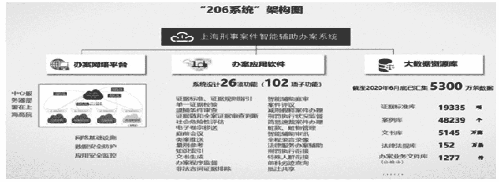

**图 5-1　“206 系统”架构**

##### 2．“睿法官”系统
“睿法官”系统依托北京法院统一审判资源信息库，以法官办案为核心，以创新性、独特性、可持续发展性为研发关键，借助大数据、云计算、AI构建辅助办案系统，为统一裁判尺度提供办案指引，智能支撑办案全流程。系统在立案、庭审、合议、文书撰写等环节与法官日常工作无缝对接，提供审判辅助与决策支持，推进法律适用与裁判尺度统一。

系统以北京法院法律知识图谱为基础，结合案情要素与办案规范、权威知识体系，形成完整知识体系并引导规范流程，据此指导机器自主深度学习。系统拥有多维数据支撑，可根据当事人情况、案件类型态势、历史案件综合分析，结合法律规则库与语义分析模型推送相似案例。系统提供全流程数据服务，覆盖立案至结案完整审判链条。

#### （二）国外典型应用
与国内聚焦办案一体化、辅助办案不同，国外公众侧更重视电子信息访问系统研发，PACER是典型；法院侧更侧重风险评估系统开发。值得注意的是，尽管其他国家法院有提升效率动力，整体态度较为审慎，技术应用常引发争议。以下以美国刑事司法领域的PACER系统与COMPAS系统为例。

##### 1．PACER 系统
PACER即Public Access to Court Electronic Records，美国公众访问联邦法院电子记录系统，提供电子卷宗线上即时访问。注册用户可检索全国联邦法院卷宗目录，或在管辖法院查询案件详情。付费后可查阅超10亿份在全国联邦法院提交的文件，基本覆盖所有电子材料 ^((26))。

新版提升了访问便捷性，新增功能包括推出移动端应用实现网页与移动端双端使用；对接美国行政机关数据库，在一定程度上打破信息壁垒，提升信息搜集查阅便利度；通过与多数州e-Filing系统联通，实现法庭信息数据化。

##### 2．COMPAS 系统
美国司法AI主要用于刑事预审与量刑，自20世纪20年代起历经四次迭代，形成完整风险评估体系。COMPAS系统由Northpointe公司研发，是第四代风险评估代表，采用更丰富风险因子与更科学算法。系统利用Predictive Risk Scales for Risk Prediction，包括General Recidivism Risk Scale、Violent Recidivism Risk Scale、Pretrial Release Risk Scale等，结合住房、药物使用、就业等要素，评估预测再犯可能性，为惩教安置、管理、治疗规划提供决策支持。

风险因子聚焦犯罪案件相关、人际关系、个人人格、家庭关系、反社会倾向五大维度。除提供风险评估估值外，系统还能给出暴力犯罪风险估值、再犯风险估值、不到庭估值、社区矫正失败风险估值。其独特之处在于可生成犯罪画像，由前科、主观恶性、社会环境等信息构成。

欧洲方面，根据欧洲司法效率委员会2016年《欧洲法院信息技术的运用》报告，多数欧洲法院AI仍处于低水平阶段，如普遍部署案件管理系统ERP，法国与斯洛文尼亚在系统中增设预警，爱尔兰使用语音听写软件，爱沙尼亚、立陶宛、罗马尼亚、斯洛文尼亚、瑞典部署判决模板系统等 ^((27))。见表5-1

**表 5-1　部分国家和地区人工智能司法应用实践情况**

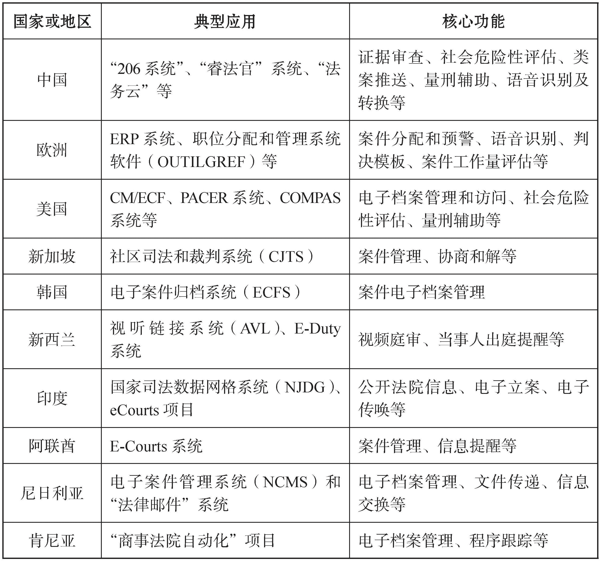

总体来看，司法AI应用持续扩大，中外在方向、规划、手段上存在差异。政策上，我国强调顶层设计、统筹规划、系统推进，国外多各自为政、实践松散；技术上，我国以需求为导向、以破解难题为引领、以技术应用为支撑实现创新突破，国外多停留在通用技术应用且进展缓慢；应用上，我国应用广泛深入、场景持续拓展、聚焦审判且定位为辅助，国外应用相对有限、碎片化、局限性明显，未聚焦审判核心。

### 第三节 人工智能司法应用的特征
近年来，得益于大数据、AI等新技术迅猛发展，人类智能司法应用日益普及，形成以智慧司法建设为主干、顶层设计、分层实施、自上而下的模式，呈现技术种类丰富、业务覆盖面广、多主体联合开发、综合与专门应用并举等特点 ^((28))，显著提升司法质量、效率与公信力。主要特征如下:

### 一、底层平台化
软件系统基础代码架构构成AI司法应用底层，支撑上层应用。机器学习算法是落地核心引擎，深度学习强化学习迭代推动AI跨界融合，进而衍生OCR、NLP、智能语音识别、司法实体识别等能力，为平台搭建提供可行性。

平台化是一种面向复杂业务场景和效率提升的架构模式，体现线上线下融合、多主体共享、覆盖整合等特点。它可实现案件全流程在线审理、全过程智能辅助、审理信息全面公开；实现重点案件自动识别与标签化处理，构建精准监督机制；形成线上线下融合的一站式诉讼服务模型；实现内部平台互联对接与外部数据共享互通。这种模式让数据发声、关联，借助大数据思维发现审判规律、提升质效，并实现司法机关内部、司法机关与机构当事人之间、司法机关与社会之间三层数据共享与互动。

在司法实践中，平台化体现为三方面：一是信息平台，依托现代技术搭建真实完整、记录案件与流程的平台。区块链与5G是热点技术，区块链以开放、自治、安全、可追溯性助力可信平台建设，如广州互联网法院2019年基于区块链建设的可信电子证据平台与“网通法链”智慧信用生态系统即为典型。二是功能平台，将零散辅助功能与底层数据资源整合，实现一平台多功能。以“206系统”为例，集成文书自动生成、电子卷宗移送、要素式讯问指引等，节约资源、提升质量效率。

### 三、共享平台
共享平台对案件关联信息进行高效匹配，实现数据共享。其搭建使公安、检察、法院、司法局互联互通、协同办理，打破长期以来各系统各自为政、数据不能共享的壁垒，实现数据对接交换。如海南一中院建设的涉外民商事纠纷在线多元化解平台联通人民调解平台与法院审判系统，实现数据互通，打破部门壁垒。

### 二、功能集约化
信息化时代司法AI正走向数字化和集约化，将分散碎片化的司法任务集中到一个平台处理。集约指集中管理、统一配置资源要素，以节约成本、提升效率和管理水平，实现效益最大化。随着案件激增，提升效率与优化资源配置的重要性凸显。近年来我国司法改革将高效置于公正之后并并列为树立司法权威来源，强调运用新科技统筹司法人才、优化审判资源配置 ^((31))。

司法智能化：集约、专业化与风险防范

数字化与智能化工具正把司法资源调配推向整合与共享的方向，跨区远程开庭、线上合议让跨域协同审理成为常态。以浙江省法院系统建设的“全域数字法院”为典型，这一工程以技术重塑业务流程、组织架构与诉讼制度，追求在高度数字化的环境下兑现数字正义，消弭时空壁垒，形成业务全省通办、服务全时可及、流程全程智辅、资源省域统筹、制度全向变革的信息时代运行形态。^((32)) 对外端口由移动微法院、浙江法院网和智慧法院APP组成，诉前化解依托在线矛盾纠纷多元化解ODR平台，审判执行环节则探索凤凰智审与智慧执行等AI辅助形态。“全域数字法院”打通全省法院统一平台，为人案事务与物项等司法资源的在线协同与优化配置提供基座，也让算法与大数据的价值得到更大发挥。

集约化还体现在诉讼权利保障的升级。司法AI向当事人提供一站式服务，提升了服务质效。深圳宝安法院推出的“24小时自助法院”，配置了自助立案、缴费、开庭公告、文书查询、案件查询、联络方式、在线预约等七类终端，基本覆盖当事人诉前准备环节，减少往返负担。司法辅助人员的科学调度也在推进，对送达、保全、陪审、书记、执行等岗位实行统一调配，优化内部人事安排。北京市朝阳法院的“1+1+N”特色集约化审判团队，将事务性工作纳入流程管控，实现自动生成、信息交互与提醒提示，提高人力配置效率。^((33))

### 三、应用领域化
司法活动因其特殊性对技术提出专属要求。各部门法具有不同维度和属性，司法知识体系要素繁多，AI应用呈现明显的领域分化特征。当前主要集中在刑事、民事、行政三类场景，并发挥差异化功能。

民事审判中AI服务对象是诉讼事务，核心是打破时空限制并提升判断精度。我国主要依托智慧法院建设推进。其特点为：辅助法官处置诉讼事务，包括公众服务智能化、诉讼服务智能化、审判智能化、管理智能化；具备初步搜索、感知、识别等类人能力，实践涉及类案推送、偏离度预警、裁量预测；必须符合《民事诉讼法》要求，例如证据审查既要实现真伪识别，也要满足可质证、可鉴真等法律要求。

在行政执法中AI的应用一方面提升监管效能，另一方面为公民权利保护创造更好条件，推动公共治理创新。当前实践呈现数据、算法、算力共驱的特征。数据规模与质量决定识别率与精准度，深度学习可提升处理准确性，算力是衔接训练场景与实务应用的关键；半自动与全自动并行；智能执法正逐步嵌入行政检查、行政审批、行政处罚、行政给付等具体领域。^((34))

我国刑事司法AI发展领先，以智能辅助办案系统为代表快速崛起，已覆盖审前、定罪、量刑程序，基本实现全流程覆盖。实践中形成四类系统：智能辅助决策系统，用于证据审查、事实认定、审前社会危险评估等；智能辅助支撑系统，用于敏感案件自动标示预警、辅助录入、立案风险自动拦截、庭审语音识别、文书智能纠错等；案件管理应用系统，以提升诉讼效率为目标；诉讼服务应用，通过AI便利当事人诉讼并提供法律咨询。^((35))

### 四、范围全面化
司法信息化早期聚焦审判管理，对立案、分案、审理、审批等环节实行动态管理，使信息录入、审限管理更系统、规范、客观。^((36)) 现阶段AI司法应用已从文书自动生成拓展至立案、审判全流程，基本覆盖诉讼主要环节。司法大数据与AI不再局限于流程管理，延伸至司法公开、诉讼服务、审判执行，实现业务全覆盖、流程全贯通、全方位覆盖，呈现范围全面化特点。

送达方面，广东省率先建立智能短信送达系统；江西省于2019年设立省级集约化送达中心，创建全国首个审送分离集约化智能化送达模式；湖南省引入邮政寄递一体化服务平台，实现法院专递邮件全程信息与回执投递信息全程留痕并及时反馈。

证据统一化是审判关键。借助司法大数据与核心技术，AI辅助实现案件审判证据标准化。以“206系统”为例，其核心为证据标准指引，明确办理刑事案件应收集的证据类型与方式，由证据链条、必须查实的事实、所需基本证据、注意事项、综合分析判断构成。系统已完成上海刑事案件102个常见罪名证据标准指引制定，为办案提供标准化、数据化、清单式操作指引。^((37))

在智慧检务层面，AI在司法监督与公益诉讼领域持续实践。上海市杨浦、青浦、闵行区检察院试点刑事诉讼监督一体化流程监督管理平台，构建线索汇集库、违法信息库、诉讼监督案件信息库、类案监督案件库、综合数据统计分析库五大数据库，将监督贯穿立案、侦查、审查起诉到审判、执行全过程，弥补检察盲点。公益诉讼方面，全国多家检察院自主或联合社会力量开发辅助应用。2019年福建省利用网络爬虫技术建设“智慧蓝”公益诉讼检察联动平台，并依托微信推出“公益眼”小程序，丰富线索采集与举报方式，使报案信息获取更及时灵活。

## 第四节 人工智能司法应用面临的风险与挑战及应对

### 一、人工智能司法应用面临的风险与挑战
AI三大要素为数据、算力、算法。数据运行的基础，算力运行的保障，算法决定智能水准。当前司法应用在数据与算法两端均存在明显风险。

#### （一）基础性数据问题尚未完全解决
AI依赖海量数据分析实现自主运行。公安、检察、法院、司法局各自掌握大量司法数据，但机关内部、司法机关间、司法与行政间互联互通与共享仍不充分。AI在一定程度上打破数据隔阂，但数据壁垒、数据孤岛等基础性问题尚未根除。研发人员只能依赖本机构或裁判文书数据，导致资源浪费与质量不稳。各地下游智能辅助办案系统多各自为政，既带来技术竞争的积极效应，也人为制造壁垒，导致流通困难、共享难以实现。法院外部数据资源相对匮乏，应进一步开展宏观层面数据分析挖掘，实现一体化。

学界总结的主要障碍包括：法律数据不充分，如大量裁判文书未上网、心证过程未体现在文书；数据不真实，公开理由与实际裁判理由不一致；数据不客观，法官主观差异导致裁判数据偏性；结构化不足，法律语词不统一影响识别。技术原因如数据库建设薄弱、AI获取数据能力不足，制度原因如法院正卷副卷二元化体制、审判委员会审理方式等均加剧障碍。^((38)) 海外亦然，如英国陪审团评议信息不公开制度、法国基于犯罪者回归需要的特定犯罪记录删除制度，都给数据提供与获取制造困难。

#### （二）算法问题可能影响司法公正与公开
以深度学习为核心机理的AI依赖数据驱动算法，但司法场景中算法水平偏低、封闭隐秘问题突出。当前主流为知识图谱，通过图谱描摹案件构成要件与证据，距离知识图谱加深度学习的理想状态仍有差距，信息抽取能力不足导致构建速度与精度受限，应用价值被削弱。^((39))

算法运行虽形式客观，但结果仍潜含价值判断。设计者专业能力与认知水平、效率导向而非精确导向、所用数据不足、不全面或低质量，均可能导致算法歧视。算法歧视的特殊性在于更精准、可画像难以逃脱；更多元，可挖掘浏览记录、购物记录、行车路线等隐形特征；更片面，无法处理用户全部动态信息；更隐蔽，可规避传统法律禁止。

典型案例是2016年美国威斯康星州诉埃里克·卢米斯案。卢米斯主张量刑中使用COMPAS系统存在算法歧视，侵犯正当程序。调查发现黑人再犯风险被高估约两倍，而实际再犯率仅约20%。尽管案件最终被驳回，但暴露算法暗箱操作难以公开审查，可能违背正当程序并损害司法公信力。^((40))

黑箱指无法从外部观测内部状态的系统。算法逻辑、源代码私密，难以转化为可视化技术公开，易形成黑箱。我国智慧法院建设多依赖招投标与技术外包，核心算法属科技企业商业秘密，受知识产权保护难以披露，而应用于司法等公共领域的人工智能应用应以公开为原则。^((41))

### 二、人工智能司法应用的风险规制

#### （一）明确人工智能司法应用的适用范围
为保证AI切实发挥辅助工具功效，需合理界定运用范围。

一是禁止干预规则创制。我国最高人民法院公布的指导性案例常为各级法院参考遵照，若升格为司法解释乃至法律，其制定过程不应被AI介入，否则侵害司法权并影响立法权。

二是刑事案件限于辅助量刑。刑事诉讼涉及生命、自由等核心权利，容错率极低，案情复杂且需考量天理人情，易出现错案。如内蒙古收购玉米案、天津大妈持枪案所示，冰冷判断风险极大。AI宜在事实清楚、罪名确定的量刑阶段提出量刑建议，由法官裁决。认罪案件中可进一步简化流程。^((42))

三是行政案件不宜判断合法性。民告官诉讼核心是行政行为合法性审查，涉及大量价值判断，非去价值化AI所长。其在证据收集、审查方面可发挥积极作用，利用信息共享平台抓取相关数据协助审判。^((43))

四是民事案件适用空间较大但非全覆盖。民事遵循不告不理原则，事实判断取决于当事人举证，证明标准为优势证据，AI可据举证进行事实判断并提出法律适用辅助意见，最终由法官作出裁判。婚姻家庭类案件涉及情感伦理，如离婚中夫妻感情是否破裂，不宜由AI判断，需限缩适用。^((44))

#### （二）通过制度规则充分保障当事人诉讼权利
AI应用可能强化公权力，需平衡控审辩关系，补强当事人权利。

首先强化信息开示。建议将刑事诉讼阅卷权改造为数据访问权。传统阅卷仅限证据材料与文书，而AI可抓取远超此范围的数据，形成盲区。数据访问权允许数据主体确认个人数据是否被处理并获取相关信息，明确权利主体为被追诉人，由辩护人协助，避免阅卷难。可通过时间限制与特殊情形限制防止滥用。

其次关注数据鸿沟并提供专业支持。AI为新兴技术，当事人及代理人难以单独应对，特别是公权力机关运用AI获取大量诉讼相关数据后，易出现文件倾倒。老年人等弱势群体适应能力较弱，应坚持传统方式与智能化创新并行，必要时提供专业人士帮助，保障诉讼服务平等便利。

诉讼数据权：让当事人不被算法透明化

算法时代里，公权力已成为个人资料最主要的聚敛、加工、留存与再利用主体，原来的隐私边界正在转向对数据权益的制度规制。司法环节引入机器辅助后，国家借助程序获取当事人资料的能力被进一步强化，身处数据关系中的当事人维护自身安全与可控性的需求愈发紧迫。《数据安全法》《个人信息保护法》以及欧盟的《通用数据保护条例》所指向的核心，就是承认公民对其个人资料的法权地位。伴随智能手段在审判执行中快速扩散，如何为当事人因技术介入而出现的失控风险搭建及时、有效、可操作的救济通道，已是立法与司法设计必须直面的课题。

#### （三）审判与产业联动的合理界限

审判是社会公平正义的最后一道关口。今天智能化赋能审判的主要路径，是审判机关引入科技企业的力量把新技术搬进办案流程。必须警惕企业以营利为导向，把商业价值或行业观念以显性或隐性方式植入智能工具，从而干扰裁判，动摇审判独立性，甚至影响法院独立行使审判权、检察机关独立行使检察权。为此要在审判与产业之间保持既能协同又不相互侵蚀的距离，具体把握三点：

其一，分清各自追求。企业追逐商业回报是其本性，审判追求的是个案得到公正处置，二者目标迥异。只有在引入技术之前把法院与企业间的利益分野厘清，才能避免利益混同，保障审判独立运行。关键节点在技术引入的采购端，必须依靠公开透明的招标程序、严谨的审计核查与有力惩戒机制，防止企业为经济利益不当影响审判人员，进而导致利益交织乃至不正当情形出现。^((48))

其二，区隔人力的接触。法院普遍缺少算法与系统运维等专业人才，研发、培训、维护、修复等环节往往需要借助外部技术力量，如上海高院在打造“206系统”时与科大讯飞合作，后者派出大量技术人员参与研发；浙江高院与阿里巴巴集团共建智慧法院即为一例。借用外部专业力量无可厚非，也符合司法辅助业务外包的改革方向。为避免外部人员与法官走得过近而产生不当干预，应在交往上设置缓冲。企业技术人员的调配应由法院信息技术保障部门统一执行，合议庭或法官个人寻求技术支持时须接受部门统一安排，不宜私下直接接触。这样能在法官与企业技术人员之间形成必要阻隔，防止科技企业利用交往进行利益输送或观念灌输，进而影响案件公正办理。^((49))

其三，提前界定角色与权限。现阶段司法智能应用的定位是“不能替代办案人员独立判断”，而是“帮助办案人员依法、全面、规范收集审查证据，统一尺度，保障公正”。^((50))在此前提下，企业应明确辅助身份。^((51))企业职责应限于产品的研发、维护与迭代，而产品的设计目标、使用要求必须由法院主导。在开发设计过程中，要高度警惕企业把对妇女、儿童、少数族群、性少数群体等群体的歧视性偏见通过程序与算法植入工具。更要严禁企业通过设计倾向性产品干预具体个案或特定类型案件，例如涉及企业自身知识产权纠纷的审理，以谋取私利。^((52))

## 第五节 人工智能司法应用的发展走向

### 一、诉讼服务体系智能转型

马克思恩格斯曾说：“一切划时代体系的真正内容，都是由产生该体系的时代需要决定的。”^((53))公众对公平正义的体感，既来自裁判结果，也来自办案过程中接受服务时的切身感受。

#### （一）集中通办的服务思路
2019 年 7 月 31 日，最高人民法院发布《关于建设一站式多元解纷机制 一站式诉讼服务中心的意见》，提出实现“一站式多元解纷、一站式诉讼服务”，为现代化服务体系确定新方向。

以上海法院智慧诉讼服务平台为例，平台将对外服务事项集中办理，并与服务大厅、12368 热线、司法公开等平台互联互通，为当事人提供多层次全方位服务。平台构建用户层、应用层、微服务层、治理层、基础设施层五层数据交换标准体系，可通过数据交换平台与法院业务系统互联互通，实现信息资源共享。技术架构上，按服务能力与业务关联，将诉讼服务、送达服务、文书辅助服务、卷宗查询服务、光学字符抓取、电子签章等拆分为独立应用，由治理层统一管理。治理层依托 API 网关、调用跟踪、熔断机制、负载均衡等手段实现全方位治理；基础设施层采用 Artery Docker 容器云平台，集部署、管理、调度、运维于一体。未来在智能与大数据的加持下，集中通办服务将持续升级完善。

#### （二）线上线下融合推进
借助现代科技，把线下服务迁移至线上极大拓展了服务的制度内涵与覆盖面。过去法院“各自为政”时，服务质量、效率与效果受限，不仅不同地区难以形成整体，也难以与党政机关、社会组织形成通畅化解体系。随着智能、大数据、云计算、5G 及光缆基站等基础设施完善，以中国移动微法院、调解平台等十大诉讼服务平台为支撑的一站式建设总体框架基本成型。当事人可实现异地立案、视频调解、网上开庭，并可享受“只进一个门、最多跑一次、可以不用跑”的纠纷化解体验。这在过去难以想象，在全球范围内也属少见。可以预见，随着服务潜能进一步释放，法律职业分工甚至法学教育内容都可能发生微妙变化。

### 二、司法审判活动场景化智能变革

习近平总书记在党的十九大报告中强调要提高社会治理的法治化、智能化、专业化水平。全国法院借助最新科技破解案多人少、线上庭审体验不佳、当事人参与受时空限制等难题，提升审判质效。

#### （一）全流程多场景的网络诉讼服务
传统庭审原则上要求诉讼参与人全体到场，受时空限制常难实现。依托智能技术、云存储、5G 对审判活动进行场景化改造，可实现全流程多场景的网络诉讼服务；利用证据提交、证据交换、询问、调解等多用途、多场景、全流程发送重要诉讼活动，使跨地域参与人也能正常参与。诉讼过程中，通过智慧审判系统的图文识别、自然语言理解、司法要素抽取等功能，可实现机器识别证据、理解证据、分析证据，进而辅助法官归纳争议焦点、审查证据、采信证据、认定事实、适用法律。上海市高级人民法院推动的基于电子卷宗“单套制”的网上办案，为智能辅助审判提供基础保障。

#### （二）诉讼活动从线下到线上、到云端
借助 5G 高速传输，使用智慧庭审系统开庭可清晰、无延迟地观察到诉讼参与人的微动作，大幅提升线上开庭的真实感与仪式感。将所有在线诉讼活动直接上传云端，可保证完整诉讼过程全程留痕、全程高清、全程可溯、全程监管。卷宗由线下到线上、线上到云端流转时，通过法院案件信息防篡改系统，基于分布式对等网络模型，利用电子数据扫描、PBFT 共识机制、区块链分布式存储、多线程、非对称加密、平行链管理及联盟链架构等技术集成，可实现智慧审判系统电子证据及卷宗的防篡改、流转真实可信。写入防篡改系统的数据事务请求需附发起方私钥签名，该签名随请求在网络节点间广播并得到验证，因此请求不可伪造且防篡改。块链式数据结构进一步防止篡改。

### 三、司法审判体系智能升级

人工智能司法应用助力审判体系升级，为法院业务提质增效带来机遇，但人民群众日益多元化的需求和干警提质增效的需求也对智慧法院建设提出更高要求。为推进智能与审判深度融合、解决区域与层级间发展不平衡、不充分、信息共享不充分、降低建设成本、提升数据资源使用效率，加快集约化建设与实际应用，今后架构可从以下方面完善与升级。

#### （一）继续深化应用，提升智能化水平
当前智能司法应用主要作用于审判质效提升，但智能化水平仍有提升空间，迫切需要利用司法认知智能技术进一步提升审判能力现代化，真正做到应用全面标准化、规范化、智能化，实现减负增效。全面深化全业务网上办理、全流程依法公开、全方位智能服务，通过进一步集成、升级、普及和深化应用，建立完善的智能司法应用体系，促进智慧建设与业务深度融合，实现知识驱动、智能辅助、能力支撑、云网一体、集约高效、中台架构、质效运维、安全可靠、规则引领、规范有序，打造集数字化、智能化、人文化于一体的新时代智慧法院，实现业务支撑深度、广度的跨越式提升。需充分把握“十四五规划”战略机遇，坚持统筹推进与重点实施相结合、坚持法官需求与机制保障相结合、坚持司法智能业务一体化的科学布局，顺应新一轮科技革命浪潮，提升司法公信力与群众获得感，深化人民法院司法改革的重要支撑。

#### （二）统一技术标准，加强集约化建设
加强全国法院顶层设计、做好统筹工作，制定统一技术管理标准，从数据一体化、技术一体化、服务一体化三个角度不断提升和推进。从一体化角度进行信息汇集，包括数据资产的汇集和管理与业务智慧成果的汇集和管理。通过数据治理、感知计算等手段，对数据资产、业务智慧等多元数据进行融合和关联。同时，通过法律知识图谱的构建和自然语言理解、机器学习、法律认知技术的运用，实现法律概念理解，构建法律认知引擎、数据分析模型和知识服务工具。打造一体化知识中心，实现对法官办案的智能辅助支持，包括知识推送、知识检索、智能研判等。同时打通个案数据、用户行为数据和外部数据的采集，形成数据循环。以劳动争议案件为例，可通过打通与劳动仲裁、社会保险的数据壁垒、实现业务联动，提升法官办案效率。

### 四、司法服务管理智能更新

司法审判工作关乎人民群众的操心事、烦心事，是群众的“大事”。^((54))司法工作人员一生可能经手成百上千个案子，但对每一个当事人而言，司法人员的每一次审判都可能影响生活甚至改变人生。因此，作为维护社会公平正义的最后一道防线，司法机关能否让人民群众在每一起司法案件中感受到公平正义，既取决于司法工作人员专业技能水平，同时也取决于司法机关纪律作风和工作态度。而信息技术升级为内部管理带来新方法与新思路。

从功能看，智能技术主要在检查监督、质量评估、管理保障等方面发挥作用。在检查监督方面，大数据分析、视频图像识别、语义分析等技术的发展为实现审判执行办案过程的全程可视、全程留痕、全程监督提供有力帮助。例如，北京市第四中级人民法院自主研发的法院视频巡查系统即对接监控网络及数字法庭的多维度视频行为识别软件系统，其下包括庭审视频巡查、诉服视频巡查和办公智能巡查三个子系统，巡查范围涵盖全部数字法庭、调解室、谈话室、立案大厅等公共空间，可实现对法院全部公共区域的无死角、全覆盖监控分析。该系统利用大数据和智能实现监督管理工作由被动抽查到向全域、全员、全过程主动实时监控管理的转型，是人民法院纪检监察工作发展中审务督察工作与现代技术手段深度融合的典型范例。

智能司法相关应用也能为司法的可监督性、可问责性制度体系的全面更新与优化提供保障，使该制度能够更加有效地制约司法、引领司法，为公正、廉洁司法提供坚强保障。例如，浙江法院基于智能化管理体制和模式，专门设置适用于人民法庭的审判执行质量和效率评估体系。该体系可综合评估体系中的各项指标和要求，形成有效的“评估数据”，据此对各个法庭的公正性、效率性等诸多表现进行动态排序，实现实时监督。各种数据系统不仅能使外在监督更加全面客观，同时也能使司法机构内部监督形成常规机制，在此机制下，法官、法庭和法院可以随时进行自我评估，还可以互相评估和互相监督，达到共同学习、共同进步，提升整体司法水平的目的。

除对司法过程的监督检查、对工作人员司法公务行为的严格约束，新科技也在内部管理自动化、工作保障信息化等方面提供新路径。例如，全国检察机关队伍管理系统采用统一研发、两级部署、四级应用的模式，^((55))该模式包括“一库、一平台、两体系、十一系统”的全方位队伍建设信息化项目，支持对全国检察人员在进入、岗位、任免、培训等方面的全生命周期管理。在保障辅助方面，烟台市莱山区检察院研发了车辆智能管理子系统，配置了“车钥匙智能卡柜”，通过连接“莱检通”、执法执勤车辆使用管理权限和网络，实现刷卡用车、车辆出入射频扫描登记、周末公车封存等功能，保证执法执勤车辆的实时监控。

未来，利用现代化科技手段促进司法工作人员依法规范履职、加强内部监督管理、维护司法机关清正廉洁形象，逐渐成为新科技时代背景下司法服务管理革新和发展的方向，司法服务管理也将继续朝着与互联网、大数据、智能深度融合，司法机关内部信息化建设转型升级，司法管理全方位、高层次智能化的目标迈进。

**课后习题：**

（简答题）

1．尝试梳理当前智能技术在司法中的核心功能。

2．简述智能技术在司法中的运用对实现公平正义的价值。

3．简述智能技术在司法中运用的风险与不足。

（思考题）

你认为智能技术在司法中的运用是否能够取代人类法官？未来这类运用将有哪些发展，又会给司法活动带来怎样的变革？

(26)　崔亚东主编：《世界人工智能法治蓝皮书（2021）》，上海人民出版社 2021 年版，第 190 页。

(27)　郑曦：《人工智能技术在司法裁判中的运用及规制》，《中外法学》2020 年第 3 期。

(28)　参见崔亚东主编：《世界人工智能法治蓝皮书（2020）》，上海人民出版社 2020 年版，第 178—190 页。

(29)　马长山：《司法人工智能的重塑效应及其限度》，《法学研究》2020 年第 4 期。

(30)　李阳：《打造智能时代司法文明新坐标——人民法院智慧法院建设工作综述》，《人民法院报》2019 年 3 月 10 日。

(31)　尤乐：《论司法辅助事务集约化的含义、内容和法治化路径》，《北方法学》2019 年第 4 期。

(32)　余建华：《浙江全面推进数字法院建设》，《人民日报》2021 年 4 月 9 日。

(33)　尤乐：《论司法辅助事务集约化的含义、内容和法治化路径》，《北方法学》2019 年第 4 期。

(34)　黎慈：《人工智能嵌入行政执法的法理分析：现状、风险与应对》，《湖北社会科学》2020 年第 7 期。

(35)　李训虎：《刑事司法人工智能的包容性规制》，《中国社会科学》2021 年第 1 期。

(36)　王禄生：《司法大数据与人工智能技术应用的风险及伦理规制》，《法商研究》2019 年第 2 期。

(37)　杨焘：《数字化证据标准的合理性及限度分析——以上海“206”智能系统为关注点》，《四川师范大学学报》（社会科学版）2020 年第 5 期。

(38)　郑曦：《人工智能技术在司法裁判中的运用及规制》，《中外法学》2020 年第 3 期。

(39)　郑曦：《人工智能技术在司法裁判中的运用及规制》，《中外法学》2020 年第 3 期。

(40)　高鲁嘉：《人工智能时代我国司法智慧化的机遇、挑战及发展路径》，《山东大学学报》（哲学社会科学版）2019 年第 3 期。

(41)　贾章范：《司法人工智能的话语冲突、化解路径与规范适用》，《科技与法律》2019 年第 6 期。

(42)　郑曦：《人工智能技术在司法裁判中的运用及规制》，《中外法学》2020 年第 3 期。

(43)　同上文。

(44)　郑曦：《人工智能技术在司法裁判中的运用及规制》，《中外法学》2020 年第 3 期。

(45)　同上文。

(46)　《刑事诉讼法》第 40 条规定：“辩护律师自人民检察院对案件审查起诉之日起，可以查阅、摘抄、复制本案的案卷材料。其他辩护人经人民法院、人民检察院许可，也可以查阅、摘抄、复制上述材料。”

(47)　郑曦：《人工智能技术在司法裁判中的运用及规制》，《中外法学》2020 年第 3 期。

(48)　郑曦：《人工智能技术在司法裁判中的运用及规制》，《中外法学》2020 年第 3 期。

(49)　郑曦：《人工智能技术在司法裁判中的运用及规制》，《中外法学》2020 年第 3 期。

(50)　李阳：“孟建柱在全国司法体制改革推进会上强调主动拥抱新一轮科技革命全面深化司法体制改革努力创造更高水平的社会主义司法文明”，《人民法院报》2017 年 7 月 12 日。

(51)　对此，已有部分企业在其内部制定了人工智能伦理行为准则，以规范企业行为，如商汤科技、腾讯等；2019 年，深圳人工智能行业协会与旷视科技、科大讯飞等数十家企业联合发布《新一代人工智能行业自律公约》。

(52)　郑曦：《人工智能技术在司法裁判中的运用及规制》，《中外法学》2020 年第 3 期。

(53)　《马克思恩格斯全集》（第 3 卷），人民出版社 1960 年版，第 544 页。

(54)　张鸿浩：《借助人工智能 加强作风建设 完善内部管理》，《人民法院报》2019 年 7 月 9 日。

(55)　赵志刚、金鸿浩：《政法智能化战略下“智慧检务”实践启示》，《人民检察》2019 年第 8 期。

# 第六章 智能驱动的治理与服务升级

**本章提要：** 行政职能的再造是推进现代治理的根本抓手。经济社会在多层面呈现出更趋多元、复杂与不确定，职能转型的压力在持续累积。AI的快速演进为这一进程注入新变量。社会协同管理与公众供给构成行政职能的两大支点，将AI真正嵌入口中，既是对技术浪潮的顺势回应，也是政策层面的主动选择。由AI牵引的职能再造，必须覆盖数据全流程，从采集、处理、留存到开放、利用、流转，形成完整闭环。技术侧要在算力底座、存储体系到应用软件形成分层标准；制度侧要在数据主体、范围、可得性与时效、应急安排、个人隐私、商业机密、国家机密、社会安全等维度作出精细界定，最终厘清各环节责任归属，为官方在数据开放利用中搭建安全保障框架。

## 第一节 智能治理命题的提出逻辑

从行政学角度看，职能即行政体系在社会协同与公众供给上的职责边界与执行效能，并由此体现治理能力。职能内涵会随历史演进而变化，社会结构、经济形态与技术环境持续重塑官方角色。改革开放以来，我国职能演进大致经历重经济管理、提出社会管理、强调全面履职三个阶段。当前阶层分化、诉求多元、价值观念 plural，社会矛盾更趋复杂，要求行政体系既要化解矛盾、维护秩序与治安，也要补齐生态治理、食品安全、安全生产等短板。新时代实现治理体系与能力现代化，AI已成为关键助力。AI在职能转型中的定位，应锚定公众供给的精细化，以守稳社会秩序、服务民众为落脚点，通过智能化整合与配置实现资源的高效利用。

### 一、为治理痛点提供技术解法
AI已走过推理、知识工程到数据挖掘三个阶段，弱智能基本实现并向强智能过渡。其演进可归纳为三层：信息采集辅助与智能筛选；识别应答并完成模糊任务；替代人工自主决策与行为。应用场景从劳动密集、流程标准化的领域扩展到专业性强的复杂工作，并在部分任务上实现超越。在行政管理、公众供给、城市运行、环境保护等治理热点与难点上，AI优势正显现。依托人脸识别的天网系统在追逃、寻人场景中多次发挥作用，成为维护治安的重要力量；阿里云ET城市大脑融合人脸、语音、影像识别，在缓解城市交通拥堵上初见成效。政策推动与技术成熟双轮驱动，未来AI将在治理与服务的热点难点上提供更智慧的方案。

### 二、效能与体验的双重提升
新时代社会主要矛盾已转为人民对美好生活的新期待与发展不平衡不充分之间的矛盾。治理现代化的终极指向是让美好生活愿景落地。互联网+AI+公众供给将重塑服务体验。个性化需求的采集整理可实现自动化，人工难以企及；海量数据画像可预判公众需求，实现更精准响应；AI的决策与流程分析能力能找出服务瓶颈，推动流程再造提效；AI在识别、理解模糊指令并自动执行的优势，可弥补传统模式受人力、时空限制导致的供给不足，实现随时可达、即时响应。低投入高产出更精准，正是AI在公众供给领域破局的关键，也是提升人民生活品质的重要路径。

### 三、现代化水平的整体抬升
企业是技术创新的主力，AI与社会管理的深度耦合必然拉近政企合作距离。AI在增强社会互动、促进可信交流方面发挥关键作用，有助于打破党政、社会组织与公众长期存在的信息壁垒，让各方参与治理的时机与质量提升。借助大数据捕捉社情民意，立法与政策制定可更贴近现实。智能化治理的本质，是用大数据、移动互联、AI等科技赋能基层，让治理过程更科学高效。专业化治理离不开人才，但AI可部分弥补短板。把海量案例与经验数据输入系统，透过深度学习与强化学习，可快速“培养”出特定领域的专业助手，形成人机协同的新型治理能力。

## 第二节 从萌芽到落地：演进脉络与现实图景
在大数据、云计算、AI叠加推动下，我国行政体系在社会协同与公众供给数字化实践大致可归纳为三阶段。

### 一、历史脉络

#### （一）起步期：部门建库与信息孤岛
20世纪八九十年代，信息化起步时信息中心往往依附具体职能部门，受科层制影响呈现条块化。常见做法是将信息部门与业务部门合署，虽利于快速启动，却导致各部门各自建库、各自为政，信息孤岛形成，成为制约公共事务管理效能的瓶颈。

#### （二）过渡期：信息共享的探索
为打破孤岛、提升效率，“政府上网”“电子政务”成为1999至2010年前后的主线，共享机制在试错中推进。这一时期最具代表性的制度是2008年5月1日起施行的《政府信息公开条例》，以法规形式确认公民、法人及其他组织依法获取政府信息的权利，为后续共享奠定法治基础。

#### （三）最新期：基于大数据的开放共享
多年投入使国家信息基础设施明显改善，为大数据共享与社会化应用创造条件。我国行政结构兼具垂直管理与条块结合，纵向部门内数据共享相对顺畅，横向地方部门间互通起步较晚。2008年后以地方为主导的大数据共享进入活跃期。如北京、上海在城市应急指挥中通过跨部门汇聚打造统一平台；浙江“百万农民信箱工程”打通农业、教育等多部门信息通道；广东、山东、吉林等地探索以政务云平台为枢纽的资源整合共享机制。

### 二、现状扫描

#### （一）中央层面：强化社会主体的数据安全责任
2021年6月全国人大常委会通过《数据安全法》，这是我国首部专门数据安全法律，也是国家安全法制体系的重要一环。该法有助于提升企业与行政体系的数据保护意识，推动统一分类分级目录建设；以更精细规则规范数据获取、利用与治理，促进行业合规共享；同时明确跨境数据流动的法律要件、审批与反制措施，为数据跨境交流提供清晰框架，支撑云计算、大数据、AI、物联网、区块链和5G等产业持续发展。

#### （二）贵州实践：突出官方的开放与安全统筹责任
2019年8月贵州省市场监管局出台《贵州省大数据安全保障条例》。与中央顶层设计不同，该条例主要以《保守国家秘密法》为上位依据，构建宏观大数据治理框架，侧重防范攻击、窃取、干扰等风险，保障数据真实性、完整性与可控性，核心在于强调公安、网信办、信息中心大数据发展部等行政部门的安全监管与保管责任。

#### （三）浙江实践：兼顾开放与安全并行发展
2020年浙江省政府办公厅发布《公共数据开放与安全暂行管理办法》，提出公共数据安全是开放前提。该办法覆盖数据全生命周期，包括采集、归集、清洗、共享开放、应用到销毁，吸收了合法必要采集、突发事件例外、个人信息与商业秘密保护等成熟规则，强调开放与安全并行。

#### （四）上海实践：构建数据开放服务的动态闭环管理
依据国发〔2015〕50号《促进大数据发展行动纲要》等文件，上海自2016年起系统推进政务数据共享。2016年2月市政府印发《上海市政务数据资源共享管理办法》，明确共享目的、职责分工、采集与使用原则。同年12月发布的《上海市推进智慧城市建设“十三五”规划》，成为地方依托大数据推进共享的先行方案。2018年4月上海市大数据中心揭牌，负责构建全市数据共享体系，制定共享开放应用安全等标准。2018年9月出台的《上海市公共数据和一网通办管理办法》，界定公共数据范围，明确市政府办公厅为统筹主体，市大数据中心具体执行，其他部门协同配合。2019年8月《上海市公共数据开放暂行办法》进一步细化开放利用与数字经济发展要求，形成动态管理闭环。

## 第三节 应用背后的风险暗线

### 一、数据全生命周期的安全风险点

智能硬件与终端的铺开速度远超预期，叠加大数据场景向纵深拓展，生产生活已被全面推入智能化轨道，信息产出进入爆发式加速阶段。采集入口数量与频率同步攀升，社会在分秒间堆积海量资讯，源头采集环节的潜在隐患被明显放大。与此同时，机器学习依赖海量养料持续迭代，智能技术成熟度与应用广度同步提升，信息资产规模随之膨胀，分级分类治理的复杂度呈指数级上升，质量管控压力亦与日俱增。人工智能的深度挖掘在规模和频次上迅速抬升，公民隐私要素与国家核心要素被非法转移利用的概率大幅提高。尤其需要警惕的是，部分境外商业机构和研发主体以业务需求为名，通过爬虫挖掘、交易买卖、科研资助、联合研发等多种路径，以不同程度收集、处理、利用上海市所蕴含的信息资源。更进一步，部分境外科技公司还借助伪装渗透、敏感域定向刺探、传输链路监控、网络内容干预等方式，在境内或跨境制造违规使用，直接冲击上海的都市安全与社会秩序。

由此，贯穿信息从产生到销毁完整周期的安全议题主要集中在三方面：边界侵犯、品质缺陷、防护不足。边界侵犯指公共信息在挖掘、测试、运行阶段发生的个人边界被逾越的问题，是当前公共信息应用必须解决的关键难题之一；品质缺陷主要指向潜藏于机器学习训练集以及现场采集样本中的瑕疵及其连锁后果；防护不足则指向信息开发应用主体在持有阶段，因采集、传输、存储、使用、流转乃至销毁环节保障不力而暴露的风险（见图 6-1）。

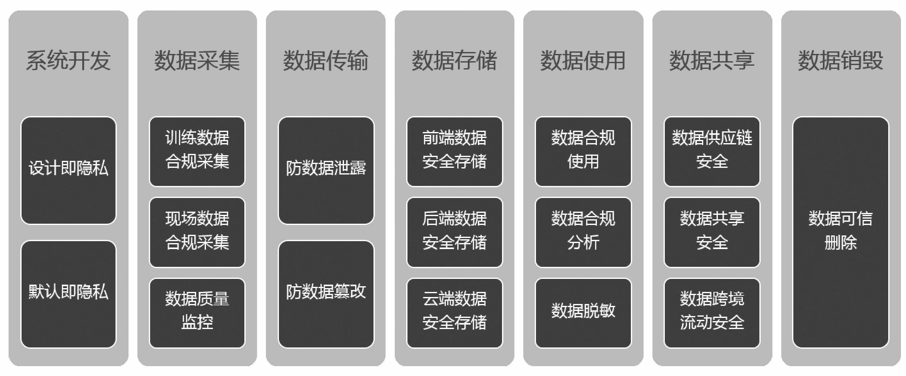

**图 6-1　数据全生命周期的风险点**

### 二、数据基础设施的三种模式

信息安全技术的成熟程度是公共信息安全的重要支撑。个体层面关乎隐私等基本权益，群体层面关乎整体利益与国家安全。一旦公共信息在流转中出现保密、完整、可靠方面的瑕疵，全国性信息治理体系都将面临信任危机。各省各市应遵循国家统一的技术规范与安全准则来规划公共信息平台的设计、建设与使用，重视底层技术对信息安全的影响。实践中常见的存储与传输技术大致可归纳为分散式、集中式、链上加密式三类，各自的安全表现各不相同。

#### （一）分散型——分布式服务总线交换机制

企业连接框架是企业服务总线的一种典型落地。其核心诉求是借助标准化开放协议与成熟的企业应用集成范式，把异构系统串联起来。企业服务总线是传统中间件与 XML、Web 服务等技术融合的产物，为网络提供基础连接枢纽，是构建企业神经系统的关键组件。基于企业服务总线的方案是政务信息共享交换的常用手段之一，在此基础上，分布式政府信息资源共享交换采用面向服务架构，结合服务语义、流程服务等技术搭建电子政务解法。如湖南长沙即采用了企业服务总线架构（见图 6-2）。

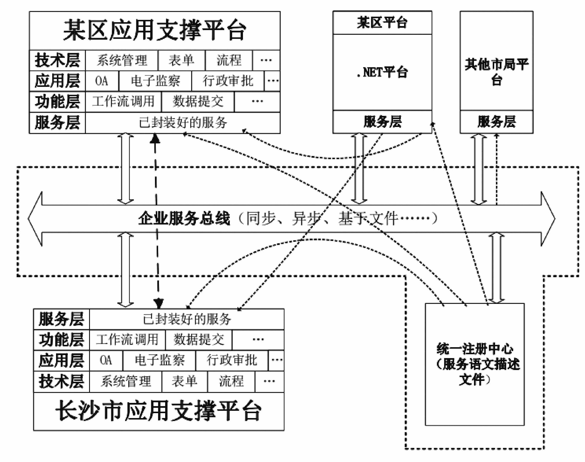

**图 6-2　分布式服务总线交换机制**

资料来源：长沙市应用支撑平台

分布式服务总线机制的优势在于触达面更广、来源更贴近终端。但从安全视角看存在三大短板：（1）对外发布服务往往需要对原系统做局部改造或重构，难以回溯原始安全状态；（2）主体间交换信息需要繁复的服务配置，安全运维成本偏高；（3）信息清洗、比对等工作被下沉至用户端，用户端负担加重；安全保障基本由各分散存储点自行把控，标准难以统一。

#### （二）集中型——信息集中共享机制

数据中心采用大集中模式实现共享与逐级汇聚，对多机构源信息进行归并分析，形成统一资源库。多个国家部门、省市高校均采用大集中模式搭建数据中心实现共享，以环境公共信息为例，国家环境数据中心的建设即采用了大集中模式（见图 6-3）。

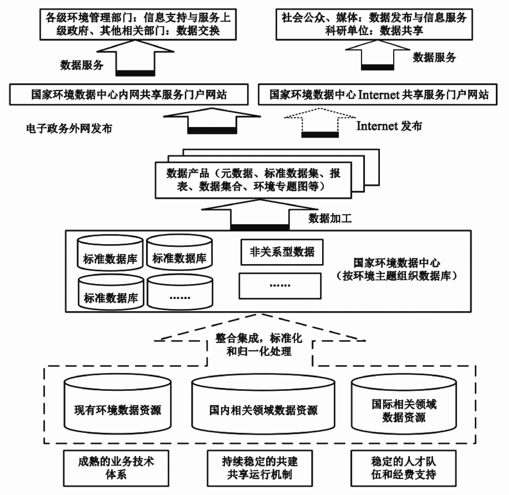

**图 6-3　数据集中共享机制**

该机制的长处是可以统一资源、保证对外供给信息的一致性。但数据中心存储体量庞大，对多源信息的采集、比对、清洗和异构转换带来的服务端工作量极重，且难以保证实时性与协同执行度。安全性相对较高，但信息的流动性较差。

#### （三）区块链型——分布式加密存储共享

区块链以哈希加密的分布式记账方式记录信息资产全交易过程，实现去中心化的实时共享与多方监督。将交易记录存于网络中众多计算机数据库，通过透明化的交叉监督替代传统第三方担保，提升信任。其技术突破主要体现在：（1）实现底层数据库互联互通，从根本上缓解 TCP/IP 协议下的数据孤岛，推动互联网向新阶段演进；（2）解决信息确权难题：通过“矿工”竞争机制为信息加盖时间戳，形成传播链的异质性；通过智能合约自动实现信息在主体间传播时的产权流动；通过分布式账本实现多方制约监督，厘清信息边界，在保障隐私前提下夯实交易市场基础。区块链对金融信息开放性与安全性实现了质的提升。但该技术对公共资源占用较高，目前仅能对有限范围的重要信息进行精准存证，尚不能全面解决存储安全性问题。

公共信息安全必须回应信息可信度问题。可利用区块链技术，以分布式账本为基础，按信息权属、功能定位、应用场景和开放权限构建分层协议。其可监管、可治理、高信任的特性，有助于避免流通中的造假行为，实现全链校验和信用公示，解决验证与自律难题，达成权利人与流通者的利益共识。需注意的是，即便区块链能提升效率，社会运行仍需权力部门的合理干预，因此国家通常需设立专门监管机构负责管理信息写入权限，确保每个主权区块链节点的参与者遵守使用规则。

### 三、风险防控的基本对策

从制度环境看，法律政策是中央与地方政府保证战略与政策一致性、连贯性的重要抓手。其完善程度与对信息治理的支持力度，直接影响公共信息开放共享的进程。个人隐私和信息安防法律规范的缺失，尤其是各层级各部门信息权属不清，严重制约信息共享，也让安全责任难以落实。

#### （一）法律法规应对

##### 1．确立公共信息权属

应明晰公共信息社会化应用的理论前提与相关法律关系及权利属性，进而确定安全责任主体，形成责任约束。当前实践普遍存在权属不清导致推诿、共享缓慢、安全隐患频现等问题。目前理论和实践中尚无通行定义，信息未在法律上被赋予资产属性，所有权、使用权、管理权、交易权、收益权未被充分明确。结合国内外立法，信息权属主要有三种态度：

第一种以欧盟为代表，英国、巴西、印度等亦采用此模式，基于个人权利严格保护，将客体限定于个人信息。如英国《数据保护法》旨在防止个人信息被误用滥用，第1条明确规制个人信息的处理，包括在数据主体同意或其他合法情形下公平获取、在授权后处理并纠正不准确信息等。欧盟《通用数据保护条例》第1条亦针对自然人个人信息处理及其流动，保护基本权利与自由。印度《2018年个人数据保护法草案》第2条、巴西《通用数据保护法》第3条均追随欧盟模式。印度草案提出保护公民利益、贸易工业利益、国家利益三重目标，巴西法则明确保护自由和隐私基本权利以及人格自由发展。这一类型主要通过强化主体控制力和提高控制者义务实现：在主体控制力方面强化“知情同意原则”，细化知情权、访问权；在控制者义务方面将信息保护官制度常态化，明确其地位职能。

第二种以中国、美国为代表，对信息权利保护持审慎观望态度。中国主要通过司法个案场景式应对，在现有法律框架下稳步推进立法，兼顾个人信息保护与企业信息财产权。美国坚持公平信息实践原则，采用分散立法，未设统一个人信息保护机构，以行业自治为主、专门立法为辅。

第三种以澳大利亚为代表，持相对开放宽松态度。《数据使用规范草案》以不损害用户权益为核心，要求机构采取措施避免信息二次定位。2019年8月1日参议院通过《用户数据权利法案》，赋予用户将自身信息共享至其他平台的权利，为开放银行提供支撑，也增强了金融科技与传统银行的竞争。

总体看，各国对公共信息权利属性的规制模式不同，体现了产业保护与安全性的不同权衡，安全责任承担也在政府与企业间动态平衡。

##### 2．廓清法律规则结构

信息保护法律规则是大数据安全的基础。以近期各国主要法律为例，思路与策略既有框架性相似，也有管辖区、保护定义、监管组织构造等方面的差异。

**表 6-1　各国数据安全法律监管模式对比**

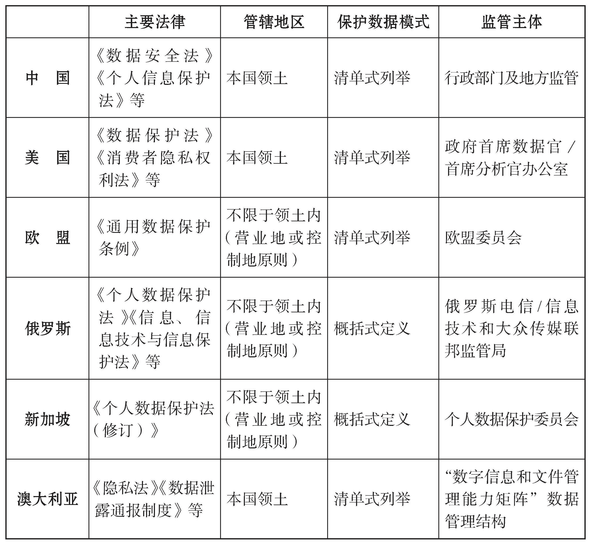

在具体规则层面可从监管者、信息主体、信息控制者三方关系梳理：

（1）信息监管者
第一，监管辖区范围。指法规能管辖的信息涉及的领土范围，尤其是境外数据中心是否受本国法约束。美国、澳大利亚、中国以本国领土为限，境外数据中心可能规避约束；欧盟、俄罗斯、新加坡监管更严，如俄罗斯规定其法不局限于领土，适用于在俄罗斯发生的所有信息处理，包括对俄罗斯公民信息数据的收集使用，不论数据中心是否在境内。跨境流转若涉及俄罗斯公民即受其法监管。
第二，需保护的信息。通常分为个人识别信息 PII 与个人隐私/敏感信息。PII 指可直接识别个体的信息，如姓名、身份证号等；敏感信息指经关联分析可能定位个体的信息，如健康、教育、征信等。各国定义不同，保护范围亦异。
第三，监管对象。一般所有收集、存储、处理、利用信息的控制者均受监管，各国也有例外，如新加坡对公民个人行为、就业必要行为等可豁免。
第四，需监管的行为。多国要求对全生命周期监管，包括收集、记录、组织、积累、存储、变更、检索、恢复、使用、转让、脱敏、删除、销毁等，俄罗斯对纯个人家庭需求处理、国家保密信息处理等设例外。
第五，监管者权力。为落实法规，需设机构与执法权。俄罗斯主要监管部门为联邦电信/信息技术和大众传媒监管局 Roskomnadzor，FSTEC、FSS 等亦负责特定条款；新加坡以《个人数据保护法》PDPA 为依据，设个人数据保护委员会 PDPC 负责制定实施，Roskomnadzor 与 PDPC 均具有执法权。

（2）信息主体
围绕用户在信息服务中享有的权利，包括知情权、授权处理权、访问/查询/更正权、停止收集/删除权、投诉权等。各国均有规定但细致程度不同。如我国《网络安全法》要求公开收集使用规则，明示目的方式范围并经同意，未详细规定形式；俄罗斯要求以书面形式包括电子签名提供信息主体全名、地址、身份证明等关键信息；新加坡要求收集前经同意但未指定通知形式。

（3）信息控制者
围绕控制者在全生命周期中的义务，包括配合主体实现权利、确保信息安全、收集前征求监管同意、报备收集利用情况、异常事件通报、境外流转存储前申请等。以报备义务为例，我国未明确要求事前申请登记；俄罗斯要求操作前向 Roskomnadzor 报备并在30天内完成注册公示；新加坡要求一般情况下通知用户，可书面或口头。

##### 3．政策工具应对

迈克尔·豪利特与拉米什基于政府供给公共产品的角色，将政策工具分为强制性、混合性、自愿性三大类十小类（见表 6-2）。强制性工具借助国家权威迫使目标群体行为改变；混合性工具允许政府参与但决策权留给市场社会；自愿性工具则由其他主体自主处理。

###### 表 6-2 政策工具分类

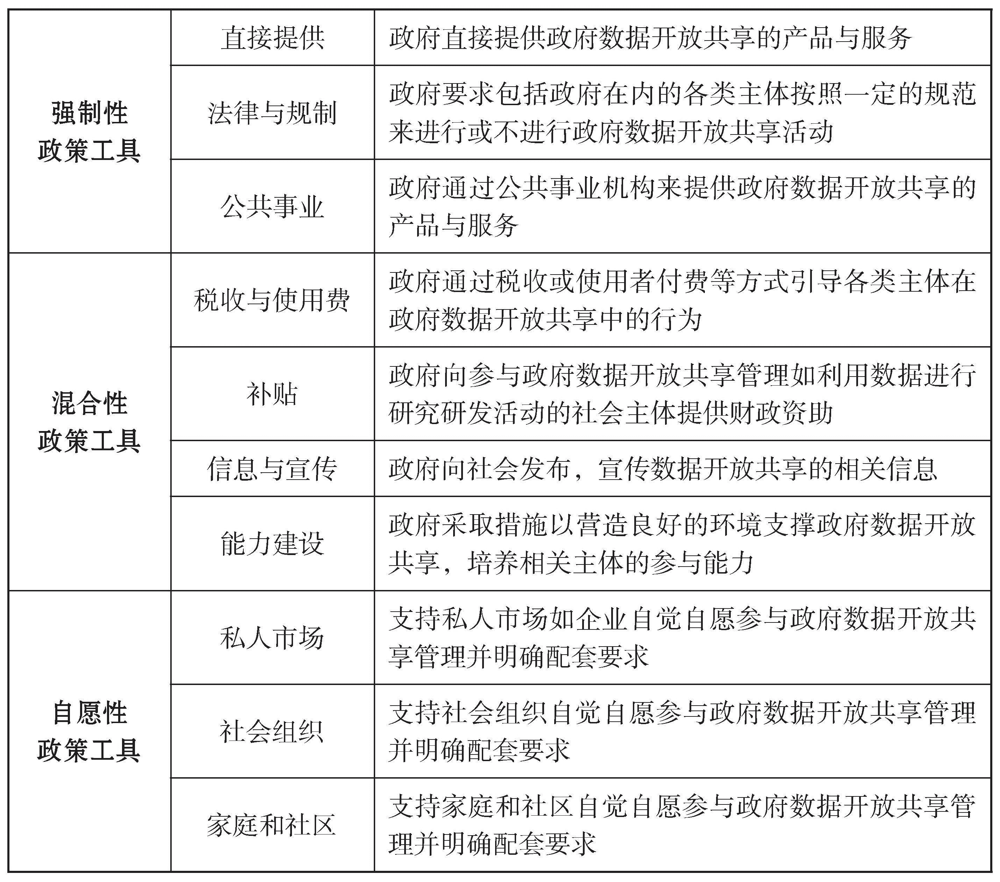

根据各国及欧盟信息安全法律政策工具性质分类见图 6-4。

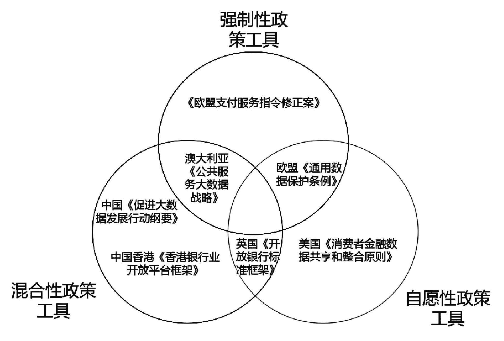

###### 图 6-4 各国及欧盟政策性质比较与分类

我国已在《国家安全法》《网络安全法》《全国人民代表大会常务委员会关于加强网络信息保护的决定》《电信和互联网用户个人信息保护规定》等形成个人信息保护基本框架，但监管范围、对象、内容、手段、执行机构、执法渠道等仍需细化。应加快出台专门的信息保护法及配套法规，明确保护范围、敏感信息定义、主体权利、控制者义务、共享交易要求、跨境保护与罚则，为落实提供依据。

##### 4．信息安全法律保障

信息安全已成为国家安全核心议题。各国正加快个人数据保护、信息本地化与跨境传输、执法信息跨境调取、内容监管等多层面立法建设。

###### （1）个人数据保护：以平衡保护与利用为宗旨

上世纪七十年代以后，欧美等发达地区率先把个人信息纳入法律调整范围。时至今日，超过一百个国家和地区公布了个人信息保护或隐私保护法规，四十多个地区正在审议相关草案。欧盟一直走在前列：1995年推出《95数据保护指令》，2016年又发布被视为全球最严的《通用数据保护条例》。新规在旧指令基础上大幅拓展了数据主体的权利清单，同时对数据控制者的责任作出明显强化。为了兼顾境内居民信息安全与一体化区内经济发展，条例将适用边界延伸至“未在欧盟境内设立机构但向欧盟市场提供商品或服务的经营者”。上述安排显著提升了欧盟的保护水位，并把域外效力投射到全球。

美国则坚持分业立法路径。联邦层面已有二十多部面向特定行业的隐私或个人信息保护法，州及地方层面相关规范累计上百部。近年美国启动了对《电子通信隐私法》《儿童在线隐私保护法》等既有法规的修订，同时提出《数据泄露防御与补偿法草案》《社交媒体隐私保护与消费者权利法草案》等新动向。

###### （2）数据本地化与跨境传输：以加强安全保障为要素
“棱镜门”事件让各国看到数据出境可能带来的国家安全、社会稳定与个人私密风险，推动各国重新审视本地存储与跨境流动的规则。除非洲等信息化水平相对落后的区域外，绝大多数国家都推行了不同程度的数据本地化政策。

2013年棱镜门曝光后，俄罗斯由宽松管理转向严格管控。2014年《第97号法令》和《第242号法令》相继生效，确立数据本地化基本框架，要求处理个人信息的数据库须部署在俄境内，处理者还须在处理前向监管机构报备库址。

欧盟并未在法条中明确强制本地存储，但透过《通用数据保护条例》及配套的严苛隐私规范，实际上限制了信息向欧盟境外第三国的流动。原则上，数据只能传输至获欧盟委员会认定提供充分保护的国家。此前在欧美之间运行的“安全港”安排被欧洲法院裁定无效后，双方签署“隐私盾”协议，增设多项保护机制，并对美国执法部门获取欧盟数据行为作出限制，同时引入监察专员与年度复核机制，以遏制大规模监控。

总体来看，全球的本地化趋势对美国这一数据强国构成冲击。对外，美国坚决反对本地化，主张数据在全球市场自由流动；对内则实施选择性本地化。2015年美国国防部要求为其服务的云服务商须在国内留存数据，2016年美国国税局亦规定税务信息系统必须位于美国境内。

###### （3）执法数据跨境调取：以提升执法效能为目标
为获取境外违法犯罪相关信息、提升本国执法能力，欧美各国立法动作频繁。2018年3月，美国总统特朗普签署《合法使用境外数据明确法》，旨在厘清美国政府获取境外数据、外国政府获取美国境内数据的合法路径。针对前者，该法适用海外长臂管辖原则，授权美国执法机构直接调取境外数据，除非被执行方提出有效抗辩并获美国法院认可；针对后者，美国在传统司法协助程序之外提出“执行协定”，可与符合条件的外国政府签约，允许对方直接向美国境内企业发出数据调取令，但需接受美国对其履约情况的定期审查。

同年4月，为回应该法对区域人权和司法主权带来的压力，欧盟委员会拟定新规以规范执法司法部门获取电子证据。做法与美国类似，欧盟不以数据存放位置决定管辖权，只要满足条件即可要求境内数据服务商提交电子证据，无论数据实际存放于欧盟境内还是境外。

###### （4）内容监管：以透明度提升为导向
网络上非法内容与虚假信息的扩散日益严重，已威胁到个人权益、社会稳定乃至政治民主进程，网络内容审查因此成为立法重点。

欧盟相继发布《预防、发现和消除在线煽动仇恨、暴力及恐怖主义非法内容的指南与原则》《有效处理在线非法内容的建议》等文件，要求在线平台主动监测、及时下架非法内容并防止再现。德国还单独制定《网络执法法》，强化对网络违规内容的监管。

与此同时，为防范数据不当使用带来的风险，多地开始强调收集、使用与算法的透明度。自2014年起，美国白宫连续三年发布大数据安全白皮书，指出大数据与人工智能可能导致决策不透明，主张完善透明度规范。2018年，为回应脸书用户数据泄露事件，欧盟发布《应对在线虚假信息：欧洲路径》，要求提升平台信息披露透明度，特别是政治广告的透明度，限制政治广告精准投放，并提高算法透明度以遏制虚假信息扩散。

#### （二）治理能力水平提升

##### 1．覆盖数据全生命周期安全建设

###### （1）数据采集安全
采集阶段应建立内部监督机制与管理流程，确保训练数据与现场数据采集合规。借助数据资产发现工具梳理组织所采集的数据资产，并自动识别其中的敏感字段。制定统一的数据质量规范与标准，并配套监督评估流程。利用技术手段实时监控采集质量，指标涵盖完整性、一致性、准确性等。针对训练集，需评估其完整性、多样性、标注质量及数据污染情况。建立采集日志以实现过程可追溯。

###### （2）数据传输安全
传输阶段应采用加密、数字签名、安全通道、身份认证等技术保障安全，防止篡改与泄露。安全规范需覆盖敏感数据存储与网络传输尤其是公网传输的设计。数字签名是利用发送方私钥对报文摘要加密后附于原文的公钥密码学应用。数字证书由证书认证中心签发，载明申请者信息及其公钥。公钥基础设施借助公钥技术与数字证书验证持有者身份并保障系统信息安全。

###### （3）数据存储安全
存储阶段需保障前端、后端及云端数据安全，并部署严格的访问控制策略，防止未授权访问。采用加密手段对数据库及数据本身加密，并按不同粒度实现透明加解密。建立有效的密钥管理机制。部署数据安全网关，结合数据标签与用户风险等级实施细粒度动态访问控制，防止泄露。通过安全审计工具全面监测安全事件与行为日志，及时发现威胁与异常。

###### （4）数据使用安全
使用阶段需制定数据使用与分析管理规范，确保合规安全。运用静态脱敏、动态脱敏、去标识化、密文透明处理等技术保护敏感数据在使用分析过程中的安全。建立面向数据使用的访问控制策略，包含数据应用接入合法性与安全性审核机制。

###### （5）数据共享安全
共享阶段需建立数据供应链管控与数据交换共享管控机制，确保合规。对跨境流动的组织，应建立内部跨境流动评估机制以保障合规。借助数据标签与交换共享管控技术实现供应链与共享安全。

###### （6）数据销毁安全
《纽约时报》的一项基础隐私调查显示，公众对硬盘数据清除存在误解，简单删除并不能真正清除数据。磁盘、U盘、光盘等介质在信息擦除后仍可能因物理特性被重建，数据或被非法获取。调查指出，仅33%的二手硬盘被彻底清除。即使格式化、摔碎、浸水，也可能通过数据恢复技术找回。因此应建立组织内部可信销毁监督机制，并借助可信删除等技术实现安全销毁。

##### 2．关键数据安全技术能力建设

###### （1）数据质量检测与净化
建立涵盖训练集与现场采集数据的质量标准，严格按标采集处理。利用数据偏见检测技术验证训练集质量并消除问题。通过训练样本过滤与对抗样本检测防御投毒攻击。

###### （2）敏感数据安全管控
依据访问权限、账号权限、数据权限对敏感数据分级，以便针对内外使用者进行权限适配审计并制定差异化保护方案。敏感数据智能识别与预警结合字典匹配与人工识别精准识别等级，严格把控访问授权与传输过程，实时监控并自动预警。采用动态脱敏网关与静态脱敏规则保障访问与使用安全，不同等级采用不同脱敏方式。建设多维度展示敏感数据视图的管理平台，涵盖敏感数据视图、用户操作、违规操作等。

###### （3）数据安全智能审计
构建大数据安全防护体系，保障大数据开发与应用安全。对大数据平台各层级访问操作日志汇总，形成统一审计日志实时展示平台，覆盖敏感数据查询、更新及出入库操作。构建审计规则知识库，对安全日志中的敏感词与异常行为匹配，实现智能化审计与风险预警。为安全人员提供及时告警及处理建议。访问控制要求涵盖账号管理、认证管理、授权管理、日志审计。

###### （4）数据共享安全管控
建立完善的对外开放访问机制，在敏感数据出入网过程中采用与敏感等级适配的水印技术，实现脱敏与追溯。数据管理是开放共享的基础，二者互为支撑，在不同模式下权责分配各异。

#### （三）标准规范应对策略

##### 1．系统完备专业的专门机构

###### （1）美国
2009年5月，美国总务管理局上线联邦政府数据开放网站Data.gov，累计披露超20万个联邦、州、县、市数据集供公众使用。2019年《开放政府数据法》出台，将Data.gov的披露义务法制化并要求标准化机器可读格式。法案规定总务管理局与预算管理办公室、政府信息服务办公室共同负责公共数据披露与治理，要求各联邦机构指定首席数据官负责治理、跨机构协作及向国会报告。预算管理办公室下设首席数据官委员会，由各机构首席数据官、电子政务办公室、首席信息官等组成。

除统一平台外，美国未设单一部门管理全部公共数据，而采取分部门治理。联邦贸易委员会因职权广泛，通常在数据隐私与安全领域起主导作用，其他部门据此细分监管。其他机构包括财政部下属货币监理办公室、联邦通信委员会、证券交易委员会、卫生与公众服务部、消费者金融保护局等。各州亦出台治理法案并设监管机构。《医疗电子交换法》要求相关实体任命HIPAA安全负责人，负责电子医疗信息安全；马萨诸塞州等多州亦要求企业任命信息安全负责人。

###### (2) 澳大利亚
澳大利亚公共数据治理核心机构为国家数据委员办公室，归属总理内阁部，《数据公开与透明法》将其设为独立机构。该办公室由国家数据委员与国家数据咨询委员会组成，负责公共数据开放。国家数据委员与信息委员、隐私委员等协作推动数据开放与安全使用。咨询委员会由政府、商业、学术、社区代表组成，提供伦理、发展、国际协作、技术等建议。信息委员会办公室负责监督隐私法、自由信息法等相关隐私保护与信息披露政策。

###### (3) 韩国
2013年12月韩国设立开放数据战略委员会，为开放数据最高决策机构，负责审核协调重大政策并评估执行。内政部提供资金并负责总体规划、检查、基础设施及目录发布。各公共部门设公共数据供给专员。2011年3月《个人信息保护法》出台，同年9月设立个人信息保护委员会，受总统直接领导，地位高于部委，负责法律推进、国际合作及违法事件调解。委员会下设计划管理部、审查部、法案评估部、调查部、纠纷调解部等。

###### (4) 英国

数据管控与开放授权的国际观察

英国在隐私维护、信息安全以及政府信息公开方面属于较早建立制度化框架的国家之一。其管控体系由多部门共同构成，包含内阁办公室及政府数字服务局、数据战略委员会、信息专员办公室及专员、数字文化传媒体育部、国家档案馆、政府通信总部、国家网络安全中心、司法部与政府法律部。经过多次调整后，形成各司其职、边界清晰、分工协作推进信息开放与管理的格局。在公开层面，内阁办公室携其下属的政府数字服务局承担统筹职能，主导政策研制、跨部门衔接与落地，驱动部门发布信息并统一信息使用与管理规则。政府数字服务局曾并入原商业能源工业战略部下辖的数据战略委员会，同时承担提升公共部门数据质量与可信度、促进公共信息与企业互动以挖掘价值等工作。隐私事务由信息专员办公室与专员负责；信息安全及基础建设管理归政府通信总部与国家网络安全中心；司法部与政府法律部负责《信息自由法》《数据保护法》等相关法规的司法解释与政策制定。

###### (5) 日本

日本的公共信息治理主要由内阁秘书处下设的开放政府数据委员会 Committee of Open Government Data 与总务省出资的开放数据促进会 Open Data Promotion Consortium 承担。开放政府数据委员会由官民代表组成，执行并跟踪审查开放政策，下设数据小组与规则小组，成员来自政府、学界与产业界。开放数据促进会侧重技术规范，制定公共数据开放的标准与格式指引，提升行业、政府与学术界对公开信息的利用效率。其核心工作是搭建覆盖医疗、农业、行政等领域的跨域信息协作平台，提供新型利用服务与应用服务。隐私保护层面，日本设个人信息保护委员会，职责涵盖基本方针推进、监督、纠纷调解、针对公民身份证等特殊个人信息的专项评估、公众沟通、国际合作、机构管理及向国会汇报共八项。该机构在法律体系中属于独立主体之一，可对企业进行审计或发出禁止令，但不具备行政处罚权限。

###### (6) 新加坡

新加坡于 2011 年开通政府数据开放门户 Data.gov.sg，收录 70 家公共机构在经济、教育、环境、金融、健康、基础设施、社会、科技、交通等领域的可公开数据集，项目由财政部发起，由政府技术局运营维护。2013 年 1 月 2 日，新加坡成立个人数据保护委员会，执行 2012 年生效的《个人数据保护法》，并发布总体指引与行业细分指引。2019 年 3 月 31 日，政府设立公共领域数据安全审查委员会，聚焦公共领域信息治理，成员来自贸易工业部、交通部、通讯部等部门，主要负责制定公共数据安全基准并开展监管。

##### 2. 层次多元的安全标准指引

健全的数据安全标准对保障公共信息安全、引领行业有序发展具有支撑作用，完善的体系可明显提升防护能力，助力数字经济高质量发展。面对敏感信息泄露、权限混乱、隐私滥用等现实风险，全球标准化机构都在推进相关标准，以规范大数据应用并确保可控。

###### (1) 数据安全的国际标准

多家国际标准化机构正推进大数据安全标准化，主要包括 ISO/IEC JTC1 下属的大数据工作组 WG9 与安全技术分委员会 SC27、国际电信联盟电信标准化部门 ITU-T、美国国家标准与技术研究院 NIST 等（见表 6-3）。

ISO/IEC JTC1 为信息技术领域的国际标准化机构，下设 17 个分委员会与 2 个报告组，各自设秘书处。17 个分委员会覆盖 12 个技术方向，工作范围限于信息技术的国际标准化，涵盖系统与工具的规范、设计、开发及信息的采集、表示、处理、安全、传输、交换、显示、管理、组织、存储、检索等。成员类型分为参加成员、观察成员与联络成员。目前 JTC1 有 27 个积极成员，包括澳大利亚、比利时、巴西、加拿大、中国、捷克、丹麦、埃及、芬兰、法国、德国、匈牙利、爱尔兰、意大利、日本、韩国、荷兰、新西兰、挪威、葡萄牙、罗马尼亚、南非、斯洛文尼亚、瑞典、瑞士、英国和美国，同时还有 38 个成员、16 个内部联络成员与 22 个外部联络成员。

ITU-T 隶属国际电信联盟，负责制定远程通信国际标准，其标准通常称为建议书，系列以字母加编号区分，例如“V.90”。

NIST 于 2012 年 6 月启动大数据基础概念、技术与标准需求研究，2013 年 5 月组建 NIST 大数据公共工作组，对所有感兴趣方开放、不收取会费，旨在聚合行业、学术与政府力量加速大数据产业采纳，成果经 NIST 评审后发布。

**表 6-3　一些国际大数据安全标准简介**

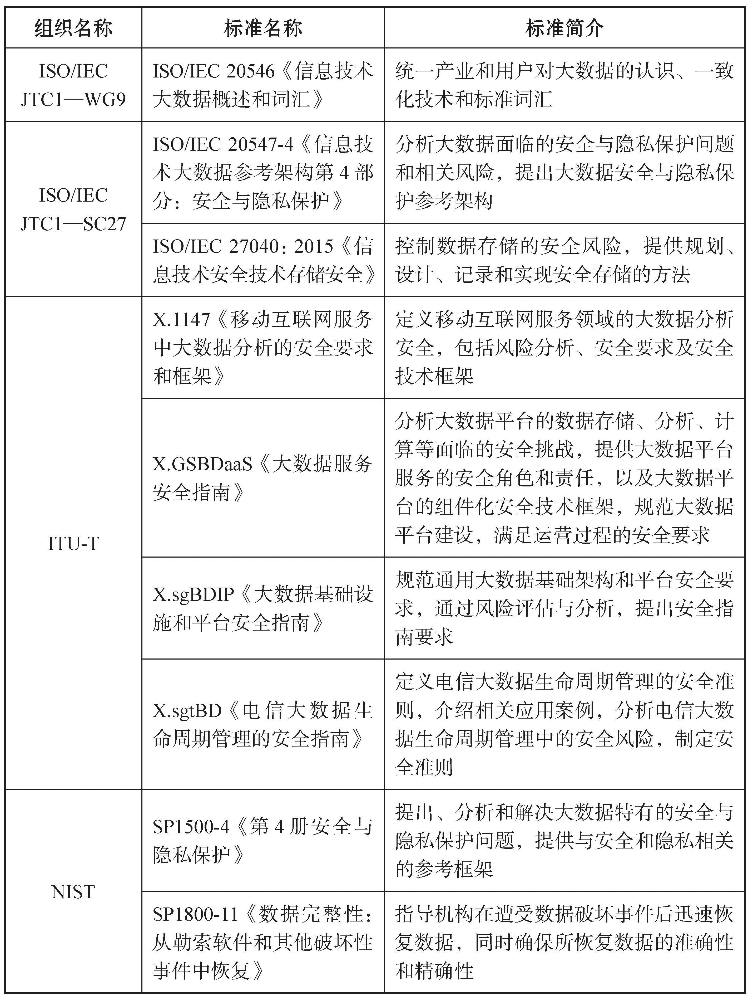

**（续表）**

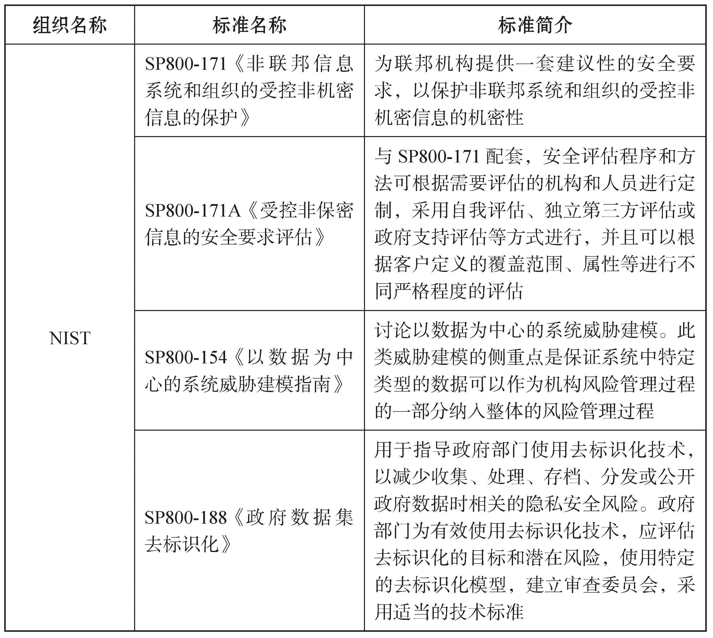

###### (2) 我国的数据安全标准

国内从事大数据及大数据安全标准化的主体主要有国家标准化管理委员会下属的全国信息技术标准化委员会信标委 TC28，和全国信息安全标准化技术委员会信安标委 TC260。信标委负责大数据领域标准体系建设完善，组织技术与标准研究并推动国际标准化，对口 ISO/IEC JTC1 WG9。信安标委负责大数据安全领域标准体系建设完善与技术研究。为加快推进，信安标委于 2016 年 4 月成立大数据安全标准特别工作组，负责体系构建与技术研究，已形成多项已发布或在报批的标准（见表 6-4）。

**表 6-4　我国大数据安全标准（含起草报批）^((2))^((3))**

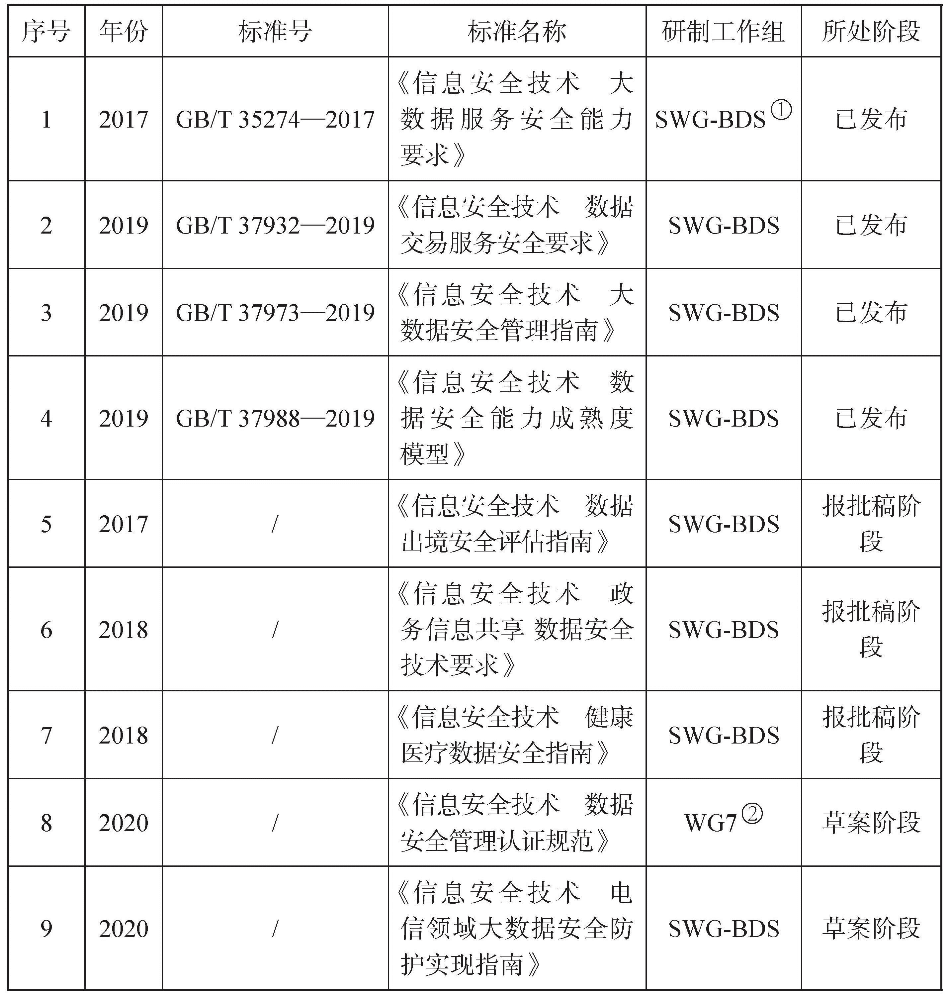

随着应用场景不断丰富，大数据安全挑战日益突出。制度与技术是大数据应用的双轮驱动，二者相互依托。安全标准既是技术组成的重要部分，也是制度的有力支撑，在市场中承担规范各方技术行为的责任。数据安全与确权、隐私维护、开发共享紧密关联，标准制定与更新需与应用发展保持同步。

从国内外实践看，我国起步相对较晚，但积极参与国际通用标准建设，如《信息技术大数据参考架构第 4 部分：安全与隐私保护》及《大数据安全能力成熟度模型》《大数据安全实施指南》等项目均由国内专家主导。以信息技术为核心的整体布局表明，以美国为代表的发达国家在基础数据标准方面积累深厚，早期即关注政府部门、企业、行业、个人隐私等多方在安全与共享上的差异与衔接。WG9 正在研制的大数据术语与参考架构等国际标准对国内工作具有重要借鉴意义。作为后来者，我国已构建涵盖大数据基础概念、数据共享交换、全周期技术管理、平台工具、运维评估、隐私安全、行业应用等七大要素的标准体系。应通过与国际标准化组织合作，尽早融入国际标准进程，链接国际产业生态，推动我国大数据在多领域安全高效发展。

## 第四节 人工智能社会治理和公共服务应用的协议许可

人工智能在社会治理与公共服务中的落地离不开许可协议机制，开放许可协议是政府数据开放政策法规体系的关键一环。2015 年 1 月，万维网基金会发布的《开放数据晴雨表（第二版）》指出，真正的开放必须在许可协议框架下以可机读形式发布，这被视为基本前提。可见，许可协议是衡量政府数据开放程度的重要标尺，已成为国际组织与各国政府关注的焦点。

政府数据往往涉及著作权、数据库权等权利，使用时易受限甚至产生侵权风险，开放许可正是解决这一矛盾的核心工具。许可方式直接影响数据的利用范围与增值路径。开放政府许可通过授权为数据利用与开发提供法律保障，决定开放数据能否实现最终价值。对受保护的政府数据，需通过许可授权公众使用并规范行为，使其在更广范围内实现多元化应用。对不同类型与属性的数据实施差异化许可，既能保护商业秘密，也能实现其向特定主体的定向开放。

2008 年《经合组织委员会关于增强公共部门信息访问与有效使用的建议》强调开放许可的价值：最合适的许可应最大化公共部门数据利用与再利用，条款须非歧视、非排他，除必要外不应设置获取、使用、处理、分享信息的限制。2013 年《开放数据宪章》提出政府部门应采用开放许可或其他措施，使信息无限制、无费用地用于商业或非商业用途。2014 年美国白宫科学与技术办公室开展开放政府数据许可协议研讨，2018 年美国国会正式通过《开放政府数据法案》。

国际上开放许可形式多样。英国政府许可框架提出三种协议：商业与非商业用途均可的开放政府许可；仅限非商业用途的非商业性政府许可；付费后可排他性使用的收费许可。前两种均允许公众免费复制、发布、传播、修改信息并挖掘其商业或非商业价值。

### 一、国际组织制定的许可协议

许可是指允许组织或个人再利用受著作权或数据库权保护的信息与资料的机制，明确了被许可行为与权限边界。国际组织的开放数据许可主要分为知识共享许可协议与开放数据共用许可协议两类。

知识共享许可协议由 Creative Commons 发布，适用于照片、文本、数据等创作内容。主要包括六种基础类型：署名 CC-BY；署名—相同方式共享 CC-BY-SA；署名—禁止演绎 CC-BY-ND；署名—非商业性使用 CC-BY-NC；署名—非商业性使用—相同方式共享 CC-BY-NC-SA；署名—非商业性使用—禁止演绎 CC-BY-NC-ND。此外还提出公共领域贡献与许可 CCO、公共领域许可、附加许可协议 CC+ 等。类型与许可内容见表 6-5。

**表 6-5　知识共享许可协议的类型**

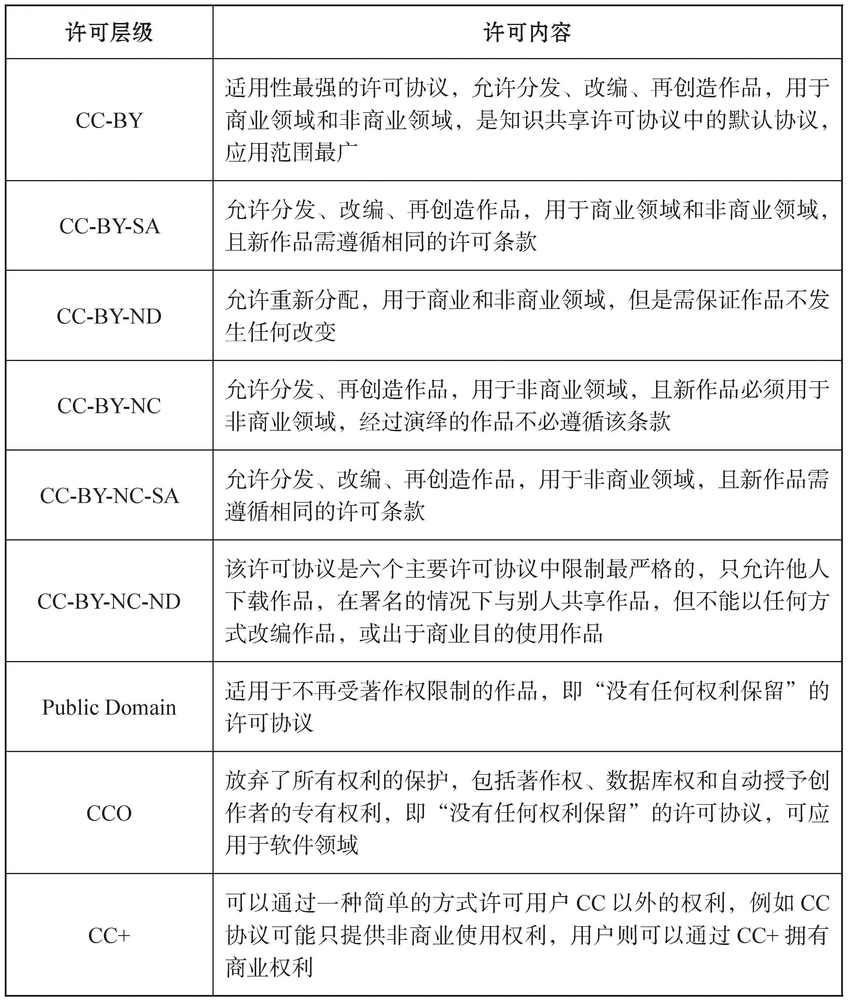

知识共享许可协议对许可对象置于公共领域的程度各不相同，层级丰富。需注意的是，CC-BY-NC、CC-BY-NC-SA、CC-BY-NC-ND 以及 CC-BY-ND 因限制商业使用或禁止演绎，不属于理想的开放数据许可。

**表 6-6　开放数据共用许可协议的类型**

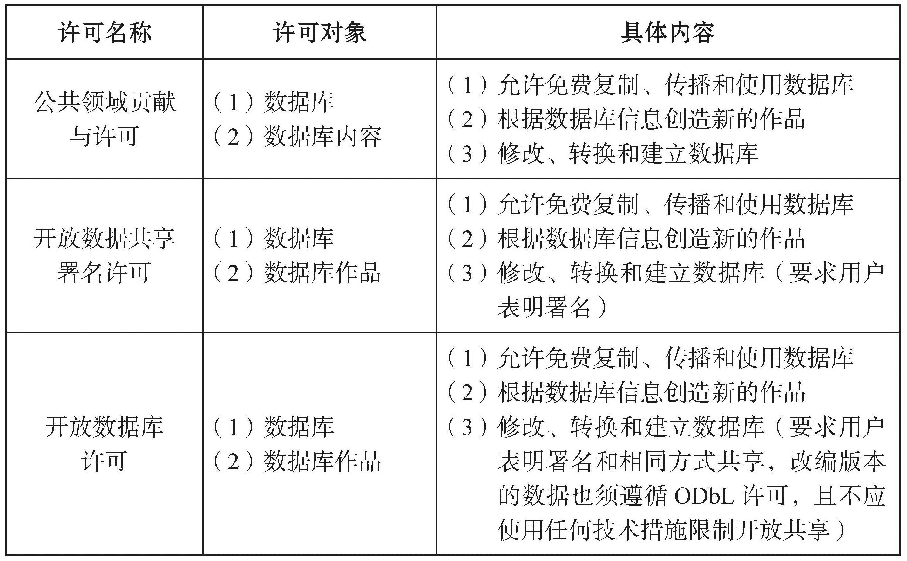

开放数据共用许可协议由开放知识基金会发布，用于规范数据提供者与使用者在利用、发布、修改、传播数据时的权责，是国际通用的许可类型。包含三种：公共领域贡献与许可 PDDL、开放数据共享署名许可 ODC-By、开放数据库许可 ODC-ODbL，见表 6-6。该类许可针对数据集或数据库，对象单一，适用于复杂数据集与数据库作品，不适用于软件、电影、音乐等创作作品。应用范围相对较窄，政府数据开放中法国使用 ODbL。三种许可均符合开放条件，不限制商业使用与数据修改演绎，其中限制最大的 ODbL 也可以用于商业领域。

### 二、域外各国许可协议比较

各国制定的开放政府许可协议是政府部门专门为开放数据或公共部门信息制定的许可类型，是促进数据开放的重要工具（见表 6-7）。多数国家采用已有许可，部分移植知识共享许可，因修改幅度有限，下文不再赘述。

美国联邦政府使用知识共享公共领域许可，即放弃所有权利保护的“没有任何权利保留”许可。英国国家档案馆于 2016 年发布政府许可框架第 5 版，包含三种方式：适用于商业与非商业使用的开放政府许可 OGL；仅限非商业使用的非商业性政府许可；付费使用的收费许可。其中中央及地方政府默认优先采用开放政府许可。

**表 6-7　各国制定的许可协议比较**

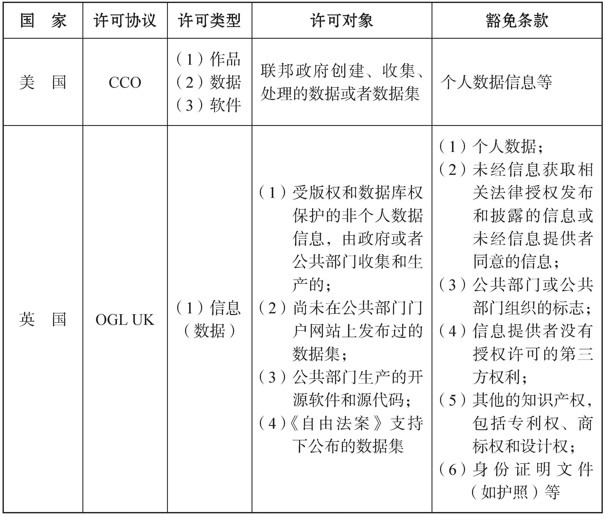

**（续表）**

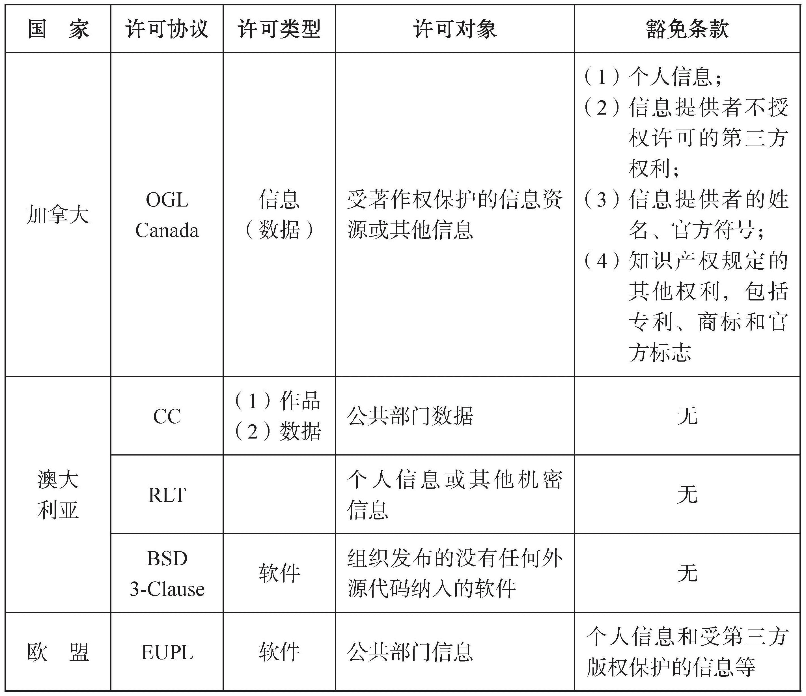

加拿大政府采用开放政府许可 Open Government License Canada，为免版税、永久、非排他许可。2014 年 2 月起，澳大利亚政府数据门户采用知识共享许可协议 4.0 版，其开放许可框架包括六项 CC 许可、限制性许可证模板以及 BSD 3-Clause 软件许可。欧洲联盟许可协议 EUPL 为欧盟首个开源软件许可协议，由欧盟委员会倡议创建，提供多种官方语言版本。

### 三、我国许可协议的现状和思考

我国政府数据开放在许可机制上仍不完善。部分平台已发布类似使用条款，例如上海市政府数据服务网的使用条款涵盖服务内容、授权声明、接受条款、用户义务、收费政策、隐私保护、免责声明等要素，但大多数平台缺乏统一许可框架，仅提供免责声明。因此亟需构建完善的政府数据开放许可框架，明确数据产权，规范第三方使用、再利用、二次发布行为，并协调数据使用与利益关系。

对上海、北京、深圳、广州、武汉地方政府数据开放平台的调研显示，我国平台均未采用国际通用许可协议，用户权限主要通过网站页面的“使用条款”“服务条款”“法律声明”等描述。所有平台均明确用户可免费获取、使用网站数据（见表 6-8）。

**表 6-8　我国政府数据开放平台采用的许可协议情况**

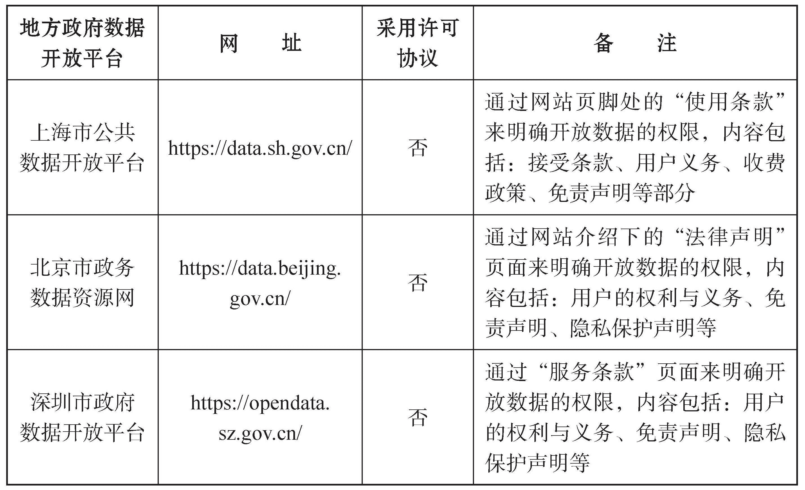

**（续表）**

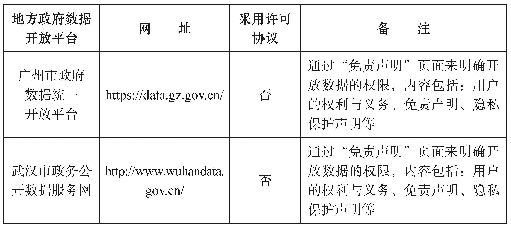

## 第五节 人工智能社会治理和公共服务的公共数据开放模式

上海、杭州、贵州提出的“开放+安全”地方立法，为我国数据治理奠定了基本模式：数据安全是应用的底线，但不应成为数字市场发展的阻碍，高质量开放能够引入市场驱动力，激励市场主体构建安全管理框架。因此，我国需要探索市场资源参与下的公共数据开放路径，即数据的收费开放模式。

政府数据开放要不要收费？

随着数字化推进，政务信息供给正面临重新审视。载体形态、技术路线与开放流程早已摆脱纸质档案时代，信息供给主体的社会角色与各方利益博弈也在变化。信息化起步阶段大数据概念尚未形成，行政机关主动公布掌握的公共信息多被视为法定义务。如今算力网络普及，海量、立体、实时性强的国家级数据平台逐步成型，公众对信息质量与时效的要求同步抬升，管理侧更强调需求导向与运行安全。随之信息披露的经济投入已不可忽视：若全面无偿，公民知情权是否会实质受损，是否违背公共服务属性？若完全不设门槛，大数据语境下的政务数据公开将缺乏资金支撑，作为准公共品易出现供给不足与质量下滑；若仅靠财政拨付，随着体量指数扩张，财政压力也会难以承受。由此，政府持有的公共数据是否应付费、收费边界与定价依据如何把握、他国实践能否借鉴，成为我国数据开放须解答的问题。

### 一、公共数据开放的主要模式
梳理中外实践，供给定价思路大致可归纳为三类：零费用、按投入回收、投入加成。

#### （一）免费模式
从以税养政服务于民的逻辑看，数据开放被视作提升治理能力、增进公共福祉的手段，免费被认为是自然选择。让社会共享数据并实现价值放大，是诸多国家及地区的主流做法。《“开放数据晴雨表”全球报告 第四版》中开放水平前十的国家政务数据无偿供给情况如表 6-9 所示。

**表 6-9　2017 年“开放数据晴雨表”中开放水平前十名的国家数据免费开放情况**

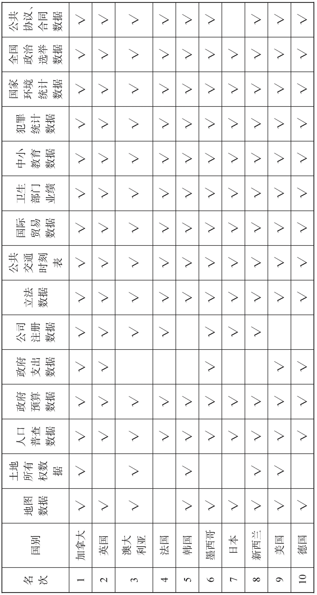

该表表明，各国在涉及公共职能的数据领域普遍遵循默认无偿、特殊情形收费的做法。土地权属、财政支出、企业登记等信息在多地实行收费获取，而地图、人口普查、财政预算、立法记录、公共交通时刻、国际贸易、卫生绩效、基础教育、犯罪统计、环境统计、选举信息、公共合同等数据，在十个领先经济体中基本可无偿使用。报告同时指出，我方可无偿获取的数据类型涵盖人口普查、财政预算、立法、公共交通时刻、国际贸易、卫生部门业绩、基础教育、犯罪统计、环境统计、公共协议合同等。^((4))

无偿仍是传统信息公开的主渠道，“开放数据晴雨表”关注的核心正是履职过程中应公开的基础性事项。然而，无偿模式难以覆盖全部需求。诸如金融、公共卫生、公共安全等需要深度挖掘与分析才能落地的服务，其背后存在高昂的信息处理成本，单纯无偿并不足以提供可持续的经济助力。

#### （二）成本定价模式
信息采集、整理、存储均需人力财力投入，大数据中心建设与运维属资金密集型活动，前期需购置存储设备、搭建运营机构、配置专业人员，后期需持续维护管理。按投入回收费用因此具有合理性。

国际上常见做法是在无偿供给基础上，对特定场景采用有限度的投入计收。欧盟多通过向增值使用者收取使用费来回收采集、加工、整理环节的管理成本。欧盟 2003 年《政府信息资源再利用指令》规定，收费原则上仅限于个人请求的边际成本，即复制、提供与传播成本；收费不得超过生产传播成本，可考虑合理投资回报；申请时应告知收费计算方式并提前公布标准与使用条件；拒绝请求须说明理由并提供指引；若行政机关以所持信息提供增值服务并与私营部门竞争，也应同等付费。美国则要求即便高价值数据也尽量无偿，若确需收费，不得高于传播成本。

按投入定价存在局限。其一，公共部门的法定属性决定其不能将公共信息拍卖牟利，定价应以成本补偿为基准；其二，政府往往难以精确核算全部开放成本，也难以预估未来使用者数量，采用平均成本或边际成本易出现补偿不足，反而削弱开放动力。总体看，按投入计价并非有偿开放的理想工具。

#### （三）“投入加溢价”计价路径
在投入计费基础上，价格中加入一定溢价空间，即成本加成模式。对使用者而言，只要预期使用收益高于付费成本，就会有动力付费获取使用权。该模式体现“使用者付费”原则，即由直接受益方而非全体纳税人分摊成本，其正当性在于特定群体从国有资源利用中获得大部分收益时，应由其承担费用。

国际上采用此模式的国家不少。英国除提供公益数据服务外，也开展盈利性数据开发，收取合理投资回报。公开信息的加工再利用可收费，原理是在生产传播成本之外允许合理回报。政府既可提供非营利信息服务，也可与私营部门竞争开展商业信息服务。例如英国气象局的增值定制天气预报通过电话短信收费。《政府信息资源规定》将收费分为三类：一是大部分情形收取边际成本；二是工作人员投入大量信息成本的数据；三是图书馆、档案馆、博物馆，收取收集、生产、复制、传播、保存的直接与间接成本，并可加收版权清理费和合理投资回报。日本把略高于成本的定价视为让受益者承担支付责任的手段，将“特别受益”部分回流为社会公共利益。欧盟 2003 年指令也提出再利用以收回成本为目标，包含合理投资回报。法国规定公共资源收费为实际成本加合理利润，德国也允许价格包含溢价并用以补贴其他亏损公共服务。

成本加成有助于政府与社会形成合作、促进数据更好利用，但收益的不确定性限制了买方支付意愿，且溢价幅度的核定与政府谋利行为的正当性问题始终是难点。

### 二、收费数据的种类和特征
各国在收费类型与标准上不尽相同，实践中多依据数据处理的间接成本高低来选择定价方式。有观点认为，间接成本包括采集、清洗、加工、整合、整理、呈现等环节，收费重点往往落在增值服务与海量数据供给上。

#### （一）采取成本计价模式的数据
##### 1．需加工处理才能满足需求的数据
指必须经过筛选、加工或运维、软件部署、升级更新等操作才能提取的数据。如用户要求将数据及相关软件打包部署到其独立网络环境，实现本地化部署、管理软件升级、数据更新等，需由运维方或软件系统针对运营成本收费。
##### 2．需提供调用接口才能满足需求的数据
这类数据结构复杂且实时性强，需开放调用接口并进行二次开发。如部门在原始数据上提供二次开发接口及使用说明、代码示例，使用者据此调取资源。收费主体有两类：一是提供数据资源的主管部门，按运维成本计费；二是提供二次开发服务或接口的服务商，按再利用服务计费。

#### （二）采取“成本+利润”半商业模式定价的数据
##### 1．需跨单位调取整合才能提供的数据
数据横跨多个部门，需经过复杂调取流程，整合来自不同部门、业务、区域、系统的信息后才能满足需求。例如春运期间全国人口迁徙量、出行距离特征、热点城市与路线、客运枢纽等数据。可参照英国做法，设立专门机构或委托支撑单位，按协议与收费标准进行半商业化运营。
##### 2．数据量庞大的原始数据
包括视频流、环境监测、巨量统计等原始海量数据。可由专门机构或支撑单位进行半商业化运营，提供数据支撑服务。
##### 3．时间跨度较大的历史数据
数据年代久远、未完全数字化，恢复提供需耗费大量人力物力。可参照上述模式，由专门机构进行半商业化运营，提供支撑服务。

### 三、公共数据收费的分层管理
总结各国经验，在数据需求多元化、信息化快速发展的背景下，政府应按数据类别实施分层收费管理。

首先，基于“以税养政”的属性，开放应坚持“原则免费、例外收费”，最大限度降低公民获取信息的成本，同时保留政府对数据处理工作获得合理报酬的权利。

其次，数据开放存在明显受益者时，应坚持“受益者承担”原则，由特定受益者支付成本加利润费用，形成政府与社会在特定数据领域的良性协作，提升数据运用的多样性与延展性。

最后，从合法性基础看，政府可基于对数据库的著作权向使用者主张经济利益，但所得应回流至数据公共服务领域；若数据库系政府与多方合作建设，不宜单独主张制作权时，则以行政收费方式作出收取费用的行政决定。

**课后习题：**

1．人工智能社会治理和公共服务应用的安全风险的具体表现有哪些？

2．人工智能社会治理和公共服务应用的安全标准的属性和类型特点是什么？

3．结合你对人工智能的认识，谈一谈人工智能社会治理和公共服务应用的未来具体场景有哪些方向。

* * *

(1)　例如《上海市“AI+一网通办”工作方案》规定，一网通办方案的核心主体为上海市大数据中心，由上海市推进“一网通办”改革和政务公开领导小组以及市政府办公厅作为监督指导主体，其他各行政部门为协同主体。

(2)　SWG-BDS，大数据案例标准特别工作组。

(3)　WG7，信息安全管理工作组。

(4)　例如北京市政务数据资源网、上海市公共数据开放平台、广州市政府数据统一开放平台、深圳市政府数据开放平台、武汉市政务公开数据服务网等公共数据公开平台都免费开放数据。但也有部分地方平台在服务协议中提到“现阶段免费”，但设置了模糊的期限或限制，如采用“保留收费权利” 等表述。信息来源：《2018 中国地方政府数据开放平台报告》。

# 第七章 人工智能法律服务应用

**本章提要：**AI的浪潮在全球掀起观念、技术与商业的变革。AI法律服务重塑了公众对法律服务模式的认知，改变了法律规则的映射关系，也丰富了法律价值取向，对既有思维、工作方式与效率产生深远冲击。在法律服务领域，这既是挑战也是机遇。本章以理论基础为起点，梳理AI法律服务的实践形态，并探讨其面临的挑战与未来走向。

## 第一节 人工智能法律服务应用的理论基础

研究AI法律服务，需要先厘清其源起与国内外演进脉络，为后续分析提供基础。

### 一、人工智能法律服务的基本定位
该领域的研究可追溯至布坎南与海德里克 1970 年发表的《关于人工智能和法律推理若干问题的考察》，此文开启了法律服务领域应用人工智能的探索。

AI法律服务为法律服务注入技术支撑，其兴起源于双重动力：一方面，法律理论与实践的发展需求。法律在研判AI风险与规避路径的过程中，对AI的理解不断加深；与此同时，法律文献与纠纷案件急剧增长，服务者面临工作与心理压力，亟需技术辅助。另一方面，AI应用边界的自然延伸。AI已从计算机研究拓展至数学、医学、心理学、仿生学等领域，而法律数据的庞杂、推理的精准、检索的细致对人力物力消耗巨大，AI恰好能以技术优势突破瓶颈，提升实践效率。

将AI技术成果引入法律行业，构建法律决策计算模型，可实现法律推理。人工智能是借助计算机模拟人类部分思维与智能行为的学科，核心在于实现智能原理并制造类脑计算系统，推动计算机迈向更高层次应用。“法律+AI”大致存在三种建模思路：一是归责推理，利用演绎推理把法律规范编码为解释库与案件事实库，实现自动演绎推理；二是案例推理，利用类比推理把案例编码为解释库与事实库，实现自动类比推理；三是数据推理，利用归纳推理把有价值的法律信息编码为解释库与事实库，实现大数据的自动推理。

AI在法律领域的典型场景包括智能咨询、智能检索、类案检索、案件预测、智能合同分析与起草、文书审阅、业务辅导等，有助于提升事务处理效率并降低法律门槛。

参与主体既有腾讯、阿里、科大讯飞等综合技术服务商，也有华宇软件、华夏电通、擎盾等专业法律信息化企业。国外则有更多法律AI公司，例如美国合同分析平台 LinkSquares 发布的人工智能合同生成器，可自主完成模板起草、审查修改与审批，并整合为统一工作流。

#### 1．国外人工智能法律服务的发展
20 世纪 80 年代，美国学界以“人工智能与法律”为主题展开深入讨论，伯曼与哈夫纳被视为奠基人。1987 年举办学术会议，1992 年成立专门研究学会，1993 年创办《人工智能与法律》期刊，研究热度迅速提升。

系统成熟度也在提升。2015 年美国机器人律师“ROSS”用于整理信息数据；2016 年英国出现处理停车罚单上诉的AI程序；2017 年俄罗斯 Sberbank 引入处理投诉信件的机器人律师。AI正逐步渗透法律全流程。

#### 2．我国人工智能法律服务的发展
自 2015 年起，国家层面密集出台相关政策。2015 年 5 月《中国制造 2025》、7 月《关于积极推进“互联网+”行动的指导意见》将智能制造、物联网、云计算、数据共享列为主攻方向。2016 年 7 月《“十三五”国家科技创新规划》提出发展数据驱动的类人智能，12 月《“十三五”国家战略性新兴产业发展规划》要求培育人工智能产业生态并推动规模化应用。2017 年 1 月《关于促进移动互联网健康有序发展的意见》进一步强化人工智能等关键技术布局。

在政策指引下，地方实践加速。2016 年贵州法院率先开发司法辅助系统，提升司法人员业务能力与效率；同年“法律谷”推出面向律师与消费者的检索产品，输入案情即可查询相似案例并推荐律师；“理迈”提供法律信息监控，快速筛选案例并以分类、统计、图表形式呈现风险与解决方案；“206 系统”于 2017 年 7 月上线，以审判为中心管理诉讼，规范办案标准与证据使用，减少司法随意性。2016 年 6 月杭州铁路运输法院启用机器员工“小 G”负责智能配送；同年 12 月广西某律所推出“南宁市刑期预测系统”，基于海量判决书数据分析预测结果。2016 年 10 月“法小淘”在云栖大会演示对话式案件分析，可根据口头描述分析案由、索赔金额并推荐律师。“吴小甪”“法狗狗”等系统也相继上线，服务司法与社会公众。

### 二、人工智能法律服务应用的重大意义

#### （一）法律服务资源配置方式发生变化
传统法律服务资源配置具有随意性与盲目性，供需匹配多依赖熟人推荐或律所宣传。法律服务的专业性导致强信息不对称，需方选择律师带有“赌博”成分；供方则面临客户质量参差、潜在客户挖掘困难的困境。配置方式的低效造成资源浪费，行业整体效率不高，专业化发展受阻。

AI正重塑法律服务资源流动

人工智能正在改写法律服务资源如何被配置、如何被使用的底层逻辑。过去制约供需匹配的症结，在于行业专业门槛筑起的信息鸿沟。法律大数据切入后，这道鸿沟被打开，闲置的服务产能被激活，资源周转更快，匹配也更精准。以中国裁判文书网的检索为例，当事人能以案由、法院、案类、律所、律师姓名等单一或组合关键词快速圈定对象。裁判文书的公开化，客观上为律师筛选提供了数据入口，也倒逼行业评价方式重塑：案件数量、案型分布、办案结果等关键信息被置于台面，客户据此判断执业水平，匹配的命中率随之提升。对律师而言，人工智能同样是客户洞察的工具，通过对裁判文书的大规模检索与分析，可锁定某地某类纠纷的高频涉诉但长期无代理的客群，也能捕捉到特定时段某类案件的量价异动，提前布局服务。第三方法律服务平台则依托数据中台，把需求方的关注领域、使用习惯与律师的专长方向做关联运算，实现精准推送，用数据驱动的匹配替代传统的人工推荐，从而提升整体利用效率。

#### （二）法律服务市场生态位的重构

法律服务市场和生物生态系统一样，不同主体占据不同位置，客户资源在一段时间内被不同从业者占据，形成可感知的“高低”差异。这种高低差异本质上是单位案件收益效率的差异。传统上位者多为承接标的大、企业商事类高费率业务，收益稳定且集中，被视为高生态位；大量律师分布于中低位，服务普通客户，单案投入高、产出低。推动从业者向上流动的核心动力是个人精力有限而案件复杂度高，低端事务并非没有价值，而是投入产出比失衡。人工智能带来的可能性在于规模化降本：通过把握某类案件的宏观规律，把法律关系清晰但流程繁琐的案件交给团队流水作业，将过往高耗能环节压缩到最低，单案收益率随之改善。中低生态位的经营逻辑由此发生变化。行业由此分化出两条可行路径：一是依托新技术做类型化批量案件的集约化运营，二是坚守复杂、高收益的个案深耕。两种路径都能挖掘生态位的潜在价值，推动行业结构向良性演化。

#### （三）执业思维模式发生改变

我国以成文法为基底，演绎推理长期占据司法与执业的主流，归纳与类比的使用相对受限。症结不仅在制度与法文化，更在于传统样本采集能力的局限。归纳、类比都依赖足够量的相似案例，靠人工很难实现大规模、多维度的样本搜集，有限样本的推断不确定性也大。人工智能打破了样本瓶颈，大幅拓宽采集边界，降低推理的不确定性。

这背后是思维范式的迁移：从依赖因果链条到注重相关性挖掘。演绎推理以三段论呈现因果确定性，在封闭、变量少的小系统中有效，但在开放复杂的社会系统中，因果常相互缠绕、前果后因难以分辨。法律问题本质是复杂社会问题的映射，因果分析容易失效。归纳与类比则不纠结因果生成机制，而是从海量相似样本中提取相关模式并做预测。法律大数据提供的客观信息还能弥补思维盲区，激发灵感。随着检索相似案例成为办案常规，律师引用类案的频率不断提高，说明在人工智能影响下，我国法律实务的思维方式正在从演绎为主转向归纳类比并重，这一趋势将随技术完善而持续强化。

#### （四）催生新的服务类型

人工智能的赋能不仅限于诉讼环节，还在催生数据驱动的新业态。随着采集、存储、分析能力提升，纯粹以法律数据的整合分析为核心的服务成为可能。具备数据资源的律所或法律电商可基于新技术搭建新模式。越来越多律所将数据整理、分析纳入常规业务，利用专业理论与实务经验对数据分类做前置设计，使分析服务更贴合市场需求。未来核心竞争力不再只看办案能力，法律数据的综合运用能力也将成为关键变量，掌握更先进的人工智能技术的机构在竞争中更有优势。

### 三、人工智能法律服务的优势分析

#### （一）提高案件结果预测的准确度
客户初次洽谈最关心的是案件走向与胜负，而律师的分析能力直接决定成案率。仅靠法条解读和语言表达往往抽象、主观性强，容易产生偏差。大数据的价值在于可预测与可视化。律师检索同类案件的争议焦点、主流裁判观点、原被告胜诉率等指标并做结构化呈现，能把抽象判断转化为直观数据，从而提升预测可信度与签约率。^((1))

#### （二）提高模拟庭审的质量
模拟庭审是对待开庭案件的预演，有助于把握争议焦点并预置风险。相较于纯法条推演，模拟更具实战感。模拟的质量取决于可调控的案件模型，而模型的有效组合离不开充足的样本。海量、多维的大数据提供足够的要素组合空间，重组后的数据集合本身价值高于单点数据。基于检索积累的样本库提取要素、搭建模型，可显著扩充模拟信息量，提升预演质量与律师的应变训练。

#### （三）减少重复劳动，形成高效智能办案方式
2017年国务院《新一代人工智能发展规划》提出推进社会治理智能化，建设智慧法院已成趋势。法律服务随司法改革同步演进。办案中事务性工作占比高却创造价值有限，占用律师大量精力。法律大数据的普及使律师能把事务性环节标准化，把创造性环节非标准化。借助大数据平台可沉淀文书模板、可视化流程、尽调样本等，将类型化案件的共性要素抽离，形成标准化作业流程，实现事务与创造的分流。人工智能系统在合同审查、智能阅卷、文书自动生成等领域应用广阔，能有效降本增效。如2018年2月，以色列法律科技公司Law Geex的人工智能平台与20名资深律师同场竞技，4小时内审查5份保密协议并识别30个法律问题，AI准确率95%高于人类85%，且26秒即可完成一项，人类平均需92分钟。

#### （四）降低个性化法律服务成本
标准化提升效率，但无法覆盖所有差异，每个案件都有独特之处，尤其面向大型企业的非诉专属服务，高度依赖对客户的深度了解，这导致个性化服务成本高昂。法律大数据的全面采集能力让律师能挖掘客户自身不完全掌握的信息，提前洞察法律风险，从而在保证服务精细度的同时压缩成本。

### 第二节 人工智能法律服务应用的实践

### 一、我国人工智能法律服务应用的实践
国内人工智能法律服务已覆盖公证、律师辅助、企业法务、普法宣传等多个领域，形态包括区块链公证、在线数据库、企业合规智能化、普法机器人等。国外起步更早，早期以网络服务和智能软件为主，如今正向算法升级、数据库优化、平台化简化操作深化，并伴随个人信息与隐私安全、算法黑箱歧视、传统行业冲击等法律风险的显现。

#### （一）技术侧重分析
#### 1．区块链法律服务应用
多地正开展区块链公证先行试点，搭建区域性联盟链，江浙等东部区域在多部门协同下布局广泛且成效明显，未上线地区也已将其纳入智能化发展规划。

#### 2．大数据法律服务应用
对国内25家主要人工智能法律服务机构的底层技术统计显示，大数据技术占比达76%。数据挖掘作为大数据子技术，通过自动发现数据间特殊关系并结构化呈现，为知识发现提供基础。经特征提取与知识图谱处理后，数据可被类型化与结构化。在法律服务中，大数据被用于对法律法规、政策文件、司法案例、社会热点、学理研究等进行结构化分类，构建多维可视化信息库，如北大法宝案例库及其可视化分析图表。类型化数据库既为实务者提供明确资料入口，也为法律机器人等深度应用储备基础数据。

#### 3．语言处理技术法律服务应用
自然语言处理与图像识别是法律场景的常用方向。自然语言处理涵盖智能分词、文本理解、内容分类、词向量、关键词提取等，帮助快速把握文件要点。统计显示，该技术在25家主要机构中的使用占比达52%。如“法狗狗”合同分析功能可精准标注关键条款，并用于咨询意图识别；法信平台“同案智推”可快速定位判决要点并推送相似案件，实现语言识别与深度学习的融合。

#### （二）应用场域分析
##### 1．公共法律服务
全国人工智能新应用呈广泛分布，东部占比37.63%，西部36.56%，中部19.35%，东北6.45%。除经济发达地区外，西部、中部内陆省市也积极响应司法部“2020年底实现智慧法律服务”目标，以智能化方式提升公共服务可及性。司法部2018年《关于深入推进公共法律服务平台建设的指导意见》要求到2020年底实现服务精准化与三大平台一体融合。《公共法律服务事项清单》划分为16项，本书聚焦法治宣传、法律咨询、法律检索、法律援助、公证与司法鉴定、其他司法行政业务六类。

2020年度新增应用中，法律咨询占比最高达66%，随后为法律援助60%、法治宣传38%、法律检索32%、公证鉴定26%、其他司法行政业务中纠纷调解22%、业务管理20%、监狱管理与矫正业务2%。

###### （1）法律咨询
法律咨询是公共服务起点，人工智能对话式机器人与智能问答平台正加速落地，降低操作门槛，为当事人提供初步法律建议，覆盖婚姻、劳务、民间借贷、知识产权等常见纠纷。自然语言理解仍有提升空间。中国法律服务网的智能咨询可为用户免费生成法律意见书，覆盖婚姻家事、交通事故等29个问题域。2020年度该类服务已出具法律咨询意见书1850855份，获得广泛认可。

###### （2）法律援助
人工智能在法律援助场景集中于律师推荐与联络、文书起草、诉讼程序对接。宁夏将全区28个法律援助中心、21家公证处、194家律所等全部纳入“智慧法律服务调度管理平台”，实现“一网通办”。天津公共法律服务智能终端提供全时空智能咨询，支持网上申办与自助语音服务，打造“无人律所”体验。

###### （3）公证

公证上链：小额信贷执行的闭环方案

2018年9月30日最高法发布《关于公证债权文书执行若干问题的规定》，把可以强制执行的公证债权文书制作与执行统一规范，为债权文书向智能化演进提供了制度基础。总体上讲，把强赋公证与分布式账本结合，本质是借助大数据、云计算和AI，搭建智能化债权文书执行体系，直面小额普惠信贷在催收上成本高、效率低、周期长的痛点。解决普惠性融资难题的关键，在于让银行等金融机构与公证机构基于分布式账本建立数据分布式存储和互信机制；通过线上强赋公证获取具备执行效力的法律文件，实现放贷前到放贷后的全流程在线管理。

贷款申请阶段，该模式可对借款人进行事前风险提示，有效规避潜在欺诈风险；贷后催收阶段由公证机构核实并发出催告，减少金融机构内部催收部门人力投入，并在监管趋严背景下，解决传统催收成本高、效率低、周期长且手段不合规的困境。一旦形成不良贷款，线上生成的电子执行文书即可直接进入法院强制执行程序，大幅提升执行效率；若法院追缴未果，失信主体也能及时被纳入失信被执行人名单予以惩戒。

金融机构引入强赋公证的抓手，是把贷款申请嵌入公证流程，引入公证机构直接面对借款人完成身份核验，并将强赋公证完整流程清晰告知客户，形成贷前法律后果提示与预警。随后完成借款协议线上签署和每笔用款交易线上存证，构建完整贷款证据链。从金融机构视角看，贷前强赋公证所获取客户信息均基于符合法定要件客户授权，并采用加密算法传输与留存；交易数据也以密文形式传输。借此，链上大数据在客户端与金融机构端实现了安全可靠分布式存储。正因这种存储可信性，金融机构能够全线上完成贷前申请、公证机构对不良客户贷后催告，以及属地法院强制执行申请与失信名单对接。

强赋公证链上方案内核在于解决了电子存证公正性问题，从而明显提升线上债权文书执行质效，为金融机构与客户提供全链路债权纠纷解决方案，高效保护债权人与债务人实体和程序性权益，在普惠性融资建设中具有示范意义。

###### （4）普法宣传
普法是法治社会建设关键环节。传统普法多以社区宣讲、发放宣传册、观看宣传片为主，如果借助智能普法机器人等AI技术，能进一步增强普法成效，更容易被年轻一代接受。北京人人律智能大数据科技有限公司依托法律内容资源和行业积累，打造“智能硬件+智能应用+移动互联网”一体化公共法律服务智能终端。该公司融合AI、大数据、云计算、法律知识图谱等理念，自主研发“小律”智慧普法与公共法律服务机器人、触控一体机、自助柜员机、无人亭、可视化自助机、线上智能法律咨询机器人等系列终端，通过自然语言识别实现更清晰问题理解、分析与解答。AI机器人的落地，有力推动各地普法工作开展。

##### 2．企业法律服务
AI在商业法务领域可提供多样化支持。传统模式下，法务从业者手工处理高重复度、信息密集工作，效率低下且成本高昂。AI通过人机协作实现流程自动化，用机器替代人工完成基础性法务工作，在降本同时大幅提升效率。对国内25家主流AI法务企业统计显示，其应用场景主要包括：法律咨询占比48%；文件审阅占比48%；法律检索占比40%；预测评估含案件预测与风险评估占比28%；存证鉴定占比16%；业务管理占比12%。

企业提供的法律咨询与公共机构存在较高重合，下文聚焦排名靠前三大场景。

###### （1）法律检索
法律检索长期占用大量人力。国内已有批量高效辅助产品，例如“法信”平台，作为国内首个将法律知识与案例大数据融合服务平台，为从业者提供专业知识解决方案、类案剖析、同案智推等服务。其同案智推功能依托自然语言处理与深度学习，支持用户输入口语化案情描述或上传整篇法律文书，系统自动识别案情特征并从海量裁判中匹配相似案件，提供快捷精准服务。

###### （2）文件审阅
文件审阅工作量大但单项价值偏低，借助自然语言识别与深度学习，AI逐渐能理解基础法律文件内涵并参与审阅，在文件整理、尽职调查、合规风控等领域发挥作用。在合同审核方面，智能合同服务可帮助用户以更低成本、更高效率管理合同并防范风险。当前技术已能实现不同版本精细比对，例如北大法宝依托海量数据推出的智慧法务平台，可精准发现合同文本与合同范本之间差异。

###### （3）预测评估
企业日常经营常因各类风险卷入诉讼。传统人力在数据采集和多因素分析上捉襟见肘。AI结合自然语言识别与深度学习，可根据用户输入案情描述提炼关键点，并结合相似案件裁判结果评估本案走向。例如擎盾研发诉讼风险评估产品，基于裁判文书事实、诉求、证据、争议焦点等法律要素提炼案件特征，形成法律知识图谱，并通过生成法律意见书方式帮助当事人认知诉讼风险。

#### （三）发展特点分析
##### 1．应用功能由个别类型向多元化发展
AI在法务领域应用正由探索走向全面。早期多集中于单一特定场景，技术独立使用。如今AI已开始技术融合探索，如“法信”平台将自然语言识别与深度学习结合，既能快速识别文档并整理法律文件，又能为用户提供智能检索并依据模糊检索条件自动推荐内容。应用呈现综合化趋势，单一功能可不断组合，提供多元定制化服务。

##### 2．应用形式由单一系统向平台化发展
早期法务AI多为针对单一场景软件，难以适应信息时代需求。当前涌现大量平台化服务商。国内北大法宝、“法信”等数据服务商不断整合合同审核、案件预测等内容，逐步搭建大型法务服务平台。这些平台将技术、资源与业务整合，既提升自身服务水平，也为用户提供全流程高质量服务。

##### 3．应用受众由专业群体向大众化发展
AI法务产品设计愈发贴近公众，更好服务社会大众。市场出现一批具备情感交互功能智能法律助理，旨在实现知识传递、情感交流与需求满足良性循环。通过智能问答平台进行法律咨询，可实现对简单法律问题精准识别、高效分析和及时解答。我国法律机器人发展正体现这一趋势，其内容与形式可操作性不断改善，更加贴近日常生活。

### 二、国外人工智能法律服务应用
#### （一）区域应用统计
##### 1．美国
以美国266家AI法务服务商为样本统计显示，AI技术已广泛分布于各业务领域，尤以合同审核与诉讼服务为主，分别占总量的21.81%和19.17%，对应公司法务与律师业务核心。法律服务市场、智能顾问、业务管理、法律数据库、自动文件生成等场景也多有AI参与，形成全流程多方位智能法务格局。

##### 2．日本
2020年度，日本法务行业新增应用23件。场景分析显示，合同服务包括生成、缔结、审阅等占43.48%，商事登记服务、尽职调查与电子取证、法律数据库与律师咨询、业务平台等也均获AI助力。

#### （二）应用发展动态
##### 1．人工智能应用
当前AI可处理法务任务主要分文件分析、法律检索与自动化事务处理三大类。文件分析可再细分合同分析、文件审核与电子档案查询。例如摩根大通自用智能合同软件每年可减少三十六万小时合同审核时间。法律科技初创公司如KiraSystems与eBrevia等亦提供AI驱动尽职调查与合同分析系统，为客户节约时间与成本。

AI法律检索工具可提供多样化数据采集、分析与预测服务。深度学习平台Intraspexion开发法律预测软件，用于提示客户潜在法律风险。预测分析公司CourtQuant与多家诉讼融资公司合作，为诉讼资金机会提供评估服务。

合同审查在风控、尽职调查、取证、诉讼中意义重大但耗费时间。AI提供快速高效解法，例如德勤借助机器学习合同分析系统Kira Systems，仅需15分钟即可读完原本需人类律师12小时审阅合同。在国外业界，AI合同分析服务日益普及，KM Standards、RAVN、Seal Software、Beagle、LawGeex等公司提供的智能合同服务不断增多，推动服务质量提升与市场繁荣。

##### 2．综合平台服务
集成多种功能与资源法务服务平台已成主流运营模式。美国智能律师服务平台DoNotPay最初仅提供停车罚单自动咨询，后扩展至反骚扰、霸王条款识别等多项服务，覆盖超100种需求，成为大型AI法务服务平台代表。

## 第三节 人工智能法律服务应用面临的新挑战
### 一、人工智能对法律服务的影响
技术进步是先进生产力替代落后的历史进程。科技提升为产权界定与保护提供技术手段，降低排他成本，推动制度安排。随着技术创新建立研发制度、产权制度、风险投资制度与法律保障制度，推动社会制度完善。积极技术冲击引发诱导性制度变革，扩大制度变迁获利空间，降低变迁成本。以AI在法务领域应用为例，其带来巨大机遇，为模式创新提供契机。AI大幅提升法务效率，释放生产力，实现资源优化配置，改善获取法务服务路径与品质。随着图形图像识别、自然语言处理等技术迭代，法务服务往往表现为以技术与交易成本优势制度实现更高效率，“AI+”技术变迁势必进一步推动模式创新。AI发展会带来法务领域制度变革，而制度变革也反作用于AI技术进步与产业发展，如对AI监管与规制。良好制度对技术创新与成果转化有益，也有助于解决技术进步引发问题，应关注AI技术与法务制度互动，促进深度融合。

技术进步带来新收入流推动制度变革需求。技术使大规模生产成为可能，降低生产成本同时产生高额交易费用，若完全依赖市场交换将抵消创新收益，因而产生组织。AI快速发展下，平衡法务服务自由与秩序、效率与公平、安全等价值并防控风险成为难题，缺乏适当制度安排可能限制甚至阻碍AI创新。例如AI提升效率过程中可能出现法务人员“替代排挤效应”，引发失业与社会结构变化；相关人员分配与发展能力受影响，社会分配格局亦被改写。技术是影响分配与发展要素，AI在提升部分主体能力同时也可能限制其他主体，加剧分配差距与发展不平衡。

制度要求随AI应用范围扩大而提升，有时需在多重价值间取舍。AI在法务领域发展挑战包括公平、安全、秩序等方面，只有适度监管与有效制度安排才能促进健康发展。消极影响包括算法黑箱、隐私侵害、责任主体难以确定等。

#### 一、算法黑箱
AI运算需要专业知识方可理解。普通法律需求者及律师、法官等只能依据已有认知判断结果，对原理与算法难以知晓。数据源微小瑕疵经大数据筛选后会被放大形成算法歧视。例如微软2016年3月上线Tay聊天机器人，在与网民互动学习后短时间内产生种族歧视、性别歧视及反犹太等言论。2017年1月美国计算机协会公共政策委员会发布《关于算法透明性和可问责性声明》提出鼓励对算法过程与特定决策提供解释，尤其在公共政策中重要。算法透明固然重要，但公开后是否可被普通民众理解更关键。现实中既缺乏立法与政策强制要求，研发公司也未主动公布与解释算法。算法歧视不一定源于初始设计，也可能产生于后天大数据运算。例如AI对海量强奸罪案例分析时若筛选性别、学历、家庭环境等关键信息，易导致性别、学历、家庭等歧视，从而使个案预测带偏向。无论国家立法层面还是行业自律层面，对算法公布并无硬性要求，危害未获重视。AI在数据搜集、分析中使用带有歧视色彩数据，自主学习放大歧视效应，易致法律应用失控。

#### 二、隐私侵害
AI优势在于对大数据计算，这同时也是弊端。大数据蕴含大量隐私信息，国内AI法务平台案例裁判数据库多来自法院裁判文书，除不公开文书外，其余案件结果公开，部分当事人信息与案件事实亦公开，经AI统计后信息将被回馈给第三方。同时法律需求者在输入需求时，大量个人信息存入平台数据库，经自主学习后亦可能回馈给其他用户，数据能否合理使用、隐私能否保护存疑。海量信息大规模运算与存储极易导致泄露，且过程隐秘难以发现。数据泄露后权利人难以追溯侵权人并维权。随着隐私内涵外延认知变化，平台能否实时改进以合理区分隐私边界亦存疑。

#### 三、责任承担主体难以确定
AI法务平台承担法律责任时，责任主体如何确定是重要担忧。弱AI阶段责任可归于设计者，因其被视作工具。该阶段平台即商品，瑕疵由现行法律规制。强、超AI阶段具备自主学习能力，除设计者恶意编算法外，深度学习自主得出结论时，责任归设计者还是AI本体？自主学习引发责任超出设计者预期，处罚缺乏法律依据。现行法律中AI不具备法律主体资格，难以直接归责。该问题关乎AI在法律上地位与发展方向，也关系法律体系构建与人类主体价值伦理认知。

### 二、人工智能与律师的关系
#### （一）律师工作中的人工智能定位
不可否认，法务服务已进入AI时代。AI对法律市场改变已触及模式与结构。对AI在律师工作中定位主要有替代说与辅助说。

替代说认为AI将在法务领域替代传统律师。在承认AI法律主体地位并允许其参与庭审、承担责任后，AI可在法律咨询、委托代理、庭审环节发挥传统律师作用并承担相应法律责任。

辅助说即工具说，认为AI作为一种与人类思维相同甚至超越工具，在律师工作中起辅助作用，旨在提升工作效率与效果，故AI行为归责于使用者。

律师的未来：人机共生，而非被取代

人工智能进入法律服务，已不是科幻。如果把定位搞错，要么走向盲目恐慌，要么陷入懒惰乐观。笔者的判断很明确：AI 只能做辅助，律师必须保持主体。哪怕未来强人工智能能够独立运行，部分乃至大部分工作被机器接手，也改变不了律师的核心地位和 AI 的工具属性。真正合理的形态，是以律师为中心、AI 为羽翼的人机融合模式，让人的判断力和机器的算力形成互补。既反对 AI 彻底取代律师的激进论调，也反对律师工作天然免疫技术的保守论调。

1. 替代说的缺陷
主张全面替代的人，往往对强人工智能和超人工智能的潜力抱有强烈信心，认为法律服务终将像其他行业一样被算法接管。他们的逻辑源自图灵式的技术乐观：机器可以学会思考，按法律需求给出反馈，难题只在技术是否成熟。

这种说法忽略了三个现实约束。
第一，法律资格的边界。现行框架下，人工智能不能以律师身份出庭或独立执业。《民法典》规定民事主体限于自然人、法人和其他组织。《律师法》和《国家统一法律职业资格考试实施办法》对律师的要求包括中国国籍、享有政治权利、具有民事行为能力以及相应的学历、工作经历和法律知识。AI 要成为律师，前提是国家在法律层面赋予其国籍、政治权利和民事行为能力，或修改诉讼参与规则允许法律服务平台履职。
第二，行为意向的缺失。今天的深度学习仍是机械式规则应用，对规则背后的目的和价值没有意识。律师面对的事实、法条和策略选择都带有明确意图。AI 只能基于大数据和算法客观输出结果，对个案结果为何如此、是否合理则不作关切。机器的模拟停留在机械化层面，无法生成完整的人类思维。
第三，人类思维的复杂性。AI 的智能是器性智能，来自设计者植入或数据训练。它在逻辑深度和广度上可能超越人类，却不具备人类的辨识力。理解自然语言描述的案情并形成类人法律意见，对 AI 仍很困难。它擅长海量案例和法条的筛选，却难以深刻领会委托人的真实需求。律师除了技术处理，还承担心理疏导和人文关怀，策略选择考虑社会关系和长期影响。AI 难以完成情绪安抚、公平正义等高级情感回应，也缺乏庭审中所需的临场灵活、直觉、灵感等非逻辑思维。

2. 律师行业具备天然技术免疫力观点的局限
另一种观点认为律师工作技术免疫，AI 的冲击只是像电脑替代打字机那样的小幅工具升级。这种判断基于前三次工业革命期间律师工作未变的经验，却难以解释第四次工业革命的跨领域特性。

现实已经打破免疫论。美国知名互联网法律服务机构 LegalZoom 就是非传统律所的代表。在国内，人工智能机器人“法狗狗”已能对刑事案件做初步咨询和预测，对交通事故、劳动纠纷提供详细解答。Ross、DoNotPay、法律谷、法小淘、法咚咚等法律机器人大量涌现，法律科技公司和科研投入持续增加，部分法律环节被替代的时代已经到来。

综上，要客观承认 AI 对法律服务的革新与冲击，在确认人类主体的前提下，把 AI 视作提升效率和能力的辅助工具，构建律师主导、AI 赋能的新模式。

（二）律师工作中人工智能的存在
厘清正确态度后，可以把完整法律任务拆解，律师负责核心环节，AI 负责其余部分。按重复机械与灵活意向的标准划分角色。

一般的律师工作包括法律事务咨询、文件审阅、事实调查、谈判、法律检索与研究、法律分析和法律策略、法律写作、文件管理、案件管理、出庭及准备、其他交流和互动等 11 类。重复机械的工作可由 AI 主导，灵活意向的工作由律师主导、AI 辅助。两者并非绝对割裂，而是相互交融。

第一，法律事务咨询
简单咨询可由 AI 替代。现有的法律机器人已能处理前期问题。以“法狗狗”交通事故模块为例，输入“行人与机动车相撞怎么办”，会分情况给出解决办法；输入“怎么赔偿”，会给出流程和项目；输入“主次责任怎么赔偿”，会关联事故认定书、交强险和商业险要点。系统还能延伸关联问题。
对于案件信息详实、关系复杂或表述存在歧义的咨询，效果远不及律师。律师能从大量信息中快速筛选价值点，形成最有利策略，并在咨询中承担心理疏导和人文关怀，这是技术难以复制的。随着自然语言处理提升，AI 应用会扩大，但在温情互动上仍有限。

第二，文件审阅
典型重复机械工作，文件数量大价值偏低。人工审阅耗时且易错，AI 依托大数据和计算能力可在短时间内完成批量审阅，律师只需在预设规则和结果上把关。

第三，事实调查
不涉及人际互动的调查，如大量信息、文件和证据筛选，AI 用武之地明显。需要与人沟通的调查必须由律师完成。律师获取的信息可交 AI 汇总整理，AI 可生成调查报告供律师审核。

第四，谈判
高度灵活意向的工作。谈判需要根据对方需求、语言和肢体表达实时博弈，需要法律知识、社会经验和谈话技巧。AI 的预设或自主学习编程缺乏灵活性，只会运算规则或筛选数据。即使达到强人工智能，也缺乏社会经验和复杂情感，难以灵活处理谈判。

第五，法律检索与研究
包括法规范、判例检索及分析研究。在中国裁判文书网、北大法宝、威科先行等数据库，检索依赖关键词，海量结果需人工筛选。AI 可在海量结果中快速找出最优项。美国律所 Baker & Hostetler 的 ROSS 机器人可理解自然语言并提供分析性回答。AI 可在指令下独立检索并做图表汇总和简单分析，最终研究仍需律师结合实务判断。

第六，法律分析和法律策略
在检索研究基础上形成分析与策略。AI 只适合权利义务明确、判例统一的案件。关系复杂、当事人需求超出法律层面、缺乏统一判例或分歧大的新类型案件，AI 的研究会存在瑕疵。简单需求可由 AI 处理，复杂问题由律师主导。

第七，法律文书写作
格式文书起草如合同、起诉状，本质重复机械，可由 AI 代为生成，需求方输入信息即可输出。个案文书如答辩状、代理词需律师针对具体情况有针对性书写。若个案文书可流程化，与同类型案件基本一致，则可交 AI 处理。

第八，文件管理
律师需要层级清晰、井然有序的文档、案例和邮件管理体系。AI 系统如思满软件科技的 iManage Work10 可提供法律文档及记录管理服务，效率高于人工。

第九，案件管理
涉及登记、查询、分类统计、承办律师、标的、诉讼费、进展、律师费、客户关系等信息繁杂且更新快。AI 可迅速按情势变化更新。iCourt 的 Alpha 法律智能操作系统可安排任务、编制流程、提醒成员，并及时共享信息更新。

文件管理和案件管理在现有产品中已广泛应用。以 Alpha 系统为例，其涵盖文件管理、案件管理、客户管理等核心模块，借助大数据和 AI 实现工作可视化，提升专业判断准确度、团队参与度和客户满意度。

第十，出庭及准备
律师需在庭前系统准备诉讼文件并按庭审逻辑编排。以律师为核心、AI 为辅助是合理分工。AI 可按庭审逻辑和律师习惯设定编排顺序，并根据法院要求确定材料形式、份数和格式。出庭前律师须最后审核。

庭审陈述、质证、辩论具有高度灵活性，需要创造性解释法律。AI 无法应对多变质证和辩论，也无法在发现法律漏洞时运用创造性思维推动发展。其初始编程未涵盖此类情形，缺乏足够数据支持自主学习。

庭审中律师常依赖直觉、灵感发现证据瑕疵或对方漏洞，这类非逻辑思维难以在 AI 中设计实现。

第十一，其他交流和互动
社会关系的复杂性决定交流既需逻辑也需非逻辑思维，AI 难以替代律师的沟通互动。

总体而言，各环节应由律师负责，AI 在不同环节承担不同程度的辅助。AI 主导的部分律师转为信息输入者和审核者。AI 大幅提升效率，但需避免反客为主。缺乏价值判断的 AI 处理大数据可能导致种族、学历、性别歧视等问题。律师需对 AI 信息进行价值筛选，甄别符合法律和社会价值的内容。经律师修正的信息再进入大数据循环，形成良性迭代。

（三）律师与人工智能的互融
律师工作社会性强，需实时响应需求。在 AI 发展背景下，技术优势、政策倾斜和市场选择共同推动 AI 在法律服务的应用。顺势实现人机交互，才能提升能力与效率。

其一，人工智能技术优势
AI 可明显提高效率和能力。一是减少失误，弱人工智能严格遵循程序，正确率高于人工；强人工智能经自主学习后可基于海量数据自主决策。二是运算速度，多服务器并行处理使检索研究、分析预测远快于律师。如京东 2018 年发布的“法咚咚”平台，在法人权利、技术入股、优先权等问题的比试中，系统可在 1 秒内回馈，律师思考用时更久。三是完成重复工作，AI 无疲劳，可持续处理文本审阅、格式文书起草，速度与质量均优于人工。

其二，国家政策倾斜
2017 年、2018 年国务院政府工作报告均写入人工智能。近年来 AI 与法律应用上升为国家战略，地方也出台实施文件。政策重点从技术发展转向产业融合。2018 年 3 月已有 16 个省市发布 AI 政策，有利导向将刺激市场繁荣。

其三，市场选择的因素

AI赛道正处在快速扩张阶段。依据前瞻产业研究院《2018—2023年全球人工智能芯片行业市场前瞻与投资战略规划分析报告》，国内12个省市的产业体量可达4290亿元，明显超出国家1500亿元的规划目标。体量之大必然吸引社会资本集中流入，未来大量AI产品将落地并重塑各行各业。法律服务中，文本审阅与合同管理是典型切入口。面对海量法律文件，机器在速度、成本与稳定性上具备优势。尤其面向企业客户、特别是初创企业，更倾向低成本高效的合规方案，用机器分担律师工作既能降风险提效率，也能大幅压缩时间与人力投入。待成熟的法律AI平台出现，传统文本审阅岗位将面临系统性替代。行业重构的背景下，律师如何重塑执业路径与差异化能力，成为当下核心命题。

#### 三、人工智能与智慧诉讼的关系
最高人民法院诉讼服务指导中心主推的信息平台，旨在推动全国法院建设高效集约、多元解纷、便民利民、精准智慧、协同共享的现代化诉讼服务体系，已成为配套司法改革的关键抓手。平台围绕多元化解、立案引导、分流裁审、司法便民、涉诉信访五大功能，依托服务大厅、网络平台、移动终端及12368热线等线上线下渠道，以信息化为支撑统筹全国诉讼服务，推进体系化建设和综合管理系统落地。

以现代化诉讼服务为突破口，需要把司法鉴定、司法拍卖、司法评估等辅助性事项纳入特定化、集约化管理。司法委托是服务诉讼的专业化环节，直接关乎程序公正与司法公信力。按照最高法对诉讼服务大数据平台的建设要求，要深化系统集成与功能融合，打造覆盖司法辅助全业务全流程、联通各类信息系统的平台，并融入大数据分析能力。通过内外数据融合、自然语言理解与非结构化数据处理，可形成多维度分层指标与分析模型。

##### （一）“司鉴通”
委托鉴定长期存在寻源难、评测难、管理难的痛点。解决思路是打通司法机关内外数据，借助机器学习、深度学习、概率图模型和自然语言理解技术，构建多维度分层评价指标，实现对机构信誉与质效的精准动态研判，并叠加专家知识做实时监控、动态干预与预警，最终形成司法鉴定机构动态评价系统“司鉴通”，核心目标是实现鉴定机构的智能推荐。

可靠的鉴定意见是事实认定的前提。目前法院对外委托备选名录中机构同质化严重，软硬件差异未被体现，过度强调平等削弱了优胜劣汰。应让优质高效机构获得更多委托，形成良性竞争。随着社会经济发展，非常规鉴定需求增多，例如因剧烈碰撞致多颗牙齿断裂后的假牙费用及更换次数鉴定，寻源困难。另有管理规范化不足、延期鉴定频发、个别鉴定人失职等问题，亟待监管。可归纳为鉴定业务类型繁杂、技术门槛高，法院在选型、选所、监督评估上存在痛点，现有制度也存在空白。

传统AI多依赖完整稳定的标准数据，存在窄巷思维，不适应司法场景。诉讼中鉴定主体众多、细分领域差异大，数据特征随领域变化而变化，必须构建自适应学习模型与鲁棒算法。

司法鉴定可分为“四大类”法医、物证、声像、环境鉴定和“四类外”鉴定。除资质、业绩等基础信息外，负面评价模型更能反映业务水平。核心是建立负面指标体系，包括委托反馈、刑事处罚、行政处罚等。“四大类”由司法行政管理，需尊重其名录并融合内外数据构建负面清单模型；“四类外”类别分散，可先细分再采集负面数据建立评价模型。两者结合形成动态信誉评价与推荐系统“司鉴通”。

借助“司鉴通”实现在线化作业，可大幅降低线下成本，提升评估执行与诉讼服务效率。方案核心是对多源异构司法大数据快速采集处理，提取司法文本特征，构建自主学习本体知识图谱，实现技术突破。同时可配套制定全流程管控的数据处理性能测评认证指标体系与技术标准，提升我国法律AI研究起点。

现有“人民法院诉讼资产网”由最高法研发，用于向全国法院及社会辅助机构发布综合信息，涵盖鉴定机构信息归集、案件公示归集、专家库建设及拍卖机构信息归集等。“司法鉴定辅助管理系统”作为诉讼服务系统审判辅助核心，是指导中心信息平台重要组成部分。

“司鉴通”基于法院专网集中式处理系统，采用B/S架构集中存储，实现统一采集、统一移送、统一格式、统一文书模板、统一统计标准。系统连接高、中、基层法院，既可集中管理统计，也支持各院分别管理自有数据，并可与审判管理系统、诉讼服务管理系统交换共享，设计上为后续扩展预留空间。

应结合精准需求明确功能与性能，实现用户信息、业务数据、日志数据存储；按用户类型与等级配置差异化权限；依据鉴定辅助工作流程评价标准对机构进行评估与分析；不同层级法院异步开发对接；数据汇聚至最高法或高院；并建立网络安全、数据安全机制及软硬件配套，防止数据混杂污染。

系统建设目标是建立司法鉴定辅助机构信誉动态评价模型、负面清单体系与特殊业务机构名册，为全国法院诉讼服务信息平台完善提供补充。

##### （二）“法拍易”
财产处置难是执行难的突出表现，司法拍卖是核心环节。当前拍卖存在评估不规范、保留价确定随意、机构违规、竞买人恶意竞标等问题，需基于拍卖数据建立差异预警与违规预警；同时基于司法拍卖数据、第三方评估数据、历史评估与鉴定数据，构建司法委托拍卖机构全流程即时监控模型“法拍易”，目标是实现价格偏离预警与流程管控。

模型需针对不同标的，利用性质属性自动评估价值，辅助法官客观判断，并对拍卖过程进行全景数据监控。解决价格偏离实际、环节违规等问题，最终形成覆盖房产、车辆、有价证券、器械、家具等多类涉案财物的特征体系，实现成交价与保留价差异量化，支持价格预警与违规自动识别。体系架构包括四方面：历史与开放域数据融合的价格合理性分析、深度学习成交价预测、弹性滑动窗口机构违规预警、多智能体模型过程恶意行为预警。

拍卖机构流程管控以标准化流程为基础，确保程序公开高效。其中移动智能应用“拍辅通”已在多地应用，具有示范意义。

“拍辅通”依托微信APP，结合移动互联网与大数据，为司法拍卖辅助工作提供一站式智能方案。集成工作标准、一站监管、信息互通、精细管理与统计分析，覆盖20个主要环节200余项细节，实现机构作业实时更新、留痕、全程存档，法院对标的全程可查可控。系统根据15种标的状态与10个关键节点向法官当事人推送进程。叠加大数据与智能算法，还提供标的推荐、看样预约、在线咨询、税费预估、金融贷款等服务。

“拍辅通”融入量化考核标准，对各环节效率、质量、规范化评分，结案后自动生成个案得分，推动机构优化补短。

## 第四节 人工智能法律服务应用的发展趋势
法律服务应用中数据加速汇聚，AI有助于提升法律信息分析提取准确性与法治效率。面对挑战，技术迭代持续完善应用场景，推动法律AI向更广阔路径演进。

### 一、明确人工智能的辅助作用
AI无法完全取代人。检索、材料处理等环节AI占优，但高阶沟通、综合判断仍需人类。法律AI应坚持局部替代、整体增强的价值取向。现实问题并非标准化的合规组合，而是需在法理、情理、习俗、利益间多角度权衡寻求最优解。AI难以成为主流，却能以强大辅助更好地契合社会需求。

AI是人类智慧结晶，智能不等同智慧。智能是机器对人类行为的自动化模拟。AlphaGo战胜李世石并不意味着超越人类，本质是设计者用大数据与算法对古今棋谱进行最优化编排，是人类智慧的胜利。智慧包含感觉、意识、品位、信仰等有机复合体，无法程序化，AI只能形似而难神似。AI可在运算、存储、检索等单项超越人类，但无法全面超越，也无法控制人类。其智能性源自人类设计，因而具有机械性、滞后性与不完善性。人类能通过创新弥补不足，而AI的学习路径仍受预设程序约束。

### 二、人工智能与法律服务
#### 一、法律人的职业特性与人工智能的局限
法律人承载公正之术，是公平正义象征，其技艺与智慧用于修复社会秩序，是行业核心特质。法律应用场域在审判，既是法庭技术操作，也是复杂逻辑思维活动，需要长期浸润方能掌握。其根源在于：一是需面对最复杂社会关系，AI无法像法官、检察官、律师那样抽丝剥茧厘清权利义务或刑事责任；二是除法律专业知识外，还需储备经济、政治、哲学、计算机等非专业知识，只有深刻洞察世态人心并兼具仁爱情理之心，才能处理新颖不确定或价值冲突案件；三是社会情势的无限复杂性与法律的抽象稳定性相冲突，任何一部法律都无法穷尽情形，需保持机动性。

AI难以独自面对利益交织的社会纠纷，只能按既定路径适用法律，无法将技巧、经验与平衡有机结合，结论多趋同。其可校验证据合法性，但无法判断真伪与证明力如何适用；可分析证据链逻辑性，但无法判断闭合性与排除第三人可能；可提供量刑参考，但实质公正仍需法官酌情调节。正如所言，法律既是民族逻辑演化的产物，也非数学公理，法律的本质是特定时期被认为适当的东西，即经验。即使AI掌握全部法律知识，也无法实现公正，因案件独一无二，需反复比较规范与事实，结合法理常识情理进行修正与创新，这恰是社会生活经验赋予的判断。人工智能终难复制此类非专业经验。当前我国面临前现代、现代、后现代交织的社会问题，寄望AI解决实为不切实际。

#### 二、保障人工智能的数据来源
AI效能取决于数据库的数量与质量。数据库建设需打破传统，在兼顾数量质量的同时实现跨领域跨部门跨学科共建。在不违反保密法规范前提下，应以专项法规推动各机关数据互通共享，打破数据壁垒，统一建设，实现合法合理科学有效的决策。

为防范泄露风险，需技术与法律双轨发力。开发者应遵循安全保障原则，采取技术与管理措施防止敏感信息未授权检索修改，避免泄露损毁，并保障用户对深度学习所需素材的知情权。立法层面应加快个人信息保护专项立法进程，为个人信息划定底线。AI发展必须置于法律监管框架内，《民法典·总则编》第111条已将自然人个人信息确立为民事权利，但现行尚缺具体规制。

其一，应明确公共领域合理使用个人信息的边界。《民法典》允许为维护公共利益或自然人合法权益而合理处理信息而不担责，但何为公共利益、何为合理处理需细化。《个人信息保护法》可借鉴《土地管理法》技术，对维护公共利益作列举说明，如公共卫生防控、技术侦查等，明确利用前提。

其二，应明确不同场景下的信息使用内容。区分一般个人信息与私密信息是各国通例，《民法典》亦将私密信息纳入隐私权保护。学界提出应强化对敏感隐私信息保护，一般禁止处理，仅公务机关法定职务为例外。如何赋权行政机关处理何种类型信息仍需细化。《个人信息保护法》可列举行政机关在不同场景可使用之信息类型，明确区分私密与一般信息。对私密信息利用须获得狭义法律授权，对一般信息利用可由法规授权。

智慧治理中个人数据使用的分层管控

在推进智能化治理时，行政机关动用个人数据的边界要先厘清。现行做法大致可归为三类。

第一类是把海量数据汇总后做建模推演，不锁定具体个人，用来评估社会风险、配置公共资源或为其他行政决策提供参考。第二类是依托自然人多维行为记录绘制画像，进而驱动具体行政行为，例如审批许可。第三类是借助姓名、身份证号等可直接定位身份的要素，或健康状况、行动轨迹等可间接定位的要素，来甄别特定对象，比如锁定嫌疑人。

三类路径的风险等级不同，限制标准也应差异化。

第一类不以识别个体为目的，核心风险在于数据保管环节出现泄露或篡改。《民法典》已明确，信息处理者不得泄露或篡改所收集存储的数据，除非经加工后无法识别特定主体且不可还原。在面向不特定群体的公共服务优化中，应尽量做去标识化和匿名化处理。实现该类功能本就不需要知道是谁。

第二类通过画像实现个性化供给，实践中却容易演变为对数据主体的不当限制乃至差别对待，用相关性代替因果性。对此应审慎使用，防止行政机关为达成特定行政目的滥用画像。

第三类更多出于公共安全考量，利用直接或间接识别要素锁定个体，却极易把普通人纳入持续监控体系，威胁个人权利。身份识别类用途应被限定为技术侦查，仅在当事人涉嫌特定罪名时方可启动。

总体而言，智慧治理要结合应用场景明确数据使用方式，在利用效能与保护要求之间保持《民法典》的平衡。

#### 三、提高人工智能的技术应用
法律服务业应以开放姿态拥抱新技术。其一，智能语音识别可让服务人员摆脱重复记录与咨询负担。其二，智能图像与文件识别能降低对文字处理的依赖。其三，依托数据沉淀、算法编程与专项测试，可为司法人员裁判提供辅助。此时智能技术仍处辅助服务位置，要发挥作用须先完成司法规则的提炼与司法经验的归纳，形成类型化的智能算法。其四，未来出现类似阿尔法法官的服务主体并非幻想。

技术应用提升了法律服务的灵活性、效率与系统性，推动行业向标准化、透明化、专业化迈进，实现质的跃升。

智能可承担律师行业的事务性工作，释放人脑与双手，让律师聚焦更复杂的法律事务。扎实的法律功底与实务经验仍是机器难以替代的价值，不必因技术到来而过度担忧，应把握机会认清并善用人机良性互动。为应对发展，法律从业者要加强自主学习，提升案件分析判断力，强化专业技能、创造力与法律科技素养，以过硬本领赢得市场。未来很可能出现AI律师与人类律师协同作业的局面。

#### 四、加强法律服务行业的员工培养
AI便捷性会放大服务者的惰性，是否因此禁止使用，答案是否定的。摆脱过度依赖最有效的是强化法律工作者能力建设。智能把人们从僵化重复工作中解放出来，为提升劳动层次创造空间。要增强员工专业素养，培养复合型人才，落实考核监督，做到奖惩分明，妥善处理人与智能的关系，建设现代化的法律服务梯队。

任何行业都由简到繁、由粗到细演进，法律服务亦然。我国行业起步较晚，律师办案精细化水平仍有提升空间。精细化是衡量业务能力与行业发展程度的重要标尺。随着从业者增加与服务资源充裕，客户不再满足粗放服务，精细化将成为核心竞争力。精细化体现在办案流程分工是否清晰，案件分析逻辑是否严密，法条、案例、裁判观点掌握是否精准。传统上精细程度依赖重复实践的经验总结，受制于数据采集手段匮乏与大数据支撑不足，效率偏低。随着法律大数据更开放、规模化，信息获取更便利，经验提炼效率将大幅提升。律师要重视每个办案环节，通过资源共享获取文书模板、检索案例开展类案分析、预测案件走向等方式，抓住环节中最有价值部分，减少无效投入，持续优化流程，实现精细化办案，增强业务竞争力。

AI法律服务的大规模应用是发展的必然趋势，也是看得见的未来，正在改变工作方式。但在具体运行中仍需加大研发投入，推动技术向更高层次迈进。要立足智能互联网时代要求，构建新型权利义务关系，推动法律规则秩序转型升级。随着技术愈发成熟，应用范围将进一步扩大，从而促进司法效率提升、司法秩序维护、司法公正坚守以及法治中国建设的深化。

课后习题

1．简答AI得以应用于法律服务的正当性在哪里。
2．简答AI法律服务应用在目前的实践应用中有哪些特点。
3．结合你对AI的认识，谈一谈AI与法律服务的结合有哪些发展方向。

* * *

(1)　张明新、李冠叶：《大数据时代我国法律服务行业的新发展》，《江苏师范大学学报》（哲学社会科学版）2020 年第 6 期。
(2)　叶静：《人工智能在法律服务领域的应用》，《安徽警官职业学院学报》2019 年第 3 期。
(3)　潘庸鲁：《人工智能介入司法领域的价值与定位》，《探索与争鸣》2017 年第 10 期。
(4)　潘庸鲁：《人工智能介入司法领域路分析》，《东方法学》2018 年第 3 期。
(5)　方志伟、王建文：《个人信息在智慧治理中的风险与保护——以＜民法典＞个人信息保护为中心》，《江西社会科学》2021 年第 5 期。

# 余论

## 人工智能法治应用的其他问题

### 一、人工智能法治应用与人工智能法学

随AI蓬勃发展与广泛运用，相关法律议题持续增多，法学界的研究也在不断深化拓展。如AI主体地位、数字行政法、大数据医疗、数字时代个人数据保护与市场限制竞争等，已成为研究重点。

#### （一）关注人工智能法治顶层设计
统筹AI伦理、治理与立法规划布局正成为研究新焦点。在中国，学界普遍认为应大力开展前瞻性伦理与治理问题研究，为立法提供理论支撑。通过行业标准、自律公约、最佳实践、技术指南、伦理框架等非强制性软法，不断充实优化AI法治标准体系和管理体系，规范引导发展应用，实现科技向善。在谷歌、微软、脸书、DeepMind等科技公司及相关科研机构推动下，西方多管齐下强化AI伦理自律建设，包括发起成立行业组织如Partnership on AI，设立伦理部门如AI伦理委员会，并提出伦理原则、准则、指南和示范实践等。

#### （二）关注人工智能运用的自动化行政问题
自动化行政是AI在行政领域的典型体现，指行政程序的特定环节或全部环节由AI或自动化系统代为处理，无需人工个别介入，从而实现部分或全部无人化的行政活动。随着图像识别等技术推进，适用场景日益广泛。在行政处罚领域，自动化行政早已常见。在现代风险社会背景下，传统行政主导型社会治理模式面临严峻挑战。伴随AI时代到来，行政规制部门越来越多借助大数据、AI等现代科技手段纾解行政治理压力，回应治理需求，由此带来传统行政规制的智能转型。主要体现在三方面。一是食品安全治理的智能转型。浙江省食品安全综合治理数字化协同应用于2020年9月29日正式上线运行。该应用通过区块链、云计算、大数据、AI识别等新技术提升监管能力与效率，首批建设了特殊食品风险智控、食用农产品风险智控、食品冷链风险智控、阳光厨房、农村家宴风险智控、校园食品安全智治、网络订餐“以网管网”等12个应用场景，以及婴幼儿配方奶粉区块链追溯。二是环境污染治理的智能转型。2020年10月12日第三届数字中国数字生态分论坛成功举行；同年10月13日生态环境部信息中心、福建省生态环境厅主办的第三届数字中国建设峰会数字生态两场子论坛成功举行。数字生态子论坛围绕“生态环境大数据助力打好污染防治攻坚战”和“大数据赋能‘十四五’规划，智能化引领高质量发展”两个主题，聚焦学术研究、业务管理、应用实践等维度分享成果、经验、案例及展望。三是社会治安治理的智能转型。2020年4月，南京市全面启动国家安全发展示范城市创建，南京金盾公共安全技术研究院有限公司以保障公共安全、提升社会治理为使命，聚焦场景应用，通过自主研发和技术攻关，创新产出一批智能警务APP、智慧社会管理APP、信息网络安全APP等相关智慧化产品和技术应用，为护航南京智慧公共安全城市打造和高质量发展提供支撑。

#### （三）人工智能运用时的证据效力问题
AI高调介入刑事司法，旨在推进以审判为中心的刑事诉讼制度改革。一是统一证据标准，二是防范冤假错案。但无论数据利用还是算法解读，AI运用时的证据证明力仍存疑，实务中冲突频现。首先，人类认知偏见可能迁移到AI产品形成算法偏见。为确保AI无偏见助力刑事司法，应从形式意义上的证据指引转向实质意义上的证明辅助，实现基于证明原理的全面升级、基于证据评价的概率测算以及基于整体主义的认知监控；同时不得动摇人类作为司法决策者的主体地位，应赋予算法支持而非支配地位，避免隐藏在产品中的认知偏见带来负面效应。此外，有观点认为从算法视角审视证明力评判方式，会发现法定证据原则运用的是人工算法，而自由心证原则运用的是生物算法。两种评判方式因在复杂度、容错性、可读性、确定性与统一性等要素间难以调和而暴露局限。相较之下，AI算法在复杂度、容错性、确定性与统一性上具有一定优越性，在技术呈指数爆炸的时代，将其引入证明力评判具有可行性。其在区块链技术方面对证据证明力的帮助，主要是区块链存证可在技术上解决电子数据的转化式应用和电子数据的无痕修改两大难题。但是，区块链通过技术使存储后证据不被修改，并不能保证证据真实性，尤其是存证平台资质、链下生成电子数据的真实性以及作为诉争电子数据的资格等。区块链存证技术对法学理论和实务的影响体现在区分电子数据原件和区块链上复制件关系、电子数据与其他证据种类的依赖关系，以及区块链存证的自我认证和公证上。无论对算法偏见可能性的讨论还是对区块链技术对证据真实性支撑的讨论，都是对AI运用场景下证据证明力的有效探讨，也会在未来应用中逐步得到验证。

#### （四）聚焦“未来法治”语境下的财产权创新
AI在未来法治语境下的财产权创新已成为学术热点。在中国，学界普遍认为AI改变了传统法律思维和法律概念的制度基础，改变了财产权制度的情境逻辑，对财产权制度特别是宪法财产权制度产生较大冲击。AI引发了学界对财产权诸多问题的思考，既有传统财产权理论层面的，也有未来法治层面的，AI弱化了传统财产权的界限，事实上引发了财产权基本权利受隐性侵害的风险。究竟是将AI限定于财产权范畴，还是赋予其可能的人格属性值得思索。在国外，相关研究揭示了AI发展与数字货币应用的正相关关系。与此同时，数字货币技术可用来分裂全球金融体系。例如，脸书推出名为Libra的全球数字货币，用以扩大美国金融领导地位。

#### （五）人工智能运用的知识产权保护问题
在专利法领域，对AI功能性应用及AI技术在其他领域的运用和发明，因其以技术方法、工艺流程、技术产品等为载体或表现形态，尚不足以对现行法形成挑战和冲击；AI算法是AI最本质最抽象的应用，虽然强AI独立开发完成的发明创造尚未出现，但是以算法为重要特征的发明创造已大量出现，其是否具有可专利性即是否属于专利权客体因算法抽象性、智能性而颇具争议，争议本质乃AI算法是否属于专利法保护对象。AI算法核心之一的代码成为著作权法客体并无障碍，然而除了代码，AI的核心还包括各种数据，并且著作权法保护的只是与其他代码有实质差异的代码，并不保护代码的运行、运用方案。在AI发明可专利性的法律标准方面，本质为算法创新的人工智能发明因突破了专利法保护的排除范围而具有被授权的可能性。AI发明新颖性、创造性、实用性的审查标准均能够在既有专利制度框架内形成。此外，除对AI技术本身能否获得知识产权保护的讨论之外，在数字时代如何对知识产权进行刑事保护也是学者研究重点。有学者认为在立法上，应完善我国知识产权犯罪的刑事立法，实现同等行为同等保护，适当提高知识产权犯罪的入罪标准，并在量刑时综合考虑行为的社会危害性，同时应进一步完善网络服务提供者的刑事责任。在司法上，对于知识产权案件审理，应在程序上推动刑民审判的融合。同时，应重视刑法解释在刑法适用中的作用，将新出现的行为样态合理解释到现行刑法表述的语义范畴中。

#### （六）关注人工智能法治与治理的国际对话
在加快AI研发原则、政策、伦理标准、指导方针等制定的同时，积极开展国际交流，加强AI法治与治理的国际对话。2020年至2021年，AI法治与治理领域的国际学术交流与理论对话进一步加强。在中国，学界普遍认为应探讨AI风险的典型类型和发展趋势，从科技赋能治理角度研判AI时代的安全挑战，探索AI安全发展的创新之道，促进AI产业健康发展，加快AI监管、隐私保护、算法问责、安全保障及法律责任等方面前瞻研究，不断更新AI治理的中国方案，确保AI发展造福人类未来。在西方，AI在产业变革、社会变革等方面的巨大潜力得到更多国家广泛认同。美国、日本、德国和韩国等国结合数字新基建、数据新要素、在线新经济等新背景，聚焦当前AI数据安全领域的重大风险和热点问题，构建了包括法律、标注规范、企业管理、安全能力供给等多维度综合性的人工智能数据安全治理框架，并针对AI通用规则和人脸识别、车联网、智能制造等具体行业场景，提出了一系列综合性安全解决方案。

### 二、人工智能法治应用与人工智能法治

AI相关法治体系不断发展，尤其是AI法理界定即相应的权利、义务、责任等基本范畴已建立。在相关法治体系为AI提供坚实法理支撑的同时，AI也促进了法治体系健全。现有AI研究的覆盖领域越来越全面，不仅包括立法、司法、执法、守法等关键领域，还包括医疗卫生、城市建设、金融、交通等重点领域。特别是2020年以来，将AI与法治融合的需求变得更为迫切。AI研究要与AI法律规范体系的建立和发展相适应，要率先在医疗卫生、城市建设、交通、金融等重点领域形成科学有效的行业规范，制定相应的行政法规，并有规划地实行地区试点，同时保障AI在立法、司法、执法、守法等关键领域的同步实施，在AI领域建立好、完善好相关科学、可操作的法律体系，让AI发展有章可循、有法可依。

#### （一）制定并完善人工智能发展的政策规划
据有关机构预测，到2024年AI市场预计将突破5000亿美元大关，五年复合年增长率为17.5%，总收入将达到5543亿美元。中美两国占据AI领域绝对竞争优势地位。其中，2020年美国AI企业有2257家，占全球总数的38.3%；中国以1454家AI企业位居第二，占24.66%。2020年中美两国AI企业数量占全球半数以上。在全球范围内，中美双雄并立构成AI第一梯队，日本、英国、以色列和法国等国家构成第二梯队。2020年俄罗斯AI产业迎来发展热潮，但对AI产业整体格局并未产生决定性影响。世界各主要国家和地区正相继出台更具针对性的政策举措，完善和落实AI战略规划，持续加大AI领域研发投入与扩大AI应用范围。在我国，受新冠肺炎疫情影响，各地立法机关增强了对于信息技术的应用，立法意见征询、立法辅助、立法草案以及立法工作信息化等方面的终端应用和基础数据库开发均有进步。2021年2月24日，国家法律法规数据库开通上线，免费向社会公众提供法律检索查询服务；北大法宝智能立法支持平台持续扩容，针对立法的不同环节研发相应的辅助平台，尤其是在线起草文件系统。科大讯飞开发了备案审查与行政复议全流程智能化系统，通过调用AI引擎的图文识别和要素抽取能力，建构模型库，实现其与相关规范的关联与适用。2021年3月13日，十三届全国人大第四次会议通过的《中华人民共和国国民经济和社会发展第十四个五年规划和2035年远景目标纲要》提出：在突破核心技术、打造数字经济新优势、营造良好数字生态三个方面布局人工智能发展。推动AI基础设施建设、研究和教育发展，通过政策试点，积累经验全面推广。发布AI标准体系建设指南和伦理指引规范，并陆续制定具体标准。

AI法治全球进入提速通道

到2020年底，United States、EU多数成员、UK、俄罗斯、日本、韩国等相继推出国家级AI发展战略。2020年6月到2021年3月之间，这些经济体均公布落地路线图，推动战略从纸面进入执行。2020年8月，White House科技政策办公室发布2020—2021年AI发展年度规划，拟追加15亿美元财政投入，用以扶持应用研发与基础理论探索。2021年1月，United States设立国家AI倡议办公室，作为统筹政府、产业与学界研究及政策制定的国家级枢纽。线上信息技术与远程会议为公众参与提供新窗口，United States众议院引入AI分析工具辅助草案起草，疫情期间虚拟与混合会议保障立法机构履职；2021年4月，EU更新《AI协调计划》，聚焦新冠疫情衍生的挑战，主张加速相关技术研发与部署。

#### （二）聚焦AI高速赛道的立法补位
自动驾驶、智能医疗、人脸识别等赛道增长迅猛，法律跟进成为共识，规范、引导与保障被置于核心。以自动驾驶为例，相关规则制定速度加快，以匹配技术扩散节奏。2021年2月，中共中央、国务院发布《国家综合立体交通网规划纲要》，提出到2035年建成便捷顺畅、经济高效、绿色集约、智能先进、安全可靠的高质量现代化综合交通网。强化智能化载运工具与关键专用装备研发，推进智能网联汽车、自动驾驶、车路协同、智能化通用航空器应用。2021年4月，公安部公开《道路交通安全法修订建议稿》，对智能网联汽车及自动驾驶提出规范意见，为未来应用提供法源。2021年10月，国家互联网信息办公室等五部门联合发布的《汽车数据安全管理若干规定（试行）》正式施行，对智能网联汽车的数据处理与安全作出细化要求。

境外方面，United States交通部2021年1月推出《自动驾驶汽车综合计划》，为实现自动驾驶系统愿景设定三项目标。2021年2月，EU网络安全局发布《自动驾驶中应用AI的安全挑战》报告，就网络安全风险提出应对建议。同年3月，EU数据保护委员会发布《车联网个人数据保护指南》，明确智联车辆出行中个人数据处理的准则，回应高度敏感数据使用、透明度与用户控制等议题。

除自动驾驶外，智慧医疗、人脸识别、数据治理、算法规制等领域的立法也在密集推进。以智能医疗为例，我国AI医疗企业约占AI企业总数的22%，已成为重点方向，涵盖智慧医院管理、AI诊疗、慢性病管理、药品研发与监管、流行病监测与防控等。近十余年我国医疗AI相关政策密集出台，关注度位居前列。^((2))从行为法视角看，AI医疗涉及医疗数据利用、智能医疗器械使用、药物研发、智能诊断、机构运营等，行为定性、当事人权利义务、责任分担等均需立法回应。算法是AI的核心，既能为立法提供技术支撑，也会重塑立法体系与内容。算法在立法语言规范化与立法评估中的作用、算法参与立法的成本效能、算法对法律体系统一性的影响，都需借助技术应用推动立法完善。

#### （三）依法强化个人数据保护并遏制AI滥用
个人数据与信息安全立法相继出台，目的是防范AI滥用带来的法律风险。2020年5月28日十三届全国人大三次会议通过《民法典》，首次将个人数据确认为受法律保护的民事权益，并在既有法律基础上规范处理基本规则。2021年6月10日《数据安全法》通过，2021年8月20日《个人信息保护法》通过，进一步细化处理规则与分级保护制度。保护法将生物识别信息纳入保护范围，并对人像、身份特征信息处理作出特别规则，以遏制人脸识别滥用。

2020年7月，United States国防部发布《国防部AI数据与技术管理保护审计报告》，建议强化AI项目管理与数据安全，改善数据共享与开发流程。2021年4月，EU发布《AI法律框架草案》，把AI划分为不可接受、高风险、有限风险、最小风险四类并分类规制。

#### （四）AI司法应用走向专业化
区块链等专业化辅助应用的研发成为全球AI司法应用发展趋势。在中国，人民法院信息化3.0基本建成，多家智审平台依托深度学习、区块链与大数据智能分析，实现证据比对、事实认定等突破；在全国检察机关统一业务应用系统2.0逐步应用的基础上，检察机关公益诉讼中AI应用取得较大进展。各级法院、检察院正借助司法大数据与算法推进应用，跨区域协作逐步展开。

境外方面，受新冠疫情影响，线上审判即“云开庭”成为最突出形态。2020年12月，欧洲司法效率委员会在全体会议上通过网络司法与AI工作组下一阶段路线图，未来工作聚焦在线争议解决应用、区块链在司法领域的使用等；United States同样关注区块链司法应用，在电子记录保存更新、证据运用等方面展开尝试。

#### （五）AI执法应用迈向精细化
AI执法技术发展以业务实践与法律需求为导向，由平面走向纵深，平台建设由数据融合共享转向跨区域深度合作。在我国，交通执法场景已实现路网可计算、人车可测量的精细化模式，AI可自主学习分配路权；情报研判场景已实现高质量数据清洗与高效率分析的导向式研判。与此同时，跨区域数据共享合作进一步加深，全国31个省级行政区已建成并逐步升级“一网通办”平台；全国各地公安大数据技术应用创新中心建设，使公安机关内部警务数据平台跨层级、跨业务、跨警种趋势更明显。

境外执法向精确化、精细化迈进。United States研发的优先级视频审核功能，可通过警用摄像机与算法捕捉警务人员不当行为；日本研发的基于AI的系统，能够预测长期潜逃通缉犯的现貌。

#### （六）AI法律服务应用更广更多元
AI法律服务功能由单一趋向多元，应用形式由单一化趋向平台化，受众由专业群体向大众群体发展。在我国，各项技术在法律服务领域呈现综合化趋势，单一功能不断组合，为使用者提供多元化定制服务。如“法信”平台将自然语言识别与深度学习结合，既能快速识别文档并整理法律文件，也能为用户提供智能化检索服务并依据模糊检索条件自动推荐相关内容。

境外，法律服务领域涌现出大量平台化服务提供商，平台整合技术、资源与业务，既提升自身服务水平，也为用户提供全流程高质量服务。如United States法律服务网站DoNotPay，最初仅提供停车罚单自动咨询，如今已涵盖反骚扰、霸王条款识别等多项功能，能满足100多种服务需求，成为AI法律服务的大型平台。

### 三、AI法治应用与AI伦理
约翰·罗尔斯指出，法律与道德主题涉及道德观念如何影响法律制度、道德原则是否进入法律定义、法律道德强制、批评法律制度的道德理性原则等。法律与伦理相互联系、相互影响，既有关联性也具互动性。理解二者关系对规范整理、更新、调适与完善意义重大。两者在规范价值层次、调整范围、方式与强制程度方面差异明显，存在不同规范空间与层次，法律不能替代伦理，伦理也不能替代法律，二者发挥不同规范作用。^((3))

当前新一代AI技术应用加速，既强力促进经济社会发展，也引发主体责任不清、算法歧视、隐私侵害等触及传统伦理价值的问题，伦理风险成为研发与应用焦点。即便当前AI尚未具备类人自主意识，随着从工具化向人性化过渡，传统法律主体地位或受冲击。现有法律体系尚不支持AI享有类人法律主体资格，但理论界主体范围呈扩宽趋势。将机器人视为法律客体并无障碍，但鉴于未来发展与我国实际，是否需要赋予AI“主体”地位？若创设主体地位，能否为侵权责任提供思路？AI能享受何种权利、承担何种责任？这些是AI伦理与法学亟待解答的问题。

#### （一）AI运用的法律主体地位问题
AI法律主体地位关乎其能否作为法律主体、地位如何及责任承担。我国刑法与民法学界已展开广泛探讨。围绕刑事主体资格及其责任承担，刑法学界持审慎立场，因刑事主体资格涉及责任追究与受害人救济。民法学界对民事主体资格立场整体偏于谨慎。^((4))近年讨论焦点为AI生成物是否受《著作权法》保护。北京互联网法院在计算机系统自动生成物案判决中首次指出，软件用户仅提交搜索关键词，其应用“可视化”功能自动生成的分析报告并非对使用者思想、感情的独创性表达，不宜认定为使用者的创作成果。此外，AI是否可在特定场景被认定为法律所规定的人？一家香港公司制造的机器人索菲亚被沙特阿拉伯授予公民身份，引发对AI法律人格的热议。^((5))

#### （二）应用AI的刑事责任问题
AI刑事责任既关乎AI本身，也及于使用技术或设备的人。AI被赋予公民身份事件向刑法学界提出挑战，AI能否成为刑事责任主体引发讨论，更大挑战是AI与生物工程结合后的产物——被改造的人类自身。展望未来，从刑法发展论与立法论看，应增设“滥用AI罪”、确立研发者或使用者严格责任并确立智能机器人刑事责任主体地位。有学者指出，对AI犯罪行为中实行与参与观念的更新需以预防性犯罪化理念为指导，对商业流程环节与行政把关环节进行预备行为实行化与共犯行为正犯化考量，并对客观归责与正当事由进行预防性更新，因现有刑法教义学产生于前AI时代社会实践。^((6))但除智能机器人刑事责任主体地位与“滥用AI罪”罪责问题外，学界从将来视角的研讨总体简单、碎片化，难以适应算法安全犯罪观与规范刑法学发展的需要。^((7))我国《新一代人工智能发展规划》要求推广应用AI治疗新模式新手段，建立快速精准智能医疗体系。大力发展同时必须高度重视安全风险挑战，加强前瞻预防与约束引导，最大限度降低风险，确保安全、可靠、可控发展，加快制定相关安全管理法规。刑法在保护法益的同时，也要保障医疗AI及其他领域AI快速应用、安全健康发展。^((8))

#### （三）AI运用的隐私权保护问题
网络空间是真实的虚拟存在，人类实现与肉体分离的“数字化生存”，拥有“数字化人格”。“数字化人格”即通过个人数据收集与处理勾画网络空间个人形象。个人数据包括当事人不愿他人知晓或不便知晓的隐私信息，主要包括个人登录身份、健康状况、信用财产状况、电子邮箱、网络活动踪迹等。在信息化社会，这些零散广泛的个人数据可能被收集并处理，拼合成个人毫不知情的人格。当移动互联网、大数据与机器智能叠加后，“无隐私社会”将成为常态。

AI发展以海量数据为基础支撑，全球技术革命使一切透明化，社会公众隐私泄露似乎被默认，信任危机已到来。但AI根本目的是服务人类而非控制人类，当前社会对公民个人数据保护不断深化。

United States的一项研究将隐私构想为社会利益与归属标记，旨在扩大国家赋予与规制的公民身份标准含义，即隐私不仅是法律上的自决权利，也是人格与国家身份感知的社会权利。有学者认为，个人因身份感被侵蚀而成为在线海量信息有机体之一，自我的暴露为线下身份重定义提供平台，使我们在信息圈重新树立、调整身份，由此迎来自主构建信息身份的数字化信息时代，故数据时代应以全新而非固化方式理解隐私认同。^((9))有学者认为，敏感的个人数据可能被用于对个人进行不公平推断，特别是当现有数据库本就对某些种族或性别存有偏见时，其可能进一步加剧社会不平等。若无适当隐私保护机制，个人数据被滥用情况或层出不穷，这不仅加剧社会歧视，也影响信息社会可持续发展。^((10))有学者关注数字经济时代个人隐私权保护，认为国家要积极承担数据保护责任，例如限制数据流动、要求数据本地化，形成实质数字贸易壁垒，而存储限制、目的限制、数据最小化等要求体现严格保护，旨在防止个人数据时刻处于被任意采集与商业化滥用危险境地。^((11))因此制定隐私政策成为满足个人数据保护现实需求的重要方式。通过研究国外经验可发现，United States主要将隐私政策界定为企业自律规则，侧重行政手段保护。在我国，公民个人数据权益已获《民法典》确认与保护，故对隐私政策的法律调整也应以此为基础。我国尚未形成明确的个人数据保护模式，同时固有法或传统观念对互联网时代影响并不明显，这恰是机遇。我国隐私政策宜采用公、私法律手段相结合方式：一方面注重通过行政手段对企业自律行为进行调整与规制，以弥补私法不足；另一方面重视发挥私法在调整隐私政策方面作用，以弥补行政手段不足并充分发挥个人作用。^((12))此外，2020年人类面临重大公共卫生危机，健康码推广成为疫情防控创举，与健康码相关个人数据保护中，应弱化知情同意原则之同意规则，坚守知情规则，并强化最小必要原则，严格限制个人数据处理范畴、期限与披露。^((13))综上，数字时代隐私权保护，一要对隐私权进行客观解读，二要充分利用市场与行政手段化解经济发展便利与个人隐私冲突，这意味着要明确法治治理边界。

* * *

(1)　崔亚东主编：《世界人工智能法治蓝皮书（2021）》，上海人民出版社 2021 年版，第 2 页。

(2)　例如，2008 年浙江省卫生厅发布的《浙江省卫生信息化建设“十一五”规划》提到“要在中医诊断技术、方法和仪器设备及生物医学工程技术方面广泛采用人工智能、信号处理和资料挖掘等信息技术”，这是医疗人工智能首次出现在省级政策文件中。2018 年发布的《安徽省新一代人工智能产业发展规划（2018—2030 年）》和《安徽省人民政府办公厅关于促进“互联网+医疗健康”发展的实施意见》都提出积极推动智能医疗的发展，研发外科辅助机器人、医学影像辅助诊断系统，推进医学影像识别的应用等。2018 年，上海市政府发布《“健康上海 2030”规划纲要》和《上海市人民政府关于推进本市健康服务业高质量发展加快建设一流医学中心城市的若干意见》，推进人工智能在医学领域的应用。2018 年 9 月发布的《北京市加快医药健康协同创新行动计划（2018—2020 年）》，将促进医药健康与人工智能、大数据技术融合新兴业态等领域发展作为重点任务之一。

(3)　刘华：《法律与伦理的关系新论》，《政治与法律》2002 年第 1 期。

(4)　杨猛宗：《人工智能机器人劳动者主体身份的反思与应然转向》，《政法论丛》2020 年第 6 期。

(5)　刘云：《论人工智能的法律人格制度需求与多层应对》，《东方法学》2021 年第 1 期。

(6)　郭旨龙：《中国刑法何以预防人工智能犯罪》，《当代法学》2020 年第 2 期。

(7)　魏东：《人工智能算法安全犯罪观及其规范刑法学展开》，《政法论丛》2020 年第 3 期。

(8)　皮勇：《论医疗人工智能的刑法问题》，《法律科学》（西北政法大学学报）2021 年第 1 期。

(9)　郭旨龙：《从公民身份到信息身份：隐私功能的理论重述与制度安排》，《法制与社会发展》2020 年第 5 期。

(10)　解正山：《数据驱动时代的数据隐私保护——从个人控制到数据控制者信义义务》，《法商研究》2020 年第 2 期。

(11)　戴龙：《论数字贸易背景下的个人隐私权保护》，《当代法学》2020 年第 1 期。

(12)　王叶刚：《网络隐私政策法律调整与个人信息保护：美国实践及其启示》，《环球法律评论》2020 年第 2 期。

(13)　宁园：《健康码运用中的个人信息保护规制》，《法学评论》2020 年第 6 期。

# 附录

## 人工智能法治应用实例选

### 一、立法应用
2018 年 2 月，上海率先建成“智慧法制”立法信息平台，与办公厅公文系统对接，将电子数据一键推送，使地方行政立法工作有了人工智能辅助，有利于立法工作的有序推进。

十年法治智能图鉴

2019年2月11日，时任美国总统唐纳德·特朗普签署行政令《确保美国人工智能领导地位》，要求联邦部门把AI研发投入置于优先位置，强化国家在该领域的全球优势。

2020年1月，辽宁省人大代表履职信息化平台及移动客户端“辽宁人大”上线，代表可在会期在线调阅资料、交流履职并反馈意见，推动地方立法电子化与效率提升。

2020年2月19日，欧盟委员会推出《人工智能白皮书》，着眼于提升欧洲创新能力、预判技术风险、促进可信且合乎伦理的AI发展。

2020年5月，美国出台《生成式人工智能网络安全法》，规定商务部与联邦贸易委员会要厘清AI在美国的机遇与挑战、对比别国战略、评估供应链风险并提出对策。

2021年2月24日，国家法律法规数据库正式开通，旨在把法治建设与信息化结合，让立法公开更及时、系统、便利。

2021年4月21日，为把欧洲打造为全球可信AI中心，欧盟委员会通过《人工智能法》草案，拟为全欧统一AI技术规则。

2021年6月21日，欧盟数据保护委员会与监督局呼吁在公共场所全面禁止AI自动识别人体特征，以保护敏感个人信息，对后续立法具有指引作用。

2021年6月28日，深圳出台全国首部地方AI法规，明确市政府设立AI伦理委员会，构建覆盖广泛、导向清晰、治理规范统一的伦理体系。

美国的通告与评论项目可便捷查阅超400万份官方文件，包含《联邦公报》法规与地方公告。项目借助先进分析与自然语言处理抓取文件、追踪政策与规章变化，用户可对草案法规评论或投票，数据每日更新。法规生效前，用户可利用站内社交功能与传播技巧争取支持。

海牙国际刑事法院上线判例库，提供免费、持续更新的查询服务，涵盖国际犯罪、刑事诉讼程序、被告权利与受害者权利等案例。

### 二、司法应用
2016年7月，美国威斯康星州最高法院批准引入风险评估模型COMPAS测算被告再犯风险并作为量刑参考。

2017年2月23日，中国社会科学院法学研究所发布《法治蓝皮书：中国法院信息化发展报告No.1（2017）》。蓝皮书指出北京法院依托“睿法官”系统整合多源数据开展挖掘，为法官提供统一审理规范与办案指引，并自动生成裁判文书，推动法律适用统一与审判质效提升。

2017年4月，海南高院引入大数据与AI，自研覆盖量刑规范化改革全流程的智能量刑辅助办案系统，既可支持办案也能缓解量刑公正难题，使海南工作走在前列并获最高法肯定。

2017年12月，巴西联邦最高法院启动VICTOR系统，用于加速处理同类案件。系统阅读案卷、解析词语语境并按分类归集，明显提升办案效率。

浙江省玉环法院刑庭自2018年9月起把“政法一体化办案系统e助理”贯穿审判执行全流程，效率显著提升。系统借助阿里飞狐技术，把事务性手工操作升级为智能操作，由软件机器人完成重复任务。

2019年1月23日，上海二中院开庭审理一起抢劫案，首次启用“刑事案件智能辅助办案系统”即“206系统”辅助庭审，也是全国法院首次应用。该系统提供证据标准与规则指引，可智能审查证据资料，为办案人员提供标准化指导。

2019年2月，吉林高院随最高法建成司法区块链吉林节点。2019年5月24日该节点并入人民法院司法区块链，开始对全省诉讼电子卷宗、档案及流程节点上链固化。吉林高院在智能审执衔接中构建“智能审执衔接行为链”，串联审判系统、电子法院、12368短信平台、执行系统与司法区块链五大系统，确保公开可信。

2019年6月14日，阿里达摩院发布研究称AI已达到助理法官水平，可秒级给出判案建议。其“AI法官”面向交易纠纷构建完整审判知识图谱，能快速研判案情并在极短时间内向法官提供建议。

2020年8月，山西高院推广建设覆盖全省法院的“智慧案管平台”，具备审判管理、审判监督、司法公开等核心功能。

浙江省高院确定镇海法院为AI辅助审判试点后，2020年9月16日法官使用“凤凰智审”程序，实现当庭智能生成判决、当庭宣判、当庭送达、当日归档。

2021年4月6日，印度最高法院推出AI门户SUPACE，旨在提升司法服务透明度与效率。

2021年4月21日，深圳龙华法院首次使用区块链证据核验平台进行庭审核验，实现知识产权民事案件快速审理。

加州洛杉矶县高等法院引入处理交通罚单的AI系统Gina，支持五种语言，每月服务超5000名当事人。

加拿大引入电子谈判系统Smartsettle替代人工调解，当事人输入策略与底线后，系统以AI算法结合各方策略与优先事项推动谈判，提升成功率。

爱沙尼亚塔林律师事务所Eesti Oigusbüroo通过聊天机器人提供免费法律咨询并生成简易法律文件发送给收款机构。

### 三、执法应用
2014年，最高人民法院建立“总对总”网络查控系统，连接公安部、民政部、自然资源部、交通运输部、央行、银保监会等16家单位及3900多家银行，可查询被执行人全国不动产、存款、理财产品、船舶、车辆、证券、网络资金等16类25项信息。

2014年，洛杉矶警局启用实时监控系统RACR，分析执法部门收集的隐蔽线索并实现信息共享，主要对社交网络海量数据加工，迅速锁定破案关键线索。

2015年7月，芝麻信用与最高人民法院签署失信被执行人信用惩戒合作备忘录，开创第三方征信机构与法院联合惩戒先例。借助云计算、机器学习等技术将失信信息纳入综合信用评价，降低失信人信用分，间接影响其信用服务获取。

内蒙古鄂尔多斯市公安局研发无人机三维警力部署系统，2017年在联合国防治荒漠化公约第13次缔约方大会上首次实战，用于隐蔽侦查、大型安保、反恐特战，可快速导入部署方案。

2017年，迪拜警方引入机器人警官，主要部署在旅游景点，可执行有限职能，配触摸屏供公众报案，摄像头实时回传图像，可讲六种语言便于沟通。

2017年，英国警方引入风险评估工具HART，用于预防犯罪，评估嫌疑人再犯风险并分为低、中、高三级。

2017年，印度旁遮普警方有组织犯罪部门使用PAIS系统破获毒品案，系统以AI辅助人脸识别并与国家警方10万余条犯罪记录库匹配。

2018年，全国首套AI执法系统在深圳启用，用于智慧防疫监测。

2019年，日本专家研发新交通系统，利用AI分析车流与摄像头采集的车辆位置图像，控制信号灯切换与时长缓解拥堵。

2020年，科大讯飞海南自贸港AI翻译服务中心用智能语音机器人开展社区疫情排查与宣传。

2020年，美国海关与边境保护局宣布在美墨边境口岸间布设数千个地面传感器，结合AI、无人机与摄像头检查越境情况。

2021年，北京市顺义区出现聚集性疫情，AI团队绘制患者流调轨迹图，帮助疾控迅速锁定管控范围。

2021年，日本警察厅拟引进AI解析嫌疑人在社交网站内容并制作人物关联图的搜查系统，SNS常被用作诈骗等犯罪平台，该系统有助于厘清组织全貌。

据美国政府问责局数据，16个州允许联邦调查局用人脸识别比对犯罪嫌疑人与驾照或身份证照片，至少四分之一州或地方警局可通过系统实现人脸识别，便于抓捕并防范恐怖活动。

波士顿马拉松爆炸案中，大数据助力警方快速分析48万余幅非结构化图像，通过特征描述编写代码与算法筛查异常与模式，传感器信息自动筛查实现实时分析，缩短决策时间并减少敏感数据接触面。

美国联邦住房管理局利用大数据管理正向现金流基金，房地产泡沫破裂期间为唯一免救助的次贷保险机构。其用大数据预测违约率、偿还率、索赔率，并构建现金流模型确定维持正向现金流所需保费。

### 四、法律服务应用
2015年，首个AI律师Ross入职全球律所Baker & Hostetler，在破产业务部协助处理企业破产。机器人律师可阅读法规、收集证据、进行推断并给出高相关答案，借助机器学习在案例查阅与人机互动中持续提升答疑能力，也可帮助人类律师更新法规。

# 司法科技发展时间线

## 2015 年
2015年，杭州市余杭区人民法院首创交通事故损害赔偿案件“网上数据一体化处理”平台，无缝对接公安交管、保险公司等，实现纠纷数据一次形成、综合利用，为当事人提供定责、鉴定、调解、诉讼、赔付在线一站式服务，诉前调解率大幅提升，该做法在全国推广。

## 2016 年
2016年，互联网+公共法律服务O2O平台“如法网”正式上线试运行。平台基于案件信息智能推荐律师，通过自然语言处理识别诉求并匹配。对话机器人先进行机器问答，据案件具体情况智能匹配律师。

### 2016 年 7 月
2016年7月，首个机器人律师“DoNotPay”诞生，可自动协助申诉罚单，已在伦敦、纽约、西雅图普及，已帮助驾驶者免除约16万张、累计超400万美元罚单，胜诉率约60%。

### 2017 年 11 月 18 日
2017年11月18日，河南省灵宝市人民法院“灵宝微执行”小程序引入人脸识别模块，当事人扫脸确认身份后可查询、互动、缴费。执行法官亦可第一时间反馈进展，并将现场图片与定位实时推送当事人，保障知情与监督。

## 2017 年
2017年，全民互联科技天津公司开发智合同平台，依托AI与大数据深度学习审核上传的Word合同，20页内3秒完成审核，风险以批注提示。上线3个月审核合同13.47万份，识别风险182万余项，访问总量713万余次，相当于6名律师30年工作量。

### 2018 年 1 月
2018年1月，“浙江在线矛盾纠纷多元化解平台”提供在线评估，报告基于上万份裁判文书智能分析得出。当事人在诉讼前可预估结果，调解员亦可申请中立评估，大幅提高调解成功率。

## 2018 年
2018年，江苏省无锡市中级人民法院与阿里巴巴合作研发“智慧执行系统”，助推基本解决执行难。系统综合大数据、阿里飞狐等技术，将被执行人履行能力分析、电子送达、执行指挥中心等独立系统整合，形成集办案、指挥、监督、公开、智能服务于一体的无锡模式。

### 2019 年 8 月
2019年8月，沪苏两地法院通过“一网通办”与“移动微法院”双通道跨域立案，仅用10分钟。北京法院开发在线预约立案、案件繁简分流、多元调解信息管理、在线调解、要素式裁判文书自动生成等功能，实现全程留痕、全程监督。

## 其他
国内法院还通过虚拟或实体智能客服机器人提供咨询。虚拟如厦门法院“法制沧海”、深圳国际仲裁院“小3i”，实体如深圳南山司法局“南小法”，以及“法狗狗”等均可同时服务公众、律所与法院。