# AI深度学习工程实战：核心技术与项目落地全解析

## 前言

**PREFACE**

新一代信息技术——互联网、大数据、云计算、物联网、5G通信——飞速演进，叠加以深度学习为代表的AI算法实现重大突破，催生了人工智能产业化成熟度的质变。AI正以前所未有的速度渗透千行百业，成为推动传统产业转型升级、实现提质增效的核心引擎，在全球范围内掀起产业变革新浪潮。据艾瑞咨询统计，应用层级企业占AI企业总量的七成以上，这表明市场主流缺口不在底层算法研究，而在于**懂工程、会落地、能解决实际业务问题的技术应用型人才**，这正是高职及应用型本科毕业生的核心就业赛道。百度等头部厂商开放成熟工程工具与开发平台，进一步加速了AI在智慧城市、智慧农业、智能制造、自动驾驶、智能终端、智能家居、移动支付等领域的规模化商用。

为贯彻《国家职业教育改革实施方案》《国务院办公厅关于深化产教融合的若干意见》《新一代人工智能发展规划》精神，直面新一轮科技革命与产业变革挑战，实现人才供给侧与产业需求侧的深度对接，百度网讯科技联合广州万维视景科技，以企业用人标准为靶心，以岗位技能与综合素养培养为核心，组织高职院校学术带头人与一线工程师联合攻关编著本书。本书是“1+X”证书制度试点——人工智能深度学习工程应用职业技能等级证书（中级）指定教材，采用**“教学做一体化”**育人模式，以实战项目案例为主线，遵循“理实一体、授人以渔”指导思想，致力于培养学习者的知识迁移与学以致用能力。

### 核心特色

#### 1. 引入百度产业级平台与真实案例，实现产教零距离
坚持产学研协同开发机制，依托行业头部技术积淀与业务沉淀，将百度 **EasyData智能数据服务平台**、**EasyDL零门槛AI开发平台** 等工业级工具体系引入教学。学习者可借助成熟平台高效实验创新，直击企业岗位技能标准，让教学内容与产业前沿同频共振。

#### 2. “岗课赛证”四维融通，锻造高素质技能人才
对标**人工智能训练师国家职业技能标准**与**“1+X”证书考核大纲**，将“中国软件杯大学生软件设计大赛芯片质检赛道——基于百度飞桨EasyDL平台的芯片质检系统”等高水平赛事的新技术、新规范融入课程体系。通过大赛训练与实践教学深度融合，打通岗位技能、课程内容、竞赛标准、职业证书“四大通道”，全面提升学习者综合创新实战力。

#### 3. 理论实战双轨并行，攻克工程落地“最后一公里”
采用**任务驱动式项目化**编排，每个项目配套完整实训案例。在系统梳理知识脉络基础上，通过案例串联理论与实操，让“学、练、用”在交互中闭环，重点强化动手交付能力。

**全媒体资源包随书赠送**：扫码解锁微课视频、源代码、PPT课件、电子教案；同步接入 **Turing AI 人工智能交互式在线学习与教学管理系统**，支持在线编译调试、深度学习框架交互式开发实训。扫码关注公众号联系客服，即可领取系统试用账号与案例全套源码。


编委会汇聚资深项目开发专家与一线教学名师，主编张健、常城，副主编孟思明、郭春锋、邱焕耀，万维视景工程师李伟昌、庄晓辉深度参编。受限于水平，疏漏在所难免，恳请读者批评指正（联系邮箱：veryvision@tringai.com），不胜感激。

---

## 第一篇  AI产品研发全流程拆解

人工智能（AI）是一门跨学科、跨领域的前沿交叉学科，核心在于利用人工手段模拟、延伸并拓展人类智能，赋予机器智能特质。自诞生至今，AI硕果累累，应用版图持续扩展。本篇聚焦**需求管控、产品设计、开发平台应用**三大核心环节，带你拆解AI产品从0到1的研发全链路。

### 项目一  AI产品需求管控：从模糊认知到精准定义

#### 学习目标
- 洞悉AI产品需求的本质内涵
- 掌握需求管理全生命周期流程
- 精通需求文档撰写规范与**5W2H七维分析法**
- 具备面向真实场景的需求文档交付能力

#### 实战主线
成功商业化的AI产品（如智能机器人、自动驾驶）均源于对现实痛点的精准捕获。本项目以**“新零售商品检测”**为实战主线，带你完整走一遍：需求定义 → 管理流程 → 文档落地，为后续产品设计夯实基础。

---

#### 理论储备

##### 1.1 需求的双维解读
“需求”在AI开发中极易模糊，需从**商业视角**与**工程视角**双维厘清：

| 视角 | 分层 | 核心内涵 | 自动驾驶案例 |
| :--- | :--- | :--- | :--- |
| **商业视角** | **业务需求** | 宏观层面：产品旨在解决何种市场痛点 | 降低驾驶员操作负荷 |
| | **用户需求** | 用户视角：需完成的任务及达成路径 | 自动、安全抵达目的地 |
| | **系统需求** | 工程视角：功能拆解与落地逻辑 | 环境感知 → 路径规划 → 车辆控制 |
| **工程视角** (IEEE标准) | 统一定义 | 为满足用户/合同/标准要求，系统需具备的条件/能力的**文档化表述**。核心：**以用户为中心** + **显性化文档沉淀**。 | — |

##### 1.2 需求管理四阶段：打通“用户-开发”高效通道
目标：将用户模糊期望转化为开发者可执行的功能规格，保障产品价值与可行性。

1.  **需求搜集** —— *广撒网，防遗漏*  
    来源：用户、企业、市场。四大手段灵活组合：
    - **用户访谈**：面对面/远程（电话、微信）深度挖掘。
    - **问卷调查**：互联网分发，量化统计，快速覆盖大样本。
    - **实地观测**：实地观察真实操作行为，洞察隐性需求（难度高、价值高）。
    - **数据挖掘**：海量日志分析偏好模式（如影视偏好画像）。

2.  **需求甄别** —— *筛噪存真，寻找最优切入点*  
    继承传统方法论，核心是简化筛选，还原用户真实诉求。复杂场景下，唯有科学分析才能发现高价值切入点，避免“技术强却落不了地”。

3.  **需求表达** —— *可视化交付，三类文档分层达意*  
    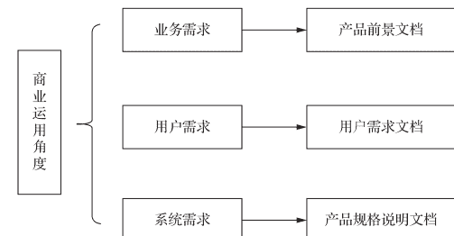  
    - **产品前景文档**（决策层读物）：聚焦业务需求，覆盖市场分析、盈利预测，精简无细节。
    - **用户需求文档**（交互设计依据）：聚焦用户需求，描绘理想交互路径与界面。
    - **产品规格说明文档**（研发蓝图）：聚焦系统需求，在用户需求基础上补充**非功能性指标**（性能、质量、外观等约束）。

4.  **需求评审** —— *双标准把关，保真实有效*  
    - **内容标准**：每条需求真实反映用户意图，集合完整一致。
    - **文档标准**：可读、可维护。
    *交付前必经严格评审。*

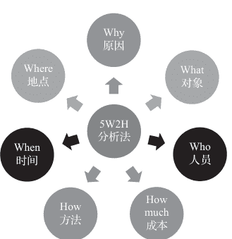

##### 1.3 需求文档核心三要素：需求·目标·功能
虽无统一格式标准，但核心骨架不可或缺：

1.  **产品需求** —— *用 5W2H 七维拆解*  
    **5W**：Who(角色)、When(时机)、Where(场域)、Why(缘由)、What(对象)  
    **2H**：How(路径)、How much(成本)  
    *逐项设问，若7个维度均能自洽，方案可行；否则存优化空间。*  
    | 维度 | 核心追问 |
    | :--- | :--- |
    | **Why** | 为何要解决？为何此时？为何此难点？ |
    | **What** | 必要条件？助力/阻力？核心挑战？ |
    | **Who** | 关键干系人？潜在解决者？ |
    | **When** | 问题发生/解决的时间窗口？ |
    | **Where** | 发生场域/覆盖范围？着力点位？ |
    | **How** | 发生频度/演变规律？工期预估？ |
    | **How much** | 关键指标？成本/销量预测？ |

2.  **产品目标** —— *一句话定调子*  
    话术：**“一种具备[核心特性]、适用于[应用场景]的产品，旨在完成[核心任务]。”**  
    为开发团队提供统一北极星指引。

3.  **产品功能** —— *铺路径，画蓝图*  
    话术：**“基于[目标]，先完成[步骤1]，再完成[步骤2]，最后完成[步骤3]，达成目标。”**  
    实战中常将产品拆解为子项目逐个描述，方法论通用。

##### 1.4 实战落地路径
结合“新零售商品检测”案例，三步落地：
1.  5W2H 全维度剖析需求
2.  提炼锁定产品目标
3.  梳理输出产品功能清单

---

#### 1.5 实战步骤详解：商品检测项目需求拆解


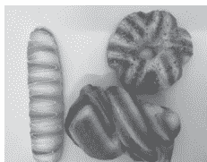


**步骤一：5W2H 深度设问**

| 维度 | 实战追问与结论 |
| :--- | :--- |
| **Why (缘起)** | **核心痛点**：零售业争夺客户核心在于货架曝光率。商品缺货、错位、陈列不规范直接流失销售额 → **商品检测是破局关键。** |
| **What (对象)** | **定义**：通过技术手段识别货架商品信息（品类、陈列顺序、层数、场景），统计排面数量/占比，辅助陈列管理。模型能力随项目定制。 |
| **When (时机)** | **高频刚需**：市场需求瞬息万变，商家需持续优化陈列提升转化。检测需**常态化、规律化**执行，非一次性动作。 |
| **Where (场域)** | **全覆盖**：普通货架/货柜、无人货柜、智能结算台、地堆、堆箱、堆头、地龙等。支持基本信息识别、数量可视化、占地面积估算。 |
| **Who (主体)** | 零售商家运营/陈列管理团队、品牌方巡检人员、第三方审计机构。 |
| **How (路径)** | 图像采集 → 目标检测/识别 → 信息结构化 → 异常对比预警 → 生成整改报告。 |
| **How much (代价)** | 硬件部署成本（相机/边缘盒子）、模型训练迭代成本、人工复核成本 vs. 销售额提升/损耗降低收益。 |

**步骤二：锁定产品目标**  
> **一种基于计算机视觉、适用于多元零售终端场景的智能商品检测系统，旨在实现货架商品陈列合规性的自动化巡检、异常实时预警与数字化管理。**

**步骤三：梳理产品功能**  
> 基于上述目标，**先**完成多场景下的商品图像采集与预处理，**再**完成多SKU目标检测与关键属性（位置、层数、朝向）结构化识别，**最后**完成陈列规则引擎匹配、异常可视化报表生成及整改工单闭环，实现陈列管理数字化升级。

---

> **💡 专家提示**：需求文档非一锤定音，需随项目迭代动态维护。**“好需求是好产品的一半”**，请务必在动手写代码前，把这三步磨透、磨准。

# 商品检测项目：从 5W2H 维度拆解落地可行性

在明确了“为什么做”“做什么”“何时做”“在哪做”之后，我们还需从**人员配置、技术路径、成本投入**三个核心维度，对商品检测项目的工程落地可能性进行深度复盘。

## 核心要素逐项拆解

**1. 人员匹配：降低使用门槛，灵活解决开发短板**
*   **使用端（店员）：** 货架巡检往往穿插在日常繁杂事务中，产品必须“拿来即用”，极简交互是硬指标，核心在于压低非技术人员的上手成本。
*   **开发端（算法）：** 物体识别依赖 AI 算法能力。若团队缺专业算法工程师，可借力百度 EasyDL 等开放平台，利用其海量预置数据与训练工具，快速跑通高精度模型，实现“零门槛”造模。

**2. 技术路径：锚定物体检测任务**
采用主流物体检测范式，直接定位图像中所有目标商品的**类别与坐标**，精准还原货架实时陈列状态，直击核心业务诉求。

**3. 成本收益：用“轻量化硬件”换“重人力释放”**
仅需调用手机、货柜自带摄像头采集画面，即可自动化完成陈列核验。这套方案不仅大幅压缩人工差旅与工时成本，更从根本上解决了传统稽查“采集难、反馈慢、准确率低”的三大顽疾。

## 一张表读懂需求思考全景（表 1-3 重构版）

| 思考维度 | 核心结论与应对策略 |
| :--- | :--- |
| **原因** | 货架曝光率直连销量，商品检测是破解“陈列失焦”的关键钥匙。 |
| **对象** | 覆盖陈列顺序、层级、场景识别，输出排面数量与占比等量化指标。 |
| **时间** | 高频、规律化巡检，配合市场节奏动态调整陈列，提升购买转化。 |
| **地点** | 全场景适配：常规货架/柜、无人货柜、智能结算台、地堆/堆头/堆箱等特陈区，支持可视化数量统计与面积估算。 |
| **人员** | 使用端：店员（重易用性）；开发端：算法工程师或借助开放平台（EasyDL）快速迭代模型。 |
| **方法** | 基于物体检测任务，输出目标类别与位置，闭环货架巡检流程。 |
| **成本** | 利用现有摄像头设备采集数据，零额外硬件投入，显著降本增效。 |

---

# 从需求到交付：商品检测产品的“三步走”定义

### 步骤 1️⃣ 立目标：定义“高智能、强落地”的产品愿景
产品目标直击灵魂三问：是什么？用在哪？解决什么问题？  
**核心定位：** 在零售实体场景下，以**非人工、高智能、高精度、强实用**的技术手段，自动化完成商品检测，规范货架、货柜、智能结算台等多元场景的陈列标准。

### 步骤 2️⃣ 讲功能：描绘“从数据到模型再到落地”的实现闭环
针对“怎么实现”，给出最小可行性技术路线图：
1.  **备数据：** 沉淀大量真实货架图像样本；
2.  **练模型：** 算法工程师主导或借力 **EasyDL 零门槛平台**，高效产出高精度检测模型；
3.  **跑推理：** 终端调用摄像头采集画面，模型实时推理，输出目标商品的**类别 + 位置**，完成自动化巡检闭环。

> **核心交付物 = 需求分析（5W2H）+ 产品目标 + 功能实现路径**，三位一体构成需求文档核心骨架。

---

# 知识拓展：6W2H —— 决策框架的“进阶版”

在 5W2H 基础上引入 **Which（方案选择）**，构建八维分析模型：  
**Which / Why / What / Who / When / Where / How / How much**

> **本质洞察：** 无论 5W 还是 6W，方法论的内核都是**为复杂决策提供结构化思维骨架**，提升工作的条理性与执行效率。

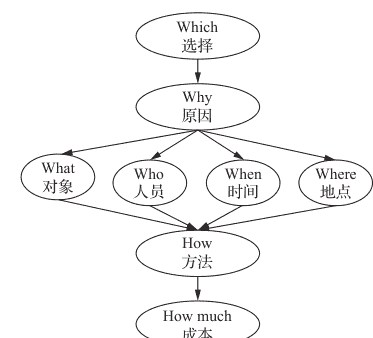

---

# 课后实训：自测你的需求工程功力

> 以下为单/多选题，建议先独立作答，再对照答案复盘（答案解析略）。

1.  **商业视角下，需求不包含？**  
    A. 业务需求  B. 功能需求  C. 用户需求  D. **系统需求**

2.  **需求获取手段不包含？**  
    A. 用户访谈  B. 问卷调查  C. 数据分析  D. **5W2H 分析法**（注：这是分析工非获取手段）

3.  **不属于需求管理过程？**  
    A. 需求获取  B. 需求分析  C. 需求表述  D. **需求原型设计**（属设计阶段）

4.  **需求验证标准不包含？**  
    A. 准确性  B. **非功能性**  C. 可读性  D. 完整性

5.  **5W2H 要素中没有？**  
    A. Why  B. What  C. **Which**  D. How

---

# 项目二：AI 产品设计全流程实战指南

> **学习目标：** 洞察趋势 → 掌握流程 → 会画功能结构图 → 能落地功能设计。

## 项目前瞻：AI 产品从“辅助决策”向“自主进化”跃迁
当前 AI 产品已进化至**感知-学习-分析-决策-执行**全链路自主闭环阶段。设计核心不再仅是“功能可行”，而是**“功能精准击中用户痛点、解决真问题”**。

## 认知基石：AI 产品 = 传统产品三性（商业/功能/稳定）+ **智能性**
*   **智能性内核：** 基于 AI 技术自主处理信息、决策执行，满足用户深层需求。

## 设计全景图：四阶段十步法

| 阶段 | 核心使命 | 关键产出 |
| :--- | :--- | :--- |
| **零阶段：需求管理** | 判断“值不值做、能不能做” | 需求规格说明书（获取→分析→表述→验证） |
| **一阶段：功能设计** | 定义“长什么样、怎么跑” | **功能结构图**（核心交付物） |
| **二阶段：原型设计** | 验证“好不好用、懂不懂” | 低/高保真原型 + 场景解决方案 |
| **三阶段：研发实施** | 造“能跑通、可交付” | 可交付产品（含模型开发，详见项目三） |

---

# 深度解析：功能设计阶段的“结构化思维”

## 功能四象限分类法
1.  **基础功能：** 生存线，满足核心刚需（如搜索引擎的“搜”）。
2.  **亮点功能：** 差异化护城河，极致体验（如百度中文分词技术破解理解难题）。
3.  **发展功能：** 前瞻布局，基于预测需求预埋。
4.  **非需求功能：** 迭代中涌现的“惊喜”，快速上线修补体验缺口。

## 功能结构图：产品架构的“X 光片”
通过**总功能 → 分功能 → 功能单元**层层分解，直至不可再分。  
*例：人脸识别门锁 → 总功能“刷脸开锁” → 分功能“识别/开锁” → 单元“采集/特征提取/比对”。*

### 三大核心元素符号规范（表 2-1）

| 元素 | 图形符号 | 命名规范 |
| :--- | :--- | :--- |
| 功能节点 | 灰色矩形 | 名词 / 动宾短语 |
| 逻辑流向 | 单向箭头 | — |
| 判断条件 | 菱形 + 箭头 | “是/否” 分支 |

### 手把手教你画功能结构图：三步走

1.  **全景罗列：** 从用户首次触达开始，梳理所有功能分支（含异常路径）。  
    *案例：证件审核产品覆盖 3 类申请状态 × 2 种审核模式。*  
    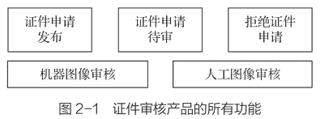
2.  **逻辑串联：** 按业务流向用有向箭头连线，还原操作步骤序列。  
    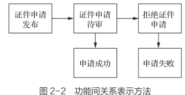
3.  **加装判断：** 为“非自动触发”功能挂载前置条件（选择/循环结构）。  
    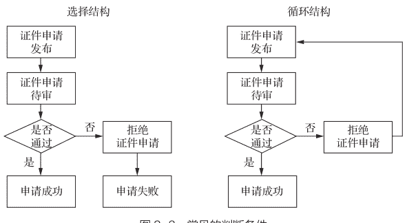

> **避坑指南：** 判断条件是 AI 产品区别于传统流程图的关键，务必标注“入口门槛”。

---

# 原型设计：从“草图”到“准产品”的验证之路

本质 = **场景 + 功能 → 原型图 + 解决方案**。

| 维度 | 低保真原型 | 高保真原型 |
| :--- | :--- | :--- |
| **形态** | 手绘草稿 / 线框图 | 墨刀/Axure 交互稿，UI/文案均贴近真机 |
| **核心价值** | 快、省、改动灵活，适合早期概念验证 | 极致还原体验，支持实测交互，收集真实反馈 |
| **适用阶段** | 需求频繁变更的探索期 | 需求相对稳定、准备进入研发前的验收期 |

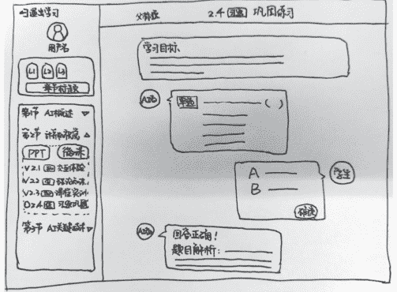  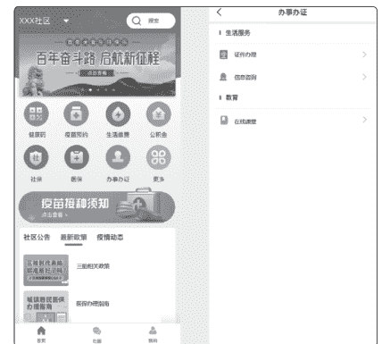

> **决策建议：** 先低保真跑通流程，再高保真打磨细节；切勿一上来陷入像素级纠结。

---

# 研发实施：产品经理的“持续护航期”
模型开发流程详见项目三，此阶段核心是**产品负责人全程把控交付质量**，确保方案不走样。

---

# 趋势洞察：避开三大坑，抓住两大风口

## ⚠️ 当前设计三大通病
1.  **功能孤岛：** 单点解决，缺乏跨产品联动，用户频繁切换 App。
2.  **门槛过高：** 交互复杂，老年等弱势群体被边缘化（如智能家居 App 操作困境）。
3.  **闭环缺失：** “只感知不决策、只预警不处置”（如安防只报警不联动阻拦）。

## 🚀 破局两大趋势
1.  **极简交互（降本）：** 向 L3/L4 级自主进化，剥离人工干预（如自动驾驶全托管）。
2.  **多技术融合（增值）：** AI × 5G/大数据/云计算/区块链。  
    *案例：5G 低时延传输实时路况 + AI 决策规划 = 自动驾驶安全性指数级跃升。*

---

# 实战演练：商品检测项目功能设计全记录

## 业务背景：快消品牌的“货架战争”
*   线下销量占比高，陈列优化 = 直接增量。
*   不同场景（货架/冰柜/地堆）指标体系迥异：排面/占比/位置 vs 纯净度/饱和度。
*   **痛点：** 人工稽查“慢、不准、贵”，无法支撑精细化运营。

## 技术破局：EasyDL 零售版赋能
百度 EasyDL 零售行业版提供开箱即用的终端侧模型能力，助力品牌主低成本、快速落地 AI 巡检。

## 实施四步法

### 步骤 1：需求深度剖析（已完成上文 5W2H 复盘）
### 步骤 2：功能全景清单（罗列所有功能节点）
### 步骤 3：业务流向建模（有向箭头串联逻辑主线）
### 步骤 4：关键节点挂载判断条件（补全分支/循环逻辑）

> **下一步预告：** 将基于以上分析，输出商品检测产品的**功能结构图**，敬请期待实战演示。

鉴于此，商品检测体系必须依托快消品牌的陈列活动规范，采集图像样本，借助百度定制化图像识别模型、多元算法组件与训练模板，以小样本数据训练高精度模型，从而快速、精准地判定目标图像合规与否，彻底攻克传统稽核模式成本高、准确率低的痛点。

#### 步骤 2：梳理核心功能清单

明确需求后，即进入功能设计环节，首要任务是罗列全量功能。在该项目中，业务流向为：终端用户通过移动端上传陈列视频 -> 平台自动切片为图像 -> 调用百度 AI 定制化识别接口（下称“百度 AI 接口”）校验图像合规性。

基于此，项目需构建以下四大核心能力：

- **视频上传通道**：支持移动端录制的陈列视频直传百度 EasyDL 平台。
- **视频切片与图像预处理**：将原始视频流转化为高质量、机器可识别的图像数据集。
- **稳定的接口调用能力**：保障百度 AI 定制化图像识别接口的高可用调用。
- **识别结果反馈**：解析图像内容并输出结构化识别结论。

项目功能全景如 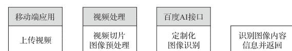 所示。值得注意的是，图像识别功能非一成不变，可依据实战诉求灵活定制模型。


图 2-6 商品检测项目主要功能

图像识别模块可进一步拆解为五大子功能，详见 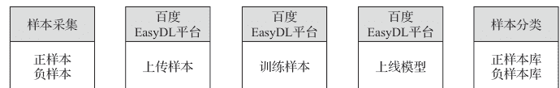：

- **样本采集与分类**：依据品牌陈列活动要求集样。样本划分为正样本（目标检测类别，如货架商品）与负样本（非目标类别，如价签、堆头干扰物）。
- **样本入库**：将标注完毕的样本上传至百度 EasyDL 平台。
- **模型训练**：在百度定制平台上利用样本完成模型迭代训练。
- **模型上线部署**：受限于 EasyDL 平台机制，训练完成的模型须上线方可供接口调用。
- **闭环迭代机制**：初期数据量难以覆盖长尾场景，系统需具备将识别图像自动分流入正、负样本库、持续回灌模型训练的能力，实现精度的自我进化。


图 2-7 图像识别功能拆解

#### 步骤 3：串联功能业务流

功能点明确后，需将其有机串联。业务主线如 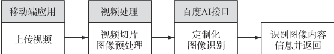 所示：用户移动端上传视频 -> EasyDL 平台切片预处理 -> 调用百度 AI 接口识别 -> 返回结构化结果。


图 2-8 项目功能关联

考虑到识别结果将作为新样本回流训练，整个功能流需形成**闭环**。如 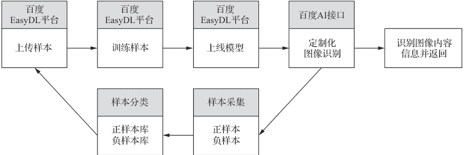 所示：初始样本按需求分正负类 -> 上传平台 -> 训练模型 -> 模型上线 -> 接口调用识别 -> 依据识别结果自动归入正负样本库 -> 触发新一轮训练迭代。


图 2-9 闭环的项目功能关联

#### 步骤 4：嵌入判断逻辑

绘制功能结构图前，还须梳理触发条件。因识别图像需回流样本库，故必须在入库前进行分类。分类的触发条件即“判定图像属正样本还是负样本”，因此需引入选择结构进行条件判析。最终的定制化图像识别功能结构图见 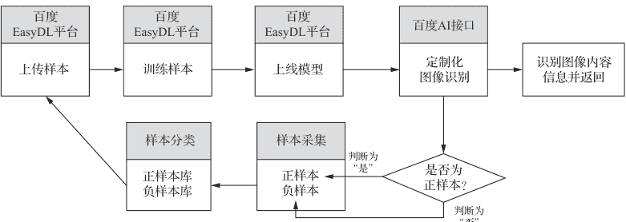。


图 2-10 定制化图像识别功能结构图

#### 知识拓展：实战复盘——深度学习赋能社交应用内容审核

产品原型设计的本质是聚焦痛点、探索最优解。技术栈不同，解法迥异。深度学习凭借类脑分析学习能力，成为 AI 落地的利器。以社交赛道内容审核为例，剖析其如何破局。

某头部社交应用 A（千万级用户池）面临低俗、广告泛滥等内容治理难题，对审核技术提三大指标：
1.  **文本审核**：覆盖涉政、恶意推广、辱骂等维度，处理速度快、准确率 > 95%。
2.  **图像审核**：聚焦聊天图像中的广告检测，准确率 > 95%。
3.  **自定义能力**：审核标准需深度贴合 A 应用业务场景。

百度 AI 文本/图像审核方案基于深度学习，可精准拦截涉政、广告、不良画面，亦支持从美观、清晰度等维度筛选，大幅释放人力。接入后（见 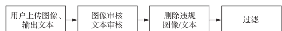），A 应用对用户头像、聊天文本实施高效审核，有效遏制违规内容传播。


图 2-11 内容审核功能关联

实战成果显著：审核效率跃升 90%，大幅压降人力与时间成本；百万级头像图像全量覆盖，广告检测准确率达 99%，构建起健康社交生态，用户体验显著优化。

#### 课后实训：自测题库

1.  **功能分类辨析**：按用户使用需求分类，AI 产品功能类型**不**包含？
    - A. 基础功能  B. 亮点功能  C. 发展功能  D. 总功能
2.  **设计流程识别**：AI 产品设计流程**不**包含环节？
    - A. 需求管理  B. 功能设计  C. 系统设计  D. 原型设计
3.  **结构图要素**：AI 产品功能结构图核心要素**不**含？
    - A. 功能  B. 功能间关系  C. 判断条件  D. 使用效果
4.  **绘制步骤排查**：功能结构图绘制步骤**不**含？
    - A. 罗列所有功能  B. 拆解所有功能  C. 有向箭头关联  D. 添加判断条件
5.  **高保真原型认知**：关于高保真原型描述**错误**的是？
    - A. 设计周期短、成本低  B. 逼近真实产品  C. 可交互关联  D. 展示功能、元素、流程

---

### 项目 3：人工智能开发平台实战应用

AI 开发标准流程涵盖需求分析、数据准备、模型训练、模型应用四阶段。然而，模型构建与训练对缺乏算法人才的中小企业而言门槛极高。头部科技企业遂开放技术框架、工程工具、平台接口，推出低门槛开发平台，普惠 AI 能力。

**项目目标**：
1.  摸清主流 AI 开发平台功能版图。
2.  掌握平台应用标准化流程。
3.  精通深度学习模型定制平台业务操作。
4.  能依据业务诉求选型匹配最优平台。

#### 项目描述

本项目聚焦“智能数据服务平台”与“深度学习模型定制平台”双核，讲授平台化开发应用方法论，并以 EasyDL 商品检测实战为引，助力读者掌握全链路业务操作。

#### 知识准备

#### 3.1 AI 开发平台全景扫描

市面平台林立，百度 AI 开放平台、讯飞开放平台为典型代表。以百度体系为例，深度解析其智能数据服务平台与深度学习模型定制平台。

#### 3.1.1 EasyData：一站式智能数据服务中台

EasyData 面向企业及开发者，覆盖 AI 开发全周期的数据采集、清洗、标注需求。现支持图文音视四大基础模态标注，兼容机器学习数据存储，且已与 EasyDL 打通，数据直达训练流。平台界面见 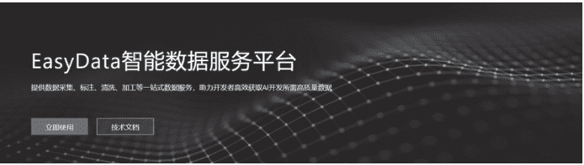。


图 3-1 EasyData 智能数据服务平台界面

核心服务三板斧：

**1. 数据采集：双引擎驱动（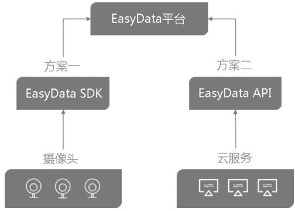）**
- **端侧采集**：接入本地摄像头，支持定时拍照、自定义规则视频抽帧，图像即时同步云端管理。
- **云侧回流**：模型迭代期，开通 EasyDL 云服务回流，将业务实战数据及识别结果可视化，依据准确度挖掘难例，获取高价值优化数据。


图 3-2 数据采集方案

**2. 数据清洗：多维质检策略**
- *图像侧*：去模糊（保质量）、去重（提效率）、批量裁剪（除干扰）、旋转校正（对齐角度）。
- *文本侧*：去表情符、去 URL、繁转简（统一编码提升模型效果）。

**3. 数据标注：效率与质量并重**
- **预置模板库**：覆盖图像（分类/检测/分割）、文本（分类/相似度/情感/实体）、音频/视频分类等主流任务。
- **智能标注**：人机协同，最高降本 90%，现支持物体检测、图像分割、文本分类。
- **多人协作**：团队并行提效，全模态支持。
- **外包服务市场**：对接百度 AI 市场优质服务商，平台侧直接下单定制标注。

#### 3.1.2 EasyDL：零门槛深度学习模型定制平台

EasyDL 面向零算法基础或追求高效落地的企业，提供数据管理、模型构建、部署应用的一站式闭环（见 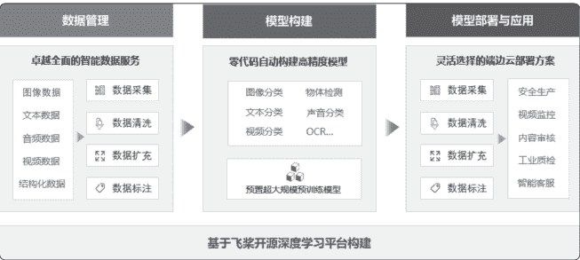）。原始多模态数据经平台加工学习，可输出为公有云 API、本地服务器 SDK、边缘设备模型或软硬一体方案。


图 3-3  EasyDL 平台一站式开发流程

平台按场景与技术方向划分七大模型矩阵：

**1. EasyDL 图像：视觉理解专家**
支持三大任务：
- **图像分类**：单主体场景，识别图像归属类别（物体/状态/场景）。
- **物体检测**：多主体场景，定位识别每个目标的位置、数量、名称。
- **图像分割**：像素级精度，多边形标注训练，适用于需精确轮廓的复杂场景。

**2. EasyDL 文本：依托文心大模型的 NLP 利器**
五大细分能力：
- **单/多标签文本分类**：自动化内容分拣，支持单标签或多标签并行。
- **短文本相似度**：语义级对比计算，输出相似度分值。
- **文本实体抽取**：结构化抽取关键信息，映射自定义标签。
- **情感倾向分析**：主观文本极性判断（积/消/中）。


**3. EasyDL 语音：听觉定制专家**
- **语音识别**：零代码自训，上传业务语料即练即用，支持词汇/长文本多模式。
- **声音分类**：区分物种/声源类别，支持 15 秒内短音频处理。

**4. EasyDL OCR：结构化文字识别**
定制化训练，关键字段结构化输出，攻克非标卡证票据识别难题，服务电子化审批、财税报销场景。

**5. EasyDL 视频：动态内容分析**
- **视频分类**：短视频动作/事件/环境变化识别。
- **目标跟踪**：视频流中特定目标检测与运动参数预测（轨迹/速度/行为理解）。

**6. EasyDL 结构化数据：表格数据挖掘**
解决分类/回归问题，服务客户流失预测、欺诈检测、价格预测。
- **表格数据预测**：挖掘潜在规律生成预测模型。
- **时序预测**：基于历史趋势预判未来走势。

**7. EasyDL 零售行业版：垂类场景深度定制**
面向货架巡检、自助结算、无人零售柜，提供四大服务：
- **定制商品检测**：商品信息/层数/场景/排面占比四维识别，辅助铺货率、陈列合规核查。
- **标准商品检测**：内置 5 大饮料品牌 122+ SKU（持续扩容），开箱即用，返回名称与位置。
- **货架拼接**：多局部图像融合成全景图，输出完整货架 SKU 名称与计数，解决长货架检测痛点。

# 零售巡店防造假利器：手把手教你用 EasyDL 零售版搭建商品识别模型

**亮点功能：翻拍识别，为终端数据加把“安全锁”**
系统自带翻拍甄别能力，能精准捕捉手机对屏二次拍摄或翻拍打印件的货架、地堆照片。这招一石二鸟：既能大幅削减人工复核开支，又能从源头堵住“用旧图冒充新巡检”的作弊漏洞，保障终端数据真实可信。

---

#### 3.2 AI 项目落地标准化四步走

工业级人工智能开发通常遵循四大核心环节：明确需求、筹备数据、训练模型、部署应用。百度 EasyDL 平台将这套流程全程可视化、零代码化，开发者仅需鼠标操作即可完成闭环。下文以**货架商品自动识别**为实战案例，拆解平台标准化操作范式。

#### 3.2.1 需求剖析：从“货架争夺战”反推技术指标

**业务痛点有多重？**
线下终端是快消品牌的“必争之地”，黄金陈列位与排面占比直接关乎生死。但执行端顽疾难除：必销品缺货、新品被挤至冷门位置、陈列凌乱、促销物料虚设等乱象屡禁不止。数据触目惊心：缺货会导致品牌方流失 **46%** 潜在购买者，零售商流失 **30%**。面对成百上千家门店，纯靠人海战术巡检不可持续，必须引入视觉 AI——利用商品识别技术辅助人工审核陈列，方能实现降本增效。

**技术任务怎么定？**
将业务诉求转化为**目标检测任务**：输入货架照片，输出所有目标商品的类别与坐标位置。选型锁定 **EasyDL 零售行业版**，零代码定制专属模型，跑通最短落地路径。

#### 3.2.2 数据筹备：模型上限由数据质量定夺

数据工程三板斧：**采、洗、标**。本项目核心燃料仅两款：**SKU 单品素材图** 与 **实拍场景图**。

> **关键区别**：单品图非训练强制项，但可通过“合成增强”低成本注入多角度特征，大幅压缩实拍图采集标注成本；实拍图是训练“主粮”，必须源自真实业务现场。

##### 1. 数据采集：标准不降，效果才稳

**【单品素材图：平台自带成品库，按需补拍】**
平台内置饮品、日化两大类百余 SKU 成品库，每款预置 50+ 多角度图。绝大多数场景**无需自拍**，首轮训练跑完看报告，哪款识别弱，针对性补拍死角角度即可。若确需自拍，须死守四条红线：

| 维度 | 硬性指标 |
| :--- | :--- |
| **画面内容** | 单图单品；纯色背景且与主体色强反差（参考 ）；光照覆盖实战场景冷暖色温差异。 |
| **分辨率** | ≥ 1920×1080，拍摄设备 ≥ 200 万像素。 |
| **视角覆盖** | 货架场景须覆盖**水平、俯拍、仰拍**三大视角（参考 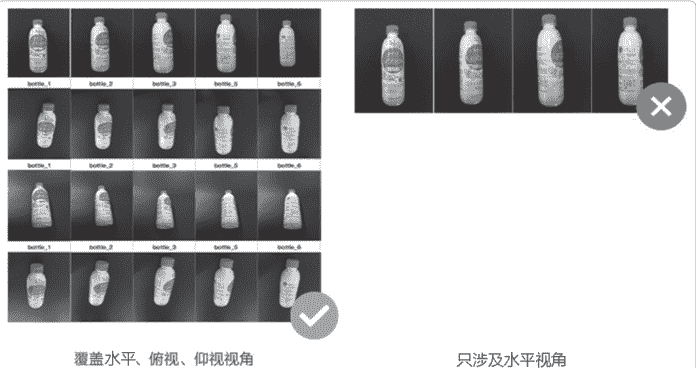）；无人货柜主俯拍；结算台以水平/俯拍为主，酌情加仰拍。 |
| **样本量** | 起步建议：各视角 **10 张/款**（详见表 3-1）；地堆场景建议直接在实拍图中覆盖视角。 |

**【实拍场景图：源头对齐，设备同源】**
*   **设备同源**：巡店用啥拍（手机/专用终端），采集就用啥拍；结算台用自带摄像头，货柜用货柜摄像头。分辨率建议参考表 3-2。
*   **特征清晰可见**：肉眼能辨清每个商品关键特征（参考 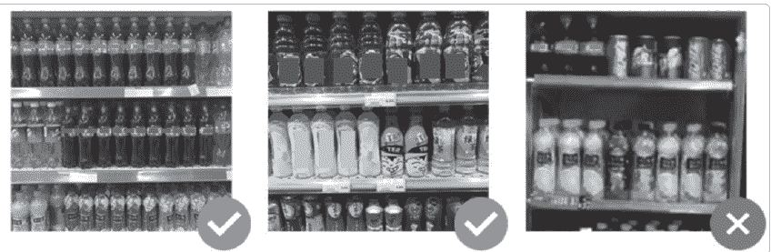）。
*   **角度别贪大**：货架场景**正面硬刚为主，微倾斜可接受，大倾斜坚决不收**（参考 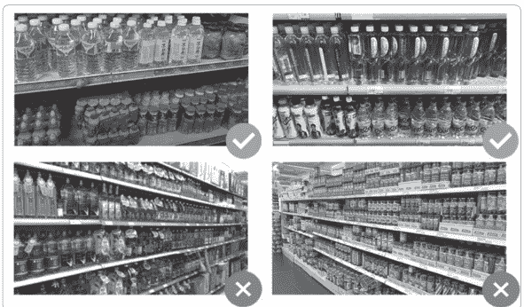），透视畸变直接拖垮识别率。
*   **起训底线**：首训每 SKU 至少 **20 张** 已标注实拍图。平台自动 7:3 切分训练/测试集；样本不足会导致 mAP、精确率、召回率“三连跪”。

##### 2. 数据清洗：平台准入门槛
*   格式：PNG/JPG/BMP/JPEG
*   单文件 ≤ 4MB
*   长宽比 ≤ 3:1，长边 < 4096px，短边 > 30px
*   压缩包仅限 ZIP，≤ 5GB

##### 3. 数据标注：质量生命线，容错极低
单品图免标；实拍图标注执行力直接决定模型生死。

*   **框选黄金准则**：**紧贴目标外轮廓的最小外接矩形框**（参考 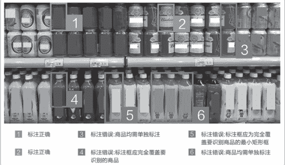）。
*   **遮挡处理分场景执行**：
    *   货架/货柜：露出 **>70% 且保留核心识别特征** 才框。
    *   无人货柜/结算台：**仅框露在外面的部分**（参考 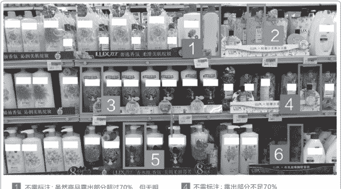）。
*   **相似品“强制分户”防串类**（参考 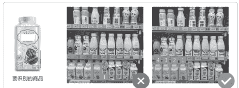-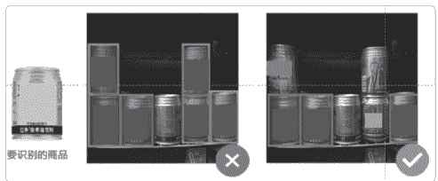）：
    1.  同品牌不同系列/口味/包装；
    2.  同款不同规格（如 330ml 对 500ml）；
    3.  高度神似竞品（色/型/材质酷似）。
    > **铁律**：相似品归同一类，误识别率必飙升。
*   **避坑指南：零容忍“错标”与“漏标”**（参考 -）：
    *   **错标高发区**：同款不同规格/口味/包装，最易误贴同一标签。
    *   **漏标三大元凶**：
        1.  **视角盲区**：只标正面，侧后视角视而不见（）。
        2.  **人为疏漏**：目视扫描未全覆盖（）。
        3.  **遮挡误判**：明明露特征 >70% 却因犹豫漏标（）。

---

#### 3.2.3 模型训练：傻瓜式操作，工业级交付

数据入库，一键启动。EasyDL 核心价值：
1.  **全流程网页化**，5 步闭环部署，省去搭环境、写代码、调超参的重活。
2.  **海量免费 GPU** 支撑高频迭代验证，研发试错成本趋零。
3.  **零售专项算法 + 合成增强技术**，泛化能力强，**准确率稳超 97%**，直达生产级可用水位。
4.  **企业级加密隔离**，数据模型资产安全无虞。

---

#### 3.2.4 模型部署：跑通“数据飞轮”持续迭代

训练完读**评估报告**，核心盯 **F1-score**（精确率与召回率调和均值）：
*   **F1 > 85%** → 支撑**精准计数**业务。
*   **F1 > 60%** → 满足**分销铺市统计**业务。

**效果不达标？别动算法参数，只管优化数据！** 零售版已完成场景化深度调优。迭代遵循 **“数据飞轮” 5 步法**：
1.  **回流挖难例**：用平台优化工具回流补充实拍图。
2.  **补齐弱项单品**：针对识别差的 SKU 补角度图。
3.  **新旧数据混合重训**。
4.  **发布新版 API 实战测**。
5.  **循环往复，直到达标上线**。

**部署形态灵活选**：云端 API 直连，或一键嵌入 H5 页面现场验收（界面参考 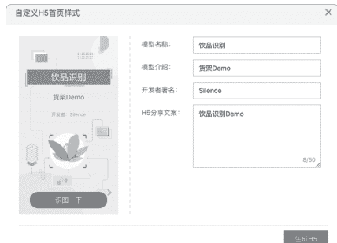）。

---

#### 3.3 实战路线图：三阶段落地

理论转实操，三步走：
1.  **搭架子**：创建模型与 SKU 库。
2.  **喂数据**：上传素材、落地标注。
3.  **出模型**：训练、校验、滚动迭代。

---

#### 3.4 保姆级操作演示：EasyDL 零售版实战

##### 步骤 1：新建模型 & 录入 SKU 库

1.  **进场**：登录实训系统 → 启动 “AI 平台实验” 中的 EasyDL 入口（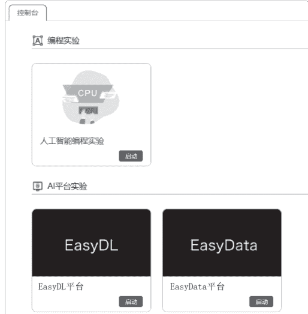）。
2.  **选型**：点 “立即使用” → 勾选 **“零售行业版”**（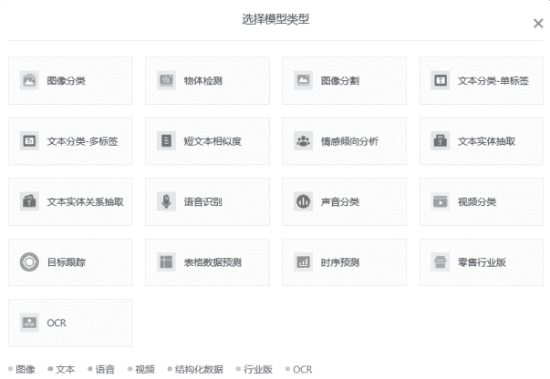） → 登录账号。
3.  **建模**：左侧栏 “我的模型” → “创建模型” 填信息（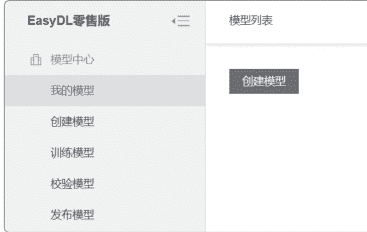-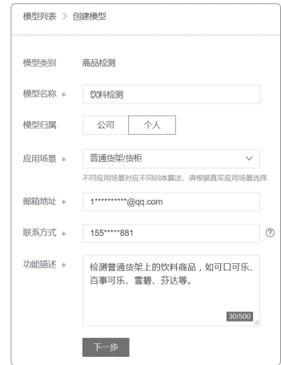）。
    *   **模型名**：业务导向命名，如 “饮料检测”。
    *   **归属/场景**：个人 / 普通货架-货柜。
    *   **功能描述**：10-500 字，讲清解决什么问题。
4.  **落地**：点 “下一步” 创建成功，列表页即可见（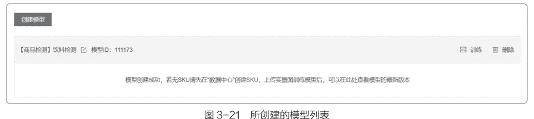）。
5.  **建 SKU**：点列表 “创建 SKU”，按提示填核心字段：
    *   **命名规范**：返回格式固定为 `SKU名称_品牌_规格`，**三字段内容严禁重复**。
    *   **必填维度**：SKU 名称（如“原味可乐”）、品牌（如“可口可乐”）、规格（如“330mL”）、品类、包装类型。
    *   **业务关联**：自有商品编码/条码填入，便于后续系统对接。
    *   **增强素材**：上传单品图用于合成增强，提升模型鲁棒性。

**SKU 包装图展示**：在标注环节可随时查看包装外观，借此快速区分相似商品，有效规避错标与漏标。图 3-22 给出了盒装与罐装两类 SKU 包装的示意图。

（8）平台内置近千款 SKU，因此大部分场景下用户无需自行上传单品图，可直接调用预置资源。如图 3-23 所示，在“SKU 名称”栏键入“可乐”，下拉选中“可乐_可口可乐_330mL”即可。

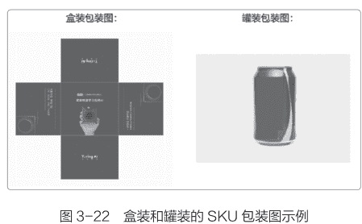

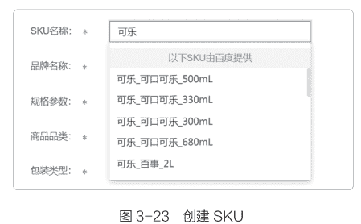

（9）系统弹出“确认匹配”窗口（见图 3-24），请核对商品详情图判断是否符合需求，确认无误后点击“确定”完成匹配。

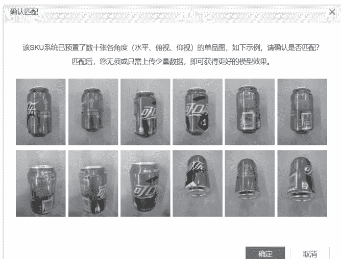

图 3-24 “确认匹配” 对话框

（10）进入图 3-25 界面，“SKU 展示”区会呈现平台预置单品图。若预置图未覆盖实测场景下的多角度、不同光照等情况，可点击“SKU 单品图”区的“上传图片”补充自采图片。核对信息无误后，点击“创建 SKU”按钮落地。

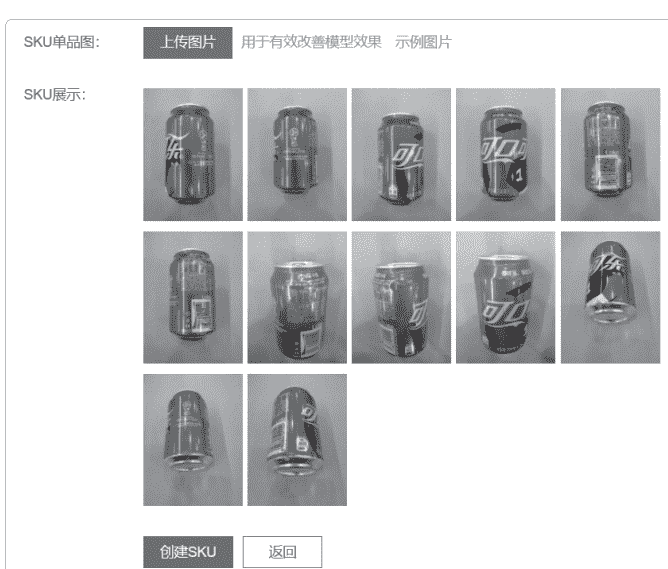

图 3-25 确认单品图

（11）创建完成后，“我的 SKU 库”将列出所有条目（参考图 3-26）。点击右侧“操作”栏的“查看”可阅览详情，“编辑”则支持追加上传包装图与单品图。

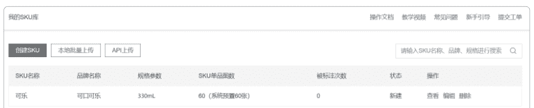

图 3-26 所创建的 SKU 列表

（12）依照上述流程继续录入其余 SKU，即“可乐细长罐__可口可乐__330mL”与“可乐__可口可乐__680mL”，最终列表如图 3-27 所示。

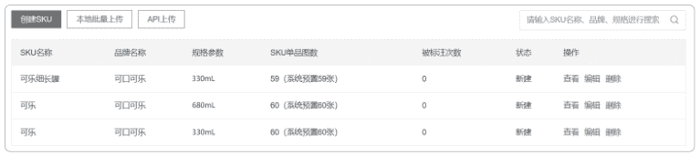

图 3-27 SKU创建完成后的列表

#### 步骤 2：上传数据并标注

商品检测模型与所需 SKU 均就绪后，即可按以下流程上传实景图并开展标注。

（1）如图 3-28，点击左侧导航栏“实景图集库”标签，再击“创建实景图集”按钮进入配置页。

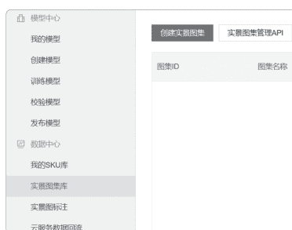

图 3-28 单击“实景图集库”标签

（2）见图 3-29，新建图集需填两项内容：

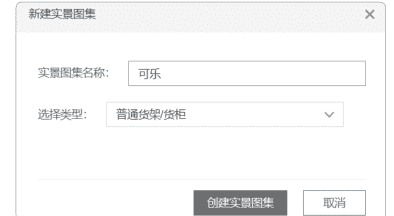

图 3-29 新建实景图集界面

- **图集名称**：建议填入 SKU 细分信息（如原味可乐、番茄味薯片等），此处录入“可乐”。
- **图集类型**：须与建模时的应用场景一致，仅上传同类型实景图。可选“普通货架/货柜”“智能结算台”“无人零售柜”“其他”，本项选“普通货架/货柜”。

（3）完善信息并点击“创建实景图集”生成图集。图集库列表（图 3-30）将显示 ID、名称、标注进度、场景、状态及操作入口。

| 图集ID | 图集名称 | 标注进度 | 应用场景 | 状态 | 操作 |
| :--- | :--- | :--- | :--- | :--- | :--- |
| 176720 | 可乐 | 0% (0/0) | 普通货架/货柜 | 数据 | 导入 查看标注 删除 |

图 3-30 所创建的图集列表

（4）点击目标图集操作栏的“导入”（图 3-31），支持两种导入方式：

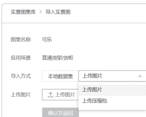

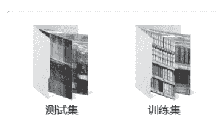

图 3-31 导入实景图的两种方式

图 3-32 商品检测项目数据集

- **直接上传**：单次上限 20 张。
- **压缩包上传**：仅限 ZIP 格式，体积 ≤ 5GB。

（5）本演示采用“直接上传”方式。数据集存放于实训系统环境的 data 目录，下载至本地后可见其包含训练集（18 张）与测试集（2 张）。

（6）本地准备就绪后，返回导入页选“上传图片”，点击按钮选中训练集全量图片上传，界面如图 3-33。

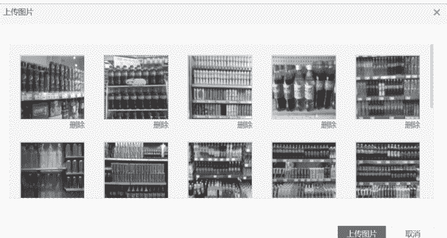

图 3-33 上传图片界面

（7）点击“上传图片”启动传输（图 3-34），待进度条跑满 100%。

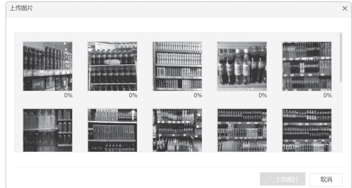

图 3-34 等待图片上传

（8）上传完毕自动回跳导入页，按钮下方提示“已上传 18 个文件”（图 3-35）。确认无误后点“确认并返回”正式入库。

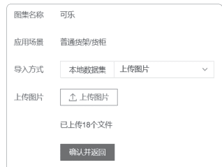

图 3-35 图片上传完成界面

（9）入库过程中图集状态显示“导入中”（图 3-36）。稍等约 2 分钟刷新查看结果。

| 图集ID | 图集名称 | 标注进度 | 应用场景 | 状态 | 操作 |
|---|---|---|---|---|---|
| 176886 | 可乐 | 0% (0/0) | 普通货架/货柜 | 导入中 | 导入 查看/标注 删除 |

图 3-36 实景图导入中界面

（10）状态转为“正常”即入库成功（图 3-37）。点击“查看/标注”进入打标界面。

| 图集ID | 图集名称 | 标注进度 | 应用场景 | 状态 | 操作 |
|---|---|---|---|---|---|
| 176886 | 可乐 | 0% (0/18) | 普通货架/货柜 | 正常 | 导入 查看/标注 删除 |

图 3-37 更新为正常状态

（11）挑选一张图开始标注（图 3-38）。鼠标框选目标，右侧“新建 SKU”栏点击对应 SKU 名称即可打标。完成当前图后，点击左下角“保存当前图片”或翻页箭头切换自动保存。

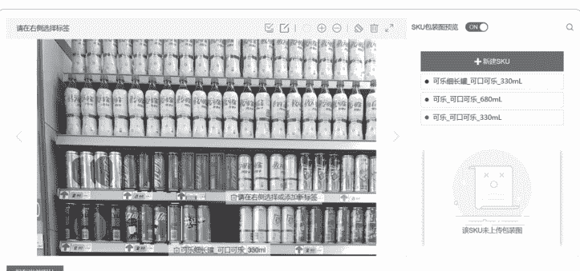

图 3-38 进行数据标注

（12）多目标场景下可用“多选”功能（图 3-39)：勾选同一 SKU 的所有框，一次性点击右侧 SKU 名称完成批量打标。

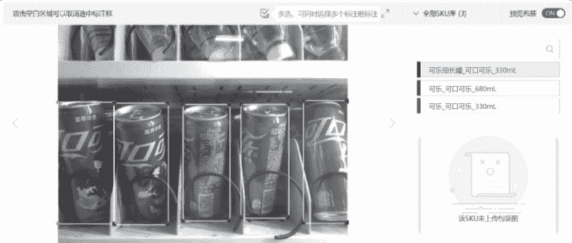

图 3-39 进行批量标注

（13）针对多目标图，还可点“图片筛选”旁的“辅助标注”（图 3-40）启用智能预标。注意：同一时刻仅支持对单个图集开启此功能。


图 3-40 单击“辅助标注”按钮

（14）辅助标注提供两种模式（图 3-41）：

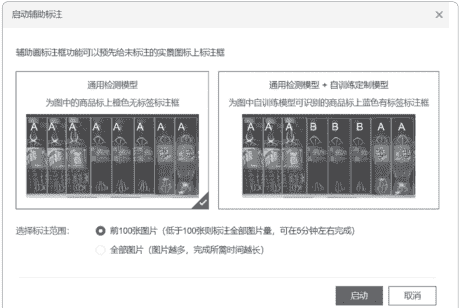

图 3-41 查看两种辅助标注模型

- **通用检测模型**：输出橙色无标签框 A，后续仅需为目标 SKU 的橙色框贴标签，其余框忽略不影响训练。
- **通用检测模型 + 自训练定制模型**：输出蓝色有标签框 B，支持选用 2019-09-01 后训练完成的模型版本，推荐挑选 mAP 较高的版本。

（15）标注范围可选（同界面）：

- **前 100 张**：不足 100 张则全标，约 5 分钟完成。首次尝试不同包装类型（瓶/袋/盒）或想快速见效建议选此项。
- **全部图片**：未标注量大、可等待数小时者适用。耗时估算：未标注张数 / 100 × 5 分钟。

（16）本例选“通用检测模型”+“前 100 张”，点“启动”（图 3-42），约 5 分钟完成。过程可随时“终止”取消或换模型。

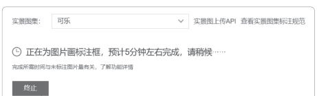

图 3-42 等待辅助标注完成

（17）辅助标注结束，点“前往标注”进入精修界面（图 3-43）。

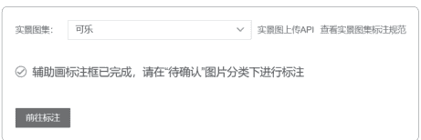

图 3-43 辅助标注完成界面

（18）界面已显示预测框（图 3-44）。点“全选”勾选需标注的框，再点右侧 SKU 名称落笔。


图 3-44 对目标 SKU 进行标注

（19）目标 SKU 标完后，可用右上角“清除所有辅助标注框”清理当前图多余框（图 3-45），适用于单图精修。

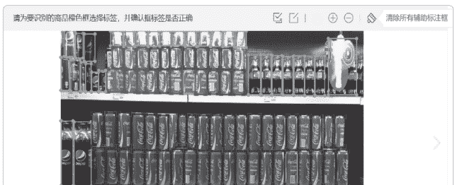

图 3-45 清除单张图片其余无用的辅助标注框

（20）若逐张清理繁琐，全图标注完毕后，点“图片筛选”旁“还原所有待确认图片”一键清空所有图的残余预测框（图 3-46）。⚠️ 操作前务必确认已保存，否则未保存标注将连带丢失。


图 3-46 一键清除所有图片中其余无用的辅助标注框

#### 步骤 3：训练模型并校验

实景图全量标注完成后，即可通过以下步骤进行模型训练与效果校验。

（1）点左侧“训练模型”标签，选中步骤 1 创建的“饮料检测”模型（图 3-47）。


图 3-47 选择“饮料检测”模型

（2）点击“选择需要识别的 SKU”（图 3-48），注意：仅已在实景图中被标注过的 SKU 才可参训。


图 3-48 选择需训练的模型

图 3-49 选择需要识别的 SKU

（3）弹窗中全选所有 SKU（图 3-49），点确定。

（4）列表显示各 SKU 标注量（图 3-50）。第 3 个 SKU 样本较少，可酌情增补。右侧显示已创建图集及其 SKU 分布，务必勾选本项目的“可乐”图集。


图 3-50 确认所选择的 SKU

（5）配置无误后，点击“开始训练”启动训练任务。

（6）点“训练中”旁感叹号可看进度（图 3-51），支持配置训练完成短信通知（手机号可编辑）。训练时长取决于单品图与实景图数量，本次约 2 小时，届时刷新查看。

| 部署方式 | 版本 | 训练状态 | 服务状态 | SKU F1-score 分布 | 操作 |
| :--- | :--- | :--- | :--- | :--- | :--- |
| 公有云API | V1 | 训练中 | 未发布 | - | 查看版本详情 停止训练 |

图 3-51 模型训练中界面

（7）训练结束后可查看效能（图 3-52）。点“查看版本详情”打开评估报告：

| 版本 | 训练状态 | 服务状态 | SKU F1-score 分布 | 操作 |
| :--- | :--- | :--- | :--- | :--- |
| V1 | 训练完成 | 未发布 | [85%, 100%] 0个 [60%, 85%) 1个 [0, 60%) 2个 | 查看版本详情 申请发布 授权 |

图 3-52 模型训练完成界面

① **基础信息**（图 3-53）：含模型 ID、版本、图片数、SKU 数、完成时间、算法等。

| 模型ID | 111173 | 版本 | V1 | 图片数 | 18 | SKU数 | 3 |
| :--- | :--- | :--- | :--- | :--- | :--- | :--- | :--- |
| 训练完成时间: | 2021-04-22 14:15 | 训练算法: | 公有云API-默认算法 | | | | |

图 3-53 模型的基础信息

② **SKU F1-score 分布**（图 3-54）：0~60% 占 2 个，60%~85% 占 1 个，85%~100% 为 0。


图 3-54 SKU F1-score 分布

③ **模型整体效果**（图 3-55）：列出各项指标，其中分销准确率指单张评估图中正确识出全品类 SKU 的平均概率。


图 3-55 模型整体效果

④ **F1-score 阈值走势**（图 3-56）：阈值 0.9 时 F1-score 峰值，建议校验时设 0.9。


图 3-56 模型整体 F1-score 走势图

⑤ **训练评估明细**（图 3-57）：

| No. | 名称 | 训练图片数 | 训练标注框数 | 评估图片数 | 评估标注框数 | F1-score | 操作 |
|---|---|---|---|---|---|---|---|
| 1 | 可乐_可口可乐_330mL | 5 | 31 | - | - | 0.00% | 查看详情 |
| 2 | 可乐_可口可乐_690mL | 7 | 57 | 3 | 32 | 62.50% | 查看详情 |
| 3 | 可乐_细罐_可口可乐_330mL | 7 | 82 | - | - | 0.00% | 查看详情 |

图 3-57 训练及评估数据明细

a. 点“查看详情”核对单 SKU 标注情况（图 3-58），排查误标。


图 3-58 查看 SKU 的实景图标注详情

b. 点“全部明细下载”导出全量数据（图 3-59）。

| No. | 名称 | 训练图片数 | 训练标注框数 | 评估图片数 | 评估标注框数 | F1-score |
|---|---|---|---|---|---|---|
| 1 | 可乐_可口可乐_330mL | 5 | 31 | - | - | 0.00% |
| 2 | 可乐_可口可乐_680mL | 7 | 57 | 3 | 32 | 62.50% |
| 3 | 可乐细长罐_可口可乐_330mL | 7 | 82 | - | - | 0.00% |

图 3-59 SKU 的详细信息

（8）进入校验环节：左侧选“校验模型”，指定版本号，点“启动模型校验服务”，约 5 分钟进入校验界面（图 3-60）。


图 3-60 单击“校验模型”标签

(9) 校验界面右侧显示，阈值已依据评估报告自动调整至 0.9。如图 3-61 所示，点击界面中央的“单击添加图片”按钮，从测试集中选取图片上传以进行校验。


图 3-61 模型校验界面

(10) 如图 3-62 所示，界面右侧呈现的是模型的识别输出，效果表现良好。至此，基于深度学习模型定制平台的项目开发流程已全面告一段落。


图 3-62 查看模型识别结果

## 第二篇：深度学习数据实战应用

在第一篇“人工智能产品研发”中，我们已系统梳理了 AI 需求管理、产品设计及平台应用的核心知识，打通了从业务分析到方案落地、再到平台选型配置的完整链路。

本篇将聚焦数据工程的“基本功”——数据采集、处理与标注。我们将深入剖析图像与文本数据的处理范式，盘点主流标注工具与平台，最终引导你根据业务诉求，完成数据资产的高效变现与应用。

### 项目 4：数据采集工程实战

当下，数据已渗透至千行百业，成为核心生产要素。数据采集，正是将这一要素“收归麾下”的关键环节，其重要性正被越来越多行业所重视。

**本项目学习目标：**
- 掌握常见开源数据集与数据服务市场的全景分布；
- 熟悉行业级数据采集的质量标准与规范要求；
- 能依据业务需求，熟练操作管理 PaddlePaddle 数据集库。

#### 项目背景与痛点

实战中，若对数据来源、采集规范、质量指标缺乏认知，极易导致采集数据与模型训练需求“两张皮”，造成资源浪费。本项目将从开源/行业数据集获取渠道、数据服务市场选型、行业采集规范解析、PaddlePaddle 内置数据集加载实操四个维度展开，助你构建完整的数据获取能力模型。

#### 知识储备站

#### 4.1 常见数据集与数据服务市场全景

数据是 AI 的“燃料”，获取优质数据往往是入门第一道坎。科学家们开源了海量数据集，极大降低了研发门槛。下面我们按类别盘点主流资源。

##### 4.1.1 開源數據集「權威榜」

针对缺乏采集经验的开发者，开源数据集是“及时雨”。以下按数据模态分类列举经典案例：

| 数据集 | 模态/领域 | 核心参数与特点 |
| :--- | :--- | :--- |
| **MNIST** | 图像/手写数字 | 美国 NIST 整理，含 6 万训练 + 1 万测试灰度图，入门「Hello World」首选。 |
| **CIFAR-10** | 图像/物体分类 | 6 万张 32x32 彩色 RGB 图，10 类别，每类 6 千张（5 万训练/1 万测试）。 |
| **Spambase** | 文本/垃圾邮件 | 来源于 UCI，含 5574 条英文短信，文本分类基准任务常用。 |
| **SQuAD** | 文本/阅读理解 | 斯坦福出品，基于维基百科 536 篇文章生成 10 万+ 问答对，NLP 里程碑级数据集。 |
| **AudioSet** | 音频/声音事件 | Google 2017 年发布，632 类别、200 万+ 10 秒片段（源自 YouTube），覆盖人声、乐器、环境音等。 |

##### 4.1.2 行业级数据集「宝藏库」

行业数据沉淀了垂直领域知识，价值极高。两大获取高地不容错过：

1.  **百度 BROAD 计划**：2017 年启动，基于百度搜索生态积累的中文真实数据，兼具规模与质量，为中文 AI 落地提供强劲动力。
2.  **阿里云天池**：阿里系唯一对外开放数据平台。除承办大赛、提供学习社区外，拥有独家电商商品/行为数据、优酷视频数据、物流数据及天池大赛衍生数据（骨科、天文、问题生成等），是垂直领域建模的“富矿”。

##### 4.1.3 数据服务市场「外包快车道」

自建数据成本高、周期长？数据服务市场提供“定制化外包”方案。服务涵盖采集、传输、存储、处理全链路，市场规模随数据价值攀升而爆发。国内主流平台两强：

- **百度数据众包平台**：依托百度技术体系，一体化覆盖“采集+标注”。流程含定制方案、执行落地、算法自检+四轮人工审核，全链路保障数据高质量交付。
  
  图 4-1 百度数据众包平台官网界面

- **京东众智**：京东旗下 AI 数据服务品牌。擅长图像、语音、文本多模态复杂场景采集，同时提供清洗、提取、特殊信息标注等全流程加工服务，助力源数据高质量产出。
  
  图 4-2 京东众智

#### 4.2 PaddlePaddle 内置数据集：开箱即用的「练兵场」

飞桨框架内置 15 个经过清洗的高质量数据集，提供 Pythonic 调用接口，免去繁琐预处理，直达模型训练核心环节。

**数据集矩阵：**
- **计算机视觉 (8 个)**：`DatasetFolder`、`ImageFolder`、`MNIST`、`FashionMNIST`、`Flowers`、`Cifar10`、`Cifar100`、`VOC2012`。
- **自然语言处理 (7 个)**：`Conll05st`、`Imdb`、`Imikolov`、`Movielens`、`UCIHousing`、`WMT14`、`WMT16`。

**重点实战对象解析：**

- **MNIST（手写数字识别）**：源自 250 人手写样本。飞桨版已预处理完毕，提供 `train`/`test` 两种模式分离加载。本项目主加载训练集，调用接口即可直连训练流程，实现“图入-标签出”闭环。
- **UCIHousing（波士顿房价预测）**：经典回归任务，含 13 维影响因子与房价标签。原始数据需文本化处理，但飞桨内置版已完成清洗转换，可直接作为 NLP 入门回归任务的“标准弹药”。

**⚡ 阶段自测题（单/多选）**

1.  智能数据服务平台通常**不**包含哪项功能？【单选】  
    A. 数据采集  B. 数据清洗  C. 数据标注  D. **模型训练**
2.  关于深度学习模型定制平台，错误描述是？【单选】  
    A. 基于 PaddlePaddle 构建  
    B. 内置百亿级大数据预训练模型  
    C. **缺乏数据加密技术，不利于企业级开发**  
    D. 提供数据处理、训练、部署一站式服务
3.  EasyDL 零售版数据集要求中，错误说法是？【单选】  
    A. 单品图是训练必需  
    B. 单品图用于合成实景图  
    C. 实景图需从真实业务场景采集  
    D. **实景图拍摄角度可以稍微倾斜**
4.  货架商品标注规范中，错误项为？【多选】  
    A. 各商品需单独标注  
    B. 同品牌不同口味需分别标注  
    C. **无明显特征且露出超 70% 需标注**  
    D. **有明显特征且露出不超 70% 需标注**
5.  模型效果不佳时，优化流程正确顺序？【单选】  
    ①重新训练 ②补 SKU 单品图 ③补实景图 ④重新发布 ⑤重复优化  
    A. ②③①⑤④  B. ②③①④⑤  C. ③②①④⑤  D. **③②①⑤④**

#### 4.3 数据采集质量「硬指标」与控制全流程

自建数据集质量把控是成败关键。依据《智慧城市 数据融合 第3部分：数据采集规范》（GB/T 36625.3—2021），我们拆解质量控制体系。

##### 4.3.1 六大质量控制「黄金原则」

贯穿采集全生命周期，缺一不可：
1.  **完整性**：覆盖规则要求的所有必要数据元素。
2.  **准确性**：真实映射客观实体，拒绝虚假失真。
3.  **一致性**：跨上下文、跨系统无逻辑冲突。
4.  **时效性**：数据变更后及时同步更新，拒绝“过期数据”。
5.  **可访问性**：需时可得，且访问过程安全合规。
6.  **可追溯性**：全链路留痕，支持溯源审计与问题定位。

##### 4.3.2 三大核心环节「深度把关」

采集分析包含 **清洗 → 转换 → 分析** 三步走，环环相扣。

**1. 数据清洗：从“脏数据”到“净数据”的炼金术**
- **源头分析**：剖析数据源画像，早发现早治疗质量隐患。
- **规则定义**：覆盖空值/非法值/不一致/重复记录四大类检测处理逻辑。
- **规则执行**：补缺、纠偏、拆分/合并/去重、脱敏、除噪，动作标准化。
- **结果验证**：多轮迭代，验证清洗方法的正确性与效率，不达标即优化。

**2. 数据转换：统一“语言”，消除壁垒**
将异构数据的标准代码、格式、类型统一映射为目标规范表现形式，为下游建模铺平路。

**3. 数据分析：挖掘价值，形成资产**
通过聚合、归类、关联分析，从噪音中提炼信号，输出上下文完整、业务可用的高质量数据集。

##### 4.3.3 双轨评价体系：定性+定量

- **定性评价**：基于预设指标，审视安全性、目的适配性、用途合规性、日志完备性及用户自定义维度。
- **定量评价**：工具+人工双轨并行。
    - **全数检查**：针对国家强制、特殊要求、高风险项目，逐条过筛。
    - **抽样检查**：针对质量稳定、量大、成本敏感场景，统计学抽样推断整体。

---

### 项目实战：加载 PaddlePaddle 内置数据集

#### 4.4 实施路线图

明确目标：加载 CV 领域 `MNIST` 与 NLP 领域 `UCIHousing`，查看数据样貌，掌握“查库 → 加载 → 预览”标准化操作范式。

**三步走步骤：**
1.  **查看数据集库**：确认内置资产清单。
2.  **加载目标数据集**：调用接口拉取训练/测试集。
3.  **查看数据详情**：校验数据量、张量形状、标签对应关系，可视化确认。

#### 4.5 实操步骤详解

##### 步骤 1：查看数据集库「资产盘点」

执行以下代码，拉取飞桨内置数据集全景清单。

```python
#### 导入 paddle 库
import paddle

#### 查看计算机视觉领域的相关数据集
print(' 计算机视觉相关数据集：', paddle.vision.datasets.__all__ )
#### 查看自然语言处理领域的相关数据集
print(' 自然语言相关数据集：', paddle.text.__all__ )
```

输出结果如下。

```
计算机视觉领域的相关数据集：['DatasetFolder', 'ImageFolder', 'MNIST', 'FashionMNIST', 'Flowers', 'Cifar10', 'Cifar100', 'VOC2012']
自然语言处理领域的相关数据集：['Conll05st', 'Imdb', 'Imikolov', 'Movielens', 'UCIHousing', 'WMT14', 'WMT16']
```

> **结果解读**：CV 领域 8 个数据集，NLP 领域 7 个数据集，与文档矩阵完全对齐。

##### 步骤 2：加载数据集「一键入仓」

调用飞桨原生接口，分别加载 `MNIST`（手写数字识别）与 `UCIHousing`（房价预测）。

```python
#### 导入 paddle 库
import paddle

#### 加载 MNIST 训练数据集
mnist_train = paddle.vision.datasets.MNIST(mode='train')
#### 加载 UCIHousing 训练数据集
uci_train = paddle.text.UCIHousing(mode='train')
```

输出结果如下。

```
Begin to download
......
Download finished
```

> **成功标志**：控制台输出 `Download finished`，标志数据集已就绪，可直接投入训练。

##### 步骤 3：查看数据「开箱验货」

分别对两个数据集进行多维度探查。

**3.1 MNIST 数据集深度解剖**

① **确认训练集规模**

```python
#### 查看 MNIST 训练集数据量
len(mnist_train)
```

输出结果如下。

```
60000
```

> **结论**：训练集含 60,000 条样本，符合标准规格。

② **提取首条样本，拆解结构**

```python
#### 提取 MNIST 训练集的第一个数据
mnist_train[0]
```

输出结果如下。

```
<PIL.Image.Image image mode=L size=28x28 at 0x7F5BAF8DC910>, array([5])
```

> **结构解读**：返回元组格式。第一项为图像张量，尺寸 `28x28`；第二项为对应标签 `5`（数字五）。

③ **可视化首张图像，直观确认**

将图像对象渲染显示，标签绘于图下，同步打印张量尺寸，代码如下。

```python
import matplotlib.pyplot as plt
plt.imshow(data[0][0])
plt.show()
print( " 图像对应的标签为 :",data[0][1][0])
print( " 图像的大小为 :",data[0][0].size)
```

运行结果如图 4-3 所示。


图 4-3 MNIST 首个训练样本详情

由输出可知，MNIST 训练集首条样本为一张 28×28 像素的手写数字图像，内容为数字 5，对应标签同样为 5。

- （2）接下来查看用于房价预测的 UCIHousing 数据集，操作步骤如下。

- ① 首先检查训练集样本量，代码如下。

```python
#### 查看 UCIHousing 训练集数据量
len(uci_train)
```

运行结果如下。

```
404
```

结果显示，UCIHousing 训练集共包含 404 条记录。

- ② 前文知识准备已提及，原始 UCIHousing 数据集含 13 个影响房价的特征及目标价格。PaddlePaddle 对其完成预处理，通过打印首条数据可直观了解特征化后的格式，代码如下。

```python
#### 输出 UCIHousing 训练集的第一条数据
print("第一条数据总览 :",uci_train[0])
#### 查看 13 个影响因素数据
print ("13 个影响因素处理后的数据 :",uci_train[0][0])
#### 查看房屋价格数据
print ("房屋价格处理后的数据 :",uci_train[0][1][0])
```

运行结果如下。

```
第一条数据总览：(array([-0.0405441 , 0.06636363 , -0.32356226 , -0.06916996 ,
-0.03435197 , 0.05563625 , -0.03475696 , 0.02682186 , -0.37171334 ,
-0.21419305 , -0.33569506 , 0.10143217 , -0.21172912], dtype=float32),
array([24.], dtype=float32))
 13 个影响因素处理后的数据：[-0.0405441 0.06636363 -0.32356226 -0.06916996
-0.03435197 0.05563625 -0.03475696 0.02682186 -0.37171334 -0.21419305
-0.33569506 0.10143217 -0.21172912]
房屋价格处理后的数据：24.0
```

可见，首条样本的 13 个影响因子均已完成归一化，对应房价标签为 24.0。至此，PaddlePaddle 内置数据集的加载与查看已全部完成。

#### 知识拓展

数据是人工智能的基石，在深度学习领域，数据的质量与规模直接决定模型性能上限，因此数据采集至关重要。但采集仅是第一步，后续还需经历数据处理、标注、存储等关键环节。项目 5 与 6 将详细讲解处理与标注流程，此处重点补充数据存储相关知识。

AI 能助企业挖掘核心数据资产构建竞争壁垒。随着数据资产增多、质量提升，模型算法持续迭代，极少数据会被废弃，数据随时间积累并反复加工，存储问题不容忽视。企业在选型 AI 数据存储平台前，应从**成本、扩展性、性能**三维度综合权衡。

- **成本**。存储平台的性价比是管理层的核心考量，目标是在满足业务前提下实现成本最优，该因素直接影响产品选型与策略制定。
- **扩展性**。训练高精度模型往往需要 TB 级甚至更大规模数据，随着数据量持续增长，平台的横向扩展能力愈发关键。
- **性能**。存储性能关乎数据安全与处理效率。延迟越低，单次 I/O 请求响应越快，直接缩短模型训练周期；吞吐量决定单位时间读写速度，训练阶段需反复读取海量数据，高吞吐量是保障训练效率的前提。

#### 课后实训

- (1) 下列哪项不属于数据采集质量控制原则？【单选题】

- A. 完整性

- B. 准确性

- C. 可读性

- D. 时效性

- (2) 数据采集分析过程包含哪个环节？【单选题】

- A. 数据清洗

- B. 数据完善

- C. 数据存储

- D. 数据优化

- (3) 数据采集质量要求包含以下哪几项？【多选题】

- A. 数据质量控制原则

- B. 数据质量控制方式

- C. 数据质量评价方法

- D. 数据质量标准定制

- (4) 数据清洗原则包含以下哪几项？【多选题】

- A. 数据分析

- B. 定义清洗规则

- C. 执行数据清洗规则

- D. 清洗结果验证

- (5) 数据质量评价方法包括以下哪两项？【多选题】

- A. 定性评价法

- B. 绝对评价法

- C. 定量评价法

- D. 相对评价法

### 项目 5 数据处理工程应用

在机器学习与深度学习实践中，通过数据处理筛选优质特征，往往能带来更简洁的模型与更优的效果。算法只能逼近模型性能的天花板，而数据处理直接决定了这个天花板在哪里。

- (1) 熟悉典型场景下的数据特征。
- (2) 掌握数据预处理方法。
- (3) 掌握数据特征可视化方法。
- (4) 掌握数据特征挖掘方法。

#### 项目描述

本项目将深度解析数据特征概念，讲解通过数据处理挖掘特征的方法，并以汽车油耗数据集为例，实操演示预处理、特征挖掘全流程，助力知识内化。

#### 知识准备

#### 5.1 数据特征

挖掘特征前，先明确什么是“数据特征”。数据集各列均有其特征属性，如本项目汽车油耗数据集包含外部温度、汽油标号、天气状况等，但并非所有特征均可入模。判断特征可用性的核心标准是：**能否为解决目标问题提供有效信息**。简而言之，数据特征即对建模任务有意义的属性。下文介绍三大典型场景的特征表现。

#### 1. 物体检测

计算机视觉热门方向。传统流程包含“特征提取”与“机器学习”两大步骤，前者复杂度高，需人工设计并处理特征，特征质量直接决定识别精度。图像特征种类繁多，主流包括颜色、纹理、区域、边缘特征等。

#### 2. 销量预测

挖掘商品特征可构建更精准的销量预测模型，指导商家科学进货与陈列。典型特征涵盖店铺名称、商品品类、价格、历史销量等。

#### 3. 语音交互

包含识别、处理、合成三环节。人类语音内容需转为模型可读的数值特征输入，核心特征包括语速、声调、语义内容等。

#### 5.2 特征工程

特征工程是利用领域知识构建特征并应用于预测模型，以提升预测精度的工程化过程。其核心目标是**发掘对预测结果影响显著的关键特征**，常规流程包括数据预处理、特征可视化、特征挖掘三阶段。

#### 5.2.1 数据预处理

特征工程的起步环节，主要包含数据清洗与数据分析。

真实采集数据难免存在缺失值、异常值等噪声，必须清洗。清洗流程需规范化，确保数据质量。数据分析无固定范式，需结合业务目标灵活开展。动手前先明确分析目的、梳理思路，往往能事半功倍。

#### 5.2.2 数据特征可视化

为直观洞察特征分布、挖掘关键变量，需引入可视化手段。主流工具为 Matplotlib 与 seaborn，后者封装层级更高、参数更简洁。表 5-1 汇总 seaborn 核心绘图接口及参数说明。

| 代码 | 功能 |

| :--- | :--- |

| import seaborn as sns | 导入 seaborn 库 |

| sns.stripplot(x,y,data,jitter,hue) | 分类散点图；x/y：轴变量；data：数据集；jitter：抖动避免重叠；hue：分组着色（下同） |

| swarmplot(x,y,data,jitter,hue) | 分类散点图（自动防重叠） |

| sns.boxplot(x,y,data,jitter,hue) | 分类箱线图 |

| sns.violinplot(x,y,data,jitter,hue) | 分类小提琴图 |

| sns.pointplot(x,y,data,jitter,hue) | 分类点线图（均值估计） |

| sns.barplot(x,y,data,jitter,hue) | 分类条形图（均值估计） |

| sns.countplot(x,y,data,jitter,hue) | 分类计数条形图 |

| sns.catplot(x,y,kind,data,jitter,hue) | 统一分类绘图入口；kind 指定图类型：swarm/box/violin/point/bar/count |

| plt.title(name,fontsize) | 设置图标题 |

| plt.xlabel(name,fontsize)<br>plt.ylabel(name,fontsize) | 设置 x/y 轴标签 |

| plt.show() | 显示图形 |

#### 5.2.3 数据特征挖掘

了解特征后，需从海量候选中筛选核心子集。特征重要性不均，无关特征应剔除，冗余特征应合并。特征选择旨在**简化模型、缩短训练时间、提升泛化能力**。本项目数据量适中，采用相关性分析挖掘特征。

相关性分析常用皮尔逊相关系数，衡量两变量线性相关程度，取值区间 `[-1.0, 1.0]`。表 5-2 给出相关系数绝对值与相关强度的对应关系。

| 相关强度 | 负相关区间 | 正相关区间 |

|---|---|---|

| 无相关 | [-0.1, 0.0] | [0.0, 0.1] |

| 弱相关 | [-0.3, -0.1) | (0.1, 0.3] |

| 中等相关 | [-0.5, -0.3) | (0.3, 0.5] |

| 强相关 | [-1.0, -0.5) | (0.5, 1.0] |

#### 项目实施 汽车油耗量数据挖掘

#### 5.3 实施思路

结合项目描述与知识准备，已对数据特征与特征工程建立初步认知。下面对汽车油耗数据集落地实操，深化理解，步骤如下：

- （1）导入依赖库。
- （2）读取数据。
- （3）重命名列名。
- （4）数据概览。
- （5）数据预处理。
- （6）数据特征可视化。
- （7）数据特征挖掘。

#### 5.4 实施步骤

#### 步骤 1：导入项目所需的库

一次性导入本项目所需的 Python 库，代码如下。

```python
import pandas as pd
import numpy as np
import matplotlib.pyplot as plt
import seaborn as sns
```

#### 步骤 2：读取数据

（1）数据集位于 AI 交互式在线实训系统实验环境 `data` 目录，文件名为“汽车油耗量数据集.csv”，需下载至本地。

（2）数据集共 388 条记录，字段说明见表 5-3。

#### 表 5-3 汽车油耗量数据集字段说明

| 数据名称 | 说明 |

|---|---|

| distance | 单次行驶距离 |

| speed | 单次行驶平均速度 |

| temp_inside | 单次行驶车内温度 |

| temp_outside | 单次行驶车外温度 |

| 92 | 是否使用 92 号汽油 |

| 98 | 是否使用 98 号汽油 |

| snow | 行驶时是否下雪 |

| sun | 行驶时是否晴天 |

| rain | 行驶时是否下雨 |

| ac | 行驶时是否开启空调 |

| consume | 单次行驶油耗量 |

(3) 因文件为 CSV 格式，使用 `read_csv()` 读取，代码如下。

```python
data = pd.read_csv('./data/gas_use.csv').drop('Unnamed: 0', axis = 1)
```

#### 步骤 3：重命名列表

为提升可读性，对列名进行中文化重命名，代码如下。

```python
calNameDict={
    'distance':'距离',
    'speed':'平均速度',
    'temp_inside':'内部温度',
    'temp_outside':'外部温度',
    '92':'92 号汽油',
    '98':'98 号汽油',
    'snow':'下雪',
    'ac':'空调',
    'sun':'晴天',
    'rain':'雨天',
    'consume':'油耗量'
}
data.rename(columns=calNameDict, inplace=True)
```

#### 步骤 4：概览数据

(1) 读取完成后，用 `head()` 默认查看前 5 行，代码如下。

```python
data.head(5)
```

输出结果如下（数值已标准化，无单位）。

| | 距离 | 平均速度 | 内部温度 | 外部温度 | 92号汽油 | 98号汽油 | 下雪 | 空调 | 晴天 | 雨天 | 油耗量 |

|---|---|---|---|---|---|---|---|---|---|---|---|

| 0 | -0.161146 | -0.068230 | 0.069749 | -0.05124 | 0 | 1 | 0 | 0 | 0 | 0 | 1.504077 |

| 1 | -0.280257 | -0.656530 | 0.069749 | 0.94997 | 0 | 1 | 0 | 0 | 0 | 0 | 1.526056 |

| 2 | -0.297903 | -0.730067 | -1.909557 | -0.05124 | 0 | 1 | 0 | 0 | 0 | 0 | 1.629241 |

| 3 | -0.103796 | -0.435917 | 0.069749 | 1.52209 | 0 | 1 | 0 | 0 | 0 | 0 | 1.435085 |

| 4 | 0.328535 | 1.990816 | 0.564576 | -0.48033 | 0 | 1 | 0 | 0 | 0 | 0 | 1.609438 |

(2) 用 `info()` 查看数据结构信息，代码如下。

```python
data.info() # 查看数据信息
```

输出结果如下。


共 388 条记录，可见各特征数据类型：距离、平均速度为 float64，晴天等为 int64 等。

#### 步骤 5：数据预处理

初步了解数据后，进入预处理环节。先排查缺失值。数据量较大，不宜全量 `isnull()`，结合 `any()` 快速判断是否存在缺失，代码如下。

```python
data.isnull().any() # 查看是否存在缺失数据
```

输出结果如下。

| 距离 | False |

|---|---|

| 平均速度 | False |

| 内部温度 | False |

| 外部温度 | False |

| 92 号汽油 | False |

| 98 号汽油 | False |

| 下雪 | False |

| 空调 | False |

| 晴天 | False |

| 雨天 | False |

| 油耗量 | False |

| dtype: bool | |

所有字段均为 False，说明数据完整，无缺失。

针对异常值，仅需检测因变量（油耗量）是否落在合理区间，代码如下。

```python
print((data['油耗量'].values>20).any())
print((data['油耗量'].values<0).any())
```
```python
False
False
```
检测报告显示：油耗量字段未发现异常记录，预处理工作到此圆满收官。

#### 步骤 6：数据特征可视化探秘

进入可视化环节，我们聚焦“晴天”与“汽油标号”两大维度。先摸清油耗量的整体分布底细，为后续探究各因素影响力奠定基准。

(1) **油耗分布全景扫描**
部署计数条形图刻画油耗取值频次，代码实现如下：
```python
#### 油耗量分布
consume = sns.countplot(data['油耗量'].round(2))
consume.set_title(' 油耗量分布 ')
consume.set_ylabel(' 计数 ')
consume.set_xlabel(' 油耗量 ')
consume.set_xticklabels(consume.get_xticklabels(), rotation=90)
plt.show()
```
图 5-1 直观呈现：样本油耗高度聚拢于 1.36~1.67 区间。掌握目标变量分布特征后，即可转入多维特征剖析。

**图 5-1 油耗量分布概貌**

(2) **天气因子效应对比**
引入箱线图量化“晴/非晴”工况下的油耗差异，实现代码：
```python
#### 是否晴天对应油耗量的箱线图
sns.boxplot(x='晴天', y='油耗量', data=data)
plt.title(' 是否晴天对应油耗量的分布 ')
plt.xlabel(' 是否晴天 ')
plt.ylabel(' 油耗量 ')
plt.show()
```
可视化输出见下：

**图 5-2 天气状况与油耗量的箱线图对比**
箱线图速读：箱体腰线为中位数，上下棱对应 Q3/Q1；须线端点界定正常值域，孤立点标识异常。图示清晰指证：非晴天工况（标签 0）油耗中枢显著上移。

(3) **燃油标号影响研判**
采用小提琴图对比 92# 与非 92# 汽油的油耗表现，代码如下：
```python
sns.violinplot(x='92 号汽油', y='油耗量', data=data)
plt.title(' 是否使用 92 号汽油对油耗量的影响 ')
plt.xlabel( ' 是否使用 92 号汽油 ')
plt.ylabel( ' 油耗量 ')
plt.show()
```
结果呈现于下图：

**图 5-3 燃油标号与油耗量的小提琴图对比**
小提琴图解码：白点标中位，粗条跨四分位距；贯穿细线锚定非异常值范围。证据确凿：加注 92# 汽油（标签 0）时，油耗分布整体右偏，均值显著更高。

#### 步骤 7：特征深度挖掘与关联解码

单变量可视化尚难穷尽数据内核，必须进阶至多变量关联挖掘。

(1) **目标相关性量化排查**
首计算全量特征与油耗量的皮尔逊系数，代码：
```python
data.corr()['油耗量'].sort_values() # 计算各个特征与油耗量的相关性
```
统计汇总如下：

| 特征 | 相关系数 |
|---|---|
| 外部温度 | -0.372863 |
| 平均速度 | -0.201205 |
| 晴天 | -0.193843 |
| 内部温度 | -0.164727 |
| 距离 | -0.111859 |
| 98 号汽油 | -0.034650 |
| 92 号汽油 | 0.034650 |
| 空调 | 0.037445 |
| 下雪 | 0.079628 |
| 雨天 | 0.201836 |
| 油耗量 | 1.000000 |

(2) **相关性热力图直观解码**
绘制相关性矩阵热力图，代码实现：
```python
col=data.columns
plt.figure (figsize=(15,15)) # 设置热力图大小
cm=np.corrcoef (data[col].values.T)
hm=sns.heatmap (cm,annot=True,yticklabels=col.values,xticklabels=col.values) # 绘制相关性热力图
plt.show ()
```
热力图以色深浅映射相关强弱：暖色趋近 +1 表强正相关，冷色趋近 -1 表强负相关。图 5-4 一眼锁定：**外部温度**与油耗量呈显著负相关，为首席高相关特征。

#### 图 5-4 特征相关性热力图

(3) **核心驱动因子深度交互**
聚焦外部温度，以箱线图揭示其与油耗的非线性关联：
```python
temp = sns.boxplot(x=data['外部温度'].round(2),y=data['油耗量'])
temp.axes.set_title( ' 外部温度对油耗量的影响 ')
temp.set_xlabel( ' 外部温度 ')
temp.set_ylabel( ' 油耗量 ')
temp.set_xticklabels( temp.get_xticklabels () , rotation=90)
plt.show()
```
输出见下：

**图 5-5 环境温度对油耗量的分层影响**
规律显现：气温骤降伴随油耗飙升，温度回升则油耗收敛。结合数据产地（加拿大，极高温约 20℃）推断：严寒触发暖风高频运作，温和时无需制热，空调系统负荷差异造就油耗显著分化。

(4) **特征工程收官：建模集构建**
基于全链路预处理、可视化与挖掘，筛选相关性 Top5 特征入模：外部温度、平均车速、雨天、晴天、内部温度。筛选代码：
```python
data_new = data.corr()[ '油耗量 '].abs( ).sort_values( ascending =False).index[1:6]
data_new = data.loc[:,data_new]
data_new.to_csv( 'gas_used_clean.csv' ,encoding='utf_8_sig',index=False)
```
至此，数据预处理、特征可视化及深度挖掘全流程完美落幕。

#### 知识拓展：离散类别特征的“独热编码”转换实战

实战常遇“通勤方式（Y/N）”等离散文本字段，需转为机器可计算的数值矩阵。**独热编码** 为标准范式：为每个取值建立独立二进制列（M 取值生成 M 列），单样本仅对应列置 1，余位为 0，故名。Pandas `get_dummies` 可高效落地，参考代码：
```python
import pandas as pd
dummies = pd.get_dummies(data)
```

#### 课后实训 · 自测巩固

1. **缺失值巡检**：判定数据集是否含空值，应调用？  
   A. `data.duplicated()`  B. `data.head()`  C. `data.drop()`  D. `data.isnull()`

2. **相关强度比拼**：下列系数谁的绝对值最大、相关性最强？  
   A. 0.1  B. -0.5  C. 0.3  D. -0.2

3. **热力图色标读解**：颜色越浅暗示？  
   A. 强相关性  B. 弱相关性  C. 无相关性  D. 两者无关联

4. **箱线图核心标识**：箱体腰线代表？  
   A. 中位数  B. 平均数  C. 众数  D. 方差

5. **散点图绘制利器**：Seaborn 中绘制散点图的函数？  
   A. `swarmplot()`  B. `boxplot()`  C. `violinplot()`  D. `barplot()`

---

### 项目 6：数据标注工程实战全解

深度学习落地的基石在于**数据标注**——标注员借助专业工具，为文本、语音、图像、视频打上“机器可读”标签，驱动算法持续进化，赋能机器智能。

**项目核心目标**：
1.  精通主流标注工具与平台选型；
2.  熟稔各垂直领域标注任务范式；
3.  能针对实战场景落地高质量标注作业。

#### 项目背景与价值

标注精度直决定模型上限。标注工程非单纯选工具，更是**质量体系建设**。本项目将系统梳理工具生态、标注范式与质控标准，并基于 **EasyData** 平台，实战演练图像分类、物体检测、图像分割、文本分类、短文本相似度五大核心任务，助你从 0 到 1 掌握工程化标注全流程。

#### 知识储备库

#### 6.1 标注工具与平台全景图

“工欲善其事，必先利其器”。工具选型是标注工程的第一战略决策。下面按数据模态分类盘点主流工具，并重点解析企业级平台。

#### 6.1.1 图像标注工具矩阵

| 工具 | 核心定位 | 支持任务 | 输出格式 | 亮点 |
|---|---|---|---|---|
| **EasyData** | 百度出品，低门槛、高易用 | 分类、检测、语义分割 | - | 多模态一体化，平台化交付 |
| **LabelImg** | Python 开源可视化工具 | 物体检测 | VOC (XML) / YOLO (TXT) | 轻量、专注检测、双格式支持 |
| **LabelMe** | 在线标注工具 | 检测、语义分割 | VOC / COCO | 组件丰富（矩形/多边形/圆/点/线），支持视频 |
| **CVAT** | 计算机视觉标注套件 | 分类、检测、语义/实例分割 | - | 图像+视频全覆盖，任务类型最全 |
| **VoTT** | 微软视觉标注工具 | 图像/视频标注 | CNTK / TF / YOLO 等 | 训练端直连导出，生态友好 |

*生态补充*：IAT、Yolo_mark、PixelAnnotationTool 等开源工具亦各有千秋。本项目统一采用 **EasyData** 落地实操。

#### 6.1.2 文本标注工具谱系

主流三驾马车：**BRAT**、**DeepDive**、**IEPY**。

1.  **BRAT**：Web 端结构化标注利器。支持**实体+关系**同步标注，将非结构文本转为机器可计算的结构化数据。
2.  **DeepDive**：“暗数据”挖掘引擎。面向文本/表格/图表中隐匿的非结构化海量数据，自动构建 SQL 表并融合入库，擅长复杂实体关系推理与事实抽取。
3.  **IEPY**：开源信息抽取框架。GitHub 可获源码，强项在于**大规模语料的关系抽取标注**。

#### 6.1.3 音频标注专业工具

**Praat**——跨平台语音学专业软件。集分析、标注、处理、合成、报表生成于一体，是数字语音信号处理的标准配置。

**图 6-1 Praat 音频标注界面实例**

#### 6.1.4 企业级数据标注平台：一站式多模态中台

单一模态工具难满足企业复杂需求，综合平台应运而生。百度众测、阿里众包、京东微工等商用平台均覆盖图文音视全模态。
本项目核心阵地——**百度大脑 EasyData 智能数据服务平台**，面向 AI 开发者提供**全生命周期一站式服务**：多模态处理、ML 数据存储、智能标注。核心能力表 6-1：

#### 表 6-1 EasyData 核心标注功能矩阵

| 能力维度 | 具体描述 |
|---|---|
| **丰富标注模板** | 覆盖图像分类/检测/分割、文本分类/相似度、音频/视频分类等全谱系 |
| **智能标注 (Human-in-the-loop)** | 人机协同降本增效，**最高压降 90% 标注成本**，现支持检测、分割智能预标注 |
| **众测与服务商生态对接** | 直连百度众测及 AI 市场优质服务商，需求发单、交付验收全链路闭环 |

#### 6.2 标注任务四大范式

工具就绪，接下来拆解标注任务的四种基本形态：**分类、标框、区域、描点**。

#### 6.2.1 分类标注：打标签的本质

**定义**：从预设标签集中选取单/多标签赋予单条数据。
**泛化性**：跨越 CV、NLP、推荐系统全领域。
- **CV 端**：单图单/多标签；
- **NLP 端**：情感极性、词性标注（见下图）；
- **垂类延展**：音乐生成任务中标签可为音符等领域特定符号。

**图 6-2 NLP 场景下的分类标注示例**

#### 6.2.2 标框标注：定位与分类的双重任务

**定义**：在图像中框选目标实体位置（矩形框/多边形框）+ 赋予类别标签。
**本质**：**分类标注 + 空间定位**。
**主战场**：自动驾驶、智能安防、工业瑕疵检测。
**进阶**：多边形框精度 > 矩形框；引入遮挡逻辑、细线条类别识别等复杂拓扑关系。

**图 6-3 标框标注实操示意**

#### 6.2.3 区域标注：像素级的语义划分

**定义**：像素级分类，每像素分配唯一语义标签，输出带语义色块的分割图。
**别名**：语义分割标注。
**核心场景**：自动驾驶**道路/车道线/可行驶区域**精准识别、高精地图构建。

**图 6-4 车道线与可行驶区域语义分割示例**

#### 6.2.4 描点标注：关键点的几何建模

**定义**：按拓扑结构在关键位置打点，构建骨架/结构模板。
**典型应用**：人体姿态估计/跟踪、机器人关节定位、人脸关键点对齐。

**图 6-5 人体关节关键点描点标注示例**

#### 6.3 数据标注质量体系：量与质的双重保障

标注质量 = **产能（量）** × **准确度（质）**。除工具赋能外，必须建立分模态的**质量验收标准（SOP）**.

##### 1. 图像标注质量标准

#### 图像标注质量的核心判据

衡量图像标注优劣的关键，在于像素级定位的精确程度。标注坐标越贴合目标物体的真实轮廓边缘，品质越优，操作难度也随之攀升。若项目指标要求精度达满分，则标注点与物体边缘的偏移量必须压缩在单像素级别以内。

#### 2. 文本标注的验收维度

针对文本类标注任务，因业务场景差异大，验收规范也各不相同。譬如分词作业，合格线在于切分粒度需与标准词库对齐且语义唯一；情感分析则聚焦于极性判定是否精准。

#### 3. 音频标注的时序对齐要求

音频标注要求时间轴对齐极严格：标注区间的音标标记须与语音波形的发音时轴严丝合缝，偏差阈值锁定在单帧以内。超标即易漂移至相邻音素，污染数据纯度。

#### 项目实战：EasyData 平台标注全流程

#### 6.4 执行策略概览

依托前序的理论储备与工具认知，本实战将选取五大典型数据集（涵盖图像分类、目标检测、语义分割、文本分类、短文本相似度），演示在 EasyData 平台完成从接入到打标的全链路操作。核心流程三步走：

- (1) 获取原始数据包。
- (2) 初始化并落库数据集。
- (3) 执行标注作业。

#### 6.5 图像分类标注实操

起始于实训系获取原始包，继而登录 EasyData 落地入库与打标，分三阶段推进。

##### 阶段一：获取源数据

进入实训环境 `data` 目录，锁定 `sample-img-cls-unannotated.zip` 并下线保存。


图 6-6 下载未标注的图像分类数据集

##### 阶段二：建库入库

登录 EasyData（百度身份），新建 `image_classification` 数据集，上传压缩包完成导入。


图 6-7 导入图像分类数据集后的界面

##### 阶段三：执行打标

进驻标注台，新增 “樱桃” 类别标签，逐帧标注。切记：标注精度直通模型上限，容不得马虎。


图 6-8 标注界面

#### 6.6 目标检测标注实操

流程复用：实训系取数 → EasyData 建库入库 → 平台打标。

##### 阶段一：获取源数据

实训系 `data` 目录下取 `sample-obj-cls-unannotated.zip`。


图 6-9 下载未标注的目标检测数据集

##### 阶段二：建库入库

EasyData 新建 `obj_detection`，导入压缩包。


图 6-10 导入目标检测数据集后的界面

##### 阶段三：执行打标

新建 “螺丝”、“螺母” 两类标签，逐框标注。数据质量是模型性能的基石，务必严谨。


图 6-11 标注界面

#### 6.7 图像分割标注实操

同套路：取数 → 建库 → 打标。

##### 阶段一：获取源数据

实训系下载 `semantic segmentation.zip`。


图 6-12 下载未标注的图像分割数据集

##### 阶段二：建库入库

EasyData 创建 `semantic segmentation` 数据集，导入完成。


图 6-13 导入图像分割数据集后的界面

##### 阶段三：执行打标

添加 “模型 1”、“模型 2” 标签，实施像素级划分。标注质量关乎成败，请全程高度专注。


图 6-14 标注界面

#### 6.8 文本分类标注实操

##### 阶段一：获取源数据

实训系获取 `sample-text-cls-unannotated.zip`。


图 6-15 下载未标注的文本分类数据集

##### 阶段二：建库入库

EasyData 建 `text_classification`，导入压缩包。


图 6-16 导入文本分类数据集后的界面

##### 阶段三：执行打标

配置 “积极”、“中立”、“消极” 三极标签逐条打标。标注准确度直接兜底模型表现。


图 6-17 标注界面

#### 6.9 短文本相似度标注实操

##### 阶段一：获取源数据

实训系下载 `short_text_sim.xlsx`。


图 6-18 下载未标注的短文本相似度数据集

##### 阶段二：建库入库

EasyData 新建 `short_text`，导入 Excel 源文件。


图 6-19 导入短文本相似度数据集后的界面

##### 阶段三：执行打标

直入标注台开展相似度分级。


图 6-20 标注界面

#### 知识拓展：垂直领域标注范式

数据标注版图已延伸至医疗、安防、教学等深水区，催生出定制化作业形态。聚焦医疗两大高频场景：

##### 1. 医学影像病灶标注

对影像资料施加结构化标记，赋能临床诊断决策。示例中，肺部 CT 病灶区域已完成矩形框定位。


图 6-21 肺部病变位置标框标注

##### 2. 人体骨骼关键点标注

精准定位关节节点，构建姿态健康档案。示例捕捉运动员动态，完成全身关节点阵标注。


图 6-22 运动员关节描点标注

#### 课后自测题

1. 主流标注平台当前普遍不覆盖哪类模态？（单选）
   A. 视觉  B. 文本  C. 嗅觉  D. 听觉

2. 下列何者可胜任视觉数据标注？（单选）
   A. CVAT  B. BRAT  C. IEPY  D. DeepDive

3. 标注任务类型包含哪些？（多选）
   A. 区域划分  B. 归类打标  C. 框选定位  D. 关键点描绘

4. 若图像标注指标要求满分精度，像素偏移容差上限为？（单选）
   A. 0.1  B. 1  C. 5  D. 10

5. 音频标注时，时间轴偏差须限制在单帧以内。（判断）

---

## 第3篇 深度学习核心应用实战

第二篇已打通数据获取、清洗、标注全链路，为零基础构建深度模型铺好路基。本篇将引导完成深度模型从 0 到 1 的落地：起步机器学习训练，渐进剖析主流框架，终达简易深度模型实战。

### 项目 7 机器学习模型训练实战

ML 的本质是拟合输入特征与输出目标间的映射函数。例如建模行驶时长与油耗的关联，实现区间油耗预估。

**学习目标**
- 掌握 ML 核心概念与标准管线。
- 熟悉主流算法原理边界。
- 实战线性回归解决数值预测。

#### 项目背景

沿用项目 5 产出的清洗版汽车油耗数据，接入线性回归管线，产出数值化预测结果。

#### 知识储备

#### 7.1 核心概念辨析

破题第一步：拆解 AI、ML、NN、DL 四层嵌套关系。

- **AI（人工智能）**：学科统称。
- **ML（机器学习）**：AI 核心分支，致力于让机器模拟人类认知迭代、获取新知、重构知识、持续进化。
- **DL（深度学习）**：聚焦神经网络的构建、训练与应用方法论。
- **NN（神经网络）**：ML 技术路线下的一个分支架构。

四者层级包含示意：


#### 7.2 ML 标准化训练管线

概念落地后，拆解标准三幕：数据工程 → 模型工程 → 任务交付。

#### 7.2.1 数据工程：基石筑造

原始集拆解为特征矩阵 `X` 与目标向量 `Y`。四大核心动作：

1. **探索性剖析 (EDA)**：入手首动。借均值、中位数、方差等统计量，配合热力图（洞察相关性）、箱线图（洞察分布差异）建立初印象。
2. **预处理与变换**：清洗缺失/重复/离群值，执行标准化/归一化。
3. **特征筛选**：沿用前序技巧，从高维空间提炼核心子集，降噪护精度。
4. **样本切分**：划分训练/测试集，公正评估泛化性能。

#### 7.2.2 模型工程：选型与调优

数据就绪，按目标变量性质（离散/连续）定算法族，继而调超参。参数设定直接卡住收敛速度与性能上限。

#### 7.2.3 任务交付：分类与回归两条线

模型就绪，实战分两路：

- **分类**：离散目标。输入 → 类别。场景：垃圾邮件拦截、数字识别、花种区分。
- **回归**：连续目标。输入 → 数值。
  - *单变量*：一对一线性拟合。
  - *多变量*：多对一线性映射。

引入指标（Acc、MSE、F1 等）量化表现，标准管线闭环。

#### 7.3 三大基石算法内核解析

管线贯通，深入三大经典算法内核。

#### 7.3.1 线性回归：最小二乘经典范式

以最小二乘法建模输入输出线性映射。假设函数：
$$h_\theta(x) = \theta_0 + \theta_1 x$$
$x$ 为输入，目标求解最小化损失的 $\theta_0, \theta_1$。
工程上直接调 `scikit-learn` 封装：

```
from sklearn.linear_model import LinearRegression # 导入相关库
lr = LinearRegression() # 调用线性回归模型
lr.fit(X, y) # 训练模型
```

**速览**：✅ 白盒易懂、轻量快算；❌ 非线性无力、共线性下参数飘忽。

#### 7.3.2 逻辑回归：分类场景的“线性+非线性”变体

本质：线性模型套 Sigmoid 做二分类概率估计。假设函数：
$$h_\theta(x) = g(\theta^T X)$$
$X$ 为特征向量，$g(z) = \frac{1}{1+e^{-z}}$ 为 Sigmoid。输出属于类别 1 的概率。

$$h_{\theta}(x) = g(\theta^T X)$$

`scikit-learn` 一键调用：

```
from sklearn.linear_model import LogisticRegression # 导入库
lr = LogisticRegression() # 调用逻辑回归模型
lr.fit(X, y) # 训练模型
```

**速览**：✅ 上手快、给概率利决策；❌ 高维稀疏场景下效能衰减。

#### 7.3.3 决策树：树结构规则学习器

#### 7.3.4 集成强模：随机森林

归属于监督学习范畴的决策树，可胜任分类与回归双重任务。其结构呈树形拓扑：内部节点承担特征判断职能，分支对应判定输出，叶节点则映射最终类别。调用 scikit-learn 封装接口的构建示例如下。

```
from sklearn import tree # 导入库
clf = tree.DecisionTreeRegressor() # 调用决策树模型
clf.fit(X, y) # 训练模型
```

该算法长处体现在计算逻辑清晰、易于掌握、解释性强，且能有效屏蔽无关特征干扰。

随机森林作为集成学习代表作，汇聚成百上千棵互不相关的决策树。面对分类任务，新样本输入后，林中每棵树独立推理并给出判定；若采用多数表决机制，最终输出为得票最高的类别。借助 scikit-learn 封装接口快速构建示例如下。

```
from sklearn.ensemble import RandomForestRegressor  # 导入库
rgs = RandomForestRegressor(n_estimators)  # 调用随机森林模型
rgs = rgs.fit(X, y)  # 训练模型
```

实战中，该算法往往超越传统单模型。得益于树间零耦合特性，训练过程天然支持并行化，大幅压缩耗时。但强拟合能力是把双刃剑，极易陷入过拟合陷阱，使用时需配合正则化或剪枝策略加以约束。

#### 项目实战：机器学习预测车辆油耗

#### 7.4 实施蓝图

理论铺垫完毕，正式转入工程落地环节。本项目选取线性回归作为基线模型，针对汽车油耗这一连续变量建模预测，完成标准回归任务。执行流程规划如下：

- (1) 引入必要依赖包。
- (2) 载入已完成特征工程的数据集。
- (3) 对样本分布进行初步探查。
- (4) 划分数据集，拟合线性回归模型。
- (5) 利用模型推理并评估效能。

#### 7.5 分步实操指南

#### 步骤 1：环境准备与库引入

首先，将项目所需的 Python 依赖一次性导入：

```
import pandas as pd
import numpy as np
from sklearn.linear_model import LinearRegression
```

#### 步骤 2：数据集载入

按指定路径读取已处理好的特征数据：

```
df = pd.read_csv('./data/gas_use_clean.csv').drop('Unnamed: 0',axis = 1)
```

#### 步骤 3：数据初探

快速预览前 5 条样本，掌握数据面貌：

```
df.head()
```

输出汇总见表 7-1。

#### 表 7-1 数据样本速览（前 5 行）

| | distance | speed | temp_inside | temp_outside | 92 | 98 | snow | ac |

|---|---|---|---|---|---|---|---|---|

| 0 | -0.1611456 | -0.06823046 | 0.0697492 | -0.051240176 | 0 | 1 | 0 | 0 |

| 1 | -0.28025708 | -0.6565295999999999 | 0.0697492 | 0.94996977 | 0 | 1 | 0 | 0 |

| 2 | -0.29790324 | -0.730067 | -1.9095569 | -0.051240176 | 0 | 1 | 0 | 0 |

| 3 | -0.103795655 | -0.4359174 | 0.0697492 | 1.5220898 | 0 | 1 | 0 | 0 |

| 4 | 0.32853496 | 1.9908165 | 0.56457573 | -0.48033017 | 0 | 1 | 0 | 0 |

本项目以 “consume”（油耗）为目标变量；行驶距离 “distance”、平均车速 “speed”、燃油标号 “92” 等作为输入特征。

#### 步骤 4：模型训练

数据就绪，划分特征矩阵 X 与标签向量 y。X 中剔除 “consume”，y 仅保留该列——标签需单独作为监督信号输入，不可混入特征矩阵。划分代码如下：

```
X = df.drop('consume', axis=1).to_numpy() # 删除 consume 列并将其转化为数组
y = df['consume'].to_numpy() # 选取 consume 列并将其转化为数组
```

随后调用线性回归拟合训练集：

```
lr = LinearRegression() # 调用传统机器学习的线性回归模型
lr.fit(X, y) # 利用线性回归模型训练数据
```

#### 步骤 5：预测与效果评估

模型就绪，即可开展推理。受限样本量，本实验复用训练集测试；生产环境应引入独立测试集。

```
y_pred=lr.predict(X) # 利用训练的模型对数据进行预测
```

回归评估常用 MSE、RMSE、MAE 及 $R^2$。其中 $R^2$ 刻画自变量对因变量的解释程度，最为常用。

计算 $R^2$ 代码如下：

```
from sklearn.metrics import r2_score # 导入 r2_score 评分库
r2_score(y, y_pred) # 对预测的数据进行评分
```

运行回显：

```
0.21252628431
```

$R^2$ 落区间 [0,1]，越接近 1 拟合越优，通常超 0.8 视为高精度。本项目线性回归作为基线，效果一般，主因特征与目标相关性较弱，线性假设难捕捉非线性关系。至此，基线跑通。

#### 进阶实战：随机森林超参数调优

前文提到，随机森林参数对回归性能影响显著。下面详解关键参数与调优范式，模型调用入口：

```
from sklearn.ensemble import RandomForestClassifier

clf = RandomForestClassifier(n_estimators=10, max_depth=2, random_state=0)
```

核心可调参数汇总表 7-2。

#### 表 7-2 随机森林核心超参速查

| 参数 | 说明 |

|:---|:---|

| n_estimators | 森林树木数量。典型的“性能与效率权衡”参数，树越多通常效果越好但训练越慢 |

| criterion | 分裂质量评价标准。可选 `mse`（均方误差）或 `mae`（平均绝对误差） |

| max_features | 寻找最佳分裂点时考虑的特征数。针对单棵树设置，值越大单棵树可利用特征越多，通常表现越好 |

| max_depth | 树的最大深度，防止过拟合的关键手段 |

| min_samples_split | 内部节点再分裂所需的最小样本数 |

| min_samples_leaf | 叶子节点最少包含的样本数 |

| max_leaf_nodes | 以“最优先”方式生长的最大叶节点数，`None` 表示不限制 |

| bootstrap | 构建树时是否采用有放回采样 |

调优利器 `GridSearchCV()` 内置交叉验证机制，能高效搜出最优组合。交叉验证可理解为更严格的评估流程：确定待调参数网格（字典形式）传入该函数，即可自动返回最佳配置。实现代码如下。

```
clf = GridSearchCV(estimator=rfc, param_grid=tuned_parameters, cv=5, n_jobs=1)
```

执行后即得最优参数组合。

#### 课后实训

(1) 设想你从事气象预报工作，用算法预估明日气温，这属于？( ) 【单选题】

A. 分类       B. 回归       C. 聚类       D. 其他

（2）下列变量对中，哪个**必然**呈线性关系？（ ）【单选题】

A. 学生性别与数学成绩

B. 工作环境与身体健康状况

C. 儿子身高与父亲身高

D. 正方形边长与周长

（3）产量 x（台）与单位成本 y（元/台）回归方程为 y=356-1.5x，含义为？（ ）【单选题】

A. 产品每增一台，单位成本增 356 元

B. 产品每增一台，单位成本减 1.5 元

C. 产品每增一台，单位成本平均增 356 元

D. 产品每增一台，单位成本平均减 1.5 元

（4）$R^2$ 取值范围？（ ）【单选题】

A. $R^2 \leqslant 1$  

B. $R^2 \geqslant -1$  

C. $0 \leqslant R^2 \leqslant 1$  

D. $-1 \leqslant R^2 \leqslant 1$

（5）实例化线性回归的正确语句？（ ）【单选题】

A. lr = LinearRegression()  

B. lr = LogisticRegression()  

C. clf = tree.DecisionTreeRegressor()  

D. rgs = RandomForestRegressor()

### 项目 8：深度学习框架工程化应用

随着深度学习技术成熟落地，模块化、标准化的工程化工具成为刚需，深度学习框架应运而生。框架封装基础算子与算法库，帮助开发者将精力聚焦于上层创新，实现“站在巨人肩膀上”构建应用。

### 项目目标

- (1) 明确深度学习框架的核心定位与作用。
- (2) 掌握主流深度学习框架的特点与适用场景。
- (3) 能够独立完成深度学习框架的环境部署。

### 项目描述

深度学习框架集训练推理引擎、开发套件、基础模型库、工具组件于一体，提供高级语言接口，支撑模型快速构建、训练与调用。其工具化、平台化特性大幅降低 AI 技术门槛，加速行业智能化转型。

本项目系统梳理业界主流框架（PaddlePaddle、TensorFlow、Keras、Caffe、PyTorch），实操环节将通过 `pip` 安装 PaddlePaddle，助你掌握不同系统下的环境部署技巧。

#### 知识准备

#### 8.1 深度学习框架：AI 时代的“基础设施”

深度学习框架可类比为“人工智能时代的操作系统”，核心价值在于极大降低 AI 应用门槛。正如操作系统在移动互联网时代连接底层硬件、上层应用与用户交互，成为微软、苹果、谷歌掌控生态的关键；在 AI 时代，深度学习框架同样承担“承上启下”的枢纽角色（如图 8-1 所示）：
- **上承**：语义理解、图像分类、文字识别、语音合成等各类 AI 应用；
- **下接**：ASIC、FPGA、GPU、CPU 等异构智能算力芯片，为多元生产环境提供算力底座。


图 8-1 深度学习框架生态定位

主流框架均提供丰富模型组件、灵活组网方式，并围绕视觉、语音、语义等基础任务沉淀大量预训练模型，支持开箱即用，助力开发者快速具备落地能力。

#### 8.2 主流深度学习框架横评

框架的出现使算法高效研发、迭代及大规模部署成为可能，奠定了深度学习繁荣的基石。当前主流阵营包括 PaddlePaddle、TensorFlow、Keras、Caffe、PyTorch，各有千秋，广泛应用于计算机视觉、语音识别、NLP、生物信息学等领域。以下逐一解析。

#### 8.2.1 PaddlePaddle（飞桨）：国产产业级标杆

PaddlePaddle 基于百度多年技术沉淀，集核心框架、模型库、开发套件、工具组件于一体，是国内首个自主研发、功能完备、开源开放的产业级深度学习平台。图 8-2 展示其功能全景。

| 飞桨企业版 | | | | | | |

| --- | --- | --- | --- | --- | --- | --- |

| EasyDL零门槛AI开发平台 | BML全功能AI开发平台 | | | | | |

| 飞桨深度学习开源平台 | | | | | | |

| AutoDL自动化深度学习 | PARL强化学习 | PALM多任务学习 | PaddleFL联邦学习 | PGL图神经网络 | PaddleQuantum量子机器学习 | PaddleHelix生物计算 |

| PaddleHub预训练模型应用工具 | PaddleX全流程开发工具 | VisualDL可视化分析工具 | PaddleCloud云上任务提交工具 | | | |

| ERNIE语言理解 | PaddleClas图像分类 | PaddleDetection目标检测 | PaddleSeg图像分割 | PaddleOCR文字识别 | | |

| PaddleGAN生成对抗网络 | PLSC海量类别分类 | ElasticCTR点击率预估 | Parakeet语音合成 | | | |

| PaddleNLP | PaddleCV | PaddleREC | PaddleSpeech | | | |

| 开发 | 训练 | 推理部署 | | | | |

| 动态图 | 静态图 | 大规模分布式训练 | 产业级数据处理 | PaddleSlim | Paddle Inference | Paddle Serving |

| | | | | Paddle Lite | Paddle.js | 安全与加密 |

| AI Studio 学习与实训社区 | | | | | | |

#### 图 8-2 PaddlePaddle 功能全景图

飞桨以“易用、高效、灵活、可扩展”著称，四大核心优势如下：

**1. 开发体验极致顺滑**
拥有易学易用的前端接口与统一高效的内核架构。独创“高低融合”API 设计：高层 API 便于快速开发，基础 API 支持精细控制，两者无缝互操作，兼顾便捷性与灵活性。

**2. 攻克超大规模模型训练难关**
突破超大规模模型训练瓶颈，同时解决了此类模型的在线学习与部署难题。

**3. 全场景高性能推理部署**
支持云-边-端多端部署，兼容他框架模型；推理引擎广泛适配主流 AI 芯片，**对国产硬件实现近乎全覆盖适配**。

**4. 产业级开源模型库深厚**
官方模型库算法超 270 个，囊括产业长期打磨的主流模型与国际竞赛冠军模型，拿来即用。

#### 8.2.2 TensorFlow：谷歌出品的全能选手

TensorFlow 是谷歌推出的端到端开源机器学习平台，生态系统全面灵活（工具、库、社区资源丰富），主攻机器学习研究，助力开发者轻松构建部署应用。

支持 Python、C++ 等多语言建模；可部署于服务器、PC 端、网页端，支持多 GPU 并行，编译效率高，并能生成网络结构与性能可视化图。

虽占据统治地位，但 TensorFlow 并非完美，两大痛点明显：

**1. 代码偏底层，编写负重大**
API 粒度细，开发者需手写大量样板代码，需精心设计网络拓扑、严格校验输入输出张量维度与容量，开发效率受限。

**2. 接口迭代频繁，版本兼容性挑战大**

# 深度学习主流框架对标与飞桨跨平台部署全攻略

## 8.2.3 Keras：高阶接口的易用性与定制化的博弈

Keras 是基于 Python 构建的开源神经网络库，可依托 TensorFlow 运行，覆盖模型设计、调试、评估、应用及可视化全流程。其核心优势在于 **API 统一简洁**、**报错信息直观易懂**，大幅降低了上手门槛，曾在 2018 年框架普及度榜单中位列 TensorFlow 之后，是入门首选。

然而，其“层层封装”策略虽屏蔽了后端差异，却也导致 **底层透明度不足**。用户难以介入自定义逻辑或提取中间层数据，灵活性受限，进阶开发时常感“隔靴搔痒”。

## 8.2.4 Caffe：视觉领域的极速专家

Caffe 以 C++ 为内核，提供命令行、Python、MATLAB 多语言绑定，支持 CPU/GPU 异构计算。凭借 **模型定义简洁、推理速度快、源码结构清晰**，长期占据计算机视觉科研主流地位。

短板在于 **扩展机制僵化**：核心抽象为“层”，新增层类需手写完整前向/反向传播逻辑，开发效率低，难以适应复杂拓扑结构创新，非视觉任务适配更显吃力。

## 8.2.5 PyTorch：动态图范式的科研利器

由 Meta AI 实验室推出，Python 原生设计，强 GPU 加速与动态计算图机制天然契合科研探索。**代码即模型，调试直观**，源码量仅为 TensorFlow 十分之一，阅读体验极佳，自动微分系统更是加速实验迭代。

早期痛点集中在 **工程化落地链路缺失**：2017 年前后版本缺乏成熟的模型服务化组件，无法直连生产环境，商业化部署能力较弱。

## 8.2.2 TensorFlow：生态霸主的版本演进困境

TensorFlow 接口迭代极快，**回溯兼容性欠佳**（即旧版 API 在新版中失效）。此特性导致大量历史开源资产、第三方封装库在新版本上“寸步难行”，维护成本高企，成为团队技术选型的重要考量因素。

---

## 项目实战：PaddlePaddle 开发环境标准化部署

掌握框架特性后，进入实操环节。本项目采用 **pip 包管理器**，在 **Windows** 与 **Linux (Ubuntu 18.04)** 双平台演示飞桨环境搭建。备选方案还包括 conda、Docker 及源码编译，按场景自选。

### 8.3 实施总纲
1.  **规格对标**：参照官网矩阵，核对 OS、Python、pip、CUDA/cuDNN 版本约束。
2.  **基座夯实**：部署/升级 Python 与 pip，锁定 64 位 x86_64 架构（暂不兼容 arm64）。
3.  **精准落包**：依硬件拓扑（CPU/GPU）及 CUDA 版本，从官网获取专属安装指令。
4.  **交付验收**：进入交互环境执行健康检查，确保零异常。

---

### 8.4.1 Windows 平台部署操作手册

#### 步骤 1：规格核对与兼容性扫描
- **获取参考手册**：浏览器检索“PaddlePaddle” → 官网顶部【文档】→【安装指南】→【Pip 安装】→【Windows 平台 PIP 部署】。  
    
    
- **关键准入条件**：
  - OS：Win 7/8/10 **专业版/企业版 (64-bit)**。
  - Python：3.6+ (64-bit)；pip：≥ 20.2.2 (64-bit)。
  - GPU 支持：CUDA 10.1/10.2/11.2，**限单卡**。
- **本机画像确认**：`Win+R` → `control` →【系统】查看版本与位数。  
    
  *基线环境示例：Win10 专业版 64位，满足门槛。*

#### 步骤 2：Python 运行时与包管理器就绪
- **安装源获取**：实训平台 `data` 目录下载 `python-3.8.1-amd64.exe`。
- **关键动作**：运行安装程序，**必须勾选 `Add Python 3.8 to PATH`** 自动注入环境变量，选择 “Install Now” 直至 “Setup was successful”。  
    
- **四步验证法**：
  1. `Win+R` → `cmd` 唤起终端。  
     
  2. `python --version` 确认落在 3.6~3.9 区间。  
     ```
python --version
``` ```
Python 3.8.1
```
  3. `pip --version` 校验 ≥ 20.2.2。  
     ```
python -m pip --version
```
  4. **版本不达标**：执行 `python -m pip install --upgrade pip` 升级。  
     ```
python -m pip install --upgrade pip
```
  5. **架构兜底**：运行指令确认为 64-bit / x86_64。  
     ```
python -c "import platform;print(platform.architecture()[0]);print(platform.machine())"
``` ```
64bit
AMD64
```

#### 步骤 3：飞桨核心包精准安装
- **版本决策树**：
  - **纯 CPU 宿主** → 直接部署 CPU 版。
  - **NVIDIA GPU 宿主** → 需满足：CUDA 10.1/10.2 + cuDNN ≥7.6.5 **或** CUDA 11.2 + cuDNN 8.1.1，GPU 算力 > 3.0。
    - *避坑指南*：官方分发轮子仅覆盖 CUDA 10.1/10.2/11.2，其余版本需自行编译；安培架构推荐 CUDA 11.2，非安培架构首选 CUDA 10.2 性能更优。
- **多 Python 环境定位**：执行 `where python` 确认目标解释器绝对路径，防止多环境串扰。  
  ```
where python
```
- **GPU 存在性探测**：任务管理器 →【性能】→ 滑动查找 “GPU x” 标签。  
     
  *无标签 = 纯 CPU 拓扑。*
- **CUDA 版本定版**：控制面板 → NVIDIA 控制面板 →【帮助】→【系统信息】→【组件】→【NVCUDA.DLL】读取版本。  
     
  *实测读数：10.1.120。*
- **一键落地**：官网【安装】页按 “操作系统/安装方式/计算平台” 三级筛选，复制指令至终端执行。  
  

#### 步骤 4：部署质量验收
- 终端执行进入交互环境：  
  ```
python
```
- 运行健康检查脚本：  
  ```
import paddle
paddle.fluid.install_check.run_check()
```
- **零报错 = 交付合格**；**异常 = 回溯版本、路径、依赖三要素**。

---

### 8.4.2 Linux (Ubuntu 18.04) 平台部署操作手册

> Ubuntu 凭借开源稳定特性，成为服务端部署首选。本节以 18.04 为例，流程通用于 16.04/20.04 及 CentOS 7。

#### 步骤 1：官网参考手册速查
同 Win 流程，官网路径至【Linux 平台 PIP 部署】。  
 

#### 步骤 2：环境逐项达标验证
**准入基线**：
- OS：64-bit (Ubuntu 16.04/18.04, CentOS 7)；GPU 同支持 CUDA 10.1/10.2/11.2。
- Python：3.6+ (64-bit)；pip：≥ 20.2.2 (64-bit)。

**终端四连击核验**：
1. **OS 画像与架构**：`cat /etc/os-release` / `uname -m` → 确认 Ubuntu 18.04 / x86_64。  
    ```
uname -m && cat /etc/*release
``` ```
x86_64 64
DISTRIB ID=Ubuntu DISTRIB RELEASE=18.04 DISTRIB CODENAME=bionic
```
2. **Python 释出版本**：`python3 --version` → ≥ 3.6。  
   ```
python3 --version
``` ```
Python 3.8.1
```
3. **pip 就绪度**：`pip3 --version` → ≥ 20.2.2；缺失则 `apt install python3-pip` 补齐。  
   ```
python3 -m pip --version
``` ```
sudo apt install python3-pip
```
4. **CUDA 运行时**：先部署工具包，再 `nvcc --version` 核对版本号。  
   ```
sudo apt-get install nvidia-cuda-toolkit
``` ```
nvcc -V
```

#### 步骤 3：飞桨核心包部署
环境全绿后，同 Win 逻辑：官网筛选配置 → 复制 pip 指令 → 终端执行。GPU 版务必对齐 CUDA/cuDNN 版本矩阵。

#### 步骤 4：交付验收
同 Win 验收标准：Python 解释器中跑通导入及健康检查，即视为环境就绪。

---

**总结**  
框架无绝对优劣，唯适配性论。TensorFlow 生态厚但维护重，Keras 易用但不透底，Caffe 视觉快但扩展难，PyTorch 科研爽但早期落地弱。PaddlePaddle 兼顾动静态图、部署链路完善，配合标准化 `pip` 跨平台部署范式，助力开发者聚焦 **模型创新** 而非 **环境博弈**。

# PaddlePaddle 安装与验证全流程指南

依据前序步骤确认的 Python 版本、CUDA 版本等环境参数，锁定目标 PaddlePaddle 版本后，前往飞桨官网。点击顶部导航栏的“安装”入口，跳转至安装配置页面。参照图 8-17，依次勾选匹配本地环境的“操作系统”、“安装方式”及“计算平台”，随后复制“安装信息”栏生成的命令。打开本地终端（命令提示符），粘贴命令并回车执行，静待安装完成。


图 8-17 Linux 系统下的快速安装界面

### 步骤 4：安装校验

安装结束后，需通过以下操作确认 PaddlePaddle 是否就绪。

- **进入交互环境**  
  在终端中执行下述指令，启动 Python 解释器。

```
python3
```

- **运行验证脚本**  
  在解释器中键入以下代码，测试框架能否正常导入与运算。

```
import paddle
paddle.utils.run_check()
```

若终端回显如下信息，即表明安装成功。

```
PaddlePaddle is installed successfully!
```

反之，若报错或无预期输出，请回溯排查前序操作是否存在疏漏。

---

### 知识拓展

#### 8.5 GPU：深度学习的算力引擎

GPU（图形处理器）原为图形渲染而生，其核心优势在于大规模并行浮点运算能力。引入 GPU 后，显卡不再过度依赖 CPU，大量矩阵运算卸载至 GPU，极大缓解了 CPU 压力。

在深度学习浪潮中，GPU 凭借卓越的吞吐率成为训练加速的标配。实测数据显示：同模型训练，CPU 耗时往往是 GPU 的 10 倍以上；若论性价比，同等性能下 CPU 造价可能高达 GPU 的 10 倍甚至更多。

#### 8.6 CUDA 与 CUDA Toolkit：英伟达生态的基石

**CUDA**（Compute Unified Device Architecture）是英伟达推出的通用并行计算平台与编程模型，允许开发者直接驾驭 GPU 硬件指令集与并行计算单元，释放显卡算力。

**CUDA Toolkit** 则是配套开发包，内含 GPU 加速库、编译器（nvcc）、调试/性能分析工具等。开发者通过 Toolkit 提供的 API 调用 CUDA 核心能力，构建高性能并行应用。

---

### 课后实训题

1. **成熟深度学习系统突发“接口类”故障，最可能采用哪款框架？**  
   A. PyTorch  B. TensorFlow  C. Caffe  D. PaddlePaddle

2. **已落地工业界的大规模深度学习系统，最不可能选用哪款框架？**  
   A. PaddlePaddle  B. Caffe  C. PyTorch  D. TensorFlow

3. **下列特性中，不属于 Caffe 框架的是？**  
   A. 易拓展  B. 操作简洁、快速、易用  C. 源码简洁明了  D. 性能出众

4. **由谷歌公司开发并推出的深度学习框架是？**  
   A. Keras  B. TensorFlow  C. PyTorch  D. PaddlePaddle

5. **装有 Python 的机器上，命令行输入“Python”无法进入解释器，最可能的原因是？**  
   A. Python 损坏  B. 环境变量未配置  C. 启动方式错误  D. 网络不通

---

# 项目 9：深度学习框架基础功能实战

深度学习框架的价值在于“屏蔽底层、聚焦逻辑”：它自动处理模型架构实现、自动求导、环境适配等通用繁琐工作，让开发者集中精力于模型设计与业务创新，大幅降低入门门槛，同时保证代码跨 CPU/GPU/移动端的可移植性。

### 项目目标
- 梳理框架应用全流程
- 熟练掌握基础组件用法
- 打通模型训练闭环
- 能独立搭建简易网络完成预测任务

### 项目背景
本项目以“电影上映后是否受欢迎”为二分类预测目标。输入导演、主演、题材等特征，输出“受欢迎/不受欢迎”两类标签。通过完整实战，串联框架核心功能点。

---

### 知识储备：框架分工机制

框架本质是将建模流程拆解为“个性化决策”与“通用执行”两层，前者由建模者把控，后者由框架托底。表 9-1 直观展示了五大环节的责任划分：

#### 表 9-1 深度学习框架设计职责表

| 环节 | 核心任务 | 建模者决策 | 框架自动化实现 |

|---|---|---|---|

| **模型设计** | 假设网络拓扑 | 设计层级结构 | 层级代码生成 |

| | 定义损失函数 | 指定损失类型 | 损失计算图构建 |

| | 选择优化策略 | 指定优化器 | 参数更新逻辑 |

| **数据准备** | 组织训练语料 | 提供数据源与读取方式 | 批量流式喂入 |

| **训练设置** | 资源配置 | 单机/分布式拓扑 | 运行时调度与执行 |

| **应用部署** | 模型落地 | 导出/加载模型 | 序列化与运行时适配 |

| **模型评估** | 效果量化 | 选定指标体系 | 指标计算与可视化 |

无论 CV 还是 NLP，主流模型结构趋同，常用损失函数 ≤10 种、优化器 ≤5 种、网络配置 ≤20 种。这种“有限选择空间”使得基于框架建模更接近“配置工程”而非“从零造轮子”。

---

### 9.1 模型设计三要素

#### 9.1.1 输入定义
取决于数据模态。CV 任务输入为像素张量（通道数：彩色图 3、灰度图 1）；本项目输入为结构化特征向量，维度即特征总数。

#### 9.1.2 输出定义
取决于任务类型。分类任务输出类别概率分布；回归任务输出连续数值。本项目为二分类，输出两类概率。

#### 9.1.3 架构设计
通用模型需定层数、选激活函数（引入非线性拟合能力）；CV 模型还需考虑 Dropout、跳跃连接等。本项目采用简易全连接网络（MLP），每层节点与上层全连接，可视为多线性回归叠加。架构拓扑见下图：


图 9-1 模型架构拓扑图

---

### 9.2 数据预处理规范
原始数据不可直喂模型，需经打乱、切分训练/测试集、封装为 DataLoader 等标准化流程，确保数据格式与模型输入契合。

### 9.3 训练环境配置
涵盖硬件选型（CPU/GPU）、分布式策略（单机/多机），核心是编写训练主循环函数，将数据流、模型、优化器、损失函数串联成可执行管线。

### 9.4 模型部署落地
训练完成后导出模型参数与结构，按场景部署至服务端、边缘端或移动端推理引擎。

### 9.5 评估指标体系
- **回归任务**：MSE、RMSE、MAE、R²  
- **分类任务**：Accuracy、Precision、Recall、F1-score 等

---

# 项目实施：电影受欢迎度预测

### 9.6 实施路线图
整合前序知识，按五步走策略落地：
1. 依赖导入
2. 模型定义
3. 数据管线构建
4. 训练配置与评估融合（每轮训练末自动评估）
5. 启动训练迭代

### 9.7 逐步落地

#### 步骤 1：导入依赖包
引入项目所需的所有 Python 库，为后续开发铺垫环境。

```
import pandas as pd
import numpy as np
import paddle
import paddle.fluid as fluid
import paddle.nn.functional as F
```

#### 步骤 2：模型定义与实例化

**① 熟悉全连接层 API**  
PaddlePaddle 内置 `paddle.nn.Linear` 封装，调用极简：

```
paddle.nn.Linear(in_features, out_features, weight_attr=None, bias_attr=None, name=None)
```

关键参数速查：
- `in_features`：输入特征维度
- `out_features`：输出特征维度
- `weight_attr`：权重初始化配置（默认 None，零初始化）
- `bias_attr`：偏置配置（False 为无偏置，True/None 为零初始化，默认 None）
- `name`：层名称（通常忽略）

**② 继承 `paddle.nn.Layer` 封装模型类**  
重写 `forward()` 实现前向传播（即数据流向计算），激活函数通过 `paddle.nn.functional` 函数式调用而非在 `__init__` 中定义为层属性。

```
class NN_paddle(paddle.nn.Layer):

    def __init__(self, in_channels, out_channels):
        super(NN_paddle, self).__init__() # 调用父类的构造方法

        self.fc1 = paddle.nn.Linear(in_channels, 32)
        self.do1 = paddle.nn.Dropout(0.3) # 使用丢弃法，防止模型过拟合
        self.fc2 = paddle.nn.Linear(32, 16)
        self.do2 = paddle.nn.Dropout(0.1)
        self.fc3 = paddle.nn.Linear(16, out_channels)

    def forward(self, X, label=None):
        outputs1 = F.relu(self.fc1(X))
        outputs1 = self.do1(outputs1)
        outputs2 = F.relu(self.fc2(outputs1))
        outputs2 = self.do2(outputs2)
        outputs3 = F.softmax(self.fc3(outputs2))
        if label is not None:
            acc = paddle.metric.accuracy(input=outputs3, label=label) # 调用准确率对应的接口，计算模型的准确率
            return outputs3, acc
        else:
            return outputs3
```

#### 步骤 3：数据管线构建
实验数据已预处理完毕，流程为：加载 → 切分 → 封装。

- **(1) 数据加载**  
  读取预制数据集至内存。

```
data = pd.read_csv(r'./data/clean_data_movie.csv').drop(['Unnamed: 0', 'Title'], axis=1) # 导入数据
```

- **(2) 训测切分**  
  默认 7:3 比例随机划分，可通过参数调整（取值区间 (0,1)）。

```
def train_test_split(data_split, train_size_rate):
    assert train_size_rate < 1 and train_size_rate > 0, 'train_size_rate should be greater than 0 and smaller than 1'
    data_split = data_split.sample(frac=1).reset_index(drop=True) # 通过随机采样打乱数据
    train_data = data_split.iloc[:int(len(data_split) * train_size_rate), :] # 划分训练集
    test_data = data_split.iloc[int(len(data_split) * train_size_rate):, :] # 划分测试集
    return train_data, test_data
```

- **(3) 数据集封装**  
  将切分后的数据包装为框架可识别的 Dataset/DataLoader 格式，支持批量、打乱、多进程加载等通用能力。

# 实战闭环：影片热度预测模型落地与线性回归进阶

```python
def load_data(data_load,labels_name,batch_size):
    data_load = data_load.sample(frac=1).reset_index(drop=True)# 打乱传入的数据集
    labels = data_load[labels_name]# 取出标签列
    data_ready_to_load = data_load.drop(labels_name,axis = 1)# 弃掉标签列
    assert len(data_ready_to_load) == len(labels), \
        "length of data_ready_to_load should be the same as labels".format(
        len(data_ready_to_load), len(labels))
    def data_generator():
        data_list = []
        labels_list = []
        for i in list(data_ready_to_load.index):
            data = np.array(data_ready_to_load.iloc[i,:]).astype('float32')
            # 取出一条数据进行格式的转换
            label = np.array(labels[i]).astype('int64')
            label = np.reshape(labels[i],[1])# 取出一条数据的标签进行格式的转换
            data_list.append(data)
            labels_list.append(label)
            if len(data_list) == batch_size:
                yield np.array(data_list),np.array(labels_list)# 生成一个批次的数据
                data_list = []
                labels_list = []
        if len(data_list)>0:# 最后一个批次的数量可能不足一个 batch_size
            yield np.array(data_list),np.array(labels_list)
    return data_generator# 返回一个迭代器
```

#### 步骤 4：训练配置详解

正式进入训练参数配置环节。首要任务是确立评估体系，随后构建训练循环并设定超参数，具体执行逻辑如下。

##### (1) 确立评估基准

本实战选用准确率作为核心指标量化模型表现，实现代码如下。

```python
def evaluate_accuracy(data_iter, net):
    
    acc_sum, n = 0.0, 0
    with paddle.no_grad():# 在使用准确率评估模型效果期间，需要关闭模型的梯度追踪功能
        for batch_id, data in enumerate(data_iter()):
            X, y = data # 读取一条数据
            X = paddle.to_tensor(X)
            y = paddle.to_tensor(y)
            net.eval() # 评估模式，这会关闭丢弃层
            predicts, acc = net(X,y) # 在通过前向传播过程得到预测值的同时计算准确率
            acc_sum += acc
            net.train() # 改回训练模式
            n=n+1
    
    return acc_sum/n
```

至此，即可依据准确率直观判定模型优劣。

##### (2) 贯通全流程，落地预测

下方脚本将前序的网络架构设计、数据封装及训练配置串联一体，最终实现对“影片上映后受欢迎程度”的预测判定。

```python
def train(model,train_data,test_data,labels_name,batch_size,lr,use_gpu):
    
    paddle.set_device('gpu:0') if use_gpu else paddle.set_device('cpu')
    
    model.train()
    # 调用加载数据的函数
    train_loader = load_data(train_data,labels_name,batch_size)
    test_loader = load_data(test_data,labels_name,batch_size)
    # 使用 Adam 优化器，将 learning_rate 设置为 lr
    opt = paddle.optimizer.Adam(learning_rate=lr, parameters=model.parameters(), weight_decay = 0.001)
    # 训练 50 轮
    EPOCH_NUM = 50
    for epoch_id in range(EPOCH_NUM):
        for batch_id, data in enumerate(train_loader()):
            # 准备数据
            X, y = data # 读取一条数据
            X = paddle.to_tensor(X)
            y = paddle.to_tensor(y)
            
            # 前向计算的过程
            predicts,train_acc = model(X,y)
            
            # 计算损失，取一个批次样本损失的平均值
            loss = F.cross_entropy(predicts, y)
            avg_loss = paddle.mean(loss)
            
            test_acc = evaluate_accuracy(test_loader,model)
            
            # 每训练 10 个批次的数据，输出当前损失的情况
            if batch_id % 10 == 0:
                print("epoch: {}, batch: {}, loss is: {},train_acc is: {},test_acc is:{}"
                .format(epoch_id, batch_id, avg_loss.numpy(), train_acc.numpy(),test_acc.numpy()))
            
            # 反向传播，更新参数的过程
            avg_loss.backward()
            # 最小化损失，更新参数
            opt.step()
            # 清除梯度
            opt.clear_grad()
            
            # 保存模型参数
            paddle.save(model.state_dict(),'./mnist.pdparams')
```

项目实现中，系统先计算损失梯度，再依梯度数值逐层向后传播——这便是反向传播的本质：将损失梯度回传以迭代权重。通过参数持续更新，完成“深度学习”核心过程。这些繁复的微分反向传播机制已由 PaddlePaddle 框架深度封装，实战中仅需参照示例代码即可驾驭复杂计算。

#### 步骤 5：启动模型训练

万事俱备，直接运行下方代码即可开启深度学习模型的训练过程。

```python
model = NN_paddle(36,2)
train_data,test_data = train_test_split(data, 0.7)
train(model,train_data,test_data,'Success',128,1e-3,False)
```

运行日志输出如下。

```python
epoch: 0, batch: 0, loss is: [0.91181725],train_acc is: [0.3828125],test_acc is:[0.16267641]
epoch: 1, batch: 0, loss is: [0.57115096],train_acc is: [0.75],test_acc is:[0.86479336]
epoch: 2, batch: 0, loss is: [0.496221],train_acc is: [0.8203125],test_acc is:[0.83732355]
...
epoch: 49, batch: 0, loss is: [0.4801463],train_acc is: [0.828125],test_acc is:[0.8688256]
```

日志显示，训练收敛时训练集准确率约 82%，测试集准确率更达 86%。实际落地中，通过精调网络超参数仍有提升空间。至此，一个基础深度学习模型已完整落地。

---

#### 知识拓展：双范式构建模型的异同剖析

前序搭建环节接触了两种 API 风格：面向对象的 `nn.xxx` 类接口与函数式的 `nn.functional.xxx`。下面深度拆解二者区别。

##### 1. 核心功能等价

以全连接层为例，`nn.Linear` 与 `nn.functional.linear` 实现的底层逻辑完全一致，仅封装形态不同——前者为类，后者为函数。

##### 2. 关键差异对比

###### (1) 调用范式迥异

*   **`nn.Linear`**：需先实例化类并传入构造参数，再以可调用对象形式传入输入张量 `x`。
    ```python
import paddle

linear = paddle.nn.Linear(2, 4)
x = paddle.randn((3, 2), dtype="float32")
y = linear(x)
```
*   **`nn.functional.linear`**：无需实例化，但须手动初始化权重参数。
    ```python
import paddle

x = paddle.randn((3, 2), dtype="float32")
weight = paddle.full(shape=[2, 4], fill_value="0.5", dtype="float32", name="weight") # 初始化模型的权重参数
bias = paddle.ones(shape=[4], dtype="float32", name="bias") # 初始化模型的偏置参数
y = paddle.nn.functional.linear(x, weight, bias)
```

**工程建议**：含可学习参数的层（如 Linear、Conv2d）优先采用 `nn.xxx`；无参数层（池化、ReLU、Sigmoid 等）两者皆可。

###### (2) 生态兼容性差异

`nn.xxx` 继承自 `layers.Layer`，天然兼容 `nn.Sequential` 容器，并拥有 `eval()`、`train()` 等生命周期方法。反之，`nn.functional.xxx` 无法接入 `Sequential`，亦不具备上述方法。

---

#### 课后实训：五题验收学习成果

1.  **全连接层构造**：输入特征 32，输出 64，正确调用为？
    *   A. `paddle.nn.Conv2d(3,64)`
    *   B. `paddle.nn.functional.relu()`
    *   C. `nn.Linear(32,64)`
    *   D. `nn.Dropout(5)`

2.  **指标实战计算**：60 正样本、40 负样本，系统检出 50 个正样本，其中 40 个为真。下列说法正确？
    *   A. 准确率 80%
    *   B. 召回率 80%
    *   C. 精确率 70%
    *   D. 均不对

3.  **评估模式必备代码**：模型评估阶段计算准确率，以下哪项必现？
    *   A. `paddle.no_grad()`
    *   B. `avg_loss.backward()`
    *   C. `opt.clear_grad()`
    *   D. A、C 皆对

4.  **建模者职责边界**：下列哪项**不**属于建模者必做任务？
    *   A. 指定损失函数
    *   B. 网络模块底层实现
    *   C. 设计网络结构
    *   D. 指定优化算法

5.  **ReLU 调用姿势**：以下哪项正确调用了 ReLU？
    *   A. `nn.Sigmoid()`
    *   B. `relu()`
    *   C. `nn.Tanh()`
    *   D. 以上皆非

---

### 项目 10：深度学习线性回归——预测汽车油耗

线性回归虽是深度学习“入门基石”，却是众多复杂非线性模型的演变根基。它用确定性线性函数刻画特征关系，擅长处理特征较少、数据量大的场景。

#### 学习目标
*   掌握均方误差（MSE）核心概念
*   理解交叉熵原理
*   熟悉优化器基本原理与主流算法
*   能用深度学习框架从零搭建线性回归模型

#### 项目描述
承接项目 9 的完整流程体验，本项目将先拆解损失函数、优化器等核心概念，再通过“预测汽车油耗”实战，带你掌握模型评估与优化的实战心法.

---

#### 知识准备

##### 10.1 损失函数：衡量模型优劣的“尺子”

深度学习中，损失函数量化预测值与真实值的偏离度，**损失值越小，模型通常越优**。不同任务适配不同损失函数，重点掌握均方误差与交叉熵两大主流。

###### 10.1.1 均方误差（MSE）——回归任务首选

MSE 度量真实值与预测值的差异程度，公式定义如下：

$$MSE = \frac{1}{N} \sum_{i=1}^{N} (\hat{y}_i - y_i)^2$$

*   $\hat{y}_i$：模型预测值
*   $y_i$：真实标签值
*   $N$：样本总量

取值区间 $[0, +\infty)$，预测完全精准时为 0；偏离越大值越大，越贴近则越小。

###### 10.1.2 交叉熵——分类任务标配

分类任务中，MSE 易陷入梯度消散，交叉熵更佳。公式定义：

$$L(\theta) = \frac{1}{N} \sum_{i=1}^{N} \{-y_i \log[h_\theta(x_i)] - (1-y_i) \log[1-h_\theta(x_i)]\}$$

其中 $h_\theta(x_i) = \frac{1}{1 + e^{-\theta^T x + b}}$ 为预测概率。

**直观理解**：若真实标签 $y_i=1$，损失仅取决于 $-\log[h_\theta(x_i)]$。模型预测概率 $h_\theta(x_i)$ 趋近 0（判错），损失爆增；趋近 1（判对），损失趋近 0。

##### 10.2 优化器：寻找最优参数的“领航员”

损失函数定好后，核心是求解使损失最小化的参数组。若无解析解，则沿**负梯度方向**迭代下降。优化器即负责计算梯度并更新权重的模块。主流三大算法如下：

###### 10.2.1 梯度下降法（GD）

GD 是求解模型参数的经典算法。在可微函数上，沿梯度负方向（函数下降最快方向）迭代，以最快速度逼近极小值。数学迭代公式如下。

### 核心优化策略：GD、SGD 与 Mini-batch 迭代逻辑解析

#### 10.2.1 批量梯度下降（GD）

参数迭代的通用范式如下：

$$\theta_{t+1} = \theta_t - \eta \frac{\partial L}{\partial \theta_t}$$

式中 $\theta_t$ 为当前迭代的参数向量（含权重与偏置），$\eta$ 为人工指定的步长系数，控制更新幅度。$L$ 表示全局目标函数，定义为全体样本误差的均值：

$$L = \frac{1}{N}\sum_{i=1}^{N} l(\hat{y}_i, y_i)$$

$N$ 为样本总量，$\hat{y}_i$ 与 $y_i$ 分别代表模型输出与真实标注，$l(\cdot)$ 为单样本损失度量。

#### 10.2.2 随机梯度下降（SGD）

当样本规模庞大时，GD 每轮需遍历全量数据，计算负担过重。SGD 引入随机采样机制，每步仅选取**单个样本**估算梯度并即时更新参数，显著降低单步计算量。更新公式形式不变，但目标函数退化为单样本损失：

$$L = l(\hat{y}_i, y_i)$$

**权衡代价**：引入高方差噪声。若采样落到异常样本（即偏离主流分布的离群值），其梯度方向可能具有误导性，导致收敛轨迹剧烈震荡，甚至推动模型向劣化方向演进。

#### 10.2.3 小批量随机梯度下降

Mini-batch SGD 融合前两者优势：每步随机抽取**小规模批次（M 个样本）**，计算平均梯度驱动更新。

$$L = \frac{1}{M}\sum_{i=1}^{M} l(\hat{y}_i, y_i)$$

该机制兼顾矩阵运算的并行加速效能，又通过批内平均平抑单样本噪声，成为工程落地的主流范式。

---

### 10.3 数据适配：构建框架兼容的流式生成器

深度学习引擎对输入张量有严格规约，原始数据须经封装转换为可迭代对象。核心封装逻辑如下：

```python
def load_data(data_load, labels_name, batch_size):

    data_load = data_load.sample(frac=1).reset_index(drop=True) # 打乱传入的数据集

    labels = data_load[labels_name] # 取出标签列
    data_ready_to_load = data_load.drop(labels_name, axis = 1) # 丢弃标签列

    assert len(data_ready_to_load) == len(labels), \\
    "length of train_imgs() should be the same as train_labels()".format(
        len(data_clean), len(labels))

    def data_generator():

        data_list = []
        labels_list = []

        for i in list(data_ready_to_load.index):
            data = np.array(data_ready_to_load.iloc[i, :]).astype('float32')
                    # 取出一条数据进行格式的转换
            label = np.array(labels[i]).astype('float32')
            label = np.reshape(labels[i], [1]) # 取出一条数据的标签进行格式的转换

            data_list.append(data)
            labels_list.append(label)

            if len(data_list) == batch_size:
                yield np.array(data_list), np.array(labels_list) # 生成一个批次的数据

                data_list = []
                labels_list = []

        if len(data_list) > 0: # 最后一个批次的数量可能不足一个 batch_size
            yield np.array(data_list), np.array(labels_list)

    return data_generator # 返回一个数据迭代器
```

该生成器接收原始特征 `data_load`、目标字段 `labels_name` 及 `batch_size`。关键特性为**惰性求值**：迭代器每次产出一个批次即挂起保存上下文，下次调用自动恢复执行，实现内存常驻友好的流式供给。

---

## 实战项目：基于 PaddlePaddle 的车辆油耗建模

### 10.4 落地执行蓝图

综合理论储备，我们通过线性回归任务演示框架全流程操作，共五大阶段：
1.  **依赖引入**：加载核心计算图与数据处理库
2.  **网络构建**：定义前向计算拓扑
3.  **样本工程**：获取、清洗、切分、批处理封装
4.  **策略配置**：指定目标函数、优化器、评价准则
5.  **迭代训练**：启动优化循环直至收敛

### 10.5 关键环节实操指南

#### 阶段 1：环境初始化
引入 Paddle 核心模块、Pandas/Numpy 等数据科学基建包。

```python
import pandas as pd
import numpy as np
import paddle
import paddle.fluid as fluid
import paddle.nn.functional as F
```

#### 阶段 2：网络拓扑定义
Paddle 采用类式开发范式：继承 `paddle.nn.Layer` 基类，重载 `forward()` 方法即可声明前向传播逻辑。下方实现了单层线性映射结构。

```python
class Regressor(paddle.nn.Layer):
    # self 代表类的实例自身
    def __init__(self, n):
        # 初始化父类中的一些参数
        super(Regressor, self).__init__()

        # 定义一层全连接层，输入维度是 n，输出维度是 1
        self.fc = paddle.nn.Linear(in_features=n, out_features=1)

    # 网络的前向计算
    def forward(self, inputs):
        x = self.fc(inputs)
        return x
```

#### 阶段 3：样本工程落地

**(1) 原始数据接入**
数据源为 CSV 文件，调用 `pandas.read_csv` 直接载入 DataFrame 结构体。

```python
data = pd.read_csv('./data/gas_use_clean.csv').drop(['Unnamed: 0'], axis = 1)
```

**(2) 字段语义与分布洞察**
预览前序记录（下表），目标列 `consume`（百公里油耗）作为监督信号，其余 10 维特征（行程距离、车速、内外温差、燃油标号、空调状态、天气工况等）构成输入空间。

| 索引 | distance | speed | temp_in | temp_out | 92# | 98# | ac | rain | sun | snow | **consume** |
| :--- | :--- | :--- | :--- | :--- | :--- | :--- | :--- | :--- | :--- | :--- | :--- |
| 0 | 0.74 | 0.89 | 1.06 | 0.95 | 0 | 1 | 0 | 0 | 1 | 0 | **1.36** |
| 1 | -0.16 | -0.07 | 0.07 | -0.05 | 0 | 1 | 0 | 0 | 0 | 0 | **1.50** |
| ... | ... | ... | ... | ... | ... | ... | ... | ... | ... | ... | ... |

> **提示**：展示数值已完成标准化/编码预处理。

**(3) 训练/验证集划分**
实现通用切分函数 `train_test_split()`，默认按 **7:3** 比例分层，支持通过 `train_size_rate` 调节（取值区间 (0,1)）。

```python
def train_test_split(data_split, train_size_rate=0.7):
    assert train_size_rate < 1 and train_size_rate > 0, 'train_size_rate should be greater than 0 and smaller than 1'
    data_split = data_split.sample(frac=1).reset_index(drop=True) # 通过随机采样打乱数据
    train_data = data_split.iloc[:int(len(data_split) * train_size_rate), :] # 划分训练集
    test_data = data_split.iloc[int(len(data_split) * train_size_rate):, :] # 划分测试集
    return train_data, test_data
```

调用示例：

```python
data_train, data_test = train_test_split(data)
```

**(4) 批处理迭代器构建**
复用 10.3 节 `load_data()` 封装器，传入 DataFrame 即可自动适配为模型消费的批次流。

```python
def load_data(data_load, labels_name, batch_size):

    data_load = data_load.sample(frac=1).reset_index(drop=True) # 打乱传入的数据集

    labels = data_load[labels_name] # 取出标签列
    data_ready_to_load = data_load.drop(labels_name, axis = 1) # 丢弃标签列

    assert len(data_ready_to_load) == len(labels), \\
    "length of train_imgs() should be the same as train_labels()".format(
        len(data_clean), len(labels))

    def data_generator():

        data_list = []
        labels_list = []

        for i in list(data_ready_to_load.index):
            data = np.array(data_ready_to_load.iloc[i, :]).astype('float32')  # 取出一条数据进行格式的转换

            label = np.array(labels[i]).astype('float32')
            label = np.reshape(labels[i], [1]) # 取出一条数据的标签进行格式的转换

            data_list.append(data)
            labels_list.append(label)

        if len(data_list) == batch_size:
            yield np.array(data_list), np.array(labels_list) # 生成一个批次的数据

            data_list = []
            labels_list = []

        if len(data_list) > 0: # 最后一个批次的数量可能不足一个 batch_size
            yield np.array(data_list), np.array(labels_list)

    return data_generator # 返回一个数据迭代器
```

#### 阶段 4：优化体系配置

**(1) 评价指标：平均平方误差 (MSE)**
本任务中，MSE 承担双重角色：**既是优化目标函数，也是模型性能量表**。

```python
def evaluate_mse(data_iter, net):
    mse_sum, n = 0.0, 0
    with paddle.no_grad(): # 在评估模型效果期间，需要关闭模型的梯度追踪功能
        for batch_id, data in enumerate(data_iter()):
            X, y = data # 读取一条数据
            X = paddle.to_tensor(X)
            y = paddle.to_tensor(y)
            net.eval() # 评估模式，这会关闭丢弃层
            predicts = net(X) # 通过前向传播过程得到预测值
            mse = F.square_error_cost(predicts.astype('float32'), y.astype('float32')).sum()
            mse_sum += mse
            net.train() # 改回训练模式
            n += 1
    return mse_sum / n
```

**(2) 全链路串联与超参注入**
整合依赖、架构、数据管线、评价指标，实例化优化器（如 SGD/Adam），设定步长、周期等超参数，整装待发。

```python
def train(model, train_data, test_data, labels_name, batch_size, lr):
    paddle.set_device('cpu')
    model.train()
    # 调用加载数据的函数
    train_loader = load_data(train_data, labels_name, batch_size)
    test_loader = load_data(test_data, labels_name, batch_size)
    # 使用 SGD 优化器
    opt = paddle.optimizer.SGD(learning_rate=lr, parameters=model.parameters())
    # 训练 200 轮
    EPOCH_NUM = 200
    for epoch_id in range(EPOCH_NUM):
        train_acc_sum, n = 0.0, 0
        for batch_id, data in enumerate(train_loader()):
            # 准备数据
            images, labels = data
            images = paddle.to_tensor(images)
            labels = paddle.to_tensor(labels)

            # 前向计算的过程
            predicts = model(images)

            # 计算损失，取一个批次样本损失的平均值
            loss = F.square_error_cost(predicts.astype('float32'), labels.astype('float32'))
            avg_loss = paddle.mean(loss)

            n += labels.shape[0]

            mse_test = evaluate_mse(test_loader, model)

            # 每训练 10 个批次的数据，输出当前损失的情况
            if batch_id % 10 == 0:
                print("epoch: {}, batch: {}, loss is: {}, test mse is: {}".format(epoch_id,
                batch_id, avg_loss.numpy(), mse_test.numpy()))

            # 后向传播，更新参数的过程
            avg_loss.backward()
            # 最小化损失，更新参数
            opt.step()
            # 清除梯度
            opt.clear_grad()

        # 保存模型参数
        paddle.save(model.state_dict(), 'mnist.pdparams')
```

#### 步骤 5：模型训练

下面我们通过一段代码，正式启动精心设计的深度学习线性回归模型训练流程。

```python
model = Regressor(10)
train(model, data_train, data_test, 'consume', 16, 1e-3)
```

运行结果如下所示。

```
epoch: 0, batch: 0, loss is: [3.1374726], test mse is: [60.88098]
epoch: 0, batch: 10, loss is: [3.6692462], test mse is: [57.84583]
epoch: 1, batch: 0, loss is: [2.8525157], test mse is: [56.027958]
...
epoch: 199, batch: 10, loss is: [0.02932842], test mse is: [0.8605465]
```

观察输出日志，训练末期训练集的损失值已降至 0.02932842，测试集均方误差（MSE）为 0.8605465。这组数据直观地证明了模型经训练后展现出了极佳的拟合能力与泛化水平。

#### 知识拓展：进阶优化器 Momentum 详解

前文（10.2 节）已介绍三款基础优化器，这里带来一款引入“动量”机制、性能更强的优化利器——Momentum。

**何为“动量”？**  
借用物理学概念：物体的动量等于质量与速度的乘积，代表物体沿运动方向持续前行的倾向。Momentum 引入了**指数衰减平均**与**指数加权平均**两大核心思想，下面先拆解这两个基石。

1.  **指数衰减**  
    变量在 $t+1$ 时刻的值等于 $t$ 时刻值的 $\frac{1}{\alpha}$。$\alpha$ 为衰减因子，控制衰减力度。公式表达为：  
    $A_{t+1} = \alpha \times A_t$

2.  **指数加权平均**  
    当前时刻 $t$ 的变量值，由前一时刻 $t-1$ 的值与更早累积值加权而成。设 $\beta$ 为超参数，$\theta$ 为累积梯度，则：  
    $v_t = \beta v_{t-1} + (1-\beta)\theta_t$  
    $v_{t-1} = \beta v_{t-2} + (1-\beta)\theta_{t-1}$

**Momentum 核心逻辑**  
将上述两者融合：用历史累积梯度与当前损失偏导数（即当前梯度）加权，得到当前“动量”，再以此更新参数。数学形式如下：  

$v_{dw} = \beta v_{dw} + (1-\beta) \frac{\partial L}{\partial \theta}$  

$\theta_{t+1} = \theta_t - \alpha v_{dw}$  

其中 $\alpha$ 同样为超参数。

**为何引入 Momentum？**  
- **抑制震荡**：将 $v_{dw}$ 分解为负梯度方向与垂直方向。垂直方向分量正负抵消，有效平滑优化轨迹。  
- **加速收敛**：负梯度方向分量持续累加，推动模型更快逼近最优解。

理论掌握后，看看在 PaddlePaddle 中如何“一行代码”调用 Momentum。

```python
paddle.optimizer.Momentum(learning_rate=0.001, momentum=0.9, parameters=None,
use_nesterov=False, weight_decay=0.01, grad_clip=None, name=None)
```

`paddle.optimizer.Momentum()` 关键参数速查表：

| 参数 | 含份 | 备注 |
|------|------|------|
| `learning_rate` | 学习率 | 参数更新步长的核心控制因子 |
| `momentum` | 动量因子 | 可选，对应公式中的 $\beta$ |
| `parameters` | 优化目标参数 | **动态图模式下必填**；静态图默认 None（全量优化） |
| `use_nesterov` | 是否启用 Nesterov 动量 | 布尔值，默认 False |
| `weight_decay` | 权重衰减系数 | float32 Tensor，默认 0.01 |
| `grad_clip` | 梯度裁剪策略 | 默认 None |
| `name` | 调试标识名 | 默认 None |

#### 课后实训：自测巩固

1.  **线性回归拟合不佳时，MSE 值通常（ ）**  
    A. 偏大　B. 偏小　C. 不变　D. 均有可能

2.  **产量 $x\in[5,15)$ 与单位成本 $y=100-5x$ 的关系，正确描述是（ ）**  
    A. 成本最低可达 25 元/台  
    B. 产量每增 1 台，成本降 5 元  
    C. 产量每增 1 台，成本均增 100 元  
    D. 产量每增 1 台，成本均降 5 元

3.  **动态图模式下，正确调用 SGD 的代码是（ ）**  
    A. `paddle.optimizer.Adam(0.2, parameters=model.parameters())`  
    B. `paddle.optimizer.SGD(learning_rate=0.2)`  
    C. `paddle.optimizer.SGD(0.1, parameters=model.parameters())`  
    D. 以上均不对

4.  **线性回归采用均方误差作损失函数的前提是（ ）**  
    A. 约定俗成，无特殊条件  
    B. **数据噪声服从高斯分布**  
    C. 数据量不能过大  
    D. 以上说法均不正确

5.  **逻辑回归中，交叉熵损失越大，拟合效果越好。（ ）**  
    （判断题，答案：错误）

---

**人工智能深度学习工程应用“1+X”职业技能等级证书官方指定教材**  
**人工智能 平台应用**  
**人工智能 应用实战**  
**人工智能 深度学习基础实践**  
**人工智能 深度学习综合实战**  

RJ 人邮教育 www.rjiaoyu.com 教材服务热线：010-81055256  
反馈/投稿/推荐信箱：315@ptpress.com.cn  
人邮教育服务与资源下载社区：www.rjiaoyu.com  
ISBN 978-7-115-57588-3