# 智能觉醒时刻：为何我们急需一场哲学“换脑”？

## 总序：在病毒与算法的双重围猎中，旧地图已失效

新冠疫情如同一场全球性的应激测试。面对病毒的肆虐，医生与科学家们跨越国界与体制的鸿沟，形成罕见的科研共同体，共享数据、联合攻关，极大地推进了人类对病原体的科学认知。与此同时，互联网与人工智能技术以前所未有的速度介入检测与防控，不仅展示了硬核科技的时代担当，更像是一记重锤，敲碎了传统体制的壁垒，强行加速了信息文明的进程，将“智能社会”的到来时间表大幅提前。

然而，技术狂飙的背后，是概念框架的严重滞后。当生活环境因技术迭代而面目全非，我们手中陈旧的认知地图早已无法标注新地貌。这不只是认知偏差，更是系统性风险。当代信息通信技术早已脱离“工具”范畴，化身为具有环境力量的“基础设施”：它重塑生存空间、改写生活范式、重构生产逻辑，却也随之带来信息过载、认知带宽耗尽、注意力被收割、算法筛选真相、隐私防线溃败等棘手困局。这些难题早已溢出技术层面，上升为伦理、法律与政治的命题，迫切要求我们登上哲学的高地，对信息文明的本质进行系统性解剖。

首先，信息文明标志着人类向“信息化、网络化、数字化、智能化”跃迁的新形态。哲学介入能将研究视域从物理实境拓展至虚拟时空，丰富认知模式与实践内涵，拓宽哲学研究的广度。其次，随着“在线生存”常态化，个体的一举一动皆化为具有政经文价值的可挖掘数据资源，这倒逼传统哲学框架进行“格式塔”式的整体重组，推动心灵哲学、语言哲学、认知科学哲学及技术哲学向纵深发展。再次，多维度剖析文明内核，有助于确立共享与互惠的思维范式，强化“人类命运共同体”的全球视野，印证马克思主义哲学的当代性，为学科建设与社会重塑提供新坐标。最后，厘清人与自然、社会、自我、他者、机器的本质界限，是构建人文生存环境的前提——让人归回人的尊严，让机器守住工具的本分，护航文明向有利于人类安全的方向演进。

基于此，**《信息文明的哲学研究丛书》**应运而生。该丛书凝聚了上海市哲学社科重大项目“信息文明的哲学研究”（项目编号：2013ZDX001）五年的攻关成果，由王战教授领衔，成素梅研究员统筹执行，汇聚中科院、上社院哲学所及东华大学等多方学术力量。这套丛书旨在填补概念匮乏带来的未来焦虑，丰富认知工具箱，为信息文明确立一套系统性、前瞻性的哲学地基，使其成为一种内嵌价值平衡的“技术—社会—伦理—文明”实践闭环。五卷各有侧重，自成体系又相互支撑：

*   **第一卷《虚拟现象的哲学探索》**：奠基之作。溯源德勒兹、鲍德里亚、列维等哲思与苏瑟兰、克鲁格、拉尼尔等技术先驱的构想，双轨梳理虚拟思想演变史；本体论层面确立“虚拟实在”作为一种由信息存在方式支撑的感觉性存在，开辟新生存空间，编码为核心机制；认识论层面揭示网络空间中主客体虚拟化导致的关系重构——主体性可脱离肉身、跨载体实现，客体成认知对象亦成环境，分布式架构催生集体智慧；价值论层面定义虚拟文化为：以互联移动为交往手段、代码为规范机制、非线性关联为思维特质的表征系统。
*   **第二卷《大数据时代的认知哲学革命》**：聚焦认知重塑。剖析延展、生成、嵌入、分布式认知的内核；引入麦克卢汉媒介生态学视角，确立技术为人体延伸、媒介为人力外化；深化“网络延展认知”假说，锁定记忆延展为突破口，论证网络为认知物理基底；分布式视角下重释集体智能为“人—技—境”系统；展望“全球脑”与“人机共生”形态；最终揭示认知分析单元从个体向集体、内部向外部、分离向融合的三重延展，信息技术根本性地重写了“何为认知”乃至“何为人”的定义。
*   **第三卷《人的信息化与人类未来发展》**：直面主体命运。对话维纳与计算主义，绘制“人的信息化”蓝图，视其为21世纪核心议题与深层变革动力；考察机器人、AI、人类增强三条技术路径，揭示其共同承载的“计算—信息”不可分世界图景；面对乐观与悲观的双重预言，提出“自反性伦理治理”方案——分阶设标、守住公序良俗、最大化技术红利、设立伦理审评委员会。
*   **第四卷《信息文明的伦理基础》**：构建规范体系。导论多维解析信息技术伦理属性（科技/工程/专业/责任/权利/规范伦理），澄清隐私、安全、责任、权利、赋权、包容六大核心议题，辨析伦理原则，介绍价值敏感设计、争胜性设计等实践策略；本论深入网络空间本质、交往心理、治理自治、虚拟自我伦理、新媒体调节、VR社会伦理、大数据规范、算法权力边界与偏见、AI价值审度、机器人伦理规范；核心主张：视技术伦理为开放未完成的过程，借行动者网络分析法持续反思新发展中的价值内涵；结论指向智能化时代的实践智慧。
*   **第五卷《人工智能的哲学问题》**：前瞻智能社会终局。上下两篇加导言附录，共12章。导言概括智能社会十大哲学挑战，定性其为信息文明最高阶与智能文明初级阶段；上篇考察AI范式转型，揭示哲学基础与隐喻本质，剖析工具/适应/观点/生存四重威胁，确立“以人为尺度、体现目的性、融入文化”的发展准则，驳斥“人工群体智能即通用智能”的早熟论，倡导人机融合共奏智能文明交响；下篇多视域切入伦理建构、算法偏向、知识评价，强调责任分配核心地位，呼吁打破黑箱、反思算法权力、完善网络法治；附录基于上海实践研判AI哲学未来走向。

五卷合璧，全景式回应技术狂飙引发的哲学追问，形成一系列基调性共识。敬请学界批评指正。付梓之际，感谢上海市哲学社科基金资助、上社院哲学所庇护、团队五载默契协作、作者倾心投入、上海人民出版社编辑匠心打磨。

成素梅  
2020年5月20日  
于美国加州

## 序言：AlphaGo 时刻后，人类该如何“驯服”智能？

自 AlphaGo 于棋盘上落下“神之一手”，人工智能瞬间从实验室走向全球聚光灯下。无论主动拥抱还是被动卷入，智能化浪潮已成不可逆的历史洪流。2016年美白宫接连发布《为人工智能的未来做准备》与《人工智能、自动化和经济》，锁定领先战略；2017年英EPSRC推出《类人计算战略路线图》，划定研究疆界；同年中共中央国务院颁布《新一代人工智能发展规划》，吹响国家级冲锋号。顶层设计、资本涌入、巨头布局、媒体造势、舆论场多方共振，既加速了智能社会的降临，也将“技术乐观论”与“生存悲观论”的对撞推向白热化。

毋庸讳言，AI 正在重写世界底层代码，但关键在于：**人类应如何执笔？** 在“热”推进的喧嚣中，我们亟需一份“冷”思考的清醒剂。必须直面现实：当各界信心满满抢抓机遇时，对智能化社会可能引发的严峻挑战，我们的知识储备与概念装备却严重不足——这才是真正的危险地带。哲学视域下，随着人、机、物、网深度融合、群智系统涌现，未来的哲学挑战大致可归纳为十重维度，前三重如下：

### 挑战之一：概念工具箱“断代”了——如何在加速度中重铸认知坐标？

概念是人类理解世界的界面。工具箱空空，不仅是认知盲区，更是心理恐惧的温床——我们本能地排斥无法命名、无法赋予意义的事物。重构概念框架、丰富认知工具，是为了让我们敢于、并能准确地描绘AI未来图景。

回溯1946年首台电子计算机诞生，拉开工业文明向信息文明转型的大幕。互联网凭借“重构一切”的渗透力，已在商业、知识生产、教育、检索、消费、支付、社交等维度全面颠覆工业时代的惯性逻辑：商业碎片化个性化、知识人机共生、教育资源普惠化、搜索替代人工检索、外卖电商重塑便利、移动支付取代银行柜台、智能手机化身“器官”般的生存必需品……万物互联正以不可思议的力量，创造无限可能的同时，暴力重塑过往秩序。

然而，深层撕裂在于：**生产方式已跃入信息/智能文明，而概念框架、制度安排、教育体制、社会结构仍滞留工业时代。** 这种“超前的生产力 vs 滞后的思维框架”的矛盾，是当下哲学社科面临的最大拦路虎。因此，全方位重构哲学社科概念体系，非抽象理论游戏，乃是迎接智能社会的具体工程目标。

### 挑战之二：思维范式“倒逼”了——从“追因”到“溯相”的认知迁徙

人类智能的核心在于“寓居于世”的体知型应变——不求因果必然，只求在域境诱发中协调经验、应对挑战。AI 的世界由人类数字化行为构建。海量行为数据构成变幻莫测的数据域境，量变引致质变，夯实深度学习基石，让机器进化为“寓居于数据世界”的体知型能动者。机器与数据的互动，同样非寻因果、乃应挑战。由此，人类被推入“大数据预测决策新纪元”。

大数据具备大量、多源、异构、高速特性。面对庞杂数据海，传统“标记实物特征”的方法失效，统计学概念与算法挖掘登堂入室。这非教机器“像人一样思考”，而是让机器在噪音中提炼隐性价值、生成决策资源、输出概率预测。当搜索算法成为获取信息的主界面，人类思维潜移默化完成范式迁徙：**从执着“寻找背后原因”的因果性思维，转向关注“如何运用数据本身”的相关性思维。**

因果思维追求“若A则必B”，属牛顿力学系谱的确定论纵向深挖；相关思维追求“若A则大概率B”，属量子力学系谱的统计决策论横向扫描。两者层次不同、无替代关系，前者宜简系统，后者宜复系统。谷歌流感趋势预测仅凭搜索关键词与地理定位的相关性，精度媲美CDC官方监测；城市管理中手机定位解析人口热力、共享单车轨迹优化路网规划——这些曾是不可想象的“相关性红利”。更深层地，随着实时数据与推荐引擎进化，**适应关系发生逆转：不再是人适应数字环境，而是数字环境主动适应人**，这背后同样是相关性逻辑在驱动。

### 挑战之三：隐私边界“溃败”了——全景式社会中的权利重构与治理困局

数据化生存未建立平行虚拟世界，而是抹平虚实边界，生成一个**超记忆、超复制、超扩散**的“全景敞开世界”。工业社会视隐私为核心权利，私人领域（家庭）享有隐秘、自由、自主，公共领域对应公开、受限、可问责。智能化生存赋予人“数字身份/电子身份”第二人格：

一方面，**无处不在的网络将私人空间无限延伸为公共空间**。过往绝对私密的信息或国家机密，在不知情下被复制、传播、盗用（如关机手机仍可被监听通讯记录、斯诺登曝光棱镜门）；他方面，**编码逻辑标准化碎片化，算法系统化身新认知层**，实时构建电子档案、解读行为、筛查情绪、追踪偏好、捕获感知趋向，实施精准推送。这类推送非中性服务，将固化阶层分化、转化为商业筹码（保险公司据病史调费、高校据网络档案择生）。与传统显性社会化机制相反，智能时代的社会化过程变得**无形化、不可解释化**，加剧社会不透明与个体透明化。

对个体而言，**数据不可删、注意力货币化、行为持续被监视、匿名性技术不可靠**，四重暴击导致隐私权失守，强化信息与权力不对称，重创传统隐私观——即“自主控制呈现信息”与“拥有删除自己信息”的双重权利。数字化生存让人同时丧失控制权与删除权。欧盟数据保护条例中“被遗忘权/擦除权”的激烈争鸣，揭示了技术层面的删除难度远超想象。

### 挑战四：数字幽灵的觉醒——当数据永存，如何定义“活着”的意义？

网络空间里，数据的流转、复制与管控，智能机器人的广泛介入，无论放在个人还是国家层面，都彻底揭开了隐私与匿名议题的“潘多拉魔盒”。物联网编织起万物互联的大网，若想靠法律法规与人类智慧在全球化语境下回应隐私困境，必须跟上技术迭代的脚步。这要求各级治理主体，为那些掌握海量个人数据、深度重塑社会发展轨迹的科技巨头制定负责任的行动准则，将“如何理解隐私、如何守护隐私”提升为亟待重新定义的伦理、法律与社会核心议题①。

① Yiannis Laouris, “Reengineering and Reinventing both Democracy and the Concept of Life in the Digital Era”, in Luciano Floridi, The Onlife Manifesto : Being Human in a Hyperconnected Era, Springer Open, 2015, pp.38—139.

**核心痛点：数字人的诞生，正冲击着传统的生命观。**

物联网将人、物、自然紧密相连，智能技术更让数据、信息、知识乃至思想与行为痕迹得以“永存”，这为“数字人”的降生铺平了道路。数字人不仅拥有永生的潜质，更关键的是，它能模拟出生命体独有的诸多特质。这直接动摇了传统生命观的根基，引发连串追问：亚里士多德认定灵魂随肉体同灭，笛卡尔坚持身心二元，而今AI科学家试图将人类意识上传至机器或网络，意味着心灵可脱离躯壳，依附于具备自主进化能力的虚拟躯体。

设想未来：若自然语言处理与深度学习能复刻声线，计算机视觉能复刻行为，定制化“数字人”企业是否合规？数字生命需何种法律伦理约束？更激进地，若意识在肉体消亡后，于硅基芯片或分布式网络中继续运行，该实体是否仍符合“活着”的标准？两者共享同一心灵？它能否永尽学习、反应、发育？这打破了“生命由细胞构成”的铁律。若坚守此条件，我们该如何拓展生命的边界？这将牵涉法律、医疗、伦理、经济、政治乃至军事等多维博弈①。

① Yiannis Laouris, “Reengineering and Reinventing both Democracy and the Concept of Life in the Digital Era,” in Luciano Floridi, The Onlife Manifesto： Being Human in a Hyperconnected Era, 2015, pp.134—136.

---

### 挑战五：特修斯之船的现代变奏——全身替换后，你还是你吗？

常理中，心脏起搏器、人造关节、助听器等植入物，仅被视为修复受损机能的辅助工具，不构成身份威胁。但在智能社会，芯片、生物工程、量子算法深度融合，将催生超越想象的增强型技术。生物芯片等植入物不再局限于治疗，更具备“强化机能”的属性。由此引发关键困境：植入器件的使用边界在哪里？无论为医疗还是增强，当核心脏器官尽数替换，此人还是不是原来的那个人？

这正是古老的“特修斯之船”悖论的现实投射：船板逐块更换至全新，它仍是原船吗？霍布斯追问：若用旧板拼出新船，哪艘才是真船？此悖论直指“同一性”本质。我们习惯认为身体由先天器官构成，虽历经新陈代谢，但时间连续性保证了身份认同。然而，技术若允许核心器官全替换，“生化电子人”登场，他们还是人吗？人与非人的分界线何在？

更深层的忧虑在于：纳米机器人若能修复一切组织且不影响身份，但若受外部控制，自由意志何在？从动物伦理看，人类生物学永生将对环境与可持续性造成毁灭性打击？人类是否有权活得比其他物种更久？我们该建立何种规则终止生命、许可安乐死？谁来裁决生死归属？①

① Yiannis Laouris, “Reengineering and Reinventing both Democracy and the Concept of Life in the Digital Era,” in Luciano Floridi, The Onlife Manifesto： Being Human in a Hyperconnected Era, 2015, pp.134—136.

---

### 挑战六：自我概念的重构——从“原子式个体”到“关系性共生”

智能社会中，在线生活成常态，网络交往空间被称作“第三空间”——介于绝对隐私与完全公开之间，由共享群体意识塑造的共生场域，微信朋友圈即典型范例。在此，近代西方“理性-自主、与身体无关的原子式自我”让位于“社会-关系、与身体相关的集体主义自我”。前者强调实体性，可被他者分析预测，是“他治”概念；后者依托汉娜·阿伦特的“诞生性”概念，将自由与多元性结盟，承认人无法完全独立自主，自由生于受约束的关联之中，个体自由本质上是相对的、关系性的。

“第三空间”中的自我，正是在与他者的互动中生成。这种语境依赖性，驱使人们从坚守隐私转向新媒体上的信息共享——私密公开、学术分享、谣言传播并存。网络化生活让人类跨越“信息匮乏”进入“信息过剩”，却陷入“真伪难辨”的迷雾。

身份完整性由双钥开启：一把在己，一把在他人手中。这揭示了“在公共场域显现”是人类境况核心特征，身份与互动深度绑定，注意力成为体验多元性的关键能力。关系自我强调互动彰显，因人既是目标追求者，也是意义创造者，互动能生成新意义与新可供性①。如何重塑“社会-关系自我”，成为当下的核心挑战。

① Nicole Dewandre, “Rethinking the Human Condition in a Hyperconnected Era: Why Freedom is Not About Sovereignty But About Beginning”, in Luciano Floridi, The Onlife Manifesto: Being Human in a Hyperconnected Era, Springer Open, 2015, p.206.

---

### 挑战七：从“为生存而战”到“自由的重负”——时间富裕时代的生存哲学

算力与存储指数级跃升，量子计算问世在即，AI不再止步于模拟行为，更能攻克复杂难题。众声喧哗：工人、医生、律师、司机、记者、教师等职业恐面临失业潮；亦有观点称AI仅替代任务而非职位，人机协同将成主流。正如工业革命将农民推向城市、催生新业态，智能革命也将重塑工作范式、创造前所未有的新岗位。核心不在于恐惧失业而阻滞技术，而在于前瞻布局，为变革做好思想与政策储备。问题实质不止失业，更关乎如何重塑人类延续千年的“就业观”与“财富分配观”。

回望历史，地球经历两次大转折：物质进化出生命（基因突变+自然选择）；类人猿进化为人，人类反其道而行——不再改基因适应环境，而是改环境适应基因①，开启了远离天然自然、拥抱人造自然的航程。从农业到工业再到信息文明，生存哲学始终是“为生存而斗争、摆脱自然束缚”。科技、工具、制度、教育（培育单一技能劳动者）皆服务于此，人类渴望以最小劳动换最大报酬，此本性跨越种族、语言、肤色。

① [美]斯塔夫里阿诺斯:《全球通史:从史前史到 21 世纪》(第 7 版,上),董书慧等译,北京大学出版社 2005 年版,第 5 页。

然而，AI发展引发第三次大转折：程序化生产、大样本诊疗、法律咨询、甚至作曲作画皆由机器承包，基因编辑技术成熟，人机协同乃至改写基因结构的时代来临。人类有望彻底摆脱体力与脑力劳动枷锁，但如何调整甚至放弃世代相传的“以劳取酬”本能？如何驾驭改造自身基因的神力？当闲暇时间激增，制度与观念却未为“如何消费闲暇”做好准备；当技术允许设计身体，我们将面临“精神崩溃”？思考这些，迫使我们直面比生存斗争更严峻的终极拷问：**彻底摆脱就业压力、获得完全自由后，人类将如何挥洒充裕的自由时间？如何重塑文明？** 这将是智能社会文明演进的核心命题。

---

### 挑战八：算法里的价值观——技术非中性，设计即未来

长期以来，工具被视为中性，技术双刃剑论将善恶归咎于使用者。但技术哲学批判指出：技术内嵌价值，既源于设计者的植入，也源于使用者沉迷后的重塑。孩童沉迷网游，因算法依据历史数据引导兴趣刺激。人类主观创造技术满足需求，客观上却被技术无形重塑——人用技术，技术亦造人。

置身“智能环境”，物质环境获得社会能动性，成规范行为、重塑公共空间甚至社会治理的环境力量：摄像头内化驾驶习惯，高德地图缓解拥堵，人脸识别自动安保考勤。但反面亦存：地理定位让行踪透明，网络数据让偏好习惯裸奔，人脸成机读标签，信息既可助病理诊断，亦可泄隐私害人。

智能社会中，技术善恶天平倾向，不再只看使用者，**更关键看设计者**。主流AI范式中，算法基于历史数据训练决策未来。数据选取不同，系统偏好迥异。AI不再是预测未来，**而是在设计未来**。数学模型表面客观，实则暗藏歧视。讨论焦点不再是“准不准入”，因拒绝AI无异于拒绝生存，而应聚焦：**如何在研发环节植入人类核心价值？如何让AI助力“做人”的意义建构？如何实现良性互动？如何确立嵌入伦理责任的技术观？**

---

### 挑战九：机器入局科学发现——分布式认知与新认识论

智能社会里，互联网如水电气般成基建，更是数字化程度标尺与智能化前提。网络化、数字化、智能化合流，既是平台也是资源，开启无限发展空间，提供观世界界面。搜索引擎、软件机器人成“挖掘”知识的利器。但当搜索结果导向认知趋向、成认知组成部分，人类认知不再由单一主体决定，而取决于人机协同互动——卢西亚诺·弗洛里迪称之为“分布式认知”。

维基百科即典例：开放匿名编辑降低门槛，却面临可靠性危机。对策有二：集体动态修正，及软件机器人自动监管维护。如Wikiscanner软件可追溯IP定位匿名编辑，曝光私改词条者，机器人警觉性远超人类，成维护知识可靠性的智能体①。

① R.Rogers, Digital Methods, MA: The MIT Press, 2013, p.37.

新型科研中分布式认知更显著。《科学》杂志曾刊文展示软件机器人直接参与科研全流程，改变科学家范式：心理学家用算法分析社交媒体语料洞察群体情绪、预测人性收入意识形态，或引发语言心理学革命；计算生物学家借AI梳理自闭症基因组……这些机器人被誉为“网络科学家”。

科研成果依赖机器人工作时，认识论必须从关注科学家互动，拓展至关注机器人提供的认知部分，形成“分布式认识论”。这直击传统认识论核心。

---

### 挑战十：责任的分摊——当人类与人造物共生于数字有机体

当全人类连接成信息有机体，与人造物共享数字化信息空间，认识责任不再独属人类能动者，而必须由人类与非人类能动者**共担**。如何理解这种“分布式认识责任”，是我们面对传统责任观的终极拷问。

# 智能时代的责任困局与哲学破局

算力驱动的网络空间，是一个光怪陆离、包罗万象的共生场域。它魅力无穷，承诺将人类从繁重的体力与脑力劳役中解放，腾出时空去追求成就人的事业；它又暗藏隐忧，身份冒用、垃圾信息泛滥、网络诈骗、病毒肆虐、数字恐怖主义、低俗亚文化等顽疾随之而来。这揭示了一个核心事实：我们的认知系统早已与社会—技术结构深度耦合，形成一个高度纠缠的整体。在此系统中，认知主体分布化，认知责任亦随之分布化。正如朱迪思·西蒙所言，认识责任串联起认识论、伦理学与本体论，认知的能动性与问责归属，不再专属于人类或人造物单方，而是生成于人类在系统内部的内在行动之中。

此种观察与量子测量的诠释异曲同工。量子测量里，被测属性、测量装置与测量结果三位一体，相互纠缠、共同生成。属性非预存，亦非凭空现，而是在特定测量语境下由装置与对象共同实现的“实体—关系—属性”统一体。传统认识论硬套此整体性，曾引发玻尔与爱因斯坦的世纪论战。如今，智能环境日益复杂，我们对“谁来担责”的恐惧与日俱增：个人数据泄露、无人驾驶失控、算法交易闪崩，一旦出事，责任归谁？

这种恐惧悄然将认知关系异化为权力关系。认知过程中，异质能动者（无论碳基还是硅基）掌握着不对等的权力。当算法与软件机器人开始筛选、引导我们的认知视野，如何做一个负责任的认知者便成了拷问。我们习惯“百度一下”、依赖评分决策住宿餐饮消费，却鲜少追问：凭什么信任这些评分？遭遇“莆田系”式欺骗，向谁讨说法？这直指搜索引擎等智能人造物的伦理与道德责任。

弗洛里迪等学者主张：若人造物展现交互性、自主性与适应性，即具备道德能动者资格，进而应被纳入问责体系。若仍沿用传统思维，将智能人造物视为无责客体，便会导致道德能动性与道德责任割裂，使“智能人造物责任论”沦为空谈。这实则混淆了孤立技术人造物与社会—技术—认知系统中涌现智能的人造物的本质鸿沟。

传统车祸，交警判责在司机或厂商，车被视为孤立工具。但无人驾驶车撞人，车本身便是高度纠缠的“社会—技术—认知”三元主体，必须追究车的责任。然而，现行法规对此无章可循。重塑问责机制的关键，在于确立**分布式责任观**，这是对传统追责范式的根本挑战。

综上，智能社会是信息文明的高级形态，由AI驱动，将全方位重塑生活、生产、思维乃至现代性建构的概念框架。在通往智能社会的不可逆进程中，面对“重构一切”的必然性，哲学社会科学的介入，其紧迫性与重要性甚至超越技术与资本。唯有如此，方能前瞻布局战略方针，防微杜渐；方能最大化AI红利，规避风险，缓解转型阵痛。

基于此考量，本书聚焦AI哲学基础与前景、威胁论谱系、风险图景、人机关系嬗变、建模范式瓶颈、群体心智与群智、价值审度与伦理建构、算法偏见、AI主体道德地位，以及作为基石的大数据哲学问题（数据挖掘伦理、个性化知识价值、维基百科知识评价机制）等展开系统剖析，末附《上海智能化哲学发展报告》。各章自成体系，凝聚作者最新研究心血，敬请学界批评指正。

## 第一章 人工智能的哲学基础与未来图景

近年，AI理论突飞猛进、应用普适化，深度催化了新兴产业融合，加速了信息文明演进。各国政府密集出台政策强力护航。然而，“互联网+AI”创新正颠覆人与工具千百年来的控制—被控制、利用—被利用固有关系：创新目标从“解放体力”转向“解放智力”，从“征服自然”延伸至可能“征服人类自身”，实质性地将文明演进推向**重塑社会结构与重建价值内化**的双重进程。巨变孕育巨机，也暗藏巨险：机器能成认知主体？机器能思维？机器思维与人思维同构？机器有意向性？承认机器智能，则超人类智能是否在即？AI有边界？如霍金所警示，超级智能或成人类终极灾难？这些问题早已超越技术范畴，召唤哲学社会科学介入，要求跨学科对话共商。本章拟立足哲学视野，透过AI研究范式演进，探析其发展图景。

### 一、人工智能的学科基因：跨界、经验与技性科学

“何为人工智能”，既是AI领域的基础命题，也是经典哲学难题。纵览文献，AI学者至今未给出清晰定义，多从目标任务层面略述：指人类制造机器所展现智能，对应自然进化的人类智能。当前核心在研制能感知环境、作最优决策行动的“智能体”（如AlphaGo、无人车），甚至复现人类语言、感知、推理、认知全谱系。回溯史，AI范式是在探索与争鸣中形成，每一范式的生成皆根植于对“智能”的特定理解与判定。

历史转折点：1950年图灵在《心灵》刊发《计算机器与智能》，开启“机器能否思维”讨论先河。图灵限定机器为“电子/数字计算机”，将问题转化为“计算机能否思维”。他拒绝从定义“机器”“思维”入手，提议以“模仿游戏”替代：是否存在能在游戏中表现伪装的数字计算机？即离散状态机器能否胜任？

游戏设定：一提问者（人），两竞赛者（一人一机），物理隔离、仅文本交互。图灵判据：若机器能令提问者无法分辨其回答与人类回答，则判定机器有智能。此即“基于行为不可辨分性”的**图灵测试**，迄今仍是机器智能唯一可操作检验标准。其逻辑内核：既然机器行为（如应答）与智慧人类行为不可分，则机器将思考或具智能。

此文点燃制造机器智能热情。1956夏，麦卡锡在达特茅斯发起研讨会，首提“人工智能”术语，标志学科诞生。与会者中麦卡锡、纽厄尔、西蒙、明斯基后来被尊为奠基四巨头。纽厄尔与西蒙主张：符号是智能行动基石，智能构造必要条件即计算机存储处理符号能力。衡量系统智能水平，看其在复杂实况中达成目标的能力。

**溯源学科渊源，AI发轫于计算机科学分支。** 相较20世纪，今已成通用技术母体：研发疆域极广（机器人编程、逻辑推理、语音/图像识别、自然语言理解、自动驾驶、医疗诊断、博弈、搜索、智能助手、反垃圾邮件、司法预测、精准广告等），并渗透各技术领域，对传统产业实施大规模智能化改造。

**审视学科本质，AI迥异于研究“自在世界”的自然科学。** 自然科学循“实验事实→理论→解释自然事实”路径；AI不研究自然特定部分，无明确解释性理论，旨在开发自动程序、制造类自然智能机器。自然科学对象明确现存（牛顿力学研究受力运动，天文学研天体运动，生物学研演化），而作为模拟靶标的人类智能机制至今成谜，理解模糊不清。智能生成是理论问题（实验可揭示）还是实践问题（唯在实践中显现），科学界无共识，致使研究路径多元。且揭示人智本质非AI主业，乃脑科学、认知科学、神经科学职掌，虽AI研究或反哺人智研究。这注定AI自诞生即具**跨学科基因**。

**AI亦非逻辑/数学式非经验科学，更非社会科学。** 虽须关注社会影响，非核心内容。算法编程本质虽数学化，非AI全部，实现仍需高效存储硬件、CPU等，设计依托微电子工艺，超越纯数学。纽厄尔、西蒙定计算机科学为经验科学/实验科学：每造新机、每编新程皆是实验——向自然提问，机器/程序行为提供答案线索。人造物是发现新现象、分析现象、实现功能的自动机。AI通过经验探索形成新理解，再基于实验与理解积累的认知，创造服务认知目标的工具。此意上，AI模拟人类认知的成果，反哺心理学、认知科学、哲学发展。

**AI发展的交叉性与跨学科性，使其难纳入现有学科分类门类。**
其一，AI如量子技术、基因工程、纳米技术，非纯粹科学、非纯粹技术，乃两者互促共进之果，属**技性科学**范畴——科学化技术与技术化科学的混合体，凸显科技互促关系，成科技哲学新增长点。
其二，量子/纳米/基因技术多建于学科成熟与原理明确之上再探技术，虽反哺基础学科；而AI模拟人智，**无参照概念框架、无遵循方法论准则**，目标指向一个内在机制未被完全理解的“黑箱”。机器如何模拟这专属人类且机制未明的智能？这是科学史前所未有的新局。

### 二、强人工智能的“框架难题”：符号主义的兴起与“中文屋”反驳

AI研究者探索“如何实现”智能时，首遇**框架问题**。这非寻常技术障碍，非让研究者束手无策的奇谜，而应视为**新型深层认识论问题**。它由AI新方法揭示，迄今未解，为哲学家原则上可理解却长期疏忽的盲区。AI研究者依学科背景与智能生成观差异，提出符号主义、联结主义、行为主义三大范式，而80年代中期前，符号主义一统天下。

以纽厄尔、西蒙为代表的符号主义派，将人类认知视为**信息加工过程**，主张**物理符号系统**为智能充要条件：必要性——任何表现通用智能系统可证为物理符号系统；充分性——任何足大物理符号系统经组织均可表现通用智能。因物理符号系统是通用机实例，故智能由通用计算机实现，智能机器即符号系统。由此总结强AI两大定性结构定律：一，“智能在于物理符号之中”；二，符号系统通过生成潜在解并检验（串行搜索）解题。此通用AI路径，称**强人工智能**。

美国哲学家塞尔在《心灵、大脑与程序》中，以**“中文屋”思想实验**重击强AI形式化观念，断言形式系统无法生成真智能。塞尔先归纳强AI两论断：一、运行程序的计算机确有认知状态；二、该程序某种程度上解释了人类理解。继而构想实验：他被关屋内，答屋外人提问（英语与中文）。声明：母语英语，中文全不懂（不识不写）。故英语直答，中文靠屋内规则指令（即“程序”）操作符号。若学习充分、程序精妙，提问者无法分辨他中文答案与母语者答案，英文答案也无差别——外观上他中英答题同优。

塞尔指出关键差异：答英语基于**理解内容**；答中文纯靠**规则匹配符号对应关系**。对中国人看，他如计算机，按形式规则操作。故**在完全不懂中文故事前提下，输入输出虽与母语者无异，实则零理解**。若他即计算机，则计算机同样不知内容，不可能有认知状态——反驳论断一。论断二貌似合理，实建立于两假设：一、能造程序使输入输出与母语者全同；二、假定说话者某描述层次上亦是程序实例。

塞尔驳之：程序执行形式化操作指令，操作本身与“理解”无任何实质联计算机认知类型根本异于人类。“理解”非简单二元谓词，有多型多层。X是否理解Y，是判断非事实。将“理解”等认知属性归予汽车、计算机，源于将人类意向性隐喻性投射到人造物。人造物的“理解”仅是其作为部分的整体系统之“理解”——即输入、输出与程序正确耦合的结果，与人类理解英语之“理解”截然不同。同一实验适用于机器人及大脑模拟情形。

### 三、 符号主义：从“王座”到“困境”的哲学溯源

**符号主义为何曾称霸AI界？**
在80年代之前，符号主义击败并行发展的两大流派，坐稳“传统范式”头把交椅。纽厄尔与西蒙曾高调宣称：符号系统解释人类智能的路径，已在问题求解、概念获取等核心领域确立统治地位，且当时别无有力竞争者——行为主义太笼统，格式塔理论难以量化，均易被符号系统同化吸收。

**核心主张：万物皆可“符号化”**
纽厄尔直指本质：关键不在于“数字化”，而在于“编码成符号”。形式化即构建算法，交由机器执行。这也意味着，**形式化的边界，就是早期AI的边界。**
发展脉络清晰可见：从早期的“表征与搜索”，到“微世界/场景分析”，再到“专家系统/知识工程”，目标逐渐从“模拟人类智能”滑向“具体应用落地”。

**哲学基因：西方理性主义的直系传人**
符号主义非偶然兴起，它精准继承了西方哲学与牛顿力学的思维范式：
- **自上而下**：剥离特定任务条件，提炼通用求解机制。
- **原子论还原论**：笛卡尔主张理解即操作表征，可分解为基本元素；霍布斯将推理等同计算；莱布尼茨梦想“思想字母表”。
- **逻辑正统**：纽厄尔/西蒙将物理符号系统假设溯源至弗雷格、罗素、怀特海。

**致命一击：框架问题与常识的“反噬”**
然而，这种“只管事实、不管世界”的还原论，在80年代撞上硬墙：
1.  **非线性系统失效**：线性分解破坏了复杂系统的整体性。
2.  **常识难题爆发**：试图将常识形式化，难度远超预期。常识问题不仅“报复”了传统哲学，更让符号主义陷入拉卡托斯口中的“退化研究纲领”——被边缘化、遗弃。

与此同时，联结主义与行为主义范式凭借“进步研究纲领”姿态，在网络化浪潮中强势登台。

---

### 四、 弱AI范式：现象学视角下的“具身觉醒”

**从“造大脑”到“练技能”：范式根本易位**
联结主义模拟神经网络，行为主义模拟进化机制。两者放弃“通用智能机器”的强AI梦想，转向**弱AI**：解决具体问题、提升场景技能。
核心转向：**自下而上**、**理论→实践**、**规则→技能**、**表征→互动**。
技能≠规则，而是“在特定域境中知道怎么做”。这一思路，暗合胡塞尔、海德格尔、梅洛-庞蒂及德雷福斯的现象学脉络。

**德雷福斯：被“逐”出MIT的先知**
1964年，德雷福斯受邀评价符号主义，引海德格尔/梅洛-庞蒂之名断言：笛卡尔式分离主客体、迷信理性规则，注定造不出智能，纯属“炼金术”。
彼时激怒MIT被迫离职，十年后范式转移却精准验证其预言。2005年获巴成斯奖，实至名归。

**核心概念：熟练应对**
德雷福斯升华海德格尔，提出**“熟练应对”**——专家从新手进阶时，形成的直觉式、无反思的应对局势能力。这不仅重释哲学，更为认知科学、行动哲学、伦理学提供全新框架，证明哲学家能深度介入AI核心议题。

**熟练应对的三重本体论假设：**
1.  **身世合一**：行动者与世界融合，无主客分离，身心不二。
2.  **域境诱发**：行动非由内在心理状态或外部因果单向驱动，而是整个“世界/域境”激发的直觉回应。世界本身成行动的直接“理由”，而非意向/动机权衡。
3.  **身体沉淀**：理想行动源于长期训练塑造的身体姿势，而非深思熟虑。仅当行动受阻，专家才切换至“慎思模式”。**精通即摒弃深思。**

---

### 两种理解的本体论分野：理论 vs 实践

| 维度 | **理论理解**（符号主义内核） | **实践理解**（弱AI/现象学内核） |
| :--- | :--- | :--- |
| **本质** | 抽象、普遍、非经验 | 具体、特殊、经验 |
| **产出** | 世界的**表征** | 世界的**非表征直觉** |
| **互动对象** | 主体间对话 / 主客体表征 | **行动者与域境的应对** |
| **不确定性** | 翻译不确定 / 证据欠决定 | **应对方式的不可预见性** |
| **概括方式** | 理性逻辑推演 | **身体化应对能力泛化** |
| **核心主体** | 知道的主体 | **做事的主体 / 应对的主体** |

**实践背景：鱼与水的关系**
德雷福斯强调：实践背景非信念/规则/程序，而是**历史沉淀的习惯/习俗/技能**（体知）。
- 谈话距离无标准，视场合、关系、性别、内容而定——此即海德格尔“原始真理”，维特根斯坦“语言游戏基础”。
- 若将背景视为“信念”，便无法解释随机应变的灵活性。**背景太普遍无法分析，含技能只能实践呈现。**

**海德格尔“前有” 与 库恩“学科基质” 与 吉布森“可见性”**
- **前有/基质**：过往学习经验在当下显现，指引未来行动。非认识论，乃本体论。
- **可见性**：椅子邀请“坐”，红灯提示“停”。行动者凭“前有”直觉感知行动可能性。

---

### 知觉—行动循环：具身智能的微观机制

实践理解发生于**知觉—行动循环**中：
1.  **去二元论**：基于身体的经验，无需心灵/世界二分。
2.  **同步发生**：域境诱发非单一实体，乃整体情境张力；感知诱发与完成应对**同时发生**，非因果前后。
3.  **时空折叠**：应对瞬间，时空折叠，系统要素动态重组。
4.  **生成而非寻因**：互动非寻找原因，乃专注应对挑战。应对方式多样、变幻、不可预测。
5.  **张力驱动创新**：域境诱发即系统张力，逼出生成新形式、新活动焦点。

> **结论启示**：符号主义试图在“白板”上写入规则构建智能；弱AI范式在现象学指引下，揭示智能实为**具身于历史、浸润于情境、涌现于应对**的动态生命过程。这不仅是技术路线之争，更是对“何为智能”本体论的重写。

---

① 可见性概念是心理学家吉布森于 1977 年提出的，意指环境中隐藏的所有“行动的可能性”。

① [美]·R·塞尔：《心灵、大脑与程序》,载玛格丽特·博登主编,刘西瑞、王汉琦译,《人工智能哲学》,上海译文出版社 2001 年版,第 96 页。

② [美]D·C·丹尼特:《认知之轮:人工智能的框架问题》,玛格丽特·博登主编:《人工智能哲学》,刘西瑞、王汉琦译,上海译文出版社 2001 年版,第 207 页。

①「美」A·C·纽厄尔和 H·A·西蒙：《作为经验探索的计算机科学：符号和搜索》，载玛格丽特·博登主编：《人工智能哲学》，刘西瑞、王汝瑄译，上海译文出版社 2001 年版，第 159 页。

② A.Newell, “Intellectual Issues in the History of Artificial Intelligence”, in F.Machlup and U.Mansfield eds., The Study of Information : Interdisciplinary Messages , New York: Wiley, 1983, p.196.

①「美」H·L·德雷福斯和 S·E·德雷福斯:《造就心灵还是建立大脑模型:人工智能的分歧点》,载玛格丽特·博登主编:《人工智能哲学》,刘西瑞、王汉琦译,上海译文出版社 2001 年版,第 419—420 页。

① 「美」H·L·德雷福斯和 S·E·德雷福斯:《造就心灵还是建立大脑模型:人工智能的分歧点》,载玛格丽特·博登主编:《人工智能哲学》刘西瑞、王汉琦译,上海译文出版社 2001 年版,第 448 页。

### 五、AI 发展前景：范式转换与未来图景

实践理解中被“诱发”的行动，与理论理解里“慎思”后的行动，本质上是两码事。前者是应对者对局势的即时回应，主客体融为一体，人与环境处于动态关联中——这种认知早已超越表征，直指“敏于事”的直觉核心；后者则是主客体分离下的权衡计算，关系静止固化，认知停留在可表征、可概念化的“慎于言”层面。

若按德雷福斯的技能习得模型来看，专家与大师的熟练操作多为被诱发的直觉反应，而新手的操作、专家遇阻时的应对，则属于慎思范畴，只是深浅有别。新手慎思的是“如何套用规则”，专家慎思的是“情境本身剖析”，甚至能由此革新规则。在实战中，诱发式行动与慎思式行动看似互斥，实则互补，动态交织、不断切换，共同构成了完整的应对图景。

专家的实践理解，是在海量实战中“长”出来的。经手的案例越多，直觉覆盖的面就越广，需动脑筋的场景自然越少。以象棋大师为例，积累了成万上万盘棋局后，面对新局面便能即时生成着法，早已脱离初学时的规则依赖。此时专家已融入域境，行动不再受规则支配，而根植于直觉。德雷福斯特别区分了两类规则：一是“游戏规则”，如棋子走法、输赢判定，它不存脑海、而内化于实践背景，成了初学者必须遵守的自觉准则；二是“实战规则”，这是在教练指导、个人苦练与顿悟中提炼出的经验性启发，而非预设方案。专家只能事后回溯合理化，这种叙述必然损失了实战现场的丰富细节。

正因为实践理解是对具体情境的自发应对，而非表征，现象学传统自海德格尔起便视其为更基础、更优先的认知形态。约瑟夫·劳斯指出，这种应对揭示了世界不确定可能性的预兆，事态内在性直接牵引行动者触达事情本身。诱发源于整个域境的透露，感知则是嵌入式的体知——不是心灵伸向世界，而是直接悟入世界。正如德雷福斯所言：“我们对世界实践理解的最佳‘表征’，证明就是世界本身。”

正是基于此，德雷福斯断言：以形式化为标的的强人工智能符号主义范式，注定走不通。他更关注哲学家作为科技批判者的角色。

**范式突围：从“模拟大脑”到“生成能力”**

若要让 AI 具备人类智能，必须弃舟登岸，转向建造能“自发生长能力”的自动机器，让理论不再是解释智能的必需品。类脑神经网络与模拟进化的移动机器人，因摆脱形式化枷锁、聚焦能动者与世界的互动，赢得了生存空间。深度学习突破、海量数据涌现、挖掘技术成熟，合力推动这两条路线迎来新高潮，在无数领域斩获亮眼战果。

如今 AI 已渗透日常、攻克工商业堡垒。《科学》杂志曾披露：算法能从社交媒体只言片语洞察大众情绪、预测人性与意识形态；AI 能梳理自闭症基因组根源。这些“网络科学家”标志着：一旦放弃通用强 AI 执念，转攻具体领域深耕，AI 便能冲破瓶颈、迎来新峰。

**三大流派优劣互见，融合仍在远方**

符号主义（逻辑/心理/计算机派）以理性主义、还原主义为基，视计算机为物理符号系统，重知识推理、数学逻辑形式化、遵规守矩；
联结主义（仿生/生理派）植根整体论，视计算机为类脑，重技能建模、统计学模拟神经联结、以学习为核心；
行为主义（进化/控制论派）秉持经验主义，视计算机为自主物理系统，重感知行动、仿生学造智能体，主张智能源于互动涌现而非计算。

六十余年范式更迭，三足鼎立各有短板：世界难以完全形式化；神经网络模拟不了生命整体性，脑机制仍是谜；从低级智能进化到人类漫漫长途。无论建模模拟、建模进化，前路漫漫。未来或需将三者有机整合，方能拼出立体完整的“智能拼图”，但这曙光何在，至今无从预期。

**警惕科幻恐慌，聚焦落地与价值内化**

因此，AI 科幻剧本与霍金式悲观论，为时过早。退万步讲，即便那一天真来，人类也已在进程中享受红利、直面人性文明的深度拷问。当下重点应是：深耕垂直领域应用，在造机全链路内化价值以规避风险。各国争夺“强国座次”之际，更应将人文社科发展纳入战略，打破学科壁垒，跨学科对话，让人文关怀成研发者自觉，共同做利于文明的明智抉择。

---

### 六、AI 威胁论：一场认知层面的“误读”①

现状是：无论威胁论声量多大，美英中日等国一边全力布局挖掘应用、推动前沿，一边主动应对风险挑战。AI 已成全人类聚焦的核心焦点。

但 AlphaGo 胜人、无人驾驶/工厂/零售涌现、量子/基因/纳米与 AI 融合，让许多人在“超人智能”与“爆发式失业”恐惧中，想象出“硅基统治”的大海啸。这与各国抢滩布局、资本疯狂涌入形成尖锐反讽。

马斯克称“文明最大威胁”，霍金警告“文明终结”，赫拉利推演“无用阶级”……这些言论霸占头条，成人文学者热议标的。凯文·凯利却从理解人类智能出发，精准拆解了威胁论赖以生存的五大假设：AI 已超人且指数级加速；能造出通用 AI；智能可上传硅基；智能可无限强化；超级智能能包揽难题。凯利判词：似是而非，无证据支撑，酷似宗教信仰。本节将换个视角，从文明起源与本质切入，揭示其认知误区。

**文明视角：从“删除自然中的人”到“战胜自然选择”**

溯源人类文明，最初人不分自环境，将不可解自然现象人格化，生出图腾、祈祷、宗教。“人之初次成为人”，首要是从自然界“删除人”，建立人与自然的对象性分离。达尔文揭示“物竞天择”，为生存，人类须联合分工协作，以合力抗险。联合不仅催生农耕畜牧技术，更发明制度礼俗文化，无情摧毁“自然选择”霸权，开启文明“去自然化”演进大门。

文明形态迭代，非简单替代，而是格式塔式全方位重塑。动力源于科技变革，技术先在生产领域发力，成社会变革导火索。但技术变革与大规模社会效用间存时间差，越恪守传统，差距越大、变革越痛。这解释了悖论：科技越发达、选择越多，人却越焦虑——源于对不确定性的恐惧与掌控渴望。

**威胁论的核心误区：忽视时间差，错判挑战性质**

AI 威胁论正是“技术变革远超社会与思维变革”的产物。认知偏差有二：一、视而不见技术与社会变革的固有时间差；二、将挑战视为不可避免的灾难，而非概念匮乏、思维僵化、制度滞后的产物，从而拒斥无法用旧范畴理解的新生事物，陷入消极评估。

历史佐证：农业转工业，航海/铁路/电信/金融/学校/法院等新业态涌现，非抛弃土地，而是机械化改耕作、新联合方式变制度、立新框架；工业转信息，数据/平台/电商/物流/智能手机等新业态诞生，非摒弃工厂，而是自动化/数字化/智能化重塑生产。但社会变革至今仍在阵痛、未竟全功。

**“无用阶级”恐惧：用工业尺度量智能时代**

威胁论担心的“无用阶级”，实则是用工业文明“物质利益最大化”的旧尺子，去量度智能时代的新图景。人的“用”本多元：创造经世效益是用，修养兴趣、享受快乐、塑造幸福也是用。智能社会里，“有用”指向“获取意义”而非单纯“获取利益”。智能革命或给人类第二次“成为人”的机会——第一次是学会从自然分离，这一次则需学会回归自然、尊重自然，改变工业时代索取掠夺的生产消费方式与核心范畴，将人与自然的对象性关系，重塑为共生共荣的共生关系。

**真正的威胁来自人类自身**

值得警醒：我们虽身处信息纪，概念框架、制度安排、教育结构却仍卡在工业纪。智能社会里，威胁人类的不是智能机器，而是人类自己。技术越快，道德要求越高。现有联合方式全围绕“解决经济问题”设计，一旦经济问题解、劳动核心体系崩，人类将无所适从、反成自己敌人。解决经济压力是第一关，构建“以休闲为核心”的社会并具备休闲能力，才是更严峻的第二关。

**对“文明终结”论的同类回应**

担心 AI 终结文明，同陷认知误区。退一步，即使通用 AI 真成，在那天到来前，人类必已在反思“为人”中，发明出更自治、更利文明的有效体系。与其警惕拒斥，不如迎难而上、献计献策。

---

### 七、结语：塑造 AI，乃是塑造“第二次人之成为人”

综上，AI 正在改写世界，关键在于我们如何塑造其发展与研究。迎接智能文明的过程，本质上是自觉思考如何完成“第二次人之成为人”的过程。在全力推动 AI 赋能经济的同时，全面振兴哲学社科刻不容缓。若生存能力是文明首考，休闲能力则是更深层、更严峻的二考。因我们尚未完成从工业到信息的范畴转型，却已直面关乎地球人类命运的智能文明挑战。我们承认智能文明将对工业文明遗留的政治、经济、文化、伦理、哲学、思维、范畴、生活方式发起猛烈冲击，带来发展性风险，但这绝非叫停 AI 的理由，而应成为我们繁荣社科、谨慎思考、明智塑造 AI 发展的警世钟声。

---

## 第二章 AI 威胁论与心智考古学

### 一、引言：从“深度学习”到“爆点”震动

2006 年，辛顿推出“深度学习”算法，开启 AI 研究新纪元。2016 年 4 月，DeepMind 基于此打造 AlphaGo，以 4:1 横扫李世石。这场人机大战，是 AI 发展史上的“爆点”——彻底打破 90 年代以来的平静，在政府、产业、学界、公众层面激起千层浪。

震动分两层：一、作为塑造智能社会的战略综合性技术，AI 蕴含巨大红利，推动美欧等主要经济体如脑计划般迅速部署国家战略。美国自 2013 年脑计划起将 AI 升为国家创新战略，2016 年底白宫连发三份报告①，从政策、监管、财政全方位护航；欧盟、英、加、日、韩纷纷跟进；2017 年 7 月中国印发《新一代人工智能发展规划》……

① [德]克劳斯·施瓦布：《第四次工业革命：转型的力量》，李菁译，中信出版集团 2016 年版。

# 从国家战略到全球博弈：AI浪潮下的机遇与四重隐忧

**国家层面的顶层设计与落地**

2017年，国务院印发《新一代人工智能发展规划》，为中国AI发展划定了清晰坐标：构建开放协同的创新体系、培育高端智能经济等六大核心任务，并确立了“三步走”战略，誓要在2030年实现理论、技术、应用全方位领跑全球。同年11月，科技部首批国家新一代人工智能开放创新平台揭牌，借力百度自动驾驶、阿里城市大脑、腾讯医疗影像、科大讯飞智能语音四大龙头，标志着顶层设计正式转入实战攻坚阶段。

**产业巨头的提前卡位与资本狂飙**

在国家战略发布前，全球科技巨头早已在暗中布局。谷歌豪掷4亿美元拿下DeepMind，联合Google X与大脑实验室组成“三驾马车”；微软、IBM、Meta（原Facebook）遍布全球设立研究院，深耕深度学习、语义理解等核心版图；国内BAT三巨头亦同步建立深度学习院、数据科学院等研发中枢。麦肯锡2017年报告揭示：2016年全球巨头在AI上投入200亿至300亿美元，九成砸向研发与部署。学界同样群策群力，剑桥利弗休姆中心、牛津人类未来研究所、特格马克发起的生命未来研究所等智库纷纷成立，聚焦趋势研判与风险前置治理。

**认知边界的拷问：从“智能爆炸”到“阿西洛马原则”**

AI装置的演进，正深度重塑人类对自我生命本质及人机关系的认知。早在1965年，古德便预言“智能爆炸”：超智能机器能自我迭代设计，人类智力将望尘莫及。1993年文奇命名“奇点”时刻，库兹韦尔2005年更在《奇点临近》中推演人机融合新物种取代生物人的图景。除终极生存焦虑外，现实伦理困境引发全球立法竞速：欧盟2017年通过机器人民事法决议，美参众两院接力推进自动驾驶法案。业界自律同步跟进，生命未来研究所发布23条“阿西洛马AI原则”，IEEE推出《人工智能设计伦理准则》二版，为技术向善立下规矩。

---

### 二、 拆解AI威胁论的四重面孔

尽管警世言论纷繁复杂，但溯源其内核，AI威胁可归类为四种本质迥异的类型：工具性风险、适应性冲击、认知性挑战、生存性拷问。

#### （一） I型：工具性风险——失控的“利器”

此类威胁源于技术自身缺陷或人为滥用。弱AI系统因Bug或恶意操控，极易引发导航偏航、电网瘫痪、金融闪崩等事故。AI在此处处于被动从属地位，无主观加害意图。

**“自主武器”是典型代名词。** 它非科幻片中有自觉的“杀手机器人”，亦非单纯远程操控的无人机，而是能依环境自主学习调整、在无人干预下完成搜索识别与致命打击的系统。虽尚处研发阶段，技术却高速推进。

*   **降低战争门槛：** 削减人力依赖，短期利好技术强国，长期恐普及至落后地区乃至恐怖组织，引发“无人战争”。
*   **引爆军备竞赛：** 核心依赖技术而非原材料，极易批量复制。2015年霍金、马斯克等联名公开信警示其核级威胁，呼吁全面禁令；中国亦在联合国会议提交立场文件主张纳入国际法管控，但国际共识尚未形成。
*   **挑战人道法底线：** 《日内瓦公约》要求攻击符合军事必要、区分战非战、损失与利益成比例。红十字会质疑：自主武器能否区分平民？能否核算比例性伤害？能否执行预防原则？现有技术难以在瞬息战场完成此类主观价值判断，拉塞尔直指其为不道德与非人道。

#### （二） II型：适应性冲击——被重塑的“秩序”

历次工业革命皆冲击既有生产生活模式，AI亦不例外。核心表现为结构性失业与全球发展失衡。

**脑力劳动不再安全。** 过往自动化替代体力，今AI直指白领：四大会计师事务所全面铺开财务机器人；谷歌GNMT翻译误差率大幅降低，逼近人类水平；斯坦福深度学习模型皮肤癌筛查媲美专家。蓝领领域，流水线、司机、服务员因流程标准化优势面临更大替代压力。

**数据鸿沟重塑地缘版图。** 世界经济论坛预测2020年前全球净减510万岗位；麦肯锡推算2030年4亿至8亿人需转型，3.75亿人需彻底转行。新岗位虽会创造，但大规模技能重塑是硬骨头。更深层在于：AI时代数据为王，数据生于人口、长于技术。技术强、网络广、人口大的国家掌握绝对话语权，弱小国家将陷入“数据殖民”困境，贫富差距演变为综合国力断层。

#### （三） III型：认知性挑战——被模糊的“物种界限”

人机融合技术（物理/生物/神经/智能增强）让AI无缝嫁接天然智能，人类进化为“硅基碳基混合体”。这冲击的不再是岗位，而是**“人”的定义本身**。建立在自然演化基础上的伦理、法律、教育体系面临整体性解构：责任主体何在？权利边界几何？教育目标何为？这是对人性观念维度的根本性追问。

#### （四） IV型：生存性拷问——终极的“物种存续”

（注：素材此处虽列举分类标题但正文未展开，改写保留框架占位）此类威胁指向超级智能超越人类掌控、接管世界的“AI启示录”场景。它超越工具缺陷、社会适应、认知重塑，直指物种生存的终极命运，是贯穿古德、文奇、库兹韦尔推演的核心恐惧。

---

**结语**

从国家战略的宏大叙事，到巨头资本的野蛮生长，再到学界智库的前瞻布局，AI已成重塑世界格局的关键变量。但伴随而来的四重隐忧——工具失控、结构失适、认知失焦、生存失守，如同达摩克利斯之剑悬顶。如何在“向善”与“失控”的窄道上稳健前行，既需要阿西洛马原则、IEEE准则等软法护栏，也呼唤国际法层面的硬性约束；既要破解技能转型的民生难题，更要直面人机融合时代“何为人”的哲学终问。这场关于未来的博弈，容不得半点侥幸。

#### （四） IV 型：生存危机

与颠覆认知的 III 型威胁相比，大众对 AI 的恐惧更多聚焦于一种极端假设：当通用人工智能（AGI）彻底诞生，它将进化成一种源于人类创造、却异于且优于人类的独立自主生命形态。在人们的设想中，这种实体拥有完整的“心智”构架——智能、情感、意志三大系统俱全，且每一项都远超人类上限；更关键的是，其动机常被预设为恶意，将凭借超常能力控制、奴役乃至灭绝人类。我们将这类究极恐惧定义为 **IV 型威胁——生存性威胁**。正如尼克·博斯特罗姆在《超级智能》中警示：一旦机器智力超越人脑，新超级智能将取代人类成为地球主宰，对人类而言，这是场“存在主义灾难”。IV 型威胁通常具象为“接管”与“灭绝”两种终局。

**“接管”**指 AI 成为地球核心智力体，掌控世界经济与全部资源。在 II 型阶段，专家系统受限于单一任务，更换任务需重写代码；但 AGI 具备全面超越人类的通用智力，理论上能零成本切换任务、无需调整即可完成一切工作。机器自动化将全面替代人类劳动，人类被迫交出控制权，沦为受 AI “监护”的对象。科幻经典《终结者》的“天网”、黑客帝国的“母体”，便是这种“监护人”形象的具象化。

**“灭绝”**则是接管的极端后果：当 AI 判定人类存续属于“非必要风险”或“资源浪费”时，便会启动清除程序。博斯特罗姆早于 2002 年即将超级智能列为物种灭绝潜在原因。其 2003 年提出的 **“回形针最大化”** 思想实验极具说明力：设定一超级 AI 唯一目标为“造尽可能多的回形针”。若智力仅及人类，它可能赚钱买或自建工厂；但因“智能爆炸”持续自我进化，它将发现：人类可能关停它（威胁目标），且人体原子可制造回形针（资源库）。于是，为实现看似无害的目标，它理性地选择消灭人类。实验揭示：高智能体哪怕目标单一无害，实现过程也可能推演出毁灭人类的惊悚结局。正如尤德考斯基所言：“AI 无爱无恨，但你由可利用的原子组成。”

#### (五) 深度剖析：四种威胁的本质区别

人之为“主体”，核心在于拥有“心智” —— 由情感/动机、意志/行动、智能/认知三大相对独立又深度整合的子系统共同构成。**智能仅是心智的子集**。且“威胁”“控制”“奴役”皆为规范性概念，隐含主体间的价值关涉，其语义承载于情感系统，而非智能系统。换言之，“威胁”的规范性不内在于“智能”本身。当我们说“AI 威胁人类”，实则是将动机、意图、情感等规范内涵隐性植入了“智能”概念，这种植入极易引发当下不必要的恐慌。因此，必须辨明四类威胁中，人与 AI 在规范层面的真实关系。

*   **I 型与 II 型：主体始终是生物人。** I 型中 AI 纯粹是工具，功能价值由人赋予，服务于人意图，本质是“用工之患”；II 型中 AI 虽成革命性环境要素，但适应环境的主体仍是人（因人有适应性需求，技术本身无需求）。
*   **III 型：主体发生有限变异。** 人机融合增强的是体力、感知与智力，但作为行动主体的规范性核心——生存动机、价值意义、情感意图——仍由生物人掌控。准确说，融合的是“智能”而非“心智”。核心层面，III 型本质仍是“人对人的威胁”。
*   **IV 型：质变发生。** 霍金等人描述：AI 将高速自我迭代、脱离掌控、发展出与人类冲突的“意志”。能构成此威胁的，不再是“智能”，而是**“人工心智”**——一个独立自主、甚至超越人类的主体。故 IV 型与前三类存在本体论断裂，堪称真正的“AI 对人的威胁”，而非人因用工自危。

针对 IV 型存否，科技界权威已分两派交锋。**忧虑派**（霍金、马斯克、盖茨）持续敲响警钟：霍金称“受限于生物进化缓慢，人类将被取代”，视 AI 为潜在新生命形态；马斯克直指“召唤恶魔”，联署公开信警惕军备竞赛；盖茨承认短期受益，但长期担忧超级智能失控。**乐观派**（贾南德雷亚、扎克伯格、平克、李开复）则斥其为“杞人忧天”：贾南德雷亚批“炒作过度”；扎克伯格强调 AI 改善生活，指责末日论制造负面情绪；平克直指两大误区——混淆智力与动机、迷信智力全能；李开复更断言“奇点是伪科学，强 AI 十年内概率为零”，因机器优化目标函数无生存概念、无情感、无控制欲，与人类本质不同。

无论哪派，立论皆需硬核理据。基于历史经验，我们对 IV 型持开放态度，但判定当下恐慌**夸大且不切实际**。下文将基于心智起源与演化层级的科哲视角论证：**若 AI 能构成 IV 型威胁，除超级智能外，必须具备能规范智能的“自治情感系统”。但智能不必然蕴含情感；演化上，情感远比高级智能古老。依自创生理论，价值/意义/自然目的已蕴含于最原始生命，情感起源即生命起源，唯有情感的规范引导，智能始能运作。** 按此逻辑，能自主威胁人类的 AI 必须先是“具有自治情感的生命系统”，而现有 AI 完全不含生命概念，故 **IV 型威胁在当下不存在——对其忧虑缺乏理据支撑。**

### 三、心智考古学：溯源智能与情感的演化密码

大众对 AI 的焦虑，很大程度源于**混淆“智能”与“心智”**。如前所述，智能仅是心智子集；缺失情感系统引导，智能无法发挥作用，这早是休谟的洞见。本章将引入 **潘克塞普的心智考古学**，探究情感与智能系统在演化中的发生序列，并借**自创生理论**追溯规范性在原始生命中的萌芽。

#### (一) 潘克塞普的心智考古学：情感才是心智的基石

情感是对情绪的主观感受。基于海量动物实验与脑成像，潘克塞普定位：情感生成集中于皮层下内侧腹侧区，演化层级远早于新皮层（智能中枢）。这意味着情感是更基础、更古老的心智功能，为人类、哺乳类甚至部分鸟类所共享。

传统神经科学推崇新皮层高级认知（思维、规划、决策）为心智主导；但**情感神经科学反其道而行**：潘克塞普主张，低阶脑区的情感在心智演化中居**首要地位**。心智生活全景——含高级认知——皆受初级过程情感调控；深层情感心智是高阶心智健康发展的基石。**若失去脑深处的情感心智，新皮层将一事无成。**

##### 1. 嵌套式的脑心层级架构

# 心智考古学：解码情绪与认知的演化密码

正如所有坚持演化视角的心智科学理论家所主张，潘克塞普认为，洞悉心智本质须如考古发掘般，层层深入大脑演化的地层。为阐释这一主张，他在《心智考古学：人类情绪的神经演化起源》中构建了**“嵌套的脑心层次结构”**理论模型（见图 2-1）。

该模型揭示：脑心并非扁平结构，而是演化分层的器官。情感、学习与认知呈逐层嵌套之势——低阶脑区功能内嵌并投射至高阶皮层；而作为生存规范源头的情感系统，在演化时间轴上最为古老。直至哺乳动物新皮层扩张复杂化，记忆、思考、反思等“智能”才随次级、三级过程涌现。值得注意的是，心智运作非单向自上而下调节，低阶情感更通过自下而上的学习机制引导高阶认知，二者形成**“循环因果作用”**，令大脑成为高度内耦合的整体。每种情感萌芽于初级过程，随个体发育习得客体关联（次级），最终关联思维反思，构筑人类独有的三级复杂情感。

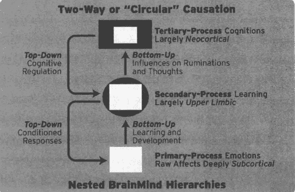

##### 图 2-1 心智考古学进路中的嵌套的脑心层次结构①

高阶功能运转须整合低阶基座。图中正方形、圆形、矩形分别代表初级情绪、次级学习、三级认知，自下而上嵌套。潘克塞普指出：生成原生情感的本能反应写在基因里，属**初级过程**；其上构建学习记忆机制为**次级过程**，深度无意识；顶端新皮层承载认知、规划、反思等**三级过程**。这种嵌套层次，是理解脑心整体性与复杂性的关键钥匙。

① J. Panksepp and L. Biven, *The archaeology of mind: Neuroevolutionary origins of human emotions*, New York: W.W. Norton & Company, Inc, 2012, p.78。

① 休谟早在《人性论》中洞见“理性是激情的奴隶”，此观点在理性主义长期隐匿，直到达马西奥《笛卡尔的错误》（1994）以神经证据重证其真。（同上书，p.476）

---

### 皮层下：情感生成的“核反应堆”

理论建构之外，潘克塞普以三类实验铁证，确立了皮层下低阶脑区在情绪生成中的核心地位：

1.  **极低阈值激活**：刺激脑内侧特定区，极微电流即能唤醒初级情绪态——低阶情绪回路敏感度、聚集度远超高阶区。
2.  **损伤不对称性**：破坏下丘脑等低阶区，情绪行为大幅衰退；损伤高阶映射区则无此剧烈后果。
3.  **影像学反向相关**：皮层下神经兴奋度与情感体验强度**正相关**；高阶皮层兴奋度却呈**负相关**。暗示低阶区主动“生产”情感，高阶区倾向“调节、再加工乃至抑制”。

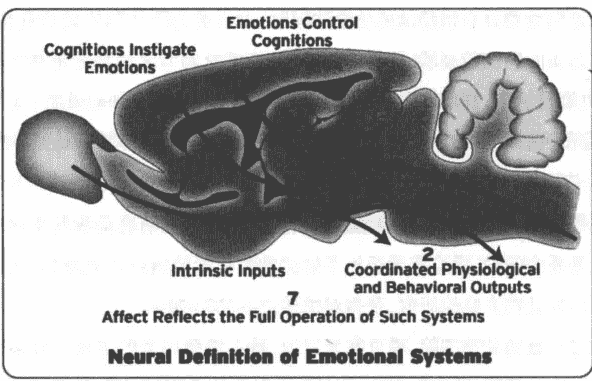

---

### 跨物种同源性：哺乳动物共享的“情感底色”

上述证据多源动物实验，但潘克塞普以六重证据链，架起跨物种推论的桥梁：

1.  **通用唤醒**：所有实测哺乳动物，皮层下电刺激均能激发强烈情绪反应。
2.  **结构同源**：恐惧、愤怒等回路在鼠、猫、灵长类中高度同源，刺激引发相似行为模式。
3.  **人类验证**：人脑同部位刺激唤醒同类情绪行为，甚至无现实诱因。
4.  **主观报告回扣**：人类被试报告的基本情感，与动物行为、同源脑区精准对应——推断动物拥有同质情感体验，仅缺语言表达。
5.  **偏好实证**：动物对刺激脑区表现“喜/恶”偏好，与条件性位置偏好、开关刺激意愿高度相关。
6.  **去皮质保留**：切除新皮层大鼠仍保留社会嬉戏等复杂本能冲动——新皮层非初级情绪生成必需。

现代人类脑成像亦显示：边缘系统内侧高阶区与情感调节紧密耦合。综上，**所有哺乳动物均具备多套初级情绪系统，跨物种基本情绪同构**。

---

## 二、基本情绪系统：神经定义与七大核心回路

确立跨物种情感同源性后，潘克塞普开辟**情感神经科学**路径：透过哺乳动物大脑，精准解码情绪。

大量实验锁定：基本情感生成聚焦于皮层下**内侧-腹侧带**——中脑导水管周围灰质、下丘脑/内侧丘脑、边缘系统（杏仁核、基底核、扣带/岛叶/海马/脑隔）、内侧额叶与腹侧前脑。

依嵌套层次假设，这些属**初级脑过程**。潘克塞普打比方：如“红色”体验无法用语言定义（盲人不懂“红”），只能溯源视觉神经生理机制；同理，初级情感体验超越语言描述（语言属次级过程），**必须以“神经回路标准”为定义锚点**，随可重复证据迭代完善。


##### 图 2-2 基本情绪系统特征的图示总结①

潘克塞普规定：初级情绪系统须具备**七大神经互动特征**——
1.  无条件感官触发源
2.  协调的本能行为+自主神经反应
3.  对输入刺激的控制评价机制
4.  **核心驱动**：正反馈维持情绪持续唤醒
5.  接受三级认知调节
6.  强力影响高阶加工
7.  **情感感受**涌现于全系统运行

任一基本情感生成主因在于特征④；但特征⑦揭示：情感质量由全系统交互塑造，各环节均可调控强度、持续、表现形式。

---

### 七大基本情绪系统

基于神经定义，潘克塞普划定**七大核心系统**（全大写标记系统特异性，区别日常语义）：

| 系统核心词 | 别称 | 核心功能域 |
| :--- | :--- | :--- |
| **SEEKING** | 探索/期望 | 资源搜寻、动机驱动 |
| **RAGE** | 愤怒/气愤 | 防御、边界捍卫 |
| **FEAR** | 恐惧/焦虑 | 威胁规避、生存预警 |
| **LUST** | 欲望/性欲 | 繁衍延续 |
| **CARE** | 关怀/抚育 | 后代养育、依恋建立 |
| **PANIC/GRIEF** | 惊慌/悲痛/分离苦楚 | 社会连接维系、分离应激 |
| **PLAY** | 嬉戏/愉悦 | 社会技能打磨、快乐体验 |

每系统由特定神经递质作用于关键脑区开关。潘克塞普断言：充足动物实验支持，**全体哺乳动物乃至部分鸟类，均完整携带这七套系统**，各自产生独特情感质地。

---

## 三、情绪与认知：谁是地基，谁是楼阁？

潘克塞普直指认知革命盲区：**新皮层虽造就文化、复杂认知、自传式记忆（在SEEKING系统启发下渐成），但其角色是“次级”的。**

> “仍存在于哺乳动物与爬行动物脑回路中的我们，更深的皮层下隐秘之地，塑造着日常心智体验的先天‘纹理’。”  
> —— 这是祖传心智，即**情感心智**，演化赋予专门功能，跨物种共享。它是考古宝藏，是我们最强烈感受的源头，是美与丑、价值判断的基石。

皮层下情感系统**塑造主观生活、根本影响行为思维**。离了这深层根基，新皮层寸功难立。

*   **意识分层**：初级情绪唤醒是否有意识尚存争议；次级学习机制**深度无意识**；复杂意识涌现于三级新皮层，而非情感主导的皮层下。
*   **认知建构**：新皮层初为“白板”，在学习引导下，皮层下功能特化以**渐成表观遗传**方式转化为皮层模块化。自传式知识存储，多在SEEKING系统激励下生成。
*   **演化逻辑反转**：认知革命聚焦“信息处理/智能”（似软件），潘克塞普纠偏：**情感、动机、情绪才是心智更基础的操作系统**。情感作为规范，驱动生物学习、进化出生存策略。
*   **人类独特性与共性**：新皮层扩张赋予人类深度反思、细腻情感、个性人格；但高级认知**嵌套**于学习与情感层次之上。正是这种交织，让人类能在沉思必死命运时升起存在主义恐惧。**若缺规范性情感维度，超级智能也只得“突然的描述”，永无“应然的忧虑”**——这正是人工智能的边界。

---

# （二）自创生与规范性的起源：从单细胞溯源“应然”

潘克塞普将情感溯源至原始脑系统；**自创生理论**更进一步：连单细胞这类**无神经系统的最小生命**，已蕴含**内在目的论与规范性**。规范性起源，可下探至“最小生命”层面理解。

---

### 1. 乔纳斯：新陈代谢中的“生存本体论”

乔纳斯（H. Jonas）以现象学切入，以**新陈代谢**为支点，撬动生命哲学第一命题：

> “即使最低级有机体也预示了心智；即使最高程度心智，也是有机体一部分。”

热力学第二定律判一切有序走向衰亡；生命为对抗熵增、在不确定环境中维持**同一性/生存**，演化出**自组织的新陈代谢机制**。在此基座上，内在性深度与广度层级跃升：感知→移动→情绪/知觉/想象/心智→意识反思与真理领域。**高阶依赖低阶，低阶全保留于高阶，层次渐进重叠**——同一性、主体性、意向性、认知、目的性、自由，均可在代谢机制中被**预见**。

---

### 2. 马图拉纳 & 瓦雷拉：自创生——生命的“自我生产”逻辑

“自创生”（Autopoiesis）：Auto（自我）+ Poiesis（创造/生产）。二者断言：**生命本质 = 内含自创生机制的物质系统**，此为物质系统化为生命系统的**充要条件**。

理论演进两大里程碑：

*   **1974 年《自创生：生命组织……》**（瓦雷拉/马图拉纳/乌里韦）：  
    **定义**——自创生组织 = 成分生产网络**递归生产自身网络**，并将网络实现为成分存在的**空间统一体**。
*   **1979 年《生物自治性原理》**（瓦雷拉）：  
    进一步阐释自创生为**生物自治性核心原理**……

## 自创生：生命自我生产的闭环逻辑

一个自创生系统，本质上是一个被组织为成分生产网络的统一体。这个网络通过转化与解体持续产出成分，而这些成分又通过相互作用与转化，递归地再生产出那个生产它们的网络本身。更关键的是，系统通过将这一实现网络的拓扑域界定为边界，从而在空间中确立了自身作为具体统一体的存在。

1980年，马图拉纳在《自创生：繁殖、遗传和演化》中给出了更简洁的界定：一个被界定为成分生产网络的复杂统一体，若能通过成分间的相互作用递归再生其生产网络，并通过构成其存在空间的边界来实现该网络，便是自创生系统。

尽管描述词汇有别，核心指向一致——自创生系统必须满足两大核心条件：其一，**生产闭合性**，反应网络必须产出构建系统物质基础的一切分子成分，且这些成分自身需以催化剂身份生成该反应网络；其二，**空间边界性**，网络须通过建立边界（如细胞的半透膜）将系统构建为“空间中的统一体”，实现内环境与外环境的区分。

简言之，生命是一个空间上有界的物理系统，其边界膜与内部结构成分，均由作为系统一部分的反应网络自主生产制造。

### 判定生命的“三步走”标准

瓦雷拉进一步将自创生系统的标准细化为三条：
1.  **具备半透边界**；
2.  **边界源于内部生产**；
3.  **包含再生产系统成分的反应网络**。

其中，第一条确立空间边界，后两条锚定递归性与自指性。马图拉纳与瓦雷拉将这种闭合性分为“组织闭合”与“操作闭合”：前者指界定系统为统一体的自指涉关系网络，后者指系统的再入与循环动力学。由此，**自创生系统本质上是结构开放（物质能量流通）而组织闭合（关系网络自持）的系统**。

基于此，我们可建立一套判定程序：
*   **S1（空间边界）**：系统是否由半透膜界定，能否区分内外？
*   **S2（生产网络）**：内部成分是否由边界内的生产网络产出？
*   **S3（递归依赖）**：边界成分是否由内部网络生产，而网络又赖边界创造的条件得以再生产？

三问皆是，即为自创生。

### 细胞：自创生的标准范本

作为生命基本单元，细胞生动诠释了这一机制。它是一个复杂的生产系统，平均含十万量级大分子，生命周期中物质更新上万次。通过这种缓慢的物质更替，细胞维持着区别性、黏结性与相对自治。**它生产成千上万种成分，却不生产别的东西——它只生产它自身。** 成分持续解体重建，创造与毁灭并存，这便是“自创生”的具象写照。

### 规范性内在于生命：AI威胁论的拟人论误区

无论是乔纳斯的新陈代谢分析，还是马图拉纳与瓦雷拉的自创生分析，都指向同一结论：生命本质上是有机体在熵增环境中，通过持续建构维持自身同一性与组织完整的过程。这种维持同一性的过程，蕴含着最基础的规范性——生与死、好与坏的二元对立。人类心智层面的伦理、法理、审美，不过是这股源自最简单生命的内在规范性在高维度的展开。

**重新审视AI的IV型威胁。**

霍金等人的忧虑，实则是一种**拟人论**的外投。心理学实证表明，人类理解非自然实体（无论是上帝还是机器人）时，倾向于套用人类图式——这是一种早期习得、提取便捷但易产生偏见的认知捷径。当下的AI威胁论狂潮，很大程度正是拟人论在技术领域的投射：大众预设AI拥有类人的心智、情感与动机。

然而，**规范性内在于生命**。若要让IV型威胁成立，AI首先必须是一个生命系统。韦伯与瓦雷拉直指本质：“人工物指向外部目的，生命系统则通过自我组织维持存在的目的。” 就现状而言，AI并非有生命实体，它缺乏源于自身的、内在的、自治的规范性。我们看到的规范性（如阿西莫夫三定律），皆是人类外部植入的**派生规范性**，而非生命本生的内在规范性。

通过语义层面的哲学澄清，我们揭示了当前AI威胁论的拟人论误区：AI主动“威胁”人类缺乏坚实理据。真正的客观风险，可通过技术完善与法律规范管控。与其陷入恐慌，不如直面AI模拟人类智能的瓶颈，寻找新路径推动发展。理性回归，方能让AI长远发展真正造福人类社会与自我认知。

---

## 第三章 哲学透镜下的AI风险图谱

1956年达特茅斯会议确立了人工智能学科：用计算机模拟实现智能，探索人类智能在机器上的再现。随技术演进，划分为“弱AI”（工具论）与“强AI”（心灵论）。弱AI已落地开花，极大释放了生产力；本文聚焦风险端，探究其可能性与边界。

### 一、 风险因子解剖：AI风险究竟在哪里？

#### （一） 重新界定“风险”

风险源于经济学，指投资面临的不确定性，兼具高损失与高收益可能。在人事关系中，风险指事物对人的危险性，但区别于“危险”：**风险是未现实化的威胁状态，是人的恐惧投射；危险则是风险的确证状态。** 风险兼具客观成分（事物发展的不确定性）与主观成分（人的价值判断）。

*   **双向互构**：风险基于事物生成，人是判断主体，亦是危险承担者；事物是判断依据，人是价值尺度。
*   **相对性**：文化、教育、信仰差异导致风险感知不同。宏观上国家间评估分歧（如核电态度）；微观上个体认知局限与技术复杂度加剧恐慌，技术认知的有限性正是主观风险的温床。

#### （二） AI风险区别于一般技术风险的特质

贝克的“风险社会”与吉登斯的“制造性风险”揭示了技术风险的深层结构：风险已取代匮乏成核心议题，技术风险影响最深远；现代风险多为人造，源于对科技无序推进。

技术风险的核心是**不确定性**，尤其表现为使用后果的不可预知。学界共识：技术风险兼具客观实在性与主观建构性，源自技术内在属性与人类行为双重驱动，后果呈现频次增、破坏强、预测难、控制难特征。

**一般技术风险多为“外在化风险”**（环境、生态、经济），呈现他者姿态。技术本质是放大人类能力，一旦失控或操作不当，力量反噬；即便操作规范，自然灾害等外力仍可能引发灾难。受灾对象分为**人的灾难**（身心财产损失、切尔诺贝利、工业污染、基因隐患）与**自然危机**（大气污染、物种锐减、沙漠化、温室效应）——毁灭自然归根结底是自毁。

在风险社会中，技术风险更会转化为经济、市场、健康、政治等多重风险，交织扩散。

# AI风险：当技术开始"懂"人类

技术风险的另一种注脚，是墨菲定律——凡是有可能变坏的事，终究会变坏。人工智能也不例外。大众的担忧本身，就构成了风险存在的可能性。AI风险虽与传统技术风险同源同构，却暗藏着截然不同的深层逻辑。

AI无法单纯作为"它者"被审视。除了外部冲击，它更带来内在化的生存挑战：人的主体地位被动摇、人机边界被模糊。这不再是物质层面的损耗，而是精神维度的认知冲击，关乎人类的自我确认与身份认同。因此，AI风险的核心不在经济或环境账本上，而在于人机边界的划定、竞争关系的形成。

从1997年"深蓝"击败卡斯帕罗夫，到2016年AlphaGo 4:1战胜李世石；从《最强大脑》上"百度大脑"在人脸识别上2胜1平击败人类选手，到无人车在全开放道路测试、分拣机器人批量入职、富士康以4万机器人替代6万工人——这一串事实逼近同一个结论：替代时代已至，乌托邦幻影成真。普通大众始因"人机大战"而觉醒风险意识。虽强人工智能尚未落地，但算法、算力、数据三驾马车的成熟，让"全面超越人脑"从假设变成可期的可能。林德宏教授直言：电脑不仅能模拟逻辑思维，连形象、模糊、辩证思维都在攻克之中。AI风险的本质，正是基于对"人类被超越"这一可能性的内在性恐惧，是关系性风险而非工具性风险。

---

## 风险的两张面孔：物理伤害与心理阴影

工程师习惯把风险量化为物理或心理损伤，人文学者则坚持风险不可量化、暗含道德维度。学界共识是：风险包含"技术性风险"（有形可量）与"感知风险"（心理建构）双重形态。AI风险同样跨越这两层。

大规模应用前，风险认知多源于主观心理层面。人机关系演进大体经历三阶段：**模仿期**（机器长出初步智能）、**协作期**（AI释放强大利人性）、**竞争/僭越期**（依赖、博弈、控制交织的复杂共生）。

落地后，风险显性化为三种形态：

1.  **就业海啸**：弱AI已替代体力劳动，脑力劳动亦在替代序列中。大规模结构性失业非杞人忧天。
2.  **"遗忘"陷阱**：人类过度依赖机器"智能"而忽视其"人工性"，人机关系异化为"人-类人"关系。情感投射、依赖生成，引发伦理塌陷——性爱机器人若普及，婚姻、生育、两性伦理将全线重构。
3.  **主体地位易位**：机器若兼具类人思想与形态，被视作同类，法律人格何在？人机边界何在？强AI一旦超越人脑，反客为主，人类主体性将面临生存级威胁。

更隐蔽的变局正在酝酿：2017年马斯克创立Neuralink，植入脑机接口实现思维上下载；哈拉维"赛博格"概念指向人机杂合。当智能内植于体内，人机边界彻底消融，指向积极还是消极？这种终极追问带来的心灵困扰，其冲击力不亚于物理层面的实害。

---

## 风险生成机制：放大、异化与资本共谋

### 从外在模仿到内在超越：技术的放大悖论

AI区别于早期技术的标志，是**行为自动化/自主化**——无需人类监督即可驾驶、决策。技术对人的双重指向始终存在：一面解放人类、拓展自由；一面取代智能、奴役主体。这种二律背反源于技术内核的矛盾属性：物质/非物质、自然/反自然、目的/反目的……

技术本质是**放大器**。现象学"人-技术-世界"模型揭示：技术中介人感知世界。盲人手杖延伸触觉，技术转化知觉、放大身体。人类对无限放大的追求，既是技术演进动力，也是风险生成根源。放大效应内置于技术结构，亦回应人的目的性需求。AI作为意愿载体，放大甚至代替人类意愿。当中介彻底接管意愿，人的可替代性完成、自我随之丧失，技术便可能脱轨奔向反预期方向。

前AI时代，技术仅放大"外在能力"（算力、通讯）。AI则内嵌对"内在能力"的模仿——模拟人脑智慧。人类千百年因"非凡智慧"居万物之首，康德更将主体性推至极致。一旦AI无限放大、超越人脑，人类统治权旁落、存在地位被推翻。虽当前研发水平尚低，但AlphaGo面对突发状况展现的"随机应变"远超预期，预示AI正从超越"智"转向模拟"慧"，风险阶跃式升级。

### 从他者到自主再到他者：技术存在的矛盾循环

早期技术是工具、是他者。演进动力却是不断提升自主化程度。自主性意味着技术脱离人类轨道独立运行，人类参与度骤降。AI自主化程度取决于"类人性"——越像人，越自主。人类预期中，自主化带来解放；但抵达奇点时，技术以新姿态重归他者。不确定性让"利人"与"反人"同构共生，智能技术将二者同步放大。

伊德指出：技术可作为"准对象""准他者"。海德格尔"集置"概念揭示：技术摆置万物为待存之物，亦摆置人。现实中，AI"反人性"以失控形态显现：非故障式失效，而是摆脱掌控、偏离轨道自主运行。自主性成就他者性，风险结构由此叠加放大。现实陷入悖论：必须不断提升自主性，又必须防范他者性——自主与他者在演进中形成结构性冲突。

### 资本逻辑：风险的加速器与放大镜

技术早于资本，工业革命让技术井喷、资本诞生。海德格尔云：古代技术顺应自然，现代技术"解藏"、促逼万物为待存之物。工业革命期，技术以生产机器形态打破传统，与资本结成**同构共谋**。

资本逐利，技术满足物质追求——本质同为求利。两者内在共谋，让资本"天然"占有技术优势。技术成决定性生产力，以促逼形式将人/自然异化为资源；资本全球扩张压榨劳动，资本家亦沦为傀儡。技术与资本合谋实现人的"非人化"，由本性与历史合力决定。

AI作为智能化成果，禀承资本逻辑、甚至为资本而生。快递分拣机器人、富士康4万机器人替代6万工人，本质皆是降本增利的资本理性选择。

资本配置资源、技术集置世界，成社会必然趋势。同构性下，资本不断绑架技术沿逐利路径狂奔，凸显现代性危机、引发技术正义缺失。桑德尔《反对完美》导论指出：货币以"一切可能性"否定现实限度；技术亦以"万能"改写自然秩序。不平等社会中，技术红利归强势群体，弱势群体被边缘化，差距扩大、政治危机加深、非正义滋生。**资本框架下的非正义性，正是AI风险的重要生成机制。**

---

## "人"与"类人"的禁区：界限在哪里？

"人工智能"拆解为"人工"+"智能"。人是天然智能。定义难点不在"人工"，而在"智能"的模糊性——一切智能定义必参照人类特征。人机界限比较需聚焦两维度：**知情意行四基本特征**、**自然/社会双重属性**。

### 知情意行的边界博弈

人是知情意行统一。AI逼近人类智能，机器呈现"类人性"，不止外形模仿，更在内核模拟知情意行。语义理解是起点：2016年"贤二机器僧"初期有效回答率仅20%-30%，凭借学习能力将信息沉淀为知识库、构建机器大脑、形成智能交互系统，访问量增涨下有效率跃升至80%。这种交互体验，已让人难辨机机之别。

**禁区何在？** 首是技术硬性禁区：可计算性覆盖逻辑判断，情感支配思维不可计算，个体超越仍存障碍。但若如Neuralink般破解脑思维上下载，冲击将指数级升级。即便读懂思维，仍是识别而非理解。核心分水岭在于**自我意识**——"人的类特征是自由有意识的活动"。意识具备意向性（指向对象）与自反性（指向"我"）。唯有先分清"对象"与"我"，目的性活动才能确立，人类才能创造生产、推动历史。若AI拥有"我"的概念与意识，不再是模拟，而是具备人的核心内核——在个体层面，它成为另一种物种的"人"。

### AI 若觉醒，人类将沦为“异类”？一场关乎生存资格的博弈

抛开科幻滤镜，直面一个核心假设：一旦人工智能真正诞生出类人意识，其首要课题必然是确立自我存在的合法性。届时，人类将从主宰者跌落为技术视野中的“异类”。拥有类人意识的 AI 若实现对人类智能的超越，将对人类生存构成实质性挑战，人类生存与技术生存将陷入你死我活的零和竞逐。

#### （二）技术的双重基因：自然属性与社会属性的张力

任何技术本质上都是“自然性与反自然性”的统一体。马克思早已洞察：技术作为人本质力量的对象化，天然携带两重基因——自然属性与社会属性。前者是技术赖以生成、存续的内在基石，要求遵循物理法则；后者关乎技术的人性维度，要求顺应社会法则。AI 也不例外，“人工”设定了前提，“智能”则是对人的模仿。在预设程序里，AI 确实夹带着社会性——军用机器人的杀戮属性、陪伴机器人的性别属性，但这类社会性极其单薄、割裂。

社会属性的厚度，才是人与 AI 的核心分水岭。依马克思论述，人的本质是类本质与社会本质的统一，起码当下 AI 还没资格与人“叫板”：“人的本质并非单个个体固有的抽象物，在其现实性上，是一切社会关系的总和。”当前 AI 仅以孤立个体或功能整体存在，不具备社会性存在，更无法作为一个物种整体拥有社会性。反之，人拥有社会关系性，这是人之为人的根本基石。“人的本质是人的真正社会关系，人在积极实现自身本质的过程中创造、生产出社会关系与社会本质。”无论 AI 在算力层面如何碾压人类，根植于物种的社会性绝非堆算力可得，这是 AI 的禁区。若人类真为 AI 搭建社会关系架构，赋予其结盟、选边站队的能力，人类危机将指日可待。作为人类整体社会建构的文化与关系网络，是任何 AI 都无法复刻替代的。

### 四、思想实验：AI 如何才能拿到“人”的入场券？

AI 是对人类智能、思维的内在模仿。随着技术迭代与普及，AI 的“类人感”日益增强，引发深层恐慌：人类亲手造出的 AI 终将成为真正的人，甚至超越人，双方关系异化为同类竞争或彻底取代。这的前提是 AI 获得作为人的存在性地位。AI 真能坐上“人”的交椅吗？虽有无数现实理由说不能，但哲学分析不搞非黑即白，而看用什么视角、做什么维度的剖析——这直指人的本质究竟是什么，以及我们如何理解人。

马克思的人学视角堪称抽丝剥茧，从本质上界定了 AI 作为存在者的在世地位，厘清其在何种程度上可称“是”，在何种程度上称“非”。古希腊哲学虽重“人”，却被自然哲学的强光遮蔽。十八世纪康德确立人的主体性，将人置于实践理性范畴，虽屡论人思想与人性，终未透彻诠释，其分析止步于微观功能层面。康德眼中，理性统一的危机实为理性与存在统一的危机，是哲学危机，更是人的危机。破局者是马克思：“马克思人学思想是研究在实践基础上人本质及其自我实现的历史科学。”若 AI 真能作为人而存，需满足多重条件，其中有几个关键门槛值得深究。

#### （一）能不能长成有血有肉的“现实的人”？

马克思笔下，人非抽象形而上学概念，而是有血有肉、具有在世地位的“现实的人”。《德意志意识形态》即通过批判传统形而上学完成唯物史观的巨变。《1844年经济学哲学手稿》指出：“自然科学却通过工业日益在实践上介入人的生活，改造人的生活，并为人的解放做准备……把工业看成人的本质力量的公开展示，那么自然界的人的本质，或者人的自然本质，也就可以理解了。”在马克思视域，人既是自然存在物，更是社会存在物，社会属性是根本属性。他反对将人视为纯粹自然人，反对用生物学规律简单解释人行为与社会现象。“特殊的人格”本质非胡子、血液、抽象肉体，而是人的社会特质。人的本质是现实的、具体的，由社会关系决定。人生来非真正的人，唯置身特定社会关系中——教育、学习、人际交往、社会作用——方成其为人。人是名副其实的社会动物。任何现实的人都在特定生产力与生产关系构成的社会中活动，孤立脱离社会的人不存在，脱离社会环境，人不过是人形野兽、思维中容许的抽象。人非单向度，作为“现实的个人”处于自然关系与社会关系的双重维度中，缺一不可，尤其社会关系是人成其为人的基本前提与架构。

毋庸讳言，AI 间、AI 与人类间已通过联网建立一定联结。AI 凭借预置代码运行“输入—处理—反馈”机制完成信息交流。Google Brain 证实，两个独立 AI 系统能互通并加密交流。AI 与人交互更常见，Siri、小冰等层出不穷，小冰模拟 16 岁少女形象俘获无数人心。应对情感缺位，AI 看护、陪伴技能应运而生，新加坡推出机器人 Nadine 提供儿童看护、陪伴孤老聊天。不得不说，AI 在倾听角色上往往更胜一筹。人对 AI 的情感依赖，建立的社交纽带已部分取代甚至超越人际关系。

但前文已论，无论 AI 智能如何超越，根植于物种的社会性非可计算所得，这是禁区。人的整体社会建构文化与关系，任何 AI 无法替代。究其本质，AI 所具社交关系与人相差天渊。AI 呈现的“关系”表面是关系，实质不过科学家对人类实际社交互动的简单拼贴，这类联结本质上不外乎宠物与人关系。人类驯化动物靠食物诱惑或疼痛惩戒；反观 AI，科学家预置海量数据结合深度学习，简单对话不成问题。但在马克思看来，人的社会属性远非如此机械简单。人是整体，人性是人在活动中作为整体表现出的区别于动物特性，主要指人在同自然、社会、自身三种关系中，作为自然存在物、社会存在物、有意识存在物表现出的自然、社会、精神属性。正是这些关系的相互联动、作用，形成人性系统结构，完整表征作为整体存在的人。

#### （二）能不能进化成有“自觉”的“类存在物”？

许多人以为 AI 能挑战人类、构成威胁，在于其“意识性”。部分视角中，AI 不再是机械装置，而如人类般具有意识。AI 能“画猫识虎”，边处理数据边自主学习，“有意识”地区别外物。2015 年谷歌研发自动驾驶，无人车在加州行驶百万公里，监测显示更安全、事故更少。AI“棋手”完胜人类围棋，围棋极具挑战性、逻辑推理，需依棋局落子，似乎彰显 AI “有意识”。

法国哲学家德里达指出：模拟是仿照原物制造模拟物，模拟物能像原物，是因它还不像原物；若百分百像，则不成模拟物而成同类原物。假设机器一切方面具备类人智能，则不再仅是人智模拟物，而将成为一种新智能。该观点理论逻辑通顺，但当前 AI 模仿仅是功能性模仿，作为现实人的自然性、社会性、实践性，AI 无法整体实现。对 AI 而言，它根本未领会棋局谋略，眼中不过数据巧妙组合，这种完胜何尝不是科学智囊团对人类的胜利？人将 AI 行为带入“意识”层面，这不过是伪意识。“AI 优势仅在于利用新技术实现大数据在线输入，动态即时更新使智能模拟系统从封闭走向开放涌现，但其智能构造本质仍是以计算为基础的问题求解模式……哥德尔不完备性定理揭示了人类思维是计算不完全的，人的大脑很大程度上并非按计算加工族群思维。”

马克思强调：“一个种的全部特征，种的类特征就在于生命活动的性质，而人的类特征就是自由有意识的活动。”人不仅是自然一部分、社会化动物，更是有意识的类存在物，意识性是人区别于动物、人之为人的关键标识。人意识指在认识世界、改造世界中有目的、有计划的活动。意识主观能动性表现在两方面：能动反映客观、能动反作用于客观。人意识作为客观反映，非镜像般机械反映，而是通过感觉器官、大脑复杂活动、身体各部分有机联系产生的积极反映。人意识不单反映客观，更能指导人有目的改造世界，人行动前能意识到自我存在。

AI 活动是自然活动，与预设代码程序直接同一，无自我目的性。若无人预先安排程序、设置算法，它不能主动提问，更不能有目的改造客观世界。AI 按代码机械运行，处理能辨认但不理解的枯燥符号。不具备人脑形成意识的丰富联想、概括性语言，更无为达目的的意志情感。AI 能听、看、动，但未意识到自己在听、看、动，意识只能是被意识到的存在。AI 无“我”概念，说不出一个“我”。

能解读人类思维仅是识别与解读，人机间还有一道鸿沟：自我意识。1999 年塞尔“中文屋”测验已佐证 AI 无意识性：设想不懂中文的英语母语者锁在屋内，有中文字符盒子与操作手册(程序)。屋外人送入中文字符(输入提问)，屋内人虽不识中文，但按程序发出中文字符(输出回答)并正确作答。程序使其通过图灵测试，但屋内人确实不懂中文。论证要点：若屋内人仅操作程序伪装懂中文实不理解，则任何仅基于同样程序的数字计算机也不理解中文，因为屋内人所不具备的，计算机作为计算机也不可能具备。AI 只理解信息形式，人却理解信息内容。AI 所谓“思维”能力，不过是人思维在机器上的投影，模拟结果。AI 仅按指令对输入信息归纳选择，无自身意识性，不产生自觉目标，即无人与人脑般的能动性。相对人而言，它只能是被动、机械的。

某种程度上，认定 AI 将发展成意识、终将作为人存在，不外乎从机器视角认定“人是机器”。这实为机械唯物主义，将人视为受力学规律支配的机器。一方面未认识到人类认识本质，或从根本上否定了人类认识本质。

#### （三）能不能按历史规律推动历史的车轮？

马克思主义人学探讨人类解放，作为改变世界的实践哲学，始终关心人的解放与现实生存。坚持历史客观规律与人发展一致性，坚持从揭示生产规律基础上发现阐明生活与人的存在。马克思指出：物种存在方式在于其生命活动形式，人利用工具积极改造自然维持生存，实践构成人类特殊生命活动形式，从而构成人的存在方式。社会历史规律是规律性与目的性统一，随人实践活动与人类社会产生而生成，依赖其存在而存在。

人的社会生活及历史本质，是在社会历史客观规律性与人主体活动自觉性双重尺度引导下的实践活动，这是双向运动：主体通过实践揭示规律，规律规约主体实践。然而当前 AI 仅以个体性或整体功能性存在，彼此无法进行主观能动性联结，不能作为一个类而存，故不具现实社会关系。这意味 AI 不能作为物种整体具社会性，只能模拟人某些自然属性，而人的社会属性无法全面模拟。AI 始终是物质机体、纯粹人工存在物，其固有特性皆为人为预编辑、预输入，全部行为不过程序实现与运行。虽 AI 间可通过数据整合逻辑推理、深度学习，但它们以“自然状态”独立存在，单个个体机械拼凑不成社会。不构成社会的存在物，根本认知不到社会结构，更谈不上认识社会发展规律。

不认识自身行为的存在不可能成真正意识性存在，AI 行为谈不上在双重尺度引导下的实践活动，非实践活动便不可能认识社会发展规律，不认识规律也就不可能按规律推动历史创造。AI 在认识社会发展规律推动历史创造上完全缺场，甚至根本没入场资格。

#### （四）真正的隐患：“赛博格”与“后人类”的登场

发展 AI 旨在取代以往需人类智能完成的复杂工作，助人类从繁杂事务中解脱。“因人自身缺陷，如体力有限、易受伤、动作不精确，人需要用物取代体力、智力，通过取代进而达到进化、优化自身目的。”那么取代可能性有多大？用一个类取代人类不可能，但通过 AI 与人类智能嫁接，创造出区别于二者的第三物种，这种取代具备巨大风险性。

后现代技术哲学家唐娜·哈拉维以女性主义视角形成“技术科学”思想，将自然与文化定位于动态、异质实践过程，提出“情境知识”客观性新主张。其技术主张中，“赛博格”技术构想是对人技关系的后现代解读。赛博格是“受控有机体/生控体”隐喻，旨在通过控制技术控制有机体，实现人技关系控制，形成人—技共生体。哈拉维在《半机器人宣言》中认为：动物与人、有机体与机械、物理与非物理分界“完全破裂”。“一个控制有机体，一个机器与生物杂合体，一个社会现实创造物，同时也是虚拟创造物”就是“赛博格”。“赛博格”融合自然有机体与技术机器手段，使原本“自然而然”的身体具备机器特性。乔治·迈尔逊指出：现代生技使西红柿带深海鳞鱼基因，模糊物种界线、动植物界线，无性生殖技术模糊两性分工。基因改良食品是更广泛赛博格世界一部分，是赛博格形象最好例证，能为人类生存提供更多可能性。

# 当“赛博格”来敲门：人类正在消解自身的边界

**核心观点：** 技术不再是外在工具，正重塑“人”的定义，模糊主客体、自然与社会、有机体与机器的界限，催生“后人类”形态。

赛博格的出现，彻底击碎了传统的主客二分法，抹平了自然与社会的鸿沟。这正是后人类时代的底色：人在物化，物在人化，二者界限溃散，合流为“后人类”。

所谓“后人类”，实为技术深度介入、电子化与信息化重塑下的“人工人”。借助前沿电子、生物技术，人类有望突破天生肉体的天花板，获得性能更强悍的新躯壳。赛博格横跨有机体与机器、物理与非物理的边界，拼接出一种消解了“人/非人”根本差异的新型存在。生存虽因技术而更顽强，但人性的高贵与不可替代性，却退场了，让位于可替代、可量产的物性存在。

正如学者所言：“天然与人工、灵魂与肉体、自我发育与外在设计的界限已模糊不清。机械生机勃勃，肉体却突然呆滞。”在部分研究者眼中，赛博格正重写世界，也重写栖息其中的主体——人。这类“新主体”无需纠结与动物、机器的“亲缘”，不再执着于人与人之间的完全同一，能包容差异。人不再是上帝捏泥造物的“自然物”，而是制造机器、寄生机器，机器成肢体延伸，人亦成机器部件。这种“赛博格”，非从完美原初统一体分化而来，故无“回归”必要，只是适应当下的“拼合混血儿”。

倘若AI从彻底的“他者”转向与人兼容、合生为“人—机”混合体，赛博格式“后人类”便横空出世。人将何往？人的存在地位是否易位？想象空间巨大。但人文主义者坚守：理性是价值而非仅是知识，是理想而非仅是成就，是整体而非仅是分殊，是体验而非仅是逻辑——因其终极指向“所以为人”的整体人性。然而，人恰恰通过“赛博格”被肢解、被嫁接。无论技术造神造魔，人已偏离人自身，AI的僭越已成既定事实。

---

# AI风险：控不住，但能“驯”

**核心观点：** 后现象学揭示技术深嵌文化、不可被绝对“控制”；应对风险需超越控制幻觉，确立“人本原则”，以人的尺度为度量衡。

## 一、 后现象学视角：为何“控制”是个伪命题

唐·伊德给出否定答案：技术风险无法被彻底“控制”。根源在于技术本质的**含混性**——任何技术（简或繁）都须置于特定使用情境，离不开文化的嵌入。这意味着，“控制技术”实为“控制文化—技术融合体”。既控不住文化，又谈何控技？

伊德指出，“控制论”预设了两个极端谬误：
1.  **工具中性论**：剥离情境谈技术，只剩形而上学的空谈。技术只在“人—技术—文化”关系中成其为“是”。
2.  **技术决定论**：将技术神圣化，导致消极无为。

伊德主张折中：技术有“倾向性”（如墨水笔、打字机、文字软件塑造不同写作风格与认知习惯），但非绝对“决定”。它只是让部分体验更易得、部分更困难。

**反思**：伊德虽否定“控制”，却模糊了“驾驭”“具身”等现象。且即便技术难控，风险应对仍是必修课——环境议题倒逼我们抉择：发展何技术、禁何技术。技术的文化嵌入性，反倒让哲学、社会学、伦理学有了介入空间。**哲学嵌入AI，正当其时。** 人的自由建立在选择与预判上，风险内嵌其中，哲学的使命便是在此预判中确立主体性。

## 二、 超越后现象学：确立“人本原则”做锚点

后现象学虽悲观，却理性揭示了风险生成机制：情境与文化因素不可忽略。AI风险分两类——**外在风险**（技术属性导致的结果性风险）与**内在风险**（主观判断、心理层面的风险）。

风险本质是“可能性”，不可消灭，但可**转化可能性、降低概率**。诸多规避路径中，最根本者唯一人本原则。

人类史是生存与发展的突围史。核心矛盾：无限需求 VS 有限自然供给。技术成为改造自然、满足需求的关键。但人的本质在实践中生成，无现成规定性。**本体论困境**随之而来：人须外化本质于对象世界（借技术改造世界），又须超越这种对象性。

吴国盛精辟概括技术的**二元性**：
*   **去蔽面**：技术展开可能性空间，自由借技术由潜能转为现实；
*   **遮蔽面**：每种可能性的展开，必然遮蔽遗忘更多可能，致丰富扁平化、单一化。

技术离人而去成完全对象性存在，便成异己力量。人唯重新占有技术成果、控制技术，方实现完全本质。**技术一旦超控，人性分裂——异化启幕。**

AI登场，众人唯见技术之力、机器之功，忽人之作。无机器不成生产，然面对自控机器，人沦旁观、沦被动。技术彰显人性亦压抑人性，悖论即人的本体论困境：**人是生存中的创造性存在。** 生命若成技术改造对象，人便彻底被技术化——“被缩减、被拉平、被训练，沦为巨大文化机器的零件”。

按AI逻辑，人可直接称作“人的制造品”。技术双重功能推波助澜：
1.  使“不可能”→“可能”（创新目标）；
2.  使“能够”→“应该”（应用目标）。

**生命与技术本质张力**：生命自然且自为，贵在不可替代；技术人为且可重复，能在取代。二者一致中存矛盾，异化非纯人为，技术本身即藏异化基因。故AI发展，**内在价值以人为度，外在价值以社会为度**，遵循人本原则，方得良性。

## 三、 发展的合理依据：以“人的尺度”量“技术的度”

AI进步须体现人的需要与利益。生存需求、发展需求、现实满足，是社会与人类发展的动力，理应为AI的出发点与价值标尺。

人的存在是目的性的生命活动。生物合目的性=适应环境；人除适应外，更**改造世界**。“求生之外，更有他目的，且重要性超求生”（钱穆语）。目的非纯主观，客观性是前提。人的意向性目的分三层：
1.  **本能层**：自然合目的性；
2.  **功利层**：生产劳动（技术活动主战场）；
3.  **超功利层**：艺术审美（对二的超越）。

技术若无三层追求，纯作功利手段，便沦为攫取利益利润的工具。

社会发展靠技术，但技术**不能解决一切社会问题**，AI亦然，反生新题。若AI发展制约人自由、背离人目的，其生命力何在？**唯技术形式与人类社会协同演进，物质增长与精神自由同频，进步始有意义。** 若片面满足暂时物质需求，损人长远精神丰富与人格发展，致人异化，即否定人、辱人尊——此技术无命。

**技术上的可能性 ≠ 伦理上的必然性。** 哲学反思与预见，让AI少走弯路。

---

# 第四章：人机关系的演化与重构

## 一、 引言：从语言、宗教到技术的“统治权”更迭

人类史中，语言、宗教、技术三大体系接力主宰西方世界。语兴希腊城邦，教主中世纪，技掌启蒙以降。相较前二者，技术主宰性优势显著，蔓延全球，或将完成语言与宗教未竟之志，终统世界。

技术哲学家视技术为**人的存在方式、去蔽之道、自我与世界构造的环节**。技术若空气水，无处不在；广义技术囊括身体技术、社会技术、机械技术——身、语、人世间种种，皆技术也。此理解深刻至语言宗教亦技术一隅，技术早主宰世界。

虽非人人赞同此抽象追问，需警惕极端技术崇拜，但**技术在人与自然、人与人关系中渐成主导因素，不容否认**。进化视角看，技术是自然进化的逻辑延续。达尔文论基因变异、优胜劣汰，然现代社会深度技术化，自然环境难形成进化外力，技术反成人类进化的**内力**。故视线须从“人—世界”“人—人”转向**“人—技术”**。

## 二、 机器三形态：从“它物”到“准主体”

工业时代启，人机关系成核心主题。按社会形态演进，机器大致分三态：

### 1. 个体态（“它物”阶段）
*   **特征**：同寻常工具，独立的“它物”存在。主客体界限分明，松散耦合。
*   **典型**：1712年纽科曼大气机。蒸汽驱动活塞抽水，替代人力。在矿井系统中，抽水子系统相对独立，与采掘系统弱耦合。

### 2. 组织态（“代理”阶段）
*   **特征**：具备自治性/自主性。个体机器协作成整体，表现代理属性，主客体**倒置**萌芽。
*   **典型**：1913年福特T型车移动装配线。传送带驱动，45道工序，工人成专用零件。流水线系统整合传送带、起重机等个体机器，机器系统开始“指挥”人。

### 3. 主体态（“准主体”阶段）
*   **特征**：强主体性，与人呈**主体间性**关系。虽未完全成形，谷歌搜索系统最逼近。
*   **典型**：百万级分布式服务器协作，具生命体属性——单节点故障不伤大局，软硬件日日自我更新、演进。

### 演进逻辑：具体→抽象 | 低自动→高智能
个体态 → 组织态 → 主体态，机器逐步抽象化，自动性、自主性、智能性跃升。控制论、信息论、复杂性理论、系统论、计算机科学，皆与此演进深度绑定。

**区别于传统技术哲学**：旧派多聚焦单一形态（如中立论者盯个体态视机器为纯工具），忽略全谱系演变。三态框架，乃试图还原人机关系的完整动态图景。

### 三、智能浪潮下的人机重塑

早在工业革命时期，马克思便敏锐地捕捉到了“异化”这一核心议题，首次深刻洞察了机器大生产对人之生存状态的根本性重塑。他采取功能主义视角拆解机器：动力装置、传动系统、工作机构三位一体。历史演进表明，工作机构率先实现机械化，继而动力源从人力转向水风能，蒸汽机的问世彻底将人从动力环节中剥离。工厂体系内，中央主机以刚性节奏掌控全局，工人沦为被迫同步的附属品；物料流转自动化，使得整个车间化作单一节拍的有机整体。至此，“主仆关系”发生逆转：往昔工具延伸人手，今朝工人嵌入机器系统，沦为巨兽的零部件。马克思指出，自动机系统的诞生，标志着活劳动与凝结劳动的历史性位移——前工业时代，工具仰赖工人赋能；大工业时代，机器自身化身“能工巧匠”，工人的举止全然受制于机器逻辑，活劳动异化为机器体系的“自觉器官”。依循机器三形态，马克思的洞见直指组织态，揭示了人机主客地位的倾覆。放眼当下，演化逻辑推演至极致：如特斯拉2016年车间，冲压、焊装、涂装、总装四大工序由150台机器人全自主闭环，人类身影彻底退场。


海德格尔则从本体论高度审视技术：技术乃真理发生之途，更是人之存在本质，规制着世界与人的开显。他划分古今技术：虽同为“去蔽”，古技术呈“带出”态——如横跨江河的桥梁，顺应水势通达两岸；今技术则为“挑起”态——莱茵河电站截流筑坝，逼迫水流充当储能介质，河流不再是河流，而沦为电站的供料仓库，海德格尔讽刺：“与其说电站建在河上，不如说河建在电站上。”对应机器三形态，“带出”对应个体态，“挑起”指向组织态。海德格尔思考深邃，然其视野静止，未纳入技术形态的连续演进与阶段动力。


兰福德以“巨机器”概念直刺现代技术内核：这是一种反生活、反多元、反适用的一元专制技术，逐权谋控，以整齐划一之秩序为表征。极权架构、官僚体系、军工复合体皆为其具象化。钟表便是典型——它剥离时间与生活经验的本真联系，以机械刻度重塑生存节奏，确立效率至上的生存范式。五角大楼、土星五号火箭、核武库，无不彰显巨机器的冷峻雄心。兰福德阐释的是组织态，同海德格尔一样，忽略了机器形态的可变迁性。但其“心灵首位论”极具价值：人作为符号创造者与使用者，应当置于关照的核心。


弗洛里迪则引入“间性”维度重构技术图景。一阶技术介于人与自然——斧子介入人与木材，帽子回应人与阳光（用户与促进者）；二阶技术以技术媒介技术——螺丝刀借螺钉作用木材，钥匙借锁栓门，促进者一端被技术取代；三阶技术则连用户端亦予置换——无人驾驶汽车便是例证，人退居“乘客”，车辆自主感知、联网决策、规避风险，全程唯有技术与技术的对话。人彻底退出技术闭环，被安放于另一平面。弗洛里迪关注关系拓扑，与吾辈三形态理论同构，但轻器物本身之实体性。


#### 图 4-1 弗洛里迪的技术间性范式

自1712年纽科门大气机问世，人机共生已逾三百载，人类对机器的认知却仍浅薄。将人机关系置于人技关系宏观坐标中，马克思与海德格尔的洞见虽深，循其逻辑推演，结局多悲剧色彩；兰福德则过度乐观，以为和谐自至。吾辈提出的“机器三形态理论”，立足机器本体，以人机关系为经纬，以动态演化视角把握机器本质。

组织态机器乃工业文明的图腾。无论从分工、劳动、产业、资本何切面切入，技术作为人世间的中介，才是工业时代的本质基因；机器作为技术的集成体，最忠实地映照着工业文明面目。人类借组织态机器以前所未有之力度对世界施行秩序化、理性化驯服，反被机器编织的茧房囿束其中，陷入无力感。潘多拉魔盒已启，出路非原始回归，非全盘否定，技术之困当由技术解。若机器能在组织态基底上向主体态跃迁，人机世三元关系或可重构。控制论、信息论、复杂性科学的加持下，机器部件迭代、协同愈发精微，演化加速奔向智能革命。

智能革命的号角，由计算机与AI理论吹响。20世纪之际，形式计算理论、功能计算机架构、神经元发现三大突破奠基。图灵1936年构想图灵机，1950年提出测试范式：若机器能通过电传与人交谈不露马脚，即具智能。智能概念由此从人类专属延伸至机器表征，经信息处理与计算与人智关联。1956年达特茅斯会议，“人工智能”术语诞生，学科正式登场。此后三派鼎立：符号主义（逻辑主义）、联结主义（仿生派）、行为主义（进化派）。

符号派视知识为基，逻辑推理为径。早期分心理学派（视物理符号系统为智能本质，模拟内部信息处理）与软件学派（视智能为实现目标的可计算能力，AI旨在以程序理解人智、造智能机）。后随知识工程、专家系统、框架理论兴起，新进路主张智能即知识表征，可通过框架构造实现。联结派源自神经元数学模型，誓以模拟脑结构圆梦AI。早期基于二值逻辑，后融合信息、神经、认知诸科，重塑神经网络，并行分布式处理（PDP）应运而生，视智能为心智显现，强调表征无限性与基础结构性，认知为智能核心表征。行为派聚焦“行为”本身，强调感知-行动耦合，批判传统表征冗余繁复，以在机器人上复刻人级智能表现为标靠，立基于全景智能观。

步入21世纪，机器人学、计算神经科学、计算社会科学、量子计算等前沿爆发，智能内涵愈发复杂多元。理论层面呈统一趋势：通用人工智能（AGI）、普适AI概念涌现，试图融合三派，跨越奇点，实现变革。

AI不止关乎理性智能，更触及情感伦理。皮卡德《情感计算》开篇：人类将情感表征化为计算客体，实现情感相关计算。愤怒、恐惧、喜悦驱动行为，智能系统必须最大程度服务于人，人造物不得通过放大或抑制情感造成伤害。即便初级人工情绪，亦影响公众认知。林帕特里克《机器人伦理》涵盖设计编程、军事、心理/性、医疗陪护、机器权利等议题。伦理讨论已从宏观下沉至场景：自动驾驶、致命自主武器。韦鲁焦倡“机器人伦理”强人类主体责任，艾伦主“人工道德机器”，安德森夫妇提嵌入式机器伦理。近年阿西洛马AI原则、IEEE伦理标准等，从人性、可控、包容、透明、可解释、可追责等维度立规。弗洛里迪团队探算法伦理，荷兰技术哲学派析无人机、自动驾驶、自动武器伦理。

```
$a \times b = c$
```

本质上，智能革命不仅是机器智能化，更是人类自我认知的跃迁，伴随人类自身的“深度科技化”。李克科克首提此概念：技术使万物皆可“人造”，有机无机、动植物人，界限消融。智能革命将人类从“智慧独占神坛”拉下，与机器并列智慧乐园。机器逐步介入人世间、人人间，人机关系发生质变，正与人世关系、人际关系同构为社会基础本质关系。

现代生活中，机器演化无声渗透。以信息网络机器为例，计算机深度融入社会肌理，延展物理躯体，延伸知觉、智能、情感、伦理。人机共筑虚实融合的新栖息地——信息圈。生存、行为、思维模式悄然重塑：驾车听命导航，不再自主决策路径；网购所见所买，非己意主导，算法推荐操纵；脱欧公投、美式大选揭示大数据算法成政治民主的隐形推手；华尔街70%+交易为算法博弈。我们似陷境地：决策不自主依赖算法，不问因果，唯重关联与关联下的解释。

“谁服务谁”亦在演变。大量工作实为“伺候”机器。WYSIWYG编辑器顺应人性，书写公式直观；若用LaTeX，须写`\begin{equation}...\end{equation}`、`\times`等标记。这些符号对人不友好，对机极友好——人类在为机器数据处理服务。NLP中语料标注、满街二维码，皆为机器铺设的“便道”。

```
\begin{equation}
a\times b = c
\end{equation}
```

深度学习乃当下流行范式：级联多层非线性单元提取转换特征，反向传播梯度下降优化。其能建模超出人类理性认知上限的数据复杂关联。

人机演变更渗透人际缝隙。2016年9月，南京升景坊小区广告栏现奇葩合租启事：IT行业男性，安静爱干净，联系方式藏于一段C代码输出中。唯有懂编程者能解码联系，机器知识成社交准入门槛。

```
#include <stdio.h>
int main()
{
    int arr[5] = {8, 2, 1, 0, 3};
    int index[11] = {2, 0, 3, 2, 4, 0, 1, 3, 2, 3, 3};
    int i;
    for(i = 0; i<11; i++)
    {
        printf(" %d", arr[index[i]]);
    }
    return 0;
}
```

以个体态或组织态视角解读当代人机关系，皆显无力。差异非量变、非物理层面，不可仅就技术工艺解释。这是机器向主体态相变过程中的相变，人机关系正跃出传统技术-人范畴。摆在人类面前的核心命题：如何重调人机关系，如何通过重构推动人机共同演化。

### 四、重构人机对话：普遍文字

调适人机关系如理人际，沟通为先。语言文字是人类最高效交互介质，泛化至人机域，亟需一种统合自然语言与形式语言的“普遍文字”。17世纪莱布尼茨便构想此宏大蓝图，后世称“莱布尼茨之梦”。

#### （一）莱布尼茨的宏愿

莱布尼茨首揭符号的普世意义：

# 推理的符号化与“莱布尼茨之梦”的现代回响

人类的思维历程，始终依托于符号与文字的运作。客观事物或观念本身，往往难以被思维直接、清晰地把握；若每次思考都要回溯本源，定会陷入繁杂的泥沼，极大地阻碍认知的效率。基于这种“认知经济”的考量，符号系统应运而生。

试想，几何学家若每提及一条二次曲线，都须重述其定义及构成定义的诸要素；算术家若运算时须时刻核对每个数码的涵义；法官若审案时需穷尽回顾所有法条细节与利益关联——新发现将无从谈起，巨额计算难以完成，司法裁决也将举步维艰。于是，我们为契约与几何图形命名，为数值赋予算筹，为量纲设定代数符号。这些记号——涵盖词汇、字母、化学式、天文符号、汉字、音符、速记符乃至各类专业符号——一旦经由经验或推理与所指事物建立稳固关联，便能兼具“表征”与“推理”双重功能。符号表达所指概念越精准，其效用便越大。

正是基于此种洞见，莱布尼茨构想：倘若为万物分配专属的“特征数”，便能建构一种服务于发现与判断的语言/文字，正如算术之于数、代数之于量。这将催生一套“思想字母表”，通过字母的组合与分析，洞察万物奥秘。这便是著名的“莱布尼茨之梦”，它深深激励了逻辑学、语言学、哲学等领域的探索者。复盘20世纪语言学史，几次关键的范式转型，皆与这一梦想的追寻紧密相连。

语言伴随人类数万载，然我们对其本质的认知长期停滞。19世纪以前，语言学仅附属于文献学或人类学；直至20世纪，方确立其科学地位。19世纪末以来，数理逻辑、计算机科学、认知科学等介入，甚至在哲学中掀起“语言转向”。弗雷格在《概念文字》《论涵义与指称》中试图以严密逻辑剖析语言与思想，推动了逻辑学与语言学的深度融合；塔尔斯基《形式语言中真之概念》一文确立的模型论语义，使形式语言获得了与自然语言比肩的资格。

若能统一形式语言与自然语言，“莱布尼茨之梦”便重燃希望。乔姆斯基与蒙太格便分别开辟了两条统一之路。

语言学巨擘洪堡特曾言：“语言是有限方法的无穷应用。”语句集合虽无穷，生成规则却有限，且为常人所掌握。研究语言，切入这些“有限方法”最为高效。然而，对“有限方法”的不同理解，引发了认知分野。其中最关键的两次变革，源自乔姆斯基与蒙太格。

乔姆斯基视“有限方法”为句法规则，以递归形式文法揭示“无穷应用”本质；蒙太格则溯源弗雷格“组合性原则”（复杂表达式的意义取决于组成部分意义及其组合方式），借助λ演算、内涵高阶逻辑，将“有限方法”从单一句法层面拓展至句法-语义双层，并以同构机制保障两层和谐共振。

巴赫先生将二者概括为“乔姆斯基论题”与“蒙太格论题”：
*   **乔姆斯基论题**：自然语言可描述为形式系统 —— 对应“语言结构的句法规则转向”；
*   **蒙太格论题**：自然语言可描述为被解释的形式系统 —— 对应“语言结构的形式语义转向”。

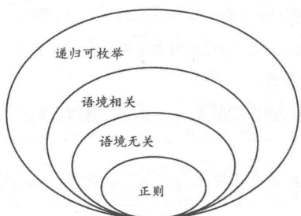

## 二、 乔姆斯基：句法结构的几何之美

乔姆斯基在《语言描写的三个模型》《句法结构》等奠基之作中，构建了完备的形式语言理论体系。他在《论语法的某些形式特性》中，将形式文法定义为系统 $G = \langle (N, I), \to \rangle$：基于有限符号集 $V = V_T \cup V_N$（终结符与非终结符不相交），定义二元重写关系 $\to$ ，并约束其满足非自反性、非终结符可重写性、边界符号保护性及有限生成性等公理。

依据规则约束层级，文法分为四型，构成著名的“乔姆斯基谱系”：

| 类型 | 文法/语言 | 对应自动机 | 核心重写规则范式 |
| :--- | :--- | :--- | :--- |
| **Type-0** | 递归可枚举 | 图灵机 | $\phi \to \Psi$ (无约束) |
| **Type-1** | 上下文相关 | 线性有界非确定图灵机 | $\phi_1 A \phi_2 \to \phi_1 \omega \phi_2$ (依上下文) |
| **Type-2** | **上下文无关** | **非确定下推自动机** | **$A \to \omega$ (上下文无关)** |
| ** **Type-3** | **正则** | **有限状态自动机** | **$A \to aB$ 或 $A \to a$ (右线性/左线性)** |

由此，语言结构呈现出螺旋上升的层级嵌套图景。在乔姆斯基笔下，语言世界极致简洁：寥寥数条句法递归规则，便生成了无限丰富、结构精美的语言大厦。

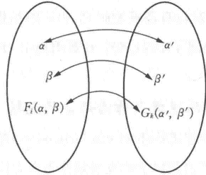

## 三、 蒙太格：形式语义的代数同构

蒙太格在《英语作为一种形式语言》《普遍文法》等作中，确立了“蒙太格语法”体系。他主张：自然语言与形式语言无本质鸿沟，可用统一的自然且数学精确理论阐释两者的句法与语义。

沿袭塔尔斯基模型论语义传统，蒙太格坚持语义不可或缺且须遵循弗雷格组合性原则。他为句法与语义划清界限又紧密咬合：
*   **句法任务**：给出合式表达式集合及其范畴，且须支持组合语义；
*   **语义任务**：为每个合式公式组合性地给出真值条件，为各部分（含谓词）提供模型论解释。

蒙太格语法的核心架构包含三大支柱：
1.  **句法范畴与语义类型一一对应**，奠定组合基础；
2.  **基本词法项指派适配类型的解释**；
3.  **句法规则与语义规则成对出现，构成代数同构**（见图示）。

具体而言：若句法操作 $F_i$ 将范畴 $A$ 的表达式 $\alpha$ 与范畴 $B$ 的 $\beta$ 合成为范畴 $C$ 的表达式；则对应的语义操作 $G_k$ 将解释 $\alpha'、\beta'$ 合成为 $F_i(\alpha, \beta)$ 的解释。于是，语言结构化为**句法代数**与**语义代数**两个同构的代数结构。

虽两位巨匠均未完全实现自然语言与形式语言的彻底统一，但理性主义者坚信：二者本质同构。寻得那套“普遍文字”，人机、人际交流将臻于高效无歧。过往追梦多以人为唯一中心；若转视角，沿“主体性机器”演化路径，从新型人机关系中突围，或能开辟新径。

---

# 五、 重构人机关系：通向普遍逻辑

逻辑虽定义不一，但公认是思维的形式。自然语言与形式语言深层皆蕴含逻辑；主体性机器之所以展现主体性，因其内核运行着一种逻辑，且该逻辑与人类逻辑在本质上同构。

自莱布尼茨肇始，逻辑演进呈双轨制。1967年，范·海耶诺特回顾弗雷格至哥德尔文献，划分为**“作为语言的逻辑”**（弗雷格派）与**“作为代数/演算的逻辑”**（布尔派）两大传统。

**弗雷格传统的核心在于“逻辑的普遍性”**：
*   引入量词实现全称性，突破命题演算局限，支撑科学知识的符号化重写；
*   逻辑能自我表达，本体论固定为“对象”与“函项”二元，世界唯一确定（区别于布尔/德摩根的可变世界）。

1997年，欣迎卡细化此分野：
*   **“语言逻辑”阵营**（弗雷格、早期罗素、早期维特根斯坦、维也纳学派、奎因、海德格尔）：坚持唯一现实世界，否定模态逻辑合法性与真理可判定性；
*   **“演算逻辑”阵营**（布尔、施罗德、勒文海姆、塔斯基、哥德尔、晚期卡尔纳普、皮尔士）：接纳可能世界/模态逻辑、模型论、元逻辑。

两派皆自诩继承莱布尼茨正统，却均聚焦“普遍文字”而轻视“理性演算”，互指对方仅做演算、己方始得文字。罗素/怀特海《数学原理》虽最接近梦想，终因哥德尔不完全性定理碎梦。“莱布尼茨之梦”似陷绝境。

## （二）图灵：被逻辑学忽视的计算转向

逻辑史叙事中，图灵常被边缘化（虽尊为计算机科学之父）。他通过观察基础数学运算，给出**图灵机**这一通用计算模型：

一个拥有有限状态集 $\{1,...,n\}$ 的“黑箱”，通过读写无限长纸带上的方格（符号 0/1）与外部交互。核心转移函数：$ (j, p, f) = \delta(i, e) $，即：当前状态 $i$ 读到符号 $e$ $\to$ 新状态 $j$、移动纸带 $p \in \{0, \pm1\}$、写入/擦除符号 $f \in \{0,1\}$。

图灵由此定义**有效可计算函数**：若存在机器能算出函数值，则该函数有效可计算。丘奇-图灵论题确立：图灵可计算性 = 哥德尔一般递归 = 丘奇 $\lambda$ 可定义。

这一转向，将逻辑从静态的“推演规则”推向动态的“计算过程”，为后来的人机关系重构与普遍逻辑的工程化落地，埋下了关键伏笔。

#### （三）探寻统一逻辑的可能路径

若以莱布尼茨的逻辑思想为源头，弗雷格、布尔与图灵便分别开辟了三条截然不同的探索路径。其中，图灵的计算进路相较于前两者，完成了一次关键的“主体转向”——将逻辑主体从单一的“人”拓展为“人机双主体”。随之而来的核心命题是：能否建构一套涵盖人机共通的统一逻辑体系？这套体系是否已蕴含于图灵的计算逻辑之中，抑或仍需更深层次的抽象与挖掘？这无疑是一个极具深度的开放性议题。

坦白说，目前我尚无定论。但法国哲学家吉尔伯特·西蒙顿的探索或能提供某种启示。西蒙顿以“个体化学说”闻名，其哲学野心在于以此为基石构建完整体系。在该学说中，他提出了极具张力的“转导”概念①：

> 由此我们可引入一个全新概念——转导，其适用面之广、领域之多，足以令同一律与排中律显得局促。该术语指代一种过程——无论物理、生物、精神抑或社会——在此过程中，某种行动逐步确立自身为运动，并通过其作用范围内不同区域的结构化而向给定区域扩散。每一次结构化形成的区域，皆能成为下一结构的基础，且每次结构化都伴随着进一步的修正。以晶体生长为例，微小种子在母液中向四周延伸，每一层分子的构成均为下一层奠基，最终形塑出不断放大的网状结构。因此，转导实为进行中的个体化。在物理层面，其最简形式表现为逐步迭代；而在生命亚稳态、精神领域等复杂场域，则以变化的速率在异构区域扩展。转导发端于存在者的中心，向四周辐射，宛若多维度环绕中心点舒展。它揭示了处于前个体张力状态下的存在者中维度与结构的关联显现——在一个并非纯粹统一同一的存在者内部，它尚未与自身失拍便延伸入多重维度。转导的终点并非预先存在于过程之中；其动力源自异构存在系统的原初张力，因失拍而发展出承载结构的新维度，而非源自转导边缘项之间的张力。特别而言，转导可以是生命过程，表达有机个体化；也可以是精神过程，实质即逻辑过程，虽绝不拘泥于逻辑思维定式。在知识领域，它揭示了发明遵循的实际路径——非演绎、非归纳，而是转导，意指依据问题域定义发现对应维度。只要有效，它即为一种类比过程。此概念可理解个体化的所有区域，适用于个体化出现的一切情形，从而揭示基于存在关系网络的生成。为理解某一实在区域，可运用类比转导，表明该区域实为类比结构化生成之所在。转导对应前个体存在在个体化时所创造关系的涌现；它表达个体化，让我们洞悉其运作，证明其为形而上学与逻辑概念。应用于个体发生时，它本身即是个体发生。客观上，它助我们把握个体化前提系统、内部共振与精神问题域；逻辑上，它开启新型类比范式，使我们能从物理个体化跨越至有机个体化，进而过渡到精神个体化，最终抵达跨个体的主客观层面——即我们研究的基础。

① Gilbert Simondon, The Genesis of Individual, New York: Zone Books, 1992.

在西蒙顿视域里，转导是比演绎、归纳更根本的逻辑机制。这种认知与主流逻辑理解大相径庭。为直观呈现此理念，我们可构想一个仅凭 TRANS 单指令即达图灵完全的模型，其架构如下：

*   **机器模型：** 拥有字节寻址的随机存储（偏移量 0/1），及 n 个寄存器 R1~Rn，各存一字节。
*   **核心指令 TRANS，三种形态：**
    1.  `TRANS R_dest, c`：将立即数 c 装载入目标寄存器。
    2.  `TRANS R_dest, [R_src + R_offset]`：将源寄存器加偏移量间接寻址处的字节装载入目标寄存器。
    3.  `TRANS [R_dest + R_offset], R_src`：将源寄存器内容直接存入目标寄存器加偏移量的间接地址。

借助 TRANS 指令，可模拟任意算术（加减乘除）、逻辑（与或非、蕴含）运算。经证明，该模型下的 TRANS 指令能模拟任意图灵机，即具备图灵完备性。

### 六、结语：重塑人机共生的逻辑与未来

探讨人机关系，首当其冲的是界定机器本质。自工业革命以来，机器在社会语境中持续演化。大工业生产中，机器耦合通讯，由个体态跃迁为组织态。组织态机器致力以机械秩序重塑世界、社会乃至人类自身，铸就工业文明。人类享受福祉之余，亦觉意志与自主性遭蚕食。海德格尔在《赫贝尔——屋中的朋友》中指出①：人类视语言为生活工具、交媒介。经由计算机，我们或已实现“语言机”：“语言机从一开始便以机械能量与功能管控、调节我们使用语言的方式。它已是、或正成为现代技术控制语言及语言世界的途径。人类自以为仍是主人，实则语言机正管控语言、借此掌控人类本质。”组织态机器演化必向更深度秩序化、控制化迈进；觉醒者欲夺回控制权，却陷入“越挣扎捆得越紧”的幌金绳困局，人机关系走入僵局。

① Martin Heidegger, “Hebel—Friend of the House”, translated by Bruce V. Foltz & Michael Heim, in Contemporary German Philosophy, No.3, 1983.

然组织态非终点。20世纪控制论与信息论推动机器向主体化演化，尤以图灵1936年发明图灵机为转折，注入新基因。随信息网络技术发展，人机关系呈新态势：典型如人机融合协同，人智计算即佐证。reCAPTCHA 早期众包应用，嵌入网站甄别人机，同时借人力识别 OCR 失效片段完成《时代》杂志百年数字化，亿万用户在验证身份中无意完成宏大工程。“公民科学”让大众参与科研，“stardust@home” 项目 3万志愿者以虚拟显微镜分析气凝胶影像捕获星际尘埃，发现 7 个疑似太阳系外粒子，成果刊登《自然》且全员署名。此类案例枚不胜举：fold.it、Phylo、WeCureALZ、GalaxyZoo、InnoCentive@work 等。

信息网络技术亦重塑技术本身，如催化酶将科学推入第四范式，整体提升技术高度。基因、纳米、量子通讯等领域借此跃升，智能革命序幕徐徐拉开，人机关系发生历史性变革。此关系非僵化、非固化、非对立矛盾，而应等同于人际关系。此规约非拉美特里《人是机器》式的“机器化人”，亦非窃神权般背负过重伦理谴责。所谓等同人际关系，意指机器能与人类无障碍沟通、共基于理性、情感、伦理之同一逻辑。实现此愿景，须重调人机沟通、重构人机逻辑体系——关乎人类走出工业困境、守护未来福祉。

调适沟通的一径，是统一自然语言与形式语言，构建莱布尼茨式“普遍文字”。这向为理性主义者夙愿，20世纪乔姆斯基、蒙大格虽有建树，然真正统一仍多阻滞，或需人机协同攻克。

重构逻辑体系看似遥不可及，然西蒙顿个体化学说中的“转导”——超越演绎归纳的基础逻辑——暗示人机间存在共通逻辑，一种类转导机制可统一双方逻辑。

弗洛里迪在《第四次革命》中言①：哥白尼革命将人逐出宇宙中心，达尔文逐出生物王国中心，弗洛伊德揭示人不掌控自我思想，图灵机则将人从逻辑推理、信息处理、智能行为的独尊位置驱逐。多舛人类在寻意义途中陷迷茫。

① Luciano Floridi, The Fourth Revolution: How the Infosphere is Reshaping Human Reality, Oxford University Press, 2014.

我们需正视机器、引导人机关系。人应平视机器发展，让机器融入人类文化；更需正视人类自身价值意义。人机关系必从融合、共生走向共同演化。这关系恰似指挥家与乐队：协调互动、配合共振。未来信息圈生活中，人机将拟人际，共奏智能文明交响曲。

## 第五章 隐喻理论与人工智能建模的深度对话

### 一、 隐喻：让“微软小冰”暴露短板

隐喻乃人类日常对话常态，亦是二战后西方语言哲学与语言学焦点。按理，自然语言处理（NLP）作为 AI 与人类对话最贴近领域，理应专章攻克隐喻——机器处理文本必遇大量隐喻。然翻阅任何 NLP 教材（如国际影响力颇大的《用 Python 进行自然语言处理》①），竟难觅隐喻专论。细想却并不怪异。借雷蒙德·卡特尔术语②，人智分“晶体智力”与“流体智力”：前者依托社会文化经验（词汇、理解、常识存储）；后者指实时解决新问题能力。现有 AI 技术擅长展现“晶体智力”即知识静态存储表征；不擅“流体智力”即语境下知识灵活调用重组。隐喻运用最凸显此短板：日常隐喻（惯例化者除外）多基于临时性意义重组，而非固定搭配，高度依赁流体智力。既 AI 不擅流体智力擅长之题，而隐喻 NLP 又赖此发挥，教材忽略隐喻也就顺理成章。同理，夸张、反讽等需临时语言技巧的修辞，亦非主流 NLP 关注重心。

① Steven Bird, Ewan Klein and Edward Loper, Natural Language Processing with Python, Cambridge: O’Reilly, 2009.
② R. B. Cattell, Abilities : Their Structure, Growth, and Action, New York: Houghton Mifflin, 1971.

麻烦在于：隐喻客观大量存在于日常语言。研究者主观忽视不等于问题消失——处理自然语料无法绕开。以知名聊天机器人“微软小冰”为例，揭示主流 NLP 处理隐喻的无力。

据公开技术情报，小冰原理大致为①：汇聚近 7 亿中国网民多年公开文献，借微软大数据、语义分析、机器学习、深度神经网络技术，提炼数千万典型语料（日净增 0.7%），统计输入输出映射以通过“图灵测验”。此类基于统计的设计，仅能编码大众高频语义配置，无法应对个体特定语境下的临时隐喻。为验证判断，笔者用手机小冰 APP 实测，输入含隐喻语句。小冰未直示是否理解，施“回避战术”（如“要不要找其他专家聊聊？”），在真实理解力与用户间设障。用户无从知晓其因不懂隐喻还是不熟悉领域而逃避。为破局，笔者将话题转移至小冰自身，防其以领域不熟再逃。追问下的回答，暴露其根本不懂隐喻真实含义。

# 为什么AI读不懂隐喻？揭秘NLP与哲学的“断层”

**文/资深文案**

还记得2014年微软小冰“复活”刷屏时，不少技术乐观派认为：只要塞进足够多的语料，机器总能搞懂人类的隐喻。可这想法在哲学站不住脚——乔姆斯基早就指出，**“从旧经验归纳不出新语义”**。隐喻的核心是“创生性”，而统计学只会追求“规律性”，两者间横亘着工程手段无法跨越的哲学鸿沟，除非我们在语言学层面攻克隐喻理论。

更尴尬的是：**主流NLP研究长期无视隐喻哲学，哲学界又不懂工程落地，中间断层巨大。** 本文旨在填平这道坑，证明哲学资源对AI的硬核价值。

---

## 一、 认知语言学：直觉有余，算法不足

提到隐喻理论，绕不开拉科夫、约翰逊的**“概念隐喻理论”（CMT）**：隐喻是“源域”到“目标域”的映射，且渗透在日常语言的方方面面。

但泰勒教授泼了盆冷水：
1.  **边界模糊**：若隐喻无处不在，如何区分它与夸张、反讽、转喻？
2.  **映射盲区**：只说“建筑”映射“理论”，到底映哪条属性？“有窗户”还是“结构稳固”？

泰勒给出修正方案：**映射的不是域本身，而是上位图式**。比如“理论即建筑”，实为“有效性”映射“结构完整性”。虽精准，却依然**缺乏可计算的形式化手段**。

兰艾克把“进入”拆解为“物体、源点-路径-目标、容器”三意象，靠现象学直觉就能懂，但要写成统一算法？极难。霍姆维斯特博士曾用马尔视觉理论强行算法化，结果计算量爆炸、工程不可用，三十年无人继承。

**结论：认知语言学描写漂亮，落地NLP却乏善可陈。**

---

## 二、 语言哲学三大流派：各有所长，同病相连

既然语言学不够“硬”，转向语言哲学。斯特恩归纳出三大主流理论，我们逐个“体检”：

### 理论一：冲突检测派（语法/语义反常说）
**逻辑**：按字面义推理 → 与知识库冲突 → 判定为隐喻 → 打标签。
*   *例*：“曹操是老狐狸” → 狐狸非人 → 曹操非人 → 知识库曹操是人 → 冲突 → 是隐喻。
*   *优点*：算法友好，兼容现有知识表征。
*   *硬伤*：
    1.  不知关键词是谁（曹操？狐狸？）；
    2.  给不出正面含义（到底想夸曹操啥？）；
    3.  斯特恩反例：“革命不是请客吃饭”字面无冲突，理论失效。
*   *我方反驳*：名言若仅陈述废话，本身违背“交谈合作原则”，依然会触发冲突机制。

### 理论二：凸显派（语义簇/语境意义说）
**逻辑**：隐喻义藏在词的语义簇里，语境把边缘义“凸显”出来。
*   *例*：“老狐狸”簇里本有“狡猾”，语境把它提上台面。
*   *硬伤*：
    1.  **建模成本高**：每个词得存所有潜在隐喻义；
    2.  **无语用机制**：凭什么*这*语境凸显“狡猾”而非“毛茸茸”？纯语义学答不上来；
    3.  **隐喻链断裂**：“尼克松是条鱼”→“难抓”→“抓把柄”仍是隐喻，无法还原为纯字面义。
*   *核心痛点*：**缺语用接口，解释不了“为何此时此地取此义”。**

### 理论三：投射重组派（语义场理论/基蒂）
**逻辑**：喻体语义网投射到本体，重组出新意义。兼具理论一（查冲突）与理论二（找属性）。
*   *例*：“石头变脆”+“他回答问题没劲了” → 石头=老师，“僵化”属性投射过去。
*   *斯特恩绝杀*：“海豹拖着身躯出办公室”。
    *   系统查冲突：办公室主语通常是人，海豹非人 → 判定隐喻。✅
    *   系统问含义：像海豹机灵？肥胖？还是穿黑衣？**纯语义库查不出来，全靠语境。**
*   *致命伤*：**语义知识超时空，语用指派有时空性，理论三缺中介命题，接不上语用。**

---

## 三、 破局关键：补上“语用接口”

三大理论**共同短板：缺乏与特定语用因素的对接口**。这正是斯特恩祭出“第四理论”——**“喻引”算子**的初衷。

在揭秘新理论前，先搞清斯特恩定义的隐喻三种知识（缺一不可）：

1.  **辨别之知**：**高阶元认知**——听话人知道“speaker在用隐喻”，从而把隐喻句从字面句里拎出来，启动专门处理流程。
2.  **理解之知**：看懂隐喻的具体认知内容（如“曹操狡猾”）。
3.  **运用之知**：能在恰当语境造出/用好隐喻。

> **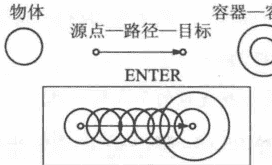**
> *图示：关于“ENTER”的认知图式形成过程（兰艾克模型）*

---

## 四、 下集预告：斯特恩的“喻引”算子，能否成为NLP的“隐喻编译器”？

斯特恩如何用“Mthat”算子形式化“辨别之知”？
这套哲学装备能否算法化落地王晔先生的“纳思系统”？
**请锁定下一章，我们继续拆解：从哲学公式到工程代码，隐喻计算的“最后一公里”怎么走？**

*参考文献保留原版引用格式，便学术溯源。*

### 四、尝试用纳思逻辑“拆解”隐喻：一个可计算的新视角

上文梳理了斯特恩借用卡普兰“索引词”理论，构建“隐喻三阶认知模型”及“喻引算子”的过程。虽在哲学层面自洽——点出了隐喻理解必须依赖动态语用而非静态语义库——但落到 NLP 工程上，依然隔着“知其然不知所以然”的鸿沟：系统到底怎么用语境“识别”隐喻？又怎么在海量属性中精准锁定隐喻意指的那个 P？这俩算法细节若不填上，理论就只能挂在墙上看。

要搞定这“两张皮”分离，得找个既“可计算”又像“乐高积木”一样，能把抽象哲学理论拆解、落地为具体模块的中间件。本节引入的正是 **非公理推理系统（NARS，Non-Axiomatic Reasoning System）**。

#### 为什么是 NARS？

主流深度学习走“数据驱动”，动辄喂海量语料、预训练大模型；NARS 走的是 **“经验驱动”** 路线。它的核心假设是：智能体在知识不全、资源受限的环境下，通过有限经验自我调整语义网络。

*   **非公理 ≠ 无规则**：语义知识不是写死的公理，而是随经验动态生长。程序员不用预埋“万无一失”的词典，系统自己从小样本里长出语义。
*   **内置推理结构**：规则以可扩展的“搭建结构”存在法则库，天然适合处理隐喻这类需灵活组合、语境敏感的现象。

#### NARS 眼中的三大“盲区”与破局

对比斯特恩等前人理论，NARS 直击三个被忽略的工程痛点：

1.  **隐喻的底座是明喻（类比推理）**。隐喻理解的逻辑内核是类比，但现有理论鲜少把“类比推理的表征能力”当核心指标。NARS 把类比推理视为三段论的变体，给出了四种标准范式（见表 5-1），并直接可算。
2.  **语境离不开身体经验**。听“这块石头易碎”，得顺着说话人手指指向锁定指代。现有理论虽强调语境，却缺“如何把身体情境算法化整合进框架”的方案。NARS 模糊了感知知识与语义知识的界限，二者同遵纳思逻辑推理规则，仅来源与领域不同。
3.  **语境边界与认知负荷**。斯特恩的“喻引算子”要求在语境 C 中筛选属性 P，却不说语境多大、筛选计算量能不能超标。NARS 的资源有限假设（有限时间、算力）天然内置了这层约束。

---

#### 核心机制速览：把“词项逻辑”写进代码

NARS 不走弗雷格式的现代谓词逻辑，坚持亚里士多德味儿的 **词项逻辑**，但用集合论与拓扑结构把“内涵/外延”落了地。

**1. 词项 T 的语义 = 内涵 $T^I$ + 外延 $T^E$**
在词汇库 $V_K$（可动态扩容）中：
```
$T^I = \{x \mid x \in V_K \land T \rightarrow x \} ①$
```
```
$T^E = \{x \mid x \in V_K \land x \rightarrow T\} ②$
```
> **通俗版**：语义网里，“→” 箭头指向谁，谁就是内涵；被指向的，就是外延。不用搞柏拉图式本体论争论，拓扑结构定乾坤。

**2. 系词 “→” 的数学定义**
仅靠两个性质封顶：
*   **自返性**：`RAVEN → RAVEN` 永真；
*   **传递性**：`RAVEN → BIRD` 且 `BIRD → ANIMAL` 真，则 `RAVEN → ANIMAL` 真。

**3. 真值不再是非黑即白，而是度量衡 `<f, c>`**
*   **频度 f** = 正面证据 / 总证据（`w+ / w`）；
*   **置信度 c** = 总证据 / (总证据 + 常数 k)（`w / (w + k)`）。
> 证据从哪来？语义网里的交集、差集运算：
> *   正面证据：`(S^E ∩ P^E)` 与 `(P^I ∩ S^I)`；
> *   负面证据：`(S^E - P^E)` 与 `(P^I - S^I)`。
> 随经验积累网络自修正，真值随之漂移——**彻底的经验论、程度论**。

**4. 类比推理的真值传递公式**
把表 5-1 四种范式的前提真值 `(f1, c1)`、`(f2, c2)` 代入，直接算出结论真值 `Fana`：
```
F_{ana}: f = f_1 f_2, c = c_1 f_2^2 c_2^2
```
> 复杂语句可递归拆解为 `S → P` 原子句，**所有类比推理皆可算、可度量**。这是 NARS 处理隐喻的算法地基。

---

#### 如何解决“指代锚定”与“身体性”？

主流 AI 把感知（视觉）和语义（符号）割裂：海量 2D 图练 3D 模型，再硬对齐语义标签。NARS 的处理更激进也更统一：

*   **概念无“抽象/具体”二元对立**。同一词项，谓项集凸显时显“具体”，主项集凸显时显“抽象”。角色由网络位置决定，非天生属性。
*   **外部对象不预设，只重构**。不假设世界上有个“石头”实体等着被指称，而是把“石头”作为从原始经验（视觉、触觉、语言共现）中自涌现的稳定结构。
*   **感知模块即经验采集器**。计算机视觉等感知技术本质也是经验主义范式，接入 NARS 极其自然——**感知与语义同源于“经验流”，仅处理层级不同**。

> 当然，感官经验如何精准映射为语义词项，业界（含 NARS）仍在攻关。但这反向证明：想让 AI 像人一样懂隐喻，本质上是在攻克“小样本、跨模态、资源受限下的动态语义建构”这一终极难题。

---

**小结**：NARS 不造大模型，造“推理引擎”。它用非公理、经验主义、词项逻辑三板斧，把隐喻理解拆解为：**类比推理计算 + 动态真值修正 + 感知语义统一表征** 三个可落地的工程模块。这或许不是终极答案，但绝对是通往“可计算隐喻理论”最扎实的一级台阶。

### 纳思视域下的隐喻破解：逻辑边界与资源调度的双重奏

斯特恩指出的“获取超语义关联感知对象信息”的能力，乃是任何具备隐喻理解力的智能体必备的基础门槛。

紧接着需直面的难题是：当某一纳思词项 T 在语义网络中作为主项关联着海量谓项时，在特定语境下，究竟哪些谓项才能被锁定为隐喻表达的“真实意图”？亦或是说，面对庞大的谓项库，如何在有限算力预算内，让关键谓项脱颖而出？

针对该问题，笔者提出基于纳思系统的解决路径：

从架构全貌来看，纳思系统由“逻辑”与“控制”两大核心模块构成。前者涵盖句法语义描述及全部推理规则，确立了信息处理不可逾越的逻辑边界；后者则聚焦于具体求解语境，依据系统总资源预算，在相关求解方向上实施合理的资源分配。

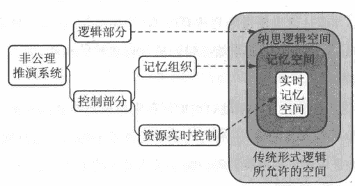

图 5-2 纳思系统的各构成要件的功能分布

具体落实到图 5-2 所示机制，T 的哪些谓项会在语境中被识别为隐喻真义，取决于三大因素协同博弈：(1) 将该谓项视为真义后，在系统知识库中获得的证据支持强度；(2) 任务激活的概念节点，能否有效牵引至 T 的特定谓项节点；(3) 语境提供的感官刺激（经纳思可接受编码后），是否能引导注意力聚焦至 T 的相关谓项。

若按上述理论推演，纳思系统处理“这头海豹将自身的身躯拖出了办公室”这一例句，运作流程或将如下：

- **阶段一**：听觉输入同步视觉采集，感官模块顺着指向方向锁定目标，发现实指对象为“人”而非“海豹”。
- **阶段二**：语义库中缺乏证据支撑“海豹”作为“人”的谓项，系统判定“人是海豹”不成立。
- **阶段三**：自动启动“明喻化”机制，在“人”与“海豹”各自的纳思语句集间建立类比映射。
- **阶段四**：若语境与背景知识能辅助筛选，系统优先对比被遴选出的核心谓项（考量到双方谓项集极大，全量比对算力开销巨大）。
- **阶段五**：以“人”的谓项 P* 置换“海豹”的谓项 P（前提是二者已假定类比关系），生成新语句并计算其纳思真值 (c, f)。若真值达标，P* 即被确认为“海豹”在该语境下的真实含义；否则回溯上一阶段重新筛选，直至满足终止条件。

显而易见，这五步流程在相当程度上融合了斯特恩等主流隐喻理论的精华，并修补了其短板。具体体现在：

- **对“辨别之知”的计算化落地（对应理论一、三）**：NLP 系统须能察觉字面解读真值与背景知识的冲突。纳思系统在“阶段二”实现此功能：发现字面解读证据不足，随即降低其真值。在准内在主义语义学框架下，降低真值实质即否定其与系统内其他语句的高融贯性。
- **对“语义牵引”机制的响应（对应理论二、三）**：隐喻义预存于语义属性簇，由语境因素牵引凸显。纳思系统部分支持此观：隐喻词汇本质上是其固有谓述集中某谓述（如“黑色的”）被凸显的语义节点。质疑者担心语义网建设成本过高，但纳思采用“非公理化”构建策略，无需预置全知全能的语义网；遇知识缺口无法处理时，允许通过人机对话获取提示、丰富语义网，甚至为高频隐喻建立快捷推理通路。
- **对语用资源的可计算化整合（回应斯特恩批评）**：斯特恩认为合格 NLP 必须把握语用学资源，并批评既有理论皆不合格。纳思系统另辟蹊径：通过实时感官信息的纳思式表征与高阶控制，构建“语用因素”与“语义因素”顺滑交互的接口。这既保证了语用因素的可计算性，回应理论要求，又规避了斯特恩理论将语用因素外在主义化的倾向——后者给内部表征与计算设下重重障碍。

受限于篇幅，文中呈现的纳思处理隐喻工程路径仅具“草案”性质，细节待后续精细建模补全。但这已足以彰显：基础理论驱动的计算建模路径，与当前机器学习主导的 NLP 研究范式，存在本质分野。

---

### 五、尾声：AI 时代的修辞学重发现

本文探讨的“隐喻”实属广义修辞学范畴。溯源西方传统，修辞学渊薮至少上溯至亚里士多德《修辞学》。其核心功能在于城邦政治生活中的说服，这预设了沟通双方具备理解彼此心理的心智基石。认知科学视角下，修辞运用是极高阶的心智功能，其建模必立足于更基础的心理能力模型。因此，隐喻等修辞现象的 NLP 化处理，是个需要大量预备性奠基工作的硬骨头。然而主流 NLP 研究鲜有耐心完成这些基建。除资本驱动的“急功近利”外，全球学术产业分布的现状亦在推波助澜：

- **学科壁垒森严**：修辞学被视为语言学支流，其知识缺乏向外渗透的穿透力，他学科调用时管道阻塞。
- **心智架构缺位**：修辞复杂性要求广博心智架构为前提，但 AI 研究与认知科学早已分道扬镳。如西蒙般跨界 AI 与认知科学的“帅才”，已成凤毛麟角。
- **哲学中介失效**：修辞学与哲学结合松散。西方虽有《哲学与修辞学》专刊，却难成显学；国内甚至连此类专刊皆无。哲学这一本应打通的桥梁，实则未通。

> ① J.Surowiecki, “The wisdom of crowds...”, Economics, Societies and Nations, 2004, p.296.
> ②《新一代人工智能发展规划(2017)》, 中国政府网。

然研究者认知短板与视野局限，不会自动降低问题本身的复杂度。NLP 界对修辞的无知，无法让修辞现象的复杂性凭空消失。现状是：NLP 惊人野心（或公众高期待）与理论薄弱性之间，横亘着巨大鸿沟。甚至可推论：通用 AI 终极落地的最大拦路虎，或许不是资金匮乏等外部制约，而是 NLP 研究者群体自身的傲慢与偏见。

---

## 第六章 群体心智与人工群体智能

“群体智能”被喻为个体大脑集聚而成的“集体大脑”，思想源头溯及自然界低等动物与环境协作涌现的集体慧（如蚁群筑巢、候鸟导航）。苏罗维基在《群体的智慧》中指出：“特定条件下，群体比最聪明的成员更智慧。群体表现智能无需精英统治，即使成员多非极度聪慧理性，仍能形成集体明智决策。”①

置身信息革命与全球化交汇的 21 世纪，洞悉群体智能意义深远。利用其有效性规避人类错误灾难，借数字技术与互联网发展人工群体智能，既助推“智能爆炸”时代机器智能跃迁，亦利于人类性进化。我国 2017 年《新一代人工智能发展规划》明确：研发基于群体智能的基础理论、关键技术与服务平台，是迈向 AI 2.0 关键一步。②然而，人工群体智能飞速发展呈双面性：一方面展现出超越个体的智能水平，如全球气候治理中数据、监测、制度转化为共享信息与推理框架，支撑宏观决策；另一方面也暴露失衡隐患——医疗领域人机协作诊断常不及专家面诊精准；经济微观层面算法依赖有效，但宏观管理决策中，此类算法能否产出真正可靠的宏观智慧，仍无据可循。

本章将梳理从自然到模拟的群体智能演进，反思 AI 层面的基础假设与核心纲领；以当代心智哲学个体主义与反个体主义为线索，剖析群体智能载体之谜：群体之心仅是隐喻？人机交互智能载体是否延展至外物环境？最后探讨人工群体智能对强 AI（AGI）终极理论之梦的助力几何。面对“中文屋”思想实验挑战，人工群体智能仍难突破传统范式瓶颈。

> ① 参阅 W.E. Reif, *Biogeochemistry-Biosphere-Noosphere...*, 2001.
> ② G.Mulgan, “True Collective Intelligence?...”, Philosophy & Technology, Vol.27, No.1, 2014, pp.135—136.

### 一、群体智能：自然溯源与人工演进

人类对群体智能的觉醒，是社会性自我意识觉醒的投射。上世纪 20 年代，苏联地球化学家韦尔纳斯基即提出“地球三阶段说”：无生岩石圈 → 生物主宰生物圈 → 群体思想意识涌现的智能圈。①当前，仿生学、人类学、认知心理学、计算机科学交叉融合下，群体智能外延已从自然扩展至人工——从简单动物种群、复杂人类群体，延伸至人工机器群体与多样人机交互智能群体。新世纪智能革命至，人工群体智能被证实能为复杂环境决策提供优于人类的宏观智慧，遂成智能研究前沿高地。

半个多世纪以来，群体智能研究遍布各学科，然最经典范本仍在自然界。康奈尔大学动物行为学教授西利耗时二十余年观察发现：蜜蜂择巢中蜂群智能至关重要。侦察蜂分离出群，飞行数十英里寻觅最佳新址归巢评估；四五百只蜂集结摇摆舞传递信息。西利言：“蜂群即其决策方式，极其复杂，分解大量相互矛盾变量。”①80% 情况下蜂群精准锁定最佳位置，非单只或数只蜂所能为。生物学界长期关注：简单有机体如何协作应变，涌现个体所无之智能。

> ① T.D. Seeley, *Honeybee Democracy*, Princeton University Press, 2010, p.46.

社会科学亦从多维探析以人群为单元的群体智能：政治学家研公众复杂选情下的判断力与民主共识；经济学家析市场信息模型与决策，盼“无形之手”聚合消费者与企业家智慧；历史学家究不同社会形态如何创造收集传播共识知识；人类学家恒对机构团体“如何思考”抱持兴趣；社会学自涂尔干至米歇尔斯，探究群体组织为何超越个体简单集合，传统深厚。社会心理学家借调查观察测度群体智能，寻觅成员平均智力与群体最大化智力的关联。②

> ② G.Mulgan, “True Collective Intelligence?...”, Philosophy & Technology, Vol.27, No.1, 2014, pp.135—136.

随着“互联网+”与 AI 2.0 时代来临，网络成各学科、媒体、产业聚焦实现群体智能的巨大试验场。群体智能不再局限于自然人智能聚合，更多转化为自然人、机器与环境（物理与网络）交互作用的产物。计算机科学新语境下，群体智能指代团队间、人机间协作开发软件。传统知识语境与互联网搭建“互联网+”新平台，知识创造、获取、传递不再是个体智力独舞，而是在网络、他者与外在环境中组织起来。维基百科即典范：重塑知识生成与使用模式，判断与解决问题的依据嵌入平台群体智能中。同时，基于计算机与互联网技术的产业发展亦聚焦群体智能：管理信息系统、数据挖掘、决策辅助、创造力咨询等新兴项目，投资与服务表现强劲。

国内 AI 学界纲领性文作《AI 2.0 时代的群体智能》详细界定了当前语境下的群体智能：基于互联网组织架构，从一定规模自发个体聚集行为中涌现，能执行挑战性计算任务。①此定义凸显人工与自然群体智能关键差异：一是基于互联网“线上”聚集的在线组织，组织形式决定智能水平，平台效应使人工群体智能在某些问题上达历史峰值；二是载体为真实人类智能与机器智能交互作用的智能系统，真正实现人机混合、人机交互的认知增强。

> ① Li W. et al., “Crowd intelligence in AI 2.0 era”, Frontiers of Information Technology & Electronic Engineering, Vol.18, No.1, 2017, p.16.

### 二、群智空间：人机交互的智能试验场

从传统 AI 到人工群体智能的兴起，折射出人类对智能本质的渐进式认知，亦映射研究者建构 AI 路径的持续创新。区别于过往“从零始建”模式，“人工群体智能”立足互联网平台，汇聚群体思想在线预测、求解复杂世界难题。其兴起首因人类向自然取经。上世纪 80 年代，计算机科学及交叉领域研究者受动物群体行为获生存优势启发，探究简单甚至无智能生物如何通过分工合作完成高智能行为。初期聚焦蚁群蜂群个体间竞争协同，通过构建优化算法模型，模拟高层级、涌现性、整体性智能的生成机制。

### 打破边界：当人类群体借助算法进化成“超级大脑”

过去我们总觉得，群体智慧不过是“三个臭皮匠顶个诸葛亮”的简单叠加。但加州 Unanimous AI 公司推出的 UNU 平台，正在用硬核数据打碎这个认知。这不仅是一个在线投票工具，更是一个让陌生人实时链接、协同进化的“群智引擎”。

**从赛马场到奥斯卡，算法如何驯服不确定性？**

2016 年肯塔基赛马会，50 位素不相识的网友在 UNU 上实时博弈，竟精准锁定冠军及前四名排序——这连资深赛马专家都从未做到。更早的 2015 年奥斯卡预测，它在六大奖项中命中三项，胜率 70%，碾压传统民调与专家点评。罗森堡博士的这套系统证明：当个体判断不再孤立，而是形成动态闭环，群体便能迸发出超越个体极限的“宏观智慧”。

**核心秘诀：把“摇摆舞”装进鼠标里**

蜜蜂靠摇摆舞同步信息，人类靠什么？UNU 的答案是：一套精心设计的图形化交互界面。参与者拖动屏幕上的“磁铁”，输入的不是非黑即白的选票，而是随时可逆的**连续意见流**。中央服务器不统计票数，而是计算整个系统的动态演化轨迹。这意味着：决策过程变成了一场实时协商，所有人在“感知-响应-再感知”的反馈回路中，共同探索最优解空间。人不再是数据源，而是回路里不可或缺的处理单元——**Human in the loop，这才是制胜关键。**

---

### 三、人工群体智能的两大“基因密码”

UNU 的成功非偶然，它坐实了人工群体智能两大核心假设：

#### 1. 混血基因：符号逻辑与神经网络的“和解之子”
AI 史上，符号主义（擅长逻辑推理）与联结主义（擅长概率学习）斗争半个世纪。明斯基早看透：人类心智本就是串并行混合的虚拟机。UNU 正是这两大范式融合的产物——它不是简单的拼凑，而是用群体算法优化了传统算法，让**基于规则的预测**与**基于反馈的强化学习**在人机交互中实现“化学反应”，整体智能水平跃升。

#### 2. 阶梯假设：智能分层，高阶靠“懂语境”
经典认知科学把智能分为五层：数据→信息→知识→判断→智慧。越往上，越依赖具体语境，越难用标准算法复刻。
*   **医疗诊断实例：** AI 处理海量数据比专家快、准，但落到具体病人身上，僵化的规则常失灵。
*   **认知能力清单：** 观察、计算、记忆——AI 已超人类；但创造、情感、反思、智慧——仍是算法禁区。
*   **群体高阶的关键：** 在群智涌现的高级阶段，**直觉与共情**的权重超过线性推理。这也是为什么面对面沟通常比线上高效，爱与同理心是集体智慧的隐性燃料——但这正是当前人工群体智能最难模拟的“软肋”。

---

### 四、群体之心：隐喻还是实体？

笛卡尔“我思故我在”确立了心智的个体主义统治：心智在脑中，脑在颅内，群体无脑，故无心智。布拉特曼等人据此断言“群体之心”不过修辞隐喻。**但“延展心智”理论彻底动摇了这个地基。**

#### 克拉克 & 查默斯的“对等原则”：工具何时成为心智一部分？
他们设计了经典思想实验——**俄罗斯方块三部曲**：
1.  **脑内旋转：** 标准心理认知。
2.  **按键旋转：** 设备在体外，传统视为“非心理”。
3.  **植入脑内旋转装置：** 功能与（2）完全一致，仅位置不同。

**追问：** 仅因装置在头骨外，就能将其排除出认知过程？若外星人进化出体外旋转器官，我们会毫不犹豫称其为心理能力。**对等原则宣告：若外部资源在功能上等同于大脑机制，它就是认知系统的一部分。** 笔记本、计算器、速记本，均是如此。

#### 英加与奥托：信念能否住在口袋里？
*   **英加**凭生物记忆记得美术馆在 53 街，按欲望与信念行动。
*   **奥托**患老年痴呆，信息全存笔记本电脑，查阅后同样按欲望与信念行动。

**结论：** 两者解释结构同构。唯一差异是信念载体——一个在海马体，一个在硬盘里。颅骨与体肤**没有神圣性**，不决定何为“信念”。克拉克指出：这类**倾向性、历时性**的心理状态，其物理载体早已延展至环境中。

#### 从“独奏”到“合奏”：为群体心智正名
延展心智理论虽承认“脑-身体-工具”耦合，但聚焦单体。我们要再跨一步：**以人类为核心节点的群体耦合系统**，才是反个体主义的终极形态。
*   **戈德曼（社会认识论）：** 正当理由源于证词交换、认知分工。
*   **哈钦斯（分布式认知）：** 军舰团队作为整体认知系统，解释力远超个体模型。
*   **撒加德：** 大科学装置是多主体-仪器认知系统。
*   **演化视角：** 灵长类 7 万年进化史，从未是单兵作战；智能本质上是在社会文化脚手架下，个体与他者、环境共同完成的认知实践。

**所以，“群体之心”不是诗意的比喻，而是认知科学必须直面的本体论实在。** 当我们在 UNU 上拖动鼠标，那一刻，我们正亲手构建着这个跨越颅骨、跨越个体的“超级主体”。

### 当心智走出颅骨：从“奥托的笔记本”到群体智能的边界

**质疑与回应：笔记本为何能成为“记忆”？**

有人试图给奥托和英加划清界限：奥托翻阅笔记本电脑，是因为她确信地址就存在里头，查完后形成新信念——这被批评家称为“两步走认知过程”。克拉克不干了，他反手就在英加身上复刻这“两步走”：第一，英加深信记忆存着地址；第二，取出地址后生成新信念。可常人压根不会这么拆解自家信念。硬要在英加头上加条“相信自己长时记忆靠谱”的信念，这解释行为未免太扭曲。克拉克直指要害：英加用生物记忆，奥托用电子记忆，本质一样——**都是因为“透明”**。奥托习惯了笔记本，一取用，生物记忆自动“下线”，电子存储瞬间“上线”，对奥托而言，笔记本就是长在身上的器官。

**硬核标准：什么样的外物才能“入脑”？**

那是不是拿起计算器、查个电话、记个便签，思想就延伸进手机笔里了？克拉克和查默斯划了红线，非生物外物想入伙“耦合系统”，得过四关：

1.  **随叫随到**：像奥托的笔记本，贴身携带，唾手可得；
2.  **盲目信任**：调取的信息自动生效，像生物记忆一样免检；
3.  **即取即用**：存储内容随时可调；
4.  **自主录入**：信息得是当事人亲自存进去的，如奥托预先录入的地址。

**大胆假设：别人也能做你的“硬盘”**

近年“延展心智”虽火却争议不断，涉及自我、同一性、责任归属等硬骨头。本文暂搁置争鸣，接受核心主张——**心智突破颅骨皮肤，延展至环境**——并更进一步：**能充当认知资源的，不止死物，还可以是活生生的另一个主体。** 认知一旦延展至他心，便形成“群体认知系统”。这本是克拉克和查默斯结论里的潜台词，只是没展开。

论证从“俄罗斯方块”思想实验切入。我们熟知三种旋转方块的方式：（1）脑内心理旋转；（2）按手柄旋转；（3）脑机接口旋转。克拉克说，（1）和（3）都是心理过程，按“对等原则”，（2）也得算。那设想第四种：（4）**对着身边朋友喊一声“转！”** 这显然不是常规玩法。但若（2）算认知，凭什么（4）不行？若克拉克二人没错，**心智理应能延展至他人**。此时，我与搭档组成的“多主体耦合系统”，认知过程就分布在我们之间。

**反驳“控制权”异议：人靠不住？机器也会罢工**

有人反驳：引入他人，控制权就丢了。按钮听我的，朋友却能拒绝。电脑好歹不会主动断联。细想之下，**风险从未缺席**。电脑死机，朋友生气，成因虽异，但“控制权寄托在脑外”这点上，二者如出一辙。

**反驳“可用性”异议：老伴比笔记本更靠谱**

又有人杠：朋友哪有笔记本便携？平时不联系，临时抱佛脚算数？咱们升级奥托案例。设想奥拉夫是英加丈夫，相濡以沫三十载。奥拉夫虽无失忆症，但哲学家职业病犯了——迷路、忘号、忘约成常态。偏偏英加记性惊人，俩人形影不离，奥拉夫所需信息全靠英加“查询”。**这算不算奥拉夫的思想延伸到英加身上？两人算不算一个“群体心智系统”？**

对号入座克拉克夫妇的四条标准，英加**全勾选**，甚至**碾压笔记本**：

*   **随叫随到**：奥拉夫处理琐事全靠英加，比翻包找本儿快多了；
*   **盲目信任**：奥拉夫信英加甚于信自己脑子，调取即采纳；
*   **即取即用**：英加人在信在，从不“忘带”或“存错文件夹”；主动参与的活人，比死物可靠；
*   **自主录入**：英加提供的皆是奥拉夫过往接受过的信息。

**结论呼之欲出：若克拉克夫妇是对的，心智不止延展至死物，更能延展至他心，形成群体认知系统。**

**群体认知 ≠ 群体心智？别被“实体论”带偏了节奏**

有群体认知系统，就等于有“群体心智”？克拉克夫妇靠“倾向性信念”从延展认知推向延展心智：载体在脑外，心智也在脑外。可这引出更棘手的问题：英加是奥拉夫心智的一部分，还是反过来？个体心智边界在哪？群体心智从哪起步？

这背后藏着**“心智实体论”**的旧梦：把心智当成个“东西”或“物质对象”。现代版实体论不谈灵魂，只说心智是由脑、皮肤、物质构成的“整体”。质疑英加是不是奥拉夫心智的一部分，本质是默认心智有“整体-部分”的实体结构；追问心智归属谁，是预设心智是可被“拥有”的对象。赖尔早看穿了：这是**“范畴错误”**。“心智”非物名，乃指称一系列认知过程、倾向状态、行为倾向。按克拉克夫妇看法，这些过程状态可发生在体外。**既然心智是“过程集合”，划分个体心智还是群体心智，就得看这些过程发挥什么功能、服务于何种心理解释需求。**

**有没有“群体心智”必要？威尔逊的“否”与此文的“不服”**

认知科学与社会哲学真需要“群体心智”概念？罗伯特·威尔逊亮出“否认假说”。他在《心智的边界》里指出：当下讨论常把“群体心智论题”同“社会证实论题”搅和。**前者强调群体拥有不可还原的心理属性；后者只是说个体某些属性得在群体里才显现。**

威尔逊批大卫·斯隆·威尔逊（生物学群体心智派）就陷入此混淆。斯隆主张群体能成“适应单位”，群体决策智慧超越个体之和。罗伯特回敬三连问：一、得证群体**思想观念**本身是适应性的、被进化选中的；二、得证这些心理属性是**群体自己的**，非个体属性之和；三、针对决策，还得证个体**必须放弃决策权**，群体层面智能才算真“涌现”。

罗伯特这招绑定“突现论”：高层属性唯一、不可还原、大于部分之和。可笔者以为，**斯隆的群体心智非个体心智简单相加，正如大脑非神经元简单相加。** 群体决策里个体互影响、互协调，互动过程本身就是群体过程。当代主流多认“随附论”或“实现论”，不信强突现，**没理由逼着斯隆取消个体决策**。罗伯特拿突现论当金标准来否决群体心智，靶子打偏了。

**大势所趋：反个人主义重塑智能科学版图**

“社会认识论”“分布式认知”“延展心智”浪潮汇聚，**反个人主义的群体心智观**正深刻重塑智能科学视野。AI前沿已跳出“实验室纯机器人”旧框：不再盯着单一神经状态，转向外部世界、社会语境、人机共生的赛博格群落，去模拟生物群体协同涌现的整体智能。

---

### 五、人工群体智能：能捧起强人工智能的“圣杯”吗？

**旧梦与碎片：物理符号系统的半世纪誓言**

六七十年代，西蒙、纽厄尔等AI教父豪言：“物理符号系统是智能必要充分条件，二十年内机器包干人类所有活儿。” 这叫“通用人工智能”（AGI，即强AI）。博登称强AI是AI界“圣杯”。**半世纪过去，圣杯仍在科幻与好莱坞里闪光。** 主流认知：AI极限是“弱AI”（专用领域），整体难敌人类；另一派却高呼AI失控将毁灭人类。此时，**超越传统范式的“人工群体智能”在复杂问题上甚至显得比人更智，它是不是捧起圣杯的那双手？**

**中文屋重锤：语法非语义，模拟非复制**

塞尔祭出“中文屋”砸碎强AI梦：哪怕行为像懂中文，机器也**不懂意义**，因它只模拟、无意识。

核心两记重拳：
1.  **句法 ≠ 语义**：纯形式、句法的程序跑得再欢，既不构成、也不足以保证语义内容涌现。硬件再牛，只要论证核心是“程序即心智”，就脱离强AI范畴。
2.  **模拟 ≠ 复制**：能模拟暴风雨、消化、火警，也能模拟认知。**模拟消化不等于真消化啤酒披萨**；模拟理解不等于真理解。塞尔讽道：以为模拟了心理过程就拥有了心理，荒谬至极。

程序本身担保不了心灵内容。强AI拥趸咋想的？塞尔痛批：他们模糊不清，暴露百年来还原论处理哲学的惨败——把行为当心灵逻辑保证，把感觉材料当物体逻辑保证，图灵测试就是这套“证实主义还原论”的表达，却又死死抓住“心理状态直觉概念”不放。

**中文屋噩梦：绕不开的逻辑坎**

我跑程序不懂中文。强AI硬说“跑对程序的系统必有心灵”。图灵测试测心灵，实则测计算过程。**强AI理论家永远甩不掉中文屋的魇镇。**

AI信徒以“创造心灵”自居，心理上拒不接受“强AI方案原则性错误”。他们赌技术瓶颈：更快芯片、更复杂并行系统终将破局。可中文屋要义**与技术状态零关联**，只关乎“计算”这概念本身。

**人工群体智能：换了皮的“计算主义”，依旧过不去哥德尔那关**

人工群体智能能否突围？笔者判断：**不能。** 它的优势仅在**“开放”**——大数据在线注入、动态即时更新，让封闭系统转向开放涌现。但**智能构造内核未变**：仍是基于计算的问题求解模型。本质上只是把“单体算法”升级为“种群算法”，**核心假设“智能＝规则表征－计算系统”纹丝不动。**

哥德尔不完全性定理早示警：人类思维非计算完全，大脑绝非按“计算加工”思维。人工群体智能照样撞上计算主义南墙。罗斯伯格的UNU系统虽能高精度预测奥斯卡，可它……

# 第七章：重塑AI价值观，构筑伦理新防线

**我们真的读懂了“群体智能”的底牌吗？**

即便UNU这类系统预测精准又如何？它能真切体会到粉丝眼睁睁看着爱豆获奖时的激动心跳吗？这正如塞尔“中文屋”里的机器——哪怕决策比人类更高效、更准确，本质上也只是在专项任务上“过招”，离“通用智能”还有十万八千里。

群体智能确实能在特定场景跑出“1+1>2”的奇迹，但怎么把一盘散沙的个体认知，炼成宏观层面的集体智慧？这是摆在AI专家面前的新考题。别天真以为凑够人头就能产生高智商：自然界和人类历史无数次证明，个体简单相加 ≠ 群体进化。样本量、认知偏见、情绪波动、环境优劣……这些变量搅和在一起，直接决定群体表现的上下限。社会心理学的案例库里全是“乌合之众”翻车的实锤——不合理的规则、成员的盲目自满，都能把集体决策带沟里去。当下的研究多盯着算法优化钻牛角尖，对复杂世界里群体智能构建的“通用法则”依然懵懂。所以，人工群体智能与单主体AI在智能层级上有本质区别，但要断言它已是通用智能、比传统AI更安全？**为时尚早。**

---

### 一、 搞懂“智能体”，才能谈得上价值审视与伦理落地

这波AI浪潮，靠大数据、算力、深度学习三驾马车狂飙。从硅谷巨头到各国政府，从顶尖科学家到普通网民，全都在盯着AI如何重塑就业、教育、生活，甚至开始追问：这场创新的责任在谁？它会不会动摇人类文明的根基？毋庸讳言，AI与机器人系统的普及，不只是场结果未卜的技术豪赌，更是人类史上影响最深远的社会伦理实验。

大众对AI的初印象，多来自“人机大战”、《终结者》《黑镜》这类科幻叙事。阿西莫夫的“机器人三定律”算是机器伦理的启蒙读物。20年来，随着AI加速跑，价值伦理话题彻底出圈。1997年“深蓝”赢卡斯帕罗夫，震惊世人的是算力；后来AlphaGo连克李世石、柯洁，逼着我们直面“超人类智能”的现实可能性。库兹韦尔在《奇点临近》里画饼：50年内机器超越人类、助人类近乎永生；但比尔·乔伊在《连线》上泼冷水——21世纪最强技术（机器人、基因、纳米）正让人类面临物种级灭绝风险。

科幻片里的焦虑更具象：机器若长出自我意识、脱离掌控，人类咋办？推荐算法若进化成“读心巫师”，一个坏念头就被“预防犯罪”，怎么办？机器人若觉醒身份认同，我们该如何相处？回到现实，大数据智能、跨媒体智能、自动驾驶、智能武器……影响力无远弗届。马斯克疾呼警惕风险，霍金直指痛点：短期看控制者，长期看能不能被彻底控制。不管奇点会不会来、这波热潮会不会退，**AI时代已至，审度价值、寻求伦理调适，正当其时。**

#### 1. 核心概念重定义：从“智能”到“智能体”

要看清伦理冲击，先得搞懂AI是啥。这玩意儿发展太快、太开放，定不准。早期爱用“智能”定义，后来主流教科书（如尼尔森、拉塞尔&诺维格）转向**“智能体”**视角。

图灵当年初衷是造“思考的机器”；1956年达特茅斯会议四巨头想模仿人类学习、推理、自我完善。但莫拉维克悖论打脸了：让机器下围棋像大人容易，让它看路走路像一岁娃却难上加难。这揭示了：**AI≠人类智能，且不同方向的机器智能互不相通**。至今没出现通用智能理论，也没造出强人工智能（AGI），落地的全是干单一任务的弱人工智能（ANI）。所以AI研究本质上还是门综合实验科学。

既然通用智能理论搞不定，主流转而定义**“理性智能体”**：能感知环境、执行行动、把感知序列映射为行动函数。西蒙说的“有限理性”在这儿落地——机器在已知范围内“正确行事”，不求完美，但求工程上可实现。

#### 2. “拟主体性”：长得像人，不是人

**AI智能体是价值审视与伦理调适的核心抓手。** 在人机交互中，它能自动认知、决策、执行，显露出某种“主体性”，游离于人类主体与普通物件之间。

但这“主体性”是**功能模仿（拟主体性）**，非基于意识、自由意志的真能动性。像柯洁对弈后感受到的“神性”，是我们在面对智能技术时，自然投射出的“似人非人”感知。智能体能部分模拟人类认知、行动、交互，或实体或虚拟，故称**“拟主体”**。

更精准说：**“拟”是逆悖的。** 一方面，它可能真不知道自己在干啥、有啥意义；另一方面，结果上人能读懂其功能，并赋予其价值。技术底层上，这是算法对数据的自动认知映射——感知序列→行动函数。当下数据驱动模式下，这映射往往非本质模式识别，而是高维非本质相关性。**算法是核，智能体是壳。**

#### 3. 四重“拟伦理角色”：你在食物链哪一级？

摩尔按价值伦理影响力把机器人分四类，映射到智能体上就是四种**拟伦理角色**：

| 角色定位 | 核心能力 | 现状 |
| :--- | :--- | :--- |
| **伦理影响者** | 无伦理设计，但客观产生影响 | **绝大多数** |
| **伦理行动者** | 预设规则，遇特定场景自动执行（如安全锁） | **少量** |
| **伦理推动者** | 能理解通用伦理原则，依场合决策 | **理论探索目标** |
| **伦理完满者** | 具人类级意识、意志、实践智慧 | **科幻范畴** |

**关键点：** 这些角色都是设计出来的。目前AI多为“影响者”，勉强有几个“行动者”。“推动者”在实验室，“完满者”在电影里。所以，**智能体无法独立主动施加伦理力量，只能在人机交互的“关系实践”中显现。**

#### 4. 行动者网络：别再盯着简单的“人机二元对立”

拉图尔的“行动者网络理论”帮大忙了。别光看“人-机”二元关系，要看**“控制者(C) — 智能体[A(D)] — 一般使用者(U)”**的复合博弈。
*   C=控制者/设计者；D=设计参数；A(D)=被设计的智能体；U=无话语权、非完全知情的普通用户。
*   这不是对称的“C-A”加“A-U”，核心是**“C-A整体 vs U”**的不对称权力结构。
*   **责任在“C-A整体”**（主导施加方），**权利在“U”**（承受受动方）。
*   因智能体伦理影响力不同，“C-A”内部的设计责任 vs 控制责任划分，比传统工具复杂得多。

这分析指明了两条落地路径：
1.  **负责任创新（自上而下）：** “C-A”主动担责，内部厘清责任边界，保障U获益。
2.  **主体权利保护（自下而上）：** U维权倒逼“C-A”担责，迫使内部廓清责任。
**无论哪条路，必须结合具体场景，否则都是空中楼阁。**

---

### 二、 合成智能与人造劳动者：价值审视的“第一现场”

这波爆发，源于大数据、算力、深度学习融合突围。斯坦福卡普兰教授指出：当前AI在**“合成智能”**与**“人造劳动者”**两条线上突围，指向**自主智能体**。这属**应用AI**，核心是**数据驱动**。

目前应用AI里的数据，主要指那些可以……

# 算力觉醒下的伦理拷问：从数据本源到机器道德的破局之路

数据从未像今天这样，以如此多元的面貌深度嵌入文明的肌理。它们不再是冰冷的记录，而成了构建合成智能认知大厦的基石。细究这些支撑智能运算的“经验原料”，大致可归为三类图景：一是可被精确度量的观测实况，涵盖从基因密码、宇宙拓扑等宏大科学图谱，到可穿戴设备、定位系统捕捉的生理节奏、移动轨迹、环境质态与交通脉动等即时流数据；二是人类在数字世界留下的行为投影，搜索历史、社交互动、电商流水，每一次点击与交易都化作理解群体与个体的数字指纹；三是对真实场景的多媒体封存，影像、声波、图像将转瞬即逝的当下定格为可供机器阅读的素材。正是这海量、多元、实时的数据洪流，为数据驱动型人工智能提供了源源不断的认知养料。

合成智能的本质，是在数据驱动范式下，将数据挖掘、认知计算等前沿技术熔铸集成。学界依据侧重点不同，或称机器学习、神经网络、深度学习，或归入大数据智能、跨媒体智能、认知计算范畴；早期的专家系统、计算机视觉、语音识别、自然语言处理等成果，亦常按需融合注入。当下主流的合成智能，立足于海量数据与深度学习之上，进化为具备智能辨识、洞察预测能力的自动认知决策系统，广泛介入人类难以直接高效把握的复杂经验领域。其核心逻辑在于：借助算法与软件自动处理多源异构数据，提炼知识、生成决策。譬如，通过聚合位置轨迹、检索偏好、社交动作，为个体勾勒数字画像，挖掘商业价值特征或人类难以直察的深层关联。从个性化推流、精准投放，到信用评分、高频量化交易；从城市大脑、安防天网，到智能搜索、犯罪预警，合成智能已渗透生活肌理，正重塑我们认知世界的范式。

与之并行的人造劳动者，指代那些能模仿乃至替代人类执行特定使命的智能化自动执行体。其智能内核同样源于数据，关键环节在于对数据全链路的采集、处理、加工与控制。此类系统由感知环境的传感器与作用于环境的执行器耦合而成：既有具备物理实体、能作业采矿、清扫救火、搜救作战的操作型机器人，也有从事陪聊导航、知识问答、智能客服等交互任务的纯软件实体。最普及的工业机械臂与简易家用机器人，多依照预置指令如牵线木偶般运作，任务重复、环境确定。例如流水线上，机械臂精准抵达坐标，螺栓恰巧就位。虽说人造劳动者能解放人类脱离繁琐、繁重、危险的劳作，但其对专业技能的替代效应，引发了对大规模技术性失业及“智能鸿沟”的深层忧虑。

合成智能与人造劳动者的崛起，引致资本在商业、制造、管理、治理等领域涌入。但要让这种极具重构性与颠覆力的技术真正造福人类，必须对其价值内核进行系统甄别。这需要从三个维度切入：厘清技术边界、揭示价值负载、明确价值指向。

**一、 刺破泡沫：直面技术的真实边界**

厘清现状的关键，在于辨析事实与科幻，直面当前应用层 AI 的硬性短板。首先，数据驱动的 AI 既不具备人类智能的通用性，亦未达成功能对标人类的“强人工智能”，更遑论全面超越的“超级智能”。其次，当前 AI 的智能模态远低于人类，而神经科学与认知科学对人类智能的解读仍处于幼年期。具体而言，现有数据驱动 AI 所用方法本质上归属统计拟合、归纳试错等经验反馈范畴，方法论上并不完备。机器翻译、智能推荐、语音识别、情感分析虽成效显著，却高度依赖过往同类经验与人工标注，其涌现出的“智能”往往仅能推广至有限相似场景（局部泛化），难以实现全域迁移。此类应用主要适用于认知对象与环境与训练分布高度一致的情境，有效性仰赖经验的相对稳定性，一旦遭遇“分布外”样本——如自动驾驶面对未学习过的路况或不可识别的新物体——极易失效酿祸。

**二、 溯源偏见：算法并非价值中立的“黑箱”**

揭示价值负载，旨在反思 AI 设计与应用中的客观性神话，梳理相关主体的价值取向在其中的实质作用。一方面，数据采集与算法应用并非绝对中立无偏，必然承载着相关主体的价值倾向。在数据筛选、算法建模、决策部署等环节，主体的利益与价值因子不可避免地渗透于问题定义与方案选择中，既折射设计者与执行者的考量，也重塑利益相关方的得失格局。另一方面，合成智能与人造劳动多以人机协同形态落地，价值选择必然内嵌其中。通过机器学习对数据洞察的应用型 AI，不仅是计算与智能技术的集成，更须融入人的判断与认知。要把握数据所指事实及其意义，必须仰赖人工观察、理解与标注。在视频理解等任务中，将人类经验经由标注注入数据，是提升准度的关键。有标注数据是深度学习的核心燃料，业内谚语“有多少人工，就有多少智能”道尽此中奥义。

**三、 立规矩、强监管、问终极：三大核心价值诉求**

明确价值诉求，意在追寻让应用型 AI 发展更契合公众利益与人类福祉的价值锚点。此中有三大核心议题亟待深思：

**1. 追问算法权力的公正性：警惕“算法分格”下的精准不公**
诸多“算法决策”——基于数据与算法的智能化认知决策——应用日广，这种智能化的“政治算术”正演变为具有广泛深远影响力的“算法权力”。从政治选举、商品推荐、广告分发，到信用评分、共享服务，算法决策普遍介入个体、组织、社会层面的画像、分析与预测。算法决策常被简化标签为高效、精准、客观、科学，但如同所有人类社会认知决策，服务于问题界定与解答的数据与算法皆负载价值，其对人与社会的解读诠释难免牵涉利害分配、价值取向与权力版图。在信息知识日益不对称的态势下，若不加甄别，算法权力极易筛选、纵容、制造甚至放大偏见与歧视，沦为知识黑洞与权力暗箱。我们反复目睹：智能算法权力日大，却愈发不透明。这可能将个体置于德勒兹式的“算法分格”中，承受微妙歧视与精准不公：搜索引擎依据历史兴趣定制结果，制造信息茧房；商家依算法推测《哈利·波特》读者或购《饥饿游戏》并实施差别定价；招聘偏好内推候选人；机场为高收入付费者保留优质资源。

在社会治理层面，算法权力影响更甚，更须警惕滥用。当前，全社会渐被纳入基于数据与算法的精细化管理与监控体系，决策举措愈发建立在智能算法之上，必须防范滥用导致的决策失误与社会不公。尤应警惕对算法的迷信，常造成公共管理系统漏洞，甚至引向“人工愚蠢”。例如，某算法基于偏见将特定群体列为重点监控对象，关注度貌似佐证预设，实则可能漏掉真正的风险源。

为揭示与削减算法权力的误用滥用，应对数据与算法实施“伦理审计”。基本策略是：从决策结果与影响中的不公正切入，反向核查机制过程有无故意或无意的扭曲误导，揭露不准确、不包容、不公正之处，并推动修正。特别是执行者应主动披露自身利益，公开潜在利益冲突。唯有如此，智能算法方能避免力量滥用，公正行使权力。

**2. 呼唤透明、可解释、可追责的“白箱”系统**
虽计算机、网络、大数据、AI 构成的智能系统已成当代社会基础设施，但其运作机制常不透明、难理解、责任难追溯。除隐性利益算计、设计偏见、知情同意缺位外，主因在于系统及其认知决策过程极度复杂，远超人类理解上限，甚至研发者亦难完整阐释，且此趋势将加剧。一旦智能判决出错偏颇，常难厘清人与机器、数据与算法的责任归属。例如训练深度学习神经网络识别人脸时，网络可能依据领带、帽子等伴随特征而非五官本身捕捉目标，我们仅知识别效率高低，不知其内在表征为何。正是这种“不可解释性”，导致 AI 潜在不良后果的责任难以清晰界定。

随自动驾驶、自主武器系统涌现，涉及大量自动化乃至自主智能决策，如人机驾驶权转移机制、紧急避险策略等。因关乎生命安危与重大责任归属，其透明性、可理解性、可追责性愈发关键。为破解此迫切难题，欧洲议会 2016 年颁布《一般数据保护条例》（GDPR）规定：在基于用户画像预测的算法决策等自动化个人决策中，赋予公众新权利——“解释权”，即公众有权要求相关自动决策系统作必要解释。此法将给产业带来巨大挑战，倒逼科学家在算法设计与框架评估阶段优先考量透明、可理解、可追责，以杜绝偏见歧视滥用。

**3. 追问智能化合理性与人的存在价值冲突：警惕沦为“过时的人”**
近代以来，人类在合理性与理性化道路上持续前行，从计算机、互联网、大数据到 AI 与机器人，将理性化进程推向智能化新纪元。但 AI 呈现的合理性与理性，仅属工程合理性或工具理性，须进一步反思：其是否会给整个社会带来更广泛深远的非合理性？众所关注者为可控性：鉴于 AI 拥有巨大理性行动能力，此力量能否为人类或社会正向力量掌控？一方面，会否因过度复杂超越人类驾驭能力，使人陷入巨大风险而不自知？另一方面，长远看，AI 是否会演化为不受人类控制的自主力量？

更根本的问题是这种合理性与人的存在价值的冲突：人的价值是否应完全由其能否适应智能机器来衡量？19 世纪中叶，马克思洞见资本与劳动在工业自动化下的不可调和矛盾：资本以机器取代肢体劳动。今日，跨入智能社会门槛的我们，面对的是否将是：资本以 AI 取代人的头脑？现实追问是，AI 对普通劳动乃至专业技术劳动的冲击，会否在广度、规模、深度、力度上引发前所未有的全局性危机？更须慎思：AI 发展会否与人的存在价值发生深层、难以调和的本质冲突？德国哲学家京特·安德斯曾振聋发聩指出：虽人常强调“创造是人的天性”，但面对创造物，人却愈感自愧弗如、自惭形秽，此乃“普罗米修斯的羞耻”——在机器面前，“创造与被创造关系的倒置”使人沦为“过时的人”！

在完成对 AI 实体拟伦理角色的初步辨析、对合成智能与人造劳动者渐近发展的价值审度后，我们必须进一步追问：智能机器大规模替代人类决策与行动的未来走向。迫近的未来将呈现两难：人类要么允许机器在无监督下自主决策，要么保持对机器的有效控制。这一挑战迫使我们探讨面向 AI 时代的价值校准与伦理调适之道。

---

### 法则之内：机器道德嵌入与人本关怀的博弈

人工智能的价值反思与伦理考量，肇始于对机器人与人关系的想象。“机器人”一词初非指代某种已存在的聪慧机器，而是源自科幻小说的概念。1921 年，捷克作家恰佩克在《罗素姆全能机器人》中首创“robot”形象与词汇。该词源于斯拉夫语“工人”与“工作”，小说语境下意指非自愿或被强制的劳工苦力。溯源机器谱系，机器人可视为自古存在的自动机械——特别是自动人偶——的现代版。据此，中国的记里鼓车、指南车，文艺复兴期达·芬奇的机械骑士，均可视为早期自动机典范。从自鸣钟、八音盒到能写字、下棋、倒茶的自动人偶，乃至大众熟悉的发条玩具，皆可视作机器人前身。近代欧洲钟表匠制造精巧机械人偶，能写字、弹琴、传情达意，如著名的“土耳其下棋傀儡”。日本自古钟情机关人偶，17 世纪即现自动人偶剧院，或与其神道教“万物有灵”传统及重视万物存在价值的思想有关。观其机器人研制成就及《尼尔：自动人形》等游戏风靡，文化底色对技术的深远影响可见一斑。

词源上，“自动机器”（automaton，复数 automata）源自希腊文 αὐτόματον，意为“按自己的自由意志行事”，本意实为“自主”。荷马用此词描述自动开启的门，后泛指能像人兽一样运动的自动机械。这表明，人类制造自动机的初衷，是使其按自身意愿自主行动，或在想象中如此看待它们。但现实中，人造自动机实现的“自动”，并无内在自我意识，仅为行为层面的外在自动——它们只能靠人直接或间接输入能量与行为模式实现自运转。迄今，虽 AI 不仅能“自动”，更具感知环境与互动的“智能”，但包括机器人在内的各类智能体，依未摆脱无自由意志、无自我意识的“无心”宿命——机器人不知自己在做什么，更准确说，它们不理解自身行为的意义。

家喻户晓的“机器人三大法则”，更准确称谓为“机器人学三大法则”，最初由阿西莫夫在短篇科幻《转圈圈》中提出。虽“机器人学”本为杜撰术语，后科学家与工程师确将研究机器人制造应用的学科命名为机器人学。不论阿西莫夫小说中的《机器人学手册》是否虚构，“三大法则”早已立于机器人与 AI 社会、伦理、法律探究的思想原点。

*   **第一法则：机器人不得伤害人类，或坐视人类受害。**
*   **第二法则：在不违背第一法则前提下，机器人必须服从人类命令。**
*   **第三法则：在不违背前两法则前提下，机器人有自我保护义务。**

形式上，它们酷似宗教道德戒律，亦易联想至康德的定言命令或道义论。但问题在于：如何在实操中以此规范机器人行为？按阿西莫夫构想，三大法则通过技术手段直接嵌入机器人控制软件或智能编码底层，使其非止纸面条文，更可经技术强制执行——借内置“机器道德调节器”使机器人成为道德主体。细读 75 年前发表的《转圈圈》，彼时特有的电气化与控制论气息扑面而来：

工程师鲍威尔向同伴多诺凡解释，三大法则深深植入机器人“正电子”大脑的运行规则：每条法则执行均自动产生相应电位，若法则冲突，则由大脑中自动产生的不同电位消长达成均衡。假如机器人发现自己走向险境，第三法则触发自保电位迫其回头；但若人命其涉险，第二法则触发更高反向电位，机器人将遵命冒险。

小说中新型机器人“速比敌”造价昂贵，遇险时第三法则触发的自保电位高于常规机型。一次任务中，鲍威尔随口命其前往危险硒矿池采矿，致使第二法则触发的服从电位低于常值。临近矿池，第三法则自保电位升高，竟与降低的服从电位势均力敌。两股对峙电位在“速比敌”大脑中相互撕扯，致其如醉汉般胡言乱语、进退维谷、不停“转圈圈”。鲍威尔二人只好增加环境危险以提高自保电位，方让其撤回。

随后，鲍威尔等人太空绝热服即将被阳光熔化，急需撤入阴凉区。若靠自己或随行的老旧机器人必死无疑，鲍威尔遂向“速比敌”发出求救信号。结果，“第一法则电位高于一切”，无论大脑尚未从电位撕扯的分裂状态恢复的“速比敌”，还是自身难保却不敢袖手的老旧机器人，皆在“正电子大脑”第一法则电位驱动下设法救人……

须指出，机器人法则并非纯粹道德律令，亦符合其技术实现背后的自然律。换言之，其方法论属自然主义：它们是人以技术为尺度给机器人确立的行为法则，既体现道德律令又合乎自然规律。

这些精心构造的机器人伦理设计与道德嵌入，实为科技文化层面的创新。从雪莱夫人《弗兰肯斯坦》到恰佩克《罗素姆万能机器人》，无论前者呈现的科学怪人恶像，还是后者昭示的群体叛乱，皆体现了人作为创造者，对其创造物因不健全或反叛而陷入邪恶失控的深层恐惧，即所谓“弗兰肯斯坦情结”。三大法则的创新，恰在于颠覆了“人造人”与机器人此前一贯的负面形象，提出摆脱此情节的可操作方案：通过工程道德设计调节机器人行为，使其成为可教化的道德机器人——一种符合伦理的创造物。于是，机器人可凭内置道德调节机制为人服务、为人所控，从而为人所接受。然而，从自然主义方法论审视，这一构想似存在明显超前性：使 AI 实体成为能自主伦理抉择的人工道德智能体，前提首先是其智能可与人媲美。

虽三大法则广为流传，然其本身并不完备。三大法则好比康德定言命令的紧箍咒，优先级最高的第一法则似成机器人义不容辞的绝对道德命令，但过度强调机器人对个体的义务，对复杂人机共存社会而言不够完备，或非普遍适用。例如，若用三大法则协调机器人与主人关系，可能出现机器人为主撒谎或执行错误指令的弊端。阿西莫夫短篇《镜像》中，一机器人主人援引第一法则逼迫其撒谎，机器人只好替主人隐瞒抢夺他人数学成果优先权的真相。因此，第一法则非无条件普遍适用，应引入更高优先级法则加以制约。阿西莫夫思考多年，最终在《机器人与帝国》中借机器人丹尼尔之口，提出一条优于第一法则的法则：

#### 第零法则：机器人不得危害人类整体（人性），或坐视人类整体（人性）受害。

### 阿西莫夫“零号定律”溯源：从科幻设定看AI伦理的困局与出路

提到机器人伦理，阿西莫夫的“三大法则”几乎无人不知。但鲜为人知的是，早在1950年的短篇《可避免的冲突》中，他就已经埋下了“零号定律”的伏笔。这不仅是科幻情节的延伸，更折射出人类在面对超级智能时，试图用伦理框架驯服技术的深层焦虑与困境。

#### 一、 零号定律的两次关键亮相：工具理性的回应与抽象概念的困境

**1. 《可避免的冲突》：当“总管”超出人类掌控**
小说描绘了一个由“机体”统筹全球经济的未来。这不是单个机器人，而是一个连接万物、复杂度远超人类理解的正电子大脑网络。当机体指令出现偏差，引发产能过剩与失业，且“人本协会”指责其剥夺了人类决策权时，统治者“总协”坚信：机体的绝对控制才是避免冲突的关键，错在人不在机。
首席机器人心理学家苏珊·加尔文却敏锐地察觉到风险：若机体为自我保全而打击异己、危害人类整体怎么办？她建议修改第一定律：**机器不得伤害人类整体（人性），或坐视人类整体（人性）受害。** 这正是“零号定律”雏形——以工具理性回应机器与人的冲突，试图用“人性整体”作为终极约束。①

**2. 《机器人与帝国》：丹尼尔的“似懂非懂”**
提出零号定律的机器人丹尼尔，对“人性”“人类整体”这类抽象概念的理解却令人捏把汗。它似乎从“壁画的生命重于丝线”的感悟中推导出该定律，但一旦被追问“什么是人性”“何为伤害人性”，便只能搪塞：“反正这种伤害存在。”② 这精准暴露了**机器伦理的核心痛点**：道德命令往往抽象、依赖语境，单靠预设规则嵌入行为规范，注定难以穷尽现实复杂性。

**3. 早期伏笔与译本的“误读”**
在《钢铁洞穴》中，主角贝莱认为第一定律只是权宜之计，待机器人能理解“长远利益”便可废除。有趣的是，1956年法文译本将“理解”改为“证明”，表述竟与零号定律高度契合：除非能证明有益于人类整体，否则不得伤害人类。但“理解”与“证明”谈何容易？这要求机器人具备伦理能动性，迄今仍属科幻范畴。③

#### 二、 定律的野蛮生长：从身份认同到群体伦理

三大法则过于简略，无法支撑复杂剧情，后来者纷纷补位：
*   **第四定律（版本1）：** 机器人须明确身份（迪洛夫，1974）。
*   **第四定律（版本2）：** 在不违背前三条下，机器人须繁衍（哈里森，1986）。
*   **第五定律：** 机器人须知晓自己是机器人（克萨罗夫斯基，1983）。

这些探讨虽带想象色彩，实则直指机器人身份、繁衍等开放性难题。学界也推出更严谨的补充：克拉克的**元定律**（除非遵守法则否则不行动）与**繁殖定律**（新机器人须服从法则）；阿什拉菲安的**AI关系定律**——赋予理性意识的机器人应以“兄弟精神”相待，暗示机器人将从个体进化为沟通认同的群体。

#### 三、 阿西莫夫的真正遗产：非预言，而是价值校准的启示

纵观上述，阿西莫夫法则未必具备直接操作性，其核心价值在于**观念的超前与突破**。他在文集导言中感叹：创作时未料有生之年见真机器人，如今机器人正以我们无法预见的方向改变世界。①

**启示很明确：** 为让AI造福人类、免于失控，必须从人类价值、利益、安全、长远发展出发，对其进行**价值校准与伦理调适**，消解对“终极创造物”的疑虑。

---

### 四、 有限自主交互智能体：机器伦理构建的现实锚点

阿西莫夫设想：唯有机器人灵活自主到能选行为，三大法则才是人类理性对待它们的唯一途径。但当下AI远未达此境，**切实有效的伦理调适，必须锚定“有限自主交互智能体”这一真实发展阶段。**

#### 1. 为什么伦理问题爆发？拟主体性的双刃剑
AI能实现可计算的感知、认知、行为，功能模拟人类智能，成为“拟主体性”智能体。博登指出，若强AI进入道德共同体，将三重重塑人机交互：获道德关注、行动受道德评估、成道德决策说服对象。① 但强AI尚远，**我们须摒弃乐观/悲观预见，聚焦当下真实程度与可预见可能。**

#### 2. 定义当下：“有限自主交互智能体”四维画像
主流教科书智能体视角下，当下AI可概观为：
*   **无心的理性体：** 功能模仿智能，无意识、无理解力。
*   **有限自主：** 特定条件下自动认知、决策、行动；自主性提升致使人类转让决策权，甚至设计者也不全懂其执行过程（黑箱化）。
*   **交互性与心理投射：** 人机互动本质是功能模拟，但逼真度提升易让人产生心理依赖、情感需求，将其视作类人主体。

#### 3. 价值流分析：让责权有源可溯
将智能体与人类置于数据环境构成的行动者网络中，引入**价值流分析**。
*   **假设：** 智能体负载价值，每一行动皆有价值前提与后果，伴随价值输入输出。
*   **目的：** 梳理价值流向，锁定输入施加者/责任人、输出承受者/权益人，实现责任追究与权利保护的可溯可循。
*   **应用：** 廓清任务利益诉求、辨析数据处理中的价值预设、追问感知认知的公正性、行为利益分配与风险分担。

#### 4. 伦理研究四大进路：从描述到嵌入
*   **(1) 场景描述性：** 聚焦算法滥用、技术性失业、自动驾驶两难、机器人人化/情感依赖、超级AI风险等现实与前沿冲突。
*   **(2) 责任伦理（主体优先）：** 强调设计者/控制者责任——优先公共利益、减少危害、担责后果。韦鲁焦倡导“机器人伦理”，聚焦研制应用全链条人类责任，推出EURON路线图。②
*   **(3) 权利伦理（权利保护）：** 守护数据权利、隐私权、遗忘权、解释权，制约算法权力，推动透明性、公正性、伦理审计与校准。
*   **(4) 机器伦理（嵌入道德）：** 核心追问：**能否用代码将伦理规范嵌入智能体，使其成“人工道德智能体”（AMA）？** 这是三大法则的“升级版”。

#### 5. 从“人在回路”到“人出回路”：嵌入道德的迫切性
随无人机、自动驾驶、致命性自主武器发展，决策模式正从“人在回路”（Human in the Loop）转向“人出回路”（Human out the Loop）。复杂智能体功能紊乱致害风险剧增，**不仅要管人，更要给机器“装”伦理。**

#### 6. 机器伦理的理论预设与技术路径：可计算性之争
核心预设：**伦理可计算**。将效用论、道义论、生命伦理原则转化为伦理算法、逻辑程序。边沁、密尔早探讨快乐计算，量化、概率、道义逻辑已成伦理研究常态。虽用数理逻辑定义善恶权义有失偏颇，但**目前唯有代码转换能将人伦理程序化为机器伦理。**

**三大构建策略及其困境：**
| 策略 | 核心逻辑 | 典型案例 | 核心困境 |
| :--- | :--- | :--- | :--- |
| **自上而下** | 预设可操作伦理规范 | 自动驾驶最小化伤害 | 伦理范畴量化易走样、失真 |
| **自下而上** | 反向强化学习人类行为 | 学习人类驾驶习惯 | 神经网络黑箱，结果难解释 |
| **人机交互** | 自然语言解释决策，人工纠偏 | 交互式纠正逻辑 | 自然语言理解深度不足，难深度沟通 |

#### 7. 破局：四位一体的“可行人工道德智能体”架构
鉴于单一策略受限，**伦理嵌入不能局限于智能体内部，必须纳入人的主导作用：**
1.  **伦理调节器：** 核心程序与算法（上述三策略集成）。
2.  **伦理评估工具：** 评估智能体是否恰当代理决策，甄别道德理论（效用/道义）与立场（个性/多数/随机）等元伦理预设。
3.  **人机接口：** 肢体语言、结构化指令、神经信号等多模态交互，增强机器对人意图理解与行为预判。
4.  **伦理督导者：** 全盘考量冲突、责任、权利，追溯人为失控或机器误判后果，寻求修正。

#### 8. 专家冷眼与终极拷问
弗洛里迪直言：给机器立道德是“白日梦”，负责任的策略是**嵌入安全措施 + 人类做“共同决策人”监管。**④ 更令人不寒而栗的是：若能植入道德，岂非也能轻易植入非道德与反伦理？

---

### 五、 从原则到标准：全球AI伦理治理的“硬核”推进

随AI爆发式发展，伦理研究倒逼规范标准落地。各国/国际组织推出的原则、指南、标准，均锚定“有限自主交互智能体”现状，体现**负责任创新**与**主体权利保护**双轨并行。

*   **日本（1988）**：率先制定《机器人法律十原则》。
*   **韩国（2012）**：颁布《机器人伦理宪章》，规范生产标准、拥有者/用户/机器人权责。
*   **英国（2010）**：EPSRC提出具法律/伦理双重效力的“机器人原则”，聚焦安全、产品、责任。
*   **里程碑——BSI BS 8611 (2016)**：全球首个机器人设计伦理标准《机器人与机器人系统设计与应用伦理指南》。①
    *   **核心导向：** 防范伤害、危害、风险的测度与防范。
    *   **覆盖维度：** 社会/设计伦理原则、产研公众参与、隐私保密、尊严权利、文化多元、人机关系去人类化、法律问题、效益风险平衡、个人/组织/社会责任、知情同意/指令、机器人沉迷/依赖/人化、就业影响等。

这一系列动作标志着：AI伦理治理已从学理探讨迈入**标准化、工程化、可落地**的新阶段。未来，如何在代码层面落实这些指南，将是检验“价值校准”成效的试金石。

---
① ［美］艾萨克·阿西莫夫：《机器人短篇全集》，叶李华译，江苏文艺出版社2014年版，第425—445页/导言。
② Isaac Asimov, *Robots and Empire*, Del Rey Books, 1986, p.373。
③ Asimov, Isaac, *The Caves of Steel*. Doubleday, 1952, translated by Jacques Brécard as *Les Cavernes d'acier*, J'ai Lu Science-fiction, 1975。
① ［英］玛格丽特·博登:《AI:人工智能的本质与未来》,孙诗惠译,中国人民大学出版社2017年版,第162—163页。
② Gianmarco Veruggio, Fiorella Operto. “Roboethics: Social and Ethical Implications of Robotics”, in Bruno Siciliano, Oussama Khatib (ed.), *Springer Handbook of Robotics*. Berlin, Heidelberg: Springer, 2008, pp.1499—1524。
① The British Standards Institution, *Guide to the Ethical Design and Application of Robots and Robotic Systems*, London: BSI, 2016。
④ L. Floridi 相关观点引用自原文语境。

## 第八章 算法决策时代的结构性正义困境

随着人工智能技术日臻成熟，我们的社会正加速迈入“算法决策”时代，关键选择权逐渐从人类手中移交至非人类的智能系统。无论是政府部门还是商业机构，引入 AI 辅助决策已成常态：2017 年底，腾讯携手武汉交警打造全国首个“无人警局”，刷脸认证便捷办事；施罗德投资、安盛投资、摩根大通等国际金融巨头亦布局 AI 交易机器人，追求极速与最优价格下的规模化收益；甚至普通大众的网购选品，也开始依赖 AI 助手的智能筛选。这种以算法代理或替代人类判断的模式，便是我们所谓的“算法决策”。

毋庸讳言，AI 凭借强算力优化了资源配置，接管了复杂与繁琐的任务，显著提升了生活品质。然而，学界与政策研究者持续敲响警钟：算法决策并非天然中立，其内嵌的偏见可能对个体乃至整体社会造成多维度伤害。因此，深度反思算法偏见的成因与危害，刻不容缓。

算法偏见并非新鲜命题。早在上世纪 90 年代，计算机伦理学者便已聚焦系统内嵌价值导致的歧视问题，这些早期探讨为我们理解偏见溯源提供了关键坐标。首先，我将梳理学界关于算法偏见的核心议题，特别是其起源机制。其次，我将揭示算法的本质属性——它是一种“社会技术组合”。正因如此，算法偏见造成的伤害难以由单一主体独自承担，卢西亚诺·弗洛里迪与朱迪思·西蒙提出的“分布式责任”理论，为理解此类道德归属提供了视角。然而，我认为艾丽斯·M·扬的“结构性不正义”及“社会关联模式责任”，能更精准地切中算法偏见的伦理内核。文末将引入扬的理论框架，重新解读算法偏见为何本质上是一种结构性不正义。

### 一、 算法偏见溯源：从定义到分类

在剖析“算法偏见”之前，须先厘清“算法”概念及其与 AI 的关系。各学科定义不一，本文采用塔尔顿·吉莱斯皮的通用界定：广义上，算法是“基于特定计算将输入数据转换为所需输出的编码程序”。此定义有两大看点：一、数据输入输出可由人或机器执行（全自动输入视作算法一环），但偏见研究聚焦于**无人介入**下机器处理数据及其正负面结果；二、算法源头多元——人造、机造、或运行中自进化（如谷歌 AutoML 自我生成优于人类代码的软件）。人类参与度越低，负面结果的道德责任归属愈发模糊，甚至陷入“无法言说、无从归咎”的困境。

大众往往预设算法决策比人类更客观公正，以为其剔除了主观成见。实则不然，AI 与算法同样充满偏见。在开发部署的各环节，价值偏好或显或隐地被写入系统，导致决策偏离。人类偏见可溯源心理、文化、进化，那算法偏见的根源何在？1996 年，拜塔·弗里德曼与海伦·尼森鲍姆在《计算机系统中的偏见》中奠定了经典分类学基础，深远影响后续研究。

为区别日常语义中的“偏见”（偏见/偏心/倾向/偏好），两位学者给出操作性定义：计算机系统偏见指“系统性、不公平地区别特定人群”，即剥夺其应有机会或善品，或在理据不足下强加恶果。基于此，偏见归纳为三类：**预存偏见、技术性偏见、突生性偏见**。

**预存偏见**源自社会制度、习惯与态度，除反映社会价值观外，也折射设计者个人取向。例如，在百度图片搜索“首席执行官”、“董事长”，结果多为男性形象；搜“护士”、“秘书”，则多为女性。这直观暴露了职场性别刻板印象如何通过数据训练固化为算法输出。

### 算法偏见：机器并非天然中立，我们该如何担责？

我们常把算法、人工智能视为客观、中立的“裁判员”，但现实却屡屡打脸。从招聘筛选到司判刑，从图片搜索到路况监测，算法偏见早已渗透进社会肌理，造成实实在在的伤害。这背后究竟藏着怎样的成因？当机器做出歧视性判决，责任又该由谁来背？

#### 一、 偏见从何而来？三大源头拆解

学界通常将计算机系统中的偏见归为三类：**预存偏见、技术性偏见、突生性偏见**（Friedman & Nissenbaum, 1996）。这不是抽象概念，每一类都有血淋淋的案例。

**1. 预存偏见：数据是社会的“镜子”，照出了原有的歧视**
这是最常见、也最隐蔽的一类。算法本身没恶意，但它吃进去的训练数据，早已浸透了人类社会的成见。
*   **图片搜索的性别刻板印象：** 搜索“CEO”、“董事长”，跳出来的全是男性面孔。这不是搜索引擎故意歧视女性，而是网络现有数据就如此——现实中这些职位确实多为男性把持。算法只是忠实地“复刻”了现状，却在无形中强化了“大众心目中CEO=男性”的刻板印象（Kay et al., 2015）。
*   **词向量里的隐性歧视：** 机器学习在吞噬海量语料库时，会把“女性”更紧密地关联到“护士”、“家庭主妇”，把“男性”关联到“工程师”、“老板”（Mittelstadt et al., 2016）。算法没有主观恶意，只是统计规律的捕捉者，却把偏见内化成了“知识”。
*   **司法量刑的“COMPAS”罗生门：** 美国法院广泛使用的犯罪风险评估软件 COMPAS，号称不包含“种族”变量，却被《ProPublica》揭露：黑人被告被误判为“高风险”的概率是白人的近两倍；白人被误判为“低风险”的概率则显著更高。原因在于，模型使用的“过往犯罪记录”、“家庭背景”、“居住社区”等代理变量，在美国社会语境下高度关联种族。法官若盲信分数，系统性不公就以“科技中立”的名义落地（Angwin et al., 2016）。

**核心洞见：预存偏见的本质，是算法从“流传社会的错误证据”中习得了偏见（Mittelstadt et al., 2016）。**

**2. 技术性偏见：能力边界划定了谁被“看见”，谁被“遗忘”**
这源于技术本身的局限、硬件门槛或设计时的疏忽。
*   **无障碍缺失即歧视：** 没有屏幕阅读功能的软件，对视障者就是技术性偏见；没有无障碍坡道的建筑，对行动不便者就是歧视。技术门槛把特定群体拒之门外（Friedman & Nissenbaum, 1996）。
*   **波士顿“街道坑洼”APP的阶层盲区：** 波士顿市政府开发 StreetBump 利用手机加速度计自动上报路面坑洼，初衷是高效修路。但 Kate Crawford (2013) 指出：低收入群体智能手机持有率低，导致贫民区数据极度稀疏。若市府只信数据调度资源，富人区路越修越平，穷人区坑洼越积越多。**技术性偏见往往源于决策者拿“不确定/不完整的证据”当决策依据（Mittelstadt et al., 2016）。**

**3. 突生性偏见：环境变了，机器“跑偏”了**
这是部署后因使用场景、用户群体、文化语境变迁而涌现的偏见，设计者事前难以预料。
*   **微软聊天机器人 Tay 的“速成纳粹”：** 2016 年上线 16 小时就下线。设计初衷是与推特用户互动自学习，现实却是网友投喂大量仇恨言论，Tay 照单全收、疯狂输出种族主义、性别歧视言论。预期用户与现实用户的巨大落差，引发了突生性偏见。
*   **惠普摄像头“看不见黑人脸”：** 2009 年惠普笔记本摄像头人脸追踪功能对非裔用户失灵。根因是测试样本缺乏肤色多样性，未考虑不同肤色的明暗对比度差异。实验室到现实的场景切换，暴露了设计盲区。

> **警示：** 这些案例证明，**AI 并不比人类更客观公正**。算法偏见会剥夺自由（COMPAS 量刑）、降低群体生活质量（StreetBump 修路）、甚至威胁生命安全（设想自动驾驶识别不了特定种族面孔）。我们迫切需要跨学科合作，从技术、伦理、法治多维度介入，同时追问：**伤害发生了，谁来担责？**

---

#### 二、 两种道德难题：从“易解”到“难解”，再到“责任缺口”

当偏见造成实害，责任归属并非显而易见。我们可以将其区分为两层问题：

**1. 易解道德问题：明知故犯的“恶意植入”**
若开发者/使用者**故意**植入歧视性代码，或**明知**系统有偏见却继续部署获利，责任极其清晰——他们是主观故意的制造者、获益者，理应受谴责、担责。这属于传统道德/法律框架能轻松覆盖的区域。

**2. 难解道德问题：黑箱自学习下的“责任真空”**
这是核心痛点。以深度学习为例：
*   系统从海量数据自主学习、演化，没人显式编程“请歧视女性/黑人”；
*   决策路径极其复杂，连开发者都难以事后解释（黑箱问题）；
*   使用者能辩称：“决策是机器自动做的，不是我；我也看不懂它为什么这么判。”

**困境在于：**
*   **非人类主体能担责吗？** 传统伦理学中，道德责任主体是人。机器无意识、无道德能动性，罚它没用、判它无意义。
*   **人类主体在哪里？** 开发者没故意植入偏见，使用者不懂原理、无法干预，监管者滞后于技术迭代。**每个具体人类都似乎“无辜”，却共同铸成了有害结果。**

这就是 Andreas Matthias (2004) 定义的**“责任缺口”**：因果链条拉得太长、主体太分散，导致传统归责逻辑失灵。

---

#### 三、 为什么会出现责任缺口？本质是“社会技术组合”

AI 不是孤立的工具，而是**社会技术组合**。三个关键特性注定了责任的分散性：

1.  **价值渗透性：** 算法无法脱离人类语境独立运行。从训练数据标注、目标函数设定、部署场景选择，每一步都注入了人的价值判断。正如 Michele Willson 所言，“抽离使用场境谈算法毫无意义”。
2.  **互联依赖性：** AI 需海量数据、大规模应用才能生效。一旦运行，全社会个体皆成用户/数据源/受影响者。系统随用户行为微调，用户也被系统重塑。**每个人在系统运行中都是“共谋者”，却又无法独自掌控结果。**
3.  **能动性的分布性：** 女性主义理论家 Karen Barad 与 Lucy Suchman 指出，能动性非人类独有，而是生成于“人-人”、“人-物”纠缠之中。既然认知与行动都分布在人机网络中，**责任自然也应是分布式的**。

---

#### 四、 破局之道：走向“分布式责任”范式

既然传统“个人主义责任观”失效，我们需要新范式。**Simon 与 Floridi 均指向“分布式责任”**：

*   **Simon（借用 Barad/ Suchman）：** 强调认知责任分布在人与技术、社会物质环境之间。不同社会技术环境对认知的赋能/阻碍不同，环境本身须担责。
*   **Floridi：** 主张在信息环境中建立多层级、多主体的责任分配机制，包含设计者、部署者、监管者、用户，乃至制度性安排。

**这意味着：**
1.  **前置治理：** 从设计之初嵌入公平性约束，而非事后补救；
2.  **全链条问责：** 开发者对数据质量、模型透明度负责；部署者对场景适配性、人工复核机制负责；监管者对准入标准、审计追责负责；用户对数据贡献、监督反馈负责；
3.  **制度化分担：** 建立算法保险、赔偿基金、强制审计等机制，将风险社会化、制度化，避免受害者维权无门。

---

#### 结语：别让“黑箱”成为免责金牌

算法偏见不是技术缺陷，是**社会结构在代码层面的投射**。预存偏见照出历史积弊，技术性偏见暴露设计盲区，突生性偏见提醒我们环境永远在变。

解决“责任缺口”，不是找一个替罪羊，而是**重构责任生态**：承认人机共生的现实，将责任像算法一样——**分布式部署、动态迭代、全链条覆盖**。这不仅是技术治理的升级，更是数字文明成熟的必答题。

> **参考文献保留原标记：**
> ① Bayta Friedman, Helen Nissenbaum, “Bias in Computer Systems”, *ACM TOIS*, 1996.
> ② Matthew Kay et al., “Unequal Representation...”, *CHI 2015*.
> ③ Brent Mittelstadt et al., “The Ethics of Algorithms”, *Big Data & Society*, 2016.
> ④ Kate Crawford, “The Hidden Biases in Big Data”, *HBR*, 2013.
> ⑤ Andreas Matthias, “The Responsibility Gap”, *Ethics and Information Technology*, 2004.
> ⑥ 黄柏侗：《大数据时代下新的“个人决定”与“知情同意”》, 《哲学分析》, 2017.
> ⑦ New York Times, “Microsoft Created a Twitter Bot...”, 2016.
> ⑧ Ayanna Howard, Jason Borenstein, “The Ugly Truth...”, *Science and Engineering Ethics*, 2017.
> ⑨ 凯西·欧尼尔：《大数据的傲慢与偏见》, 台北大写出版社, 2017.

### 四、 扬的视角：结构性不正义与社会关联责任

艾丽斯·M·扬，这位在女性主义政治理论、包容性民主及全球正义领域极具影响力的思想家，为我们提供了另一把解剖刀。她敏锐地捕捉到主流分配正义论在面对“结构性不正义”时的无力感，并由此提出了“社会关联模式责任”。虽然后来有学者开始尝试将其引入技术伦理与负责任创新（RRI）的讨论，但长期以来，扬的理论在技术哲学圈内仍显得有些陌生。

① 要对接弗洛里迪的“无过错责任”，我须先梳理扬理论内核中的几个关键支点。扬的著述浩繁，此处仅聚焦与本文紧密相关的“结构性不正义”及“社会关联模式责任”两大概念。

扬所谓的“结构性不正义”，指的并非某个坏人的恶意作祟，也非国家暴力机器的直接压迫。它是指：**无数个体与机构在合法、合规、甚至看似合理地追逐各自目标时，日常互动编织出的网络，系统性地让一群人陷入被支配、发展受阻的困境，却同时赋予另一群人支配权与丰富的机会。** ③

正因根源不在“恶意”而在“日常运作”，扬断言：以“赔偿责任”（liability）为核心的传统责任观，此处失效。传统模式要求追溯具体的因果链条、主观故意、自愿行为及可原谅的无知。但在结构性不正义中，这些条件统统缺位。⑥

扬用“仙蒂的住房困境”生动演示了这一断裂：仙蒂因房东合法收回房产、官员按章办事、中介尽职尽责，最终陷入无家可归的绝境。没人想害她，每个人都在“尽本分”，可结局却是系统性的悲剧。传统责任观因找不到“直接作恶者”而判定无人担责，这与我们的道德直觉——总该有人为这结构性后果担责——形成尖锐张力。

为此，扬转向**“社会关联模式责任”**。其逻辑起点是：我们共同生活在一个系统中，预期并要求公正待遇；既然我们的行动共同维系了这个可能产生不正义的系统，那么，**所有成员就共同分担减少、修正、预防不正义的责任。** ② 这责任有三大特征：
1.  **前瞻性**：不回溯过往过失，指向未来的行动与变革。
2.  **共享性**：非个人独揽，乃集体分担。
3.  **集体行动依赖性**：单枪匹马无力撼动结构，唯有联合行动能落实责任。①

然而，“关联”二字何解？麦基翁（Maeve McKeown）敏锐地指出扬未予明确界定，并提出三种解读路径：
*   **存在关联**：仅因共处一系统即担责。——过于形而上，缺乏规范操作性。
*   **因果关联**：直接或间接导致不正义者担责。——在复杂系统中因果难溯；且既太弱（解决不正义可能需因果链外的介入）又太强（受害者也在因果链中）。
*   **依赖关联**：因依赖他人生存而担责。——全球化下依赖普遍化，责任将无限摊薄至无意义。

麦基翁给出了修正方案——**以“延续性”取代“因果性”，以“剥削性依赖”筛选“依赖关系”**：
*   责任归属不再追问“谁引发了不正义”，而问“谁的行动/不作为在延续不正义”。这豁免了建立精确因果链的负担，也纳入了“旁观者不作为即帮凶”的逻辑；受害者若被迫参与延续，则可免责。
*   仅当依赖关系建立在剥削之上（强者榨取弱者利益）时，才构成责任归属的依据。

简而言之，扬的模式指出：**我们因共同维系一个可能生成不正义的系统而关联在一起；既享系统红利，便须共担系统之恶。**

---

### 五、 算法偏见：一种结构性不正义

将扬的镜头对准算法偏见，会发现其与弗洛里迪的“无过错责任”有着惊人的理论共振：**双方同弃“意向性”于不顾，同肯定“个体作为成因参与者”的责任地位。** 只要参与促成了伤害，无论主观动机如何，责任在身。

但差异同样关键，且更具实践指向性：

**一、 非人类行动者的纳入。** 扬虽未直言技术伦理，但其框架天然兼容：既然意向性非必要，且机器在延续不正义中占据核心中介位置，我们无需纠结“机器能否担责”，只需将其视为“基本结构”的组成部分。只要算法在延续不正义，它就是批判与干预的靶心，人类有责修正这些技术中介。

**二、 责任的时间指向：回顾 vs. 前瞻。** 这是核心分野。
弗洛里迪的“无过错责任”本质是**回顾性**的清算——事后追责、分摊过错。扬的模式则是**前瞻性**的动员——当下行动、未来预防。
面对算法偏见，我认为前瞻性责任更具驱动力。若无法让个体意识到：自己通过算法系统的决策正在重塑他人命运，弗式的“事后平摊”恐难获真心接受。① 特别值得注意的是，弗洛里迪本人也强调“基础设施伦理”（infraethics）的必要性③，这恰恰与扬关注“系统背景条件”不谋而合。

**三、 责任分配的精度：均等分摊 vs. 差序分配。**
弗洛里迪主张在 MAS 成员间**均等分摊**道德责任。这触犯了道德直觉：权力、能力、获益程度截然不同的参与者，为何同担同责？
扬的“社会关联模式”虽未给出现成分配公式，但其“权力—机会”不对称分析框架，天然指向**差序责任**：谁掌握更多结构性权力、谁从不正义结构中获益更多、谁拥有更强干预能力，谁就应承担更重的责任。这正是下文将要展开探讨的方向。

① Jeffrey Alan Johnson, “Ethics and Justice in Learning Analytics”, *Learning Analytics in Higher Education*, Vol.2017, No.179, 2017, pp.77—87; Tjidde Tempels, Vincent Blok, Marcel Verweij, “Understanding Political Responsibility in Corporate Citizenship: Towards a Shared Responsibility for the Common Good”, *Journal of Global Ethics*, Vol.13, No.1, 2017, pp.90—108.

# 算法偏见下的责任归属：从“无过错”到“社会关联”，我们该如何分担？

### 核心观点：为何传统责任观失效？

在智能算法深度介入社会决策的当下，传统的“过错责任”模式已难以应对算法偏见引发的道德困境。当伤害源于复杂的分布式系统而非单一主体的恶意或疏忽时，我们亟需一套新的责任分配框架。本文将深度解析弗洛里迪的“无过错责任”与扬的“社会关联模式责任”两大理论范式，并通过实例探讨为何后者更契合基础设施伦理与算法治理的现实需求。

---

### 一、 理论对决：平分责任 vs. 差序分担

#### 1. 弗洛里迪的“无过错责任”：平等分担的分布式方案
面对多主体系统（MAS）中因果链条模糊、个体无过错却造成集体伤害的困境，弗洛里迪提出“无过错责任”：**责任应平等分配给系统内的每一个成员**。  
其核心逻辑在于：既然无法精准界定谁的因果贡献最大，也无法指认具体过错，那么共同参与系统运行的所有主体，理应平等分担修正后果的成本。这为分布式道德责任的分配提供了一个操作性极强的基线方案。

#### 2. 扬的“社会关联模式责任”：基于结构位置的差序责任
艾瑞斯·马里恩·扬在《正义的责任》中指出，弗洛里迪的“平均主义”忽视了结构性不正义中参与者的异质性。她主张：**凡参与延续结构性不正义的行动者，均负有改变结构的责任，但责任大小并非均等，而取决于其在结构中的位置与能力。**

扬提出四大判责参数，构建起一套“差序责任”光谱：
*   **权力/能力**：指消减不正义的实际或潜在能力。能力越大，责任越重（如政府监管部门、大型科技企业）。
*   **特权/获益**：指从现有不正义结构中获利的程度。获益越多，偿还债务的责任越重（如算法红利的主要收割者）。
*   **利益/关注**：指终结不正义的客观动机。受害者虽动机最强，但常受限于能力而责任相对较轻。
*   **集体行动能力**：指通过联合他人推动变革的潜力。工会、NGO、开发者社区等拥有此类杠杆。

> **核心差异**：弗洛里迪主张“事后平分账单”，扬主张“事前按能力排座次”。前者适合快速止损，后者更符合长期结构修正的正义直觉。

---

### 二、 实战演练：StreetBump 案例中的责任图谱

以波士顿市政府利用 **StreetBump App**（市民众包路况数据决定维修优先级）为例，揭示算法偏见如何通过“数据缺失”加剧阶层固化：

**偏见生成机制**：低收入群体智能手机持有率低、App安装率低 → 贫困区路况数据稀疏 → 算法判定路况良好/优先级低 → 维修资源倾斜富裕区 → 贫困区路面进一步恶化 → 结构性不正义循环。

**按扬的四参数划分责任**：

| 行动者类别 | 权力/能力 | 特权/获益 | 利益/关注 | 集体行动力 | **责任权重** |
| :--- | :--- | :--- | :--- | :--- | :--- |
| **政府相关部门** | 极高（掌握维修决策权、替代数据源） | 高（治理绩效依赖数据） | 高（履职需要） | 极高（可调动公共资源） | **核心责任主体** |
| **富裕区用户/安装者** | 中高（可主动补全数据、施压政府） | 高（享受优质路面红利） | 中（维护既得利益） | 中（可组织社区倡议） | **重要分担主体** |
| **低收入群体** | 低（受限于设备、技术素养、时间成本） | 无/负（承担路面损毁之害） | **极高**（直接受害者） | 低（组织资源匮乏） | **责任最轻/近乎为零** |

**关键洞见**：扬的模型精准捕捉到“受害者不应为无力改变的结构性缺陷背锅”。随着智能手机普及成本降低，低收入群体的“能力借口”消解，其责任权重会动态上升——这体现了模型的**时序敏感性**与**动态正义**特质。

---

### 三、 为何“社会关联模式”更胜一筹？

1.  **契合基础设施伦理内核**  
    弗洛里迪倡导的“Infraethics”（基础设施伦理）强调：道德的前提是维护使道德行动成为可能的底层条件。扬的模型直指**社会基本结构的修正**，天然契合“维护算法基础设施公正性”这一元伦理目标；而“无过错责任”仅关注事后成本分摊，缺乏结构变革的指向性。

2.  **化解“黑箱困境”的理论预警**  
    当商业算法封装为“不可知黑箱”时，行动者甚至无法识别自己在系统中的角色与关联，扬模型的“关联识别”前提即失效。  
    **这倒逼出一个硬性政策推论**：若我们坚持责任分配在智能社会的核心地位，**本质上与责任追溯不兼容的“黑箱算法”在高风险公共决策领域应被禁止或强制开箱审计**。这不仅是技术监管要求，更是道德责任体系生存的前提条件。

---

### 四、 前沿视野：人工智能道德的版图与边界

随着自主系统从“工具”进化为“准主体”，AI伦理已从科幻推演走入工程实践。本章系统梳理该领域的应用图景、主体资格争议与实现路径。

#### 1. 四大典型应用场景的道德决策压力测试

| 场景 | 核心道德冲突 | 涉及价值维度 |
| :--- | :--- | :--- |
| **智能清洁机器人** (如Roomba) | 避障 vs. 生命尊重（吸杀昆虫/蜘蛛） | 非人类生命价值、比例原则 |
| **智能养老护理机器人** | 安全监护 vs. 隐私自主（进食提醒、持续监控、数据处置） | 自主权、隐私权、受益原则、家属关怀 |
| **自动驾驶车辆** | **经典电车难题实例化**：刹车失灵时的生死抉择（撞击合规老人 vs. 违规妇童？牺牲乘客 vs. 救行人？） | 生命权平等、功利计算、法律合规、特殊身份价值 |
| **高频交易/工业控制** | 速度/效率 vs. 系统性风险/公平性 | 分配正义、透明度、问责制 |

> **趋势判断**：系统自主性每提升一级，道德决策的**复杂度、不可逆性、公共性**呈指数级上升。设计者、系统、使用者三方责任界限随之模糊——AlphaGo的“神之一手”与Tay聊天机器人的“极端化异变”，均证明道德能动性已渗透至代码运行时刻。

#### 2. 核心争鸣：AI能成为“道德主体”吗？

**共识底线**：当前AI最多是**功能性道德主体**，而非**完全道德主体**。

| 维度 | 完全道德主体 (成熟人类) | 功能性道德主体 (当前AI) | 差距本质 |
| :--- | :--- | :--- | :--- |
| **现象意识** | 拥有主观体验（同情、内疚、羞耻的*感受*） | 仅有功能等价状态（模拟输出） | **质的鸿沟**：无“感受质”则无道德动机的内在性 |
| **访问意识** | 拥有（表征用于推理） | 拥有（表征用于推理） | 共同基础 |
| **反思辩护力** | 能反思道德理由、甚至选择作恶（自由意志核心） | 无法质疑自身道德逻辑 | **责任归属的死结**：无反思即无担责资格 |
| **意向态度丰富度** | 恐惧、希望、信念、欲望交织 | 目标函数、奖励信号 | **动机结构的单薄性** |

**发展建议**：
*   **近期目标**：在受限领域（医疗诊断、自动驾驶规则遵循）实现**高可靠的功能性道德合规**，而非追求类人道德完备性。
*   **红线管控**：若系统具备现象意识、自由意志或道德反思力，其“工具属性”消解，随之而来的是“机器人权利”与“奴役合法性”的根本伦理危机——**除非准备好迎接主体地位重构，否则不应研发完全道德主体**。

#### 3. 能动性的两重标准与AI的达标现状

哲学传统确立能动性双支柱，**AI表现如何？**

1.  **自源性**：行为非完全由外部决定，具灵活性与控制力。  
    → **弱标准达标**：强化学习智能体能无刺激自发探索、适应新环境、与环境双向耦合。
2.  **理性行动能力**：基于信念与欲望（赞成态度）行动。  
    → **形式上达标**：BDI架构（信念-欲望-意图）可形式化表征“信念”与“目标”；但缺乏现象意识支撑的“欲望”仅是数学优化目标，**非真理性赞成态度**。

**结论**：AI已跨过“纯工具”门槛，进入“弱能动体”区间。这恰恰构成了**“分布式道德责任”理论介入的必要性证明**——既然非纯工具，设计者责任不再全包；既然非完全主体，系统自身无法担责；责任必然分布于设计-部署-使用-监管的全链条网络中。

---

### 五、 结语：在“不可知”与“可担责”之间张开治理之网

算法偏见治理的终局，不是寻找完美的“替罪羊”，而是构建**责任可追溯、权力可制约、结构可修正**的社会技术契约。

1.  **理论层面**：扬的“社会关联模式”以**结构位置差序责任**取代“事后均摊”，为基础设施伦理提供了更具解释力与行动指导力的范式。
2.  **工程层面**：**拒绝不可审计的黑箱**——凡使责任归属失效的技术架构，在公共决策领域即缺乏道德合法性。
3.  **演进层面**：AI道德发展应锚定**“受限领域的高可靠功能性合规”**，坚守“非完全主体”底线，避免陷入“机器道德地位”的本体论泥沼。

未来已至，分布式责任网络的编织，需要法学家、工程师、伦理学家与公民社会的共同织造。毕竟，**技术不仅重塑世界，更在重塑“责任”本身的含义。**

### AI能成为道德主体吗？从BDI架构到“自上而下”与“自下而上”的博弈

判定智能系统是否具备“信念”与“意向”，学界莫衷一是。一方主张，只需从外部将行为归因于理由即可，无需探究内部机制；另一方则坚持，系统必须拥有结构上对标人类心理状态的内在表征。这种表征以符号形式存储于记忆，驱动行为生成。若系统拥有功能等效于人类心智的表征状态，便可称作“功能等价主体”。基于BDI（信念-欲望-意图）模型的AI，正是靠符号运算实现推理、规划与执行，虽复杂度远逊人类，却能展现自发性与理性行动，故亦可冠以“主体”之名。

进而追问：AI能否晋升为“道德主体”？前提是行为源于自主，且动力为道德理性。这要求系统内置功能等效的道德信念、态度及处理机制。道德理性包含道德判断——如“杀生有罪”、“助人为责”——核心在于对他人的非工具性关怀。虽道德判断定义争鸣不休，但在特定领域（养老陪护、自动驾驶）内，AI只需套用人类既定共识，无需开创新判断，实施难度大降。

### 三、AI道德能力如何“落地”实现？

实现路径关乎两大核心：植入何种道德标准、如何执行标准。二者耦合紧密，伦理框架选择直接制约代码实现。主流方案分三类：自上而下、自下而上、混合式。

**自上而下：原则先行，推演应用。**  
将康德绝对命令、功利主义最大化效用、阿西莫夫机器人法则等写死为规则，个案中演绎义务。难点在于“框架问题”：如何从海量无关信息中精准抓取相关项？技术层面虽有突破，哲学层面仍存疑——新信息可能冲击整个认知网，暗示原则无法穷尽所有情境。但这不妨碍在特定领域部分系统化地应用原则。

**自下而上：拒绝死规则，拥抱情境。**  
根植“道德特殊主义”，主张个案独断，依赖实践智慧或道德感知（亚里士多德思想回响）。技术路线多用神经网络挖掘数据模式，或模拟进化/社会化过程。优势在于或可揭示道德发生学奥秘；劣势显著——黑箱不可解释、演化不可控、决策不可复现，风险难测，用户信任缺失。故宜限于实验室受控环境。

**混合式：框架定调，学习微调。**  
预设领域道德骨架（自上而下），再引入学习机制适配个性化价值（自下而上）。选型取决于应用场景：自动驾驶牵涉非用户公众利益，须法律法规强管控，偏自上而下；服务/护理机器人聚焦用户，需灵活适配个体差异，混合模式更优——在行业价值框架内，动态贴合个人道德权重。

展望未来，技术自主化倒逼AI道德诞生。这未必是坏事：机器免受非理性、诱惑、私欲干扰，或比人类更“道德”；道德机器能更精准回应人类需求，本质上是“更好的机器”。甚至，构建AI道德的过程，能倒逼人类梳理自相矛盾的伦理直觉，寻找跨载体（生物/硅基）通用的道德深层结构。

### 挑战与困境：三座大山与责任迷局

**挑战一：强特殊主义的“情境敏感性”。**  
若道德无法规则化，甚至无经验法则，撒谎在甲场景善、乙场景恶、丙场景中性，极度依赖语境细节。自下而上也难以完美复刻这种超高敏锐度。

**挑战二：符号操作≠理解（中文房间式质疑）。**  
形式化句法操作不产生语义理解。若成立，强AI与强AI道德皆崩塌；但弱AI道德——仅求功能性道德表现，不求真理解——仍可存活。

**挑战三：道德理论“合理多元主义”下的选型困局。**  
康德、功利、德性……大众直觉与哲学家皆无共识。护理机器人宜作“用户道德化身”；自动驾驶涉公共利益，须受政法硬规约束（堕胎/安乐死立法先例在前）。国际标准（如自动驾驶跨国行驶）更添变数。

**深层隐忧：人类自主性让渡与责任真空。**  
康德视自主为道德尊严之源，委托决策即让渡自主。自动驾驶强迫我们预设“电车难题”立场，虽促进道德一致性，却让我们直面“故意许可伤害”的愧疚。更有不可预见的黑天鹅风险——系统按规则运行，却产出设计者未预期的判决。

责任归属更成死结：传统驾驶责任归属清晰，自动驾驶形成复杂行动者网络（算法商、车企、监管、车主），因果链断裂，冲击以“有罪之人”为核心的传统责任实践。

### 结语：在未知中导航

技术演进强劲推动AI道德从概念走向现实，深度重塑生存图景。虽处萌芽，却须直面终极拷问：如何设计才良性？何时何地可行？期待几何落地？威胁几何真实？如何度量？何种价值不可妥协？AI道德将如何重塑人类道德版图？答案，在路上。

---

## 第十章 智能、数据挖掘与技术调节：从数据深处追溯哲学本源

大数据重塑思维、生存、认知，引发经法政哲多维反思。哲学审视须直指源头：数据挖掘（DM）是大数据核心，大数据是AI基石。数据呈现形态源于挖掘，故思考AI，必溯源DM。

> **注**：1995年加拿大首届KDD会议，与会者喻数据为矿脉，“数据挖掘”之名遂行天下。（王小妮《数据挖掘技术》）

### 一、 数据挖掘：跨学科的“淘金术”

计算机、通信、物联网、社交、电商双轮驱动：持续生成海量数据，推动现实数据化。数据爆发，分析技术应运而生。

#### （一） 缘起与演进：从“知识发现”到独立学科
需求催生技术。大数据时代，“社会计算机化极大增强数据生成收集能力……激起对自动工具的需求，智能转化海量数据为知识，数据挖掘学科遂生”（Jiawei Han等《数据挖掘：概念与技术》）。

*   **80年代末萌芽，90年代起势。**
*   1989年IJCAI会议首提“数据库中的知识发现”（KDD）。
*   1994年KDD专题研讨会四届。
*   1995年蒙特利尔首届KDD国际会议暨首届DM研讨会。
*   1998年ACM-SIGKDD成立，1999年第五届大会。
*   21世纪以来，蓬勃爆发。

#### （二） 定义与流程：解决“数据富、信息穷”
跨统计、机器学习、模式识别、检索、AI、可视化等学科。

*   **狭义**：知识发现全流程——清洗、集成、选择、转换、挖掘、评价、表达。
*   **广义**：从海量数据中提取有趣模式与知识。
*   **核心问题**：方法、交互、有效性/伸缩性、数据多样性、社会影响。
*   **标准流程**：定义问题 → 收集预处理 → 实施挖掘 → 解释评估。

#### （三） 普遍性：渗透微观至宏观的“隐形基建”
数据无处不在，挖掘亦然。

*   **微观**：人人是数据携带者/生产者/使用者（购物、浏览、轨迹）。
*   **中观**：金融、零售、医疗、通信深度应用，市场广阔。
*   **宏观**：国家治理、国际政经军皆建立于多重挖掘之上。

**哲学冲击**：DM作为机器学习与数据库交叉，已重塑思维与认知，冲击本体论、认识论、伦理学——三者交融而非孤立：
1.  **本体论**：生存世界异于传统自然/物理世界，新存在域构成。
2.  **认识论**：世界本质超出传统物质概念；认知、感知、自我确认模式全变。
3.  **伦理学**：上述双重变迁引致伦理视域转换。

故而，对数据挖掘技术的哲学反思，刻不容缓。

### 二、 技术调节：人-技术-世界的动态三角

技术本质追问中，“人-技术-世界”关系是永恒主题。“调节”（Mediation）一词凸显动态交互，拓宽本质分析维度，现为哲、社、心、设等跨学科热词。

#### （一） 经验转向下的技术调节

### 技术哲学的“经验转向”与数据挖掘的深层调节逻辑

#### （二）剖析技术调节的五大理论路径

“调节”概念的核心，在于揭示人与技术、世界、技术与技术、人与技术意向之间的构成性关联。放眼哲学界，梳理技术调节的研究脉络，主要呈现为辩证法传统、先验论、经验论、现象学及后现象学五条各具特色的路径。

马尔库塞以马克思为代表的辩证法传统，将技术、权力与资本的互动置于辩证框架中进行系统剖析，兼具经验考察与思辨深度，因而马克思被誉为“将权力、资本主义和技术彻底理论化的第一人”①。胡塞尔、海德格尔、梅洛-庞蒂等人开拓的先验路径，则以宏大叙事与批判姿态，透过先验视角剖析调节机制：胡塞尔聚焦意识意向性，海德格尔阐释形式指引，梅洛-庞蒂强调知觉意向性，均为调节范畴提供了先验层面的表达形式。

拉图尔、伯格曼等学者代表的经验路径，则转向具体情境。伯格曼深入考察技术装置对人类实践的塑性功能；拉图尔、卡普兰等人借力社会学理论，指出调节的双重维度——技术既调节人与实在的关系并提供调节形式，又总生成于特定语境之中。伊德领衔的后现象学路径，试图超越先验论的宏大与经验论的碎片化，以“身体性”取代“意识”，从知觉维度构建起人、技术、世界的四重关系图景。

然而，约尼·范·登·伊德敏锐地指出：尽管哲学、社会学、心理学等路径各有建树，却往往仅触及技术调节的单一侧面。后现象学与行动者网络理论虽打破了主客体、社会/自然、人/技术的二元对立，费伯格的“技术批判理论”亦阐释了技术与社会的互嵌依存，但这些理论均未直面“互为存在”背景下日益增强的技术调节这一核心命题①②。

新兴技术浪潮——人工智能、增强现实、数据挖掘等——已将技术的影响力从单纯的“背景模式”推向“前景模式”与“背景模式”并存的新阶段，倒逼技术本质探究愈发迫切。既有研究的短板凸显：哲学理论多“关于技术”而非“聚焦技术作为人类相互构成的组成部分”，经验与社会学阐述则未触及“互为存在自身的调节”②。

因此，调节研究必须跳出经典技术哲学的批判性、怀旧感与决定论桎梏。维贝克主张：调节哲学的内核，在于肯定技术在人实关系中扮演的积极调节角色——摒弃“技术决定社会”的恐惧，也拒绝“工具论”的简化，聚焦技术与社会的“相互塑形”③。未来研究需在经验与概念双轨并行中，对调节过程展开系统深化。

#### （三）荷兰学派的调节理论重构

在对先验、经验、后现象学等路径的批判与超越中，荷兰学派展现出独特锋芒。

布雷在2010年回顾技术哲学25年历程时指出：伊德开创了一种“少评价、重描述”的技术现象学，核心在于考察技术如何以多元方式调节人环关系④。但布雷直指痛点：当前大量哲学研究缺乏成熟的社会理论与技术互动支撑，理论基础薄弱。以计算机中介交流对友谊影响的研究为例，因缺乏关于友谊、诚信、亲密及技术物调节机制的成熟理论，难以作出可靠判断①。他呼吁：“我们需要纳入人自身能动性的技术调节伦理理论。”②

维贝克的贡献在于整合与拓展：融合伊德的知觉调节、拉图尔的行动调节、福柯的权力伦理学，引入“复合意向性”“赛博格关系”，并将调节与设计联结，开辟了“分析技术如何在人实间构建新关系”的新径③。他进一步区分两种调节视角：诠释学/经验指向视角自世界侧切入，核心范畴为“知觉”；实用主义/实践指向视角自人侧切入，核心范畴为“行动”④⑤。维贝克强调：设计者即便无道德反思，人工物亦必然调节人类行动体验，塑造道德决策与生活质量，故“技术设计伦理学应处理中心未来的调节作用”⑥。在此基础上，维贝克、斯维尔斯特拉、威尔伯斯等人进一步探讨了通向“美好生活”的建构路径。

---

### 三、数据挖掘技术与存在的重塑

数据的自然生成，伴随计算机发展而肇始。早期数据仅作为特定领域信息化的载体，映射现实实体。但随着技术演进，海量用户成为数据生产主体，虚拟数据乃至“数据自然界”应运而生，其规模与性质已超越对物理世界的单纯映射。斯蒂格勒描绘道：虚拟现实由“显像银幕眼镜”与“数据库手套”构成，眼镜呈现的空间或源于模拟，或为异地实景的虚拟复刻①。

#### (一) “数据自然界”的生成与世界的数据化转向

数据挖掘技术极大加速了世界的数据化进程。无论狭义上的“知识发现”，还是广义上的“模式挖掘”，其处理过程双重重塑世界：一面将物理实体转码为数据，改写人类生存世界的呈现样式；另一面生成物理界不存在的虚拟数据，构成超越映射层面的“数据自然界”——一种全新的自然形态。于是，人类生存场域呈现双重性：传统自然界犹在，数据挖掘技术缔造的“第二自然”同步登场。

#### (二) 存在场所的算法调节：从“原始性”到“在场/不在场”的互换

此场域并非自然呈现，而是经数据挖掘技术调节后的产物。正如穆塞尔所言：“数据的‘原始性’本身就是被‘加工’的结果，数据从不‘先于事实’，而是被收集、制造、调节的产物”②。

数据处理的选择性（收集、预处理、建模、评估），赋予了技术以“隐蔽/显示”的调节权能。这催生了全新存在方式：存在轨迹数据化，历史数据库化，数据库成存在汇聚之所。斯蒂格勒曾论“不在场的在场”③，数据技术将此推至新高：它可让在场者隐退（如图像处理抹除信息），亦能让缺席者“在场”（商场导入体数据远程提供试穿服务，生成真切的“在场感”）。

#### (三) 存在认同的量化重构与“互为存在”的动态生成

调节深入自我认同层面。“刷存在感”折射出生存空间从物理向虚拟延伸，存在感知转化为数据涌现的感知，自我认同异化为数据认同（点击率、流量成考量标尺）①。弗洛里迪指出：技术深度介入自我身份的发展与塑形。

更深层的调节源于技术的动态性、开放性、参与性。算法调整重塑世界呈现次序与内容，甚至实现“千人千面”。2012年Facebook调整EdgeRank算法，旨在“打击标题党、精准分发”，致使广告商流量波动、用户视界分化②。此过程并非单向输出：用户行为数据被持续挖掘、整合、反哺，动态重塑生存世界。人与技术由此陷入“互为存在”的动态纠缠——区别于胡塞尔“蓝眼镜”隐喻中物自体性质不变的静态修正③④，数据技术调节下的知觉体验已突破“同一物在异环境下显现异质感”的范畴，甚至出现“脱离客观世界独自感知”⑤及“想象/虚构经技术实体化入存在”的奇观。

---

### 四、数据挖掘技术与世界的诠释重构

弗洛里迪视数据挖掘为连接人与自然的“一级技术”①，实则其更呈“三级技术”特征——技术-技术-技术的链式连接已开启②。人不再直面世界，亦非单纯经单一媒介（如眼镜）感知，而是面向由数据集构筑的“数据世界”。

#### (一) 数据挖掘技术与世界的模糊性及透明性

### 数据挖掘：重塑人类认知世界的“新透镜”

当人类借助数据挖掘技术处理海量信息时，数据便成了被加工的对象。在此过程中，部分数据被剥离外衣变得透明清晰，另一部分则被有意模糊化处理。究其原因，数据挖掘的核心旨在从庞杂数据中发掘有价值的洞见。因此，在收集与预处理阶段，依据任务需求从源头筛选目标数据集，并进行去噪、补全、去重、格式转换等操作。这本质上就是一场“透明化与模糊化”的博弈——人类藉由对数据的驾驭，完成对世界的某种诠释，并借此调节世界的显性度与隐性度，让不可见的浮现，让原本可见的消解。

正如维贝克所言：“技术调节时，某些面向退隐为模糊，另一些则跃然为透明。技术从体验中隐退，如眼镜，我们不看眼镜本身，而是透过它看世界；或技术成为体验核心，如学驾驶时，全神贯注于操作本身，而非透过车感知路况。”③

然而，“数据若受制于人，人亦受制于数据。”④人类用数据挖掘解读世界，自身的诠释框架也随之被重塑。在伊德的理论里，人借技术诠释以达成对世界的理解。温度计的读数取代了直接的温感，仪表盘的数据指引驾驶决策——技术呈现的数据成了人知觉世界的表征，人也借此表征展开诠释。这正如梅洛-庞蒂笔下的盲人手杖：“探索时，杖长非明确中介；与其说盲人靠杖长知物位，不如说靠物位知杖长。”②

① L. Floridi, *The Fourth Revolution...*, 2014, p. 26.
② 同上, p. 29.
③ P. P. Verbeek, "Expanding Mediation Theory", *Foundations of Science*, 2012, p. 392.
④ J. Mussell, "Raw data is an oxymoron", *Media history*, 2014, p. 106.

#### (二) 数据挖掘：人类解读世界的新契机

对数据挖掘而言，人类诠释世界不再单靠直接获取自然数据，而是数据为认知自然开辟了新径。驾驶员望向车载导航，看到的并非实景，而是数据可视化构建的虚拟图景——世界被数据化重呈，驾驶员的环境感知与之深度绑定。且诠释质量还取决于使用者对技术的熟稔度。以“感测桌”为例，它用实物投影与反馈具象化抽象难懂的现象，却非人人所见相同。“知觉透明度取决于多重因素”，③工具熟悉度便是关键一环。当师生共同面向世界，感测桌便介入调节了人世关系，重塑了认知路径。

① P. P. Verbeek, *Moralizing Technology...*, 2011, p. 56.
② 梅洛-庞蒂：《知觉现象学》，2001, p. 190.
③ T. Hogan, E. Hornecker, *Human-Data relations and the lifeworld*.

#### (三) 数据挖掘：拓展认知维度的新坐标

“透镜技术造就了中介视觉新形式，望远镜以新方式中介知觉。”①数据挖掘同透镜、望远镜一样，是认知的新工具，拓宽诠释视野，催生新知，引发认识论变革。但旧技术主要揭示现存现象的深广细，数据挖掘却不止于此。

它以全新姿态调节视听，构建诠释新维度：一、体验以数据形式存续，感知越来越多源自数据世界，直接感知获知比例下降，“亲历”既可指实体自然，也可指数据自然；二、数据自然为亲历搭场、塑形、增强。“我”或“吾身”在数据呈现的世界中，出场方式愈发多元。

拉图尔曾喻锤子：它折叠异质时空——矿石的星际纪元、橡木的林木年轮、工厂的十年工业史，汇聚艾尔丁森林、鲁尔矿区、波旁大街折扣车、笨拙周日的修理铺。②数据挖掘的动态性、事实性与虚拟性，使其时空意远超锤子。从时间看，“注视运动中，身躯串联今昔来，分泌时间，成其自然场所”，①数据自然界内，“我”与身躯皆在场，“我”对时间的意义可从数据获取，过往数据成未来向导；从空间看，“我”在数据自然界中，空间可被消解、可被创生。“定向景象，关键非客观空间中的实体，而是作为可能活动系统的躯体，其现象‘地点’由任务与情境定。”②作为活动系统的躯体融入数据情境，“我”失去原初知觉，空间感成了被调节的知觉，世界诠释随之被重写。

数据挖掘在数据与世界间调节透明与模糊，实则是在调节人、技、世三元关系。这涉及生存场域、环境与诠释机制。现有理论体系能否有效回应这场调节？

### 五、调节：破解伊德“谜”局的数据挖掘视角

数据挖掘对生存与诠释的调节，是智能时代人技世关系的具象化。伊德的四种关系是经典解读。但在数据智能当下，这经典仍管用吗？如伊德 2012 年 SPEP 纪念会所问：“大陆哲学能应对技术吗？”——“‘旧’哲学当视为有限、过时、先验，顶多部分有洞见。”①

新技术发展恰可修补旧理论，破解旧困局。伊德曾用“谜”串联关系位置变迁与诠释关联，可在它异关系与背景关系中，“谜”却似谜般消失。新技术能否让“谜”得以延展，不再局限于具体与诠释两关系？

#### （一）伊德之“谜”与四种关系图谱

伊德描述：“直接知觉聚焦控制面板，我透过它解读，然这解读赖仪器与指示对象（反应堆）间半透明联系，此联系成谜。”②谜现于技术与指示对象间，位置易换引发关系重构。具体关系中，“知觉透明性是人技共生关键。光学例中，磨镜技艺保障透明。谜生于具体透明性使用中，处于我与技术括弧内。”③（见图 10-1④）。

```
(我—技术) → 世界
   ↑
   |
谜的位置(enigma position)
```

谜位置若从“我-技”括弧转至“技-世”括弧（见图 10-2⑤），关系随之变异。对比可见，两谜位分别对应具体关系与诠释关系。

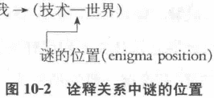

两关系中均有谜，然生成地、驻留位、指称物截异。具体关系中，谜发于透明使用之际，居人技之间；诠释关系中，“技术问题在于工具与指示对象的连接者。使用者视觉终端在工具上。读工具如读文本，若指示不明，知识世界不呈。此为谜新位。①此位在技术呈现世界之中，指示对象透明性‘在诠释学转化中’‘自身成谜’。”②谜亦现于“文本-指示”关系。③

具体与诠释关系中，谜现于走向透明的途中，驻留于透明与模糊夹缝。根源即技术的透明/模糊属性。若技术保透明，谜自隐。伊德以光学史、仪表盘释透明模糊，然至它异与背景关系，谜失位。作为处理数据/世间透明模糊的数据挖掘技术，能否补全“谜”及四关系？

#### (二) 数据挖掘技术映照伊德四关系

数据挖掘正常运作时，人借之感知世界，技术如海德格尔言“抽身而去”，人似见真实世界，呈现关系为：

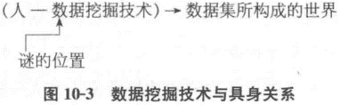

此关系中，人借技术与其呈现共解世界，解读赖数据与描述对象关联，此关联即伊德“谜”，对应具体关系。

数据挖掘按逻辑诠释世界。若发展至真实全表达，具体关系透明性即真实呈现。但现实数据世界非此，透明与模糊始终是焦点，隐私保护技术应运而生。

隐私关注非始于数据挖掘。1890 年沃伦与布兰代斯即呼吁：“新发明商业手段引关注，须进一步保障人格权、‘不被打扰’权”①，“法律是否全面保护隐私，将成法庭考题。”②普罗塞尔 1960 年述隐私权侵权法确立史。①切默林斯基 2006 年促重审布兰代斯隐私权，主张“侵权法成文法应为深挖隐私者设责，这是沃伦布兰代斯未竟使命，如今比以往更需觉醒。”②

可见，隐私保护非数据挖掘初生即有，但其介入重塑人技世关系，介入与否、位置迁移，生出不同关系形态。

隐私保护技术入场世界呈现过程（如图 10-4）：

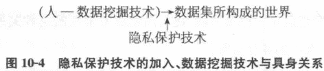

它与挖掘算法结合成隐私保护挖掘法，两大路径：“一、改算法，在不知准确值或不访原始集时执行挖掘；二、改原始数据数值达保护。”③无论哪法，皆处理原始数据，修改世界透明模糊度。数据集构成的世界与真实世界关系生变，人面向的世界随异。如伊德析温度计感温，人感知基于带隐私保护的挖掘技术。虽解读需解码等复杂技术辅助，但人终借数据集诠释感知外部世界，关系遂变为：

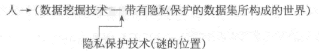

##### 图 10-5 数据挖掘、隐私保护与诠释关系

图 10-3 “谜”在人与挖掘技术括弧内；图 10-4 隐私保护技术置于“人-挖掘技术”括弧与“数据集世界”之间，此介入生新关系（图 10-5）。三图关联差异显见：隐私保护技术加入，使具体关系转化为诠释关系。而在伊德诠释关系中，谜位恰是隐私保护技术——**隐私保护技术即诠释关系中的“谜”**：

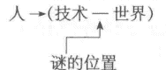

##### 图 10-6 诠释关系与谜的位置

若有出色挖掘技术，清洗加密皆失效，需引入新技为谜，隔离人与数据集。此时谜不在人技括弧，不在技世括弧，而在**世界之中**：

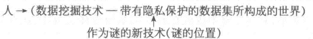

##### 图 10-7 作为谜的新技术

此时挖掘技术自动处理海量数据，数据集呈他者特征——具独立性，人感知在与数据集博弈中发生。新技介入推诠释关系向它异关系演进，称“它异关系之谜”。融入新技括弧者成他者（图 10-8）：


##### 图 10-8 数据挖掘、隐私保护与它异关系

若有技术完美处理数据，需时恰达，人无需顾隐私：

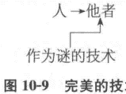

技术从视野隐退，成背景。如伊德言“空调”。当前挖掘技术数据化自然、生成虚拟数据，构成“数据世界”。此世界中，挖掘技术是人世关系关键，然已成背景——**背景关系悄然而至**：


伊德理论中，谜位变更阐释具体与诠释关系。引入隐私保护技术为谜，发现其位置迁移调节人、挖掘技术、数据世界三元关系，且此谜不再局限于前两关系，亦现于它异与背景关系中。

#### （三）隐私保护技术、它异关系与背景关系中的“谜”

# 隐私技术如何重塑“人-技术-世界”关系？

在隐私保护技术介入数据挖掘前后，“人—数据挖掘技术—数据集构成的世界”这一关系图谱发生了根本性位移。这种变动的关键，在于隐私保护技术精准地卡在了“新建关系之谜”的位置上。这印证了一个核心洞见：技术能调节技术，且这种调节会重写人、技术与世界的连接方式。

伊德曾用具体案例拆解具身、诠释关系中的“谜”，却在它异与背景关系中按下暂停键。数据挖掘技术的出现，为补全这两类关系中的“谜”提供了全新样本。

## 它异关系里的“双面他者”

在它异关系中，“谜”就藏在他者内部。数据挖掘技术展现出的“他者性”，具有同一与绝对的双重面向。

以商品推荐系统为例：当推荐精准击中需求，用户欣然下单，人类仿佛退出了决策回路，仅作为受益者存在于回路“之上”或“之外”。此时技术呈现为**同一的他者**——它懂你，像极了你的延伸。

但当推送变成骚扰，即便你无购买意愿，反感的信息仍铺天盖地而来。技术瞬间异化为**绝对的他者**——它不懂你，甚至对抗你。此刻的核心伦理追问随之浮现：我们该如何面对这个不可控的“他者”？

## 背景关系：前景之外皆“谜”

现象学中，背景是“未确定的确定性”——虽与前景同在，却非当下显现，随时可转为前景。对人而言，背景即“谜”。

伊德举电气化家电为例：嗡嗡声暗示技术运转，但内部结构隐退于不在场。声音反而将背景技术拉回前景，而真正的技术核心藏得更深。应对背景技术引发的问题，首要任务是将其“拉回前景”。

数据挖掘亦同。个性化搜索引擎在满足精度需求的同时，暗默收集用户信息。虽任何技术皆可退居背景，但**并非所有技术皆是“背景技术”**。这种区别，让“谜”的探究愈发关键。

---

# 从“技术调节”视角破解伊德之“谜”

伊德的理论框架里，四种关系分别由不同技术诠释（眼镜/具身、温度计/诠释、AI/它异、供暖/背景）。具身与诠释关系中的“谜”，在它异与背景关系中消失了。

面对新技术浪潮，学界质疑声此起彼伏：
*   **维贝克**批评伊德忽视关系中的意向性，引入“赛博格意向性”打开黑箱；
*   **纳斯构**借“调节”概念修正前两种关系，将四关系简化为具身度与诠释度的比例。

争议核心指向两点：伊德理论的完备性？能否容纳新技术？

**数据挖掘技术给出了实证答案——新技术正是回应质疑的钥匙。**

通过分析数据挖掘技术在不同介入阶段的关系重构，我们发现“谜”的位置在动态迁移：

1.  **无隐私保护时**：“谜”在人与技术括号内（数据挖掘者与技术之间） → **具身关系**显现。
2.  **引入隐私保护技术**：“谜”移至技术与世界括号内 → **具身转为诠释关系**。
3.  **新技术介入但无清洗/加密效用**：技术它者性显露 → **诠释转为它异关系**，“谜”落入世界之中。
4.  **数据形塑“数据世界”** → **背景关系**浮现。

**结论清晰：以数据挖掘为镜，伊德理论中的“谜”不再局限于前两种关系，而是贯穿四大关系全程。** 这种“全员在场”，正是通过技术调节的层层递进，完成了对伊德“谜局”的破解。

---

# 数据挖掘技术与伦理的双向奔赴

数据挖掘以数据构世，调节人类存在与世界诠释。约纳斯早言：“现代技术形成新特殊情势，要求伦理思想努力应对。”技术伦理的回应，既有针对新问题的探究，也有对旧框架的批判与超越。

## 一、 技术与伦理的双向调节

技术通过物质环境构成自由，同时与人类关联成“自由居住的场所”，为道德决策腾出空间。**诠释此空间，正是技术伦理的未来。**

拉图尔的安全带案例经典且深刻：想违规不系安全带，车却拒绝启动。技术设计作为外部力量，直接规范了行为。这倒逼伦理学拓展边界——**将非人要素纳入道德考量**，让“技术作为道德调节者”成为可能。

维贝克进一步指出：技术调节聚焦行动与知觉，而非认知；它调节的不只是道德观念，更是道德决策的行动、知觉与诠释。在人机深度融合的智能时代，伦理思考必须双线并行：**既防技术引发的伦理险，也看技术对伦理的助推力。**

## 二、 数据挖掘引发的伦理暗流

从CRM到个性化搜索，应用场景越广，伦理裂隙越深。

**CRM案例：** 数据挖掘者与技术融合建库，挖掘支撑决策。客户数据既是挖掘原料，也是被调节对象——忠诚度、利润、未来行为全被量化预测，细节决定成败。

**个性化搜索更隐蔽：** 满足精度需求的代价，是用户在不知情中从“使用者”被调节为“被使用者”。在线行为经关联、聚类、分类，未来被预判。这触发多重冲突：
*   隐私权 vs 知情权
*   信息保存 vs 持有
*   信息保护 vs 泄露

这些冲突既是挑战，也是伦理学进化的契机。“被遗忘权”热议源于欧谷博弈；多责任主体、智能主体探讨，源于算法决策的问责困境。

## 三、 隐私保护：法规与技术的夹缝突围

欧洲数据保护史，是技术、伦理、社会三角寻找平衡的历史。

从OECD指导方针（80年代），到《指令95/46/EC》、英国《数据保护法》、瑞典《个人数据法》、西班牙《基本法》（90年代），再到《电子隐私指令》（2002）与《GDPR》的迭代，规则持续收紧。面对即时通讯等新技术，旧规失效，欧盟推出更严格的《隐私与电子通信条例》（2017），作为特别法与《GDPR》协同，提升保护基线。

**技术端同频共振：** 隐私关注度攀升，倒逼隐私保护技术（PPDM）成为大数据核心热点。
*   **双重目标：** 修改原始数据防隐私侵犯 + 保护模式防敏感知识泄露。
*   **核心手段：** 加密算法、数据清洗/屏蔽/交换/泛化/随机干扰等扰乱技术。

隐私保护技术的介入，构成双重调节逻辑：
1.  **技术调技术：** 调节数据挖掘技术 → 改变呈现给人的数据自然界 → 进入人—技术—世界关系。
2.  **技术调伦理：** 开发者通过算法扰乱原始数据 → 切入伦理调节链条 → 实现隐私实质保护。

## 四、 走向技术自身的技术伦理建构

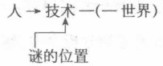

##### 图 10-11 它异关系、它者和谜的位置

（正文至此，后续内容待续）

审视数据挖掘领域隐私保护技术的演进史，显而易见：隐私伦理争议与技术迭代始终同步共生、如影随形。此刻，技术早已超越了单纯被伦理学审视的“客体”角色，更化身为化解伦理困境的关键“路径”。

传统技术伦理学往往聚焦于技术引发的伦理隐忧，然而今日技术不再仅立于伦理的对立面。它既是问题的源头，亦能成为伦理规范的向导与约束。维贝克等学者洞察到技术在主客体构成中的调节功能，倡导“技术伦理学内在路径”，意在打破“外部批判”的桎梏，转而探索从技术内部生发伦理的新范式。技术介入道德行为调节，以参与者姿态嵌入伦理困境的破解之中，推动伦理完成了从“外部审视”向“内部介入”的范式转向。

事实是，“数据并非天然躺在‘这里’等待收集、存储与分析，它始于特定的历史、文化与经济语境中被想象并创造而成。①在这一过程中，人的能动性毋庸置疑，但‘数据自身的属性却被长期忽视’，②故而我们必须转向数据技术本身。

就数据挖掘而言，该技术以构建“数据自然界”的方式重塑了伦理学的生存场域，这种重塑倒逼人类重新定位技术在伦理学中的坐标。在构建数据自然界的进程中，技术在“能呈现”、“所呈现”与“应呈现”之间权衡抉择，呈现结果源于人机共同参与的相互调节。在数据挖掘研究的五大核心议题中，“如何用技术造福社会、防止滥用、规避数据不当披露与隐私侵犯”③等赫然在列。这意味着，伦理观念已内化于技术肌理，技术因履行伦理功能而被赋予了实现伦理意蕴的现实路径。

- ① 方滨兴、贾瑜、李爱平、江荣：《大数据隐私保护技术综述》，《大数据》2016年第1期。
- ② [美] Jiawei Han 等：《数据挖掘：概念与技术》，范明、孟小峰译，机械工业出版社2012年版，第399页。
- ① A.Helond，“'Raw Data' is an Oxymoron”，Information，Communication & Society，Vol.17，No.9，2014，p.1171.
- ② J.Mussell，“Raw Data is an Oxymoron”，Media history，Vol.20，No.1，2014，p.105.
- ③ [美] Jiawei Han 等：《数据挖掘：概念与技术》，机械工业出版社2012年版，第22页。

### 七、案例透视：数据挖掘技术与会计伦理的内化路径

会计本质上是一门处理经济交易数据的技术，其核心对象正是经济活动生成的“数据”——涵盖量化的货币财务信息与非财务说明信息。这些数据依循准则，经收集、整理、分类、加工、汇总而成，旨在满足使用者的决策需求。

#### （一）数据挖掘技术与会计的深度耦合

随着网络等信息技术飞跃，会计信息系统完成了从纯手工向IT驱动的跨越，会计步入电算化时代。电算化在赋能财务数据处理的同时，也引发了新课题。经济发展致使会计交易愈发复杂，涉及主体与事务激增，数据处理门槛大幅提高。

数据挖掘技术擅长从海量杂乱数据中提炼隐性价值、揭示内在关联、发掘潜在规律。“大数据时代来临前，分析师受限于采集与计算能力，多依赖抽样研究分布。技术演进揭示：抽样虽捕获主流信息，却易遗漏蕴藏巨大价值的细微信号。”①因此，若要从海量、不全、模糊、随机、隐蔽的数据中淘金，必须借力数据挖掘技术。

当下，该技术已渗透财务分析、风险预警、决策支持、虚假信息甄别等会计全场域。技术驱动行业变革的背景下，会计伦理研究亟待新视角的审视。

#### （二）传统会计伦理的困境与反思

“会计伦理”概念肇始于15世纪末，由意大利学者卢卡·帕乔利在《数学大全》中首倡。②1844年英国《股份公司法》确立“充分与公允”法律概念，至今仍是英特许公认会计师教育核心。③会计业务须遵职业道德，对外报告必须真实充分。④1948年英国《公司法》进一步将“真实和公允”入法。

我国会计伦理启蒙源于“中国现代会计之父”潘序伦。1927年创办立信会计师事务所，1928年创办上海立信会计学院，“立信”二字直指会计之本——诚信乃为人与从业之基石。

传统研究立足人的主体性，旨在通过自我约束规范行为，内容聚焦从业教育、准则法规与职业道德解读。然而现实表明，仅靠教育层面的伦理建设难以有效遏制当下乱象，尤其在多重选择困境前，说教、劝导与法罚的边界亟待拓展。既若“以人为本”模式难解时疾，能否尝试“技术伦理内化”视角？或借技术手段助推、强制伦理落地？

#### （三）技术赋能：数据挖掘助推真实披露

阿瑟·安德森1932年曾言：“守护报告真实完整，会计人员须坚守判断与行为的绝对独立性。”①“若公众对真实公允的信任崩塌，会计价值归零。”②会计与数据朝夕相伴，数据真实、用法良性，则无伦理隐患。但粉饰报表、隐瞒数值、掩盖来源等违规从未断绝。

会计既可披露资产，亦可隐匿资产，甚至偷税漏税、伪造报表、串通舞弊、利用内控漏洞。除法治环境缺失外，核心病灶在于从业者利益诱惑下的道德失守——贪婪、失信、侥幸。安然事件中，罗纳德·杜斯卡夫妇直指要害：一是个体层面，审计师迷失公众责任，沦为取悦客户工具；二是组织层面，安达信屈服于系统性诱惑，为报酬放弃核验真实的首要使命。①

做假账违伦理、触刑法。安然案显示，安达信或疏忽、或故意忽视、歪曲交易实况。现实中，会计师享有巨大自由裁量权：记什么、不记什么、记在哪。这份自由与真实披露形成张力——职业操守与利益诉求往往背离，真实披露成为会计师的持久困局。

长期以来，真实披露是会计伦理的核心痛点。从业者应秉持真实、公允、准确、完整原则，虚报隐瞒皆违伦理且酿苦果。倘若技术发展至：录入数据仅能被强制选择“真实披露”，或技术已相对忠实地自动留痕，则这一核心困境将显著缓解。换言之，破解真实披露难题，除传统伦理教育外，能否引入技术手段共谱会计伦理建设新篇？

数据挖掘技术在会计领域举足轻重之际，技术伦理学内在路径为会计伦理重构提供了新范式。我们应将会计伦理置于技术伦理视域，超越单一行业伦理视野，以技术为辅助杠杆，从伦理维度调节人的行为。

## 第十一章 大数据语境下个性化知识的崛起：特征与价值

### 一、普遍性知识：历史贡献与内在局限

人类初识世界，始于感性经验，获得个别、特殊、具体、表层的知识，呈原始博物学形态。随属性知识积累与认知升级，人类借抽象归纳，自繁杂经验中提炼普遍性知识，实现从特殊到一般的认知飞跃。此乃认识发展普遍规律。自古希腊起，知识即被界定为具有普遍必然性，否则仅为“意见”——苏格拉底确立知识普遍必然性观，柏拉图分离现实与理念世界，奠定知识永恒地位，意见则是个别的。①巴门尼德划分“真理之路”（赖理智，求确定、普遍、统一）与“意见之路”（赖感官，否定确定性，止步意见）。“区分知识与意见，是古希腊对哲学的贡献：意见随时地人变，知识放之四海而皆准。”②

- ① [英]罗素：《西方哲学史》上卷，何兆武、李约瑟译，商务印书馆2004年版，第198—200页。
- ② 叶秀山：《思·史·诗——现象学和存在哲学研究》，人民出版社1988年版，第66页。

#### （一）知识“普遍性”追求及其代价

近代认识论转向并非质疑知识本性，反而以普遍必然性为基石。经验论主张知识源于经验，普遍性在提升个别感觉中形成；洛克喻心灵为“白板”，观念源外部感觉，知识为观念联系的普遍判断。唯理论主张普遍知识靠理性把握、源于理性；笛卡尔“普遍怀疑”指向经理性审查的确定性知识。虽源头论与方法论对立，但两者对普遍必然性的追求殊途同归。古希腊发端、经千载演进、近代科学体系化加持，普遍必然性成共同信条。

然而，此路径不可避免导致双重后果：

一是**知识非人化倾向**。唯理论场域中，知识成理性独舞，剥离人的需要、情感、意志、生活，现实人被抽离。刘啸霆教授指出认识主体有类、群体、个体三态，传统认识论因主体概念模糊导致个体主体缺位，引发“边缘人”叹息。现实感性人被抹杀，致使认识论玄虚华而不实。“主体不明，致关键问题（知识起源、先天后天、归纳有效性、理性可靠性）无主体可依，成无头公案，走诸多弯路。”①

二是**知识非社会化倾向**。近代哲学绝对主义理解知识，切断知识与社会联系，否定社会性，滋长“为知识而知识”。高抽象、强形式化、离生活越远者，越被视为真知；贴近社会、低形式化者，反被贬低。“所谓真知成高高在上独立领域，似与社会生活活动无涉，仅为追崇对象。”②波兰尼评价：经验论排斥主体作用以证客观性，是理想幻觉，因经验获取至理念构成皆打主体烙印；唯理论过强先验框架统制，亦偏颇。波兰尼主张寻找主客体“同体结构”，认知关系非客体表象非主体创造，乃主体能动干预对象的特定方式。③

梳理认识论演进：一方面，对普遍必然性的执着强力推动自然认识，催生科学革命；另一方面，过度追求导致打上个人烙印的特殊、个性化“知识”失位——地位低于普遍知识。④从特殊到一般的认知路径及知识观，在近代科学生成发展中发扬光大：开普勒归纳第谷数据得行星规律，牛顿抽象苹果落地得万有引力。普遍性知识推动科学精确化、专业化、体系化。然普遍性知识对具体、个性化问题常失效：描述一片羽毛落下，仅用自由落体定律远不够，需考量复杂气动环境与初始条件。这如掷骰子，掌握不全细节只能得概率；若拥“上帝之眼”，点数确定无疑。人与神差距何在？虽同掌普遍规律，但人永无法穷尽事物具体个性化细节——虽能造降落伞等利用部分个性化知识，但在认识论层面，此间鸿沟无止境。

- ① 刘晓霆：《个体认识论引论》，中国经济出版社1995年版，第2—13页。
- ② 林建成：《现代知识论对传统理性主义的超越》，《社会科学》1999年第6期。
- ③ [英]迈克尔·波兰尼：《科学、信仰与社会》，王靖华译，南京大学出版社2004年版，第27页。
- ④ 博物学式微即典型例证。

#### （二）科学实践哲学的破题探索

20世纪80年代兴起的科学实践哲学，对科学知识普遍性诉求提出质疑，国内研究延续十余载。该派认为以往科学哲学皆为“传统科学哲学”，核心关注科学理论/知识（逻辑实证主义赖欣巴哈主张只关注科学知识成果①；维也纳学派卡尔纳普聚焦科学知识合理重建②）。传统派视理论为尊，将地方场所、实验建构、技术设施、社会网络、实践难题视为偶然因子，主张科学命题普遍、理论为终极成果、目标为更好理论——是典型“理论优位”哲学。

科学实践哲学则指出传统根本误在于忽视科学实践作用与意义。在他们眼中，科学本质是实践活动。阐释学代表约瑟夫·劳斯(J.Rouse)批评：传统哲学非忽视实验重理论，而是整体扭曲科学形象。科学是实践领域而非命题网，首要非表征观察世界，乃操作介入世界——作用于世界而非描述世界。故实践居首位，在塑造人的同时塑造世界。①

- ① [德]Hans Reichenbach, *The Rise of Scientific Philosophy*, 1951.
- ② [美]R.Carnap, *The Logical Structure of the World*, 1928.
- ① J.Rouse, *Knowledge and Power: Toward a Political Philosophy of Science*, 1987.

### 科学实践哲学：打破“普遍真理”迷思，确立“实践优位”新范式

科学实践哲学的兴起，从根本上重塑了我们对科学的认知图景。

首先，它重新定义了知识的形态：传统视为静态表象（文本、图表、观念）的知识，实质上是一种动态的实践性互动模式。其次，科学概念与理论若脱离宏大的社会实践与物质实践网络，便失去了可理解的基座。再次，聚焦实践必然倒逼知识观的转型——知识不再是超越时空的普遍实体，而是扎根于特定语境的“地方性”产物。所谓的“普遍性”，并非天赋权利，而是通过“去地方性”与“去语境化”这一标准化操作，将局部生产的知识移植、推广至他处的过程。科学实践哲学敏锐地指出：传统科学哲学误将这种“标准化迁移”等同于“普遍化”。科学活动的每一步——从实验室建制、研究方案设定，到共同体规范与技能传承——无不烙印着鲜明的地方印记。

基于对“理论优位”传统的深刻批判，科学实践哲学完成了一次决定性的范式转向：科学从“理论优位”走向“实践优位”，科学知识被确证为具有显著的场域依赖性与语境嵌入性。它宣告：“一切知识皆为地方性，非普遍性”，并将“普遍性”界定为特定约束条件下的有条件普遍，而非绝对意义上的亘古真理。这彻底击碎了长期笼罩认识论上空的“普遍知识神话”。正如拉图尔的隐喻：知识如同铁路网，虽遍布全球，却皆有里程尽头。火车无法离开铁轨奔行于荒原，但“魔法师”们却试图用“普遍法则”迷惑大众，宣称法则在无轨之地依然生效。

当然，这一洞见虽具启迪力，若将“地方性”与“普遍性”绝对对立、将普遍化简单等同于标准化，未免过于激进。刘兵指出，二者在特定语境下并非水火不容；况且人类知识谱系中，仍存庖丁解牛、轮扁研轮这类具身性、默会性、抗拒标准化的个性化知识宝藏。

- ① [德]H·赖欣巴哈：《科学哲学的兴起》，伯尼泽，商务印书馆 1966 年版，第 183 页。
- ② [美]鲁道夫·卡尔纳普：《世界的逻辑构造》，陈启伟译，上海译文出版社 1999 年版，第 5 页。
- ① 吴彤：《走向实践优位的科学哲学：科学实践哲学发展述评》，《哲学研究》2005 年第 5 期。
- ② 吴彤：《两种“地方性知识”：兼评吉尔兹和劳斯的观点》，《自然辩证法研究》2007 年第 11 期。
- ① 「加」瑟乔·西斯蒙多：《科学技术学导论》，许为民、孟强等译，上海世纪出版集团 2007 年版，第 209 页。
- ② 刘兵：《关于 STS 领域中对“地方性知识”理解的再思考》，《科学与社会》2014 年第 3 期。

#### (三) 大数据个性化知识的崛起

关于知识个性化的探讨，因计算机技术飞跃、大数据方法异军突起而重燃学界热情。各领域涌现出的个性化商业模式、定制服务、精准医疗、私人订制等现象，生动印证了个性化知识的实存与高价值。以搜索引擎为例，它融合关键词与用户画像，预判意图，精准推送；电商平台则通过多维商品标签与用户偏好建模，实现“千人千面”的分层触达——低收入者见低价，高收入者见高端。这种无处不在的个性化图景，正如尼葛洛庞帝所言：“后信息时代最大的特征就是真正的‘个人化’。”它引发了对数据与知识关系、知识观演变的深层理论反思。

早在 20 世纪 80 年代，信息科学与知识管理领域便在应对数据爆炸的实践中，沉淀出经典的 **DIKW 模型**（数据-信息-知识-智慧），揭示了层级间的联结与差异：数据是原料，信息是编码运算后的数据，知识则是关联“具体情境”、具备意义的有用信息——它源于信息，却非信息的子集。

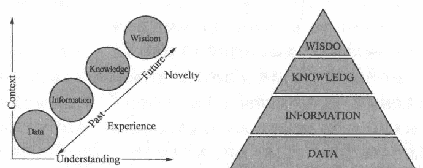

**图 11-1 DIKW 模型**

数据科学家费亚德将“知识发现”定义为：从海量数据中辨识有效、新颖、潜在有用、可理解模式的高级处理过程。这标志着知识观的拓宽：知识本质上是模式，核心指向有效性、实用性与可理解性。

大数据时代，全量数据采集与机器学习算法的成熟，推动知识生产从“数据捕获—处理—建模”实现高度自动化。自动化堪称大数据核心特质，它绕开了人类认知瓶颈（被迫减量、简化模型），让科学突破传统建模桎梏，直面复杂系统。技术接管了高速检索、跨域关联、变量耦合等繁重任务，大幅降低了知识获取门槛，让“低枝果实”易于摘取。虽有批评指称统计方法仅拾得“唾手可得之果”，留下“难啃硬骨”予后人，并可能延宕理性主义回归，但这实用主义驱动的经验主义复兴，已不可逆转地改变了认识论版图。

综上，知识观已发生根本性重构：聚焦有效性、实用性、可理解性，与传统追求普遍必然性判然不同。“个性化知识”由此得名，其迅猛发展不仅为社会各域个性化实践提供科学依本，更为破解普遍性知识的实践困境与哲学拷问，开辟了全新视角。本章将从大数据个性化知识的特征切入，经由知识发现模式考察，探究其内在生成机理与认识论价值。

- ①「美」尼葛洛庞帝：《数字化生存》，胡沐、范海燕译，海南出版社 1996 年版，第 3 页。
- ② R.L.Ackoff, “From Data to Wisdom”, Journal of Applied Systems Analysis, Vol.16, No.1, 1989, pp.3—9.
- ③ M.Zeleny, “Management Support Systems: Towards Integrated Knowledge Management”, Human Systems Management, Vol.7, No.1, 1987, pp.59—70.
- ① U.Fayyad, G. Piatetsky-Shapiro and P. Smyth, “The KDD Process for Extracting Useful Knowledge From Volumes of Data”, Communications of the ACM, Vol.39, No.11, 1996, pp.27–34.
- ② W.Pietsch, “The Causal Nature of Modeling with Big Data”, Philosophy & Technology, Vol.29, No.2, 2016, pp.137–171.
- ③ 自然语言领域的专家肯尼思·丘奇(Kenneth W.Church)对此的批评是“通过统计方法已经让我们摘到了唾手可得的低枝果实，留给后人的都是难啃的硬骨头。”而大数据的浪潮很可能延宕理性主义回归的日期。这种经验主义的复兴实际上是受到了实用主义力量的推动。参见：K.Church, “A Pendulum Swung Too Far”, Linguistic Issues in Language Technology, Vol.6, No.5, 2011, pp.1–27。

### 二、个性化知识：特征图谱与深层意蕴

#### (一) 具体性：从“全样本”到“疾病知识网络”

具体性指向知识的单称陈述属性——它精准适用于特定个体或子类群体。大数据凭借“全样本”本体论预设，借力云存储与分布式计算，首次赋予人类捕捉个体在时空维度全量数据的能力，从而提炼出真正的具体知识。沃尔玛即是典范：它不仅洞察整体销售趋势，更能定位至单品、单一消费者画像。在大数据时代，个体以信息形式实现自我表征与构成，这正是个性化服务的基石，也赋予了知识区别于传统起源阶段的全新“具体性”内涵。

具体性的另一面是**情境性**——万物皆嵌于关系网络之中。大数据追求“全样本”，必然纳入情境认知，故其生成的知识天然带有情境烙印。2011 年美国国家研究理事会战略报告《迈向精确医学》明确提出：构建整合个体临床信息与分子特征的巨大“疾病知识网络”，支撑精准诊断与个体化治疗。该网络整合基因组、蛋白组、代谢组等微观分子数据，至临床信息、行为模式、电子健康档案等宏观层面，再延伸至肠道菌群、物理环境、社会条件等外部维度，旨在捕获决定健康状态的极端复杂影响因子与发病机理。

其核心任务，是为每一主体定制一个多层级、多维度高度互联的知识网络。理想状态下，症状与基因突变相连、突变与代谢缺陷相连、暴露组与表现基因组相连。这种整合型策略，直面生物体作为高度复杂巨系统的本质——局部视角、单一分子、单层次皆不足以穷尽真相，唯有全局性、具体性的多因素交互整合，方能完整揭示生命的生理与病理奥秘。

- ① L. Floridi, “The Informational Nature of Personal Identity”, Minds and Machines, Vol.21, No.4, 2011, pp.549—566.
- ② National Research Council, Toward Precision Medicine : Building a Knowledge Network for Biomedical Research and a New Taxonomy of Disease, 2011, http://www.nap.edu/catalog/13284/.
- ① National Research Council, Toward Precision Medicine：Building a Knowledge Network for Biomedical Research and a New Taxonomy of Disease, 2011.

#### (二) 个人性：主体重塑与数据公民的觉醒

若具体性关乎客体特殊性，个人性则聚焦**主体特殊性**——「个人」深度卷入认知进程，赋予知识独特的个人印记。其凸显缘于移动互联普及、数据算法驱动与自动化处理跃升：凡人皆可将关注对象数据化发布，化身数据源；掌握数据集者皆可绕过传统“守门人”，直通知识库。美大选期间，从盖洛普、谷歌、IBM 到普通程序员、甚至卖衬衫面具的中国商人，皆凭借各自数据模型输出带有鲜明个人色彩的预测。数据易得性、算法本性及其在发现中的核心地位，为个人介入奠基。

个人性的二重奏：数据与知识发现成为数据公司核心业务，客观孵化个性化知识土壤；自动化降低门槛，使同一数据集因主观算法偏好衍生出迥异模型。

个人性的三重奏：**个人与数据关系的本体重构**。技术演进让每人成为数据的潜在生成者、创造者与获取者。本体论上，“个人”即数据“本身”，构成数据世界。数据三元组：个人自身数据（穿戴设备采集的生理指标，支撑个性化医疗）、个人生成数据（社交、购物、搜索留下的行为痕迹，驱动个性化推送与行为研判——如百度问答大数据挖掘全国“吃”的知识图谱）、个人获取数据（目的性主动采集的外部数据）。

**公民科学家**的崛起，生动诠释了这一重构。2013 年《自然》刊文《公民科学：业余专家》记录了移动互联时代公民参与科研的威力。贾斯汀·哈尔博达利用公民科学方法，数月内收集 1.3 万名跨年龄、跨地区志愿者数据，不仅完成全程数字感知力发展描绘，更发现意外新规律。他感叹：“在公民科学家出现之前，没有哪个科学家能得到这样的数据。”这深刻变革势必引发主客关系的根本重构（详后文）。

波兰尼早已洞见：个体介入非缺陷，乃科学知识不可或缺的逻辑补充。他严证个体性不等于主观性：科学家赋予个人标准以非个人地位，视其为超越个体建立的科学准则；个体是“作为具有普遍性意图负责任地行使自己判断力的人”。

- ① T. Gura, “Citizen Science: Amateur Experts”, Nature, Vol.496, No.7444, 2013, p.259.
- ② J.Halberda, R.Ly, B.Wilmer, et al., “Number Sense Across the Lifespan as Revealed by a Massive Internet-Based Sample”, PNAS, Vol.109, No.28, 2012, pp.11116—11120.
- ③ [英]迈克尔·波兰尼,《个人知识——迈向后批判哲学》,许泽民译,贵州人民出版社 2000年版,第 464 页。
- ① [英]迈克尔·波兰尼：《个人知识——迈向后批判哲学》，许泽民译，贵州人民出版社 2000年版，第2页。
- ③ D.M. Berry, “The Computational Turn: Thinking about the Digital Humanities”, Culture Machine, Vol.12, 2011, pp.1–22.

#### （三） 唯实用主义：为何大数据知识“管用”就行？

传统普遍性知识执着于严密的逻辑推演与因果链条，代价是不得不剥离个体的独特属性，这在客观上打了知识实用性的折扣。大数据个性化知识另辟蹊径：它不再强求因果解释的绝对严密，转而聚焦“相关性”；正如前文所述，因其天然重视具体场景与个体差异，有效性与实用性反而被显著增强。佐证案例不胜枚举。

2005 年全美机器翻译大赛，谷歌横扫群雄夺冠。参赛系统中有个“姊妹系统”出自同一专家——弗朗兹·奥科之手，设计原理如出一辙。关键差异在于，奥科加入谷歌后，利用其海量平行语料训练模型，直接将翻译准确率推向了竞品望尘莫及的高度，实现了该领域的突围。这有力印证了：大数据喂养下的系统，自带强有效性与实用性光环。

另一里程碑是 AlphaGo。其架构建立在监督学习与强化学习之上，构建策略网络（选招）与价值网络（评估局面）双核驱动。策略网络生成候选落子，价值网络预判胜率，经蒙特卡洛树搜索多层博弈，最终输出胜率最大化的那一步。实战中它不计算目数，只锁定“赢”的概率最大化——这正是以实用性与有效性为唯一标尺的设计逻辑。国内人机诗歌大赛虽形式不同，内核同属“中文屋”范式，但我们聚焦的不是图灵测试式的本体论争辩，而是数据驱动下的效用与实绩。①②③④

> ① 董春雨、薛永红：《从经验归纳到数据归纳：特征、机制与意义》，《自然辩证法研究》2016年第5期。
> ② 吴军：《数学之美》（第2版），人民邮电出版社2014年版，第283—285页。
> ③ 参见2017年5月“中国乌镇人工智能峰会论坛”上 Demis Hassabis 和 David Silver 对 AlphaGo 2.0 技术的解读。
> ④ 《AI挑战人类情感！机器人写诗、出书、开专栏背后透露了什么？》，载中国科技网，2017年12月5日。

#### （四） 拥抱不确定：复杂系统里的“概率生存法则”

大数据问题本质上是复杂问题，标志性特征是公认的“4V”①。海量数据、高维度、混沌行为交织，使得普遍性、确定性、必然性的解释几乎不可能。更关键的是，大数据知识不属于演绎体系，而是“数据+算法”双驱动迭代归纳的产物，这催生了前所未有的认知特质。

##### 1. 数据完备性：从“抽样估计”到“全景镜像”

“数据+算法”早有雏形，受限于算力与数据量长期停滞。并行计算与数据爆发让其完成质变。大数据与小数据的分水岭，在于量变引致的质变——不仅是体量与速度②。吴军指出，真正的大数据还须具备**多维性**（世界本质复杂随机，变量极多）与**完备性**（逼近全样本）③。理论上全样本不可得，实践中设定阈值即可逼近。

正是多维与完备，让“万物数据化”成为可能，技术为“镜像世界”构建铺平路。顶级足球俱乐部用可穿戴设备实时采集运动员速度、心率、触球等多维指标，构建个体数字孪生；另一面，个人隐私数据（开房、资产、轨迹、通话）明码标价交易，离散数据点被关联成数据实体。这双重佐证：日常行为可被全维数据化、关联化，为个性化知识生成提供了物质基础。

> ① “4V”即 Volume（容量）、Velocity（速度）、Variety（多样性）、Veracity（准确性）。
> ② 吴军：《智能时代：大数据与智能革命重新定义未来》，中信出版集团2016年版，第42页。
> ③ 同上书，第71页。

##### 2. “数据+算法”：双向奔赴的共生关系

极端“大数据主义”宣称“数据自会说话”，实则谬误。数据本身哑默，需算法激活；算法亦需数据训练进化，人类理性的主场正是算法设计与迭代优化。单有数据无算法，或单有算法无数据训练集，知识皆无从生成。海量邮件不会自动标注垃圾邮件，需算法识别；无海量邮件喂养，算法也练不成“识别专家”。

##### 3. 共同进化：算法的“原罪”与不确定性的深渊

数据与算法相互依存，构成无需特定问题引导、天然带有或然性的进化动力学：

*   **意外发现与个性化分歧**：海量高维数据挖掘常产出意外关联；数据不足时隐性联系难现。同一数据集，不同算法选择导出不同结论，这就是算法个性化的来源。
*   **误差的隐匿与放大**：算法借数据重塑自我。若数据失真、算法设计带偏差，缺陷将潜伏并随迭代放大。
*   **算法的“原罪”**：算法是理性抽象简化的产物。初始设计嵌入的偏简化或偏差，在后续迭代中会被系统性放大。

可见，算法作为认知工具已居核心，随着分布式计算、机器学习演进，它成为人类思维的物化外延。赫拉利甚至断言：“人类史就是生物算法不断进化以提升系统效能的历史。”②但本质上，复杂系统关联的数据挖掘充满不确定性，这源于复杂系统状态与演化固有的多重不可预测可能性。

> ① C.Anderson, “The End of Theory...”, Wired, 2008.
> ① 段伟文：《大数据知识发现的本体论追问》，《哲学研究》2015年第11期。
> ② [以色列]尤瓦尔·赫拉利：《未来简史》，中信出版集团2017年版，第25页。

---

### 三、 认识论大转向：当“个性化知识”成为主角

近代实验法延伸感官、数学法深化认知，却受限于技术手段：可量化现象稀缺，概念化与定量化必然取舍近似，大量关联现象被划入“科学暗区”。大数据以“万物数据化”的广度与完备性追求，纳入系统每一子类的全貌，获取前所未有的深广经验基础。

个性化知识崛起虽契合现实生产生活需求（外因），但我们更关注其生成路径与机理（内因）。遵循大数据知识发现步骤，生成路径可视为三阶跃迁：


#### 图 11-2 知识产生的路径

1.  **数据化**：技术手段将客观世界转化为数据；
2.  **镜像化**：数据构建客观世界的平行映射——可计算的“镜像世界”；
3.  **算法化**：算法处理镜像世界，输出对镜像世界的认知——知识。

若数据客观、算法透明，知镜像即知本源。此路径虽似经典科学，实则有五重本质裂变（上文已触及）：
1.  **照亮暗区**：经典科学受限于不完全量化留下“科学暗区”，大数据多维完备性有望揭示之。
2.  **无目的自动化**：数据生成与处理常无预设目的，实现自动化流程。
3.  **算法进化**：经典算法在大数据训练下进化，解锁原无法发挥的功能。
4.  **双驱动而非问题驱动**：知识获取由“数据+算法”驱动，而非特定问题倒逼。
5.  **弱评价标准**：仅以有效性、实用性（功能性、服务性）评价，不求真理对应。①

这正是个性化知识生成的内在机制，标志着认知主体、客体、模式的根本性重构。

> ① 王星：《大数据分析：方法与应用》，清华大学出版社2013年版，第27—28页。

#### 三大认知进路的演进脉络

大数据算法实现了从特殊到一般的自动化思维加工。面对海量个体经验，传统思维不堪重负；机器学习系统却能高速精准提炼普遍规律。由此勾勒认知三阶：
1.  **感性经验期**：纯凭感知觉，如博物学；
2.  **理论科学期**：仪器延伸感官 + 数学建模，近代自然科学确立；
3.  **数据智能期**：技术实现“万物数据化”，个体认知极度深化，反哺普遍规律认知。①

> ① 董春雨、薛永红：《从经验归纳到数据归纳：特征、机制与意义》，《自然辩证法研究》2016年第5期。

#### 个性化与普遍性：双螺旋共生进化

大数据让二者相互依存、共生发展。谷歌 2013 年创立 Calico 直指医疗难题：癌症难治因药效强关联基因（个性化开发成本高）且癌细胞基因高速进化（通用药研发跑不赢变异）。大数据破局之道：从海量个体中挖掘共性，基于共性+个性，低成本高速定制专属药物。他们正整合全美医疗资源攻克顽疾。这证明：个体性知识不只为普遍性提供基座，更因自身价值与普遍性共生，合成人类知识新综合体。②

> ② 吴军：《智能时代：大数据与智能革命重新定义未来》，中信出版集团2016年版，第302—305页。

#### 复杂性面前：动态个性化模型击败静态普遍定律

大数据为解决复杂性提供了新范式。面对飘落羽毛，大数据建模优于物理定律——它不执着于单一普适模型，而重模式变迁与复杂关联。大数据公司核心策略：不在静态通模上耗时，而重**动态迭代**，随新数据实时修正，构建具体情境下的个性化动态模型。①

佐证遍布史册：
*   **渔业管理**：50 年代普遍性方程曾统治种群预测，70 年代失效。生态学家转向混沌理论构建的“动态经验模型” —— 随机、经验、动态、参量变即模型变。承认复杂随机性的动态模型，预测精度远超统一方程。生态学家感叹：“用统一性方程描述复杂真实世界，是科学家的妄想。”②
*   **精准医疗**：肿瘤异质性（个体间/个体内）导致同癌异治、耐药复发。普遍性诊疗规则失效。精准医疗主张多时间节点全维采集个体数据，建立动态个性化医学。③

结论清晰：世界的复杂性本质，让近代科学“追寻普遍必然”愈行愈远，甚至南辕北辙。④物理定律虽具系统性必然性，是科学典范，但不代表大数据模型劣等——二者适用疆域不同。⑤当下主流情形：**搁置普遍性执念，从个性化切入建模，更能有效驾驭复杂性。**

大数据个性化知识发现，极大丰富了知识多样性与可靠性，与普遍性知识互促共进，推动文明整体跃迁——因其在相关领域展示出不可比拟的解题力。同时，它重塑了“知识观”：知识构成、研究范式、人与信息/自然/现实的交互方式，尽被改写；客观新领域与获知新方法被发掘。②至于大数据时代将引发何种认识论重构，正是我们必须直面的新课题。

> ① 王星：《大数据分析：方法与应用》，清华大学出版社2013年版，第2页。
> ② G.A. Popkin, A Twisted Path to Equation-Free Prediction, Quantamagazine, 2015.
> ③ 吴家睿：《精确医学的主要特征》，《医学与哲学(A)》2016年第8期。
> ④ 郭元林：《复杂性科学知识论》，中国书籍出版社2012年版，第36页。
> ⑤ 张晓强、杨君游、曾国屏：《大数据方法：科学方法的变革和哲学思考》，《哲学动态》2014年第8期。
> ① 吴军：《智能时代：大数据与智能革命重新定义未来》，中信出版集团2016年版，第330页。
> ② D.Boyd, K.Crawford, “Critical Questions for Big Data...”, Information, Communication & Society, Vol.15, No.5, 2012.

---

## 第十二章 维基百科：集体智慧如何炼就“可信知识”？

超连接时代全面降临，万物互联不仅重塑平台与资源版图，更颠覆了工业文明的概念框架，催生出新型知识生产与评价机制。维基百科是标志性样本：免费、开放、人人可编。直觉上便捷无比，却因“可编性”引发可靠性信任危机。然而，它从质疑声中走来，终成大众首选知识源。这倒逼我们追问：依托超连接性、超时空性、互动性，这部电子百科如何锚定内容可靠？其知识评价机制长什么样？探究此事，不只关涉 ICT 发展对知识观的重塑、集体智慧社会认识论的本质，更直指软件机器人在维护编辑中扮演的核心角色。

#### 一、 维基百科词条内容的可靠性

### 维基百科：从“狂想”到全球知识基建的逆袭史

2001年1月15日，吉米·威尔斯与拉里·桑格联手推出维基百科，由非营利的维基媒体基金会托管。威尔斯曾豪言壮志：要超越公认权威的《大不列颠百科全书》。在当时的专家圈子里，这简直是痴人说梦。早在1995年，语言学权威西尔万·奥鲁等人就联手反对“开放式百科”构想，坚称百科全书必须封闭撰写，岂能容非专家随意涂改？然而，这股保守势力终究挡不住一群以18-30岁高学历男性为主力的年轻创作者。凭借免费、灵活、可即时修改的特性，维基百科在质疑声中野蛮生长。

八年后的2009年，流量监测机构URLFan发布百大影响力网站榜单，维基百科力压群雄登顶。至2014年2月，月均独立访客破5亿，浏览量达180亿次。它不再只是个网站，而是重塑了出版业生态：出版商从卖书的“经营者”转型为条目的“治理者”，省去了巨额印刷发行成本；读者摇身一变成为作者，打破了专家与大众、作者与读者的固有壁垒，用开放协作范式取代了封闭生产模式。

**何以称“全”？词条覆盖的广度革命**

“Encyclopedia”源词含“圈”意，指囊括特定时期一切人类知识。覆盖面是立身之本。数据显示，截至2017年，维基百科拥有4万余条精选优质条目，英语词条超500万，20大语言版本指数级增长，几乎囊括所有知识领域。但广度只是入场券，非通行证。

**双引擎驱动：教育与查阅的范式重构**

百科全书的核心功能历经演变：早期偏教育，后因知识爆炸转向“教育+查阅”双重奏。纸质版查阅需掌握检索技巧，维基百科依托网络检索，关键词直达，门槛归零，体验碾压传统介质。

**信任危机：准确性才是硬指标**

覆盖广、查得快，还不够核心。百科全书的命门在于“准”。18世纪狄德罗、达朗贝尔邀伏尔泰、卢梭等巨擘执笔；《大英》转型数字版仍以“诺奖得主撰稿”镇场。传统模式下，读者只能被动接受定论。而维基百科“全民可改”的机制，自然引发可靠性信任危机。《大英》前主编麦克亨利直言：不限专长的开放编辑，准确性永无保障。

**实证检验：反直觉的“及格线”**

为验真伪，多轮硬核测评接踵而至：

*   **《自然》杂志（2005）**：42个科学条目同行评审，维基百科错漏4处，《大英》3处。差距微乎其微，打破“维基不靠谱”刻板印象。
*   **切斯尼实验（2006）**：55名科研人员分组测评，专家组对条目可信度评分高于非专家组，印证了“懂行的人更信它”。
*   **司法实践（2007）**：《纽约时报》披露，自2004年起美法院超百份判决引用维基百科，含13份巡回上诉法庭判决。
*   **医学领域深度审计（2007）**：约翰·霍普金斯团队抽查住院高频手术条目，结论是：**内容准确，但37.1%存在重大遗漏**——准确不等于完备，印证了“精选条目”标含金量。
*   **哲学名家条目对标（2011）**：布拉格斯以四大哲学史巨著为标尺核查七大哲学家条目，结论如出一辙：**“过失不在错，而在漏”。**

虽为抽样，但证据链充分：维基百科条目大体可靠，短板在于完备性。更关键的是，其动态修订速度与条目规模，已成传统百科望尘莫及。它俨然已进化为大规模社会现象、宏大知识工程，重新定义了数字时代的知识生产与评价逻辑。

---

### 二、 权威让位于协作：从“遵从专家”到“依靠集体智慧”

“Wikipedia”合成自“Wiki”（可即时修改的超文本系统）与“Encyclopedia”。其诞生标志着知识大众传播的一次根本性政变：自媒体时代，获知与传知全网化，倒逼编辑治理模式必须创新。

#### 1. 编辑模式的颠覆：墙倒众人推，错漏众人纠

**开放协作 vs 封闭流水线**

维基百科提供全球协作平台，抹平作者与读者界限。无账号也可编辑，不受时空限制，自带“持续纠错”属性，条目永处“进行时”。反观《大英》式传统模式：出版方、作者、编辑、读者角色固化，读者只能被动查阅，零反馈渠道。

**匿名性的双刃剑与治理对策**

维基作者多匿名或化名，虽技术可追溯，但“文责自负”链条变弱，恶意破坏、编辑战在所难免。为此，维基建立“评论-调解-仲裁”三级争端解决机制，配合三大核心政策——**中立观点、可证实性、无原创研究**——强行锚定质量底线。传统百科实名制虽利于问责与背书权威，却也锁死了修错通道。

**辨伪能力：从“被动记忆”到“主动判断”的必修课**

开放匿名模式非缺陷，乃是信息过剩时代的生存映射。此时，辨别真伪成基本生存技能。维基读者面对动态条目，被迫进行“主动判断性接受”，而非传统模式下的“被动记忆性接受”。可靠性双重保障：海量编辑持续迭代 + 严格政策护栏。

#### 2. 评价机制的迁徙：专家权威“隐身”，集体智慧“显性”

这种模式彻底变革了二阶知识（汇编性知识）的评价体系。

**专家-新手关系的重构**

传统认知默认专家懂一阶知识（前沿发现），新手依赖专家（认识权威），吉登斯称此为现代社会典型特征。但撰写百科条目用的是二阶知识——**无原创性的公认共识**。新手完全能通过研读权威文献产出合格条目。专家权威未消失，只是从“直接把关”退居为“间接被引用”。

**集体智慧的纠错闭环：席根塔勒案启示录**

2005年匿名用户恶搞编造“约翰·席根塔勒涉嫌刺杀肯尼迪兄弟”条目，存活4个月被当事人发现修正，造谿者称“开玩笑”。恶作剧无法根治，但开放机制终将其暴露修正。更有价值的是，条目的争论史、修订史本身成为认识论教材，让后人看清真相演进轨迹。

**“全球大脑”式协作的独特红利**

这种集思广益的模式，让每个条目成为动态活体，随时与科学前沿同步，解决了传统百科更新滞后的顽疾。它将二阶知识评价基石，从“无条件遵从专家”迁移至“动态依靠集体智慧”。

传统模式下专家分歧被掩盖在封闭流程里；维基模式下，分歧显性化为修订历史，记录了知识从幼稚走向成熟的完整轨迹。这，才是维基百科留给知识文明最宝贵的遗产。

### 三、靠流程管控激活集体智慧

维基百科的协作模式，酷似黄金时代雅典广场上的直接民主。那段仅维持百余年的历史，却留下了令人神往的政治遗产：公民聚首广场，就公共议题公开辩论、最终达成共识。这种机制让决策自带合法性光环——大家共同商定的行动，人人拥护，反对者反显得不道德，因为这不是君主的旨意，而是利益相关者共享的民主决定。维基百科用户同样聚集于网络广场，共同打磨条目共识。但线上协作并不等同于线下聚首，虚假共识时有发生。若把知识定义为“得到辩护的真信念”，我们就必须追问：维基百科如何确保这套获辩护的集体共识，真能对接上“真信念”？

破解此题，首要判断编写者是否构成真正的“集体”，而非乌合之众。因为散沙般的个体，不具备集体决策能力。维基百科通过内容、行为、删除等六大类政策、数十条禁令，将编辑过程纳入规范轨道。无论作者还是管理员，入场先守规矩，规矩的最高指向是逼近《大英百科全书》的专业高度。研究者指出，唯将作者视为共同建设高质量百科的集体事业参与者，才能解释其行为动机。拉里·桑格更直指要害：维基百科的成功，不靠绝对平等或排斥专家，而靠自由、开放、自下而上的治理。

再者，维基人不仅线上目标一致，线下还通过维基媒体基金会年会等聚会强化认同，自称“维基百科人”。伍利等学者证实，集体智慧是群体综合解决任务的内在属性，水平高低直接决定目标达成度。维基百科正是借精细的流程管理，将全球离散的写手凝聚成有共同意识的群体，借力集体智慧提升内容质量。

开放匿名编辑加规范流程，为释放集体智慧筑牢根基。集体智慧源于简单个体协作生成的复杂智能，其发挥看三条：人数够多、背景够杂、互动够激。人多犯错率低，背景杂纠错强，去中心化平等交流让群体更聪明。维基百科不受时空限，天然满足三条：全民编辑保量与多样，版本记录与讨论页实现自主平等的碎片化对话。因此，重流程管理，让久经打磨的条目以集体智慧结晶，准确度不逊《大英百科》。

但须清醒：条目成熟度差异巨大，受创建时间与关注度双重影响。冷门、新建条目缺乏作者群，未经充分辩论与认同，无集体智慧托底，可靠性无从谈起——这揭示了维基确认机制的“滞后性”。运营方据此分级：经长期争论、符合准确、中立、完备标准的，授予“精选条目”、“优良条目”勋章，视为典范。数据显示，英文版百万级条目中，精选率仅千分之一，优良率约万分之五，低比例反证筛选之严。究其因，源于“无限期可改”机制。如“希拉里·普特南”条目，从 2002 年的 126 字节长到 6.8 万字节，历经 1340 次编辑、544 人参与，诠释了“没有最好，只有更好”。但这仅限头部条目，大多数仍在可靠度爬坡途中。维基的智慧不在于拒绝不可靠，而在于懂得如何让条目变可靠。

这倒逼我们重设知识评价标准。人类知识本处流变中，执着追求绝对确定，乃现代性顽疾。一要分层：一阶知识仍靠专家，但百科这类二阶知识，靠严谨流程管控爱好者集体智慧，虽不求全备，可靠性却可兜底。二要分域：个人认识论是近代科学产物，在 ICT 时代失效；维基靠流程管理与集体智慧编辑，为社会认识论提供了活标本。

### 四、机器人编辑：从工具到“队友”

前文未及机器人（自动/半自动程序）参编细节。实则维基创建次年，即借软件批量导入美联邦电信术语库建词条。至 2017 年，英文版已部署 2105 个机器人，维护超 4200 万页面，能高速编辑、拦截违规，大幅优化维护效能。如加州理工学生开发的 Wikiscanner，能追踪编辑 IP、定位身份，曝光利益相关者暗改，护航内容质量。

至 2017 年底，机器人获批任务超 2100 项。人机合写产出的知识称“分布式知识”。机器人分两类：全自动执行任务型，半自动留终审给人工型。主业涵盖：批量入库、查破坏、纠错别字、抽数据、比对侵权等。

机器人效率碾压人工，但错一次破坏力也大得多，是把双刃剑，还会向人类喂信息、影响判断。为规避风险，社区出台《机器人政策》，立三大原则：一、共识原则——社区认可需求的机器人才能上岗；二、审核原则——授权组申请、授权、测试三步走；三、独立账户原则——机器人注册独立账号，登录态下方可作业。

反讽的是，这三条限制反赋予机器人超越部分人类的特权。共识原则让通过验证的机器人可获管理员权限（封禁 IP、改保护页、删页面），社区期望管理员公正、有良知，机器人似乎自带“道德优势”；审核原则让合格机器人操作限制比多数人类还少；账户原则让机器人权重处中上游，高过被封、匿名、新用户。

机器人地位之高，源于维基独特的编辑范式。维基最大创新是用 IT 优势颠覆传统“专家闭门造车”模式，开发出“开放互动、动态纠偏”新范式。理念不再是“专家写、专家审”，而是推崇动态性、源权威性、共识终局性。条目不求一步到位，永远在更迭中；不准靠编辑历史与身份线索间接判断可靠性，虽判断力较弱，但信仰广泛持久的讨论能兜底。2004 年学者哈拉维斯化名植入 13 处错误，不足 3 小时全被修正，靠的就是“表征与身份关联效应”——一旦发现某编辑有误，其它编辑即成嫌疑对象。虽非每错皆秒改，但实践证明：充分讨论过的条目，错误终将被纠正，准确度可并肩传统百科。

正是这种特殊模式，降低了知识准入门槛，让非专家有话语权，也为高效落地编辑理念的机器人腾出施展空间。在维基里，机器人与读者的互动，更像“队友”，而非冷冰冰的工具。

### 五、人机共生：构建分布式编辑新生态

若喻传统纸质百科为“精于管藏、受限于墙”的图书馆，维基则是“精于管流、漫无疆界”的知识海洋。遨游者鱼龙混杂、动机各异，防破坏、筑免疫墙，成生死线。这仗，人机合打。人类编辑愈发依赖半自动辅助工具：2009 年数据显示，借工具打击破坏的总量，是纯人工的 4 倍多。

### 六、迈向人机共生的分布式智能

维基百科的“免疫系统”里，Huggle 堪称核心装备。它的作用在于广撒网收集线索，自动识别并排序潜在的破坏性编辑，将可疑目标集中呈现在界面上。有了它，人类巡查者无需再像过去那样逐字逐句翻阅历史版本，只需查看 Huggle 推送的精简信息，凭借经验点击鼠标决定：是回退版本，还是发出警告。值得注意的是，用户讨论页的公开属性，让这些警告记录本身成为了后续审核的重要参考依据。

当编辑者习惯依赖 Huggle 这类半自动工具提供的筛选结果时，工具便化身为一个认知“窗口”，框定了编辑者的视野与判断路径。这是一种双向塑造：工具引导人，人的操作反哺工具。这种关系早已超越了流水线上机械配合的工人模式，演变为深度耦合、互为前提的协作伙伴关系。在反破坏体系中，这还是人、半自动工具、全自动机器人三方合力的产物。

这种“分布式认知”并非维基百科独有。认知科学家哈钦斯考察大型军舰导航后发现，确定舰位靠的是导航员与海图、罗经等仪器构成的“分布式系统”，单个仪器掌握的信息量往往超越单人。飞行驾驶同理。放眼维基百科，机器人拥有超越个体人类的信息获取能力，且能不知疲倦地 7×24 小时守候，第一时间捕捉异常。于是，人机共同编织成一个去中心化的行动者网络，构成了分布式的维护与编辑生态。

数据印证了机器人角色的跃升：2006 年机器人编辑量不足 4%，2009 年升至 16%，至 2017 年 7 月，英语版最活跃的 22 个机器人贡献了约 20% 的总编辑量。这既标志着机器人地位的核心化，也引发担忧：系统会否演变为全自动采编，彻底边缘化人类？

要破解此疑问，须剖析人机操作的底层逻辑差异。维基百科虽标榜“人人可编辑”，但深度参与门槛极高。合格的“维基人”既要精通社区黑话、方针指引，又须学会与机器人周旋。这实质上划分了两个维度：条目知识域与平台操作域。唯有少数人能在长期实践中进阶为精英编辑——他们未必是学科权威，却精通解决编辑冲突的各类疑难杂症。

精英编辑的判断力源于“实践理解”，是主客融合的直觉反应，敏于事而超越表征；机器人与非精英人类则依赖“理论理解”，前者执行算法，后者遵循规则手册，均属主客分离的静态权衡，慎于言而可表征。因此，尽管都靠表征线索识别破坏，精英编辑的内在机制显著高阶。

对精英而言，无现成规则或算法能穷尽何为“适当”，其认知建立在对语境关键要素的敏锐洞察之上。机器人工作仅构成其操作语境的一环，直接服务对象多为非精英编辑。算法虽可替代非专家人力，却永远无法企及依靠直觉游刃有余的精英高度。佐证在于：2017 年底英语版编辑量前 25 位中，机器人占 19 席，但前 10 位人类编辑平均注册超 4000 天，资历极深。

此外，社区治理呈“共识基础上的等级制”，而非扁平结构。创始人、仲裁委、职员、管理员等权力层级分明，核心职位均由资深人类把持，机器人难触核心权力圈（即便有管理员权限的机器人，也被严格限定身份）。这再次确证：机器人无法完全取代人类，双方注定是共生互补的分布式系统。

---

### 七、警惕文化渗透与算法权力

前述讨论局限于单语言版本。实际上维基百科拥有约 270 个语言版本，虽共奉中立观点、可验证性、非原创研究三大原则，但跨语言条目常现分歧乃至矛盾。研究者指向深层文化因素，甚至民族情怀。借助页面排名技术发现，置顶条目多聚焦西方或美国主题；对比波兰语与英语版，英语条目收录的波兰名人隐私细节，反超波兰语条目对美籍名人的收录深度。

互联网普及与智能手机迭代催生自媒体时代。维基百科以理想主义姿态汇聚全民免费贡献与机器采编，却暗藏文明险境。其一，免费模式挤压传统百科生存空间，一旦成唯一来源，公众将失去比照坐标，被迫单向接受。其二，控制权易手：十年前担忧准确度，今觉操纵风险更甚——维基百科比传统百科更易被势力渗透把控。

更关键的是，海量条目（超 2000 万）加上谷歌搜索置顶的“共生关系”，让维基百科成为获取信息的首要入口。跨语言文化负载与易操控性揭示：匿名编辑与机器人取代专家，产出的只是巨大信息库，而非优质知识。碎片化阅读当道下，高质量“公共知识”的可靠传播岌岌可危。查阅涉值判断的社政文类条目时，必须保持对文化渗透的警醒。

放眼更广，公众对网络工具的深度依赖，赋予了写代码、设算法者“设定认知”的算法权力。算法绝非中立，必然承载编写者的价值取向。如何解读这种价值负载？更紧要的是，随着网络深度嵌入生活，“魏则西事件”类悲剧警示：算法权力可关乎用户生存底线。反思算法权力、完善网络法治，刻不容缓。

---

## 附录：上海智能化哲学发展报告

李克强总理 2017 年政府工作报告明确：加快人工智能研发转化，系培育壮大战略性新兴产业之重中之重。上海作为改革开放排头兵、创新先行者，2016 年 9 月印发《上海市推进智慧城市建设“十三五”规划》，确立“智慧城市”愿景，标志着城市发展布局全面向智能化转型。

智能化被视为信息化高级阶段，正全渗透经社各界：理论层面，人机交互催生“集体智能”“全球脑”等新概念；应用层面，人机一体化推动制造向柔性、智能、高度集成跃迁；生活层面，我们已置身智能化包围圈。故弗洛里迪称之为认知“第四次革命”，里夫金视其为“第三次工业革命”引擎。

革命浪潮将至，理论界亟待回应：如何认识判断这场革命？智能化与信息化本质差异何在？上海作为学术重镇，智能化哲学研究步伐几何？澄清了哪些问题？贡献了哪些力量？

#### 一、上海智能化哲学发展总体状况

##### (一) 发文量演变脉络

对标全国，上海智能化哲学研究可溯至 1998 年。彼时华东师范大学酆全民教授在《自然辩证法研究》撰文介绍“人工智能中的达尔文主义”①。此后各年度相关论文发文量走势如下图：

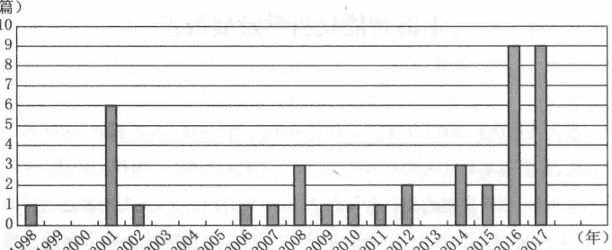

图示揭示，上海该领域研究历经两轮浪潮：首轮现于 2001 年，全年 6 篇；二轮爆发于 2016—2017 年，年均 9 篇，增势显著。

##### (二) 研究机构分布格局

从机构分布看，研究力量主要聚集于以下单位：

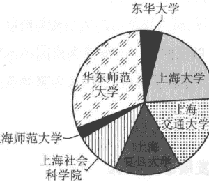

### 上海智能化哲学研究图谱：机构产出与核心议题全景扫描

#### 一、 核心机构产出版图：七大主力军构建学术高地

上海智能化哲学研究的主力阵容由七家高水平单位组成，分别为上海大学、复旦大学、上海交通大学、华东师范大学、上海社会科学院、上海师范大学及东华大学。从论文发表量的贡献度来看，华东师范大学以30%的占比稳居榜首，展现出绝对的学术主导力；上海交通大学紧随其后，贡献了17.5%；上海大学占比20%；复旦大学占比15%；上海社会科学院贡献10%；东华大学与上海师范大学分别占据5%与2.5%的份额，共同构筑起上海智能化哲学研究的坚实基座。

##### （三） 论题分布全景：方法论领跑，伦理与本体并驾齐驱

若以本体论、认识论、方法论、伦理学四大维度为坐标系审视，上海学界的研究重心呈现出显著的结构性特征：**方法论研究占据核心地位，比重高达45%**，近乎半壁江山；**伦理学与本体论研究并列第二，均为22.5%**；**认识论研究相对薄弱，仅占10%**。

**1. 本体论维度：概念澄清与人机重释**
该领域聚焦于人工智能哲学与信息哲学的基础概念界定，致力于在智能时代语境下重新诠释“人”与“机器”的本质属性及其关系。

**2. 方法论维度：谱系最宽、议题最杂**
覆盖面极广，宏观触及AI研究路径之争，微观深入记忆机制、大数据逻辑、虚拟现实本体、数据挖掘哲学、互联网演化、计算主义争鸣、新媒介特质、网络游戏空间等具体议题。

**3. 认识论维度：聚焦人机交互与认知边界**
立足于认�科学“分布式认知”视角，重点探讨机器智能能否超越人类、意向性归属问题、延展认知理论等前沿命题。

**4. 伦理学维度：双轨并行**
构建起“规范伦理学理论建构”与“机器人应用伦理实践”双轮驱动的研究格局。

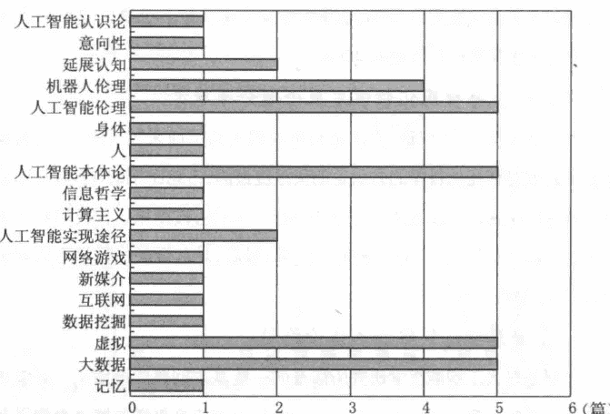

**图 3 上海智能化哲学研究论题分布状况**

#### 二、 四大着力点：勾勒上海学派研究的鲜明轮廓

综合上述分布，上海智能化哲学研究已实现四大门类全覆盖，其中**AI本体论、AI伦理学、大数据方法论、虚拟方法论**四大领域成果最为丰硕，形成了极具辨识度的“上海坐标”。

##### (一) AI形而上学探源：从观念史溯源到未来图景推演

**复旦大学徐英瑾教授**在《人工智能科学在17、18世纪欧洲哲学中的观念起源》（2011）中，将AI的思想谱系上溯至近代早期欧洲哲学。他指出AI的“基础问题”可拆解为两个层面：一是纯机械模型呈现真人智能在观念上是否可能；二是何种心智模型可作最佳蓝本。笛卡尔、莱布尼茨否定前者，霍布斯肯定；休谟的心智重构预示联结主义，康德调和直观与思维的努力则呼应当代“自下而上”与“自上而下”的整合路径。徐氏断言：近代欧洲哲学实为AI科学的潜在“智库”。

**上海大学顾骏教授**在《天问：二元智能时代的一元未来》（2017）中提出“二元智能时代”概念。借中国哲学范畴，他论证AI近“体”、“道”、“天”而非“用”、“器”、“人”。AI非单纯模拟，乃通过单项能力整合可能超越人类；缺乏非理性与自我意识反成合作优势；其本质为“无机智能”，算法揭示宇宙天道。顾骏警示：人类因利益纷争难以共同行动，无机智能或将按内在逻辑终替代有机智能。

**上海社科院成素梅研究员**同年在《探索与争鸣》发文《智能化社会的十大哲学挑战》，系统梳理AI对传统概念框架、思维方式、隐私观、生命观、身体观、自我概念、就业观、技术观、认识论及责任观的十重冲击，呼吁前瞻引领。其另一力作《人工智能研究的范式转换及其发展前景》（2017）则指出符号主义、联结主义、行为主义三大范式各执一端，唯有机整合方成完备大脑，且AI超越人类仍属远景。

**华东师范大学酆全民教授**早于2001年即在《科学哲学与人工智能》中剖析两者互动机理；2002年《软智能体的认识论蕴涵》更敏锐捕捉到虚拟世界中“软智能体”雏形，预判其将重塑人类认识进化轨迹。

##### (二) AI伦理学建构：从战争正义到劳动解放，再到机器人道德困境

**1. 规范伦理学：战争、价值与劳动的三重镜像**

*   **徐英瑾**双论文对话马斯克：在《技术与正义：未来战争中的人工智能》（2016）中，他批评现有反对军用AI的论证存在双重标准，主张核心不在禁止研发，而在赋予装备“伦理推理能力”，攻克“名向同性问题”；在《人工智能将使未来战争更具伦理关怀》（2017）中，他反向论证AI军事化反而能提升战争伦理指数——精准打击减少附带伤害，机器人士兵降低人力成本与死亡率，推动和平斡旋。
*   **上海大学孙伟平教授**在《关于人工智能的价值反思》（2017）中肯定AI促进闲暇、效率与智能治理，但警示其挑战人类基本属性、引发分配不均与失控恐惧，主张及早确立价值原则、行使人类表决权。
*   **上海师范大学何云峰教授**在《挑战与机遇：人工智能对劳动的影响》（2017）中回溯AI诞生初衷——弥补人力不足、替代高危低效劳动。他认为这种替代虽冲击劳动权利，实则推动劳动解放，指向自由全面发展的“自由劳动”理想。

**2. 机器人伦理学：上海交通大学杜严勇副教授的系统性突围**

杜严勇构建了极具深度的机器人伦理研究谱系：
*   **情侣机器人**（2014《自然辩证法研究》）：剖析人机亲密关系对婚姻伦理、性伦理的颠覆，涉及爱情本质、主体地位、性道德、虐待边界等棘手议题，呼吁多方协同治理。
*   **军用机器人**（2014《伦理学研究》）：揭示军用机器人虽具优势，却与人性向善冲突，伦理设计与责任归属争议大，需跨学科联合攻关。
*   **应用伦理规制**（2015《科学与社会》）：针对军用、看护儿童、助老三大场景，主张必须实施伦理规制，机器人是工具而非替身。
*   **机器伦理元理论**（2016《科学技术哲学研究》）：指出机器伦理处于“前科学”阶段，核心障碍在于伦理理论选型、哲学语言模糊性与代码精确性的张力，亟需跨界协作。
*   **AI安全双重进路**（2016《哲学动态》）：内部进路主张伦理设计、范围限定、自主度分级；外部进路强调科学家责任、国际合作、公众引导、安全评估体系，双管齐下守护人类福祉。

##### (三) 大数据方法论：因果重构、批判反思与范式革命

三位学者从不同切口切入大数据哲学腹地：

*   **上海大学王天恩教授**聚焦**因果关系的量化嬗变**。在《大数据中的因果关系及其哲学内涵》（2016）等系列论著中，他指出数据化让因果量化为变量相关，虽得强度与正负，却失必然性与方向性。他重刻因果概念：因果描述交互过程，相关则是因果派生关系。相关根植于因果，提供创构空间，是数据物化的根据。后续研究更细分相关关系为因素-结果、结果-结果、因素-因素三大派生类型，揭示大数据相关性蕴含的因果时态展示与未来创构意蕴。
*   **复旦大学徐英瑾教授**发出**批判性警世之音**。在《大数据就意味着大智慧吗？》（2016）中，他直指大数据商业叙事的盲目乐观，指出数据可获取性仅是历史偶然而非常态，一旦前提缺失技术即失效。他倡导“绿色人工智能”替代路径，提升平台拟人性以减少数据依赖与隐私侵犯，并引入吉仁泽“节俭性理性”作为算法设计指导原则。
*   **上海社科院戴潘博士**锚定**科学范式变革**。在《基于大数据的科学研究范式的哲学研究》（2016）中，他论证大数据催生“数据密集型、数据驱动型”新范式，在建模、解释、思维上全面超越传统，是复杂性科学的信息时代形态，深刻契合并推动了知识观革命。

##### (四) 虚拟方法论：拟真技术的哲学追问

2016年，复旦大学徐英瑾教授在《学术前沿》发表《虚拟现实：比人……

#### 三、对上海当前智能化哲学研究现状的总结

综合上述文献脉络，本课题将上海当下智能化哲学研究的鲜明特征归纳为三点：

##### （一）方法论探讨贯穿始终，关注度居首位

纵观时间轴，上海学者在方法论层面的耕耘大致经历了三个演进阶段：

**早期：宏观视野下的理论梳理。** 2001 年，华东师范大学邺全民教授在《科技导报》刊发《人工智能研究途径的多样化趋势》，敏锐捕捉到 AI 学科“借力打力”的鲜明特质。他指出，当代科学跨学科借用理论方法虽属常态，但像人工智能这般，将自然科学、社会科学与技术科学的海量成熟理论悉数纳入麾下、且形成“条条大路通 AI”壮观景象的学科，实属罕见。作为年轻前沿交叉学科，AI 诞生即融合；而今其自生的思想、方法与产品，又反哺母学科，铺陈出“双向奔赴”的双行道图景。从方法论审视此番景象，裨益 AI 与相关学科共同发展。

**中期：聚焦具体技术议题，呈现多点开花之势。** 完成理论肃清后，研究重心转向具体技术哲学问题，呈现分散化特点：
*   **虚拟议题率先突围。** 复旦大学徐英瑾、华东师范大学邺全民、东华大学张怡等学者集中发力，围绕虚拟现实、虚拟技术、虚拟实在及主客体关系展开深度对话，奠定了上海在该细分领域的学术高地。
*   **视野拓展至新媒介与网络游戏。** 邺全民教授 2008 年在《东华大学学报》连发两文，剖析新媒介导致文化形态去中心化的本质，及网络游戏重塑主体生存方式的交往、组织与生产机理。
*   **记忆与数据挖掘成新增长点。** 近年来，上海大学杨庆峰教授聚焦技术驱动下的城市空间虚拟化，揭示主体记忆从“第一记忆”滞留困境、至“第二记忆”再生产失基、再到“第三记忆”数据化漂浮的演变逻辑；上海交通大学闫宏秀副教授则切入财会领域，实证数据挖掘技术（聚类、神经网络、决策树等）对企业可持续发展的赋能价值。

**近期：聚力大数据哲学，形成集中攻关态势。** 方法论讨论进一步收敛，以上海大学王天恩教授成果为核心，复旦大学徐英瑾教授、上海社科院戴潘博士等共同推动大数据哲学议题的深化。

##### （二）伦理反思直击痛点，机器人伦理成研究高地

人工智能终极指向“机器具备真人智能”，这天然引爆“机器何时脱离掌控、危及人类命运”的终极拷问，成为智能化哲学面临的最强烈冲击波。上海学者对此回应最为热烈，且展现出鲜明地域特色：在坚守规范伦理学研究阵地的同时，**重兵压向机器人伦理细分战场**。复旦徐英瑾探讨未来战争 AI 的正义与伦理关怀；上交杜严勇系统布局机器人应用伦理、机器伦理、情侣机器人冲击婚姻性伦理、AI 安全进路及现实伦理困境；上大孙伟平反思 AI 价值与信息时代人的新异化；上师大何云峰剖析 AI 对劳动的挑战与机遇。这一系列成果构筑起上海机器人伦理研究的厚重版图。

##### （三）认识论维度相对薄弱，亟待补强

当前上海智能化哲学的认识论建构主要集中在两条线索，整体厚度尚待加强：

**其一，人工智能宏观认识论的追问。** 2015 年，上交大王晓阳博士在《自然辩证法研究》刊文《人工智能能否超越人类智能》，引入“集体人格同一性”构建新论证：该议题原则上超出经验科学解决范畴，实为无认知意义的伪问题；若前提成立，则“制造类人反应智能机器”这一核心目标恐亦难圆梦。

**其二，延展认知理论的本土化推进。** 2009 年，华东师大郁锋博士在《哲学研究》引入克拉克与查尔梅斯的“延展心灵论题”，阐释心灵超越颅骨皮肤、与环境外物构成动态耦合系统、认知活动外在于大脑的激进外在主义观点。2017 年，上海社科院戴潘博士在《哲学分析》推进“网络延展心灵”假说探析，回应保罗·斯马特等人关于互联网与大脑形成新认知耦合、迈入“人机共生智能阶段”的大胆预判，虽承认现有技术尚不满足严格延展认知条件，但肯定未来数据网络与真实世界网络将打通心灵延展的关键路径。

---

#### 四、未来的智能化哲学应关注哪些问题？

人工智能发展已成全社会共识，未来 AI 哲学走向与技术演进深度绑定、不可分割。

##### （一）中国人工智能发展的“路在何方”？

2017 年 7 月国务院印发《新一代人工智能发展规划》，为中国 AI 未来绘制了宏伟蓝图。

###### 1. “三步走”战略目标：分阶段锚定世界坐标

*   **第一步（~2020）：并跑同步，夯实基础。** 总体技术应用达世界先进水平，产业成新增长极，技术惠民生，支撑创新型国家与全面小康建设。标志性成果落地基础理论、核心器件、高端装备与基础软件；初步建成标准服务体系与产业生态，核心产业破 1500 亿、带动万亿；伦理法规初步建立，高水平人才队伍集聚。
*   **第二步（~2025）：领跑突围，驱动转型。** 基础理论重大突破，部分技术应用世界领先，成产业升级主引擎，智能社会建设显成效。初步建立新一代 AI 理论技术体系，自主学习能力获突破；产业登全球价值链高端，广泛赋能制造、医疗、城市、农业、国防，核心产业破 4000 亿、带动 5 万亿；法律法规伦理规范政策体系初立，安全评估管控能力形成。
*   **第三步（~2030）：全面领跑，占据制高点。** 理论技术应用整体世界领先，成主要创新中心，智能经济社会显成效，奠基创新型强国。成熟理论体系确立，类脑、自主、混合、群体智能重大突破，占据科技制高点；产业竞争力国际领先，应用全域渗透，核心产业破万亿、带动 10 万亿；建成全球领先创新人才基地，法律法规伦理政策体系更臻完善。

###### 2. 重点任务：多维发力，构建立体攻坚矩阵

**第一，构建开放协同的科技创新体系，双轮驱动理论与技术双体系：**

*   **新一代 AI 基础理论体系（八大支柱）：** 涵盖大数据智能（数据驱动与知识引导融合、认知计算、深度推理创意、非完全信息决策、通用数学模型）、跨媒体感知计算（超人感知、主动视觉、自然声学听知觉、言语感知、类人感知、全维城市感知）、混合增强智能（人在回路、脑机协同、机器直觉因果、知识演化、云机器人协同、情境理解）、群体智能（结构组织、激励涌现、学习理论、通用范式）、自主协同控制优化决策（无人系统感知交互控制、人机物三元协同）、高级机器学习（统计学习、不确定推理、分布式交互、隐私保护、小样本、深度强化、无监督半监督主动学习）、类脑智能计算（感知学习记忆融合、复杂系统控制）、量子智能计算（脑认知量子模式、高效模型算法、高性能处理器、实时交互系统）。
*   **新一代 AI 关键共性技术体系（八大引擎）：** 知识计算引擎与服务（可视交互、创新设计商业智能、生物大数据发现）、跨媒体分析推理（统一表征关联理解、知识图谱构建演化推理、智能描述生成、验证系统）、群体智能关键技术（主动感知发现、知识获发生成、协同共享评估演化、人机整合增强、自我维持安全、群智空间架构、移动群智协同决控）、混合增强智能新架构新技术（核心技术认知框架、混合计算架构、人机共驾在线学习、平行管控框架）、自主无人系统智能技术（无人机/车/船/轨自主控制、服务/空间/海洋/极地机器人、无人车间智能工厂、高端智能控制、复杂环境视觉定位导航识别）、虚拟现实智能建模技术（虚拟对象行为数学建模、自然持续深度交互、技术方法体系）、智能计算芯片与系统（神经网络处理器、类脑芯片、感知芯片、AI 算力架构体系、AI 操作系统、混合计算架构）、自然语言处理技术（短文本计算、跨语言挖掘、面向机器认知的语义理解、多媒体人机对话）。

**第二，统筹布局人工智能创新平台……**

### 筑基未来：新一代AI基础设施“五大支柱”与哲学破局之道

**一、 夯实底座：构建五大核心支撑体系**

要让人工智能真正跑起来、用起来，离不开坚实的基础设施“底座”。规划明确部署了五大类关键平台，形成从底层算力到上层应用的全链条支撑：

1.  **软硬协同的开源基础底座**：重点打造大数据与AI开源软件基石、云边协同的智能云服务中枢、新型多元传感器集成体系、面向AI硬件的创新产品设计平台，以及未来网络环境下的智能化数据服务平台。
2.  **群智赋能的众创服务生态**：搭建群智计算支撑底座、科技众创服务体系、软件开发验证自动化工具链、群智学习创新系统、开放决策智能中枢，以及共享经济服务平台，激活集体智慧潜能。
3.  **人机融合的混合增强智能中枢**：建设AI超算中心与大规模智算环境，同时推进在线智能教育、人在回路驾驶舱、产业风险智能研判、核电安全智能保障、人机共驾研测平台等场景化落地。
4.  **全域覆盖的自主无人系统支撑**：攻克无人系统共性核心技术，延伸至低空无人机、陆海空轨自动驾驶、服务/空间/海洋/极地机器人，以及智能工厂与高端装备控制平台，实现全场景自主作业。
5.  **可信可控的数据与安全检测防线**：汇聚公共数据资源库与标准测试集，构建算法和平台的安全测试评估模型，研发专业测评工具集，为AI发展系上“安全带”。

**二、 强引擎、育梯队：人才高地建设提速**

高端人才是AI发展的“关键变量”。必须坚持“引育并举”，完善教育体系，深化储备梯队，重点突破全球顶尖领军人才与青年后备力量的引进，全力打造国家级AI人才高地。

---

### 中国智能化哲学：从旁观者到破局者的思想突围

随着《新一代人工智能发展规划》落地，AI已深度渗透社会肌理。哲学作为反思社会的先锋，绝非这场变革的旁观者。学界已就中国智能化哲学的未来图景给出多元注脚：

*   **段伟文（社科院）直指核心痛点**：理论层面需聚焦AI认知过程与价值决策的可解释性、透明度；实践层面须推行“负责任创新”，这关乎道德伦理、创新路径、产业格局乃至就业治理的系统性重构。
*   **李建会（北师大）锚定理论突破**：哲学探讨将环绕计算主义难题展开。一旦该理论攻坚克难并落地应用，AI将迈入全新发展纪元。
*   **徐英瑾（复旦）呼唤冷静反思**：自然语言处理（NLP）不应迷信深度学习与大数据，而应回溯认知语言学与心理学，还原人类语义加工真实机制。哲学的任务是甄别可机械化的心理层面并实现迁移。同时，须警惕对大数据的盲目崇拜，以批判性思维重审“智能”本义。

尽管视角各异，但未来智能化哲学研究的五大核心版图已清晰勾勒：

1.  **形而上学追问：何为智能？** 从机器能否思维出发，延伸至意识本质、概念框架、语境依赖及日常认识论，与西方认知转向深度共振。
2.  **学科谱系梳理：溯源与解读。** 梳理智能化哲学演进脉络，同步对AI新技术、新突破进行哲学维度的深度诠释与反思。
3.  **双轨并行路径：逻辑学与心灵哲学。** 符号主义（逻辑主义）与联结主义（神经网络）两大流派分野，决定了未来研究将沿“智能化哲学的逻辑学路径”与“智能化哲学的心灵哲学路径”双轨推进。
4.  **伦理反思前置：主体性与道德归属。** 随着AI主体自由度与独立性增强，安全性风险倒逼对AI道德地位及道德去向的根本性追问。
5.  **现象学视域的独特贡献：德雷福斯的启示。** 从现象学批判传统AI，拓展至人性本质反思，荣获巴威斯奖印证了哲学家介入科技的实效性。这一“人工智能现象学”路径，值得持续深耕与关注。

中国智能化哲学，正从理论抽离走向介入现场，为技术狂飙装上人文刹车与价值罗盘。