# 人工智能的经济影响研究：以中国制造业工业机器人为例


## 前言

人工智能作为一种战略技术引领新的科技革命和产业变革已成趋势，在极大推动生产力的发展、丰富物质财富的同时，重构人类生活、生产、学习和思维的方式，对政治、经济、社会产生重大影响。我国已制定国家战略并采取多种措施促进人工智能技术及产业的发展。2019 年 3 月 19 日，中央全面深化改革委员会第七次会议上通过《关于促进人工智能和实体经济深度融合的指导意见》，同时会议指出，促进人工智能和实体经济深度融合，要把握新一代人工智能发展的特点，坚持以市场需求为导向，以产业应用为目标，深化改革创新，优化制度环境，激发企业创新活力和内生动力，结合不同行业、不同区域特点，探索创新成果应用转化的路径和方法，构建数据驱动、人机协同、跨界融合、共创分享的智能经济形态。这反映出我国对人工智能产生的经济影响的高度重视。

在人工智能应用于经济发展的过程中，很多研究及实践都表明，在被用于为人类服务的同时，人工智能也可能在一些领域替代人类。因此，有必要梳理人工智能对产业发展影响的机制，并分析其在经济发展过程中，对劳动力的影响，以及人工智能的使用对经济发展的影响。

现代制造业自动化水平高、工序要求明确，与当前的人工智能发展阶段较为匹配，因此将人工智能应用于制造业正逐渐成为潮流。而工业机器人则是人工智能在制造业应用的主要方式之一。

我国是全球制造业大国，但当前，我国老龄化程度不断加重，制造业面临劳动力供给降低、成本上升等问题。同时，发达国家或地区的“制造业回流”计划对我国的高端制造业形成冲击。因此，在分析人工智能对经济影响时，考虑到制造业对我国经济及就业的重要性和数据的可得性，本书以我国制造业工业机器人为研究对象，探究其产生的经济及就业的影响。

第 1 章为导论。主要阐述本书的研究背景与意义，在此基础上，概括研究的关键问题。

第 2 章为理论基础与文献综述。对技术进步、人工智能及工业机器人等新技术对劳动力影响的相关理论及实证研究进行了梳理和总结，在此基础上，建立分析框架。

第 3 章为中外工业机器人发展与政策分析。回顾了主要工业机器人强国发展历程及相关产业政策，并与我国的政策进行比较分析。同时，分析了全球及我国工业机器人的发展现状，为我国工业机器人发展找差距、学经验、提速度提供了借鉴的对象。

第 4 章为中外工业机器人发展水平比较与参照国筛选。利用时序全局主成分分析形成综合多维评价指标体系，通过时间维度的比较，得出美国、日本、韩国和德国长期占据国际工业机器人发展的领先地位。在综合考虑多种因素的情况下，筛选出美国、德国和韩国作为我国工业机器人发展的参照对象。

第 5 章为工业机器人发展对我国劳动力的影响研究。首先对人口、劳动力的预测方法进行回顾，也对人工智能影响劳动力的方法进行回顾，并根据本书分析及写作的需要，选择了技能-工作任务匹配均衡模型作为分析的方法。然后计算我国工业机器人与劳动力规模及结构之间的关系。除了分析劳动力总体情况外，还分析了制造业中各细分行业工业机器人对劳动力规模的影响。最后预测未来的人口及劳动力状况，分析工业机器人对劳动力缺口的替代水平，以及对总体规模的影响，为下一步分析工业机器人的经济影响做好铺垫。

第 6 章为工业机器人发展对我国经济的影响研究。采用改进的可计算一般均衡（CGE）模型，建立对我国经济发展状况进行全面分析的政策模型。根据德国、美国和韩国的工业机器人发展历程及多个细分行业的劳动与资本要素弹性系数的情况，设置我国制造业及其细分行业工业机器人增长情景和弹性系数变化情景。参照德国、美国和韩国的工业机器人发展水平，以及不同工业机器人发展情景下带来的分行业劳动力规模变动，模拟未来我国经济、不同产业及制造业各行业经济发展的变化。

第 7 章为主要研究结论与政策建议。总结本书的主要研究结论，并提出相关的政策建议。

李舒沁

2019 年 9 月

## 第 1 章 导论

### 1.1 研究背景与意义

人工智能（artificial intelligence，AI）作为一种战略技术引领新的科技革命和产业变革已成趋势，这场全新的变革的核心是在信息化基础上的智能化。人工智能在极大推动生产力发展、丰富物质财富的同时，重构人类生产、生活、学习和思维的方式，对政治、经济、社会、文化产生重大影响，由此，一些国家已将人工智能上升为国家重大发展战略，我国也已制定国家战略并采取多种措施促进人工智能技术及产业的发展。2019 年 3 月 19 日，中央全面深化改革委员会第七次会议上通过《关于促进人工智能和实体经济深度融合的指导意见》，同时会议指出，促进人工智能和实体经济深度融合，要把握新一代人工智能发展的特点，坚持以市场需求为导向，以产业应用为目标，深化改革创新，优化制度环境，激发企业创新活力和内生动力，结合不同行业、不同区域特点，探索创新成果应用转化的路径和方法，构建数据驱动、人机协同、跨界融合、共创分享的智能经济形态。

人工智能的强大能力已经引起了世人的瞩目，其不但在很多常规性、日常性工作方面表现出极高的效率和准确性，而且在被认为需要依靠人的感性因素的领域，如围棋、绘画、作曲等方面，也开始表现出与人类相近的能力，甚至有所胜出。一方面，这种能力可以更好地为人类服务，另一方面，这种能力力使得人工智能有可能在未来、在不同领域取代人类。

从理论角度和现实角度看，劳动力都是经济发展中的重要因素。从理论角度看，劳动价值论是马克思主义政治经济学的基础理论，为揭示剩余价值的来源奠定了基础，也揭示了商品经济的一般规律。科布-道格拉斯生产函数则反映了劳动力与资本的替代关系，以及与经济活动、经济增长的密切关系。劳动力的数量可能对经济产生影响，劳动力的教育结构、就业结构等也可能对经济产生影响。因此，从理论角度看，在研究劳动力问题时，有必要考虑劳动力对经济的影响，以及二者的互动关系。

从现实角度看，经济增长需要依靠劳动创造和资本投入，并能反过来促进就业，促进一个经济体的良性发展。经济增长与就业不可偏废，这也是各国政府将发展经济与保障就业放在重要地位的原因之一。在 2019 年全国两会的政府报告中，李克强总理提出，2019 年经济社会发展的主要预期目标是：国内生产总值增长 6% ~ 6.5% ；城镇新增就业 1100万人以上，城镇调查失业率在 5.5% 左右，城镇登记失业率在 4.5% 以内。人工智能技术既关系经济发展又关系就业，因此极有必要梳理人工智能对产业发展的影响机制，分析其对劳动力替代的可能性及规模，并进一步探索对经济产生的影响。由于人工智能涉及技术及产业领域过于宽泛，考虑到对中国经济及就业的重要性及数据的可得性，本书以制造业的工业机器人为重点，探索其对经济及就业的影响，力争研究成果能在理论与方法上有所创新，在实践上为国家制定相关政策提供支持。

#### 1.1.1 人工智能的发展及对劳动力与经济的影响

人工智能目前已成为人尽皆知的概念，但对其定义尚未形成普遍的共识。对于其概念的探讨，有助于厘清人工智能运用于现实工作的边界，是分析其影响的重要基础。在人工智能的发展初期，其发展思路是研究人类如何产生智能，然后让机器学习人类的思维、行动能力，成为“思考机器”，并在未来能够超越人类的相应能力（McCorduck，2004）。目前对人工智能概念较为全面的描述来自麻省理工学院（Massachusetts Institute of Technology，MIT）电气工程领域的研究，即人工智能是一个有机整体，是通过模型建立的关于思维、感知和行动的表达系统，以生成测试法为基本运行方式，这一系统存在一定的约束条件，并通过算法（程序或方法）实现约束条件的作用（Finlayson et al.，2010）。国内学者也提出了相似的定义，如为实现特定任务目标而创造的能够表现出与人类能力（认知、思维或行动）相似水平的技术，这一技术需要借助相应的载体（工具）及应用环境发挥作用（杨伟国等，2018）。这表明，在当前技术条件下，人工智能的定义着重关注于让机器能够学习并掌握人脑解决问题的能力。这种能力是显性的、具有可操作性、能够进行理解和研究的。从完成人类社会的工作能力划分，人工智能被划分为“弱人工智能”、“强人工智能”和“超人工智能”。“弱人工智能”表示只专注于某项特定任务，如机器翻译、图像识别等；“强人工智能”系统包括学习、语言、推理、创造等能力，从而使人工智能在非监督学习情况下处理前所未有的情况，并与人类展开交互式学习（杨婕，2017），这类似于 Finlayson 等（2010）对人工智能的描述；“超人工智能”指通过模拟人类的智慧，人工智能开始具备自主思维意识，可以独立思考，这类似于发展初期对人工智能概念的描绘。

目前，“弱人工智能”已经得到较为充分的发挥，其典型代表——AlphaGo已经可以战胜人类的顶级围棋选手。虽然尚未进入“强人工智能”时期，但各国已先后提出相关计划，推动人工智能发展。欧盟于 2013 年提出人类大脑研究项目——“人类人脑计划”（human brain project，HBP），计划于 2024 年（项目最终阶段），设计出能模拟人脑运作原理的超级计算机，并促进研究成果的应用性转化（杨婕和姚财福，2017）。美国于同年提出“推进创新神经技术脑研究计划”，以探索大脑工作机理，并于 2014 年与欧盟的“人类人脑计划”展开合作，以覆盖更多研究领域。我国于 2016 年制定《“互联网+”人工智能三年行动实施方案》，促进人工智能产业体系和总体技术与国际同步，2017 年 7 月，国务院在印发的《新一代人工智能发展规划》中详细列出了我国新一代人工智能发展的战略目标，并对所要达到的技术水平、核心及带动产业规模提出了阶段性目标。

随着人工智能技术发展目标的逐渐实现，人工智能将完成更多、更复杂的任务，形成新的业态，也将对产业结构和就业结构产生更深远的影响。在农业方面，发展以人工智能技术为核心的智能农业已成为我国农业创新发展的必然方向。在制造业方面，利用人工智能等技术与实体经济进行深度融合，改变生产方式，从而提升设计和生产的效率、提升劳动生产率，对制造过程形成主动感知并加以自动调整和控制，提高质量、降低成本，进一步推动制造业由劳动密集型、资本密集型向信息密集型转变（陈天一，2017）。在服务业方面，利用人工智能与传统服务业相结合，提高对客户服务的精准程度等。总之，只要运用得当，人工智能可以对国民经济各个产业的发展起到积极作用。

当前，人工智能对高风险、高人工成本、高重复性的就业岗位具有一定程度的替代性。同时，人工智能也将创造大量的就业岗位：一是发展与人工智能相关的各种技术岗位，二是发展与人工智能相配套的基础设施建设相关的就业岗位。人工智能对就业的影响仅限于此吗？答案恐怕是否定的。然而，想要进一步对这个问题做出清晰且令人信服的回答是很困难的。鉴于制造业在国民经济中的重要作用，本研究以制造业作为研究领域。

#### 1.1.2 制造业的重要作用及人工智能的影响

对于世界大多数国家来说，制造业具有举足轻重的地位。其重要作用主要有四点：一是制造业是创造财富的主导部门。世界上很多国家的财富积累都来自制造业。发达国家在财富积累阶段，其制造业 GDP 占比很多超过 40%。而且制造业的劳动生产率高于第三产业。对我国来说，自中华人民共和国成立以来，我国制造业创造产值占当年 GDP 的比例长期保持在 35% 以上，特别是改革开放以来，制造业产值增长长期高于当年 GDP 增速，是我国经济长期高速发展的源泉（李钢等，2011）。二是制造业是创造就业的重要部门。美国自 21 世纪初向国外输出制造业，本土经济增长更多依赖金融业、房地产等服务业及研发机构，美国制造业劳动力占比持续下降，至 2017 年仅占 8.5%，同时拉大了贫富差距。这也是美国政府持续推动“制造业回流”的原因之一。而我国的制造业曾经以劳动密集型为主，吸纳的劳动力连续多年占总劳动力规模的比例较高，也为农民进城务工、增加收入创造了条件。三是制造业对产业链起带动作用。制造业是很多行业发展的基础，向前可以延伸至研发、设计、教育，向后则可以延伸至运输、现代服务、金融等产业。四是制造业的发达水平关系到国家的核心竞争力。以美国为例，尽管 2017 年其制造业仅占 GDP 的 11.6%，但由于其掌握高端制造业，如高性能芯片、高性能航空发动机、大型客机等，其有资本在同其他国家的贸易摩擦中以威胁禁运高技术产品的方式，向别国施加压力。因此，世界主要国家都在持续推动制造业的技术进步，在制造业中引入人工智能等先进技术以提高国际竞争力。

制造业的技术进步，长期伴随着对劳动力的替代。自工业革命以来，蒸汽机、内燃机、电动机的发明与发展，从提供动力的环节取代了人力和畜力。而机器在获得动力后，可靠性的不断提高和功能的逐渐丰富，提高了生产效率又降低了成本。当单位生产成本低于人力时，在生产环节也对劳动力产生替代效应。随着信息技术、传感器等的出现、引入和发展，制造业的自动化程度提高，使机器在程序化、重复性工作中表现出更好的精确性和稳定性，对具有较高技能的劳动力产生了一定的替代作用。因此，如果将人工智能技术引入制造业，随着人工智能发展水平的提高，与制造业各个环节的结合程度上升，有可能出现新的劳动力被替代的现象。对于我国来说，制造业既有相对较高的标准化程度，同时属于劳动密集型制造业的中低端制造业占比较高，因此，在制造业中引入人工智能，可能会出现较大规模劳动力被替代的情况。因此，需要分析这一影响的程度，以及可能带来的经济影响。


#### 1.1.3 工业机器人是当代制造业技术进步的集中体现

制造业的技术进步及升级，主要体现在自动化、智能化程度的提高。在产业链的各个环节，都有可以体现自动化的技术，值得分析其对制造业劳动力的影响。但技术种类众多，如果都进行分析，较难厘清不同技术对生产环节影响的范围，分析既无法全面，也难以深入。在这些技术中，工业机器人的概念定义相对较为明确，而且目前制造业中的工业机器人主要用于流水线作业，所完成的任务相对独立，对生产环节的影响相对清晰。同时，在全球主要科技强国发表的人工智能相关论文中，数量排在第四位的基本都是机器人技术，仅次于计算机科学、工程和自动化控制系统（清华大学中国科技政策研究中心，2018）。这表明对于工业机器人的研究具有较好的基础，因此本书以工业机器人为代表，说明人工智能对制造业劳动力的影响，乃至于经济产生的影响。

根据国际机器人联合会（International Federation of Robotics，IFR）的定义，工业机器人是一种可以自动控制、可重复编程并实现多种目的的机器。该定义尽管排除了一些其他在制造业中可以影响劳动力的技术，但由于定义具有全球一致性，各国的技术也具有相似性，基于该定义进行的工业机器人对劳动力影响的分析，其结果可以用于国际比较。

在人工智能背景下，工业机器人具有可编程功能，新技术可以通过工业机器人实现与传统制造业的衔接。以往工业机器人主要是作为人的四肢的延伸，提升力量和重复性劳动的准确性。通过引入人工智能技术，工业机器人通过机器学习，可以逐渐发展为对人脑的扩充，不仅可以进一步提高劳动生产率，还可以在运行过程中，进行主动纠错，提出合理的改进建议。这种学习、改进能力的提高，甚至有可能改变制造业生产方式，降低推广柔性制造和敏捷制造等先进制造的门槛，为制造业的升级改造提供实际的技术支撑。同时，工业机器人的发展与人工智能技术和制造业的融合相互促进，软硬件水平共同提高，不断改良工作流程并提高效率，成为制造业中技术进步的集中体现。

#### 1.1.4 本书研究的现实意义

本书研究的现实意义就是探讨在我国“后人口红利”时期，工业机器人的劳动力替代情况以及对经济的影响程度。

我国之所以能在中华人民共和国成立以来，特别是改革开放以来创造经济增长的奇迹，除了招商引资、对外开放等外部的和政策的因素外，最重要的因素就是拥有一个庞大而成本相对低廉、受过基本教育的制造业劳动力队伍带来的成本优势。凭借这一优势，我国制造业快速发展，进而推动了国民经济的增长。伴随着城镇化的推进，农村剩余劳动力向城镇转移，为制造业提供了大量的劳动力。但值得注意的是，中国经济的快速发展依赖于“人口红利”，但“人口红利”并非用之不竭。我国的制造业面临“人口红利”即将耗尽的负面影响：一是刘易斯拐点即将到来，农村剩余劳动力转移殆尽，新增劳动力的规模在下降。二是劳动年龄人口总规模出现净减少。2012年，我国的劳动年龄人口为9.37亿人，较前一年减少345万人，出现了改革开放以来首次劳动年龄人口绝对数量的减少。三是老龄化程度提高。我国以大于60岁老年人口占比来衡量老龄化水平，其于2000年已达到10%，在2015年全国1%人口抽样调查时达到16.15%。据《中国劳动力动态调查：2017年报告》，截至2016年，全国的劳动力平均年龄为37.62岁，高于印度的28岁和印度尼西亚的27岁。四是劳动力成本上升较为迅速。根据2018年的《中国与全球制造业竞争力》报告，在2008年金融危机后，大多数经济体的平均劳动力成本上升在大幅度放缓的时候，中国制造业的平均劳动力成本增长速度却从危机前的11.0%攀升到危机后的13.1%，为全球主要制造业国家的最高水平。相比之下，印度从10.6%降到4.7%，巴西和俄罗斯的平均劳动力成本则出现了绝对意义上的下降。因此，跨国公司及部分劳动密集型中国企业开始外迁。五是从事制造业的劳动年龄人口规模下降。我国的加工出口型制造业在全球价值链中处于较为低端的位置，在产品的全球利润分配中所得较少，能够承担的劳动力成本较低。在利润不足、工资提升有限的情况下，制造业对劳动年龄人口吸引力降低，年轻人更多地选择从事服务业，因为服务业工作相对更为轻松，收益也更高。

从外部环境看，全球虚拟经济在2008年金融危机后受挫，全球经济低迷，发达国家开始重新重视制造业的发展，提出多种鼓励“制造业回流”、重振制造业的政策。这些政策均具有一个显著特点，就是发展智能工业机器人。主要发达国家的战略包括德国提出的“德国工业4.0”战略，希望利用“智能生产”在制造业领域继续保持优势；美国在奥巴马政府时期提出“再工业化”战略，特朗普上任后又提出“制造业回流”，希望再创美国制造业的辉煌；日本为保持机器人领域的国际优势地位，制定了新的发展战略；韩国发布了“机器人未来战略展望2022”，提升机器人领域的国际竞争力。各国都试图通过发展智能工业机器人，对我国制造业发起冲击。这种冲击，不再是单位成本和生产效率等生产线层面的竞争，而是产品的定制化、生产的柔性化等高端层面的竞争。

以上情况表明，我国制造业面临国内外多种不利因素，既受到其他发展中国家的成本挤压，还面临发达国家的先进制造技术的挑战。中国制造业如果想降低“后人口红利”时期对廉价劳动力的依赖，在人工智能时代继续保持和提高国际竞争力，就需要加强技术改造升级，推进信息化与制造业的深度融合。为此，我国于2015年5月印发了《中国制造2025》，将机器人产业摆在突出的位置，明确规定了我国工业机器人发展的目标、重点任务和重点产品及技术路线图。

因此，在人口老龄化背景下，分析工业机器人与制造业劳动力的关系，以及对经济发展带来的影响，将具有重要的现实意义，也能为政府决策提供参考。

#### 1.1.5 本书研究的理论意义

在经济发展过程中，技术进步对劳动力的替代是一个长期受到关注的热点问题。在古典政治经济学理论中，大卫·李嘉图（2013）认为技术进步对就业的消极作用超过了积极作用，最终形成结构性失业。熊彼特在分析创新的过程中认为创新具有周期性，而带来的对旧技术及工业体系的破坏性可以为解释周期性失业提供理论基础（曹希敬和胡维佳，2014）。马克思则从“机器大生产”视角说明对于机器效率的衡量来自其替代的人类劳动程度。多种生产函数也都表明资本投入对劳动力具有替代作用。新增长理论指出要素，特别是人力资本可以通过再教育、培训等手段实现收益递增，从而能在技术进步与就业增长间实现良性循环。不过，接受教育、培训需要一定的时间才能看到适应新技术的效果，因此在此期间，也会存在暂时性失业。

这些理论从不同角度阐释了技术进步对劳动力的替代。不过，人工智能这一技术具有较强的颠覆性，但各行各业应用人工智能的效果各异，不能一概而论。因此，目前对于人工智能对劳动力替代的分析，不少来自于相关科学家、企业、机构负责人的调查，以说明在某一行业或领域可能被替代的劳动力比例，缺少较为直接的、定量的计算。而涉及制造业中工业机器人带来的替代效应的研究相对就更少了。这种替代对未来经济产生何种影响，也是当前研究中较为缺乏的。

本书以“人工智能的经济影响研究——以中国制造业工业机器人为例”为题开展研究，就是试图探索以量化方式来衡量制造业中工业机器人对劳动力的替代，在此基础上，模拟对未来经济的影响，为该领域的学术研究提供理论证据。

### 1.2 研究的关键问题

围绕“制造业工业机器人对劳动力及经济的影响”这一研究主题，需要研究以下两个关键问题。

一是制造业中工业机器人规模同劳动力规模的关系。这一问题是讨论技术进步与劳动力替代中的常见问题。以往不少的研究分析了新技术同劳动力规模之间的关系，不过涉及的新技术，多是现有技术的改进，具有较为明确的应用形式，应用领域范围较窄或者较为专业，比较容易计算因此带来的劳动力替代水平。人工智能是一种具有颠覆性的、应用形态各异、可与多种行业相结合的技术，其使用范围界定较为困难，应用领域较为广泛。因此，在本书中，首先面临的问题是如何界定人工智能在制造业中的应用方式，然后才能开展下一步的研究。本书通过已有模型及分析筛选后的模型，首先对制造业总体工业机器人规模同劳动力规模的关系进行分析，获得二者的相关系数，为估算未来可能有多少劳动力被替代奠定基础。然后分析不同行业的工业机器人规模同劳动力规模的关系，并得到制造业中不同行业内二者的相关系数，为在可计算一般均衡（computable general equilibrium，CGE）模型中计算各行业劳动力规模变化奠定基础。

二是工业机器人发展带来的劳动力替代，以及不同的发展模式对经济的影响。一方面是制造业劳动力规模的变化，包括总体规模和各行业被替代的规模。由于中国当前劳动年龄人口绝对数已出现拐点，从事制造业的劳动力人口也在下降，根据人口预测模型的结果，可估算未来的劳动年龄人口存在下降趋势。因此未来工业机器人替代的劳动力规模很可能在一定程度上弥补了制造业劳动力的缺口，并以此支撑中国制造业可持续发展。另一方面是在劳动力工资上涨的情况下，通过投资可批量制造的工业机器人降低生产成本，从而进一步提高制造业的效益和竞争力，并保持对经济的推动作用。在参考不同国家工业机器人的发展模式下，利用CGE模型，分析我国在不同的工业机器人发展情景下的宏观经济变化情况。

在分析国内人工智能同制造业劳动力规模的关系时，遇到的难点包括两方面：一是数据基础较为薄弱，二是需要选择合适的方法。我国工业机器人的大规模使用起步较晚，在2008年金融危机后进入快速增长期，而且统计数据相对国外有所不足，对于很好实现国外研究中对各行业的分析存在一定难度，需要从多种渠道获得数据。由于数据基础的不足，在方法选择上也异于国外。按行业统计的工业机器人数量仍然与总量存在一定差异，因此在计算分行业工业机器人影响时，可以使用国外现有的研究方法，而在计算总体关系时，则需要根据实际情况，使用多种模型分析比较，并从中选择效果最好的模型。

### 1.3 技术路线

首先明确研究范围，即以工业机器人作为人工智能在制造业中应用的具体体现。通过回顾几个典型国家工业机器人发展历程及相关政策，并从不同角度对全球工业机器人发展现状进行对比分析，归纳总结中国制造业工业机器人发展过程中的特点及问题。

然后根据现有数据分析制造业总体工业机器人规模同劳动力规模的关系，探讨我国工业机器人的发展在何种程度上弥补老龄化程度加重带来的劳动力缺口。在制造业细分行业背景下，计算工业机器人变化对各细分行业劳动力规模的影响，为CGE模型的情景设置提供参考。

通过运用时序全局主成分分析，从多维度对各工业机器人发展强国开展比较分析，并根据相关指标取值，从中挑选出适于我国参考借鉴的国家，形成CGE模型中工业机器人的不同发展情景。

以CGE模型系统模拟工业机器人发展对我国宏观经济发展的影响。利用所选国家的发展模式作为不同发展情景，根据细分行业工业机器人对劳动力规模的影响，计算不同情景下，各细分行业劳动力规模的变化，以及由此带来的宏观经济指标的变化。根据计算结果，总结出适合我国工业机器人发展的模式及特点，为制定相关产业政策提供实证依据。

### 1.4 主要研究方法

- (1) 技能-工作任务匹配均衡模型

Acemoglu和Restrepo（2017, 2018）使用技能-工作任务匹配均衡模型就机器人使用对宏观经济的影响效应进行了富有成效的理论和实证研究。该模型适合用于分析细分行业中工业机器人与劳动力规模的关系。因此在本书中，主要将其用于分析我国制造业细分行业的工业机器人规模同劳动力规模之间的关系。

- (2) 最小二乘回归

本书中，由于统计数据的限制，制造业工业机器人的总体规模较难完全分配给各个行业，需要利用总体数据进行计算。最小二乘回归方法已经被近年来国内外相关研究采用，并用于分析工业机器人规模同劳动力规模之间的关系，具有一定的研究基础。因此，本书也将利用该方法加以分析。

- (3) 多状态人口预测模型

多状态人口预测（population development environment，PDE）模型是由国际应用系统分析研究所（International Institute for Applied Systems Analysis，IIASA）开发的一个人口预测模型，该模型在一般人口预测模型的基础上加入了受教育水平，以及与受教育水平相应的生育水平，可以为我国未来人口提供更接近实际的预测结果。本书将主要用来估计未来的劳动力总体规模。在计算工业机器人替代的劳动力规模后，结合人口预测结果，即可得到新的劳动力规模。该计算结果可以应用到CGE模型中，为模拟劳动力规模在未来经济变动中的作用提供参数。

- (4) 时序全局主成分分析

主成分分析是一种常见的降维、建立指标体系的统计学方法。它利用相关变量间的共同作用关系，将各指标线性组合成为新的综合指标。在本书中，各国涉及工业机器人的指标较多，且具有一定的时间跨度，形成了面板数据。为了对包含时间变化的数据进行降维、分类，使用加入时间维度的时序全局主成分分析。

本书利用SPSS 22.0软件实现这一分析。SPSS 22.0软件是社会科学研究中常用的分析软件。本书主要是进行时序全局主成分分析，对多国、多年的工业机器人相关数据降维，并根据结果得到主成分得分矩阵，从而计算各国在新的主成分上的得分，并进行比较排序。在此基础上，利用其自带的绘图功能，绘制各国在不同指标上的得分和排名。

- (5) CGE模型

CGE模型利用一组方程描述供给、需求及市场关系。在这一组方程中，投入的要素与产出的商品是变量，工资、价格等也都是变量。通过一系列优化条件的约束，得到在各个市场都可均衡的一组数量和价格。本书在获得工业机器人的投入与工资之间关系的基础上，基于不同的工业机器人发展前景、劳动力规模变化产生的工资变化情景，以CGE模型为手段，计算出各情景下不同的经济效果，从而得到工业机器人替代劳动力带来的经济影响。

本书将使用Matlab R2016a开展CGE模型对工业机器人变化带来的影响进行模拟。Matlab是MathWorks公司开发的功能丰富的工程计算软件，在矩阵运算方面优势明显。本书主要用于对CGE模型方程组的解算。由于CGE模型是由N个方程联立，系数可形成一个N行的矩阵。利用Matlab进行编程、解算，可在一定程度上避免陷入局部最优的状况。因此本书使用Matlab建立CGE模型并进行分析。

### 1.5 著作结构

本书共分为7章。第1章为导论。主要介绍本书的研究背景与意义，研究的关键问题，技术路线及主要特色。第2章为理论基础与文献综述。主要是根据研究问题，对以往相关文献进行分析、综述，总结已有研究的分析视角和主要观点，探索其中尚未得到较好解决的问题，或随着时间变化，对以往研究产生的不同认识，说明研究的必要性，并形成研究需要解决的具体问题，提出本书分析的逻辑框架。第3章为中外工业机器人发展与政策分析。从不同角度对全球工业机器人发展现状进行对比分析，并从中探索符合中国工业机器人发展过程的特点。同时，总结我国发展过程中的不足。第4章为中外工业机器人发展水平比较与参照国筛选。通过对工业机器人应用强国进行多维度综合动态比较，筛选出未来可供CGE模型设置情景的参照国。以新的三维综合纵向评价指标体系得分，对我国及14个其他国家进行排名分析及时间维度比较，筛选出适于我国参照的国家，并为CGE模型提供发展情景。第5章为工业机器人发展对我国劳动力的影响研究。利用PDE模型，对截至2035年的中国人口进行预测。根据工业机器人对不同类型受教育水平劳动力的替代结果，分析工业机器人对劳动力缺口的填补程度。在此基础上，计算工业机器人对分行业劳动力规模的影响，为CGE模型中的情景设置提供依据。第6章为工业机器人发展对我国经济的影响研究。根据第3～5章形成的分析结果和不同的工业机器人发展情景，设置劳动力规模变动情景，并调整劳动与资本要素的替代弹性系数，完成CGE模型的多种情景设置。基于已建立的CGE模型，根据不同的就业规模变动情景，以及资本与劳动力间的弹性，得到截至2035年的经济指标运算结果并加以讨论。第7章为主要研究结论与政策建议。针对得到的不同影响结果，提出汇总整理后的结论，并就制造业中工业机器人的使用，以及工业机器人产业的发展提出相应的政策建议。

### 1.6 本书研究主要特色

一是基于实证分析提出有利于我国经济增长的工业机器人发展“中国模式”。本书参照工业机器人发达国家发展经验，对我国制造业相关的不同细分行业提出各自的发展模式，形成有利于我国整体经济增长的工业机器人发展模式。

二是分析了工业机器人对劳动力的影响与老龄化背景下我国劳动力缺口之间的关系。根据工业机器人与不同受教育水平劳动力的关系，通过预测未来劳动力的规模与教育结构，估算工业机器人的发展填补劳动力缺口的程度，为推动工业机器人的使用，降低对“机器换人”的担忧提供实证支持。

三是构建工业机器人的三维动态综合评价指标体系，并从时间维度对包括中国在内的15个工业机器人主要使用国进行动态评价比较。结果显示，中国在工业机器人领域发展迅速，也表明在分析未来我国工业机器人发展时，有必要参照基于新指标体系得分筛选的美国、韩国和德国这三个工业机器人强国。

四是评估、计算不同工业机器人发展模式带来的就业与宏观经济影响，在分别考虑制造业多部门资本、劳动要素弹性系数是否改变的情况下，模拟不同工业机器人发展情景对分行业劳动力规模及经济的影响。

## 第 2 章 理论基础与文献综述

人工智能、工业机器人作为新兴技术，其从表现形式上与以往的技术有所差异。由于发展历程较短，与技术进步影响就业的研究相比，其研究数量相对较少。为了深入研究人工智能、工业机器人对就业可能产生何种影响，有必要回顾技术进步影响就业的相关文献，回顾相关理论与途径，从而为人工智能、工业机器人等技术影响就业的研究提供基础。

### 2.1 技术进步与就业理论回顾

#### 2.1.1 古典政治经济学理论

古典政治经济学理论对于技术进步持积极态度，核心观点是效率的提高将有利于就业的增长，这一观点主要包括三方面原因。

- 1) 企业降低成本提高效率，扩大再生产。由于新技术的采用，效率提高、经济发展，带动居民收入提高，一方面提高储蓄率，为企业扩大再生产提供资金支持；另一方面增强消费势力，企业会通过增加产能来满足消费需求，从而促进就业增长。

- 2) 平均工资降低带动就业。技术进步提高了个别企业或某个行业的劳动生产率，增加对上游原材料需求以及为下游提供中间产品的能力。上游原材料需求增加促进这些行业的效率提高以获得更多利润，下游进行技术改造以承接更多产品的制造。这样可以促使上下游均扩大再生产，促进就业增长。

- 3) 产品价格降低带动就业。由于下游产出规模增加，价格降低，推动需求上涨，促使企业扩大再生产，从而吸纳更多劳动力进入这些企业。

古典政治经济学理论的出现与第一次工业革命有关。当时人们普遍认为技术进步带来效率提高，令企业主减少雇佣劳动力。但古典政治经济学家的观点与此相反。例如，亚当·斯密于1776年在《国富论》中指出，企业不断进行生产规

规模扩张的前提是增加产品价值的劳动加大，会带来就业结构的变化（亚当斯密，2009）。大卫·李嘉图（2013）在初期相信前述三方面原因，认为技术进步可以促进就业，但后来发现“机器替代人”的现象不断出现，理论与现实不符，放弃了这一观点，认为技术进步对就业总体呈现消极影响，在提高效率的同时带来结构性失业。

#### 2.1.2 马克思关于技术进步与就业的理论

很多学者发现古典政治经济学理论不能解释当时的情况，并阐述了自己的观点。例如，马克思认为技术进步对劳动力产生替代作用，主要作用于两个方面。

- 新技术对劳动力能力的替代。历次工业革命中的新技术，都以不同方式替代劳动力的能力。在马克思所处的时代，蒸汽机及其驱动的机器取代了劳动者的体力，提高了单位劳动力的产能，进而减少了雇佣。随着电子、自动化技术的出现，新技术则逐渐对人的脑力、操作精细度等产生替代，进而影响对人类劳动力的需求。

- 资本有机构成提高，对劳动力产生一定的替代。古典政治经济学理论认为企业扩大再生产，可以增加对劳动力的需求。然而实际上，为了保持竞争优势，企业主更可能采用新的技术，不断提高生产率，从而获得利润和超额利润，并积累资本。在投入上，资本有机构成提高，意味着劳动力占比降低，从而减少了就业。

#### 2.1.3 创新和经济周期理论

熊彼特提出的创新和经济周期理论，在一定程度上解释了出现周期性失业危机的原因，并认为技术创新是经济发展的推动因素，而且创新也存在周期性，呈波浪式递进。新技术影响原有产业结构和经济发展模式，从而对原有经济模式下的就业造成冲击。这一理论可用于解释周期性失业和结构性失业。不过，该理论未讨论新技术可以创造新的就业岗位，以多种方式促进就业（Trehan，2003；Acemoglu and Autor，2011；Acemoglu and Restrepo，2018）。

#### 2.1.4 经济增长理论

经济增长理论探讨了技术进步和就业之间的关系，认为技术进步和就业都是经济增长的重要影响因素（Barro and Sala-i-Martin，1990；Aghion and Saint-Paul，1998；Acemoglu and Dell，2009）。根据对技术进步要素的设置，分为外生增长模型和内生增长模型。

##### (1) 外生增长模型

以科布-道格拉斯生产函数和索洛增长模型为代表。短期可能带来劳动力失业，但随着新技术的采用，总产出的提高会带来新的就业。不过这一模型包含两个假设，一是技术进步与就业和资本是互补关系（Dixit and Stiglitz，1977），通过增加劳动的边际生产力增加就业；二是技术进步在增长中表现为要素，主要是指劳动能力的增长，从而带动就业增长（Solow，1956，1957；Sato，1964）。而且在外生增长模型中，技术进步独立于劳动力，但其与就业的关系未得到解释。

##### (2) 内生增长模型

技术进步的影响被内化于增长模型中。内生增长模型将人力资本、知识的提升及培训作为技术进步的因素，认为技术进步可能导致部分劳动者不适应，为避免结构性失业而去学习、培训，提高自己的人力资本和竞争力。在这一过程中，尽管会产生一定规模的失业，但在劳动者具有适应新技术的能力后，又可以进行就业。这样劳动者和技术相互促进提高，推动经济的可持续发展。Romer（1986，1990）最早提出收益递增经济模型，卢卡斯和斯科特则分别提出与劳动力相关的专业化人力资本积累增长模型和资本投资决定技术进步的增长模型，体现了要素收益递增的新观点，改变了技术进步替代劳动力的不可持续增长模式。同样地，内生增长模型也包含一个假设，即技术进步可以提高人力资本，只要劳动力不断提高人力资本以适应新经济，就可以妥善解决就业问题（张红霞，2012）。可见，经济增长理论都包含较强的假设，因此在利用其分析现实情况时，需要注意能否符合假设，或通过调整达成模型所需假设。

#### 2.1.5 技术创新经济学派理论

技术创新经济学派理论在熊彼特的创新理论的基础上发展而来，形成新的技术—经济范式，并利用该范式的演变直接说明技术对就业的影响（Stoneman，1995；赵利，2010）。该范式不仅提出技术进步与就业的关系，而且包括了多种社会制度、管理模式的改进。一方面说明技术进步对经济有促进作用，但是原有的社会制度等社会环境因素还未能与新技术相协调。当环境因素发展能够与新技术相协调并和谐共生后，技术对经济增长的潜力才有可能发挥出来。另一方面说明技术进步出现的初期，原有的社会环境因素有可能对技术进步起制约作用，技术进步对于就业的促进主要来自投资效应，但对结构性失业的改进作用有限。

技术创新经济学派理论在考虑技术与经济、技术与就业的同时，也加入了对社会环境因素的考虑，并指出社会环境因素与新技术能否协调发展，共同影响着经济的周期性，而解决社会环境与新技术的不协调，又是解决结构性失业的重要方式之一（毕先萍和李正友，2004）。为了能让失业者适应新技术，应该重视教育、职业培训等提升人力资本的举措（战梦霞，2007）。还应该改进社会环境因素，使之能为新技术的发展提供便利，从而促进经济扩张，调整发展结构，促进新的就业。

回顾以上理论，可以看出技术进步对就业具有破坏与促进两种效应，而且它们并不是完全割裂，这两种效应影响程度的大小，更多取决于劳动力的适应能力以及社会环境因素能否帮助劳动力适应新技术，从而降低结构性失业。上述理论研究的不断开展，为技术进步对就业的影响提供了更多的证据。

### 2.2 技术进步与劳动力关系的研究综述

技术进步与劳动力关系的理论处于不断完善的过程中，而技术进步如何影响劳动力的机制尚未能得到完全的解释。因此，很多研究基于上述理论，从不同的出发点进行实证分析，对现有理论进行补充和完善。技术进步对就业具有破坏与促进两种效应，而对与就业相关的工资的影响也很复杂。有必要对这些研究进行梳理，以更好地理解人工智能和工业机器人的发展与就业的关系。

#### 2.2.1 技术进步对就业的破坏效应

##### 2.2.1.1 国外相关研究

国外相关研究中，要素替代是一个较为重要的理论基础。技术进步代表着资本的投入和增加，因此投入的资本要素和劳动要素规模上的比值的变化率，和两种生产要素相对价格变化率的比值，形成资本和劳动力的替代弹性关系。这一关系如果大于 1，那么两种要素之间是可以相互替代的，如果小于 1，那么两种要素之间是互补的（Hicks，1932）。

但是要素替代理论并未考虑社会环境因素带来的影响。在新技术发展时，如果一国的总体经济水平同时快速发展，就会对新技术投入更多的资本，增加资本要素的规模，而相对价格会逐渐下降，造成替代弹性大于 1，即资本要素替代了劳动力。这一点类似于马克思对技术进步影响就业的分析。但不同的是，在经济增速较为稳定的国家，技术进步发展较为平稳，资本投入增速有限，且劳动力又能在一定程度上适应新技术，则替代弹性一般小于 1。这一分析表明经济增长率和替代弹性存在一定的正相关关系（de La Grandville, 1989）。

研究者利用经济增长理论中哈罗德-多马模型的分析框架，分析技术进步对资本增加的影响。尽管经济增长理论认为资本和劳动力两个生产要素并不能相互替代，但如果技术进步达到一定程度，实际的资本-产出比值高于投资者意愿的资本-产出比值，如果投资减少，将带来实际经济增长率下降，引起失业（Jones, 1983）。

Malinvaud（1977）认为技术进步会对就业产生直接的破坏效应，形成类似于结构性失业的技术性失业。有研究者基于 Malinvaud（1977）宏观非均衡理论，也发现了技术进步会对就业产生破坏效应（Deaton and Nolan, 1983）。

有研究者将技术进步对就业的破坏内生化，并直接建立二者的关系，形成增长-失业模型，认为技术进步的程度决定了劳动力失业规模的大小（Aghion and Howitt, 1994）。

不少实证研究也反映了技术进步对就业产生的破坏效应。Eriksson（1997）分析了技术进步与劳动生产率提高、就业水平及经济增长的关系。研究结果表明，劳动生产率提高对就业水平有负向的影响，验证了经济增长理论中资本对劳动力的替代。

发达国家经历了多轮技术革命，劳动生产率提高在一定时期内也带来对就业数量的负向影响。通过对 1960 ~ 1997 年以经济合作与发展组织（Organization for Economic Cooperation and Development, OECD）国家为代表的主要发达国家的实证分析，Beaudry 和 Collard（2002）发现技术进步带来的劳动生产率提高对就业产生破坏效应，而且这种破坏效应随着时间更加明显。

##### 2.2.1.2 国内相关研究

改革开放以来，我国的制造业中劳动密集型行业吸纳了大量的劳动力。随着劳动人口规模逐渐下降，成本上升，产业转型升级等多重因素叠加，技术进步对就业的影响显现，相关研究增加，其中一些研究结果表明，劳动生产率提高可能影响就业规模。

在宏观层面，有研究者分析了我国各省（自治区、直辖市）的技术进步与就业规模的关系。研究者首先利用 Malmquist 指数衡量全国各省（自治区、直辖市）1990 ~ 2005 年实际 GDP、资本存量和就业人数带来的效率，然后利用全要素生产率（total factor productivity，TFP）计算技术进步对就业的影响。结果显示，TFP 增长与就业规模呈现显著负相关关系，表明我国在 1990 ~ 2005 年从省级层面看，技术进步对就业具有负效应（叶仁杰等，2008）。

裴科峰（2014）在分析 1978 ~ 2007 年全国产业结构与失业率的数据后发现，技术进步对劳动力就业的破坏效应超过了促进效应，总体上技术进步更有可能对劳动力产生破坏效应。

随后，有研究者对 2000 ~ 2014 年全国各省（自治区、直辖市）的情况进行分析，所用方法与前述研究相似，在全国层面得到了相同的结论——技术进步冲击就业规模。同时，在对我国进行区域划分后，发现除西部地区外，东部、中部和东北这三个地区也有相同的结论。对此的解释是这三个地区经历了技术进步带来的经济增长，GDP 中技术进步贡献率占据较大比例（杜传忠和许冰，2017）。

分行业情况与宏观层面略有不同。姜金秋和杜育红（2015）的研究发现，技术进步对就业的影响在短期、中期和长期的时间阶段上，以及在不同行业中，表现出的效应不同。吕小柏和李红松（2010）研究了我国三大产业的资本要素对劳动力要素的替代，方法为不变替代弹性（constant elasticity of substitution，CES）生产函数。结果表明，资本要素对劳动力要素的替代处于一个平衡的阶段，即各大产业总体上存在对劳动力要素的替代，但程度不严重。在第二产业中，资本要素对劳动力要素的替代比另外两个产业更为严重。

在第二产业中，劳动力供给充足，成本较低是我国保持较强国际竞争力的重要因素，但成本较低这一优势竞争力正在逐渐减弱。劳动力成本上升是各国制造业发展到一定阶段后都要面临的问题，且以往各国的选择也是以资本替代劳动力，从而提高行业和企业的利润。在我国制造业企业中，也存在这种现象（袁富华和李义学，2008）。

基于劳动力成本上升将被资本取代这个判断，有研究者采用生产函数的方法对 13 个吸纳较多劳动力的劳动密集型制造业进行分析，时间跨度为 2001 ~ 2010 年，发现劳动力价格开始出现上升趋势，表明我国的刘易斯拐点即将出现（赵鸿宇，2012）。这一拐点的出现，将对劳动密集型制造业形成较大冲击，因为这些企业技术要素投入不足，而劳动力要素又占用了更大比例的资本投入，除非有外部力量助推这些企业进行技术升级改造，否则这些企业将有很大可能被淘汰，而就业也会受到冲击（沈于和朱少非，2014）。

在企业层面，也表现出对技术进步投入的资本要素对劳动要素的替代。与制造业情况类似，2000 ~ 2010 年很多公司的工资也出现大幅度上升的现象。由于数据公开，有研究者利用科布-道格拉斯生产函数分析了上市公司面临这种挑战下的选择。上市公司对利润增长要求高，工资上涨，那么利用资本推动技术进步，提高效率以替代劳动力的需求增加。资本要素对劳动要素的替代程度不断加深，而且这种替代，越来越多地受到劳动力工资上涨的影响（巫强，2013）。

#### 2.2.2 技术进步对就业的促进效应

技术进步除了对就业的破坏效应外，还存在促进效应。这通常是在某行业采用新技术后，该行业及相关行业需要与新技术相适应的工作人员。因此，也有很多相应的实证研究来验证技术进步对就业的促进作用。

##### 2.2.2.1 国外相关研究

古典政治经济学家对技术进步带动经济发展，从而促进就业支持态度。在当时的社会制度、教育条件的制约下，出现了“机器替代人”的情况。随着受教育水平的不断提高，更多的人有可能胜任新技术的使用带来的新岗位，因此，技术进步对劳动力就业的促进作用的研究从20世纪90年代起逐渐增多。

Pissarides 和 McMaster（1990）的研究认为当前的劳动力市场相比于古典政治经济学理论时期，具有更强的流动性，雇佣关系更加灵活，企业采用新技术的频率和类别更加多样。因此基于劳动力市场模型，认为技术进步对劳动力就业的促进作用来自“资本化效应”，即企业采用新技术，带来效率提升，增加当前工作收益，改进所有生产要素的劳动生产率。为追求利润最大化，企业会扩大再生产、压低边际成本，带动工作岗位增加，降低失业率。

Soete（1996）的研究报告认为技术进步破坏就业增长，但随着时间的推移，在新技术运用过程中，也会通过不同的途径促进就业，因此总体上促进就业增长。

Eriksson（1997）分析了工业革命以来各国技术进步与就业的变动趋势。研究结果表明，技术进步在短期内会因摩擦性失业对就业产生破坏效应，但从长期来看就不会产生破坏效应。

Carnoy（1997）的研究结果表明，在国家层面，技术进步尽管可能影响部分原有行业，但又能带动新兴行业的发展，并促进整体国民经济的发展，因此有证据表明技术进步对就业有促进效应。在行业或企业层面，技术进步有可能破坏就业，但随着产出增长，有可能产生新的就业岗位。

虽然技术进步能够带来效率提升，但并不意味着技术进步就一定能在某些行业或企业降低成本。技术的运用有可能带来资本投入的上升，在一定时期内，这种成本的上升使企业增加对劳动力的需求，从而创造新的就业（Del Rio, 2001）。Del Rio 的研究基础类似于经济增长理论，即劳动力和资本存在替代效应。

Blanchard 和 Portugal（2001）通过对比美国和葡萄牙的就业市场，发现技术进步对劳动力规模的影响并不显著，但就业结构会产生变化，表明技术进步对劳动力的创造效应并不是无条件的。

Trehan（2003）根据主要发达国家 20 世纪 70 年代以来的技术进步与就业表现情况开展研究，结果表明，由于美国的计算机技术等信息技术领先，整体经济增长和发展形态发生较大改变，美国的就业市场表现强于欧洲主要国家；而传统认为有可能影响就业表现的社会制度、劳动力市场制度等社会因素并未产生显著影响。

Cavelaars（2005）以 OECD 国家为研究对象，分析了这些国家技术进步与就业的关系，结果表明，1961 ~ 1980 年，劳动生产率的提高与就业的增长之间存在替代关系；但 1980 ~ 2000 年，二者之间存在正相关关系，同时出现提高/增长的情况，劳动生产率的提高带动了就业增长率的增长。

根据古典政治经济学理论及实证研究结果，Vivarelli（1995）和 Petit（1997）提出了六种就业补偿机制：
- 价格效应补偿机制。技术进步导致产品价格下降，消费需求增加，进而扩大就业。
- 投资效应补偿机制。拥有先进技术的企业率先扩大生产规模，就业岗位增加。
- 工资效应补偿机制。工资水平的下降使劳动力相对于资本的边际成本降低，企业倾向于通过增加劳动力投入来代替资本，就业水平提高。
- 机器效应补偿机制。技术进步通常导致企业对资本需求的增加，进而资本生产部门倾向于扩大生产规模，就业机会增多。
- 收入效应补偿机制。技术进步导致收入水平提高，消费增加，进而拉动就业。
- 新产品效应补偿机制。技术进步通常会导致新产品或新生产部门的出现，从而扩大社会生产领域，增加就业。

##### 2.2.2.2 国内相关研究

国内在研究技术进步与就业的关系时，也注意到技术进步对就业具有促进效应。较早的研究认为，技术进步与就业不存在相互矛盾的必然性，由于技术进步带来劳动生产率的提高，企业扩大再生产可以吸纳更多就业，提高就业率（郝一生，1983）。依据马克思经济理论分析，技术进步带来的影响包括资本有机构成增加，从而减少就业的情况。但其影响也包括企业扩大生产规模，进而增加就业。从短期看，前者的影响更大；从长期看，后者的影响更大。从国家层面看，总体上带来了就业规模的扩大（江瑞平，1986）。

类似研究也表明，技术进步对劳动力就业具有双重效应。龚玉泉和袁志刚（2002）的研究表明，短期来看，技术进步先用于生产领域和企业，劳动生产率提高，资本密集度上升挤压了劳动力成本，造成就业损失；长期来看，技术进步对经济发展有益，增大了对新型劳动力的需求，从而促进了就业水平的提高。苏剑和陈阳（2018）的研究也表明，技术进步短期造成失业而长期总效应是增加就业。

陈泽聪（2011）分析了我国制造业总体及所包含的 25 个行业的 TFP，时间跨度为 1993 ~ 2008 年，也得出相似的结论，即从短期看，技术进步对制造业劳动力产生破坏效应，但从长期看，产生促进效应。不过 2000 年以后，社会资本流动更加灵活、规模更加庞大，资本深化对就业的影响超过了技术进步。

昌盛（2005）、瞿群臻（2004）通过分析技术进步、经济增长和就业之间的关系，发现技术进步创造了更多的就业岗位，有效地缓解了就业压力。

从微观层面来看，由于技术进步涉及的领域不同，带来的就业效应可能相同，也可能不同，主要包括产品技术创新和制造流程创新两大领域。

对于产品技术创新来说，有研究者用企业研发支出和专利衡量其技术创新水平，发现在我国台湾地区的企业中，产品技术创新对就业呈现补偿效应（Yang and Lin，2008）。朱翠华（2012）分析了 1999 ~ 2009 年我国大中型企业的数据，发现产品技术创新对就业具有双重效应，但总体上更倾向于就业补偿效应。

对于制造流程创新来说，Yang 和 Lin（2008）分析出制造流程创新对就业具有促进效应。朱翠华（2012）的研究表明，制造流程创新同样对就业具有双重影响，但负向影响大于正向影响，总体上趋于破坏效应。

#### 2.2.3 技术进步对就业结构的影响

在讨论技术进步对劳动力就业规模的影响时，有必要分析对不同类型劳动力的影响，较为常见的是以劳动力的技能结构和教育结构为出发点进行分析。

##### 2.2.3.1 国外相关研究

发达国家较早经历了大规模技术进步对就业产生影响的阶段，因此在当时有不少研究在分析劳动力就业的基础上，也分析了技术进步对就业结构的影响。

技术进步对具有不同技能水平的劳动力产生不同的影响。不少技术进步对低技能劳动力是替代作用，而对高技能劳动力产生补偿作用。随着新技术在劳动力市场的供需形成稳定状态，劳动力的技能结构和教育结构都将发生变化，高技能劳动力从就业比例到工资水平，都会优于技术进步之前（Katz and Murphy, 1992）。Buera 等（2015）利用企业内部研发支出和拥有专利数量衡量技术进步，表明技术进步对高技能劳动力的需求有显著的促进效应。

因此，在技术进步日趋加速的情况下，对于职工的培训就显得更为必要，从而可以使职工更好地适应新情况、新环境。利用工资水平的差异区分技能水平的差别，从而提高进行人力资本增值和投资的积极性，促进员工提高自身的技能水平（Mincer, 1991）。

技术进步对劳动力市场的需求，是影响劳动力教育、技能结构的重要因素。在 20 世纪 90 年代对美国及其他 OECD 国家开展的研究结果表明，在美国，受欢迎的劳动力通常是具有良好受教育或培训经历，拥有较高技术，或者对于新技术接受快、使用熟练的工人。不少行业希望能招收到接受过与岗位协调的训练、具有一定管理能力，最好还能一专多能的劳动力。这些劳动力也长期处于短缺状态（Goldin and Katz, 1998）。其他发达国家情况类似，如英国的劳动力结构也在发生变化，对高技能劳动力的需求大幅度上升，而对低技能劳动力的需求在逐渐降低（Machin, 1998）。这些发达国家的劳动力需求结构，都随着技术进步有所调整。在转型过程中也遇到各自的问题，普遍的问题是，一方面高技能劳动力能实现较为充分的就业，供给出现短缺，另一方面低技能劳动力的转型出现困难。这就说明，技术进步对就业规模的影响是较为宏观的问题，但对于劳动力来说，技术进步对就业结构的影响，才是指导自己如何在技术进步的时代适应变化，获得工作的原则之一。

要适应变化，劳动力就需要不断进行教育投资和人力资本增值。这种投资又会由于技术进步带来更高的人力资本投资回报率。个人对教育进行投资的动力，来自技术进步发展的速度和程度（Bils and Klenow, 2000）。

发达国家遇到的不同教育结构的劳动力受到技术进步不同影响的情况，近年来在我国也出现了。Knight 等（2011）的研究发现，中国的劳动力市场属于总体

过剩，但结构不尽合理。在摩擦性失业的劳动力中，不少都是技能水平较低，只能从事劳动密集型产业的工人。另外，沿海地区工厂则存在“用工荒”，农民工工资也在不断上涨。供需不匹配的现象较为严重。如果培训等措施无法及时到位，这种现象还可能会存在一段时间。

##### 2.2.3.2 国内相关研究

我国不少研究者在分析技术进步带来的就业结构影响时，将产业细分，以评估在不同产业中，技能结构有差异的劳动力如何受到技术进步的影响。从总体上看，技术进步推动经济总体发展，对产业结构调整起到促进作用。对于第二产业中的劳动密集型制造业，以及属于劳动密集型的第三产业来说，劳动力的技能结构和就业方式都会受到影响，具备适应新技术能力的劳动力将获得更多机会，而低技能或学习能力不足的劳动力，在获得工作和工资收入方面都将处于劣势（龚玉泉和袁志刚，2002）。

技术进步促进产业结构调整，一方面影响产业结构的变化，另一方面对劳动力的技能结构需求提出新的要求。

第一产业的技术进步提高了劳动生产率，带来了第一产业劳动力的大解放，从而为改革开放以来的城镇化发展和第二、第三产业的发展带来大量的劳动力（程名望，2007）。但是，随着技术进步更多发生在第二产业，以及新兴产业，曾经和即将转移的农村劳动力，却因知识结构和技能结构不能达到要求，而增加了转移的难度（俞贺楠，2014）。

赵利和卢洁（2016）的研究表明，主要发生于第二产业的技术进步带来第一、第三产业的就业人数增加，但对第二产业总体就业人数影响不显著。研究也表明，高技能劳动力在技术进步背景下，就业比例提高，也说明技术进步对劳动力市场结构产生影响，增加了高技能劳动力的供需。

第三产业的就业人数增加是由于第三产业劳动生产率较为滞后，需要更多劳动力。这是刘雅娇和胡静波（2018）在分析了 1995 ~ 2010 年的省市级面板数据后得到的结论。

同样是利用省市级面板数据，任东伟（2017）以研发支出衡量技术进步对不同技能劳动力需求差异的影响。结果表明，高技能劳动力需求受到技术进步的显著影响，而低技能劳动力需求与技术进步呈显著负向关系。

刘玉海和张默涵（2017）利用中国制造业行业面板数据分析贸易技术含量、技术进步和就业结构的关系。结果表明，进出口技术含量的提高对我国制造业就业技能结构产生正向促进作用，但存在行业异质性。

除第二产业外，在第三产业的信息技术这一高科技行业中，劳动力的技能结构也与技术进步相关，高技能劳动力能更快适应技术进步带来的新环境。杨蕙馨和李春梅（2013）以 TFP 作为技术进步的指标，分析不同技能水平劳动力的就业规模，发现高技能劳动力的就业规模与技术进步呈现显著正相关，而低技能劳动力的就业规模与技术进步呈现显著负相关。

### 2.3 人工智能及工业机器人对劳动力的影响

人工智能是当前正在对很多行业产生影响的先进技术。在第一、第二次工业革命时代，技术进步主要通过对劳动力体力的放大，带来劳动生产率的提高，从而推动经济发展。在第三次工业革命时代，电子设备以及互联网的广泛应用，帮助劳动力大幅度提高外界感知能力和获取知识能力。相比于以往的技术进步，人工智能具有一定的特殊性，其主要特点是对劳动力智力进行提升和补充。但随着计算机技术和人工智能算法技术的不断发展，人工智能已经在一些人类认为对机器占绝对优势的领域产生了优于人类的表现。而工业机器人是人工智能在制造业的具体体现，可以有效提升生产的精准性、效率及持续作业能力。因此，有必要在回顾技术进步对劳动力的影响后，对近年来人工智能及工业机器人同劳动力相关的研究单独进行回顾。

#### 2.3.1 人工智能对劳动力的影响

##### 2.3.1.1 国外相关研究

###### (1) 对劳动力规模的破坏效应

在过去较长一段时间，尽管科学技术发展迅速，但在国民经济的份额中，劳动力要素一直保持一个较为稳定的比例。然而，人工智能的爆发式发展，特别是对劳动力智力层面的补充，所表现出的替代效应比以往任何技术进步的影响都要明显（曹静和周亚林，2018），令一些经济学家开始担忧智能机器人可能在多个行业取代人类。

有研究者利用世代交替模型说明，短期来看，技术进步使社会的生产效率提高、成本降低，全社会的福利有所增加，然而长期来看，很多人因可能较难进行物质或知识方面的投资，或对技能进行再培训，而将陷入困境（Sachs and Kotlikoff，2012）。

Susskind（2017）的研究表明，如果人工智能进入社会发展的各个领域，并在每个领域开始替代劳动力，那么被替换下来的劳动力不一定能找到新的工作岗位。而劳动力要素份额下降代表的劳动力稀缺，也不意味着就必须有新的、需要劳动力的工作岗位出现。且随着自动化和智能化水平的提高，人工智能技术对人的依赖降低，社会也无必要开发需要人进行互补的技术，长期来看，人仍然要被智能机器人替代。

也有一些较为积极的论断，支持智能化对经济发展及就业率的正面作用。在智能化发展的过程中，劳动力要素所占份额受两方面影响，一方面是被替换的工作岗位，另一方面是由于自动化生成新的与劳动力进行互补的岗位。两种影响共同作用，从而使劳动力与资本两种要素可以均衡发展（Acemoglu and Restrepo，2017）。

这表明，如果要分析智能化对于劳动力规模的影响，不可从总体层面一概而论地说明是替代或是补充，因为以上两方面影响带来的是两类不同工作岗位的就业规模的变化。例如，计算机的广泛使用带来的影响，主要是对就业结构的影响，即计算机使用率高的行业的就业增长会更迅速，同时在同一行业内，计算机使用率高的职业就会对使用率低的职业形成替代。从总体看，计算机作为一种工具，对就业规模的影响有限（Bessen，2016）。

在总体情况尚未达成共识的情况下，不少研究者对各行业受智能化、自动化的影响进行分析。通常的做法是将职业进行分类，然后利用现有的以及预估的技术进步，来评估技术进步对这些职业可能产生何种影响。例如，有研究者定义了美国的702种职业，并对其被自动化替代的可能性进行评估。结果发现，在未来20年的时间里，从事交通运输、后勤服务等工作的劳动者，由于工作内容相对单一、重复，面临被替代的风险，总体来看，将有45%的劳动者就业受到自动化的影响（Frey and Osborne，2017）。与这一结果类似的是，据2016年世界银行估计，在OECD国家中，约有57%的就业岗位将在未来20年内受到自动化带来的冲击（World Bank Group，2016）。

###### (2) 对劳动力结构的影响

有研究者将美国的职业基于所需技能和工作任务进行细分，分为弱技术重复劳动、技能型重复劳动、高技能精细工作、创意性工作等多种类别，然后分析受到自动化冲击的可能性，得到的结果是约有47%的工作岗位可能受到自动化的冲击，而且各职业的被替代率同其工资水平及岗位技能需求成反比（Manyika et al., 2017）。

在分析人工智能对就业和工资的影响时，早期常用的分析框架是“技能偏向型技术变化”（skilled-biased technological changes，SBTC）假说，该假说也被认为是分析技术与就业关系的经典理论。Acemoglu 和 Autor（2011）认为，技术进步是对技能有偏向性的。

SBTC 假设在一定程度上解释了技术进步带来的工资极化问题。从 SBTC 角度出发的研究表明，技术进步将降低对某些劳动力的需求，这取决于劳动力的技能水平（Autor et al., 2003）。高技能的劳动力有能力适应技术变革，不容易被替代，而低技能劳动力从事的工作具有较强的被替代性。该假说的支持者认为，高技能劳动力和资本是互补的，而低技能劳动力和资本是替代的。同时工资也出现两极分化，前者工资上升而后者工资下降。由于技术进步，资本、技术价格下降，技能在创造价值和获得收益方面占据了更大的份额，低技能劳动力的竞争力已经低于资本（Hémous and Olsen, 2016）。如果低技能劳动力希望能在技术进步过程中保持就业岗位，就需要进行再教育和职业培训，提升技能后，进入新的就业岗位。

SBTC 假设由 Tinbergen（1974）提出，可以较好地解释西方发达国家对劳动力技能水平的需求与技术进步的适应程度，因此受到很多研究者的重视。Carneiro 和 Lee（2011）的研究成果表明，根据发达国家 20 世纪 90 年代前的数据，在讨论技术进步时，如果将大专毕业生和高中毕业生的技能水平纳入分析框架，技能偏向型技术对于劳动力的需求差异将变得很明显，可以很好地验证 SBTC 假说。

但研究者分析 20 世纪 90 年代以后西方发达国家的数据时，发现美国等的中、低等收入人群的工资差距较为稳定，而高技能人才的工资增速也出现放缓的趋势。SBTC 假说不能很好地解释这一现象。主要原因是 SBTC 假说认为工作、工资和技能之间存在对应关系，高技能劳动力能够获得高收入的工作，但现实中这一点并不成立。因此又出现了“常规任务型技术变化”（routine-biased technological changes，RBTC）假说。该假说对工作任务进行区分，分为程序性工作和非程序性工作。以此来分析人工智能等先进技术对不同类型工作的影响。

如果是程序性工作，就可以通过给计算机编程让它重复执行这一工作，而由人类完成非程序性工作，互补来完成总体任务（Autor et al., 2003）。对于美国的工资收入极化问题，Autor 和 Dorn（2013）认为也可以用 RBTC 假说来解释。在20 世纪 80 ~ 90 年代，是计算机、通信技术开始迅速发展的时期。除了劳动力技能水平因素外，计算机和通信技术迅速发展，也可以替代很多程序化的工作，对于传统上较为复杂的非程序性工作起到补充作用。因此，对于从事程序性工作的中等技能劳动力来说，他们的工作被替代，而低技能和高技能劳动力的工作被替代要付出较高的成本，因此造成中等技能劳动力失去工作岗位，工资极化现象出现。

除了美国外，其他发达国家也开展了类似的研究。通过对比 SBTC 假说和 RBTC 假说，发现对于发达国家来说，RBTC 假说可以较好地解释 20 世纪 90 年代以来，在欧盟、日本及加拿大等发达国家或地区发生的劳动力市场工资计划，替代与生成新岗位并存的情况（Goos and Manning，2007）。

不过，一些研究认为 RBTC 假说未考虑对外贸易、社会制度等因素。例如，美国出现工资极化问题是由于产业转移到国外，中等技能劳动力失去工作岗位（Autor，2015）。而欧盟，特别是德国，低技能劳动力工资降低，是由于外来劳动力供给带来冲击，压低了劳动力成本，而社会制度的改变，提高了社会福利且影响了中等技能劳动力的工作积极性。这些因素导致中等技能劳动力工作减少而工资出现极化（Dustmann et al.，2009）。但 Goos 等（2009）的研究也显示出技术进步对欧盟的劳动力替代和工资极化具有显著影响，而制度和贸易的影响并不显著。

##### 2.3.1.2 国内相关研究

我国有较多的对技术进步产生的劳动力影响的研究。不过人工智能在我国的应用相对较晚，真正进入快速发展期始于 2013 年（清华大学中国科技政策研究中心，2018），因此难以非常明确地说明哪些行业应用了人工智能或者反映出人工智能的使用程度。对于人工智能的经济贡献率，目前也有不同的统计口径和数据。

对于人工智能的概念和理论探讨，可以追溯至改革开放初期，即 1980 年召开的人工智能讨论会。蒋新松（1981）指出，人工智能是用计算机模拟人的智能行为。这与国际上的概念具有相似性，更多偏向人工智能技术的工具属性。随着人工智能的快速发展，所表现出的能力已不局限于技术改进。综合其能力，未来的人工智能可能具备一定的“感情色彩”，涵盖科学、艺术、宗教等多方面特性的有机综合体，受到“理性”和“感性”的共同影响（刘伟，2016）。

国外已有研究表明人工智能可能会带来对劳动力的替代，以及工资极化等就业相关的问题，而我国又是制造业大国和劳动力大国，因此对人工智能的劳动力影响开展了不少探讨。目前我国关于人工智能对劳动力影响的研究以理论分析及综述性研究为主。

在理论分析方面，主要是以技术进步与就业的相关理论为基础，分析我国的情况。

朱巧玲和李敏（2018）以马克思的“机器大生产”理论和资本有机构成理论分析人工智能对劳动力结构的影响，认为在工业化发展到自动化、智能化时代，为了降低成本，“机器替代人”是必然存在的一种现象，只是在持续的时间长度方面有所差异。如果要降低人工智能对劳动力的影响，一方面需要劳动力具备更多样化的技能，减少因人工智能应用于某一行业后完全被替代的可能性，另一方面需要开发脑力劳动的岗位，通过对劳动力加强教育、培训增强技能来提高他们应对人工智能影响的能力。

蒋南平和邹宇（2018）以马克思劳动价值论分析了人工智能对我国劳动力供给侧结构性改革带来的压力。认为当前以前经济增长为核心解决就业问题的方式在人工智能时代已经存在局限性。人工智能的广泛应用，不仅将取代劳动者个人，还有可能颠覆一些行业，特别是第三产业中的低端重复性服务业。当前我国第三产业吸纳劳动力的能力已经较低，如果未来人工智能继续发展而劳动力仍处于低技能水平，劳动力将失去更多的就业机会。因此需要一方面促进从业者学习，另一方面培养人工智能方面的高素质人才，以人工智能的高效率促进经济发展，来帮助受到人工智能冲击的劳动力。

乔晓梅和郝艳萍（2018）从政治经济学角度进行分析，认为一方面人工智能促进劳动生产率的提高，因此应发挥人工智能在促进生产力方面的积极作用；另一方面需要注意人工智能对劳动力就业和收入分配的冲击，趋利避害地发展人工智能。

王君和杨威（2017）在以往先进技术对就业的破坏和补偿效应的基础上，提出在理论方面的一些不足。一是宏观模型更多关注经济增长，所用模型隐含了技术进步和就业具有正向的相关关系，但对于二者之间的关联机制的研究较为缺乏。为进一步探索二者间关系，有必要加强微观模型的研究。二是技术进步对就业的总效应存在不确定性。即使是回溯已经存在的技术对就业的影响，由于对技术进步的衡量、测算方法的不同，很难评估其对就业的总效应。而对人工智能这种即将产生颠覆性影响的技术的未来评估，难度更大。

郭英楠和段宗迪（2018）结合我国就业形势现状，分析了人工智能对就业结构的影响。通过分析近期几种已经取得突破、快速发展的人工智能技术，发现人工智能具有工作稳定、计算能力强、环境适应能力强、非生命体等几项特征，说明从事简单体力劳动及部分既定模式的脑力劳动者被替代的可能性较强，需要交互理解、有开创性的脑力劳动者被替代的可能性较弱。从总体规模及长期来看，以一部分劳动力被人工智能替代，另一部分岗位被人工智能创造而保持均衡。

Barton 等（2017）利用 RBTC 假说，对我国的就业岗位进行分类分析，认为重复性工作及可预测的程序性任务将更可能被人工智能取代。总体来看，可能约有 50% 的工作岗位将被自动化替代。这种替代，在初期将是渐进式的，但对于具体的任务和行业，这种替代很可能非常剧烈。不过，人工智能的应用也将带来经济增长，根据应用速度的不同，由人工智能相关的自动化技术将为中国经济增长贡献 0.8 ~ 1.4 个百分点。

除了对劳动力的教育结构影响进行分析外，有研究者对我国劳动力的城乡结构受人工智能影响的效应进行分析，发现总体上促进了就业，但在一定程度上取代了乡村劳动力，建议在未来发展过程中，注意劳动力市场需求的平稳过渡（吕荣杰和郝力晓，2018）。

程承坪和彭欢（2018）的研究表明，随着人工智能由“弱人工智能”到“强人工智能”的发展，对就业的影响将逐渐加大。为了更好地应对这一趋势，放大人工智能的就业效应，有必要采取提高劳动者素质、改善社会保障等措施。

有研究者还探讨了人工智能对年轻人，特别是大学生就业的影响，认为也存在正反两方面的效应，大学生可以通过自身的知识积累和学习能力，利用好人工智能，取得好的工作（薛在兴，2018）。

朱一青等（2018）分析了人工智能对我国浙江省宁波市的就业产生的影响，认为其促进了就业形式的重塑，提高了劳动生产率，也并未出现大规模的失业潮，对经济产生了较好的促进作用。

在综述性研究方面，王君和杨威（2017）回顾了技术进步对就业影响的历史，认为技术进步对劳动力就业的影响，在时序上存在差异，在导入期会对原有技术条件下的就业产生破坏，随着新技术进入拓展期，核心产业规模扩大，新就业岗位被大量创造，但在技术衰退的情况下，技术进步创造价值的能力不足以兑现投资，就会出现企业破产、劳动力失业的情况。对我国来说，人工智能目前处于技术导入期，对就业影响有限，但机器人技术开始进入拓展期并应用于多个领域，这就带来了“机器替代人”现象的出现，并增大了贫富差距。长期来看，人工智能可能对各个行业、大部分生产环节产生强烈冲击，并重构全新的产业生态，对劳动力的影响可能是前所未有的。张于喆（2019）的研究也持相似观点，认为从短期看，低技能工作人人将受到较大冲击，而从长期看，人工智能的扩散很可能带来连锁反应并出现无法预测的局面。段海英和郭元元（2018）认为不能单纯地根据技术可行性判断人工智能的就业影响，并且有必要加强相应的教育培训体系加以应对。

张鹏飞（2018）在回顾了技术进步、人工智能与就业中常用的分析方法后，认为人工智能对劳动力的就业影响较为复杂，正负效应交织，未来还将持续引起讨论。

#### 2.3.2 工业机器人对劳动力的影响

##### 2.3.2.1 国外相关研究

###### (1) 关于工业机器人对就业规模有正向影响的研究

Greenblatt（2013）从多个角度介绍工业机器人可能创造劳动力就业岗位的方式。研究者利用新古典主义理论解释工业机器人提高效率，企业获得更多订单，扩大再生产，进而创造更多的就业岗位。而工业机器人从事的危险性工作可以降低企业的工伤费用支出，节省的保费可以为员工提供更好的福利和待遇。

Qureshi 和 Syed（2014）认为，工业机器人可以帮助企业较好地解决劳动力短缺和成本上升问题。工业机器人可以持续工作，拥有高精度和稳定的状态，且机器人产业本已在全球创造出 17 万 ~ 19 万的工作岗位。

###### (2) 关于工业机器人对就业规模有负面影响的研究

发达国家经历了多次技术变革和产业革命，关于技术进步对劳动力的效应研究较早，也发展出不同的理论。然而人工智能这一技术与以往的技术差别较大，且对劳动力的替代迫在眉睫，因此对这一情况的担忧有所增加。

Brynjolfsson 和 McAfee（2012）分析了 2010 年前后出现的人工智能技术，包括无人驾驶、智能医生等，正在逐渐完成许多曾被认为是独特的、只有人类才能完成的任务。人工智能为人类社会带来巨大的红利，但这建立在一系列的阵痛之上。卡车司机、医生、律师等职业面临被颠覆的风险，且当时的经济发展情况也显示，虽然生产力和利润在上升，但就业和工资都出现下滑。他们提出的建议是改革教育与培训，设计新的工作和生产业态，使人的才智和人工智能强大的处理能力相结合，带来就业状况的显著改变。


Ford（2015）对未来更加悲观，认为 20 世纪的技术进步主要取代低技能、低教育水平的劳动者，但 21 世纪的人工智能、工业机器人技术会越来越多地威胁技术工人的工作。Ford 认为，与前几个世纪不同，当前新兴技术无法创造新的就业形式；Ford 预测，新兴产业很少（如果有的话）是高度劳动密集型的，例如很多互联网公司都是“微小的劳动力和巨大的估值和收入”。他对扩大教育的好处不是很认同，相反建议加强福利，如保证基本收入等。当然也有不少经济学家并不认同 Ford 秉持的新技术革命与以往的技术革命根本不同这一观点，认为当前对就业的影响因素中，人口老龄化、劳动力的价值及其他技术也有可能影响就业。

工业机器人对就业规模影响的量化分析结果显示，在近期，工业机器人对劳动力就业的效应仍以替代为主，对工资也起到负面影响。Acemoglu 和 Restrepo（2017）分析了 1990 ~ 2007 年工业机器人使用量增加对美国当地劳动力市场的影响。结果表明机器人可以减少就业和工资，并且可以借此来估计机器人对当地劳动力市场的影响。机器人在各行业中以使用密度作为对某一行业的渗透率来定义，采用这种定义，研究者估计机器人对通勤区域的就业和工资有巨大的负面影响。工业机器人的影响不同于对外贸易、工作外包或其他类型的资本。根据研究者的估计，每千名工人中增加一名机器人，就业人口比率将降低 0.18 ~ 0.34 个百分点，工资将降低 0.25 ~ 0.5 个百分点。

###### (3) 关于工业机器人对劳动力结构影响的研究

相比于对就业规模的探讨，不少基于 RBTC 假说的研究结果表明，技术进步发生后，对不同技能水平劳动力的需求，与劳动力的技能水平、受教育水平的结构显著相关，且自动化、机器人等技术对中低水平劳动力的需求及工资不平等问题产生负面影响。

Acemoglu（2002）认为 20 世纪的自动化等技术的替代主要是技术偏向型。由于更多的劳动力接受培训，掌握高级技能的工人数量多于以往，因此在采用新技术时，可以招到更多高技能劳动力，那么新技术的效果就是取代中低技能劳动力，而且目前越来越多的技能偏向型技术出现，也是对高技能劳动力供应增加的反馈。

有研究者利用 1980 ~ 2004 年美国、日本及九个欧洲国家的数据，通过分析新技术的影响，发现增加对高技能劳动力的需求会刺激劳动市场，从而挤压中等学历劳动力，而对低学历工人影响较小。在新技术使用较多、发展较快的行业，工资的两极分化较为明显。高学历劳动力需求增长的 1/4 可以归因于自动化等新技术的采用（Michaels et al.，2014）。

技术进步对就业也有促进效应。在欧洲，过去十余年中，高科技行业及低技术行业的劳动力都在增加，而且数据表明，高科技工作有乘数效应，在发达地区每项高科技工作都会产生5个额外的低技术工作岗位。这种乘数效应可以带动欧洲落后地区的发展水平向发达地区接近。如果欧洲可以加快去除创新相关的制度障碍，高科技将发展更快，也有助于缓解欧洲地区发展不平衡的问题（Goos et al.，2015）。

有研究者认为工业机器人、自动化技术增加了一些行业和地区的就业水平，但这些技术的变化改变了劳动力参与的工作类型及这些工作的成本，也带来了劳动者技能和工资的两极分化，但研究者认为，这种情况不会持续很长时间。未来自动化和人类可以有较好的补充，机器及自动化技术代替劳动者执行常规可编程任务，并放大人工在解决问题、适应性和创造力方面的优势（Autor，2015）。

不过，从工资角度看，工业机器人的广泛应用，将直接取代低技能劳动力，而未来缺少技能的年轻人工资的下降，将减弱他们进行人力资本投资的能力，而不提高技能，反过来又进一步降低他们的工资。这一过程有可能逐渐稳定，但后代都将面临比前一代人更为艰难的处境（Sachs and Kotlikoff，2012）。

由以上分析可以看出，在技术进步带来制造业转型过程中，在研究工业机器人对劳动力的影响时，有必要在现有对受影响的劳动力规模进行分析的基础上，考虑劳动力的技能结构，以便分析劳动力具有不同技能水平或受教育水平的情况下，工业机器人技术对各类劳动力需求的不同影响。

##### 2.3.2.2 国内相关研究

近年来，由于劳动力成本上升，一些劳动密集型行业的企业开始更多使用工业机器人取代人工。相比于国外，我国的工业机器人应用于行业的时间较短，因此研究更多关注于近年来的情况。

一部分研究从工业机器人对制造业整体影响的角度进行分析。

曲道奎（2013）指出，国内制造业面临多重压力。国内的劳动力成本上升，但适合的劳动力短缺，而发达国家或地区在进行“制造业回流”，新一代工业革命即将爆发。因此，制造业需要尽快进行转型升级，引入新技术以改变传统发展模式。而引入以工业机器人为代表的智能制造技术，将是制造业实现升级超越的唯一出路。

胡红梅（2015）的分析表明，发达国家制造业较为成熟，现代化程度较高，因此具有较高的工业机器人保有量。我国在这方面较为薄弱，但随着劳动力成本上升，工业机器人成本下降，我国的工业机器人生产制造与需求市场将迎来快速成长期。

梁一新和刘凯（2013）的研究也认为我国有必要大力发展工业机器人等智能制造相关设备的产业，并在有需要的产业、行业中推广这种技术。同时梳理了其他国家的工业机器人产业发展情况，并探讨了我国未来发展工业机器人产业的影响因素。在发展过程中，也会遇到多种类型的挑战，特别是发达国家的“制造业回流”和“再工业化”，将挑战我国以廉价劳动力取胜的制造业，但也是推动我国机器人产业发展的外部动力。

周文斌（2017）从人力资源的角度开展分析，结果表明，随着我国工业机器人的应用逐渐增多，人力资源数量需求在一定程度上降低，而质量需求在提升，如果人力资源的整体素质不能够适应质量需求，就会造成较大的就业压力。

王君等（2017a, 2017b）对工业机器人带来的就业影响提出了应对建议，包括培养和引进中高端人才、加快发展工业机器人产业、加强职业技术培训、创造新兴业态等措施。

在一些行业，也存在工业机器人对劳动力的替代效应。

对于劳动密集型制造业集中的珠江三角洲地区来说，高企的劳动力成本成为不少企业发展的阻碍因素，这也是企业运营成本中占据较大比例的部分。为了提高生产效率和产品质量，并延长工作的有效时间，一些企业正在逐渐引入工业机器人，达到降低成本、增加利润的目的（刘捷学，2009）。

云霞（2017）的研究认为，从短期看，部分地区和产业的就业会受到“机器换人”的影响；从长期看，结构失衡问题更为突出，需要更好地提高劳动力的供需匹配效率，从而确保就业平稳有序。

IFR 的统计数据中，包含了包括中国在内的数十个国家，多年来多个行业工业机器人的数据。我国的电子行业工业机器人使用数量增长较快，其中电子代工应用工业机器人较多。特别是类似富士康等代工企业，其主要盈利方式是压低成本，进而使这些大型企业利用工业机器人的积极性就更高了（乔岩，2012）。

陶桂兵（2011）注意到了富士康以机器人代替人的现象，并认为这是第一次工业革命时期“机器代替人”的重复，并不能必然带来企业组织运行水平的提升，对信息时代的商业行为并不能产生重要作用。随着工业机器人的广泛应用，富士康这类并不掌握核心技术，而是依赖于低成本生产要素的企业将受到严重冲击。

根据经济增长理论，资本要素和劳动要素相对价格的变化带来相互替代程度的变化。工业机器人使用的大规模增长，带来对劳动力的快速替代。为了降低资本要素对劳动要素的过度替代，有必要在新时代发展替代弹性较小的行业和职业，以保持我国的就业率水平（李红松，2010）。

有研究者通过企业调查、访谈的方式获取数据并了解实际情况。通过对回收的数据进行分析，发现工业机器人对劳动力的替代效应已经出现，资本要素对劳动要素的替代作用随着工业机器人应用的增加而逐渐强化。根据国外的情况，有研究者认为这种替代如果过度，有可能产生较为严重的社会问题（钟岩和马永莉，2005）。

马岚（2015）根据日本、韩国的工业机器人应用与发展历史，并结合 OECD 的面板数据，分析了工业机器人普及的社会经济因素水平，发现劳动力工资水平、经济发展水平和制造水平等，都对工业机器人的普及有显著的促进作用。目前中国既有与日本、韩国相似的条件，还有其他的促进因素，未来很可能发生工业机器人对劳动力的成规模替代。

徐云福（2017）通过分析美国、日本的历年人口结构、失业率及机器人产业发展之间的关系，认为机器人产业的发展与就业率之间并不矛盾。机器人使用的推广可以解放一部分劳动力，而机器人产业的发展又能创造新的就业岗位。

不过，一些研究者认为我国工业机器人对劳动力替代引起的对制造业的影响，并不能仅分析一个产业内的情况，还需要建立和其他国家的联系。例如，有研究者认为我国机器人产业基础薄弱，起步较晚，在关键技术领域短板较多，容易受到国外制约，同工业机器人领域的发达国家相比有较大差距，缺乏竞争力（蔡自兴和郭璠，2013）。贾根良（2013）则认为，机器人对劳动力的替代，带来了生产要素的变化，我国的传统优势被资本密集型制造业取代，在国际产业链的位置将发生变化，而分工的改变也对制造业带来冲击，需要进一步加快转型升级。

### 2.4 文献评述

技术进步是提高劳动生产率、促进经济发展的重要因素之一。三次工业革命已经体现出科技发展的重要作用。即将到来的人工智能、机器人技术为代表的第四次工业革命，将继续对社会产生重大乃至颠覆性的影响。

回顾文献，在理论上是具有一定程度的共识的。根据以往技术进步影响就业的规律，技术进步既会产生就业替代效应，也会产生就业创造效应。在就业替代方面，技术进步可通过降低劳动强度、提高劳动生产率，降低对劳动力的需求；一项具有渗透性、颠覆性的创新技术会打破原来的技术结构平衡，短时期内会出现技术结构性失衡，旧的产业迅速衰退，但新的产业要形成规模、产生就业创造效应尚需时日，此时会导致较为严重的就业替代效应；虽然技术进步既可能创造高技能就业岗位，也可能创造低技能就业岗位，但总体而言是技能偏好型技术进步占优，从而导致对低技能劳动力的就业替代效应；等等。在就业创造方面，技术进步提高了劳动生产率，也提高了居民收入，增加了有效需求，这有助于扩大再生产，创造就业机会；新技术的研发、推广和应用需要大量的人员，可以创造大量的就业机会；为了适应技术变革的需要，劳动者受教育时间延长，需要大量的教育培训人员；等等。技术进步影响就业的总效应，是就业替代效应与就业创造效应综合作用的结果，取决于哪一种效应更大。一般而言，短期就业替代效应强于就业创造效应，长期则相反。人工智能作为一种技术进步，也符合这一基本规律。但是，人工智能对就业的影响又有其特殊性，主要表现在三个方面。一是人工智能既替代人的体力又替代人的智力。但本书认为，人工智能并不能替代人的所有就业岗位。人工智能虽然在某些方面超过甚至远远超过人类，但它局限于对人类智力的模仿而不是对人类活动的复制。人工智能与人类存在本质性差异。只要存在不能被人工智能模仿和替代的差异，就存在人类就业的空间。二是人工智能削弱了低劳动力成本的经济竞争优势，强化了就业空间极化现象。在以往的世界经济发展中，发展中国家凭借低劳动力成本优势发展制造业是一种较为普遍的做法，中国改革开放 40 余年取得的巨大经济成就，也得益于低劳动力成本的国际比较优势。然而人工智能新技术变革使得大规模批量化生产让位于大规模定制生产，后者通过应用大数据和智能设备，在全球价值链中获取优势。其结果可能使得全球制造业回归发达经济体，并通过产品贸易替代发展中经济体的就业，从而强化国际就业空间极化现象。低劳动力成本优势在人工智能时代将受到削弱，“人口红利”将让位于“人才红利”。三是人工智能等新技术削弱了自然资源和资本的经济竞争优势，强化了就业技术极化现象。在人工智能时代，自然资源、资金的可利用性等竞争要素的重要性将有所下降，知识和技术成为长期可持续竞争优势的最重要来源，只有不断地提高劳动者素质，才能提高国家或地区的竞争力。

回顾文献，从研究内容来看，当前的研究有如下特点。

一是对人工智能等先进技术的就业影响效应，发达国家开展研究较早、较多，但发展中国家相关研究增长较快。人工智能、工业机器人最早出现在西方发达国家，而他们经过了前几次工业革命带来的“技术进步—失业—人力资本提升—经济发展—扩大就业”的发展路径，因此有较为成熟的理论和方法对新技术的就业影响效应进行分析，且分析角度多样，也为发展中国家提供了参考。以中国为代表的发展中国家经济发展迅速，但制造业以劳动密集型为主，正处在向资本密集型过渡的阶段，未来就业受新技术影响的可能性较大，因此未雨绸缪，一方面加紧引进吸收先进技术，另一方面需要研判可能带来的就业冲击，降低对经济的负面影响。

二是西方发达国家定性与定量研究兼有，发展中国家相关研究以定性为主。由于发达国家开展研究时间早、数据积累好，因此研究中除了理论发展和定性研究外，还有很多定量研究，所用方法多样，既有较为宏观的增长模型，也有中观的对某一行业的分析，以及微观的对企业层面新技术的就业影响的调查、访谈研究。在这方面，我国等发展中国家的研究以定性讨论为主，以及利用统计数据分析整体的技术进步和就业的关系，对人工智能、工业机器人等某类及某项先进技术的就业影响的定量研究较少。这种情况主要是由数据统计时间较晚，口径不够统一造成的。未来随着数据质量的改善，这种情况将会有所改观。

三是对人工智能、工业机器人技术的劳动力影响效应的判断仍存在较大分歧。这些新技术虽然已经出现了一段时间，但真正的快速发展期距离现在的时间较短，由于处于技术发展的初级阶段，对于劳动力、就业的总体效应尚未完全显现。但即便是初级阶段，这些新技术已经表现出较强的劳动力替代能力，而且有向更多领域扩展的趋势。而新技术创造的就业，在目前看来，属于较为高端的先进制造业或信息、通信技术相关的高端服务业，较难吸纳被替代的劳动力，未来能创造哪些新兴的就业，目前还较难判断。因此，从理论上看，新技术既可以破坏就业，又可以创造就业，但对于人工智能和工业机器人技术是创造就业还是破坏就业，学界有较多的争论。

四是对新技术的未来经济影响研究较少。当前的研究以回溯研究为主，利用过往的数据进行分析，判断新技术是否是影响经济、就业的显著因素，但对于未来经济如何变化分析得较少。一方面是由于人工智能等技术的形式和作用都是前所未有的，另一方面是由于信息时代的技术发展较为迅速，对于经济的影响方式也可能发生较大改变。可以假设情景的方式，对未来的经济、就业影响有一个初步的判断作为参考。

五是有必要加强对人工智能、工业机器人技术未来发展形势的研究。之所以在研究中对新技术的就业影响效应判断存在分歧，是因为这些技术未来的发展形势尚不清晰。这些新技术迭代快，渗透领域广，而且随着技术进步，人工智能等技术具备了一定的学习能力，实现自我更新和改进，这在以往的技术中是未出现的情况。因此，对于人工智能、工业机器人等当前的先进技术，有必要加强对它们发展的预判、预研，估计其可能的发展形势和影响行业，进而分析对未来的影响。

### 2.5 基于文献的分析框架

根据回顾文献得到的以往研究基础，以及我国当前在工业机器人研究中需要加强的方面，本研究将着重进行以下几方面的分析（图 2-1）。

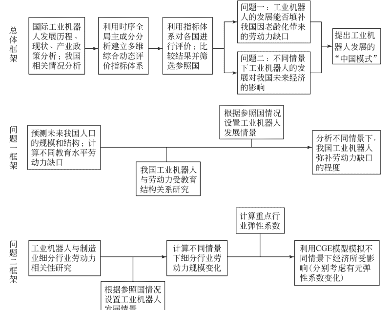

图 2-1 分析框架及所用方法

一是系统分析发达国家工业机器人近年的发展形势，为我国制造业工业机器人未来发展提供参考。通过系统分析发展形势，了解其主要运用行业、优势产业及工业机器人规模、投资变化率等指标，探索不同类型国家在制造业工业机器人使用方面的独特规律。基于各个分指标，利用时序全局主成分分析，通过降维，形成新型综合多维评价指标体系，对有代表性的工业机器人强国和中国进行综合评价打分，并在时间维度进行动态评价，从而找出国际工业机器人强国中持续保持前列的国家。综合分析后，筛选出工业机器人强国，作为我国制造业工业机器人未来发展情景的参考。

二是量化分析工业机器人对劳动力总规模和结构的影响，探索其总体效应。通过这一量化分析，可以看出工业机器人对劳动力总体规模及教育结构的影响。在利用 PDE 模型对我国人口的规模及教育结构进行预测的基础上，分析工业机器人的使用能否在一定程度上填补未来劳动力的短缺，以及对何种类型的劳动力产生较大影响，为政策建议提供定量的依据。

三是量化分析工业机器人对制造业中多个行业的影响。根据现有制造业分行业工业机器人规模、资本投入、劳动力规模等指标，通过分析比较，利用技能-工作任务匹配均衡模型，计算工业机器人和劳动力规模的关系，为我国工业机器人对劳动力影响提供新的定量证据，也为评估对未来劳动力情况、经济的影响提供参数。

四是分析制造业工业机器人对劳动力的影响，对未来经济可能产生何种影响。根据筛选出来的参照国各细分行业工业机器人的发展模式和路径，设置未来我国制造业各细分行业工业机器人发展情景。基于已经得到的制造业工业机器人同细分行业劳动力的关系，计算未来工业机器人变动带来的劳动力变动情况。在不考虑各细分行业中劳动与资本要素的弹性系数的情况下，利用 CGE 模型，模拟不同的未来工业机器人发展情景下，我国宏观经济发展情况。在考虑各细分行业中劳动与资本要素的弹性系数的情况下，模拟不同的未来工业机器人发展情景下，我国宏观经济发展情况。根据模拟效果，基于不同参照国的工业机器人发展模式，总结出有利于我国经济发展的工业机器人发展模式。

### 2.6 开展研究的主要方法

由分析框架可知，在分析工业机器人对国民经济影响时需用到 CGE 模型。该模型较为复杂，涉及宏观经济众多方面。CGE 模型的优势是可以进行从微观到宏观、自下而上的建模分析。本书先探讨工业机器人对劳动力的影响，进而分析这种影响对经济的作用，分析问题的路径与 CGE 模型较为契合，因此对 CGE 模型进行简要介绍。

#### 2.6.1 CGE 模型构成及条件

##### 2.6.1.1 模型的构成

CGE 模型是用一系列方程组描述市场主体间的供需关系，考虑部门之间的生产投入关系，通过价格机制连接要素市场和产品市场，并对政策经济活动等外部变量因素对这些关系的影响进行描述、模拟和预测。常用于关税分析、工资调整、技术进步等政策对某个国家或地区经济发展、产业结构、进出口规模等变量造成的影响（柳青等，2016）。CGE 模型主要包含以下四方面：
- 经济主体，主要包括政府、企业、居民，有时还包括其他国家或经济体，而且可以根据需要再增加相应的主体；
- 经济制度结构，一方面是研究对象内部间资本、要素流动的方式，另一方面是同外部，如其他国家的经济交往方式；
- 主体的决策依据，各经济主体据此进行决策，就是根据不同的目标，如成本最小、利益最大，总体污染排放最小等，探索决策的最优解；
- 设定市场出清、宏观闭合等条件，使模型能够达到均衡的状态。

CGE 模型中的前三方面是在构建模型时，根据实践活动及实际数据提炼出来的模型组，而最后一方面则是 CGE 模型得以求解的理论基础。CGE 模型的核心是均衡，即产品供给与产品需求相当，而供需调节的机制是价格。Walras 一般均衡理论则是 CGE 模型的理论基础，即模型中多个产品市场同时出清，可以得到最优解。

##### 2.6.1.2 模型的条件假设

本节构建 CGE 模型，包含几点假设：
- 经济制度为开放型国家，即模型包括政府、企业、居民及世界其他地区四个经济主体，可以对我国当前经济体系进行模拟。
- 受冲击部门为制造业中的部门，其他部门被动变化。本书的微观分析为工业机器人对劳动力的影响，而工业机器人的主要使用部门是制造业中的部门，因此其他部门是根据制造业部门受到的冲击，为达到均衡状态而进行的变化。
- 将居民视作一个整体，储蓄率和消费函数不变。
- 在研究时间段内，各个部门的固定资产折旧率不变。

后三点为本书设定的一些条件，而第一点则是根据客观事实提炼简化的流动

结构。对于开放型经济体，国内生产活动需要的中间投入商品包括国内生产的以及进口的中间商品，而国内生产活动生产出来的商品又要在国内需求和出口之间分配。在 CGE 模型中，将生产活动和商品作为两个账户进行区分，更加便利地处理开放型经济体中进口的商品、国内生产供给国内销售的商品、国内生产供给出口的商品之间的关系。图 2-2 为开放型经济体的市场销售产品流通过程。国内市场上销售的商品由国内生产供给国内销售的商品和进口的商品以 CES 生产函数的形式复合而成，而国内生产活动总产出则由国内生产供给国内销售的商品和出口的商品以 CES 生产函数的形式复合而成。国内市场上销售的商品一部分用于居民和政府消费需求，一部分用于投资需求，而剩余商品则用于国内生产活动中的中间投入。中间投入和增加值构成部门总投入，其中，增加值由劳动要素和资本要素以科布—道格拉斯（C-D）生产函数的形式复合而成。

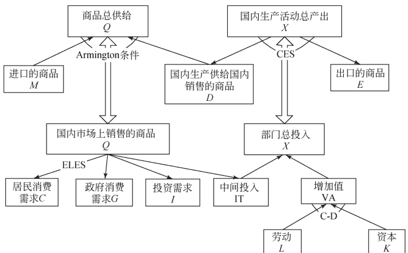

图 2-2 开放型经济体的市场销售产品流通过程

#### 2.6.2 CGE 模型的均衡关系及模型构建

##### 2.6.2.1 社会核算矩阵及数据来源

CGE 经济模拟系统的建模思想是基于具有层次结构的社会核算矩阵（social accounting matrix，SAM）均衡建模方法，即从 SAM 表的行列均衡关系出发，建立经济系统的一般均衡关系（孙翊等，2015；徐程瑾，2015）。

SAM 表是以矩阵形式反映的国民经济核算体系，能够清晰地描述一定时期（一般是一年）内一国（或地区）各种宏观经济行为主体之间的流量关系，可以作为宏观经济分析和政策模拟的数据基础。

SAM 表是在投入产出表的基础上增加了非生产部门（机构账户），如居民、企业、政府及世界其他地区，以二维表的形式全面反映整个经济活动的收入流和支出流，不仅能反映投入产出表中商品账户和活动账户中生产部门之间投入与产出的相互依托关系，还能反映非生产部门，如居民、企业、政府及世界其他国家之间的收支均衡情况，以及这些非生产部门与生产部门之间的均衡关系。因此，相比于投入产出表仅仅关心生产部门之间的投入产出均衡关系，SAM 表更加关注整个国民经济核算体系的投入与产出、收入与支出均衡关系。SAM 表是投入产出表的延伸，投入产出表又是 SAM 表的核心。

对于开放型经济体，用于 CGE 模型的宏观 SAM 表的账户体系，包括商品、活动、劳动要素、资本要素、居民、企业、政府、资本、世界其他地区（表 2-1）。SAM 表中，横行表示账户的收入，纵列表示账户的支出，能够全面反映整个国民经济核算体系各个账户之间的收支均衡关系。

###### 表 2-1 SAM 表

| | 商品 | 活动 | 劳动 | 资本 | 居民 | 企业 | 政府 | 资本 | 世界其他地区 | 汇总 |
|---|---|---|---|---|---|---|---|---|---|---|
| 商品 | | 中间需求 | | | 居民消费 | | 政府消费 | 投资 | | 总需求 |
| 活动 | 国内生产供给国内 | | | | | | | | 出口 | 总产出 |
| 劳动 | | | 劳动增加值 | | | | | | 要素出口收入 | 要素收入 |
| 资本 | | | 资本增加值 | | | | | | | |
| 居民 | | | 劳动收入 | 资本收入 | | 转移支付 | 转移支付 | 转移支付 | | 居民收入 |
| 企业 | | | | 资本收入 | | | 转移支付 | | | 企业收入 |
| 政府 | 关税 | 间接税费 | | | 所得税 | 直接税 | | | | 政府收入 |
| 资本 | | | | | 居民储蓄 | 企业储蓄 | 政府储蓄 | | 国外储蓄 | 总储蓄 |
| 世界其他地区 | 进口 | | 要素进口 | | | | | | | 外汇支出 |
| 汇总 | 总供给 | 总成本 | 要素支出 | | 居民支出 | 企业支出 | 政府支出 | 总投资 | 外汇收入 | |

中国 SAM 的数据来源较为广泛。本书中的 SAM 表基于 2012 年中国投入产出表，其框架结构中涉及的部门数据，可以通过投入产出表中的各个部门进行查阅。

根据上述的编制原理以及编制框架，编制 SAM 表需要使用《中国统计年鉴》、国际收支平衡表、资金流量表、《中国财政年鉴》、《中国税务年鉴》、《中国劳动统计年鉴》、海关统计数据、工业普查以及人口普查等多方面相关数据。

根据生产部门之间、非生产部门（居民、企业、政府、资本和世界其他地区）之间、生产部门和非生产部门之间的行列供需均衡关系、投入产出均衡关系和收支均衡关系，可以得出 CGE 模型中所需的 8 个核心均衡模块和 1 个原则：商品账户供需均衡模块、活动账户成本产出均衡模块、要素账户（劳动和资本）收支均衡模块、居民账户收支均衡模块、企业账户收支均衡模块、政府账户收支均衡模块、资本账户投资储蓄均衡模块和世界其他地区账户收支均衡模块，以及价格基准与宏观闭合原则。以下将结合各个均衡关系，简要说明进出口数量决定机制、居民需求量决定机制、劳动力和资本需求量决定机制等经济学机制。

##### 2.6.2.2 主要模块介绍

###### (1) 商品账户供需均衡模块

SAM 表中的商品账户描述的是国内市场上的商品供求关系。横行表示商品总需求的构成（相当于投入产出表中的横行），包括中间投入和最终消费，最终消费又分为居民消费需求、政府消费需求、投资需求和存货增加；纵列表示国内市场上商品的供给来源，包括国内生产供给国内销售的商品和进口商品。商品账户的各种商品满足总需求 = 总供给。在 CGE 模型中，由商品账户供需均衡模块体现总需求 = 总供给。

###### (2) 活动账户成本产出均衡模块

活动账户成本产出均衡模块描述的均衡关系是活动总产出与活动总成本的均衡。SAM 表中的活动账户描述的是国内生产部门的活动投入产出关系。横行表示国内部门总产出的去向，一部分产品在国内销售，一部分产品用于出口；纵列表示每一个生产部门的成本构成（相当于投入产出表中的纵列），分为中间投入、劳动增加值、资本增加值和生产间接税。活动账户的每一个生产部门满足总产出=总投入或总收入=总成本（总支出）。

每一个生产部门都需要满足均衡，因此活动账户中包含多种机制。①国内生产活动总产出机制，即假设国内生产供给国内销售的商品和出口的商品之间具有一定程度的不完全替代性，国内外消费品的替代性由系数决定。②国内生产供给国内销售的商品和出口的商品的数量决定机制，假设国内厂商是理性的，在一定的价格和可替代程度的条件下，给定总产量，厂商会选择国内生产供给国内销售的商品和进口的商品的优化组合，以使其成本最小化获得该组合，而国内生产供给国内销售的商品和出口的商品相对价格的变化会影响国内厂商的决策。③出口的商品价格，假设中国经济在国际上所占的份额非常小，处于小国地位，同时不因国内生产出来的商品去向国家或地区不同而区分商品，即中国出口的商品的价格不影响出口的商品的国际市场价格，在出口业务中只能是国际市场价格的接受者。④资本和劳动力需求决定机制，资本和劳动力不完全替代，利用规模报酬不变的科布-道格拉斯生产函数形式，表示增加值是由资本和劳动力生产要素的投入生产出来的。科布-道格拉斯生产函数的特点是技术进步中性，技术进步独立于要素投入量的变化，规模报酬不变。

###### (3) 要素账户收支均衡模块

要素账户收支均衡模块表示的是劳动要素和资本要素收入与支出之间的均衡关系。其中，劳动要素的总收入为劳动增加值，总支出为居民的劳动报酬，二者相等。SAM 表中的劳动要素账户描述的是劳动的收入支出情况。横行表示劳动总收入，即劳动增加值；纵列表示劳动总支出，即居民的劳动报酬。劳动要素账户满足劳动要素总收入=劳动要素总支出。

SAM 表中的资本要素账户描述的是资本的收入支出状况。横行表示资本总收入，即资本增加值；纵列表示资本总支出的构成，分为居民资本收入、企业资本收入、政府资本收入和国外投资者收益。资本要素账户满足资本要素总收入=资本要素总支出。

###### (4) 居民账户收支均衡模块

居民账户收支均衡模块描述的是居民总收入与居民总支出之间的均衡关系。SAM 表中的居民账户描述的是居民的收入支出状况。横行表示居民的总收入，其收入来源为劳动者报酬、居民资本收入、企业对居民的转移支付、政府对居民的转移支付、国外对居民的转移支付；纵列表示居民账户的总支出，其支出为居民对商品的消费、居民向政府缴纳的个人所得税，其收入和支出的差额为居民储蓄。居民账户满足居民总收入=居民总支出。

###### (5) 企业账户收支均衡模块

企业账户收支均衡模块描述的是企业总收入与企业总支出之间的均衡关系。SAM 表中的企业账户描述的是企业的收入支出状况。横行表示企业的总收入，其收入来源为企业资本收入和政府给企业的转移支付（出口退税）；纵列表示企业的总支出，其支出为企业向居民的转移支付、企业向政府缴纳的企业所得税，其收入和支出的差额为企业储蓄。企业账户满足企业总收入=企业总支出。

###### (6) 政府账户收支均衡模块

政府账户收支均衡模块描述的是政府总收入与政府总支出之间的均衡关系。SAM 表中的政府账户描述的是政府的收入支出状况。横行表示政府的总收入，其收入来源为进口关税、生产间接税、政府资本收入、居民所得税和企业所得税；纵列表示政府账户的总支出，其支出为政府对商品的消费、政府对居民和企业的转移支付，其收入与支出的差额为政府储蓄。政府账户满足政府总收入=政府总支出。

###### (7) 资本账户投资储蓄均衡模块

资本账户投资储蓄均衡模块描述的是总投资与总储蓄之间的均衡关系。SAM 表中的资本账户描述的是社会总投资的来源和去向。横行表示社会总储蓄，其来源为居民储蓄、企业储蓄、政府储蓄和世界其他地区储蓄；纵列表示社会总投资，包括对商品的投资需求和存货增加。资本账户满足社会总储蓄=社会总投资。

###### (8) 世界其他地区账户收支均衡模块

世界其他地区账户收支均衡模块描述的是外汇收入与外汇支出之间的均衡关系。SAM 表中的世界其他地区账户（ROW）描述的是在世界其他地区的收入支出状况。横行表示世界其他地区的总收入（外汇支出），其收入来源为国外其他地区对我国的出口（即我国商品的进口）和国外投资者收益；纵列表示世界其他地区的总支出（外汇收入），其支出为世界其他地区对我国商品的进口（即我国商品的出口）、世界其他地区对居民的转移支付，其收入与支出的差额为国外储蓄。世界其他地区账户满足世界其他地区总收入=世界其他地区总支出或外汇支出=外汇收入。

###### (9) 价格基准与宏观闭合原则

根据 Walras 一般均衡理论，假设市场上存在 n 个市场，当 n-1 个市场出清时，剩余的那个市场会自动出清。因此，若要确定每个产品和要素的价格，必须设定一个价格基准，即对某个商品的价格进行限制。

CGE 模型体现的是一般均衡的理念，在模型中，一般包括商品市场均衡、要素市场均衡、政府预算均衡、居民收支均衡、投资储蓄均衡和国际市场均衡。因此，建立 CGE 模型必须能够保证求出这些均衡解，并且保证均衡解的存在性、稳定性和唯一性。但是，在建立 CGE 模型时，变量总数一般总是大于方程总数，不能保证 CGE 模型解的唯一性。宏观闭合理论的解决办法是，从各个均衡目标之间做出取舍，从所有变量中选出适当的内生变量和外生变量组合，保证 CGE 模型的方程总数等于内生变量总数，保证均衡解的唯一性，而且符合经济学原理。

### 2.7 本章小结

本章首先回顾了技术进步与劳动力、经济关系的多种理论，表明技术进步对劳动力就业可以产生破坏或创造作用，这一过程与经济发展相辅相成。这说明，在研究以人工智能、工业机器人为代表的先进技术时，需要从一个总体的经济体系，进行动态的、综合的分析。本章介绍的 CGE 模型，既包含微观影响，自下而上对宏观经济产生影响的理念，也可以对截至 2035 年的工业机器人变化情况带来的经济影响进行模拟，从而分析工业机器人对经济的影响。

在对现有相关实证研究进行回顾、总结时可以发现，国外的定量研究更多，可以为我国工业机器人发展及其对劳动力、经济影响研究提供参考。同时，需要注意我国与其他国家的不同之处，如劳动力规模大、老龄化程度进程较快等。因此，在参考国外情况，借鉴不同国家工业机器人发展过程时，以我国的产业结构、经济发展特点为基础，开展相关研究，找到我国与外国的异同点，为形成制造业工业机器人的“中国发展模式”提供实证。最终，通过回顾文献，并结合现有数据及研究方法，建立了本书的研究框架。

## 第 3 章 中外工业机器人发展与政策分析

### 3.1 引言

IFR 对工业机器人进行了定义，即一种可以进行自动控制、重编程及多用途的机械设备。虽然该定义可能未涵盖足够多的概念，但仍体现了工业机器人的主要特征，便于在研究中进行全球比较。近年来，工业机器人在全球及各地区的销售量、安装量都产生了较为快速的增长。这种增长由工业机器人所具有的特点和优势作为支撑。而未来工业机器人的发展方向，也将为未来的制造业转型提供支持。

工业机器人是当前人工智能技术在制造业中的重要应用。工业机器人效率高、动作精准、停工与使用时间比低等特点，非常适合于传统制造业中的流水线制造，而现代化的工业机器人，则可以通过编程，在一定的应用领域内有较好的通用性和任务灵活性，又能够胜任现代制造、智能制造中的柔性制造工作。世界主要发达国家，特别是制造业强国，都已经开始并加快工业机器人的推广与使用，很多新兴经济体也开始增加工业机器人的使用。同时，很多国家也都根据自身的发展水平与发展优势，制定了相应的人工智能及工业机器人的发展规划。

为了能更全面地了解工业机器人对于经济的意义，从而能更好地借鉴国外先进经验，本章首先分析了全球工业机器人发展格局，从中选出美洲，以及欧洲、亚洲中工业机器人水平较高、实力强、发展快、有特色的国家，对其工业机器人发展现状及未来规划进行回顾与展望，进而分析我国工业机器人的发展路径与前景。以此作为后续情景分析的基础。

### 3.2 全球工业机器人发展分析

#### 3.2.1 全球工业机器人发展现状

2000 年以来，随着制造业布局在全球进行重构，劳动密集型制造业向中国等新兴经济体转移，发达国家制造业进一步向资本密集型的高端制造业进化，工业机器人也进一步受到制造业投资者的重视。根据 IFR 的数据，2005 ~ 2008 年全球年均机器人销售量约为 11.5 万台（套）。但是 2008 年全球经济和金融危机爆发，2009 年工业机器人投资受到抑制。但对工业机器人的投资热情并未降低太久，在 2010 年出现大幅度反弹。2010 年以来，工业机器人的自动化趋势和技术创新、改进不断出现，很多行业和企业对工业机器人的需求大幅度增加（图 3-1）。2012 ~ 2017 年，机器人的年均增长率达到 19%，达到一个前所未有的强劲增速。2011 ~ 2017 年，年均销售量达到 23.6 万台（套）。在 2015 ~ 2017 年，年均销售量达到 31 万台（套）。这反映出世界范围内对工业机器人的需求正在快速增长。

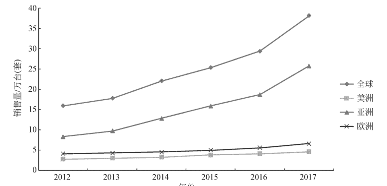

图 3-1 全球及各地区 2012 ~ 2017 年工业机器人销售量变化情况

资料来源：IFR 的《工业机器人年度报告》（2018 年）

相比于 2016 年，2017 年全球工业机器人销售量增长 30%，达到 38.1 万台（套），连续五年创下新高。2017 年快速增长的主要驱动力是金属行业（55%）和电气/电子行业（33%）。汽车行业工业机器人销售量增长 22%，在 2017 年仍是工业机器人的主要客户，占总供应量的 33%。2015 年以来，电气/电子行业工业机器人的销售量也在迎头赶上。在 2016 年，电气/电子行业的工业机器人需求已经成为几乎所有主要亚洲市场（中国、日本、韩国）的最重要需求。

亚洲是全球工业机器人增长最强劲的市场。2012 ~ 2017 年，工业机器人在亚洲的安装量年均增长率为 25%。2017 年，工业机器人在亚洲地区共售出约 26.18 万台（套），比 2015 年该地区的销售量 [25.33 万台（套）] 增长 3.36%，这是连续五年的最高销售纪录。工业机器人在第二大市场欧洲的销售量增长了 18%，达到近 6.63 万台（套），同样是连续五年创下新高，2012 ~ 2017 年工业机器人安装量年均增长率为 10%。美洲 2017 年的工业机器人出货量为 4.61 万台（套），比 2016 年增长 12%，连续六年创下新高，2012 ~ 2017 年工业机器人安装量年均增长情况与欧洲类似，约为 10%。

#### 3.2.2 各国工业机器人发展情况对比

##### 3.2.2.1 基于数量的对比分析

工业机器人与制造业联系紧密，因此制造业大国是工业机器人的主要市场。2017 年全球销售量排名前五位的市场是中国、日本、韩国、美国、德国，占总销售量的 73%。中国自 2013 年起成为世界上最大的工业机器人市场，并保持着持续的增长。

2017 年，中国购买工业机器人数量占全球总供应量的 36%，比 2016 年高 6 个百分点，继续保持最大市场并处于领先地位。2017 年，工业机器人在中国的销量为 13.79 万台（套），这远远超过欧洲和美洲的总销量 [11.24 万台（套）]。其中中国工业机器人制造商销售 3.47 万台（套），比 2016 年的 2.70 万台（套）增长 29%，而外国工业机器人供应商销售 10.32 万台（套），增长率达到 72%。

2017 年，工业机器人在日本的销售量创下其国有史以来的第二高销量，达到 4.56 万台（套），比 2016 年增长 18%，仅次于 2000 年时的最高值 [4.69 万台（套）]。2012 ~ 2017 年，工业机器人销量的年均增长率为 10%。从分行业情况看，汽车产业仍保持前一年的占较大份额的水平，而增长的动力主要来自电气/电子行业。

2017 年，工业机器人在韩国的销售量排名第三，为 3.97 万台（套），但相比于 2016 年的 4.14 万台（套）历史峰值，降低 4%。2012 ~ 2017 年，工业机器人在韩国的销售量年均增长率为 15%。分行业看，2017 年销售量增速下滑的原因是电气/电子行业工业机器人供应量比 2016 年减少 18%。

虽然美国被认为存在制造业、工业空心化的问题，然而其制造业一直在向自动化转型。2017 年，美国的工业机器人安装量达到 3.32 万台（套），比 2016 年增长了 6%，连续七年达到新高。自动化转型也是推动美国制造业增长的强劲动


力，从而保持美国制造业的高水平内涵以及在全球市场的地位。

2017 年，德国是世界第五大工业机器人市场。与 2016 年的 2.01 万台（套）相比，2017 年在德国售出的工业机器人数量增加了 7%，达到 2.14 万台（套），创其历史新高。但在 2014 ~ 2016 年，工业机器人在德国的年销售量停滞在 2 万台（套）左右。

##### 3.2.2.2 基于密度的对比分析

利用总体规模衡量发展时，会受到国家经济体量及行业规模的影响，因此，可以使用工业机器人密度作为比较的标准，根据 IFR 的定义，工业机器人使用密度的定义为每 10 000 名员工的多用途工业机器人数量。而在制造业中，区分为汽车行业和一般行业（不包括汽车行业的制造业）。

###### (1) 全球密度对比

在全球范围内，2017 年，制造业工业机器人平均密度为 85 台/10 000 名员工。欧洲是工业机器人密度最高的地区，为 106 台/10 000 名员工。在美洲，是 91 台/10 000 名员工。在亚洲，是 75 台/10 000 名员工。

利用工业机器人密度分析各国（地区）时，排名（图 3-2）出现变化。

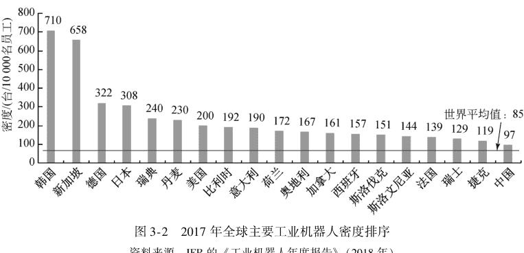

工业机器人密度最高的国家是韩国（710 台/10 000 名员工）。韩国 2010 年的工业机器人密度为 311 台/10 000 名员工。其自 2010 年以来持续安装大量工业机器人，工业机器人密度一直保持最高，特别是在电气/电子行业和汽车行业增长迅速。

新加坡紧随韩国之后（658 台/10 000 名员工）。这是由于新加坡制造业的雇员数量非常少——根据国际劳工组织（International Labour Organization，ILO）的数据，大约有 24 万名雇员。新加坡大约 84% 的工业机器人应用在电气/电子行业。

2017 年，德国超越日本，排名第三（322 台/10 000 名员工）。

日本排名滑落至第四（308 台/10 000 名员工），其与韩国、新加坡的差距还有增大趋势。2009 年，日本是世界上工业机器人密度最高的国家，但韩国、新加坡、德国分别在 2010 年、2015 年和 2017 年超过日本。日本从 2009 年的 331 台/10 000 名员工降至 2016 年的 301 台/10 000 名员工。

在制造业大国中，2017 年，中国的工业机器人密度为 97 台/10 000 名员工，虽然距离先进水平有较大差距，但相比于 2009 年的 11 台/10 000 名员工，密度几乎增加了 8 倍。

###### (2) 制造业密度对比

汽车行业的自动化水平通常比其他制造业部门都高。在韩国，2017 年的工业机器人密度为 2435 台/10 000 名员工，约是 2010 年（1239 台/10 000 名员工）的两倍。2014 年以来，大量工业机器人已销往韩国的汽车行业。近年来韩国为混合动力和电动汽车制造电池成立大型项目是工业机器人密度如此高的原因之一。

排名第二的是加拿大，汽车行业的工业机器人密度增加到 1354 台/10 000 名员工。紧随其后的是美国（1200 台/10 000 名员工）、德国（1162 台/10 000 名员工）、日本（1158 台/10 000 名员工）和法国（1156 台/10 000 名员工），也拥有很高的汽车工业机器人使用密度。2017 年，奥地利（1083 台/10 000 名员工）和斯洛文尼亚（1075 台/10 000 名员工）进入汽车行业每 10 000 名员工拥有 1000 台工业机器人的国家行列。西班牙（990/10 000 名员工）和泰国（974/10 000 名员工）的工业机器人密度也处于较高水平。

制造业中的一般行业（除汽车行业外的其他行业）工业机器人密度仍相对较低。然而，电子产业发达的国家该密度仍保持较高水平。韩国仍然排名第一（533 台/10 000 名员工）。紧随其后的是日本（225 台/10 000 名员工）、德国（191 台/10 000 名员工）、瑞典（180 台/10 000 名员工）。不过与日本和韩国不同，德国和瑞典在电气/电子行业方面并没有重要的生产基地，这两个国家的密度相对较高，是因为在其工业体系中，工业机器人几乎在所有行业都有所使用。电气/电子设备生产的日益自动化推动了工业机器人在相关生产中心的安装。排在瑞典之后的是意大利（160 台/10 000 名员工），美国和奥地利以 117 台/10 000 名员工并列排在意大利之后。其他一些欧洲国家、中国和加拿大的工业机器人密度在（30 ~ 90）台/10 000 名员工。而大多数新兴工业机器人市场的工业机器人密度都在 30 台/10 000 名员工以下。

通过分析可以看出来，机器人在一般工业中具有巨大的发展潜力。即使是在密度最高的韩国，工业机器人在一般工业中的密度也只是汽车工业的 1/5。对于其他汽车工业大国来说，一般工业中仍对工业机器人有较大的需求，而对于其他国家，特别是新兴市场国家来说，在各个制造业领域都对工业机器人有巨大的需求。也有不少国家正在进行产业改造升级，包括从劳动密集型向资本密集型的转型，以及对现有制造业中的工业机器人进行设备升级更新。这些都将推动工业机器人的发展。

### 3.3 主要工业机器人强国发展历程及相关产业政策分析

工业机器人作为一种先进的生产设备，发展迅速，已经成为很多国家实施制造业升级改造的硬件基础，也是衡量国家科技创新和高端制造水平的重要指标。从 3.2 节的分析可知，美国、德国、日本、韩国都是工业机器人强国，这些国家具有较长的使用工业机器人的历史。由于工业机器人的发展处于科技发展的前沿，在进行产业应用时可能遇到发展方向不清晰及初期投入大、见效慢等问题，这些国家出于扶持产业和战略竞争的考虑，出台了相应的产业发展指导与激励政策，成为推动工业机器人进一步发展的重要因素。在此对这些国家工业机器人发展历程进行简要回顾，对其政策、规划进行简要的归纳和分析。

#### 3.3.1 美国——以经济实力及创新土壤促进工业机器人发展

##### (1) 美国工业机器人发展简要回顾

美国于 1960 年生产出世界第一批工业用途的机器人，而工业机器人一词也由美国的媒体于当时首次使用。美国曾是工业机器人最大的生产、出口和技术转让国。但在 20 世纪 70 年代中期以后，美国更多强调基础研究，对工业机器人的技术同经济、社会的现实结合不够紧密，导致其工业机器人产业竞争力下降，被日本和德国超越。由于工业机器人可能在一定程度上增加失业率，工业机器人在美国的推广并未受到应有的重视。

美国在工业机器人领域表现出几个特点。一是定位高，与服务连接更为紧密。美国较少有生产普通机器人的工厂。在工业机器人产业链上侧重于前端的基础研究、技术创新，以及后端的操作系统开发和技术服务等方面。二是与先进制造技术相结合。主要特点是工业机器人与 3D 打印等先进技术相结合，一方面可以制造出更多的高质量、类型广的机器人，另一方面机器人可以辅助安装 3D 打印形成的模块，兼顾了定制化与自动化的优势。三是行业分配不平衡。汽车行业的工业机器人密度非常高，而其他行业很低。

##### (2) 美国的工业机器人发展规划

美国作为世界头号经济强国，对保持本国的国际竞争力具有强烈的动力。在工业机器人方面，日本、德国是领先国家，为了反超两国，美国制定了一系列的规划，可以反映其工业机器人发展的思路和路径。

2011 年，奥巴马政府在先进制造计划基础上，启动了“国家机器人计划”（National Robotics Initiative，NRI）。该计划的总体目标是加速美国工业机器人的开发和使用，核心目标是建立美国在下一代机器人技术及应用方面的领先技术。通过研发下一代机器人技术，提高机器人从零部件到系统的功能性和实用性，从而能更好地辅助人类生产并形成人机互动的工作体系（陈骞，2016）。该计划旨在解决从基础研究和开发到工业制造和部署的整个生命周期出现的问题，并对机器人在人类活动的各个领域带来的长期经济和社会影响进行分析。当时政府的主要支持机构包括美国国家科学基金会（National Science Foundation，NSF）、美国国家航空航天局（National Aeronautics and Space Administration，NASA）、美国国立卫生研究院（National Institutes of Health，NIH）和美国农业部（United States Department of Agriculture，USDA）。政府每年的预算为 4000 万美元，鼓励学术界、工业界等的合作，撬动社会资源。

经过五年、四轮的资助，“国家机器人计划”预设目标基本完成，美国政府又在 2016 年启动了“国家机器人计划 2.0：无处不在的协作机器人”（National Robotics Initiative, Ubiquitous Collaborative Robots，NRI-2.0）。该计划大幅度扩展了“国家机器人计划”的范围和目标，重点是协作机器人，强调可扩展性和连接性。主要关注的方面包括多机器人协同、人机协同，机器人同其他设备、环境的合作，降低机器人使用门槛，以及建立整体的工作体系等。试图将机器人进一步推向生活的方方面面。

总体来看，在机器人软件技术、商业服务等领域已经处于世界前列的情况下，随着其推动 “重振制造业” 的发展，美国凭借强大的实力和基础，将会在未来一段时期进一步推动在工业机器人制造和使用方面的发展，尽可能地在工业机器人领域超越日本和德国。

#### 3.3.2 欧洲多国——以自身优势推动发展

##### 3.3.2.1 德国——以制造业优势带动产业升级

###### (1) 德国工业机器人发展简要回顾

德国工业机器人相对于美国起步较晚，在 20 世纪 70 年代开始涉足工业机器人领域。但德国的制造业具有质量优良、工艺精湛的特点，而且其发达的制造业又为工业机器人的发展提供了足够的市场需求和技术改造的诉求，加之德国政府将机器人技术列为 80 年代首要公关项目，制定研究和鼓励生产的计划，德国的工业机器人产业发展迅速，很快成为美国、日本之后的排名世界第三的生产国。进入 90 年代，不少发达国家将劳动密集型制造业转移至低工资国家，但很多德国企业，特别是汽车制造企业较为广泛地使用工业机器人，可以降低成本，也可以避免技术流失，因此德国的工业机器人产业在此情况下得到再一次推动。伴随需求的增加，德国工业机器人产业的配套技术、设计服务及产品等各行业都得到良好的发展。工业机器人可通过编程灵活调整其应用方式和领域，并具有能接入生产网络、收集数据、提供反馈等功能，成为德国 “工业 4.0” 计划的重要组成部分，也是实现云工厂、智能制造等构想的核心基础。

回顾德国工业机器人的发展，具有如下特点：一是与制造业紧密结合。工业机器人来自制造业，又能回馈于制造业。拥有良好的制造业基础，能在很大程度上制造出足够精密的工业机器人，而这些工业机器人又可以服务于制造业，并根据需求不断升级，形成良性循环。二是与新技术、信息化结合，脱颖而出。德国工业机器人在发展早期就加入电子化、传感器等技术，使工业机器人不仅是机器，也是记录流程、反馈结果的处理器，不仅能提高效率，还能协助改进生产，这使德国工业机器人更受欢迎。而 “工业 4.0” 计划带来的与信息化的结合，则跳出利用工业机器人提升效率的传统思维，为柔性制造、智能制造等概念的实现提供了可能性。

###### (2) 德国工业发展规划

除了早期提出的工业机器人研发项目外，德国提出的 “工业 4.0” 计划，是以优势的工业化结合信息化，来提升工业整体水平的计划（弗兰克·柯什纳，2018）。工业机器人在其中占据重要作用。除了工业机器人具有的优势可以促进工业发展外，工业机器人自身的发展也依赖于工业的发展。德国的工业基础实力雄厚，但面临美国依靠信息技术带来的快速发展，也承受了巨大的压力。以传统工业结合信息技术，可以为传统工业提供新的发展模式，工业盈利不再单纯依靠扩大产能、提效降成本等能力，而是增加了更快速响应市场需求、更好满足小批高利润定制化生产等能力。这种依靠信息化改造的工业化，为工业机器人创造了新用途，推动了其在相应新功能的技术突破，从而加快了工业机器人的发展成长。

德国虽然没有单独的工业机器人发展规划，但是其“工业4.0”计划表明，德国希望以其具有的发达工业化优势为基础，以信息化为台阶，以工业机器人为新型制造业的核心技术，形成工业机器人和高技术工业化的协同发展，从而达到相互促进、共同提高，保持其工业在全球领先地位的目的。

##### 3.3.2.2 其他国家——发挥各自优势，拥有整体规划

###### (1) 欧洲主要国家使用工业机器人行业

欧洲的工业机械水平，自工业革命开始，就一直居于世界领先地位。在工业机器人领域，虽然其他国家没有像德国那样超强的实力，但是各国也都根据自身优势，开展创新活动，使工业机器人从早期流水线为主导，向更加灵活和个性化定制方向发展。

在欧洲国家中，瑞典仅次于德国，多年蝉联欧洲工业机器人第二的位置。瑞典虽然经济总量相对较小，但一直保持很高的工业化水平。第二次世界大战后，汽车制造、航空工业一直是其制造业的主力，也是基本和技术密集型行业，较早引进了工业机器人进行生产，从而能生产出车身强度很高、安全水平很好的轿车。

意大利作为传统工业大国，汽车制造、航空工业、船舶工业等制造业都是推动意大利购买工业机器人的主要动力。近年来，结合其自身的制造业基础，以及良好的地理位置和生活环境，意大利吸引大量人工智能领域的国外人才，与其现有的制造业基础相结合，开发智能工业机器人，也体现了其发展特色与优势。

西班牙与意大利情况相似。虽然近年在经济发展方面遇到一些困难，但其船舶工业和机械制造业在欧洲处于领先地位。作为欧洲第三大机床和汽车发动机生产国，其利用工业机器人生产机械设备的水平一直处于欧洲领先地位。近年来，西班牙开始生产航天机械制造业所需的专用机械设备，也发挥了工业机器人的作用。

总体来看，欧洲国家，除德国之外，其他国家制造业规模较小，但工业机器人使用密度仍较高，而且多以机械设备、汽车制造等资本和技术密集型制造业为主，形成了小而精、小而高端的发展模式。因此，欧洲对工业机器人仍然保持较为旺盛的需求。

###### (2) 欧盟出台的鼓励工业机器人发展的政策

欧盟为了推动工业机器人的发展，也提出了多个规划，以促进各成员国发展，继续保持欧盟在同其他世界经济、工业强国竞争中的领先地位。

2014 年，欧盟提出全球最大的民用机器人研发计划，目标是到 2020 年投入 28 亿欧元，为提升欧洲工业竞争力再增加新的动力。

2016 年，欧盟提出“2020 地平线”计划，该计划将在机器人领域资助 21 个新项目，投资总额近 1 亿欧元，执行期 2 ~ 5 年，主要面向工业机器人和服务机器人的开发与应用。

欧盟在推动工业机器人发展过程中，一方面希望各成员国保持特色及制造业领域的优势，另一方面希望有所创新，能够与其他强国开展竞争。

#### 3.3.3 亚洲——传统强国与后起之秀并存

##### 3.3.3.1 日本——满足产业、市场需求与技术创新平衡发展

日本在工业机器人领域处于世界领先地位，且在技术与产品创新方面始终保持强劲的势头。这与其工业发展的历程紧密相关，政府为工业机器人的发展提出指导性政策也是助推因素之一。

###### (1) 日本工业机器人发展简要回顾

日本工业机器人同其汽车行业的发展紧密相关。20 世纪 70 年代，汽车行业需要提高产量、质量，同时因劳动力成本上涨，因此引入工业机器人，实现提高生产效率与降成本的双重目的。日本政府对此在政策、税收等方面提出鼓励措施。1980 年，工业机器人产值达 700 亿日元，比上一年同比增长 187%。1980 年因此被称为“工业机器人普及元年”。当前日本在工业机器人产品的深度和广度上位居世界前列，拥有全球四大工业机器人制造商中的两个，分别是发那科（FANUC）和安川电机（YASKAWA）。截至 2017 年，日本累计生产工业机器人总数占世界的 40% 左右。

除政府的支持外，日本工业机器人产业的发展体现两个特点。一是能够有效满足市场需求，同时不断创新技术和产品，形成平衡发展的局面。日本工业机器人发展依托于汽车行业发展，因此新技术可以较快转化为产品，应用于实际产业中，并根据市场需求，创新技术，改进产品，形成供需良性互动。二是产业基础好，企业发展各有特色。日本工业机器人企业，如发那科、松下、川崎重工等，各自在本领域都有较为雄厚的技术基础，各拥有一些工业机器人产业必需的技术，因此在发展过程中，可以在国内形成完整的配套产品体系，并且还可以得到自身相关产业的创新支持和需求推进。

###### (2) 日本的机器人发展规划

日本政府高度重视机器人发展，将其列入《第五期科学技术基本计划（2016—2020）》及年度更新、面向 2030 年的《科学技术创新综合战略》中，将科技立项力度向机器人方向倾斜。2015 年，提出《日本机器人新战略》（甄子健和刘进长，2016）。在机器人技术及国内应用方面，日本常年处于世界领先地位，因此资助力度相对较小，而将更多的资助用于支持将机器人技术转化为满足市场需求的产品、拓展新的应用领域（如医疗与护理）、加强国际市场开拓，以及提高国际竞争力（航空航天与深海作业）等。基于对这四点的重视，日本已经开始资助相关领域的机器人技术的研发，力求保持其在国际上的领先地位。具体来说，《日本机器人新战略》主要于五方面进行推进，包括政府和私营部门投资 1000 亿日元的机器人项目；将机器人市场规模扩大到（每年）2.4 万亿日元（2018 年的市场规模是 6500 亿日元）；在福岛建立一个新的机器人和无人机测试场；通过组织世界机器人峰会，促进创新并加速技术成果转化；将生产中首次引入机器人的成本降低 20% 等。

总体来看，日本的机器人发展规划，重在保持其技术与产品的国际领先地位，同时根据其自身需求，拓展应用领域、扩大市场规模。尽管目前其年出货量规模、增速逊于我国及韩国，但其雄厚的技术、产品基础，对未来清晰明确的规划，仍显示出机器人强国的底蕴，也是值得我国学习借鉴的重要对象。

##### 3.3.3.2 韩国——起步较晚发展迅速，占据应用领先地位

###### (1) 韩国工业机器人发展简要回顾

韩国工业机器人于 20 世纪 80 年代末开始发展，起步较晚，但发展非常迅速。在政府大力引导和推动下，在 90 年代末期逐渐形成了本国的工业机器人体系。1990 年，伴随着对工业机器人技术的引进、消化吸收和再创造过程，韩国工业机器人产业从此后的 20 年间，年均复合增长率（compound annual growth rate，CAGR）达到 12%，总保有量增长近 10 倍。应用领域主要集中于汽车、金属加工、电子电气等韩国优势行业。特别是韩国拥有发达的电气/电子产业，如大尺寸液晶面板生产线，需要工业机器人进行搬运，这类工业机器人在全球市场占有较大比例。工业机器人生产能力仅次于日本、美国和德国。其工业机器人密度数年蝉联全球第一，截至 2017 年已经达到 710 台/10 000 名员工的惊人程度，是全球平均水平（85 台/10 000 名员工）的近 8.4 倍。

韩国工业机器人的快速发展在于其与产业的良性互动，以及韩国特殊的财团体系。韩国的工业机器人以现代和 LG 两大财团为主。两大财团各自拥有不同的产业体系，对工业机器人技术及产品有较为明确的需求，带动了工业机器人的发展，并为其改进升级提供反馈意见。而其他财团也使用韩国工业机器人，对国外的工业机器人整机形成一定的产业壁垒，客观上为韩国工业机器人的发展提供了较为宽松和庞大的市场环境。由于韩国的工业体系承接自美国、日本，也对中国及其他发展中国家输出产业体系，促进了其工业机器人的出口。

###### (2) 韩国的机器人发展规划

韩国发展工业机器人的强烈动机，一方面是韩国产业升级、快速发展的需求，另一方面是韩国的老龄化趋势日益加重，劳动力规模逐渐缩减，需要以工业机器人填补劳动力缺口。因此，政府对工业机器人产业大力支持与资助。韩国政府自 21 世纪初起，制定一系列政策系统支持机器人产业。2003 年，韩国政府提出的“十大未来发展动力产业”中，列入机器人技术开发计划，2004 年提出“无所不在的机器人伙伴”项目，2008 年出台《智能机器人开发与普及促进法》（张宇，2015）。随后，分别于 2009 年和 2014 年提出“第一次”和“第二次”《智能机器人行动计划》，总体目标是到 2018 年，韩国成为工业机器人主导国家，工业机器人国内生产总值达到 20 万亿韩元，出口 70 亿美元，占据全球 20% 市场份额，努力挺进世界机器人三大强国行列。2017 年，又提出《机器人基本法》，旨在确定机器人相关伦理和责任原则，应对机器人及其使用带来的社会影响，促进机器人技术的发展体系。

这一系列政策措施，既表示了政府在该领域的信心和决心，也为韩国的工业机器人产业提出了清晰的近期目标和远期目标，具有产业指导意义。同时体现了对机器人应用的管理规制，降低其带来的负面社会影响，为工业机器人的平稳有序发展提供了政策保障。


### 3.4 中国工业机器人发展历程、现状及相关政策分析

伴随着改革开放，我国经济发展进入了新阶段。工业作为出口创汇、吸收就业劳动力的产业，成为支撑我国经济保持连续高速增长的重要因素。近年来，工业、制造业如何能提质增效降成本，转型升级跟上国际现代化制造业的步伐，成为热烈讨论的问题，而工业机器人是这一过程中重要的推动力量。通过分析我国工业机器人发展历程、现状及相关政策，可以从中找到我国该行业发展的特点及问题，为下一步的研究提供基础。

#### 3.4.1 发展历程

我国工业机器人主要经历了五个阶段：第一阶段是 1970 ～ 1985 年的“萌芽期”。以对工业机器人相关技术的理论探索为主。第二阶段是 1986 ～ 1990 年的“技术开发期”。“七五”期间，国家投入资金开展对工业机器人及其零部件的攻关研究，在国家高技术研究发展计划（简称 863 计划）中，智能机器人研究方向跟踪国外技术前沿，经过数年研究，成功研制出一批特种机器人。第三阶段是 1991 ～ 2000 年的“原型开发期”。汽车行业的快速发展带动了工业机器人的发展，国内对点焊、装配、喷漆等生产线机器人及搬运、包装垛码等仓储和港口常用工业机器人进行开发，以满足制造业需要。同时，形成了一批机器人产业化基地及工业机器人制造商，如新松机器人自动化股份有限公司、哈尔滨博实自动化股份有限公司等（李祥瑞等，2019）。第四阶段是 2001 ～ 2010 年的“初步工业化期”。制造业的快速发展带来了工业机器人使用领域的扩大，生产线机器人技术水平上升，特种行业工业机器人，如深潜机器人等开始得到使用。不仅汽车行业，而且食品、药品、化妆品等卫生要求高、自动化程度高的企业，也开始使用工业机器人。第五阶段是 2011 年至今的“快速发展期”。我国从 2014 年起超过日本成为世界最大工业机器人消费国。长江三角洲、珠江三角洲、环渤海地区等区域，也结合自身优势形成工业机器人产业聚集区。

#### 3.4.2 发展现状分析

中国是迄今为止全球销量最大，发展最快的工业机器人市场。此外，自 2016 年以来，中国拥有全球最大的工业机器人运营库存，这种快速发展在工业机器人技术史上是独一无二的。自 2014 年以来，年销售量从 2014 年的 5.71 万台（套）增加到 2017 年的 13.79 万台（套），成为单一国家有史以来的最高水平。2012 ~ 2017 年，中国市场上的工业机器人的年供应量平均每年增加约 43%。2017 年的销售量比 2016 年增加了 59%，占 2017 年全球工业机器人销售量的 36% 左右。截至 2017 年，累计销售量（不包括富士康生产的机器人）约为 48.50 万台（套）。从销售额来看，2017 年，机器人销售额约为 49 亿美元，比 2016 年增长 22%。2012 ~ 2017 年，销售额平均每年增长 33%。在工业机器人存量方面，2017 年底，运营库存达到 47.34 万台（套）（比 2016 年增加 39%）。2012 ~ 2017 年，运营库存的年均增长率为 37%，反映出工业机器人的使用量快速增加。工业机器人规模不断增长的状况也体现在工业机器人密度（工业机器人数量与制造业员工数量的对比）的加速增长。工业机器人密度从 2015 年的 51 台/10 000 名员工增长至 2017 年的 97 台/10 000 名员工，增幅几乎翻了一番。

在使用领域方面，汽车行业无疑是最大的客户。自 2010 年以来，汽车行业的大量投资推动了机器人的安装。中国已成为世界上最大的汽车（包括电动汽车）市场和世界上最大的汽车生产基地，拥有巨大的增长潜力。中国也是电子设备、电池、半导体和芯片的主要生产市场。近年来，电气/电子行业已经取代汽车行业成为中国工业机器人最重要的客户，也成为发展的主要动力。随着中产阶级规模的增大，中国作为一个迅速发展的消费市场的重要性显现出来，因此，各种其他行业也开始扩大产能并实现产品生产自动化。

中国市场在全球销售量中的高比例和高速的发展速率增长率说明中国具有重要的市场地位。越来越多的国际机器人供应商在中国开设了生产工厂，并不断增加产能。中国的大多数工业机器人是由日本、韩国、欧洲和北美的机器人供应商在中国进口或生产的。不过，也有越来越多的中国机器人企业正在进入市场销售产品。在 2017 年，中国机器人制造商在中国销售约 3.47 万台（套）机器人，销售量比 2016 年 [2.70 万台（套）] 高出约 29%，但市场份额从 2016 年的 31% 下降至 2017 年的 25%；国外机器人供应商的销售量增加了 72%，达到 10.32 万台（套），其中包括合资企业在中国本地生产的机器人。这是外国机器人供应商首次实现比本地机器人更高的增长率。

#### 3.4.3 工业机器人相关产业政策及未来发展

进入 2011 年开始的“快速发展期”后，结合国家的五年规划，工业机器人产业政策也相继出台。2012 年，国务院出台了《“十二五”国家战略性新兴产业发展规划》，科学技术部编制了《智能制造科技发展“十二五”专项规划》，财政部公示了《2012 年智能制造装备发展项目拟支持单位名单》。三份政策文件分别从不同出发点，促进工业机器人产业发展，以达到相应的发展目标。国务院的政策统筹兼顾，一方面提出对关键技术研发及产业化的支持，建立健全智能制造装备产业体系；另一方面强调产业目标，即建立一批具有国际竞争力的产业集聚区和企业集团，国内市场占有率达到 50%。科学技术部的政策更加侧重于对核心技术研发的支持，主要核心技术包括机器人本体、伺服电机、控制器、精密减速器等，并研发出工业机器人的工程化产品，在“十二五”期间实现工业机器人及核心部件的技术突破和产业化。财政部的政策方案重在对包括 22 个工业机器人或柔性自动化车间在内的 64 个智能制造项目的财政支持。

2015 年，国务院发布了制造强国战略的第一个十年行动纲领——《中国制造 2025》，将机器人列为大力推动重点领域突破发展的领域之一，要求突破关键零部件及系统集成设计制造等技术瓶颈。

作为主管工业的部门，工业和信息化部在 2013 ~ 2016 年，相继出台多份政策文件，为工业机器人发展设立发展阶段性目标。2013 年发布的《工业和信息化部关于推进工业机器人产业发展的指导意见》中提出，到 2020 年，形成较为完善的工业机器人产业体系，培育 3 ~ 5 家具有国际竞争力的龙头企业及 8 ~ 10 个配套产业集群；工业机器人行业和企业的技术创新能力和国际竞争能力明显增强，高端产品市场占有率提高到 45% 以上，机器人密度（每万名员工使用机器人台数）达到 100 以上，基本满足国防建设、国民经济和社会发展需要。2015 年，结合“十三五”规划，发布了《中国机器人产业“十三五”发展规划》，同时兼顾技术与产业发展。一方面加强基础理论研究和共性技术、关键技术突破；另一方面强调关键零部件的技术突破及产业化，建立完善机器人的试验验证和标准体系建设等。2016 年，发布了《机器人产业发展规划（2016—2020 年）》，明确提出至 2020 年的发展目标。经过五年的努力，形成较为完善的机器人产业体系。技术创新能力和国际竞争能力明显增强，产品性能和质量达到国际同类水平，关键零部件取得重大突破，基本满足市场需求。2020 年具体目标如下：①产业规模持续增长。自主品牌工业机器人年产量达到 10 万台，六轴及以上工业机器人年产量达到 5 万台以上。服务机器人年销售收入超过 300 亿元，在助老助残、医疗康复等领域实现小批量生产及应用。培育 3 家以上具有国际竞争力的龙头企业，打造 5 个以上机器人配套产业集群。②技术水平显著提升。工业机器人速度、载荷、精度、自重比等主要技术指标达到国外同类产品水平，平均无故障时间达到 8 万小时；医疗健康、家庭服务、反恐防暴、救灾救援、科学研究等领域的服务机器人技术水平接近国际水平。新一代机器人技术取得突破，智能机器人实现创新应用。③关键零部件取得重大突破。机器人用精密减速器、伺服电机及驱动器、控制器的性能、精度、可靠性达到国外同类产品水平，在六轴及以上工业机器人中实现批量应用，市场占有率达到 50% 以上。④集成应用取得显著成效。完成 30 个以上典型领域机器人综合应用解决方案，并形成相应的标准和规范，实现机器人在重点行业的规模化应用，机器人密度达到 150 台/10 000 名员工以上。

在“2019 工业互联网峰会”上，工业和信息化部部长苗圩强调关键核心技术的突破还有待加强，特别是原创性技术突破还不多。工业机器人作为工业互联网中将互联网、信息落地的重要途径，也受到了强烈关注。

总体来看，我国出台的产业政策包含以下特点。一是强调突破关键核心技术的重要性。我国的工业机器人市场巨大，能否将市场转化为本国企业的效益，在工业机器人使用上不再受制于人，不被其他国家“卡脖子”，是否掌握关键核心技术变得至关重要。在这方面，社会各界都有所共识。二是设置近期目标。2020 年作为“十三五”规划收官之年，必然设置产业发展目标。而工业机器人在现代工业、制造业中的重要作用毋庸置疑。因此，工业机器人的量化目标成为相关产学研单位进行工业机器人技术研发、产业化实施的阶段性目标。三是提出了能力提升的要求。除了产量、销量、销售额、关键技术等目标外，也提出了总体能力提升，突破技术瓶颈的目标。一方面是技术层面的创新能力及产品的国际竞争力的提升，另一方面是争取形成总体的标准与规范，从而掌握国内市场的话语权，并在对外产能合作中，输出我国的标准。

### 3.5 本章小结

通过回顾世界主要工业机器人强国的发展历程，可以发现各国在发展工业机器人方面均有自己的特点。美国发挥其强劲的经济实力和创新优势，将工业机器人不断与新技术、新产业相结合，引领技术发展并在机器人服务领域独占鳌头。

欧洲各国中，德国将工业机器人结合自身制造业优势，一批业界领先的企业掌握工业机器人的核心技术。其他国家也基于各自的产业优势，通过引进工业机器人，提质增效，降低成本。亚洲国家中，日本作为工业机器人技术的领先国家，将制造业同工业机器人产业供需结合紧密，互相促进，迭代更新。韩国起步虽晚，但发展迅速，各制造业集团抱团发展，促进机器人的推广使用。这些国家都有相应的机器人发展政策或工业发展政策，为机器人产业或制造业发展提出了较为明确的目标和实施路径，并提供了经济上、项目上的支持。

我国工业机器人使用量虽然起步较晚，但因制造业对工业机器人有强烈需求。

在 2011 年进入爆发期后，总量增长迅速，年销售量已达世界第一。保有量密度也在快速上升，于 2017 年进入全球前 20 强。不过我国的机器人产业也存在一些不足，如关键零部件、控制技术等核心技术掌握水平较弱，企业体量、产量、销量较小，机器人设计、程序设计等相关高端服务项目不足等。因此我国也出台了一系列产业政策鼓励、指导、扶持工业机器人产业的发展。

根据产业政策、制造业发展水平与劳动力变化趋势，我国的工业机器人未来将在一定时期内，继续保持一种高速或中高速的增长。与日本、韩国等东亚国家类似，我国也面临着老龄化程度逐渐加重的情况，而工业机器人可以在一定程度上破解因老龄化及就业意愿改变带来的制造业劳动力短缺问题，这将是本研究的问题之一。

## 第 4 章 中外工业机器人发展水平比较与参照国筛选

### 4.1 引言

在第 3 章，回顾了美国，以及欧洲、亚洲等地区中的工业机器人发展强国的发展历程以及扶持鼓励政策。从中可以看出，各国使用工业机器人的行业、领域有所差异，且发展的方式也与各国经济、科技、工业发展现状相匹配。发达国家使用工业机器人时间较早，涉及的行业较多，发展较为成熟，增速较为平稳，且发展模式有所差异。对于中国来说，即便一些劳动密集型制造业可能因劳动力成本上升向其他国家转移，但加强对工业机器人的投资，仍能起到提高效率、降低成本的作用。因此，通过分析国外的工业机器人使用发展水平及模式，可为在 CGE 模型中设置未来我国工业机器人发展情景提供参照，继而探讨工业机器人的发展如何影响我国的劳动力就业和经济发展。

本章拟选取多个工业机器人应用强国，与中国一起进行多维度综合动态评价，从中选出用于在 CGE 模型中设置未来我国工业机器人发展情景的参照国。

在以往的研究中，对于一国工业机器人的发展水平的评价通常是单一维度的静态评价，常用指标为某一年工业机器人总量或密度。但在评价中，有必要考虑各国的发展水平差异等因素，并进行综合比较。发展是一个动态过程，因此有必要从时间维度形成动态评价过程。

本章利用时序全局主成分分析方法，对指标集进行降维，以明确不同主成分下的国家排名，并形成新的综合评价指标体系，对中国进行评价，并与其他国家进行多维度、考虑时间变化的动态比较，分析行业领先国家及中国工业机器人发展水平。根据结果，筛选出可供在 CGE 模型中设置我国未来工业机器人发展情景的参照国。

### 4.2 基于工业机器人发展水平的国别评价

各个国家或地区使用工业机器人，都与其自身经济发展状态、发展阶段有较为密切的关系。因此，在分析不同国家或地区工业机器人发展类别时，需要从多个维度进行探讨，找到相应的衡量发展程度的指标，为进一步指标降维、合成新指标提供基础。工业机器人从 2010 年起在全球迎来了快速增长，我国对工业机器人的需求也于 2010 年起较快增长。因此，本章数据分析的时间段为 2010 ~ 2017 年。

#### 4.2.1 工业机器人发展衡量指标选取依据

衡量一国或地区的工业机器人发展水平，需要找到适合不同维度的指标。一方面是工业机器人发展指标，另一方面是国家或地区经济发展水平的指标。

##### 4.2.1.1 各国工业机器人发展指标

工业机器人的全球权威数据来自于 IFR 发布的《工业机器人年度报告》(2011 ~ 2018 年)，因此，本书从中选取工业机器人发展指标。

- (1) 年出货量  
  年出货量也被认为是销售量，指某国或地区购买工业机器人的规模。目前世界上很多国家或地区对工业机器人具有强烈的需求，同时不少国家或地区又可以生产不同类别的工业机器人，如果直接使用销售量，不易确定买卖双方，因此本书直接使用年出货量代表某国或地区的机器人的年变化量。近年来不少新兴经济体或后发国家或地区的工业机器人年出货量都有较大幅度的增长。

- (2) 可操作存量  
  可操作存量常用来衡量某国或地区工业现有可使用的工业机器人规模，是一个存量指标。工业机器人具有较好的耐用性，因此该指标主要说明可以运行的工业机器人的数量。很多发达国家的年出货量变化幅度相对较小，但是可操作存量一直保持在较高的水平。尽管增长的百分比有限，但增加的数量仍然体现了发达工业国的底蕴。

- (3) 制造业工业机器人密度及分行业工业机器人密度  
  这里涉及三个指标，分别为制造业工业机器人密度、汽车行业工业机器人密度及非汽车行业工业机器人密度。

  三个指标中，第一个指标衡量整个制造业中，工业机器人的密度。对于大国、发达工业国来说，其拥有较为庞大的制造业规模和较为齐全的制造业体系，工业机器人的使用在很多行业都得到了推广，因此该指标可以反映其工业机器人发展的总体情况。

  汽车制造是很多国家中利用工业机器人较早、应用工业机器人数量较多的行业。对于一些小国、地区及新兴经济体来说，汽车行业利润较高、能够吸纳较多劳动力，因此汽车行业工业机器人密度可以较好地用于国际比较。

  非汽车行业工业机器人密度可以反映一国或地区工业机器人的使用广度。

##### 4.2.1.2 国家经济发展及禀赋相关指标

国家经济发展及禀赋相关指标，重点反映国家的经济体量、发展水平，工业、制造业发展水平以及劳动力相关情况。

- (1) GDP  
  GDP 主要体现了一国或地区的总体经济实力。尽管使用工业机器人较多、工业机器人密度较大的国家或地区对制造业、工业都有较强的发展意愿，但是从经济体量出发，在发展的行业方面仍然有各自的差异。而 GDP 水平的高低，也在一定程度上与工业机器人的使用互相影响。

- (2) 人均 GDP  
  人均 GDP 主要反映一国或地区的发展水平，是体现其先进程度的经济指标之一，便于比较。

- (3) 第二产业增加值占 GDP 比例  
  体现了一国或地区的工业化水平。一个国家或地区总体经济体量的大小，是否重视工业发展均可以由该指标反映。

- (4) 制造业增加值占 GDP 比例  
  本书重点讨论的是制造业中工业机器人的应用情况，因此以制造业增加值占比反映制造业的发达程度，以及在国家经济发展中的地位。

- (5) 第二产业劳动力在国内劳动力的占比  
  一方面可以反映出经济发展模式，另一方面能说明可能受到工业机器人、自动化发展影响的程度。

- (6) 工业劳动生产率  
  在世界银行的数据库中，以第二产业每名工人创造的增加值反映工业劳动生产率，该指标为反映效率的指标。

#### 4.2.2 降维赋权方法讨论

以上所列指标，种类较多，一些指标之间存在信息的交叉，有的因素考虑了多个指标，而有的因素只考虑一两个指标，如果直接使用这些指标对各个国家或地区进行评价，难免有失偏颇，因此需要对这些指标进行取舍和综合。主观保留或删除某个指标，可能会造成信息的冗余或缺失，因此需要选取和整合客观、综合的指标集合，然后进一步对各个指标赋权，形成各个地区迁移吸引力的排序，并找到主要的影响因素。赋权方法包括主观赋权法和客观赋权法。前者通过对专家的咨询确定权重，包括层次分析法、德尔菲法、模糊综合评价法等；后者根据指标内数据的变异程度或指标间的相关关系进行赋权，包括主成分分析法、因子分析法以及熵权法等。

以上几种客观赋权法中，主成分分析法和因子分析法都属于多元统计方法，前者是利用相关变量间的共同作用关系，将各指标线性组合成为新的综合指标；后者是利用变量间的相关性，把相关的变量聚合，使同一因子内部的变量相关性最大。两者都适合对评价对象进行分类，优点是可以对指标进行降维处理，而且在需要只获取对本次数据各样本进行排序、分类时，可以进一步进行赋权，计算较为简便；缺点是由于是综合指标，原有的信息会有所丧失，丢失程度同所提取的主成分的代表性有关，只适合在同一批数据内进行比较，而不能将两组不同的数据在使用主成分分析法或因子分析分析法后进行比较，即不能反映某个样本的发展水平。

熵权法来源于信息论，熵用于度量体系的无序程度，信息熵越大，其提供的信息有效性越小；反之，信息熵越小，信息的有效性越大。由于其只对指标内部的无序程度进行度量，并依次对各个指标赋权，可以较完整地保留原始信息，而且可以对需要评价的方案进行比较。其缺点包括不能降维、运算过程复杂。

在本书中，需要做的是找到能够反映使用工业机器人的各国或地区的发展模式的一组综合指标，并且利用该组指标对各国或地区在同一年的情况进行排序或分类。排序与分类的依据是对各国或地区每年的情况进行综合评价打分。该得分不需要进行年与年之间的纵向比较，即不需要对某国或地区历年的得分表现进行评价，而是进行横向比较。因此，在本书中选择主成分分析法进行指标降维及赋权。


为了分析不同工业机器人使用强国或地区发展方式及类别，有必要综合考虑多个维度进行分类，这就需要对多项指标进行客观赋权，即根据指标内数据的变异程度或指标间的相关关系进行赋权。主成分分析法利用相关变量间的共同作用关系，将各指标线性组合成为新的综合指标。分析对象为面板数据，包含时间的变化，因此采用加入了时间维度的时序全局主成分分析方法。

全局主成分分析方法需将多个年份或地点的相同指标的数据整合在一张数据表中。构造全局主成分时，若统计 n 个地区，使用相同的 m 个指标 x1, x2, ..., xm 来描述；所需研究的总年度共有 T 年，以 t 代表其中一个年度，则每一年形成一张数据表 Xi = (xij) n×m，则 T 年共有 T 张数据表，构成时序立体数据表。将 T 张数据表从上到下排在一起构成一个 nT×m 的大矩阵，此新大矩阵即为全局数据表，为 Mi。矩阵中的每一行为一个样品，共有 nT 个样品。由此可以看出，全局主成分分析是将时序立体数据表按时间纵向展开，然后对全局数据表实施经典主成分分析（倪苹，2013）。这样就可以将现有的多指标组合成新的综合指标，并用于对各国工业机器人发展水平进行多维、动态评价。

#### 4.2.3 数据来源及处理

本书的数据主要来自于 IFR 发布的《工业机器人年度报告》（2011 ~ 2018 年），以及世界银行各国经济发展的数据库，以保证数据的准确性和权威性。其中，IFR 的数据包含 50 个国家或地区 1993 ~ 2017 年分行业分年度的工业机器人安装量和库存量，对全球工业机器人市场安装信息的覆盖率达 90% 。

##### 4.2.3.1 研究对象选择

由于要进行国际比较，而且需要为我国的未来发展提供借鉴，并为设置发展情景提供参考，研究对象需在某些指标方面具有较为突出的特点。作为研究对象的国家，其数据需具备与 IFR 数据和世界银行数据相匹配的性质。本书根据《工业机器人年度报告》中所列的国家或地区，结合世界银行数据，共筛选出除中国外的 14 个国家进行分析。这些国家是 2008 年全球金融危机后安装工业机器人较多的国家，包括中国在内的这 15 个国家 2017 年的工业机器人安装量约占 IFR 所有成员国或地区的 87%，因此以这些国家作为研究对象。陈秋霖等（2018）在涉及工业机器人国际比较的研究中，也包括了本书中除瑞典这一北欧工业机器人强国之外的 14 个国家。这表明，从不同角度出发的研究，对何为工业机器人强国具有一定共识。研究对象国的国民经济和工业机器人方面的主要特点见表 4-1。

###### 表 4-1 除中国外的 14 个国家及其特点

| 国别 | 特点 |
| :--- | :--- |
| 美国 | 经济水平世界第一，最大的发达国家，拥有很完整的工业体系。在本已拥有很大工业机器人使用量，并在近年经济支柱为高端服务业的情况下，2010 ~ 2017 年工业机器人购买量 CAGR 仍能达到 8% |
| 加拿大 | 北美洲发达国家，与美国联系紧密，2010 ~ 2017 年工业机器人购买量 CAGR 达到 18% |
| 墨西哥 | 北美洲发展中国家，但承接美国汽车制造业，工业机器人增速很快，2010 ~ 2017 年工业机器人购买量 CAGR 达到 25% |
| 巴西 | 南美最大国家，新兴经济体，主要考虑其经济和劳动力体量 |
| 印度 | 世界第二大人口国，2018 年人口仅比我国少 6000 万人。人口结构年轻，经济发展迅速，受到国际资本青睐。制造业不够突出，2010 ~ 2017 年工业机器人购买量 CAGR 为 18% |
| 日本 | 发达国家，工业机器人强国，保有量和年度购买量长期居世界第一。2013 年工业机器人年度购买量被我国超过，2010 ~ 2017 年工业机器人购买量 CAGR 为 10%。掌握大量工业机器人核心技术及专利，也是国际工业机器人的主要供应国 |
| 韩国 | 发达国家，工业机器人使用大国，在汽车、电子等行业拥有很高的机器人使用密度，年度购买量增长迅速，从 2015 年起超过日本。2010 ~ 2017 年工业机器人购买量 CAGR 为 15% |
| 泰国 | 因承接发达国家制造业，拥有东南亚地区较为发达的工业，其体量相对新加坡更有参考价值 |
| 德国 | 发达国家，欧盟“双引擎”之一，工业强国，工业机器人强国，拥有多家全球知名工业机器人供应商及大量的“隐形冠军”——中小型工业配套企业。年度购买量常年为西欧各国年度总购买量的一半。2010 ~ 2017 年工业机器人购买量 CAGR 为 4% |
| 法国 | 发达国家，欧盟“双引擎”之一，工业强国，拥有多家世界知名制造商，2010 ~ 2017 年工业机器人购买量 CAGR 为 11% |
| 英国 | 发达国家，曾经的工业强国，拥有多家高端制造业厂商。目前以高端服务业为主，2010 ~ 2017 年工业机器人购买实现规模曾出现下滑 |
| 意大利 | 发达国家，拥有多家知名制造业厂商。虽然近年经济状况一般，但 2010 ~ 2017 年工业机器人的年购买量，在西欧各国中仅次于德国，CAGR 为 12% |
| 西班牙 | 自 2008 年全球金融危机后，经济复苏，工业机器人年购买量增速升高，2010 ~ 2017 年工业机器人购买量 CAGR 达 16%，规模接近于法国 |
| 瑞典 | 发达国家，制造业发达，北欧诸国中工业机器人年度购买量最多的国家，2010 ~ 2017 年工业机器人购买量 CAGR 为 8% |

资料来源：IFR 的《工业机器人年度报告》（2011 ~ 2018 年）；世界银行数据库

这些国家在工业机器人或经济发展、国家经济体量方面，在各自地区都有自身的特点。综合分析这些国家及中国的特点，将现有指标合并构建为较合适的新评价指标体系，为我国工业机器人发展提供类型上的借鉴。

##### 4.2.3.2 数据处理

- (1) 扣除价格因素

进行跨年份比较时，价格因素会对数量比较产生影响，因此需要扣除价格因素。本书选取的各个指标中，GDP 及人均 GDP 指标涉及价格因素。因此，在收集 2010 ~ 2017 年数据时，数据统一由世界银行数据库提供，以 2010 年美元计价，避免不同年份间因利率、汇率带来的数量差别。

- (2) 数据标准化

在进行跨指标比较，以及主成分分析后的得分计算时，各个指标的量纲差异会导致比较结果出现偏差，因此要进行数据标准化处理。常用方法主要包括标准差化方法、极差化方法和均值化方法等。其中，均值化方法简单易用，但易受到数据中异常值的影响；标准差化方法带来标准化后的指标标准差为 1，降低了指标的差异程度。因此，本书中的标准化方法选择极差化方法。对于不同类型指标，使用不同极差化方式。

对于正向指标，即指标要求越大越好时，使用式（4-1），表示为

\( x^* = \frac{x - x_{\min}}{x_{\max} - x_{\min}} \) (4-1)

对于负向指标，即指标要求越小越好时，使用式（4-2），表示为

\( x^* = \frac{x_{\max} - x}{x_{\max} - x_{\min}} \) (4-2)

对于适中指标，即指标要求适中为好时，使用式（4-3），表示为

\( x^* = \frac{|x - x_0|}{|x_m - x_0|} \) (4-3)

式中，$x_{max}$ 为最大值；$x_{min}$ 为最小值；$x_0$ 为适中值；$|x_m - x_0|$ 为 $|x_{max} - x_0|$ 和 $|x_{min} - x_0|$ 中较大值。

### 4.3 综合多维评价指标体系纵向评价结果及参照国筛选

#### 4.3.1 基于数据的综合多维评价指标体系

将各国各个指标中的数据按时间顺序进行排列，形成 2010 ~ 2017 年（共 8 年）涉及 15 个国家、11 个指标的 120x11 的大矩阵。

利用 SPSS22.0 对矩阵进行主成分分析，在生成的 11 个主成分中，前三个主成分的累计贡献度达到 85.636%（表 4-2）。说明前三个主成分已经可以较好地将 11 个原始变量的信息表达出来。

##### 表 4-2 前三个主成分的累计贡献度

| 变量 | 起始特征值 | | | 提取平方和载入 | | | 循环平方和载入 | | |
| | 总计 | 变异/% | 累计/% | 总计 | 变异/% | 累计/% | 总计 | 变异/% | 累计/% |
| 1 | 4.202 | 38.198 | 38.198 | 4.202 | 38.198 | 38.198 | 3.667 | 33.334 | 33.334 |
| 2 | 3.651 | 33.191 | 71.388 | 3.651 | 33.191 | 71.388 | 3.480 | 31.634 | 64.969 |
| 3 | 1.567 | 14.248 | 85.636 | 1.567 | 14.248 | 85.636 | 2.273 | 20.667 | 85.636 |

根据前三个主成分，可以得到 11 个原始变量由三个主成分表达的成分矩阵（表 4-3）。

##### 表 4-3 成分矩阵

| 成分 | 1 | 2 | 3 |
|---|---|---|---|
| 可操作存量 | 0.809 | 0.368 | 0.397 |
| 年出货量 | 0.586 | 0.562 | 0.452 |
| 制造业工业机器人密度 | 0.916 | -0.045 | -0.351 |
| 汽车行业工业机器人密度 | 0.824 | -0.230 | -0.299 |
| 非汽车行业工业机器人密度 | 0.883 | -0.008 | -0.363 |
| GDP | 0.362 | 0.048 | 0.872 |
| 人均 GDP | 0.578 | -0.742 | 0.105 |
| 第二产业增加值占 GDP 比例 | 0.046 | 0.882 | -0.158 |
| 制造业增加值占 GDP 比例 | 0.271 | 0.870 | -0.192 |
| 第二产业劳动力在国内劳动力的占比 | 0.218 | 0.724 | -0.162 |
| 工业劳动生产率 | 0.563 | -0.729 | 0.038 |

表 4-3 的成分矩阵是因子载荷矩阵，并非主成分系数矩阵。如果要计算各主成分的得分，需要将每个主成分中各个指标的因子载荷除以起始特征值的平方根，即可得到主成分系数矩阵（表 4-4）。

##### 表 4-4 主成分系数矩阵

| 成分 | 1 | 2 | 3 |
|---|---|---|---|
| 可操作存量 | 0.395 | 0.193 | 0.317 |
| 年出货量 | 0.286 | 0.294 | 0.361 |
| 制造业工业机器人密度 | 0.447 | -0.024 | -0.280 |
| 汽车行业工业机器人密度 | 0.402 | -0.120 | -0.239 |
| 非汽车行业工业机器人密度 | 0.431 | -0.004 | -0.290 |
| GDP | 0.177 | 0.025 | 0.696 |
| 人均 GDP | 0.282 | -0.389 | 0.083 |
| 第二产业增加值占 GDP 比例 | 0.022 | 0.462 | -0.126 |
| 制造业增加值占 GDP 比例 | 0.132 | 0.455 | -0.153 |
| 第二产业劳动力在国内劳动力的占比 | 0.106 | 0.379 | -0.130 |
| 工业劳动生产率 | 0.275 | -0.382 | 0.031 |

根据各个变量在不同主成分中的得分及含义，可以将这三个主成分分别命名为工业机器人发展水平、制造业规模效应及经济规模效应。

#### 4.3.2 新指标体系时间维度评价结果分析

利用主成分系数矩阵，通过计算每年各研究对象国的数据，即可得到各国每年在三个主成分上的得分，单项得分高，说明在这一项上的发展水平高。根据新指标体系进行计算，即可对各国在 2010 ~ 2017 年的发展水平进行综合、多维、纵向评价。由于涉及多年，可以用一组图（图 4-1）反映各国在各发展指标上的得分位置及变化。图 4-1 中的 X 轴为制造业规模效应，Y 轴为工业机器人发展水平，Z 轴为经济规模效应。

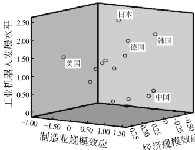

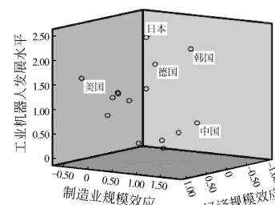

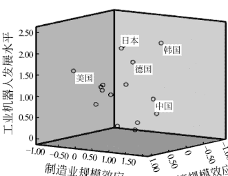

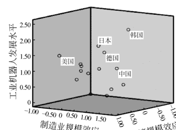

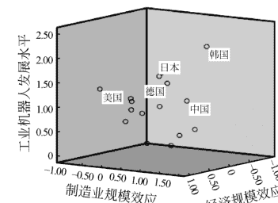

图 4-1 根据新指标体系对各国进行评价的结果分布图

从图 4-1 可以看出，根据新指标体系计算，2010 ~ 2017 年工业机器人发展水平排名前四的国家始终为日本、美国、德国和韩国。中国从 2010 年靠近图形底部的倒数第五名的位置起步，排名逐渐上升，不断逼近最先进的四个国家，在 2017 年，工业机器人总体发展水平的得分已经接近德国。评价指标体系的结果充分反映出中国的工业机器人总体发展水平在不断提高，而且未来仍有继续向上发展、逼近前三名的趋势。各国在工业机器人发展方面的趋势变化如图 4-2 所示。

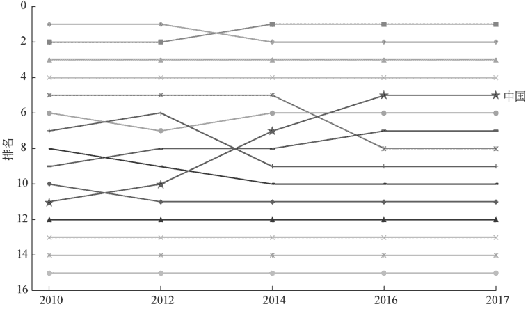

图 4-2 15 个国家 2010 ~ 2017 年工业机器人发展水平排名变动情况

#### 4.3.3 参照国筛选依据

2010 ~ 2017 年工业机器人发展水平这一指标的前四名始终由美国、日本、韩国、德国占据。第 3 章的分析表明，这四个国家均为工业机器人安装、使用或制造方面处于国际领先地位的国家。我国未来在此领域的发展，有必要以这四个国家为对象进行学习借鉴。从 CGE 模型的建模需要及利于分析的角度出发，需要从中选出三个国家，作为 CGE 模型建模过程中我国工业机器人未来发展的低、中、高情景。

美国曾经是年工业产值最大的发达国家，在前几年产业转型过程中，降低了对工业化的重视。根据联合国发布的数据，在国际通用标准下，我国的工业生产总值于 2011 年超过美国。不过，需要注意的是，美国仍然掌握大量高端制造业和核心技术，其工业机器人库存量和购买量仍然非常庞大，近年来推动的“再工业化”以及“制造业回流”，使工业机器人增速指标居于发达国家的前列。而我国的工业生产总值中，仍然有较大部分属于劳动密集型产业创造的价值，制造业升级仍有很大空间。因此，美国仍是值得我国学习借鉴的对象国。

德国、日本的工业机器人产业发展历史长，水平先进，都是值得我国学习借鉴的对象国。其中德国在综合多维评价指标体系中，有两个指标排名位列前四，而且德国还有促进产业发展的《国家工业战略 2030》。而日本近年来制造业占 GDP 比例有所下滑。因此相比较，最终选择德国作为参照国之一。

韩国在工业机器人的使用方面发展迅速，每年的出货量都有较大提高，在本指标体系的工业机器人发展指标中不断超越美国、德国、日本等国家，于 2014 年排名第一，这与其产业结构侧重自动化、高端制造业有一定关系。韩国通过在制造业的一些行业中加大对工业机器人的投入，提升这些行业的自动化水平并创造更多的经济效益，这种发展方式在一定程度上也值得我国借鉴。

因此，在列出的 14 个其他国家中，挑选出美国、德国和韩国作为我国未来工业机器人发展趋势的参考对象，并基于此设置未来的发展情景。

### 4.4 本章小结

本章的主要研究目的是：为 CGE 模型中设置我国未来的工业机器人发展情景挑选参照国。

我国工业机器人发展相对于国外仍处于起步阶段，积累的数据有限，而且发展的行业、发展模式并未定型，较难判断工业机器人在未来如何影响劳动力就业及经济发展，因此有必要借鉴其他国家的发展情况作为我国的发展情景。为此，需要通过多维度综合动态评价挑选出可供借鉴的国家。

本章首先挑选出包括中国在内的 15 个在工业机器人发展、自身经济建设或禀赋方面各有特点的国家进行分析。利用时序全局主成分分析，从设置的 11 个指标中得到三个新的主成分，形成一个三维综合评价指标体系，根据指标体系计算得分及排名。2010 ~ 2017 年工业机器人发展水平这一指标的前四名始终由美国、日本、韩国、德国占据。图 4-1 显示，中国这些年在工业机器人领域发展迅猛，向前四名发起冲击，在 2017 年已经接近德国的得分。美国、德国、韩国、日本同为工业机器人产业较发达的国家。因韩国作为发达国家中年出货量的年度复合增长率最高的国家而被选上，日本与德国类型相近，与韩国同为东亚国家，德国发布了《国家工业战略 2030》的新产业政策，因此在综合考虑筛选参照国的理由后，可得到我国未来工业机器人发展可以参考的国家，分别为美国、德国和韩国。

在本章中，除了为 CGE 模型进行行政策模拟挑选到较为合适的参照国外，在方法方面的创新是建立了一个工业机器人的三维纵向综合评价指标体系。利用这一新指标体系，可以对各国从工业机器人发展角度及国家经济发展的不同维度进行综合分析。相比于以往利用工业机器人密度、年出货量等单一指标的分析，这种多维度、时间纵向比较体系，可以兼顾工业机器人发展存量和增量、经济体量及运行效率等多种相关因素，并在时间维度下反映出各个国家得分排名的动态变化。在挑选参照国方面，要优先考虑工业机器人发展水平排名靠前的国家，如日本、美国、韩国和德国。

同时，结合对各国同时期经济发展、产业结构变化的分析，可以总结出何种发展模式，或何种产业结构可以更好地促进工业机器人的发展。以韩国为例，其发展速度较快，迅速逼近美国、日本。根据第 3 章的介绍，这与韩国在 2010 ~ 2017 年重点发展微电子加工业，大规模使用工业机器人有关。韩国经济也在此阶段形成新一波发展。因此，利用新的指标体系筛选出 CGE 模型所用的参照国后，根据这些国家的发展经验和发展模式，在 CGE 模型中形成不同的产业发展模式。CGE 模型的参数及各发展情景的设置，将在第 6 章呈现。

## 第 5 章 工业机器人发展对我国劳动力的影响研究

### 5.1 引言

如第 2 章所述，目前国内关于工业机器人对劳动力替代及产业结构的影响以定性讨论为主，少数利用统计数据分析整体的技术进步和就业的关系，或用面板数据探讨人工智能与劳动力替代的相关关系，鲜有能够打开黑箱，深入研究工业机器人对不同行业、不同劳动力群体的影响的工作，本章试图在这方面进行探讨。

本章要研究的一个问题是我国进入老龄化社会后，劳动力人口规模逐渐缩减，则工业机器人的发展，对劳动力会产生何种影响？能否在一定程度上填补劳动力供给减少的缺口？为了探讨工业机器人的发展对劳动力规模和结构两方面的影响，本章使用 PDE 模型对我国人口进行预测。该模型既可以预测人口规模，还可以预测不同受教育水平的人口变化。工业机器人对不同受教育水平的劳动力冲击程度不同，利用 PDE 模型预测出人口结构的结果，即可分析截至 2035 年，不同受教育水平的劳动力规模，劳动力供给减少的程度，受影响的情况以及工业机器人可能填补的规模、结构缺口，所得结果也可以为本书政策建议提供定量的依据。

本章要研究的另一个问题是在制造业的各个行业中，哪些行业的就业更容易受到工业机器人使用量变化的影响。通过建立分行业的回归模型，找出这些行业及受到影响的程度，为随后开展的基于 CGE 模型研究工业机器人对经济的影响提供依据。

### 5.2 方法回顾与选择

#### 5.2.1 劳动力预测方法回顾

对未来劳动力预测常采用人口预测的方法，最早采用的是线性回归模型。该

模型认为人口数量是一系列自变量的因变量，对历年人口数据进行回归检验得到变量系数，并构造线性回归方程进行预测。蒋辉（2005）利用线性回归模型预测我国 2015 ~2030 年人口数量，2030 年为 14.13 亿人。联合国模型常被用于估计一个国家人口的总数和城市人口数量。联合国曾预测中国于 2030 年达到人口峰值，至 14.5 亿人。任强和侯大道（2011）利用 Leslie 矩阵和 ARMA 模型预测我国 2010 ~2050 年人口数量，结果显示，至 2020 年达到人口最大值（14.35 亿人），之后呈下降趋势。以往的人口预测多关注人口的规模及年龄结构，但在研究人工智能、机器人与就业的关系中，更需要考虑劳动力的素质，因此要对劳动力的受教育水平进行分析。IIASA 开发的 PDE 模型对以往的模型进行改进，将受教育程度也作为一个因素进行预测（Lutz and Goujon, 2001），并对全球 171 个国家的人力资本进行至 2100 年的长期预测（KC and Lutz, 2014）。中国也利用该模型对北京（陈功等，2006）及上海（庞丽华等，2006）2030 年的人口性别、年龄和受教育水平进行了预测。利用该模型可以探索人工智能、机器人的发展水平与劳动力人口素质之间的关系，并以此为基础分析工业机器人可以在何种程度填补因老龄化带来的劳动力缺口。

#### 5.2.2 人工智能对劳动力影响相关方法回顾与选择

在以往对技术进步与劳动力就业关系研究中，一个常用的方法是索洛余值法，其优点是数据量要求较低，但缺点是对生产函数的假设约束性较强。另一个常用的方法是科布-道格拉斯生产函数，通过计算产值的劳动要素弹性系数讨论技术进步与就业的关系，这种方法对数据量要求较低，但需要考虑要素-总产出的弹性是固定不变的。使用这些方法时，将劳动力就业与技术进步同时作为自变量，将总产出作为因变量，从而分析技术进步与劳动力就业的替代关系。但在本书中，由于中国使用工业机器人时间较短但进展很快，这就导致使用工业机器人的行业在不断变化，这些行业的总产出也在发生较大的变化。即便在同一个行业中，不同企业使用机器人的程度有差异，如果利用行业总体的产出作为因变量，有可能高估使用机器人的企业数量，但低估机器人对产出的作用。

在工业机器人对劳动力总体规模影响的研究中，由于在统计数据及现实生活中，工业机器人总量中的一部分无法划入某个具体行业，在分析总体影响时，可以使用工业机器人总的年销售规模作为衡量工业机器人发展水平的变量，以便与现有研究及国外经验进行比较（Acemoglu and Restrepo, 2017）。同时，在分析工业机器人对劳动力规模的总体影响时，还有必要考虑劳动力结构方面的影响。因为在现有研究或报告中，人工智能、工业机器人等先进技术对于劳动力的替代水平是与工作所需的劳动复杂程度相关的，简单、重复、对劳动技能或知识水平需求低的岗位容易被替代，而相对需要较高技能的岗位则不易被替代（Manyika et al., 2017；Frey and Osborne, 2017）。所以有必要建立工业机器人规模同劳动力就业规模及其结构较为直接的关联关系分析。线性回归是一种较为简单、直接的方式，通过回归分析中的系数反映技术进步变量对就业的影响作用；缺点是各变量间可能有较强的相关性。在以往的研究中，通过选择较为合适的自变量，可以有效地避免这种方法的不足（姚战琪和夏杰长，2005）。

在工业机器人对细分行业劳动力规模的影响研究中，研究者曾使用 SBTC 和 RBTC 两种方法。两种方法都已经对劳动力群体及工作任务进行了分化。前者适合对不同受教育水平的劳动力受工业机器人的影响进行分析，后者适合研究如行政、技术等不同类型的工作受工业机器人的影响。近年来，有研究者开始使用技能-工作任务匹配均衡模型进行分析。Autor（2013）、Acemoglu 和 Autor（2011）利用技能-工作任务匹配均衡模型分析从事不同难度工作任务的劳动力受工业机器人的影响，认为对于某一类任务，使用劳动和资本都可以完成。选择劳动力还是资本投资，取决于价格（如工资或使用费用等）。技能-工作任务匹配均衡模型可以将工业机器人与分行业、分任务的劳动力规模建立联系，进而分析出工业机器人带来的影响。技能-工作任务匹配均衡模型应用得较少，有研究者利用技能-工作任务匹配均衡模型进行分析，发现工业机器人对美国就业有显著的替代作用，也对工资产生负面影响（Acemoglu and Restrepo, 2017）。根据我国现状，各行业、企业使用工业机器人程度差异较大，同时劳动力供给也相对较为充分，因此本研究参考 Acemoglu 和 Restrepo（2017）的研究，利用技能-工作任务匹配均衡模型分析我国制造业内细分行业中，工业机器人对劳动力规模的影响。

综合对以往方法的分析，本书将采用线性回归方法分析工业机器人对劳动力的总体影响；采用技能-工作任务匹配均衡模型研究制造业细分行业中工业机器人对劳动力规模的影响。

### 5.3 未来我国劳动力变动预测

在以往的研究中，先进技术对劳动力的影响多集中于对现状的分析。对于我国来说，未来既面临劳动力规模逐渐降低的情况，也面临劳动力受教育水平不断提高的现实。根据国外的研究结果，工业机器人对不同受教育水平的劳动力替代效果各异，对受教育水平高的劳动力具有更高的需求。因此，为了分析未来工业机器人对劳动力的影响，进而分析对经济的影响，有必要对未来一定时期内的中国人口进行预测，且这个预测除了提供未来可能的规模外，还有必要说明未来人口受教育结构的变化，从而能更合理地开展分析。

#### 5.3.1 改进型 PDE 模型简介

在人口增长中，人口增长数量由自然增长数量和机械增长数量组成。自然增长数量是指出生新增人口减去死亡人口的余额；机械增长数量是指外地净迁入的人口数量。人口总增长数量等于自然增长数量与机械增长数量之和。某时期总人口等于上期总人口加上本期增长人口。

利用生命周期原理预测人口的数学表达式为

```
Pt = Pt-1 + Pbt - Pdt + Pit
= Pt-1 · (1 - dt) + Pi + Pbt
= Pt-1 · (1 - dt) + Pi + (Pt-1 · Rt-1 + Pi · Ri) · Bt
= Σ(n=1 to 110) Pn(t-1) · (1 - dml) + Σ(n=15 to 50) [Pn(t-1) · Rn(t-1) · Pni · Rni] · Bml   (5-1)
```

式中，Pt 为第 t 年总人口数量；Pt-1 为第 t-1 年人口数量；Pn(t-1) 为第 t-1 年年龄为 n 的人口数量；Pbt 为第 t 年出生的人口数量；Pdt 为第 t 年的死亡人口数量；Pit 为第 t 年净迁入人口数量；dt 为第 t 年的死亡率；dml 为第 t 年的年龄是 n 的死亡率；Rt-1 为第 t-1 年女性占总人口比例；Rn(t-1) 为第 t-1 年的年龄是 n 的女性占总人口比例；Ri 为净迁入人口中女性比例；Rni 为净迁入人口中年龄为 n 的女性占总人口比例；Bt 为第 t 年的出生率；Bml 为第 t 年的年龄是 n 的妇女生育率。

由于中国的国际人口流动相对于中国人口的规模非常小，本书中 Pit、Ri 和 Rni 均为 0。

用于预测全国分城乡人口变化的基期数据是 2010 年第六次全国人口普查资料。在 PDE 模型中，引入人口受教育水平作为多种状态，本书按照模型需要，根据以上数据设置基期数据。以 5 岁年龄组收集年龄别、性别、受教育程度和城乡的人口数据。城市人口指居住地为城市和城镇的人口，农村人口指居住地为乡村的人口；受教育水平分为未上学、小学、中学和大专及以上 4 个状态，其中未上学为未上过学和扫盲班人口之和，小学为受教育水平为小学的人口，中学为受教育水平为初中、高中和中专的人口之和，大专及以上为受教育水平为大学专科、大学本科和研究生的人口之和。

在相应的年龄段，会有部分人口的教育水平向更高层次的教育水平转换，而且这种转换通常是由低到高的单向转换。再结合生命周期模型，即可迭代预测出未来人口在不同受教育水平下的人口规模。

#### 5.3.2 PDE 模型参数设置

- (1) 生育水平情景设定

模型中的生育水平的设定，需要获得育龄（15 ~ 49 岁）妇女分年龄组和受教育程度的生育数据与变化趋势，以不同状态，如分受教育水平人口的年龄别生育率和总和生育率（TFR）表示。总和生育率是指一个国家或地区的妇女在育龄期间，每个妇女平均的生育子女数。

根据 2010 年第六次全国人口普查数据，可以得到 2010 年我国人口中不同受教育水平妇女 5 岁组年龄别生育率，并计算不同受教育水平妇女的 TFR，以各受教育水平妇女人口数量在总育龄妇女的占比为权重，计算不同受教育水平妇女的 TFR 在总体 TFR 中的比例，并假定这种比例不变。

根据预设的生育情景，以及得到的不同受教育水平妇女总和生育率，可以得到至 2035 年时不同生育情景下各受教育水平育龄妇女的 5 岁组年龄别生育率和总和生育率。

- (2) 死亡水平情景设定

模型中死亡水平可以根据模型生命表转化为分性别的预期寿命。随着医疗条件和生活水平的改善，我国的人口预期寿命也在不断提高。根据第六次全国人口普查结果，2010 年全国人口平均预期寿命为 74.83 岁。

在 PDE 模型中，受教育水平是一个重要的影响变量。受教育水平的变动是除经济增长外另一个对婴儿死亡率（Pamuk et al., 2011）和成年人的健康与死亡（Lutz and KC, 2011）都非常关键的决定因素。不同受教育水平的人口，在同一时期内增幅也不同。KC 等（2010）对世界上很多国家不同受教育程度的死亡水平进行回顾，发现教育对死亡水平的影响，通常从 15 岁开始。这是由于很多国家的人口从 15 岁起受教育的情况会出现较大差异，一部分人进入劳动力市场，另一部分人则进入高中乃至大学继续深造。同时发现，相对于中等学历水平（如初中），未上学人口在 15 岁时的预期寿命平均要少 3 年，小学水平的人口平均要少 2 年。在一些工业化国家，大专及以上人口的预期寿命平均比中等学历水平人口的预期寿命高出 2 年。

在设置人口预期寿命的变动方案时，根据联合国的统计及中情景预测方案，日本、韩国人口平均预期寿命达到 74.83 岁之前，平均每 5 年增长 0.6 岁①。通过与联合国发展中国家模型生命表进行对照，可得到我国预期寿命的变化。以此为基础预期寿命，设置增幅为平均每 5 年增长 0.6 岁。各受教育水平人口的预期寿命增长幅度不相同。

- (3) 受教育水平情景设定

本书对人口受教育水平进行设定时，基期数据是以 2010 年第六次全国人口普查数据中，接受某一级别教育的适龄人口数同该年龄总人口数的比值，得到该年龄段接受适宜水平教育的比例，是一个类似于毛入学率的概念。例如，在我国，国家规定的小学法定入学年龄为 6 周岁，则 6 ~ 9 岁组中，根据我国九年义务教育制度，进入小学学习的适龄人口比例应为 100%，当然也可以根据普查结果，以实际毛入学率为准。

未来的受教育水平人口比例的变动，则以对其他国家和地区预测研究中使用的人口受教育水平构成的比例的变动作为参考。以至 2035 年时日本、韩国及新加坡等不同受教育水平人口的比例作为参考，从而得到至 2035 年时，我国人口受教育水平的变化情景。

- (4) 总体情景设置

根据以上对生育、死亡、受教育水平变化等因素的讨论，可以设置多种情景。本书重点讨论工业机器人和劳动力的关系，且工业机器人的使用规模已经有多种情景，因此本书只使用一种生育率方案进行人口预测，而死亡水平由人口平均预期寿命来衡量，受教育水平变化则以教育转换率来表示，则设置的情景见表 5-1 和表 5-2。

表 5-1 2020 ~ 2035 年生育、死亡设置情景

| 时段 | 总和生育率/% | 平均预期寿命/岁 |
|---|---|---|
| 2016 ~ 2020 年 | 1.6 | 76.9 |
| 2021 ~ 2025 年 | 1.4 | 78.0 |
| 2026 ~ 2030 年 | 1.4 | 79.1 |
| 2031 ~ 2035 年 | 1.4 | 80.1 |

表 5-2 教育转换率设置情景

| 未上学到上小学 | 小学到中学 | 中学到大专及以上 |
|---|---|---|
| 0.9957 | 0.980 | 0.336 |

教育转换率的设置基于 2010 年第六次全国人口普查资料。

#### 5.3.3 人口预测结果

根据生命周期原理的人口预测公式的迭代计算，可以得到 2025 年、2030 年和 2035 年的人口规模及性别、年龄、受教育水平结构的分布（图 5-1）。其中劳动力人口（15 ~ 59 岁）规模及受教育水平结构分布见表 5-3。

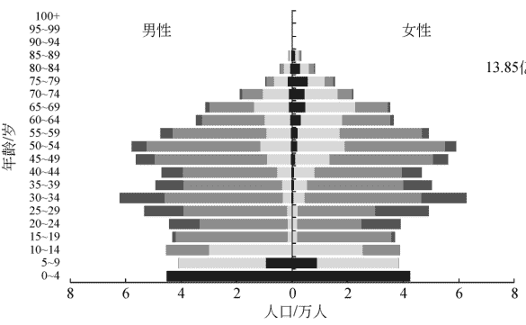

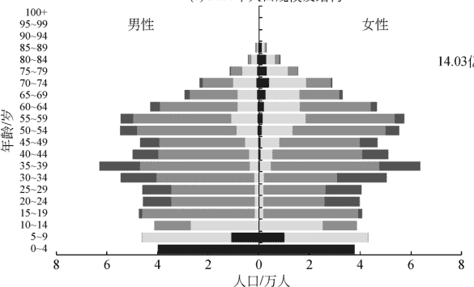

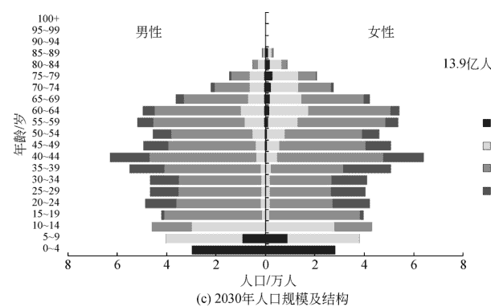

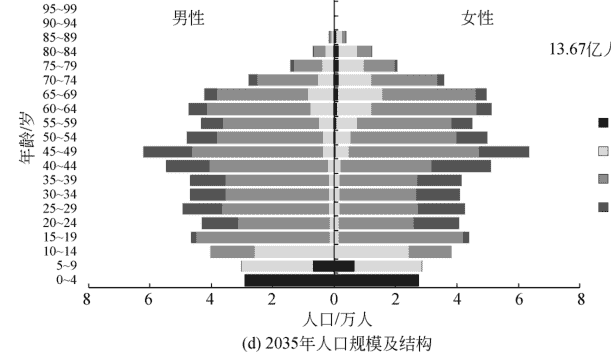

图 5-1 2020 ~ 2035 年中国人口分性别、年龄、受教育水平结构预测结果

表 5-3 预测所得不同受教育水平的劳动力人口（15 ~ 59 岁）规模

(单位：万人)

| 时段 | 未上学 | 小学 | 中学 | 大专及以上 |
|---|---|---|---|---|
| 2020 ~ 2024 年 | 950 | 11 021 | 63 409 | 15 855 |
| 2025 ~ 2029 年 | 686 | 8 950 | 63 524 | 17 671 |
| 2030 ~ 2034 年 | 469 | 6 499 | 61 388 | 19 440 |
| 2035 年 | 320 | 4 799 | 60 052 | 20 821 |

由图 5-1 的人口金字塔可以看出，我国的人口规模在 2025 年达到预测期内的高峰水平，随后开始逐渐下降。同时人口金字塔中横向最宽的区域不断上移，至 2035 年，5 岁组人口最多的年龄组是 45 ~ 49 岁，说明劳动年龄人口的平均年龄也在不断上移。从教育角度看，随着受教育水平的提高，大专及以上的人数在 20 ~ 24 岁年龄组中占比在不断上升。

在劳动力退出方面，以 55 ~ 59 岁人口为即将退休的人口，2020 ~ 2024 年、2025 ~ 2029 年、2030 ~ 2034 年分别将有 1.119 亿人、1.056 亿人和 8829.46 万人退休，均占当期全部劳动人口规模的 10% 以上。在退休人口中，中学及以下劳动力分别占 72.0%、71.1% 和 70.1%；大专及以上劳动力分别占 28.0%、28.9% 和 29.9%，说明退休人口中低技能劳动力的占比逐渐降低，高技能劳动力的占比在逐渐增加。

### 5.4 工业机器人对劳动力的影响

#### 5.4.1 变量选择

为了能对劳动力结构受到的影响进行分析，需要建立一个可以反映不同受教育水平间关系的因变量。本书不使用劳动力总规模及各类别劳动力绝对量，而是使用劳动力技能比的概念，即高技能劳动力和低技能劳动力的比值，其公式为  
LSR = HSL/LSL  
(5-2)

式中，LSR 为劳动力技能比；HSL 为高技能劳动力；LSL 为低技能劳动力。本书的研究领域为制造业，因此将高技能劳动力定义为高中（含中专）、大专及以上学历，其规模为这部分就业人员所占比例与全国就业人数之积。低技能劳动力供给规模为全国就业人数与高技能劳动力供给之差。不同受教育水平劳动力占比采用《中国劳动统计年鉴》（2003 ~ 2017 年）中公布的全国就业人员受教育构成指数数据。

在分析工业机器人对劳动力就业结构的影响时，还需要考虑社会技术进步带来的劳动力受教育水平的提高，因此，有必要将社会技术进步作为控制变量。根据以往研究，可以利用综合技术水平衡量技术进步。本书的综合技术水平参考以往研究，为各年劳动生产效率与资金产值效率的算术平均值（姚战琪和夏杰长，2005）。劳动生产效率用工业增加值与同时期全部从业人员平均人数的比值衡量 [元/（人·a）]；资金产值效率用固定资产净值与工业增加值的比值表示。

#### 5.4.2 建立模型

对以上变量建立在控制综合技术进步水平情况下，工业机器人对劳动力技能水平的影响的线性模型为
LSR_i = \alpha C + \beta_1 IR_i + \beta_2 Tech_i + \mu_i \quad (5-3)
式中，LSR_i 为我国第 i 年的劳动力受教育结构；IR_i 为我国第 i 年工业机器人的销售量；Tech_i 为我国第 i 年的综合技术进步水平；\mu_i 为随机误差项；\alpha, \beta_1, \beta_2 为回归系数；C 为常数项。指标测量数据主要来源于《中国统计年鉴》、《中国工业统计年鉴》（2002 ~ 2017 年）、《中国劳动统计年鉴》（2002 ~ 2017 年）、Wind 公司数据库、IFR 发布的《工业机器人年度报告》等。

#### 5.4.3 数据描述及回归分析

##### 5.4.3.1 数据描述

- (1) 劳动力规模及受教育结构变化趋势

我国一直以来拥有庞大的劳动力资源，在经济发展中享受着长达数十年的“人口红利”。根据《中国劳动统计年鉴》（2002 ~ 2017 年），我国全部企业从业人员年平均人数见表 5-4 和图 5-2，为匹配工业机器人数据，统计的起始年份为 2001 年。

表 5-4 2001 ~ 2016 年我国全部企业从业人员年平均人数 （单位：万人）

| 年份 | 人数 | 年份 | 人数 |
|---|---|---|---|
| 2001 | 5441.43 | 2009 | 8831.22 |
| 2002 | 5520.66 | 2010 | 9544.71 |
| 2003 | 5748.57 | 2011 | 9167.29 |
| 2004 | 6622.09 | 2012 | 9272.90 |
| 2005 | 6895.96 | 2013 | 9378.75 |
| 2006 | 7358.43 | 2014 | 9582.03 |
| 2007 | 7875.20 | 2015 | 9775.02 |
| 2008 | 8837.63 | 2016 | 9475.57 |

资料来源：国家统计局的《中国劳动统计年鉴》（2002 ~ 2017 年）

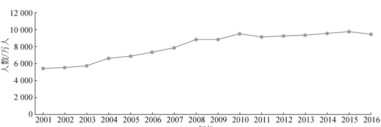

图 5-2 2001 ~ 2016 年我国全部企业从业人员年平均人数变化

资料来源：国家统计局的《中国劳动统计年鉴》（2002 ~ 2017 年）

由表 5-4 和图 5-2 可以看出，我国全部企业从业人员平均人数在 2015 年达到顶峰后，在 2016 年出现了下滑，未来随着人口老龄化及新出生人口规模出现下降，加入劳动力队伍的人口将会逐渐降低，这种下滑趋势可能将持续相当长的一段时间。

因此，在未来发展中需要更加重视劳动力受教育水平的发展，变“人口红利”为“人才红利”。本节将劳动力技能比作为分析模型的因变量，因此有必要先描述人口的受教育水平（表 5-5、图 5-3 和图 5-4）。

表 5-5 2001 ~ 2016 年我国劳动力人口学历分布情况 （单位：%）

| 年份 | 未上学 | 小学 | 初中 | 高中（含中专） | 大学专科（含高职） | 大学本科 | 研究生 |
| :--- | :--- | :--- | :--- | :--- | :--- | :--- | :--- |
| 2001 | 7.8 | 30.9 | 42.3 | 13.5 | 4.1 | 1.4 | 0.1 |
| 2002 | 7.8 | 30.0 | 43.2 | 13.1 | 4.3 | 1.6 | 0.1 |
| 2003 | 7.1 | 28.7 | 43.7 | 13.6 | 4.8 | 1.9 | 0.1 |
| 2004 | 6.2 | 27.4 | 45.8 | 13.4 | 5.0 | 2.1 | 0.1 |
| 2005 | 7.8 | 29.2 | 44.1 | 12.1 | 4.5 | 2.1 | 0.2 |
| 2006 | 6.7 | 29.9 | 44.9 | 11.9 | 4.3 | 2.1 | 0.2 |
| 2007 | 6.0 | 28.3 | 46.9 | 12.2 | 4.3 | 2.1 | 0.2 |
| 2008 | 5.3 | 27.4 | 47.7 | 12.7 | 4.4 | 2.3 | 0.2 |
| 2009 | 4.8 | 26.3 | 48.7 | 12.8 | 4.7 | 2.5 | 0.2 |
| 2010 | 3.4 | 23.9 | 48.8 | 13.9 | 6.0 | 3.7 | 0.4 |
| 2011 | 2.0 | 19.6 | 48.7 | 16.7 | 7.6 | 4.9 | 0.4 |
| 2012 | 2.0 | 19.0 | 48.3 | 17.1 | 8.0 | 5.2 | 0.5 |


| 年份 | 未上学 | 小学 | 初中 | 高中（含中专） | 大学专科（含高职） | 大学本科 | 研究生 |
|---|---|---|---|---|---|---|---|
| 2013 | 1.9 | 18.5 | 47.9 | 17.1 | 8.5 | 5.5 | 0.5 |
| 2014 | 1.8 | 18.1 | 46.7 | 17.2 | 9.3 | 6.2 | 0.5 |
| 2015 | 2.8 | 17.8 | 43.3 | 17.3 | 10.6 | 7.5 | 0.7 |
| 2016 | 2.6 | 17.5 | 43.3 | 17.2 | 10.9 | 7.7 | 0.8 |

资料来源：国家统计局的《中国劳动统计年鉴》（2002 ~ 2017 年）

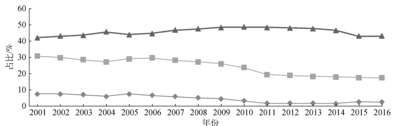

图 5-3 2001 ~ 2016 年初中及以下劳动力占比变化情况
资料来源：国家统计局的《中国劳动统计年鉴》（2002 ~ 2017 年）

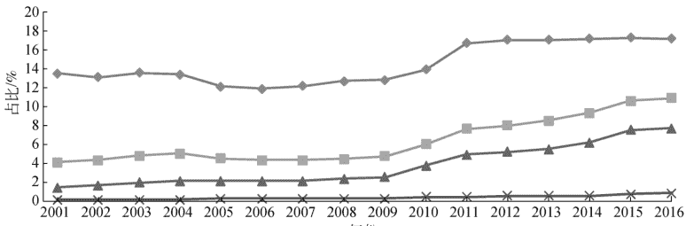

图 5-4 2001 ~ 2016 年高中及以上劳动力占比变化情况
资料来源：国家统计局的《中国劳动统计年鉴》（2002 ~ 2017 年）

由图 5-3、图 5-4 和表 5-5 可以看出，2001 年至今，随着全民受教育水平的提高，劳动力中教育水平为未上学及小学的劳动力人口占比逐渐降低，初中水平的劳动力人口先增后降，而高中水平的劳动力人口占比在稳步提升。受到大学专科和大学本科教育的劳动力占比增幅更加显著，从 2009 年起，大学专科和大学本科教育水平的劳动力占比快速上涨，研究生水平的劳动力占比也在逐步上升。

作为因变量的劳动力技能比为高技能劳动力与低技能劳动力之比，前者为高中（含中专）、大专及以上学历就业人员所占比例与全国就业人数之积，后者为全国就业人数与高技能劳动力供给之差。据此可以计算出 2001 ~ 2016 年的劳动力技能比（图 5-5）。

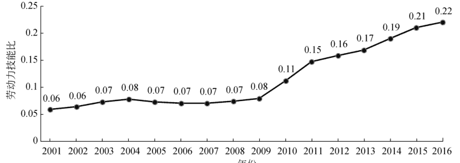

图 5-5  2001 ~ 2016 年劳动力技能比变化趋势

###### (2) 工业机器人变化情况

我国自 21 世纪初开始在工业领域使用工业机器人，并且从 2008 年金融危机后的 2010 年起，年销售量进入一个较快速增长期。根据 IFR 的报告，我国 2001 ~ 2017 年工业机器人销售量、保有量及变化率见表 5-6。

表 5-6  2001 ~ 2017 年中国工业机器人销售量、保有量及变化率情况

| 年份 | 库存量/台 | 保有量变化率/% | 销售量/台 | 销售量变化率/% |
|---|---|---|---|---|
| 2001 | 1 630 | | 700 | |
| 2002 | 2 152 | 32.0 | 522 | -25.4 |
| 2003 | 3 603 | 67.4 | 1 451 | 178.0 |
| 2004 | 7 096 | 96.9 | 3 493 | 140.7 |
| 2005 | 11 557 | 62.9 | 4 461 | 27.7 |
| 2006 | 17 327 | 49.9 | 5 770 | 29.3 |
| 2007 | 23 908 | 38.0 | 6 581 | 14.1 |
| 2008 | 31 787 | 33.0 | 7 879 | 19.7 |
| 2009 | 37 312 | 17.4 | 5 525 | -29.9 |
| 2010 | 52 290 | 40.1 | 14 978 | 171.1 |
| 2011 | 74 317 | 42.1 | 22 577 | 50.7 |
| 2012 | 96 924 | 30.4 | 22 987 | 1.8 |
| 2013 | 132 784 | 37.0 | 36 560 | 59.0 |
| 2014 | 189 358 | 42.6 | 57 096 | 56.2 |
| 2015 | 256 463 | 35.4 | 68 556 | 20.1 |
| 2016 | 339 970 | 32.6 | 87 000 | 26.9 |
| 2017 | 473 429 | 39.3 | 137 920 | 58.5 |

资料来源：IFR 的《工业机器人年度报告》（2011 ~ 2018 年）

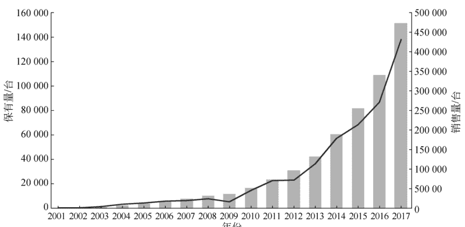

图 5-6 2001 ~ 2017 年中国工业机器人销售量及保有量情况
资料来源：IFR 的《工业机器人年度报告》（2002 ~ 2018 年）

通过表 5-6 和图 5-6 可以看出，2001 年我国加入世界贸易组织（World Trade Organization，WTO）至 2008 年金融危机前，由于当时的劳动力工资水平相对较低，对工业机器人需求量较小。在 2008 年和 2009 年受到金融危机冲击后，全社会货币投放量增加，劳动力工资上涨，在金融危机期间离开企业的劳动力回归制造业的规模相对减少，造成劳动力短缺和工资进一步上涨的情况并存。此时逐渐增加了对工业机器人的需求，销售量的增幅也呈总体上升趋势。未来外部环境不会有大的改变，因此对工业机器人需求的上涨仍将保持一定的时间。

###### (3) 综合技术进步水平

技术进步一方面促进了劳动力效率的提升，另一方面反映了资金产值的效率。这两种效率可以共同反映综合技术进步水平。以工业增加值作为工业发展水平的指标，则劳动生产率用工业增加值与同时期全部从业人员平均人数的比值衡量；资金产值效率用固定资产净值与工业增加值的比值表示。劳动生产率与资金产值效率的算术平均值则可以反映综合技术进步水平。

##### 5.4.3.2 回归分析

###### (1) 单因素分析

在回归分析前，对因变量和自变量进行相关性分析。分析结果表明，工业机器人销售量同因变量劳动力技能比的相关性达到 0.95（*P* < 0.05）；综合技术进步水平与因变量的相关性达到 0.939（*P* < 0.05）。两个自变量都与因变量呈现显著的相关关系。在此基础上，可以进行回归分析。

###### (2) 回归分析

根据式（5-3），进行回归分析后，可得调整 $R^2$ 为 0.954。自变量回归系数及显著性水平见表 5-7。

表 5-7 自变量回归系数及显著性水平

| 变量名称 | 回归系数 | T 值 | 显著性水平 |
|---|---|---|---|
| 常数项 | \(\alpha=0.012\) | 0.826 | 0.424 |
| 工业机器人销售量 | \(\beta_1=1.089\times10^{-6}\) | 4.412 | 0.001 |
| 综合技术进步水平 | \(\beta_2=0.009\) | 4.358 | 0.001 |

由表 5-7 可得，劳动力技能比同工业机器人销售量之间的相关关系显著为正，即工业机器人销售规模的上升，将带动劳动力技能比的升高。高技能劳动力人口同低技能劳动力人口的比值上升，意味着工业机器人很可能对低技能劳动力人口就业存在替代效应，而对高技能劳动力就业存在一定的促进效应。这表明，工业机器人的增长，有可能在一定程度上抵消低技能劳动力退休带来的缺口；对于高技能劳动力来说，工业机器人规模的增长需要更多高技能劳动力从事运营、维护、开发、改造等工作。

### 5.5 对工业机器人补充老龄化背景下劳动力缺口的分析

#### 5.5.1 未来工业机器人变动情景分析

我国制造业目前面临的较为严峻的问题是：随着老龄化的加重以及新劳动力供给的减少，劳动力在未来可能出现缺口。能否依靠工业机器人来填补这一缺口？这成为需要进行评估的一个问题。

为了能回答这个问题，需要对未来工业机器人规模的变动进行分析。可以采取两种方式：一是利用我国 2001 ~ 2017 年的数据，反映一种变化的趋势，并通过拟合出的模型，进行依时间变化的估计；二是利用现有的权威机构的预测，为未来的变化设定情景。

两种方式均有利有弊。第一种方式的好处是容易实现，不受其他因素扰动；但问题是我国工业机器人的大规模使用时间较短，尚未积累足够的数据来分析一个长期的变化，特别是近年来我国工业机器人处于一种爆发式增长的过程，2012 ~ 2017 年工业机器人出货量的 CAGR 高达 43%，这种高速随着基数的增加，很难保持很长时间。因此，有必要参考其他国家的情况。

第二种方式的好处是权威机构，如 IFR 对某国发展的预测，来源于对很多国家工业机器人发展情况的经验总结，避免了某一个国家的特异性；但问题是预测结果对预测对象的一些特点可能无法做出很好地反映。

根据两种方式的优劣比较，以及考虑到第 4 章已经通过多维综合评价指标体系筛选得到对未来工业机器人发展模式的参照国，本章使用第二种方式，即根据其他国家的发展模式，为未来一段时期内我国工业机器人的发展设置情景。

德国、美国、韩国作为参照国，在 2012 ~ 2017 年工业机器人的年出货量增速方面，具有不同的 CAGR，据此，在估计 2020 ~ 2035 年的 CAGR 时，可以根据这三个国家 2012 ~ 2017 年的 CAGR 设置情景。

表 5-8 2020 ~ 2035 年工业机器人发展增速情景 （单位:%）

| 国别 | 情景 | 时段 | CAGR |
|---|---|---|---|
| 德国 | | 2012 ~ 2017 年 | 4 |
| 德国 | S1 | 2020 ~ 2035 年 | 4 |
| 美国 | | 2012 ~ 2017 年 | 8 |
| 美国 | S2 | 2020 ~ 2035 年 | 8 |
| 韩国 | | 2012 ~ 2017 年 | 15 |
| 韩国 | S3 | 2020 ~ 2035 年 | 15 |

资料来源：IFR 的《工业机器人年度报告》（2018 年）

根据表 5-8 中设置的情景，可计算出不同情景下 2020 ~ 2035 年我国工业机器人出货量的规模（表 5-9）。

表 5-9 2020 ~ 2035 年工业机器人出货量的规模 （单位：台）

| 时段 | S1 | S2 | S3 |
| :--- | :--- | :--- | :--- |
| 2020 ~ 2024 年 | 840 295 | 1 019 260 | 1 414 276 |
| 2025 ~ 2029 年 | 1 022 347 | 1 497 628 | 2 844 614 |
| 2030 ~ 2034 年 | 1 243 842 | 2 200 506 | 5 721 534 |

#### 5.5.2 工业机器人变动对补充劳动力缺口的影响

根据对工业机器人销售量与劳动力受教育结构的关系的回归运算「式（5-3）」可得系数 $\beta_1$。根据式（5-3）和 $\beta_1$，可以得到在一定时期内，与工业机器人销售量相匹配的劳动力技能比。根据人口预测模型，可得到劳动力总人口 $P_0$，低技能劳动力人口 $P_1$，高技能劳动力人口 $P_2$。2001 ~ 2016 年规模以上工业企业从业人口占各年劳动力人口的平均值为 10.75%。式（5-4）可计算与工业机器人销售量相匹配的低技能劳动力人口 $P'_1$。式（5-5）可计算被替代的低技能劳动力人口 $P''_1$。

```
$P'_1 = 10.75\% \times P_2 / \text{LSR}$ (5-4)
$P''_1 = 10.75\% \times P_1 - P'_1$ (5-5)
```

在各个预测年份的 55 ~ 59 岁即将退休的人口 $P_r$ 中，其中的低技能劳动力人口为 $P'_r$。由于工业机器人在每个预测年份都将替代一部分低技能劳动力人口，则低技能劳动力人口中，即将退休的和新进入的劳动力的差值 $P''_r$ 减去被替代的 $P''_1$ 即为差值 $P_g$，公式表示为

```
$P_g = P''_r - P''_1$ (5-6)
```

此差值可用来分析工业机器人能在多大程度上填补劳动力退休和新进人的劳动力之间的劳动力缺口。

#### 5.5.3 劳动力替代结果分析

根据表 5-9 中工业机器人销售量规模，式（5-3）及工业机器人销售量与中国劳动力结构之间的回归系数 \(\beta_1\)（表 5-7），可以得到不同类型的劳动力技能比（表 5-10）。

表 5-10 不同工业机器人销售量情景下的劳动力技能比

| 时段 | S1 | S2 | S3 |
| :--- | :--- | :--- | :--- |
| 2020 ~ 2024 年 | 1.011 | 1.100 | 1.360 |
| 2025 ~ 2029 年 | 1.149 | 1.365 | 2.105 |
| 2030 ~ 2034 年 | 1.310 | 1.704 | 3.305 |

本节参与计算的 2001 ~ 2016 年规模以上工业企业全部从业人员占各年劳动人口的平均值的 10.75%。因此在利用回归方程计算后的回归系数及劳动力技能比估算未来高劳动力技能或低技能劳动力人口时，也需要使用企业全部从业人员数进行计算。在进行人口预测后，假设在整个预测期内保持这一比例，根据式（5-4），利用表 5-3 和表 5-5 中不同年份、不同教育的人口规模，乘以该比例，即可得各时段、不同教育水平的企业全部从业人员数。其中，低技能劳动力人口 \(P_1\) 和高技能劳动力人口 \(P_2\) 规模见表 5-11。

表 5-11 企业全部从业人员中低技能与高技能劳动人口（15 ~ 59 岁）规模
（单位：万人）

| 时段 | 低技能劳动力人口 \(P_1\) | 高技能劳动力人口 \(P_2\) |
| :--- | :--- | :--- |
| 2020 ~ 2024 年 | 5832.8 | 3977.68 |
| 2025 ~ 2029 年 | 5590.0 | 4177.07 |
| 2030 ~ 2034 年 | 5150.0 | 4290.73 |

根据人口预测结果，假设在规模以上工业企业中有技能劳动力充分就业。根据式（5-4）和式（5-5），以及不同情景的劳动力技能比，可分别计算出 \(P_1^t\)(表 5-12) 和 \(P_1^t\)(表 5-13)。

表 5-12 不同劳动力技能比情景下低技能劳动力（15 ~ 59 岁）需求规模 P'_t （单位：万人）

| 时段 | S1 | S2 | S3 |
|---|---|---|---|
| 2020 ~ 2024 年 | 3936.13 | 3616.16 | 2925.23 |
| 2025 ~ 2029 年 | 3634.20 | 3059.03 | 1984.25 |
| 2030 ~ 2034 年 | 3274.58 | 2517.50 | 1298.06 |

表 5-13 不同劳动力技能比情景下低技能劳动力（15 ~ 59 岁）被替代规模 P''_t （单位：万人）

| 时段 | S1 | S2 | S3 |
|---|---|---|---|
| 2020 ~ 2024 年 | 1896.69 | 2216.66 | 2907.59 |
| 2025 ~ 2029 年 | 1955.78 | 2530.95 | 3605.73 |
| 2030 ~ 2034 年 | 1875.39 | 2632.47 | 3851.90 |

改进型 PDE 模型可以对未来人口的进行分受教育水平的预测，因此低技能劳动力人口中，将在未来每 5 年退休的人口（55 ~ 59 岁）与同时期即将进入劳动力年龄的人口规模之差 \(P''_r\) 见表 5-14。

表 5-14 低技能劳动力中每 5 年即将退休与即将进入劳动力年龄的人口规模之差 \(P''_r\) （单位：万人）

| 时段 | 总数 |
|---|---|
| 2020 ~ 2024 年 | 3288.16 |
| 2025 ~ 2029 年 | 3980.27 |
| 2030 ~ 2034 年 | 3420.43 |

根据式（5-6）计算 \(P''_r\) 与 \(P''_t\) 的差值，即得到不同情景下，工业机器人尚不能弥补的低技能劳动力退休缺口及占当期退休低技能劳动力的比例（表 5-15）。

表 5-15 不同劳动力技能比情景下不可弥补的低技能劳动力缺口 \(P_g\) 及比例

| 时段 | S1 劳动力缺口 /万人 | S1 比例/% | S2 劳动力缺口 /万人 | S2 比例/% | S3 劳动力缺口 /万人 | S3 比例/% |
|---|---|---|---|---|---|---|
| 2020 ~ 2024 年 | 1391.47 | 42.32 | 1071.50 | 32.59 | 380.57 | 11.57 |
| 2025 ~ 2029 年 | 2024.49 | 50.86 | 1449.32 | 36.41 | 374.54 | 9.41 |
| 2030 ~ 2034 年 | 1545.04 | 45.17 | 787.96 | 23.04 | -437.47 | 0 |

由表 5-15 可以看出，在不考虑工业机器人能力未来的改进发展，以及不考虑其对高技能劳动力造成替代的情况下，仅考虑工业机器人每年销售量增加的情况，即可不断收窄低技能劳动力退休带来的劳动力缺口，至 2035 年，最好的情况下甚至可以完全弥补低技能劳动力退休和新进入劳动力年龄的人口之差。

### 5.6 工业机器人对制造业分行业劳动力的影响

#### 5.6.1 建模与变量选择

Acemoglu 和 Restrepo（2017）详细介绍了技能-工作任务匹配均衡模型方法。在经过一系列推导后，利用该模型回归，找到工业机器人与劳动力规模的关系。基础模型公式表示为

$Y = \left(\int_{N-1}^N y(i)^{\frac{\sigma-1}{\sigma}} \alpha_i\right)^{\frac{\sigma}{\sigma-1}} \quad \text{(5-7)}$

式中，\( Y \) 为假设的唯一最终产品；\( y(i) \) 是为了完成 \( Y \)，根据工作复杂程度分布在一个连续工作任务集上的一系列任务，这个工作任务集分布在连续区间 \( [N-1, N] \) 上，\( i \in [N-1, N] \)；\( \alpha_i \) 为某一份工作在总体任务集上的权重；\( \sigma \) 为工作任务间的替代弹性，表明不同工作任务的直接替代程度。这些工作在劳动要素和资本要素之间可以在一定程度上相互替代，但这种替代基于任务的复杂程度。过于复杂的任务如果不用劳动力而用资本，会使资本的价格变得大幅度高于劳动力的工资，从而继续选择使用劳动力来完成。由此反映出工业机器人的发展与劳动力规模紧密相关。经过推导后，可得工业机器人在细分任务方面与劳动力规模关系的模型，公式为

$d \ln L_c = \beta_c^L \sum_{i \in L} l_{c_i} \frac{d R_i}{L_i} + \varepsilon_c^L \quad \text{(5-8)}$

式中，\( \varepsilon_c^L \) 为不可观测误差项；\( \beta_c^L \) 为待求系数。在原模型中，\( c \) 表示存在一个 \( C \) 交易区，\( c \in C \)；\( d R_i \) 为 \( i \) 行业工业机器人的变化；\( l_{c_i} \) 为 \( c \) 区域中，\( i \) 任务的劳动力人口占 \( c \) 地区就业人口的比例；\( L_i \) 为 \( i \) 行业总的从业人员规模。Acemoglu 和 Restrepo 借用了公共卫生领域的一个概念，“暴露”（exposure），即人体与一种或一种以上的物理、化学或生物因素在时间和空间上的接触。将 \( c \) 区域 \( i \) 行业劳动力接触机器人的汇总水平称为机器人的暴露水平（exposure to robot，ER），公式为

ER_c = \sum_{i \in I} l_{c_i} \frac{dR_i}{L_i} (5-9)

式中， ER_c 为 c 区域的机器人暴露水平； I 为任务的总类，即所有 i 任务属于 I。

本节考虑的是全国情况，因此不涉及不同区域 c。对于各个细分行业来说，形成的模型公式为

dln L = \beta^l ER + \varepsilon^l (5-10)

式中， L 为各个细分行业中的全体劳动力； ER 为各个细分行业的总体机器人暴露水平； \beta^l 为对应的细分行业的回归模型待求系数； \varepsilon^l 为随机因素造成的误差。

#### 5.6.2 数据来源

由式 (5-10) 可以看出，工业机器人变动量、暴露水平等都会随时间的变化而发生改变。本章对分行业工业机器人使用对劳动力规模影响的计算结果，将用于在 CGE 模型中分析工业机器人变化带来的国民经济冲击。因此，所选取的研究对象的起始时间有必要与 CGE 模型模拟期的起始时间相同。因 CGE 模型的基础为 2012 年的投入产出表，本章的分析也使用 2012 ~ 2017 年的数据进行回归计算。

本节分行业工业机器人数据来自 IFR 发布的《工业机器人年度报告》（2018 年）。该数据在统计过程中使用了国际较为通用的制造业行业分类数据，因此可以与其他用于本书的数据进行较好地匹配。分行业劳动力规模数据来自《中国工业统计年鉴》（2013 ~ 2018 年）。2017 年出版的《国民经济行业分类》（GB/T 4754—2017）将中国制造业分为 31 个大类。由于数值很小或序列较短，将其他制造业（41）、废弃资源综合利用业（42）及金属制品、机械和设备修理业（43）合并在一起，形成一个新的“其他制造业”项目，因此共形成 29 个项目。

#### 5.6.3 工业机器人对就业规模的影响

##### (1) 变量设置

表 5-16 列出了式 (5-10) 中的因变量及自变量的变量符号及处理方法。在之前相关研究（Autor，2015； Acemoglu and Restrepo，2017）中，研究者均使用最小二乘法计算获得相关系数，本书也使用相似的方法进行分析。

##### 表 5-16 模型中变量的符号及处理办法

| 变量名称 | 变量符号 | 处理方法 |
| :--- | :--- | :--- |
| 就业规模变化 | Empl_Ch | ln ( l2 / l1 )，两年劳动力规模之差 |
| 分行业暴露水平 | ER | |

##### (2) 结果描述

经过回归分析，可得到分行业的工业机器人暴露水平与劳动力规模变化的关系（表 5-17）。

##### 表 5-17 分行业劳动力规模变化与工业机器人暴露水平的关系

| 细分行业名称 | 系数 | 细分行业名称 | 系数 |
| :--- | :--- | :--- | :--- |
| 农副食品加工业 | -0.003 ** | 化学纤维制造业 | -0.006 * |
| 食品制造业 | -0.005 * | 橡胶制品业 | -0.004 * |
| 酒、饮料和精制茶制造业 | -0.008 * | 塑料制品业 | -0.002 * |
| 烟草制品业 | -0.053 * | 非金属矿物制品业 | -0.005 ** |
| 纺织业 | -0.006 ** | 黑色金属冶炼及压延加工业 | -0.012 * |
| 纺织服装、服饰业 | -0.035 * | 有色金属冶炼及压延加工业 | -0.011 * |
| 皮革、毛皮、羽毛及其制品和制鞋业 | -0.071 * | 金属制品业 | -0.001 * |
| 木材加工及木、竹、藤、棕、草制品业 | -0.062 * | 通用设备制造业 | -0.002 * |
| 家具制造业 | -0.082 * | 专用设备制造业 | -0.001 * |
| 造纸及纸制品业 | -0.019 * | 交通运输设备制造业 | -0.001 * |
| 印刷和记录媒介复制业 | -0.039 * | 电气机械及器材制造业 | -0.002 * |
| 文教、工美、体育和娱乐用品制造业 | -0.004 | 计算机、通信及其他电子设备制造业 | -0.001 * |
| 石油、煤炭及其他燃料加工业 | -0.001 * | 仪器仪表制造业 | -0.02 * |
| 化学原料及化学制品制造业 | -0.003 * | 其他制造业 | -0.063 |
| 医药制造业 | -0.007 * | | |

* P<0.05； ** P<0.01。表中部分行业略有调整，“橡胶制品业”、“塑料制品业”为 GB/T 4754—2017 中行业 29 的拆分；“交通运输设备制造业”为 GB/T 4754—2017 中行业 36 和 37 的整合

由表 5-17 可以看出，工业机器人对大多数行业的劳动力规模产生了显著性的影响，这也为 CGE 模型中，分析工业机器人的使用情况，在各行业中以不同情景发生变化的情况下，对分行业劳动力规模的影响，乃至对整体国民经济的影响奠定了基础。

具体来说，在劳动力规模方面，受影响最严重的前五位行业分别为家具制造业，皮革、毛皮、羽毛及其制品和制鞋业，木材加工及木、竹、藤、棕、草制品业，烟草制品业以及印刷和记录媒介复制业。不少是劳动密集型产业，或对劳动力技能要求较低，可以吸纳大量低技能劳动力，但引入工业机器人后，很多工序可以自动化完成，对低技能劳动力的需求降幅较大。

这些行业不少是劳动密集型，而且与未来的人工智能、先进制造的发展方向不够契合。这些行业有必要进行制造领域的转型升级，或者引入设计、品牌影响等第三产业元素进行改造，满足消费升级的需要，如果仅依靠低技能劳动力的规模以拉低成本竞争，将很难形成可持续发展，甚至将威胁自身的生存。

而受影响最小的五个行业分别为石油、煤炭及其他燃料加工业，金属制品业，专用设备制造业，交通运输设备制造业，计算机、通信及其他电子设备制造业。受影响最小的五个行业，都是资本或技术密集型行业，也是与未来工业机器人、自动化产业发展有较为密切联系的行业。虽然有的行业拥有较多的员工，但目前已经大量使用工业机器人，且仍在使用劳动力的工序，属于目前较难用工业机器人替代或替代后成本上涨的工序。因此，这些行业劳动力规模受工业机器人增长的影响较小。

### 5.7 本章小结

本章的主要研究目的是探讨工业机器人能否在一定程度上填补因老龄化加剧，退休人口增加带来的劳动力缺口问题。具体研究工作及结果如下。

一是利用 PDE 模型对截至 2035 年的人口进行总体规模和分受教育水平规模进行预测。结果显示，2020 ~ 2024 年、2025 ~ 2029 年、2030 ~ 2034 年分别将有 1.119 亿人、1.056 亿人和 8829.46 万人退休。其中企业从业人员，按比例有 8105.6 万人、7866.9 万人和 7350.3 万人。低技能劳动力占其中的 72.0%、71.1% 和 70.1%，说明退休人口中低技能劳动力的占比逐渐降低，高技能劳动力的占比在逐渐增加。

二是由回归分析得出劳动力技能比同工业机器人销售量之间的相关关系显著为正，即工业机器人销售量规模的上升，将带动劳动力技能比的升高。高技能劳动力人口同低技能劳动力人口的比值上升，意味着工业机器人将对低技能劳动力人口就业存在替代效应，而对高技能劳动力就业存在促进效应。

三是根据设置的工业机器人增长情景，得到不同情景下对低技能劳动力的替代量。通过计算同时期低技能劳动力中即将退休与新进入劳动力年龄的劳动力规模的差值，并与低技能劳动力的替代量相减，即可得工业机器人可以弥补的低技能劳动力缺口。在情景 S3 中，工业机器人发展以韩国为参照对象，增速最快。此时 2020 ~ 2024 年、2025 ~ 2029 年和 2030 ~ 2034 年可以分别替代 88.43%、90.59% 和 100%。虽然此结果来自于理论上对假设情景的简化分析，但也说明工业机器人的发展有可能弱化人口老龄化带来的低技能劳动力缺口。

综合上述分析，在老龄化背景下，工业机器人能够较好地补偿因低技能劳动力退休产生的劳动力缺口。这表明，工业机器人的广泛使用，一方面可以较好地降低对低技能劳动力的需求，弱化乃至补偿老龄化及“人口红利”削弱对经济增长造成的负面影响；另一方面增加了对高技能劳动力的需求，而且这种劳动力的缺口是较难依靠短期的资本投入来弥补，只能依靠较为长期的，针对人工智能时代的教育、培训等人力资本增值过程，才能产生新的高技能劳动力。只有促进劳动力的人力资本增值，并帮助高技能人才掌握有针对性的技能，并进入合适的岗位，才能有效应对人工智能时代的来临，以及产业结构调整带来的冲击。

在回答了工业机器人能否弱化乃至补偿老龄化带来的劳动力缺口问题后，本章对制造业中的细分行业的劳动力规模受到工业机器人增长带来的影响进行了分析。

根据分析结果可以发现，除了文教、工美、体育和娱乐用品制造业及其他制造业外，几乎所有细分行业的就业规模都会受到工业机器人增长的影响，只是程度有所差异。

在劳动力规模方面，受影响最严重的前五位行业分别为家具制造业，皮革、毛皮、羽毛及其制品和制鞋业，木材加工及木、竹、藤、棕、草制品业，烟草制品业以及印刷和记录媒介复制业。

根据上述情况可以发现，工业机器人对某一行业劳动力规模的影响程度，不仅仅取决于行业内企业降低成本、提高效率的意愿，也同该行业的发展前景与未来由科技发展引发的产业变革的契合程度有关。该行业在未来的产业结构或制造业体系中占据的位置越重要，即所能创造的价值越高，使用的劳动力技能水平越高，该行业劳动力规模受到工业机器人的冲击程度就越小。

## 第 6 章 工业机器人发展对我国经济的影响研究

### 6.1 引言

工业机器人对经济的影响体现在很多方面。在本书中这种影响主要通过对劳动力规模、工资水平的影响传导到国民经济体系中。根据第 2 章对理论基础回顾可知，CGE 模型相比于其他的计量模型，其优势在于可以建立一种自下而上的经济分析体系，在微观经济活动的基础上，构建出宏观经济的体系，在微观与宏观经济之间建立清晰的脉络关系。在第 4 章，已经挑选出德国、美国和韩国三个国家作为研究的参照国。本章利用 CGE 模型，以德国、美国和韩国的发展模式为参照，设置不同的工业机器人增长变化情景；根据工业机器人变化对劳动力规模的影响，形成一种对经济体系的外部动态冲击过程；同时计算三个国家制造业各个细分行业的生产函数中的就业及资本要素弹性系数，基于可比较、工业机器人使用较多、在制造业中属于先进行业的原则，在模型中改变通用设备制造业，专用设备制造业，交通运输设备制造业，电气机械及器材制造业和计算机、通信及其他电子设备制造业这五个行业的弹性系数。在此基础上，共设置六种情景，即在分别考虑有无弹性系数改变的情况下，分别设置低速发展情景（德国）、中速发展情景（美国）及高速发展情景（韩国）。从而根据工业机器人变动这一微观经济活动，计算出其对宏观经济的影响。

### 6.2 CGE 模型的情景设置

#### 6.2.1 模型中研究对象及调节变量

模型中需要调节变量的研究对象，是应用工业机器人数量最多、占比最大的第二产业，在其中又聚焦到制造业。根据第 3 章的国别比较研究，工业机器人的发展同制造业的转型升级有密切的联系。因此，在本书中，工业机器人变动对劳动力和经济的影响，也集中于制造业的各个部门（具体细分见表 5-17）。

在很多国家，制造业中各行业拥有机器人的规模并不相同，而且均普遍集中于汽车制造、电气/电子、机械加工、金属加工等行业。在调整模型及设置情景时，也会考虑我国以往的历史经验，并参考国外情况。

##### 6.2.1.1 劳动力相关变量调节

在 CGE 模型中，工业机器人影响制造业中各个行业的劳动力规模，并进而对经济产生影响。在本书中，将通过设置不同的工业机器人变化情景，计算各行业劳动力规模或工资变化的情况，进而反映出对经济的影响。

本书的宏观闭合将采用新古典闭合的方式。该方式中，劳动力供给外生给定，工资率水平完全弹性，为内生变量；投资水平内生，当期总投资影响下一期实物资本存量，资本供给外生给定，而资本回报率内生，以适应实物资本存量的变化。

由于在 CGE 模型中存在宏观闭合，劳动 L 和工资 w 不能同时为外生，如果考虑将劳动 L 设为外生变量，则工资 w 将是内生决定的。如果劳动力需求逐渐降低，工资也可能上涨。因此，除工业机器人与劳动力之间直接的系数关系外，还有必要分析在不同情景下，生产函数中资本和劳动要素关系的变化。

##### 6.2.1.2 生产函数相关变量调节

本书采用新古典闭合的方式，表达式如式（6-1）所示。其中，资本 K、劳动 L 和工资 w 的内生与外生方式并不相同。

```
Y=f (K, L)
w=\frac{\partial Y}{\partial L}
Y=Lw+Kr
I=sY
(6-1)
```

式中，L 和 w 不能同时为内生或外生。如果式（6-1）的第一项完全被内生决定，根据模型中生产函数的设定，K 对 L 可以产生影响，但 w 的求解又依赖于 r，r 此时又是外生变量，与模型中其他模块计算出的 r 就产生了矛盾。如果 L 和 w 同时完全外生确定，又会带来 K 和 r 在运算过程中同其他模块产生的结果矛盾。因此，本书将设置 L 变化的情景，同时需要就 L 和对工业机器人的投资 K 进行分析。在情景中，如果不考虑科布-道格拉斯生产函数中 K 和 L 的弹性系数的变化，可以获得三种不考虑弹性系数变化的情景。

在 CGE 模型中，资本 K 和劳动 L 之间的关系主要来自投入增加值中的科布-道格拉斯生产函数。该函数是 1972 年研究者分析美国制造业相关资料时得到的函数关系，可以反映资本和劳动要素之间的关系，其公式为

$Y = A L^{\alpha} K^{\beta}$

式中，A 为技术水平；α 和 β 分别为劳动和资本要素的产出弹性。

在研究过程中，我国大规模使用工业机器人的时间较短，工业机器人规模的增长仍然较快，尚未达到稳定时期，如果利用这段时间的数据计算资本和劳动要素的产出弹性，会产生较大的偏差，因此在本研究中，除了利用其他国家的数据设置工业机器人变动情况下 L 的变化外，也需要根据其数据计算 K 和 L 的关系，从而计算在对机器人投资 K 增大、L 外生的情况下，w 的变化方式。

#### 6.2.2 情景设置的意义与依据

##### 6.2.2.1 情景设置的意义

目前我国制造业中已经有很多行业开始使用工业机器人。在第 4 章已经利用传统计量方法分析各细分行业中，工业机器人应用对劳动力就业规模的影响程度。在本章利用 CGE 模型开展综合分析。由于 CGE 模型内部的方程组已经达到均衡，如果将劳动 L 作为外生变量，就需要设置 L 变化的情景，并说明这种情景设置的合理性和必要性。在假设其他影响劳动力的因素基本不发生变化的情况下，对劳动力进行情景设置时，就需要重点分析工业机器人未来的发展状况。因此，本研究的情景设置，集中于对工业机器人发展情景的设置。

CGE 模型是基于 2012 年的投入产出表构建的，因此情景设置的起始时间为 2012 年。2035 年是实现我国“两个一百年”奋斗目标的两个阶段中承上启下的一年，也是预计基本实现社会主义现代化的一年，因此情景设置的终点时间为 2035 年。

##### 6.2.2.2 情景设置依据与分类

在工业机器人变化方面，只考虑在制造业中的变动，发展情景分别为低速、中速、高速。根据第 3 章及第 5 章对国外工业机器人发展、类别等的分析，可供参考的国别为德国、美国和韩国。这些国家利用工业机器人的时间都长于我国，而且已经处于一个相对稳定、增速平稳的发展阶段。根据各国的国情，各个行业也都具有使用工业机器人的经验及相应模式。因此，将这三个国家作为我国工业机器人未来使用的参考对象。

###### (1) 韩国为参照对象的高速情景

韩国的制造业中工业机器人近十年内年销售量 CAGR 达到约 15%，是增速最快的国家之一。但同为东亚国家，也面临人口老龄化的挑战，需要利用工业机器人提高生产率，降低成本，降低对劳动力的依赖。因此将韩国作为高速发展情景。

###### (2) 美国为参照对象的中速情景

美国是世界上工业产值第二的国家，其工业自动化水平远超我国。在具有庞大工业机器人数量的基础上，工业机器人年购买量仍然保持较高的增速，CAGR 达到 8%。对于我国来说，未来工业机器人规模会继续扩大，工业自动化水平不断提高。在一个较长的时期内，美国的增速也是可以接受的发展情景。因此，将其作为中速发展情景。

###### (3) 德国为参照对象的低速情景

德国是欧盟主要工业国，也是世界工业机器人大国。虽然受限于其国内工业体量，近年来工业机器人增速放缓，但其“工业 4.0”计划及《国家工业战略 2030》等制造业改革计划，都表示要继续大力发展工业机器人，未来德国仍然有可能再次加速。因此，将其作为我国的低速发展情景，即我国工业机器人增速的底线是德国当前水平。

根据 IFR 发布的《工业机器人年度报告》（2010 ~2018 年）的数据，首先对制造业中的三种增速总体情况进行设置。三个国家在发展过程中，由于工业机器人基数不断增大，行业需求波动等情况，每 5 ~ 6 年制造业的年均增速会随时间有一定程度的下降。结合三个国家的发展情况，在情景设置中，每过几年时间，年均增速也会出现下降的情况。具体见表 6-1。

###### 表 6-1 未来增速情景与三个国家对应关系

| 增速情景 | 国家 | 制造业总体增速 |
|---|---|---|
| 低速 | 德国 | 2012 ~ 2021 年: 4%<br>2022 ~ 2026 年: 2.4%<br>2027 ~ 2031 年: 2.1%<br>2032 ~ 2035 年: 1.8% |
| 中速 | 美国 | 2012 ~ 2021 年：8%<br>2022 ~ 2026 年：7.2%<br>2027 ~ 2031 年：6.3%<br>2032 ~ 2035 年：5.4% |
| 高速 | 韩国 | 2012 ~ 2021 年：15%<br>2022 ~ 2026 年：11.2%<br>2027 ~ 2031 年：9.8%<br>2032 ~ 2035 年：8.4% |

除了对总体的设置，各国在应用工业机器人的过程中，各个行业也都表现出不同的使用方式和增速。在 IFR 发布的《工业机器人年度报告》（2010 ~ 2018 年）中，主要表现为汽车、电气/电子等现代制造业中的工业机器人规模、渗透率、密度等指标较高，而一些传统制造业的工业机器人使用相关指标较低。尽管如此，各参照国中的各个行业也都在使用工业机器人。因此，在情景设置过程中，根据参照国的经验数据，分别设置了各个行业工业机器人规模增速情景。IFR 统计报告的分类与制造业部门分类存在一定差异。IFR 的数据对一部分行业进行了合并。因此在情景设置中，一些行业具有相似或相同的情景数据，同时，也存在增长速度逐渐下降的情况，下降幅度类似于制造业总体增幅。各行业工业机器人不同情景下的变动情况见表 6-2 ~ 表 6-4。

表 6-2 低速情景下各行业工业机器人变动情况 （单位:%）

| 细分行业名称 | 2012 ~ 2021 年 | 2022 ~ 2026 年 | 2027 ~ 2031 年 | 2032 ~ 2035 年 |
|---|---|---|---|---|
| 农副食品加工业 | 4.0 | 3.2 | 2.8 | 2.4 |
| 食品制造业 | 4.0 | 3.2 | 2.8 | 2.4 |
| 酒、饮料和精制茶制造业 | 4.0 | 3.2 | 2.8 | 2.4 |
| 烟草制品业 | 4.0 | 3.2 | 2.8 | 2.4 |
| 纺织业 | 6.0 | 4.8 | 4.2 | 3.6 |
| 纺织服装、服饰业 | 6.0 | 4.8 | 4.2 | 3.6 |
| 皮革、毛皮、羽毛及其制品和制鞋业 | 6.0 | 4.8 | 4.2 | 3.6 |
| 木材加工及木、竹、藤、棕、草制品业 | 1.5 | 1.2 | 1.1 | 0.9 |


| 细分行业名称 | 2012 ~ 2021 年 | 2022 ~ 2026 年 | 2027 ~ 2031 年 | 2032 ~ 2035 年 |
|---|---|---|---|---|
| 家具制造业 | 2.0 | 1.6 | 1.4 | 1.2 |
| 造纸及纸制品业 | 1.0 | 0.8 | 0.7 | 0.6 |
| 印刷和记录媒介复制业 | 1.0 | 0.8 | 0.7 | 0.6 |
| 文教、工美、体育和娱乐用品制造业 | 3.0 | 2.4 | 2.1 | 1.8 |
| 石油、煤炭及其他燃料加工业 | 10.0 | 8.0 | 7.0 | 6.0 |
| 化学原料及化学制品制造业 | 9.0 | 7.2 | 6.3 | 5.4 |
| 医药制造业 | 10.0 | 8.0 | 7.0 | 6.0 |
| 化学纤维制造业 | 4.0 | 3.2 | 2.8 | 2.4 |
| 橡胶制品业 | 8.0 | 6.4 | 5.6 | 4.8 |
| 塑料制品业 | 8.0 | 6.4 | 5.6 | 4.8 |
| 非金属矿物制品业 | 7.0 | 5.6 | 4.9 | 4.2 |
| 黑色金属冶炼及压延加工业 | 1.0 | 0.8 | 0.7 | 0.6 |
| 有色金属冶炼及压延加工业 | 10.0 | 8.0 | 7.0 | 6.0 |
| 金属制品业 | 11.0 | 8.8 | 7.7 | 6.6 |
| 通用设备制造业 | 14.0 | 11.2 | 9.8 | 8.4 |
| 专用设备制造业 | 10.0 | 8.0 | 7.0 | 6.0 |
| 交通运输设备制造业 | 3.0 | 2.4 | 2.1 | 1.8 |
| 电气机械及器材制造业 | 8.0 | 6.4 | 5.6 | 4.8 |
| 计算机、通信及其他电子设备制造业 | 6.0 | 4.8 | 4.2 | 3.6 |
| 仪器仪表制造业 | 5.0 | 4.0 | 3.5 | 3.0 |
| 其他制造业 | 2.0 | 1.6 | 1.4 | 1.2 |

##### 表 6-3 中速情景下各行业工业机器人变动情况（单位：%）

| 细分行业名称 | 2012 ~ 2021 年 | 2022 ~ 2026 年 | 2027 ~ 2031 年 | 2032 ~ 2035 年 |
|---|---|---|---|---|
| 农副食品加工业 | 12.0 | 9.6 | 8.4 | 7.2 |
| 食品制造业 | 13.0 | 10.4 | 9.1 | 7.8 |
| 酒、饮料和精制茶制造业 | 13.0 | 10.4 | 9.1 | 7.8 |
| 烟草制品业 | 13.0 | 10.4 | 9.1 | 7.8 |
| 纺织业 | 9.0 | 7.2 | 6.3 | 5.4 |
| 纺织服装、服饰业 | 9.0 | 7.2 | 6.3 | 5.4 |
| 皮革、毛皮、羽毛及其制品和制鞋业 | 9.0 | 7.2 | 6.3 | 5.4 |
| 木材加工及木、竹、藤、棕、草制品业 | 8.0 | 6.4 | 5.6 | 4.8 |
| 家具制造业 | 8.0 | 6.4 | 5.6 | 4.8 |
| 造纸及纸制品业 | 6.0 | 4.8 | 4.2 | 3.6 |
| 印刷和记录媒介复制业 | 6.0 | 4.8 | 4.2 | 3.6 |
| 文教、工美、体育和娱乐用品制造业 | 6.0 | 4.8 | 4.2 | 3.6 |
| 石油、煤炭及其他燃料加工业 | 13.0 | 10.4 | 9.1 | 7.8 |
| 化学原料及化学制品制造业 | 9.0 | 7.2 | 6.3 | 5.4 |
| 医药制造业 | 16.0 | 12.8 | 11.2 | 9.6 |
| 化学纤维制造业 | 9.0 | 7.2 | 6.3 | 5.4 |
| 橡胶制品业 | 7.0 | 5.6 | 4.9 | 4.2 |
| 塑料制品业 | 7.0 | 5.6 | 4.9 | 4.2 |
| 非金属矿物制品业 | 3.0 | 2.4 | 2.1 | 1.8 |
| 黑色金属冶炼及压延加工业 | 8.0 | 6.4 | 5.6 | 4.8 |
| 有色金属冶炼及压延加工业 | 10.0 | 8.0 | 7.0 | 6.0 |
| 金属制品业 | 16.0 | 12.8 | 11.2 | 9.6 |
| 通用设备制造业 | 5.0 | 4.0 | 3.5 | 3.0 |
| 专用设备制造业 | 3.0 | 2.4 | 2.1 | 1.8 |
| 交通运输设备制造业 | 6.0 | 4.8 | 4.2 | 3.6 |
| 电气机械及器材制造业 | 6.0 | 4.8 | 4.2 | 3.6 |
| 计算机、通信及其他电子设备制造业 | 16.0 | 12.8 | 11.2 | 9.6 |
| 仪器仪表制造业 | 10.0 | 8.0 | 7.0 | 6.0 |
| 其他制造业 | 3.0 | 2.4 | 2.1 | 1.8 |

##### 表 6-4 高速情景下各行业工业机器人变动情况（单位：%）

| 细分行业名称 | 2012 ~ 2021 年 | 2022 ~ 2026 年 | 2027 ~ 2031 年 | 2032 ~ 2035 年 |
|---|---|---|---|---|
| 农副食品加工业 | 15.0 | 12.0 | 10.5 | 9.0 |
| 食品制造业 | 12.0 | 9.6 | 8.4 | 7.2 |
| 酒、饮料和精制茶制造业 | 12.0 | 9.6 | 8.4 | 7.2 |
| 烟草制品业 | 12.0 | 9.6 | 8.4 | 7.2 |
| 纺织业 | 3.0 | 2.4 | 2.1 | 1.8 |
| 纺织服装、服饰业 | 3.0 | 2.4 | 2.1 | 1.8 |
| 皮革、毛皮、羽毛及其制品和制鞋业 | 3.0 | 2.4 | 2.1 | 1.8 |
| 木材加工及木、竹、藤、棕、草制品业 | 3.0 | 2.4 | 2.1 | 1.8 |
| 家具制造业 | 3.0 | 2.4 | 2.1 | 1.8 |
| 造纸及纸制品业 | 7.0 | 5.6 | 4.9 | 4.2 |
| 印刷和记录媒介复制业 | 7.0 | 5.6 | 4.9 | 4.2 |
| 文教、工美、体育和娱乐用品制造业 | 8.0 | 6.4 | 5.6 | 4.8 |
| 石油、煤炭及其他燃料加工业 | 12.0 | 9.6 | 8.4 | 7.2 |
| 化学原料及化学制品制造业 | 12.0 | 9.6 | 8.4 | 7.2 |
| 医药制造业 | 15.0 | 12.0 | 10.5 | 9.0 |
| 化学纤维制造业 | 12.0 | 9.6 | 8.4 | 7.2 |
| 橡胶制品业 | 14.0 | 11.2 | 9.8 | 8.4 |
| 塑料制品业 | 14.0 | 11.2 | 9.8 | 8.4 |
| 非金属矿物制品业 | 4.0 | 3.2 | 2.8 | 2.4 |
| 黑色金属冶炼及压延加工业 | 8.0 | 6.4 | 5.6 | 4.8 |
| 有色金属冶炼及压延加工业 | 12.0 | 9.6 | 8.4 | 7.2 |
| 金属制品业 | 6.0 | 4.8 | 4.2 | 3.6 |
| 通用设备制造业 | 18.0 | 14.4 | 12.6 | 10.8 |
| 专用设备制造业 | 12.0 | 9.6 | 8.4 | 7.2 |
| 交通运输设备制造业 | 15.0 | 12.0 | 10.5 | 9.0 |
| 电气机械及器材制造业 | 15.0 | 12.0 | 10.5 | 9.0 |
| 计算机、通信及其他电子设备制造业 | 14.0 | 11.2 | 9.8 | 8.4 |
| 仪器仪表制造业 | 12.0 | 9.6 | 8.4 | 7.2 |
| 其他制造业 | 6.0 | 4.8 | 4.2 | 3.6 |

#### 6.2.3 三种变动速率下分行业劳动力规模变化情景

在设置了三种类型的工业机器人规模变化情景后，根据第 5 章中的式（5-10）及表 5-17，计算可得到分行业劳动力规模变化情况（表 6-5 ~ 表 6-7）。

##### 表 6-5 低速情景下各行业劳动力规模变动情况（单位：%）

| 细分行业名称 | 2012 ~ 2021 年 | 2022 ~ 2026 年 | 2027 ~ 2031 年 | 2032 ~ 2035 年 |
|---|---|---|---|---|
| 农副食品加工业 | -0.06046 | -0.06035 | -0.06029 | -0.06023 |
| 食品制造业 | -0.06604 | -0.06602 | -0.06600 | -0.06599 |
| 酒、饮料和精制茶制造业 | -0.05369 | -0.05369 | -0.05368 | -0.05368 |
| 烟草制品业 | -0.01602 | -0.01590 | -0.01585 | -0.01579 |
| 纺织业 | -0.00011 | -0.00011 | -0.00011 | -0.00011 |
| 纺织服装、服饰业 | -0.00109 | -0.00107 | -0.00107 | -0.00106 |
| 皮革、毛皮、羽毛及其制品和制鞋业 | -0.00078 | -0.00078 | -0.00077 | -0.00077 |
| 木材加工及木、竹、藤、棕、草制品业 | -0.00079 | -0.00079 | -0.00079 | -0.00079 |
| 家具制造业 | -0.00092 | -0.00091 | -0.00091 | -0.00091 |
| 造纸及纸制品业 | -0.00118 | -0.00118 | -0.00118 | -0.00118 |
| 印刷和记录媒介复制业 | -0.00102 | -0.00102 | -0.00101 | -0.00101 |
| 文教、工美、体育和娱乐用品制造业 | -0.02053 | -0.02044 | -0.02039 | -0.02035 |
| 石油、煤炭及其他燃料加工业 | -0.01696 | -0.01666 | -0.01652 | -0.01637 |
| 化学原料及化学制品制造业 | -0.00431 | -0.00426 | -0.00423 | -0.00421 |
| 医药制造业 | -0.00090 | -0.00088 | -0.00088 | -0.00087 |
| 化学纤维制造业 | -0.00179 | -0.00178 | -0.00177 | -0.00176 |
| 橡胶制品业 | -0.19999 | -0.19999 | -0.19999 | -0.19999 |
| 塑料制品业 | -0.31949 | -0.31949 | -0.31949 | -0.31949 |
| 非金属矿物制品业 | -0.10000 | -0.10000 | -0.10000 | -0.10000 |
| 黑色金属冶炼及压延加工业 | -0.02607 | -0.02602 | -0.02600 | -0.02598 |
| 有色金属冶炼及压延加工业 | -0.04864 | -0.04855 | -0.04850 | -0.04845 |
| 金属制品业 | -0.02725 | -0.02725 | -0.02725 | -0.02725 |
| 通用设备制造业 | -0.10973 | -0.10765 | -0.10661 | -0.10556 |
| 专用设备制造业 | -0.20000 | -0.20000 | -0.20000 | -0.20000 |
| 交通运输设备制造业 | -0.06667 | -0.06667 | -0.06667 | -0.06667 |
| 电气机械及器材制造业 | -0.06623 | -0.06620 | -0.06618 | -0.06616 |
| 计算机、通信及其他电子设备制造业 | -0.08000 | -0.08000 | -0.08000 | -0.08000 |
| 仪器仪表制造业 | -0.00011 | -0.00011 | -0.00010 | -0.00010 |
| 其他制造业 | -0.00214 | -0.00214 | -0.00214 | -0.00214 |

##### 表 6-6 中速情景下各行业劳动力规模变动情况（单位：%）

| 细分行业名称 | 2012 ~ 2021 年 | 2022 ~ 2026 年 | 2027 ~ 2031 年 | 2032 ~ 2035 年 |
|---|---|---|---|---|
| 农副食品加工业 | -0.06046 | -0.06035 | -0.06029 | -0.06023 |
| 食品制造业 | -0.06604 | -0.06602 | -0.06600 | -0.06599 |
| 酒、饮料和精制茶制造业 | -0.05369 | -0.05369 | -0.05368 | -0.05368 |
| 烟草制品业 | -0.01602 | -0.01590 | -0.01585 | -0.01579 |
| 纺织业 | -0.00011 | -0.00011 | -0.00011 | -0.00011 |
| 纺织服装、服饰业 | -0.00109 | -0.00107 | -0.00107 | -0.00106 |
| 皮革、毛皮、羽毛及其制品和制鞋业 | -0.00078 | -0.00078 | -0.00077 | -0.00077 |
| 木材加工及木、竹、藤、棕、草制品业 | -0.00079 | -0.00079 | -0.00079 | -0.00079 |
| 家具制造业 | -0.00092 | -0.00091 | -0.00091 | -0.00091 |
| 造纸及纸制品业 | -0.00118 | -0.00118 | -0.00118 | -0.00118 |
| 印刷和记录媒介复制业 | -0.00102 | -0.00102 | -0.00101 | -0.00101 |
| 文教、工美、体育和娱乐用品制造业 | -0.02053 | -0.02044 | -0.02039 | -0.02035 |
| 石油、煤炭及其他燃料加工业 | -0.01696 | -0.01666 | -0.01652 | -0.01637 |
| 化学原料及化学制品制造业 | -0.00431 | -0.00426 | -0.00423 | -0.00421 |
| 医药制造业 | -0.00090 | -0.00088 | -0.00088 | -0.00087 |
| 化学纤维制造业 | -0.00179 | -0.00178 | -0.00177 | -0.00176 |
| 橡胶制品业 | -0.19999 | -0.19999 | -0.19999 | -0.19999 |
| 塑料制品业 | -0.31949 | -0.31949 | -0.31949 | -0.31949 |
| 非金属矿物制品业 | -0.10000 | -0.10000 | -0.10000 | -0.10000 |
| 黑色金属冶炼及压延加工业 | -0.02607 | -0.02602 | -0.02600 | -0.02598 |
| 有色金属冶炼及压延加工业 | -0.04864 | -0.04855 | -0.04850 | -0.04845 |
| 金属制品业 | -0.02725 | -0.02725 | -0.02725 | -0.02725 |
| 通用设备制造业 | -0.10973 | -0.10765 | -0.10661 | -0.10556 |
| 专用设备制造业 | -0.20000 | -0.20000 | -0.20000 | -0.20000 |
| 交通运输设备制造业 | -0.06667 | -0.06667 | -0.06667 | -0.06667 |
| 电气机械及器材制造业 | -0.06623 | -0.06620 | -0.06618 | -0.06616 |
| 计算机、通信及其他电子设备制造业 | -0.08000 | -0.08000 | -0.08000 | -0.08000 |
| 仪器仪表制造业 | -0.00011 | -0.00011 | -0.00010 | -0.00010 |
| 其他制造业 | -0.00214 | -0.00214 | -0.00214 | -0.00214 |

##### 表 6-7 高速情景下各行业劳动力规模变动情况（单位：%）

| 细分行业名称 | 2012 ~ 2021 年 | 2022 ~ 2026 年 | 2027 ~ 2031 年 | 2032 ~ 2035 年 |
|---|---|---|---|---|
| 农副食品加工业 | -0.0971 | -0.0968 | -0.0966 | -0.0965 |
| 食品制造业 | -0.0693 | -0.0691 | -0.0690 | -0.0689 |
| 酒、饮料和精制茶制造业 | -0.0579 | -0.0578 | -0.0578 | -0.0577 |
| 烟草制品业 | -0.0113 | -0.0111 | -0.0110 | -0.0109 |
| 纺织业 | -0.0002 | -0.0002 | -0.0002 | -0.0002 |
| 纺织服装、服饰业 | -0.0018 | -0.0018 | -0.0018 | -0.0018 |
| 皮革、毛皮、羽毛及其制品和制鞋业 | -0.0010 | -0.0010 | -0.0010 | -0.0010 |
| 木材加工及木、竹、藤、棕、草制品业 | -0.0009 | -0.0009 | -0.0009 | -0.0009 |
| 家具制造业 | -0.0010 | -0.0010 | -0.0010 | -0.0010 |
| 造纸及纸制品业 | -0.0018 | -0.0018 | -0.0018 | -0.0018 |
| 印刷和记录媒介复制业 | -0.0004 | -0.0004 | -0.0004 | -0.0004 |
| 文教、工美、体育和娱乐用品制造业 | -0.0216 | -0.0214 | -0.0213 | -0.0212 |
| 石油、煤炭及其他燃料加工业 | -0.0037 | -0.0037 | -0.0036 | -0.0036 |


| 细分行业名称 | 2012 ~ 2021 年 | 2022 ~ 2026 年 | 2027 ~ 2031 年 | 2032 ~ 2035 年 |
|---|---|---|---|---|
| 化学原料及化学制品制造业 | -0.0243 | -0.0239 | -0.0237 | -0.0235 |
| 医药制造业 | -0.0015 | -0.0015 | -0.0015 | -0.0014 |
| 化学纤维制造业 | -0.0059 | -0.0057 | -0.0057 | -0.0056 |
| 橡胶制品业 | -0.2356 | -0.2355 | -0.2354 | -0.2354 |
| 塑料制品业 | -0.3472 | -0.3472 | -0.3472 | -0.3472 |
| 非金属矿物制品业 | -0.0906 | -0.0906 | -0.0906 | -0.0906 |
| 黑色金属冶炼及压延加工业 | -0.0182 | -0.0179 | -0.0178 | -0.0177 |
| 有色金属冶炼及压延加工业 | -0.0368 | -0.0365 | -0.0364 | -0.0362 |
| 金属制品业 | -0.3003 | -0.3003 | -0.3003 | -0.3003 |
| 通用设备制造业 | -0.1218 | -0.1187 | -0.1171 | -0.1155 |
| 专用设备制造业 | -0.2259 | -0.2259 | -0.2259 | -0.2258 |
| 交通运输设备制造业 | -0.7576 | -0.7576 | -0.7576 | -0.7576 |
| 电气机械及器材制造业 | -0.7437 | -0.7366 | -0.7329 | -0.7291 |
| 计算机、通信及其他电子设备制造业 | -0.9434 | -0.9434 | -0.9434 | -0.9434 |
| 仪器仪表制造业 | -0.0037 | -0.0037 | -0.0036 | -0.0036 |
| 其他制造业 | -0.0125 | -0.0124 | -0.0123 | -0.0123 |

#### 6.2.4 生产函数弹性系数计算

本书已经参照美国、德国和韩国的工业机器人变化情景，并分别计算各国制造业部门内各个行业的弹性系数（α 为劳动要素的弹性系数，β 为资本要素的弹性系数），以便更好地模拟工业机器人使用变化情况下，对未来经济的影响（表 6-8）。在计算参照对象的部分行业时，弹性系数的回归结果未通过显著性检验，因此在所列结果中为不适用（以“—”表示），在实际模型运行中，仍然记为我国在该行业的资本与劳动要素产出弹性。结果表明，在参照国中，有的行业对工业机器人有较强烈的需求，但有的行业仍然以人工为主，是否增加更多的投资用于工业机器人对产值的影响并不大。计算各个细分行业数据在不同情景下的劳动和资本要素生产弹性，如果在三种情景下均得到弹性系数即可在低速、中速、高速情景间进行比较，从而可以在工业机器人使用较多，且在制造业中占比份额较高的行业进行比较。所选五个行业为通用设备制造业，专用设备制造业，交通运输设备制造业，电气机械及器材制造业和计算机、通信及其他电子设备制造业，在表 6-8 中该五个行业所在行加粗以示强调。这些行业也是三个参照国重点使用工业机器人的行业，对我国相应行业也可以起到借鉴作用。

##### 表 6-8 美国、德国及韩国制造业各部门劳动与资本要素生产弹性

| 细分行业名称 | 美国 α | 美国 β | 德国 α | 德国 β | 韩国 α | 韩国 β | 基准情景 α | 基准情景 β |
| :--- | :---: | :---: | :---: | :---: | :---: | :---: | :---: | :---: |
| 农副食品加工业 | — | — | — | — | — | — | | |
| 食品制造业 | 0.253 | 0.72 | 0.29 | 0.583 | — | — | | |
| 酒、饮料和精制茶制造业 | 0.221 | 0.68 | 0.272 | 0.439 | — | — | | |
| 烟草制品业 | 0.287 | 0.62 | 0.205 | 0.563 | — | — | | |
| 纺织业 | — | — | — | — | — | — | | |
| 纺织服装、服饰业 | — | — | — | — | — | — | | |
| 皮革、毛皮、羽毛及其制品和制鞋业 | — | — | — | — | — | — | | |
| 木材加工及竹、竹、藤、棕、草制品业 | — | — | — | — | — | — | | |
| 家具制造业 | — | — | — | — | — | — | | |
| 造纸及纸制品业 | — | — | — | — | — | — | | |
| 印刷和记录媒介复制业 | — | — | — | — | — | — | | |
| 文教、工美、体育和娱乐用品制造业 | — | — | — | — | — | — | | |
| 石油、煤炭及其他燃料加工业 | 0.841 | 0.647 | — | — | — | — | | |
| 化学原料及化学制品制造业 | 0.232 | 0.701 | 0.323 | 0.655 | — | — | | |
| 医药制造业 | 0.329 | 0.587 | 0.417 | 0.559 | — | — | | |
| 化学纤维制造业 | 0.368 | 0.562 | 0.423 | 0.555 | 0.267 | 0.765 | | |
| 橡胶制品业 | 0.294 | 0.72 | 0.353 | 0.706 | 0.278 | 0.743 | | |
| 塑料制品业 | 0.267 | 0.78 | 0.296 | 0.801 | 0.138 | 0.878 | | |
| 非金属矿物制品业 | — | — | 0.401 | 0.783 | 0.127 | 0.892 | | |
| 黑色金属冶炼及压延加工业 | 0.205 | 0.598 | 0.223 | 0.633 | — | — | | |
| 有色金属冶炼及压延加工业 | 0.272 | 0.488 | 0.287 | 0.628 | — | — | | |
| 金属制品业 | 0.395 | 0.637 | 0.303 | 0.911 | 0.135 | 0.798 | | |
| 通用设备制造业 | 0.307 | 0.869 | 0.295 | 0.724 | 0.295 | 0.835 | 0.564 | 0.436 |
| 专用设备制造业 | 0.386 | 0.805 | 0.316 | 0.713 | 0.276 | 0.867 | 0.559 | 0.441 |
| 交通运输设备制造业 | 0.323 | 0.658 | 0.278 | 0.787 | 0.135 | 0.784 | 0.546 | 0.454 |
| 电气机械及器材制造业 | 0.348 | 0.539 | 0.319 | 0.895 | 0.134 | 0.883 | 0.474 | 0.526 |
| 计算机、通信及其他电子设备制造业 | 0.396 | 0.599 | 0.252 | 0.479 | 0.461 | 0.785 | 0.597 | 0.403 |
| 仪器仪表制造业 | 0.336 | 0.668 | 0.156 | 0.684 | — | — | | |
| 其他制造业 | — | — | — | — | — | — | | |

#### 6.2.5 基于是否考虑弹性系数变化的 CGE 模型六种情景

根据不同的参照国工业机器人发展方式，通过计算可得到工业机器人发展对劳动力规模影响的变化。通过计算各个行业的劳动与资本要素弹性系数，可以发现各参照国利用更多工业机器人创造价值的行业。综合以上分析，即可得到总体的情景设计（表 6-9）。

##### 表 6-9 设置情景总体情况

| 情景编号 | 工业机器人变化引发劳动力规模变化 | 是否考虑劳动和资本要素弹性系数带来的变化 |
|---|---|---|
| 1 | 低速 | 否 |
| 2 | 中速 | 否 |
| 3 | 高速 | 否 |
| 4 | 低速 | 是 |
| 5 | 中速 | 是 |
| 6 | 高速 | 是 |

### 6.3 未考虑弹性系数变化的工业机器人发展情景的 CGE 模型模拟结果及分析

#### 6.3.1 各情景中宏观经济水平的变化结果及分析

##### 6.3.1.1 各情景下工业机器人对 GDP 均有促进作用但大小有别

由表 6-1 可知，本书中，工业机器人发展的低速情景是德国的发展模式，中速情景是美国的发展模式，高速情景是韩国的发展模式。由图 6-1 可以看出，在不改变科布-道格拉斯生产函数中资本与劳动要素替代弹性系数的情况下，三种工业机器人发展情景下的 GDP 总值，都要高于基准情景，而且越发展，差值体现越大。2035 年，基准情景的 GDP 值为 224.66 万亿元，低速、中速、高速情景的 GDP 值分别为 232.74 万亿元、229.95 万亿元和 229.19 万亿元，至少超出基准值约 4.5 万亿元。而且在三种情景中，形成最高当年 GDP 总值的情景，是以德国为参照对象的低速情景，以韩国为参照对象的高速情景排名第二，而以美国为参照对象的中速情景最小。

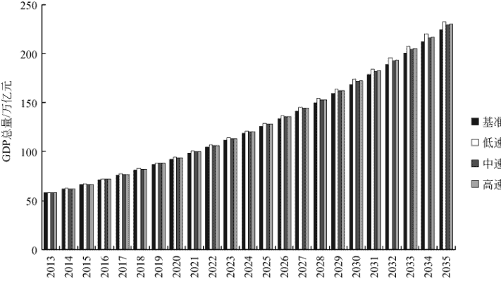

图 6-1 未考虑弹性系数变化 2013 ~2035 年基准情景及不同工业机器人发展情景下各年 GDP 总量变化

在 GDP 增速变化方面，三种加强工业机器人发展的情景在 2030 年之前都优于基准情景（图 6-2）。在初始阶段，三种情景与基准情景的增速的差值较大，为 0.2 ~ 0.3 个百分点。在 2030 年后，低速情景的 GDP 增速保持在 6.0%，较为稳定，而中速和高速情景的 GDP 增速下滑至 5.9%，与基准情景的增速重合。在三种情景中，低速情景的降幅小于另外两种情景，即增速下滑更为平稳，下滑幅度较小。而中速、高速情景的下滑幅度较为接近。

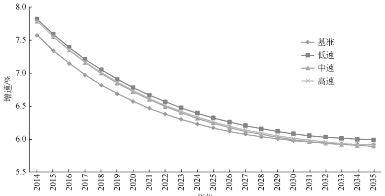

图 6-2 未考虑弹性系数变化 2014 ~ 2035 年基准情景及不同工业机器人发展情景下各年 GDP 增速变化

由模拟期内每一年的 GDP 总量和增速的模拟结果看，三种情景都能对经济产生显著的正面影响，其中，以德国为参照对象的低速情景产生的影响最为显著。这说明，根据我国的经济及产业发展状况，以德国为参照对象的低速情景带来的效果最好。这与“工业机器人增速高带来好的经济发展状况”的观点有所不同。为探究其原因，有必要对工业机器人对各个产业的产值影响进行分析。

##### 6.3.1.2 未考虑弹性系数变化各情景下工业机器人对三大产业产值的影响分析

在本小节中，主要讨论的是在不考虑弹性系数变化的情况下制造业内工业机器人增长带来的影响，因此可以设想的是工业机器人增长对第二产业带来更大的影响。以下为不同情景下，三次产业产值的绝对量和增速的变化情况。

###### (1) 第一产业受工业机器人影响较小

由图 6-3 可以看出，无论哪种工业机器人发展情景，其对第一产业影响甚微。在产值方面，基准情景比三种情景多出的增加值在逐渐扩大，但程度很小。2035 年，基准情景下第一产业产值为 11.64 万亿元，低速、中速、高速情景下的产值分别为 11.43 万亿元、11.41 万亿元和 11.42 万亿元，较基准情景的产值减少约 2000 亿元。在第一产业产值增速方面，各个情景的增速都处于持续下滑状态，但基准情景的增速一直高于同期其他情景，不过差距随时间逐渐收窄（图 6-4）。

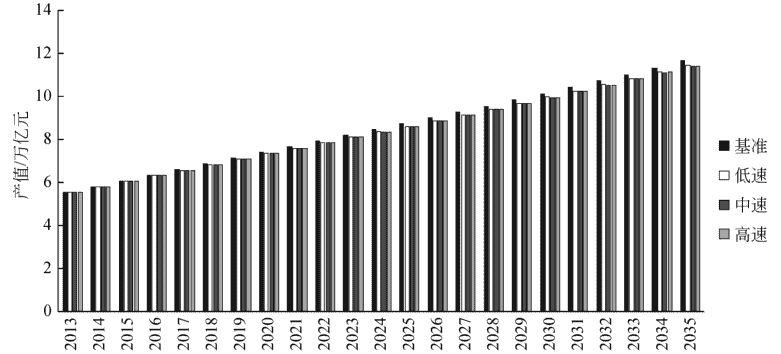

图 6-3 未考虑弹性系数变化 2013 ~ 2035 年基准情景及不同工业机器人发展情景下第一产业产值变化

总体来看，在不考虑细分行业弹性系数变化的情况下，由于工业机器人主要应用于第二产业而非第一产业，而且第二产业的发展难免有可能挤占第一产业的部分投入，从而引起其他情景比基准情景下的第一产业产值有所减少。不过在各个情景下第一产业产值均稳步上升的情况下，这种减少的幅度可以被认为是非常微小的。

###### (2) 工业机器人对第二产业产值促进作用明显

工业机器人主要应用于第二产业。在基准情景下，2013 年第二产业产值为 20.58 万亿元，在国民经济三次产业中的占比约为 40%。随着时间的推移，在模拟期，第二产业产值占比逐渐降低。与基准情景相比，伴随着工业机器人在第二产业中应用的增多，第二产业的产值均提高了，并且与基准情景的差值在逐渐扩大。至 2035 年，基准情景下的产值为 85.55 万亿元，低速、中速、高速情景下的产值分别为 98.62 万亿元、96.49 万亿元和 97.02 万亿元（图 6-5），比基准情景高出 10.94 万亿元 ~ 13.07 万亿元，与基准情景相比增幅为 12.9% ~ 15.2% 。与 GDP 总量的情况类似，第二产业在三种情景下，也是以德国为参照对象的低速情景的产值最高，而以美国为参照对象的中速情景最低，两种情景的模拟结果最多一年相差约 2.13 万亿元。

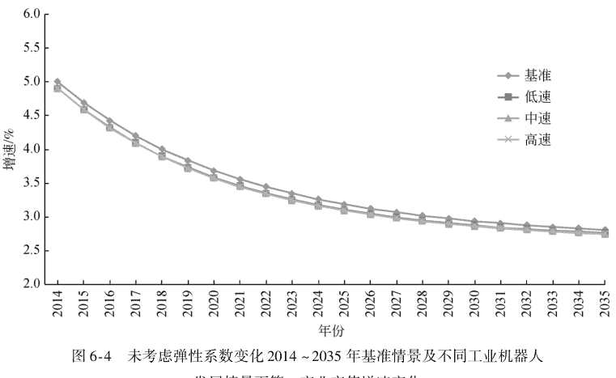

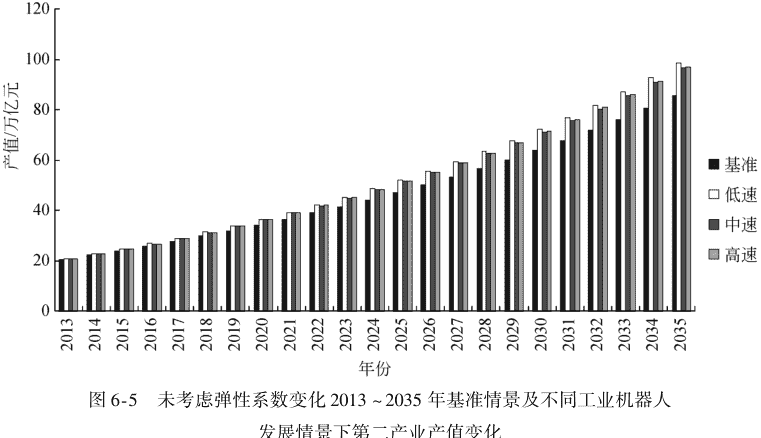

在讨论增速的分析结果时，也出现与 GDP 总值增速变化相类似的情况。三种工业机器人发展情景下的第二产业产值增速均高于基准情景下的增速。差距由模拟初期 2014 年的约 0.8 个百分点，增至 2016 年时的约 0.92 个百分点，达到最大差值。随后三种情景同基准情景的增速差值收窄，至 2035 年，二者差值缩小为 0.2 ~ 0.4 个百分点（图 6-6）。在三种情景中，同样是以德国为参照对象的低速情景的增速下滑最为缓慢，并且在模拟期内持续高于中速、高速情景。中速、高速情景在模拟期内各年的增速较为接近，至 2035 年，以韩国为参照对象的高速情景比以美国为参照对象的中速情景高约 0.02 个百分点，而以德国为参照对象的低速情景比以韩国为参照对象的高速情景高 0.13 个百分点。

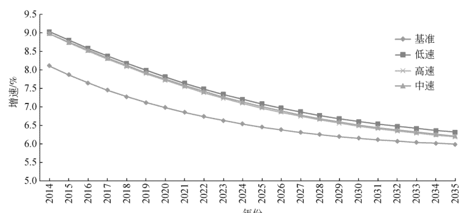

图 6-6 未考虑弹性系数变化 2014 ~ 2035 年基准情景及不同工业机器人发展情景下第二产业产值增速变化

###### (3) 工业机器人使用的增多对第三产业发展有小幅阻碍作用

对第三产业的分析，可以明显看出基准情景在各个情景中具有更高的产值，而且这一优势随着模拟期的推进而扩大。至 2035 年，基准情景第三产业产值的绝对量为 127.46 万亿元，低速、中速、高速情景分别为 122.69 万亿元、121.29 万亿元和 121.52 万亿元。基准情景与三种情景的绝对量差值至少为 4.7 万亿元（图 6-7）。这可能是由于第三产业的产值增长方式与居民消费相关。工业机器人在制造业中的发展，不可避免地对人工产生一定程度的替代作用，减少了进行消费的人口规模，因此在一定程度上对第三产业产生了阻碍作用。但根据模拟结果，这种阻碍效应的绝对量，与工业机器人对第二产业的促进作用相比，前者不到后者的 1/10，因此可以认为影响微小。


图 6-7 未考虑弹性系数变化 2013 ~ 2035 年基准情景及不同工业机器人发展情景下第三产业产值变化

第三产业增速的变化与 GDP 总量及第一、第二产业产值的增速有所不同，基准情景和三种情景在 2034 年达到增速的谷底，但在 2035 年均出现小幅反弹。基准情景的增速在模拟期内均高于同期三种情景下的第三产业产值增速。三种情景中，仍然是低速情景的增速降幅最为平缓，且在模拟期内的增速均高于中速、高速情景的增速。基准情景与低速情景的增速的最大差距出现在 2021 年，差值约为 0.21 个百分点（图 6-8）。

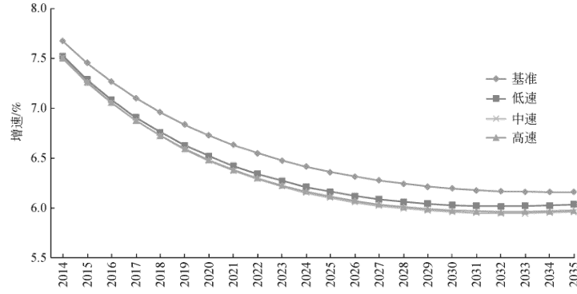

图 6-8 未考虑弹性系数变化 2014 ~ 2035 年基准情景及不同工业机器人发展情景下第三产业产值增速变化

总体来看，工业机器人对三次产业产值的影响，主要体现为在第二产业发挥更大的促进作用，对第三产业有小幅的阻碍影响，而对第一产业的影响很小。在三次产业中，以德国为参照对象的低速情景表现最优。为何增长速度最快的韩国情景并未表现出最优，而以总体经济实力最强的美国为参照对象的中速情景在各产业中表现并不好呢？工业机器人的使用集中于第二产业中的制造业，因此有必要进一步对制造业及其细分行业的工业机器人对经济和劳动力的影响进行分析。

#### 6.3.2 各情景中制造业细分行业变化结果及分析

##### 6.3.2.1 未考虑弹性系数变化各情景下工业机器人发展对制造业产值变化的影响

第二产业中，工业机器人的使用及对劳动力的影响，主要集中于制造业。模拟结果也反映出使用工业机器人的各情景对制造业产值形成较大影响。在 2035 年，基准情景制造业产值为 75.22 万亿元，而低速、中速、高速情景下的制造业产值分别为 84.58 万亿元、82.67 万亿元和 83.17 万亿元，至少高出基准情景 7.45 万亿元，足以弥补第一产业和第三产业的不足（图 6-9）。其中，以德国为参照对象的低速情景促进产值增长的效果最好。

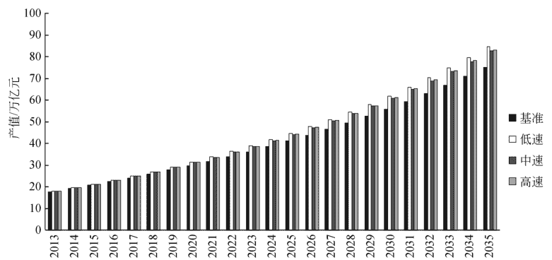

图 6-9 未考虑弹性系数变化 2013 ~ 2035 年基准情景及不同工业机器人发展情景下制造业产值变化

在增速变化方面，与第二产业产值增速变化情况类似，三种情景的增速都高于同时期的基准情景的增速，与基准情景增速的差值最大值出现在 2017 年，比第二产业增速差值最大值的出现晚 1 年。三种情景中，低速情景的增速下滑最慢，而中速、高速情景则增速下滑较快，在 2035 年，接近基准情景的增速（图 6-10）。

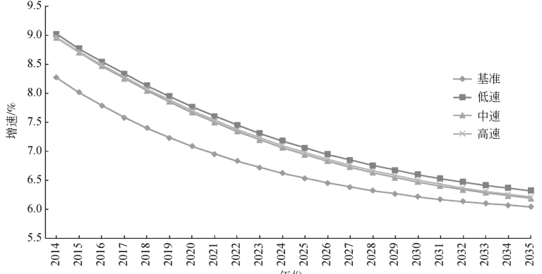

图 6-10 未考虑弹性系数变化 2014 ~ 2035 年基准情景及不同工业机器人发展情景下制造业产值增速变化

对于中国来说，工业机器人发展以德国为参照对象的低速情景在制造业领域对经济产生较好的促进作用。为了能够借鉴德国的经验，有必要进一步对制造业中的行业进行细分，看看何种行业因工业机器人的使用获益更多。

##### 6.3.2.2 制造业主要细分行业产值变化受工业机器人发展的影响

为了讨论未来考虑弹性系数变化的不同情景下，制造业细分中主要行业的产值变化情况，就需要了解在基准情景下，哪些行业的产值较高，在制造业总产值中占比更高。

从图 6-11 中可以看出，根据我国的数据，在制造业细分行业①中，产值最高的前 12 个行业由高到低依次是化学工业，食品制造及烟草加工业，非金属矿物

① 本章用于 CGE 模型的研究数据来源于《中国工业统计年鉴》（2013 ~ 2018 年），而 CGE 模型中的部门分类参考了 2012 中国投入产出表，二者在细分行业类型方面存在小幅差异。因此，在将数据代入 CGE 模型测算前，需对表 5-17 和 6.2 节的行业分类进行整合调整，以匹配模型的行业设定。


制品业，交通运输设备制造业，石油加工、炼焦及核燃料加工业，通信设备、计算机和其他电子设备制造业，电气机械及器材制造业，通用设备制造业，专用设备制造业，黑色金属冶炼及压延加工业，纺织业，以及纺织服装鞋帽皮革羽绒及其制品业。这些行业为本研究中，我国制造业中的主要行业。为了探究几种工业机器人发展情景的不同影响，也需要对各情景中细分行业同基准情景的细分行业进行比较。

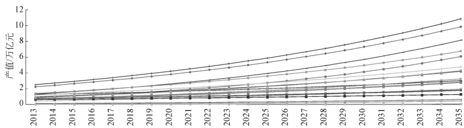

- 食品制造及烟草加工业
- 木材加工及家具制造业
- 化学工业
- 有色金属冶炼及压延加工业
- 专用设备制造业
- 通信设备、计算机和其他电子设备制造业
- 金属制品、机械和设备修理服务
- 纺织业
- 造纸印刷及文教体育用品制造业
- 非金属矿物制品业
- 金属制品业
- 交通运输设备制造业
- 仪器仪表制造业
- 纺织服装鞋帽皮革羽绒及其制品业
- 石油加工、炼焦及核燃料加工业
- 黑色金属冶炼及压延加工业
- 通用设备制造业
- 电气机械及器材制造业
- 其他制造业

图 6-11 未考虑弹性系数变化 2013 ~ 2035 年基准情景下制造业各行业产值变化

###### (1) 低速情景与基准情景的比较

将以德国为参照对象的工业机器人发展低速情景与基准情景进行比较，计算低速情景下细分行业产值与同年基准情景下相同细分行业产值的差值，结果如图 6-12 所示。

由图 6-12 可以看出，有一些行业在基准情景与低速情景下的产值差别较大。一些行业在使用了工业机器人后，产值增幅较大，如石油加工、炼焦及核燃料加工业，仪器仪表制造业等行业。相反，如交通运输设备制造业、通信设备、计算机和其他电子设备制造业、金属制品业等行业，在增加工业机器人使用的情景中，其增幅并未表现出显著增加，原因在于中德两国在工业机器人使用领域方面存在差异。德国的制造业发达，工业体系较为全面。同时德国劳动力成本高，又拥有先进的工业机器人技术，因此工业机器人在各个行业都得到较多的应用，包括石油加工、炼焦及核燃料加工业等行业。而我国目前使用工业机器人的领域较多集中在交通运输设备制造业、通信设备、计算机和其他电子设备制造业等行业，传统行业的自动化改造仍有欠缺。如果采用低速情景，对更多传统制造业行

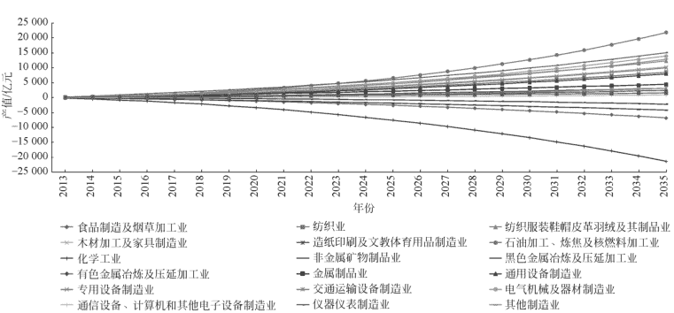

图 6-12 未考虑弹性系数变化 2013 ~ 2035 年低速情景同基准情景比较结果

业进行自动化改造，将会带来很好的效果。

###### (2) 中速情景与基准情景的比较

以美国为参照对象的工业机器人发展中速情景同基准情景进行比较，求得中速情景细分行业产值与同年基准情景下相同细分行业产值的差值，结果如图 6-13 所示。

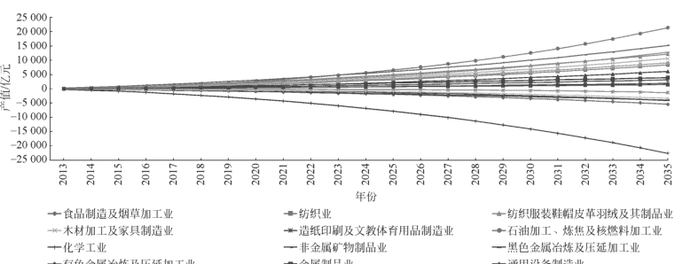

图 6-13 未考虑弹性系数变化 2013 ~ 2035 年中速情景同基准情景比较结果

图 6-13 结果显示，如果借鉴以美国为参照对象的中速情景，相比于基准情景，产值增加的行业类型与借鉴以德国为参照对象的低速情景时的情况相近，包括石油加工、炼焦及核燃料加工业，仪器仪表制造业，电气机械及器材制造业，纺织服装鞋帽皮革羽绒及其制品业在内的行业仍将获得更大的正向效应。而非金属矿物制品业等在以德国为参照对象的低速情景中呈现负向效应的行业，在以美国为参照对象的中速情景中也表现为负向效应。然而在以德国为参照对象的低速情景中，表现为小幅正向效应的交通运输设备制造业、通信设备、计算机和其他电子设备制造业产业，在以美国为参照对象的中速情景中，反而表现为负向效应。这也是工业机器人发展的中速情景和低速情景下，制造业产值出现差别的主要因素之一。其中的原因也与美国的产业结构和发展情景有关。美国的 GDP 占比中，第二产业不到 20%，本土制造业行业类别出现缩减，交通运输设备制造业更新、扩张速度较慢，而通信设备、计算机和其他电子设备制造业的制造部分已经外包给泰国等东南亚国家，这些细分行业中的工业机器人增速不是很快。如果按照中速情景，在交通运输设备制造业、通信设备、计算机和其他电子设备制造业等我国已经具有较好自动化基础的行业，反倒会出现工业机器人应用增长相对减速的情况。因此对于中速情景，需要在分析其产业结构后，取长补短。

###### (3) 高速情景与基准情景的比较

以韩国为参照对象的工业机器人发展高速情景同基准情景进行比较，得到高速情景下细分行业产值与同年基准情景下相同细分行业产值的差值，结果如图 6-14 所示。

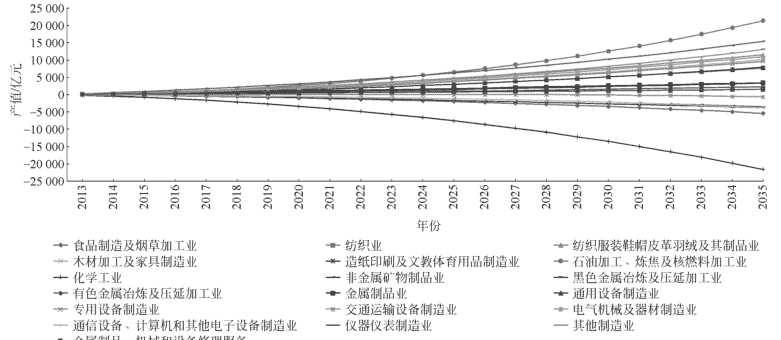

图 6-14 2013 ~ 2035 年高速情景同基准情景比较结果

韩国的制造业工业机器人增速是三个国家中最高的，在与基准模型的比较中，与低速、中速情景类似，随着工业机器人使用的增加，有很多行业呈现出显著的正向效应，另有一部分行业呈现出显著的负向效应。但交通运输设备制造业和通信设备、计算机和其他电子设备制造业仍然表现出小幅的负向效应，只是负向的程度小于中速情景（图 6-14）。

总体而言，在未考虑弹性系数变化的情况下制造业的大部分细分行业，在各个工业机器人发展情景下，都比基准情景创造更多的产值，从而提高制造业产值，进而提高第二产业产值及 GDP 总值；也反映出工业机器人对经济的促进程度，与产业结构高度相关。

###### (4) 各情景间的比较

为分析不同情景下制造业细分行业工业机器人增速带来的影响，将三种情景进行两两比较。利用低速情景细分行业产值分别减去同年中速和高速情景下相同细分行业产值；利用高速情景细分行业产值减去同年中速情景下相同细分行业产值。结果分别如图 6-15 ~ 图 6-17 所示。

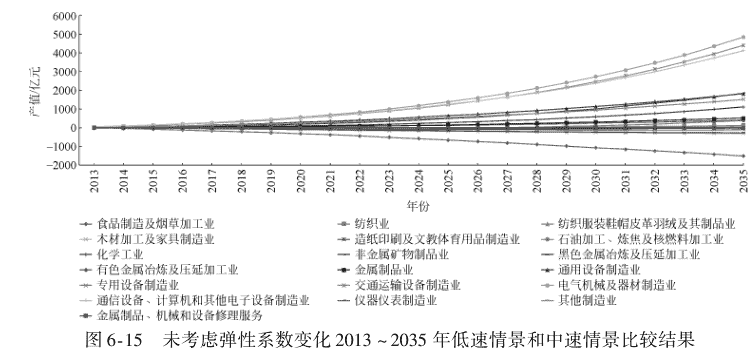

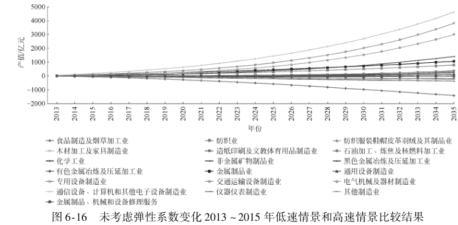

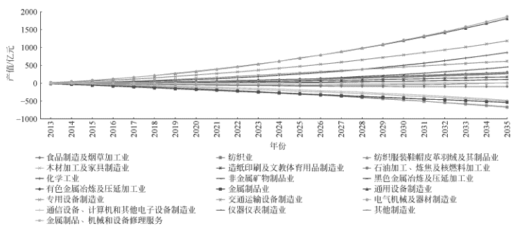

图 6-15 和图 6-16 的结果显示，以德国为参照对象的低速情景，随着工业机器人的增长，在很多细分行业上都要好于以美国为参照对象的中速情景和以韩国为参照对象的高速情景。这反映出德国的工业机器人在制造业细分行业上的覆盖面较广，在移植到我国的制造业后，可以与我国制造业体系和模式相契合，产生较好的效果。

而图 6-17 的结果显示，在电气机械及器材制造业、通用设备制造业、专用设备制造业及化学工业等细分行业上，随着工业机器人使用的增多，高速情景又比中速情景产生更好的效果。不过在纺织业等传统的劳动密集型行业，高速情景的效果又比中速情景要差。这与韩国和美国的产业结构也有关系。韩国的劳动力总量有限，制造业体系很难做到非常全面，因此优先发展资本、技术密集型行业，而舍弃如纺织业等劳动密集型产业。

### 6.4 考虑弹性系数变化的工业机器人发展情景的 CGE 模型模拟结果及分析

#### 6.4.1 改变弹性系数情况下各情景中宏观经济水平的变化结果及分析

在研究中，通用设备制造业，专用设备制造业，交通运输设备制造业，电气机械及器材制造业，通信设备、计算机和其他电子设备制造业这 5 个行业的生产函数弹性系数可根据不同情景进行调整变化。

##### 6.4.1.1 高速发展模式对 GDP 影响高于其他情景

图 6-18 表明，在改变所选择的 5 个行业的科布-道格拉斯生产函数中资本与劳动要素替代弹性系数的情况下，三种工业机器人发展情景下的 GDP 总值，都大幅度高于基准情景，且越发展，与基准情景的差值越大。2035 年，基准情景的 GDP 值为 224.66 万亿元，低速、中速、高速情景的 GDP 值分别为 264.12 万亿元、252.97 万亿元和 279.25 万亿元，至少超出基准值约 28.31 万亿元。在改变生产函数弹性系数后，以韩国为参照对象的高速情景增长幅度最大，以德国为参照对象的低速情景排名第二，以美国为参照对象的中速情景仍然最小。

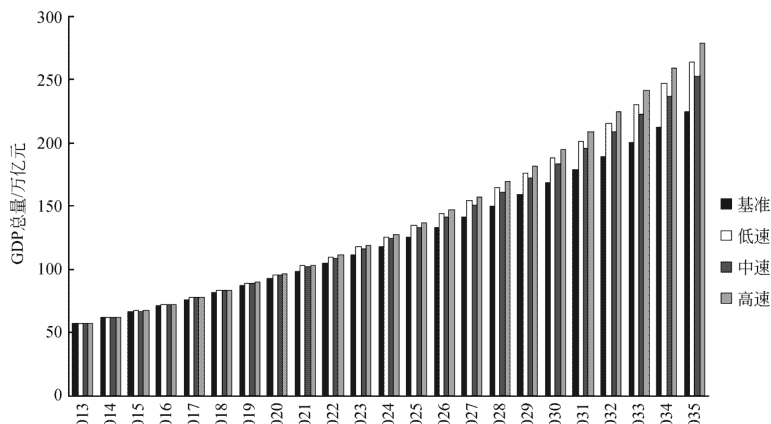

图 6-18 考虑弹性系数变化 2013 ~ 2035 年基准情景及不同工业机器人发展情景下各年 GDP 总量变化

在 GDP 增速变化方面，三种加强工业机器人发展的情景均优于基准情景，且增速差距越来越大，高速情景的增速甚至在 2014 ~ 2022 年下滑后，于 2023 ~ 2025 年开始逐渐上升，低速情景的增速也在下滑到一定时期后逐渐平稳并上翘（图 6-19）。三种情景的增速与基准情景的增速差距均逐渐增大。2035 年基准情景的 GDP 增速约为 5.9%，而低速、中速、高速情景的增速分别为 7.0%、6.7% 和 7.6%，差距在 0.8 ~ 1.7 个百分点。

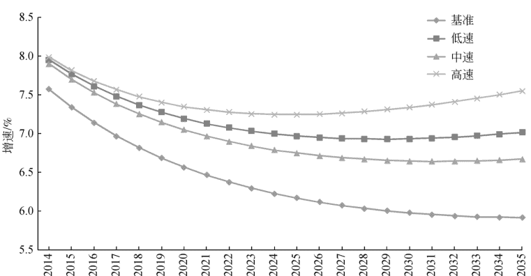

图 6-19 考虑弹性系数变化 2014 ~ 2035 年基准情景及不同工业机器人发展情景下各年 GDP 增速变化

由模拟期内每一年的 GDP 总量和增速的模拟结果看，在改变所挑选的 5 个行业的弹性系数的情况下，三种情景都对经济产生显著的正向影响，且幅度更大。在此情况下，以韩国为参照对象的高速情景对经济的促进作用最为显著，其次是以德国为参照对象的低速情景，而以美国为参照对象的中速情景排第三位。这说明，根据我国的经济及产业发展状况，以韩国为参照对象的高速情景带来的效果最好。为探究其原因，有必要针对工业机器人对各个产业的产值影响进行分析。

##### 6.4.1.2 考虑弹性系数变化各情景下工业机器人对三大产业产值的影响分析

在本小节中，主要讨论的是在弹性系数变化的情况下制造业内工业机器人增长带来的影响，因此可以设想的是工业机器人增长对第二产业带来更大的影响。以下为不同情景下，三次产业产值的绝对量和增速的变化情况。

###### (1) 工业机器人对第一产业有轻微影响

由图 6-20 可以看出，各个工业机器人发展情景均对第一产业有轻微的负面影响。在产值方面，基准情景比三种情景多出的增加值在逐渐扩大，但程度很小。2035 年，基准情景下第一产业产值为 11.64 万亿元，低速、中速、高速情景下的产值分别为 11.60 万亿元、11.54 万亿元和 11.41 万亿元，较基准情景的产值少 400 亿 ~ 2300 亿元。在第一产业产值增速方面，各个情景的增速都处于持续下滑状态，其中基准情景在初始阶段略高，但在期末阶段，低速和中速情景的增速仍超过基准情景和高速情景，如图 6-21 所示。

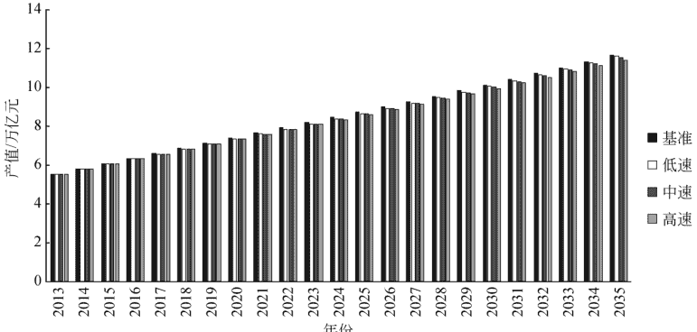

图 6-20 考虑弹性系数变化 2013 ~ 2035 年基准情景及不同工业机器人发展情景下第一产业产值变化

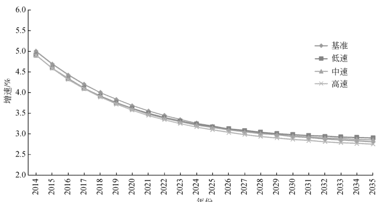

图 6-21 考虑弹性系数变化 2014 ~ 2035 年基准情景及不同工业机器人发展情景下第一产业产值增速变化

总体来看，由于工业机器人主要应用于第二产业而非第一产业，而且第二产业的发展难免有可能挤占第一产业的部分投入，从而引起其他情景比基准情景下的第一产业产值有所减少。不过在各个情景下第一产业产值均稳步上升的情况下，这种减少的幅度可以被认为是非常微小的。

###### (2) 工业机器人对第二产业产值有明显的促进作用

工业机器人主要应用于第二产业。在改变了制造业中 5 个行业生产函数弹性系数的情况下，工业机器人不同情景对第二产业产值均有促进作用，而且随着工业机器人使用的增加，与基准情景相比，产值的差值在逐渐扩大。至 2035 年，基准情景下的产值为 85.55 万亿元，低速、中速、高速情景下的产值分别为 120.74 万亿元、113.02 万亿元和 132.20 万亿元，比基准情景高出 27.47 万亿 ~ 46.65 万亿元，增幅为 32.1% ~ 54.5%（图 6-22）。与 GDP 总量的情况类似，第二产业在三种情景下，也是以韩国为参照对象的高速情景的产值最高，而以美国为参照对象的中速情景最低，两种情景的模拟结果最多一年相差约 20 万亿元。

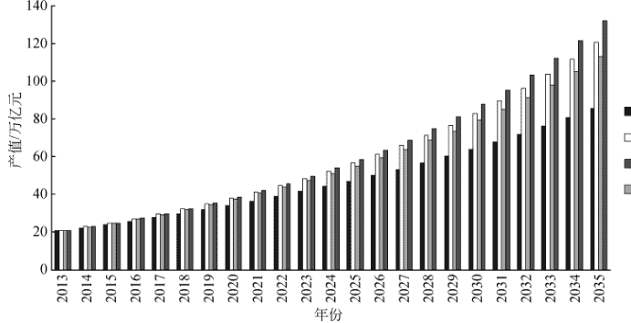

图 6-22 考虑弹性系数变化 2013 ~ 2035 年基准情景及不同工业机器人发展情景下第二产业产值变化

增速的分析结果与 GDP 总值增速变化类似。三种工业机器人发展情景下的第二产业产值增速均高于基准情景下的增速。三种情景增速变化出现较大分化，高速情景与基准情景的增速差值从 2014 年的 1.4 个百分点扩大至 2035 年的 2.5 个百分点，而中速情景下这一差值从 2014 年的 1.2 个百分点增加到 2035 年的 1.3 个百分点（图 6-23）。在三种情景中，以韩国为参照对象的高速情景增速下滑趋势放缓，最终接近于水平，尾部还有上翘增长的趋势。中速和低速情景的增速则逐渐下滑，其中中速情景下滑最快。

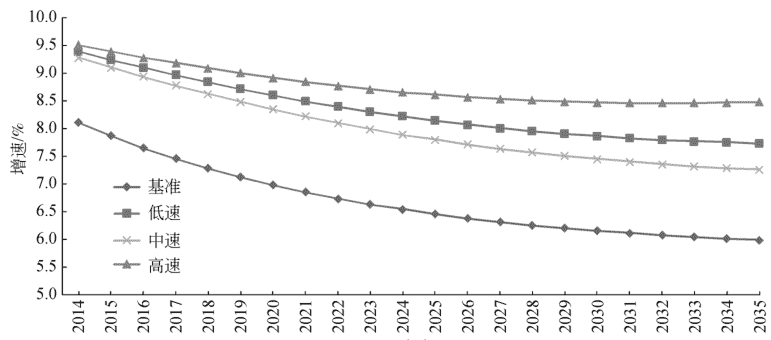

图 6-23 考虑弹性系数变化 2014 ~ 2035 年基准情景及不同工业机器人发展情景下第二产业产值增速变化

###### (3) 各工业机器人增长情景对第三产业产值影响各异

第三产业中，不同情景带来的影响各异。基准情景的产值在 2025 年及之前与几种工业机器人发展情景相比均有产值的优势，但在 2025 年之后，低速和中速情景的产值增长量提高，分别于 2029 年和 2033 年超越了基准情景的产值，而高速情景的产值一直低于基准情景（图 6-24）。

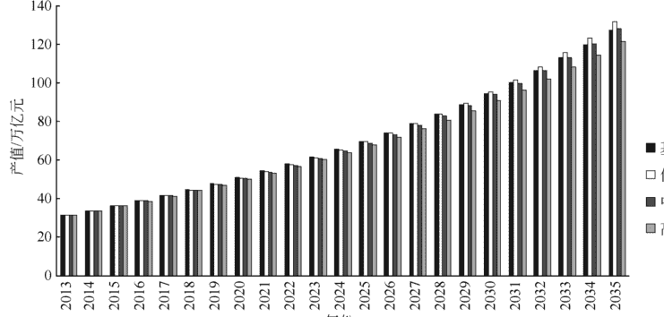

图 6-24 考虑弹性系数变化 2013 ~ 2035 年基准情景及不同工业机器人发展情景下第三产业产值变化

第三产业增速的变化与 GDP 总量及第一、第二产业产值的增速有所不同，基准情景和高速情景的增速均处于持续下滑状态，而低速和中速情景的增速，在 2025 ~ 2026 年出现拐点，增速由下降转变为上升，从而带来低速和中速情景的产值绝对量对基准情景的超越（图 6-25）。

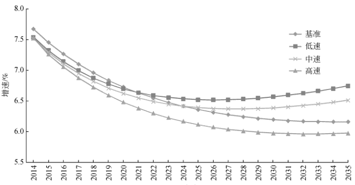

图 6-25 考虑弹性系数变化 2014 ~ 2035 年基准情景及不同工业机器人发展情景下第三产业产值增速变化

总体来看，在改变 5 个行业生产函数弹性系数的情况下，工业机器人对产业产值的影响，主要集中于在第二产业发挥更大的正向作用。对第一产业的影响很小，对第三产业则影响各异。在对第二产业产值的影响中，以韩国为参照对象的高速情景表现得非常突出，以德国和美国为参照对象的低速和中速情景的产值增长弱于高速情景。工业机器人的使用集中于第二产业中的制造业，为了更好地探究其中的原因，有必要进一步对制造业及其细分行业的工业机器人对经济和劳动力的影响进行分析。

#### 6.4.2 改变弹性系数情况下各情景中制造业细分行业变化结果及分析

##### 6.4.2.1 工业机器人发展对制造业产值变化的影响

第二产业中，工业机器人的使用及对劳动力的影响，主要集中于制造业。模拟结果也反映出使用工业机器人的情景对制造业产值形成较大影响。在 2035 年，基准情景制造业产值为 75.22 万亿元，而低速、中速、高速情景下的制造业产值分别为 105.25 万亿元、98.07 万亿元和 116.13 万亿元，中速情景的产值高出基准情景 22.85 万亿元，高速情景的产值高出 40.91 万亿元（图 6-26）。其中，以韩国为参照对象的高速情景促进制造业产值增长的效果最好。

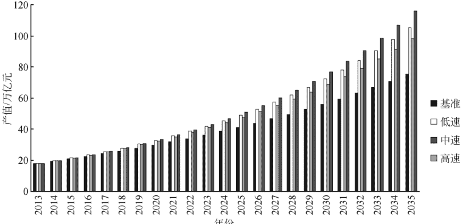

图 6-26 考虑弹性系数变化 2013 ~ 2035 年基准情景及不同工业机器人发展情景下制造业产值变化

在增速变化方面，与第二产业产值增速变化情况类似，三种情景的增速都高于同时期的基准情景的增速。三种情景中，高速情景的增速下滑最慢，最后接近水平，而低速、中速情景的增速分列第二、第三位，并且持续保持同基准情景增速至少 1.3 个百分点的差距（图 6-27）。

对于中国来说，如果考虑所选 5 个行业生产函数弹性系数也按照三个国家的模式发展，则以韩国为参照对象的高速情景在制造业领域对经济产生很好的促进作用。为了能够借鉴三个国家的经验，有必要进一步对制造业中的行业进行细分，看何种行业因工业机器人的使用获益更多。

##### 6.4.2.2 考虑弹性系数变化各情景下制造业主要细分行业产值变化受工业机器人发展的影响

为了讨论考虑弹性系数变化的不同情景下，制造业细分行业的产值变化情况，就需要了解在基准情景下，哪些行业的产值较高，在制造业总产值中占比更高。

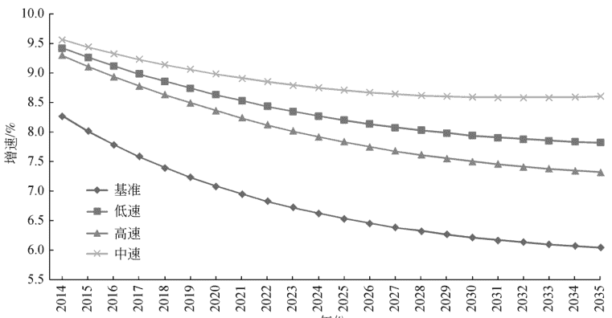

图 6-27 考虑弹性系数变化 2014 ~ 2035 年基准情景及不同工业机器人发展情景下制造业产值增速变化

更高。

从图 6-28 中可以看出，根据我国的数据，在考虑 5 个行业生产函数弹性系数变化的情况下，在制造业细分行业中，产值最高的前 12 个行业由高到低依次是化学工业，食品制造及烟草加工业，非金属矿物制品业，交通运输设备制造业，石油加工、炼焦及核燃料加工业，通信设备、计算机和其他电子设备制造业，电气机械及器材制造业，通用设备制造业，专用设备制造业，黑色金属冶炼及压延加工业，纺织业，以及纺织服装鞋帽皮革羽绒及其制品业。这些行业为本书中我国制造业中的主要行业。为了探究几种工业机器人发展情景的不同影响，也需要对各情景中细分行业同基准情景的细分行业进行比较。

###### (1) 低速情景与基准情景的比较

将以德国为参照对象的工业机器人发展低速情景与基准情景进行比较，计算用低速情景细分行业产值与同年基准情景下相同细分行业产值的差值，结果如图 6-29 所示。

由图 6-29 可以看出，在考虑 5 个行业生产函数弹性系数变化的情况下，增加工业机器人的使用后，电气机械及器材制造业，专用设备制造业，通用设备制造业，交通运输设备制造业，石油加工、炼焦及核燃料加工业及通信设备、计算机和其他电子设备制造业等行业的产值，同基准情景比，增幅很显著，而且几乎


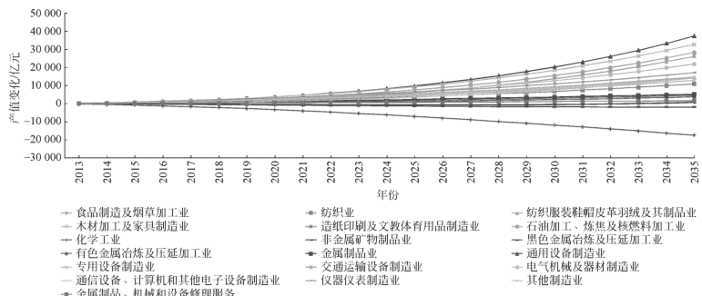

图 6-30 考虑弹性系数变化 2013 ~ 2035 年中速情景同基准情景比较结果

设备、计算机和其他电子设备制造业的增长排名较为靠后。除个别行业外，其他行业的产值均高于基准情景，但是相差幅度不如低速情景下的差值大。

###### (3) 高速情景与基准情景的比较

以韩国为参照对象的工业机器人发展高速情景同基准情景进行比较，计算高速情景细分行业产值与同年基准情景下相同细分行业产值的差值，结果如图 6-31 所示。

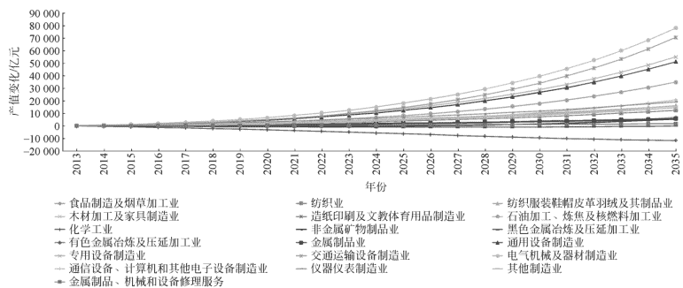

图 6-31 考虑弹性系数变化 2013 ~ 2035 年高速情景同基准情景比较结果

韩国的制造业工业机器人增速是三个国家中最高的，在与基准情景的比较中，与低速、中速情景类似，随着工业机器人使用的增加，几乎在所有行业呈现出显著的正向效应。最为显著的是电气机械及器材制造业，交通运输制造业，专用设备制造业，通用设备制造业以及石油加工、炼焦及核燃料加工业等。其中前四个均为生产函数以韩国为参照对象的高速情景进行调整的产业。这反映出，在中国当前的行业结构下，投资的弹性系数增大，投资带来的产出效率提高，对提高各行业及制造业产值是有正向影响的。

总体而言，在改变 5 个行业生产函数弹性系数的情况下，制造业的大多数细分行业，在各个工业机器人发展情景下，都比基准情景创造更多的产值，从而提高制造业产值，进而提高第二产业产值及 GDP 总值，而且相比于未考虑弹性系数变化的情况，其增幅更大；这也反映出工业机器人对经济的促进程度，与产业结构高度相关。

###### (4) 各情景间的比较

为分析不同情景下制造业细分行业工业机器人增速带来的影响，利用低速情景和高速情景细分行业产值分别减去同年中速情景下相同细分行业产值。结果分别如图 6-32 和图 6-33 所示。

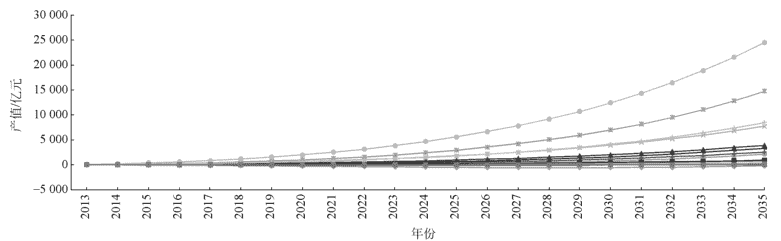

图 6-32 考虑弹性系数变化 2013 ~ 2035 年低速情景和中速情景比较结果

图 6-32 和图 6-33 的结果显示，以韩国为参照对象的高速情景和以德国为参照对象的低速情景，随着工业机器人的增长，在大多数的细分行业上，都要好于以美国为参照对象的中速情景。同时，低速情景中，细分行业产值好于中速情景的类别较多，而高速情景中，细分行业产值超过中速情景的幅度较大但类别较少。这反映出德国的工业机器人在制造业细分行业上的覆盖面较广，而韩国的制造业体系无法做到非常全面，只能重点发展电气机械及器材制造业、交通运输设备制造业、专用设备制造业等部分行业，这些产业更加发达，通过增加资本投入

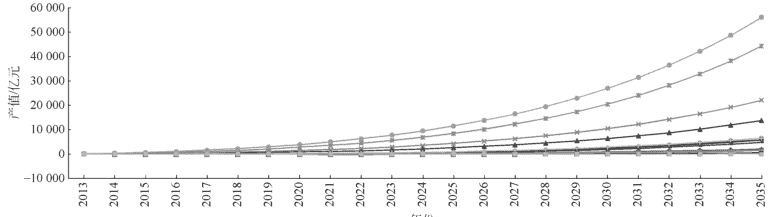

- 食品制造及烟草加工业
- 木材加工及家具制造业
- 化学工业
- 有色金属冶炼及压延加工业
- 专用设备制造业
- 通信设备、计算机和其他电子设备制造业
- 金属制品、机械和设备修理业
- 纺织业
- 造纸印刷及文教体育用品制造业
- 非金属矿物制品业
- 金属制品业
- 交通运输设备制造业
- 仪器仪表制造业
- 纺织服装鞋帽皮革羽绒及其制品业
- 石油加工、炼焦及核燃料加工业
- 黑色金属冶炼及压延加工业
- 通用设备制造业
- 电气机械及器材制造业
- 其他制造业

图 6-33 考虑弹性系数变化 2013 ~ 2035 年高速情景和中速情景比较结果

力度，产值容易较快增长，带来资本效率的大幅度提高，从而带动制造业的发展。

### 6.5 是否考虑弹性系数变化的全部六种情景的模拟结果比较研究

#### 6.5.1 考虑弹性系数变化的情景对 GDP 的影响全面占优

由表 6-9 可知，在是否考虑生产函数弹性系数改变的两种情况下，各有三种情景，即总共有六种情景。由图 6-34 可以看出，考虑弹性系数变化（考虑影响）的情景相比于未考虑弹性系数变化（未考虑影响）的情景，对 GDP 的影响全面占优，而且以考虑弹性系数变化的高速情景数值最高，2035 年高出基准情景约 54.6 万亿元。这表明，在我国当前产业结构下，如果全面借鉴这三个国家经验，即在所选的 5 个行业中，既增加对工业机器人的投入，促进其数量增加，又以多种手段提高这 5 个行业的资金投入产出效率，分别达到三个国家在这 5 个行业中的资本弹性系数，就可以提高投入的资金效率，大幅度提高 GDP。在三个国家中，韩国的工业机器人高速增长且具有更高的资本弹性，用在我国当前行业结构会产生最好的效果。

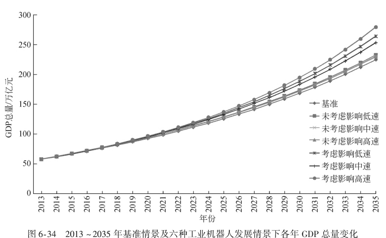

#### 6.5.2 各情景中制造业细分行业变化结果及分析

##### 6.5.2.1 工业机器人发展对制造业产值变化的影响

在制造业中，未考虑弹性系数变化的各情景间的产值差异较小，而考虑弹性系数变化的各情景间的产值差异较大（图 6-35）。产值最高的仍是考虑弹性系数变化的高速情景。在 2035 年，其比未考虑弹性系数变化的高速情景产值高出约 33 万亿元。在是否考虑弹性系数变化的两种情况下，由于相同情景下工业机器人增速相同，因此出现的区别主要反映了资本投资的弹性。这一结果反映出提高资金效率的重要作用。

##### 6.5.2.2 制造业中弹性系数改变的五个行业的产值差异分析

在设置生产函数弹性系数变化时，计算了三个参照国通用设备制造业，专用设备制造业，交通运输设备制造业，电气机械及器材制造业，通信设备、计算机和其他电子设备制造业五个行业的资本和劳动要素弹性系数。模拟结果表明，这几个行业的差异非常显著。


图 6-35 2013 ~ 2035 年基准情景及六个工业机器人发展情景下制造业产值变化

###### (1) 通用设备制造业

在未考虑弹性系数变化（未考虑影响）的情况下，低速和高速情景的产值较为接近，并均高于中速情景，但三种情景间的差值差距不大（图 6-36）。2035 年，在考虑弹性系数变化（考虑影响）的情况下，高速情景的产值显著升高，约达到 9.4 万亿元，超过低速情景产值约 1 万亿元，超过中速情景产值约 1.4 万亿元。


图 6-36 2013 ~ 2035 年基准情景及六个工业机器人发展情景下通用设备制造业产值变化

###### (2) 专用设备制造业

专用设备制造业的年产值略小于通用设备制造业，在考虑弹性系数变化（考虑影响）的情况下，高速情景 2035 年产值在六个情景中最高，约达到 8.8 万亿元，超过同年低速情景产值约 1.4 万亿元，超过中速情景产值约 2.2 万亿元（图 6-37）。


###### (3) 交通运输设备制造业

交通运输设备制造业的产值在整个制造业中占有重要份额，也是工业机器人大规模使用的行业之一，工业机器人密度在制造业各行业中位居第一，且远超其他行业。2035 年，考虑弹性系数变化（考虑影响）的高速情景下产值达到 13.8 万亿元，超过低速情景产值约 3 万亿元，超过中速情景产值约 4.4 万亿元。比同一年未考虑弹性系数变化（未考虑影响）的高速情景高 7.1 万亿元，超过一倍。即便是考虑弹性系数变化（考虑影响）情况中产值最低的中速情景，产值为 9.4 万亿元，比未考虑弹性系数变化（未考虑影响）中产值最高的低速情景，仍然高出约 2.3 万亿元（图 6-38）。

###### (4) 电气机械及器材制造业

韩国在电气机械及器材制造业工业机器人投入大，见效快，资本投资效率较高。因此，这一行业虽然不是产值最高的，但是未考虑弹性系数变化（未考虑影响）情况下，高速情景与其他情景差别最大，比低速情景产值约高 3.2 万亿元，比中速情景约高 5.6 万亿元；而与未考虑弹性系数变化（未考虑影响）的情景相比，考虑弹性系数变化（考虑影响）的高速情景比未考虑弹性系数变化（未考虑影响）的低速、中速和高速情景分别高 6.4 万亿元、6.9 万亿元和 6.7 万亿元（图 6-39）。

图 6-38 2013 ~ 2035 年基准情景及六个工业机器人发展情景下交通运输设备制造业产值变化

图 6-39 2013 ~ 2035 年基准情景及六个工业机器人发展情景下电气机械及器材制造业产值变化

###### (5) 通信设备、计算机和其他电子设备制造业

在我国的制造业各行业中，通信设备、计算机和其他电子设备制造业的自动化水平较高，而且资金投入的效率较高，因此是否考虑弹性系数变化带来的各情景产值变化的差异相对其他行业要小一些。在通信设备、计算机和其他电子设备制造业中，考虑弹性系数变化（考虑影响）的低速情景的产值要优于高速情景，2035 年超出的产值约为 2000 亿元（图 6-40）。


图 6-40 2013 ~ 2035 年基准情景及六个工业机器人发展情景下通信设备、计算机和其他电子设备制造业产值变化

### 6.6 本章小结

本章的研究方法为 CGE 模型，主要研究了不同工业机器人发展增速情景下，国民经济受到的影响及变化。以经过综合评价后筛选出的德国、美国和韩国作为参照，设置了工业机器人增长的低速情景、中速情景和高速情景。CGE 模型的研究对象是制造业中的各个细分行业，在不同情景下，劳动力规模产生的变动。根据一系列均衡机制，自下而上产生对总体经济及各个组成部分产生影响。通过解算方程组，可以得到不同情境下的均衡解。本章得到的结论如下。

在不考虑通用设备制造业、专用设备制造业、交通运输设备制造业、电气机械及器材制造业和通信设备、计算机和其他电子设备制造业这五个行业的生产函数的劳动、资本要素弹性系数变动的情况下，一是从经济的总体形势角度看，2013 ~ 2035 年低速、中速、高速情景的年 GDP 总值均高于基准情景，而且是低速情景最高、高速情景次之、中速情景最小。二是从三次产业角度看，第一、第三产业中，2013 ~ 2035 年，低速、中速、高速情景的产业产值，均低于当年基准情景下的产业产值。第二产业中，2013 ~ 2035 年，低速、中速、高速情景的产业产值，均大幅度高于当年基准情景下的产业产值，而且产值由大到小排序为低速、高速和中速情景。三是从制造业产值角度看，2013 ~ 2035 年，低速、中速、高速情景的产值，类似于第二产业的情况，也均高于当年基准情景下的产业产值，产值由大到小排序仍为低速、高速和中速情景。四是从制造业各细分行业看，低速情景中，工业机器人在更多细分行业中得到应用，也使更多行业可以创造比基准情景更高的产值。高速情景中，行业创造的产值略逊于低速情景，而且交通运输设备制造业和通信设备、计算机和其他电子设备制造业的产值水平还略低于基准情景。中速情景的情况又略逊于高速情景。

在考虑五个行业弹性系数变化的情况下，一是从经济的总体形势角度看，三种情景的 GDP 总值均大幅度高于基准情景，而且与高速情景差值最大，低速情景次之，中速情景最少。2035 年差值分别达 54.59 万亿元、39.46 万亿元和 28.31 万亿元。二是从三次产业角度看，第一产业产值受工业机器人增长有轻微负面影响，第二产业产值受工业机器人增长的促进作用明显，第三产业低速和中速情景的增速分别于 2022 年和 2025 年超过基准情景。三是从制造业角度看，无论是产值还是增速，都是高速情景优于低速情景，低速情景又优于中速情景。四是从制造业各细分行业看，高速情景几乎所有产业都优于基准情景，而且电气机械及器材制造业等几个弹性系数变化的行业，超出的产值较多，但其他行业超出得较少。低速情景几乎所有产业都优于基准情景，尽管超出的产值不是很高，但是各行业超出的产值较为平均。

在对弹性系数是否改变的情况下各个情景（共 6 个情景）及基准情景进行比较后，得到如下结论：一是弹性系数改变情况下的各情景，无论是 GDP 总体情况，还是制造业产值方面，都要优于弹性系数未改变情况下的各情景。二是对于弹性系数改变的五个行业，除了在通信设备、计算机和其他电子设备制造业，低速情景为最优外，其他四个行业均高速情景为最优。

总体来看，不管是否考虑五个行业中资本与劳动要素的弹性系数变化，在我国的产业结构情况下，低速、中速、高速三种工业机器人发展情景都能对经济产生不同程度的促进作用。通过分析制造业各细分行业，在三种情景与基准情景之间的差值，以及三种情景两两之间的差值，可以发现，各国的产业结构有别，在各细分行业中，使用工业机器人的规模、密度的不同，造成一些行业的产值在工业机器人增加的情况下，受到正向或负向的影响。

在不考虑生产函数中资本与劳动要素的弹性系数改变的情况下，即增加雇佣和投资工业机器人等设备的弹性系数仍使用我国 CGE 模型中的系数时，低速情景以其对工业、制造业更大范围的自动化改造，配合优质的高技能工人及从业者，可以获得更好的产出。

然而，在弹性系数改变，使用德国、美国、韩国自身的弹性系数时，产出的变化更多依赖于投资设备带来的变化，而且这种投资设备带来的产值增加更为可观。模型模拟结果表明，在制造业行业内，投资工业机器人带来的经济增长与产业结构高度相关。对于资本、技术密集型制造业部门，加大对工业机器人的投资，一方面要提高其数量，另一方面需要提高资金产出效率，这种效率带来的收益，比原有的资本与劳动要素关系下投资工业机器人带来的收益更为可观。

本节研究说明在进行制造业自动化、智能化改造，借鉴国外发展模式时，有必要对制造业进行细分，根据当前各行业不同的发展现状及未来预期，对改造方案进行分类安排，才有可能使改造达到更好的效果，创造更高的产值。

根据弹性系数是否变化的不同情况下的各个情景的模拟结果，结合我国当前的产业结构进行分析，可以得到一个较为适合我国制造业升级改造的模式，即在资本、技术密集型制造业，如交通运输设备制造业、电气机械及器材制造业等现代化、高技术制造业，有必要借鉴高速情景，即以大规模投资工业机器人为基本方式，配合提高这些制造业产值的手段，从而同时享受工业机器人增长及资本投资效率提高的双重红利。对于相对较为传统，劳动密集型制造业部门，则适合借鉴低速情景，保持一定的工业机器人增长速度，重视培训这些行业的劳动力及技术工人，减缓替代的节奏。

## 第 7 章 主要研究结论与政策建议

### 7.1 主要研究结论

人工智能时代已经来临。当前人工智能不仅应用在商业上，更是已经成为我国全面深化改革的重要方向之一。2019 年 3 月 19 日，中央全面深化改革委员会第七次会议审议通过了《关于促进人工智能和实体经济深度融合的指导意见》，强调要构建人机协同的智能经济形态。工业机器人是人工智能与实体制造业结合的一项重要技术与直接案例。研究其对制造业劳动力及国民经济的影响，并根据模拟探索我国制造业在工业机器人应用方面的发展模式，具有重要的理论与实践意义。本书利用线性回归、技能-工作任务匹配均衡模型、时序全局主成分分析及 CGE 模型等一系列方法，分析了国际工业机器人发展的现状，我国制造业工业机器人对劳动力的影响及对劳动力缺口填补的程度，以及在参考不同国家建立的各个制造业工业机器人发展情景下，模拟了对未来国民经济产生影响的程度。研究结果回答了本书最开始提出的问题，即制造业中工业机器人规模同劳动力规模的关系；制造业工业机器人不同的发展模式对经济产生何种影响。结论如下。

#### (1) 根据我国数据计算，工业机器人会替代一部分劳动力

根据《中国劳动统计年鉴》（2002 ~ 2017 年）、《中国工业统计年鉴》（2002 ~ 2017 年）及 IFR 的《工业机器人年度报告》（2011 ~ 2018 年）相关数据，可以计算出我国制造业工业机器人的增长对劳动力会产生替代效应。在制造业细分行业中，对工业机器人的暴露水平与劳动力规模的变化进行回归分析，可以发现几乎所有行业的劳动力规模都会受到负面影响，即都会产生显著的替代效应。分析结果表明，在细分行业中，劳动力规模受影响最严重的前五位行业，多为劳动密集型行业，或对劳动力技能要求较低、可以吸纳大量低技能劳动力的行业。但在引入工业机器人后，随着工序的自动化改造，这些行业的劳动力就业也受到较大冲击而被替代。本书分别以德国、美国和韩国的增长水平设置了我国工业机器人未来发展情景。根据所得回归系数及预测的未来人口规模，自 2020 年、2025 年和 2030 年起的每五年，在工业机器人发展以德国为参照对象的低速情景下，将分别约有 1896.69 万人、1955.78 万人和 1875.39 万人低技能劳动力被替代；在工业机器人发展以美国为参照对象的中速情景下，将分别约有 2216.66 万人、2530.95 万人和 2632.47 万人低技能劳动力被替代；在工业机器人发展以韩国为参照对象的高速情景下，将分别约有 2907.59 万人、3605.73 万人和 3851.90 万人低技能劳动力被替代。

#### (2) 制造业工业机器人可以在很大程度上弥补低技能劳动力缺口，对高技能劳动力就业具有促进作用

本书以高技能劳动力（高中及以上）和低技能劳动力（初中及以下）的比值，即劳动力技能比为因变量，分析了工业机器人对低技能劳动力和高技能劳动力的影响情况，结果表明，工业机器人数量同劳动力技能比有显著的正相关关系，即随着工业机器人数量的增加，所需的低技能劳动力数量将会降低，而高技能劳动力的需求量会上升。这意味着一部分低技能劳动力将会被替代，而对高技能劳动力就业有促进作用。以参照国增速作为我国工业机器人未来增速情景，结合与劳动力技能比的关系，可得与未来工业机器人规模相匹配的劳动力技能比。根据人口预测模型，可得未来的高、低技能劳动力人口规模，并可根据高技能劳动力规模及相应年份的劳动力技能比，计算出所需低技能劳动力规模。通过计算同时期低技能劳动力中即将退休与新进入劳动力年龄的劳动力规模的差值，并与低技能劳动力的替代量相减，即可得工业机器人可以弥补的低技能劳动力缺口。经过计算，在工业机器人发展以韩国为参照对象的高速情景下，在 2020 ~ 2024 年、2025 ~ 2029 年和 2030 ~ 2034 年三段时期，对于低技能劳动力缺口，可以分别填补 88.43%、90.59% 和 100%。虽然此结果来自于理论上对假设情景的简化分析，但也说明工业机器人的发展有可能弱化人口老龄化带来的低技能劳动力缺口。

#### (3) 工业机器人领先国家较为固定，均有值得我国学习、借鉴之处

利用时序全局主成分分析对 14 个工业机器人应用较多的国家以及中国进行分析。同以往利用单一指标对各国进行静态比较相比，本书构建了一个新的综合多维指标体系，并对这 15 个国家进行了 2010 ~ 2017 年的动态比较分析。结果表明，2010 ~ 2017 年我国的综合评分不断提高，向工业机器人领先国家集团发起追赶。这一集团包括日本、美国、德国和韩国。这四国的综合评分在每年均位列前四，领先于其他国家，而且仍保持较高的发展速度。四国发展各有特色，日本发达的工业机器人制造及应用经验，美国发达的技术创新及机器人产业服务能


力，德国工业机器人在制造业各行业中的应用及其发达的机器人关键零部件制造能力，以及韩国在制造业行业中的应用经验与快速增长，都是值得我国学习、借鉴的方面。经过筛选，将美国、韩国和德国作为我国制造业工业机器人发展的参照国，为模拟工业机器人对未来我国经济的影响提供相应的发展情景。

#### (4) 工业机器人对经济增长总体有正向影响

利用 CGE 模型，根据设置的工业机器人增长低速情景、中速情景及高速情景，计算工业机器人对未来我国经济的影响。结果表明，在未考虑制造业中部分行业生产函数的劳动与资本要素弹性系数变化的情况下，对于经济总体水平来说，2013 ~ 2035 年三种情景均比基准情景创造更多的 GDP。在 2035 年，低速、中速、高速情景下的 GDP 分别比基准情景的 GDP 高 8.08 万亿元、5.29 万亿元和 4.53 万亿元。2013 ~ 2035 年第二产业中，低速、中速、高速情景每年产值均持续高于基准情景，2035 年增多的产值分别为 13.07 万亿元、10.94 万亿元和 11.47 万亿元。制造业情况与第二产业类似，低速、中速、高速情景每年产值均持续高于基准情景。2035 年低速、中速、高速情景下的制造业产值分别比基准情景下的产值高约 9.36 万亿元、7.45 万亿元和 7.95 万亿元。

在考虑改变通用设备制造业，专用设备制造业，交通运输设备制造业，电气机械及器材制造业，通信设备、计算机和其他电子设备制造业这五个行业的弹性系数的情况下，对于经济总体水平来说，2013 ~ 2035 年三种情景的 GDP 总值均大幅度高于基准情景。2035 年低速、中速、高速情景下的 GDP 分别比基准情景的 GDP 高 39.46 万亿元、28.31 万亿元和 54.59 万亿元。第二产业产值受工业机器人增长的促进作用明显，2035 年低速、中速、高速情景下的 GDP 分别比基准情景的 GDP 高 35.19 万亿元、27.47 万亿元和 46.65 万亿元。从制造业角度看，无论是产值还是增速，都是高速情景优于低速情景，低速情景又优于中速情景。从各细分行业看，高速情景几乎所有行业都优于基准情景，而且电气机械及器材制造业等几个弹性系数变化的行业，超出的产值较多，但其他行业超出得较少。低速情景几乎所有产业都优于基准情景，尽管超出的产值不是很高，但是各行业超出的产值差别较小。

#### (5) 工业机器人对经济增长的促进程度与产业结构高度相关

不管是否考虑制造业五个行业弹性系数的改变，在我国产业结构数据的基础上，都可以发现工业机器人对经济增长的促进程度与产业结构高度相关。在未考虑弹性系数改变的情况下，以德国为参照对象的低速情景可以取得良好效果。原因包括：一是德国重视工业和制造业，第二产业在 GDP 中的占比约为 27%，处于欧洲首位，也高于美国的 19%。二是德国制造业全面使用工业机器人，细分行业中工业机器人使用情况较好。德国制造业中行业分类较细，很多细分行业都应用了工业机器人，虽然低速情景的增速不高，但几乎每个细分行业都有工业机器人的增速，与我国制造业涉及细分行业多这一点相匹配。

五个行业分别使用了德国、美国和韩国的生产函数弹性系数，即劳动要素的弹性系数更低，而资本要素的弹性系数更高后，又得到不同的结论。一是弹性系数改变情况下的各情景，无论是 GDP 总体情况，还是制造业产值方面，都要优于弹性系数未改变情况下的各情景。二是高速情景的模拟结果在 GDP、第二产业、制造业及细分行业中，几乎都优于低速和中速情景。高速情景具有其特殊性，即在工业机器人发达的资本、技术密集型行业加大投入，快速发展工业机器人，并提高资金的产出效率，从而获得工业机器人带来的提质增效与较高的资本弹性带来的收益的双重红利。除了这五个行业外，其他行业的生产函数弹性系数仍为我国产业结构中原有的弹性系数。

总体来看，高速情景适合于某些技术、资本密集型行业进行借鉴，而低速情景则适合相对来说较为传统的、劳动力就业弹性略高的行业进行借鉴。

### 7.2 政策建议

基于以上结论，提出以下政策建议。

- 一是高度重视实体产业的智能化，推动先进、智能制造业的发展，加强制造业的智能化改造，提高制造业智能化水平，为经济发展夯实基础。研究结果表明，我国仍然要强调第二产业、制造业的重要性和根基作用。其发达程度会影响到第一和第三产业。以当前我国的产业结构为例，如果能加强制造业的自动化、智能化改造，并且加强资本的产出效率，就可以促进制造业产值大幅度提高，并在其他产业尚未进行大规模调整的情况下，为 GDP 的增长提供重要支撑。我国当前制造业面临“大而不强”的问题，自动化、智能化水平仍有不足，核心技术掌握不够、具有全球影响力的本土品牌较为缺乏。国家已经提高了对这方面的重视程度。2019 年 3 月 19 日中央全面深化改革委员会第七次会议上通过《关于促进人工智能和实体经济深度融合的指导意见》，同时会议指出，促进人工智能和实体经济的深度融合，要把握新一代人工智能发展的特点，坚持以市场需求为导向，以产业应用为目标，深化改革创新，优化制度环境，激发企业创新活力和内生动力，结合不同行业不同区域特点，探索创新成果应用转化路径和方法，构建数据驱动、人机协同、跨界融合、共创分享的智能经济形态。具体到制造业，工业机器人就是人工智能在制造业的直接体现。为了贯彻《关于促进人工智能和实体经济深度融合的指导意见》加强智能化与实体经济融合的精神，更有必要从基础入手、根本着手，以工业机器人的推广使用为标志，开展制造业的智能化改造，提高制造业的智能化，提升我国制造业水平，为经济发展提供坚实的基础。

- 二是借鉴外国模式，根据我国制造业产业结构，形成工业机器人发展的“中国模式”，即“在先进制造业推广韩国模式，在传统制造业推动德国模式，在制造业相关高端服务业推广美国模式”，从而既能享受工业机器人发展带来的益处，又可以减缓其对劳动密集型行业劳动力替代的速度，提供培训的时间，为智能经济形态提供可持续增长动力。总体来看，未来我国制造业的工业机器人发展模式，并不完全照搬三种情景背后的模式，而是受到不同行业资本要素弹性系数，即资本产出效率的影响。同时也需注意，作为我国这样一个具有庞大劳动力的国家，如果各行业资本效率都迅速升高，大幅度增加对设备的投资而降低雇佣人数，可能会对劳动力就业造成负面冲击，危及社会稳定和经济发展。

尽管我国已经超过了劳动力增长的拐点，但目前仍然拥有世界上最大规模的、受教育水平较好的劳动力队伍，而且每年培养出数百万的高校毕业生。在人工智能时代，制造业进行产业升级的过程中，仍然要充分发挥他们的优势，化“人口红利”为“人才红利”。因此目前看较为理想的，可以较大幅度增加产出，又能降低对劳动力就业冲击的中国模式是“在先进制造业推广韩国模式，在传统制造业推动德国模式，在制造业相关高端服务业推广美国模式”。

所谓“韩国模式”，就是在制造业中资本投入重要性强的五个行业，提高资本效率，促进智能化改造，从而大幅度增加制造业产值及 GDP，以保证经济发展的增速及体量。对于因在这一升级过程中转岗分流的低技能劳动力，可以通过对他们进行“工业机器人维修”等服务业培训，帮助他们转为与工业机器人直接或间接相关的服务性行业。

所谓“德国模式”，就是在其他制造业细分行业中，在增加对工业机器人投资，实现产业升级改造的同时，注意控制升级节奏，留出对被替代劳动力的培训时间，并加强对劳动力的培训，以更好实现智能经济形态中的“人机协同”。对技术工人的培训提高，是“德国模式”的重要体现。

所谓“美国模式”，就是一方面鼓励高技能劳动力直接进入制造业，成为工业机器人设备的管理者和专家，另一方面可以鼓励他们从事与工业机器人相关的高端服务业，如机器人控制程序编制、机器人外观设计、人机功效分析等。高端服务业的发展，是美国在发展工业机器人的过程中关注的重点，也是“美国模式”的体现。

- 三是工业机器人可以通过替代部分低技能劳动力填补因人口结构变动带来的劳动力缺口，但需多措并举增加高技能劳动力供给。主要可以加强三方面的工作。①适当延迟高技能劳动力的退休年龄，充分发挥他们的作用。高技能劳动力在退休时，通常具有丰富的经验以及掌握的技术诀窍（“know-how”），同时他们当中也有不少人有继续工作的意愿和条件。适当延迟他们的退休年龄，一方面可以让他们自身发挥作用，另一方面对团队中的年轻人起到“传帮带”的作用，将经验、知识传承下去，让年轻人迅速成长。②加强高技能人才的培养，特别是高技能技术工人的培养，并为他们提供满意的发展路径。本书研究结果表明，工业机器人的使用对劳动力就业结构产生影响。为了降低工业机器人对劳动力就业规模的冲击，同时也适应智能制造时代的到来，就应该多培养高技能人才，特别是高技能技术工人。他们所从事的工作，由于成本或技术原因，很难由工业机器人替代。可以鼓励更多的低技能劳动力继续学习，提升自己，化“人口红利”为“人才红利”。③深化改革企业用工制度和人事制度，改变社会观念，吸引更多年轻人投身制造业。当前年轻人的平均受教育水平普遍提高，但制造业对他们的吸引力并不高。一方面是薪酬待遇不如金融等生产性服务业；另一方面是制造业企业相比于金融、IT等企业，用工制度较为死板、人事制度缺乏弹性，年轻人职业上升通道少，且社会上对于制造业有偏见，认为制造业又脏又累、干得多挣得少，没文化的才去工厂干制造业。这些社会观念也需要通过种种方式才能有所改变。因此需要为年轻人提供合理、多样的发展路径，提高待遇，并且让他们对工作充满自豪感。

总之，需要多措并举，国家应重视制造业及其智能化改造，吸收借鉴德国等工业机器人、制造业强国的发展优势，以及想方设法增加高技能人才的规模和比例，收窄因老龄化带来的高技能人才缺口，才有可能让我国从“制造业大国”迈向智能经济时代的“制造业强国”，使国家经济具有持续发展的能力。

### 7.3 研究局限与展望

#### (1) 研究局限

本书针对工业机器人的增长对劳动力缺口的补充、对经济的影响开展了相应的研究，虽然达到了预期的效果，但也存在一些局限，可以成为未来进一步开展研究的出发点。

- 一是数据质量不够理想，可得性有一定困难。目前我国对工业机器人的统计数据，通常由企业报送相关管理协会，再进行统计。但统计数据中的条目相对较为笼统，只有总量，各行业的数据获取较为困难。而且在前往企业调研时，对于工业机器人的投入、规模等数据也不愿提供得太具体。

- 二是对工业机器人类型的探讨稍显不足。工业机器人的类型较多，而且在各行业均有分布。目前的研究更多集中于对评价方法的创新，利用统计方法、政策模拟模型分析工业机器人对经济的总体影响，但对工业机器人的类型及功能缺少更深层次的探讨，这也是需要加强的方面。

#### (2) 展望

工业机器人在制造业中的应用愈发广泛，也是人工智能和实体经济融合的直观案例，将来会有更多的研究与工业机器人有关。在此对未来可能的研究方向提出展望。

- 一是加强对实际情况的调研，从中发现问题。本书提出了制造业工业机器人对劳动力替代、填补劳动力缺口等问题并以统计方法进行了回答，下一步有必要在现有研究基础上，去实地调研工业机器人与劳动力之间，是否除了替代、促进的关系之外，还会产生有我国特色的新型关系，以及面对工业机器人的替代，不同类型劳动力会采取何种应对措施。这些调研工作，既为理论研究提供实际证据，也为提出更有针对性的建议形成支撑。

- 二是继续深入研究工业机器人发展对经济的影响。本书利用 CGE 模型开展了不同参考情景下，工业机器人的发展对经济的影响，也说明了这种影响与产业结构高度相关。未来有必要对这一机制进行进一步细化研究，将更多因素纳入其中，包括工业机器人的类型、功能，以及工业机器人核心部件生产、专利等对经济的综合影响，从而为更好地分析这一机制，采取合理的鼓励发展措施提供理论依据。

## 参考文献

毕先萍, 李正友. 2004. 技术进步对就业的综合作用机制及社会福利影响研究. 中国软科学, (5): 150-155.
蔡自兴, 郭潞. 2013. 中国工业机器人发展的若干问题. 机器人技术与应用, (3): 9-12.
曹静, 周亚林. 2018. 人工智能对经济的影响研究进展. 经济学动态, (1): 103-107.
曹希敬, 胡继佳. 2014. 熊彼特及其新熊彼特主义学派关于创新-经济周期研究的述评. 中国科技论坛, (11): 20-24.
昌盛. 2005. 科技进步对就业增长贡献的实证分析. 北京机械工业学院学报, 20 (1): 52-55.
陈功, 曹桂英, 刘玉博, 等. 2006. 北京市未来人口发展趋势预测——利用多状态模型对未来人口、人力资本和城市化水平的预测分析. 市场与人口分析, 12 (4): 29-41.
陈骞. 2016. 美国国家机器人计划资助重点. 上海信息化, (2): 78-80.
陈秋霖, 许多, 周军. 2018. 人口老龄化背景下人工智能的劳动力替代效应——基于跨国面板数据和中国省级面板数据的分析. 中国人口科学, (6): 30-42.
陈泽聪. 2011. 我国制造业技术进步的就业效应——基于 25 个行业的实证分析. 科技进步与对策, 28 (1): 20-24.
程承坪, 彭欢. 2018. 人工智能影响就业的机理及中国对策. 中国软科学, (10): 62-70.
程名望. 2007. 中国农村劳动力转移: 机理、动因与障碍. 上海: 上海交通大学博士学位论文.
大卫·李嘉图. 2013. 政治经济学及赋税原理. 周洁译. 北京: 联合出版社.
杜传忠, 许冰. 2017. 技术进步与产业结构升级的就业效应——2000—2014 年省级面板数据分析. 科技进步与对策, (13): 55-60.
段海英, 郭元元. 2018. 人工智能的就业效应述评. 经济体制改革, 210 (3): 187-193.
弗兰克·柯什纳. 2018. 德国人工智能技术发展现状和未来趋势. 高科技与产业化, (8): 29-31.
龚玉泉, 袁志刚. 2002. 中国经济增长与就业增长的非一致性及其形成机理. 经济学动态, (10): 35-39.
郭英楠, 段宗迪. 2018. 人工智能对社会就业的影响分析. 信息系统工程, 295 (7): 113-115.
郝一生. 1983. 技术进步、经济增长与就业问题. 世界经济, (9): 45-49.
胡红梅. 2015. 工业机器人: 中国市场需求猛增 本土生产企业亟待赶上. 中国战略新兴产业, (23): 64-66.
贾根良. 2013. 迎接第三次工业革命的关键在于发展模式的革命——我国光伏产业和机器人产业的案例研究与反思. 经济理论与经济管理, 33 (5): 13-22.
江瑞平. 1986. 技术进步对就业扩大影响的合力问题研究. 世界经济, (8): 48-52.
姜金秋, 杜青红. 2015. 分行业技术进步对就业的动态影响研究——基于中国 34 个工业行业 1980 ~ 2011 年的数据. 工业技术经济, (7): 113-121.
蒋辉. 2005. 我国人口预测分析. 科技管理研究, 25 (11): 142-145.
蒋南平, 邹宇. 2018. 人工智能与中国劳动力供给侧结构性改革. 四川大学学报（哲学社会科学版）, (1): 130-138.
蒋新松. 1981. 人工智能及智能控制系统概述. 自动化学报, 7 (2): 148-156.
瞿群臻. 2004. 政府、企业和家庭个人在人力资本投资中的地位及作用. 企业经济, (4): 154-155.
李钢, 廖建樟, 向奕宽. 2011. 中国产业升级的方向与路径——中国第二产业占 GDP 的比例过高了吗. 中国工业经济, (10): 16-26.
李红松. 2010. 资本-劳动替代的技术特征及其对扩大就业的启示. 武汉科技大学学报（社会科学版）, 12 (1): 72-75.
李祥瑞, 王淑敏, 李琪. 2019. 中国工业机器人发展现状及领先企业专利布局分析. 中国发明与专利, (2): 59-62.
梁一新, 刘凯. 2013. 促进我国工业机器人产业化的战略思考. 产业经济, (6): 28-32.
刘捷学. 2009. 新时期, 地方龙头产业之选择——关于深圳发展机器人产业的几点建议. 人民论坛, (7): 30-31.
刘雅娇, 胡静波. 2018. 产业集聚、市场竞争性与劳动生产率——基于高技术产业面板数据的实证分析. 产经评论, (1): 40-48.
刘玉海, 张默涵. 2017. 贸易技术含量、偏向型技术进步与中国就业结构. 国际贸易问题, (7): 74-84.
刘伟. 2016. 关于人工智能若干重要问题的思考. 人民论坛·学术前沿, (7): 6-11.
柳青, 刘宇, 徐晋涛. 2016. 汽车尾气排放标准提高的经济影响与减排效果——基于可计算一般均衡（CGE）模型的分析. 北京大学学报（自然科学版）, 52 (3): 515-527.
吕荣杰, 郝力晓. 2018. 人工智能等技术对劳动力市场的影响效应研究. 工业技术经济, 37 (12): 133-139.
吕小柏, 李红松. 2010. 资本替代劳动与产业特征的关联机理及测度分析. 经济经纬, (2): 25-28.
马岚. 2015. 中国会出现机器人对人工的规模替代吗？——基于日韩经验的实证研究. 世界经济研究, (10): 71-79.
倪苹. 2013. 城镇化质量评价指标体系的构建与实证分析. 杭州: 浙江工商大学硕士学位论文.
庞丽华, 王海涛, 刘玉博. 2006. 等. 上海市未来人口和人力资本的变化趋势分析. 人口与发展, 12 (6): 1-11.
裴科峰. 2014. 产业结构升级与失业的研究. 南京: 南京大学硕士学位论文.
乔晓楠, 都艳萍. 2018. 人工智能与现代化经济体系建设. 经济纵横, (6): 81-91.
乔岩. 2012-09-03. 恋上机器人: 制造业自动化的未来. 中国计算机报, 第 2 版.
清华大学中国科技政策研究中心. 2018. 《中国人工智能发展报告 2018》. 北京: 清华大学中国科技政策研究中心.
曲道奎. 2013. 基于机器人的新一代制造模式. 现代制造, (45): 56-57.
任东伟. 2017. 技术进步对我国技能就业结构的影响研究. 北京: 北京交通大学硕士学位论文.
任强, 侯大道. 2011. 人口预测的随机方法: 基于 Leslie 矩阵和 ARMA 模型. 人口研究, 35 (2): 28-42.
沈于, 朱少非. 2014. 刘易斯拐点、劳动力供求与产业结构升级. 财经问题研究, (1): 42-47.
苏剑, 陈阳. 2018. 技术进步减少了劳动力需求吗? 开放导报, 198 (3): 30-34.
孙翊, 胡敏, 王铮. 2015. 中国房地产行业的产业关联度的测算. 统计与决策, (4): 41-45.
陶桂兵. 2011. 富士康以机器替代人是逆时代而动. IT 时代周刊, (17): 14.
王君, 杨威. 2017. 人工智能等技术对就业影响的历史分析和前沿进展. 经济研究参考, (27): 11-25.
王君, 张于喆, 张义博, 等. 2017a. 人工智能等新技术进步影响就业的机理与对策. 宏观经济研究, (10): 171-183.
王君, 张于喆, 张义博, 等. 2017b. 应对人工智能对就业影响的对策与建议. 中国经贸导刊, (24): 53-56.
巫强. 2013. 资本深化、技术进步与雇佣规模调整. 中国人口 · 资源与环境, 154 (6): 162-170.
徐程瑾. 2015. 未来中国的人口分布格局估计. 上海: 华东师范大学硕士学位论文.
徐云福. 2017. 美日人口结构和失业率与机器人产业发展对比分析——劳动力就业和机器人产业发展并不矛盾. 科技促进发展, (3): 195-199.
薛在兴. 2018. 人工智能对大学生就业的影响. 中国青年社会科学, (4): 6-10.
亚当斯密. 2009. 国富论. 郭大力, 王亚南译. 北京: 商务印书馆.
杨蕙馨, 李春梅. 2013. 中国信息产业技术进步对劳动力就业及工资差距的影响. 中国工业经济, (1): 51-63.
杨婕, 姚财福. 2017. 人工智能各国战略解读: 欧盟人脑计划. 电信网技术, (2): 50-51.
杨婕. 2017. 全球人工智能发展的趋势及挑战. 世界电信, (2): 17-21.
杨伟国, 邱子童, 吴清军. 2018. 人工智能应用的就业效应研究综述. 中国人口科学, (5): 109-119.
姚战琪, 夏杰长. 2005. 资本深化、技术进步对中国就业效应的经验分析. 世界经济, (1): 58-67.
叶仁荪, 王光栋, 王雷. 2008. 技术进步的就业效应与技术进步路线的选择——基于 1990 ~ 2005 年中国省际面板数据的分析. 数量经济技术经济研究, (3): 137-147.
俞贺楠. 2014. 产业转型升级对我国农村转移劳动力就业的影响及对策研究. 兰州学刊, (5):

- 170-174.

- 段天一．2017．人工智能正处在由概念到产品的飞跃期．中国战略新兴产业，（43）：24-26．

- 袁富华，李义学．2009．中国制造业资本深化和就业调整——基于利润最大化假设的分析．经济学（季刊），8（1）：197-210．

- 云霞．2017．“机器换人”对就业结构的影响．中国国情国力，（3）：57-60．

- 战梦霞．2007．技术创新的就业效应．北京：中共中央党校博士学位论文．

- 张红霞．2012．技术进步的就业效应研究．天津：天津大学博士学位论文．

- 张鹏飞．2018．人工智能与就业研究新进展．经济学家，（8）：27-33．

- 张于喆．2019．人工智能、机器人的就业效应及对策建议．科学管理研究，（1）：43-45．

- 张宇．2015．国外工业机器人发展历史回顾．机器人产业，（3）：68-82．

- 赵鸿宇．2012．我国劳动密集型制造业“刘易斯转折点”实证分析．沈阳：辽宁大学硕士学位论文．

- 赵利，卢洁．2016．产业结构调整影响劳动就业的理论演变及作用机理分析．理论学刊，（3）：54-59．

- 赵利．2010．技术进步对劳动就业的影响研究．北京：中国财政经济出版社．

- 甄子健，刘进长．2016．日本最新机器人研发计划及其发展战略．机器人技术与应用，（5）：14-19．

- 钟岩，马永莉．2005．企业资本扩张与就业机会——青岛制造业资本替代劳动力的实证分析．社会科学，（11）：21-26．

- 周文斌．2017．机器人应用对人力资源管理的影响研究．南京大学学报（哲学·人文科学·社会科学），（6）：25-36，156-157．

- 朱翠华．2012．技术进步就业效应及其影响因素分析．天津：南开大学博士学位论文．

- 朱巧玲，李敏．2018．人工智能、技术进步与劳动力结构优化对策研究．科技进步与对策，（6）：36-41．

- 朱一青，朱耿，朱占峰，等．2018．人工智能发展对就业问题的影响及应对策略．管理观察，702（31）：100-103．

- Acemoglu D, Autor D. 2011. Chapter 12: Skills, tasks and technologies: implications for employment and earnings//Ashenfelter O, Card D. Handbook of Labor Economics Volume 4B. Elsevier: 1043-1171.

- Acemoglu D, Dell M. 2009. Beyond neoclassical growth: technology, human capital, institutions and within-country differences. American Economic Journal: Macroeconomics, 2: 169-188.

- Acemoglu D, Restrepo P. 2017. Robots and jobs: evidence from US labor markets. National Bureau of Economic Research Working Paper No. 23285. Doi: 10.3386/w23285.

- Acemoglu D, Restrepo P. 2018. The race between man and machine: implications of technology for growth, factor shares, and employment. American Economic Review, 108(6): 1488-1542.

- Acemoglu D. 2002. Technical change, inequality, and the labor market. Journal of Economic Literature, 40 (1): 7-72.

- Aghion P, Howitt P. 1994. Growth and unemployment. The Review of Economic Studies, 61 (3): 477-494.

- Aghion P, Saint-Paul G. 1998. Virtues of bad times interaction between productivity growth and economic fluctuations. Macroeconomic Dynamics, 2 (3): 322-344.

- Autor D H, Dorn D. 2013. The growth of low-skill service jobs and the polarization of the US labor market. American Economic Review, 103 (5): 1553-1597.

- Autor D H, Levy F, Murnane R J. 2003. The skill content of recent technological change: an empirical exploration. The Quarterly Journal of Economics, 118 (4): 1279-1333.

- Autor D H. 2013. The “Task Approach” to labor markets: an overview. Journal for Labour Market Research, 46 (3): 185-199.

- Autor D H. 2015. Why are there still so many jobs? The history and future of workplace automation. Journal of Economic Perspectives, 29 (3): 3-30.

- Barro R J, Sala-i-Martin X. 1990. Economic growth and convergence across the United States. National Bureau of Economic Research, 8: 61.

- Barton D, Woetzel J, Seong J, et al. 2017. Artificial Intelligence: Implications for China. New York: McKinsey Global Institute: 1-20.

- Beaudry P, Collard F. 2002. Why has the employment-productivity tradeoff among industrialized countries been so strong? National Bureau of Economic Research, 8: 43-44.

- Bessen J E. 2016. How computer automation affects occupations: technology, jobs, and skills. Boston University School of Law, Law and Economics Research Paper, 11: 15-49.

- Bils M, Klenow P J. 2000. Does schooling cause growth? American Economic Review, 90 (5): 1160-1183.

- Blanchard O, Portugal P. 2001. What hides behind an unemployment rate: comparing Portuguese and US labor markets. American Economic Review, 91 (1): 187-207.

- Brynjolfsson E, McAfee A. 2014. The Second Machine Age: Work, Progress, and Prosperity in A Time of Brilliant Technologies. London: WW Norton & Company.

- Buera F J, Kaboski J P, Rogerson R. 2015. Skill-Biased Structural Change and the Skill-Premium. Society of Economic Dynamics Meeting Papers 895, NY, USA.

- Carneiro P, Lee S. 2011. Trends in quality-adjusted skill premia in the United States, 1960-2000. American Economic Review, 101 (6): 2309-2349.

- Carnov M. 1997. The new information technology-international diffusion and its impact on employment and skills: a review of the literature. International Journal of Manpower, 18 (1/2): 119-159.

- Cavelaars P. 2005. Has the tradeoff between productivity gains and job growth disappeared? Kyklos, 58 (1): 45-64.

- Deaton D, Nolan P. 1983. The nature of unemployment under technical progress.// Bosworth D. The Employment Consequences of Technological Change. London: Palgrave Macmillan; 52-65.

- Dixit A K, Stiglitz J E. 1977. Monopolistic competition and optimum product diversity. The American Economic Review, 67 (3): 297-308.

- Dustmann C, Ludsteck J, Schönberg U. 2009. Revisiting the German wage structure. The Quarterly Journal of Economics, 124 (2): 843-881.

- de La Grandville O. 1989. In quest of the Slutsky diamond. The American Economic Review, 79 (3): 468-481.

- Del Rio F. 2001. Embodied technical progress and unemployment. Journal of Economic Literature, 24 (60): 033.

- Eriksson C. 1997. Is there a trade-off between employment and growth? Oxford Economic Papers, 49 (1): 77-88.

- Ford M. 2015. Rise of the Robots: Technology and The Threat of a Jobless Future. New York: Basic Books.

- Frey C B, Osborne M A. 2017. The future of employment: how susceptible are jobs to computerisation? Technological Forecasting and Social Change, 114: 254-280.

- Finlayson M A, Richards W, Winston P H. 2010. Computational models of narrative: review of a workshop. AI Magazine, 31 (2): 97-97.

- Goldin C, Katz L F. 1998. The origins of technology-skill complementarity. The Quarterly Journal of Economics, 113 (3): 693-732.

- Goos M, Manning A. 2007. Lousy and lovely jobs: the rising polarization of work in Britain. The Review of Economics and Statistics, 89 (1): 118-133.

- Goos M, Manning A, Salomons A. 2009. Job polarization in Europe. American Economic Review, 99 (2): 58-63.

- Goos M, Konings J, Vandeweyer M. 2015. Employment growth in Europe: the roles of innovation, local job multipliers and institutions. Social Science Research Network Electronic Journal, 2: 10-15.

- Greenblatt D. 2013-01-22. 6 ways robots create jobs. http://www.inc.com/drew-greenblatt/6-ways-robots-c [2019-9-12].

- Hicks J R. 1932. Marginal productivity and the principle of variation. Economica, (35): 79-88.

- Hémous D, Olsen M. 2016. The rise of the machines: automation, horizontal innovation and income inequality. Social Science Research Network Electronic Journal, (6): 27-40.

- International Federation of Robotics. 2019. World Robotics Industrial Robots 2018. International Federation of Robotics.

- Jones D. 1983. Technological change, demand and employment // Bosworth D. The Employment Consequences of Technological Change. London: Palgrave Macmillan; 25-51.

- Katz L F, Murphy K M. 1992. Changes in relative wages, 1963-1987: supply and demand factors. The Quarterly Journal of Economics, 107 (1): 35-78.

- KC S, Barakat B, Goujon A, et al. 2010. Projection of populations by level of educational attainment, age, and sex for 120 countries for 2005-2050. Demographic Research, 22 (15): 383-472.

- Knight J, Deng Q, Li S. 2011. The puzzle of migrant labour shortage and rural labour surplus in China. China Economic Review, 22 (4): 585-600.

- Lutz W, Goujon A. 2001. The world’s changing human capital stock: multi-state population projections by educational attainment. Population and Development Review, 27 (2): 323-339.

- Lutz W, KC S. 2011. Global human capital: integrating education and population. Science, 333 (6042): 587-592.

- Machin S. 1998. Recent shifts in wage inequality and the wage returns to education in Britain. National Institute Economic Review, 166 (1): 87-96.

- Malinvaud E. 1997. The Theory of Unemployment Reconsidered. New Jersey: Wiley-Blackwell.

- Manyika J, Lund S, Chui M, et al. 2017. Jobs lost, jobs gained: Workforce transitions in a time of automation. McKinsey Global Institute.

- Mincer J. 1991. Human capital, technology, and the wage structure: What do time series show? National Bureau of Economic Research, (1): 62-66.

- McCorduck P. 2004. Machines Who Think: A Personal Inquiry into the History and Prospects of Artificial Intelligence. Boca Raton, FL: CRC Press.

- Michaels G, Natraj A, Van Reenen J. 2014. Has ICT polarized skill demand? Evidence from eleven countries over twenty-five years. Review of Economics and Statistics, 96 (1): 60-77.

- Pamuk E R, Fuchs R, Lutz W. 2011. Comparing relative effects of education and economic resources on infant mortality in developing countries. Population and Development Review, 37 (4): 637-664.

- Petit P. 1997. The economics of technology and employment: theory and empirical evidence. Economic Journal, 66 (1): 97-98.

- Pissarides C A, McMaster I. 1990. Regional migration, wages and unemployment: empirical evidence and implications for policy. Oxford Economic Papers, 42 (4): 812-831.

- Qureshi M O, Syed R S. 2014. The impact of robotics on employment and motivation of employees in the service sector, with special reference to health care. Safety and Health at Work, 5 (4): 198-202.

- Romer P M. 1986. Increasing returns and long-run growth. Journal of Political Economy, 94 (5):

1002-1037.

Romer P M. 1990. Endogenous technological change. Journal of Political Economy, 98 (5): 71-102.

Sachs J D, Kotlikoff L J. 2012. Smart machines and long-term misery. Cambridge, MA: National Bureau of Economic Research.

KC S, Lutz W. 2014. Demographic scenarios by age, sex and education corresponding to the SSP narratives. Population and Environment, 35 (3): 243-260.

Sato R. 1964. Diminishing returns and linear homogeneity: comment. The American Economic Review, 54 (5): 744-745.

Soete L. 1996. Technology, Productivity and Job Creation, Paris. Organisation for Economic Co-operation and Development.

Solow R M. 1956. A contribution to the theory of economic growth. The Quarterly Journal of Economics, 70 (1): 65-94.

Solow R M. 1957. Technical change and the aggregate production function. The Review of Economics and Statistics, 39 (3): 312-320.

Stoneman P. 1995. Handbook of the economics of innovation and technological change. Journal of Economic Perspectives, (4): 52-89.

Susskind R E. 2017. Tomorrow's Lawyers: An Introduction to Your Future. Oxford: Oxford University Press.

Tinbergen J. 1974. Substitution of graduate by other labour. Kyklos: International Review for Social Sciences, 27 (2): 217-267.

Trehan B. 2003. Productivity shocks and the unemployment rate. Federal Reserve Bank of San Francisco Economic Review: 13-27.

Vivarelli M. 1995. The Economics of Technology and Employment. London: Edward Elgar Publishing.

World Bank Group. 2016. World Development Report 2016: Digital Dividends. World Bank Publications.

Yang C, Lin C. 2008. Developing employment effects of innovations: microeconometric evidence from Taiwan. The Developing Economies, 46 (2): 109-134.

## 后记

本书几经周折，终于定稿付梓。通过这一次写作和整理书稿，我对人工智能、工业机器人在制造业中的应用以及与劳动力就业规模、经济发展的关系有了新的思考和感悟。在数字经济时代，人工智能能渗入生活的方方面面。在写作过程中，人工智能、工业机器人在制造业中使用的案例不断增多，程度不断深入；经济、就业等相关方面也在直接或间接地受到影响。这些进展都让我感到了撰写本书的意义，并激励我在这一过程中跟上发展的步伐。同时，撰写过程中也遇到了不少困难和棘手的问题，促使我不断吸收新观点、学习新方法，尽自己所能努力完成好这份作品。在撰写过程中，我的老师、同学、朋友和家人给予了莫大的支持和帮助，在此向他们表示真诚的谢意！

衷心感谢导师汪秀阳教授！感谢汪教授对我的学习、生活等各方面的关怀。您渊博的学识、广阔的视野以及对工作认真、对人热忱的态度，令我深受触动。感谢汪教授带领我走进学术之门，并指导我选择这一极具前景的研究方向，培养了我对新事物的敏感性和坚持不懈的韧劲。

感谢中国科学院大学经济与管理学院的乔晗老师、胡毅老师等各位老师。感谢你们在我的博士生涯中，对我在学术上严格要求，在生活上热心帮助，帮助我顺利完成学业。

感谢中国科学院科技战略咨询研究院的刘昌新副研究员在分析方法方面提供的帮助。

衷心感谢我和王灏晨的父母。你们让我拥有良好的学习、生活环境，在学习、工作、生活上都给予我全面的帮助。你们是我一生的榜样和目标！

衷心感谢王灏晨，我的先生。遇到你，是一件让我感觉非常幸运的事。你的支持和帮助，让我在学业和生活上遇到困难时，满怀信心，坚持拼搏，去努力做到最好。本书也有你的一份功劳！

谨以本书献给所有关心和帮助过我的老师、同学、朋友和家人！

李舒心
2019年9月15日

## 人工智能的经济影响研究

### ——以中国制造业工业机器人为例

科学出版社互联网入口 交叉科学分社 电话：(010)64000165 E-mail: liyibing@mail.sciencep.com 销售分类建议：管理科学 交叉科学在线 (sciencep-jc)

www.sciencep.com ISBN 978-7-03-064208-0 定价：118.00 元
