# AI重塑经济版图：中国制造业机器人替代效应深度解析

## 前言

人工智能正以前所未有的姿态，作为战略性引领技术驱动新一轮科技革命与产业变革。它不仅大幅跃升生产力、拓展物质财富边界，更深度重塑了人类生产、生活、学习乃至思维的范式，对政经社诸多维度产生深远冲击。中国早已将其上升为国家战略，并出台组合拳政策推动技术落地与产业生长。2019年3月，中央全深委第七会审议通过《指导意见》，明确要把握新一代AI特点，以市场需求为牵引、产业应用为靶心，通过深化改革优化制度供给，激发企业创新内生动力，探索差异化转化路径，构建数据驱动、人机协同、跨界融合、共创共享的智能经济新形态——这充分彰显了国家层面对AI经济效应的高度关切。

实践与研究双重表明，AI在赋能人类服务的同时，亦在特定领域呈现出替代人力的趋势。因此，系统梳理其对产业发展的影响机理，剖析其在经济运行中对劳动力的冲击与重构，以及技术应用对宏观经济的综合效应，显得尤为迫切。

现代制造业具备高度自动化与明确工序特征，与当前AI发展阶段高度契合，成为技术落地的主战场。工业机器人则是AI在制造场景中最具代表性的载体与抓手。

作为全球制造大国，中国正面临“双重挤压”：内部老龄化加剧导致劳动力供给收缩、用工成本飙升；外部发达经济体推行“制造业回流”战略，对高端制造形成降维打击。鉴于制造业对国民经济与就业的基石地位，以及数据可得性，本书聚焦中国制造业工业机器人，深度探究其经济与就业双重效应。

**全书架构逻辑如下：**
*   **第1章 导论**：厘清研究背景与现实意义，锚定核心科学问题。
*   **第2章 理论基石与文献图谱**：系统梳理技术进步、AI及机器人对劳动力影响的理论谱系与实证成果，搭建分析框架。
*   **第3章 中外发展历程与政策对标**：复盘机器人强国演进路径与政策谱系，对标中国现状，寻差距、取经验、谋提速。
*   **第4章 发展水平量化比较与参照国筛选**：引入时序全局主成分分析构建多维评价体系，揭示美、日、德、韩长期领跑格局；综合多维因素锁定美、德、韩作为中国追赶的参照系。
*   **第5章 机器人对劳动力冲击的实证研究**：甄别人口预测与AI冲击测算方法，引入“技能-任务匹配均衡模型”，量化机器人与劳动力规模/结构的关联，细分至制造业分行业层面，并预测未来劳动力缺口替代水平，为经济效应分析铺垫基石。
*   **第6章 机器人对宏观经济效应的模拟推演**：构建改进型可计算一般均衡（CGE）模型。参考参照国发展轨迹与分行业要素弹性系数，设定多元增长情景，模拟未来中国经济、产业及制造业分行业演变图景。
*   **第7章 核心结论与政策进路**：凝练研究发现，提出针对性政策建议。

---

## 第 1 章 导论

### 1.1 研究背景与现实考量

人工智能引领的这场变革，核心在于“信息化向智能化跃迁”。AI在释放生产力、创造财富的同时，深度重构社会运行底层逻辑，引发各国战略布局竞逐。中国亦已确立国家战略并付诸行动。2019年《指导意见》的出台，标志性地提出要坚持“需求导向、应用牵引、改革驱动、制度保障”，构建智能经济新生态。

AI的能力边界持续外拓：从常规性、重复性作业的高效精准，延伸至围棋、绘画、作曲等曾被视为人类感性专属的领域，甚至实现超越。这种“双刃剑”效应显而易见——既是人类的得力助手，亦是潜在的劳动力替代者。

**理论视角：** 劳动力是经济增长的核心要素。劳动价值论揭示剩余价值源泉；C-D生产函数刻画劳动与资本的替代弹性及其对增长的贡献。劳动力数量、教育结构、就业结构均深度嵌入经济运行机理，研究二者互动关系是政治经济学的必答题。

**现实视角：** 增长依赖劳动创造与资本投入，反哺就业，形成良性循环。2019年《政府工作报告》设定GDP增速6%-6.5%、城镇新增就业1100万+、调查失业率5.5%左右的目标，直指“稳增长、保就业”双重压力。AI关乎双线，必须梳理影响机制、量化替代规模、推演经济后果。鉴于AI领域宽泛，本书锚定制造业工业机器人这一关键切口，力求理论方法创新、实证支撑政策。

#### 1.1.1 AI演进路径与劳动/经济影响的深层逻辑

AI概念虽家喻户晓，定义却未达成共识。厘清边界是量化影响的前提。早期追求“思维机器”超越人类（McCorduck, 2004）；MIT视角将其定义为基于模型的思维/感知/行动表达系统，以生成测试法运行，受约束条件与算法驱动（Finlayson et al., 2010）；国内学者界定为为实现特定目标、具备类人认知/行动能力、依托载体与环境运行的技术体系（杨伟国等, 2018）。核心指向：**让机器习得人脑解题能力，且具显性化、可操作、可理解特征。**

按能力分级：**弱AI**（专用任务，如翻译/识别）、**强AI**（通用学习/推理/创造，非监督处理新任务）、**超AI**（自主意识/独立思考）。当前处于弱AI向强AI过渡期，AlphaGo战胜人类顶尖棋手即为弱AI巅峰注脚。

全球布局加速：欧盟“脑计划”誓造模拟人脑超算（2024终期）；美“脑计划”探索神经机理并与欧盟合作；中国“互联网+AI三年行动”（2016）与《新一代AI发展规划》（2017）确立分阶段战略目标。

技术落地将催生新业态，重塑产业/就业结构：
*   **农业**：智能农业成创新必由之路。
*   **制造业**：AI与实体深度融合，重塑生产方式，提效降本，推动主动感知与自适应控制，驱动制造业从劳动/资本密集型向**信息密集型**跃迁（陈天一, 2017）。
*   **服务业**：赋能精准服务。
核心逻辑：**用得好，则满盘活。**

但替代效应已显性化：高风险、高成本、高重复岗位首当其冲。创造效应亦同步显现：AI技术岗、配套基建岗大量涌现。**影响止步于此？恐非尽然。** 深层机理复杂，定量回答极具挑战。鉴于制造业国民经济支柱地位，本书以此为主战场切入。

#### 1.1.2 制造业：不可替代的基石与AI冲击的主战场

制造业是大国博弈的“硬核”支撑，核心价值四维：
1.  **财富引擎**：发达国家积累期制造业占比超40%，劳动生产率优于三产。新中国成立以来，制造业增速长期跑赢GDP，是高增长引擎（李钢等, 2011）。
2.  **就业蓄水池**：美外包制造转向金融/研发，制造就业占比跌至8.5%（2017），贫富差距扩大，倒逼“回流”战略。中国制造业长期吸纳海量劳动力，支撑农民工增收城市化。
3.  **产业链磁场**：向前延伸研发/设计/教育，向后带动物流/金融/现代服务。
4.  **核心竞争力锚点**：美制造业占GDP仅11.6%（2017），却掌握芯片/航发/大飞机等“卡脖子”高端制造，以技术禁运为杠杆施压。列强竞相引入AI抢占制高点。

**技术进步史本质上是劳动力替代史：** 蒸汽机/内燃机/电机替代人畜动力；可靠性与功能迭代降本增效，触发生产环节替代；IT/传感器引入提升自动化，替代程序化/重复性高技能劳动。**AI入场，将替代推向认知与决策层面。**

中国制造业标准化程度较高，中低端劳动密集型占比大，**AI导入或引发大规模结构性替代**。必须精准测算冲击幅度与经济后果。

#### 1.1.3 工业机器人：制造业技术进步的“浓缩体”与最佳观测窗口

制造业升级核心在“自动化+智能化”。产业链环节虽多，但技术繁杂难以逐一深入。工业机器人定义明确（IFR标准：自动控制、可重复编程、多用途），应用集中于流水线，任务相对独立、边界清晰，便于因果识别。全球AI论文量第四位即机器人技术（清华科技政策研究中心, 2018），研究基础扎实。**以此为“代表性切片”，可管窥AI对制造业劳动力乃至宏观经济的全貌。**

IFR定义的全球一致性，保障了跨国比较的有效性。

**AI时代机器人进化逻辑：**
*   **过去**：“四肢延伸”，替代体力与重复动作。
*   **现在/未来**：“大脑外挂”。机器学习赋予主动纠错、工艺优化建议能力，降低柔性/敏捷制造门槛，支撑生产方式范式革命。
*   **共生演化**：软硬件协同迭代，流程持续优化，成为制造业技术进步的**集中体现与核心驱动力**。

#### 1.1.4 现实拷问：后人口红利时代的破局之道

本书核心现实意义：**量化“后人口红利”时期，工业机器人能在多大程度上填补劳动力缺口、托举经济增长。**

中国经济奇迹除政策/开放红利外，核心是**庞大、低成本、受基础教育的制造业劳动力队伍**。城镇化释放农村剩余劳动力，铸就成本优势。**但人口红利非永续：**

| 内部结构性困境 | 具体表现 |
| :--- | :--- |
| **刘易斯拐点逼近** | 农村剩余劳动力枯竭，新增供给萎缩 |
| **劳动年龄人口绝对减少** | 2012年首现负增长（-345万），趋势固化 |
| **老龄化深度加速** | 60岁+占比2000年10% → 2015年16.15%；劳动力均龄37.62岁（2016），远高于印/印尼（27-28岁） |
| **劳动力成本全球领涨** | 08危机后增速13.1%（全球最高），印/巴/俄显著回落；倒逼跨国资本与劳动密集型企业外迁 |
| **制造业吸引力下降** | 低端锁定全球价值链底端，利润薄难支高薪；青年偏好服务业（轻松/高薪） |

**外部竞争环境剧变：** 08危机后虚拟经济受挫，发达国家重振实体，**“制造业回流”核心抓手皆指向智能工业机器人：**
*   德“工业4.0”锚定“智能生产”领先权；
*   美“再工业化”→“制造业回流”誓重铸辉煌；
*   日新战略守护机器人霸主地位；
*   韩“机器人未来战略展望2022”提升竞争力。
**竞争维度跃迁：** 从单价/效率比拼 → 定制化/柔性化/高端化博弈。

**夹击格局下的中国选择：** 面对个中成本围堵、发达国家技术降维打击，若要摆脱廉价劳动力路径依赖、在AI时代保持竞争力，**唯有“技改升级+两化深度融合”**。2015年《中国制造2025》应运而生，将机器人产业置于C位，明确目标、任务、重点产品与技术路线图。

---

### 理论基石：为何要量化工业机器人对制造业就业的冲击？

在人口老龄化加速的当下，深度剖析工业机器人与制造业劳动力的互动关系及其对宏观经济的辐射效应，不仅极具现实紧迫性，更能为公共决策提供科学支撑。

#### 1.1.5 研究的学理支撑与理论价值

技术进步是否挤占就业，始终是经济发展进程中的核心议题。回溯学术脉络，各流派对此呈现多元解读：李嘉图在古典政治经济学框架下修正早年观点，指出技术革新的负面就业效应占优，易致结构性失业；熊彼特以“创造性破坏”视角，揭示创新周期性冲击旧体系，为周期性失业提供理论注脚；马克思则聚焦“机器大生产”，强调机器效率本质上源于对活劳动的替代程度。各类生产函数普遍印证资本对劳动的替代性，而新增长理论引入人力资本内生机制，主张通过教育培训实现收益递增，促成技术与就业的良性共振，尽管适应期内的摩擦性失业在所难免。

然而，人工智能作为颠覆性通用技术，其跨界融合特性与应用效能的异质性，使得既有理论难以直接套用。当前研究多停留在专家调查、岗位替代率预测等定性或半定量层面，针对制造业工业机器人这一具体载体的替代效应及其宏观经济后果的实证计量，仍显空白。本书以“人工智能的经济影响研究——以中国制造业工业机器人为例”为切入点，旨在构建量化评估体系，测算机器人对劳动力的置换幅度，并在此基础上模拟未来经济走向，为相关领域学术对话贡献实证凭据。

### 1.2 核心研究命题

锚定“制造业工业机器人对劳动力及经济的影响”这一主题，需破解两大关键命题：

**命题一：工业机器人存量与制造业劳动力存量的耦合关系。**  
既有文献多聚焦特定新技术（应用边界清晰、领域较窄）与就业的关联，测算相对直观。但人工智能具备强颠覆性、多形态、宽融合特征，应用边界模糊。本书首要任务即界定其在制造业的具体化身——工业机器人。通过筛选适配模型，先考察总量层面的相关度，为预估潜在替代规模奠基；再下沉至细分行业，刻画差异化相关系数，为CGE模型的行业冲击设定提供微观参数。

**命题二：机器人驱动的劳动力置换及路径差异对经济的传导效应。**  
此含双重维度：其一，劳动力缺口填补。中国劳动适龄人口已现拐点，制造业从业者持续萎缩。结合人口预测，机器人替代或可弥补缺口，支撑产业可持续。其二，成本竞争力重塑。工资上行背景下，规模化机器人投入压降成本，增厚利润与竞争力，延续制造业对经济的拉动力。引入CGE模型，参照各国发展范式，模拟不同情景下的宏观经济响应。

**方法论困境与应对：** 国内数据积累薄弱（大规模应用始于08年后，统计体系滞后）与方法选型耦合。行业数据与总量存偏差，故分行业沿用国际成熟路径，总量层面则需多模型竞争比对，择优而用。

### 1.3 技术实施路径

1.  **定范围、溯源头、找差距：** 以工业机器人为AI在制造业的具象化表达，复盘典型国家发展轨迹与政策谱系，多维对标全球现状，提炼中国特有痛点与特征。
2.  **量总量、测缺口、析分行：** 利用现有数据建模总量替代弹性，评估对老龄化缺口的填补力；细分行业层面计算冲击系数，输出CGE情景设定所需的行业级劳动力变动量。
3.  **构指标、选参照、定情景：** 引入时序全局主成分分析，处理多国多年面板数据，降维提炼核心指标，动态评价排序，筛选美、德、韩等作为中国可参照的发展基准，生成CGE模拟情景。
4.  **建模型、跑仿真、出对策：** 基于行业替代测算与参照国情景，驱动CGE模型系统模拟宏观经济指标演化，对比不同路径下的产出、就业、价格效应，提炼适配中国的“发展模式”特征，转化为政策建议。

### 1.4 方法工具箱详解

*   **技能-任务匹配均衡模型：** Acemoglu & Restrepo 奠基之作，适配行业异质性分析，本书用于解构细分行业机器人-劳动力替代弹性。
*   **最小二乘回归（OLS）：** 受限于总量数据难完全下沉行业，引入该成熟计量手段处理聚合层面关系，互证稳健性。
*   **多状态人口预测模型：** IIASA开发，嵌入教育维度修正生育率，精度更高。用于推演至2035年劳动力供给结构，结合替代测算得出“净劳动力”参数，接入CGE。
*   **时序全局主成分分析：** 引入时间维度的降维神器。借助SPSS 22.0处理面板数据，提取主成分得分矩阵，实现多国动态画像与排序，绘制发展轨迹图谱。
*   **CGE模型：** 方程组描述均衡机制，要素价格内生决定。结合替代弹性、工资冲击、参照国路径，模拟至2035年的宏观图景。求解器选用Matlab R2016a，矩阵运算优势规避局部最优陷阱，保障大规模方程组求解稳健。

### 1.5 章节架构蓝图

全书七章，逻辑链条完整：
*   **第1章 导论：** 背景、问题、路线、特色。
*   **第2章 理论与文献：** 梳理视角、定位空白、搭建分析框架。
*   **第3章 中外发展实证：** 现状对标、经验汲取、短板定位。
*   **第4章 动态评价与参照国筛选：** 三维指标体系、15国动态排位、锁定美/德/韩三大参照系、生成CGE情景。
*   **第5章 劳动力冲击测算：** PDE预测人口、按教育分层测替代、算缺口填补率、出分行业冲击量。
*   **第6章 宏观经济效应模拟：** 多情景设定（就业+弹性系数）、CGE跑数至2035年、结果研判。
*   **第7章 结论与政策：** 综合定性定量发现，双轨建言（应用端+产业端）。

### 1.6 研究鲜明特质

1.  **实证提炼“中国模式”：** 不照搬单一国别经验，而是按细分行业差异化定制路径，拼装出利于国民经济增量的组合式发展范式。
2.  **替代效应与老龄化缺口“双账同算”：** 打破“机器换人”零和博弈叙事，量化不同学历层级劳动力的替代-补缺动态平衡，以数据说话缓解社会焦虑。
3.  **创构三维动态评价体系：** 超越静态横向对比，引入时间轴对15国动态复盘，实证中国追赶速度，科学锚定美/德/韩为参照坐标。
4.  **异质弹性下的情景推演矩阵：** 区分资本-劳动替代弹性是否变化，多维度压力测试，全景式呈现不同发展路径下的就业与宏观经济图景。

## 第 2 章 理论基石与文献图谱

人工智能、工业机器人作为新技术范式的代表，其显现形态与历史技术迥异，且演进史短，专门就业效应研究尚显稀缺。为透视其就业冲击全貌，必须回溯“技术-就业”经典理论谱系，为新技术冲击分析搭建脚手架。

### 2.1 技术进步与就业理论的演进脉络

#### 2.1.1 古典政治经济学：从乐观到修正的辩证历程

核心逻辑主张效率增益最终利好就业，支柱有三：
1.  **再生产扩张链：** 技术降本增效 → 所得与消费升级 → 储蓄投资与需求双驱动 → 产能扩张 → 就业吸纳。
2.  **工资-就业联动：** 局部生产率跃升 → 产业链上下游协同扩张 → 平均工资调整带动就业总量。
3.  **价格-需求传导：** 下游规模效应压价 → 需求弹性释放 → 企业扩产 → 劳动力需求反弹。

此观点诞生于一工背景下，力图回应“机器减员”恐慌。斯密早言分工扩张赖劳动投入加深（结构变迁），李嘉图初信乐观论，后见“机器替人”屡现，转而断言技术进步就业净效应为负，结构性失业成必然结局。

#### 2.1.2 马克思视角：替代的双重维度与资本有机构成

马克思直指技术替代本质，分两重作用：
*   **能力维度替代：** 蒸汽机代体力，电子自动化代脑力与精度，持续压降单位产出所需活劳动。
*   **结构维度替代：** 逐利竞争迫使资本有机构成升高（C/V值增），劳动力在投入占比中边缘化，就业岗位被结构性挤压。古典派“扩张吸纳”论在此失效。

#### 2.1.3 熊彼特创新周期：破坏中的重生与周期性失业

“创造性破坏”揭示创新呈波浪式长周期。新技术冲垮旧产业结构，引发周期性/结构性失业危机。然该理论侧重破坏面，对新技术创造新岗位、多元促就业机制阐释不足（Trehan, 2003; Acemoglu & Autor, 2011; Acemoglu & Restrepo, 2018）。

#### 2.1.4 经济增长理论：外生与内生的假设依赖

探讨技术与就业作为增长双引擎的协同/博弈。

*   **外生增长（C-D函数、索洛模型）：** 短期或有摩擦失业，长期产出跃升创造新岗。预设两强假设：技术与要素互补（提高劳动边际产出）；技术本质即劳动能力增长。技术外生于劳动体系，技术-就业内在机制成黑箱。
*   **内生增长（罗默、卢卡斯等）：** 技术内化为人力资本积累过程。技术冲击 → 结构性失业 → 再教育/培训 → 人力资本升级 → 适应新技术 → 再就业 → 可持续增长。核心假设：劳动力具备持续学习适应能力，社会环境兜底。现实中假设成就与否，直接决定理论解释力。

#### 2.1.5 技术创新经济学派：嵌入社会制度的技术-经济范式

承继熊彼特，构建“技术-经济范式”演进史。范式演变不仅关乎技术-就业，更嵌入社会制度、管理模式协同进化。
*   **阵痛期：** 新技术与旧制度失调，制约技术红利释放；就业促进主要靠投资效应，结构性失业难解。
*   **成熟期：** 制度适配完成，技术潜能全面释放，经济扩张驱动新就业。
*   **政策启示：** 同步推进人力资本投资（教育/培训）与制度环境重塑，消除结构性摩擦，打通技术-就业良性循环。

**理论综评：** 技术进步对就业呈“破坏-创造”双重效应，净效应取决于劳动力适应速度与制度环境托底力。历次理论迭代，为实证检验积累了丰厚分析框架。

### 2.2 技术进步与劳动力关系的实证研究综述

### 探究技术变革如何重塑就业版图

技术演进与劳动力关系的理论框架尚在持续构建中，关于技术进步作用于就业的内在机理，学界仍未形成终极共识。基于此，众多学者从差异化视角切入，通过实证检验对既有理论予以修补与拓展。技术进步对就业呈现“破坏”与“促进”双重效应，其对工资体系的冲击亦错综复杂。系统梳理相关文献，有助于我们深度洞察人工智能、工业机器人等前沿技术与就业生态的互动逻辑。

#### 2.2.1 技术冲击下的就业挤出效应

##### 2.2.1.1 国际学术视野

在海外研究脉络中，“要素替代”构成核心理论基石。技术进步本质上意味着资本投入的深度与广度扩张，由此引发资本-劳动配置比率与相对要素价格变动率之间的博弈，形成替代弹性机制。希克斯（1932）指出：当替代弹性超越 1，资本与劳动可相互置换；低于 1 则呈互补态势。

然而，要素替代论往往忽略社会环境变量。德拉格朗维尔（1989）强调，若技术突破期恰逢宏观经济高速扩张，资本投入将激增且相对价格下行，推高替代弹性致使资本挤占劳动——这与马克思“机器代人”的判断殊途同归。反之，经济增速平稳期，技术迭代缓和，资本增量有限，劳动力具备适应新技术的弹性，替代弹性往往小于 1。两者呈显著正相关。

琼斯（1983）引入哈罗德-多马模型剖析技术进步对资本积累的拉动。虽增长理论预设要素不可替代，但一旦技术跨越临界点，实质资本产出比超越意愿阈值，投资收缩将拖累增长率并诱发失业。

马利沃（1977）直指技术性失业本质，视其为结构性失业的特例。迪顿与诺兰（1983）基于非均衡宏观框架佐证了这一破坏效应。阿吉翁与霍伊特（1994）进一步将技术-就业关联内生化，构建增长-失业模型，揭示技术进步深度直接决定失业规模。

实证层面，埃里克森（1997）证实劳动生产率跃升显著抑制就业水平，印证资本替代劳动假说。博德瑞与科拉尔（2002）追踪 1960-1997 年 OECD 国家数据，发现生产率提升的就业挤出效应随时间累积显著增强。

##### 2.2.1.2 本土研究图谱

改革开放后，中国制造业以劳动密集型起家，吸纳海量就业。随人口红利消退、成本攀升及产业升级叠加，技术冲击就业效应显性化。

宏观层面，叶仁杰等（2008）运用 Malmquist 指数与 TFP 测度 1990-2005 年省域数据，揭示技术进步与就业规模显著负相关。裴科峰（2014）回溯 1978-2007 年历程，判定破坏效应总体占优。杜传忠、许冰（2017）延伸至 2000-2014 年，确证全国及东、中、东北三大区域（西部除外）均存在此效应，归因于技术进步对 GDP 贡献率主导地位。

行业层面呈现差异性。姜金秋、杜育红（2015）指出效应随时程（短/中/长期）与行业异质性而异。吕小柏、李红松（2010）基于 CES 函数测算三大产业，发现资本对劳动替代处于“均衡替代”区间——普遍存在但强度温和，且二产替代强度显著高于一、三产。

袁富华、李义学（2008）指出，二产依靠低成本劳动力维系竞争力的模式已难以为继。赵鸿宇（2012）以 13 大劳动密集型制造业为样本（2001-2010），捕捉到劳动力价格上行拐点，预示刘易斯拐点临近。沈于、朱少非（2014）警示：技术投入不足的劳动密集型企业若无外力赋能转型，将面临出局与就业冲击双重风险。

微观企业端，巫强（2013）利用上市公司数据（2000-2010），基于 Cobb-Douglas 函数实证：薪酬飙升倒逼企业以资本深化替代劳动，且替代弹性呈现对工资上涨的敏感度递增特征。

#### 2.2.2 技术红利下的就业创生效应

技术进步并非单向阻碍，亦蕴含就业创生动能。新技术落地往往催生配套岗位需求，实证研究多聚焦验证这一正向循环。

##### 2.2.2.1 国际学术对话

古典政治经济学奠定“技术-增长-就业”正向链条。受限于当时制度与教育，曾现“机器代人”乱象；随着人力资本积累，劳动力适配新岗位能力跃升，20 世纪 90 年代起促进效应研究井喷。

皮萨里德斯、麦克马斯特（1990）基于劳动力市场流动性升级、雇佣灵活化、技术应用多元化新特征，提出“资本化效应”：技术提效→收益增加→全要素生产率跃升→企业扩大再生产压低边际成本→岗位扩容、失业率下行。

索特（1996）辩证指出：短期破坏、长期多路径促进、总体利好。埃里克森（1997）纵览工业革命史，确认短期摩擦性失业、长期无破坏性。卡诺伊（1997）区分层级：国家层面新旧动能转换净增就业；行业/企业层面虽有挤出，但产出扩张可反哺新岗位。

德尔里奥（2001）补齐成本视角：技术应用初期资本投入激增可能倒逼劳动力需求上扬。布兰查德、葡萄牙（2001）美葡对比显示：技术冲击规模影响不显著，但结构重塑显著，创造效应有条件性。特雷汉（2003）归因美国 70 年代以来就业优于欧陆，核心在于信息技术领先重塑增长模式，而非制度变量。卡维拉尔斯（2005） OECD 面板揭示时序演变：1961-1980 年生产率与就业替代，1980-2000 年转为同向正相关。

维瓦雷利（1995）与佩蒂（1997）综合六大补偿机制：
1.  **价格效应**：技术降价→需求扩张→就业扩容
2.  **投资效应**：领军企业扩产→岗位增量
3.  **工资效应**：工资相对下降→劳动边际成本优势→用工增加
4.  **机器效应**：资本货币需求激增→资本货币部门扩产→就业溢出
5.  **收入效应**：技术增收→消费拉动→就业联动
6.  **新品效应**：新产品/新部门涌现→生产边界外拓→就业增量

##### 2.2.2.2 本土实证注脚

国内学者同步捕捉促进效应。早期郝一生（1983）、江瑞平（1986）基于马克思理论辩证：短期资本有机构成升高挤出就业，长期规模扩张反哺就业，国家层面净效应为正。

龚玉泉、袁志刚（2002）、苏剑、陈阳（2018）均确认“短痛长红”范式：短期生产率跃升挤压成本致失业，长期技术溢出激活新型劳动力需求。陈泽聪（2011）聚焦制造业 25 细分行业（1993-2008），复现该结论，并揭示 2000 年后资本深化边际效应超越技术进步。

昌盛（2005）、瞿群臻（2004）从增长-就业联动角度实证技术进步净创造岗位、缓解就业压力。

微观创新维度，区分产品创新与流程创新：
*   **产品创新**：杨、林（2008）台企数据显示显著补偿效应；朱翠华（2012）大中型企业面板（1999-2009）验证双重效应但补偿占优。
*   **流程创新**：杨、林（2008）证实促进效应；朱翠华（2012）则指负向主导、总体趋向破坏——流程创新本质上是效率替代，冲击更直接。

#### 2.2.3 技术变革下的就业结构重塑

聚焦就业总量之外，剖析技能/教育异质性劳动力的分化命运，是理解结构性矛盾的关键钥匙。

##### 2.2.3.1 国际前沿洞察

发达国家先行经历技术冲击，积累丰富结构性研究。核心共识：**技能偏向性技术进步（SBTC）**。低技能劳动遭替代，高技能劳动获补偿。卡茨、墨菲（1992）揭示：新均衡下，高技能群体在就业份额与工资溢价双维度跃升。布埃拉等（2015）以企业研发投入与专利为代理变量，量化确证技术进步显著拉动高技能需求。

明瑟（1991）指出：工资溢价机制激励人力资本投资，驱动技能升级。戈尔丁、卡茨（1998）90 年代 OECD 观察显示：美企偏好高学历、高技术、强适应、懂管理、复合型人才，长期短缺；马钦（1998）证英亦同步——高技能需求激增、低技能需求萎缩。转型阵痛普遍化：高技能供给不足与低技能转型受困并存。比尔斯、克莱诺（2000）揭示教育投资回报率随技术加速而提升，成为人力资本积累核心驱动力。

奈特等（2011）捕捉到中国同构图景：总量过剩下的结构性错配——摩擦性失业多为低技能劳动密集型工人，沿海却现“用工荒”与薪酬飙升。若培训供给滞后，错配将持久化。

##### 2.2.3.2 本土结构性解码

国内研究多以产业分解为切入点。龚玉泉、袁志刚（2002）总括：技术进步推动产业升级，二产劳动密集型及三产劳动密集型首当其冲，适配新技术者享红利，低技能者陷就业与收入双重劣势。

程名望（2007）追溯一产技术进步释放劳动力支撑城镇化与二三产起飞；俞贺楠（2014）忧虑农村劳动力转移技能断层加剧。

赵利、卢洁（2016）发现：二产技术进步溢出拉动一、三产就业，但对二产总量影响中性；高技能就业比重跃升印证结构升级。刘雅娇、胡静波（2018）省级面板（1995-2010）解码三产就业扩容源于生产率滞后需劳动力填补。

任东伟（2017）以研发强度度量，精准识别：技术进步显著拉动高技能需求，显著抑制低技能需求。刘玉海、张默涵（2017）制造业面板揭示：贸易技术含量升级正向重塑就业技能结构，但存在行业异质性。

杨蕙馨、李春梅（2013）聚焦三产高科技（IT），TFP 指标验证：高技能就业规模与技术显著正相关，低技能显著负相关——结构分化在数字经济腹地最为锋利。

### 2.3 人工智能与工业机器人：劳动力新范式的重构

# AI与机器人重塑职场版图：文献综述新视角

人工智能作为当下重塑各行各业的核心驱动力，其影响逻辑与过往工业革命截然不同。早期两次工业革命靠机械放大体力，第三次工业革命靠电子与互联网拓展感知与获知边界，而AI的独特之处在于直接向智力层面渗透，对人类脑力构成补充乃至替代。随着算力与算法迭代，AI已在人类自诩优势的领域展现超越性表现。工业机器人作为AI在制造端的具象化载体，极大强化了生产的精度、效率与持久度。基于此，有必要在梳理技术演进对劳动力历史影响的基础上，专门复盘近年关于AI及工业机器人与劳动力互动的学术图景。

## 2.3.1 AI如何重塑劳动力版图

### 2.3.1.1 国际学界视角

#### ① 就业规模：破坏与新生的博弈

长期以来，劳动要素在国民收入中占比稳定，但AI的爆发式增长，尤其是对认知劳动的介入，释放出前所未有的替代冲击（曹静、周亚林，2018），引发经济学者对“机器全面接管人类岗位”的深度忧虑。

从代际模型看，技术进步短期提振福利，长期却可能让缺乏再投资与再培训能力的群体陷入困境（Sachs & Kotlikoff，2012）。Susskind（2017）更直指痛点：AI若全域渗透，被挤出的劳动力未必能觅得新岗；劳动份额下降不等于必然催生新需求；随着自动化深化，社会对人的依赖度降低，长期看人类难逃被替代命运。

反之，Acemoglu与Restrepo（2017）指出自动化双刃剑效应：既吞噬旧岗，亦催生人机互补新岗，二者合力或能实现劳动与资本均衡。Bessen（2016）以计算机普及为例，论证技术冲击本质上重塑的是**结构**而非**总量**——高渗透率行业与岗位扩张更快，低渗透率者被挤出，整体就业规模影响有限。

共识未达成前，学者转向微观测算。Frey与Osborne（2017）评估美702个职业，预测未来20年47%就业面临自动化风险，物流运输等重复性岗位首当其冲；世界银行（2016）测算OECD国家同期受冲击岗位比例高达57%。

#### ② 就业结构：从“技能偏向”到“任务偏向”的范式转向

Manyika等（2017）按技能与任务将美职业细分为四类，测算约47%岗位受冲击，**替代概率与工资、技能需求呈显著负相关**。

早期主流框架“技能偏向型技术变迁”（SBTC）认为技术偏爱高技能（Acemoglu & Autor，2011），解释了工资两极分化：高技能与资本互补、工资上涨；低技能与资本替代、工资下跌（Autor et al.，2003；Hémous & Olsen，2016）。Tinbergen（1974）奠基，Carneiro与Lee（2011）用90年代前数据验证了该假说。

但90年代后美中低收入差距趋稳、高技能工资增速放缓，SBTC失灵——**技能不再直接兑换高薪**。由此催生“常规任务偏向型技术变迁”（RBTC）假说：将工作拆解为“可编程的常规任务”与“非常规任务”（Autor et al.，2003）。Autor与Dorn（2013）用此解释80-90年代美工资极化：ICT浪潮替代中技能常规岗，高低两端因替代成本高而幸免，中间空心化显现。

跨国证据显示，RBTC在欧盟、日本、加拿大等地解释力更强（Goos & Manning，2007）。但也有异见：Autor（2015）归因产业外迁，Dustmann等（2009）强调欧盟外来劳动力冲击与福利制度变迁；Goos等（2009）实证仍支持技术因素主导地位。

### 2.3.1.2 国内学界图景

国内研究起步虽早（1980年讨论会，蒋新松1981定义AI为“计算机模拟人智能”），但AI规模化应用始于2013年后（清华科技政策中心，2018），统计口径不一，实证难度大。刘伟（2016）展望未来AI将成“理智与感性融合的有机体”。

鉴于中国“制造业大国+劳动力大国”双重身份，理论探训与综述为主：

*   **马克思主义政治经济学视角**：朱巧玲、李敏（2018）引“机器大生产”论证“机器换人”必然性，建议多元化技能储备与脑力岗位开发；蒋南平、邹宇（2018）基于劳动价值论指出增长带动就业模式失效，AI将颠覆低端服务业，需双管齐下——劳动者终身学习+高端人才培养；乔晓梅、郝艳萍（2018）主张趋利避害，发挥生产力红利、防范分配冲击。
*   **方法论反思**：王君、杨威（2017）批评宏观模型隐含“技术-就业正相关”预设，忽视微观机制；测算方法差异导致总效应难定论，预测颠覆性技术更难。
*   **岗位特征筛选**：郭英楠、段宗迪（2018）梳理AI“稳定、强算力、强适应、无生命”特征，判定简单体力与固定模式脑力易替代，交互创新型脑力难替代，长期看替代与创造动态均衡。
*   **RBTC本土化测算**：Barton等（2017）推算中国约50%岗位将被自动化，初期渐进、局部剧烈，但自动化贡献年均0.8-1.4个百分点GDP增速。
*   **结构维度拓展**：吕荣杰、郝力晓（2018）发现总体促进就业但挤出乡村劳动力，建议平稳过渡；程承坪、彭欢（2018）随弱/强AI演进冲击递增，主张提素质、强保障；薛在兴（2018）聚焦大学生双向效应；朱一青等（2018）宁波案例显示重塑就业形态、提生产率、无失业潮、利经济。
*   **综述共识**：王君、杨威（2017）划分导入期破坏、拓展期创造、衰退期失业三阶段，中国AI处导入期、机器人入拓展期，长期将重构产业生态、冲击前所未有；张于喆（2019）短期冲击低技能、长期连锁不可测；段海英、郭元元（2018）反对单纯技术可行性判断，重教培体系建设；张鹏飞（2018) 正负效应交织，争议将持续。

## 2.3.2 工业机器人：劳动力市场的“新物种”冲击

### 2.3.2.1 国际实证分歧

#### ① 正向视角：效率红利溢出创造岗位

Greenblatt（2013）从新古典视角阐释：机器人提效→企业接单扩产→岗位增加；危险作业外包机器→工伤成本降→福利提升。Qureshi与Syed（2014）强调机器人缓解劳荒与成本压力，全球已直接创造17-19万岗位。

#### ② 负向实证：替代主导、工资下压

Brynjolfsson与McAfee（2012）观察2010年前后AI突破：无人驾驶、智能诊疗等攻克“专属人类”任务，红利伴随阵痛——卡车司机、医生、律师面临颠覆，生产力利润升而就业工资降。建议改革教育、设计新业态、人机协同。Ford（2015）更悲观：20世纪替代低技能，21世纪直指技术工人；新业态“微劳动力、巨估值”难吸纳就业，不信教育扩张，主张基本收入保障。主流经济学界多不认同“此次根本不同”论，指人口老龄化等因素亦扰动就业。

**量化铁证**：Acemoglu与Restrepo（2017）考察1990-2007美通勤区，**每千名工人增1台机器人，就业率降0.18-0.34个百分点，工资降0.25-0.5个百分点**；机器人冲击异于贸易、外包及其他资本。

#### ③ 结构分层：RBTC框架下的“中空心化”

Acemoglu（2002）指出20世纪自动化偏向高技能，高技能供给增加反哺技术偏向，挤压中低技能。Michaels等（2014）用1980-2004年美日欧11国数据实证：自动化推高高技能需求，挤压中等学历，低学历影响较小；自动化密集行业工资极化显著，**高学历需求增量1/4归因于自动化技术采用**。

---

**核心启示**：无论AI还是工业机器人，技术冲击从未是均匀的“海啸”，而是精准的“手术刀”——**沿着任务常规度、技能门槛、资本替代弹性切割劳动力市场**。中国正处“机器换人”加速期与AI导入期叠加窗口，破局之道不在阻滞技术，而在**重构“人-机-制”协同新范式**：以教育重塑不可替代的认知护城河，以制度托举转型期的脆弱群体，以产业政策引导技术向增岗而非单纯省人方向演进。

## 2.3.2.2 国内学者的探讨聚焦

近年来，随着人工成本攀升，不少劳动密集型企业开始加速“机器换人”的步伐。与国外起步较早不同，国内工业机器人大规模应用时间较短，因此学界关注点多集中在近期的实证表现上。

**整体视角下的制造业冲击**

曲道奎（2013）指出，国内制造业正遭遇“内忧外患”：劳动力成本高企却结构性短缺，发达经济体推动“制造业回流”，新一轮工业革命箭在弦上。他主张，引入以工业机器人为核心的智能制造技术，是实现转型升级、突围超越的关键路径。

胡红梅（2015）通过对比发现，发达国家凭借成熟制造体系拥有高机器人保有量，而我国起步较晚。但随着“人涨机跌”的成本剪刀差扩大，国产工业机器人的生产制造与市场需求即将迎来爆发式增长窗口期。

梁一新、刘凯（2013）同样主张大力培育智能装备产业并推广应用。他们梳理了国际发展脉络，分析了影响我国产业前景的变量。值得注意的是，“制造业回流”与“再工业化”虽冲击了我国低成本竞争优势，却也倒逼机器人产业加速进化，成为外部驱动力。

周文斌（2017）从人力资本维度切入，揭示了结构性矛盾：机器人普及虽压降了劳动力数量需求，却大幅提升了质量门槛。若劳动者素质跟不上转型节奏，就业压力将显著放大。

针对冲击，王君等（2017）提出组合拳对策：培育引进高端人才、做强机器人产业链、强化职业技能培训、孵化新业态就业岗位。

**替代效应的行业实证与微观机制**

在珠三角等劳动密集型集聚区，高企的人工成本已成发展瓶颈。刘捷学（2009）观察到，企业为增效、增质、延长工时，正主动引入机器人以压缩成本、扩大利润空间。

云霞（2017）划分了时序影响：短期看，局部地区、行业面临“机器换人”冲击；长期看，结构性错配更棘手，核心在于提升劳动力供需匹配效率，守住就业基本盘。

IFR数据显示，我国电子行业机器人增速领跑，代工巨头如富士康是主力军。乔岩（2012）指出，此类企业靠极致压缩成本盈利，因此应用机器人的动力最强。

陶桂兵（2011）对此持审慎态度，认为富士康式的“以机代人”类似早期工业革命的简单重复，若缺乏核心技术掌控、仅依赖低成本要素，这类企业将遭遇严重生存危机。

李红松（2010)基于增长理论分析，要素相对价格变化驱动资本对劳动的大规模替代。为避免过度替代挤占就业，亟需培育替代弹性较小的新行业、新职业。

钟岩、马永莉（2005）通过企业调查实证确认：替代效应已现，且随应用深化而强化。借鉴国外经验，若替代过度恐酿成严重社会问题。

马岚（2015）借鉴日韩经验及OECD面板数据，验证了工资水平、经济发展阶段、制造业基础对机器人普及的显著正向推动。当前中国具备相似条件且叠加更多利好因素，大规模替代在所难免。

徐云福（2017）通过美日历史数据对比，得出乐观结论：机器人产业发展与就业率不矛盾。机器人释放劳动力，自身产业链又创造新岗位，二者可良性互动。

**全球价值链视野下的系统性思考**

贾根良（2013）强调，不能孤立看单一产业，须置于国际分工体系中。蔡自兴、郭璠（2013）警示，我国机器人产业基础薄弱、核心技术受制于人，竞争力短板明显。贾根良进一步指出，机器人替代引发生产要素重组，我国传统比较优势被资本密集型模式取代，国际产业链地位面临重构，转型升级刻不容缓。

---

### 2.4 文献评述：共识与分歧并存

技术进步是生产力跃升的核心引擎，前三次工业革命已然证明，即将到来的以AI、机器人为标志的第四次浪潮，将带来更深远甚至颠覆性的社会重塑。

**理论共识：替代与创造的动态博弈**

梳理文献，学界在基本规律上达成共识：技术进步对就业呈“双刃剑”效应。

*替代面*：通过降低劳动强度、提升生产率减少用工需求；颠覆性创新打破旧均衡，新产业孵化滞后于旧产业衰退，造成短期结构性失业冲击；技术进步整体呈“技能偏好”特征，低技能群体替代风险最高。
*创造面*：生产率提升推高收入、扩大需求，拉动再生产与就业；新技术研发、推广、维护本身创造大量岗位；适应技术变革需延长受教育年限，催生教育培训就业。
*总效应*：短期替代强于创造，长期反之。AI作为技术进步的特例，遵循此规律。

**AI冲击的三重特殊性**

本书认为，AI冲击有别于过往，主要体现在三个维度：

1.  **全维度替代与不可复制的边界**：AI同时替代体力与脑力，但本书坚持——它无法复制人的全息活动，仅是模仿特定智力表现。人机本质差异只要存在，人类就业空间就永存。
2.  **削弱“成本红利”，重塑全球就业版图**：发展中国家长期依赖低劳动力成本发展制造业（中国40年奇迹亦基于此）。AI推动“大规模定制”取代“大规模批量”，依托大数据与智能设备在全球价值链掌握主动权。制造业可能回流发达经济体，以产品贸易替代发展中经济体就业，加剧国际就极化。“人口红利”让位于“人才红利”。
3.  **稀释资源禀赋优势，锚定“技术极化”**：AI时代，自然资源、资本可得性边际重要性下降，知识与技术成为核心竞争力。唯有持续提升劳动者素质，方能守住国家区域竞争优势。

**现有研究图谱的五大特征**

1.  **时空差异显著**：发达国家研究早、谱系全（理论、方法、多维视角成熟）；中国等后发国家制造业处“劳动密集→资本密集”过渡期，冲击风险大，研究虽起步晚但增速快，呈“引技术、评冲击、谋对策”并行态势。
2.  **方法论分层**：发达国家定性定量并重（宏观增长模型、中观行业、微观企业调查俱全）；发展中国家受限于数据积累（时间短、口径不一），以定性讨论、宏观统计相关为主，针对性定量研究稀缺。数据质量改善将扭转此局。
3.  **效应判断分歧大**：技术处早期爆发期，总体效应未完全显现。替代能力强、渗透面广已成事实；但新增就业集中于高端制造、ICT高端服务，难吸纳被替代低技能劳动力，新岗位图谱尚不明朗。故“毁灭论”与“创造论”交锋激烈。
4.  **前瞻性研究不足**：多为回溯性实证，缺乏前瞻推演。因AI形态前所未有、迭代极快、影响机制可能质变。情景假设法可为未来提供参考锚点。
5.  **技术预判研究必要性迫切**：分歧根源在于技术演化路径不确定。AI具备学习、自我迭代能力，打破过往技术演进逻辑。必须强化对技术发展形势的预判预研，估算渗透路径与影响边界，再倒推就业冲击。

---

### 2.5 基于文献构建的分析框架

立足前人基石与国内研究短板，本研究聚焦四大核心维度展开（详见 **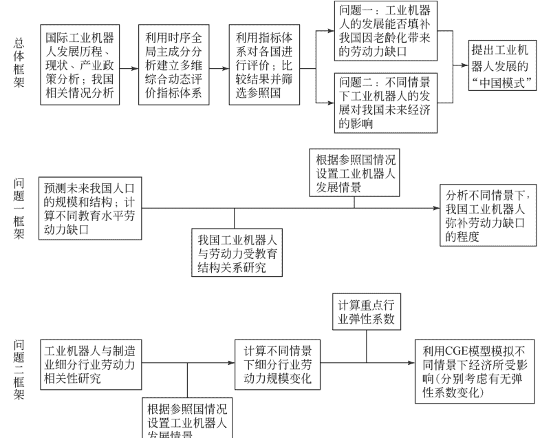** 图 2-1 分析框架及所用方法）：

**维度一：国际标杆复盘，为本土演进找参照**
系统梳理发达国家近年机器人发展实况——核心应用行业、优势产业集群、存量规模、投资增速等指标，提炼不同国家类型的演进规律。引入时序全局主成分分析降维重构，建立动态综合评价体系，对标杆强国与中国进行纵横对标，锁定持续领跑的“常胜将军”群体，作为我国未来发展情景设定的参考基准。

**维度二：总量与结构量化，解码总体效应**
实证测算机器人对劳动力总规模及教育结构的双重冲击。结合PDE模型预测人口规模与教育结构演变，推演机器人普及能在多大程度上填补未来劳动力缺口，精准识别受冲击最重的劳动力类型，为政策精准施策提供定量支撑。

**维度三：行业层面微观解剖，产出新证据**
基于分行业机器人存量、资本投入、就业规模等微观面板数据，运用“技能-任务匹配均衡模型”，量化测算机器人与不同技能劳动力的替代/互补弹性。这不仅为国内语境提供硬核实证，更为后续宏观模拟输出关键参数。

**维度四：宏观情景模拟，推演经济后果**
以上述标杆国家行业演进路径为蓝本，设定我国制造业细分行业机器人发展的多元情景。结合前期测算的行业级机器人-劳动力响应关系，预测劳动力变动图谱。两步走模拟宏观经济后果：
1.  **不考虑要素替代弹性**的CGE基准模拟；
2.  **纳入行业级劳动-资本替代弹性**的深度模拟。
对比不同参照路径下的模拟绩效，提炼最有利于我国经济发展的机器人普及范式。

---

### 2.6 核心方法论：CGE模型深度解析

分析框架确立了“微观冲击→宏观传导”路径，与CGE（可计算一般均衡）模型自下而上、微观一致性强的特质天然契合。以下简要阐释模型架构与本文设定。

#### 2.6.1 模型架构与运行逻辑

**1. 模型四大构件**
CGE模型以方程组刻画市场主体供需博弈，嵌入部门间投入产出链条，通过价格机制联通要素与产品市场，模拟政策/技术冲击对宏观变量（产业结构、进出口、增长等）的传导（柳青等，2016）。核心四要素：
*   **经济主体**：政府、企业、居民、海外部门（可扩展）。
*   **制度结构**：内部要素流通机制与对外开放贸易机制。
*   **决策规则**：主体依据成本最小、利润最大、福利最优等目标函数寻优。
*   **均衡条件**：市场出清（供=需）、宏观闭合（储蓄=投资等），价格作为核心调节变量，保障模型求解收敛至Walras一般均衡状态。

**2. 本文关键假设设定 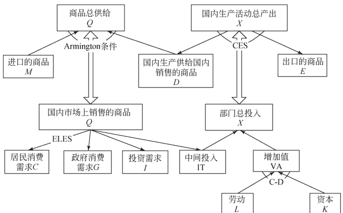**
*   **开放经济体框架**：涵盖政府、企业、居民、海外四主体，契合中国现状。生产活动与商品账户分离，便于处理进口中间品、内销品、出口品的CES复合嵌套关系（见图 2-2 开放型经济体的市场销售产品流通过程）。
*   **冲击聚焦制造业**：微观冲击源（机器人冲击劳动力）作用于制造业部门，非制造业作为被动调整部门通过均衡机制传导变化。
*   **居民部门同质化处理**：视为单一代表性主体，储蓄率与消费函数外生固定。
*   **资本折旧率恒定**：模拟窗口期内各部门固定资产折旧率不变。

> **流向直观解读（对应图 2-2）**：
> 国内市场商品 = 国内生产内销品 ⊕ 进口品（CES复合）；
> 国内生产总产出 = 国内生产内销品 ⊕ 出口品（CES复合）；
> 国内市场商品 → 居民/政府消费 + 投资需求 + 中间投入；
> 部门总投入 = 中间投入 + 增加值（劳动 ⊕ 资本，C-D复合）。

#### 2.6.2 均衡机制与数据地基

**1. SAM为基、均衡为本**
建模遵循“社会核算矩阵（SAM）均衡建模法”（孙翊等，2015；徐程瑾，2015）。SAM以矩阵形式呈现一定时期国民经济循环流量，行列恒等式天然构成宏观均衡约束，是CGE模拟系统的数据底座与逻辑起点。

# SAM 表：从投入产出到全经济核算的跨越

社会核算矩阵（SAM）是在传统投入产出表的基础上演进而来的。它引入了居民、企业、政府及世界其他地区等非生产性机构账户，以二维矩阵形式构建起整个经济系统的收入与支出流向全景图。这张表不仅保留了投入产出表中生产部门间投入产出的相互依存关系，更将视野拓展至非生产部门内部及其与生产部门之间的收支均衡。简而言之，投入产出表聚焦生产端的供需平衡，而 SAM 表则覆盖了国民经济核算体系中投入产出、收支分配的全维均衡。两者关系紧密：SAM 表是投入产出表的外延拓展，投入产出表则是 SAM 表的内核基石。

针对开放经济体，服务于 CGE 模型的宏观 SAM 表账户体系涵盖商品、活动、劳动要素、资本要素、居民、企业、政府、资本形成以及世界其他地区九大板块（见表 2-1）。表中行代表收入来源，列代表支出去向，生动刻画了国民经济各账户间错综复杂的收支平衡图谱。

###### 表 2-1 SAM 表结构示意

| | 商品 | 活动 | 劳动 | 资本 | 居民 | 企业 | 政府 | 资本 | 世界其他地区 | 汇总 |

|---|---|---|---|---|---|---|---|---|---|---|

| 商品 | | 中间需求 | | | 居民消费 | | 政府消费 | 投资 | | 总需求 |

| 活动 | 国内生产供给国内 | | | | | | | | 出口 | 总产出 |

| 劳动 | | | 劳动增加值 | | | | | | 要素出口收入 | 要素收入 |

| 资本 | | | 资本增加值 | | | | | | | |

| 居民 | | | 劳动收入 | 资本收入 | | 转移支付 | 转移支付 | 转移支付 | | 居民收入 |

| 企业 | | | | 资本收入 | | | 转移支付 | | | 企业收入 |

| 政府 | 关税 | 间接税费 | | | 所得税 | 直接税 | | | | 政府收入 |

| 资本 | | | | | 居民储蓄 | 企业储蓄 | 政府储蓄 | | 国外储蓄 | 总储蓄 |

| 世界其他地区 | 进口 | | 要素进口 | | | | | | | 外汇支出 |

| 汇总 | 总供给 | 总成本 | 要素支出 | | 居民支出 | 企业支出 | 政府支出 | 总投资 | 外汇收入 | |

中国 SAM 表的数据编制源头广泛。本书构建的 SAM 基于 2012 年中国投入产出表，框架内的部门数据可对应查阅投入产出表细目。编制过程中，综合调用了《中国统计年鉴》、国际收支平衡表、资金流量表、《中国财政年鉴》、《中国税务年鉴》、《中国劳动统计年鉴》、海关统计、工业普查及人口普查等多维权威数据源。

依据生产部门间、非生产部门内部（居民、企业、政府、资本、世界其他地区）及两者之间的行列供需、投入产出与收支均衡逻辑，可推导出 CGE 模型所需的八大核心均衡模块及一项基本原则：商品供需、活动成本产出、要素（劳动/资本）收支、居民收支、企业收支、政府收支、资本投资储蓄、世界其他地区收支八大均衡模块，外加价格基准与宏观闭合原则。下文将结合这些均衡机制，解析进出口量、居民需求量、要素需求量等核心经济变量的决定机理。

#### 核心均衡模块深度解析

**1. 商品账户：供需对接的枢纽**
商品账户映射的是国内市场商品供求关系。行向汇总总需求构成：中间投入、居民消费、政府消费、投资需求及存货增减；列向展示总供给来源：国内生产供给国内与进口商品。核心恒等式为**总需求 = 总供给**，在 CGE 模型中落地为商品市场均衡条件。

**2. 活动账户：生产部门的成本-产出平衡**
活动账户描绘生产部门投入产出全貌。行向为产出去向（国内销售+出口），列向为成本构成（中间投入、劳动/资本增加值、生产间接税），满足**总产出 = 总成本（总收入 = 总支出）**。每个部门均须单独均衡，内含多重机制：
*   **产出构成机制**：国内销售品与出口品存在不完全替代，替代弹性由参数决定。
*   **数量优化决策**：厂商理性追求成本最小化，在给定总产量、价格与替代弹性下，优化国内销售与出口组合；相对价格变动将驱动决策调整。
*   **小国价格假设**：中国经济体量在国际市场份额较小，属价格接受者，出口价格由国际市场决定，不因销售目的地不同而区分商品。
*   **要素需求决定**：资本与劳动不完全替代，采用规模报酬不变的 C-D 生产函数。其特征为技术进步中性、独立于要素投入、规模报酬恒定。

**3. 要素账户：劳动与资本的收支闭环**
*   **劳动账户**：行向为劳动增加值（总收入），列向为居民劳动报酬（总支出），**收入 = 支出**。
*   **资本账户**：行向为资本增加值（总收入），列向分配至居民、企业、政府资本收益及国外投资者收益，**收入 = 支出**。

**4. 居民账户：收入分配与消费储蓄决策**
行向收入来源五元化：劳动报酬、资本收益、企业/政府/国外转移支付；列向支出含商品消费、个税缴纳；收支差额即**居民储蓄**，满足**总收入 = 总支出**。

**5. 企业账户：利润留存与再分配**
行向收入为资本收益及政府转移支付（如出口退税）；列向支出为向居民转移支付、缴纳企业所得税；差额形成**企业储蓄**，满足收支均衡。

**6. 政府账户：财政收支平衡表**
行向收入五支柱：关税、间接税、资本收益、个税、企业所得税；列向支出为政府消费、对居民/企业转移支付；差额为**政府储蓄（财政盈余/赤字）**，收支相抵。

**7. 资本账户：投资与储蓄的资金池**
行向汇聚四大储蓄来源：居民、企业、政府、国外储蓄；列向流向商品投资需求及存货增加；核心恒等式为**社会总储蓄 = 社会总投资**。

**8. 世界其他地区账户：外部部门收支平衡**
行向（外汇支出）为我国进口及向国外支付要素收益；列向（外汇收入）为我国出口及国外转移支付；差额为**国外储蓄（经常账户盈余/逆差）**，满足**外汇支出 = 外汇收入**。

**9. 价格锚定与宏观闭合：求解唯一解的钥匙**
依据瓦拉斯一般均衡理论，n 个市场中 n-1 个出清则最后一个自动出清，故必须设定价格基准（如固定某商品价格）以确定相对价格体系。CGE 模型包含商品、要素、政府、居民、投资储蓄、国际六大均衡。但变量数常超方程数，导致解不唯一。宏观闭合理论通过将特定变量设为外生/内生，使方程数等于内生变量数，在符合经济逻辑前提下锁定唯一均衡解。

### 本章小结

本章梳理了技术进步与劳动力、经济关系的多元理论图谱，揭示技术冲击对就业兼具“破坏”与“创造”双重效应，且与经济发展相伴相生。这启示我们：研究 AI、工业机器人等前沿技术，必须置于宏观经济系统中，实施动态、综合考量。CGE 模型兼具微观基础（自下而上传导）与宏观模拟能力，可量化至 2035 年工业机器人演进的经济冲击。

回顾现有实证文献，国外定量研究丰富，可供借鉴；但须警惕中国国情差异——劳动力总量大、老龄化进程快。研究应立足中国产业结构与发展特质，辨析中外异同，为构建制造业工业机器人“中国发展模式”提供实证支撑。最终，融合文献综述、数据现状与方法论，确立了本书研究框架。

## 第 3 章 全球视野下的工业机器人演进与政策图谱

### 3.1 研究导引

国际机器人联合会（IFR）将工业机器人界定为：可自动控制、可重编程、多用途的机械装置。虽定义或有不足，却精准圈定了核心特征，奠定了全球比较基准。近年，全球工业机器人销量与安装量飙升，背后是其效率高、精度强、停机率低等硬核优势；未来演进方向将持续赋能制造业转型。

工业机器人是 AI 在制造业的标杆级落地。传统流水线依赖其标准化作业能力；新一代机器人凭借编程灵活性，胜任智能制造下的柔性生产。发达制造强国加速布局，新兴经济体紧随其后，各国均结合禀赋出台专项发展规划。为透视机器人经济深意、汲取国际经验，本章将剖析全球格局，聚焦美、欧、亚典型强国现状与规划，推演中国路径，为后续情景模拟铺垫基石。

### 3.2 全球工业机器人发展态势研判

#### 3.2.1 现状扫描：从危机反弹到高歌猛进

21 世纪以来，全球制造业版图重构——劳动密集型产能向中国等新兴经济体转移，发达国家向资本密集型高端制造进阶，推动机器人投资升温。IFR 数据显示，2005-2008 年全球年均销量约 11.5 万台。2008 年金融危机致 2009 年投资低迷，但 2010 年强势反弹。此后自动化浪潮与技术迭代叠加，需求爆发式增长（见图 3-1）。2012-2017 年年均增速达 19%，2011-2017 年年均销量 23.6 万台，2015-2017 年更冲至 31 万台/年，彰显全球刚性需求激增。

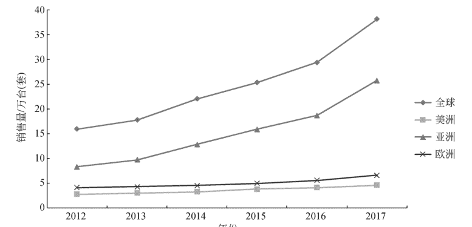

图 3-1 2012-2017 年全球及各区域工业机器人销量走势

资料来源：IFR《工业机器人年度报告》（2018）

2017 年全球销量同比激增 30% 至 38.1 万台，连续五年破纪录。增量主力为金属行业（贡献率 55%）与电气/电子行业（33%）。汽车业增速 22%，仍占总供给 33% 的头把交椅。自 2015 年起，电气/电子行业强势追赶，2016 年已成为中日韩等亚洲主力市场的第一大需求源。

亚洲是增速最猛、体量最大的市场。2012-2017 年安装量年均增 25%。2017 年亚洲销量 26.18 万台，较 2015 年峰值（25.33 万台）增 3.36%，连创五年新高。欧洲次之，销量 6.63 万台，增 18%，年均增速 10%。美洲 4.61 万台，增 12%，连续六年创新高，年均增速与欧洲持平（约 10%）。

#### 3.2.2 核心国家竞争力对标

##### 3.2.2.1 绝对量级：头部市场格局

机器人需求强关联制造业规模，制造强国必是主战场。2017 年前五大市场（中国、日本、韩国、美国、德国）合计占全球 73%。中国自 2013 年登顶全球第一大市场后持续领跑。

*   **中国**：2017 年占全球份额 36%（较 2016 年提升 6 个百分点），销量 13.79 万台，**远超欧美合计（11.24 万台）**。本土厂商销量 3.47 万台（增 29%），外资品牌 10.32 万台（暴增 72%），外资依赖度仍高。
*   **日本**：2017 年销量 4.56 万台，创史上第二高（仅次于 2000 年 4.69 万台），增 18%，年均增速 10%。汽车业稳基本盘，电气/电子业驱动增量。
*   **韩国**：3.97 万台居第三，但较 2016 年峰值（4.14 万台）回落 4%，年均增速 15%。回落主因为电气/电子行业供给同比减 18%。
*   **美国**：虽存“制造空心化”论调，但自动化转型未停。2017 年装机 3.32 万台，增 6%，连续七年创新高。自动化支撑制造业高端内涵与全球地位。
*   **德国**：第五大市场，2017 年销量 2.14 万台，增 7%，创历史新高。但 2014-2016 年曾长期徘徊 2 万台平台期。

##### 3.2.2.2 相对密度：剔除规模效应的真实水平

绝对量受经济体量干扰，引入**工业机器人密度**（每万名从业员拥有台数）作横向标尺。IFR 细分汽车与一般制造业（非汽车）密度。

**全球密度版图（2017 年）：**
*   制造业平均密度：85 台/万人。
*   欧洲最高：106 台/万人。
*   美洲：91 台/万人。
*   亚洲：75 台/万人。

按密度排名，国家序位重塑（见图 3-2）。

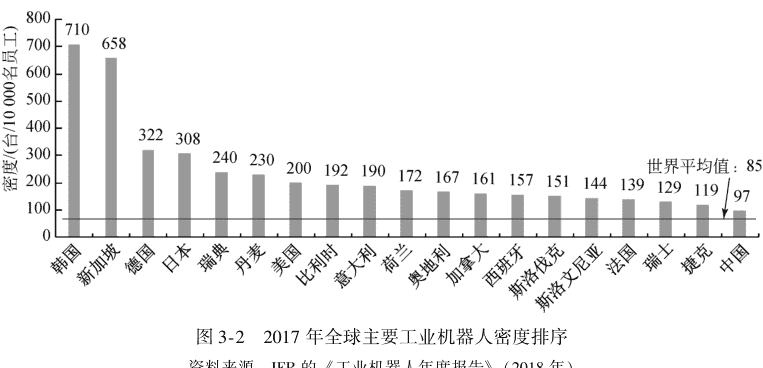

**密度霸主：韩国（710 台/万人）**。2010 年密度仅 311 台，十年翻倍多。凭借持续大规模装机长期霸榜，电气/电子与汽车双引擎驱动增长最猛。

###### (2) 制造业密度对比

紧随韩国其后的是新加坡（每万名员工拥有 658 台）。这一高位主要源于新加坡制造业从业人数极少——国际劳工组织（ILO）数据显示仅约 24 万人。该国工业机器人应用高度集中，电气与电子行业占比高达 84% 左右。

2017 年，德国以每万名员工 322 台的密度超越日本，跻身前三。

日本跌至第四位（308 台/万名员工），且与韩国、新加坡、德国的差距呈扩大之势。2009 年日本曾是全球工业机器人密度最高的国家，但此后韩国（2010 年）、新加坡（2015 年）、德国（2017 年）相继超越。日本密度从 2009 年的 331 台回落至 2016 年的 301 台。

在制造业大国阵营中，中国 2017 年密度为 97 台/万名员工，虽与先进水平尚有距离，但对比 2009 年的 11 台，已实现近 8 倍的飞跃式增长。

### 3.3 主要工业机器人强国发展历程及相关产业政策分析

工业机器人作为先进生产装备，发展迅猛，已成为各国推动制造业转型升级的硬核支撑，也是衡量国家科技创新与高端制造实力的关键指标。依据 3.2 节分析，美国、德国、日本、韩国均为机器人强国，拥有悠久的应用史。鉴于机器人技术处于科技前沿，产业化过程中易面临方向模糊、前期投入大、周期长等难题，这些国家出于产业扶持与战略博弈考量，相继出台专项政策，成为推动行业进阶的关键变量。本节将简要梳理各国发展脉络，归纳政策规划核心逻辑。

#### 3.3.1 美国——凭借经济实力与创新生态驱动机器人发展

##### (1) 美国工业机器人发展简要回顾

1960 年，美国诞生首批工业用机器人，“工业机器人”概念亦由美媒首创。美国曾长期占据全球最大生产国、出口国及技术转让国地位。然而 20 世纪 70 年代中后期起，美国侧重基础研究，技术与经社需求结合不足，竞争力下滑，被日德超越。受制于对就业冲击的顾虑，国内推广亦未获足够重视。

美国机器人产业呈现三大鲜明特征：定位高端，紧贴服务端。鲜有通用机器人工厂，产业链布局聚焦前端基础研究、技术创新，以及后端操作系统开发与技术服务。深度融合先进制造技术。典型如结合 3D 打印，既能制造高质、多元化机器人，又能辅助打印模块安装，兼得定制化与自动化之利。行业分布极不均衡。汽车业密度极高，非汽车领域则显著偏低。

##### (2) 美国的工业机器人发展规划

作为世界第一大经济体，美国维护国际竞争力的动力强劲。面对日德领先态势，美制定系列规划以图反超，折射其发展思路与路径。

2011 年，奥巴马政府基于先进制造计划启动“国家机器人计划”（NRI）。总体标的为加速机器人开发应用，核心聚焦下一代技术领先权。旨在通过攻关核心技术，提升从零部件到系统的功能实用性，构建人机协同作业体系。计划覆盖基础研究至制造部署全生命周期，并评估长远经社影响。初期由 NSF、NASA、NIH、USDA 四大联邦机构主导，年拨款 4000 万美元，激励产学研协同，撬动社会资源。

历经五年四轮资助，NRI 预设目标基本达成。2016 年，美国升级启动“国家机器人计划 2.0：无处不在的协作机器人”（NRI-2.0）。范围大幅拓展，聚焦协作机器人，强调可扩展性与连通性，重点攻关多机协同、人机协同、机器与环境交互、降低使用门槛及整体作业体系构建，意在将机器人渗透至生活全场景。

总体而言，美国在机器人软件、商业服务等软实力已居前列，配合“重振制造业”战略，凭借深厚底蕴，未来一段时期将持续推进制造与应用双轮驱动，力争在工业机器人领域超越日德。

#### 3.3.2 欧洲多国——立足自身优势协同推进

##### 3.3.2.1 德国——以制造业底蕴引领产业跃升

###### (1) 德国工业机器人发展简要回顾

德国切入机器人领域较晚（20 世纪 70 年代），但凭借制造业“优质、精湛”的基因，及庞大的市场需求与改造诉求，加之政府早早将机器人技术列为 80 年代重点公关项目并给予政策托举，迅速跃居美日之后的世界第三大生产国。90 年代全球产业转移潮中，德企（尤汽车业）广泛部署机器人以压降成本、锁住技术，带动产业二次腾飞。配套技术、设计服务等生态随之完善。机器人凭借编程柔性、联网数据采集反馈等特性，成为“工业 4.0”核心基石，支撑云工厂、智能制造愿景落地。

回顾德式发展路径，特点在于：产机深度融合，良性循环。源于制造、服务制造，精密制造能力反哺机器人品质，机器人再赋能制造升级，形成正向循环。技术融合创新，脱颖而出。早期引入电子化、传感技术，使机器人兼具过程记录、反馈优化功能；后“工业 4.0”推动信息化深度融合，打破传统增效思维，为柔性、智能制造铺路。

###### (2) 德国工业发展规划

除早期专项研发计划外，“工业 4.0”堪称德国以优势工业融合信息化、重塑工业竞争力的总纲，机器人在其中扮演核心角色。机器人赋能工业，工业发展反哺机器人创新。面对美式信息技术冲击，德国寻求通过数字化转型开辟新增长模式：盈利不再单靠扩产能、降成本，转向快速响应市场、小批量高利润定制。这种新工业范式创造了机器人新用例，倒逼功能技术突破，加速机器人进化。

虽无单独机器人规划，但“工业 4.0”昭示意图：以发达工业为基、信息化为阶、机器人为核心硬技，构建机器人与高技术工业协同共进生态，巩固全球工业领导地位。

##### 3.3.2.2 其他欧洲国家——小而精、小而高端，各展所长

###### (1) 欧洲主要国家机器人应用图谱

自工业革命以来，欧洲机械工业长居前列。机器人领域虽无德国般绝对实力，但各国依托禀赋创新，推动机器人从刚性流水线向柔性定制进化。

瑞典长居欧洲第二，虽经济体量中等，工业化水平极高。二战后汽车、航空双轮驱动，早引机器人量产高强度、高安全车身。

意大利老牌工业强国，汽车、航空、造船拉动采购。近年利用地理人文优势吸引全球 AI 人才，结合制造基础攻关智能机器人，彰显特色。

西班牙国情似意，虽经济承压，但造船、机械制造领跑欧洲，作为欧第三大机床与汽车发动机产地，机器人装备水平领先。近涉足航天专用设备制造，机器人价值再显。

整体看，除德外，欧洲国家制造业规模较小，但机器人密度不低，聚焦机械装备、汽车制造等资本技术密集型领域，走出“小而精、小而高端”差异化路径，对机器人保持旺盛刚需。

###### (2) 欧盟层面的政策合力

为巩固全球竞争优势，欧盟推出多项规划赋能成员国。

2014 年启动全球最大民用机器人研发计划，目标 2020 年前投入 28 亿欧元，注强竞争力新动能。

2016 年“地平线 2020”计划在机器人领域立项 21 个新项目，投资近 1 亿欧元，周期 2-5 年，覆盖工业与服务机器人开发应用。

欧盟政策导向双轨并行：守住各国特色优势，同时强调创新突围，直面强国竞争。

#### 3.3.3 亚洲——老牌强国与后来居上并存

##### 3.3.3.1 日本——供需匹配与技术创新双轮平衡

日本机器人产业全球领跑，技术产品创新势头强劲，得益于工业发展历程与政府指导性政策的双重加持。

###### (1) 日本工业机器人发展简要回顾

日本机器人崛起与汽车工业深度绑定。70 年代车企为增产提质、应对用工成本上涨引入机器人，政府配套政策税收双管齐下。1980 年产值达 700 亿日元，同比激增 187%，被誉为“工业机器人普及元年”。如今日本在产品广度深度均居前列，拥有全球四大巨头中的发那科、安川电机，2017 年累计产量占全球约 40%。

除政策托举，两大内生特质支撑发展：供需动态平衡，技术产品快速迭代。依托车企需求，新技术快速落地转化，按市场反馈创新改进，供需良性互动。产业基底厚，企业百花齐放。发那科、松下、川崎重工等各擅胜场，掌握核心拼图，国内可形成完整配套体系，并获关联产业创新反哺与需求拉动。

###### (2) 日本的机器人发展规划

日本政府高度重视，将机器人写入《第五期科技基本计划（2016-2020）》及面向 2030 年的《科技创新综合战略》，倾斜立项资源。2015 年发布《日本机器人新战略》。鉴于技术应用长期领先，国内基础研发投入相对收敛，重心转向：技术向产品转化、拓展医疗护理等新场景、深耕国际市场、强化航天深海等高端竞争力。围绕四大着力点部署研发资助，誓守国际领先地位。新战略五大推进举措包括：官民联动投入 1000 亿日元专项；市场规模目标增至 2.4 万亿日元/年（2018 年 6500 亿）；福岛建机器人/无人机测试场；办世机峰会促创新转化；首次导入成本降 20% 等。

总体看，日规划核心在“守优势、拓应用、扩规模”。虽近年出货量增速不及中韩，但深厚技术积淀与清晰战略规划，尽显强国底蕴，值得我国深度参考。

##### 3.3.3.2 韩国——晚发先至，锁定应用高地

###### (1) 韩国工业机器人发展简要回顾

韩国 80 年代末起步，虽晚但快。政府强力主导下，90 年代末基本建成自主体系。1990 年起，经引进消化吸收再创新，随后 20 年复合年均增率 12%，保有量增近 10 倍。应用聚焦汽车、金属加工、电子电气等优势产业。尤以大尺寸液晶面板线搬运机器人占据全球大份额。生产能力居日美德之后。密度指标常年霸榜全球第一，2017 年达 710 台/万名员工，近乎全球均值（85 台）的 8.4 倍。

韩式高速增长动力源于产机良性互动与独特财团体制。现代、LG 双财团主导，各自产业体系明确，需求拉动技术迭代，反馈驱动升级。其他财团跟进采购，对外资整机形成壁垒，客观营造宽松庞大内需市场。韩国产业体系承接美日、外溢中等发展中国家，亦带动机器人出口。

###### (2) 韩国的机器人发展规划

韩国推动工业机器人产业的内在动力，源于双重压力的叠加：一面是产业升级与高质量发展的迫切诉求，另一面则是人口老龄化加速、劳动力池持续收缩的现实困境，急需机器人填补用工空缺。基于此，韩国政府自21世纪初便启动系统性政策扶持。2003年将机器人技术纳入“十大未来增长动力产业”，次年推出“无处不在的机器人伙伴”计划，2008年颁布《智能机器人开发及普及促进法》。继而分别于2009、2014年实施首、二期《智能机器人基本计划》，锚定2018年跻身全球机器人三强、产值达20万亿韩元、出口70亿美元、占全球市场两成的宏伟蓝图。2017年又出台《机器人基本法》，确立伦理责任原则，应对社会冲击，筑牢发展法治根基。

这一连贯政策组合拳，不仅彰显了政府的决心与底气，更勾勒出清晰的短中长期路线图，兼具战略导向与产业规制功能，为产业平稳有序扩张护航。

### 3.4 中国工业机器人演进脉络、现状画像与政策图谱

改革开放催生经济腾飞新阶段，工业凭借出口创汇与就业吸纳双引擎，托起持续高增长。然近年如何破解“提质增效降成本”、实现制造业向现代化跨越成热议焦点，工业机器人遂成关键变量。梳理其发展轨迹与政策脉络，可窥见行业特质与症结，为后续研究立基。

#### 3.4.1 进阶五部曲：从萌芽到领跑

**第一期（1970-1985）：理论破冰期。** 聚焦核心技术前沿探索，奠定认知基石。  
**第二期（1986-1990）：攻关突围期。** “七五”期间国家注资，依托“863计划”跟踪国际尖端，攻克关键零部件，产出批量特种机器人。  
**第三期（1991-2000）：原型孵化期。** 车产业井喷倒逼焊接、喷涂、搬运等产线机器人诞生，新松、博实等头部企业与产业化基地应运而生。  
**第四期（2001-2010）：初步工业化期。** 制造业扩容拓宽应用疆域，深潜等特种机器人亮相，食品、医药、日化等高卫生高自动化领域加速导入。  
**第五期（2011至今）：爆发领跑期。** 2014年超越日本成全球最大消费市场，长三角、珠三角、环渤海三大极依托优势形成产业聚变高地。

#### 3.4.2 现状扫描：规模称霸，结构待优

**量价齐升，增速独绝。** 中国已连续多年蝉联全球销量冠军、增速之最，且自2016年起拥有最大运营存量。2014-2017年年销量近2.5倍跃升至13.79万台，创单一国年度纪录；2012-2017年年均复合增速43%，2017年单年暴增59%，占全球36%份额。累计销量近48.5万台（剔除富士康自产）。销售额2017年达49亿美元，年均增33%。存量端同步狂飙，2017年底运营库存47.34万台，年均增37%。密度指标更是从2015年51台/万人跃至2017年97台/万人，翻倍跨越。

**需求重心东移：电子超车。** 汽车业因巨额投资长期居首，中国亦是全球最大车市与产地。但近年电子、电池、半导体、芯片产业崛起，推动电气电子行业超越汽车成第一大客户兼核心驱动力。中产阶层扩容催生消费升级，更多细分行业加速自动化布局。

**市场红利外溢，本土突围陷“成长烦恼”。** 高份额、高增速吸引国际巨头在华建厂扩产。2017年本土品牌销量3.47万台，同比增29%，却因外资品牌狂飙72%至10.32万台（含合资本地产），市场份额反滑落至25%，外资增速首度超越本土，暴露核心竞争力短板。

#### 3.4.3 政策矩阵：目标量化、技术立本、标准掌话语

“十二五”起，政策密集落地立体化：国务院《战略性新兴产业规划》统筹目标与体系，科技部《智能制造专项规划》聚焦本体、伺服、控制、减速“四大件”攻关，财政部资金直达64个示范项目含22个机器人车间。

《中国制造2025》将机器人列入重点突破领域，直指零部件与集成瓶颈。工信部更以阶梯式目标驱动节奏：  
《推进指导意见》（2013）定调2020年——体系完善、3-5家龙头、8-10个集群、高端占比45%、密度破百。  
《“十三五”规划》（2015）双轮驱动基础理论与零部件产业化，补齐标准验证短板。  
《发展规划（2016-2020）》（2016）细化“四个一批”硬指标：自主品牌10万台/六轴以上5万台、服务机器人营收300亿+、3家+国际龙头/5个+集群、MTBF 8万小时、核心零部件批量化国产化率超半、30个+标杆方案落地、密度冲刺150台/万人。

2019年工信部部长苗圩在工业互联网峰会直指痛点：原创核心技术突破仍显不足，机器人作为互联网落地载体备受瞩目。

**政策内核三大看点：**  
一、**锚定“卡脖子”破局**——巨大市场能否转化为本土红利，关键在核心技术自主可控，全社会已形成共识。  
二、**设定“时间表”与“路线图”**——“十三五”收官之年量化指标成产学研攻关靶标。  
三、**重塑“话语权”**——超越产量销量，直指创新力、国际竞争力与标准制定权，意在掌控国内市场定价权、输出国际合作规则。

### 3.5 章节小结：镜鉴全球，定位自我

纵览机器人强国图谱：美借创新优势融合新技术领跑服务机器人；德仗制造底蕴聚链成群掌握核心；日以供需共振实现迭代进化；韩虽晚发却抱团突围，政府托底目标清晰。各国均以政策为矛、产业为盾，匹配国情定路径。

中国虽起步迟缓，但制造业刚性需求引爆增量：2011年拐点后总量狂飙、销量登顶、密度跻身全球前20。然短板犹存——核心零部件与控制算法受制于人，企业体量微、高端服务缺位。故而政策持续发力扶正祛邪。

展望未来，政策红利叠加制造升级与老龄化倒逼（与日韩同构），机器人将长期维持中高速增长，成为破解劳动力供给收缩的关键棋眼，亦是本研究聚焦核心。

## 第4章 跨国发展水平对标与参照国筛选逻辑

### 4.1 研究缘起：从经验汲取到建模支撑

第3章复盘显示，各国应用领域差异显著，发展模式深度绑定经科工禀赋。发达国家起步早、覆盖广、增速稳、模式异。中国虽面临劳密型产业转移压力，但加码机器人投资仍是提效降本必由之路。故需透过跨国对标，为CGE模型情景设定提供实证锚点，进而推演机器人普及对就业与宏观经济的传导效应。

既有研究多陷入“单一维度静态评价”窠臼（仅看某年总量/密度），忽略发展阶段异质性与动态演化。本章引入**时序全局主成分分析**，实现指标降维重构，产出动态综合评价体系，对中国实施多维历时比对，识别领跑者图谱，最终筛选可供CGE模型参考的“参照国”样本。

### 4.2 评价维度构建：双轮驱动指标库

机器人发展深植于国别经济土壤，衡量须双管齐下：一侧聚焦机器人发展本身，一侧着眼宏观禀赋底色。观测窗口锁定2010-2017年（全球与中国同步进入高增长期）。

#### 4.2.1 机器人发展侧：三大核心指标族（源自IFR年报权威数据）

1. **年出货量（流量视角）**——等同销售规模，刻画年度增量需求。规避产销主体混淆干扰，直观反映新兴经济体爆发力。  
2. **可操作存量（存量视角）**——度量在役机器人规模，彰显工业底蕴。发达国家流量增幅虽缓，存量高位厚积，绝对增量仍具含金量。  
3. **密度三维矩阵（结构视角）**  
   - 制造业整体密度：大国全产业链推广的总体镜像。  
   - 汽车行业密度：传统先导应用场，高利润强吸纳，利于中小经济体横向比较。  
   - 非汽车行业密度：折射应用广度与渗透深度。

#### 4.2.2 宏观禀赋侧：六大基础变量

1. **GDP**——综合国力底盘，互嵌机器人应用产业结构差异。  
2. **人均GDP**——发展阶段标尺，跨国比较基准。  
3. **第二产业占比**——工业化深度与政策导向风向标。  
4. **制造业占比**——核心载体地位的直接度量。  
5. **第二产业从业者占比**——双重解码：发展模式特征+自动化冲击敏感度。  
6. **工业劳动生产率**——世界银行口径（第二产业从业者人均增值），效能基准线。

#### 4.2.3 降维赋权：客观让数据说话

指标林立、信息重叠、权重失衡，硬拼必偏颇。主观赋权（AHP/德尔菲/模糊评价）依赖专家经验，客观赋权（主成分/因子/熵权）依赖数据内生结构。本章采用后者，剔除冗余、提炼主成分、客观赋权排序，锚定核心驱动因子，为动态评价铺就量化基石。

# 为什么选主成分分析？揭秘工业机器人多维评价的方法论选择

在客观赋权的工具箱里，主成分分析（PCA）与因子分析同属多元统计家族，虽路径不同，殊途同归：前者借变量间协同效应将指标线性重组为新综合变量，后者靠相关性聚类使同因子内变量关联度最大化。二者优势明显——能降维、赋权快、排序分类手到擒来；短板也一致：综合指标掩盖原始信息，损失程度取决于主成分代表性，且仅限同批次数据横向比拼，无法跨组纵向追踪发展轨迹。

熵权法出自信息论，用熵值量系统无序度：熵大则信息效用小，熵小则效用大。它聚焦指标内部离散度逐一赋权，最大程度保留原始信息，且支持跨方案比较。代价是无法降维、计算链条长。

本书核心任务是提炼一组能映射各国工业机器人发展模式的综合指标，据此对各经济体同年表现横向排序分类。评价打分仅服务于横向比较，无需纵向追溯历史得分。基于此，**时序全局主成分分析**成为首选——它引入时间维度，专治面板数据。

全局主成分的操作逻辑是将多年份、多地区的同构指标打平整合：若统计 $n$ 个区域、$m$ 个指标、$T$ 个年份，每年形成一张 $n \times m$ 数据表，纵向堆叠 $T$ 张表得 $nT \times m$ 的全局大矩阵。每行代表一个“区域-年份”样本，共 $nT$ 个样本。本质上，就是把时序立体数据“摊平”，再跑经典 PCA（倪苹，2013），从而产出可支撑多维动态评价的新综合指标。

---

## 4.2.3 数据来源与预处理

数据双轨并行：IFR《工业机器人年报》（2011-2018）覆盖 50 个经济体 1993-2017 年分行业装机/保有量，全球覆盖率 90%+；世界银行数据库托底宏观经�指标，双重保障权威性。

### 4.2.3.1 研究对象：15 个“关键少数”

国际比较且为中国找参照，对象必须在某些维度极具代表性，且数据能与两大库对齐。最终筛选除中国外 14 国，连同中国共 15 国。标准是：2008 年金融危机后装机量领跑者。这 15 国 2017 年装机量占 IFR 成员总量 87%，高度代表主流进程。陈秋霖等（2018）从不同切口选出的 14 国与本名单高度重合（仅差瑞典），侧面印证“谁是机器人强国”已形成学界共识。表 4-1 概括各国核心画像：

| 国家 | 核心标签与关键数字 |
|------|-------------------|
| 美国 | 经�体量全球第一，服务业为柱仍保 8% 装机 CAGR |
| 加拿大 | 北美发达体，与美深度绑定，装机 CAGR 18% |
| 墨西哥 | 承接美汽车产业链，新兴体中装机增速最猛（25%） |
| 巴西 | 南美巨头，看重经�与劳动力规模 |
| 印度 | 人口次于中国、结构年轻、资本宠儿，制造业基础弱但装机 CAGR 18% |
| 日本 | 老牌霸主，保有量与年采购长居榜首（2013 年被中超），核心技术/专利/供给端全产业链领跑，装机 CAGR 10% |
| 韩国 | 密度之王（汽车/电子），增速暴力（15%），2015 年年采购反超日本 |
| 泰国 | 承接制造业转移，东南亚工业体量参考值 |
| 德国 | 欧盟双引擎之一，工业强国/机器人强国，隐形冠军云集，年采购常占西欧半壁江山，装机 CAGR 4%，《国家工业战略 2030》在手 |
| 法国 | 双引擎另一极，知名制造商林立，装机 CAGR 11% |
| 英国 | 昔日工业霸主，转型服务业，装机规模曾回落 |
| 意大利 | 制造名家聚集，经�平庸但装机规模西欧第二，CAGR 12% |
| 西班牙 | 危机后复苏强劲，装机 CAGR 16%，规模逼近法国 |
| 瑞典 | 北欧装机一哥，制造业发达，CAGR 8% |

资料来源：IFR 年报（2011-2018）、世界银行

这 15 个样本在机器人渗透率、经�体量、产业结构上各擅胜场，组合成极具张力的参照系，为后续指标体系重构与中国发展路径借鉴奠基。

### 4.2.3.2 两步清洗：去价格、统量纲

**(1) 剥离价格干扰**  
跨年比较必须扣除价格因素。GDP 与人均 GDP 直接受价格影响，本书统一采用世界银行 **2010 年不变美元** 计价，规避汇率与利率噪音。

**(2) 极差标准化：兼顾鲁棒与区分度**  
指标量纲不一，不标准化无法比较。常用三法中：均值法怕极值，标准差法压缩差异。本书采用 **极差化（Min-Max）**，将所有指标压入 [0,1] 区间，按指标性质分三套公式：

- 正向指标（越大越好）：$x^* = \frac{x - x_{\min}}{x_{\max} - x_{\min}}$
- 负向指标（越小越好）：$x^* = \frac{x_{\max} - x}{x_{\max} - x_{\min}}$
- 适中指标（适度最优）：$x^* = \frac{|x - x_0|}{|x_m - x_0|}$，$x_0$ 为目标值，$|x_m - x_0|$ 取两端偏离较大者

---

## 4.3 三维评价体系落地与参照国锁定

### 4.3.1 从 11 指标到 3 主成分：SPSS 跑出的“黄金三角”

将 15 国 × 8 年 × 11 指标整理为 $120 \times 11$ 大矩阵，扔进 SPSS 22.0 跑 PCA。前三主成分累计贡献率 **85.636%**（表 4-2），足以承载原始信息主干。

| 主成分 | 特征值 | 方差贡献% | 累计% |
|--------|--------|-----------|-------|
| 1 | 4.202 | 38.198 | 38.198 |
| 2 | 3.651 | 33.191 | 71.388 |
| 3 | 1.567 | 14.248 | 85.636 |

成分矩阵（表 4-3）揭示各原始指标在三主成分上的载荷（因子载荷非系数）：

| 指标 | 成分 1 | 成分 2 | 成分 3 |
|------|--------|--------|--------|
| 可操作存量 | 0.809 | 0.368 | 0.397 |
| 年出货量 | 0.586 | 0.562 | 0.452 |
| 制造业机器人密度 | 0.916 | -0.045 | -0.351 |
| 汽车行业密度 | 0.824 | -0.230 | -0.299 |
| 非汽车行业密度 | 0.883 | -0.008 | -0.363 |
| GDP | 0.362 | 0.048 | 0.872 |
| 人均 GDP | 0.578 | -0.742 | 0.105 |
| 第二产业占比 | 0.046 | 0.882 | -0.158 |
| 制造业占比 | 0.271 | 0.870 | -0.192 |
| 第二产业劳动力占比 | 0.218 | 0.724 | -0.162 |
| 工业劳动生产率 | 0.563 | -0.729 | 0.031 |

**系数矩阵**（表 4-4）= 载荷 / √特征值，用于实际打分：

| 指标 | 成分 1 | 成分 2 | 成分 3 |
|------|--------|--------|--------|
| 可操作存量 | 0.395 | 0.193 | 0.317 |
| 年出货量 | 0.286 | 0.294 | 0.361 |
| 制造业密度 | 0.447 | -0.024 | -0.280 |
| 汽车密度 | 0.402 | -0.120 | -0.239 |
| 非汽车密度 | 0.431 | -0.004 | -0.290 |
| GDP | 0.177 | 0.025 | 0.696 |
| 人均 GDP | 0.282 | -0.389 | 0.083 |
| 第二产业占比 | 0.022 | 0.462 | -0.126 |
| 制造业占比 | 0.132 | 0.455 | -0.153 |
| 第二产业劳动力占比 | 0.106 | 0.379 | -0.130 |
| 工业劳动生产率 | 0.275 | -0.382 | 0.031 |

语义命名：  
- **成分 1 = 工业机器人发展水平**（存量、出货、三大密度高载荷）  
- **成分 2 = 制造业规模效应**（产业占比、劳动力占比主导，人均 GDP/生产率负向）  
- **成分 3 = 经济规模效应**（GDP 绝对量主导）

### 4.3.2 时序动态画像：中国冲刺前四的 8 年轨迹

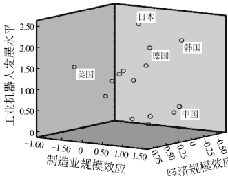  
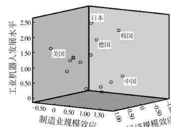  
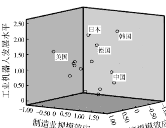  
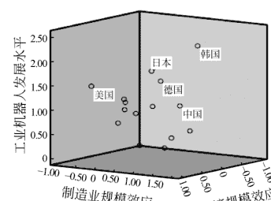  
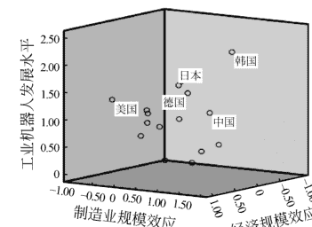  

图 4-1  三维评价空间中 15 国 2010-2017 年轨迹分布（X-制造业规模，Y-机器人水平，Z-经济规模）

关键读图洞察：  
- **常青前四**：日本、美国、德国、韩国 8 年霸榜“机器人发展水平”前四。  
- **中国突围**：2010 年倒数第五起步，排名逐年跃升，2017 年得分已逼近德国。  
- **趋势未尽**：曲线斜率陡峭，冲击前三强势可期。

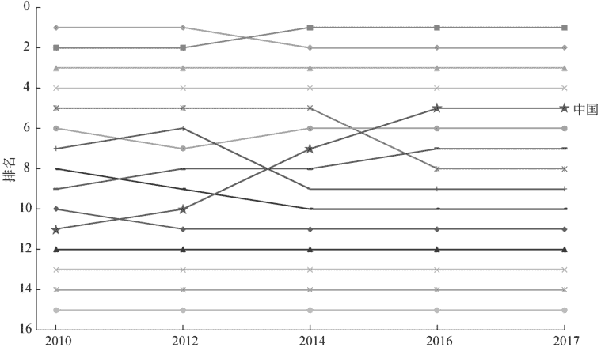  

图 4-2  15 国机器人发展水平排名 2010-2017 年动态变化

### 4.3.3 参照国三人组：美国、德国、韩国——为何不是日本？

前四常驻国中，需选三国支撑 CGE 模型的低/中/高三档情景。筛选逻辑链：

1. **美国——不可绕过的“再工业化”参照**  
   虽 2011 年工业总产值被中国超越，但高端制造与核心技术仍掌握话语权，库存/采购体量巨大，“制造业回流”推动装机增速领跑发达国家。中国制造业升级空间大，美式路径最具镜鉴价值。

2. **德国——政策确定性+双高指标的“教科书”**  
   综合评价两指标进前四，《国家工业战略 2030》给产业升级立下硬标尺。对比日本制造业占比下滑，德国当下更具参考性。

3. **韩国——增速最猛的“密度突围”样本**  
   年出货量复合增速发达国家第一，2014 年机器人发展水平登顶。依托汽车/电子等优势行业集中投入、提密度、创效益，这种“点穴式”自动化升级路径，对中国结构调整极具启发。

日本虽强，但与德国同属“传统工业强国+机器人供给侧霸主”同类项，且近年制造业占比回落；韩国提供了差异化的“使用侧极致深化”范式。最终，**美、德、韩**入选，构成中国未来发展情景的三个锚点。

---

## 4.4 本章小结：为 CGE 情景设定找“标杆”

**核心逻辑链**：  
中国机器人起步晚、数据少、模式未定 → 难独立推演对就业/经�冲击 → 必须借鉴外部经验 → 需多维动态评价筛选可比国家。

**执行路径**：  
1. 圈定 15 国代表性样本库  
2. 时序全局 PCA 压缩 11 指标 → 3 维核心体系（机器人水平、制造规模、经�规模）  
3. 8 年动态打分排名 → 锁定美/日/德/韩前四常驻集团  
4. 结合产业政策、路径差异、建模需求 → 最终落子 **美国（高端再工业化）、德国（战略引导型）、韩国（密度极致型）**

三国三种范式，为 CGE 模型低/中/高情景提供了坚实、可微分的现实锚点。下一步，将把这些参照国的历史路径参数化，注入模型，推演中国工业机器人的未来图景。

## 第 5 章 工业机器人发展对我国劳动力的影响研究

### 5.1 研究背景与核心问题

承接第二章的梳理，当前国内关于工业机器人冲击劳动力市场的探讨，多停留在定性层面；仅有少数研究借助统计数据剖析技术进步与就业的宏观关联，或利用面板数据考察人工智能与劳动力替代的相关性。鲜有成果能“打开黑箱”，深入到具体行业、具体群体层面去量化机器人的差异化冲击，本章旨在填补这一空白。

本章聚焦两大核心命题：其一，随着我国步入老龄化社会、劳动力供给持续收缩，工业机器人能否在一定程度上弥补缺口？其对劳动力规模与结构将产生何种深层影响？为量化回答此问，本章引入 PDE 模型开展人口预测。该模型不仅能推演总量走势，更能精准刻画不同受教育层级人口的演变轨迹。鉴于机器人对不同技能等级劳动力的替代力度截然不同，掌握未来人口结构图谱，便能测算至 2035 年各技能层级的供给缺口、冲击面及机器人潜在填补空间，为政策建议提供硬核量化支撑。

其二，制造业细分赛道中，哪些行业的就业岗位最敏感于机器人普及？通过构建分行业回归模型识别关键行业及影响强度，为后续基于 CGE 模型的宏观经济影响分析奠定微观实证基础。

### 5.2 方法论溯源与技术路径确立

#### 5.2.1 劳动力预测工具的演进与选择

劳动力预测本质上依赖人口预测。早期主流的线性回归模型将人口视为自变量函数，虽操作简便，但难以捕捉结构性变迁。联合国模型、Leslie 矩阵结合 ARMA 模型等虽能估算总量与年龄结构（如蒋辉、任强等学者的相关预测），却忽略了“劳动力素质”这一关键变量。在智能化替代语境下，技能维度的缺失是致命短板。

IIASA 推出的 PDE 模型实现了关键突破：将受教育程度纳入状态维度，实现了对全球 171 国人力资本的长程推演（Lutz and Goujon, 2001; KC and Lutz, 2014）。国内亦有学者用该模型预测京沪两地人口结构（陈功等，2006；庞丽华等，2006）。本研究即借助这一工具，探寻机器人发展水平与劳动力素质的动态耦合关系，量化其对老龄化缺口的填补潜力。

#### 5.2.2 技术冲击就业的测度范式：从聚合到微观的跨越

既往研究技术进步与就业关系，常用索洛余值法或科布-道格拉斯生产函数。前者数据需求低但生产函数假设强；后者虽便于计算劳动弹性，却预设要素产出弹性恒定。两者均将就业与技术作为自变量、总产出为因变量，隐含“同质替代”假设。

然而，中国工业机器人应用呈现“时间短、速度快、行业变”特征：使用行业集合动态变化，行业内企业自动化程度差异巨大。若沿用行业聚合产出数据，极易高估应用企业数量、低估单台机器人边际产出。

**宏观总量层面**，鉴于部分机器人存量难以精准归属行业，借鉴 Acemoglu and Restrepo (2017) 做法，采用全国机器人年销售规模作为核心解释变量，便于与国际经证对话。同时必须纳入结构视角：大量文献（Manyika et al., 2017; Frey and Osborne, 2017）证实，替代风险呈显著“技能偏向”特征——低技能、重复性岗位首当其冲。因此，需建立机器人规模与就业规模/结构的直接关联模型。线性回归虽面临多重共线性风险，但通过精心筛选工具变量可有效规避（姚战琪和夏杰长，2005），适合作为宏观总量分析的基石。

**微观行业层面**，SBTC 与 RBTC 虽实现了劳动力/任务分层，但前者侧重技能维度，后者侧重任务类型。近年来，技能-任务匹配均衡模型成为前沿范式。Autor (2013)、Acemoglu and Autor (2011) 指出：同一任务可由劳动或资本（机器人）完成，选择取决于相对价格（工资 vs 使用成本）。该模型能将机器人密度与分行业、分任务劳动力需求精准挂钩。Acemoglu and Restrepo (2017) 用此法实证美制造业机器人显著挤出就业并压低工资。鉴于我国行业间、企业间机器人渗透率差异巨大、劳动力供给相对充裕，本研究参照该范式，部署技能-任务匹配均衡模型，剖析制造业细分行业劳动力规模的动态调整。

**综上，技术路线定型为：宏观总量用“线性回归”，微观行业用“技能-任务匹配均衡模型”。**

### 5.3 未来劳动力图谱的 PDE 推演

既往研究多为静态切片，而中国未来面临“总量下行 + 素质跃升”双重变量。国际证据显示，机器人替代效应呈显著技能异质性，高技能劳动反成稀缺互补品。故必须预测未来特定时期的人口总量与受教育结构双轨演变。

#### 5.3.1 改进型 PDE 模型：机理与架构

人口增长 = 自然增长（出生-死亡）+ 机械增长（净迁入）。鉴于中国国际迁徙规模相对总量可忽略，模型设净迁入为零。生命周期迭代的数学表达见下：

```
Pt = Pt-1 + Pbt - Pdt + Pit
= Pt-1 · (1 - dt) + Pi + Pbt
= Pt-1 · (1 - dt) + Pi + (Pt-1 · Rt-1 + Pi · Ri) · Bt
= Σ(n=1 to 110) Pn(t-1) · (1 - dml) + Σ(n=15 to 50) [Pn(t-1) · Rn(t-1) · Pni · Rni] · Bml   (5-1)
```

模型以 2010 年六普数据为基期，按 5 岁年龄组切分，交叉性别、城乡、受教育四维度。城乡按居住地划分；受教育设四态——“未上学”（含扫盲）、“小学”、“中学”（初/高/中专合并）、“大专及以上”（专/本/研合并）。关键机制在于：特定年龄组内，人口教育状态单向向上流动（如小学→中学），结合生命周期迭代，即可滚动推演未来各教育层级人口存量。

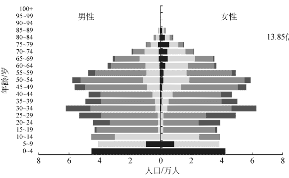

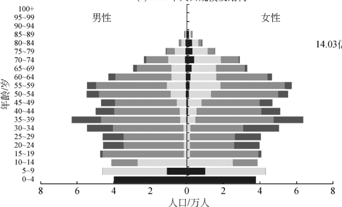

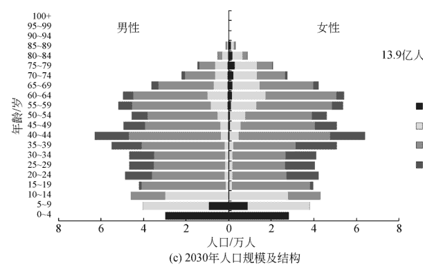

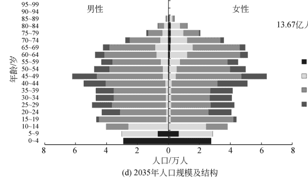

#### 5.3.2 关键参数的情景化设定

**(1) 生育水平：分教育层级的精细刻画**
依据六普数据测算各教育层级育龄妇女（15-49 岁）分年龄组生育率及总和生育率（TFR），以各层级妇女占比加权合成总体 TFR，假定层级间生育比例结构稳定。预设生育情景下，可推算至 2035 年各层级分年龄生育谱。

**(2) 死亡水平：教育带来的寿命红利**
模型引入模型生命表转化预期寿命。2010 年国人平均预期寿命 74.83 岁。文献（Pamuk et al., 2011; Lutz and KC, 2011）确证：受教育水平除经济外，是决定婴儿夭折率与成人健康的核心变量。KC 等 (2010) 多国实证显示：教育对寿命的分化效应自 15 岁显现（分流就学/就业）。相对中等学历，未上学群体 15 岁预期寿命少 3 年，小学少 2 年；发达国家大专以上群体反超中等学历 2 年。参考日韩达 74.83 岁前每 5 年增 0.6 岁的轨迹（联合国中情景），结合发展中国家模型生命表，设定我国预期寿命同步增速，并按教育层级差异化设定增幅。

**(3) 受教育转型：对标东亚高水平陷阱**
基期教育比例类似“毛入学率”概念（如 6-9 岁组小学入学率设为 100%）。未来转型参考日韩新至 2035 年教育结构终值，反推我国教育转换率路径。

**(4) 综合情景矩阵**
鉴于机器人规模已设多情景，人口端仅设单一生育方案（见表 5-1），死亡由预期寿命驱动，教育由转换率驱动，形成核心情景组合（表 5-2）。

**表 5-1 2020 ~ 2035 年生育与死亡情景设定**

| 时段 | 总和生育率 | 平均预期寿命(岁) |
| :--- | :---: | :---: |
| 2016 ~ 2020 | 1.6 | 76.9 |
| 2021 ~ 2025 | 1.4 | 78.0 |
| 2026 ~ 2030 | 1.4 | 79.1 |
| 2031 ~ 2035 | 1.4 | 80.1 |

**表 5-2 教育转换率情景设定**

| 未上学→小学 | 小学→中学 | 中学→大专及以上 |
| :---: | :---: | :---: |
| 0.9957 | 0.980 | 0.336 |

*注：转换率基于六普资料校准。*

#### 5.3.3 预测图谱解读：顶峰已现，结构跃升

迭代计算得 2025/2030/2035 年人口全维画像（图 5-1），劳动力（15-59 岁）分教育层级规模见表 5-3。

**表 5-3 预测期劳动力人口分受教育水平规模（万人）**

| 时段 | 未上学 | 小学 | 中学 | 大专及以上 |
| :--- | ---: | ---: | ---: | ---: |
| 2020 ~ 2024 | 950 | 11,021 | 63,409 | 15,855 |
| 2025 ~ 2029 | 686 | 8,950 | 63,524 | 17,671 |
| 2030 ~ 2034 | 469 | 6,499 | 61,388 | 19,440 |
| 2035 | 320 | 4,799 | 60,052 | 20,821 |

**三大核心图景：**

1.  **总量见顶回落**：人口规模 2025 年触顶，随后下行。金字塔腰部持续上移，2035 年最大 5 岁组为 45-49 岁，劳动力平均年龄显著抬升。
2.  **人才红利释放**：20-24 岁组中“大专及以上”占比持续攀升，高技能供给管道扩容。
3.  **退休潮结构性反转**：以 55-59 岁为退休前哨，三个五年期退休规模分别为 1.12 亿、1.06 亿、8829 万，均超当期劳动力 10%。关键在于：**退休群体中中学及以下占比从 72% 降至 70%，大专以上占比从 28% 升至近 30%**。意味着流出的是低技能存量，留存与新增的是高技能增量——劳动力供给正经历“提质换挡”。

### 5.4 机器人冲击劳动力的实证拆解

#### 5.4.1 核心变量构建：技能比率（LSR）

为捕捉结构性冲击，本章摒弃绝对量指标，构建**劳动力技能比（LSR）**作为核心被解释变量：

$$ LSR = HSL / LSL \quad (5-2) $$

*   **HSL（高技能劳动力）**：界定为高中（含中专）、大专及以上学历就业人员。规模 = 该群体占比 × 全国就业总人数（数据源：《中国劳动统计年鉴》2003-2017）。
*   **LSL（低技能劳动力）**：全国就业总人数 - HSL。

该指标能直观反映劳动力供给端的“含金量”变迁，为后续考察机器人如何重塑技能结构提供精准靶心。

# 探究工业机器人如何重塑就业结构：实证分析与未来预测

在剖析工业机器人对劳动力就业格局的冲击时，不能忽视社会技术进步推动劳动者受教育程度跃升这一背景因素，故须将其纳入控制变量。参照既有文献，本文采用综合技术水平表征技术进步程度，其计算方式沿用姚战琪和夏杰长（2005）的方法，取劳动生产率与资金产出率的算术均值。其中，劳动生产率以工业增加值除以期内全员平均人数衡量（单位：元/人·年）；资金产出率则用固定资产净值与工业增加值之比表示。

## 5.4.2 模型构建

在控制综合技术进步水平的前提下，构建考察工业机器人对劳动力技能结构影响的线性回归模型如下：

LSR_i = \alpha C + \beta_1 IR_i + \beta_2 Tech_i + \mu_i \quad (5-3)

式中各符号含义为：LSR_i 代表第 i 年全国劳动力受教育结构；IR_i 为该年度工业机器人销量；Tech_i 表示综合技术进步水平；\mu_i 为随机扰动项；\alpha、\beta_1、\beta_2 依次为常数项及回归系数。建模所用数据主要汇编自《中国统计年鉴》《中国工业统计年鉴》（2002-2017）、《中国劳动统计年鉴》（2002-2017）、Wind数据库及国际机器人联合会（IFR）发布的《工业机器人年度报告》。

## 5.4.3 数据概览与回归检验

### 5.4.3.1 核心变量描述性统计

**1. 劳动力规模与受教育结构演变**

长期以来，我国凭借庞大劳动力池享受了数十年“人口红利”。依据《中国劳动统计年鉴》（2002-2017），为对接机器人统计口径，本文选取2001年起的全国企业从业人员年均人数（详见表5-4、图5-2）。

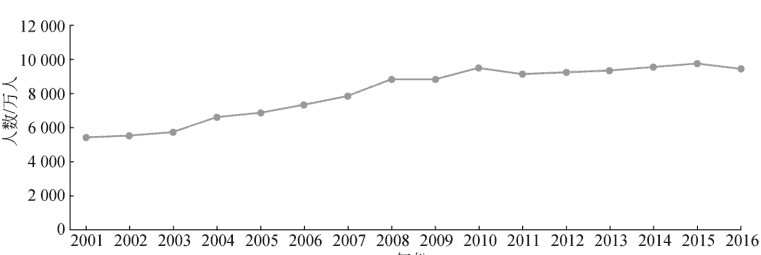

数据显示，从业人员规模于2015年触顶回落，2016年已现下滑。展望未来，伴随老龄化深化与新生儿数量减少，劳动力供给收缩将成常态。破局之道在于加速人力资本积累，实现从“人口红利”向“人才红利”的转型。鉴于模型因变量设定为劳动力技能比，先行梳理受教育水平分布势在必行（表5-5、图5-3、图5-4）。

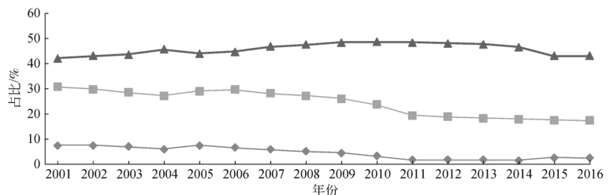
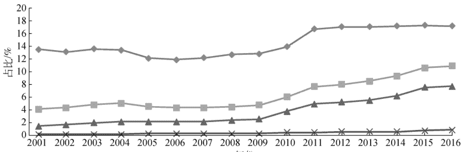

观察可知，2001年以来，低学历（未上学、小学）占比持续收窄，初中学历呈现“先升后降”态势，高中学历稳步攀升，大专及本科学历增速显著加快，尤其2009年后增势迅猛，研究生层次亦稳步增长。

因变量“劳动力技能比”定义为高技能劳动力（高中/中专、大专及以上）与低技能劳动力之比。据此测算得2001-2016年技能比演变轨迹（图5-5）。

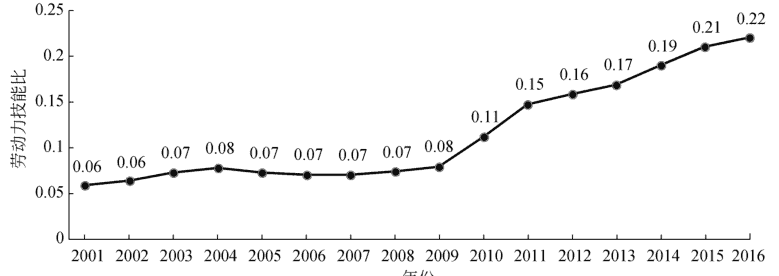

**2. 工业机器人普及历程**

我国工业机器人应用起步于21世纪初，2008年金融危机后的2010年起步入高速增长期。IFR报告记录的2001-2017年销量、保有量及增速详见表5-6、图5-6。

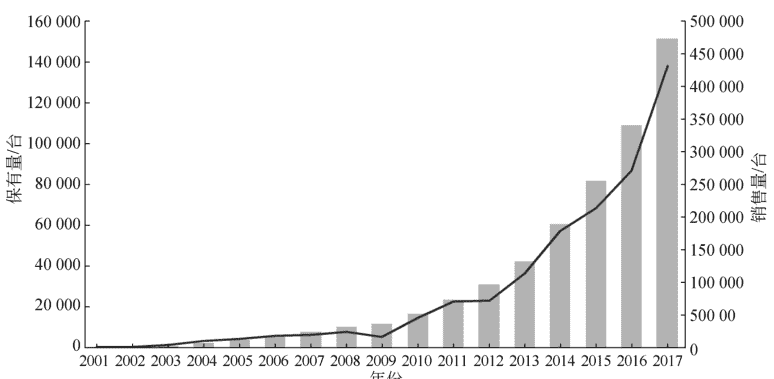

复盘可见：入世初期因劳动力成本低廉，机器人需求疲软；金融危机后货币宽松推高工资，叠加务工人员回流减少，劳动力短缺与工资上涨双重挤压下，企业自动化转型意愿强烈，销量增速整体向上。鉴于外部环境短期难变，这一需求释放态势有望延续。

**3. 综合技术进步水平测度**

技术进步双重体现在劳动效率提升与资金使用效益上。以工业增加值为核心指标，劳动生产率=工业增加值/从业人员均数；资金产出率=固定资产净值/工业增加值。二者算术均值即表征综合技术水平。

### 5.4.3.2 回归分析结果

**1. 相关性预检验**

回归前先行检验变量间相关性。结果显示：工业机器人销量与劳动力技能比相关系数达0.95（P<0.05）；综合技术水平与技能比相关系数为0.939（P<0.05）。两自变量均与因变量呈显著正相关，满足回归前提。

**2. 多元回归估计**

依式（5-3）估计得调整R²=0.954，模型拟合度极高。核心系数及显著性见表5-7。

| 变量 | 系数估计 | t统计量 | 显著性 |
| :--- | :--- | :--- | :--- |
| 常数项 | 0.012 | 0.826 | 0.424 |
| 工业机器人销量 | 1.089×10⁻⁶ | 4.412 | **0.001** |
| 综合技术水平 | 0.009 | 4.358 | **0.001** |

结论明确：机器人销量与劳动力技能比存在显著正向效应。销量扩张推高技能比，暗示机器人对低技能岗位产生**替代效应**，对高技能岗位（运维、研发、改造等）形成**互补/促进效应**。这意味着，机器人增长可部分配平低技能劳动力退出缺口，同时催生高技能人才新需求。

## 5.5 老龄化视角下：机器人能否填补劳动力缺口？

### 5.5.1 未来机器人规模情景设定

当前制造业痛点显性化：老龄化加剧与新生劳动力萎缩将制造结构性缺口。机器人能否补位？需预判其未来规模。

预测路径有二：一是基于历史数据趋势外推，优势是简便自主，劣势是样本短（大规模应用仅十余年），且近年增速（2012-2017年CAGR 43%）系爆发式增长，难以持续；二是借用权威机构（如IFR）基于多国经验的预测框架，规避单一国家特异性，但可能忽略本国特质。

综合权衡，并结合第4章筛选的参照国（德、美、韩），本文采用第二路径。依据三国2012-2017年出货量CAGR（德4%、美8%、韩15%），设定2020-2035年三档情景（表5-8），推算对应出货量规模（表5-9）。

| 时段 | 低速情景(S1) | 中速情景(S2) | 高速情景(S3) |
| :--- | :--- | :--- | :--- |
| 2020-2024 | 84.0万 | 101.9万 | 141.4万 |
| 2025-2029 | 102.2万 | 149.8万 | 284.5万 |
| 2030-2034 | 124.4万 | 220.1万 | 572.2万 |

### 5.5.2 缺口填补效应测算逻辑

基于式（5-3）回归系数β₁，可推导不同机器人销量下的匹配技能比（式5-4、5-5）。结合人口预测模型得总劳动力P₀、低技能P₁、高技能P₂。规上工业从业人口占比均值10.75%为基准。

```
$P'_1 = 10.75\% \times P_2 / \text{LSR}$ (5-4)
$P''_1 = 10.75\% \times P_1 - P'_1$ (5-5)
```

在预测期内，55-59岁即将退休群体中低技能规模为P'_r。机器人每年替代低技能量P''₁，使得“退休低技能与新增低技能差额P''_r”得到缓释，净缺口P_g = P''_r - P''₁。

```
$P_g = P''_r - P''_1$ (5-6)
```

此指标直观量化机器人对结构性缺口的填补能力。

### 5.5.3 替代效应情景推演

代入表5-9销量规模、式（5-3）及β₁（表5-7），得三情景下技能比演进（表5-10）。

| 时段 | S1(德模式) | S2(美模式) | S3(韩模式) |
| :--- | :--- | :--- | :--- |
| 2020-2024 | 1.011 | 1.100 | 1.360 |
| 2025-2029 | 1.149 | 1.365 | 2.105 |
| 2030-2034 | 1.310 | 1.704 | 3.305 |

数据揭示：即便按德国低速路径，技能比也稳步提升；若复制韩国高速路径，技能比将翻倍以上，意味劳动力结构将经历剧烈“机器换人”重构，高技能缺口扩大、低技能冗余消解将同步发生。

# 工业机器人：能否破解老龄化下的劳动力困局？

在规模以上工业企业中，全部从业人员常年占劳动年龄人口的比例稳定在 10.75% 左右（2001-2016 年均值）。基于这一固定比值，结合人口预测模型（PDE）推算出的不同年龄、受教育层级人口规模，我们能够反推出未来分五年阶段的企业从业人员总量，进而拆解为高、低技能劳动力存量（见数据表 1）。

**数据表 1：企业从业人员中高低技能劳动力规模预测（单位：万人）**

| 阶段 | 低技能劳动力 (P₁) | 高技能劳动力 (P₂) |
| :--- | :--- | :--- |
| 2020-2024 | 5832.8 | 3977.68 |
| 2025-2029 | 5590.0 | 4177.07 |
| 2030-2034 | 5150.0 | 4290.73 |

假设高技能人才充分就业，引入劳动力技能比情景（S1 低速、S2 中速、S3 高速，参考德国、美国、韩国轨迹），可测算出各情景下企业对低技能劳动力的**实际需求量 (P'ₜ)** 与被**机器替代量 (P''ₜ)**。

**数据表 2：不同情景下低技能劳动力需求与替代规模（单位：万人）**

| 阶段 | 指标 | S1 (低速) | S2 (中速) | S3 (高速) |
| :--- | :--- | :--- | :--- | :--- |
| **2020-2024** | 需求量 P'ₜ | 3936.13 | 3616.16 | 2925.23 |
| | 替代量 P''ₜ | 1896.69 | 2216.66 | 2907.59 |
| **2025-2029** | 需求量 P'ₜ | 3634.20 | 3059.03 | 1984.25 |
| | 替代量 P''ₜ | 1955.78 | 2530.95 | 3605.73 |
| **2030-2034** | 需求量 P'ₜ | 3274.58 | 2517.50 | 1298.06 |
| | 替代量 P''ₜ | 1875.39 | 2632.47 | 3851.90 |

PDE 模型还能精确预测每 5 年低技能劳动力中“即将退休（55-59 岁）”与“新入职（15-19 岁）”的人口剪刀差 (P''ᵣ)：

**数据表 3：低技能劳动力退休与新增人口缺口（单位：万人）**

| 阶段 | 退休-新增缺口 (P''ᵣ) |
| :--- | :--- |
| 2020-2024 | 3288.16 |
| 2025-2029 | 3980.27 |
| 2030-2034 | 3420.43 |

**核心算账：机器人替代量 (P''ₜ) - 自然缺口 (P''ᵣ) = 仍需外部填补的缺口 (P_g)。**
若结果为负，说明机器人完全覆盖了缺口甚至过剩。

**数据表 4：不可弥补的低技能劳动力缺口及占比**

| 阶段 | S1 缺口/占比 | S2 缺口/占比 | S3 缺口/占比 |
| :--- | :--- | :--- | :--- |
| 2020-2024 | 1391.47 / 42.32% | 1071.50 / 32.59% | **380.57 / 11.57%** |
| 2025-2029 | 2024.49 / 50.86% | 1449.32 / 36.41% | **374.54 / 9.41%** |
| 2030-2034 | 1545.04 / 45.17% | 787.96 / 23.04% | **-437.47 / 0%** |

> **关键洞见：** 即便不考虑机器人技术迭代升级、不考虑其对高技能岗位的挤出，**仅靠销量增量**，高速情景 (S3) 下，到 2030-2034 年阶段，工业机器人即可**100% 填平**低技能劳动力退休带来的缺口。这意味着：机器人是应对“少子化+老龄化”导致蓝领短缺的核心变量。

---

## 深度剖析：哪些行业在“换人”，哪些行业在“换道”？

基于 Acemoglu & Restrepo (2017) 的“任务-技能匹配模型”，引入**“机器人暴露度” (ER)** 指标——衡量某行业劳动力被机器人替代的风险敞口。利用 2012-2017 年 IFR 机器人数据与《中国工业统计年鉴》就业数据，对 29 个制造业细分行业跑回归（模型：dln L = β ER + ε），结果惊人一致：**绝大多数行业系数显著为负**，机器人普及直接压缩就业规模。

### “重灾区” TOP 5：劳动密集型的“断崖式”替代
| 排名 | 行业 | 回归系数 (β) | 特征标签 |
| :--- | :--- | :--- | :--- |
| 1 | **家具制造** | -0.082 ** | 典型劳动密集、低技能门槛 |
| 2 | **皮革/毛皮/制鞋** | -0.071 ** | 大量重复性手工作业 |
| 3 | **木材/竹藤加工** | -0.062 ** | 标准化程度提升快 |
| 4 | **烟草制品** | -0.053 ** | 高度自动化流水线成熟 |
| 5 | **印刷/记录媒介复制** | -0.039 ** | 数字化冲击+机械臂替代 |

**深层逻辑：** 这些行业高度依赖低技能廉价劳动力，工序重复、标准化易实现，**“机器换人”边际收益极高**。但困境在于：它们多为夕阳或传统消费品赛道，难以支撑高薪留人，若仅靠压低人力成本维生，面对 AI 与先进制造双重挤压，生存空间将被极度压缩。**出路只能是“制造+服务/设计/品牌”转型，向价值链高端攀爬。**

### “安全区” TOP 5：资本/技术密集型的“护城河”
| 排名 | 行业 | 回归系数 (β) | 核心优势 |
| :--- | :--- | :--- | :--- |
| 1 | **石油/煤炭/燃料加工** | -0.001 * | 极高资本强度、流程自动化早已完成 |
| 2 | **金属制品** | -0.001 * | 非标定制多、柔性需求大、机器人难全覆盖 |
| 3 | **专用设备制造** | -0.001 * | 高技术壁垒、工艺复杂、人机协作不可或缺 |
| 4 | **交通运输设备制造** | -0.001 * | 产线早已高度机器人化、存量博弈为主 |
| 5 | **计算机/通信/电子设备** | -0.001 * | 精密组装、测试环节高度依赖高技能人才 |

**核心特征：** 这些行业要么**早已完成“机器换人”红利释放**（存量市场），要么处于**技术前沿、依赖高技能人才与机器人深度协作**（增量市场）。机器人在此非“替代品”而是“互补品”，劳动力规模受冲击微乎其微。

> **行业启示：** 机器人对就业的冲击力 ≠ 企业降本意愿，**而取决于该行业在未来产业图谱中的“战略坐标”**。价值创造高、技能密集、契合新质生产力方向的赛道，人机共生是常态；反之，低端锁定、同质化竞争的赛道，替代是必然。

---

## 本章核心结论速览

1.  **人口红利退去，机器人是“及时雨”。** PDE 预测显示，未来 15 年退休潮将带走超 8000 万企业从业者，其中低技能占比虽降（72%→70%）但绝对量巨大。回归证实：**机器人销量↑ → 劳动力技能比↑**，即机器人**替代低技能、互补高技能**。
2.  **三大情景下的“缺口收敛曲线”：** 以韩国为标杆的高速情景 (S3)，机器人替代率从 88% 升至 100%+，**理论上可完全抵消低技能退休缺口**。即便中速 (S2)，至 2030-2034 年也能覆盖 77% 缺口。
3.  **双刃剑效应显性化：**
    *   **利好：** 大幅降低对低技能劳动力刚性依赖，化解老龄化对增长的拖累。
    *   **挑战：** 高技能缺口**无法靠短期资本投入填平**，只能靠长周期的教育重构、职业培训、人岗匹配。**“人才红利”替代“人口红利”，是唯一解法。**
4.  **分行业异质性重塑产业地理：** 家具、制鞋、木材加工等传统劳密型行业面临“去就业化”阵痛，亟需“智能化+品牌化”二次创业；高端装备、电子信息等战略性行业实现人机协同增效，吸纳高技能人才能力强。

---

# 第 6 章 前瞻：CGE 模型里的“机器人冲击波”

工业机器人如何传导至宏观经济？本书选用 **CGE (可计算一般均衡) 模型**——其核心优势在于**“微观机制→宏观均衡”**的清晰传导链条：机器人增量 → 分行业劳动/资本要素替代 → 要素价格变动 → 部门产出/投资/消费重配置 → GDP/福利/结构变迁。

## 6.1 情景设计：借鉴“德美韩”三重奏

参照第 4 章国别比较，**锁定制造业**（机器人应用主战场），设定 6 种情景矩阵：

| 参照国/情景 | 机器人增速 | 关键调节变量 | 经济含义 |
| :--- | :--- | :--- | :--- |
| **S1 德国模式** | 低速 | 基准弹性系数 | 稳健自动化、守成型升级 |
| **S1' 德国+弹性变** | 低速 | **调整 5 大支柱行业弹性系数** | 低速扩张下的结构优化 |
| **S2 美国模式** | 中速 | 基准弹性系数 | 市场驱动、普惠型渗透 |
| **S2' 美国+弹性变** | 中速 | **调整 5 大支柱行业弹性系数** | 中速扩张+核心行业深度替代 |
| **S3 韩国模式** | 高速 | 基准弹性系数 | 政策强推、激进追赶 |
| **S3' 韩国+弹性变** | 高速 | **调整 5 大支柱行业弹性系数** | 高速扩张+关键环节弹性重构 |

> **为何要动“弹性系数”？**
> 通用设备、专用设备、交通运输、电气机械、计算机/电子——这 **“制造业皇冠上的 5 颗明珠”**，机器人渗透率最高、技术迭代最快、人机替代弹性最大。CGE 模型中**专门修正这 5 个行业的生产函数参数（劳动/资本替代弹性）**，才能精准捕捉“新质生产力”对要素配置的重塑效应。

## 6.2 模型底座与数据锚点

*   **基期锚定 2012 年**投入产出表（与 CGE 标准基期对齐）。
*   **冲击期 2012-2017** 实测数据驱动回归参数。
*   **行业切分：** 依 GB/T 4754-2017 制造业 31 大类 → 合并小类/短序列 → 形成 **29 个细分部门**（与第 5 章回归表 5-17 严格对应）。
*   **冲击传导路径：**
    `工业机器人存量变化` → `分行业劳动力需求冲击 (第 5 章系数)` → `要素市场均衡价格调整` → `各部门成本/竞争力变动` → `宏观总量与结构响应`。

---

**下一章看点：** 六大情景下，中国经济将如何“接招”？
*   GDP 增长率会因机器人红利跑赢基准线多少个基点？
*   劳动收入份额会否进一步下滑？技能溢价扩大几何？
*   哪些行业实现“产出升、就业降”的帕累托改进？哪些陷入“空心化”陷阱？
*   **高速情景 (S3') 下的“韩国式转型”对中国制造 2025 意味着什么？**

> **文末互动：** 你所在的行业，属于“重灾区”还是“安全区”？面对机器人同事，你的核心不可替代性在哪里？欢迎留言区交流。

各国制造业机器人普及程度差异显著，应用高度聚焦于汽车、电子电气、机械及金属加工等核心领域。构建模型与设定情景时，我们兼顾了国内历史积累与国际先行经验。

### 6.2.1.1 劳动力要素参数校准

在CGE框架下，工业机器人通过改变各行业用工规模进而传导至宏观经济。本书通过设定机器人存量变化的多元情景，测算劳动力供给或工资率的响应机制，以量化经济冲击。

模型采用**新古典闭合规则**：劳动力供给外生固定，工资率完全灵活由内部均衡决定；投资内生化，期末资本存量由期初投资决定，资本回报率内生调整以匹配资本存量变动。

受限于宏观闭合机制，劳动量（L）与工资（w）无法同为外生。若设L为外生，w即为内生求解——即便机器人替代导致劳动力需求下行，工资仍可能因资本深化而上涨。因此，除直接替代系数外，必须剖析不同情景下生产函数内部资本-劳动要素的替代/互补演变。

### 6.2.1.2 生产函数核心参数设定

沿用新古典闭合（式6-1），资本K、劳动L、工资w的内外生属性各异。

```
Y=f (K, L)
w=\frac{\partial Y}{\partial L}
Y=Lw+Kr
I=sY
(6-1)
```

模型逻辑要求L与w不能同内生或同外生：若首项全内生，K影响L但w依赖外生r，与模块内生r冲突；若L、w全外生，K、r又将与其他模块矛盾。故本研究设定L变动情景，同步追踪机器人投资（K）与劳动（L）的互动。若暂不引入科布-道格拉斯函数弹性系数变化，可推导出三基准情景。

CGE中K-L关联源于价值增产出函数——1972年基于美制造业数据估得：
$$Y = A L^{\alpha} K^{\beta}$$
其中A为技术水平，α、β分别为劳动、资本产出弹性。

鉴于我国大规模应用机器人历程短、增速快、未达稳态，仅用现有数据估算弹性会显著偏离。因此，除引用他国数据模拟L随机器人变动外，还需借助外部数据刻画K-L关系，进而推演K增、L外生条件下w的调整路径。

### 6.2.2 情景构建：逻辑起点与参照系

#### 6.2.2.1 设定意义：从单因素到系统均衡

第4章已用计量模型拆解机器人对细分行业就业的微观冲击。本章引入CGE均衡体系：方程组内生均衡下，若L外生化，必须给定L的变动路径并论证合理性。在控制其他就业因素不变的前提下，情景设定的核心聚焦于**工业机器人未来演进轨迹**。

*   **基期**：2012年（投入产出表基年）。
*   **终期**：2035年（“两个一百年”历史交汇点、基本实现现代化节点）。

#### 6.2.2.2 参照国遴选与三档增速定义

仅考量制造业内部变动，设**低/中/高**三档。参考第3、5章国别分析，锁定**德国、美国、韩国**为参照系：三国机器人应用历史更长，已进入增速平稳期，各行业积累成熟范式，堪称我国未来的“镜像”。

| 情档 | 参照国 | 核心逻辑 |
| :--- | :--- | :--- |
| **高速** | **韩国** | 近十年销售量CAGR约15%，领跑全球。同属东亚、深受老龄化困扰，被迫以自动化对冲劳动力枯竭、提升生产率。 |
| **中速** | **美国** | 全球第二工业大国，自动化水平远超我国。高基数下年购量CAGR仍达8%，代表大国在长周期内可持续的扩张节奏。 |
| **低速** | **德国** | 欧盟工业核心、机器人强国。虽受制于体量增速放缓，但“工业4.0”与《国家工业战略2030》释放再加速信号。设为我国增速“底线”。 |

依据IFR《年报》（2010-2018）数据，三国增速均呈现**阶梯式衰减**特征（基数效应+需求波动，约5-6年一台阶）。情景设定同步复刻这一规律，总体增速对应见**表 6-1**。

##### 表 6-1 未来增速情景与三个国家对应关系

| 增速情景 | 国家 | 制造业总体增速 |

|---|---|---|

| 低速 | 德国 | 2012 ~ 2021 年: 4%<br>2022 ~ 2026 年: 2.4%<br>2027 ~ 2031 年: 2.1%<br>2032 ~ 2035 年: 1.8% |

| 中速 | 美国 | 2012 ~ 2021 年：8%<br>2022 ~ 2026 年：7.2%<br>2027 ~ 2031 年：6.3%<br>2032 ~ 2035 年：5.4% |

| 高速 | 韩国 | 2012 ~ 2021 年：15%<br>2022 ~ 2026 年：11.2%<br>2027 ~ 2031 年：9.8%<br>2032 ~ 2035 年：8.4% |

**行业层面差异化**：IFR数据显示，汽车、电子等现代制造业渗透率高，传统行业低，但全行业均有布局。情景设定据此拆解至行业，考虑到IFR分类与国标行业合并差异，部分行业共享参数；行业增速衰减幅度参照总体趋势。详见**表 6-2 至 6-4**。

##### 表 6-2 低速情景下各行业工业机器人变动情况 （单位:%）

| 细分行业名称 | 2012 ~ 2021 年 | 2022 ~ 2026 年 | 2027 ~ 2031 年 | 2032 ~ 2035 年 |

|---|---|---|---|---|

| 农副食品加工业 | 4.0 | 3.2 | 2.8 | 2.4 |

| 食品制造业 | 4.0 | 3.2 | 2.8 | 2.4 |

| 酒、饮料和精制茶制造业 | 4.0 | 3.2 | 2.8 | 2.4 |

| 烟草制品业 | 4.0 | 3.2 | 2.8 | 2.4 |

| 纺织业 | 6.0 | 4.8 | 4.2 | 3.6 |

| 纺织服装、服饰业 | 6.0 | 4.8 | 4.2 | 3.6 |

| 皮革、毛皮、羽毛及其制品和制鞋业 | 6.0 | 4.8 | 4.2 | 3.6 |

| 木材加工及木、竹、藤、棕、草制品业 | 1.5 | 1.2 | 1.1 | 0.9 |

| 细分行业名称 | 2012 ~ 2021 年 | 2022 ~ 2026 年 | 2027 ~ 2031 年 | 2032 ~ 2035 年 |

|---|---|---|---|---|

| 家具制造业 | 2.0 | 1.6 | 1.4 | 1.2 |

| 造纸及纸制品业 | 1.0 | 0.8 | 0.7 | 0.6 |

| 印刷和记录媒介复制业 | 1.0 | 0.8 | 0.7 | 0.6 |

| 文教、工美、体育和娱乐用品制造业 | 3.0 | 2.4 | 2.1 | 1.8 |

| 石油、煤炭及其他燃料加工业 | 10.0 | 8.0 | 7.0 | 6.0 |

| 化学原料及化学制品制造业 | 9.0 | 7.2 | 6.3 | 5.4 |

| 医药制造业 | 10.0 | 8.0 | 7.0 | 6.0 |

| 化学纤维制造业 | 4.0 | 3.2 | 2.8 | 2.4 |

| 橡胶制品业 | 8.0 | 6.4 | 5.6 | 4.8 |

| 塑料制品业 | 8.0 | 6.4 | 5.6 | 4.8 |

| 非金属矿物制品业 | 7.0 | 5.6 | 4.9 | 4.2 |

| 黑色金属冶炼及压延加工业 | 1.0 | 0.8 | 0.7 | 0.6 |

| 有色金属冶炼及压延加工业 | 10.0 | 8.0 | 7.0 | 6.0 |

| 金属制品业 | 11.0 | 8.8 | 7.7 | 6.6 |

| 通用设备制造业 | 14.0 | 11.2 | 9.8 | 8.4 |

| 专用设备制造业 | 10.0 | 8.0 | 7.0 | 6.0 |

| 交通运输设备制造业 | 3.0 | 2.4 | 2.1 | 1.8 |

| 电气机械及器材制造业 | 8.0 | 6.4 | 5.6 | 4.8 |

| 计算机、通信及其他电子设备制造业 | 6.0 | 4.8 | 4.2 | 3.6 |

| 仪器仪表制造业 | 5.0 | 4.0 | 3.5 | 3.0 |

| 其他制造业 | 2.0 | 1.6 | 1.4 | 1.2 |

##### 表 6-3 中速情景下各行业工业机器人变动情况（单位：%）

| 细分行业名称 | 2012 ~ 2021 年 | 2022 ~ 2026 年 | 2027 ~ 2031 年 | 2032 ~ 2035 年 |

|---|---|---|---|---|

| 农副食品加工业 | 12.0 | 9.6 | 8.4 | 7.2 |

| 食品制造业 | 13.0 | 10.4 | 9.1 | 7.8 |

| 酒、饮料和精制茶制造业 | 13.0 | 10.4 | 9.1 | 7.8 |

| 烟草制品业 | 13.0 | 10.4 | 9.1 | 7.8 |

| 纺织业 | 9.0 | 7.2 | 6.3 | 5.4 |

| 纺织服装、服饰业 | 9.0 | 7.2 | 6.3 | 5.4 |

| 皮革、毛皮、羽毛及其制品和制鞋业 | 9.0 | 7.2 | 6.3 | 5.4 |

| 木材加工及木、竹、藤、棕、草制品业 | 8.0 | 6.4 | 5.6 | 4.8 |

| 家具制造业 | 8.0 | 6.4 | 5.6 | 4.8 |

| 造纸及纸制品业 | 6.0 | 4.8 | 4.2 | 3.6 |

| 印刷和记录媒介复制业 | 6.0 | 4.8 | 4.2 | 3.6 |

| 文教、工美、体育和娱乐用品制造业 | 6.0 | 4.8 | 4.2 | 3.6 |

| 石油、煤炭及其他燃料加工业 | 13.0 | 10.4 | 9.1 | 7.8 |

| 化学原料及化学制品制造业 | 9.0 | 7.2 | 6.3 | 5.4 |

| 医药制造业 | 16.0 | 12.8 | 11.2 | 9.6 |

| 化学纤维制造业 | 9.0 | 7.2 | 6.3 | 5.4 |

| 橡胶制品业 | 7.0 | 5.6 | 4.9 | 4.2 |

| 塑料制品业 | 7.0 | 5.6 | 4.9 | 4.2 |

| 非金属矿物制品业 | 3.0 | 2.4 | 2.1 | 1.8 |

| 黑色金属冶炼及压延加工业 | 8.0 | 6.4 | 5.6 | 4.8 |

| 有色金属冶炼及压延加工业 | 10.0 | 8.0 | 7.0 | 6.0 |

| 金属制品业 | 16.0 | 12.8 | 11.2 | 9.6 |

| 通用设备制造业 | 5.0 | 4.0 | 3.5 | 3.0 |

| 专用设备制造业 | 3.0 | 2.4 | 2.1 | 1.8 |

| 交通运输设备制造业 | 6.0 | 4.8 | 4.2 | 3.6 |

| 电气机械及器材制造业 | 6.0 | 4.8 | 4.2 | 3.6 |

| 计算机、通信及其他电子设备制造业 | 16.0 | 12.8 | 11.2 | 9.6 |

| 仪器仪表制造业 | 10.0 | 8.0 | 7.0 | 6.0 |

| 其他制造业 | 3.0 | 2.4 | 2.1 | 1.8 |

##### 表 6-4 高速情景下各行业工业机器人变动情况（单位：%）

| 细分行业名称 | 2012 ~ 2021 年 | 2022 ~ 2026 年 | 2027 ~ 2031 年 | 2032 ~ 2035 年 |

|---|---|---|---|---|

| 农副食品加工业 | 15.0 | 12.0 | 10.5 | 9.0 |

| 食品制造业 | 12.0 | 9.6 | 8.4 | 7.2 |

| 酒、饮料和精制茶制造业 | 12.0 | 9.6 | 8.4 | 7.2 |

| 烟草制品业 | 12.0 | 9.6 | 8.4 | 7.2 |

| 纺织业 | 3.0 | 2.4 | 2.1 | 1.8 |

| 纺织服装、服饰业 | 3.0 | 2.4 | 2.1 | 1.8 |

| 皮革、毛皮、羽毛及其制品和制鞋业 | 3.0 | 2.4 | 2.1 | 1.8 |

| 木材加工及木、竹、藤、棕、草制品业 | 3.0 | 2.4 | 2.1 | 1.8 |

| 家具制造业 | 3.0 | 2.4 | 2.1 | 1.8 |

| 造纸及纸制品业 | 7.0 | 5.6 | 4.9 | 4.2 |

| 印刷和记录媒介复制业 | 7.0 | 5.6 | 4.9 | 4.2 |

| 文教、工美、体育和娱乐用品制造业 | 8.0 | 6.4 | 5.6 | 4.8 |

| 石油、煤炭及其他燃料加工业 | 12.0 | 9.6 | 8.4 | 7.2 |

| 化学原料及化学制品制造业 | 12.0 | 9.6 | 8.4 | 7.2 |

| 医药制造业 | 15.0 | 12.0 | 10.5 | 9.0 |

| 化学纤维制造业 | 12.0 | 9.6 | 8.4 | 7.2 |

| 橡胶制品业 | 14.0 | 11.2 | 9.8 | 8.4 |

| 塑料制品业 | 14.0 | 11.2 | 9.8 | 8.4 |

| 非金属矿物制品业 | 4.0 | 3.2 | 2.8 | 2.4 |

| 黑色金属冶炼及压延加工业 | 8.0 | 6.4 | 5.6 | 4.8 |

| 有色金属冶炼及压延加工业 | 12.0 | 9.6 | 8.4 | 7.2 |

| 金属制品业 | 6.0 | 4.8 | 4.2 | 3.6 |

| 通用设备制造业 | 18.0 | 14.4 | 12.6 | 10.8 |

| 专用设备制造业 | 12.0 | 9.6 | 8.4 | 7.2 |

| 交通运输设备制造业 | 15.0 | 12.0 | 10.5 | 9.0 |

| 电气机械及器材制造业 | 15.0 | 12.0 | 10.5 | 9.0 |

| 计算机、通信及其他电子设备制造业 | 14.0 | 11.2 | 9.8 | 8.4 |

| 仪器仪表制造业 | 12.0 | 9.6 | 8.4 | 7.2 |

| 其他制造业 | 6.0 | 4.8 | 4.2 | 3.6 |

### 6.2.3 三档增速下的行业就业演进推演

基于上述机器人存量情景，结合第5章模型（式5-10、表5-17），推算得出分行业劳动力规模变动轨迹（见**表 6-5 至 6-7**）。

##### 表 6-5 低速情景下各行业劳动力规模变动情况（单位：%）

| 细分行业名称 | 2012 ~ 2021 年 | 2022 ~ 2026 年 | 2027 ~ 2031 年 | 2032 ~ 2035 年 |

|---|---|---|---|---|

| 农副食品加工业 | -0.06046 | -0.06035 | -0.06029 | -0.06023 |

| 食品制造业 | -0.06604 | -0.06602 | -0.06600 | -0.06599 |

| 酒、饮料和精制茶制造业 | -0.05369 | -0.05369 | -0.05368 | -0.05368 |

| 烟草制品业 | -0.01602 | -0.01590 | -0.01585 | -0.01579 |

| 纺织业 | -0.00011 | -0.00011 | -0.00011 | -0.00011 |

| 纺织服装、服饰业 | -0.00109 | -0.00107 | -0.00107 | -0.00106 |

| 皮革、毛皮、羽毛及其制品和制鞋业 | -0.00078 | -0.00078 | -0.00077 | -0.00077 |

| 木材加工及木、竹、藤、棕、草制品业 | -0.00079 | -0.00079 | -0.00079 | -0.00079 |

| 家具制造业 | -0.00092 | -0.00091 | -0.00091 | -0.00091 |

### 6.2.4 生产函数弹性系数测算

为了精准模拟工业机器人普及对未来经济的冲击，本研究借鉴美、德、韩三国机器人发展轨迹，分别测算其制造业细分行业的要素产出弹性（α代表劳动弹性，β代表资本弹性），详见表6-8。需注意，部分参照国行业回归未通过显著性检验，标记为“—”，模型运行时沿用我国该行业原有参数。结果显示，参照国间行业差异显著：部分行业对机器人依赖度极高，而另一些仍以人力为主，增投机器人对产值拉动有限。

为便于跨情景横向对比，重点筛选了机器人渗透率高、制造业占比大的五大支柱行业——通用设备、专用设备、交通运输设备、电气机械及电子设备制造（表中加粗标识）。这些正是三国机器人应用的核心领域，对我国同类行业极具参考价值。

**表 6-8 美、德、韩制造业分行业劳动/资本要素生产弹性对比**

| 细分行业名称 | 美国 α | 美国 β | 德国 α | 德国 β | 韩国 α | 韩国 β | 基准情景 α | 基准情景 β |
| :--- | :---: | :---: | :---: | :---: | :---: | :---: | :---: | :---: |
| 农副食品加工业 | — | — | — | — | — | — | | |
| 食品制造业 | 0.253 | 0.72 | 0.29 | 0.583 | — | — | | |
| 酒、饮料和精制茶制造业 | 0.221 | 0.68 | 0.272 | 0.439 | — | — | | |
| 烟草制品业 | 0.287 | 0.62 | 0.205 | 0.563 | — | — | | |
| 纺织业 | — | — | — | — | — | — | | |
| 纺织服装、服饰业 | — | — | — | — | — | — | | |
| 皮革、毛皮、羽毛及其制品和制鞋业 | — | — | — | — | — | — | | |
| 木材加工及竹、竹、藤、棕、草制品业 | — | — | — | — | — | — | | |
| 家具制造业 | — | — | — | — | — | — | | |
| 造纸及纸制品业 | — | — | — | — | — | — | | |
| 印刷和记录媒介复制业 | — | — | — | — | — | — | | |
| 文教、工美、体育和娱乐用品制造业 | — | — | — | — | — | — | | |
| 石油、煤炭及其他燃料加工业 | 0.841 | 0.647 | — | — | — | — | | |
| 化学原料及化学制品制造业 | 0.232 | 0.701 | 0.323 | 0.655 | — | — | | |
| 医药制造业 | 0.329 | 0.587 | 0.417 | 0.559 | — | — | | |
| 化学纤维制造业 | 0.368 | 0.562 | 0.423 | 0.555 | 0.267 | 0.765 | | |
| 橡胶制品业 | 0.294 | 0.72 | 0.353 | 0.706 | 0.278 | 0.743 | | |
| 塑料制品业 | 0.267 | 0.78 | 0.296 | 0.801 | 0.138 | 0.878 | | |
| 非金属矿物制品业 | — | — | 0.401 | 0.783 | 0.127 | 0.892 | | |
| 黑色金属冶炼及压延加工业 | 0.205 | 0.598 | 0.223 | 0.633 | — | — | | |
| 有色金属冶炼及压延加工业 | 0.272 | 0.488 | 0.287 | 0.628 | — | — | | |
| 金属制品业 | 0.395 | 0.637 | 0.303 | 0.911 | 0.135 | 0.798 | | |
| **通用设备制造业** | **0.307** | **0.869** | **0.295** | **0.724** | **0.295** | **0.835** | **0.564** | **0.436** |
| **专用设备制造业** | **0.386** | **0.805** | **0.316** | **0.713** | **0.276** | **0.867** | **0.559** | **0.441** |
| **交通运输设备制造业** | **0.323** | **0.658** | **0.278** | **0.787** | **0.135** | **0.784** | **0.546** | **0.454** |
| **电气机械及器材制造业** | **0.348** | **0.539** | **0.319** | **0.895** | **0.134** | **0.883** | **0.474** | **0.526** |
| **计算机、通信及其他电子设备制造业** | **0.396** | **0.599** | **0.252** | **0.479** | **0.461** | **0.785** | **0.597** | **0.403** |
| 仪器仪表制造业 | 0.336 | 0.668 | 0.156 | 0.684 | — | — | | |
| 其他制造业 | — | — | — | — | — | — | | |

### 6.2.5 CGE模型六大情景设定逻辑

结合不同参照国的机器人演进路径对劳动力规模的冲击，以及弹性系数揭示的“机器人创值”核心行业，本研究构建了包含六种设定的情景矩阵（表6-9），维度覆盖“机器人发展速度”（低/中/高）与“是否内生弹性变化”两大关键因子。

**表 6-9 模型情景设定总览**

| 情景编号 | 工业机器人变化引发劳动力规模变化 | 是否考虑劳动和资本要素弹性系数带来的变化 |
|---|---|---|
| 1 | 低速 | 否 |
| 2 | 中速 | 否 |
| 3 | 高速 | 否 |
| 4 | 低速 | 是 |
| 5 | 中速 | 是 |
| 6 | 高速 | 是 |

---

### 6.3 固定弹性假设下的CGE模拟推演与深度解读

#### 6.3.1 宏观经济总量响应分析

##### 6.3.1.1 三大路径均利好GDP，但“德国模式”增量最大

根据设定，低/中/高速情景分别对标德国、美国、韩国的机器人发展范式。模拟结果（图6-1）揭示：在科布-道格拉斯生产函数弹性系数固定的前提下，三条路径均能显著推高GDP总量，且随时间推移，与基准情景的剪刀差持续扩大。

**2035年终值对比极具看点：**
*   **基准情景：** 224.66 万亿元
*   **低速（德式）：** 232.74 万亿元 **→ 领跑，超基准超8万亿**
*   **高速（韩式）：** 229.19 万亿元 **→ 亚军，超基准约4.5万亿**
*   **中速（美式）：** 229.95 万亿元 **→ 残阵，增幅最小**

**核心洞见：** 单纯追求机器人存量增速（韩式高速）未必能换来最大经济增量。德国模式下的“低速但高质量/高结构优化”路径，反而通过更优的要素配置效率，激活了更强的GDP增长动能。这提示我国：引“机”不如用“机”好，结构升级优于规模堆砌。

---

#### 附录：中高速情景下行业劳动力规模变动数据速览（单位：%）

> *注：完整数据表含29大细分行业及四个时间切面（2012-2035），此处呈现核心结构特征。*

**中速情景（表6-6）：** 全行业劳动力规模均呈负增长，幅度分化极大。
*   **重度缩减（>10%）：** 塑料制品(-31.9%)、橡胶制品(-20.0%)、专用设备(-20.0%)、非金属矿物(-10.0%)、通用设备(-10.6%至-11.0%)。
*   **中度缩减（1%-10%）：** 有色金属(-4.9%)、黑色金属(-2.6%)、金属制品(-2.7%)、交通运输(-6.7%)、电气机械(-6.6%)、电子设备(-8.0%)、石油加工(-1.6%至-1.7%)、化工原料(-0.4%)、文教用品(-2.0%)。
*   **微幅缩减（<0.1%）：** 纺织、服装、皮革、木材、家具、造纸、印刷、医药、化纤、仪器仪表、其他制造、食品烟酒等传统消费品/轻工行业。

**高速情景（表6-7）：** 负增长普遍加剧，格局重构。
*   **剧烈收缩（>30%）：** 计算机/电子(-94.3%)、交通运输(-75.8%)、电气机械(-72.9%至-74.4%)、金属制品(-30.0%)、塑料制品(-34.7%)、专用设备(-22.6%)、橡胶制品(-23.6%)。
*   **显著收缩（5%-15%）：** 通用设备(-11.6%至-12.2%)、化工原料(-2.4%)、化纤(-0.6%)、有色金属(-3.6%)、黑色金属(-1.8%)、非金属矿物(-9.1%)、仪器仪表(-0.37%)、其他制造(-1.2%)。
*   **轻微收缩（<1%）：** 农副食品(-9.7%)、食品(-6.9%)、烟酒茶(-5.8%至-5.9%)、烟草(-1.1%)、纺织/服装/皮革/木材/家具/造纸/印刷/医药等（均<0.2%）。

**对比启示：** 高速情景下，**装备制造与高技术行业（电子、汽车、电气）劳动力置换效应呈指数级爆发**，而轻工、食品、烟草等行业因机器人适用性低、弹性系数不可估，基本维持“低速微降”态势。这反向印证了6.2.4节弹性系数测算的行业分层逻辑。

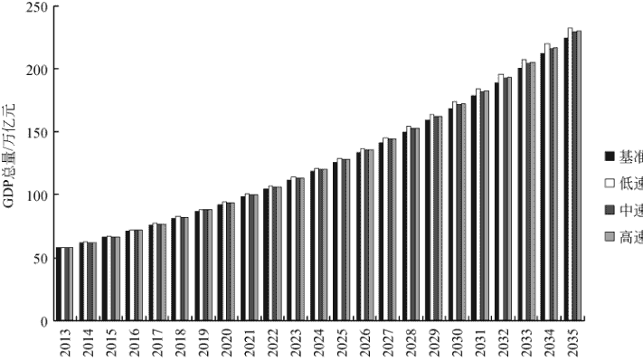

**GDP总量与增速图谱：德式低速持久领跑，激进路径反陷趋同**

模拟推演显示，在未引入替代弹性变量的基准框架内，三条机器人推进路径（德式低速、美式中速、韩式高速）在2030年前均显著跑赢对照组（见图6-1）。起步阶段增长率优势明显，领先幅度达0.2至0.3个点位。但步入2030年后，格局悄然生变：德式低速档增速企稳于6.0%，美韩两档却双双回落至5.9%，与基线重合（见图6-2）。值得玩味的是，德式路径增速衰减最为平缓、幅度最小，美韩两档下滑轨迹则高度重合。这打破了“机器普及越快、经济增量越大”的线性直觉——以德国为参照的“温和增速”方案，反而产出最稳健的宏观红利。

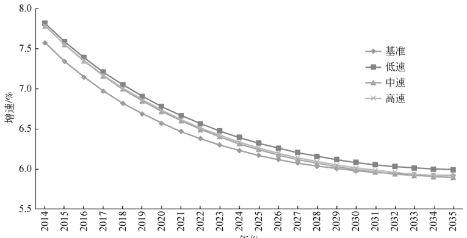

**三大产业分化图景：二产红利显性，三产承压隐性，一产波澜不惊**

剖析产业层面，自动化效应呈现显著的结构性分化。

*   **第一产业：旁观者与微弱挤出效应**  
    机器人主要深耕工业板块，对农业冲击微乎其微（参考图6-3、6-4）。对照组农业增加值反超实验组，至2035年累积差距约两千亿规模。增速端对照组持续领跑但优势收窄。实质上，工业扩张挤占部分要素投入，但总量稳健上行，边际负作用可忽略不计。

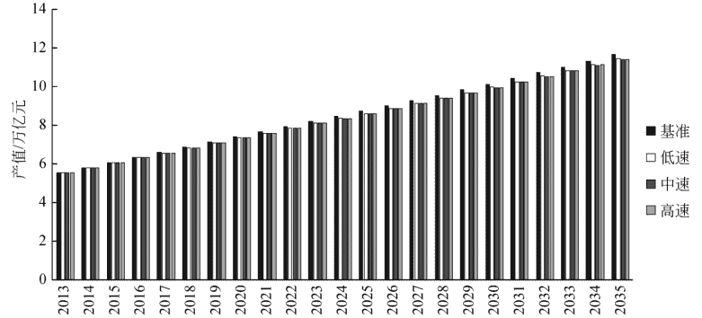

*   **第二产业：核心受益区，德式方案产出最高**  
    作为自动化主战场，工业板块全路径产出均超对照组，且剪刀差持续走阔（见图6-5）。至2035年，三路径产出较基线高出12.9%至15.2%（约11至13万亿量级）。增速峰值差现于2016年（近0.92个点位），此后收敛至0.2至0.4点位区间（见图6-6）。贯穿始终，德式低速档产出领跑、衰减最缓；美韩中高速路径表现紧贴，终值仅差0.02个点位。

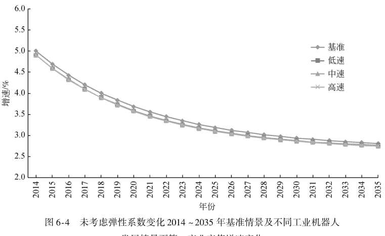
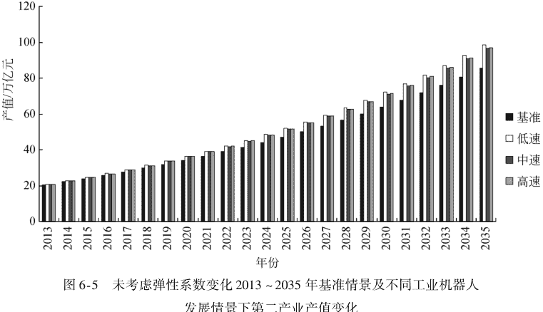

*   **第三产业：隐性替代效应下的小幅让利**  
    服务业罕见“逆势”：对照组产出全程领先，2035年优势扩大至4.7万亿以上（见图6-7）。主因在于机器替代岗位压缩消费群体，进而抑制服务需求。但这笔“损耗”不及工业“增量”十分之一，属可控边际成本。增速端对照组长期占优，最大差现于2021年（0.21点位），德式低速档抗跌性再居首（见图6-8）。

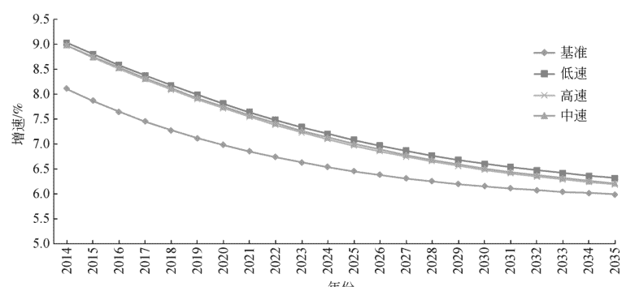

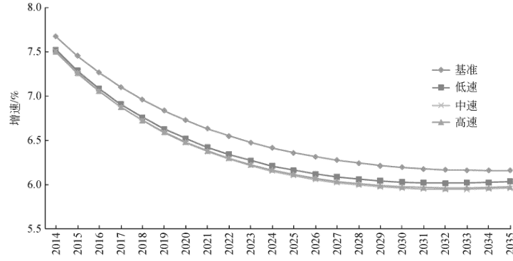

**制造业切片分析：破解“德式慢工”逆袭“韩式快跑”之谜**

制造业是工业增量的核心引擎。2035年，三路径制造业产出较基线多增7.45万亿起，足以覆盖农服两业缺口（见图6-9、6-10）。德式低速档增速峰值滞后一年现于2017年，但后劲最足。

细分领域层面（见图6-11），化工、食品烟草、非金属矿物、交通装备、电子通信、电气机械、通用/专用设备、钢铁、纺织、服装等12大门类构成基本盘。三路径对标基线的差异图谱揭示了结构性密码：

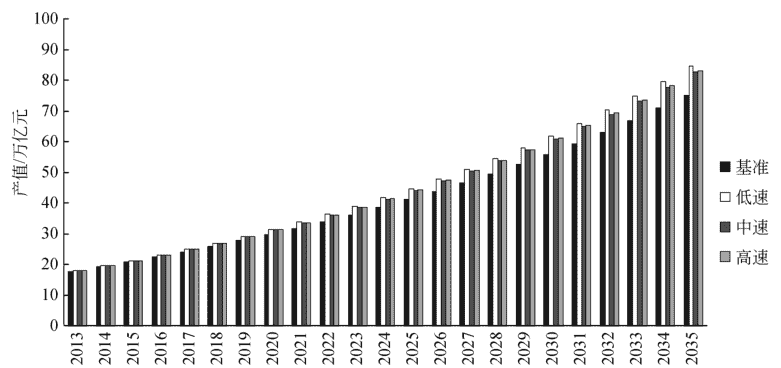
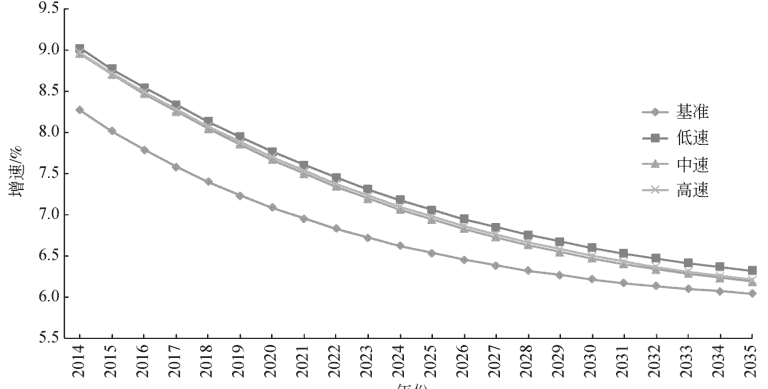

| 对比维度 | 核心发现 | 背后逻辑 |
| :--- | :--- | :--- |
| **德式低速vs基线** (图6-12) | **炼化石油、精密仪表等传统门类增量突出**；交通装备、电子通信、金属制品等优势赛道增幅平平。 | 德制造版图全谱系、高人力成本倒逼机器全渗透（含传统门类）；我国机器人现聚焦装备/电子等强项，传统改造欠账大。**补短板（传统自动化）边际报酬最高。** |
| **美式中速vs基线** (图6-13) | 传统门类受惠相仿；但**交通装备、电子通信转为负向拖累**。 | 美制造空心化（二产占比不足两成），装备迭代缓、电子制造外包东南亚。照搬美式路径，反而减缓我国强项领域的机器投入节奏。 |
| **韩式高速vs基线** (图6-14) | 正向受惠面广；装备/电子负向拖累**弱于中速档**；纺织等劳密型表现**逊于中速档**。 | 韩全要素驱动、资本技术双密集领跑，但劳力总量制约、主动退出纺织等劳密赛道。高速虽猛，却与我国全链条禀赋错位。 |

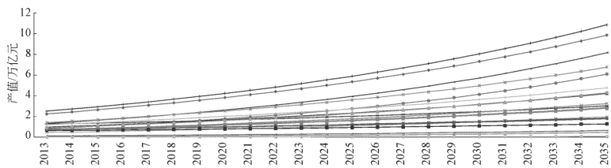
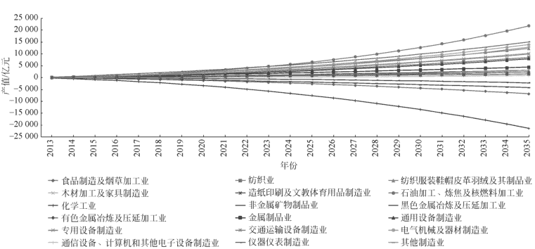
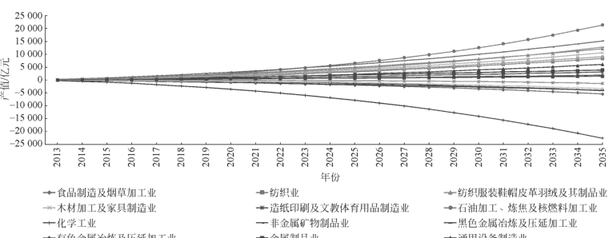
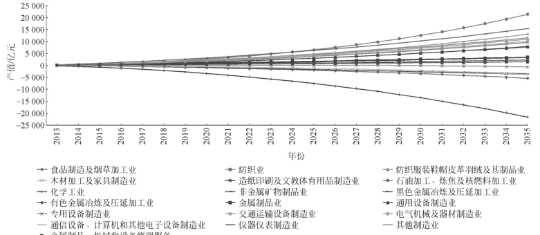

**情景交叉验证：德式模式“全域开花”，韩式路径“两极分化”**

两两交叉复核（见图6-15至6-17）佐证：德式低速档在绝大多数子行业碾压美韩两档，印证其全链条覆盖模式与我国工业体系高度适配。韩式高速档仅在电气机械、通用/专用设备、化工等资本技术双密集细分领域反超中速，却在纺织等劳密赛道掉队——这正是韩美产业结构差异在模型中的投射。

> **阶段性推论：** 固定替代弹性下，“广覆盖、重传统、稳节奏”（德式低速）优于“重优势、轻传统、快节奏”（韩式高速）或“去工业化参照系”（美式中速）。中国当下最缺的不是头部赛道的加速，而是长尾传统行业的机器人化补课。

---

### 6.4 引入动态弹性：范式迁跃——高速路径反超夺魁

当允许通用装备、专用装备、交通装备、电气机械、电子信息**五大核心装备门类**的资本-劳动替代弹性随技术迭代动态调整（即机器更易替代人工），模拟图景发生质变：

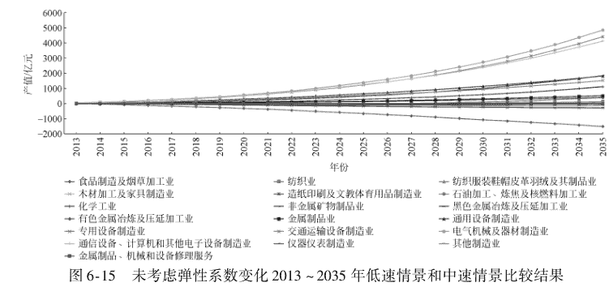
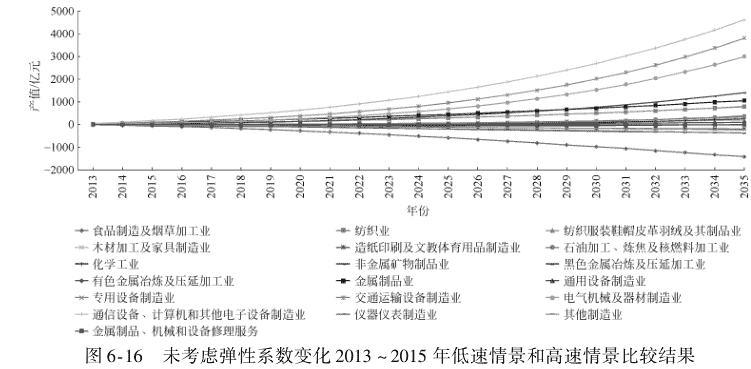
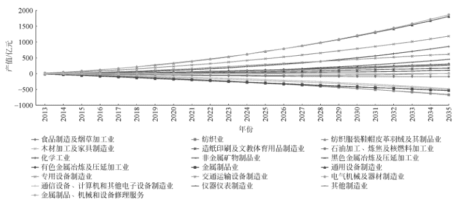

**GDP总量榜单重排：韩式高速>德式低速>美式中速**

图6-18揭示：三路径GDP较基线全面大幅跃升，剪刀差随时间指数级扩张。终期基线GDP 224.66万亿，三路径分别达 **279.25万亿（高速）、264.12万亿（低速）、252.97万亿（中速）**。高速路径超额增量高达54.59万亿，较固定弹性下优势再扩容超20万亿。

**关键洞见：**  
替代弹性上调，意味着机器边际替代人力能力显著增强。此时，**“投放强度”（高速）**的杠杆效应被放大，覆盖面广度（低速）的相对优势被稀释。韩式高密度、高替代率路径，在技术条件成熟的关键装备门类释放了最大红利。

> **终局启示：** 短周期看结构适配度（德式低速胜）；长周期看技术替代率（韩式高速胜）。**中国策当为：以“德式广度”夯实当下全链条普及，以“韩式强度”锁定核心装备门类的深度替代突围。**

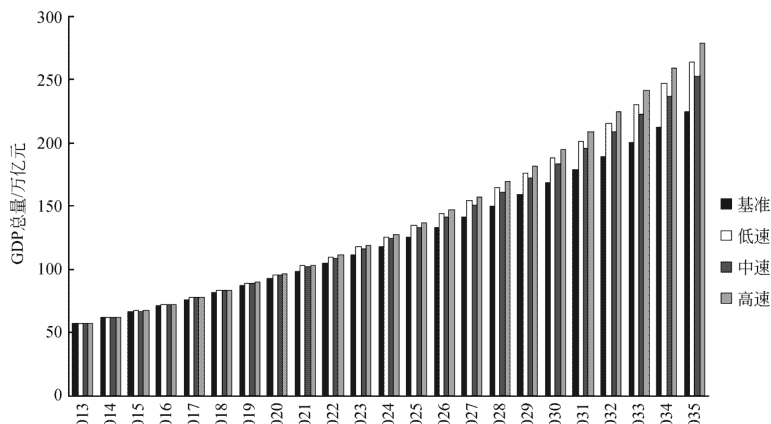

#### 经济增速推演：三条机器人路径均跑赢基准

模拟推演显示，引入三种强化产业机器人部署的设定后，经济增速表现全面优于参照基线，且优势随时间推移持续扩大。其中，以韩国为参照的激进路径在2014-2022年回落后，于2023-2025年拐头向上；以德国为参照的保守路径在下行至一定阶段后趋稳回升。三路径与基线的增速剪刀差均呈扩大趋势。至2035年，基线增速约5.9%，保守、均衡、激进三路径分别达7.0%、6.7%、7.6%，领先幅度在0.8至1.7个点之间。

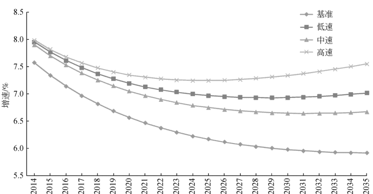

图 6-19 考虑弹性系数变化 2014 ~ 2035 年基准情景及不同工业机器人发展情景下各年 GDP 增速变化

由全周期每年的总量与增速推演结果看，在调整所选五大行业产出弹性参数的前提下，三路径均对经济形成显著正向拉动，且幅度更为可观。以韩国为蓝本的激进路径促进效果最强，其次是德国模式的保守路径，美国模式的均衡路径居第三。这表明：结合我国经产发展实情，韩国式高速高弹性组合边际报酬最优。为探究深因，有必要剖析机器人对各产业产出的具体影响。

##### 6.4.1.2 弹性系数调整下：三大产业版图如何重塑？

本节聚焦制造业内部因自动化设备扩张引发的连锁反应，预判工业板块将首当其冲、受益最深。以下逐一拆解三路径下，三次产业在产出总量与增长率上的分化轨迹。

###### (1) 第一产业：边际冲击可控，基本盘稳固

推演数据揭示，无论哪种部署路径，对农业等首位产业均构成轻微“挤出效应”。从绝对规模看，基线始终领跑，优势随时间微幅扩大，但幅度极其有限。至2035年，基线规模锁定11.64万亿，三路径分别为11.60、11.54、11.41万亿，差距仅400亿至2300亿区间。增长率维度上，所有路径均呈下行趋势，基线虽起步稍快，但末期保守与均衡路径反超，激进路径相对靠后（见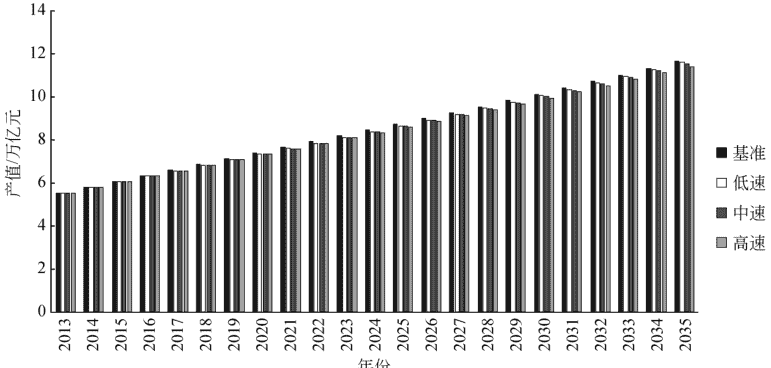、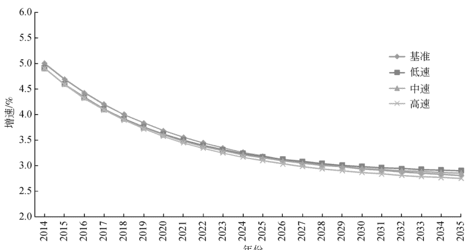）。


图 6-20 考虑弹性系数变化 2013 ~ 2035 年基准情景及不同工业机器人发展情景下第一产业产值变化


图 6-21 考虑弹性系数变化 2014 ~ 2035 年基准情景及不同工业机器人发展情景下第一产业产值增速变化

根源在于：自动化设备核心场景集中于工业制造而非农业。工业板块高速扩张必然争夺有限资源投入，致使首位产业相对收缩。不过，鉴于各路径下首位产业总量均保持稳健增长，这种“被挤出”幅度完全在可接受范围，不改大局。

###### (2) 第二产业：核心受益区，激进路径优势压倒性

作为机器人主战场，工业板块在弹性参数调整后，展现出惊人增长弹性。三路径均显著跑赢基线，且随渗透率提升，产出剪刀差持续张大。2035年基线规模85.55万亿，三路径分别跃升至120.74、113.02、132.20万亿，增幅高达32.1%至54.5%（详见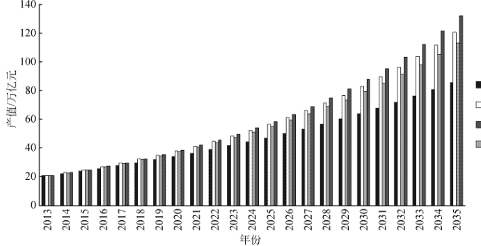）。排名次序与经济总量一致：韩国模式断层领先，德国模式次之，美国模式垫底，峰值年份差距一度达20万亿。


图 6-22 考虑弹性系数变化 2013 ~ 2035 年基准情景及不同工业机器人发展情景下第二产业产值变化

增长率曲线（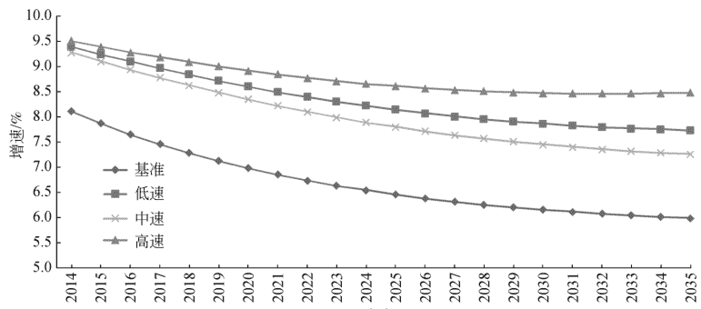）印证了这一判断：三路径增速全程高于基线，且分化加剧。激进路径与基线的增速差从1.4个点扩至2.5个点，且降速趋势明显缓冲，末期甚至出现回升拐点；均衡与保守路径虽跑赢基线，但增速持续回落，均衡降幅最陡。


图 6-23 考虑弹性系数变化 2014 ~ 2035 年基准情景及不同工业机器人发展情景下第二产业产值增速变化

###### (3) 第三产业：时滞效应显现，保守均衡路径后发制人

服务业图景更为复杂。前期（2025年前）基线占优，但拐点在2025年后悄然到来：保守、均衡路径分别于2029年、2033年反超基线，唯有激进路径始终未能追上（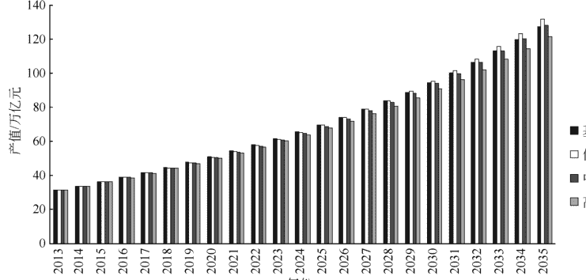）。增长率层面，基线与激进持续下行，而保守、均衡在2025-2026年触底反弹，由降转升，正是这一“V型反转”推动了绝对量的超越（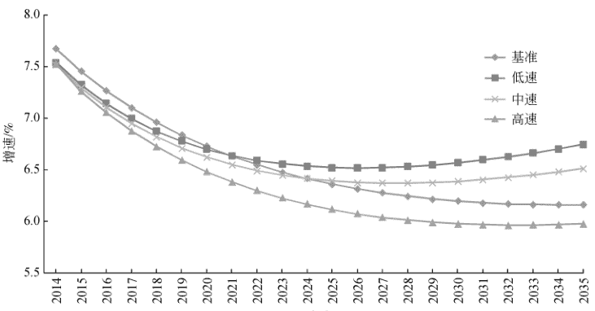）。


图 6-24 考虑弹性系数变化 2013 ~ 2035 年基准情景及不同工业机器人发展情景下第三产业产值变化


图 6-25 考虑弹性系数变化 2014 ~ 2035 年基准情景及不同工业机器人发展情景下第三产业产值增速变化

**阶段小结**：弹性参数变动放大了机器人的正向拉动，主阵地锁定在工业板块，其中韩国模式效能最高；首位产业受负向冲击微乎其微；服务业则呈现“保守均衡后发制人、激进长期承压”的差异化特征。机器人高度聚焦制造业，要洞察深层机理，必须下沉到细分行业层面。

---

### 6.4.2 弹性系数变动下：制造业细分赛道“赢家图谱”

#### 6.4.2.1 制造业总产值：激进路径拉开身位

制造业是工业板块的核心载体。2035年基线规模75.22万亿，三大路径分别达105.25、98.07、116.13万亿，均衡超额22.85万亿，激进超额40.91万亿（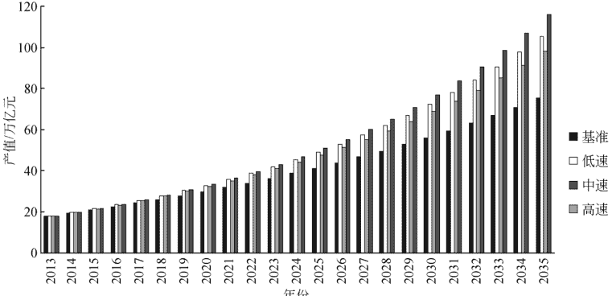）。韩国高速模式在制造业层面的统治力依然最强。增长率端（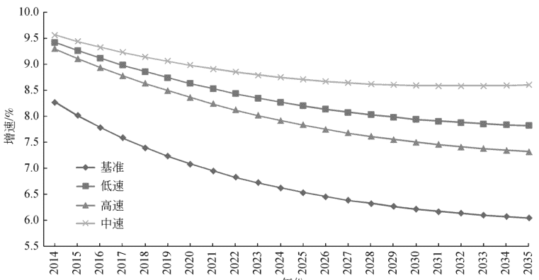），三路径均高于基线，激进路径降速最缓、最终趋于水平并微翘，保守与均衡虽次之但始终保持1.3个点以上的增速溢价。


图 6-26 考虑弹性系数变化 2013 ~ 2035 年基准情景及不同工业机器人发展情景下制造业产值变化


图 6-27 考虑弹性系数变化 2014 ~ 2035 年基准情景及不同工业机器人发展情景下制造业产值增速变化

这提示我们：若中国能同步复刻三国在关键行业的“机器人增量+资本效率”双提升路径，尤其是韩国式的高弹性高增速组合，制造业升级将释放巨大红利。接下来，我们拆解到具体行业，看谁是最大赢家。

#### 6.4.2.2 细分行业深度对标：五大重点板块领跑，覆盖面与爆发力的博弈

基线下，化工、食品烟草、非金属矿物、交通装备、石油炼焦、电子通信、电气机械、通用/专用装备、钢铁、纺织、纺织服装等12大行业构成制造业基本盘（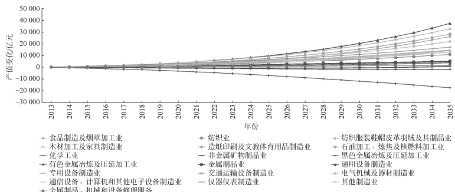数据源）。我们将三路径逐一与基线对标，再横向互比。


图 6-28 考虑弹性系数变化 2013 ~ 2035 年基准情景下制造业细分行业产值排序

**① 保守路径（德国模式）PK 基线：广覆盖、稳提升**
差值图（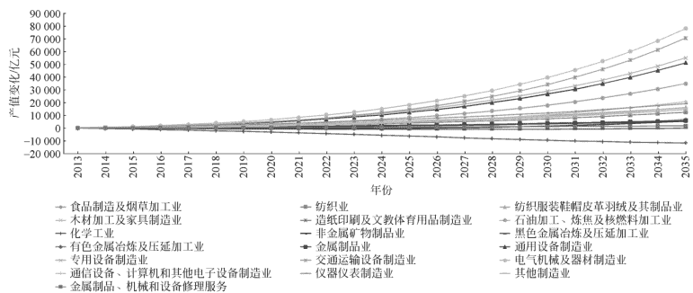）显示，电气机械、专用装备、通用装备、交通装备、石油炼焦、电子通信等行业增幅显著，且近乎全行业飘红。德国模式特点是机器人应用覆盖面广，虽单行业爆发力不及韩国，但胜在全面开花。


图 6-29 考虑弹性系数变化 2013 ~ 2035 年低速情景同基准情景比较结果

**② 均衡路径（美国模式）PK 基线：增幅收窄，电子通信相对滞后**
对比结果（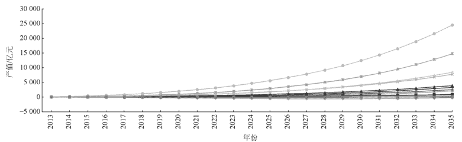）显示，核心受益名单相似，但量级明显缩水。电子通信设备制造业排名靠后，除个别行业外，多数产出虽高于基线，但优势不如保守路径明显。


图 6-30 考虑弹性系数变化 2013 ~ 2035 年中速情景同基准情景比较结果

**③ 激进路径（韩国模式）PK 基线：聚焦爆发，资本效率红利最大**
差值图（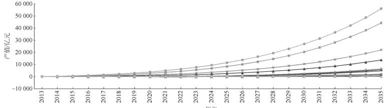）极具冲击力：电气机械、交通装备、专用装备、通用装备、石油炼焦五大板块领跑，且前四名正是调整了弹性参数的重点行业。这直接证明：在现有产业结构下，提高资本投入产出弹性（投资效率），配合机器人高速投入，能精准引爆核心赛道。


图 6-31 考虑弹性系数变化 2013 ~ 2035 年高速情景同基准情景比较结果

**④ 路径间横向博弈：德国“广”、韩国“深”、美国“弱”**
以均衡路径为基线，保守路径（）胜在覆盖面广，更多细分板块跑赢均衡；激进路径（）胜在突破口深，核心板块超越幅度巨大但覆盖面较窄。


图 6-32 考虑弹性系数变化 2013 ~ 2035 年低速情景和中速情景比较结果


图 6-33 考虑弹性系数变化 2013 ~ 2035 年高速情景和中速情景比较结果

这揭示了两国制造业范式的本质差异：德国体系均衡全面，机器人渗透广泛，适合全产业链升级；韩国体系高度聚焦，在电气机械、交通装备、专用装备等优势赛道集中发力，通过加大资本投入强度、极致提升资本效率，实现点状突破带动整体。中国借鉴时，需结合自身产业禀赋，在“广度”与“深度”之间寻找平衡点。

---

### 6.5 六大情景总对决：弹性系数是“隐形放大器”

#### 6.5.1 GDP维度：引入弹性系数的路径全维度碾压

汇总六路径（含/不含弹性参数变动 × 三速度）对比（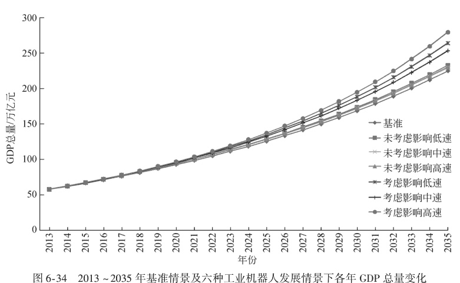），结论极其清晰：**引入弹性参数变动的三组路径，对经济总量的拉动效果全面碾压未引入的三组路径**。2035年，考虑弹性的激进路径较基线多创造约54.6万亿。这意味着：若中国在推广机器人的同步，能通过制度创新、技术迭代、管理升级等手段，将关键行业的资本弹性参数提升至德美韩水平，资金使用效率将质变，经济总量将跃上新台阶。其中，韩国“高增速+高弹性”组合在当前中国产业结构下，边际报酬最高。


图 6-34 2013 ~ 2035 年基准情景及六个工业机器人发展情景下 GDP 总量变化

#### 6.5.2 制造业细分场：弹性系数拉大路径间“贫富差距”

##### 6.5.2.1 制造业总产值：弹性系数拉开梯队

未考虑弹性时，三路径产出挤在一起，差异微小；一旦引入弹性，三路径瞬间拉开梯队，激进路径遥遥领先，2035年比未考虑弹性的激进路径高出约33万亿。同增速下，唯一变量是资本弹性——**提高资金效率，比单纯堆砌机器人数量更关键。**


图 6-35 2013 ~ 2035 年基准情景及六个工业机器人发展情景下制造业产值变化

##### 6.5.2.2 五大重点行业深剖：差异在此最剧烈

在设定产出弹性参数变化时，测算了三参照国通用装备、专用装备、交通装备、电气机械、电子通信五大行业的要素弹性。推演表明，这几个板块的差异极其显著。

###### (1) 通用设备制造业

未考虑弹性时三路径齐头并进；考虑后，激进路径2035年产出冲至9.4万亿，甩开保守1万亿、均衡1.4万亿。


图 6-36 2013 ~ 2035 年基准情景及六个工业机器人发展情景下通用设备制造业产值变化

###### (2) 专用设备制造业

体量稍小但弹性更强。激进路径2035年达8.8万亿，分别超越保守1.4万亿、均衡2.2万亿，差距进一步放大。


图 6-37 2013 ~ 2035 年基准情景及六个工业机器人发展情景下专用设备制造业产值变化

###### (3) 交通运输设备制造业

机器人密度全制造业第一的“硬骨头”。考虑弹性的激进路径产出13.8万亿，比保守多3万亿、比均衡多4.4万亿；甚至比未考虑弹性的激进路径高出7.1万亿（**翻倍级跃升**）。即便考虑弹性下的均衡路径（9.4万亿），也反超未考虑弹性下的保守路径（7.1万亿）。

###### (4) 电气机械及器材制造业

韩国优势赛道，资本效率极高。未考虑弹性时，激进已比保守多3.2万亿、比均衡多5.6万亿；考虑弹性后，激进路径更是比未考虑弹性的保守/均衡/激进三路径分别高出6.4/6.9/6.7万亿，**资本弹性释放的能量远超单纯的机器人增量。**

**终局启示**：产业机器人对经济的促进程度，与产业结构深度绑定。**“机器人数量增长”只是分子，“资本投入产出弹性提升”才是分母。** 中国若想复制最优路径，核心不在买多少台设备，而在于能否在通用/专用装备、交通装备、电气机械、电子通信五大战略赛道，同步实现韩国级别的资本效率跃迁。这才是决定制造业乃至国民经济能否实现“弯道超车”的关键变量。

# 核心洞见：工业机器人如何重塑中国制造业版图？


## 通信电子行业：高自动化下的“反直觉”现象

在制造业版图中，通信设备、计算机及电子设备制造业堪称“自动化标杆”，其资本投入产出效率极高。正因为此，该行业对“弹性系数”变化的敏感度远低于其他行业。模拟数据揭示了一个有趣的现象：引入弹性系数变化后，**低速发展情景的产值表现反超高速情景**，到2035年将领先约2000亿元。这提示我们：在已高度自动化的领域，盲目追求机器人密度增长反而可能边际效用递减，稳健推进更具优势。

---

## 第六章总结：CGE模型解码三大情景下的经济博弈

本章基于CGE（可计算一般均衡）模型，以德、美、韩三国为参照系，设定低、中、高三速情景，从微观行业均衡推演宏观经济图景。核心看点在于“弹性系数是否变化”这把关键开关，它彻底反转了结论的排序逻辑。

### 一、 关闭“弹性系数”开关：低速情景成“全能冠军”

当沿用中国现有的资本-劳动替代弹性系数时（即不考虑技术进步带来的生产函数结构性变化）：

*   **宏观GDP**：三大情景均超基准，**低速>高速>中速**。
*   **三次产业**：一、三产产值均低于基准；唯独二产（制造业核心）大幅超基准，排序同GDP。
*   **细分行业**：低速情景因机器人应用覆盖面最广，带动最多细分行业增值；高速情景下，汽车制造、通信电子等支柱产业产值甚至不及基准。

**深层逻辑**：低速情景模仿德国“全行业铺开、注重技工配合”的路径，在现有技术框架下，以“广度换深度”，配合高技能人才，实现了产出最大化。

### 二、 打开“弹性系数”开关：高速情景逆袭为“效率之王”

当五大核心装备制造业（通用/专用设备、汽车、电气机械、通信电子）采用德美韩更高的资本弹性系数（即资本产出效率大幅跃升）时：

*   **宏观GDP**：三情景增量暴涨，2035年高速情景增量达**54.59万亿**，低速39.46万亿，中速28.31万亿。**高速>低速>中速**。
*   **产业结构**：一产微负面，二产强受益，三产在低/中速情景下分别于2022、2025年反超基准。
*   **制造业内部**：高速情景全面碾压，核心优势集中在那五个“弹性系数变化行业”；低速情景虽总量次之，但胜在**普惠性强**，各行业增值分布更均衡。

### 三、 跨维度对比：揭示“中国式升级”的最优解

对比六大情景（3速度×2弹性状态）得出三大铁律：

1.  **效率红利碾一切**：引入弹性系数变化（技术进步/效率跃迁）的情景，无论GDP还是制造业产值，全维度碾压未引入的情景。
2.  **分行业施策是关键**：除通信电子行业外，**汽车、电气机械、通用/专用设备四大资本密集型行业，高速情景均为最优**；通信电子因本就高效，低速最优。
3.  **产业结构决定战略**：
    *   **无效率跃迁时**：学德国“低速广覆盖+技工协同”最稳。
    *   **有效率跃迁时**：学韩国“高速强投入+效率革命”收益最大。

> **核心启示**：中国制造业升级不能“一刀切”。**资本/技术密集型先进制造业**（汽车、电气、电子核心装备），宜借鉴**韩国高速模式**——大规模投入机器人+极致提升资本产出率，吃“双重红利”；**劳动密集型传统制造业**，宜借鉴**德国低速模式**——控制替代节奏，留出培训窗口期，深耕“人机协同”。

---

# 第七章 终极结论与“中国模式”政策图谱

## 7.1 五大核心结论：数据实锤的认知重塑

### 结论一：替代效应真实存在，且精准打击“低技能+劳动密集型”
基于2002-2017年实证回归，**几乎所有细分行业劳动力规模均显著负向相关**。受冲击最大的前五大行业，均为吸纳大量低技能劳动力的传统产业。按三国情景测算，至2030-2034年，高速情景下将有**超3850万**低技能劳动力被替代，即便低速情景也近1900万。

### 结论二：机器人是“低技能缺口填补神器”，更是“高技能就业引擎”
机器人密度与劳动力技能比（高/低技能比）显著正相关。模拟显示，高速情景下，机器人对低技能劳动力缺口的填补率将从88%攀升至**100%**（2030-2034）。这意味着：技术不单是“夺饭碗”，更是应对老龄化、释放人才红利的关键变量。

### 结论三：全球第一梯队画像清晰，德美韩三国各有“杀手锏”
动态多维评价（2010-2017）锁定日美德韩为领跑集团：
*   **日本**：制造+应用双强；
*   **美国**：技术创新+服务生态强；
*   **德国**：行业渗透深+核心零部件强；
*   **韩国**：应用增速快+制造业渗透率高。
本书最终选取**德、美、韩**作为中国情景构建的参照系。

### 结论四：经济增长总效应显著为正，“效率跃迁”下增量惊人
*   **常规路径**：2035年GDP增量峰值仅8万亿级（低速情景）。
*   **效率跃迁路径**：2035年GDP增量峰值冲至**54.59万亿级**（高速情景），制造业增量近47万亿。**资本产出效率的提升，贡献了超80%的增量红利。**

### 结论五：促进程度与产业结构深度绑定，“分类施策”非选项必选项
*   低速情景有效，因德国产业结构（制造业占比27%）与中国相似，且机器人覆盖行业广。
*   高速情景爆发，源于五大核心行业资本弹性系数跃升（技术密集型部门投资回报率飙升）。
*   **终局建议**：**先进制造业走“韩式高速”，传统制造业走“德式低速”，高端服务业引“美式创新”。**

---

## 7.2 政策建议：定制版“中国模式”三部曲

### 总基调：守住实体根基，把“人口红利”熬成“人才红利”
中国拥有全球最大规模优质劳动力池，年产千万级毕业生。智能化升级绝不能简单粗暴“机器换人”导致就业冲击，而要通过**分行业、分节奏、分路径**的精准操作，实现产出最大化与就业平稳过渡的双赢。

### “中国模式”三大拼图：

#### ① 先进制造业：复刻“韩国模式” —— **“强投入、提效率、吃双红利”**
*   **对象**：交通运输装备、电气机械、通信电子、通用/专用设备五大资本/技术密集型支柱行业。
*   **动作**：大规模导入工业机器人 + 极致推高资本产出效率（工艺革新、数字化赋能、供应链协同）。
*   **安置**：被替代低技能工人定向培训为**“工业机器人运维/服务”**等新服务业岗位，实现产业内循环消化。

#### ② 传统制造业：践行“德国模式” —— **“控节奏、重培训、促协同”**
*   **对象**：纺织、家具、食品等劳动密集型、就业弹性大的细分行业。
*   **动作**：适度导入机器人，**严控替代速度**，同步建立高标准技工培训体系（学徒制、校企双制），留足“人机协同”磨合期。
*   **核心**：技工技能提升是德式模式的灵魂，守住就业底线，稳住社会预期。

#### ③ 高端制造服务业：引入“美国模式” —— **“育生态、强创新、拓高端”**
*   **对象**：机器人核心算法、控制系统、工业设计、人机工效、系统集成等高知高薪领域。
*   **动作**：引导高技能人才（硕博、高级技师）流向**“研发设计-集成应用-增值服务”**全链条。
*   **价值**：不直接进产线，但为产线提供“最强大脑”和“最高增值环节”，复制美国“脱实向虚”中的高价值保留段。

---

### 结语

中国不缺机器人，缺的是**“懂产业结构、懂要素弹性、懂就业节奏”的顶层设计**。本书给出的“韩德美”三模式拼接图，不是简单的拼贴，而是基于CGE模型万亿级数据推演、结合中国禀赋定制的**最优解**。下一步，在于各地各部门能否跳出“机器人密度排名”单一KPI，转而拥抱**“分类分级、动态平衡”**的复杂理性——这才是智能经济时代，中国制造破局的真正密钥。

### 智能制造转型破局：以机器补短板、以人才筑高峰

面对人口结构转型引发的用工荒，部署工业机器人接管基础环节固然能缓燃眉之急，但治本之策在于构建高技能人才“蓄水池”。建议从三个维度发力：

**一、 激活“银发”剩余价值，延伸核心技术人才职业周期。** 资深专家退休时经验沉淀最深、掌握关键“诀窍”，且许多人身心条件允许、意愿强烈。放宽准入年龄，不仅能留住核心战力，更能搭建“传帮带”桥梁，将隐性知识显性化、标准化，助力青年才俊快速成才。

**二、 做实技能人才培育“长坡厚雪”，拓宽职业成长“立交桥”。** 实证表明，自动化浪潮深度重塑就业版图。为化解冲击、适配智能制造新范式，必须大规模培育高阶技术工人——此类岗位技术含量高、替代成本大，难被机器取代。引导一线从业者终身学习、技能跃迁，推动“人口规模红利”向“人才质量红利”质变。

**三、 打破体制机制“玻璃门”，重塑制造业对青年的“磁吸力”。** 当代青年学历普涨，制造业却因薪酬竞争力弱、用工机制僵、晋升通道窄、刻板印象重（“脏累苦、低回报、低门槛”）而难觅生力军。亟需推进企业用人与人事制度变革，同步优化待遇、设计多元职业路径，并引导舆论正名，让青年在工业一线收获成就感与荣誉感。

总而言之，需统筹国家战略之力：借鉴德日等强国经验、加速智能化改造，更要想方设法提升高技能人才占比，精准填补老龄化留下的技能窟窿，方能推动我国从“制造大国”向智能经济时代的“制造强国”跨越，赋予经济持续发展的内生动力。

---

### 7.3 研究局限与展望

#### (1) 研究局限

尽管完成了既定研究任务，但受客观条件制约，仍存短板，亦为后续探索指明方向：

*   **统计数据颗粒度偏粗，微观获取受阻。** 现行统计多依赖企业上报行业协会汇总，仅呈现总量，行业分项数据难觅；实地调研中企业对投入规模等敏感指标披露意愿低，制约了实证分析的精度与深度。
*   **机器人异质特性剖析尚浅。** 既有研究聚焦评价方法创新与宏观总量效应测算（统计建模、政策模拟），对不同类型、功能设备在细分场景下的差异化机制挖掘不足，亟待补强。

#### (2) 未来展望

工业机器人作为AI与实体经济融合的典型载体，应用前景广阔，相关研究将持续涌现。展望后续方向：

*   **扎根一线开展实地考察，发掘本土新范式。** 在量化结论基础上，深入考察人机交互实况：除“替代”与“互补”外，是否孕育中国特色新型协作关系？面对机器冲击，异质劳动群体采取何种应对策略？实证素材将为理论建构与政策精准供给双重赋能。
*   **多维度解析经济冲击传导路径。** 基于CGE模型的情景模拟揭示了产业结构的调节作用。未来应引入设备类型、功能属性、核心零部件产业链及专利创新等微观变量，构建多维动态框架，为制定梯度化扶持政策提供更坚实的理论支撑。

---

### 参考文献

毕先萍, 李正友. 2004. 技术进步对就业的综合作用机制及社会福利影响研究. 中国软科学, (5): 150-155.

蔡自兴, 郭潞. 2013. 中国工业机器人发展的若干问题. 机器人技术与应用, (3): 9-12.

曹静, 周亚林. 2018. 人工智能对经济的影响研究进展. 经济学动态, (1): 103-107.

曹希敬, 胡继佳. 2014. 熊彼特及其新熊彼特主义学派关于创新-经济周期研究的述评. 中国科技论坛, (11): 20-24.

昌盛. 2005. 科技进步对就业增长贡献的实证分析. 北京机械工业学院学报, 20 (1): 52-55.

陈功, 曹桂英, 刘玉博, 等. 2006. 北京市未来人口发展趋势预测——利用多状态模型对未来人口、人力资本和城市化水平的预测分析. 市场与人口分析, 12 (4): 29-41.

陈骞. 2016. 美国国家机器人计划资助重点. 上海信息化, (2): 78-80.

陈秋霖, 那些, 周军. 2018. 人口老龄化背景下人工智能的劳动力替代效应——基于跨国面板数据和中国省级面板数据的分析. 中国人口科学, (6): 30-42.

陈泽聪. 2011. 我国制造业技术进步的就业效应——基于 25 个行业的实证分析. 科技进步与对策, 28 (1): 20-24.

程承坪, 彭欢. 2018. 人工智能影响就业的机理及中国对策. 中国软科学, (10): 62-70.

程名望. 2007. 中国农村劳动力转移: 机理、动因与障碍. 上海: 上海交通大学博士学位论文.

大卫·李嘉图. 2013. 政治经济学及赋税原理. 周洁译. 北京: 联合出版社.

杜传忠, 许冰. 2017. 技术进步与产业结构升级的就业效应——2000—2014 年省级面板数据分析. 科技进步与对策, (13): 55-60.

段海英, 郭元元. 2018. 人工智能的就业效应述评. 经济体制改革, 210 (3): 187-193.

弗兰克·柯什纳. 2018. 德国人工智能技术发展现状和未来趋势. 高科技与产业化, (8): 29-31.

龚玉泉, 袁志刚. 2002. 中国经济增长与就业增长的非一致性及其形成机理. 经济学动态, (10): 35-39.

郭英楠, 段宗迪. 2018. 人工智能对社会就业的影响分析. 信息系统工程, 295 (7): 113-115.

郝一生. 1983. 技术进步、经济增长与就业问题. 世界经济, (9): 45-49.

胡红梅. 2015. 工业机器人: 中国市场需求猛增 本土生产企业亟待赶上. 中国战略新兴产业, (23): 64-66.

贾根良. 2013. 迎接第三次工业革命的关键在于发展模式的革命——我国光伏产业和机器人产业的案例研究与反思. 经济理论与经济管理, 33 (5): 13-22.

江瑞平. 1986. 技术进步对就业扩大影响的合力问题研究. 世界经济, (8): 48-52.

姜金秋, 杜青红. 2015. 分行业技术进步对就业的动态影响研究——基于中国 34 个工业行业 1980 ~ 2011 年的数据. 工业技术经济, (7): 113-121.

蒋辉. 2005. 我国人口预测分析. 科技管理研究, 25 (11): 142-145.

蒋南平, 邹宇. 2018. 人工智能与中国劳动力供给侧结构性改革. 四川大学学报（哲学社会科学版）, (1): 130-138.

蒋新松. 1981. 人工智能及智能控制系统概述. 自动化学报, 7 (2): 148-156.

瞿群臻. 2004. 政府、企业和家庭个人在人力资本投资中的地位及作用. 企业经济, (4): 154-155.

李钢, 廖建樟, 向奕宽. 2011. 中国产业升级的方向与路径——中国第二产业占 GDP 的比例过高了吗. 中国工业经济, (10): 16-26.

李红松. 2010. 资本-劳动替代的技术特征及其对扩大就业的启示. 武汉科技大学学报（社会科学版）, 12 (1): 72-75.

李祥瑞, 王淑敏, 李琪. 2019. 中国工业机器人发展现状及领先企业专利布局分析. 中国发明与专利, (2): 59-62.

梁一新, 刘凯. 2013. 促进我国工业机器人产业化的战略思考. 产业经济, (6): 28-32.

刘捷学. 2009. 新时期, 地方龙头产业之选择——关于深圳发展机器人产业的几点建议. 人民论坛, (7): 30-31.

刘雅娇, 胡静波. 2018. 产业集聚、市场竞争性与劳动生产率——基于高技术产业面板数据的实证分析. 产经评论, (1): 40-48.

刘玉海, 张默涵. 2017. 贸易技术含量、偏向型技术进步与中国就业结构. 国际贸易问题, (7): 74-84.

刘伟. 2016. 关于人工智能若干重要问题的思考. 人民论坛·学术前沿, (7): 6-11.

柳青, 刘宇, 徐晋涛. 2016. 汽车尾气排放标准提高的经济影响与减排效果——基于可计算一般均衡（CGE）模型的分析. 北京大学学报（自然科学版）, 52 (3): 515-527.

吕荣杰, 郝力晓. 2018. 人工智能等技术对劳动力市场的影响效应研究. 工业技术经济, 37 (12): 133-139.

吕小柏, 李红松. 2010. 资本替代劳动与产业特征的关联机理及测度分析. 经济经纬, (2): 25-28.

马岚. 2015. 中国会出现机器人对人工的规模替代吗？——基于日韩经验的实证研究. 世界经济研究, (10): 71-79.

倪苹. 2013. 城镇化质量评价指标体系的构建与实证分析. 杭州: 浙江工商大学硕士学位论文.

庞丽华, 王海涛, 刘玉博. 2006. 等. 上海市未来人口和人力资本的变化趋势分析. 人口与发展, 12 (6): 1-11.

裴科峰. 2014. 产业结构升级与失业的研究. 南京: 南京大学硕士学位论文.

乔晓楠, 都艳萍. 2018. 人工智能与现代化经济体系建设. 经济纵横, (6): 81-91.

乔岩. 2012-09-03. 恋上机器人: 制造业自动化的未来. 中国计算机报, 第 2 版.

清华大学中国科技政策研究中心. 2018. 《中国人工智能发展报告 2018》. 北京: 清华大学中国科技政策研究中心.

曲道奎. 2013. 基于机器人的新一代制造模式. 现代制造, (45): 56-57.

任东伟. 2017. 技术进步对我国技能就业结构的影响研究. 北京: 北京交通大学硕士学位论文.

任强, 侯大道. 2011. 人口预测的随机方法: 基于 Leslie 矩阵和 ARMA 模型. 人口研究, 35 (2): 28-42.

沈于, 朱少非. 2014. 刘易斯拐点、劳动力供求与产业结构升级. 财经问题研究, (1): 42-47.

苏剑, 陈阳. 2018. 技术进步减少了劳动力需求吗? 开放导报, 198 (3): 30-34.

孙翊, 胡敏, 王铮. 2015. 中国房地产行业的产业关联度的测算. 统计与决策, (4): 41-45.

陶桂兵. 2011. 富士康以机器替代人是逆时代而动. IT 时代周刊, (17): 14.

王君, 杨威. 2017. 人工智能等技术对就业影响的历史分析和前沿进展. 经济研究参考, (27): 11-25.

王君, 张于喆, 张义博, 等. 2017a. 人工智能等新技术进步影响就业的机理与对策. 宏观经济研究, (10): 171-183.

王君, 张于喆, 张义博, 等. 2017b. 应对人工智能对就业影响的对策与建议. 中国经贸导刊, (24): 53-56.

巫强. 2013. 资本深化、技术进步与雇佣规模调整. 中国人口 · 资源与环境, 154 (6): 162-170.

徐程瑾. 2015. 未来中国的人口分布格局估计. 上海: 华东师范大学硕士学位论文.

徐云福. 2017. 美日人口结构和失业率与机器人产业发展对比分析——劳动力就业和机器人产业发展并不矛盾. 科技促进发展, (3): 195-199.

薛在兴. 2018. 人工智能对大学生就业的影响. 中国青年社会科学, (4): 6-10.

亚当斯密. 2009. 国富论. 郭大力, 王亚南译. 北京: 商务印书馆.

杨蕙馨, 李春梅. 2013. 中国信息产业技术进步对劳动力就业及工资差距的影响. 中国工业经济, (1): 51-63.

杨婕, 姚财福. 2017. 人工智能各国战略解读: 欧盟人脑计划. 电信网技术, (2): 50-51.

杨婕. 2017. 全球人工智能发展的趋势及挑战. 世界电信, (2): 17-21.

杨伟国, 邱子童, 吴清军. 2018. 人工智能应用的就业效应研究综述. 中国人口科学, (5): 109-119.

姚战琪, 夏杰长. 2005. 资本深化、技术进步对中国就业效应的经验分析. 世界经济, (1): 58-67.

叶仁荪, 王光栋, 王雷. 2008. 技术进步的就业效应与技术进步路线的选择——基于 1990 ~ 2005 年中国省际面板数据的分析. 数量经济技术经济研究, (3): 137-147.

俞贺楠. 2014. 产业转型升级对我国农村转移劳动力就业的影响及对策研究. 兰州学刊, (5): 170-174.

段天一. 2017. 人工智能正处在由概念到产品的飞跃期. 中国战略新兴产业, (43): 24-26.

袁富华, 李义学. 2009. 中国制造业资本深化和就业调整——基于利润最大化假设的分析. 经济学（季刊）, 8 (1): 197-210.

云霞. 2017. “机器换人”对就业结构的影响. 中国国情国力, (3): 57-60.

战梦霞. 2007. 技术创新的就业效应. 北京: 中共中央党校博士学位论文.

张红霞. 2012. 技术进步的就业效应研究. 天津: 天津大学博士学位论文.

张鹏飞. 2018. 人工智能与就业研究新进展. 经济学家, (8): 27-33.

张于喆. 2019. 人工智能、机器人的就业效应及对策建议. 科学管理研究, (1): 43-45.

张宇. 2015. 国外工业机器人发展历史回顾. 机器人产业, (3): 68-82.

赵鸿宇. 2012. 我国劳动密集型制造业“刘易斯转折点”实证分析. 沈阳: 辽宁大学硕士学位论文.

赵利, 卢洁. 2016. 产业结构调整影响劳动就业的理论演变及作用机理分析. 理论学刊, (3): 54-59.

赵利. 2010. 技术进步对劳动就业的影响研究. 北京: 中国财政经济出版社.

甄子健, 刘进长. 2016. 日本最新机器人研发计划及其发展战略. 机器人技术与应用, (5): 14-19.

钟岩, 马永莉. 2005. 企业资本扩张与就业机会——青岛制造业资本替代劳动力的实证分析. 社会科学, (11): 21-26.

周文斌. 2017. 机器人应用对人力资源管理的影响研究. 南京大学学报（哲学·人文科学·社会科学）, (6): 25-36, 156-157.

朱翠华. 2012. 技术进步就业效应及其影响因素分析. 天津: 南开大学博士学位论文.

朱巧玲, 李敏. 2018. 人工智能、技术进步与劳动力结构优化对策研究. 科技进步与对策, (6): 36-41.

朱一青, 朱耿, 朱占峰, 等. 2018. 人工智能发展对就业问题的影响及应对策略. 管理观察, 702 (31): 100-103.

Acemoglu D, Autor D. 2011. Chapter 12: Skills, tasks and technologies: implications for employment and earnings//Ashenfelter O, Card D. Handbook of Labor Economics Volume 4B. Elsevier: 1043-1171.

Acemoglu D, Dell M. 2009. Beyond neoclassical growth: technology, human capital, institutions and within-country differences. American Economic Journal: Macroeconomics, 2: 169-188.

Acemoglu D, Restrepo P. 2017. Robots and jobs: evidence from US labor markets. National Bureau of Economic Research Working Paper No. 23285. Doi: 10.3386/w23285.

Acemoglu D, Restrepo P. 2018. The race between man and machine: implications of technology for growth, factor shares, and employment. American Economic Review, 108(6): 1488-1542.

Acemoglu D. 2002. Technical change, inequality, and the labor market. Journal of Economic Literature, 40 (1): 7-72.

Aghion P, Howitt P. 1994. Growth and unemployment. The Review of Economic Studies, 61 (3): 477-494.

Aghion P, Saint-Paul G. 1998. Virtues of bad times interaction between productivity growth and economic fluctuations. Macroeconomic Dynamics, 2 (3): 322-344.

Autor D H, Dorn D. 2013. The growth of low-skill service jobs and the polarization of the US labor market. American Economic Review, 103 (5): 1553-1597.

Autor D H, Levy F, Murnane R J. 2003. The skill content of recent technological change: an empirical exploration. The Quarterly Journal of Economics, 118 (4): 1279-1333.

# 核心文献速览：技术变革、劳动力市场与经济增长的学术版图

探究科技如何重塑就业与经济结构，绕不开这份跨越半个世纪的经典文献清单。我们将六十余篇奠基之作按研究脉络拆解为七大主题，助你快速构建知识骨架。

## 一、 自动化冲击与未来工作图景
聚焦机器替代人力的边界、任务框架重构及就业极化趋势。
*   **奠基性综述**：Autor (2013) 在《劳动力市场研究杂志》系统梳理“任务路径”范式；Autor (2015) 于《经济视角期刊》追溯自动化史，反问为何岗位未消失殆尽。
*   **颠覆性预测**：Frey & Osborne (2017) 在《技术预测与社会变迁》量化岗位易感性；Ford (2015) 著《机器崛起》警示无业未来；Brynjolfsson & McAfee (2014) 则在《第二次机器时代》勾勒技术红利图景。
*   **实证与微观机制**：Bessen (2016) 解析计算机自动化如何重塑职业技能需求；Greenblatt (2013) 从企业视角列举机器人创造就业的六大路径；Qureshi & Syed (2014) 以医疗服务业为例考察机器人对员工激励的影响；Susskind (2017) 在《明日的律师》中预演专业服务业的智能化转型。
*   **宏观模拟与行业报告**：Manyika 等 (2017) 麦肯锡全球报告测算自动化时代劳动力转型规模；Barton 等 (2017) 聚焦中国语境的AI影响；国际机器人联合会 (2019) 提供工业机器人部署硬数据。

## 二、 劳动力市场极化与任务分工深度解析
揭示“中空化”现象背后的技术逻辑与制度互动。
*   **极化证据链**：Goos & Manning (2007) 首证英国“卑微与美好”并存；Goos, Manning & Salomons (2009) 将结论推广至欧洲；Michaels, Natraj & Van Reenen (2014) 以十一国二十五年面板数据验证ICT对技能需求的极化效应。
*   **动态演进**：Goos, Konings & Vandeweyer (2015) 引入创新、本地乘数与制度因素解释欧洲就业增长差异；Dustmann, Ludsteck & Schönberg (2009) 复盘德国工资结构演变细节。

## 三、 技能偏向技术进步与人资本溢价机制
解码教育回报率上升、技能溢价扩大的深层驱动力。
*   **经典供需框架**：Katz & Murphy (1992) 以供需视角解析1963-1987相对工资变迁；Goldin & Katz (1998) 溯源技能互补性起源；Carneiro & Lee (2011) 修正质量偏差后追踪美1960-2000技能溢价趋势。
*   **结构转型视角**：Buera, Kaboski & Rogerson (2015) 提出技能偏向结构转换理论；Machin (1998) 证实英国工资不平等与教育回报的同步跃升。
*   **人资本存量与代际传递**：Mincer (1991) 以时间序列揭示技术-工资结构联动；Lutz & Goujon (2001)、KC & Lutz (2011)、KC 等 (2010)、KC & Lutz (2014) 系列构建全球教育达成度人口预测矩阵；Barro & Sala-i-Martin (1990) 考察美州层面增长收敛与人资本关联；Bils & Klenow (2000) 反思教育是否真致增长。

## 四、 经济增长核心模型与内生技术进步理论
从索洛剩余到内生创新，构建长期增长分析工具箱。
*   **基石模型**：Solow (1956, 1957) 奠定增长核算与技术进步测度基础；Sato (1964) 讨论边际报酬递减与线性齐次性张力。
*   **内生化突破**：Romer (1986) 引入规模报酬递增；Romer (1990) 将技术变革内生化为研发投入函数；Dixit & Stiglitz (1977) 以垄断竞争模型解释产品多样性最优。
*   **应用与延展**：Jones (1983) 结合需求侧分析技术-就业联动；Soete (1996) 从OECD视角关联技术、生产率与创造就业；Stoneman (1995) 编撰创新经济学手册综述；de La Grandville (1989) 探寻Slutsky钻石般的替代弹性奥秘。

## 五、 技术性失业、增长权衡与分配博弈
直面自动化可能引发的长期痛苦与政策两难。
*   **悲观与警示**：Sachs & Kotlikoff (2012) 警示智能机器导致长期福利损失；Hémous & Olsen (2016) 模型化自动化、水平创新与不平等三角关系。
*   **权衡实证**：Blanchard & Portugal (2001) 对比美葡失业率背后的流动差异；Cavelaars (2005) 追问生产率与就业增长的权衡是否消失；Eriksson (1997) 探讨就业与增长的悖论；Pissarides & McMaster (1990) 从区域迁移角度剖析工资-失业机制。
*   **理论重构**：Malinvaud (1997) 重释失业理论；Petit (1997) 整理技术-就业理论与实证脉络；Deaton & Nolan (1983) 在Bosworth编著中论技术进步下的失业本质；Del Rio (2001) 聚焦实物技术进步的失业效应；Hicks (1932) 早期确立边际生产力与变动原则。

## 六、 中国语境与转型经济体的特殊图景
本土化视角下的技术扩散、劳动力短缺与结构错位。
*   **宏观战略**：Barton 等 (2017) 麦肯锡深度报告《人工智能：对中国的启示》。
*   **劳动力谜题**：Knight, Deng & Li (2011) 解构农民工荒与农村剩余并存的悖论；Carnov (1997) 早期综述信息技术国际扩散对就业技能的冲击。

## 七、 交叉视野：人口、健康、叙事智能与历史演进
拓展边界的补充视角。
*   **人口与健康红利**：Pamuk, Fuchs & Lutz (2011) 对比教育与经济资源对发展中国家婴儿死亡率的相对效应。
*   **AI前世今生**：McCorduck (2004) 以回忆录体裁记录AI思想史；Finlayson, Richards & Winston (2010) 综述计算叙事模型研讨会成果。

---

> **阅读建议**：建议按“理论基石(四)→核心机制(二三)→前沿冲击(一)→分配后果(五)→区域实证(六七)”顺序攻读。文献跨度从1932年至2019年，涵盖《AER》、《QJE》、《JPE》等顶刊及麦肯锡、NBER等智库报告，堪称该领域“必读榜”标准版。

# 新书问世：在算法与流水线的交汇点，重读AI与就业的深层逻辑

历经数载打磨，这部聚焦中国制造业工业机器人的经济影响研究专著，终究还是与读者见面了。合上书稿的那一刻，回望来路，不仅是学术积淀的厚度，更是一段关于成长、感恩与时代共振的私人叙事。

**站在巨人的肩膀上，丈量技术变革的坐标**

这本书的理论骨架，源自对前人智慧的深度对话。从廷伯根早年对劳动力替代性的经典探训，到特雷汉剖析生产率冲击与失业率的动态关系；从维瓦雷利系统梳理技术经济学与就业的演进脉络，到世界银行《2016年世界发展报告》描绘的“数字红利”蓝图，再到杨春林、林仲诚基于台湾微观数据实证创新的就业效应——这些跨越时空的学术坐标，为本书构建了坚实的分析框架，让我们得以在宏大叙事中，精准定位中国制造业机器人化的独特图景。

**写作，是一场与时代同频共振的“追赶”**

动笔之初，人工智能与工业机器人尚在实验室与示范线徘徊；落笔时，它们已深度渗透进生产线的每一个神经末梢，重塑着就业结构与经济增长的底层逻辑。案例迭代之快、应用场景之深，远超预期。这种“写着写着，现实就变了”的紧迫感，既是焦虑，也是动力。它倒逼我必须不断更新认知工具箱，吸纳新方法、纳入新数据，试图在飞速流动的数字洪流中，抓住几个确定性的变量。这不仅是完成一项学术任务，更是一次跟上时代步伐的自我修行。

**致谢：所有的独行，终汇聚成星河**

学术之路从不孤独，因为有光照亮微尘。

首谢**汪秀阳教授**。恩师以渊博学识为引，以广阔视野为界，领我入学术殿堂，指引我锚定这一前沿课题。您治学严谨、待人热忱的姿态，早已内化为我科研底色中最宝贵的资产——对新知的敏锐，与攻坚克难的韧劲。

感谢**中国科学院大学经管学院**的乔晗、胡毅等诸位老师，博士求学岁月，蒙你们学术上严标准、生活上暖关怀，方得始终。

感谢**中科院科技战略咨询研究院刘昌新副研究员**在方法论层面的慷慨相助，为实证分析注入了关键支撑。

最深的柔软，留给家人。

父母与岳父岳母，你们构筑了我无后顾之忧的港湾，以身作则树立了人生的标杆，是我毕生追随的榜样。

而**王灏晨，我的爱人**，遇见你是最大的幸运。书稿定稿的每个通宵、每次卡壳的焦灼，都有你在身后托底。你的信任与陪伴，化作我穿越迷雾、坚持到底的底气。这本书，有你一半的名字。

谨以此书，献给所有曾伸出援手、投来目光、给予温暖的师长、同窗、挚友与家人。

—— 李舒心 于 2019 年秋

---

### 📚 书籍名片

**书名**：《人工智能的经济影响研究——以中国制造业工业机器人为例》  
**作者**：李舒心  
**出版社**：科学出版社  
**ISBN**：978-7-03-064208-0  
**定价**：118.00 元  
**分类**：管理科学 / 交叉科学  

*若你关心技术如何重塑劳动力市场，关心中国制造升级的真实图景，愿这本书能提供一把解码钥匙。*