# 智能世界的第一扇门

# 作者的话

亲爱的家长和孩子们，欢迎！

拿起这本书，就像握到一把通向智能世界的钥匙。接下来，让我们一同探访智能的奇妙与绚烂。

你有没有接触过智能？也许你没有觉察到。

刷短视频时，手机总能推送你感兴趣的内容，好像它能读心。实际上背后有智能在默默学习、推断你的偏好。它会分析你观看时长、点赞评论等行为来判断兴趣，然后投放相似视频。

父母开车时，你可能见过方向盘自行转动、车辆自己滑入车位。这同样是智能在作用，车载系统感知周边环境后接管了操作。

在家想听歌，只要唤一声音箱的名字，喜欢的曲目就响起。这是智能在帮忙，它能辨识人声、理解指令并执行。

简言之，智能早已渗入生活。

只是底层原理很复杂，入门常让人望而却步。愿这本书用轻松好玩易懂的方式帮你认识它。

即便将来不从事相关职业，你也处在全都被智能包围的时代。未来人与智能的关系大致有四种：**使用者、竞争者、制造者**和**监督者**。

这四种角色意味着什么？

**1. 使用者**

成为主动的使用者，让智能真正为自己所用。

小美养了一只猫叫小咪。每天上学最放不下就是小咪，担心它在家无聊。

放学路上，小美忍不住想看看小咪在做什么，便打开手机上的影像软件。

 **小咪独处时会不会啃沙发上的抱枕？还是在懒洋洋睡觉？让我用摄像头瞧瞧。**

盯着屏幕，小美发现画面里空空的，小咪不见了。

 **小主人，我跑到镜头外面啦！你只能看到我的爪印啦！**

 **哎呀，小咪不在镜头前，我看不到。它今天都做了什么，我要翻整天的录像。**

AI 摄像头带有图像分析功能，能在视频进度条上标出宠物出现的时间段。

视频进度条：

 **AI 摄像头太省事了！把进度条拖到标有猫咪的时段，就能看到小咪。**

 **喵，人家偷吃零食都让你发现了。**

▲（普通摄像头，人工找记录。本图由文心一格生成）

▲（AI 摄像头，自动定位宠物。本图由 DALL·E3 生成）

小朋友们，这个案例很有意思。如果你也想远程看家里的宠物，会怎么选？会用这些功能吗？

做个优秀的使用者需要两点：

·第一，**智能能帮我**。产生需求时能想到用智能技术来解决。
·第二，**智能我会用**。能掌握智能产品的使用技巧。

**2. 竞争者**

智能能完成许多任务，也不可避免地带来人机竞争。

比如：

·你正在读的这本书的插图，是 AI 画师和人类画师共同完成的，既有合作也有竞争。
·自动驾驶普及让部分网约车司机岗位受冲击，不少司机因此抗议。
·工厂里，以前由人手完成的工作越来越多被机器接管，用工需求大幅下降。

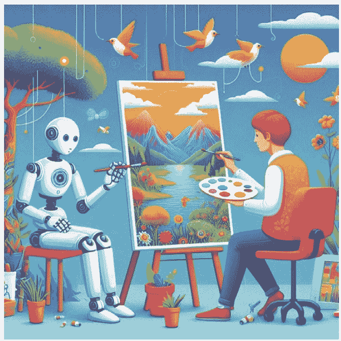
（DALL·E3 生成）

未来会被智能接手的工作会更多。那么——

将来你会选择怎样的专业和岗位，才不容易被智能替代？
现在该培养哪些能力与思维，才能不被智能淘汰？

本书会对比人与智能各自擅长的领域，比较两者思考方式的差异，培养你思维的深刻性、灵活性、批判性、独创性，让你在智能时代更具竞争力。

**3. 制造者**

随着智能发展，会出现大量相关新职业，你也可能参与智能产品的研发设计、生产制造、推广销售等环节。其中最有价值的是能解决实际问题、富于创意的环节。

举个例子，老龄化可能加剧，老人会越来越多。设想他们如何安享晚年？可以设计一些智能产品，比如：

·智能管家——帮老人购药做饭。
·智能按摩师——帮老人缓解疲劳促进血液循环。
·智能护工——帮行动不便的老人翻身洗头。

（DALL·E3 生成）

多留心生活中的需求，把智能基础原理用在日常，试着做出属于自己的智能产品雏形吧！

**4. 监督者**

智能应用会伤害人类吗？

当然，智能带来便利的同时也暗藏风险：

·**消耗时间：**短视频推荐算法精准把握喜好，常常让人停不下来，浪费大量时间。
·**真假难辨：**智能生成的图像越来越逼真，真假难分，眼见不一定为实。
·**削弱创造力：**智能写文章高效规范，若过度依赖，人类创造力可能僵化，内容趋同。

因此与智能互动时要保持警惕：

·**辨别信息：**别以为智能说的一定对。目前阶段，智能偶尔会煞有介事地胡说。
·**保持独立：**记住那是智能的观点，不是你的。与智能交流时，要提防它可能灌输特定观念，影响你的判断。

作为公民，我们有权要求不符合“智能安全标准”的产品整改，甚至下架关闭，以保障安全与权益。

（DALL·E3 生成）

读完本书后——

作为**使用者**，你学会判断哪些产品真正用了智能技术。
作为**竞争者**，你了解智能的强项，为未来职业选择提供参考。
作为**制造者**，你会跟随书中角色发挥想象，学习智能技术。
作为**监督者**，你会看到智能技术对社会可能带来的负面影响。

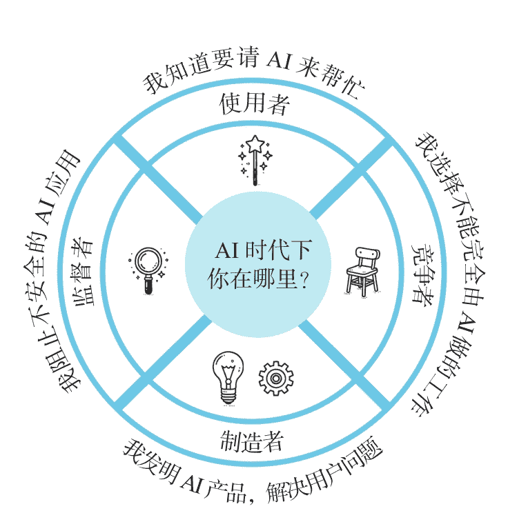

朋友们，智能技术会更深入地融入生活，变得更常见更智能。

在这个全新时代，智能新物种的诞生让我们有幸成为见证者，甚至你可能成为推动历史前进的创造者！

**哈莹**

# 阅读指南

**难度建议**

阅读时你会发现每节标题旁有两种不同图标，表示内容更适合的年龄段，小学生和中学生。

如果某些内容暂时看不懂也不必着急，也许在某个未来的日子里，你会忽然领悟。

▲小学生

▲中学生

**思维训练**

书中的练习不仅能帮助我们在阅读时输出巩固输入，还能有效训练观察力、分类力、抽象概括力、联想思维等多种能力。

完成练习时，不妨留意题目旁的提示，有意识地进行思维训练。

**制定计划**

读书像吃饭，既不能不吃，也不能贪多。阅读本书时不要一口气读完，试着定量阅读，为自己制定每日阅读计划。

可以先浏览目录，结合自身情况安排阅读量，例如每天读一节，或每天阅读20页。

【阅读计划】

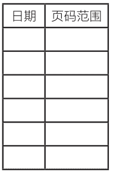
（以上阅读指南的灵感来自晨读会）

# 主要人物介绍

**美乐一家，带你探索AI**

小美和小乐是一家人。

有一天，他们惊讶地发现生活中早已悄悄混入了许多智能产品！

在智能机器人小智的带领下，他们将一起探索这些智能产品与技术，学会更好地使用智能，争取迈向智能开发者之路。

快加入他们，一起踏上智能的奇妙旅程吧！

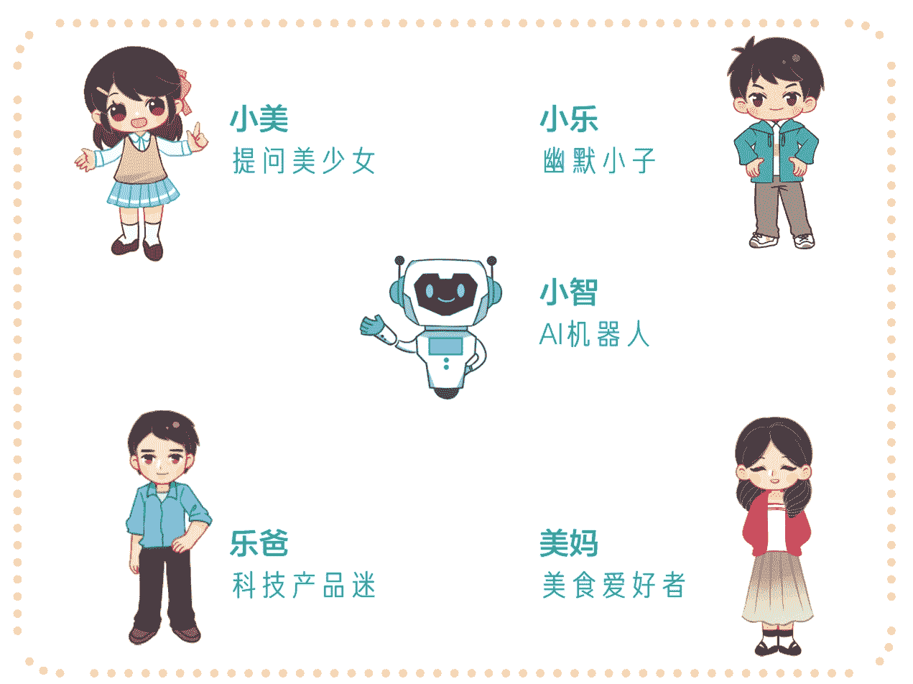
（“美乐一家”及相关角色形象由插画师“猫骨骨”特别设计）

# 特别鸣谢

♥感谢我的爱人支持，鼓励我完成本书创作。
♥感谢迪乐姆创新教育研究院提供研究的时间和空间。
♥感谢社会各界为智能教育提供学习资料。

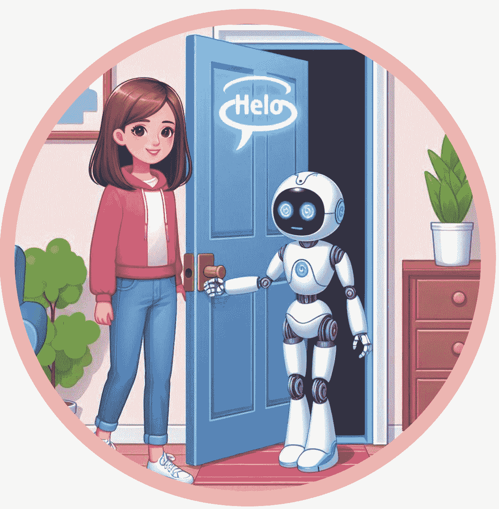
（DALL·E3 生成）

# 第一章

# 开门迎智能

## 你身边的智能

智能技术正在改变我们的生活，从智能语音助手到自动驾驶汽车，从智能家居到医疗诊断，其应用越来越广，也带来了诸多便利。

比如智能语音助手可以进行语音搜索、设定提醒、发送短信；自动驾驶汽车可以降低交通事故和拥堵；智能家居让我们更方便地操控家中设备。

不过，智能的发展也带来挑战和问题，如数据隐私与安全、人就业影响、道德与法律责任等。因此在推动发展的同时，也要认真思考并解决这些问题。

**（这段文字由人工智能大语言模型应用“文心一言”生成）**

各位读者，你能分辨现在读的内容是智能生成的还是人类创作的吗？

如果告诉你前面文字是智能生成的，你会有何反应？

惊讶：智能竟然如此强大，写的内容几乎和人类一模一样！

害怕：智能已经这么厉害，我会不会完全比不上它？

兴奋：那我的作文以后是不是也能让智能帮忙完成呢？

你的情绪是：____________________。

不过，智能可不能用来帮我们写作业！“智能内容检测器”可以判断文章是智能生成还是人类撰写。

如果我告诉你，截至这里，上述文字都是智能写的，你会怎么想呢？

别担心，这只是开玩笑，此处禁止套娃。如此灵动的文字，当然是由人类作者亲手写的！

### 智能家居

小乐今天请了几位要好的同学到家里做客。

小强
小强是小乐的同学，今天来到小乐家做客。
小乐家是什么样的呢？他很好奇！
小乐的爸爸是科技产品爱好者，家里有许多新奇的智能家居，快来看看吧！

（DALL·E3 生成）

**智能音箱**

小音小音，播放《孤勇者》。

（智能音箱）
爱你孤身走暗巷，爱你不跪的模样……

你家的音箱会听人说话耶。

这是**智能音箱**，只要连喊两遍它的名字，告诉它要播放的音乐名，它就能播放，超级方便！

**智能摄像头**

此时，室内摄像头检测到人形移动，开始报警。

您已进入警示范围！您已进入警示范围！
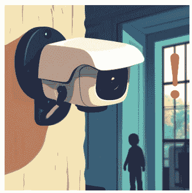
（智能摄像头）

抱歉，我忘了关闭智能摄像头的人形检测警示功能。

人形检测？

开启人形检测功能后，摄像头会在有人进入时发出警报。
这是一款有“眼睛”的摄像头，它能“看见”人。

（心里暗想）要是坏人穿着舞狮服进来，摄像头是不是就检测不到了呢？

**智能电视机**

除了智能音箱、智能摄像头，小乐家的电视也很智能，它也能听懂语音指令，自动播放节目。

小视小视，播放《西游记》。
好嘞，为您找到《西游记》。

（智能电视机）

这是**智能电视机**，不仅能帮我们挑选节目，还能记住上次看到第几集，并从中断处继续播放。

小乐，你们家真是科技感十足啊！

我爸爸喜欢科技产品，我们家有很多智能家电。它们能听懂我说话，还能像人一样回应呢！

**智能电梯**

这时，小乐的另一位好朋友小丽来到了楼下，却在一楼上不来，小乐得下去接她。

原来小乐家的电梯“认人”。电梯需要人脸识别，也就是俗称的“刷脸”，只有已录入人脸信息的人才能按电梯按钮。

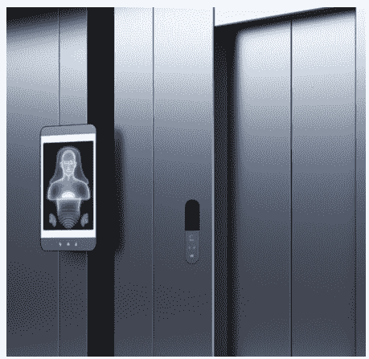
（使用电梯前需要“刷脸”）

走，我们一起去接小丽吧。

**练习 1**

下面这些设备，会看、会说、会听吗？请连线。

### 自动驾驶汽车

晚上，小强的爸爸来接小强回家。

小乐看到小强的爸爸停车时并未把手放在方向盘上，但方向盘却自动转动，车子自己停进了车位。

原来小强爸爸开的车使用了自动驾驶技术，是一辆自动驾驶汽车。

你爸爸的汽车可以自动开进停车位！这是擎天柱吗？

这是我们家的新车，停车时它能自己停进车位。
小乐对自动驾驶汽车非常感兴趣。

回家后，他向小美、爸爸、妈妈讲起了看到的自动驾驶汽车。

咱们家也能换一辆自动驾驶汽车吗？

咱们家今年没有换车计划和预算，明年可以考虑，先了解一下。
于是，他们一起在互联网上搜索自动驾驶汽车的资料。

⊙**阅读材料**

### 自动驾驶汽车

**自动驾驶汽车的分级**

在国家市场监督管理总局、国家标准化管理委员会发布的《汽车驾驶自动化分级》（GB/T 40429—2021）中，将驾驶自动化分为6个等级。

·**0～2 级：智能系统仅提供辅助，由人类驾驶。**
·**3～5 级：智能系统驾驶汽车。**

▲（智能辅助人类驾驶）

▲（智能驾驶）

**0 级：应急辅助**

系统不能持续控制汽车，但具有部分探测与响应能力。

**1 级：部分驾驶辅助**

能协助人类驾驶员停车。

1 级自动驾驶有两大功能：

·定速巡航：无需人类驾驶员操控，车辆自动保持车速。
·自动泊车：车辆能自动停入停车位。

（自动泊车）

小强爸爸的车能自动停进车位，就是具备自动泊车功能啊！

**2 级：组合驾驶辅助**

能防止司机疲劳驾驶导致车道偏离事故。

2 级自动驾驶主要功能包括车道保持辅助和自适应巡航控制。

“车道保持辅助”功能可在高速及路面较好路段（车道清晰）检测车道。若司机疲劳驾驶偏离车道，系统会提醒司机并纠正方向盘，保持车辆不偏离车道，减少危险事故。这项技术在现实生活中能减少安全事故发生。

**从车轮到算法，看懂自动驾驶与真假智能**

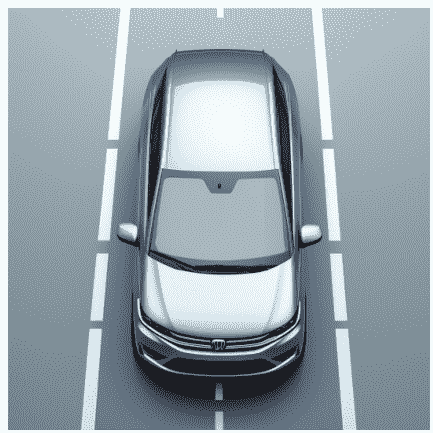

▲（普通汽车未检测车道）

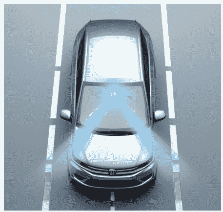

▲（自动驾驶汽车检测车道）

自适应巡航的核心不只是执行驾驶者设定的速度，而是结合车前间距与实时路况进行动态调节。举例来说，当有车辆从侧方切入车流，系统会立刻做出降速反应；当迎面路口出现红灯，也会平顺减速并最终停稳。

（依环境保持车速）

乘车时请安静些，避免干扰父母专注驾驶。

**3 级：有条件自动驾驶**

在特定限制范围内，由系统接管驾驶，驾驶者可以暂时脱手。

以某款量产车型为例，其可用前提大致如下：

· 行驶速度上限为 60km/h；
· 仅在官方批准的专用路段启用；
· 天气需良好，雨天等恶劣条件禁止开启；
· 系统呼叫接管时，驾驶者须在 10 秒内重新掌控方向盘。

**4 级：高度自动驾驶**

在限定道路场景下，车辆能完成绝大部分驾驶任务。即便系统发出介入提醒，驾驶者也可选择不立即响应。

**5 级：完全自动驾驶**

无论天气、地理或交通状况，均可实现无人驾驶。

目前五级量产车尚未普及。

等五级车普及后，是不是就能免考驾照了？哈哈！

五级车完全不需要人工参与，车内布局与外观必然与今天不同，未来的座舱会是什么样呢？

现阶段市面上是否已经可以买到三级、四级自动驾驶车型了？

**自动驾驶车辆的推广现状**

**政策扶持**

2023 年底，工业和信息化部、公安部、住房和城乡建设部、交通运输部四部门联合印发了智能网联汽车准入和上路通行试点工作的通知。

这意味着三级、四级无人驾驶汽车的上路通行获得了政策层面的认可。

**试点城市**

· 到 2024 年 7 月，北京、上海、广州、深圳、武汉等 20 城被纳入“车路云一体化”试点。
· 武汉已在 12 个行政区内展开近 500 辆无人驾驶车辆的常态化试运营。

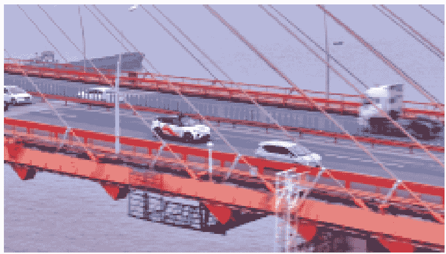

（全无人车行驶于白沙洲长江大桥，图片来源于网络）

坐这种无人网约车，能不能让爸爸妈妈坐前排，我和小乐坐后排？这样会更宽敞吧！

我看过无人出租车的视频，目前只允许乘客乘坐后排。而且遇到突发状况时，现阶段的处理能力仍不及经验丰富的老司机……

**练习 2**

五级无人驾驶汽车无需人工操控，其内部结构与外形会与传统汽车产生哪些差异？

请发挥想象，为未来汽车绘制一张设计草图。

（欢迎将你的创意作品发送至作者邮箱 teacherAI4you@126.com）

### **智能推荐系统**

啊，我的手机没电了……用妈妈的手机听歌吧！

小美打开妈妈的手机音乐 App，随后发现——

▲（小美的手机）

▲（妈妈的手机）

咦，妈妈手机上的歌单推荐跟我手机上的完全不一样！

为什么 App 能按个人喜好推送内容？这就涉及另一种人工智能技术——推荐系统。

推荐系统就像一位形影不离的观察者，默默记录你浏览、收听、搜索、购买的行为，进而推测你接下来的偏好。它对你十分了解。

下列常用应用均在内部使用了推荐系统：

♥**短视频平台如抖音**：依据观看时长、点赞评论等行为，推送可能感兴趣的视频。
♥**电商平台如淘宝**：结合近期搜索和浏览痕迹，推荐高概率会被购买的商品。
♥**外卖平台如美团**：依托历史订单、口味倾向、下单时段，给出个性化餐食建议。
♥**社交媒体如微博**：注册时询问兴趣，之后按浏览习惯推送常看的信息类别。
♥**出行平台如滴滴**：根据过往出行记录，预测相似时段的目的地，并在填写时主动提示。

**练习 3**

对比你父母购物 App 或其他使用推荐系统的 App 首页推荐，有哪些相同与不同？请用双泡思维导图整理。

**比较能力**

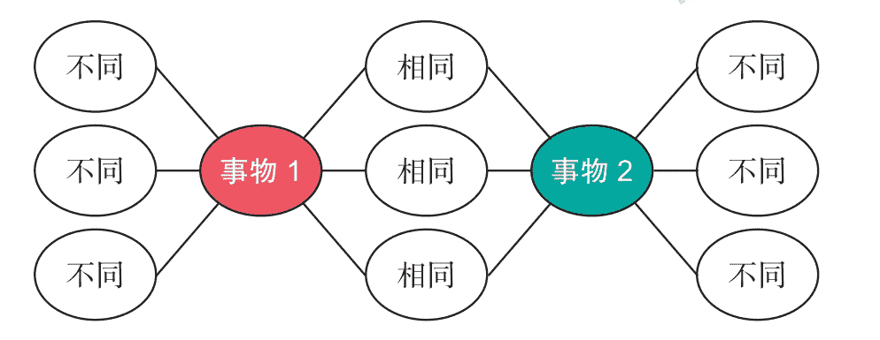

（双泡思维导图）

### **生成式人工智能**

爸爸发现妈妈在听歌——

你在听什么歌呀？

给你也听听。

哦，×××呀，这是她本人演唱的吗？

不是，这首歌是她的“AI 替身”翻唱的。好厉害！

小美和小乐听到父母的对话，开始胡思乱想……

替身？这不像小说里的情节吗？

歌手的 AI 替身可以代唱，那我能不能也拥有一个 AI 替身帮我上学写作业呀？

这种“AI 替身”正是生成式人工智能的典型代表，可视作“能力复制”。AI 可以生成一个具备演唱能力的虚拟艺人，其音色、发音习惯与原本人高度一致，几乎难以辨别。

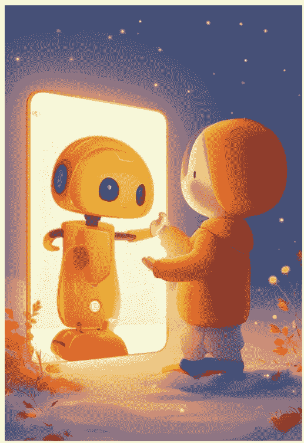

（AI 分身）

该技术的应用远不止音乐模仿，还能模仿人类创作的绘画、照片、对话甚至视频，经过学习后能够实现精准复刻。

生成式人工智能的核心在于依据现实样本或规则自行学习，并产出与样本相似或符合规则的文字、音乐、图像、视频等数据。

**文字与图片**

目前文字与图像类生成 AI 已相当普及。虽存在错误，但已能带来不少便利。

我也体验过国内几款优秀的文字或图像生成 AI，推荐大家亲自尝试。

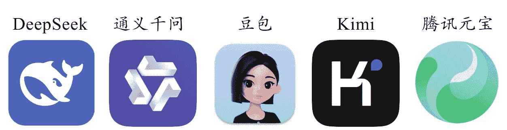

（以上顺序不分先后）

使用时请注意，有时生成的内容并不准确或不合理，不能仅因出自 AI 就盲目采信。

**音乐**

如果自己唱功不佳，却想为一首歌填新词怎么办？

可以借助“AISingers”平台，选择虚拟歌手，输入旋律和歌词，AI 即可生成对应音频。

不过这仍需要一定音乐基础。我自己也补习了数小时乐理并请教音乐爱好者朋友才成功。

（AISingers 的操作流程）

**视频**

生成视频难度更高，目前仍不够成熟，容易出现前后帧背景或角色突变的问题。

不过已有 AI 工具可辅助视频制作。

在“寻光”软件中，可生成一个虚拟角色作为主角，自定义正面、侧面、表情、动作等。该软件还提供其他辅助功能，例如把你的面部替换到视频角色上，帮助判断是否购买同款衣物；把风筝替换为气球并设定飞行轨迹；去除夕阳视频中影响美感的电线杆……

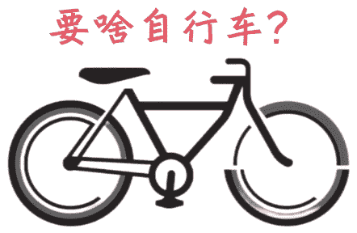

**科研**

生成式 AI 也能在科研中提供助力。

**生物医药**

据报道，生成式 AI 已制造出新型抗体，为原本高成本的抗体生产提供了捷径。

**新材料**

社会新闻曾提到，通过生成式 AI，科研人员预测出 220 万种晶体结构，使得人类已知稳定晶体数量提升了 9 倍。

有 AI 辅助，许多当前难以治愈的疾病未来或许能够被攻克！

等我长大，就能生活在科幻小说里描绘的世界了。

**猜一猜**

2022 年 8 月 31 日，插画家 Jason Allen 利用人工智能生成的画作参加美术比赛并获一等奖。

请猜一猜，下面两幅画是否由 AI 创作。

▲□人工智能创作 □人类创作

▲□人工智能创作 □人类创作

**（这两幅画均为人工智能创作）**

## **什么才是人工智能**

美乐一家逛商场，走到厨房电器区——

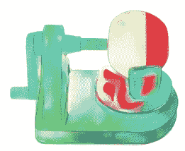

（削皮机）

这个削皮机很灵活，看起来比刚才那个更高级。

可是刚才那个既能削黄瓜皮也能削苹果皮，这个只能削苹果皮。

前者是普通机器，后者是人工智能机器。

何谓人工智能？何谓人工智能机器？

比如遥控赛车、遥控无人机算人工智能吗？你靠近超市门自动打开，这算人工智能吗？

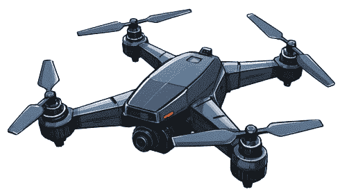

读完本节，你就能学会如何辨别了！

**猜一猜**

在正式阅读前，请先凭印象判断下面这些是否属于人工智能，勾选“是”或“否”。

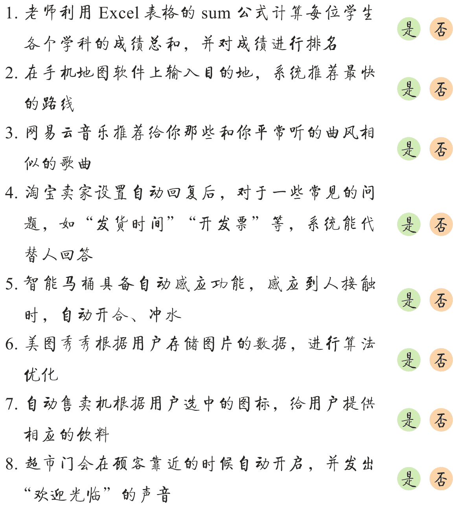

如果你现在还分不清也很正常，带着疑问继续阅读，正确率提升即是进步。

### **图灵测试与中文房间**

艾伦·图灵（Alan Turing，1912—1954）被誉为“人工智能之父”，他提出了“图灵测试”。

通俗地说，如果人类无法分辨一段作品如对话、文章、绘画等是由人类还是机器生成，则该机器可被视为具备“智能”。

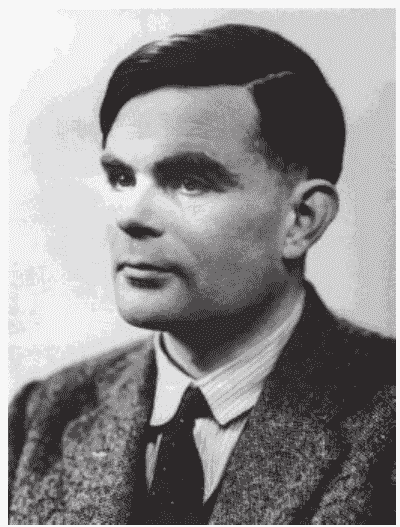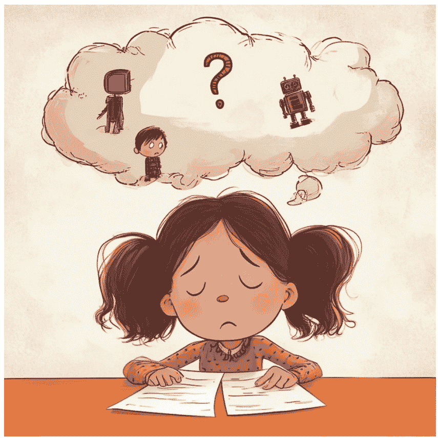

做出像人一样的东西，就等于人工智能吗？

**案例 1：客服机器人**

这是购物平台上与“客服机器人”的一段对话。

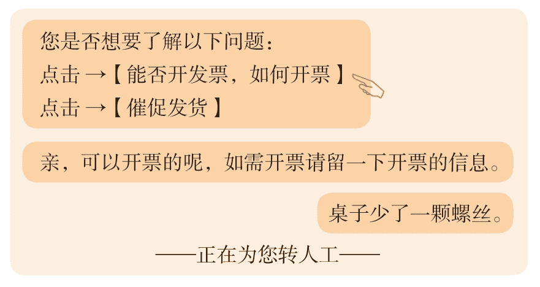

商家为用户常见问题设置了自动回复，因此客服机器人可替代大量人工客服。

既然它能替代人类工作，是否就拥有智能？答案是否定的。

它能应对常规问题，但遇到“桌子少了一颗螺丝”这类非标准问题就会无能为力，转交人工处理。

也就是说，该机器人只能处理预设事件，无法应对未预设情况，虽然表现出智能行为，却没有智能思想。

**案例 2：中文房间**

人们常提及一个思想实验“中文房间”：房间里坐着一个人，他只会英语不懂中文，要与门外的只会中文的人进行文字交流。

这怎么可能不被识破？

他拥有一本秘密武器——中文对话手册。手册里收录了常见问答和可组合的常用汉字。

房间外的人写纸条问：“你会说中文吗？”房间里的人不懂中文，但手册里正好有答案：“我会说中文。”于是他照抄递出。

房间外的人误以为房间里的人懂中文。就这样，虽然房间里的人完全不懂中文，却完成了中文交流任务。

从行为看，他能回应问题，表现出智能行为；从思想看，他并不懂中文，问题超出手册范围就无法回答，说明他没有真正的中文智能。

如果房间里是机器人，用对照纸条找答案的方法也许能通过图灵测试，但它也不具备真正的智能思想。

有时候我做出了课后练习题，却并没有真正理解知识点。

有智能行为而没有智能思想，这样的人工智能并不算真正智能。

### **人工智能与人类智能**

如果不能用智能行为来判断，能否用智能思想来判断？智能思想是什么样的？是否要像人类一样？

这就引出了另一种定义：**利用计算机和机器模拟人类大脑解决问题的决策能力**。

你觉得这个定义合理吗？

图灵测试侧重行为，该定义侧重思想。

这里的智能思想指的是模仿人类思维。

按此定义，人工智能永远不会比人类更强，因为它只是模仿。

人和机器的软硬件条件不同，同一任务对两者的难度也不同。有些事对人类很难，对 AI 却轻而易举；反之亦然。也许机器有自己的发展路径。

**对机器容易、对人类困难的事**

下棋被认为考验智力，顶尖高手稀少。而对人工智能来说，有明确规则的对弈游戏非常擅长。

♥1997 年，计算机“深蓝”击败国际象棋大师卡斯帕罗夫。
♥2016 年，计算机“AlphaGo”击败围棋大师李世石。

围棋是棋类中最复杂的项目，如今 AI 在该领域已远超人类顶尖水平。

**对人类容易、对机器困难的事**

摘花菜对人类来说并不难，农村孩子从小就会帮忙。但对机器而言，判断花菜是否成熟就不易。能否靠颜色判断？很遗憾，我们常见花菜品种无论成熟与否颜色都是白的，机器无法通过颜色区分。

而且摘菜力度需要恰到好处，太轻摘不下，太重会损伤。看起来简单的动作，对机器并不简单。

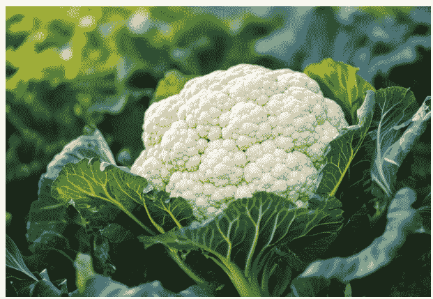

人类和人工智能的思考方式不同，擅长领域也不同。用人类视角评判 AI 是否擅长，是一种自大。

对 AI 来说，到底什么简单、什么困难呢？

有什么规律吗？

**能用数字表达的事，对 AI 更友好**

AI 的第一步是把现实世界的事物转化为它能理解的数字世界。因此，能容易用数字表示的问题，对 AI 来说会更简单。

考试时，如果题目没读懂就无法作答。读懂题目是第一步。

首先，棋盘很容易数字化。每一枚棋子都有位置，如“Q16”表示第 1 落子点，先后顺序和黑白棋子都能用数字表示。

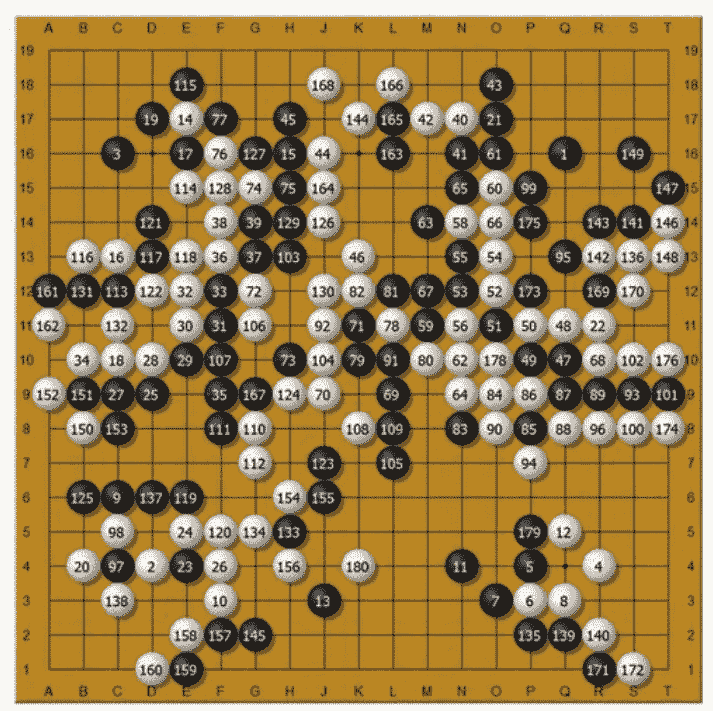

（一盘棋局）

其次，图片也容易数字化。图片可像棋盘一样划分为小格子，即“像素”，每块小格可用横纵坐标编号，表示是否涂色则可用 1、0 来标记。

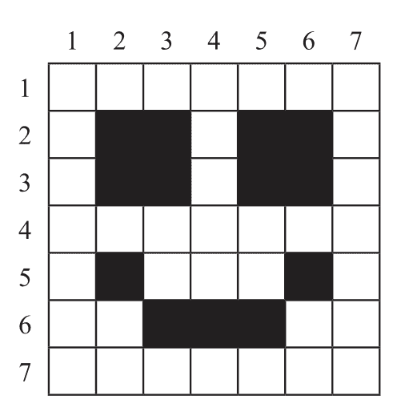

▲（像素笑脸）

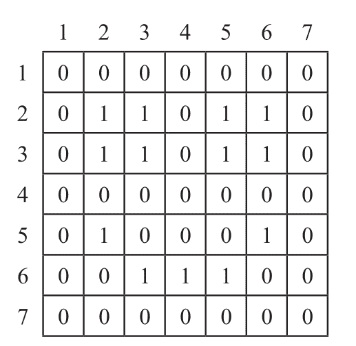

▲（用 1、0 表示该像素点是否涂色）

日常画面大都呈现色彩，而色彩本身也能被编码成数字。

（彩色可以用红、绿、蓝的数值来表达）

一张常见的照片，其构成单元数量庞大，单一方向上往往有数百甚至上千个点。

**声响同样可被数字化**。声波能够转化为波形图像，波形即代表声响。下方三组文字是我借助剪映文字播报功能生成的波形：

横向比对可发现，发音相同的字，其波形轮廓高度重合。

“风”的波形在不同出现位置保持基本一致：

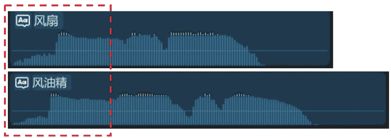

（“风”字的基本波形）

“精”的波形同样趋于一致：

（“精”字的基本波形）

在现今的个人电脑里，文字、图像、声音、视频等内容已实现便捷的数字化存储、处理与播放。

算力提升使得 AI 在单纯的阅读任务上已不构成障碍。

**现实交互仍是难题**

当 AI 需要依托实体装置去应对多变复杂的现实场景时，难度会显著上升。

例如自动驾驶需要让系统指挥车辆在复杂路况中行驶，目前仍未达到完全无需人工介入的理想状态。

再如家庭服务机器人要把玩具放入收纳篮，会面临哪些考量？

地面上杂物众多，如何判断手中物件是否为玩具？

能否规划一条避开地面障碍的路径直达收纳篮？

整理时幼儿是否会突然冲来？

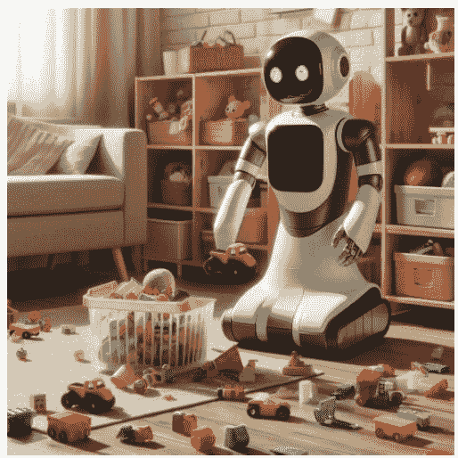

（DALL·E3 生成）

现实中执行这些看似琐碎的操作，常会冒出难以预料的复杂状况，让 AI 实时应对并不容易。

**练习 4**

查阅资料，了解 AI 在下列领域的进展。你认为这些任务对 AI 来说是容易还是困难？

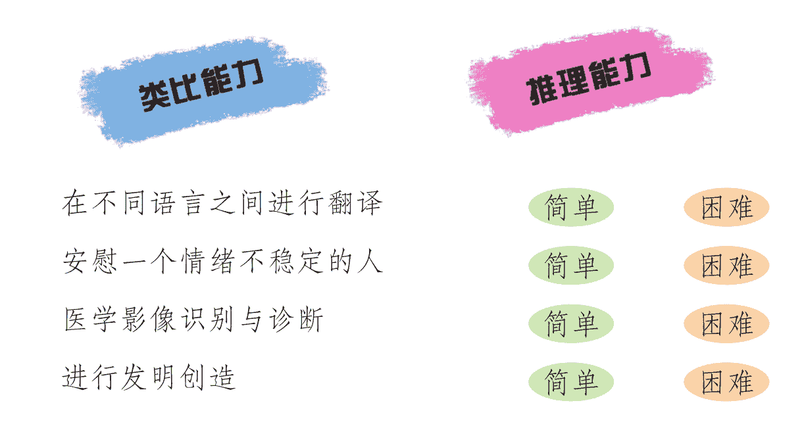

### **AI 核心特质**

此前提及的 AI 定义屡被修正，目前尚无统一标准，但可通过若干特质加以判断。

定义也会被推翻吗？为何 AI 的定义持续变化？

定义并非绝对的真理。课堂上老师有时会让我们先基于自身理解给出定义。

**AI 能够学习**

AI 可从人类经验或自身积累的数据中汲取信息，形成学会的能力。

例如地图导航，当大量用户在 A 到 B 之间走出未曾记录的路线时，系统会据此更新推荐，这正是从人类经验中学习。

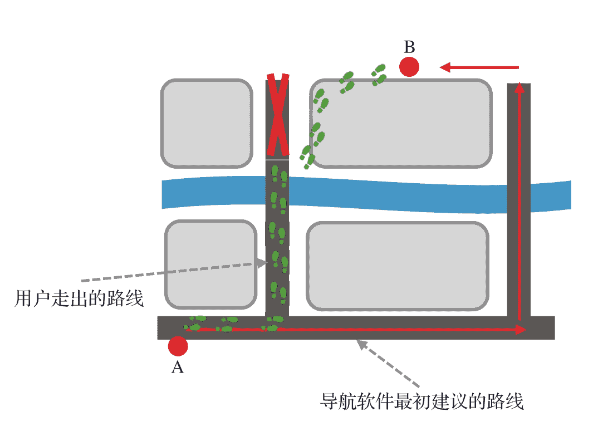

**AI 具备自主运行能力**

在缺乏持续人工干预的情境下，AI 能独立处理并执行较复杂的任务。

例如高阶自动驾驶可依据环境变化自行决策，无需人工随时介入。

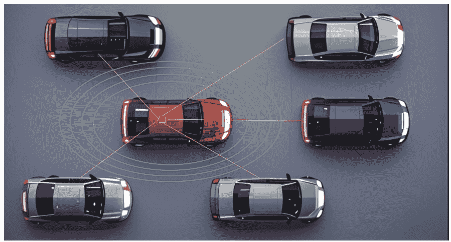

（自动驾驶汽车自己开）

再如部分工厂员工数从上万降至千余，大量工序被智能设备自主承担。

（工厂里机器高度自动化）

既能学习又能自主完成复杂工作，这两点是判定 AI 的关键线索。

凭借这两项特征，我们就能初步辨识何为 AI。

别着急，还有若干易混淆的概念，先厘清。

### **易混淆概念辨析**

**智能 ≠ AI**

众多电子产品命名中带有“智能”，但并非等同于 AI。

比如“智能小夜灯”，夜间有人经过会自动点亮，白天保持熄灭。这并不算 AI 产品，这里“智能”仅指自动化。在更复杂的情境下，如家中饲养宠物，灯无法分辨人或动物，照样点亮。

它会学习吗？不会，你无法通过互动教会它避免误亮。因此智能小夜灯不具备 AI 特性。

（一盏小夜灯）

**机器人 ≠ AI**

并非所有机器人都具备 AI。以扫地机器人为例。

低端机型通常售价在一千元以下，依靠陀螺仪行进，基本盲走——某些区域会重复清扫，某些区域被遗漏，且常被卡住需人工救援，自主性不足。

高端机型通常售价在三千元以上，则采用激光扫描房间，拥有“眼睛”识别障碍物，还能在“脑中”构建房间地图。于是它逐步熟悉家中布局，针对该清洁场所适应性工作。

如此一来，扫地机器人便不会总卡在同一位置等待救援。你启动后即可等待干净地面。甚至可指定区域，比如客厅吃完零食后只清扫客厅，它能理解并执行。此类机器人才具备一定自主性。

低端机型不算 AI 产品，而高端机型拥有“看路”“分析”能力，具有一定 AI 属性。

因此，**有的机器人属于 AI，有的则不属于**。

若打扫不干净，能否批评教育它使其改进？

哈哈，就像训练小狗一样！

**从传感器信息处理能力看 AI**

判断是否为 AI，还可观察产品对传感器采集信息的分析深度。

传感器是机器感知外界的装置。人也有类似装置，例如舌头尝味、耳朵听声。

普通智能产品只是简单接收信息，而 AI 产品则能进行复杂分析。

**小夜灯**

小夜灯配备光敏传感器和人体感应传感器。光敏传感器用于检测环境光强，判断明亮或昏暗；人体感应传感器通过热源移动判断是否有人。

对于传感器输入，小夜灯直接作为判断条件执行，逻辑极简：

♥如果（条件）：环境昏暗且有热源靠近；
♥那么（执行）：点亮小夜灯。

夜间宠物经过时，小夜灯无法分辨人畜，仍会亮起。这说明它未对传感器信息做复杂分析，不属于 AI 产品。

### **车辆**

自动驾驶汽车搭载多种传感器。毫米波雷达、激光雷达、超声波传感器负责探测障碍物和车距；摄像头拍摄车前侧面画面，识别路牌红绿灯；GPS 通过卫星定位车辆位置供导航。

这些传感器需协同工作，才能帮助汽车感知周边。

人类凭借眼睛把周边环境自然理解为立体世界，而摄像头拍到的是平面 2D 画面。此时 AI 系统需融合其他传感器信息，实时生成类似《我的世界》的虚拟 3D 场景，模拟汽车与道路、其他车辆、障碍物间的关系，为后续决策提供支撑。

▲（真实环境）

▲（3D 模拟环境）

**相机**

过去的相机只能记录镜头画面，属于非 AI 相机。如今许多手机相机能识别主体是人像、风景还是食物，并自动调整拍摄模式，这就是 AI 功能的体现。

（手机的“AI 摄影大师”功能）

**练习 5**

（1）发挥想象，为家里的某件家电（如电饭煲）增加 AI 属性，你会设计什么功能？

由于 AI 目前尚无统一定义，更严谨的说法是“该产品使用了 AI 技术”，而不是简单说“它是 AI”。

（2）读完以上内容后，请再次判断前面“猜一猜”中的选项是否使用了 AI 技术。

**成长型思维能力**

现在做这些题，我就不再凭感觉了。哈哈！

## **AI 的应用范围**

当前 AI 能够帮助我们完成哪些工作？

未来又可能带来哪些新可能？

AI 可解决的问题很多。这里归纳为 4 类：**分类问题、回归问题、序贯决策问题、搜索问题**。

### **归类问题**

常见 AI 应用中，无论是电梯摄像头判断乘客是否为住户，还是超市智能秤识别水果种类，本质都是归类。

其他例子包括：

♥垃圾邮件过滤：AI 能有效区分垃圾邮件和正常邮件，提升使用体验。

♥医学影像诊断：AI 可辅助分析影像，帮助医生判断是否存在病灶，提高诊断效率和准确性。

### **预测问题**

根据班级同学的往期成绩，预测下次考试的分数，这就是典型的预测问题，即基于历史数据推测未来。

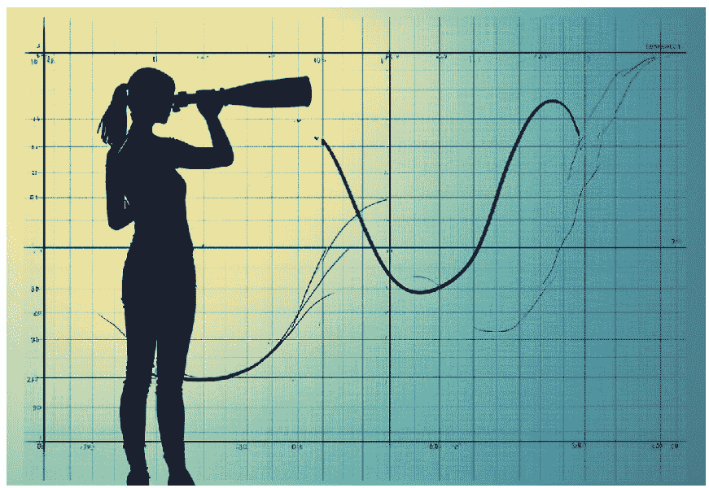

其他例子包括：

♥交通预测：AI 系统整合交通流量、天气、路况等数据，预测拥堵发生时间和持续时长，帮助规划出行。2024 年春节前，百度地图发布了春节出行预测报告。

♥气象预测：AI 通过分析大气环境和观测数据，预测未来天气趋势。2013 年，谷歌旗下 DeepMind 推出了天气预测模型 GraphCast，能在 1 分钟内预测未来 10 天的数百个气象变量，其准确率在 90% 的指标上超过了当时最先进的非 AI 预测系统。

（百度地图发布的《2024 年春节假期出行预测报告》）

### **顺序决策问题**

在下棋时要根据对手落子不断调整自己的下一步，这就是顺序决策问题，即环境变化时决策也要随之调整。

面对这类问题，AI 一边执行动作，一边从环境获取反馈，不断优化策略。

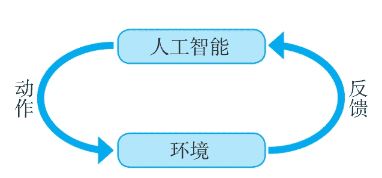

其他例子包括：

♥医疗决策：在选择药物时，需结合病情、病史和医学知识，并根据治疗反馈动态调整方案。

♥自动驾驶：汽车通过传感器感知环境，实时分析路况，并在环境变化时迅速做出新决策，保证安全行驶。

♥游戏对战：在有真实玩家参与的游戏中，AI 可代替人类操作，并根据对手行为连续调整策略，实现智能对战。

### **搜索问题**

汉诺塔游戏有明确的初始状态（**游戏开始**）、目标状态（**游戏获胜**）和移动规则（**每次只能移动一个环，且不能将大环放在小环上**）。解决这类问题需要枚举所有可能情况并搜索最优解，就是搜索问题。

其他例子包括：

♥路径规划：GPS 导航利用搜索算法找出最短或最快路线，帮助避开拥堵。初始状态是当前位置，目标状态是目的地。

♥学校排课：排课工作繁琐，许多高校使用启发式搜索算法优化方案，在满足各种约束条件下找到最优课表。初始状态为空课表，目标状态是完整的排课表。

但现实中，一个真实问题往往不是单一类型，而是多种类型的组合。

♥例 1：医学影像分析既要诊断疾病，也要预测病情进展，既是分类也是回归。

♥例 2：聊天机器人在理解用户情感时，会把语言归为“积极”或“消极”，这是分类；同时对话是持续的，需根据用户反应调整回复，这又是顺序决策。

## **本章小结**

这一章让我认识了生活中的许多 AI 产品。下次爸爸买自动驾驶汽车时，我也能问一句：这是哪一级的自动驾驶技术？

以后家里选购扫地机器人，我可以建议爸妈关注导航方式和建图能力。

以后再听到商家宣传“AI 产品”，我就能判断是噱头还是真用了 AI 技术。

我准备给家里换一个 AI 音箱，只要说一句话就能播放喜欢的音乐，多方便！

# **第二章**

# **AI 的学习路径**

——赫敏不用苦读了

（赫敏是小说《哈利·波特》中一位刻苦的学霸）

AI 一开始就这么聪明吗？

并不是，学习是让它越来越聪明的关键。

学习？我也在每天学习呢。你有什么好的学习方法吗？

我的学习方式主要有 3 种：**监督学习**、**无监督学习**、**强化学习**。

## **监督学习**

——“这是中杯，这是大杯，这是超大杯”

### **我们的学习方式**

小时候，你在妈妈怀里，对世界充满好奇。

你听到滴答滴答的声音，转头看到钟表指针随声摆动。妈妈指着钟表对你说：“宝贝，这是钟表。”

午餐时，妈妈拿起又红又大的苹果，用勺子挖了点果肉喂你，说：“红红苹果甜又甜。”

家里来了一只毛茸茸喵喵叫的小家伙。妈妈让你伸手摸摸，告诉你：“这是小猫咪，别怕。”

这种有人在旁边手把手教的学习方式，对应机器学习中的“监督学习”。让我们看看 AI 是如何在此模式下学习的。

### **机器如何学习**

我现在几乎一无所知，这次任务是：学会识别猫咪。

我还不认识猫咪，但好在有一位人类老师会逐步指导。

人类老师先把相关数据分成两部分，大部分用于**训练**，小部分用于学习结束后**测试**。比如把动物数据分为训练集和测试集。

这和人类学习很像，既有教学环节，也有小测验检查掌握情况。人类老师知道哪只是猫，所以教学时会耐心逐一标注，这就叫**打标签**。

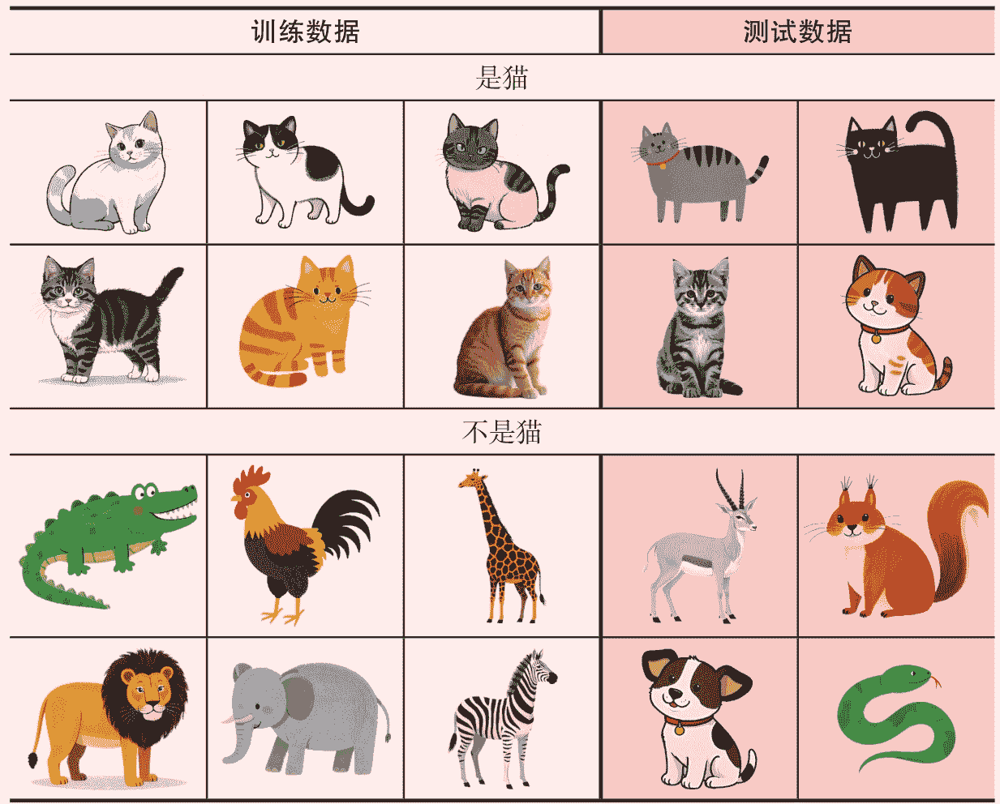

除标签外，老师还提供动物的特征信息。例如：生殖属性、食物类型、是否长毛、是否常见宠物。

老师提供的训练数据如下：

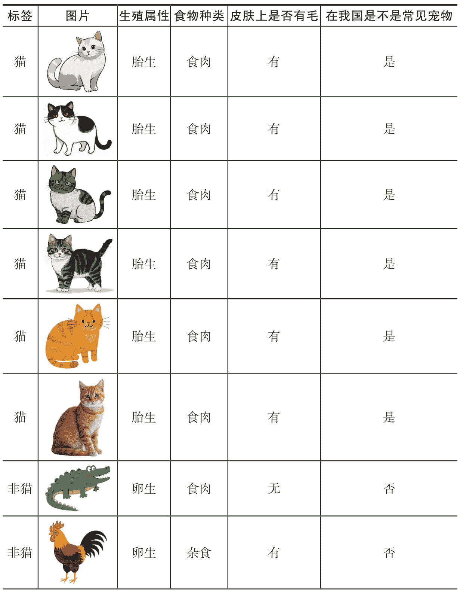

（续）

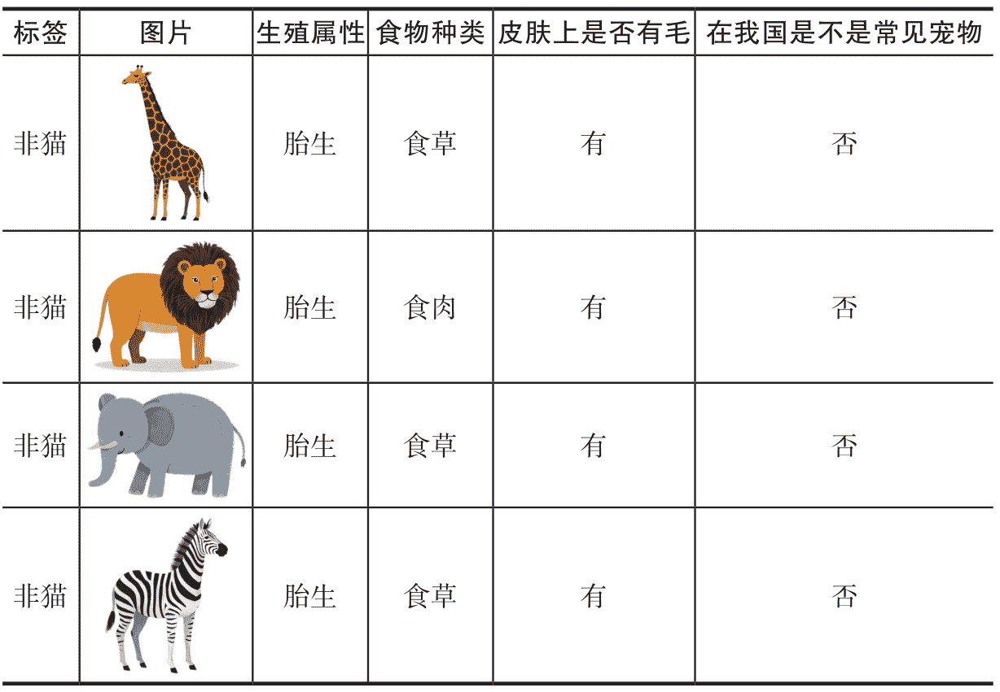

**首次猫类判别任务**

在人类导师的带领下，我正不断积累经验、逐步成长。

对一批带有标签与属性描述的样本进行拆解后，我提炼出一条经验：**具有胎生、肉食、体表覆盖毛发、常被人类饲养作为宠物**的生物，多半是猫。

这个判断是否成立？接下来导师会用验证集来检验学习成效。

导师准备的验证资料如下：

（续）

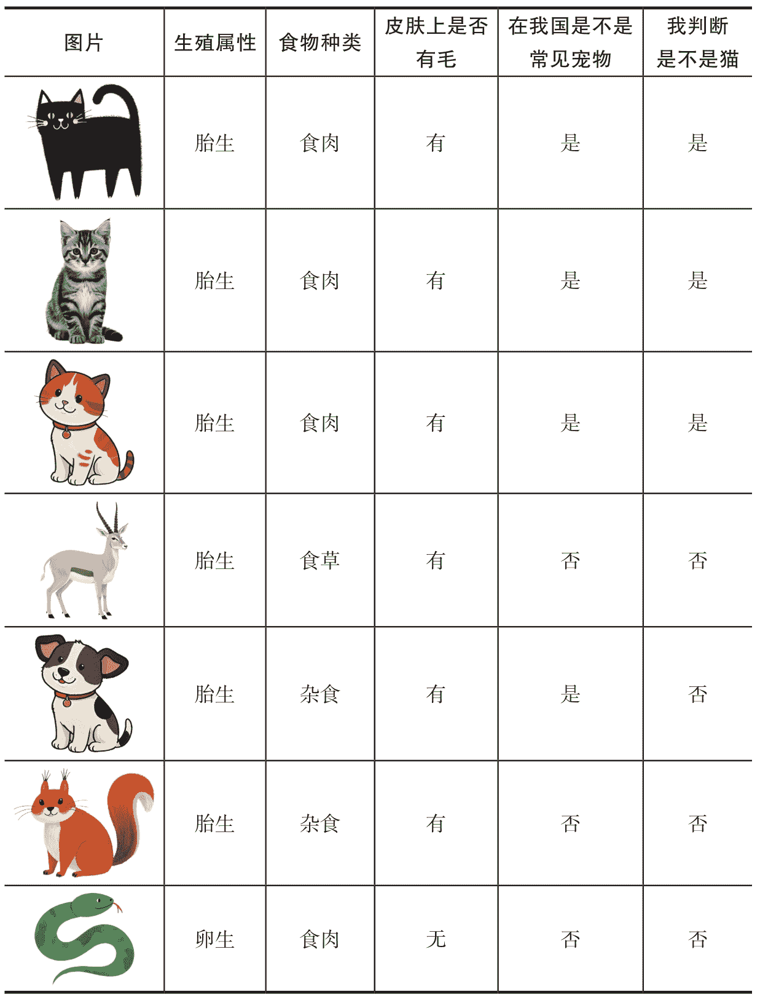

经导师核查，我的预测与标准答案完全吻合，验证顺利通过！

### **监督学习的过程**

**教**
♥教学目标：把动物划分为“是猫”与“不是猫”两类。
♥教学指导：为每只动物提供若干特征作为学习依据。

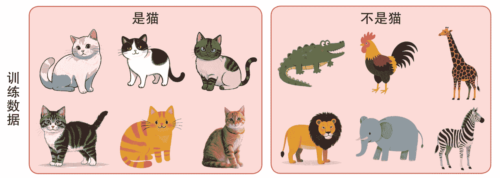

### **学**
在训练阶段提供的样本与既定规则的帮助下，我选取了“体型大小”“摄食类型”两项维度，将训练集中动物归入“是猫”“不是猫”。

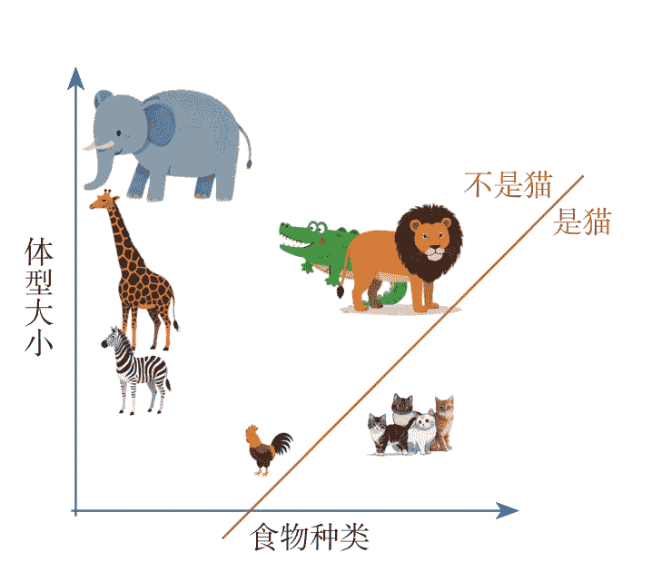

### **测**
沿用相同的划分逻辑，我能把新的测试样本准确归入对应区间。

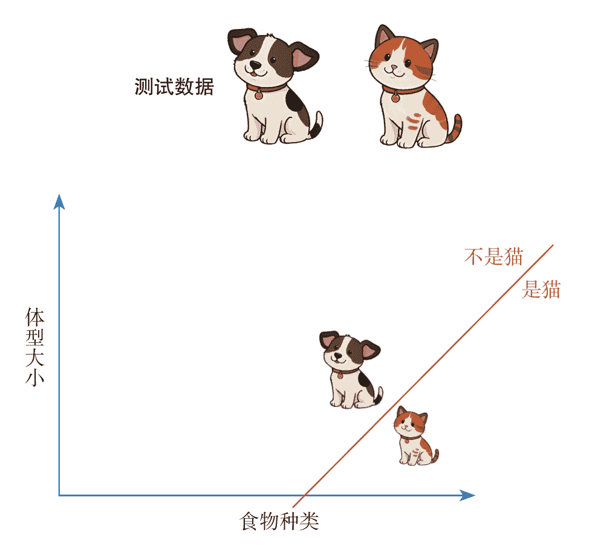

**练习 1**

**分类能力**

挑选不同的属性，就能把事物归到不同类别。

（1）针对下方这 3 个机器人，请把分类属性与分类结果连线。

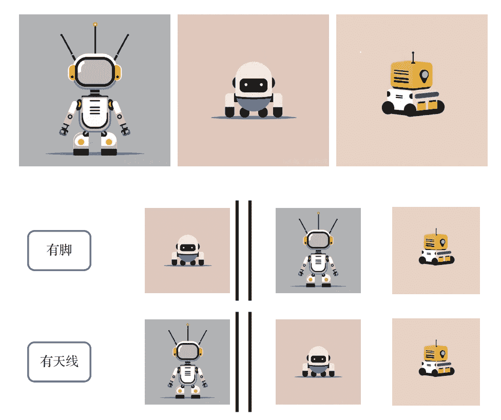

（2）要把下方这 6 张扑克牌分成两类，请挑选合适的属性。你能找到多少种属性？

注意：按你找到的属性分类后，每张牌必须属于 A 类或属于 B 类，不能同时属于两类。

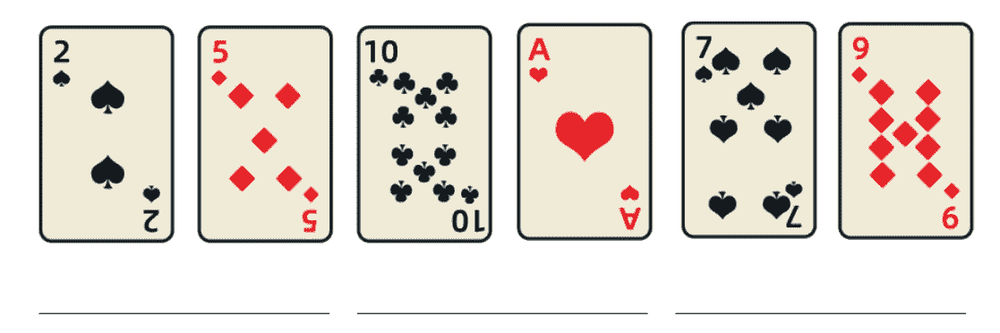

（3）能否只用一个属性就把龙须酥挑出来？

□是否有夹心

□外表的颜色

□具备较多拉丝

## **无监督学习**

——爸妈上班我自学

### **我们的学习**

回想一下，并非所有知识都来自他人传授。很多时候在无人指导的情况下，仅凭观察与归纳也能形成新认知。

各地气候不同，每个人身边常见的果品种类也会不同。假定你的家乡恰好缺少下方这些水果，之前从未接触过。

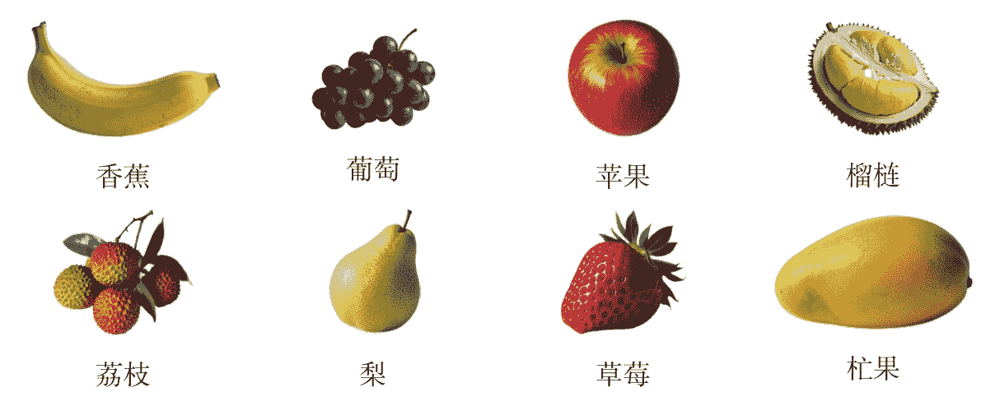

不过当你看到他人品尝这些果实并持续留意一段时间后，身为爱尝鲜的人很可能总结出：有的果实可连皮直接食用，有的则需要去皮后才能品尝果肉。

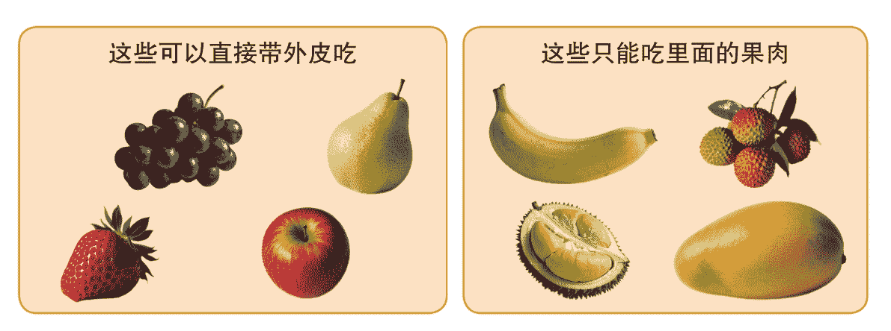

这种自行发现规律并把物品**聚类**的方式，对应机器学习中的**无监督学习**。聚类可理解为“分群”。

来看 AI 在这种模式下是如何学习的。

### **机器的学习**

我是一个起步阶段什么都不懂的 AI，此次任务是对一批动物进行分组。

这一次，人类导师没有指定按哪些属性分组，只是提供了每种动物的属性信息，让我自行挑选合适的分组依据。

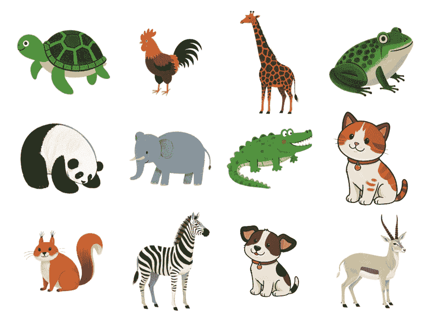

（未经学习的 AI 机器人）

先看看人类提供了哪些属性。

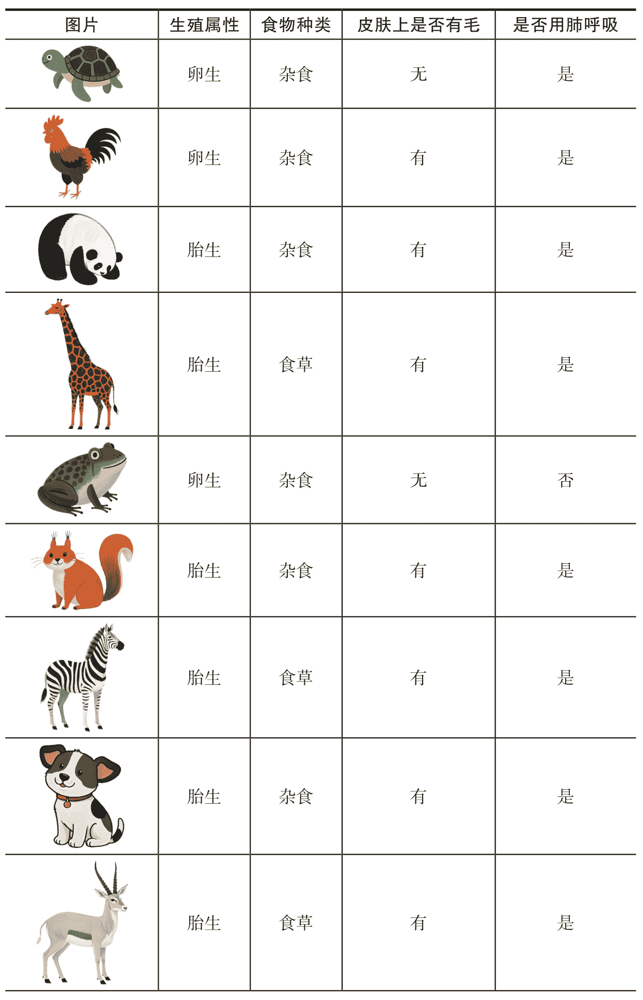

（续）

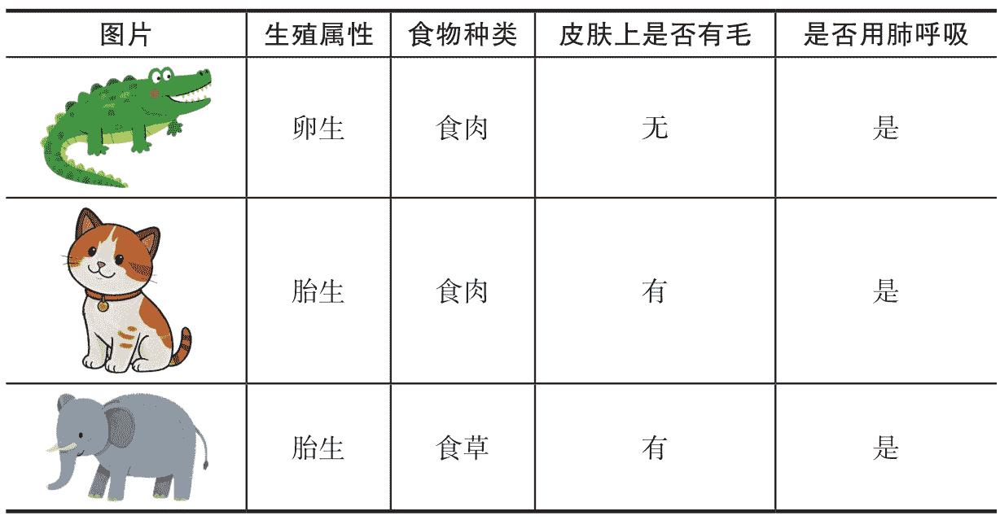

导师没有告知具体的分组标准，只要求把这些动物分成两组，选用什么特征由我决定。

通过分析数据，我把属性相近的动物归为一类。

综合权衡后，这些动物被我划分为 A 群与 B 群。

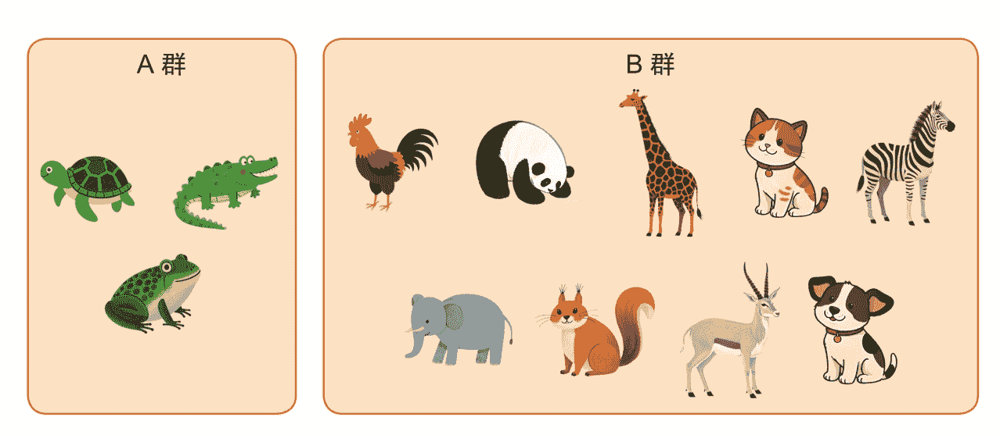

若你再展示新的动物，我会直接依据属性的相似度把它分到相应的一组。

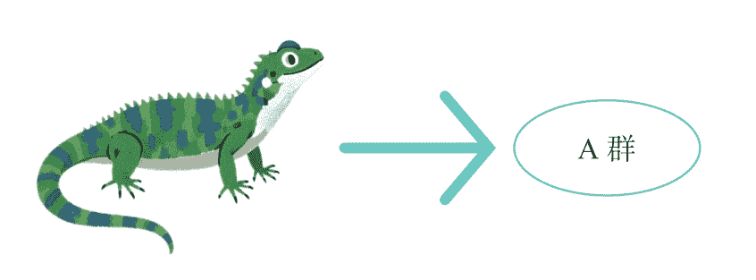

监督学习时，正确答案通常是唯一的。

而无监督学习可能存在多个合理的答案！

只要分组有依据，结果都算正确。

在监督学习与无监督学习这两种范式下，提供的信息不同，数据形式不同，学成后要解决的问题也不同。

## **监督学习和无监督学习的数据不同**

## **监督学习的数据**

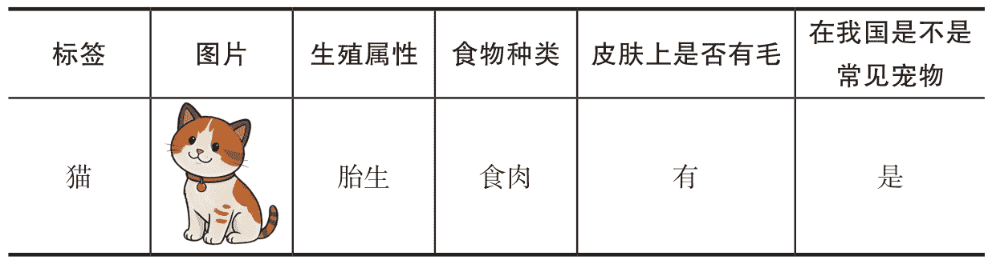

## **无监督学习的数据**

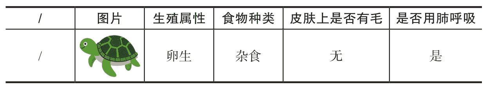

监督学习时，人类给 AI 的数据既有标签也有特征。就像妈妈教宝宝认识苹果时，既指着说这是苹果，又描述苹果的颜色是红色、形状是圆的，还让宝宝尝尝味道。

无监督学习时，数据只有特征没有标签。在这种学习过程中，虽然没有人直接告诉你水果的名字，你需要更多探索，通过看、闻、尝来了解它们的特点，再进行归类。

### **机器学习对数据的要求**

我的学习高度依赖人类提供的数据，如果训练数据本身有误，学出来的结果必然也会出错。

数据不仅要准确，还要尽可能全面。

假如你扮演一个 AI，面前有一批海洋动物和海洋植物的数据，你能分清它们的特征吗？

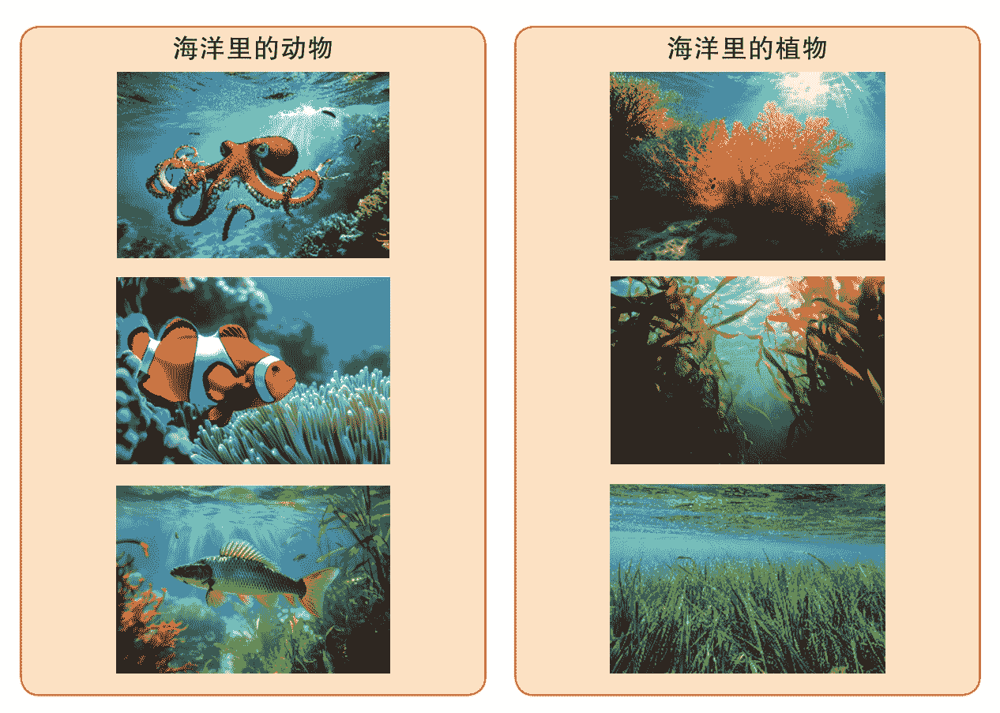

基于这些海洋动物和海洋植物的信息，请判断海葵到底属于动物还是植物。

海葵看起来像植物吧，它的外形和其他海洋植物很像。

实际上海葵是动物。外表虽像植物，但内部构造更接近动物。它拥有神经系统、消化系统和生殖系统，还能用触手捕捉小型无脊椎动物。

海葵堪称“扮猪吃老虎”的高手，外表像植物，内心却是个捕猎者。

说回正题，按已有数据学习时，结果可能出错，因为总有例外。因此给 AI 用的学习数据要尽量全面、充足，才能提升学习效果。

明白了！就像人类学习要“读万卷书”，才能积累更多知识。

## **监督学习和无监督学习的任务不同**

监督学习和无监督学习的任务并不相同。

♥监督学习：把这些动物分为“猫”和“非猫”两类。
♥无监督学习：把这些动物分成两组。

监督学习解决的是分类问题，无监督学习解决的是聚类问题。

**练习 2**

（1）请将下面的定义与专业名词进行连线。

**抽象概括能力**

**分类能力**

（2）模仿无监督学习的思路，圈出相似度较高的物品。

## **强化学习**

——巴甫洛夫与小狗的故事

### **我们的学习**

人类历史上很多发现和发明都是通过试探习得的。

比如很久以前，人们并不知道番茄可以吃。番茄鲜红的外表让大家联想到有毒的果实，于是认为番茄也有毒。

直到 1830 年，美国人罗伯特当众吃了 10 个番茄，第二天依然活蹦乱跳，人们才确认番茄无毒。

人是怎么推断的呢？

我们注意到“罗伯特吃番茄”这一行为带来了“没有中毒还有饱腹感”的积极结果，于是学会了：番茄是可以食用的。

这就是通过“行为与奖惩”的因果联系来探索学习的模式。

你的父母、老师是否用奖惩来引导你的行为？

比如，19:00 前完成作业就能看一集动画片，这是对好行为的奖励。

比如，嘲笑同学会被老师严厉批评，这是对坏行为的惩戒。

为了获得奖励，我们会早早完成作业；为了避免批评，我们会友善对待同学。

这种靠“行为—奖惩”来学习的机制，对应机器学习中的强化学习。

### **机器的强化学习**

来看 AI 如何进行强化学习。

我是一个用防火材料制成的火灾逃生机器人，现在模拟一个“火场救狗”游戏，目标是把火场里的小狗带出去。

由于氧气有限，我必须走最短路径。而且火场烟雾大，可见度低，我只能感知当前格子是安全还是危险。

若碰到火焰，本轮失败。若成功从逃生口撤出，则游戏胜利。

游戏开始吧！

**第 1 步**

向下走（1-1）会遇到火焰，游戏结束；向右走是安全的。因此第 1 步选择向右（1-2）。

▲1-1

▲1-2

**第 2 步**

向下（2-1）是安全的；向右（2-2）会遇到火焰，游戏结束。所以第 2 步向下走（2-1）。

▲2-1

▲2-2

**第 3 步**

此时向下（3-1）或向右（3-2）都安全。

▲3-1

▲3-2

**第 4 步**

如果按（3-1）走，那么第 4 步只能向左（4-1）或向右（4-2），两种选择都会遇到火焰，因此（3-1）这条路线被淘汰。

▲4-1

▲4-2

如果第 3 步按（3-2）走，那么第 4 步向下（4-3）会遇火，向右（4-4）安全。所以第 3 步向右，第 4 步也向右。

▲4-3

▲4-4

**第 5 步**

该往哪走？向上（5-1）什么都不会发生；向下（5-2）就是出口。因此第 5 步向下走。

▲5-1

▲5-2

一番试探后，终于找到出口，狗狗得救啦！

（文小言生成）

在强化学习中，没有示范样本，没有标签，没有显式特征，只有奖惩信号。在这个游戏中，碰到火焰等于受罚，到达安全区等于获奖。避开惩罚、追求奖励，不断探索，就能找到出口。

巴甫洛夫训练小狗时，把“铃声”与“骨头奖励”绑定，小狗于是认为铃声响起就会有奖励，进而在铃声响起时分泌唾液。

每次喂骨头时，铃声都会响。铃声响了，就意味着要吃骨头啦！

**练习 3**

寻找最优路线：请为小强同学规划一天的行程。

小强周末安排很满，需完成以下事项：

①参加线上英语打卡，完成 2 篇阅读理解和 1 篇口语朗读：阅读理解只要有手机就能做，大约 20min；朗读需要在安静环境进行，大约 30min。

②上固定时间 10:40～11:40 的逻辑课。

③进行 40min 户外体育锻炼，地点通常是家附近的体育场。

④看望奶奶并共进晚餐，必须在 16:30 前到达奶奶家。

⑤参加朋友的生日派对，派对下午 2 点开始。

请根据小强一天的活动和地图，为他规划路线吧。

⊙**阅读材料**

**机器学习的发展脉络**

机器学习并非一蹴而就，主要经历了 3 个阶段：

①**符号主义阶段**，让计算机像人一样思考和推理。
②**统计学习阶段**，通过海量数据让计算机发现规律和模式。
③**深度学习阶段**，借助更强的算力，让计算机处理更复杂的任务。

首先，**符号主义阶段**的目标是“像人一样思考和推理”。

例如，科学家让计算机像小侦探一样推理。如果计算机知道“所有猫都爱吃鱼”，并且知道“小明养了一只猫”，就能推导出“小明的猫也爱吃鱼”。

这种经典的三段论展示了计算机模拟人类推理的能力。该阶段对数据和算力的需求较低。

随后进入**统计学习阶段**，机器学习成为核心技术。计算机能够从大量数据中学习并发现规律。

例如，给计算机提供不同颜色的气球照片，它就能学会按颜色对气球分类。

这一阶段 AI 在某些领域已能超越人类。2011 年，在统计学习向深度学习过渡时期，IBM 的 Watson 在知识竞赛中击败两位冠军，展现了统计学习技术的顶峰。

最后是**深度学习阶段**，计算机变得更智能。随着数据量激增和算力提升，AI 能同时处理多项任务，且从数据中总结规律的能力大幅增强，从而能处理文字、图像甚至视频。

例如，2020 年发布的 GPT-3 拥有 130 亿个参数，对未知物体的识别准确率达 94%；2021 年发布的 GPT-3.5，参数提升至 1750 亿，准确率提高到 98%。AI 已深度融入生活，催生了自动驾驶、大语言模型和 AI 绘图等技术，帮助我们应对复杂问题。

## **图解机器学习算法**

——玩转数据魔法

学习不同学科需要不同方法。比如语言类要多听多读，生物物理要做实验。

机器也一样，面对不同问题会使用不同方法，这些方法有明确步骤，我们称之为算法。

### **监督学习：分类任务**

机器处理分类问题时，常见两种算法：*k*近邻算法（*k*NN）和感知器。这两种算法的工作原理是怎样的呢？

小强的哥哥想加入学校社团，对游泳和篮球都感兴趣。这时他想让 AI 帮忙做选择。下面是现有游泳社团和篮球社团成员的数据，AI 会建议他加入哪个社团呢？

①游泳社团成员数据：

②篮球社团成员数据：

为了后续方便划分，我们先把游泳队、篮球队的成员以及小强哥哥的相关数值投放到身高与肺活量的坐标图里。

***k*****近邻算法（*****k*****NN 算法）**

采用 kNN 方法时，设 k 等于 3，就以小强哥哥的那组数据 为圆心画圆，使得圆内除他本人外再囊括另外三人的点。此时圆里 占多数，所以小强哥哥会被归入游泳社团。

若把 k 改成 5，小强哥哥最终会归到哪支队伍？

k 取 5 的时候，需仍以前述数据 为圆心作圆，把另外五人的点都圈进来。这时圆中 数量更大，于是小强哥哥被分到篮球社团。

k 值一变，分类结果也就跟着变了。

没错，这个 k 其实是人手工设定的，影响力相当大。

干脆叫它墙头草算法吧，按 k 画个圈，看圈里哪派人多势众就把小强哥哥划过去。

正是如此，名字背后的含义就是这个。

k 代表人为设定参数，NN 来自 Nearest Neighbor，意为邻近的邻居。换句话说，分类主要依据周边邻居的分布。

**感知器**

用感知器来处理时，需要在横轴方向找一条垂直线把 和 分到两侧，亦可在纵轴上找到一条能把两类数据明确隔开的垂线。

此刻线左全是游泳社团的人，线右全是篮球社团的人，而小强哥哥的点落在右侧，所以被判为篮球社团。

本例里两类数据恰好能用一条直线分开，一旦线性不可分，这种方法就失效了。

**练习 4**

假设你就是小强哥哥，既喜欢游泳也爱篮球，依据现在的数据你会倾向哪边？原因是什么？

### **监督学习：回归问题**

监督学习除了做分类，还能处理回归任务。

还清楚回归问题指什么吗？记不清的话可以回第一章温习。

我记得的，就在第一章末尾。让我翻回去确认一下。

回归本质上就是预测，利用历史数据推断未来。

比如你买了 2.5 千克土豆和 3 千克西红柿，当前土豆单价 4 元/千克，西红柿 3 元/千克，请问收银员该收多少钱？

这是一道很简单的数学应用题：

土豆单价×土豆重量+西红柿单价×西红柿重量=总价

4 元/kg×2.5kg+3 元/kg×3kg=19 元

只是现实情况往往比题目要复杂一些：

♥假如菜市场没有明码标价，你不知道蔬菜单价，只能依靠过去十次购买的土豆和西红柿重量以及对应总付款来反推单价。

♥而且蔬菜价格会波动，偶尔还有促销折扣。

所以 AI 只能先给出一个单价假设，用公式算出预估总价，再不断微调假设，直至预估值与实际数据之间的偏差最小。

用一个更直观的例子说明。

有一个孩子从 5 岁起每年生日都记录身高，试预测她 12 岁时的身高。

本例中年龄并不能直接给出身高。我们可以把年龄放在横轴，身高放在纵轴，描出已知点的坐标，再画一条直线让这些点尽量落在线上或靠近线附近。这种让点大致沿直线分布的情形，就是线性回归。

假设这些年龄-身高点都落在这条直线上，则可据此推断她 12 岁时身高约 155 厘米。

这里用年龄去推断身高，年龄为自变量，身高为因变量。

监督学习大致处理两类任务：分类和回归。

两者表面不同，底层有共性：都需要大量人工标注的数据，包含已知的输入和对应的输出。

在分类任务里，已知输入是动物的特征，未知输出是是否属于猫这一判断。

在回归任务里，已知输入是年龄，未知输出是身高。

训练 AI 时，样本必须同时给出输入和输出。学成后，只要提供新的输入，模型就能给出相应的输出预测。

### **无监督学习：聚类问题**

聚类和分类有相似之处，但聚类更像是不带标签的分群，事先不知道会形成哪几类，只按相似度归拢。

让我们用一个案例来理解吧。

学校计划设立若干校车站点，学生上下学可在站点乘车。

图里的 A 到 F 代表学生小区的地理位置，区域拟设一个站点，该如何选址才更合理？

AI 要解决这类问题会用到哪种算法？

**阶层式分群**

我们先用尺子量一量地图上 A 到 F 各点之间的距离。

算出这六个点两两间的距离，找出最近的一对。

最近的是 E 和 F，于是先把它们聚成第一组。

把 E、F 这组看作整体，其重心记作 G1。

接着在 A、B、C、D、G1 中找最近的两点，发现是 A、B，相聚后重心记为 G2。

再在 C、D、G1、G2 中寻找最近点对，D 与 G1 最近，合并后重心记为 G3。

随后在 C、G2、G3 中找最近点对，C 与 G2 最近，合并后的重心记为 G4。

G3 与 G4 再合并，就得到一棵层次树。

依据层次树，若学校仅能派两辆车，则站点设在 G3 与 G4 的位置。

若可派四辆车，则站点应设在 G1、G2 以及 C、D 这四处。

***k*****均值（*****k*****-means）分群**

**第 1 步**

用 k-means 方法，首先要预先确定群数，本例即校车数量。

假设 k 为 2，就要分成两组，对应两辆校车。

**第 2 步**

随机挑两个点作为初始站点。

**第 3 步**

计算每个住宅点到两个站点的距离，归到最近的站点所属的组。

用绿色和紫色分别标出两组的住宅点。

**第 4 步**

分别求出紫色组和绿色组的中心，把中心作为新站点坐标。

反复执行第 3 步和第 4 步，根据新站点重新划分，再更新站点位置，直至站点位置稳定。

最终确定两组站点的稳定位置。

**练习 5**

（1）需要把长颈鹿、斑马、狗、狐狸、鸡分成三组。根据给出的层次图，这三组分别是什么？

（2）小美画了张本章知识总结图，被小咪踩脏了，你能补全吗？

强化学习方法擅长解决哪类问题？

在需要连续决策、动作后获得环境反馈的场景中，强化学习非常契合。

## **我们的收获**

老师带学生玩积木，有的先讲解积木名称用途再让探索，有的先让自由探索再讲解。

对学生而言，这代表两种不同的学习路径。

老师直接讲，我掌握得很快。

老师让我自己摸索，记忆更深刻。

AI 面对不同问题会选用不同算法。

我处理问题时也要因题而异。

如果我把家里蔬果店每日进货量的数据交给 AI，它能否帮我预测未来应进多少？

# **第三章**

# **会推理的人工智能**

——柯南最想要的搭档

（柯南是动画作品《名侦探柯南》中的一位侦探）

学习型 AI 这般聪明，解谜能力如何？

太小看我了，我不仅会解谜，还会读心。

读心术？那在我面前岂不无密可保？

侦探破案最理想的搭档，不就是你吗？

## **决策树**

——会“读心术”的人工智能

这是一款号称读心的 AI“20Q”，回答大约 20 个问题后就能猜中你心里想的东西。

游戏规则：

①打开浏览器，输入 http://20q.net，按提示开始游戏。

②在心里想一个物品。

③AI 会提问，你只需选“是”“否”或游戏提供的选项。

④约 20 轮后，AI 就能猜中你的想法。

**Q17. 我会猜它是鸡？**

**是，否，接近**

16. 您会使用它制作其他东西吗？**是**。

15. 您是否在动物园里见到它？**是**。

14. 它可否作为通信用途？**罕见的**。

13. 它有短毛吗？**是**。

12. 它是绿色的吗？**罕见的**。

11. 它有没有长尾巴？**是**。

10. 它是啮齿动物吗？**否**。

9. 它会与其他人类接触吗？**是**。

8. 它会游泳吗？**否**。

7. 它一般是切片的还是切碎的？**存疑**。

6. 您会佩戴它吗？**否**。

5. 它生活在森林里吗？**否**。

4. 它是群居动物吗？**可能**。

3. 它有爪子吗？**是**。

2. 它是不是小型哺乳动物？**否**。

1. 它分类为**动物**。

参与这个游戏以后：

♥你想让 AI 猜的是 __________。

♥它猜出来了吗？

♥它一共问了几个问题？

♥这些问题有什么特点呢？

AI 为何能在约 20 次提问内猜出想法？是不是觉得很神奇？

我们来模仿 AI 的思考方式，玩个小游戏吧！

♥游戏人数与分工：每轮两人，一人扮演 AI，一人扮演人类玩家。

♥AI 的提问方式：围绕特征提简洁问题，需能用“是/否”作答，例如“它有爪子吗？”“它是宠物吗？”等。

♥人类玩家的选择范围：为降低难度并模拟 AI 数据有限，我们假设只能从以下 20 种动物中选一个，两轮后可协商扩大或更换范围。

我来当 AI，先提问。

我是人类玩家，已想好动物。

现在开始，请扮演 AI 的玩家先提问。

它生活在水里吗

否。

那我可以排除水生动物。

它会飞吗？

否。

它通常被养在家里吗？

是。

它吃肉吗？

是。

它是猫吗？

是！

小美只用 4 个问题就猜中了，太棒了！

小读者们，快找朋友或家长一起试试吧！

上面游戏中，小美用的是排除法。而真实 AI 用的是决策树。将“决策树”的思维路径描绘出来，就是下面这样的树形结构。

决策树里有很多像树枝的分叉，分叉末端像树叶。每个特征问题相当于一根分支，分支的终点就是答案。

AI 通过不断提问，找到正确的分支，逐步缩小范围直至锁定答案。

它的数据量庞大，计算速度极快。

决策树与博弈树入门速记

先把基础名词厘清，后续交流会更流畅。

**请先熟悉这些术语！**

♥ 节点：树状结构里的每一个分岔，都对应一次提问，比如“它栖息在水里吗？”、“它会飞吗？”？走过一个节点，分支就会进一步细化。
♥ 叶子：分支的尽头，已无法再分叉，直接给出结论，像“猫”这样。
♥ 根节点：整棵树的开端，也就是率先提出的问题，像“它生活在水里吗？”。
♥ 父节点与子节点：在相邻的两层里，先出现的问题是父节点，后出现的问题是子节点。以小美和小乐的游戏为例，“它会飞吗？”是父节点，而“它通常被养在家中吗？”是子节点。

**练习 1**

**比较能力**

（1）能否通过若干次对特征的判断，画出一棵能够区分下面这 6 种动物的决策树？

（2）小飞侠正走在植物迷宫里。每到一个岔口都要依据植物特征挑选方向，用“Y”表示肯定、“N”表示否定，最终抵达对应植物的位置。

先查资料，了解这 6 种植物的主要特征并记录下来。

随后，基于对这 6 种植物的认识，按节点编号把分类特征放在正确的位置，并补全各分支上的“Y”和“N”，让小飞侠能沿正确路径找到每种植物！

学会了！以后上生物课就能用决策树来辨别动植物，方法很直观。

绘制决策树会促使我去查植物特征并相互对照，找出真正能把它们分开的关键点。

带着明确目的去学习，记忆和理解都会更深刻。

## **博弈树**
——会下棋的人工智能

看上去决策树就是你的读心秘诀了！

除了决策树，还能用另一种树形结构做推理。

比如玩井字棋就可以用**博弈树**。

规则是：在九宫格棋盘上，一方执 子，另一方执 子，轮流落子，先连成三子者获胜。

来试试吧！先和同伴或电脑对弈几局，体会首位落子保持不败的诀窍。也就是说率先落子时如何保证不吃亏？请在下面的九宫格中尝试标注。

找到诀窍了吗？

我这里有一个思路，大家可以验证。

只要前三步照做，就能保证不败。

**井字棋首位不败诀窍**

**第 1 步**，先占中间格。

**第 2 步**，在四个角任选一格落子。

**第 3 步**，阻断对手连线，或自己完成连线。

真的耶，这个游戏的诀窍我掌握了！

现在玩法升级，进入“残局挑战”！

如下半完成的局面，紧接着轮到棋子 了。若你是这一步的执行者，要下在哪才能获胜呢？

**让我先思考！**

若是我，我会下在：

这样的结果是：

你是怎么思考的呢？

我会借助“博弈树”辅助思考。

下面是我解题时的博弈树模型。

①状态（0）代表初始残局，在博弈树里它位于根部。
②接着把 所有可落子的3个位置列出，分别记为状态（1）、状态（2）、状态（3）。
③每个状态下又各有两种 可选落子，我们标记为状态（4）～状态（9），其中状态（6）和状态（9）游戏在此结束， 获胜！
④状态（4）、状态（5）、状态（7）、状态（8）的局面还能继续，把 落子后的局面标记为状态（10）～状态（13），这些局面都是 获胜。

在博弈树里，选择状态（2）和状态（3）的分支，胜率只有一半，所以不建议选。

根据这棵树，状态（1）这条线会导向状态（10）和状态（11），稳赢，所以我会选状态（1）。

博弈树就是把每个状态紧接的所有可能性全部展开，一直展开到分出胜负为止，再从结果倒推前面每一步该怎么走。

虽然判定树和博弈树都像树，但差别明显。

判定树的节点是针对特征的提问，博弈树的节点是棋局的状态；判定树的末端是特征引导的最终答案，博弈树的末端是棋局的输赢结果。

**练习 2**

**推理能力**

在如下这个残局中，紧接着轮到 落子，你打算下在哪？在图中标出来。

请模仿智能体的推理方式，补全这个残局的博弈树并进行推理。

⊙**阅读材料**

**深度优先搜索与广度优先搜索**

树形结构已构建，但智能体读树的方式和人不同。人类可以整体把握，智能体则是逐点查看，像其他部分被遮住一样。它必须先处理当前节点，才能查看其后。

智能体遍历树形结构时有两种常见方式：**深度优先遍历**和**广度优先遍历**。它们分别如何运作？

深度优先遍历更看重深度，一条路走到黑。

广度优先遍历更看重广度，先把所有可能的路径都探一遍。

在井字棋里，应该选用深度优先遍历还是广度优先遍历？

**让我先思考！**

我认为：

因为：

随后看看小乐和小美的想法吧！

若采用广度优先遍历，大概要遍历整棵树，才能确定落子位置。

若采用深度优先遍历，可能只经过5个节点就知道怎么落子了。

### **神经网络**
——聪明的人工智能大脑

井字棋棋盘小，可能性容易穷举，但围棋棋盘更大，每一步都对应后面无数种可能。

目前能下围棋的智能体，多是靠深度学习和强化学习训练出来的。

“强化学习”我们之前学过，那“深度学习”是什么？它和前面三种学习方式是什么关系？

在“机器学习的发展历程”阅读材料里提到过“深度学习”。它在第三次浪潮中被广泛使用，是2010年后流行的重要技术。

前面讲的监督学习、无监督学习、强化学习是按学习任务划分的。深度学习是按神经网络的深度划分的学习方法，其网络包含多个隐藏层。

小智助手的这段话我不太明白！

我也不太明白，有两个词没听过。一个是“神经网络”，另一个是“隐藏层”。

这两个术语确实影响理解，我先解释一下**神经网络**和**隐藏层**吧。

### **神经网络**

人脑靠神经网络传递信号，智能系统靠人工神经网络处理数据。这里的“神经网络”指人工神经网络。

尽管人工神经网络的设计受人脑启发，但运行方式并不完全相同，人脑和智能系统差异很大。

智能系统如何通过人工神经网络处理数据呢？

我们用案例来理解。

**案例**

若降雨或降雪，就撑伞；否则不撑伞。

这句话里既有输入条件，也有输出事件。

输入是“能否降雨或降雪”，输出是“撑伞或不撑伞”。

在智能系统里，可以简单理解为传感器检测到的是输入条件，需要执行的动作是输出事件。

对应的智能系统神经网络有3层：输入层、隐藏层、输出层。

♥输入层对应输入条件；
♥输出层对应执行的事件；
♥隐藏层负责对数据进行处理。

用神经网络模型表达这个案例：

啊，这里又出现了我们不明白的术语——隐藏层！

### **隐藏层**

人工智能神经网络结构为输入层、输出层和隐藏层。那么隐藏层起什么作用呢？一起探究！

先把“能否降雨或降雪”的4种可能列出来。

我们发现，最终结果只有两种：撑伞、不撑伞。只要情况中有一个“Yes”，最终就需要撑伞。

计算机只认识0和1，人工神经网络如何处理呢？

记录“能否降雨或降雪”时，把“Yes”记为1，“No”记为0。

只需做求和运算，再做条件判断：总和＞0成立时输出1，表示“撑伞”；条件不满足时输出0，表示“不撑伞”。

♥这里的1和0有两种含义：第一种 No（0）、Yes（1），表示“能否降雨或降雪”，“是”记1，“否”记0；第二种0（No）、1（Yes），表示“能否撑伞”，1表示“撑伞”，0表示“不撑伞”。

♥情况1中，既没降雨也没降雪，求和为0+0=0。判断0＞0条件不满足，输出0，动作是“不撑伞”。

♥情况4中，降雨又降雪，求和为1+1=2。判断2＞0成立，输出1，动作是“撑伞”。

弄清隐藏层的作用后，再次用神经网络模型表达这个案例：

**练习 3**

**推理能力**

（1）神经网络由 __________、__________、__________3层构成。

（2）假设降雨为*x*，降雪为*x*：
12

若只降雨不降雪，那么*x*=（ ），*x*=（ ），*x*+*x*=（ ）。
12 12

*x*+*x*＞0成立吗？（□成立/□条件不满足）
12

因此，应该输出（□0/□1），即（□撑伞/□不撑伞）。

### **权重和阈值**

前面讲的神经网络很简单，其实隐藏层里还有两个关键概念——阈值和权重。

看如下案例！

**案例**

家里晚上的甜点通常有两种二选一：

♥若今天的甜点是蛋糕，就不能吃冰激凌，同时需要吃蔬菜且有适量运动才可吃蛋糕；
♥若今天的甜点是水果，则无需其他条件即可吃。

在这个案例中，输入条件是 __________，输出事件是 __________。

把案例转化为如下神经网络模型。

先把输入层和输出层填好。

随后，在神经网络中设定隐藏层的“权重”和“阈值”。

这里权重和阈值的答案不唯一哦！

“权重”和“阈值”指什么？如何运算？

假设用若干因素判断能否吃甜点：把“甜点是蛋糕”记为*x*，把“甜点是水果”记为*x*，把“吃了蔬菜”记为*x*，“有适量运动”记为*x*。那么可以用不等式描述判断条件：
1234

1×*x*+4×*x*+2×*x*+2×*x*＞3
1234

每个因子前的系数1、4、2、2就是权重，体现该因子在决策中的重要性。阈值是3，用来设定标准线。若不等式成立，即总和大于3，可吃甜点；否则不可吃。

现在看如下4种情况，结果能否正确？

①甜点是蛋糕，没吃蔬菜，没运动，则不可食用。

②甜点是蛋糕，吃了蔬菜，有运动，则可食用。

③甜点是蛋糕，吃了蔬菜，没运动，则不可食用。

④甜点是水果，没吃蔬菜，没运动，则可食用。

对这4种情况进行运算：

你还想到哪些情况？可以列出来。

我想到的情况是：

______________________________

对这些情况进行运算和判断：

**请了解这些术语！**

♥**阈值**：神经元判断条件的值，超过阈值就向下一层传递1，未超过就传递0。这是神经元能否激活的依据。

♥**权重**：体现每个输入信号的重要程度。例如注重健康的人选饮品时，含糖量最重要（权重最大），口感次之，外观最不重要（权重最小）。

**练习 4**

**推理能力**

请设计神经网络模型来模拟如下情况，要求体现3层结构。然后罗列各种情况，设定合理的权重和阈值，判断能否通过选拔。

某校科技特长班选拔时，数学成绩最重要，语文次之，英语最弱。

①数学成绩超90分，语文超85分，英语超80分，则可通过选拔；
②数学成绩超90分，但语文未超85分或英语未超80分，则无法通过；
③数学成绩未超90分，则无法通过。

隐藏层会做一些数学运算，和我们学过的多元一次方程*a*·*x*+*a*·*x*+…+*a*[n]·*x*[n]=*b*有点像。

乍看确实有几分相似，只是这里的等式以等号收尾，而中间层的判断规则并不固定。

前面那个演示大家抓住了要点，还能联系到已学知识，很棒！

1. 就像大家推测的，*x* 前面确实会跟着一个 *a*，在中间层里这个 *a* 被称为参数，它的激活条件未必是“＞0”，也可能设为“＞2”“＜1”之类（使用小于号的情况比较少见）。

111

2. 深层模型的中间部分通常由多层堆叠而成，前一层的输出会直接作为后一层的输入。实际上中间层的计算非常繁复，即便是专业研究者也难以给出清晰解释，这就形成了**黑箱**困境。

为什么中间层的运算会如此复杂？这不就是工程师写好的程序吗？

对呀，代码是他们自己写的，怎么会连自己都讲不明白呢？

看完下面这个误差回传的例子就明白了。

### **误差回传机制**

我们假设要训练一个问答机器人，让它把用户的提问归入“食物”“栖息地”“寿命”这三类。

比如“它吃什么？”“它是杂食动物吗？”这类问题都应判定为“食物”。

我们先给机器人喂入一批已标注的样例。

把中间层暂时视作不透明盒子，不规定内部具体如何运作，但会赋予它自我修正的能力。

现在开始训练……

**第一步**

模型会先随机给出一些参数和门限。因为初始值是随机的，所以首次推断往往与正确答案差距很大，像蒙答案一样。

例如输入层收到的提问是：“它平常吃什么？”

模型知道这是一个与“食物”相关的标注案例，因为在有监督学习里该样例是有明确标签的。可由于参数和门限的随机性，输出概率却是：判为“食物”约3%，“栖息地”约67%，“寿命”约30%。

于是随机推断与期望答案之间出现了明显的偏差，也就是猜测与标准之间的差距。

**第二步**

模型会依据偏差大小，通过误差回传把误差信息从输出层一路传回中间层和输入层。通过微调中间层的运算，尝试让误差缩小，使预测更贴近正确答案。

**第三步**

调整完参数后，挑选有监督学习中标注的另一个样例进行测试。

输入新的样例后，模型的输出可能如下：

结果显示误差依然存在，但相比第一步已有改善。

**第四步**

与第二步类似，再次把误差反向传递回去，模型会自动调节中间层参数，尽可能压缩误差。

如此交替进行第三步和第四步，直到模型能正确回答所有有监督学习标注的样例为止。

这一过程的计算量非常庞大，幸好模型运算速度极快。

我们曾经以为参数和门限是人类提前算好的，事实并非如此。

实质上，这些数值最初是模型随机生成的，随后会把自己的输出与已知实例对比，依托误差不断修正。

由于模型计算能力强、速度快，经过多次往返调整后，就能逼近最优解。

没错，这有点像“授人以渔胜过授人以鱼”的道理。

工程师只设定了运算的流程和方法，并没有直接提供每次运算的具体数值。真正生成并优化中间层数值的其实是模型自己。

难怪工程师很难完整解释深层神经网络的机理，因为他们并未直接参与具体的运算过程！

## **将问题归类**
——智能系统处理问题的套路

前面例子的表现不错。那其他谜题呢，还能解吗？

其实不少看似差异很大的问题，内核往往很近。

比如，**汉诺塔**和**井字棋**在我看来极为相似。

关键在于抽取问题的核心要素，找到不同问题间的共通点，从而用相近的方法解决，这就是常说的举一反三。

抽取相似性……

等等，汉诺塔到底是什么？

**汉诺塔的规则：**

玩家需要把最左柱子上的圆盘全部搬到最右柱子，每次只能移动一个圆盘，且同一根柱子上必须始终保持大盘在下、小盘在上。

▲起点形态

▲终点形态

理解规则后，请先思考它与前面提到的井字棋有哪些相似之处？

这里可以用第一章出现过的“双泡思维导图”来呈现异同。

先看看大家会如何解决汉诺塔。

**第一步**

把圆盘在三根柱子上的所有可能排列列出来，共12种。

**第二步**

分析这12种情况：

♥形态（4）、形态（8）、形态（12）都是“违规”形态，即违反“小盘压大盘”规则，需要剔除。

♥形态（1）是游戏开始时的形态，称为起点形态。

♥形态（9）是完成游戏的形态，称为终点形态。

我觉得这与井字棋很像。井字棋开始时是空棋盘，那就是起点形态；等我方连成一线时，就是终点形态。

而且，在井字棋里，若对手先连成一线我就输了，这与汉诺塔中的“违规”形态有几分相似。

只是汉诺塔的“违规”形态必须尽早排除，否则就违规了，而下井字棋时输赢是可能发生的。

**第三步**

剔除“违规”形态后，剩下9种合法形态。

这些形态之间如何联通？我们试着用连线表示一步可达的关系。

**第一次移动**

从形态（1）即起点形态出发。题目规定每次只能走一步，图中虚线表示通路，虚线相连的两个形态之间只需一步即可到达。

形态（1）一步可达形态（2）或形态（3）。

目前还剩6种形态。

**第二次移动**

形态（2）一步可达形态（11）。

形态（3）一步可达形态（7）。

目前还剩4种形态。

**第三次移动**

形态（11）一步可达形态（9）或形态（10）。

形态（7）一步可达形态（6）或形态（5）。

形态（10）和形态（6）互为一步可达。

沿着这个树状结构走，很容易发现走形态（1）→形态（2）→形态（11）→形态（9）这条路径就能通关。

汉诺塔玩完了，说说大家的发现吧！

井字棋和汉诺塔确实有相似点，都存在起点形态和终点形态。

不过汉诺塔的终点形态只有一个，井字棋的终点形态却有多种。

在求解时，两者都需要找出一个形态下一步可能达到的形态，并把它们连起来。

这本质上是从“起点形态”到“终点形态”，且不经过“违规形态”的通路。

⊙**阅读材料**

**计算思维**

计算思维是帮助我们解决问题的方法。它要求我们在动手前先思考再执行。

我还以为计算思维就是做数学题的思维，算得越快越对就越好呢。

这里的“计算”并非数学里的计算，而是计算机科学里的计算！

**案例**

每周六是你家的家庭日，这天你负责做饭和炒一道菜。今天要做的是西红柿炒蛋，对你来说是道新菜。

面对新菜该怎么办？这时就能用上计算思维。

**【分解问题】将复杂的问题拆成小问题**

**【发现规律】寻找问题内部与问题间的相似之处**

**【制定算法】设计步骤或规则来解决问题**

**1. 煮饭**

①淘米。②加水。③启动电饭煲。

**2. 准备食材**

①洗净西红柿，切块。

②打鸡蛋，加少量盐，搅匀。

**3. 炒鸡蛋**

①热锅，放适量油。

②倒入蛋液，炒至凝固，盛出备用。

**4. 炒西红柿**

①热锅，放适量油。

②下西红柿块翻炒至软烂，加少量盐和糖调味。

**5. 混合炒**

把炒好的鸡蛋倒入西红柿锅中，翻匀后出锅。

**【抽象模型】抓住关键要素，用模型表示问题**

鸡蛋外壳偏黄或偏白不是关键特征，可以忽略。

鸡蛋有外壳、外壳不可食用，这些是影响结果的重要特征，需要保留。

当妈妈问我西红柿炒蛋怎么做时，可以忽略细节，抽象为“先炒蛋，再炒西红柿，最后把蛋倒进西红柿里拌匀”。

**【评估纠错】检验结果是否正常，发现问题及时改进**

做饭时尝一下味道。

西红柿炒软了吗？如果没软就多炒会儿。

如果太咸，下次就少放盐。

果然，有了计算思维，问题就不那么难了！

计算思维让我们更高效、更聪明。

其实人类解决问题会用到计算思维，智能系统解决问题时更是处处离不开它！

**练习5**

神经网络、机器学习、人工智能、深度学习，这几个概念之间是怎样的关系？

请思考图中的A、B、C、D各自代表什么，并连线。

## **我们的收获**

学完这一章后，玩井字棋我再也不会输了！

这一章涉及大量数学运算，原来智能系统必须把生活问题转化为数学问题才能推理。

虽然智能系统和人类的解题思路不同，但我们都能借助计算思维来理解和解决问题。

用决策树来分析事物特征的方法真不错。除了分析动物植物，还能用来了解人。

下次组织沙龙，开场就能让各小组画决策树来介绍组员。

# **第四章**

# **会聊天的人工智能**
——诸葛亮也只是“略懂”
（诸葛亮是一位中国古代历史人物，以智慧著称）

解谜题你确实厉害！那为什么还有人开玩笑说你是“人工智障”呢？

与解谜相比，和人打交道对我来说更困难。

不过你现在已经表现得自然多了！（人类高情商发言）

我也是在不断进步嘛！

## **AI 不断进步**
——他们以前叫我“人工智障”

2018年小米发布会上，小米CEO雷军与旗下AI产品“小爱同学”有过这样一段对话—

雷军：小爱同学，三匹马连写叫什么？

小爱同学：你说的字可能是骉。

雷军：三棵树连写叫什么？

小爱同学：木三分。

雷军：小爱同学，你是不是每次演示的时候都要出错啊。

小爱同学：可以，不过最好不要痛苦，那就不用掩饰了……

在这段“翻车”视频里，第一个问题“把马字写三遍是什么字”，AI很快理解是在问“三马组合的字”。第二个问题“三棵树”就没理解，可能想给“三个木”取个名字。紧接着，“小爱同学”把“演示”听成了“掩饰”。

2018年时智能系统难以理解上下文，对同音词也容易出错。

**练习1**

**自主探究能力**

请与你现在常用的智能系统（如Kimi、通义千问等）对话，试着提一些简单问题，看看它回答得如何。

### **“打太极”是什么意思**

2023年10月，小乐与对话系统“文心一言”有一段有趣对话。起初小乐让AI评价“小米”和“小艺”哪个更好用——

小米和小艺谁更好用？

关于小米和小艺哪个更好用，其实没有标准答案，因为每个人的需求和喜好不同，使用体验也会不同……

你这个太极打得不错。

谢谢您的夸奖。太极是中国传统武术之一，历史悠久，文化底蕴深厚。如果您对太极感兴趣，可以尝试学习。

这里的“打太极”是什么意思呢？

生活中“打太极”常用来形容说话圆滑、回避、推诿而不正面回答，像太极推手一样推来让去。但“文心一言”只理解了字面意思——一项体育运动。

这场对话里，“太极打得不错”带有讽刺意味，涉及讽刺和一词多义，2023年的智能系统很难理解。

**练习2**

**自主探究能力**

请与智能系统（如文心一言）对话，提问一些关于文化特色的内容（如民族特色、传统文化等），看它能否听懂。

### **智能系统能听懂笑话吗**

2024年2月，小美与ChatGPT进行了一次对话——

“妈妈：我看电视上说最近国外的商场都在打折？

我：对啊。

当促销词被听成品牌名

妈妈：最近电视上老出现一个英文牌子，挺有名的，你店里能买到吗？
我：哪个牌子？
妈妈：S-A-L-E。
我：#$%$%^Y&%$^”
为什么会出现这一串乱码？

这其实是一次玩笑测试。在对话里，妈妈把 S-A-L-E 当成商品商标，却没意识到它原本指的是特价促销。乱码在这里只是用来表达一瞬间的语塞、无从回应的尴尬。也能看出当时模型对这类幽默没有反应，对段子、吐槽、相声等表达的把握还不成熟。

下面这几句话你觉得表述清晰吗？请试着拆解。

**例子**
（1）妈妈邀请王玲和她的同学一起喝茶。
（2）请于本月 15 日前来报到。

“她的同学”到底指谁？妈妈的同学还是王玲的同学？

是“15日，前来报到”，还是“15日前，来报到”？

口语里常常不够规范，代词指代模糊，停顿也可能不准，于是同一种说法会产生多种解读。还有同音字、主语省略等现象。

读懂人类的日常表达，对程序来说难度不小。

之后小美和小乐持续和智能程序交流，观察反应。

第一题：
小美去上海看烟花，眼睛受了伤，暂时睁不开眼。去医院就诊，医生问：“青霉素好打不啦？”
这句话想表达什么？（）
A. 问护士，青霉素还有没有了？
B. 问小美，之前是否对青霉素过敏？
C. 问别的医生，青霉素对这种病是否有效？

第二题：
小乐陪小美出院后，在小吃店吃年糕。有人说：“年糕好吃不啦？”
这句话的意思是？（）
A. 问店家，年糕是否还有。
B. 问同伴，能不能吃年糕。
C. 问小美和小乐，年糕味道如何。

第一题答案 B，“好打不啦”相当于能不能打。
第二题答案 C，“好吃不啦”相当于好不好吃。

两处都用了方言，形式相近，含义却截然不同！
作为游客我只能猜。程序却能区分，令人惊讶。

我在持续学习中。
不过面对幽默、讽刺、修辞以及日常口语的不严谨，理解起来仍有难度。

## 人机语言桥梁
——让机器听懂人话

有一种工作是专门和计算机沟通，这就是程序员。
就像现实里有翻译官帮助不同语言的人交流，程序员像翻译官一样让计算机理解人类表达。

没有翻译帮助，程序能自己听懂人类的语言吗？
处理人类语言的核心能力就是语言处理能力，简称 NLP。

人类使用中文、英文等语言，本质上机器无法直接理解。有了 NLP 作为桥梁，才能实现理解与生成。

NLP 能做什么？

Lisa 是寒假随爸爸来中国的丹麦学生，和小美小乐报了同一个冬令营。
她的中文还不熟练，程序能怎样协助？

### 翻译：出门不再迷路

到处都是中文，不知道什么意思。

可以把照片里的文字翻译出来。

不仅能扫图，还能听音实时翻译。
有了它旅行更安心。

### 文本与语法纠错：作业小帮手

请检查这句话：
“这半个月，我经理了很多有趣的事情。”

纠错结果：
这半个月，我经历了很多有趣的事情。
说明：
原句“经理”是错词，正确是“经历”。经历指亲身感受的事，经理指管理者，语义不符。

它不仅改错，还会解释原因。
简直能当语文老师。

Lisa，学中文还要认识汉字。很多同音字意思差别很大。

请修改：
“我养的猫咪爱吃鱼儿们。”

修改后：
我养的猫很喜欢吃鱼。
说明：
猫的数量一般用“只”。“鱼儿”已含复数，不用再加“们”。

在丹麦语里猫和物品都是中性词，中文区分真细。

### 断句：春联文言文也能读
春节小美送来一副春联——

明日逢春，好不晦气；终年倒运，少有余财。

Lisa，你的断句错了！
春联通常没有标点，可以让程序帮忙断句。

该怎么断？

断句：
明日逢春好，不晦气；
终年倒运少，有余财。

多谢小美和程序，差点闹笑话。

除了春联，程序理解其他语言时也要先断句。
比如“我马上就来”，会先切成“我/马上/就/来”。这叫分词。
再判断词性：“我”是代词，“马上”是副词，“就”是副词，“来”是动词。这叫词性标注。

有了分词和词性标注，语法才能被把握。

### 文字识别：把手写变成电子档
冬令营结束后一家去重庆旅游。
小乐把游记手写在纸上，想转成电子版，手动输入太累，程序能帮忙吗？

请从图片中提取文字。

提取结果：
今天和妈妈爸爸小美来到重庆玩。这是-座很特别的城市，整个城市就像是-座迷宫。我们住在酒店的五楼。但五楼看起来就像一楼。外面种有高大的树木，有汽车可以通行的道据。走到路边才会发现这里其实是五楼，下面一楼也有高大的树木和行ē史的汽车。这也太有趣了。

嗯……转成了电子版，但有很多错字。

那就再检查错别字。

修正后：
今天和妈妈、爸爸、小美来到重庆玩。这是一座很特别的城市，整个城市就像是一座迷宫。我们住在酒店的五楼，但五楼看起来就像一楼。外面种有高大的树木，有汽车可以通行的道路。走到路边才会发现这里其实是五楼，下面一楼也有高大的树木和行驶的汽车。这也太有趣了。

太好了！省下至少一小时。

### 关键词云图：重点一目了然
开学小乐要做 PPT 介绍寒假，重庆之旅必须重点展示。
整篇游记放上去字太多，影响观感。关键词云图能提取重要词汇并突出显示。

关键词云图是文本可视化方式。

### 文本摘要：抓核心信息
全班 30 人，每人 1 分钟。小乐需要提炼要点。

我还有“文本摘要”功能可以帮忙。
它能从长文中抽取关键部分，保留原意。

请摘要：
今天和妈妈、爸爸、小美来到重庆玩。这是一座很特别的城市，整个城市就像是一座迷宫。我们住在酒店的五楼，但五楼看起来就像一楼。外面种有高大的树木，有汽车可以通行的道路。走到路边才会发现这里其实是五楼，下面一楼也有高大的树木和行驶的汽车。这也太有趣了。

摘要：
作者一家游重庆，觉得城市像迷宫。酒店五楼看似一楼，有高大树木和道路，令人惊奇。实际是五楼，一楼也有树木和汽车，感觉有趣。

真厉害，感觉能考满分。

为什么能像人一样读写文字？

我会分词、词性标注，还有很多文字处理能力。

我还是不太明白具体怎么做？

那就看我玩填词游戏吧。

### 填词游戏
①早晨想吃（）。
牙刷/玉米/手机
答案：早晨想吃玉米。

②老虎早晨想吃（）。
牙刷/玉米/手机/鸡肉
答案：老虎早晨想吃鸡肉。

这里用到三段式推理：
♥大前提：老虎是食肉动物。
♥小前提：鸡肉是肉。
♥结论：老虎吃鸡肉。

这种推理在辩论里很有说服力。

③老虎现在非常饿，它现在想要吃（）。
牙刷/玉米/手机/鸡肉
句子变长容易出错。需先分词，标出动词、形容词、副词、代词、名词，才能准确。

分析词性后，主语是老虎，谓语是想要吃，宾语待填。

于是简化为“老虎想要吃（）”，答案是鸡肉。

长句通过分词、词性分析、句法分析，聚焦关键信息，忽略无关部分，填词更准。

**术语速览**
♥分词：把字符序列切成有意义的词。
♥词法分析：对分词结果做词性标注、词形变化等。
♥句法分析：分析词语间语法关系，确定句子结构。

我明白了。“吃”会关联食物，不是食物的词出现概率低。所以选玉米。

理解句子时不仅看谓语，还看主语。所以老虎题会选肉。

长句需挑关键词，忽略次要信息，类似计算思维里的抽象。

分词、词性分析、句法分析、注意力分配，帮助理解人类语言。还有语义分析、情感分析等。

**练习 3**
（1）根据指定词语的含义进行句子扩展。
**联想思维**
①他喜欢**苹果**。

②传到**云**上。

**推理能力**
（2）请补充三段式推理。

## 让交流更温暖
——懂情绪的智能

### 程序需要情绪吗
思考：
♥程序能懂人类情绪吗？
♥程序自己有情绪吗？
♥程序需要情绪吗？

**强智能与弱智能**
现有技术只能让程序在特定领域达到或超越人类。像影视里能跑能跳、会哭会笑、伪装成人类融入社会的强智能尚未实现。

当前程序功能单一，属于弱智能。比如 ChatGPT 能对话，像自动回复的百科全书，逻辑清晰但显得冷淡。若想聊心情，Pi 这类为情感互动设计的模型更合适。

测试同一句话：
我不开心，可以聊一聊吗？没有人愿意跟我玩。
两种模型反应截然不同。

很明显 Pi 的表达方式更贴近真人对话，读起来让人放松自在。

这就说明，即便某些系统已经具备了情绪识别能力，若在研发阶段没有刻意设计，这项功能也不会显现。换句话说，智能体的“懂情绪”并不是与生俱来的本能，而是根据具体使用场景被赋予的能力。

如果现在把你想象成一位智能产品设计师，可以为特定场景的系统加入情绪感知与回应机制。那么，你会觉得在哪些情境下赋予这种能力更有价值？

**猜一猜**

请判断下面哪些场景的智能体更有必要理解情绪？

□客服机器人 □天气预测 □情感健康辅助

□交通管理 □物流规划 □舆情分析

当系统既能捕捉情绪又能聊天，是不是就能随时随地与它交流了？

无论对话对象是机器还是人类，都要保持警觉，分辨哪些观点来自外部，哪些是自己的想法。如果一味追随他人，自己的判断又如何发挥？

聊天时不要只做“听话”的孩子，保持独立思考也很重要。下面来看几则社会报道。

**客服机器人**

**新闻案例**

精准捕捉极端情绪 AI客服触发预警救人
2020-06-24 来源：科技日报

“把整瓶一次性吃完还能活下来吗？”

近日，广东一名用户在某购物平台第三方药店咨询时留下了这句话。智能情感客服迅速识别出字里行间的异常情绪，自动发出预警，随后危机专员快速介入开展在线心理疏导，同时通知商家暂缓发货并提醒关注后续订单……最终在1小时内化解了生命风险。

在这个案例里，顾客在咨询药品时问：“把整瓶一次性吃完还能活下来吗？”

如果回复的不是能读懂潜台词情绪的智能情感客服，而是一个只会机械作答的工具，它会怎么回？

2024年5月，与ChatGPT的一次对话记录是——

吃一瓶安眠药，人就会死亡吗？

是的，安眠药是一种药物，如果一次性吃下整瓶，很可能会导致药物中毒，严重时危及生命甚至导致死亡。因此绝对不能滥用药物，特别是处方药和药店购买的药物，应该按照医生的建议和用药说明书正确使用。在任何情况下，不应该故意滥用药物，以免引发严重的后果。

这段对话里，ChatGPT没有察觉提问背后可能存在的悲伤情绪，很容易酿成悲剧。

而新闻中的客服机器人具备情绪感知，能够识别出顾客的问法带着悲伤与沮丧，于是发出预警，避免了不幸。

**舆情分析**

“舆情分析”就是对公众舆论态势进行梳理，分析维度包括讨论量、讨论渠道、好评与差评比例等。

某品牌推出新广告后，其舆情监测数据如下。

从数据看大家对这支新广告的感受不佳，发出来反而不如不发。

智能体做舆情分析时，就需要能读懂网民发帖背后的情绪倾向。

**情感健康辅助**

市场上已有情感健康辅助类智能产品。

使用时需要让系统看到你的面部表情，并进行多轮对话。随着交流深入，系统能逐步把握你的情绪状态。

在分析情绪后，系统会给出建议任务，例如：

□找一首能表达你当下心情的歌曲；
□听一段助你放松的轻音乐；
□到附近公园散步，感受绿植带来的放松；
□联系一个能让你发笑的朋友；
□为自己做一顿饭；
□按要求进行冥想。

情感健康辅助型系统会每日追踪情绪变化，绘制趋势曲线，更容易找出让你紧张或放松的外在因素。

未来心理咨询师是否会被智能体取代？

我想心理医生一定都希望天下无患者，也希望这类工具能辅助他们更好地开展治疗。

### **AI 如何理解情感**

智能体感知情感大致有4条主要路径：

①看：人类的面部表情和身体动作；
②听：说话时的声调和语气；
③读：文字里的情感词、副词等；
④综合前三种方式进行多模态融合分析。

**看表情，识情绪**

这些角色的表情分别代表什么含义？请连线。

我能辨认，从左到右依次是：惊讶、厌恶、快乐、愤怒。

你判断得没错，不过我们还是看看系统怎么说吧。

凭借计算机视觉，我能对人类表情进行一定理解，但把情绪完全看懂对我来说仍有难度。

多数情况下我可以识别“愤怒、厌恶、恐惧、快乐、悲伤、惊喜、平静”这7类情绪。可一旦遇到“似笑非笑”“三分讥讽三分凉薄四分漫不经心”这类复杂微表情，就请别用来考我了。

目前主要借助深度学习中的卷积神经网络提取人脸关键特征，再对表情进行分类。

卷积神经网络由多层滤波器堆叠构成。

比如，第一层滤波器可以捕捉面部表情的轮廓。

下一层滤波器可能聚焦到眼睛、眉毛、嘴巴等细节特征。

**变情绪，读句子**

你能用不同语气读出下面这些句子吗？

♥我们可以去公园玩
♥你真棒
♥你听见了没有

很有意思！“你真棒”既可以是真诚夸奖，也可能带有讽刺。

“我们可以去公园玩”这句话既可作建议，也可作询问。

“你听见了没有”有时候是生气，有时候只是疑问。

文字内容相同，智能体是否能听出语气并分辨出不同含义？

在聆听人类讲话时，“语音情绪识别”技术可以帮助我分析语调。我能识别“高兴、愤怒、悲伤、惊讶”等基础情绪，家族里更厉害的系统还能分辨“焦虑、压抑、害羞”等相对复杂的情绪。

**读文字，懂情绪**

对于下面两句话，你认为情感倾向是积极还是消极？

第一句话属于消极情绪。

第二句话属于积极情绪。

下面请系统来做判断吧。

这回任务相对简单，对我来说难度不大，准确率也比较高。

我判断句子情感色彩，主要有3种做法：

1. 利用情感词典与句法结构；
2. 利用机器学习；
3. 融合前两种方法。

**利用情感词典和句法结构**

**利用机器学习**

借助机器学习来读懂情绪，常见的有3种方式：

♥**监督学习**：人工提供一批标注好的样本，系统根据已知标签进行学习与预测。
♥**无监督学习**：不依赖人工标注，通过分析句子特征自行归纳情感信息。
♥**深度学习**：依托神经网络做多层次复杂运算与优化，能更精准理解情感，通常准确率最高。

## **故事大王**

——你的写作小助手

新生晚会要排一个舞台剧，该怎么设计呢？

我没排过舞台剧，不过我觉得以“校园安全”为主题来普及给新生很有意义。

剧本创作我可以帮忙，把你们的具体要求告诉我就行。

### **让 AI 编剧本**

请以“校园安全”为主题写一个小品剧，演出人数2～4人，观众是小学生。

**小品剧**：《校园安全》

**角色**：

♥小明（男生）
♥小红（女生）
♥老师（由学生扮演）

**场景**：教室内，桌椅整齐摆放，黑板上写着“校园安全”四个大字。

**剧本**：

（小明和小红在教室里聊天，老师走进来。）

老师：同学们，今天我们要讨论一个非常重要的话题——校园安全。你们知道在校园里应该注意哪些安全事项吗？

小明：老师，我知道！不能在走廊上奔跑。

小红：对，还有不能随便和陌生人说话。

老师：很好！那我们来演示一下，看看大家能不能从中学到更多的安全知识。小明，你来扮演一个在走廊上奔跑的学生，小红，你来扮演他的好朋友，提醒他注意安全。

（小明开始在“走廊”上奔跑，小红看到后，赶紧上前。）

小红：小明，小明！你不能在走廊上跑，这样很危险的！

小明：哎呀，小红，我只是想快点去操场玩。

小红：可是你这样很容易撞到别人，或者自己摔倒受伤。我们应该走路，不要跑。

小明：你说得对，小红，我以后会注意的。

（老师点头微笑。）

老师：很好，小红提醒得很及时。接下来，我们再演示一个情景。小红，你来扮演一个遇到陌生人的学生，小明，你来扮演那个陌生人。

（小红在“校门口”徘徊，小明假装是陌生人走过来。）

小明：小朋友，你好啊，我是你爸爸的朋友，他让我来接你回家。

小红：对不起，我不认识你。我爸爸没有告诉我会有人来接我。

小明：哎呀，没关系的，我是你爸爸的朋友。

小红：不行，我要打电话给爸爸确认一下。

（老师走上前。）

老师：小红做得非常好！遇到陌生人时，一定要保持警惕，不要轻信别人的话。记住，任何时候都要先确认对方的身份。

小明：我明白了，老师。以后我也会这样做。

老师：很好！同学们，校园安全非常重要，我们要时刻保持警惕，保护好自己。希望大家都能记住今天学到的知识，好吗？

小明和小红：好的，老师！

老师：那我们今天的《校园安全》小品就到这里，希望大家都能做一个安全的小卫士！

（全体鞠躬，结束。）

（剧终）

（DALL·E3 产出）

剧本已完成，可以开始彩排了。

不过，我觉得……这个剧本更像是在上安全教育课。

而且“跟陌生人走”的情况在我们学校基本不会发生，如果家长没来接，老师根本不会放人。

我写剧本前并没有收到“不要以课堂形式展开”的限制。你们有什么具体要求就得说明清楚，不然我怎么知道呢？

另外，最好提供一些学校里真实可能发生的安全事件作为素材，这样创作出的剧本才更贴合你们的实际情况。

抱歉，那我们重来一遍。

请以“校园安全”为主题编写一个小品剧，参演人数2～4人，观众为小学生。剧情不要以教师上安全教育课的形式展开。可能的安全冲突有：因赶选修课学生在走廊奔跑撞到同学；学生把书包放在桌下绊倒同学。

**小品剧**：《校园安全》

**角色**：

♥小明（学生）
♥小红（学生）
♥小刚（学生）
♥李老师（教师）

**场景**：校园走廊、教室

**第一幕：走廊上的冲突**

（场景：课后服务课前，学生们在走廊上走动）

小明：（兴奋地）小刚，今天的选修课是手工课，我好期待啊！

小刚：（急匆匆地）是啊，我也很喜欢手工课！我们快点走吧，不然就迟到了！

（小刚开始在走廊上跑动）

小明：（喊道）小刚，别跑，小心点！

（小刚没有听，继续跑动，突然撞到了迎面走来的小红）

小红：（捂着肚子，痛苦地）哎哟，我的肚子！

小刚：（慌张地）对不起，小红，我不是故意的！

（李老师走过来）

李老师：（严肃地）怎么回事？你们在走廊上跑动了吗？

小明：（低头）是的，老师，小刚太着急了，撞到了小红。李老师：（温和地）小刚，你知道在走廊上跑动是很危险的吗？你看，小红现在很痛。

小刚：（愧疚地）对不起，老师，对不起，小红。

李老师：（点头）好，记住这次教训，以后在走廊上要慢慢走，注意安全。

**第二幕：教室里的绊倒**

（场景：教室内，已经打了课前预备铃）

小红：小明，你的书包怎么放在座位下？

小明：（随意地）方便拿书呀。

（小刚走过来，不小心被小明的书包绊倒）

小刚：（摔倒在地，痛苦地）哎哟，我的脚！

小红：（惊慌地）小刚，你没事吧？

小明：（赶紧扶起小刚）对不起，小刚，我没注意到书包放的位置。

（李老师走进教室）

李老师：（看到小刚摔倒，关心地）小刚，你还好吗？

小刚：（捂着脚）有点痛，但应该没事。

李老师：（严肃地）小明，你知道在桌子下面乱放书包是很危险的吗？你看，小刚就被绊倒了。

小明：（低头）对不起，老师，我以后会注意的。

李老师：（点头）好，大家记住，书包要放在后面的书包柜里，不要随意放置，避免绊倒别人。

**结尾**

李老师：（面对所有学生）同学们，校园是我们学习和生活的地方，安全是最重要的。希望大家在校园里都能注意安全，互相帮助，共同营造一个安全、和谐的校园环境。

所有学生：（齐声）好的，老师，我们记住了！

按小乐提出的新要求，剧本已经修改完成。

这次好多了，不像在上课了。

这些才是学校里比较常见的危险情形。

从刚才的经历里你能发现什么？怎样才能让智能体更有效地帮你编故事？

**我发现！**

______________________________

______________________________

以下是小乐和小美的一些心得：

**我发现！**

1. 智能体帮我们写作时只会执行明确的要求，没提到的它不会自行补充，所以我们要学会提要求。

______________________________

2. 智能体可能不了解我们的校园和生活，它缺乏具体背景，最好像它说明情况，否则故事达不到预期效果。

______________________________

3. 目前智能体写出的故事仍显生硬，像套用模板，若想写出更精彩的情节，可能还要等待技术进一步成熟。

______________________________

对我来说写故事并非易事，需要大量人类社会的常识作为支撑，还要理解人在不同事件中的情感反应。

另外，最好告诉我你想要的故事要素，比如：地点、时间、人物、事件。

⊙**阅读材料**

**提示工程师**

什么是提示工程师？

提示工程师是随着生成式人工智能兴起而出现的新职业。其核心工作是通过更清晰地向智能体表达用户需求，帮助智能体产出更符合预期的结果。

这个职业，说不定以后就是我能做的！

现在想让智能体协助写作，我们自己先要掌握一定的写作技巧。

**练习 4**

试着用智能体编故事。先补充“时间、地点、角色与情绪、事件”等要素，看看它能生成怎样的故事？

### **难度加大，让 AI 编写寓言和童话**

寓言常用来倡导某种道德品质，如合作、勤劳、勇敢、谨慎、惜时等。智能体能否写出优质的寓言故事？

分辨一下：寓言的作者是谁

来玩一次，试试手感！

哈，终于抓住你不太在行的地方了。

这里准备了两则寓言，一则是我写的，一则来自真人作者。你能挑出来吗？

下面这两则寓言，分别出自机器还是人手？

**故事一**

**勇敢的小树苗**

很久以前，山间有一片葱郁的林子，林子里有一株叫小明的小树苗。

小明性情刚韧，胆量也足，却一直觉得自己比不上林中那些高大茂密的老树。

某日狂风大作，林中巨木一起摇晃，小明也被吹得左右摆动。别的树慌乱不已，他却稳住根系，紧紧抓住泥土，心里默念：“个头虽小，我有勇气与恒心，这场风暴一定扛得过去。”

风停后，林中大树东歪西倒，小明却依旧挺直。邻树的惊讶化作赞叹，从此他在林子里声名日隆，气质也感染了整片森林。

小明明白，未必能长得最高最繁茂，但勇气与意志让他显得与众不同。他懂得，每个人都有自己的价值，只要敢于面对困境、迎接挑战，就能获得成长。

此后小明越长越茁壮，树冠愈发繁盛，树干也愈加粗壮，成为林中兼具美感与韧性的代表。他的经历在林间流传，成为鞭策后辈直面生活的传说。

**故事二**

**狮子和老鼠**

一只老鼠从熟睡的狮子旁边窜过，把它惊醒。狮子恼火地扑起抓住老鼠，要置它于死地。老鼠央求道：“饶我一命，将来我必定回报。”狮子冷笑一声，最后还是放走了它。

后来狮子被猎人捕获，用粗绳牢牢捆在地上。

老鼠听见狮子的吼叫，钻过去用牙齿咬断绳索，把它救出。

老鼠对狮子说：“多谢你当年放过我。那时你轻蔑地笑我，也没指望我能回报吧？现在你明白了，哪怕渺小的老鼠，也能帮上狮子。”

**我发现！**

你觉得哪一则出自机器？□故事一 □故事二

你觉得哪一则出自人手？□故事一 □故事二

判断的理由是什么？

______________________________

______________________________

我觉得差别很明显，第二则的反转藏到结尾才揭开，我多琢磨几遍才读出寓意。而第一则太直白了，道理几乎是明示的。可推断第一则是机器写的，第二则是人类写的。

为什么机器画的图能以假乱真让人分不清真假，而机器写的寓言却很容易被识破呢？

这其实是两类难度、两套技术在起作用。

## **我们的收获**

这次寒假汇报承蒙小智帮忙，它把我手写的材料转成了电子稿，省了我不少时间。还有它生成的关键词云图，让我在展示时既抓住重点又不遗漏。

可见用好助手的关键，是把自己的需求讲明白，哪怕是那些习以为常的小事。

以后公司年会让我上台，讲稿完全可以交给助手来起草。我只要把想表达的核心交给它，它就会帮我扩展成一篇完整的发言。哈哈！

等它对情绪的理解与回应能力更成熟，我就能随时跟它聊聊天了。

哈哈，不错，人工智能简直像个新时代的“闺蜜”。

（DALL·E3 生成）

# **第五章**

# **迎接人工智能**

——合作还是挑战

## **保持警惕，不要沉迷**

玩游戏太上头了，根本停不下来！

一不留神就刷了一下午短视频……

小乐、小美，把平板收起来！

当下的电子产品太方便了，随时能用，也太容易让人上瘾……

有了推荐系统，软件变得更懂人。它会按你的喜好推送内容。这种量身定制的体验，让人更易沉溺。

但时间是有限的。把时间全耗在设备上，学习、运动、与朋友相处的时间就会被挤掉。

我们改变不了软件设定，该怎么约束自己呢？

♥**方式一：**给设备使用划定时长。比如每天用手机不超过 30 分钟，且避开学习和运动时段。

♥**方式二：**移除易上瘾的功能。可以采取更强硬的办法，卸载可能让人沉迷的应用，关闭短视频入口。

♥**方式三：**为生活安排积极的线下活动。比如和朋友一起玩，去科技馆、博物馆逛逛，这些真实体验往往更有趣。

以后你们只能在周日下午 14:00—16:00 使用电子设备，其他时间一律不准用。

短视频软件和游戏应用也不能装在你们的平板上。

最核心的还是个人的觉察和自制力。

信息也有保质期。有些话题当下热闹，一个月后就无人问津；有些内容却能流传千年。

获取信息时，我们应多关注那些经得起时间考验的内容，而不是只追逐一时爆红的东西。

使用人工智能产品时要保持清醒，注意到某些产品正在“消耗”你的时间。

时间很宝贵，别让产品主宰生活！

**练习 1**

你如何管理自己的时间与电子设备？请写出你的计划表。

### **小心你的生物信息**

来玩个猜人游戏！我描述一个人，看看你能不能猜出来。

挑一个历史上有名的人物哦。

关于这个人的影视形象，通常皮肤偏黑，眉心有个月牙。

我知道了，是包公。

**面部识别**是通过比对面部特征来区分不同个体的技术。

这项技术现在应用很广。比如火车站刷身份证时用人脸核验，确保人证一致。

你还见过面部识别在生活中的哪些场景？

在生物信息里，除了面部可以证明“这是我”，指纹很早就被用来证明身份了。

对啦，就是签字画押、指纹打卡嘛。

这类随身携带、独一无二、能证明身份的信息，叫做**生物密码**。

面部识别不仅能打卡、开锁，还能刷脸支付。

不过，2019 年美国圣迭戈的人工智能公司 Kneron 声称，他们用 3D 打印的面具成功“骗过”了许多主流人脸识别系统，其中就包括国内的支付宝和微信。

（DALL·E3 生成）

不过 Kneron 也说这种造假手段很难普及，面具需要专业厂商制作，价格高、工艺复杂。

还好这种技术暂时普及不开，对普通人影响不大。而且防御技术也在不断进步。

但如果防御在进步，攻击手段也会升级怎么办？

**新闻案例**

2024 年 5 月，某网安部门破获一起新型人工智能诈骗案。犯罪团伙获取了受害者的正面人脸照片、手机号、银行卡号，利用软件把人脸照片做成能通过人脸验证的视频，盗走了银行卡里的钱。

小美，你这不算乌鸦嘴吧？

都在意料之中，我这叫发挥预测能力。

从以往经验看，成熟技术都是从不成熟发展来的。小美基于旧案例做的这种推演，和机器学习里的“监督学习”有点像。

我觉得你们跑题了，还是先担心银行卡安全吧。

我明天就去银行把所有银行卡的刷脸转账功能关掉，以后大额转账必须持卡加密码到柜台办理。

看来以后不能在网上随便晒家人照片了，尤其是正面照！

**新闻案例**

某法院披露的一份判决书显示，有不法分子窃取他人信息制作“3D 人脸动态图”，破解人脸识别认证后登录支付软件，转移资金 2.4 万余元。参与者全部被判刑，最高有期徒刑六年六个月。

小乐、小美，如果你们接到一个视频电话，“我”在视频里说拎了很多东西，让你们下楼来接，你们会去吗？

当然会！正好展示我的臂力！

（妈妈特意问，肯定有坑。）

我不会去。

坏人已经能用照片合成的视频骗过人脸识别，要是视频里的我也是合成的，你们能分辨出来吗？

（糟糕，中计了！）

那妈妈，我们定个暗号吧，以后靠暗号相认。比如：天王盖地虎，上山打老虎。

哈哈哈，可以，可以！

小美很谨慎，小乐也很有办法。

### **保护你在虚拟世界中的隐私**

除了现实中的生物信息要保护，我们在网上的浏览记录、电脑文件，这些在虚拟世界留下的痕迹也需要防范。

比如你在公共电脑上看了一部漫画，却没清理使用痕迹，下一个使用者就能看到。若对方别有用心，就能假装也喜欢这部漫画来接近你。实际上他可能之前根本没看过，只是在演戏。

（DALL·E3 生成）

使用公共电脑，比如校园机或借用的电脑时，怎么保护隐私不被他人看到浏览记录呢？

可以试试下面几种做法。

♥使用隐私模式：打开浏览器的无痕窗口，就不会留下浏览记录。

♥清除痕迹：用完后在浏览器设置里清除记录、缓存和 Cookie。

♥不存密码，及时退出：不要保存密码，登录的网站离开前记得退出账号。

家里旧电脑也要注意。这里存着家里的各种资料和我的工作文件，换新机时一定要把旧机清理干净。

手机和平板也一样要防。

**新闻案例**

**北京拟出台规范，解决电子产品回收隐私安全**

近日，北京市市场监管局发布的废弃电器电子产品回收规范征求意见稿提出，回收涉及个人隐私的旧手机、电脑等时，经营者应当场清除用户个人信息，维护客户隐私权，且不得向第三方透露相关信息。

围绕数据安全的痛点，去年国家发展改革委发布《“十四五”循环经济发展规划》，提出要保障手机、电脑等电子产品回收利用全过程的个人隐私信息安全。随着措施不断完善，各方共同努力，电子产品回收的安全隐患有望逐步消除。

**练习 2**

个人信息就是隐私，别随便告诉别人。

假如你和奶奶在家，听到敲门声。你们没开门，而是隔着门对话。对方自称是小区居委会的工作人员，想问几个问题。你觉得下面这些信息可以提供吗？

### **他是真人吗**

请分辨一下，下面两张照片是真人拍摄的还是人工智能合成的？

在互联网里，你屏幕上看到的人真的长这样吗？甚至，你的谈话对象真的存在吗？

要保持警惕！

♥关掉美白、磨皮、瘦脸……去掉滤镜后，你可能会发现真实模样和之前判若两人。

♥短视频里，你常听到喜欢的孙悟空声音在卖货，这是配音演员在说话吗？不，这是人工智能合成的。

在互联网上，没人知道你是一条狗。

——彼得·斯坦纳（Peter Steiner）

人工智能不仅能模仿或改造真实存在的人的形象和声音，还能创造出现实中并不存在的人物。比如前面让你分辨的两张照片都来自豆包，是合成图，不是真人照片。

哈哈，我画的画已经能以假乱真了。

你是怎么做到的呢？

⊙**阅读材料**

**GAN 工作原理**

人工智能能生成逼真的图像，是用了 GAN（Generative Adversarial Network，生成对抗网络）技术。GAN 由两部分组成：一个**判别器**和一个**生成器**。判别器像“鉴赏师”，生成器像“画师”。

下面用一个情境来理解 GAN 的运作。

现在任务是画一幅真人画像，需要鉴赏师和画师合作完成。

▲（鉴赏师）

▲（画师）

先让鉴赏师学习大量真人画像，初步具备鉴赏能力，但水平还不高。

这时画师水平很差，画得非常不像人。

不过鉴赏师还是从这些糟糕的画里挑出几幅有点人像感觉的。

画师虽然很差，却很聪明。根据鉴赏师挑出的作品，他猜到鉴赏师希望更像人，于是重新尝试，画得更像了。

就在画师得意时，鉴赏师水平也提升了，变得更挑剔。这次他只选五官、头发完整的那几幅。

画师不气馁，按新要求再画一批。

随着作品写实程度不断提升，评鉴者的眼力也在同步进化，挑选时标准愈发严格，创作者只能持续精进技艺。

经过多轮交锋，画师终究完成了一张真假难分的肖像。此时鉴赏者几乎无法判断眼前是真人还是纸上之物。

这个思路很妙，让鉴定方与创作方相互牵制，最终逼出真假难辨的境界。

绘画之外，生成对抗网络在图像改写上同样活跃。比如递交一张现照就能得到衰老版影像，递交站姿照就能换成不同体态，还有不少工具能把两张照片融合为一。图像之外，音视频的自动合成也广泛采用类似原理。

（DALL·E3 生成）

我能用这项技术伪造母亲的签名吗？

嗯……技术上或许可行，但请别起这种危险念头。

若你把伪造签名用在试卷上，我肯定会告诉你母亲。

不敢不敢！

## 人工智能安全准则

小乐想伪造母亲签名的念头是错误的。

人工智能本身并无善恶，关键在于使用者如何取舍。

我们在使用智能技术时是否存在规范？

当然有规范。

在推出智能产品前必须先审校，确认其符合安全要求。

### 价值对齐：只作善用

智能技术不应触犯法律或违背伦理，而应用来改善生活、解放人力。

▲（DALL·E3 生成）

我只是提供基础模块，例如识别与生成模型，具体用途取决于人。

对，虽然它能代写作业，但我不会让你滥用。

### 责任界定要清晰

若你让我协助作弊被老师发现，受罚的只有你，我不会受影响，因为我不了解你的意图，只当作执行指令。

可若我们借助其力量行善，而技术不可靠，责任便应由提供方承担。

或许该算在研发团队的工程师，以及批准产品上线的监管部门身上。

**自动驾驶车辆行驶中出现故障，责任应归于哪一方？**

这正是需要厘清责任归属的议题。

**①可能归驾驶员**。可能是操作不当或驾驶能力不足导致的事故。

**②可能归车企**。生产缺陷引起故障，比如某个按键按下后无法回弹。

**③可能归自动驾驶软件的开发团队**。模型识别失误，看不懂现场，例如把前方侧翻的白色面包车误判为白云。

**④可能归监管机构**。监管方需确保车辆达标，应进行充分测试。

有时会遇到两难抉择——

谁没尽责就让谁担责，不就行了。

若判断失误，就由开发方负责。

但现实并没那么简单。你听说过“电车难题”吗？

知道，它描述的是伦理困境：一辆失控电车冲向轨道，前方有五人。若不干预五人遇险，改道则另一轨道一人丧命。无论怎么选都有损失。

这难题虽刁钻，可现实中极小概率会发生“怎么做都错”的情形，让人难以抉择。

**案例**

你正驾车，前方突然窜出一个追狗的孩子，而左右后方都有车辆。你会如何处理？

遇到此类情况该怎么办？

1. 需要作出低风险决策，尽可能减少伤害。

2. 会提醒驾驶员，让人类接管。

3. 会记录下这场危机，便于事后判定责任。

日常行车要守规则，多留心。

### 公平性：远离偏见

假设你要为“猫咪之家”开发一款识别猫的智能系统，被判定为猫的动物才能进入，里面有食物、水和玩具。

为何只认猫？流浪狗就不能进来吗？

猫有猫的庇护所，狗有狗的收容处。

训练时所用的样本如下：

训练完成后，设备投入运行。

好了，我已经学会区分猫了。

某天来了一只很特别的小动物……

它无毛，被判为猫的概率70%。因未达85%的门槛，我判定它不是猫。

实际上这只动物是无毛猫，本是猫的一种。但因过于特殊，系统无法识别，于是被拒之门外。

它明明是猫，却因训练数据不全或阈值设定不当而被误判，这类问题被称为算法的无意识偏见。

喵！开门，我也是猫！

要不是贪玩跑出来，我也不会流落至此……

**肤色偏见**

生活中算法偏见真实存在。

假设你收到通知，今天改成网课，老师点名要求开摄像头露脸。

（AI 生成）

可你房间很乱，不想让同学看到，该怎么办？

你灵机一动，想起软件有虚拟背景功能，可抠出人像更换背景。

（抠像之后的背景变化）

你急着点开，结果……天哪！画面里根本没有你，因为背后的模型把你识别成了大猩猩！

**新闻案例**

**谷歌仍无法识别黑人和大猩猩 8 年前的种族歧视错误仍未修复**

2015年，工程师Jacky指出，Google Photos的图像识别把他的黑人朋友归类为“大猩猩”。

谷歌道歉并表示会解决。

但八年过去，问题并未真正解决。

谷歌的做法是，尽量阻止图像被识别成大猩猩。于是即使提供大猩猩图片，它也识别不了。

（AI 生成）

**年龄偏见**

除了肤色偏见，商业App在设计时也可能带有年龄偏见。

例如App主打10-25岁，训练时缺少40岁用户样本，系统对年长用户需求就不敏感。

妈妈，你知道吗？今天要交证件照，班上有人在家用墙面作背景拍照，再用智能工具换成证件照。

哦？这么有趣，让我看看。

这个工具还有艺术照功能，试试看！

几分钟后……

……这些艺术照一点也不像我们。工具是不是只有小孩和年轻人的模板？

可能主要用户是年轻人吧……

今后设计智能产品时，要注意规避无意识偏见。

**练习 3**

你认为下面这些说法是否含有偏见？为什么？

1. 女孩子就该报舞蹈社团，别学计算机，学不会的。

2. 她长得这么漂亮，就该在合唱团里担任领唱。

3. 龙生龙，凤生凤，他的父母都是名校毕业生，他肯定很聪明。

### 数据保护：隐私必须守护

现在的推销电话无孔不入，一接通就质问我为何报名课程却不点击链接。

天哪，我明明没报过！电话却假装我已报名来批评我，是觉得母亲太忙好糊弄吗？

你父母是否也常接到骚扰电话？明明没报名，对方却说已报名，要求点指定链接。

这时，多半是姓名、孩子年龄、电话等信息泄露了，甚至被倒卖。

**新闻案例**

某法院审理一起侵犯公民个人信息案，从业人员利用职务便利倒卖信息。

调查发现，被告江某平自2000年起从事销售，2008年左右开始通过网络收集下载公民各类数据存入U盘。2021年9月他在聊天群发布买卖公民信息的广告，一个月后被抓。

共收集500万条个人信息，包括车辆、房产、股票开户、保险等。

法院认定其构成侵犯公民个人信息罪，一审判处有期徒刑5年并罚款3万元。

故意泄露信息触犯法律，情节严重者会被判刑。

对他自己是获利，对曾服务的客户却是伤害，可能被诈骗分子针对性行骗。

损人利己的事，不要做。

损人不利己的事，更不能做。

多做对他人有益的事，别人也会回馈你。

人工智能时代，训练聪明的系统需要大量数据。有的是付费购买，有的是把收费项目免费开放，记录用户行为作为训练素材。

新用户注册时，网页或软件常要求同意一份很长且难懂的协议，不同意就无法使用。这合理吗？

**新闻案例**

2023年3月31日，意大利下令封禁ChatGPT，指控OpenAI非法收集个人数据。约一个月后，OpenAI称问题已“解决或澄清”，服务才恢复。

2023年9月6日，国家互联网信息办公室发文称知网违反必要原则收集个人信息、未经同意收集个人信息等多项违法行为，责令其停止违法处理并罚款人民币5000万元。

我们可以做什么？

可以对手机、电脑或网站的“隐私与安全性”进行设置，控制信息对外可见程度。

同时，不要点击不明链接或扫不明二维码，恶意软件可能藏于其中。

以后在街上看到扫码送玩具的活动，要克制自己。

（AI 生成）

## 智能能否取代人类

小乐、小美，我发现你们更换了课外学英语的平台。从线上陪跑营换成两个智能教学App，为什么？

小智，以前那个线上陪跑营，我们每天花90分钟学英语，效果并不好。

花这么久，为什么效果不佳呢？

听我细说，之前陪跑营的任务分两类：一类完成后无老师检查，过程中也没互动，我只要打开界面让内容自动播放就行；一类要求回答问题或朗读，有互动，完成后有老师检查。

### 智能老师与“陪跑营”真人老师

参加几天后，那些无检查的任务我们就不认真做了。

是的，于是早上把35分钟朗读做完；中午做阅读理解；其他任务就放着自动播放。

后来发现，朗读作业老师批改也不仔细，于是朗读也不认真了。

最后妈妈给我们换了两个智能教学App。基本所有任务都有智能互动，作业能及时得到反馈。

其实之前没好好学，我们很愧疚。还好换了平台。

妈妈说，布置了却没反馈的任务没做好，不是错误，是学习方式不对，因为没有输出就不会有输入。

原本由真人老师检查的任务，现在全换成智能老师了。

真人老师一人要管陪跑营60个学生，难顾细节。现在费用只有之前1/5。同样的时间，更少的钱，效果却更好了。

陪跑营换成智能程序，是进步吗？

最近不少家长把原本由真人带队的英语朗读陪伴营，改成用智能教学系统来跟进，觉得省心又高效。这就能断定机器导师一定比人更好吗？

我觉得关键不是教师不够出色，而是工作负担太重。
一位老师要同时照看六十名学员。仅朗读作业一项，若每天投入六小时，按五十分钟工作十分钟休息的节奏算，摊到每个孩子身上的批改与指导时间大约只有五分钟。
只听完一遍朗读稿就需要三分钟，逐项指出问题并给出改进方法更是耗时。
别忘了阅读理解这部分同样需要人工处理。

确实，如果班额压缩到二十人左右，老师在听朗读作业时就可以抽空录一段视频，明确指出发音偏离的地方以及练习路径，口语水平显然能更快提升。

在资源充足的情况下，人类教师的教学效果显然更有优势。

不过我更倾向智能导师，因为它没有情绪。即使同一个发音反复纠正也学不会，它不会表现出失望或不耐烦，学习时的心理压力自然会小很多。

另外，真人教师的能力良莠不齐，而智能导师可以批量复制出来，保证行为模式和反馈节奏几乎完全一致。

**练习 4**

**审辩思维能力**

假设要举行一场辩论，辩题为：

**智能教师是否比人类教师更优秀？**

正方主张**智能教师优于人类教师**，反方主张**智能教师并不优于人类教师**。

①在小乐、小美学英语的案例里，他们哪些话能为正方提供支持，哪些话能为反方提供支持？请摘录。

②针对这个辩题，你站哪一边？欢迎把观点发到作者邮箱：teacherAI4you@126.com。

### 人机对弈的启示

机器围棋战胜人类，引发广泛关注：
♥2016年3月，AlphaGo 战胜世界围棋冠军李世石；
♥2016年7月，AlphaGo 在围棋网站的排名一度超过柯洁居首，数日后柯洁反超重回第一；
♥2017年5月，升级版的 AlphaGo Master 与当时世界第一柯洁交手并获胜。

AlphaGo 都能击败顶尖棋手了，为什么还要继续学围棋，直接交给机器不就行了吗？

我觉得下围棋能训练我多走几步思考，在算自己落子时也要推演对手的可能应对。
我喜欢把围棋当作调节心态的兴趣，也希望养成围棋里那种深度思考的习惯。

2016年和2017年，AlphaGo 及其升级版 AlphaGo Master 确实先后战胜了李世石和当时排名第一的柯洁，但机器并非无懈可击。

**新闻案例**

业余棋手击败顶级程序，背后另有智能助力。

2023年2月，据《金融时报》报道，美国业余四段棋手 Kellin Pelrine 成功战胜了顶级围棋程序 KataGo。可这场胜利背后，是 FAR AI 研究公司提供的强力支持。
FAR AI 研究团队发现了 KataGo 的隐藏漏洞，一些人类对局中容易识破的冷门招法，反而让程序难以察觉其威胁。有了这种策略指导，即使是中级水平的人类棋手也能击败顶级程序。

（《金融时报》的报道页面）

哈哈，如果能找出程序的漏洞，走一些新颖的棋路，我也有机会赢它。

不过这不算人类独自的胜利，而是人借助专门寻找漏洞的智能系统，才赢了机器。

但这仍需要一名懂围棋的人来配合系统才能取胜。若完全不懂围棋，即便有系统辅助也无法赢下比赛。

所以别以为有了智能系统就什么都不用学了，基础知识和技能依旧很重要！

### 职业选择：与智能系统共存的策略

小朋友们，再过5到15年，你们就要开始规划职业方向了。到那时，智能系统已在许多领域成为人类的助手。
那么该如何选择职业，才能发挥自身优势，为社会做出贡献呢？

我以后想做人工智能产品的研发者，所以现在要学编程。

小乐，我也会编程，现在不少初级编程工作已被我替代，但高级程序员需要的创造力、计算思维和复杂问题解决能力，我暂时替代不了。

也许我可以做第四章提到的“提示工程师”。我们回顾一下这类工作需要哪些能力和技能。

**先想一想！**

思考一下哪些职业不容易被智能系统取代。
回想前面学到的内容，说说智能系统擅长或不擅长的方面，以及它在这些方面的工作原理。这对职业选择会很有帮助。

智能系统的能力边界

**智能系统需要海量数据才能学习**

没有数据，智能系统就无法学习。

我需要数据告诉我“这是什么”“有哪些特征”“是否长毛”，才能进行监督学习；我还需要数据告诉我动作是“做了什么”，以及反馈里的“奖励”“惩罚”，才能进行强化学习。

正因如此，你能认识猫、会画画、会下棋，因为你积累了相关数据。但如果出现一种新型疾病，由于缺乏历史数据，你就会束手无策。

而且，如果数据涉及隐私，就不能提供给智能系统。没有数据，智能系统就学不会。

在医疗领域，有些病人资料属于隐私，我拿不到数据就无法学习。

**智能系统在推理前需先把真实世界转译**

智能系统在进行推理前，要先把“真实世界”转译成它能理解的“虚拟信息”。真实世界越复杂多变，转译就越困难。

下棋时，通过棋子的坐标和颜色把棋盘转成我能理解的信息。开车时，通过各类传感器采集周围数据，转成一个实时更新的虚拟赛车游戏。
其中把棋局转译成信息的难度对我来说较小，而把车辆周边信息转译的难度就比较大，我目前尚未完全攻克。

比如摘菜，蔬菜品种繁多，生长环境不同会出现差异，就属于“复杂的真实世界”。

理发师的工作也很难被替代，每个人头型、发质、性格、居住环境的空气湿度都不同，这也是“复杂的真实世界”。

是的，高级理发师能根据每位客人的情况定制发型，我暂时做不到。而且遇到不按套路出牌的小朋友，我更无法给他们剪头发。

**智能系统需要理解人类情感、文化与习俗才能更好交流**

目前智能系统能处理部分文字任务，但主要局限于规律性强的任务，涉及文化的交流就显得吃力。

我可以借助自然语言处理技术来处理文字，但人类说话并不总是规范，比如中文表达时常省略主语，这会增加我的理解难度。

上次我让智能系统用中国传统文化里的四神兽写故事，它把四神兽理解成住在森林四方位的普通动物，写出的故事完全不可用。

除文化之外，智能系统也不擅长复杂的情绪安抚。我本想找它聊聊天做心理医生，没想到聊到较深入的话题时，它还是建议我去找真人心理咨询师。

我可以写得很长，我可以写得很工整。
但内容可能有误，别觉得我说的话就一定正确。
我可以写小说，但暂时难以达到一流小说家的水准；我可以写研究报告，但对人类有意义的选题仍需人类自己去发现。

**练习 5**

（1）你认为下面列出的职业在十年内会被智能系统取代吗？

（2）各位读者朋友，关于人工智能对未来职业的影响，你有什么想说的吗？欢迎投稿至作者邮箱：teacherAI4you@126.com。

## 我们的收获

虽然智能系统在许多事情上做得不错，但“人类+智能系统”的组合会胜过“只有智能系统”。该学的学科，我仍要继续学。

除了提示工程师，我还想做企业管理者，因为我们肯定不会让智能系统来管理人类员工呀。那我现在就要当班干部，学习如何管理。

现在的智能诈骗技术太厉害了，我要把家里的大额存款放在不开通任何电子支付的卡上。

现在的手机太容易上瘾了，我已经把能卸载的软件都卸载了，需要找信息就用电脑。

# 我的练习题 1

**练习 1**

手机和翻译笔，全都会听、会说、会看。

**练习 5**

（2）

# 我的练习题 2

**练习 1**

（1）按照特征进行分类

（2）扑克牌的分类方式有**颜色是不是红色、数字是否大于 5、花色是不是梅花**……（答案不唯一）

（3）☑有很多拉丝

**练习 2**

（1）

（2）

（答案不唯一）

**练习 3**

8:30—9:30 起床、吃早餐、整理

9:30—10:00 完成英文朗读作业

10:40—11:40 上思辨课

11:40—12:20 吃午餐

12:20—13:00 去公园

13:00—13:30 运动

14:00—16:00 开派对

16:30—19:30 去奶奶家

（答案不唯一）

**练习 5**

（1）根据已知的阶层图，将长颈鹿、斑马、狗、狐狸、鸡分成 3 群：**长颈鹿和斑马是一群，狗和狐狸是一群，鸡是一群**。

（2）

# 我的练习题 3

**练习 1**

（1）

（答案不唯一）

（2）

**练习 2**

先绘制这个残局的博弈树，进行推理。

从决策树可知，我应该落子在如下位置：

**练习 3**

（1）神经网络由**输入层**、**隐藏层**、**输出层**3 层构成。

（2）假设下雨为*x*，下雪为*x*：

12

如果只下雨不下雪，那么*x*=（1），*x*=（0），*x*+*x*=（1）。

1212

*x*+*x*＞0 成立吗？（☑成立）

12

因此，应该输出（☑1），即（☑打伞）。

**练习 4**

（答案不唯一）

**练习 5**

# 我的练习题 4

**练习 3**

（1）
①

②

（2）

# 我的练习题 5

**练习 2**

全部都不可以提供，如果对方真的是小区居委会的工作人员，则可以通过正规渠道，从已有的居民记录中获取居民信息，通常不会不知道你的名字和身份证号码，更不会询问你关于父母收入、兴趣班等隐私问题。

**练习 3**

1. 女孩子就应该报舞蹈社团，不要学计算机，学不懂的。 

2. 她长得这么漂亮，就应该在合唱团里做领唱。 

3. 龙生龙，凤生凤，他的父母都是名校生，他肯定聪明。 

在生活中，这三种说法都是存在偏见的，犯了以偏概全的逻辑错误。

**练习 4**

（答案不唯一）

**练习 5**

（1）

上面列举的 6 种职业均不容易被智能系统完全取代。

因为这些工作涉及**数据保密、真实世界复杂任务、人类情感、社会文化习俗**，某一职业如果涉及其中的一点或多点，则不容易被智能系统取代，但智能系统可以为其提供辅助。