# 人工智能求职面试通关手册

< / > 这里梳理了笔面试中常用的实战方法与经验总结；
< / > 这里集中拆解了 AI 岗位反复出现的核心考点；
< / > 这里收录了往年真题的解答思路与拓展延伸。

扫码即可免费体验
“程序员面试笔试真题库”微信刷题小程序


过去三年里企业面试笔试中出现的 AI 高频知识点，本书的覆盖比例在九成八以上。
把整本书吃透后，多家公司的面试邀约会随之而来。
一本在手，择业从容。

猿媛之家自 2015 年 8 月起运营，聚焦程序员的职业规划、能力提升与就业服务。致力于为求职者提供端到端的支持，量身定制求职方案。团队成员均出身国内 985、211 计算机相关专业，工作经历覆盖 BAT 等头部互联网企业。

机构奉行“服务大众、分层对待、整体提升、打造精品”的理念，愿景是让找不到工作的程序员成为历史。


- 微信订阅号：猿媛之家
- 官网：http://www.yuanyuanzhijia.com
- QQ 群：496588733
- 官方 QQ：3258614592
- 官方微博：http://weibo.com/yuanyuanzhijia
- 官方邮箱：yuancoder@foxmail.com


本书是一部面向人工智能面试笔试的综合参考。讲解知识点时穿插案例演示与实操练习，帮助降低理解门槛。广度上汇总了近三年顶级互联网公司招聘 AI 岗位涉及的核心内容，涵盖人工智能、计算机网络、操作系统、算法等，均来自真实考题。深度上采用循序渐进的方式展开，对每项要点进行提炼并联动周边概念，既能把握本质也能举一反三。内容按类别归纳，结构清晰，便于检索与自学。

适合计算机专业应届毕业生备考，也适合希望进入软硬件行业的爱好者阅读。

## 前言

国务院发布的《新一代人工智能发展规划》明确提出，到 2030 年我国 AI 理论、技术与应用整体要达到世界领先水平，成为全球重要创新中心，核心产业规模突破万亿元，带动相关产业超十万亿元。随着 AI 快速渗透各行各业，机器学习算法工程师已成为校招最热门方向之一，本书正是为系统收集求职经验、提供参考而编成。

题目最初来源于清华、复旦、上海交大、中科大等高校近届毕业生求职时的笔面试，后经多平台征集扩充，兼顾多样性，均以高频、高质量为筛选标准。

与同类图书相比，本书有三点不同：1）题目更贴近产业真实需求，具有新颖性；2）重点讲解图卷积神经网络、多头自注意力、时间卷积网络等前沿方法；3）大量算法配以代码示例，直观理解并契合面试对编码能力的考察。

全书分为两大部分。第一部分为机器学习算法总结，共六章，涵盖 AI 常用算法及机器学习、深度学习相关基础。其中 3.5、3.6、3.7 节由沈安若撰写；4.1、4.2 节部分由中国科学院硕士言有三撰写，言有三在计算机视觉业界经验超六年；6.5 节由算法工程师王晶撰写；其余由凌峰等作者协作完成。第二部分为计算机专业基础，包含数据库、算法等笔面试重点。

机器学习发展让复杂模型可通过简单调用实现，入门门槛下降，但求职竞争中，仅会调用远远不够，需要扎实的数学功底、编程能力，对数据结构、算法及机器学习原理的掌握，具备工业界项目经验，并能跟进与复现 AI 顶会论文。

编撰期间获众多校友鼓励与经验支持，书稿经多轮校订或仍有疏漏，敬请谅解。欢迎关注微信公众号：AI之城，ID：MachineLearning-DL，由清华、复旦、中科大在读研究生运营，分享算法、Python 编程、顶会论文解读及 AI 资讯。阅读中有疑问可邮件联系作者 yuancoder@foxmail.com。

## 第1章 走进人工智能的世界

### 1.1 人工智能的发展历程

媒体对机器学习应用的报道持续增多，癌症辅助诊断、图像理解、对话机器人等案例不断，AI 正重塑世界。AI 发展起伏明显，在深度学习推动下迎来新高峰。学界普遍认为 AI 经历了三次浪潮。

首波出现在上世纪五六十年代，马文·明斯基、图灵、约翰·麦卡锡等被视为开拓者。1950 年首台神经网络计算机诞生，同年图灵提出图灵测试；1956 年麦卡锡提出“人工智能”概念，推理时代开启。但仅靠逻辑推理难以实现真正智能，七十年代发展陷入停滞。

第二波在上世纪八十年代，因算力与存储受限，研究者转向专家系统，将医学、法律等领域知识写成规则注入计算机，形成一批“人工智能专家系统”，被称为知识工程时代。机器虽能执行知识库，却僵化死板，并非真正智能。

第三波进入数据驱动时代，研究者希望机器通过海量数据自动学习知识。AlphaGo 成为首个击败职业围棋选手并战胜世界冠军的 AI，由谷歌 DeepMind 戴密斯·哈萨比斯团队打造，是经典代表。

也有观点把前两次合并为一次，并将第三次分为两阶段：2006 年 Hinton 提出的深度学习为第一阶段，2012 年 ImageNet 突破及随后数据与算力爆发推动神经网络研究为第二阶段。总的来看，这便是 AI 发展的大致脉络。

AI 深刻改变生活方式与思维，推动社会从数字化、网络化向智能化跃迁。大量行业数据可长期保存，AI 让人类跨越时间维度，未来世界将更智能。

经典面试题：本轮 AI 浪潮与前两轮有何不同？涉及大数据采集、深度学习进展、GPU 算力提升等，核心区别在于此前 AI 多停留在可用性不足阶段，而本次已在多行业实现实用。以人脸识别为例，早期准确率约 90% 虽已不错，仍易出错难以商用。2014 年商汤团队在 LFW 数据库上准确率首次超越人眼，突破大规模工业应用门槛。商汤推出的 SenseTotem 图腾系统可通过监控截图图搜，比对千万级库，300ms 内返回结果，1:1 验证准确率超 99%，1:N 搜索 TOP5 准确率超 98.5%，TOP10 超 99.6%，显示 AI 已能部分替代人力，具有开创意义。

中国 AI 发展迅速，清华 2018 年报告指出论文总量与高被引论文数全球第一，中科院系 AI 产出全球领先；专利方面中国居全球首位，略超美日；企业数量全球第二，北京最集中；投融资占比全球约 60%。目前中国在应用层面领先，基础研究、底层架构、芯片制造仍需长期投入。

### 1.2 人工智能在各行业的应用现状

美剧《真实的人类》中机器人抢工作的桥段虽夸张，但智能化已在提升效率、替代重复劳动。目前金融、安防、医疗、教育、交通、农业、物流等领域均有 AI 身影，下文整理自国务院《新一代人工智能发展规划》。

表1-1 AI 在各行各业中的应用

| 类别 | 项目 | 描述 |
|---|---|---|
| 金融 | 建立推荐系统 | 基于大数据画像用户，提升金融产品推荐成功率 |
| 金融 | 身份验证 | 支付场景中用图像、声纹、指纹等识别验证身份，降低成本 |
| 金融 | 反欺诈 | 构建反欺诈与信用风险模型，防范资产损失 |
| 金融 | 智能投顾 | 标准化用户与资产信息，实现精准匹配 |
| 金融 | 智能客服 | 利用 NLP 与语音识别实现机器人客服或辅助，降低服务成本 |
| 金融 | 建立金融大数据系统 | 提升多媒体数据处理理解能力，推广智能客服、智能监控等，建立风险智能预警防控体系 |
| 金融 | 知识计算引擎与知识服务 | 推广 AI 新型商务服务与决策系统，构建跨媒体大数据平台支撑智能商务 |
| 医疗 | 智能医疗 | 推广 AI 治疗新模式，构建精准医疗体系，开展基因组、蛋白质组、代谢组研究与新药研发 |
| 医疗 | 智慧医院建设 | 开发人机协同手术机器人、智能诊疗助手，研发柔性可穿戴生理监测系统，实现智能影像识别、病理分型与多学科会诊 |
| 医疗 | 监测防控 | 流行病智能监测防控，推动医药监管智能化 |
| 医疗 | 智能健康管理 | 利用健康大数据与物联网研发可穿戴设备与家庭检测设备 |
| 医疗 | 建设智能养老社区和机构 | 老年人产品智能化与适老化，开发视听、物理辅助智能家居设备，打造移动社交服务平台与情绪陪护助手 |
| 政务 | 适用于政府服务与决策的人工智能平台 | 研制开放环境决策引擎，应用于复杂社会问题研判、政策评估、风险预警与应急处置 |
| 政务 | 智慧法庭数据平台 | 建设审判、人员管理、数据应用、司法公开与动态监控一体平台，推动 AI 在证据收集、案例分析、法律文件阅读中的应用 |
| 政务 | 大数据平台 | 打破数据孤岛，实现“最多跑一次”等政务服务 |
| 城市 | 建设城市大数据平台 | 融合多元异构数据，感知城市基础设施与生态要素，认知城市复杂系统运行 |
| 城市 | 研发构建社区公共服务信息系统 | 促进社区服务与居民智能家庭协同，推进城市规划建设管理运营全生命周期智能化 |
| 城市 | 建立运营车辆自动驾驶与车路协同的技术体系 | 研发复杂场景多维交通信息平台，实现智能疏导与运行指挥，构建覆盖地面、轨道、低空、海上的智能交通系统 |
| 城市 | 智能监控大数据平台体系 | 建设涵盖大气、水、土壤等环境的智能监控平台，达成陆海统筹、天地一体、信息共享的监测网络 |
| 制造业 | 智能运载工具 | 自动驾驶汽车与轨道交通，集成车载感知、自动驾驶、车联网、物联网，探索共享模式 |
| 制造业 | 智能机器人 | 研制工业机器人与服务机器人实现规模化应用，研制空间、海洋、极地等特种机器人 |
| 制造业 | 虚拟现实与增强现实 | 关键技术包括高性能建模、内容生成、增强现实与人机交互、集成环境与工具 |
| 制造业 | 智能终端 | 核心技术与产品研发，发展智能手机、车载终端、可穿戴设备等 |
| 制造业 | 物联网基础器件 | 发展高灵敏高可靠传感器与芯片，射频识别、近距离通信、低功耗处理器等 |
| 农业 | 农业大数据智能决策分析系统 | 智能传感控制、智能装备、农机自主作业、天空地一体化遥感监测网络 |
| 物流 | 智能配货调度体系 | 研发推广智能装卸、分拣包装、加工配送装备，建设感知智能仓储系统 |

### 1.3 人工智能的职业发展

AI 快速发展改变社会生活，是国家重点战略。

政府层面，2017 年两会首次将 AI 写入政府工作报告，马化腾、李彦宏、刘强东等提交相关提案。国务院于 2017 年 7 月 8 日印发《新一代人工智能发展规划》，提出分三步走目标：2020 年核心产业规模超 1500 亿元，带动产业超 1 万亿元；2025 年核心规模超 4000 亿元，带动产业超 5 万亿元；2030 年核心规模超 1 万亿元，带动产业超 10 万亿元。

高校层面，AI 学院蓬勃兴起：2015 年 10 月复旦大数据学院揭牌；2017 年 5 月中科院大学成立人工智能技术学院；2018 年 1 月上交大 AI 研究院成立；2018 年 3 月南京大学成立 AI 学院，同月中国科学技术大学大数据学院成立，鄂维南院士任院长；2018 年 6 月清华 AI 研究院揭牌；2019 年 1 月西安交大与中国人民大学成立 AI 学院。可见 AI 是前沿制高点，基础理论创新重任在高校。

产业层面，创新工场李开复认为 AI 是下一场革命，已投资多家 AI 公司。未来十年 AI 或催生数个千亿甚至万亿美元产业。滴滴启动无人驾驶，百度将其列为战略重点布局无人驾驶，腾讯成立 AI 实验室聚焦机器学习、语音识别、NLP。埃森哲预测到 2035 年 AI 可帮助美日等国提升约 40% 生产率。AI 革命或成为工业革命后新一轮社会变革，技术驱动型公司更具优势。

大数据、算法、算力共同推动 AI 融入各行业成为必然趋势。工程经验扎实且兼具理论功底的 AI 算法工程师薪资常在 50 万元以上，因其需要数理基础与编程能力，人才缺口持续扩大。

2018年秋招，算法类岗位薪酬再次成为市场焦点

2018年秋季校园招聘中，和算法相关的职位报酬再次位居前列，高薪段位几乎全被这类岗位覆盖。过去几年人工智能持续升温，众多企业为抢占未来制高点加速投入AI方向，算法人才的供求关系和薪资水平同步抬升。头部互联网公司纷纷自建人工智能研究院，以及下面这组薪酬样本，便能看出行业走向。

### 表1-2 若干公司算法工程师薪资水平

| 公司 (名字做敏感处理) | 岗位 | 年薪/(元) |
|---|---|---|
| GGZG | 人工智能 (ssp) | 56万 |
| WR | 算法工程师 | 51万 |
| TX | 基础应用研究 (ssp) | 45~50万 |
| DJ | 算法工程师 | 30~40万 |
| HW | 算法工程师(硕士 sp) | 42万 |
| WYYX | 算法工程师 (sp) | 36万 |
| ALBB | 算法工程师 | 38.4万 |
| DD | 算法工程师(新锐) | 30~37.5万 |
| BD | 算法工程师 | 32万 |
| JRTT | 算法工程师(sp) | 33万 |
| JD | 算法工程师(sp) | 31万 |
| SXF | 算法工程师 | 31万 |
| HWL | 数据挖掘工程师 | 35万 |
| YMX | 算法工程师 | 35万 |

注：以上薪资整理自网络，仅供参考。

顶尖AI人才往往按个人价值定价。以阿里星计划为例，年薪起步60万元以上且无上限，每期招募10人，入选者需赴美培训半年。百度少帅计划聚焦IDL部门的机器学习与深度学习，年薪100万元以上，每年选拔9人，年龄限制30岁以下，入职一年后安排硅谷或常青藤院校访问半年以上，三年内需带领20至30人团队。

当前AI领域竞争激烈，并不建议把职业路径锁死在单一技术分支。读研时做过计算机视觉，进公司未必只能做视觉；做过自然语言处理的，也能转向语音识别；做过推荐系统的，也不必一直绑定推荐业务。机器学习的核心价值在于用技术赋能传统业务，让旧赛道焕发新活力。互联网公司的安全、运维、测试，金融业的投资、量化、期货，以及物流、政务、农业等场景，都能通过机器学习方法得到改进。

未来能够被机器学习渗透的远不止传统的计算机、自然语言、语音、推荐等赛道，越来越多行业会形成AI+的形态。把机器学习工具与行业know-how结合，才是从业者的长期竞争力。下面可参考两家互联网企业的人才需求。

### （1）互联网公司1：机器智能技术-算法技术专家

职位描述：
负责搭建大规模高性能安全机器学习平台，并持续探索前沿算法方向。

主要职责包括但不限于：
- 1) 主导大规模机器学习平台建设，涵盖离线与在线训练、在线预测服务、模型管理、任务调度、资源管理等。
- 2) 推进机器学习算法框架的高性能优化，包含训练与预测模块的提速。
- 3) 研发机器学习安全相关技术，涉及模型加密、数据加密、防模型抽取、防模型攻击、密码学、安全编译、多语言编译器等。
- 4) 将机器学习、深度学习、强化学习、迁移学习、主动学习等前沿技术应用于特定业务场景并开展研究。

岗位要求：
- 1) 在机器学习算法上具备较好的广度与一定深度，熟悉LR、SVM、GBDT、CNN、DNN、LSTM、GAN等经典方法并理解原理。
- 2) 精通至少一种机器学习框架，如Caffe/Caffe2、TensorFlow、PyTorch、Deep Learning4j等。
- 3) 熟悉分布式、并行、CPU/GPU编程等至少一种技术方向。
- 4) 精通Java/C++/Python等至少一门语言，具备扎实的编码与工程实践能力。
- 5) 具备良好的英文文献阅读能力。
- 6) 拥有较强的问题发现、分析与解决能力，具有产品化与通用化思维。
- 7) 沟通协作能力强，学习意愿高，关注前沿动态，乐于探索新场景。

### （2）互联网公司2：机器学习算法工程师招聘

职位描述：
- 1）利用机器学习算法挖掘海量数据，负责用户建模核心算法工作。
- 2）识别海量数据中的用户异常行为，提升产品体验。
- 3）构建与改进数据挖掘及机器学习技术，支撑业务发展。
- 4）实习时长半年及以上。

职位要求：
- 1）本科及以上学历，计算机相关专业，1年以上相关经验优先。
- 2）计算机基础扎实，对数据结构与算法有深入理解；熟练掌握Python、Java、Scala、C中至少一门，理解面向对象等编程范式。
- 3）熟悉GBDT、LR、SVM等常用模型，掌握常规特征工程方法。
- 4）具备NLP、推荐、排序、文本挖掘、异常检测等方向的工程或项目经验。
- 5）逻辑分析能力强，沟通表达清晰，具有团队协作与主动沟通意识。
- 6）拥有深度学习开发经验，熟悉Paddlepaddle、TensorFlow等平台者优先。
- 7）熟悉分布式数据处理，具备Hadoop/Spark/MPI或其他分布式系统经验者优先。

从以上招聘信息可以看出，求职者需要扎实的数学与编程基础，熟悉数据结构、算法与机器学习，并有工业界实践。由于AI发展迅速，能够跟进并复现顶会论文是重要竞争力。

### 1.4 学习资源

欢迎关注微信公众号：AI之城，该号由清华、复旦、中科大等多名研究生共同运营，主要更新AI顶会研究进展、行业资讯、实习机会、面试笔试总结等。

整理若干免费顶级ML与AI课程供参考。

### （1）机器学习Coursera联合创始人吴恩达的为期11周的课程
该课程偏向应用，讲授监督学习与无监督学习、线性回归与逻辑回归、正则化、朴素贝叶斯等。包含案例研究与实践，要求具备概率、线性代数、计算机科学基础，可作为入门。吴恩达另有进阶课程可供深入学习。
课程链接： https://www.coursera.org/learn/machine-learning。

### （2）Udacity的机器学习课
适合初学者，讲解如何用机器学习处理数据集，涵盖聚类、决策树、Adaboost、SVM等，以及数据操作、数据分析、信息可视化、数据通信与大规模数据处理。
课程链接： https://www.udacity.com/course/intro-to-machine-learning--ud120。

### （3）Google人工智能课
不适合零基础。内容包含深度学习基础、深度神经网络、卷积网络、文本与序列的深层模型。需要Python编程与GitHub经验，了解机器学习、统计学、线性代数、微积分基础概念。
课程链接: https://www.udacity.com/course/deep-learning--ud730。

### （4）Tom Mitchell机器学习课程
覆盖面广，难度偏高。讲解代数与概率论、机器学习基础工具、概率图模型、AI、神经网络、主动学习、强化学习。内容简洁，概念清晰。Tom Mitchell所著《Machine Learning》为经典教材，本课程与其脉络相近，有助梳理发展脉络。
课程链接： http://www.cs.cmu.edu/~tom/10701_sp11/。

### （5）斯坦福：人工智能（原理和技术）
课程知名度高，网上有大量中文讲解与习题参考。主要讲授机器学习概念、树搜索、动态规划、启发式、马尔可夫决策过程、约束满足问题、贝叶斯网络、逻辑与任务等基础。
课程链接： http://web.stanford.edu/class/cs221/。

此外可参考台湾大学林轩田《机器学习基石》、Yann Lecun深度学习公开课、Geoffrey Hinton深度学习课程等，网络公开资源丰富。

AI日新月异，数据结构等基础知识十年变化不大，但AI每年都有新算法提出。若想深入发展，需持续阅读顶会论文。常见顶会如下：

AAAI由美国人工智能促进协会主办，1979年成立，原名美国人工智能协会，2007年更名。中国学者活跃，南京大学周志华教授与密歇根大学Pascal Van Hentenryck教授共同担任AAAI 2019程序委员会主席。AAAI 2019摘要投稿达7745篇，创纪录。官网： https://aaai.org/Conferences/。

AISTATS即国际人工智能与统计学会议，始于1985年，聚焦AI、机器学习、统计学交叉。2018年与ALT联合举办。官网： http://www.aistats.org/。

ICLR由Yann LeCun、Yoshua Bengio等发起，虽年轻但已成深度学习重要会议。ICLR 2019共收1591篇投稿，关键词多为强化学习、GAN、生成模型、优化、无监督学习、表示学习。官网： http://www.iclr.cc。

COLT全称计算学习理论年会，ACM每年举办，是学习理论重要会议，关注算法设计与分析、统计与计算复杂性、优化方法、无监督、半监督、在线与主动学习等。官网： http://www.learningtheory.org/colt2019。

ICML国际机器学习大会始于1980年，现由国际机器学习学会主办的年度顶会。官网： https://icml.cc/。

IJCAI国际人工智能联合会议是综合性学术会议之一，自2016年起由双年改为年会。南开大学周志华教授将担任IJCAI-21程序主席，成为首位华人大会程序主席。IJCAI-19于中国澳门举办。官网： https://www.ijcai19.org/。

NeurIPS全称神经信息处理系统会议，始于1987年，是神经计算与机器学习顶会，每年12月由NIPS基金会主办。NeurIPS 2018收到4856篇投稿，录取1011篇。官网： https://nips.cc/。

CVPR由IEEE主办，始于1983年，是计算机视觉与模式识别顶会，设最佳论文、最佳学生论文、Longuet-Higgins奖、PAMI青年科学家奖。CVPR2019提交7144篇，有效投稿5165篇，较2018年增56%。官网： http://cvpr2019.thecvf.com/。

ACL是自然语言处理顶会，成立于1962年，原名机器翻译与计算语言学协会，1968年更名。官网： http://acl2019.org/。

KDD即ACM SIGKDD国际会议，是数据挖掘顶会，议题跨学科，吸引统计、机器学习、数据库、互联网、生物信息等多领域专家，谷歌、微软、阿里巴巴等公司积极参与。官网： http://www.kdd.org/。

## 第2章 算法工程师基础

机器学习已有数十年历史，横跨数学、计算机等多学科。高等数学、线性代数、统计学是核心数学基础；模型评价指标、偏差方差、损失函数、优化算法等是必须掌握的算法基础。这些概念在笔试面试中占比很大，本章重点介绍数学基础与算法概念。

### 2.1 机器学习简介

机器学习涉及概率论、统计学、逼近论、凸分析、算法复杂度理论等，目标是让计算机模拟人类学习行为，获取新知识或技能，重组知识结构以提升性能。通俗说，就是通过大量相关数据训练机器。如要让算法理解“猫”，只需输入数百万张猫图，算法从中找重复模式并确定猫的外观定义，之后即可识别新照片是否含猫。

#### 2.1.1 机器学习如何分类

按任务类型可分为回归、分类和结构化学习。回归用于预测连续数值，如次日股价；分类用于将样本分为多类，如信用风险异常识别；结构化学习输出为结构而非向量，如把长文本聚合成短摘要。

按学习理论可分为有监督、半监督、无监督、强化学习、迁移学习等。

- 1）有监督学习：训练样本带标签，通过已知数据及其对应输出训练网络得到最优模型，再将新样本映射为输出实现分类。
- 2）半监督学习：训练样本部分有标签部分无标签，结合少量标签与大量未标注数据训练，成本更低且精度更高。
- 3）无监督学习：训练样本全部无标签，如聚类算法，根据样本相似性分组，使类内距离最小、类间距离最大。
- 4）强化学习：智能体通过与环境交互获得奖励来指导行为，目标是获得最大累计奖励。环境给出的是动作好坏评价，而非正确动作。
- 5）迁移学习：利用已有知识或数据解决不同但有关联领域问题，通过迁移解决目标领域标签稀缺的问题。

#### 2.1.2 什么是判别式模型和生成式模型

判别方法：由数据直接学习决策函数y=f(x)，或由条件分布概率P(Y|X)作为预测模型。常见判别模型有线性回归、Boosting、SVM、决策树、感知机、线性判别分析、逻辑斯蒂回归等。

生成方法：由数据学习X与Y的联合概率密度P(X,Y)，然后通过贝叶斯公式求出条件概率P(Y|X)作为预测模型。常见生成模型有朴素贝叶斯、隐马尔可夫模型、高斯混合模型、LDA主题生成模型等。

### 2.2 性能度量

衡量模型泛化能力即性能度量，不同度量可能导致不同结论。回归与分类常用指标不同，需分开讨论。

#### 2.2.1 回归问题常用的性能度量指标有哪些

- 1) 均方误差。

$$MSE = \frac{1}{n}\sum_{i=0}^{n}(f(x_i)-y_i)^2$$

- 2) Root Mean Squared Error（RMSE）均方根误差是观测值与真值偏差平方和除以观测次数m的比值的平方根，用来衡量观测值与真值之间的偏差。

$$RMSE = \sqrt{MSE} = \sqrt{\frac{1}{n}\sum_{i=0}^{n}(f(x_i)-y_i)^2}$$

- 3) 和方误差。

$$SSE = \sum_{i=0}^{n}(f(x_i)-y_i)^2$$

- 4) Mean Absolute Error（MAE）直接计算模型输出与真实值之间的平均绝对误差。

$$MAE = \frac{1}{n}\sum_{i=0}^{n}|f(x_i)-y_i|$$

- 5) Mean Absolute Percentage Error（MAPE）不仅考虑预测值与真实值的误差，还考虑了误差与真实值之间的比例。

$$MAPE = \frac{1}{n}\sum_{i=0}^{n}\frac{|f(x_i)-y_i|}{y_i}$$

- 6) 平均平方百分比误差。

$$MASE = \frac{1}{n}\sum_{i=0}^{n}\left(\frac{|f(x_i)-y_i|}{y_i}\right)^2$$

- 7) 决定系数。

$$R^2 = 1 - \frac{SSE}{SST}, \quad \text{其中 } SST = \sum_{i=0}^{n}(y_i - \bar{y})^2$$

#### 2.2.2 二分类任务的常用评测视角

对于二分类问题，实践中频繁使用的衡量指标包括精确率、召回率、F1 值、真正例率以及假正例率。

表2-1中 TP 解释为真实为正且预测为正的样本，也就是真正例 true positive。

### 表2-1 TP、FN、FP和TN定义

| | 预测为真 | 预测为假 |
|---|---|---|
| 真实为真 | TP | FN |
| 真实为假 | FP | TN |

FN 表示真实为正却被预测为负的样本，即假负例 false negative。

FP 表示真实为负却被预测为正的样本，即假正例 false positive。

TN 表示真实为负且预测为负的样本，即真负例 true negative。

精确率的计算式为 Precision = TP / (TP + FP)。
召回率的计算式为 Recall = TP / (TP + FN)。
真正例率 TPR 等价于 TP / (TP + FN)，衡量正样本被正确抓到的比例。
假正例率 FPR 等价于 FP / (TN + FP)，衡量负样本被错误抬高的比例。

查准率是精确率的另一称呼，偏向对正确性要求高的应用，比如搜索推荐。查全率是召回率的另一称呼，偏向必须尽可能少漏检的场景，比如风险排查与逃犯筛查。因为两者往往此消彼长，所以常以 F1 作为折中，F1 为两者调和平均：

1 / F1 = 1/2 * 1/P + 1/2 * 1/R

### （1）错误率和准确率

错误率 e = 1/n Σ_{i=1}^n I(f(x_i) ≠ y_i)。
准确率 acc = 1 - e。

### （2）AUC与ROC曲线

0/1 分类任务中，部分模型输出的是分数而非硬标签，例如神经网络可能给出 0.5、0.6 等。此时需要设定截断值 cutoff，小于该值归为 0 类，大于等于归为 1 类，才能得到最终判别。不同截断值会带来不同的判别结果。

ROC 曲线以假正例率为横轴、真正例率为纵轴绘制。曲线上每个点反映了灵敏度与特异度的权衡，假阳性越小，真阳性通常也随之下降。曲线下面积越大，说明两类可分性越强。AUC 即 ROC 下的面积。可理解为随机抽取一对正负样本，模型把正样本排在负样本前面的概率。AUC 越大，排序能力越好；AUC=0.5 相当于随机猜测，模型没有区分价值。如图2-1所示。

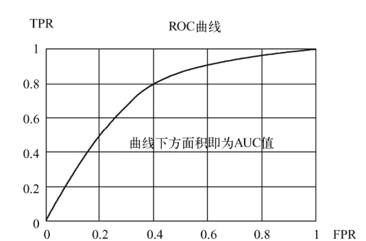

图2-1 ROC曲线

ROC 的核心价值在于直观呈现阈值变化对泛化能力的影响，帮助挑选合适阈值。曲线越靠近左上角，查全表现越好。距离左上角最近的点通常是误分类最少的理想阈值，此时假正例与假反例之和最小。

代码如下：

```
from sklearn import metrics
from sklearn.metrics import roc_auc_score
roc_auc_score(y_true, y_scores)
#求出 auc 指标
fpr, tpr, thresholds = metrics.roc_curve(y_true, y_scores, pos_label=1)
#pos_label=1, 表示值为 1 的实际值为正样本
#求出了 FPR、TPR 与阈值
```

### 2.3 特征工程

在机器学习落地中流传一句经验：“数据与特征决定上限，模型与算法只是逼近上限。” 由此可见特征工程的重要性。整体可归纳为四个方向：数据预处理、特征选择、特征降维、特征构造。

面试时，面试官往往结合候选人过往项目，追问在数据预处理、特征选择、特征降维各环节如何选型，以及如何从业务中提炼出有价值的构造特征。

#### 2.3.1 数据预处理核心操作

### 1. 无量纲化

无量纲化的目的在于消除量纲差异，让不同指标落在同一尺度。常见做法有标准化和区间缩放。标准化假设特征近似正态分布，处理后转为标准正态。区间缩放利用边界信息，把取值范围压缩到指定区间，例如 [0,1]。

### （1）标准化

样本量充足时，工程上常直接用标准化做无量纲化。在深度学习中，将输入映射到特定范围有助于反向传播收敛。若不做标准化，数值大的特征会主导损失，数值小的特征影响被弱化。标准化能让各特征作用更均衡。公式为：

x' = (x - μ) / σ

```
from sklearn.preprocessing import StandardScaler
x1=StandardScaler().fit_transform(x)
```

### （2）归一化/区间缩放法

归一化更适合样本量较小的任务。思路是用最小值和最大值进行缩放，公式为：

x' = (x - min) / (max - min)

```
from sklearn.preprocessing import MinMaxScaler
x1= MinMaxScaler().fit_transform(x)
```

### 2. 哑编码与独热编码

像国家这种定性字段无法直接用于回归或分类，需要先编码。哑编码与独热编码的本质都是把离散取值映射到欧式空间，使距离计算更合理。

以国家有中国、美国、德国、法国四种取值为例，独热编码用四维向量表示，每维对应一种状态，仅一个位置为1其余为0。哑编码只用三维，当三维全为0时可推断为法国。

代码如下：

```
from sklearn.preprocessing import OneHotEncoder
OneHotEncoder().fit_transform(x)#独热编码
```

### 3. 缺失值补充

常用的补全手段有均值填充、就近填充、K近邻填充等。注意缺失本身有时也是信息，可额外增加一列标记缺失与否，具体是否采用需结合业务。

缺失比例高时，直接丢弃该列更稳妥，否则噪声会干扰结果。若缺失比例低，如小于10%，可考虑填充，常见策略：

- 1. 用异常值填充并把缺失作为独立特征处理，如0或-9999。
- 2. 用均值或条件均值填充，数据不平衡时优先条件均值，即同标签下样本的均值。
- 3. 用相邻样本填充。
- 4. 利用插值算法。
- 5. 数据拟合，把补全视为预测问题，用随机森林等对完整样本建模，再预测缺失位置。

#### 2.3.2 特征选择要点

特征过多会拖慢训练并降低效果，特征过少也会损失信息。常用筛选思路：

### 1. 方差选择法

若某列数值长期平稳，说明区分力弱。可计算各特征方差，保留大于阈值的特征。

代码如下：

```
from sklearn.feature_selection import VarianceThreshold
VarianceThreshold(threshold=10).fit_transform(x) #threshold 为自设阈值
```

### 2. 相关系数, 统计检验

相关系数与统计检验均可用于筛选。Pearson 相关系数适用于连续变量，卡方检验适用于离散变量。Pearson 相关系数代码如下：

```
from sklearn.feature_selection import SelectKBest
from scipy.stats import pearsonr
#pearson 相关系数
from sklearn.feature_selection import chi2
#卡方检验
SelectKBest(lambda X, Y: array(map(lambda x:pearsonr(x, Y), X.T)).T, k=5).fit_transform(x, y)
#k 即指想选择的特征维数
SelectKBest(chi2, k=5).fit_transform(x, y)
```

### 3. 互信息法

互信息用于衡量自变量对因变量的相关性，公式为：

$I(X;Y)=\sum_{x\in X}\sum_{y\in Y}p(x,y)\log\frac{p(x,y)}{p(x)p(y)}$

### 4. 基于机器学习的特征选择法

该类方法先用模型评估特征重要性，例如树模型或扩展线性模型。代码如下：

```
from sklearn.feature_selection import SelectFromModel
from sklearn.ensemble import GradientBoostingClassifier
SelectFromModel(GradientBoostingClassifier()).fit_transform(x, y)
```

下面简述随机森林做降维的思路。

随机森林因样本有放回抽样与特征随机选择，系统误差较小、分类表现较好。建树时有放回抽样保证样本随机性，分裂时随机选特征保证多样性。

评估特征重要性时，常以基尼系数衡量每棵树中该特征带来的不纯度下降幅度并取平均。

变量重要性评分记为 V，假设有 m 个特征 X₁, X₂, …, Xₘ，则特征 Xⱼ 的 Gini 评分 Vⱼ 为其在所有树上节点分裂不纯度平均改变量。Gini 指数计算为：

$Gini_m = 1 - \sum_{k=1}^{K} p_{mk}^2$

其中 k 为类别，pₘₖ 为节点 m 中类别 k 的比例，K 为类别数。

特征 Xⱼ 在节点 m 的重要性，即分裂前后 Gini 的变化量：

$V_{jm}^{Gini}=Gini_m - Gini_l - Gini_r$

其中 Giniₗ 和 Giniᵣ 为分裂后两个子节点的 Gini 指数。

若特征 Xⱼ 在第 i 棵树出现的节点集合为 M，则该特征在第 i 棵树的重要性为：

$V_{jm}^{Gini} = \sum_{m \in M} V_{jm}^{Gini}$

随机森林共有 n 棵树，则：

$V_{jm}^{Gini} = \sum_{i=1}^{n} V_{ij}^{Gini}$

最后归一化得到相对重要性：

$V_j^* = \frac{V_j}{\sum_{i=1}^{c} V_i}$

用 Python 获取随机森林特征重要性的代码很简洁，如下所示：

```python
from sklearn.cross_validation import train_test_split
from sklearn.ensemble import RandomForestClassifier
x_train, x_test, y_train, y_test = train_test_split(x, y, test_size = 0.2, random_state = 0)
forest = RandomForestClassifier(n_estimators=1000, random_state=0, n_jobs=-1)
forest.fit(x_train, y_train)
importances = forest.feature_importances_
#importances 即为需要的 重要性评估
```

#### 2.3.3 特征降维方法

特征矩阵过大时训练耗时明显增加。降维是在保留信息前提下压缩维度，其效果取决于信息量与方法。常用方法包括 PCA、LDA、奇异值分解 SVD 和局部线性嵌入 LLE。降维可节省存储、加速计算并缓解过拟合。

### 1. 主成分分析法（PCA）

PCA 对数据做线性变换，使第一坐标投影方差最大，称为第一主成分，第二坐标次之。目标是让降维后向量尽可能不相关，并最大化保留原始信息。步骤如下：

- (1) 计算相关系数矩阵

$R = \begin{bmatrix} r_{11} & \cdots & r_{1p} \\ \vdots & & \vdots \\ r_{p1} & \cdots & r_{pp} \end{bmatrix}$

$r_{ij}(i, j=1, 2, \cdots, p)$为原变量$x_i$与$x_j$的相关系数，计算公式为：

$r_{ij} = \frac{\sum_{k=1}^{n} (x_{ki} - \bar{x}_i)(x_{kj} - \bar{x}_j)}{\sum_{k=1}^{n} (x_{ki} - \bar{x}_i)^2 (x_{kj} - \bar{x}_j)^2}$

- (2) 计算特征值与特征向量

解 $|\lambda I - R| = 0$，用雅可比法求得特征值并按降序排列 $\lambda_1 \ge \lambda_2 \ge \cdots \ge \lambda_p \ge 0$；对应特征向量为 $e_i$，且 $||e_i|| = 1$。

### （3）计算主成分贡献率及累计贡献率

单位特征向量 $e_i$ 即主成分 $z_i$ 的系数，$z_i = x e_i^T$。

贡献率：

$\alpha_i = \frac{\lambda_i}{\sum_{k=1}^{p} \lambda_k} \qquad i=1,2,\cdots,p$

累计贡献率：

$\frac{\sum_{k=1}^{i} \lambda_k}{\sum_{k=1}^{p} \lambda_k} \qquad i=1,2,\cdots,p$

通常选取累计贡献率达85%～95%的特征值 $\lambda_1$, $\lambda_2$, …, $\lambda_m$ 对应的前 m 个主成分。

### （4）计算主成分载荷

载荷反映主成分 $z_i$ 与原变量 $x_j$ 的关联程度。

$l_{ij} = p(z_i, x_j) = \sqrt{\lambda_i} e_{ij} \quad (i,j=1,2,\cdots,p)$

实际应用中指标量纲常不一致，需先标准化再求协方差矩阵。

代码如下：

```python
from sklearn.decomposition import PCA

PCA(n_components=k).fit_transform(x) #k 为主成分的数目
```

### 2. 线性判别分析法（LDA）

LDA 是有监督降维，将高维样本投影到类间距离最大、类内距离最小的子空间，目标是让同类更紧凑、异类更分离。

LDA 与 PCA 的主要区别：

- 1) LDA 是有监督降维，PCA 是无监督。
- 2) LDA 最多降到类别数 k-1 维，PCA 无此限制。
- 3) LDA 选择分类性能最优的投影方向，PCA 选择样本方差最大的方向。PCA 追求发散性，LDA 追求可分性。

代码如下：

```python
from sklearn.lda import LDA
LDA(n_components=2).fit_transform(iris.data, iris.target)
```

### 3. 局部线性嵌入（LLE）

局部线性嵌入的核心思想是，每个样本都可以用其邻域内若干邻点的线性加权和来重建，从而在降维后尽量维持原流形的几何特性。实践中大致分为三步：先为每个点挑选 k 个最近邻，随后根据这些邻居求解局部重建系数，最后借助系数与邻居信息得到低维映射。该方法在理论上很完整，但在工业落地场景里使用并不多见。

#### 2.3.4 特征构造主要包括什么
特征工程要围绕业务属性和数据本身的分布去挖掘可能产生增益的新变量，这一步对模型提升至关重要，书本难以覆盖，更多依赖真实项目的经验沉淀。下面给出三个直观例子。

比如要预测商场未来销售额，周末与节假日往往是强信号，需要通过独热编码等手段单独成一个维度。

在客户关系管理任务中，最近一次消费距今的天数、消费频次、累计消费金额三项指标非常关键，若原始表里没有，就必须从行为日志中自行派生。

再如交通流量预测，早晚高峰时段、道路宽窄、红绿灯数量等都是典型的有效变量。

### 2.4 过拟合、欠拟合与正则化
训练时过拟合很常见，典型征兆是训练误差持续下滑而验证误差开始回升。初期模型学习不足，拟合能力偏弱，偏差较大。随着迭代深入，模型逐渐捕捉到训练集的噪声模式，拟合能力增强。继续训练后，模型对训练集细微抖动都过度敏感，就出现了过拟合。

#### 2.4.1 过拟合与欠拟合的区别是什么，什么是正则化
欠拟合即模型在训练集上也难以达到足够低的误差，常因为表达能力不足，特征维度太少。

过拟合则是训练误差与泛化误差差距拉大，训练表现尚可，新数据上却泛化不佳。

所有以压低测试误差为目标的技巧都可归入正则化范畴，通常会以略微抬高训练误差为代价。

#### 2.4.2 解决欠拟合的方法有哪些
缓解欠拟合大致有三类做法。

- 1) 补充新变量，深度学习里可借助因子分解机、子编码器等构件。
- 2) 提升模型容量，线性模型可加入高次项，深度模型可加深网络、增大多神经元。
- 3) 放宽正则强度，即减小正则项系数，让模型学习更充分。

#### 2.4.3 防止过拟合的方法主要有哪些
### 1. 正则化
常见做法包括 L₁、L₂ 以及两者混合。

L₁ 的目标是压缩参数绝对值之和，定义为：
‖x‖₁ = Σᵢ |xᵢ|

L₂ 的目标是压缩参数平方之和，定义为：
‖x‖₂ = Σᵢ xᵢ²

混合形式的定义为： α‖x‖₁ + (1−α)/2 ‖x‖₂

坐标轴上，因此每一维的参数都不会是0。

因 L1 能把参数推向零，常用于选特征。而工业实践里最常用的仍是对权重施加 L2 约束。

L1 与 L2 在先验假设上也有差异：L1 可由权重 w 的拉普拉斯先验经最大后验估计得到，L2 可由权重 w 的高斯先验经最大后验估计得到。

后验概率表达式为似然再加 logP(w)：
MAP=logP(y|X,w)P(w)=logP(y|X,w)+logP(w)

P(w) 代表对权重系数的先验信念，拿到样本后可据 {X,y} 的后验对 w 进行修正。

若假设 w_j ~ N(0, σ²)，则
log P(w)=log ∏_j p(w_j)=log ∏_j [1/√(2πσ) e^{-w_j²/(2σ²)}]= 1/(-2σ²) Σ_j w_j² + C
此时 logP(w) 等价于在损失里加入 L2 项。

若假设 w_j 的先验为均值 0、尺度 a 的拉普拉斯分布，即
P(w_j)=1/√(2a) e^{-|w_j|/a}
则
log P(w)=log ∏_j p(w_j)=log ∏_j [1/√(2a) e^{-|w_j|/a}]= -1/a Σ_j |w_j| + C
此时 logP(w) 等价于在损失里加入 L1 项。

### 2. Batch Normalization
Batch Normalization 是一种在深度网络里降低泛化误差的正则手段，主要通过缓解梯度消失来提速、抑制过拟合并降低对初始化的依赖。

训练集与测试集分布不一致会伤害泛化，因此需在训练前对输入做标准化。因为各隐藏层的参数不同，下一层输入的改变会让每批数据的分布漂移，网络每次迭代都要适应新分布，训练难度和过拟合风险随之上升。

Batch Normalization 通过对分布施加额外约束来增强泛化，同时破坏了已学到的特征分布。为恢复最优输入分布，引入可学习的仿射变换：
$y_k = BN(x_k) = \gamma \hat{x}_k + \beta = \gamma \frac{x_k - E[x_k]}{\sqrt{var[x_k] + \varepsilon}} + \beta$
其中 $\gamma$ 和 $\beta$ 为可训练参数。

### 3. Dropout 随机失活
Dropout 通过随机删减神经元来改变网络结构来防止过拟合，不改动损失函数，而是降低实际复杂度，在训练大模型时效果明显。

具体做法是每次迭代随机丢弃一部分隐层单元，保持输入输出层不变并更新权重，下一次迭代再随机丢弃另一组单元，如此循环到训练结束。

使用 Dropout 相当于同时训练大量仅含部分隐层单元的子网络，每个子网络都能给出预测，随着训练进行多数子网络都能给出正确结果。

### 4. 迭代截断
迭代截断即早停策略，在模型尚未在训练集上完全收敛前提前终止，以避免过拟合。做法是在训练中记录迄今最佳准确率，当连续 n 个 Epoch 都未能刷新最佳时即停止，n 常取 100、200 等。

### 5. K 折交叉验证
k-fold 交叉验证把训练样本切成 k 份，进行 k 轮训练验证，每轮用其中一份作验证集，其余 k-1 份合并作训练集。每个样本会在一次实验中作为验证样本，在 k-1 次实验中作为训练样本。每轮都用交叉验证过程决定在验证集上表现最好的迭代次数并挑选合适超参。

### 6. 常见面试笔试题
机器学习中L1正则化和L2正则化有什么区别（ ）。

- A. 使用L1可以得到平滑的权值，使用L2可以得到平滑的权值
- B. 使用L1可以得到稀疏的权值，使用L2可以得到平滑的权值
- C. 使用L1可以得到平滑的权值，使用L2可以得到稀疏的权值
- D. 使用L1可以得到稀疏的权值，使用L2可以得到稀疏的权值

解析：选（B）。L1 有稀疏偏好，会把部分特征的权重压到零；L2 主要防过拟合，倾向保留更多参数。原理上，L1 正则化可由假设权重 w 的先验为拉普拉斯分布并用最大后验概率估计导出，L2 正则化可由假设权重 w 的先验为高斯分布并用最大后验概率估计导出。

### 2.5 偏差与方差
偏差衡量学习器期望预测与真实结果的偏离，反映拟合能力；方差衡量相同规模训练集变动带来的性能波动，反映数据扰动影响。

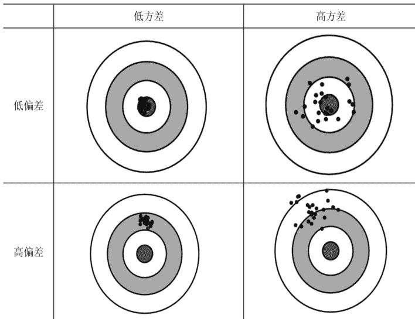
图2-2 偏差与方差

偏差反映拟合能力，方差反映稳定性。训练不足时模型拟合力不够，数据扰动难以显著改变模型，此时偏差主导泛化误差；训练加深后模型开始学习数据的扰动，方差逐渐主导泛化误差；训练充足后拟合能力过强，轻微扰动都会让模型显著变化，即过拟合，非全局特征也被学入。

#### 2.5.1 试推导泛化误差、偏差、方差与噪声之间的关系
为推导关系，先作如下定义，如表2-2所示。

表2-2 各种符号的定义

| 符号 | 含义 |
|---|---|
| D | 训练集 |
| y | x 的真实标记 |
| y_D | x 在训练集 D 中的标记 |
| F | 通过训练集 D 学到的模型 |
| f(x; D) | 由训练集 D 学到的模型 f 对 x 的预测输出 |
| \bar{f}(x) | 模型 f 对 x 的期望预测输出 |

学习器在训练集上的误差被称为训练误差或经验误差，在新样本上的误差被称为泛化误差。以回归为例，期望泛化误差为：
$$Err(x)=E[(y_D - f(x;D))^2]$$
方差公式：
$$var(x)=E[(f(x;D)-\bar{f}(x))^2]$$
噪声即真实标记与数据集中实际标记间的偏差，公式为：
$$\varepsilon=E[(y_D - y)^2]$$
假定噪声期望为0，即$E(y_D - y)=0$
偏差即期望预测与真实标记的误差，偏差平方的公式为：
$$bias^2(x)=(\bar{f}(x)-y)^2$$
推导如下：
$$Err(x)=E[(y_D - f(x;D))^2]$$
$$=E[(y_D - \bar{f}(x)+\bar{f}(x)-f(x;D))^2]$$
$$=E[(y_D - \bar{f}(x))^2]+E[(\bar{f}(x)-f(x;D))^2] \quad (注：E(f(x;D))=\bar{f}(x))$$
$$=E[(y_D - y + y - \bar{f}(x))^2]+E[(\bar{f}(x)-f(x;D))^2]$$
$$=E[(y - \bar{f}(x))^2]+E[(y_D - y)^2]+E[(\bar{f}(x)-f(x;D))^2] \quad (注：E(f(x;D))=\bar{f}(x))$$
$$=bias^2(x)+\varepsilon+var(x)$$
由此可知泛化误差可分解为偏差、方差和噪声之和。

#### 2.5.2 导致偏差和方差的原因是什么
偏差多源于模型容量不足或对学习算法做了错误假设。例如真实模型是三次函数，却假设为二次函数，就会导致欠拟合，偏差增大；训练误差主要由偏差造成。

方差通常由模型容量过高引起。例如真实模型是简单二次函数，却假设为五次函数，就会导致过拟合，方差增大；由方差引起的误差主要体现在测试误差相对训练误差的波动上。

### 2.6 常用梯度下降法与优化器
机器学习中的大部分问题都是优化问题，绝大多数可用梯度下降处理。其数学原理是函数沿梯度方向变化最快，优化时沿负梯度方向减小函数值以达到目标。

梯度方向如下：
$$grad f(x_0,x_1,\dots,x_n)=\left(\frac{\partial f}{\partial x_0},\frac{\partial f}{\partial x_1},\dots,\frac{\partial f}{\partial x_n}\right)$$
沿负梯度方向减小函数值表达为：
$$x_0 = x_0 - \alpha \frac{\partial f}{\partial x_0},\,x_1 = x_1 - \alpha \frac{\partial f}{\partial x_1},\dots,x_n = x_n - \alpha \frac{\partial f}{\partial x_n}$$
这就是一次梯度下降，算法会重复执行直至满足收敛条件。

梯度下降是一种通过迭代寻找最优参数的优化算法，最优参数指使目标函数最小的参数。若目标函数是凸函数，梯度下降可得到全局最优解，一般情况下则无法保证全局最优。

#### 2.6.1 随机梯度下降与小批量随机梯度下降
标准梯度下降每次用全部训练样本的平均损失来更新参数，若样本量巨大计算成本很高。随机梯度下降每次只用单个样本的损失来近似平均损失。

由于 SGD 只用部分样本估计梯度，估计精度不高，常出现偏差，导致收敛不稳定甚至不收敛。

小批量随机梯度下降为降低随机梯度的方差、使迭代更稳定，使用一批随机数据的损失来近似平均损失。批量训练还能利用矩阵运算和并行计算框架。通常批大小取 2 的幂，如 32、64、128、256 等，以充分利用矩阵运算。

#### 2.6.2 动量算法
动量方法有点类似于二阶梯度算法，参数更新公式如下：
$$g \leftarrow \frac{1}{m} \nabla_{\theta} \sum_{i} L(f(x_i;\theta),y_i)$$
$$v_t = \alpha v_{t-1} - \varepsilon g_t$$
$$\theta_{t+1} = \theta_t + v_t$$
从形式上看，动量算法引入变量 v 充当速度角色，以及超参数 $\alpha$。$\alpha$ 一般取 0.5、0.9、0.99，对应最大 2 倍、10 倍、100 倍的步长。

动量算法可缓解鞍点问题，也可加速 SGD，特别是在高曲率、梯度方向一致的小幅梯度场景。训练过程更稳定，在鞍点处因惯性更易离开平缓区域。

随机梯度下降每次更新步长只是梯度乘以学习率；而动量算法的步长还取决于历史梯度序列的大小和排列，当连续梯度方向相同时步长会被不断放大。

#### 2.6.3 NAG算法（Nesterov动量）
NAG 在对参数施加当前速度后再计算梯度，让算法具备前瞻能力。相当于在标准动量方法中加入修正因子，计算梯度时在损失函数中减去动量项。参数更新公式如下：
$$\hat{\theta} = \theta + a v$$
$$g \leftarrow \frac{1}{m} \nabla_{\hat{\theta}} \sum_{i} L(f(x_i; \hat{\theta}), y_i)$$
$$v_t = a v_{t-1} - \varepsilon g_t$$
$$\theta_{t+1} = \theta_t + v_t$$

#### 2.6.4 自适应学习率算法
学习率决定参数空间搜索的步长，非常重要也较难设定。过大则优化方向不稳定，过小则易陷入局部最优。自适应学习率算法可根据参数更新次数自动调整学习率：初期参数远离最优值时用较大学习率，后期逼近最优值时用较小学习率。下面介绍三种重要方法。

### （1）AdaGrad
AdaGrad 虽能自动适应学习率，但仍需设一个全局学习率 ε，它并非实际学习率，而是与以往参数模的累加成反比，具有较大偏导数的参数学习率下降快，具有小偏导数的参数学习率下降慢。具体见公式：
$$\varepsilon_n = \frac{\varepsilon}{\delta + \sqrt{\sum_{j=1}^{n-1} g_j \odot g_j}}$$
算法步骤如下：
需要预先设定的值：全局学习率 ε，初始参数 θ，数值稳定量 δ；
中间变量：梯度累积量 r；
迭代过程如公式：
$$\tilde{g} \leftarrow \frac{1}{m} \nabla_{\theta} \sum_{i} L(f(x_i; \theta), y_i)$$
$$r \leftarrow r + \tilde{g} \odot \tilde{g}$$
$$\theta \leftarrow \theta - \frac{\varepsilon}{\delta + \sqrt{r}} \odot \tilde{g}$$
Adagrad 更新参数的过程如下：
w_{t+1} \leftarrow w_{t} - \frac{\eta}{\sqrt{\sum_{i=0}^{t} (g_{i})^{2}}} g_{t}
其中，g_t 为参数的梯度。

### （2）RMSProp
RMSProp 是 AdaGrad 的升级版，在非凸优化上表现更好，因其用指数衰减处理历史信息，找到凸结构后能快速收敛。RMSProp 与 AdaGrad 的区别在于控制历史信息获取的衰减系数，算法步骤如下：
需要预先设定的值：全局学习率 ε，初始参数 θ，数值稳定量 δ，衰减系数 ρ；
中间变量：梯度累积量 r；
迭代过程如公式：
\tilde{g} \leftarrow \frac{1}{m} \nabla_{\theta} \sum_{i} L(f(x_{i};\theta),y_{i}) 
r \leftarrow \rho r + (1-\rho)\tilde{g} \odot \tilde{g}

深度学习优化器与经典决策解析

\theta \leftarrow \theta - \frac{\varepsilon}{\delta + \sqrt{r}} \odot \tilde{g}

RMSProp 的设计思路是补上 AdaGrad 在深层网络中学习率过快衰减、训练提前停滞的缺陷，对目标分布随时间漂移的非平稳情形适应性更好。代价是多引入一个衰减超参，整体步幅依然受全局学习率控制。

### （3）Adam

Adam 即 Adaptive Moment Estimation，是实践中最常用的自适应优化方案。相较 AdaGrad，它让单步更新幅度保持在相对稳定的范围，训练波动更小。

实现前需指定：步长因子 ε、初始参数 θ、数值稳定常数 δ、一阶衰减系数 ρ₁、二阶衰减系数 ρ₂，常规默认值 ε=0.001、δ=10⁻⁸、ρ₁=0.9、ρ₂=0.999。

维护两个中间状态：一阶矩 s、二阶矩 r。

迭代如下：

\tilde{g} \leftarrow \frac{1}{m} \nabla_{\theta} \sum_{i} L(f(x_{i};\theta),y_{i}) 

s \leftarrow \rho_{1} s + (1-\rho_{1})\tilde{g} 

r \leftarrow \rho_{2} r + (1-\rho_{2})\tilde{g} \odot \tilde{g} 

\theta \leftarrow \theta - \varepsilon \frac{\frac{s}{1-\rho_{1}}}{\delta + \sqrt{\frac{r}{1-\rho_{2}}}} \odot \tilde{g}

没有通用最优的优化器，选型取决于具体任务，常做法是同时用 Adam 与 RMSProp 跑一遍，对比表现后再定夺。

#### 2.6.5 试比较牛顿迭代法与梯度下降法

牛顿迭代的核心是在当前估计 x_k 邻域内用二阶泰勒近似 f(x)，再在该邻域寻找更优点。近似式忽略高阶项：

$\varphi(x)=f(x_k)+f'(x_k)(x-x_k)+\frac12 f''(x_k)(x-x_k)^2$

驻点条件 $\phi'(x)=0$ 给出

$f'(x_k)+f''(x_k)(x-x_k)=0$

解得

$x=x_k-\frac{f'(x_k)}{f''(x_k)}$

由初值 x₀ 推出

$x_{k+1}=x_k-\frac{f'(x_k)}{f''(x_k)}\qquad k=0,1,\cdots$

序列 $\{x_k\}$ 可逼近极小点。

二维推广为

$\varphi(X)=f(X_k)+\nabla f(X_k)(X-X_k)+\frac12 (X-X_k)^T\nabla^2 f(X_k)(X-X_k)$

其中 ∇f 为梯度，∇²f 为海森矩阵：

∇f = [ ∂f/∂x₁ ; ∂f/∂x₂ ; … ; ∂f/∂xₙ ]

∇²f = [ ∂²f/∂x₁² … ∂²f/∂x₁∂xₙ ; ⋮ ⋮ ; ∂²f/∂xₙ∂x₁ … ∂²f/∂xₙ² ]

记 X=X_k 时的梯度与海森为 g_k、H_k。驻点要求

∇ φ(X)=0

gₖ+Hₖ • (X-Xₖ)=0

若 H_k 可逆，则

X = Xₖ - Hₖ⁻¹ · gₖ

迭代式

Xₖ₊₁ = Xₖ - Hₖ⁻¹ · gₖ  k=0,1,…

其中 dₖ = -Hₖ⁻¹ · gₖ 称为牛顿方向。完整流程：

- 1) 设定初值 X₀ 与精度阈值 ε，k=0。
- 2) 求 g_k 与 H_k。
- 3) 若 ||g_k|| < ε 停止，否则取 d_k = -H_k⁻¹ · g_k。
- 4) X_{k+1}=X_k+d_k。
- 5) k=k+1，返回 2)。

可见梯度下降法仅使用一阶信息，牛顿法同时利用一阶与二阶信息。牛顿法收敛更快，迭代次数通常更少；缺点是每步需求海森矩阵的逆，计算成本很高。

## 常见面试笔试题：

以下说法错误的一项是（ ）。

- A. 相比 AdaGrad，RMSProp 在非凸优化中表现更佳
- B. 目标为凸函数时，梯度下降法的解为全局最优
- C. 梯度下降比牛顿法收敛速度快
- D. 拟牛顿法不直接计算海森矩阵

解析：选 C。牛顿法借助二阶导信息，梯度下降法只用一阶，所以收敛速度上牛顿法通常更快。

### 2.7 其他问题

#### 2.7.1 常见的损失函数有哪些

（1）0-1 loss
计数分类错误的样本数。

（2）Hinge Loss
常用在 SVM 的最大间隔分类。对可能的输出 t=±1 与分数 y，定义为：

$L(y)=\max(0,\,1-t*y)$

（3）Log Loss 对数损失
对数单调，求解最优不会改变；对乘积型目标如极大似然，取对数可化为求和，简化计算。

（4）Squared Loss 平方损失
预测与真实差值的平方和，常用于线性回归。

（5）Exponential Loss 指数损失
误差越小损失下降越快，AdaBoost 即采用。缺点是误分样本权重指数放大，异常点会干扰后续弱学习器。

#### 2.7.2 如何判断函数凸或非凸

凸集定义：x,y∈M 时所有 θx+(1-θ)y 也∈M。定义域为凸集且满足

$f(\theta x+(1-\theta) y)\leqslant \theta f(x)+(1-\theta) f(y)$

则为凸函数。可推广为加权和形式。若二阶可导且二阶导恒正，或多元函数的海森矩阵半正定，则为凸。

#### 2.7.3 什么是数据不平衡问题，应该如何解决

数据不平衡指类别比例失衡。二分类中正负本应接近，但在电商恶意差评、金融反欺诈、医疗肿瘤诊断等场景比例可能悬殊。

常用对策：

1）数据采样。上采样通过复制少数类或加入微小扰动平衡比例，易过拟合。下采样从多数类抽取部分样本平衡比例，可能丢弃重要信息，需多次随机进行。

- 2) 数据合成依据已有样本的特征相似性生成新样本。
- 3) 加权对不同类别的错误赋予不同代价，使学习更关注少数且易错类。
- 4) 一分类。当失衡极端时采样会扭曲真实分布，可用一分类。例 One-class SVM 用高斯核把样本映射到高维，在核空间找一个包住所有数据的超球，测试点在内归为多数类，否则归为少数类。

#### 2.7.4 熵、联合熵、条件熵、KL散度、互信息的定义

物理中熵衡量热力学系统无序程度，由克劳修斯提出：

$$\Delta S = \frac{Q}{T}$$

Q 为吸放热，T 为温度。

计算机中熵定义为离散随机事件的概率度量。系统越有序熵越低，越混乱熵越高。若 X 取值 {x1,x2,…,xk}，概率 P(X=xi)=pi，则

$$H(X) = -\sum_{x} p(x)\log p(x) = \sum_{x} p(x)\log\frac{1}{p(x)}$$

联合熵：X,Y 的联合分布可得

$$H(X,Y) = -\sum_{x} p(x,y)\log p(x,y)$$

条件熵：已知 X 下 Y 新增的不确定性

$$H(X|Y) = -\sum_{x,y} p(x,y)\log p(y|x)$$

可得 H(Y|X)=H(X,Y)-H(X)。推导略。

KL 散度：设 f(x)、g(x) 为 X 的两分布，则相对熵

$D(f \| g)= -\sum_{x} f(x)\log\frac{f(x)}{g(x)} = E_{f(x)}\log\frac{f(x)}{g(x)}$

互信息：X,Y 的互信息为联合分布与独立分布乘积的 KL 散度：

$I(X,Y)=\sum_{x,y} f(x,y)\log\frac{f(x,y)}{f(x)f(y)}$

可得 H(Y)-I(X,Y)=H(Y|X)。推导略。

韦恩图表示，互信息 I(X,Y) 表示在 Y 已知时 X 的不确定性减少量，即信息增益。

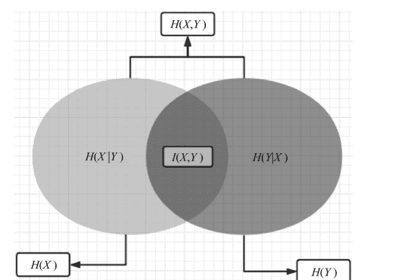

图2-3 联合熵与熵的韦恩图

#### 2.7.5 主成分分析和因子分析的区别

数据挖掘中变量高度相关会增加分析难度，需在降维同时尽量保留信息。

主成分分析把相关指标 x₁,x₂,…,xₚ 线性重组为少数彼此不相关的综合新指标，最大化保留原信息且成分间无关。

因子分析按相关性大小分组，使组内相关高、组间相关低，分解为公共因子与特殊因子。公共因子反映共性，特殊因子反映个体特性。

区别：
- 1) 主成分从空间生成角度寻找解释变量变异主要部分的不相关成分；因子分析寻找解释变量的公共因子、特殊因子及系数。
- 2) 因子分析把变量表示为因子的线性组合，主成分把主成分表示为变量的线性组合。
- 3) 主成分无需假设，因子分析有假设如公共因子与特殊因子不相关。
- 4) 主成分由协方差或相关矩阵特征值唯一确定；因子分析可通过旋转得到不同解。

#### 2.7.6 什么是最小风险贝叶斯决策

贝叶斯定理用先验推算后验：

P(A|B)=\frac{P(B|A)P(A)}{P(B)}

最小风险贝叶斯决策步骤：

- 1) 已知 P(ω_i)、P(X|ω_i)，i=1,…,c 及待识别 X，计算后验 P(X|ω_i)。
- 2) 结合决策表，用公式计算动作 a_i 的条件风险。
- 3) 比较 R(a_i|X)，取最小者对应的 a_k。

R(a_i|X)=\sum_{j=1}^{c}\lambda(a_i,\omega_j)P(\omega_j|X)

a_k 即为最小风险决策。

#### 2.7.7 什么是贝叶斯最小错误概率和最小风险

设病症正常 ω1，不正常 ω2，P(ω1)=0.9，P(ω2)=0.1，检查结果 x 对应 P(x|ω1)=0.2，P(x|ω2)=0.4。风险矩阵 L=[0 6;1 0]。

最小错误率贝叶斯决策用贝叶斯公式求错误率最小规则；最小风险决策引入损失函数求风险最小决策。0-1 损失下两者等价。

最小错误概率：

P(ω1|x)∝P(ω1)P(x|ω1)
P(ω2|x)∝P(ω2)P(x|ω2)

因 l=P(x|ω1)/P(x|ω2)=1/2 > P(ω2)/P(ω1)=1/9，故 x∈ω1。

最小风险：

r_j(x)=\sum_{i=1}^{2}L_{ij}P(x|ω_i)P(ω_i),j=1,2

因 l' =1/2 > P(ω2)/P(ω1)*(L21-L22)/(L12-L11)=1/54，所以 x∈ω1。

## 第3章 常见的机器学习算法

本章梳理数据挖掘常用算法，从线性回归、逻辑回归、K均值聚类等基础模型到 XGBoost、GBDT 等进阶模型。原理、细节与差异是面试高频考点，建议结合论文与实战加深理解。

### 3.1 线性回归与逻辑回归

### 3.1.1 线性回归及代码展示

线性回归探究因变量 y 与自变量 x₁,x₂,…,xₙ 的关系，利用训练数据总结规律并预测未知样本。

设样本数为 m，(x⁽ⁱ⁾, y⁽ⁱ⁾)，i=1,…,m，其中 x⁽ⁱ⁾=(1, x₁⁽ⁱ⁾,…,xₙ⁽ⁱ⁾)。回归函数：

h_θ(x) = θ₀ + θ₁x₁ + … + θₙxₙ = θᵀx

x = (1, x₁,…,xₙ)ᵀ，θ = (θ₀,…,θₙ)ᵀ

代价函数：

J(θ) = 1/(2m) Σᵢ₌₁ᵐ (h_θ(x⁽ⁱ⁾)-y⁽ⁱ⁾)²

½ 在求导时抵消常数。梯度下降、最小二乘等用于求最小值。

最小二乘法用矩阵运算求 θ，对 J(θ) 求偏导并令为零，得到的 θ 即为模型参数，即

线性回归在最小二乘意义下求解参数，本质上是让偏导为零。把 ∂/∂θₖ J(θ)=0 整理后可得 Σ y⁽ⁱ⁾xₖ⁽ⁱ⁾ = Σⱼ (Σ xⱼ⁽ⁱ⁾xₖ⁽ⁱ⁾)θⱼ。用矩阵语言写就是 XᵀY = XᵀX θ，进而得到闭式解 θ = (XᵀX)⁻¹XᵀY。

这两种求解思路的取舍很明显。梯度下降要手动设定学习率 α 并做多次迭代才能收敛，而最小二乘一次解出答案。代价是最小二乘必须求 (XᵀX)⁻¹，计算复杂度约 O(n³)，当样本量或特征维度很大时耗时会变得难以接受。

Python 里线性回归的使用代码展示如下。

```
# 首先从 sklearn 库中导入划分函数
from sklearn.model_selection import train_test_split
# 然后执行函数获得结果
x_train, x_test, y_train, y_test = train_test_split(X, y, random_state=0)
# 首先从 sklearn 库中导入线性回归函数
from sklearn.linear_model import LinearRegression
# 执行函数获得一个线性回归模型
model = LinearRegression()  # 这是一个未经过训练的机器学习模型
# 对模型传入输入数据 x_train 和输出数据 y_train
model.fit(x_train, y_train)  # 这是一个经过训练的机器学习模型
"""输出线性回归的截距和各个系数"""
print(' model.intercept :', model.intercept_)
print(' model.coef :', model.coef_)
y_pred = model.predict(x_test)
# 引入 sklearn 模型评价工具库
from sklearn import metrics
print("MSE: ", metrics.mean_squared_error(y_test, y_pred))
print("RMSE: ", np.sqrt(metrics.mean_squared_error(y_test, y_pred)))
```

### 3.1.2 逻辑回归及代码展示

逻辑回归是用于分类的经典模型，既能做二分类也能扩展到多分类。

线性回归寻找的是 X 与连续输出 y 之间的线性系数 θ，使 y≈Xθ。若输出是离散的，就需要对 y 做一次映射 g(y)。当 g(y) 在某个实数区间对应类别1、另一个区间对应类别2时，模型就具备了分类能力。逻辑回归里常用的映射就是 sigmoid，形式如下：

$$g(z)=\frac{1}{1+e^{-z}}$$

sigmoid 的特点是 z→+∞ 时趋近于1，z→-∞ 时趋近于0，把整个实数轴压缩到 (0,1) 区间，非常适合表征概率；同时它的导数形式简洁优雅：

$$g'(z)=g(z)(1-g(z))$$

这个导数性质在后续推导中会频繁用到。

令 z = xθ，就得到二元逻辑回归的标准写法：

$$h(x)=\frac{1}{1+e^{-x\theta}}$$

其中 x 是输入样本，h(x) 是模型输出，可理解为属于某类的概率。θ 是待估计的参数。h(x) 越小，判为0的可能性越大；越大则判为1的可能性越高，接近阈值时可信度会下降。

在二分类设定下样本标签只有0和1，于是有：

$$P(y=1|x,\theta)=h(x)$$

$$P(y=0|x,\theta)=1-h(x)$$

用矩阵形式写出 y 的概率分布为：

$$P(Y|X,\theta)=h(x)^y(1-h(x))^{1-y}$$

有了概率分布，就可以最大化似然来估计 θ。为便于计算通常转而最大化对数似然。其中：

似然函数的代数表达式为：

$$L(\theta)=\prod_{i=1}^m (h(x^{(i)}))^{y^{(i)}} (1 - h(x^{(i)}))^{1-y^{(i)}}$$

$$l(\theta)=\log L(\theta)$$

$$=\sum_{i=1}^m y^{(i)} \log h(x^{(i)}) + (1 - y^{(i)})\log(1 - h(x^{(i)}))$$

$$\frac{\partial}{\partial \theta_j} l(\theta)=\left(y\frac{1}{g(\theta^T x)} - (1-y)\frac{1}{1-g(\theta^T x)}\right)\frac{\partial}{\partial \theta_j} g(\theta^T x)$$

$$=\left(y\frac{1}{g(\theta^T x)} - (1-y)\frac{1}{1-g(\theta^T x)}\right)g(\theta^T x)(1 - g(\theta^T x))\frac{\partial}{\partial \theta_j} \theta^T x$$

$$=(y(1 - g(\theta^T x)) - (1-y)g(\theta^T x))x_j$$

$$=(y - h(x))x_j$$

基于上述推导构造一个便于优化的损失函数：

$$J(\theta)=\frac{1}{m}l(\theta)$$

对应的梯度下降方向为：

$$\theta_j := \theta_j - \alpha \frac{\partial}{\partial \theta_j} J(\theta) = \theta_j + \alpha \frac{1}{m} \sum_{i=1}^m (y - h(x^{(i)}))x_j^{(i)}$$

以上推导未加正则。实际任务中往往需要加入正则，具体的正则形式要看任务需求。

逻辑回归在工业界是基础且常用的算法，建议手推一遍并实现一遍。下面是代码展示：

```
class Sigmoid:
    #function 定义了 sigmoid 函数，derivative 定义了它的导数
    def function(self, x):
        return 1/(1 + np.exp(-x))

    def derivative(self, x):
        return self.function(x) * (1 - self.function(x))
class LogisticRegression():
    #逻辑回归分类模型
    def __init__(self, learning_rate=1):
        self.w = None #w 是需要训练的参数
        self.sigmoid = Sigmoid()
    def fit(self, X, y, iterations=1000):
    #输入格式恰当的训练值 x 和 y
    #训练截止条件是 1000 次迭代计算完毕，也可利用其他方法，例如计算每次迭代得到
    #的 w 的差，如果小于某个条件，则可以停止训练，避免过拟合
        n_samples, n_features = np.shape(X)
        self.w = np.random.uniform(-1/math.sqrt(n_features), 1/math.sqrt(n_features), (n_features, 1))
    #参数初始化
        for i in range(iterations):
            y_pred = self.sigmoid.function(X.dot(self.w))
            #计算预测值
            self.w -= lr * X.T.dot(-(y - y_pred) * self.sigmoid.function(X.dot(self.w)) *
                (1 - self.sigmoid.function(X.dot(self.w))))
            #利用梯度下降法更新参数，lr 是定义好的学习率
    def predict(self, X):
        y_prediction = np.round(self.sigmoid.function(X.dot(self.w))).astype(int)
        #计算预测值
        return y_prediction
    model= LogisticRegression()
    model.fit(X_train, y_train)
    y_pred = model.predict(X_test)
```

也可以直接调用现成接口实现：

```
sklearn.linear_model.LogisticRegression()
```

关键参数说明如下。

1) 正则化 penalty
默认采用 L2，也可换成 L1。若出现明显过拟合或希望参数稀疏，可选择 L1。

2) 优化算法 solver
可选四种：
- liblinear：坐标轴下降法；
- lbfgs：拟牛顿法的一种；
- newton-cg：牛顿法的变种；
- sag：随机平均梯度下降，每次只用部分样本计算梯度，适合大规模数据，收敛速度通常优于 SGD 及另外三种。
正则化选择会影响优化器的可用性。newton-cg、lbfgs、liblinear、sag 都支持 L2，而 L1 因损失不可导，只能用 liblinear。

3) 分类方式 multi_class
可选 one-vs-rest 和 multinomial。注意 liblinear 不支持 multinomial。

4) 类别权重 class_weight
用于处理类别不平衡。设为 balanced 时会根据训练样本量自动计算权重，样本越少的类别权重越高，从而把更多样本推向高权重类别。sample_weight 也可以达到类似效果。

### 3.1.3 逻辑回归模型如何进行多分类

多元逻辑回归常见做法有 one-vs-rest 和 many-vs-many。OvR 是为每个类别训练一个二分类器，正例为该类，其余为负例；测试时看哪个分类器输出为正。MvM 则是把若干类作为正类、其余作为负类来训练。

一种直观做法是假设 N 元分类，把第 N 类样本作为正例，其余作为负例，在此基础上做二元逻辑回归得到第 N 类模型，其余类以此类推。

多项式逻辑回归可直接给出概率：

P(Y = n | x) = e^{(θ_n x)} / (1 + Σ_{n=1}^{N-1} e^{(θ_n x)})      n=1,2,…,N-1

P(Y = N | x) = e^{(θ_n x)} / (1 + Σ_{n=1}^{N-1} e^{(θ_n x)})

### 3.1.4 逻辑回归分类和线性回归的异同点是什么

逻辑回归本质上仍是线性模型，只是在线性之上加了 sigmoid 的非线性。没有 sigmoid 的线性回归难以处理 0/1 分类问题。

优化目标也不同，经典线性模型用最小二乘，而逻辑回归用似然最大化。预测范围方面，线性回归输出覆盖整个实数轴，逻辑回归输出被限制在 [0,1] 区间。

## 3.2 常用聚类算法

聚类是机器学习中的无监督任务，核心思想是依据相似度把大量数据划分为若干组，使组内相似度最大、组间差异最大。聚类分析可直接比较事物性质，把相近的归在一起。

应用场景很广。网络流量监控与数据挖掘可用于舆情分析发现突发热点；商业上消费数据的聚类能揭示新的消费趋势和市场需求；城市规划中交通或人口分布的聚类有助于分区与道路设计。

### 3.2.1 K均值法及代码展示

K-Means 能把未标注数据划分为 K 个簇，通过反复移动簇心和成员直至稳定。理想结果是簇内高度相似、簇间差异明显，具有局部最优性而非全局最优。

基本流程：
1）随机挑选 K 个初始中心；
2）把每个数据点分配给最近的中心，形成簇；
3）重新计算每个簇的均值作为新中心；
重复 2-3 步直至中心不再变化。

K 均值的缺陷在于 K 必须预先指定，选择困难；初始中心的好坏会显著影响结果；仅适用于数值属性，无法处理类别型数据。

改进方向很多，其中 K-Harmonic Means 不必细究，但面试常被问到如何改进。K-Harmonic Means 先按簇均值初始化，再用目标函数和中心移动公式迭代，直至无点移动。其评价函数为所有点到所有中心的均方距离的调和平均，HA = P / Σ 1/a_i，然后把过于集中的中心迁移到数据稀疏区，降低了对初始点的依赖。

在此基础上 AKHM 引入新的度量 d(x, y)=1-exp(-β‖x-y‖²)，目标函数变为：

$AKHM(X,C)=\sum_{i=1}^{N} \frac{K}{\sum_{j=1}^{K} \frac{1}{1-\exp(-\beta\|x_i - x_j\|^2)}}$

以及由此得到的新的中心更新公式：

$$w_j = \frac{\sum_{i=1}^{N} \frac{\exp(-\beta\|x_i - x_j\|^2)}{(1 - \exp(-\beta\|x_i - x_j\|^2))^2}\left(\sum_{i=1}^{K} \frac{1}{1 - \exp(-\beta\|x_i - x_j\|^2)}\right)^2 x_i}{\sum_{i=1}^{N} \frac{\exp(-\beta\|x_i - x_j\|^2)}{(1 - \exp(-\beta\|x_i - x_j\|^2))^2}\left(\sum_{i=1}^{K} \frac{1}{1 - \exp(-\beta\|x_i - x_j\|^2)}\right)^2}$$

AKHM 能根据数据点特征赋予不同权重，对噪声的鲁棒性明显优于传统 K-Means。

K 均值的代码实现如下。

```
```python

def kmeans(data, k):

    n,dim = data.shape

    result = mat(zeros((n, 2)))

    #result 共两列，存储了该数据所属的中心点以及到中心点的距离

    clusterstop = True

    center = zeros(k, dim)

    # 产生 k 行，dim 列零矩阵

    for i in range(k):#这个循环用来随机样例初始化质心

        index = int(random.uniform(0, n))

        # 产生一个服从均匀分布的在 0~n 之间的整数

        center[i, :] = data[index, :]

    # 第 index 行即可用作质心

    while clusterstop:

        clusterstop = False

        ## for each sample

        for i in xrange(n):#寻找最近的质心

            dmin = 10000.0

            lmin = 0

            for j in range(k):

                distance = sqrt(sum(pow((center[j, :] - data[i, :]),2)))

                # 计算欧式距离

                if distance < dmin:

                    dmin = distance

                    lmin = j

            if result[i, 0] != lmin:  # 如当前数据不属于该点群，则仍需继续聚类

                clusterstop = True

聚类与EM：从KMeans到谱图划分的实战拆解

                result[i, :] = lmin, dmin**2

        for j in range(k):#更新中心

            pointsInCluster = data[nonzero(result[:,0].A == j)[0]]

            center[j, :] = mean(pointsInCluster, axis=0)

    # 最后结果为两列，每一列为对应簇的算术平方值

    return center, result

```
```

KMeans 也可以直接用现成库调用，比如 sklearn.cluster.KMeans，真正用起来要先搞清几个核心参数。n_clusters 控制要分出多少簇，init 决定初始中心是怎么来的，max_iter 限制最大迭代轮数，具体取值得结合数据特点来调。

面试里 KNN 和 KMeans 的对比被问得特别多。KNN 属于监督学习，KMeans 是无监督。共通点是两者都依赖样本间的距离计算。KNN 必须先有标注样本，面对未标记点时，就数邻近的 k 个已标注样本，归到票数最多的那一类。KMeans 不需要任何先验标签，算法会自发地把点拖拽、重心迁移，逐步形成簇结构。

## 3.2.2 谱聚类及代码展示

谱聚类建立在谱图理论之上，核心是借助相似性矩阵来划分。比起传统的 K 均值，它对数据分布的容忍度更高。K 均值基本只能处理线性可分的凸形结构，而谱聚类即便面对非凸、扭曲的流形也能较好地切分。

k 个簇的标准流程可以概括为：

- 1) 构造相似度矩阵 P∈R^{n*n}。
- 2) 构造度矩阵 D，D 为对角阵，对角元等于相似矩阵 W 每行的和：

$$d_i = \sum_{j=1}^{n} P_{ij}$$
- 3) 形成拉普拉斯矩阵 L=D-W。
- 4) 求 L 的特征值按升序排列，取前 k 个对应的特征向量 X₁,X₂,…,Xₖ，拼接成新矩阵：

$$X=[X_1,\dots,X_k]\in R^{n*k}$$
- 5) 对 X 的行向量做归一化，得到：

$$Y = X_{ij} / \left(\sum_j X_{ij}^2\right)^{1/2}$$
- 6) 此时 Y 是 k 维点集，再用 KMeans 等方法做一次聚类，就能得到 k 个中心。

总体来看，谱聚类本质是把点聚类转化成图的最优划分问题。它的痛点很明显，当数据量变大时，相似矩阵和拉普拉斯矩阵的运算会非常吃资源。

谱聚类的代码展示如下。

```
import numpy as np
from sklearn.cluster import KMeans
from sklearn.datasets import make_blobs
from sklearn.metrics.pairwise import rbf_kernel
from sklearn.preprocessing import normalize
def spectral_clustering(points, k):
    #points 是样本点，k 是聚类个数
    P= rbf_kernel(points)
    #利用径向基函数计算相似性矩阵，对角线元素置为 0
    for i in range(len(res)):
        P[i,i]=0
    #对角元素归零
    Dn = np.diag(np.power(np.sum(W, axis=1), -0.5))
    #获取度矩阵
    L = np.eye(len(points)) - np.dot(np.dot(Dn, W), Dn)
    #获取拉普拉斯矩阵
    eigvals, eigvecs = LA.eig(L)
    indices = np.argsort(eigvals)[:k]
    # 利用 argsort 函数获取前 k 小的特征值对应的索引
    k_smallest = normalize(eigvecs[:, indices])
    # 获取前 k 小的特征值对应的特征向量并将其正则化
    # 利用 KMeans 算法进行聚类
    return KMeans(n_clusters=k).fit_predict(k_smallest)#返回最终的聚类结果
```

## 3.2.3 幂迭代算法

幂迭代聚类 PIC 是为了解决大规模场景而来的高效变体。它只做矩阵与向量的乘法再配合低维嵌入聚类，对稀疏大矩阵特别友好。PIC 在行归一化的成对相似矩阵上做截断幂迭代来得到超低维表示，在真实数据上的表现往往优于经典谱聚类。

基本思路是求 n 阶方阵 A 的主特征对。先随机取一个非零初始向量 v⁰，反复做 v^{k+1}=A v^{k}，k=0,1,2,…，随着迭代推进，序列会被模最大的特征值主导，从而逼近主特征向量。该方法还引入了早停技巧，不必迭代到完全收敛，迭代若干步后即停止。具体步骤：

- 1）输入行归一化的关联矩阵 W 以及期望簇数 k。
- 2）随机生成一个非零初始向量 v⁰。
- 3）计算 V^{t+1}= W V^{t} / ||W V^{t}|| ， O^{t+1}=|v^{t+1}-v^{t}|。
- 4）重复上式，直至 O^{t+1} 满足早期截断条件。
- 5）对得到的向量点集用 K 均值聚类。
- 6）输出簇标签。

对于超大规模任务，PIC 可以通过 Spark 2.0 的 org.apache.spark.mllib.clustering.PowerIterationClustering 实现分布式计算。

## 3.2.4 相似度度量公式

K-Means 常用欧氏距离找最近邻，实际中也会换成曼哈顿距离。欧氏距离是众所周知的点间直线长度，点 x=(x1,…,xn) 与 y=(y1,…,yn) 的距离为： d(x,y):=√[(x1−y1)²+(x2−y2)²+…+(xn−yn)²]=√[∑_{i=1}^n (xi−yi)²]。曼哈顿距离即 L1 距离，也叫城市街区距离，指在直角坐标系下线段在坐标轴上的投影长度之和。平面上 P1(x1,y1) 与 P2(x2,y2) 的距离为 |x1−x2|+|y1−y2|。

其它常用的度量还有：
Jaccard 系数： J(A,B)=|A∩B|/|A∪B|，适合二值型数据的相似度评估。数据挖掘中常先二值化属性，再用 Jaccard 快速比较两个对象。
余弦相似度： cosθ = (a^T b)/(|a|·|b|)，本质是衡量两个向量夹角大小。
皮尔森系数： ρ_XY = COV(X,Y)/(σ_X·σ_Y)，刻画两个变量偏离中心线的同步程度。
相对熵即 K-L 散度： D(p||q)=E_{p(x)} log [p(x)/q(x)]。

## 3.3 EM算法

EM 用于参数估计中存在缺失或隐变量的情况，当似然函数难以直接最大化时，用迭代启发式来逼近。

### 3.3.1 试详细介绍EM算法

EM 通过交替猜测隐数据和优化参数来推进。E 步先基于当前参数对隐变量做条件概率估计，M 步再结合观测数据与估计的隐数据来提升对数似然下界。两者循环直到参数基本稳定。

E 步公式为：

$$Q_i(z^{(i)}):=p(z^{(i)}|x^{(i)};\theta)$$

M 步公式为：

$$\theta := \arg\max_{\theta} \sum_i \sum_{z^{(i)}} Q_i(z^{(i)}) \log \frac{p(x^{(i)},z^{(i)};\theta)}{Q_i(z^{(i)})}$$

其中 x 为观测样本，z 为未观测隐变量，θ 为待估计参数。EM 能保证对数似然下界单调不减，具体推导见：

$$\sum_i \log p(x^{(i)};\theta) = \sum_i \log \sum_{z^{(i)}} p(x^{(i)},z^{(i)};\theta) = \sum_i \log \sum_{z^{(i)}} Q_i(z^{(i)}) \frac{p(x^{(i)},z^{(i)};\theta)}{Q_i(z^{(i)})} \ge \sum_i \sum_{z^{(i)}} Q_i(z^{(i)}) \log \frac{p(x^{(i)},z^{(i)};\theta)}{Q_i(z^{(i)})}$$

举例说明。设实验有 4 个结果，其概率分别为 1/2−θ/4、(1−θ)/4、(1+θ)/4、θ/4，其中 θ∈(0,1)。进行多次试验，四种结果出现次数为 n₁,n₂,n₃,n₄，求 θ 的 MLE。

直接写似然求解较繁琐：

$$L(\theta;n)=\left(\frac{1}{2}-\frac{\theta}{4}\right)^{n_1}\left(\frac{1-\theta}{4}\right)^{n_2}\left(\frac{1+\theta}{4}\right)^{n_3}\left(\frac{\theta}{4}\right)^{n_4}$$

用 EM 处理时，先把第一种结果拆成概率 (1−θ)/4 与 1/4 两个子结果，设其出现次数为 z₁ 与 n₁−z₁，此时 z₁∼b(y₁,(1−θ)/(2−θ))。再把第三种结果拆成 θ/4 与 1/4，设对应次数为 z₂ 与 n₃−z₂，有 z₂∼b(y₃,θ/(1+θ))。

似然函数为：

$$L(\theta;n,z)=\left(\frac{1}{4}\right)^{n_{1}-z_{1}}\left(\frac{1-\theta}{4}\right)^{n_{2}+z_{1}}\left(\frac{1}{4}\right)^{n_{3}-z_{2}}\left(\frac{\theta}{4}\right)^{z_{2}+n_{4}}\propto \theta^{z_{2}+n_{4}}(1-\theta)^{z_{1}+n_{2}}$$

对数似然函数为：

$$I(\theta;n,z)=(z_{2}+n_{4})\ln(\theta)+(z_{1}+n_{2})\ln(1-\theta)$$

EM 分两步迭代：
E 步：在观测 y 与 θ^{(i)} 下，求完全数据对数似然的期望：

$$Q(\theta|y,\theta^{(i)})=E_{z}I(\theta;y,z)$$

M 步：最大化 Q(θ|y,θ^{(i)}) 得到 θ^{(i+1)}：

$$Q(\theta^{(i+1)}|y,\theta^{(i)})=\max_{\theta}Q(\theta|y,\theta^{(i)})$$

反复迭代直至收敛，即得 θ 的 MLE。

### 3.3.2 利用EM算法进行Gauss混合分布的参数估计

混合高斯模型包含 M 个分量，各自权重为 a_k。随机变量 x 的密度为：

$$p(x|\theta)=\sum_{k=1}^{M}a_k p_k(x|\theta_k),\sum_{k=1}^{M}a_k=1$$

其中 θ=(a₁,a₂,…,a_M,θ₁,θ₂,…,θ_M)

设观测样本为 X={x₁,x₂,…,x_N}，GMM 对数似然为：

$$\ln(L(\theta|X))=\ln\prod_{i=1}^{N}p(x_i|\theta)=\sum_{i=1}^{N}\sum_{k=1}^{M}\alpha_k p_k(x_i|\theta_k)$$

$$=\sum_{i=1}^{N}\sum_{k=1}^{M}\alpha_k \frac{1}{\sqrt{2\pi}\sigma}\exp\left(-\frac{(x_i-\mu_k)^2}{2\sigma_k^2}\right)$$

直接极大化不易求解，于是引入潜变量 Y={y₁,y₂,…,y_N}，y_i∈{1,…,M} 表示第 i 个样本来自第 k 个分量。引入潜变量后的对数似然为：

$$\ln(L(\theta|x,y))=\ln\prod_{i=1}^{N}p(x_i,y_i|\theta)=\sum_{i=1}^{N}\ln(\alpha_{y_i}p_{y_i}(x_i|\theta_{y_i}))$$

EM 参数估计流程：
E 步，求 Q 函数：

$$Q(\theta|\theta^{(t-1)})=E_Y\{\ln[L(\theta|X,Y)]\}=\sum_{y}\ln[L(\theta|X,y)]p(y|X,\theta^{(t-1)})=\sum_{k=1}^{M}\sum_{i=1}^{N}\ln(\alpha_k p_k(x_i|\theta_k))p(k|x_i,\theta^{(t-1)})$$

其中：

$$p(k|x_i,\theta^{(t-1)}) = \frac{p(x_i|y_i=k,\theta_k^{(t-1)})p(y_i=k)}{\sum_{k=1}^M p(x_i|y_i=k,\theta_k^{(t-1)})p(y_i=k)} = \frac{\alpha_k p_k(x_i|\theta_k^{(t-1)})}{\sum_{k=1}^M \alpha_k p_k(x_i|\theta_k^{(t-1)})}$$

M 步，最大化 Q(θ|θ^{(t-1)}) 得到 θ^{(t+1)}，更新参数：

$$\theta^{(t)} = \arg\max_{\theta} Q(\theta\mid\theta^{(t-1)})$$

对 μ_k,σ_k² 求偏导并令为零，得到：

$$\mu_k = \frac{\sum_{i=1}^N x_i p(k|x_i,\theta^{(t-1)})}{\sum_{i=1}^N p(k|x_i,\theta^{(t-1)})}$$

$$\sigma_k^2 = \frac{\sum_{i=1}^N ((x_i - \mu_k)^2 p(k|x_i,\theta^{(t-1)}))}{\sum_{i=1}^N p(k|x_i,\theta^{(t-1)})}$$

得到 μ_k,σ_k² 的估计后，再求：

$$\alpha_k = \frac{\sum_{i=1}^N p(k|x_i,\theta^{(t-1)})}{N}$$

### 3.3.3 利用EM算法模拟两个正态分布的均值估计

3.3.2 节已给出 GMM 参数估计的通用做法，两个正态分布均值估计正是其特例，下面直接展示代码：

```
from numpy import *
import numpy as np
import random
import copy
EPS = 0.0001#达到精度 Epsilon 时停止迭代
def EM():
var = 2
    Miu1 = 6
    Miu2 = 10
    N = 1000
    X = mat(zeros((N,1)))
    for i in range(N):# 生成方差相同，均值不同的样本
        num= random.uniform(0,1)
        if(num > 0.5):
            X[i] = temp*var + Miu1
        else:
            X[i] = temp*var + Miu2

k = 2
N = len(X)
Miu = np.random.rand(k,1)
Expectations = mat(zeros((N,2)))
Mid1 = 0
Mid2 = 0
for iter in range(1000):
    #E步，计算后验概率
    for i in range(N):
        Mid1 = 0
        for j in range(k):
            Mid1 += np.exp(-1.0/(2.0*var**2) * (X[i] - Miu[j])**2)
        for j in range(k):
            Mid2 = np.exp(-1.0/(2.0*var**2) * (X[i] - Miu[j])**2)
            Expectations [i,j] = Mid2 / Mid1
oldMiu = copy.deepcopy(Miu)
#M步，最大化模型参数
for j in range(k):
    Mid2 = 0
    Mid1 = 0
    for i in range(N):
        Mid2 += Expectations [i,j] * X[i]
        Mid1 += Expectations[i,j]
    Miu[j] = Mid2 / Mid1
if(abs(Miu - oldMiu)).sum() < EPS:#满足精度条件，则结束循环
    break
```

## 3.4 SVM 核心思路

支持向量机，即 Support Vector Machines，归根结底是一个二分类模型。它的原型是在特征空间里构造间隔最大的线性分类器，整个学习过程等价于求解一个凸二次规划问题。

具体操作上，当数据在原空间线性可分时，直接寻找两类样本的最优分离超平面。当数据线性不可分时，引入松弛变量并借助非线性映射把低维输入提升到高维空间使其变得可分，再在该高维特征空间里寻找最优分类超平面。

### 3.4.1 线性可分与最大间隔原理

下面仅讨论二分类情形。假设训练集包含 n 个样本 x^i，每个样本带有标签 y^i。训练集记作 T={(x^1,y^1),…,(x^n,y^n)}，其中 x^i∈R^N 为输入向量，其分量即为特征或属性，y^i∈{1,-1} 为类别标记。任务是面对新的输入 x 推断其输出 y 为 1 还是 -1。

做法是先找一个函数 g:R^N→R，再用决策函数 f(x)=sgn(g(x)) 作出判断，其中 sgn 为符号函数，z≥0 时取 +1，否则取 -1。确定 g 的方法称为分类机。若 g(x)=w^T x + b，则确定 w 与 b 的方法即为线性分类机。

#### 1. 线性可分问题

若训练集 T 存在 w∈R^n、b∈R 及 ε>0 满足：对所有 y^i=1 的样本有 w^T x^i + b ≥ ε，而对所有 y^i=-1 的样本有 w^T x^j + b ≤ ε，则称 T 线性可分，对应的分类问题也称为线性可分。

#### 2. 最大间隔法

设两类数据可被 H:{x:w^T x + b=0} 分开，H 垂直于法向量 w。将 H 平移至触及某训练点，可得到两条超平面 H1 与 H2，分别支撑两类数据。位于 H1、H2 中间的超平面是分离效果最好的选择。

法向量 w 的取值并非唯一，H1 与 H2 之间的距离即为间隔，该间隔是 w 的函数，目标是寻找使间隔最大的 w。计算可得两条支撑面间距为 2/||w||。

最大化间隔可表述为凸二次规划：max 2/||w|| s.t. y^i(w^T x^i + b) ≥ 1, i=1,…,n

于是线性可分情形下的最大间隔问题归结为求解上述凸二次规划得到 w*、b*。令 g(x)=(w*)^T x + b*，则决策函数为 f(x)=sgn(g(x))。

#### 3. 求解过程

用拉格朗日优化可把最大间隔问题化为对偶问题。先写出凸二次规划的拉格朗日函数：L(w,b,α)=1/2||w||^2 - Σ_{i=1}^n α_i [y^i(w^T x^i + b)-1]，其中 α∈R^n 为乘子。对 w、b、α_i 分别求偏导并令为零可得：∂L/∂w=0 → w = Σ α_i y^i x^i；∂L/∂b=0 → Σ α_i y^i =0；∂L/∂α_i=0 → α_i[y^i(w^T x^i+b)-1]=0。

由此得到对偶形式：max -1/2 Σ_{i=1}^n Σ_{j=1}^n y_i y_j <x^i , x^j> α_i α_j + Σ_{j=1}^n α_j s.t. Σ y^i α_i=0，α_i≥0。这是带不等式约束的二次极值问题，解唯一。根据 KKT 条件，只有部分 α 不为零，对应的样本即为支持向量。

设 α* 为最优解，α*≠0。若存在指标 j 使 α*_j>0，则原问题的唯一最优解可按 w* = Σ α_i^* y_i x_i 与 b* = y^j - Σ α_i^* y_i <x^i , x^j> 计算。对一般带等式与不等式约束的优化，KKT 是极值的必要条件；对凸优化则是充分条件，SVM 正属于凸优化。

## 4. SVM 代码实践

Python 中常用 sklearn 的 SVC 实现，关键参数如下。

- （1）错误惩罚系数 C
默认 1.0。C 越大，对误分样本的惩罚越重，训练集准确率会提升但易过拟合，测试集表现可能下降；C 太小泛化能力更强，但不能过小。

- （2）核函数 kernel
默认 rbf，即高斯核。还可选 linear 线性核、poly 多项式核、sigmoid S 形核、precomputed 核矩阵。

- （3）核函数阶数 degree
默认 3，仅对多项式核有效，表示多项式核的阶数 n。

- （4）核函数系数 gamma
默认 auto，仅对 rbf、poly、sigmoid 有效，默认值通常为 1/n_features。

- （5）核函数系数 coef0
默认 0.0，仅在 poly 与 sigmoid 核中使用，对应其中的参数 C。

- （6）启发式收缩方式 shrinking

- （7）类别权重 class_weight
默认各类别相同，可为每个类别设定不同的惩罚系数 C。选择 balance 时会按 y 的频率自适应调整权重，与样本类别频率成反比。

除上述参数外尚有其他可选参数，按项目需求选用。

## 3.4.2 非线性可分的处理

线性不可分指部分训练样本不满足 y^i(w^T x^i + b) ≥ 1。若仍要求所有样本满足约束，几何间隔本身为非负，存在噪声时问题往往无解。

常用做法是引入松弛变量允许个别点偏离原要求。增加 ε_i ≥0，约束变为 y^i(w^T x^i + b) ≥ 1 - ε_i，i=1,…,n。ε_i 足够大时总能满足约束。为避免 ε_i 过大，目标函数中加入惩罚项，得到：min 1/2||w||^2 + C Σ ε_i s.t. y^i(w^T x^i + b) ≥ 1 - ε_i，ε_i ≥0。

其中 C 为惩罚参数。目标在最小化 ||w||^2 即最大化间隔的同时，最小化 Σ ε_i 即减小约束违背程度，C 控制两者权衡。

求解思路与线性可分情形类似，转化为二次极值问题，仅约束变为 0 ≤ α_i ≤ C。拉格朗日函数为 L(w,b,ε,α,β)=1/2||w||^2 + C Σ ε_i - Σ α_i[y^i(w^T x^i + b)-1] - Σ β_i ε_i。

对偶问题为 max -1/2 Σ Σ y^i y^j <x^i , x^j> α_i α_j + Σ α_i s.t. Σ y^i α_i=0，C - α_i - β_i=0，α_i ≥0。消去 β 后得到仅含 α 的等价形式：max -1/2 Σ Σ y^i y^j <x^i , x^j> α_i α_j + Σ α_j s.t. Σ y^i α_i=0，0 ≤ α_i ≤ C。

设 α* 为最优解，α*≠0。若存在指标 j 满足 0 < α_j^* < C，则原问题的最优解可由下式得到：

$$w^* = \sum_{i=1}^{n} \alpha_i^* y_i x_i$$

$$b^* = y^j - \sum_{i=1}^{n} \alpha_i^* y^i \langle x^i, x^j \rangle$$

## 3.4.3 核技巧与非线性映射

前述目标与分类函数仅涉及训练样本间内积，难以直接处理非线性。于是通过非线性变换把问题化为高维空间中的线性问题，在新空间求最优超平面，变换工具即核函数。

按泛函分析，若核 K(x^i·x^j) 满足 Mercer 条件，则对应某一变换空间的内积。采用合适的内积函数 K(x^i·x^j) 即可实现线性分类。此时目标函数变为：

$$Q(\alpha)=\sum_{i=1}^{n} \alpha_i - \frac{1}{2} \sum_{i,j=1}^{n} \alpha_i \alpha_j y^i y^j K(x^i \cdot x^j)$$

相应分类函数变为：

$$f(x)=\operatorname{sgn}\left\{\sum_{i=1}^{n} \alpha_i^* y^i K(x, x^i)+b^*\right\}$$

常用核主要有三类。

- （1）多项式核
$$K(x, x_j)=[(x \cdot x_j)+1]^q$$
其中 q 为多项式阶次，可得到 q 阶多项式分类器。

- （2）高斯核 RBF
$$K(x, x_i)=\exp\{-\gamma|x-x_i|^2\}$$

- （3）S 形核
$$K(x, x_i)=\tanh\left[v(x \cdot x_i)+c\right]$$

其中多项式核与径向基核使用最广。除此之外还有指数径向基核、小波核等，应用较少。

## 3.4.4 优缺点概览

- （1）优势
SVM 能在小样本情形下开展机器学习，简化分类与回归任务。借助核函数克服维数灾难与非线性可分，向高维映射时计算复杂度不会明显增加，因最终决策仅由少数支持向量决定，复杂度取决于支持向量数量而非样本维数。松弛变量允许部分样本偏离分类面，降低异常点影响。

- （2）劣势
SVM 对大规模训练样本不友好，二次规划求解需计算 H 矩阵，规模大时内存与时间开销高。经典 SVM 仅给出二分类算法，多分类效果不理想。模型表现对核函数选择敏感，往往需尝试多种核，即使选用高斯核也需调优 γ 参数。此外常用理论采用固定惩罚系数 C，实际中正负样本误分类代价可能不同。

## 3.5 决策树与随机森林

输入与输出均为连续变量的预测为回归问题，输出为有限离散变量的预测为分类问题。决策树是一种常见的分类与回归方法，因结构呈树状而得名。其思想直观，却衍生出随机森林、GBDT、XGBoost 等众多扩展。本节聚焦基础分类决策树的概念、构建流程与基本实现。

## 3.5.1 决策树是什么

决策树用于描述实例分类的过程。以判断是否爱吃四川火锅为例，思考路径就像一棵决策树，如图 3-1 所示。

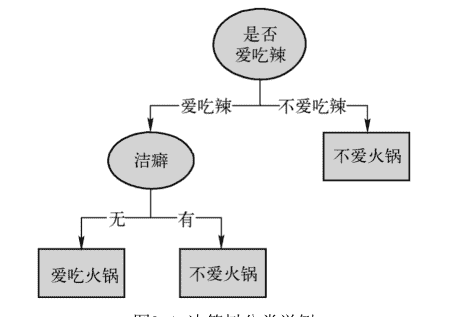

图3-1 决策树分类举例

通俗讲，每个分支代表一次新的决策，从根节点出发每条路径最终到达“爱吃”或“不爱”的类别标签。

严格来说，决策树由节点与有向边构成树形结构。节点分为内部节点与叶节点，前者对应特征，后者对应类别。决策树的目标是從训练数据中找出一组“最优”分类规则，最优由损失函数衡量。核心思想是找到最优特征对其进行最佳划分，并递归地丰富内部节点，直至满足停止条件。如何定义最优特征、如何划分即为实施的关键。

决策树的实施包括什么？

决策树的实施主要包括特征选择、树生成与剪枝。

## 1. 特征选择

实际项目中特征数往往远大于 2，不同的特征使用顺序会导致不同结果与准确率，因此需要特征选择来决定当前应以哪个特征划分。直观上，对分类最有效的特征应优先使用；例如判断是否爱吃火锅，“是否爱吃辣”比“是否有洁癖”更具代表性。

在量化层面，信息增益与信息增益比可度量特征有效性。

## （1）熵。

熵在第 2 章已介绍，现从决策树角度重述。热力学中熵表示体系混乱程度；概率统计中熵度量随机变量的不确定性。

香农指出信息用于消除随机不确定性。分类前数据类别未知，不确定性最大，熵最大；分类后特征信息被充分利用，不确定性最小，熵最小。每次使用一个特征进行决策，熵就会降低。最优特征即使熵降低最多的特征，这正是信息增益的思想。

对离散随机变量 X，其概率分布 P 与熵 H 的定义为：

$$P(X = x_i) = \alpha_i, \quad i = 1,2,\cdots,n$$

$$H(X) = -\sum_{i=1}^{n} \alpha_i \log \alpha_i$$

通常 log 取 2 为底或自然对数 e。由式可知熵非负。当 X 为常数时 H(X)=0，表示信息混乱最小。

若另有随机变量 Y，H(Y|X) 表示在已知 X 条件下 Y 的不确定程度，称为条件熵，定义为：

$$H(Y|X) = -\sum_{i=1}^{n} \alpha_i H(Y|X = x_i)$$

在实践中，熵与条件熵多是通过样本矩估计得到的，这两种估计分别被称为经验熵和条件经验熵。需要特别说明的是，如果随机变量 X 存在概率 α_i 等于零的情况，为保持计算可行，通常把该项的对数贡献直接视作零。

## （2）信息增益。

一个特征 A 对于数据集 D 的信息增益 g(D,A) 的定义为：

$$g(D,A) = H(D) - H(D|A)$$

这里涉及的所有熵都指经验熵。由于条件熵恒不大于无条件熵，即 H(D|A) ≤ H(D)，所以信息增益 g(D,A) 总是大于等于零。

怎么理解信息增益？从直观上看，它衡量的是该特征在确定后对数据混乱程度的降低幅度：特征一旦固定，数据集熵的下降越明显，就说明该特征携带的信息越多，作用越大。这个差值在别的文献里也常被称为互信息。

基于信息增益的挑选准则，面对类别 C₁ … Cₖ 共 k 类的决策树问题，假设当前仍可用的特征是 A₁ … Aₛ 共 s 个，筛选流程大致如下：

- a) 先用矩估计算出当前数据集 D 的经验熵：

- $$H(D) = -\sum_{i=1}^{k} \frac{|C_i|}{|D|} \log\left(\frac{|C_i|}{|D|}\right)$$

- b) 再用矩估计算出特征 A 对数据集 D 的条件熵：

- $$H(D|A) = -\sum_{i=1}^{m} \frac{|D_i|}{|D|} H(D_i) = -\sum_{i=1}^{m} \frac{|D_i|}{|D|} \sum_{j=1}^{k} \frac{|D_{ij}|}{|D_i|} \log\left(\frac{|D_{ij}|}{|D_i|}\right)$$

- c) 对全部特征 A₁ … Aₛ 分别计算 H(D|Aᵢ)，i=1,2,…,s，由此得到信息增益 g(D|Aᵢ)，i=1,2,…,s。挑选出使信息增益最大的特征 A₀：

- $$A_0 = \arg \max (g(D, A_i))$$

## （3）信息增益比。

信息增益比与信息增益类似，都用来评估特征对数据熵的影响。

特征 A 对数据集 D 的信息增益比 g_R(D,A) 定义为：

$$g_R(D,A) = \frac{g(D,A)}{H_A(D)}$$

式中 H_A(D) 表示数据关于特征 A 的熵， H_A(D)= -∑_{i=1}^{m} |D_i|/|D| log(|D_i|/|D|)。特征取值个数 m 越大， H_A(D) 通常越大。因此信息增益比可以看作对信息增益的一种归一化，它能在一定程度上遏制取值过多的特征被过度偏爱的问题。

## 2. 决策树的生成

在选定特征挑选方式后，树就可以逐层生长。本节要介绍的 ID3 与 C4.5 分别由 Quinlan 在 1986 年和 1993 年提出。

## （1）ID3算法。

ID3 在特征选择上采用前文的信息增益准则；在生长过程中依据所选特征的不同取值进行划分，最终得到一棵决策树。值得注意的是，建树前通常要设定一个阈值，当剩余所有特征的信息增益都低于该阈值时，停止生长。

## （2）C4.5算法。

C4.5 是 ID3 的改进版。特征选择阶段改用信息增益比，其余的划分与建树流程与 ID3 基本一致，也最终形成一棵决策树。

## 3. 决策树的修剪

按照上述做法生成的树，因为会穷尽每个特征的每种取值，很容易出现过拟合：对训练集分类很好，对测试集却变差。这是决策树本身的特性，所以修剪非常重要。

本文采用极小化损失函数来剪枝，损失函数如下：

$$C_{\alpha}(T) = \sum_{t=1}^{|T|} N_t H_t(T) + \alpha |T|$$

其中 T 表示一棵确定的决策树，共含 |T| 个叶节点，每个节点下有 N_t 个训练样本， H_t(T) 为该节点训练样本的经验熵。

损失函数由两部分构成：树对训练数据的分类熵，以及树的叶节点个数。极小化时既希望分类后熵尽量小，也希望叶节点别太多，即树别过大。系数 α 用来平衡两者， α 越大越倾向于牺牲一点准确率来换取更小的树；反之则更重视拟合。

剪枝操作步骤如下：

- 1）先计算每个节点的经验熵。
- 2）计算损失函数；记某个叶节点被剪掉前后的树损失分别为 C_α(T_前) 与 C_α(T_后)，若 C_α(T_前) ≥ C_α(T_后)，则剪掉该叶节点，其父节点升为新的叶节点，得到新树。
- 3）对叶节点重复步骤 2），直到无法再剪为止。

## 3.5.2 决策树算法的优点和缺点是什么

优点：

- 1）思路清晰直观，计算效率较高。
- 2）分类规则透明，能看出哪些特征更重要，可解释性强。可同时处理离散型和连续型属性，很多算法要求属性类型统一。
- 3）对缺失值容忍度较高，能处理无关特征。
- 4）无需任何参数假设。

缺点：

- 1）对连续变量的处理效果有限，模型主要围绕分类变量展开，例如建树时会把某个特征所有取值都扩展为子节点。
2）划分时把特征的每个可能取值都单独分一类，导致树对取值众多的连续变量异常敏感；比如某特征每个取值样本唯一且同类，用它划分会得到很高的信息增益，但实际意义不大。
3）极易过拟合。

## 3.5.3 试简要介绍随机森林

由于单棵决策树能力相对薄弱且易过拟合，Leo Breiman 与 Adele Cutler 于 2001 年提出了随机森林。顾名思义，它是用大量决策树对样本进行训练与预测的集成方法。

可以用一个比喻来理解：假设多位评委为一家餐馆打星，每位评委独立给出“五星”或“四星”，最终星级由多数评委投票决定。评委团相当于随机森林模型，餐馆是待预测对象，最终结果由全体评委的投票汇总得出。

即使单棵树分类能力一般或存在误差，通过大量树的投票，误差会相互抵消，凸显出更可靠的分类信号。这就是随机森林的核心思想。

随机森林既可做回归也可做分类。实现时采用的并非前面提到的简单分类树，而是 CART 树。

### 简要介绍随机森林的实施步骤与特点。

### 1. CART决策树

在介绍随机森林流程前，先简要说明 CART。CART 全称分类与回归树，1984 年由 Breiman 提出。与简单分类树不同，CART 是二叉树，每次只按某个特征分出两类，但可以对同一特征多次划分，使信息得到充分利用。

#### （1）回归树

决策树本质上是把特征空间划分并映射到输出。回归树可写为：

f(x) = Σ_{k=1}^{K} c_k I_{(x∈R_k)}

R_k 是第 k 个划分区域，共 K 个划分，c_k 为该区域样本输出的均值，I 为示性函数。

最优划分会让子区域内方差最小，这与 c_k 取均值是一致的。

步骤如下：

- 1）遍历特征 j，对每个特征遍历可能取值 s，求解损失：

- min_{c1} Σ_{x_i ∈ R1(j,s)} (y_i - c1)^2 + min_{c2} Σ_{x_i ∈ R2(j,s)} (y_i - c2)^2

- 选出使损失最小的 (j, s) 对。
- 2）按该 (j, s) 把数据分为：

- R1(j, s) = {x^j ≥ s}, R2(j, s) = {x^j < s}

- 并计算各部分输出值：

- c_k = Σ_{x_i ∈ R_k(j,s)} y_i
- 3）对两个新节点重复 1）2），直到满足停止条件。

#### (2) 分类树

分类树用基尼指数度量混乱程度。定义为：

Gini(p) = Σ_{k=1}^K p_k (1 - p_k) = 1 - Σ_{k=1}^K p_k^2

K 为类别数。取值范围在 [0,1)，当 p_K=1 时取最小值 0，表示最纯净；值越大越混乱，与熵一致。

经验基尼指数：

Gini(D) = 1 - Σ_{k=1}^K (|C_k|/|D|)^2

条件基尼指数：

Gini(D, j, s) = |R1|/|D| Gini(R1) + |R2|/|D| Gini(R2)

其中 D 按特征 j 取值 s 被分为 R1={x^j ≥ s}、R2={x^j < s} 两部分，基尼指数为加权平均。

步骤如下：

- 1）遍历特征 j 与取值 s，计算条件基尼指数。
- 2）选择使条件基尼指数最小的 (j, s)，把样本分为两部分。
- 3）对两个节点重复 1）2），直至停止。最终每个区域的多数类作为该区域类别。

### 2. 随机森林的实施步骤

- 1）有放回地从 N 个训练样本中抽取 N 个样本，作为一棵树的训练集。
- 2）对 K 个特征随机挑 k 个组成子集，在建树时只在子集中选最优特征。
- 3）让树充分生长，不做剪枝。
- 4）重复 1）～3）共 B 次，得到 B 棵树；分类问题取投票多数，回归问题取均值。

### 3.随机森林的几个特点

- 1）采用 Bootstrap 抽样。若不抽样，各棵树结果会趋同，失去投票意义。
- 2）每次从特征中随机抽 k ≤ K 个建树。一方面降低复杂度加快训练，另一方面提升树间独立性。通常取 k≈√p 时效果接近普通 CART，k ≤ √p 能增强泛化。
- 3）不需要剪枝。随机森林通过样本和特征的随机性以及投票机制自然抑制过拟合。

简单实现示例如下。

Python 中 sklearn 的 RandomForest 可用于建模。具体如下。

```python
from sklearn.ensemble import RandomForestRegressor
import numpy as np

from sklearn.datasets import load_iris
iris=load_iris()
#经典的鸢尾花 (iris) 数据集包含 4 个属性与 1 个花朵种类的标签。4 个属性分别是：萼片宽度
萼片长度 花瓣宽度 花瓣长度
print(iris['target'].shape)#查看数据集的维度
#建立模型
Rf_model=RandomForestRegressor()#这里使用了默认的参数设置
Rf_model.fit(iris.data[:150],iris.target[:150])
print(Rf_model.oob_score)#袋外分数
#样本内模型预测
instance=iris.data[[100,109]]
Rf_model.predict(instance[[0]])
```

RandomForestRegressor 的常用参数：

criterion: “gini”或“entropy”，特征选择依据，默认“gini”。

max_depth: （默认 None）单棵树最大深度，若指定 max_leaf_nodes 则忽略，默认不限制生长。

min_samples_split: 划分节点所需最少样本数，低于则停止。

min_samples_leaf: 叶节点最少样本数。

max_leaf_nodes: （默认 None）叶节点最大数量。

n_estimators: 森林大小，即树的个数，默认 10。

bootstrap: 是否有放回采样，默认 True。

oob_score: 是否计算袋外得分，默认 False。

n_jobs=1: 并行任务数，1 表示串行，-1 表示用全部 CPU。

verbose: 是否显示训练过程，0 不显示。

## 3.5.4 如何做随机森林参数的选择

实施中涉及两个关键参数：特征子集大小 k 与树的数量 T。T 越大，投票越稳定，理论上越好，但会增加计算成本，需要在准确率与复杂度间权衡。

k 较大时，树间相关性增强，可能降低准确率；k 过小时，单棵树能力太弱，也会削弱整体效果。经验上常取特征数对数作为 k。

更细致的做法是用袋外错误率来选 k。Bootstrap 训练时，每棵树约有三分之一样本未被使用，称为袋外样本 oob。袋外错误率定义为：

oob error = |N1| / |N|

其中 N1 为样本作为 oob 时被误分的树数，N 为该样本作为 oob 的树总数。可证明 oob error 是随机森林泛化误差的无偏估计。

## 3.5.5 试简要介绍随机森林的优缺点

优点：

- 1）当前算法中准确率较高。
- 2）可高度并行，适合大数据。
- 3）实现相对简单。
- 4）模型稳健，对部分特征缺失不敏感。
- 5）能降低方差。因为预测是多棵树的均值，n 个独立同分布随机变量均值的方差为 σ²/n。

缺点：

- 1）对噪声大的样本集易过拟合。
- 2）取值划分多的特征对模型影响更大，可能扭曲效果。

常见面试题：随机森林的“随机性”体现在哪里？比决策树好在哪？

分析：随机性有两处：一是每棵树的样本经 Bootstrap 随机抽取；二是每棵树在分裂时使用的特征是随机子集。正是这种随机性改善了过拟合，大幅提升了分类准确率。

## 3.5.6 决策树中C4.5算法优化了ID3算法的什么缺点

ID3 用信息增益选特征，容易偏向取值多的变量，导致预测准确率下降。C4.5 用信息增益比有效缓解了这一问题。

此外，C4.5 在建树过程中可做剪枝，而 ID3 不具备；C4.5 在预处理时还会对连续变量进行离散化。

## 3.6 集成学习

### 3.6.1 什么是集成学习，主要由什么组成

正确率高的分类器称为强分类器，正确率低的称为弱分类器。理想是直接构建强分类器，现实中更易构建弱分类器。集成学习就是把多个基分类器组合起来形成强分类器，俗话说“三个臭皮匠抵一个诸葛亮”。

随机森林属于集成学习范畴。它通常泛化能力更强，多基分类器降低错误率，对噪声容忍度高。

集成学习需要大量不同的基分类器。若全相同，则集成无意义。如何从同一训练集生成多个不同基分类器以及如何融合结果，Boosting 与 Bagging 是两种常用技巧。

### 3.6.2 试介绍并比较Boosting与Bagging方法

# 集成学习核心：Bagging 与 Boosting 破解

集成学习的思路很直观：单棵树容易犯错，一群树一起商量更稳。Bagging 和 Boosting 是两条最主流的协同路数，做法和效果却截然不同。

Bagging 的玩法是先造数据再造模型。借助自助采样，每次有放回地从原训练集抽出一份样本，不同次抽到的集合彼此独立且互不影响。用 M 次抽样就能得到 M 个基分类器。最后判别时走民主投票，票数最多的类别作为整体输出，每个基分类器的发言权完全相等。

Boosting 不换数据，改的是样本的重要性。每一轮训练保留全部样本，只是给样本贴上权重。上轮被错分的点权重会上调，下轮就被更关注。经过 M 轮迭代得到 M 个基分类器，且后一个模型完全依赖前一个的产出。融合时也不是简单投票，而是按“好坏”加权，误差越小的分类器话语权越大。

#### 表3-1 Bagging与Boosting对比一览

|  | 样本选择 | 样本权重 | 预测函数 | 并行计算 |
|---|---|---|---|---|
| Bagging | 各基分类器的训练集独立生成 | 随机抽样，权重一致 | 等权投票，每个基分类器权重相同 | 各分类器可同时训练，天然并行 |
| Boosting | 各基分类器使用同一训练集，仅权重变化 | 分类效果差的样本权重提升 | 加权求和，误差越小的基分类器权重越高 | 权重依赖上一轮结果，只能串行生成 |

从误差分解看，Bagging 通过大量基模型结果的平均，相当于把方差压到 1/N 的量级，主攻降低方差。Boosting 通过不断放大难分样本的关注度，让模型对边界更敏感，主攻降低偏差。

总的来说两者的分歧点可以归纳为：

- 1）样本构造上，Bagging 用有放回重抽样得到多个独立子集，Boosting 训练集固定不变。
- 2）样本权重上，Bagging 所有样本一视同仁，Boosting 的权重随基模型表现动态调整，错分样本权重上升。
- 3）预测融合上，Bagging 是等权投票，Boosting 是按误差加权求和。
- 4）计算方式上，Bagging 可并行，Boosting 必须顺序迭代。

以决策树为基学习器，二者的经典组合就出来了。随机森林是 Bagging + 决策树的代表，AdaBoost 是 Boosting 的代表框架。粗略地看，Bagging+决策树=随机森林，AdaBoost+决策树=提升树，Gradient Boosting+决策树=GBDT。

### 3.6.3 AdaBoost 算法详解

把决策树当作弱学习器，Bagging 与 Boosting 都能衍生出一系列集成方法。随机森林对应 Bagging，AdaBoost 对应 Boosting。该方法 1995 年由 Freund 与 Schapire 提出，Ada 即 adaptive，提升弱学习器为强学习器。

二分类时可设想一个超平面把样本切开，远离平面的点好分，靠近平面的点易错。AdaBoost 的提升逻辑就是把注意力更多放在这些易错点上，迭代优化整体表现。

AdaBoost 的关键是两类权重：样本权重视于计算基学习器的误差，基学习器权重视于最终的线性组合。训练开始时所有样本权重相等。随着迭代，错分的样本权重放大，正确样本权重缩小。误差率计算也带权，误差小的弱分类器在表决中占更大比重。

以 M 个单层决策树 Gₘ(x) 为例，每棵树只用一个特征做一次划分。实现流程如下。

- 1）初始化权值均匀分布 W₁ = (w₁ᵢ) = (1/N,…,1/N)，令 m=1。
- 2）遍历所有特征及其取值，结合当前权重 wₘ 计算分类误差率： eₘ = Σᵢ₌₁ᴺ wₘᵢ I(Gₘ(xᵢ) ≠ yᵢ)，其中 Σ wₘᵢ =1，eₘ∈[0,1]。
- 3）挑选使误差最小的特征及阈值，构建单层决策树 Gₘ(x)，记下其误差 eₘ。
- 4）计算该基分类器的系数： αₘ = ½ ln[(1 - eₘ)/eₘ]。
- 5）更新样本权重： Wₘ₊₁ = (wₘ₊₁,ᵢ) = ( wₘᵢ / Zₘ exp(-αₘ yᵢ Gₘ(xᵢ)) )，Zₘ 为归一化因子使权重和为 1。
- 6）令 m=m+1，重复 2）~5），得到 Gₘ(x) 与 αₘ，m=1,2,…,M。
- 7）组合： f(x)=∑ₘ₌₁ᴹ αₘ Gₘ(x)，最终分类器 G(x)=sign(f(x))。

要点提示：
- 1) 存在样本权重和基分类器权重两个层面。
- 2) 初始权重均匀，等价于无权训练。
- 3) αₘ 与误差 eₘ 反相关，当 eₘ≤1/2 时 αₘ≥0，误差越小权重越大；若 eₘ>0.5，αₘ 为负，可视为先反转再加权。
- 4) 权重更新时，正确分类的样本权值被 eₘ/(1-eₘ) 缩小，错误样本权值被 (1-eₘ)/eₘ 放大。

### 3.6.4 如何理解 AdaBoost 的模型误差部分

AdaBoost 的核心保证是训练误差随迭代指数下降。理论上满足：

1/N ∑ I(G(xᵢ)≠yᵢ) ≤ 1/N ∑ exp(-yᵢ f(x)) = ∏ₘ₌₁ᴹ Zₘ  式 (3-1)

∏ₘ₌₁ᴹ Zₘ = ∏ₘ₌₁ᴹ (2√{eₘ(1-eₘ)}) = ∏ₘ₌₁ᴹ √{(1-4γₘ)^2} ≤ exp(-2∑ₘ₌₁ᴹ γₘ²)  式 (3-2)

1/N ∑ I(G(xᵢ)≠yᵢ) ≤ exp(-2Mγ²), γₘ ≥ γ, γ>0  式 (3-3)

由式 (3-1)(3-2) 可推得式 (3-3)，表明在弱学习器满足 γ>0 的条件下，训练误差以指数速度衰减，这从理论上说明了 AdaBoost 的有效性。

### 3.6.5 AdaBoost 模型的优缺点是什么

优点：
- 1) 引入权重机制，分类精度高，对过拟合有较好抑制。
- 2) 作为 Boosting 框架，包容性强，基学习器可任意选用，甚至可用极简模型。
- 3) 相比随机森林，AdaBoost 对基分类器赋予不同权重。
- 4) 基学习器简单时，模型具有可解释性。

缺点：
- 1. 权重放大机制使模型对离群点和噪声敏感。
- 2. 迭代依赖，训练耗时且无法并行。
- 3. 迭代次数选择困难，通常借助交叉验证。

### 3.6.6 什么是前向分步算法

AdaBoost 中 αₘ、wₘ₊₁ 等公式的背后是前向分步算法的推导。AdaBoost 是前向分步算法求解加法模型的一个特例。

### 1. 加法模型

加法模型认为多个弱基函数的叠加能增强稳定性和精度：

f(x)=∑ₘ₌₁ᴹ βₘ b(x;γₘ)

其中 b(x;γₘ) 为基函数，βₘ 为权重，γₘ 为参数。若基函数多样，优点会累积、缺点会抵消；若同质性强则易冗余。

学习目标为最小化损失：

min ∑ᵢ₌₁ⁿ L( y, ∑ₘ₌₁ᴹ βₘ b(x;γₘ) )

### 2. 前向分步算法

同时求解所有参数难度大，前向分步算法把模型逐层拆开求解：

- 1. 令 f₀=0，m=1。
- 2. 求解 (βₘ,γₘ)= argmin_{β,γ} ∑ᵢ L( y, fₘ₋₁(x)+β b(x;γ) )
- 3. 更新 fₘ(x)=fₘ₋₁(x)+βₘ b(x;γₘ)
- 4. m=m+1，重复 2)、3)，直至 m=M+1。
- 5. 得到 f(x)=∑ₘ₌₁ᴹ βₘ b(x;γₘ)

### 3. 前向分步算法与 AdaBoost

AdaBoost 的分类器 f(x)=∑ₘ₌₁ᴹ αₘ Gₘ(x) 正是加法模型。若把损失设为指数损失 exp{-y f(x)}，前向分步的第 m 步优化等价于：

(αₘ,Gₘ)= argmin_{α,G} ∑ᵢ exp{-yᵢ(fₘ₋₁(x)+α G(xᵢ))}

令 sₘᵢ=exp{-yᵢ fₘ₋₁(x)}，则问题化为求 Gₘ 与 αₘ。最优 Gₘ 为加权误差最小的分类器，最优 αₘ=½ log[(1-eₘ)/eₘ]，与 AdaBoost 完全一致。故 AdaBoost 是前向分步算法在指数损失下的特例。

## 3.7 Xgboost 与 GBDT

### 3.7.1 什么是 GBDT 算法，与提升树的区别是什么

GBDT 属于 Boosting 与决策树的结合，比普通 Boosting 明确加入了梯度思想。先看提升树，再看梯度提升树。

### 1. 提升树

提升树也是前向分步求解的加法模型，仅基函数限定为决策树：

f_M = Σₘ₌₁ᴹ T(x;θₘ)

分类问题常用二叉分类树和指数损失，回归问题常用回归二叉树和平方误差。

#### （1）分类问题的提升树算法

二分类时用指数损失，基学习器设为二叉分类树，即得到提升树，流程与 AdaBoost 类似。

#### （2）回归问题的提升树算法

第 m 步的目标为：

θₘ = argmin_θ Σᵢ L(yᵢ, fₘ₋₁(xᵢ)+T(x;θ))

用均方误差：

L = (yᵢ - fₘ₋₁(xᵢ) - T(x;θ))² = (r - T(x;θ))²

其中 r 为当前模型的残差。于是新树拟合残差而非真实值，体现模型间互补。

实现步骤：
- 1) f₀=0，m=1。
- 2) 计算残差 rₘᵢ = yᵢ - fₘ₋₁(xᵢ)。
- 3) 用残差拟合回归树 T(x;θₘ)。
- 4) fₘ(x)=fₘ₋₁(x)+T(x;θₘ)。
- 5) m=m+1，重复，直至 M。
- 6) f(x)= Σₘ₌₁ᴹ T(x;θₘ)

这与随机森林追求每棵树逼近真实值的思路不同，提升树强调逐层修正残差。

### 2. GBDT

当损失函数复杂时直接求最优解困难。Friedman 于 2001 年提出梯度提升，用负梯度近似残差：

- 1) f₀=0，m=1。
- 2) 计算负梯度 rₘᵢ = ∂L(yᵢ,fₘ₋₁(xᵢ))/∂fₘ₋₁(xᵢ)。
- 3) 用 rₘ 拟合回归树 T(x;θₘ)。
- 4) fₘ(x)=fₘ₋₁(x)+T(x;θₘ)。
- 5) m=m+1，重复，直至 M。
- 6) f(x)= Σₘ₌₁ᴹ T(x;θₘ)

说明：
- 1) m=1 时 f₀=0，拟合负梯度等价于拟合 y。
- 2) 树为回归树，可写成 f(x)= Σₘ Σₖ cₘₖ I_{x∈Rₘₖ}。GBDT 与 AdaBoost 一样具有收敛性。

### 3. GBDT 模型优缺点

优点：

GBDT 在预测精度上一直有着很强的口碑，常常被归入统计学习里最顶尖的方法行列。它对损失函数的适配度很高，指数损失这类形式都能被良好支持。

短板也很清晰：
- 计算负担重，整体运行偏慢。
- 在高维稀疏特征的场景下并不友好。

在 R 中，gbm 包里的 gbm() 函数即可搭建 GBDT。调用示例如下：
```
> gbm(formula = formula(data),distribution = "bernoulli",data = list(),
+ n.trees = 100,shrinkage = 0.001,...,
+ bag.fraction = 0.5,interaction.depth = 1)
```
这里 distribution 用于设定损失函数的形式，n.trees 决定迭代次数，shrinkage 则对应学习速率，其余参数可参考函数帮助文档。

Python 侧也有现成的包能直接使用：
```
gbm= GradientBoostingClassifier(random_state=10)

gbm.fit(X,y)
```

## 3.7.2 XGBoost 算法拆解
XGBoost 即 eXtreme Gradient Boosting，极端梯度提升模型，由华盛顿大学博士陈天奇于 2014 年提出并在比赛中应用。凭借高精度与快速度的双重特质，XGBoost 迅速成为 Kaggle 等赛事的“王牌”，一度占据排行榜头部。

它源自提升树，尤其是 GBDT，也属于 boosting 家族。相较 GBDT，XGBoost 既在模型层面做了改进，也在工程效率上做了优化，两者结合带来了又准又快的特性，因而普适性强、落地容易。

### 1. 模型改进
GBDT 以回归决策树为基 learner，用已有模型的残差近似来拟合新树并叠加更新。XGBoost 的思路一致，但在两处做了升级。

其一，给损失函数加入正则化项。
此时目标函数可写作：
$$L(\phi)=\sum_i L(y_i,f_{m-1}(x_i)+T(x_i;\theta))+\sum_k \Omega(f_k)$$
正则化项的常见形式为：
$$\Omega(f_k)=\gamma T+\frac12 \lambda\|\omega\|^2$$
其中 T 代表树的叶子节点数，ω 为叶子节点值的向量。随着树结构变复杂、叶子增多，正则项会随之增大。最小化目标时，正则项会被压制，从而限制基树的复杂度，在一定程度上遏制过拟合，提升泛化能力。

其二，用二阶导数更精确地拟合残差。除 GBDT 使用的一阶导数外，XGBoost 引入二阶导数。
泰勒二阶展开：
$$f(x)=f(x_0)+f'(x_0)(x-x_0)+\frac12 f''(x_0)(x-x_0)^2$$
作用于损失函数得到：
$$L(\phi)=\sum_i [L(y_i, f_{m-1}(x_i))+g_i T(x_i;\theta)+h_i T(x_i;\theta)^2]+\sum_k \Omega(f_k)$$
其中 $g_i$、$h_i$ 分别是一阶、二阶导数，表达式为：
$$g_i=\frac{\partial L(y_i,f_{m-1}(x_i))}{\partial f_{m-1}(x_i)}$$
$$h_i=\frac{\partial^2 L(y_i,f_{m-1}(x_i))}{\partial f_{m-1}(x_i)}$$
通过最小化该式即可求得新模型。

### 2. 其他优化
传统 boosting 如 AdaBoost 与 GBDT 都难以并行，效率低下，不利于大数据。XGBoost 起源于比赛实战，工程优化是其核心。

传统决策树寻找最优分割点时需枚举所有候选点并计算损失，连续变量下代价很大。XGBoost 将候选点用百分位点近似，再在这组点中挑选最优分割，大幅降低枚举成本。

提升树本质上是串行生长，但 XGBoost 把特征按块排序后存入内存，同一棵树的同层节点可以并行计算。对某个节点选择最佳分裂时，多线程并行计算候选分裂点的增益。

XGBoost 还针对稀疏训练数据做了专门处理，能显著提升效率，相关论文显示提升幅度可达 50% 左右。

### 3. 模型优点
- 在一定程度上可并行化，训练速度快。
- 能够有效处理稀疏数据。
- 正则化等策略有助于防止过拟合。

### 4. XGboost代码展示
XGBoost 参数众多，常用且关键的有：gamma 控制后剪枝，lambda 为 L2 正则化权重，max_depth 为树的最大深度，subsample 为训练样本采样比例，min_child_weight 为叶节点的最小权重阈值，nthread 为 CPU 线程数。参数众多难以逐一手工调试，通常采用网格调参。示例代码：
```
import pandas as pd
import numpy as np
import xgboost as xgb
from xgboost.sklearn import XGBClassifier
from sklearn import model_selection, metrics

from sklearn.grid_search import GridSearchCV
from sklearn.cross_validation import train_test_split
train_x, test_x, train_y, test_y = train_test_split(data, label,test_size=0.2, random_state=0)
#获得训练数据集，测试数据集
train=xgb.DMatrix(train_x,label=train_y)
# 将数据集转换为 xgboost 训练所需要的 DMatrix 格式
test=xgb.DMatrix(test_x,label=test_y)
cv_params = {'max_depth': [3, 4, 5, 6, 7, 8, 9, 10], 'learning_rate': [0.1,0.01,0.001]}
#通过交叉验证的方式选择树的深度
other_params = {'min_child_weight': 3, 'n_estimators': 4, 'max_depth': 5, 'min_child_weight': 1, 'seed':0}
model = xgb.XGBClassifier(**other_params)
best_model=GridSearchCV(estimator=model,  param_grid=cv_params,  scoring='accuracy',  cv=5,
verbose=1, n_jobs=4)
best_model.fit(train_x, train_y)
```
网格调参后可得到最优的 max_depth、learning_rate，再将参数传入 xgb.train() 完成训练。

## 第4章 深度学习框架与PyTorch编程介绍
本章梳理深度学习的发展脉络、主流框架、基本原理，并介绍最简单的 RNN、CNN 原理，以及在计算机视觉中占据重要地位的 VGG16、AlexNet 等模型。为帮助读者真正掌握这些方法，全文配套代码实现，便于结合框架细节锻炼搭建能力。深度学习近年来强力推动了自然语言处理与计算机视觉的进步，建议读者结合自身方向学习对应的主流算法。

## 4.1 深度学习基础知识

### 4.1.1 神经网络发展历程
以计算机视觉为例回顾早期发展。图灵提出“机器智能”，达特茅斯会议提出“人工智能”学科后，研究迅速活跃。学界大致分为两大阵营。

第一阵营是符号派，用统计逻辑与符号系统研究 AI，采用自顶向下思路，先理解再实现。代表工作有定理证明、专家系统，代表人物有纽厄尔、西蒙等。

第二阵营是统计派，即如今深度学习的来源，采用自底向上思路，模仿大脑，通过堆叠简单逻辑形成复杂系统。代表人物是 Yoshua Bengio、Hinton、LeCun。

符号派早期更直观，专家系统是典型，但缺陷明显：必须先完整理解问题再编码知识，对复杂问题不可行，难以穷尽“什么算猫”的描述。

统计派更务实，通过统计学习归纳知识，减少人工干预，与大数据天然契合，因而最终胜出。

也有学者转换阵营，如马文·明斯基，最初属统计派，后在第三次 AI 热潮转向符号派，成为摆脱第二次低谷的重要推手。

统计派模仿大脑。生物学表明大脑基本感知单元是神经元，影响范围称为感受野。哈特兰与库夫勒 1953 年发现猫视网膜神经节细胞感受野呈同心圆结构。第一类为中心兴奋周边抑制的 On 型，第二类为中心抑制周边兴奋的 Off 型。

加拿大神经生理学家戴维·休伯尔与托尔斯滕·威赛尔 20 世纪 50-60 年代研究视觉机制，将图像投射到屏幕并向猫脑植入电极，测试对线条、直角、边缘等图形的反应。发现部分细胞对特定角度线条有强反应，表现出强烈方位选择性，且有效角度范围很窄。两项研究相互印证。

1960-1980 年间两人合作 20 年，系统揭示人眼视觉机制，被视作现代视觉科学之父，1981 年共同获诺贝尔生理学或医学奖。

该研究催生了大卫·马尔的视觉分层理论，也推动了计算机视觉学科与卷积神经网络的诞生。

### 4.1.2 常见的深度学习框架都有哪些，它们都有什么特点
目前常见框架有 TensorFlow、Caffe、Keras、PyTorch、MXNet 等，本文代码基于 PyTorch 实现，对比如下表所示。

| 框架 | 介绍 | 特点 |
|---|---|---|
| TensorFlow | 2015 年 11 月 10 日由 Google 宣布推出，最初由 Google Brain 团队开发 | 是最流行的框架之一，但接口设计偏抽象复杂，实操门槛较高 |
| Keras | 最初是 Theano 的高级 API，后支持 TensorFlow 和 CNTK 作为后端，Theano 已停止更新 | 上手简单，能快速实现复杂的 TensorFlow 项目，但封装过深导致灵活性不足，较难实现研究性需求 |
| Caffe | 作者贾扬清，曾在加州大学伯克利攻读博士，现就职于 Facebook | 灵活性不足，每层的前向与反向传播实现较为繁琐 |
| PyTorch | 2017 年 1 月由 Facebook 人工智能研究院 FAIR 团队发布 | 重构了 Tensor 上的模块，新增先进自动求导系统，运行快且灵活，是当前主流的动态图框架之一 |

### 4.1.3 什么是人工神经网络
人工神经网络由大量相互连接的神经元构成复杂网络。以视觉系统为例，人类信息处理是分级的，高层特征由低层特征组合而成，越往上越抽象、越具语义。

人工神经网络最初用于模拟生物神经网络的信息传递与处理。以一定规则连接大量神经元并行处理输入信息。每一层神经元通过可变权重有向弧连接，训练过程通过多次迭代学习已知样本并调整权重。

主要分为前向神经网络与反馈神经网络。前向类型包括单层感知器、自适应线性网络、BP 神经网络等；典型的反馈网络有 Hopfield 网络等。

### 4.1.4 万能近似定理是什么
万能近似定理是神经网络理论的核心。若前馈神经网络至少含有一个非线性输出层，且隐藏单元足够多，则它能以任意精度逼近从有限维空间到另一有限维空间的任意函数。等价表述为：仅含一层隐藏层的有限神经元网络可逼近实数集紧子集上的连续函数。

### 4.1.5 激活函数有什么作用，常见的激活函数都有哪些
激活函数为神经网络引入非线性，提升表示能力与学习拟合能力。网络性能很大程度上取决于所选激励函数，PyTorch 中可直接调用，例如 ReLU 可用 torch.nn.ReLU。

### （1）0-1激活函数
将任意输入映射为 0 或 1：
$$Y = f(W * X + b) = \begin{cases}1, & (W * X + b > 0)\\0, & (W * X + b \leqslant 0)\end{cases}$$

### （2）sigmoid函数
$$\sigma(x) = \frac{1}{1 + e^{-x}}$$
输出落在 (0,1) 区间。从神经科学视角看，中间斜率较大为敏感区，两侧平缓为抑制区。

### （3）tanh函数
$$\tanh(x) = \frac{e^{x} - e^{-x}}{e^{x} + e^{-x}}$$
输出区间为 (-1,1)，以 0 为中心。求导性质良好：
$$\tanh'(x) = 1 - \left(\frac{e^{x} - e^{-x}}{e^{x} + e^{-x}}\right)^{2} = 1 - \tanh^{2}(x)$$
但 sigmoid 与 tanh 在输入绝对值很大时导数趋近 0，易出现梯度消失。

### （4）ReLU函数
$$f(x) = \max(0, x)$$
相比 sigmoid 与 tanh，ReLU 在正区间无梯度饱和，且计算效率更高，前后向传播都更快。
缺点是负输入时完全不激活，梯度为 0，可能丢失信息。关于 0 点不可导的问题，实际实现通常返回左右导数之一以规避。

### （5）ELU函数
$f(x)=\begin{cases}x, & (x>0)\\ \alpha(e^{x}-1), & (x\le 0)\end{cases}$
ELU 在负区间仍有输出，是对 ReLU 的改进，但仍存在梯度饱和与指数运算开销。

### 4.1.6 什么是MP模型与感知机
神经元相互连接，某神经元兴奋时相连神经元电位改变，若改变量超过阈值则被激活并向下一级传递。信息通过突触以电传导方式传播，最终导致肌肉收缩或腺体分泌。

神经元可视为多输入单输出的非线性信息处理单元。基于此，1943 年 McCulloch 与 Pitts 提出 MP 模型，这是一种基于阈值逻辑的神经网络计算模型，结构与权重固定。

MP框架下，单个神经元会汇总来自多条上游神经元的输入。每个输入先乘以对应的连接强度，累加成总和后与神经元自身设定的阈值对照，再经激活函数处理得到最终输出。由此可见，MP里的神经元都是多输入单输出的处理单元，兼具空间整合和阈值触发两大特性。

严格来说，MP模型已经具备感知器的雏形，只是当时并未实现在机器上。1957年Frank Rosenblatt正式提出感知机 Perceptron，其架构与MP高度相似，被视作人工神经网络里最简化的形式，也常被当作二元线性分类器来使用。日常所说的感知机通常指单层人工神经网络，用以区别于多层感知机 Multilayer Perceptron。架构虽简，却仍具备学习能力并能处理不少问题，示意图见图4-1。

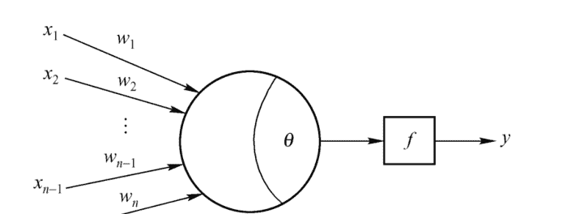

图4-1 感知机结构

设单层感知机接收n维输入，x1到xn代表输入向量的各分量，w1到wn是对应的权值，θ为阈值，f为激活函数即激励函数或传递函数，y为标量输出。理想的f(·)多为阶跃函数或sigmoid函数。感知机的输出即输入向量X与权重向量W的内积再经过f映射得到的标量：

$$y = f\left(\sum_{i=1}^{n} w_i x_i - \theta\right)$$

单层感知器在功能上接近逻辑回归，只能完成线性划分任务，更复杂的任务则无能为力。人工智能第二轮浪潮期间，Marvin Minsky在著作中论证感知器本质是线性模型，只能搞定线性可分问题，连最简单的XOR异或都做不对。这一判断直接导致神经网络研究陷入长达近二十年的低谷。

低谷期并未停止探索。1974年哈佛的Paul Werbos证明，只要增加一层网络并借助反向传播就能破解XOR。1986年Rumelhart、McClelland与Hinton在多层感知机MLP中系统化地使用了BP算法，结合Sigmoid的非线性映射，真正解决了非线性分类与学习问题。

多层感知机是单层感知机的推广，核心特征是存在多层神经元。通常把第一层称作输入层，中间层叫隐藏层，最后层为输出层。MLP并未限制隐藏层的层数，可按实际需求灵活选取，各层神经元数量同样不受限制。

训练多层感知机最关键的是如何调整层间连接权值，其中最广为人知的方法就是反向传播BP算法。

## 4.1.7 BP神经网络及反向传播机制解析

BP神经网络是人工神经网络里最主流的训练范式，其灵魂正是反向传播。基本思路是通过不断修正连接权值，让网络输出逐步逼近期望值。过程包含信号正向流动和误差反向回传两个阶段。BP的最大优势在于能把输入输出关系转化为非线性问题，且泛化能力较强。不足之处是收敛速度偏慢，容易卡在局部极小，隐藏层神经元数目也缺乏确定性标准。

原理上，BP网络各层神经元全互联。外部输入向量进入后，经隐藏层的非线性变换，最终生成输出。训练时采用反向传播：正向计算得到预测，依据预测与真实值的误差构造误差函数，再沿损失函数梯度下降的方向反向回溯，通过求偏导调整权重和偏置，使训练后输出尽可能接近期望。值得注意的是，反向传播本质是在求解损失函数对参数的导数，利用链式法则逐层求导。参数初始化必须随机化，不能全部置零，否则各隐层会产生对称失效，数值与输入相关。

下面以公式形式展示正向与反向的流程。

### 1. 信号正向传播

最简BP网络由输入层、隐含层、输出层构成，足以实现任意复杂的非线性映射。模型先把影响因素量化后送入输入层，再依次经过隐含层和输出层的加工，产出一组与输入对应的输出。

令输入为 $x^r = (x_1, x_2, \cdots, x_r)^T$，隐含层含 $n$ 个结点，激活函数为 $f_1$，输出层结点数为 $m$，激活函数为 $f_2$。输出向量为 $y^m = (y_1, y_2, \cdots, y_r)^T$，实际输出记为 $Y$，目标值为 $T$。

隐含层第 $i$ 个神经元输出为：

$$

\alpha_i = f_1\left(\sum_{j=1}^{r} w_{1ij} x_i + b_{1j}\right) \qquad j = 1,2,\cdots,n

$$

输出层第 $k$ 个结点输出为：

$$

y_k = f_2\left(\sum_{i=1}^{n} w_{2ki} \alpha_i + b_{2j}\right) \qquad k = 1,2,\cdots,m

$$

定义误差函数：

$$

L = \frac{1}{2} \sum_{k=1}^{m} (t_k - y_k)^2

$$

### 2. 误差反向传播

把输出与期望对比、反馈，就能确定误差范围，并将误差反向传递至隐含层，网络据此继续学习，直至误差满足要求。用于预测时，只需把待测样本送入已训练好的BP网络即可得到结果。可见BP具备一定的推理联想能力，能对训练未见过的情形进行估计。

记学习率为 $\eta$，输出层权值的改变量：

$$

\Delta w_{2ki} = \eta \cdot \frac{\partial L}{\partial w_{2ki}} = \eta \cdot \frac{\partial L}{\partial y_k} \cdot \frac{\partial y_k}{\partial w_{2ki}}

= \eta \cdot (t_k - y_k) \cdot f'_2 \cdot \alpha_i = \eta \cdot \delta_{ki} \cdot \alpha

$$

输出层阈值的改变量：

$$

\Delta b_{2ki} = \eta \cdot \frac{\partial L}{\partial b_{2ki}} = \eta \cdot \frac{\partial L}{\partial y_k} \cdot \frac{\partial y_k}{\partial b_{2ki}}

= \eta \cdot (t_k - y_k) \cdot f'_2 = \eta \cdot \delta_{ki}

$$

隐含层权值的改变量，对从第 $j$ 个输入到第 $i$ 个输出的权值变化：

Δw₁ᵢⱼ = η · ∂L/∂w₁ᵢⱼ = η · ∂L/∂yₖ · ∂yₖ/∂αᵢ · ∂αᵢ/∂w₁ᵢⱼ

= η · Σₖ₌₁ᵐ (tₖ − yₖ) · f₂′ · w₂ₖᵢ · f₁′ · xᵢ = η · δᵢⱼ · xⱼ

隐含层阈值的改变量：

Δb₁ᵢⱼ = η · ∂L/∂b₁ᵢⱼ = η · ∂L/∂yₖ · ∂yₖ/∂αᵢ · ∂αᵢ/∂b₁ᵢⱼ

= η · Σₖ₌₁ᵐ (tₖ − yₖ) · f₂′ · w₂ₖᵢ · f₁′ · xⱼ = η · δᵢⱼ

经过上述调整，模型输出与期望的差距会减小，迭代进行直至收敛。

图4-2展示了一个仅含两个神经元的反向传播过程。

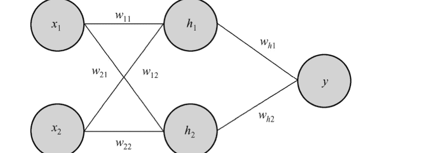

图4-2 两个神经元的传播过程图

如图4-2所示，输出为y，设损失函数为E。

y = h₁ wₕ₁ + h₂ wₕ₂ = h₁ (x₁ w₁₁ + x₂ w₁₂) + h₂ (x₁ w₂₁ + x₂ w₂₂)

假如某一时刻值如下：

x₁=1, x₂=-1, w₁₁=0.1, w₂₁=-0.1, w₁₂=-0.1, w₂₂=0.1, wₕ₁=0.8, wₕ₂=0.9, t=0

h₁ = w₁₁ x₁ + w₁₂ x₂ = 0.2

h₂ = w₂₁ x₁ + w₂₂ x₂ = -0.2

y = h₁ wₕ₁ + h₂ wₕ₂ = -0.2

那么计算E对W_{h1}的误差传播值为：

$$\frac{\partial E}{\partial w_{h1}} = \frac{\partial E}{\partial y} \frac{\partial y}{\partial w_{h1}} = (y - t)h_{1} = -0.04$$

下次更新W_{h1}参数的时候就可以采用：

$$w_{h1} = w_{h1} - \eta \frac{\partial E}{\partial w_{h1}}$$

η是学习率，一层一层推导下去即可。反向传播让多层感知器即传统全连接网络获得可训练的能力，点燃了神经网络的第二次热潮。虽然当时算力和数据有限，热度不长，但全连接网络由此正式确立。

下面展示如何利用PyTorch搭建最简单的人工神经网络：

```
class ANN(nn.Module):
    def __init__(self, input_dim, hidden_dim, output_dim):
        super(ANN, self).__init__()
        self.hidden_dim = hidden_dim
        #以上定义了隐藏层结点数，若结点数太少，网络可能无法学习到有效信息，但如果隐藏层结点数太多，可能出现过拟合问题。合理隐藏层结点数应在同时考虑复杂程度和泛化能力的情况下用结点删除法和扩张法确定
        self.input_dim = input_dim
```

```
self.output_dim = output_dim
self.fc1 = nn.Linear(self.input_dim, self.hidden_dim)
self.fc2 = nn.Linear(self.hidden_dim, self.output_dim)

def forward(self,x, batchSize):
    output = self.fc1(x)
    #fc1 定义了一层隐藏层。增加隐藏层层数可以降低网络误差，提高精度，但是在增加网络训练时间的同时也可能造成过拟合
    output = self.fc2(output)
    return output
```

## 4.1.8 BP网络模型的缺陷

即便BP神经网络在大量非线性数据上表现不错，仍存在明显短板，主要体现在：

- 1）梯度消失问题。由于网络常设较多层数，反向传播时每层残差需逐层累积，层数过深时极易出现梯度消失，导致前层参数难以更新。
- 2）超参数选择依赖经验。缺乏严格的数学理论保证最优超参数，参数效果随问题变化，需反复调试，而训练本身耗时。
- 3）局部最小值问题。训练对初始参数敏感，不良初始化容易使模型收敛到局部最优而非全局最优。
- 4）缺乏时间序列概念。BP网络无记忆单元，也无时间方向的传递机制，对股价这类典型时间序列数据理论上并不适用。

## 4.1.9 传统训练方法为何难用于深度神经网络

BP作为传统多层网络训练的代表，网络加深后效果急剧变差。核心问题是梯度越往下越稀疏：从顶层向下误差修正信号越来越弱，且非凸目标代价函数普遍存在的局部最小使得训练困难。

## 4.2 CNN基础知识与PyTorch实战部分

卷积神经网络的架构在近年被广泛研究，衍生出适用于不同任务的体系化设计。本章重点介绍经典模型与背后的设计思想。

### 4.2.1 什么是卷积神经网络

#### 1. 什么是卷积？

卷积在数学和工程中应用广泛。在信号处理里，线性系统的输出即输入信号与激励函数的卷积。放到数字图像，便是二维卷积，如图4-3所示。

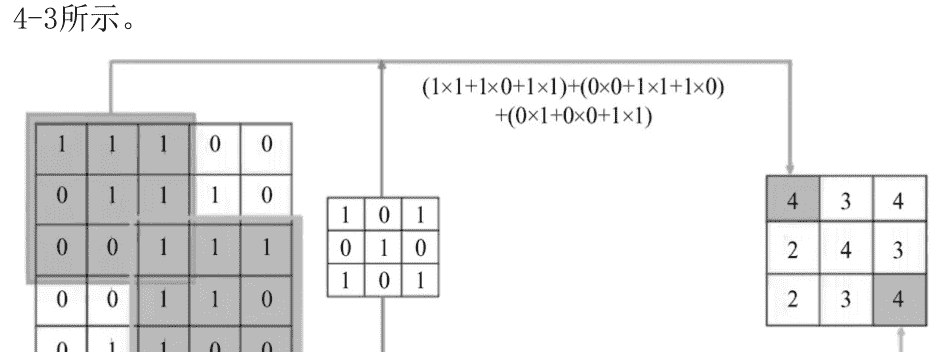

图4-3 卷积操作

上图展示了一个二维卷积的例子：在图像上滑动卷积核，取与核同样大小的区域逐像素相乘后求和。例如原图5×5，核3×3。首先核与左上角3×3区域对应相乘求和得到结果矩阵第一行第一列，随后核向右移动一个步长stride=1，与前三行第2、3、4列对应元素相乘求和，得到第一行第二列，以此类推。

因此，卷积就是核矩阵在原矩阵上自上而下、自左而右扫描，每次扫描得到一个值，所有值组合成新矩阵。机器学习中卷积与互相关常被混用，两者区别仅在于权重算子是否翻转，翻转与否不影响学习效果。

卷积神经网络中有几个关键概念必须把握。

#### 2. 感受野

感受野直观上指视觉感受范围。在CNN中，某层输出的一个元素对应输入层的映射区域，即feature map上的一个点在输入图上的覆盖范围，具体见图4-4所示。

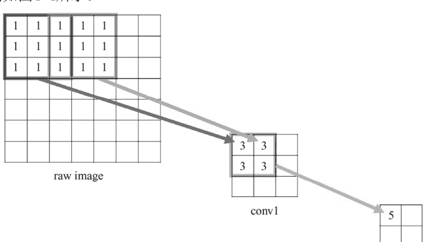

图4-4 感受野

若一个神经元受上层N×N神经元区域影响，则称其感受野为N×N，反映其整合的信息范围。图4-4中conv2的像素5由conv1的2×2区域计算，而该2×2区域又源自原图5×5区域，故该像素感受野为5×5。可知感受野越大，获取的全局信息越多，在分割和检测任务中尤为重要。

#### 3. 池化

了解感受野后池化便好理解。图4-4中从raw image到conv1再到conv2，图像逐步变小。每经过一级相当于一次降采样，这就是池化。可通过步长不为1的卷积实现，也可通过pool直接采样，本质相同，仅权重不同。

卷积提取特征后，下一步是分类。理论上可把所有特征送入softmax分类器，但计算量巨大且易过拟合。池化层可压缩特征图，一方面减小计算量，另一方面保留主要特征。

一般池化窗口不重叠，窗口大小等于步长stride。如图4-5所示，采用2×2池化窗口，max pooling在每个区域取最大值，stride=2，最终从原特征图提炼主要信息。具体操作如图4-5。

### 4.2.2 卷积神经网络的优点是什么

前面提到的全连接网络缺陷恰是卷积的优势所在。

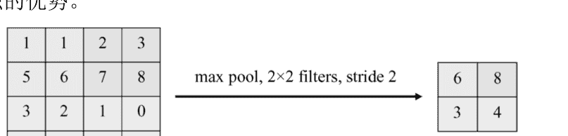

图4-5 池化操作

首先是学习原理的改进。卷积神经网络不再依赖人工提取特征，而是直接从原始图像数据学习，避免了特征进入网络前的信息丢失。

其次是学习方式的改进。全连接网络一层结点与上一层全部相连，例如100×100像素图像，若隐藏层同样大小，仅一层就有10⁸个参数，难以优化和存储。卷积网络中某一层结点仅与上一层的一个局部图像块相连，且用于生成同一图像各空间位置像素的卷积核是共享的，即权值共享。以同样规模的隐藏层为例，若每个神经元只连10×10局部patch且步长为10，参数量为100×100×10×10，参数降低两个数量级。

局部感知即感受野，卷积核每次只覆盖一小块像素，提取局部特征，CNN是局部到整体的建模过程，传统神经网络则是整体建模。

总体来看CNN具备三大特点：局部感受野、权值共享、时空子采样。

### 4.2.3 什么是LeNet5网络

1989年起，Yann LeCun与Y. Bengio等人开始深入研究卷积神经网络。随后十年里LeNet系列不断迭代，直至1998年LeNet5问世。

先说LeNet1，其前身输入为16×16，样本9298个，网络含3个隐藏层H1、H2、H3。

LeNet1结构如图4-6所示，与LeNet5非常相似，差异在于输入尺寸、网络宽度和深度，这也反映了当时硬件算力对神经网络发展的制约，反向传播理论早已成熟。

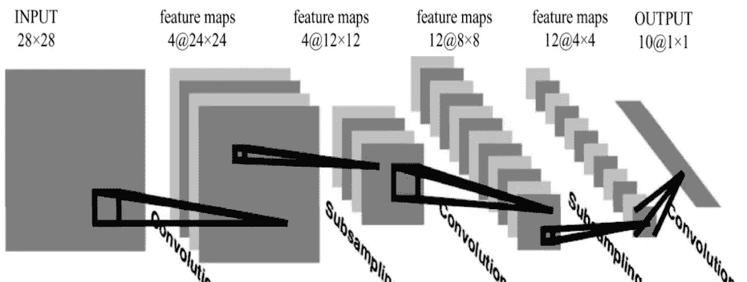

图4-6 LeNet1结构

1998年，LeNet系列稳定为LeNet5。

LeNet系列最终版本即LeNet5，这是一个7层的卷积网络，曾用于美国银行手写数字识别。

LeNet5包含3个卷积层、2个池化层、2个全连接层。卷积核均为5×5，步长stride=1，池化采用Max pooling，激活函数为Sigmoid，具体结构如图4-7所示。

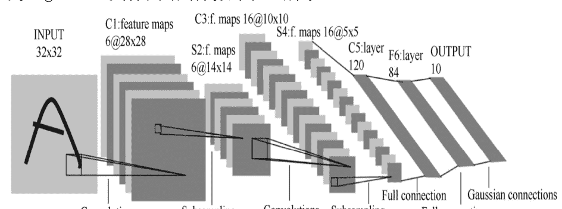
LeNet-5 网络结构拆解

先统一一下说法。特征图即 featuremap，步长即 stride。C1 层的特征图尺寸是 28×28×6，卷积核规模记作 (5×5×1)×6。其中 28×28 代表高×宽，6 代表通道数。(5×5×1)×6 的意思是核的高×宽×通道为 5×5×1，共 6 个核。可以把 (5×5×1) 理解为厚度 1、高宽各 5 的卷积块，后面同理。

输入端把图像统一归一化到 32×32。

第一层卷积 C1 用 (5×5×1)×6 的核，步长 1，得到 28×28×6 的特征图。输入是单通道图，特征图个数就等于核个数。该层可训练参数 156 个，连接数 122304。

随后是 S2 采样层，用 2×2 的采样窗口，步长 2，输出 14×14×6。虽然是池化但仍有偏置可学，训练参数 12 个，连接数 5880。

C3 卷积层用 (5×5×6)×16 的核，步长 1，输出 10×10×16。输入 6 通道、输出 16 通道，连接方式由编码表 4-2 指定。

表4-2: 编码表

|   | 0 | 1 | 2 | 3 | 4 | 5 | 6 | 7 | 8 | 9 | 10 | 11 | 12 | 13 | 14 | 15 |

|---|---|---|---|---|---|---|---|---|---|---|----|----|----|----|----|----|

| 0 | X |   |   |   | X | X | X |   |   | X | X  | X  | X  |    | X  | X  |

| 1 | X | X |   |   |   | X | X | X |   |   | X  | X  | X  | X  |    | X  |

| 2 | X | X | X |   |   |   | X | X | X |   |    | X  |    | X  | X  | X  |

| 3 |   | X | X | X |   |   | X | X | X | X |    |    | X  |    | X  | X  |

| 4 |   |   | X | X | X |   |   | X | X | X | X  |    | X  | X  |    | X  |

| 5 |   |   |   | X | X | X |   |   | X | X | X  | X  |    | X  | X  | X  |

前 6 个特征图各连 S2 的 3 个相邻特征图，中间 6 个各连 4 个相邻特征图，接下来 3 个连部分不相邻的 4 个，最后 1 个连 S2 的全部 6 个特征图。这种连线并非全连接，是主观设计。目的在于降低计算量并打破对称性。此类做法在后续网络中已很少沿用。C3 可训练参数 1516 个，连接数 151600。

S4 采样层用 2×2 窗口，步长 2，输出 5×5×16。可训练参数 32 个，连接数 2000。

C5 卷积层用 (5×5×16)×120 的核，步长 1，输出 1×1×120，实质等价于全连接，输出每个通道都与输入全部通道相连。可训练连接 48120。

F6 全连接层输入 1×1×120，输出 1×1×84，参数量 120×84，可训练连接 10164。84 的来源有历史背景：7 代表 6 种笔触类型加 1，这 6 种笔触为 vertical line、horizontal line、diagonal line、closed curve、curve open to left、curve open to right；12 为 10 个数字加上正负两种方向。

最后的输出层输入 1×1×84，输出 1×1×10，参数 84×10，10 对应类别数。

值得注意的是，该分类任务未使用当下普及的 softmax 交叉熵，而是采用欧式距离，原文称 gaussian connect，实质是全连接后接欧式损失。

LeNet-5 是早期极具代表性的卷积网络，也是商业化成功的典型。虽然只有 7 层深度，且受数据规模限制，它在手写数字识别之外并未在其他视觉任务上取得重大突破。

LeNet5 代码展示如下：
```
from torch import nn
from torch.nn import functional as F
from torch.autograd import Variable
class LeNet5(nn.Module):
    def __init__(self):
        super().__init__()
        self.conv1 = nn.Conv2d(1, 6, 5, padding=2)#卷积核
        self.conv2 = nn.Conv2d(6, 16, 5)
        self.fc1 = nn.Linear(16*5*5, 120)
        self.fc2 = nn.Linear(120, 84)
        self.fc3 = nn.Linear(84, 10)

    def forward(self, x):
        x = F.max_pool2d(F.relu(self.conv1(x)), (2, 2))#池化层
        x = F.max_pool2d(F.relu(self.conv2(x)), (2, 2))
        x = x.view(-1, self.number_features(x))
        # self.number_features(x)是为了获得 x 的元素数量，具体操作是直接将 x 展成向量
        x = F.relu(self.fc1(x))
        x = F.relu(self.fc2(x))
        x = self.fc3(x)
        return x

    def number_features(self, x):
        size = x.size()[1:]
        num_features = 1
        for s in size:
            num_features *= s
        return num_features
```
### 4.2.4 3×3 卷积成为主流的核心原因
主要体现在两方面。第一，用多个小核叠加可以达到与大核相同的感受野，却能提取更丰富的特征，同时参数与计算都更省。第二，小核允许堆叠更多非线性激活，网络的判别能力更强。

### 4.2.5 全连接为何难以承载大规模视觉任务
根本在于结构缺陷：参数爆炸且丢失空间结构。全连接从 BP 时代发展到 90 年代，彼时以 CPU 为主，根本撑不起海量参数。举例来说，若隐藏层特征图 100×100，输入同为 100×100，则该层需 100×100×100×100=10^8 个参数。以 32 位浮点存储，需 4×10^8 字节约 400MB，单层参数已超过 AlexNet 整体。100×100 的分辨率还远低于多数任务的可行下限。海量参数带来的存储与计算开销已超出当时硬件能力，极大限制了网络规模，尤其对大尺寸图像。

### 4.2.6 AlexNet 如何引爆深度学习浪潮
ImageNet 竞赛由斯坦福李飞飞发起，每年提供超过百万张手工标注图像，按未见图像的 top-5 命中率评判。2010 年冠军 top-5 错误率 28%，2011 年 25%，2012 年多伦多大学团队提交 AlexNet，错误率降至 16%，全面领先。

训练如此规模的网络必须依赖 GPU 并行。团队把网络拆分到两块 GPU 上训练，相当于双倍算力。即使如此，在两块 Nvidia GTX 580、每块 3GB 显存的 2012 年硬件上，训练仍耗时 5~6 天。

Alex Krizhevsky 正式提出 AlexNet，斩获 2012 ImageNet 分类冠军，误差比第二名低约 10%，奠定了深度学习在视觉领域的地位。网络共 8 层，5 卷积 + 3 全连接，因显存限制采用双 GPU 训练。

它的网络结构示意图如图4-8所示。
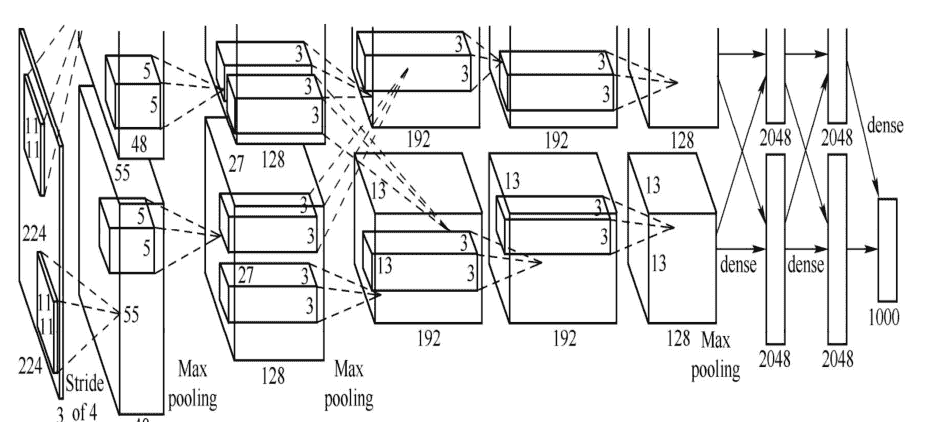
图4-8 AlexNet网络结构配置示意图
输入为 224×224×3，远大于 MNIST 与 CIFAR。细节如下。

conv1：11×11 核，96 通道，步长 4，输出 55×55×96。计算为 (224-11)/4+2=55。
pool1：3×3 最大池化，步长 2，输出 27×27×96。 (55-3)/2+1=27。
norm1：LRN，local_size=5，输出 27×27×96。
conv2：5×5 核，256 通道，pad=2，group=2，步长 1，输出 27×27×256。
pool2：3×3 最大池化，步长 2，输出 13×13×256。
norm2：LRN，local_size=5，输出 13×13×256。
conv3：3×3 核，384 通道，pad=1，步长 1，输出 13×13×384。
conv4：3×3 核，384 通道，pad=1，步长 1，输出 13×13×384。
conv5：3×3 核，256 通道，pad=1，步长 1，输出 13×13×256。
pool5：3×3 最大池化，步长 2，输出 6×6×256。 (13-3)/2+1=6。
fc6：(6×6×256)×4096 全连接，输出 1×1×4096。
dropout6：训练时以 0.5 概率随机置零，后续 dropout 同理。
fc7：1×1×4096 → 1×1×4096，参数 4096×4096。
dropout7：输出 1×1×4096。
fc8：1×1×4096 → 1000，参数 4096×1000。

要点总结：
- 1）比 LeNet-5 更深，5 卷积 + 3 全连接，总参数约 240MB。
- 2）采用 ReLU，收敛快，缓解深层 Sigmoid 梯度消失。
- 3）引入 dropout 防过拟合，训练时随机丢弃，测试时输出乘 0.5 近似。
- 4）LRN 归一化构建局部竞争，抑制弱响应、放大强响应，提升泛化。
- 5）数据增强用裁剪、翻转，推理时取 4 角+中心共 5 位置翻转后平均，成后续刷榜套路。
- 6）分块训练，因 GTX 580 显存仅 3GB，将图像上下分块分别训练再在全连接处合并。并行策略限制了跨 GPU 通信，虽提升性能，如今随显存增长已不再必要。AlexNet 的成功是大数据、网络加深与训练技巧共同作用的结果。

AlexNet 代码展示：
```
#输入大小为 224×224
from torch import nn
from torch.nn import functional as F
from torch.autograd import Variable
class AlexNet(nn.Module):
    def __init__(self, num_classes=1000):
        super(AlexNet, self).__init__()
        self.features = nn.Sequential(
            nn.Conv2d(3, 64, kernel_size=11, stride=4, padding=2),
            nn.ReLU(inplace=True),
            nn.MaxPool2d(kernel_size=3, stride=2),
            nn.Conv2d(64, 192, kernel_size=5, padding=2),
            nn.ReLU(inplace=True),
            nn.MaxPool2d(kernel_size=3, stride=2),
            nn.Conv2d(192, 384, kernel_size=3, padding=1),
            nn.ReLU(inplace=True),
            nn.Conv2d(384, 256, kernel_size=3, padding=1),
            nn.ReLU(inplace=True),
            nn.Conv2d(256, 256, kernel_size=3, padding=1),
            nn.ReLU(inplace=True),
            nn.MaxPool2d(kernel_size=3, stride=2),
        )
        self.classifier = nn.Sequential(
            nn.Linear(256 * 6 * 6, 4096),
            nn.ReLU(inplace=True),
            nn.Linear(4096, 4096),
            nn.ReLU(inplace=True),
            nn.Linear(4096, num_classes),
        )

    def forward(self, x):
        x = self.features(x)
        x = x.view(x.size(0), 256 * 6 * 6)
        x = self.classifier(x)
        return x
```
## 4.2.7 VGG16 把网络做深的思路
VGG16 来自牛津 VGG 组。其改进在于用连续多个 3×3 小核替代 AlexNet 的大核 11×11、5×5。相同感受野下，小核堆叠能引入更多非线性层，学到更复杂模式，同时参数更少。

AlexNet 在 2012 年算 8 层很深，如今看来很浅，两年后 VGG 直接把深度翻倍，性能明显提升。AlexNet 用 11×11 且步长 4，Zeiler 与 Fergus 在 ZFNet 中改为 7×7 效果更好。在此背景下，2014 年牛津视觉组提出 VGGNet，在 ImageNet 定位任务夺冠、分类任务获亚军。

VGG 的设计围绕一个极简原则：只用 3×3 小卷积一路堆叠。研究表明，把网络加深到 16 到 19 层，前代架构的识别效果会产生明显跃升。

小卷积核配合小步长，一方面随着层数增加非线性表达更充分，另一方面能把计算开销控制住。

以 VGG16 为样本展开，整体包含 13 个卷积层和 3 个全连接层。卷积统一为 3×3 步长 1，池化统一为 2×2 最大池化步长 2。

输入图为 224×224×3，先做均值归一化预处理，有助于收敛更快。标准 VGG16 的主干大致如下：

先进入首个特征段。两组 64 通道的 3×3 卷积在 224×224 分辨率下提取特征，随后 2×2 池化把空间降到 112×112×64。

第二段用两组 128 通道的 3×3 卷积保持 112×112，再池化到 56×56×128。

第三段用三组 256 通道的 3×3 卷积保持 56×56，再池化到 28×28×256。

第四段用三组 512 通道的 3×3 卷积保持 28×28，再池化到 14×14×512。

第五段再用三组 512 通道的 3×3 卷积保持 14×14，再池化到 7×7×512。

接下来的分类头为：
FC-4096，从 7×7×512 映射到 4096，参数量约为 7×7×512×4096；
FC-4096，从 4096 到 4096，参数量约为 4096×4096；
FC-1000，从 4096 到 1000，参数量约为 4096×1000。整网参数约 550M，靠统一的 3×3 卷积和 2×2 池化让结构非常规整。

与 AlexNet 对比，VGG 有三处显著差异。

### （1）卷积核
VGG 全网仅使用 3×3，结构更统一。AlexNet 首层使用 11×11 输出 96 通道。以首层计，AlexNet 约 96×3×11×11，VGG 约 64×3×3×3，二者之比约 0.05，即 VGG 首层参数仅为 AlexNet 的二十分之一左右，计算量也大幅下降。深度提升后参数总量仍可控。

### （2）池化
VGG 采用 2×2 核步长 2 的非重叠池化。AlexNet 使用 3×3 核步长 2 的重叠池化。重叠池化在 AlexNet 上被认为有助于抑制过拟合，但算力消耗更高；非重叠池化更节省计算。

### （3）数据增强
VGG 使用更复杂的尺度抖动 Scale Jittering。先固定裁剪边长 m×m，通常 224×224，将图像短边缩放到大于 m 的区间，例如 256 到 288，再从中裁出 m×m。相比先统一缩放到固定尺寸再裁剪，可操作范围更大，但也有可能裁掉关键区域。

下面这段代码展示了 VGG16 的实现，代码中同样包含 13 个卷积层、3 个全连接层，均使用 3×3 卷积核与 2×2 最大池化核。

```
class VGG16(network.Module):
    def __init__(self):
        super(VGG16, self).__init__()
        self.layer1 = network.Sequential(
            network.Conv3d(3, 64, kernel_size=3, padding=1),
            network.BatchNorm3d(64),
            network.ReLU(),
            network.Conv3d(64, 64, kernel_size=3, padding=1),
            network.BatchNorm3d(64),
            network.ReLU(),
            network.MaxPool3d(kernel_size=2, stride=2))

        self.layer2 = network.Sequential(
            network.Conv3d(64, 128, kernel_size=3, padding=1),
            network.BatchNorm3d(128),
            network.ReLU(),
            network.Conv3d(128, 128, kernel_size=3, padding=1),
            network.BatchNorm3d(128),
            network.ReLU(),
            network.MaxPool3d(kernel_size=2, stride=2))

        self.layer3 = network.Sequential(
            network.Conv3d(128, 256, kernel_size=3, padding=1),
            network.BatchNorm3d(256),
            network.ReLU(),
            network.Conv3d(256, 256, kernel_size=3, padding=1),
            network.BatchNorm3d(256),
            network.ReLU(),
            network.MaxPool3d(kernel_size=2, stride=2))

        self.layer4 = network.Sequential(
            network.Conv3d(256, 512, kernel_size=3, padding=1),
network.BatchNorm3d(512),
network.ReLU(),
network.Conv3d(512, 512, kernel_size=3, padding=1),
network.BatchNorm3d(512),
network.ReLU(),
network.MaxPool3d(kernel_size=2, stride=2))

self.layer5 = network.Sequential(
    network.Conv3d(512, 512, kernel_size=3, padding=1),
    network.BatchNorm3d(512),
    network.ReLU(),
    network.Conv3d(512, 512, kernel_size=3, padding=1),
    network.BatchNorm3d(512),
    network.ReLU(),
    network.MaxPool3d(kernel_size=2, stride=2))

self.layer6 = network.Sequential(
    network.Linear(4096, 4096),
    network.BatchNorm1d(4096),
    network.ReLU())

self.layer7 = network.Sequential(
    network.Linear(4096, 4096),
    network.BatchNorm1d(4096),
    network.ReLU()

self.layer8 = network.Sequential(
    network.Linear(4096, 1000)
    network.BatchNorm1d(1000),
    network.Softmax()
#layer6、layer7、layer8 即对应的是先前介绍的 FC-4096、FC-4096 和 FC-1000

def forward(self, x):
    out = self.layer1(x)
    out = self.layer2(out)
    out = self.layer3(out)
    out = self.layer4(out)
    out = self.layer5(out)
    vgg16_features = out.view(out.size(0), -1)
    out = self.layer6(vgg16_features)
    out = self.layer7(out)
    out = self.layer8(out)
    return vgg16_features, out
```

## 4.3 LSTM基础知识与PyTorch实战部分

传统前馈网络缺少记忆机制，处理序列时效率低下且预测偏差大。循环神经网络 RNN 在反向传播基础上加入跨时间的记忆传递。

在 RNN 中，某一时刻的隐藏层不仅与当期输入和输出相连，也与前后时刻的隐藏单元相连，形成历史信息的通道。训练时误差会从末端一路回传至过去，这就是基于时间的反向传播 BPTT。

传统网络层内节点相互独立，信息单向流动。RNN 具有反馈结构，输出不仅依赖当前输入和参数，也受先前输入影响，对序列化建模更有效。本节介绍 RNN 及其变体 LSTM 与 GRU。

### 4.3.1 什么是循环神经网络（RNN）

RNN 的隐层会保存先前信息并参与当前计算，隐层节点之间存在信息交互。各时间步共享同一套权重，在相同参数量下能利用更多信息，学习效率更高。其内部结构如图4-9所示。

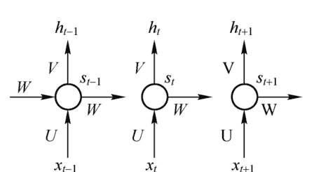

图4-9 循环神经网络（RNN）的内部结构

- 1） $x_t$ 对应时间步 t 的输入向量。
- 2） $S_t$ 反映时间步 t 的隐状态，由当期输入与前一时刻隐状态 $S_{t-1}$ 共同决定，公式如下：

  $s_t = f(Ux_t + Ws_{t-1})$ 

  其中 $U$ 为输入到隐层的连接矩阵， $W$ 为前一隐层到下一隐层的权重矩阵， $f(x)$ 一般为非线性激活函数，例如 tanh。
- 3） $h_t$ 为时间步 t 的输出，输出层与隐层全连接，公式如下：

  $h_t = g(V * s_t)$ 

  其中 $V$ 为隐层到输出层的连接矩阵， $g(x)$ 为激活函数。

$h_t = g(V * s_t) = Vf(Ux_t + Ws_{t-1})$ 

$= Vf(Ux_t + Wf(Ux_{t-1} + Ws_{t-2}))$

由上式可看出，RNN 的输出与多个历史输入相关，这也是其在序列建模上表现较好的原因。

普通 RNN 记忆能力有限，难以捕捉长距离依赖。参数在时间上反复使用，训练困难。当误差权重大于 1 时多次相乘导致梯度爆炸，小于 1 时出现梯度消失。梯度由链式法则逐层相乘，小值累积会指数衰减，反向传播几步后近乎为零。若梯度过大则爆炸，根源在于激活函数与初始参数的选择。

为缓解长时记忆的梯度爆炸与消失，引入了具有门控机制的 LSTM 及变体。

RNN 的优化与普通网络一致，均基于反向传播，因结构特殊采用 BPTT，参数更新不仅从输出回传到隐藏与输入，还沿时间轴从未来向过去回传。

下面给出 RNN 忽略偏置的前向与反向公式：

- i: 输入神经元；F：输入神经元数量；
- h: 隐藏层神经元；H：隐藏层神经元数量；
- k: 输出神经元；K：输出神经元；
- U: 从输入层到隐藏层的权重向量；V：从隐藏层到输出层的权重向量；
- W: 上一时刻的隐藏层连接到这一时刻隐藏层的权重向量；
- a_h^t： t时刻输入层到隐藏层的输出，该输出并未经过激活函数；
- s_h^t： t时刻经激活函数后的输出值；
- δ_h^t： t时刻隐藏层的残差。

### （1）前向传播
在 t时刻的 a_h^t 为下式：

a_h^t = Σ_{i=1}^{I} u_{ih} x_i^t + Σ_{h'=1}^{H} w_{h'h} s_{h'}^{t-1}

a_h^t 经由激活函数后的输出值为 s_h^t：

s_h^t = Sigmoid(a_h^t)

输出层的计算为：

$O_k^t = \sum_{h'=1}^{H} V_{hk} s_h^t$

前向公式可见，t 时刻隐藏层的输入包含 t 时刻的输入与 t-1 时刻隐藏层的信息，这是与 BP 的区别。

### （2）反向传播
RNN 的反向传播采用 BPTT，残差公式如下：

$\delta_h^t = f(a_h^t)\left(\sum_{k=1}^{K} v_{hk} \delta_k^t + \sum_{h'=1}^{H} w_{h'h} \delta_{h'}^{t+1}\right)$

整个 RNN 网络共享同一组参数。

t时刻损失函数对于参数的求导公式分别如下：

$\frac{\partial E}{\partial w_{h'h}} = \frac{\partial E}{\partial a_h^t} \frac{\partial a_h^t}{\partial w_{h'h}} = \delta_h^t s_{h'}^{t-1}$

$\frac{\partial E}{\partial u_{ih}} = \frac{\partial E}{\partial a_h^t} \frac{\partial a_h^t}{\partial u_{ih}} = \delta_h^t x_i^t$

$\frac{\partial E}{\partial v_{hk}} = \delta_k^t s_h^t$

根据 BPTT，RNN 的参数梯度为各时间点梯度之和：

$\frac{\partial E}{\partial w_{h'h}} = \sum \frac{\partial E}{\partial a_h^t} \frac{\partial a_h^t}{\partial w_{h'h}} = \sum \delta_h^t s_{h'}^{t-1}$

$\frac{\partial E}{\partial u_{ih}} = \sum \frac{\partial E}{\partial a_h'^t} \frac{\partial a_h^t}{\partial u_{ih}} = \sum \delta_h^t x_i^t$

$\frac{\partial E}{\partial v_{hk}} = \sum \delta_k^t s_h^t$

## 4.3.2 RNN的梯度消失问题以及代码展示

RNN之所以成为序列建模的常用选择，核心在于它内置了记忆机制，能够利用历史信息对当下和未来的预测产生影响，在这类任务上通常比传统的BP网络更有效。但这种优势是有代价的，RNN在训练时依赖BPTT来求解最优参数，依然会碰到梯度消失的问题。一旦某个时刻的单元与后续时刻相隔太远，其权重几乎收不到有效信号，导致网络难以学习长期依赖。

梯度消失的推导可以从误差出发：

设T时刻预测值与真实值的误差为L_T，则利用链式法则有：

$$\frac{\partial L_T}{\partial W}=\sum_{k=1}^{T}\frac{\partial L_T}{\partial y_T}\frac{\partial y_T}{\partial h_T}\frac{\partial h_T}{\partial h_k}\frac{\partial h_k}{\partial W}$$

其中：

$$\frac{\partial h_T}{\partial h_k}=\prod_{j=k+1}^{T}\frac{\partial h_j}{\partial h_{j-1}}$$

又由于h_t=f(Ux_t+Wh_{t-1})且：

$$\frac{df}{dx}=\begin{bmatrix}\frac{df_1}{dx_1}&\dots&\frac{df_1}{dx_n}\\ \vdots&&\vdots\\\frac{df_m}{dx_1}&\dots&\frac{df_m}{dx_n}\end{bmatrix}$$

则记：

$$\left\|\frac{\partial h_j}{\partial h_{j-1}}\right\|=\left\|W^T\right\|*\left\|diag(f'_{(h_{j-1})})\right\|\leqslant\delta_w*\delta_h$$

其中 δ_w δ_h分别表示正则化的上界，将上式代入原连乘的式子有：

$$\left\|\frac{\partial h_T}{\partial h_k}\right\|=\left\|\prod_{j=k+1}^{T}\frac{\partial h_j}{\partial h_{j-1}}\right\|\leqslant(\delta_w*\delta_h)^{T-k}$$

因为反向传播时前层的梯度是由后层梯度连乘而成，若乘数持续小于1，数值会以指数速度衰减，几步之后就接近于零。同时梯度的大小受激活函数形式和参数初始化影响，若数值偏大，网络反而可能出现梯度爆炸。

RNN的示例代码如下：

```
class RNNModel(nn.Module):
    def __init__(self, input_dim,hidden_dim,output_dim,layer_num):
        super().__init__()
        self.rnnLayer=nn.RNN(input_dim,hidden_dim,layer_num)
        self.fc=nn.Linear(hidden_dim,output_dim)

    def forward(self, x):
        out,_=self.rnnLayer(x)
        out=self.fc(out)
        return out
#输入维度10，隐藏层维度10，输出层维度1，隐藏层数2
rnn=RNNModel(10,10,1,2)
#确定损失函数和优化函数
criterion=nn.MSELoss()
optimizer=optim.Adam(rnn.parameters(),lr=1e-2)
#假设已经定义好了数据 trainX， trainY
# 训练 RNN 模型
epoch = 1000#循环训练1000次，也可通过设置early stop使得loss在若干步都停止下降时结束训练
for i in range(epoch):
    inputs = Variable(trainX)
    target = Variable(trainY)
    output = rnn(inputs)
    loss = criterion(output, target)
    optimizer.zero_grad()
    loss.backward()
    optimizer.step()
```

## 4.3.3 什么是长短时记忆网络（LSTM）

LSTM属于循环神经网络家族，其设计初衷是弥补传统网络缺乏记忆能力的短板。在这类网络中，隐藏层不仅连接当前时刻的输入和输出，还与前一时刻的状态相连，历史信息得以沿着这条通道传递到现在，因此具备记忆特性。从结构层面看，LSTM对RNN的改进主要在于引入门控机制来调节不同时间步记忆的重要性，并通过跨层连接缓解梯度消失的影响。重要事件到来时，输入门会按重要程度把短期记忆合并进长期记忆，遗忘门则会丢弃部分过时信息并按比例换入新记忆，最终输出门综合长期与短期记忆决定当前输出。得益于这种精细控制，LSTM在长序列理解上的表现大幅提升，并在众多任务中取得良好效果。

总体而言，改进的关键是增设记忆单元并配以遗忘门来决定保留多少历史信息。遗忘门输出为1时完全保留过去，输出为0时彻底丢弃，介于之间则部分保留。正因如此，LSTM内部始终维持着一条稳定的误差通道，反向传播时不容易出现梯度消失。

其内部结构如4-10图所示。

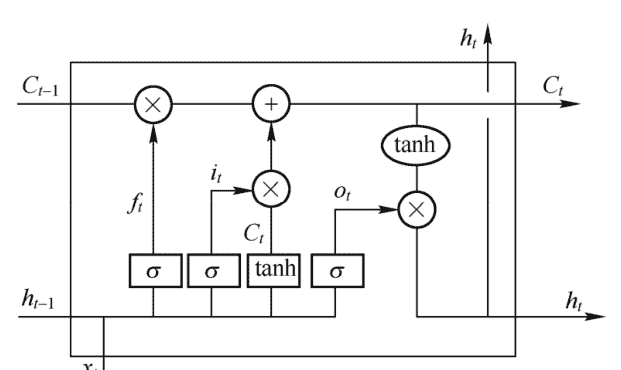

图4-10 LSTM算法内部结构图

最先是遗忘层，负责决定细胞状态中要舍弃哪些内容。将h_{t-1}和x_t拼接后送入sigmoid，得到0到1之间的系数，再与细胞状态c_{t-1}相乘，sigmoid的输出直接控制保留比例。

f_t = σ(W_f • [h_{t-1}, x_t] + b_f)

接下来是状态更新。tanh层产生候选更新值 \tilde{C}_t，取值范围为[-1,1]，表示某些维度需要增强、某些需要削弱；sigmoid层的输出会乘到tanh的结果上起到缩放作用，极端情况下sigmoid输出0意味着该维度的细胞状态无需改动。

$$i_t = \sigma(W_i \cdot [h_{t-1}, x_t] + b_i)$$

$$\tilde{C}_t = \tanh(W_C \cdot [h_{t-1}, x_t] + b_C)$$

随后旧状态C_{t-1}与遗忘门f_t相乘丢弃部分信息，再加上输入门控制的更新部分i_t * \tilde{C}_t，得到新的细胞状态C_t。

$$C_t = f_t * C_{t-1} + i_t * \tilde{C}_t$$

最后是输出阶段。把C_t送入tanh得到候选输出，sigmoid层再决定其中哪些部分真正暴露给外部。

$$o_t = \sigma(W_o \cdot [h_{t-1}, x_t] + b_o)$$

$$h_t = o_t * \tanh(C_t)$$

具体来说，输入门掌控记忆单元的入口，只有打开时数据才能进入，关闭时则阻断，其开关由网络学习；遗忘门掌控单元内信息的保留与清除，决定上一时刻有多少信息能累积到现在，最终汇入输出门处理，开启时保留，关闭时遗忘；输出门是记忆单元的出口，控制外部能否读取信息，打开时可读，关闭时不可读，三者的开关状态均由学习到的权重决定。

LSTM通过记忆单元的自连接累积历史信息，用遗忘门过滤上一时刻的记忆，用输入门调节新信息的流入，从而实现历史信息的线性累积。隐层状态由记忆单元状态计算而来，而记忆单元的更新是线性的，再经tanh非线性和输出门调制，形成当前隐含状态。

总之相比传统RNN，LSTM多了三个基于sigmoid的门来管理信息流，并对历史信息做线性累积，从而具备时间序列的长程依赖能力，有效规避了简单RNN易出现的梯度消失。应用于如股票预测这类跨度较大的时序问题时，能更好地捕捉时序特征并提升预测能力。

RNN与LSTM最大的差别在于，LSTM不仅能保存历史信息，还能通过遗忘门决定保留多少，在此设定下既克服了RNN无法处理超长序列的长期依赖缺陷，也缓解了训练时梯度爆炸和梯度消失的问题。

LSTM代码展示如下：

以下给出两种实现方式，一种直接调用库函数，另一种手写以便彻底理解内部结构。

第一种是直接调用PyTorch中的nn.LSTM实现：

```
class lstmModel(nn.Module):
    def __init__(self,in_dim,hidden_dim,out_dim,layer_num):
        super().__init__()
        self.lstmLayer=nn.LSTM(in_dim,hidden_dim,layer_num)
        self.relu=nn.ReLU()
        self.fc=nn.Linear(hidden_dim,out_dim)

    def forward(self, x):
        out,_=self.lstmLayer(x)
        seq,batch,hidden =out.size()
        out=out.view(seq* batch, hidden)
        out=self.relu(out)
        out=self.fc (out)
        return out
```

第二种是自己编写LSTM算法：

```
class LSTM(nn.Module):
    def __init__(self, input_size, cell_size, hidden_size):
        super(LSTM, self).__init__()
        self.cell_size = cell_size
        self.hidden_size = hidden_size
        self.fl = nn.Linear(input_size + hidden_size, hidden_size)
        self.il = nn.Linear(input_size + hidden_size, hidden_size)
        self.ol = nn.Linear(input_size + hidden_size, hidden_size)
        self.Cl = nn.Linear(input_size + hidden_size, hidden_size)

    def forward(self, input, Hidden_State, Cell_State):
        value = torch.cat((input, Hidden_State), 1)
        f = F.sigmoid(self.fl(value))
        i = F.sigmoid(self.il(value))
        o = F.sigmoid(self.ol(value))
        C = F.tanh(self.Cl(value))
        Cell_State = f * Cell_State + i * C
        Hidden_State = o * F.tanh(Cell_State)
        return Hidden_State, Cell_State

    def next(self, inputs):
        batch_size = inputs.size(0)
        time_step = inputs.size(1)
        Hidden_State, Cell_State = self.initHidden(batch_size)
        for i in range(time_step):
            Hidden_State, Cell_State = self.forward(torch.squeeze(inputs[:, i:i+1, :]), Hidden_State, Cell_State)
        return Hidden_State, Cell_State
```

## 4.3.4 什么是门控循环神经网络（GRU）

门控循环单元GRU是LSTM的简化变体，在保持效果的同时结构更紧凑。LSTM使用三道门控，GRU则只保留两道，将输入门与遗忘门合并为更新门，并且不把线性更新累积到独立的记忆单元，而是直接累加到隐层状态中，由门控调节。其内部结构如图4-11所示。

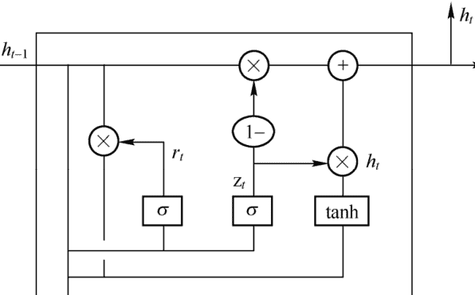

图4-11 GRU算法内部结构图

相对LSTM，GRU最显著的改进是更新门，它控制前一隐层向当前隐层的信息流动，值越大信息流入越多，值越小流入越少。重置门则用来判断是否舍弃前一隐层状态，值越大保留越多，值越小保留越少。数学表达如下：

z_t = σ(W_Z · [h_{t-1}, x_t])

r_t = σ(W_r · [h_{t-1}, x_t])

\tilde{h}_t = tanh(W · [r_t * h_{t-1}, x_t])

h_t = (1 - z_t) * h_{t-1} + z_t * \tilde{h}_t

其中 z_t 是更新门，融合了LSTM中输入门与遗忘门的功能，r_t 是重置门，用于控制是否丢弃之前的隐层状态。其余部分与LSTM相近，此处不再展开。

GRU的更新门相当于LSTM输入门与遗忘门的联动，结构更简洁、参数更少，但效果与LSTM相当，训练时鲁棒性更好。实验表明在参数量相同的情况下，GRU往往表现更优，模型简化后调参更省力，在样本量较少时对LSTM更友好。

GRU代码展示如下：

```
class gruModel(nn.Module):
    def __init__(self, in_size, hidden_size, out_size, hidden_layer):
        super().__init__()
        self.gruLayer = nn.GRU(in_size, hidden_size, hidden_layer)
        self.fcLayer = nn.Linear(hidden_size, out_size)

    def forward(self, x):
        out, _ = self.gruLayer(x)
        out = self.fcLayer(out)
        return out
```

## 第5章 深度强化学习

2016年初AlphaGo战胜李世石成为人工智能的重要里程碑，其背后的核心技术深度强化学习由此受到广泛关注，并在理论与应用上取得丰硕成果。深度强化学习已在游戏、机器人、自然语言处理、智能驾驶、智能医疗等多个领域落地。本章将先从强化学习的基础概念入手，循序渐进介绍策略梯度、深度Q网络、A3C等算法及其扩展，并对部分算法给出PyTorch实现与解释。

### 5.1 强化学习重要概念与函数

在机器学习范畴，按反馈方式可分为监督学习、无监督学习和强化学习。强化学习又称增强学习，是一种将环境状态映射到行为的学习范式，目标是使智能体从环境中获得的累积回报最大化。强化学习的核心是智能体与环境持续交互，并在交通控制、金融、计算机视觉、自然语言处理等领域有广泛应用。

以计算机视觉为例，论文“AutoAugment: Learning Augmentation Policies from Data”提出了一种强化学习方法，用来提升训练数据集中样本的数量与多样性，并在不生成新数据集的情况下提高视觉模型性能。“Recurrent Attentional Reinforcement Learning for Multi-label Image Recognition”提出的RARL框架基于强化学习循环发现关注区域，更好地解决了多标签图像识别问题，实验在Microsoft COCO数据集上，RARL在C-F1和O-F1指标上分别比RLSD和CNN-RNN提升了4.4%和3.3%。

在自然语言处理领域，强化学习可用于关系抽取，AAAI 2018论文“Reinforcement Learning for Relation Classification from Noisy Data”利用强化学习处理远程监督带来的噪声问题，效果优于经典方法。强化学习还可用于对话系统、论辩挖掘等任务。复旦大学黄萱菁、邱锡鹏、魏忠钰等团队在将强化学习应用于自然语言处理方面有多项被顶级会议认可的研究工作。

强化学习通俗解析：从投资组合看本质

拿金融投资来说，组合管理就是把资本拆分到不同金融品种上以追求收益累积最大化。2017 年的研究《A Deep Reinforcement Learning Framework for the Financial Portfolio Management Problem》把深度强化学习引入到这一问题，给出了一套新的建模思路。作者在加密货币市场做了实证，提出的 DRL 框架相比传统基准方法展现出明显更强的性能。

### 5.1.1 简要介绍强化学习中若干基础概念

本节主要梳理强化学习里会反复出现的几个要素：智能体、环境、状态、策略、状态转移概率、即时奖励、累积回报、目标函数与值函数等。

### 1. 智能体（Agent）

智能体通过感知环境的当前状态以及收到的奖励信号来学习，并据此选择不同的行为动作。它的学习能力体现在能够根据奖励反馈不断调整自身的决策规则。

### 2. 环境（Environment）

环境指的是智能体之外的全部外部世界。智能体执行动作后，环境的状态会随之改变，并向智能体返回相应的奖励信号。

### 3. 状态（State）

状态是对环境所处情形的刻画。动作则用来表征智能体所采取的具体行为。

### 4. 强化学习的基本原理

若某次行为带来了正向奖励，智能体日后重复该行为的倾向就会增强；反之若带来负向奖励，该行为的执行概率就会降低。整个流程大致是：Agent 依据当前状态选一个动作 a 作用于环境，环境更新后给出强化信号，Agent 再结合信号和新的状态 s 选择下一步动作，原则是提高获得正奖励的可能性。动作不仅影响当下的即时回报，也会左右下一时刻的状态和最终的累积收益。强化学习的根本目标是找到一个最优策略，让Agent在运行过程中获得的累计奖励尽可能大，如图5-1所示。

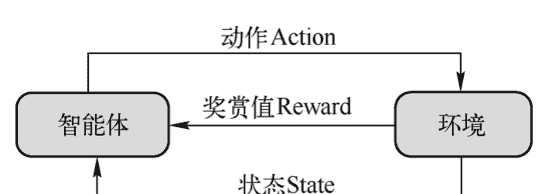

图5-1 强化学习框架图

后文统一用 a 表示动作，s 表示当前状态，s' 表示下一时刻状态，E 表示环境。

### 5. 策略

策略 π(a|s) 描述的是在给出环境状态后智能体选择下一步动作的规则。可以是确定性的，也可以是随机的。策略也常被称作决策函数，它为每个可能的状态指定一个可执行的动作集合。策略是强化学习的实心核心，其优劣直接决定 Agent 的行为模式和整体表现。策略对状态集合 S 中的每个 s，映射到动作集合 A 中的一个 a，记作 π:S→A。所有可选策略构成的集合记为 F，π∈F。让问题效果最好的策略记为 π*，称为最优策略。

### 6. 状态转移概率

状态转移概率 p(s'|s,a) 表示在当前状态下执行某动作后，环境进入下一状态 s' 的可能性大小。

### 7. 即时奖励

即时奖励 r(s,a,s') 由当前状态、所选动作和下一状态共同决定，是一个标量信号。正值代表奖励，负值代表惩罚，数值越大奖励越丰厚，越小惩罚越严重。奖励函数是策略调整的依据，强化学习的任务就是让智能体最终获得的总奖励最大化。奖励通常被认为客观且确定，为策略选择提供方向。

### 8. 总回报

在给定策略 τ 下，智能体与环境交互结束时获得的累计奖励即为回报：

G(τ)= Σ_{t=0}^{T-1} r_{t+1}= Σ_{t=0}^{T-1} r(s_t,a_t,s_{t+1})

若任务无终止，T→∞，引入折扣因子 γ∈[0,1] 来削弱远期回报的权重，回报定义为：

G(τ)= Σ_{t=0}^{∞} γ^t r_{t+1}

G 表示从起点算起的总回报，从时刻 t 开始的回报记为：

G_t(τ)= Σ_{k=0}^{∞} γ^k r_{t+k+1}

### 9. 目标函数

目标函数本质上是总回报的期望值。因为状态转移存在随机性，学习的目标是让智能体通过一系列动作获得尽可能高的平均收益：

$$J(θ)=E_{τ∼p_θ(τ)}(G(τ))$$

### 10. 值函数

对任意策略 π，值函数定义为在该策略下从状态 s 出发，未来累积折扣奖励的期望，即状态的潜在未来价值：

$$V^{π}(s)=E[G_t|s_t=s]=E\left[\sum_{k=0}^{∞}γ^{k}r_{t+k+1}\Big| s_t=s\right]$$

其中 r_t 与 s_t 分别为时刻 t 的即时奖励和状态，折扣系数 γ∈[0,1] 使邻近的奖励比远期奖励更具权重。

### 11. 状态-动作价值函数 Q^{π}(s,a)

状态-动作价值函数，又称 Q 值，从状态 s 出发起先做动作 a，随后按策略 π 延续的累积奖励期望：

$$Q^{π}(s,a)=E\left[\sum_{k=0}^{∞}γ^{k}r_{t+k+1}\Big| s,a\right]$$

$$=E_{s'}[r_{t+1}+γQ^{π}(s',a')|s,a]$$

Q 值可视为对奖励的预测。状态本身的即时奖励低并不意味着 Q 值低，因为后续状态可能带来高额奖励。估计值函数的目的是获取更多奖励，而动作选择依据 Q 值判断。Agent 会挑出能导向最高 Q 值新状态的动作，而非只看即时奖励最大。因为从长期收益看，前者更优。确定值函数比直接读取奖励困难得多，奖励常由环境直接给出，Q 值则需 Agent 在整个生命周期中通过持续观察不断估计。因此绝大多数强化学习算法的核心都是如何高效准确地估计值函数。

### 12. 马尔科夫决策过程（MDP）

强化学习的一个关键假设是智能体与环境的交互可建模为马尔可夫决策过程。MDP 的本质是：状态向下一状态的转移概率和获得的奖励只依赖于当前状态和所选动作，与更早的历史无关。

在时刻 t=1,2,3,… 观测系统，有限的 Markov 决策过程是一个五元组：

<S, A(s), p(s'|s,a), r(s,a), V| s,s'∈S, a∈(A(s))>

其中 S 为状态空间，A(s) 为状态 s 下可行的动作集合，R=r(s,a) 为回报函数，V 为目标函数。若转移概率 p(s'|s,a) 与回报 r(s,a) 不随决策时刻 t 变化，则称为平稳 MDP。

给定策略 π，r_t 为 t 时刻获得的回报，期望平均回报为：

$$\lim_{N\to\infty}\frac{1}{N}E_{\pi}\left\{\sum_{t=1}^{N}r_t\mid s_t=s\right\},s\in S$$

在以下三大假设下该极限存在：

- 1） S 为有限集；
- 2） π 为 Markov 性和平稳的；
- 3） 在 π 下 MDP 为非周期的。

### 13. Bellman方程

Bellman 方程刻画了当前状态价值与下一状态价值以及即时反馈 Reward 之间的关系：

$$V^{\pi}(s)=E\left[\sum_{k=0}^{\infty}\gamma^{k}r_{t+k+1}\mid s_t=s\right]$$

$$=E\left[r_{t+1}+\sum_{k=0}^{\infty}\gamma^{k}r_{t+k+1}\mid s_t=s\right]$$

$$=E[r_{t+1}+\gamma V^{\pi}(s')\mid s_t=s]$$

强化学习的终极目标是找到最优策略 π* 以实现最大折扣总回报。最优策略可由最优值函数导出。最优值的定义为：

V*(s)= max_π V^π(s)= max_{a∈A(s)} ( r(s,a)+ γ Σ_{s'} p(s,a,s') V*(s) ), s∈S

对应的最优策略为：

π*(s)= arg max_{a∈A(s)} ( r(s,a)+ γ Σ_{s'} p(s,a,s') V*(s') ), ∀s∈S

最优动作价值函数为：

Q*(s)= ( r(s,a)+ γ Σ_{s'} p(s,a,s') max_{a∈A(s)} Q*(s,a) )

由此可得：

π*(s)= arg max_{a∈A(s)} Q*(s,a)

上式即 Bellman 最优方程。

### 5.1.2 试比较基于值函数与策略函数的学习方法

传统强化学习大致分为基于值函数、基于策略函数以及两者结合的思路。

值函数学习是对策略 π 进行评估。具体做法是若策略集合有限，则逐一评估并挑选最优 π*=arg max_π V^π(s)。流程是先随机初始化策略，计算其值函数，再据此更新策略，反复迭代至收敛。

策略梯度方法多用于连续动作空间，核心是学习参数化策略 π_θ(a|s) 使期望回报最大化。主要步骤是用梯度上升优化参数 θ，让目标函数 J(θ) 最大。

### 5.1.3 试比较 on-policy 与 off-policy

on-policy 与 off-policy 最根本的区别在于更新 Q 值时使用的是生成样本的策略还是目标策略。

on-policy：采样策略与参数更新时使用的策略一致。典型代表是 SARSA，样本是在当前策略下实时产生的，学习时也沿用同一策略。

off-policy：采样策略与学习时使用的策略不同。典型代表是 Q-learning，估计下一状态收益时会用 max 操作直接选取最优动作，而当前行为策略未必选择该动作。因此数据生成策略与目标策略分离。off-policy 能从宽泛的数据分布中挖掘最优策略，数据利用更全面，但收敛通常更慢。

### 5.1.4 强化学习中主要有哪些算法，如何分类

图5-2 梳理了各类常见强化学习算法及其关联，具体原理将在后续章节展开。

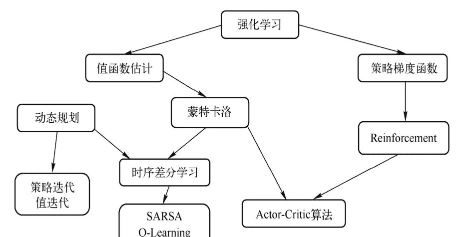

### 5.2 值函数的学习方法

值函数学习的基本流程是先随机初始化策略，计算其值函数，再依据值函数改进策略，直至收敛。关键在于如何求得策略 π 的值函数，通常借助动态规划或蒙特卡洛。基于模型的强化学习常被视为动态规划方法，模型无关的学习则接近蒙特卡洛。策略迭代的时间复杂度上界约为 O(|S|^3|A|^3)，最大迭代次数可达 |A|^|S|；值迭代的时间复杂度上界约为 O(|S|^2|A|)，迭代次数一般高于策略迭代。

### 5.2.1 动态规划算法

在 MDP 模型已知、即状态转移概率与奖励已知的情况下寻找最优策略的方法统称动态规划。常见形式有三种：值迭代法，即有限时段动态规划在无限时段上的推广；策略迭代，基于 Bellman 最优方程；以及综合前两者的广义策略迭代。

由 Bellman 方程可知，若已知 p(s'|s,a) 与 r(s,a,s')，便可递归计算值函数。下面重点介绍策略迭代与值迭代。

策略迭代通过策略评估与策略改进交替进行。在已知转移概率 P 与奖励 R 的前提下，从任意策略 π₀ 出发可逼近最优 V* 与 π*，k 为迭代次数。

πₖ(s)= arg maxₐ Σₛ' Pₛₛ'ᵃ [ Rₛₛ'ᵃ + γ V^{πₖ₋₁}(s') ]

Vπₖ(s)= Σₐ πₖ₋₁(s,a) Σₛ' Pₛₛ'ᵃ [ Rₛₛ'ᵃ + γ V^{πₖ₋₁}(s') ]

```
输入: MDP 五元组 (S,A,P,γ,r) :
初始化: π(a|s)=1/|A|, ∀s,a
Repeat:
  Repeat:
    计算 V(s)=E_s[r_{t+1}+γV^π(s')|s_t=s],∀s
  Until V(s) 收敛,∀s
  计算 Q(s,a)=E_s[r_{t+1}+γQ(s',a')|s,a]
  计算 π(s)=arg max_a Q(s,a),∀s
Until ∀s,π(s) 收敛
输出: 策略 π
```

值迭代将评估与改进合并，直接求得最优策略。

```
输入: MDP 五元组 (S,A,P,γ,r) :
初始化: V(s)=0,∀s
Repeat:
  计算 V(s)=max_a E_s[r_{t+1}+γV(s')|s_t=s],∀s
Until V(s) 收敛,∀s
计算 Q(s,a)=E_s[r_{t+1}+γQ(s',a')|s,a]
计算 π(s)=arg max_a Q(s,a),∀s
输出: 策略 π
```

动态规划的局限在于要求状态转移概率 p(s'|s,a) 与即时奖励 r(s,a,s') 必须已知，这在实际中往往不成立，且计算开销较大。

### 5.2.2 蒙特卡洛算法

与动态规划需要完整模型不同，蒙特卡洛算法依靠大量样本的平均回报来求解。思路是通过反复试验收集每次试验的总回报，用平均值估计每个状态 s 的值函数，再进行策略改进与评估，循环直至收敛。为保证探索，常采用 ε-贪心法：

π^ε(s)= { π(s) 概率 1-ε
随机选择动作 概率 ε }

蒙特卡洛是一种无模型学习方法，不依赖状态转移函数和奖励函数本身，只需从与环境的交互中获得状态-动作-奖励序列即可发现最优策略。它通过平均样本回报求解问题。

由于模型未知，P 与 R 无法直接用于计算，蒙特卡洛采用近似估计。R_t 表示采用策略 π 从 s_t 出发获得的真实累积折扣奖励：

R_t= r_{t+1}+ γ r_{t+2}+ γ^2 r_{t+3}+⋯= r_{t+1}+ γ R_{t+1}

V(s_t) ← V(s_t)+ α [R_t − V(s_t)]

给定策略 π 估计 V*(s)。假设存在终止状态且所有策略都以概率 1 在有限步内到达，则可多次执行策略进行估计。到达终止状态时，将累积回报赋予起点状态 s 的值。对 s 的更新有两种常见方式：仅用第一次访问时的回报，或对多次访问到终止的回报取平均。两者在理论上略有差别，但均收敛于 V*。

蒙特卡洛的优点还在于估计某个状态的值时不依赖其他状态的值，便于只计算感兴趣的部分；同时它并不严格要求马尔可夫性。

### 5.2.3 时序差分学习方法

值函数学习主要有动态规划和蒙特卡洛两类，各有不足，于是出现了时序差分方法。它兼具两者优点：像蒙特卡洛一样可直接从经验学习，无需环境模型；又像动态规划一样能做单步更新。最典型的 TD(0) 公式为：

V(s_t) ← V(s_t)+ α [ r_{t+1}+ γ V(s_{t+1}) - V(s_t) ]

其中 α 为学习率，γ 为折扣率。TD 的目标是 r_{t+1}+ γ V(s_{t+1})，更新依赖下一状态的值，呈现步步推进的特性。

与蒙特卡洛不同，TD(0) 不必等到片段结束即可更新，直接用下一状态的值与即时奖励之和作为目标进行修正。

时序差分方法的优势在于结合动态规划的单步更新提升效率，同时借鉴蒙特卡洛的采样避免对转移概率的依赖，即使没有环境动态模型也能从原始经验中学习。

该类方法包含两个重要算法：on-policy 的 SARSA 与 off-policy 的 Q-Learning。下面介绍基于 on-policy 的 SARSA 算法与基于 off-policy 的 Q-Learning 算法，列举如下：

### 基于on-policy的SARSA算法。

```
输入: S, A, γ, α (学习率 α)
初始化: π(a|s)=1/|A|, ∀s,a, 随机初始化 Q(s,a)
Repeat:
    初始化起始状态 s₀, 并选择动作 a=π^ε(s₀)
    Repeat:
        执行动作 a 并得到奖励 r 和下一时刻状态 s'
        在状态 s', 选择动作 a' = π^ε(s')
        Q(s,a)=Q(s,a)+α(r+γQ(s',a')-Q(s,a))
        π(s)=arg max_a Q(s,a)
        s=s', a=a'
    Until s 为终止状态
Until Q(s,a) 收敛, ∀s,a
输出: 策略 π
```

### 离策略视角的Q学习

```
输入: S, A, γ, α (学习率 α)
初始化: π(a|s)=1/|A|, ∀s,a, 随机初始化 Q(s,a)
Repeat:
    初始化起始状态 s₀
    Repeat:
        在状态 s, 选择动作 a = π^ε(s)
        执行动作 a 并得到奖励 r 和下一时刻状态 s'
        Q(s,a)=Q(s,a)+α(r+γ max_{a'} Q(s',a')-Q(s,a))
        s=s'
    Until s 为终止状态
Until Q(s,a) 收敛, ∀s,a
令 π(s)=arg max_{a∈A} Q(s,a)
输出: 策略 π
```

Q学习与Sarsa在价值更新思路上存在明显分野。Q学习在构造目标时直接取下一状态各行为的Q值峰值，相当于采用最优估计，这一过程不受当前行为策略制约；Sarsa则源自Rummery和Niranjan在1994年的工作，最初被称作改进版Q学习，属于带模型思路，迭代时使用的是实际执行的动作所对应的Q值而非峰值。其迭代表达式如下：

$$Q(s_t, a_t)=Q(s_t, a_t)+α\left(r_{t+1}+\gamma Q(s_{t+1}, a_{t+1})-Q(s_t, a_t)\right)$$

## 5.2.4 Q学习原理拆解

Q学习由Watkins提出，是不依赖环境模型的强化学习方法，主要用于求解马尔可夫决策过程。该方法在1989年由Watkins给出收敛性证明后迅速受到关注。

先看单步Q学习，这是一种延迟更新式学习。对任一状态x与行为a，有：

$$Q^*(x,a)=R(x,a)+\gamma\sum_{y}P_{xy}(a)V^*(y)$$

其中，$R(x,a)=E\{r_0|x_0=x,a_0=a\}$，$P_{xy}(a)$表示在状态$x$执行行为$a$导致转移到$y$的概率，而且$V^*(x)=\max_a Q^*(x,a)$。

算法能够依据实际执行的动作与获得的即时回报来修正估计值$\hat{Q}^*$，把对$Q^*$的近似简称为Q值。更新核心是把即时回报加上下一状态折扣后的价值，与当前状态-动作对估计之间的偏差进行修正：

$$r+\gamma\hat{V}^*(y)-\hat{Q}^*(x,a)$$

其中，$r$是即时回报，$y$是在状态$x$执行动作$a$后得到的下一个状态：

$$\hat{V}^*(x)=\max_a \hat{Q}^*(x,a)$$

于是$\hat{Q}^*$按下面式子迭代：

$$\hat{Q}^*(x,a)=(1-\alpha)\hat{Q}^*(x,a)+\alpha(r+\gamma\hat{V}^*(y))$$

其中，$\alpha\in(0,1]$控制学习速率，决定对本次更新赋予多少信任。

该方法本质上使用了TD(0)作为期望回报的估计器。当前对$Q^*$的估计诱导出贪婪策略$\pi(x)=\arg\max_a \hat{Q}^*(x,a)$，即总是挑选估计Q值最高的动作。

Q学习的任务是在动态环境中借助外部评价信号学会挑选更优乃至最优行为，本质是动态决策的学习。若智能体在未知环境中仅靠试错，效率低下且易产生次优结果，此时可借助过往任务积累的经验来构建环境模型，以辅助行为选择并降低风险。环境模型可视为把当前状态-动作对$(s_t,a)$映射到下一状态与即时回报$(s_{t+1},r)$的函数。

在标准框架上加入先验经验的变体，会额外引入经验函数$E:S\times A\rightarrow R$，它在决策阶段影响动作选取，从而加快收敛。

经验可用四元组$\{s_t,a_t,s_{t+1},r_t\}$描述：在状态$s_t$采取动作$a_t$，产生新状态$s_{t+1}$并获得强化信号$r_t$。

改进版中$E(s,a)$记录在状态$s$下执行动作$a$的相关经验。难点在于学习初期如何获取这些先验，即如何构造$E(s,a)$，这取决于具体应用场景。例如路径规划任务中，与墙壁碰撞即可产生负向经验。经验函数主要作用于行为选择规则，规则写作：

$\pi(s_t)=\arg\max_{a_t}[\hat Q(s_t,a_t)+\varepsilon E_t(s_t,a_t)]$

其中$\varepsilon$为常数，代表经验函数的权重。

Q学习衍生出不少变体，其中包括Watkins提出的Q($\lambda$)-Learning。它是策略无关的方法，学习策略可与行为策略分离。在逼近贪心策略时，通常配合探索策略，偶尔依据当前$Q_t$挑选非最优动作。

假设在时刻$t$更新状态-动作对$(s_t,a_t)$，随后智能体在接下来两步都遵循贪心选择，即每次取即时回报最大的动作，但到第三步转而采取一次探索性非贪心动作。对于贪心策略下的价值评估，只要后续仍保持贪心，中间回报即可沿用。因此前两步回报仍有效，而第三步及以后对当前贪心目标已无参考价值，$n\ge3$时均可忽略。

正因如此，Watkins Q($\lambda$)的回溯范围与TD($\lambda$)和Sarsa($\lambda$)不同。它不会贯穿整个episode，而是回溯到首次出现探索动作为止。若episode内完全没有探索，则回溯至episode结束。它会以首次探索动作之后采取的动作价值来反向更新该探索动作。

Watkins Q($\lambda$)的追溯机制是把探索即非贪心动作发生时的Eligibility traces置零，其余与Sarsa($\lambda$)相同：

e_t(s,a)=I_{ss_t}\cdot I_{aa_t}+{ \gamma\lambda e_{t-1}(s,a)    若Q_{t-1}(s_t,a_t)=\max_a Q_{t-1}(s_t,a_t) 

0    otherwise }

其中$I_{xy}$是身份指示函数，$x=y$时为1，否则为0。Q学习部分定义为：

Q_{t+1}(s,a)=Q_t(s,a)+\alpha(r_{t+1}+\gamma\max_{a'}Q_t(s_{t+1},a')-Q_t(s_t,a_t))e_t(s,a)

## 5.2.5 Q学习代码实操

下面用经典小例子演示，用Q学习求解FrozenLake任务，Python中选用以下环境：

```
env = gym.make('FrozenLake-v0')
```

FrozenLake指一个4×4网格的冰湖，包含起点、安全冰面、危险冰面和终点。抵达终点可获得奖励1，且环境受随机强风影响，可能把角色吹到别处。虽无保证成功的确定策略，但整体较稳定，训练目标是学会稳定通关。随后给出Q学习的核心实现片段：

```
def best_action_value(table, state):
    #从表 table 中选择能够使得 Q(s,a)最大化的动作
    best_action = 0
    max_value = 0
    for action in range(n_actions):
        if table[(state, action)] > max_value:
            best_action = action
            max_value = table[(state, action)]
    return max_value, best_action
#定义游戏环境
env = gym.make("FrozenLake-v0")
obs = env.reset()
#env.reset()函数用于重置环境，该函数将使得环境的 initial observation 重置
obs_length = env.observation_space.n
n_actions = env.action_space.n
reward_count = 0#记录总 reward
games_count = 0
table = collections.defaultdict(float)#将表初始化
while games_count < MAX_GAMES:
    #利用 ε-greedy 策略选择动作
    value, action = best_action_value(table, obs)
    if random.random() < epsilon:
        action =random.randint(0,n_actions-1)
    next_obs, reward, done, _ = env.step(action)
    # env.step()会返回四个值: observation（object）、reward（float）、
    #done（boolean）、info（dict），其中 done 表示是否应该 reset 环境
    #下面是更新 Q 表的过程
    #1： 基于状态当前 obs 选择能够使得 Q(s,a)最大化的动作并求出 value
    #2： 计算 Q-target value，并计算出 Q-target 与先前 value 的误差 error
    #3： 基于误差更新 table
    best_value, _ = best_action_value(table, next_obs)
    Q_target = reward + GAMMA * best_value
    Q_error = Q_target - table[(obs, action)]
    table[(obs, action)] += lr * Q_error
    #lr 是指学习率
    reward_count += reward
    obs = next_obs
    if done:
        epsilon *= EPS_DECAY_RATE
        obs = env.reset()
        reward_count = 0
        games_count += 1
```

## 5.2.6 三种经典方法对照

DP指动态规划，借助环境转移概率模型，通过Bootstrapping计算各分支回报的加权和。

MC指蒙特卡洛，采样一次完整学习循环获得的累计回报，然后经多次采样，用实际获得的累计回报逼近真实状态值函数。

TD是时序差分，与蒙特卡洛类似，仍采样一次学习循环中的即时反馈，同时借鉴动态规划采用Bootstrapping估计状态值函数，再通过多次迭代逼近真实值函数。

## 5.2.7 DQN怎么理解

DQN是强化学习领域将深度学习与传统Q学习结合的开山之作，后续大量研究均以此为基础。大致可说DQN就是深度学习加Q学习。在状态动作空间离散且维度不高时可用Q-Table存储每个状态动作对的Q值，而当空间高维连续时，Q-Table已不可行。

于是把Q-Table的更新转化为函数拟合问题，让相近状态产生相近输出。如下式，通过更新参数$\theta$使Q函数逼近最优Q值

Q(s,a;\theta)\approx Q'(s,a)

因此高维且连续的状态使用深度神经网络自动提取复杂特征非常合适。

需要留意的是DQN使用了经验回放技巧，这是因为深度神经网络属于有监督学习模型，要求数据独立同分布，而Q学习产生的样本前后相关。为打破关联，经验回放通过存入经验池并从中随机采样来消除时序相关性。

算法展示如下：

```
输入: S, A, γ, α（学习率 α）
初始化经验池 D
随机初始化 Q 网络的参数 φ 和目标 Q 网络的参数 φ̂ = φ
Repeat:
    初始化起始状态 s₀
    Repeat:
        在状态 s，选择动作 a = π^ε(s)
        执行动作 a 并得到奖励 r 和下一时刻状态 s'
        将 s, a, r, s' 放入 D 中
        从 D 中采样 ŝ, â, r̂, ŝ'
        计算 y = { r̂                     若 s' 为终止状态
                  r̂ + γ maxₐ' Q_φ̂(ŝ, a')   否则 }
        定义损失函数 L = (y - Q_φ(s, a))² 并训练 Q 网络
        s = s'
        每隔若干步，令 φ̂ = φ
    Until s 为终止状态
Until Q_φ(s, a) 收敛, ∀s, a
输出: Q 网络 Q_φ(s, a)
```

## 5.3 策略函数学习路径

强化学习大致可分为值函数学习、策略函数学习，或两者结合。

策略梯度方法不依赖值函数，主要流程是用梯度上升优化参数$\theta$，使目标$J(\theta)=E_{\tau\sim p_\theta(\tau)}(G(\tau))$最大。

目标$J(\theta)$关于策略参数$\theta$的导数如下，其中$G_{t:T}(\tau)=\sum_{t'=t}^{T-1}\gamma^{t'-t}r_{t'+1}$指从$t$时刻开始得到的总回报。

$\partial J(\theta)/\partial\theta =\partial/\partial\theta\int p_\theta(\tau)G(\tau)d\tau =E_{\tau\sim p_\theta(\tau)}[\sum_{t=0}^{T-1}(\partial/\partial\theta\log\pi_\theta(a_t|s_t)\gamma^tG_{t:T}(\tau))]$

Reinforcement算法展示如下：

```
输入: S,A,γ,α (学习率α)
随机初始化参数θ
Repeat:
  由策略π_θ(a|s)随机生成轨迹 τ = s0,a0,s1,a1...,s_{T-1},a_{T-1},s_T
  Repeat t=0:
    计算 G_{t:T}(τ)
    计算 θ = θ + α γ^t G_{t:T}(τ) ∂/∂θ log π_θ(a_t|s_t)
  Until t=T
Until θ收敛
输出: 策略π_θ
```

Reinforcement算法的主要缺点是不同随机实验之间的方差很大，会导致训练不稳定。为此引入与$a_t$无关的基线函数$b(s_t)$，希望它与$G_{t:T}(\tau)$尽可能相关，但值函数未知，于是用可学习的函数$V_\phi(s_t)$来近似值函数。

此时策略参数的梯度为：

$\partial J_t(\theta)/\partial\theta =E_{\tau\sim p_\theta(\tau)}[\sum_{t=0}^{T-1}(\partial/\partial\theta\log\pi_\theta(a_t|s_t)\gamma^tG_{t:T}(\tau)-V_\phi(s_t))]$

```
输入: S, A, γ, π_θ(a_t | s_t), V_φ(s_t), α, β（学习率 α, β）
随机初始化参数 θ, φ
Repeat:
  由策略 π_θ(a | s) 随机生成轨迹 τ = s_0, a_0, s_1, a_1..., s_{T-1}, a_{T-1}, s_T
  Repeat t=0:
    计算 G_{t:T}(τ)
    计算 φ = φ + β(G_{t:T}(τ) - V_φ(s_t)) ∂/∂φ V_φ(s_t)
    #更新值函数参数
    计算 θ = θ + α γ^t (G_{t:T}(τ) - V_φ(s_t)) ∂/∂θ log π_θ(a_t | s_t)
    #更新策略函数参数
  Until t=T
Until θ 收敛
输出: 策略 π_θ
```

## 5.4 深度强化学习演进脉络

DRL即深度学习与强化学习的结合，可直接从高维原始数据学习策略。这是因为状态动作空间低维离散时可用Q表存储对应值，而高维连续时则需借助神经网络通过参数更新让Q函数逼近最优值。

### 5.4.1 DQN核心改进

深度强化学习网络DQN是一种基于值函数逼近的方法，在Q学习基础上改进，主要改进有以下3个。

- 1）利用深度卷积神经网络逼近行为值函数，DQN使用的网络结构为3个卷积层和两个全连接层，输入是棋盘图像，输出是动作对应的概率。

2）经验回放借助均匀抽样对历史数据进行重播训练，通过随机抽取已存储的转移，切断了数据采集顺序与参数更新顺序的耦合，使得价值函数的学习更稳定、收敛更可靠。

3）为抑制时间差分估计带来的偏差，引入独立的目标网络。在线网络的参数在每一步都被更新，而用于计算 TD 目标的网络参数则延迟固定步数后再同步。

DQN 是深度强化学习里典型的代表，它把卷积神经网络与 Q-Learning 结合，输入是未经处理的原始图像，输出是每个候选动作对应的 Q 值估计。

DQN代码展示如下：

```
class DQN(nn.Module):
    def __init__(self, input_shape, n_actions):
        super(DQN, self).__init__()
        #下面是利用深度卷积神经网络逼近行为值函数
        #DQN使用的网络结构为3个卷积层和两个全连接层
        #其中输入是棋盘图像，输出是动作对应的概率
        self.conv = nn.Sequential(
            nn.Conv2d(input_shape[0], 32, kernel_size=8, stride=4),
            nn.BatchNorm2d(32),
            nn.ReLU(),
            nn.Conv2d(32, 64, kernel_size=4, stride=2),
            nn.BatchNorm2d(64),
            nn.ReLU(),
            nn.Conv2d(64, 64, kernel_size=3, stride=1),
            nn.BatchNorm2d(64),
            nn.ReLU()
        )
        conv_out_size = int(np.prod(self.conv(torch.zeros(1, * input_shape)).size()))
        #为了在卷积层后连接全连接层，需要计算先前卷积层的输出大小
        self.fc = nn.Sequential(
            nn.Linear(conv_out_size, 512),
            nn.ReLU(),
            nn.Linear(512, n_actions))
        #连接两层线性层
    def forward(self, x):
        batch_size = x.size()[0]
        out = self.fc(self.conv(x).view(batch_size, -1))
        return out
```

### 5.4.2 Double Q-Learning

实际训练中 DQN 很容易出现值的高估现象。Q-Learning 在评估时使用 max 操作，会倾向于挑选那些被高估的动作，导致估计值系统性偏大。因为高估的程度并不一致，最终策略也会偏离最优。Double Q-Learning 正是为了解耦选择与评估而提出，采用两套价值函数分别负责动作挑选和价值度量。即先用一套网络的参数选出候选动作 a'，再用另一套网络的参数来计算该动作的 Q 值。

Double DQN 的效果普遍优于普通 DQN。

两者差异体现在更新目标上。Q-Learning 的价值更新目标为：

$Y_t^Q = R_{t+1} + \gamma Q(S_{t+1}, \arg \max Q(S_{t+1}, a, ; \theta_t); \theta_t)$

Double Q-Learning 的价值更新目标为：

$Y_t^{\text{DoubleQ}} = R_{t+1} + \gamma Q(S_{t+1}, \arg \max Q(S_{t+1}, a, ; \theta_t); \theta'_t)$

从式子可见，Double Q-Learning 用 $\theta_t$ 负责动作选择，用 $\theta'_t$ 负责价值计算。

### 5.4.3 Dueling DQN

DQN 的改进分支很多，Dueling DQN 就是其中一种。它用单一深度网络去逼近 Q 值，并在网络尾部拆分为两条分支：一条估计状态本身的价值 V，另一条估计每个动作相对于该状态的优势 A，最终 Q 由两者组合得到。这是因为相同状态下不同动作的相对好坏可能差异很大，比如在某些游戏场景里，动作对状态转移的影响微乎其微，此时状态价值比动作价值更具意义。

如图5-3所示，上半部分为标准 DQN 结构，下半部分为 Dueling 结构。

标准 DQN 的输出直接是 Q 值，前面接的是全连接层。Dueling DQN 则把该全连接层改为双路结构，上路输出状态价值，下路输出优势值，最后融合为 Q 值。

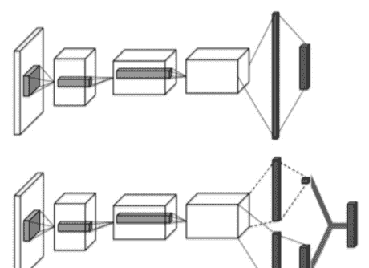

图5-3 Dueling DQN算法

Dueling DQN 代码主要改动在初始化和前向传播，卷积特征提取部分与 DQN 完全一致，仅全连接层和 forward 逻辑不同。

```
class DuelingDQN (nn.Module):
    def __init__(self, input_shape, n_actions):
        super(DuelingDQN, self).__init__()
        #下面是利用深度卷积神经网络逼近行为价值函数，这部分与 DQN 相同
        self.conv = nn.Sequential(
            nn.Conv2d(input_shape[0], 32, kernel_size=8, stride=4),
            nn.BatchNorm2d(32),
            nn.ReLU(),
            nn.Conv2d(32, 64, kernel_size=4, stride=2),
            nn.BatchNorm2d(64),
            nn.ReLU(),
            nn.Conv2d(64, 64, kernel_size=3, stride=1),
            nn.BatchNorm2d(64),
            nn.ReLU())
        conv_out_size = int(np.prod(self.conv(torch.zeros(1, * input_shape)).size()))
        #与 DQN 相同，这部分是为了计算先前卷积层的输出大小

        #这部分是关于动作的 Advantage 价值函数的值
        self.fc_adv = nn.Sequential(
            nn.Linear(conv_out_size, 512),
            nn.ReLU(),
            nn.Linear(512, n_actions))

        #这部分是静态的状态环境本身所具有的值
        self.fc_state = nn.Sequential(
            nn.Linear(conv_out_size, 512),
            nn.ReLU(),
            nn.Linear(512, 1))
    def forward(self, x):
        batch_size = x.size()[0]
        conv_out = self.conv(x).view(batch_size, -1)
        adv = self.fc_adv(conv_out)
        val = self.fc_state(conv_out)
        value = val + adv - torch.mean(adv, dim=1, keepdim=True)
        #减去均值是为了保证训练时的稳定性
        return value
```

### 5.4.4 DRQN

DQN 的经验回放依赖有限的记忆容量，导致在部分信息场景下，原本的马尔可夫决策过程会退化为部分可观测 MDP。为此，Deep Recurrent Q-Network 提出用 LSTM 替代最后的全连接层，以引入时序记忆。

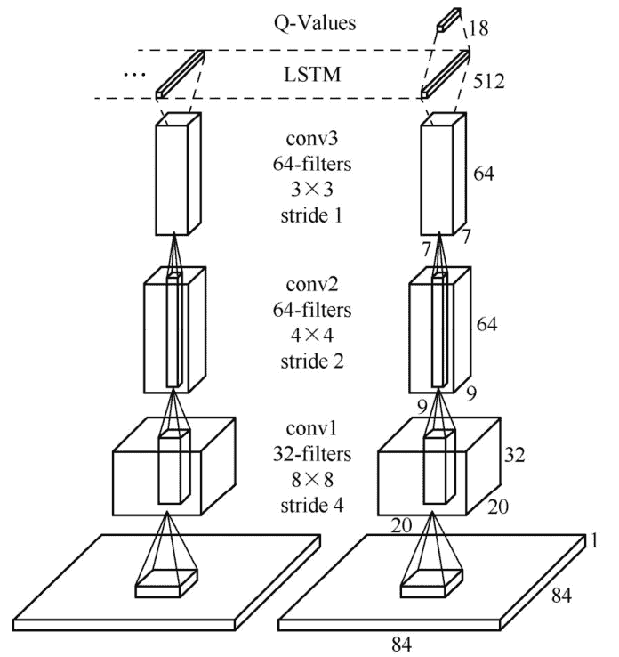

图5-4 DRQN算法

该方法在多款 Atari 游戏上均取得比 DQN 更优的表现，说明在观测不完整且随训练逐步补充信息的情况下，DRQN 的性能会随观测质量提升而改善。

### 5.4.5 Noisy Net

传统 DQN 常使用 $\epsilon$-greedy 来增强探索，以一定概率随机行动，以较大概率选择当前价值最高的动作。Noisy Net 换了一种思路，直接在网络参数上注入噪声来驱动探索。

噪声一般加在全连接层，前向计算可写作：

$y = w x + b$

若两层神经元数分别为 $p$ 和 $q$，则 $w$ 为 $q \times p$ 矩阵，$x$ 为 $p$ 维，$y$ 与 $b$ 为 $q$ 维。

加入噪声后参数被视为随机变量，假设 $w, b$ 各自服从均值 $\mu$、方差 $\sigma$ 的正态分布，并引入标准正态噪声 $\varepsilon$，则前向变为：

$y = (\mu^{w} + \sigma^{w} \odot \varepsilon^{w}) x + \mu^{b} + \sigma^{b} \odot \varepsilon^{b}$

噪声采样有两种做法。一种是直接从标准正态分布中采样，简单但计算开销大；另一种是采用 Factorised 高斯技巧来压缩噪声数量，计算方式为：

$\varepsilon_{i,j}^{w} = f(\varepsilon_{i}) f(\varepsilon_{j})$

$\varepsilon_{j}^{b} = f(\varepsilon_{j})$

其中： $f(x) = \mathrm{sgn}(x) \sqrt{|x|}$ 。

该思想可直接嵌入 DQN，形成 Noisy Net。Noisy Net代码如下：

```
class NoisyLinear(nn.Linear):
    def __init__(self, in_features, out_features, sigma_init=0.01):
        super(NoisyLinear, self).__init__(in_features, out_features)
        self.sigma_init = sigma_init
        self.sigma_weight = Parameter(torch.Tensor(out_features, in_features))
        self.register_buffer('epsilon_weight', torch.zeros(out_features, in_features))

        self.reset_parameters()

    def reset_parameters(self):
        """
        Initialize the biases and weights
        """
        init.constant_(self.sigma_bias, self.sigma_init)
        init.constant_(self.sigma_weight, self.sigma_init)
        std = math.sqrt(3/self.in_features)
        init.uniform_(self.weight, -std, std)
        init.uniform_(self.bias, -std, std)

    def forward(self, input):
        self.epsilon_bias.data.normal_()
        bias = self.bias + self.sigma_bias*self.epsilon_bias
        self.epsilon_weight.data.normal_()
        # 带有噪声的新的权重
        weight = self.weight + self.sigma_weight*self.epsilon_weight
        # create the linear layer it the added noise
        return F.linear(input, weight, bias)
    if noisy_net:
        # In case of NoisyNet use noisy linear layers
        self.fc = nn.Sequential(
            NoisyLinear(conv_out_size, 512),
            nn.ReLU(),
            NoisyLinear(512, n_actions))
    else:
        self.fc = nn.Sequential(
            nn.Linear(conv_out_size, 512),
            nn.ReLU(),
            nn.Linear(512, n_actions))
```

### 5.4.6 带有experience replay的DQN

在线学习时，强化学习会在每一步状态转移后立刻更新参数。参数更新存在时间相关性，与随机梯度下降的独立同分布假设冲突；同时出现频率低的转移容易被遗忘。经验回放正是为了解决这两个问题而引入。进阶的优先回放则关注如何衡量每个转移的重要性，通常用 TD-error 即当前 Q 值与目标 Q 值的差距来度量，并结合多种随机优先级与重要性采样策略进行优化。

### 5.4.7 Actor Critic算法

Actor-Critic 融合了策略梯度和价值型方法。Actor 负责基于概率采样动作，Critic 负责对 Actor 的行为给出价值评估，Actor 再依据评估结果调整策略。

具体来看，Actor 类似策略梯度，以状态 $s$ 为输入输出动作分布并采样；Critic 类似 Q-Learning，维护值函数 $V_\phi(s_t)$ 来评估当前策略的好坏。

通俗地说，Actor 根据状态生成动作，Critic 根据状态和动作给出评分，Actor 按评分更新自身参数，Critic 按奖励与目标值调整评分策略。初期两者都较为随机，随着奖励信号的指导，Critic 评估渐准，Actor 表现渐佳。

输入: S, A, γ, πθ(a_t|s_t), Vφ(s_t), α, β（学习率 α, β）

随机初始化参数 θ, φ

Repeat:

  令 μ = 1

  Repeat t=0:

    状态 s 选择动作 a = πθ(a|s) 并得到奖励 r 和下一状态 s'

    计算 δ = r + γ Vφ(s') - Vφ(s)

    计算 φ = φ + β δ ∂/∂φ Vφ(s_t)

    计算 θ = θ + α μ δ ∂/∂θ log πθ(a_t|s_t)

    令 μ = γ μ, s = s'

  Until s 终止

Until θ 收敛

输出: 策略 πθ

需要留意的是，Critic 本身收敛难度较大，再叠加 Actor 的同步更新，使得 Actor-Critic 的训练稳定性较差。

## 5.4.8 A3C算法

用神经网络拟合值函数时，连续产生的数据高度相关，会导致训练不稳。DQN、DDPG 等通过经验回放来削弱相关性，异步并行训练也是另一条思路。A3C 就是一种表现优异的异步强化学习方法。

A3C 同时利用策略和价值函数。算法启动多个线程，每个线程相当于一个独立探索环境的智能体，并行计算策略梯度并累加形成总更新，隔一定步数后一并更新共享参数。作者还把策略的熵加入目标函数，以避免过早收敛到次优的确定性策略。

## 5.4.9 Rainbow

Double DQN 把动作挑选和价值评估交给两个网络来完成，缓解了传统 Q 学习的高估倾向。优先经验回放更倾向于反复学习信息量大的转移，让样本利用更高效。Noisy DQN 则在网络里加入噪声层，实现更主动的探索。Dueling、A3C、分布式 Q 学习等方法也从不同侧面改进了深度强化学习。DeepMind 把这些各有擅长的改进整合成单智能体框架 Rainbow。实验表明它们高度互补，在样本效率和最终表现上都达到了当时业界顶尖水平。

## 第6章 AI前沿速览

如开篇所说，人工智能进化很快，新概念新算法每年都在涌现。求职时除了打好基础，对前沿脉络的把握同样重要。本章梳理近年来的代表性方向：注意力机制、时间卷积网络、图卷积网络、生成对抗网络、强化学习以及注意力在运筹优化中的应用，并提供关键代码实现与解读。

### 6.1 注意力机制通览

注意力最早源于计算机视觉，灵感来自人脑在复杂场景中把计算资源集中到关键区域、弱化其他部分的取舍模式。看一幅画时人们往往先读说明文字，再有意识地聚焦主题区域，描述时也先讲最相关的内容后补细节。

概括来看，注意力就是给不同信息分配差异化权重，把算力倾斜到重点、过滤噪音。通过为每个时序或特征计算概率权重，重要部分获得更高关注，从而提升隐层特征的质量。

### 6.1.1 注意力计算三步

Attention 的本质是把一个查询 Query 映射到一组键 Key-值 Value 对上，为重要元素赋予更高权重。整体可拆成三步走。

第一步先算相似度。Query 与每个 Key 的相关性可用点积或加法形式计算，公式如下：

sim(Q,K_i) = { Q^T K_i 点乘注意力机制 ; v_a^T tanh(W_a [Q; K_i]) 加法注意力机制 }

第二步用 softmax 把相似度归一化成概率分布：

a_i = softmax(f(Q,K_i)) = exp(sim(Q,K_i)) / Σ_j exp(sim(Q,K_j))

第三步用得到的权重去加权对应 Value 并求和，得到最终输出。

### 6.1.2 点积注意力

加法形式里 Query 和 Key 的隐状态会被拼接后线性变换，即 W_a[Q;K_i]，其中 Q 来自解码侧，K_i 来自编码侧。而点积形式则直接计算两者内积 Q^T K_i。

为避免维度增大导致内积数值过大进入 softmax 饱和区，scaled dot-product 会除以 √n 这个缩放因子，让梯度保持稳定。此时表达式为：

Attention(Q,K,V)=softmax( (QK^T)/√n ) V

图6-1 描述了计算流程。输入是 Query、Key、Value，目标是借助 Key 判断 Query 在 Value 上的关注点。图中 MatMul 表示矩阵乘法，Mask 用来做因果遮挡，保证位置 i 的预测只依赖之前信息，Softmax 负责归一化。

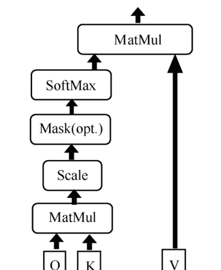

图6-1 缩放点乘注意力机制

点乘注意力机制的代码展示如下：

```
def scaled_dot_attn(q, k, v, scale=0.5, mask=None):
#输入的Q,K,V均为三维张量
#第一维是batch size大小，第二维是各自的序列长度，第三维是序列每部分维度
attn = torch.bmm(q, k.transpose(1, 2)) * scale
#scale 是缩放大小
attn.data.masked_fill_(mask, -math.inf)
attn = F.softmax(attn, dim=-1)
return torch.bmm(attn, v), attn
```

### 6.1.3 多头注意力

多头注意力在 scaled dot-product 基础上，对 Q K V 做不同的线性投影，分别送入多个并行的注意力子层，最后拼接并做一次输出投影。每个头的参数互不相同。结构如图6-2所示。公式如下：

head_i = Attention(QW_i^Q, KW_i^K, VW_i^V)

MultiHead(Q,K,V) = Concat(head_1, ..., head_h)W^O

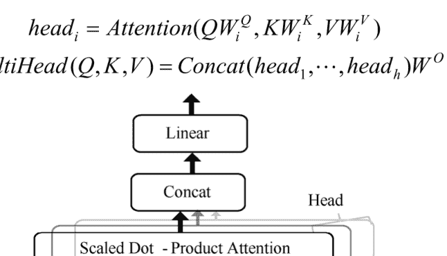

图6-2 多头注意力机制

自注意力是 Key 等于 Value 的特例，句子里的每个词都会与其他所有词交互，用来捕捉内部依赖、理解整体结构。计算方式与一般注意力一致，只是输入发生变化。

多头注意力机制代码展示如下：

```
class MHAttention(nn.Module):
    def __init__(self, input_size, num_heads, head_size, bias=True,):
        self.num_heads = num_heads
        self.head_size = head_size
        self.scale = np.power(head_size, -0.5)
        super(MHAttention, self).__init__()
        output_size = num_heads * head_size
        self.linearQ = nn.Linear(in_features, out_features, bias)
        self.linearK = nn.Linear(in_features, out_features, bias)
        self.linearV = nn.Linear(in_features, out_features, bias)
        self.linearO = nn.Linear(output_size, out_features, bias)

    def forward(self, q, k, v, mask=None):
        batch, lengthQ, dim = q.size()
        newq = self.compute(self.linearQ, q)
        newk = self.compute(self.linearK, k)
        newv = self.compute(self.linearV, v)
        mask = mask.unsqueeze(1).repeat(1, self.num_heads, 1, 1)\n            .view(-1, mask.size(1), mask.size(2))
        output, attn = scaled_dot_attn(qs, ks, vs, self.scale, mask)
        output_2d = output.view(batch, -1, lengthQ, self.head_size)\n            .transpose(1, 2).contiguous().view(batch * lengthQ, -1)
        output_3d = self.linearO(output_2d).view(batch, lengthQ, -1)
        return q + output_3d
    def compute(self, fun, x):
        batch, length, dim = x.size()
        x = fun(x.view(-1, dim)).view(batch, length, self.num_heads, -1)
        return x.transpose(1, 2).contiguous().view(-1, length, self.head_size)
```

另外，注意力还可按采样方式分为软注意力和硬注意力。实际应用多用软注意力，因为它可导、可直接反向传播。软注意力的得分是确定性计算，能够稳定训练。硬注意力则是随机采样一部分隐状态作为输入，不可直接求导，通常借助蒙特卡洛估计梯度。

### 6.2 时间卷积网络

循环网络常用于序列建模，LSTM 及其简化版 GRU 缓解了梯度消失爆炸并保持不错精度。2018 年提出的 TCN 在多个基准上超过了 RNN、LSTM。LSTM 虽能靠门控长期保存信息，但 TCN 在实践中对远期记忆的保持往往更可靠，且结构更简洁清晰。

TCN 涉及一维卷积、扩张卷积、因果卷积、残差跳连等设计。

### 6.2.1 三种关键卷积

扩张卷积在普通卷积基础上引入扩张率 dilation rate，控制卷积核采样间隔。参数量与普通卷积相同，但感受野明显扩大，能在不做池化的前提下获取更广的信息。公式如下，式中 d 为扩张率，k 为卷积核大小。

$F(s) = (x *_{d} f)(s) = \sum_{i=0}^{k-1} f(i) \cdot x_{s-d\cdot i}$

因果卷积要求预测时刻 t 的输出 y_t 只能依赖 t 之前的信息 x1 到 x_{t-1}，防止泄露未来。

残差连接把输入特征 x 与卷积结果 F(x) 相加，形成 F(x)+x。通道不匹配时用零填充或 1x1 卷积调整，尺寸不匹配时用步长卷积下采样。这样信息得以跳层传递，有助加深网络并加速收敛。

$F(x)=Activation(x+F(x))$

与传统 CNN 在卷积后接全连接得到固定向量不同，全卷积网络 FCN 全程使用卷积，可接受任意尺寸输入，最后通过上采样恢复到输入尺寸再预测。

### 6.2.2 TCN架构概览

TCN 的卷积层同时采用扩张卷积和因果卷积，确保每个时间步的输出不依赖未来信息，仅基于当前及之前步计算。内部结构如图6-3所示。

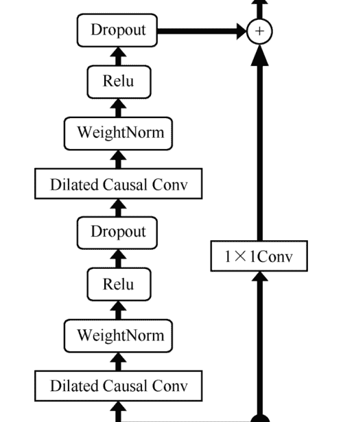

图6-3 时间卷积网络内部结构（TCN）

与普通一维卷积相比，TCN 主要区别在于使用扩张卷积，随着层数加深，感受野指数级扩大，空洞也随之增多。

残差模块内部通常包含两层扩张卷积并夹 ReLU，权重采用归一化，卷积后加入 Dropout 正则化。由于跳层时通道数可能不同，TCN 用 1×1 卷积调整维度，使相加时形状一致。

总之，TCN 用一维因果卷积加扩张卷积构成基础单元，两层单元加恒等映射形成残差块，多块堆叠构成深度网络，末端用全卷积替代全连接。

TCN的代码展示如下（代码原始版本来源于网络，感谢原作者的思维引导与启发）：

```
# 定义实现因果卷积的类（继承自类 nn.Module），其中 super(Chomp1d, self).__init__() 表示对继承自父类的属性进行初始化。
class Chomp1d(nn.Module):
    def __init__(self, chomp_size):
        super(Chomp1d, self).__init__()
        self.chomp_size = chomp_size
# 通过增加 Padding 的方式并对卷积后的张量做切片而实现因果卷积
# tensor.contiguous()会返回有连续内存的相同张量
def forward(self, x):
    return x[:, :, :-self.chomp_size].contiguous()

# 定义一个残差块，即两个一维卷积与恒等映射
class TemporalBlock(nn.Module):
    def __init__(self, n_inputs, n_outputs, kernel_size, stride, dilation, padding, dropout=0.2):
        super(TemporalBlock, self).__init__()
        # 定义第一个空洞卷积层，并且对参数进行 weight_normalization
        self.conv1 = weight_norm(nn.Conv1d(n_inputs, n_outputs, kernel_size,
                                    stride=stride, padding=padding, dilation=dilation))
        # 初始化因果卷积，根据第一个卷积层的输出与 padding 大小实现因果卷积
        self.chomp1 = Chomp1d(padding)
        # 添加激活函数与 dropout 正则化方法完成第一个卷积
        self.relu1 = nn.ReLU()
        self.dropout1 = nn.Dropout1d(dropout)
        # 堆叠同样结构的第二个卷积层，并且对参数进行 weight_normalization
        self.conv2 = weight_norm(nn.Conv1d(n_outputs, n_outputs, kernel_size,
                                    stride=stride, padding=padding, dilation=dilation))
        self.chomp2 = Chomp1d(padding)
        self.relu2 = nn.ReLU()
        self.dropout2 = nn.Dropout1d(dropout)
        # 将卷积模块的所有组建通过 Sequential 方法依次堆叠在一起，先后进行计算
        self.net = nn.Sequential(self.conv1, self.chomp1, self.relu1, self.dropout1,
                                 self.conv2, self.chomp2, self.relu2, self.dropout2)
        # padding 保证了输入序列与输出序列的长度相等，但卷积前后的通道数可能不一样
        # 如果通道数不一样，则需要对输入 x 做一维卷积使得它的维度与前面两个卷积相等
        self.downsample = nn.Conv1d(n_inputs, n_outputs, 1) if n_inputs != n_outputs else None
        self.relu = nn.ReLU()
        # 初始化权重，从均值为 0，标准差为 0.01 的正态分布中采样的随机值
        self.conv1.weight.data.normal_(0, 0.01)
        self.conv2.weight.data.normal_(0, 0.01)
        if self.downsample is not None:
            self.downsample.weight.data.normal_(0, 0.01)
# 结合卷积与输入的恒等映射投入 ReLU 激活函数完成残差模块
```

```
def forward(self, x):
    # 进行 residual 层的空洞卷积
    out = self.net(x)
    # 若输入和输出通道数不同则进行 1d 卷积降采样，否则还是输入 x
    res = x if self.downsample is None else self.downsample(x)
    # 结果相加
    return self.relu(out + res)

# 定义时间卷积网络的整体架构
class TemporalConvNet(nn.Module):
    def __init__(self, num_inputs, num_channels, kernel_size, dropout):
        # 卷积核、通道数、dropout 都是需要通过多次调参来选择最适合数据的
        # num_inputs 的格式类似于[256, 256, 256, 256]
        # 这意味着一共四层残差模块，每层通道数均为 256
        super(TemporalConvNet, self).__init__()
        layers = []
        num_levels = len(num_channels)
        for i in range(num_levels):
            dilation_size = 2 ** i
            in_channels = num_inputs if i == 0 else num_channels[i - 1]
            out_channels = num_channels[i]
            # 初始化每个残差模块，堆叠成 num_levels 层
            layers += [TemporalBlock(in_channels, out_channels, kernel_size,
                stride=1, dilation=dilation_size, padding=(kernel_size - 1) * dilation_size, dropout=dropout)]
        # 将所有残差模块堆叠起来组成一个深度卷积网络
        self.network = nn.Sequential(*layers)

    def forward(self, x):
        net = torch.nn.DataParallel(self.network, device_ids=[0,1,2,3])
        return net(x)
```

## 6.3 生成对抗网络：对抗博弈驱动的生成范式

生成式对抗网络 Generative Adversarial Networks，GAN 最早由蒙特利尔大学的 Ian Goodfellow 提出，已在图像合成、风格迁移等任务上取得显著成效，成为复杂分布无监督学习最具前景的方向之一。这一框架回应了多个领域的实际需求，在学界持续保持高热度。当前应用最集中在图像视觉范畴，包括数字、手脸等对象的生成、逼真室内外场景的合成、基于分割的图像修复、低分辨率到高分辨率的升采样等，同时也在语音、自然语言处理以及棋类程序等任务上得到探索。

### 6.3.1 GAN 的核心机制与训练步骤

GAN 的设计灵感源自博弈论中的纳什均衡，体系由两部分构成：生成模型 Generative Model 与判别模型 Discriminative Model，通常分别称为生成器 G 和判别器 D。生成器的任务是逼近真实数据的分布，判别器的任务是尽可能准确地判断输入来自真实样本还是生成器输出。两者相互博弈、共同提升。初期并未强制要求 G、D 必须是神经网络，只要能拟合相应的生成与判别函数即可，实践中则基本都采用深度神经网络实现。GAN 最明显的短板是训练不稳定，很难判断训练是否在进展，极易出现崩溃，生成器退化后不再学习。

流程上，生成器接收随机噪声 z，输出 G(z) 试图服从真实数据分布 p 的样本。判别器接收真实数据 x 与生成样本 G(z)，目标是做好二者分类，而生成器的目标是让 D(G(z)) 与 D(x) 的输出尽可能接近。这种持续的对抗促使双方能力提升，当判别器无法分辨数据来源时，可认为生成器已学到真实分布。

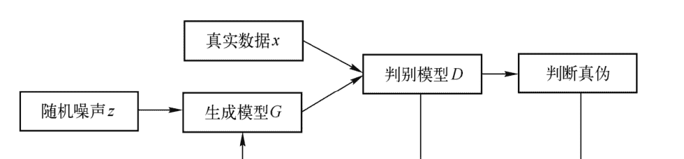

图6-4 生成对抗网络训练过程

在上述思路的基础上，下面给出更具体的训练细节。

给定生成器 G 后，先优化判别器 D，损失采用交叉熵最小化：

$V_{GAN}(D,G)= -\frac{1}{2}E_{x\sim p_{data}(x)}[\log D(x)] - \frac{1}{2}E_{z\sim p_{z}(z)}[\log(1 - D(G(z)))]$

$x\sim p_{data}(x)$ 表示 x 来自真实数据集， $z\sim p_{z}(z)$ 表示 z 来自随机噪声分布。记生成器的数据分布为 $p_{g}(x)$，在连续空间中上式可写为：

$V_{GAN}(D,G)= -\frac{1}{2}\int_{x} p_{data}(x)[\log D(x)]dx - \frac{1}{2}\int_{z} pz(z)[\log(1 - D(G(z)))]dx$

$= -\frac{1}{2}\int_{x} p_{data}(x)\log D(x) + p_{g}(x)[\log(1 - D(x)]dx$

此时损失在

$D_{G}(x)=\frac{p_{data}(x)}{p_{data}(x)+p_{g}(x)}$

处取得最小值，即为判别器的最优解。

对生成器 G 而言，其目标是让判别器对生成样本的输出概率 $D(G(z))$ 趋近于 1，故目标函数为：

$\min_{G}\max_{D} V(D,G)=E_{x\sim p_{data}(x)}[\log D(x)]+E_{z\sim p_{z}(z)}[\log(1 - D(G(z)))]$

总体来看，先固定生成器 G 训练判别器 D，最大化其区分真实数据与伪数据分布 G(z) 的准确率；再固定判别器 D 训练生成器 G，最小化 $\log(1-D(G(z)))$。当 $p_{data}=p_{g}$ 时达到全局最优。通常在一轮更新中，判别器参数会被更新数次后再更新一次生成器参数。

随后以 MNIST 手写数字数据集为例展示一个基础项目。该数据集来源于美国国家标准与技术研究所 National Institute of Standards and Technology，NIST。训练集由 250 位不同书写者提供，其中一半为高中生，一半为人口普查局工作人员。每张图片为 28×28 像素的灰度图，展平后可得到长度为 784 的行向量。

```
import torch
import torch.nn as nn
from torch.autograd import Variable
from torch.utils.data import DataLoader
from torchvision import transforms
from torchvision import datasets
import os
batch_size =64
epoch = 100
z_dim= 100
#定义随机噪声数据维度
mnist = datasets.MNIST('./data', transform=img_transform)
dataloader = DataLoader(mnist, batch_size=batch_size, shuffle=True)
#对 mnist 数据进行预处理

class D(nn.Module):
    def __init__(self):
        super(D, self).__init__()
        self.layer1 = nn.Sequential(
            nn.Conv2d(1, 64, 5, padding=2),
            nn.LeakyReLU(0.2, True),
            nn.AvgPool2d(2, stride=2),
        )
        self.layer2 = nn.Sequential(
            nn.Conv2d(64, 128, 5, padding=2),
            nn.LeakyReLU(0.2, True),
            nn.AvgPool2d(2, stride=2)
        )
        self.fc = nn.Sequential(
            nn.Linear(128*7*7, 1024),
            nn.LeakyReLU(0.2, True),
            nn.Linear(1024, 1),
            nn.Sigmoid()
        )
    def forward(self, x):
        x = self.layer1(x)
        x = self.layer2(x)
        x = x.view(x.size(0), -1)
        x = self.fc(x)
        return x
    #为什么 self.fc 中会出现 7?
    #这是由于原先图片大小是 28×28，经过一次池化操作（nn.AvgPool2d）后大小为 14×14
    #再经过一次池化操作(nn.AvgPool2d)后大小即为 7×7
class G(nn.Module):
    def __init__(self, input_size, num_feature):
        super(G, self).__init__()
        self.fc = nn.Linear(input_size, num_feature)
        self.layer1 = nn.Sequential(
            nn.BatchNorm2d(1),
            nn.ReLU(True)
        )
        self.layer2 = nn.Sequential(
            nn.Conv2d(1, 50, 3, stride=1, padding=1),
            nn.BatchNorm2d(50),
            nn.ReLU(True)
        )
        self.layer3 = nn.Sequential(
            nn.Conv2d(50, 1, 2, stride=2),
            nn.Tanh()
        )

    def forward(self, x):
        x = self.fc(x)
        x = x.view(x.size(0), 1, 56, 56)
        x = self.layer1(x)
        x = self.layer2(x)
        x = self.layer3(x)
        return x
D = D().cuda()
G = G(z_dim, 3136).cuda()
#目的是让程序放在CUDA上运行
criterion = nn.BCELoss()
#损失函数是二元交叉熵函数
d_optim = torch.optim.Adam(D.parameters(), lr=0.001)
g_optim = torch.optim.Adam(G.parameters(), lr=0.001)
#定义生成器和判别器各自的优化器
for k in range(epoch):
    for i, (img, _) in enumerate(dataloader):
        num_img = img.size(0)

        #首先来训练判别器
        real_img = Variable(img).cuda()
        real_label = Variable(torch.ones(num_img)).cuda()
        fake_label = Variable(torch.zeros(num_img)).cuda()
        real_out = D(real_img)
        d_loss_real = criterion(real_out, real_label)
        #计算判别器针对真实值的 loss
        real_scores = real_out
        # compute loss of fake_img
        z = Variable(torch.randn(num_img, z_dim)).cuda()
        fake_img = G(z)
        fake_out = D(fake_img)
        d_loss_fake = criterion(fake_out, fake_label)
        #计算判别器针对虚假生成值的 loss
        fake_scores = fake_out
        d_loss = d_loss_real + d_loss_fake
        d_optim.zero_grad()
        d_loss.backward()
        d_optim.step()
        #将梯度反向传播，至此则完成判别器的训练部分

        #然后来训练生成器
        z = Variable(torch.randn(num_img, z_dim)).cuda()
        fake_img = G(z)
        output = D(fake_img)
        g_loss = criterion(output, real_label)
        #计算生成器针对虚假生成值的 loss
        g_optim.zero_grad()
        g_loss.backward()
        g_optim.step()
        #将梯度反向传播，至此则完成生成器的训练部分
```

### 6.3.2 条件生成对抗网络

Conditional GAN，CGAN 在建模时向生成器 G、判别器 D 以及真实数据中引入额外信息 y，y 可为标签或其他辅助信号。换言之，是一种带条件约束的对抗框架，在生成与判别两端均使用条件变量 y 引导生成过程。该条件可以是类别标签，也可以是图像修复所需的部分观测信息，此时模型更接近有监督学习。

此时先验噪声 $p(z)$ 与条件信息 y 共同构成联合隐层表征，CGAN 的目标变为带条件概率的极大极小博弈：

min_G max_D V(D,G) = E_{x~p_data(x)}[log D(x|y)] + E_{z~p_z(z)}[log(1 - D(G(z|y)))]

## 6.4 图卷积神经网络：面向非欧数据的特征提取

此前介绍的卷积神经网络适用于图像识别中的特征提取与分类，但其局限在于只能处理欧氏空间上的规则结构数据。

现实中大量问题并非规则空间，例如金融、交通、生物以及 NLP 领域的知识图谱、推荐系统等，都表现为节点以不同连接方式构成图谱结构。节点度数各异，有的 4 个邻接，有的 5 个邻接，不具备规则性，如图6-5所示。

因 CNN 无法直接处理非欧数据，需要通过图卷积神经网络 Graph Convolutional Network，GCN 在拓扑图上提取节点特征与结构信息。图卷积大致分为两类：空间域卷积与谱图卷积。

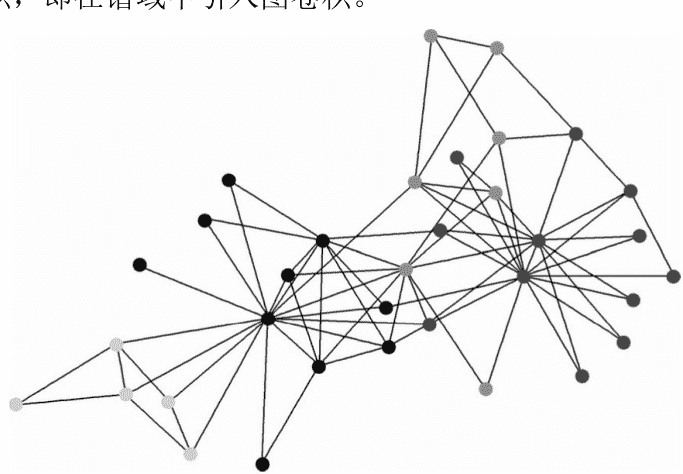

图6-5 图结构数据

该方向发展迅速，已出现 Deep Graph Library，DGL 与 PyTorch Geometric，PyG 等面向图神经网络与图机器学习的全新框架，其中 PyG 在多项任务上的计算速度远超 DGL。PyG 使用便捷，已将常见图卷积模块封装为可直接调用的函数，例如 Neighborhood Aggregation 将卷积算子推广到不规则域的功能已内置，包括 GCN Kipf&Welling, 2017、SGC Wu et al., 2019、GraphSAGE Hamilton et al., 2017、AGNN Thekumparampil et al., 2018、Graph Isomorphism Network GIN Xu et al. 2019 等。

为突出 GCN 精髓，下文介绍主要结构时省略部分推导，若需理论细节可参阅参考文献。

### 6.4.1 空间域卷积

实际应用中谱卷积使用更普遍，空间域卷积在此仅作简要说明。空间域卷积的核心是提取拓扑图上的空间特征，定位每个顶点的邻居集合。

为了让卷积操作适用于任意结构图，研究者提出 PATCHY-SAN Select-Assemble-Normalize 方法，通过选择、组装、归一化三步构建卷积分片。

- 先在图里锁定一段等长的节点序列；
- 对序列中的每个节点，收集相同规模的邻域集合；
- 将中心节点与其对应的邻居拼成子图并做归一化，作为卷积模块的输入。

完成上述三步即可得到全部卷积切片，随后用卷积结构逐个处理。如图6-6所示。

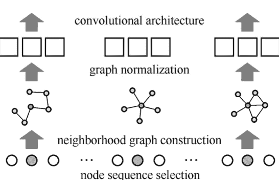

### 6.4.2 谱域图卷积概览

本小节介绍另一类图卷积，即谱域图卷积。核心思路是借助拉普拉斯矩阵的特征谱来刻画图的结构特性。

这类卷积的理论基础涉及图傅里叶变换、拉普拉斯谱分解等，推导量大，本节聚焦应用层面。谱域的实现方式很多，下面重点讲两种常用的做法。

### （1）切比雪夫逼近与一阶简化版本的GCN

交通路网是非欧式距离的典型场景，一个路口可能连三条、四条甚至更多路段。以 IJCAI 2018 论文《Spatio-Temporal Graph Convolutional Networks:A Deep Learning Framework for Traffic》为例说明交通场景的建模思路。

记 v_t 为时刻 t 下 n 条路段的流量观测向量，图6-7 给出了路网流量的示意。该研究基于前 M 个样本来预测后续 H 个时段的流量。

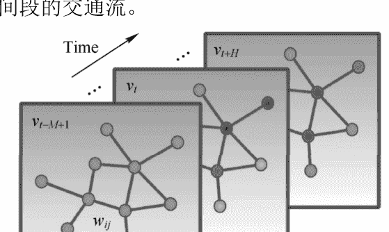

图6-7 路网结构交通流示意图

记 *G 为图卷积符号，核 Θ 与信号 x ∈ R^n 的乘法定义为：

Θ *G x = Θ(L) x = Θ( I_n - D^{-1/2} W D^{-1/2} ) x = Θ( U Λ U^T ) x = U Θ( Λ ) U^T x

U ∈ R^{n×n} 为归一化拉普拉斯矩阵 L ∈ R^{n×n} 的特征向量矩阵，可视为图的傅里叶基。 D ∈ R^{n×n} 为度矩阵， D_{ii}= Σ_j W_{ij}。 Λ ∈ R^{n×n} 为 L 的特征值矩阵，卷积核 Θ( Λ ) 为对角阵。此表达式需要 n 个可训练参数， U Θ( Λ ) U^T x 的计算开销也很大，因此存在局限。

为降低复杂度，论文采用切比雪夫逼近与首阶近似两种手段，先介绍切比雪夫逼近。

把核 Θ 用 Λ 的多项式来限制，即：

$$\Theta(\Lambda)=\sum_{k=0}^{K-1}\theta_k\Lambda^k=\sum_{k=0}^{K-1}\theta_k T^k(\tilde{\Lambda})$$

K 为卷积核的半径，即从中心向外的最大范围，$T_k(x)$ 为切比雪夫多项式。$\tilde{\Lambda}=2\frac{\Lambda}{\lambda_{\max}}-I_n$，$\lambda_{\max}$ 为 L 的最大特征值。

图卷积可写为：

$$\Theta *_G x = \Theta(L)x = \sum_{k=0}^{K-1}\theta_k T_k(\tilde{L})x$$

首阶近似中取 $\lambda_{\max}=2$，则有

$$\Theta *_G x \approx \theta_0 x + \theta_1\left(2\frac{L}{\lambda_{\max}}-I_n\right)x \approx \theta(L)x = \theta_0 x + \theta_1\left(D^{-\frac12}WD^{-\frac12}\right)x$$

为约束参数并稳定数值，令 $\theta' \approx \theta_0 = -\theta_1$，$\tilde{W}=W+I_n$，$\widetilde{D}_{ii}=\sum_j\tilde{W}_{ij}$，得到新的形式：

$$\Theta *_G x \approx \theta_0 x + \theta_1\left(D^{-\frac12}WD^{-\frac12}\right)x = \theta\left(\tilde{D}^{-\frac12}\tilde{W}\tilde{D}^{-\frac12}\right)x$$

此时卷积核仅含 K 个参数，且 K 通常远小于 n，计算代价随之下降。

### （2）高阶自适应GCN

这里的高阶自适应 GCN 来自 2017 年论文《Convolution on Graph A High-Order and Adaptive Approach》。

先定义顶点 v_i 的 k 阶邻居 $NB_i=\{v_j\in V\mid d(v_i,v_j)\le k\}$。$A\in R^{N\times N}$ 为邻接矩阵，$A^k$ 的第 i 行第 j 列表示 i 到 j 的 k 步路径数。

k 阶卷积定义为：

$GC^k = (W_{gc\_k} \odot \tilde{A}^k) X_t + B_k$

其中：

$\tilde{A}^k = \min\{A^k + I,1\}$

对 $A^k$ 加单位阵是为了让图上每个顶点具备自连接。$B_k$ 为偏置矩阵。可见该操作是取顶点的 k 阶邻居特征做加权平均。

另一改进是引入自适应滤波模块，它依据节点特征与连接关系对卷积权重进行筛选，使网络能自适应定位目标并捕捉局部不一致，机制类似注意力。自适应滤波器是对权重矩阵 $W_{gc\_k}$ 作用的非线性算子 g：

$\tilde{W}_{gc\_k} = g \odot W_{gc\_k}$

$\odot$ 表示逐元素乘法。算子 g 反映节点特征与图连通性。

$g = f_{adp}(\tilde{A}^k, X) = sigmoid(Q \cdot [A^k, X])$

$[\cdot, \cdot]$ 表示矩阵拼接。此时图卷积为：

$GC^k = (\tilde{W}_{gc\_k} \odot \tilde{A}^k) X + B_k$

图6-8 左侧展示了对某顶点 k=2 时的 $GC^k$：自适应滤波器 g 的输出叠加到权重矩阵 $W_{gc\_1}$ 和 $W_{gc\_2}$ 上得到自适应权重 $\tilde{W}_{gc\_1}$、$\tilde{W}_{gc\_2}$；第二层再将自适应权重与对应邻接矩阵结合用于卷积。右侧说明卷积在图上每个顶点逐层进行。

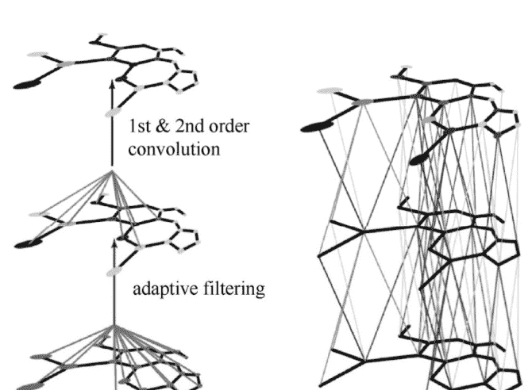

1st & 2nd order convolution

adaptive filtering

图6-8 High-Order Adaptive GCN结构示意图

所有卷积层结束后，将不同阶的输出拼接：

$GC^{(k)}=[GC^1, GC^2, \dots, GC^k]$

随后 $GC^{(k)}$ 可用于各类任务，例如 2018 年论文《 High-Order Graph Convolutional Recurrent Neural Network:A Deep Learning Framework for Network-Scale Traffic Learning and Forecasting》用高阶 GCN 提取路网图信息以提升交通流预测效果，该工作未使用自适应滤波，同时引入 Free Flow Matrix 以更好地刻画交通特性。

图卷积能够处理非欧式结构，因此在金融、交通、生物、知识图谱、对话系统等涉及网络的问题中都有应用。面试中掌握图卷积的编程很有帮助。本节仅简要介绍交通流预测的应用，理论推导被省略，感兴趣可查阅参考文献深入学习。

## 6.5 深度学习赋能运筹优化

本章最后一节展示深度学习在运筹优化中的运用。该方向较新，同时融合强化学习、指针网络、注意力机制、LSTM、编码器-解码器等前沿技术，熟悉它有助于把握当前研究趋势。

需要说明的是，虽然强化学习可用于求解 TSP、VRP 等运筹问题，但真实场景远比 TSP 复杂，工业界目前仍以经典运筹算法为主。本节介绍该类问题的价值在于覆盖了大量可迁移的前沿方法。

强化学习擅长序列决策，在游戏 AI、棋类等领域已取得明显成果，最典型的是 DeepMind 的 AlphaGo。让机器学会下围棋本质上是组合优化问题。除围棋外，强化学习框架能否解决其他经典组合优化问题？答案是肯定的，本章主要介绍其在 TSP、VRP 等问题上的应用方法。

### 6.5.1 指针网络

指针网络是解决 TSP、VRP、MST 等经典组合优化问题的基础模型，由 Oriol Vinyals 等提出。其结构源自 Google 的 Sequence-to-Sequence 网络，如图6-9。浅蓝色为编码器 Encoder，紫色为解码器 Decoder，思路是先编码输入再解码结果。

指针网络与 Seq2Seq 有何区别？

Seq2Seq 用 RNN 等把输入序列编码成向量，再通过概率链式法则和另一个 RNN 得到输出，常用于机器翻译，结构见图6-9。例如输入“how are you？”，编码后解码输出中文“你好吗？”。指针网络的编码器与 Seq2Seq 类似，解码器则对编码后的向量集合采用基于内容的选择机制 Content-based Attention Mechanism，输出与向量集合等长的概率分布，据此获得序号，序号指向输入位置，故名指针网络，结构见图6-10。Seq2Seq 的解码结果可能不在输入中，而指针网络的解码结果始终指向输入位置。

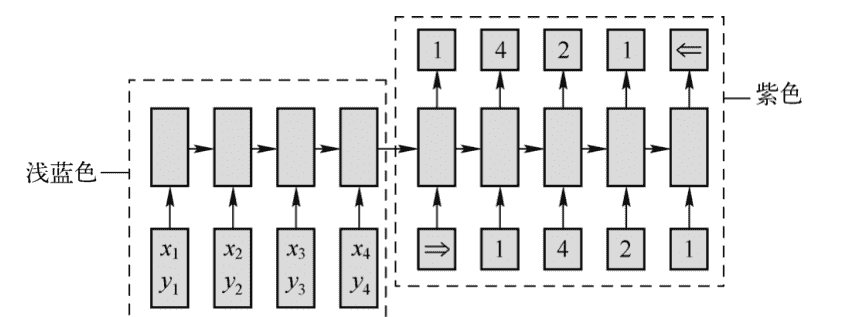

图6-9: Sequence-to-Sequence示意图

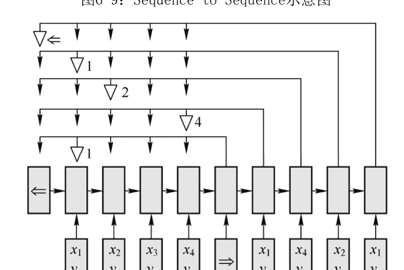

图6-10 指针网络示意图

举例：求解 TSP10，有 10 个城市位置，每个位置是二维向量。编码器把 10 个城市向量依次编码，可选线性变换如二维到 d 维，得到潜在记忆状态。解码器以这 10 个潜在状态为初始输入，每一步用 Attention Mechanism 获取指针指向输入位置。上一步得到的序号对应编码向量，作为下一步解码的输入。例如第一步得到 2，则序号 2 的编码向量用于下一步。

### 1. 编码器

指针网络的编码与 Seq2Seq 一致，先做 embedding 线性转换，再送入 RNN，通过各单元 hidden state 传递。但 Nazari 等指出在 TSP、VRP 这类组合优化问题中，输入顺序不影响信息，不同顺序等价。因此他们提出去掉 RNN 编码器，仅保留 Embedding 结构，后文会详述。

### 2. 解码器：指针和Attention机制

设向量集合 ref={enc1, enc2, …, enc_k} 为编码器输出，其中 enc_i ∈ ℝ^d。设查询向量 q=dec_t ∈ ℝ^d，原先对应解码器 RNN 单元的 hidden state。为整合输入序列，提出 glimpse 函数，实验显示在计算量不大增加的前提下能提升效果，故常用于 Attention。

定义如下：

- Glimpse函数： G(ref, q)
- Attention函数： A
- Attention 可训练参数：
  - Attention矩阵： W_ref^g, W_q^g ∈ ℝ^{d×d}
  - Attention向量： v^g ∈ ℝ^d
- 指针概率分布： p ∈ ℝ^k

k 为输入数量，如 10 个城市，p_i 为本步选择城市 i 的概率。通过 glimpse 式 attention 完成：

$p = A(ref, q; W_{ref}^g, W_q^g, v^g) = \sum_{i=1}^k r_i p_i,\ r_i \in ref$

$G(ref, q; W_{ref}^g, W_q^g, v^g) = \sum_{i=1}^k r_i p_i,\ r_i \in ref$

$g_0 = q$

$g_m = G(ref, g_{m-1}; W_{ref}^g, W_q^g, v^g)$

可见 glimpse 本质是 ref 向量集合的加权和。可对同一 ref 迭代多次，取最后的 $g_m$ 作为 Attention 输入。实验表明多于一次迭代对学习帮助有限，实践中常只迭代一次。

Attention 函数如何计算？设策略函数为 π，π(j)=i 表示第 j 步解码输出指针为 i。计算如下：

$u_i = \begin{cases} v_T \cdot \tanh(W_{ref} \cdot r_i + W_q \cdot q) & \text{如果} i \neq \pi(j) \text{对于} j < i \\ -\infty & \text{其他} \end{cases} \quad i=1,2,\cdots,k$

$A(ref, q; W_{ref}, W_q, w) = softmax(u)$

其中 $u$ 为 softmax 输入，$r_i \in ref$。在 TSP 类问题中，每个城市只访问一次，已访问城市的 $u_i$ 置为负无穷，对应 softmax 为 0。相关参数为：

- Attention矩阵： $W_{ref}, W_q \in \mathbb{R}^{d \times d}$
- Attention向量： $v \in \mathbb{R}^d$

除基础形式外，还提出两种改进以提升学习与泛化。

Softmax Temperature:

$A(ref, q; W_{ref}, W_q, w) = softmax(u / T)$

T 为温度，T>1 时分布更平滑，避免过度集中于某指针。

Logit Clipping:

A(ref, q; W_ref, W_q, w)=softmax(C tanh(u))

C 控制 logit 范围的超参数，有效 clipping 有助于探索并带来边际收益。

### 6.5.2 指针网络PyTorch代码实现

本节介绍用 PyTorch 实现指针网络与 Attention 机制。

### 1. Embedding代码

先构建 Embedding 对象对输入做 Embedding，代码如下：

```
```python

class Embedding(nn.Module):

    def __init__(self, input_size, embedding_size):

        # input_size: 输入数据的维度，比如2维欧式距离的TSP城市位置

        # embedding_size: 想要embedding的维度，比如128

        super(Embedding, self).__init__()

        self.embedding_size = embedding_size

        # Embedding 参数初始化

        self.embedding = nn.Parameter(torch.FloatTensor(input_size, embedding_size))

        self.embedding.data.uniform_(-(1./math.sqrt(embedding_size)),1./math.sqrt(embedding_size))

    def forward(self, inputs):

```
```

```
# inputs: 维度 (batch_size, seq_len, input_size), seq_len 表示输入数据的长度, 比如 10 个城市
# embedded: 维度 (batch_size, seq_len, hidden_size)
batch_size = inputs.size(0)
seq_len  = inputs.size(1)
# 新的 embedding 维度: batch_size, input_size, embedding_size
embedding = self.embedding.repeat(batch_size, 1, 1)
embedded = []
# 共享 embedding 参数
for i in range(seq_len):
    # batch multiplication 需要相同 Tensor 维度大小, so, unsqueeze 1
    embedded.append(torch.bmm(inputs[:, i, :].unsqueeze(1).float(), embedding))
embedded = torch.cat(embedded, 1)
return embedded
```

### 2. 编码器代码实现

Embedding 完成后，紧接着要搭建编码器，具体代码如下：

```
class Encoder(nn.Module):
    def __init__(self, embedding_size, hidden_size):
        # embedding_size: embedding 的维度
        # hidden_size: RNN 的 hidden state 维度
        super(Encoder, self).__init__()
        self.lstm = nn.LSTM(embedding_size, hidden_size)
        self.hidden_size = hidden_size

    def forward(self, embedding_x):
        # embedding_x (tensor): 维度 (sequence length, batch, input_dim)
        # hidden (tensor): 维度 (num_layer * num_direction, batch_size, hidden_dim)
        # output (tensor): 维度 (sequence length, batch_size, hidden_dim)
        # next_hidden (tensor): 维度 (num_layer * num_direction, batch_size, hidden_dim)
        output, next_hidden = self.lstm(embedding_x)
        return output, next_hidden
```

这里采用的是 PyTorch 原生的 LSTM。需要注意的是，其默认输入的形状为（序列长度, 批次大小, 输入维度）。

### 3. 注意力函数实现

```
class Attention(nn.Module):
    def __init__(self, hidden_size, C = 10):
        # hidden_size: hidden 维度
        # C: logit clipping 的超参数, 文中使用 10
        super(Attention, self).__init__()
        # 初始化 W_q:
        self.w_q = nn.Linear(hidden_size, hidden_size)
        # 初始化 W_ref:
        # 由于 reference 维度为 (batch_size, hidden_size, seq_len),
        # 所以可以用 1 维的卷积层实现, 每个 batch 共享 weights,
        # 输出为(batch_size, hidden_size, seq_len)
        self.w_ref = nn.Conv1d(hidden_size, hidden_size, 1, 1)
```

```
V = torch.Tensor(hidden_size).float() # to trainable parameters
# 根据论文所述，初始化 v 为(-1/sqrt(size), 1/sqrt(size))的正态分布
self.v = nn.Parameter(V)
self.v.data.uniform_(-1. / math.sqrt(hidden_size), 1. / math.sqrt(hidden_size))
self.tanh = nn.Tanh()
self.C = C
self.hidden_size = hidden_size

def forward(self, encoder_output, query):
    # encoder_output (tensor): 维度(seq_len, batch_size, hidden_size)
    # query (tensor): 维度(batch_size, hidden_size)
    # ref (tensor): shape is (batch_size, hidden_size, k)
    # logit (tensor): probability with shape (batch_size, k)
    batch_size = query.size(0)
    encoder_output = encoder_output.permute(1, 2, 0)
    q = self.w_q(query).unsqueeze(2)
    ref = self.w_ref(encoder_output) # batch_size, hidden_dim, seq_len
    seq_len = ref.size(2)
    expanded_q = q.repeat(1, 1, seq_len) # 扩展 q
    # 扩展 v 为(batch_size, 1, hidden_size)
    expanded_v = self.v.unsqueeze(0).unsqueeze(0).repeat(batch_size, 1, 1)
    # u 为(batch_size, seq_len)
    u = torch.bmm(expanded_v, self.tanh(ref + expanded_q)).squeeze(1)
    logit = self.C * self.tanh(u)
    return logit
```

## 4. 解码器代码实现

解码器部分将注意力机制与指针机制结合在了一起。

```
class Decoder(nn.Module):
    def __init__(self, embedding_size, hidden_size, sequence_length,
                 decoder_type = "sampling", num_glimpse = 1):
        super().__init__()
        self.embedding_size = embedding_size
        self.hidden_size = hidden_size
        self.num_glimpse = num_glimpse
        self.sequence_length = sequence_length
        self.lstm_cell = nn.LSTMCell(embedding_size, hidden_size)
        # pointer 和 glimpse， 建立两个对象， 互不共享参数
        self.pointer = Attention(hidden_size)
        # 在 glimpse 中不使用 logit clipping
        self.softmax = nn.Softmax()
        # 用于控制是 training 和交叉验证
        self.decoder_type = decoder_type

    def forward(self, decoder_input, embedding_x, hidden, encoder_output):
        # decoder_input (tensor): 维度(batch_size, embedding_size)
        # embedding_x (tensor): 维度(seq_len, batch_size, embedding_size)
```

```
# hidden (tuple): (h, c), 来自于 LSTM 的输出, 默认初始化
# encoder_output (tensor): 维度 (seq_len, batch_size, embedding_size)
# prob_list (list): 存储每一步 decode 中每个城市的概率
# index_list (list): 存储每一步 decode 输出的城市序号
batch_size = decoder_input.size(0)
seq_len = embedding_x.size(0)
prob_list = []
index_list = []
mask = None
# 对于之前输出过的进行 mask
mask = torch.zeros(batch_size, seq_len).byte()
prev_idx = None
embedding_x = embedding_x.permute(1, 0, 2) # to (batch_size, seq_len, embedding_dim)
ref = encoder_output.permute(1, 2, 0) # to (batch_size, embedding_dim, seq_len)
for i in range(self.sequence_length):
    h, c = self.lstm_cell(decoder_input, hidden)
    hidden = (h, c)
    g_l = h # (batch_size, hidden_dim)
    for _ in range(self.num_glimpse):
        logit = self.glimpse(encoder_output, g_l)
        # mask 之前输出过的城市序号, 更新概率 logit
        mask_copy = mask.clone()
        batch_size_new = logit.size(0)
        if prev_idx is not None:
            mask_copy[[b for b in range(batch_size_new)], prev_idx.data] = 1
            logit[mask_copy] = -np.inf
        p = self.softmax(logit)
        g_l = torch.bmm(ref, p.unsqueeze(2)).squeeze(2)
    logit = self.pointer(encoder_output, g_l)
    mask_copy = mask.clone()
    batch_size_new = logit.size(0)
    if prev_idx is not None:
        mask_copy[[b for b in range(batch_size_new)], prev_idx.data] = 1
        logit[mask_copy] = -np.inf
    if self.decoder_type == "greedy": # 利用 greedy 策略得到结果用于验证
        probs = self.softmax(logit)
        prev_idx, decoder_input = greedy(probs, embedding_x)
    elif self.decoder_type == "sampling": # 利用 sampling 策略得到结果用于训练
        probs = self.softmax(softmax_temperature(logit, T = 1.))
        prev_idx, decoder_input = sampling(probs, embedding_x, index_list)
    # 存储结果
    index_list.append(prev_idx)
    prob_list.append(probs)
return prob_list, index_list
```

在此基础上即可把前面的模块组合成完整的指针网络，编码时一定要格外注意张量运算中维度的变化。

指针网络的完整示例代码如下：

```
class PointerNet(nn.Module):
    def __init__(self, embedding_dim, hidden_dim, seq_length, \
                decoder_type = "sampling", num_glimpse = 1):
        super().__init__()
        self.encoder = Encoder(embedding_dim, hidden_dim)
        self.decoder = Decoder(embedding_dim, hidden_dim, seq_length, \
                        decoder_type = decoder_type, \
                        num_glimpse = num_glimpse)
        #定义 encoder,decoder 框架
        decoder_input = torch.Tensor(embedding_dim).float()
        self.decoder_input = nn.Parameter(decoder_input)
        self.decoder_input.data.uniform_(-1 / math.sqrt(embedding_dim), 1 / math.sqrt(embedding_dim))
        # embedding 部分
        self.embedding = Embedding(input_dim, embedding_dim)

    def forward(self, x):
        batch_size = x.size(0)
        embedding_x = self.embedding(x).permute(1, 0, 2)
        encoder_output, (encoder_ht, encoder_ct) = self.encoder(embedding_x)
        hidden = (encoder_ht.squeeze(0), encoder_ct.squeeze(0)) #(batch_size, hidden_dim)
        decoder_input = self.decoder_input.unsqueeze(0).repeat(batch_size, 1)
        prob_list, index_list = self.decoder(decoder_input, embedding_x, hidden, encoder_output)
        return prob_list, index_list
```

## 6.5.3 强化学习训练方法

网络结构确定后，下一步就是训练。这一节要讲的就是训练方案，可以直接用强化学习的思路来学习。对于 TSP、VRP 这类组合优化问题，奖励的定义非常直观，因此用强化学习训练能省去不少麻烦。以 TSP 为例，奖励函数也就是成本函数 L，可以看作访问完所有节点后的总路径长度：

$$L(\pi \mid s)=\left(\|x_{\pi(k)}-x_{\pi(1)}\|_2+\sum_{i=1}^{k-1}\|x_{\pi(i)}-x_{\pi(i+1)}\|_2\right)$$

其中 $s$ 表示状态，实质上就是输入的 TSP 实例，可以从分布 $s$ 中随机抽取。

```python
# 计算旅行总长度
def tour_length(pi):
    n = len(pi)
    batch_size = pi[0].size(0)
    tour_len = Variable(torch.zeros(batch_size))
    for i in range(n-1):
        tour_len += torch.norm(pi[i+1] - pi[i], p = 2, dim = 1)
    tour_len += torch.norm(pi[n-1] - pi[0], p = 2, dim = 1)
    return tour_len
```

训练的目标是让策略网络，即指针网络，在期望意义下使路径成本最低。

$$\min J(\theta \mid s)=E_{\pi\sim p_{\theta}}(\cdot \mid s)L(\pi \mid s)$$

其中 $\theta$ 代表策略网络的参数。基于经典的 REINFORCE 算法，其梯度可以写为：

$$\nabla_{\theta}J(\theta \mid s)=E_{\pi\sim p_{\theta(\cdot \mid s)}}\left[(L(\pi \mid s)-b(s))\nabla_{\theta}\log p_{\theta}(\pi \mid s)\right]$$

前面已经说明，s 并不是固定的，而是从某个样本分布里抽取得到的。面对大量不同的 s 时，估计通常会借助蒙特卡洛采样来完成。此时 B 代表参与一次训练的 TSP 图例数量，也就是常规意义上的 batch 大小。

$$\nabla_{\theta}J(\theta \mid s)=\frac{1}{B}\sum_{i=1}^{B}\left[(L(\pi_i \mid s_i)-b(s_i))\nabla_{\theta}\log p_{\theta}(\pi_i \mid s_i)\right]$$

b(s) 在这里扮演基准函数的角色，它与当前策略无关，主要作用是压低梯度噪声。实现上 b(s) 可以直接用历史总路长的移动平均来近似，也能用一个独立的评论家网络去学习。采用后一种做法时，整个训练就进入了演员-评论家范式。

实验对比显示，用移动平均做基准在训练过程里更稳。相同 Epoch 预算下，演员-评论家有机会得到更优解，因为移动平均对不同输入的 TSP 实例缺乏区分度。更关键的是，一旦当前最优路径的长度 L(π*|s) 掉到了移动平均值 \bar{b} 以下，最优解几乎不再获得梯度更新，整体表现就容易被拉低。

若选用演员-评论家路线，评论家网络的训练目标可以写成：

$$L(\theta_v)=\frac{1}{B}\sum_{i=1}^{B}\|b_{\theta_v}(s_i)-L(\pi_i\mid s_i)\|_2^2$$

式中 b_{θ_v}(s) 就是评论家网络对该实例给出的估计值。

基于上述设定，代码层面的实现如下：

定义TSP的Critic Network部分：

```
class Critic(nn.Module):
    def __init__(self, embedding_dim, hidden_dim, process_iters):
        super().__init__()
        self.encoder = Encoder(embedding_dim, hidden_dim)
        self.process_block = Attention(hidden_dim)
        self.decoder = nn.Sequential(nn.Linear(hidden_dim, hidden_dim),
                                    nn.ReLU(),
                                    nn.Linear(hidden_dim, 1))
        self.process_iters = process_iters
        self.softmax = nn.Softmax()
        self.embedding = Embedding(input_dim, embedding_dim)

    def forward(self, x):
        batch_size = x.size(0)
        embedding_x = self.embedding(x).permute(1, 0, 2)
        encoder_output, (encoder_ht, encoder_ct) = self.encoder(embedding_x)
        ref = encoder_output.permute(1, 2, 0) # to (batch_size, embedding_dim, seq_len)
        g_l = encoder_ht.squeeze(0)
        for p in range(self.process_iters):
            logit = self.process_block(encoder_output, g_l)
            p = self.softmax(logit) # (batch_size, k)
```

```
g_l = torch.bmm(ref, p.unsqueeze(2)).squeeze(2)
output = self.decoder(g_l)
return output
```

## 定义Actor-Critic框架：

```
class Model(nn.Module):
    def __init__(self, embedding_dim, hidden_dim, seq_len, batch_size = 128, process_iters = 3):
        super().__init__()
        self.pointer_net = PointerNet(embedding_dim, hidden_dim, seq_len)
        self.critic = Critic(embedding_dim, hidden_dim, process_iters)
        self.batch_size = batch_size
        self.seq_len = seq_len

    def forward(self, x):
        prob_list, index_list = self.pointer_net(x)
        b = self.critic(x)
        pi = []
        probs = []
        for i, index in enumerate(index_list):
            pi_ = x[[j for j in range(self.batch_size)], index.data, :]
            pi.append(pi_)
            prob_ = prob_list[i]
            prob_ = prob_[[j for j in range(self.batch_size)], index.data]
            probs.append(prob_)
        L = tour_length(pi)
        log_probs = 0
        for prob in probs:
            log_prob = torch.log(prob)
            log_probs += log_prob
        return L, log_probs, pi, index_list, b
```

下面是训练过程：

```python
class Train(object):
    def __init__(self, model, train_set, validation_set, batch_size = 128,
                    max_grad_norm = 1., lr = 1e-4, update_steps = 2000):
        self.model = model
        self.train_set = train_set
        self.validation_set = validation_set
        self.batch_size = batch_size
        self.max_grad_norm = max_grad_norm
        self.optimizer_all = Adam(list(model.critic.parameters())+list(model.pointer_net.parameters()), lr = lr)
        self.optimizer_pointer = Adam(model.pointer_net.parameters(), lr = lr)
        self.lr_scheduler_all = lr_scheduler.MultiStepLR(self.optimizer_all, \
                            list(range(update_steps, update_steps * 1000, update_steps)), gamma=0.96)
        self.mse_loss = nn.MSELoss()
        self.input_dim = 2 # points dimension
```

```
self.train_rewards = []
self.val_rewards = []
def train_and_validation(self, n_epoch, training_steps):
    moving_average = 0
    for epoch in range(n_epoch):
        for step in range(training_steps):
            training_set = random.sample(self.train_set, batch_size)
            training_set = Variable(torch.cat(training_set).view(self.batch_size, -1, self.input_dim))
            L, log_probs, pi, index_list, b = self.model(training_set)
            log_probs = log_probs.view(-1)
            log_probs[(log_probs < -1000).detach()] = 0.
            critic_loss = self.mse_loss(b.view(-1), L)
            advantage = L - b.view(-1)
            actor_loss = (advantage * log_probs).mean()
            loss = actor_loss + critic_loss
            self.optimizer_all.zero_grad()
            loss.backward()
            torch.nn.utils.clip_grad_norm_(list(self.model.critic.parameters()) + \
                list(self.model.pointer_net.parameters()), self.max_grad_norm, norm_type=2)
            self.optimizer_all.step()
            self.lr_scheduler_all.step()
moving_average_model=Model(embedding_dim, hidden_dim, seq_len=tsp_num)
train=Train(moving_average_model, train_dataset, validation_dataset, lr=1e-4)
train.train_and_validation(100, 1000)
```

## 6.5.4 搜索策略

训练阶段需要在开发利用与探索之间做权衡，所以会有训练集和测试集之分。测试时最常用的是贪婪解码，即每一步直接挑概率最高的指针作为输出。与贪婪不同的是，推理阶段可以引入更强的搜索手段来逼近更优解，下面重点讲两种做法：Sampling 与 Active Search。

1）Sampling：本质上是对 Attention 里的 softmax 做温度控制。通过调节温度 T 来提升泛化能力，同时调控采样结果的多样性。

2）Active Search：思路类似指针网络的策略梯度训练，对同一测试例做多次蒙特卡洛采样，从候选解中挑出最优者。注意这里的策略梯度仍使用移动平均作为基线，并不依赖评论家网络。虽然强化学习训练是无监督的，但效果仍受训练数据分布影响，而 Active Search 被认为是分布无关的，不受输入分布制约。再者指针网络的编码器原本是 RNN，按固定顺序读入，主动打乱输入顺序能引入随机性，配合 Active Search 往往效果更好。

Active Search 的核心流程可概括为：

- ① 读入一个待测实例；
- ② 先生成一个随机解作为参照；
- ③ 计算该随机解的路径开销；
- ④ 设定每个测试例平均产生的解的数量；
- ⑤ 生成 B 个随机解，保留路径成本最小的那一个，并更新 π 与 L_π；
- ⑥ 用策略梯度更新网络参数，同时以指数移动平均的方式刷新基线 b。

## 6.5.5 简化Encoder求解VRP

指针网络在 TSP 上已有不错表现。Nazari 等人提出去掉 RNN 编码器，直接做 Embedding 的结构。原版指针网络不处理需求信息，因而无法直接用于 VRP。本节介绍两类面向 VRP 的扩展。与 TSP 一样，VRP 的编码器输入顺序并不改变本质信息，只是不同排列。

与 TSP 相比，VRP 必须考虑车辆载重和客户需求，解码的终止条件也不是访问完所有点，而是所有需求被满足。车辆从中心点 depot 出发并最终返回，所以解码器的首尾输出都应指向 depot 编号。为了快速剔除显然不可行的选择，可以用掩码机制把对应概率置为负无穷，具体触发条件包括：

- 客户需求为 0 的点；
- 当前载重为 0 时，除 depot 外的所有客户点全部掩盖；
- 客户需求超过剩余载重的点。

下面介绍两种求解 VRP 的指针网络变体。

Nazari 提出把状态写成 x_t = (s, d_t)，其中 s 是不变的位置信息，d_t 是 t 时刻该点的需求，d_t ∈ ℕ 且 d_t ∈ [0, c]，c 为车辆容量，这一成分被称为动态单元。实践中通常先归一化，使 d_t 落在 [0,1]。简化后的编码器结构见图 6-11。

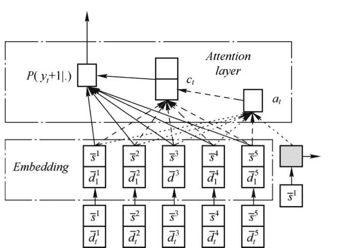

图6-11 取消RNN的Encoder，增加新的Attention层

对输入先做 Embedding，再把解码器 RNN 的隐藏状态送入 Attention 层计算。相关符号定义如下：

- x_t^i = (\bar{s}^i, \bar{d}_t^i) 为第 i 个输入经过 Embedding 后的表示；
- h_t ∈ ℝ^d 为第 t 步解码器 RNN 的记忆状态；
- a_t 为对齐向量，也可看作 Attention 的输出。

Attention 的计算与指针网络保持相似：

$$u_t^i = v_a^T \tanh(W_a [x_t^i; h_t])$$

上式表示按维度拼接。

$$a_t = a_t(\bar{x}_t^i, h_t) = \text{softmax}(u_t)$$

其中 W_a ∈ ℝ^{d × Bd}，v_a ∈ ℝ^d，u_t ∈ ℝ^k，[\bar{x}_t^i, h_t] ∈ ℝ^{dB × k}。k 为输入点的数量。

在 VRP 里引入一个上下文向量 c_t 来桥接 Attention 与最终指针概率。定义上下文向量为 c_t。

$$c_t = \sum_{i=1}^k a_t^i \bar{x}_t^i$$

为 Embedding 后的可训练权重。随后指针概率写作：

$$p(\cdot|x_t) = \text{softmax}(\tilde{u}_t^i)$$

$$\tilde{u}_t^i = v_c^T \tanh(W_c [x_t^i : c_t])$$

这里 c_t ∈ ℝ^{2d}，[\bar{x}_t^i : c_t] ∈ ℝ^{3d × k}，W_c ∈ ℝ^{d × 3d}，v_c ∈ ℝ^d。实际部署时，动态单元也可以用更粗暴的方式干预选择，例如把需求为 0 的位置概率直接设为负无穷。为提高学习效率，计算上下文向量与概率时常只保留静态单元部分，公式相应简化为：

$$c_t = \sum_{i=1}^k a_t^i \bar{s}^i$$

$$\tilde{u}_t^i = v_c^T \tanh(W_c [\bar{s}^i : c_t])$$

论文还指出，解码器的输入其实只需要静态部分，加入动态部分并不会带来明显提升。

指针网络解VRP：动态更新与现实瓶颈

在带动态单元的VRP里，单元状态随装载能力变化。以$t$时刻车辆剩余装载能力记为$l_t$，则需求更新为

$d_{t+1}^i = \max(0, d_t^i - l_t)$

$d_{t+1}^j = d_t^j$ 对于 $j \neq i$

$l_{t+1} = \max(0, l_t - d_t^i)$

指针网络处理TSP、VRP这类经典组合优化问题的核心思路可以概括为：先经编码器得到问题表示，再由解码器借助Attention计算出指针概率，按概率挑选下一步解码动作，最终拼接成完整解。不同实现在特征提取和Attention设计上各有侧重，因而效果不同。例如部分Attention架构融入了网络结构先验。搭建好模型后，训练普遍采用强化学习范式的策略梯度及其改进形式，常见做法有移动平均法和演员-评论家法。在验证阶段，相较传统贪婪取最大概率解，Sampling、Active Search或beam search通常能获得更优解。

当前图网络日益流行，基于图结构的Attention指针网络也被尝试用于TSP和VRP求解。只是深度强化学习在组合优化上的局限仍明显。首先结果复现困难，即便复现也难以迁移到新场景。其次实际问题充满变化，训练好的模型鲁棒性不足。最后训练耗时高昂，且无法保证在相同时间内一定优于启发式算法，这使得深度强化学习在TSP、VRP等经典问题上的研究空间依然很大。

## 第7章 数据库

数据库本质上是按数据结构组织、存放并管理数据的系统，从最基础的表格存储到如今的海量数据平台都离不开它。本章聚焦数据库的基础概念。

### 7.1 SQL语言

SQL即结构化查询语言，涵盖数据查询、数据操纵、数据定义和数据控制四个职能。

数据查询是日常最频繁的操作，通过select即可提取所需信息；数据操纵语言Data Manipulation Language主要负责插入、修改、删除三类操作；数据定义语言Data Definition Language用于创建和撤销数据库用户、基表、视图、索引；数据控制语言Data Control Language则提供统一安全管理，保证多用户共享下数据安全。

常用SQL语句包括select、insert、update、delete、create、drop、grant、revoke等，具体用法见表7-1。

表7-1 常见SQL语句

| 类型 | 关键字 | 描述 | 语法格式 |

|---|---|---|---|

| 数据查询 | select | 选择符合条件的记录 | select * from table where 条件语句 |

| 数据操纵 | insert | 插入一条记录 | insert into table(字段1, 字段2, ...)values(值1, 值2, ...) |

|  | update | 更新语句 | update table set 字段名=字段值 where 条件表达式 |

|  | delete | 删除记录 | delete from table where 条件表达式 |

| 数据定义 | create | 数据表的建立 | create table tablename(字段1, 字段2, ...) |

|  | drop | 数据表的删除 | drop table tablename |

| 数据控制 | grant | 为用户授予系统权限 | grant<系统权限><角色>[.<系统权限><角色>]... to<用户名><角色>|public[,<用户名><角色>]... [with admin option] |

|  | revoke | 收回系统权限 | revoke <系统权限><角色>[.<系统权限><角色>]... from<用户名><角色>|public[,<用户名><角色>]... |

以教务系统为例，涉及三个基表：

学生信息表S(SNO，SNAME，AGE，SEX)，分别对应学号、姓名、年龄、性别。

选课信息表SC(SNO，CNO，SCGRADE)，分别对应学号、课程号、成绩。

课程信息表C(CNO, CNAME, CTEACHER)，分别对应课程号、课程名称、任课教师姓名。

1）把SC表中每门课程的平均成绩插入已有的表 SC_C(CNO, CNAME, AVG_GRADE)中，AVG_GRADE为每门课程平均成绩。

```
INSERT INTO SC_C(CNO,CNAME,AVG_GRADE)
SELECT SC.CNO, C.CNAME, AVG(SC.SC_GRADE) FROM SC, C WHERE SC.CNO = C.CNO GROUP BY SC.CNO ,C.CNAME
```

2）给出两种从S表中删除数据的方法。

① 用delete语句删除，删除后数据可恢复。

② 用truncate语句删除，删除后数据无法恢复。

```
delete from S
truncate table S
```

3）从SC表中删除何昊老师的女学生选课记录。

```
DELETE FROM SC WHERE CNO=(SELECT CNO FROM C WHERE C.CTEACHER ='何昊') AND SNO IN (SELECT SNO FROM S WHERE SEX='女')
```

4）列出有两门以上（含两门）不及格课程（成绩小于60）的学生姓名及其平均成绩。

```
SELECT S.SNO,S.SNAME,AVG_SC_GRADE=AVG(SC.SC_GRADE)
FROM S,SC,(
SELECT SNO FROM SC WHERE SC_GRADE<60 GROUP BY SNO
HAVING COUNT(DISTINCT CNO)>=2)A WHERE S.SNO=A.SNO AND SC.SNO=A.SNO
GROUP BY S.SNO,S.SNAME
```

5）列出既学过“1”号课程，又学过“2”号课程的所有学生姓名。

```
SELECT S.SNO,S.SNAME
FROM S,(SELECT SC.SNO FROM SC,C
WHERE SC.CNO=C.CNO AND C.CNO IN('1','2')
    GROUP BY SC.SNO
    HAVING COUNT(DISTINCT C.CNO)=2
)SC WHERE S.SNO=SC.SNO
```

6）列出 “1” 号课成绩比 “2” 号课成绩高的所有学生的学号。

```
SELECT S.SNO,S.SNAME
FROM S,(
SELECT SC1.SNO
FROM SC SC1,C C1,SC SC2,C C2
WHERE SC1.CNO=C1.CNO AND C1.CNO='1'
AND SC2.CNO=C2.CNO AND C2.CNO='2'
AND SC1.SNO=SC2.SNO AND SC1.SC_GRADE>SC2.SC_GRADE
)SC WHERE S.SNO=SC.SNO
```

7）列出 “1” 号课成绩比 “2” 号课成绩高的所有学生的学号及其 “1” 号课和 “2” 号课的成绩。

```
SELECT S.SNO,S.SNAME,SC.grade1,SC.grade2
FROM S,(
SELECT SC1.SNO,grade1=SC1.SC_GRADE,grade2=SC2.SC_GRADE
FROM SC SC1,C C1,SC SC2,C C2
```

```
WHERE SC1.CNO=C1.CNO AND C1.CNO=1
AND SC2.CNO=C2.CNO AND C2.CNO=2
AND SC1.SNO=SC2.SNO AND SC1.SC_GRADE>SC2.SC_GRADE
)SC WHERE S.SNO=SC.SNO
```

引申：delete与truncate命令有哪些区别？

相同点：都可用来清空表中的数据。

不同点：

1）truncate属于数据定义语言DDL，执行时隐式提交，无法回滚。delete逐行删除并记录日志以便回滚。

- 2）delete后被删数据仍占用存储空间，可恢复；truncate删除后立即释放空间，数据不可恢复。

- 3）truncate执行速度通常快于delete。

### 7.2 事务

事务是数据库中一个独立执行单元，通常由SQL或C++、Java等语言编写的用户程序触发。成功时修改提交永久生效，失败时回滚撤销，保持不变。

例如网购交易至少包含：

- 1）更新所购商品库存信息。
- 2）保存客户付款信息。
- 3）生成订单并写入数据库。
- 4）更新用户相关信息，如购物次数。

正常情况下各步顺利完成，交易成功且数据一致。若中途掉电或异常，如库存更新失败、账户余额不足，整笔交易必须失败，并在失败时保证所有相关信息回滚到交易前状态，否则会导致库存、支付、订单不一致。事务正是为保证这类场景的稳定可预测而存在。

事务需满足ACID四属性：原子性、一致性、隔离性和持久性。

### （1）原子性

事务整体不可分割，执行时要么全部完成，要么全不完成，不允许部分生效，确保操作完整性。

### （2）一致性

事务执行前后数据库必须保持一致状态，满足模式约束。关系型数据库需保证所有规则应用到修改上。例如银行转账前后总额不变。并发可能导致丢失更新、脏读、不可重复读和幻读。

### （3）隔离性

并发事务之间相互独立，一个事务内部操作对其他事务不可见。典型要求是对任意T1、T2，T2要么在T1开始前结束，要么在T1完成后才开始。数据库提供四级隔离：未提交读、已提交读、可重复读、可串行化。隔离性可避免临时更新和级联回滚。

### （4）持久性

事务一旦提交，DBMS保证其修改永久保存，即使系统或介质故障也不丢失。持久性通常靠备份与恢复实现。

严格来说ACID由DBMS保证，应用层无需自行实现。通过COMMIT或ROLLBACK结束事务，COMMIT使自事务启动以来的更改永久写入磁盘，ROLLBACK则撤销所有更改并恢复到事务开始前的状态。无论何种情况，事务完成时数据库都回到一致状态。

### 7.3 存储过程

#### 7.3.1 什么是存储过程，它有什么优点

存储过程是用户预先定义的一组SQL语句集合，用于完成特定任务；而函数通常是数据库内置方法，接收参数并返回单一值，不涉及特定用户表。

存储过程可执行特定操作，支持输入、输出参数及多结果集。创建时可声明IN、OUT参数，IN用于传入数据，OUT用于回传结果。它存于数据库中供应用调用，便于集中管理。

主要优点如下。

- 1）增强SQL灵活性和功能，支持流程控制，可完成复杂判断与计算。
- 2）提升安全性，通过存储过程间接访问数据，避免直接授权。
- 3）保证动作协同执行，维护数据库完整性。
- 4）预编译后执行效率高，SQL语句的大部分工作已在编译期完成。
- 5）减少网络传输，仅需传递调用而非大量SQL文本。
- 6）实现企业规则集中管理，规则变更时只需修改存储过程，无需改动应用程序。

Oracle创建存储过程的语法如下：

```
CREATE [OR REPLACE] PROCEDURE Procedure_name
  [ (argument [ { IN | OUT | IN OUT } ] Type,
      argument [ { IN | OUT | IN OUT } ] Type ]
  { IS | AS }
    <类型变量的说明，后面跟分号>
  BEGIN
    <执行部分>
  EXCEPTION
    <可选的异常错误处理程序>
  END [存储名称];
```

说明：

- 1）局部变量类型可带范围，后接分号。
- 2）判断前最好用COUNT（*）确认记录是否存在。
- 3）OR REPLACE在存在时覆盖原过程，参数与定义语法相同。
- 4）创建时可带参数也可不带参数。
- 5）参数类型有IN、OUT、IN OUT。IN接收调用环境输入，OUT向调用环境输出，IN OUT兼具两者。可使用任意合法Oracle类型，参数不带范围。
- 6）输入参数的IN可省略。
- 7）创建需有CREATE PROCEDURE或CREATE ANY PROCEDURE权限，运行需为创建者或有EXECUTE权限。
- 8）关于SELECT … INTO …

① 在存储过程中 SELECT 字段后必须紧跟INTO，将查询结果写入变量，可多列多变量。若无记录则抛出NO_DATA_FOUND，如下：

```
BEGIN
    SELECT COL1,COL2 INTO 变量1,变量2 FROM T_LHR WHERE XXX;
    EXCEPTION
    WHEN NO_DATA_FOUND THEN
        XXXX;
END;
```

② 使用SELECT…INTO…前须先确认记录存在，否则报“no data found”。可在语句前先用SELECT COUNT（*）FROM tb判断是否存在。

#### 7.3.2 存储过程和函数的区别是什么

两者都存于数据库，可直接或间接调用，都可带输出参数，且由SQL语句组成。

不同点如下。

- 1）标识符不同，函数用FUNCTION，存储过程用PROCEDURE。
- 2）函数必须返回一个值，而存储过程可返回多个结果。
- 3）存储过程无返回类型，不能直接赋给变量；函数有返回类型，调用时除SELECT语句外通常需将返回值赋给变量。

函数与存储过程在调用方式上存在本质差异，函数可以直接嵌入 SELECT 语句中参与计算，存储过程则不能。举例来说，若已经定义好返回数值绝对值的函数 FUN_GETAVG，那么写成 SELECT FUN_GETAVG(COL_A) FROM TABLE 这种写法是完全合法的。

## 7.4 触发器
触发器可以看作一种由数据库事件唤醒的特殊存储程序，不需要手工或显式调用，相关操作一旦发生就会自动运行。它的核心价值在于强化数据的有效性与完整性，并处理常规约束难以覆盖的复杂校验逻辑。

触发器与存储过程的主要差别见表7-2。

表7-2 触发器与存储过程的区别

| 触发器 | 存储过程 |

|---|---|

| 当某些数据操纵 DML 语句发生时隐式地调用 | 从一个应用或过程中显式地调用 |

| 在触发器体内禁止使用 COMMIT、ROLLBACK 语句 | 在过程体内可以使用所有 PL/SQL 块中都能够使用的 SQL 语句，包括 COMMIT、ROLLBACK |

| 不能接收参数输入 | 可以接收参数输入 |

从响应的 SQL 类别来看，触发器大致分为 DML 触发器和 DDL 触发器两大类。

DML 触发器会在数据操作语言事件到达时被激活，可细分为 After 和 Instead Of 两种形态。After 类型在数据变更完成后才执行。Instead Of 类型则在数据变更前先运行触发器自身定义的操作，从而替代原 SQL 的执行逻辑。DDL 触发器用于响应数据定义语言事件时执行存储逻辑。

在实际应用中，触发器常承担以下职能。

- 1) 强化系统的安全性。
- 2) 记录数据变更轨迹及相关操作信息，用以审计用户行为。
- 3) 维护建表时声明约束无法实现的复杂完整性约束，并对特定数据库事件进行监控与响应。
- 4) 实现非标准的数据库相关完整性规则，并可实时同步复制表中的数据。
- 5) 具备自触发特性，只要表数据被修改就会被激活，例如自动计算派生值，触及阈值时启动特定处理。以某企业财务管理为例，若资金链紧张程度达到设定阈值，系统可自动发出预警。

下面是一个触发器的例子，该触发器的功能是在每周末进行数据表更新，如果当前用户没有访问WEEKEND_UPDATE_OK表的权限，那么需要重新赋予权限。

```
CREATE OR REPLACE TRIGGER update_on_weekends_check
BEFORE UPDATE OF sal ON EMP
FOR EACH ROW
DECLARE
my_count number(4);
BEGIN
SELECT COUNT(u_name) INTO my_count
FROM WEEKEND_UPDATE_OK
WHERE u_name = user_name;
IF my_count=0 THEN
RAISE_APPLICATION_ERROR(20508, 'Update not allowed');
END IF;
END;
```

引申：触发器分为事前触发和事后触发，二者有什么区别？语句级触发和行级触发有什么区别？

事前触发在事件发生前做条件校验或准备工作；事后触发在事件完成后做收尾，确保事务完整性。事前触发能够获取旧值和新值。语句级触发器在语句执行前后各触发一次，行级触发器则会对触发器影响到的每一行分别触发一次。

## 7.5 UNION和UNION ALL
UNION 在合并结果集时会先去重，这意味着需要进行排序和重复记录剔除。UNION ALL 则只是把两个查询的结果直接拼接返回，重复数据会完整保留。

从性能角度看，UNION ALL 的执行效率通常明显高于 UNION。因此在能够确认两个结果集没有重复数据时，优先选用 UNION ALL 更合适。举例，Table1 与 Table2 如下。

Table1

| C1 | C2 |

|---|---|

| 1 | 1 |

| 2 | 2 |

| 3 | 3 |

Table2

| C1 | C2 |

|---|---|

| 3 | 3 |

| 4 | 4 |

| 1 | 1 |

select * from Table1 union select * from Table2 的查询结果为：

| C1 | C2 |

|---|---|

| 1 | 1 |

| 2 | 2 |

| 3 | 3 |

| 4 | 4 |

select*from Table1 union all select*from Table2 的查询结果为：

| C1 | C2 |

|----|----|

| 1 | 1 |

| 2 | 2 |

| 3 | 3 |

| 3 | 3 |

| 4 | 4 |

| 1 | 1 |

## 7.6 索引
合理建立索引往往能大幅提升系统性能，主要收益包括。

- 1) 显著加快数据检索速度，这是建索引最主要的目的。
- 2) 加快表与表之间的连接效率。
- 3) 对参照完整性的实现很有帮助，例如在外键列上建索引可有效避免死锁，也能防止更新父表主键时对子表做全表锁定。
- 4) 是降低磁盘 I/O 的有效手段之一。
- 5) 在使用 GROUP BY 与 ORDER BY 时，可明显减少分组排序耗时。
- 6) 唯一性索引能保证表中每一行数据的唯一性。
- 7) 查询时可借助优化器提升整体性能。

索引的不足之处在于。

- 1) 只能建立在表上，不能建立在视图上。
- 2) 创建与维护都需要消耗时间，且随数据量增长而增加。
- 3) 会占用物理存储，聚簇索引的占用更大。
- 4) 对表进行增删改时，需要额外时间维护索引一致性，从而降低数据维护效率。

使用索引时应遵循以下原则。

- 1) 只有在数据量较大的表上建立才有意义。
- 2) 优先考虑 WHERE 子句或连接条件中频繁出现的列。
- 3) 索引层级最好控制在 4 层以内。
- 4) 若某属性经常作为最大值、最小值等聚合函数的参数，可考虑建索引。
- 5) 表的主键与外键必须建立索引。
- 6) 创建主键和唯一约束后会自动生成唯一索引。
- 7) 经常与其他表连接的表，其连接字段应建索引。
- 8) 经常出现在 WHERE 子句中的字段，特别是大表的字段，应建索引。
- 9) 查询时仅返回表中很小一部分行的列适合建索引。
- 10) 查询涉及较少且重复值较多的列尽量不要建索引。
- 11) 经常出现在 ORDER BY、GROUP BY、DISTINCT 后的字段宜建索引。
- 12) 索引应建在选择性高的字段上。
- 13) 索引宜建在小字段上，大文本或超长字段不合适；CLOB、TEXT、IMAGE、BIT 类型列不适合建索引。
- 14) 复合索引的建立需要仔细分析，前导列一般选择选择性较好的字段。
- 15) 若单字段查询很少或没有，可建立复合索引；否则考虑单字段索引。
- 16) 若复合索引中包含的字段经常单独出现在 WHERE 子句，应拆分为多个单字段索引。
- 17) 若复合索引包含字段超过 3 个，需审慎评估必要性，考虑减少字段数。
- 18) 若已存在单字段索引，同时存在这几个字段的复合索引，一般可删除复合索引。
- 19) 频繁执行 DML 操作的表不要建立过多索引。
- 20) 删除无用索引，避免对执行计划产生负面影响。

“水可载舟，亦可覆舟”，索引亦然。合适的索引提升检索性能，过量或不当的索引会拖慢系统。表中每增加一个索引，数据库的工作量就会增加，过多的索引甚至产生碎片。因此需要构建“适度”的索引体系，尤其是聚簇索引更需精益求精。提升查询效率是以消耗系统资源为代价的，盲目建索引是衡量 DBA 水平的重要指标。

## 第8章 操作系统
在计算机体系中，操作系统扮演基石角色，是连接底层硬件与上层应用软件的桥梁，负责控制程序运行、管理系统资源并提供配套系统软件支持。对专业程序员而言，掌握操作系统知识不可或缺，无论是底层嵌入式开发还是上层云计算开发都离不开相关概念。操作系统知识也是面试笔试的重点考察项之一。

### 8.1 进程管理

### 8.1.1 进程与线程
进程是具有一定独立功能的程序关于某个数据集上的一次运行活动，是系统进行资源分配和调度的一个独立单位。例如，用户运行自己的程序，系统就创建一个进程，并为它分配资源，包括各种表格、内存空间、磁盘空间、I/O设备等，然后该进程被放入进程的就绪队列，进程调度程序选中它，为它分配CPU及其他相关资源，该进程就被运行起来。

线程是进程的一个实体，是CPU调度和分配的基本单位，线程自己基本上不拥有系统资源，只拥有一点在运行中必不可少的资源（如程序计数器、一组寄存器和栈），但是它可以与同属一个进程的其他线程共享进程所拥有的全部资源。在没有实现线程的操作系统中，进程既是资源分配的基本单位，又是调度的基本单位，它是系统中并发执行的单元。而在实现了线程的操作系统中，进程是资源分配的基本单位，而线程是调度的基本单位，是系统中并发执行的单元。

引入线程主要有以下4个方面的优点：

- 1）易于调度。
- 2）提高并发性。通过线程可以方便有效地实现并发。
- 3）开销小。创建线程比创建进程要快，所需要的开销也更少。
- 4）有利于发挥多处理器的功能。通过创建多线程，每个线程都在一个处理器上运行，从而实现应用程序的并行，使每个处理器都得到充分运行。

需要注意的是，尽管线程与进程很相似，但两者也存在着很大的不同，区别如下。

- 1）一个线程必定属于也只能属于一个进程；而一个进程可以拥有多个线程并且至少拥有一个线程。
- 2）属于一个进程的所有线程共享该线程的所有资源，包括打开的文件、创建的Socket等。不同的进程互相独立。
- 3）线程又被称为轻量级进程。进程有进程控制块，线程也有线程控制块。但线程控制块比进程控制块小得多。线程间切换代价小，进程间切换代价大。
- 4）进程是程序的一次执行，线程可以理解为程序中一个程序片段的执行。
- 5）每个进程都有独立的内存空间，而线程共享其所属进程的内存空间。

引申：程序、进程与线程的区别是什么？

程序、进程与线程的区别如表8-1所示。

表8-1 进程与线程的区别

| 名称 | 描述 |

|---|---|

| 程序 | 一组指令的有序结合，是静态的指令，是永久存在的 |

| 进程 | 具有一定独立功能的程序关于某个数据集上的一次运行活动，是系统进行资源分配和调度的一个独立单元。进程的存在是暂时的，是一个动态概念 |

| 线程 | 线程的一个实体，是 CPU 调度的基本单元，是比进程更小的能独立运行的基本单元。本身基本上不拥有系统资源，只拥有一点在运行中必不可少的资源（如程序计数器、一组寄存器和栈）。一个线程可以创建和撤销另一个线程，同一个进程中的多个线程之间可以并发执行 |

简而言之，一个程序至少有一个进程，一个进程至少有一个线程。

### 8.1.2 线程同步有哪些机制
现在流行的进程线程同步互斥的控制机制，其实是由最原始、最基本 的4种方法（临界区、互斥量、信号量和事件）实现的。

- 1）临界区：通过对多线程的串行化来访问公共资源或一段代码，速度快，适合控制数据访问。在任意时刻只允许一个线程访问共享资源，如果有多个线程试图访问共享资源，那么当有一个线程进入后，其他试图访问共享资源的线程将会被挂起，并一直等到进入临界区的线程离开，临界区被释放后，其他线程才可以抢占。
- 2）互斥量：为协调对一个共享资源的单独访问而设计，只有拥有互斥量的线程才有权限去访问系统的公共资源，因为互斥量只有一个，所以能够保证资源不会同时被多个线程访问。互斥不仅能实现同一应用程序的公共资源安全共享，还能实现不同应用程序的公共资源安全共享。
- 3）信号量：为控制一个具有有限数量的用户资源而设计。它允许多个线程在同一个时刻去访问同一个资源，但一般需要限制同一时刻访问此资源的最大线程数目。
- 4）事件：用来通知线程有一些事件已发生，从而启动后继任务的开始。

### 8.1.3 内核线程和用户线程
根据操作系统内核是否对线程可感知，可以把线程分为内核线程和用户线程。

内核线程的建立和销毁都是由操作系统负责、通过系统调用完成的，操作系统在调度时，参考各进程内的线程运行情况做出调度决定。如果一个进程中没有就绪态的线程，那么这个进程就不会被调度占用CPU。和内核线程相对应的是用户线程，用户线程是指不需要内核支持而在用户程序中实现的线程，其不依赖于操作系统核心，用户进程利用线程库提供创建、同步、调度和管理线程的函数来控制用户线程。用户线程多见于一些历史悠久的操作系统，如 UNIX操作系统，不需要用户态/核心态切换，速度快，操作系统内核不知道多线程的存在，因此一个线程阻塞将使得整个进程（包括它的所有线程）阻塞。由于这里的处理器时间片分配是以进程为基本单位的，所以每个线程执行的时间相对减少。为了在操作系统中加入线程支持，采用了在用户空间增加运行库来实现线程，这些运行库被称为“线程包”，用户线程是不能被操作系统所感知的。

引入用户线程有以下4个方面的优势。

- 1）可以在不支持线程的操作系统中实现。
- 2）创建和销毁线程、线程切换等线程管理的代价比内核线程少得多。
- 3）允许每个进程定制自己的调度算法，线程管理比较灵活。
- 4）线程能够利用的表空间和堆栈空间比内核级线程多。

用户线程的缺点主要有以下两点。

- 1）同一进程中只能同时有一个线程在运行，如果有一个线程使用了系统调用而阻塞，那么整个进程都会被挂起。
- 2）页面失效也会导致整个进程都会被挂起。

内核线程的优缺点刚好与用户线程相反。实际上，操作系统可以使用混合的方式来实现线程。

### 8.2 内存管理
内存管理是计算机中非常重要的一个功能。好的管理方式能降低缺页中断，能大大提升系统的性能。这一节将重点介绍经典的内存管理方式。

### 8.2.1 内存管理方式
常见的内存管理方式有块式管理、页式管理、段式管理 和段页式管理。最常用的是段页式管理。

- 1）块式管理：把主内存分为一大块一大块的，当所需要的程序片段不在主内存时就分配一块主内存空间，把程序片段载入主内存，就算是所需要的程序片段只有几个字节也只能把这一块分配给它。这样会造成很大的浪费，平均浪费了50%的内存空间，但是易于管理。
- 2）页式管理：用户程序的地址空间被划分成若干个固定大小的区域，这个区域被称为“页”，相应地，内存空间也被划分为若干个物理块，页和块的大小相等。可将用户程序的任一页放在内存的任一块中，从而实现了离散分配。这种方式的优点是页的大小是固定的，因此便于管理；缺点是页长与程序的逻辑大小没有任何关系。这就导致在某个时刻一个程序可能只有一部分在主存中，而另一部分则在辅存中。这不利于编程时的独立性，并给换入换出处理、存储保护和存储共享等操作造成麻烦。
- 3）段式管理：段是按照程序的自然分界划分的并且长度可以动态改变的区域。使用这种方式，程序员可以把子程序、操作数和不同类型的数据和函数划分到不同的段中。这种方式将用户程序地址空间分成若干个大小不等的段，每段可以定义一组相对完整的逻辑信息。存储分配时，以段为单位，段与段在内存中可以不相邻接，即实现了离散分配。

分页对程序员而言是不可见的，而分段通常对程序员而言是可见的，因而分段为组织程序和数据提供了方便，但是对程序员的要求也比较高。

分段存储主要有如下优点。

- ① 段的逻辑独立性不仅使其易于编译、管理、修改和保护，也便于多道程序共享。
- ② 段长可以根据需要动态改变，允许自由调度，以便有效利用主存空间。
- ③ 方便分段共享，分段保护，动态链接，动态增长。

分段存储的缺点如下。

- ① 由于段的大小不固定，因此存储管理比较麻烦。
- ② 会生成段内碎片，这会造成存储空间利用率降低。而且段式存储管理比页式存储管理方式需要更多的硬件支持。

正是由于页式管理和段式管理都有各种各样的缺点，因此，为了把这两种存储方式的优点结合起来，新引入了段页式管理。

- 4）段页式管理：段页式存储组织是分段式和分页式结合的存储组织方法，这样可充分利用分段管理和分页管理的优点。
- ① 用分段方法来分配和管理虚拟存储器。程序的地址空间按逻辑单位分成基本独立的段，而每一段有自己的段名，再把每段分成固定大小的若干页。
- ② 用分页方法来分配和管理内存。即把整个主内存分成与上述页大小相等的存储块，可装入作业的任何一页。程序对内存的调入或调出是按页进行的，但它又可按段实现共享和保护。

### 8.2.2 虚拟内存
虚拟内存简称虚存，是计算机系统内存管理的一种技术。它是相对于物理内存而言的，可以理解为“假的”内存。它使得应用程序认为它拥有连续可用的内存（一个连续完整的地址空间），允许程序员编写并运行比实际系统拥有的内存大得多的程序，这使得许多大型软件项目能够在具有有限内存资源的系统上运行。而实际上，它通常被分割成多个物理内存碎片，还有部分暂时存储在外部磁盘存储器上，在需要时进行数据交换。相比实存，虚存有以下好处。

- 1）扩大了地址空间。无论段式虚存，还是页式虚存，或是段页式虚存，寻址空间都比实存大。
- 2）内存保护。每个进程运行在各自的虚拟内存地址空间，互相不能干扰对方。另外，虚存还对特定的内存地址提供写保护，可以防止代码或数据被恶意篡改。
- 3）公平分配内存。采用了虚存之后，每个进程都相当于有同样大小的虚存空间。
- 4）当进程需要通信时，可采用虚存共享的方式实现。

不过，使用虚存也是有代价的，主要表现在以下几个方面的内容。

- 1）虚存的管理需要建立很多数据结构，这些数据结构要占用额外的内存。

- 2）把虚拟地址映射成物理地址本身就会带来额外开销，导致指令执行变慢。
- 3）页面的调入调出都要依赖磁盘读写，这个过程耗时非常高。
- 4）当一个页里只用到了其中一部分数据时，剩余空间就被闲置浪费了。

### 8.2.3 内存碎片

反复进行分配与释放会让内存出现碎片。理想的内存布局是 用户占用区、空闲区、用户占用区 交替出现。可一旦空闲区变得很小，就无法满足新的申请，比如中间空档只有5字节，而请求需要6字节，这类细碎的空隙累积起来会降低利用率，我们称之为碎片。

内碎片指分配给进程的存储单元中实际未被使用的那部分。碎片落在分配区域或页面的内部，占据该区域的进程并不使用它，而在进程尚未释放前，系统也无法挪作他用，只能等进程结束或释放后才可能收回。

外碎片指那些游离在已分配区域之外的空闲块，单个块太小无法分配给任何进程。把所有外碎片加起来可能足够满足当前请求，但因为不连续或地址不相邻，系统仍然无法使用。

内碎片与外碎片相互制约，一种分配策略很难同时把两者都压到最低，通常要根据具体应用场景做取舍。

### 8.2.4 虚拟地址、逻辑地址、线性地址和物理地址

虚拟地址是程序运行时产生的地址，由段选择子和段内偏移两部分组成，它不能直接访问物理内存，必须经过地址变换才能落到真实硬件上。

逻辑地址通常指段内的偏移量，一些场景下人们会把它和虚拟地址混用，界限并不严格。

线性地址是虚拟地址到物理地址之间的中间层，对应CPU可寻址的线性空间。程序先产生逻辑地址，加上段基址就得到线性地址。有分页时，线性地址再经过页表转换得到物理地址；没有分页时，线性地址本身就等于物理地址。

物理地址是最终送到CPU外部地址总线上的寻址信号，是地址转换的终点。

具体的转换方式依赖体系结构，如x86同时支持分段和分页。内存管理单元负责完成转换。逻辑地址表现为段标识加偏移，通过段表查找到线性地址；若分页未开启，线性地址即物理地址；若开启，则MMU再通过页表把线性地址换算成物理地址，整体流程为 逻辑地址→段表→线性地址→页表→物理地址。

地址映射是多对一的，不同逻辑地址可能对应同一线性地址，不同线性地址也可能映射到同一物理地址。更进一步，同一线性地址在换页后可能被重新加载到别的物理页上，所以映射关系不是固定的，会随时间变化。

### 8.2.5 Cache替换算法

CPU速度高但容量小，内存容量大但访问慢，Cache用来折中。最常访问的数据先调入Cache，命中时CPU可直接读取，加速明显。但Cache里真正有用的数据往往不足一半，CPU在Cache中读到有效数据就叫命中。

主存块数远大于Cache块数，替换时就需要腾出位置。常见的替换策略有RAND、FIFO、LRU、OPT和LFU。

- 1）随机RAND算法。用随机数挑出一个Cache块替换出去，实现极简，不记录历史使用信息，也不符合访存局部性，命中率偏低。
- 2）先进先出FIFO算法。按进入Cache的先后顺序淘汰最早进入的块。实现简单开销小，但可能把循环体等热块也淘汰掉，未能体现局部性，命中率一般。举例来说，Solar-16/65系列采用组相连，每组4块配两位计数器，装入或替换时清零，其余加一，计数最大者被换出。
- 3）近期最少使用LRU算法。淘汰近期最久未被使用的块。更贴合局部性，但需要持续记录各块使用情况，实现成本高。常用计数器法：装入或替换时该块计数清零，其他块加一；命中时与命中块比较计数并调整，最后将命中块清零；替换时选计数最大的块。
- 4）最优替换OPT算法。理想情况下淘汰未来最久才会被访问的块，命中率最高。实现需要先跑一次程序统计访问序列，再用统计结果指导第二次运行，现实中不可行，通常只作为评测其他算法的基准。
- 5）最不经常使用LFU算法。淘汰一段时间内使用次数最少的块。思路合理，既利用历史又符合局部性，但要为每个块维护较长的计数器并定时更新，找最小值开销大，实现困难。

## 第9章 算法

技术迭代很快，Hadoop、GPU、移动互联网、模式匹配、图像识别、神经网络、蚁群、大数据、机器学习、人工智能、深度学习层出不穷，稍有松懈就可能被淘汰。很多人因此迷茫，不知道从何入手。其实根基仍是数据结构与算法：哈希、分治、动态规划、排序、查找等。不管公司规模大小，面试里这些基础几乎必考，夯实基础是关键。

### 9.1 如何实现链表的逆序

题目描述：
给定一个带头结点的单链表，请将其倒序。例如 head->1->2->3->4->5->6->7 逆序后应变为 head->7->6->5->4->3->2->1。

分析与解答：
单链表靠指针串联，只能从头开始遍历。修改指针时必须先保存后继，否则会丢链。

方法一：就地逆序
核心思路是在遍历过程中把当前结点的指针改指向前驱。用一个指针保存前驱，另一个指针保存后继，才能完成指针的翻转并继续往下走。对头尾结点需单独处理。具体步骤如图。

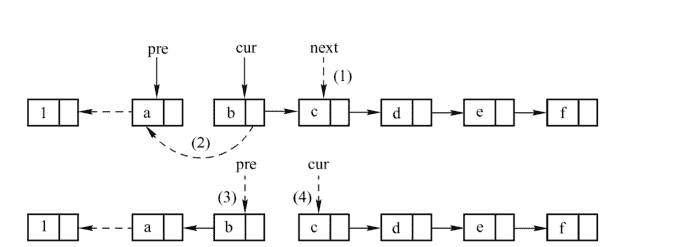

图9-1 链表结点逆序方法

假设当前遍历到 cur，其前驱已全部翻转完毕，只需令 cur.next = pre。翻转前用 next 记录后继，按图（1）～（4）的箭头把实线改为虚线即可。翻转完后移动指针继续处理后续结点。代码如下：

```python
class LNode:
    def __init__(self):
        self.data = None  # 数据域
        self.next = None  # 指针域

def Reverse(head):
    # 判断链表是否为空
    if head == None or head.next == None:
        return
    pre = None  # 前驱节点
    cur = None  # 当前节点
    next = None  # 后继节点
    # 把链表首节点变为尾结点
    cur = head.next
    next = cur.next
    cur.next = None
    pre = cur
    cur = next
    # 是当前遍历到的节点 cur 指向其前驱节点
    while cur.next != None:
        next = cur.next
        cur.next = pre
        pre = cur
        cur = next
    # 链表的头结点指向倒数第二个节点
    cur.next = pre
    # 链表的头结点指向原来链表的尾结点
    head.next = cur

if __name__ == '__main__':
    i = 1
    # 链表头节点
    head = LNode()
    head.next = None
    tmp = None
    cur = head
    # 构造单链表
    while i < 8:
        tmp = LNode()
        tmp.data = i
        tmp.next = None
        cur.next = tmp
        cur = tmp
        i += 1
    print('逆序前：', end='')
    cur = head.next
    while cur != None:
        print(cur.data, end=' ')
        cur = cur.next

    print('\n逆序后：', end='')
    Reverse(head)
    cur = head.next
    while cur != None:
        print(cur.data, end=' ')
        cur = cur.next
```

程序的运行结果为：
逆序前: 1 2 3 4 5 6 7
逆序后: 7 6 5 4 3 2 1

算法性能分析：
只需一次遍历，时间复杂度 O(N)，N 为链表长度。额外只需常数个指针变量，空间复杂度 O(1)。

方法二：递归法
把 1->2->3->4->5->6->7 先变为 1->7->6->5->4->3->2，再把1接到末尾得到 7->6->5->4->3->2->1。递归处理子链表即可。实现代码如下：

```python
def RecursiveReverse(head):
    # 如果链表为空或链表中只有一个元素
    if head is None or head.next is None:
        return head
    else:
        # 反转后面的节点
        newhead = RecursiveReverse(head.next)
        # 把当前遍历的节点加到后面节点逆序后链表的尾部
        head.next.next = head
        head.next = None
    return newhead

"""
方法功能：对带头结点的单链表进行逆序
输入参数：head：链表头结点
"""

def Reverse(head):
    if head is None:
        return
    # 获取链表第一个结点
    firstNode = head.next
    # 对链表进行逆序
    newhead = RecursiveReverse(firstNode)
    # 头结点指向逆序后链表的第一个结点
    head.next = newhead
    return newhead
```

算法性能分析：
同样一次遍历，时间复杂度 O(N)。优点是思路直观，无需显式保存前驱；缺点是递归开销大，压栈弹栈影响性能。

方法三：插入法
从第二个结点开始，把遍历到的结点逐一插入到头结点之后。遍历到2时链表变为 head->2->1->3...，依次类推即可完成逆序。代码如下：

```python
def Reverse(head):
    # 判断链表是否为空
    if head is None or head.next is None:
        return
    cur = None  # 当前结点
    next = None  # 后继结点
    cur = head.next.next
    # 设置链表的第一个结点为尾结点
    head.next.next = None
    # 把遍历到结点插入到头结点的后面
    while cur is not None:
        next = cur.next
        cur.next = head.next
        head.next = cur
        cur = next
```

算法性能分析：
一次遍历，时间复杂度 O(N)。无需保存前驱，也避免了递归，效率更高。

- 引申：
- 1）对不带头结点的单链表进行逆序。
- 2）从尾到头输出链表。

分析与解答：
不带头结点的逆序可自行练习，递归法已给出思路。下面介绍逆向输出。

方法一：就地逆序+顺序输出
先把链表原地逆序，再正常输出。缺点是破坏了原结构。

方法二：逆序+顺序输出
另开存储空间，遍历时复制结点数据并插入新链表头部，再顺序输出。缺点是需额外空间。

方法三：递归输出
先输出当前结点的后继子链表，再输出当前结点。对 1->2->3->4->5->6->7，先输出 2->3...，再输出1，直至最后。代码如下：

```python
def ReversePrint(firstNode):
    if firstNode is None:
        return
    ReversePrint(firstNode.next)
    print firstNode.data,
```

### 复杂度速览

方法三对链表只做一次扫描，所以耗时是 O(N)，N 代表链表的总长度。

### 9.2 链表首尾交错重排

题目说明：
把 L0->L1->L2···Ln-1->Ln 这条链改写成 L0->Ln->L1->Ln-1->L2->Ln-2··· 的形式。

限制条件：1）必须在原链表上完成，不允许新建节点；2）只能改动 next 指针，数据域保持不变。

思路拆解：
先定位链表中点，再把中点之后的部分单独倒序，最后把前半段和倒序后的后半段交替拼接。

拼接做法是从两段链表中轮流取一个节点进行连接。具体流程见图9-2。

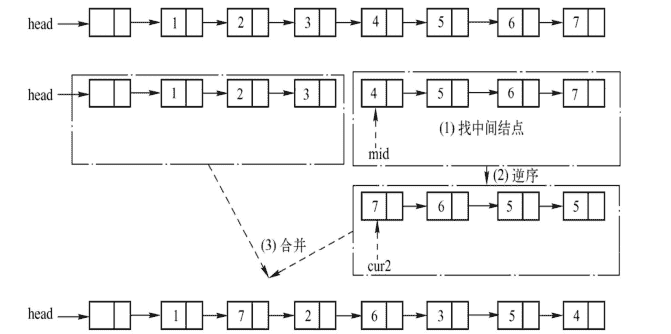

图9-2 链表排序方法

实现代码如下：

```python
class LNode:
    def __init__(self):
        self.data = None
        self.next = None

"""
*** 方法功能: 找出链表 head 的中间结点，把链表从中间断成两个子链表
*** 输入参数: head: 链表头结点
*** 返回值: 链表中间结点
"""
def FindMiddleNode(head):
    if head is None or head.next is None:
        return head
    fast = head        # 遍历链表的时候每次向前走两步
    slow = head        # 遍历链表的时候每次向前走一步
    slowPre = head     # 当 fast 到链表尾时，slow 恰好指向链表的中间结点
    while fast is not None and fast.next is not None:
        slowPre = slow
        slow = slow.next
        fast = fast.next.next
    # 把链表断开成两个独立的子链表
    slowPre.next = None
    return slow

"""
*** 方法功能:对不带头结点的单链表翻转
*** 输入参数: head: 链表头结点
"""
def Reverse(head):
    if head is None or head.next is None:
        return head
    pre = head         # 前驱结点
    cur = head.next    # 当前结点
    next = cur.next    # 后继结点
    pre.next = None
    # 使当前遍历到的结点 cur 指向前驱结点
    while cur is not None:
        next = cur.next
        cur.next = pre
        pre = cur
        cur = cur.next
        cur = next
    return pre

"""
*** 方法功能:对链表进行排序
*** 输入参数: head: 链表头结点
```

```python
def Reorder(head):
    if head is None or head.next is None:
        return
    # 前半部分链表第一个结点
    cur1 = head.next
    mid = FindMiddleNode(head.next)
    # 后半部分链表逆序后的第一个结点
    cur2 = Reverse(mid)
    tmp = None
    # 合并两个链表
    while cur1.next is not None:
        tmp = cur1.next
        cur1.next = cur2
        cur1 = tmp
        tmp = cur2.next
        cur2.next = cur1
        cur2 = tmp
    cur1.next = cur2

if __name__ == "__main__":
    i = 1
    head = LNode()
    head.next = None
    tmp = None
    cur = head
    # 构造第一个链表
    while i < 10:
        tmp = LNode()
        tmp.data = i
        tmp.next = None
        cur.next = tmp
        cur = tmp
        i += 1
    print("排序前：", end="")
    cur = head.next
    while cur is not None:
        print(cur.data, end="")
        cur = cur.next
    Reorder(head)
    print("\n排序后：", end="")
    cur = head.next
    while cur is not None:
        print(cur.data, end="")
        cur = cur.next
        cur = cur.next
```

程序的运行结果为：

|  |  |

|---|---|

| 排序前： 1 2 3 4 5 6 7 |  |

| 排序后： 1 7 2 6 3 5 4 |  |

### 性能分析

找中点需要 O(N) 时间，倒序后半段也是 O(N)，两段合并同样是 O(N)，整体时间仍是 O(N)，N 为链表长度。额外只用了常数个指针，空间开销为 O(1)。

### 延伸：怎样定位链表中点

做法是用一快一慢两个指针同步遍历，快指针每次走两步，慢指针每次走一步。当快指针走到尾部时，慢指针正好落在中部。若长度为奇数，慢指针指向唯一中点；若长度为偶数，慢指针停在两其中点的第一个。代码 FindMiddleNode 即实现这一逻辑。

## 9.3 单链表倒数第 k 个节点怎么找

题目说明：
在 1->2->3->4->5->6->7 这类链表中，找到倒数第 k 个节点，例如 k=3 时答案是 5。

分析与解答：

#### 方法一：两遍遍历
先完整遍历一次得到长度 n，再把倒数第 k 转化为顺数第 n-k，从头再遍历一次取出。缺点是链表要走两遍。

#### 方法二：快慢指针
因只能从头向后访问，让一个指针先行 k 步，之后快慢指针同速前进。当先行指针走到空时，后行指针所在位置即为所求。代码如下：

```python
class LNode:
    def __init__(self):
        self.data = None
        self.next = None

# 构建一个单链表
def ConstructList():
    i = 1
    head = LNode()
    head.next = None
    tmp = None
    cur = head
    # 构造第一个链表
    while i < 8:
        tmp = LNode()
        tmp.data = i
        tmp.next = None
        cur.next = tmp
        cur = tmp
        i += 1
    return head

# 顺序打印单链表结点的 数据
def PrintList(head):
    cur = head.next
    while cur is not None:
        print(cur.data, end=" ")
        cur = cur.next

"""
*** 方法功能：找出链表倒数第 k 个结点
*** 输入参数：head: 链表头结点
*** 返回值：倒数第 k 个结点
"""
def FindlastK(head, k):
    if head is None or head.next is None:
        return
    slow = LNode()
    fast = LNode()
    slow = head.next
    fast = head.next
    i = 0
    while i < k and fast is not None:
        fast = fast.next
        i += 1
    if i < k:
        return None
    while fast is not None:
        slow = slow.next
        fast = fast.next
    return slow

if __name__ == "__main__":
    head = ConstructList()          # 链表头
    result = None
    print("链表：", end="")
    PrintList(head)
    result = FindlastK(head, 3)
    if result is not None:
        print("\n链表倒数第 3 个元素为： " + str(result.data))
```

程序的运行结果为：

链表： 1 2 3 4 5 6 7

链表倒数第3个元素为： 5

### 性能分析

一次遍历即可完成，时间复杂度 O(N)。仅用常数个指针保存地址，空间复杂度 O(1)。

### 延伸：单链表右旋 k 位

题目说明：
链表 1->2->3->4->5->6->7，k=3，旋转后应变为 5->6->7->1->2->3->4。

思路：1）找到倒数第 k+1 个节点 slow 和尾节点 fast；2）在此处断开，形成长度为 k 的后半段；3）把原尾节点指向原头节点；4）新的头节点指向断开点之后的首节点。

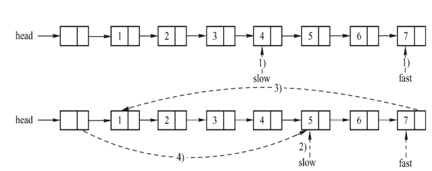

图9-3 链表旋转方法

实现代码如下：

```python
class LNode:
    def __init__(self):
        self.data = None
        self.next = None

# 方法功能：把链表右旋 k 个位置
def RotateK(head, k):
    if head == None or head.next == None:
        return
    # fast 指针先走 k 步，然后与 slow 指针同时向后走
    slow, fast, tmp = LNode(), LNode(), LNode()
    slow, fast = head.next, head.next
    i = 0
    while i < k and fast != None:      # 前移 k 步
        fast = fast.next
        i += 1
    # 判断 k 是否已超出链表长度
    if i < k:
        return
    # 循环结束后 slow 指向链表倒数第 k+1 个元素，fast 指向链表最后一个元素
    while fast.next != None:
        slow = slow.next
        fast = fast.next
    tmp = slow
    slow = slow.next
    tmp.next = None
    fast.next = head.next
    head.next = slow

def ConstructList():
    i = 1
    head = LNode()
    head.next = None
    tmp = None
    cur = head
    # 构造第一个链表
    while i < 8:
        tmp = LNode()
        tmp.data = i
        tmp.next = None
        cur.next = tmp
        cur = tmp
        i += 1
    return head

# 顺序打印单链表结点的数据
def PrintList(head):
    cur = head.next
    while cur is not None:
        print(cur.data, end=" ")
        cur = cur.next

if __name__ == "__main__":
    head = ConstructList()
    print("旋转前：", end="")
    PrintList(head)
    RotateK(head, 3)
    print("\n旋转后：", end="")
    PrintList(head)
```

程序的运行结果为：

旋转前： 1 2 3 4 5 6 7

旋转后： 5 6 7 1 2 3 4

### 性能分析

整个过程只需遍历一次，时间复杂度 O(N)。只额外使用若干指针变量，空间复杂度 O(1)。

## 9.4 大链表是否带环怎么判断

题目说明：
单链表带环是指某个节点的 next 指向了链中更靠前的节点，形成尾部环路。如何检测环的存在？

分析与解答：

#### 方法一：哈希集合记录
用 HashSet 保存已访问节点的引用，从头开始遍历。若当前节点引用已在集合中则说明成环，否则加入集合。时间 O(N)，空间 O(N)。

#### 方法二：快慢指针遍历
设 fast 与 slow 均指向头，slow 每次前进一步，fast 每次前进两步。若二者相遇则存在环，否则无环。实现代码见后文延伸。

### 延伸：若有环，如何找到环入口

当快慢指针相遇时，slow 已走 s 步，fast 已走 2s 步。设环长为 r，fast 在环内多转 n 圈，则 2s = s + n r，可得 s = n r。

设链表总长 L，头到入口距离为 a，相遇点到入口距离为 x，则 a + x = n r。进一步推导可得头到入口的距离等于相遇点到入口的距离。因此从头节点和相遇点各设一个指针同步前行，首次相遇处即为环入口。

实现代码如下：

```python
class LNode:
    def __init__(self):
        self.data = None
        self.next = None

# 构造链表
def ConstructList():
    i = 1
    head = LNode()
    head.next = None
    tmp = None
    cur = head
    while i < 8:
        tmp = LNode()
        tmp.data = i
        tmp.next = None
        cur.next = tmp
        cur = tmp
        i += 1
    cur.next = head.next.next.next
    return head

"""
*** 方法功能：判断链表是否有环
*** 输入参数：head: 链表头结点
*** 返回值： None: 无环, 否则返回 slow 与 fast 相遇的结点
"""
def isLoop(head):
    if head is None or head.next is None:
        return None
    # 初始化 slow 和 fast, 都指向链表的第一个结点
    slow = head.next
    fast = head.next
    while fast is not None and fast.next is not None:
        slow = slow.next
        fast = fast.next.next
        if slow == fast:
            return slow

"""
*** 方法功能：找出环的入口点
*** 输入参数：head: fast 与 slow 相遇点
*** 返回值： None: 无环, 否则返回 slow 与 fast 相遇的结点
"""
def FindLoopNode(head, meetNode):
    first = head.next
    second = meetNode
    while first != second:
        first = first.next
        second = second.next
    return first

if __name__ == "__main__":
    head = ConstructList()
    meetNode = isLoop(head)
    loopNode = None
    if meetNode is not None:
        print("有环")
        loopNode = FindLoopNode(head, meetNode)
        print("环的入口点为：", loopNode.data)
    else:
        print("无环")
```

运行结果展示如下：

有环

环的入口节点是: 3

### 结果解读：
示例里构造的链为 1->2->3->4->5->6->7->3，这里指向尾部的 3 实际指原链表的第三个节点。isLoop 检测到快慢指针在链上相遇，说明存在环；再调用 FindLoopNode 定位入口，最终得到的入口值为 3。

### 性能评估：
该思路只需顺着链表走一遍就能完成判断，时间开销为 O(N)。过程中仅用到常数个指针来暂存节点位置，额外空间为 O(1)。

## 9.5 K 组翻转链表

### 问题说明：
K 组翻转是指把相邻的 K 个节点视作一组进行原地反转，若尾部剩余节点不足 K 则原样保留。举例来说，链表 1->2->3->4->5->6->7，当 K=2 时结果为 2->1->4->3->6->5->7；当 K=3 时结果为 3->2->1->6->5->4->7。

### 思路拆解：
核心做法是每次截取前 K 个节点作为一个独立子链，先翻转再接回头部，然后对下一段重复同样的操作。具体流程如图9-4所示。

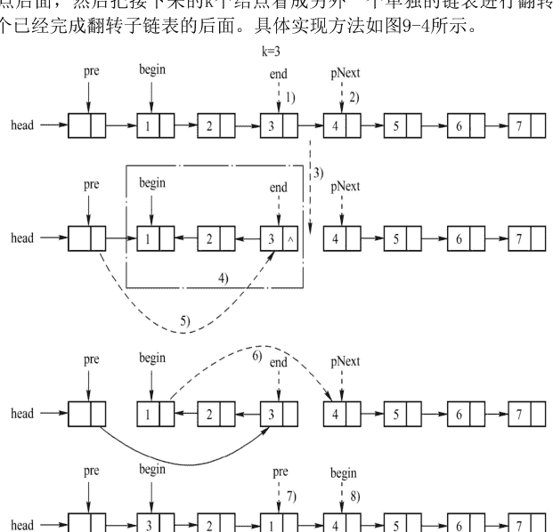

图9-4 链表翻转方法

以 K=3 为例，具体步骤如下：

- 1）先让 pre 停在虚拟头节点，begin 指向当前要处理的起点，顺链数到第 K 个节点作为本次组的尾节点 end。
- 2）为了能单独翻转，需要先记住 end 之后的那一个节点，用 pNext 保存，方便后续衔接。
- 3）把 end.next 置空，这样 begin 到 end 之间就变成一段孤立的子链，可以直接使用基础翻转方法。
- 4）对以 begin 为头、end 为尾的这 K 个节点执行原地反转。
- 5）翻转后原尾节点 end 变成了新头，将 pre.next 指向 end 完成拼接。
- 6）若剩余节点数小于 K，则不再翻转，直接把剩下的部分接到已处理段后面。
- 7）把 pre 更新到本次翻转段的最后一个节点，为下一轮拼接做准备。
- 8）把 begin 移动到 pNext，开始处理下一个 K 节点组。

反复执行上述 1）～8）即可完成整条链表的分组翻转。实现代码如下：

```python
class LNode:
    def __init__(self):
        self.data = None
        self.next = None

# 对不带头结点的单链表翻转
def Reverse(head):
    if head == None or head.next == None:
        return
    pre = head        # 前驱结点
    cur = head.next   # 当前结点
    next = cur.next   # 后继结点
    pre.next = None
    # 使当前遍历到的结点 cur 指向前驱结点
    while cur != None:
        next = cur.next
        cur.next = pre
        pre = cur
        cur = cur.next
        cur = next
    return pre

# 对链表 k 翻转
def ReverseK(head, k):
    if head == None or head.next == None or k < 2:
        return
    i = 1
    pre = head
    begin = head.next
    end = None
    pNext = None
    while begin != None:
        end = begin
        # 找到从 begin 开始第 k 个节点
        while i < k:
            if end.next != None:
                end = end.next
            else:  # 剩余结点的个数小于 k
                return
        i += 1
        pNext = end.next
        end.next = None
        pre.next = Reverse(begin)
        begin.next = pNext
        pre = begin
        begin = pNext
        i = 1

if __name__ == "__main__":
    i = 1
    head = LNode()
    head.next = None
    tmp = None
    cur = head
    while i < 8:
        tmp = LNode()
        tmp.data = i
        tmp.next = None
        cur.next = tmp
        cur = tmp
        i += 1
    print("顺序输出: ", end="")
    cur = head.next
    while cur is not None:
        print(cur.data, end=" ")
        cur = cur.next
    ReverseK(head, 3)
    print("\nK 翻转后输出: ", end="")
    cur = head.next
    while cur is not None:
        print(cur.data, end=" ")
        cur = cur.next
    cur = head.next
    while cur is not None:
        tmp = cur
        cur = cur.next
```

执行结果如下：

顺序输出: 1 2 3 4 5 6 7

K 翻转后输出: 3 2 1 6 5 4 7

### 结果解读：
整条链被划分成 (1 2 3)、(4 5 6)、(7) 三段。前两段各有 3 个节点，翻转后分别变为 (3 2 1) 和 (6 5 4)；最后一段只有 1 个节点，不满足 K，因此保持不动。最终得到 3->2->1->6->5->4->7。

### 性能评估：
方法只需一次遍历，时间复杂度为 O(N)。只用少量指针记录位置，空间复杂度为 O(1)。

## 9.6 栈的两种实现方式

### 功能需求：
实现栈结构，支持压栈、弹栈、查看栈顶、判断是否为空、获取元素个数等操作。

### 总体思路：
栈可以用数组或链表两种方式构建，下面分别说明。

### 方案一：数组实现
数组版栈使用一段连续内存。实现思路如图9-5所示。

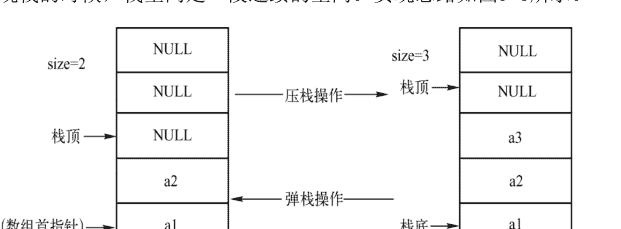

图9-5 数组实现栈

从图可知，数组首位可作为栈底，用 size 记录当前元素个数。压栈时把新值放到 arr[size] 再把 size +1；弹栈时取出 arr[size-1] 再把 size -1。按此原理很容易实现，示例代码如下：

```python
class MyStack1:
    def __init__(self):
        self.items = []
    # 判断栈是否为空

    def isEmpty(self):
        return len(self.items) == 0
    # 返回栈的大小

    def size(self):
        return len(self.items)
    # 返回栈顶元素

    def top(self):
        if not self.isEmpty():
            return self.items[len(self.items) - 1]
        else:
            return None

    # 弹栈

    def pop(self):
        if len(self.items) > 0:
            return self.items.pop()
        else:
            print("栈已经为空")
            return None

    # 压栈

    def push(self, item):
        self.items.append(item)

if __name__ == "__main__":
    s = MyStack1()
    s.push(4)
    print("栈顶元素为: " + str(s.pop()))
    print("栈大小为: " + str(s.size()))
    s.pop()
    print("弹栈成功")
    s.pop()
```

### 方案二：链表实现
链表版栈常用头插法，带头节点的链表能让每个操作保持一致。实现思路如图9-6所示。

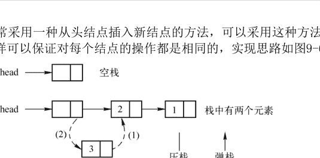

图9-6 链表实现栈

压栈时先新建节点存放值，再把新节点接到链表头部即可；弹栈时直接移除第一个节点即可。实现代码如下：

```python
class MyStack2:
    def __init__(self):
        self.data = None
        self.next = None

    # 判断 stack 是否为空，如果为空返回 true，否则返回 false
    def empty(self):
        if self.next == None:
            return True
        else:
            return False

    # 获取栈中元素的个数
    def size(self):
        size = 0
        p = self.next
        while p != None:
            p = p.next
            size += 1
        return size

    # 入栈：把 e 放到栈顶
    def push(self, e):
        p = LNode
        p.data = e
        p.next = self.next
        self.next = p

    # 出栈，同时返回栈顶元素
    def pop(self):
        tmp = self.next
        if tmp != None:
            self.next = tmp.next
            return tmp.data
        print("栈已经为空")
        return None

    # 取得栈顶元素
    def top(self):
        if self.next != None:
            return self.next.data
        print("栈已经为空")
        return None
```

运行输出如下：

栈顶元素为: 1

栈大小为: 1

弹栈成功

栈已经为空

### 方案对比：
数组实现的好处是每个元素只占一个存储单元，缺点是初始容量过大浪费内存，过小则需要频繁扩容，扩容成本高。链表实现的优点是按需申请，灵活方便；缺点是除了数据本身，还需额外空间保存指针。

### 效率评估：
两种方案的压栈和弹栈操作都是 O(1)。

## 9.7 排队位置实时更新系统设计

### 问题说明：
设计一个排队系统，要求每个用户进入后能看到自己在队列中的位置，并且位置会随加入或退出而动态变化；当有人中途退出导致后面用户排名改变时，要能及时推送反馈。

### 总体思路：
除了常规的入队和出队，还要支持任意位置的元素随时退出，并在退出后更新受影响用户的序号。实现代码如下：

```python
#!/usr/bin/python
from collections import deque

class User:
    def __init__(self, id, name):
        self.id = id                # 唯一标识一个用户
        self.name = name
        self.seq = 0

    def getName(self):
        return self.name

    def getSeq(self):
        return self.seq

    def setSeq(self, seq):
        self.seq = seq

    def getId(self):
        return self.id
    # def equals(self,arg0):
    # o = arg0
    # return self.id == o.getId()

    def toString(self):
        return "id:" + str(self.id) + " name:" + self.name + " seq:" + str(self.seq)

class MyQueue:
    def __init__(self):
        self.deque = deque()

    def enQueue(self, user):
        # 进入队列尾部
        user.setSeq(len(self.deque) + 1)
        self.deque.append(user)
    # 队头出队列

    def deQueue(self):
        self.deque.popleft()
        self.updateSeq()
    # 队列中的人随机离开

    def deQueueMove(self, user):
        self.deque.remove(user)
        self.updateSeq()
    # 出队列后更新队列中每个人的序列

    def updateSeq(self):
        i = 1
        for user in self.deque:
            user.setSeq(i)
            i += 1
    # 打印队列的信息

    def printList(self):
        for user in self.deque:
            print(user.toString())

if __name__ == "__main__":
    user1 = User(1, "user1")
    user2 = User(2, "user2")
    user3 = User(3, "user3")
    user4 = User(4, "user4")
    user5 = User(5, "user5")
    queue = MyQueue()
    queue.enQueue(user1)
    queue.enQueue(user2)
    queue.enQueue(user3)
    queue.enQueue(user4)
    queue.enQueue(user5)
    queue.deQueue()          # 队列元素user1 出列
    queue.deQueueMove(user3) # 队列中间的元素user3 出队列
    queue.enQueue(user1)
    queue.printList()
```

程序的运行结果为：

```
id:2 name:user2 seq:1
id:4 name:user4 seq:2
id:5 name:user5 seq:3
id:1 name:user1 seq:4
```

## 9.8 队列实现方式

### 需求说明：

构建一个队列结构，能够完成入队、出队、查看队首元素、查看队尾元素以及获取当前长度等操作。

### 解析思路：

队列的构造思路和栈比较接近，常见的实现路径有两种，一种基于数组，一种基于链表。以下分别展开说明。

### 方案一：基于数组

图9-7展示了最直观的做法，用 front 记录队首所在下标，用 rear 记录队尾元素的下一个空位。入队时把新元素写入 rear 指向的位置，随后 rear 自增；出队时仅需让 front 自增即可移动队首。

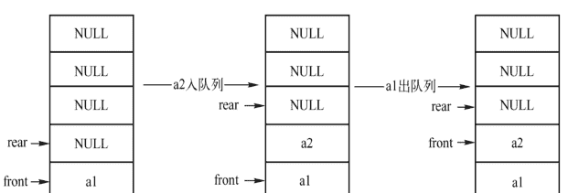

示例代码如下：

```python
class MyQueue:
    def __init__(self):
        self.arr = []
        self.front = 0      # 队列首
        self.rear = 0       # 队列尾

    # 判断队列是否为空
    def isEmpty(self):
        return self.front == self.rear

    # 返回队列的大小
    def size(self):
        return self.rear - self.front
    # 返回队列首元素
    def getFront(self):
        if self.isEmpty():
            return None
        return self.arr[self.front]
    # 返回队列尾元素
    def getBack(self):
        if self.isEmpty():
            return None
        return self.arr[self.rear - 1]
    # 删除队列头元素
    def deQueue(self):
        if self.rear > self.front:
            self.front += 1
        else:
            print("队列已经为空")
    # 把新元素加入队列尾
    def enQueue(self,item):
        self.arr.append(item)
        self.rear += 1

if __name__ == "__main__":
    queue = MyQueue()
    queue.enQueue(1)
    queue.enQueue(2)
    queue.enQueue(6)
    print("队列头元素为：",queue.getFront())
    print("队列尾元素为：",queue.getBack())
    print("队列的大小为：",queue.size())
```

程序的运行结果为：

队列头元素为： 1

队列尾元素为： 6

队列的大小为： 3

这种写法最明显的问题是出队后前面被释放的区域无法继续利用。常用的改进是把数组视为环形空间，也就是循环队列。填满末尾后从数组开头继续复用，具体细节可参考数据结构相关资料。

### 方案二：基于链表

链表版队列的思路和栈类似，用两个指针分别指向首节点和尾节点，如图9-8所示。pHead 指向队首，pEnd 指向队尾。

以图9-8为例，初始时队列含 1、2、3。新增元素 4 进队时，先把新节点接在尾部，再把 pEnd 指向它。出队时只需把 pHead 挪到 pHead.next，同时注意释放旧节点占用的空间。入队出队时还需处理队空等边界情况，实现代码如下所示：

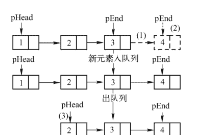

图9-8 链表实现队列

```python
class MyQueue(object):
    def __init__(self):
        self.pHead = None
        self.pEnd = None

    # 判断队列是否为空
    def isEmpty(self):
        return self.pHead is None

    # 获取队列中元素的个数
    def size(self):
        size = 0
        p = self.pHead
        while p is not None:
            p = p.next
            size += 1
        return size

    # 入队列，把元素 e 加到队列尾
    def enQueue(self, elem):
        p = LNode(elem)
        if self.isEmpty():
            self.pHead = p
            self.pEnd = p
        else:
            self.pEnd.next = p
            self.pEnd = p

    # 出队列，删除队列首元素
    def deQueueHead(self):
        if self.isEmpty():
            print("出队列失败，队列已经为空")
        self.pHead = self.pHead.next
        if self.pEnd == None:
            self.pEnd = None

    # 获取队列首元素
    def getFront(self):
        if self.isEmpty():
            print("获取队列首元素失败，队列已经为空")
            return None
        return self.pHead.data

    # 获取队列尾元素
    def getrear(self):
        if self.pEnd == None:
            print("获取队列尾元素失败，队列已经为空")
            return None
        return self.pEnd.data
```

程序的运行结果为：

队列头元素为: 1

队列尾元素为: 2

队列大小为: 2

链表方案灵活性更好，但要多占用指针空间。与数组相比这是额外开销。也可以采用循环链表，只保留指向最后一个节点的指针，通过它就能快速定位到队首。

## 9.9 入栈顺序能否得到指定出栈顺序

### 需求说明：

输入两个整数序列，其中一个是栈的 push 顺序，判断另一个是否可能是对应的 pop 顺序。

### 解析思路：

例如 push 顺序为 1、2、3、4、5，序列 3、2、5、4、1 就可能是合法的出栈结果，而 5、3、4、1、2 就不可能是。

核心做法是用一个辅助栈来模拟真实入栈过程，具体流程如下。

- 1）按顺序把 push 元素压栈，直到栈顶与 pop 序列当前元素相等，然后执行出栈并把 pop 指针后移。
- 2）若栈顶仍等于 pop 当前元素，继续出栈；否则继续从 push 序列压入新元素。
- 3）当 push 已全部压完，pop 仍未遍历完且栈顶不匹配，则该序列不合法。若栈已空且 pop 也全部遍历完，则序列合法。图9-9展示了一个合法判断的完整过程。

在图9-9中，第（1）～（3）步栈顶与 pop 首元素 3 不一致，于是 1、2、3 依次入栈。第（4）步 3 出栈，随后 2 出栈；接着栈顶 4 与当前 pop 元素 5 不符，于是 4、5 入栈；第（8）步 5 出栈，后续第（9）（10）步栈顶持续匹配 pop 元素并出栈。最后栈空且 pop 全部处理完，故 {3,2,5,4,1} 是合理的出栈序列。

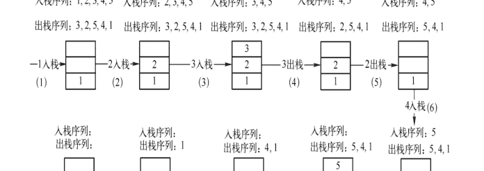

图9-9 判断pop序列的流程

实现代码如下：

class Stack:

    def __init__(self):

        self.items = []

    # 判断栈是否为空
    def isEmpty(self):
        return len(self.items) == 0

    # 返回栈的大小
    def size(self):
        return len(self.items)

    # 返回栈顶元素
    def peek(self):
        if not self.isEmpty():
            return self.items[len(self.items) - 1]
        else:
            return None

    # 弹栈
    def pop(self):
        if len(self.items) > 0:
            return self.items.pop()
        else:
            print("The stack was Null!")
            return None

    # 压栈
    def push(self,item):
        self.items.append(item)

def isPopSerial(push,pop):
    if push is None or pop is None:
        return False
    pushLength = len(push)
    popLength = len(pop)
    if pushLength != popLength:
        return False
    pushIndex = 0
    popIndex = 0
    stack = Stack()
    while pushIndex < pushLength:
        # 把 push 序列依次入栈, 直到栈顶元素等于 pop 序列的第一元素
        stack.push(push[pushIndex])
        pushIndex += 1
        # 栈顶元素出栈, pop 序列移动到下一个元素
        while (not stack.isEmpty()) and stack.peek() == pop[popIndex]:
            stack.pop()
            popIndex += 1
    # 栈为空, 且 pop 序列中元素都被遍历过
    return stack.isEmpty() and popIndex == popLength

if __name__ == "__main__":
    push = "12345"
    pop = "32541"
    if isPopSerial(push,pop):
        print(pop + "是" + push + "的一个 pop 序列")
    else:
        print(pop + "不是" + push + "的一个 pop 序列"

程序的运行结果为：

32541 是 12345 的一个 pop 序列

### 效率评估：

对一个合法的 pop 序列，算法最多对每个元素执行一次入栈和一次出栈，操作次数约为 2N，时间复杂度为 O(N)。额外使用了一个辅助栈，空间复杂度为 O(N)。

## 9.10 LRU 缓存怎么落地

### 需求说明：

LRU 即 Least Recently Used，最近最少使用。LRU 缓存按此原则管理固定容量的缓存，超限时淘汰久未使用的条目。这一思路广泛应用于页面置换和虚拟页式存储。

### 解析思路：

一个实用的 LRU 缓存通常由两部分组成。

- 1）双向链表模拟有序队列，容量与缓存大小一致。使用时把刚访问的节点提到队头，长时间未使用的节点沉到队尾。
- 2）哈希表建立页号到链表节点位置的映射，键为页号，值为对应节点引用。

引用页面时，若命中，直接把该节点搬到队头；若未命中，则加载页面，生成新节点插入队头并更新哈希表。若队列已满，先从队尾移除一个节点，再把新节点放到队头。实现代码如下：

```
from collections import deque

class LRU:
    def __init__(self, cacheSize):
        self.cacheSize = cacheSize
        self.queue = deque()
        self.hashSet = set()

    # 判断缓存队列是否已满
    def isQueueFull(self):
        return len(self.queue) == self.cacheSize
    # 把页号为 pageNum 的页缓存到队列中，同时添加到 hash 表中

    def enQueue(self, pageNum):
        # 如果队列已满，需要删除队尾的缓存的页
        if self.isQueueFull():
            self.hashSet.remove(self.queue[-1])
            self.queue.pop()
        self.queue.appendleft(pageNum)
        # 把新缓存的结点同时添加到 hash 表中
        self.hashSet.add(pageNum)

    #""
    # 当访问某一个 page 的时候，会调用这个函数，对于访问的 page 有两种情况：
    # 1)如果 page 在缓存队列中，直接把它这个结点移动到队首
    # 2)如果 page 不在缓存队列中，把这个 page 缓存到队首
    #""

    def accessPage(self, pageNum):
        # page 不在缓存队列中，把它缓存到队首
        if pageNum not in self.hashSet:
            self.enQueue(pageNum)
        # page 已经在缓存队列中，移动到队首
        elif pageNum != self.queue[0]:
            self.queue.remove(pageNum)
            self.queue.appendleft(pageNum)

    def printQueue(self):
        while len(self.queue) > 0:
            print(self.queue.popleft(), end=' ')

if __name__ == "__main__":
    # 假设缓存大小为 3
    lru = LRU(3)
```

```
lru.accessPage(1)
lru.accessPage(2)
lru.accessPage(5)
lru.accessPage(1)
lru.accessPage(16)
lru.accessPage(17)
# 通过上面的访问序列后，缓存的信息为
lru.printQueue()
```

运行结果展示：

```
17 16 1
```

## 9.11 有序数组构建二叉树

### 问题
如何把一组有序整数装进二叉树，使中序遍历仍保持递增？

### 解析
有序输入决定了输出树的本质也应有序。采用分治策略：取当前区间的中间值作为根节点，随后把左右子区间分别递归处理。具体示意见图9-10。

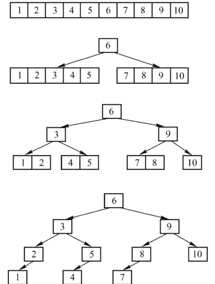

图9-10 数组到树的构建示意

先以中点 6 作为树的根，数组因此被拆成左右两部分。左半段再以 3 为根继续细分，右半段按相同方式递归展开，重复此过程即可得到完整结构。参考代码如下：

```
class BiTNode:
    def __init__(self):
        self.data = None
        self.lchild = None
        self.rchild = None

# 方法功能：把有序数组转换为二叉树
def arraytotree(arr, start, end):
    root = None
    if end >= start:
        root = BiTNode()
        mid = (start+end+1)/2
        # 树的根节点为数组中间的元素
        root.data = arr[mid]
        # 递归的用左半部分数组构造 root 的左子树
        root.lchild = arraytotree(arr, start, mid-1)
        # 递归的用右半部分数组构造 root 的右子树
        root.rchild = arraytotree(arr, mid+1, end)
    else:
        root = None
    return root

# 用中序遍历的方式打印出二叉树结构的内容
def printTreeMidOrder(root):
    if root == None:
        return
    # 遍历 root 结点的左子树
    if root.lchild != None:
        printTreeMidOrder(root.lchild)
    # 遍历 root 结点
    print(root.data, end=" ")
    # 遍历 root 结点的右子树
    if root.rchild != None:
        printTreeMidOrder(root.rchild)

if __name__ == "__main__":
    arr = [1, 2, 3, 4, 5, 6, 7, 8, 9, 10]
    print("数组: ", end="")
    i = 0
    while i < len(arr):
        print(arr[i], end=" ")
        i += 1
    print()
    root = arraytotree(arr, 0, len(arr)-1)
    print("转换成树的中序遍历为:", end="")
    printTreeMidOrder(root)
```

运行结果展示：

```
数组: 1 2 3 4 5 6 7 8 9 10
转换成树的中序遍历为:1 2 3 4 5 6 7 8 9 10
```

### 效率
构造过程中每个元素仅被访问一次，整体时间开销为线性关系，记作 O(N)，N 为数组长度。

## 9.12 层序遍历二叉树

### 问题
给定一棵二叉树，要求从根往下逐层输出节点数据，参考图9-11。

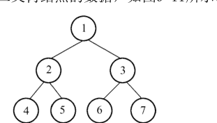

图9-11 目标二叉树

该树的层序访问序列为 1, 2, 3, 4, 5, 6, 7。

### 解析
层序遍历需要在访问节点的同时记录其子节点并按发现顺序处理。队列的 FIFO 特性正好满足这一需求，能够保证先上后下、同一层从左到右的输出顺序。过程示意见图9-12。

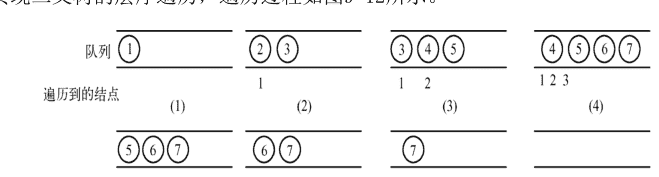

图9-12 层序遍历示意

图（1）先把根 1 入队启动遍历。图（2）队首 1 出队，其孩子 2、3 入队。图（3）随后队首 2 出队，其孩子 4、5 入队，依此类推即可覆盖整棵树。

代码实现如下：

```
```python

from collections import deque

class BiTNode:

    def __init__(self):

        self.data = None

        self.lchild = None

        self.rchild = None

```

```

# 方法功能：把有序数组转换为二叉树

def arraytotree(arr, start, end):

    root = None

    if end >= start:

        root = BiTNode()

        mid = (start+end+1)/2

        # 树的根节点为数组中间的元素

        root.data = arr[mid]

        # 递归的用左半部分数组构造 root 的左子树

        root.lchild = arraytotree(arr, start, mid-1)

        # 递归的用右半部分数组构造 root 的右子树

        root.rchild = arraytotree(arr, mid+1, end)

    else:

        root = None

    return root

"""

方法功能：用层次遍历的方式打印出二叉树节点的内容

输入参数：root: 二叉树根节点

"""

def printTreeLayer(root):

    if root == None:

        return

    queue = deque()

    # 树根节点进队列

    queue.append(root)

    while len(queue) > 0:

        p = queue.popleft()

        # 访问当前节点

        print(p.data, end=" ")

        # 如果这个节点的左孩子不为空则入队列

        if p.lchild != None:

            queue.append(p.lchild)

        # 如果这个节点的右孩子不为空则入队列

        if p.rchild != None:

            queue.append(p.rchild)

if __name__ == "__main__":

    arr = [1, 2, 3, 4, 5, 6, 7, 8, 9, 10]

    root = arraytotree(arr, 0, len(arr)-1)

    print("树的层次遍历结果为:", end="")

    printTreeLayer(root)

```

程序的运行结果为：

树的层次遍历结果为: 6 3 9 2 5 8 10 1 4 7

### 算法性能分析：

在二叉树的层次遍历过程中，对树中的各个结点只进行了一次访问，因此，时间复杂度为O(N)，此外，这种方法还使用了队列来保存遍历的中间结点，所使用队列的大小取决于二叉树中每一层中结点个数的最大值。具有N个结点的完全二叉树的深度为h=log2N+1。而深度为h的这一层最多的结点个数为2h-1=n/2。也就是说队列中可能最多的结点个数为N/2。因此，这种算法的空间复杂度为O(N)。

### 引申：用空间复杂度为O(1)的算法来实现层序遍历

上面介绍的算法的空间复杂度为O(N)，显然不满足要求。在通常情况下，提高空间复杂度都是要以牺牲时间复杂度作为代价的。对于本题而言，主要的算法思路为：不使用队列来存储每一层遍历到的结点，而是每次都会从根结点开始遍历。把遍历二叉树的第k层的结点，转换为遍历二叉树根结点的左右子树的第k-1层结点。算法如下所示。

```

def printAtLevel(root,level):

    if root==None or level < 0:

        return 0

    elif level == 0:

        print root.data

        return 1

    else:

        # 把打印根结点 level 层的结点转换为求解根结点的孩子结点的 level-1 层的结点

        return printAtLevel(root.lchild, level - 1)+

               printAtLevel(root.rchild, level - 1)

```

通过上述算法，可以首先求解出二叉树的高度h，然后调用上面的函数h次就可以打印出每一层的结点。

## 9.13 如何求一棵二叉树的最大子树和

### 题目描述：

给定一棵二叉树，它的每个结点都是正整数或负整数，如何找到一棵子树，使得它所有结点的和最大？

### 分析与解答：

要求一棵二叉树的最大子树和，最容易想到的办法就是针对每棵子树，求出这棵子树中所有结点的和，然后从中找出最大值。恰好二叉树的后序遍历就能做到这一点。在对二叉树进行后序遍历的过程中，如果当前遍历的结点的值与其左右子树和的值相加的结果大于最大值，则更新最大值。如图9-13所示。

在图9-13中，首先遍历结点-1，这个子树的最大值为-1，同理，当遍历到结点9时，子树的最大值为9，当遍历到结点3的时候，这个结点与其左右孩子结点值的和（3-1+9=11）大于最大值（9）。因此，此时最大的子树为以3为根结点的子树，依此类推，直到遍历完整棵树为止。实现代码如下：

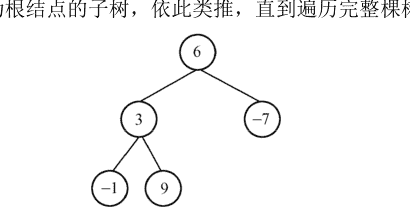

图9-13 二叉树

```

class BiTNode:

```


```

def __init__(self):

    self.data = None

    self.lchild = None

    self.rchild = None

class Test:

    def __init__(self):

        self.maxSum = -2**31

        """

        方法功能: 求最大子树

        输入参数: root: 根节点;

        maxRoot: 最大子树的根节点

        返回值: 以 root 为根节点子树所有结点的和

        """

        def findMaxSubTree(self, root, maxRoot):

            if root == None:

                return 0

            # 求 root 左子树所有结点的和

            lmax = self.findMaxSubTree(root.lchild, maxRoot)

            # 求 root 右子树所有结点的和

            rmax = self.findMaxSubTree(root.rchild, maxRoot)

            sums = lmax + rmax + root.data

            # 以 root 为根的子树的和与前面求出的最大值

            if sums > self.maxSum:

                self.maxSum = sums

                maxRoot.data = root.data

            # 返回以 root 为根结点的子树的所所有结点的和

            return sums

        """

        方法功能: 构造二叉树

        返回值: 返回新构造的二叉树的根结点

        """

        def constructTree(self):

            root = BiTNode()

            node1 = BiTNode()

            node2 = BiTNode()

            node3 = BiTNode()

            node4 = BiTNode()

            root.data = 6

            node1.data = 3

            node2.data = -7

            node3.data = -1

            node4.data = 9

            root.lchild = node1

            root.rchild = node2

            node1.lchild = node3

            node1.rchild = node4

            node2.lchild = node2.rchild = node3.lchild = node3.rchild = \

                node4.lchild = node4.rchild = None

            return root

        if __name__ == "__main__":

            # 构造二叉树

            test = Test()

            root = test.constructTree()

            maxRoot = BiTNode()  # 最大子树的根节点

            test.findMaxSubTree(root, maxRoot)

            print("最大子树和为: " + str(test.maxSum))

            print("对应子树的根节点为: " + str(maxRoot.data))

# 二叉树 LCA 三种实战思路

面试里经常出现先把有序列表构造为近似平衡的二叉树，再定位两个指定节点最近共同祖先的题型。下面把同一棵树的构建逻辑下，三种不同的求解思路梳理清楚，方便对照理解。

## 1. 双栈回溯对比

核心做法是分别把根到两个目标节点的访问轨迹压入两个独立栈，随后从栈顶向下逐层比对。只要两栈顶指向同一对象就暂存该对象并同时出栈，一旦出现不相等，上一次暂存的那个节点即为所求的公共祖先。

```

程序的运行结果为：

最大子树和为: 11
对应子树的根节点为: 3

## 算法性能分析：

这种方法与二叉树的后序遍历有相同的时间复杂度，即为O(N)，其中，N为二叉树的结点个数。

## 9.14 如何找出排序二叉树上任意两个节点的最近共同父结点

### 题目描述：

对于一棵给定的排序二叉树，求两个节点的共同父结点，例如，在图9-14中，节点1和节点5的共同父结点为3。

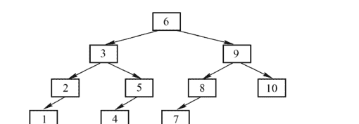

图9-14 求公共父结点的二叉树

### 分析与解答：

### 方法一：路径对比法

对于一棵二叉树的两个结点，如果知道从根结点到这两个结点的路径，就可以很容易地找出它们最近的公共父结点。因此，可以首先分别找出从根结点到这两个结点的路径（例如图9-14中从根结点到结点1的路径为6->3->2->1，从根结点到结点5的路径为6->3->5）；然后遍历这两条路径，只要是相等的结点都是它们的父结点，找到最后一个相等的结点即为离它们最近的共同父结点，在这个例子中，结点3就是它们共同的父结点。示例代码如下：

```python

class BiTNode:

    def __init__(self):

        self.data = None

        self.lchild = None

        self.rchild = None

class stack:

    # 模拟栈

    def __init__(self):

        self.items = []

    # 判断栈是否为空

    def isEmpty(self):

        return len(self.items) == 0

    # 返回栈的大小

    def size(self):

        return len(self.items)

    # 返回栈顶元素

    def peek(self):

        if not self.isEmpty():

            return self.items[len(self.items)-1]

        else:

            return None

    # 弹栈

    def pop(self):

        if len(self.items) > 0:

            return self.items.pop()

        else:

            print("栈已经为空")

            return None

    # 压栈

    def push(self, item):

        self.items.append(item)

# 方法功能：把有序数组转换为二叉树

def arraytotree(arr, start, end):

    root = None

    if end >= start:

        root = BiTNode()

        mid = (start+end+1)/2

        # 树的根节点为数组中间的元素

        root.data = arr[mid]

        # 递归用左半部分数组构造 root 的左子树

        root.lchild = arraytotree(arr, start, mid-1)

        # 递归用右半部分数组构造 root 的右子树

        root.rchild = arraytotree(arr, mid+1, end)

    else:

        root = None

    return root

"""

方法功能：获取二叉树从根结点 root 到 node 结点的路径

输入参数：root: 根结点; node: 二叉树中的某个结点; s: 用来存储路径的栈

返回值：node 在 root 的子树上，或 node==root 时返回 true，否则返回 false

"""

def getPathFromRoot(root, node, s):

    if root == None:

        return False

    if root == node:

        s.push(root)

        return True

    """

    如果 node 结点在 root 结点的左子树或右子树上：

    那么 root 就是 node 的祖先结点，把它加到栈里

    """

    if getPathFromRoot(root.lchild, node, s) or getPathFromRoot(root.rchild, node, s):

        s.push(root)

        return True

    return False

"""

方法功能：查找二叉树中两个结点最近的共同父结点

输入参数：root: 根结点; node1 与 node2 为二叉树中两个结点

返回值：node1 与 node2 最近的共同父结点

"""

def FindParentNode(root, node1, node2):

    stack1 = stack()  # 保存从 root 到 node1 的路径

    stack2 = stack()  # 保存从 root 到 node2 的路径

    # 获取从 root 到 node1 的路径

    getPathFromRoot(root, node1, stack1)

    # 获取从 root 到 node2 的路径

    getPathFromRoot(root, node2, stack2)

    commonParent = None

    # 获取最近邻 node1 和 node2 的父结点

    while stack1.peek() == stack2.peek():

        commonParent = stack1.peek()

        stack1.pop()

        stack2.pop()

    return commonParent

if __name__ == "__main__":

    arr = [1, 2, 3, 4, 5, 6, 7, 8, 9, 10]

    root = arraytotree(arr, 0, len(arr)-1)

    node1 = root.lchild.lchild

    node2 = root.lchild.rchild

    res = None

res = FindParentNode(root, node1, node2)

if res != None:

    print(str(node1.data)+"与"+str(node2.data)+"的最近公共父节点为："+str(res.data),end="")

else:

    print("没有公共父节点")

## 2. 编号上浮法

给树按完全二叉树的编号规则标号，根用 1，左孩子为父号的两倍，右孩子为两倍加一。先求出两个目标节点各自的编号，再让编号较大的那个不断除以二向上回溯，直至两编号相等，最后把共同编号映射回真实节点对象。

```

程序的运行结果为：

1 与 5 的最近公共父节点为： 3

### 算法性能分析：

当获取二叉树从根结点root到node结点的路径时，最坏的情况就是把树中所有结点都遍历了一遍，这个操作的时间复杂度为O(N)，再分别找出从根结点到两个结点的路径后，找它们最近的公共父结点的时间复杂度也为O(N)，因此，这种方法的时间复杂度为O(N)。此外，这种方法用栈保存了从根结点到特定结点的路径，在最坏的情况下，这个路径包含了树中所有的结点，因此，空间复杂度也为 O(N)。

很显然，这种方法还不够理想。下面介绍另外一种能降低空间复杂度的方法。

### 方法二：节点编号法

可以把二叉树看成是一棵完全二叉树（不管实际的二叉树是否为完全二叉树，二叉树中的结点都可以按照完全二叉树中对结点编号的方式进行编号），图9-15为对二叉树中的结点按照完全二叉树中结点的编号方式进行编号后的结果，结点右边的数字为其对应的编号。

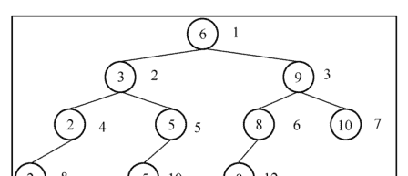

图9-15 二叉树的编号

根据二叉树的性质可以知道，一个编号为n的结点，它的父亲结点的编号为n/2。假如要求node1与node2的最近的共同父结点，首先把这棵树看成是一棵完全二叉树（不管结点是否存在），分别求得这两个结点的编号n1和n2。然后每次找出n1与n2中较大的值除以2，直到ln1==n2为止，此时n1或n2的值对应结点的编号就是它们最近的共同父结点的编号，接着可以根据这个编号信息找到对应的结点，具体方法为：通过观察二叉树中结点的编号可以发现：首先把根结点root看成1，求root的左孩子编号的方法为把root对应的编号看成二进制，然后向左移一位，末尾补0，如果是root的右孩子，那么末尾补1，因此，通过结点位置的二进制码就可以确定这个结点。例如结点3的编号为2（二进制10），它的左孩子的求解方法为：10，向左移一位末尾补0，可以得到二进制100（十进制4），位置为4的结点的值为2。从这个特性可以得出通过结点位置信息获取结点的方法，例如要求位置4的结点，4的二进制码为100，由于1代表根结点，接下来的一个0代表是左子树root.lchild，最后一个0也表示左子树root.lchild.lchild，通过这种方法非常容易根据结点的编号找到对应的结点。实现代码如下：

```python

import math

class BiTNode:

    def __init__(self):

        self.data = None

        self.lchild = None

        self.rchild = None

# 方法功能：把有序数组转换为二叉树

def arraytotree(arr, start, end):

    root = None

    if end >= start:

        root = BiTNode()

        mid = (start+end+1)/2

        # 树的根节点为数组中间的元素

        root.data = arr[mid]

        # 递归的用左半部分数组构造 root 的左子树

        root.lchild = arraytotree(arr, start, mid-1)

        # 递归的用右半部分数组构造 root 的右子树

        root.rchild = arraytotree(arr, mid+1, end)

    else:

        root = None

    return root

class IntRef:

    def __init__(self):

        self.num = None

"""

方法功能：找出结点在二叉树中的编号

输入参数：root: 根节点, node: 待查找结点, number: node 结点在二叉树中的编号

返回值：true: 找到该结点的位置, 否则返回 false

"""

def getNo(root, node, number):

    if root == None:

        return False

    if root == node:

        return True

    tmp = number.num

    number.num = 2 * tmp

    # node 结点在 root 的左子树中, 左子树编号为当前结点编号的 2 倍

    if getNo(root.lchild, node, number):

        return True

    # node 结点在 root 的右子树中, 右子树编号为当前结点编号的 2 倍加 1

    else:

        number.num = tmp * 2 + 1

        return getNo(root.rchild, node, number)
```

```

'''

方法功能：根据节点的编号找出对应的节点

输入参数：root：根节点；number 为节点的编号

返回值：编号为 number 对应的节点

'''

def getNodeFromNum(root, number):

    if root == None or number < 0:

        return None

    if number == 1:

        return root

    # 节点编号对应二进制制位数（最高位一定为1，因为根节点代表1）

    lens = int(math.log(number) / math.log(2))

    # print(lens)

    # 去掉根节点表示的1

    # number -= 1 << lens

    while lens > 0:

        # 如果这一位二进制的值为1，

        # 那么编号为 number 的节点必定在当前节点的右子树上

        if (1 << (lens - 1)) & (number - 1) == 1:

            root = root.rchild

        else:

            root = root.lchild

        lens -= 1

    return root
```

```

'''

方法功能：查找二叉树中两个节点最近的共同父节点

输入参数：root：根节点；node1 与 node2 为二叉树中两个节点

返回值：node1 与 node2 最近的共同父节点

'''

def FindParentNode(root, node1, node2):

    ref1 = IntRef()

    ref1.num = 1

    ref2 = IntRef()

    ref2.num = 1

    getNo(root, node1, ref1)

    getNo(root, node2, ref2)

    num1 = ref1.num

    num2 = ref2.num

    # 找出编号为 num1 和 num2 的共同父节点

    while num1 != num2:

        if num1 > num2:

            num1 /= 2

        else:

            num2 /= 2

    # num1 就已经是他们最近的公共父节点的编号，通过节点编号找到对应的节点

    return getNodeFromNum(root, num1)
```

```

if __name__ == "__main__":

    arr = [1, 2, 3, 4, 5, 6, 7, 8, 9, 10]

    root = arraytotree(arr, 0, len(arr)-1)

    node1 = root.lchild.lchild.lchild

    node2 = root.lchild.rchild

    res = None

    res = FindParentNode(root, node1, node2)

    if res != None:

        print(str(node1.data)+"与"+str(node2.data)+"的最近公共父节点为："+str(res.data),end="")

    else:

        print("没有公共父节点",end="")

## 3. 纯递归判别

不借助额外存储，完全依赖递归的返回值做判断。若当前节点恰是目标之一则直接返回；对左右子树分别递归后，若一侧返回空说明两个目标都在另一侧，直接向上传递该侧结果；若两侧均非空则说明目标分居左右，当前节点即为最近公共祖先。

```

### 算法性能分析：

这种方法的时间复杂度也为O(N)，与方法一相比，在求解的过程中只用了个别的几个变量，因此，空间复杂度为O(1)。

### 方法三：后序遍历法

很多与二叉树相关的问题都可以通过对二叉树的遍历方法进行改编而求解。对于本题而言，可以通过对二叉树的后序遍历进行改编而得到。具体思路为：查找节点node1与节点node2的最接近共同父结

问题可以转换为找到一个结点node，使得node1与node2分别位于结点node的左子树或右子树中。例如题目给出的图9-14中，结点1与结点5的最近共同父结点为结点3，因为结点1位于结点3的左子树上，而结点5位于结点3的右子树上。实现代码如下：

```

def FindParentNode(root, node1, node2):

    if None == root or root == node1 or root == node2:

        return root

    lchild = FindParentNode(root.lchild, node1, node2)

    rchild = FindParentNode(root.rchild, node1, node2)

    # root 的左子树中没有结点 node1 和 node2, 那麽一定在 root 的右子树上

    if None == lchild:

        return rchild

    # root 的右子树中没有结点 node1 和 node2, 那麽一定在 root 的左子树上

    elif None == rchild:

        return lchild

    # node1 与 node2 分别位于 root 的左子树与右子树上, root 就是它们最近的共同父结点

    else:

        return root

# 用 Trie 做 IP 映射

IPv4 地址本质上是一串由数字和点号组成的字符序列，字符集很小，正好适合用 Trie 来建立映射。每个节点预留 11 条分支，分别对应 0~9 以及点。写入时按字符逐层下探，遇到缺失的分支就现场创建，直至走到末端把网址写进叶子并标记。查找时沿同一条路径前进，途中一旦分支不存在就判定未命中；完整走完后再检查叶子标记，有效才返回对应的网址，否则返回空。

```

把方法一中的FindParentNode替换为本方法的FindParentNode，可以得到同样的输出结果。

## 算法性能分析：

这种方法与二叉树的后序遍历方法有着相同的时间复杂度O(N)。

## 引申：如何计算二叉树中两个结点的距离
### 题目描述：

在没有给出父结点的条件下，计算二叉树中两个结点的距离。两个结点之间的距离是从一个结点到达另一个结点所需的最小的边数。例如：给出下面的二叉树（如图9-16所示）：

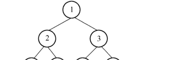

图9-16 求结点距离的二叉树

Dist(4,5)=2，Dist(4,6)=4。

### 分析与解答：

对于给定的二叉树root，只要能找到两个结点n1与n2最低的公共父结点parent，那么就可以通过下面的公式计算出这两个结点的距离：

Dist(n1, n2)=Dist(root, n1)+Dist(root, n2)-2*Dist(root, parent)

## 9.15 如何实现反向DNS查找缓存
### 题目描述：

反向 DNS 查找指的是使用 Internet IP 地址查找域名。例如，如果在浏览器中输入 74.125.200.106，它会自动重定向到google.com。
如何实现反向DNS查找缓存？

### 分析与解答：

要想实现反向DNS查找缓存，主要需要完成如下功能：

- 1）将IP地址添加到缓存中的URL映射。
- 2）根据给定IP地址查找对应的URL。

对于本题目，常见的一种解决方案是使用字典法（使用字典来存储IP地址与URL之间的映射关系），由于这种方法相对比较简单，这里就不做详细的介绍了。下面重点介绍另外一种方法：Trie树。这种方法的主要优点如下。

- 1）使用Trie树，在最坏情况下的时间复杂度为O(1)，而哈希方法在平均情况下的时间复杂度为O(1)。
- 2）Trie树可以实现前缀搜索（对于有相同前缀的IP地址，可以寻找所有的URL）。

当然，由于树这种数据结构本身的特性，所以使用树结构的一个最大的缺点就是需要耗费更多的内存，但是对于本题而言，这却不是一个问题，因为Internet IP地址只包含有11个字母（0到9和。） 。所以，本题实现的主要思路为：在Trie树中存储IP地址，而在最后一个节点中存储对应的域名。实现代码如下：

```

# Trie 树的节点

class TrieNode:

    def __init__(self):

        CHAR_COUNT=11

        self.isLeaf=False

        self.url=None

        self.child=[None]*CHAR_COUNT    # TrieNode[CHAR_COUNT] # CHAR_COUNT

        i=0

        while i<CHAR_COUNT:

            self.child[i]=None

            i +=1

def getIndexFromChar(c):

    return 10 if c=='.' else (ord(c)-ord('0'))
```

```

def getCharFromIndex(i):

    return '!' if i==10 else ('0'+ str(i))

class DNSCache:

    def __init__(self):

        self.CHAR_COUNT=11    # IP 地址最多有 11 个不同的字符

        self.root=TrieNode() # IP 地址最大的长度

    def insert(self,ip,url):

        # IP 地址的长度

        lens = len(ip)

        pCrawl = self.root

        level=0

        while level<lens:

            # 根据当前遍历到的 IP 中的字符，找出子结点的索引

            index = getIndexFromChar(ip[level])

            # 如果子结点不存在，则创建一个

            if pCrawl.child[index] ==None:

                pCrawl.child[index] = TrieNode()

            # 移动到子结点 */

            pCrawl = pCrawl.child[index]

            # 在叶子结点中存储 IP 对应的 URL

            pCrawl.isLeaf = True

            pCrawl.url = url

            level +=1

    # 通过 IP 地址找到对应的 URL

    def searchDNSCache(self,ip):

        pCrawl = self.root

        lens = len(ip)

        # 遍历 IP 地址中所有的字符

        level=0

        while level<lens:

            index = getIndexFromChar(ip[level])

            if pCrawl.child[index] ==None:

                return None

            pCrawl = pCrawl.child[index]

            level +=1

        # 返回找到的 URL

        if pCrawl!=None and pCrawl.isLeaf:

            return pCrawl.url

        return  None

if __name__ == "__main__":

    ipAdds=["10.57.11.127","121.57.61.129","66.125.100.103"]

    url =["www.samsung.com", "www.samsung.net","www.google.in"]

    n = len(ipAdds)

    cache=DNSCache()

    for i in range(n):

        cache.insert(ipAdds[i],url[i])

    ip="121.57.61.129"

    res_url = cache.searchDNSCache(ip)

    if res_url != None:

        print("找到了 IP 对应的URL:\n"+ip+"-->"+ res_url)

    else:

        print("没有找到对应的URL\n")
写入三条样本后检索 121.57.61.129，输出如下。
```

程序的运行结果为：

```

找到了 IP 对应的 URL:

121.57.61.129 --> www.samsung.net
# 快速选择第 k 小

不必先排序完成，快速选择通过一次分区就能缩小搜索范围。以数组首元素为基准，双指针把小于等于基准的挪到左边，大于的留在右边。分区收敛后基准的相对位置决定它在当前区间的排名，与目标 k 对比，若正好相等即返回；若排名靠后则在左半段继续，若排名靠前则在右半段继续并修正 k，递归下去即可定位。

```

显然，由于上述算法中涉及的IP地址只包含特定的11个字符（数字和.），所以，该算法也有一些异常情况不能处理，例如不能处理用户输入的不合理的IP地址的情况，有兴趣的读者可以继续朝着这个思路完善后面的算法。

## 9.16 如何找出数组中第k小的数
### 题目描述：

给定一个整数数组，如何快速地求出该数组中第k小的数。假如数组为[4, 0, 1, 0, 2, 3]，那么第3小的元素是1。

### 分析与解答：

由于对于一个有序的数组而言，能非常容易地找到数组中第k小的数，因此，可以通过对数组进行排序的方法来找出第k小的数。同时，由于只要求第k小的数，因此，没有必要对数组进行完全排序，只需要对数组进行局部排序就可以了。下面分别介绍这几种不同的实现方法。

### 方法一：排序法

最简单的方法就是首先对数组进行排序，在排序后的数组中，下标为k-1的值就是第k小的数。例如：对数组[4, 0, 1, 0, 2, 3]进行排序后的序列变为[0, 0, 1, 2, 3, 4]，第3小的数就是排序后数组中下标为2对应的数：1。由于最高效的排序算法（例如快速排序）的平均时间复杂度为O(Nlog₂N)，因此，此时该方法的平均时间复杂度为O(Nlog₂N)，其中，N为数组的长度。

### 方法二：部分排序法

由于只需要找出第k小的数，因此，没必要对数组中所有的元素进行排序，可以采用部分排序的方法。具体思路为：通过对选择排序进行改造，第一次遍历从数组中找出最小的数，第二次遍历从剩下的数中找出最小的数（在整个数组中是第二小的数），第k次遍历就可以从N-k+1（N为数组的长度）个数中找出最小的数（在整个数组中是第k小的）。这种方法的时间复杂度为O(N×k)。当然也可以采用堆排序进行k趟排序找出第k小的値。

### 方法三：类快速排序方法

快速排序的基本思想为：将数组array[low～high]中某一个元素（取第一个元素）作为划分依据，然后把数组划分为三部分：array[low～i-1]（所有的元素的值都小于或等于array[i]）、array[i]、array[i+1～high]（所有的元素的值都大于array[i]）。在此基础上可以用下面的方法求出第k小的元素：

- 如果i-low==k-1，说明array[i]就是第k小的元素，那么直接返回array[i]。
- 如果i-low>k-1，说明第k小的元素肯定在array[low～i-1]中，那么只需要递归地在array[low～i-1]中找第k小的元素即可。
- 如果i-low<k-1，说明第k小的元素肯定在array[i+1～high]中，那么只需要递归地在array[i+1～high]中找第k-(i-low)-1小的元素即可。

对于数组(4, 0, 1, 0, 2, 3)，第一次划分后，划分为下面三部分：
(3, 0, 1, 0, 2)，(4)，()
接下来需要在(3, 0, 1, 0, 2)中找第3小的元素，把(3, 0, 1, 0, 2)划分为三部分：
(2, 0, 1, 0)，(3)，()
接下来需要在(2, 0, 1, 0)中找第3小的元素，把(2, 0, 1, 0)划分为三部分：
(0, 0, 1)，(2)，()
接下来需要在(0, 0, 1)中找第3小的元素，把(0, 0, 1)划分为三部分：
(0)，(0)，(1)
此时i=1，low=0；(i-1=1)<(k-1=2)，接下来需要在1）中找第k-(i-low)-1=1小的元素即可。显然，1）中第1小的元素就是1。

实现代码如下：

```

"""

**** 方法功能: 在数组 array 中找出第 k 个小的数

**** 输入参数: array: 整数数组; low: 为数组起始下标; high:数组右边界的下标; k 为整数

**** 返回值: 数组中第 k 小的值

"""

def findSmallK(array,low,high,k):

    i = low

    j = high

    splitElem = array[i]

    # 把小于等于 splitElem 的数放到数组中 splitElem 的左边, 大于 splitElem 的值放到右边

    while i < j:

        while i < j and array[j] >= splitElem:

            j -= 1

        if i < j:

            array[i] = array[j]

            i += 1

        while i < j and array[i] <= splitElem:

            i += 1

        if i < j:

            array[j] = array[i]

    array[i] = splitElem

    # splitElem 在子数组 array[low-high]中下标的偏移量

    subArrayIndex = i - low

    # splitElem 在 array[low-high]所在的位置恰好为 k-1, 那么它就是第 k 小的值

    if subArrayIndex == k-1:

        return array[i]

    # splitElem 在 array[low-high]所在的位置大于 k-1, 那么只需在 array[low-i]中找第 k 小的值

    elif subArrayIndex > k-1:

        return findSmallK(array,low,i-1,k)

    # 在 array[i+1-high]中找第 k 小的值

    else:

        return findSmallK(array,i+1,high,k-(i-low)-1)

if __name__ == "__main__":

    array = [4,0,1,0,2,3]

    k = 3

    print("第"+str(k)+"小的 值是: "+str(findSmallK(array,0,len(array)-1,k)))
# 单扫求前三大

只用三个变量就能在一次遍历中维护最大三元组。初始值设为极小，扫描过程中若当前元素超过最大值，则把旧的最大值和次大值依次后移；若未超过最大值但超过次大且与最大值不同，则更新次大并把旧次大下放到第三；若仅超过第三则更新第三。遍历结束得到降序的前三名。

```

程序的运行结果为：

第 3 个值是: 1

## 算法性能分析：

快速排序的平均时间复杂度为 O(N log₂N)。快速排序需要对划分后的所有子数组继续排序处理，而本方法只需要取划分后的其中一个子数组进行处理即可，因此，平均时间复杂度肯定小于 O(N log₂N)。由此可以看出，这种方法的效率要高于方法一。但是这种方法也有缺点：它改变了数组中数据原来的顺序。当然可以申请额外的 N（其中，N 为数组的长度）个空间来解决这个问题，但是这样做会增加算法的空间复杂度，所以，通常做法是根据实际情况选取合适的方法。

## 引申： O(N) 时间复杂度内查找数组中前三名
### 分析与解答：

这道题可以转换为在数组中找出前 k 大的值（例如，k=3）。

如果没有时间复杂度的要求，可以首先对整个数组进行排序，然后根据数组下标就可以非常容易地找出最大的三个数，即前三名。由于这种方法的效率高低取决于排序算法的效率高低，因此，这种方法在最好的情况下时间复杂度都为 O(N log₂N)。

通过分析发现，最大的三个数比数组中其他的数据都大。因此，可以采用类似求最大值的办法来求前三名，具体实现思路为：初始化前三名（r1：第一名，r2：第二名，r3：第三名）为最小的整数。

然后开始遍历数组。

- 1）如果当前值tmp大于r1： r3=r2， r2=r1， r1=tmp。
- 2）如果当前值tmp大于r2且不等于r1： r3=r2， r2=tmp。
- 3）如果当前值tmp大于r3且不等于r2： r3=tmp。

实现代码如下：

```

def findTop3(array):

    if array == None or len(array) < 3:

        print("参数不合理")

        return

    r1 = r2 = r3 = -2**31

    i = 0

    while i < len(array):

        if array[i] > r1:

            r3 = r2

            r2 = r1

            r1 = array[i]

        elif array[i] > r2 and array[i] != r1:

            r3 = r2

            r2 = array[i]

        elif array[i] > r3 and array[i] < r2:

            r3 = array[i]

        i += 1

    print("前三名分别为：" + str(r1) + "," + str(r2) + "," + str(r3))

if __name__ == "__main__":

    array = [4,7,1,2,3,5,3,6,3,2]

    findTop3(array)
# 最大子数组的双循环雏形

先排除空输入，随后用两层循环穷举所有子数组。外层确定左边界，内层逐个扩展右边界并累加和，过程中记录最大和。虽然实现直接易懂，但时间代价较高，常作为对比 Kadane 线性解法的基准原型。

```

程序的运行结果为：

前三名分别为:7,6,5

## 算法性能分析：

这种方法虽然能够在O(N)的时间复杂度求出前三名，但是当k取值很大的时候，比如求前10名，这种方法就不是很好了。比较经典的方法就是维护一个大小为k的小顶堆来保存最大的k个数，具体思路为：维护一个大小为k的小顶堆用来存储最大的k个数，堆顶保存了堆中最小的数，每次遍历一个数m，如果m比堆顶元素小，那么说明m肯定不是最大的k个数，因此，不需要调整堆，如果m比堆顶元素大，则用这个数替换堆顶元素，替换后重新调整堆为小顶堆。这种方法的时间复杂度为O(Nlog2k)。这种方法适用于数据量大的情况。


## 9.17 如何求数组连续最大和
### 题目描述：
一个有n个元素的数组，这n个元素既可以是正数也可以是负数，数组中连续的一个或多个元素可以组成一个连续的子数组，一个数组可能有多个这种连续的子数组，求子数组和的最大值。例如：对于数组[1, -2, 4, 8, -4, 7, -1, -5]而言，其最大和的子数组为[4, 8, -4, 7]，最大值为15。

### 分析与解答：
这是一道非常经典的在笔试面试中碰到的算法题，有多种解决方法，下面分别从简单到复杂逐个介绍各种方法。

### 方法一：暴力法
最简单也是最容易想到的方法就是找出所有的子数组，然后求出子数组的和，在所有子数组的和中取最大值。实现代码如下：

```

def maxSubArray1(array):

    if array == None or len(array) < 1:

        print("数组不存在")

        return

    ThisSum = 0

    MaxSum = 0

    i = 0

    while i < len(array):

        j = i

        while j < len(array):

            ThisSum = 0

手写题拆解：区间求和与元素间距

面试手写环节里，统计连续区段的累计极值以及定位两类数值的最近出现位置是常见考察点。下面把几种典型实现按思路梳理，方便对照学习。

## 一、连续区段最大累加的几种写法

最朴素的思路是固定左端点，让右端点逐步右移并维护当前区间累计值，每次与历史最优比较后更新。对应的内层累加片段如下。

            k = i

            while k < j:

                ThisSum += array[k]

                k += 1

            if ThisSum > MaxSum:

                MaxSum = ThisSum

            j += 1

        i += 1

    return MaxSum

if __name__ == "__main__":

    arr = [1, -2, 4, 8, -4, 7, -1, -5]

    print("连续最大和为：", maxSubArray1(array))

```

程序的运行结果为：

连续最大和为：15

### 算法性能分析：
这种方法的时间复杂度为O(n3)，显然效率太低，通过对该方法进行分析发现，许多子数组都重复计算了，鉴于此，下面给出一种优化的方法。

### 方法二：重复利用已经计算的子数组和
由于Sum[i, j]=Sum[i, j-1]+arr[j]，在计算Sum[i, j]的时候可以使用前面已计算出的Sum[i, j-1]而不需要重新计算，采用这种方法可以省去计算Sum[i, j-1]的时间，因此，可以提高程序的效率。

实现代码如下：

```
同阶的变体仍以左边界为起点，但把累加器在每轮归零后一次性扫到末尾，遍历过程中实时刷新全局最优。

def maxSubArray2(array):

    if array == None or len(array) < 1:

        print("数组不存在")

        return

    maxSum = -2**31

    i = 0

    while i < len(array):

        sums = 0

        j = i

        while j < len(array):

            sums += array[j]

            if sums > maxSum:

                maxSum = sums

            j += 1

        i += 1

    return maxSum

```

### 算法性能分析：
这种方法使用了双重循环，因此，时间复杂度为O(n2)。

### 方法三：动态规划方法
可以采用动态规划的方法来降低算法的时间复杂度。实现思路如下。

首先可以根据数组的最后一个元素arr[n-1]与最大子数组的关系分为以下三种情况讨论：

- 1) 最大子数组包含arr[n-1]，即最大子数组以arr[n-1]结尾。
- 2) arr[n-1]单独构成最大子数组。
- 3) 最大子数组不包含arr[n-1]，那么求arr[1…n-1]的最大子数组可以转换为求arr[1…n-2]的最大子数组。

通过上述分析可以得出如下结论：假设已经计算出子数组arr[1…i-2]的最大子数组和All[i-2]，同时也计算出arr[0…i-1]中包含arr[i-1]的最大子数组和为End[i-1]。则可以得出如下关系：All[i-1]=max(End[i-1], arr[i-1], All[i-2])。利用这个公式和动态规划的思想可以得到如下代码；

```
引入辅助表后可以把中间状态显式保存。两条列表分别记录以当前下标收尾的最优累计和到该位置为止的整体最优。

def maxSubArray3(array):

    if array == None or len(array) < 1:

        print("数组不存在")

        return

    End = [None]*len(array)

    All = [None]*len(array)

    End[len(array)-1] = array[len(array)-1]

    All[len(array)-1] = array[len(array)-1]

    End[0] = All[0] = array[0]

    i = 1

    while i < len(array):

        End[i] = max(End[i-1]+array[i], array[i])

        All[i] = max(End[i], All[i-1])

        i += 1

    return All[len(array)-1]

```

### 算法性能分析：
与前面几个方法相比，这种方法的时间复杂度为O(N)，显然效率更高，但是由于在计算的过程中额外申请了两个数组，因此，该方法的时间复杂度也为O(N)。

### 方法四：优化的动态规划方法
方法三中每次其实只用到了End[i-1]与All[i-1]，而不是整个数组中的值，因此，可以定义两个变量来保存End[i-1]与All[i-1]的值，并且可以反复利用。实现代码如下：

```
把两条表压缩成两个标量即可得到常数空间的 Kadane 形式。nEnd 代表包含当前元素的最佳尾和，nAll 保存遍历至今的峰值。

def maxSubArray4(array):

    if array == None or len(array) < 1:

        print("数组不存在")

        return

    nAll = array[0]      # 最大子数组和

    nEnd = array[0]      # 包含最后一个元素的最大子数组和

    i = 1

    while i < len(array):

        nEnd = max(nEnd+array[i], array[i])

        nAll = max(nEnd, nAll)

        i += 1

    return nAll

```

### 算法性能分析：
这种方法在保证了时间复杂度为O(N)的基础上，把算法的空间复杂度也降到了O(1)。

### 引申：在知道子数组最大值后，如何才能确定最大子数组的位置
### 分析与解答：
为了得到最大子数组的位置，首先介绍另外一种计算最大子数组和的方法。在上例的方法三中，通过对公式 End[i]=max (End[i-1]+arr[i], arr[i]) 的分析可以看出，当 End[i-1]<0 时，End[i]=array[i]，其中End[i]表示包含array[i]的子数组和，如果某一个值使得End[i-1]<0，那么就从arr[i]重新开始。可以利用这个性质非常容易地确定最大子数组的位置。实现代码如下：

```python
当还要求最优区间的左右下标时，可在单遍扫描中维护起始位置。累计和一旦变负就重新开始，刷新最优时同步记录边界。

class Test:

    def __init__(self):

        self.begin = 0        # 记录最大子数组起始位置

        self.end = 0          # 记录最大子数组结束位置

    def maxSubArray(self, array):

        maxSum = -2**31       # 子数组最大值

        nSum = 0              # 包含子数组最后一位的最大值

        nStart = 0

        i = 0

        while i < len(array):

            if nSum < 0:

                nSum = array[i]

                nStart = i

            else:

                nSum += array[i]

                if nSum > maxSum:

                    maxSum = nSum

                    self.begin = nStart

                    self.end = i

            i += 1

        return maxSum

    def getBegin(self):

        return self.begin

    def getEnd(self):

        return self.end

if __name__ == "__main__":

    t = Test()

    arr = [1, -2, 4, 8, -4, 7, -1, -5]

    print ("连续最大和为: " + str(t.maxSubArray(arr)))

    print ("最大和对应的数组起始与结束坐标分别为: " + str(t.getBegin()) + "," + str(t.getEnd()))

```

程序的运行结果为：

连续最大和为： 15

最大和对应的数组起始与结束坐标分别为： 2,5

## 9.18 如何求数组中两个元素的最小距离
### 题目描述：
给定一个数组，数组中含有重复元素，给定两个数字num1和num2，求这两个数字在数组中出现的位置的最小距离。

### 分析与解答：
对于这类问题，最简单的方法就是对数组进行双重遍历，找出最小距离，但是这种方法效率比较低下。由于在求距离的时候只关心num1与num2这两个数，因此，只需要对数组进行一次遍历即可，在遍历的过程中分别记录遍历到num1或num2的位置就可以非常方便地求出最小距离，下面分别详细介绍这两种实现方法。

### 方法一：蛮力法
主要思路为：对数组进行双重遍历，外层循环遍历查找num1，只要遍历到num1，内层循环对数组从头开始遍历找num2，每当遍历到num2，就计算它们的距离dist。当遍历结束后最小的dist值就是它们最小的距离。实现代码如下：

```

## 二、两类数值的最近位置

初级做法是每遇到目标值之一就对整列再遍历一遍寻找另一类值，用绝对下标差比较并保留最小。

def minDistance1(array,num1,num2):

    if array == None or len(array) < 1:

        print("参数不合理")

        return 2**32

    minDis = 2**32          # num1 和 num2 的最小距离

    dist = 0

    i = 0

    while i < len(array):

        if array[i] == num1:

            j = 0

            while j < len(array):

                if array[j] == num2:

                    dist = abs(i - j)          # 当前遍历的 num1 和 num2 的距离

                    if dist < minDis:

                        minDis = dist

                j += 1

        i += 1

    return minDis

if __name__ == "__main__":

    array = [4,6,7,4,7,4,6,7,8,5,6,4,3,10,8]

    num1 = 4

    num2 = 8

    print(minDistance1(array,num1,num2))

```

程序的运行结果为：

2

### 算法性能分析：
这种方法需要对数组进行两次遍历，因此，时间复杂度为O(n2)。

### 方法二：动态规划
上述方法的内层循环对num2的位置进行了很多次重复的查找。可以采用动态规划的方法把每次遍历的结果都记录下来从而减少遍历次数。具体实现思路为：遍历数组，会遇到以下两种情况。

- 1）当遇到num1时，记录下num1值对应的数组下标的位置lastPos1，通过求lastPos1与上次遍历到num2下标的位置的值lastPos2的差可以求出最近一次遍历到的num1与num2的距离。
- 2）当遇到num2时，同样记录下它在数组中下标的位置lastPos2，然后通过求lastPos2与上次遍历到num1的下标值lastPos1，求出最近一次遍历到的num1与num2的距离。

假设给定数组为：[4, 5, 6, 4, 7, 4, 6, 4, 7, 8, 5, 6, 4, 3, 10, 8]，num1=4，num2=8。
根据以上方法，执行过程如下。

- 1） 在遍历的时候首先会遍历到4，下标为lastPos1=0，由于此时还没有遍历到num2，因此，没必要计算num1与num2的最小距离。
- 2） 接着往下遍历，又遍历到num1=4，更新lastPos1=3。
- 3） 接着往下遍历，又遍历到num1=4，更新lastPos1=7。
- 4） 接着往下遍历，又遍历到num2=8，更新lastPos2=9；此时由于前面已经遍历到过num1，因此，可以求出当前num1与num2的最小距离为|lastPos2-lastPos1|=2。
- 5） 接着往下遍历，又遍历到num2=8，更新lastPos2=15；此时由于前面已经遍历到过num1，因此，可以求出当前num1与num2的最小距离为|lastPos2-lastPos1|=8；由于8>2，所以，num1与num2的最小距离为2。实现代码如下：

```
线性方案只需记住最近一次出现的位置。遍历时更新两个上次下标，一旦双方均已出现就计算间距并压缩最小值。

def minDistance2(array,num1,num2):

    if array == None or len(array) <1:

        print("参数不合理")

        return 2**32

    lastPos1 = -1        # 上次遍历到 num1 的位置

    lastPos2 = -1        # 上次遍历到 num2 的位置

    minDis = 2**32       # num1 和 num2 的最小距离

    i = 0

    while i < len(array):

        if array[i] == num1:

            lastPos1 = i

            if lastPos2 >=0:

                minDis = min(minDis,lastPos1 - lastPos2)

        if array[i] == num2:

            lastPos2 = i

            if lastPos1 >=0:

                minDis = min(minDis,lastPos2-lastPos1)

        i +=1

    return minDis

```

### 算法性能分析：
这种方法只需要对数组进行一次遍历，因此，时间复杂度为O(N)。

## 9.19 如何求解最小三元组距离
### 题目描述：
已知三个升序整数数组a[1]、b[m]和c[n]，请在三个数组中各找一个元素，使得组成的三元组距离最小。三元组距离的定义是：假设a[i]、b[j]和c[k]是一个三元组，那么距离为：Distance=max(|a[i]-b[j]|, |a[i]-c[k]|, |b[j]-c[k]|)，请设计一个求最小三元组距离的最优算法。

### 分析与解答：
最简单的方法就是找出所有可能的组合，从所有的组合中找出最小的距离，但是显然这种方法的效率比较低下。通过分析发现，当ai≤bi≤ci时，此时它们的距离肯定为Di=ci-ai。此时就没必要求bi-ai与ci-ai的值了，从而可以省去很多没必要的步骤，下面分别详细介绍这两种方法。

### 方法一：蛮力法
最容易想到的方法就是分别遍历三个数组中的元素，对遍历到的元素分别求出它们的距离，然后从这些值里面查找最小值，实现代码如下：

```
## 三、三序列的最小最大差

针对三组列表求三两配对最大差的最小值，先实现一个取三数最大值的辅助函数，再用三层枚举逐步收紧答案。

def maxs(a,b,c):

    Maxs = b if a < b else a

    Maxs = c if Maxs < c else Maxs

    return Maxs

def MinDistance1(a,b,c):

    aLen = len(a)

    bLen = len(b)

    cLen = len(c)

    minDist = maxs(abs(a[0]-b[0]),abs(a[0]-c[0]),abs(b[0]-c[0]))

    dist = 0

    i = 0

    while i < aLen:

        j = 0

        while j < bLen:

            k = 0

            while k < cLen:

                dist = maxs(abs(a[i]-b[j]),abs(a[i]-c[k]),abs(b[j]-c[k]))

                # 找出最小距离

                if minDist > dist:

                    minDist = dist

                k += 1

            j += 1

        i += 1

    return minDist

if __name__ == "__main__":

    a = [3,4,5,7,15]

    b = [10,12,14,16,17]

    c = [20,21,23,24,37,30]

print("最小距离为：",MinDistance1(a,b,c))

三序列逼近与矩阵链成本优化

下面是两类算法模板的可直接运行样例，适合快速复现与思路对比。

第一部分展示三组已排序数据协同遍历的两种写法。前者维护当前三元素间的最大间距，并在每次循环后把对应数值最靠前的序列往后移；后者以三元素绝对差之和折半作为距离度量，同样依据当前三者中数值最靠前的那条序列推进。两种实现都规避了全量两两配对的开销。

第二部分给出矩阵连乘成本的两种解法。一个是递归枚举所有断点并累加子问题开销的自顶向下版本；一个是利用成本表自底向上逐步扩展区间长度的递推版本。两者最终都能得到最优括号化方案对应的乘法开销。

代码保留原样，可直接粘贴测试。

```

程序的运行结果为：

最小距离为: 5

### 算法性能分析：
这种方法的时间复杂度为O(n×m×n)，显然这种方法没有用到数组升序这一特性，因此，该方法肯定不是最好的方法。


## 方法二：最小距离法

假设当前遍历到这三个数组中的元素分别为ai、bi、ci，并且ai≤bi≤ci，此时它们的距离肯定为Di=ci-ai，那么接下来可以分如下三种情况讨论。

- 1) 如果接下来求ai、bi、ci+1的距离，由于ci+1≥ci，此时它们的距离必定为Di+1=ci+1-ai，显然Di+1≥Di，因此，Di+1不可能为最小距离。
- 2) 如果接下来求ai、bi+1、ci的距离，由于bi+1≥bi，如果bi+1≤ci，此时它们的距离仍然为Di+1=ci-ai；如果bi+1>ci，那么此时它们的距离为Di+1=bi+1-ai，显然Di+1≥Di，因此，Di+1不可能为最小距离。
- 3) 如果接下来求ai+1、bi、ci的距离，如果ai+1<ci-|ci-ai|，此时它们的距离Di+1=max（ci-ai+1，ci-bi），显然Di+1<Di，因此，Di+1有可能是最小距离。

综上所述，在求最小距离的时候只需要考虑第3种情况即可。具体实现思路为：从三个数组的第一个元素开始，首先求出它们的距离minDist，接着找出这三个数中最小数所在的数组，只对这个数组的下标往后移一个位置，接着求三个数组中当前遍历元素的距离，如果比minDist小，则把当前距离赋值给minDist，依此类推，直到遍历完其中一个数组为止。

例如给定数组：a=[3, 4, 5, 7 ,15];b=[10, 12, 14, 16, 17];c=[20, 21, 23, 24, 37, 30];

- 1) 首先从三个数组中找出第一个元素3、10、20，显然它们的距离为20-3=17。
- 2) 由于3最小，因此，数组a往后移一个位置，求4、10、20的距离为16，由于16<17，因此，当前数组的最小距离为16。
- 3) 同理，对数组a后移一个位置，依次类推直到遍历到15的时候，当前遍历到三个数组中的值分别为15、10、20，最小距离为10。
- 4) 由于10最小，因此，数组b往后移动一个位置遍历12，此时三个数组遍历到的数字分别为15、12、20，距离为8，当前最小距离是8。
- 5) 由于8最小，数组b往后移动一个位置为14，依然是三个数中最小值，往后移动一个位置为16，当前的最小距离变为5，由于15是数组a的最后一个数字，因此，遍历结束，求得最小距离为5。

实现代码如下：

```

def mins(a,b,c):

    mins = a if a < b else b

    mins = mins if mins < c else c

    return mins

def MinDistance2(a,b,c):

    curDist = 0

    minsd = 0

    minDist = 2**32

    i = 0                # 数组 a 的下标

    j = 0                # 数组 b 的下标

    k = 0                # 数组 c 的下标

    while True:

        curDist = max(abs(a[i] - b[j]),abs(a[i] - c[k]),abs(b[j] - c[k]))

        if curDist < minDist:

            minDist = curDist

        # 找出当前遍历到三个数组中的最小值

        minsd = mins(a[i],b[j],c[k])

        if minsd == a[i]:

            i += 1

            if i >= len(a):

                break

        elif minsd == b[j]:

            j += 1

            if j >= len(b):

                break

        else:

            k += 1

            if k >= len(c):

                break

    return minDist

```

### 算法性能分析：

采用这种算法最多只需要对三个数组分别遍历一遍，因此，时间复杂度为O(1+m+n)。

## 方法三：数学运算法

采用数学方法对目标函数变形，有两个关键点，第一个关键点：

max{|x1-x2|,|y1-y2|} = (|x1+y1-x2-y2|+|x1-y1-(x2-y2)|)/2 （公式1）

我们假设x1=a[ i ]，x2=b[ j ]，x3=c[ k ]，则

Distance=max(|x1-x2|,|x1-x3|,|x2-x3|)

= max( max(|x1-x2|,|x1-x3|), |x2-x3|) （公式2）

根据公式1，max(|x1-x2|,|x1-x3|)=1/2(|2x1-x2-x3|+|x2-x3|)，带入公式2，得到

Distance=max(1/2(|2x1-x2-x3|+|x2-x3|),|x2-x3|)
=1/2*max(|2x1-x2-x3|,|x2-x3|)+1/2*|x2-x3| //把相同部分1/2*|x2-x3|分离出来
=1/2*max(|2x1-(x2+x3)|,|x2-x3|)+1/2*|x2-x3| //把(x2+x3)看成一个整体，使用公式1
=1/2*1/2*((|2x1-2x2|+|2x1-2x3|)+1/2*|x2-x3|
=1/2*|x1-x2|+1/2*|x1-x3|+1/2*|x2-x3|
=1/2*(|x1-x2|+|x1-x3|+|x2-x3|) //求出等价公式，完成

第二个关键点：如何设计算法找到(|x1-x2|+|x1-x3|+|x2-x3|)的最小值，x1、x2、x3分别是三个数组中的任意一个数，算法思想与方法二相同，用三个下标分别指向a、b、c中最小的数，计算一次它们最大距离的Distance，然后再移动三个数中较小的数组的下标，再计算一次，每次移动一个，直到其中一个数组结束为止。

示例代码如下：

```

def MinDistance3(a,b,c):

    MinSum = 0                # 最小的绝对值和

    Sum = 0                   # 计算三个绝对值的和，与最小做比较

    MinOfabc = 0              # a[i],b[j], c[k]的最小值

    cnt = 0                   # 循环次数统计，最多是 1+m+n 次

    i = j = k = 0

    MinSum = (abs(a[i]-b[j])+abs(a[i]-c[k])+abs(b[j]-c[k])) // 2

    while cnt <= len(a)+len(b)+len(c):

        Sum = (abs(a[i]-b[j])+abs(a[i]-c[k])+abs(b[j]-c[k])) // 2

        MinSum = MinSum if MinSum < Sum else Sum

        MinOfabc = mins(a[i],b[j],c[k])      #找到 a[i],b[j],c[k]的最小值

        # 判断哪个是最小值，做相应的索引移动

        if MinOfabc == a[i]:

            i += 1

            if i >= len(a):

                break

        if MinOfabc == b[j]:

            j += 1

            if j >= len(b):

                break

        if MinOfabc == c[k]:

            k += 1

            if k >= len(c):

                break

        cnt += 1

    return MinSum

```

程序的运行结果为：

最小距离为: 5

### 算法性能分析：

与方法二类似，这种方法最多需要执行(1+m+n)次循环，因此，时间复杂度为O(1+m+n)。

## 9.20 如何在不排序的情况下求数组中的中位数

### 题目描述：

所谓中位数就是一组数据从小到大排列后中间的那个数字。如果数组长度为偶数，那么中位数的值就是中间两个数字相加除以2，如果数组长度为奇数，那么中位数的值就是中间那个数字。

### 分析与解答：

根据定义，如果数组是一个已经排序好的数组，那么直接通过索引即可获取到所需的中位数。如果题目允许排序，那么本问题的关键在于选取一个合适的排序算法对数组进行排序。一般而言，快速排序的平均时间复杂度较低，为O(Nlog₂N)，所以，如果采用排序方法，算法的平均时间复杂度为O(NlogN)。

可是，题目要求，不许使用排序算法。那么前一种方法显然走不通。此时，可以换一种思路：分治的思想。快速排序算法在每一次局部递归后都保证某个元素左侧的元素的值都比它小，右侧的元素的值都比它大，因此，可以利用这个思路快速地找到第N大元素，而与快速排序算法不同的是，这种方法关注的并不是元素的左右两边，而仅仅是某一边。

根据快速排序的方法，可以采用一种类似快速排序的方法，找出这个中位数。具体而言，首先把问题转化为求一列数中第i小的数的问题，求中位数就是求一列数的第（length/2+1）小的数的问题（其中length表示的是数组序列的长度）。

当使用一次类快速排序算法后，分割元素的下标为pos。

- 1）当pos>length/2时，说明中位数在数组左半部分，那么继续在左半部分查找。
- 2）当pos==length/2时，说明找到该中位数，返回A[pos]即可。
- 3）当pos<length/2时，说明中位数在数组右半部分，那么继续在数组右半部分查找。

以上默认此数组序列长度为奇数，如果为偶数则调用上述方法两次找到中间的两个数求平均值。

示例代码如下：

```

```python
class Test:
    def __init__(self):
        self.pos = 0
    # 以 array[low]为基准把数组分成两部分
    def partition(self,array,low,high):
        key = array[low]
        while low < high:
            while low < high and array[high] >= key:
                high -= 1
                array[low] = array[high]
            while low < high and array[low] <= key:
                low += 1
                array[high] = array[low]
        array[low] = key
        self.pos = low

    def getMid(self,array):
        low = 0
        high = len(array) - 1
        mid = (low + high) // 2
        while True:
            # array[low]为基准把数组分成两部分
            self.partition(array,low,high)
            if self.pos == mid:          # 找到中位数
                break
            elif self.pos > mid:         # 继续在左半部分查找
                high = self.pos - 1
            else:                        # 继续在右半部分查找
                low = self.pos + 1
        # 如果数组长度为奇数，中位数为中间的元素，否则就是中间两个数的平均值
        return array[mid] if len(array)%2 != 0 else (array[mid] + array[mid+1])/2

    if __name__ == "__main__":
        array = [7,5,3,1,11,9]
        result = Test().getMid(array)
        print(result)
```

```

程序的运行结果为：

### 算法性能分析：

这种方法在平均情况下的时间复杂度为O(N)。

## 9.21 如何获取最好的矩阵链相乘方法

### 题目描述：

给定一个矩阵序列，找到最有效的方式将这些矩阵相乘在一起。给定表示矩阵链的数组p，使得第i个矩阵Ai的维数为p[i-1]×p[i]。编写一个函数MatrixChainOrder()，该函数应该返回乘法运算所需的最小乘法数。
输入：p = (40, 20, 30, 10, 30)
输出：26000
有4个大小为40×20、20×30、30×10和10×30的矩阵。假设这四个矩阵为A、B、C和D，该函数的执行方法可以使执行乘法运算的次数最少。

### 分析与解答：

该问题实际上并不是执行乘法，而只是决定以哪个顺序执行乘法。由于矩阵乘法是关联的，所以我们有很多选择来进行矩阵链的乘法运算。换句话说，无论我们采用哪种方法来执行乘法，结果将是一样的。例如，如果我们有四个矩阵A、B、C和D，可以有如下几种执行乘法的方法：
（ABC）D=（AB）（CD）=A（BCD）=…
虽然这些方法的计算结果相同。但是，不同的方法需要执行乘法的次数是不相同的，因此效率也是不相同的。例如，假设A是10×30矩阵，B是30×5矩阵，C是5×60矩阵。那么，（AB）C的执行乘法运算的次数为（10×30×5）+（10×5×60）=1500+3000=4500次。
A（BC）的执行乘法运算的次数为（30×5×60）+（10×30×60）=9000+18000=27000次。
显然，第一种方法需要执行更少的乘法运算，因此效率更高。
对于本题中示例而言，执行乘法运算的次数最少的方法如下：
（A（BC））D的执行乘法运算的次数为20×30×10+40×20×10+40×10×30。

### 方法一：递归法

最简单的方法就是在所有可能的位置放置括号，计算每个放置的成本并返回最小值。在大小为n的矩阵链中，我们可以以n-1种方式放置第一组括号。例如，如果给定的链是四个矩阵。（A）（BCD）、（AB）（CD）和（ABC）（D）中，有三种方式放置第一组括号。每个括号内的矩阵链可以被看作较小的子问题。因此，可以使用递归方便地求解。递归的实现代码如下：

```

def MatrixChainOrder1(p,i,j):

    if i == j:

        return 0

    mins = 2**32

    #""

    # 通过把括号放在第一个不同的地方来获取最小的代价

    # 每个括号号都可以递归地使用相同的方法来计算

    #""

    k = i

    while k < j:

        count = MatrixChainOrder1(p,i,k) + MatrixChainOrder1(p,k+1,j) + p[i-1]*p[k]*p[j]

        if count < mins:

            mins = count

        k += 1

    return mins

if __name__ == "__main__":

    array = [1,5,2,4,6]

    print("最少的乘法次数为：",MatrixChainOrder1(array,1,len(array)-1))

```

程序的运行结果为：

最少乘法次数为 42

这种方法的时间复杂度是指数级的。可以注意到，这种算法会对一些子问题进行重复的计算。例如在计算（A）（BCD）这种方案的时候会计算C×D的代价，而在计算（AB）（CD）这种方案的时候又会重复计算C×D的代价。显然子问题是有重叠的，对于这种问题，通常可以用动态规划的方法来降低时间复杂度。

### 方法二：动态规划

典型的动态规划的方法是使用自下而上的方式来构造临时数组来保存子问题的中间结果，从而可以避免大量重复的计算。实现代码如下：

```

def MatrixChainOrder2(p,n):

    cost = [[None]*n for i in range(n)]

    i=1

    while i < n:

        cost[i][i]=0

        i+=1

    cLen =2

    while cLen < n:

        i=1

        while i < n-cLen+1:

            j = i+cLen-1

            cost[i][j]=2**31

            k = i

            while k <=j-1:

                q = cost[i][k]+cost[k+1][j]+p[i-1]*p[k]*p[j]

                if q < cost[i][j]:

                    cost[i][j]=q

                k +=1

            i+=1

        cLen +=1

    return cost[1][n-1]

# 五则算法代码速览

这里整理了五段可直接运行的独立示例，覆盖自平衡树的骨架、按出现次数重排、阶梯矩阵定位、三路指针求交等常见模式。源码未做改动，方便对照理解与二次开发。

第一段给出 AVL 节点的属性定义，以及 Sort 类里基于左-根-右顺序的回填、高度获取和右旋接口的声明。
```

### 算法性能分析：

这种方法的时间复杂度为O(n³)，空间复杂度为O(n²)。

## 9.22 如何对有大量重复数字的数组排序

### 题目描述：

给定一个数组，已知这个数组中有大量的重复的数字，如何对这个数组进行高效的排序？

### 分析与解答：

如果使用常规的排序方法，虽然最好的排序算法的时间复杂度为O(Nlog₂N)，但是使用常规排序算法显然没有用到数组中有大量重复数字这个特性。如何能使用这个特性呢？下面介绍两种更加高效的算法。

### 方法一： AVL树

这种方法的主要思路为：根据数组中的数构建一个AVL树，这里需要对AVL树做适当的扩展，在结点中增加一个额外的数据域来记录这个数字出现的次数，在AVL树构建完成后，可以对AVL树进行中序遍历，根据每个结点对应数字出现的次数，把遍历结果放回数组中就完成了排序，实现代码如下：

```

# AVL 树的节点

class AVLNode:

    def __init__(self,data):

        self.data = data

        self.left = self.right = None

        self.height = self.count = 1

class Sort:

    # 中序遍历 AVL 树，把遍历结果放入到数组中

    def inorder(self,array,root,index):

        if root != None:

            # 中序遍历左子树

            index = self.inorder(array,root.left,index)

            # 把根结点对应的数字根据出现的次数放入到数组中

            i = 0

            while i < root.count:

                array[index] = root.data

                index += 1

                i += 1

            # 中序遍历右子树

            index = self.inorder(array,root.right,index)

        return index

    # 得到树的高度

    def getHeight(self,node):

        if node == None:

            return 0

        else:

            return node.height

    # 把以 y 为根的子树向右旋转
第二段用一个字典记录每个元素的出现次数，然后按字典顺序将相同值依次写回原序列，实现就地重排。下面的示例会将一组样例数据整理后逐个打印。
```

def rightRotate(self,y):
    x = y.left
    T2 = x.right
    # 旋转
    x.right = y
    y.left = T2
    y.height = max(self.getHeight(y.left),self.getHeight(y.right)) + 1
    x.height = max(self.getHeight(x.left),self.getHeight(x.right)) + 1
    # 返回新的根节点
    return x
    # 把以 x 为根的子树向右旋转
def leftRotate(self,x):
    y = x.right
    T2 = y.left
    y.left = x
    x.right = T2
    x.height = max(self.getHeight(x.left),self.getHeight(x.right)) + 1
    y.height = max(self.getHeight(y.left),self.getHeight(y.right)) + 1
    return y

# 获取树的平衡因子
def getBalance(self,N):
    if N == None:
        return 0
    return self.getHeight(N.left) - self.getHeight(N.right)

# ""
# 如果 data 在 AVL 树中不存在，则把 data 插入到 AVL 树中
# 若存在则把这个节点对应的 count 加 1
# ""
def insert(self,root,data):
    if root == None:
        return AVLNode(data)
    # data 在树中存在，把对应的节点的 count 加 1
    if data == root.data:
        root.count += 1
        return root
    # 在左子树中继续查找 data 是否存在
    if data < root.data:
        root.left = self.insert(root.left,data)
    # 在右子树中继续查找 data 是否存在
    else:
        root.right = self.insert(root.right,data)
    # 插入新的节点后更新 root 节点的高度
    root.height = max(self.getHeight(root.left),self.getHeight(root.right)) + 1
    # 获取树的平衡因子
    balance = self.getBalance(root)
    # 如果树不平衡，根据数据结构中学过的 4 种情况进行调整
    # LL 型
    if balance > 1 and data < root.left.data:
        return self.rightRotate(root)
    # RR 型
elif balance < -1 and data > root.right.data:
    return self.leftRotate(root)
# LR 型
elif balance > 1 and data > root.left.data:
    root.left = self.leftRotate(root.left)
    return self.rightRotate(root)
# RL 型
elif balance < -1 and data < root.right.data:
    root.right = self.rightRotate(root.right)
    return self.leftRotate(root)
# 返回树的根节点
return root

# 使用 AVL 树实现排序
def sort(self,array):
    root = None
    i = 0
    while i < len(array):
        root = self.insert(root,array[i])
        i += 1
    index = 0
    self.inorder(array,root,index)

if __name__ == "__main__":
    array = [15,12,15,2,2,12,2,3,12,100,3,3]
    s = Sort()
    s.sort(array)
    i = 0
    while i < len(array):
        print(array[i],end="")
    i += 1
代码运行结果为：

2 2 2 3 3 3 12 12 12 15 15 100

### 算法性能分析：

这种方法的时间复杂度为O(Nlog2M)，其中，N为数组的大小，M为数组中不同数字的个数，空间复杂度为O(N)。

### 方法二：哈希法

这种方法的主要思路为创建一个哈希表，然后遍历数组，把数组中的数字放入哈希表中，在遍历的过程中，如果这个数在哈希表中存在，则直接把哈希表中这个key对应的value加1；如果这个数在哈希表中不存在，则直接把这个数添加到哈希表中，并且初始化这个key对应的value为1。实现代码如下：

```
def sort(array):

    data_count = dict()

    # 把数组中的数放入 map 中

    i = 0

    while i < len(array):
```
```
if str(array[i]) in data_count:

    data_count[str(array[i])] = data_count.get(str(array[i])) + 1

else:

    data_count[str(array[i])] = 1

i += 1

index = 0

for key,value in data_count.items():

    i = value

    while i > 0:

        array[index] = key

        index += 1

        i -= 1

if __name__ == "__main__":

    array = [15,12,15,2,2,12,2,3,12,100,3,3]

    sort(array)

    i = 0

    while i < len(array):

        print(array[i],end=" ")

        i += 1
第三段在行列都递增的矩阵里，从右上位置开始移动指针，数值偏大就左移，偏小就下移，直至找到目标或遍历完毕。示例会验证 17 不存在、24 存在。
```

### 算法性能分析：

这种方法的时间复杂度为O(N+M log₂M)，空间复杂度为O(M)。

## 9.23 如何在有规律的二维数组中进行高效的数据查找

### 题目描述：

在一个二维数组中，每一行都按照从左到右递增的顺序排序，每一列都按照从上到下递增的顺序排序。请实现一个函数，输入这样的一个二维数组和一个整数，判断数组中是否含有该整数。

例如，下面的二维数组就是符合这种约束条件的。如果在这个数组中查找数字7，由于数组中含有该数字，则返回true；如果在这个数组中查找数字5，由于数组中不含有该数字，则返回false。

| 1 | 2 | 8 | 9 |
|---|---|---|---|
| 2 | 4 | 9 | 12 |
| 4 | 7 | 10 | 13 |
| 6 | 8 | 11 | 15 |

### 分析与解答：

最简单的方法就是对二维数组进行顺序遍历，然后判断待查找元素是否在数组中，这种方法的时间复杂度为O(M×N)，其中，M、N分别为二维数组的行数和列数。

虽然上述方法能够解决问题，但这种方法显然没有用到二维数组中数组元素有序的特点，因此，该方法肯定不是最好的方法。

此时需要转换一种思路进行思考，在一般情况下，当数组中元素有序的时候，二分查找是一个很好的方法，对于本题而言，同样适用二分查找，实现思路如下。

给定数组array（行数：rows，列数：columns，待查找元素：data），首先，遍历数组右上角的元素（i=0，j=columns-1），如果array[i][j]==data，则在二维数组中找到data，直接返回；如果array[i][j]>data，则说明这一列其他的数字也一定大于data，因此，没有必要在这一列继续查找了，通过j-操作排除这一列。同理，如果array[i][j]<data，则说明这一行中其他数字也一定比data小，因此，没有必要再遍历这一行了，可以通过i+操作排除这一行。依次类推，直到遍历完数组结束。

实现代码如下：

```
def findWithBinary(array,data):

    if array == None or len(array) < 1:

        print("参数不合理")

        return False

    # 从二维数组右上角元素开始遍历

    i = 0

    rows = len(array)

    columns = len(array[0])

    j = columns - 1

    while i < rows and j >= 0:

        # 在数组中找到 data

        if array[i][j] == data:

            return True

        # 当前遍历到数组中的值大于 data, data 肯定不在这一列中

        elif array[i][j] > data:

            j -= 1

        # 当前遍历到数组中的值小于 data, data 肯定不在这一行中

        else:

            i += 1

    return False

if __name__ == "__main__":

    array =[[1,2,3,4],

    [11,12,13,14],

    [21,22,23,24],

    [31,32,33,34],

    [41,42,43,44]]

    print(findWithBinary(array,17))

    print(findWithBinary(array,24))
前段运行得到的输出如下。
```

程序的运行结果为：

```
false

true
第五段用三个指针同步推进三个已排序序列，相等时输出并三指针同时前移，否则让较小值的指针前进，最终得到同时出现在三列里的值。
```

### 算法性能分析：

这种方法主要从二维数组的右上角遍历到左下角，因此，算法的时间复杂度为O(M+N)，此外，这种方法没有申请额外的存储空间。

## 9.24 如何从三个有序数组中找出它们的公共元素

### 题目描述：

给定以非递减顺序排序的三个数组，找出这三个数组中的所有公共元素。例如，给出下面三个数组： ar1=[2, 5, 12, 20, 45, 85], ar2=[16, 19, 20, 85, 200], ar3=[3, 4, 15, 20, 39, 72, 85, 190]。那么这三个数组的公共元素为[20, 85]。

### 分析与解答：

最容易想到的方法是首先找出两个数组的交集，然后再把这个交集存储在一个临时数组中，最后再找出这个临时数组与第三个数组的交集。这种方法的时间复杂度为O(N1+N2+N3)，其中N1、N2和N3分别为三个数组的大小。这种方法不仅需要额外的存储空间，而且还需要额外的两次循环遍历。下面介绍另外一种只需要一次循环遍历，而且不需要额外存储空间的方法，主要思路如下。

假设当前遍历的三个数组的元素分别为ar1[i]、ar2[j]、ar3[k]，则存在以下几种可能性。

- 1) 如果ar1[i]、ar2[j]和ar3[k]相等，则说明当前遍历的元素是三个数组的公共元素，可以直接打印出来，然后通过执行i+、j+、k+使三个数组同时向后移动，此时继续遍历各数组后面的元素。
- 2) 如果ar1[i]<ar2[j]，则执行i+继续遍历ar1中后面的元素，因为ar1[i]不可能三个数组公共的元素。
- 3) 如果ar2[j]<ar3[k]，同理可以通过j+继续遍历ar2后面的元素。
- 4) 如果前面的条件都不满足，说明ar1[i]>ar2[j]，而且ar2[j]>ar3[k]，此时可以通过k+来继续遍历ar3后面的元素。

实现代码如下：

```
def findCommon(array1,array2,array3):

    i=0

    j=0

    k=0

    # 遍历三个数组

    while i < len(array1) and j < len(array2) and k < len(array3):

        # 找到公共元素

        if array1[i] == array2[j] == array3[k]:

            print(array1[i],end="")

            i +=1

            j +=1

            k +=1

        # array1[i]不是公共元素

        elif array1[i] < array2[j]:

            i +=1

        # array2[j]不是公共元素

        elif array2[j] < array3[k]:

            j +=1

        # array3[k]不是公共元素

        else:

            k +=1

if __name__ == "__main__":

    array1 = [2,5,12,20,45,85]

    array2 = [16,19,20,85,200]

    array3 = [3,4,15,20,39,72,85,190]

    findCommon(array1,array2,array3)
以上片段保留了初版的逻辑脉络，既能帮助理解核心思路，也可作为扩展练习的起点。

字符处理实战五例

本合集收录五段可直接运行的示例，覆盖位置互换、递归生成、字典序遍历、括号层级压缩和动态规划相似度计算。每段实现均保持原始形态，便于阅读与复用。

```

程序的运行结果为：

20 85

### 算法性能分析：

这种方法的时间复杂度为O(N¹+N²+N³)。

## 9.25 如何求一个字符串的所有排列

### 题目描述：

设计一个程序，当输入一个字符串时，要求输出这个字符串的所有排列。例如，输入字符串 abc，要求输出由字符a、b、c所能排列出来的所有字符串：abc、acb、bac、bca、cba、cab。

### 分析与解答：

这道题主要考察对递归的理解，可以采用递归的方法来实现。当然也可以使用非递归的方法来实现，但是与递归法相比，非递归法难度增加了很多。下面分别介绍这两种方法。

### 方法一：递归法

下面以字符串abc为例介绍对字符串进行全排列的方法。具体步骤如下。

- 1）首先固定第一个字符a，然后对后面的两个字符b与c进行全排列。
- 2）交换第一个字符与其后面的字符，即交换a与b，然后固定第一个字符b，接着对后面的两个字符a与c进行全排列。
- 3）由于第2）步交换了a和b破坏了字符串原来的顺序，因此，需要再次交换a和b使其恢复到原来的顺序，然后交换第一个字符与第三个字符（交换a和c），接着固定第一个字符c，对后面的两个字符a与b求全排列。

在对字符串求全排列的时候就可以采用递归的方式来求解，实现方法如图9-17所示。

在使用递归方法求解的时候，需要注意以下两个问题：

- 1）逐渐缩小问题的规模，并且可以用同样的方法来求解子问题；
- 2）递归一定要有结束条件，否则会导致程序陷入死循环。本题目递归方法实现代码如下：

```

def swap(str,i,j):

    tmp = str[i]

    str[i] = str[j]

    str[j] = tmp

"""

**** 方法功能：对字符串中的字符进行全排列

**** 输入参数：str: 待排列的字符串，start: 待排列的子字符串的首字符下标

"""

```

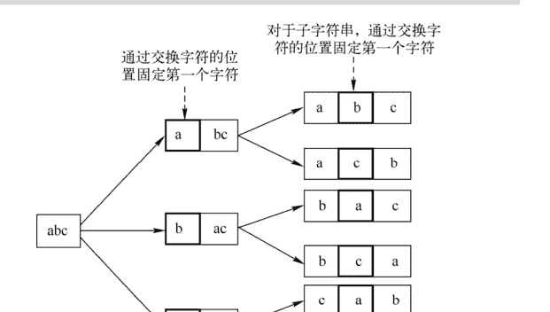

图9-17 求字符串全排列方法

```

def Permutation(str,start):

    if str == None or start < 0:

        return

    # 完成全排列后输出当前排列的字符

    if start == len(str)-1:

        print("".join(str),end=' ')

    else:

        i = start

        while i < len(str):

            # 交换 start 与 i 所在位置的字符

            swap(str,start,i)

            #固定第一个字符，对剩余的字符进行全排列

            Permutation(str,start+1)

            # 换回 start 与 i 所在位置的字符

            swap(str,start,i)

            i += 1

def Permutation_transe(s):

    str = list(s)

    Permutation(str,0)

if __name__ == "__main__":

    a = "abc"

    Permutation_transe(a)

    print()

```

程序的运行结果为：

abc acb bac bca cba cab

### 算法性能分析：

假设这种方法需要的基本操作数作为f(n)，那么f(n)=n×f(n-1)=n×(n-1)×f(n-2)…=n！。所以，算法的时间复杂度为O(n!)。算法在对字符进行交换的时候用到了常量个指针变量，因此，算法的空间复杂度为O(1)。

### 方法二：非递归法

递归法比较符合人的思维，因此，算法的思路以及算法实现都比较容易。下面介绍另外一种非递归的方法。算法的主要思想为：从当前字符串出发找出下一个排列（下一个排列为大于当前字符串的最小字符串）。

通过引入一个例子来介绍非递归算法的基本思想：假设要对字符串“12345”进行排序。第一个排列一定是“12345”，依此获取下一个排列：“12345”->“12354”->“12435”->“12453”->“12534”->“12543”->“13245”->…。从“12543”->“13245”可以看出找下一个排列的主要思路为：

- 1) 从右到左找到两个相邻递增（从左向右看是递增的）的字符串，例如“12543”，从右到左找出第一个相邻递增的子串为“25”；记录这个小的字符的下标为pmin。
- 2) 找出pmin后面的比它大的最小的字符进行交换，在本例中“2”后面的子串中比它大的最小的字符为“3”，因此，交换“2”和“3”得到字符串“13542”。
- 3) 为了保证下一个排列为大于当前字符串的最小字符串，在第2）步中完成交换后需要对pmin后的子串重新组合，使其值最小，只需对pmin后面的字符进行逆序即可（因为此时pmin后面的子字符串中的字符必定是按照降序排列的，逆序后字符就按照升序排列了），逆序后就能保证当前的组合是新的最小的字符串。在这个例子中，上一步得到的字符串为“13542”，pmin指向字符“3”，对其后面的子串“542”逆序后得到字符串“13245”；
- 4) 当找不到相邻递增的子串时，说明找到了所有的组合。

需要注意的是，这种方法适用于字符串中的字符是按照升序排列的情况。因此，非递归方法的主要思路为：

- 1）首先对字符串进行排序（按字符进行升序排列）。
- 2）依次获取当前字符串的下一个组合直到找不到相邻递增的子串为止。

实现代码如下：

```

    """

    **** 方法功能: 根据当前字符串的组合

    **** 输入参数: str:字符数组

    **** 返回值:  还有下一个返回 True, 否则返回 False

    """

    def getNextPermutation(str):

        end = len(str) - 1          # 字符串最后一个字符的下标

        cur = end                   # 用来从后向前遍历字符串

        suc = 0                     # cur 的后继

        tmp = 0

        while cur != 0:

            # 从后向前开始遍历字符串

            suc = cur

            cur -= 1

            if str[cur] < str[suc]:

                # 相邻递增字符, cur 指向较小的字符

                # 找出 cur 后面最小的字符 tmp

                tmp = end

                while str[tmp] < str[cur]:

                    tmp -= 1

                # 交换 cur 和 tmp

                swap(str,cur,tmp)

                # 把 cur 后面的字符串进行翻转

                Reverse(str,suc,end)

                return True

        return False

    """

    **** 方法功能: 翻转字符串

    **** 输入参数: begin 和 end 分别为字符串中的第一个字符和最后一个字符的下标

    """

    def Reverse(str,begin,end):

        i = begin

        j = end

        while i < j:

            swap(str,i,j)

            i += 1

            j -= 1

    """

    **** 方法功能: 获取字符串中字符的所有组合

    **** 输入参数: str: 字符数组

    """

    def Permutation2(s):

        if s == None or len(s) < 1:

            return

        str = list(s)

        str.sort()                  # 升序排列字符串数组

        print("".join(str))

        while getNextPermutation(str):

            print("".join(str),end=' ')

```

程序的运行结果为：

abc acb bac bca cab cba

### 算法性能分析：

首先对字符串进行排序的时间复杂度为O(n²)，接着求字符串的全排列，由于长度为n的字符串全排列个数为n!，因此Permutation函数中的循环执行的次数为n!，循环内部调用函数getNextPermutation，getNextPermutation内部用到了双重循环，因此它的时间复杂度为O(n²)。所以求全排列算法的时间复杂度为O(n!×n²)。

### 引申：如何去掉重复的排列

### 分析与解答：

当字符串中没有重复的字符时，它的所有组合对应的字符串也就没有重复的情况了，但是当字符串中有重复的字符时，例如“baa”，此时如果按照上面介绍的算法求全排列会有重复的字符串。

由于全排列的主要思路为：从第一个字符起每个字符分别与它后面的字符进行交换；例如对于“baa”，交换第一个与第二个字符后得到“aba”，再考虑交换第一个与第三个字符后得到“aab”，由于第二个字符与第三个字符相等，因此，会导致这两种交换方式对应的全排列是重复的（在固定第一个字符的情况下它们对应的全排列都为“aab”和“aba”）。从上面的分析可以看出去掉重复排列的主要思路为：从第一个字符起每个字符分别与它后面非重复出现的字符进行交换。在递归方法的基础上只需要增加一个判断字符是否重复的函数即可。

## 9.26 如何消除字符串的内嵌括号

### 题目描述：

给定一个如下格式的字符串： (1, (2, 3), (4, (5, 6), 7))，括号内的元素可以是数字，也可以是另一个括号，实现一个算法消除嵌套的括号，例如把上面的表达式变成(1, 2, 3, 4, 5, 6, 7)，如果表达式有误则报错。

### 分析与解答：

从问题描述可以看出，这道题要求实现两个功能：一个是判断表达式是否正确；另一个是消除表达式中嵌套的括号。对于判定表达式是否正确这个问题，可以从如下几个方面来入手：首先，表达式中只有数字、逗号和括号这几种字符，如果有其他的字符出现，那么是非法的表达式。其次，判断括号是否匹配，如果碰到‘(’，那么把括号的计数器的值加上1；如果碰到‘)’，那么判断此时计数器的值，如果计数器的值大于1，那么把计数器的值减去1，否则为非法表达式，当遍历完表达式后，括号计数器的值为0，则说明括号是配对出现的，否则括号不配对，表达式为非法表达式。对于消除括号这个问题，可以通过申请一个额外的存储空间，在遍历原字符串的时候把除了括号以外的字符保存到新申请的额外的存储空间中，这样就可以去掉嵌套的括号了。需要特别注意的是，字符串首尾的括号还需要保存。实现代码如下：

```

def removeNestedPare(str):

    if str == None:

        return

    Parentheses_num = 0      # 用来记录不匹配的"("出现的次数

    if list(str)[0] != '(' or list(str)[-1] != ')':

        return None

    sb = '('

    # 字符首尾的括号可以单独处理

    i = 1

    while i < len(str)-1:

        ch = list(str)[i]

        if ch == '(':

            Parentheses_num += 1

        elif ch == ')':

            Parentheses_num -= 1

        else:

            sb = sb + (list(str)[i])

        i += 1

    # 判断括号是否匹配

    if Parentheses_num != 0:

        print("由于括号不匹配，因此不做任何操作")

        return None

    # 处理字符串结尾的")"

    sb = sb + ')'

    return sb

if __name__ == "__main__":

    str = "(1,(2,3),(4,(5,6),7))"

    print(str+"去除嵌套括号后为: ",removeNestedPare(str))

```

### 程序的运行结果为：

(1,(2,3),(4,(5,6),7))去除嵌套括号后为: (1,2,3,4,5,6,7)

### 算法性能分析：

这种方法对字符串进行了一次遍历，因此时间复杂度为O(N)（其中，N为字符串的长度）。此外，这种方法申请了额外的N+1个存储空间，因此空间复杂度也为O(N)。

## 9.27 如何求字符串的编辑距离

### 题目描述：

编辑距离又称Levenshtein距离，是指两个字符串之间由一个转成另一个所需的最小编辑操作次数。许可的编辑操作包括将一个字符替换成另一个字符、插入一个字符、删除一个字符。请设计并实现一个算法来计算两个字符串的编辑距离，并计算其复杂度。在某些应用场景下，替换操作的代价比较高，假设替换操作的代价是插入和删除的两倍，算法该如何调整？

### 分析与解答：

本问题可以使用动态规划的方法来解决，具体思路如下。

给定字符串s1、s2，首先定义一个函数D(i, j) (0≤i≤strlen(s1)，0≤j≤strlen(s2))，用来表示第一个字符串s1长度为i的子串与第二个字符串s2长度为j的子串的编辑距离。从s1变到s2可以通过如下三种操作完成。

- 1) 添加操作。假设已经计算出D(i, j-1)的值（s1[0…i]与s2[0…j-1]的编辑距离），则D(i, j)=D(i, j-1)+1（s1长度为i的字符串后面添加s2[j]即可）。
- 2) 删除操作。假设已经计算出D(i-1, j)的值（s1[0…i-1]到s2[0…j]的编辑距离），则D(i, j)=D(i-1, j)+1（s1长度为i的字符串删除最后的字符s1[j]即可）。
- 3) 替换操作。假设已经计算出D(i-1, j-1)的值（s1[0…i-1]与s2[0…j-1]的编辑距离），如果s1[i]==s2[j]，那么D(i, j)=D(i-1, j-1)，如果s1[i]!=s2[j]，那么D(i, j)=D(i-1, j-1)+1（替换s1[i]为s2[j]，或替换s2[j]为s1[i]）。

此外，D(0, j)=j且D(i, 0)=i（一个字符串与空字符串的编辑距离为这个字符串的长度）。

由此可以得出如下实现方式：对于给定的字符串s1、s2，定义一个二维数组D，则有以下几种可能性。

- 1) 如果i==0，那么D[i, j]=j (0≤j≤strlen(s2))。
- 2) 如果j==0，那么D[i, j]=i (0≤i≤strlen(s1))。
- 3) 如果i>0且j>0，
   ① 如果s1[i]==s2[j]，那么D(i, j)=min{edit(i-1, j)+1, edit(i, j-1)+1, edit(i-1, j-1)}。
   ② 如果s1[i]!=s2[j]，那么D(i, j)=min{edit(i-1, j)+1, edit(i, j-1)+1, edit(i-1, j-1)+1}。

通过以上分析可以发现，对于第一个问题可以直接采用上述的方法来解决。对于第二个问题，由于替换操作是插入或删除操作的两倍，只需要修改如下条件即可：

如果 s1[i]!=s2[j]，那么 D(i, j)=min{edit(i-1, j)+1, edit(i, j-1)+1, edit(i-1, j-1)+2}。

根据上述分析，给出实现代码如下：

```

class EditDistance:

    def mins(self,a,b,c):

        tmp = a if a < b else b

        return tmp if tmp < c else c

    # 参数 replaceWeight 用来表示替换操作与插入删除操作的倍数

    def edit(self,s1,s2,replaceWeight):

        # 两个空串的编辑距离为 0

        if s1 == None and s2 == None:

            return 0

        # 其中一个为空串，那么编辑距离为另一个字符串的长度

        if s1 == None:

            return len(s2)

        if s2 == None:

            return len(s1)

        # 申请二维数组保存中间的计算结果

        D = [[None]*(len(s2)+1) for i in range(len(s1)+1)]

        i = 0

        while i < len(s1)+1:

            D[i][0] = i

            i += 1

        i = 0

        while i < len(s2)+1:

            D[0][i] = i

            i += 1

        i = 1

        while i < len(s1)+1:

            j = 1

# 字符串算法速记

把文本处理里常用的几类思路用 Python 小片段串起来，方便对照思路和运行效果。每个例子都保留了原始代码与输出，阅读时可以直接复现。

## 编辑距离的表格演算
递推表记录两串之间的最小改动次数，改动允许插入、删除和替换。演示选用 bciln 与 fciling 两串，先以替换代价为 1 填表，再把代价调到 2，打印完整表格和最终距离。

```

### 程序的运行结果为：

```
第一问：

-----------------------------

01234567

11234567

22123456

33212345

44321234

55432223

-----------------------------

编辑距离为： 3

第二问：

-----------------------------

01234567

12345678

23234567

34323456

45432345

56543434

-----------------------------

编辑距离为： 4

## 朴素子串定位
先做合法性检查，再用两个下标同步走。不相等时让主串指针回退到下一个可能起点，继续尝试。成功则返回首次出现位置，失败返回 -1。样例在 xyzsabcd 中找 abc。

```

### 算法性能分析：

这种方法的时间复杂度与空间复杂度都为O（m×n）（其中，m、n分别为两个字符串的长度）。

## 9.28 如何实现字符串的匹配

### 题目描述：

给定主字符串s与模式字符串p，判断p是否是s的子串，如果是，那么找出p在s中第一次出现的下标。

### 分析与解答：

对于字符串的匹配，最直接的方法就是逐个比较字符串中的字符，虽然这种方法比较容易实现，但是效率也比较低下。对于这种字符串匹配的问题，除了最常见的直接比较法外，经典的KMP算法也是不二选择，它能够显著提高运行效率，下面分别介绍这两种方法。

### 方法一：直接计算法

假定主串S= “S0S1S2…Sm”，模式串P= “P0P1P2…Pn”。实现方法为：比较从主串S中以Si（0≤i<m）为首的字符串和模式串P，判断P是否为S的前缀，如果是，那么P在S中第一次出现的位置则为i，否则接着比较从Si+1开始的子串与模式串P，这种方法的时间复杂度为O(m×n)。此外如果i>m-n，那么在主串中以Si为首的子串的长度必定小于模式串P的长度，因此，在这种情况下就没有必要再做比较了。实现代码如下：

```
"""

**** 方法功能：判断 p 是否是 s 的子串，如果是返回 p 在 s 中第一次出现的下标，否则返回-1

**** 输入参数：s 和 p 分别为主串和模式串

"""

def match(s,p):

    # 检查参数是否合理

    if s == None or p == None:

        print("参数不合理")

        return -1

    slength = len(s)

    plength = len(p)

    # p 肯定不是 s 的子串

    if slength < plength:

        return -1

    i = 0

    j = 0

    while i < slength and j < plength:

        if list(s)[i] == list(p)[j]:

            # 如果相同，那么继续比较后面的字符

            i += 1

            j += 1

        else:

            # 后退回去重新比较

            i = i - j + 1

            j = 0

            if i > (slength - plength):

                return -1

    if j >= plength:      # 匹配成功

        return i - plength

    return -1

if __name__ == "__main__":

    s = "xyzsabcd"

    p = "abc"

    print(match(s,p))

## 中心扩展找最长回文
Test 类保存当前最优起止，expandBothSide 以左右两个中心向外扩张，记录更长的区间。遍历所有奇数和偶数中心得到结果。测试串为 abcdefgedxyz。

```

程序的运行结果为：

### 算法性能分析：

这种方法在最差的情况下需要对模式串p遍历m*n次(m、n分别为主串和模式串的长度)，因此，算法的时间复杂度为O(n(m*n))。

### 方法二： KMP算法

在方法一中，如果 “P0P1P2…Pj-1” == “Si-j…Si-1”，那么模式串的前j个字符已经和主串中i-j到i-1的字符进行了比较，此时如果Pj!=Sj，那么模式串需要回退到0，主串需要回退到i-j+1的位置重新开始下一次比较。而在KMP算法中，如果Pj!=Si，那么不需要回退，即保持不动，j也不用清零，而是向右滑动模式串，用Pk和Si继续匹配。这种方法的核心就是确定k的大小，显然，k的值越大越好。
如果Pj!=Sj，可以继续用Pk和Si进行比较，那么必须满足：
“P0P1P2…Pk-1” == “Si-k…Si-1”
已经匹配的结果应满足下面的关系：
“Pj-k…Pj-1” == “Si-k…Si-1”
由以上这两个公式可以得出如下结论：
“P0P1P2…Pk-1” = “Pj-k…Pj-1”
因此，当模式串满足 “P0P1P2…Pk-1” == “Pj-k…Pj-1” 时，如果主串第i个字符与模式串第j个字符匹配失败，那么只需要接着比较主串第i个字符与模式串第k个字符。
为了在任何字符匹配失败的时候都能找到对应k的值，这里给出next数组的定义，next[i]=m表示的意思为： “P0P1…Pm-1” = “Pi-m…Pi-2Pi-1”。计算方法如下：

- 1) next[j]=-1 （当j==0时）
- 2) next[j]=max（Max{k | 1<k<j且 “P0…Pk” == “Pj-k-1…Pj-1”}）
- 3) next[j]=0 （其他情况）

实现代码如下：

```
class Test:

    def __init__(self):

        self.startIndex = None

        self.lens = 0

    def getStartIndex(self):

        return self.startIndex

    def getLens(self):

        return self.lens

    # 对字符串 str，以 c1 和 c2 为中心向两侧扩展寻找回文字符串

    def expandBothSide(self,strs,c1,c2):

        n = len(strs)

        while c1 >= 0 and c2 < n and list(strs)[c1] == list(strs)[c2]:

            c1 -= 1

            c2 += 1

        tmpStartIndex = c1 + 1

        tmpLen = c2 - c1 - 1

        if tmpLen > self.lens:

            self.lens = tmpLen

            self.startIndex = tmpStartIndex

    # 方法功能：找出字符串最长的回文子串

    def getLongestPalindrome(self,strs):

        if strs == None:

            return

```

```
n = len(strs)

if n < 1:

    return

i = 0

while i < n-1:

    # 寻找子串长度为奇数的情况

    self.expandBothSide(strs,i,i)

    # 寻找子串长度为偶数的情况

    self.expandBothSide(strs,i,i+1)

    i += 1

if __name__ == "__main__":

    strs = "abcdefgedxyz"

    t = Test()

    t.getLongestPalindrome(strs)

    if t.getStartIndex() != -1 and t.getLens() != -1:

        print("最长的回文字符串为：",end="")

        i = t.getStartIndex()

        while i < t.getStartIndex()+t.getLens():

            print(list(strs)[i],end="")

            i += 1

else:

    print("查找失败")

## KMP 指针轨迹
列出 next 数组以及匹配过程中 i、j 的每次变化，直观展示回退与推进的节奏，最后匹配位置为 4。

```

程序的运行结果为：

```
next 数组为: -1,0,0,1,1

i=0,j=0

i=1,j=1

i=2,j=2

i=3,j=3

i=3,j=1

i=4,j=2

i=5,j=3

i=5,j=1

i=6,j=2

i=7,j=3

i=8,j=4

i=9,j=5

匹配结果为: 4

## 最长公共子串的递推实现
用二维表记录以对应尾部结尾的最长相等后缀，相等时继承左上角并加一，否则清零。遍历后按最大值回溯得到子串。说明后给出实现。

```

从运行结果可以看出，模式串P="abaabc"的next数组为[-1,0,0,1,1]，next[3]=1，说明p[0]=p[2]。当i=3，j=3的时候S[i]!=P[j]，此时主串S不需要回溯，跟模式串位置j=next[j]=next[3]=1的字符继续进行比较。因为此时S[i-1]一定与P[0]相等，所以，就没有必要再比较了。

### 算法性能分析：

这种方法在求next数组的时候循环执行的次数为n(n为模式串的长度)，在模式串与主串匹配的过程中循环执行的次数为m(m为主串的长度)。因此，算法的时间复杂度为O(m+n)。但是由于算法中用了额外的n个存储空间来存储next数组，因此，算法的空间复杂度为O(n)。

## 9.29 如何求两个字符串的最长公共子串

### 题目描述：

找出两个字符串的最长公共子串，例如字符串 “abccade” 与字符串 “dgcadd e” 的最长公共子串为 “cad”。

### 分析与解答：

对于这道题而言，最容易想到的方法就是采用蛮力法，假设字符串 s1 与 s2 的长度分别为 len1 和 len2（假设 len1 ≥ len2），首先可以找出 s2 的所有可能的子串，然后判断这些子串是否也是 s1 的子串，通过这种方法可以非常容易地找出两个字符串的最长子串。当然，这种方法的效率是非常低下的，主要原因为：s2 中的大部分字符需要与 s1 进行很多次的比较。那么是否有更好的方法来减少比较的次数呢？下面介绍两种通过减少比较次数从而降低时间复杂度的方法。

### 方法一：动态规划法

通过把中间的比较结果记录下来，从而可以避免字符的重复比较。主要思路如下。

首先定义二元函数 f(i, j)：表示分别以 s1[i]、s2[j] 结尾的公共子串的长度，显然，f(0, j)=0(j≥0)，f(i, 0)=0(i≥0)，那么，对于 f(i+1, j+1) 而言，则有如下两种取值：

- 1) f(i+1, j+1)=0, 当 str1[i+1] != str2[j+1] 时；
- 2) f(i+1, j+1)=f(i, j)+1, 当 str1[i+1]==str2[j+1] 时。

根据这个公式可以计算出 f(i, j) (0≤i≤len(s1), 0≤j≤len(s2)) 所有的值，从而可以找出最长的子串，如图9-18所示。

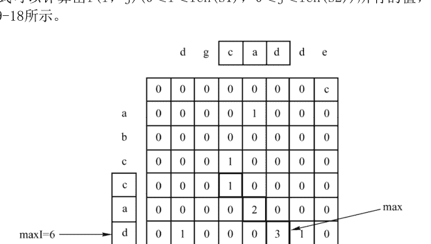

图9-18 动态规划求解过程

通过图9-18的计算结果可以求出最长公共子串的长度 max 与最长子串结尾字符在字符数组中的位置 maxI，由这两个值就可以唯一确定一个最长公共子串为 “cad”。这个子串在数组中的起始下标为：maxI-max=3，子串长度为 max=3。实现代码如下：

```
**** 方法功能：获取两个字符串的最长公共子串

**** 输入参数：str1 和 str2 为指向字符的指针

```
```
def getMaxSubStr(str1,str2):

    len1 = len(str1)

    len2 = len(str2)

    sb = ""

    maxs = 0

    maxI = 0

    # 申请新的空间来记录公共子串长度信息

    M = [[0 for i in range(len1+1)] for j in range(len2+1)]

    # 通过利用通用公式写新建立的二维数组（公共子串的长度信息）

    i = 0

    while i < len1+1:

        M[i][0] = 0

        i += 1

    j = 0

    while j < len2+1:

        M[0][j] = 0

        j += 1

    i = 1

    while i < len1+1:

        j = 1

        while j < len2+1:

            if list(str1)[i-1] == list(str2)[j-1]:

                M[i][j] = M[i-1][j-1] + 1

                if M[i][j] > maxs:

                    maxs = M[i][j]

                    maxI = i

            else:

                M[i][j] = 0

            j += 1

        i += 1

    # 找出公共子串

    i = maxI - maxs

    while i < maxI:

        sb += "".join(list(str1)[i])

        i += 1

    return sb

if __name__ == "__main__":

    str1 = "abcade"

    str2 = "dcadde"

    print(getMaxSubStr(str1,str2))

## 偏移遍历的另一种写法
不显式维护表格，而是枚举两串的相对偏移，让它们从不同起点对齐，统计连续相等的最大长度并保留最优结束位置，思路与递推等价但遍历方式不同。

```

程序的运行结果为：

cad

### 算法性能分析：

由于这种方法使用了二重循环分别遍历两个字符数组，因此时间复杂度为O(m×n)（其中，m和n分别为两个字符串的长度）。此外，由于这种方法申请了一个m×n的二维数组，因此，算法的空间复杂度也为O(m×n)。很显然，这种方法的主要缺点为申请了m×n个额外的存储空间。

### 方法二：滑动比较法

这种方法的主要思路为：保持s1的位置不变，然后移动s2，接着比较它们重叠的字符串的公共子串（记录最大的公共子串的长度maxLen以及最长公共子串在s1中结束的位置maxLenEnd1），在移动的过程中，如果当前重叠子串的长度大于maxLen，那么更新maxLen为当前重叠子串的长度。最后通过maxLen和maxLenEnd1就可以找出它们最长的公共子串。实现方法如图9-19所示。

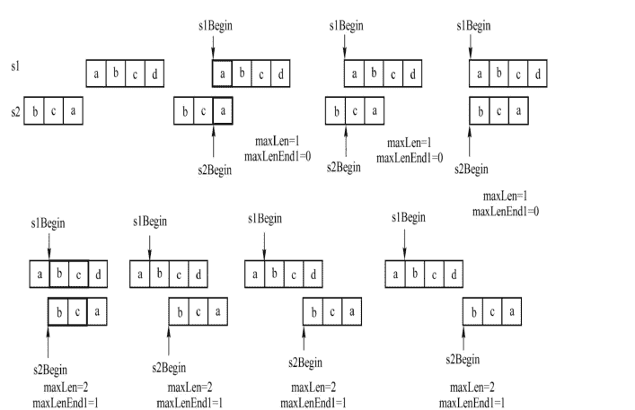

图9-19 滑动窗口方法

在图9-19中，这两个字符串的最长公共子串为“bc”，实现代码如下：

```
def getMaxSubStr(s1,s2):

    len1 = len(s1)

    len2 = len(s2)

    maxLen = 0

    tmpmaxLen = 0

    maxLenEnd = 0

    sb = ""

    i = 0

    while i < len1 + len2:

        s1begin = s2begin = 0

        tmpmaxLen = 0

        if i < len1:

            s1begin = len1 - i

        else:

            s2begin = i - len1

        j = 0

        while (s1begin + j < len1) and (s2begin + j < len2):

            if list(s1)[s1begin+j] == list(s2)[s2begin+j]:

                tmpmaxLen += 1

            else:

                if tmpmaxLen > maxLen:

Python 算法片段速览：五组可直接复用示例

### 最长公共子串
下面这段实现用来定位两串字符里最长的连续重合段，直接运行即可看到结果。代码保持原样。

                    maxLen = tmpmaxLen

                    maxLenEnd = s1begin + j

                else:

                    tmpmaxLen = 0

                j += 1

            if tmpmaxLen > maxLen:

                maxLen = tmpmaxLen

                maxLenEnd = s1begin + j

            i += 1

        i = maxLenEnd - maxLen

        while i < maxLenEnd:

            sb = sb + list(s1)[i]

            i += 1

        return sb

if __name__ == "__main__":

    str1 = "abcade"

    str2 = "dgcade"

    print(getMaxSubStr(str1,str2))

```

### 算法性能分析：

这种方法用双重循环来实现，外层循环的次数为m+n（其中，m和n分别为两个字符串的长度），内层循环最多执行n次，算法的时间复杂度为O（(m+n)×n）。此外，这种方法只使用了几个临时变量，因此算法的空间复杂度为O(1)。

## 9.30 如何求数字的组合

### 题目描述：

用1、2、2、3、4、5这6个数字，写一个main函数，打印出所有不同的排列，例如：512234、412345等，要求：“4”不能在第三位，“3”与“5”不能相连。

### 分析与解答：

打印数字的排列组合方式的最简单的方法就是递归，但本问题存在两个难点：第一，数字中存在重复数字；第二，明确规定了某些位的特性。显然，采用常规的求解方法似乎不能完全适用了。

其实，可以换一种思维，把求解这6个数字的排列组合问题转换为大家都熟悉的图的遍历的问题，解答起来就容易多了。可以把1、2、2、3、4、5这6个数字看成是图的6个结点，对这6个结点两两相连可以组成一个无向连通图。这6个数对应着的全排列等价于从这个图中各个结点出发深度优先遍历这个图中所有可能路径所组成的数字集合。例如，从结点“1”出发所有的遍历路径组成了以“1”开头的所有的数字的组合。由于“3”与“5”不能相连，因此，在构造图的时候使图中“3”和“5”对应的结点不连通就可以满足这个条件。对于“4”不能在第三位，可以在遍历结束后判断是否满足这个条件。

具体而言，实现步骤如下所示。

- 1）用1、2、2、3、4、5这6个数作为6个结点，构造一个无向连通图。除了“3”与“5”不连通外，其他的所有结点都两两相连。
- 2）分别从这6个结点出发对图做深度优先遍历。每次遍历完所有结点的时候，把遍历的路径对应数字的组合记录下来，如果这个数字的第三位不是“4”，那么把这个数字存储到集合Set中（由于这6个数中有重复的数，因此，最终的组合肯定也会有重复的。由于集合Set的特点为集合中的元素是唯一的，不能有重复的元素，因此，通过把组合的结果存储到Set中可以过滤掉重复的组合）。
- 3）遍历Set集合，打印出集合中所有的结果，这些结果就是本问题的答案。

实现代码如下：

```
class Test:

    def __init__(self,array):

        self.numbers = array

        # 用来标记图中节点是否被遍历过

        self.Visited = [None]*len(self.numbers)

        # 图的二维数组表示

        self.graph = [[None]*len(self.numbers) for i in range(len(self.numbers))]

        self.n = 6

        # 用来标记图中节点是否被遍历过

        self.Visited = None

        # 数字的组合

        self.combination = ""

        # 存储所有的组合

        self.s = set()

    """

    ****** 功能方法：对图从结点 start 位置开始进行深度遍历

    ****** 输入参数：start：遍历的起始位置

    """

    def depthFirstSearch(self,start):

        self.Visited[start] = True

        self.combination += str(self.numbers[start])

        if len(self.combination) == self.n:

            # 4 不出现在第三个位置

            if self.combination.index("4") != 2:

                self.s.add((self.combination))

        j = 0

        while j < self.n:

            if self.graph[start][j] == 1 and self.Visited[j] == False:

                self.depthFirstSearch(j)

            j += 1

        self.combination = self.combination[:-1]

        self.Visited[start] = False

    """

    ****** 功能方法：获取 1、2、3、4、5 的左右组合，使得“4”不能在第三位，“3”与“5”

    不能连接

    """

    def getAllCombinations(self):

        # 构造图

        i = 0

        while i < self.n:

            j = 0

            while j < self.n:

                if i == j:

                    self.graph[i][j] = 0

                else:

                    self.graph[i][j] = 1

                j += 1

            i += 1

        # 确保在遍历的时候 3 与 5 是不可达的

        self.graph[3][5] = 0

        self.graph[5][3] = 0

        # 分别从不同的起点出发深度遍历图

        i = 0

        while i < self.n:

            self.depthFirstSearch(i)

            i += 1

    def PrintAllCombination(self):

        for strs in self.s:

            print(strs)

if __name__ == "__main__":

    array = [1,2,2,3,4,5]

    t = Test(array)

    t.getAllCombinations()

    # 打印所有组合

    t.PrintAllCombination()

### 受限排列枚举
用图遍历的方式枚举数字组合，设定了两条禁止规则，满足规则的解会被收集并输出。实现见下方代码块。

```

由于结果过多，这里只给出部分运行结果：

102345 145203 312045 503124 541032 310425 301425 543201 243015 243150 310542 231405 150324 431250 405132 401325 230541 315204 251034 023145 450123 052431 543102 132540 542013 120543 231450 302541

## 9.31 如何求拿到最多金币的概率

### 题目描述：

10个房间里放着数量随机的金币。每个房间只能进入一次，并只能在一个房间中拿金币。一个人采取如下策略：前4个房间只看不拿。随后的房间只要看到比前4个房间都多的金币数，就拿。否则就拿最后一个房间的金币。编程计算这种策略拿到最多金币的概率。

### 分析与解答：

这道题的要求是一个概率的问题，由于10个房间里放的金币的数量是随机的，因此，在编程实现的时候首先需要生成10个随机数来模拟10个房间里金币的数量。然后判断通过这种策略是否能拿到最多的金币。如果仅仅通过一次模拟来求拿到最多金币的概率显然是不准确的，那么就需要进行多次模拟，通过记录模拟的次数m，拿到最多金币的次数n，从而可以计算出拿到最多金币的概率n/m。显然这个概率与金币的数量以及模拟的次数有关系。模拟的次数越多越能接近真实值。下面以金币数为1～10的随机数，模拟次数为1000次为例给出实现代码：

```
import random

"""

****** 功能方法：总共 n 个房间，判断用指定的策略是否能拿到最多金币

****** 返回值： 如果能拿到返回 True，否则返回 False

"""

def getMaxNum(n):

    if n < 1:

        print("参数不合法")

        return

    a = [None]*n

    # 随机生成 n 个房间里金币的个数

    i = 0

    while i < n:

        a[i] = random.uniform(1,n)        # 生成 1~n 的随机数

        i += 1

    # 找出前四个房间中最多的金币个数

    max4 = 0

    i = 0

    if i < 4:

        if a[i] > max4:

            max4 = a[i]

        i += 1

    i = 4

    while i < n-1:

        if a[i] > max4:                  # 能拿到最多的金币

            return True

        i += 1

    return False                        # 不能拿到最多的金币

if __name__ == "__main__":

    monitorCount = 1000+0.0

    success = 0

    i = 0

    while i < monitorCount:

        if getMaxNum(10):

            success += 1

        i += 1

    print(success/monitorCount)

### 房间金币概率模拟
随机给每间房间分配金币，先记录前几间的最高值，后续若出现更高即判定为命中。重复多次统计命中比例。代码如下。

```

程序的运行结果为：

0.421


## 运行结果分析：

运行结果与金币个数的选择以及模拟的次数都有关系，而且由于是个随机问题，因此同样的程序每次的运行结果也会不同。

## 9.32 如何求正整数n所有可能的整数组合

### 题目描述：
给定一个正整数n，求解出所有和为n的整数组合，要求组合按照递增方式展示，而且唯一。例如：4=1+1+1+1、1+1+2、1+3、2+2、4（4+0）。

### 分析与解答：
以数值4为例，和为4的所有的整数组合一定都小于4（1,2,3,4）。首先选择数字1，然后用递归的方法求和为3（4-1）的组合，一直到递归下去直到用递归求和为0的组合的时候，所选的数字序列就是一个和为4的数字组合。然后第二次选择2，接着用递归求和为2（4-2）的组合；同理下一次选3，然后用递归求和为1（4-3）的所有组合。依此类推，直到找出所有的组合为止，实现代码如下：

```

"""

****** 方法功能: 求和为 n 的所有整数组合

****** 输入参数: sums: 正整数; result: 存储组合结果; count: 记录组合中数字的个数

"""

def getAllCombination(sums,result,count):

    if sums < 0:

        return

    # 数字的组合满足和为 sums 的条件，打印出所有组合

    if sums == 0:

        print("满足条件的组合：",end="")

        i = 0

        while i < count:

            print(result[i],end="")

            i += 1

        print()

        return

    # 打印debug信息, 为了方便理解

    print("------当前组合：",end="")

    i = 0

    while i < count:

        print(str(result[i]),end="")

        i += 1

    print("----------")

    # 确定组合中下一个取值

    i = 1 if count == 0 else result[count-1]

    print("----i =" + str(i) + " count =" + str(count) + "----")

    while i <= sums:

        result[count] = i

        count += 1

        getAllCombination(sums-i,result,count)    # 求和为 sums-i 的组合

        # 递归完成后，去掉最后的一个组合的数字

        count -= 1

        i += 1                                    # 找下一个数字作为组合中的数字

# 方法功能: 找出和为 n 的所有整数的组合

def showAllCombination(n):

    if n < 1:

        print("参数不满足要求")

        return

    result = [None]*n                          # 存储和为 n 的组合方式

    getAllCombination(n,result,0)

if __name__ == "__main__":

    showAllCombination(4)

### 和为目标的组合枚举
通过递归回溯列出所有不递减的正整数组合，使其总和等于目标。过程会输出中间状态。代码如下。

```

### 程序的运行结果为：

```
---当前组合: ---
--i=1 count=0--
---当前组合: 1---
--i=1 count=1--
---当前组合: 11---
--i=1 count=2--
---当前组合: 111---
--i=1 count=3---
满足条件的组合: 1111
满足条件的组合: 112
---当前组合: 12---
--i=2 count=2--
满足条件的组合: 13
---当前组合: 2---
--i=2 count=1--
满足条件的组合: 22
---当前组合: 3---
--i=3 count=1--
满足条件的组合: 4

### 输出示例
下面是目标值为4时的一次典型输出，可看到回溯路径和最终解。原始日志保留。

```

### 运行结果分析：

从上面运行结果可以看出，满足条件的组合为：{1,1,1,1}、{1,1,2}、{1,3}、{2,2}、{4}，其他为调试信息。从打印出的信息可以看出：在求和为4的组合中，第一步选择了1；然后求3（4-1）的组合也选了1，求2（3-1）的组合的第一步也选择了1，依次类推，找出第一个组合为{1,1,1,1}。然后通过count-和i找出最后两个数字1与1的另外一种组合2，最后三个数字的另外一种组合3；接下来用同样的方法分别选择2、3作为组合的第一个数字，就可以看到以上结果。

代码i=（count==0 ? 1:result[count-1]）；用来保证：组合中的下一个数字一定不会小于前一个数字，从而保证了组合的递增性。如果不要求递增（例如把{1,1,2}和{2,1,1}看作两种组合），那么把上面一行代码改成i=1即可。

## 9.33 如何用一个随机函数得到另外一个随机函数

### 题目描述：

有一个函数func1能返回0和1两个值，返回0和1的概率都是1/2，问怎么利用这个函数得到另外一个函数func2，使func2也只能返回0和1，且返回0的概率为1/4，返回1的概率为3/4。

### 分析与解答：

func1得到1与0的概率都为1/2。因此，可以调用两次func1，分别生成两个值a1与a2，用这两个数组成一个二进制a2a1，它的取值的可能性为00,01,10,11，并且得到每个值的概率都为（1/2）*（1/2）=1/4，因此，如果得到的结果为00，那么返回0（概率为1/4），其他情况返回1（概率为3/4）。实现代码如下：

```
import random

# 返回0和1的概率都为1/2

def func1():

    return int(round(random.random()))

# 返回0的概率为1/4，返回1的概率为3/4

def func2():

    a1 = func1()

    a2 = func1()

    tmp = a1

    tmp |= (a2 << 1)

    if tmp == 0:

        return 0

    else:

        return 1

if __name__ == "__main__":

    i = 0

    while i < 16:

        print(func2(),end="")

        i += 1

    print()

    i = 0

    while i < 16:

        print(func2(),end="")

        i += 1

### 偏态二值序列生成
func1 出0/1各半，func2 通过两次采样组合把0的出现概率调到1/4。主程序打印两批各16位供观察。代码如下。

# 1、2、5凑数有多少种？一次暴力一次巧思

凑一个目标和 n，仅能用 1、2、5 三个数码叠加，问有多少种不同的个数组合方式。最直观的思路就是把三种硬币的取用数量全部枚举一遍，只要满足 x + 2*y + 5*z == n 就算一种。先给出暴力三层循环的实现思路，再用数学观察把搜索压缩到只按 5 的倍数走一步。

```

### 程序的运行结果为：

```

1110110110111101

1111111111000010

```

由于结果是随机的，调用的次数越大，返回的结果就越接近1/4与3/4。

## 9.34 如何等概率地从大小为n的数组中选取m个整数

### 题目描述：

随机地从大小为n的数组中选取m个整数，要求每个元素被选中的概率相等。

### 分析与解答：

从n个数中随机选出一个数的概率为1/n，然后在剩下的n-1个数中再随机找出一个数的概率也为1/n（第一次没选中这个数的概率为(n-1)/n，第二次选中这个数的概率为1/(n-1)，因此，随机选出第二个数的概率为((n-1)/n)×(1/(n-1))=1/n），依次类推，在剩下的k个数中随机选出一个元素的概率都为1/n。因此，这种方法的思路为：首先从有n个元素的数组中随机选出一个元素，然后把这个选中的数字与数组第一个元素交换，接着从数组后面的n-1个数字中随机选出1个数字与数组第二个元素交换，依次类推，直到选出m个数字为止，数组前m个数字就是随机选出来的m个数字，且它们被选中的概率相等。实现代码如下：

```

```python
import random
def getRandomM(a,n,m):
    if a==None or n<=0 or n<=m:
        print "参数不合理"
        return
    i=0
    while i<m:
        j=random.randint(i,n-1) # 获取i到n-1 间的随机数
        # 随机选出的元素存储在数组的前面
        tmp=a[i]
        a[i]=a[j]
        a[j]=tmp
        i+=1

if __name__ == "__main__":
    a=[1,2,3,4,5,6,7,8,9,10]
    n=10
    m=6
    getRandomM(a,n,m)
    i=0
    while i<m:
        print a[i],
        i+=1
```

```

### 程序的运行结果为：

1 8 9 7 2 4

### 算法性能分析：

这种方法的时间复杂度为O(m)。

## 9.35 如何求组合1、2、5这三个数使其和为100的组合个数

### 题目描述：

求出用1、2、5这三个数不同个数组合的和为100的组合个数。为了更好地理解题目的意思，下面给出几组可能的组合：100个1，0个2和0个5，它们的和为100；50个1，25个2，0个5的和也是100；50个1，20个2，2个5的和也为100。

### 分析与解答：

### 方法一：蛮力法

最简单的方法就是对所有的组合进行尝试，然后判断组合的结果是否满足和为100，这些组合有如下限制：1的个数最多为100个，2的个数最多为50个，5的个数最多为20个。实现思路为：遍历所有可能的组合1的个数x（0<=x<=100），2的个数y（0<=y<=50），5的个数z（0<=z<=20），判断x+2y+5z是否等于100，如果相等，那么满足条件，实现代码如下：

```

def combinationCount1(n):

    count = 0

    num1 = n                # 1 最多的个数

    num2 = n//2             # 2 最多的个数

    num5 = n//5             # 5 最多的个数

    x = 0

    while x <= num1:

        y = 0

        while y <= num2:

            z = 0

            while z <= num5:

                if x + y*2 + z*5 == n:

                    count += 1

                z += 1

            y += 1

        x += 1

    return count

if __name__ == "__main__":

    print(combinationCount1(100))

```

### 程序的运行结果为：

541

### 算法性能分析：

这种方法循环的次数为101×51×21，显然这种方法循环次数过多。

### 方法二：数字规律法

针对这种数学公式的运算，一般都可以通过找出运算的规律进而简化运算的过程，对于本题而言，对x+2y+5z=100进行变换可以得到x+5z=100−2y。从这个表达式可以看出，x+5z是偶数且x+5z<=100。因此，求满足x+2y+5z=100组合的个数就可以转换为求满足“x +5z是偶数且x +5z<=100”的个数。可以通过对z的所有可能的取值（0<=z<=20）进行遍历从而计算满足条件的x的值。

当z=0时，x的取值为0, 2, 4, …, 100（100以内所有的偶数），个数为（100+2）/2。
当z=1时，x的取值为1, 3, 5, …, 95（95以内所有的奇数），个数为（95+2）/2。
当z=2时，x的取值为0, 2, 4, …, 90（90以内所有的偶数），个数为（90+2）/2。
当z=3时，x的取值为1, 3, 5, …, 85（85以内所有的奇数），个数为（85+2）/2。
……
当z=19时，x的取值为5, 3, 1（5以内所有的奇数），个数为（5+2）/2。
当z=20时，x的取值为0（0以内所有的偶数），个数为（0+2）/2。

根据这个思路，实现代码如下：

```

def combinationCount2(n):

    count = 0

    m = 0

    while m <= n:

        count += (m+2)/2

        m += 5

    return count

```

### 算法性能分析：

这种方法循环的次数为21。

## 9.36 如何判断还有几盏灯泡亮着

### 题目描述：

100个灯泡排成一排，第一轮将所有灯泡打开；第二轮每隔一个灯泡关掉一个，即排在偶数的灯泡被关掉，第三轮每隔两个灯泡，将开着的灯泡关掉，关掉的灯泡打开。依次类推，第100轮结束的时候，还有几盏灯泡亮着？

### 分析与解答：

- 1） 对于每盏灯，当拉动的次数是奇数时，灯就是亮着的，当拉动的次数是偶数时，灯就是关着的。
- 2） 每盏灯拉动的次数与它的编号所含约数的个数有关，它的编号有几个约数，这盏灯就被拉动几次。
- 3） 1～100这100个数中有几个数约数的个数是奇数？

我们知道，一个数的约数都是成对出现的，只有完全平方数约数的个数才是奇数个。

所以，这100盏灯中有10盏灯是亮着的，它们的编号分别是1、4、9、16、25、36、49、64、81、100。

下面是程序的实现：

```

```python
def factorsIsOdd(a):
    total = 0
    i = 1
    while i <= a:
        if a%i == 0:
            total += 1
        i += 1
    if total%2 == 1:
        return 1
    else:
        return 0

def totalCount(num,n):
    count = 0
    i = 0
    while i < n:
        # 判断因子数是否为奇数，如果是奇数（灯亮），那么加1
        if factorsIsOdd(num[i]) == 1:
            print("亮着的灯的编号为：",num[i])
            count += 1
        i += 1
    return count

if __name__ == "__main__":
    num = [None] * 100
    i = 0
    while i < 100:
        num[i] = i + 1
        i += 1
    count = totalCount(num,100)
    print("最后总共有"+str(count)+"盏灯亮着。")
```

总结一下，暴力版通过三重 while 把 1、2、5 的取用量全部遍历，时间开销随 n 增长很快。优化版固定 5 的取用量 m，每次向后推移 5，再在剩下的余数里统计 1 和 2 的配对数，核心就是 count += (m+2)/2 的递推。两者统计的是同一件事，只是写法从穷举到取巧，思路相同、结果一致。

位图打点：一行代码的思路

用位图记录海量手机号是否已申请，核心就是把一个号码映射到数组里的某一位并置为1。下面的函数就是这个映射的最小实现，先算出号码落在哪个存储单元，再在单元内部定位到具体的 bit。

```

### 程序的运行结果为：

亮着的灯的编号是: 1
亮着的灯的编号是: 4
亮着的灯的编号是: 9
亮着的灯的编号是: 16
亮着的灯的编号是: 25
亮着的灯的编号是: 36
亮着的灯的编号是: 49
亮着的灯的编号是: 64
亮着的灯的编号是: 81
亮着的灯的编号是: 100
最后总共有 10 盏灯亮着。

## 9.37 如何从大量的url中找出相同的url

### 题目描述：

给定a、b两个文件，各存储50亿个url，每个url各占64B，内存限制是4GB，请找出a、b两个文件共同的url。

### 分析与解答：

由于每个url需要占64B，所以50亿个url占用空间的大小为50亿×64=5GB×64=320GB。由于内存大小只有4GB，因此不可能一次性把所有的url都加载到内存中处理。对于这个类型的题目，一般都需要使用分治法，即把一个文件中的url按照某一特征分成多个文件，使得每个文件的内容都小于4GB，这样就可以把这个文件一次性读到内存中进行处理了。对于本题而言，主要的实现思路如下。

1）遍历文件a，对遍历到的url求hash(url)%500，根据计算结果把遍历到的url分别存储到a0, a1, a2, …, a499（计算结果为i的url存储到文件ai中），这样每个文件的大小大约为600MB。当某一个文件中url的大小超过2GB的时候，可以按照类似的思路把这个文件继续分为更小的子文件（例如：如果a1大小超过2GB，那么可以把文件继续分成a11, a12…）。

2）使用同样的方法遍历文件b，把文件b中的url分别存储到文件b0, b1, …, b499中。

3）通过上面的划分，与ai中url相同的url一定在bi中。由于ai与bi中所有的url的大小不会超过4GB，因此可以把它们同时读入到内存中进行处理。具体思路为：遍历文件ai，把遍历到的url存入到hash_set中，接着遍历文件bi中的url，如果这个url在hash_set中存在，那么说明这个url是这两个文件共同的url，可以把这个url保存到另外一个单独的文件中。当把文件a0～a499都遍历完成后，就找到了两个文件共同的url。

## 9.38 如何从大量数据中找出高频词

### 题目描述：

有一个1GB大小的文件，文件里面每一行是一个词，每个词的大小不超过16B，内存大小限制是1MB，要求返回频数最高的100个词。

### 分析与解答：

由于文件大小为1GB，而内存大小只有1MB，因此不可能一次把所有的词读入到内存中处理，因此也需要采用分治的方法，把一个大的文件分解成多个小的子文件，从而保证每个文件的大小都小于1MB，进而可以直接被读取到内存中处理。具体的思路如下。

- 1) 遍历文件，对遍历到的每一个词，执行如下hash操作：hash(x)%2000，将结果为i的词存储到文件ai中，通过这个分解步骤，可以使每个子文件的大约大小为400KB左右，如果这个操作后某个文件的大小超过1MB，那么可以采用相同的方法对这个文件继续分解，直到文件的大小小于1MB为止。 2) 统计出每个文件中出现频率最高的100个词。最简单的方法为使用字典来实现，具体实现方法为，遍历文件中的所有词，对于遍历到的词，如果在字典中不存在，那就把这个词存入字典中（键为这个词，值为1），如果这个词在字典中已经存在了，那就把这个词对应的值加1。遍历完后可以非常容易地找出出现频率最高的100个词。 3) 第2步找出了每个文件出现频率最高的100个词，这一步可以通过维护一个小顶堆来找出所有词中出现频率最高的100个。具体方法为，遍历第一个文件，把第一个文件中出现频率最高的100个词构建成一个小顶堆。（如果第一个文件中词的个数小于100，那么可以继续遍历第2个文件，直到构建好有100个节点的小顶堆为止）。继续遍历，如果遍历到的词的出现次数大于堆顶上词的出现次数，那么可以用新遍历到的词替换堆顶的词，然后重新调整这个堆为小顶堆。当遍历完所有文件后，这个小顶堆中的词就是出现频率最高的100个词。当然这一步也可以采用类似归并排序的方法把所有文件中出现频率最高的100个词排序，最终找出出现频率最高的100个词。

### 引申：怎么在海量数据中找出重复次数最多一个

前面的算法是求解top100，而这道题目只是求解top1，可以使用同样的思路来求解。唯一不同的是，在求解出每个文件中出现次数最多的数据后，接下来从各个文件中出现次数最多的数据中找出出现次数最多的数据不需要使用小顶堆，只需要使用一个变量就可以完成。方法很简单，此处不再赘述。


## 9.39 如何找出访问百度最多的IP

### 题目描述：

现有海量日志数据保存在一个超级大的文件中，该文件无法直接读入内存，要求从中提取某天访问百度次数最多的那个IP。

### 分析与解答：

由于这道题只关心某一天访问百度最多的IP，因此可以首先对文件进行一次遍历，把这一天访问百度的IP相关信息记录到一个单独的文件中。接下来可以用上一节介绍的方法来求解。由于求解思路是一样的，这里就不再详细介绍。唯一需要确定的是把一个大文件分为几个小文件比较合适。以IPv4为例，由于一个IP地址占用32位，因此最多会有2^32=4G种取值情况。如果使用hash(IP)%1024值，那么把海量IP日志分别存储到1024个小文件中。这样，每个小文件最多包含4M个IP地址。如果使用2048个小文件，那么每个文件会最多包含2M个IP地址。因此，对于这类题目而言，首先需要确定可用内存的大小，然后确定数据的大小。由这两个参数就可以确定hash函数应该怎么设置才能保证每个文件的大小都不超过内存的大小，从而可以保证每个小的文件都能被一次性加载到内存中。

## 9.40 如何在大量的数据中找出不重复的整数

### 题目描述：

在2.5亿个整数中找出不重复的整数，注意，内存不足以容纳这2.5亿个整数。

### 分析与解答：

由于这道题目与前面的题目类似，也是无法一次性把所有数据加载到内存中，因此也可以采用类似的方法求解。

### 方法一：分治法

采用hash的方法，把这2.5亿个数划分为更小的文件中，从而保证每个文件的大小不超过可用的内存的大小。然后对于每个小文件而言，所有的数可以一次性被加载到内存中，因此可以使用字典或set来找到每个小文件中不重复的数。当处理完所有的文件后就可以找出这2.5亿个整数中所有的不重复的数。

### 方法二：位图法

对于整数相关的算法的求解，位图法是一种非常实用的算法。对于本题而言，如果可用的内存空间超过1GB就可以使用这种方法。具体思路为：假设整数占用4B（如如果占用8B，那么求解思路类似，只不过需要占用更大的内存），4B也就是32位，可以表示的整数的个数为2^32。由于本题只查找不重复的数，而不关心具体数字出现的次数，因此可以分别使用2bit来表示各个数字的状态：用00表示这个数字没有出现过，01表示出现过1次，10表示出现了多次，11暂不使用。

根据上面的逻辑，在遍历这2.5亿个整数的时候，如果这个整数对应的位图中的位为00，那么修改成01，如果为01那么修改为10，如果为10那么保持原值不变。这样当所有数据遍历完成后，可以再遍历一遍位图，位图中为01的对应的数字就是没有重复的数字。

## 9.41 如何在大量的数据中判断一个数是否存在

### 题目描述：

在2.5亿个整数中判断一个数是否存在，注意，内存不足以容纳这2.5亿个整数。

### 分析与解答：

显然数据量太大，不可能一次性把所有的数据都加载到内存中，那么最容易想到的方法当然是分治法。

### 方法一：分治法

对于大数据相关的算法题，分治法是一个非常好的方法。针对这道题而言，主要的思路为：可以根据实际可用内存的情况，确定一个hash函数，比如hash(value)%1000，通过这个hash函数可以把这2.5亿个数划分为1000个文件中(a1, a2, …, a1000)，然后再对等待查找的数字使用相同的hash函数求出hash值，假设计算出的hash值为i，如果这个数存在，那么它一定在文件ai中。通过这种方法就可以把题目的问题转换为文件ai中是否存在这个数。那么在接下来的求解过程中可以选用的思路比较多，具体如下。

- 1) 由于划分后的文件比较小，可以直接被装载到内存中，可以把文件中所有的数字都保存到hash_set中，然后判断待查找的数字是否存在。
- 2) 如果这个文件中的数字占用的空间还是太大，那么可以用相同的方法把这个文件继续划分为更小的文件，然后确定待查找的数字可能存在的文件，然后在相应的文件中继续查找。

### 方法二：位图法

对于这类判断数字是否存在、判断数字是否重复的问题，位图法是一种非常高效的方法。这里以32位整型为例，它可以表示数字的个数为2³²。可以申请一个位图，让每个整数对应位图中的一个bit，这样2³²个数需要位图的大小为512MB。具体实现的思路为：申请一个512MB大小的位图，并把所有的位都初始化为0；接着遍历所有的整数，对遍历到的数字，把相应位置上的bit设置为1。最后判断待查找的数对应的位图上的值是多少，如果是0，那么表示这个数字不存在，如果是1，那么表示这个数字存在。

## 9.42 如何查询最热门的查询串

### 题目描述：

搜索引擎会通过日志文件把用户每次检索使用的所有查询串都记录下来，每个查询串的长度为1～255B。

假设目前有1000万个记录（这些查询串的重复度比较高，虽然总数是1000万，但如果除去重复后，那么不超过300万个。一个查询串的重复度越高，说明查询它的用户越多，也就是越热门），请统计最热门的10个查询串，要求使用的内存不能超过1GB。

### 分析与解答：

从题目中可以发现，每个查询串最长为255B，1000万个字符串需要占用2.55GB内存，因此无法把所有的字符串全部读入到内存中处理。对于这类问题的题目，分治法是一个非常实用的方法。

### 方法一：分治法

对字符串设置一个hash函数，通过这个hash函数把字符串划分到更多、更小的文件中，从而保证每个小文件中的字符串都可以直接被加载到内存中处理，然后求出每个文件中出现次数最多的10个字符串；最后通过一个小顶堆统计出所有文件中出现最多的10个字符串。

从功能角度出发，这种方法是可行的，但是由于需要对文件遍历两遍，而且hash函数也需要被调用1000万次，所以性能不是很好，针对这道题的特殊性，下面介绍另外一种性能较好的方法。

### 方法二：字典法

虽然字符串的总数比较多，但是字符串的种类不超过300万个，因此可以考虑把所有字符串出现的次数保存在一个字典中（键为字符串，值为字符串出现的次数）。字典所需要的空间为300万×（255+4）=3MB×259=777MB（其中，4表示用来记录字符串出现次数的整数占用4B）。由此可见1GB的内存空间是足够用的。基于以上的分析，本题的求解思路如下。

- 1）遍历字符串，如果字符串在字典中不存在，那么直接存入字典中，键为这个字符串，值为1。如果字符串在字典中已经存在了，那么把对应的值直接加1。这一步操作的时间复杂度为O(N)，其中N为字符串的数量。
- 2）在第一步的基础上找出出现频率最高的10个字符串。可以通过小顶堆的方法来完成，遍历字典的前10个元素，并根据字符串出现的次数构建一个小顶堆，然后接着遍历字典，只要遍历到的字符串的出现次数大于堆顶字符串的出现次数，就用遍历的字符串替换堆顶的字符串，然后把堆调整为小顶堆。
- 3）对所有剩余的字符串都遍历一遍，遍历完成后堆中的10个字符串就是出现次数最多的字符串。这一步的时间复杂度为O(Nlog10)。

### 方法三：trie树法

方法二中使用字典来统计每个字符串出现的次数。当这些字符串有大量相同前缀的时候，可以考虑使用trie树来统计字符串出现的次数。可以在树的结点中保存字符串出现的次数，0表示没有出现。具体的实现方法为，在遍历的时候，在trie树中查找，如果找到，那么把结点中保存的字符串出现的次数加1，否则为这个字符串构建新的结点，构建完成后把叶子结点中字符串的出现次数设置为1。这样遍历完字符串后就可以知道每个字符串的出现次数，然后通过遍历这个树就可以找出出现次数最多的字符串。

trie树经常被用来统计字符串的出现次数。它的另外一个大的用途就是字符串查找，判断是否有重复的字符串等。

## 9.43 如何统计不同电话号码的个数

### 题目描述：

已知某个文件内包含一些电话号码，每个号码为8位数字，统计不同号码的个数。

### 分析与解答：

这个问题从本质上而言也是求解数据重复的问题，对于这类问题，一般而言，首先会考虑位图法。8位电话号码可以表示的范围为：0000 0000～9999 9999，如果用1bit表示一个号码，那么总共需要1亿个bit，总共需要大约100MB的内存。

通过上面的分析可知，这道题的主要思路为：申请一个位图并初始化为0，然后遍历所有电话号码，把遍历到的电话号码对应的位图中的bit设置为1。当遍历完成后，如果bit值为1，那么表示这个电话号码在文件中存在，否则这个bit对应的电话号码在文件中不存在。所以bit值为1的数量即为不同电话号码的个数。

那么对于这道题而言，最核心的算法是如何确定电话号码对应的是位图中的哪一位。下面重点介绍这个转换的方法，这里使用下面的对应方法。

00000000对应位图最后一位： 0x0000···000001。

00000001对应位图倒数第二位： 0x0000···0000010（1向左移一位）。

00000002对应位图倒数第三位： 0x0000···0000100（1向左移2位）。

00000012对应位图的倒数十三为： 0x0000···0001 0000 0000 0000。

通常而言，位图都是通过一个整型数组来实现的（这里假设一个整数占用4B）。由此可以得出通过电话号码获取位图中对应位置的方法为（假设电话号码为P）。

- 1） 通过P/32就可以计算出该电话号码在bitmap数组的下标。因为每个整数占用32bit，通过这个公式就可以确定这个电话号码需要移动多少个32位，也就是可以确定它对应的bit在数组中的位置。
- 2） 通过P%32就可以计算出这个电话号码在这个整型数字中具体的bit的位置，也就是1这个数字对应的左移次数。因此可以通过把1向左移P%32位然后把得到的值与这个数组中的值做或运算，这样就可以把这个电话号码在位图中对应的位设置为1。

这个转换的操作可以通过一个非常简单的函数来实现：

```

def phoneToBit(phone):

    bitmap[phone / (8*4)] |= 1 << (phone % (8*4))  # bitmap 表示申请的位图

[/PRE0]

简单拆解一下：8*4 表示一个单元能容纳 32 位，phone / (8*4) 用来确定 bitmap 的下标，phone % (8*4) 用来确定在这个单元里的偏移。最后用按位或把对应位翻成 1，完成一次申请标记。内存占用极低，判断和写入都很快。

# 多路降序数组的Top K，堆一次搞定
想从几条已经排好序的行里一次性挑出前K个最大数，最省力的办法就是用一个小根堆做多路归并。先把每行的第一个数丢进堆，用负号把小根堆变成大根堆的视角，每次弹出当前最大，再把该行下一个数补回去，重复K次就能得到结果。下面是可直接运行的Python实现。

```

## 9.44 如何从5亿个数中找出中位数

### 题目描述：

从5亿个数中找出中位数。数据排序后，位置在最中间的数值就是中位数。当样本数为奇数时，中位数=(N+1)/2；当样本数为偶数时，中位数为N/2与1+N/2的均值（那么10G个数的中位数，就是第5G大数与第5G+1大的数的平均值了）。

### 分析与解答：

如果这道题目没有内存大小的限制，那么可以把所有的数字排序后找出中位数，但是最好的排序算法的时间复杂度都是O(NlogN)（N为数字的个数）。这里介绍另外一种求解中位数的算法：双堆法。

### 方法一：双堆法

这种方法的主要思路是维护两个堆，一个大顶堆，一个小顶堆，且这两个堆需要满足如下两个特性。

特性一：大顶堆中最大的数值小于等于小顶堆中最小的数。特性二：保证这两个堆中的元素个数的差不能超过1。

当数据总数为偶数的时候，当这两个堆建立好以后，中位数显然就是两个堆顶元素的平均值。当数据总数为奇数的时候，根据两个堆的大小，中位数一定在数据多的堆的堆顶。对于本题而言，具体实现思路为：维护两个堆maxHeap与minHeap，这两个堆的大小分别为max_size和min_size。然后开始遍历数字。对于遍历到的数字data：

- 1) 如果data<maxHeap的堆顶元素，那么此时为了满足特性1，只能把data插入到maxHeap中。为了满足特性二，需要分以下几种情况讨论。
- a) 如果max_size≤min_size，那么说明大顶堆元素个数小于小顶堆元素个数，此时把data直接插入大顶堆中，并把这个堆调整为大顶堆。
- b) 如果max_size>min_size，那么为了保持两个堆元素个数的差不超过1，此时需要把maxHeap堆顶的元素移动到minHeap中，接着把data插入到maxHeap中。同时通过对堆的调整分别让两个堆保持大顶堆与小顶堆的特性。
- 2) 如果maxHeap堆顶元素≤data≤minHeap堆顶元素，那么为了满足特性一，此时可以把data插入任意一个堆中，为了满足特性二，需要分以下几种情况讨论。
- a) 如果max_size<min_size，那么显然需要把data插入到maxHeap中。
- b) 如果max_size>min_size，那么显然需要把data插入到minHeap中。
- c) 如果max_size==min_size，那么可以把data插入到任意一个堆中。
- 3) 如果data>maxHeap的堆顶元素，那么此时为了满足特性一，只能把data插入到minHeap中。为了满足特性二，需要分以下几种情况讨论。
- a) 如果max_size≥min_size，那么把data插入到minHeap中。
- b) 如果max_size<min_size，那么需要把minHeap堆顶元素移到maxHeap中，然后把data插入到minHeap中。

通过上述方法可以把5亿个数构建两个堆，两个堆顶元素的平均值就是中位数。

这种方法由于需要把所有的数据都加载到内存中，当数据量很大的时候，由于无法把数据一次性加载到内存中，因此这种方法比较适用于数据量小的情况。对于本题而言，5亿个数字，每个数字在内存中占4B，5亿个数字需要内存空间为2GB内存。当可用的内存不足2GB时，显然不能使用这种方法，因此下面介绍另外一种方法。

### 方法二：分治法

分治法的核心思想为把一个大的问题逐渐转换为规模较小的问题来求解。对于本题而言，顺序读取这5亿个数。

- 1) 对于读取到的数字num，如果它对应的二进制中最高位为1，那么把这个数字写入到f1中，如果最高位是0，那么写入到f0中。通过这一步就可以把这5亿个数字划分成两部分，而且f0中的数字都大于f1中的数字（因为最高位是符号位）。
- 2）通过上面的划分可以非常容易地知道中位数是在f0中还是在f1中，假设f1中有1亿个数，那么中位数一定在文件f0中从小到大是第1.5亿个数与它后面的一个数求平均值。
- 3）对于f0可以用次高位的二进制的值继续把这个文件一分为二，使用同样的思路可以确定中位数是哪个文件中的第几个数。直到划分后的文件可以被加载到内存的时候，把数据加载到内存中后排序，从而找出中位数。

需要注意的是，这里有一种特殊情况需要考虑，当数据总数为偶数的时候，如果把文件一分为二后发现两个文件中的数据有相同个数，那么中位数就是数据总数小的那个文件中的最大值与数据总数大的文件中的最小值的平均值。对于求一个文件中所有数据的最大值或最小值，可以使用前面介绍的分治法进行求解。

## 9.45 如何按照query的频率排序

### 题目描述：

有10个文件，每个文件1GB，每个文件的每一行存储的都是用户的query，每个文件的query都可能重复。要求按照query的频率排序。

### 分析与解答：

对于这种题，如果query的重复度比较大，那么可以考虑一次性把所有query读入到内存中处理，如果query的重复率不高，那么可用的内存不足以容纳所有的query，就需要使用分治法或者其他的方法来解决。

### 方法一：hash_map法

如果query的重复率比较高，那么说明不同的query总数比较小，可以考虑把所有的query都加载到内存中的hash_map中（由于hash_map中针对每个不同的query只保存一个键值对，因此这些query占用的空间会远小于10GB，有希望把它们一次性都加载到内存中）。接着就可以对hash_map按照query出现的次数进行排序。

### 方法二：分治法

这种方法需要根据数据量的大小以及可用内存的大小来确定问题划分的规模。对于本题而言，可以顺序遍历10个文件中的query，通过hash函数hash(query)%10把这些query划分到10个文件中，通过这样的划分，每个文件的大小为1GB左右，当然可以根据实际情况来调整hash函数，如果可用内存很小，那么可以把这些query划分到更多的小的文件中。

如果划分后的文件还是比较大，那么可以使用相同的方法继续划分，直到每个文件都可以被读取到内存中进行处理为止，然后对每个划分后的小文件使用hash_map统计每个query出现的次数，然后根据出现次数排序，并把排序好的query以及出现次数写入到另外一个单独的文件中。这样针对每个文件，都可以得到一个按照query出现次数排序的文件。

接着对所有的文件按照query的出现次数进行排序，这里可以使用归并排序（由于无法把所有的query都读入到内存中，因此这里需要使用外排序）。

## 9.46 如何找出排名前500的数

### 题目描述：

有20个数组，每个数组有500个元素，并且是有序排列好的，现在如何在这20×500个数中找出排名前500的数？

### 分析与解答：

对于求top k的问题，最常用的方法为堆排序方法。对于本题而言，假设数组降序排列，可以采用如下方法。

- 1）首先建立大顶堆，堆的大小为数组的个数，即20，把每个数组最大的值（数组第一个值）存储到堆中。Python中heapq是小顶堆，通过对输入和输出的元素分别取相反数来实现大顶堆的功能。
- 2）接着删除堆顶元素，保存到另外一个大小为500的数组中，然后向大顶堆插入删除的元素所在数组的下一个元素。
- 3）重复第1、2步骤，直到删除个数为最大的k个数，这里为500。

为了在堆中取出一个数据后，能知道它是从哪个数组中取出的，从而可以从这个数组中取下一个值，可以设置一个数组，数组中带入每个元素在原数组中的位置。为了便于理解，把题目进行简化：3个数组，每个数组有5个元素且有序，找出排名前5的数。

```
import heapq

def getTop(data):
    rowCount = len(data)
    colCount = len(data[0])
    topK = [None] * colCount

    # 用最小堆保存各行的当前候选，通过取负值实现最大值优先
    heap = []
    idx = 0
    while idx < rowCount:
        node = (-data[idx][0], idx, 0)
        heapq.heappush(heap, node)
        idx += 1

    pos = 0
    while pos < colCount:
        cur = heapq.heappop(heap)
        topK[pos] = -cur[0]
        pos += 1
        if pos >= colCount:
            break
        nxt = (-data[cur[1]][cur[2] + 1], cur[1], cur[2] + 1)
        heapq.heappush(heap, nxt)

    return topK

if __name__ == "__main__":
    data = [[29, 17, 14, 2, 1], [19, 17, 16, 15, 6], [30, 25, 20, 14, 5]]
    print getTop(data)
```

程序的运行结果为：

30 29 25 20 19

通过把ROWS改成20，COLS改成50，并构造相应的数组，就能实现题目的要求。对于升序排列的数组，实现方式类似，只不过是从数组的最后一个元素开始遍历。


## 参考文献

[1] 张锋军. 大数据技术研究综述 [J]. 通信技术，2014（11）：1240-1248.

[2] 孔康，汪群山，梁万路. L1正则化机器学习问题求解分析 [J]. 计算机工程，2011，37（17）：175-177.

[3] 张海，王尧，常象宇，等. L_（1/2）正则化[J]. 中国科学：信息科学，2010，40（3）：412.

[4] 汪宝彬，汪玉霞. 随机梯度下降法的一些性质[J]. 数学杂志，2011，31（6）：1041-1044.

[5] 郭跃东，宋旭东. 梯度下降法的分析和改进[J]. 科技展望，2016，26（15）.

[6] 刘力银. 基于逻辑回归的推荐技术研究及应用[D]. 成都：电子科技大学，2013.

[7] 张良，朱湘，李爱平. 一种基于逻辑回归算法的水军识别方法[J]. 网络空间安全，2015（4）：57-62.

[8] 蔡晓妍，戴冠中，杨黎斌. 谱聚类算法综述[J]. 计算机科学，2008，35（7）：14-18.

[9] 张宏东，EM算法及其应用[D]. 济南：山东大学，2014.

[10] 王爱平，张功营，刘方. EM算法研究与应用[J]. 计算机技术与发展，2009，19（9）：108-110.

[11] 丁世飞，齐丙娟，谭红艳. 支持向量机理论与算法研究综述[J]. 电子科技大学学报，2011，40（1）：2-10.

[12] 祁亭年. 支持向量机及其应用研究综述[J]. 计算机工程，2004，30（10）：6-9.

[13] 刘小虎，李生. 决策树的优化算法[J]. 软件学报，1998，9（10）：797-800.

[14] 栾丽华，吉根林. 决策树分类技术研究[J]. 计算机工程，2004，30（9）：94-96.

[15] 姚登举，杨静，詹晓娟. 基于随机森林的特征选择算法[J]. 吉林大学学报（工学版），2014，44（1）：137-141.

[16] 于玲，吴铁军. 集成学习：Boosting算法综述[J]. 模式识别与人工智能，2004，17（1）：52-59.

[17] 李国正，李丹. 集成学习中特征选择技术[J]. 上海大学学报（自然科学版），2007，13（5）：598-604.

[18] 曹莹，苗启广，刘家辰，等. AdaBoost算法研究进展与展望[J]. 自动化学报，2013，39（6）：745-758.

[19] 杨立洪，白肇强. 基于二次组合的特征工程与XGBoost模型的用户行为预测[J]. 科学技术与工程，2018，v.18; No.447（14）：186-189.

[20] 杨伟，倪黔东，吴军基. BP神经网络权值初始值与收敛性问题研究[J]. 电力系统及其自动化学报，2002，14（1）：20-22.

[21] 张庆辉，等. 卷积神经网络综述[J]. 中原工学院学报，2017，28（3）：82-86.

[22] 卢宏涛，张秦川. 深度卷积神经网络在计算机视觉中的应用研究综述[J]. 数据采集与处理，2016，31（1）：1-17.

[23] 李彦冬，郝宗波，雷航，等. 卷积神经网络研究综述[J]. 计算机应用，2016，36（9）：2508-2515.

[24] 景晨凯，宋涛，庄雷，等. 基于深度卷积神经网络的人脸识别技术综述[J]. 计算机应用与软件，2018（1）：223-231.

[25] 杨丽，吴雨茜，王俊丽. 循环神经网络研究综述[J]. 计算机应用，2018，38（S2）：6-11.

[26] 李梅，宁德军，郭佳程. 基于注意力机制的CNN-LSTM模型及其应用[J]. 计算机工程与应用，2019（13）：20-27.

[27] 刘全，翟建伟，章宗长，等. 深度强化学习综述[J]. 计算机学报，2018，41（1）：1-27.

[28] 刘建伟，高峰，罗雄麟. 基于值函数和策略梯度的深度强化学习综述[J]. 计算机学报，2019（6）：1406-1438.

[29] 赵冬斌，邵坤，朱圆恒，等. 深度强化学习综述：兼论计算机围棋的发展[J]. 控制理论与应用，2016（6）：6-8.

[30] 梁晔，刘宏哲. 基于视觉注意力机制的图像检索研究[J]. 北京联合大学学报（自然科学版），2010，24（1）：30-35.

[31] KELVIN. Show attend and tell: Neural image caption generation with visual attention[C]. New York:International conference on machine learning. 2015.

[32] VASWANI A, SHAZEER N, PARMAR N, et al. Attention is all you need[C]. San Mateo:Advances in Neural Information Processing Systems. 2017:5998-6008.

[33] CHOROWSKI J K, BAHDANAU D, SERDYUK D, et al. Attention-based models for speech recognition[C]. Denver: Advances in neural information processing systems. 2015:577-585.

[34] SEO M, KEMBHAVI A, FARHADI A, et al. Bidirectional attention flow for machine comprehension[J]. arXiv preprint arXiv:1611.01603, 2016.

[35] SHAW P, USZKOREIT J, VASWANI A. Self-attention with relative position representations[J]. arXiv preprint arXiv:1803.02155, 2018.

## 作者简介

### 凌峰

算法工程师，清华大学博士，在专业会议和期刊上发表论文多篇，对机器学习和深度学习有比较深入的研究。主要研究方向为图卷积神经网络和强化学习。目前在某知名互联网企业从事算法研发工作。

你是一名程序猿/媛吗？
你还在为找不到对象而苦恼吗？
你还在被家人催促得烦不可耐吗？
你还在整日面对电脑忙于事业无心婚恋吗？
约她吧，程序猿媛可以信赖的脱单家园。
在这里，你可以认识各类靠谱的婚恋对象；
在这里，你可以学习各种恋爱技巧与经验；
在这里，你可以获得情感专家一对一的解惑。

## 同系列书推荐

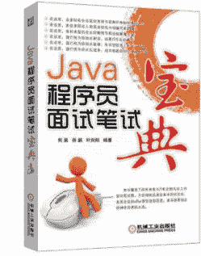


```
运行后会得到 [30, 29, 25, 20, 19]，正是三行各自降序排列后整体前五大的结果。时间复杂度由堆操作主导，空间只用 O 行数。