# 第三卷：深度学习与神经网络核心技术

## 概览

自诞生伊始，`神经网络`便是`人工智能`（`AI`）领域的基石。如今，`深度学习`、`卷积`等前沿技术的涌现，正推动这一经典领域迈入全新阶段。本书将通过`图像识别`、`数据科学`等实战场景，系统拆解现代`神经网络`核心技术栈，涵盖 `ReLU 激活函数`、`随机梯度下降`、`交叉熵`、`正则化`、`Dropout` 及 `可视化` 等关键知识点。无论是 `AI` 初学者，还是渴望深入钻研算法原理的开发者，均可从中获益。

---

## 引言

本书是“面向人类的人工智能”系列丛书的第三卷。`AI` 领域博大精深，包含众多细分学科。即使未阅读前两卷，本书自带的背景介绍也能助你快速上手，无需强制按序阅读。

### 丛书定位与特色

本系列聚焦 `AI` 领域热门核心议题，而非追求面面俱到的百科全书式讲解。每一卷深耕一个专题，旨在帮助读者快速掌握计算机科学前沿技术。

**“为人类而写”** 是本系列的核心理念：我们摒弃晦涩的纯公式推导，采用**数学直观易懂**的叙述方式，辅以实战编程示例与伪代码，降低理解门槛。阅读前，建议读者具备：
*   至少精通一门编程语言；
*   具备大学代数基础；
*   无需精通微积分、线性代数、统计学等高阶数学，书中会在必要时点拨相关概念。

### 多语言代码生态

本书核心逻辑以伪代码呈现，配套实战代码已适配 `Java`、`C#`、`R`、`C/C++`、`Python` 等主流语言，且有社区维护的 `Scala` 版本。代码库持续扩展中，未来或将支持更多语言。

*   **在线实验场**：基于 `JavaScript` 与 `HTML5` 构建，支持移动端直接运行，零配置即时体验。访问 `http://www.aifh.org` 即可进入。
*   **开源代码仓**：所有代码遵循 `Apache 2.0` 协议开源，托管于 `https://github.com/jeffheaton/aifh`。配套 `JavaScript` 实验环境代码见 `https://www.heatonresearch.com/aifh/`。欢迎通过 `Fork` 与 `PR` 参与共建，详见附录 A。

### 系列出版规划

*   卷 0：`AI` 数学基础（前传，后期出版）
*   卷 1：基础算法
*   卷 2：自然启发算法
*   **卷 3：深度学习与神经网络（本卷）**

各卷相对独立，可按兴趣跳读。卷 0 将在系列末期出版，梳理前几卷数学脉络。

### 延伸学习资源

*   **可汗学院**：免费视频库，适合复习数学概念。
*   **神经网络常见问答（Neural Network FAQ）**：纯文本资源宝库。
*   **Encog 项目 Wiki**：涵盖广泛机器学习内容。
*   **Encog 论坛**：活跃社区，作者本人常驻解答。

---

## 神经网络溯源与核心概念

`神经网络`源起 20 世纪 40 年代，历经漫长演变。理解其发展脉络，有助于掌握专业术语演进逻辑。以 `激活函数` 为例：早期的 `阈值函数`，历经 `S 型`、`双曲正切`，演变为如今主流的 `ReLU`（修正线性单元）。虽主流建议直接用 `ReLU`，但了解前驱者优劣，方知其设计精妙。

本书将主流公认的架构组件标记为“推荐选择”，并在第 14 章汇总构建实战建议。

### 三起三落与浴火重生

1.  **萌芽与停滞 (1943)**：`McCulloch` 与 `Pitts` 奠基概念，但缺乏训练手段，权重需手工设定，因繁琐而首次沉寂。
2.  **曙光与瓶颈 (1958)**：`Rosenblatt` 提出 `反向传播算法`，实现权重自动学习，模拟多层大脑结构。但训练极慢，随层数加深指数级恶化。虽 80-90 年代算力提升带来喘息，却难解多层网络训练困局，再度低谷。
3.  **深度学习爆发 (2006)**：`Hinton` 突破深层网络训练难题，配合 `GPU` 并行算力井喷，三层以上深层网络成为现实，技术彻底翻红。

### 奠基经典与现代扩展

为夯实基础，本书先解析 `自组织映射 (SOM)`、`霍普菲尔德网络`、`玻尔兹曼机` 等经典模型，以及 `前馈神经网络 (FFNN)` 及其多元训练策略。深层 `FFNN` 即 `深度神经网络`，本书将详述 `GPU` 加速训练、`Dropout`、`正则化`、`卷积` 等深度学习核心技艺，并以预测建模、`图像识别` 等真实案例落地演示。

---

## 认知校准：拨开科幻迷雾

大众常将 `神经网络` 等同于 “人工大脑”，幻想其驱动机器人、实现通用对话。实则此概念更贴近 `AI` 终极愿景，而非现状。当前 `AI` 距真正智能仍有鸿沟，**人类智能仍碾压机器智能**。

`神经网络` 仅是 `AI` 拼图的一小块：**专精微小特定任务，非通用计算装置**。为避免混淆，需区分：
*   **生物神经网络 (BNN)**：大脑生物实体。
*   **人工神经网络 (ANN)**：计算机数学模型（本书默认“神经网络”指代 ANN）。

二者仅在 **数学构造灵感源于生物**、**生物合理性指导算法设计** 上存在关联。

### 工程视角：组件而非整体

实际落地中，程序员设计网络解决**单一细粒度任务**。完整应用由多个协作网络组成，而非单一巨型网络。

---

## 网络拓扑与数据契约

### 分层架构与黑盒机制

典型网络由层叠神经元构成，**必含 `输入层` 与 `输出层`**，中间隐藏层为 “黑盒”——输入映射输出的内部逻辑不透明。输入输出均为 **定长浮点数数组**，例如：
*   输入：`[−0.245, 0.283, 0.0]`（3 个输入神经元）
*   输出：`[0.782, 0.543]`（2 个输出神经元）

**网络拓扑重构不改变输入输出维度**。使用网络的核心难题在于：**如何将业务问题编码为固定长度浮点数组？**

### 类比哈希表：模式映射器

可将网络视为 **“模糊哈希表”** 或 **“近似字典”**：
*   传统哈希表：`Key` 精确匹配 -> `Value`，找不到报 `null`。
*   神经网络：输入模式 (`Key`) -> 输出模式 (`Value`)。**输入非训练样本时，不报错，而是给出 “最接近匹配” 的推断结果**，甚至修补缺失信息。

> 例：训练 `{ "write" -> 定义 }`，输入 `"wrote"`，哈希表失效，网络却能推断出相近语义。

**难点提示**：文本/离散数据须向量化 (Embedding) 才能入网，数值型数据处理相对直观。**“问题向定长浮点数组转换” 是工程落地最大挑战**。

---


图 1　典型神经网络架构示意

---

## 入门案例：XOR 非线性难题

编程界有 “Hello World”，`神经网络` 界有 **`XOR` (异或) 运算**。它是验证网络非线性拟合能力的最小基准。

**XOR 真值表**：
*   `0 XOR 0 = 0`
*   `0 XOR 1 = 1`
*   `1 XOR 0 = 1`
*   `1 XOR 1 = 0`

**哈希表视角映射**：
*   `[0, 0] -> [0]`
*   `[0, 1] -> [1]`
*   `[1, 0] -> [1]`
*   `[1, 1] -> [0]`

此即网络的 **训练样本集 (输入 -> 理想输出)**。

```
False XOR False = False
True XOR False = True
False XOR True = True
True XOR True = False
```
```
[0.0, 0.0] −> [0.0]
[1.0, 0.0] −> [1.0]
[0.0, 1.0] −> [1.0]
[1.0, 1.0] −> [0.0]
```

---

## 训练范式：有监督 vs 无监督

### 有监督训练
*   **给标签**：每个输入配理想输出。
*   **目标**：迭代最小化 **实际输出与理想输出的误差 (如交叉熵、均方误差)**。
*   **机制**：反向传播调整权重矩阵，压降误差至阈值。

### 无监督训练
*   **无标签**：仅输入数据。
*   **目标**：自动聚类，将数据按输出神经元数量分组。
*   **机制**：固定轮次迭代，无误差反馈，靠内在结构自组织。

**共性**：均为迭代过程。**样本顺序对 `前馈网络 (FFNN)` 无影响**，但对后文将讲的 `循环神经网络 (RNN)` 至关重要。

---

## 实战场景：汽车油耗预测 (MPG)

从玩具问题转向真实预测建模。利用历史车辆数据训练模型，推测新车型油耗。

**特征字段 (输入向量)**：
1.  车重
2.  发动机排量
3.  气缸数
4.  马力
5.  动力类型 (混动/燃油) —— 需 One-Hot 编码
6.  **目标值 (输出)**：每加仑英里数 (MPG)

> **数据准备与归一化** 环节至关重要：量纲不同、量级悬殊的特征必须缩放至统一区间 (如 0-1 或 Z-Score)，否则梯度下降震荡、收敛极难。这是落地前的必修课。

# Data Preparation and Normalization

# 神经网络选型导航：找到最适合你的模型

尽管数据经过高度简化，但这丝毫不影响它演示数据格式化的核心逻辑。假设你已搜集齐全这些字段信息，便能构建神经网络，依据其余字段预测目标值——本例中即为“每加仑行驶里程”（MPG）。

如前所述，核心任务是将浮点数输入数组映射为浮点数输出数组。但有一项硬性指标：数组中每个数值必须落在 `0~1` 或 `-1~1` 区间。这一将真实数据转为网络可识别格式的过程，称为**归一化**。

首先得确定归一化方案。观察网络架构：共 6 个字段，以 5 个预测 1 个，对应 5 个输入神经元和 1 个输出神经元。网络拓扑大致如下：

- 输入神经元 1：车重。
- 输入神经元 2：排量。
- 输入神经元 3：气缸数。
- 输入神经元 4：马力。
- 输入神经元 5：混动或燃油动力。
- 输出神经元 1：每加仑行驶里程。

接下来处理数据归一化。关键在于为各字段设定合理取值范围，再将实测值按比例映射为 `0~1` 之间的位置坐标。设定的合理区间如下：

- 车重：`100~5,000` 磅（约 `45~2,268` 千克）。
- 排量：`0.1~10` 升。
- 气缸数：`2~12` 个。
- 马力：`1~1,000` 马力（约 `735.5~7,355,000` 瓦特）。
- 动力类型：`true`（混动）或 `false`（燃油）。
- 每加仑行驶里程：`1~500` 英里（约 `1.6~804.5` 公里）。

这些区间在现代车型下看似宽泛，实则能减少后续重构网络的麻烦，也能避免数据过度挤压在区间两端。

以车重 `2,000` 磅（约 `907` 千克）为例：它距离区间下限 100 磅有 1,900 磅，区间总宽 4,900 磅，占比 `0.38`（即 `1,900 / 4,900`）。于是向输入神经元传入 `0.38`，完美满足 `0~1` 的输入要求。

动力类型仅为“混动”或“燃油”两值，直接编码为 `1` 和 `0` 即可完成归一化。

掌握了这些基础用法，下一步便是针对具体问题挑选合适的网络架构。下文将为你呈现一份神经网络选型路线图。

# 神经网络选型导航：找到最适合你的模型

本书涵盖多种主流神经网络，并配套实例演示其在不同领域的应用。并非所有网络都能通吃一切问题，作为开发者，必须明确“什么场景用什么网络”。

此处提供一份高层级导航，助你直达感兴趣章节。表 1 汇总了本书涉及的网络类型及其适用问题域。

**表 1　神经网络类型与问题域对照表**

| 类型 | 聚类 | 回归 | 分类 | 预测 | 机器人 | 视觉 | 优化 |
| --- | --- | --- | --- | --- | --- | --- | --- |
| 自组织映射 | √√√ | | | | √ | √ | |
| 前馈网络 | | √√√ | √√√ | √√ | √√ | √√ | |
| 霍普菲尔德网络 | | | √ | | | √ | √ |
| 玻尔兹曼机 | | | √ | | | | √√ |
| 深度置信网络 | | | √√√ | | √√ | √√ | |
| 深度前馈网络 | | √√√ | √√√ | √√ | √√√ | √√ | |
| NEAT | | √√ | √√ | | √√ | | |
| CPPN | | | | | √√√ | √√ | |
| HyperNEAT | | √√ | √√ | | √√√ | √√ | |
| 卷积网络 | | √ | √√√ | | √√√ | √√√ | |
| 埃尔曼网络 | | √√ | √√ | √√√ | | | |
| 乔丹网络 | | √√ | √√ | √√ | √√ | | |
| 循环网络 | | √√ | √√ | √√√ | √√ | √ | |

表 1 列出的问题域具体含义如下：

- **聚类**：无监督聚类任务。
- **回归**：根据输入输出具体数值的回归问题。
- **分类**：将数据点划分至预设类别的分类问题。
- **预测**：需及时预判事件的场景，如金融信号预测。
- **机器人**：涉及传感器感知与电机控制的机器人应用。
- **视觉**：计算机视觉（`CV`）任务，要求机器理解图像内容。
- **优化**：寻找最优排序或参数组合以达成目标的优化问题。

打勾数量（`√`）代表该网络在该领域的适配度；无打勾则表示不适用。

所有神经网络都共享神经元、权重、激活函数、层级等基础构件，本书第 1 章将系统讲解这些通用特性。

# 本书实战数据集一览

本书内置多个数据集，用于演示神经网络在真实数据上的应用，涵盖回归、分类、时间序列与计算机视觉等主题。

## MNIST 手写数字集：入门必备的“Hello World”

书中多个案例采用 MNIST 手写数字数据集（下称 MNIST）。这是一个海量手写数字库，堪称神经网络领域的“Hello World”标准入门教具。

数据采用特殊二进制格式存储，网络上可获取，书中示例代码已内置解析器。

数据集包含 6 万张训练图、1 万张测试图，均附带标签。它是算法基准测试的主战场，学术界屡创低错误率纪录，如某研究利用卷积神经网络（CNN）层级体系将错误率压至 `0.23%`[¹]。


Figure 2　MNIST Handwritten Digit Sample

# 经典数据集速览：从手写数字到鸢尾花，AI 入门必刷的“练手神器”

想入门神经网络，绕不开的第一关就是数据。这篇文章带你快速过一遍书中反复出现的几大经典数据集，搞懂它们的来历、结构和适用场景，为后续建模打好地基。

## MNIST 手写数字集：计算机视觉的“Hello World”

提到图像分类入门，MNIST 绕不开。它包含 10 类手写数字（0-9），每张图规格统一为 **28×28 像素**，展平后就是 **784 个输入特征**。

虽然它是图像数据，但初期我们完全可以把它当作普通的高维表格数据，丢进全连接网络里跑分类。当然，后续章节我们会解锁专门为图像设计的卷积网络（CNN），在 MNIST 上的表现会碾压传统架构。

## 鸢尾花数据集：统计学祖师爷留下的“分类教科书”

这个数据集出自 Ronald Fisher 1936 年的论文，至今仍是机器学习领域的“常青树”。它记录了 **150 朵鸢尾花**的 4 项生理指标：

- 萼片长度 / 宽度
- 花瓣长度 / 宽度

目标是根据这 4 个连续数值，预测花的品种（Setosa、Versicolor、Virginica 三类）。

**关键点来了**：品种标签是类别变量，不能直接当数值塞进网络。简单的 0/1/2 编码会引入人为的序关系偏差，必须用 **One-hot (1-of-N) 编码** 或 **等边编码** 将三类映射成等距向量，保证模型不偏心。

把每朵花看作 4 维空间里的一个点，距离近的往往特征相似。书中列举了 3 条样本数据供直观感受：

```
5.1, 3.5, 1.4, 0.2, Iris-setosa
7.0, 3.2, 4.7, 1.4, Iris-versicolor 
6.3, 3.3, 6.0, 2.5, Iris-virginica
```

经过 One-hot 编码后，这 3 行数据变成如下向量（One-hot 详解见第 4 章）：

```
[5.1, 3.5, 1.4, 0.2, 1, 0, 0]
[7.0, 3.2, 4.7, 1.4, 0, 1, 0]
[6.3, 3.3, 6.0, 2.5, 0, 0, 1]
```

## Auto MPG 油耗数据集：回归任务的经典战场

想练回归预测？UCI 机器学习库收录的 **Auto MPG** 数据集是标配。数据源自卡内基梅隆大学 StatLib，早期用于 1983 年美国统计协会博览会，后由 Quinlan (1993) 研究城市车辆油耗。

目标变量是 **MPG（每加仑行驶英里数）**，特征包含 **3 个离散多值属性 + 5 个连续属性**，且无缺失值。完整属性列表见下：

```
1. mpg (miles per gallon): Continuous
2. cylinders (number of cylinders): Multi-valued discrete
3. displacement (engine displacement): Continuous
4. horsepower (horsepower): Continuous
5. weight (vehicle weight): Continuous
6. acceleration (acceleration): Continuous
7. model year (model year): Multi-valued discrete
8. origin (origin): Multi-valued discrete
9. car name (car name): String (unique for each instance)
```

## 黑子观测数据：天然的时间序列预测素材

太阳黑子是光球上由强磁场活动形成的低温暗斑（约 3000-4500 K），周期性出现消失，极适合做**时间序列建模**。

数据记录了年份、月份、黑子数及标准差，全球多机构联合观测。趋势图如下：


Figure 3　Sunspot Activity Over Time

```
Year Month Sunspots Std Dev
1749 1 58.0 24.1
1749 2 62.6 25.1
1749 3 70.0 26.6
1749 4 55.7 23.6
1749 5 85.0 29.4
1749 6 83.5 29.2
1749 7 94.8 31.1
1749 8 66.3 25.9
1749 9 75.9 27.7
```

## XOR 异或算子：神经网络的“最小单元测试”

XOR 是布尔逻辑中的异或操作，真值表极其简单，却完美暴露了单层感知机无法解决非线性可分问题的短板。因此它常被用作**手动调参、验证网络非线性拟合能力**的最小训练集。

三输入奇偶校验版本的真值表如下：

```
0 XOR 0 = 0
1 XOR 0 = 1
0 XOR 1 = 1
1 XOR 1 = 0
```

## Kaggle Otto 商品分类挑战：深度学习与集成学习的实战演练

来自 Kaggle 平台的真实比赛数据，任务是根据 93 维匿名特征将商品分入多个类别。书中将用它演示**深度神经网络**架构，并在第 16 章深度剖析**集成学习**等进阶竞赛技巧。

---

## 书籍资源与支持

本书由**异步社区**（[https://www.epubit.com/](https://www.epubit.com/)）出品，提供配套资源与后续服务。

### 勘误提交
内容虽经严审，疏漏在所难免。发现错误请登录异步社区 → 搜索书名 → 进入书籍页 → 点击“提交勘误”填报。经核实采纳后，将奖励 **100 积分**（可兑换优惠券、试读本等）。


### 联系我们
邮箱：`contact@epubit.com.cn`

---

**参考文献**  
[¹] Schmidhuber, 2012.  
[²] Fisher, 1936.  
[³] Quinlan, 1993.

# 第 1 章 神经网络核心基石

**本章看点：**

- 核心组件：神经元与层级架构
- 神经元的多样分类体系
- 激活函数的关键作用机制
- 前向传播的底层运作逻辑

神经网络的训练、查询、构建与解读贯穿本书始终。我们将逐一拆解主流架构，并深度剖析驱动这些网络学习的核心算法。所谓训练，本质上是网络通过不断调整内部参数，最终实现“依据数据做预测”这一目标的过程。深度学习作为训练多层网络的新范式，更是重点探讨对象——它攻克了复杂网络的高效训练难题。本章将抽丝剥茧，提炼各类神经网络共有的基因：神经元如何通过加权连接协作、层级如何构建、激活函数如何塑造输出。一切从最小单元——神经元与层级讲起。


Async Community


微信服务号

## 1.1 神经元与层级：构建网络的积木

神经网络架构虽繁多，且开发者层出不穷地实验新结构，但万变不离其宗。若算法冠以“神经网络”之名，其核心必由相互连接的独立单元组成。文献中对这一处理单元的称呼不一：节点、神经元、单元均指代同一概念。


**单个神经元的内部运作**

人工神经元的输入源头有二：上游神经元的输出，或外部程序喂入的原始数据。输入通常以浮点数或二进制形式呈现（`true`/`false` 常编码为 `1`/`0`，或采用双极制 `1`/`-1`）。

每个输入会乘以对应的权重，所有乘积求和后，送入激活函数处理（部分网络可无激活函数）。神经元的计算逻辑可概括为公式 1-1：

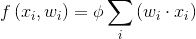

（1-1）

式中，`x` 与 `w` 分别代表输入向量与权重向量，`i` 为维度计数。输入与权重数量严格对应。加权求和结果经由希腊字母 `φ` (phi) 表示的激活函数变换，最终产出单一输出值。

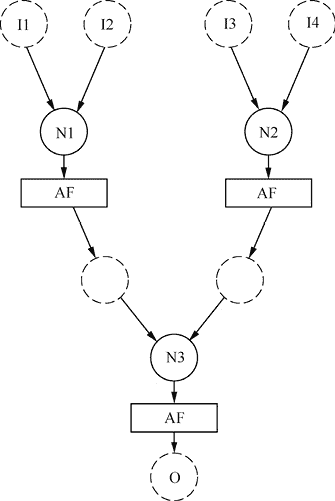

**从单元到网络：层级的形成**

将多个神经元链接，即构成人工神经网络。可把神经元视为积木，输入输出接口为连接柱。图 1-2 展示了一个由 3 个神经元组成的微型网络：4 个输入，1 个输出。N1、N2 的输出汇聚至 N3，最终产出 O。计算流程即执行三次公式 1-1：前两轮得 N1、N2 值，第三轮以此为输入算 N3。

实际工程图谱常省略激活函数节点与中间变量，简化为图 1-3 形式。

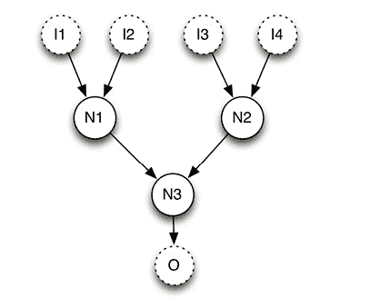

简化视图引入两类特殊角色：**输入神经元** 仅作数据入口，接收外部程序数据并加权求和（无激活函数）；**输出神经元** 负责回传结果。二者分别归属输入层、输出层。图 1-3 中，I 层为输入，N1/N2 组第二层，N3 第三层，O 第四层。

虽主流架构皆分层，但也有例外。如 Stanley (2002) 提出的 NEAT（增强拓扑神经进化），即允许非分层的杂乱拓扑。

**层级连接的规范：全连接**

标准层级具备两大特征：
1.  **层内激活函数统一**，层间可异。
2.  **相邻层全连接**：上一层每个神经元均与下一层每个神经元有连接。

图 1-3 即非全连接（如 I1 与 N2 断联）。补齐缺失连接并增设 N4，得标准全连接网络（图 1-4）。

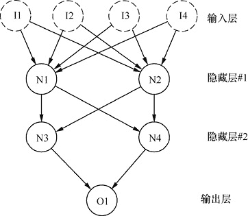

图 1-4 为典型多层全连接网络：必有输入/输出层，中间隐藏层数定义网络“深浅”。图示为两层隐藏层网络。传统非深度学习时代，隐藏层多超 2 局极少；深度学习出现前，训练深层网络无效，故单隐藏层曾是主流——理论证明其为“通用逼近器”，宽度足够时可拟合任意函数。箭头自输入向输出单向流动，此即**前馈神经网络**；后续章节将介绍含反向回路的循环神经网络。

## 1.2 神经元的四大角色画像

网络虽未必用全所有类型，单个神经元甚至可兼任多角，但理解分类至关重要。

### 1.2.1 输入/输出神经元：数据的“收发室”

近乎标配。输入层神经元聚合外部向量数据（向量维度 = 输入神经元数）；输出层神经元产出结果向量（长度 = 输出神经元数）。单输出场景亦视为单元素向量。

特例：霍普菲尔德网络（第 3 章详解）中神经元兼任输入输出，此时输入输出向量维度相同。注意：输入神经元无激活函数，仅作加权求和占位。

### 1.2.2 隐藏神经元：理解与转化的“幕后推手”

两大定义特征：
1.  **仅连神经元**：输入源自输入层或其它隐藏层，输出流向输出层或其它隐藏层。
2.  **零外联**：不直接接触原始数据与最终结果。

隐藏神经元数量的选取是经典难题，本书多处探讨。深度学习兴起前，学界主张“单隐藏层足矣”，得益于通用逼近定理：足宽的单层理论上能逼近任意映射。然额外隐藏层长期被视为训练阻碍——缺乏有效算法调优深层权重。深度学习技术的突破，让深层网络得以高效训练，从而捕捉数据中更精微、复杂的模式结构。

### 1.2.3 偏置神经元：给激活函数“挪个窝”

偏置神经元输出恒定为 1（可配置，但 1 最常用），无上游连接，功能等同于“永远输出 1 的输入神经元”。并非所有网络必备。图 1-5 展示了单隐藏层网络植入偏置的姿态：除输出层，各层各设一个。

```
[0.5, 0.75, 0.2]
```

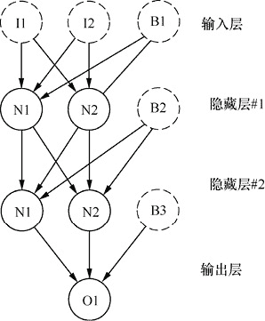

偏置的核心价值在于**平移激活函数曲线**，赋予网络更灵活的拟合基线（后文激活函数章节将详细演示）。

### 1.2.4 上下文神经元：赋予网络“记忆”感知

专属于循环神经网络 (RNN)。它让网络拥有**状态记忆**：相同输入在不同时刻可产出不同输出。这酷似生物大脑的语境依赖——过马路听喇叭会惊恐回头，影院看动作片听同一声响却无动于衷。先前的输入序列构建了“上下文”，改写了对当前信号的解读方式。

# 第 1 章 神经网络核心基石：结构、激活与逻辑

### 处理序列数据的利器：上下文神经元

时间序列处理是上下文神经元的典型应用场景。无论是语音识别还是证券走势预测，核心任务都是让神经网络学会“读懂”输入信号的时间脉络。上下文神经元正是神经网络处理此类序列数据的关键机制之一。图 1-6 直观展示了其在网络中的布局方式。

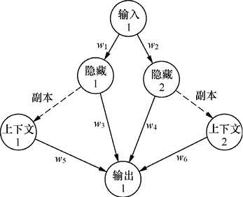

图 1-6　上下文神经元

该网络结构包含单个输入与输出节点，中间夹着两个隐藏神经元及两个上下文神经元。抛开这两个上下文单元，其余架构与前文介绍的标准网络别无二致。

每个上下文神经元初始值为 0，其核心作用是充当“记忆单元”，持续接收上一轮前向传播中隐藏层 1 或隐藏层 2 的状态副本。图中虚线箭头标示了这种无权重的直接复制连接；实线连接则对应 6 个带权重的参数。输出计算依然遵循公式 1-1：将 4 个输入（含上下文输入）分别乘以权重求和，再经激活函数处理。

采用此机制的网络被称为简单循环神经网络（`SRN`）。其中，乔丹网络（`Jordan neural network`）与埃尔曼网络（`Elman neural network`）是两大经典代表。图 1-6 演示的正是埃尔曼架构。第 13 章将深度剖析这两类 SRN 的细节。

### 1.2.5 概念辨析：神经元、节点与单元

构成网络的基本计算单元，学术界并不统一称作“神经元”。你常会看到“节点”或“单元”等同义词。随着本书深入深度学习领域，玻尔兹曼机等结构将登场，它们在功能上替代了传统神经元的角色。但无论术语如何演变，神经网络的本质始终是：由加权连接编织而成的计算图。

## 1.3 激活函数：为输出加上“护栏”

在神经网络工程实践中，激活函数（亦称传递函数）的职责是给神经元输出划定边界。可选函数繁多，本节聚焦主流选择。

激活函数的选型至关重要，它倒逼输入数据的预处理与归一化方式。本章提供选型指引，第 14 章将展开工程落地细节。

### 1.3.1 线性激活函数：最“佛系”的存在

线性函数是激活函数家族的基石，因其“不作为”而著称——原样输出输入。公式 1-2 给出了标准实现：

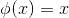

（1-2）

正如代码所示，它仅做透传。图 1-7 描绘了这条过原点的直线。

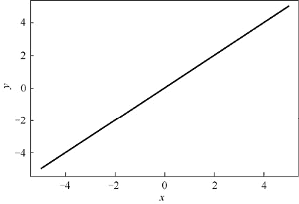

图 1-7　线性激活函数

回归类网络（预测连续数值）通常在输出层采用它；而分类网络则倾向于在输出层搭配 `Softmax`。

### 1.3.2 阶跃激活函数：非黑即白的“感知机”遗产

阶跃/阈值函数是另一种极简形态。早期神经网络即“感知机”（`perceptron`），McCulloch 与 Pitts（1943）在奠基之作中便采用了公式 1-3 形式的阶跃函数：

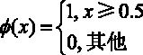

（1-3）

规则极其生硬：输入 ≥ 0.5 输出 1，否则输出 0。因仅对超过阈值的信号“放行”，故称阈值函数，曲线呈阶梯状突变（图 1-8）。

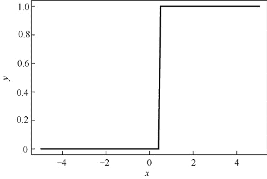

图 1-8　阶跃激活函数

### 1.3.3 S 型激活函数：将输出“压缩”进 (0, 1)

对于仅需正向输出的前馈网络，S 型（`Sigmoid`）或称逻辑激活函数曾是首选。虽应用广泛，但双曲正切与 `ReLU` 往往表现更优（`ReLU` 稍后介绍）。公式 1-4 定义了其数学形态：

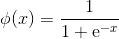

（1-4）

它能将任意实数映射到 (0, 1) 区间（图 1-9），有效防止数值溢出。

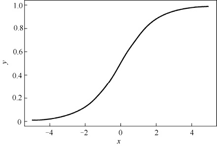

图 1-9　S 型激活函数

### 1.3.4 双曲正切激活函数：零中心化的优势

当网络需输出负值（范围 -1 至 1）时，双曲正切（`tanh`）是常见替代方案（公式 1-5）：

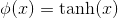

（1-5）

其曲线形似 S 型，但以原点为中心对称（图 1-10）。

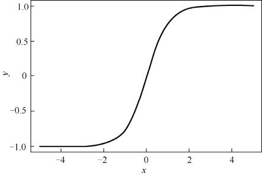

图 1-10　双曲正切激活函数

相较于 Sigmoid，`tanh` 在训练动力学（导数特性）上更具优势，第 6 章反向传播章节将详细论证。

## 1.4 修正线性单元：深度学习时代的“宠儿”

`ReLU` 由 Teh 与 Hinton 于 2000 年提出，近年迅速霸榜主流研究。在 `ReLU` 问世前，`tanh` 长期占据“首选隐藏层激活函数”宝座。凭借卓越的训练表现，当前主流建议：**隐藏层首选 `ReLU`，输出层视任务选 `Softmax`（分类）或线性（回归）**。其定义简洁至极（公式 1-6）：

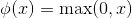

（1-6）

为何 `ReLU` 能击败饱和型激活函数？关键在于它是**非饱和的线性函数**。Sigmoid 与 `tanh` 会在两端饱和（梯度趋近 0），导致梯度消散；`ReLU` 在正半轴保持恒定梯度 1，缓解了这一顽疾。图 1-11 展示了其单侧线性特征。

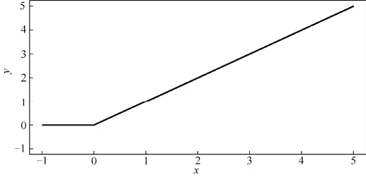

图 1-11　ReLU 激活函数

学术界共识已倾向于隐藏层默认使用 `ReLU`。其相对 `tanh` 与 Sigmoid 的理论优势，第 6 章将结合反向传播机制深度解析。

### 1.4.1 Softmax 激活函数：把原始分数变成“概率分布”

`Softmax` 通常镇守输出层，专服务于分类任务。分类网络的逻辑是：得分最高的输出神经元代表预测类别。但原始输出（logits）仅是相对大小，不具备概率语义。`Softmax` 强制输出向量归一化为概率分布（非负、和为 1），使结果具备统计学可解释性。

以经典鸢尾花数据集为例：4 维特征对应 3 个物种。网络设 3 个输出节点，`Softmax` 可输出类似“80% Setosa、15% Virginica、5% Versicolour”的概率向量。这 3 个值之和必为 100%，杜绝了“同时 80% 是 A、75% 是 B”这类逻辑悖论。

数学上，`Softmax` 计算依赖全体输出节点的值（公式 1-7），这与前文逐元素独立计算的激活函数截然不同。

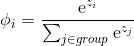

（1-7）

其中 `i` 为目标节点索引，`j` 遍历全组节点，`z` 为输出层完整向量。清单 1-1 给出了伪代码实现。

清单 1-1　Softmax 激活函数

```python
def softmax(neuron_output):
  sum = 0
  for v in neuron_output:
    sum = sum + v

  sum = math.exp(sum)
  proba = [ ]
  for i in range(len(neuron_output)):
    proba[i] = math.exp(neuron_output[i])/sum 
  return proba
```

**实战演示**：假设训练完成的三分类网络输出原始向量：

```
Neuron 1: setosa: 0.9 
Neuron 2: versicolour: 0.2 
Neuron 3: virginica: 0.4
```

直观看第一分量最大，判为 Setosa。但 0.9 并非 90% 概率（总和 1.5 > 1）。经 `Softmax` 归一化后：

```
[0.9, 0.2, 0.4]
```

```
[0.47548495534876745, 0.2361188410001125, 0.28839620365112]
```

归一化向量总和为 1，首项约 0.48，即“48% 概率为 Setosa”。计算细节如下：

```
sum = exp(0.9) + exp(0.2) + exp(0.4) = 5.17283056695839
j0 = exp(0.9) / sum = 0.47548495534876745
j1 = exp(0.2) / sum = 0.2361188410001125
j2 = exp(0.4) / sum = 0.28839620365112
```

### 1.4.2 偏置：激活函数的“位移控制器”

权重与偏置（`bias`）共同塑造激活函数最终输出。以单输入 Sigmoid 神经元为例（公式 1-8），融合了线性组合（公式 1-1）与激活映射（公式 1-4）：

```
f(x, w, b) = 1 / (1 + e^(-(w*x + b)))
```

（1-8）

**权重调节“陡峭度”**：图 1-12 对比了不同权重下的 Sigmoid 曲线（偏置固定为 0）。

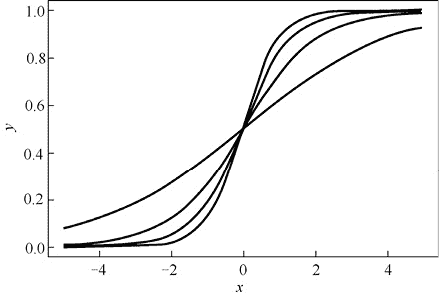

图 1-12 调整神经元权重

参数设定如下：

```
f(x, 0.5, 0.0)
f(x, 1.0, 0.0)
f(x, 1.5, 0.0)
f(x, 2.0, 0.0)
```

权重越大，曲线越陡峭，越逼近阶跃函数；权重为 0 时退化为常数 0.5。注意：所有曲线强制过点 (0, 0.5)，这限制了模型在输入近零区的表达能力。

**偏置实现“平移”**：固定权重 1.0，变化偏置（图 1-13）。

```
f(x, 1.0, 1.0)
f(x, 1.0, 0.5)
f(x, 1.0, 1.5)
f(x, 1.0, 2.0)
```

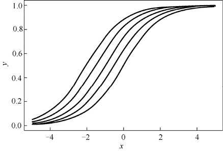

图 1-13 调整神经元偏置

偏置使曲线左右平移，打破了“输入 0 必输出 0.5”的刚性，虽两端仍趋同饱和值，但工作区间已灵活可控。

**权重与偏置协同**：两者结合，单神经元即可拟合任意平移、缩放的 S 型曲线。多神经元输出叠加，便能合成极其复杂的非线性映射——这是神经网络通用逼近能力的微观基础。

## 1.5 神经网络里的“逻辑门”构建术

程序员熟知 `AND`、`OR`、`NOT` 控制流逻辑。在神经网络中，权重与偏置的数值编码正是这些逻辑语义的显性化呈现。

以 `AND` 真值表为例（```
0 AND 0 = 0
1 AND 0 = 0
0 AND 1 = 0
1 AND 1 = 1
0 OR 0 = 0
1 OR 0 = 1
0 OR 1 = 1
1 OR 1 = 1
NOT 0 = 1
NOT 1 = 0
```）：仅当双输入均为 1 时输出 1。这完美契合自然语言“且”的语义——买房需同时满足“好风景”且“大后院”。

复合逻辑亦可表达。如：“想要（风景好 且 院子大）或（院子小 但 靠公园）的房子”，可形式化为（```
([nice view] AND [large yard]) OR ((NOT [large yard]) AND [park])
```），符号逻辑写作公式 1-9：

```
(N V ∧ L Y) ∨ (¬ L Y ∧ P K)
```

（1-9）

（符号约定：`∨` 似 `v` 表 `OR`，`∧` 似倒 `v` 表 `AND`，`¬` 似半框表 `NOT`）

**单层网络即可实现基础逻辑门**。图 1-14 给出了 `AND`、`OR`、`NOT` 对应的权重/偏置配置，搭配阶跃激活函数，按公式 1-1 即可验证。

```
(1 * 1) + (1 * 1) + (−1.5) = 0.5
```

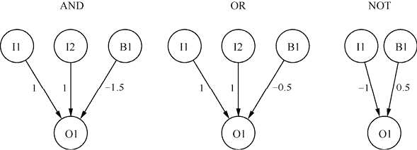

图 1-14 基本逻辑运算符

以 `AND(1,1)` 为例：加权和 0.5 ≥ 阈值 0.5，输出 1（真）；若输入含 0，和 < 0.5，输出 0（假）。

```
(1 * 1) + (0 * 1) + (−1.5) = −0.5
```

**多层堆叠构建复杂逻辑：异或（`XOR`）案例**。`XOR` 真值表（```
0 XOR 0 = 0
1 XOR 0 = 1
0 XOR 1 = 1
1 XOR 1 = 0
```）要求“且仅当单输入为真时输出真”，单层感知机无法划分（线性不可分）。但可用基础门组合实现（公式 1-10）：

```
p ⊕ q = (p ∨ q) ∧ ¬(p ∧ q)
```

（1-10）

即 `p XOR q = (p AND NOT q) OR (NOT p AND q)`。对应的两层网络结构见图 1-15。

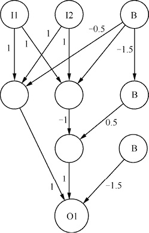

图 1-15 XOR 神经网络

前向计算演示（输入 `[0,1]`）：

1.  计算两个隐藏节点：
    ```
(0 * 1) + (1 * 1) − 0.5 = 0.5 = True
(0 * 1) + (1 * 1) − 1.5 = −0.5 = False
```
2.  计算输出层节点：
    ```
(0 * −1) + 0.5 = 0.5 = True
```
3.  最终输出 `O1`：
    ```
(1 * 1) + (1 * 1) − 1.5 = 0.5 = True
```

手工设权虽可行，但随规模增大极其繁琐。后续章节将介绍自动学习权重/偏置的核心算法。

## 1.6 本章回顾与展望

本章确立了神经网络三大核心支柱：**神经元分层（输入/隐藏/输出）、激活函数非线性变换、加权连接拓扑**。

- **激活函数全景**：Sigmoid 适配正向输出；`tanh` 支撑正负对称输出；`ReLU` 凭借非饱和特性成为隐藏层主流；`Softmax` 专司分类输出概率归一化；线性函数服务回归输出。
- **逻辑计算本质**：权重与偏置编码布尔逻辑，多层网络实现 `XOR` 等非线性可分问题，揭示了神经网络作为“可微逻辑机”的本质。

奠基完毕，下一站我们将探讨经典架构：**自组织映射（SOM）、霍普菲尔德网络、玻尔兹曼机**——它们是现代深度学习摩天大楼的基石。

---

[\[1\]](#chapter001.html#ac11) Hornik，1991。

# 第 2 章 自组织映射

## 本章核心看点

*   自组织映射原理与实现
*   邻域函数的拓扑保持机制
*   无监督训练范式解析
*   降维与特征可视化应用

# 第 2 章 经典入门：自组织映射网络

掌握了第一章神经网络的抽象核心后，我们现在正式踏入经典架构的领域。本章将带你认识最早且至今仍具实用价值的神经网络模型之一。神经元的连接方式千变万化，衍生出无数架构，而它们都植根于第一章奠定的基石之上。我们的探索之旅，将从**自组织映射**起步。

SOM 的核心任务是**数据分类**。你只需喂入训练样本，并指定想要分成的类别数量，剩下的交给网络自己摸索。训练过程中，SOM 会自动将特征相近的数据归为一类。这听起来很像 K 均值聚类，但两者有本质区别：K 均值只能处理给定的那批数据，而 SOM 训练完成后，具备**泛化能力**——它能利用学到的规则，对从未见过的新数据进行精准分类。更关键的是，SOM 属于**无监督学习**范畴。你不需要给数据打标签、告诉网络“这个属于 A 类、那个属于 B 类”，它会自动发现数据内在的结构，建立分类标准，并将此标准应用于未来所有数据。

## 2.1 SOM 架构与邻域机制

Kohonen 于 1988 年提出了 SOM，其结构由输入层和输出层构成，也被称为 Kohonen 网络。输入层的数据通过权重映射到输出层。当一个模式输入时，输出层中权重与该输入最匹配（欧氏距离最小）的神经元会成为“优势神经元”（Best Matching Unit, BMU）。

与第一章的前馈网络不同，SOM **没有偏置项**，仅有输入到输出的权重，且激活函数为线性函数。图 2-1 展示了其拓扑结构。

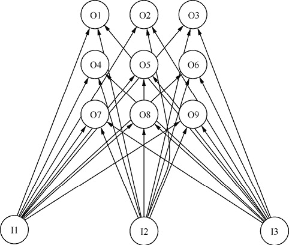

图 2-1 SOM 结构示意

图中展示了 3 个输入神经元如何映射到排列成 3×3 网格的 9 个输出神经元。SOM 的输出层通常呈现网格、立方体等拓扑结构。这在神经网络中独树一帜：常规网络中输出神经元的排列顺序无关紧要，但在 SOM 中，**空间邻近性代表语义相似性**。这正是计算机视觉利用 SOM 特性的关键——正如卷积神经网络（第 10 章详解）通过像素邻近关系识别边缘、纹理，SOM 也利用神经元的物理距离来组织特征。

输出层常见的拓扑维度有三种：
*   **一维**：神经元排成一条线。
*   **二维**：神经元铺成网格（最常用）。
*   **三维**：神经元堆叠成立方体。

接下来，我们通过一个具体案例构建 SOM：识别 RGB 颜色。输入为三通道值（范围 -1 到 +1，-1 为无色/黑，+1 为全强度）。输出层为 50×50 的二维网格（共 2500 个神经元）。训练后，相似颜色会自动聚集在网格的相邻区域，形成平滑的色彩过渡，如图 2-2 所示。


图 2-2 输出网格色彩分布

即便在黑白打印版中，你也能感知到相近色调的聚集趋势。这个简单的例子直观展示了 SOM 强大的自组织聚类能力。

**训练如何进行？**
核心是更新一个 3×2500 的权重矩阵。
1.  **初始化**：权重赋随机值。
2.  **采样**：准备 15 个随机颜色作为训练集。
3.  **迭代**：固定 1000 轮。每轮随机抽取一个训练色，计算它与所有 2500 个神经元权重向量的欧氏距离（公式 2-1）。

```
d(p, w) = √(Σ(i=1 to n) (p_i - w_i)²)
```

（2-1）

公式中 `p` 为输入向量，`w` 为权重向量。距离最小的神经元即为 **BMU**。BMU 学习幅度最大，其邻居学习幅度递减。权重更新规则由公式 2-2 决定：

```
W_v(t+1) = W_v(t) + θ(v, t) * α(t) * (D(t) - W_v(t))
```

（2-2）

这里 `t` 代表当前迭代次数。更新目标是让权重 `W_v` 向输入 `D` 靠拢，但步长受两个因子控制：
1.  **邻域函数 `θ`**：根据神经元到 BMU 的拓扑距离决定影响力。距离近→值接近 1（大幅更新）；距离远→值接近 0（几乎不变）。
2.  **学习率 `α`**：全局衰减因子，随训练单调递减，保证收敛稳定。

下面我们深入剖析邻域函数的设计。

### 2.1.1 邻域函数的维度与形态

邻域函数量化了“邻居”享受多少红利。BMU 自身系数为 1，向外衰减。

**维度由输出层拓扑决定：**
*   **一维拓扑** → 用一维邻域函数（视为长数组）。
*   **二维拓扑** → 用二维邻域函数（视为行列网格）。神经元数量相同，仅计算距离的方式不同（引入行列坐标）。
*   **三维及以上** → 同理可得，但维度越高，计算量指数级上升。工程上通常止步于 2D 或 3D。

数学上，统一用**欧氏范数**（向量模长）表示距离（公式 2-3）：

```
||p - w|| = √(Σ(i=1 to n) (p_i - w_i)²)
```

（2-3）

一维范数即绝对值（公式 2-4）：
```
||(2-0)|| = √(2²) = 2
```
（2-4）

二维范数即勾股定理（公式 2-5）：
```
||(2-0, 3-0)|| = √(2² + 3²) = 3.605551
```
（2-5）

**主流选择：高斯函数。**
其曲线呈钟形（图 2-3），中心峰值 1，两侧平滑衰减至 0，完美契合“核心主导、边缘淡出”的直觉。

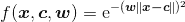

（2-6）

`x` 为坐标向量，`c` 为中心（固定为原点 0），`w` 为宽度（初始略小于网格尺寸，随训练单调收缩）。二维高斯函数呈现优美的山峰状（图 2-4）。

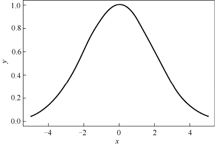

图 2-3 一维高斯函数

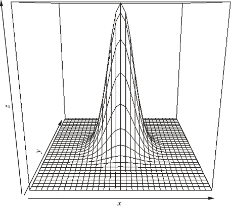

图 2-4 二维高斯函数

### 2.1.2 墨西哥帽函数：抑制周围的另类选择

除了高斯，**墨西哥帽函数**（Ricker 小波）也是热门备选（公式 2-7）。其特征是中心峰值后，中距离区域出现**负值区**（图 2-5）。

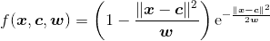

（2-7）

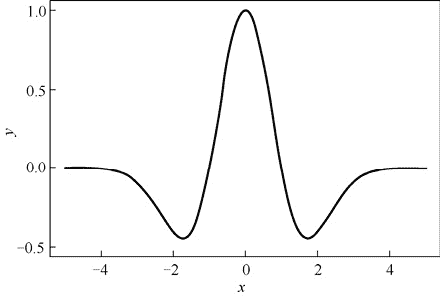

图 2-5 一维墨西哥帽函数

这意味着：距离 BMU 中等距离的神经元，权重会被**反向调整**（受到抑制）。如果你的模型需要显式惩罚“近似但不精准”的神经元，增强边界对比度，墨西哥帽是绝佳选择。二维形式（图 2-6）酷似宽檐草帽，同理具有抑制环。

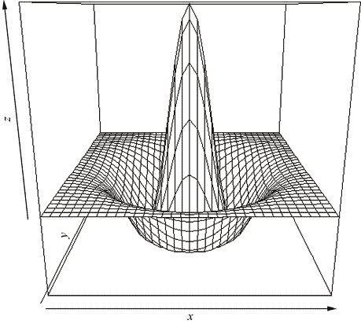

图 2-6 二维墨西哥帽函数

### 2.1.3 无监督下的误差评估

有监督学习有损失函数下降曲线，SOM 作为无监督模型，无标签可比。但我们可定义**量化误差**：每轮训练中，所有样本到其 BMU 的**最大欧氏距离**。随着训练推进，此值应稳步下降，反映拓扑保序质量的提升。

## 2.2 本章小结

本章聚焦 SOM——这类无监督网络能自动发现数据分布结构。输入维度等于特征数，输出神经元数等于预期聚类数。无标签训练，却能对新数据泛化分类。

**下一站（第 3 章）**：我们将转向**霍普菲尔德网络**与**玻尔兹曼机**。两者虽在现代 AI 前线较少直接露面，却是深度信念网络（DBN）等深度学习基石的源头。它们共同的核心机制——**能量函数**，将贯穿下一章的讲解。

---

# 第 3 章 能量模型双雄：霍普菲尔德网络与玻尔兹曼机

**本章核心清单：**
*   霍普菲尔德网络
*   能量函数
*   Hebb 学习规则
*   关联记忆
*   组合优化
*   玻尔兹曼机

霍普菲尔德网络与玻尔兹曼机，虽非当下主流架构，却是现代深度学习的“鼻祖”级存在。玻尔兹曼机直接催生了深度信念网络（DBN），开启了深度学习元年；霍普菲尔德网络则以极简结构，演示了前馈网络也具备的吸引子动力学、记忆存储等核心特性。

## 3.1 霍普菲尔德网络：极简的吸引子动力学

霍普菲尔德网络（Hopfield Net）堪称**最简神经网络**：单层、全连接、自关联。无隐藏层，每个神经元与其他所有神经元互联（无自连接）。“自关联”意指：输入残缺/噪声模式，网络输出完整原貌——它能**补全记忆**。

图 3-1 为 4 神经元微型网络，连接数为 12 条（4×4 矩阵减去 4 条对角线自连接）。权重存储于对称矩阵中（对角线为 0）。

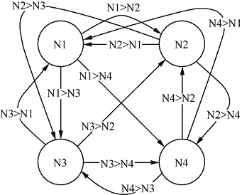

图 3-1 四节点霍普菲尔德网络

神经元状态非黑即白：**+1（激活）** 或 **-1（抑制）**。状态既是输入也是输出。单个神经元 `i` 的状态更新规则（公式 3-1）为：其他神经元状态 `s_j` 与连接权重 `w_ij` 的加权求和，超过阈值 `θ`（通常为 0）则置 +1，否则 -1。

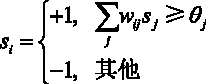

（3-1）

**更新策略决定动态：**
*   **异步更新**：随机挑一个神经元更新。符合生物异步特性，收敛有保证。
*   **同步更新**：全体同时更新。有全局时钟，易陷入振荡，生物学合理性弱。

网络运行直到状态稳定（达到**吸引子**）。如何量化“稳定程度”？引入**能量函数**（公式 3-2）。网络演化方向总是能量下降，稳定态即极小值点。玻尔兹曼机沿用此能量形式。

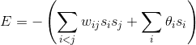

（3-2）

阈值为 0 时公式简化。代码实现见清单 3-1。

```python
def energy(weights, state, threshold):
  # First term
  a = 0
  for i in range(neuron_count):
    for j in range(neuron_count):
      a = a + weights[i][j] * state[i] * state[j]

  a = a * -0.5
  # Second term
  b = 0
  for i in range(neuron_count):
    b = b + state[i] * threshold[i]

  # Result
  return a + b
```

### 训练：用 Hebb 规则“刻录”记忆

训练目标：调整权重，使指定模式成为网络的稳定吸引子。

训练集由若干目标模式组成（每模式长度 = 神经元数，取值 ±1）。例如 8 神经元网络存储 4 个模式（数据纯示意）：

```
1 1 0 0 0 0 0 0
0 0 0 0 1 1 0 0
1 0 0 0 0 0 0 1
0 0 0 1 1 0 0 0
```

训练完成后，网络具备**模式完成功能**。输入一个带噪版本（如下）：

```
1 1 1 0 0 0 0 0
```

网络动态演化，状态将自动修正收敛至最接近的训练模式：

# 核心技术解析：从联想记忆到概率图模型

```
1 1 0 0 0 0 0 0
```

霍普菲尔德网络的参数学习主要采用两大法则：`Hebbian`[³]与`Storkey`[⁴]。前者契合生物学机制，核心在于“同步激发，连接增强”——即两个单元若频繁对同一输入做出共同响应，其连接强度便会上调。公式 3-3 给出了该规律的数学刻画：

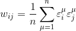

（3-3）

其中常数 `n` 指代训练样本 `ε` 的总量。连接权重阵为方阵，阶数等同于网络节点总数。主对角线恒置零（节点不自连），其余元素数值反映训练样本中两节点同为 `+1` 或 `−1` 的共现频度。清单 3-2 展示了具体实现逻辑。

清单 3-2　霍普菲尔德 Hebbian 规则实现

```python
def add_pattern(weights, pattern, n):
  for i in range(neuron_count):
    for j in range(neuron_count):
      if i == j:
        weights[i][j] = 0
      else:
        weights[i][j] = weights[i][j] + ((pattern[i] * pattern[j]) / n)
```

`add_pattern` 方法用于逐个写入训练样本。入参 `weights` 为权重阵，`pattern` 为单个样本向量，`n` 为样本总数。

仅凭公式与代码难以直观感知权重生成全貌，我们提供了在线演示页面辅助理解：

`http://www.heatonresearch.com/aifh/vol3/hopfield.html`

假设采用下述数据进行训练：

```
[1, 0, 0, 1]
[0, 1, 1, 0]
```

将产出如图 3-2 所示的权重阵。

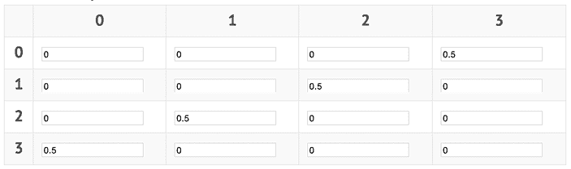

图 3-2　权重矩阵示例

推导过程：用 `1` 除以样本数（此处为 2），得系数 `0.5`。遍历各样本，凡节点取值为 `1` 的行列交叉处，累加 `0.5`。例如首个样本在节点 `#0` 与 `#3` 处为 `1`，则位置 `(0,3)` 与 `(3,0)` 各增 `0.5`；后续样本同理累加。

除 Hebbian 规则外，`Storkey` 算法亦为常用之选。虽逻辑更繁复，但能显著提升网络的模式容纳上限。

Storkey 算法首步在于求解“本地场” `h`，定义见公式 3-4：

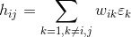

（3-4）

需对每对权重索引 `(i, j)` 计算 `h`，沿用权重 `w` 与样本 `ε`。清单 3-3 给出计算代码。

清单 3-3　Storkey 本地场计算

```python
def calculate_local_field(weights, i, j, pattern):
  sum = 0
  for k in range(len(pattern)):
    if k != i:
      sum = sum + weights[i][k] * pattern[k]
  return sum
```

随后依据公式 3-5 确定权重调整量：

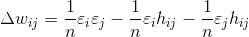

（3-5）

清单 3-4 实现了调整量的具体计算。

清单 3-4　权重调整量计算

```python
def add_pattern(weights, pattern):
  sum_matrix = matrix(len(pattern), len(pattern))
  n = len(pattern)
  for i in range(n):
    for j in range(n):
      t1 = (pattern[i] * pattern[j]) / n
      t2 = (pattern[i] * calculate_local_field(weights, j, i, pattern)) / n
      t3 = (pattern[j] * calculate_local_field(weights, i, j, pattern)) / n
      d = t1 - t2 - t3
      sum_matrix[i][j] = sum_matrix[i][j] + d
  return sum_matrix
```

调整量得出后，直接叠加至现有权重阵；若阵尚未初始化，则以调整量阵为初始值。

## 3.2 Hopfield-Tank 神经网络

前文阐述了霍普菲尔德网络的联想记忆特性。实际上，Hopfield 与 Tank（1984）提出的变体——Hopfield-Tank 模型，可用于求解组合优化难题（如旅行商问题 TSP）。

其架构与标准版有两显著差异：一是节点输出不再局限于离散 `0/1`，而是覆盖 `0~1` 的连续区间；二是引入了 Sigmoid 型激活函数。

但应用门槛颇高：必须为每个具体问题手工设计能量函数以表达约束与目标，过程繁琐。Hopfield 和 Tank（2008）曾演示如何为 TSP 构建能量函数。相比之下，模拟退火、Nelder-Mead 等通用寻优手段无需设计能量函数，且效果往往更优。鉴于此，本书不再展开优化版 Hopfield-Tank。前述算法已在《基础算法》（第 1 卷）详述；第 6 章将回顾随机梯度下降（`SGD`），它是前馈网络主流训练手段之一。

[²]: 参考文献待补

[³]: 参考文献待补

[⁴]: 参考文献待补

## 3.3 玻尔兹曼机

Hinton 与 Sejnowski（1985）首创玻尔兹曼机（BM），直至近年才大规模落地。其变体——受限玻尔兹曼机（`RBM`）更是深度学习与深度信念网络的基石。本章聚焦经典模型，第 9 章再讲 RBM 与深度学习。

经典 BM 是一个双层稠密连接网络，分**可见层**（对标输入层）与**隐藏层**。虽有隐层，但它更似输出层角色——这正是初学者易混淆前馈网络的根源：BM 在输入输出间**不存在**传统意义上的隐藏层。图 3-3 展示基础拓扑。

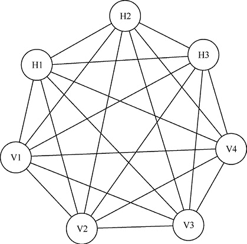

图 3-3 含 3 隐藏、4 可见节点。稠密连接指任意两节点互联（除自连），这与 RBM 的受限连接形成对比，见下图。

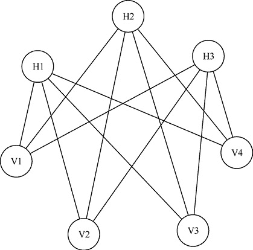

图 3-4 中 RBM 仅存在层间连接（隐-隐、显-显均无连接）。

同霍普菲尔德网络一样，经典 BM 节点取值为二值 `{0, 1}`。虽有连续变体研究，但主流仍聚焦二值版本，本书亦从略。

BM 属**生成式模型**：给定可见层状态与权重，隐藏节点以特定概率输出 `1`，而非确定性输出。

尽管与霍普菲尔德网络有相似处，关键差异显著：

*   霍普菲尔德网络易陷入伪记忆（虚假稳定态）；
*   BM 存储容量更大；
*   霍普菲尔德要求训练样本正交/不相关；
*   BM 可堆叠构建深层架构。

### 3.3.1 玻尔兹曼机的概率机制

查询隐藏节点 `i` 取 `1` 的几率时，网络按公式 3-6 随机采样：

```
p_{i=\mathrm{on}}=\frac{1}{1+\exp \left(-\frac{\Delta E_{i}}{T}\right)}
```

（3-6）

公式输出 `(0,1)` 区间概率值。如得 `0.75`，则有 75% 几率返回 `1`。工程实现：生成均匀随机数 `u ∈ [0,1]`，若 `u < p` 则输出 `1`。

该概率由节点 `i` 的能量增量 `∆E` 与系统温度 `T` 决定。温度 `T` 可用本章公式 3-2 计算（系统总能量表征温度），`θ` 为节点偏置。

能量变化 `∆E` 依公式 3-7 计算：

```
\Delta E_{i}=\sum_{j} w_{ij} s_{j}+\theta_{i}
```

（3-7）

它度量节点 `i` 在 `1`（开）与 `0`（关）两状态的能量差，含偏置项 `θ`。

单个节点随机更新，但整体趋向平衡。反复随机选单元按公式 3-6 刷新状态，运行足够久后，全局态分布仅取决于该态的能量——即对数概率与能量成线性负相关。此关系在热平衡时成立。

若从高温启动，缓慢降温至低温平衡（模拟退火），系统有望收敛到全局能量极小值附近的分布。

## 3.4 玻尔兹曼机的应用实战

学界重心已转向 RBM（第 9 章详解），本节回顾早期无限制 BM 在优化与识别上的探索，以 TSP 为例。

### 3.4.1 旅行商问题（TSP）

TSP 是经典 NP-hard 难题：给定城市集合，寻找访问每城一次且总路程最短的回路。若熟悉 TSP 或已读丛书第 2 卷，可略过本节。

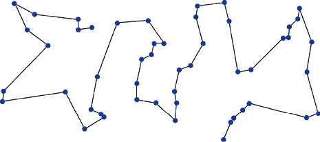

路径数随城市数 `n` 按阶乘 `n!` 爆发式增长：

```
1 个城市有 1 条路径
2 个城市有 2 条路径
3 个城市有 6 条路径
4 个城市有 24 条路径
5 个城市有 120 条路径
6 个城市有 720 条路径
7 个城市有 5 040 条路径
8 个城市有 40 320 条路径
9 个城市有 362 880 条路径
10 个城市有 3 628 800 条路径
11 个城市有 39 916 800 条路径
12 个城市有 479 001 600 条路径
13 个城市有 6 227 020 800 条路径
……
50 个城市有 3.041×10⁶⁴ 条路径
```

| 城市数 | 可能路径 |
| :--- | :--- |
| 1 | 1 |
| 2 | 2 |
| 3 | 6 |
| ... | ... |
| 10 | 3,628,800 |
| 20 | ≈ 2.43×10¹⁸ |

穷举搜索在 `n > 10` 时失效。动态规划（DP）将大问题分解为重叠子问题，复用计算，大幅剪枝（见图 3-6 趣图），但复杂度仍指数级。

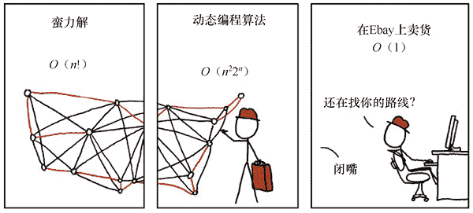

遗传算法（GA）虽不能保证全局最优，却常能给出高质量近似解。下节示例将用 BM 求解 TSP。

### 3.4.2 优化建模与编码

将 TSP 映射到二值节点网络，采用 Hopfield（1984）编码方案——霍普菲尔德网络与 BM 通用。

构建 `n×n` 方阵（`n` 为城市数）：
*   **列** = 城市编号
*   **行** = 访问顺序（第 1 站、第 2 站…）
*   每行、每列**恰好一个 `1`**，其余 `0`。`(row, col)=1` 表示“第 row 站访问城市 col”。

示例：4 城市，路径 `0 → 3 → 1 → 2`，矩阵如表 3-1、图 3-7。

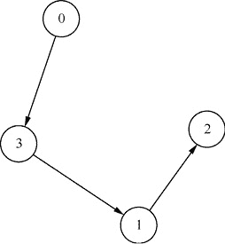

表 3-1 编码矩阵

| 访问顺序\城市 | #0 | #1 | #2 | #3 |
| :--- | :---: | :---: | :---: | :---: |
| 第 1 站 | 1 | 0 | 0 | 0 |
| 第 2 站 | 0 | 0 | 0 | 1 |
| 第 3 站 | 0 | 1 | 0 | 0 |
| 第 4 站 | 0 | 0 | 1 | 0 |

BM 节点为一维向量，只需按行拉直矩阵：
`[1,0,0,0, 0,0,0,1, 0,1,0,0, 0,0,1,0]`

```
[1, 0, 0, 0, 0, 0, 0, 1, 0, 1, 0, 0, 0, 0, 1, 0]
```

程序需设计权重与偏置，使网络动力学将状态吸引到**合法且总距离最短**的编码。合法性约束：
1.  每行仅一个 `1`（每站只去一城）；
2.  每列仅一个 `1`（每城只访一次）。

非法状态必须对应高能量（不稳定）。清单 3-5 给出生成权重阵的伪代码。

清单 3-5 TSP 玻尔兹曼机权重构造

```
gamma = 7
 Source
for source_tour in range(NUM_CITIES):
  for source_city in range(NUM_CITIES):
    source_index = source_tour * NUM_CITIES + source_city
 Target
    for target_tour in range(NUM_CITIES):
      for target_city in range(NUM_CITIES):
        target_index = target_tour * NUM_CITIES + target_city
 Calculate the weight
        weight = 0
 Diagonal weight is 0
        if source_index != target_index:
 Determine the next and previous element in the tour.
 Wrap between 0 and last element.
          prev_target_tour = wrapped_next_target_tour
          next_target_tour = wrapped_previous_target_tour
 If same tour element or city, then -gamma
          if (source_tour == target_tour) or (source_city == target_city):
            weight = -gamma
 If next or previous city, -gamma
          elif ((source_tour == prev_target_tour) or (source_tour == next_target_tour)):
            weight = -distance(source_city, target_city)
 Otherwise 0
        set_weight(source_index, target_index, weight)
 All biases are -gamma/2
    set_bias(source_index, -gamma / 2)
```

图 3-8 呈现了为 4 个城市构建的权重矩阵的局部截图。

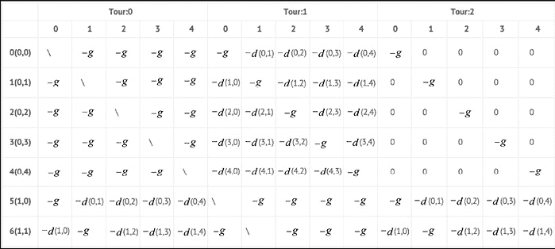

受限于排版，书中表格可能难以看清。你可以访问下方链接的 JavaScript 工具，为任意数量的城市生成完整矩阵：

`http://www.heatonresearch.com/aifh/vol3/boltzmann_tsp_grid.html`

权重赋值的核心逻辑如下：

*   **对角线**：数值置 0（图中标记为 `\`）。
*   **同一位置（源=目标）**：设为 `−γ`（图中显示为 `-g`）。
*   **同一城市（源≠目标位置）**：同样设为 `−γ`（图中显示为 `-g`）。
*   **相邻城市（前/后）**：设为 `-distance`（图中显示为 `-d(x,y)`）。
*   **其余情况**：均为 0。

该矩阵在行与列维度上呈对称分布。

### 3.4.3 玻尔兹曼机的训练机制

3.4.2 节演示了如何通过硬编码权重来搭建玻尔兹曼机，从而求解 TSP 问题。这要求开发者凭借对问题的理解手动设定权重。虽说将玻尔兹曼机用于优化任务的关键在于构造权重矩阵，但这一步骤难度极大。考虑到 Nelder-Mead 法和模拟退火在通用优化算法中更具实用性，本书不再展开讲解如何为通用优化问题构建权重矩阵。

## 3.5 本章回顾

Hopfield 神经网络结构简洁，既能识别模式，也能攻克优化难题。但它要求为每个优化问题量身定制专属的能量函数。受此限制，工程实践中更倾向于选用 Nelder-Mead 法或模拟退火等算法，而非 Hopfield 网络的优化变体。

玻尔兹曼机虽与 Hopfield 网络同源，却拥有独特优势：它支持堆叠构建深度信念网络（DBN）。正是这种堆叠特性，奠定了玻尔兹曼机在深度信念网络实现中的核心地位，进而成为深度学习奠基的关键一环。

下一章（第 4 章）我们将转向前馈神经网络——这依然是当下最主流的网络架构之一。重点将放在搭载 Sigmoid 与 Tanh 激活函数的经典前馈网络上。得益于新型训练算法、层结构、激活函数等创新，经典前馈网络得以无缝衔接深度学习体系。

***

[¹]: Hopfield，1982。

[²]: Hopfield，1982。

[³]: Storkey，1999。

[⁴]: Garey，1979。

# 第 4 章 前馈神经网络

**本章核心看点：**

*   分类任务
*   回归任务
*   网络层级架构
*   数据规范化处理

本章深入剖析神经网络领域最基础、应用最广的架构——前馈神经网络。因其适用场景极广，该架构备受青睐。我们将详细拆解其训练范式与模式处理机制。

“前馈”精准描述了信息流向：各层神经元仅连接下一层，信号从输入层单向流经隐藏层抵达输出层，**完全不存在反向连接**。这与第 3 章的 Hopfield 网络形成鲜明对比——后者全连接、双向传播。后文将详细对比前馈网络的结构特点与记忆模式。

训练前馈网络可采用多种反向传播算法（属监督学习范畴，第 5 章详解）。本章侧重介绍如何利用优化算法调整权重。若需优化算法底层细节，可参考本系列第 1、2 卷。虽有多种优化算法可用，但我们将聚焦于模拟退火。

优化算法的本质是调整一个数值向量，使其在目标函数上获得高分。目标函数依据网络输出与期望输出的吻合度打分，这个分数使得任意优化算法均可介入训练。

前馈网络拓扑结构由输入层起步，可直连隐藏层或输出层；隐藏层之间可级联任意层数，最终抵达输出层。

## 4.1 前馈神经网络的拓扑结构

延续第 1 章“基础篇”关于多隐藏层的论述，本章将从输出层结构切入，重点解析输入/输出神经元的组织形式。输出层的设计完全取决于问题类型：**分类网络为每个类别分配一个输出神经元，回归网络仅设单一输出神经元。**

## 4.2 单输出神经网络解决回归问题

虽然后馈网络支持多输出，但我们先从最基础的单输出回归模型讲起。此类网络输出单一数值，适用场景如图 4-1 所示。

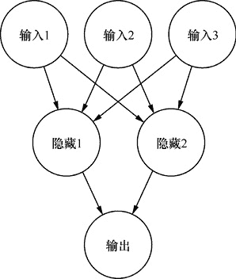

该网络输出单一数值，典型应用包括：

*   **回归预测**：根据输入推算数值（如根据车型参数预测 MPG/每加仑英里数）。
*   **二元分类**：在两个选项中抉择（如根据特征判断肿瘤良恶性）。

本章将通过“汽车 MPG 数据集”实战回归预测。数据集片段如下：

```csv
mpg,cylinders,displacement,horsepower,weight,acceleration,model_year,origin,car_name
18,8,307,130,3504,12,70,1,"chevrolet chevelle malibu"
15,8,350,165,3693,11,70,1,"buick skylark 320"
18,8,318,150,3436,11,70,1,"plymouth satellite"
16,8,304,150,3433,12,70,1,"amc rebel sst"
```

回归建模时，网络以 `cylinders`（气缸数）、`displacement`（排量）、`horsepower`（马力）、`weight`（重量）等特征预测 `mpg`。当然，特征与目标可互换——也可用 `mpg` 等特征反推 `displacement`。

若需同时预测多个连续值（如同时预测 `mpg` 与 `weight`），可增设多输出神经元。但**实战不推荐此做法**——为每个回归目标单独训练网络，效果通常更优。

### 4.2.1 前向计算流程

回顾第 1 章，单个神经元的输出 = 激活函数(输入加权和 + 偏置)。公式 4-1 给出数学表达：

$f\left(x_{i}, w_{i}\right)=\phi\left(\sum_{i}\left(w_{i} \cdot x_{i}\right)\right)$

（4-1）

神经元将输入向量 $\boldsymbol{x}$ 与权重向量 $\boldsymbol{w}$ 做点积，送入激活函数 $\phi$。偏置技巧：在权重向量末尾追加偏置权重，输入向量末尾补 1.0。例如双输入单偏置神经元，输入 0.1 和 0.2，扩展后的输入向量为：

```
[0.1, 0.2, 1.0]
```

权重向量设为：

```
[0.01, 0.02, 0.3]
```

其中 0.01、0.02 为输入权重，0.3 为偏置权重。加权和计算如下：

```
(0.1 * 0.01) + (0.2 * 0.02) + (1.0 * 0.3)
```

得到 0.305，送入激活函数即得该神经元输出。

整网前向传播，本质是对所有神经元重复上述过程，从输入层层层推演至输出层。工程实现上，可面向对象封装神经元/连接，也可将连接权重扁平化存入矩阵/向量。

面向对象虽代码可读性强，但存在两大痛点：

1.  权重分散存储在海量对象中；
2.  性能损耗大：频繁函数调用与内存寻址拖累求和速度。

**扁平化权重向量**是工程首选：主流优化算法（详见系列第 1、2 卷）天然支持向量调优。后文将演示模拟退火如何优化权重向量。

**构建权重向量的实战步骤**：

假设一个微型网络：
*   输入层：2 神经元 + 1 偏置
*   隐藏层：2 神经元 + 1 偏置
*   输出层：1 神经元
*   共 7 个神经元

按拓扑顺序编号（如图 4-2）：

```
Neuron 0: Output 1
Neuron 1: Hidden 1
Neuron 2: Hidden 2
Neuron 3: Bias 2 (set to 1, usually)
Neuron 4: Input 1
Neuron 5: Input 2
Neuron 6: Bias 1 (set to 1, usually)
```

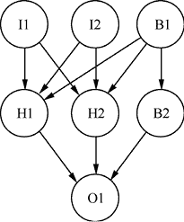

为便于高速索引，需额外维护辅助向量（顺序均为：输出层 → 隐藏层 → 输入层）：

```
layerFeedCounts: [1, 2, 2]
layerCounts: [1, 3, 3]
layerIndex: [0, 1, 4]
layerOutput: [0.0, 0.0, 0.0, 1.0, 0.0, 0.0, 1.0]
weightIndex: [0, 3, 9]
```

*   `layerFeedCounts`：各层非偏置神经元计数。
*   `layerOutput`：各神经元当前激活值（初始全 0，偏置固定 1.0）。
*   `layerIndex`：各层在 `layerOutput` 中的起始索引。
*   `weightIndex`：各层权重在总权重向量中的起始索引。

权重向量内部布局如下：

```
Weight 0 : H1->O1
Weight 1 : H2->O1
Weight 2 : B2->O1
Weight 3 : I1->H1
Weight 4 : I2->H1
Weight 5 : B1->H1
Weight 6 : I1->H2
Weight 7 : I2->H2
Weight 8 : B1->H2
```

数据结构就绪后，前向计算即可高效执行。清单 4-1 给出参考实现。

清单 4-1 前向传播计算实现

```python
def compute(net, input):
    sourceIndex = len(net.layerOutput) - net.layerCounts[len(net.layerCounts) - 1]
    # Copy the input into the layerOutput vector
    array_copy(input, 0, net.layerOutput, sourceIndex, net.inputCount)
    # Calculate each layer
    for i in reversed(range(0, len(layerIndex))):
        compute_layer(i)
    # update context values
    offset = net.contextTargetOffset[0]
    # Create result
    result = vector(net.outputCount)
    array_copy(net.layerOutput, 0, result, 0, net.outputCount)
    return result

def compute_layer(net, currentLayer):
    inputIndex = net.layerIndex[currentLayer]
    outputIndex = net.layerIndex[currentLayer - 1]
    inputSize = net.layerCounts[currentLayer]
    outputSize = net.layerFeedCounts[currentLayer - 1]
    index = this.weightIndex[currentLayer - 1]
    limit_x = outputIndex + outputSize
    limit_y = inputIndex + inputSize
    # weight values
    for x in range(outputIndex, limit_x):
        sum = 0
        for y in range(inputIndex, limit_y):
            sum += net.weights[index] * net.layerOutput[y]
        net.layerSums[x] = sum
        net.layerOutput[x] = sum
        index = index + 1

    net.activationFunctions[currentLayer - 1].activation_function(
        net.layerOutput, outputIndex, outputSize)
```

## 4.3 权重初始化策略

权重决定网络表现。训练过程本质上是从初始权重出发，迭代优化至最优解。主流做法：**随机初始化 → 迭代优化**。

初始随机权重直接影响训练成败。若陷入局部最优或无法收敛，重新随机初始化（换种子）是常用急救手段。但在调架构（增层/加宽）时，这会引入混淆变量：性能提升究竟源于新结构，还是仅因新随机种子运气更好？为消除此不确定性，评价初始化算法需聚焦两大指标：

1.  **稳健性**：能否持续产出“易训练”的权重？
2.  **先发优势**：初始权重是否自带良好收敛起点？

最朴素（但最差）的方法：均匀分布随机赋值（如 −1∼+1 或 −5∼+5）。固定随机种子可复现权重序列（如种子 1000 固定产出 0.5、0.75、0.2），但**种子优劣完全看运气**——部分种子生成的权重极难训练甚至完全卡死。遇到此情况，唯有更换种子重试。

# 解决权重初始化难题：Xavier 算法与 RBF 网络、数据归一化实战指南

权重初始化一直是个老大难问题，学术界为此投入了大量精力。多年来我们持续跟进相关研究，并在 `Encog` 项目里集成了 6 种不同的初始化方案。经实测对比，`Glorot` 与 `Bengio` 于 2010 年提出的 **Xavier 初始化** 效果最稳健、通用性最强。这套算法逻辑清晰，核心在于利用**正态分布**生成随机数。

想用好 Xavier，先得搞清楚“正态分布随机数”长什么样。它不是大多数语言自带的 0~1 均匀分布随机数。正态分布以均值 $\mu$（通常设为 0）为中心对称分布：大于 0 和小于 0 的数量几乎相等。关键在于“离中心多远”——由标准差 $\sigma$ 控制。理论上数值可达浮点数极限，但 99.7% 的样本落在 $\pm 3\sigma$ 范围内。

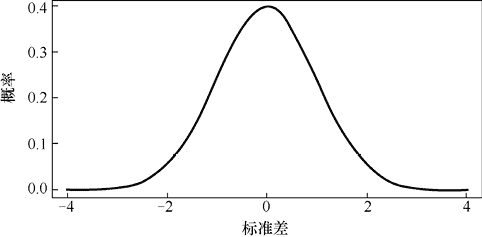

如图所示，中心值（0）出现概率约 40%，向两侧 $\pm 2\sigma$ 处概率骤降。只要锁定均值和标准差，随机数的生成范围就完全可控。

主流语言标准库通常内置了正态分布生成器（底层多基于 `Box-Muller` 变换），本书示例直接调用现成 API，无需手写算法（细节见本系列卷 1《基础算法》）。

**Xavier 的核心公式**：
所有权重服从 $\mu=0$ 的正态分布，标准差由当前层的连接数决定。先算方差：
$$ \mathrm{Var}(W)=\frac{2}{n_{\text{in}}+n_{\text{out}}} $$
（4-2）
再开平方得标准差 $\sigma$（多数随机数生成器吃的是 $\sigma$ 而非方差）。每一层独立完成此过程。

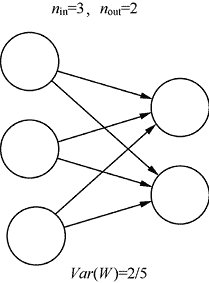

---

## 4.4 径向基函数（RBF）神经网络：原理与实战

`Broomhead` 和 `Lowe` 1988 年提出的 **RBF 网络** 是典型前馈架构，能做分类也能做回归。虽问题覆盖面广，但近年热度下降，且**原生不兼容深度学习**——这是硬伤。

RBF 网络靠一组**参数向量**（权重+系数）把输入映射为输出。训练本质就是调整这组向量，使其在鸢尾花等数据集上表现达标。参数向量即网络的“长期记忆”。下节拆解向量内部结构。

### 4.4.1 核心组件：径向基函数

RBF 是众多 AI 算法的基石。**特性：以中心为轴对称，中心处取峰值（通常设为 1），输出永远是标量，无论输入多少维。**

最常用的是 **高斯 RBF**。一维高斯曲线（中心 0）如图：

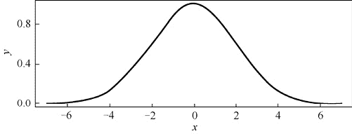

别把它单纯当“钟形曲线”或“正态分布”——它是**选择性缩放器**：中心处放大信号，向两侧衰减。

**多维怎么算？**  
RBF 接收多维向量，先算输入 $\boldsymbol{x}$ 与中心 $\boldsymbol{x}_i$ 的**欧氏距离** $r$（维度必须一致）：
$$ r=\left\|\boldsymbol{x}-\boldsymbol{x}_{i}\right\| \quad \text{(4-3)} $$
有了 $r$，一切迎刃而解。高斯 RBF 表达式：
$$ \phi(r)=\mathrm{e}^{-r^{2}} \quad \text{(4-4)} $$
$\phi$ 代表 RBF，$e$ 为自然常数。

### 4.4.2 实战：鸢尾花分类

RBF 网络输出 = 多个 RBF 的加权求和。统一公式：
$$ f(\boldsymbol{X})=\sum_{i=1}^{N} a_{i} \phi\left(\left\|b_{i} \boldsymbol{X}-\boldsymbol{c}_{i}\right\|\right) \quad \text{(4-5)} $$
符号对照：
- $\boldsymbol{X}$：输入向量
- $\boldsymbol{c}_i$：第 $i$ 个 RBF 的中心
- $\phi$：选定的 RBF（如高斯）
- $\boldsymbol{a}_i$：输出层权重
- $\boldsymbol{b}_i$：输入加权系数

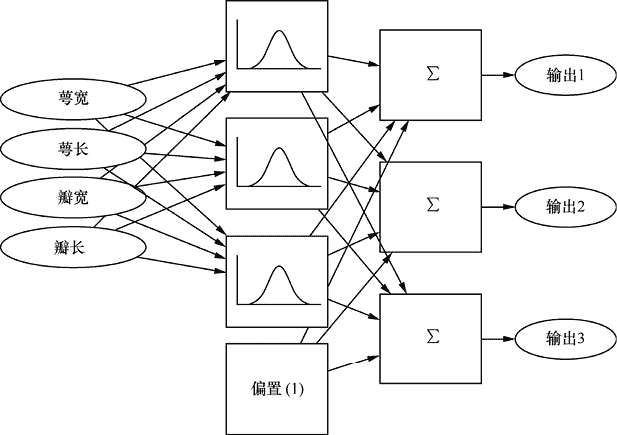

**网络拓扑解读（以鸢尾花为例）**：
- 4 维输入（萼/瓣长宽）
- 3 个输出节点（1-of-n 编码，对应 3 种鸢尾花）
- 隐层 3 个高斯 RBF（可增减，权衡精度与速度）
- **偏置节点**常驻隐层同级：恒输出 1，乘以权重后直接加到求和层，相当于 $y$ 截距。输入全 0 时偏置保证隐层仍有输出，**不是累赘，是刚需**。

**长期记忆向量 = 4 大块拼接**：
1. 输入系数 ($\boldsymbol{b}$)
2. 输出系数 ($\boldsymbol{a}$)
3. RBF 宽度标量（各向同性）
4. RBF 中心向量 ($\boldsymbol{c}$)

优化算法调整该向量即可完成训练，后续章节将详细介绍多种优化器。本节仅作预备知识铺垫，系统理论请参阅卷 1、2。

---

## 4.5 数据规范化：让神经网络“听得懂”你的数据

原始数据很难直接喂进网络，必须先**缩放到激活函数适配的区间**。方法很多（详见卷 1），本章只讲神经网络最实用的三招。

### 4.5.1 1-of-n 编码（One-Hot）：分类变量的标准动作

鸢尾花品种、汽车品牌、MNIST 数字标签……**无序分类**必须用 1-of-n。每类占一个输出神经元，配合 `Softmax` 输出概率分布。MNIST 10 类示例：

```
0 -> [1,0,0,0,0,0,0,0,0,0]
1 -> [0,1,0,0,0,0,0,0,0,0]
2 -> [0,0,1,0,0,0,0,0,0,0]
3 -> [0,0,0,1,0,0,0,0,0,0]
4 -> [0,0,0,0,1,0,0,0,0,0]
5 -> [0,0,0,0,0,1,0,0,0,0]
6 -> [0,0,0,0,0,0,1,0,0,0]
7 -> [0,0,0,0,0,0,0,1,0,0]
8 -> [0,0,0,0,0,0,0,0,1,0]
9 -> [0,0,0,0,0,0,0,0,0,1]
```

**核心原则**：**类别间无天然顺序时，强制用 1-of-n。**  
汽车品牌按成立年份排序？只有“年份”对任务有意义时才这么干，否则照旧 one-hot。  
**数字标签也要 one-hot？** 是的。像素识别“1”vs“2”，数值大小毫无几何意义，用单神经元回归反而误导网络。

**激活函数决定编码取值**：
- `ReLU`/`Softmax` → 0/1
- `tanh` → -1/1（匹配输出范围）

**类别爆炸咋办？**  
1. 找业务逻辑给类别排序 → 映射为序数  
2. 用 **TF-IDF** 将类别压缩为单神经元概率值（内置主流框架，不展开）

### 4.5.2 范围规范化：线性映射到 [0,1] 或 [-1,1]

适用于**实数或有序类别**。公式：
$$ \text{norm}(x, d_L, d_H, n_L, n_H) = \frac{(x - d_L)(n_H - n_L)}{d_H - d_L} + n_L \quad \text{(4-6)} $$
$d_L,d_H$：原始数据极值；$n_L,n_H$：目标区间（通常 0/1 或 -1/1）。

**逆变换**（还原数据）：
$$ \text{denorm}(x, d_L, d_H, n_L, n_H) = \frac{(d_L - d_H)x - n_H d_L + d_H n_L}{n_L - n_H} + n_L \quad \text{(4-7)} $$

**直观类比**：打折 10 元 vs 打 9 折。前者买 T 恤划算买车无感，后者**百分比归一化**后对所有价格公平。神经网络也需要这种“公平刻度”。

### 4.5.3 Z-Score 规范化：实数首选，统计鲁棒性最强

**几乎所有实数/有序场景首选 Z-Score，优于范围规范化**。它描述“某值偏离均值多少个标准差”，含信息量超百分比。

**经典反例**：  
学生 A 考 85 分（均值 95），学生 B 考 75 分（均值 65）。原始分 A 胜，但 Z-Score 视角下 B 表现更优（高于均值），A 反而拖后腿。

**三步走计算**：
1. **均值** $\mu = \frac{1}{N}\sum x_i$ （4-8）
2. **标准差** $\sigma = \sqrt{\frac{1}{N}\sum (x_i-\mu)^2}$ （4-9）
3. **Z-Score** $z = \frac{x-\mu}{\sigma}$ （4-10）

伪代码实现：

```python
 Data to score
data = [ 5, 10, 3, 20, 4]
 Sum the values
sum = 0
for d in data:
    sum = sum + d
 Calculate mean
mean = float(sum) / len(data)
print( "Mean: " + mean )
 Calculate the variance
variance = 0
for d in data:
    variance = variance + ((mean-d)**2)
variance = variance / len(data)
print( "Variance: " + variance )
 Calculate the standard deviation
sdev = sqrt(variance)
print( "Standard Deviation: " + sdev )
 Calculate zscore
zscore = []
for d in data:
    zscore.append( (d-mean)/sdev)
print("Z-Scores: " + str(zscore) )
```

输出示例：

```
Mean: 8.4
Variance: 39.440000000000005
Standard Deviation: 6.280127387243033
Z-Scores: [-0.5413902920037097, 0.2547719021193927, -0.8598551696529507, 1.8470962903655976, -0.7006227308283302]
```

**解读**：
- $z=0$：恰等于均值
- $z>0$：高于均值
- $z<0$：低于均值

Z-Score 与等级映射对照：

```
<-2.0 = D+ 
-2.0  = C-
-1.5  = C
-1.0  = C+
-0.5  = B-
0.0   = B
+0.5  = B+
+1.0  = A-
+1.5  = A
+2.0  = A+
```

# 4.5.4 进阶特征工程：复杂规范化实战

上文列举的对照表取自某高校真实评分体系。标准分（`z`分数）向字母等级的换算差异颇大：多数教师把 0.0 标准分对应到 C 或 B，取决于该校把哪个等级视为平均水平。示例表格以 B 为均值。标准分以零为中心分布，数值极少超出 ±3 区间，极契合神经网络输入层的数值范围要求。

模型输入通常称为特征向量。将原始样本转换为网络可识别格式的过程至关重要，该过程称作编码。以汽车油耗（`MPG`）数据集为例：

```
1. mpg:           numeric
2. cylinders:     numeric, 3 unique
3. displacement:  numeric
4. horsepower:    numeric
5. weight:        numeric
6. acceleration:  numeric
7. model year:    numeric, 3 unique
8. origin:        numeric, 7 unique
9. car name:      string (unique for each instance)
```

编码时将 `MPG` 设为目标变量，构建回归任务。`MPG` 特征采用标准分编码，完美匹配输出端线性激活函数的取值范围。

车名字段直接丢弃。汽缸数、车型、年份采用独热编码（1-of-`n`），其余数值字段统一用标准分编码。最终得到的特征向量如下：

```
Input Feature Vector:
Feature 1: cylinders-2, -1 no, +1 yes
Feature 2: cylinders-4, -1 no, +1 yes
Feature 3: cylinders-8, -1 no, +1 yes
Feature 4: displacement z-score
Feature 5: horsepower z-score
Feature 6: weight z-score
Feature 7: acceleration z-score
Feature 8: model year-1977, -1 no, +1 yes
Feature 9: model year-1978, -1 no, +1 yes
Feature 10: model year-1979, -1 no, +1 yes
Feature 11: origin-1
Feature 12: origin-2
Feature 13: origin-3
Output:
mpg z-score
```

可见，特征维度从 9 个原始字段扩展为 13 个输入特征加 1 个输出。对应网络拥有 13 个输入神经元和 1 个输出神经元。假设单隐层含 20 个神经元、激活函数用 `ReLU`，网络拓扑如图 4-7 所示。

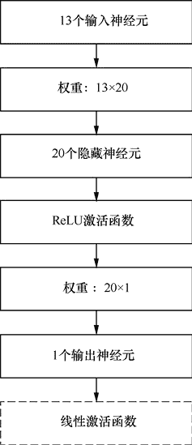

图 4-7　简易回归网络结构

## 4.6 本章小结

前馈神经网络是人工智能领域最主流的算法之一。本章介绍了多层前馈网络与 `RBF` 网络两大类别，两者均适用于分类与回归任务。

前馈网络层级分明：输入层接收程序数据，输出层返回处理结果，中间隐藏层神经元负责识别输入模式并产出正确输出。

`RBF` 网络隐藏层使用径向基函数群，除权重外，还可调节函数宽度与中心。虽均具备通用近似能力，但处理机制迥异。

迄今为止我们仅掌握了根据权重推算输出的方法。训练是依据目标调整权重的过程，需配合评估手段——即按预期输出评判实际表现。下一章将详述训练与评估体系。

# 第 5 章 训练与评估

本章核心看点：
*   均方差（`MSE`）评估体系
*   敏感性与特异性的权衡艺术
*   `ROC` 曲线与 `AUC` 指标解读
*   模拟退火优化策略

前文已掌握按既定权重推算输出的方法，但权重从何而来？**训练**即不断修正权重使输出逼近目标的核心流程。**评估**则是依据预期输出为实际表现打分的环节。

本章系统拆解训练评估体系。鉴于手段多样，亟需统一判断基准——**目标函数**。它为网络表现量化打分，训练据此迭代修正权重。通常目标函数倾向“分值越低越好”，称作**最小化**问题；反之若需分值越高越好，则为**最大化**问题。主流训练算法均兼容双模式。

理论上，任意连续域优化算法（模拟退火、粒子群 `PSO`、遗传算法、爬山法、`Nelder-Mead`、随机游走等）均可用于权重优化。本章重点剖析**模拟退火**这一入门级算法。除优化器外，**反向传播**是另一核心训练范式，相关进阶算法将在第 6 章“反向传播训练”与第 7 章“其他传播训练”中详细展开。

## 5.1 分类任务的评估体系

分类任务旨在将输入划归至一个或多个预设类别。最直观的评估方式是计算**错误分类率**——即训练样本中被错分的占比，这与答题计分逻辑如出一辙。例如十道单选题答错一道，得分即为 90%。但机器分类往往不直接给出确定标签，而是输出各类别的**置信度分布**。

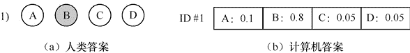

如上图：人工考生直接勾选“B”；模型给“B”八成把握、“A”一成，其余分散。若答案为“B”，模型得 0.8 分；若为“D”，仅得 0.05 分。这种分布式输出要求更精细的评估指标。

### 5.1.1 二值分类：在“两害相权”中寻平衡

当输出仅两类（如是/否、买入/卖出）时，涉及**二值分类**。以信贷审批为例：系统仅需决定“通过”或“拒绝”。评估核心指标为**假阳性（`FP`，第一类错误）**与**假阴性（`FN`，第二类错误）**。

*   **假阳性（`FP`）**：本该拒绝的高风险客户被通过（放过坏人）。
*   **假阴性（`FN`）**：本该通过的优质客户被拒（错杀好人）。

银行通常视假阳性危害远大于假阴性（坏账损失 > 机会成本），故倾向压低假阳性率。这引出两个关键特性指标：
*   **敏感性**：倾向判“通过”（通过率高），代价是假阳性增加。
*   **特异性**：倾向判“拒绝”（拒绝率高），代价是假阴性增加。

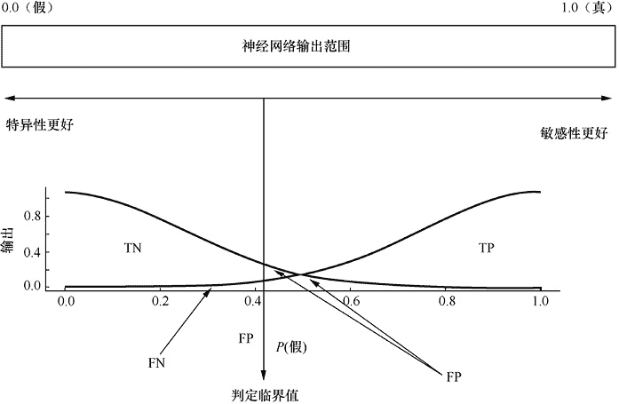

移动**判定阈值**可动态调节二者平衡：阈值左移→特异性增强（真阴性区域缩小）；阈值右移→敏感性增强（真阳性区域缩小）。

 

> **警示**：盲目追求 100% 敏感性或特异性会导致模型退化为“恒输出单一类别”的无效工具（如全判“非患病”得 100% 特异性但零诊断价值）。

#### 综合评估指标：总预测率与 `ROC` 曲线
**总预测率（`TPR`）** 融合真阳性率与真阴性率，公式如下：


**`ROC` 曲线** 以假阳性率为横轴、真阳性率为纵轴，直观展现不同阈值下的性能权衡。


*   **虚线（对角线）**：随机猜测基线，`AUC`=0.5，无判别能力。
*   **点线**：具备一定判别力。
*   **实线**：近乎完美判别器，贴近左上角 (0,1)。

**曲线下面积（`AUC`）** 量化综合性能：理想值 1.0（单位正方形面积）。`AUC` 越大，模型越强。

```
http://www.heatonresearch.com/aifh/vol3/anneal_roc.html
```

实战中，可在线演示平台结合退火策略训练，观察 `MSE` 下降伴随 `ROC` 曲线向左上收敛的过程。


#### 业务场景决定阈值选择
并非总要最大化总预测率。预测桥梁倒塌案例中：
*   **假阳性（虚警）**：浪费工程师排查工时。
*   **假阴性（漏报）**：酿成灾难，后果严重得多。
此时必须大幅提高特异性（压低假阴性），宁愿多检几座安全桥，绝不漏报一座危桥。

### 5.1.2 多类分类：多输出架构与竞争决策

预测三个以上类别（如鸢尾花品种）需**多输出神经元**。单神经元仅能二分，双输出极少用，通常类别数匹配输出数。

```
sepal_length,sepal_width,petal_length,petal_width,species
5.1,3.5,1.4,0.2,Iris-setosa
4.9,3.0,1.4,0.2,Iris-setosa
7.0,3.2,4.7,1.4,Iris-versicolour
6.4,3.2,4.5,1.5,Iris-versicolour
6.3,3.3,6.0,2.5,Iris-virginica
5.8,2.7,5.1,1.9,Iris-virginica
```

鸢尾花样本集：四维测量值（花瓣萼片长宽）→ 识别三品类。架构为 **四入 → 隐藏层 → 三出**。


输出层三神经元分别映射三品种，**取最大者即为判别结果**（竞争机制）。

### 5.1.3 对数损失：惩罚“自信错判”的似然估计

简单正确率将分类视作非黑即白的判断题，但模型输出的是概率分布。若模型给正确类别八成把握，理应得八分。然**对数损失（`log loss`）** 引入非线性惩罚项，重罚自信错判。

**二分对数损失公式**：
```
1.鸢尾花 setosa 会有萼片长 5.1 厘米、萼片宽 3.5 厘米、花瓣长 1.4 厘米、花瓣宽 0.2 厘米吗？
A) True
B) False
```
```
True: 80%
```
![logloss(\hat{\boldsymbol{y}})=-\frac{1}{N} \sum_{i=1}^{N}\left[y_{i} \lg \left(\hat{y}_{i}\right)+\left(1-y_{i}\right) \lg \left(1-\hat{y}_{i}\right)\right]](Images/126.gif)

其中：
*   真值 $y_i \in \{0,1\}$（训练样本仅硬标签无分布）。
*   模型给出正类似然 $\hat{y}_i$。
*   负号转正便于求最小。
*   两项互斥仅一项生效：$y_i=1$ 时仅保留 $-\log(\hat{y}_i)$；$y_i=0$ 时仅保留 $-\log(1-\hat{y}_i)$。

**核心逻辑**：损失 = $-\log(\text{正确类别的似然度})$。

| 正确类别似然度 | 对数损失值 | 解读 |
| :--- | :--- | :--- |
| 1.0 (完全把握) | $-\log(1)=0$ | **零损失**，完美拟合 |
| 0.8 | $\approx 0.22$ | 小惩罚 |
| 0.5 (五五开) | $\approx 0.69$ | 基准惩罚 |
| 0.1 (一成把握) | $\approx 2.30$ | **重罚** |
| $\to 0$ | $\to +\infty$ | **无限大惩罚**，模型崩溃 |

这倒逼模型诚实表达：**别虚高把握踩空，宁可谦虚给五成**。这正是对数损失胜过硬正确率的关键——它考核**概率校准质量**而非仅硬判别。

---

## 本章小结
1.  **训练本质** = 目标函数驱动的权重求极值（最小化/最大化）。
2.  **二值分类核心**在于假阳性/假阴性权衡，通过阈值调节敏感性/特异性，用 `AUC` 量化综合能力。
3.  **多类分类**采用多输出 + 最大值决策。
4.  **对数损失**通过对数惩罚强制模型给出可靠分布，是分类任务首选目标函数。

下一章将深入 **反向传播算法**——解决梯度计算与高效权重更新的标准方案。

# 损失函数与反向传播：从 LogLoss 到梯度下降的核心逻辑

### 5.1.4 多类对数损失：分类任务的“计分器”

先看组直观的数据，感受下对数损失对“自信犯错”的惩罚力度：

*   `−lg(0.95) = 0.02`；
*   `−lg(0.9) = 0.05`；
*   `−lg(0.8) = 0.1`；
*   `−lg(0.5) = 0.3`；
*   `−lg(0.1) = 1`；
*   `−lg(0.01) = 2`；
*   `−lg(1.0e−12) = 12`；
*   `−lg(0.0) = 无穷大`。

一目了然：**给正确答案打低分（低置信度），惩罚最重**。由于 `lg(0)` 趋向负无穷，工程上通常会设定一个极小值截断。注意，以上数值针对单个样本，实际训练中需对全量数据的对数值求平均。


（5-3）

面对两类以上的分类任务，必须祭出**多类对数损失**（`mlogloss`）。它与二分类版本一脉相承。公式 5-3 给出了标准定义：

其中 `N` 为样本总数，`M` 为类别总数。其核心逻辑是：**只对“正确类别”对应的预测概率取负对数，再求平均**。公式中最内层的求和项，借助 one-hot 编码特性（正确类 `y=1`，其余 `y=0`），巧妙地筛选出唯一有效的那一项。

### 5.2 评估回归：MSE 为何是“万金油”？

评估回归模型，最常用的指标非**均方差**（`MSE`）莫属。无论是神经网络、SVM 还是其他模型，教程里默认不用声明就用的往往是它。公式 5-4 定义如下：


（5-4）

这里 `y_i` 是真值，`\hat{y}_{i}` 是预测值。本质上就是**“差值平方再求均”**。平方操作抹平了正负差异，只关注误差大小。

别忘了，`MSE` 也能用于分类评估。只需把每个类别的输出概率视为数值：目标类期望 1.0，其余期望 0。例如 4 分类任务中第 1 类正确，期望向量即为：

```
[1.0, 0, 0, 0]
```

这样一来，几乎所有回归损失函数（如 `RMS`、`SSE` 等，详见卷 1《基础算法》）都能无缝迁移到分类场景。

### 5.3 模拟退火训练：把训练当“优化问题”解

训练神经网络，本质是定义任务、优化权重。**目标函数**（即损失/计分函数）打分，训练算法根据分数调整权重。

**模拟退火** 是卷 1 已讲过的经典优化算法。本章我们复习它如何优化前馈网络权重；第 6 章则将转向利用**可导损失函数**的更高级梯度优化技术。

---

# 第 6 章 反向传播训练：深度学习的“标准动力”

## 本章核心看点

*   梯度如何计算？
*   反向传播机制揭秘
*   学习率与动量的配合
*   随机梯度下降（SGD）实战

1986 年 Rumelhart、Hinton 和 Williams 奠基的反向传播，至今仍是训练深层网络的主流选择。得益于 GPU 并行计算的极致适配性，它成为工程落地的首选。想吃透此算法，得先搞懂网络如何“学习”模式。

经典 BP 衍生出无数变体，本章将从原始版讲起，层层深入至 SGD。

## 6.1 读懂梯度：优化的指南针

反向传播本质是**梯度下降**的一种实现，两术语常混用。梯度下降的动作是：对每个样本，算出网络中**每个权重**的梯度。

*   网络预测偏离目标 → 梯度非零 → 指明权重该怎么改才能靠近目标。
*   网络预测完美命中 → 梯度为零 → 无需调整。

**梯度 = 误差函数对权重的偏导数**。它代表误差曲面在该权重处的切线斜率。通过沿着负梯度方向更新权重，误差函数值下降。

梯度给训练的三条铁律：

*   **零梯度**：该权重对当前误差无贡献，不动。
*   **负梯度**：增大权重能降误差。
*   **正梯度**：减小权重能降误差。

既然众多算法仰仗梯度，我们先拆解计算过程。

### 6.1.1 梯度本质：误差曲面上的瞬时斜率

训练 = 在权重空间搜索“最低误差点”。若算力无限，暴力穷举最优组合即可。现实是：即便小网络，权重组合也是无限的，穷举不可行。

退而求其次：**我们看不全全貌，但能算出“脚下”的坡度**。图 6-1 展示单权重 `w` 下的误差曲线 `e(w)`。


最优权重在曲线谷底。我们只知当前 `w=1.5` 处的误差，不知谷底在哪。但能算切线斜率（导数）。图中 `w=1.5` 处斜率 `-0.5622`，**负斜率意味着：增大 `w`，误差下降**。

**导数 = 特定点的瞬时变化率**。训练利用这点局部信息，指引权重更新方向。下面看如何在实战网络中落地。

### 6.1.2 实战梯度计算：XOR 网络为例

逐个权重算梯度。我们用 **XOR 三层前馈网络** 演示（图 6-2），书配套资源（见引言）同款网络、同款初始随机权重，保证复现一致。


网络结构：输入层、隐藏层、输出层，圆圈为神经元，线为权重，矩形标注权重值。

目标：算出**每个权重的偏导数**（即梯度）。因多变量求导，用偏导隔离单个权重对误差的独立影响。利用微积分**链式法则**层层拆解。

从单个训练样本起步：输入 `[1,0]`，期望输出 `1`。前向传播得输出，再反向传播算梯度。注：每个样本梯度不同，后续再聚合。

**四步走流程：**

1.  依理想值算误差
2.  算输出节点增量（`Delta`）
3.  算隐藏层节点增量
4.  算单个权重梯度

下文逐步拆解。

## 6.2 输出层增量计算：两大误差函数 PK

每个神经元算一个常数 `Delta`（节点增量/层增量），从输出层起，向后传——这就是“反向传播”名字由来。

输出层与隐藏层 `Delta` 计算不同，取决于误差函数。重点对比两大主流：**二次误差 (MSE)** vs **交叉熵 (CE)**。

### 6.2.1 二次误差函数 (MSE)：直觉但非最优

很多开源代码默认用 MSE，公式 6-1 回顾：


（6-1）

`n` = 样本数 × 输出神经元数，将多输出展平处理。对应的输出节点增量公式 6-2：


（6-2）

核心项 `(y - ŷ)` 就是“预测减真值”，`φ'` 为激活函数导数。形式简单，但有隐患：当激活函数饱和（如 Sigmoid 两端），导数极小，导致梯度消失，收敛极慢。

### 6.2.2 交叉熵误差函数 (CE)：为分类而生

公式 6-3 定义 CE：


（6-3）

神奇的是，配合 Softmax/Sigmoid 时，**激活函数导数项被抵消**，节点增量极度简化（公式 6-4）：


（6-4）

**CE 避免了梯度饱和**，收敛通常快得多。**强烈建议分类任务首选 CE**。

## 6.3 隐藏层增量回传：链式法则在行动

输出层 `Delta` 就绪，隐藏层 `Delta` 由公式 6-5 递推：


（6-5）

**只算隐藏层和无偏置神经元**。输入层和偏置节点虽可算，但无用——权重梯度只关心“连接的终点神经元”，输入/偏置只做起点。

想看完整推导代码？书配套 JS 示例（见下链接）逐行演示：

```
http://www.heatonresearch.com/aifh/vol3/
```

## 6.4 激活函数导数：反向传播的“燃料”

反向传播离不开激活函数导数。现代深度网络主力：**Linear、Softmax、ReLU**。我们也会复盘 **Sigmoid、Tanh** 导数，以此对比理解 ReLU 为何能缓解梯度消失、成为深层网络标配。

---

## 章末速记：核心知识点回顾

*   **目标函数** 量化网络表现。回归用 `MSE`，分类用 `LogLoss`/`mlogloss`，支持自定义。
*   **模拟退火** 等通用优化算法可直接优化权重向量（不依赖导数），详见卷 1&2。
*   **第 6 章重头戏**：专用梯度算法效率更高，但**强依赖可导目标函数**。

* * *

[\[1\]](#chapter005.html#ac51) 文中 `lg` 均为以 10 为底对数。——编者注

[\[2\]](#chapter005.html#ac52) Draper, 1998。

---

## 附录：模拟退火机制深度复盘

回顾核心流程：权重向量随机初始化 → 视为“位置” → 评估邻域移动。

**向量即坐标**：3 个权重 = 3 维空间点 `(w1, w2, w3)`。每维可正向/负向微调，共 6 个方向。

*   **只收最优移动** → **爬山算法/贪心算法** → 易陷局部最优。
*   **模拟退火** → **允许“下山”**（接受劣解），概率由**“温度”**控制：初始高温大概率接受，逐步降温趋向贪心。模拟冶金退火过程，实现“进两步退一步”跳出局部最优。全流程见图 5-9。


实战案例：用模拟退火训练前馈网络解决鸢尾花分类，输出日志如下：

```
Iteration #1, Score=0.3937, k=1,kMax=100,t=343.5891,prob=0.9998
Iteration #2, Score=0.3937, k=2,kMax=100,t=295.1336,prob=0.9997
Iteration #3, Score=0.3835, k=3,kMax=100,t=253.5118,prob=0.9989
Iteration #4, Score=0.3835, k=4,kMax=100,t=217.7597,prob=0.9988
Iteration #5, Score=0.3835, k=5,kMax=100,t=187.0496,prob=0.9997
Iteration #6, Score=0.3835, k=6,kMax=100,t=160.6705,prob=0.9997
Iteration #7, Score=0.3835, k=7,kMax=100,t=138.0116,prob=0.9996
...
Iteration #99, Score=0.1031, k=99,kMax=100,t=1.16E-4,prob= 2.8776E-7
Iteration #100, Score=0.1031, k=100,kMax=100,t=9.9999E-5,prob= 2.1443E-70
Final score: 0.1031
[0.22222222222222213, 0.6249999999999999, 0.06779661016949151, 0.04166666666666667] -> Iris-setosa, Ideal: Iris-setosa
[0.1666666666666668, 0.41666666666666663, 0.06779661016949151, 0.04166666666666667] -> Iris-setosa, Ideal: Iris-setosa
...
[0.6666666666666666, 0.41666666666666663, 0.711864406779661, 0.9166666666666666] -> Iris-virginica, Ideal: Iris-virginica
[0.5555555555555555, 0.20833333333333331, 0.6779661016949152, 0.75] -> Iris-virginica, Ideal: Iris-virginica
[0.611111111111111, 0.41666666666666663, 0.711864406779661, 0.7916666666666666] -> Iris-virginica, Ideal: Iris-virginica
[0.5277777777777778, 0.5833333333333333, 0.7457627118644068, 0.9166666666666666] -> Iris-virginica, Ideal: Iris-virginica
[0.44444444444444453, 0.41666666666666663, 0.6949152542372881, 0.7083333333333334] -> Iris-virginica, Ideal: Iris-virginica
[1.178018083703488, 16.66575553359515, -0.6101619300462806, -3.9894606091020965, 13.989551673146842, -8.87489712462323, 8.027287801488647, -4.615098285283519, 6.426489182215509, -1.4672962642199618, 4.136699061975335, 4.20036115439746, 0.9052469139543605, -2.8923515248132063, -4.733219252086315, 18.6497884912826, 2.5459600552510895, -5.618872440836617, 4.638827606092005, 0.8887726364890928, 8.730809901357286, -6.4963370793479545, -6.4003385330186795, -11.820235441582424, -3.29494170904095, -1.5320936828139837, 0.1094081633203249, 0.26353076268018827, 3.935780218339343, 0.8881280604852664, -5.048729642423418, 8.288232057956957, -14.686080237582006, 3.058305829324875, -2.4144038920292608, 21.76633883966702, 12.151853576801647, -3.6372061664901416, 6.28253174293219, -4.209863472970308, 0.8614258660906541, -9.382012074551428, -3.346419915864691, -0.6326977049713416, 2.1391118323593203, 0.44832732990560714, 6.853600355726914, 2.8210824313745957, 1.3901883615737192, -5.962068350552335, 0.502596306917136]
```

一起初始化的随机神经网络，其多类别对数损失数值颇高，约为 30。随训练进程推进，该指标持续下降，直至降至足够低的阈值时终止训练。以此例为准，一旦误差跌破 10，训练即告停止。欲确定理想的误差停止点，需依据神经网络在实际应用场景中的表现来评判。通常而言，对数损失低于 0.5 属可接受区间；但并非所有数据集都能让神经网络轻松达标。

下方链接演示了经模拟退火算法训练后的神经网络案例：

```
http://www.heatonresearch.com/aifh/vol3/anneal_roc.html
```

### 6.4.1 线性激活函数的求导

线性激活函数实则不被视为标准激活函数，因其仅原样输出输入值，故亦称“恒等激活函数”。其导数恒为 1，详见公式 6-6：

$$ \phi^{\prime}(x)=1 \tag{6-6} $$

如前所述，希腊字母 `φ` 代表激活函数，其右上角标号 `'` 表明我们正在使用该函数的导数形式。这是导数的多种数学表达方式之一。

### 6.4.2 Softmax 激活函数的求导

本书中，`Softmax 激活函数` 与 `线性激活函数` 仅用于神经网络的输出层。正如第 1 章“神经网络基础”所述，`Softmax` 的独特之处在于：其输出值不仅取决于当前计算的神经元，还受其他输出神经元影响。为便于查阅，公式 6-7 重述了 `Softmax 激活函数` 定义：

$$ \phi_{i}=\frac{\mathrm{e}^{z_{i}}}{\sum_{j \in group} \mathrm{e}^{z_{j}}} \tag{6-7} $$

向量 `z` 囊括了所有输出神经元的输出值。公式 6-8 给出了该激活函数的导数形式：

$$ \frac{\partial \phi_{i}}{\partial z_{i}}=\phi_{i}\left(1-\phi_{i}\right) \tag{6-8} $$

此处导数采用了略有差异的符号系统。带有花体风格的 `∂` 符号比率表示偏导数，适用于多变量方程求导。求偏导数时，仅对目标变量求导，其余变量视为常数。分子上的 `∂` 指明被求导函数（即激活函数 `φ`），分母上的 `∂` 代表求导变量（即特定神经元的输出，其余视作常量）。导数本质上反映瞬时变化率：一次仅允许单一变量变动。

若采用 `交叉熵误差函数`，则无需借助 `线性` 或 `Softmax 激活函数` 的导数来计算网络梯度。鉴于这两类函数通常仅部署于输出层，故无需担忧其在内部节点的导数表现。对于配合 `交叉熵误差函数` 的输出节点，`线性` 与 `Softmax` 的导数恒定为 1。因此，实际工程中极少会用到内部节点的此类导数。

### 6.4.3 S 型激活函数的求导

公式 6-9 展示了 `S 型激活函数` 的导数表达式：

$$ \phi^{\prime}(x)=\phi(x)(1-\phi(x)) \tag{6-9} $$

机器学习领域广泛采用公式 6-9 所描述的 `S 型激活函数`。通过对 `S 型函数` 导数进行代数变换，我们推导出了该公式，使其能在自身的导数计算中复用函数值。为提升计算效率，上式中希腊字母 `φ` 直接代指 `S 型激活函数` 的值。前向传播阶段已计算出该函数值，保留它可让导数计算变得轻而易举。若对公式 6-9 的推导过程感兴趣，可参考下方链接：

```
http://www.heatonresearch.com/aifh/vol3/deriv_sigmoid.html
```

### 6.4.4 双曲正切激活函数的求导

公式 6-10 给出了 `双曲正切激活函数` 的导数：

$$ \phi^{\prime}(x)=1-\phi^{2}(x) \tag{6-10} $$

本书推荐在实践中优先选用 `双曲正切激活函数`，而非 `S 型激活函数`。

### 6.4.5 ReLU 激活函数的求导

公式 6-11 展示了 `ReLU 激活函数` 的导数：

$$ \phi^{\prime}(x)=\begin{cases} 1, & x>0 \\ 0, & x \leqslant 0 \end{cases} \tag{6-11} $$

严格数学意义上，`ReLU` 在 0 处不可导；但工程惯例规定，当 `x=0` 时，该点梯度赋值为 0。搭载 `S 型` 与 `双曲正切` 激活函数的深层网络，往往难以通过 `反向传播` 有效训练。成因复杂，`梯度消失` 是最典型的障碍之一。图 6-3 绘制了 `双曲正切激活函数` 及其梯度/导数曲线。


图 6-3 显示：当 `双曲正切激活函数`（实线）趋近 -1 与 1 时，其导数（虚线）趋于归零。`S 型` 与 `双曲正切` 均存在此缺陷，而 `ReLU` 则规避了该问题。图 6-4 则展示了 `S 型激活函数` 及其消失的导数。


## 6.5 反向传播的实战应用

`反向传播` 是一种简洁高效的训练算法，它利用计算出的梯度来修正神经网络权重。本质上属于 `梯度下降` 范畴，旨在将梯度压低。随着权重迭代更新，网络输出愈发逼近期望，整体误差随训练逐步收敛。在深入权重更新机制前，须先厘清两种截然不同的权重更新范式。

### 6.5.1 批量训练与在线训练

我们已演示如何针对单个训练样本计算梯度。此前示例中，输入 `[1,0]` 期望输出 1，单样本梯度计算无误。但实际训练集往往包含海量样本，处理多样本主要有两种路径：`在线训练` 与 `批量训练`。

`在线训练` 意味着每处理完一个样本即更新一次权重。利用首个样本的梯度修正权重，随即处理下一样本，再计算梯度、再更新……循环往复直至遍历全集，完成一轮迭代。

`批量训练` 同样遍历全集，但不急于即时更新。它累积所有样本的梯度求和，待遍历结束后统一更新权重，完成一次迭代。

实践中也可设定批量规模。假设训练集含 10,000 样本，可设定每 1,000 样本更新一次，即单次迭代内更新 10 次权重。

`在线训练` 是 `反向传播` 的原始形态。若需查阅批处理版本的计算逻辑，请参考在线示例：

```
http://www.heatonresearch.com/aifh/vol3/xor_batch.html
```

### 6.5.2 随机梯度下降 (SGD)

`批量训练` 与 `在线训练` 并非 `反向传播` 的唯一选项。`随机梯度下降` (`SGD`) 是当前 `反向传播算法` 中最主流的优化器。`SGD` 兼容 `批量` 与 `在线` 两种模式。`在线 SGD` 随机抽取样本计算梯度并更新权重，持续至误差达标。相较于每轮遍历全集，随机采样往往能更快收敛至可接受权重。

`批量 SGD` 通过设定批量大小实现。每轮迭代随机抽取不超过批量上限的样本构成小批量，按常规批量反向传播方式累加梯度并更新。区别在于：每次迭代的小批量都是重新随机抽样的。通常一次小批量处理视为一次 `SGD` 迭代。批量大小远小于全集，常见设定为 600。

### 6.5.3 反向传播权重更新机制

现在进入权重更新环节。如前所述，权重与梯度均视为一维数组。给定这两个数组，即可按公式 6-12 计算 `反向传播训练` 单次迭代的权重增量：

$$ \Delta w_{(t)}=-\varepsilon \frac{\partial E}{\partial w_{(t)}}+\alpha \Delta w_{(t-1)} \tag{6-12} $$

公式 6-12 逐元素计算权重变化量，并引入上一轮迭代的权重变化量（需另存数组保留）。值得注意的是，权重更新方向与梯度符号相反：正梯度致权重减小，负梯度致权重增大，故公式以负号起首。

权重增量 = 梯度 × 学习率 (`ε`) + 上一轮权重变化 × 动量 (`α`)。`学习率` 与 `动量` 是 `反向传播` 的两大超参数，其选取对训练成效至关重要，却主要靠反复试验确定。

`学习率` 缩放梯度，控制学习步长。小于 1.0 减缓收敛（如 0.5 即减半梯度）；大于 1.0 加速训练，但实务中 `学习率` 几乎恒小于 1。过高导致发散、高误差不收敛；过低则收敛极慢、耗时剧增。

`动量` 同样为缩放因子，虽可选但关键。它决定上一轮权重变化有多少比例延续至本轮。设为 0 即禁用。`动量` 能赋予网络“惯性”，助其冲出 `反向传播` 易陷入的局部最小值，避免过早收敛于次优解。

### 6.5.4 学习率与动量的调参指南

`动量` 与 `学习率` 虽关乎训练成败，却不属于网络结构一部分。训练终止后，权重固化，二者使命结束，犹如搭建模型的临时“脚手架”。选对值直接决定训练质量。

`学习率` 影响训练速度与精度。降低它可使搜索更精细：高 `学习率` 易跨越最优解，低 `学习率` 虽结果更优但显著拖慢进程。动态衰减 `学习率` 是常用技巧。

`动量` 用于对抗局部最小值。若训练停滞，适当调大 `动量` 或可助网络突围。归根结底，寻找最佳组合是反复实验调整的过程。依训练进度动态微调。经验值：`动量` 常设 0.9，`学习率` 常设 0.1 或更低。

### 6.5.5 Nesterov 动量

`SGD` 引入的小批量随机性可能导致更新方向震荡：某轮更新极佳，下轮因采样偏差又被抵消。`动量` 能缓解这种不稳定。

`Nesterov 动量` 由 `Yu Nesterov` 1983 年提出，后在其著作《Introductory Lectures on Convex Optimization: A Basic Course》完善。亦称 `Nesterov 加速梯度下降`。完整数学证明超纲，但本书将给出面向权重更新的工程化实现细节，配套示例代码（含 JavaScript 版）均已内置实现。在线资源亦提供 `Nesterov 动量` 权重更新的 JS 演示。

公式 6-13 基于学习率 (`ε`) 与动量 (`α`) 计算部分权重更新量：

$$ n_{(0)}=0, n_{(t)}=\alpha n_{(t-1)}+\varepsilon \frac{\partial E}{\partial w_{(t)}} \tag{6-13} $$

当前迭代记为 `t`，上一轮为 `t-1`。此部分更新量记为 `n`，初始为 0。后续 `n` 基于前值递推计算。公式 6-13 中的偏导数即当前权重下的误差函数梯度。公式 6-14 给出的 `Nesterov 动量` 更新规则，替代了公式 6-12 的标准更新方式：

$$ \Delta w_{(t)}=\alpha n_{(t-1)}-(1+\alpha) n_{(t)} \tag{6-14} $$

前文的权重更新演示，本质上是单步更新的放大版。公式 6-14 直观地呈现了增量如何融入现有权重。须知，带有 Nesterov 动量的 SGD，堪称深度学习训练领域的“王牌算法”之一。

## 6.6 本章回顾

本章系统梳理了经典的“反向传播”与“SGD”体系。二者的内核均建立在“梯度下降”基石之上。换个角度看，它们通过导数来单点优化每个权重。对于特定权重，导数揭示了误差函数的切线斜率，指引程序如何调整参数。各训练算法的分野，在于对该斜率（梯度）的不同解读与利用方式。

尽管“反向传播”算法诞生较早，至今仍稳居热门榜单。其核心逻辑是将梯度直接施加于权重：负梯度推动权重增大，正梯度则压缩权重。引入“学习率”作为缩放因子，旨在防止权重剧烈震荡。举例来说，学习率设为 0.5 意味着步长为梯度的一半；若设为 2.0，则步长扩大为梯度的两倍。

“反向传播”衍生出诸多变体（如“弹性传播”颇具影响力），第 7 章将逐一展开。虽说掌握变体有益，但 SGD 依然是深度学习训练的主流基石。

---

[¹]: Nesterov，2003。

# 第 7 章 进阶传播训练算法

本章核心看点：

*   **弹性传播**；
*   **莱文伯格-马夸特算法**；
*   **黑塞矩阵**。

“反向传播”算法深刻塑造了后续训练技术的演进，第 6 章的 SGD 便是典型例证。实战中，SGD 配合 Nesterov 动量往往已足够强大。不过，工具箱里备选方案越多越好。本章将深度剖析两种源自“反向传播”思想的热门算法。

应用层面，你无需洞悉底层实现细节。本质上，它们追求的目标与“反向传播”殊途同归。因此，在主流神经网络框架中，可直接互换使用。若 SGD 陷入不收敛困境，不妨尝试切换至“弹性传播”（RPROP）或“莱文伯格-马夸特算法”（LMA）实验。若对底层细节无兴趣，可直接跳过本章。

## 7.1 弹性传播

RPROP 与“反向传播”同宗同源：首步均需计算权重梯度。关键差异在于**梯度的使用策略**上。该算法由 Reidmiller 与 Braun 于 1993 年提出。

RPROP 的一大亮点是**极少依赖人工调参**。标准“反向传播”强制要求设定“学习率”与“动量”，二者对训练成败影响巨大。RPROP 虽有配置项，但默认值几乎适用于所有场景。

RPROP 衍生出多个变体：
*   `RPROP+`
*   `RPROP-`
*   `iRPROP+`
*   `iRPROP-`

本节聚焦经典 RPROP（基于 Reidmiller 和 Braun 1994 年描述），其余变体仅在细节微调。后续将详解经典版实现逻辑。

## 7.2 RPROP 核心参数

如前所述，RPROP 免去了“学习率/动量”调参之苦，但并非无配置项，而是**默认配置极其鲁棒**。若确需微调，仅涉及两项：

*   **初始更新值**；
*   **最大步长**。

7.4 节将揭示：RPROP 为每个权重维护独立的“更新值数组”，这类似“反向传播”中的学习率，却远超后者——它能随训练自适应调整**每个权重**的步长。相比之下，多数“反向传播”全网共享单一学习率，即便有衰减策略，粒度也远不如 RPROP 精细。

**初始更新值**默认 0.1，通常不动。例外场景：接手预训练模型时，默认值可能过大，导致早期大量迭代“倒退”，此时适当缩小初值收益显著。

另一续训技巧：保存训练终止时的更新值数组，下次复用。此法可规避 RPROP 续训常见的“初始误差飙升”问题。注意：仅适用于“RPROP 接 RPROP”场景，跨算法续训无效。

训练推进中，更新值随梯度动态增减。**最大步长**为更新值的天花板，默认 50，极少需修改。

此外，算法内部固化只读常量：
*   最小增量（`10⁻⁶`）；
*   `η⁺`（0.5）；
*   `η⁻`（1.2）；
*   零容忍（`10⁻¹⁶`）。

**最小增量**防止更新值归零（一旦为零将永不可增）。**η⁺/η⁻** 细节见 7.4 节。**零容忍**解决浮点数比较难题：判定绝对值低于该阈值即视为零，避免精度陷阱。

## 7.3 内存数据结构

RPROP 训练期需驻留若干浮点数组：
*   当前更新值；
*   上一次权重变化量；
*   当前权重变化量；
*   当前梯度；
*   先前梯度。

“当前更新值”是训练核心，**若需断点续训，必须持久化该数组**。每个权重对应一独立更新值，受限于[最小增量, 最大步长]区间。

RPROP 需跨迭代保留状态。“上一次权重变化量”在“反向传播”中服务于动量，RPROP 则另辟蹊径利用。同时追踪“当前/先前梯度”，核心目的在于捕捉**梯度符号翻转时刻**——这是触发更新值调整的关键信号，详见下文。

## 7.4 RPROP 算法流程详解

前文铺垫参数、常量、数据结构，今呈核心迭代逻辑。回顾 6 章，“反向传播”支持在线/批量两模式，**RPROP 仅支持批量训练**。故每轮迭代接收的梯度，为全训练集梯度之和，这与批量版“反向传播”一致。

### 7.4.1 捕捉梯度符号翻转

梯度计算沿用“反向传播”流程，不赘述。首步：对比“当前梯度”与“上一轮梯度”（首轮视前梯度为 0）。

引入符号函数 `sgn` 量化符号态。公式 7-1 定义：


（7-1）

`sgn(x)` 映射规则：x<0 → -1；x>0 → 1；x=0 → 0。工程落地必结合“零容忍”，因浮点运算极难得真 0。

通过公式 7-2 判定符号是否翻转：


（7-2）

得出常数 `c`，三态分析：
*   `c < 0`：符号**已翻转**；
*   `c > 0`：符号**未变**；
*   `c ≈ 0`：符号**微变或持平**。

```
−1 * 1 = −1 （负，改变从负到正）
1 * 1 = 1 （正，符号没有改变）
1.0 * 0.000001 = 0.000001 （接近 0，几乎改变符号，但还没有）
```

得 `c` 后，即可推演权重变化量，见 7.4.2 节。

### 7.4.2 计算权重变化量

基于 `c` 的三态，公式 7-3 给出更新规则：


（7-3）

*   `c > 0`：权重变化 = **-更新值**（沿梯度反方向迈步）；
*   `c < 0`：权重变化 = **+更新值**（撤回上一步，防震荡）；
*   `c ≈ 0`：权重**冻结**（维持现状）。

### 7.4.3 自适应修正更新值

更新值随训练动态进化，这是 RPROP 超越固定学习率的关键。公式 7-4 定义修正律：


（7-4）

逻辑与权重变化同构：
*   `c > 0`（方向一致）：更新值 × `η⁺`（0.5，**加速**收敛）；
*   `c < 0`（方向翻转）：更新值 × `η⁻`（1.2，**缩步**稳健）；
*   `c ≈ 0`：更新值**不变**。

## 7.5 莱文伯格-马夸特算法

LMA 是神经网络训练的“重型火力”，诸多场景下性能超越 RPROP，工程师必备选项。溯源：Levenberg (1940) 奠基，Marquardt (1963) 扩展。

LMA 属**混合算法**，融合“高斯-牛顿法”（GNA）与“梯度下降”（即反向传播）。前者收敛快但易发散；后者收敛稳但速度慢。LMA 引入**阻尼系数 λ** 在两者间插值平衡。先解构“牛顿法”核心，公式 7-5：


（7-5）

输出为权重增量。变量含义：`H` 为**黑塞矩阵**（详见 7.6 节），`g` 为梯度向量。`H⁻¹` 暗示矩阵分解运算。

矩阵分解属数值线性代数深水区，本节视为“黑盒原子算子”。工程落地常调用 `JAMA` 等成熟库（源自 Fortran 移植），主流数学软件均内置。本文选用 **LU 分解**，要求方阵——黑塞矩阵天然满足（权重数 × 权重数）。LU 分解作用于黑塞矩阵（二阶偏导矩阵）与梯度（误差平方），**故 LMA 必须采用误差平方和（SSE）作为损失函数**。

**“二阶导数”即一阶导数的导数**。回顾 6 章：一阶导数给出斜率指引下降方向；二阶导数指引“如何最快让一阶导数归零”。牛顿法/LMA 终极目标：**将所有梯度压至 0**。

有趣的是，**误差本身非直接优化目标**。牛顿法/LMA 通过最小化梯度间接最小化误差（梯度由误差衍生）。

牛顿法可能收敛至“局部极小值”、“局部极大值”或“鞍点”（一阶导数均为 0）。图 7-1 示意：


图 7-1　极小值、极大值与鞍点

实现层面必须借助黑塞矩阵特征值（矩阵分解副产物）剔除极大值/鞍点。黑塞矩阵常为估计值，估计偏差会误导牛顿法。

LMA 引入阻尼项强化牛顿法，公式 7-6：


（7-6）

新增项：`λ`（阻尼系数）× `I`（单位矩阵）。
*   `λ` **增大** → 黑塞矩阵影响弱化 → 退化为**梯度下降**（稳健）；
*   `λ` **减小** → 黑塞矩阵主导 → 逼近**牛顿法**（高速）。
LMA 迭代从小 `λ` 起步，逐步增大直至满意。

## 7.6 黑塞矩阵的高效近似计算

黑塞矩阵 `H` 为方阵，维度 = 权重总数。元素 `Hᵢⱼ` 代表输出对权重 `i,j` 的二阶偏导。公式 7-7 定义：

![\\boldsymbol{H}(e)=\\left[\\begin{array}{cccc}\\frac{\\partial^{2} e}{\\partial w_{1}^{2}} & \\frac{\\partial^{2} e}{\\partial w_{1} \\partial w_{2}} & \\cdots & \\frac{\\partial^{2} e}{\\partial w_{1} \\partial w_{n}} \\\\\\\\\\frac{\\partial^{2} e}{\\partial w_{2} \\partial w_{1}} & \\frac{\\partial^{2} e}{\\partial w_{2}^{2}} & \\cdots & \\frac{\\partial^{2} e}{\\partial w_{2} \\partial w_{n}} \\\\\\\\\\vdots & \\vdots & \\ddots & \\vdots \\\\\\\\\\frac{\\partial^{2} e}{\\partial w_{n} \\partial w_{1}} & \\frac{\\partial^{2} e}{\\partial w_{n} \\partial w_{2}} & \\cdots & \\frac{\\partial^{2} e}{\\partial w_{n}^{2}}\\end{array}\\right]](Images/167.gif)

（7-7）

关键性质：**对称矩阵**（关于主对角线），可减半计算量。

公式 7-8 给出梯度视角的计算路径：


（7-8）

公式 7-9 展开二阶导数结构：


（7-9）

首项易算，次项含二阶偏导，计算昂贵。庆幸的是，**次项可安全忽略**：
1.  单样本次项虽大，但总体贡献微弱；
2.  次项乘以该样本误差 `e`。假设训练样本误差独立、均值为 0，全局汇总时正负抵消；
3.  舍弃次项得**近似黑塞矩阵**，精度损失可控，换来巨大算力红利。

最终落地公式 7-10：


（7-10）

注：`λ` 的引入本身就会带来近似误差，故简化黑塞矩阵完全在可接受工程容差内。

### 掌握黑塞矩阵与梯度计算：从一阶偏导数出发

想要求得黑塞矩阵与梯度，关键在于先拿到神经网络输出的一阶偏导数。有了这些基础数据，套用公式 7-10 即可轻松推导出目标矩阵与向量。

求解网络输出一阶导数的逻辑，与反向传播计算梯度的流程高度相似。核心差异在于求导对象：标准反向传播针对的是误差函数，而此处直接对网络输出求导。关于反向传播的完整推演此处不再赘述，详情可回顾第 6 章“反向传播训练”。

## 7.7 多输出场景下的 LMA 实现

早期的 LMA 实现多局限于单输出神经元，这源于其数学函数逼近的出身——传统数学函数通常仅映射单一数值。因此，不少文献鲜少涉及多输出 LMA。但实际上，LMA 完全支持多输出架构。

适配多输出的关键，在于计算黑塞矩阵时对各输出神经元对应的矩阵单元求和。这等价于为每个输出神经元单独构建黑塞矩阵，再将它们逐元素相加。`Encog` 框架采用的正是这一策略，能有效缩短收敛周期。

值得注意的是，多输出模式下并非所有连接都参与计算。你需要为每个输出神经元的权重独立生成更新量。在针对某个输出神经元计算时，属于其他输出神经元的连接处于“闲置”状态，必须将这些闲置连接的偏导数置零。

以包含两个输出神经元（O1、O2）和三个隐藏神经元的网络为例。每个输出神经元均与隐藏层（含偏置）建立 4 个连接，结构示意如图 7-2 所示。


图 7-2　聚焦计算 O1

上图展示了以 O1 为当前计算目标的场景。O2 拥有的 4 个连接，其偏导数均需设为 0；而 O1 的连接则正常参与偏导数计算。针对每个输出神经元重复此流程即可完成全量更新。

## 7.8 LMA 算法流程全景图

至此，我们剖析了 LMA 的数学内核。要让其落地生效，必须将其封装为迭代算法。以下步骤勾勒出 LMA 的标准执行闭环：

```
1. 考虑每个权重，计算神经网络输出的一阶导数。
2. 计算黑塞矩阵。
3. 考虑每个权重，计算误差梯度（ESS）。
4. 将λ设置为一个低值（第一次迭代）或上一次迭代的λ。
5. 保存神经网络的权重。
6. 根据λ、梯度和黑塞矩阵计算权重增量。
7. 将权重增量应用于权重，并评估误差。
8. 如果误差有所改善，结束迭代。
9. 如果误差没有改善，增加λ（直到最大λ），恢复权重，然后返回到步骤 6。
```

流程呈现明显的循环特征：初始以较小的 `λ` 起步，若误差率未下调则逐步增大 `λ`。每次调整 `λ` 前必须缓存权重，一旦发现误差无改善，立即回滚至最优快照。

## 7.9 章节核心回顾

RPROP 精准击穿了朴素反向传播的两大痛点：其一，为每个权重配备专属学习率，实现差速学习；其二，洞察到梯度符号指引方向，而梯度幅值不代表步长上限。更妙的是，RPROP 实现了超参数自适应，省去了人工调节学习率与动量的烦恼。

遗传算法（GA）为神经网络训练提供了另一条进化路径。以 GA 为核心衍生出的网络家族——涵盖 NEAT、CPPN 与 HyperNEAT——不仅优化权重，更能进化网络拓扑本身。这些基于前馈网络延展的新架构，将在第 8 章深度展开。

***

[¹]: Heaton, 2015.

# 第 8 章 NEAT、CPPN 与 HyperNEAT：进化计算重塑神经架构

**本章导览：**
*   NEAT 算法原理
*   遗传算法在网络中的应用
*   CPPN 与模式生成
*   HyperNEAT 的几何泛化能力

本章聚焦三大紧密关联的前沿技术：NEAT、CPPN 与 HyperNEAT。中佛罗里达大学 Kenneth Stanley 领衔的 EPLEX 团队是该领域的奠基者。

NEAT 以遗传算法驱动网络拓扑与权重的协同进化，其输入输出接口沿用经典前馈网络范式。CPPN 作为进化型网络，擅长生成图像或衍生其他网络结构。作为 CPPN 变体的 HyperNEAT，更进一步实现了对大规模网络的高效进化训练，且天然具备分辨率无关的泛化优势。

主流框架均已提供支持。Java 与 C# 生态推荐使用 `Encog` 实现；完整的第三方实现清单可在 Kenneth Stanley 官网获取。接下来将逐一拆解这三大技术。

## 8.1 NEAT：从零生长的拓扑进化论

NEAT 由 Stanley 与 Miikkulainen (2002) 提出，核心在于用遗传算法同时优化网络结构与连接权重。

### NEAT 网络 vs 标准前馈网络 vs CPPN

#### 8.1.1 起跑线不同：极简初始化与特征选择

NEAT 网络初始仅含偏置、输入、输出节点，**零连接**起步。虽看似无用，但这正是其发现特征相关性的关键——NEAT 不预设输入必要性，统计无关的输入在进化中自然会被切断连接，从而实现自动特征筛选。

#### 8.1.2 拓扑自由：打破层级束缚

除输入输出层外，NEAT **无显式隐藏层**。隐藏节点以任意拓扑自组织，甚至允许循环连接（如图 8-1 所示的自环与层间回环）。激活函数沿用 Sigmoid。这种“无层”设计赋予了网络极大的表达自由度。


图 8-1　进化形成的 NEAT 网络拓扑

图中“输入 2”因冗余被进化淘汰；“隐藏 3”→“隐藏 2”形成层间循环；“隐藏 4”存在自环。显而易见，NEAT 彻底摆脱了层级化架构。

#### 8.1.3 前向计算与循环处理

前向传播逻辑与加权前馈网络一致。针对循环连接，采用**多轮迭代计算**：循环输入初始化为 0，每轮遍历更新。需预设超参数指定迭代轮数。图 8-2 演示了 3 轮迭代下的循环传播机制。


图 8-2　循环连接的时序展开计算

图示追踪了单循环连接跨 3 轮的传播轨迹（简化隐去其他连接与权重）。第 1 轮循环输入为 0；第 2 轮接收第 1 轮输出 0.3；第 3 轮接收第 2 轮输出 0.5。循环连接始终滞后一轮输出，形成时序记忆效应。

NEAT 深度依赖遗传算法（详见本系列第 2 卷《受大自然启发的算法》）。虽不强求读者精通 GA 细节，但理解后续内容建议按需参考。

NEAT 采用经典 GA 范式：
*   **变异**：单亲复制并引入随机扰动生成子代。
*   **交叉**：双亲基因重组生成子代。

种群配合适应度筛选驱动进化。下文将详解 NEAT 专属的变异与交叉算子。

### 8.1.1 NEAT 变异操作集

NEAT 变异包含四大结构/参数级操作：

*   **添加节点**：随机选取一条连接，插入新节点将其拆分为两段。新连接权重经精心初始化，保证功能等效性，实现平滑复杂度增长。
*   **添加连接**：随机选取源、目标节点建立新连接。约束：偏置节点不可为目标，输出节点不可为源，同向同节点对最多一条连接。
*   **删除连接**：随机移除连接。若隐藏节点由此孤立（非输入/输出/偏置），同步清理该节点。
*   **扰动权重**：随机抽取连接，权重乘以正态分布随机因子 `γ`（通常 ≤1）。`γ` 越小收敛越稳，本质上控制单步扰动的标准差。

实践中，权重扰动频率最高，结构变异（增删节点/连接）频率显著更低。多数实现允许独立调节各操作概率。

### 8.1.2 NEAT 交叉：基于创新编号的基因对齐

NEAT 交叉的复杂度源于**基因组长度可变**——子代节点/连接数量可能异于双亲。传统定长基因组交叉策略失效，需引入**历史标记机制**实现同源基因精准对齐。

#### 核心机制：创新编号
系统维护全局创新数据库，记录每次结构变更（添加节点/连接）并分配唯一递增 `ID`。`ID` 反映创新发生的先后顺序，是交叉对齐的唯一键。

> **关键区分**：创新 ≠ 变异。一次变异可能包含多个创新（如添加节点产生 1 个节点创新 + 2 个连接创新），也可能零创新（删除连接、扰动权重）。仅结构扩展型变异产生创新。重复尝试的结构创新复用已有 `ID`，且创新记录**不含权重信息**，仅存拓扑骨架。

#### 交叉算法逻辑（伪代码见清单 8-1）

清单 8-1 基于 `Encog` 核心实现注释。算法核心在于**连接基因的有序遍历与择优合并**：

1.  双亲连接基因按创新 `ID` 排序，双指针同步扫描。
2.  子代继承支撑连接所需的全部节点。
3.  循环择优规则：
    *   若某亲本基因耗尽，直接继承另一亲本剩余基因。
    *   `ID` 匹配时：随机继承双亲之一对应基因（含权重）。
    *   `ID` 不匹配（离散基因）：**仅当该亲本适应度更优时**，继承其独有基因；否则丢弃。这防止了劣势亲本的冗余结构污染子代。

```
def neat_crossover(rnd,mom,dad):
 Choose best genome (by objective function), if tie, choose random
  best = favor_parent(rnd, mom, dad)
  not_best = dad if (best <> mom) else mom
  selected_links = [] 
  selected_neurons = []
 current gene index from mom and dad
  cur_mom = 0
  cur_dad = 0
  selected_gene = None
 add in the input and bias, they should always be here
always_count = mom.input_count + mom.output_count + 1
for i from 0 to always_count-1:
  selected_neurons.add(i, best, not_best) 
 Loop over all genes in both mother and father
  while (cur_mom < mom.num_genes) or (cur_dad < dad.num_genes):
 The mom and dad gene object
    mom_gene = None
    mom_innovation = -1
    dad_gene = None
    dad_innovation = -1
 grab the actual objects from mom and dad for the specified
 indexes
 if there are none, then None
    if cur_mom < mom.num_genes:
      mom_gene = mom.links[cur_mom];
      mom_innovation = mom_gene.innovation_id
    if cur_dad < dad.num_genes:
      dad_gene = dad.links[cur_dad]
      dad_innovation_id = dad_gene.innovation_id
 now select a gene fror mom or dad. This gene is for the baby
 Dad gene only, mom has run out
    if mom_gene == None and dad_gene <> None:
      cur_dad = cur_dad + 1
      selected_gene = dad_gene
 Mom gene only, dad has run out
    else if dadGene == null and momGene <> null:
      cur_mom = cur_mom + 1
      selected_gene = mom_gene
 Mom has lower innovation number
    else if mom_innovation_id < dad_innovation_id:
      cur_mom = cur_mom + 1
      if best == mom:
        selected_gene = mom_gene
 Dad has lower innovation number
    else if dad_innovation_id < mom_innovation_id:
      cur_dad = cur_dad + 1
      if best == dad:
        selected_gene = dad_gene
 Mom and dad have the same innovation number
 Flip a coin
    else if dad_innovation_id == mom_innovation_id:
      cur_dad = cur_dad + 1
      cur_mom = cur_mom + 1
      if rnd.next_double()>0.5:
        selected_gene = dad_gene
      else:
        selected_gene = mom_gene
 If a gene was chosen for the child then process it
 If not, the loop continues
    if selected_gene <> None:
 Do not add the same innovation twice in a row
      if selected_links.count == 0:
        selected_links.add(selected_gene)
      else:
        if selected_links[selected_links.count-1]
            .innovation_id <> selected_gene.innovation_id {
          selected_links.add(selected_gene)
 Check if we already have the nodes referred to in
 SelectedGene
 If not, they need to be added
      selected_neurons.add(
        selected_gene.from_neuron_id, best, not_best)
      selected_neurons.add(
        selected_gene.to_neuron_id, best, not_best)
 Done looping over parent's genes
  baby = new NEATGenome(selected_links, selected_neurons)
  return baby
```

此机制确保子代拓扑合法（无悬空连接），同时最大化保留双亲精英结构片段，是 NEAT 能稳定进化变长基因组的基石。

### 8.1.3 NEAT 物种划分机制

要让计算机精准完成基因交叉并非易事。在自然界中，基因重组仅限于同物种个体间发生。生物学上，物种被定义为能繁育出育性后代的种群。马与蜂鸟的基因组若强行交叉，必将以惨败收场。然而，朴素的遗传算法却常用人工基因组尝试这类“灾难性”操作！

NEAT 物种划分算法存在多种变体。其中前沿方案之一，引入 `K 均值聚类` 将种群划分为预设数量的簇群。随后，算法测算各物种的相对适应度，按比例分配下一代种群配额。各物种内部通过“虚拟联赛”选拔优胜者，参与后续的交叉与变异。

联赛制是亲本筛选的高效手段。通常设定 5 轮选拔：每轮从物种中随机抽取两个基因组，适应度更高者晋级。该流程极利于多线程并行，且符合生物学逻辑。其优势在于：胜者无需击败全物种最强者，仅需在对抗赛中战胜对手即可。每位所需亲本均需单独举办联赛——变异需一名亲本，交叉需两名。

除联赛外，多重因素共同决定参与变异与交叉的成员。算法总会保留一个或多个精英基因组直入下一代（精英数量可配置）；给予年轻基因组适度奖励，鼓励创新探索；不同物种间交叉概率极低。

正是这些机制，造就了 NEAT 的高效性。它免去了人工定义隐藏层拓扑的繁琐，使神经网络能自主进化出任务真正所需的连接结构。

## 8.2 CPPN：模式生成网络

CPPN 由 Stanley 于 2007 年提出，是人工神经网络的一个变体。它基于一个符合生物学常识的洞见：**基因型与表型并非同一概念**。基因型是 DNA 蓝图，表型则是蓝图表达出的实体。

实际上，基因组是构建表型的指令集，表型的复杂度远超基因型。如前节所述，原始 NEAT 中基因组直接描述连接与神经元如何生成表型。但 CPPN 另辟蹊径：它进化出一类特殊的 NEAT 基因种群，具有双重独特性。首先，CPPN 打破了 NEAT 仅用 S 型激活函数的限制，支持多样化的激活函数：

*   剪裁线性函数
*   双极陡峭 S 型函数
*   高斯函数
*   正弦函数
*   以及用户自定义函数

这些函数的曲线形态可见下图：


图 8-3　CPPN 采用的激活函数族

其次，这些基因组编织出的 NEAT 网络**并非最终产物**，而仅是“制造工厂”。真正的表型，始终是采用 S 型激活的常规 NEAT 网络。上述 4 类激活函数仅服务于基因组（工厂）内部，最终表型统一使用 S 型函数。

### CPPN 表型的生成逻辑

CPPN 常用于图像合成，因为其表型多为图像。虽图像是典型产出，但核心要求仅为：CPPN 能构建某种复合模式——这也是其名称由来。非图像类的知名应用是 `HyperNEAT`，将在 8.3 节详述。

“进化一个生成网络，再由其产出目标网络/图像”，虽工程复杂度高，但收益显著。面对海量输入输出节点，训练耗时虽长，但 CPPN 具备极佳**可伸缩性**，能大幅压缩训练周期。

一旦 CPPN 进化完成，图像分辨率（表型规模）便不再是约束。无论 320×200、640×480 还是其他规格，生成的图像均可无损缩放。同理，CPPN 为 `HyperNEAT` 提供了相同的伸缩红利。

现在看 CPPN（本身即 NEAT 网络）如何生成图像。输入端需 3 个值：横坐标 `x`、纵坐标 `y`、当前点到中心的距离 `d`。其中 `d` 为对称性提供先验偏置——生物基因组中对称性普遍存在。输出端对应 `(x, y)` 处的像素颜色。标准 CPPN 单输出对应灰度图（强度）；全彩图像则扩展为 RGB 三通道输出。图 8-4 示意了图像生成流程：


图 8-4　CPPN 驱动图像生成架构

## 8.3 HyperNEAT：大规模神经网络生成器

Stanley、D’Ambrosio 与 Gauci（2009）发明的 `HyperNEAT` 基于 `CPPN`，但目标不是生成图像，**而是生成另一个神经网络**。同 CPPN 一样，`HyperNEAT` 训练一次，即可轻松扩展至更高分辨率的网络，无需重训。

### 8.3.1 HyperNEAT 基板——几何坐标系

`HyperNEAT` 的关键超参数是**基板**，它为输入/输出神经元分配几何坐标 `(x, y)`。标准架构常采用双平面“三明治”结构，这是最经典的基板形式之一：


在此基板上，`HyperNEAT CPPN` 能够编织表型网络。源平面承载输入神经元，目标平面承载输出神经元，所有坐标归一化至 [-1, +1]。理论上，每对源-目标神经元间均可建立连接权重。图 8-8 展示了如何查询 `CPPN` 以获取这些权重：


`CPPN` 接收 4 维输入：`x₁, y₁`（源神经元坐标）、`x₂, y₂`（目标神经元坐标）。得益于坐标映射机制，`HyperNEAT` 可按需容纳任意数量的输入输出节点，**无需重新训练**。正如 CPPN 图像可在 [-1, 1] 空间映射任意像素密度，`HyperNEAT` 同样能在该空间“打包”更多神经元。

### 8.3.2 HyperNEAT 视觉实验：矩形定位

Stanley 等人（2009）在首篇论文中设计的矩形实验，佐证了 `HyperNEAT` 在计算机视觉上的潜力。任务：视野中随机放置两个矩形，网络需将红色标记置于较大矩形中心。图 8-9 为 `Encog` 框架下的运行演示：


红标精准落入大矩形内部。点击“New Case”移动矩形，程序仍能准确捕捉。初始分辨率 11×11 效果良好，但可直接提升至 33×33，**零重训练**，如图 8-10 所示：


33×33 分辨率下，网络依然稳健定位。

8.3.1 节采用的三明治基板，输入输出平面等同视野大小（此例 33×33）。输入平面提供视觉场，输出平面激活值最高的神经元，即程序对“大矩形中心”的预测。网络不因大矩形位置变化而困惑，这一特性表明 `HyperNEAT` 具备与第 10 章卷积神经网络（CNN）相似的**平移不变性**特征。

## 8.4 本章小结

本章系统介绍了 `NEAT`、`CPPN` 与 `HyperNEAT` 三大技术。中佛罗里达大学 Kenneth Stanley 领衔的 `EPLEX` 团队对此深耕多年。`NEAT` 以遗传算法自动进化网络拓扑，解决了架构设计这一最棘手的难题——网络能自我决定结构，甚至筛选关键输入特征。

`CPPN` 进化出生成器网络，产出图像或其他网络等复杂结构。`Picbreeder` 网站即基于此实现图像协同进化。`HyperNEAT` 作为 CPPN 的典型应用，专攻神经网络生成。

基于超立方体的 NEAT（即 `HyperNEAT`），训练一次即可泛化至更高分辨率。它引入了对称性先验，并实现了分辨率解耦——这是传统定长网络难以企及的。

自神经网络诞生以来，历经数次兴衰。当前热潮聚焦深度学习，实则包含多元概念。第 9 章将开启深度信念网络探讨，并贯穿全书后续篇章。

# 第 9 章 深度学习：核心技术全景

本章聚焦四大支柱：

*   卷积神经网络与 `Dropout`
*   深度学习主流工具链
*   对比散度算法
*   吉布斯采样机制

深度学习是神经网络领域的近期重大突破，提供了训练深层网络的有效路径。本质上，拥有两层以上隐层的网络即属“深度”。自 Pitts（1943）提出多层感知机（MLP）起，构建深层网络的能力早已存在。但直到 Hinton（1984）攻克高效训练难题，深度网络才真正走向实用。

## 9.1 深度学习的四大基石

深度学习融合多元技术，本章勾勒全貌，后续章节深入展开。核心特征包括：

*   **半监督数据**利用
*   **修正线性单元（ReLU）** 激活
*   **卷积神经网络（CNN）** 架构
*   **神经元 Dropout** 正则化

以下逐一概述。

## 9.2 半监督学习：少量标签，大量未标签

主流算法非监督即非监督。监督数据附带标签（目标值），无监督数据则无。现实难题在于：数据集往往是“少量带标签 + 大量不带标签”的混合体。

理解二者差异，可回溯童年认知车辆的过程。初识车辆时，你不知轿车、卡车、货车之别，只觉“这是车”——这是**无监督阶段**，你在提取共性特征（轮子、车身、窗户）。后有成人指认“这是轿车、那是卡车”，标签到来——**监督阶段**建立在无监督奠基之上。生活中二者交织普遍，深度学习恰巧以自身方式融合二者，成效卓著。

部分深度架构用**全量无标签数据**预训练各层权重初始化。各层可独立并行无监督训练，极具伸缩性。预训练完成后，监督阶段微调权重，完成从“感知共性”到“精准分类”的跨越。

## 9.3 ReLU：深层网络的标配激活函数

修正线性单元（`ReLU`）已成深度网络隐层**事实标准**；受限玻尔兹曼机（RBM）则是深度置信网络（DBN）的基石。除隐层用 ReLU 外，输出层视任务选用线性（回归）或 `Softmax`（分类）激活。第 1 章已引入 ReLU，第 6 章反向传播语境下进一步拓展。

## 9.4 卷积神经网络：稀疏连接与权重共享

卷积是深度学习的关键技术。Hinton（2014）引入卷积，使图像网络模仿生物视觉机制，大幅提精度。核心手段之一是**稀疏连接**——不建立全连接权重。图 9-1 示意：


常规前馈网络层间全连接，深度学习术语称“稠密层”。CNN 则通过**权重共享**大幅压缩参数，如图 9-2：


神经元仅共享 3 组独立权重（实线、虚线、点线分色标识）。权重共享让网络以极低内存与算力，编码复杂空间结构。

本节仅作概览，第 10 章将专章深度剖析 CNN。

## 9.5 Dropout：随机失活的正则化利器

`Dropout` 是深度学习专用的正则化算法，效能显著。同类算法皆旨在**防过拟合**。可按层插入 `Dropout` 层，与常规层、卷积层混用，**但单层内不可混合 Dropout 与卷积操作**。

Hinton（2012）提出 Dropout，以极简方式缓解过拟合。机制：训练时随机“切除” Dropout 层中特定神经元及其所有连接。被切除神经元不再被依赖，迫使其余神经元学习更鲁棒特征。图 9-3 演示：


图中自上而下为：输入层、Dropout 层（虚线圆圈为被切除神经元，虚线为随之切除的连接）、输出层。

Dropout 与正则化是该领域热议话题。第 12 章将专门讲解 Dropout 及 `L1`、`L2` 正则。L1/L2 通过惩罚权重大小/数量，抑制无关输入依赖。实战中，单网络常组合 Dropout 与其他正则化手段。

## 9.6 GPU 加速：从图形渲染到通用计算

Hinton（1987）提出高效训练深度置信网络的新算法，后文将详述。此前，深层网络虽久存，却苦无有效训练法——反向传播极慢，梯度消失阻滞训练。

`GPU`（图形处理单元）成破局关键。现代 3D 游戏/视频渲染涉及海量矩阵运算，早期靠 CPU 勉强支撑，效率低下。现代 GPU 集成专用并行电路，本质是**嵌入主机的专用并行计算机**。

研究者发现 GPU 擅长的密集数学运算，恰是神经网络训练所需。此即 **GPGPU（通用 GPU 计算）**。结合 ReLU、正则化、反向传播，GPU 能产出惊人成果。

但 GPGPU 编程门槛高：需用 `C99`（C 语言子集/变体），优化极其考验功力——平衡内存层级、寄存器、数百核心同步；且 `CUDA` 与 `OpenCL` 双标准并存，学习曲线陡峭。**CPU 端的优化技巧在 GPU 常失效，反之亦然**。

**建议**：除非志在钻研底层，否则**勿自写 GPU 代码**。应直接调用成熟深度学习框架（自带 GPU 支持），或使用 `CUBLAS` 等高度优化的线性代数库。

高度优化框架 + 强力 GPU = 惊人吞吐。2010 年，瑞士 `IDSIA` 实验室证实：即便存梯度消失，GPU 强算力仍让反向传播在深度前馈网络上可行，且在 `MNIST` 手写数字识别上**击败所有同期机器学习方法**¹。

## 9.7 工具链选择：站在巨人肩上

深度学习最大痛点之一是**训练周期长**——跑数小时甚至数天寻找最优模型属常态。科研与生产均依赖成熟框架，本书示例亦基于此。虽会详述各框架细节供自研参考，但**除非目标是改进深度学习方法论本身，直接使用主流框架是最优解**——它们历经调优，训练速度极致。

---
¹ Ciresan, D. C., Meier, U., Gambardella, L. M., & Schmidhuber, J. (2010). Deep, big, simple neural nets for handwritten digit recognition. *Neural Computation*, 22(12), 3207-3220.

示例分类：双轨制教学设计

全书案例归属两大阵营：一类深入底层逻辑，演示类脑网络与优化流程的从零构建，属硬核“原理派”；另一类聚焦工程落地，讲解如何调用成熟工具包部署深层模型，为“实战派”。二者互补，助读者在理论深度与开发效率间找到平衡点。

### 9.7.1 H2O：全语言适配的分布式平台

`H2O` 定位 ML 平台，核心用 `Java` 编写，却以 `HTTP` 接口形式对外服务，原生兼容 `R`、`Python语言`、`Scala语言`、`Java语言` 等主流语言。借助 `Sparkling Water组件`，可直连 `Spark引擎`，实现集群内存级大规模建模。功能除覆盖深层建模外，还囊括广义线性模型、树模型、提升树（`GBM`）等经典算子。

### 9.7.2 Theano：张量运算的数学基石

`Theano库` 是 `Python语言` 科学计算库，定位似 `NumPy库`，专攻多维数组运算与符号微分。虽不直接封装网络层，但构建深层架构所需的数学原语——自动求导、GPU加速（`GPGPU`支持）——一应俱全，曾是早期深层建模工具包的底层基石。

### 9.7.3 Lasagne 与 nolearn：Theano 生态的“黄金搭档”

针对 `Theano库` “只管数学不管建模”的痛点，社区构建上层封装。`nolearn` 仿 `sklearn` 风格，提供网络建模的高层抽象；`Lasagne` 落地具体深层实现，两者常配合使用。`Lasagne` 名源自 `Lasagna`，寓意类脑网络级级叠叠的结构特性（见图 9-4）。代码托管于 `代码仓库`。


### 9.7.4 ConvNetJS：浏览器端的深层建模先锋

`ConvNetJS` 将深层建模引入 `JavaScript` 生态，纯前端实现 CNN 等核心算子，主打零依赖、网页可视化演示，大幅降低 Web 端体验深层建模的门槛。

## 9.8 深层置信网络（DBNN）

深层置信网（`DBNN`）是深层建模早期的里程碑成果。其本质为多层 RBM 串联而成的概率生成架构。Hinton (2007) 将其定义为“由多层随机潜在变量构成的概率生成模型”。为厘清概念，拆解四大核心特质：
*   **概率产出**：归类时给出隶属各类别的几率分布。
*   **合成能力**：能依据习得分布“脑补”合成合理输入样本，文献常称此为“联想记忆”或“做梦”。
*   **深层架构**：由多层非线性变换单元堆叠。
*   **随机隐变量**：基本单元 RBM 引入隐含随机变量建模联合分布。

### 与前馈网（FFNN）的三大分野

| 维度 | DBNN | FFNN |
| :--- | :--- | :--- |
| **输入限制** | **强制二值**（0/1），适用场景受限 | 连续实数，通用性强 |
| **任务类型** | **仅归类**，不可数值预测（如仅能判涨跌，难预测具体价格） | 归类与预测皆宜 |
| **合成特性** | **具备**：给定类别可反向合成典型样本 | **不具备**：单向映射，无法反向合成 |

前两点为短板，尤其是二值输入限制了连续数据领域的应用；第三点为独有优势。早期经典实验中，用 `MNIST集` 手写数字拟合 `DBNN`，完成后能凭空“联想”合成各类数字图像（见图 9-5，源自 Hinton 2006 论文），直观展示了生成建模威力。


### 核心架构：串联 RBM + Softmax函数 顶层

`DBNN` 由多层 `RBM单元` 串联组成，顶端接一层对数几率回归（`Softmax函数`）作分类器（见图 9-6）。以 Hinton 实验为例：28×28 像素二值图像展平为 784 维向量喂入，三层 `RBM单元` 隐级神经元数分别为 500、500、2000。架构参数（级数、神经元数等）决定网络表达容量。


### 9.8.1 受限玻氏机（RBM）回顾

第 3 章已详述玻氏机，此处聚焦“受限版” `RBM单元`：切断显级内部、隐级内部连接，**仅保留显-隐双向全连接**（图 3-4、9-7）。串联时，前一级隐级直接充当后一级显级，级间无权重矩阵，激活值直传。前向推算沿用公式 3-6，仅做链式传递。


### 9.8.2 拟合全景：两阶段混合范式

`DBNN` 拟合融合非监督预热与监督式精调（图 9-8 总结流程），核心要点：
1.  **非监督预热（逐级、可并行）**：仅用输入数据（可混用有标签/无标签样本），逐级独立拟合 `RBM单元`，支持多线程加速。
2.  **监督式精调（全局）**：冻结或微调预热参数，仅用带标签数据拟合顶层 `Softmax函数` 分类器。
掌握此框架可跳转 9.8.8 实战；求细节者请继续深入。


### 9.8.3 逐级取样：随机性的引入

非监督逐级拟合的第一步。对每个样本前向传播至目标级，按激活几率随机取样得二值向量（如隐级几率 0.75，则 75% 概率置 1）。此引入不确定性，同一输入多次取样结果不同。取样依据公式 3-6 计算的几率分布，产出的二值向量喂给 **CD算法**。首级用原始输入，后续级用前级取样输出。注意：顶层 `Softmax函数` 此阶段不参与。

### 9.8.4 正相导数：“向上”传递

CD 算法基于梯度下降法，用估计量代替难解析的真导数。“向上”阶段计算正相统计量：
1.  **求均值**：显级加权和经 `S型函数` 加阈值，得隐级平均激活几率（公式 9-1）。

2.  **取样**：按均值几率，引入均匀随机数 `r` 取样隐级二值状态（公式 9-2）。


### 9.8.5 Gibbs 取样：“向下”重构估负相

负相导数估计即“向下”阶段，采用 **Gibbs取样**（Geman & Geman, 1984）循环 `k` 轮优化估计。起始用正相隐级样本，每轮两步：
1.  **隐→显**：由隐级推显级均值（公式 9-3），取样显级负相样本（公式 9-4）。
 
2.  **显→隐**：由新显级样本推隐级均值（公式 9-5），取样隐级负相样本（公式 9-6）。
 
循环收敛后，得到 6 组关键向量：正相隐级均值/取样值、负相显级均值/取样值、负相隐级均值/取样值，驱动参数刷新。

### 9.8.6 参数刷新：收敛的引擎

非监督阶段终局是调整连接强度与阈值，逐级独立进行。步长因子 `ε` 控制步长（大快易震荡，小稳慢）。
*   **连接强度刷新（公式 9-7）**：融合正相隐级均值、负相隐级均值、负相隐级取样值及输入向量模长。

*   **阈值刷新（公式 9-8）**：结合正相隐级取样值、负相隐级均值及输入向量。


### 9.8.7 监督式精调：BP 算法登场

预热只用输入 `x`，未触标签 `y`。精调阶段，仅用带标签子集（支持半监督/部分标注数据），拟合顶层 `Softmax函数` 分类器。此层本质是接在最顶层 `RBM单元` 之上的 `前馈网` 产出端，标准 `BP` 算法（详见第 6 章）即可优化。`DBNN` 精髓在于**分层表达习得**：底层捕捉基础特征，高层抽象语义概念，比单纯 `BP` 拟合深层 `前馈网` 更易捕捉复杂模式、缓解梯度消失。

### 9.8.8 实战演示：最简 DBNN 分类器

下面通过一个极简案例，输入模式向量与对应类别，跑通 `DBNN` 完整流程。
```
[[1, 1, 1, 1, 0, 0, 0, 0],
 [1, 1, 0, 1, 0, 0, 0, 0],
 [1, 1, 1, 0, 0, 0, 0, 0],
 [0, 0, 0, 0, 1, 1, 1, 1],
 [0, 0, 0, 0, 1, 1, 0, 1],
 [0, 0, 0, 0, 1, 1, 1, 0]]
```

# 深度置信神经网络（DBNN）实战演示

我们为训练集中的每个样本提供了期望输出，这些标签指明了各元素的归属分类，具体如下：

```
[[1, 0],
 [1, 0],
 [1, 0],
 [0, 1],
 [0, 1],
 [0, 1]]
```

本书示例程序将构建一个具备如下架构的 `DBNN`：

*   输入层节点数：8
*   第 1 隐层节点数：2
*   第 2 隐层节点数：3
*   输出层节点数：2

流程上，程序优先完成各隐层的预训练，随后在输出端执行对数概率回归。运行结果呈现如下：

```
Training Hidden Layer #0
Training Hidden Layer #1
Iteration: 1, Supervised training: error = 0.2478464544753616
Iteration: 2, Supervised training: error = 0.23501688281192523
Iteration: 3, Supervised training: error = 0.2228704042138232
...
Iteration: 287, Supervised training: error = 0.001080510032410002
Iteration: 288, Supervised training: error = 7.821742124428358E-4
[0.0, 1.0, 1.0, 1.0, 0.0, 0.0, 0.0, 0.0] -> [0.9649828726012807, 0.03501712739871941]
[1.0, 0.0, 1.0, 1.0, 0.0, 0.0, 0.0, 0.0] -> [0.9649830045627616, 0.035016995437238435]
[0.0, 0.0, 0.0, 0.0, 0.0, 1.0, 1.0, 1.0] -> [0.03413161595489315, 0.9658683840451069]
[0.0, 0.0, 0.0, 0.0, 1.0, 0.0, 1.0, 1.0] -> [0.03413137188719462, 0.9658686281128055]
```

可见，程序先行训练隐层，继而开展 288 轮回归迭代，期间误差显著收敛。最终，示例数据被送入网络查询。网络给出的响应，是在上述两个类别下，输入样本落入各类别的概率分布。

若网络输出如下报告：

```
[0.0, 1.0, 1.0, 1.0, 0.0, 0.0, 0.0, 0.0]
```

在此报告中，样本属于类别 1 的概率约为 96%，归属类别 2 的概率仅约 4%。对于每份分类报告，所有类别概率之和必然等于 100%。

---

## 9.9 本章小结

本章系统梳理了深度学习的核心组件。深度神经网络的定义清晰：凡拥有两层以上隐层的网络，均属此列。尽管多层架构由来已久，但长期受限于缺乏高效训练手段。得益于新型训练技巧、激活函数及正则化策略的突破，深层网络训练才切实落地。

过拟合是机器学习的通病，神经网络也不例外。正则化是破解之道，其核心多在训练期动态修正权重。针对深度网络，`Dropout` 是极为常用的正则化技巧，通过随机“丢弃”神经元，迫使网络学习鲁棒特征，避免对单一节点过度依赖。

本章以 `DBNN` 作结，这是一种擅长处理半标注数据的模型。其流程分两阶段：先利用有标签与无标签数据，经无监督预训练初始化权重；再借助对数概率回归层，依据有标签数据微调网络。

此外，我们还初步勾勒了 `CNN` 轮廓。该网络通过参数共享机制大幅压缩参数量，天然契合计算机视觉中普遍存在的重叠特征模式。受限篇幅，此处仅作概览，第 10 章将深度剖析 `CNN` 细节。

---

[\[1\]](#chapter009.html#ac91) Ciresan et al., 2010.

[\[2\]](#chapter009.html#ac92) J. Bergstra, O. Breuleux, F. Bastien, et al., J. Bergstra, O. Breuleux, F. Bastien, 2012.

# 第 10 章 卷积神经网络

**本章看点：**

- 稀疏连接机制
- 参数共享策略
- 最大池化操作

`CNN` 是重塑计算机视觉版图的关键技术。Fukushima 于 1980 年奠基，LeCun、Bottou、Bengio 与 Haffner 于 1998 年推动其大幅演进，并催生了经典的 `LeNet-5` 架构。本章将以 `LeNet-5` 为范式，展开卷积神经网络讲解。

虽说 `CNN` 核心应用在视觉领域，但并非排他性。若想将其迁移至非视觉数据，关键在于找到编码手段，使数据呈现类视觉的结构特性。

`CNN` 与第二章的 `SOM`（自组织映射）有着异曲同工之妙：**输入向量中元素的排列次序至关重要**。这与常规前馈网络形成鲜明对比——后者视输入为扁平向量，特征顺序打乱不影响结果（前提是训练前固定顺序）。换言之，`CNN` 与 `SOM` 打破了标准向量处理范式。

`SOM` 将输入排布成网格，这完美吻合图像中相邻像素紧密关联的特性。人脸结构即绝佳例证：眼睛天然靠近，这种空间拓扑关系被 `SOM` 类网络天然维持，故而在视觉任务中广泛应用。

尽管两者均采用“输入映射至二维网格甚至高维立体”的策略，但 `CNN` 凭借对生物视觉机制的长期仿生研究，将图像识别推向新高度。其关键突破在于**借助重叠感受野仿真生物视网膜特性**，攻克了此前 AI 难以复现的仿生视觉难关。

过往，缩放、旋转与噪声是 AI 视觉的三大难题。生物视觉的鲁棒性惊人：无论朋友手中的数字卡片距离远近、尺寸大小如何变化、旋转何种角度、甚至划干扰线制造噪点，人眼皆能轻松识别。`CNN` 的突破，正是赋予机器视觉这般抗缩放、抗旋转、抗干扰的“类人”能力。

## 10.1 LeNet-5 架构解析

`LeNet-5` 可用于图形图像分类。其数据流向延续前馈网络——自输入流向输出——但内部层级更为复杂多元（见示意图 10-1）。


图 10-1 `LeNet-5` 神经网络架构¹

对比标准前馈网络，`LeNet-5` 有三大显著差异：

- **数据形式差异**：前馈网络传递一维向量，`LeNet-5` 处理三维张量；
- **层类型多样**：引入多种功能各异的层级；
- **专攻视觉领域**：专为计算机视觉设计。

双方亦有深层共性：**训练方法通用**。基于反向传播的优化方案（模拟退火、遗传算法、粒子群等）均可直接适用于 `LeNet-5`，工程实践中常以反向传播为首选。

原版 `LeNet-5` 由三大基石层构建：

- 卷积层——核心特征提取；
- 最大池化层——下采样与不变性保障；
- 全连接层——高级语义推理。

后续框架常新增视觉相关层（如规范化层等），超出 `LeNet-5` 原范畴，本章暂不讨论。值得注意的是，第 12 章将引入 `Dropout` 层，作为通过正则化扩展网络、抑制过拟合的典型做法。

接下来，我们将重点剖析与 `CNN` 息息相关的层级架构，首先登场的是卷积层。

## 10.2 卷积层

探索的第一站是卷积层。在大多数支持 `CNN` 的神经网络框架中，构建该层时必须预先确定以下几项核心超参数：

- **滤波器（`filter`）数量**；
- **滤波器尺寸**；
- **步长（`stride`）**；
- **填充（`padding`）**；
- **激活函数 / 非线性单元**。

卷积层的核心使命是捕捉图像中的基础特征，诸如边缘、线条、色块等视觉元素。这些特征的提取依赖于滤波器。理论上，配置的滤波器越多，网络能识别的特征维度就越丰富。

你可以把滤波器想象成一个在图像上滑动的“小方窗”，它由更微小的网格单元组成，每个单元对应像素点。卷积层的工作机制，类似于一个小型网格从左至右、逐行扫描整张图像。滤波器的宽高由另一项超参数决定。图 10-1 直观展示了这一过程：6 个卷积滤波器正在对图像网格进行扫描。

卷积层与其上一层（即图像网格）之间存在权重连接。滤波器上的每个像素点本质上都是一个权重参数。因此，卷积层与其感受野（上一层）之间的权重总量计算如下：

```
[Filter Size] * [Filter Size] * [Number of Filters]
```

举例来说，若配置 10 个尺寸为 5（即 5×5）的滤波器，权重总数将达到 250 个。

理解卷积滤波器如何遍历上一层的输出或图像网格至关重要。图 10-2 详细演示了单个卷积滤波器的运作细节。


**图 10-2 卷积滤波器示意**

图 10-2 中的滤波器尺寸为 4，填充大小为 1。填充的作用是在扫描区域周围构建一圈“零边界”。尽管原始图像仅 8×7，但填充后为滤波器提供了 9×8 的虚拟扫描视野。步长则规定了滤波器每次移动的跨度：它向右滑动指定格数，抵达右侧边界后跳回最左侧，下移一步长，继续向右扫描。

这一过程受步长制约明显：步长不可为 0（否则滤波器陷入静止）；步长与滤波器尺寸均不能超过前层网格尺寸。对于宽度为 `w` 的图像，步长 `s`、填充 `p` 与滤波器宽度 `f` 需满足特定约束——滤波器必须能从左上角出发，通过若干整数步长精准抵达右下角。公式 10-1 给出了遍历所需的步数：


(10-1)

步数必须为整数，不允许出现小数。调整填充 `p` 的目的，正是为了让公式 10-1 的计算结果落在整数上。

在扫描过程中，滤波器复用同一组权重。这种**权值共享**机制极大地削减了计算开销，使得网络能在图像的不同位置识别同一模式。

卷积层的输入与输出均为**三维立方体**。输入端：立方体的宽高对应图像尺寸，深度对应色彩通道（RGB 图像深度为 3，分别代表红绿蓝）；若输入来自其他层，其立方体尺寸则由该层超参数决定。输出端：立方体的宽高等于滤波器尺寸，深度等于滤波器数量——这完全由当前层的超参数定夺。

## 10.3 最大池化层

最大池化层的功能是将输入的三维立方体**降采样**为更小的立方体。通常做法是将其紧随在卷积层之后。图 10-1 中 `C1` 与 `C3` 后即接有池化层，它们层层压缩立方体体积，有效缓解过拟合风险²。

池化层的超参数仅有两项：

- **空间范围（`f`）**：即池化窗口大小；
- **步长（`s`）**。

与卷积层不同，池化层**不使用填充**，且**不包含权重参数**，因此训练过程不会更新它。它纯粹执行下采样操作。

池化层输出立方体的宽度计算公式如下（公式 10-2）：


(10-2)

高度计算逻辑同理（公式 10-3）：


(10-3)

输出立方体的**深度保持不变**，与输入立方体深度一致。

最经典的配置是 `f` = 2、`s` = 2。这意味着将 2×2 的区域压缩为单个像素：取这 4 个像素中的最大值作为新网格对应位置的值。面积从 4 缩为 1，意味着 **75% 的像素信息被舍弃**。图 10-3 展示了这一变换：6×6 网格压缩为 3×3 网格。


**图 10-3 最大池化演示（f=2, s=2）**

注：图中以单数值代表像素，适用于灰度图。针对 RGB 彩色图，通常先对 3 个通道取平均，再比较大小以确定最大值。

## 10.4 全连接层（密集层）

`LeNet-5` 架构的收官之作是全连接层。其结构与前馈神经网络中的同类层完全一致：它将上一层输出的三维立方体中**每一个元素（神经元）**，无一遗漏地与本层所有神经元建立连接，并在生成的向量上施加激活函数。`LeNet-5` 常采用 `ReLU`，`Sigmoid` 亦可但较少见。其核心超参数包括：

- **神经元数量**；
- **激活函数类型**。

神经元数量决定层的宽度；激活函数决定非线性映射形式，可选 `ReLU`、`Sigmoid`、`Tanh` 等。

`LeNet-5` 通常在尾部堆叠数个全连接层。最后一层承担**分类决策**重任：每个输出神经元对应一个类别。若任务是区分猫、狗、鸟，则设 3 个输出神经元。在此基础上叠加 `Softmax` 函数，可将输出转化为概率分布——每个神经元输出该类别的概率，且全类别概率之和恒等于 1（100%）。关于 `Softmax` 详解，可回顾第 4 章“前馈神经网络”。

## 10.5 面向 MNIST 数据集的卷积神经网络

## 10.6 核心回顾

在第六章“反向传播训练”中，我们曾以 `MNIST` 手写数字为例演示了反向传播的应用。本节将进一步展示：如何通过构建深度卷积神经网络（CNN）来大幅提升 `MNIST` 识别精度。CNN 属于深度神经网络范畴，其层级深度远超第四章提到的前馈网络。该网络的关键超参数配置如下：

- **输入层**：接收 `[1, 96, 96]` 尺寸的数据块。
- **卷积层 1**：32 个滤波器，核大小 `[3, 3]`。
- **最大池化层 1**：池化窗口 `[2, 2]`。
- **卷积层 2**：64 个滤波器，核大小 `[2, 2]`。
- **最大池化层 2**：池化窗口 `[2, 2]`。
- **卷积层 3**：128 个滤波器，核大小 `[2, 2]`。
- **最大池化层 3**：池化窗口 `[2, 2]`。
- **全连接层**：500 个神经元。
- **输出层**：30 个神经元。

该架构采用了极具代表性的设计范式：**每个卷积层后紧跟一个最大池化层**。同时，滤波器数量由浅入深逐层递增（32→64→128）。这种设计使得靠近输入端的层级能捕捉边缘、线条等基础特征，而深层网络则将这些基元聚合为更复杂的高阶特征，最终由全连接层将其映射为 15 个关键点的 `x、y` 坐标。

训练 CNN 耗时较长，若无 `GPU` 加速更是如此。回溯至 2015 年 7 月，各框架对 `GPU` 的支持程度参差不齐。当时，`Python` 配合基于 `Theano` 的框架（如 `Lasagne`）表现最优，且主流深度学习研究者多倾向于 `Theano` 生态，预示其将率先在异语言框架中实现完善的 `GPU` 支持。本例即采用 `Theano` 结合 `Lasagne` 实现（随书代码可能包含其他语言版本，视当时框架成熟度而定）。实测表明，`GPU` 对 CNN 训练加速效果显著，具体提升幅度取决于硬件平台。CNN 与普通 `ReLU` 前馈网络的准确率对比如下：

```
ReLU:
Best valid loss was 0.068229 at epoch 17.
Incorrect 170/10000 (1.7000000000000002%)
ReLU+Conv:
Best valid loss was 0.065753 at epoch 3.
Incorrect 150/10000 (1.5%)
```

对比显而易见：CNN 显著优于第四章的标准前馈网络。其优势源于对数字子特征的有效捕捉能力。当然，最终指标仍会因运行平台不同而有所波动。

---

### 卷积神经网络要点速览

CNN 是计算机视觉领域的基石技术。它赋予网络感知**特征层级**的能力——从简单的线条、小形状入手，逐步组合识别复杂模式。不过，深度 CNN 对算力需求巨大，引入 `GPU` 加速是缓解该瓶颈的常用手段。

Yann LeCun 提出的 `LeNet-5` 是经典 CNN 架构，包含全连接层、卷积层与最大池化层。其中，全连接层运作同传统前馈网络；池化层负责下采样与细节抑制；卷积层则可在图像感受野任意位置检测特征。

关于网络架构的最优确定，业界有多种路径。第八章介绍的 `NEAT`、`CPPN` 与 `HyperNEAT` 算法能自动搜索最优拓扑；若采用前馈网络，则常通过“剪枝”与“模型选择”确定架构，这将是第十一章的重点。

---

[\[1\]](#chapter010.html#ac1001) LeCun, 1998.

[\[2\]](#chapter010.html#ac1002) Krizhevsky, Sutskever, and Hinton, 2012.

# 第十一章 剪枝与模型选择

**本章看点：**

- 神经网络剪枝技术；
- 模型选择策略；
- 随机搜索 vs 网格搜索。

前文已详述各类训练算法如何通过调整权重来压缩误差。这些权重本质上是模型的**参数**。除权重外，某些模型（如逻辑回归的系数）也包含其他参数形式。训练过程本质上是参数的动态更新，但模型同时存在**超参数**——它们在训练期间保持固定，却决定了网络的骨架结构（如隐藏层数量、神经元数目等）。

本章将聚焦两类能**干预网络结构**的算法：
1. **剪枝**：基于已训练网络，评估各神经元对输出的贡献度，剔除影响微乎其微的连接与节点。
2. **模型选择**：批量构建、训练不同超参数配置的网络，依据验证集表现筛选最优超参数组合。

## 11.1 深入理解剪枝

剪枝旨在**轻量化网络**，区别于优化训练误差的传统算法。其核心价值有二：
- **提速推理**：裁减冗余连接，降低运行算力。
- **正则副作用**：降低模型复杂度，缓解过拟合，提升泛化能力。

剪枝流程聚焦于连接权重分析。算法识别并删除对网络效能贡献边际的连接，随后可进一步清理由此变得孤立的神经元。下文将分别剖析连接与神经元的剪枝细节。

### 11.1.1 连接剪枝

这是主流剪枝算法的核心环节。程序逐个审视神经元间的连接权重，量化其对网络整体表现的影响力，优先清理“边际贡献”最小的连接。值得注意的是，连接只是剪枝对象之一，连接清理完成后，孤立无援的神经元也将成为下一轮清理目标。

### 11.1.2 神经元剪枝

剪枝单个神经元的前提是检视其与所有邻居的连接状态。若某神经元**全被弱连接包围**（即所有输入输出连接均已被判定为冗余并剪除），则该神经元失去存在必要。遵循 11.1.1 节的判据，程序会先切断其所有连接，继而移除该“孤立神经元”。

### 11.1.3 效果评估：提升还是下降？

# 神经网络“减负”未必都好：剪枝与模型选择的实战权衡

## 11.2　剪枝算法详解

给神经网络“动刀”剪枝，确实能让模型跑得更快、更轻。但凡调整权重矩阵，都会在不同程度上干扰识别精度。那些看似无关紧要、影响微乎其微的连接，反而可能是拖累模式识别准确度的“隐形刹车”。果断切除这些弱连接，往往能让整体输出质量反弹。

不过，剪枝是把双刃剑，也可能削弱模型效力。所以，**剪枝前后的效能对比分析是必须要做的功课**。既然提升效率是剪枝的核心收益，就得精打细算：节省下来的计算时间，到底值不值那一点精度的妥协？本章的代码实战里，我们就会量化剪枝前后的综合表现，直观看清这把手术刀切得怎么样。

现在深入看看剪枝怎么操作。起手式是审视已训练好的权重矩阵，接着算法尝试在不破坏输出的前提下“裁员”神经元。图 11-1 画出了选择性剪枝的完整逻辑链。


图 11-1　选择性剪枝算法流程

流程一目了然：这是个**“试错式”筛选**。算法不断尝试踢出神经元，直到再踢谁都会拉低表现才罢休。

具体执行时，它会轮询每个隐藏神经元。逐个测试：带上它和不带它，误差率差多少？误差超标就留着，没超标就干掉。一轮巡检下来，再来第二轮、第三轮……直到某一轮全程“无人被裁”，流程终止。最终得到的新网络，性能与原版持平，却瘦身了不少隐藏单元。

## 11.3　模型选择：在超参数迷宫里找出口

所谓模型选择，本质上是程序员在茫茫超参数空间里，寻找那套能跑出最强模型的“黄金配置”。书里提到过不少超参数，它们是搭建网络前必须拍板的设定项，比如：

*   隐藏层深度；
*   卷积、池化、Dropout 层的堆叠顺序；
*   激活函数选型；
*   隐藏神经元数量；
*   池化与卷积层的内部拓扑。

怎么定这些值？**没有标准答案，也没有捷径**。要是有现成公式，框架早就内置自动调参了。虽然后文（第 14 章）会细说，但眼下得靠本章的模型选择流程硬啃。**这活极其耗时**——上回 Kaggle 比赛，我们 90% 的精力都泡在调参上。成败往往就取决于你愿不愿在这个坑里多待一会儿。

### 11.3.1 网格搜索：笨办法里的“暴力美学”

网格搜索就是**穷举法**。你得预先罗列每个超参数的候选值，组合炸裂式增长，所以取值得极其克制。典型配置单长这样：

*   `隐藏神经元：2～10，步长 2。`
*   `激活函数：tanh、Sigmoid、ReLU。`

第一项给出 2、4、6、8、10 五档；第二项三选一。5 乘 3，共 15 轮迭代，全排列如下：

```
Iteration #1: [2][sigmoid]
Iteration #2: [4][sigmoid]
Iteration #3: [6][sigmoid]
Iteration #4: [8][sigmoid]
Iteration #5: [10][sigmoid]
Iteration #6: [2][ReLU]
Iteration #7: [4][ReLU]
Iteration #8: [6][ReLU]
Iteration #9: [8][ReLU]
Iteration #10: [10][ReLU]
Iteration #11: [2][tanh]
Iteration #12: [4][tanh]
Iteration #13: [6][tanh]
Iteration #14: [8][tanh]
Iteration #15: [10][tanh]
```

每个维度叫一个“轴”。想象汽车里程表最贴切：最右位转得最快（0-9），进位带动左边。所有位全成 9 再归零，搜索才算彻底结束。

主流框架支持两类轴：带步长的数值区间、离散值列表（如激活函数）。想直观感受组合爆炸？去试试这个 JS 工具：`http://www.heatonresearch.com/aifh/vol3/grid_iter.html`

清单 11-1 给出了驱动这“里程表”转动的伪代码核心：

清单 11-1　网格搜索

```
 The variable axes contains a list of each axis
 Each axes (in axes) is a list of possible values 
 for that axis
 Current index of each axis is zero, create an array
 of zeros
indexes = zeros(len(axes))
done = false
while not done:
 Prepare vector of current iteration’s
 hyper-parameters
  iteration = []
  for i from 0 to len(axes)
    iteration.add(axes [i][indexes[i]] )
 Perform one iteration, passing in the hyper-parameters
 that are stored in the iteration list.  This function
 should train the neural network according to the 
 hyper-parameters and keep note of the best trained 
 network so far
  perform_iteration(iteration)
 Rotate the axes forward one unit, like a car's
 odometer
  indexes[0] = indexes[0] + 1;
  var counterIdx = 0;
 roll forward the other places, if needed
  while not done and  indexes[counterIdx]>=
        len(axes [counterIdx]):
    indexes[counterIdx] = 0
    counterIdx = counterIdx + 1
    if counterIdx>=len(axes):
      done = true
    else:
      indexes[counterIdx] = indexes[counterIdx] + 1
```

外层循环管“还有没有下一组”，内层管“进位逻辑”。一旦最高位也进位溢出，大幕落下。

**组合爆炸是真怕人**。假设 5 层各找最优神经元数，上限 200，那是 200 的 5 次方——**3200 亿次迭代**。每次还得完整训练一遍，几分钟到几天不等。

救命稻草是**多线程与并行计算**。线程池大小设为 CPU 核心数，8 核就能同时跑 8 个网络。注意：单模型训练必须锁死为单线程，否则框架会独占所有核心，反而拖慢并行调度。训练大批模型时，**“多模型并行、单模型串行”**是铁律。

### 11.3.2 随机搜索：赌运气，也赌概率

随机搜索不走寻常路：在超参数空间里**随机采样**。数值范围不再要步长，直接在区间内连续均匀取浮点数（神经元数再取整）。通常设时间或次数上限，比如同样轴限 10 次：

```
Iteration #1: [3.298266736790538][sigmoid]
Iteration #2: [9.569985574809834][ReLU]
Iteration #3: [1.241154231596738][sigmoid]
Iteration #4: [9.140498645836487][sigmoid]
Iteration #5: [8.041758658131585][tanh]
Iteration #6: [2.363519841339439][ReLU]
Iteration #7: [9.72388393455185][tanh]
Iteration #8: [3.411276006139815][tanh]
Iteration #9: [3.1166220877785236][sigmoid]
Iteration #10: [8.559433702612296][sigmoid]
```

可见首轴产出浮点数，取整即可。建议**维护“已试集合”去重**，避免在小范围内重复试错。JS 演示戳这：`http://www.heatonresearch.com/aifh/vol3/random_iter.html`

### 11.3.3 进阶打法：把调参当优化问题解

调参本质是：超参数向量为自变量，模型得分为目标函数，求极值。前两卷讲的优化算法全能上：

*   蚁群优化（ACO）
*   遗传算法
*   基因编程
*   爬山算法
*   Nelder-Mead
*   粒子群优化（PSO）
*   模拟退火

**但大多数不靠谱**——目标函数太贵了！训练一次网络动辄分钟级起步，这些算法动辄成百上千次函数调用，算力扛不住。

**实战首选：Nelder-Mead（次选爬山）**。它们以“少调用目标函数”著称。策略可这样：先用网格/随机搜跑出个像样的起点，再交给 Nelder-Mead 精调。

Kaggle 实战圈里，**网格搜、随机搜、Nelder-Mead 是“三巨头”**。近年**贝叶斯优化**异军突起（Snoek 等，2012），Python 实现叫 `Spearmint`，GitHub 可寻。此法较新，本书暂不深入，后续版本补上。

## 11.4　章末速记

*   **剪枝** = 删连接、删神经元 → 提速、瘦身。指标看推理速度、连接数、误差率。核心目标是**效率**，但必须守住**有效性**底线。不缺速度别乱剪；缺速度也要算清账。
*   **模型选择** = 定超参数（层数、神经元数、激活函数……）的最优组合。手段多样，按成本选型。
*   **彩蛋**：剪枝有时能顺带缓解过拟合（类正则化效果），但这只是副产品。专门对抗过拟合的才是**正则化家族**——下章主角登场。

---

# 第 12 章　`Dropout` 与正则化：给过拟合“松绑”

**本章看点：**
*   正则化核心逻辑
*   `L1` / `L2` 正则化实战
*   `Dropout 层` 机制

**正则化**，就是治“过拟合”的良方。模型死记硬背训练数据而不学规律，就是过拟合。人也会犯这病：程序员刷题库刷到背下答案，考场遇新题却傻眼——这就是对题库过拟合了。机器同理：训练集分极高，测试集拉胯，正则化就是来纠偏的。手段多样，核心多半围绕**训练期权重的分析与约束**展开。

## 12.1　`L1` 与 `L2` 正则化：两种“罚分”哲学

`L1`、`L2` 是最常见的两套正则化方案[^1]，均可挂载到**目标函数**或融入**反向传播**梯度更新中。核心套路：**给大权重罚分，逼权重向小了走**。

*   基于梯度下降（如反向传播）：罚分项并入梯度。
*   基于目标函数（如模拟退火）：罚分项直接修正得分。

**分歧在于罚分公式**：`L1` 推权重向**拉普拉斯分布**聚拢，`L2` 推向**高斯分布**（见 图 12-1）。


图 12-1　`L1` 与 `L2` 罚分曲线对比

图里能看出：`L1` 对小权重容忍度从 0 开始线性上升，`L2` 则是二次曲线，对小权重更“苛刻”。另外，**两者只罚权重，不罚偏置**。

### 12.1.1 读懂 `L1` 正则化：制造稀疏，顺带做特征选择

想要**稀疏网络**？用 `L1`。它能把大把权重压到 0 附近，程序一判“这连接权重 ≈ 0”，直接物理删除。网络变稀疏，**特征选择**就自动完成了——输入神经元全链接权重归零，说明该特征没用。数据噪音特征多时，`L1` 是神器。

公式 12-1 给出罚分计算：


（12-1）

程序员要在**“低误差”**与**“强正则”**里二选一做主次。`λ` 定调子：`λ=0` 纯追低误差；`λ=0.5` 正则权重是误差的一半；工程上 `λ` 典型值 **< 0.1**。

核心运算：**全权重绝对值求和**（偏置不参与）。

*   **优化算法（模拟退火等）**：把公式值按优化方向加减进总分（求极小则加，求极大则减）。
*   **梯度下降（反向传播）**：需改写误差项，见公式 12-2：


（12-2）

---

## 12.1 L1 和 L2 正则化

# 深度解析正则化技术：从 L1/L2 到 Dropout 的实战指南

在构建神经网络模型时，过拟合始终是绕不开的坎。当模型过度“死记硬背”训练数据而失去泛化能力时，正则化技术就是我们的“刹车系统”。本章将深度剖析 L1、L2 正则化与 Dropout 三大主流手段，并通过 MNIST 实战对比，助你精准选型。

---

## 12.1 权重衰减策略：L1 与 L2 正则化深度解析

正则化的核心思想是往损失函数里加入“罚分项”，约束权重规模。L1 与 L2 虽同属此道，但数学形态与工程效果截然不同。

### 12.1.1 L1 正则化：稀疏性制造机

L1 的罚分项为所有权重绝对值之和（偏置项豁免）。其损失函数形如公式 12-2，较基础版（公式 12-1）多了一个归一化系数 `n`（= 样本数 × 输出神经元数）。引入 `n` 的原因在于：L1 惩罚需在每个训练样本的每个输出节点上逐一累加，而基础版仅在每轮迭代结算一次。

```
\frac{\partial}{\partial w} E_{1}=\frac{\lambda_{1}}{n} \operatorname{sgn}(w)
```
（12-3）

求得偏导后，将其叠加到梯度下降算出的权重梯度上即可——**注意：偏置梯度不参与此操作**。

> **工程启示**：L1 倾向于将非关键权重压缩至 0，天然适合**特征筛选**场景。若输入层到首隐层的连接全归零，意味着该特征可安全剔除。

### 12.1.2 L2 正则化：权重平滑器

若不追求稀疏，只想压低权重幅度缓解过拟合，L2 是首选。其罚分项为权重平方和（公式 12-4），超参数 `λ` 控制正则化强度，工程经验值通常 < 0.1。

```
E_{2}=\lambda_{2} \sum_{w} w^{2}
```
（12-4）

**优化器适配指南**：
- **模拟退火等非梯度优化器**：直接将罚分值融入目标函数（最小化问题则相加，最大化则相减）。
- **反向传播等梯度下降系**：需修改误差项（公式 12-5），其偏导形式见公式 12-6。

```
E_{2}=\frac{\lambda_{2}}{n} \sum_{w} w^{2}
```
（12-5）
```
\frac{\partial}{\partial w} E_{2}=\frac{\lambda_{2}}{n} w
```
（12-6）

同 L1 一样，修正量仅加到权重梯度，偏置保持不动。

> **核心差异速查**：
> - L1 → 绝对值之和 → 产生稀疏权重 → 适合特征选择
> - L2 → 平方和 → 权重均匀缩小 → 适合通用防过拟合

---

## 12.2 Dropout：用“随机缺席”逼出鲁棒性

Hinton 团队 2012 年提出的 Dropout 走了一条截然不同的路：**不加罚分，直接“动刀”网络结构**。训练时随机屏蔽隐层神经元，迫使剩余神经元独立学习特征，切断神经元间的“共适应”依赖。

### 12.2.1 Dropout 层：标准化的“随机开关”

主流框架均将其封装为独立层，三大超参数：
1. **神经元数** — 同稠密层定义
2. **激活函数** — 同稠密层定义
3. **Dropout 概率 `p`** — 每轮训练中神经元被屏蔽的概率

### 12.2.2 机制还原：不是“删”，是“藏”


图示网络中，Dropout 层配置 6 个神经元、50% 概率。虚线标记的 3 个神经元在本轮**既不前向计算、也不反向更新**，但参数永久保留。下一轮将重新掷骰子决定新一批“缺席者”。**偏置神经元永不参与抽签**。

**频率控制**：多数实现按 **迭代/批次** 刷新掩码；也可设置间隔轮次全员上阵（框架常暴露对应超参数）。

### 12.2.3 为什么有效？—— 自助法集成的“轻量化变体”

Dropout 实质上在单模型内模拟了 **Bagging（自助聚合）集成**：
- 每种掩码组合 ≈ 一个子模型
- 训练过程 ≈ 并行训练指数级子模型
- 推理时全员上阵 ≈ 对所有子模型输出求几何平均（经验证等价于权重缩放）

**关键优势**：无需真正维护模型集合，显存/算力开销极低，却获得集成学习般的泛化增益。

---

## 12.3 实战对决：MNIST 上的 Dropout vs 纯深层网络

实验配置对齐参数量，仅替换中间层策略：

| 维度 | Dropout 版 | 纯深层版（对照组） |
|------|------------|-------------------|
| 激活函数 | ReLU | ReLU |
| 输入层 | 784 | 784 |
| 隐层 1 | 1000 | 1000 |
| **中间策略** | **Dropout(500, p=0.5)** | **隐层 2: 500** |
| 隐层 2 | 250 | 250 |
| 输出层 | 10 | 10 |

**超参数选取逻辑**：层宽逐层减半，Dropout 插在两隐层间（实验验证此处过拟合最重）。

```
ReLU:
Best valid loss was 0.068229 at epoch 17.
Incorrect 170/10000 (1.7000000000000002%)
ReLU+Dropout:
Best valid loss was 0.065753 at epoch 5.
Incorrect 120/10000 (1.2%)
```

**结果复盘**：
- **训练集**：纯深层版完胜（过拟合典征）
- **测试集**：Dropout 版大幅领先，泛化误差显著更低
- **结论**：牺牲训练拟合度，换取真实分布上的鲁棒性，这正是正则化的核心权衡。

---

## 12.4 章节总结与展望

| 技术 | 核心机制 | 典型适用场景 |
|------|----------|--------------|
| **L1** | 权重绝对值惩罚 → 稀疏化 | 高维稀疏特征、显式特征选择 |
| **L2** | 权重平方惩罚 → 平滑化 | 通用防过拟合、权重分布约束 |
| **Dropout** | 随机神经元屏蔽 → 隐式集成 | 大规模深层网络、CNN/RNN 通用正则化 |

**下一站预告**：前馈网络篇到此收官。第 13 章我们将跨越“单向流”限制，引入 **循环连接** 与 **时间序列建模**——让网络拥有“记忆”，处理股价预测、语言建模等时序任务。

---

[^1]: Ng, 2004.

# 第 13 章 时间序列与循环神经网络

**本章看点**：时间序列编码、Elman 网络、Jordan 网络、深度 RNN 架构。

前馈网络对固定输入恒产固定输出，无法捕捉“历史上下文”。本章将介绍两套处理时序数据的方案：
1. **时间序列编码** — 将历史窗口压平为静态向量，借用前馈网络预测
2. **循环神经网络 (RNN)** — 内置状态回路，原生建模时序依赖

---

## 13.1 时间序列编码：用滑动窗口“空间化”时间

### 13.1.1 输入输出编码范式

核心参数仅两个：
- **过去窗口 `W_p`** — 回溯步长
- **预测窗口 `W_f`** — 前瞻步长

**单变量示例**：序列 `[1,2,3,4,5...]`，设 `W_p=3, W_f=1`，生成监督样本：

```
1, 2, 3, 4, 3, 2, 1, 2, 3, 4, 3, 2, 1
```
```
[1,2,3] -> [4]
[2,3,4] -> [3]
[3,4,3] -> [2]
[4,3,2] -> [1]
```

**多步预测** (`W_f=2`) 只需扩展输出维度：

```
[1,2,3] -> [4,3]
[2,3,4] -> [3,2]
[3,4,3] -> [2,1]
[4,3,2] -> [1,2]
```

**多变量融合**：将外部序列（如成交量）并联至输入向量。例如双流 `[Price, Volume]` 预测 `Price`，`W_p=3, W_f=1`：

```
流#1: 1, 2, 3, 4, 3, 2, 1, 2, 3, 4, 3, 2, 1
流#2: 10, 20, 30, 40, 30, 20, 10, 20, 30, 40, 30, 20, 10
```
```
[1,10,2,20,3,30] -> [4]
[2,20,3,30,4,40] -> [3]
[3,30,4,40,3,30] -> [2]
[4,40,3,30,2,20] -> [1]
```

> **扩展性**：该技术可无限叠加外部流，甚至支持“用 A、B 预测 C”的跨序列建模。

### 13.1.2 正弦波预测：可视化验证的“Hello World”

正弦波数学确定性强、周期明显，是调试时序模型的理想标杆。


反向传播将权重调整至拟合正弦函数。首次运行典型日志输出如下：

## 13.2 简单循环神经网络 (SRN)

### 训练动态与预测表现

```
Iteration #1 Error:0.48120350975475823 
Iteration #2 Error:0.36753445768855236 
Iteration #3 Error:0.3212066601426759
Iteration #4 Error:0.2952410514715732 
Iteration #5 Error:0.2780102928778258 
Iteration #6 Error:0.26556861969786527
Iteration #7 Error:0.25605359706505776 
Iteration #8 Error:0.24842242500053566 
Iteration #9 Error:0.24204767544134156 
Iteration #10 Error:0.23653845782593882
...
Iteration #4990 Error:0.02319397662897425 
Iteration #4991 Error:0.02319310934886356 
Iteration #4992 Error:0.023192242246688515
Iteration #4993 Error:0.02319137532183077 
Iteration #4994 Error:0.023190508573672858 
Iteration #4995 Error:0.02318964200159761
Iteration #4996 Error:0.02318877560498862 
Iteration #4997 Error:0.02318790938322986 
Iteration #4998 Error:0.023187043335705867
Iteration #4999 Error:0.023186177461801745
```

起步阶段，模型错误率高达 48%。仅经过第二轮迭代，这一指标便大幅跌至 36.7%。随着训练深入，至第 4999 轮时，错误率已压缩至 2.3%。程序设定在第 5000 轮迭代前终止，最终成功将错误率控制在 0.03 以下。

若继续增加训练轮次，错误率还能进一步降低；但限制迭代次数的好处是，程序能在普通电脑上几分钟内跑完。实测在 Intel i7 处理器上，完整执行仅耗时约两分钟。

训练结束后，向神经网络输入正弦波进行预测，输出结果如下：

```
5:Actual=0.76604:Predicted=0.7892166200864351:Difference= 2.32% 
6:Actual=0.86602:Predicted=0.8839210963512845:Difference= 1.79% 
7:Actual=0.93969:Predicted=0.934526031234053:Difference= 0.52% 
8:Actual=0.9848:Predicted=0.9559577688326862:Difference= 2.88% 
9:Actual=1.0:Predicted=0.9615566601973113:Difference=3.84% 
10:Actual=0.9848:Predicted=0.9558060932656686:Difference= 2.90% 
11:Actual=0.93969:Predicted=0.9354447787244102:Difference= 0.42% 
12:Actual=0.86602:Predicted=0.8894014978439005:Difference= 2.34% 
13:Actual=0.76604:Predicted=0.801342405700056:Difference= 3.53% 
14:Actual=0.64278:Predicted=0.6633506809125252:Difference= 2.06% 
15:Actual=0.49999:Predicted=0.4910483600917853:Difference= 0.89% 
16:Actual=0.34202:Predicted=0.31286152780645105:Difference= 2.92% 
17:Actual=0.17364:Predicted=0.14608325263568134:Difference= 2.76%
18:Actual=0.0:Predicted=-0.008360016796238434:Difference= 0.84%
19:Actual=-0.17364:Predicted=-0.15575381460132823:Difference= 1.79%
20:Actual=-0.34202:Predicted=-0.3021775158559559:Difference= 3.98%
...
490:Actual=-0.64278:Predicted=-0.6515076637590029:Difference= 0.87%
491:Actual=-0.76604:Predicted=-0.8133333939237001:Difference= 4.73%
492:Actual=-0.86602:Predicted=-0.9076496572125671:Difference= 4.16%
493:Actual=-0.93969:Predicted=-0.9492579517460149:Difference= 0.96%
494:Actual=-0.9848:Predicted=-0.9644567437192423:Difference= 2.03%
495:Actual=-1.0:Predicted=-0.9664801515670861:Difference= 3.35%
496:Actual=-0.9848:Predicted=-0.9579489752650393:Difference= 2.69%
497:Actual=-0.93969:Predicted=-0.9340105440194074:Difference= 0.57%
498:Actual=-0.86602:Predicted=-0.8829925066754494:Difference= 1.70%
499:Actual=-0.76604:Predicted=-0.7913823031308845:Difference= 2.53%
```

可见，每个时间点的实际值与预测值对照清晰呈现。虽然模型仅在前 250 个数据点上训练，却能向外推演预测更长序列。值得关注的是，两者偏差极少突破 3% 的阈值。

滑动窗口并非序列编码的唯一路径。针对特定领域，其他编码手段往往更高效。例如在金融领域，存在大量技术指标，可助我们发掘股票、债券、货币对等标的的价格规律。

### 13.2.1 埃尔曼神经网络

1990 年，Elman 提出一款面向时间序列模式识别的神经网络。架构上：每个待预测数据流对应一个输入神经元，每个预测时间片对应一个输出神经元，中间夹单个隐藏层。关键创新在于上下文层——其神经元接收隐藏层输出，再反馈回同一隐藏层，因此上下文层神经元数量始终与隐藏层保持一致，结构如图 13-4 所示。


埃尔曼网络是 SRN 的通用基础架构。它允许任意数量的输入与输出神经元配对，通过常规加权连接全连接（即两个上下文神经元与两个隐藏神经元全连接）。两个上下文神经元经由两条无权重连接（虚线）分别从两个隐藏神经元获取状态。

### 13.2.2 若当神经网络

1993 年，Jordan 为电子系统控制设计了此类网络。其骨架与埃尔曼网络相似，核心差异在于：上下文神经元的输入源头换成了输出层而非隐藏层。这层上下文单元亦称状态层，内部存在一个无额外节点的循环连接，拓扑如图 13-5 所示。


若当网络要求上下文神经元数量与输出神经元数量严格相等。这意味着单输出场景下仅有一个上下文神经元，容易成为瓶颈。

埃尔曼网络的适用面更广，归因于更大的隐藏层自带更多上下文神经元。它捕捉的是上一轮隐藏层的完整状态——作为特征检测的第一道防线，该状态永非简单的二极分布。且隐藏层扩容解决复杂问题时，上下文神经元随之自动增加；若当网络则无此机制，若想增加上下文单元，只能被迫增设输出神经元，这势必改变问题定义。

何时选用若当网络？它源于机器人学研究。此类网络常将输入端接传感器、输出端接执行器（如电机）。因每个电机独占一个输出神经元，机器人网络天然拥有多输出结构，这与仅预测单值的回归网络形成鲜明对比。

### 13.2.3 通过时间的反向传播

训练 SRN 手段多样。作为神经网络的一种，任何优化算法——模拟退火、粒子群、Nelder-Mead 等——均可调优其权重。标准反向传播族算法同样适用。Mozer（1995）、Robinson 与 Fallside（1987）、Werbos（1988）分别发明了专用算法，统称「通过时间的反向传播」（BPTT）。Sjoberg 等人（1995）实证表明，BPTT 训练效果显著优于模拟退火等常规优化器；但相较标准反向传播，BPTT 对局部极小值更敏感。

BPTT 的核心思路是将 SRN「展开」为普通前馈网络。展开深度取决于需回溯的历史步长。构建从当前时刻 `t` 的输入层开始，按上下文连接逐层替换为副本，直到达到目标时间片数，最后将最底层上下文神经元置零。图 13-6 演示两步展开。


展开可任意深入。图 13-7 给出三步展开示意。


该抽象可落地到具体 SRN。图 13-8 展示某埃尔曼网络（两输入、两隐藏、一输出）两步展开后的全貌。


可见顶层为当前时刻 `t`，底层为 `t-1`。底层网络截断于隐藏层，因为计算上下文输入仅需隐藏层状态。底层结构充当顶层的上下文源；理论上底层也可再接上下文，但顶层输出层对上下文无贡献，故仅顶层保留上下文连接。

若当网络同理可展开。图 13-9 为同规模若当网络的两步展开。


不同之处在于：若当网络必须完整前向计算至输出层前一步（即底层网络）才能确定上下文值。

训练时，对展开后的静态网络施用常规反向传播；迭代结束后，对所有展开段落的同源权重取平均，得到 SRN 最终权重。清单 13-1 给出 BPTT 伪代码。

#### 清单 13-1 通过时间的反向传播

```
def bptt(a, y)   
 a[t] is the input at time t. y[t] is the output
   .. unfold the network to contain k instances of f
   .. see above figure..
   while stopping criteria no met:
 x is the current context
     x = [] 
     for t from 0 to n – 1:         
 t is time. n is the length of the training sequence
     .. set the network inputs to x, a[t], a[t+1], ..., a[t+k-1]
     p = .. forward-propagation of the inputs 
         .. over the whole unfolded network
 error = target - prediction
     e = y[t+k] - p           
     .. Back-propagate the error, e, back across 
     .. the whole unfolded network

     .. Update all the weights in the network
     .. Average the weights in each instance of f together, 
     .. so that each f is identical
 compute the context for the next time-step
     x = f(x)
```

### 13.2.4 门控循环单元

循环神经网络虽未如前馈网络般普及，研究却从未停歇。2014 年，Chung、Hyun 与 Bengio 提出门控循环单元（GRU），旨在破解 RNN 固有缺陷，使其能与深度网络协同。GRU 本质是神经元，功能类似前文的上下文神经元。

Chung 等人（2015）指出：RNN 难以捕捉长程依赖，根因在于梯度要么消失（常态），要么爆炸（罕见但破坏力强）。

截至 2015 年原书出版，GRU 问世不足一年，处于研究最前沿，主流框架多未内置。若想尝鲜，基于 Theano 的 Keras 率先提供支持，可在 GitHub 获取。

虽本书示例多基于 Lasagne，但 Keras 亦是早期支持 GRU 的 Theano 系框架之一。本节仅作简要介绍，后续示例将逐步补充 GRU 相关代码，请关注配套代码库更新。

GRU 引入两大门控机制克服上述难题，架构如图 13-10。


二门分别为更新门 `z` 与重置门 `r`；`h` 与 `\tilde{h}` 分别表示激活输出与候选激活。关键在于：门控非简单开关，而是连续范围调节。

GRU 与传统 RNN 最大分野：上下文值不再每步全量刷新，而是由更新门控制保留比例；另设重置门，可按需清空上下文，实现灵活记忆管理。

## 13.3 本章小结

本章梳理了神经网络处理时间序列的两大范式。前馈网络具确定性——同输入必得同输出，故难以直接建模序列依赖。应对之道有二：将序列编码为特征向量喂入前馈网，或改用循环神经网络。

编码法聚焦于在定长向量中压缩时序信息。重点讲解了滑动窗口——以回顾窗口决定「看多远历史」，预测窗口决定「看多远未来」。

循环网络则依靠内部状态记忆历史输入，天然具备短期记忆。SRN 通过上下文神经元保持状态。详细对比了埃尔曼与若当两大经典 SRN，并引入新型 GRU 单元——其上下文更新由双门控制，不再像传统 SRN 那般生硬全量替换。

超参数决定网络骨架与上限。前几章已涉及层数、神经元数、激活函数等关键超参。寻优往往是繁重的试错过程，但存在自动化手段与经验法则可加速探索。第 14 章将系统展开。

# 第 14 章 构建神经网络

本章看点：

- 超参数体系；
- 学习率与动量；
- 隐藏层拓扑；
- 激活函数选择。

如前所述，超参数指模型结构层面需预设的配置项。激活函数、隐藏层神经元数、层级拓扑、卷积/池化规格、Dropout 率等均属此列。寻得最优组合看似艰巨，实为 AI 工程师最耗时环节之一。本章将浓缩前沿架构研究成果，并演示实战对比实验，助你定型适配自家数据的最佳架构。

建议来源双轨并行：一、梳理学术文献的实证结论，附引文溯源，力求通俗解读核心洞见；二、实测多套竞争架构，直接报告实测指标。

须明确：不存在放之四海而皆准的铁律。数据集千差万别，最优架构随之各异。实验验证，终究不可替代。

## 14.1 神经网络评估策略

神经网络的初始化往往从随机权重起步，部分训练算法亦引入随机机制。这意味着评估过程中充斥着大量不确定性。固定随机种子虽是常规手段，但当对比不同规模（如连接数32个 vs 64个）的网络时，相同种子仅能保证前32个连接一致，后续新增连接仍面临随机干扰，且权重在网络中的空间位置可能错位，导致对比失效。

破解之道在于**多轮训练取均值**。虽增加计算开销，却是架构对比的金标准。为平衡效率与稳健性，本章实验采用**5轮训练**配合**确定性算法RPROP**（无随机数干扰），并辅以**Xavier初始化**（详见第4章），显著提升了结果的可复现性与一致性。

## 14.2 核心训练参数详解

训练参数虽不显性体现在最终模型结构中（区别于超参数），却深刻决定收敛质量与最终误差率。三大核心参数为：**学习率、动量、批次大小**。注：并非所有算法均包含全套参数，且训练中可动态调整。

### 14.2.1 学习率：步长的艺术

学习率控制每次迭代权重更新的幅度。
- **单峰问题**（易解）：地形单一，大步快跑（高学习率）收敛极快。
- **多峰问题**（难解）：地形复杂，大步易跨过全局最优陷入局部；小步慢行（低学习率）虽耗时但更稳健。


*图 14-1 学习率对优化路径的影响*

经验值参考：文献常用 **学习率0.2 + 动量0.9** 作为起点。理论公式(14-1)揭示三者关系：

(14-1)
> α为动量，ε为学习率，K与隐藏神经元数相关（神经元越少，K宜大）。

实测数据显示：**学习率与动量呈反比**，隐藏层神经元数量调节二者偏离速度。神经元减少 → 建议学习率升高、动量降低。

```
K=0.500000, alpha=0.200000 -> epsilon=0.400000
K=0.500000, alpha=0.300000 -> epsilon=0.350000
K=0.500000, alpha=0.400000 -> epsilon=0.300000
K=1.000000, alpha=0.200000 -> epsilon=0.800000
K=1.000000, alpha=0.300000 -> epsilon=0.700000
K=1.000000, alpha=0.400000 -> epsilon=0.600000
K=1.500000, alpha=0.200000 -> epsilon=1.200000
K=1.500000, alpha=0.300000 -> epsilon=1.050000
K=1.500000, alpha=0.400000 -> epsilon=0.900000
```

### 14.2.2 动量：冲出局部最伏的惯性

动量赋予权重更新“惯性”：即使梯度方向反转，权重仍沿原方向继续滑行。


*图 14-2 动量助力逃离局部最优*

机制解析（回顾公式6-12，此处为14-2）：

(14-2)
权重变化 = **学习率×当前梯度** + **动量×上一次权重变化**。
- 学习率决定“听从当前梯度的程度”；
- 动量决定“继承上一步惯性的程度”。

**动态调度策略**（Jacobs, 1988；Kamiyama等, 1992）：
训练初期 → **高学习率 + 低动量**（广域探索）；
训练后期 → **低学习率 + 高动量**（精细挖掘，防震荡陷入局部极小值）。

### 14.2.3 批次大小：更新频率的权衡

定义：累积多少样本梯度后更新一次权重。
- **Batch Size = 1** → 在线学习（样本级更新，波动大）；
- **Batch Size = 全量** → 批量学习（方向准但内存压力大、迭代慢）。

**实战建议**：以 **训练集10%为起点** 调优。因权重量级通常远小于样本量，批次减半甚至四分之一，对标准反向传播的单步耗时影响微乎其微。

---

## 14.3 决定模型上限的常规超参数

超参数定架构、定上限。训练再久也弥补不了设计先天不足。

### 14.3.1 激活函数：ReLU称霸，Sigmoid退场

主流阵营：
- **S型**：Sigmoid(0~1)、Tanh(-1~1) —— 旧霸主，易饱和、梯度消失。
- **线性型**：ReLU —— 现王者，缓解梯度消失，加速收敛。


*图 14-3 Sigmoid 与 Tanh 曲线对比*

**关键差异**：
- Tanh 零中心化，伸展范围更大，Kalman & Kwasny (1992) 强烈推荐替代 Sigmoid（后者负饱和到0易阻碍训练）。
- **实证结论**：Zeiler等(2014)、Maas等(2013)、Glorot等(2013)一致验证 **ReLU 全面超越 S型家族**。

```
Sigmoid:
Best valid loss was 0.068866 at epoch 43.
Incorrect 192/10000 (1.92%)
ReLU:
Best valid loss was 0.068229 at epoch 17.
Incorrect 170/10000 (1.7000000000000002%)
```
*MNIST实验（1000隐藏神经元，5轮平均）：ReLU 准确率最高、收敛最快。*

### 14.3.2 隐藏层拓扑：漏斗结构促泛化

“单隐藏层理论万能”（通用逼近定理），但未承诺“好训练”。深层网络有效训练技术成熟后，多层优势凸显。

**实验设计**：ReLU + RPROP，穷举1-50神经元的单/双层组合（耗时30h+）。

*图 14-4 双隐藏层热力图（深色=高性能）*

**最佳拓扑现身**：**第1层35个 + 第2层15个**。
- 热力图左下角深色区揭示规律：**层层递减（漏斗型）**。
- 原理：后层神经元受限 → 强迫网络压缩特征、学习本质模式而非死记硬背（类自编码器机制），有效抑制过拟合。
- **建议**：至少两隐藏层，神经元数量递减。

---

## 14.4 LeNet-5 卷积架构的超参数抉择

卷积/池化层引入新自由度。经典范式：**Conv → MaxPool 交替堆叠，分辨率逐级下降**。但 **Hinton (2014 AMA)** 重磅质疑：“池化是大错特错，它好用反而是灾难。” 学界争议未决，**建议双轨实验：保留池化 vs 全卷积无池化**，拥抱不确定性。

---

## 14.5 本章精华速记

| 维度 | 核心建议 |
| :--- | :--- |
| **激活函数** | 首选 **ReLU**；若用S型，选 **Tanh** 禁 **Sigmoid**。 |
| **隐藏层拓扑** | **≥2层，漏斗递减**（前宽后窄），强迫泛化防过拟合。 |
| **训练参数调度** | **学习率 高→低**（探索→利用）；**动量 低→高**（防陷局部）。 |
| **评估方法论** | **固定种子 + 确定性算法(RPROP) + Xavier初始化 + 多轮(5次)均值**。 |
| **LeNet-5** | **池化层存废未定，实测为准**。 |

> **下一站（第15章）**：引入 `t-SNE` 降维可视化，让高维数据“现身”，直观诊断分类边界、噪声干扰与类别混淆，指导架构微调。

---

# 第 15 章 数据可视化：看见模型的盲区

**本章工具箱**：混淆矩阵、PCA、t-SNE。

**核心痛点**：网络搭对、数据归一化、超参调完，**误差率仍卡在不可接受线**？排除低级错误后，**必须“看”数据**。

可视化直击三大隐患：
1.  **易混淆类别**（谁老认错谁）；
2.  **噪声污染样本**（脏数据拖后腿）；
3.  **类别可分性不足**（特征空间本就重叠）。

实战数据集：**MNIST手写数字**（贯穿全书）。

## 15.1 混淆矩阵：分类错误的“显微镜”

### 15.1.1 读懂矩阵语言

MNIST 10分类 → **10×10 方阵**。
- **行** = 真实标签；**列** = 模型预测。
- **对角线** = 命中数（越粗越好）；**非对角** = 误判细节。


*图 15-1 MNIST 混淆矩阵示例*

**解读案例**：
- `(0,0)=1432`：1432个“0”识别正确。
- `(3,2)=49`：49个真“3”被误判为“2”（潦草手写极易混淆）。
- **完美模型** = 仅对角线有值，其余全0。

### 15.1.2 构建四步法

1.  **划分** 数据集（训练/验证）；
2.  **训练** 模型；
3.  **初始化** N×N 零矩阵；
4.  **遍历验证集**：输入→预测→`Matrix[真实][预测]++`。

# 混淆矩阵与 t-SNE 降维：数据可视化的双剑合璧

## 构建混淆矩阵的标准流程

针对每个样本，我们在矩阵中对应位置加一：行索引代表**真实标签**，列索引代表**模型预测标签**。最终输出这个统计矩阵，即为混淆矩阵。清单 15-1 以伪代码形式演示了这一构建逻辑。

```python
 x - contains dataset inputs
 y - contains dataset expected values (ordinals, not strings)
def confusion_matrix(x, y, network):
    # Create square matrix equal to number of classifications
    confusion = matrix(network.num_classes, network.num_classes)
    # Loop over every element
    for i from 0 to len(x):
        prediction = net.compute(x[i])
        target = y[i]
        confusion[target][prediction] = confusion[target][prediction] + 1
    # Return result
    return confusion
```

混淆矩阵是分类任务中最经典、最通用的可视化诊断工具之一，其适用范围远超神经网络，涵盖所有分类问题。

## 15.2 t-SNE 降维：高维数据的“投影术”

t-分布随机邻域嵌入，简称 **t-SNE**，是开发者可视化高维数据的利器。在深入算法前，我们先明确“降维”的概念及其在可视化、问题简化上的双重价值。

数据集的维度，本质上等于模型输入特征（`x`）的数量。经典鸢尾花数据集因包含 4 项测量指标，故为 4 维（详见第 4 章）；MNIST 手写数字图像为 28×28 像素，展平后便有 784 个输入神经元，即 784 维。

降维的核心疑问是：**“我们真的需要 784 个维度，还是能将数据投影到更低维空间而不丢失关键信息？”** 这类似于制图学中的“投影”难题。地球存在于三维空间，唯一完美的地图是地球仪，但携带不便。平面地图（2D）虽有失真，却便于存储和阅读，只要保留所需信息即可。投影方式多种多样：

*   **兰勃特投影 (1772)**：用圆锥体切触地球，展开成平面。靠近圆锥顶点精度高，底部精度低。
*   **墨卡托投影 (1569)**：用圆柱体环绕赤道。赤道精度最高，两极畸变最大（格陵兰岛在墨卡托投影中显得巨大即为此故）。

这些投影常引入颜色作为“伪第三维”来编码海拔、植被或政治边界。计算机降维同样利用颜色编码类别信息，详见 15.2.1 节。


### 15.2.1 t-SNE 可视化实战

若能将 MNIST 的 784 维压缩至 2D 或 3D，便可直观呈现数据分布。2D 因便于印刷出版而最流行。注意：**书本上的“3D 可视化”实为 2D 屏幕渲染的 3D 投影**。真正的 3D 显示器极罕见，我们需像玩 3D 游戏或观察实物一样，在空间中“飞行/旋转”视角，才能洞察全貌。

**PCA（主成分分析）** 是 Karl Pearson 1901 年提出的降维鼻祖。它提取与目标维度数相等的主成分（如降 2D 则取 2 个），试图将高维数据“打包”进主成分，使投影后的**方差最大化**（即保留高维空间中的大距离）。图 15-2 展示了 MNIST 的 PCA 2D 效果。


*   **PC1 (横轴)**：将蓝色（数字 1）推至最左，红色（数字 0）推至最右。0 和 1 形差最大，方差贡献最大。
*   **PC2 (纵轴)**：顶部绿色（2）、棕色（3）相似；底部紫色（4）、灰色（9）、黑色（7）相似。但这两组群体间距离明显。

**颜色是解读关键**。PCA 与 t-SNE 均为**无监督**算法，不知标签身份。图中颜色是事后标注，用于评估聚类效果。若黑白打印，PCA 图几乎无法分辨群体，说明 **PCA 不适合做聚类算法**。且 PCA 图重叠噪声大，仅“1”（蓝）较清晰，4/7/9 及 2/3/8 易混淆。

**PCA 的局限**：它仅保留**成对欧氏大距离**。若两点在高维空间直线距离近，PCA 强行拉近它们。但如图 15-3 所示，两红点直线虽近，实则隔着螺旋流形，流形距离极远。PCA 会错误地将其挤在一起。


**t-SNE (van der Maaten & Hinton, 2008)** 机制不同：它致力于保留**局部邻域结构**，而非全局大距离。图 15-4 同数据下的 t-SNE 效果一目了然。


t-SNE 将不同数字清晰分离成紧凑簇群。即便黑白图，簇间边界也清晰可见（临近数字形似）。噪声虽存（如红色 0 散落于黄色 8、青色 6 簇中），但已大幅优于 PCA。你可用 t-SNE 探索 Kaggle 数据集，实战详见第 16 章。主流语言均已内置 t-SNE 实现。

### 15.2.2 t-SNE：超越可视化的特征工程利器

t-SNE 不止于“看”，还能“用”——作为**特征工程**的生成器，甚至嵌入模型管线。

**特征工程**即构造新输入特征。经典案例：保险核保时，用 `体重/身高²` 算出 **BMI**，比单独用体重/身高更能预测健康风险。同理，t-SNE 将样本映射到 2D/3D 坐标，这些坐标值本身就可作为**新特征**喂给神经网络。


**实战案例：Otto 集团 Kaggle 挑战（第 16 章详解）**。
任务：93 维特征分 9 类。前十名方案多使用 t-SNE 特征：将全量训练集映射至 3D t-SNE 空间，计算每个样本到 9 个类别**最近邻的欧氏距离**，得 9 维新特征，拼接原有 93 维，共 102 维输入网络。

t-SNE 既是显微镜，也是特征发生器。建模前先跑 t-SNE 看结构，建模后用混淆矩阵验效果，是标准范式。且多数实现支持大规模、超高维数据。

## 15.3 本章小结

可视化是神经网络开发的“导航仪”。本章介绍两大核心技术：

1.  **混淆矩阵**：分类任务的“体检报告”。方阵行=真实，列=预测。对角线=正确数，**优秀模型对角线占优**；非对角线揭示具体混淆模式（如把 4 误判为 9）。常用于**训练后**复盘。
2.  **t-SNE 降维**：数据探索的“透视眼”。将高维投影 2D/3D 绘制散点图，**用于训练前**洞察数据结构、发现聚类/异常、指导特征工程。3D 以上效果递减。

**下章预告（第 16 章）**：实战 Kaggle Otto 挑战。集成前序知识：先用 t-SNE 可视化切入，再引入 Dropout 抑制过拟合，构建完整建模流水线。

---

# 第 16 章 用神经网络建模：Kaggle 实战与数据科学全景

**本章看点**：数据科学核心素养、Kaggle 竞赛实战、集成学习提分策略。

本章通过一个结业级项目，串联“面向业务的 AI 建模”全流程。Drew Conway (2013) 经典定义：**数据科学 = 黑客技能（编程/数据清洗） ∩ 数学统计知识 ∩ 实质性专业知识（业务懂行）**。


*   **黑客技能**：非指安全攻防，而是**编程落地能力**——写出高效处理数据的脚本（数据清洗/整理/Data Wrangling）。
*   **数学统计**：概率、推断、优化理论基础。
*   **实质性专业知识**：**业务领域 Know-how**。懂保险做保险模型，懂金融做风控模型。

**缺一不可**：
*   仅“编程+数学” = 传统机器学习研究（缺乏业务落地）。
*   仅“数学+业务” = 传统统计分析（缺乏工程化能力）。
*   仅“编程+业务” = 盲目调包（缺乏理论把控，易踩坑）。

本书覆盖前两圈（编程+数学），助你构建自有模型，偏计算机科学实践。**第三圈“业务知识”最难获取，强依赖具体行业场景。**

## 16.1 Kaggle 竞赛：数据科学家的“奥林匹克”

为提供实战靶场，我们选取 **Kaggle Otto 集团产品分类挑战赛**。Kaggle 是全球最大数据科学竞赛平台。

### 赛题背景与规则

Otto 集团（全球最大邮购/电商巨头之一）需用 **93 个匿名整数特征**（多为计数、稀疏）将产品分 **9 类**。数据**完全脱敏**，参赛者不知特征物理含义，亦不知 9 类名目。

*   **训练集**：6.1 万行（含标签）。
*   **测试集**：14.4 万行（无标签）。

**提交制**：不交代码，交**预测概率向量**（CSV）。每行 9 个概率，和为 1。类似“带置信度的选择题”：
> A: 80%, B: 16%, C: 2%, D: 2% → 若 A 正确，得 80% 分。

**评分指标**：**多类对数损失**。**对正确类别给低概率，重罚不贷**。这倒逼模型输出校准良好的概率分布，而非仅追求 Top-1 准确率。

```
1,0.0003,0.2132,0.2340,0.5468,6.2998e-05,0.0001,0.0050,0.0001,4.3826e-05
2,0.0011,0.0029,0.0010,0.0003,0.0001,0.5207,0.0013,0.4711,0.0011
3,3.2977e-06,4.1419e-06,7.4524e-06,2.6550e-06,5.0014e-07, 0.9998,5.2621e-06,0.0001,6.6447e-06
4,0.0001,0.6786,0.3162,0.0039,3.3378e-05,4.1196e-05, 0.0001,0.0001,0.0006
5,0.1403,0.0002,0.0002,6.734e-05,0.0001,0.0027,0.0009, 0.0297,0.8255
```

### 16.1.1 通关必备技术栈与工具链

冲榜单前列，需掌握：

| 领域 | 核心算法/技术 | 主流工具 |
| :--- | :--- | :--- |
| **深度学习** | CNN/MLP 调优 | `H2O`, `Lasagne` (Theano 系) |
| **梯度提升树 (GBM)** | **得分核心**，超参极多 | `XGBoost` (必会) |
| **集成学习** | **提分终极手段** | `NumPy` (手写 Stacking/Blending) |
| **特征工程** | t-SNE 特征、统计特征 | `NumPy`, `scikit-learn` |
| **硬件加速** | GPU 加速训练 | 配合 `H2O`/`Theano`/`Lasagne` |
| **可视化诊断** | 高维结构洞察 | **t-SNE** (神器) |

**我们的实战路线**：Python + `scikit-learn` 生成 CSV（语言不限，Kaggle 只评分文件）。Kaggle 双雄为 **Python** 与 **R 语言**（统计专用 DSL）。

**核心心得**：
1.  **GBM 参数调优** 是基本功，单模型 GBT 已能进前 10%（但超纲，本书不讲，后续版本补上）。
2.  **集成学习** 是突破瓶颈的关键。
3.  本章方案**聚焦深度学习**，演示神经网络在结构化数据上的完整建模范式。


*图 16-2 系笔者团队成绩单：Rank 331 / 总参赛 ~3500 (Top 9.4%)，Logloss 0.42881，提交 52 次，曾掉过名次——竞赛如逆水行舟，不进则退。*

---

**接下来，我们将拆解完整的建模管线：从 t-SNE 探索数据，到神经网络架构设计、Dropout 正则化、集成融合，复现 Top 10% 级别的深度学习方案。**

# 实战：Kaggle奥托分类赛的集成学习与深度建模

尽管开发者平时常用单一模型（如神经网络）解决问题，但在 Kaggle 竞技场上，想要脱颖而出，模型融合是必修课。组合多个模型的预测结果，往往能显著超越单模型的表现。

我们在前文第 15 章已接触过 `t-SNE`，本赛中将其首次实战应用。它虽同 `PCA` 属于降维手段，但 `t-SNE` 通过随机近邻嵌入机制，能让数据点的分离度更高，视觉效果通常更优。图 16-3 直观呈现了其在奥托赛题上的降维效果。


*图 16-3　t-SNE 降维可视化效果*

## 16.1.2 冠军方案深度拆解

Kaggle 竞争白热化，我们参赛虽以学习为主，但也立下 Flag：冲进前 10%，拿下 Kaggle Master 入场券。这难度不小，赛程后期排名每日剧变，最后三天更是大洗牌。在公开我们方案前，先解剖一下冠军团队的“核武装备”。以下复盘基于公开公开的技术分享。

奥托挑战赛的桂冠由 Gilberto Titericz 与 Stanislav Semenov 组队斩获，他们构建了三层堆叠集成架构，如图 16-4 所示。


*图 16-4　冠军三层集成架构图*

冠军方案双语言作战。底层汇聚 33 个异构模型，输出向上传递；同时工程化生成 8 个统计特征——类似 BMI 由身高体重衍生而来，这些新特征能捕捉原始特征难以表达的模式。

中层融合三大核心模型：
*   **XGBoost**：梯度提升决策树；
*   **Lasagne 神经网络**：深度学习主力；
*   **ADABoost**：极端随机树集成。

这三模型以 33 个底层输出 + 8 个手工特征为输入，各自吐出 9 维概率向量（对应 9 个品类），直接满足提交格式。顶层仅对三组向量加权平均，完成最终决策。可见，顶级竞赛的获胜范式多为“巨型黑盒集成”，虽在通用数据科学项目中不一定必需（且难以解释），但研究价值极高，后续版本或将专章剖析。

## 16.1.3 我们的实战方案

此前我们仅用单模型（随机森林、GBM 等自带 Bagging/Boosting 特性）。本次尝试构建二层集成：共 20 个基学习器（10 个深度神经网络 + 10 个 GBM）。DNN 与 GBM 各出一份预测，按固定比例加权融合，最后归一化概率和为 1。架构见图 16-5。


*图 16-5　我们的两层集成架构*

完整代码托管于 GitHub，搜索 `jeff kaggle-otto-group` 即可获取（Python 实现）。

## 16.2 深度学习建模实战

受限篇幅，本章以我们的参赛工程为蓝本，聚焦深度神经网络部分（GBM 超出主题范围）。为演示集成威力，我们采用 **Bagging（装袋）策略**：独立训练 10 个 DNN 并融合，集成得分普遍优于单模型。

### 16.2.1 网络拓扑设计

本赛题为表格数据分类，非图像任务，故摒弃卷积/池化层（它们强依赖局部空间相关性，而 93 维特征间可能无邻域关系）。网络由 **稠密层 + Dropout 层** 堆叠而成，结构见图 16-6。


*图 16-6　参赛 DNN 网络结构详解*

关键参数速览：
*   **输入层**：93 神经元，对应 93 维原始特征；
*   **隐藏层**：三个稠密层，神经元数递减为 256 → 128 → 64（均为 2 的幂次，首层 2⁸，后续逐层减半，该模式实验效果佳）；
*   **正则化**：两个 Dropout 层分别嵌入前两稠密层之后，丢弃率 20%；
*   **输出层**：Softmax，9 个单元输出类别概率；
*   **数据预处理**：输入标准化至 Z-Score 分布。

训练采用 **SGD 优化器**，数据切分训练/验证集。**早停法则** 生效：监控验证集损失，连续 200 轮无提升则终止，并回溯保留最优轮次权重，有效抑制过拟合。

典型训练日志如下：

```
Input     (None, 93)  produces      93 outputs
dense0    (None, 256) produces     256 outputs
dropout0  (None, 256) produces     256 outputs
dense1    (None, 128) produces     128 outputs
dropout1  (None, 128) produces     128 outputs
dense2    (None, 64)  produces      64 outputs
output    (None, 9)   produces       9 outputs
epoch    train loss    valid loss    train/val    valid acc
-------  ------------  ------------  -----------  -----------
      1       1.07019       0.71004      1.50723      0.73697
      2       0.78002       0.66415      1.17447      0.74626
      3       0.72560       0.64177      1.13061      0.75000
      4       0.70295       0.62789      1.11955      0.75353
      5       0.67780       0.61759      1.09750      0.75724
...
    410       0.40410       0.50785      0.79572      0.80963
    411       0.40876       0.50930      0.80260      0.80645
Early stopping.
Best valid loss was 0.495116 at epoch 211.
Wrote submission to file las-submit.csv.
Wrote submission to file las-val.csv.
Bagged LAS model: 1, score: 0.49511558950601003, current mlog: 0.379456064667434, bagged mlog: 0.379456064667434
Early stopping.
Best valid loss was 0.502459 at epoch 221.
Wrote submission to file las-submit.csv.
Wrote submission to file las-val.csv.
Bagged LAS model: 2, score: 0.5024587499599558, current mlog: 0.38050303230483773, bagged mlog: 0.3720715012362133
  epoch    train loss    valid loss    train/val    valid acc
-------  ------------  ------------  -----------  -----------
      1       1.07071       0.70542      1.51785      0.73658
      2       0.77458       0.66499      1.16479      0.74670
...
    370       0.41459       0.50696      0.81779      0.80760
    371       0.40849       0.50873      0.80296      0.80642
    372       0.41383       0.50855      0.81376      0.80787
Early stopping.
Best valid loss was 0.500154 at epoch 172.
Wrote submission to file las-submit.csv.
Wrote submission to file las-val.csv.
Bagged LAS model: 3, score: 0.5001535314594113, current mlog: 0.3872396776865103, bagged mlog: 0.3721509601621992
...
Bagged LAS model: 4, score: 0.4984386022067697, current mlog: 0.39710688423724777, bagged mlog: 0.37481605169768967
...
```

> 理解双误差曲线至关重要：训练误差反映拟合度，验证误差反映泛化力。训练集（约 80%）驱动参数更新，验证集（约 20%）仅作监测。过拟合信号典型特征是——训练误差持续下降，验证误差却触底反弹。

### 16.2.2 Bagging 融合 10 个网络

Bagging 是集成界的“瑞士军刀”——简单高效。工程上独立训练 10 个同构 DNN，各产出一组 9 维概率，对每个类别取算术平均即得融合结果。伪码逻辑见清单 16-1。

**清单 16-1　DNN Bagging 伪码实现**

```
 Final results is a matrix with rows = to rows in training set
 Columns = number of outcomes (1 for regression, or class count for classification)
final_results = [][]
for i from 1 to 5:
   network = train_neural_network()
   results = evaluate_network(network)
   final_results = final_results + results

 Take the average
final_weights = weights / 5
```

提交文件格式要求：ID + 9 个概率值，行求和 = 1（若不满足，Kaggle 会强制归一化）。

实战对比证明集成增益显著：
*   **单模型最优**：多类对数损失 0.3794；
*   **5 模型 Bagging**：损失降至 0.3717。

完整迭代轨迹见下：

```
Bagged LAS model: 1, score: 0.4951, current mlog: 0.3794, bagged mlog: 0.3794
Bagged LAS model: 2, score: 0.5024, current mlog: 0.3805, bagged mlog: 0.3720
Bagged LAS model: 3, score: 0.5001, current mlog: 0.3872, bagged mlog: 0.3721
Bagged LAS model: 4, score: 0.4984, current mlog: 0.3971, bagged mlog: 0.3748
Bagged LAS model: 5, score: 0.4979, current mlog: 0.3869, bagged mlog: 0.3717
```

细看过程：首个网络 0.3794，次个 0.3804，单看均平庸，但一融合骤降至 0.3720，**优于任意单模**；最终 10 模融合稳定在 0.3717，全程碾压单模基线。这生动诠释了“三个臭皮匠，胜过诸葛亮”的集成精髓。

## 16.3 章末小结

本章实战复盘了 Kaggle 奥托分类赛：
1.  搭建 **Dense + Dropout** 深度网络生成基线提交；
2.  实证 **Bagging 集成 10 个 DNN** 显著提升榜单分数；
3.  对比冠军三层堆叠方案，理解工业级集成架构。

集成学习的核心在于：**将多个弱学习器融合为强学习器，集成模型表现通常优于所有基模型**。同时我们也生成了符合 Kaggle 规范的 CSV 提交文件。

深度学习与神经网络专题至此告一段落，期待你收获满满。若有建议或想探索的新技术，欢迎通过官网反馈——我们正筹备系列新卷，你的声音将决定下一章重点。

```
http://www.jeffheaton.com
```

# 附录 A：示例代码使用指南

## A.1 系列导读

# 附录 A：代码获取与持续更新指南

## A.2 保持同步：拥抱变化

本系列丛书正处于持续创作中，您可通过书籍导言中提供的链接追踪最新进度。目前规划包含四大核心卷册：

*   **第 0 卷**：人工智能数学基石
*   **第 1 卷**：核心算法详解
*   **第 2 卷**：自然启发式算法
*   **第 3 卷**：深度学习与神经网络

**为何必须在线获取代码？**  
编程生态日新月异，语言版本迭代极快。附录内容是全书迭代周期最短的部分，我会持续修补已知问题、适配新版本。**静态文件几乎发布即过时**，因此强烈建议始终从指定地址拉取最新源码：

```
https://github.com/jeffheaton/aifh
```

## A.3 多语言代码库：一站式获取

示例代码覆盖主流技术栈。第 1、3 卷主体包含 `Java`、`C#`、`C/C++`、`Python` 与 `R`；第 2 卷首发时提供 `Java`、`C#`、`Python` 及 `Scala`，后续社区可能增补其他语言实现。所有资源汇聚于 GitHub 开源仓库：

```
https://github.com/jeffheaton/aifh
```

进入仓库后，提供两种截然不同的获取路径。

### A.3.1 方案一：直击核心——下载压缩包


仓库页面（如图 A-1 所示）设有“下载 ZIP”入口，一键打包全系列代码。鉴于代码库高频变动，**建议阅读每一卷前重新下载最新压缩包**。直达下载链接：

```
https://github.com/jeffheaton/aifh
```

### A.3.2 方案二：版本控制——Git 克隆与拉取


若本地已配置 `Git` 环境，克隆仓库是最高效的同步方式（本质是完整镜像远端文件）。执行以下指令即可落地代码：

```
git clone https://github.com/jeffheaton/aifh.git
```

后续只需一条命令即可增量更新至最新状态：

```
git pull
```

`Git` 操作指南可参考官方文档：


> **图 A-1** GitHub 代码仓库页面示意

## A.4 代码仓库深度解剖

解压压缩包后，目录结构如图 A-2 所示：


> **图 A-2** 解压后的代码文件全貌

### 许可证与版权边界
- `LICENSE.txt` 明确声明：**Apache 2.0 协议开源**。代码免版权、可商用、无需额外授权。
- **特别提醒**：代码免费，但**书籍正文（PDF/MOBI/EPUB 等）受版权保护，禁止二次分发**。您的正版支持是系列完结的动力源泉。

### 双 README 机制
根目录下同时提供 `README.md`（富文本）与 `README.txt`（纯文本），内容大体一致，旨在适配不同阅读偏好。Markdown 语法入门可参考：

```
https://help.github.com/articles/github-flavored-markdown
```

### 分卷隔离设计
仓库按卷册拆分目录（`vol1`、`vol2`...），未发布卷册目录暂缺。各卷目录结构统一，以 **Volume 1** 为例（图 A-3）：


> **图 A-3** Volume 1 目录结构

核心文件说明：
1.  **卷级 README**：记录**代码完成度、勘误表、常见问题**。社区贡献代码可能不全，阅读前必看。
2.  **绘图源码（`chart.R` / `chart.py` 等）**：本书图表多由 R 语言绘制（极少数用 Python），此文件还原绘图逻辑与公式，**不提供多语言移植**，仅供参考。
3.  **语言包文件夹**：`C`、`C#`、`Java`、`Python`、`R` 为核心维护语言，社区可能追加其他语言。**以卷级 README 语言支持列表为准**。

### 语言包内部规范（以 Java 为例，图 A-4）


> **图 A-4** Java 语言包内部结构

**语言级 README 是避坑指南**：详细记录环境配置、依赖管理、运行入口等实战细节。遇到运行报错，**首选排查对应语言包下的 README**。其他文件为该语言特有实现细节。

## A.5 共建生态：贡献你的力量

想移植新语言？发现 Bug 或错漏？欢迎加入协作行列，流程仅三步：

1.  **Fork**：登录 GitHub，Fork 主仓库至个人账号（生成独立副本）。
2.  **本地开发**：Clone 你的 Fork 仓库，完成代码新增、修复或文档完善。
3.  **Pull Request**：发起合并请求，经审核通过后合入主干，你即成为官方贡献者。

协作详细教程见官方指引：

```
https://help.github.com/articles/fork-a-repo
```

---

> **[1]** 译者注：当前仓库仅保留 `README.md` 单一格式。

# 参考文献

[1] Ackley H, Hinton E, Sejnowski J. A learning algorithm for Boltzmann machines[J]. Cognitive Science, 1985: 147-169.

# 深度学习基石：40篇必读经典文献精选

回溯神经网络与深度学习的演进脉络，这份文献清单汇聚了从感知机雏形到现代深度架构确立的关键里程碑。无论你是入门新手还是资深研究者，梳理这些经典著作都能助你构建扎实的理论骨架。以下按研究主题分类整理，方便按需检索。

---

### 一、 理论基石与早期探索：奠定数学与生物学根基

*   **[26] McCulloch W, Pitts W. A logical calculus of the ideas immanent in nervous activity[J]. Bulletin of Mathematical Biology, 1943, 5(4): 115-133.**  
    *神经计算的“起源之作”，用逻辑演算抽象生物神经元。*
*   **[9] Hebb D. The organization of behavior: a neuropsychological theory[M]. Mahwah N.J.: L. Erlbaum Associates, 2002.**  
    *提出“Hebbian学习规则”，即“同时激发的神经元连接增强”，无监督学习的理论基石。*
*   **[6] Fukushima K. Neocognitron: A self-organizing neural network model for a mechanism of pattern recognition unaffected by shift in position[J]. Biological Cybernetics, 1980, 36: 193-202.**  
    *卷积神经网络（CNN）的鼻祖，引入感受野与池化机制，实现平移不变性识别。*
*   **[12] Hopfield J J, Tank D W. "Neural" computation of decisions in optimization problems[J]. Biological Cybernetics, 1985, 52: 141-152.**  
    *建立Hopfield网络，将神经网络与能量函数、优化问题求解紧密绑定。*
*   **[13] Hornik K. Approximation capabilities of multilayer feedforward networks[J]. Neural Networks, 1991, 4(2): 251-257.**  
    *严谨证明多层前馈网络的“通用近似定理”，为深度模型的表达能力背书。*
*   **[11] Anderson J A, Rosenfeld E. Neurocomputing: Foundations of research[M]. Cambridge, MA: MIT Press, 1988.**  
    *早期神经计算领域的奠基性文集，汇聚核心经典文献。*

---

### 二、 反向传播与优化算法：训练深层模型的核心引擎

*   **[40] Werbos P J. Beyond regression: New tools for prediction and analysis in the behavioral sciences[J]. Neural Networks, 1988, 1.**  
    *首次在神经网络语境下清晰阐述反向传播算法（BP）的通用框架。*
*   **[33] Rumelhart D E, Hinton G E, Williams R J. Learning representations by back-propagating errors[M]. Cambridge, MA: MIT Press, 1988.**  
    *BP算法的标志性普及之作，推动连接主义复兴，被引无数。*
*   **[24] Marquardt D. An algorithm for least-squares estimation of nonlinear parameters[J]. SIAM Journal on Applied Mathematics, 1963, 11(2): 431-441.**  
    *Levenberg-Marquardt算法，早期神经网络训练常用的二阶优化利器。*
*   **[14] Jacobs R A. Increased rates of convergence through learning rate adaptation[J]. Neural Networks, 1988, 1(4): 295-307.**  
    *探索自适应学习率策略，加速梯度下降收敛。*
*   **[18] Kamiyama N, Iijima N, Taguchi A, et al. Tuning of learning rate and momentum on back-propagation[C]// ICCS.ISITA'92, 1992, 2: 528-532.**  
    *系统实证分析动量项与学习率对BP训练稳定性的影响。*
*   **[17] Kalman B, Kwasny S. Why TANH: choosing a sigmoidal function[C]// IJCNN, 1992, 4: 571-581.**  
    *对比Sigmoid与Tanh激活函数，论证零中心化输出对优化的优势。*
*   **[31] Riedmiller M, Braun H. A direct adaptive method for faster backpropagation learning: The RPROP algorithm[C]// IEEE ICNN, 1993: 586-591.**  
    *提出RPROP算法，仅利用梯度符号自适应调整步长，摆脱学习率敏感困扰。*
*   **[28] Nesterov, Y. Introductory lectures on convex optimization: a basic course[M]. Kluwer Academic Publishers, 2004.**  
    *凸优化理论大成，Nesterov动量加速梯度法源于此，深度学习优化理论基石。*
*   **[36] Snoek J, Larochelle H, Adams R P. Practical Bayesian optimization of machine learning algorithms[M]// NIPS 25, 2012: 2951-2959.**  
    *开创超参数贝叶斯优化范式，自动化模型调优的关键转折点。*

---

### 三、 卷积网络与视觉突破：从手工特征到端到端学习

*   **[21] LeCun Y, Bottou L, Bengio Y, et al. Gradient-based learning applied to document recognition[J]. Proceedings of the IEEE, 1998, 86(11): 2278-2324.**  
    *LeNet-5架构定型，确立“卷积+池化+全连接”范式，攻克手写数字识别。*
*   **[20] Krizhevsky A, Sutskever I, Hinton G E. Imagenet classification with deep convolutional neural networks[J]. NIPS, 2012, 25(2).**  
    *AlexNet横空出世，ReLU、Dropout、GPU并行训练、数据增强组合拳，打赢ImageNet翻身仗，引爆深度学习热潮。*
*   **[34] Schmidhuber J. Multi-column deep neural networks for image classification[C]// CVPR 2012: 3642-3649.**  
    *多列CNN集成策略，在多项基准刷新纪录，展现集成学习在视觉任务威力。*
*   **[8] Glorot X, Bordes A, Bengio Y. Deep sparse rectifier neural networks[J]. JMLR, 2011, 15: 315-323.**  
    *系统分析ReLU稀疏性优势，提出Xavier初始化，解决深层网络梯度消失/爆炸难题。*
*   **[22] Maas A L, Hannun A Y, Ng A Y. Rectifier nonlinearities improve neural network acoustic models[C]// ICML 2013.**  
    *推广Leaky ReLU/PReLU变体，缓解“神经元死亡”问题，拓展激活函数设计空间。*
*   **[41] Zeiler M D, Ranzato M, Monga R, et al. On rectified linear units for speech processing[C]// ICASSP 2013: 3517-3521.**  
    *实证ReLU在语音识别任务中的超越性表现，跨模态验证激活函数通用性。*
*   **[10] Hinton G E, Srivastava N, Krizhevsky A, et al. Improving neural networks by preventing co-adaptation of feature detectors[J]. Computer Science, 2012, 3(4): 212-223.**  
    *正式定义Dropout正则化机制，以“模型平均”视角解释泛化提升原理，成为标配组件。*

---

### 四、 循环网络与序列建模：捕捉时序依赖的利器

*   **[16] Jordan M I. Serial order: A parallel distributed processing approach[J]. ICS Report, UCSD, 1986: 8604.**  
    *Jordan网络雏形，引入上下文单元记忆历史输出，开启循环架构先河。*
*   **[5] Elman J L. Finding structure in time[J]. Cognitive Science, 1990, 14(2): 179-211.**  
    *Elman网络（简单RNN），隐藏层自反馈建模序列动力学，语言建模早期标杆。*
*   **[32] Robinson A J, Fallside F. The utility driven dynamic error propagation network[M]. Cambridge: CUED, 1987.**  
    *早期探索RNN在语音识别中的应用，推动时序模式分类实践。*
*   **[4] Chung J, Gulcehre C, Cho K, et al. Empirical evaluation of gated recurrent neural networks on sequence modeling[J]. arXiv, 2014.**  
    *系统对比LSTM与GRU等门控机制，为序列建模架构选型提供实证指南。*

---

### 五、 正则化、稀疏表示与概率图模型：防过拟合与生成式探索

*   **[29] Ng A Y. Feature selection, L1 vs. L2 regularization, and rotational invariance[C]// ICML 2004.**  
    *深度剖析L1稀疏性与L2平滑性差异，指导特征选择与正则化策略制定。*
*   **[30] Neal R M. Connectionist learning of belief networks[J]. Artificial Intelligence, 1992, 56(1): 71-113.**  
    *融合神经网络与贝叶斯网，探索概率图模型的连接主义学习路径。*
*   **[39] Teh Y W, Hinton G E. Rate-coded restricted Boltzmann machines for face recognition[M]// NIPS, 2000: 908-914.**  
    *改进RBM处理实值数据，推动深度信念网络（DBN）在生成式任务落地。*

---

### 六、 专用架构、理论分析与工程工具：拓展边界与落地赋能

*   **[3] Broomhead D, Lowe D. Multivariable functional interpolation and adaptive networks[J]. Complex Systems, 1988, 2(3): 321-355.**  
    *径向基函数网络（RBF）奠基之作，提供插值逼近的新视角。*
*   **[15] Jacobs R, Jordan M. Learning piecewise control strategies in a modular neural network architecture[J]. IEEE Trans. SMC, 1993, 23(2): 337-345.**  
    *模块化网络与“专家混合”模型，分而治之解决复杂控制任务。*
*   **[35] Sjöberg J, Zhang Q, Ljung L, et al. Nonlinear black-box modeling in system identification: a unified overview[J]. Automatica, 1995, 31: 1691-1724.**  
    *控制视角综述神经网络辨识非线性系统，连接系统辨识与机器学习。*
*   **[37] Stanley K O, Miikkulainen R. Evolving neural networks through augmenting topologies[J]. Evolutionary Computation, 2002, 10(2): 99-127.**  
    *NEAT算法开创神经架构搜索（NAS）先河，拓扑结构与权重协同进化。*
*   **[38] Stanley K O, D'Ambrosio D B, Gauci J. A hypercube-based encoding for evolving large-scale neural networks[J]. Artificial Life, 2009, 15(2): 185-212.**  
    *HyperNEAT利用几何规则编码大规模网络，突破参数规模瓶颈。*
*   **[25] Matviykiv O, Faitas O. Data classification of spectrum analysis using neural network. Lviv Polytechnic National University, 2012.**  
    *光谱分析领域神经网络分类的工程应用案例。*
*   **[19] Keogh E, Chu S, Hart D, et al. Segmenting time series: A survey and novel approach[M]// Data mining in time series databases, 1993: 1-22.**  
    *时间序列分割综述，为序列预处理与特征提取提供方法论参考。*
*   **[7] Garey M R, Johnson D S. Computers and intractability: a guide to the theory of NP-completeness[M]. New York: W. H. Freeman & Co, 1990.**  
    *计算复杂性理论经典，厘清神经网络训练问题（如权重最优化）的NP难度本质。*
*   **[23] Van der Maaten L, Hinton G. Visualizing high-dimensional data using t-SNE[J]. JMLR, 2008, 9(2): 2579-2605.**  
    *t-SNE降维可视化神器，成为高维特征分布探索、调试模型的标配工具。*
*   **[2] Bergstra J, Breuleux O, Bastien F, et al. Theano: a CPU and GPU math expression compiler[C]// SciPy 2010: 18-24.**  
    *Theano框架奠基，符号微分+GPU加速，深度学习工程化工具链的关键起点。*

---

> **💡 读书小贴士**：建议按“理论→优化→架构（CNN/RNN）→正则化→工具”顺序研读。早期文献（如[26][9][6]）侧重数理直觉，近期文献（如[20][10][2]）更强调工程实践与系统落地。对照时间线阅读，最能体会深度学习从“寒冬”到“爆发”的范式跃迁逻辑。