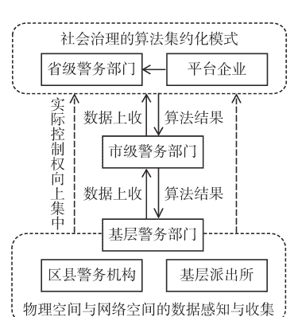
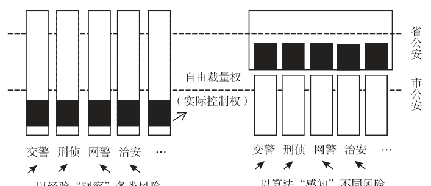

# 警务算法如何重塑社会治理：一项深度田野调查的启示

## 一、 破题：当算法握住治理的“方向盘”

党的二十届四中全会明确提出要“走中国特色社会主义社会治理之路”，完善治理体系。放眼当下，人工智能算法早已渗透进国家治理的毛细血管，成为辅助决策的关键力量。然而，学界目光长期聚焦于平台经济与劳动控制——如外卖骑手如何被算法“困在系统里”，或推荐算法如何重塑信息分发——由此积累了丰厚的理论成果。

但视野若再拉宽，算法正在悄然重构社会治理的底层逻辑，尤其是在国家公共部门的应用图景上，研究却显得稀缺。政府部门用算法，与平台企业用算法，底层逻辑截然不同，至少有三重显著差异：

*   **无法退出：** 面对平台算法，用户还能“卸载App”；但面对警务、社保、税务算法，公众别无选择，只能被纳入系统。
*   **权力嵌入：** 算法直抵国家强制与再分配权力的核心，每一次计算输出都实质干预着具体人的生活。
*   **有限透明：** 警方无法像解释行政法规那样阐明模型的确切规则——警察不需要向算法解释为何被派往某个路口，这正是算法治理最核心的特质。

正因为这“特殊性”，我们迫切需要回答：在推进社会治理现代化的进程中，算法究竟如何重构治理图景？又如何推动公共组织内部权力边界的重划与外部关系的重组？

寻找答案的“棱镜”，非警务部门莫属。作为国家强制机关，警务是算法应用最早、最广、特征最鲜明的领域。犯罪形态的数字化转型倒逼警方必须拥抱最新技术，但学界对此知之甚少。基于此，我们深入一线，通过对多地警务部门及平台企业的长期访谈与参与式观察，试图从三个维度拓展既有认知：

1.  **跳出“技术决定论”，看国家强制机关如何借算法重塑治安秩序。** 现有研究多盯着算法的“黑箱”批评不透明、不公平，或关注决策者如何与算法互动，却少有人深入警务场域，剖析算法在实战中“到底怎么用”、主体间权力如何流动。
2.  **警惕“赋能论”陷阱，看算法如何超越专业强化，重塑国家与社会的连接。** 共识认为算法让打击犯罪更精准，但我们发现，其影响早已溢出警务专业本身——它折射出数字时代国家如何“看见”社会、如何对流动的风险重新分类与治理，更引发了诸多非预期的张力。
3.  **拉近“书本算法”与“行动算法”的距离。** 关键不在于代码写得多漂亮，而在于它如何在网络空间织就国家的“数字安全网”。这正是本研究的现实指向。

## 二、 困境与回应：数字社会治理的“三重奏”与算法破局

算法并非简单的代码，而在治理场域中，它是能感知环境、学习海量数据、高频互动社会现实的复杂系统。为何警务算法研究难产？一是学界视线长锁商业领域；二是公共部门场域封闭，定性资料极难获取。

立足中国数字社会治理情境，我们建构分析框架的起点，是直面当下警务面临的**三重治理挑战**：

**1. “大批量/弱影响”犯罪冲垮了“小批量/强影响”的传统逻辑。**
抢劫盗窃等传统犯罪锐减，电诈等网络犯罪爆发式增长。单案金额虽小、单次冲击弱，但积少成多、危害惊人。这与警方习惯的“重案要案、集中兵力”模式形成剧烈错位。警力极度短缺（中国警察人均负荷极高）成了硬约束。面对海量案件与有限资源的剪刀差，警方必须跳出“警察-社会”双边合作的旧框架，在更广泛的网络中寻找新支点——算法提供了重塑关系、调节资源的可能。

**2. 犯罪时空“去地域化”击碎了辖区管辖的物理边界。**
警察习惯在物理领土上巡逻打击，但电诈远程非接触、跨区域链条化作案，电子数据成为非地域性媒介。“辖区”概念失效，单一警种（刑侦、技侦、网安）孤军奋战无力回天。物理空间与网络空间犯罪叠加，跨域、跨级、跨警种协作成为必答题，却也因数据不确定性陷入困局。

**3. 颠覆性技术武装犯罪，倒逼警方在“双空间”全域感知。**
犯罪分子利用技术差距“降维打击”：虚假投资平台、虚拟货币洗钱、加密通讯匿名联络……手段迭代比认知更新快得多。警方被迫进入技术军备竞赛，必须在物理与网络双重空间捕捉动态线索。

**破局路径清晰了：** 警务部门通过算法运作，回应上述三重冲击。本文将沿着三条线索展开：外部关系如何重组（资源从哪来）、内部权力如何重塑（权力往哪走）、能力如何向网络空间延展（触角伸多远）。

## 三、 田野深处：我们在一线看到了什么

经验材料来自 2019—2024 年对南部 N 省、中部 M 省 6 市 12 个警务部门的实地研究（见表 1）。我们访谈了局长、大队长、指挥中心主任、派出所所长、大数据中心主任等核心岗位，覆盖治安、网安、技侦、情报、巡警等全警种；同步深入 QB、JA、SG、TU、HA 五家头部平台企业，访谈高管、项目组及风控算法工程师。

田野有三个关键特征：
*   **动态演进：** 算法品类持续增多，数据饥渴度与日俱增，内部使用规范日趋严格，算法已成警务工作的“硬骨架”。
*   **差异共存：** 不同警种因专业门槛不同，算法采用节奏与类型各异，这反而成了观察应用差异的天然对照组。
*   **知行分离：** 一线民警常说不清算法原理，却能精准描述“算法在流程里怎么跑”，这恰恰是“行动中的算法”最生动的注脚。

**表 1 核心访谈信息源**

| 调研主体 | 核心受访角色 | 调研时间窗口 |
| :--- | :--- | :--- |
| **警务部门** | 公安局长/副局长、情报/网警/治安/巡警/技侦大队长、指挥中心主任/教导员/调度室主任、派出所所长、大数据中心主任、联合情报作战中心科长 | 2019.3-8；2020.5-7；2024.5-6 |
| **平台企业** | 总经理、业务/技术部门主管、项目负责人及核心成员 (QB/JA/SG/TU/HA 五家) | 2019.3-5；2023.9-12；2024.5-6 |
| **算法工程师** | 风控算法专家/工程师 | 2020.11-12；2023.10；2024.6-7 |

平台企业非外包商，而是共建者。他们提供算力集群、顶尖研究团队、测试数据系统，深度嵌入警务算法的训练与迭代。我们还通过项目会观察、文档三角互证，确保材料厚度。

## 四、 核心发现：算法重构治理的三重逻辑

### （一）关系结构逻辑：从“警民共治”到“警企合成”的治理范式转型

面对海量电诈与警力枯竭的矛盾，警方借算法将复杂社会问题转化为多主体协同的结构性成果。

**N 省的实践堪称标杆：** 与 H 公司建联合创新中心，借力 K 企业认知智能实验室；全面引入头部平台成熟技术，在云计算、AI 视频、移动警务、智能交通、情指行一体化五大领域共建项目。由此催生“线上线下+警企协同”合成作战新机制——**人才合成、数据合成（人/车/物/网/资金流）、能力合成**，开创互联网侦查、群体事件预警、大型安保防控、电子取证等新模式。

六家平台企业算法入驻，以动态人像识别为核心、多模态感知为辅，支撑全省巡防侦查精准布控。更深层的是，N 省明确提出打造**“市场化”情报资源调节模式**，将“互利共赢”写入警务基因：

> “全省着力建立‘市场化’情报资源调节模式……深化警企合作开发联合创新；与最强科技企业建联合创新中心，共建共享共治共赢；把外部智慧技术能力融入警务模式变革，构成新的‘警务基因组’。”（N 省公安业务警种主任）

**这背后的隐蔽逻辑是关系结构的根本性重塑。**
传统治理靠“枫桥经验”，核心是警民关系、群防群治；算法治理则在**警企关系**上持续做增量。平台企业不再是被监管对象，而成了**数据资源池、算力底座、算法造血机**。

> “引进平台算法是为了解决数据问题。办公办案全靠算法关联分析，让所有身份信息、案件数据、社会数据打通关联。”（S 市治安大队长）

这种合作创造了**可迭代、可延展的权力动态**：警方用平台数据、存平台系统、跑平台模型。打击网络犯罪的技术饥渴与数据渴求，反向刺激警企深度绑定。平台掌握物理算力、认知精英、信息资源三大核心要素，成为警务算法训练不可或缺的“隐形合伙人”。

---

**[content]结束标记提示：正文尚未结束，后续将继续呈现“权力逻辑”与“空间延展逻辑”两大核心板块分析，敬请期待完整版输出。**

# 算法如何重塑数字时代的社会治理版图

## 一、 关系重构：打破科层壁垒，共建"警—企—社"治理新生态

数字社会的到来，在根本上动摇了传统社会治理的底层运行逻辑。治理不再单纯依赖科层组织的层级命令，数据与算法跃升为资源配置的核心枢纽。掌握海量数据与核心算法的平台企业，由此从旁观者转变为深度参与者，在数字社会治理中占据关键一环（吕鹏等，2022）。算法的渗透，正加速催生"警—企—社"多元主体协同共治的新格局。

## 二、 权力收敛：算法集约化模式下的纵向整合与协同

### 跨界犯罪倒逼机制变革：从"烟囱式"割据到"一盘棋"统筹

跨地域、非物理化的网络犯罪激增，迫使中国社会治理必须跨越组织边界，推动多机构对话。然而，警务专业化与多警种分设的体制壁垒，导致各警种局限于自身职能视野，难以形成整体态势感知（Ferguson，2017：162–165）。各业务系统仅反映单一或少数治安图景，面对复杂案件时，不同警种对轻重缓急的判断差异引发内部张力，新型网络犯罪更将这种张力推至高点（Giacomantonio，2015：101–105）。调研显示，一线研判人员深陷"被动接案、疲于奔命"的困境（访谈资料 19083002），警务机制既渴望"联动"，又急需"整合，拧成一股劲"（访谈资料 19071602、19032501）。

### 算法集约化：要素上聚、标准下推、协同作战

在此背景下，警务系统内部"算法集约化"浪潮兴起。数据、模型、算力等核心要素向上级汇聚，省厅联合平台企业制定统一标准、接口与规范。基层侧重数据采集上传，省级统筹全警种数据、输出算法研判结果，推动各警种在数字底座上协同作战。

实证调研印证了这一普遍趋势：南部 N 省构建全省统一算法治理服务体系，提供模型、知识图谱、时空大数据等全栈能力；中部 M 省织就全时空"人、地、物、事、组织"感知网，重点区域视频监控实现全覆盖。算法串联全警务链条，形成"省厅搭台、警种唱戏"的治理生态（访谈资料 19071603、19071501）。

一线领导直言："治安防控的核心是整合资源，海量数据不用就会变'死数据'。算法必须织成网状模式，贯通中央到村镇、官方到民间，才能解决上中下各层级难题"（访谈资料 24061202）。

### 自由裁量权的空间逆转：从基层下沉到上级集中

这一趋势看似与经典理论背道而驰——早期研究认为警察自由裁量权下放至基层（Ericson & Haggerty，1997；Chan，2001），社区警务时代基层在物理空间拥有大量资源与裁量权。但算法集约化使这种趋势在网络空间发生**显著逆转**：实际控制权向上级集中（见图 1）。

图 1 社会治理过程中警务部门的算法集约化

实证呈现双重图景：基层"多是收集数据"（访谈资料 19052004），设计研判权"向市级特别是省级集中"（访谈资料 24061502）。基层虽有自设模型，多为现有系统内的参数配置，非严格预测算法（访谈资料 24061302、19082402）。涉及复杂平台与精准算法，基层需向上级申请权限，深刻重塑日常运作逻辑。

"重点人管控、技术管控、研判分析，应由省级发力，县区无需在耗力"（访谈资料 24061302）。省市级基于一线数据研判、控制权限，平台权限高度集中，基层工作转型为按上级预定义标签采集数据、寻求权限支持。

### 分层差异：三级警务的算法实践图谱

算法应用呈现显著的层级分化特征（见表 2）：

| 维度 | 省级（一阶算法） | 市级（二阶算法） | 基层（三阶算法） |
|------|------------------|------------------|------------------|
| **核心定位** | 统筹全省警务活动的中枢 | 整合力量打击犯罪的枢纽 | 构建感知网、收集信息的末梢 |
| **实际控制权** | 省域最高，数据算法权限最强 | 适中，向上求援、向下反馈 | 最低，高度依赖上级权限与算法 |
| **功能逻辑** | 整合全量数据、整体设计研判、下推结果 | 推动标准化采集、汇聚共性需求 | 物理与网络空间多重风险的规模化感知 |
| **使用形态** | 代码级定义目标（修改/复制/删除代码块） | 纳入上级预定义标签、可修改复制 | 全量数据入上级标签、可筛选打造特色模型 |

算法工程师揭示深层原因："层级不同，算法复杂度、算力需求、达成效果全然不同"（访谈资料 24061403）。根源在于：物理空间犯罪时代，基层依靠大量裁量权维序；网络犯罪时代，上级亟需跨警种协调、海量数据训练模型，而基层数据量不足以支撑强算法（Ferguson，2017：82）。因此，不同层级对算法的需求认知存在本质鸿沟。

## 三、 空间扩张：算法驱动的治理半径倍增与"超级化"警务

### 从"经验观察"到"算法研判"的侦查范式迁移

预测性警务算法深度介入侦查、分析、研判全流程：自动化采集融合多源数据构建全息图谱、解析文本提取要素、行为模式分析指引侦查方向（王禄生，2024）。执法决策支持从"经验中心"转向"数据中心"。

### 全域感知："重点防控"向"全面防范"的跨越

数据规模与范围的史无前例扩张，让警务部门借算法实现对更大人、事、地、物的治理覆盖。这种"警务超级化"（Brayne, 2020：13–29）表现为：从重点防控转向"对所有风险、隐患、苗头、问题的全面防范"（访谈资料 19083001）。传统重点防控未消失，反因算法更精准。

算法工程师揭示设计逻辑："覆盖面要广、要大；人脸车牌识别要高清。广角摄像头管覆盖，专业采集设备管精度，视角相对较窄"（访谈资料 24061402）。"算法逻辑就是量变推质变：多拍、多时段、多角度聚类比对，才能克服化妆、遮挡、光线等干扰，提升准确率"（访谈资料 24061403）。

### 网格化输出：牺牲分辨率换取鲁棒性与调度效能

算法将离散点位犯罪数据转化为网格化概率分布（热点/高风险区），看似降低预测分辨率，实则有双重深意：一、**容错增鲁棒**——网格预测不要求极致精确，配合警务经验直觉，避免点位预测落空导致的算法失灵（Brayne, 2017）；二、**降维增效能**——网格将物理空间复杂事件简化为网络空间"点/区"，大幅提升警力分配效率。M 省 S 市实践印证：情报指挥部依托算法平台动态研判，精准投放警力至重点区域、部位、场所、时段。

### 从"点"到"面"再到"网"：治理思维的空间进化

实地调研发现，"点→面→网格"演进折射社会治理认知跃迁。警务力量更由地面延伸至空中：警用无人机搭载地理信息算法，成为地面警务的"力量倍增器"，实现"空地一体、效能倍增，破解传统视角盲区"（访谈资料 24061202）。算法赋予警察"远程行动"能力，在远处行使警权。

## 四、 小结：算法重构社会治理的三重经验逻辑与协同内核

算法重构社会治理遵循三重递进机制（见表 3）：

| 治理挑战 | 核心逻辑 | 关键表现 | 长远影响 |
|----------|----------|----------|----------|
| 海量弱影响网络犯罪耗尽资源 | **关系结构逻辑**（横向） | 重塑"警—企—社"关系，引入市场主体 | 推动警企关系重塑 |
| 跨域非物理犯罪引发跨界困境 | **权力收缩逻辑**（纵向） | 资源向上集中，算法统筹多警种协作 | 重塑跨域、跨层级、跨警种边界 |
| 颠覆性技术加剧治理压力 | **空间扩张逻辑**（多维） | 算法驱动力量倍增，全域全要素感知 | 强化动态风险治理能力 |

三重机制内在联动：关系结构逻辑横向搭桥，解决多主体共识与资源交换；权力收缩逻辑纵向整合，化解内部专业分工下的协作无力；空间扩张逻辑向外延展，将治理触角伸入网络空间。三者合力，重塑警务内外部信任与合作共识，以算法为支点实现"协同用力"。

**层级差异性**：省市级侧重关系与权力机制（层级高、资源富、掌握大规模数据、中央要求强化控制整合）；基层侧重空间扩张（数据量小、算法应用多表现为感知延伸）。算法重构本质上是上下级、内外部的**协同重构**，算法是协同的关键支点。

## 五、 算法重构的深层后果：权力冲突与解决范畴的收窄

### 算法权威与科层结构的张力：基层经验知识的边缘化

警务对算法的深度依赖，与原有科层制产生结构性冲突。基层警务职能异化为"采集数据、预防风险、执行上级算法指令"。算法被视为"权威科学"，基层隐性知识、经验直觉、演绎推理技能在算法扩张中加速萎缩。算法成为事实上的**替代品**，挤压其他解决社会问题的路径（Kennedy et al., 2018: 19），限缩基层可处理问题类型（如诈骗、刑侦权上移）与可考量方案范畴（如海量数据处置权上移）。专业知识与问责制这双重基石被削弱（Busuioc, 2021）。

D 市指挥中心受访者直陈这一隐忧：

### 算法重塑警务图景：从“师带徒”到“数据驱动”的权力博弈与治理困境

**过去靠经验，现在拼算力：警察画像的剧变**

过去，公安队伍入职门槛相对不高，破案办案全凭“传帮带”——老民警带新民警。这“带”什么？核心是长期积累的经验推理能力。那时候，写材料笔杆子一般没关系，关键得会办案、会问话、会推理。但眼下，AI算法与大数据全面介入，对民警素质的要求直线攀升。懂新技术、会驾驭数据的复合型人才，瞬间成了最稀缺的资源。

办案时效的倒逼更是残酷：以前查个案子十天半月、一两个月是常态，现在“三天、五天、甚至八小时破案”成了硬指标。这倒逼警方必须具备从海量数据中“抽丝剥茧”的高阶能力（访谈资料 24051301，D市公安局指挥中心负责人）。

**算法成“中枢”，权力版图悄然重构**

深入剖析会发现，算法早已超越工具属性，成为数字社会治理的“关键中枢”。它不仅重写了网络空间秩序，让省市级警务部门权力上升、跨层级协同增强，更在暗流涌动中埋下了知识与权力结构冲突的种子。

正如“监控资本主义”理论所警示，大规模数据收集衍生出一种新型工具主义权力，极易在主体间制造“知识/权力不对称”（Zuboff, 2023）。上级部门凭算法集中指挥，基层靠算法落地执行，二者间张力暗涌。实地调研发现，上下级围绕“数据权”等核心权限的争夺，需求差异巨大：

> “省里一直在搭平台，但想改也改不了；有时省里‘吃老本’，新算法应用推不下来。有科技公司主动送技术上门，我们想自建平台再回传数据，上面不同意。”（访谈资料 24061201，S市公安局情报大队大队长）

**警企博弈：治理需求 vs 商业逐利**

冲突不止内部。警务部门与平台企业在算法设计、应用层面也暗流涌动。企业及工程师更在乎模型“准不准”、“好不好”，而非公共利益盲区。访谈中，警方追问：你们的模型如何帮我实现具体侦查目标？企业却晒非警务场景（如行政审批）的成功案例，推销自家算法优势。核心逻辑错位：警方要填技术空白，企业要卖成熟产品。

> “前期规划投了278万，这几年没见实效……合作中发现，企业多盯着赚多少钱，不愿把事落实。”（访谈资料 19032801，J市公安局局长）

---

### 核心悖论：为“精准预测”陷“数据过载”泥沼

**评价标准的“异化”：精度至上，数据为王**

审视算法治理现场，警务考核算法的核心指标只有一个——“预测精度”。为练就这双“火眼金睛”，警方必须吞吐海量数据训练模型。这与商业算法截然不同：网约车算法只管送达高效，无关信息直接屏蔽；社会治理领域则是“全要素收集”，无数据不治理。N省曾下达79项数据采集任务，多方受访者印证了警方对数据的“饥渴”：

> “公安识别精度必须极高，普通算法50%阈值够用，我们要90%、95%以上，得海量数据‘喂’出来。”（访谈资料 24061401，平台企业算法工程师J先生）
> “治安打击要事前事后全覆盖，越细致越好，没全品类数据支撑根本不行。”（访谈资料 24061302，S市公安局治安大队副队长）

**“苞壳法”失效，基层沦为“录入工”**

有研究直指痛点：治安太复杂，不能简化为算法完美解题（McDaniel & Pease, 2021）。但为博取精准，警方陷入“信息过剩”困境。算法扩展导致工作量超载——早期DNA技术让法医勘察从8小时增至一周（Giacomantonio, 2015），警务算法同理。

基层民警直呼角色异化：“我们变成了‘数据录入员’”。

> “智能化基础是数据采集，全靠人力发动基层跑采集，本职工作都干不了。”（访谈资料 19032801，J市公安局局长）

对比传统“苞壳法”（依赖经验直觉，见图2），算法驱动模式下，基层80%工时耗在收集整理数据上。规模化收集让警务复杂度指数级上升。无序使用算法，不仅加重负担，更易将算法异化为“优先排序”与“刻板印象”制造机，引发无效干预，失去建设性。

注：白色柱表示不同警种，黑色柱表示警务自由裁量权的重心。
图 2 警务部门社会治理方式的结构性转变

**“面子工程”与“数据滞后”：算法应用的虚实之殇**

调研中，基层负责人坦言：搞算法模型有时是为了“刷形象”，向上级和公众展示“数字化转型成果”——

> “时间紧，先搞几个‘数字派出所’试点，大数据模型拿得出手，亮点就有了。”（访谈资料 19032803，J市公安局局长）

实战成效被简化为“数据量大、模型复杂”。更致命的是数据迟滞：省厅平台基础数据非实时，地理信息系统滞后社会实景两年以上。基于陈旧数据跑出的算法，只能把人、场粗糙化为数据点，实战价值大打折扣，沦为“技术先进性”的代名词。

---

### 结构性洞见：分层治理下的权力迁移与新生态

**算法集约化 = 治理权的集中控制与“分层效应”**

既有“算法科层制”研究揭示了公共部门算法应用的权力集中逻辑（吴进进、何包钢，2023）。本文实证呼应之余，更发现警务内部呈现显著**“分层效应”**——不同层级用算法的逻辑、功能迥异，重塑了权力运作：

*   **省/中央级：** 统筹算法设计研判，结果下推；核心诉求是内部集中“数据权、算法权、平台权”，外部塑造分布式治理权力（引入平台企业）。
*   **市级：** 驱动“合成作战”，算法赋能侦查资源技术支撑。
*   **基层：** 扛起数据采集、算法执行、风险预防；治理权被稀释，隐性知识与“街头智慧”贬值（Brayne & Christin, 2021）。

**警种内部：掌握算法者得天下**

分层效应穿透至同级警种。掌握丰富模型、海量数据的警种（如网安、科信），凭借算法及时性、可复制性等技术红利，迅速晋升为运作核心节点，权力持续放大。算法打破物理壁垒，催生“以算法为中心、多警种协同”的治理新生态。

---

### 理论外溯：超越警务的中国式数字治理图式

这些现象绝非警务独有，具有广泛理论解释力：

1.  **多元共治结构的普适性：** “警—企—社”三元结构，本质是应对网络犯罪治理资源不足、协作乏力的破局之举。数字公共服务领域同构现象显现：国家主导形成“政—企—社”公共服务生态网（宋锴业、徐雅倩，2025），平台企业深度嵌入治理链条（吕鹏等，2022）。
2.  **“视觉功能”从整体转向分布式：** 鲁肯斯坦指出，国家行政系统传统“视觉功能”是自上而下、整体式的（Ruckenstein, 2023）。算法的新颖性在于：上级借算法与海量数据，可实时对社会实施**分布式观察**，全域感知风险源头。数据管理部门同理，只是侧重“未诉先知”式需求感知。

**“大平台、大算法、大数据”建设热潮中，“大”早已超越规模维度，内含国家直面数字社会巨变时，对警务治理方式的前瞻性战略调整。**

---

### 结语：透过权力视角，看清算法治理的深层逻辑

未来研究若仅盯着透明度、公平性等技术议题，恐失之浅表。必须下沉到公共部门运行肌理，剖析关系、权力、空间逻辑的深层变动。以关系/权力维度观警察工作，能让我们看清：那些反复出现的“问题/议题”，实为**算法这一未被深刻认知的系统性力量**所重塑。

尖端科技不可逆的洪流与社会治理的适配与冲突，在警务一线上演得最充分、最赤裸。沿此思路，**国家公共部门应用算法的差异化逻辑**，理应成为后续研究的核心追问。

## 参考文献

（保留原文参考文献列表，此处省略）

### 核心文献梳理：算法治理与智能警务的理论版图

本文梳理的理论支撑体系，横跨算法治理哲学、预测性警务实践、平台权力演变及数字不平等等前沿领域，构建起理解“算法 Leviathan” 与公共权力重构的坚实学术基石。

**一、 算法权力与治理哲学：透视黑箱背后的逻辑**

*   **Zuboff, Shoshana (2023).** *The Age of Surveillance Capitalism: The Fight for a Human Future at the New Frontier of Power*. New York: Public Affairs.  
    奠基之作，深度解析监视资本主义如何将人类体验转化为行为数据，揭示权力不对称的新疆域。
*   **König, Pascal D. (2020).** “Dissecting the Algorithmic Leviathan; On the Socio-Political Anatomy of Algorithmic Governance.” *Philosophy & Technology* 33(3).  
    以“算法利维坦”为喻，剖析算法治理的社会政治解剖结构，直击自动化决策的合法性危机。
*   **Lehdonvirta, Vili (2022).** *Cloud Empires: How Digital Platforms Are Overtaking the State and How We Can Regain Control*. Cambridge: The MIT Press.  
    探讨数字平台如何构建“云端帝国”挑战国家主权，并寻求重夺控制权的路径。
*   **Ruckenstein, Minna (2023).** *The Feel of Algorithms*. Oakland: University of California Press.  
    转向情感维度，考察算法如何渗透日常生活肌理，塑造主体的感知与体验。

**二、 预测性警务与精准执法：数据驱动的范式转型与争鸣**

*   **Ferguson, Andrew Guthrie (2017).** *The Rise of Big Data Policing: Surveillance, Race, and the Future of Law Enforcement*. New York: New York University Press.  
    经典名著，揭示大数据警务背后的种族刻板印象强化机制与监控扩张逻辑。
*   **Kennedy, Leslie W., Joel M. Caplan & Eric L. Piza (2018).** *Risk-Based Policing: Evidence-Based Crime Prevention with Big Data and Spatial Analytics*. Oakland: University of California Press.  
    聚焦风险导向警务，论证时空分析与大数据融合在循证犯罪预防中的实证效能。
*   **McDaniel, John L. M. & Ken G. Pease (eds.) (2021).** *Predictive Policing and Artificial Intelligence*. London & New York: Routledge.  
    编著汇集多方视角，系统评估预测性警务在 AI 加持下的技术边界与伦理困境。
*   **Egbert, Simon & Elena Esposito (2024).** “Algorithmic Crime Prevention. From Abstract Police to Precision Policing.” *Policing and Society* 34(6).  
    理论推演“抽象警察”向“精准警务”的演进，阐释算法犯罪预防的理念嬗变。
*   **Wessels, Martijn (2024).** “Algorithmic Policing Accountability: Eight Sociotechnical Challenges.” *Policing and Society* 34(3).  
    提炼算法警务问责面临的八大社会技术难题，为责任归属提供分析框架。
*   **Kirby, Stuart & Rebecca Phythian (2025).** “Does Information Communication Technology Facilitate or Solve Crime? Exploring the Experience of Law Enforcement Practitioners in Three Countries.” *Policing: An International Journal* 48(5).  
    基于三国执法实务视角，实证探讨 ICT 技术究竟是助推犯罪还是化解犯罪的双刃剑效应。
*   **Lusthaus, Jonathan (2024).** “Reconsidering Crime and Technology: What Is This Thing We Call Cybercrime?” *Annual Review of Law and Social Science* 20.  
    重审“网络犯罪”概念边界，呼吁在技术变迁中重构犯罪学理论范式。

**三、 算法官僚制与公共决策：实践视角下的语境嵌入与黑箱治理**

*   **Meijer, Albert, Lukas Lorenz & Martijn Wessels (2021).** “Algorithmazation of Bureaucratic Organizations: Using A Practice Lens to Study How Context Shapes Predictive Policing Systems.” *Public Administration Review* 81(5).  
    引入实践透镜，强调语境如何塑造预测性警务系统在官僚组织中的落地形态。
*   **Vogl, Thomas M., Cathrine Seidelin, Bharath Ganesh & Jonathan Bright (2020).** “Smart Technology and the Emergence of Algorithmic Bureaucracy: Artificial Intelligence in UK Local Authorities.” *Public Administration Review* 80(6).  
    以英国地方政府为例，考察智能技术如何催生“算法官僚制”新形态。
*   **Wenzelburger, Georg, Pascal D. König, Julia Felfeli & Anja Achtziger (2024).** “Algorithms in the Public Sector. Why Context Matters.” *Public Administration* 102(1).  
    实证印证公共部门算法应用深受语境制约，“一刀切”技术乐观主义不可取。
*   **Kronblad, Charlotta, Anna Essén & Magnus Mähring (2024).** “When Justice is Blind to Algorithms: Multilayered Blackboxing of Algorithmic Decision-Making in the Public Sector.” *MIS Quarterly* 48(4).  
    揭示公共部门算法决策的多层“黑箱化”机制，警惕正义在算法面前的“盲区”。
*   **Roehl, Ulrik & Joep Crompvoets (2025).** “Inside Algorithmic Bureaucracy: Disentangling Automated Decision-Making and Good Administration.” *Public Policy and Administration* 40(2).  
    深入算法官僚制内部，梳理自动化决策与良善行政原则的张力与调适。

**四、 经典溯源与警务社会学基石：空间、风险与协调**

*   **Herbert, Steve (1997).** *Policing Space: Territoriality and the Los Angeles Police Department*. Minneapolis: University of Minnesota Press.  
    早期经典，从领域性视角解读洛杉矶警局的空间控制策略。
*   **Ericson, Richard V. & Kevin D. Haggerty (1997).** *Policing the Risk Society*. Toronto & Buffalo: University of Toronto Press.  
    风险社会理论在警务研究的奠基之作，确立“风险导向”作为现代警务核心范式。
*   **Giacomantonio, Chris (2015).** *Policing Integration: The Sociology of Police Coordination Work*. Hampshire: Palgrave Macmillan.  
    聚焦警务协调工作的社会学机制，填补组织整合研究的空白。
*   **Lamb, Melayna Kay (2024).** *A Philosophical History of Police Power*. New York: Bloomsbury Academic.  
    从哲学史维度追溯警察权力的谱系演变，为理解当代算法权力提供深远历史镜鉴。

**五、 算法素养与数字鸿沟：用户端的感知、认知与抗争**

*   **Ernst, Julian (2025).** “Understanding Algorithmic Recommendations. A Qualitative Study on Children’s Algorithm Literacy in Switzerland.” *Information, Communication & Society* 28(11).  
    聚焦未成年人群体，定性考察瑞士儿童对算法推荐的认知水平与素养现状。
*   **Petrović, Andraž, Bianca C. Reisdorf, Vasja Vehovar & Jošt Bartol (2025).** “Disentangling the Role of Algorithm Awareness and Knowledge in Digital Inequalities: An Empirical Validation of An Explanatory Model.” *Information, Communication & Society* 28(4).  
    实证剥离算法认知与知识在数字不平等中的差异化作用机制，验证解释性模型。
*   **Starke, Christopher, Ljubiša Metikoš, Natali Helberger & Claes de Vreese (2025).** “Contesting Personalized Recommender Systems: A Cross-Country Analysis of User Preferences.” *Information, Communication & Society* 28(1).  
    跨国比较用户对个性化推荐系统的抗争偏好，为算法问责提供需求侧证据。

---

**作者单位**  
山东大学政治学与公共管理学院、山东大学社会治理研究基地（宋锦业）  
中国海洋大学国际事务与公共管理学院（徐雅倩）

**责任编辑**：何钧力