# 人工智能编程基础教程 当Micro：bit遇上Mind+的智能编程

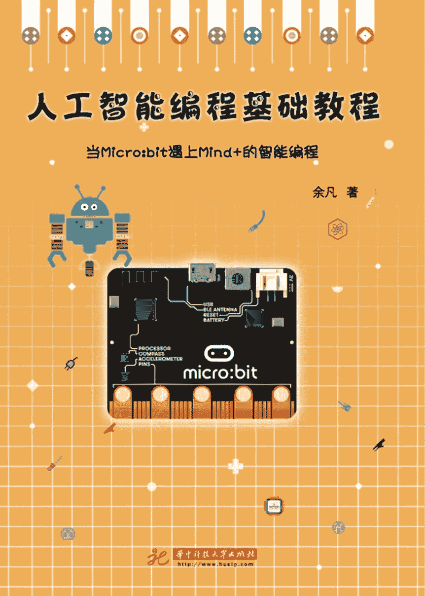

# 序

2013 年秋天的一个夜晚，我和`DFrobot`公司（以下简称“`DF`”）的首席执行官叶琛在上海一家星巴克聊天。我们认识已经半年了，但面对面地认真讨论还是第一次。我们各自交换了对人工智能教育和开源硬件发展的看法，发现我们的观点颇为一致。话题还没有聊完，星巴克已经要打烊了，我们只好边走边聊，在上海的街头足足走了一个多小时。
我已经不记得那天晚上我们讨论的具体细节了，但有一点非常肯定，那就是我们共同决定了`Mind+`编程软件（以下简称“`Mind+`”）的结局——停止开发。因为当时的`Mind+`采用基于数据流的编程形式，而实际上`Arduino`（一种开源硬件）的大部分应用，很难用“流”去规划。更重要的是，学生哪怕能用`Mind+`做出很酷的作品，也很难将这种能力迁移到其他的编程软件上去，所以它对青少年的编程教育来说没有太大的价值。
`Mind+`项目停止后，原来的项目负责人 Rex 也离职去做电动滑板车了。这几年，我偶尔还会在聚会上听到或在论坛上看到有人表达对`Mind+`的怀念之情，毕竟那是国内第一个完全自主设计的`Arduino`的图形化编程工具。作为决定了`Mind+`命运的“幕后黑手”之一，我常常会假装没听到，也不好意思解释太多。`DF`随后开发的`WhenDo`虽然也是很好的图形化编程工具，可惜只能在 iPad 中运行，知道的人甚少。
2017 年，听说`Mind+`项目重新启动了，我不禁有些激动。果然，到了 12 月，`DF`的网站上挂出了“`Mind+`图形化编程软件重装归来”的广告标语。“重装归来”这个词颇能让一些老用户红了眼圈。四年多，说长不长，说短也不短，但`Mind+`恰好是刚刚接触开源硬件的人工智能教育者们的心路印记。看到`Mind+`，不仅会想起初见`Arduino`和`Mind+`的惊喜，还会想起这一路的磕磕碰碰，想起共同走过的众多朋友。
`Mind+`支持`Micro：bit`开源硬件（以下简称“`Micro：bit`”），这让我惊喜。我和`Micro：bit`的缘分来自 2016 年的“创客嘉年华”，因为喜欢它就开始推广，后来`Micro：bit`基金会还给我一个“中国推广大使”的名号。目前`Micro：bit`在中小学得到了很好的普及，包括`DF`在内的几家人工智能教育企业做了大量的工作。虽然微软公司开发的`MakeCode`是很好的编程平台，但在与扩展模块的连接方面，`Mind+`会做得更好。另外，`DF`还为 Python 编程开发了一款易用的 IDE（针对硬件进行编程的软件），叫做`BXY`，`BXY`也很值得推荐。
最后，要说说余凡老师了。我和余老师在 2017 年全国机器人教学及创客教育展评活动中相识。他在这个活动中得了特等奖，而我有幸担任了活动的评委。随着了解的深入，我发现他最初的身份居然是设计师！`Arduino`缘起于意大利的设计学院，“`STEAM`教育”中的“A”（Arts）越来越受到重视，余老师的设计师身份无疑为他的教学和书带来与众不同的亮点。他在人工智能教育方面的突出成绩告诉我们：只要喜欢，就能成功；只有喜欢，才能成功。
感谢余老师给我写序的机会，人工智能教育需要`Micro：bit`和`Mind+`，更需要像余老师一样的跨学科人才。
谢作如
温州中学创客空间

# 自序

2017 年，我参加了全国机器人教学及创客教育展评活动，在这次活动中我获得了特等奖。因为活动的赞助方是`DFrobot`公司（以下简称“`DF`”），所以我总觉得`DF`像是我的幸运标志。有次出差去上海，我还特地参观了`DF`的蘑菇云创客空间。
2018 年 10 月，我去深圳参加培训，带队的是武汉市教育科学研究院的雷刚主任。雷刚主任在谈到人工智能教育时说，课程的有效实施，可能是推进人工智能教育最有效的手段。于是我开始不断思考，选择什么样的数字化工具才能更有效地培养孩子们的编程能力和计算思维，能够更好地开展教学。有一天`DF`的余静工程师对我说：“现在`Micro：bit`很火，它还可以和不少数字化工具组合使用，你写一本关于`Micro：bit`的书吧！”
在此之前，我从没想过要为`Micro：bit`写本书，因为我曾经很鄙视不带电池的`Micro：bit`，觉得它不会有长久的生命力。但是，既然朋友谈到，我还是把放在抽屉角落的那两块`Micro：bit`拿了出来。没想到我的兴趣就此被开发出来了，加速度计、罗盘、光线传感器、温度传感器……每一个项目都有值得研究之处，而且`Micro：bit`的确可以和不少数字化工具组合使用，对培养编程能力和计算思维有很大帮助。
于是就有了这本书，它包含三个板块：`Micro：bit`和`Mind+`的互动智能、`Micro：mate`在`Mind+`环境下的智能创意、`Micro：bit`电机驱动扩展板与`Mind+`智能机器人搭建。把这三个板块学完了，就可以编程设计体感游戏，可以搭建智能装置，最重要的是可以自己做机器人了。这就是`Micro：bit`与`Mind+`相结合的神奇之处！

# 第 1 课　小巧的 Micro：bit

## 活动目标

1.了解`Micro：bit`是什么。
2.了解`Mind+`编程软件的基本界面和功能。

## 学习内容

`Micro：bit`是一款由英国广播电视公司（`BBC`）推出的专为青少年编程教育设计的微型电脑开发板，是一种小巧的开源硬件。如图 1-1 所示，`Micro：bit`上设置了蓝牙天线、加速度计与电子罗盘、可编程按钮、可编程 LED 点阵等。`Micro：bit`可以用于编写电子游戏程序、声光互动、机器人控制、科学实验、可穿戴装置开发等。为了增加`Micro：bit`的功能，英国广播电视公司还配套开发出各种扩展板，用于快速搭建电子项目。

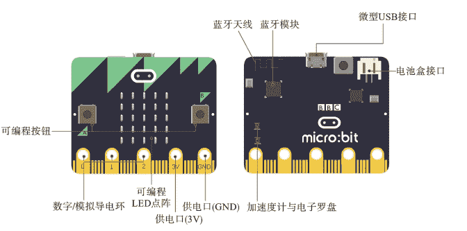

图 1-1

我们可以在`Windows`或`Mac`操作系统中使用各种编程软件来为`Micro：bit`编写程序，其中，`Mind+`编程软件（以下简称“`Mind+`”）只需要拖拽图形化程序模块（指令积木块），即可完成编程。

`Mind+`有两种工作模式：实时模式和上传模式。

`Mind+`的实时模式界面如图 1-2 所示。

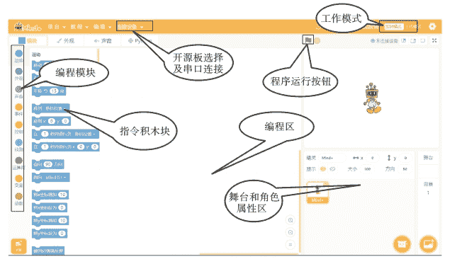

图 1-2

我们采用图形化编程方式为`Micro：bit`编写程序，拖拽指令积木块即可编程。鼠标单击按钮，加载后进行扩展，然后直接编写程序，与电脑连接的`Micro：bit`就能显示编程结果，这样便于实时查看程序设计的效果。

`Mind+`的上传模式界面如图 1-3 所示。

在上传模式中，我们可以使用程序上传按钮，将程序上传到`Micro：bit`，使`Micro：bit`脱离电脑，单独运行，做一些智能作品时就需要采取这样的方式。

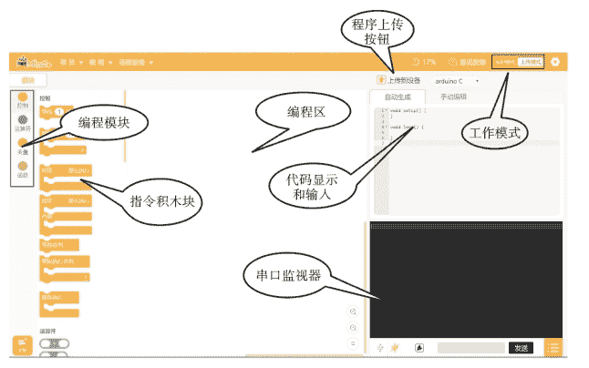

图 1-3

## 动手操作

现在我们要通过编程，使`Micro：bit`的 LED 灯显示心形图案。

（1）将`Micro：bit`通过数据线和电脑连接，电源指示灯发光（见图 1-4）。

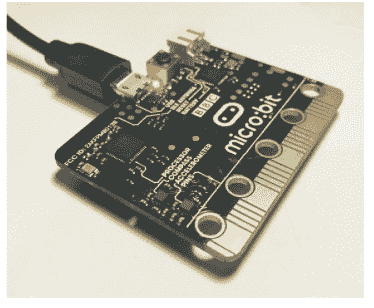

图 1-4

（2）打开`Mind+`，鼠标单击，加载主控板，然后鼠标双击“`micro：bit`”，如图 1-5 所示。

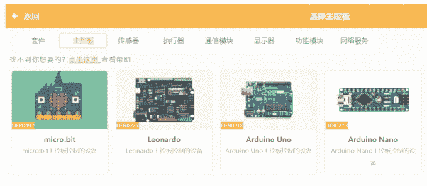

图 1-5

（3）鼠标单击“连接设备”下拉列表中的“一键安装串口驱动”，如图 1-6 所示。驱动程序安装向导对话框弹出，根据提示安装驱动程序。

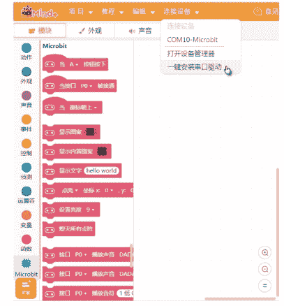

图 1-6

（4）鼠标单击“连接设备”下拉列表中的“`COM7-Microbit`”，`Micro：bit`连接成功，如图 1-7 所示。

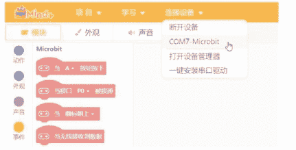

图 1-7

（5）手持`Micro：bit`，顺时针转动 360 度，`Micro：bit`的 LED 灯在转动中亮起来，亮光形成一个圆圈（可以点击“教程”菜单中的“视频教程”，观看相关视频）。如果电源指示灯一直在不停地闪烁，则表示初始化完成。

（6）在实时模式中，鼠标单击编程模块栏中的，右侧出现指令积木块列表。鼠标单击（见图 1-6），`Micro：bit`上的 LED 灯亮了起来，显示心形图案。

如果将指令积木块和与“事件”模块中的指令积木块组合在一起，如图 1-8 所示，鼠标单击绿旗，则 LED 灯循环显示心形图案。我们还可以修改等待时间的长短以改变 LED 灯闪烁的频率。

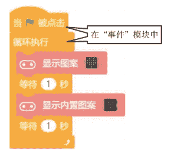

图 1-8

## 活动记录

## 自我评价
我在本次活动中如下方面表现良好：
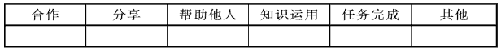
我对自己的评价：
☆☆☆☆☆

## 延伸探索
除了心形图案，我还能通过编程，使 Micro：bit 的 LED 灯显示其他图案。

# 第 2 课　Micro：bit 的花样姿态
## 活动目标
1. 了解 Micro：bit 的互动特性。
2. 掌握使 LED 灯显示不同图案的程序设计方法。

## 学习内容
打开 Mind+，鼠标单击编程模块栏中的，右侧出现指令积木块列表。鼠标单击，将其拖拽至编程区。然后，鼠标单击指令积木块中倒置的三角形符号，下拉列表显示了该指令积木块可以设置的动作，如图 2-1 所示，可见 Micro：bit 有丰富的姿态选项。
Micro：bit 执行的程序动作与 Micro：bit 的徽标放置的位置有关系，如图 2-2 所示，徽标是朝上放置的。
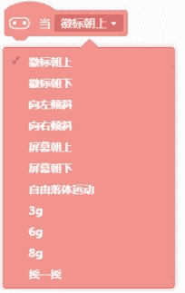
图 2-1
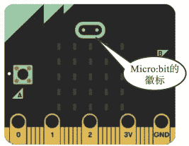
图 2-2

## 动手操作
### （1）LED 灯显示较大的心形图案。
将 Micro：bit 和电脑连接，然后将 Micro：bit 竖起来，徽标朝上，在编程区组合如图 2-3 所示的编程指令，Micro：bit 的 LED 灯显示的图案如图 2-4 所示。

图 2-3
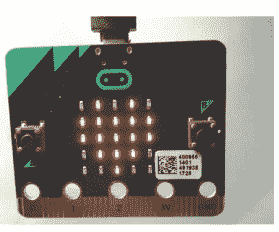
图 2-4

### （2）LED 灯显示较小的心形图案。
将 Micro：bit 的徽标朝下，在编程区组合如图 2-5 所示的编程指令，Micro：bit 的 LED 灯显示的图案如图 2-6 所示。

图 2-5
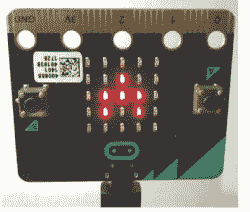
图 2-6

### （3）LED 灯显示箭头图案。
将 Micro：bit 的徽标向左、向右倾斜，在编程区组合如图 2-7 所示的编程指令，Micro：bit 的 LED 灯显示的图案如图 2-8 所示。

图 2-7
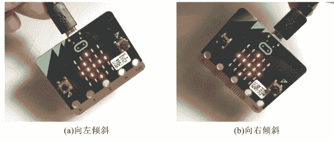
图 2-8

### （4）LED 灯显示英文字母。
组合如图 2-9 所示的编程指令，当 Micro：bit 的徽标朝上时，LED 灯依次显示“HELLO”的英文字母，如图 2-10 所示。

图 2-9
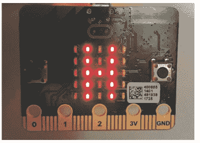
图 2-10
我们可以设置在徽标朝上的时候，LED 灯依次显示“OK”的英文字母；徽标向左倾斜时，LED 灯依次显示“YES”的英文字母；徽标向右倾斜时，LED 灯依次显示“NO”的英文字母；徽标处于水平方向（即 Micro：bit 处于水平方向）时，LED 灯依次显示“SLEEP”的英文字母；此外还可以设置等待一秒后，LED 屏幕周边的方框变成红色。
编程指令如图 2-11 所示，上传程序后，观察 LED 灯显示的图案。

图 2-11

## 活动记录

## 自我评价
我在本次活动中如下方面表现良好：
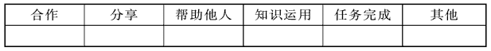
我对自己的评价：
☆☆☆☆☆

## 延伸探索
我可以将 Micro：bit 的不同姿态在程序设计中组合起来，从而使 Micro：bit 的 LED 灯显示更复杂的图案。

# 第 3 课　神奇的电子罗盘
## 活动目标
1. 了解电子罗盘的功能。
2. 学习通过 Mind+使用 Micro：bit 的电子罗盘。

## 学习内容
指南针是中国古代四大发明之一，它在很多方面都起过重要的作用。司南是最早的指南仪器，人们利用磁石的指向性制成了司南（见图 3-1）。后来经过不断改造，罗盘出现了，如图 3-2 所示，它被应用于航海。世界上最早利用指南仪器进行海上导航的国家是中国。
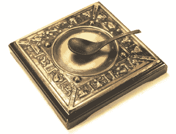
图 3-1
Micro：bit 自带一个电子罗盘。Micro：bit 背面有个集成电路，标示着“COMPASS”，它就是电子罗盘传感器模块，如图 3-3 所示。打开 Mind+，鼠标单击编程模块栏中的，右侧出现指令积木块列表。将列表中的和指令积木块结合使用，读取当前所在的方位角度，编程指令如图 3-4 所示。

图 3-2
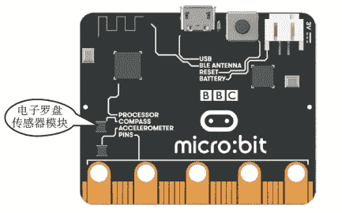
图 3-3

图 3-4
将 Micro：bit 和电脑连接，在 Mind+的实时模式中，将 Micro：bit 的徽标朝上，就可以看到 LED 屏幕上滚动显示数值。这些数值就是罗盘中的角度，正北方向为“0”（360），正南方向为“180”。

## 动手操作
要让 Micro：bit 具备指南针的功能并且方便人们使用，我们还是需要借助 Mind+。现设定当电子罗盘的角度小于 30 度或大于 330 度时，Micro：bit 通过 LED 屏幕表示北方；当电子罗盘的角度在 160 度和 210 度之间时，表示南方；当电子罗盘的角度在 30 度和 160 度之间时，表示东方；当电子罗盘的角度在 210 度和 330 度之间时，表示西方。因为要使指南和指北更精确，所以指南和指北的角度取值范围相比指东和指西的取值范围要小。我们需要使用“运算符”模块中的指令积木块，表示电子罗盘的角度取值范围，编程指令如图 3-5 所示。
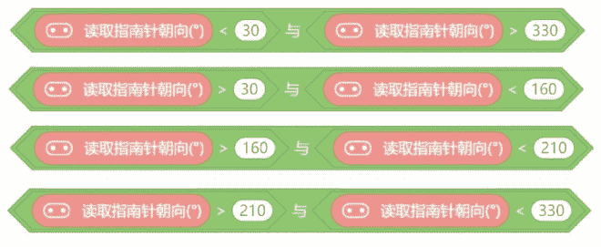
图 3-5
在实时模式中，当 Micro：bit 的 LED 屏幕朝上，徽标对着北方时，LED 屏幕显示“1”；徽标对着东方时，LED 屏幕显示“2”；徽标对着南方时，LED 屏幕显示“3”；徽标对着西方时，LED 屏幕显示“4”（见图 3-6）。完整程序如图 3-7 所示。
在使用的过程中，Micro：bit 可能会受到附近的电子设备的干扰，或者由于环境的原因，Micro：bit 的电子罗盘可能会受到影响。
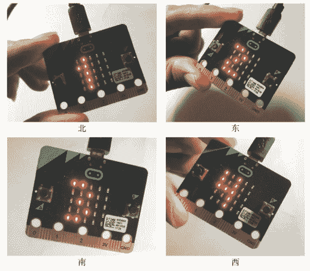
图 3-6
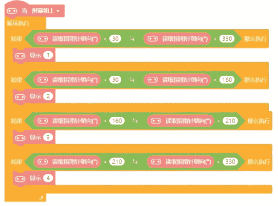
图 3-7

## 活动记录

## 自我评价
我在本次活动中如下方面表现良好：

我对自己的评价：
☆☆☆☆☆

## 延伸探索
对于如何设置电子罗盘的角度范围，我有更好的建议。

# 第 4 课　小猫跳一跳
## 活动目标
1. 了解 Micro：bit 的按钮。
2. 学习设计通过按钮控制的小游戏。

## 学习内容
将 Micro：bit 和电脑连接，打开 Mind+，在实时模式中，我们可以选择精灵角色，比如精灵猫，同时为角色设定相关属性，并通过 Micro：bit 的按钮控制精灵角色。
鼠标单击编程模块栏中的，右侧出现指令积木块列表。鼠标单击，将其拖拽至编程区。然后，鼠标单击编程模块栏中的“动作”，右侧出现指令积木块列表。鼠标单击，将其拖拽至编程区。将这两个指令积木块组合在一起（见图 4-1），再按下 Micro：bit 的 A 按钮，精灵猫就开始动起来，离开了舞台。
按下 Micro：bit 的 B 按钮，精灵猫反方向移动 10 步，又回到了舞台，编程指令如图 4-2 所示。交替按下 A 按钮和 B 按钮，精灵猫就能在舞台中灵活地前后跑动了。

图 4-1

图 4-2
通过精灵属性面板，我们可以调整精灵猫的相关属性，比如位置、比例、方向，我们还可以为精灵猫添加合适的活动背景，让游戏画面更美观，如图 4-3 所示。
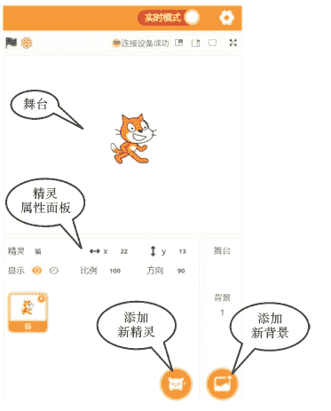
图 4-3

## 动手操作
### （1）设定精灵猫上下移动。
①调整精灵猫的比例大小，使精灵猫活动的范围更大。
②组合如图 4-4 所示的编程指令，通过改变 y 坐标的位置使精灵猫上下移动，如果数字前面加了“-”号则表示向下或向相反方向移动。
③为了表现精灵猫下落时速度逐渐加快，需要变量的协助。鼠标单击“变量”模块中的指令积木块，创建变量“`zhongli`”（见图 4-5）。
④鼠标单击“变量”模块中的指令积木块和，将其拖拽至编程区，初始化精灵猫下落的重力参数，并制造精灵猫下落时速度逐渐加快的效果。编程指令如图 4-6 所示。

图 4-4

图 4-5

图 4-6
⑤设定“`zhongli`”的值为 15 时，按下 A 按钮，精灵猫向上跳，编程指令如图 4-7 所示。完整程序如图 4-8 所示。
在实时模式中，运行程序，精灵猫下落。如果按下 A 按钮，则精灵猫向上跳。

图 4-7

图 4-8

### （2）设置舞台背景。
鼠标单击“背景库”（见图 4-9），为舞台加载一个漂亮的场景，本例选择“蓝天”，如图 4-10 所示。
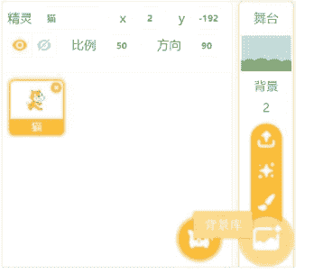
图 4-9
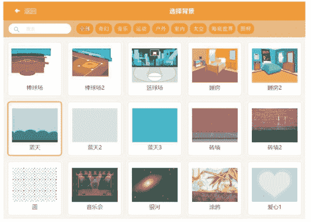
图 4-10

### （3）设定精灵猫自动弹跳。
鼠标单击“侦测”模块中的指令积木块，将其拖拽至编程区，单击指令积木块上的默认色块，在弹出的色彩面板中调色，并确定颜色（见图 4-11）。
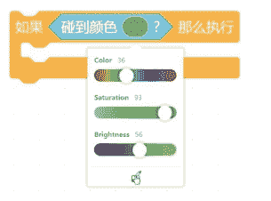
图 4-11
组合如图 4-12 所示的编程指令，上传程序后，精灵猫碰到舞台底部的色块就能自动跳起来（见图 4-13），画面的动感增强了。

图 4-12
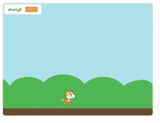
图 4-13

### （4）添加角色。
①打开角色库，鼠标双击“老鼠”，将其加载到精灵属性面板中（见图 4-14）。有了精灵老鼠做伴，精灵猫可以跳起来和精灵老鼠玩耍，还可以在碰到精灵老鼠后得分。
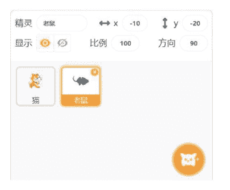
图 4-14
②设定精灵老鼠碰到舞台边缘后反弹，旋转模式为左右翻转，编程指令如图 4-15 所示。

图 4-15
③精灵猫跳起来碰到精灵老鼠后，得分是不断变化的，因此需要添加一个得分的变量，并将相应的指令积木块嵌入到编程指令中，如图 4-16 所示。精灵猫与精灵老鼠碰撞后得分的编程指令如图 4-17 所示。需要注意的是，在程序开始的时候，要将得分的变量初始化。

图 4-16
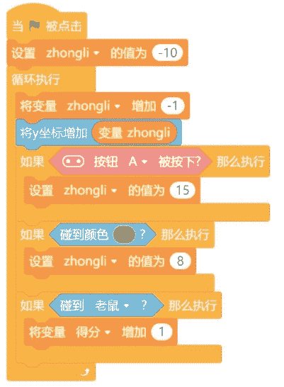
图 4-17
④由于程序执行时速度非常快，所以会出现精灵猫与精灵老鼠触碰一次却多次得分的情况。针对这个问题，需要增添指令积木块。
最后，我们还需要为程序增加一些功能，比如按下不同的按钮后，精灵猫可以左右移动等，以增加游戏的趣味性。
在实时模式中，完整程序如图 4-18 所示。
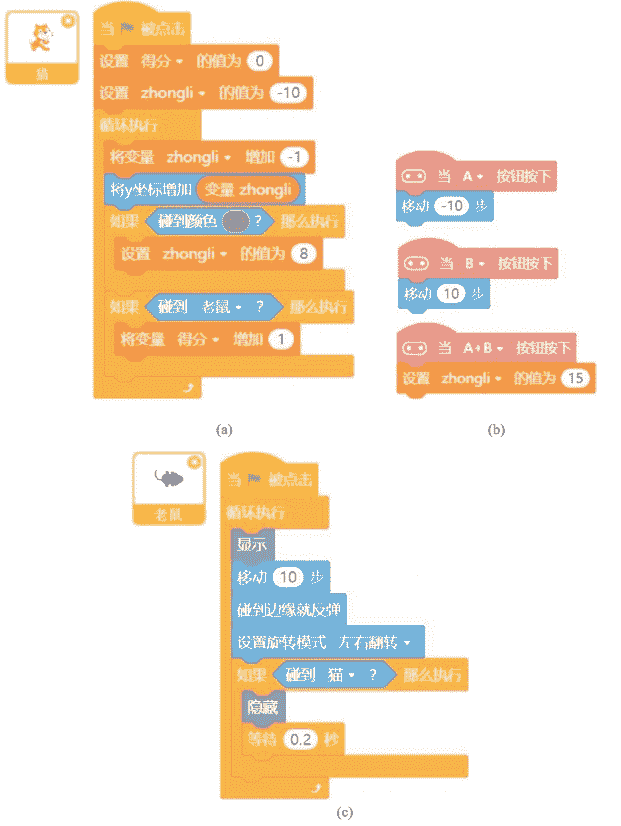
图 4-18

## 活动记录
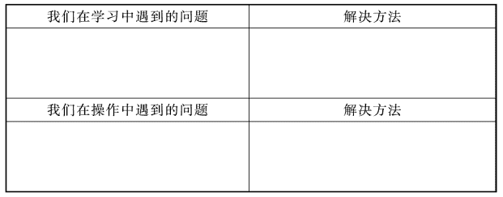

## 自我评价
我在本次活动中如下方面表现良好：

我对自己的评价：
☆☆☆☆☆

## 延伸探索
当精灵猫碰到精灵老鼠后，我可以改变精灵老鼠的大小或者颜色。

# 第 5 课　发射子弹的小游戏
## 活动目标
1. 了解 Mind+的克隆（复制）功能。
2. 学习设计发射子弹的小游戏。

## 学习内容
本课我们学习设计发射子弹的游戏。将 Micro：bit 和电脑连接，打开 Mind+，选择精灵吉伽为编程对象，通过“控制”模块中的指令积木块实现子弹连续发射的效果，编程指令如图 5-1 所示。

图 5-1
当按下 Micro：bit 的 A 按钮时，精灵吉伽复制自己，虽然我们在屏幕上看不到变化，但是当用鼠标拖动舞台中的精灵吉伽时，会发现已经复制了多个精灵吉伽（见图 5-2）。

## 动手操作

要使复制出来的精灵吉伽按照程序设计的要求移动，还需要增添指令积木块。组合如图 5-3 所示的编程指令，鼠标单击`绿旗图标`，程序开始运行。按下`A 按钮`，复制出来的精灵吉伽会飞到舞台的顶端（见图 5-4）。

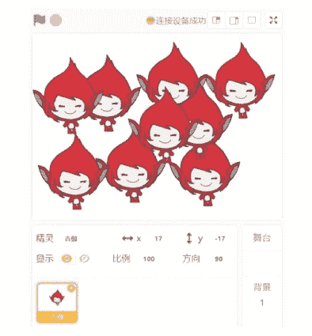

图 5-2

图 5-3

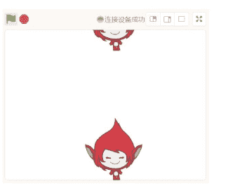

图 5-4

## 动手操作

本游戏的设定是：作为地球卫士的精灵吉伽要消灭来自外太空的精灵骑士，精灵吉伽发射出无数个飞弹，消灭了精灵骑士，维护了地球的和平。

### （1）设置舞台背景

删掉默认的精灵猫，在角色库里找到“吉伽”并将其加载到舞台中。在背景库中，选择太空的背景，如图 5-5 所示。

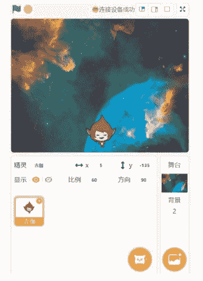

图 5-5

### （2）设计发射子弹的程序

设定在按下`A 按钮`时，精灵吉伽复制自己作为子弹。为了避免连续复制，还需要增添指令积木块优化程序，编程指令如图 5-6 所示。

为了呈现子弹发射的效果，需要将复制出的精灵吉伽的比例修改为 10%，编程指令如图 5-7 所示。

图 5-6

图 5-7

组合如图 5-8 所示的编程指令，使子弹发射到舞台边缘就消失。

图 5-8

组合如图 5-9 所示的编程指令，当我们把`Micro：bit`向左或向右倾斜时，精灵吉伽就能在舞台中向左或向右移动。

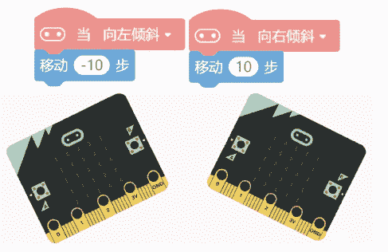

图 5-9

### （3）设置精灵骑士

在角色库里找到“骑士”并将其加载到舞台中。我们设定精灵骑士在程序中随机出现，同时为了让程序更合理，需要限定精灵骑士的活动范围（见图 5-10），编程指令如图 5-11 所示。

### （4）设计得分程序

我们要设计子弹打中精灵骑士后增加分数的程序。同时为了优化程序，可以增添指令积木块，减少程序运行时占用的资源，编程指令如图 5-12 所示。

在实时模式中，完整程序如图 5-13 所示。

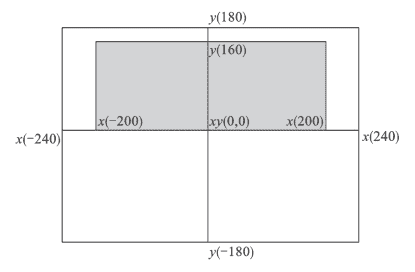

图 5-10

图 5-11

图 5-12

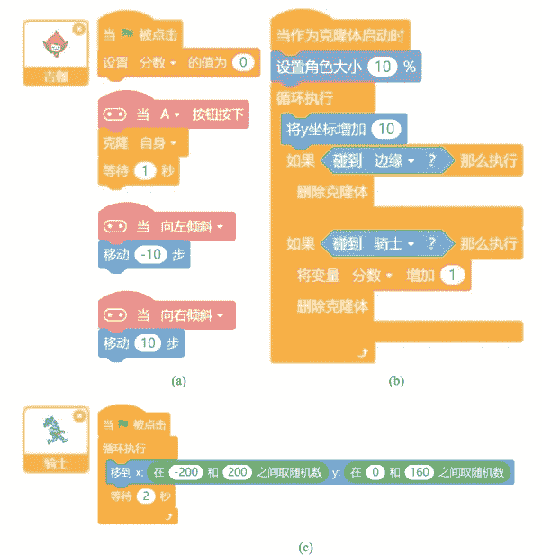

图 5-13

## 活动记录

## 自我评价

我在本次活动中如下方面表现良好：

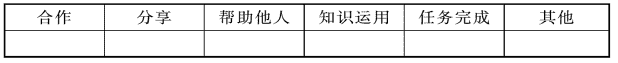

我对自己的评价：

☆☆☆☆☆

## 延伸探索

我可以设计程序，使精灵吉伽左右移动时，速度逐渐加快。

# 第 6 课 发送和接收信息

## 活动目标

1.了解`Micro：bit`之间的无线通信方式。
2.掌握在两个`Micro：bit`之间进行信息传递的方法。

## 学习内容

我们可以通过`Micro：bit`的蓝牙天线发送和接收信息（见图 6-1）。

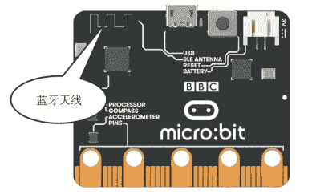

图 6-1

打开`Mind+`，鼠标单击编程模块栏中的，右侧出现指令积木块列表，其中有和。如果要使一个`Micro：bit`向另一个`Micro：bit`发送信号，需要将两个`Micro：bit`的蓝牙通信状态设置为打开状态，并且将两个`Micro：bit`的无线通信频道设置为相同频道，以方便相互通信，编程指令如图 6-2 所示。

### （1）Micro：bit 发送信息

①将`Micro：bit`和电脑连接，在上传模式中，选择`Micro：bit`对应的端口。
②鼠标单击，加载主控板，然后鼠标双击“micro：bit”。

图 6-2

图 6-3

③组合如图 6-3 所示的编程指令，使`Micro：bit`能够重复地通过蓝牙天线发送“`hello`”的信息。上传程序后，等待另一个`Micro：bit`接收信息。

### （2）Micro：bit 接收信息

另一个`Micro：bit`在接收到指定信息后，可以在 LED 屏幕上显示对应的信息。现设定`Micro：bit`接收到“`hello`”的信息后，LED 屏幕上显示符号“√”。

①对`Micro：bit`进行通信初始化，将接收信息的`Micro：bit`的无线频道设置为与发送信息的`Micro：bit`相同的频道，编程指令如图 6-4 所示。
②当`Micro：bit`收到“`hello`”的信息，LED 屏幕显示符号“√”。完整程序如图 6-5 所示。

图 6-4

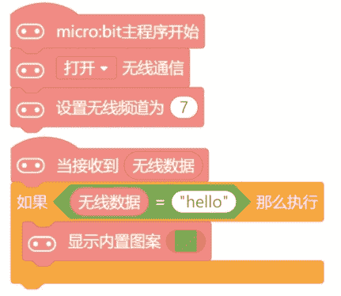

图 6-5

## 动手操作

### （1）Micro：bit 发送信息

组合如图 6-6 所示的编程指令。当我们按下`Micro：bit`的`A 按钮`，`Micro：bit`发送“`hello`”的信息；当我们按下`B 按钮`，`Micro：bit`发送“`all`”的信息；当我们同时按下`A 按钮`和`B 按钮`，`Micro：bit`发送“`heart`”的信息。

我们也可以设定在`Micro：bit`发送信息的同时，LED 屏幕上显示一个字符（如 A），编程指令如图 6-7 所示。

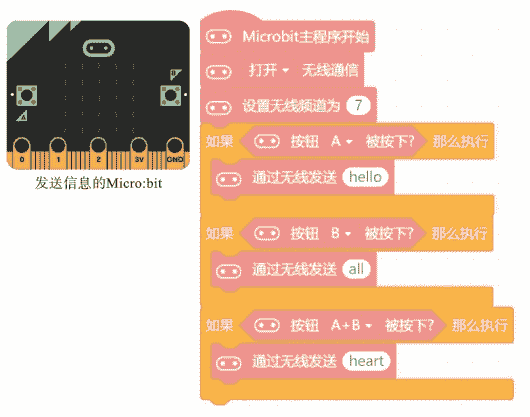

图 6-6

图 6-7

### （2）Micro：bit 接收信息

组合如图 6-8 所示的编程指令，当`Micro：bit`接收到“`hello`”的信息时，LED 屏幕显示符号“√”；当接收到“`all`”的信息时，LED 屏幕上所有的 LED 灯亮起来；当接收到“`heart`”的信息时，LED 屏幕显示心形图案。

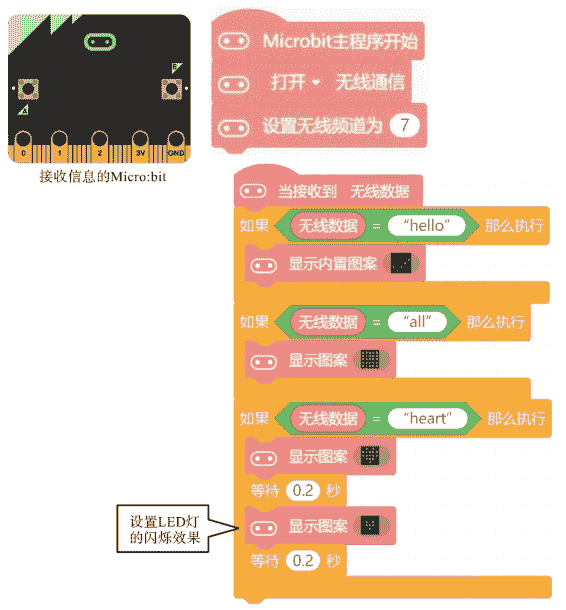

图 6-8

## 活动记录

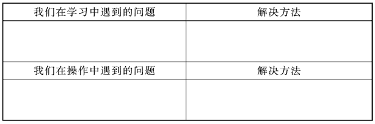

## 自我评价

我在本次活动中如下方面表现良好：

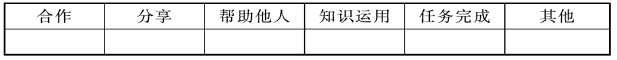

我对自己的评价：

☆☆☆☆☆

## 延伸探索

我可以设计程序，使多个`Micro：bit`互相发送和接收信息。

# 第 7 课 翻译传感器的语言

## 活动目标

1.学习在串口监视器窗口查看传感器的实时数据。
2.学习通过串口监视器向`Micro：bit`发送信息。

## 学习内容

`Micro：bit`上的温度传感器可以感知周围环境的温度。`Mind+`的串口监视器具有数据打印功能，它能将温度传感器感知的温度在电脑上显示出来。

打开`Mind+`，鼠标单击编程模块栏中的，右侧出现指令积木块列表。鼠标单击，将其拖拽至编程区。然后，鼠标单击屏幕右下侧的，设置串口波特率（见图 7-1）。

图 7-1

串口波特率设置完成后，还需要打开串口监视器才能让串口监视器显示和发送数据。鼠标单击，打开串口监视器（见图 7-2）。

图 7-2

## 动手操作

（1）组合如图 7-3 所示的编程指令，其中指令积木块可以使串口监视器窗口显示温度传感器读取的温度数值。

图 7-3

（2）将`Micro：bit`和电脑连接，鼠标单击，将程序上传至`Micro：bit`。

（3）鼠标单击，在串口监视器窗口读取当前温度传感器感知的温度数值，其显示的频率与设置的等待时间长短有关系。

（4）将手指放在温度传感器上（见图 7-4），串口监视器窗口显示的温度数值会变大，如图 7-5 所示。

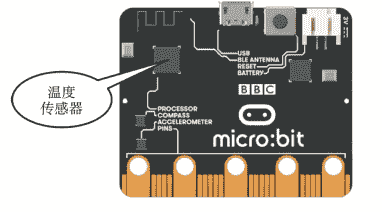

图 7-4

图 7-5

（5）通过串口监视器窗口底部的输入框，我们可以向`Micro：bit`发送信息（见图 7-6）。指令积木块可以帮助`Micro：bit`接收我们在输入框发送的信息。现设定`Micro：bit`收到“`hello`”的信息后，LED 屏幕上显示跳动的红色心形图案；如果没有接收信息，则依次显示`WAIT`的各个字母，编程指令如图 7-7 所示。

图 7-6

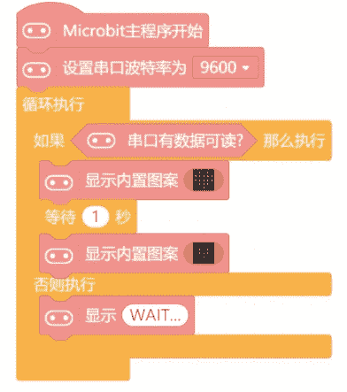

图 7-7

我们通过串口监视器读取并显示了温度传感器感知的温度数值，而且通过串口监视器向`Micro：bit`发送指令，实现了人与机器的对话。

## 活动记录

## 自我评价

我在本次活动中如下方面表现良好：

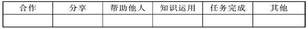

我对自己的评价：

☆☆☆☆☆

## 延伸探索

我还可以通过串口监视器，读取其他传感器的数据。

# 第 8 课 音乐响起来

## 活动目标

1.了解`Micro：mate`的基本构造。
2.学习使用`Micro：mate`播放音乐的功能。

## 学习内容

`Micro：mate`（见图 8-1）是与`Micro：bit`配套的一款多功能 I/O 扩展板，扩展板上的多个 3Pin 接口支持上百款电子元件，它还有一个 3.5mm 的音频输出接口，背面附带防反接的胶垫。`Micro：mate`安装很方便，只用两个黄铜螺母就可以安装。

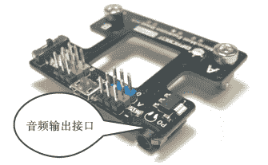

图 8-1

## 动手操作

### （1）连接硬件

①将`Micro：bit`和`Micro：mate`固定在一起（本书后面提到的`Micro：mate`都是与`Micro：bit`固定在一起的），如图 8-2 所示。
②将组合了`Micro：mate`的`Micro：bit`和电脑连接，并且将喇叭或者耳机通过数据线与`Micro：mate`的`P0`接口相连接（见图 8-3）。`P0`接口可以输出声音信号。

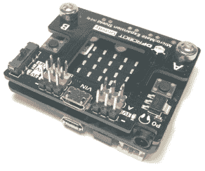

图 8-2

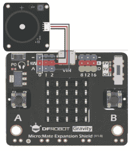

图 8-3

### （2）设计程序

①打开`Mind+`，鼠标单击编程模块栏中的，右侧出现指令积木块列表。鼠标单击和（见图 8-4），将其拖拽至编程区。

图 8-4

②鼠标再次单击，从指令积木块列表中拖拽 8 个至编程区。

③鼠标单击上的“低 C/`C3`”，虚拟琴键弹出（见图 8-5）。鼠标在琴键上移动，琴键底部显示对应的标记，如“中 C/`C4`”。“`C4`”中的“`C`”与“`C4`”分别表示音符与音高。“`C3`”中的“3”表示低音，“`C4`”中的“4”表示中音，“`C5`”中的“5”表示高音。`C`、`D`、`E`、`F`、`G`、`A`、`B`则分别表示简谱中的`Do`、`Re`、`Mi`、`Fa`、`So`、`La`、`Si`。

图 8-5

④鼠标单击琴键，系统会自动设置琴键上面的指令积木块的相应参数。鼠标依次单击琴键上的`Do`、`Re`、`Mi`、`Fa`、`So`、`La`、`Si`、`Do`（高音），8 个指令积木块的参数也就设置好了。

⑤音乐是需要节拍的，在`Mind+`中，可以设置 1、1/2、1/4、2、4 几种节拍，在实际运用中可以根据不同的音乐节奏来调试并设置程序中的节拍（见图 8-6）。

图 8-6

⑥上传程序到`Micro：bit`，我们就可以听到悦耳的音阶了。

⑦将显示内置图案的指令积木块和播放音符的指令积木块组合到一起，上传程序后，`Micro：bit`的 LED 灯会随着音符的播放变换出不同的图案。

⑧分别组合如图 8-7、图 8-8 所示的编程指令，插上耳机，按下`Micro：bit`的`A 按钮`，就可以听到音乐了。

图 8-7

图 8-8

## 活动记录

## 自我评价

我在本次活动中如下方面表现良好：

我对自己的评价：

☆☆☆☆☆

## 延伸探索

我可以设计程序，使`Micro：bit`在`Micro：mate`的帮助下，播放一首音乐。

# 第 9 课　制作光控灯

## 活动目标

1.了解光线传感器的基本原理。
2.学习通过光线传感器控制 LED 灯。

## 学习内容

光线传感器（见图 9-1）可以将光线的明暗程度转换为数据，我们可以通过`Mind+`的串口监视器查看光线传感器转换的数据。然后，我们通过程序设计，可以用这些数据控制 LED 灯。

图 9-1

通过串口监视器查看光线传感器数据的步骤如下。
（1）将光线传感器通过数据线与`Micro：mate`的`P2`接口相连接。
（2）将组合了`Micro：mate`的`Micro：bit`和电脑连接。
（3）打开`Mind+`，在上传模式中，串口监视器窗口可以显示光线传感器的数据，编程指令如图 9-2 所示。

图 9-2
（4）将程序上传到`Micro：bit`，鼠标单击，打开串口监视器，串口监视器窗口显示一串数据。如果我们转动光线传感器，串口监视器窗口显示的数据也会同时发生变化（见图 9-3）。

图 9-3

## 动手操作

（1）设计程序。

我们设定在不同的光照环境中，不同颜色的 LED 灯发光：在强光环境中，红灯亮；在背光环境中，黄灯亮；在无光环境中，绿灯亮。

在强光环境中，鼠标单击“控制”模块中的指令积木块，将其拖拽至编程区，设定当接收到的光线传感器数据大于 100 时，与`Micro：mate`的`P8`接口相连接的红色 LED 灯亮，否则就熄灭，编程指令如图 9-4 所示。

图 9-4

在背光环境中，设定当接收到的光线传感器数据大于 20 并且小于 100 时，与`Micro：mate`的`P12`接口相连接的黄色 LED 灯亮，否则就熄灭，编程指令如图 9-5 所示。

图 9-5

在无光环境中，设定当接收到的光线传感器数据小于 10 时，与`Micro：mate`的`P16`接口相连接的绿色 LED 灯亮，否则就熄灭，编程指令如图 9-6 所示。

完整程序如图 9-7 所示。

（2）组建硬件套件。

如图 9-8 所示，将三个不同颜色的 LED 灯、光线传感器与组合了`Micro：mate`的`Micro：bit`相连接。上传程序后，可以看到 LED 灯在不同的光照环境下有规律地闪烁起来。

图 9-6

图 9-7

图 9-8

## 活动记录

## 自我评价

我在本次活动中如下方面表现良好：

我对自己的评价：

☆☆☆☆☆

## 延伸探索

与`Micro：bit`相连接的 LED 灯依次点亮后，我能使这些灯随着光线变化，闪烁的频率也发生相应变化。

# 第 10 课　红外接收和发射

## 活动目标

1.了解红外传感器的特点和作用。
2.学习通过红外接收传感器和红外发射传感器进行远距离控制。

## 学习内容

我们在生活中经常会用到遥控器，遥控器就是一种红外发射装置。在实际运用中，我们需要将红外接收装置和红外发射装置配合使用。红外传感器是红外发射装置和红外接收装置的核心部件。红外发射传感器（见图 10-1（a））和红外接收传感器（见图 10-1（b））之间通常为单对单控制，形成点对点的遥控应用。

图 10-1

那么，遥控器是怎么发出指令的呢？红外接收传感器又是怎么接收指令的呢？我们先将红外接收传感器与`Micro：mate`的`P8`接口相连接，然后通过`Mind+`的串口监视器来探索红外接收与发射的秘密。

（1）硬件连接。
①打开`Mind+`，鼠标单击，加载通信模块鼠标双击“红外发射模块”和“红外接收模块”，如图 10-2 所示。

图 10-2
②将红外接收传感器与`Micro：mate`的`P8`接口相连接，如图 10-3 所示。

图 10-3

（2）编写程序。
①设置串口波特率，编程指令如图 10-4 所示。

图 10-4
②鼠标单击“变量”模块中的指令积木块，创建变量“`红外值`”，如图 10-5 所示，该变量用于装载红外接收传感器接收到的数据。

图 10-5
③将“`红外值`”设置为红外接收传感器接收到的数据，编程指令如图 10-6 所示。

图 10-6
④鼠标单击“模块”下拉列表中的“运算符”，在右侧出现的指令积木块列表中将和组合，编程指令如图 10-7 所示。完整程序如图 10-8 所示。

图 10-7

图 10-8

（3）查看串口监视器。

上传程序到`Micro：bit`后，按下遥控器上的按键，串口监视器窗口就会显示一串数据，如图 10-9 所示。

图 10-9

按下遥控器上的不同按键，串口监视器窗口会显示不同的数据，在后面的实践活动中，我们需要依据每个按键发出的不同指令，进行程序的编写。

## 动手操作

如图 10-10 所示，将红外发射传感器与`Micro：mate`的`P12`接口相连接，将红外接收传感器与`Micro：mate`的`P8`接口相连接，将 LED 灯与`Micro：mate`的`P16`接口相连接。

图 10-10

我们设置数据“`OxFD00FF`”代表开灯指令，数据“`OxFD8877`”代表关灯指令。当按下`Micro：bit`的`A`按钮时，红外发射传感器向红外接收传感器发射开灯指令；当按下`Micro：bit`的`B`按钮时，红外发射传感器向红外接收传感器发射关灯指令。编程指令如图 10-11 所示。

图 10-11

完整程序如图 10-12 所示。

图 10-12

上传程序到`Micro：bit`后，按下`A`按钮，LED 灯亮；按下`B`按钮，LED 灯熄灭。

鼠标单击“红外发射 NEC”下拉按钮，可以看到红外发射支持非常多的协议，如图 10-13 所示。

图 10-13

如果某一种家用电器的通信协议和图 10-13 所示的通信协议列表中的一项一致，我们就可以用`Micro：bit`和`Micro：mate`制作一个微型遥控器控制该家用电器。

## 活动记录

## 自我评价

我在本次活动中如下方面表现良好：

我对自己的评价：

☆☆☆☆☆

## 延伸探索

我可以用`Micro：bit`做一个控制家用电器的遥控器。

# 第 11 课　智能浇水提醒装置

## 活动目标

1.了解土壤湿度传感器的功能。
2.学习搭建智能浇水提醒装置。

## 学习内容

很多人都喜欢在家里种花种草，却常常忘了给它们浇水。我们可以将一个土壤湿度传感器（见图 11-1）与`Micro：mate`相连接，然后设计提醒给植物浇水的程序。

图 11-1

（1）将土壤湿度传感器与`Micro：mate`的`P0`接口相连接（见图 11-2）。

图 11-2

（2）组合如图 11-3 所示的编程指令，通过`Mind+`的串口监视器读取土壤湿度传感器传输的数据。

图 11-3

（3）将土壤湿度传感器竖着插入水中，串口监视器窗口显示的数据如图 11-4 所示。需要注意的是，不要将土壤湿度传感器全部插入水或土壤中，只插入 1/2 即可，以免造成短路或者元器件损坏。

图 11-4

（4）将土壤湿度传感器置于湿度较高的植物根部附近，串口监视器窗口显示的数据如图 11-5 所示。
（5）将土壤湿度传感器置于较干燥的植物根部附近，串口监视器窗口显示的数据如图 11-6 所示。

图 11-5

图 11-6

## 动手操作

在了解了土壤湿度传感器的基本原理之后，我们可以尝试做一个简单的浇水提醒装置。操作步骤如下。

（1）将土壤湿度传感器与`Micro：mate`的`P2`接口相连接。土壤湿度传感器传输的数据是模拟数据，取值在 0～1023 之间，`Micro：mate`的三个模拟接口（`P0`、`P1`、`P2`）都可以传输模拟数据。
（2）将三个不同颜色的 LED 灯分别与`Micro：mate`的`P16`接口、`P12`接口、`P8`接口相连接，如图 11-7 所示。

图 11-7
（3）组合如图 11-8 所示的编程指令，设定三个 LED 灯表示盆栽植物三种不同的湿度状态：绿灯表示湿度合适，黄灯表示需要适当浇水，红灯表示需要立即浇水。

图 11-8

## 活动记录

## 自我评价

我在本次活动中如下方面表现良好：

我对自己的评价：

☆☆☆☆☆

## 延伸探索

为了更好地起到警示作用，在 LED 灯亮的同时，我可以进一步完善设计。

# 第 12 课　电机驱动扩展板

## 活动目标

1.了解电机驱动扩展板的功能。
2.学习搭建模拟计步装置。

## 学习内容

电机驱动扩展板（见图 12-1）上有电机接口、舵机接口、输入输出接口等多个接口，其中舵机接口、输入输出接口为针脚式接口，方便连接其他设备，可以帮助`Micro：bit`开发更多功能。

图 12-1

电机驱动扩展板可驱动普通小型马达和微型金属电机（N20）。电机驱动扩展板的电机接口旁还有状态指示灯，以显示电机运行的状态。舵机接口直接与输入电源相连，增加了供电电流，可支持多个舵机同时工作。

电机驱动扩展板上有一个插槽，使用前先将`Micro：bit`插入插槽，插入时注意将`Micro：bit`上标示的“`GND`”对准电机驱动扩展板上标示的“`GND`”，然后稍稍用力向下压，即可成功插入，如图 12-2 所示。

图 12-2

我们可以将电机驱动扩展板与其他设备相连接，为`Micro：bit`开发更多的功能，例如搭建机器人、驱动多个电机（需要单独为电机驱动扩展板提供电源）等。将电机驱动扩展板的`IIC`接口与液晶显示屏连接，可以将数据直观地显示出来。

图 12-3（a）所示为 1602A 液晶显示屏（以下简称为“液晶显示屏”），它能够显示两排字符，每排显示 16 个字符。图 12-3（b）为液晶显示屏和电机驱动扩展板的电路连接示意图。使用时先在`Mind+`中将液晶显示屏的通信编码地址设置为“`0x20`”，然后设置在液晶显示屏第 1 行（或第 2 行）显示内容即可，编程指令如图 12-4 所示。

图 12-3

图 12-4

## 动手操作

`Micro：bit`自带三轴加速度传感器，加速度传感器具有体积小、重量轻等特点，可用于汽车安全气囊设计中的汽车状态检测、导航仪中汽车行驶状态的检测等，它还可以测量空间加速度，能够全面、准确地反映物体的运动性质，在航空航天、汽车和医学等领域有广泛的应用。

现在我们用`Micro：bit`和电机驱动扩展板做一个模拟计步装置。物体在运动的过程中，前一个状态和后一个状态是有区别的，加速度传感器会记录物体状态的变化。在编程指令中，我们可将前一个状态设定为变量`x1`，后一个状态设定为变量`x2`，如果前后两个值相差不大，则模拟计步装置判定物体为静止状态，产生的变化忽略不计；如果两个值相差比较大，则模拟计步装置判定物体在运动中，并会将变化记录下来。搭建模拟计步装置的具体步骤如下。

（1）硬件连接。

将`Micro：bit`插在电机驱动扩展板的插槽上，将液晶显示屏与电机驱动扩展板的`IIC`接口相连接。

（2）对液晶显示屏的参数进行初始化。

打开`Mind+`，将液晶显示屏的通信编码地址设置为“`0x20`”，然后设置在液晶显示屏第 1 行显示“`number：`”，编程指令如图 12-5 所示。

图 12-5

（3）新建 3 个变量。

新建 2 个变量——`x1`、`x2`，以记录运动中前一个状态和后一个状态的加速度数据，然后通过计算前后两个数据的差值判断动作是否发生变化。此外，还需要新建变量“`num`”，以记录动作状态发生变化的次数。

（4）编写程序。

首先为变量`x1`、`x2`赋值，编程指令如图 12-6 所示。由于两个变量之差可能会是负数，所以需要通过指令积木块获得变量`x1`和变量`x2`的数值差，这样就可以在程序运行中始终保持运行结果为自然数。本例中设置差值绝对值大于 200，编程指令如图 12-7 所示（可以根据具体情况设置绝对值）。

图 12-6

图 12-7

上传程序后，按下 Micro：bit 的 A 按钮，液晶显示屏显示当前动作变化的有效数值。

完整程序如图 12-8 所示。

当我们携带模拟计步装置行走时，按下 Micro：bit 的 A 按钮，液晶显示屏就能准确地显示当前走路的步数。

图 12-8

活动记录

自我评价

我在本次活动中如下方面表现良好：

我对自己的评价：

☆☆☆☆☆

延伸探索

我还可以使液晶显示屏显示更多传感器的数据。

# 第 13 课　舵机转起来

## 活动目标

1.了解舵机的基本工作原理。
2.学习控制舵机的角度。

## 学习内容

舵机最早仅用于船舶的转向控制，经过不断发展，目前舵机在生活中的应用非常广泛，小区的道闸栏杆（见图 13-1）、高铁检票口的闸口、飞机机翼的减速板都应用了舵机原理。舵机在机器人领域也应用得很多，在工业上用的机械手臂使用了舵机技术，人形机器人四肢的结构设计（见图 13-2）也应用了舵机技术。

图 13-1

现在我们用 Micro：bit 和电机驱动扩展板控制舵机转动。

（1）将舵机与电机驱动扩展板的 S8 接口、S8（GND）接口、S8（VIN）接口相连接（见图 13-3），将 Micro：bit 插到电机驱动扩展板的插槽上。

图 13-2

图 13-3

（2）打开 Mind+，鼠标单击编程模块栏中的“`motorbit`”，右侧出现指令积木块列表。鼠标单击，将其拖拽至编程区（见图 13-4），组合如图 13-5 所示的编程指令，控制舵机在 0 度至 90 度之间转动。

（3）上传程序到 Micro：bit，打开电机驱动扩展板的开关，观察舵机转动情况。

图 13-4

图 13-5

## 动手操作

现在我们用 Micro：bit 和电机驱动扩展板进一步控制舵机。

（1）组合如图 13-6 所示的编程指令，设定在按下 Micro：bit 的 A 按钮时，舵机旋转到 0 度；在按下 B 按钮时，舵机旋转到 90 度。

图 13-6

（2）将液晶显示屏与电机驱动扩展板的 IIC 接口相连接。

（3）组合如图 13-7 所示的编程指令，舵机旋转到指定角度后，液晶显示屏上显示出旋转角度的数值，这样我们就可以了解当前舵机转动的角度。在实际运用中，我们还可以将舵机的旋转角度设置为 180 度，以完成一些特定的功能。

图 13-7

（4）将 LED 灯与电机驱动扩展板的 P8 接口、P8（GND）接口、P8（3V3）接口相连接（见图 13-8）。

图 13-8

（5）组合如图 13-9 所示的编程指令，设定当舵机旋转到 180 度时，LED 灯亮起来；舵机旋转到 0 度时，LED 灯熄灭。

图 13-9

## 活动记录

## 自我评价

我在本次活动中如下方面表现良好：

我对自己的评价：

☆☆☆☆☆

## 延伸探索

我可以借助 Micro：bit 和电机驱动扩展板，用舵机设计一个道闸装置。

# 第 14 课　打开物联网大门

## 活动目标

1.了解 OBLOQ 的功能。
2.学习向物联网开放平台发送和接收消息。

## 学习内容

物联网是在互联网基础上延伸和扩展的网络，它将各种信息传感设备与互联网结合起来，形成一个巨大的实用网络，其目标是在任何时间、任何地点，实现人、机、物的互联互通。

物联网主要的组成部分是一个网络平台，以及可以和这个网络平台进行通信且能够无线联网的硬件设备。

OBLOQ 是一款基于 ESP8266 芯片设计的串口转 WIFI 物联网模块（见图 14-1），它可以依托 Easy IoT 物联网开放平台接收和发送数据与通信指令（见图 14-2）。我们通过电机驱动扩展板将 OBLOQ 和 Micro：bit 相连接，再借助 Mind+，就能迅速搭建出一套物联网智能装置。

图 14-1

图 14-2

## 动手操作

（1）登录 Easy IoT 物联网开放平台。

①在浏览器地址栏输入`http：//iot.dfrobot.com.cn`，打开网页，鼠标单击网页右上角的，在登录界面（见图 14-3）中选择使用账号或者微信、QQ 登录（本例使用 QQ 登录平台）。

图 14-3

②鼠标单击“QQ 登陆”，进入“快速安全登录”界面，如图 14-4 所示。如果已经在电脑上登录了 QQ，单击自己的 QQ 头像就可以顺利登录；如果没有在电脑上登录 QQ，用手机扫描二维码，或者输入 QQ 账号和密码，都可以登录 Easy IoT 物联网开放平台。登录后，屏幕右下角会弹出“QQ 登录安全提醒”，如图 14-5 所示，这表示我们已经成功登录了 Easy IoT 物联网开放平台。

图 14-4

图 14-5

③鼠标单击，用户名（`user`）和密码（`password`）的信息会显示出来，如图 14-6 所示。

图 14-6

④鼠标单击，可以增加一个物联网的项目，并且会随之产生一个与 OBLOQ 进行对话的`Topic`通信码，一个 OBLOQ 对应一个`Topic`通信码，如图 14-7 所示。

图 14-7

（2）连接 OBLOQ 和 Micro：bit。

①将 Micro：bit 插在电机驱动扩展板上。

②OBLOQ 使用的是 Gravity 标准的 4pin 线，其中黑色的线和红色的线分别连接到电机驱动扩展板的 P2 接口（GND）和 P2 接口（3V3），蓝色的线连接到 P12 接口，绿色的线连接到 P13 接口，如图 14-8 所示。连接完成后，OBLOQ 上的红色指示灯会亮起来。

图 14-8

③打开 Mind+，鼠标单击，加载通信模块。鼠标双击“OBLOQ 物联网模块”（见图 14-9），系统会显示已加载，如图 14-10 所示。

④编程模块栏中出现，如图 14-11 所示。

（3）连接 Micro：bit 和 Easy IoT 物联网开放平台。

①鼠标单击，右侧出现指令积木块列表。单击（见图 14-12），将其拖拽至编程区。鼠标单击指令积木块中间的齿轮图标，在弹出的选项单中，填写“`WIFI`”和“物联网平台参数”的相关信息，完成物联网编程环境的初始化。

图 14-9

图 14-10

图 14-11

图 14-12

②组合如图 14-13 所示的编程指令，OBLOQ 自动连接到当前可用`WIFI`。设定在按下 Micro：bit 的 A 按钮时，Micro：bit 向 Easy IoT 物联网开放平台发送字符“`hello`”。

③程序成功上传后，OBLOQ 的指示灯由红色变为蓝色，这说明 OBLOQ 正在自动联网。当指示灯显示为绿色时，表明联网成功。

④按下 Micro：bit 的 A 按钮，登录 Easy IoT 物联网开放平台，就可以看到发送到平台的信息（见图 14-14）。

图 14-13

图 14-14

（4）传输温湿度传感器的数据。

①将一个温湿度传感器与电机驱动扩展板的 P16 接口、P16（GND）接口、P16（3V3）接口相连接。

②鼠标单击，加载传感器模块。鼠标双击“DHT11/22 温湿度传感器”（见图 14-15），系统会显示已加载（见图 14-16）。

图 14-15

图 14-16

③编程模块栏中出现（见图 14-17）。

④鼠标单击，右侧出现指令积木块列表。鼠标单击，将其拖拽至编程区。

⑤设置一个读取温度数据的变量，编程指令如图 14-18 所示。

图 14-17

图 14-18

⑥鼠标单击，右侧出现指令积木块列表。鼠标单击，将其拖拽至编程区。

⑦组合如图 14-19 所示的编程指令，将变量发送到 Easy IoT 物联网开放平台。

图 14-19

⑧设定当按下 Micro：bit 的 B 按钮时，Micro：bit 向 Easy IoT 物联网开放平台发送温度的数据，编程指令如图 14-20 所示。Micro：bit 向 Easy IoT 物联网开放平台发送温度数据的完整程序如图 14-21 所示。

⑨上传程序到 Micro：bit，分别按下 A 按钮和 B 按钮，Easy IoT 物联网开放平台显示相应的数据信息，如图 14-22 所示。

图 14-20

图 14-21

图 14-22

（5）控制 LED 灯。

①如图 14-23 所示，将 LED 灯与电机驱动扩展板的 P1 接口、P1（GND）接口、P1（3V3）接口相连接。

②鼠标单击“变量”模块中的指令积木块，创建变量“`order`”（见图 14-24），编程指令栏同步增加了相应的指令积木块，如图 14-25 所示。

图 14-23

图 14-24

图 14-25

③将变量“`order`”设置为要接收的物联网指令，编程指令如图 14-26 所示。只要是 Easy IoT 物联网开放平台发送的数据都会记录在变量中，并可以在后面的程序中显示出来。

图 14-26

④组合如图 14-27 所示的编程指令，设定当 OBLOQ 接收到“开”的指令，LED 灯亮起来。

图 14-27

⑤组合如图 14-28 所示的编程指令，设定当 OBLOQ 接收到“关”的指令，LED 灯熄灭。完整程序如图 14-29 所示。

⑥登录 Easy IoT 物联网开放平台，当输入“开”并发送信息后（见图 14-30），LED 灯亮；当输入“关”并发送信息后，LED 灯熄灭。

图 14-28

图 14-29

图 14-30

## 活动记录

## 自我评价

我在本次活动中如下方面表现良好：

我对自己的评价：

☆☆☆☆☆

## 延伸探索

我还可以将 OBLOQ 与其他传感器组合，通过物联网开放平台，进一步完善对物联网智能装置的设计。

# 第 15 课　超声波倒车雷达

## 活动目标

1.了解超声波的基本知识。
2.学习设计模拟倒车雷达装置。

## 学习内容

超声波传感器是汽车倒车雷达的主要部件。驾驶员在倒车时，如果车后有物体，倒车雷达上的超声波传感器会将距离信息传送给报警设备，并发出提示声音。

超声波传感器在工作时，通过超声波发射器发射超声波，在发射的同时开始计时。超声波在空气中传播，途中碰到障碍物就立即反射回来，超声波接收器收到反射波就立即停止计时。根据记录的时间，就可以计算出发射点与障碍物间的距离。

超声波传感器（见图 15-1）上的“`TRIG`”对应的是发射端，“`ECHO`”对应的是接收端。现在我们将超声波传感器与电机驱动扩展板的`P8`接口（`GND`）、`P8`接口（`3V3`）、`P8`接口、`P12`接口相连接，如图 15-2 所示。

图 15-1

通过编写程序，超声波检测出的距离能够显示在`Mind+`的串口监视器窗口中，编程指令如图 15-3 所示。

图 15-2

图 15-3

## 动手操作

将喇叭与电机驱动扩展板的`P0`接口、`P0`（`GND`）接口、`P0`（`3V3`）接口相连接（注意接线的颜色要与电机驱动扩展板接口的颜色对应），将`Micro：bit`插在电机驱动扩展板上（见图 15-4）。

图 15-4

现设定当某个障碍物和超声波传感器的距离小于 10 cm 时，喇叭发出急促的嘀嘀声；当距离在 10～20 cm 之间时，喇叭发出低而缓的声音。距离越远，声音频率越低。

（1）距离小于 10 cm 时的情况。

组合如图 15-5 所示的编程指令，设定当障碍物和超声波传感器的距离小于 10 cm 时，喇叭连续发出短促的高音。

图 15-5

（2）距离在 10～20 cm 之间时的情况。

在计算机语言中，两种或多种条件同时符合才可执行的情况，称之为“与”；满足两个条件中的任意一个条件即可执行，称之为“或”；除了当前条件，满足其他条件都可执行，称之为“非”。

本例要求超声波检测的距离同时满足“大于 10 cm”和“小于 20 cm”两个条件，所以我们就使用“运算符”模块中的指令积木块来进行编程。组合如图 15-6 所示的编程指令，设定当超声波检测的距离在 10 cm 到 20 cm 之间时，喇叭发出较为低缓的声音。

图 15-6

完整程序如图 15-7 所示。

图 15-7

## 活动记录

## 自我评价

我在本次活动中如下方面表现良好：

我对自己的评价：

☆☆☆☆☆

## 延伸探索

如果将超声波传感器紧贴物体，就无法获得正常的数据，我能试着探索一下其中的原因。

# 第 16 课 智能小车

## 活动目标

1.了解如何通过编程控制智能小车。
2.学习通过连接传感器使智能小车具备更多功能。

## 学习内容

本课我们要将智能小车和一些传感器元件相连接，然后通过编程，使智能小车具备一定的判断能力，能完成一些基本动作。

图 16-1 展示了电机驱动扩展板控制的智能小车，它们有不同的底盘。

图 16-1

首先将智能小车底盘上的两个电机分别与电机驱动扩展板的`M1`和`M2`接口相连接，如图 16-2 所示。然后，打开`Mind+`，鼠标单击，加载电机驱动扩展板模块，上传如图 16-3 所示的编程指令到`Micro：bit`，设定智能小车向前跑，8 秒后停止。

图 16-2

图 16-3

如果想让智能小车向后运行，可以将电机转动的方向由逆时针修改为顺时针（注意电机转动的方向和智能小车搭建时的连线方式有关），编程指令如图 16-4 所示。如果想让智能小车转弯，可以修改两个电机的速度，编程指令如图 16-5 所示。

图 16-4

图 16-5

## 动手操作

（1）安装超声波传感器。

将超声波传感器与电机驱动扩展板的`P15`接口、`P16`接口、`P16`接口（`3V3`）、`P16`接口（`GND`）相连接，其中绿线连接到`P15`接口，蓝线连接到`P16`接口，红线连接到`P16`接口（`3V3`），黑线连接到`P16`接口（`GND`）。组合如图 16-6 所示的编程指令，设定智能小车在前进时，如果与障碍物之间的距离小于 10 cm 就停下来，否则继续保持前进状态。

将程序上传到`Micro：bit`，打开智能小车的开关，在遇到障碍之前，智能小车保持前进状态；遇到障碍后，智能小车就会停止前进。

图 16-6

（2）安装声音传感器。

将声音传感器（见图 16-7）固定在智能小车上，并将声音传感器与电机驱动扩展板的`P0`接口、`P0`（`GND`）接口、`P0`（`3V3`）接口相连接。

图 16-7

组合如图 16-8 所示的编程指令，上传程序后，试着拍手或者大声说话，智能小车会持续后退 10 秒钟。

（3）安装光线传感器。

图 16-8

将光线传感器（见图 16-9）固定在智能小车上，并将其与电机驱动扩展板的`P1`接口、`P1`（`GND`）接口、`P1`（`3V3`）接口相连接（见图 16-10）。设定当周围光线的亮度达到一定程度时，与`M1`接口相连接的电机的转动方向和与`M2`接口相连接的电机的转动方向相反，编程指令如图 16-11 所示。

图 16-9

上传程序后，用光照射智能小车，智能小车开始旋转；将光源移除，智能小车又恢复静止状态。

（4）智能传感器的应用整合。

组合如图 16-12 所示的编程指令，上传程序后，智能小车向前进时，当超声波传感器检测到智能小车与障碍物之间的距离小于 10 cm，电机停止运行 1 秒，接着智能小车向后退，再向左转弯，完成规避障碍物的完整动作。

图 16-10

图 16-11

图 16-12

智能小车向前进时，当声音传感器检测到声音超过条件值时，电机停止运行 1 秒，接着智能小车持续后退 2 秒钟。

智能小车向前进时，当光线传感器检测到环境的亮度超过条件值时，电机停止运行 1 秒，接着两个电机往相反方向转动，智能小车原地打转。

如果我们将更多传感器和编程结合，如火焰传感器、红外传感器，灰度传感器等，智能小车就会具备更多功能，能够完成更多任务。

## 活动记录

## 自我评价

我在本次活动中如下方面表现良好：

我对自己的评价

☆☆☆☆☆

## 延伸探索

我可以将更多传感器与智能小车组合，使智能小车的功能更强大。

