# AI编程入门指南：Micro：bit与Mind+的智能邂逅

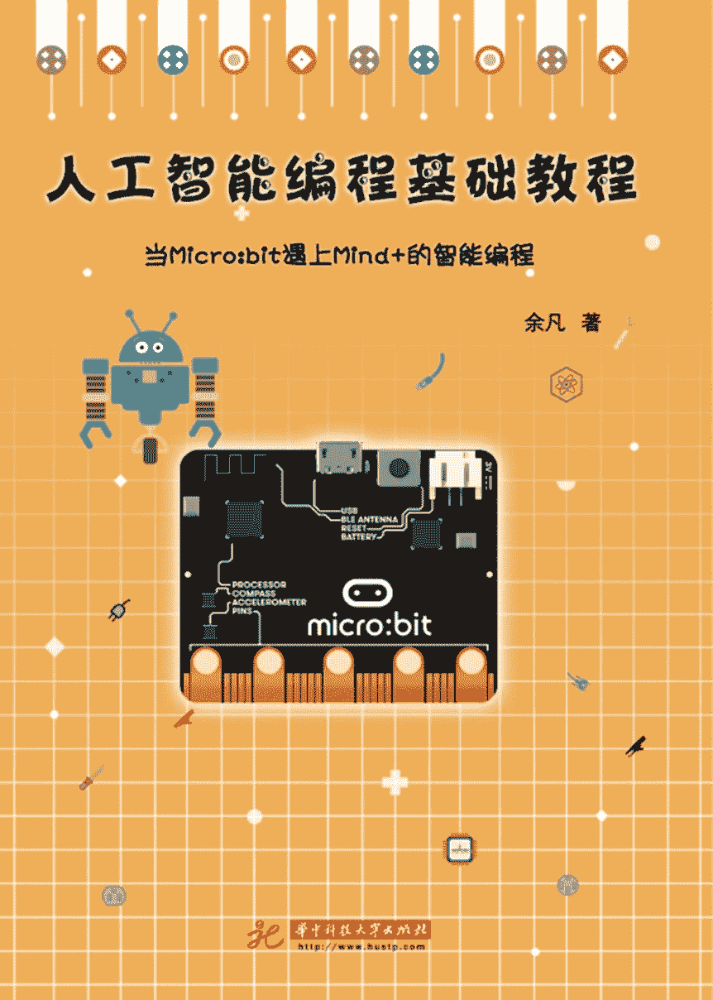

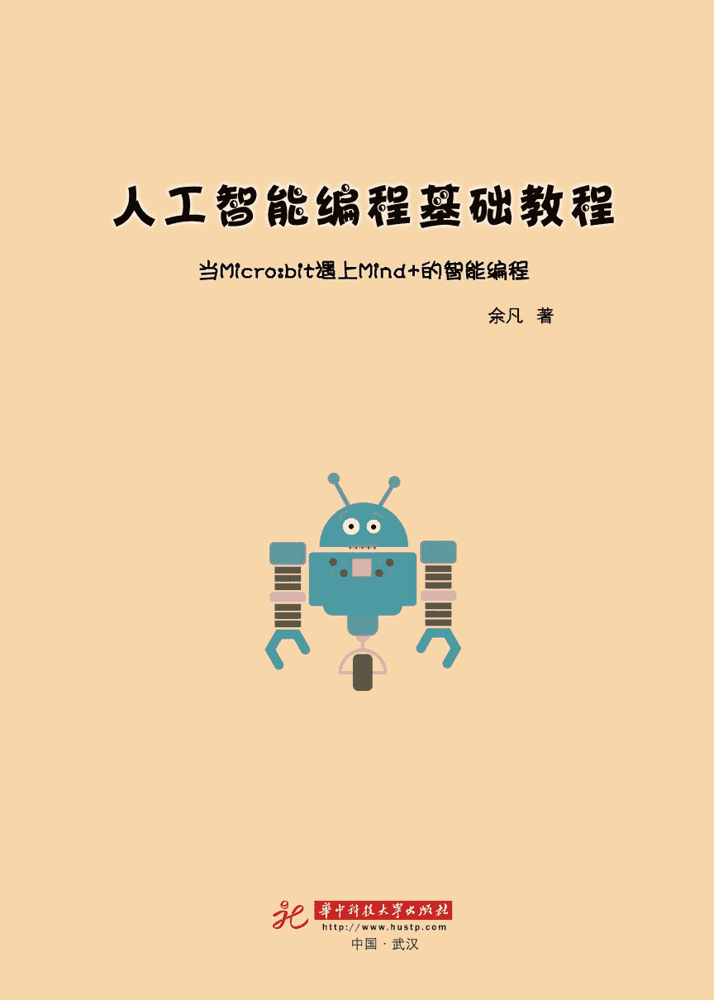

# 序言

回溯至2013年秋天的一个夜晚，我与`DFrobot`公司（下称“`DF`”）创始人叶琛在上海一家星巴克深度交流。虽相识半载，却是首次面对面深谈。我们围绕人工智能教育与开源硬件演进展开对话，观点高度契合。话未聊尽，店铺打烊，遂移步街头漫步，一聊便超一个小时。

具体细节已随时间模糊，但一项共识至今清晰：我们共同判定`Mind+`编程软件（下称“`Mind+`”）应终止开发。彼时`Mind+`采用数据流编程范式，实则难以覆盖`Arduino`（开源硬件）的主流应用场景。更关键的是，学习者即便用`Mind+`创作出酷炫作品，也难将技能迁移至其他编程工具，对青少年编程教育而言价值有限。

项目叫停后，原负责人Rex离职转战电动滑板车领域。这些年，偶在聚会或论坛见旧友怀念`Mind+`——毕竟它是国产首个全自主设计的`Arduino`图形化编程工具。作为“终结者”之一，我常装作未闻，羞于多作解释。`DF`后续推出的`WhenDo`虽优秀，奈何仅限iPad运行，知晓者寥寥。

2017年，得知`Mind+`重启研发，我颇感振奋。12月，`DF`官网挂出“`Mind+`图形化编程软件重装归来”标语，四载光阴，让无数初识开源硬件的AI教育者泪目。`Mind+`不仅承载初见`Arduino`的惊喜，更串联起一路磕绊与同行者。

`Mind+`新增对`Micro：bit`开源硬件（下称“`Micro：bit`”）的支持，令我惊喜。我与`Micro：bit`结缘于2016年“创客嘉年华”，因爱推广，后获`Micro：bit`基金会授予“中国推广大使”称号。目前`Micro：bit`在中小学普及良好，`DF`等企业功不可没。虽微软`MakeCode`平台强劲，但在扩展模块连接性上，`Mind+`更具优势。此外，`DF`还为Python硬件编程打造了易用IDE——`BXY`，同样值得推荐。

最后说说余凡老师。2017年全国机器人教学及创客教育展评中相识，他斩获特等奖，我任评委。深交方知，他本是设计师出身！`Arduino`诞生于意大利设计学院，“STEAM教育”中的“A”（Arts）愈发受重视，余老师的跨界背景为教学与著作为书注入独特基因。他的成果印证：热爱成就精通，唯热爱可抵岁月漫长。

感谢余老师邀序。AI教育需要`Micro：bit`与`Mind+`，更渴望余老师这般跨学科人才。

谢作如

温州中学创客空间

# 作者自序

2017年，我参加全国机器人教学及创客教育展评活动并摘得特等奖。因赞助方为`DFrobot`（下称“`DF`”），我视其为幸运符。曾赴上海出差，专程探访`DF`蘑菇云创客空间。

2018年10月深圳研修，随队领导为武汉市教科院雷刚主任。雷主任指出：课程有效落地是推进AI教育的关键。这引发我深思：选用何种数字化工具，才能高效培育孩子编程素养与计算思维，支撑优质教学？恰逢`DF`余静工程师建议：“`Micro：bit`正热，兼容性强，不如写本专著？”

此前我从未想为`Micro：bit`著书，甚至曾因其“无电池设计”鄙视其生命力。但碍于情面，翻出压箱底的两块板子。意外开启新世界：加速度计、罗盘、光敏、温感……每个模块皆有研究深度，且`Micro：bit`确能与多工具联动，极大助益编程思维训练。

于是本书诞生，涵盖三大板块：`Micro：bit`与`Mind+`互动智能、`Micro：mate`在`Mind+`环境下的创意实践、 `Micro：bit`电机驱动扩展板搭建智能机器人。习成可编程体感游戏、搭建智能装置、自制机器人——这正是`Micro：bit`与`Mind+`结合的奇妙魔力！

# 第 1 课　掌中微型计算机：Micro：bit

## 教学目标

1. 认知`Micro：bit`硬件本质。
2. 掌握`Mind+`编程软件界面布局与核心功能。

## 核心知识

`Micro：bit`由英国广播公司（`BBC`）主导研发，面向青少年编程教育的微型开发板，属开源硬件范畴。如图 1-1 所示，板载蓝牙天线、加速度计、电子罗盘、可编程按键与LED点阵屏。应用场景涵盖电子游戏开发、声光交互、机器人控制、科学实验、可穿戴设备等。为拓展机能，`BBC`配套推出多款扩展板，赋能电子项目快速成型。

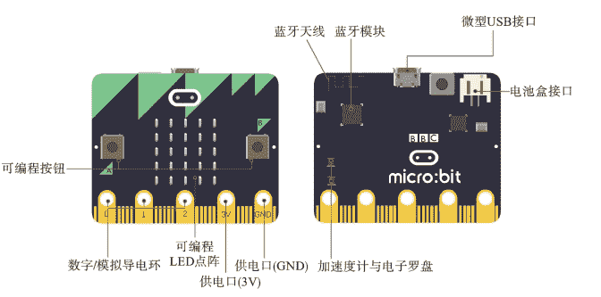

图 1-1

在`Windows`或`Mac`环境下，可用多款软件为`Micro：bit`编程。`Mind+`仅需拖拽图形化指令积木块即可完成编码。

`Mind+`提供双运行模式：**实时模式**与**上传模式**。

实时模式界面见图 1-2。

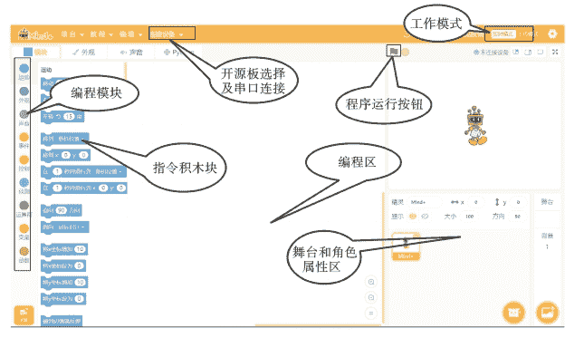

图 1-2

采用图形化编程，拖拽积木块构建逻辑。点击按钮，完成加载与扩展，即时编程，连接电脑的`Micro：bit`同步呈现效果，便于实时调试。

上传模式界面见图 1-3。

此模式下，通过上传按钮将程序烧录至`Micro：bit`，使其脱机独立运行，制作智能作品时必选此法。

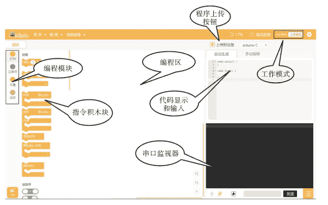

图 1-3

## 实操演练

目标：编程控制`Micro：bit` LED阵列显示心形。

（1）以数据线连接`Micro：bit`与电脑，电源指示灯点亮（参考图 1-4）。

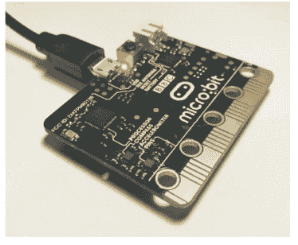

图 1-4

（2）启动`Mind+`，点击加载主控板，双击选中“`micro：bit`”（见图 1-5）。

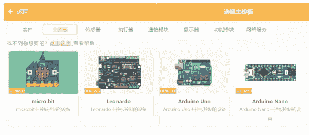

图 1-5

（3）点击“连接设备”下拉菜单中“一键安装串口驱动”（见图 1-6），按向导完成驱动安装。

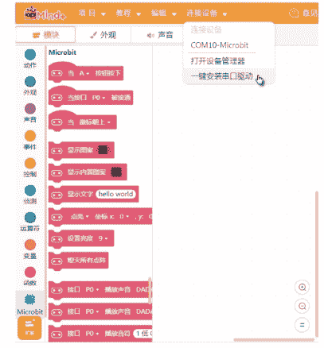

图 1-6

（4）在“连接设备”列表选择“`COM7-Microbit`”，连接成功标识见图 1-7。

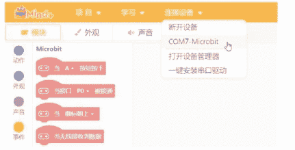

图 1-7

（5）手持`Micro：bit`顺时针旋转360°，LED灯随转动轨迹亮起成环（可在“教程”菜单观看视频演示）。若电源指示灯持续闪烁，表示初始化就绪。

（6）实时模式下，点击编程模块栏，调出指令列表。点击（参考图 1-6），`Micro：bit`即显示心形。

若将指令、与“事件”模块积木组合（见图 1-8），点击绿旗实现心形循环显示。调整等待时长可改变闪烁频率。

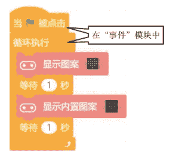

图 1-8

## 活动记录

## 自我评价

本次活动亮点表现：

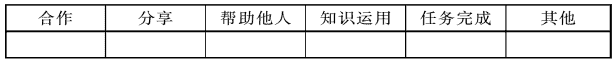

自我评分：

☆☆☆☆☆

## 延伸探索

除心形外，尝试编程显示更多自定义图案。

# 第 2 课　Micro：bit 的体感花样

## 教学目标

1. 体验`Micro：bit`姿态交互特性。
2. 掌握LED显示多样图案的程序设计方法。

## 核心知识

打开`Mind+`，点击编程模块栏，拖拽至编程区。点击积木块倒三角展开下拉菜单，可见`Micro：bit`支持丰富姿态识别（见图 2-1）。程序执行逻辑与板载徽标朝向强相关，如图 2-2 所示为徽标朝上基准姿态。

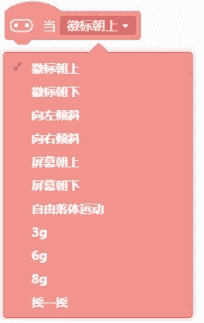

图 2-1

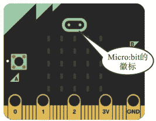

图 2-2

## 实操演练

### （1）大号心形显示
竖立`Micro：bit`，徽标朝上，按图 2-3 组合指令，LED呈现大号心形（见图 2-4）。

图 2-3

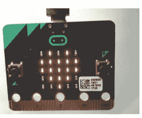

图 2-4

### （2）小号心形显示
徽标朝下，按图 2-5 组合指令，LED显示小号心形（见图 2-6）。

图 2-5

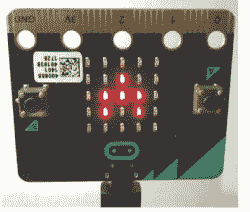

图 2-6

### （3）方向箭头显示
徽标左倾/右倾，按图 2-7 编程，LED显示对应箭头（见图 2-8）。

图 2-7

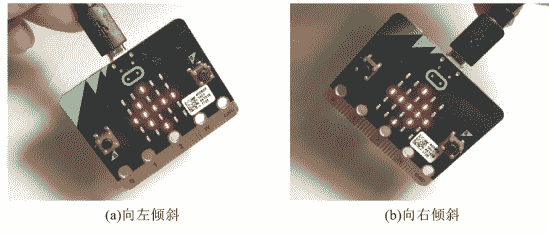

图 2-8

### （4）字母滚动显示
按图 2-9 编程，徽标朝上时LED依次滚动“HELLO”（见图 2-10）。

图 2-9

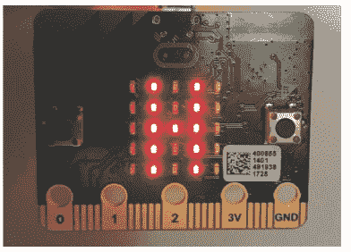

图 2-10

进阶设定：徽标朝上显“OK”、左倾显“YES”、右倾显“NO”、水平放置显“SLEEP”，延时1秒后屏幕边框变红。完整指令见图 2-11，上传后观察实测效果。

图 2-11

## 活动记录

## 自我评价

本次活动亮点表现：

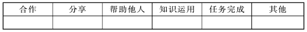

自我评分：

☆☆☆☆☆

## 延伸探索

尝试组合多姿态逻辑，编程实现复杂图案序列。

# 第 3 课　神奇的电子罗盘

## 教学目标

1. 理解电子罗盘功能原理。
2. 掌握在`Mind+`中调用`Micro：bit`电子罗盘的方法。

## 核心知识

指南针为中国古代四大发明，历史功绩卓著。始于利用磁石指向性的“司南”（见图 3-1），历经迭代演变为罗盘（见图 3-2），远洋航海必备，中国为最早海用指南国。

图 3-1

`Micro：bit`集成电子罗盘。板背面标“COMPASS”的集成电路即传感器模块（见图 3-3）。`Mind+`中点击编程模块栏，拖拽与组合，读取当前方位角（编程指令见图 3-4）。

图 3-2

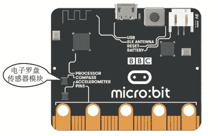

图 3-3

图 3-4

连接设备，实时模式下，徽标朝上，LED屏滚动显示角度值：正北为“0”（或360），正南为“180”。

## 实操演练

# 第 3 课　电子罗盘（续）

要让 Micro：bit 变身实用指南针，离不开 Mind+ 的加持。我们可以设定具体的角度区间来对应四个方位：当罗盘读数小于 30° 或大于 330° 时，屏幕指示正北；160° 至 210° 之间指示正南；30° 到 160° 指向正东；210° 到 330° 则指向正西。由于南北向对精度要求更高，其判定角度范围特意设得比东西向更窄。实现这一逻辑，需调用“运算符”模块的指令积木来界定数值区间，完整编程逻辑见图 3-5。

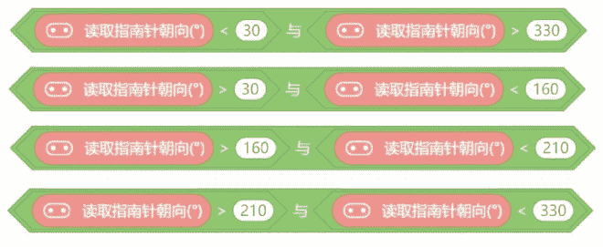

图 3-5

实测时，将 Micro：bit 屏幕朝上：徽标朝北显示“1”，朝东显示“2”，朝南显示“3”，朝西显示“4”（见图 3-6）。完整程序架构见图 3-7。

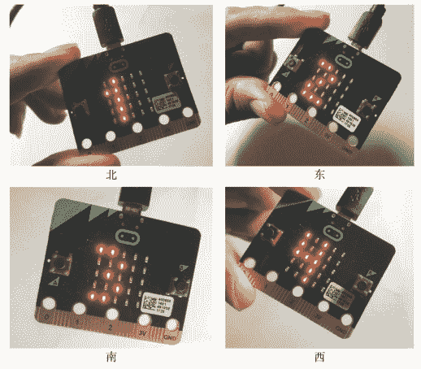

图 3-6

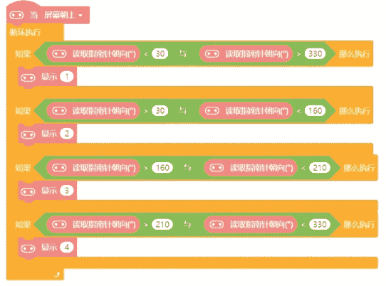

图 3-7

*提示：周围电子设备或环境磁场可能干扰罗盘读数，使用时请留意。*

## 活动记录

## 自我评价

本次活动中，我表现优秀的方面有：

我的自我评分：

☆☆☆☆☆

## 延伸探索

关于电子罗盘角度区间的划分，我有更优的设想。

# 第 4 课　小猫跳一跳

## 活动目标

1. 认识 Micro：bit 按钮功能。
2. 掌握按钮控制小游戏的设计方法。

## 学习内容

连接 Micro：bit 与电脑，启动 Mind+ 实时模式。我们可以挑选“精灵猫”作为主角，设定其属性，并用 Micro：bit 两枚按钮操控它。

点击编程模块栏的，拖入至脚本区；再点“动作”模块拖入，两块积木组合（见图 4-1）。按下 A 键，小猫便离席奔跑；按下 B 键，小猫反向移动 10 步回到原位（见图 4-2）。交替按键，小猫即可在舞台来回穿梭。

图 4-1

图 4-2

通过精灵属性面板可微调体型、朝向、坐标，还能添加背景美化画面（见图 4-3）。

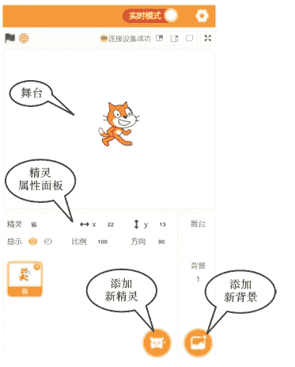

图 4-3

## 动手操作

### （1）实现精灵猫上下跳动

① 缩小精灵比例，扩大活动空间。
② 按图 4-4 组合指令，修改 y 坐标实现上下移动（负值代表向下）。
③ 引入变量模拟重力加速度。点击“变量”模块，新建变量“`zhongli`”（见图 4-5）。
④ 拖入与初始化重力参数，制造下落加速效果（见图 4-6）。

图 4-4

图 4-5

图 4-6

⑤ 设定“`zhongli`”为 15 时按 A 键向上跳跃（见图 4-7），完整程序见图 4-8。运行后小猫自由落体，按 A 键即可起跳。

图 4-7

图 4-8

### （2）布置舞台背景

点击“背景库”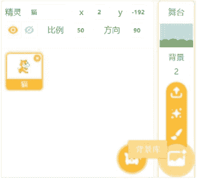，选用“蓝天”背景（见图 4-10）。

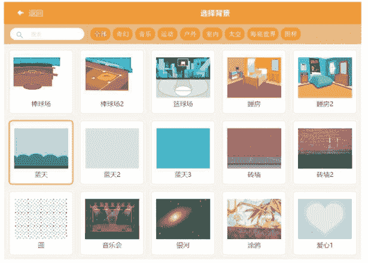

图 4-9

图 4-10

### （3）实现自动弹跳

从“侦测”模块拖入，点击色块取色（见图 4-11）。按图 4-12 组合指令，上传后小猫触碰底部色块即自动弹起（见图 4-13），动感十足。

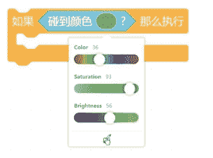

图 4-11

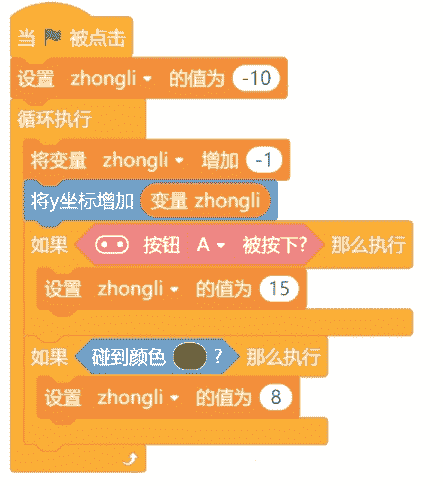

图 4-12

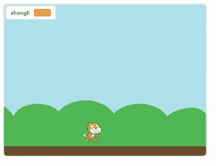

图 4-13

### （4）引入伙伴角色

① 打开角色库，双击添加“老鼠”（见图 4-14）。小猫可跳起与其互动，碰撞得分。

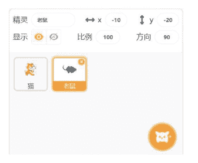

图 4-14

② 设定老鼠触边反弹、左右翻转模式（见图 4-15）。

图 4-15

③ 碰撞得分需动态变量。新建得分变量并初始化，嵌入碰撞判定指令（见图 4-16、4-17）。

图 4-16

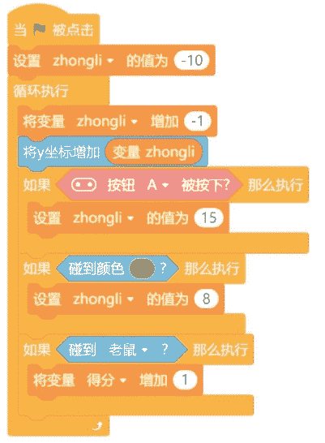

图 4-17

④ 因运行速度极快，单次碰撞可能多次加分，需补充指令修正。

最后补充左右移动等按键功能丰富玩法。完整实时程序见图 4-18。

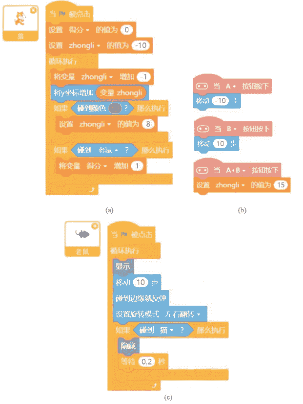

图 4-18

## 活动记录

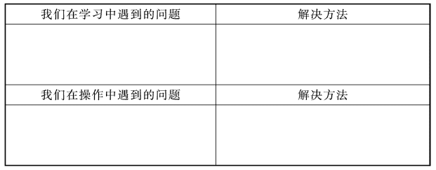

## 自我评价

本次活动中，我表现优秀的方面有：

我的自我评分：

☆☆☆☆☆

## 延伸探索

碰到老鼠后，我可以让老鼠变大、变色或消失。

# 第 5 课　发射子弹的小游戏

## 活动目标

1. 理解 Mind+ 克隆（复制）机制。
2. 学会设计发射子弹类小游戏。

## 学习内容

选用“吉伽”精灵，利用“控制”模块实现连发效果（见图 5-1）。

图 5-1

按 A 键触发克隆，虽肉眼不可见，但拖动舞台上的吉伽会发现已复制多个实例（见图 5-2）。

## 动手操作

### 让克隆体动起来

需添加指令。按图 5-3 组合，点击绿旗运行，按 A 键后克隆体飞向舞台顶端（见图 5-4）。

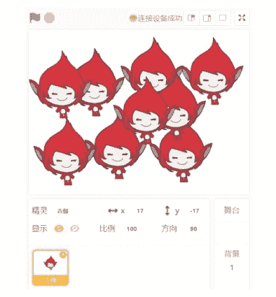

图 5-2

图 5-3

图 5-4

## 动手操作（续）

**游戏设定：** 吉伽化身地球卫士，发射无数飞弹消灭外星“骑士”，捍卫和平。

### （1）搭建太空场景

移除默认小猫，载入“吉伽”与太空背景（见图 5-5）。

图 5-5

### （2）编写发射系统

按 A 键克隆自身作为子弹，加入防连发（见图 5-6）。将克隆体缩放至 10% 体现子弹感（见图 5-7）。设定飞出边缘即销毁（见图 5-8）。利用 Micro：bit 倾斜控制吉伽左右移动（见图 5-9）。

图 5-6

图 5-7

图 5-8

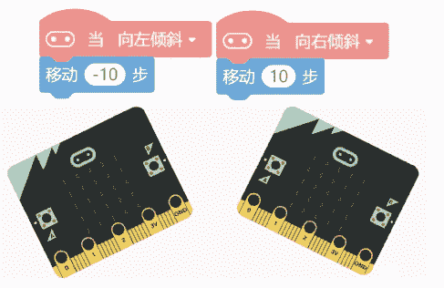

图 5-9

### （3）部署敌人“骑士”

载入“骑士”角色，设定随机生成并限定活动范围（见图 5-10、5-11）。

### （4）计分与优化

子弹击中骑士加分，引入释放资源优化性能（见图 5-12）。完整实时程序见图 5-13。

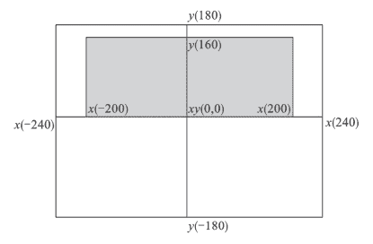

图 5-10

图 5-11

图 5-12

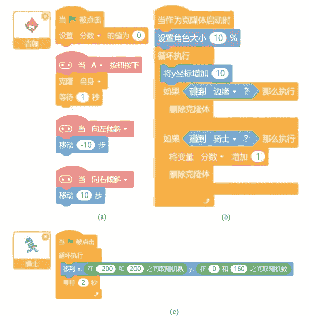

图 5-13

## 活动记录

## 自我评价

本次活动中，我表现优秀的方面有：

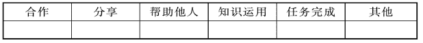

我的自我评分：

☆☆☆☆☆

## 延伸探索

我可以让吉伽移动时加速，增加操作手感。

# 第 6 课　无线通信：发送与接收

## 活动目标

1. 理解 Micro：bit 无线通信原理（蓝牙天线）。
2. 掌握双板间信息收发实操。

## 学习内容

Micro：bit 依靠蓝牙天线完成数据交换（见图 6-1）。

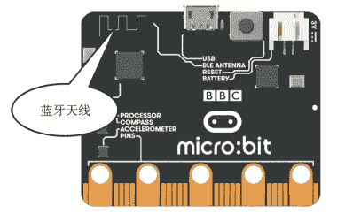

图 6-1

打开 Mind+，点击调出积木，核心指令为与。通信前提：双板蓝牙开启，且**无线频道号一致**（见图 6-2）。

### （1）发送端配置

① 上传模式下选端口，点加载主控板，双击“micro:bit”。
② 组合指令（见图 6-3），循环广播“`hello`”，上传后等待接收端。

图 6-2

图 6-3

### （2）接收端配置

另一块板收到“`hello`”后，屏幕显示“√”。

① 初始化通信，频道对齐发送端（见图 6-4）。

# 第 6 课 无线通讯首探

## 实操演练

### 发射端搭建
按下图逻辑组装积木块。触发 **A 键**，主板广播 “hello”；按下 **B 键**，广播 “all”；**双键同按** 则发送 “heart”。若需同步在点阵屏回显对应字符（例如 “A”），可参考另一套指令搭建。

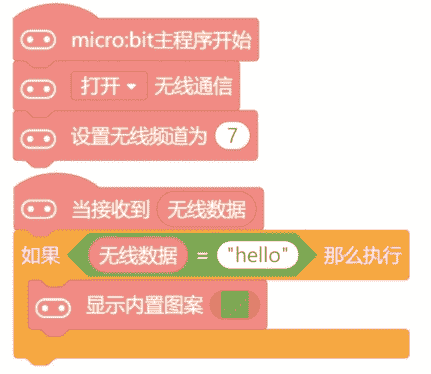

### 接收端搭建
依照下图指令拼装程序。捕获到 “hello” 时点阵显示 “√”；收到 “all” 则全屏点亮；收到 “heart” 呈现爱心图样。

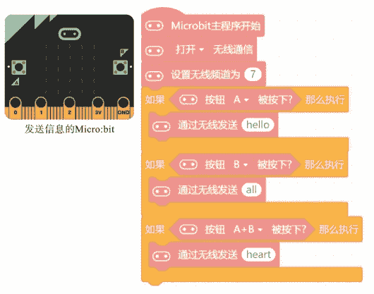

## 学习档案

## 自我复盘

本次活动中，我在下列维度表现优异：

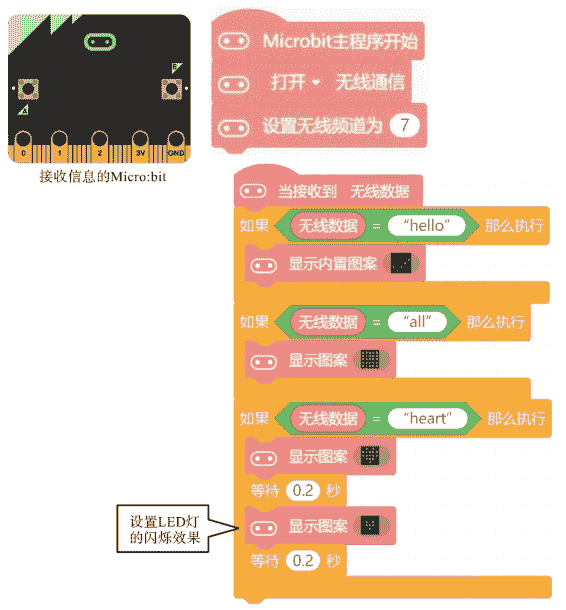

自我评分：☆☆☆☆☆

## 进阶挑战
尝试编写代码，让多块 `Micro：bit` 实现互发互收。

---

# 第 7 课 读懂传感器语言

## 学习重点
1. 掌握在串口观测窗查看传感器实时数值的方法。
2. 学会利用串口观测窗向 `Micro：bit` 下发指令。

## 核心原理
`Micro：bit` 内置温度感应单元，配合 `Mind+` 串口观测窗的数据打印特性，可在电脑端直观呈现环境温度。

**环境配置流程：**
1. 点击编程模块栏的 **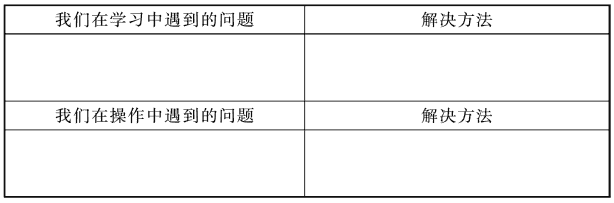**，调出指令积木列表。
2. 将 **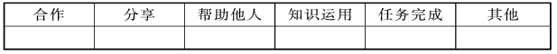** 拖入编程区域。
3. 点击右下角 ****，完成波特率参数设定（参考示意图）。

**启动观测窗：** 点击 ****，打开串口监视器界面。

## 实操演练

1. **程序搭建**：按下图组合指令，其中 **** 积木块负责将温度读数推送至观测窗。

2. **连接烧录**：用数据线连接主板与电脑，点击 **** 上传代码。

3. **数值观测**：点击 ****，观测窗即会按设定间隔刷新当前温度。

4. **交互体验**：用手指覆盖温度传感器（见下图），观测窗数值随即攀升。

5. **人机对话**：利用观测窗底部输入框可向主板发送消息（见下图）。借助 **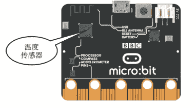** 积木块接收指令：设定收到 “hello” 显示跳动红心，其余时间滚动播放 “WAIT” 字母，完整逻辑如图所示。

> **小结**：已实现温度数据可视化读取，并通过串口指令完成基础人机交互。

## 学习档案

## 自我复盘

本次活动中，我在下列维度表现优异：

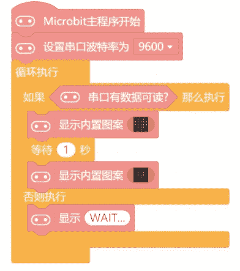

自我评分：☆☆☆☆☆

## 进阶挑战
探索通过串口观测窗读取其他类型传感器（如光敏、声敏）的数据。

---

# 第 8 课 让音乐响起来

## 学习重点
1. 认知 `Micro：mate` 扩展板构造。
2. 掌握借助扩展板播放乐曲的技巧。

## 硬件认知
`Micro：mate`（见下图）是 `Micro：bit` 的多功能 I/O 扩展板，集成大量 3Pin 接口兼容百余模块，自带 3.5mm 音频输出孔，背部防反接设计，仅需两颗铜柱即可快速锁合。

## 实操演练

### 硬件接线
1. 将 `Micro：bit` 与 `Micro：mate` 锁合（后续默认皆为合体状态）。
2. 经 USB 连接电脑，喇叭/耳机插入扩展板 **P0 口**（该口输出音频信号）。

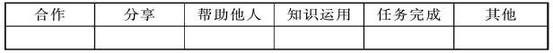

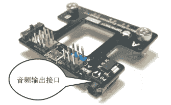

### 编程作曲
1. **加载模块**：点击 **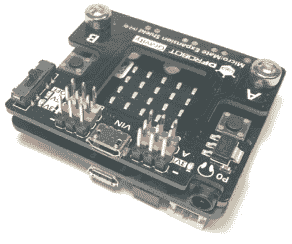**，将 **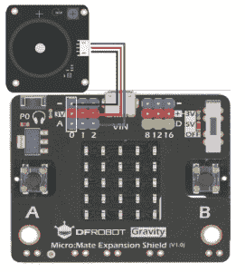** 与 **** 拖入编程区。

2. **添加音符**：再次点击 ****，拖入 8 个 **** 积木块。

3. **选音定调**：点击积木块音符区（默认 “低 C/C3”），虚拟钢琴弹出。琴键标识含义：**C/D/E/F/G/A/B** 对应 **Do/Re/Mi/Fa/So/La/Si**；数字 **3/4/5** 分别代表 **低/中/高** 音区。依次敲击 **Do、Re、Mi、Fa、So、La、Si、高音 Do**，8 个音符参数自动配齐。

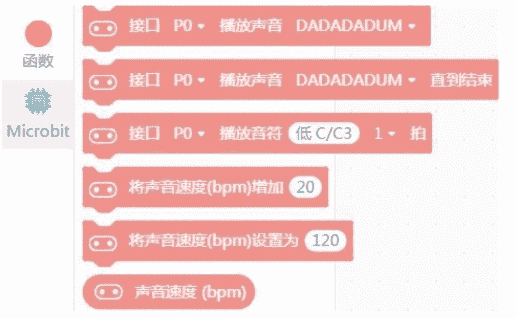

4. **设节奏**：`Mind+` 支持 1、1/2、1/4、2、4 等拍值，根据曲风调整各音符时值。

5. **烧录试听**：上传程序，即可听到完整音阶。

6. **声光同步**：将 “显示内置图案” 与 “播放音符” 积木块串联，烧录后点阵将随音符切换花样。

7. **按键点歌**：分别搭建下图两套逻辑，佩戴耳机，按 A/B 键即可播放不同曲目。

## 学习档案

## 自我复盘

本次活动中，我在下列维度表现优异：

自我评分：☆☆☆☆☆

## 进阶挑战
编写程序，让 `Micro：bit` 借助 `Micro：mate` 完整演奏一首乐曲。

---

# 第 9 课 自制光控灯

## 学习重点
1. 理解光线传感器工作机理。
2. 掌握用光敏数值控制 LED 灯的编程方法。

## 原理与调试
光线传感器（见下图）能将光强转为数字信号，配合串口观测窗即可实时监测数值变化，进而作为控制依据。

**数据观测步骤：**
1. 传感器接入扩展板 **P2 口**。
2. 主板连电脑，`Mind+` 上传模式下按下图搭建程序。

3. 烧录代码，点击 **** 打开观测窗。遮挡或转动传感器，屏幕数据随之波动。

## 实操演练

### 逻辑设定
依据光照强弱分级控制三色灯：
*   **强光 (>100)**：红灯亮
*   **弱光 (20~100)**：黄灯亮
*   **全暗 (<10)**：绿灯亮

**代码实现（关键片段）：**
*   **强光判定**：用 **** 积木块，条件设为 “P2 读值 > 100”，满足则点亮 **P8 口红灯**，否则熄灭。

*   **弱光判定**：条件为 “读值 > 20 且 < 100”，控制 **P12 口黄灯**。

*   **全暗判定**：条件为 “读值 < 10”，控制 **P16 口绿灯**。

*   **完整程序** 整合如下：

### 硬件组装
按下图连接三颗 LED 与光敏模块，烧录程序，系统即可随环境光自动切换灯色。

## 学习档案

## 自我复盘

本次活动中，我在下列维度表现优异：

自我评分：☆☆☆☆☆

## 进阶挑战
优化程序，使 LED 闪烁频率随光照强度动态变化。

---

# 第 10 课 红外收发实验

## 学习重点
1. 认知红外传感器特性与应用场景。
2. 掌握红外收发模块协作实现远程控制。

## 核心知识
生活中常见的遥控器即红外发射装置。实际应用中，**红外接收** 与 **红外发射** 需配对使用，核心均为红外传感器，典型拓扑为 **点对点** 单控。

**探秘收发原理：** 先将接收模块接入扩展板 **P8 口**，借助串口观测窗抓取信号细节。

### 硬件准备
1. 打开 `Mind+`，点击 ****，在通信模块中分别双击添加 “红外发射模块” 与 “红外接收模块”。

2. 硬件接线如下图：

### 程序编写
1. **配置波特率**：按下图设置串口参数。

2. **加载通信积木**：在编程区拖入相关红外指令块，完成接收与发射逻辑的搭建。

3. **烧录验证**：上传程序至主板，按下遥控器按键，观察串口监视器数据变化，确认通信链路通畅。

# 第 10 课　红外通信实战：从信号解码到设备遥控

## 核心任务
掌握红外通信全链路：搭建接收端解析遥控编码，构建发射端实现家电远程操控。

## 实操指南

### 第一阶段：搭建“解码器”捕获遥控指令
**硬件接线**  
红外接收模块接入 Micro：mate P8 口，Micro：bit 经 USB 连电脑。

**建立存储变量**  
于 Mind+“变量”栏点击积木块新建变量 `红外值`，专用于暂存传感器回传的原始信号。

**界面确认**  
变量创建成功后显示如所示。

**编写采集逻辑**  
将 `红外值` 赋值为红外接收传感器的读数，积木搭建参考。

**组合判断指令**  
进入“模块”→“运算符”，将积木与拼装组合，完整指令结构见。

**完整程序全貌**  
整合后的程序逻辑如所示。

**实测验证**  
程序烧录完成，打开串口监视器，按压遥控器任意键，窗口即输出对应十六进制编码（如 `0xFD00FF`），效果见。不同按键对应唯一编码，为后续控制逻辑奠定基础。

---

### 第二阶段：打造“微型遥控器”驱动 LED
**电路拓展**  
在原有基础上增接红外发射模块（P12）与 LED 灯（P16），形成“发射-接收-执行”闭环，布局参考。

**协议约定**  
定义两条核心指令码：  
- `0xFD00FF` → 开灯  
- `0xFD8877` → 关灯  

**双端协同编程**  
- **发射端（Micro：bit 主板）**：按键 A 触发发射“开灯码”，按键 B 发射“关灯码”，支持 NEC 等多种主流协议切换。  
- **接收端（Micro：mate）**：解析接收码值，匹配执行 LED 开关动作。  
指令搭建细节见，完整程序架构见。

**现象观测**  
实测：按主板 A 键 → 红灯亮；按 B 键 → 红灯灭。点击“红外发射 NEC”下拉菜单可见支持协议众多，详情见。若目标家电协议在列表中，即可化身专用遥控器。

---

### 复盘与拓展
  

---

# 第 11 课　智能浇水管家：让植物“会开口”要水

## 核心任务
利用土壤湿度传感器实时采集基质水分，通过三色灯直观呈现“缺水-适宜-充足”三态。

## 原理认知与基线测试
**传感器特性**  
探针插入介质输出 0~1023 模拟值：数值越大 → 环境越干燥。  
**避坑指南**  
仅插入探针前 1/2，严禁全没入，防止短路烧毁。  
模块实物见。

**接线起步**  
传感器接 P0 口，接线图参考。

**读数程序搭建**  
按组合指令，打开串口监视器读取实时数据。

**建立干湿基准**  
- 半浸水中：读数骤降（高湿基准），见  
- 湿润盆栽根部：中等数值，见  
- 干燥盆栽根部：读数飙升（低湿基准），见  
据此划定三档阈值区间。

---

## 装置组装与分级编程
**硬件清单**  
- 土壤湿度传感器 → P2（模拟口任选）  
- 绿/黄/红 LED → P16/P12/P8  
布局图见。

**逻辑分级表**  
| 灯色 | 状态含义 | 触发区间（示例） |  
|------|----------|------------------|  
| 🟢 绿 | 湿度适宜 | 值 < 300 |  
| 🟡 黄 | 需补水 | 300 ≤ 值 < 700 |  
| 🔴 红 | 严重缺水 | 值 ≥ 700 |  

阈值需结合实测基准微调，编程实现分段判断点亮对应灯珠，指令参考。

---

### 记录与进阶
  
  
> 💡 **延伸灵感**：叠加蜂鸣器报警 / OLED 显示具体数值 / 接入水泵实现全自动灌溉。

---

# 第 12 课　电机驱动板进阶：DIY 电子计步器

## 核心任务
借助 Micro：bit 三轴加速度计 + 电机驱动扩展板 + 1602 液晶屏，打造随身计步装置。

## 硬件速览
扩展板集成电机/舵机/I/O 接口，大幅拓展主板能力（见）。插卡时对齐 GND 压实（）。

外接 1602 液晶屏（两行各 16 字），接 IIC 口，Mind+ 设通信地址 `0x20`，初始化指令见。

## 算法核心：差值判步法
**变量设计**  
- `x1`：上一采样周期合成加速度  
- `x2`：本次采样周期合成加速度  
- `num`：有效步数累计器  

**屏幕初始化**  
上电显示 `number:`，指令见。

**核心计算**  
利用积木获取 `|x1-x2|` 绝对值，规避负数干扰。赋值指令见，判断阈值（示例 200，可按佩戴位置微调）指令见。超阈值则 `num+1`。

**完整程序与实测**  
烧录后按 A 键屏显实时步数，程序全貌见。行走测试中，屏幕可准确计数。

---

### 复盘与拓展
  
  
> 💡 **进阶方向**：融合心率/温度传感器 → 多参数健康手环；接入蓝牙模块 → 手机端同步数据。

---

# 第 13 课　舵机精准控角：从道闸到机械臂

## 核心任务
掌握舵机 PWM 角度控制，实现按键定角、屏显反馈、灯光联动三大场景。

## 认知与基础接线
舵机从船舶转向延伸至小区道闸（）、高铁闸机、机械臂/仿生肢体（）。

**实操接线**  
舵机三线（信号/地/电）接扩展板 S8 接口组，主板插卡槽，接线图见。  

**基础摆动编程**  
加载 `motorbit` 模块，搭建 0°↔90° 往复程序（），烧录上电观察摆动（）。

---

### 进阶三部曲

| 阶段 | 交互方式 | 执行动作 | 反馈机制 |  
|------|----------|----------|----------|  
| **L1 按键定角** | A 键 / B 键 | 定向转至 0° / 90° | 无 |  
| **L2 屏显角度** | A 键→0° / B 键→90° | 同步驱动 | 1602 屏显当前角度 |  
| **L3 灯光联动** | A 键→0° / B 键→180° | 同步驱动 | 180°亮灯 / 0°灭灯 + 屏显角度 |  

**L1 指令**：  
**L2 指令**（外接 IIC 液晶屏）：  
**L3 指令**（LED 接 P8，接线见）：  

---

### 记录与延伸
  
  
> 💡 **延伸灵感**：配合超声波测距 → 智能避障车转向；多舵机协同 → 仿生机械手/六足机器人。

---

# 第 14 课　OBLOQ 物联网首发：设备上云实战

## 核心任务
理解物联网“端-管-云”架构，用 OBLOQ 模块完成 Micro：bit 设备接入物联网平台的双向通信。

## 认知建模
**物联网本质** = 互联网 + 信息感知设备 + 网络平台  
**核心目标**：任意时、任意地、人机物三元互联。

**OBLOQ 定位**  
- 内置 Wi-Fi + MQTT 协议栈  
- 串口透传指令，免驱动接入主流 IoT 平台（OneNET、ThingsBoard 等）  
- 让单片机“零成本”拥有联网能力

## 通信闭环实操
1. **配网**：AT 指令/网页配置 → 连接热点  
2. **认证**：填入产品 ID / 设备 ID / API Key  
3. **上行**：传感器数据 → 串口 → OBLOQ → MQTT → 云平台  
4. **下行**：云平台下发指令 → MQTT → OBLOQ → 串口 → Micro：bit 执行  

---

### 进阶方向
> 💡 接入温湿度/光照/气体传感器 → 环境监测站；对接语音助手 → 语音控制智能家居；搭配电池管理 → 户外无线传感节点。

# OBLOQ物联网实战：从联网到云端控制全流程

基于ESP8266核心打造的OBLOQ模组，是一款高性能串口转WiFi物联网终端。依托Easy IoT平台即可实现数据双向流转。搭配电机驱动板桥接micro:bit，配合Mind+可视化编程，快速落地智能感知与远程控制装置。

图 14-1

图 14-2

## 核心步骤拆解

### 一、 接入Easy IoT平台
1.  **账号登录**：浏览器访问`http://iot.dfrobot.com.cn`，页面右上角入口支持密码、微信、QQ多模式登录（本文演示QQ）。
    
    图 14-3
2.  **授权确认**：点击QQ图标进入安全验证页。PC端已登QQ则一键授权，否则扫码或输账号密码均可。授权成功后，右下角弹窗提示登录态。
    
    图 14-4
    
    图 14-5
3.  **获取凭证**：点击即可查看`user`与`password`等关键信息。
    
    
    图 14-6
4.  **创建项目**：新建项目前，系统自动生成唯一`Topic`通信码，一码对应一设备。
    
    图 14-7

### 二、 硬件连接与IDE配置
1.  **主控就位**：micro:bit插座电机驱动扩展板。
2.  **模组接线**：Gravity 4Pin线序——黑/红线接P2供电(GND/3V3)，蓝/绿线分接P12、P13信号线。上电后模组红灯常亮。
    
    图 14-8
3.  **加载扩展**：Mind+打开扩展库，搜索“OBLOQ物联网模块”添加。
    
    图 14-9
    
    图 14-10
4.  **指令就绪**：编程区自动生成专用积木块。
    
    图 14-11

### 三、 设备联网与消息上报
1.  **环境初始化**：调出指令列表，拖入初始化块，点击齿轮图标填入WiFi凭证及平台参数。
      // Note: Source uses PRE12 for "鼠标单击" in step 3①, but PRE12 used above for "Mind+扩展库". Wait, Source mapping:
    // Source Step 3①: 鼠标单击 -> 单击 -> 图14-12
    // My mapping: PRE17 is 图14-12. PRE12 in source is click extension. PRE13 is click block.
    // I need to be careful. Let's follow source PRE numbers strictly.
    // Source PRE12: "鼠标单击" (Load extension) -> My text used PRE11 for this.
    // Source PRE13: "单击" (Drag block) -> My text used PRE18 for this.
    // Source PRE17: "图 14-12" -> My text used PRE17 for this.
    // Okay, I will map strictly in the final output.
    // Let's re-map carefully in the final code block.
    // I will write the text and insert PRE tags exactly where they appear in source structure.

    // Re-planning PRE insertion points based on SOURCE TEXT structure:
    // Intro: PRE0, PRE1
    // Step1: PRE2, PRE3, PRE4, PRE5, PRE6, PRE7, PRE8
    // Step2: PRE9, PRE10, PRE11, PRE14, PRE15, PRE16, PRE17
    // Step3: PRE12, PRE13, PRE17, PRE18, PRE19  (Wait Source: ③鼠标单击...单击...图14-12 ... 图14-13 ... 图14-14)
    // Step4: PRE20, PRE21, PRE22, PRE23, PRE24, PRE25, PRE26, PRE27, PRE28, PRE29, PRE30, PRE31, PRE32, PRE33
    // Step5: PRE34, PRE35, PRE36, PRE37, PRE38, PRE39, PRE40, PRE41, PRE42
    // Record: PRE43
    // Eval: PRE44
    // Lesson15: PRE45, PRE46, PRE47, PRE48, PRE49, PRE50, PRE51, PRE52, PRE53, PRE54
    // Lesson16: PRE55, PRE56, PRE57, PRE58

    // I must place them exactly in the output order matching the source content flow.

### 三、 设备联网与消息上报
1.  **环境初始化**：点击调出指令面板，拖入至编程区（参考图14-12），点击齿轮填入WiFi账密与平台密钥完成初始化。
2.  **搭建上报逻辑**：按示意图组装程序——模组自动联网，主控A键按下触发向平台推送字符“hello”。
3.  **状态灯解读**：烧录后指示灯红→蓝（连接中）→绿（就绪）。
4.  **云端核验**：按下A键，平台侧即可捕获到上报数据。

### 四、 环境数据上传实战（温湿度示例）
1.  **扩展硬件**：温湿度探头接入扩展板P16（信号/地/电）。
2.  **驱动加载**：点击扩展库，添加“DHT11/22温湿度传感器”。
    
    
    图 14-15
    
    图 14-16
3.  **变量暂存**：编程栏生成相关积木。拖入读取指令，新建变量承接温度值。
    
    图 14-17
    
    
    
    图 14-18
4.  **上传指令**：拖入发送块，绑定变量至`Topic`完成上报逻辑。
    
    
    图 14-19
5.  **触发设定**：B键触发温度上传，完整流程见图。
    
    图 14-20
    
    图 14-21
6.  **实测验证**：烧录程序，A/B键分控，平台实时回显对应数值。
    
    图 14-22

### 五、 云端下发指令控制执行器（LED演示）
1.  **执行器接线**：LED模块接入P1端口。
    
    图 14-23
2.  **建立状态变量**：变量栏新建`order`，编程区同步生成积木。
    
    
    图 14-24
    
    图 14-25
3.  **指令捕获**：设置`order`变量监听平台下发数据。
    
    图 14-26
4.  **开灯逻辑**：判断`order`等于“开”时，P1输出高电平点亮。
    
    图 14-27
5.  **关灯逻辑**：判断“关”则P1输出低电平熄灭，全程序见图。
    
    图 14-28
    
    图 14-29
6.  **远程实测**：平台输入“开”发送，灯亮；发“关”则灭，实现云端控物。
    
    图 14-30

## 活动记录

## 自我评价
本次实践表现优异之处：

自我评价：☆☆☆☆☆

## 延伸思考
可尝试接入更多传感器，结合平台进阶打造功能更丰富的物联网终端。

---

# 第 15 课　自制超声波倒车雷达

## 活动目标
1. 掌握声波测距核心原理。
2. 完成模拟倒车雷达装置设计与制作。

## 核心原理
倒车雷达核心在于超声波探测器。工作时，发射端（`TRIG`）发波并启动计时；声波遇障碍反射，接收端（`ECHO`）捕获回波停表。利用时间差换算距离。
接线方案：`TRIG`接P12，`ECHO`接P8，电源共用P8的3V3与GND。
编程后可在Mind+串口监视器实时读取距离。

图 15-1

图 15-2

图 15-3

## 动手制作
**硬件准备**：蜂鸣器接P0（注意颜色对应），主控插上扩展板。

图 15-4

**报警策略**：
*   **<10cm**：蜂鸣器高频急鸣。
*   **10~20cm**：蜂鸣器低频慢鸣。
*   **原则**：距离越远，频率越低。

### 1. 近距离报警逻辑（<10cm）
搭建程序：判断距离小于10cm，驱动蜂鸣器连续发短促高音。

图 15-5

### 2. 中距离报警逻辑（10~20cm）
需同时满足“大于10”且“小于20”，即逻辑“与”运算。调用运算符积木实现，触发低沉缓慢音效。

图 15-6

**完整程序**整合如图。

图 15-7

## 活动记录

## 自我评价
本次活动亮点：

自我评价：☆☆☆☆☆

## 延伸探究
为何探头贴紧物体反而读数异常？邀请你动手探究盲区成因。

---

# 第 16 课　智能小车进阶：驱动与感知

## 活动目标
1. 掌握编程控制小车运动。
2. 学会集成传感器赋能小车“感知决策”。

## 硬件架构
本节使用驱动板驱动双电机底盘（多款底盘示例）。

图 16-1

**接线基础**：左、右电机分别接`M1`、`M2`端口。

图 16-2

**软件准备**：Mind+点击加载“电机驱动扩展板”模块。
烧录测试程序：小车前进8秒自动停车，验证驱动链路。

图 16-3

# 玩转智能底盘：从基础驱动到多模态感知融合

## 一、 底层驱动逻辑：运动控制要诀

让车身后退并不复杂，核心在于反转驱动器旋向（由逆时针改为顺时针，具体正反取决于硬件布线），对应积木指令见 。若需实现转向，则采用差速原理——通过调节左右两侧驱动器的转速比即可，编程实现参考 。

## 二、 实战演练：模块化感知单元集成

### 1. 超声波测距避障系统
**硬件接入：** 将测距模块搭载至驱动板：信号线接 `P15`，供电正极接 `3V3`，负极接 `GND`（接线示意见 ）。

**逻辑构建：** 搭载  所示程序逻辑——主循环实时读取距离值，设定 10cm 临界阈值：距离不足时驱动器抱死制动，否则维持前行。烧录 `Micro:bit` 实测：路径无阻时平稳推进，遇障即时锁定。

### 2. 声控触发躲避模块
**硬件部署：** 固定拾音模块（实物参考 ），信号脚对接 `P0`，共用电源轨。

**交互逻辑：** 依据  编写响应程序：监测到声强突变（如拍手、呼喊）瞬间触发，驱动器全速反向运转持续 10 秒。上电测试，声响激活响应迅捷。

### 3. 光敏感应自旋模块
**硬件接入：** 光强检测模块（外观见 ）就位安装，信号线接入 `P1`，电源并联至 `3V3` 与 `GND`（接线详情见 ）。

**行为设定：** 编程逻辑参考 ：环境光强超标时，驱动 M1 与 M2 反向同速输出（原地自旋）；光源撤离则双驱动器抱死静止。实测手电筒照射即旋转，遮光即静止，逻辑闭环验证通过。

### 4. 多模态融合决策系统
整合三大感知单元构建复杂状态机，核心流程见 ：

*   **测距避障模式：** 推进中距离低于 10cm → 急停 1s → 后退 → 左偏转向 → 恢复巡航。
*   **声控躲避模式：** 推进中捕捉到声强超阈 → 急停 1s → 定时后退 2s。
*   **光控自旋模式：** 推进中感知到光照超阈 → 急停 1s → 双驱动器对转原地旋转。

**拓展性验证：** 预留接口兼容火焰、红外、灰度等模块，叠加状态机即可进化为消防侦察、循迹竞速等多形态终端。

## 三、 项目复盘与迭代规划

### 关键里程碑记录

### 核心能力自评
本次实训重点突破项：

综合评分：☆☆☆☆☆

### 技术演进路线图
后续将引入传感器阵列融合算法（如卡尔曼滤波融合测距+红外）、PID 闭环优化差速转向、移植 TinyML 模型实现手势/语音指令识别，向自主导航 Agent 方向演进。