# AI芯片设计全景扫描：从神经元到架构创新的深度解析


## 《集成电路设计丛书》权威编委阵容

**总策划**：郝跃

**核心副主编**：黄如、刘明、魏少军、杨银堂

**常务副主编**：朱樟明

**编委会专家组**（按拼音排序）：
胡向东、廖怀林、林福江、龙世兵、马凯学、毛志刚、时龙兴、孙宏滨、孙玲玲、王志华、尹首一、虞小鹏、曾晓洋、张波、赵元富、邹雪城

## 重磅序言：芯片自主创新，刻不容缓

集成电路作为过去六十年全球高科技领域的璀璨明珠，凝聚着人类最顶尖的智慧结晶。它不仅是信息产业的心脏，更是支撑经济命脉、捍卫国家安全的战略基石。当前，中国芯片产业正站在历史性的机遇与攻关的十字路口。产业链条上，设计、制造、封测、材料四大版图中，**设计环节最为聚焦知识密集度，直面市场，占据制高点。**

习近平总书记那句振聋发聩的论断——"关键核心技术是要不来、买不来、讨不来的"，为国产芯片指明了唯一出路：自主创新。

为贯彻国家战略，汇聚院士专家智慧，打造了这套《集成电路设计丛书》。它聚焦设计领域的"卡脖子"核心技术，沉淀国内中青年学者的实战成果，覆盖从高性能微处理器、SoC与可重构计算，到存储器、混合信号、射频、EDA、功率器件、毫米波/太赫兹、硅基光电网络等全谱系前沿阵地。这不仅是技术总结，更是为青年才俊搭建的成长阶梯，为产学研深度融合注入强心剂。

郑纬忠 院士 序于 2018 年初夏

## 前言：算力与数据的双轮驱动下，AI芯片何去何从？

1956年达特茅斯会议拉开AI序幕，半个世纪积淀后，算力爆发与数据红利双轮驱动，让深度学习一举成为AI的代名词。今日所谓"AI芯片"，实为**深度学习专用加速器**——通过架构创新极致适配算法，在精度、功耗、成本的不可能三角中寻找最优解。这已成智能化浪潮渗透千行百业、实现可持续发展的关键变量。

从云端数据中心到端侧终端，需求井喷倒逼架构创新百花齐放。本书将前沿成果系统化，从**计算架构、数据复用、网络映射、存储优化、软硬协同**五大维度深度拆解，并展望下一代架构演进方向，附实测数据佐证。

**全书九章逻辑链路**：
1. **破局之道**：为何必须从架构层面根治AI算力焦虑？
2. **基石夯实**：AI发展史、神经网络谱系与核心模型速览。
3. **痛点剖析**：主流DNN数学模型视角下的算力、访存、并行性三大挑战，倒推芯片设计指标。
4. **架构大观园**：时空域分类法梳理学界业界名芯，剖析优劣，聚焦多粒度可重构架构新热点。
5. **数据复用进化论**：建模分析各类复用模式访存行为，揭示固定模式瓶颈，提出混合复用新范式。
6. **网络映射实战**：经典与前沿映射方法对决，攻克复杂网络下的资源利用率难题。
7. **存储破壁垒**：片内外存储技术深度解析，直击存储墙。
8. **软硬协同制胜**：从系统层面榨干架构能效最后一滴油水。
9. **未来图景**：总结与展望。

成果凝聚清华微电子所可重构团队多年心血，感谢欧阳鹏、唐士斌、谷江源等十余位研究生的奋斗身影。谬误在所难免，恳请指正。

作者谨识于 2020 年春

---

## 第一章 绪论：打破冯·诺依曼枷锁，重塑智能计算基因

从希腊神话的塔洛斯、加拉蒂亚，到达芬奇机械人、AlphaGo，**"造具备自主思维的机器"**始终是人类终极浪漫。AI让机器代劳需智力之事：听懂语言、思辨判断，并以逻辑、存储、速度超越人类上限，助力感知、认知、决策、重塑世界。它与基因工程、纳米科技并列二十一世纪三大尖端，机器人、无人驾驶、3D打印等所有风口，突破口皆在AI。**AI关乎人类未来。**

硅谷独角兽、名校研究所、科技巨头全员下场，资本疯狂涌入。仅2017年，全球新增AI独角兽约1100家，融资152亿美元，同比暴涨141%。大国博弈更白热化："得AI者得天下"。2015年以来，美英法日德加新美韩印等十余国及欧盟相继发布国家级战略。中国2017年发布《新一代AI发展规划》及三年行动计划，2018年习近平总书记在中央政治局集体学习中定调：AI是新一轮科技革命核心驱动力，**抓住AI就是抓住历史主动权。**

**引爆此轮浪潮的，是深度学习（深度神经网络）。** 2006年Hinton提出深度置信网络及逐层预训练，打破僵局；2011年起席卷巨头实验室，攻克视觉、语音、NLP长期难题。2019年ACM授予Hinton、Bengio、LeCun图灵奖，奠定深度神经网络作为智能时代核心引擎的历史地位。

**CNN早在八九十年代雏形已现**，却因算力受限长期沉寂。摩尔定律推动芯片进入纳米纪元，大数据助燃，才迎来大规模落地。然而**摩尔定律预计2020年左右触顶**。冯·诺依曼架构虽历经哈佛结构、流水线、超标量、多核/众核演进，**始终未逃"存算分离"本质**：频繁数据搬运逼高频、高频引爆功耗、散热锁死性能——**"存储墙、功耗墙、性能墙"三重封锁**。后摩尔时代，**唯有打破存算分离、实现架构级根本性创新、造出媲美人脑的高能效智能芯片**，才能为深度学习极速演进提供无限算力弹药。

本章将串联：AI历程→神经网络基石→DNN模型多维挑战→芯片设计诉求→五大核心技术深度解析（架构/复用/映射/存储/协同）→未来演进路线图。

---

## 第二章 AI与神经网络：从生物启发到数学建模的跨越

### 2.1 AI演进脉络：符号主义→统计学习→深度学习

AI融合计算机科学、统计学、脑神经科学、社会科学，1956年达特茅斯会议麦卡锡正式命名："研究制造智能机器的科学与技术"。尼尔森定义为"知识表示、获取、应用科学"，温斯顿定义为"让计算机做过去只有人能做的智力工作"。内核一致：**探究人类智能本质，构建同构反应的人工系统。** 应用版图覆盖机器人、语音/图像识别、NLP、专家系统。

**机器学习=AI系统自主获取知识的能力**。学习是智能核心标志。区别于硬编码程序，ML用海量数据"训练"模型，从数据中学会决策预测。传统算法（决策树、SVM、Adaboost等）在指纹/人脸/物体检测等垂直场景商用化，但距"真智能"尚远——**直到深度学习横空出世**。

**深度学习灵感源自人类视觉系统分级处理机制**：低层提取边缘/方向，高层组合抽象为形状/语义，层层递进、越来越抽象。大脑即深度结构，认知即分级过程。

发展历程跌宕：1957年Rosenblatt感知器萌芽→1986年BP算法复兴→**2006年Hinton深度置信网络(DBN)+逐层贪心预训练，配合Salakhutdinov深度玻尔兹曼机(DBM)，引爆深度学习大爆发**。如今已成AI最主流、最前沿、应用最广核心技术。

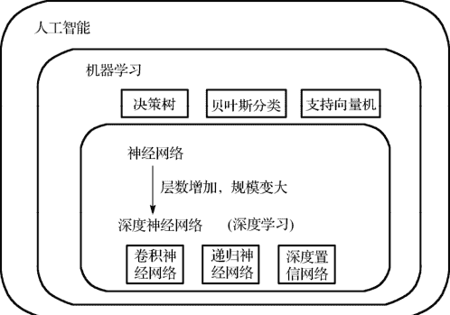
> 图 2.1 直观呈现AI、机器学习、深度学习、神经网络四概念层层包含关系。

### 2.2 神经网络双雄：ANN主导当下，SNN面向未来

广义神经网络分两大流派：
- **ANN（人工神经网络）**：仿生神经元结构与传导原理建立的数学模型，归属**脑启发计算**。感知器、BP网络、CNN、RNN等均属此列。**当前深度学习主力军，理论突破与产业落地双丰收，本书核心聚焦对象。**
- **SNN（脉冲神经网络）**：采用更贴近生物机制的脉冲神经元模型，信息以脉冲编码流动，架构天然区别于擅长精确数值计算的CPU/GPU，归属**神经拟态计算**。目前仍处学术探索期，前景诱人但非主流。

#### 2.2.1 人工神经元：从生物原型到MP模型再到感知器

生物神经网络由亿万互联神经元构成（人脑约860亿）。单个神经元四大件：**细胞体（处理核）、树突（输入口）、轴突（输出口）、突触（连接权重）**。

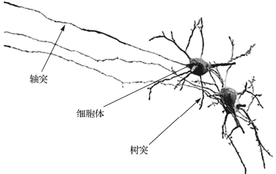 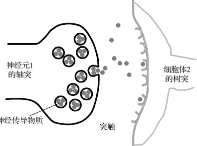

1943年McCulloch&Pitts受启发提出**MP模型**，奠基神经网络数学化。1958年Rosenblatt在MP基础上引入学习机制，诞生**现代人工神经元——感知器模型**：

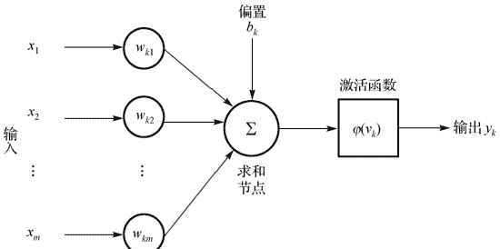

五大核心组件对应生物结构：
- **输入向量** $x_1...x_m$ ↔ 树突
- **权重** $w_{ki}$ ↔ 突触电导率（控制输入影响力）
- **求和节点**（线性模型 $v_k = \sum x_i w_{ki} + b_k$）↔ 细胞体
- **激活函数** $\varphi(\cdot)$ ↔ 非线性变换机制
- **输出** $y_k$ ↔ 轴突脉冲

此模型确立了**加权求和+非线性激活**的通用计算范式，成为后续所有ANN变体的基因起点。

尽管人类对大脑运作机制的认知尚不完备，但基于神经元的计算建模研究已积累深厚底蕴，成果丰硕，大致归为两大流派：一类致力于用电路架构精准复刻大脑神经系统的结构与思维流程，以达成智能计算，即**神经拟态计算**（IBM 推出的“类脑”芯片即属此列）；另一类则汲取神经元构造与信号传递机制的灵感，构建数学模型实现智能，称为**脑启发计算**。这两条技术路线均是当下炙手可热的研究前沿。本书后续聚焦的智能计算芯片设计技术，均落脚于脑启发计算范畴——其核心路径在于模拟大脑神经元的微观结构，而非宏观思维形态，故而成为当前应用研究最广泛的主流方向。

#### 2.2.2 激活函数

激活函数扮演着人工神经元胞体的角色：对所有输入信号加权求和后，施加非线性变换。在多层神经网络架构中，它可视为上一层神经元输出与下一层输入之间的函数映射关系。若缺失激活函数，神经元输出仅为输入的线性变换，无论网络堆叠多少层，最终输出始终等价于输入的线性组合，与无隐层网络无异。早期感知机因由无激活函数的神经元构成，仅能处理线性可分问题，这一缺陷曾直接导致首轮神经网络研究热潮退潮。由此可见，激活函数是神经元不可或缺的核心组件，它从根本上拓展了网络的学习边界与表达能力。

**激活函数的选型通常需满足三大准则：**
1.  **数学特性良好**：为连续且可导（允许有限个不可导点）的非线性函数；
2.  **计算轻量高效**：函数本身及其导数形式简洁，利于提升网络推理与训练效率；
3.  **数值范围适度**：函数值与导数值域应控制在合理区间，过大数值会拖累训练收敛速度与稳定性。

下文将结合图 2.5 的曲线图，解析几类主流激活函数的特质。

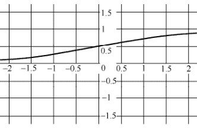

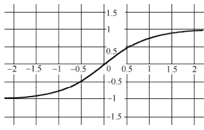

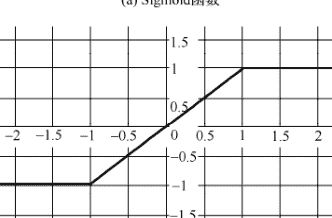

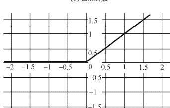

**图 2.5 常见激活函数曲线对比**

##### 1) Sigmoid 函数

又称 Logistic 函数，定义式为 $f(x) = \frac{1}{1 + e^{-x}}$ (2-3)。其曲线呈 S 型，输出压缩在 (0,1) 区间，输入两端趋于饱和抑制。但存在三大短板：① 输出非零均值（恒为正），致使权重更新方向单一，收敛缓慢；② 涉及指数运算，计算开销大；③ 饱和区梯度趋近于零，极易引发**梯度消失**，阻碍深层网络学习。

##### 2) tanh 函数

可视为 Sigmoid 的改良版，二者在早期研究中齐头并进。定义式 $f(x) = \tanh(x)$ (2-4)，值域对称分布于 [-1, 1]，解决了非零均值问题，缓解 Loss 震荡，收敛更快。然而，它本质仍属饱和型函数，**梯度消失**隐患犹存，且指数运算复杂度依然较高。

##### 3) tanh 线性逼近函数

为适配硬件电路落地而生的简化版，将 Sigmoid 核心非线性区线性化。分段表达式如下 (2-5)：
$$f(x) = \begin{cases} -1, & x < -1 \\ x, & -1 \le x \le 1 \\ 1, & x > 1 \end{cases}$$

##### 4) ReLU 函数

全称**修正线性单元**（Rectified Linear Unit），由 Krizhevsky、Hinton 等人于 2012 年 ImageNet 竞赛论文中推广。表达式极简：$f(x) = \max(0, x)$ (2-6)。其设计贴近生物神经元“全或无”的阈值开关特性。

**优势显著：**
*   **算力友好**：纯线性运算，无指数开销，前向/反向传播速度远超 Sigmoid 与 tanh；
*   **稀疏激活**：负值区间输出为零，天然稀疏性大幅削减有效计算量；
*   **缓解梯度消失**：$x>0$ 时导数恒为 1，梯度可原路回传，显著加速收敛。

**劣势：** 负半轴导数为 0，训练中易导致神经元“死亡”（永久失活），且输非零均值。

综上，激活函数演进史实为解决痛点史：Sigmoid 虽可导易求导，却困于梯度饱和；ReLU 破解饱和，却引入神经元死亡与非对称性；后续各类 ReLU 变体（Leaky ReLU、ELU 等）皆聚焦于修补这些缺憾。尽管不完美，但 ReLU 凭借**导数极简、仅需一比较器即可硬件实现**的工程优势，稳坐当前最通用激活函数宝座。

#### 2.2.3 人工神经网络

**人工神经网络**（ANN），简称神经网络，是一种模拟生物神经系统行为特征、实现分布式并行信息处理的算法数学模型。其基本单元为人工神经元（感知器），通过特定拓扑连接构网。

如图 2.6 所示，多个感知器并联形成**网络层**，多层按序堆叠即构成最基础的**多层感知器**（MLP）。层间连线代表神经元间的依赖强度，即**权重**。标准 MLP 包含输入层、至少一隐藏层及输出层（图中自左向右依次为层 1、层 2、层 3）。

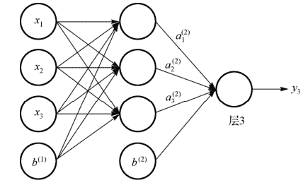

**图 2.6 多层感知器 (MLP) 结构示意**

构建网络的核心任务，即通过不断调整权重，使推断/预测误差极小化——此即**训练过程**。通俗而言，训练是在既有数据中习得能力，推断则是对新数据施用能力完成分类、识别等任务。训练依托**前向传播**与**反向传播**双引擎：
*   **前向计算**：数据从输入层流经隐藏层至输出层，逐层产出结果；
*   **后向计算**：基于实际输出与期望偏差，将误差从输出层反向传至输入层，依据链式法则层层修正权重，迭代至收敛。这一过程实质上是网络的“学习”，核心算法为 **BP 算法**（反向传播算法）。

**BP 算法工作流：** 前向跑数据得预测值 $\rightarrow$ 计算损失 $\rightarrow$ 反向按链式法则传播误差 $\rightarrow$ 更新权重 $\rightarrow$ 循环迭代至收敛。

以图 2.6 三层 MLP 为例，隐层三神经元输出分别记为 $a_1^{(2)}, a_2^{(2)}, a_3^{(2)}$，则有：

```
\(a_1^{(2)} = \varphi(w_{11}^{(1)}x_1 + w_{21}^{(1)}x_2 + w_{31}^{(1)}x_3 + b^{(1)}) \quad (2-7)\)
\(a_2^{(2)} = \varphi(w_{12}^{(1)}x_1 + w_{22}^{(1)}x_2 + w_{32}^{(1)}x_3 + b^{(1)}) \quad (2-8)\)
\(a_3^{(2)} = \varphi(w_{13}^{(1)}x_1 + w_{23}^{(1)}x_2 + w_{33}^{(1)}x_3 + b^{(1)}) \quad (2-9)\)
```

经输出层变换，网络最终输出 $y_3$ 为：

```
\(y_3 = \varphi(w_{11}^{(2)}a_1^{(2)} + w_{21}^{(2)}a_2^{(2)} + w_{31}^{(2)}a_3^{(2)} + b^{(2)}) \quad (2-10)\)
```

其中 $w_{ij}^{(t)}$ 表示第 $t$ 层与 $t+1$ 层神经元间的连接权重。训练本质是求解权重集使误差函数 $H(w_{11}, w_{12}, \dots, w_{mn})$ 极小化。误差函数为全体权重的复合函数，通常采用**梯度下降法**求解：
1.  初始化参数，计算梯度向量；
2.  沿梯度负方向以适配步长搜索最优解；
3.  迭代直至相邻两轮参数变化量低于阈值；
4.  输出收敛后的网络参数。

利用 BP 算法高效求解复杂偏导数 $\frac{\partial H}{\partial w_{ij}}$ (即 ```
\(\nabla H = \frac{\partial H}{\partial w_{11}}e_{11} + \frac{\partial H}{\partial w_{12}}e_{12} + \cdots + \frac{\partial H}{\partial w_{mn}}e_{mn} \quad (2-11)\)
``` 所示梯度)，进而获得权重增量完成更新，即实现了网络的自主学习。

```
\(\nabla H = \frac{\partial H}{\partial w_{11}}e_{11} + \frac{\partial H}{\partial w_{12}}e_{12} + \cdots + \frac{\partial H}{\partial w_{mn}}e_{mn} \quad (2-11)\)
```

### 2.3 深度神经网络

“深度”指代网络层数深浅，无绝对定界：语音领域 4 层可称“深”，视觉任务 20+ 层早已寻常。结构上，全连接深度网络与 MLP 同源，层数加深旨在赋予网络刻画现实世界复杂模式的能力。2006 年 Hinton 引入**预训练**机制，缓解局部最优困境，将隐层推至 7 层，标志着神经网络正式步入“深度”时代。

如今深度神经网络已攻克图像分类、目标检测、语音识别、动作捕捉、场景理解等众多疆域，部分指标甚至超越人类。按架构分类，三大基石为：
*   **卷积神经网络 (CNN)**：卷积层+池化层+全连接层，视觉特征提取利器；
*   **全连接网络 (FCN)**：多全连接层堆叠，常用于分类决策；
*   **循环神经网络 (RNN)**：源于“认知依赖记忆”洞见，层间含反馈回路与门控，擅长时序建模。

三者可独立成军（如全卷积网络 FCN 用于图像分割），亦可组合拳出击，形成**混合深度神经网络 (Hybrid-NN)**。图 2.7 展示三大经典混合范式：
*   **AlexNet**：5 CNN + 3 FCN $\rightarrow$ 图像分类；
*   **LRCN**：5 CNN + 3 FCN + 2 RNN $\rightarrow$ 图像理解（视频描述等）；
*   **CLDNN**：2 CNN + 6 FCN + 2 RNN $\rightarrow$ 语音识别。

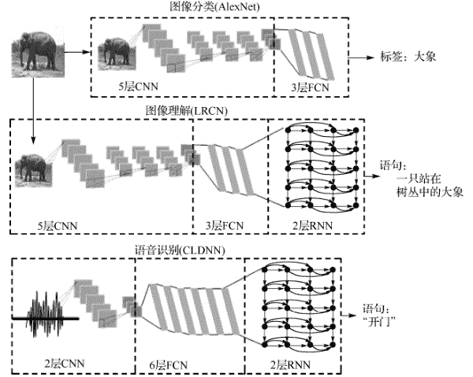

**图 2.7 三大典型混合神经网络架构**

随着演进，混合网络在认知任务中展现统治力，地位日益关键。主流经典架构迭代谱系包括 LeNet、AlexNet、VGGNet、GoogLeNet、ResNet 等，每一代皆针对特定瓶颈实现关键突破，推动深度学习跨越式发展。以下精选典型架构溯源演进脉络。

**LeNet (1994, Yann LeCun)**：开山之作，首个工程化落地的 CNN，攻克数字识别，助力美国银行支票自动处理。结构轻巧：2 卷积层 + 2 全连接层 (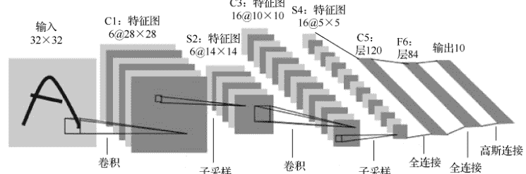 图 2.8)。核心贡献——提出**局部感受野**机制：卷积核仅扫描特征图局部区域而非全图，大幅压缩参数量与计算量，奠定 CNN 高效计算基因。


**图 2.8 LeNet-5 架构示意**

**AlexNet (2012, Krizhevsky 等)**：ImageNet 冠军之作，识别率破 84.6%，点燃深度学习爆发元年。架构深度跃升：5 卷积层 + 3 全连接层 + 3 池化层 (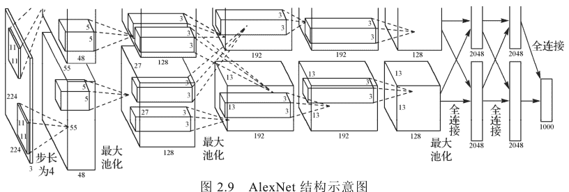 图 2.9)。三大创举：① **小卷积核堆叠**替代大卷积核；② **首创引入 ReLU** 至深层网络，实证其优于 Sigmoid，破解梯度弥散；③ 深度与宽度双提升，表达力质变。


**AlexNet 后时代，架构演进聚焦四大突破维度 (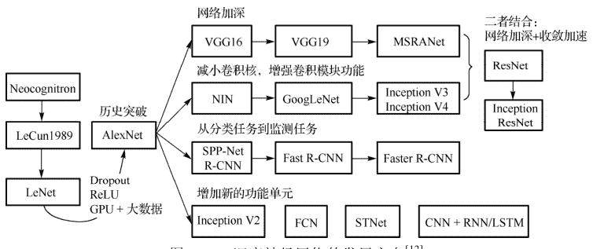 图 2.10)：**
1.  **加深网络**；
2.  **缩小卷积核 & 强化核功能**；
3.  **深度 + 残差连接** 加速收敛；
4.  **任务泛化 & 功能模块化** 拓展应用边界。


---

**维度一：极致加深 —— VGGNet (2014, Visual Geometry Group)**
沿袭 AlexNet 范式，纯粹通过堆叠 $3\times3$ 小卷积核将层数推至 11/16/19 层 (VGG-11/16/19) (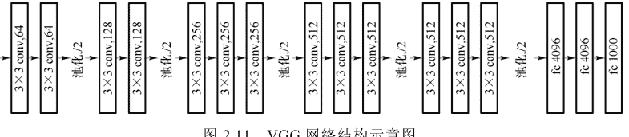 图 2.11)。验证了“更深=更强”假设，Top-5 识别率破 90%，确立了深层网络的标准化构建范式。


**图 2.11 VGG 系列网络结构**

---

**维度二：宽度与核创新 —— GoogLeNet / Inception / 轻量化家族**
代表作有 NIN、SqueezeNet、MobileNet、ShuffleNet、**GoogLeNet** 等。GoogLeNet 引入 **Inception 模块** (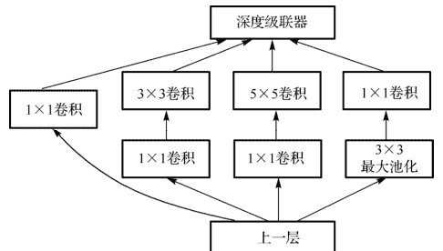 图 2.12)——“网络套网络”结构，多尺度卷积并行融合，同时拓展网络宽度与深度，参数效率极致，识别率达 93.3%。后续轻量化系列（MobileNet 等）更聚焦移动端部署，推动深度学习走出服务器。


**图 2.12 GoogLeNet Inception 模块结构**

---

**维度三：深度 + 残差连接 —— ResNet (2015, Kaiming He 等)**
解决“网络越深、性能反而下降”的**退化问题**，创造性引入**残差块** (Shortcut Connection) (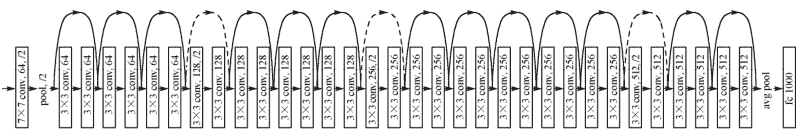 图 2.13)。恒等映射捷径让梯度畅通无阻，有效规避梯度消失/爆炸，将可训练深度推向 150+ 层甚至 1000+ 层，识别精度**超越人眼**，成现代深度网络“脊柱”般的基础组件。


**图 2.13 ResNet 残差块与整体架构**

---

**维度四：任务延展与功能增强 —— 检测/分割/视频理解家族**
将 CNN 从分类推向检测 (R-CNN)、语义分割 (FCN)、视频理解 (LRCN) 等稠密预测任务 (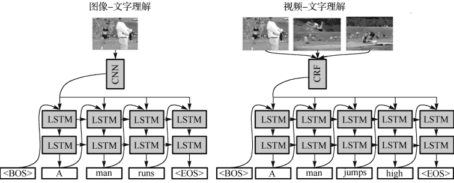 图 2.14)。通过引入 ROI Pooling、反卷积、时序建模等功能单元，极大拓宽了 CNN 适用疆域，催生出计算机视觉繁荣生态。


**图 2.14 LRCN 视频理解架构示意**

---

### 参考文献

- [1] McCulloch W S, Pitts W. A logical calculus of the ideas immanent in nervous activity[J]. The Bulletin of Mathematical Biophysics, 1943, 5 (4) : 115-133.
- [2] Cortes C, Vapnik V. Support-vector networks[J]. Machine Learning, 1995, 20 (3) :273-297.
- [3] Krizhevsky A, Sutskever I, Hinton G E. Imagenet classification with deep convolutional neural networks[C]. Advances in Neural Information Processing Systems, Lake Tahoe, 2012: 1097-1105.

## 第 3 章 智能计算面临的困境

### 3.1 核心网络层的数学建模

如前章所述，主流深度神经网络主要由卷积神经网络（CNN）、全连接网络（FCN）、循环神经网络（RNN）及其混合级联形态构成。依据层内拓扑结构差异，基础层可划分为卷积层、池化层、全连接层与递归层四大类。全连接网络由全连接层堆叠而成，循环网络以递归层为核心，卷积网络则融合了前三种层类。本节将逐一剖析这四类基础层的数学模型及其计算特性。

**卷积层**是算力消耗的“大户”，通常占据 CNN 总计算量的 90% 以上[1]，是智能芯片设计的优化重中之重。其计算范式如图 3.1 所示：利用 M 个尺寸为 K×K×N 的三维卷积核，对 H×L×N 的输入三维特征图执行滑窗操作，最终产出 R×C×M 的输出特征图。具体而言，每个卷积核以步长 S 在输入图上按行优先顺序滑动，与窗口内的三维数据子向量做卷积运算，生成一张 R×C 的二维特征图；M 个卷积核并行工作，拼合成最终的三维输出。图 3.2 的伪代码详细描绘了该过程。其中，矩阵 I、O、W 分别对应输入、输出与权重。卷积层的核心微操作是乘累加（MAC），即图 3.2 最内层循环的计算逻辑。

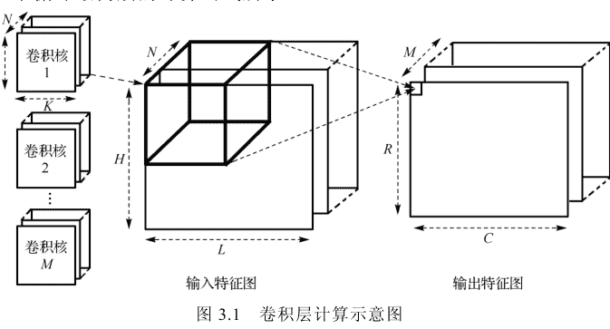

```
for(r=0; r<R; r++)       //循环 R
for(c=0; c<C; c++)       //循环 C
for(m=0; m<M; m++)       //循环 M
for(n=0; n<N; n++)       //循环 N
    O[m][r][c]+=         //卷积
[summation formula image]
```

### 图 3.2 卷积层计算的循环伪代码表示

**全连接层**本质上是多层感知器（MLP），其计算逻辑与卷积层同构，可视为卷积核尺寸等同于输入特征图尺寸的特例。其数学表达为：

```
y = \varphi(Wx + b) \quad (3-1)
```

式中，$x$ 为输入特征向量，$W$ 为权重矩阵，$b$ 为偏置项，$\varphi$ 为激活函数，$y$ 为输出向量。

**池化层**（下采样层）主要分最大池化与平均池化两大流派。它通过在感受野内执行聚合操作实现特征图降维。最大池化取感受野内 $n \times n$ 邻域的峰值，能有效抑制旋转、平移、缩放等几何变换带来的干扰；平均池化则改为求均值。图 3.3 以 $2 \times 2$ 感受野为例展示了两种模式。

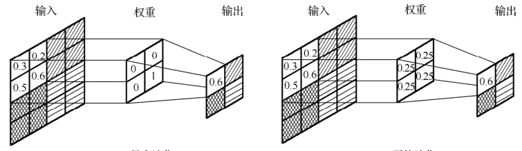

### 图 3.3 池化层计算模型示意

**递归层**具备记忆机制，隐藏层输入融合了当前时刻的输入层输出与上一时刻的隐层状态。其前向传播公式定义如下：

```
\( h_t = f(W_{hx}x_t + W_{hh}h_{t-1}) \quad (3-2) \)
```

```
\( y_t = g(W_{hy}h_t) \quad (3-3) \)
```

符号说明：$t$ 为时间步，$x$ 与 $h$ 分别为输入向量与隐状态向量，$y$ 为输出向量；$W_{hx}, W_{hh}, W_{hy}$ 分别为输入到隐层、隐层自环、隐层到输出的权重矩阵；$f$ 为隐层激活函数，$g$ 为输出函数，二者可同构。

### 3.2 基础网络层的计算画像

透过数学模型深度审视，神经网络基础层呈现出四大显著计算特征：

**特征一：乘累加为王，非线性为辅。**
无论全连接层还是递归层，其核心均为矩阵-向量乘累加。对任意 M×N 权重矩阵与 N×1 输入向量，MAC 操作量与非线性操作量之比约为 N:1。因此，MAC 单元的高效吞吐直接决定了神经网络的算力上限。

**特征二：卷积层“重数据、重计算、重访存、轻控制”。**
三维卷积核以步长 S 在特征图上滑动，导致输入数据高度重用（同一数据多次参与运算且时间间隔不固定）。这不仅带来海量算力需求，更引发爆发式访存压力，而控制流相对单一。以 2012 年 ILSVRC 冠军 AlexNet[2] 为例，单层卷积算力跨度为 150~448 MOP，单层访存量均在 1~2 MB 量级。

**特征三：数据布局与硬件存储“结构性错位”，能效大打折扣。**
深度网络中，卷积层的输入与权重均为按滑窗逻辑组织的三维张量；而硬件存储器（SRAM/DRAM）本质是一维线性地址空间。张量被强行拉直存储后，访存必须按地址顺序串行扫描，导致 50% 以上的微操作沦为无效空转，严重拖累能效，也扼杀了并行性潜力。

**特征四：异构层类，计算画像千差万别。**
仍以 AlexNet 为例（5 个 CONV + 3 个 FC + 3 个 POOL），表 3.1 量化了各层参数规模、数据搬移量与算力分布：
*   **卷积层**：算力密集型，单层动辄数百 MOP，参数访存相对较轻（<50 MOP 级）；
*   **全连接层**：访存密集型，算力仅几十 MOP，但权重数据量惊人（单层达数十 MB）；
*   **池化层**：无参数，纯数据搬移与简单比较/求均值。

| 层类型 | 核尺寸 | 步长 | 输入尺寸 (H,W,C) | 输出尺寸 (H,W,C) | 输入数据 | 输出数据 | 权重量 | 计算量 |

|---|---|---|---|---|---|---|---|---|

| CONV1 | 11 | 4 | (227,227,3) | (55,55,96) | 309KB | 581KB | 0.07MB | 211MOP |

| POOL1 | 3 | 2 | (55,55,96) | (27,27,96) | 581KB | 140KB | — | — |

| CONV2 | 5 | 1 | (27,27,96) | (27,27,256) | 140KB | 373KB | 0.6MB | 448MOP |

| POOL2 | 3 | 2 | (27,27,256) | (13,13,256) | 373KB | 87KB | — | — |

| CONV3 | 3 | 1 | (13,13,256) | (13,13,384) | 87KB | 130KB | 1.8MB | 299MOP |

| CONV4 | 3 | 1 | (13,13,384) | (13,13,384) | 130KB | 130KB | 1.3MB | 224MOP |

| CONV5 | 3 | 1 | (13,13,384) | (13,13,256) | 130KB | 87KB | 0.9MB | 150MOP |

| POOL3 | 3 | 2 | (13,13,256) | (6,6,256) | 87KB | 18KB | — | — |

| FC1 | 1 | 1 | (1,1,9216) | (1,1,4096) | 18KB | 8KB | 75.5MB | 75MOP |

| FC2 | 1 | 1 | (1,1,4096) | (1,1,4096) | 8KB | 8KB | 33.6MB | 34MOP |

| FC3 | 1 | 1 | (1,1,4096) | (1,1,1000) | 8KB | 2KB | 8.2MB | 8MOP |

| **合计** | — | — | — | — | **1.9MB** | **1.6MB** | **121.9MB** | **724MOP** |

图 3.4 进一步对比三类层的算力与参数量画像：卷积层偏计算（>100 MOP，参数<50 MOP），全连接与递归层偏参数访存（参数量可达 100 MOP 量级）。

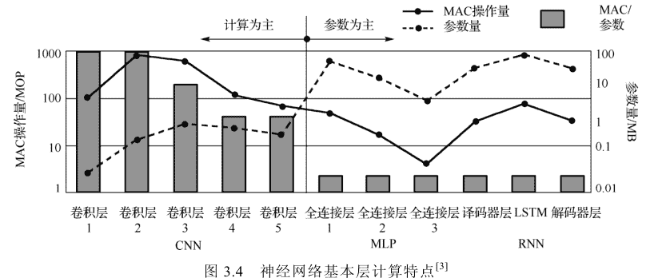

### 3.3 智能计算的“三座大山”现状剖析

基于上述层级特性，站在全网与跨网络视角，智能计算面临的核心挑战可归纳为访存、功耗、通用性三大维度。

#### 3.3.1 访存墙：数据搬移的“黑洞”

当前深度学习高度依赖海量参数，但算力增长（摩尔定律）远超存储带宽增长，处理器与内存的性能鸿沟——即“内存墙”问题日益凸显。神经网络属于典型数据密集型负载，层间、层内数据搬移频繁，将“内存墙”推向新高度。

深层网络为追求精度，层数激增，单层访存量巨大。卷积层因滑窗重用机制导致数据多次离散访问，全连接层因巨型权重矩阵带来海量读取。参数规模呈指数级爆发：AlexNet 6000 万参数（~228MB），VGG-16 1.3 亿参数，Google NMT 高达 37 亿参数（~13GB）。这对芯片的存储容量、访存带宽、内存管理策略提出了近乎苛刻的要求。

#### 3.3.2 功耗墙：数据移动的“隐形杀手”

片上 SRAM（百 KB 量级）难以容纳全量参数，迫使绝大多数数据驻留片外 DRAM，引发高频访存。研究表明[4]，神经网络中**访存功耗已超越计算功耗**成为总功耗主导项。表 3.2 基于 65nm 工艺量化了存储层级能耗差异：以一次 MAC 操作能耗为基准（1×），寄存器堆（RF，2.5KB）约 1×，PE 阵列间通信（1~2mm）约 2×，全局缓存（>100KB）约 6×，而片外 DRAM 高达 **200×**。

| 功耗对象 | DRAM (片外) | 全局缓存 (>100KB) | PE 阵列互联 (1~2mm) | 寄存器堆 RF (2.5KB) |

|---|---|---|---|---|

| 相对功耗 (MAC=1) | **200×** | 6× | 2× | 1× |

**核心矛盾**：数据离算力单元越远，能耗指数级上升。理论最优解是让数据尽量留在靠近 MAC 的存储层级（RF/Buffer）并最大化复用。但存储容量受成本与面积硬约束，必须在架构层面通过数据流设计、存储分级、计算置换等手段寻找帕累托最优。攻克大规模访存功耗，是智能芯片设计的“心脏手术”。

#### 3.3.3 通用性墙：一致性与专用性的博弈

# 神经网络疯狂进化，硬件架构如何“跟上节奏”？

为了追求更高精度，神经网络正沿着“层数更深、拓扑更繁杂、融合更多元”的赛道狂奔。层与层之间、异构网络之间的差异正在被无限放大。请看对比：网络深度早已突破十几层（VGG16/19）的限制，向百层、千层迈进；GoogLeNet、ResNet 等典型代表引入了 Inception 模块、残差连接等复杂的多层拓扑；更有 LRCN 这类多模态网络，将卷积、全连接、循环等异构层打包组合，只为攻克更棘手的智能任务。

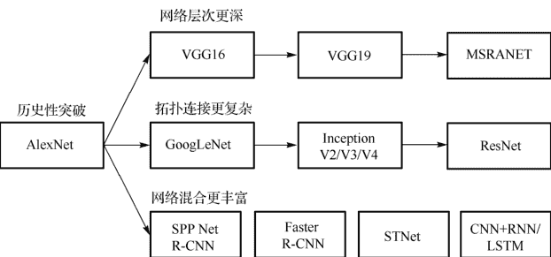

图 3.5 神经网络算法的演进

这种百花齐放的局面，直接导致了高效处理不同网络所需的互连结构、基础算力单元大相径庭，匹配的硬件架构需求更是天差地别。举个栗子：专为 CNN 打造的加速器跑 LSTM 模型，并行利用率可能不足 20%。即便引入可重构机制，也难逃硬件“固化”的宿命，重构空间有限。**如何破解智能芯片的“通用性困局”，成了绕不开的核心命题。**

锚定芯片服务的具体场景，适度收窄通用性指标，是破局的关键路径之一——比如专攻单一网络加速，或聚焦图像、语音等特定领域的主流模型集合。设计阶段需深度摸底目标场景下网络的“共性与个性”，在兼顾兼容性的前提下，挖掘共性提升性能、面积、能效。针对单一网络内部层与层的差异，则要精心雕琢芯片微架构与映射调度策略，实现计算调度、资源分配的“丝滑流畅”，压缩算力单元与数据搬运的空闲窗口，确保全程硬件利用率在线。若网络存在多分支、或计算/存取倾向极度分化的模块，更需提前布局优化，规避因负载剧烈波动造成的资源浪费。

#### 3.3.4 稀疏性：诱人的蛋糕，难啃的骨头

权重矩阵天生稀疏、ReLU 等激活函数“制造”稀疏……神经网络稀疏性来源广泛。数据显示，LeNet、AlexNet、VGG 等经典模型稀疏度高达 90% 左右。若能高效利用，能效理论上可实现质变。但稀疏带来的“非规则性”是个大麻烦：为适配硬件而强行规则化（如填零），往往抵消了稀疏带来的红利，陷入“捡了芝麻丢西瓜”的怪圈。

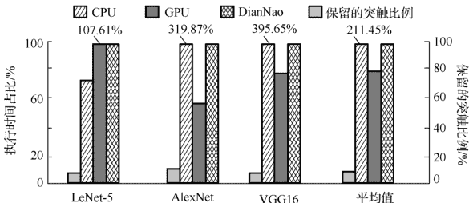

图 3.6 CPU、GPU、DianNao[5]上稀疏化神经网络的加速比[6]

实测佐证了这点：CPU、GPU、ASIC 加速器 DianNao 在跑稀疏版 LeNet、AlexNet、VGG 时，均未因稀疏获益。CPU 反而变慢（耗时增至原版 211.45%）；GPU 仅提升 23.34%，远低于稀疏度比例；DianNao 因把剪枝部分强行补零，导致无效计算量不减反增。**如何真正变废为宝，让稀疏性转化为实打实的性能与能效增益，仍是芯片设计的硬骨头。**

#### 3.3.5 混合精度计算：精度的“定制化”难题

低功耗、高性能诉求倒逼神经网络从单一的 FP32 向 FP16、INT8、INT4 乃至三值、二值化等低精度阵营扩张。得益于网络冗余与算法精妙设计，低精度模型在精度近乎无损的前提下，大幅压缩算力存储开销、降功耗。甚至有研究表明，部分深层网络用二值数据（-1/+1）即可达标，内存与能耗双双暴跌。低精度化已成趋势，推理端芯片尤甚。

但现实是：CNN、FCN、RNN 等不同网络，乃至同一网络不同层，对“合适精度”的诉求千差万别。沿用传统固定位宽计算单元虽简化设计，却先天不足——位宽不够精度崩，位宽过剩资源浪费。**如何灵活高效地支撑网络内外、层间的多精度协同需求，是芯片架构师必须解的另一道难题。**

### 3.4 智能计算平台现状：三足鼎立，各有短板

主流平台三分天下：通用处理器、专用处理器、可重构处理器。CPU/GPU 遵循冯·诺依曼架构，指令流驱动，运算存储分离，灵活易用，长期霸主地位。为适配智能计算海量并行，它们普遍引入 SIMD 技术，完美契合张量卷积需求，成为加速主力。

回顾历程：2012 年 Google Brain 用 1.6 万 CPU 核训练十亿级神经元，震惊业界。但 GPU 凭借千核级 SIMD 单元、CPU 卸载加速模式，在大规模并行上碾压 CPU。ImageNet 大赛见证了 GPU 从“少数派”变“标配”，至今仍是产学研首选。

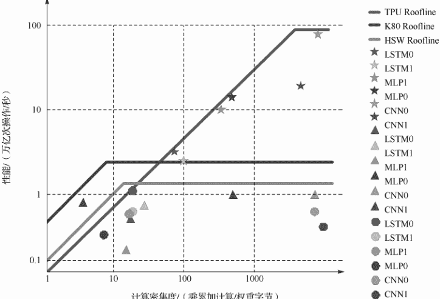

图 3.7 Intel Haswell CPU、NVIDIA K80 GPU、TPU 的性能对比（见彩图）

(五角星-TPU，三角形-K80，圆形-Haswell)[10]

**然而，冯·诺依曼老树新枝难掩颓势，四大“原罪”暴露无遗：**

1.  **控制流累赘：** “取指-译码-执行-访存-回写”流水线中，核心执行仅占小头，海量辅助动作拖累性能、耗尽能量。
2.  **存算分离“搬运工”诅咒：** 数据在存储与运算间频繁穿梭，智能计算超大访存量导致约 80% 功耗耗在总线上，存储速度跟不上运算速度，并行度被硬生生卡死。
3.  **固定位宽直觉主义：** 无法应对智能计算多精度协同的灵活诉求。
4.  **数据结构错位：** 三维张量强行映射一维线性存储，访存效率低下，性能能耗双损。

**新势力崛起：** ASIC 与 FPGA 开始抢滩登陆。2016-2017 年巨头纷推 FPGA 云服务；2017 年后 ASIC 成研发风口，Google TPU 横空出世，能效碾压 GPU。

**ASIC（专用处理器）：** 定制硬件电路，毫瓦功耗撬动 100-1000 GOP/W 能效，算法固化场景下的“理想解”。连 NVIDIA 新品也植入 Tensor Core 专攻张量矩阵运算。Google 用屋顶线模型实测 6 大主流推理网络（覆盖 95% 工作量），TPU 性能点全压制在 CPU/GPU 屋顶线之上，加权平均性能甩开 K80 GPU **15.3 倍**[10]。铁证如山：面对鲜明特征的智能计算，通用平台力有不逮，专用芯片才是正解。低功耗战场同理。

**但 ASIC 也有“阿喀琉斯之踵”：** 通用性受限，架构难随算法动态变化。重新流片周期约 1 年，却追不上算法 6-8 个月的迭代节奏。

**可重构阵营（FPGA/CGRA）：** 在通用与专用间寻找平衡点。
- **FPGA：** 细粒度可编程逻辑/存储，支持静态全局重构，功耗 2-30W，能效 10-100 GOP/W。
- **CGRA：** 粗粒度 PE 阵列，配置互连实现动态重构，固化 PE 内部电路降低开销，能效逼近 ASIC，功耗可达毫瓦级。

无论 ASIC 还是可重构，核心皆为**“神经网络加速器结构设计”**——针对算法特性定制硬件。片上资源远不及热门模型庞大体量，**如何高效映射执行，需软硬协同深度优化：**
- **软件侧：** 量化降位宽、剪枝稀疏化、矩阵变换减操作数，瘦身模型减轻硬件压力。
- **硬件侧：** 循环变换、数据复用等数据流优化，压缩访存成本，打通吞吐瓶颈。

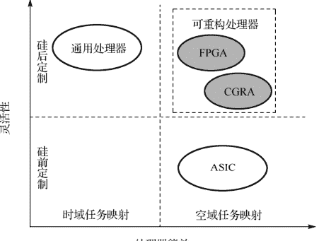

图 3.8 智能计算平台能效和灵活性的权衡

横向对比（图 3.8）：通用处理器灵活性最高、能效最低；ASIC 截然相反；可重构处理器居中博弈。实测数据刺眼：Xeon E5 跑 AlexNet 254.5ms/80W/0.07 GOP/W；K40 虽快 7.1ms 但 235W/0.87 GOP/W；Virtex VX485t 卷积层 21.61ms/18.61W/3.3 GOP/W。**现有 CPU/GPU/FPG 方案，功耗能效均不及格。**

**共识已达成：** 直面挑战，开发专用于深度神经网络的**高能效智能计算芯片**，是学术界与工业界的必由之路。

### 参考文献

- [1] Cong J, Xiao B. Minimizing computation in convolutional neural networks[C]// International Conference on Artificial Neural Networks. Hamburg: Springer, 2014: 281-290.
- [2] Krizhevsky A, Sutskever I, Hinton G E. ImageNet classification with deep convolutional neural networks[C]// International Conference on Neural Information Processing Systems. Lake Tahoe: Curran Associates Inc., 2012:1097-1105.
- [3] Shin D , Lee J. DNPU: An energy-efficient deep-learning processor with heterogeneous multi-core architecture[J]. IEEE Micro, 2018, 38 (5) :85-93.
- [4] Chen Y H, Krishna T, Emer J S, et al. Eyeriss: An energy-efficient reconfigurable accelerator for deep convolutional neural networks[J]. IEEE Journal of Solid-State Circuits, 2017, 52 (1) :127-138.
- [5] Chen T, Du Z, Sun N, et al. DianNao: A small-footprint high-throughput accelerator for ubiquitous machine-learning[J]. ACM Sigplan Notices, 2014, 49 (4) :269-284.
- [6] Zhang S, Du Z, Zhang L, et al. Cambricon-X: An accelerator for sparse neural networks[C]. IEEE/ACM 49th International Symposium on Microarchitecture, Taipei, 2016:1-12.
- [7] Wen W, Xu C, Yan F, et al. TernGrad: Ternary gradients to reduce communication in distributed deep learning[J]. Advances in Neural Information Processing Systems, 2017, 30: 1509-1519.
- [8] Courbariaux M, Bengio Y, David J P. Binary connect: Training deep neural networks with binary weights during propagations[J]. Advances in Neural Information Processing Systems, 2015, 28: 3123-3131.
- [9] Courbariaux M, Hubara I, Soudry D, et al. Binarized neural networks: Training deep neural networks with weights and activations constrained to +1 or −1[J]. arXiv preprint arXiv: 1602.02830v3, 2016.

- [10] Jouppi N P, Young C, Patil N, et al. In-datacenter performance analysis of a tensor processing unit[C]. The 44th Annual International Symposium on Computer Architecture (ISCA), Toronto, 2017:1-12.

- [11] Zhang C, Li P, Sun G, et al. Optimizing FPGA-based accelerator design for deep convolutional neural networks[C]// International Symposium on Field-Programmable Gate Arrays. Monterey: ACM, 2015:161-170.

## 第 4 章 AI 芯片架构设计探析

2010 年，法国学者 Temam 在计算机体系结构顶会 ISCA'10 上作题为《神经网络的复兴》的主题报告[1]，深度剖析了神经网络在通用与专用计算领域对硬件设计的潜在冲击。这标志着 AI 芯片设计步入快车道，迅速成为计算机体系结构与集成电路设计界的核心热点。

十余年间，从互联网走向物联网，智能终端井喷式涌现，倒逼 AI 芯片指标不断攀升：既要在严苛功耗预算下输出高精度、大算力，又要具备灵活性——通过配置或编程适配多样化的 DNN 结构（层数、卷积核、通道、拓扑、互连方式等），以跟上算法飞速迭代的步伐。针对边缘侧芯片，成本控制更是绕不开的关键考量。

本章将聚焦精度、功耗、吞吐率、成本、灵活性五大核心指标，剖析主流 AI 芯片架构，探讨进一步优化的新路径，并给出实验评估结果。

### 4.1 研究现状回顾

依据第 3 章的神经网络层数学模型，智能计算本质上是海量线性代数运算（典型如张量处理），控制流却相对简单，天然契合并行计算范式。因此，AI 芯片架构普遍采用高并行设计，主要分为图 4.1 所示的时域与空域两大流派[2]。

#### 4.1.1 时域计算架构：指令驱动的集中控制

时域架构本质是面向神经网络算法定制指令集的专用指令集处理器（ASIP）。如图 4.1(a)，它依靠指令流统一调度算术逻辑单元（ALU）与存储资源，所有 ALU 从中心存储取数、回写结果。早期研究聚焦于“功能可行性”——通用标量处理器（甚至高主频 CPU）靠串行标量指令处理大规模张量/矩阵效率低下，最直接的改进便是单指令多数据（SIMD/向量化）。GPU 流处理器本质即高效向量处理器，单周期可完成数百至数千次运算，故时域架构多见于用于 AI 的 CPU/GPU 中。后续学界转向架构自优化，涌现两大标杆设计：

**一、Cadence Vision C5 DSP[3]**（架构见 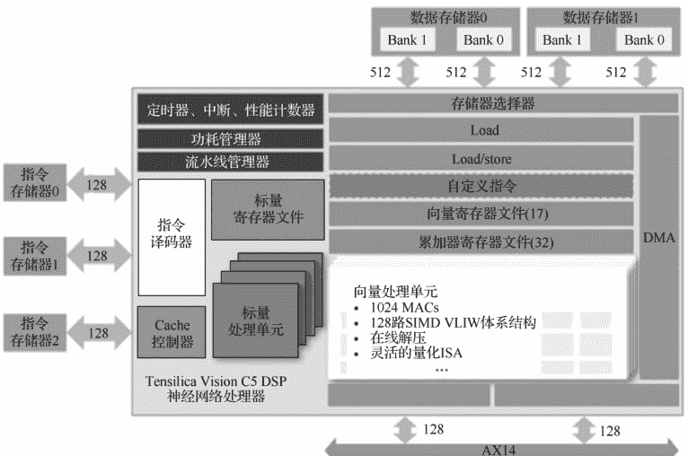 图 4.2）。针对传统 NNP 仅加速卷积、需多处理器协作搬数导致能效受限的痛点，C5 基于 SIMD VLIW 设计，集成卷积、全连接、池化等全链路功能，<1mm² 面积实现 1 TMAC/s。实测：AlexNet 基准下比 2017 年最强 GPU 快 6 倍，Inception V3 下提速 9 倍。

**二、中科院计算所“点脑”系列加速器[4]**。首款 DianNao（2014）是全球最早面向 AI 专用计算的神经网络加速器。后续芯片均以此架构为底座，在功能、灵活性、数据复用上持续迭代。核心架构（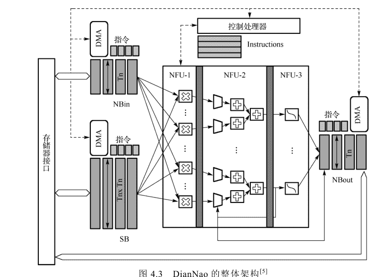 图 4.3）含三部分：神经功能单元（NFU，三级流水：乘法 NFU1、加法 NFU2、激活 NFU3）、多级缓存（NBin/NBout/SB）、控制器。指令流驱动下，NFU 与存储受控制器统一调度。作为 ASIC 专用处理器，DianNao 针对 CNN 定制数据通路，结构精简贴合需求：相比 128-bit SIMD 处理器，加速 117.87 倍、能耗降 21.08 倍。

**小结**：时域架构计算单元配置灵活，但每步操作需精确指令控制存储访问与 ALU 动作，且中心化存储导致片外交互频繁，性能与能效受限。

#### 4.1.2 空域计算架构：数据流驱动的分布式协作

空域架构（图 4.1(b)）赋予每个 ALU 独立控制逻辑与本地存储（缓存/寄存器堆），此类带本地存储的 ALU 称作处理单元（PE）。全架构采用数据流控制：PE 形成处理链，数据在 PE 间直接流动。

**典范一：MIT Eyeriss[6]**（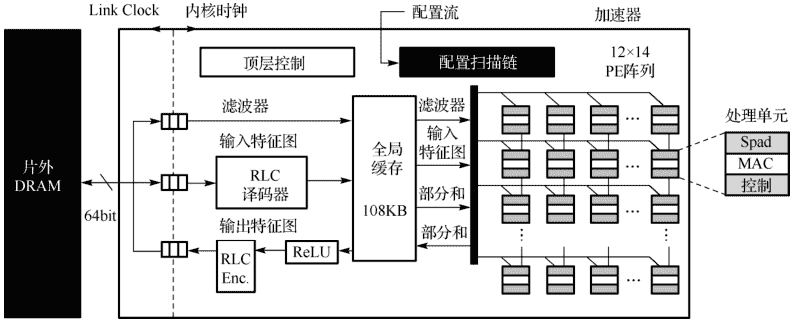 图 4.4）。基于 12×14 PE 阵列，每 PE 内置控制器与本地存储，构建“PE 寄存器→片上全局缓存→片外 DRAM”三级存储体系，且 PE 间可直通数据。创新提出**行固定数据流**，大幅提升片上数据复用。以 3×3 卷积为例（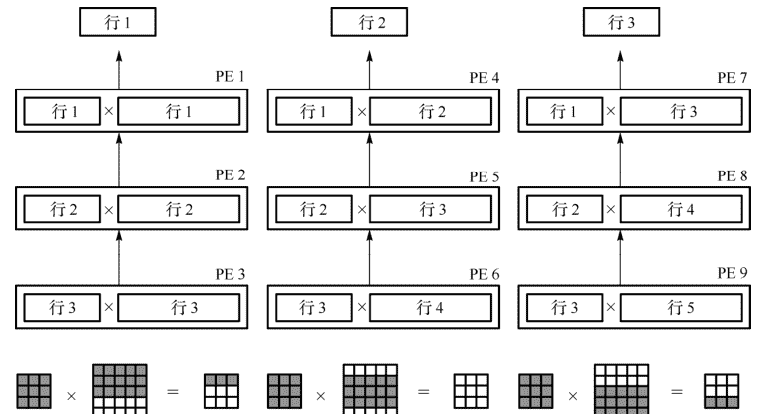 图 4.5）：卷积核按行映射至同一列 3 个 PE，随输入特征行流动相乘，部分和沿列累加传递，最终输出。权重与部分和全程不落全局缓存，同时复用权重与输出。**RS 数据流的核心优势在于最大化卷积计算中所有数据（权重、输入、输出）的复用**，而非单一类型，从而更高效利用低成本存储访问提升能效。实测整体能效较传统方法提升 10 倍，让移动端跑 NLP、人脸识别等复杂任务成为可能，点燃边缘 AI 处理器研发热潮。

**典范二：比利时鲁汶大学 ENVISION[7]**（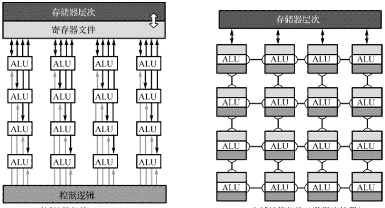 图 4.6）。面向低功耗 CNN 的精度可扩展架构。含 16-bit RISC 控制核、1D SIMD 单元（ReLU/池化）、2D SIMD MAC 阵列（卷积/全连接）。三大能效策略：① 核心 MAC 采用 **DVAFS**（动态电压-精度-频率缩放），逐层调制精度与电压最小化能耗；② 挖掘 CNN/DNN 并行性与数据复用提升 MAC 数据效率；③ 利用模型容错性，硬件支持稀疏压缩，剔除无效乏加运算。峰值能效比达 **10 TOP/W**。

**典范三：Google TPU[8]**（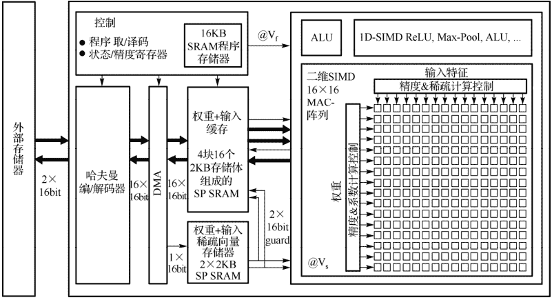 图 4.7、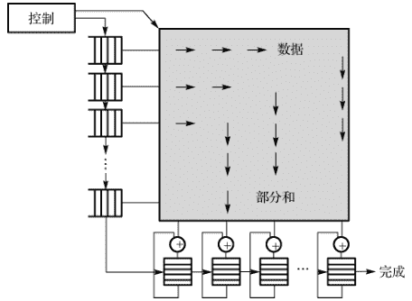 图 4.8）。2016 年发布的云端 ASIC 加速器，AlphaGo 胜李世石即借力 50 片 TPU。核心为 256×256 MAC 组成的二维脉动阵列，集成归一化/池化与激活单元，片上缓存 24 MB（权重+统一缓存）+ 6 MB 累加器输出缓存，占芯片面积 37%，极大削减片外访存。**脉动阵列互连**：数据像血液般按节奏在 ALU 链中流动——输入沿行流动，部分和沿列流动，权重驻留寄存器，实现三类数据全复用，最小化片上/片外交互。另采用 8-bit 低精度（精度损失可控），终获性能比 CPU/GPU 高 30 倍、能效比高 30~80 倍。TPU 的商业成功让 AI 芯片成巨头必争赛道，推动产业走向实用化。

**空域架构短板**：虽大幅强化性能与能效，但缺乏时域可变性，灵活性不足，应用覆盖面受限。

### 4.2 现存痛点深度剖析

除上述典型设计，学界还提出多种新型架构[9-15]，但普遍存在四大短板：

1.  **未善用低位宽量化容错红利**。DNN 在精度容忍范围内天然支持低位宽量化。表 4.1 显示：LRCN 各层量化为 9/8/8/8/9/8/8/8-bit 后，对比全 16-bit 精度仅损 1.8%。
    #### 表 4.1 LRCN 网络逐层数据统计
    | 神经网络 | 层编号 | 结构参数 | 层操作类型 | MAC 运算量 | 权重/MB | 特征输入/MB | 操作密度 | 位宽/bit | 精度损失 |
    | :--- | :--- | :--- | :--- | :--- | :--- | :--- | :--- | :--- | :--- |
    | ConvNet | 1 | (11, 4) | MAC Pooling ReLU | 105.4 | 0.039 | 0.58 | 3011.4 | 9 | 1.8% |
    | | 2 | (5, 1) | | 447.9 | 0.61 | 0.37 | 734.3 | 8 | |
    | | 3 | (3, 1) | | 149.5 | 0.88 | 0.13 | 196.9 | 8 | |
    | | 4 | (3, 1) | | 224.3 | 1.33 | 0.13 | 168.6 | 8 | |
    | | 5 | (3, 1) | | 149.5 | 1.00 | 0.09 | 150.2 | 9 | |
    | FCNet | 6 | (9216, 4096) | MAC ReLU | 37.8 | 37.8 | 0.008 | 1.0 | 8 | |
    | | 7 | (4096, 4096) | | 16.8 | 16.8 | 0.008 | 1.0 | 8 | |
    | | 8 | (4096, 1000) | | 4.1 | 4.1 | 0.002 | 1.0 | 8 | |
    | RNN | 9 | (2024, 4096) | MAC,Tanh, ReLU,Sigmoid, Element-wise | 8.29x 50 iter | 8.29 | 0.008 | 50.0 | 8 | |
    | | 10 | (2048, 4096) | | 8.39x 50 iter | 8.39 | 0.008 | 50.0 | 8 | |

2.  **优化偏重卷积层，非卷积层成瓶颈**。现代 DNN 虽以卷积为主，但非卷积运算占比不低。LRCN 中 FCNet 与 RNN 合计占总算力 47.7%。仅加速卷积层会导致非卷积层拖累整体性能[9-17]。虽有 DNPU[9] 等尝试同步加速 CONV 与 RNN，但硬件资源割裂不可复用，限制灵活性与利用率。

3.  **计算模式固化，难平衡异构层需求**。ConvNet 计算密集，FCNet/RNN 存储密集，固定架构无法按需调整数据流以平衡算力与访存，拉低资源利用率与能效。

4.  **存储系统刚性不足**。同一网络不同层参数（卷积核、步长、特征图尺寸）差异大，访问模式与数据复用度迥异：卷积层高复用、权重占缓存少但 MAC 多；全连接/循环层权重难复用、MAC 需求大。固定存储设计无法自适配。

### 4.3 多粒度可重构计算架构：Thinker 范式

为更贴合智能计算特性，提升资源利用率与能效比，**具备硬件重构能力的空域架构**成主流。ISSCC'19 大会报告中，Hoi-Jun Yoo 教授指出：2016 年以来超半数 AI 芯片采用可重构架构。以 **“多粒度可重构智能计算架构——Thinker[18]”** 为例，阐释面向智能计算的重构设计哲学。该架构遵循 **“动态重构、数据驱动”** 核心思想，实现 **核心运算部件、PE 单元、PE 阵列、计算模式** 四个层次/粒度的硬件动态重构：不仅高效支撑卷积、全连接、RNN、池化等异构层的单独/并行计算，灵活适配复杂级联与混合精度网络，更能通过匹配不同访存比提升利用率、降能耗，在灵活性、高能效、低功耗三维度具显著优势。

#### 4.3.1 系统总体架构

# 深度解析 Thinker 架构：异构重构与多层并行的能效密码

Thinker 处理器的核心骨架由运算、存储与控制三大模块搭建而成，心脏部位则是两块由 16×16 处理单元（PE）组成的可重构异构阵列。缓存控制器统筹两个 144KB 的多组片上存储，源源不断地为阵列输送弹药；全局调度由有限状态机接管，配合可配置的 I/O 与解码单元完成权重与配置的加载。此外，架构还配备了 1KB 共享权重缓存与两个 16KB 本地缓存，专司权重数据的预备与分发。

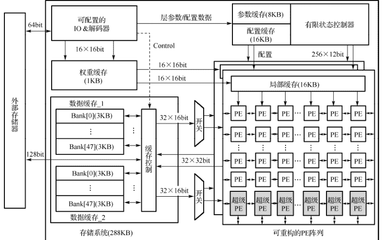

图 4.9 Thinker 整体架构[18]

在 PE 阵列内部，每个单元的核心算力单元——MAC 均具备位宽自适应能力；单个 PE 支持多种神经网络算子的动态重构；更关键的是，阵列能按需切分为功能各异的子阵列，从而灵活并行地应对不同网络层的计算任务。Think 架构更支持依据网络拓扑重构计算模式，通过极致的数据复用，将非必要的数据搬运开销压至最低，大幅跃升整体能效比。

### 核心突破一：位宽自适应 MAC 设计

为榨干计算效率与资源利用率，阵列内每颗 PE 的 MAC 采用双 8×16bit 乏法器设计，可依配置字在 8bit 与 16bit 混合精度间自由切换。8bit 模式下，双乘法器并行作战；切至 16bit 模式时，二者合体为单个 16×16bit 乘法器。闲置数据通路自动触发时钟门控，静默功耗。

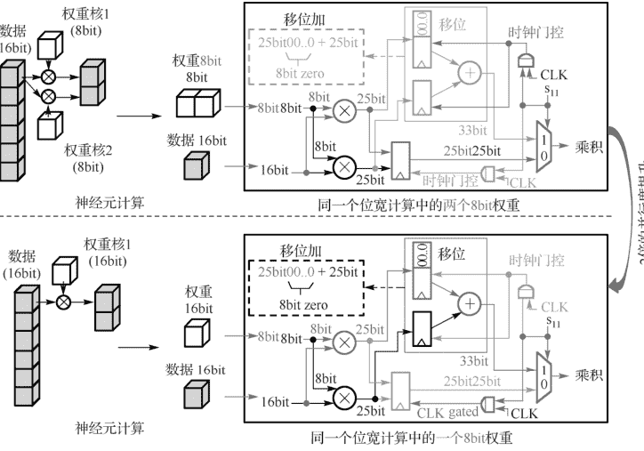

图 4.10 位宽自适应计算 (见彩图)

**低位宽并行通道（<8bit）：** 两个来自不同卷积核或神经元的权重拼成 16bit 宽度，高低 8bit 分别与同一 16bit 输入并行相乘。两个 25bit 结果（含保留位）拼接为 50bit 字，配置字 `s11=0` 选通直出。此模式下无需输入数据保护间隔，对比赛灵思 INT8 方案强制插入 9bit 间隔的做法，Thinker 消除了冗余，效率更胜一筹。

**高位宽串行通道（>8bit）：** 双乘法器级联成 16×16bit 单元。高 25bit 结果左移 8 位与低 25bit 相加，`s11=1` 选通求和结果。与 ENVISION 等方案相比，Thinker 乘法器在两种模式下均满负荷工作，资源利用率显著更高。

### 核心突破二：算子级重构的异构 PE

阵列部署两类 PE：**通用 PE** 覆盖卷积、全连接、循环层的 MAC 运算，由 5bit 控制字（s1、s3、s6、s7、s11）定形；**超级 PE** 以通用 PE 为底座，额外集成池化、tanh、Sigmoid、标量乘加及 RNN 门控共 5 类操作，配置字扩展至 12bit（s0~s11）。为压缩异构单元的平均闲置面积，除超级 PE 专属的池化、Sigmoid、tanh 模块外，乘法器与加法器在几乎所有模式下均实现复用。图 4.12 详细描绘了超级 PE 四大核心操作的数据流向。

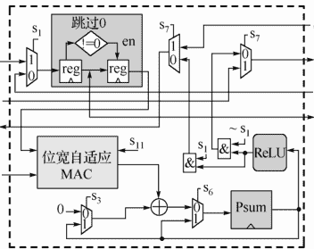

###### (a) 通用PE

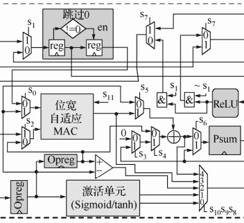

###### (b) 超级PE

| # | 模式 | Sx5 | Sx4 | Sx3 | Sx2 | Sx1 | Sx0 | Sz | ... |
|---|---|---|---|---|---|---|---|---|---|
| 1 | Conv(16bit-w) | 01 | 1 | 1 | 1 | 1 | x | x | ... |
| 2 | FC(16bit-w) | 00 | 1 | 1 | 1 | 1 | x | x | ... |
| 3 | Conv(8bit-w) | 01 | 1 | 1 | 1 | 1 | x | x | ... |
| 4 | FC(8bit-w) | 00 | 1 | 1 | 1 | 1 | x | x | ... |
| 5 | tanh | xx | x | x | x | x | x | x | ... |
| 6 | Sigmoid | xx | x | x | x | x | x | 1 | 0 | ... |
| 7 | 池化 | xx | x | x | x | x | x | 0 | 1 | ... |
| 8 | 乘法 | 1x | 0 | x | x | x | x | 1 | 1 | ... |
| 9 | 加法 | xx | x | 0 | x | 0 | 0 | 0 | 1 | ... |
| # | 状态 | Sx | Sz | ... |
|---|---|---|---|---|
| 1 | 启动 | 0 | 0 | 0 |
| 2 | 循环 | 1 | 0 | 0 |
| 3 | 结束 | 0 | 1 | 0 |
| 4 | 空闲 | 0 | 0 | 1 |

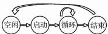

###### (c) 配置: 模式+状态

图 4.11 PE 结构 (见彩图)

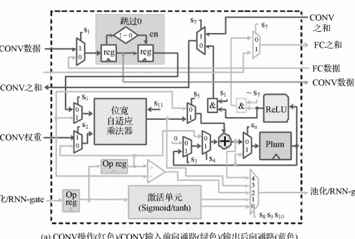

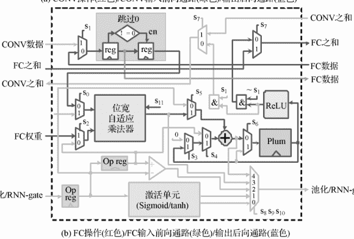

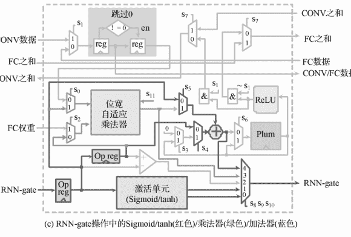

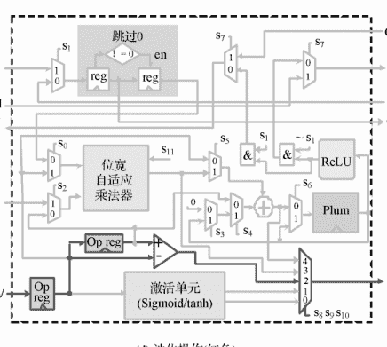

图 4.12 不同类型操作的数据通路（见彩图）

每个阵列侧翼设三组 I/O 端口（左、右、底）。特征图从左右边缘注入，水平穿行至内部 PE；计算结果逆向流动至对侧边缘输出。权重则通过列总线广播至 16 个 PE。这种布局省去了阵列内部额外 I/O 端口的面积开销。

### 核心突破三：双缓冲乒乓的片上存储体系

两组 144KB 多 Bank SRAM（数据缓存 1/2）承担层间中间数据的存储与复用重任。为适配阵列切分，每组缓存再分为服务 CONV 与 FC 子阵列的两个子缓存。计算时双缓冲轮转：一侧供给输入，另一侧收纳输出；次层互换角色。每缓存拥 48 个 Bank，峰值可并行吐出 48 组 16bit 数据。Bank 级“乒乓”机制让阵列与片上缓存的交换、片上与片外 DRAM 的预取实现时域重叠，有效掩盖片外访存延迟。缓存控制器全权掌管数据访问调度与组织。

权重侧采用两级缓存：1KB 片上共享缓存从片外拉取权重，按计算模式分发至两个 16KB 阵列本地缓存。计算期本地缓存负责权重复用，并行向两个阵列的 16 列 PE 各供一权重。

### 核心突破四：三级解耦的有限状态控制器

控制器构建三层配置金字塔（见下图）：**阵列参数（66bit）** 统领宏观，含划分策略、Batch Size、层数、层参数基址；**网络层参数** 聚焦单层细节，涵盖数据/权重地址、核尺寸、输出通道数等；**PE 配置字** 直达底层，逐位拨动 PE 内部开关，定型逻辑功能。

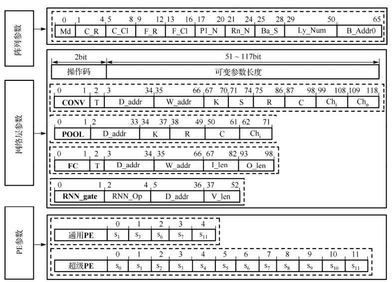

- D_addr: 输入数据的基地址
- W_addr: 权重基地址
- I_len: 输入长度
- O_len: 输出长度
- V_len: 向量长度
- RNN_op: tanh、Sigmoid、加、乘、比较
- C_R: CONV的行数
- C_Cl: CONV的列数
- F_R: FC的行数
- F_Cl: FC的列数
- Md: AP或者TM的处理模式
- T: CONV/FC中16bit和8bit两种计算类型
- K: 内核尺寸
- R: 输入特征图的行数
- C: 输入特征图的列数
- Ch: 输入特征图的数量
- Ch: 输出特征图的数量
- S: 步长
- PI_N: 池化的PE数
- Rn_N: RNN-gate的PE数
- Ba_S: Batch大小
- Ly_Num: 层数
- B_Addr0: 第一层的基地址

图 4.13 三级配置层次结构：阵列参数、网络层参数和 PE 参数

运行时，控制器先从参数缓存取阵列与层参数，解码识别 PE 功能，在配置缓存中选取对应配置字，最后经点对点总线单周期下发至双阵列。这种直连机制保证了重构配置的零等待高效完成。

### 核心突破五：稀疏感知的 I/O 与解码器

权重与配置经可配置 I/O 端口入栈。利用稀疏性，权重经双符号哈夫曼编码压缩，解码器实时还原。为兼容变长层参数，解码器先读最高两位判别层类型，再按长度加载。特征数据直通片上缓存与外存，大块数据自动分块适配缓存容量。

---

## 计算数据流：从“输出固定”到“多层并行”

PE 阵列遵循**输出固定数据流**：输出点驻留 PE 原地，权重与输入特征在垂直、水平维度复用。

### 卷积与全连接的差异化流向

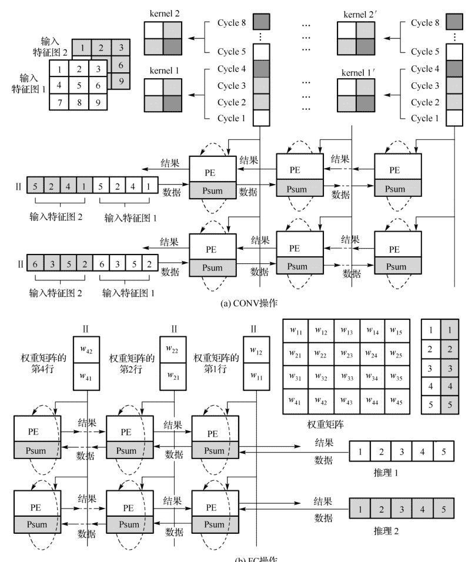

图 4.14 计算流示意图

*   **卷积模式：** 数据从左侧 I/O 入阵，每周期右移一格。列内 PE 并行算同一输出通道不同位置，列间 PE 分工不同输出通道。结果反向左移经左侧 I/O 出阵。三维卷积核下，最右列 PE 仅有 30 个周期的延迟开销（15 进 + 15 出），以 AlexNet 为例，仅占总周期 2.2%，可忽略不计。
*   **全连接模式：** 数据从右侧入阵，左移流动；结果左→右输出。行内 PE 复用输入算同层多点，行间 PE 并行处理 Batch 内不同样本，复用权重。

**分块策略：** CONV 层输入按 `(m+k-1)×k×Ch` 分块适配缓存（m×n 为分配 PE 规模，k 核大小，Ch 输入通道，步长 1）；FC/RNN 层输入规模较小（典型 4096 点约 8KB），通常一次性上缓存免分块。池化与 RNN 门控由底缘超级 PE 经底部 I/O 直驱。

### 打破逐层串行瓶颈：多层并行数据流

传统逐层调度下，计算密集的 CONV 层吃不饱 DRAM 带宽，存储密集的 FC/RNN 层又让 PE 闲置。以 LRCN 为例，逐层模式下 FC/RNN 阶段 PE 利用率仅 18.75%，CONV 阶段带宽利用率跌至 19.63%，平均仅 75.68% 与 76.96%。

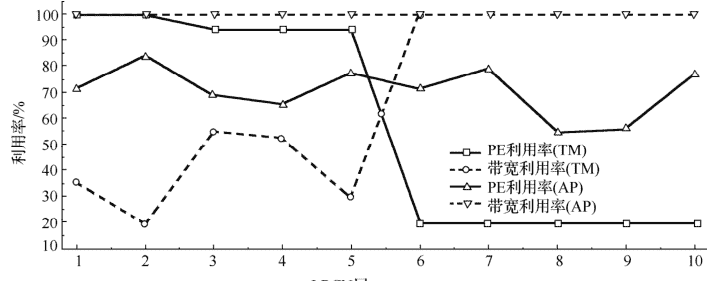

图 4.15 LRCN 每层的 PE 和带宽利用率评估

Thinker 洞察到两类层需求互补，推出**多层并行数据流**：主力 PE 给 CONV，主力带宽给 FC/RNN。得益于多 Bank 缓存、分布式 I/O 与独立计算流，阵列可灵活切分为四大子阵列——CONV、FC、Pooling、RNN Gate。

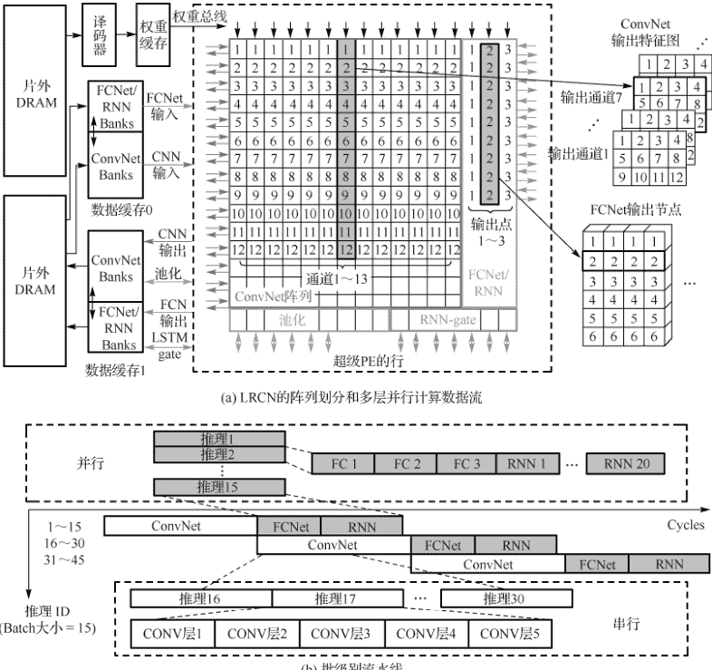

图 4.16 LRCN 的阵列划分和多层并行计算数据流，以及批级别流水线（见彩图）

**LRCN 实战切分：** CONV 阵列占 15×13 通用 PE；FC 阵列占 15×3 通用 PE；Pooling 与 RNN Gate 各得 9、7 个超级 PE。缓存按 33:15 Bank 切分给 CONV/FC，Batch Size 设为 15。RNN 内 FC 复用 FC 阵列，门控上超级 PE。CONV 阵列列映射输出通道，获 13× 输入复用与 15× 权重复用；FC 阵列行并行多前向过程，输入、权重复用比 3:15。

**批级流水线：** CONV 与 FC 执行错峰为两个连续流水阶段。FC 启动前，输入已在上一阶段就绪。一个 Batch 内所有样本的 CONV 串行跑完，FC/RNN 则在不同行并行跑完，权重复用最大化。实测该模式将 PE 利用率推高 10.3%，带宽利用率跃升 21.02%。

> **注：** 最优切分参数（子阵列规模、Bank 分配）随网络拓扑动态变化。极端情况下 CONV 占绝对主导，单层流反而更优。因此，按需动态阵列划分算法将在 4.3.4 节详述。

---

## 基于融合数据模式的存储划分策略

多层并行下，CONV 与 FC 子阵列需从多 Bank 缓存并行取数。鉴于两者访存模式截然不同，必须通过融合数据模式精算 Bank 分配，消除银行冲突，保障并行吞吐。

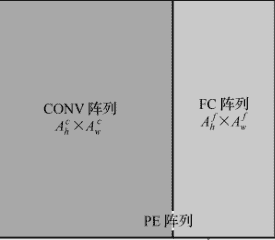

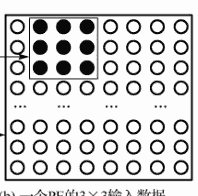

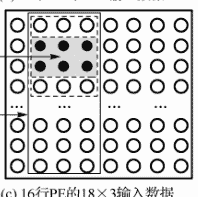

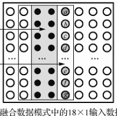

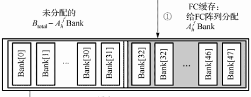

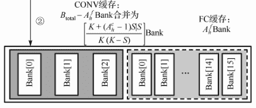


图 4.17 基于融合数据模式的存储划分 (见彩图)

设 CONV 子阵列高 $A_h^c$ 行，FC 子阵列高 $A_h^f$ 行（其余符号见表 4.2）。FC 阵列中 $A_h^f$ 行并发执行互不相关的前向过程，零数据复用，故每周期需并行喂入 $A_h^f$ 个输入点，**强制分配 $A_h^f$ 个 Bank 给 FC 缓存**；剩余 $B_{total} - A_h^f$ 个 Bank 全归 CONV 子阵列。此举从根源上解耦了两类访存模式的资源争用。

表 4.2 符号说明

| 输入：混合神经网络参数 | DL,WL | 激活和权重的位宽 |
| :--- | :--- | :--- |
| | \(\theta \in \{1,2\}\) | 一个 PE 中同时执行的 MAC 数量 |

# Thinker芯片核心技术深度解析：动态阵列划分与实测性能大揭秘

## 4.3.4 按需动态阵列划分策略

```
算法 4.1
// In_c, Out_c, Weight_c, Weight_c 表示每层 DRAM 的访问
Initiate: CC_AP = \infty
1: for BS=1; BS \leqslant A_h -1; BS++ do
2:   for A_w^c=1; A_w^c \leqslant A_w -1; A_w^c++ do
3:     for A_h^c = 1; A_h^c \leqslant A_h -1; A_h^c++ do
       Initiate: CC_conv, CC_fc, CC_trans, CC_ConvNet, CC_FCNet/RNN, CC_temp, B_m ;
       for j=1; j \leqslant CONV_layer_num; j++ do
4:    B_m[j] = [K_i + (A_h^c - 1) \times S_j \times S_j] / [K_j \times (K_j - S_j)]
5:    B_m = max_j {B_m[j]}
6:    if B_m + BS > B_total then
7:        continue
        for j=1; j <= CONV_layer_num; j++ do
8:        CC_conv[j] = [[H_i \times W_i] / A_h^c] \times [[CH_out,j / \Theta \times A_h^c] \times K_j^2 \times CH_in,j \times BS
9:        CC_trans[j] = max [ (In_j + Out_j) / BW_h/f , Weight_j / BW_h/f ]
10:   CC_ConvNet = sum_j max(CC_trans, CC_conv)
        for j=1; j <= FC_layer_num; j++ do
11:   CC_fc[j] = [[BS / A_h - 1] \times [FC_out,j / \Theta \times (A_h - A_h^c)] \times FC_in,j
12:   CC_trans[j] = Weight_j / BW_h/f
13:   CC_FCNet/RNN = sum_j max(CC_trans, CC_fc)
14:   CC_temp = max(CC_ConvNet, CC_FCNet/RNN)
15:   if CC_AP > CC_temp then
16:       update CC_AP
```

多层并行计算的核心在于构建前向计算流水线。如图 4.16(b) 所示，该数据流通过让当前批次的卷积层与上一批次的全连接/循环层时序重叠，将一个完整的神经网络拆解为两个连续的流水线阶段。系统分别统计卷积侧与全连接/循环侧的计算周期，取两者中较大者作为流水线的启动间隔（II），优化目标便是将这个 II 值压到最低。

算法 4.1 的执行逻辑如下：首先校验当前迭代的变量组合（BS, $A_h^c$）是否满足存储划分约束，若不达标则跳过尝试下一组（第 6~7 行）。接着推算卷积层总耗时（第 8~10 行）。在多层并行模式下，输出特征图的 $H \times W$ 个点被切分至 $A_h^c$ 行 PE 并行处理；得益于每个 PE 每周期可执行 $\Theta$ 次 MAC，系统可同步跑通 $\Theta \times A_h^c$ 个输出通道。单个输出点需消耗 $K^2 \times CH_{in}$ 个周期。数据搬运耗时由传输总量除以单周期带宽（$BW/f$）得出，这往往成为存储密集型层的瓶颈。最终 ConvNet 的执行周期，取每层卷积计算周期（$CC_{conv}$）与传输周期（$CC_{trans}$）中的较大值求和（第 10 行）。

全连接/循环层的周期估算遵循类似逻辑（第 11~13 行）。批次内每个前向过程独占一行 PE，输出特征沿 $A_h - A_h^c$ 列展开。$FC_i$ 代表单输出点计算耗时，而传输周期主要取决于权重搬运。池化及 RNN 门控的开销可分别隐匿在卷积或全连接/循环层的计算窗口内，分配给这两类功能的超级 PE 数量与其运算量成正比。最终，同一批次的整体计算周期由运行较慢的那个子阵列决定（第 14 行）。

同理，若给每层独享整个 PE 阵列，即可得出逐层计算模式的性能表现。因此，针对特定网络，我们能在“逐层计算”与“多层并行”两种数据流及其对应的最优划分参数中，选出全局最优解。

## 4.3.5 实测评估与对标分析

Thinker 芯片基于 TSMC 65nm 低功耗工艺流片。图 4.18 展示了版图全貌与关键指标。


| 核心参数 | 规格详情 |
| :--- | :--- |
| **工艺节点** | TSMC 65nm LP |
| **芯片/核心尺寸** | 4.4mm×4.4mm / 3.8mm×3.8mm |
| **逻辑规模** | 2.95M 等效 NAND2 门 |
| **片上存储** | 348KB SRAM |
| **供电域** | Core: 0.67～1.2V, I/O: 1.8V |
| **频率范围** | 10～200MHz |
| **峰值算力** | 409.6 GOP |
| **精度支持** | 8/16 bit 自适应 |
| **卷积配置** | 核尺寸 1～16, 步长 1～15 |
| **全连接配置** | 输入/输出长度 1～65536 |
| **RNN 支持** | LSTM, GRU 等主流结构 |
| **辅助算子** | Pooling, Sigmoid, ReLU 等 |

**图 4.18 Thinker 芯片版图与核心参数速览**

在标称工况（200MHz, 1.2V）下，Thinker 达到 409.6 GOP 峰值吞吐，功耗 386mW，能效比 1.06 TOP/W。若将电压降至 0.67V（对应 10MHz），吞吐与功耗分别降至 20.4 GOP 与 4mW，能效比飙升至 5.09 TOP/W，展现出极宽的能效动态范围。

针对神经网络层位宽多样的特点，Thinker 部署了三大核心技术组合拳：
1.  **PE 位宽自适应计算**：使算力吞吐提升 91%，平均能效近乎翻倍（×1.93）。
2.  **按需阵列分区与重构**：支撑异构网络并行，PE 利用率提升 13.7%，能效增益 1.11 倍。
3.  **基于融合数据模式的 Multi-Bank 存储**：深度挖掘数据复用并保障并行访问，分别带来 1.11 倍吞吐与 1.17 倍能效提升。

表 4.3 汇总了 Thinker 与 Eyeriss、CNN-SoC、DNPU、ENVISION 四款代表性芯片在 AlexNet 基准（200MHz）下的横向对决。

#### 表 4.3 主流神经网络处理器实测对标（基准：AlexNet @ 200MHz）

| 维度 | Eyeriss (ISSCC'16) | CNN-SoC (ISSCC'17) | DNPU (ISSCC'17) | ENVISION (ISSCC'17) | **Thinker (本文)** |
| :--- | :--- | :--- | :--- | :--- | :--- |
| **工艺** | 65nm | 28nm | 65nm | 28nm | **65nm** |
| **核心面积** | 12.25 mm² | 34.72 mm² | 16.0 mm² | 1.87 mm² | **14.44 mm²** |
| **电压范围** | 0.82～1.17V | 0.575～1.1V | 0.77～1.1V | 0.65～1.1V | **0.67～1.2V** |
| **频率范围** | 100～250MHz | 200～1175MHz | 50～200MHz | 25～200MHz | **10～200MHz** |
| **片上 SRAM** | 181.5 KB | 5625 KB | 290 KB | 144 KB | **348 KB** |
| **PE 阵列规模** | 168 | 288 | 776 | 256 | **512** |
| **峰值性能** | 0.084 TOP @16b | 0.752 TOP @8b | 1.20 TOP @4b | 0.076 TOP @4b | **0.410 TOP @8b** |
| **支持精度** | 16b 固定 | 8/16b | 4/8/16b | 4/8/16b | **8/16b 自适应** |
| **功耗区间** | 94～450 mW | ≥39 mW | 34.6～279 mW | 7.5～300 mW | **4.0～386 mW** |
| **能效区间** | 0.14～0.25 TOP/W | ≤1.89 TOP/W | 1.0～8.1 TOP/W | 0.26～10 TOP/W | **1.06～5.09 TOP/W** |
| **实测工况** | 1.0V, 200MHz | 0.575V, 200MHz | 1.1V, 200MHz | 1.0V, 200MHz | **1.2V, 200MHz** |
| **实测功耗** | 278 mW @16b | 41 mW @8b | 279 mW @4b | 44 mW @4b | **290 mW @自适应** |
| **实测吞吐** | 46.2 GOP @16b | 77 GOP @8b | 1088 GOP @4b | 76 GOP @4b | **368.4 GOP @自适应** |
| **实测能效** | **0.166 TOP/W** | **1.89 TOP/W** | **3.9 TOP/W** | **3.8 TOP/W** | **1.27 TOP/W** |

**对标洞察**：尽管 DNPU 与 ENVISION 凭借 4bit 极低精度在峰值能效上领先，但 Thinker 在 **同工艺（65nm）、同精度上限（8/16bit）、同基准网络** 的公平对比中，凭借自适应位宽与动态划分机制，实现了 368.4 GOP 的实测吞吐与 1.27 TOP/W 的实测能效，显著超越同精度下的 Eyeriss 与 CNN-SoC，验证了架构级优化的实效性。

### 参考文献

- [1] Temam O. The rebirth of neural networks[C]// The 37th Annual International Symposium on Computer Architecture. New York: ACM, 2010: 349.
- [2] Sze V, Chen Y H, Yang T J, et al. Efficient processing of deep neural networks: A tutorial and survey[J]. Proceedings of the IEEE, 2017, 105(12): 2295-2329.

### 第 5 章 AI 芯片数据复用的核心逻辑

数据复用，通俗说就是在计算流程中反复“榨干”同一份数据的价值，是缓解存储墙、降低重复访存开销的经典手段。卷积神经网络（CNN）囊括了基础网络层里的三大件，唯独缺了循环层。但循环层本质上就是带反馈回路的全连接层，其反馈机制只是在相邻层间制造了数据依赖，并不妨碍复用策略的施展。因此，拿 CNN 来剖析数据复用技术，具有极强的代表性。

更关键的是，卷积层的计算量在 CNN 总开销中占比超 90% [1]。池化、全连接等其他层的计算范式与卷积层同构，均可用同一套参数体系描述。透过卷积层的复用分析，便能一网打尽其他层的优化逻辑。本章将聚焦 CNN，深度解构 AI 芯片的数据复用机制。

AI 芯片常采用三大复用范式：输入复用（IR）、输出复用（OR）与权重复用（WR）。文献中常将其对应称为输入固定（IS）、输出固定（OS）、权重固定（WS）模式。下文将结合系统架构，逐一拆解这三类模式，并揭示为何必须根据网络差异引入混合复用策略。

#### 5.1 输入数据复用：以不变应万变

受限于片上存储容量，单个卷积层往往无法一次性装入算力核心，必须拆解为更细粒度的计算任务——这在数学上等价于对图 3.2 所示四层循环 nest 实施“循环分块”。如图 5.1 (a) 所示，输入与输出特征图被切分为 $T_n \times T_h \times T_l$ 与 $T_m \times T_r \times T_c$ 的数据块。其中空间维度 $T_h, T_l$ 由卷积核尺寸 $K$ 与步长 $S$ 推导：$T_h = (T_r-1)S + K, T_l = (T_c-1)S + K$。据此，片上缓存与片外 DRAM 的访存次数可统一建模为：

```
MA = TI×αi + TO×αo + TW×αw + TPO   (5-1)
```

式中，$T_I, T_O, T_W$ 分别为当前层输入、输出、权重总量；$\alpha_i, \alpha_o, \alpha_w$ 为复用系数，表征三类数据在计算流中被重复访问的次数；$T_{PO}$ 为池化后输出规模，通常为 $T_O / S^2$。

**先看输入复用特性。** 图 5.1 (a) 展示了基础 IR 流程，与 Eyeriss [2] 思路一脉相承，分三步走：① 算力核心从片上缓存搬运输入特征图至本地寄存器阵列；② 核心最大化复用该批输入，疯狂累加更新输出缓存中的部分和；③ 更新完的部分和写回输出缓存。随后读入新输入块，循环往复。


```
for (r=0;r<R;r+=Tc) // Loop R.
for (c=0;c<C;c+=Tc) // Loop C.
for (n=0;n<N;n+=Tn) // Loop N.
for (m=0;m<M;m+=Tm) // Loop M.
/*Computation in the core.*/
for (tm=m;tm<min(m+Tm, M); tm++) // Loop Tm.
for (tn=n;tn<min(n+Tn, N); tn++) // Loop Tn.
for (tr=r;tr<min(r+Tr, R); tr++) // Loop Tr.
for (tc=c;tc<min(c+Tc, C); tc++) // Loop Tc.
O[tn] [tr] [tc] += //Convolution.
Sum(kk=0; kk<=R; kk++) W[tm] [tn] [i] [j] * I[tn] [tr*S+kk] [tc*S+j];
```


for (r=0; r<R; r+=Tr)       // Loop R.

for (c=0; c<C; c+=Tc)       // Loop C.

for (m=0; m<M; m+=Tm)       // Loop M.

for (n=0; n<N; n+=Tn)       // Loop N.

/*Computation in the core.*/

for (tm=m; tm<min (m+Tm, M) ; tm ++)   // Loop Tm.

for (tn=n; tn<min (n+Tn, M) ; tn ++)   // Loop Tn.

for (tr=r; tr<min (r+Tr, R) ; tr ++)   // Loop Tr.

for (tc=c; tc<min (c+Tc, C) ; tc ++)   // Loop Tc.

O[tm] [tr] [tc]+=\sum_{k=0}^{K-1} \sum_{s=0}^{S-1} W[tm] [tn] [i] [j] * I[tn] [tr*S+si] [tc*S+sj] ; //Convolution.

#### (d) OR伪代码


#### (e) WR示例

```
for (m=0; m<M; m+=Tm)       // Loop M.
for (n=0; n<N; n+=Tn)       // Loop N.
for (r=0; r<R; r+=Tr)       // Loop R.
for (c=0; c<C; c+=Tc)       // Loop C.
for (tm=m; tm<min (m+Tm, M) ; tm ++)   // Loop Tm.
for (tn=n; tn<min (n+Tn, M) ; tn ++)   // Loop Tn.
for (tr=r; tr<min (r+Tr, R) ; tr ++)   // Loop Tr.
for (tc=c; tc<min (c+Tc, C) ; tc ++)   // Loop Tc.
O[tm] [tr] [tc]+=\sum_{k=0}^{K-1} \sum_{s=0}^{S-1} W[tm] [tn] [i] [j] * I[tn] [tr*S+si] [tc*S+sj] ; //Convolution.
```

#### (f) WR伪代码

图 5.1 数据复用模式示意

在 IR 模式下，原本 4 层循环蜕变为图 5.1 (b) 的 8 层嵌套结构：外层 4 层调度数据复用策略，内层 4 层执行实质卷积运算。外层循环中，N 维循环包裹 M 维，意味着核心会彻底“榨干”当前输入块的所有通道信息，才会去取下一批输入。针对片上缓存访问，IR 模式的总开销 $\text{MA}_{\text{buffer}}^{(\text{IR})}$ 仍遵循式 (5-1)，复用系数取值如下：

$\alpha_i=1, \quad \alpha_o=2\left(\left\lceil \frac{N}{T_n} \right\rceil -1\right), \quad \alpha_w=\left\lceil \frac{H}{T_h} \right\rceil \left\lceil \frac{L}{T_l} \right\rceil$

逻辑清晰：每个输入块仅入核一次（$\alpha_i=1$）；核心一次缓存 $T_n$ 通道输入，跨通道累加需反复读写输出部分和 $\lceil N/T_n \rceil -1$ 轮，读写各一次故乘 2（$\alpha_o$）；权重随输入空间分块被重复调用（$\alpha_w$）。

一旦缓存需求超容，溢出数据便会引发昂贵的 DRAM 访问。IR 模式下 DRAM 访问总量 $\text{MA}_{\text{DRAM}}^{(\text{IR})}$ 同用式 (5-1) 刻画，但系数随容量约束动态调整：

$\alpha_i=1, \quad \alpha_o=\begin{cases} 0, & M \times T_r \times T_c \leqslant B_o \\ 2\left(\left\lceil \frac{N}{T_n} \right\rceil -1\right), & M \times T_r \times T_c > B_o \end{cases}, \quad \alpha_w=\begin{cases} 1, & T_W \leqslant B_w \\ \left\lceil \frac{H}{T_h} \right\rceil \left\lceil \frac{L}{T_l} \right\rceil, & T_W > B_w \end{cases}$

简单说：输入依然只读一次；输出部分和若能全留在输出缓存 $B_o$ 里则零 DRAM 交互，否则被迫刷回 DRAM；权重若能装进权重缓存 $B_w$ 则仅加载一次，否则随空间分块反复搬运。

### 5.1 输入数据复用模式

在该模式下，$B_o$ 与 $B_w$ 分别代表输出缓存与权重缓存的容量上限。针对片外 DRAM，输入特征图仅需读取一次，而输出与权重的访问频次则取决于数据缓存需求能否被片上容量满足。以 IR 模式为例，系统需缓存 $M \times \text{Tr} \times \text{Tc}$ 个输入输出部分和。若该数量未超出输出缓存规模（即 $M \times \text{Tr} \times \text{Tc} \leqslant B_o$），计算过程便无需将部分和外溢至 DRAM（$\alpha_o=0$）；反之，则必须频繁读写片外存储，访问系数升为 $\alpha_o=2\left(\left\lceil \frac{N}{\text{Tn}} \right\rceil -1\right)$。权重同理：当缓存需求小于 $B_w$ 时仅读取一次（$\alpha_w=1$），否则产生额外开销。需注意，因循环 $R$ 与 $C$ 位于最外层（见图 5.1(b)），IR 模式下的权重缓存需求涵盖全部权重量 TW。


典型应用 LNPU[3] 采用此模式，该架构兼容推理与训练并支持稀疏计算。参照图 5.2，Act 标识推理期输入特征，$\delta$ 代表训练反向传播产生的数值。以推理为例，t-1 至 t 周期内，架构筛选出非零元素 D1、D6，分别与权重 10～I2 做点积，输出 R0～R2 与 R5～R7。D1、D6 以广播形式分发至 PE0～PE2，各 PE 获取差异化权重。此机制令单一输入值与多组权重并行相乘，充分挖掘了输入数据的复用价值。

```
BUFFER wt_buf[C] [Kc*R*S/F] [F];
BUFFER in_buf[C] [Wt*Ht/I] [I];
BUFFER acc_buf [Kc] [Wt+R-1] [Ht+S-1];
BUFFER out_buf [K/Kc] [Kc*Wt*Ht];
(A)   for k'=0 to K/Kc-1
{
    for c = 0 to C-1
        for a = 0 to (Wt*Ht/I)-1
        {
(B)    [in[0:I-1] = in_buf[c][a][0:I-1];
(C)    for w = 0 to (Kc*R*S/F)-1
(D)    {
(E)       wt[0:F-1]=wt_buf[c][w][0:F-1];
          parallel_for (i = 0 to I-1) x (f = 0 to F-1)
          {
             k = Kcoord(w,f);
             x = Xcoord(a,i,w,f);
             y = Kcoord(a,i,w,f);
             acc_buf[k][x][y] += in[i]*wt[f];
          }
       }
   }
   out_buf[k'][0:Kc*Wt*Ht-1]=
   acc_buf[0:Kc-1][0:Wt-1][0:Ht-1];
}
```

NVIDIA 的 SCNN[3] 亦属此类。图 5.3 伪代码显示，权重循环 wt 嵌套于输入循环 in 内层（即 C 在 B 之下），意味着同一批输入数据需反复配合权重计算，直至完成才切换下一批输入。

### 5.2 输出数据复用模式

图 5.1(c) 展示的基础 OR 流程分三步走：① 计算核心将输入特征图各通道载入本地寄存器；② 输出寄存器中的部分和深度复用，完成通道维度的全量累加；③ 经池化后的最终结果写入输出缓存。后续输出特征图计算循环往复。

OR 模式将原本 4 层循环重构为图 5.1(d) 的 8 层结构。关键变化在于循环 M 与 N 互换位置，导致输出特征图必须在通道累加彻底结束后才落地缓存。片上缓存总访问次数 $\text{MA}_{\text{buffer}}^{(\text{OR})}$ 仍由式(5-1)刻画，复用系数为：
$\alpha_i = \lceil M/Tm \rceil, \quad \alpha_o = 0, \quad \alpha_w = \lceil R/Tr \rceil \lceil C/Tc \rceil \quad (5-4)$
因输出寄存器暂存 Tm 通道结果，输入特征图被迫重读 $\lceil M/Tm \rceil$ 次。与 IR 不同，权重被各输出分块共享，故 $\alpha_w$ 取空间维度分块数乘积。

片外 DRAM 访问 $\text{MA}_{\text{DRAM}}^{(OR)}$ 同样依赖缓存容量是否达标，系数定义如下（5-5）：
$\alpha_i = \begin{cases} 1, & N \times Th \times Tl \leqslant B_i \\ \lceil M/Tm \rceil, & \text{otherwise} \end{cases}, \quad \alpha_o = 0, \quad \alpha_w = \begin{cases} 1, & TW \leqslant B_w \\ \lceil R/Tr \rceil \lceil C/Tc \rceil, & \text{otherwise} \end{cases}$
$B_i$ 为输入缓存容量。若能容纳全部 N 通道分块（$N \times Th \times Tl \leqslant B_i$），输入仅读一次；否则同步输入复用次数。


文献[5] 基于此模式在 FPGA 上实现了图 5.4 架构。各处理单元本地存储输出特征，外层循环展开中 M 置于最外层（见 5.5）。架构中，输出缓冲器经 Crossbar 向计算单元供数，计算单元持续导入输入与权重，沿通道维（循环 M）累加部分和，结果暂存输出缓冲区。

中科院计算所 DianNao[6] 亦采用此范式。其卷积计算以外层遍历输出通道数为标志。架构里 SB、NBin 分存权重与输入神经元，NFU 执行买加，结果落 NBout。输出值驻留缓存器直至全量累加完成，再由 DMA 搬出。

```
for(row=0; row<R; row+=Tr){
for(col=0; col<C; col+=Tc){
for(to=0; to<M; to+=Tm){
for(ti=0; ti<N; ti+=Tn){
//load output feature maps
//load weights
//load input feature maps

L: foo(output_fm(to, row, col)),
    weights(to, ti),
    input_fm(ti, row, col),
//store output feature maps
}
}
}}}
↑
```

### 5.3 权重数据复用模式

基础 WR 模式（图 5.1(e)）同样三步：① 读入 Tn 通道输入分块至本地寄存器；② 利用该输入更新 Tm 通道输出部分和；③ 权重缓存中的 Tm×Tn 卷积核充分复用，更新输出缓存中 Tm 通道的 R×C 部分和。循环执行直至层计算结束。

WR 模式将循环重构为图 5.1(f) 的 8 层形态。M、N 双双下沉至最外层，使得权重仅需从 DRAM 读取一次。片上/片外访问模型 $\text{MA}_{\text{buffer}}^{(\text{WR})}$、$\text{MA}_{\text{DRAM}}^{(\text{WR})}$ 仍适用式(5-1)，系数分别为（5-6）、（5-7）：

片上：
$\alpha_i = \lceil M/Tm \rceil, \quad \alpha_o = 2(\lceil N/Tn \rceil - 1), \quad \alpha_w = \lceil R/Tr \rceil \lceil C/Tc \rceil$

片外：
$\alpha_i = \begin{cases} 1, & TI \leqslant B_i \\ \lceil M/Tm \rceil, & \text{otherwise} \end{cases}, \quad \alpha_o = \begin{cases} 0, & Tm\times R\times C \leqslant B_o \\ 2(\lceil N/Tn \rceil - 1), & \text{otherwise} \end{cases}, \quad \alpha_w = 1$

实例中（图 5.6），权重固化于乘法器输入端，输入特征图以数据流形式流经阵列，每行输入广播至所有计算单元。PE 持续更迭输入、固化权重。图示含 16 组阵列单元，每组 9 计算单元，部分和累加后存寄存器 R[1]~R[16]，再经加法树归约。

图 5.7 展示另类 DSP 阵列：权重 W11~WKK 固定乘法器端口，特征值数据流传播（覆盖 h 至 h+K 行），每行广播输入，乘法器出结果经局部加法器累加部分和。

综上，WR 模式核心特征是：**权重驻留计算单元，输入特征流式更迭。**


### 5.4 混合数据复用模式

为深度对比三模式，本节基于第 4 章 Thinker 抽象出图 5.8 的高层架构，在其上跑 AlexNet CONV3，扫描 Tr、Tc（2→14），受限于 $Tn \times Th \times Tl \leqslant 40^2$ 与 $Tm \times Tr \times Tc \leqslant 32^2$。


随 $Tr \times Tc$ 增大，二维特征图膨胀，通道内复用增强，但核心可驻留通道数锐减，通道间复用受损。图 5.9 显示：三模式片上访存随分块参数波动，最优点分别为 IR(12×12)、OR(14×14)、WR(8×8)。虚线上方数据点表示 IR/WR 优于 OR。又因 DRAM 访问深受片上行为与容量制约，且随层参数剧变，**固定单一模式与分块参数绝非上策**。


据此提出**混合数据复用模式**[9]：逐层分配该层最优模式。寻优需遍历各分块下 IR/OR/WR 的访存能耗。单设计点能耗估算式（5-8）：

```
EnergyMA = MADRAM × EDDRAM + MAbuffer × Ebuffer
```

式中 $\text{MADRAM}$、$\text{MAbuffer}$ 为片外/片上访存次数。假设 DDR3 DRAM，单位能耗 $E_{\text{DRAM}}=70\text{pJ/bit}$[11]；TSMC 65nm LP 片上缓存 $E_{\text{buffer}}=0.42\text{pJ/bit}$。忽略计算能耗因给定网络下乘加总量恒定。依硬件约束与层参数，即可算出各模式能耗，选能效最高者。

#### 5.4.1 工作流程与调度框架

混合模式工作流（图 5.10）分两阶段：
**阶段 1 编译期**：逐层求解 <IR/OR/WR, Tr, Tc, Tm, Tn> 最优组合，生成硬件配置比特流；
**阶段 2 执行期**：架构按配置重构资源，以峰值能效跑网络。

CNN 各层尺寸与卷积参数差异大，需灵活计算模式支撑能效与性能协同。编译期引入逐层调度框架（图 5.10），在硬件资源约束下解双目标优化（能效、性能）。能效 = 总操作数 / 总能耗，故能效优化等价于能耗最小化（参考式 5-8）。性能指吞吐率，按式(5-9)以 GOPS 衡量：

```
性能 = 2MAC × PE 利用率 × 频率
```


### 智能加速器的编译调度优化与实测分析

在该架构中，MAC 值代表 PE 阵列内乘加单元的总量，单次乘加运算实则包含一次乘法与一次加法两个基本操作。在时钟频率固定的前提下，智能计算的实际性能高度依赖于执行特定网络时的 PE 阵列利用效率。为提升这一利用率，文中采用了并行面向输出映射法（POOM）[9] 处理卷积映射。该方法通过在阵列上同步并行计算 P 个特征图，有效缓解了传统卷积映射方案[2,12]常见的硬件资源闲置问题。鉴于硬件算力有限，提高并行特征图数量 P 会压缩单个特征图在阵列上的计算规模，因此 POOM 会对卷积内部循环实施二次分块，再映射至 PE 阵列。该方法引入 Trr 与 Tcc 分别表征 Tr 与 Tc 进一步细分的参数。于是，本框架的计算模式由数据复用模式 `<IR/OR/WR, Tr, Tc, Tm, Tn>` 与卷积映射参数 `<P, Trr, Tcc>` 共同定义。此外，调度框架中的 Ri、Ro、Bw 分别对应输入寄存器、输出寄存器及权重缓存的容量，A 标识 PE 阵列的行列规模。所有分块参数的选取均须满足硬件资源约束，同时片外 DRAM 带宽需求 BWreq 不得超出可用上限 BWmax。

值得注意的是，双目标优化问题通常转化为单目标求解，优化目标随应用场景动态调整。若追求能效与性能的平衡，可设定能耗延时积（EDP）等综合指标；若以最大化 CNN 计算吞吐为核心，则采取先优性能、后优能效的策略。编译流程末尾，调度结果会生成为架构可直接执行的配置比特流。

配置下发完成后，系统进入执行阶段，流程包含四个环节：
1. 从片外 DRAM 读取编译生成的配置信息；
2. 从片外 DRAM 预取输入特征图与权重参数；
3. 执行当前层计算（卷积层或全连接层）；
4. 将当前层计算结果写回片外 DRAM。

上述四步构成全流水线作业模式，持续运行直至一个批次的特征图处理完毕。正如步骤 (3) 所述，架构按序执行各卷积层，再以批次为单位处理全连接层。


#### 5.4.2 实验结果与分析

实验选取 AlexNet、GoogLeNet、VGG19、ResNet50 四大经典网络作为基准，基于 Thinker 芯片硬件参数运行调度框架，以最高能效为目标进行优化，访存能耗预测依据式 (5-8)。

图 5.11 对比了混合数据复用模式与三种基础模式（IR、OR、WR）在访存次数与能耗上的表现。传统基础模式倾向于采用最大的二维特征图尺寸（Tr×Tc 或 Th×Tl）以最大化通道内复用；而混合模式则在三种基础模式及各类分块参数组合构成的广阔探索空间内，借助式 (5-8) 的能耗评估模型搜寻最优调度。换言之，传统方法仅覆盖了该探索空间中的三个孤立点。统计显示，混合模式相较于 IR、OR、WR，片上缓存访问次数平均分别下降 23.7%、35.1%、52.7%（图 5.11a），片外 DRAM 访问次数更是大幅削减 84.7%、90.3%、86.6%（图 5.11b）。

在能耗层面（图 5.11c），混合模式分别比 IR、OR、WR 降低 23.7%、86.9%、84.0%。为探究降耗本质，实验以 AlexNet 为例进行逐层拆解（图 5.11d）。其 5 个卷积层（CONV1~5）与 3 个全连接层（FC1~3）的最优复用模式依次为 WR-IR-WR-IR-IR-WR-WR-WR，各层分块参数亦各异（见图 5.11d 右侧表）。CONV1 与 CONV2 能耗优化最为显著，缘于传统方法在这两层缓存需求超限，触发大量片外访存；全连接层权重量大、访存密集，WR 模式可在批处理内实现权重重用，故全选 WR 模式。

| 数据复用模式 | 参数配置 <模式, Tr, Tc, Tm, Tn> |
|---|---|
| CONV1 | <WR, 8, 8, 16, 1> |
| CONV1 | <WR, 8, 16, 4, 1> |
| CONV2 | <IR, 16, 6, 4, 4> |
| CONV3 | <WR, 4, 4, 64, 3> |
| CONV4 | <IR, 13, 13, 4, 4> |
| CONV5 | <IR, 13, 13, 4, 4> |
| FC1 | <WR, 4, 4, 64, 100> |
| FC2 | <WR, 4, 4, 64, 100> |
| FC3 | <WR, 4, 4, 64, 100> |

图 5.11 访存次数与能耗对比：混合模式 vs. 三种基础数据复用模式

综上，混合数据复用模式充分考量了网络层级差异与芯片硬件约束，实现了逐层定制化优化，相较于单一固定模式，在计算能效上取得了显著增益。

### 参考文献

- [1] Cong J, Xiao B. Minimizing computation in convolutional neural networks[C]// International Conference on Artificial Neural Networks. Cham: Springer, 2014: 281-290.
- [2] Chen Y H, Krishna T, Emer J S, et al. Eyeriss: An energy-efficient reconfigurable accelerator for deep convolutional neural networks[J]. IEEE Journal of Solid-State Circuits, 2017, 52 (1): 127-138.
- [3] Lee J, Lee J, Han D, et al. 7.7 LNPU: A 25.3 TFLOPS/W sparse deep-neural-network learning processor with fine-grained mixed precision of FP8-FP16[C]. 2019 IEEE International Solid-State Circuits Conference (ISSCC), San Francisco, 2019: 142-144.
- [4] Chen T, Du Z, Sun N, et al. DianNao: A small-footprint high-throughput accelerator for ubiquitous machine-learning[C]// The 19th International Conference on Architectural Support for Programming Languages and Operating Systems. Salt Lake City: ACM, 2014: 269-284.
- [5] Zhang C, Li P, Sun G, et al. Optimizing FPGA-based accelerator design for deep convolutional neural networks[C]. The 2015 ACM/SIGDA International Symposium on Field-Programmable Gate Arrays , Monterey, 2015:161-170.
- [6] Chen T, Du Z, Sun N, et al. DianNao: A small-footprint high-throughput accelerator for ubiquitous machine-learning[J]. ACM Sigplan Notices, 2014, 49 (4) :269-284.
- [7] Sriram V, Cox D, Tsoi K H, et al. Towards an embedded biologically-inspired machine vision processor[C]. International Conference on Field-Programmable Technology (FPT), Beijing, 2011.
- [8] Sankaradas M, Jakkula V, Cadambi S, et al. A massively parallel coprocessor for convolutional neural networks[C]. The 20th IEEE International Conference on Application-specific Systems, Architectures and Processors. IEEE Computer Society, Boston, 2009.
- [9] Tu F, Yin S, Ouyang P, et al. Deep convolutional neural network architecture with reconfigurable computation patterns[J]. IEEE Transactions on Very Large Scale Integration (VLSI) Systems, 2017, 25 (8) : 2220-2233.
- [10] JEDEC. JESD79-3F: DDR3 SDRAM Specification. https://www.jedec.org/document_search?search_api_views_fulltext=JESD79-3F[2012-07-15].
- [11] Malladi K T, Nothaft F A, Periyathambi K, et al. Towards energy-proportional datacenter memory with mobile DRAM[C]. The 39th Annual International Symposium on Computer Architecture (ISCA), Portland, 2012: 37-48.
- [12] Rahman A, Lee J, Choi K. Efficient FPGA acceleration of convolutional neural networks using logical-3D compute array[C]. Design, Automation & Test in Europe Conference & Exhibition, Baden-Württemberg, 2016:1393-1398.

## 第 6 章 人工智能芯片的网络映射

神经网络计算（如卷积）虽具高并行潜力，但受限于算力与存储资源，完整网络甚至单层往往无法一次性映射至单颗 AI 芯片。以 AlexNet 为例，全网卷积与全连接层 MAC 操作总量超 7 亿次，单层卷积 MAC 数亦达 374 万至 1.12 亿量级。而典型 AI 芯片处理单元（PE）数远小于此，如 MIT Eyeriss 仅 168 个 PE[1]，Georgia Tech GANAX 为 256 个[2]。因此，必须设计调度策略，将网络切分（Tiling）并映射至计算阵列分时执行。因神经网络计算间存在数据局部性，未经优化的分块映射难以利用数据重用，反而增加数据在计算与存储单元间的搬运开销，拖累整体性能与功耗。

### 6.1 单层网络映射方法

学界对神经网络在 AI 芯片上的映射研究，起步于单层映射，目前已形成面向多元硬件平台的丰富方法库[3~14]。为将执行所需硬件资源控制在物理预算内，通常需通过数学建模求解最优分块参数，据此配置芯片以达致性能与能效最优。

#### 6.1.1 典型分块策略

图 6.1 给出了卷积计算伪代码及一种典型分块范式[4,6,8]。伪代码中，循环变量 R、C、M、N 分别以 Tr、Tc、Tm、Tn 为步长分块，意味着该卷积层在四个维度被切分为 Tr×Tc×Tm×Tn 大小的计算块。每个块内的所有计算与数据移动均在片上完成（图中深灰标记“片上处理”区域）。最内层的 Tm 与 Tn 循环被展开，以充分发挥硬件并行能力。

```
for(r=0; r<R; r++ = Tr)
for(c=0; c<C; c++ = Tc)
for(m=0; m<M; m++ = Tm)
for(n=0; n<N; n++ = Tn)
    for(i=0; i<K; i++)
    for(j=0; j<K; j++)
    for(tr=r; tr<min(r+Tr, R); tr++)
    for(tc=c; tc<min(c+Tc, C); tc++)
        for(tm=m; tm<min(m+Tm); tm++)
        for(tn=n; tn<min(n+Tn); tn++)
        O[tm][tr][tc]+=W[tm][tn][i][j]*I[tn][tr+S*i][tc*S*j];
```

图 6.1 卷积计算伪代码与典型分块方法示意

#### 6.1.2 屋顶线模型

在系统吞吐优化中，计算能力与数据传输是双核心约束。合理的设计必处于计算受限或访存受限状态，即计算资源或存储/带宽利用率达峰值（在分配粒度、布局布线等物理限制下）。屋顶线模型[15] 建立了系统性能与片外访存的定量联系，辅助开发者在合法设计空间内定向最优解。

```
Attainable Performance = min\left\{\begin{array}{c} \text{Computational Roof} \\ \text{CTC Ratio \times BW} \end{array}\right. (6-1)
```

式 (6-1) 表达了特定硬件平台的可达性能（Attainable Performance，单位 GOP）。其中计算屋顶反映硬件资源提供的峰值算力；计算访存比（CTC Ratio）表征平均每次片外访存支撑的计算量，折射数据重用深度，其与带宽（BW）乘积构成带宽受限下的性能上限。实际芯片性能不可能突破这两个屋顶的较小值。

图 6.2 展示了 Roofline 基本形态：纵轴为可达计算性能，横轴为 CTC Ratio。带宽屋顶与计算屋顶右下方为合法设计区。越靠上性能越强，同性能下越靠右数据重用越好（越省带宽）。故图中算法 2 因更靠横轴右侧，数据重用效率优于算法 1。


图 6.2 屋顶线模型基本形式

#### 6.1.3 单层映射的建模与求解

本书将屋顶线模型具体化至单层映射建模求解。式 (6-1) 右侧两项分别对应计算资源与带宽资源对性能的约束。从计算资源视角，最直接约束为可实现的最大 PE 数。假设单 PE 每周期完成 1 次乘累加，计算屋顶可按式 (6-2) 推导：

```
Computational Roof = 2 × N<sub>PE,max</sub> × Frequency
```

其中 $N_{PE,max}$ 为硬件平台 PE 数上限。采用分块映射时，分块参数 `<Tm, Tn, Tr, Tc>` 理论可达计算性能为

```
Performance = \frac{\text{Total number of operations}}{\text{Execution time}}
= \frac{\text{Total number of operations}}{\text{Number of execution cycles}} \times \text{Frequency}
= \frac{2 \times R \times C \times M \times N \times K \times K}{\lceil \frac{M}{\text{Tm}} \rceil \times \lceil \frac{N}{\text{Tn}} \rceil \times \lceil \frac{R}{\text{Tr}} \rceil \times \lceil \frac{C}{\text{Tc}} \rceil \times (\text{Tr} \times \text{Tc} \times K \times K + P)} \times \text{Frequency}
\approx \frac{2 \times R \times C \times M \times N \times K \times K}{\lceil \frac{M}{\text{Tm}} \rceil \times \lceil \frac{N}{\text{Tn}} \rceil \times R \times C \times K \times K} \times \text{Frequency}
= \frac{2 \times M \times N}{\lceil \frac{M}{\text{Tm}} \rceil \times \lceil \frac{N}{\text{Tn}} \rceil} \times \text{Frequency}
```

在此，P 对应流水深度减一；$\lceil \frac{M}{\text{Tm}} \rceil \times \lceil \frac{N}{\text{Tn}} \rceil \times \lceil \frac{R}{\text{Tr}} \rceil \times \lceil \frac{C}{\text{Tc}} \rceil$ 表示神经网络划分后的分块总数；而 $\text{Tr} \times \text{Tc} \times K \times K + P$ 则代表流水线处理单个分块所需的周期数。

从直觉上看，循环展开参数 Tm 与 Tn 的乘积直接对应并行执行的乘累加运算数量，这意味着该架构至少需要 Tm × Tn 个处理单元（PE）。在屋顶线模型框架下，我们依据公式 (6-2) 确定计算性能上限（计算屋顶），依据公式 (6-3) 评估具体设计的实际算力，仅当后者不超过前者时，该设计才具备合法性。由 Performance ≤ Computational Roof 这一不等式，我们可以粗略推导出 Tm × Tn ≤ N<sub>PE,max</sub> 的约束关系，这与前文的直观判断不谋而合。

转至带宽资源维度，我们推导出计算访存比（CTC Ratio）：

$$ \text{CTC Ratio} = \frac{\text{总运算量}}{\text{总片外数据访问量}} = \frac{2 \times R \times C \times M \times N \times K \times K}{\alpha_{in} \times \beta_{in} + \alpha_{wght} \times \beta_{wght} + \alpha_{out} \times \beta_{out}} \times \text{Frequency} \tag{6-4} $$

其中，$\alpha_{in}$、$\alpha_{wght}$、$\alpha_{out}$ 分别量化了 AI 芯片在搬运输入特征图、权重、输出特征图时访问片外存储的次数，其计算公式如下：

$$ \alpha_{in} = \alpha_{wght} = \left\lceil \frac{M}{Tm} \right\rceil \times \left\lceil \frac{N}{Tn} \right\rceil \times \left\lceil \frac{R}{Tr} \right\rceil \times \left\lceil \frac{C}{Tc} \right\rceil $$
$$ \alpha_{out} = 2 \times \left\lceil \frac{M}{Tm} \right\rceil \times \left\lceil \frac{N}{Tn} \right\rceil \times \left\lceil \frac{R}{Tr} \right\rceil \times \left\lceil \frac{C}{Tc} \right\rceil \tag{6-5} $$

通过复用输入、权重或输出数据，可显著削减对应的访存频次，具体优化后的公式为：

$$ \alpha_{in,reuse} = \left\lceil \frac{N}{Tn} \right\rceil \times \left\lceil \frac{R}{Tr} \right\rceil \times \left\lceil \frac{C}{Tc} \right\rceil $$
$$ \alpha_{wght,reuse} = \left\lceil \frac{M}{Tm} \right\rceil \times \left\lceil \frac{N}{Tn} \right\rceil $$
$$ \alpha_{out,reuse} = \left\lceil \frac{M}{Tm} \right\rceil \times \left\lceil \frac{R}{Tr} \right\rceil \times \left\lceil \frac{C}{Tc} \right\rceil \tag{6-6} $$

需注意，这些复用策略通常互斥，即单层网络映射仅能采纳一种复用模式。

回到公式 (6-4)，$\beta_{in}$、$\beta_{wght}$、$\beta_{out}$ 分别表征单次传输的输入、权重、输出数据量，计算方式如下：

$$ \beta_{in} = Tn \times (S \times Tr + K - S) \times (S \times Tc + K - S) \approx Tn \times Tr \times Tc $$
$$ \beta_{wght} = Tm \times Tn \times K \times K $$
$$ \beta_{out} = Tm \times Tr \times Tc \tag{6-7} $$

同时，这三个参数也直接映射为所需片上缓存的容量下限，故受限于片上存储上限：

$$ \beta_{in} + \beta_{wght} + \beta_{out} \le \text{Maximum size of on-chip buffer} \tag{6-8} $$

基于上述公式体系，给定一组分块参数 <Tm, Tn, Tr, Tc>，即可在屋顶线模型图中定位该设计坐标，进而评判其合法性与优劣。求解最优设计的标准流程是：先依据硬件算力与带宽绘制双重屋顶线，继而遍历全量合法分块参数在图中打点，最终筛选落在屋顶线内部且最贴近右上角（即性能最强、带宽利用率最高）的点位尝试映射实现；若实现失败，则按次优顺序迭代直至成功。针对 AlexNet 这类典型网络，合法设计空间点数有限，普通笔记本电脑亦可在分钟级完成搜索[4]。

#### 6.1.4 单层映射的延伸与拓展

学界对上述基础映射范式进行了多维度的延伸。例如，将分块维度进一步拓展[5]，或将全连接层折叠转化为卷积形式后复用分块逻辑[6] 等。

拓展分块维度的核心在于引入 Tk 参数对卷积核尺寸 K 进行切分，类似地，亦有引入 Tb 参数对批量大小分块的做法。增加分块自由度能扩大设计空间，创造更多数据复用机会，缓解因参数不可整除网络尺寸产生的“零头”浪费，从而提升映射性能；代价则是搜索最优解的时间开销增加。

主流映射优化聚焦于卷积运算，因其在典型 CNN 推理中占据 90% 以上耗时[16]。然而卷积加速后，全连接层（FC）往往成为新瓶颈[6]。以表 6.1 数据为例：优化前 VGG 卷积层耗时 96.3%，FC 仅 3.7%；卷积加速后，卷积耗时降至 48.7% 以下，FC 却跃升至 51.2% 以上。且 FC 层存储需求约为卷积层 4 倍，优化刻不容缓。Caffeine[6] 方法应运而生。

| 参数 | CONV | POOL | ReLU | FCN |
|------|------|------|------|-----|
| 运算量/10^7 | 3×10^3(99.5%) | 0.6(0%) | 1.4(0%) | 12.3(0.4%) |
| 存储量/MB | 113(19.3%) | 0(0%) | 0(0%) | 471.6(80.6%) |
| 纯软件耗时占比 | 96.3% | 0% | 0% | 3.7% |
| 卷积加速后耗时占比 | 48.7% | 0% | 0% | 51.2% |

单次推理中 FC 权重仅被使用一次，数据复用率极低。Caffeine 引入批量计算机制，即并行处理多张输入特征图，使同一权重重复参与运算，复用率成倍提升。同时，Caffeine 将 FC 的输入与权重折叠重组为卷积一致的张量格式，后续复用卷积映射流程与计算引擎，规避了额外软硬件开销。团队指出，小 Batch 场景（如 Batch=32）下，以权重为中心的映射收益更大[6]。如图 6.3 所示，Caffeine 将重组后的 FC 权重视作卷积输入，Batch 组输入视作卷积核，经卷积运算输出 Channel 维度为 Batch 的特征图，每通道对应一组 FC 输出，有效提升了 FC 执行效率并实现框架复用。


图 6.3 Caffeine 对全连接层的映射思路[6]

除卷积与全连接外，循环神经网络（RNN）中的循环层亦是优化重点。语音识别等场景下，循环层重复执行往往是全网耗时瓶颈。针对混合神经网络（Hybrid-NN），有工作[14]提出了专项优化。长短时记忆网络（LSTM）是典型代表[17]，其核心在于通过门控机制判定长距离依赖的记忆与遗忘，主要运算表达如下：

```
\left\{\begin{aligned} I_t = \delta(W_{xi}X_t + W_{hi}H_{t-1} + b_{it}) \\ F_t = \delta(W_{xf}X_t + W_{hf}H_{t-1} + b_{ft}) \\ O_t = \delta(W_{xo}X_t + W_{ho}H_{t-1} + b_{ot}) \\ G_t = \delta(W_{xg}X_t + W_{hg}H_{t-1} + b_{gt}) \\ C_t = F_t \times C_{t-1} + I_t \times G_t \\ H_t = O_t \times \delta(C_t) \end{aligned}\right. \quad (6-9)
```

第 $t$ 步迭代中，$I_t$、$F_t$、$O_t$ 分别为输入门、遗忘门、输出门；$G_t$、$C_t$、$H_t$ 为中间态、细胞态、隐藏态（均为向量）；$X_t$ 为输入；$W_{xi}$ 等为权重矩阵；$b$ 为偏置；$\delta(\cdot)$ 为 Sigmoid/tanh 等非线性算子。可见 $I_t, F_t, O_t, G_t$ 主要源于矩阵乘法，$C_t, H_t$ 则为逐元素乘法，均可归约为全连接运算。引入批量计算后，前述卷积/全连接优化手段可无缝迁移至循环层。

#### 6.1.5 单层映射的局限性

针对多层网络，若沿用单层映射串行执行，层间切换时计算引擎架构（Tm、Tn）通常固定不变，因动态重构引擎拓扑在传统 AI 芯片上代价高昂[4]。我们称此为“层级时间映射”（Layer-Level Temporal Mapping）。其弊端显著：层间网络形状差异大时，统一的 Tm/Tn 严重压缩设计空间，导致算力浪费；带宽需求差异大时，串行执行亦造成带宽闲置。虽有方法尝试对算力资源分块并行映射不同网络分块[9]，但多针对 AlexNet 等浅层简单网络，面对复杂拓扑优化乏力，详见 6.3 节讨论。

### 6.2 级联网络映射方法

神经网络数据局部性不仅存在于层内，更贯穿层间——前层输出即后层输入。层级时间映射逐层处理，中间结果落盘片外再读回，产生海量数据搬运。受限于片上存储容量（如 Eyeriss 181.5KB[1]，GANAX 135KB[2]），而 VGG19 首层输出即达 6.42MB（16bit），加之权重缓存、双缓冲开销，全量驻留片上不可行。且下层计算并不依赖上层全量输出，故可采用“层融合分块”[18]，在片上存力许可范围内跨层流水执行，削减片外流量。

图 6.4 示例展示了两层卷积融合：核均为 3×3×N，步长 1。首层输入 7×7×N，经 M 组核输出 5×5×M（即次层输入），再经 P 组核输出 3×3×P。分块策略下，首层输入分块 5×5×N，输出 3×3×M；次层输出 1×1×P。相邻分块重叠区域经缓存复用，避免重复加载计算。

算法 6.1 给出了融合网络伪码。假设融合 5 层，各层独占硬件阵列一分区，拥有独立分块参数（Tm、Tn 等）。

关键约束在于：除末层外，所有层 Tn 必须等于输入通道数 N，否则前层输出仅为部分和，无法供后层使用；同时各层 Tm 必等于前层 Tn，保证生产消费同步。公式化表达为：

$$ \text{Tn}_{i+1} = \text{Tm}_i, \quad \text{Tn}_i = N_i, \quad i = 1, 2, ..., k - 1 \tag{6-10} $$

其中 $k$ 为融合层数。此约束极大压缩设计空间，Tn=N 意味着片上需一次性处理全通道，带来巨大缓存压力。改进思路是调整倒数两层的数据复用模式[19]：倒数第二层采用输出复用（输出驻留片上累加完毕再出），末层采用输入复用（输入驻留片上乘遍所有权重）。这样倒数第二层可解除 Tn=N 约束，仅需满足同步条件 $N_{k-1}/\text{Tn}_{k-1} \times K_{k-1}^2 = M_k/\text{Tm}_k \times K_k^2$ 即可。新约束引入更多自由度，融合层数少（通常 2~5 层）时设计空间显著扩大。


图 6.4 融合两个卷积层的例子[14]

```
算法 6.1
Fused<Tm1, ..., Tm5, Tn1, ..., Tn5, R, C>() :
for (row=0; row<R; row++)
for (col=0; col<C; col++)
    calcparams (row, col)
    load(in1, row_t, col_t, inH_t, inW_t)
```

compute \langle T_{n1}, T_{n1} \rangle (in_1, out_1, weights_1, outH_1, outW_1)

reuse(out_1, in_2, B_{11}, B_{m1}, row, col, K_2, S_2, inH_2, inW_2)

compute \langle T_{n2}, T_{n2} \rangle (in_2, out_2, weights_2, outH_2, outW_2)

pool(out_2, outp_1)

reuse(outp_1, in_3, B_{13}, B_{33}, row, col, K_3, S_3, inH_3, inW_3)

compute \langle T_{n3}, T_{n3} \rangle (in_3, out_3, weights_3, outH_3, outW_3)

reuse(out, in_4, B_{14}, B_{44}, row, col, K_4, S_4, inH_4, inW_4)

compute \langle T_{n4}, T_{n4} \rangle (in_4, out_4, weights_4, outH_4, outW_4)

pool2(out, outp_2)

reuse(outp_2, in_5, B_{15}, B_{55}, row, col, K_5, S_5, inH_5, inW_5)

compute \langle T_{n5}, T_{n5} \rangle (in_5, out_5, weights_5, outH_5, outW_5)

store(out_5)

### 6.3 复杂网络部署映射策略


(a) Inception模块：GoogLeNet的Inc3a


图 6.5 典型的 Inception/Residual 模块

当前，神经网络架构正朝着“更深、更宽”演进以追求更高精度。“更深”意指级联层数增加，“更宽”则指分支结构增多。然而，单纯堆叠传统网络层会导致计算量激增、收敛变慢。Inception[20]与Residual[21]作为当前最前沿的深度网络架构，成功兼顾了高精度与效率。图6.5展示了这两类典型模块结构。其核心特征在于：绝大部分层为卷积操作；层间参数（如卷积核尺寸）差异巨致使数据复用度（局部性）参差不齐；且在首层，多个卷积核共享同一输入特征图。鉴于Inception与Residual代表了当前最优网络范式之一，本节将聚焦这两类结构探讨复杂网络的硬件映射方法。

#### 6.3.1 层级时间映射引发的资源闲置

如前所述，层级时间映射在执行多层网络时，因串行执行导致计算引擎与带宽供给固化，造成硬件资源浪费，拖累AI芯片性能。直观来看，3×3、5×5卷积核倾向于提升该层输入与累加和的数据复用率。以GoogLeNet中的Inc3a模块为例（卷积层参数见表6.2），各层的算子总量（NOP）、数据总量（NData，含输入/输出/权重）及理论最大单数据支撑计算量（OPDmax，反映局部性）差异显著。若沿用传统层级时间映射[4]逐层部署，将出现如图6.6所示的资源利用率失衡。

表 6.2 GoogLeNet中Inc3a卷积层参数详情

| 层数 | R | C | N | M | K | S | NOP | NData | OPDmax |

|---|---|---|---|---|---|---|---|---|---|

| 1-1 | 28 | 28 | 192 | 64 | 1 | 1 | 19267584 | 212992 | 90.46 |

| 2-1 | 28 | 28 | 192 | 96 | 1 | 1 | 28901376 | 244224 | 118.34 |

| 2-2 | 28 | 28 | 96 | 128 | 3 | 1 | 173408256 | 297344 | 583.19 |

| 3-1 | 28 | 28 | 192 | 16 | 1 | 1 | 4816896 | 166144 | 28.99 |

| 3-2 | 28 | 28 | 16 | 32 | 5 | 1 | 20070400 | 54272 | 369.81 |

| 4-2 | 28 | 28 | 192 | 32 | 1 | 1 | 9633792 | 181760 | 53.00 |


图 6.6 计算资源(CMPT)与带宽资源(BW)利用率随周期变化曲线

(网络：Inc3a 32bit。平台：Virtex-7 XC7VX690T。映射：文献[4])

根因主要有三：第一，层间OPDmax跨度大。硬件理论最大OPD为128，OPDmax接近此值的层（如2-1）资源利用较好；远超理论值的层（如2-2）陷入计算受限，带宽利用率远低于计算利用率；远低于理论值的层（如3-1）则数据受限，大量计算单元空转。第二，层级映射强制统一展开参数（Tn、Tm），致使小层或不可整除层产生空转周期。第三，未针对Inception/Residual特性优化，分支间及层间数据局部性未被挖掘。

破解之道在于三大策略：一是**层聚类**，将资源利用倾向相似的层归类，映射至芯片不同分区并行执行（即类级空间映射），实现资源互补，且各类可独立选取最优展开参数；二是**首层合并**，同卷积核尺寸的分支首层可融合，扩大层规模，强化并行性与局部性；三是**片上跨层传输**，减少片外带宽压力。

```
算法 6.2
Require: *L, *a, NC_EXP, \(\theta_T\), \(\theta_S\), \(\theta_M\), I_max
Ensure: NC, *Cluster
NC=NC_EXP; I=0;
*Center=init_cluster_centers(I, NC_EXP) ;
while(I++<I_MAX)
*Center_bak=copy(Center) ;
//Layer Classification
for(i=1; i<=NC; i++)
NL[i]=0; Cluster[i]=0;
for(i=1; i<=NL_total; i++)
if(D[I[i], Center[j]] <= D[I[i], Center[k]] , forall 1<=j, k<=NC)
Cluster[j] [NL[j]++]=I[i] ; //insert I[i] into Cluster[j]
//Cluster Elimination :
for(i=1; i<=NC; i++)
if(NL[i]<\theta_S)
remove Cluster[i] ; remove Center[i] ;
NC--; break;
//Center Updating :
for(i=1; i<=NC; i++)
Center[i]=calculate_mean(Cluster[i]) ;
//Cluster Splitting :
if(NC<=NC_EXP/2)
for(i=1; i<=NC; i++)
*V=calculate_variance(Cluster[i]) ;
//
//V[x] corresponds to x-th component of layer feature vector
WV_max=max (a[x]*V(x)) ;   //maximum weighted variance
if(WV_max > theta_p)

insert two new centers : Center[i] ± (0, ... , 0, WV_max / a [x], 0, ... , 0) ;
remove Center[i] ; NC++; break;
//Cluster Merging :
foreach(i<=NC, j<=NC, i!=j)
    if(d (Center[i] , Center[j]) <= theta_d)
        insert a new center : (N[i]*Center[i]+N[j]*Center[j]) / (N[i]+N[j] ) ;
        remove Center[i] ; NC--; break;
//Termination :
if(is_unchanged(Center, Center_T_mk)) ;
    break;
do layer classification based on final cluster centers;
```

#### 6.3.2 层聚类算法设计

聚类算法选型多样。枚举法（如文献[9]的近似枚举）虽直观但缺乏目标性、复杂度高。启发式算法（如文献[19]基于距离的聚类）能有效降低复杂度，核心逻辑为：资源利用倾向差异（距离）越小的层，越倾向于同类。

量化层间“距离”需先定义层特征向量 $L_i$。网络参数 $N, M, R, C, K, S$ 及 OPDmax 均影响资源倾向，故纳入向量分量。因各分量数值范围差异大，需归一化：OPDmax按硬件理论OPD归一，其余按层均值归一。由此得特征向量与距离定义：

$\left\{\begin{array}{l} L_i = \{l_{i1}, l_{i2}, l_{i3}, l_{i4}, l_{i5}, l_{i6}, l_{i7}\} \\ \begin{array}{l} l_{i1} = \frac{\text{OPD}_{\text{max}, i}}{\text{OPD}_{\text{hardware}}}, \quad l_{i2} = \frac{N_i}{N}, \quad l_{i3} = \frac{M_i}{M} \\ l_{i4} = \frac{R_i}{R}, \quad l_{i5} = \frac{C_i}{C}, \quad l_{i6} = \frac{K_i}{K}, \quad l_{i7} = \frac{S_i}{S} \end{array} \end{array}\right.$ \quad (6-11)

$ D(L_i, L_j) = \sqrt{\sum_{x=1}^{7} \{ \alpha_x \times (l_{ix} - l_{jx})^2 \} } $ (6-12)

其中 $\alpha_x$ 为经验权重。OPDmax直反局部性，N、M决定并行上限，其权重通常远大于其他。

有了距离度量，即可引入聚类算法。迭代自组织数据分析（ISODATA）[22]为经典之选，算法6.2[19]即采用此思想：预设类数随机初始化中心 $\rightarrow$ 按最近距离分配层 $\rightarrow$ 迭代调整中心（过小类删除、高离散类分裂、临近类合并） $\rightarrow$ 直至中心稳定或达最大迭代次数。

#### 6.3.3 多聚类并行映射求解

每个聚类含1至多层，映射至芯片不同分区并行执行。难点在于：给定硬件约束下，如何高效搜索全局最优分块参数（含所有类参数）。单类设计空间达百万至亿级，单机枚举仅需秒/分钟级；但多类空间笛卡尔积后枚举时间不可接受。

引入扩展屋顶线模型求解。仍以Inc3a为例，目标为最高执行效率。先将三分支首层（1-1、2-1、3-1）合并。按距离聚类：合并层入类1，层2-2、3-2入类2，层4-2入类3。绘制各类设计空间屋顶线（图6.7上），纵轴为周期算子数（OPC，即性能），横轴为单数据支撑计算量（OPD，即计算带宽比）。设计点A1的纵坐标为可达OPC（隐含计算资源需求），横坐标为可达OPD，$\tan \alpha_{A1} = \text{OPC}/\text{OPD}$ 为周期数据量（DPC，隐含带宽需求）。硬件屋顶约束限定计算与带宽上界，屋顶右下方最靠上、最靠右的点为潜在最优解。


图 6.7 多层聚类并行映射示意[19]

联合求解需增加耦合约束。多类并行的计算、带宽约束分别为：
① $\sum_{i=1}^n \text{OPC}_{Ai} \leqslant \text{OPC}_{\text{hardware}}$
② $\sum_{i=1}^n \tan \alpha_{Ai} \leqslant \text{DPC}_{\text{hardware}}$

基于木桶原理，并行耗时取决于最慢类。故按算子量（NOP）比例分配计算资源，使各类近似同步完成。将类 $i$ 计算约束改写为 $\text{OPC}_{i,\text{roof}} = \text{OPC}_{\text{hardware}} \times \text{NOP}_i / \text{NOP}_{\text{total}}$。随后在各类屋顶下寻找最靠上、最靠右的设计点（图6.7下B1、B2、B3）作为备选。若备选违背带宽约束或不可实现，则迭代调整：
① 比例降低计算屋顶：减计算需求、倾向降带宽，但损性能（遵循木桶原理平衡耗时，跳过无效解）；
② 向左搜索：凭借降片上存储需求、性能不变，但增带宽压力。

聚类与参数确定后，以LRCN为例说明并行映射。按算法划分为C1、C2、C3三类。如图6.8，按资源需求差异将FPGA算力与存储划分为三独立引擎（C1/2/3 Engine），标注DSP与BRAM占比。同输入推理采流水线串行；多输入（如输入1/2/3/4/5）推理则三引擎并行加速。图中虚线框流水线第三段展示：C3、C2、C1引擎分别并行处理输入1的C3、输入2的C2、输入3的C1运算。


图 6.8 多层聚类并行映射实例

#### 6.3.4 挖掘复杂网络固有特性

Inception/Residual模块尚有特性可进一步优化性能与带宽：①**首层融合**。各分支首层共享输入特征图，若卷积核尺寸一致，可在输出通道维（M）直接堆叠合并，合并后M为各分支首层M之和。②**片上层间交互**。这本质属多层映射范畴，层融合分块[18]引入额外约束严苛，调整末两层复用策略可缓解[19]，详见6.2节。上述优化为可选项，视网络与平台具体情况决定是否启用。

#### 6.3.5 复杂网络映射优化成效

### 复杂网络映射实测：超越层级时间的三大策略PK

为摸清不同映射策略在面对复杂神经网络时的真实表现，我们从 GoogLeNet 和 ResNet-50 中抽取了多个典型的 Inception 与 Residual 模块作为测试对象，其详细网络参数汇总于表 6.3。实验设定了经典的层级时间映射作为基准线（图 6.9 中标记为 Base），并引入三种突破该范式的优化方案同台竞技：层融合策略（FL，源自文献[18]），采用跨层分块手段削减中间数据在片内外的搬运开销；多核并行策略（MCLP，源自文献[9]），将硬件资源划分为多个独立区域，实现不同层的并行化处理以提吞吐；以及本文前序章节重点提出的层聚类并行映射（LCP），该方法专门针对 Inception/Residual 等复杂拓扑结构进行了深度适配。为排除硬件平台差异带来的干扰，确保在纯映射算法层面的公正对比，所有方案统一部署于 Xilinx VC709 (Virtex 690T) FPGA 平台之上。


**表 6.3 测试基准网络关键参数一览**

| 网络模块 | R | C | N | M | K | S | OPDmax 范围 |
| :--- | :---: | :---: | :---: | :---: | :---: | :---: | :--- |
| Inc3a | 28 | 28 | 16~192 | 16~128 | 1~5 | 1 | 28.99~583.19 |
| Inc3b | 28 | 28 | 32~256 | 32~192 | 1~5 | 1 | 54.90~712.28 |
| Inc4a | 14 | 14 | 16~480 | 16~208 | 1~5 | 1 | 28.70~287.47 |
| Res2a | 56 | 56 | 64 | 64~256 | 1~3 | 1 | 63.35~510.55 |
| Res2b | 56 | 56 | 64~256 | 64~256 | 1~3 | 1 | 100.76~510.55 |
| Res2c | 56 | 56 | 64~256 | 64~256 | 1~3 | 1 | 100.76~510.55 |
| Res3a | 28 | 28 | 128~256 | 128~512 | 1~3 | 1~2 | 56.62~636.93 |
| Res4a | 14 | 14 | 256~512 | 256~1024 | 1~3 | 1~2 | 92.66~327.71 |

性能对决结果见下文分析。为全面考量，我们不仅测试了单模块映射，还纳入了连续多模块融合映射（如 Inc3a3b、Res2a2b2c）场景，且均覆盖 32bit 与 16bit 两种精度模式。目标平台在 32bit 与 16bit 模式下的理论峰值 OPD 分别为 128 与 320。结合表 6.3 可知，绝大多数基准的 OPDmax 均超越 128，这意味着 32bit 场景普遍处于**计算受限**状态；反观 16bit 基准，资源利用则呈现更均衡的特征。从图 6.9 结果看，四种方案在 16bit 基准上整体表现更优，且后三者均实现了不同幅度的性能超越。MCLP 在更多测试用例中跑赢 FL，印证了其“分区并行执行”思想的有效性；FL 在 32bit 场景全程落后于 MCLP，主因在于其侧重数据复用优化，在计算瓶颈下作用有限。LCP 凭借对层间资源利用差异的分类处理，加之对复杂网络结构的专项优化，斩获最大增益：较基准法峰值提速 **4.03 倍**，较其他优化方案中的最佳者仍领先 **2.00 倍**。


**聚焦 Res3a 16bit：为何 LCP 能实现 4 倍飞跃？**

LCP 在 Res3a 16bit 上相对基准法取得了 4 倍性能优势。为揭示其背后机理，我们选取该基准进行深度剖析。图 6.10 展示了两方法运行期间计算资源（CMPT）与带宽资源（BW）利用率的时变曲线。基准法曲线剧烈震荡，且长时段利用率不足 20%，暴露出层级时间映射的先天不足：Res3a 16bit 包含四个卷积层，其 OPDmax 分别为 157.3、56.6、636.9、181.1，而硬件 16bit 峰值 OPD 为 320。前两层 OPDmax 低于平台上限，属**带宽受限**型，需求带宽大、浪费算力；后两层虽为**计算受限**型，但受限于层级时间映射“全层统一展开因子”的硬性约束，被迫沿用前两层的小展开因子，导致算力无法释放。

反之，LCP 展现出高且平稳的利用率（计算 ~81.8%，带宽 ~96.1%），优势源自三大机制协同：第一，**空间映射机制**允许不同层聚类并行运行，资源需求天然互补；第二，**聚类独立部署**打破了统一展开因子的枷锁，各聚类可采用最适配参数，且易于调整执行时长达成整体负载均衡（仅层 2-2 因分块粒度稍滞后）；第三，**首层合并**拓展并行度与数据局部性，**片上层间直传**降维带宽压力，共同使大展开因子成为可能，从而充分榨干算力。多重因子合力，成就了 LCP 的卓越资源效能与性能。

### 参考文献

- [1] Chen Y H 等. Eyeriss: 面向深度卷积神经网络的节能型可重构加速器[J]. IEEE JSSC, 2017, 52(1):127-138.
- [2] Yazdanbakhsh A 等. GANAX: 生成对抗网络的统一 MIMD-SIMD 加速[C]. ISCA, 2018: 650-661.
- [3] Peemen M 等. 面向卷积神经网络的以存储为中心的加速器设计[C]. ICCD, 2013:13-19.
- [4] Zhang C 等. 基于 FPGA 的深度卷积神经网络加速器设计优化[C]. FPGA, 2015:161-170.
- [5] Motamedi M 等. 基于 FPGA 的深度卷积神经网络设计空间探索[C]. DAC, 2016:575-580.
- [6] Zhang C 等. Caffeine: 面向深度卷积神经网络的统一表征与加速[C]. ICCAD, 2016:12.
- [7] Wang Y 等. DeepBurning: 神经网络家族 FPGA 学习加速器的自动生成[C]. DAC, 2016:110.
- [8] Rahman A 等. 利用逻辑 3D 计算阵列高效加速 CNN[C]. DATE, 2016:1393-1398.
- [9] Shen Y 等. 通过资源分区最大化 CNN 加速器效率[C]. ISCA, 2017:535-547.
- [10] Chen T 等. 高吞吐神经网络加速器[J]. IEEE Micro, 2015, 35(3):24-32.
- [11] Chen Y 等. DaDianNao: 机器学习超级计算机[C]. MICRO, 2015:609-622.
- [12] Peemen M 等. 神经向量引擎: 面向可穿戴视觉的灵活卷积网络效率提升[C]. DATE, 2016:1604-1609.
- [13] Azarkhish E 等. Neurostream: 面向智能存储立方体的可扩展节能深度学习[J]. IEEE TPDS, 2017.
- [14] Yin S 等. 基于 FPGA 的混合神经网络高吞吐加速与高效资源管理[J]. IEEE TCAD, 2018.
- [15] Samuel W 等. Roofline: 多核架构的直观可视化性能模型[J]. CACM, 2009, 52(4):65-76.
- [16] Cong J, Xiao B. 卷积神经网络计算量最小化[C]. ICANN, 2014:281-290.
- [17] Surhone L M 等. 长短期记忆[M]. Betascript Publishing, 2010.
- [18] Alwani M 等. 融合层 CNN 加速器[C]. MICRO, 2016:1-12.
- [19] Lin X 等. LCP: 面向 FPGA 上 Inception 和 Residual 网络加速的层聚类并行映射方法[C]. DAC, 2018:16.
- [20] Szegedy C 等. Going deeper with convolutions[C]. CVPR, 2015:1-9.
- [21] He K 等. Deep residual learning for image recognition[C]. CVPR, 2016.
- [22] Ball G H, Hall D J. ISODATA: 数据分析与模式分类新方法[R]. SRI, 1965.

## 第 7 章 破解“存储墙”：AI 芯片存储优化的核心路径

神经网络的繌荣离不开海量数据支撑，高效满足深度学习的数据处理需求，是 AI 芯片设计的头号课题。然而，处理器存储能力与计算能力的剪刀差持续扩大，引发了“存储墙”危机，内存子系统成为提升整机性能的关键瓶颈。即便是卷积神经网络这类计算密集型网络，也往往需要超大存储空间承载特征图与权重——以 ResNet-152 为例，存储需求即超 200MB。因此，单靠并行化堆算力难以兑现预期性能，**同步强化存储能力才是突围“存储墙”的关键钥匙**。

弥合算存鸿沟、攻克“存储墙”的主流路径主要集中在三大维度：
1.  **高带宽互联技术**：涵盖高速 SerDes 串行通信提速、光互连以光代电实现高速高密互连、2.5D/3D 堆叠技术在封装层面堆叠更多存储颗粒等。
2.  **数据就近计算**：扩容片上存储并使其物理位置逼近计算单元，大幅削减数据在算力单元与内存间搬运的时延与能耗。典型手段包括引入片上高速缓存、嵌入式 DRAM (eDRAM) 等高密度片内内存。
3.  **赋能存储的新型器件（CIM/NDC）**：在存储单元内部或极近处直接执行计算。虽学界研究热烈，但受限于模拟计算本质导致的低信噪比与精度瓶颈，目前应用主要局限于极致能效场景。本章聚焦前两类工程落地成熟的存储优化技术，暂不展开存内计算等新型器件讨论。

智能计算过程中，权重、输入输出特征图及中间累加结果产生海量访存，若全赖片外存将严重拖累吞吐与能效。以 AlexNet 为例，总 MAC 运算量约 724MOP，却需 30 亿次片外访存支撑。为此，智能计算架构普遍采用如图 7.1 所示的**多级存储层级**，平衡容量与速度需求：计算单元 (PE) 内部用寄存器文件作为分布式局部存储响应即时访存；片上配置全局缓存……

### 7.1 高密度片外存储方案深度解析


#### 7.1.1 三维堆叠存储器技术详解

三维集成（3D Integration）堪称破解“存储墙”难题的关键钥匙 [3]。其核心做法是借助硅通孔技术（TSV），将多颗配备宽I/O接口的存储裸片垂直叠层，从而换取巨大的容量红利 [4]。与传统多芯片模块相比，这种立体封装在成本与功耗上均实现了大幅“瘦身”。业界公认的高带宽存储器（HBM）标准，便是这一技术路线的典型落地之作 [5]。

HBM 的基础架构 [4] 如图 7.2 所示：底层为基底裸片，上方垂直堆叠 4 颗核心 DRAM。基底裸片扮演着控制器与核心 DRAM 之间“翻译官”的角色。核心 DRAM 采用异构设计，在传统结构基础上引入 TSV。每颗核心 DRAM 内含两组通道，单通道容量 1GB、拥有 128 个 I/O 及 8 个独立存储分区（Bank0~Bank7），配备专属地址总线与点对点数据 TSV，实现通道间操作的彻底隔离。


核心 DRAM 裸片内部微架构如图 7.3 所示。虽与图形 DRAM 同源，但双通道设计是其显著特征。为实现与基底裸片的数据交换，每通道中部划出 TSV 专区，集成地址控制用的 AWORD TSV 与 I/O 控制用的 DWORD TSV。单通道 8 个 Bank，因 I/O 规模庞大，每个 Bank 再细分为两个子 Bank。每个子 Bank 容纳 64MB 存储阵列（8KB 字线 × 8KB 位线），自带 128 条全局 I/O 线直通 DWORD，而每个 DWORD TSV 聚合 32 路 TSV I/O。整条通道合计 256 条全局 I/O 接入 TSV 阵列（见图 7.3 粗箭头指向）。

 

AI 芯片与 HBM 的异构集成主要分两派：垂直 3D 堆叠与 “3D+2.5D” 协同封装（图 7.4）。前者将 3D 存储直接“盖”在计算单元顶部 [6-10]；后者则让宽接口 3D 存储分居计算单元两翼，共享同一封装衬底 [11-13]。对比来看，垂直 3D 需针对不同加速器布局定制存储器，且高带宽工况下热应力极大；“3D+2.5D” 凭借优异散热表现，被验证为高吞吐计算的更优解 [14-16]。

#### 7.1.2 3D DRAM 发热“三宗罪”

神经网络推理——尤其是全连接层与循环层——对带宽与容量有着近乎贪婪的渴求。引入 3D DRAM 等高密度存储虽能解渴，但 JEDEC 标准划定的红线不容触碰：温度一旦触及 85°C，自刷新频率强制翻倍 [17]，此后每升 10°C 再翻倍，可靠性与性能将双双崩塌。因此，热管理成为高密度存储必须攻克的硬骨头。Google TPU v3 为压制 3D DRAM 发热，甚至不惜引入水冷系统 [18]。

深究现有 AI 芯片结合高密度存储后陷入高温泥沼，主因可归结为三点：

**罪一：时分映射（TDM）机制引发的资源利用“跷跷板”效应。** 众多芯片（如第 6 章的层级时间映射）沿用串行执行范式。实际网络常混合卷积、全连接等异构层，卷积层吃算力、全连接/循环层吃带宽，交替运行导致带宽占用剧烈震荡，峰值温度随之飙升。

**罪二：片上缓存切分僵化，资源利用率低下。** 通行做法将 SRAM 硬切为输入、输出、权重三大独立池 [19-22]。然而不同层类对三类数据的缓存胃口差异巨大，固定配额难以贴合动态需求，缓存碎片化严重。缓存用不好，片外访存便成了“高频刚需”，热量自然堆积成灾。

**罪三：稀疏化红利被“补零”抵消。** 基于 SIMD 阵列的芯片加速全连接层常用稀疏技术，但现有 2D 阵列架构的片上缓存仍存稠密权重（剪枝后的零值被强行填回） [19-22]。这种“虚胖”存储抵消了稀疏化节省的空间，缓存利用率不升反降，迫使片外访存更加频繁，火上浇油。

#### 7.1.3 破局思路：从“治标”走向“治本”

物理降温只能缓兵之计，从源头切断发热链条才是正解——核心在于**压缩片外访存总量**与**重塑访存行为模式**。

3D DRAM 热点包含“稳态高温”与“峰值尖温”双重面相：前者由访存总量主导，后者由访存脉冲模式决定。两者成因殊途同归，需联合优化。
- **降稳态温**：推行“零值免存”的稀疏计算、部署全局共享缓存、实施缓存感知的分块与调度，多管齐下压缩访存总量。
- **压峰值温**：利用卷积层（算力密集）与全连接/循环层（带宽密集）的资源互补特性，通过空间资源划分与计算调度，将时域访存曲线“削峰填谷”，抹平瞬时功耗脉冲。

#### 7.1.4 Parana 架构：为降温而生的空间分割映射范式

针对高密度访存发热顽疾，图 7.5 展示的 **Parana 架构** 应运而生，它在 Thinker 基础架构（第 4 章）上进化而来。核心策略是引入**空间分割映射（SDM）**，通过并行化异构负载平滑带宽曲线，辅以全局 SPM 缓存、多级寄存器缓存、缓存感知分块调度及零值免存稀疏计算，极致挖掘数据复用。架构四大基石如下：


**1. 可分区重构计算单元阵列（PE Array）**  
TDM 串行映射导致带宽利用率剧烈波动，SDM 则让卷积层与全连接/循环层**并行共舞**。阵列支持动态划分：上半部跑卷积，下半部跑稀疏全连接，利用资源互补特性抹平带宽峰值。单 PE 内含配置字控制器、MAC 单元、池化比较器及 5 块局部存储（LM1~LM5），逻辑与存储资源在卷积/稀疏全连接双模间无缝切换。

**2. 全局 SPM 缓存**  
借鉴 Eyeriss [23] 设计精髓，片上集成多个独立地址空间的 SRAM 分区。打破“三大固定池”僵局，按层需动态分配输入/输出/权重缓存配额，消除容量错配浪费，将 SRAM 利用率拉满。

**3. 寄存器高速缓存**  
全局 SPM 单周期难以同时服务三类数据请求。引入寄存器堆组织的多组 FIFO 缓存，作为 SPM 与 PE 阵列间的“数据桥梁”。SPM 分时复用填充多组 FIFO，每组 FIFO 满载后每周期向 PE 供数。FIFO 不占系统地址空间，数据皆为 SPM 子集，实现多类型数据并行供给。

**4. 数据流控制器**  
统筹全局：配置 PE 阵列数据通路、管理 SPM 分区、调度数据流，在 3D 存储器温度红线内实现高效加速。流程为：加载配置 → 从 3D DRAM 取数分发至 SPM 分区 → 供算 → 数据耗尽宣告完成。

---

**PE 双模微架构深度剖析**

为支撑 SDM 策略，PE 需在卷积模式与稀疏全连接模式间自由切换（图 7.5）。工作模式由配置字定夺，执行流程由 PE 控制器掌舵，局部存储与逻辑资源双模共享。

**稀疏全连接模式（图 7.6）**  
输入驻留 LM1，输出驻留 LM5；LM2/LM3/LM4 化身 FIFO，缓存非零权重值及其行/列坐标。单次计算四步走：
1. 并行取非零权重、列坐标、行坐标；
2. 列坐标索引 LM1 取输入 `in[col]`，行坐标索引 LM5 取部分和 `out[row]`；
3. 执行乘累加：`out[row] = in[col] × weight`；
4. 结果回写 LM5。  
**关键收益**：片上缓存彻底告别零值存储，腾出空间容纳更多有效载荷，直接压缩片外访存。注：坐标存储开销随稀疏度升高而摊薄，稀疏度越高收益越大。

 

**卷积模式（图 7.7）**  
沿用脉动阵列数据流 [23]。LM1 缓存输入特征图一行，LM2~LM4 缓存卷积核一行权重。逻辑单元产出部分卷积和，暂存 LM5 待后续累加。三步循环：
1. 同步取权重、输入、部分和；
2. 乘累加：`out = in × weight`；
3. 部分和回写 LM5。


---

**阵列级空间划分与数据流编排（图 7.8）**

阵列边缘提供独立 IO 接口，消除双模并行时的数据通路冲突。示例中阵列对半分：左半阵列跑卷积，右半跑稀疏全连接，各自拥有独立的输入/输出/权重三组寄存器缓存。

- **稀疏全连接子阵列**：同列 PE 复制同份输入/输出向量（`in_i`/`out_i`）。非零权重均分为若干向量（数量 = 阵列行数），每行 PE 处理一份子向量。数据流三幕：
  1. **输入广播**：输入操作数自底向上垂直广播至全列 PE 的 LM1，实现输入神经元复用；
  2. **并行计算**：非零权重三分后按行水平流动，各 PE 执行“取数→乘累加”内核（参考图 7.6b）；
  3. **输出归约**：同列同输出的部分和垂直累加，最终从阵列顶部输出。

- **卷积子阵列**：采用 Eyeriss 式脉动流。权重自顶向下传播，输入自左上沿对角线流动，部分和自左向右累加最终写回寄存器缓存。

#### 7.1.5 协同优化编译框架：空间划分 × 循环分块双引擎

为在 Parana 上高效部署特定网络，提出**空域资源划分**与**循环分块调度**联合优化框架，双管齐下攻克峰值温度与稳态温度：
- **空域资源划分**：重塑访存时序，将脉冲式带宽需求抹平，直击峰值温度。
- **循环分块调度**：提升片上缓存命中率，压缩访存总量，拔除稳态高温根基。

下文先建立两大优化的数学模型，再串联编译与执行全流程。表 7.1 汇总核心符号。

**表 7.1 核心符号速查表**

| 类别 | 符号 | 含义 |
| :--- | :--- | :--- |
| **混合网络参数** | `B, DL` | 批大小、数据位宽 |
| | `(R,C,M,N), K, LConvNet` | 卷积网参数：特征图高宽、输出/输入通道数、核尺寸、层数 |
| | `(I,O), SPA, LFcNet/RNN` | 全连接/RNN参数：输入/输出神经元数、稀疏度、层数 |
| **架构配置** | `SPM` | 全局 SPM 总容量 |
| | `PE` | PE 阵列总规模 |
| **存储划分** | `SPMConvNet, SPMFcNet/RNN` | 卷积/全连接分得的 SPM 容量 |
| | `PEConvNet, PEFcNet/RNN` | 卷积/全连接分得的 PE 数量 |
| **分块调度** | `(Tb, Tr, Tc, Tm, Tn)` | 卷积层分块参数（批、行、列、输出通道、输入通道） |
| | `(Tb, Ti, To)` | 全连接层分块参数（批、输入神经元、输出神经元） |
| | `CONV-ir, FC-ir` | 输入复用因子 |
| | `CONV-wr, FC-wr` | 权重复用因子 |
| | `CONV-or, FC-or` | 部分和复用因子 |

---

**面向访存总量最优的循环分块与调度策略**

全局 SPM 设计初衷是极致复用数据，但 Eyeriss 仅固化单一“行固定”数据流 [23]。面对带 HBM 的 AI 芯片高温挑战，必须按层类定制调度，榨干复用潜力。

以卷积层为例，第 5 章已梳理输入/输出/权重三大复用维度。第 6 章指出分块是常态：以 `(Tr, Tc, Tm, Tn)` 在 R、C、M、N 四维切分，生成 `(Tr × Tc × Tm × Tn)` 微任务串行执行。在 SDM 模式下，子阵列内部仍遵循此分块逻辑，总分块数为：

$$ N_{Tile} = \left\lceil \frac{R}{Tr} \right\rceil \times \left\lceil \frac{C}{Tc} \right\rceil \times \left\lceil \frac{M}{Tm} \right\rceil \times \left\lceil \frac{N}{Tn} \right\rceil \tag{7-1} $$

分块参数一旦落定，无论采用何种复用策略，单分块所需片上缓存量为定值（i/o/w 分别指输入/输出/权重）：

$$ \text{SPM}_{\text{CONV-i}} = Tr \times Tc \times Tn $$
$$ \text{SPM}_{\text{CONV-o}} = Tr \times Tc \times Tm $$

### 核心建模：卷积与全连接层的离片访存极小化策略

**卷积层存储开销与基准访存量**

首先看卷积层权重在片内存储（SPM）中的占用：
$$ \text{SPM}_{\text{CONV-w}} = \text{Tm} \times \text{Tn} \times K \times K \tag{7-2} $$

若缺乏数据复用调度，每个循环分块均需从片外存完整搬移一次输入、一次权重，输出则需读写各一次。总离片访存量（MA）即为各部分之和乘以分块总数：
$$ \text{MA}_{\text{CONV-Original}} = (\text{SPM}_{\text{CONV-i}} + 2 \times \text{SPM}_{\text{CONV-o}} + \text{SPM}_{\text{CONV-w}}) \times N_{\text{Tile}} \tag{7-3} $$

**三种互斥复用策略的访存差异**

引入复用机制后形势大变：**输入复用（IR）** 或 **权重复用（WR）** 下，对应数据仅从片外读入一次，随后长驻片内缓存直至用尽；**输出复用（OR）** 则让部分和留在片内累加完成再写出。三策略互斥，每层仅能择一，其访存开销分别为：

$$
\begin{cases} 
\text{MA}_{\text{CONV-ir}} = R \times C \times N + (2 \times \text{SPM}_{\text{CONV-o}} + \text{SPM}_{\text{CONV-w}}) \times N_{\text{Tile}} \\ 
\text{MA}_{\text{CONV-or}} = R \times C \times M + (\text{SPM}_{\text{CONV-i}} + \text{SPM}_{\text{CONV-w}}) \times N_{\text{Tile}} \\ 
\text{MA}_{\text{CONV-wr}} = M \times N \times K \times K + (\text{SPM}_{\text{CONV-i}} + 2 \times \text{SPM}_{\text{CONV-o}}) \times N_{\text{Tile}} 
\end{cases} \tag{7-4}
$$

给定分块系数，即可算出哪种策略访存最小。卷积层极小化离片访存的优化目标明确：在片内存储预算（$\text{SPM}_{\text{ConvNet}}$）约束下，取三策略最小值。

$$
\begin{cases} 
\min \text{MA}_{\text{CONV}} = \min(\text{MA}_{\text{CONV-ir}}, \text{MA}_{\text{CONV-or}}, \text{MA}_{\text{CONV-wr}}) \\ 
\text{s.t. } \text{SPM}_{\text{CONV-i}} + \text{SPM}_{\text{CONV-o}} + \text{SPM}_{\text{CONV-w}} \leqslant \text{SPM}_{\text{ConvNet}} 
\end{cases} \tag{7-5}
$$

**全连接/循环层建模：批处理引入的新变量**

全连接层（含循环层）引入批处理（Tb）使权重可复用，分块参数变为 (Tb, Ti, To)。分块数量为：
$$ N_{\text{Tile}} = \left\lceil \frac{B}{\text{Tb}} \right\rceil \times \left\lceil \frac{I}{\text{Ti}} \right\rceil \times \left\lceil \frac{O}{\text{To}} \right\rceil \tag{7-6} $$

片内存储需求中，稀疏度（SPA）与稀疏存储系数（3）登场：
$$
\begin{align*}
\text{SPM}_{\text{FC-i}} &= \text{Ti} \times \text{Tb} \\
\text{SPM}_{\text{FC-o}} &= \text{To} \times \text{Tb} \\
\text{SPM}_{\text{FC-w}} &= \text{Ti} \times \text{To} \times \text{SPA} \times 3 
\end{align*} \tag{7-7}
$$

三种复用策略下的访存量：
$$
\begin{cases} 
\text{MA}_{\text{FC-ir}} = I \times B + (2 \times \text{SPM}_{\text{FC-o}} + \text{SPM}_{\text{FC-w}}) \times N_{\text{Tile}} \\ 
\text{MA}_{\text{FC-or}} = O \times B + (\text{SPM}_{\text{FC-i}} + \text{SPM}_{\text{FC-w}}) \times N_{\text{Tile}} \\ 
\text{MA}_{\text{FC-wr}} = I \times O \times \text{SPA} \times 3 + (\text{SPM}_{\text{FC-i}} + 2 \times \text{SPM}_{\text{FC-o}}) \times N_{\text{Tile}} 
\end{cases} \tag{7-8}
$$

优化问题同理，受限于全连接/RNN专用存储预算 $\text{SPM}_{\text{FCNetRNN}}$：
$$
\begin{cases} 
\min \text{MA}_{\text{FC}} = \min(\text{MA}_{\text{FC-ir}}, \text{MA}_{\text{FC-or}}, \text{MA}_{\text{FC-wr}}) \\ 
\text{s.t. } \text{SPM}_{\text{FC-i}} + \text{SPM}_{\text{FC-o}} + \text{SPM}_{\text{FC-w}} \leqslant \text{SPM}_{\text{FCNetRNN}} 
\end{cases} \tag{7-9}
$$

---

### 空间分区映射机制：并行执行与带宽平滑的协同设计

**资源切分与性能建模**

空间分区映射将算力（PE）与片内存储（SPM）切分给不同子网（卷积部分、全连接/RNN部分），实现并行执行，抹平时间维度上的带宽毛刺。鉴于全连接与循环层本质同构，二者共享一个分区。

卷积层前向耗时与带宽需求：
$$ T_{\text{CONV}} = \frac{R \times C \times M \times N \times K^2}{\text{PE}_{\text{CONV}} \times f} \tag{7-10} $$
$$ \text{BW}_{\text{CONV}} = \frac{\text{MA}_{\text{CONV}}}{T_{\text{CONV}}} \tag{7-11} $$

全连接层同理（考虑稀疏度 SPA）：
$$ T_{\text{FC}} = \frac{M \times N \times \text{SPA}}{\text{PE}_{\text{FC}} \times f} \tag{7-12} $$
$$ \text{BW}_{\text{FC}} = \frac{\text{MA}_{\text{FC}}}{T_{\text{FC}}} \tag{7-13} $$

各部分总耗时为各层之和。任意时刻 $t$，卷积层与全连接/循环层并行，瞬时总带宽即二者之和：
$$ \text{BW}(t) = \text{BW}_{\text{CONV}(t)} + \text{BW}_{\text{FC}(t)} $$

**联合优化目标：吞吐、峰值带宽、温度的三角博弈**

最终资源切分建模为多目标优化：
$$
\begin{cases} 
\min T_{\text{NN}} = \max(T_{\text{CONV}}, T_{\text{FC}} + T_{\text{RNN}}) \\ 
\min \text{BW}_{\text{Peak}} = \max \{ \text{BW}(t) \mid 0 \leqslant t \leqslant T_{\text{Hybrid-NN}} \} \\ 
\text{s.t. } \text{PE}_{\text{CONV}} + \text{PE}_{\text{FC}} \leqslant \text{PE} \\ 
\qquad \text{SPM}_{\text{CONV}} + \text{SPM}_{\text{FC}} \leqslant \text{SPM} 
\end{cases}
$$

**关键提示**：$T_{\text{NN}}$（吞吐）、$\text{BW}_{\text{Peak}}$（3D存储峰值温度）、总访存量 MA（稳定温度）三者相互牵制，**难以同时最优**。编译器需联合前文“单层访存极小化模型”，按实际需求设定优先级，搜索最优资源切分与调度组合。

**编译与执行双流程速览**

**编译期**：输入网络参数（Caffe转换而来）+ 芯片配置 → 输出资源分配与调度方案。核心三大模型：SDM资源切分、ConvNet分块调度、FCNet/RNN分块调度。按优先级搜索最优配置。

**执行期**：
1. 载入配置
2. 控制器按资源配置切分PE阵列、分配SPM、配置PE功能
3. 调度配置驱动片内/片外数据流
4. 并行加速：ConvNet + FCNet/RNN

---

### 7.2 高密度片内存储技术：eDRAM容量优势与刷新开销的权衡

**SRAM难支撑大模型，eDRAM登场**

主流AI芯片（DianNao、Eyeriss等）受限面积，65nm工艺下片内存储普遍≤500KB，运行常规网络免不了频繁访问DRAM，能耗高企。eDRAM单元（1晶体管+1电容）存储密度碾压SRAM：65nm下32KB面积仅为SRAM的**26%**（表7.2），已用于寒武纪DaDianNao（片上36MB）。


**图 7.10 eDRAM 结构示意**

| 特性 | SRAM | eDRAM |
| :--- | :--- | :--- |
| 存储介质 | 锁存器 | 电容 |
| 面积 (32KB) | 0.181mm² | **0.047mm²** |
| 存取延迟 | 1.730ns | 1.541ns |
| 存取能耗 | 1.139pJ/bit | 0.662pJ/bit |
| 刷新能耗 | 无 | 0.788 µJ/Bank |
| 数据维持 | 无需 | **< 100µs** (IBM 65nm典型45µs) |
| 核心痛点 | 面积大 | **必须周期性刷新** |

**刷新能耗：隐形杀手**

研究表明，刷新能耗是eDRAM总能耗主力，占系统能耗大头。高密度虽减少片外访问，但省下的能耗极易被刷新抵消。

**破局思路：数据驻留时长 < 保持周期 = 免刷新**

优化两大方向：**缩短数据驻留时长**、**拉长保持周期**。由此诞生 **RANA（Retention-Aware Neural Acceleration）** 框架，从训练、调度、架构三层联合降刷新能耗。


**图 7.11 RANA 工作流程**

1.  **训练层：抗噪重训练**
    训练中按概率向输入/权重注入错误，在精度约束下推导**最大可容忍错误率**，映射得出**最大可容忍保持周期**（通常远超标称45µs）。
2.  **调度层：分层混合计算模式**
    按层调度，探索系统能耗最小化（计算+片内访存+刷新+片外访问），输出分层配置：可容忍保持周期、计算模式、刷新标志。
3.  **架构层：可编程刷新控制器**
    增加可编程时钟分频器、分区独立刷新触发器与标志位，实现**分区级精细刷新控制**。

前两层编译期生成配置，第三层运行期重构执行方式，决定各分区存什么、刷不刷、刷多久。

#### 7.2.1 实验环境搭建与优化突破口

**基准平台（SRAM版）**：256 PE (16x16), 200MHz, 384KB SRAM (核心36KB联合缓存), 5.682mm², 65nm。
**eDRAM升级版**：1.454MB, 保持周期45µs, 65nm。
**测试层**：
*   Layer-A (res4a_branch1): M=1024, N=256, R=C=14, K=1, S=2
*   Layer-B (vgg_conv9): M=512, N=256, R=C=28, K=3, S=1

**图 7.12 验证平台配置参数**

**以 Layer-A 为例，算笔账**：
假设循环分块机制，16bit精度下缓存需求：
$$ \text{BS}_i = N \times H \times L, \quad \text{BS}_o = \text{Tm} \times \text{Tr} \times \text{Tc}, \quad \text{BS}_w = N \times \text{Tm} \times K^2 \tag{7-17} $$
$$ \text{BS}_i + \text{BS}_o + \text{BS}_w = \textbf{785KB} $$


**图 7.13 卷积层循环分块伪代码**

**结论**：这已超SRAM基准缓存（384KB）上限；虽eDRAM（1.454MB）能装下，但面对更大层依然会溢出产生片外访问。这正是后续优化的切入点——**如何在有限片内存储里，通过调度与数据驻留时长感知，把刷新开销和片外访存一起压下去。**

# 7.2 基于 eDRAM 的神经网络加速优化：RANA 框架深度解析

在利用 eDRAM 构建神经网络加速器时，数据在片上缓存中的“生存时间”是一个绕不开的核心指标。它直接决定了是否需要频繁刷新，进而影响功耗与性能的平衡。本节将系统拆解 RANA 框架如何从训练、调度、架构三个维度协同破局。

## 核心痛点：生存时间远超维持极限

首先看数据在缓存里到底能“活”多久。推导公式显示：
*   **输入特征图生存时间** $LT_i = \frac{M \times N \times R \times C \times K^2}{MAC \times Frequency \times \rho}$
*   **权重数据生存时间** $LT_w = \frac{Tm \times N \times R \times C \times K^2}{MAC \times Frequency \times \rho}$
*   **输出特征图生存时间** $LT_o \approx 0$（因驻留 PE 内累加完即刻写出）

其中 $MAC=256$、$Frequency=200\text{MHz}$、$\rho$ 为 PE 利用率。实测某典型网络下 $LT_i = 2294\mu s$，而 eDRAM 自身数据维持时间仅 $45\mu s$。**生存时间碾压维持时间，刷新操作在所难免。**

这逼出两大优化方向：
1.  **降需求**：压缩片上缓存占用，避免溢出触发片外访存。
2.  **缩生存**：压缩数据驻留时长，低于维持阈值以省去刷新开销。


## 7.2.2 训练层面：用“容错”换“长寿” —— 数据生存时间感知训练

参考图 7.14 的 eDRAM 维持时间分布曲线：32KB 容量下，最弱单元 $45\mu s$ 处错误率约 $10^{-6}$。但曲线显示，**适度放宽维持时间，错误率并不陡增**。

DNN 天然具备抗噪能力。RANA 借此在训练前向传播中植入 **Layer Mask**，按设定比特错误率注入干扰（如图 7.15）。反复迭代至精度损失可接受，即判定网络能“扛住”该错误率。实验证明，AlexNet/VGG/GoogLeNet/ResNet 均能容忍 $10^{-5}$ 错误率，对应**可容忍维持时间跃升至 $734\mu s$**——刷新频率大幅下降，甚至可完全免刷。


> **图 7.15 训练层面优化：数据生存时间感知的训练方法**

## 7.2.3 调度层面：因层施策 —— 神经网络分层混合计算模式

卷积运算包含 N、R、C、M 四重循环。循环顺序（尤其是最外层）深度绑定**数据生存时间**与**片上存储需求**。三大经典模式（图 7.16）各有短板：

| 模式 | 外层循环 | 核心特征 | 代价 |
| :--- | :--- | :--- | :--- |
| **ID (Input Dominant)** | 输出通道 M | 输出生存时间极短（累加即刷新单元），免刷新 | 需缓存全量输出，容量压力大 |
| **OD (Output Dominant)** | 输入通道 N | 输入/输出生存时间同步 $LT_i=LT_o=T_2$，权重 $LT_w=T_1$ | 需平衡缓存容量 $BS_i, BS_o, BS_w$ 与生存时间 |
| **WD (Weight Dominant)** | 卷积核 R、C | 深层网络通道数激增、权重膨胀时，锁定权重在片上 | 输入/输出生存时间拉长，需权衡 |

```for(m=0; m<=M; m+=Tm) //循环M } 第3层循环
for(r=0; r<=R; r+=Tr) //循环R } 第2层循环
for(c=0;c<=C; c+=Tc) //循环C
for(n=0; n<=N;n+=Tn) //循环N } 第1层循环
["核内计算"] } 第0层循环
``` ```for(n=0; n<=N;n+=Tn) //循环N } 第3层循环
for(m=0; m<=M; m+=Tm) //循环M } 第2层循环
for(r=0; r<=R; r+=Tr) //循环R
for(c=0;c<=C; c+=Tc) //循环C } 第1层循环
["核内计算"] } 第0层循环
``` ```for(r=0; r<=R; r+=Tr) //循环R } 第3层循环
for(c=0;c<=C; c+=Tc) //循环C } 第2层循环
for(m=0; m<=M; m+=Tm) //循环M } 第2层循环
for(n=0; n<=N;n+=Tn) //循环N } 第1层循环
["核内计算"] } 第0层循环
```   
> **图 7.16 三种典型计算模式及其生存时间/缓存需求分析**

**关键洞察**：调大分块参数（如 $T_n$）虽能降访存，却拉长生存时间、吃紧缓存。**没有银弹，只有“最适配”**。

RANA 提出**逐层混合调度**：将模式选择建模为**系统能耗最小化**优化问题。
$$E_{sys} = \alpha E_{mac} + \beta_b E_{buffer} + \gamma E_{refresh} + \beta_d E_{ddr}$$
四项分别为计算、片上访存、刷新、片外访存能耗。系数 $\alpha, \beta_b, \beta_d, \gamma$ 由精确建模或实测得出（参考第 5 章方法与表 4.3 数值）。

调度器输出分层配置：**可容忍维持时间、逐层计算模式、刷新使能位**，下发硬件执行。

```
Energy = \alpha \times E_{mac} + \beta_b \times E_{buffer} + \gamma \times E_{refresh} + \beta_d \times E_{ddr} \quad (7-21)
``` 
> **图 7.17 调度层面优化：神经网络分层的混合计算模式**

## 7.2.4 架构层面：精准滴灌 —— 刷新优化 eDRAM 控制器

传统控制器“全分区、最保守周期”刷新极其浪费。RANA 轻量化改造控制器（图 7.18），新增：
*   **可编程时钟分频器**——灵活定义刷新周期间隔。
*   **分区级独立刷新触发器 & 标志位**——按数据类型“按需分配”。

配置信息源自上两阶段编译结果：每分区存什么数据、是否刷新、刷多快，**实现刷新粒度与计算模式完美对齐**。

```
BS_i = N \times Th \times Tl, \quad BS_o = Tm \times Tr \times Tc, \quad BS_w = N \times M \times K^2 \quad (7-20)
``` 
> **图 7.18 架构层面优化：刷新优化的 eDRAM 控制器**

## 7.2.5 实战验证：能耗与访存双丰收

**平台**：TSMC 65nm GP，**模型**：AlexNet/VGG/GoogleNet/ResNet。
**对手**：
*   S+ID（SRAM + ID）
*   eD+ID / eD+OD（eDRAM + 单一模式）
*   RANA(0)（eD+OD + 混合调度）
*   RANA(E-5)（引入容忍 $10^{-5}$ 训练，维持时间 $734\mu s$）
*   RANA*(E-5)（全栈优化，含刷新控制器）

### 宏观对比（图 7.19，归一化到 S+ID）
*   **eD+ID**：缓存变大（1.454MB eDRAM），片外访存 ↓ 40.3%，但刷新拖累**总能耗反增 13.3%**；AlexNet 无片外访存压力，刷新成主导，**能耗飙升 2.3×**。
*   **eD+OD**：生存时间短，**刷新能耗 ↓ 43.7%**。
*   **RANA(0)**：混合调度再省 **19.4% 总能耗**（大幅压缩片外访存）。
*   **RANA(E-5) → RANA*(E-5)**：延长可容忍维持时间，**刷新次数骤降，能耗阶梯式下探**。


> **图 7.19 RANA 框架系统级能耗分析**

### 维持时间敏感度（图 7.20，ResNet）
跨度 $45 \sim 1440\mu s$。**eD+OD 始终优于 eD+ID**；维持时间翻倍（$90 \to 180\mu s$），eD+ID 刷新能耗减半，eD+OD **暴降 80.1%**——**调度模式放大了训练层面的收益**。


> **图 7.20 加速器在 ResNet 上的能耗比较**

### 逐层微观透视（图 7.21，VGG）
*   **第 2~8 层**：缓存需求超 1.454MB，**WD 模式介入**，片外访存 **↓ 79.5%~91.6%**，虽刷新微增，整层能耗 **↓ 47.8%~67.0%**。
*   **其余层**：OD 最优，RANA(0) 与纯 OD 持平。
*   **全网累计**：混合调度贡献 **19.4% 系统能耗降低**。


## 总结

RANA 框架打出**训练-调度-架构**三位一体组合拳：
1.  **训练层**以精度换时间，将可容忍维持时间推至 $734\mu s$；
2.  **调度层**逐层定制 ID/OD/WD，在缓存容量与生存时间间走钢丝；
3.  **架构层**按需分区刷新，消除冗余开销。

**终极战报**：对标同面积 SRAM 方案（S+ID），**RANA*(E-5) 平均斩获 65.2% 片外访存减少 + 61.7% 系统能耗降低**，大幅跃升 AI 芯片能效比。

---

### 参考文献
- [1] He K, et al. Deep residual learning for image recognition. *CVPR 2016*.
- [2] Azarkhish E, et al. Neurostream: Scalable and energy efficient deep learning with smart memory cubes. *IEEE TPDS 2017*.
- [3] Lau J H. Evolution, challenge, and outlook of TSV, 3D IC integration and 3d silicon integration. *ISAPM 2011*.
- [4] Dong U L, et al. A 1.2V 8Gb 8-channel 128GB/s HBM stacked DRAM. *ISSCC 2014*.
- [5] JEDEC. JEDEC 3D ICs interface.
- [6] Kim D, et al. Neurocube: A programmable digital neuromorphic architecture with high-density 3D memory. *ISCA 2016*.
- [7] Gao M, et al. TETRIS: Scalable and efficient neural network acceleration with 3D memory. *ASPLOS 2017*.
- [8] Kgil T, et al. PicoServer: Using 3D stacking technology to enable a compact energy efficient chip multiprocessor. *ASPLOS 2006*.

- [9] Loi G L, Agrawal B, Srivastava N, et al. A thermally-aware performance analysis of vertically integrated (3D) processor-memory hierarchy[C]// Design Automation Conference. San Francisco, ACM, 2006:991-996.

- [10] Loh G H. 3D-stacked memory architectures for multi-core processors[J]. ACM SIGARCH Computer Architecture News, 2008, 36(3):453-464.

- [11] Zhao J, Sun G, Loh G H, et al. Optimizing GPU energy efficiency with 3D die-stacking graphics memory and reconfigurable memory interface[J]. ACM Transactions on Architecture & Code Optimization, 2013, 10 (4):1-25.

- [12] Nervana. Nervana engine, hardware optimized for machine learning[EB/OL]. https://www.nervanasys.com/technology/engine/[2017-08-10].

- [13] Computing W. Deep learning computers powered by dataflow technology[EB/OL]. http://wavecomp.com/technology/[2018-03-18].

- [14] Macri J. AMD’s next generation GPU and high bandwidth memory architecture: FURY[C]. Hot Chips 27 Symposium, Cupertino, 2016:1-26.

- [15] NVIDIA. Pascal GPU architecture[EB/OL]. http://www.nvidia.com/object/gpu-architecture.html [2010-06-29].

- [16] Sodani A. Knights landing (KNL): The 2nd generation Intel® Xeon PHI Processor[C]. Hot Chips 27 Symposium, Cupertino, 2016:1-24.

- [17] JEDEC Standard. DDR3 SDRAM Specification, JESD79-3E (Revision of JESD79-3D). JEDEC Solid State Technology Association, 2010.

- [18] Thomson I. Meet TPU 3.0: Google teases world with latest math coprocessor for AI[EB/OL]. https://www.theregister.co.uk/2018/05/09/google_tpu_3_[2018-06-12].

- [19] Chen T, Du Z, Sun N, et al. DianNao: A small-footprint high-throughput accelerator for ubiquitous machine-learning[J]. ACM SIGPLAN Notices, 2014, 49 (4):269-284.

- [20] Zhang C, Li P, Sun G, et al. Optimizing FPGA-based accelerator design for deep convolutional neural networks[C]// ACM/SIGDA International Symposium on Field-Programmable Gate Arrays. Monterey: ACM, 2015:161-170.

- [21] Zhang C, Fang Z, Zhou P, et al. Caffeine: Towards uniformed representation and acceleration for deep convolutional neural networks[C]// International Conference on Computer-Aided Design. Austin: ACM, 2016:12.

- [22] Qiu J, Wang J, Yao S, et al. Going deeper with embedded FPGA platform for convolutional neural network[C]// ACM/SIGDA International Symposium on Field-Programmable Gate Arrays. Austin: ACM, 2016:26-35.

- [23] Chen Y H, Krishna T, Emer J S, et al. Eyeriss: An energy-efficient reconfigurable accelerator for deep convolutional neural networks[J]. IEEE Journal of Solid-State Circuits, 2017, 52 (1):127-138.

- [24] Moons B, Uytterhoeven R, Dehaene W, et al. Envision: A 0.26-to-10TOPS/W subword-parallel dynamic-voltage-accuracy-frequency-scalable convolutional neural network processor in 28nm FD SOI[C]. 2017 IEEE International Solid-State Circuits Conference (ISSCC), San Francisco, 2017: 246-247.

- [25] Yin S, Ouyang P, Tang S, et al. A high energy efficient reconfigurable hybrid neural network processor for deep learning applications[J]. IEEE Journal of Solid-State Circuits, 2018, 53 (4): 968-982.

- [26] Poremba M, Mittal S, Li D, et al. DESTINY: A tool for modeling emerging 3D NVM and eDRAM caches[C]. Proceedings of the 2015 Design, Automation & Test in Europe Conference & Exhibition. EDA Consortium, Grenoble, 2015: 1543-1546.

- [27] Chen Y, Luo T, Liu S, et al. DaDianNao: A machine-learning supercomputer[C]. Proceedings of the 47th Annual IEEE/ACM International Symposium on Microarchitecture. IEEE Computer Society, Cambridge, 2014: 609-622.

- [28] Judd P, Albericio J, Hetherington T, et al. Stripes: Bit-serial deep neural network computing[C]. The 49th Annual IEEE/ACM International Symposium on Microarchitecture, Taipei, 2016: 1-12.

- [29] Albericio J, Judd P, Hetherington T, et al. Cnvlutin: Ineffectual-neuron-free deep neural network computing[C]. 2016 ACM/IEEE 43rd Annual International Symposium on Computer Architecture (ISCA), Seoul, 2016: 1-13.

- [30] Albericio J, Delmás A, Judd P, et al. Bit-pragmatic deep neural network computing[C]// Proceedings of the 50th Annual IEEE/ACM International Symposium on Microarchitecture. Boston: ACM, 2017: 382-394.

- [31] Kong W, Parries P C, Wang G, et al. Analysis of retention time distribution of embedded DRAM–A new method to characterize across-chip threshold voltage variation[C]. International Testing Conference, Santa Clara, 2008: 1-7.

- [32] Chang M T, Rosenfeld P, Lu S L, et al. Technology comparison for large last-level caches (L3Cs): Low-leakage SRAM, low write-energy STT-RAM, and refresh-optimized eDRAM[C]. The 19th International Symposium on High Performance Computer Architecture (HPCA2013), Shenzhen, 2013: 143-154.

- [33] Wilkerson C, Alamedeen A R, Chishti Z, et al. Reducing cache power with low-cost, multi-bit error-correcting codes[J]. ACM SIGARCH Computer Architecture News, 2010, 38(3): 83-93.

- [34] Tu F, Wu W, Yin S, et al. RANA: Towards efficient neural acceleration with refresh-optimized embedded DRAM[C]. 2018 ACM/IEEE 45th Annual International Symposium on Computer Architecture (ISCA), Los Angeles, 2018: 340-352.

- [35] Tu F, Yin S, Ouyang P, et al. Deep convolutional neural network architecture with reconfigurable computation patterns[J]. IEEE Transactions on Very Large Scale Integration Systems, 2017, 25(8):2220-2333.

## 第 8 章 突破算力存储瓶颈：AI芯片软硬协同设计详解

神经网络模型的体量直接决定了AI处理器对MAC阵列、片上存储及互联带宽的预算，进而锚定智能计算的能效表现。然而，为攀升精度上限，网络层数不断叠加、拓扑结构日益繁复，模型参数量随之膨胀，带来算力与存储的双重压力，严重阻碍了落地部署——尤其是在算力受限的边缘侧设备上更为突出。欲在受限硬件上实现高效加速，必须对模型进行压缩优化，由此催生了软硬协同设计技术。主流协同路径主要分两类：一是降低算子与操作数位宽（如低位宽/二值化网络）；二是削减运算总量与模型体量（如稀疏化网络）。

### 8.1 低位宽网络：压缩模型的基石

位宽优化是压缩模型的常规手段，量化则是核心手段。量化的本质是将连续数据投影到离散的量化级别集合，级别数量决定了位宽。通俗说，即用8-bit、3-bit甚至1-bit定点数替代32/64-bit浮点，从而降低存算开销。量化虽引入误差，但深度网络普遍过参数化、冗余度高，适度裁剪冗余往往不损精度。

神经网络核心运算为权重与激活的乘累加（MAC），故量化聚焦权重与激活两类张量。若将一类量化至{-1, 1}两级，MAC退化为加法；若全二值化，MAC进一步简化为位运算，硬件开销大幅下降。早期因权重直决定存储容量，研究多聚焦权重量化；近期转向关注激活量化。受梯度对量化敏感制约，现有低位宽工作多集中于推理阶段而非训练。

按量化级别间距是否均匀，量化法可分为线性与非线性两大类。

#### 8.1.1 线性量化：等距映射的定点实现

线性量化采用线性映射，使相邻级别等距分布（见

图 8.1 线性量化方法[1]

）。主流实现是将浮点转定点。以IEEE 754单精度为例（

图 8.2 不同的数值表示方法
），32-bit浮点含1位符号、8位指数、23位尾数，动态范围约 $10^{-38} \sim 10^{38}$。

动态定点表示下（

图 8.2 不同的数值表示方法
），N-bit定点数格式为 $(-1)^s \times m \times 2^{-f}$，含符号位、尾数及比例因子$f$（决定小数点位置）。以8-bit为例：$f=0$时覆盖-128~127；$f\neq0$时可表示-0.125~0.124等小数区间。这种可随数据分布调整小数点的机制，极适配软硬协同：不同层、权重与激活的分布差异大，动态定点可灵活适配。实测显示，无微调时权重可降至8-bit、激活至10-bit[2]；经微调后两者均可达8-bit[3]。

斯坦福Horowitz团队统计了基础算子的硬件开销，结果如图 8.3 所示。数据表明：8-bit定点加法较32-bit定点加法，能耗降70%、面积减73.7%；较32-bit浮点加法，能耗降97.7%、面积减99%。8-bit定点乘法较32-bit定点乘法，能耗降93.5%、面积减91.9%；较32-bit浮点乘法，能耗降94.6%、面积减96.3%。且定点算子的能耗面积随位宽近似呈平方关系变化。

| Operation | Energy /pJ | Relative Energy Cost | Area/um^2 | Relative Area Cost |
|:---|:---|:---|:---|:---|
| 8bit Add | 0.03 | | 36 | |
| 16bit Add | 0.05 | | 67 | |
| 32bit Add | 0.1 | | 137 | |
| 16bit FP Add | 0.4 | | 1360 | |
| 32bit FP Add | 0.9 | | 4184 | |
| 8bit Mult | 0.2 | | 282 | |
| 32bit Mult | 3.1 | | 3495 | |
| 16bit FP Mult | 1.1 | | 1640 | |
| 32bit FP Mult | 3.7 | | 7700 | |
| 32bit SRAM Read(8KB) | 5 | | N/A | |
| 32bit DRAM Read | 640 | | N/A | |

### 8.1.2 非均匀量化策略

研究发现，权重与激活值的统计分布往往呈现非均匀特性[7,8]。与量化间距固定的线性量化相比，非线性量化能让数据在各量化电平上分布得更均衡，提升电平利用率，压缩量化误差，从而更有利于维持模型精度。

非线性量化主要分为**数据域量化**与**权重共享**（亦称学习量化）两大流派。

**数据域量化**如图 8.4 所示，核心是依据对数分布函数划定量化电平。其中，以 2 为底的对数量化极具优势：它能将乘法简化为移位操作[3,8]，大幅削减计算开销，同时显著抑制量化导致的精度退化。以 LogNet[1] 实验为例，团队分别用线性量化与 2 底对数量化对 VGG-16 全层权重实施 4bit 量化，且不重训练。基于 32bit 浮点基线（89.8%），线性量化精度跌至 89.3%（掉 0.5 个百分点），而对数量化仅降至 85.2%（损失 4.6%），优势明显。近期还涌现出增量网络量化（INQ）[10]等改进算法，通过将大小权重分组迭代量化并再训练，进一步压缩精度损耗。


图 8.4 非线性量化示意[1-2]

**权重共享量化**则通过映射机制，让多个权重共用同一数值，以索引值替代原始权重，从而在索引位宽小于原权重位宽时降低访存成本。典型手段包括：利用哈希函数分组并用哈希值表征组内权重[11]；或引入 K-means 聚类自动归类权重[2]。

---

### 8.2 稀疏化神经网络与架构设计

除了压缩单次运算或操作数位宽（详见 8.1 节），学界还大量探索削减运算总量与模型体量的路径，大致归为三类：挖掘激活稀疏性、网络剪枝、压缩网络架构。

#### 8.2.1 挖掘激活稀疏性

如前 2.2.2 节所述，激活函数是神经元加权求和后的非线性映射，赋予网络强大表达力。ReLU 凭借将负值置零的特性，模拟生物神经阈值开关，天然产出高稀疏输出。Shi 等[11] 在三类经典 DNN 上实测了 ReLU 稀疏度（详见表 8.1），覆盖 MNIST-LeNet、Cifar10-AlexNetC、ImageNet-AlexNetI 及 ImageNet-GoogLeNet，均训练 40 个 epoch 并逐期记录。表中参数含义：C 为输入通道数，Hin/Win 为输入高宽，K 为输出通道数，R/S 为卷积核高宽，P/T 为填充与步长。数据显示，绝大多数层稀疏度超 0.7，部分甚至触达 0.95。

**表 8.1 ReLU 诱导的激活稀疏性统计[11]**

| 网络 | 层名称 | C | Hin×Win | K | R×S | P | T | 稀疏度 |
|:---|:---|:---|:---|:---|:---|:---|:---|:---|
| LeNet | Conv2 | 20 | 11x11 | 64 | 5x5 | 1 | 2 | 0.95 |
| AlexNetC | Conv3 | 32 | 6x6 | 64 | 5x5 | 2 | 1 | 0.9 |
| AlexNetI | Conv2 | 96 | 26x26 | 256 | 5x5 | 2 | 2 | 0.6 |
| AlexNetI | Conv3 | 256 | 5x5 | 384 | 3x3 | 1 | 1 | 0.7 |
| AlexNetI | Conv4 | 384 | 5x5 | 384 | 3x3 | 1 | 1 | 0.9 |
| AlexNetI | Conv5 | 384 | 5x5 | 256 | 3x3 | 1 | 1 | 0.8 |
| GoogLeNet | Inception4a.1 | 480 | 14x14 | 192 | 1x1 | 0 | 1 | 0.9 |
| GoogLeNet | Inception4a.2 | 192 | 7x7 | 96 | 1x1 | 0 | 1 | 0.9 |
| GoogLeNet | Inception4e.3 | 160 | 7x7 | 320 | 3x3 | 1 | 1 | 0.9 |
| GoogLeNet | Inception5a.1 | 832 | 7x7 | 256 | 1x1 | 0 | 1 | 0.95 |
| GoogLeNet | Inception5a.2 | 256 | 7x7 | 160 | 1x1 | 0 | 1 | 0.9 |
| GoogLeNet | Inception5b.3 | 192 | 7x7 | 384 | 3x3 | 1 | 1 | 0.95 |
| GoogLeNet | Inception5b.5 | 48 | 7x7 | 128 | 5x5 | 2 | 1 | 0.95 |

AI 芯片架构可利用这一特性：通过**数据压缩**减面积、降片外带宽。例如，对“前 16bit 非零、后 31bit 全零”数据施行游程编码，激活通信带宽降约 52%，全网带宽降 1/3。硬件层面**直接跳过零值 MAC** 更能省电提速。Eyeriss[12] 在 AlexNet 上靠此法省 45% PE 功耗；CNV[13] 仅跳零乘法，在图像分类 DNN 组上实现最高 55%、最低 24%、平均 37% 加速且零精度损失；Shi 等[11] 在表 8.1 网络上取得最高 8.11 倍、最低 1.39 倍、平均 3.49 倍性能跃升。

进一步**修剪小幅度激活值**可推高稀疏度。Minerva[14] 采用此法，在 MNIST、Forest、Reuters、WebKB、20NG 五数据集上平均节能 50%。

#### 8.2.2 网络剪枝

深度模型因稀疏性或过拟合，权重冗余严重，可裁剪为精简模型，此即“网络剪枝”。按粒度分**非结构化（细粒度）**与**结构化（粗粒度）**剪枝。前者逐个权重裁决；后者按组（相邻权重、卷积核行/列/通道/整核）操作。粒度越大通常精度损越大[17]，但结构化剪枝优势显著：① 裁剪后模型仍适配 SIMD 等通用并行平台[18]，非结构化则需专用库或硬件；② 组访存仅需一次位置信号，访存开销远低于非结构化逐元素寻址。

早期剪枝聚焦减权重量。1990 年 LeCun 等[19] 提出依“权重显著性”（对损失影响）裁剪并精调迭代。2015 年 Han 等[20] 指出大规模 DNN 算显著性太难，改用**幅度剪枝**：一轮剪枝后精调恢复精度。统计显示，不精调仅能剪 50% 权重；精调后超 80% 可剪。用于 AlexNet 可减 89% 权重、67% MAC。

但**权重量非能耗直指标**。DNN 能耗取决于数据搬移总量、MAC 次数、稀疏度。AlexNet 全连接层权重多，卷积层能耗却高得多。故**以能耗指标驱动剪枝**效果更优[21]。

针对矩阵-向量乘法（如全连接层单向量推理），稀疏权重矩阵存储格式关乎能效。常用 CSR（压缩稀疏行，图 8.5(a)）虽利用行稀疏，但需反复完整读输入向量，访存重。CSC（压缩稀疏列，图 8.5(b)）则每列仅读一个输入元素，仅需更新输出向量。当输出向量模小于输入，或 CNN 中卷积核数不远大于核内权重数时，CSC 访存更省。实际场景多符合此条件，故 CSC 也是高效稀疏 DNN 处理格式。


图 8.5 稀疏矩阵-向量乘法的不同存储格式[22]

已有专用架构支持非结构化剪枝模型**免解压直算**。EIE[23] 面向全连接层，以 CSC 存权重与列起始位置，配专用逻辑追踪输出更新位置。SCNN[24] 面向卷积层，基于输入复用数据流，仅送压缩权重激活至乘法器阵列，再经专用逻辑完成离散部分和累加。

#### 8.2.3 压缩网络架构

大核感受野大但参数多。为平衡深度化带来的算力压力，常用**小核堆叠替代大核**：如两个 3×3 替 5×5，或将 N×N 分解为 1×N 与 N×1 两个一维卷积[25]。训练前应用更灵活，训练后分解免重训但要求分解核间无非线性。

训练前用小核组模拟大核，前提是大核**可分离**[26]（图像处理常用约束）。同理，三维卷积可分解为逐通道二维卷积组 + 1×1 三维卷积（如 Xception[27]、MobileNets[28]）。还可用 1×1×N 核控制输出通道数，压缩下层计算量[29,30]：32 个 1×1×64 核将 64 通道输入压为 32 通道输出，下层核通道数随之减半。前提是 1×1×N 核数少于 N。SqueezeNet[31] 即此道：先 1×1×N “挤压”，再用 1×1 与 3×3 “扩展”。对比 AlexNet，权重量降 98% 且精度持平。但如前节分析，**权重减 ≠ 能耗降**，SqueezeNet 实际能耗反超 AlexNet。

训练后网络可用**张量分解**无损拆核。将层权重视为 4D 张量，拆解为小张量组合，再施**低秩近似**提压缩率，精度微损可精调找回。求解法多样：贪婪算法[32]、非线性最小二乘[33]。CP 分解配合低秩近似[32] 在 CPU 上跑出 4.5 倍加速[33]。但张量维超 2 时 CP 数值不稳[33]，Tucker 分解[34] 可缓解此问题。

---

### 8.3 二值神经网络

前沿研究表明，数据位宽可极致压缩至 1bit，催生**二值神经网络（BNN）**研究。BinaryConnect[35] 首提二值权重，将 MAC 中乘法化为加减法；后续二值权重+二值激活[36] 将 MAC 进一步简化为 XNOR（同或）运算。

#### 8.3.1 二值/三值网络演进

Bengio 等最早提出二元连接[36]，用 ±1 权重以加法代乘法；改进版 BNN[37] 权重激活全二值化，MAC 降为 XNOR。虽带精度损，但改进层出：二值权重网络（BWN）、XNOR-Net[37]、低精度量化网络[38] 均有建树。近期三值权重网络（TWN）[39] 引入“0”，构成 {-1,0,1}。精调后三值 AlexNet 与 32bit 基线仅差 0.6%[40]。

#### 8.3.2 面向二/三值网络的架构优化

YodaNN[41] 为首个二值权重 CNN 加速器，主攻电路级优化。得益于**无乘法器设计**，能效比极高。但即便权重二/三值化，大规模 CNN 仍需亿级运算。**两个随机二值数极大概率相等**这一特性，揭示了海量冗余计算，可经软硬协同消除。

Kim 基于 BWN 冗余性提出**卷积核分解法**[42]（见图 8.6）。

**图 8.6 卷积核分解示意**

*   **(a) 原始核与拆解**：原始 3×3 核拆为“基本核”（全 +1→-1）与“过滤核”（全 -1→0）。
*   **(b) 分解卷积**：分别卷积得“基本输出” Y_b 与“过滤输出” Y_f。
*   **(c) 重塑原始卷积**：Y = Y_b + A × Y_f（公式 8-1）。A 为对角矩阵 diag(2,2,...,2)。

原理：基本核元素数等原核，操作数持平；过滤核引入 0 权重，操作数约减半（BNN 中 ±1 各占半）。此法大幅缩减算量并引入稀疏性，为硬件效能提升铺路。

24
过滤输出
x2
像素需求
-45+48=3
3
45
基本输出
(c) 重塑原始卷积
-1-2-3-4-5-6-7-8-9=-45
45
基本卷积
3+4+8+9=24
24
过滤卷积
(b) 分解的卷积
1 2 3
4 5 6
7 8 9
-1-2-3+4-5-6-7+8+9=3
核分解
基本核
过滤核
(a) 原始卷积核与卷积核拆解
1 2 3
4 5 6
7 8 9
原始卷积过程如图 8.6 (a) 所示，将原始核分解为基本核与过滤核。通过将原始核中的全部+1 权重替换为-1 而构成基本核，而将原始核中的全部-1 权重替换为 0 构成过滤核。继而分别使用分解的两类卷积核进行卷积操作，得到基本输出与过滤输出后，基于下面的公式重塑原始卷积：

Y = Y_b + A × Y_f (8-1)

其中，Y 表示 n×m 的原始卷积输出特征向量；Y_b 和 Y_f 分别表示 n×m 的基本输出特征向量和过滤输出特征向量；A 表示对角矩阵 diag(λ₁,λ₂,⋯,λₙ)，其中 λ₁,λ₂,⋯,λₙ 均为 2。

通过分解卷积核，可以大量减少计算操作数，并引入稀疏性的过滤核。由于基本核的元素数量等于原始核的元素数量，因此完成一次基卷积所需的操作数等于原始卷积。而对于过滤卷积，由于 0 权重的引入而减少了操作数。考虑到神经网络的统计特性，各种 BNN 中不同权重的比例分别约占 50%，因此过滤卷积中的操作数减少了约 50%。

### 破解二值网络算力瓶颈：从核分解到核转化的进阶之路

在二值权重 CNN 的加速赛道上，**卷积核分解**曾是主流思路。以单输入多输出场景为例（对应原文图 8.7(a)），假设 N 个卷积核的 +1/-1 权重比例对半开，常规做法需执行 N 次卷积。分解架构将核拆为“基础核”与“滤波核”，因基础核共享，首次计算后即可复用，省下 N-1 次基础卷积；再加上滤波核天然具备 50% 稀疏性，总计算量从 N 降至 N/2+1，大致砍半。若配合门控时钟跳过零权重运算，能效比还能再提一档。


推广到 M 输入 N 输出的通用场景（原文图 8.7(b)），逻辑同理：原本需 N×M 次运算，利用基础核复用与稀疏性优势，可压缩至 N×M/2+M 次。当输出通道数 N 足够大时，计算量同样逼近减半水平。


图 8.7 单/多输入多输出卷积场景示意（见彩图）


**但分解法有两大短板**：一是冗余消除不彻底；二是拆解过程会破坏三值核（含 0 值）的稀疏结构，导致该方法**无法迁移至三值网络**。

Zheng 团队提出的**卷积核转化架构**精准破局。它不拆核，而是通过启发式迭代搜索，从海量卷积核中挖掘“最大公约数”式的公共因子，将原始核群转化为数量更少、稀疏度更高的“基卷积核”（原文图 8.8 对比显著）。实测在 SVHN、AlexNet、VGG-16 上，**计算量骤降 43.4%~79.9%**，且二值、三值网络通吃，能效大幅跃升。


图 8.8 卷积核分解 vs 转化 对比示意（见彩图）


**硬件落地方面**，为挖掘数据复用、规避零权重运算并完成特征图重组，专用架构包含：并行处理阵列（PE）、片上缓存、转化控制器及存储接口。PE 从缓存取激励与稀疏压缩权重/索引，完成基础卷积并暂存中间结果。

针对二/三值网络“激励位宽 > 权重位宽”特性，采用**输入静态数据流**削减激励搬运开销：激励广播至各 PE 输入寄存器，完成当前通道所有基础卷积；中间结果落临时缓存。权重沿用 SCNN/ESE 风格稀疏编码。PE 同步承担原始部分和重组任务，32 通道并行累加。查找表（LUT）双重发力——索引基础卷积结果广播给 PE，亦索引输出缓存读取历史累加值，实现高效重组。

**存内计算（CIM）新范式**近期异军突起，为 BNN 带来全新硬件图景：
- Ando 等构建 **BRein Memory** 芯片，权重驻留 SRAM，逻辑电路直连实现并行原地计算；
- Liu 团队用 6T-SRAM 跑 BNN，拓展 8T 单元支持位级 XNOR；
- Kim 等巧借核分解思路将 XNOR 映射为 NAND，沿用成熟 6T-SRAM 完成 XNOR-Net 推理，兼顾算量削减与电路简化。

---

### 参考文献

- [1] Lee E H, 等. Lognet: 对数计算驱动的能效神经网络. ICASSP 2017.
- [2] Ma Y, 等. 面向 FPGA 的 CNN 可扩展模块化 RTL 编译. FPL 2016.
- [3] Gysel P, 等. 硬件导向的 CNN 近似计算. ICLR 2016.
- [4] Horowitz M. 计算能耗墙及对策. ISSCC 2014.
- [5] Judd P, 等. Stripes: 位串行 DNN 计算. MICRO 2016.
- [6] Moons B, Verhelst M. 0.3-2.6 TOPS/W 精度可扩展实时大规模 ConvNet 处理器. VLSI Circuits 2016.
- [7] Han S, 等. Deep Compression: 剪枝/量化/霍夫曼编码三管齐下压缩 DNN. ICLR 2016.
- [8] Miyashita D, 等. 对数数据表示的 CNN. arXiv:1603.01025, 2016.
- [9] Zhou A, 等. 增量网络量化：迈向无损低精度 CNN. ICLR 2017.
- [10] Chen W, 等. 哈希技巧压缩神经网络. ICML 2015.
- [11] Shi S, Chu X. 利用 ReLU 稀疏性加速 CNN. arXiv:1704.07724v2, 2017.
- [12] Chen Y H, 等. Eyeriss: 能效可重构 CNN 加速器. ISSCC 2016.
- [13] Albericio J, 等. Cnvlutin: 无效神经元免疫 DNN 计算. ISCA 2016.
- [14] Reagen B, 等. Minerva: 低功耗高精度 DNN 加速器. ISCA 2016.
- [15] Wen W, 等. DNN 结构化稀疏学习. NIPS 2016.
- [16] Anwar S, 等. 深度 CNN 结构化剪枝. ACM JETC 2017.
- [17] Mao H, 等. 探索 CNN 稀疏结构规律性. CVPR Workshop 2017.
- [18] Yu J, 等. Scalpel: 面向硬件并行度的 DNN 剪枝定制. ISCA 2017.
- [19] LeCun Y, 等. Optimal Brain Damage. NIPS 1990.
- [20] Han S, 等. 同时学习权重与连接的高效网络. NIPS 2015.
- [21] Yang T J, 等. 能量感知剪枝设计能效 CNN. CVPR 2017.
- [22] Dorrance R, 等. FPGA 上能效稀疏矩阵-向量乘法内核. ISFPGA 2014.
- [23] Han S, 等. EIE: 压缩 DNN 上的高效推理引擎. ISCA 2016.
- [24] Parashar A, 等. SCNN: 压缩稀疏 CNN 加速器. ISCA 2017.
- [25] Szegedy C, 等. 重新思考 Inception 架构. CVPR 2016.
- [26] Lim J S. 二维信号与图像处理. Prentice Hall, 1990.
- [27] Chollet F. Xception: 深度可分离卷积. CVPR 2017.
- [28] Howard A G, 等. MobileNets: 移动视觉高效 CNN. arXiv:1704.04861, 2017.
- [29] He K, 等. 深度残差学习. CVPR 2016.
- [30] Szegedy C, 等. Going Deeper with Convolutions. CVPR 2015.
- [31] Iandola F N, 等. SqueezeNet: 50 倍参数量达 AlexNet 精度. ICLR 2017.
- [32] Denton E, 等. 利用线性结构高效评估 CNN. NIPS 2014.
- [33] Lebedev V, 等. 微调 CP 分解加速 CNN. ICLR 2015.
- [34] Kim Y D, 等. 面向移动端的深度 CNN 压缩. ICLR 2016.
- [35] Courbariaux M, 等. BinaryConnect: 传播中二值化权重训练. NIPS 2015.
- [36] Courbariaux M, Bengio Y. BinaryNet: 权重/激活约束至 ±1. arXiv:1602.02830, 2016.
- [37] Rastegari M, 等. XNOR-Net: 二值 CNN 做 ImageNet 分类. ECCV 2016.
- [38] Hubara I, 等. 量化神经网络: 低精度权重/激活训练. arXiv:1609.07061, 2016.
- [39] Li F, Liu B. 三值权重网络. NIPS Workshop 2016.
- [40] Zhu C, 等. 训练三值量化. ICLR 2017.
- [41] Andri R, 等. YodaNN: 基于二值权重的超低功耗 CNN 加速器. ISVLSI 2016.
- [42] Kim 等. 卷积核分解将 XNOR 转 NAND，6T-SRAM 实现 XNOR-Net. (文中引用)
- [43] Zheng 等. 卷积核转化架构，适用二/三值网络. (文中引用)
- [44] Ando 等. BRein Memory: 存内计算二/三值网络芯片. (文中引用)
- [45] Liu 等. 6T/8T-SRAM 实现 BNN 与位级 XNOR. (文中引用)

[42] Kim H, Sim J, Choi Y, 等. 面向二值权重卷积神经网络的核分解架构[C]//2017 年第 54 届 ACM/EDAC/IEEE 设计自动化会议 (DAC), 奥斯汀, 2017: 1-6.

[43] 郑少杰, 刘扬, 尹绍洪, 等. 面向二值与三值权重神经网络推理的高效核变换架构[C]//2018 年第 55 届 ACM/ESDA/IEEE 设计自动化会议 (DAC), 旧金山, 2018: 1-6.

[44] Ando K, Ueyoshi K, Orimo K, 等. BRein Memory: 一款 65nm CMOS 工艺下的 13 层 4.2K 神经元/0.8M 突触二值/三值可重构存内计算深度神经网络加速器[C]//VLSI 研讨会, 京都, 2017.

[45] 刘锐, 彭鑫, 孙旭, 等. 面向二值神经网络的定制位单元并行 SRAM 阵列[C]//IEEE 第 55 届 ACM/ESDA/IEEE 设计自动化会议 (DAC), 旧金山, 2018: 1-6.

## 第 9 章 回眸与前瞻

### 9.1 核心脉络回顾

短短数载，神经网络应用呈爆发式态势，已深度渗透至计算机视觉、语音识别、机器人技术等诸多领域，部分任务表现甚至超越人类水平。然而，卓越精度的背后是高昂的计算复杂度。如何在不损精度的前提下，兼顾能效比与吞吐率，实现智能计算的经济高效落地，是支撑 AI 持续跃迁的关键。

本书脉络清晰：先夯实 AI 与神经网络基础，再深度剖析芯片设计面临的多重挑战与现有技术瓶颈，进而系统展开对计算架构创新、数据复用策略、网络映射机制、存储层级优化以及软硬件协同设计等核心前沿技术的探讨。实践中，这些技术环环相扣、相互制约，唯有透彻洞察其内在耦合关系，坚持算法与硬件协同演进、联合优化，方能挖掘最大创新红利，达成最优设计效能。

### 9.2 未来演进图景

立足算法与芯片发展现状，AI 芯片设计将沿着以下四大赛道纵深推进：

- **（1）可重构计算：柔性适配，效能为王**
  随着模型复杂度攀升，固化算力难以应对算法迭代新需。可重构架构赋予硬件“随软件变而变”的灵活性，融合了 CPU/GPU 的通用性、ASIC 的高能效与短周期迭代优势。展望未来，可重构智能架构将向极致能效演进，在功耗预算极其敏感的多元化边缘 AI 场景中大展拳脚。

- **（2）计算存储一体化：打破“内存墙”，就地处理数据**
  深度学习典型的数据密集型特征，让频繁的存算搬运将冯·诺依曼瓶颈暴露无遗。业界正从两大路径破局：一是**富内存计算单元**，通过扩容片上存储并贴近算力核心，大幅削减数据移动开销；二是**具备算力的新型存储器**，直击存储介质内部实现计算，即存内计算/近数据计算。存算融合架构势将成为未来主流范式。

- **（3）软硬协同模型压缩：在极限中寻找平衡**
  巨型模型对片上存储构成严峻挑战，量化、稀疏化等压缩手段应运而生。CNN 对低比特的天然鲁棒性为压缩留足空间，无论前向推理还是反向传播均可引入。然而，如何因网制宜定压缩策略、把控精度下限、在算力与精度间寻得最优解，以及如何高效支撑有规则压缩模型的片上推理，均是亟待攻关的硬核课题。

- **（4）AutoML：迈向“自我进化”的智能体**
  深度学习门槛高、调参难，AutoML 将架构搜索与参数调优交由机器自动完成，大幅降低应用门槛。若能打造支持 AutoML 算法的“自我进化”芯片，将重塑计算设备形态。在 AI 竞赛中，AutoML 乃战略级“核武器”，抢占技术制高点者，将掌握未来竞争主动权。

回首过往，深度学习引爆 AI 浪潮，催生并加速了 AI 芯片演进。当下，万物智联时代开启，算力重心由“云”延伸至“端”，边缘侧对低功耗、低时延提出近乎苛刻的要求，算法与架构面临未知挑战。AI 芯片技术路向何方？静待君我共同探索！

## 精彩图谱


### 图 3.7 Intel Haswell CPU、NVIDIA K80 GPU 与 TPU 性能三维对比（五角星标识 TPU，三角形标识 K80，圆形标识 Haswell）[10]


### 图 4.10 位宽自适应计算示意


### (a) 通用处理单元 (PE)


### (b) 超级处理单元

| # | 模式 | S5S1 | S5 | S1 | S5S8S9S0 | S11 |

|---|---|---|---|---|---|---|

| 1 | Conv(16bit-w) | 01 | 1 | 1 | 1 | xxx | 1 |

| 2 | FC(16bit-w) | 00 | 1 | 1 | 1 | xxx | 1 |

| 3 | Conv(8bit-w) | 01 | 1 | 1 | 1 | xxx | 0 |

| 4 | FC(8bit-w) | 00 | 1 | 1 | 1 | xxx | 0 |

| 5 | tanh | xx | x | x | x | 000 | x |

| 6 | Sigmoid | xx | x | x | x | 100 | x |

| 7 | 池化 | xx | x | x | x | 010 | x |

| 8 | 乘法 | 1x | 0 | x | x | 110 | x |

| 9 | 加法 | xx | x | 0 | 0 | 001 | x |

| # | 状态 | S5S7 |

|---|---|---|

| 1 | 启动 | 000 |

| 2 | 循环 | 100 |

| 3 | 结束 | 010 |

| 4 | 空闲 | 001 |


### (c) 配置矩阵：模式与状态组合

### 图 4.11 处理单元 (PE) 微架构


### (a) 卷积操作(红)、卷积输入前向通路(绿)、输出后向通路(蓝)


### (b) 全连接操作(红)、全连接输入前向通路(绿)、输出后向通路(蓝)


### (c) RNN 门控操作中的 Sigmoid/tanh(红)、乘法器(绿)、加法器(蓝)


### (d) 池化操作(红)

### 图 4.12 典型操作数据流通路拓扑


### (a) LRCN 阵列分区与多层并行计算数据流


### (b) 批级流水线机制

### 图 4.16 LRCN 阵列分区、多层并行数据流与批级流水线

CONV 阵列 \( A_h^l \times A_w^l \)

FC 阵列 \( A_h^l \times A_h^l \)

PE 阵列

未分配的 \( B_{total} - A_h^l \) Bank

FC缓存：分配 \( A_h^l \) Bank 给 FC 阵列

①

Bank[0] Bank[1] ... Bank[30] Bank[31] Bank[32] Bank[32] ... Bank[46] Bank[47]

②

CONV缓存：\( B_{total} - A_h^l \) Bank 合并为 \( \frac{K + (A_h^l - 1)S}{K(K - S)}\) Bank

FC缓存：\( A_h^l \) Bank

Bank[0] Bank[1] Bank[2] ... Bank[0] Bank[1] ... Bank[14] Bank[15]

(a) CONV 与 FC 阵列 Bank 分配策略

单 PE \( 3 \times 3 \) 输入数据

输入特征映射

(b) 单 PE \( 3 \times 3 \) 输入数据复用

16 行 PE \( 18 \times 3 \) 输入

(c) 16 行 PE \( 18 \times 3 \) 输入数据复用 融合模式

\( 18 \times 1 \) 数据

(d) 融合数据模式下的 \( 18 \times 1 \) 输入数据

Cycle1 ... Cycle6

Bank[0] Bank[1] Bank[2]

CONV缓存：(3 Bank)

\( 18 \times 1 \) 输入数据

\( 18 \times 2 \) 重用数据

顺序输入

\( 3 \times 3 \) 输入数据

PE <-> PE

16行

超级PE <-> 超级PE

\( 16 \times 16 \) PE阵列

(e) 数据流时序示例

### 图 4.17 基于融合数据模式的存储空间划分

### 图 7.8 空间分割映射下卷积与稀疏全连接计算数据流

CONV 输出高速缓存

CONV 权重高速缓存

CONV 专用高速缓存

稀疏 FC 高速权重缓存

| n | w_k | w_1 | w_0 |

|---|---|---|---|

| 4 | 3 | 1 | 0 |

| 1 | 0 | 2 | 1 |

| 4 | 3 | 3 | 5 |

稀疏 FC 高速输入缓存

稀疏 FC 高速输出缓存

全局 SPM 缓存

CONV 数据流

稀疏 FC 数据流

输入通路

权重通路

输出通路


### 图 8.7 单输入多输出与多输入多输出卷积场景对比


### 图 8.8 卷积核分解法与卷积核转化法对比

---

/ 集成电路设计丛书 /

## 人工智能芯片设计

**科学出版社 互联网入口**

信息技术分社：010-64004332 销售热线：010-64031535

E-mail: it@mail.sciencep.com

建议分类：电子技术

www.sciencep.com

ISBN 978-7-5088-5718-3

定价: 98.00 元