# 智能时代的全球权力重排
# 绪论
## 一、选题背景及意义
疫情暴发把全球数字化进程猛踩油门，生产生活场景全面在线化，智能化需求随之激增。人工智能被普遍视作新一轮科技与产业变革的核心引擎，正把经济社会推向智能化新阶段，对政治、经济、军事、科技等多个版块产生深远牵动。自1956年概念提出以来，AI历经长期路线探索与应用检验，从理论雏形到商业化试点，如今已进入全面渗透与高速扩张期。2010年以后，网络覆盖、芯片突破、传感器规模化部署与大数据涌现，推动AI在整合计算机科学、脑科学、语言学等成果的过程中，由传统逻辑推理与概率统计范式转向数据驱动的新范式，迎来新一轮高峰。

近年AI在各领域的赋能持续加深，讨论重心也在迁移：从单纯挖掘技术潜力，转向聚焦其对主权、经济转型、社会结构、法律秩序、伦理道德的长期塑造。若说前沿技术的不确定性常被归为“未知的未知”，AI的颠覆潜能已进入“已知的未知”阶段。技术突破与国际体系变革彼此交织互动，但具体会在哪些领域率先实现关键突破、带来怎样的变革性影响，仍难精准预判。正因为前景重大，各国高度关注，政府从幕后走向前台，将AI列为核心战略方向系统布局；顶尖科研机构、智库与大型科技公司也纷纷聚焦，研讨愈发多元深入。

技术变革对世界政治的影响历来是研究重心。国家技术发展水平既是衡量综合实力的标尺，也是塑造发展优势的基础，而对前沿技术的掌控本身就是世界政治中的权力来源，技术优势的相对变化在很大程度上映射了体系中的地位升降。技术在塑造大国关系中的作用正超越其他因素，深刻影响竞合态势。历次技术革命都改写了国家实力对比，直接或间接导致大国兴衰，进而触发体系的重大调整。同时，大国通常是技术创新的主要策源地，对先进技术的争夺也是影响大国关系的关键变量。在当下中美竞争加剧的背景下，AI等议题持续外溢到投资贸易、科技企业发展、人才流动、技术标准、国际联盟等发展与安全热点，牵动大国敏感神经。

2014年，习近平总书记提出总体国家安全观，为新形势下维护国家安全提供遵循。AI安全被纳入总体国家安全观。《国家安全战略（2021—2025年）》明确提出要提升生物安全、网络安全、数据安全、AI安全等领域的治理能力。随着主要大国把AI应用与安全提升到国家战略高度，其影响逐步传导至国际关系层面，对大国博弈产生直接或间接作用，将AI发展纳入国际关系研究具有理论与现实双重意义。

理论层面，本研究有助于深化对新兴颠覆性技术如何影响国际秩序的认知。技术变革与气候变化、疫情大流行交织，对国际关系研究提出严峻挑战，如何理解数字技术带来的复杂动态变化及其对全球化互联的影响，是国际关系学科进入第二个百年的重要议题。^([\[1\]](#txt001.html#footnote_content_txt001_1))美国国际政治学者小约瑟夫·奈等人认为，信息革命加速了国际关系中的权力分散，跨国企业、非政府组织乃至个人都在世界政治中拥有独特作用。^([\[2\]](#txt001.html#footnote_content_txt001_2))AI时代意味着网络化向智能化跃升，国际关系影响出现新变化。数字权力分散趋势出现分化，网络空间等级化趋势显现，话语权更多向掌控规则制定的大国与超级科技巨头集中。互联网法学家劳伦斯·莱斯格提出的“代码即规则”^([\[3\]](#txt001.html#footnote_content_txt001_3))表明，对软件、代码、算法的掌控即是对网络空间的掌控。大国通过对智能算法与技术的控制强化规则制定权，主导数字化时代的发展逻辑与方向，从而赢得新的权力优势。对AI影响国际关系的研究，有助于丰富技术发展与大国互动理解的深度。目前国内外研究尚处起步，通常把AI当作单一自变量进行影响推断，缺乏宏观归纳。鉴于AI的不确定性、模糊性、快速成长性与社会影响的显著性，需要以综合视角系统观察AI时代大国关系走向。本研究拟提出一个分析框架，为认识与预判AI视域下的大国关系变化提供借鉴。

现实层面也具较强意义。4G、5G等通信技术推动高速网络基础设施成型，带宽快速增长，物联网普及加速工业互联网、车联网等融合领域发展。丰富应用场景产生的数据资源规模持续攀升，海量数据的挖掘、分析与价值提炼亟需AI赋能，才能转化为经济社会发展新动能。

其一，有助于把握各国AI战略政策的部署与走向。AI已成为国家竞争的核心场域，主要大国高度重视。美国将AI视为维护国家安全和巩固全球领导地位的关键，持续推出战略文件与配套举措。俄罗斯总统普京多次强调AI对国家发展的战略意义。欧盟致力于政策协调，汇聚成员国合力以把握变革机遇、增强战略自主。日本以“超级智能社会”为构想，深耕智能制造、机器人等优势领域，提升智能化浪潮中的竞争力。主要大国与地区的发展重点与其现状与需求紧密相关，既有共性亦各有侧重。本书通过分析影响路径，旨在解释各国AI战略与深层意图。

其二，有助于前瞻AI可能带来的重大风险挑战。人类对AI带来的安全挑战准备不足，其“双刃剑”效应愈加明显。科技革命与产业升级的机会伴随新的安全风险。例如，从国际经济关系看，比较优势弱化使廉价劳动力竞争优势大幅削弱，“机器替代人”趋势冲击传统国际产业分工，后发国家可能被锁定在产业链低端。再如，智能化武器在国际冲突中的应用及意外风险，在大国对抗场景下引入更多不确定性，若在国际法与规则未达成共识的情况下，这些因素或对国际稳定产生外溢效应。风险在多大程度上影响大国关系与国际政治经济格局，需要前瞻性探讨。

其三，有助于认识AI对中美竞争的潜在影响。当前中美处于全球AI第一梯队，也是最有可能率先获得红利的国家。随着实力地位趋近，两国在先进技术领域从互补转向竞争，美国为维护领先地位对中国在AI等领域实施防范遏制，加剧两国紧张。AI的扩散形式与路径与以往新技术存在差异，其对国际体系行为体互动方式的影响值得深入研究。客观认识AI在不同领域的发展趋势及其在国际关系中的体现，可为理解当前中美竞争态势提供视角。

## 二、文献综述
回溯研究文献可发现，AI与国际关系的研究呈现阶段性特征，与技术发展周期基本同步：20世纪70年代起步，90年代末期陷入低谷，研究沉寂；21世纪新一轮浪潮兴起，研究成果大量涌现。本综述以2000年为分界。2000年前文献多以专家系统等技术为基础，探讨其作为分析工具在国际关系研究中的应用方法。2000年后尤其是2010年以来，数字化为AI突破提供坚实基础，在算力、算法、数据驱动下，AI从实验室走向工程化并实现大规模商用，逐步渗透各领域，推动各国数字化向智能化升级。这一阶段文献呈现爆发式增长，议题更广、视角更多元、层次更深入，也是本研究重点梳理与评述的对象。

### （一）国内外研究现状
AI对国际关系影响的探索始于20世纪70年代，当时以专家系统为代表的技术开始进入政治学与国际关系学视野。早期研究多集中在计算智能层面，将AI视作定量数据分析与仿真的工具，用于决策分析、行为预测等。技术门槛较高，对研究者的技术背景要求严格。早期涉足该主题的学者多来自美国，具备数学、统计、计算机背景，研究源于社会科学的计算机应用。AI作为形式化建模与仿真的手段，为构建国际组织、国家行为体的行为模式^([\[4\]](#txt001.html#footnote_content_txt001_4))以及对国际冲突、集体安全等议题的仿真提供了新途径^([\[5\]](#txt001.html#footnote_content_txt001_5))。20世纪70年代末两项突破至关重要：一是专家系统被证实可解决不确定现实问题，如疾病诊断、信用审核已可匹敌人类专家，其商业化成功推动后续投入；二是个人电脑普及与性能指数级提升使研究者易获取计算能力，标准化推进也便利软件跨平台使用^([\[6\]](#txt001.html#footnote_content_txt001_6))。

论文增多后，相关论文集相继出现，聚焦国家安全、国际政治等主题，集中讨论AI的应用领域、方法、特征与局限。1987年《人工智能与国家安全》收录战略情报分析、威慑战略研究、战争行为模式分析、外交决策解释与预测等内容^([\[7\]](#txt001.html#footnote_content_txt001_7))。1991年《人工智能和国际政治》收录论文基于计算机数学建模、自然语言处理、数据统计等手段，对外交决策、行为解释等现象进行定量分析，用逻辑化推理解释国际行为体行为^([\[8\]](#txt001.html#footnote_content_txt001_8))。这两部文献为后续研究提供了可借鉴的思路。

当时主流方向仍把以专家系统为代表的AI作为政策分析与辅助决策的工具^([\[9\]](#txt001.html#footnote_content_txt001_9))，其计算能力也引起博弈论研究者关注。有研究认为专家系统可作为理性行为分析模型的重要补充，在复杂案例中提供更好预测；但国际关系本身的模糊性与不确定性也限制了知识型方法取得更大成功^([\[10\]](#txt001.html#footnote_content_txt001_10))。因此研究者使用时较为审慎，尤其担心宏观层面与长期系统行为预测对模型自适应性的更高要求^([\[11\]](#txt001.html#footnote_content_txt001_11))。尽管如此，仍出现机器学习在国际关系中应用的研究，包括联结主义模型、规则推导、基因算法等进行数据分析^([\[12\]](#txt001.html#footnote_content_txt001_12))。例如，利用机器学习分析国际事件数据库信息进行经验推理与基于规则的决策，以验证对短期事件发生可能性的预测^([\[13\]](#txt001.html#footnote_content_txt001_13))。

现实应用方面，美国军方研究认为AI在利用海量信息支撑外交决策方面潜力巨大，可有效提升决策水平，建议拓展其在决策分析中的空间^([\[14\]](#txt001.html#footnote_content_txt001_14))。智能化、机器人技术长期是军事重点，AI在武器系统中的应用也成为学界关注焦点。斯德哥尔摩国际和平研究所1987年出版《武器与人工智能》开始探讨智能化软件与自动化工程类AI在决策分析与武器系统中的应用前景^([\[15\]](#txt001.html#footnote_content_txt001_15))。1988年《国防领域的人工智能应用》以空地一体战、战略防御等案例展望应用前景。有学者认为AI作为高科技产业产物，将从政策战略制定、资源调配、系统设计、行为规划与执行等各方面改变国防领域，呼吁对AI的理解不应局限于技术专家，而应获得整个国防界重视^([\[16\]](#txt001.html#footnote_content_txt001_16))。早期研究的视野与水平与当前差异较大，这与认知阶段有关，但为后续影响路径与场景的探讨积累了经验。

21世纪前10年互联网全球普及，网络成为信息交流新平台。相较于互联网的革命性影响，AI在数字化中的引领作用尚未凸显，关注度不高，学界更关注个人电脑普及与互联网对国际关系的影响。

2010年左右以深度学习为代表的技术实现突破，应用水平实质性提升，智能化从计算智能走向感知智能。AI拓展视觉、听觉等感知能力，在经济、军事、安全、社会治理等领域前景广阔。互联网普及催生的数字化、网络化大发展完善全球基础设施，超级网络平台崛起带来丰富数据资源，为AI应用提供条件。AI在国际关系研究中的角色远超研究工具，广泛渗透各环节，对国家间关系产生深远影响。技术发展与国家社会经济发展的耦合深化，研究成果大量涌现。AI作为独立明确的研究变量受到关注，文献采取跨领域多元角度理解其对不同层次、不同行为体的影响。本综述以此时期为重点，按研究焦点划分，有代表性文献主要体现在以下方面。

#### 1. 人工智能作为国家安全的影响变量
该类文献聚焦国家安全，认为AI是决定一国维护安全稳定、社会治理能力的关键变量，影响科技发展、军事能力与国家治理。大国间实力位势的变化将影响国际格局与全球战略稳定。

AI正在改写战场、安全与全球秩序的底层代码

一、作战范式正由信息向智能迁移
学界对军用AI的讨论集中在技术渗透与冲突形态的重塑。庞宏亮提出，始于七十年代的信息技术浪潮已趋尾声，AI正逐步成为社会发展与军事竞争的领航力量。实战中的创新让战斗力增长的逻辑从信息化跨向智能化。美国前防务官员保罗·沙瑞尔判断，大规模自主武器将从根本上改写未来战争规则。朱启超则指出AI已在实战层面广泛落地，未来会通过刷新战争观念、重塑作战理论、革新教育训练等路径推动新一轮军事变革。主流认识是短期内难以形成绝对的战场优势，但转折点已临近，算法博弈是读懂趋势的切入点，技术落地效果取决于其与组织架构与决策机制的契合度。另有审慎声音。贾子方等人从作战单元、体系架构、作战流程切入，认为现阶段AI更像是信息化体系的赋能工具，未触发战争形态的代际更迭，在战略决策层面的渗透有限，可提升大国常规威慑，但对核领域与战略稳定冲击不大。军用AI也可能给跨国联合行动带来摩擦，技术成熟度落差、协同复杂度上升、对快速决断的依赖，都易在盟友间滋生疑虑。^([\[17\]](#txt001.html#footnote_content_txt001_17))^([\[18\]](#txt001.html#footnote_content_txt001_18))^([\[19\]](#txt001.html#footnote_content_txt001_19))^([\[20\]](#txt001.html#footnote_content_txt001_20))^([\[21\]](#txt001.html#footnote_content_txt001_21))^([\[22\]](#txt001.html#footnote_content_txt001_22))

二、安全图景被整体重构
AI对国安的整体牵动难以确定路径与先后，不同分析框架得出结论分化，多以政策研究为主。美国防部联合AI中心葛瑞格·艾伦等强调，AI会深度改写战略部署、组织形态与资源配置，其长远冲击可与核武器相提并论，并从军事优势、信息优势、经济优势三个维度拆解其变革潜力。蔡翠红与戴丽婷审视AI对战略稳定框架的扰动，认为AI不仅动摇传统力量对比，也构成新型战略稳定要素，在大国稳定体系中的权重持续攀升。阙天舒等提出AI与国安存在结构性互动，赋能可提供保障机制，但应用失控也可能超出预期带来安全冲击。兰德公司、新美国安全中心、战略与国际问题研究中心等智库设立专项，系统评估AI对美国安全的牵动，结论指向国力、经济发展、情报获取、军事技术与战略理念、社会伦理与法律制度等层面均受波及，AI正日益成为塑造未来安全的主变量，国内学者对上述成果进行了深入解读。^([\[23\]](#txt001.html#footnote_content_txt001_23))^([\[24\]](#txt001.html#footnote_content_txt001_24))^([\[25\]](#txt001.html#footnote_content_txt001_25))^([\[26\]](#txt001.html#footnote_content_txt001_26))^([\[27\]](#txt001.html#footnote_content_txt001_27))

三、新风险议题持续浮现
大量研究聚焦智能技术向国安不同领域渗透的规律及其衍生风险。《人工智能与全球安全：发展趋势、威胁和注意事项》汇聚多学科成果，讨论技术扩散与危机应对、AI对战争准则的影响、太空安全与AI、AI伦理困境等议题。学界普遍判断AI应用将持续扩展至陆地、海洋、海底、太空与信息空间，挑战日常生活与冲突形态，国际社会需要培育驾驭未知场域的能力。^([\[28\]](#txt001.html#footnote_content_txt001_28))

孙会岩认为AI在推动经济社会的同时正深度嵌入政治安全场域，技术改造自然与社会伴随意识形态、民主政治、社会治理、网络空间安全等领域的失控与治理缺位，部分西方政党积极挖掘AI的政治功能，用于动员、内部治理与政治传播，推动政党政治智能化。反恐领域已有成熟案例，AI被用于控制恐怖信息传播、解读情报、预防事件，未来或成为反恐力量与恐怖组织博弈的舞台。李峥指出，技术滥用、技术竞争以及对生活与劳动方式的冲击，均可能构成国安风险。牛津、剑桥等机构学者警示，恶意使用AI将同时冲击数据安全、物理安全与政治安全，且不仅放大威胁规模，还会催生新攻击手法。唐新华从技术禀赋出发，梳理AI在战略规划与设计、风险评估与管理、数字经济宏观决策、社会治理政策选择等场景的潜在运用。袁莎强调互联网与AI被用作虚假信息传播工具，信息的开放互动打破壁垒、加速流动的同时，也为谣言泛滥提供土壤，对国安研究构成挑战。^([\[29\]](#txt001.html#footnote_content_txt001_29))^([\[30\]](#txt001.html#footnote_content_txt001_30))^([\[31\]](#txt001.html#footnote_content_txt001_31))^([\[32\]](#txt001.html#footnote_content_txt001_32))^([\[33\]](#txt001.html#footnote_content_txt001_33))^([\[34\]](#txt001.html#footnote_content_txt001_34))

算法亦成焦点。AI驱动的深度伪造在社交媒体扩散，催生“后真相时代”，成为新的安全隐患。算法政治风险集中于算法自主决策辅助政治决策及以算法为基础的政治传播两域。封帅等认为深度学习算法渗入国家战略行为各环节，将诱发传统战略行为模式内生变革，为行为主体提供系统性评估与精准决策，提升战略动员与执行的效率。^([\[35\]](#txt001.html#footnote_content_txt001_35))^([\[36\]](#txt001.html#footnote_content_txt001_36))^([\[37\]](#txt001.html#footnote_content_txt001_37))

2. AI作为国际体系的变革引擎
该脉络采用更宏观、纵深的视距，从国际关系层面考察AI对体系影响的机制与路径，将AI潜能的全面释放视为推动国际体系系统变革的核心自变量。^([\[38\]](#txt001.html#footnote_content_txt001_38))

第一，AI影响国际秩序的传导路径
技术变革与国际格局的因果关系始终是研究热点，有学者认为除国内政治外，国际体系结构对一国技术采纳发展具有关键塑造作用，体系竞争压力是技术采纳的重要动因。^([\[39\]](#txt001.html#footnote_content_txt001_39))傅莹从国际格局与国际规范双层面解析AI对国际秩序的变迁，并提出以福祉、安全、共享、和平、法治、合作为基石的AI国际规范原则。^([\[40\]](#txt001.html#footnote_content_txt001_40))黄忠从世界经济挑战、武装冲突面貌、政府运转与外交、权力角逐与舆论战四个维度评估AI对未来十年国际关系的影响。^([\[41\]](#txt001.html#footnote_content_txt001_41))英国皇家国际事务研究所认为AI在国际事务中将扮演分析、预测、执行三种角色，并在军事、安全、经济等特定领域产生重要效应。^([\[42\]](#txt001.html#footnote_content_txt001_42))美国空军学院报告从国内政治体制影响、生产能力变化、人类自我认知冲击三方面衡量AI对全球竞争的冲击。^([\[43\]](#txt001.html#footnote_content_txt001_43))谈东晨以建构主义视角审视AI时代国际社会的观念文化变迁，认为跨国行动具有强建构能力，推动规范结构持续演化。^([\[44\]](#txt001.html#footnote_content_txt001_44))国内学位论文亦逐步聚焦AI的国际政治效应，王福香从国际行为体、体系结构、议题规范、认知观念四域展开；宋恒宇对照历次科技革命对大国崛起的推动，探讨AI改变国际关系的动因与进程；张纪腾以传统与非传统安全两种应用范式评估其对国际安全格局的影响。^([\[45\]](#txt001.html#footnote_content_txt001_45))

第二，国际体系将走向何方
保建云提出大数据与AI可从国家数据资源结构与主权、国际技术与生产力结构、国际权力结构、国际规则与制度体系等层面驱动国际关系微观结构与宏观运行的调整。^([\[46\]](#txt001.html#footnote_content_txt001_46))封帅认为AI通过重塑主权国家结构的关键要素，重新界定世界政治的范畴与内涵，形成新全球秩序。^([\[47\]](#txt001.html#footnote_content_txt001_47))余南平指出AI作为产业革命主引擎将重塑全球价值链，竞争结果可能催生部分国家的“超越式”发展，进而改写国际关系。^([\[48\]](#txt001.html#footnote_content_txt001_48))夏立平等提出“国际新智缘政治”分析范式，将AI视为影响国家行为的基本变量，用以预测国际政治态势与国家行为。^([\[49\]](#txt001.html#footnote_content_txt001_49))

在变革导向上，主流文献倾向于认为AI将强化国际体系的冲突性，技术进步或打破核威慑平衡，提升不稳定性。^([\[50\]](#txt001.html#footnote_content_txt001_50))陈琪等提出AI放大国际安全不确定性，AI时代秩序将向对抗性演进。^([\[51\]](#txt001.html#footnote_content_txt001_51))有学者认为AI赋能决策速度的微小优势可能带来决定性后果，使冲突更利于进攻方，加速升级并在领先国家间制造安全困境。^([\[52\]](#txt001.html#footnote_content_txt001_52))王悠等判断竞争与冲突将成为国际环境主基调，AI军事化与实力差距拉大将重塑国家对安全与利益的认知，推动体系迈向进攻性现实主义。^([\[53\]](#txt001.html#footnote_content_txt001_53))

第三，力量对比如何被拉开
主流观点认为AI将导致国家实力分化，加剧体系不平等。学者系统分析弱AI技术扩散模式，认为深度学习驱动的领域型AI持续进步，将从领域、制度、思想三层面冲击国际体系，最终扩大行为体间力量差距，发展滞后国家或面临“数据殖民主义”危机。^([\[54\]](#txt001.html#footnote_content_txt001_54))^([\[55\]](#txt001.html#footnote_content_txt001_55))另一种解释认为若商业模式主导AI发展，技术扩散加速将削弱领先国先发优势，缩小实力差距。^([\[56\]](#txt001.html#footnote_content_txt001_56))大量研究聚焦AI在中美战略竞争中的角色，王磊认为美国已形成分层金字塔式科技竞争体系，其内在逻辑体现技术与权力的互动，进而塑造国际权力格局。^([\[57\]](#txt001.html#footnote_content_txt001_57))李括考察AI对美国维护科技霸权的作用，一方面美国主导AI国际标准制定以凝聚盟友，另一方面将AI作为遏制中俄等对手的新战场，推动全球价值链深度调整。^([\[58\]](#txt001.html#footnote_content_txt001_58))

3. AI全球治理的研究图景
因AI通用性强，其挑战超出单一国家治理边界，需全球协作应对。AI既承袭信息技术伦理难题，又因深度学习算法的不透明、难解释、自适应、广泛应用等特性呈现新貌。^([\[59\]](#txt001.html#footnote_content_txt001_59))当前政府、企业、学界普遍呼吁国际合作，主要政府间组织与非政府组织、专业机构、大企业与科研机构通过议题设置、对话平台、原则倡议推进全球治理，但治理仍在探索中，研究大致分两层。

第一个层面是针对人工智能技术本身的道德伦理风险问题
该类文献在分析AI对经济社会带来的风险基础上，探讨规制路径并提出普适性治理思路。《牛津人工智能伦理手册》收录40余篇论文，从法律、政策、监管框架讨论AI伦理，反思AI驱动研发对医疗、移民、教育、交通、智慧城市等领域的伦理挑战，并以跨学科视角审视其对劳动力市场、就业与社会生活的影响。^([\[60\]](#txt001.html#footnote_content_txt001_60))牛津大学未来研究所学者提出AI治理分析框架，将待解问题划分为技术图景、AI政治、理想治理三大方向。^([\[61\]](#txt001.html#footnote_content_txt001_61))有学者指出，虽各治理文件视野重叠，但因伦理复杂性与文化价值观差异，尚未形成完备理论与体系，当前正从伦理共识向可信评估、操作指南、行业标准、政策法规等实践落地推进。^([\[62\]](#txt001.html#footnote_content_txt001_62))

第二个层面是关注人工智能广泛应用的政治经济影响对国际关系带来的溢出效应

AI时代的国际秩序：治理博弈与研究转向

当前研究的聚焦点围绕深化全球层面的政策对话、设计风险防范与应对机制、技术力量对国际规范的形塑作用，以及AI时代秩序再造等问题展开，这也是中西方国际政治学界关注的核心方向。学界主流观点认为，AI的快速演进必将催生复杂的伦理与管治难题，对人类社会与国际政治格局产生深远冲击。即便部分风险尚处潜伏状态，也要避免技术领域的负外部性溢出而动摇国际社会的稳定。

高奇琦指出，以主权国家为核心的全球管治框架本身带有霸权取向与冲突取向两大特征。他主张AI治理应以“全球善智”作为价值目标、以“全球合智”作为过程目标，以此保障AI健康演进，并削弱两大取向的负面效应。^([\[63\]](#txt001.html#footnote_content_txt001_63))

关于军事化应用对国际法与规范的冲击，讨论尤为突出。曾任联合国秘书长数字合作高级别小组秘书处的阿曼迪普·吉尔提出，AI正在改变战争形态，掌握先进武器与信息通信技术的国家能够打造具备自主性与智能性的体系获取优势，这将带来广泛的地缘政治后果，重塑国际权力版图，需要重点审视对传统武力管控经验的冲击与对国际法体系的挑战。^([\[64\]](#txt001.html#footnote_content_txt001_64))

刘杨钺认为，自主武器的军控成效受制于预期收益，从道德规范转化为约束性措施难度极大。即便自主武器冲击传统规范，也难以对主要国家产生足够的实质推动。^([\[65\]](#txt001.html#footnote_content_txt001_65))

另一种解释指向致命性AI的军事化应用具有强不确定性，现行管治安排难以有效防范其对国际体系稳定的冲击，国际社会亟需新的规范框架。^([\[66\]](#txt001.html#footnote_content_txt001_66))

英格威尔德·博德等人指出，自主武器系统对建构主义研究路径构成挑战。他们质疑预设规则或标准能否有效约束自主武器，认为建构主义过分强调基础规范而忽视源于实践的程序性规范，因此应更多关注自主武器在实践中如何生成与定义规范。^([\[67\]](#txt001.html#footnote_content_txt001_67))

围绕AI可能衍生的安全风险，学界对全球管治的路径与架构展开深入探讨。

巩辰认为AI兴起既重塑传统管治议题，也催生新的全球性问题。他从管治集中化、合法化、专业化到政府政策引导等角度梳理路径，并提出以推动中国AI发展为抓手贡献管治智慧。^([\[68\]](#txt001.html#footnote_content_txt001_68))

鲁传颖等人借助体制复合体视角审视AI管治进程，发现其已形成类似网络空间管治的制度复合生态。多方行动者与多元模式在实践中各有分工，政府间组织、非政府组织、产业界、研究机构与民间力量共同参与制度构建，并在平台设计与规则制定中施加影响。^([\[69\]](#txt001.html#footnote_content_txt001_69))

赵彦云梳理了AI全球管治的主体、客体、目标与手段，判断管治将更倾向多中心分层模式，即不追求统领全局的顶层设计，而是从微观入手解决具体问题。^([\[70\]](#txt001.html#footnote_content_txt001_70))

陈伟光等人认为，技术风险的跨地域扩张、就业影响的区域不均、社会伦理标准的差异与危害预测的知识不足，共同构成开展AI全球管治的主要动因。^([\[71\]](#txt001.html#footnote_content_txt001_71))

傅莹提出AI国际管治机制需具备动态更新能力、源头管治意识、多维度细节刻画能力、有效归因机制与合理场景划分等五大关键要素。^([\[72\]](#txt001.html#footnote_content_txt001_72))

李峥系统梳理了AI在政治、经济、社会、国际等领域的风险，并总结各国政府与国际社会的管治思路与主要举措。总体思路趋同，但在军事化、管治原则、安全风险与应用方式等维度仍存在明显差异，未来走向不确定。^([\[73\]](#txt001.html#footnote_content_txt001_73))

## 4. AI作为国际政治研究工具
AI作为研究工具的文献主要考察AI与大数据在研究方法与手段中的运用，这也是早期在该领域的主要应用形态。但从样本规模、数据来源、技术手段到方法论来看，如今的研究与数十年前已不可同日而语；借助机器学习等新方法，学者对近年积累的海量数据进行挖掘，用于规律发现、行为预测与方法探索等更广阔方向。

互联网与移动互联网的普及极大加速了社会数字化，数据的采集范围、更新频率与格式多样性显著提升，可用于社科研究的文本与数据大量涌现且更易获取，丰富了研究素材，为多视角探索创造条件。

尤其是以自动摘要与自动编码为核心的新型数据库，正取代传统人工摘录与人工编码。相较传统数据库，新型库在体量、生成速度、维度与颗粒度上均大幅提升，为AI在国际政治研究中的应用提供了底层数据支撑。^([\[74\]](#txt001.html#footnote_content_txt001_74)) 例如汇总全球实时新闻的《全球事件、语言与语调数据库》，以及涵盖135个国家国内事件或国与国互动的《冲突与和平数据银行》就是典型。

文本资源的数据化提升了国际政治研究的灵活性和科学性，有助于摆脱小样本局限。王惟晋从文本数据库建设角度指出，随着自动化挖掘与大数据规模动态扩张，研究者已难以不借助工具独立完成数据分析，机器正逐步成为数据分析主体。AI尤其是自然语言处理让计算机具备结合语境解读非结构化文本的能力，并能识别说话者的行为模式。^([\[75\]](#txt001.html#footnote_content_txt001_75))

在社科领域，AI已成为重要工具，国际政治亦然。深度学习有助于识别与分析自然语言、语音、图像等以往难处理的信息，但也带来新挑战。技术成效受概念清晰度与抽样范围准确性制约，容易陷入“数据量够大就能得到正确因果推断”的误区；算法中的歧视与不公平问题也可能带入预测结果。^([\[76\]](#txt001.html#footnote_content_txt001_76))

漆海霞指出，大数据与机器学习等技术为国际政治研究中的个体与微观数据分析提供了有效手段。^([\[77\]](#txt001.html#footnote_content_txt001_77))

董青岭认为，大数据与AI能够从多样多源信息中快速获取情报，更擅长捕捉复杂多变的国际环境中的不确定性，将打破以小样本归纳为主的知识生产范式，但实际运用中需正确认识大数据的内涵、性质与局限。^([\[78\]](#txt001.html#footnote_content_txt001_78))

吴雁飞梳理了国际政治领域自动文本分析的四种使用类型，认为其具有独特优势，已广泛应用于偏好识别、行为区分、互动分析、结果预测与因果推断，但这仅是对传统方法的补充而非替代，学科专业知识与严谨阅读思考依然不可或缺。^([\[79\]](#txt001.html#footnote_content_txt001_79))

在本体论层面，AI发展可能削弱民族国家的中心地位；在认识论层面，会影响研究思路与政策咨询思路；在方法论层面，则对传统定性与定量方法构成挑战。^([\[80\]](#txt001.html#footnote_content_txt001_80))

唐新华指出，AI在国际风险评估研究中能提升风险感知能力与精度，使决策管理影响评估变得可行且精准。^([\[81\]](#txt001.html#footnote_content_txt001_81))

罗杭的研究探索了AI模型与计算机仿真技术在国际组织决策模拟中的应用，展示了AI技术在国际政治决策模拟中的具体案例。^([\[82\]](#txt001.html#footnote_content_txt001_82))

## （二）现有文献评述
### 文献回顾与不足
梳理既有文献可发现，AI对国际政治的影响路径呈现从边缘向中心、从介入向深入、从单点向全面的演进。

一方面，早期AI仅被用作研究工具，进行计算机建模与数据处理，技术门槛高、应用范围有限。随着数字化带来海量数据积累，AI已演变为经济发展、国防科技、社会管治等领域的关键影响变量，是挖掘数据价值、赋能国家竞争力的必要技术。

另一方面，信息技术普及使技术因素在国际政治研究中的分量不断提升，学界普遍认识到技术对国家间竞争与合作的塑造作用。AI凭借快速产业化与商业化，在新一轮技术浪潮中扮演领头角色，与经济社会各领域深度融合，成为主要国家争夺知识优势、技术优势与未来竞争优势的重点。这也说明，研究仍在发展中的新兴技术对国际政治的影响极具挑战性。

既有研究从不同视角与层次作出有益探索，为本研究提供重要启发。然而，这些工作虽对行为体实力对比、影响领域与方式及风险等作出判断，却未在国际体系层面进行系统性整体评估。

### 过度倚重技术决定论，导致影响路径判断简化
部分研究对AI的影响作出简化判断，脱离实际应用场景与能力边界，片面夸大技术作用，导致结论说服力不足。一些研究套用传统国际政治宏观框架，对特定领域进行静态净影响评估后简单叠加，未能充分考察各层面发展的不平衡性及变量间的相互作用。

### 缺乏较为全面的综合性分析框架，判定偏于总体概括
部分文献将AI等同于以往的通用技术，视其为国际体系中的外生变量，忽视了其高度融合性带来的复杂性，从而割裂了技术研发与应用之间的关联。相关成果缺乏系统性与全面性，对不同因素间的相互影响关注不足。

### 影响路径与机理挖掘不够充分
以国家实力为切入点探究AI对国际体系作用的路径虽为常用视角，但现有文献多聚焦实力某一或少数维度。以单一维度推导影响虽简洁，却显单薄。另有一部分研究将AI与其他新兴技术捆绑分析，忽略了AI推动经济社会发展从网络化向智能化跃迁的独特性，这些差异化特征正是后续研究需重点关注的对象。

## 三、基本思路及研究方法
在广泛借鉴既有研究的基础上，本研究以AI与主要国家关系为核心议题，通过梳理AI发展历程与关键要素，描述当前发展状况与水平，尝试回答“AI对国家实力的哪些领域产生何种影响”“影响是导致权力分散还是集中”“主要国家AI战略是加剧竞争还是促进合作”“AI全球管治前景如何”等问题，并以此为线索展开思辨。论述遵循“概念分析—路径推演—影响评估—前景展望”的顺序。

从宏观层面进行系统分析，将AI发展置于未来数字化世界愿景下考察，结合对国家实力影响路径的推演与主要国家战略布局的总结，论证数字权力集中化将强化国家实力格局的等级化趋势，以AI等先进技术为核心的软实力成为各国竞争焦点，同时技术优势显著的美国在网络空间的软霸权愈发凸显。进而探讨AI对国际政治尤其是主要国家关系的影响机制与效果，从技术视角阐释科技革命对国际格局的重塑作用及AI条件下主要国家竞合走向。最后提出中国应对策略的思考。

### 文献研究和实地访谈相结合
本研究将文献研究与实地访谈相结合。围绕主题开展文献梳理，加深对技术发展阶段的理解，保持对当前AI发展水平的客观判断，确保技术描述符合实际。此轮AI发展迅速，应用场景丰富，访谈一线研发人员可获取第一手资料。撰写过程中，亦与国内头部AI企业、知名研究机构、行业协会等专家座谈，深入了解技术最新动态及产业界对发展与应用趋势的判断。

### 层次分析
采用层次分析法，从个人、国家、国际体系等不同层面剖析复杂国际现象，通过分层界定研究变量，揭示现象背后的规律与因果。约瑟夫·奈提出“软实力”概念，AI则是提升国家实力的关键赋能手段，对经济、军事、文化等领域产生日益关键的影响。领先国家借助AI在博弈中胜出，且这种胜利多以“软实力”争夺形式呈现。因此AI备受主要国家关注。在国际体系层面，AI也是主要国家互动的重要场域，围绕发展与管治的竞争牵动主要国家博弈。分层理解主要国家的政策，有助于厘清战略考量并更合理预测对主要国家关系的影响。

### 情景分析
情景分析是对未来可能状态进行评估的方法，通过想象式描述涵括事件发生的可能性。^([\[83\]](#txt001.html#footnote_content_txt001_83)) 该方法可为未来提供更动态的认识。AI技术发展总体稳定，但作为高速演进的技术不确定性较多。分析其对主要国家关系的影响，需要考察技术方向与趋势，预判技术进程中主要国家互动走向，并考虑偶然性因素。本书将对AI未来发展对主要国家关系的影响，包括可能出现的竞合场景与趋势进行推演与预判。

### 过程追踪
本研究采用定性分析，围绕AI对国际政治的影响展开，因该影响仍在演进，难以积累足够历史案例进行定量分析。过程追踪法旨在理解原因与结果间的中间过程，探究两者联系与作用，有助于借助少数案例深入分析复杂要素间的互动。^([\[84\]](#txt001.html#footnote_content_txt001_84)) 本研究借鉴过程追踪的案例研究方法，以小样本观察深入分析AI技术发展进程与应用效果，考察其作为影响因素在科技、经济、政治、军事、文化等方面对国家实力与国家间关系的作用路径，提升论证可信度。

## 四、主要内容及章节安排
除绪论外，本书共六章及结论。

第一章从技术视角审视AI，系统梳理其发展背景，厘清本研究的概念边界。科学评估当前技术水平是判断应用影响的前提，因此通过梳理发展历程并判断未来趋势，将研究焦点置于AI阶段。进而分析当前AI热潮的基本态势，归纳其不同于以往的技术特点与属性，为后续论述其对经济社会各领域的变革性影响奠定基础。

第二章回归国际政治视角，聚焦AI对国际格局的影响，从国家实力及其构成要素入手，探讨不同时期各类要素作用变化趋势及其对竞争优势的影响。随着传统要素相对重要性下降，技术要素在国家实力体系中的赋能作用日益凸显。观察AI对科技创新、经济发展、网络发展、数据运用与军事实力等潜在影响，阐释其可能改变主要国家对核心利益的认知，既成为国家利益核心内容，也成为实现与拓展利益的重要手段。领先国家正借助AI赋能不断扩充软实力，大力构建与巩固软霸权，以期形成对他国的持久权力优势。

第三章基于AI赋能实力提升的推演，以主要国家对核心利益认知变化为线索，深入聚焦主要国家AI战略部署，从战略目标定位、优势领域侧重、发展路径设定与管治规制导向等方面，系统对比美国、欧盟及其主要成员国、俄罗斯、日本、英国、中国等主要国家/地区的人工智能发展战略与政策部署。通过横向比较主要力量的战略认知与实施情况，总结其共性做法与差异，借助通用指标评估各国发展优势与短板，分析主要国家战略取向及竞合态势。

人工智能与大国关系演进研究

第四章 构建人工智能影响大国互动的分析框架
本章在回顾冷战后国际关系学界对大国格局的不同解释路径的基础上，辨析单极、两极、多极与无极范式各自适用的情境边界，并以软实力视角为支点，对技术快速演进背景下大国走向进行前瞻性推演。由此提炼出一套解释AI如何作用于大国互动的机制性分析框架。框架把关系属性、互动形态与实力配置置于同一分析场域，阐明三者间的相互牵引与传递规律，并以此把握变局的内在逻辑与演进趋向。

第五章 对抗与协作并存的技术前景
本章面向人工智能对大国博弈前景的研判。展望技术扩散可能催生的对抗形态，如智能化军事对峙、超高速冲突、网络对抗与认知操纵等，同时指出在传染病防控、气候变化缓解、贫困治理等全球性议题上技术带来的协作空间。研究归纳出AI引发的三类治理诉求，并对照现实治理实践与各方提出的规则倡议，呈现治理层面的现实困境。分析认为治理分歧会沿特定路径放大竞争态势，提出应以人类命运共同体为价值引领，推动技术健康发展。

第六章 软霸权视角下的竞争逻辑与中国应对
本章以既有框架审视人工智能时代大国关系演进。以软霸权为视角解读美国在人工智能赛道加码竞争的政策取向与战略考量。在此基础上提出中国的应对思路：强化顶层统筹部署，形成系统化治理理念，打造创新高效的能力体系，以应对技术时代带来的结构性变化。

结论
对全书的研究视野、核心发现与后续拓展方向进行了归纳与展望。

五、创新点、难点及不足
学界目前对AI技术如何介入国际关系仍缺乏系统性阐释，技术维度与国际政治维度的结合不够深入，对于人工智能时代大国竞合的演变趋势也缺乏全面考察。本书在已有研究基础上，对人工智能时代大国关系的特征与走向展开深入探讨。

创新的主要体现有三点：

一、双重视角的跨学科整合
作为跨界议题，本书先回到技术本身，剖析本轮AI浪潮的技术积累、产业基础与社会需求等内外动因，对技术水平与跨领域影响作出客观判断，并将其作为贯穿全书的论证基线；再上升到国际关系层面，比较大国在AI战略认知与布局上的异同，观察实力格局的变化，以双重视角提升论证的科学性。

二、影响机制解释框架的探索
本书深化了人工智能作为关键国家实力要素的作用，并对软实力概念作延伸。以美国在网络空间形成的软霸权为现实参照，阐释人工智能时代大国在战略诉求与实力运用上的基本逻辑。在综合既有判断的基础上，构建起兼顾关系、互动与实力三个维度的综合性分析框架，用于评估人工智能时代大国关系的演变趋势与关键驱动力，并以此解释人工智能视角下的中美竞争态势。

三、未来博弈场景的前瞻性展望
当前人工智能发展浪潮仍在持续，正不断向更多领域渗透，对大国竞合产生深远影响。本书基于既有态势对技术应用走向作适度推演，前瞻性地勾勒未来大国可能出现的对抗类型与合作类型及其特征，并对竞合走向作出研判。

研究的局限亦较为明显。跨学科题材难以精确界定并描述技术发展的瞬时状态。文献梳理已指出既有研究在论证层面的问题，如何更有效地规避这些问题并应对人工智能动态演进带来的复杂性仍是挑战。关于大国脆弱性与战略稳定性等议题，学界仍存争议，材料甄别难度较大。此外缺少参与人工智能国际治理的一线经验与第一手资料，对相关治理问题的把握仍需加强。

【注释】

[\[1\]](#txt001.html#footnote_quote_txt001_1)Charalampos Efstathopoulos，Milija Kurki，Alistair Shepherd：Facing Human Interconnections：Think ing International Relations Into the Future，International R elations，2020，34（3）：pp.267-289。

[\[2\]](#txt001.html#footnote_quote_txt001_2)小约瑟夫·奈、戴维·韦尔奇：《理解全球冲突与合作：理论与历史》，第 10 版，张小明译，上海，上海人民出版社，2018 年版。

[\[3\]](#txt001.html#footnote_quote_txt001_3)劳伦斯·莱斯格：《代码 2.0：网络空间中的法律》，北京，清华大学出版社，2007 年版。

[\[4\]](#txt001.html#footnote_quote_txt001_4)有代表性的研究成果参见 Alker，Hayward Jr，Christenen，et al：From Causal Modelling to Artificial Intelligence：the Evolution of a UN Peace-making Simulation，Experimentation and Simulation in Political Science，edited by J.A.Laponce and Paul Smoker，Toronto：University of Toronto Press，2019，pp.177-224；Paul A.Anderson，Stuart J.，et al：Systems Simulation Artificial Intelligence Based Simulations ofForeign Policy Decision Making，Behavioral Science，1982，27（2）.pp.176-193。

[\[5\]](#txt001.html#footnote_quote_txt001_5)Hayward Jr.Alker，James Bennett and Dwain Mefford，“Generalized Precedent Logics for ResolvingInsecurity Dilemmas”，International Interactions，1980，7（2）：pp.165-206。

[\[6\]](#txt001.html#footnote_quote_txt001_6)Philip A.Schrodt：Artificial Intelligence and Formal Models of International Behavior，The AmericanSociologist，March 1988，19（1）：pp.71-85。

[\[7\]](#txt001.html#footnote_quote_txt001_7)Stephen J.Cimbala：Artificial Intelligence and National Security，Lexington Books，1987。

[\[8\]](#txt001.html#footnote_quote_txt001_8)Valerie M.Hudson，edited：Artificial Intelligence and International Politics，Taylor＆Francis：1991，pp.1-9。

[\[9\]](#txt001.html#footnote_quote_txt001_9)请参见 Donald A.Sylvan，Chan Steve：Foreign Policy Decision Making：Perception Cognition，andArtificial Intelligence，Praeger Publishers，1984；Charles S.Taber：POLI：An Expert System Model of U.S.Foreign Policy Belief Systems，Amercian Political Science Review，1992，86（4）：pp.888-904；D.B.Hertz：Expert Systems for the Analysis and Synthesis of Strategic Policy，Economics and Artificial Intelligence，Pergamon，1987：pp.25-30。

[\[10\]](#txt001.html#footnote_quote_txt001_10)Peter G.Bennett：Modelling Decision in International Relations：Game Theory and Beyond，MershonInternational Studies Review，1995，39（1）：pp.42。

[\[11\]](#txt001.html#footnote_quote_txt001_11)Nazli Choucri：Forecasting in International Relations：Problems and Prospects，International Interactions，1974，1（2）：pp.69。

[\[12\]](#txt001.html#footnote_quote_txt001_12)Charles S.Taber，Richard J.Timpone：Beyond Simplicity：Focused Realism and ComputationalModeling in International Relations，Mershon International Studies Review，1996，40（1）：pp.41-79。

# 参考文献

[\[13\]](#txt001.html#footnote_quote_txt001_13)菲利普·A·施罗特：使用荷兰分类器的国际行为短期预测，Mathematical and Computer Modelling，1989，12（4-5）：pp.589-600。

[\[14\]](#txt001.html#footnote_quote_txt001_14)拉塞尔·H·伯科夫：人工智能与外交政策决策制定，美国国防技术信息中心，1997，（2021-12-30），`https：//apps.dtic.mil/sti/pdfs/ADA340985.pdf`。

[\[15\]](#txt001.html#footnote_quote_txt001_15)艾伦·M·丁 编：武器与人工智能：先进计算在武器与军备控制中的应用，斯德哥尔摩国际和平研究所，牛津大学出版社，1987。

[\[16\]](#txt001.html#footnote_quote_txt001_16)斯蒂芬·安德里奥尔，杰拉尔德·霍普尔：人工智能的国防应用：过程与前景，列克星敦，MA：列克星敦，1988。

[\[17\]](#txt001.html#footnote_quote_txt001_17)庞宏亮：《21 世纪战争演变与构想：智能化战争》，上海，上海社会科学出版社，2018：1-4 页。

[\[18\]](#txt001.html#footnote_quote_txt001_18)保罗·沙雷，《无人之军：自主武器与战争的未来》，W.W.Norton＆Company，2018。

[\[19\]](#txt001.html#footnote_quote_txt001_19)朱启超：《人工智能推动智能化战争时代来临》，载陈定定、朱启超：《人工智能与全球治理》，北京，社会科学文献出版社，2020：202-217 页。

[\[20\]](#txt001.html#footnote_quote_txt001_20)本杰明·詹森，克里斯托弗·怀特，斯科特·库莫：战争中的算法：人工智能的承诺、风险与局限，International Studies Review，2020，22（3）：pp.526-550。

[\[21\]](#txt001.html#footnote_quote_txt001_21)贾子方、王栋：《人工智能技术对战争形态的影响及其战略意义》，载《国际政治研究》（双月刊），2020（6）：36-59 页。

[\[22\]](#txt001.html#footnote_quote_txt001_22)埃里克·林-格林伯格：盟友与人工智能：行动与决策的障碍，Texas National Security Review，2020，3（2）：pp.57-76。

[\[23\]](#txt001.html#footnote_quote_txt001_23)格雷格·艾伦，塔尼尔·陈：人工智能与国家安全”，哈佛肯尼迪学院贝尔弗科学与国际事务中心，2017 年 7 月，（2020-08-20），`https：//www.belfercenter.org/sites/default/files/files/publication/ai％20NatSec％20-％20final.pdf`。

[\[24\]](#txt001.html#footnote_quote_txt001_24)蔡翠红、戴丽婷：《人工智能影响复合战略稳定的作用路径：基于模型的考察》，载《国际安全研究》，2022（3）：79-198 页。

[\[25\]](#txt001.html#footnote_quote_txt001_25)阙天舒、张纪腾：《人工智能时代背景下的国家安全治理：应用范式、风险识别与路径选择》，载《国际安全研究》，2020（1）：4-38 页。

[\[26\]](#txt001.html#footnote_quote_txt001_26)相关文献请参见：兰德·沃尔茨曼 等：在人工智能和机器学习中保持竞争优势，兰德公司，2019 年 1 月，（2020-10-05），`https：//www.rand.org/pubs/research\_reports/RRA200-1.html`；迈克尔·C·霍洛维茨 等：人工智能与国际安全，新美国安全中心报告，2018 年 7 月，（2020-10-05），`https：//www.cnas.org/publications/reports/artificial-intelligence-and-international-security`；安德鲁·亨特 等：人工智能与国家安全：人工智能生态系统的重要性，战略与国际研究中心，（2020-10-05），`https：//www.csis.org/events/artificial-intelligence-and-national-security-importance-ai-ecosystem`；两党政策中心：人工智能与国家安全”，2020 年 6 月，（2020-10-05），`https：//bipartisanpolicy.org/report/ai-national-security/`。

[\[27\]](#txt001.html#footnote_quote_txt001_27)刘国柱、尹楠楠：《美国国家安全认知的新视阈：人工智能与国家安全》，载《国际安全研究》，2020（2）：135-155 页；彭红梅、刘忠：《人工智能对国家安全的影响———基于美国四家智库的观点分析》，载《情报杂志》，2020，39（7）：36-41 页；阙天舒、张纪腾：《美国人工智能战略新动向及其全球影响》，《外交评论》，2020（3）：121-154 页；周琪、付随鑫：《美国人工智能的发展及政府发展战略》，载《世界经济与政治》，2020（6）：28-54 页。

[\[28\]](#txt001.html#footnote_quote_txt001_28)伊冯娜·R·马萨科夫斯基 编：人工智能与全球安全：未来趋势、威胁与考量，Emerald Publishing，2020。

[\[29\]](#txt001.html#footnote_quote_txt001_29)孙会岩：《人工智能时代政党的政治安全：风险、治理与启示》，载《太平洋学报》，2019（9）：13-22 页。

[\[30\]](#txt001.html#footnote_quote_txt001_30)傅瑜、陈定定：《人工智能在反恐活动中的应用、影响及风险》，载《国际展望》，2018（4）：119-137 页。

[\[31\]](#txt001.html#footnote_quote_txt001_31)李峥：《总体国家安全观视角下的人工智能与国家安全》，载《当代世界》，2018（10）：18-21 页。

[\[32\]](#txt001.html#footnote_quote_txt001_32)迈尔斯·布伦达奇，沙哈尔·阿文 等：人工智能的恶意使用：预测、预防与缓解，2018 年 2 月，（2020-08-15）\[2018-02-33\]，`http：//n0.sinaimg.cn/tech/7d78cbe7/20180223/maliciousaireport.pdf`。

[\[33\]](#txt001.html#footnote_quote_txt001_33)唐新华：《智能决策在国家治理现代化中的应用探析》，载《当代世界》，2020（3）：73-78 页。

[\[34\]](#txt001.html#footnote_quote_txt001_34)袁莎：《总体国家安全观视阈下的虚假信息研究》，载《国际安全研究》，2022（3）：32-56 页。

[\[35\]](#txt001.html#footnote_quote_txt001_35)罗伯特·切斯尼，丹妮尔·西特龙：深度伪造与新的虚假信息战——后真相地缘政治的到来，Foreign Affairs，2019，98（1）：pp.147-155。

[\[36\]](#txt001.html#footnote_quote_txt001_36)汝绪华：《算法政治：风险、发生逻辑与治理》，载《厦门大学学报（哲学社会科学版）》，2018，250（6）：27-38 页。

[\[37\]](#txt001.html#footnote_quote_txt001_37)封帅、周亦奇：《人工智能时代国家战略行为的模式变迁———走向数据与算法的竞争》，载《国际展望》，2018（4）：34-59 页。

# 第一章 AI的边界、价值与冲击

本篇先把人工智能到底指什么、研究范围划到哪里讲明白，并对不同品类进行区分。接着从发展历程、学派分化、驱动因素、技术瓶颈等维度，汇总当前的研究现状与技术成熟度。以今天的能力水准为基准，再与工业革命、互联网等历史性技术浪潮对照，拆解以深度学习为代表的新一轮浪潮为何关键、具备哪些特质，以及它有可能对经济社会带来怎样的根本性重塑。

## 第一节 概念的形成与演变

人工智能早已从实验室话题变成全球共同关注的核心技术议题。应用版图从科研、医疗、金融、教育延伸到日常工作生活的方方面面，角色正从边缘工具走向基础设施和关键环节。随着工程化加速落地，AI的价值也不再局限于在受控场景里模仿人类智能，更成为构建、调度和运营超大规模信息系统的必备力量。在这样的背景下，学界和产业界都在持续发声，相关定义也在不断刷新和扩展。

### 一、概念梳理

回溯概念源头，有助于把握当下技术边界的来龙去脉。在人工智能这个说法出现之前，业界早已在谈“机器智能”，这一思路至今仍渗透在各种定义里。英国数学家艾伦·图灵在1936年提出理想计算机的数学模型，为电子数字计算机的诞生奠定理论基础。1950年，他在哲学期刊《心智》上发表《计算机器与智能》，系统阐述了机器智能的思路，提出了“模仿游戏”，也就是后来的图灵测试，为智能的描述与评判提供了经典参照，至今仍是衡量技术进展的重要坐标。

其实图灵1948年写过一份当时未发表的手稿，启发性更强。他在其中区分了“实体智能”和“非实体智能”，这一区分后来在1950年的文章里转化为“体力”与“智力”的说法，不过他只聚焦智力展开讨论。因为图灵认为“智能机器”——也就是让机器承担部分人类工作，比如自动驾驶——在当时技术条件下难以实现，所以主张先研究没有感知和行动能力的“思维机器”。

人工智能作为独立研究方向的起點，可追溯到1956年夏天的达特茅斯会议。会议上约翰·麦卡锡首次提出“人工智能”这一称呼。项目建议书的核心假设是：智能能够实现的学习或其他特征，都可以被机器精确模拟出来，并以此展开探索。会议之后，人工智能正式成为一门学科。此后经历多次起落，技术与应用都取得了巨大跃进，概念的内涵也在与时俱进地演化。

作为一个典型的跨学科领域，不同背景的研究者都在尝试给出自己的定义。对“人类智能”本身至今仍缺乏统一说法，研究边界也并不清晰。接下来将对人工智能在不同发展阶段具有代表性的定义进行辨析。

# 人工智能的核心究竟是什么

麦卡锡最初把人工智能概括为制造智能机器，尤其是智能计算机程序的科学与工程技术^([\[6\]](#txt002.html#footnote_content_txt002_6))。随后帕特里克·温斯顿强调，重点在于让计算具备感知、推理与行动等能力^([\[7\]](#txt002.html#footnote_content_txt002_7))。这两段早期表述显示，研究最初更关心计算机科学中的具体实现问题。

2009 年，尼尔斯·尼尔森拆解“智能”概念后认为，人工智能的任务是赋予机器智能，而智能是指主体在其环境中行动合理并且能够预判^([\[8\]](#txt002.html#footnote_content_txt002_8))。关注重心由此从技术细节转向智能的外在功能表现。

2013 年有学者把已有界定归纳为像人一样思考、合理思考、像人一样行动、合理行动四个方向，并指出人工智能本质上是智能体从环境中获取信息并据目标采取行动^([\[9\]](#txt002.html#footnote_content_txt002_9))。以目标达成作为衡量标准，定义不再执着于模仿人类思维，体现了认识的深化。经合组织、欧盟人工智能高级别专家组、中国电子技术标准化研究院等机构也各自给出严谨表述^([\[10\]](#txt002.html#footnote_content_txt002_10))。

尽管切入点各异，合力指向一致：用机器模拟、延伸并拓展人类智能。现有的界定大致可分两类，一类偏微观内涵式，聚焦智能技术、系统与体的能力，采用实用主义描述，多来自理论研究机构与科学家；另一类偏宏观外延式，把人工智能视作机器学习、智能机器人、生物识别、自然语言处理、计算机视觉等技术集合的统称，表述更宽泛，多见于战略与产业研究。

内涵式界定利于凸显技术特质并与其他领域区分，但在宏观研究中的指导性有限。本书借鉴国际关系研究的惯例，采用外延式界定，把人工智能看作技术组合，以其技术属性为依据，评估其对国家实力塑造的作用及对未来大国关系的影响。

实践中常把人工智能与自动化、机器人、无人化混为一谈，表面相近，技术现实仍有差距。例如自动化在制造领域的应用可追溯到二十世纪六七十年代的工业化国家，并在汽车制造中成熟落地^([\[11\]](#txt002.html#footnote_content_txt002_11))，已有充分实证，但冲击远不及近年人工智能带来的颠覆。

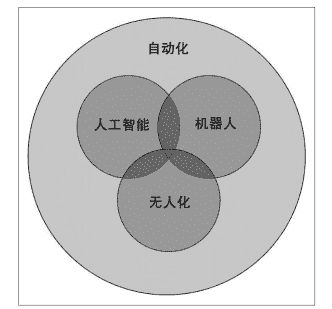

图 1-1　人工智能相关定义范畴对比^([\[12\]](#txt002.html#footnote_content_txt002_12))

认知层面存在“人工智能效应”或“奇特悖论”：一项具体技术普及后便不再被视作人工智能，随后新的潜力方向会出现^([\[13\]](#txt002.html#footnote_content_txt002_13))。历年技术成熟度曲线显示，最左侧萌芽期的段落持续拉长、技术类别愈发拥挤，反映新概念新范式不断涌现。

也有观点认为人工智能是个伞形概念，难以精确界定，只能以边界框定，其下包含机器学习、深度学习、计算机视觉、自然语言处理、机器人、专家系统等。从应用特征看，应具备由人类设计、为人类服务、本质为计算、数据为基础、能感知环境、能产生反应、能与人交互、具适应性、具学习能力、可演化迭代、可连接扩展等属性^([\[14\]](#txt002.html#footnote_content_txt002_14))。

基于发展现状与学界共识，本研究所涉人工智能至少具备三点：实时性，能利用实时数据做决策，而非仅执行机械预设响应；自主性，能在运行过程中自我学习并把经验纳入决策，对新数据自动调整，无需人工干预，这也是智能与自动化的根本区别；适应性，在特定场景下不必过度预设环境参数，能对变化作出适应，并识别非结构化数据，自行挖掘规律。

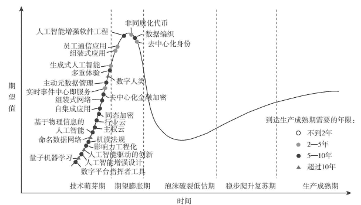

图 1-2　新兴技术成熟度曲线^([\[15\]](#txt002.html#footnote_content_txt002_15))

## 二、人工智能类别划分

发展迅速导致定义尚未统一，概念边界宽泛多样，划分尝试围绕不同标准展开。

从广义智能看，按应用领域可分专用、通用、超级；按能力强弱可分弱、强、超强；按人机关系可分弱智能、类人智能、超人智能^([\[16\]](#txt002.html#footnote_content_txt002_16))。研究中最常用的三分法是专用人工智能 `Artificial Narrow Intelligence`、通用人工智能 `Artificial General Intelligence`、超人工智能 `Superintelligence`^([\[17\]](#txt002.html#footnote_content_txt002_17))。

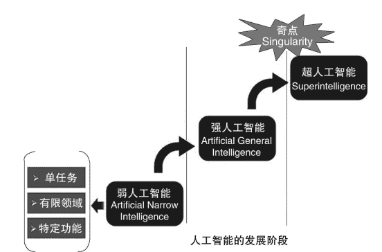

图 1-3　人工智能发展中的不同类别

弱智能仅在局部达到人类水平且难以自主应对复杂环境变化；强智能达到人类水平，可处理抽象跨领域问题；超智能则跨越“奇点” `Singularity` 进入人类难以预知的阶段。

也有二分做法。按可应用性分为专用和通用，目前单点突破集中在专用领域，通用人工智能仍在起步^([\[18\]](#txt002.html#txt002_18))。更激进的观点预言“超级智能”“终极算法”，认为跨越奇点不可避免，需应对在几乎所有领域都远超人类的认知系统^([\[20\]](#txt002.html#footnote_content_txt002_20))，甚至与生物技术融合后人类可能演化为半机械等形式的“智神” `Homo Dens`^([\[21\]](#txt002.html#footnote_content_txt002_21))。

按问题解决阶段划分，则出现计算智能、感知智能、认知智能、决策智能、意识智能等类别。其中运算智能指快速计算与存储，感知智能指视觉听觉触觉等感知，认知智能强调推理与可解释性，决策智能指人机协作辅助决策，意识智能核心是构建可数字建模、可计算的机器认知^([\[22\]](#txt002.html#footnote_content_txt002_22))。目前感知智能已取得实质进展，语音识别、文本识别、计算机视觉的部分项目已超人类，但真正意义上的认知智能仍遥远。

无论何种衡量，当前研究与应用仍处起步阶段，大多数进展集中在专用人工智能，可解决路线规划、语音识别、图像处理、机器翻译等有限特定问题；通用人工智能短期难有突破，美国国家科学委员会预测其实现至少需数十年^([\[23\]](#txt002.html#footnote_content_txt002_23))。但经过六十余年发展，由专用人工智能驱动的“智能化”大趋势已无需质疑，其在大数据、完全信息、单一任务场景中已实现突破，并在多个领域达到或超越人类水平。

图 1-4 呈现了近期技术提升的路径：横向上单任务专用领域不断突破，部分已完全超过人类；纵向上向通用人工智能进阶的进展则有限。

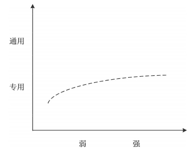

图 1-4　人工智能技术演进的维度

本研究以专用人工智能为重点考察各国战略与国际关系互动，基于三点：短期内难现革命性跃迁，瓶颈难以突破，国际关系领域研究主要集中于专用层面；专用人工智能仍有较大空间，将释放巨大“智能红利”，大规模应用已产生颠覆效应；唯有从当前专用阶段的影响入手，才能更好应对未来通用的挑战。

## 三、人工智能演进历程

发展呈现明显阶段性，并非线性上升，而是经历三次高峰、两次低谷。

第一次浪潮是诞生后的黄金期，约1950年代末至1970年代初，以麻省理工学院和IBM为代表的学界与产业界聚焦研究。理论与应用结合走向实用，启发式搜索、知识表示、机器翻译等取得突破，研究者一度乐观认为人工智能将超越人类。例如1957年康奈尔大学弗兰克·罗森布拉特实现“感知机” `perceptron` 神经网络模型，可处理简单视觉任务；1959年牛津大学王浩用机器证明《数学原理》全部定理。然而过高估计与实际落差明显，逻辑证明器、感知机仅能完成简单任务，复杂度提升导致计算量指数增长，当时算法难以应对复杂计算。

新鲜感消退后，美英转向理性。冷战初期美国资助机器翻译以处理大量俄语论文，但1966年美国语言自动处理咨询委员会报告称“尚不存在通用科学文本机器翻译，短期内也不会实现”^([\[24\]](#txt002.html#footnote_content_txt002_24))。1973年英国科学研究委员会评估报告明确表示“人工智能研究未获得其承诺的重大发现”^([\[25\]](#txt002.html#footnote_content_txt002_25))。经费断崖式削减，跌入第一次低谷。

第二次浪潮是商业化驱动的高速期，1980年代至1990年代初。面向特定领域的专家系统出现，推动人工智能从理论走向应用，从一般思维规律探索转向专门知识应用。用于生产、会计、人事等的专家系统工具日趋成熟商品化，真正解决实际问题，产业产值快速增长。1981年日本启动第五代计算机研制计划 `Fifth Generation Computer Project`，目标制造可采集、处理、存储并像人一样推理的智能计算机^([\[26\]](#txt002.html#footnote_content_txt002_26))，给美英带来压力，英国恢复经费，美国也加大投入。

但专家系统随之暴露知识获取难、推理弱、缺乏常识、开发成本高等短板，1992年日本宣布第五代机项目失败。苹果与IBM大力推广个人台式机，性能提升价格下降占据市场，美国在通用计算机研发上取得突破，人工智能逐步融入常规计算机技术，不再显独特光环，再次进入低谷。

第三次浪潮是数字技术集群突破加持的爆发期，始于2000年前后。快速发展得益于算法性能提升、数据指数增长、计算能力增强三大要素。深度学习出现并在机器视觉、语音识别、机器翻译普及，催生强化学习、迁移学习等新方向。1997年IBM深蓝 `Deepblue` 战胜国际象棋世界冠军卡斯帕罗夫，2011年沃森 `Watson` 在“危险边缘” `Jeopardy!` 中打破连胜纪录，2016年谷歌阿尔法狗 `AlphaGo` 战胜围棋九段李世石，随后阿尔法狗零 `AlphaGo Zero` 三天自学即击败前身。

本轮高峰由算力、算法、数据共同驱动。互联网、社交媒体、移动设备、廉价传感器使海量数据汇聚成为可能，数据量指数增长。摩尔定律推动芯片性能迭代，GPU并行计算为深度学习提供算力基础，现场可编程门阵列 `FPGA`、专用集成电路 `ASIC` 等专用芯片与TensorFlow、PyTorch、飞桨等开源框架大幅降低开发门槛。机器学习算法能从大量非结构化数据中学习、预测并完成任务，使广泛验证成为可能，推动商业应用落地。

AI的战略价值正被全球一致看好，各国政府纷纷把资源和政策押在这场竞赛上。统计显示，已有超过30个国家出台了国家级人工智能发展战略，且持续加码资金投入。2015年到2020年间，各国共发布了117份关于人工智能规范原则的文件；同期，人工智能伦理相关的学术论文提交量增长了一倍多。^([\[28\]](#txt002.html#footnote_content_txt002_28))谷歌、IBM、苹果等顶尖科技巨头是本轮高峰的核心推手，世界知识产权组织数据显示，全球人工智能领域前30名专利申请人中，26个来自科技公司。^([\[29\]](#txt002.html#footnote_content_txt002_29))在巨头加持下，AI产业快速成熟，应用已深度嵌入经济与社会运行的各个环节。与此同时，广泛落地也带来了治理难题，伦理规则、安全监管等争议始终伴随发展。深度学习对海量数据与超算的高度依赖、黑箱式不可解释、迁移能力不足，以及“莫拉维克悖论”（`Moravec's paradox`）^([\[30\]](#txt002.html#footnote_content_txt002_30))等现象，都暴露出当前技术路线的局限，尤其是对复杂场景理解能力的提升仍是短板。

## 第二节 AI的三次浪潮与再度崛起
人工智能走过三次高峰、两次低谷，每一次低潮都是反思沉淀和理性回归，每一次复苏都酝酿新的高峰。正因技术本身的复杂性，发展前景并不确定，眼下的高峰不等于一路坦途。

### 一、深度学习如何成为引爆点
以深度学习为代表的技术已渗入政治、经济、社会、文化等各领域。而前两轮浪潮未能延续，关键在于没能转化为普遍的经济价值并形成规模应用。近年来应用版图持续扩张，气象预测取得突破，农业、航空、应急等行业获得新支撑。大量企业在探索AI的新用途。新冠疫情期间，AI被用在疫情走势预测、疫苗研发、抗疫药物设计、病灶影像识别以及病例溯源等多个环节。

从特征看，本轮发展紧扣产业真实需求，以规模化落地为导向。产业界成为主要驱动，领军企业和产学研联合体在技术源头的作用显著增强，学术与产业的边界日益模糊。近两年全球主要研究机构的报告一致显示，在专利与论文产出上，企业已成为创新引擎之一。随着技术交叉与联动加深，影响范围和深度不断扩大，创新活跃度高，发展路径频繁切换，对产学研协同能力的要求也愈发严苛。AI正从实验室走向工程化，大规模部署与应用成为常态，科研人员与工程师共同参与研发、部署与落地。

从技术路径看，深度学习带来系统性能的跃升，已几乎等同于人工智能的代名词。但联结主义只是众多流派之一。历史上符号主义、联结主义、行为主义三大流派轮番主导方向，各自提出不同路线。符号主义在不确定、常识、复杂问题处理上受限；联结主义面临规模化带来的可解释性难题；行为主义则被认为忽视意识的价值，模拟行为过于简化，难以呈现高级控制过程。正因AI的复杂性，单一方法难以突破瓶颈，实践中各流派正相互借鉴、取长补短。

### 二、前景光明与隐忧并存
深度学习路线机遇与挑战并存。一方面，以`GPT-3`的性能曲线为例，其语言能力已接近人类水准，能够撰写类人类文章。当前训练数据主要来自人际交互，未来万物互联将释放海量物理空间数据，为模型提供更多素材。模型层数增加带来能力扩展，也带来复杂度激增。训练成本与性能提升不成正比，单纯堆参数的路径正受质疑，但就目前而言，“以大模型换能力”仍是主流，且仍有潜力。尽管学界呼吁探索“小数据”路线以降低对大数据依赖，突破算法对规模的依赖仍在研究中。

另一方面，短板同样明显。深度学习依赖模式识别，对环境变化适应性差，一旦超出训练边界，常识推理往往失效。这也是对抗样本风险的来源，输入的细微扰动即可导致截然相反的输出。因此很难通向超级AI，当下系统更多是学会通过测试，而非真正通用智能。学界普遍认为AI正处十字路口，需探索更多元方向。深度学习以扩大规模提升性能的路径缺乏人类式的抽象能力，难以整合抽象知识完成任务。约书亚·本吉奥（Yoshua Bengio）等人指出，深度学习系统跨任务迁移性不足，未来需提升鲁棒性、降低新任务样本需求、增强泛化能力。^([\[33\]](#txt002.html#footnote_content_txt002_33))质疑者提醒，不应过度自信，专用AI的进步并不等同于通用AI的必经之路，现有算法在无针对性训练下难以实现自主学习与因果理解。^([\[34\]](#txt002.html#footnote_content_txt002_34))

还有观点认为，当前技术过度依赖标注数据、环境适应性弱、可解释性差。为弥补这些缺陷，部分研究开始引入先验知识并重视中间特征层。^([\[35\]](#txt002.html#footnote_content_txt002_35))脑科学为新一代AI提供借鉴，有研究提出构建大脑动态连接图谱，并将神经科学实验与理论、模型与统计学结合。^([\[36\]](#txt002.html#footnote_content_txt002_36))国内外学者也在从统计学习、概率建模、推理优化等角度推动进展。未来可能需要有机协调知识驱动的演绎、数据驱动的归纳、行为强化的规划，建立知识、数据与反馈一体化的理论模型。^([\[37\]](#txt002.html#footnote_content_txt002_37))大概率走向融合路线，将第一代知识驱动与第二代数据驱动结合。

### 三、这一次为何意义被放大
按发展阶段，第一次浪潮被称作人工智能1.0“逻辑推理”时代，第二次为2.0“知识工程”时代，当前为3.0“深度学习”时代。前两轮受制于技术条件与过度乐观预期，未形成持续广泛影响。这次研究问题与实际能力均大幅拓展，对社会带来的革命性意义与以往不同。

数据密集型科研范式地位凸显，AI在海量数据分析挖掘中的作用不可替代。基于AI的仿真与推理系统已在物理模拟、药物研发、新材料开发、半导体设计等科学工程领域提供高效新工具，效率与准确度远超传统方法，为科学探索开辟新思路。因此AI等前沿技术被视为可能触发下一轮创新变革的“深度科技”，寄望解决人类最复杂挑战，需要长期积累与大量投入，但将对全球经济与人类发展产生深远影响。^([\[38\]](#txt002.html#footnote_content_txt002_38))这次崛起契合这一定义，且影响并非单一领域进步，从AI显现的潜力看，其可能对几乎所有领域带来颠覆性冲击。

同时，此次兴起建立在网络空间发展之上。数十年的网络与数字技术深度融入经济社会，与现实物理世界密不可分，为AI应用提供广阔前景。随着物理空间与网络空间融合，日常生活被转化为数据资源，迫切需要AI提供分析运算能力。AI将结构化与非结构化数据沉淀为信息与知识，成为数字化发展的关键要素。世界银行把《2021年世界发展报告》主题定为“让数据创造更好生活”^([\[39\]](#txt002.html#footnote_content_txt002_39))，凸显数据爆炸与数据革命的变革性。AI是应对海量数据处理、分析、挖掘的必要工具，已成为国家应对数字化时代的基础。世界主要大国均从战略布局、标准制定、产业发展、人才培育、国际合作等方面部署，围绕AI技术前沿与治理话语权的国际竞争进入空前激烈阶段。

## 第三节 AI的特质与社会冲击
为把握AI自身技术特征及其影响方式，可参照历史重大技术变迁，分析本轮高峰的特征与影响。

### 一、AI区别于过往革命的三大特质
#### 第一，与工业时代的体力解放不同，AI通过模拟认知与决策赋予机器“类人”能力，大幅延伸人类脑力，成为认知世界与改造世界的核心工具。过去只有人类才能完成的分析、预测、决策等能力正被证明可被机器胜任，AI加持下技术手段能处理更多复杂任务。由此带来的颠覆性不亚于任何一次重大技术变革，在机械化、自动化之上叠加智能化，可在更广领域减轻甚至替代人类劳动。亨利·基辛格（Henry Kissinger）等将AI类比15世纪欧洲印刷革命，认为AI能催生新知识与思想，推动科学经济进步，通过驾驭庞大数字信息打开前所未有的认知视野。^([\[41\]](#txt002.html#footnote_content_txt002_41))例如微软“小冰”能创作诗歌、音乐、绘画并出版作品集，被视为对人类创作思维的初步模仿。AI还可能重塑思维方式与知识创新，从意识层面影响社会进程，这与以往技术变革的影响路径显著不同。

#### 第二，与信息革命不同，AI引领的智能化阶段呈现更强的等级化与集中化。信息革命依托梅特卡夫定律、吉尔德定律，通过网络规模效应降低边际成本、加速传播、缓解信息稀缺。2000年后互联网浪潮中，企业、非政府组织、黑客等非国家行为体得以发声，削弱了国家与传统权威的垄断。与之相比，AI发展高度依赖资本、技术、人才密集，生态优势由少数大国与跨国科技巨头主导，其他行为体话语权被边缘化。尽管平台赋予用户平等发声权，但平台规则被科技巨头控制，AI算法成为隐性舆论操控手段。权力进一步向科技权力的金字塔顶端集中，行为体间的实力差距被拉大。

#### 第三，AI的发展是需求愿景驱动，而非单纯的供给创新驱动。5G、物联网、区块链、云计算、量子等新兴技术多作为基础设施，需在成熟过程中不断试探应用场景，从研发到稳定落地需长时间摸索。AI本轮创新路径明显面向经济社会的痛点与实际需求，产业界取代学术界成为主要创新主体。落地周期短、迭代快，市场反馈能迅速推动研发，呈现“巴斯德象限”特征，技术研究与产业转化一体两翼。一旦突破，商业化速度大幅加快。AI正与医药研发、生物技术等快速交叉融合，其作用不仅限于基础设施，更体现强融合与赋能特性，在提升数据分析能力与缩短研发周期等方面潜力巨大。

### 二、影响呈现何种特征
作为模拟智能行为的技术，AI在各领域广泛应用，通用目的性是最鲜明特征之一。通用目的性技术如蒸汽动力、电力、内燃机、信息技术，通过颠覆性创新引发技术—经济范式变革，改变生产生活方式，重塑经济形态。^([\[42\]](#txt002.html#footnote_content_txt002_42))AI符合这一特征，应用空间广阔，通过迭代降低门槛与成本，并与他技术互补、产生外部性。计算机视觉、自然语言处理等应用已相当成熟，深度学习在医疗、生物等研发创新中发挥重要作用。这种通用性决定了AI将对国家安全、社会治理、经济发展优势等产生不可替代的赋能。

#### 1. 应用为何无处不在
通用目的性技术是驱动重大技术变迁的关键，应用不受特定行业限制，可通过“创造性破坏”引领新范式。历史三次科技革命表明，技术创新本身不直接创造财富，必须与工业化生产和市场结合转化为经济效益才能提升国家实力。与此相比，“威望科技（prestige technology）不仅会消耗巨大科技资源和经济资源，而且很难直接转化为国家财富”。^([\[43\]](#txt002.html#footnote_content_txt002_43))由于广泛性，通用技术在军事、经济、科技、社会管理等领域扩散，成为经济社会变革基础并嵌入各环节。率先掌握的国家可将其转化为经济、军事优势，实现崛起。例如铁路变革运输体系，提升军事动员与后勤能力，在19世纪末德国崛起中发挥重要作用。占据技术应用优势的国家将在全方位影响中形成相对优势。

从历史看，通用目的技术进入社会始终是慢变量，需要在实践中反复打磨而非一蹴而就。从基础研究到商业成熟再到产业化，往往跨越数十年。瓦特改良蒸汽机后，真正实现规模化商用要等近八十年；电子计算机四十年代原型出现，却要到八十年代末才走向社会普及并形成全球化应用。技术要释放全部潜力，必须在主干之外持续投入周边改进，并通过补充性的工程再设计逐步兑现价值。电力取代蒸汽并不自动带来效率提升，关键在于围绕电力的传输与使用特性，重新梳理生产流程、管理方式与厂房布局。蒸汽动力因长距离输送受限，生产往往要围绕动力源布局；电力突破传输瓶颈后，设备即可按工艺顺序排列，整体效率因此跃升。蒸汽机、电力、计算机这类通用技术在提升生产力的同时，也牵引出关键配套创新。^([\[44\]](#txt002.html#footnote_content_txt002_44))蒸汽机除提供动力外，还催生机械制造、船舶与铁路等交通形态，人工智能的演进亦呈现相似轨迹，技术带来的效益通常存在时滞。^([\[45\]](#txt002.html#footnote_content_txt002_45))当前智能算法难以一次覆盖多类需求，单一模型虽在特定任务上表现突出，却缺乏跨任务迁移能力。因此人工智能仍需经历持续的应用转化与工程适配，才能与各行业深度融合。展望未来，作为底层基础设施，人工智能将从定制化走向普适化，应用门槛逐步降低，为更广泛的经济社会领域提供智能化支撑。对国家而言，抢占先机只是起点，持续投入与补充性创新并将其转化为实力优势才决定成败。起初的微小领先，在规模效应累积下可能被不断放大，最终拉开竞争差距。

2. 渗透赋能而非独立替代
溢出与赋能是通用目的技术的重要特征。现实中人工智能并非独立运行，而是嵌入信息系统，通过与其他技术的集成发挥价值。它不是单一产品或服务，而是一种可叠加的基础升级能力，能够接入现有系统，使其更智能、更高效、更精准。^([\[46\]](#txt002.html#footnote_content_txt002_46))这种定位并不削弱其核心赋能作用，也不能等同于传统自动化。据美国专利商标局统计，1976至2018年间，人工智能相关专利占全部专利的比重从1%升至25%，约四分之一的专利持有者涉及人工智能相关专利，体现出技术在各产业的渗透与认可。^([\[47\]](#txt002.html#footnote_content_txt002_47))

因此，人工智能通过微观层面的融合渗透推动整体经济社会发展，对生产力与国家实力产生系统性提升。要发挥作用，必须与其它技术协同。对国际关系的影响亦遵循此逻辑。以军事领域为例，人工智能的潜在用途仍建立在传统军事实力基础之上，并非对常规武器系统的绝对替代。尽管人工智能具有军民两用属性，与炸药、飞行器、雷达、全球定位系统等传统双用途技术不同，它难以作为独立变量直接改写某一领域的相对优势。核武器是反例，其破坏力巨大，对国家实力的影响几乎脱离其他技术创新的联动。即便在其他领域落后，拥有核武器的国家在国际权力结构中的地位也会显著提升。^([\[48\]](#txt002.html#footnote_content_txt002_48))这种优势在人工智能领域难以复现。当前阶段人工智能更多是通过赋能提升效率，很难得出某国能凭借人工智能获得代际技术优势的结论，数量优势和规模效应依然关键。在同等技术起点下，国家往往需要依靠数量在战场上取胜。^([\[49\]](#txt002.html#footnote_content_txt002_49))因此大国更有可能率先受益。赋能形式和强度的差异会带来效果的不确定性，可能在同等实力国家间产生非对称优势，但目前来看尚未达到指数级提升。

3. 全球协同研发与治理联动
全球化生态是当前新兴技术集群创新的显著特征，研发、应用、安全、监管各环节都在全球化环境中进行，影响自然也是全球性的。技术复杂度急剧上升，任何国家都难以独立完成。对人工智能而言，理论、研发、设计、制造、生产等环节都需要全球科学家团队依托产业链合作，政产学研多方共同参与。标准和治理规则也必须协同制定，这正是人工智能全球治理成为国际组织和专业机构关注热点的原因。商业推广层面，互联网的全球普及带动信息技术产品和服务在世界范围内扩散。信息服务推广成本极低，形成全球一体化的市场竞争，头部效应明显催生了超级科技公司的崛起。与二十世纪洛克菲勒、卡耐基等行业巨头的垄断形态相比，人工智能借助网络空间的规模效应，其影响远超单一行业边界，在全球范围内产生跨领域冲击。技术发展的全球性要求治理的全球协作。人工智能暴露的风险和隐患需要多边各方借助全球治理机制对话协商，形成共识性规范，避免风险外溢至政治军事领域。

4. 虚拟属性与隐蔽博弈
人工智能依赖数据资源，高度依托网络空间发展。随着5G/6G通信网络的大规模商用部署，更多智能无线终端接入互联网，现实世界产生的数据将极大拓展人类视野。一个全新的信息空间正在形成，其中大量数据和信息并非人类主动产生，而是来自物理世界的被动采集。这种虚拟性带来了应用效果的隐蔽性，这是人工智能区别于航空、核武器等传统通用技术的鲜明特征。人工智能的应用复制性强、复制成本低、开放性高，难以形成绝对排他性垄断，无论大小国家或非国家行为体都可能以较低门槛使用相关系统和应用；另一方面，模型训练和推理依赖强大算力的硬件，人工智能并非纯粹的软件。^([\[50\]](#txt002.html#footnote_content_txt002_50))本研究将人工智能视为整体，纳入全生命周期分析，但特别强调虚拟性特征，因为算法需随场景和数据不断迭代，赋能国家实力的作用更为关键。技术背后的标准与规则是控制力的衡量尺度，最终将传导至国际关系，成为各行为体影响力的重要来源。正因如此，各国围绕影响力的争夺和博弈可能呈现更隐性的形态。

人工智能在全球范围的广泛应用构建了一种力量，使得人们可以通过非强制手段来影响行为者的行为，甚至影响其自身利益的定义。^([\[51\]](#txt002.html#footnote_content_txt002_51))社交媒体已经成为施加政治影响力的重要平台和前沿阵地，人工智能将通过社交媒体等公共网络平台，影响公众舆论走向。通过利用算法自主生成内容“子弹”、实施个性化的“靶向”锁定和密集的“信息轰炸”来操纵他国国内的社会舆论，^([\[52\]](#txt002.html#footnote_content_txt002_52))以此达到意识形态方面的战略目的。当前，网上虚假新闻依赖于人工智能算法自动生成，成为新兴的信息对抗手段。目前针对人工智能手段难以察觉，也造成了自主武器、武装无人机等为代表的新型武器难以核查、难以监管等新难题，这也将在一定程度上加剧大国之间的猜疑，造成了新的“安全困境”。人工智能技术发展的不透明性以及应用边界的模糊性加剧了管控技术扩散的难度。^([\[53\]](#txt002.html#footnote_content_txt002_53))目前各国和国际社会对于人工智能的监管仍在探索之中，难点就在于其作为一种应用、程序和软件，它的定义、边界以及作用常常是难以清晰认定和准确评估的。同时，基于人工智能驱动的网络情报分析能力已经成为各国竞相发展的重点方向。此外，人工智能的虚拟性也体现在与移动互联网、大数据、物联网、云计算、边缘计算等技术的相互耦合和融合发展，但应用场景的综合性和复杂性也提升了人工智能的治理难度。

本章小结
本章在梳理不同定义的基础上，将人工智能界定为一组能够模拟机器智能行为的技术集合，认为其应具备实时性、自主性和适应性等基本特性，即能够依据实时数据决策、随进程自主学习并对外部变化保持适应。鉴于当前应用在归纳、抽象、推理等方面仍显不足，并结合演进态势的研判，研究重点限定在面向特定领域和单一任务的专用人工智能阶段。

人工智能迄今经历了三轮发展浪潮。2010年以来，以深度学习为代表的技术路线加速，推动人工智能再次崛起。此轮突破得益于海量数据积累、硬件性能提升带来的算力升级，以及深度学习算法在理论和路径上的可行性，实现了商业化普及。尽管高度依赖算力和数据的深度学习仍面临技术天花板，但发展潜力犹存。目前专用人工智能在数据存储、人机翻译、图像识别、数据分析和完全信息条件博弈等领域已接近甚至超越人类水平。在现实需求和产业驱动下，技术从实验室到落地的周期大幅缩短，不断向各领域渗透，对国家政治、经济、军事产生深远影响。

人工智能与蒸汽机、电力、信息技术等重大技术一样具有强赋能性和外部性，是推动社会从数字化、网络化迈向智能化的关键引领力量。与工业时代科技革命相比，其影响不仅限于物质层面，还可能直接作用于思想意识层面；与信息革命相比，人工智能会加速数字权力的集中，技术强国和科技巨头的话语权进一步增强；与5G、物联网等前沿技术相比，人工智能需求导向更强，落地更快，赋能性更显著。

人工智能并非能独立产生影响的离散技术，必须与其他领域融合才能赋能发展，由此对国际关系影响的评估变得复杂。历史经验显示，率先取得突破的国家往往能建立经济发展和军事技术优势，转化为国家竞争力并提升国际地位。作为通用目的性技术，人工智能将对各领域产生持续广泛的赋能。同时，本轮发展依托全球技术产业生态，从研究、标准制定到设计、制造、软件开发均依赖国际分工，加深相互依存。而人工智能作为一类信息技术的虚拟性特征，也使其在技术监管和技术扩散层面带来更复杂的挑战。上述特性和属性构成了进一步分析其影响路径和效果的基础。

注释
[\[1\]](#txt002.html#footnote_quote_txt002_1)Alan M.Turing：Computing Machinery and Intelligence，Mind，1950，（236）：pp.433-460。
[\[2\]](#txt002.html#footnote_quote_txt002_2)Alan M.Turing：Intelligent Machinery，in B.Meltzer，D.Michie ed.，Machine Intelligence，Edinburgh University Press，1969，Volume 5：pp.3-23.
[\[3\]](#txt002.html#footnote_quote_txt002_3)尼克：《人工智能简史》，北京，人民邮电出版社，2017：250 页。
[\[4\]](#txt002.html#footnote_quote_txt002_4)陈小平：《从封闭性到非封闭性：2020 到 2035 年智能机器的机遇和挑战》，（2021-01-05）\[2020-11-30\]，https：//www.thepaper.cn/newsDetail_forward_11045359。
[\[5\]](#txt002.html#footnote_quote_txt002_5)John McCarthy，Marvin L.Minsky，Nathaniel Rochester，et ol：A Proposal for the Dartmouth Summer Research Project on Artificial Intelligence，AI Magazine，1955（27）：pp.12。
[\[6\]](#txt002.html#footnote_quote_txt002_6)Professor John McCarthy's Website，http：//jmc.stanford.edu/artificial-intelligence/what-is-ai/index.html，（上网时间：2020 年 10 月 10 日）。
[\[7\]](#txt002.html#footnote_quote_txt002_7)Patrick Henry Winston：Artificial Intelligence，Third Edition，Addison-Wesley PublishingCompany，1992，pp.5。
[\[8\]](#txt002.html#footnote_quote_txt002_8)Nils J.Nilsson：The Q uest for Artificial Intelligence：A History of Ideas and Achievements，CambridgeUniversity Press，2010，p.xiii。
[\[9\]](#txt002.html#footnote_quote_txt002_9)Stuart J.Russell，Peter Norvig：《人工智能———一种现代的方法》第 3 版，殷建平等译，北京，清华大学出版社，2013：4 页。
[\[10\]](#txt002.html#footnote_quote_txt002_10)请参见：OECD，Artificial Intelligence in Society，OECD Publishing，2019.（2020-10-14），https：//doi.org/10.1787/eedfee77-en；European Commission High-level Expert Group on Artificial Intelligence，A Definition of Artificial Intelligence：main capabilities and scientific disciplines.（2020-10-14），https：//ec.europa.eu/digital-single-market/en/news/definition-artificial-intelligence-maincapabilities-and-scientific-disciplines；中国电子技术标准化研究院：《人工智能标准化白皮书（2018 年版）》，（2020-10-14），http：//www.cesi.cn/images/editor/20180124/20180124135528742.pdf。
[\[11\]](#txt002.html#footnote_quote_txt002_11)例如，1958 年，乔治·迪沃尔和约瑟夫·恩格尔伯格在美国成立了尤尼梅申公司，研发出一款机械臂，被视为现代历史上的第一个机器人。1961 年，通用汽车购买了尤尼梅申公司，用于生产汽车装配零件。随后，克莱斯勒和福特两家汽车制造巨头也引入机器人。在日本，1969 年日立公司发明了世界上第一台基于视觉的全自动智能机器人，可以根据平面图组装对象。两年后，机械臂开始安装上电脑控制的感应器，并能够在安装小体积配件的时候计算触感和压力。但这些案例所带来的影响与当前人工智能技术引发的影响具有本质上的区别。
[\[12\]](#txt002.html#footnote_quote_txt002_12)资料来源：Kelley M.Sayler：Artificial Intelligence and National Security，U.S.Congressional Research Service Report，2020。
[\[13\]](#txt002.html#footnote_quote_txt002_13)Peter Stone，Rodney Brooks，Erik Brynjolfsson et al：Artificial Intelligence and Life in 2030———One Hundred Year Study on Artificial Intelligence：Report of the 2015-2016 Study Panel，September 2016，（2020-10-10），http：//ai100.stanford.edu/2016-report。
[\[14\]](#txt002.html#footnote_quote_txt002_14)谭铁牛：《人工智能：用 AI 技术打造智能化未来》，北京，中国科学技术出版社，2019：9 页。
[\[15\]](#txt002.html#footnote_quote_txt002_15)资料来源：Gartner（截至 2021 年 8 月）
[\[16\]](#txt002.html#footnote_quote_txt002_16)何怀宏：《人类还有未来吗》，桂林，广西师范大学出版社，2020：83 页。

[\[17\]](#txt002.html#footnote_quote_txt002_17)不同文献之中，专用人工智能也被称为弱人工智能、狭义人工智能、应用型人工智能、模块化人工智能，通用人工智能也被称为强人工智能、类人智能、完全人工智能，相关术语之间存有细微差别。

[\[18\]](#txt002.html#footnote_quote_txt002_18)谭铁牛：《人工智能的历史、现状和未来》，载《求是》，2019（4）：39-46。

[\[19\]](#txt002.html#footnote_quote_txt002_19)Vernor Vinge：The Coming Technological Singularity：How to Survive in the Post-Human Era，March 1993，（2020-10-22），https：//edoras.sdsu.edu/～vinge/misc/singularity.html。

[\[20\]](#txt002.html#footnote_quote_txt002_20)尼克·波斯特洛姆：《超级智能：路线图、危险性与应对策略》，张体伟、张玉青译，北京，中信出版社，2015：29 页。

[\[21\]](#txt002.html#footnote_quote_txt002_21)尤瓦尔·赫拉利：《未来简史：从智人到智神》，林俊宏译，北京，中信出版社，2017 年版。

[\[22\]](#txt002.html#footnote_quote_txt002_22)清华大学人工智能研究院、清华———中国工程院知识智能联合研究中心：《人工智能发展报告（2011—2020）》，（2021-01-20），http：//ai.tsinghua.edu.cn/kirc/。

[\[23\]](#txt002.html#footnote_quote_txt002_23)Peter Stone，Rodney Brooks，Erik Brynjolfsson et al，“Artificial Intelligence and Life in 2030”OneHundred Year Study on Artificial Intelligence：Report of the 2015-2016 Study Panel，September 2016，（2020-10-10），http：//ai100.stanford.edu/2016-report。

[\[24\]](#txt002.html#footnote_quote_txt002_24)U.S.National Research Council：Language and Machines Computers in Translation and Linguistics，Washington，DC：The National Academies Press，1966，（2021-01-05），https：//doi.org/10.17226/9547。

[\[25\]](#txt002.html#footnote_quote_txt002_25)Sir Lighthill，James：Artificial Intelligence：A General Survey，Artificial Intelligence：A paper symposium，Science Research Council，1973。

[\[26\]](#txt002.html#footnote_quote_txt002_26)Nilsson，Nils J.The Q uest for Arti ficial Intelligence：A History of Ideas and Achievements，CambridgeUniversity press，2009：p.277。

[\[27\]](#txt002.html#footnote_quote_txt002_27)T.J.M.Bench-Capon，Paul E.Dunne：Argumentation in Artificial Intelligence，Artif icial Intelligence，2007，171（10）：pp.619-641.转引自方滨兴：《人工智能安全》，北京，电子工业出版社，2020：6 页。

[\[28\]](#txt002.html#footnote_quote_txt002_28)Stanford University Human-Centered Artificial Intelligence，AI Index Annual Report，March 2021，（2021-03-20），http：//aiindex.stanford.edu/wp-content/uploads/2021/03/2021-AI-Index-Report_Master.pdf。

[\[29\]](#txt002.html#footnote_quote_txt002_29)World Intellectual Property Organization，WIP O Technology Trends 2019-Artificial Intelligence，2019。

[\[30\]](#txt002.html#footnote_quote_txt002_30)莫拉维克悖论由汉斯·莫拉维克（Hans Moravec）、罗德尼·布鲁克斯（Rodney Brooks）等人提出，认为对于计算机而言，实现逻辑推理等人类高级智慧问题相对容易，因为只需要少量计算即可实现，但是对于感知等无意识的低级智慧却需要耗费庞大的计算资源，相对难以实现。

[\[31\]](#txt002.html#footnote_quote_txt002_31)顶尖人工智能研究机构 Deepmind 与英国气象局合作，采用深度生成模型实现精准降雨预测，该模型专注于预测临近降雨量，提前 2 小时左右预测降雨的数量、时间和地点。业界普遍认为这项研究为今后缓解气候变化和促进能源使用效率等方面提供了参考。具体请参见：Suman Ravuri，Karel Lenc，Matthew Willson，et al：Skillful Precipitation Nowcasting Using Deep Generative Modelof Radar，Nature，2021（597）：pp.672-677。

[\[32\]](#txt002.html#footnote_quote_txt002_32)符号主义（Symbolism）源自数理逻辑对智能行为的描述，提出认知就是符号的处理过程，知识是构成智能的基础，知识表示、知识推理、知识运用是人工智能的核心。符号主义发展出多种启发式技术、专家系统、知识工程等理论，在早期相当长的时间内主导着人工智能研究的发展。联结主义（Connec tionism）源于仿生学，尝试通过工程技术手段来模拟人脑神经系统的结构和功能，代表性技术有神经网络、深度学习等，特别是深度学习方法已经成为当前人工智能发展的主流。行为主义（Behaviourism）源于控制论，认为智能行为无须知识、表示和推理，是通过对环境反馈的自主感知作出的相应的行为，应用范例包括反馈控制模式、广义遗传算法等，行为主义流派在智能控制、智能机器人系统的发展中发挥了重要作用。

[\[33\]](#txt002.html#footnote_quote_txt002_33)Yoshua Bengio，Yann Lecun，Geoffrey Hinton：Deep Learning for AI”，Communications of theACM，2021，64（7）：pp.58-65。

[\[34\]](#txt002.html#footnote_quote_txt002_34)Melanie Mitchell：Why AI Is Harder Than We Think，April 2021，（2021-10-03），https：//arxiv.org/abs/2104.12871？source＝techstories.org。

[\[35\]](#txt002.html#footnote_quote_txt002_35)张钹、朱军、苏航：《迈向第三代人工智能》，载《中国科学：信息科学》，2020（9）：1281-1302 页。

[\[36\]](#txt002.html#footnote_quote_txt002_36)Jingtao Fan，Lu Fang，Jiamin Wu，et al：From Brain Science to Artificial Intelligence，Engineering，2020，6（3）：pp.248-252。

[\[37\]](#txt002.html#footnote_quote_txt002_37)吴飞、阳春华、兰旭光等：《人工智能的回顾与展望》，载《中国科学基金》，2018（3）：246 页。

[\[38\]](#txt002.html#footnote_quote_txt002_38)Antoine Gourévitch，Massimo Portincaso，Arnaud de la Tour：Deep Tech and the Great Wave of Innovation，March 2021，（2022-02-04），https：//www.bcg.com/publications/2021/deep-tech-innovation。

[\[39\]](#txt002.html#footnote_quote_txt002_39)世界银行：《2021 年世界发展报告：让数据创造更好生活》，（2021-03-28），https：//wdr2021.worldbank.org/。

[\[40\]](#txt002.html#footnote_quote_txt002_40)布莱恩·阿瑟：《技术的本质：技术是什么，它是如何进化的》，杭州，浙江人民出版社，2014：76-78 页。

[\[41\]](#txt002.html#footnote_quote_txt002_41)Henry Kissinger，Eric Schmidt，Daniel Huttenlocher，The Age of AI：and O ur Human Future，London：John Murray，2021：pp.204。

[\[42\]](#txt002.html#footnote_quote_txt002_42)Boyan Jovanovic，Peter Rousseau：General Purpose Technologies，National Bureau of Economic Research Working Paper Series，2005，（2021-01-02），https：//www.nber.org/system/files/working\_papers/w11093/w11093.pdf。

[\[43\]](#txt002.html#footnote_quote_txt002_43)郑华、聂正楠：《科技革命与国际秩序变迁的逻辑探析》，载《国际观察》，2021（5）：152 页。

[\[44\]](#txt002.html#footnote_quote_txt002_44)Georgios Petropoul：AI and the Productivity Paradox，December 2019，（2021-03-23），http：//www.bruegel.org/2019/12/ai-and-the-productivity-paradox。

[\[45\]](#txt002.html#footnote_quote_txt002_45)Erik Brynjolfsson，Daniel Rock，Chad Syverson：Artificial Intelligence and the Modern ProductivityParadox：A Clash of Expectations and Statistics，in Ajay Agrawal，Joshua Gans，Avi Goldfarb edited，TheEconomics of Arti ficial Intelligence：An Agenda，University of Chicago Press，2019。

[\[46\]](#txt002.html#footnote_quote_txt002_46)这一观点也是人工智能乐观主义者持有的普遍观点，全球知名人工智能企业 DeepMind 的创始人 Demis Hassabis 在办公室的墙上悬挂了一句话：“Solving intelligence，and then using that to solveeverything else”（我们先解决智能问题，再用它解决世界其他所有问题）。

[\[47\]](#txt002.html#footnote_quote_txt002_47)U.S.Patent，Trademark Office：Inventing AI Tracing the Diffusion of Artificial Intelligence with U.S.Patents，October 2020，（2021-04-01），https：//www.uspto.gov/sites/default/files/documents/OCE-DH-AI.pdf。

[\[48\]](#txt002.html#footnote_quote_txt002_48)Daniel W.Drezner：Technological Changes and International Relations，International Relations，March 2019：1-18。

[\[49\]](#txt002.html#footnote_quote_txt002_49)Michael Horowitz：Artificial Intelligence，International Competition and the Balance of Power，TexasNational Security Review，2018（3）：pp.36-57。

[\[50\]](#txt002.html#footnote_quote_txt002_50)Michael Horowitz，Elsa B.Kania，Gregory Allen：Strategic Competition in an Era of Artificial Intelligence，July 2018，（2021-11-07），https：//www.cnas.org/publications/reports/strategic-competition-in-an-era-of-artificial-intelligence。

[\[51\]](#txt002.html#footnote_quote_txt002_51)Nicolas Miailhe：The Geopolitics of Artificial Intelligence：The Return of Empires？Politi queétrangère，2018（3）：pp.105-117。

[\[52\]](#txt002.html#footnote_quote_txt002_52)阙天舒、张纪腾：《人工智能时代背景下的国家安全治理：应用范式、风险识别与路径选择》，载《国际安全研究》，2020（1）：4-38 页。

[\[53\]](#txt002.html#footnote_quote_txt002_53)Matthew Scherer：Regulating Artificial Intelligence Systems：Risks，Challenges，Competencies，andStrategies，Harvard Journal of Law＆Technology，2016，29（2）：pp.363-364。

第二章 AI重塑权力格局

本章先回溯国力构成在不同历史阶段的演变轨迹与权重迁移，借助既往技术跃迁的经验对照，评估人工智能作为新的结构性变量可能引发怎样的变动。随后分析AI驱动下各国综合实力此消彼长如何重塑相对强弱关系，结合当下AI推进的现实路径与关键供给要素，研判哪些国家更易在竞争中获取额外优势，以及国力再排序会对大国博弈与国际体系产生何种连锁效应。最后立足AI的赋能特性，拆解其在经济、军事、社会等不同维度上的渗透机制，据此阐释AI对国际关系理论的启示，并说明AI以何种方式改变国家间的互动逻辑。

第一节 国力构成的核心要素

从国际政治视角看，主权国家的权力根基是其综合国力，体系内的力量版图本质上是主要大国间实力对比的映射。科技实力是维持并扩大国力的关键引擎。国力并非单一指标，而是人口基数、经济规模、技术水平、制度效能等多重要素的叠加，技术创新往往通过赋能这些要素来放大整体效应。历史经验表明，每一次引人瞩目的大国崛起都伴随一次技术革命，国力快速攀升正是其突出标志。在此过程中，善于把握科技窗口期的国家往往实现实力跃升，而错过窗口的国家则多在比较中相对滑落。

AI正在重塑国家实力的游戏规则

要搞清楚技术到底如何改写国际格局，第一步就是要弄明白技术如何作用于国家实力这个核心变量。从国际关系视角看AI对大国博弈乃至国际结构的影响，难度不小，因为人工智能本身还在高速演进，其外溢效应也在持续发酵。比较可行的研究路径是：先把技术可能直接撬动的实力支点明确出来，再分析技术通过何种机制、沿着哪条路径去作用于这些支点，在此基础上判断哪些行动者能借此获得发展先机，哪些可能被甩在后面，最后再推演这些分化对国际版图的连锁反应，以及国际秩序会不会变、怎么变。

需要先厘清概念边界。实力、权力、影响力在讨论中常被混用。西蒙·赖克与理查德·内德·勒博专门梳理过权力与影响力的关系，认为权力更接近经济、军事等硬核能力的集合，是获取影响力的原材料；影响力则是让他人按你所愿行动或不行动的说服力。本篇以国家实力为主线，国家实力是一国权力得以落地的物质基础与操作手段，物质能力只是权力的一部分，能否有效使用这些能力同样决定权力的实际效果。实力的本质是相对的，它构成了国际地位的根基。而人工智能作为当下科技最前沿的变量，既是衡量实力的重要标尺，也在多维度直接或间接渗透国家实力的构成，推动整个实力体系发生变革。

一、实力要素的构成

随着时代推移，国家实力的衡量维度不断扩展，学界也在不同阶段对实力内容做拓展。有些研究用单一指标来代指实力，比如军费支出、GDP，这类做法直观但过于简化。更多学者转向综合视角，通过设定关键因子来评估。

围绕构成要素的研究大致可分两类。

一类是定性归纳，通过列举主要表现形式来支撑理论假设。现实主义创始人爱德华·卡尔把国际政治权力的来源归为三类：军事力量、经济力量与舆论支配力。汉斯·摩根索在此基础上给出更系统的九项指标：地理、自然资源、工业生产力、战备水平、人口、民族性格、国民士气、外交质量和政府质量。肯尼思·华尔兹在系统层面讨论“极”的概念时，把国家实力简化为大国军事能力，同时也指出实力位置取决于人口、领土、资源禀赋、经济实力、军事实力以及政治稳定与治理能力。罗伯特·吉尔平则突出技术领先的意义，认为国家实力的增长根植于特定领域的相对优势，而这种优势本质上由技术领先决定。进攻性现实主义更进一步强调军事力量即权力，尤其是陆军及其支撑体系，进而断言即便在核时代，地面力量仍居核心地位。

现实主义偏重军事经济等物质性、资源性要素，新自由主义代表小约瑟夫·奈提出“软实力”概念，认为文化、政治价值观和外交政策构成软实力的来源，已与硬实力并重甚至超越。兰德公司围绕国家实力做过系统研究，提出以资源、国家绩效、军事能力三支柱构建分析框架，并在资源、绩效层面细化出技术、企业、人力、金融、物质等十余项数据维度，后续研究还建议把非国家行为体和软实力纳入评估体系。

国内学者的梳理也各有侧重。黄硕风最早系统梳理构成，提出政治力、经济力、科技力、国防力、文教力、外交力、资源力七大要素。贾海涛把综合国力划为基本资源、军事力量、经济力量、文化力量和软实力五大范畴，并对各层赋权以体现重要性差异。阎学通从政治决定论出发，认为综合实力既含物质也含非物质，特别是政治实力。综合实力由政治实力、军事实力、经济实力、文化实力构成，其中政治实力属操作性要素，其余三项属资源性要素，政治领导力被视为关键变量。

另一类是定量化分析，通过可度量数据与定性指标结合来比较实力差异与变化。克劳福德·哲曼提出国家实力指数，把核能力、土地、人口、工业基础、军事规模作为测算变量。雷·克莱因的估算公式把要素分为物质与精神两类，物质类包括国土与人口、经济能力、军事能力，精神类包括国家战略意图与意志贯彻力。国家能力综合指数是经典成果之一，设置地理、工业、军事三维度六指标：地理维度为总人口与城市人口，工业维度为能源消耗与钢铁产量，军事维度为军费支出与武装规模。

国内对综合国力的量化研究也很活跃。中国社科院世界经济与政治研究所曾设计八大构成要素：资源、经济活动能力、对外经济活动能力、科技能力、社会发展程度、军事能力、政府经济调控能力、外交能力，共85项指标，并首次把社会发展程度纳入评估。2000年，中国现代国际关系研究院基于长期研究建立评价体系，采用专家调查与回归分析对主要大国进行系统评估。胡鞍钢团队用国家战略资源衡量综合实力，将资源分为经济、人力、自然、资本、知识技术、政府、军事、国际八类，研究发现中美差距缩小最快的领域是知识技术、经济与自然资源。倪峰提出“国力资源—国力转换—国力显示”的分析结构，把硬实力归为经济、军事、科技，软实力归为文化吸引力、意识形态吸引力、国际制度运用能力。

总体来看，相较权力，实力概念更具象，可用资源存量来度量。随着时代演进，实力的内涵日益多元，评估手段也更精细。虽然界定方式与权重仍无统一标准，但学界对基本构成的共识度较高，普遍视国家实力为各种资源的总和，即以资源基础实现国家发展的综合能力。单一要素无法决定整体实力，国际地位更多是综合实力的集中体现。上述梳理为分析人工智能的影响路径提供了基础，后续将结合影响力度，聚焦与技术发展关联紧密的要素展开。

二、实力要素的演变

对国家实力内涵与关键要素的认知并非一成不变，而是随现实演进动态调整。部分要素相对稳定，部分要素则在内容与重要性上持续变化。

第一，实力要素的基础和内涵是动态变化的。

自然环境、地理、人口等在一段时期内较为稳定，而经济、军事、社会发展、外交能力等可变性更高。同一要素在不同时期、不同语境下的含义也会不同。摩根索曾提醒评估国家实力时切勿把某个因素当成恒久不变而忽视变化趋势。以军事实力为例，早期人口规模被视作军事潜能的基础，工业革命后钢铁产量、能源消耗成为直观指标。核武器与弹道导弹的出现带来颠覆性改变，核能力常被单独列项，成为战略对比的前提，常规军事实力则退居相对位置。随着技术演进，能提升多项实力基础的能力越发受重视，从而在要素变化中获取相对优势。

第二，在国家实力系统中不断引入新的关键因素。

除核武器等战略性变量外，新兴要素也在持续进入评估体系。奈提出软实力是影响力重要来源，并在网络时代指出网络创造了新权力域，其易受技术变化影响。网络实力，即国家在网络空间的掌控与行动能力，已成为重要衡量维度。大数据技术的普及催生了新变量，有研究认为大数据及其应用已成为影响国家生存与发展的重要力量，大数据实力不仅自身成为新要素，还能塑造其他要素并产生增长效应。数据规模与质量正成为数字经济与社会转型的关键资源，也成为改变国际政治的重要权力来源。掌握更大体量数据的国家在数字转型中更具优势。科技水平、技术能力、信息力、网络实力、科教水平、数据实力等技术相关概念，正逐步成为国家实力体系的核心影响指标。

第三，随着要素相对重要性发生位移，评估方式也在调整。

尽管简单汇总要素可大致判断实力，但各要素的重要性与效能并不均衡，抓不住关键就难以解释实力在国际政治中的实际作用。地缘政治理论强调地理位置、地形与自然资源决定实力，但工业革命催生一批工业强国，静态的地理自然指标已难以解释实力变化。保罗·肯尼迪考察五百年大国兴衰，认为经济与技术发展是长期决定性动力，技术相对优势与较高经济发展水平对实力提升至关重要。苏珊·斯特兰奇指出国际竞争已从争夺领土、钢铁与运输手段，发展到争夺化学产品、石油与电力，最终演变为争夺先进技术，因为技术竞争是获取军事优势、经济繁荣、政权巩固与支配地位的途径。二战后尤其是核武器出现，大国直接冲突成本急剧上升，经济与科技竞争成为主战场，技术优势作为经济发展的核心驱动，在国家实力中的权重进一步提升。

从以上演变看，技术因素的重要性在各维度持续上升。掌握先进技术既是国家实力与国际地位的基础，也在重塑实力体系的影响范围与走向，这为构建人工智能对国家实力要素的影响路径提供了参照。

如上所述，学界从不同层级与维度提出国家实力的构成。定性划分偏笼统，应用受限；定量划分偏微观，难以把握全局。为说明人工智能的影响路径，本文采用介于定性与定量之间的界定标准，表2-1主要围绕要素类型与要素性质两个视角，判断AI可能对哪些要素产生直接且明显的影响。

要素类型可分为物质性与非物质性。物质性要素具象可感，能直接体现一国在某一领域的资源水平与发展能力；非物质性要素则体现为国家治理水平、文化吸引力、民族凝聚力等，反映国家运用物质资源的能力。两者相互补充、相互支撑。

表 2-1 国家实力体系中的关键因素

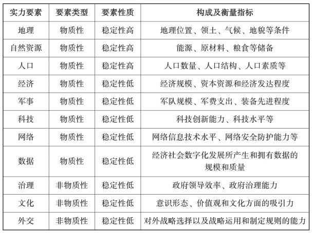

物质性要素是非物质性要素的基础，没有一定物质积累，很难形成较高的非物质能力；而非物质要素具有倍增与放大效应，能让同等物质实力产生更大国际影响。要素性质反映实力要素在演进中的特征属性。地理环境、自然资源、人口规模等具有较强稳定性和延续性，资源禀赋在短期内通常不会剧变。稳定性低的要素不确定性更高，会受人为或非人为因素影响而波动。防止要素快速衰退并推动其向有利于实力提升的方向演进，是各国重要的战略目标。

在对各类实力要素进行归类并辨析其性质之后，可以形成一个比较清晰的判断：技术对国力的拉动效应，主要集中在那些属性偏物质、波动性偏大的板块。原因大致可归纳为两点：一是根基稳固、变化缓慢的要素，对短期技术冲击反应迟钝，需要拉长周期才能观察到累积效果，一旦拉长，各国差距往往被稀释，现实借鉴意义有限；二是无形性要素的衡量标准模糊，影响链条复杂，学界多以结果倒推，技术的有形特征对其渗透多为间接，效果也不够突出。因此经济、军事、科技、网络、数据这些偏物质且变动性较高的维度，才是技术作用最直接、最易观测的区间，也是下面探讨人工智能如何影响国力的核心切口。

### 三、实力要素中的技术因素
技术通过提升一国的发展水位来强化综合国力，率先掌握前沿技术的国家往往能在国际博弈中抢占先手。历史上，技术扩散与普及无数次改写单一国家或多国的命运，进而重塑地区版图乃至世界秩序。^([\[28\]](#txt003.html#footnote_content_txt003_28))技术已成为影响国际体系的内生变量，其在全球的分布格局也在重塑国际结构。^([\[29\]](#txt003.html#footnote_content_txt003_29))不过技术的属性各不相同，对实力要素的塑造方式也各有差异，需要正反两面来看。

#### 一方面，技术在国力塑造中的分量持续上扬。
随着新一轮技术革命和产业变革推进，技术变量正从军事、经济等传统领域中剥离出来，成为一个独立的影响维度，在实力评估体系中的权重不断提升。过去忽视技术变量的代价已被学界认知，例如克莱因模型在测算国力时过度倚重资源与军力，对科技力量的低估导致明显失真。该模型曾断定苏联将在美苏对比中占优，却无法解释苏联最终解体的现实，暴露出现实适用上的局限。^([\[30\]](#txt003.html#footnote_content_txt003_30))上世纪80年代，日本综合研究所以“德尔菲法”开展的综合国力基础调查广受关注，受访专家普遍认为经济与科学技术是综合国力评价的支柱，国土与人口的重要性则相对淡化。^([\[31\]](#txt003.html#footnote_content_txt003_31))究其原因，过去土地与自然资源是创造财富与获取权力的基础，如今先进技术已成为取得军事优势、推动经济繁荣、巩固政权、掌握主导权的通道。^([\[32\]](#txt003.html#footnote_content_txt003_32))尤其在不爆发大规模战争的大国竞争时代，科技实力已成为国力博弈的主战场。兰德公司进一步指出，后工业时代国家实力的构成中，“技术———作为知识、方法、资源与创新的物化形态———已成为构建国家实力的首要根基”。^([\[33\]](#txt003.html#footnote_content_txt003_33))这一趋势在研发投入上得到印证，全球研发支出占GDP比重长期在2%左右徘徊，但过去近20年全球GDP总量增长近70%，研发投入的绝对规模持续扩大。美国作为唯一超大国维持高占比，中国作为快速崛起的发展中大国在主要国家中增速最快，其带来的创新能力与科技实力也正体现在国力提升上。由此可见，技术实力既是衡量综合实力的关键标尺，也正转化为推动综合实力跃升的核心动能。

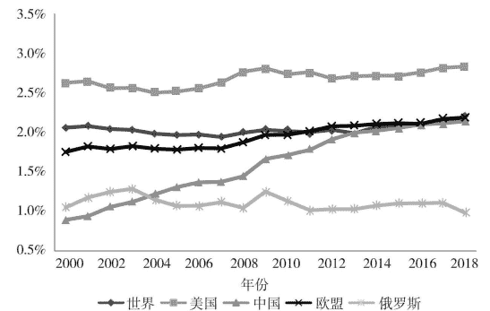

图 2-1　世界及主要大国和地区研发投入占 GDP 比例^([\[34\]](#txt003.html#footnote_content_txt003_34))

就技术影响的覆盖面而言，摩根索在论述实力构成时仅把技术视作军事能力的子项，将潜艇、坦克、空军战术与核武器列为20世纪四大战争技术创新，由此把技术作用限定在军事范畴。但现实远不止于此。布热津斯基把军事、经济、技术、文化视为美国新型霸权的四个决定性支柱，认为美国领先的科技能力为其强大军力的发挥提供了支撑，“在对经济具决定性作用的信息技术领域，美国保持着强大竞争优势，对未来经济高端的掌控意味着美国的技术主导地位短期内难以动摇”。^([\[35\]](#txt003.html#footnote_content_txt003_35))技术对国力的赋能是全方位的，随着时代演进，国家间竞争的核心已聚焦于技术创新能力的掌控。

#### 另一方面，技术进步的价值毋庸置疑，但并非每一次突破都能立刻改写国际关系
研究视野更关注那些能够显著改变军事、经济等硬实力要素，并产生广泛深远效应的重大技术变革。以信息技术为例，信息技术革命极大强化了科技与国力的互动，作为新一轮科技革命的重要构成并逐步普及，其已成为国力的重要来源。信息及其技术不仅是综合国力的构成要素之一，更在持续重塑各种主要要素。^([\[36\]](#txt003.html#footnote_content_txt003_36))新技术也在改写传统实力要素的基础，过去控制工业资源是获取地缘政治优势的关键，如今控制信息资源的重要性更甚。^([\[37\]](#txt003.html#footnote_content_txt003_37))信息成为战略资源，数据、算力、算法与虹吸效应被进一步放大，石油、煤炭等传统资源要素的相对权重则在下降。

学界对此已有跟踪。美国国家情报委员会的《全球趋势》系列报告一直对国家实力内涵进行评估。2008年《全球趋势2025：转型的世界》把国家实力界定为GDP、国防开支、人口、技术四类战略资源；2012年《全球趋势2030：变换的世界》则提出更细的评价体系，在研发支出之外单独增列互联网及通信技术指标，指出数字技术水平高的国家可利用数字产品与服务换取自然资源，自然资源的重要性将持续回落。^([\[38\]](#txt003.html#footnote_content_txt003_38))2021年《全球趋势2040：竞争更激烈的世界》提出，面向2040年的技术将是国家获取竞争优势的关键路径，技术在提升生产力、促进经济发展、解决社会问题等方面作用突出。报告也把人工智能列为首要分析技术，并强调人工智能红利并非普惠，先发国家将获得显著领先。

综合来看，面对日益复杂的全球挑战，科技在破解发展难题中的作用愈发突出。技术在实力要素体系中的重要性上升主要体现为两点：其一，技术本身已成为独立的影响因子，而非仅在传统要素之下发挥作用，可直接产生分量的实力影响；其二，技术的优先性在提升，随着技术与其他要素融合加深，技术水平的高低能体现在各领域的赋能效果上，进而产生整体性影响。人工智能具有广泛赋能特征，能融入各类实力要素发展，对国家实力形成倍增效应。它不仅是经济社会发展的加速器，在科技、数据、经济、网络、军事等领域的赋能作用日益显现，已成为实力要素体系中的关键变量。

## 第二节　人工智能作为实力要素的作用体现
随着人工智能应用的普及，其对国家实力要素体系的机理本质上是人工智能在各领域嵌入的具体表现。作为通用目的性技术，人工智能的意义已超出单纯的技术手段，成为国家实现实力提升、发展推进、安全保障等目标的重要抓手。若能把握其带来的机遇，国家有望在当前国际竞争中胜出，赢得格局优势。虽然其广泛影响不容置疑，但影响程度与路径仍需具体辨析。按照国家实力的类型与性质两个维度来界定实力要素，是研判人工智能影响路径的基础。要素类型的差异意味着人工智能的作用程度与方式也各不相同，其中对可变的物质性要素影响最为直接、程度最深，对另外两类要素的影响则多经间接路径，效果相对缓慢，仍需持续观察。（图 2-2）

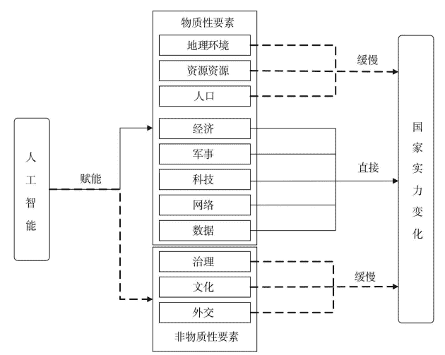

图 2-2　人工智能对实力要素的影响路径

图 2-2 清晰显示，从整体变化看，随着人工智能等新技术兴起，人口、自然环境、地理位置等稳定型物质要素的重要性有所下降。第三次科技革命以来，技术创新日益成为国家财富增长的主因，自然与人力资源在经济增长中的份额逐步减弱。掌握先进技术产品可以在全球贸易中换取所需的自然资源，也能凭借产业链地位利用他国充裕的劳动力进行生产并获取超额利润。人工智能发展将进一步削弱这类要素的作用，以机器人、智能制造、工业互联网为代表的制造转型，在提升传统产业目标下将降低对普通劳动力的依赖，加速“机器换人”。这也意味着人力资源比较优势在国际竞争中的作用被削弱，部分发展中国家可能被锁定在资源供给国位置。但这一过程将是缓慢而长期的。

图 2-2 同时表明，治理、文化、外交等非物质性要素即使能借助人工智能作为手段，其作用仍是间接且模糊的。技术本身中立，人工智能发展水平在一定程度上映射一国创新与科技能力，领先成果可提升国际形象，增强民众自豪感。但由于人工智能在伦理、法理等方面因国别与文化差异而存在争议，对其效果的评判带有明显主观色彩。例如在中国，基于算法的大数据与图像识别应用已在提升社会治理效能、维护稳定方面初见成效，新冠疫情期间“健康码”“行程码”等App迅速上线，以及以人工智能为支撑的疫情预测分析，为统筹防控与发展提供了支撑，也被解读为政治制度优势的体现。但《华盛顿邮报》《纽约时报》等媒体则反复指责人脸识别等智能化应用过度采集公民生物信息、关联分析侵犯隐私，认为人工智能在中国被“不道德地”用于社会管控。由此可见，人工智能对非物质性要素的影响复杂且不确定，难以建立被广泛接受的因果推断，其更多是通过强化物质性要素进而间接作用于其他要素。

上述分析表明，人工智能带来最直接、最显著的实力要素是易变的物质性要素，它为分析非结构化数据、挖掘信息价值提供支撑，能快速把数据转化为有效信息释放潜在价值。尽管其更广泛深远的影响需要时间才能完全显现和被认知，但当前在相关领域的应用案例与数据已足以构成分析其对国家实力影响的基础。因此，本章将分别从科技、数据、经济、网络、军事等角度分析人工智能带来的影响机理与效果。

### 一、重构科技创新体系
本轮人工智能突破根源于经济发展与社会治理数字化推进带来的数据量激增。从近期案例看，人工智能已深度介入科技研究。人工智能发展能力本身即是一国科技实力的体现，其发展依赖三要素：丰富的数据资源来自发达的数字化基础与实用的互联网平台，算力来自高性能芯片与复杂系统的工程化能力，优秀的算法来自顶尖科研团队与良好研发环境，三者缺一不可。只有网络强国和数字强国才能实现资源整合，普通国家在任一环节都面临高门槛。

人工智能介入创新不仅拓展技术应用，也大幅提升科研效率，推动科研范式重塑，释放更大科技势能。这种加速效应可转化为国家创新能力，并蕴含重要经济价值。其前提是拥有高水平的人工智能与科技研究团队，通过跨领域协作实现应用突破。近年来，人工智能已成为众多基础科学的重要工具，在数字化程度高、数据积累多、质量高的领域突破更快，在复杂学科中也能从多维数据中发现规律、提炼经验，明显提高科研效率。

深度学习已在多领域创新研发中发挥辅助作用，强大算力可解决此前难以处理的难题，特定用途的人工智能企业正成为提升创新能力、增强国家实力的重要载体。人工智能在生物科学研发的提速尤为明显，生命信息加速数字化，药物研发等生物领域科研活动大幅提速，科学研究从“大海捞针”转向“按图索骥”。2020年11月，DeepMind发布的“AlphaFold”神经网络模型能根据蛋白质氨基酸序列预测三维结构，意味着人工智能在生物学问题上的解决能力已超越人类科学家。^([\[40\]](#txt003.html#footnote_content_txt003_40))2021年7月，DeepMind又宣布可利用人工智能系统预测人类表达的几乎所有蛋白质结构及20余种生物的近完整蛋白质组。这充分证明其科学潜力，该成果被《科学》《自然》《麻省理工科技评论》等评为2021年十大科学突破之一。可见人工智能凭借规模与速度优势，一旦进入某一领域，很容易在短期内产生颠覆性影响。

新冠疫情大流行期间，人工智能在生物医疗领域的应用受关注，从健康管理、监测识别向生物制药延伸。算法应用可大幅节省药物研发的时间与资金成本。基于人工智能的成像技术已从突破走向商业化，能识别皮肤病、检测癌症，部分领域诊断能力可媲美病理学家与放射科医生。例如，斯坦福大学人工智能实验室构建了近13万张皮肤病图像库训练算法，通过视觉诊断潜在癌症，效果可与资深皮肤科医生相当。^([\[42\]](#txt003.html#footnote_content_txt003_42))初创公司PostEra利用机器学习在不到两天内完成原本需三四周的化学合成路线设计，加速新冠治疗药物研发。这些突破直接提升健康福祉，也为本国企业赢得全球竞争先机。

在芯片设计领域，深度学习潜力逐步释放。2021年6月，谷歌团队与斯坦福大学计算机科学系合作，在人工智能专用高端芯片布局规划中使用深度学习算法，最终功耗与性能不劣于人类专家设计，但耗时不到6小时，远快于工程师数月的工作量。^([\[43\]](#txt003.html#footnote_content_txt003_43))若能规模化应用，将推动半导体行业效率革命。机器学习在基础研究中的应用也在扩展，如用于证明或提出新数学定理，数学家正用深度学习工具分析复杂数据集、验证假设。^([\[44\]](#txt003.html#footnote_content_txt003_44))正是在此过程中，各国认识到人工智能对国家发展的巨大潜力，政策取向正从鼓励学术自由探索转向国家战略引领。

### 二、挖掘数据资源价值
在数字化时代，信息与数据已成为国家重要战略资源与权力来源，也是大国竞争的新焦点。^([\[45\]](#txt003.html#footnote_content_txt003_45))数据是连接人类社会、物理世界与机器世界的桥梁，也是对现实世界的符号化映射。^([\[46\]](#txt003.html#footnote_content_txt003_46))数据为人工智能发展提供基础要素，人工智能也为应对数据爆炸时代的决策分析提供有力手段。人工智能必须依托海量高质量数据训练，单纯强调算法无法充分发挥其改造经济社会的潜力。只有在各领域数字化转型基础上积累高质量数据，才能为深度学习模型训练与推理应用提供必要的“算料”。

平台经济的扩张让信息在全球范围内跑得更快、更密，从日常家电到汽车机床，从可穿戴设备到智能家居，无数终端都在持续产生线上数据。全球数据总量因此进入指数式攀升通道——统计口径下，2020 年一年创造的数据量约为 2015 年的 3.14 倍，自 20 世纪 80 年代以来，全球信息存量大约每 40 个月翻一倍。^([\[47\]](#txt003.html#footnote_content_txt003_47)) 联合国贸发会议的分析指出，对比传统生产要素，数据和信息是无形且非排他的资源，既能被资产化、形成可交易的数字产品，为采集方与掌控方带来收益，也深深牵涉隐私、人权与国家安全等议题。^([\[48\]](#txt003.html#footnote_content_txt003_48)) 在这样的背景下，全球数据争夺呈现多重属性，国家层面的数据战略既包含防御性地维护安全利益，也指向参与数字经济全球竞争、争取规则话语权的进攻性目标。^([\[49\]](#txt003.html#footnote_content_txt003_49))

如此规模的信息要产生价值，必须借助人工智能进行识别、挖掘与转化。人工智能擅长把多源拼凑的碎片化信息、网络留下的细微痕迹还原成行为画像。同一时间，信息过载正让情报工作承压，筛选出真正有用的情报愈发困难，对海量非结构化数据的分析让机器学习变得必不可少。^([\[50\]](#txt003.html#footnote_content_txt003_50)) 从情报规划到搜集、处理、分析、分发，算法贯穿始终。各国情报机构纷纷与技术领先的科技企业合作补齐能力。美国官员曾在国会听证会上公开表示，对手在人工智能领域的进展可能提升其武器与情报系统的实际效能。^([\[51\]](#txt003.html#footnote_content_txt003_51)) 英国军情六处评估认为，未来十年内的技术跃进可能超过整个 20 世纪，人工智能加速发展将对情报业带来颠覆性冲击，主要国家正加大对人工智能、量子计算等前沿的投入，英国政府也被敦促深化与科技界的协作。^([\[52\]](#txt003.html#footnote_content_txt003_52)) 2021 年 1 月，大西洋理事会的报告指出，依托人工智能能力与数据优势的商业企业，已具备开展商业情报与开源情报分析、为军方提供支持的可能。人工智能在网络加密中能增强系统抗渗透能力，在进攻端也可被用作渗透、操纵和削弱对手情报能力的工具。相较传统因果分析，基于大数据的人员感知更强调关联与相似关系的挖掘，决策者借助海量处理与高速运算，能实时感知风险来源、厘清战略方向，从而推动精细化战略的制定与执行。^([\[53\]](#txt003.html#footnote_content_txt003_53))

### 三、赋能经济社会发展
技术创新向来是国家财富的核心引擎，以人工智能为牵引的新一代技术正成为国家发展的底层支撑，其渗透效应遍布社会各领域，大幅提升生产效率与生活品质。人工智能具备自我迭代学习与智能决策执行的特点，通过重塑产业链与价值链，正在引发一场系统性的颠覆式变革。^([\[54\]](#txt003.html#footnote_content_txt003_54)) 因其通用目的性，人工智能几乎可被所有行业、企业采纳，核心价值在于用更低成本实现更高效率的经济运转。麦肯锡测算，到 2030 年人工智能将拉动全球 GDP 增长约 16%，中国人工智能发展预计每年可为 GDP 贡献 0.8%至 1.4% 的增量。^([\[55\]](#txt003.html#footnote_content_txt003_55)) 应用落地为经济发展与转型升级注入动能，有助于降低全社会的信息、数据处理与交易成本，提升企业、经济与社会的整体运营效率，从农业、制造业、交通运输到教育、医疗等公共服务，组织流程的生产率均可得到改善。

在数字产业化层面，人工智能深度嵌入各类商业产品与服务，与数字信息生态系统交织融合，未来数字领域的发展将很大程度上由人工智能主导。庞大的可用数据集叠加大数据、物联网与高速连接的进步，为人工智能系统和服务的‘杀手级’应用铺平道路。人工智能发展在一定程度上打破地理限制，也可能放大技术垄断效应。超级巨头凭借正反馈循环快速扩散服务版图，未来竞争或聚焦于掌握海量数据资源的科技巨头之间的技术角逐。^([\[56\]](#txt003.html#footnote_content_txt003_56)) 通过个性化服务、资源优化与市场趋势预测，人工智能能够显著改进平台服务，促进经济活力。

在产业数字化层面，随着传感器、物联网等基础设施的铺设，物与物之间产生的数据量将远超人际交互产生的数据量，为传统产业智能化拓展提供基础。人工智能服务于传统产业的智能化升级，助其突破劳动力边际替代率递减规律，形成‘虚拟劳动力’。例如视觉系统可用于自动化光学检测，提供高效的检修评估并快速识别缺陷产品；依托需求分析优化生产与交付流程，协调运输与物流路线制定仓储方案；商业航空公司借助大型数据集中异常检测算法，可在关键零部件故障前安排预测性维护；金融机构则可使用算法评估信贷风险。

在产业链协同层面，工业机器人结合先进制造理念可打造高度个性化定制生产模式，基于智能算法控制的物流系统能提升运营效率、加快交付速度。未来工业机器人部署密度将成为衡量制造业发展潜力的重要指标，尤其在汽车、电子制造等对机器人依赖度高的行业，自动化滞后将直接影响生产效率与产业竞争力。^([\[57\]](#txt003.html#footnote_content_txt003_57)) 自动驾驶被视为最受关注的前沿方向，被认为将颠覆汽车制造与交通运输的‘杀手级’应用^([\[58\]](#txt003.html#footnote_content_txt003_58))，从根本上改变通勤方式与城市发展格局。

人工智能也为社会治理提供有效技术手段，推动治理能力优化升级，增强政府透明度，降低办事程序复杂度。通过早期识别病毒暴发并追踪感染者，人工智能对流行病监测至关重要；强化检测与传播模式预测有助于人群筛查；还可对密切接触者的行为轨迹进行回溯追踪。2018 年印度利用人脸识别技术帮助近 3000 名失踪儿童与家人团聚。新冠疫情期间，美国斯坦福医院引入医疗算法依据感染风险排序分配疫苗。从中可见，人工智能正在重塑社会治理的方式与路径。

## 四、强化网络空间实力
网络空间已成为国家发展与大国博弈的新场域，人工智能在网络空间的广泛运用推动国家增强对网络空间的掌控能力，提升网络实力是维护国家安全的关键环节。^([\[59\]](#txt003.html#footnote_content_txt003_59)) 作为人工智能赋能最直接的领域，现有的网络信息技术与人工智能的融合正对国家网络实力各方面产生提升效应。

智能化浪潮是网络空间发展的重要方向，人工智能将在未来网络空间扮演更核心角色。人工智能在‘灰色地带’的作用已成为全球竞争的显著特征，^([\[60\]](#txt003.html#footnote_content_txt003_60)) 增强国家通过网络对外施加影响力的能力。信息爆炸带来‘丰富的悖论’，注意力被分散，注意力成为稀缺资源。网络空间的政治演变为争夺可信度的竞争，叙事的重要性上升。^([\[61\]](#txt003.html#footnote_content_txt003_61)) 传统权力政治侧重军事或经济实力优劣，而信息时代谁讲的故事更具吸引力变得愈发关键。国家可利用人工智能实时生成虚假信息，瞬时传播影响他国立法、贸易、经济与国防等领域政策，实现地缘政治目标；也可操纵信息以提升民众对本国企业的好感度，增强企业乃至国家的全球竞争力。此外，人工智能对信息的操纵将成为未来大规模军事冲突的核心特征，如影响舆论、破坏对手决策者与政治领导人所依赖的信息获取与准确性。

人工智能也是应对网络安全威胁的必备技术手段。其一，人工智能使网络安全更加复杂，加速了网络空间信息流与信息量。恶意软件在人工智能加持下更具自主性，可根据对渗透环境的智能感知自主选择目标、路径与策略，实现‘自我进化’并利用可用工具规避智能检测防御系统。攻击者能更快发现并利用软件漏洞，生成更多恶意程序，制造更复杂、适应性更强的攻击与欺骗手段。人工智能应用提升攻击效率，也会增加潜在威胁行为者的数量。其二，因网络威胁演化速度远超人类应对能力，越来越多的人工智能网络防御手段被用于检测与防御安全威胁，特别是未知风险与新型网络犯罪行为。^([\[62\]](#txt003.html#footnote_content_txt003_62)) 基于人工智能构建的网络安全系统能够及时发现漏洞，提升防护能力，并以更快速度监测、发现与处置网络异常行为，提升对恶意行为的响应速度，同时对特定攻击活动进行深入分析以应对未知攻击。

## 五、增强军事作战效能
军事技术的领先长期被视为维持国家实力的重要支柱，技术发展日益成为促进经济增长与军事力量的关键因素，技术优势最终体现在国际关系中的相对地位。^([\[63\]](#txt003.html#footnote_content_txt003_63)) 技术对军事、经济等资源性要素的影响最为直接。尽管人工智能对军事力量的作用仍存不确定性，传统军事力量仍是当前对抗核心，但人工智能军事化拥有广阔前景，已成为未来军事技术发展的重要方向。

从长远看，以先进算法为基础的战争形态将超出人类认知能力，人工智能与军事行动的深度融合将把战争推向‘算法战争’新时代。战场优势将转向掌握优势数据、算法先进、计算能力强、系统安全稳定的一方。^([\[64\]](#txt003.html#footnote_content_txt003_64)) 联合国裁军研究所报告指出，自 2014 年以来人工智能与机器学习技术的快速进步对武器系统自主化发展意义重大，智能机器在复杂场景中承担更具挑战的任务，图像识别等任务中机器可靠性已超过人类。^([\[65\]](#txt003.html#footnote_content_txt003_65)) 人工智能为国防军事提供管理和分析海量数据的手段并支持决策，提升军事行动速度、隐蔽性与效率，减少人力需求，同时可能降低成本。在情报分析、实时决策、要素流动、场景赋能等方面发挥不可替代作用。有别于机械化时代以大型武器平台为优先方向，信息时代的制胜法则是‘以快吃慢’。未来信息化战争将出现更多可自主作战的智能单元，战争形态逐渐向智能化‘无人战争’演进。^([\[66\]](#txt003.html#footnote_content_txt003_66)) 智能化水平的高低决定战场态势，也将衍生不同战术战法。

人工智能至少可从以下方面增强一国军事优势。

### 第一，增强对战场态势的感知能力
人工智能算法控制的无人机与传感器让整个战场更容易感知、定位与识别目标，隐蔽难度上升。虽然技术不确定性与不信任导致其尚难完全替代人类决策，但理论上人工智能可通过积累多源数据自主学习，实现对复杂战场态势的快速识别与处理，实践中已在部分领域展现出超越人类的能力。即使无武装的短程无人机也被用于增强对敏感地区的监控。机器学习算法帮助武器系统实时自行检测、识别与摧毁目标，美军致力于使用人工智能为其‘战斧’巡航导弹提供先进自动目标识别能力。

### 第二，提升作战决策的效率
短期内在复杂战场环境中，人工智能难以基于不确定作战信息作出自主预测，考虑到政治偏好与道德价值观，人类中心作用仍关键。^([\[67\]](#txt003.html#footnote_content_txt003_67)) 但在数据分析和情报处理领域，人工智能能够全天候、高速实时地搜集、筛选与处理海量数据，为军事决策提供高效支撑，形成比对手更强的信息优势。美国国防部‘Maven 计划’旨在用人工智能算法处理无人机视频以提升识别效率、更快捕捉目标，打造无人机采集、机器自动识别、算法分析处理一体化的无人化情报分析系统。未来强大智能化水平可能部署得更靠近前线，从而消除数据回传本国基地带来的延时风险。

### 第三，无人作战单元的使用能够降低军事行动的成本
无人机、无人艇、无人潜航器等无人化智能作战平台的应用，有效降低武力使用的成本。基于无人作战单元的作战系统提供风险更低、打击效能更大的能力，‘蜂群’式系统成本低、生产周期短、替代便利，在智能化战争中可通过更快再生产弥补损耗。^([\[68\]](#txt003.html#footnote_content_txt003_68)) 由于易于部署，无人武器系统更可能成为有针对性攻击手段。人工智能为战争行动提供更多低成本选择，传统大型作战平台研发、试验、生产与人员训练均需高昂经济与时间成本。有鉴于此，各国积极将人工智能集成到各类军事系统以提升效能。2020 年 8 月，美国国防部空战对抗赛中，苍鹭系统公司的自动飞行器以 5∶0 优势击败美国空军顶尖 F-16 飞行员，^([\[69\]](#txt003.html#footnote_content_txt003_69)) 证明无人作战系统执行传统作战任务的巨大潜力。目前人工智能在军事领域成熟度较高的应用主要通过提高情报、监视与侦察能力并为决策提供辅助支撑，结合自动化武器装备形成基于大量智能作战单元的自主化武器系统。无人智能作战群已在实战中频繁出现，如 2021 年 5 月以色列使用人工智能辅助的无人机蜂群对加沙哈马斯组织发动空袭，无人机蜂群可相互通信、监视、精确定位并协助其他作战单位攻击。

尽管各国希望在未来智能化战争中占先，在个别案例中已取得有效应用，但也有学者判断人工智能军事化难以改变现有战争规则。人工智能广泛部署仍面临严峻挑战：一方面算法需要大量高质量数据进行机器学习，而关于战争的相关数据稀少、敏感且获取困难，将战争要素编码为机器可读数据需耗费大量资源；另一方面人工智能对高速、稳定、可靠的网络等硬件设施要求较高。人工智能对战场态势感知、情报分析的深入接入为消解‘战略迷雾’提供手段，但目前断言其将带来革命性变革仍为时尚早。^([\[70\]](#txt003.html#footnote_content_txt003_70)) 在国防军事领域，关键不仅在于最快研发新兴技术，更在于如何整合技术优势以提升战斗力。^([\[71\]](#txt003.html#footnote_content_txt003_71)) 单一技术无法根本改变战场实力对比，还需围绕新技术应用开展组织机制调整，方能发挥最大效能。否则设想的应对举措可能沦为昂贵而无用的新‘马其诺防线’。

战场的AI：渐进赋能而非体系颠覆

当前各国防务部门普遍把AI视作提升战斗效能的关键抓手，现实中它更多充当新兴军事技术探索的拼图单元，而非能立刻改写整体作战体系的颠覆因子。战争形态的演化历来是长期过程，任何单一技术都不可能在短期内重塑体系或彻底改变战斗力生成逻辑，AI亦不例外。与飞机、火箭这类单体装备不同，AI更像一种能力放大器，其核心价值在于加快数据处理、战场研判与行动协同的效率。[72] 正因如此，它可以横向赋能常规武器到核武器的全谱系平台，但在现阶段的应用仍必须依托既有作战层级，在现有架构内运行，而非在全新体系中独立存在。欧洲议会对关乎未来战场的创新技术做过评估，结论是技术本身不太可能从根本上改变战争本质，但会持续塑造战争面貌，技术影响只有与基础设施等其他要素协同才能完全释放，这既给欧盟成员国带来机遇，也埋下新的脆弱性。[74]

总体来看，无论是感知、情报分析、决策能力的拉升，还是战争行为成本与代价的压缩，AI对国家军力的作用主要体现在自动化、无人化、智能化的推进，降低了对兵员规模和技能门槛的依赖。它的影响更接近增量而非变革，仍需与现有武器装备绑定，靠数量优势在局部达成打击。当前这种优势在低强度、规模有限的行动中已有所显现。无人化作战单元能够全天候持续作业，大幅提升效能，形成相对优势。各国已认识到战争智能化的方向，军事化进程明显提速，但仍处初级阶段，AI与指挥控制、战场通信、后勤保障等环节的深度融合仍需深化。

第三节 智能技术与实力版图的重塑

上一节梳理了AI赋能国家实力的路径。接下来要从技术发展的视角，看实力变化如何牵动国际格局与互动。核心问题是：谁能先发，谁的优势能延续，以及这种实力迁移能在多大程度上改写国家间的权力分布。通过实力变化判断哪些国家将从AI发展中获得相对优势，进而推演国际权力格局的演变。

AI具有典型的赋能特性，其对国家实力的作用取决于多重条件。先发优势几乎必然出现，而技术扩散的速度决定优势能否稳定、是否演成垄断。AI带来的冲击会超出传统技术范畴，一旦某个国家或少数国家掌握并将之作为扩散性赋能手段输出，就会在多领域产生持续的放大效应，从而获取相对优势。考察赋能路径不难发现，AI完全可以作为一个独立变量，打破既有的经济与军事能力平衡，对国家实力和国际秩序产生直接影响。

一、智能竞赛为何成为强国游戏

本书第一章提到AI正面临瓶颈，从资金、人才到核心驱动要素，发展门槛还在抬高。AI带来的红利分配并不均衡，权力分配的突出特征是数字权力的进一步集中。小约瑟夫·奈指出，信息时代的根本特征并非权力趋平，“其一商业和战略信息领域仍有规模经济和准入壁垒，其二在免费信息领域，大国在信誉竞争中更占优势”。[75] 与“数字革命必然分散权力”的说法相反，AI的智能化浪潮更可能加剧数字权力的集中。技术强国凭借研究资源和要素基础拿走更多红利，长期看先发优势可能固化为持久优势，把技术强国、普通大国与中小体量国家之间的差距越拉越大。差距不是线性的倍数关系，而是呈现指数级拉开的态势，国际体系的权威会向技术霸权国集中。

AI赋能的根基是技术领先和可持续创新。历史上只有体系内的技术领先国才有资源、能力和动力推动变革并巩固地位。实现赋能需要大量精准数据、高水准专业素养人群和强算力支撑。[76] 这些要素基本集中在当前的主要强国手中，高门槛让新入局者很难加入竞赛。领先国家垄断了AI领域的超级科技巨头和顶尖研究团队，压制了后发国家的追赶。AI新业态高度依赖网络效应，门槛被不断筑高，数字技术强国在各领域建立优势，国际权力格局持续分化。

第一、人才虹吸与头部集聚
专业素养和顶尖人才队伍正成为释放AI潜能的关键。高水准计算机工程师以及政策制定、学术研究领域的专业人士话语权越来越大。[77] 技术门槛让基础薄弱的国家几乎无法参与前沿研发，极少数技术强国牢牢掌控研究主导权。前沿研究正向巨头企业实验室转移，虹吸效应让绝大多数顶尖人才服务于技术强国的超级科技企业。拥有算力优势的大公司通过与顶尖高校合作、独立发声等方式，在AI顶级会议上占据更频繁的位置。[78] 这正反映出全球研究资源的极不均衡。

第二、巨额投入构建资金壁垒
第三次AI高峰依赖三大要素驱动，但获取它们都需要巨额资金，这已成为深度学习发展的瓶颈。2016年全球AI研究、开发和并购资金总额在260亿至390亿美元之间，其中200亿至300亿美元来自中美的科技企业。[79] 2012年至2018年，深度学习模型的规模每3至4个月翻一番，六年累计增长约30万倍。2020年5月，OpenAI发布1750亿参数的GPT-3，训练数据达45TB，单次训练费用估算超过1200万美元，是GPT-2的200倍。[80] 只有少数实验室负担得起如此高昂的算力成本。即便在美国，2019年斯坦福大学人工智能研究院联合22所顶尖高校致信国会和总统，呼吁建立统一的“国家研究云”来支撑研究。[81] 能支撑高性能计算的超级计算机运行成本高，常用于前沿科学和国家安全，目前能有效使用算力的国家仍集中在少数大国。

第三、生态控制权向头部集中
AI竞争本质也是生态竞争。深度学习框架需要大量开发者共同完善。大国依托超级科技巨头筑起的创新护城河，形成代际领先。对全球研发者来说，谷歌、脸书等美国巨头垄断了关键框架，使用便利的同时也被绑定在美国主导的技术路线上。硬件层面，英伟达的GPU芯片在训练中占据绝对市场优势，CUDA软件体系经过长期积累形成完整架构，短期内难有替代方案。研究并非像宣称的那样完全开放，剑桥大学统计显示2020年仅有15%的AI论文公开了源代码，[82] OpenAI、DeepMind等顶尖团队也未完全开源，底层代码仍是核心竞争资源。2010至2019年间，全球超过600家AI初创公司被收购，收购方多来自少数大国的科技巨头，且超级巨头的核心产品多来自并购。[83] 并购加剧了技术优势的不对称，产业资源向技术强国集中。安全考量也让并购受阻，例如英伟达收购ARM因监管阻力流产。

第四、数据资产向少数玩家集中
数据是驱动AI发展的重要燃料，收集、存储、处理、使用的能力本身就是新型权力。[84] 各国纷纷重视数据价值，推出本地化保护举措。有学者预言会出现“数据殖民主义”，即全球信息资源掌握在主要大国手中。[85] 大量电子数据存放在少数云端，由少数超级科技企业提供服务，它们在搜索、社交、电商、应用商店等领域占据主导，也几乎垄断了用户数据。这些数据除经济价值外，还能通过挖掘和分析转化为军事和网络空间的战略价值，谁掌握更多全球数据谁就更强。[86] 数据鸿沟成为技术领先国的最大优势，而人口规模小、数字化程度低的落后国家在数据资源上存在明显短板。技术强国通过掌控数字产业生态，实现了对生态内数据资源的垄断性控制。

随着创新门槛抬高，AI在融合应用中会被进一步放大，高壁垒的系统越来越复杂。普通国家难以承受研发成本，只有少数技术强国能真正享受红利。也有研究认为AI会带来不对称威胁，美国国土安全部认为“AI作为力量放大器，能让个人与国家抗衡”。[87] 受制于赋能基础，技术实力强的大国在激活AI潜力时预期更稳定。中等国家即使掌握技术，也只能在同体量国家间对比中体现收益，很难像核武器那样实现国家地位的质变。

关于“大国是否因AI而更脆弱”存在争论。一种观点认为AI像软件，易扩散、复制成本低、传输方便、隐蔽性高。技术成熟后可通过商业渠道快速获取。以无人机为例，如同个人电脑在1998至2013年间价格下降95%，无人机价格也可能走相似曲线。恐怖分子可在市场上买到越来越廉价、功能更强的无人机，甚至尝试无人驾驶车辆和船舶。智能无人系统还面临网络安全威胁，如输入欺骗、数据污染、链路攻击、智能编码攻击等，通过扫描漏洞实施攻击。高度依赖智能系统的技术强国可能遭受更多攻击，安全保障难度加大。极端组织也可能利用数据或算法漏洞发动扰乱政治稳定的攻击。[88]

扩散会提升小国和非国家行为体的行动能力，小团队借助开源代码、商业现货或租用硬件就能开发破坏性应用。例如自动驾驶技术可让自杀式汽车炸弹更具破坏性和部署便利性。

反对观点则认为，即使AI赋予弱者一定优势，大国凭借更高的成本效益仍占上风。以无人机为例，它是典型的军民两用产品，易扩散，商业发展降低了成本。但就全球军用AI而言，小国模仿大国发展高水平无人机困难且成本高，即使实现也停留在低水平。大国凭借AI军事大国的地位巩固国际格局。[89] 无人机技术受硬件约束、软硬件协同调试复杂性、机器学习算法复杂性、部署资源和专业能力等多重制约，研制全球航程的大型无人机远超多数中小国家承受能力。

本研究认为，随着武器化门槛降低，虽然可能威胁大国安全，但大国凭借技术优势仍会占据更强势地位。其一，复杂且昂贵的技术难以复制，有利于维持垄断，高端军用AI对硬件要求苛刻，算法个性化定制，不易通过商业渠道获得。其二，与核武器不同，少量AI武器若不结合战略性武器，难以形成完整作战体系，威慑力不足以对大国有力。其三，大国会把国家安全作为技术发展的重要考量，在攻防对抗中仍能获得更先进的防御手段和选择。

二、AI如何改写大国核心利益

国家核心利益是驱动国际关系的关键变量，可分为核心、重大和一般利益，其中核心利益关乎生死存亡，不可交易也不容退让。[90] 核心利益随实力和国际环境变化而调整。AI作为颠覆性技术变革，会丰富拓展大国核心利益的范围与边界，改变其基础条件和实现方式，重塑利益优先级，进而影响战略政策和对外行为。

首先、核心利益边界的外延扩张
核心利益的内涵在一定时期相对稳定，外延则会随内外环境调整。[91] AI作为国家实力体系中的关键要素，正改变大国核心利益的范围和表现形式。AI时代，维护核心利益高度依赖技术先进性和持续性，其中算力等基础设施、重要数据安全、核心算法可控、技术产业生态稳定性变得越发关键，这些要素正逐步被纳入国家利益范畴。近年来欧盟、印度强化平台监管和数据本地化保护，中美修改出口管制法规加强对智能算法管制，各国把高性能芯片产业作为技术自主的关键环节，体现出对核心利益认知的改变。AI投资规模大、回报周期长、规模效应显著，持续性依赖产业生态，单一国家难以掌控全部原材料、研发、制造等环节，对全球技术生态的依赖增强，本国AI与全球生态的连通性成为发展和安全的关键需求。随着AI融入生产生活和军事国防，破坏与全球技术生态的正常连通将直接威胁国家核心利益。

## 算力扩张背后的协作依赖

AI 能否持续放大，取决于一张高度耦合的数字产业网络是否畅通。拿芯片制造作例子，算力底座的工艺难度正指数级攀升。65 纳米平面工艺工序在六百多道左右，28 纳米逼近一千三百道，14 纳米要做一千七百道以上，复杂度和精度要求随之成倍放大。数字产业属于典型的技术密集与资本密集赛道，巨额持续投入是刚需。一条 12 英寸 16/14 纳米的晶圆线投资已逼近 100 亿美元，跨到 5 纳米时资金需求会冲向 280 亿美元量级。正因为如此，AI 的演进离不开全球分工的协同网络。被排除在协作体系之外，任何单一主体都很难单独维持技术稳定推进。维护 AI 生态的连通性在国家目标版图中的权重正快速上升，这意味着上游原料、关键零部件以及核心软硬件的获取与可控必须得到保障。一旦已深度嵌入经济社会的 AI 被切断供给，其冲击很可能从产业层面升级为动摇国家安全与核心发展诉求的重大风险。

### 核心诉求的再排序
对颠覆性影响的预期，使得 AI 成为衡量综合国力的标尺，从而改写主要国家对核心诉求重要性的排序。AI 的赋能面极广，直接作用于科技创新、经济社会运行、网络空间主导力、数据资源利用与军事能力，为各细分目标的达成提供强劲动能，也必然牵动优先级位移。

当 AI 被视作提升国力的核心通道，其在国策中的地位不断上行。传统上被视为民族国家生存根基的政治体制与文化稳定，如今同样面临技术冲击。剑桥分析事件已显示，算法在社交媒体上的应用正演化为主要国家政治影响力竞争的新场域。各方纷纷收紧智能算法在平台上的使用监管，将遏制政治虚假信息作为防范渗透的关键防线。舆论战与认知战以更隐蔽的方式对国家安全构成严重威胁。可见，技术运用能力已不再局限于经济领域，高政治议程亦被深度改写。AI 等前沿技术的发展与安全，在国家核心诉求体系中的紧迫感正在提升。

### 权力工具的转型
对外政策的本质是把国家目标转化为可执行方案并选择工具。在核均衡时代，主要国家难以通过直接战争重新分配权力，大规模杀伤性武器的毁灭性让硬实力的使用成本急剧抬升，传统军事手段在现实政治中的束缚日益增强。总的来看，硬实力的应用空间被不断压缩，使用成本攀升，已不再是最优的政策工具，当下主要国家事实上陷入“硬实力困境”。^[[\92\]](#txt003.html#footnote_content_txt003_92))复合型相互依赖加深，硬实力的作用方式明显转向，有学者称之为“软性硬权力”。^[[\93\]](#txt003.html#footnote_content_txt003_93))即以物质性资源为载体，却偏离强制手段，转而以吸引性方式施加影响。这种软性的使用范式，正成为 AI 条件下主要国家外交的主流形态。

经济全球化、跨国贸易与网络空间的联通，让各国相互依存度大幅提升，这种紧密联结带来的不确定性下降，也让主要国家间直接军事冲突的概率持续走低。^[[\94\]](#txt003.html#footnote_content_txt003_94))AI 成为主要国家竞争的焦点域，技术领域的竞争与合作手段成为博弈的核心互动方式。为捍卫核心诉求，主要国家更倾向于动用出口管制、进口限制或精准技术援助等工具。此类手段成本低、阻力小、解释空间大且隐蔽性强。例如华盛顿与布鲁塞尔屡屡以“国家安全”为由排除特定国家的服务提供商，实质是以技术议题包装政治意图。

## 三、AI 视域下的柔性影响力与柔性霸权

AI 对核心诉求内涵与实现方式的冲击，正在重塑对外政策的目标与行为逻辑，以 AI 为代表的技术优势成为各国竞逐的重要权力资产。正如前文所言，技术优势所带来的权力效应往往以“柔”的形式释放。约瑟夫·奈提出柔性影响力概念，用以解释冷战后华盛顿在国际体系中的地位变化，认为霸权日渐依赖文化、制度、意识形态等柔性影响力所产生的引力。其背后是对实力属性演变的洞察。有研究指出，奈的二分法在强调柔性影响力与无形资源关联的同时，忽视了其本质在于认同性。^[[\95\]](#txt003.html#footnote_content_txt003_95))因此，仅从要素构成界定硬柔实力并不全面，真正决定软硬特质的是实力的使用方式。硬或柔是要素与使用方式的结合，结果而非载体。^[[\96\]](#txt003.html#footnote_content_txt003_96))

本研究认为，随着 AI 在国家实力体系中扮演赋能角色的显现，主要国家对核心诉求的衡量与认知将被改写，其维护与追求目标的行为逻辑与动机也随之变化。以深度学习为代表的 AI 技术对科技、经济、军事等领域产生普遍性赋能，其影响已超出单一赛道。主权国家可藉此提升实力与国际位阶，并形成对他国的相对优势。在核心诉求认知转变的背景下，各国都在 AI 浪潮中寻求基于技术优势的柔性影响力。与传统实力要素不同，AI 带来的提升及其运用方式更具“柔”特征。

为阐释 AI 对主要国家关系的现实与潜在影响，本章在丰富柔性影响力概念的基础上引入柔性霸权视角，以观察 AI 时代国际权力格局的运行特点。AI 本身的规模效应与当前技术生态的集中化现实，推动着数字权力向头部汇聚。在此进程中，华盛顿在 AI 领域保有一定领先，并试图攫取网络空间的柔性霸权。这种柔性霸权以超强技术实力为依托，与既有霸权体系相互嵌套，是其重要组成部分与未来更鲜明的表现。与以军事经济为基础的硬霸权相对，柔性霸权建立在制度、文化与科技实力之上，二者配合进一步强化霸权体系，可能成为未来霸权国“不战而屈人之兵”的关键工具。信息时代与人工智能时代的到来，为柔性霸权大行其道提供了土壤。

霸权是一种不均衡的政治支配。伴随华盛顿相对实力衰落，绝对优势的霸权局面愈发少见，硬霸权的用武之地被不断挤压。为维系国际影响力，权力运用趋向“软化”。柔性霸权阻力小、成本低、有效性更高。目前学界普遍将柔性霸权置于制度、文化、意识形态等柔性影响力范畴，并视其为硬霸权的补充与侧翼，而硬霸权才是物质基础。^[[\97\]](#txt003.html#footnote_content_txt003_97))尽管其重要性被强调，但柔性霸权仍被认为建立在硬霸权之上，这一界定带有明显的时代局限。

### 柔性霸权与 AI
## 概念界定与背景
柔性影响力是柔性霸权的前提，但仅以柔性影响力的范围界定柔性霸权则过于狭窄。例如“相互依赖的武器化”可视为柔性霸权的一种表现，却并不完全归属于传统柔性影响力范畴。本研究在理解柔性霸权时借鉴并发展了柔性影响力的概念。不可否认，相较冷战结束初期，华盛顿在文化、价值观、发展模式等传统柔性影响力上的吸引力明显下滑。国内两极分化加剧、社会不平等凸显以及抗疫表现不佳，都暴露了美式民主的脆弱，降低了其模式的全球吸引力。中美在 AI 等领域的竞争加剧了各国对技术地缘政治风险的担忧。华盛顿长期塑造“数字威权主义”标签，将技术发展与意识形态挂钩，打压中国企业全球拓展，这反而放大了国际社会对华盛顿的疑虑。“他们将美国科技巨头视为潜在威胁，因此‘斯诺登事件’揭露了华盛顿全球监控与网络间谍活动的广度与深度，华盛顿借助强大科技实力通过 AI 开展大规模监控与数据挖掘，给发展中国家民众隐私带来巨大风险”^[[\98\]](#txt003.html#footnote_content_txt003_98))，由此可见，奈式美国柔性影响力的传统根基已被极大削弱。

柔性霸权是无战争时代传统霸权的一种凸显特征。核武器极大降低了主要国家爆发大规模冲突的可能。核战争的灾难性预期使硬实力使用频率与效能下降，传统主要国家战争方式被视为不可接受。即使对霸权国而言，以军事力量征服的成本越来越高而收益越来越低。在此认知下，主要国家竞争转向经济、科技、金融等领域的综合柔手段。

一方面，以信息技术为代表的科技实力成为国际竞争的关键变量，被用作博弈筹码；另一方面，信息时代让制度、文化等霸权力量摆脱地域限制，渗透性与穿透力增强。^[[\99\]](#txt003.html#footnote_content_txt003_99))华盛顿的柔性霸权首先体现在对国际金融体系的掌控上，利用货币金融权力牟取超额利润、实施金融打击并通过国际金融组织施加政治经济影响，从而巩固霸权地位。^[[\100\]](#txt003.html#footnote_content_txt003_100))其次，产业全球分工的深化让不平等的贸易关系成为施加强制力的基础。各国通过相互依赖实现发展，但相互依赖并不均衡，不对称依赖可成为实现外交目标的工具，构成基于关系的权力形式。^[[\101\]](#txt003.html#footnote_content_txt003_101))因此在高度相互依赖的国际体系中，全球经济关系本身也能产生结构性权力，形成不对称地位，优势方可将相互依赖武器化，对他国提出强制性要求。^[[\102\]](#txt003.html#footnote_content_txt003_102))霸权国通常占据产业链上游，这种不对称相互依赖成为实现对外政策目标的常用抓手。

随着国际环境演变，华盛顿愈发倾向于硬实力的“柔运用”，愈发依赖柔性影响力博弈，并走向以柔性霸权主导国际体系的路径。在当前情势下，AI 有助于霸权国以技术领先优势不断巩固地位，但护持霸权的手段发生深刻变化。这一趋势丰富了柔性影响力与柔性霸权形态的认知。值得关注的是，AI 等技术因素正成为助力华盛顿维系国际柔性霸权的重要支撑，成为传统霸权体系的新护持力量，将对国际体系变革走向产生深远影响。

## 柔性主导的特征表现
### 隐蔽性
首先，柔性霸权具有隐蔽性。与其他权力来源相比，技术霸权的影响易被忽视与低估。^[[\103\]](#txt003.html#footnote_content_txt003_103))华盛顿的科技优势是开展主要国家竞争的有力支点与维系国际威望的重要保障。二战后华盛顿不断强化科技领先意图，先后与苏联、日本、欧洲展开竞争并赢得全球领先。^[[\104\]](#txt003.html#footnote_content_txt003_104))近年来，柔性霸权手段在华盛顿维系霸权中的重要性与优先性愈发明显。从表现看，由科技领先、金融优势构成的柔性霸权较硬霸权更有效、更不易察觉。^[[\105\]](#txt003.html#footnote_content_txt003_105))与航母、战机、导弹相比，柔性霸权难以识别，这种隐蔽性也增添了其“合法性”。霸权国通过主导国际机构与条约在幕后维护自身利益，并以所谓“合法”形式掩盖霸权行径。^[[\106\]](#txt003.html#footnote_content_txt003_106))柔性霸权的隐蔽性增强了盟国与部分伙伴依附华盛顿霸权的吸引力，是美国霸权演变的重要特征。

### 依赖不对称与规则掌控
其次，不对称依赖与标准规范等柔性优势是柔性霸权的基础。在全球化背景下，有学者提出当今“被束缚的全球化”是重要特征，国家间既相互依赖也相互束缚。霸权国推行贸易自由化同时将核心上游技术环节留在本土，维持产业链竞争优势。通过对关键节点的掌控程度形成不对称相互依赖，而不对称依赖产生权力。^[[\107\]](#txt003.html#footnote_content_txt003_107))技术强国无法独立承担整条产业链研发，却可在技术生态中占据绝对主导，使产业合作演变为不对称依赖，AI 带来了不均衡的实力分配。对 AI 而言，后发竞争者仅靠自身难以追赶，因其对高水平人才与持续资金投入的高度依赖。^[[\108\]](#txt003.html#footnote_content_txt003_108))不对称依赖为依赖程度较低的一方带来影响力。霸权国凭借先发优势与产业生态优势主导技术标准、规则与规范，进一步巩固领先地位，而技术储备不足的发展中国家只能被动接受，形成对霸权国技术体系的长期依附。

### 垄断壁垒
最后，垄断优势是柔性霸权的重要手段。AI 等技术领域霸权已构成华盛顿柔性霸权的重要支柱。从基础看，技术创新能力、技术标准的垄断地位与对产业关键环节的把控构成了技术霸权根基。AI 对国家实力的赋能也需要霸权国提供公共产品，维持全球技术分工运转。凭借先发优势与强大创新能力，霸权国推动全球产业链价值链形成，体系内其他国家可在其技术基础上开展应用研发与创新。例如在 AI 领域，技术领先者通过开源方式向全球工程师与开发者提供免费软件、技术框架与工具集，降低研发门槛。开源软件已成为超级科技巨头巩固垄断的工具，全球技术人员依赖谷歌与脸书的深度学习开源框架进一步巩固了前沿科技公司在 AI 领域的地位。^[[\109\]](#txt003.html#footnote_content_txt003_109))基于科技巨头底层框架的开源技术逐步上升为事实上的国际标准。同时，霸权国提升了在发展生态中的掌控力，中小国家必须在大国主导的生态中求生存。从动因看，以 AI 为核心的技术霸权日益成为护持霸权地位的新工具，通过技术优势在国际上影响他国，以谋求传统政治军事手段难以获得的利益与霸权。

## 本章小结
实力是国家博弈的基础，决定一国在国际体系中的地位，主要国家实力是国际格局的核心要素。国家实力也是战略的重要依据，实力变化将在很大程度上改写互动方式。本章梳理国家实力关键因素，引入 AI 作为影响变量。基于前文对 AI 技术特性的分析，AI 的广泛赋能性与国家实力关键因素结合，改变了实力基础，通过叠加作用增强科技、数据、经济、网络、军事等领域，意味着 AI 可能对国家实力产生赋能倍增效应，凸显其颠覆性潜能。从实力要素看，AI 的赋能特性决定其需依托传统国力基础，若无强大国力支撑，AI 也难以带来实力跃升。在当前国际环境下，拥有超强技术实力的强国将最先、最多地获取 AI 发展红利。

AI 正成为新的权力源泉，必将冲击权力格局。掌握 AI 意味着在数字化时代拥有领先的技术手段，行为体由此形成新的权力中心。尽管 AI 与其他信息技术一样具有低成本、易复制的扩散规律，但研究门槛持续抬高，对研发与使用主体的基础能力要求也在提升。随着技术创新周期缩短、迭代加速，主要国家凭借研究资源、发展要素、技术储备等优势，将在发展过程中逐步转化为长期绝对优势，不断拉大与中等国家、小国之间的差距，加剧数字世界的权力集中化趋势。

AI时代的权力新秩序

当人工智能被视作衡量综合国力的新标尺，掌握数据禀赋、精英人才与完整产业集群的国家自然抢占先手，AI竞赛正从多点开花收敛成少数强国的核心角力场。

深度学习主导的路线让算力消耗持续攀升，算力稀缺倒逼前沿探索高度集中在拥有顶级科研院所与头部科技巨头的领先大国，技术突破的门槛被不断抬高。

大国在人才储备、资金厚度与产业链配套上具备综合优势，并在全球价值网络中占据上游位势。数字技术尤其是AI，正在重写全球权力红利的分配规则。率先取得创新领先的国家，往往能把技术红利直接转化为制度与战略的主动权，这一结构性分化会深刻作用于既有国际体系，推动格局与规则持续演进。

与此同时，AI也在改写大国对核心利益的界定。保持前沿技术持续演进、保持关键网络互联畅通，正在上升为国家发展与安全评估的核心议程。在对AI潜能的乐观预期下，大国重新排布利益优先级并调整维护手段，竞争重心正从传统硬实力转向以技术能力为核心的软性较量。

在此背景下，本文引入“软霸权”这一分析框架，用以审视AI对大国力量版图的影响。AI加速了权力向中心聚合的趋势，体系内的霸权国最有可能从中获得最大增益。

从软霸权视角看，霸权国能够凭借AI带来的垄断性红利稳固既有地位，并借助AI赋能外交、经济、文化等其他实力维度实现跃升。反之，在大国间直接战争被抑制的时代，硬实力难以单独支撑战略目标，霸权维护正转向低调的柔性护持。AI技术的隐蔽渗透特性，使其成为这种护持的重要抓手，这正是AI驱动的国家实力变迁对国际秩序产生影响的核心走向。

## 注释

[\[1\]](#txt003.html#footnote_quote_txt003_1)西蒙·赖克、理查德·内德·勒博：《告别霸权！全球体系中的权力与影响力》，陈锴译，上海，上海人民出版社，2017：6 页。

[\[2\]](#txt003.html#footnote_quote_txt003_2)爱德华·卡尔：《20 年危机（1919—1939）：国际关系研究导论》，北京，世界知识出版社，2005：103-120 页。

[\[3\]](#txt003.html#footnote_quote_txt003_3)汉斯·摩根索：《国家间政治：为了权力与和平的斗争》，李晖、孙芳译，海口，海南出版社，2008：139-185 页。

[\[4\]](#txt003.html#footnote_quote_txt003_4)肯尼思·华尔兹，信强译，苏长和：《国际政治理论》，上海，上海世纪出版集团，2008：139 页。

[\[5\]](#txt003.html#footnote_quote_txt003_5)罗伯特·吉尔平：《世界政治中的战争与变革》，宋新宁、杜建平译，上海，上海人民出版社，2007：178 页。

[\[6\]](#txt003.html#footnote_quote_txt003_6)约翰·米尔斯海默：《大国政治的悲剧》（修订版），王义桅、唐小松译，上海，上海人民出版社，2015：93-132 页。

[\[7\]](#txt003.html#footnote_quote_txt003_7)小约瑟夫·奈：《权力大未来》，王吉美译，北京，中信出版社，2012：120 页。

[\[8\]](#txt003.html#footnote_quote_txt003_8)Ashley J.Tellis，Janice Bially，Christopher Layne et al：Measuring National Power in the Postind ustrial Age，Santa Monica，CA：Rand Corporation，2000；Gregory F.Treverton，Seth G.Jones：MeasuringNational Power，RAND Corporation，2005。

[\[9\]](#txt003.html#footnote_quote_txt003_9)黄硕风：《什么是综合国力》，载《党建》，1994（Z1）：76-77 页。

[\[10\]](#txt003.html#footnote_quote_txt003_10)贾海涛：《中国综合国力评估及世界排名：理论、现实及测评公式》，载《南京理工大学学报（社会科学版）》，2012，25（5）：1-16 页。

[\[11\]](#txt003.html#footnote_quote_txt003_11)阎学通：《大国领导力》，李佩芝译，北京，中信出版社，2020：17 页。

[\[12\]](#txt003.html#footnote_quote_txt003_12)F.Clifford German：A Tentative Evaluation of World Power，Journal of Conflict Resolution，1960（4）：pp.138-144。

[\[13\]](#txt003.html#footnote_quote_txt003_13)王玲：《关于综合国力的测度》，载《世界经济与政治》，2006（6）：48 页。

[\[14\]](#txt003.html#footnote_quote_txt003_14)David Singer，Stuart Bremer，John Stuckey：Capability Distribution，Uncertainty，and Major PowerWar，1820-1965”，Peace，war，and numbers，1972，19（48）：pp.26。

[\[15\]](#txt003.html#footnote_quote_txt003_15)中国社会科学研究院世界经济与政治研究所《世界主要国家综合国力比较研究》课题组：《对中国综合国力的测度和一般分析》，载《中国社会科学》，1995（5）：4-19 页。

[\[16\]](#txt003.html#footnote_quote_txt003_16)中国现代国际关系研究所：《全球战略大格局———新世纪中国的国际环境》，北京，时事出版社，2000：9 页。

[\[17\]](#txt003.html#footnote_quote_txt003_17)胡鞍钢、郑云峰、高宇宁：《对中美综合国力的评估（1990—2013 年）》，载《清华大学学报（哲学社会科学版）》，2015，30（1）：26-39 页。

[\[18\]](#txt003.html#footnote_quote_txt003_18)倪峰等：《美国综合国力及社会政治生态的变化趋势》，北京，时事出版社，2021：67-86 页。

[\[19\]](#txt003.html#footnote_quote_txt003_19)汉斯·摩根索：《国家间政治：为了权力与和平的斗争》，李晖、孙芳译，海口，海南出版社，2008：189 页。

[\[20\]](#txt003.html#footnote_quote_txt003_20)英国学者巴里·布赞认为，19 世纪以前，军事力量在很大程度上取决于人口规模、财富和土地面积，那些拥有充足的、可供调动的人力和物力，并配备大量训练有素的陆军或海军的国家，才能称得上大国。19 世纪后，只有工业化国家才可拥有雄厚的财富、技术和组织实力来维持大国地位，因为工业化促使有组织的暴力模式发生了极大的变化，这种技术进步逐步塑造了人们对军事实力的认知。引自巴里·布赞、乔治·劳森：《全球转型：历史、现代性与国际关系的形成》，崔顺姬译，李佳校，上海，上海人民出版社，2020：220-231 页。

[\[21\]](#txt003.html#footnote_quote_txt003_21)约瑟夫·奈：《权力大未来》，王吉美译，北京，中信出版社，2012：172 页。

[\[22\]](#txt003.html#footnote_quote_txt003_22)2009 年春天，中国现代国际关系研究院与美、日等同行学者开展学术交流，在借鉴欧美同行研究成果的基础上，并共同提出“网络实力（Cyber Power）”概念，即指一国在网络空间的综合行为能力和国际影响力，其构成要素主要包括：网络与信息技术能力、信息产业能力、网络市场能力、网络文化影响力、网络外交能力、网络军力、网络空间的国家意志与战略等。转引自程思：《中美网络空间治理话语权比较研究》，载中国现代国际关系研究院博士学位论文，2020 年。

[\[23\]](#txt003.html#footnote_quote_txt003_23)胡键：《基于大数据的国家实力：内涵及其评估》，载《中国社会科学》，2018（6）：183-192 页。

[\[24\]](#txt003.html#footnote_quote_txt003_24)Matthew J.Slaughter，David H.McCormick：Data is Power：Washington Needs to Craft New Rulesfor the Digital Age，Foreign Affairs，2021（1）：pp.54-62。

[\[25\]](#txt003.html#footnote_quote_txt003_25)Ashley J.Tellis，Janice Bially，Christopher Layne 等：《后工业时代国家权力的衡量》，圣莫尼卡，加州：兰德公司，2000：5。

[\[26\]](#txt003.html#footnote_quote_txt003_26)保罗·肯尼迪：《大国的兴衰》，陈景彪译，北京，国际文化出版公司，2006：498 页。

[\[27\]](#txt003.html#footnote_quote_txt003_27)苏珊·斯特兰奇：《国家与市场》，2 版，杨宇光等译，上海，上海人民出版社，2012：140-141 页。

[\[28\]](#txt003.html#footnote_quote_txt003_28)傅莹：《人工智能对国际关系的影响初析》，载《国际政治科学》，2019，4（1）：3 页。

[\[29\]](#txt003.html#footnote_quote_txt003_29)Jack Donnelly：《国际体系结构要素》，《国际组织》，2012，66（2）：页 609-643。

[\[30\]](#txt003.html#footnote_quote_txt003_30)张继鹏、刘德鑫、张家来等：《关于综合国力评价克莱因理论模型的缺陷性分析》，载《当代经济科学》，2006（1）：69-74 页。

[\[31\]](#txt003.html#footnote_quote_txt003_31)李长久：《综合国力的比较和发展趋势》，载《太平洋学报》，2003（1）：66 页。

[\[32\]](#txt003.html#footnote_quote_txt003_32)苏珊·斯特兰奇：《国家与市场》，2 版，杨宇光等译，上海，上海人民出版社，2012：141 页。

[\[33\]](#txt003.html#footnote_quote_txt003_33)Ashley J.Tellis，Janice Bially，Christopher Layne 等：《后工业时代国家权力的衡量》，圣莫尼卡，加州：兰德公司，2000：53-54。

[\[34\]](#txt003.html#footnote_quote_txt003_34)资料来源：根据联合国教科文组织数据（UNESCO UIS）制图。

[\[35\]](#txt003.html#footnote_quote_txt003_35)布热津斯基：《大棋局：美国的首要地位及其地缘战略》，中国国际问题研究所译，上海，上海人民出版社，2007：20 页。

[\[36\]](#txt003.html#footnote_quote_txt003_36)赵晓春：《信息革命对当代国际关系的影响》，载《国际关系学院学报》，1998（4）：2 页。

[\[37\]](#txt003.html#footnote_quote_txt003_37)Thomas F.Lynch III：《2020 年战略评估：进入大国竞争新时代》，美国国防大学出版社，2020。

[\[38\]](#txt003.html#footnote_quote_txt003_38)阎学通：《数字时代初期的中美竞争》，载《国际政治科学》，2021，6（1）：37 页。

[\[39\]](#txt003.html#footnote_quote_txt003_39)傅莹：《人工智能对国际关系的影响初析》，载《国际政治科学》，2019，4（1）：6 页。

[\[40\]](#txt003.html#footnote_quote_txt003_40)Ewen Callaway：《它将改变一切：DeepMind 的人工智能在解决蛋白质结构方面取得巨大飞跃》，（2021-03-18），https：//www.nature.com/articles/d41586-020-03348-4。

[\[41\]](#txt003.html#footnote_quote_txt003_41)Stanford University：《积蓄力量，积蓄风暴：人工智能百年研究（AI100）2021 年研究小组报告》，（2021-12-05），http：//ai100.stanford.edu/2021-report。

[\[42\]](#txt003.html#footnote_quote_txt003_42)《深度学习算法在识别皮肤癌方面与皮肤科医生表现相当》，斯坦福新闻，2017 年 1 月，（2020-12-08），https：//news.stanford.edu/2017/01/25/artificial-intelligence-used-identify-skin-cancer/。

[\[43\]](#txt003.html#footnote_quote_txt003_43)Mirhoseini Azalia，Goldie Anna，Yazgan Mustafa：《快速芯片设计的图放置方法》，《自然》，2021，594（7862）：页 207-212。

[\[44\]](#txt003.html#footnote_quote_txt003_44)Alex Davies，Petar Velikovi，Lars Buesing and etc.：《利用人工智能引导人类直觉推进数学》，《自然》，2021，600（12）：页 70-74。

[\[45\]](#txt003.html#footnote_quote_txt003_45)郎平：《互联网如何改变国际关系》，载《国际政治科学》，2021，6（2）：90-91 页。

[\[46\]](#txt003.html#footnote_quote_txt003_46)程学旗、梅宏、赵伟等：《数据科学与计算智能：内涵、范式与机遇》，载《中国科学院院刊》，2020（12）：1470-1481 页。

[\[47\]](#txt003.html#footnote_quote_txt003_47)联合国网站：《大数据促进可持续发展》，（2021-12-05），https：//www.un.org/zh/globalissues/big-data-for-sustainable-development。

[\[48\]](#txt003.html#footnote_quote_txt003_48)联合国贸易和发展会议：《2021 年数字经济报告——跨境数据流动与发展：数据为谁流动》，2021 年 8 月，（2022-01-01），https：//unctad.org/system/files/official-document/der2021\_en.pdf。

[\[49\]](#txt003.html#footnote_quote_txt003_49)洪延青：《数据竞争的美欧战略立场及中国因应———基于国内立法与经贸协定谈判双重视角》，载《国际法研究》，2021（6）：80 页。

[\[50\]](#txt003.html#footnote_quote_txt003_50)Alexander Babuta，Marion Oswald，Ardi Janjeva：《人工智能与英国国家安全》，皇家联合防务与安全研究所专题论文，2020 年 4 月，（2021-03-16），https：//rusi.org/sites/default/files/ai\_national\_security\_final\_web\_version.pdf。

[\[51\]](#txt003.html#footnote_quote_txt003_51)Daniel R.Coats：《美国情报界全球威胁评估》，2017 年 5 月，（2021-03-06），https：//www.dni.gov/files/documents/Newsroom/Testimonies/SSCI％20Unclassified％20SFR％20-％20Final.pdf。

[\[52\]](#txt003.html#footnote_quote_txt003_52)《数字时代的人类情报——英国秘密情报局局长理查德·摩尔演讲》，2021 年 11 月，（2021-12-02），https：//www.iiss.org/events/2021/11/human-intelligence-digital-age。

[\[53\]](#txt003.html#footnote_quote_txt003_53)董青岭：《新冠疫情与大数据：迈向人工智能时代的安全治理》，载《国际政治研究》（双月刊），2020（3）：152 页。

[\[54\]](#txt003.html#footnote_quote_txt003_54)孙海泳：《科技创新与国际关系》，北京，时事出版社，2021：150 页。

[\[55\]](#txt003.html#footnote_quote_txt003_55) 麦肯锡研究团队 Dominic Barton、Jonathan Woetzel、Jeongmin Seong 等人合著的《人工智能：对中国的意义》在2017年4月推出，资料于2021年3月15日查阅，原文链接为 https：//www.mckinsey.com/～/media/McKinsey/Featured％20Insights/Artificial％20Intelligence/Notes％20from％20the％20frontier％20Modeling％20the％20impact％20of％20AI％20on％20the％20world％20economy/MGI-Notes-from-the-AI-frontier-Modeling-theimpact-of-AI-on-the-world-economy-September-2018.ashx。

[\[56\]](#txt003.html#footnote_quote_txt003_56) Hal Brands 与 Francis J.Gavin 合著的《COVID-19 与世界秩序：冲突、竞争与合作的未来》由约翰霍普金斯大学出版社于2020年出版，相关论述参见第406至418页。

[\[57\]](#txt003.html#footnote_quote_txt003_57) Margarita Konaev、Sara Abdulla 所著的《机器人专利趋势：全球概览及俄罗斯评估》于2021年12月15日对外发布，电子版可通过 https：//cset.georgetown.edu/publication/trends-in-roboticspatents/ 获取。

[\[58\]](#txt003.html#footnote_quote_txt003_58) Robert Seamans 在2022年1月8日发表的文章《自主车辆作为人工智能的“杀手级应用”》，阅读地址 https：//www.brookings.edu/research/autonomous-vehicles-as-a-killer-app-for-ai/。

[\[59\]](#txt003.html#footnote_quote_txt003_59) 阎学通撰写的《超越地缘战略思维》刊载于《国际政治科学》2019年第4期，页码为Ⅲ-Ⅵ。

[\[60\]](#txt003.html#footnote_quote_txt003_60) Nicholas Wright 的《人工智能如何重塑全球秩序》首发于2018年7月10日，2021年3月7日检索，网址 https：//www.foreignaffairs.com/articles/world/2018-07-10/how-artificial-intelligence-will-reshape-global-order。

[\[61\]](#txt003.html#footnote_quote_txt003_61) 小约瑟夫·奈、戴维·韦尔奇合著《理解全球冲突与合作：理论与历史》第10版由张小明译出，上海人民出版社2018年上海版，引用页为374-375。

[\[62\]](#txt003.html#footnote_quote_txt003_62) IEEE 于2021年3月16日公布的研究《人工智能与机器学习在网络安全中的应用》，链接 https：//www.ieee.org/about/industry/confluence/feedback.html。

[\[63\]](#txt003.html#footnote_quote_txt003_63) Mohan Mali 的论文《技术政治：技术如何塑造国家间关系》收录在《科学与技术与安全界面》2012年第12期，第12-29页。

[\[64\]](#txt003.html#footnote_quote_txt003_64) 李恒阳的《美国人工智能战略探析》发表于《美国研究》2020年第4期，第108-109页。

[\[65\]](#txt003.html#footnote_quote_txt003_65) 联合国裁军研究所 UNIDIR 第8号资源《日益自主技术的武器化：人工智能》2018年发行，2021年8月7日查看，文件地址 https：//unidir.org/files/publications/pdfs/the-weaponization-of-increasingly-autonomous-technologies-artificialintelligence-en-700.pdf。

[\[66\]](#txt003.html#footnote_quote_txt003_66) 保罗·沙瑞尔著《无人军队：自主武器与未来战争》由世界知识出版社2019年在北京出版，内容涉及第1-147页。

[\[67\]](#txt003.html#footnote_quote_txt003_67) Avi Goldfarb 与 Jon Lindsay 共撰的《战争中的人工智能：人类判断作为组织优势和战略负债》于2021年3月5日上线，可见 https：//www.brookings.edu/research/artificial-intelligence-in-war-human-judgment-as-an-organizational-strength-and-a-strategic-liability/。

[\[68\]](#txt003.html#footnote_quote_txt003_68) 贾子方、王栋合写的《人工智能技术对战争形态的影响及其战略意义》见《国际政治研究》2020年第6期双月刊，第36-59页。

[\[69\]](#txt003.html#footnote_quote_txt003_69) Theresa Hitchens 的报道《AI 在 DARPA 空战模拟中击败顶级 F-16 飞行员》于2021年3月5日归档，链接 https：//breakingdefense.com/2020/08/ai-slays-top-f-16-pilot-in-darpa-dogfight-simulation/。

[\[70\]](#txt003.html#footnote_quote_txt003_70) 美国国防部文件《2018 年美国国家防务战略概要：提升美国军队的竞争优势》于2021年11月11日检索，地址 https：//dod.defense.gov/Portals/1/Documents/pubs/2018-National-Defense-Strategy-Summary.pdf。

[\[71\]](#txt003.html#footnote_quote_txt003_71) 傅莹的《人工智能对国际关系的影响初析》刊于《国际政治科学》2019年第4卷第1期，第8页。

[\[72\]](#txt003.html#footnote_quote_txt003_72) 贾子方、王栋的《人工智能技术对战争形态的影响及其战略意义》同样发表在《国际政治研究》2020年第6期，第36-59页。

[\[73\]](#txt003.html#footnote_quote_txt003_73) Michael C.Horowitz 的文章《人工智能军事应用的承诺与风险》发表于2018年4月，2021年3月1日查阅，网址 https：//thebulletin.org/2018/04/the-promise-and-peril-of-military-applications-of-artificial-intelligence/。

[\[74\]](#txt003.html#footnote_quote_txt003_74) 欧洲议会研究服务发布的《塑造 2040 年战场的创新技术》报告成稿于2021年7月，2021年11月19日访问，链接 https：//www.europarl.europa.eu/RegData/etudes/STUD/2021/690038/EPRS_STU（2021）690038_EN.pdf。

[\[75\]](#txt003.html#footnote_quote_txt003_75) 小约瑟夫·奈、戴维·韦尔奇《理解全球冲突与合作：理论与历史》第10版，张小明译，上海人民出版社2018年版，第390页。

[\[76\]](#txt003.html#footnote_quote_txt003_76) Michael Horowitz、Elsa B.Kania、Gregory Allen 等人合著的《人工智能时代的战略竞争》于2018年7月推出，2021年1月7日检索，地址 https：//www.cnas.org/publications/reports/strategic-competition-in-an-era-of-artificial-intelligence。

[\[77\]](#txt003.html#footnote_quote_txt003_77) Heather Roff 在《伦理与国际事务》2019年第33卷第2期发表的《人工智能：赋权于民》，页码127-140。

[\[78\]](#txt003.html#footnote_quote_txt003_78) Nur Ahmed 与 Muntasir Wahedx 的论文《人工智能的去民主化：人工智能研究中的深度学习与计算鸿沟》于2020年10月上传，2021年3月5日查看，链接 https：//arxiv.org/abs/2010.15581。

[\[79\]](#txt003.html#footnote_quote_txt003_79) Bhaskar Chakravorti 发表于《外交政策》2021年8月11日的《大型科技公司对人工智能的扼制必须受到监管》，2022年1月21日访问，网址 https：//foreignpolicy.com/2021/08/11/artificialintelligence-big-tech-regulation-monopoly-antitrust-google-apple-amazon-facebook/。

[\[80\]](#txt003.html#footnote_quote_txt003_80) Elliot Turner 在2020年5月29日发布的推文，2021年3月5日存档，地址 https：//twitter.com/eturner303/status/1266264358771757057。

[\[81\]](#txt003.html#footnote_quote_txt003_81) 题目为《呼吁建立国家研究云以及围绕计算的竞争》的文章于2020年4月刊出，2021年3月5日查看，链接 https：//www.csis.org/blogs/technology-policy-blog/call-national-research-cloud-and-competition-over-compute。

[\[82\]](#txt003.html#footnote_quote_txt003_82) Nathan Benaich 与 Ian Hogarth 合著的《人工智能现状报告》2020年10月发布，2021年3月28日访问，网址 https：//www.stateof.ai/。

[\[83\]](#txt003.html#footnote_quote_txt003_83) CBISIGHTS 报告《人工智能竞赛：科技巨头争相收购人工智能初创企业》于2019年9月发布，2021年3月15日检索，链接 https：//www.cbinsights.com/research/top-acquirers-ai-startups-ma-timeline/。

[\[84\]](#txt003.html#footnote_quote_txt003_84) 王绍光的《新技术革命与国家理论》收入《中国社会主义学院学报》2019年第5期，第93-100页。

[\[85\]](#txt003.html#footnote_quote_txt003_85) Yuval Noah Harari 的《谁将赢得人工智能竞赛？中国和美国领先，而落后者面临严重危险》刊于《外交政策》2019年第231期，第52-54页。

[\[86\]](#txt003.html#footnote_quote_txt003_86) 蔡翠红撰写的《国际关系中的大数据变革及其挑战》见《世界经济与政治》2014年第5期，第124-143页。

[\[87\]](#txt003.html#footnote_quote_txt003_87) 美国国土安全部2018年出版的《人工智能：利用标准降低风险》，2021年8月6日访问，地址 https：//www.dhs.gov/sites/default/files/publications/2018_AEP_Artificial_Intelligence.pdf。

[\[88\]](#txt003.html#footnote_quote_txt003_88) 同上，美国国土安全部《人工智能：利用标准降低风险》2018年版，2021年8月6日检索，网址同前 https：//www.dhs.gov/sites/default/files/publications/2018_AEP_Artificial_Intelligence.pdf。

[\[89\]](#txt003.html#footnote_quote_txt003_89) James Johnson 的《军事技术美国和平的终结？华盛顿对中国人工智能赋能军事技术的战略回应》发表于《太平洋评论》2021年第34卷第3期，第351-378页。

[\[90\]](#txt003.html#footnote_quote_txt003_90) 门洪华的《中国国家利益的维护和拓展》刊载于《国际观察》2015年第6期，第17页。

[\[91\]](#txt003.html#footnote_quote_txt003_91) 高伟凯的《国家利益：概念的界定及其解读》见《世界经济与政治论坛》2009年第1期，第80-85页。

[\[92\]](#txt003.html#footnote_quote_txt003_92) 蔡拓、杨昊的《试析“硬实力”困境》发表在《现代国际关系》2011年第2期，第51-62页。

[\[93\]](#txt003.html#footnote_quote_txt003_93) 陈志敏、常璐璐的《权力的资源与运用：兼论中国外交的权力战略》刊于《世界经济与政治》2012年第7期，第11页。

[\[94\]](#txt003.html#footnote_quote_txt003_94) 尚会鹏的《从“国际政治”到“国际关系”——审视世界强联结时代的国际关系本体论》见《世界经济与政治》2020年第2期，第41页。

[\[95\]](#txt003.html#footnote_quote_txt003_95) 冯维江、余洁雅的《论霸权的权力根源》发表于《世界经济与政治》2012年第12期，第6页。

[\[96\]](#txt003.html#footnote_quote_txt003_96) 蔡拓、杨昊的《试析“硬实力”困境》另引《现代国际关系》2011年第2期，第52-53页。

[\[97\]](#txt003.html#footnote_quote_txt003_97) 赵景芳的《美国战略思维与霸权战略选择》见《太平洋学报》2011年第7期，第36页。

[\[98\]](#txt003.html#footnote_quote_txt003_98) Jun-E Tan 的《人工智能的地缘政治：中国崛起，美国作为替代？》于2022年2月13日发布，网址 https：//engagemedia.org/2022/artificial-intelligence-geopolitics/。

[\[99\]](#txt003.html#footnote_quote_txt003_99) 陶文昭的《美国软霸权的警示》刊于《时事报告》2008年第3期，第8-22页。

[\[100\]](#txt003.html#footnote_quote_txt003_100) 邹三明的《货币金融权力与美国的“软霸权”》见《国际关系学院学报》2000年第1期，第33-36页。

[\[101\]](#txt003.html#footnote_quote_txt003_101) 大西洋理事会基于关系实力提出“正式双边影响能力”FBCI指数以衡量双边不对称依赖，该说明引自 Jonathan D.Mayer、Collins J.Meisel、Austion S.Matthens 等2021年5月报告《中国-美国竞争：衡量全球影响力》。

[\[102\]](#txt003.html#footnote_quote_txt003_102) Henry Farrell 与 Abraham L.Newman 在《国际安全》2019年第44卷第1期发表的《武器化的相互依存：全球经济网络如何塑造国家胁迫》，页42-79。

[\[103\]](#txt003.html#footnote_quote_txt003_103) 王金强的《知识产权保护与美国的技术霸权》见《国际展望》2019年第4期，第116页。

[\[104\]](#txt003.html#footnote_quote_txt003_104) 刘杨钺的《重思网络技术对国际体系变革的影响》刊于《国际展望》2017年第4期，第15-42页。

[\[105\]](#txt003.html#footnote_quote_txt003_105) 陶坚的《关注“软霸权”》见《世界知识》1999年第12期，第27页。

[\[106\]](#txt003.html#footnote_quote_txt003_106) 陶文昭的《美国软霸权的警示》另引《时事报告》2008年第3期，第19页。

[\[107\]](#txt003.html#footnote_quote_txt003_107) Henry Farrell、Abraham L.Newman 的《被束缚于全球化：为何为时已晚而脱钩》刊于《外交事务》2020年第99期，第80页。

[\[108\]](#txt003.html#footnote_quote_txt003_108) 罗伯特·基欧汉与小约瑟夫·奈著，门洪华译的《权力与相互依赖》第3版由北京大学出版社于2002年在北京出版，第11页。

[\[109\]](#txt003.html#footnote_quote_txt003_109)Alex Engler：开源软件塑造人工智能政策的五种方式，布鲁金斯学会，2021 年 8 月，（2021-12-16），https：//www.brookings.edu/blog/techtank/2021/08/18/five-ways-thatopen-source-software-shapes-ai-policy/。

# 第三章 AI时代的大国竞争图景

世界主要强国都把AI视作重塑发展、实力与安全的关键变量，纷纷将其置于优先议程，争夺引领权。本章从战略视角梳理美、欧、俄、英、日、中等主要力量在AI认知、政策取向、技术创新、产业生态与标准博弈上的布局，比较各方优劣，评估全球竞争态势与演进方向。

## 第一节 各国对AI战略的认知：趋同与分化

自2017年起，已有30余个国家或地区正式发布AI战略文件，另有20多份处于制定中。各方都高调表达重视。俄罗斯总统普京说过，“人工智能是未来，谁在人工智能领域领先，谁就将成为‘世界统治者’”。^([\[1\]](#txt004.html#footnote_content_txt004_1))拜登在竞选与在任期间反复强调，把AI等新技术作为恢复美国创新主导的战略抓手。欧盟委员会主席乌尔苏拉·冯德莱恩提出“欧洲必须主导和掌控关键性技术，包括量子计算、人工智能、区块链和芯片技术”^([\[2\]](#txt004.html#footnote_content_txt004_2))，并把技术战略自主列为施政首要任务。英、法、德等国也相继推出路线图。总体看，各国都看好AI的广阔前景与提升国力的潜力，认知趋同，但在目标设定、基础禀赋与比较优势上差异明显，策略各异。

### 一、以国家总目标为锚的战略定调

以本国总体战略为坐标，主要大国陆续出台AI战略文件与法规，明确赛道、重点任务与推进路径，力图以AI赋能经济社会、强化影响力。

## 美国

保持全球第一是美国的核心指向。围绕这一目标，部署覆盖国家安全战略、防务战略与总统令。奥巴马政府2016年推出多份相关文件与报告，涉及研发、投入、人才等广阔议题，但站位偏低，且因大选临近实际效果有限。^([\[3\]](#txt004.html#footnote_content_txt004_3))^([\[4\]](#txt004.html#footnote_content_txt004_4))特朗普任内把AI列为未来重点，《国家安全战略》《国防安全战略》均强调其对国家安全的重要性。2017年底的《国家安全战略》点名民用自动驾驶与军用自主武器。2019年2月签署总统行政令启动“美国人工智能倡议”，明确维持领导地位关乎美国利益。2019年6月更新的《国家人工智能研发战略计划》为研发定标，后续产业与关键技术文件中均赋予AI优先。2021年1月《2021财年国防授权法案》通过的国家AI倡议法案进一步细化举措。拜登基本延续前任定位，在《国家安全临时战略指南》等文件中强调抓住新技术机遇、保持持续战略优势，并对目标、重点、保障作出全面安排。^([\[6\]](#txt004.html#footnote_content_txt004_6))

## 欧盟

欧盟突出“战略自主”与“数字主权”，要在数字经济关键环节降低外部依赖。换届后委员会更清晰地意识到相对中美的滞后，把AI作为数字化战略支柱。不少欧洲学者担忧欧洲在技术地缘政治中沦为旁观者。^([\[7\]](#txt004.html#footnote_content_txt004_7))2018年4月《欧盟人工智能》政策文件指出中美已率先提出战略目标，欧洲明显落后，呼吁构建可信AI框架、保持技术优势。^([\[8\]](#txt004.html#footnote_content_txt004_8))2019年4月AI计划推动产业，随后密集发布伦理准则。2020年2月《人工智能白皮书》称AI是战略技术，将在数据经济中起决定性作用，倡导打造卓越可信的AI生态。^([\[10\]](#txt004.html#footnote_content_txt004_10))疫情冲击下技术自主决心更坚定。2021年3月《数字罗盘2030》规划数字化转型，提出用AI提升网络安全应对能力。2020年欧洲议会《欧洲的数字主权》报告强调聚焦AI与数据安全，呼吁联合研发框架。^([\[11\]](#txt004.html#footnote_content_txt004_11))法德作为技术战略主导力量，也纷纷提出AI强国目标。

## 俄罗斯

俄罗斯视高科技领导权为提升竞争力与安全的重要条件，目标进入全球AI第一梯队。2019年10月普京批准《2030年前俄罗斯联邦国家人工智能发展战略》，十年路线图核心是谋求世界领先，并纳入“俄罗斯联邦数字经济”国家计划。据《2024年前俄罗斯联邦发展国家目标与战略任务》，明确技术发展与应用方向。^([\[12\]](#txt004.html#footnote_content_txt004_12))2021年版《俄罗斯联邦国家安全战略》新增AI任务，要求用AI改进信息安全手段、创造高科技岗位、提升生产率并发展前沿技术。

## 英国

英国定位为全球AI创新的强劲竞争者，力争成为领导者。^([\[13\]](#txt004.html#footnote_content_txt004_13))2017年《产业战略：建设适应未来的英国》把AI视作产业竞争力的关键，预计2030年前贡献2320亿英镑增长。政府也视AI为未来四大挑战之首，要把英国打造为全球AI与数据创新的前沿。^([\[14\]](#txt004.html#footnote_content_txt004_14))2021年3月《竞争时代的“全球化英国”》白皮书提出要成为科技超级大国。2021年9月首个《国家人工智能战略》提出建设全球AI超级强国，认为十年内对科学强国影响力至关重要，围绕加大投入、扩大应用、建设创新友好监管三大支柱制定短期与中长期计划。^([\[15\]](#txt004.html#footnote_content_txt004_15))

## 日本

日本期望以AI支撑经济社会目标。80年代第五代计算机曾引人注目，但新一轮浪潮中反应迟缓。2017年人工智能技术战略委员会发布《人工智能技术战略》，以产业化为重点。2019年6月《人工智能战略2019》细化人才、研发体制与社会应用，强调在所有可应用领域推进研发与落地。^([\[16\]](#txt004.html#footnote_content_txt004_16))

## 中国

中国在《中国制造2025》《“互联网+”行动指导意见》等文件中纳入AI并列为重点。2017年国务院印发《新一代人工智能发展规划》，提出三步走目标，力争2030年总体达到世界领先。2021年十四五规划与2035远景纲要将AI列为重点前沿技术，提出加快芯片与关键算法突破、壮大产业、加强安全技术创新与军民融合等任务。

### 二、需求牵引下的领域侧重

在优先排序上，各国普遍采取面向紧迫需求、聚焦优势领域的策略，军事化与经济智能化是共性关注点。

美国认为各领域都会被AI重塑，首要的是国家安全。智库如新美国安全中心、兰德公司、布鲁金斯学会在国家安全维度持续产出研究，支撑政策制定。美军提出“第三次抵消战略”，把AI视作改变战争形态的优先领域。^([\[17\]](#txt004.html#footnote_content_txt004_17))美国人工智能国家安全委员会指出，国防部须从硬件导向的舰船飞机坦克体系转向以AI为核心的软件密集型结构。^([\[18\]](#txt004.html#footnote_content_txt004_18))2019年2月国防部《2018年国防部人工智能战略摘要》强调主要对手正加速发展AI，对美国优势构成挑战。赋能武器系统已开始实战检验。^([\[19\]](#txt004.html#footnote_content_txt004_19))依托资源动员、创新体系与军民融合制度，美军迅速完成布局：国防部联合人工智能中心JAIC负责短期作战赋能，DARPA负责长远技术发展，国防创新单元DIU搭建军民桥梁。硅谷巨头与传统军工形成强大“军工复合体”，同时大量资助院校、智库、基金与研讨会，形成独特的智库方阵。

欧洲着力补齐短板，把优先领域作为提升战略自主的抓手。欧洲对外关系委员会报告指出，欧洲在技术竞争中落后，监管探索不足以扭转劣势，5G、海底光缆与标准影响力不足导致脆弱性。^([\[20\]](#txt004.html#footnote_content_txt004_20))2020年3月《“地平线欧洲”2021—2024年战略计划》提出四大目标与六大领域群，将AI列为关键使能技术。法国聚焦健康、交通、环境、国防与安全四大领域，认为这些是传统优势且需政府强力领导。^([\[21\]](#txt004.html#footnote_content_txt004_21))德国2021年9月成立技术主权委员会并发布《以技术主权塑造未来》报告，把软件与AI列为十二大关键技术，要求把德欧价值观转化为技术标准。

俄罗斯呈现鲜明的军民融合特征。国家战略与数字经济规划均讨论民用与国民经济，但实际发展中军事智能化明显领先。俄罗斯认为战略竞争首先在军事领域触发，与国家战略直接挂钩，^([\[22\]](#txt004.html#footnote_content_txt004_22))故国家AI战略带有明确国防色彩。国防部牵头《人工智能十点计划》，并通过《2025年前发展计划》《军事科学综合体构想》《无人系统装备计划》等文件规划无人平台、无人自主与智能机器人。俄罗斯并不追求复杂AI系统，而是致力于把AI直接嵌入硬件，造出更强武器。^([\[23\]](#txt004.html#footnote_content_txt004_23))《2025年前先进军用机器人技术装备研发专项综合计划》要求到2025年无人系统占比战斗力30%。专利数据显示，俄罗斯全球机器人专利占比约2%，军用机器人专利占比达17%，次于中美。^([\[24\]](#txt004.html#footnote_content_txt004_24))俄军已大量列装战斗机器人与无人机，并在叙利亚战场检验自动化指挥系统与无人平台的实战效能，推动武器出口。

英国把经济升级与产业转型作为布局人工智能的切入点，强调以创新驱动科研成果向产业端转化。2017年，政府推出《在英国发展人工智能》政策咨询报告，梳理本土技术应用与商业化现状，指出庞大的数字经济体量、活跃的产业生态和具备创新潜力的高素质人才是优势，并提出要持续把英国打造为最具吸引力的人工智能企业目的地。^([\[25\]](#txt004.html#footnote_content_txt004_25))在此逻辑下，产业战略提出以科技进步引领经济结构转型。2018年4月，《产业战略：人工智能领域行动》出台，旨在巩固英国在该细分赛道的地位，细化了以创新提升生产效率、吸引高技能人才、完善数据基础设施等举措。随后发布的首个《国家人工智能战略》把人工智能从产业议题提升至国家层面，但商业化仍被列为优先事项。

日本的智能化路线带有鲜明的本土烙印，其核心是借助智能技术缓解人口萎缩带来的社会与经济压力。由此战略偏向解决国内问题，对全球议程的诉求相对克制。^([\[26\]](#txt004.html#footnote_content_txt004_26))

中国高度看重技术创新，将人工智能定位为数字经济发展的倍增器。针对关键技术短板，工信部推行人工智能产业创新任务“揭榜挂帅”机制，围绕核心关键技术、重点智能产品和公共服务支撑等方向设定攻关课题，推动标志性技术突破与新产品新技术的落地。

三、基于发展基础的路径设定
各国普遍意识到智能化进程含有不确定性，倾向于依托自身禀赋与比较优势实现场景落地，通过定制化策略释放潜力，在重点产业塑造差异化竞争力，同时结合国内需求勾勒应用图景。

美国推动智能化时突出企业在研发与产业基础中的主导角色，认为国内企业的创新能力全球领先，是技术实力的核心体现，统计显示约七成五研发投入来自企业。^([\[27\]](#txt004.html#footnote_content_txt004_27))2019年更新的《国家人工智能研发战略规划：2019年更新》新增“扩大公私合作以推动人工智能发展”作为战略重点，^([\[28\]](#txt004.html#footnote_content_txt004_28))着重探索政府、高校、产业协同的模式，汇聚资源共谋前沿解法，体现出集聚多方力量加速发展的意图。美国还强调借助全球盟友体系构建开放的合作研发生态。双边层面，美英签署《人工智能研究与开发合作宣言》，提出共建研发生态体系；美德签署《德美科技合作联合声明》，提出在智能基础设施层面开展协作。多边层面，美国在“五眼联盟”^([\[29\]](#txt004.html#footnote_content_txt004_29))推动技术协作与情报共享，在北约加强人工智能联合研发，提升智能化军用平台互操作能力。2019年5月，美国与经合组织成员签署关于人工智能的建议，折射出其在国际合作上的立场与原则。

欧盟致力于以共同价值观为准则把全体成员国整合为整体推进智能化。欧盟委员会主导推出多项举措，力争欧洲保持全球第一梯队。欧洲基础研究根基深厚，科研环境与顶尖人才团队居世界前列，在国际规则制定上话语权较强，但在投资活跃度、专利产出、数据资源获取等方面存在短板。^([\[30\]](#txt004.html#footnote_content_txt004_30))2019年1月，欧盟启动“欧洲联盟人工智能”AI4EU项目，集合21国79家顶尖科研机构与各类企业，目标是培育欧洲智能生态，为潜在用户提供支撑。欧盟推进发展注重落地性，要求聚焦工业、医疗、交通、能源、环境、林业、地球观测、空间技术等基础扎实且具竞争潜力的方向。法国2018年提出启动国家人工智能战略以提升地位，着力打造欧洲领先的智能研发中心，提出三大目标：增强人才与资本吸引力、推动智能与数据在经济领域的运用、引领智能治理模式。法国依托基础科学积累与研发优势，把人才引进与培养作为重点，马克龙总统宣布2018年起五年投入15亿欧元主要用于科研、工业与初创企业，并遴选知名研究机构组建覆盖全国的智能研究网络。德国路径较为务实，2018年11月发布《联邦政府人工智能战略》，提出“人工智能德国造”口号，强化智能技术对工业4.0战略的赋能，力争在汽车、工业机器人等领域成为技术引领者。^([\[31\]](#txt004.html#footnote_content_txt004_31))2019年12月，德国发布《国家工业战略2030》，把人工智能应用列为最核心的基础创新方向。

俄罗斯侧重调动基础科学研究力量，苏联时期即开展相关技术研究。俄罗斯拥有高水平数理教育、强大的自然科学院校、建模与编程方面的突出能力，具有成为国际领头羊的潜力，且已形成规模扩大且活跃的智能数据处理专家群体。^([\[32\]](#txt004.html#footnote_content_txt004_32))数理传统与成熟教育体系为智能化提供人才与智力支撑。俄罗斯在《人工智能十点计划》中提出成立国家级培训与教育机制，培养专业人才。但发展环境上，因政府与大企业主导，中小创业企业投入智能领域的活跃度不高，投资环境与产业生态相对缺乏灵活性，在一定程度上制约了民用应用创新活力。

英国始终把塑造有竞争力的发展环境作为政策重点，认为本土智能环境活跃，企业数量与社会投资规模仅次于中美，本土DeepMind等创新企业受到科技巨头青睐。同时拥有阿兰·图灵研究所、英国工程与物理科学研究委员会人工智能研究所等顶尖机构。系列战略文件将培育与优化智能生态体系作为构建优势的首要路径，依托科技创新与产业转化的传统优势支撑战略目标。

日本依托机械制造、自动化等领域的深厚基础大力发展机器人，2015年发布《机器人新战略》，提出“世界机器人创新基地、世界第一机器人应用国家、迈向世界领先的机器人新时代”三大目标，计划五年内实现机器人革命。2016年，日本提出“超智慧社会5.0”愿景，认为人工智能是支撑该愿景的关键基础技术，大力推动创新。

中国大力推动智能技术应用创新与产业发展。在落实国家顶层规划框架下，有关部门制定了产业发展、研发等专项政策，相关部署纳入“互联网+”、战略性新兴产业、科技创新、信息化发展等国家顶层文件。^([\[33\]](#txt004.html#footnote_content_txt004_33))在布局上，中国支持区域城市建设新一代人工智能创新发展试验区，推动产业差异化发展。

四、基于比较优势的规制导向
随着技术演进，各国对负面影响的担忧上升，立法节奏与技术增速错配成为突出矛盾。智能技术冲击工业时代监管范式，传统监管体系难以有效应对安全风险，监管效能下降。但各国均基于比较优势开展规制与治理，把监管纳入国家战略，政策差异反映出各国获取先机与释放红利的深层考量。

美国强调智能技术必须体现“核心价值观”，如自由、人权、法治等理念。在国际上推动以美式价值观与利益为导向的技术发展。因此，美国倡导为相关技术提供宽松研发环境，提出评估风险及成本收益，建立灵活政策框架。2018年5月，白宫科技政策办公室发布声明，主张放宽监管壁垒，利用全球话语权优势为本国产业打开国际市场。2020年11月，白宫发布《人工智能应用的监管指南》，涵盖公众信任、参与规则制定、科研操守、风险评估等，总体延续创新优先的监管理念，以不影响产业发展为前提，要求政策制定时评估对创新的潜在影响，尽可能降低发展障碍。

欧盟高度重视价值观与伦理问题，体现出在技术发展不占优时通过引领伦理准则提升影响力的考量。欧盟《人工智能白皮书》提出，鉴于系统复杂性与潜在风险，应致力于提升应用可靠性。希望通过严格规范与立法监管最大限度降低风险。近年欧盟在数据保护、网络安全等领域形成系统政策储备，为构建规范标准提供支撑，放大了在规制方面的既有优势。^([\[34\]](#txt004.html#footnote_content_txt004_34))欧洲持续推动道德规范向监管行动转化，2021年4月提出的《人工智能法案》是最新的体现，准备工作始于2018年成立的高级别专家组，其中核心是基于功能与用途分析实施分类分级监管，即按应用风险等级设定限制强度。^([\[35\]](#txt004.html#footnote_content_txt004_35))该理念最早在2020年2月《人工智能白皮书》中提出，经多轮评估后形成立法提案。

俄罗斯凭借军事化应用能力在国际议题上具有较强话语权。俄罗斯认为国际层面讨论限制致命性自主武器系统尚早，主张探索开发并利用其潜在优势。这不仅源于先发优势，也是其强调维护人文关怀与军事安全平衡的体现。^([\[36\]](#txt004.html#footnote_content_txt004_36))因此，俄在《2030年前国家人工智能发展战略》中提出营造有利于创新的政策环境，并探索由高层推动、基金支持、联合研发等协同机制。^([\[37\]](#txt004.html#footnote_content_txt004_37))国际上俄罗斯智能发展呈现一定封闭性，主要局限于国内。

英国在规制上基本保持包容创新的宽松导向，以保障创新研发环境。早期政策建议认为应积极应对监管挑战，在降低威胁的同时最大化促进技术部署；^([\[38\]](#txt004.html#footnote_content_txt004_38))产业战略中也提出建立灵活监管框架，推动符合国际标准的开放现代化产业体系。2018年英国议会人工智能特别委员会报告指出，不建议专门监管人工智能，而主张由各领域现有监管机构对传统工具进行适应性调整。^([\[39\]](#txt004.html#footnote_content_txt004_39))2021年《国家人工智能战略》中，英国把“有效监管人工智能”列为三大支柱之一，提出探索国家监管框架，同时要求监管促进创新、投资并保护公众利益与共同价值观，鼓励创新仍是重要考量。

法国是道德标准制定的积极推动者。法国成立国家数字伦理试点委员会与国防伦理委员会，负责监测反思数字技术伦理问题并提出治理建议。^([\[40\]](#txt004.html#footnote_content_txt004_40))此外，法国联合加拿大推动成立全球人工智能伙伴关系GPAI，已成为西方国家合作与磋商的重要平台。该机制2020年6月成立，同年底吸收巴西、荷兰、波兰、西班牙等新成员；联合国教科文组织与经合组织作为观察员参与相关活动。2021年11月，以色列成为第20个成员。爱尔兰、丹麦、比利时、捷克等国也在申请加入。马克龙在GPAI第二届峰会致辞中表示，GPAI已覆盖全球40%人口，作为2022年主席国，法国将推动与非洲、拉美、阿拉伯、东南亚国家合作。

中国提出治理理念并制定针对特定领域安全风险的监管举措。提出《新一代人工智能治理原则——发展负责任的人工智能》，以“负责任的人工智能”为主题提出八大原则。2021年9月发布《新一代人工智能伦理规范》，提出将伦理道德贯穿全生命周期，认为增进人类福祉、促进公平公正、保护隐私安全、确保可控可信、强化责任担当、提升伦理素养是各类活动应遵循的基本规范，并针对管理、研发、供应、使用四个环节提出细化要求。此外，国家网信办等部门推出智能算法监管规定，^([\[41\]](#txt004.html#footnote_content_txt004_41))保护网络用户合法权益，确保算法服务规范运行。

总之，各国基于自身战略认知选择适配发展基础的规划，强化人工智能对国家目标与经济社会发展的支撑，形成鲜明特色与导向（表3-1）。

表3-1　主要国家和地区人工智能战略部署对比

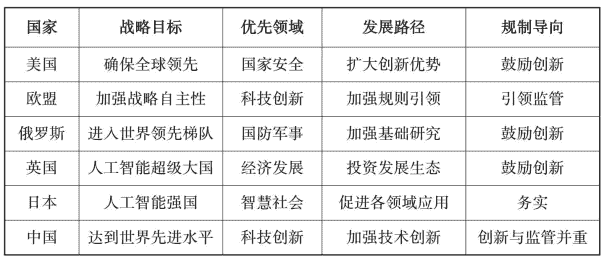

从发展目标的设定来看，美国奥巴马、特朗普、拜登三届政府持续加码战略部署，将人工智能视为国家安全和经济发展的关键性因素，确保在该领域的全球领先。中国、俄罗斯、英国则提出进入人工智能发展的第一梯队，将其视为国家实力的重要赋能性技术，通过人工智能技术提升维护国家安全和促进经济发展。欧盟强调在大国博弈中维护自身的技术自主，虽未设定更加雄心勃勃的目标，但是希望在人工智能发展中确保重要地位。日本战略具有一定内向性，注重运用技术来解决日本国内面临的一系列社会问题。

从发展的优先领域来看，各国都将人工智能视为推动军事变革的潜在颠覆性技术，积极探索人工智能在军事领域的应用方式和路径。美国、俄罗斯明确将人工智能技术作为维护国家安全和军事安全的优先领域，近年来已经推出在实战中应用智能化军事技术的案例，相比之下，俄罗斯受制于自身数字经济发展基础薄弱，专注于开发人工智能军事化应用，美国所关注的国家安全概念显然更加广泛，在涉及人工智能等技术议题时，认为对于美国经济繁荣、科技领导力和全球治理体系主导权等国家安全优先事项都至关重要。欧盟、中国、英国依托自身经济发展基础，将科技创新作为人工智能技术应用的重点领域，希望通过构建良好的创新环境，强化对技术发展的创新能力。日本希望推动其在自动化领域的创新优势，实现社会的发展愿景。

从发展的路径选择来看，美国大力推动在人工智能创新方面的优势地位，一方面，借助在产业基础方面的领先地位，加强公私合作，提升人工智能技术创新的活跃度。另一方面，依托各类国际盟友体系，扩大人工智能国际合作，拓展人工智能产业发展。欧盟注重战略举措的实用性，同时认识到其作为一个整体的竞争力，从科研合作、数据共享、生态培育等方面加强欧盟内部的资源整合，希望发挥内部成员国的优势力量，提升欧洲在人工智能发展中的话语权。俄罗斯注重发挥在科研人才储备方面的传统积累，希望通过提升自身的研发实力来弥补对外合作劣势的现状。英国、日本、中国等致力于打造有竞争力的技术产业生态，培育自身的技术创新能力，同时借助全球化环境，推进开放式的发展路径。

从针对安全风险的监管举措看，欧盟意图成为引领全球人工智能治理的风向标，推动出台了一系列开创性的政策措施，采取了强势的监管导向。一方面增加与中美超级科技企业博弈的监管筹码，另一方面强化欧盟在人工智能全球治理领域的国际引领能力。美国出于自身技术优势的考量，采取了较为宽松的监管导向，主张避免一刀切式的治理路径，积极推动跨境数据流动和数据共享。其他大国出于对于本国数据资源战略价值的重视，采取相对保守的监管路线，既不同于美国主张的过于自由化数据流动范式，也不同于欧盟主导的对于数据流动的强制法律规制路线，倾向于采用一种介于两者之间的“中间路线”，以加强对于本国数据资源保护为目标，主张对数据跨境流动进行不同程度的管制。

第二节　主要大国的人工智能战略前沿

各国AI战略落地观察：五大主线提速

主要经济体依据各自的AI战略取向，把研发创新、跨主体协同、高质量算数底座、产业生态塑造与标准主导作为落地的关键维度，提速推进国家级政策。

### 一、鼓励技术研发创新
各国持续迭代AI研发路线图，把前沿赛道作为优先布局方向。

#### 一是将AI纳入国家研发重点，持续加强资金支持
AI已进入多国国家级科研议程并配套专项资金。据经合组织统计，2001至2019年间各国政府对AI研发的合计投入膨胀约17倍。体量上仍不及以科技企业为主的社会资本，但增速保持高速。^([\[42\]](#txt004.html#footnote_content_txt004_42))例如特朗普政府公布的2020财年预算显示，非国防类AI投入总额为9.735亿美元，且首次为不同部门分别设立AI研发预算线。^([\[43\]](#txt004.html#footnote_content_txt004_43))2020年2月欧盟《人工智能白皮书》指出，2017至2019年欧盟AI研发资金升至15亿欧元，增幅约70%，但在全球版图上仍偏低。为此欧盟确定“Horizon 2020”安排，将AI年度经费提升70%，并推动未来十年公共与私营机构合计每年投入至少200亿欧元。

英国推出国家AI研究与创新计划，设立AI与英国研究与创新计划联合办公室，通过公私合作为相关开发投入14亿美元。2020年12月德国对2018年《国家人工智能战略》进行修订，将投入由30亿欧元上调至50亿欧元，聚焦技术研究与成果转化，助推工业应用。法国在2018至2022年国家战略中部署15亿欧元投入，已完成7亿，其中近半投向研发与人才培养，并于2021年11月公布新一轮五年计划，拟投入22亿欧元。

#### 二、聚焦前沿赛道专项布局
研发安排呈现系统化特征。2018年9月美国国防高级研究计划局宣布启动下一代AI技术研发，强调探索前沿。美国国家科学基金会通过公私伙伴关系强化AI基础科学资助。2012年俄罗斯仿效美国DARPA建立先进技术研究基金会，推动前沿项目。2019年11月欧洲投资基金与欧盟委员会联合推出AI与区块链投资计划，重点扶持欧洲AI初创企业。2020年12月欧盟委员会提出“数字欧洲计划”，拟投入21亿欧元，支持AI在公共部门的应用、可信高效云基础设施、数据安全存储与访问、测试与实验设施建设等。

### 三、整合力量构建区域研发网络
各地区致力于集中优势力量形成合力。2019年1月欧盟启动“欧盟人工智能项目”，为期三年建设AI研究资源平台。法国信息与自动化研究所牵头制定国家AI研究计划，构建由四大跨学科AI机构组成的研究网络，并推进超级计算建设与博士人才培养。俄罗斯组建人工智能与大数据联合体，形成全国性联合机构。日本整合五大国立研究开发机构，构建核心研究群组，与高校及公共研发机构合作，组建“人工智能研发网络”。中国整合百度、腾讯、阿里巴巴、科大讯飞等企业力量，分工聚焦自动驾驶、智能医疗、城市交通智能管理、语音识别等方向。

## 二、多方协同机制硬化
各国把健全体制机制视为战略落地的关键，通过制度化安排汇聚政府、科研、企业与公众力量。

### 一、跨部门协调机制织密
美国较早建立多层级推进体系，在国会、白宫及联邦机构层面设立专业机构。2018年成立由政府要员、企业领袖和顶尖科研负责人组成的人工智能国家安全委员会，评估发展并提出政策建议。日本采用政府引导、市场化运作、产官学协作模式，拟建国家级AI综合管理机构，由总务省、文部科学省与经济产业省联动推进研发推广。^([\[44\]](#txt004.html#footnote_content_txt004_44))中国成立由科技部、国家发改委等15个部门组成的新一代人工智能规划推进办公室，负责规划实施。

### 二、高层智库参与决策
主要国家普遍引入专家咨询机制参与战略与伦理规则设计。^([\[45\]](#txt004.html#footnote_content_txt004_45))美国设立人工智能特设委员会提供跨部门研发咨询，2021年1月白宫科学技术政策办公室下设国家人工智能倡议办公室，负责落实国家战略、协调跨部门研究并推动政学企协作；同年6月成立国家人工智能研究资源工作组，制定国家AI计划。欧盟设立人工智能高级专家组提供政策建议，欧洲议会成立人工智能特设委员会审议开发与应用法律框架。日本2016年成立人工智能技术战略会议统筹国家战略。英国政府设立人工智能委员会作为独立专家组，引导生态系统建设并监督战略实施，与科技战略办公室、国家科技委员会等协同；上议院成立人工智能特别委员会开展调查并提出建议；政府人工智能办公室负责推动技术创新与产业渗透；另设立数据伦理与创新中心，就数据与AI应用向政府提供咨询。

### 三、设立专业执行机构
美国在国防领域成立联合人工智能中心，加速技术研发与转化；人工智能与机器学习政策监督委员会负责长远研发协调。DARPA的下一代人工智能计划旨在打造具备类人交流与逻辑推理能力的智能工具。俄罗斯在政府、科研、军事层面制定分工协作方案，国防部“人工智能十点计划”系统安排研究工作与部门协调。^([\[46\]](#txt004.html#footnote_content_txt004_46))法国将推动职能赋予国家科学与自动化研究所等机构，并在国家咨询伦理委员会内设数字伦理试点委员会，国防部设立国防伦理委员会加强伦理咨询研究。

## 三、算力与数据底座升级
算力与数据是AI发展的核心底座，各国在提升数据质量与算力可及性方面同步发力。

### 算力端发力
美国白宫AI倡议提出为AI研发提供高性能计算资源并制定相关标准。欧盟“欧盟人工智能”项目整合21个成员国79家研发机构及企业数据、算力、算法与工具资源，构建欧洲AI生态系统，并推进“云计算行动计划”，2016年4月搭建“欧洲开放科学云”促进科研数据共享。法国2009年末提出“仙女座”计划建设公私合作大型云数据中心，德国2011年提出“联邦云”计划尝试建立由联邦政府掌控的核心云平台。2019年10月，法德发起盖亚-X欧洲云项目，通过新一代数字基础设施推动商业与创新生态。

### 数据端开源管控并行
2019年特朗普签署《开放政府数据法》扩大政府数据开放，并提出国家研究云计划，优化资源配置，使科研人员可接入科技巨头云数据中心及公共研究数据集。欧盟2020年2月发布数据战略，强调数据可用性对AI训练的关键作用，要求加大面向数据基础设施投资。俄罗斯将数据视为战略资源，严格管控，要求建立统一采集与标注方法，提升数据可用性与治理，并为研究人员开放计算、数据库与数据集，同时明确政府机构对公共数据平台的优先访问权。英国2020年9月发布国家数据战略，将“人工智能与数据经济”列为整体任务，推动数据可用性政策框架并考虑开放政府数据集。法国在自愿原则下推动数据主动开放，鼓励跨领域数据共享平台，并在健康数据领域谋划设立卫生健康数据中心开放医保、临床与研究数据。

## 四、产业生态塑形
AI兼具军民两用属性，良好的产业生态是技术健康发展的关键。

### 一、政策扶持助力产业转化
美国2018年与2019年连续两年在白宫举办人工智能峰会，加强与产业界对话。法国2021年11月宣布战略进入新阶段，推动研发向经济潜力转化，提升企业竞争力，投资新一代嵌入式AI、负责任可信AI技术，建立软件、模型与应用开发平台，支持500家中小企业采用AI解决方案，拓展初创加速器以实现2025年AI初创企业数量翻倍。^([\[47\]](#txt004.html#footnote_content_txt004_47))英国依托阿兰·图灵研究所等领先机构，推动源头创新向产业化转化，扶持AI初创企业。

### 二、人才梯队构建
人才被普遍视为核心驱动。各国既强化顶尖人才培养，也推进数字技能普及。俄罗斯完善AI人才培养体系。日本在《人工智能战略2019》中将人才培养体系改革列为重点，构建素养教育、应用基础教育与专家型人才培育的多层次体系。^([\[48\]](#txt004.html#footnote_content_txt004_48))英国投入4.06亿英镑培养全民数学与数字技能。法国将吸引人才列为优先任务，认为优秀人才是赢得竞争的关键，并在国家研发计划中将大部分预算用于吸引与培养人才，推出多层面培训、促进公私部门人才流动、每年培养500名AI博士等行动。^([\[49\]](#txt004.html#footnote_content_txt004_49))

## 五、抢占标准话语权
技术标准与规范正触及国家利益核心，成为竞争焦点。^([\[50\]](#txt004.html#footnote_content_txt004_50))美国强调其全球领先地位依赖于在标准制定中的引领，并要求联邦政府持续参与，推动可信AI发展。^([\[51\]](#txt004.html#footnote_content_txt004_51))欧盟将标准制定视为塑造国际话语权手段，2022年2月发布《欧盟标准化战略》，提出以标准提升竞争力与技术主权。欧盟提出“可信赖人工智能”理念，建立道德监管框架并发布《人工智能伦理准则》等文件。2021年11月，加拿大、法国发起全球人工智能合作伙伴并在巴黎举行第二届峰会，20余个成员及智利等发展中国家参与，探讨以西方价值观为主导的治理规则。

## 第三节、大国AI战略的差异与格局
各国战略认知趋同，均力图在技术突破中获取先发优势，但路径与基础差异导致格局分化。

### 一、禀赋差异拉开差距
各国均视AI突破为提升国家实力的先机。联合国贸发会议《2021年技术和创新报告》展望三种发展场景：前两种基于数据驱动，区别在于数据来自超级互联网平台还是物联网；第三种为知识驱动。^([\[52\]](#txt004.html#footnote_content_txt004_52))在数据驱动场景下，中美凭借众多互联网平台在个人数据汇聚上占优；在物联网场景下，德国、日本、英国等数字化基础强的国家具备优势；在知识驱动场景下，欧洲基础科学强的地区更具潜力。总体看，中美凭借实力基础、市场规模、产业水平与人才储备，有望成为全球领先者。

AI对技术门槛要求高，数字经济领先国家更易占先。^([\[53\]](#txt004.html#footnote_content_txt004_53))得益于庞大市场、科研能力、工程人才、创新政策与研发投入，美国与中国具备天然优势。全球市值领先的科技企业多来自中美，既能获取海量数据，也为AI提供多元应用场景。

数据质量是机器学习的基础，80%的机器学习时间用于数据相关任务。^([\[54\]](#txt004.html#footnote_content_txt004_54))全球超大规模数据中心约半数位于中美，其中约40%由美国公司拥有。中国网民规模截至2022年12月达10.67亿人，互联网普及率75.6%。^([\[55\]](#txt004.html#footnote_content_txt004_55))哈佛研究报告指出，中国信息基础设施与数字技术普及催生丰富数据，如科大讯飞拥有7亿用户，微信支付拥有9亿用户，90%的城市居民日常使用移动支付，形成细颗粒消费者行为数据库。^([\[56\]](#txt004.html#footnote_content_txt004_56))欧盟认为欧洲数字市场多被美国公司主导，数据大量流向美国，导致云计算与AI发展滞后，因而急于提升数字技术与网络空间的战略自主权。

中美在智能技术的基础条件上相对领先，其余的中小经济体与发展中市场与主要大国的分化在加剧。资源雄厚的大国获取数据天然便利，人口规模有限的国家既难在本土积累足够体量的训练样本，也难以便捷引入境外数据，数据缺口随之凸显。历史上思想的全球流动曾帮助小国实现高生产率和高福利，如今这一路径的可复制性在下降。近年来数据本地化与数据主权浪潮扩散，统计口径下已有17个主要国家和欧盟体系对跨境数据流动施加了强度不一、分部门的管制政策。^([\[57\]](#txt004.html#footnote_content_txt004_57))人口基数决定本土数据天花板，在以数据为燃料的竞争中中小国家处于劣势。除少数头部经济体外，大多数国家的数据治理能力薄弱，对外部数据共享依赖严重。AI驱动的格局让不平等加深，印度本土的AI企业与人才受制于数据基础与开放程度，更多选择赴美欧或为西方机构服务。^([\[58\]](#txt004.html#footnote_content_txt004_58))缺乏自主可控的数据供给，诸多发展中国家的企业与从业者只能依附于西方技术链条发展。

### 二、发展优势趋向集中
从现阶段的关键指标看，头部多被主流大国占据，中美的领先幅度尤为突出。将欧盟整体计入尚可与中美对标，若拆分为单一成员国，则在数据层面难以形成挑战。研究认为其余大国难以在国内形成决定性优势，未来或只能在既有生态中缓慢演进，或沦为中美欧的技术跟随者。

经济体量与资金充裕使强国能提供更先进的算力与研发底座。作为全球前两大经济体，美国与中国在超级算力、科研机构与初创孵化上的投入最为积极。^([\[59\]](#txt004.html#footnote_content_txt004_59))如图 3-1 所示，从 2000—2017 年主要大国和地区的研发投入绝对值来看，美国优势明显，而中国增速最快，已经超过欧盟位列全球第二的位置。欧盟虽有增长但差距在拉大，英国、日本等则保持稳定，没有明显提速。

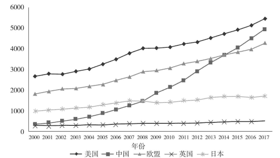

图 3-1　主要国家研发投入对比（2000—2017 年）^([\[60\]](#txt004.html#footnote_content_txt004_60))

开源降低了技术获取门槛，但整合集成与规模化应用的能力才是释放红利的关键。持续创新决定长期竞争位势。以高质量论文产量与引用为代理指标，斯坦福大学 2021 年统计显示 2014 年后五年里中国AI论文数量增长 2.5 倍，明显快于美国与欧盟。2020 年中国AI期刊论文在全球的引用次数首次超越美国，其余国家近二十年的份额基本平稳。^([\[61\]](#txt004.html#footnote_content_txt004_61))图 3-2 显示，中国在期刊引用占比上已小幅领先美国，达全球 20.7%，英国、加拿大等领先群体与中美的距离仍大。

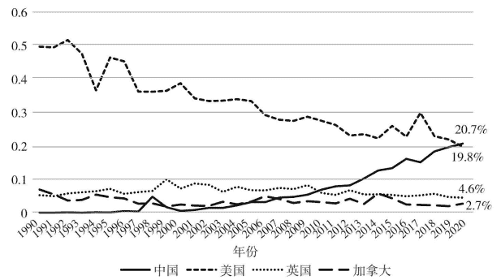

图 3-2　全球人工智能期刊引用量占比^([\[62\]](#txt004.html#footnote_content_txt004_62))

专利与融资反映产业活力。在全球AI专利申请人前500名中，美国占公司申请者的 32.7%，中国占研究机构申请者的 65.9%。^([\[63\]](#txt004.html#footnote_content_txt004_63))（图 3-3）两国驱动模式不同：美国更倚重私营部门，中国由政府及附属机构发挥主要推动作用。私人资本高度集中，2020 年美国私募投入超 236 亿美元，中国 99 亿美元，英国 19 亿美元。^([\[64\]](#txt004.html#footnote_content_txt004_64))

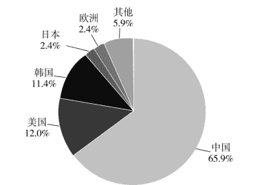

图 3-3　全球人工智能申请人排名前 500 名中各国科研机构占比^([\[65\]](#txt004.html#footnote_content_txt004_65))

初创活跃度是创新生态的晴雨表。罗兰贝格《2019 年关于人工智能的十个议题：从企业的角度看人工智能》指出，2018 年全球AI初创企业半数以上来自中美，前三为美国 1393 家、中国 383 家、以色列 362 家，占比约 40%、11%、11%。若把欧洲视作整体，拥有 769 家，占全球 22%，仅次于美国。^([\[66\]](#txt004.html#footnote_content_txt004_66))这说明单个欧洲国家全球竞争力不足，但数字单一市场若打通，欧洲仍有成为主要参与者的潜力。

表 3-2　全球人工智能投资活动^([\[67\]](#txt004.html#footnote_content_txt004_67))

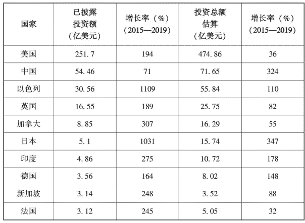

人才是核心引擎。清华大学科技情报大数据挖掘与服务平台遴选的全球AI 2000 名高水平专家中，美国占比 62.2%，优势明显，中国 9.8%，德国 5.7%，英国 4.0%，加拿大 3.4%，澳大利亚 2.1%。^([\[68\]](#txt004.html#footnote_content_txt004_68))美国在顶尖人才吸引力与移民入口上具有难以复制的优势，并凭借完整产业生态持续吸纳全球研究与工程化人才。

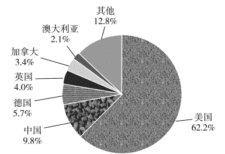

图 3-4　全球人工智能高水平人才分布^([\[69\]](#txt004.html#footnote_content_txt004_69))

在政府应用就绪度评估中，美国位居首位，领先明显；英国第三，德国第八，法国第十一，日本第十二，中国第十五。^([\[70\]](#txt004.html#footnote_content_txt004_70))该表现与美国的研发实力、商业环境及顶级科技公司的产业基础密切相关。

## 三、竞争态势日益分化
战略评估显示，政府正从幕后走向前台，直接介入研发、产业与规则制定，市场竞争被政府主导的科技竞赛部分替代。格局的分化既源于主观选择，也体现客观能力差异。

### 第一，美国保持比较领先优势。
AI研发链条长，对全球化资源与分工依赖高，谁掌握关键节点谁更占优。美国数据创新中心对中、美、欧进行综合跟踪，从人才、研究、发展、硬件、应用与数据等六大维度30项指标打分，美国 44.2 分领先，中国 32.3 分，欧盟 23.5 分。风险投资规模上，美国是中国 2.6 倍、欧盟 4.5 倍，在AI企业数量与并购数量上也保持明显差距。

### 第二，中国同美国实力差距不断拉近，对于其他国家的领先优势明显。
中美拥有庞大经济、领先的数字经济与多样化数据，为发展提供坚实基础。目前只有中美具备争夺AI超级大国地位的资源体量。中国的独特之处在于庞大内需市场与丰富的应用场景，能为模型训练提供海量样本。^([\[71\]](#txt004.html#footnote_content_txt004_71))英国上议院AI特别委员会评估后认为，英国在投资与人才上难以匹敌中美。^([\[72\]](#txt004.html#footnote_content_txt004_72))中国在应用层面位于世界前列，场景日益成熟。但绝对差距仍在。埃里克·施密特曾指出中国超级计算机数量近乎美国两倍，部署的5G基站约为美国15倍。^([\[73\]](#txt004.html#footnote_content_txt004_73))从Top500综合性能看，2020年美国27.5%，中国23.3%。^([\[74\]](#txt004.html#footnote_content_txt004_74))在国家算力评估中，美国拥有全球最多超大规模数据中心，居首。^([\[75\]](#txt004.html#footnote_content_txt004_75))数据开放性全球评级中，美国第8位，远高于中国。^([\[76\]](#txt004.html#footnote_content_txt004_76))中国数字经济领先，为技术创新与应用提供资金与场景，也为军事、社会治理等领域应用奠基，从而更好转化技术实力。

### 第三，欧盟、俄罗斯等根据自身的禀赋和发展需求，选择了不同的人工智能发展路径。
AI是技术密集与资本密集型领域，目前只有中美基本具备全部要素，其余国家若要发挥AI在经济社会与国防的潜力，需要借助或依附外部力量。

欧洲缺乏全球影响力的科技巨头，在新兴科技地缘竞争中处劣势。^([\[77\]](#txt004.html#footnote_content_txt004_77))成员国在技术与监管上立场不一，平衡整体与个体利益存在挑战。欧盟的推进思路是“以欧洲人追求卓越与信任的方式”缓慢前行，率先提出严格的数据隐私规则，并对谷歌、脸书等数字巨头实施巨额反垄断罚金，期望在全球规范中发挥主导。面对中美进步，欧洲感到落后。短板在于数字单一市场未充分落地，电信领域企业过多，高科技私人和公共投资不足。麦肯锡全球研究院评估认为欧洲企业在未来技术竞争中落后，十项最有潜力的技术领域多处下风。^([\[78\]](#txt004.html#footnote_content_txt004_78))尽管欧盟高技术出口能力强，若不改变发展逻辑，这些能力可能被浪费。当前一系列计划若不聚焦下一代技术，可能力度不足且来得太晚。^([\[79\]](#txt004.html#footnote_content_txt004_79))英国主张打造AI软实力并将其转化为国际规则。^([\[80\]](#txt004.html#footnote_content_txt004_80))

俄罗斯融入全球产业链程度低，强调本土化自主化发展，过度偏重军事限制了灵活性。国内创新环境相对封闭，与全球大市场交流不畅，产业链水平制约自主创新。据统计，俄罗斯80%的信息技术产业依赖进口，在复杂生态中仅为二线参与者。^([\[81\]](#txt004.html#footnote_content_txt004_81))其发展形态呈现政府、军事与市场三板块并行，^([\[82\]](#txt004.html#footnote_content_txt004_82))虽受人才与资金制约，但在AI军事化应用上仍具竞争力，优势在于能将技术创新与作战理念、力量与指挥系统结合，短期内获取战场优势。

竞争白热化推动AI“国家安全化”成为普遍做法，美国与欧盟均将俄罗斯与中国的技术进步视为安全威胁。^([\[83\]](#txt004.html#footnote_content_txt004_83))各国战略文件与领导人表态已不再把AI视作普通前沿技术，而是国家级议题。有学者认为，AI竞赛由地缘政治、科学探索与逐利科技企业共同驱动。^([\[84\]](#txt004.html#footnote_content_txt004_84))以AI为代表的高科技竞争已成为当代大国博弈的关键领域，其外溢效应将在国际体系中传导。

## 本章小结
AI的重要性使任何国家都不愿落伍。技术加速使其成为赋能经济、政治与军事的强力工具，率先在关键领域应用的国家将获得先发优势，国家竞争优势的变化也将重塑全球力量格局。AI已成为主要大国重点推进的战略方向，各国基于国家利益确定定位、路径与规制取向，核心目标是抢占先机并实现领先，以提升国家实力。

在战略认知层面，主要大国基本趋同，都强调技术的竞争性并希望获取更有利位置。除了美国决心保持全方位领先外，其他大国根据自身基础明确优先次序。例如俄罗斯在产业生态不占优的情况下坚持军用优先，希望率先实现军事化应用以提升国家安全主动权。欧洲依托科研积累推动资源整合，在创新环节保持传统优势，同时在监管环节制定严格标准规范以引领国际治理。中、英、日等选择相对均衡的路线，制定综合性战略推动AI全面赋能经济社会。

为落实国家战略，各大国在基础设施建设、研发投入、体制机制保障、产业生态优化与顶尖人才培育等方面加大举措。研发层面普遍纳入国家重点，更新资金计划，支持前沿理论研究与探索，并整合优势资源搭建联合攻关网络。保障层面加强统筹，建立高层咨询机构为决策提供智力支持。基础设施方面，美国与欧盟提出云计划以提供算力支持，俄罗斯、英国推动数据共享开放以供给高质量训练数据。产业布局上强化政府与产业界对话，宏观统筹谋划，并高度重视人才培育。标准规范上，西方国家借助盟友体系通过双边多边平台推广其价值观治理路径，中俄等新兴大国也在积极提出符合本国的监管理念。

AI 竞争加速分层

与航天、太空等传统赛道不同，人工智能的赶超速度明显更快。领先一方仍保有优势，但后发力量的投入规模和节奏都在加快。将各国战略放在一起对照，能够看出当前AI版图呈现大国主导、内部梯度进一步放大的特征。

数据已成为决定能力的关键变量。深度学习模型的精度很大程度上依赖海量样本，而围绕数据的角力容易触及主权等敏感议题。从模型研发到商业落地再到持续迭代，AI全链条都需要稳定且充足的数据供给。这就让数字基础设施完善、经济社会数字化转型领先的国家，例如美国和中国，天然占据先手。

从顶尖论文、专利沉淀、资本投入到实际应用场景来看，大国间的分化态势愈发清晰。美国依然稳居第一梯队，中国已具备与之对标的基础，可整体差距依旧显著。欧盟成员国、俄罗斯、英国等力量，与中美的距离正被拉大。它们更倾向于依托自身资源禀赋进行选择性投入，寄望以差异化路径获取技术红利。

围绕人工智能的博弈，竞争色彩在不断增强。越发激烈的角逐会推高大国间的战略摩擦，而这种压力最终难以避免地会传导至国际政治层面和大国关系互动中。

【注释】

[\[1\]](#txt004.html#footnote_quote_txt004_1)Whoever Leads in AI will Rule the World：Putin to Russian Children on Knowledge Day，RT News，September 2017，（2021-01-05），https：//www.rt.com/news/401731-ai-rule-world-putin/。

[\[2\]](#txt004.html#footnote_quote_txt004_2)Speech by President-elect von der Leyen in the European Parliament Plenary on the occasion of thepresentation of her College of Commissioners and their programme，November 2019，（2021-03-28），https：//ec.europa.eu/neighbourhood-enlargement/news\_corner/news/speech-president-elect-von-derleyen-european-parliament-plenary-occasion\_en。

# 脚注

[\[3\]](#txt004.html#footnote_quote_txt004_3)相关战略政策文件请参见：《国家人工智能研究与发展战略规划》，2016 年 10 月，（2021-03-04），https：//obamawhitehouse.archives.gov/sites/default/files/white-\_house\_files/microsites/ostp/NSTC/national\_ai rd\_strategic\_plan.pdf；《为人工智能的未来做好准备》，2016 年 10 月，（2021-03-04），https：//obamawhitehouse.archives.gov/sites/default/files/whitehouse\_files/microsites/ostp/NSTC/preparing\_for the future of\_ai.pdf；《人工智能、自动化与经济》，2016 年 12 月，（2021-03-04），https：//obamawhitehouse.archives.gov/sites/whitehouse.gov/files/documents/Artificial-Intelligence-Automation-Economy.pdf。

[\[4\]](#txt004.html#footnote_quote_txt004_4)周琪、付随鑫：《美国人工智能的发展及政府发展战略》，载《世界经济与政治》，2020（6）：28-54 页。

[\[5\]](#txt004.html#footnote_quote_txt004_5)白宫：《关于保持美国在人工智能领域领导地位的行政命令》，2019 年 2 月，（2021-03-04），https：//www.federalregister.gov/documents/2019/02/14/2019-02544/maintaining-american-leadership-in-artificial-intelligence。

[\[6\]](#txt004.html#footnote_quote_txt004_6)2021 年 1 月，拜登效仿富兰克林·罗斯福总统致信新任命的总统科学顾问团队，在信中提出需要重点关注的五大问题中，其中就提出要研究如何确保美国在人工智能等新兴技术和产业发展上的领导地位。3 月初拜登政府发布的《国家安全临时战略指南》中明确提出，作为国家安全的重要部分，美国必须在人工智能等新兴技术、太空、网络等领域发挥领导作用。

[\[7\]](#txt004.html#footnote_quote_txt004_7)Ulrike Franke：《抢尽风头：欧洲在伟大科技竞赛中挣扎》，2020 年 2 月 25 日，（2021-07-23），https：//ecfr.eu/article/commentary\_upstaged\_europes\_struggles\_to\_play\_the\_great\_tech\_game/。

[\[8\]](#txt004.html#footnote_quote_txt004_8)欧洲委员会：《人工智能助力欧洲》，2018 年 4 月，（2021-10-15），https：//eur-lex.europa.eu/legal-content/EN/TXT/PDF/？uri＝CELEX：52018DC0237＆from＝EN。

[\[9\]](#txt004.html#footnote_quote_txt004_9)欧洲委员会：《人工智能》，2019 年 4 月，（2021-03-05），https：//ec.europa.eu/digital-single-market/en/artificial-intelligence。

[\[10\]](#txt004.html#footnote_quote_txt004_10)欧洲委员会：《人工智能白皮书——卓越与信任的欧洲方法》，2020 年 2 月，（2021-03-25），https：//digital-strategy.ec.europa.eu/en/consultations/white-paper-artificial-intelligence-european-approach-excellence-and-trust。

[\[11\]](#txt004.html#footnote_quote_txt004_11)欧洲议会：《欧洲数字主权》，（2021-10-15），https：//www.europarl.europa.eu/RegData/etudes/BRIE/2020/651992/EPRS\_BRI（2020）651992\_EN.pdf。

[\[12\]](#txt004.html#footnote_quote_txt004_12)旅俄学生学者研究会：《2030 年前俄罗斯联邦国家人工智能发展战略》，2019 年 11 月，（2021-03-28），https：//mp.weixin.qq.com/s/73meTyFy6pj4RJz5hpBSfg。

[\[13\]](#txt004.html#footnote_quote_txt004_13)特雷莎·梅在达沃斯的完整演讲，2018 年 1 月，（2021-11-08），https：//www.weforum.org/agenda/2018/01/theresa-may-davos-address/。

[\[14\]](#txt004.html#footnote_quote_txt004_14)英国商业、能源和工业战略部：《工业战略：建设适合未来的英国》，2017 年 11 月，（2021-11-05），https：//www.gov.uk/government/publications/industrial-strategy-building-a-britain-fit-for-the-future。

[\[15\]](#txt004.html#footnote_quote_txt004_15)英国：《国家人工智能战略》，2021 年 9 月，（2021-11-05），https：//www.gov.uk/government/publications/national-ai-strategy。

[\[16\]](#txt004.html#footnote_quote_txt004_16)刘平、刘亮：《日本新一轮人工智能发展战略》，载《现代日本经济》，2020（6）：37 页。

[\[17\]](#txt004.html#footnote_quote_txt004_17)Jesse Ellman，Lisa Samp，Gabriel Coll：《评估第三次抵消战略》，战略与国际研究中心，2017 年 3 月，（2021-03-02），https：//csis-website-prod.s3.amazonaws.com/s3fs-public/publication/170302\_Ellman\_ThirdOffsetStrategySummary\_Web.pdf。

[\[18\]](#txt004.html#footnote_quote_txt004_18)美国国家安全委员会关于人工智能：《最终报告》，2021 年 3 月，（2021-03-02），https：//reports.nscai.gov/final-report/table-of-contents/。

[\[19\]](#txt004.html#footnote_quote_txt004_19)美国无人作战系统对抗技术已经进入实战化阶段，如 2019 年 7 月，美国的“拳师号”两栖攻击舰在霍尔木兹海峡击落了一架伊朗无人机，使用了配备的新式反无人机系统“海上轻型防空综合系统”（LMADIS），通过雷达和摄像机扫描，检测到威胁后利用无线电频率干扰使无人机或无人艇失能。2020 年 12 月，美国空军成功使用人工智能副驾驶控制一架 U2 侦察机和雷达和传感器系统，首次实现用人工智能控制军用系统。

[\[20\]](#txt004.html#footnote_quote_txt004_20)Ulrike Franke，José Ignacio Torreblanca：《地缘科技政治：技术如何塑造欧洲权力》，2021 年 7 月，（2022-01-15），https：//ecfr.eu/wp-content/uploads/Geo-tech-politics-Why-technology-shapes-European-power.pdf。

[\[21\]](#txt004.html#footnote_quote_txt004_21)《为了有意义的人工智能：迈向法国和欧洲战略》，2018 年 3 月，（2021-11-15），https：//www.aiforhumanity.fr/pdfs/MissionVillani\_Report\_ENG-VF.pdf。

[\[22\]](#txt004.html#footnote_quote_txt004_22)戢仕铭：《俄罗斯人工智能发展的能力约束及参与全球价值链的困境评估》，载《国际关系研究》，2020（1）：96 页。

[\[23\]](#txt004.html#footnote_quote_txt004_23)Adrian Pecotic：《谁能正确预测未来，谁就能赢得人工智能军备竞赛》，2019 年 3 月，（2021-03-05），https：//foreignpolicy.com/2019/03/05/whoever-predicts-the-future-correctly-will-win-the-aiarms-race-russia-china-united-states-artificial-intelligence-defense/。

[\[24\]](#txt004.html#footnote_quote_txt004_24)Margarita Konaev，Sara M. Abulla：《机器人专利趋势：全球概览及对俄罗斯的评估》，2021 年 11 月，（2022-01-18），https：//cset.georgetown.edu/wp-content/uploads/CSET-Trends-in-Robotics-Patents.pdf＃：～：text＝The％20United％20States％20ranks％20fourth％2C％20with％20about％2013，as％20well％20as％20robotics％20patents％20with％20AI％20features。

[\[25\]](#txt004.html#footnote_quote_txt004_25)英国数字、文化、媒体与体育部和商业、能源与工业战略部：《发展英国人工智能产业》，2017 年 10 月，（2021-11-08），https：//www.gov.uk/government/publications/growing-the-artificial-intelligence-industry-in-the-uk。

[\[26\]](#txt004.html#footnote_quote_txt004_26)周生升、秦炎铭：《日本人工智能发展战略与全球价值链能力再提升———基于顶层设计与产业发展的竞争力分析》，载《国际关系研究》，2020（1）：90 页。

[\[27\]](#txt004.html#footnote_quote_txt004_27)James Lewis：《国家安全与创新生态系统》，2021 年 10 月，（2021-12-15），https：//www.csis.org/analysis/national-security-and-innovation-ecosystem。

[\[28\]](#txt004.html#footnote_quote_txt004_28)国家科学与技术委员会人工智能特别委员会：《国家人工智能研究与发展战略规划：2019 年更新》，2019 年 6 月，（2021-03-05），https：//www.nitrd.gov/pubs/National-AI-RD-Strategy-2019.pdf。

[\[29\]](#txt004.html#footnote_quote_txt004_29)五眼联盟指由五个英语国家组成的情报共享联盟。包括美国、英国、加拿大、澳大利亚和新西兰。

[\[30\]](#txt004.html#footnote_quote_txt004_30)欧洲议会：《欧洲数字主权》，2020 年 7 月，（2021-03-28），https：//www.europarl.europa.eu/RegData/etudes/BRIE/2020/651992/EPRS\_BRI（2020）651992\_EN.pdf。

[\[31\]](#txt004.html#footnote_quote_txt004_31)德国联邦政府：《联邦政府人工智能战略》，2018 年 11 月，（2021-03-15），https：//www.de.digital/DIGITAL/Redaktion/EN/Standardartikel/artificial-intelligence-strategy.html。

[\[32\]](#txt004.html#footnote_quote_txt004_32)《俄罗斯联邦 2030 年前国家人工智能发展战略》，旅俄学生学者研究会微信公众号，2019 年 11 月。

[\[33\]](#txt004.html#footnote_quote_txt004_33)如国家发改委、科技部、工业和信息化部、中央网信办联合制定了《“互联网＋”人工智能三年行动实施方案》，工业和信息化部、国家发改委、财政部联合发布《机器人产业发展规划（2016—2020 年）》，工业和信息化部制定了《促进新一代人工智能产业发展三年行动计划（2018-2020 年）》，教育部制定了《高等学校人工智能创新行动计划》，对促进人工智能和制造业融合发展、提升人工智能研究水平等任务作出了专门部署。

[\[34\]](#txt004.html#footnote_quote_txt004_34)孙海泳：《科技创新与国际关系》，北京，时事出版社，2021：159 页。

[\[35\]](#txt004.html#footnote_quote_txt004_35)欧洲委员会：《关于制定人工智能协调规则（人工智能法案）并修改某些欧盟立法行为》，2021 年 4 月，（2021-11-05），https：//eurlex.europa.eu/legal-content/EN/TXT/？qid＝1623335154975＆uri＝CELEX％3A52021PC0206。

[\[36\]](#txt004.html#footnote_quote_txt004_36)华盾：《人工智能时代的俄罗斯国家安全》，载《信息安全与通信保密》，2021（5）：33-39 页。

[\[37\]](#txt004.html#footnote_quote_txt004_37)陈定定、朱启超：《人工智能与全球治理》，北京，社会科学文献出版社，2020：26-27 页。

# 参考文献

[\[38\]](#txt004.html#footnote_quote_txt004_38)相关报告参见：英国下议院科学与技术委员会：机器人与人工智能，2016 年 9 月，（2021-11-08），`https：//publications.parliament.uk/pa/cm201617/cmselect/cmsctech/145/145.pdf`。；英国政府科学办公室：人工智能：决策未来的机遇与影响，2015 年，（2021-11-08），`https：//assets.publishing.service.gov.uk/government/uploads/system/uploads/attachment\_data/file/566075/gs-16-19-artificialintelligence-ai-report.pdf`。

[\[39\]](#txt004.html#footnote_quote_txt004_39)英国上议院人工智能特别委员会：英国的人工智能：准备好、愿意并且有能力吗？，2018 年 4 月，（2021-11-09），`https：//publications.parliament.uk/pa/ld201719/ldselect/ldai/100/100.pdf`。

[\[40\]](#txt004.html#footnote_quote_txt004_40)CNPEN 对话代理的伦理问题，（2021-11-15），`https：//www.ccne-ethique.fr/en`。

[\[41\]](#txt004.html#footnote_quote_txt004_41)2021 年以来有关部门针对智能算法等人工智能应用带来的风险和问题推出了一系列监管举措，引导新技术新应用的健康发展。例如，2021 年 7 月，人社部等 8 部门印发了《关于维护新就业形态劳动者劳动保障权益的指导意见》，保护平台用工形式和新就业形态劳动者的保障权益；同月，最高人民法院通过了《最高人民法院关于审理使用人脸识别技术处理个人信息相关民事案件适用法律若干问题的规定》，对人脸识别技术涉嫌侵犯信息主体人格权的情形等进行了规定；8 月，国家网信办发布《互联网信息服务算法推荐管理规定（征求意见稿）》，从算法透明度、算法解释、退出个性化推送等维度丰富和细化了用户权利；9 月，国家网信办等 9 部门发布《关于加强互联网信息服务算法综合治理的指导意见》，提出建立治理机制健全、监管体系完善、算法生态规范的算法安全综合治理格局。

[\[42\]](#txt004.html#footnote_quote_txt004_42)Izumi Yamashita，Akiyoshi Murakmi：衡量政府资助研发项目的 AI 含量，经济合作与发展组织科学、技术与工业工作论文，2021 年 6 月。

[\[43\]](#txt004.html#footnote_quote_txt004_43)李恒阳：《美国人工智能战略探析》，载《美国研究》，2020（4）：94-114 页。

[\[44\]](#txt004.html#footnote_quote_txt004_44)朱启超、王姝：《日本“超智能社会”建设构想：内涵、挑战与影响》，载《日本学刊》，2018（2）：60-86 页。

[\[45\]](#txt004.html#footnote_quote_txt004_45)Roxana Radu：引导人工智能治理：国家战略视角，《政策与社会》，2022，40（2）：pp.178-193。

[\[46\]](#txt004.html#footnote_quote_txt004_46)李赐：《俄为人工智能发展制定“十点计划”》，载《中国国防报》，2018-07-27（4）。

[\[47\]](#txt004.html#footnote_quote_txt004_47)国家人工智能战略的新阶段，2021 年 11 月，（2021-11-20），`https：//www.in telligence-artificielle.gouv.fr/fr/actualites/nouvelle-phase-pour-la-strategie-nationale-d-in telligence-artificielle`。

[\[48\]](#txt004.html#footnote_quote_txt004_48)刘平、刘亮：《日本新一轮人工智能发展战略》，载《现代日本经济》，2020（6）：37-38 页。

[\[49\]](#txt004.html#footnote_quote_txt004_49)法国国家人工智能研究计划，2021 年 10 月，（2021-11-15），`https：//www.inria.fr/en/french-national-artificial-intelligence-research-program`。

[\[50\]](#txt004.html#footnote_quote_txt004_50)唐岚：《网络空间国际规则博弈的两大新焦点》，载《北京航空航天大学学报（社会科学版）》，2021（5）：29-30 页。

[\[51\]](#txt004.html#footnote_quote_txt004_51)美国国家标准与技术研究院：联邦人工智能标准参与计划，2021 年 8 月，（2022-01-05），`https：//www.nist.gov/artificial-intelligence/ai-standards-federal-engagement`。

[\[52\]](#txt004.html#footnote_quote_txt004_52)联合国贸易和发展会议：技术与创新报告，2021 年 2 月，（2021-04-02），`https：//unctad.org/system/files/official-document/tir2020\_en.pdf`。

[\[53\]](#txt004.html#footnote_quote_txt004_53)傅莹：《人工智能对国际关系的影响初析》，载《国际政治科学》，2019（1）：2 页。

[\[54\]](#txt004.html#footnote_quote_txt004_54)数据标注：人工智能的人类瓶颈：2020 年 3 月，（2021-05-07），`https：//medium.com/whattolabel/data-labeling-ais-human-bottleneck-24bd10136e52`。

[\[55\]](#txt004.html#footnote_quote_txt004_55)中国互联网络信息中心：《第 51 次中国互联网络发展状况统计报告》，\[2023-03-02\]，`http：//www.cnnic.cn/n4/2023/0303/c88\_10757.html`。

[\[56\]](#txt004.html#footnote_quote_txt004_56)Graham Allison，Kevin Klyman，Karina Barbesino.et al：伟大的技术竞争：中国 vs 美国，2021 年 12 月，哈佛肯尼迪学院科学与国际事务贝尔弗中心，（2022-02-01），`https：//www.belfercenter.org/publication/great-tech-rivalry-china-vs-us`。

[\[57\]](#txt004.html#footnote_quote_txt004_57)毛维准、刘一燊：《数据民族主义：驱动逻辑与政策影响》，载《国际展望》，2020（3）：21-42 页。

[\[58\]](#txt004.html#footnote_quote_txt004_58)Mathew Burrows，Julian Mueller-Kaler：大国竞争中的智慧伙伴关系——人工智能、中国与数字主权的全球追求，大西洋理事会，2021 年 1 月，（2022-02-01），`https：//www.atlanticcouncil.org/wp-content/uploads/2021/01/Smart-Partnerships-2021-Report-1.pdf`。

[\[59\]](#txt004.html#footnote_quote_txt004_59)Samar Fatima，Gregory Dawson，Kevin Desouza，et al：各国如何利用计算能力实现其国家人工智能战略，布鲁金斯学会，2022 年 1 月，（2022-02-05），`https：//www.brookings.edu/blog/techtank/2022/01/12/how-countries-areleveraging-computing-power-to-achieve-their-national-artificial-intelligence-strategies/`。

[\[60\]](#txt004.html#footnote_quote_txt004_60)资料来源：美国国家科学和工程统计中心（单位：亿美元）

[\[61\]](#txt004.html#footnote_quote_txt004_61)斯坦福大学人本人工智能：AI 指数报告：衡量人工智能趋势，2021 年 3 月。

[\[62\]](#txt004.html#footnote_quote_txt004_62)资料来源：根据微软学术图谱数据制作。

[\[63\]](#txt004.html#footnote_quote_txt004_63)世界知识产权组织：专利中的人工智能故事，（2021-04-05），`https：//www.wipo.int/tech\_trends/en/artificial\_intelligence/story.html`。

[\[64\]](#txt004.html#footnote_quote_txt004_64)斯坦福大学人本人工智能：AI 指数报告：衡量人工智能趋势，2021 年 3 月，（2021-03-07），`https：//aiindex.stanford.edu/report/`。

[\[65\]](#txt004.html#footnote_quote_txt004_65)资料来源：世界知识产权组织。

[\[66\]](#txt004.html#footnote_quote_txt004_66)CB Insights：AI 100：重新定义行业的 人工智能初创企业，2021 年，（2021-04-03），`https：//www.cbinsights.com/research/report/artificial-intelligence-top-startups/＃：～：text＝CB％20Insights％20AI％20100％20％282020％29％20％20％20，％20％20China％20％2031％20more％20rows％20`。

[\[67\]](#txt004.html#footnote_quote_txt004_67)资料来源：Zachary Arnold，Ilya Rahkovsky Tina Huang：追踪人工智能投资：来自私募市场的初步发现，新兴技术安全中心，2020 年 9 月。

[\[68\]](#txt004.html#footnote_quote_txt004_68)清华大学人工智能研究院、清华-中国工程院知识智能联合研究中心：《人工智能发展报告 2011—2020》，2021 年。

[\[69\]](#txt004.html#footnote_quote_txt004_69)资料来源：《人工智能发展报告 201 1—2020》数据。

[\[70\]](#txt004.html#footnote_quote_txt004_70)牛津洞察：政府人工智能准备度指数 2021，（2022-01-24），`https：//static1.squarespace.com/static/58b2e92c1e5b6c828058484e/t/61e95661c567937d21998d14/1642681965033/Gov AI Readiness\_\_\_2021.pdf`。

[\[71\]](#txt004.html#footnote_quote_txt004_71)Ben Horton，Jinghan Zeng：中国能成为人工智能超级大国吗？，2021 年 1 月，查塔姆研究所，（2021-12-20），`https：//www.chathamhouse.org/2021/01/can-china-become-ai-superpower`。

[\[72\]](#txt004.html#footnote_quote_txt004_72)英国上议院人工智能特别委员会：英国的人工智能：准备好、愿意并且有能力吗？，2018 年 4 月，（2021-12-20）`https：//publications.parliament.uk/pa/ld201719/ldselect/ldai/100/100.pdf`。

[\[73\]](#txt004.html#footnote_quote_txt004_73)Eric Schmidt：硅谷可能输给中国，2020 年 2 月，（2021-04-03），`https：//www.nytimes.com/2020/02/27/opinion/eric-schmidt-ai-china.html`。

[\[74\]](#txt004.html#footnote_quote_txt004_74)数据创新中心：谁赢得了人工智能竞赛？中国、欧盟还是美国？（2021 年更新），2021 年 1 月，（2021-04-04），`https：//www2.datainnovation.org/2021-china-euus-ai.pdf`。

[\[75\]](#txt004.html#footnote_quote_txt004_75)浪潮信息、IDC：《2020 全球计算力指数评估报告》，2021 年 2 月。

[\[76\]](#txt004.html#footnote_quote_txt004_76)Dominic Barton，Jonathan Woetzel，Jeongmin Seong，et al：人工智能：中国的影响，2017 年 4 月，（2021-04-04），`https：//www.mckinsey.com/featured-insights/china/artificialintelligence-implications-for-china`。

[\[77\]](#txt004.html#footnote_quote_txt004_77)欧洲对外关系委员会：《欧洲数字主权：中美竞争时代从规则制定者到超级大国》，2020 年 7 月，（2021-03-28），https：//ecfr.eu/archive/page/-/europe\_digital\_sovereignty\_rulemaker\_superpower\_age\_us\_china\_rivalry.pdf。

[\[78\]](#txt004.html#footnote_quote_txt004_78)麦肯锡公司：《技术差距：欧洲企业需跟上未来技术》，2022 年 5 月 4 日，（2022-06-05），https：//www.mckinsey.de/news/presse/2022-05-04-mgi-europe。

[\[79\]](#txt004.html#footnote_quote_txt004_79)《美中竞争与跨大西洋关系命运 第 1 部分：技术、价值观与竞争》，2020 年 1 月，（2021-03-29），https：//www.csis.org/analysis/us-china-race-and-fate-transatlantic-relations。

[\[80\]](#txt004.html#footnote_quote_txt004_80)英国上议院人工智能特别委员会：《英国的人工智能：准备好、愿意且有能力？》，2018 年 3 月，（2021-03-28），https：//publications.parliament.uk/pa/ld201719/ldselect/ldai/100/100.pdf。

[\[81\]](#txt004.html#footnote_quote_txt004_81)Julien Nocetti：《局外人：俄罗斯在人工智能竞赛中》，法国国际关系研究所，2020 年 12 月，（2021-11-13），https：//www.ifri.org/sites/default/files/atoms/files/nocetti russia artificial\_intelligence\_2020.pdf。__

[\[82\]](#txt004.html#footnote_quote_txt004_82)华盾、封帅：《弱市场模式的曲折成长—俄罗斯人工智能产业发展探微》，载《俄罗斯东欧中亚研究》，2020（3）：98-128 页。

[\[83\]](#txt004.html#footnote_quote_txt004_83)Jinghan Zeng：《中国的人工智能安全化》，《中国国际政治期刊》，2021，14（3）：第 422 页。

[\[84\]](#txt004.html#footnote_quote_txt004_84)Paul Scharre：《自主武器是游戏规则改变者》，《经济学人》，2018-01-25。

# 第四章 AI时代的大国关系评估

本章在前文梳理技术演进节奏与全球竞争格局的基础上，把焦点集中到智能技术如何改写大国互动的逻辑。先以冷战后有关大国关系的主流解释为参照，将经典理论与当下人工智能赛道上的竞合现实对照，厘清技术博弈向国际政治扩散的传导路径。由此搭建一套面向智能时代的大国关系分析框架，最后综合研判AI变量对全球力量版图及大国战略稳定带来的机遇与风险。

## 第一节 冷战后大国关系的经典脉络

冷战落幕之后，新兴大国快速成长撞上了西方主导的国际体系，非国家行动者借由全球化也在世界政治中占据了一席之地。学界大体认同正在发生一场权力和财富的再分配，其重心由西方向外扩散，但对于这种转移到底如何重塑格局、影响秩序，各家说法迥异。不同理论对大国角色、实力版图和互动逻辑做了不同预设。要判断人工智能时代大国关系的走向，先把冷战后关于格局变化的解释理清楚是关键。

### 一、单极体系视角下的大国关系
冷战结束，华盛顿成为唯一超级大国，这一点体现在全面性的领先，而非某一项指标。拥趸单极论的学者指出，即便某些国家在个别领域逼近美国，综合军事、政治、经济、技术、文化等维度，差距依然明显，短期内无力翻盘。潜在的制衡者往往先在地区层面碰壁，很难对全球性单极构成实质挑战，因此以美国为核心的单极格局被认为具有延续性。按照这一思路，体系里的大国并不均质，应区分为超级大国和普通大国，前者主导的秩序仍是当下大国互动的基础盘。

尽管美国霸权被认为在走弱，单极派仍强调自由主义秩序并未解体，美国国内制度与现代化目标的契合让单极秩序更具稳定性。西方内部和非西方国家虽对既有秩序不满，但相关冲击力量本身也是秩序的受益者。新兴国家对现状有压力，却更可能选择谈判换取领导权分享而非推翻框架。新自由制度主义继续沿此逻辑，认为霸权国创设的机制会在霸权衰落后保持惯性，多边规则和制度仍能维系后霸权时代的合作与和平。

新冠冲击放大了美国领导力的下滑与自由主义秩序的衰退，单极视角的研究者也不得不承认危机存在，但仍主张霸权对国家合作不可或缺。目前碎片化加剧，但尚无可替代的方案；自由主义秩序具备自我修正能力，历史上在促进繁荣方面作用突出。戴维·莱克质疑无政府国际社会的说法，提出等级体系概念，主张主导国与附庸国基于利益权衡自愿选择等级安排。^([\[6\]](#txt005.html#footnote_content_txt005_6))在此框架下，主导国维护秩序，附属国追求稳定，利益互补构成契约基础。小约瑟夫·奈因此认为“美国世纪”尚未终结，^([\[7\]](#txt005.html#footnote_content_txt005_7))他指出中国印度等经济体持续壮大，美国地位相对下降，但暂无国家准备接替其霸主角色，美国仍保有一定领导力与影响力。供给关键全球公共产品的能力，仍是他国欠缺的。

### 二、多极/两极体系视角下的大国关系
对单极叙事的质疑在学界相当普遍，主流观点认为世界正从单极缓慢转向多极，超级大国与其他大国的实力差距在收窄。有美国学者把2022年的俄乌冲突视作美国单极时刻的转折点，^([\[8\]](#txt005.html#footnote_content_txt005_8))尽管趋势早已显现，这场冲突成为标志。美国相对优势削弱，大国竞争更趋直接。米尔斯海默认为自由主义国际秩序从诞生起就有缺陷，因其并非真正的国际秩序而只是西方的有限秩序，注定失败。^([\[9\]](#txt005.html#footnote_content_txt005_9))亨廷顿提出“单极-多极体系”，冷战后虽只有一家超级大国，但世界并非真正的单极，因单极需超级大国独力解决重要事务。^([\[10\]](#txt005.html#footnote_content_txt005_10))他认为美国在处理全球议题时拉拢合作更符合自身利益，作为多极世界中的一员比做唯一的超级大国成本更低、回报更高。^([\[11\]](#txt005.html#footnote_content_txt005_11))

支持多极化的学者强调单极既不稳定也不现实。肯尼思·沃尔兹从结构现实主义出发，指出单极是最不稳定的结构，易因义务过重消耗实力，也会引发他国预防性制衡。^([\[12\]](#txt005.html#footnote_content_txt005_12))他认为被单极打破的均势终将恢复，21世纪初美国凭借绝对优势提供稳定，如今单极会让位于多极中心并重。^([\[13\]](#txt005.html#footnote_content_txt005_13))米尔斯海默描绘的新多极世界继承进攻性现实主义，预言自由主义秩序崩溃，未来出现促进经济合作的“薄秩序”和中美各自主导的两个“有界厚秩序”，军事同盟是后者的核心。^([\[14\]](#txt005.html#footnote_content_txt005_14))经济领域可能仍有合作但程度有限，因经济是军力基础。

多极派观察到权力正从美国主导的西方向外扩散。亨廷顿强调文明差异影响国家利益与结盟。^([\[15\]](#txt005.html#footnote_content_txt005_15))西蒙·赖克与理查德·勒博认为体系进入“后霸权时代”，议程设置、监管、赞助三大职能已扩散，欧洲在规范制定中影响上升，亚洲国家在经济监管中作用加大。^([\[16\]](#txt005.html#footnote_content_txt005_16))巴里·布赞提出“去中心化全球主义”，权力分配更均衡，西方特权式微。^([\[17\]](#txt005.html#footnote_content_txt005_17))在此世界中将由若干世界性大国与众多区域强国共存，超级大国概念消失。^([\[18\]](#txt005.html#footnote_content_txt005_18))他主张借鉴欧洲协调经验，建立包含中国、欧盟、印度、日本、俄罗斯和美国的全球大国协调机制，通过对话达成共识而非僵化成文规则。^([\[19\]](#txt005.html#footnote_content_txt005_19))权力转移易生危机，协调机制是化解危机的工具，能让各成员在塑造秩序中发挥作用。^([\[20\]](#txt005.html#footnote_content_txt005_20))疫情期间美国领导力缺位，但经济金融供应链的高度联结决定大国竞争合作长期并存。

中国地位提升也催生中美两极讨论。两极视角把中美视为理解当下国际关系的主轴。阎学通认为中美实力差距收窄，两者与其他大国的差距扩大，格局正由单极向两极演进，多极化概率下降。^([\[21\]](#txt005.html#footnote_content_txt005_21))也有学者指出，中国成为单一极未必意味着综合实力超越美国，冷战时期苏联从未全面超过美国仍获超级大国地位，两极与霸权可并存。^([\[22\]](#txt005.html#footnote_content_txt005_22))由此形成不对称两极，大多数国家被边缘化。^([\[23\]](#txt005.html#footnote_content_txt005_23))由于实力差距仍在，单极向两极的转变更多是量变而非质变，趋势持续时间与临界点仍不确定。^([\[24\]](#txt005.html#footnote_content_txt005_24))

在区域和领域层面，两极结构呈现差异。2008年金融危机后中国成为世界第二大经济体，东亚形成中美竞争的双中心。^([\[25\]](#txt005.html#footnote_content_txt005_25))军事硬对抗色彩较淡，经贸、金融、技术、文化、发展模式等“软”领域成为博弈主战场。中美关系长期且复杂，两国均难单独提供全球领导力，未来的走向仍有不确定性。

### 三、复合多元视角下的大国关系
去中心化视角下，权力不仅从发达向发展中国家、西方向东方转移，还在持续扩散。大国围绕地位与权力的竞争加剧，并受到非国家行为体的制约。二战后美国建立的秩序仍有影响，但新兴国家与非国家行动者的崛起让全球权力版图不可逆转地变化。美国国内对全球化的抵制也在推动其向内转向或民族主义政策。^([\[26\]](#txt005.html#footnote_content_txt005_26))在此视角下，权力转移发生在国家之间，也发生在国家与非国家之间，不同情境下形成不同权力结构，需要复合多元的分析框架。这并非削弱大国的重要性，而是对过去过度强调大国影响的修正，便于在网络空间和人工智能快速发展的背景下进行战略构建与政策选择。

复合多元派认为除国家多极化外，其他行动者也在挑战霸权秩序。阿米塔·阿查亚提出“后霸权多边主义”，认为美国相对衰落后，多边主义进入复合阶段，权力政治并未消失，但大国集体霸权不再能压倒其他力量。^([\[27\]](#txt005.html#footnote_content_txt005_27))世界呈现新旧大国并存、区域治理权重上升、秩序相对去中心化的特征。^([\[28\]](#txt005.html#footnote_content_txt005_28))他并未排除美国、新兴大国与地区行为体在后霸权秩序中的领导作用，但强调多元复合世界对弱国的包容性与自主性尊重，这是与历史上欧洲协调时期的差异。

小约瑟夫·奈以三维国际象棋比喻权力分布：顶层棋盘美国军事实力单极领先，中间棋盘美欧日中多极并存，底层棋盘是非传统领域，参与者是非国家行为体，网络安全、流行病、恐怖主义等问题已超出国家控制。^([\[29\]](#txt005.html#footnote_content_txt005_29))另有学者提出网络视角，强调连通性而非竞争胜负，国家要实现战略目标必须保持与各方开放联系。^([\[30\]](#txt005.html#footnote_content_txt005_30))

更激进的观点引入热力学“熵”概念，兰德尔·施韦勒认为权力扩散伴随权力耗散，持有权力者增多但每人拥有的权力仅够阻碍他人统治，却不足以自行行使权威。^([\[31\]](#txt005.html#footnote_content_txt005_31))熵增后国际体系不会回归传统多极均势，而是呈现失序与功能失调。^([\[32\]](#txt005.html#footnote_content_txt005_32))

### 四、既有理论解释的评述与借鉴
梳理可见，不同范式选择不同观察点来解释格局演进与大国互动，体现差异性与独特性，但在特定场景下解释力受限，难以完整说明变迁动力。尤其在新兴技术影响日益凸显的现实下，人工智能等带来的复杂效应已超出单一理论范畴。

总体来看，单极与多极/两极视角擅长捕捉大国实力起伏与权力博弈走向，但当下竞争是在重叠且差异化的规则下进行的复合型竞争，军事、政治、经济等领域的权力格局特征各不相同，需要区分场景与变量进行分析。复合多元视角揭示了全球化和数字化下国家与非国家行为体之间的权力扩散，却对新兴技术驱动下扩散的非均衡性缺乏深入展开。

AI正在改写大国博弈的剧本

学界对当下大国关系的研判看似分歧，其实在三个层面存在交集。第一，美国主导的秩序在冷战后延续至今，构成国际体系的基本底色，在遏制冲突、维系合作上仍有作用。学者们普遍认可美国式自由主义秩序正在走弱，但对衰退幅度与未来走向的判断各不相同，这也是分歧的核心。第二，国家间互动的主线仍是建立在硬实力和软实力基础上的权力博弈，前者看军事经济科技，后者看制度文化意识形态。不同视角差异在于是把哪一类实力作为核心变量。第三，对国际体系力量版图的解读反映了对格局演变的预期。权力转移与权力扩散都被提及，但谁更关键、程度如何，学界没有统一答案。总体共识是三个维度都存在，只是发展程度看法不一。

人工智能正成为影响这三条主线的变量，下一节将围绕关系属性、博弈方式、力量分配来展开分析。

## 第二节　AI时代大国竞争的三大前提假设

当前世界既像单极，也像多极，更像无极。美国超级大国的地位在可预见的时期内仍将延续，绝对优势短期内难撼动，真正的两极或多极条件尚未成熟。但这不等于秩序完全由美国单边定义，美式霸权已发生深刻形变，在某些领域呈现无极、双极或多极的混合形态。新体系成型前，国际秩序仍将维持一超多强的失衡状态，各国必须在复杂力量格局中求发展保安全，世界在碰撞中震荡直至再平衡。人工智能会作用于这一进程的每一环。

在此背景下，第二章对软实力进行再发展，提出软霸权的假设，并结合人工智能技术对其做延伸。小约瑟夫·奈的软实力概念拓展了对美国综合国力的理解，通过无形影响力实现对外战略目标，本质是霸权的“软面”。当硬实力相对优势下滑、核威慑让大规模战争难以操作时，软霸权成为美国霸权的主形态和体系特征。

在软实力与软霸权主导的逻辑下，AI时代的大国关系可以归纳为三项基本假设：

第一，关系属性层面，AI时代的竞争是全球化背景下的软实力竞争。核平衡让大国爆发全面战争的可能性受限，相互依存使人工智能发展仍受益于国际产业协作，博弈形式转向软性竞争。

第二，互动方式层面，大国角力的重点将集中于以人工智能为核心的技术场域。随着AI对国家实力的赋能作用凸显，互动焦点逐步向技术迁移，这将是AI时代竞争的基本背景。

第三，实力分配层面，大国将在AI发展中获得更大优势。技术具有颠覆性，会拉大国力差距。大国具备雄厚基础，在技术红利分配不均下，强国与普通大国、大国与中小国家之间的鸿沟将进一步拉开。

### 一、关系走向软化

核威慑塑造的战略稳定基础仍在，各国都从和平稳定中获益，对避免大规模战争存在共同利益与战略共识。很多学者认为核武器降低了体系核心发生暴力性变革的可能。2022年1月，五大核国家发表联合声明，重申避免核战争的承诺，为大国战略竞争划出底线。尽管主导权争夺激烈，但相互毁灭的逻辑仍让大国保持克制。

在核平衡下，相互依存的贸易体系仍在发挥作用。国际贸易催生全球分工，加强了国家间的依存，主流大国在全球化中利益交织。尽管疫情冲击并推动部分供应链区域化、本地化，但以人工智能为代表的新兴技术仍依赖全球产业分工与技术生态。AI的关键软硬件多由技术强国主导，依托全球化生态成长，短期内难以自给自足。疫情期间英伟达、谷歌等巨头营收仍保持增长，客户覆盖全球，正说明其技术难以替代，全球AI技术生态保持稳定。

随着AI影响力提升，掌控与垄断新技术成为权力来源，大国博弈正从以战争为终点的“硬竞争”，转向以创新力比拼为核心的“软竞争”。^([\[35\]](#txt005.html#footnote_content_txt005_35))AI发展严重依赖全球化生态，核心软硬件设计制造高度复杂，产业链建立在国际分工之上，相互依存是互动的基本条件。依存让各行为体紧密连接，国际体系难以回到冷战式相互隔离，对抗让位于互联互通。

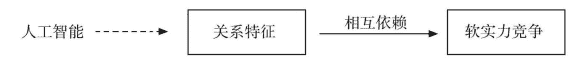

图 4-1　人工智能对大国关系特征的影响机制

第二章阐述了依存的非对称性。政治经济层面已现多极化迹象，但美国在全球核心技术产业体系的相对优势依然明显。以AI视角看，其理论基础、底层技术、产业分工大多在美国科研机构、企业和人员主导下完成，美国至今通过提供公共产品保持引领。在军事经济赋能上，美国也占先发优势。知识是结构性权力来源之一。^([\[36\]](#txt005.html#footnote_content_txt005_36))把AI等技术作为变量，技术领域存在明显头部效应，外部技术合作可替代性弱，受限于少数强国，国际格局更呈现中心与边缘分野的等级化。美国技术主导的全球AI体系也带来结构性权力优势。随着硬实力相对衰落与意识形态文化吸引力下降，技术优势作为结构性权力，已成为护持霸权的主要工具，霸权正向软霸权演进。

### 二、互动重心转向技术

AI影响下首要变化是战略重心向技术领域集中。大国认识到AI的颠覆效应，争夺地位的努力将导致技术互动日益频繁。当前大国竞争是在重叠规则下进行的综合、复合、多维度竞争，比冷战的军备竞赛更复杂难测。经济相互依存虽在减弱，核心战略利益分歧长期存在，技术优势争夺是竞争焦点。^([\[37\]](#txt005.html#footnote_content_txt005_37))地缘政治角力的背后更多是技术实力的起伏，霸权国与其他大国都把技术作为维护利益、提升实力的关键，围绕技术发展的互动与竞争将更激烈。

从软霸权视角看，体系仍在从冷战后美国主导的单极向多极或两极演进。随着AI持续赋能，技术强国可凭借优势减缓甚至改变权力转移进程。对霸权国而言，技术优势一方面护持霸权，美国抢占前沿以提升科技经济实力；另一方面支撑霸权合法性，美国把技术优势转化为美式标准规范作为战略工具。技术实力对提供公共产品能力至关重要，技术本身既是公共产品内容，也是提供公共产品的基础。例如美国信息技术优势使其掌握国际公共舆论能力，为霸权合法性提供支撑。^([\[38\]](#txt005.html#footnote_content_txt005_38))

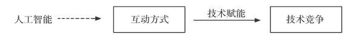

图 4-2　人工智能对大国互动方式的影响机制

### 三、实力分配：强者更强

AI对实力分配的影响是观察其系统作用的关键。以往理论普遍认为美国实力持续下降，但对“其他极”的判断差异反映了对力量对比的认知差异。AI因智能化与高效性被视作“力量放大器”。^([\[39\]](#txt005.html#footnote_content_txt005_39))如图 4-3 所示，AI与核武器导弹等离散技术不同，难以短期非对称增益国家实力，更多与传统军事经济优势结合产生倍增效应，这更利于大国。大国有基础在智能化浪潮中抢占先机，建立技术与知识壁垒。

尽管国家仍是主体，超级科技企业、科学家团体等非国家行为体的重要性在上升。它们掌控关键基础设施与数据资源，承担高额算力成本，拥有海量数据与真实应用需求。权力正从政府向这些行为体扩散转移，其诉求多与所在国政府一致。拥有超级科技公司与科学家群体的国家在技术发展与国际话语权上优势显著，其他国家在发展与应用上均处劣势，政策灵活性受限。

利益不一致时，国家仍可通过市场监管、出口管制、金融管制等约束非国家行为体。各国对他国科技企业的信任度下降，虽希望借助跨国企业资源，但同时推行供应链审查、网络安全评估、数据本地化等防范措施。相较既往，跨国企业尤其是超级科技企业的自由空间被压缩，本国与东道国合规要求都在提高。在内收外压趋势下，企业需兼顾多方利益。

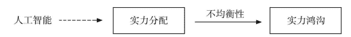

图 4-3　人工智能对大国实力分配的影响机制

## 第三节　AI对大国关系的影响机制

基于上述假设，本节分析AI时代大国关系特征。如图 4-4 所示，三项假设相互联动，构成解释视角。在软霸权体系下，依存背景下的关系属性决定主要特点，博弈聚焦前沿技术，竞争结果带来实力分配不均衡，三者共同构成分析框架。

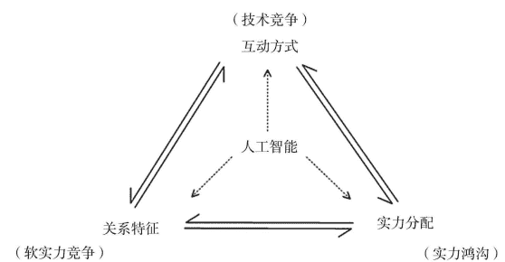

图 4-4　人工智能对大国关系的影响机制

### 一、依存下的软性角力

“合作”与“冲突”是大国关系的两种常见形态。当前互动处于竞争的中间态，学界认为回归大国竞争是大势所趋。结构性变化既非霍布斯式对抗，也非康德式合作，而是一种洛克式的竞合。^([\[40\]](#txt005.html#footnote_content_txt005_40))美国霸权下降导致部分规则失灵，但霸权建立的国际制度仍维系合作。自第三次科技革命以来，技术全球化分工构建的依存关系仍是各国发展基础，各国战略上都强调AI国际合作必要性，因其敏感脆弱，重构成本高。

全球化时代，技术发展难以局限于一国，扩散受市场驱动。虽竞争限制核心技术流动，但创新资源仍可通过跨国企业以知识产权、产品服务形式扩散。AI作为信息技术，天然具有全球性，如同网络。优先国家可制定全球标准，地缘战略只能由局部向全球拓展。^([\[41\]](#txt005.html#footnote_content_txt005_41))AI的全球化建立在跨国制造供应链之上，从基础研究、学术交流到软件开发、硬件生产，均需高水平国际分工。例如高性能芯片产业高度全球化，研发设计制造组装由不同优势企业执行，生态复杂，参与企业遍布全球。半导体产业链平均涉及25个国家，产品到达终端前需跨境转运70余次。^([\[42\]](#txt005.html#footnote_content_txt005_42))AI建立在全球生态的软硬件基础上，扩散、人才交流、商业拓展均在全球环境进行，具有鲜明全球属性。arxiv成为预印本分享平台，大幅提升前沿交流效率与迭代速度。

各国AI政策制定也需全球视野。主要国家战略均显示，AI发展必须依托全球创新环境与产业生态，在吸引投资、人才、市场等方面推动开放，共同借助全球市场提升水平。对企业而言，主流深度学习框架能缩短周期、降低开发量、提升部署效率。框架与算法开发尤其需要全球开发者社群，参与者越多生态越完善。

当前国际环境与相互依存理论提出时已不同，但经济依存加深提升了大规模冲突成本。从技术看，各国AI发展无法完全孤立，发展相互关联同步推进，仅用军备竞赛经验判断并不准确。大国关系紧密，全方位脱钩可能性极小，体系难完全倒退至冷战权力政治。同时全方位博弈加剧，美国霸权实力在下降，推动经济全球化的动能减弱，部分规则在区域失灵。一些国家强调“经济主权”“技术主权”“数据主权”，希望将核心资源留在本土。但总体而言，各国仍在同一技术生态与规则体系下，借助全球合作效率仍最符合国家利益。

因此AI是数字技术与互联网浪潮的代表，依赖开源软件、顶级期刊、数据共享等全球化环境，多国多学科团队跨国协作创新。未来发展仍需国际合作。基础编程语言与软件框架多为开源，依赖全球技术社区协作。深度学习框架基于开源模型，吸引全球人才参与。领先科技企业采用开源策略提升易用性与开放性，形成以其为主导的生态。框架一旦推出即在全球服务，并在竞争中优胜劣汰。AI研发依赖高质量论文共享，多数学术论文在发表前即在arXiv发布，代码在GitHub托管。^([\[43\]](#txt005.html#footnote_content_txt005_43))深度学习需依靠应用数据持续更新，庞大市场规模是迭代基础。率先建立技术竞争力者可获市场认可，实现下一轮创新，进一步扩大优势。

各国若想借助AI增强综合实力，都绕不开全球化分工搭建的技术生态。即便眼下处在技术前列的强国，也难以也无力把所有关键环节牢牢抓在手里。放在当下，AI属于典型的通用型技术，要想保持零部件的稳定供给乃至技术优势，不仅得投入持续且巨大的研发资金，还必须积淀相当长的技术经验。全球化孕育的网络式相互依存并非左右大国关系的唯一因素，却在改变竞争的形态。大国很难彻底摆脱竞争，通常会倾向于采取软性制衡的策略。若进入去全球化的情境，因缺乏相互牵制的约束，传统式权力博弈的可能性会上升。^([\[44\]](#txt005.html#footnote_content_txt005_44)) 学界在软制衡基础上提出“软修正主义”，指的是国家利用非军事手段来重塑国际条约、组织与规则，在温和政策取向下，秩序演变或更趋和平。^([\[45\]](#txt005.html#footnote_content_txt005_45)) 这从侧面说明了全球化、互赖与战略稳定的复杂互动：大国一方面要依托开放生态维系在AI等新兴领域的优势，另一方面又须在合作中守住底线。随着博弈加剧，硬实力让位给软实力成为主线，国家需要在追求自主与降低外部依存、效率提升与安全防范之间找到平衡。

## 二、国家互动博弈重心转向技术领域
主要国家普遍将AI视作守护安全、拉动经济增长的核心技术，开始从战略高度进行布局，鼓励其在装备研发、产业赋能、治理升级等方面落地。权力争夺的焦点正从传统军事政治转向技术领先度。竞争白热化时，技术赛道的正反馈效应会进一步放大国与国之间的博弈冲动；在国际规则仍属空白的窗口期，容易出现多线竞赛与秩序混乱，进而削弱体系信任。

技术变革的规模与节奏远超以往。2014年英国国防部仍认为量子信息处理离实战应用很远，至2020年6月英国国防科技实验室却称该技术已在国家和全球范围取得实质性进展。日本一度在量子计算上领先，但长期投入不足，直至看到中美在该领域的激烈角逐后，文部科学省自2019年起大幅提高投入，动力正是大国竞争带来的压力。

博弈加剧推动技术问题加速政治化，政治意志向数字空间渗透，合作信任被侵蚀，技术推进被安全考量所压制。新兴技术带来的国家安全风险愈发凸显，成为新一轮博弈场。技术演进与地缘演化交织，变量剧增。正如前述，AI的领先具有外溢效应。2011年社交媒体催生的“阿拉伯之春”席卷中东，让世人认识到技术并非中立，价值判断与安全焦虑开始主导技术扩散。制度差异与意识形态分歧正取代经济理性的合作逻辑，成为数字协作的首要门槛。一方面，传统上技术沿线性波动推进，如今政治介入带来不可控性，常借安全之名限制扩散，创新阻力上升。另一方面，意识形态裂痕侵蚀战略互信，技术路线走向分裂，形成安全困境与网络碎片乃至阵营对立。此背景下亟需更具前瞻性的发展路线图指引。随着博弈深化，各国对网络主权的重视上升，部分国家强化技术主权与数字主权的取向，与国际社会对新兴技术的疑虑叠加，放大了价值观、政治文化、法律理念、历史传统等方面的差异，围绕新兴技术的竞争愈演愈烈，AI全球治理的信任基础大幅削弱。

对技术颠覆效应的认知也在演变。技术具有牵一发而动全身的特性，网络空间被越来越多的国家视为巩固影响力的战略要地，围绕网络的实力、技术与规则之争愈发激烈。^([\[46\]](#txt005.html#footnote_content_txt005_46)) AI治理难以脱离大国权力政治语境，未来秩序将呈现多边博弈、强国主导的格局。^([\[47\]](#txt005.html#footnote_content_txt005_47)) 科技竞争与经济竞争正成为主要博弈场域，高科技赛道竞争加剧，市场逻辑让位于国家逻辑，自主研发被高度强调。^([\[48\]](#txt005.html#footnote_content_txt005_48)) 当经济利益退位于经济安全，客观规律被政治计算所制约，围绕AI的国家共识转向“风险并存、安全优先”。美国智库大西洋理事会指出世界正迈向“地缘技术”时代，关键技术与数据资源控制力将深刻塑造地缘政治与合作方式，掌控数据与技术的国家将决定竞争走向，创新驱动力空前。^([\[49\]](#txt005.html#footnote_content_txt005_49)) 欧洲对外关系委员会亦认为技术具地缘政治属性，是权力再分配与国际关系重塑的重要力量，欧盟需跳出纯经济视角，深度参与技术地缘竞争，降低对外部供应商依赖，增强话语权。^([\[50\]](#txt005.html#footnote_content_txt005_50))

## 三、实力分配不均下的实力鸿沟
历史上技术红利常集中于少数强国，抓到变革窗口的国家国力上升，同时技术扩散拉大国别差距。联合国贸发会议回顾工业革命以来的技术浪潮发现，以美欧澳加日为代表的领先群体，与其余国家的年人均GDP差距不断拉大；二战后信息通信与工业自动化普及，领先国家年人均GDP实现倍增，边缘国家增速则相对温和。^([\[51\]](#txt005.html#footnote_content_txt005_51))

前文已说明AI研发将由体系内少数大国主导，强国获益远超弱国。若以军民两用与纯军用区分扩散效果，纯军用AI复制难度高，而军民两用系统的扩散程度取决于商业化水平，且受市场导向驱动，传播速度更快。^([\[52\]](#txt005.html#footnote_content_txt005_52)) 与隐身、精确制导等传统军用技术不同，AI是典型的民用驱动型军民两用技术，主动力来自学界与企业。但它又与卫星导航等传统两用技术不一样：一方面民用级与军用级能力存在鸿沟，掌握民用算法不等于具备军事效能；另一方面AI的赋能特性决定了场景融合深度直接影响效果，融合带来的难题不亚于研发本身。

AI的复制推广边际成本极低，难以被垄断。互联网扩散曾被解读为权力下沉，从国家向企业、社群、个人扩散，催生“世界变平”论。但复制仍需门槛，需要坚实的硬件基础与人才储备，只有具备条件的国家才能快速获益。研发与应用层面，硬件端的专用设备、能耗、数据获取都意味着巨额成本，软件端的开源算法远无法比拟工业级、军用级算法。因此即便技术在全球扩散，核心仍被主要强国控制。

由此来看，AI更可能导致数字权力的集中。建设AI需要巨额前期投入，除人才缺乏外，数据资源、算力网络等数字基础设施也是瓶颈。高门槛必然拉大发展差距，强国收益递增，发展中国家面临边缘化风险。军事上，高性能智能化无人作战体系的发展巩固了技术强国的优势。如二战后去殖民化打破西方军事优势的是AK-47等轻武器在第三世界的普及，而喷气式战机等高端装备因缺乏维护能力难以发挥作用。^([\[53\]](#txt005.html#footnote_content_txt005_53)) 目前约90个国家拥有无人机，大多数缺乏武装与先进型号，落后型号航速低、易被防空或空袭击，作战场景受限。在能力落差下，技术弱国很可能长期沦为强国依附，国际权力结构趋于固化。

AI并非普适，渗透程度与需求必然失衡。发达国家虽受不平等与失业冲击，但教育水平高、社会保障完善、产业链位置有利，冲击更大的是以廉价劳动力竞争的发展中国家。AI替代低效劳动密集岗位，劳动力充裕的发展中国家将面临发展困境。牛津大学研究指出，尼泊尔、柬埔寨等国在工业化时代借助全球分工建立工业体系，但在AI兴起后面临过早去工业化风险。发达国家可能减少对劳动密集型产业的需求，进一步削弱发展中国家在全球经济中的角色。麦肯锡预测，AI经济红利分配不均，领先国家可获20%至25%净收益，发展中国家仅5%至15%，马太效应凸显。^([\[54\]](#txt005.html#footnote_content_txt005_54))

差距也体现在规则话语权上，全球AI规范制定的对话严重不均，非洲、南美、中美洲、中亚等地区代表性不足，发达国家主导叙事，掌控主导权。^([\[55\]](#txt005.html#footnote_content_txt005_55)) 发展中国家因技术能力受限，难以保护数据安全，抵御数据攫取与技术干涉的能力不足，面临被强权干预甚至颠覆的风险，此类干预可通过长期宣传与意识形态渗透，也可借政治热点煽动恐慌。非洲、东南亚等地的技术治理与数据安全监管几乎空白，用户权益难以保障。对这些国家而言，数据主权与技术安全并非首要议题，能否在合作中换取基础设施与经济发展利益才是核心关切。^([\[56\]](#txt005.html#footnote_content_txt005_56)) 不均衡加剧可能带来长期不平等，垄断者攫取大部分利润，形成“技术殖民主义”。

本研究认为，因AI对人力替代效应增强，发展中国家依托廉价劳动力实现从边缘到中心的跃迁路径可能被堵死，传统劳动力比较优势逐步流失，跟不上智能化浪潮的国家或将被永久困在权力结构的边缘。AI带来的实力分化可能催生中心-外围分野。与金字塔格局不同，中心国家通过产业分工与链条协同共享红利，在国际事务中拥有较高话语权，其中既包括大国，也包括掌控产业链关键节点的小国，如半导体领先的荷兰、通信领先的瑞典与芬兰、军工领先的以色列，它们在AI价值链中不可替代。无法进入中心的多数发展中国家，追赶空间将愈发狭窄。

## 第四节　人工智能时代大国关系的趋势评估
为进一步梳理AI对大国关系的影响机制，本节围绕复合型竞争、规范标准与科技巨头三大假设，分别评估可能趋势。如图 4-5 所示，在关系特征层面，AI将加剧复合型竞争，对战略谋划提出更高要求；在互动方式层面，技术竞争提速使得掌控技术标准话语权成为助力发展的关键，标准与治理规范成为博弈前沿；在实力分配层面，少数强国的超级科技巨头成为技术红利分配的关键变量，对实力对比产生重要影响。

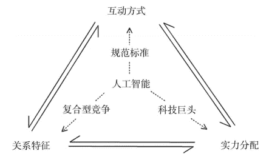

图 4-5　人工智能对大国关系影响的趋势评估

## 一、复合型竞争成为软实力竞争的重要形式
AI将推动大国竞争走向更复杂的复合形态，它并非对传统工业技术的简单替代，而是呈现系统性，且伴随技术本身的不确定性。前沿技术释放难以预测的能量，对人类社会的潜在影响无法线性推断，放大了人们对国际体系复杂性与变革性的预期。^([\[57\]](#txt005.html#footnote_content_txt005_57)) AI的渗透性拓展了竞争维度，对战略谋划形成挑战。在维持全球技术生态相互依赖的同时，保持技术领先性成为考验。即便对AI领先的国家或超级科技巨头，也面临“不进则退”的压力，竞争残酷性不容忽视，赢家通吃的规律依然适用于数字技术演进。例如在半导体发展中，因技术与资金门槛，联电、格芯等厂商相继退出新一代工艺研发；在移动通信领域，每一代演进都有厂商出局，如3G向4G过渡中，博通、德州仪器、英伟达等基带芯片厂商因跟不上步伐而退出。对国家而言，数字技术迭代快、门槛高，要求长期技术积淀、持续高额研发投入、广阔应用市场、高水平人才储备以及适配制度环境，稍有失误就可能错失迭代而永久掉队。

数字化与网络化模糊了主权国家权力的边界，非国家行为体具备形成新权力中心的可能。^([\[58\]](#txt005.html#footnote_content_txt005_58)) 真正掌控海量数据与强大算法的网络平台以及拥有类似能力的政治团体，才是信息与数字博弈的核心玩家。^([\[59\]](#txt005.html#footnote_content_txt005_59)) 这些主体正把技术实力转化为政治影响，如何有效运用来自私营领域的技术力量成为各国难题。当前对超级网络平台的监管成为全球焦点，主要大国均启动了反垄断调查。众多平台掌控海量数据与内容，基于智能算法管理个人数据，形成“有墙的花园”，为科技巨头带来巨大话语权。同时超级科技企业又是推动研发创新的重要主体，如何在促进发展与合理监管之间取得平衡，考验大国的综合谋划与超前治理能力。

## 二、规范标准成为技术领域博弈的重要前沿
大国把技术标准作为AI发展的前沿竞争场。规范标准是指导技术发展方向的集合，包括道德准则、伦理原则、法律规范、技术标准等。标准能够把原则固化到应用推广中，是发展与合作的重要基础。统一且可互操作的标准与监管规范有助于降低市场壁垒、增强系统互联互通互认；反之则加剧碎片化。技术标准既促进互联互通与兼容，也带来锁定效应与路径依赖，对制定权的争夺具有实质性市场影响与竞争优势。AI研发依赖全球化产业体系与开源生态，应用以网络互联与数据共享为基础，标准的重要性不言而喻。即便全球统一的AI技术标准难以一蹴而就，标准互联互通仍可消除贸易壁垒、助力本国企业拓展市场，推动本国标准被更多国家认可将带来强竞争优势，掌控标准即掌控技术发展路径的话语权。

各国均认识到，数字技术与金融、娱乐、电子商务、能源、教育等广泛融合，相关国际规则尚未成型，先发者将占据优势。近年欧盟致力于将其前沿技术标准提升为事实上的国际标准，日本、韩国等国为满足欧盟跨境数据传输充分性认定，也在不断向《通用数据保护条例》靠拢。欧盟还着手制定AI监管法规，意图引领全球治理方向。地缘政治维度的博弈正向规则标准竞争转变，^([\[60\]](#txt005.html#footnote_content_txt005_60)) 这种博弈在新兴技术领域最为突出。AI标准是主要大国在技术领域竞争最为激烈的赛道之一，各方都在制定符合自身价值观的标准与准则。

目前全球对AI的治理规则仍处博弈阶段，统一共识尚未形成，但各国与相关机构正竞相推出政策文件，意图借此塑造未来国际秩序走向并树立示范效应。即便这些文件本身不具法律约束力，经反复引用后仍有可能沉淀为事实上的国际惯例。西方在话语与制度设计上具备先发优势，由欧美学者起草的学理论述虽非法律，却在实践中发挥出类似“专家造法”的引导作用，成为国际讨论的重要参照。表面上各方都强调技术标准要公平包容，实际操作中却多把标准导向有利于本国产业外拓、海外布局与国际合作的方向，以提升自身在技术竞争中的综合竞争力。^([\[61\]](#txt005.html#footnote_content_txt005_61))

近些年美国联合盟友密集推出联合倡议，以西方价值为内核主导治理议程。2018年G7峰会的人工智能联合声明、2019年经合组织发布的人工智能原则建议报告即为典型。华盛顿正加速构建契合自身利益的技术准则，并推动其上升为国际标准。时任国务卿布林肯在首次外交政策演讲中把“确保美国技术保持领先”列为八大优先事项之一，并持续深化与盟友在前沿技术领域的协作。为降低对外依赖带来的结构性脆弱，多国都在加快布局。欧洲急于争取AI伦理标准的制定权，其逻辑在于一旦掌握规则主导权，就能迫使他国跟随，从而将欧洲的价值与文化理念嵌入技术体系。^([\[62\]](#txt005.html#footnote_content_txt005_62))据此有学者指出，欧盟通过规则输出影响跨国企业行为模式，让欧洲标准演变为全球标准，这即是布鲁塞尔效应。^([\[63\]](#txt005.html#footnote_content_txt005_63))

## 三、科技巨头成为影响实力平衡的重要变量

网络本体的一定去中心化曾削弱传统国家的层级管理，权力向非国家主体扩散。但随着AI深度嵌入各类在线应用，资源与控制权正加速向超级平台集中。公众信息获取愈发依赖算法推送，AI不仅能捕捉舆情热点，还在主动引导、塑造认知。超级科技巨头在其中扮演规则制定与执行的核心角色，其服务兼具公共基础设施属性，影响随之放大。

这些企业已成为线上线下无法绕开的关键力量，掌控数据流、网络连接与前沿技术，实质上掌握了社会运转所依赖的基础设施生态。2019年全球市值前十企业中有七家属科技巨头，^([\[64\]](#txt005.html#footnote_content_txt005_64))苹果与亚马逊当年营业收入均突破2000亿美元，脸书用户超20亿，微信用户也超过10亿。庞大用户基数带来海量可利用数据。2020年疫情推动生产生活全面线上化，数字化转型加速，也进一步放大了巨头影响。凭借数据优势，巨头大力投入AI算法挖掘价值，在创造商业回报的同时，也让创新要素加速向其聚拢。

当跨国科技巨头在安全、生产、金融、知识等领域获取结构性权力时，其政治角色日益凸显。它们借助经济实力与垄断地位影响各国监管政策，提升制度性权力；通过提供公共产品输出特定价值理念，增强国际话语权，成为全球公民社会的核心力量。^([\[65\]](#txt005.html#footnote_content_txt005_65))2022年2月，Meta对外放话，若欧美数据传输规则不能更新，将撤出脸书、Instagram等服务。这类企业已能在规则层面与国家博弈，其全球化运营本身也介入双边关系。

研发重心也在转移。上世纪五六十年代AI诞生时，政府尤其是军方是主要资助方，1956年达特茅斯会议就得益于美国海军经费。直至21世纪初，重要突破多来自政府实验室。如今创新中心已转向产业界尤其是超级巨头，它们成为技术创新的主力。

不少研究指出巨头主导削弱了AI研究的生态多样性。政府话语权下滑，企业更关注应用效果与商业化前景，而非国家竞争力本身。^([\[66\]](#txt005.html#footnote_content_txt005_66))企业研发强调产出与转化，偏向短期利益，人才招聘要求快速产出，而真正的突破往往需要长期攻关。不可否认，超级巨头已是研发投入的主要来源。以半导体为例，2019年美国产业界研发投入近400亿美元，是政府投入的23倍，推动行业创新与经济繁荣。^([\[67\]](#txt005.html#footnote_content_txt005_67))当前全球AI主要成果多出自巨头及其实验室，2004至2018年间，谷歌、亚马逊等吸纳了52名AI领域终身教授；2004年高校尚无教授流向企业，2018年则有41位离职入企。^([\[68\]](#txt005.html#footnote_content_txt005_68))中国亦然，根据国家统计局、科学技术部、财政部联合发布的《2020年全国科技经费投入统计公报》，2020年企业研发投入占全国研发经费比重超76%，企业已成创新投入主体，互联网企业在技术、商业模式与运营经验上持续积累并加大基础研究投入。^([\[69\]](#txt005.html#footnote_content_txt005_69))

AI放大了要素集中度与网络效应，呈现垄断典型特征。超级公司在搜索、社交、电商等领域占据主导，几乎垄断用户数据，而AI高度依赖数据，这使其成为技术主要供给方。2016年全球AI研发与收购资金在260亿至390亿美元之间，其中200亿到300亿美元来自中美超级科技企业。^([\[70\]](#txt005.html#footnote_content_txt005_70))平台掌控数据接口与用户资源，社交媒体靠免费服务收集信息并通过AI画像推送定制内容，提升黏性。初创AI企业难以自建大规模数据集，只能与平台合作获取数据。AI高门槛、巨额资本与长期积累使巨头难以被撼动，它们正扭转互联网普及初期权力“平等化”的趋势，转向不平衡发展。网络操纵政治的技术门槛也在下降，拥有高质量数据与精准算法就能对舆论施加定向影响。

巨头的迅猛崛起深刻改变大国关系。它们在数字技术储备、数据掌控、产业生态构建上领先，深度学习开源社区、软件协议、开发工具多由少数巨头创建维护，在大国竞争中扮演关键角色。国家权力受到资本力量侵蚀。为防御性目的，部分国家加强对本国乃至他国巨头的监管，划红线、设禁区。美国拜登政府上台后要求企业把“国家安全”置于经济活动首位并维护西方价值观，欧盟收紧欧美跨境数据流动管理，要求企业不得在美国服务器存储欧盟公民信息。

学界对此存在分歧。肯定派认为科技巨头正在重塑地缘政治格局，其权力和作用已接近国家，未来十年政府与公司将在物理与虚拟世界争夺主权。关键信息基础设施被公司垄断，向国家安全领域延伸后，它们逐步获得监控世界的能力，侵蚀传统主权，现有法律难以跟上。^([\[71\]](#txt005.html#footnote_content_txt005_71))质疑派则认为国家承载的物理生存空间不可替代，数字空间只是选项；科技公司仍受政府监管，缺乏公民忠诚；科技巨头只是近代跨国工业的延续，如钢铁、石油巨头早已式微。^([\[72\]](#txt005.html#footnote_content_txt005_72))

主要大国都意识到全社会、全政府的协同在AI发展中具独特优势。商业化模式重塑政府与企业关系，国家资源与私人资本融合，巨头与其所在国利益日益绑定。当前国际局势严峻，全球化受阻，国家重回舞台中央。疫情从多维度重构全球治理，混乱中国家成为稳定经济与驱动复苏的主力，自由主义秩序与全球贸易合作基础受损，大国博弈加剧。^([\[73\]](#txt005.html#footnote_content_txt005_73))技术议题已与政治、经济、文化、军事交织，各国普遍加大对巨头的监管，尤其在数据、算法与应用场景上。欧盟率先推出《数字服务法案》，要求公开算法与内容审查标准，扩大监管范围，其背后明显有制衡美中网络优势的考量。大多数政府也在防止算法被垄断。跨国科技企业虽能获取“超级权力”，但这种权力不稳定，随时可能被削弱。

## 本章小结

本章梳理了冷战后解释大国关系的理论视角。单极视角承认美国霸权相对衰落和权力转移的现实，但认为维持霸权的制度基础仍在，规则与制度在国际秩序中作用复杂。多极视角认为美国主导的单极格局不稳定，多中心格局已形成，多极化是演进大势，其中有学者提出趋势正向中美两极演变，科技实力成为国家实力关键，中美具备把握新一轮科技变革机遇。复合多元视角更关注权力扩散，强调小国、弱国和非国家行为体不可忽视，需要多维度多场景看待互动。

在借鉴上述解释后，本章以软实力为分析视角阐释AI时代的大国关系，从关系特征、互动方式、实力分配三方面提出基本假设，构建AI对大国关系影响的分析框架并评估其发展趋势。

## 人工智能时代大国关系的分析框架

## 从关系特征来看

如图 4-6 所示，从关系特征看，核威慑平衡下大国仍需依赖相互依存的全球化技术生态来发展AI并提升国力。即便各国都想减少对外依赖的脆弱性，分工体系下的AI发展难以改变。在相互依存中，大国博弈转向以技术实力为核心的“软实力”竞争，以获取实力分配优势。AI技术的不确定性叠加复杂国际环境，复合型竞争成为主旋律，也考验战略谋划能力。

## 从互动方式来看

从互动方式看，技术竞争将成为大国互动焦点，技术迭代速度不断超出预期，各国把AI等前沿技术作为获取相对优势的重要抓手。AI发展不平衡加大了不确定性，大国意识到对突破性技术的主导权将影响权力分配与国际格局。标准规范日益成为巩固技术优势的工具，大国围绕技术标准的博弈愈发频繁激烈。

## 从实力分配来看

从实力分配看，全球资本与人才会进一步向AI先进国集中，颠覆性创新属性让落后国跟随空间变小。技术门槛可能拉大发展鸿沟，强国收益不断累积，后发国家追赶愈难，实质上形成“中心—外围”分化。中心国家通过全球产业分工与产业链协同共享红利，未能进入中心的国家面临永久技术边缘化风险。科技巨头在AI研发与应用中扮演关键推动者，也日益成为影响大国实力的重要变量。

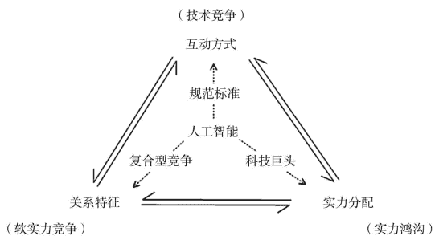
图 4-6　人工智能时代大国关系的分析框架

## 注释

[\[1\]](#txt005.html#footnote_quote_txt005_1)William Wholforth：The Stability of a Unipolar World，International Security，1999，24（1）：pp.5-41。

[\[2\]](#txt005.html#footnote_quote_txt005_2)约翰·伊肯伯里：《以美国为主导的单极世界：继续存在与衰落的原因》，载约翰·伊肯伯里：《美国无敌：均势的未来》，北京，北京大学出版社，2005：310 页。

[\[3\]](#txt005.html#footnote_quote_txt005_3)John Ikenberry：Libera l Livathan：The O rigi ns，C risis，and Transformation of the American World O rder，Princeton University Press，2011：pp.7。

[\[4\]](#txt005.html#footnote_quote_txt005_4)罗伯特·基欧汉：《霸权之后：世界政治经济中的合作与纷争》，苏长和、信强、何曜译，苏长和校，上海，上海人民出版社，2012。

[\[5\]](#txt005.html#footnote_quote_txt005_5)John Ikenberry：The Next Liberal Order：The Age of Contagion Demands More Internationalism，Not Less，Foreign Affairs，2020，99（4）：pp.133-142。

[\[6\]](#txt005.html#footnote_quote_txt005_6)华佳凡、孙学峰：《国际关系等级理论的发展趋势》，载《国际观察》，2019（6）：48 页。

[\[7\]](#txt005.html#footnote_quote_txt005_7)小约瑟夫·奈：《美国世纪结束了吗》，邵杜罔译，北京，北京联合出版公司，2016 年版。

[\[8\]](#txt005.html#footnote_quote_txt005_8)Stephen Walt：The Ukraine War Doesn't Change Everything，Foreign Policy，2022-04-13.

霸权拐点：从自由秩序到技术多极

冷战后搭建的自由主义国际秩序正在显露出系统性疲劳。米尔斯海默直指这一秩序注定失败，上升期的规则再也无法约束分化期的权力博弈[9][14]。亨廷顿早在上世纪九十年代就提出孤独的超级大国困境，单极优势带来单极责任，也带来战略透支[10]。沃尔兹的结构现实主义提醒我们，体系结构而非善意决定行为逻辑[12]，库普乾则在讨论霸权的空心化与多极稳定之间反复权衡[13]。

对秩序的反思很快转向重组方案。哈斯与库普汉提出新协约呼吁，在多极世界里通过协调预防灾难[19]。米勒与劳赫、阎学通等人从权力中心转移的角度切入，强调大国协调机制是避免失序的关键[20][21]。杨原与曹玮、林利民与王轩对中美新两极的结构特征进行拆解，认为这不是简单的冷战复制，而是功能分异下的共治与竞争并存[22][25]。

阿米塔·阿查亚提醒美国世界秩序的终结已是结构性议题[27]，奈在权力大未来中讨论软实力的边界[29]。斯劳特把棋盘与网络并置，指出网络时代大战略必须兼顾节点治理[30]。施韦勒用麦克斯韦妖比喻新世纪的全球失序[31]。杰维斯的现实主义研究与尚会鹏对强联结时代国际政治本体的讨论，共同指向连通性对主权逻辑的重塑[33][34]。

技术线成为分歧的放大器。李巍与张哲鑫、斯特兰奇的市场与国家关系分析提示，战略竞争时代国家干预回潮[35][36]。扬科夫斯基关注俄罗斯在技术竞赛中的博弈位置[37]。刘杨钺多次论证美国世纪的终结疑问与不确定时代的网络安全治理[38][39]。刘胜湘与陈飞羽比较美苏冷战与中美战略竞争的生成机制[40]，阎学通提出超越地缘战略思维的必要[41]。

半导体生态的全球化与复杂性被联盟报告点名[42]。arXiv自1991年起为论文预印提供网络平台，GitHub则为超过5000万开发者提供代码协作，深度学习框架的开源共同推高了人工智能迭代速度，2022年初arXiv收录论文已超200万篇[43]。里普斯曼讨论全球化与去全球化在强国政治中的张力[44]，何凯等人重新思考修正主义的定义[45]。

疫情后治理更趋碎片化。任琳与黄宇韬、黄宇韬研究后疫情时代的全球治理秩序与技术霸权兴衰的关系[47][48]。大西洋理事会地缘技术委员会的报告与弗兰克的欧洲地缘技术政治研究，将技术、数据与权力直接挂钩[49][50]。联合国贸发会议的技术与创新报告为讨论提供基线[51]。霍罗维茨把人工智能、国际竞争与力量平衡结合起来分析[52]。

布赞与劳森的全球转型论强调现代性与国际关系的形成路径[53][17]，麦肯锡对人工智能对世界经济影响的建模显示生产力重构不可逆[54]。乔宾等人描绘人工智能伦理指南的全球图景[55]，谭俊宜关注中美AI竞争对东南亚的溢出效应[56]。刘杨钺重申技术变革下的网络空间安全治理需拥抱不确定[57]。

欧文对数字时代国家危机的论述得到封帅、郎平、黄志雄等多位学者在人工智能时代世界政治图景、互联网对国际关系影响与塔林手册2.0规则趋势上的呼应[58][59][60][61]。布拉德福的布鲁塞尔效应说明欧盟如何通过标准输出影响世界[63]。普华永道的全球百强公司市值榜与蔡翠红对高科技跨国公司影响力的探究，同样指向企业权力在新秩序中的权重提升[64][65]。

整体看，学界共识是：单极自由秩序难以为继，多极协调需求上升，技术尤其是人工智能与半导体成为权力竞争的核心场域，网络化协作与国家主导的治理逻辑持续博弈。

[\[66\]](#txt005.html#footnote_quote_txt005_66)Rebecca Gelles，Tim Hwang and Simon Rodriguez：《绘制美国企业人工智能实验室的研究议程》，安全与新兴技术中心，2021 年 4 月。

[\[67\]](#txt005.html#footnote_quote_txt005_67)半导体行业协会：《激发创新：联邦对半导体研发的投资如何促进美国经济增长和就业创造》，（2020-07-19），https：//www.semiconductors.org/wp-content/uploads/2020/06/SIA\_Sparking-Innovation2020.pdf。

[\[68\]](#txt005.html#footnote_quote_txt005_68)Nathan Benaich and Ian Hogarth：《人工智能现状报告》，2020 年 10 月，（2021-03-28），https：//www.stateof.ai/。

[\[69\]](#txt005.html#footnote_quote_txt005_69)数据资讯：《全球互联网头部企业科研产出》，载《中国科学院院刊》，2022（1）：130-137 页。

[\[70\]](#txt005.html#footnote_quote_txt005_70)Bhaskar Chakravorti：《大型科技对人工智能的扼制必须受到监管》，2021 年 8 月 11 日，（2021-12-20），https：//foreignpolicy.com/2021/08/11/artificial-intelligence-big-techregulation-monopoly-antitrust-google-apple-amazon-facebook/。

[\[71\]](#txt005.html#footnote_quote_txt005_71)Ian Bremmer：《技术极点时刻——数字力量如何重塑全球秩序》，2021 年 11 月，（2021-12-20），https：//www.foreignaffairs.com/articles/world/2021-10-19/ianbremmer-big-tech-global-order。

[\[72\]](#txt005.html#footnote_quote_txt005_72)Stephen Walt：《大型科技不会重塑全球秩序》，2021 年 11 月，（2021-12-20），https：//foreignpolicy.com/2021/11/08/big-tech-wont-remake-the-global-order/。

[\[73\]](#txt005.html#footnote_quote_txt005_73)Ashley J. Tellis：《新冠疫情敲响美国霸权》，美国国家亚洲研究局，2020 年 5 月，（2021-12-16），https：//www.nbr.org/publication/covid-19-knocks-on-american-hegemony/。

# 第五章 AI驱动时代的博弈新象

大国互动的常态从来都是竞争与协作交织。本章以 AI 为主线，承接前文对 AI 在军事、经济、网络、数据与科技等维度赋能力的梳理，尝试描摹未来可能出现的对抗与合作并存局面：安全领域博弈趋紧，而科研联动、气候治理等全球议题仍需协同推进。在盘点现有 AI 治理框架与规则的基础上，剖析当下治理的卡点，探究各方争夺 AI 主导权如何催生治理分歧并推演其走向，并强调以“人类命运共同体”理念为价值锚点舒缓治理冲突的现实意义。

## 第一节 对抗面：AI何以成为新战场

2022 年 2 月俄乌冲突开启后，AI 在国家间较量中的真实触感被公众放大。社交平台上假新闻、合成图、伪造视频泛滥，真假难辨，内外舆论反复摇摆，网络战与信息战已然成为冲突的核心形态。混合战语境下，AI 已渗透到作战链的各环节。卷入的远不止俄乌战场，台前幕后还有立场各异的国家、黑客团伙、跨国技术机构乃至个体行动者。技术成熟度尚存欠缺，但以 AI 为底座的对抗形态已由设想迈向现实，成为大国角力的关键空间，而规则滞后带来的溢出风险不容低估。

从自主武器、人脸识别到算法决策，AI 的军事化会放大跨国冲突烈度，也在模糊战争与非战争的边界。一旦舆论操控类能力与实战力量绑定，战争样貌可能被彻底改写。现行裁军协定与军控机制对 AI 军事化覆盖不足，大国间的 AI 治理协作仍在起步。埃隆·马斯克（Elon Mask）等 116 名全球企业领袖指出，自主武器系统或将继火药、核武器之后掀起第三次战争革命，呼吁强化管制。^([\[1\]](#txt006.html#footnote_content_txt006_1)) 也有更激进的判断认为，随着机器人、算法与自动化的普及，社会运行秩序将被根本重塑，全球政治已非人类独占，霍布斯式的自然状态^([\[2\]](#txt006.html#footnote_content_txt006_2)）或英国学派的基本假设都将失效。在 AI 赋能下，行动主体、关系结构与运行秩序将被重新配置，世界运行逻辑由地缘政治转向地缘技术（Geotechnics），这种系统性跃迁已超出单极或多极的传统争论。^([\[3\]](#txt006.html#footnote_content_txt006_3)) 这类讨论本质上是对 AI 应用不确定性的焦虑。

AI 的不确定性与地缘风险交织，可能催生以数据与算法为核心的多元对抗样本，迄今缺乏国际共识来约束风险。它们一方面凸显 AI 对国家安全的直接冲击，凸显治理必要；另一方面风险预判与制度供给的错配，也放大了治理的紧迫。

### 一、集群无人作战的演进形态

如前文所述，AI 通过增强战场感知、提速决策、压缩行动成本，推动由无人作战单元构成的去中心化智能体系成形。算法与自动控制结合，使自适应智能无人单元大规模进入军事使用，集群化体系的韧性大幅提升。与单中心或多中心体系不同，局部单元被摧毁后，具有同类功能的多个单元可迅速重组并恢复战斗力。

图 5-1 显示，主要大国的自主武器研发并未放缓，相关系统储备可观。智能化无人机蜂群不仅提升效能，还增强灵活性与抗毁性，降低了传统中心化体系的脆弱点。未来战场上，对峙双方可能上演蜂群式对抗，由算法与算力支撑的系统能在极短时间内推演战局走向，整体作战效能将决定胜负。美国防部启动多项无人化作战研究，美军提出的“马赛克战”（Mosaic Warfare）概念即借助 AI 与自主系统，把大量体积小、功能单一的作战单元整合成智能无人平台，实现灵活重组与自适应作战。^([\[4\]](#txt006.html#footnote_content_txt006_4)) 其自组网、自适应、自调节、自同步特征可对敌方关键节点实施饱和打击，显著抬高传统平台的防御难度。智能无人集群间的较量，很可能成为未来大国军事行动的主流模式。

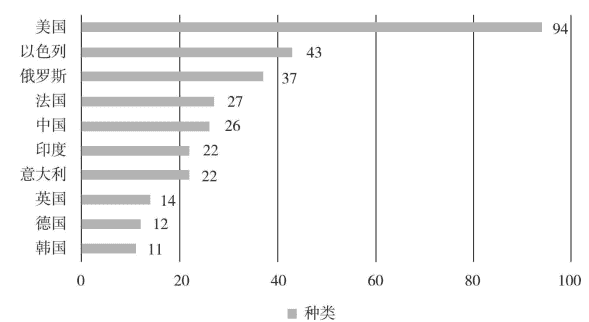

图 5-1　各国自主武器系统发展情况对比（1950—2017）^([\[5\]](#txt006.html#footnote_content_txt006_5))

### 二、网络空间的高强度对抗

AI 发展对网络安全构成重大冲击，AI 赋能的网络武器将使攻防更激烈。随着应用扩散，攻击面同步扩大，例如自动驾驶汽车被黑客劫持；与此同时，AI 也可被用于发起大规模网络袭击。防御系统若无法快速应对高强度攻击，极易被击溃。网络武器可破坏指挥与预警体系，甚至削弱敌方核反击能力，使核威慑失效。^([\[6\]](#txt006.html#footnote_content_txt006_6)) 在此假设下，若某国认为自身反击能力被削弱，先发制人的动机将明显上升。

目前网络攻击主要依赖精通攻防的人才，该类人才稀缺。未来借助 AI 发动攻击对人才依赖下降，更多受资金约束。以高级持续性威胁（APT）为例，攻击者长期潜伏寻找漏洞，属于劳动密集型。机器学习与 AI 能力增强后，发动门槛降低，漏洞搜寻可实现前所未有的自动化，攻击方能不间断扫描对手系统，攻击速度可能超出人力可控的防御体系。鉴于网络战特性，大国冲突很可能首先在网络空间引爆。

### 三、极速战的战略博弈

智能化系统为技术强势方提供速度优势，能更快采集处理信息、规划任务、支撑决策并实现高效指挥。有研究指出，AI 辅助的指挥决策系统与致命自主武器的结合，将大幅超越传统动员战的节奏，形成极速战（hyperwar）^([\[7\]](#txt006.html#footnote_content_txt006_7))新形态。在此情境下，当战斗节奏超出人类反应阈值，军事行动控制权或被迫移交机器。人类可能丧失战场掌控，机器以更快响应作战。于是观察—定向—决策—行动（OODA）循环被极度压缩，作战人员难以作出合理判断。AI 赋能的自主决策与武器高速运行，会让率先开战者获得显著优势，可能触发意外升级，一旦一方启动，其他对手或跟进，导致冲突螺旋上升。美国兰德公司曾以推演模拟中美在东亚大规模部署无人装备的情形，结果是双方在沟通缺失与高速战场的压力下失控，最终演变为局部战争。^([\[8\]](#txt006.html#footnote_content_txt006_8))

### 四、舆论操纵与心理战渗透

AI 已成为意识形态与社会心理渗透的潜在工具，主要场景在互联网平台，其中数据丰富且可及性高的社交媒体为重点。AI 处理海量个人信息，对大规模群体开展心理干预实验，可预测甚至操纵行为与观念，实现跨国舆论操控。美国国会研究服务局2021年9月更新的《国防新兴技术》报告指出，AI 能力已广泛投入“灰色地带”信息战，深度伪造可用于定向政策误导。俄罗斯从混合战争视角提出“虚拟社会战”，即以 AI 攻击敌方社会心理与意识形态，制造混乱恐慌，瓦解社会基础；这同时也被视为其政治安全的主要威胁。^([\[9\]](#txt006.html#footnote_content_txt006_9))在 AI 加持下，国家间信息战、心理战、认知战的界线将进一步模糊。

“剑桥分析事件”等案例显示，企业掌握的 AI 系统可分析民众政治立场、研判舆情并进行精准宣传，还能伪造虚假信息与热点，左右一国政治进程。调查显示约三分之二受访者担忧数字技术发展过快，难以辨别现实与虚假现实。^([\[10\]](#txt006.html#footnote_content_txt006_10))AI 参与政治的案例增多。已有研究指出，参与政治话题的推特账号中有12.6％由机器人操控，且在不违规前提下可正常访问。若机器人未违反规则则不被标记。由此可见，AI 可能以前所未有的速度与规模利用人性弱点操纵大众，任何依赖公众意见与公民参与的治理都将面临极大风险。

若用于国家对抗，AI 对信息的操控将成为大规模军事冲突的核心特征，如影响舆论、削弱军事决策者与政治领导人对信息获取的准确性，或破坏信息真实性、放大虚假信息。AI 可即时生成虚假信息并传播，影响他国在立法、贸易、经济与国防领域的政策以达成地缘政治目标。在极端场景下，竞争对手可能利用从公开媒体或截获通信中获取的指挥官音视频，生成伪造指令发布给作战部队；也能用生成式对抗网络制造虚假卫星情报图像，扭曲战场事实或制造虚假情报。

虚拟现实、算法推荐与数据垄断正重塑信息生产方式，在一定程度上强化意识形态的可操纵性。^([\[11\]](#txt006.html#footnote_content_txt006_11))信息接收的弱化与窄化可能导致认知偏狭，加剧社群隔阂。对此，AI 既可制造传播虚假信息，也可识别并限制其扩散。这一双重属性在地缘政治与大国关系中尤为关键。但社交媒体机器人借助算法与自动化/人工策略在网上定向投放误导信息。随着 AI 自主学习能力提升，机器人与虚假账号模仿人类行为愈发逼真，检测效能不断下降。^([\[12\]](#txt006.html#footnote_content_txt006_12))

AI 算法亦可通过社会工程学实施网络攻击，反复在数百万人中测试推送内容有效性，根据反馈优化模型。2020年美国大选再次将选举安全推上焦点。据统计，2016年总统大选相关推文中约五分之一由僵尸程序自动发布；英国脱欧投票相关推文中约三分之一为机器人操作。^([\[13\]](#txt006.html#footnote_content_txt006_13))这些事件虽缺乏精准直接证据，但美俄相互指责与英国内部攻讦严重冲击大国关系，导致国内深层分裂。

## 第二节 协作面：AI合作的新空间

新冠疫情骤然到来促使人类重新审视生命与世界。对生命、自然、宇宙等基础科学问题的探索呈现出复杂系统的特征。生命科学、社会演变、气候变化等前沿领域对系统性与复杂性的挑战日益突出。2021年诺贝尔物理学奖授予了在理解复杂物理系统方面做出开创性贡献的三位科学家，其成果强调单一预测并非无懈可击，凸显了从复杂与无序中寻找规律的重要性。如今数据采集与存储能力指数级提升，自然与社会科学均积累海量研究数据。AI 算法与模型正成为理解复杂科学、开展跨学科研究的工具。若要发挥 AI 价值，亟需全球科研界交流互鉴、协同攻关。

与此同时疫情加速互联网普及，2020年全球互联网普及率增长10.2％，2021年增至19.5％，用户达49亿人，占世界人口63％。^([\[14\]](#txt006.html#footnote_content_txt006_14))人类在应对大流行、遏制核扩散、打击恐怖主义、化解金融危机、打击海盗、应对气候变化等危机中已有长期合作经验。当前各国普遍呼吁发挥 AI 潜力，推动科技向善，构建普惠协作的全球愿景。全球性议题需要深层次国际协作，在部分全球危机与热点议题上或可成为大国加强 AI 合作的切入点。

### 一、理论研究与技术研发的协同

AI 日益成为资源与人才密集型研究，科研人员跨国合作有利于理论突破与技术验证。反之，缺乏国际协作可能拖慢进步、造成重复投入并推高成本。历史上前两次 AI 高峰以符号主义为基座，驱动要素为知识、算法与算力；第三次浪潮则建立在数据、算法与算力的共同突破上。目前来看，无论是行为主义的强化学习、联结主义的深度学习，还是符号主义的专家系统，都难以准确映射人类认知。在理论路径受限之外，当前 AI 还面临大量技术难题待解。若主要大国各自为战，技术发展速度与收益将递减，成本与系统复杂性上升，创新步伐被滞缓。

AI 正处在高速狂飙的阶段，但这股势头背后被多重瓶颈牵制。算力、数据、算法、知识四个维度同时收紧，让下一轮智能的真正到来远没有看起来那么顺畅。

算力首先吃紧。现阶段的主流系统基本以深度学习为引擎，靠多层神经网络传导信号，并在上百上千种场景中反复训练，去从海量样本里提炼规律。但半导体发展的摩尔定律已触及物理天花板，性能的跃升越来越困难。随着定律衰减，仅靠算力与存储的堆砌，已难支撑新一代模型成长。与此同时，模型与数据的膨胀让能耗成本呈指数级上升。2019 年的一项评估指出，训练一个大语言模型的碳排放量，约相当于五辆普通汽车从生产到报废的全周期排放^[(\[15\]](#txt006.html#footnote_content_txt006_15))，而且这只是单次训练的保守估计，单次运行的计算开销就高达 94 万至 320 万美元^[(\[16\]](#txt006.html#footnote_content_txt006_16))^[(\[17\]](#txt006.html#footnote_content_txt006_17))。

数据的困境紧随其后。麦肯锡的测算显示，全球数据总量从 2005 年的 4.8Tbps 激增到 2014 年的 211Tbps，涨幅约 45 倍^[(\[18\]](#txt006.html#footnote_content_txt006_18))。总量虽大，可用的高质量数据却捉襟见肘。标注不足、来源不透明、数据污染等问题突出，再加上各国对数据保护与数据本地化的政策不断收紧，对个人信息采集的监管趋严，获取可用数据的难度持续加大。

算法自身也遇到天花板。深度学习像一个黑箱，训练结果难以预判，还伴随经验主义和缺乏长期记忆的短板。可解释性已成为学界内外基本共识。越来越多的声音质疑过度依赖深度学习，认为人类智能的核心在于基于小样本的抽象与概括能力^[(\[19\]](#txt006.html#footnote_content_txt006_19))。2020 年底，前谷歌人工智能伦理学者蒂姆尼特·格布鲁在争议论文中列出大模型的四大潜在风险，并指出把资源过度投入深度学习造成了机会成本，忽视了用更小、设计更精巧、消耗更少的模型去实现理解的研究^[(\[20\]](#txt006.html#footnote_content_txt006_20))。

知识门槛也在抬升。过去知识主要靠专家沉淀，现在更多转向从大数据中挖掘提炼。但深度学习能否达到更高阶智能仍存争议，反对者认为其对数据的需求过高，跨领域迁移弱，缺乏推理与知识表征，难以触及真正的智能^[(\[21\]](#txt006.html#footnote_content_txt006_21))。突破的关键在于把碎片化的丰富知识具体化，并与基于规则的经典人工智能方法结合，形成融合路线。从研发到落地还存在巨大鸿沟，隐性知识的提炼被视作行业应用的关键门槛。

受这些要素制约，当前人工智能多局限于特定场景的特定问题。归纳、抽象、推理能力不足导致算法迁移性差，难以应对动态变化、信息不对称下的复杂决策。研究重心高度集中在少数超级科技企业及其实验室，企业以商业利益为导向，更偏爱数据密集、计算密集的深度学习路线^[(\[22\]](#txt006.html#footnote_content_txt006_22))。研究多样性因此下降，有潜力的理论路线缺乏探索，这对长远发展不利。

下一阶段的突破需要多学科交叉。数学、逻辑学、统计学、脑科学、社会科学等领域的理论创新是重要驱动力。没有任何国家能独自掌控所有关键要素，全球协作的生态仍是不可或缺的基础。

### 二、生命科学领域的跨国协作
人工智能在图像识别和数据分析上已成为生命科学的重要工具。脑机接口、生物芯片等技术推动生物世界的数字化，产生的数据需要全球科学界合力处理。DeepMind 曾用深度学习成功预测蛋白质结构，并开源模型与公共数据库，各国团队正借助该成果研究癌症、抗生素等课题。

在新冠防控中，AI 的支撑作用更为明显。深度学习加速疫苗和药物研发，通过整合流行病学、生物学大数据推动治疗方案探索。2020 年 1 月，Moderna 拿到中国公布的新冠病毒基因序列后，两天内就完成了疫苗设计蓝图。AI 还帮助描绘传播链、追踪密切接触者、实时监测疫情走势，为管控决策提供依据^[(\[23\]](#txt006.html#footnote_content_txt006_23))。小样本研发领域的数据可用性是主要障碍，例如心肺移植成功率预测，全球手术例数仅数百例，若无国际合作难以实现真正突破。未来或将催生以 AI 为支撑的生命科学联盟，实现特定病例的全方位数据共享，助力各国共同攻克人类健康难题。

### 三、气候变化等全球议题的协同应对
气候变化已成为国际社会高度关注的议题。2021 年 11 月，中美在格拉斯哥气候大会期间发表联合宣言，重申气候危机的紧迫性并承诺加强合作。在“双碳”战略下，风电、光伏等绿色能源快速扩张，其波动随机性给智能电网安全运行带来挑战，提升用电效率和消纳多样化能源的能力离不开 AI。有智库建议中美共享重大风险数据和专业知识，如天气预测建模、高效能源使用、气候影响追踪、野生动物保护等^[(\[24\]](#txt006.html#footnote_content_txt006_24))。

智能电网借助智能电表和 AI 控制系统实现供需实时监控和自动化配电，提升运行效率和承载力。能源互联网的发展促进能源体系优化整合，满足个性化需求。以光伏为例，网络平台可连通业主、物业和厂商，促进市场对接。估算显示，若电力行业全面智能化，到 2025 年全球可减少最高约 88 亿吨二氧化碳排放，创造约 4180 亿美元经济价值^[(\[25\]](#txt006.html#footnote_content_txt006_25))。农业借助物联网传感器与 AI 监测作物并自动干预，工业通过智能车间和工业互联网提高效率降低能耗，服务业则依托智能汽车和共享出行重构城市交通，实现减排降碳。

在生物多样性保护上，深度学习可分析卫星影像、视频、照片和声音，无人机巡查人迹罕至的保护区，识别珍稀物种、监测非法砍伐、捕猎和掠夺式开发，提前预警山火等生态危机。例如赞比亚卡富埃国家公园部署 AI 系统分析红外热成像，提升打击偷猎的反应速度；加蓬国家公园管理局与科技公司合作用图像分类算法大规模识别物种，大幅提升效率和准确率；巴西则用深度学习处理亚马孙流域卫星影像，追踪水资源分布变化，提前防范流失风险^[(\[26\]](#txt006.html#footnote_content_txt006_26))。

### 四、弥合数字鸿沟 推动数字减贫
技术公平与可持续发展是全球共识，发达国家和发展中国家在互联网普及率上差距巨大，发展中国家民众使用数字技术与应用的技能严重不足。随着 AI 对传统劳动密集型岗位的替代，发展中国家面临经济转型压力。若任其发展，技术差距将加剧全球不平等，导致后发国家产业空心化，并在数字经济中长期处于从属地位^[(\[27\]](#txt006.html#footnote_content_txt006_27))。不公平的国际秩序会加剧不稳定，也不利于世界经济可持续发展。因此弥合数字鸿沟、利用数字技术缓解贫困是全球性挑战，需要保障发展中国家在数字技术发展中的话语权，构建务实公平的治理秩序。技术强国应提供资金、技术等资源，帮助欠发达地区建设数字基础设施，提升数字素养，促进国际秩序的公平化。

## 第三节 人工智能治理的现状与难题
当前 AI 治理机制仍处起步阶段，主要功能是管控技术风险并促进国家间合作。各国积极开展治理对话，以软法形式进行综合治理，在法律法规层面则聚焦算法、数据安全、隐私等重点环节和自动驾驶、医疗健康等场景。由于概念界定多元，治理理念呈现复杂化、多元化特征。

### 一、AI 风险类型与治理需求
认识和衡量风险是有效治理的前提。AI 已渗透社会各领域，潜在风险逐步显现。亨利·基辛格曾警告，AI 威胁着人类意识和思维的不可预测革命，以及对真理与思维的进化，人类社会尚未准备好^[(\[28\]](#txt006.html#footnote_content_txt006_28))。2014 年 6 月，斯蒂芬·霍金、马克斯·泰格马克、斯图尔特·罗素、弗朗克·维尔切克等联合发文表达对潜在风险的忧虑^[(\[29\]](#txt006.html#footnote_content_txt006_29))。风险大致可分为三类：技术本身的安全风险、应用对社会治理带来的安全风险、军事化带来的安全风险。

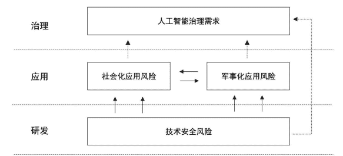
## 图 5-2 AI 风险分类与治理需求对应图
技术本身的风险主要源于深度学习特征，关联算法安全、数据安全和隐私安全。算法偏见和技术黑箱在监管手段不匹配时可能引发不可预知后果。黑箱问题长期困扰深度学习，系统工作原理不透明，成为安全、伦理和法律担忧的核心。黑箱导致输入输出间存在无法解释的隐层，易受隐含偏见误导并体现在结果中。预测、人脸识别等应用饱受伦理争议，算法偏见反映数据中的歧视，需把伦理标准纳入项目固有内容以评估社会危害^[(\[30\]](#txt006.html#footnote_content_txt006_30))。2016 年微软的聊天机器人 Tay 因被用户灌输攻击性信息，不到 24 小时就开始模仿网络种族主义语言，最终被迫下线。AI 系统还易受对抗性攻击、数据投毒影响，难以用传统网络安全手段监测，浅层伪造、深度伪造和社交机器人的出现带来监管空白。

数据挖掘加剧隐私暴露和数据安全风险。汇总后的个人数据能以惊人细节呈现一个人的思想、偏好和习惯。合法或非法渠道获取碎片化数据后，AI 可轻易匹配亚马逊购买史、谷歌搜索、社交照片、账户余额、信用记录、奈飞观看习惯等信息构建精准画像。联合国报告警告，AI 算法以多种不透明方式收集、共享、合并、分析个人信息的风险加剧，长期存储的数据未来可能被未知方式利用^[(\[31\]](#txt006.html#footnote_content_txt006_31))。有偏见的数据集易导致歧视性决策，对边缘群体危害最大。

第二类风险聚焦国内公共政策层面，即 AI 在经济社会各领域的应用冲击社会治理，造成不稳定。本质是政策法规体系与技术创新不同步。

经济方面，AI 冲击就业市场，可能在短期内引发大规模失业。乐观派认为 AI 替代的是岗位而非工作，新岗位会吸收劳动力；悲观派认为 AI 更易替代低技能岗位，而失业者短期内难以胜任新工作。据测算，到 2030 年美国约 47% 的岗位可能被机器人取代，行政、销售等属于高风险职业^[(\[32\]](#txt006.html#footnote_content_txt006_32))。《技术陷阱》一书指出，从工业时代到 AI 时代，技术进步改变权力分配，同时冲击传统岗位^[(\[33\]](#txt006.html#footnote_content_txt006_33))。律师、记者等创造性工作同样面临替代风险^[(\[34\]](#txt006.html#footnote_content_txt006_34))。斯坦福大学迈克尔·韦伯用自然语言处理分析 AI 专利文献，发现最易受影响的可能是需要高预测能力的工作，而非机械性重复工作^[(\[35\]](#txt006.html#footnote_content_txt006_35))。AI 还会扩大信息时代已有的财富分配不均，加剧贫富分化^[(\[36\]](#txt006.html#footnote_content_txt006_36))。

政治方面

政治层面：不透明算法正在重塑治理风险
算法与智能系统在政治场域里普遍呈现黑箱化、架构复杂、行为难以预判且带有半自主特征，这类属性正酝酿出一串社会治理隐患。舆论场里屡见不鲜的大数据与智能技术引发族群歧视、选举操控等案例，对公共秩序造成隐性冲击，也让监管显得力不从心。^[(\[37\]](#txt006.html#footnote_content_txt006_37))2018 年亚利桑那那起优步无人车致死事故极具代表性，司法认定企业无刑事责任，却让现场安全员承担交通肇事罪的指控，责任归属的讨论随之升温。

在资本加持下，智能技术进一步巩固了超级网络平台的集中优势，形成强劲的数据虹吸，并逐步演化为支撑社会运转的关键底座。逐利逻辑带来的滥用焦虑，与平台理应承担的社会义务形成尖锐对立。奈飞纪录片《监视资本主义：智能陷阱》便试图拆解其内在机理：平台对用户实施全景式采集，并借助心理学模型预判行为，再以“说服性科技”塑造行为。算法监管、平台治理、隐私保护等议题暴露的制度空白与监管滞后，构成了治理困局，也让人担忧“技术利维坦”^[(\[38\]](#txt006.html#footnote_content_txt006_38))的抬头。资本驱动的垄断固化正在冲击既有国家治理架构，权力版图的重塑在所难免。

### 文化方面
文化维度上，智能技术在推高信息茧房的同时也在加剧社会撕裂。社交媒体生态因算法而悄然改写，海量信息被切碎后定向投喂，回音壁效应愈发明显。信息获取通道被算法收窄，平台打上的用户标签会在多平台间互通，未来所接触的人与内容都带有标签属性，社交圈因此更易向同质化聚合，接触多元信息的路径与权利被无形压缩。^[(\[39\]](#txt006.html#footnote_content_txt006_39))在信息过剩的背景下，大数据与智能技术相互喂养，出现某种“信息黑洞”，原本中立的智能推送正滑向群体极化的催化剂。推荐机制不断投放用户偏好的内容，压制与之对立观点的新闻曝光，舆论两极化被进一步放大。研究指出，社交媒体上看到与自己一致的政治立场会让人更易产生愤怒，并在议题上采取更极端的态度。^[(\[40\]](#txt006.html#footnote_content_txt006_40))算法会把人性中细微的差异持续放大，群体对立加剧，社会极化加速。

## 第三类风险是人工智能军事化应用可能对国际安全稳定带来的风险
第三类风险指向军用化应用对国际安全稳定的冲击，这一层面的外溢性更强，因而在国际治理议程中备受关注。智能技术兼具军民两用属性，其在国防领域的运用与商业场景差异明显，智能系统与致命性自主武器已成为大国军力竞争的重点赛道。

对手意图不明时，容易诱发大国间的猜忌与对撞。国家难以客观读懂他国的战略意图与实力边界，对外决策常因不敢审慎而走向极端。^[(\[41\]](#txt006.html#footnote_content_txt006_41))各国也难以直观衡量智能技术差距，冲突风险评估时容易把潜在威胁无限放大。^[(\[42\]](#txt006.html#footnote_content_txt006_42))国际社会迄今没有就军事化应用形成统一规则与政策，竞争很可能让智能系统变得更不稳妥、更难可靠，最终危及全人类福祉。不少国家呼吁签署禁止研发与使用自主武器的条约，但美、英、俄等军事强国并不愿加入，短期内在军事领域全面禁用智能技术的可能性很低。若武器的关键环节缺乏人的主导与监督，机器的失控滥用极可能引发人道灾难。战场决策高度复杂，机器作战系统一旦出错后果难以挽回。学界反复强调智能武器不应突破法律与人道底线，在联合国关于特定常规武器的讨论中，多方主张武装冲突法须明确所有军事行动须有人类在场。

网络攻击的潜在目标里，最让人忌惮的是用智能技术打击核指挥与控制体系。虽然目前没有证据显示核设施已被网络武器击中，但这种风险无法排除。智能技术的突破还可能让高精度常规武器更容易摧毁加固的洲际弹道导弹发射井，提升打击对手核武库的能力。为避免核武库被整体摧毁，大国可能竞相扩充核弹头，进而触发军备竞赛。^[(\[43\]](#txt006.html#footnote_content_txt006_43))智能技术介入冲突与危机的决策，也可能制造错觉与误判。围绕自主化、智能化武器的竞赛会累积风险，形成不稳定局面。^[(\[44\]](#txt006.html#footnote_content_txt006_44))

### 当下风险仍集中在常规武器领域
现阶段的威胁主要落在常规武器范畴，根源在于主要大国对智能技术安全挑战的认知分歧。在常规武器讨论中，有观点认为现阶段智能技术或有助于和平稳定，远程武器的使用有助于遏制冲突升级。自动化武器被寄望于实现“精准打击”，从而避免大规模行动与非战斗人员的伤亡。^[(\[45\]](#txt006.html#footnote_content_txt006_45))一方面自动化武器降低了国家参战的成本，另一方面也削弱了决策者在升级危机面前的心理压力。换句话说，相较传统武器，自动化武器的使用门槛与风险都明显下降。

这种判断容易低估智能技术在军事中的实际风险。智能系统本身就带有不确定性，很难在复杂的战场环境中提供稳妥的决策支撑，“战争迷雾”与瞬息万变的使用场景会放大其脆弱性。从现有案例看，智能赋能的无人化系统已从试验走向实战，比如智能辅助的精确打击^[(\[46\]](#txt006.html#footnote_content_txt006_46))、“斩首”行动^[(\[47\]](#txt006.html#footnote_content_txt006_47))等。《纽约时报》曾报道，2020年伊朗科学家遇刺事件就依托算法进行辅助，智能技术已成为影响国际政治的新手段。^[(\[48\]](#txt006.html#footnote_content_txt006_48))

中美竞争加剧，未来全球或出现两套智能技术标准体系。但多数专家坚持，全球统一标准是保持创新活力的前提与最优解。在成熟的国际治理框架落地前，大国间很可能已陷入智能军备竞赛，竞相把不成熟、带偏见的技术推向现实。因此绝不可低估智能技术带来的挑战。即便在核国家尚未全面采纳智能技术前，其发展也可能动摇各国间的战略稳定。例如，一国可能担忧对手在非核领域的智能投入会削弱自身二次打击能力，进而产生不安全感，采取降低战略稳定、抬高核冲突风险的举动。智能技术的高速普及也引发对技术加剧不平等、放大社会偏见、侵蚀个人隐私以及对国际法带来冲击的担忧。^[(\[49\]](#txt006.html#footnote_content_txt006_49))

## 二、人工智能治理现状及特点
智能技术带来的风险挑战，显著提升了制定道德准则与治理规范的紧迫性。上述三类风险对各国具有普遍意义，也推动了全球智能治理的广泛讨论。世界经济论坛认为全球智能治理演进大致经历四个阶段：一是2010年前，治理议题开始进入宏观公共政策与微观技术准则的视野；二是2010至2016年，技术落地带来治理需求，法律难以跟上技术步伐；三是2016至2019年，各类主体纷纷发布伦理与治理规范；四是2019年至今，原则性规范开始向可操作机制转化，治理成为政府与企业的优先事项。^[(\[50\]](#txt006.html#footnote_content_txt006_50))

近两年，全球主体争相发布治理原则与伦理准则。据算法观察组织“全球AI道德准则清单”统计，全球已发布的相关规范超过170项。研究显示，原则层面的共识正在扩大，不同国家、组织、机构与产业界的理念交集增多。但全球治理仍处初步阶段，原则背后的战略导向与文化差异难以弥合，从共识走向场景化实践困难重重，智能技术应用的多样性也决定了原则落地并非易事。

### 第一，从治理主体来看
参与国际治理的行为体日益多元。当前议题涉及面广，既有国际组织与政府部门，也有大型科技企业、学术团体、科研机构、智库与技术社区。主要政府间平台包括联合国相关机构、国际电信联盟、二十国集团、经济合作与发展组织、国际标准化组织、国际电工委员会、电气与电子工程师学会、ISO/IEC JTC1等^[(\[52\]](#txt006.html#footnote_content_txt006_52))，它们为技术标准与政策议题提供合作平台。研究机构与项目更为广泛，具影响力的有美国生命未来研究所AI项目、哈佛大学伯克曼克莱因中心AI伦理与治理基金、纽约大学、斯坦福大学AI百年研究、牛津大学战略AI研究中心、阿兰·图灵研究所、清华大学AI国际治理研究院，以及谷歌、微软、英特尔、IBM、旷视、百度、商汤等科技企业。这些主体通过发布原则、报告与会议，阐述治理目标与理念，推动公共政策对技术研发与应用的规制与引导，反映出多元主体对智能发展与治理的高度关注。相关研究有助于设定全球治理议程，但作为快速演进技术，现行治理进程仍远落后于技术发展，各方在规则与理念上难以达成一致，有效治理规则仍属缺乏。

2020年12月，世界经济论坛发布的《2021年全球技术治理报告：在新冠疫情期间利用第四次工业革命技术》指出，智能技术当前面临算法偏见与不可解释性、虚假信息传播与数字操纵、数据隐私等挑战，已引起政府与专业组织的关注。同时还面临致命自主武器监管与禁用争议、地缘政治技术竞争加剧、技术红利分配不均、监管手段不透明等短期与长期挑战^[(\[53\]](#txt006.html#footnote_content_txt006_53))，这些问题也是其他新兴技术共同面临的难题。

### 第二，从治理维度来看
全球讨论可分为两个相互关联的层面。

#### 第一个层面是侧重于技术本身的治理问题
2017年12月，IEEE发布《人工智能设计的伦理准则》白皮书，主张自主智能系统的设计与开发应优先考虑伦理，推动技术增进人类福祉。白皮书建议设计开发与应用应遵循人权、福祉、问责、透明、慎用等原则。众多科技公司发布的AI原则也多聚焦技术层面。谷歌提出对社会有益、避免不公平、测试安全性、对人负责、隐私设计、卓越标准等内容；微软提出公平、可靠与安全、隐私与保障、包容、透明、责任六项原则。企业出于落地需求与社会责任，更关注技术安全性与可靠性，并把道德规范融入产品全生命周期设计、开发、部署与应用^[(\[54\]](#txt006.html#footnote_content_txt006_54))，同时也受部分国家与地区监管压力推动。

### 第二个层面：技术应用风险治理
一些部门与机构发布了领域性准则。2020年2月，美国国防部正式采纳五项AI伦理原则，由国防创新委员会于2019年10月提出，概述美国在军事上使用AI需遵循的规范，包括负责任、公平、可追溯、可靠、可控。同年7月，美国情报界发布AI伦理原则与框架，提出遵纪守法、知行合一；透明负责；客观公正；开发利用以人为本；确保安全、适应力强；以科学技术为决策提供信息等六大原则。与之相比，国际组织与各国政府更倾向关注智能发展带来的全局性影响，如社会公平与国际合作问题。经合组织发布的AI政策指南提出五项发展原则：促进包容性成长、可持续发展与福祉，构建以人为本的数据生态系统，塑造有利政策环境，提升人力资源能力，加强国家间合作。

### 第三，从治理特征看，“软法”是人工智能治理的常见形式
软法是一种提出实质性期望但不由政府直接执行的治理机制。应用于智能治理时，具有灵活适应性强、合作包容性强、激励而非惩罚等优势。^[(\[55\]](#txt006.html#footnote_content_txt006_55))自2016年起，各国政府、组织与企业开始关注智能治理，随后规范与准则大量涌现。普遍认为现有制度难以有效引导智能有序发展，部分主张传统规制途径，但多数举措仍聚焦软治理^[(\[56\]](#txt006.html#footnote_content_txt006_56))。布鲁金斯学会研究指出，标准、准则、指南等软法在实践中比传统立法更灵活、适用性更强，已成常见治理方式。美国亚利桑那大学梳理2001至2019年的634个智能软法项目，其中90%发布于2017至2019年。软法更灵活、适应性强，任何组织都可创建或使用，补充或替代硬法已成最常见形式^[(\[57\]](#txt006.html#footnote_content_txt006_57))。

原因在于立法周期较长，需要广泛共识，在规制智能技术时作用滞后；同时各国对使用强约束法律工具规制智能技术持谨慎态度，软法包容性更强，有助于降低过早规制创新带来的消极影响。此外，智能的复杂性与“黑箱”特性使其难以纳入既有法律框架，需要以伦理问题与安全风险治理的软体系促进共同探索^[(\[58\]](#txt006.html#footnote_content_txt006_58))。IEEE曾于2016年发起“关于自治与智能系统伦理的全球倡议”，涉及120多项政策、法律与道德议题，由250多名专家提出建议^[(\[59\]](#txt006.html#footnote_content_txt006_59))。随着应用进程与安全风险紧迫性提升，软治理体系可能逐步向更具约束力的硬法体系过渡，未来需结合技术标准等软法与法律规则等硬法，探索智能领域软硬法混合治理，更好发挥协同作用^[(\[60\]](#txt006.html#footnote_content_txt006_60))。

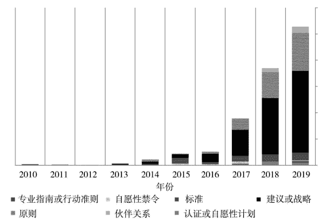

图 5-3　全球人工智能治理中软法类型及数量变化趋势^[(\[61\]](#txt006.html#footnote_content_txt006_61))

从图 5-3 可见，智能治理建议、战略、原则等宏观层面的软法数量在增强，而具体可操作的标准、专业指南等细化文件增速相对缓慢。这侧面反映出全球智能治理从原则走向实践面临诸多现实困难。

## 三、人工智能治理的现实困境

AI治理为什么做不下去
各国在宣言层面对AI治理的重视看起来高度一致,强调要共同应对技术风险,可是把原则落到具体技术怎么用的层面,现有谈判仍局限在少数碎片议题,表述空泛、可操作性很弱。现行的伦理守则与行业自律在实践中几乎没有约束力,围绕技术伦理的讨论也迟迟没能变成可执行的行动。^[62]

从技术演进看,AI本身更新迭代极快,应用前景充满不确定,政策制定者对风险的认知还不够成熟,在看不到颠覆性安全危机前,主要国家对签署有约束力的国际规则都保持谨慎。从利益结构看,数字技术已成为经济社会发展的战略要害,国际规则从来就不是中立的,为了维护自身利益,数字经济规则的博弈必然是长期反复的。^[63]

正因议题的不确定、分散与高度复杂,AI治理难以照搬核武器、气候变化等传统世界协作的经验。其中最突出的是缺乏明确的优先级。AI仍处成长期,影响面与落地范围并不清晰,正面与间接的后果会随着不同阶段逐步显现。尽管在军事应用、技术伦理、网络空间等范畴已存在原则性约束,但真正可操作的机制并未建立,主导力量间分歧明显,协调难度上升,各国模式互不兼容,这在客观上拖慢了推进节奏。

多数国家都意识到AI可能带来的国家安全脆弱性,却又不愿在国际竞争中掉队,更不愿过早限制本国创新。美国智库曾呼吁政府构建体现“民主价值观和利益”的技术标准体系,建立全球新兴技术与数据地缘政治联盟,与跨大西洋盟友形成强合作伙伴关系。^[64] 同批学者还建议美国在西方内部率先制定管理AI应用的道德准则,以道德立场与中国、俄罗斯展开谈判。如今民粹主义、技术民族主义等逆全球化思潮抬头,各方在利益诉求和价值观念上的差异被进一步放大,共同的观念基础难以形成,有效协作体系缺位下,共识很难达成。

其一,整体性与共识性框架缺失。各方难以在同一平台形成综合治理框架,虽然在部分诉求上存在重合,但原则性共识尚未转化为约束性国际机制。AI不像核与非核那样有清晰边界,这让监管更为复杂。^[65] 以致命性自主武器系统为例,其研发具有隐蔽性,算法在开发阶段难以区分军用民用,这极大增加了军控的监管与核查难度,^[66] 也给武器使用与规制带来严峻挑战。于是相关进展主要停留在专业领域的局部技术规则,宏观综合框架仍付之阙如。

其二,治理进程明显滞后。讨论AI治理的平台分散,技术高度依托网络空间,治理问题与网络空间治理有诸多相似之处,如主体多元、技术与社会双重影响、治理的系统性与协同本质等,^[67] 这些也是AI治理能否突破的关键。与网络空间不同,网络仍有基础设施和物理基础,需要共同标准和通信协议支撑,而AI治理仍在摸索,议题高度碎片化,既冲击国内传统治理模式,也超出现有世界机制的承受力。应用场景极其复杂,难以制定一套普适的技术准则,其复杂性既体现在主体与领域的繁杂,也体现在技术演进的快速与不确定。风险才刚刚显现,技术会走向何方、会带来什么后果,目前认知仍模糊。

如表5-1所示,即便多个平台都触及AI治理,但规则执行力有限,且难以覆盖技术发展对国际安全稳定可能产生的潜在风险。从“重要进展和共识”来看,现有成果仍属初步。例如在致命性自主武器管控上,受美国、俄罗斯等主要国家牵制,讨论缓慢,有约束力的原则短期难产。伦理、技术规范一旦形成国际共识,其对各国实践的传导效果也存在不确定性,对掌握研发主力的超级企业影响有限,人权与包容性发展等议题仍停留在呼吁层面。这充分反映出国际治理在应对风险时的局限。共识性原则如何影响具体监管、如何嵌入研发、应用与部署全链条,需要政府、科学家、工程师和公众共同探索与合作。

表5-1　AI治理的主要国际平台

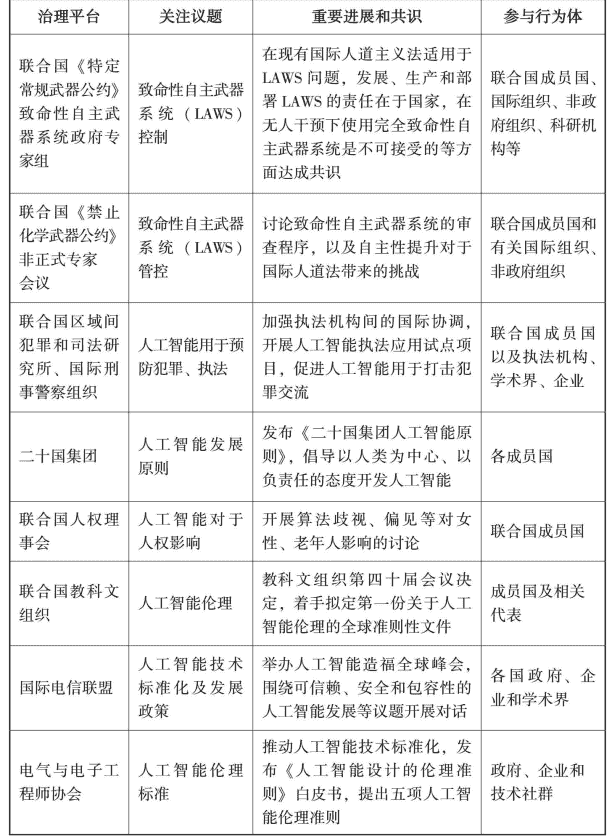

续表

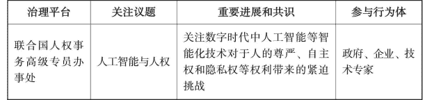

资料来源：根据相关研究文献和公开资料制作。^[68]

## 四、AI治理困境的制约因素

小约瑟夫·奈曾把信息时代的国家间权力格局比作三层棋局,政治军事在上,经济居中,跨界与非政府议题在下。^[69] 在多层次相互依存的格局中,AI对各层都产生直接或间接影响。仅仅停留在意愿与伦理层面的治理显然不够,如何把伦理原则落实为制度与行动,是当下核心难题。^[70]

科技博弈客观上削弱了网络空间与新兴技术的信任基础。各方发布了不少关于AI军事化、伦理规范、治理原则的政策文件,都承认管控AI对战略稳定的冲击是重要世界议题,但在实践中,主要国家间的信任持续弱化,推动意愿不足,对未来风险的管控措施缺位。

在认知的层面,主要国家在军事AI、跨境数据传输、信息基础设施、网络空间治理等领域的政策主张差异巨大。印度拒绝签署大阪G20协议,认为限制跨国数据传输有助于本土创业生态与公民隐私保护,明显意在牵制西方科技巨头的“数据殖民”。欧盟法院限制数据向美国流动,理由是美国隐私保护机制不足。^[71] 中美在5G、数据等层面爆发全面冲突。在缺乏主要国家协调的背景下,全球难以形成有效治理体系。

在发展阶段上,AI仍处高速发展期,先发国家凭借优势大力投入军用、情报等安全领域,以获取技术红利。与核技术、生物技术等军民两用技术相比,AI当前的大规模破坏性并不明显,因此限制意愿不强。美国的传统做法是,只有技术打破攻防平衡时政策才会转向。以生物技术为例,其曾被称作“穷人的核武器”,当制造成本下降、威慑不足时,美国才推动全球规范与军备控制框架。但在AI领域,推动承诺容易,落实实质性限制很难。

治理进程中,各类行为体的诉求差异导致现实需求难以满足。即便基于伦理准则的软法,也缺乏落地机制,执行困难。

一是大国推进动力不足。主导世界协作的主要国家在不同领域竞争加剧,规则推进难度随之上升。合作意愿低,使得规则出台更难。面对巨大的战略收益预期,没有国家会真正放弃军事化应用。仅靠“国家理性与道德约束”限制发展的前景不乐观。部分西方发达国家不愿用约束性机制限制自身发展,而发展中国家话语权薄弱。主流治理理念与研究机构多来自技术强国,导致部分议题长期停滞。傅莹指出,AI武器化不可避免,可行做法是要求其发展符合国际法规范。^[72] 联合国虽在持续磋商,但在短期内很难对军用AI实施国际禁令。^[73] 技术不确定性与对规则的担忧阻碍了谈判让步。

逆全球化持续演化,主要国家相互指责“技术民族主义”“贸易保护主义”。不少国家把技术安全与供应链安全视为国家安全核心,AI治理的老矛盾未解,新矛盾不断涌现。国际体系中数字主权的意识不断强化,欧盟推出一系列数字战略,主席冯德莱恩认为“在关键技术领域实现技术主权为时不晚”。^[74] 西方国家把数字发展上升到战略高度,竞争加剧,对话空间压缩,技术压力正向安全等领域传导。科技利益与国家战略密不可分,新技术标准与创新的竞争趋白热化,地缘政治在新兴技术治理中的作用急剧扩大。

二是治理主体多元、内容庞杂。AI的多重属性使其治理过程复杂多元,主体涵盖国家政府、政府间组织、科技企业、技术社群、公民社会等。政府、企业、科学家、个体都发声,不同的价值立场与利益诉求导致理念与规制路径冲突。治理客体本身也在动态变化,议题涵盖数据隐私、安全、算法偏见,并不断衍生出面部识别、自主武器、算法操控等新问题,相互交织,复杂程度上升。

AI世界协作是各方协同合作的产物,带有强主观色彩与国家差异。^[75] 理念分歧深层次存在,涉及网络空间治理、数据治理、安全保障、跨境数据流动监管等,冲突在多个维度叠加。能否找到切入点、建立包容共识是难点。

在网络空间治理上,联合国信息安全政府专家组与开放式工作组双轨推进已告一段落。但美国等西方仍占据优势,主张网络为“全球公域”,强调效率与“互联网自由”以维持网络霸权,反对主权行使。大多数发展中国家则主张适度监管,强调网络主权与社会稳定作用。

在数据安全与跨境流动上,金砖国家与西方存在巨大政策分歧。即便西方内部也分歧明显,美国、欧盟、澳大利亚、新西兰、加拿大等在跨境规则上立场不同。^[76] 美国倡导低保护水平流动,利用企业市场优势集中数据,并通过外资审查、监管、供应链保护防止数据流向“敌对国家”。欧盟在打通内部数据壁垒的同时,设置严苛的跨境门槛。^[77] 2020年8月欧洲法院宣告“隐私盾”协议无效,美欧数据矛盾未解。此背景下,越来越多国家推行数据本地化,这是共识缺失下的保守选择,但会抬高跨境成本,抑制数字经济发展,反过来增加世界数据治理难度。

数据治理模式上,学界常概括为三种:美国强调企业主导,中国强调政府主导,欧盟强调在基本权利基础上由个人主导。^[78] 围绕数据资源管控的冲突,本质是技术竞争引发的地缘政治竞争。各方收紧对敏感数据的监管,哪些数据可共享仍无共识,限制跨境流动成为防御性举措。

在军事化应用上,美国、俄罗斯等军事强国认为无人作战系统可降低残酷性,在反恐等场景有重要作用,均把智能化军事应用作为重点。以美国提交联合国致命性自主武器系统政府专家组的立场为例,其认为新兴技术可降低平民伤亡风险,主张鼓励技术创新。^[79] 欧盟与多数发展中国家明确支持非军事化,欧盟出于规则引领与对俄牵制考量,发展中国家则不愿拉大与军事大国的差距。

三是现有机制效用不足。多元主体本是世界协作的重要特征,非国家行为体不可或缺,但在合作意愿不足、主要国家不力推的情况下,现有机制成效有限。权力政治映射到治理中,新兴技术主导权长期在以美国为首的西方手中。西方关注知识产权、攻防等问题,发展中国家更关注技术获取、成本与数字鸿沟。AI时代,数据量、质量与使用能力成为权力来源,数据拥有者与数据匮乏者的鸿沟难以弥合,多数技术弱国的利益难以保障,合法性不足加深了对治理机制效力的怀疑。

## 第四节　AI治理与主要国家竞合态势

各国提出的治理理念多依据自身技术阶段与价值观、文化传统、伦理标准制定。单一伦理标准难以指导各方发展,但各国单边监管标准正在形成潜在的技术壁垒与贸易壁垒。若能开展国际合作,则有助于克服狭隘保护主义风险。

## 一、治理理念表面上的趋同

《AI治理：理念趋同，路径分化》

近期全球围绕AI治理的规范性文件持续涌现，各机构在彼此借鉴中形成了一定程度的共识。哈佛大学对近年政府、国际组织、企业及利益相关方发布的治理原则进行归纳后认为，当前讨论主要集中在八个方面：隐私保护、负责任使用、安全可靠、透明与可解释、公正与非歧视、人控、专业伦理和对人类价值的促进。^([\[80\]](#txt006.html#footnote_content_txt006_80))安娜·乔宾等人对84份AI伦理准则与指南做编码对比后发现，透明度、正义公平、不造成伤害、问责与隐私是最常被强调的五项核心。^([\[81\]](#txt006.html#footnote_content_txt006_81))尽管这些共识已具备广度，却仍无法覆盖全部治理需求，性别平等、技术滥用管控、可持续发展以及通用智能的关注在现有框架下明显不足。^([\[82\]](#txt006.html#footnote_content_txt006_82))不过在主要国家的政策表述中，上述初步共识均有不同程度呈现，折射出对新兴技术治理的共同价值诉求。

从国家实践看，美国、欧盟与中国是最具代表性也最受关注的三种模式，三者在观念层面的交集正在扩大。愿景层面，欧盟与美国都提出可信AI的概念，美国主张系统必须值得信赖，通过可靠、强大且可信的应用增强公众信任。^([\[83\]](#txt006.html#footnote_content_txt006_83))欧盟把以人为本置于核心。中国提出发展负责任AI，要求安全可靠可控，兼顾经济、社会与生态的可持续。总体方向呈现趋同特征。

伦理关键词上，福祉、安全、透明、隐私是三国高频共识。中国新一代AI治理专业委员会提出六项伦理规范：增进人类福祉、促进公平公正、保护隐私安全、确保可控可信、强化责任担当、提升伦理素养，并对各条作出细化。欧盟高级专家组围绕可信AI提出七项关键要求：人类能动性与监督、技术稳健性、隐私与数据治理、透明度、多样与非歧视、社会与环境福祉、问责，并以欧盟宪法和人权宪章为底座把抽象准则落实到AI场景。2020年12月特朗普政府《关于在联邦政府推广可信AI的行政命令》要求联邦机构在设计、开发、采购与使用AI时保护隐私、公民权利、自由及美国价值观，并列出九项基本原则：充分尊重美国价值观、目标明确绩效导向、确保应用准确可靠有效、确保安全性与弹性、运行可被理解、明确并合理分配人员角色与责任、按原则定期测试、向相关利益方透明披露使用信息、强化问责。^([\[84\]](#txt006.html#footnote_content_txt006_84))

共通理念也在国际层面显现。“负责任”“可信”“以人为本”已上升为国际共识。2019年6月G20发布《负责任地管理可信AI原则》。2019年11月起联合国教科文组织启动全球性AI规范性文件起草工作，2020年3月任命24位全球专家组成特设组，经广泛征求意见与多轮研讨，于2021年11月第四十一届会议通过《人工智能伦理建议书》，旨在为系统全生命周期的伦理影响评估提供基础，为各行为体提供伦理指引，推动技术向负责任方向发展。^([\[85\]](#txt006.html#footnote_content_txt006_85))需要指出，G20原则以经合组织原则为蓝本，根基仍是西方理念，而教科文组织的建议书内容更为多元，尽管发达与发展中国家话语权不均，其代表性更广，吸纳了更多发展中国家的声音，显示共识边界在不断扩展。

## 二、治理路径深层次的差异

愿景与准则的接近并不等于落地方式一致。应用场景的监管取向与具体规制各有框架，背后是文化多样性与价值差异。对技术前景的认知不同，以及避免被他国主导治理的考量，使得表面趋同的理念在实践中出现分化，各方都在努力把本国规范推升为国际标准。目前中、美、欧形成三种明显不同的路径，共识基础尚未成熟。

治理导向上，欧盟走强监管路线，软硬法并用管控风险，已提出专门监管AI的法律草案，试图以体系化治理把握机遇，并在国际伦理准则与评估机制制定中争取主导权。^([\[86\]](#txt006.html#footnote_content_txt006_86))美国坚持市场化治理，尚未出台国家层面AI治理原则与伦理准则，仅在国防部、情报机构等部门发布原则，联邦贸易委员会提出促进透明、可解释与公平的政策建议，更多依赖科研机构与企业自律形成自我约束。^([\[87\]](#txt006.html#footnote_content_txt006_87))中国统筹发展与安全，在推动产业创新的同时，以场景化政策法规与规范性文件应对当前安全风险，力求技术发展与安全保障平衡。

监管方式上，美国采取缓慢分散模式，规制多停留在州级，联邦层面仅个别部门发布框架或原则。凭借在研发与产业的领先优势，美国推行相对宽松的监管，避免过早过严的政策扼杀创新。^([\[88\]](#txt006.html#footnote_content_txt006_88))欧盟则引领全球监管风向，面对中美技术优势，试图以规则提升话语权。其他大国多在美式轻监管与欧盟重监管之间，根据自身发展与安全战略选择主张。欧盟面向事前损害预防，建立可信AI评估机制并提供评估清单，推动原则落地。美国与日本等盟友倾向“无须批准式”监管逻辑，英法等欧洲国家更偏向“审慎监管”。^([\[89\]](#txt006.html#footnote_content_txt006_89))中国主张综合性敏捷治理，动态跟踪技术演进，鼓励创新同时及时发现风险并有效监管，推动规范健康发展。

治理思路上，文化与宗教差异带来伦理落地的分歧。^([\[90\]](#txt006.html#footnote_content_txt006_90))欧盟的准则以个人权利为基础，基调偏审慎，核心是保护公民免受伤害，为AI使用设限，特别关注弱势群体的权益。中国思路目标导向，更强调促成良好行为，对技术前景持积极乐观态度。^([\[91\]](#txt006.html#footnote_content_txt006_91))美国与中国相近，在大力促进创新的同时兼顾安全治理的实际需求。

治理重点也不同。美国强调国家安全逻辑，鼓励创新增长、减少开发应用障碍，并保护技术、经济、国家安全、隐私、公民权利等美国核心价值。国防部与情报界单独发布伦理原则与框架，将国防与情报视为领先关键领域，国家安全委员会的报告也反复呼吁为AI在国家安全的创新应用做好准备。欧盟和中国更聚焦于经济福利领域的可信AI与社会凝聚力，重视技术发展的正义性与公平性，强调增进社会福祉。欧盟采用基于风险的分级规制，对“高风险”系统实施事前监管。中国则针对不同使用场景可能产生的风险进行有针对性的监管。

## 三、治理冲突与大国竞合

围绕AI治理规则的博弈已成为争夺国际影响力的重要场域，不同主张根植于不同文化与价值观。多维度的深层差异可能演化为治理冲突。为规避冲突升级，首要任务是在国家安全与军事领域的应用上达成广泛共识，划出红线与禁区。

### (1) 不成熟技术过快落地或成冲突引爆点
速度优势是当前大国竞争的核心关切，率先突破意味着更大发展红利。竞争压力下反应窗口被压缩，不成熟的AI技术可能被仓促投入现实使用。许多技术、法律与伦理问题尚未解决时，这种盲动会带来极大安全隐患。

治理进度明显滞后于技术进度，各界对大国达成共识的可能性普遍悲观。专家指出，主要大国更愿把资源投向国内产业而非在联合国等平台讨论风险。但从军事化进程看，尚未进入全面军备竞赛，竞争更像一场实验竞赛。AI在海量情报分析、作战决策支持、无人机等领域已超越传统人力，潜力巨大。各国纷纷出台战略，将军事应用列为重点，高科技国家正研发减少人类直接参与的自主作战武器。若自主化水平不足，可能被拥有机器速度的对手击败。AI的广泛采用会加速军事行动节奏，使战争超出人类控制，安全与速度的失衡可能引发逐底竞争。^([\[93\]](#txt006.html#footnote_content_txt006_93)]

越来越多观察者认为，人类必须在军事系统中保持积极控制与随时干预能力。AI威胁的复杂性已超越传统安全，企业为利润最大化常忽视道德规范，大国技术竞赛又掩盖了伦理担忧，道德标准沦为次要目标。^([\[92\]](#txt006.html#footnote_content_txt006_92)]有研究警告，追求先发优势而在应用中偷工减料可能导致灾难，速度压倒安全与监督会点燃危险竞赛。^([\[93\]](#txt006.html#footnote_content_txt006_93)]学者也指出，真正的风险不在于技术本身，而在于国家担心落后而冒险部署不安全系统。^([\[94\]](#txt006.html#footnote_content_txt006_94)]快速扩散带来的不确定性与脆弱性，若失控，可能像以往军事变革一样，通过放大既有威胁、改变威胁性质、引入新安全风险来冲击国际战略稳定。^([\[95\]](#txt006.html#footnote_content_txt006_95)]

### (2) 误判风险：AI让冲突升级更快
AI在战略决策中的实际运用难以核查，常处于灰色地带，难以用传统机制约束。大国竞相将AI融入决策体系，失控被用于对抗的可能性升高，技术会提高无意加剧危机的概率。

商用或民用AI面对的是单一消费者，开发者拥有信息优势，且研发时未考虑故意欺骗。战争是国家间对抗，存在各类欺骗手段，决策情境与日常智能辅助天差地别。敌我AI在对抗场景下高速交互，误判概率被显著放大，非预期事故的预防机制尚不健全。

19世纪末多国曾签署禁止武器化飞机的条约，很快放弃自我约束，最终爆发空战。AI的不确定性可能导致决策误判，小规模冲突升级失控。偏差可能来自算法或数据，也可能源于黑客攻击、信息战与数据伪造。传统威慑建立在对对手的认知之上，而人机混合时代的威慑变量更为复杂，易引发误解与错误计算。

风险高发期往往出现在AI形成新能力初期。有学者指出，AI控制的核武器系统在运行速度、数据偏见、系统脆弱性、决策偏差四个维度上加剧战略平衡不稳。^([\[96\]](#txt006.html#footnote_content_txt006_96)]系统脆弱性意味着环境或数据的细微变化即可大幅改变性能。先进自主防御系统虽能抵御攻击，却也可能制造非对称优势。地缘政治紧张、沟通缺失等因素的作用不亚于技术本身，但AI与自主作战系统可能导致冲突意外升级、战略稳定性下降，并在降低人员风险的同时提高使用武力可能性。决策时间大幅压缩，时间窗口狭窄，对手意图不清晰、交互规则不明时，决策者易倾向先发制人，机器速度带来的先发优势显著提升战争升级风险。

### (3) 治理分歧推高大国阵营化对立
AI正渗透进大国关系的关键领域。若合作缺位持续，技术的黑箱特性会被放大，政治上的相互隔离会降低协作可能性，进一步加剧不同国家阵营间的对抗性。

## AI治理裂变与阵营化压力

国际层面针对AI安全的强制性约束与统一标准仍属空白，多边对话虽在持续进行，但主流大国在研发与管控上基本遵循本国价值与伦理坐标。表面的话语趋同掩盖不住行动路径的根本分歧，这一分歧正成为战略稳定的隐忧，AI竞争也在被推向地缘政治赛道。^([\[97\]](#txt006.html#footnote_content_txt006_97))

与工业时代的生产工具截然不同，AI自带强不确定性以及“一旦领先就难以被追赶”的内在逻辑。进入军事领域后，AI能够明显减少人员伤亡、压低作战成本，从而拉低国家动用武力的门槛，提升武力在地区摩擦中的吸引力。这一效应会反向加速AI武器的扩散，推升军备竞赛。^([\[98\]](#txt006.html#footnote_content_txt006_98)) 同时非国家行为体的风险也在升级。AI赋能的网络行动能为黑客提供不对称优势，比如逆向拆解模型与程序，在算法文件里植入恶意代码污染开源供应链，或是在植入重置后门的情况下让模型表层功能保持正常，实现预设的隐蔽控制。

正因前景难测，大国对AI在国家安全核心领域的部署愈发谨慎。一旦安全诉求与经济诉求冲突，安全通常被优先排序，合作范围也收缩至存在政治互信基础的对象。政治隔阂会因技术标准互不兼容而被进一步固化放大。在这一进程中，中美围绕主导性技术标准展开角逐，并在各自的数字阵营里发挥引领作用。^([\[99\]](#txt006.html#footnote_content_txt006_99)) 由此可推演到一种可能：技术强国在AI领域保持持久领先，其他国家若想分享发展红利便只能依附价值观相近的阵营，难以保持中立。不同规范与安全标准构成的“数字铁幕”一旦形成，两大阵营的摩擦会明显加剧。

在全球化相互依存的背景下，国家互动难以用单一标签概括，大国关系兼具对抗与合作。面对AI可能引发的治理失序，技术领先的发达经济体与技术相对滞后的发展中国家的命运已被绑定。^([\[100\]](#txt006.html#footnote_content_txt006_100)) 在此语境下，中国提出的命运共同体理念具有较强的参考价值，既契合共同发展的内在逻辑，也为破解当前AI发展的现实困境提供了思路。^([\[101\]](#txt006.html#footnote_content_txt006_101)) AI带来的全球性难题要求治理始终把规避大国间对抗放在首位，技术强国尤其是主导者需要在追求自身进步的同时兼顾他国利益，在应用中充分考量他国的安全关切。因此应启动具广泛代表性的全球对话，明确AI时代的国家行为准则，推动国际协作让技术普惠。与借助共同安全的理念，建立分层分类的国际治理框架，按风险类别与优先级提前布局应对。以命运共同体为指引，推动人机社会和谐、安全并进。

## 本章小结

本章梳理了AI的对抗与合作情境，为把握治理重点提供参考。从四类新型对抗场景切入，可以看出这些不断涌现的情境对国际社会的治理能力提出了严峻考验。同时也要承认，AI在应对全球性危机中具备巨大潜力，这既由技术本身的挑战性决定，也由全球议题需要全球协作的本质决定。基础理论研究与技术研发需要在开放环境中实现跨国协同，在生命科学、气候变化应对等领域，AI在宏观研判、监测预警等方面前景广阔，弥合数字鸿沟与助力数字减贫是让技术更好地服务可持续发展的必要前提。

与其它新兴技术治理相似，AI治理面临机制分散、体系多元、进程滞后、难度高、复杂敏感性更强、理论界定尚未成熟等问题。作为治理主体的主要大国多受自身利益驱动，推进动力不足，现有平台效能有限，议题繁杂且缺乏包含主要大国的综合框架，技术主导权的争夺因此加剧。在大国竞争回潮的国际环境下，国家关注点正从发展转向安全风险。现实权力政治向治理领域的投射，使得规则分化、标准冲突并形成相互隔离的治理孤岛，大国博弈色彩进一步浓厚。

不同于基于社会共识的传统立法，AI的快速演进暴露出各国立法实践的明显滞后，难以跟上现实需求。风险外溢与各类对抗场景的显现带来了传统治理机制难以覆盖的新风险。管控与风险的不匹配提升了治理的紧迫性，全球治理呼声高涨，但技术强国往往更强调部署与抢占先机，对监管的重视被削弱。大国既是新兴技术治理的关键力量，也是利益矛盾的集中场所，AI已成为博弈焦点，围绕主导权与话语权的争夺与治理困境互为因果。信任基础不断弱化、推进意愿不足、风险管控缺位，共同凸显了治理供给的不足。

目前各国政策多停留在原则性宣示，规则缺位加剧了无序发展。尽管治理理念上初步趋同，路径分歧却十分深刻。从竞合走势看，规则缺失与路径冲突可能放大竞争、抑制合作。各国主张深植于文化与价值观并服务于核心利益维护，分歧或演变为治理冲突，集中体现在三个方面：一是技术不成熟的过快应用可能诱发大国冲突，落后焦虑加速使用会放大不确定性；二是AI介入战争决策易导致战略误判，提高升级风险；三是治理冲突或导致阵营化对立，政治不信任降低合作可能，提升对抗风险。因此，AI时代的全球治理应借鉴命运共同体理念，加强交流合作，推动技术造福全人类。

## 注释

[\[1\]](#txt006.html#footnote_quote_txt006_1)Samuel Gibbs：Elon Musk Leads 116 Experts Calling for Outright Ban of Killer Robots，August2017，（2021-03-05），https：//www.theguardian.com/technology/2017/aug/20/elon-musk-killer-robots-experts-outright-ban-lethal-autonomous-weapons-war。

[\[2\]](#txt006.html#footnote_quote_txt006_2)霍布斯认为在自然状态下不存在有效的强大的政治权威来确保安全，在没有超脱政府的情况下，将是一种“一切人反对一切人”的安全困境，人性不可避免地将社会带向严重的冲突之中。

[\[3\]](#txt006.html#footnote_quote_txt006_3)Jairus Grove：From Geopolitics to Geotechnics：Global Futures in the Shadow of Automation，Cunning Machines，and Human Speciation，International Relations，2020，34（3）：pp.432-455。

[\[4\]](#txt006.html#footnote_quote_txt006_4)Bryan Clark，Daniel Patt，Harrison Schramm：Mosaic Warfare：Exploiting Artificial Intelligence andAutonomous Systems to Implement Decision-centric Operations，February 2020，（2021-03-05），https：//csbaonline.org/research/publications/mosaic-warfare-exploiting-artificial-intelligence-and-autonomous-systems-to-implement-decision-centric-operations。

[\[5\]](#txt006.html#footnote_quote_txt006_5)资料来源：Stanford Human-Centered Artificial Intelligence：Artificial Intelligence Index 2019 Annua Report，2019。

[\[6\]](#txt006.html#footnote_quote_txt006_6)Andrew F.Krepinevich：The Eroding Balance of Terror：The Decline of Deterrence，Foreign Affairs，2018，97（2）：pp.62-74。

[\[7\]](#txt006.html#footnote_quote_txt006_7)Darrel M.West，John R.Allen：How Artificial Intelligence is Transforming the World，April 2018，（2021-03-06），https：//www.brookings.edu/research/how-artificial-intelligence-is-transforming-the-world/。

[\[8\]](#txt006.html#footnote_quote_txt006_8)Yuna Huh Wong，John Yurchak，Robert W.et al：Deterrence in the Age of Thinking Machines，RANDCorporation，2020，（2022-02-20），https：//www.rand.org/pubs/research\_reports/RR2797.html。

[\[9\]](#txt006.html#footnote_quote_txt006_9)华盾：《人工智能时代的俄罗斯国家安全》，载《信息安全与通信保密》，2021（5）：33-39 页。

[\[10\]](#txt006.html#footnote_quote_txt006_10)Darrell M.West，Nicol Lee：How Technology and the World have Changed Since 9/11，August2021，（2022-02-20），https：//www.brookings.edu/blog/techtank/2021/08/27/how-technology-and-the-world-have-changed-since-9-1 1/。

[\[11\]](#txt006.html#footnote_quote_txt006_11)张爱军、李圆：《人工智能时代后真相现象的消解、再塑及矫治》，载《中国行政管理》，2019（8）：61-65 页。

[\[12\]](#txt006.html#footnote_quote_txt006_12)Alina Polyakova，Spencer P.Boyer：The Future of Political Warfare：Russia，the West，and theComing Age of Global Competition，March 2018，（2021-03-13），https：//www.brookings.edu/research/the-future-of-political-warfare-russia-the-west-and-the-coming-age-of-global-digital-competition/。

[\[13\]](#txt006.html#footnote_quote_txt006_13)Jeff Berkowitz：The Evolving Role of Artificial Intelligence and Machine Learning in US Politics，December 2020，（2021-03-20），https：//www.csis.org/blogs/technology-policy-blog/evolving-role-artificial-intelligence-and-machine-learning-us-politics。

[\[14\]](#txt006.html#footnote_quote_txt006_14)ITU：Measuring Digital Development：Facts and Figures 2021，（2021-01-01），https：//www.itu.int/en/ITU-D/Statistics/Pages/facts/default.aspx。

[\[15\]](#txt006.html#footnote_quote_txt006_15)Ion Stoica，Dawn Song，et al：A Berkeley View of Systems Challenges for AI，October 2017，（2021-03-05），https：//www2.eecs.berkeley.edu/Pubs/TechRpts/2017/EECS-2017-159.pdf。

[\[16\]](#txt006.html#footnote_quote_txt006_16)Emma Strubell，Ananya Ganesh，Andrew McCallum：Energy and Policy Considerations for DeepLearning in NLP，June 2019，（2021-03-05），https：//arxiv.org/pdf/1906.02243.pdf。

[\[17\]](#txt006.html#footnote_quote_txt006_17)Karen Hao：训练单个 AI 模型可能排放的碳相当于五辆汽车在其生命周期内的排放量，MIT Technology Review，2019 年 6 月，（2020-12-01），`https：//www.technologyreview.com/2019/06/06/239031/training-a-single-ai-model-can-emit-as-much-carbon-as-five-cars-in-their-lifetimes/`。

[\[18\]](#txt006.html#footnote_quote_txt006_18)Mckinsey Global Institute：数字全球化：全球流动的新时代，2016 年 3 月，（2021-03-23），`https：//www.mckinsey.com/business-functions/mckinsey-digital/our-insights/digital-globalization-the-new-era-of-global-flows`。

[\[19\]](#txt006.html#footnote_quote_txt006_19)Gary Marcus，Ernest Davis：重启 AI：构建我们可信赖的人工智能，New York：Pantheon Books，2019 年 9 月。

[\[20\]](#txt006.html#footnote_quote_txt006_20)Emily Bender，Timnit Gebru，Angelina McMillan-Major，et al：关于随机鹦鹉的危险：语言模型会太大吗？，2021 年 3 月，（2021-03-07），`http：//faculty.washington.edu/ebender/papers/Stochastic\_Parrots.pdf`。

[\[21\]](#txt006.html#footnote_quote_txt006_21)Gary Marcus：人工智能的下一个十年：迈向稳健人工智能的四步，（2021-03-05），`https：//arxiv.org/abs/2002.06177`，2020 年 2 月。

[\[22\]](#txt006.html#footnote_quote_txt006_22)Joel Klinger，Juan Mateos-Garcia，Konstantinos Stathoulopoulos：人工智能研究的收窄？，2020 年 9 月，（2021-01-05），`https：//arxiv.org/abs/2009.10385`。

[\[23\]](#txt006.html#footnote_quote_txt006_23)OECD：利用人工智能帮助抗击 COVID-19，2020 年 4 月，（2021-12-18），`https：//www.oecd.org/coronavirus/policy-responses/using-artificial-intelligence-to-help-combat-covid-19-ae4c5c21/`。

人工智能正在改写所有规则

当人工智能从实验室走向现实，它不再是单一的技术话题，而是同时牵动战略、安全、经济、社会和伦理的多线博弈。最近一轮的研究和案例基本指向同一个判断：机会真实存在，风险同样真实，而且治理远远跟不上扩散速度。

地缘与军事，竞争已经进入实战阶段
布鲁金斯的分析早在2019年就提醒，中美在人工智能时代的关系将被技术能力重新定义。基辛格在《大西洋》上提出启蒙可能终结，霍金、特格马克、拉塞尔等科学家联名呼吁不要对超级智能掉以轻心。这些预警在战场上有了具象。

2020年秋天的纳卡冲突里，阿塞拜疆用土耳其提供的TB-2攻击无人机摧毁六百多个目标，坦克、阵地甚至士兵的画面被实时外放，心理冲击远大于物理杀伤。同一年的1月3日，伊朗圣城旅指挥官苏莱曼尼在机场被美军MQ-9收割者无人机配合地狱火导弹斩首，全程无地面部队进入。11月，伊朗核科学家法克里扎德遇袭，一年后披露的说法称作案武器是卫星遥控的计算机化机枪，人工智能负责计算后坐力和信号时延，并用面部识别提升命中率。这类远程控制与自动化作战，让霍洛威茨谈的权力平衡、赫茨的安全困境、布雷肯指出的网络与核战争交集都变得更尖锐。中国战场奇点的讨论、远程作战对危机升级的克制效应，都是围绕同一个问题：技术是否在压缩决策时间并放大误判。

经济与社会结构被重塑
卡尔·贝尼迪克特·弗雷和奥斯本在《Technological Forecasting and Social Change》测算的工作易被计算机化，弗雷在《技术陷阱》里进一步讨论自动化时代的资本、劳动与权力。福特的《机器人崛起》描绘了无就业未来的威胁，迈克尔·韦布2020年的研究也在追踪AI对劳动力市场的具体冲击。杰瑞·卡普兰谈人机共生，凯西·奥尼尔则警示算法霸权如何形成数学杀伤性武器。

与此同时，平台对公共讨论的塑造日益明显。布鲁金斯的研究指出科技平台助长了美国政治极化，孙斯坦在《信息乌托邦》中讨论的信息过载与偏好回声，联合国人权高专2021年关于数字时代隐私权的报告则提醒，数据采集的常态化正在侵蚀个人边界。联合国贸发会议2021年数字经济报告专门讨论跨境数据流动到底为谁服务，背后就是管辖权与利益分配的冲突。

从霍布斯的利维坦演化而来，技术利维坦的概念用来形容把技术、资本和基础设施集中于一身的超级科技企业，它们对政治、经济、社会和意识形态的渗透，带来了对国家事务的话语权。

积极效应同样被记录
并非只有风险。全球可持续发展倡议组织2020年的报告梳理了数字方案如何助力气候行动。卫报2022年的报道列出AI拯救野生动物的五种方式，从计数黑猩猩到定位鲸鱼，说明模型在生态监测上的实用价值。

治理努力在加速，却多停留在原则层面
世界经济论坛2021年的《人工智能治理之旅》显示，全球共识在形成。联合国2016年发布机器人伦理初步草案，国际电联召开AI造福人类峰会，G20于2019年通过人工智能原则，OECD同年推出负责任可信AI原则，ISO/IEC JTC1在2017年成立AI分技术委员会，IEEE在2016年发布伦理设计愿景。

软法成为主流路径。哈佛贝克曼中心对原则性AI的映射、乔宾等人在《自然机器智能》上的全球伦理指南图谱，都显示原则数量激增但落地不足。亚利桑那州立大学的软法数据库、布鲁金斯关于软法在AI治理中如何被使用的分析，都指向同一个现状：倡议多、约束少。

学者也不断提醒落差。自然杂志2020年报道了全球最大机器学习会议上的伦理AI之战，能量不足。2022年有声音直接指出我们在AI伦理上失败了。致命性自主武器的军控讨论、数字空间国际规则建构的笔谈、地缘技术委员会对数据地缘政治的影响评估，都在说明规则制定仍在追赶技术扩散。

AI不是未来的事，它已经在重新分配力量、改变工作方式、重塑战争形态，并考验我们能否用制度跟上创新。如果不对话和约束并行，利维坦的阴影会越来越大。

[\[68\]](#txt006.html#footnote_quote_txt006_68)相关资料来源参见：联合国区域间犯罪和司法研究所网站：`h ttp：//unicri.i t/in\_focus/on/\_\_UNICRI C erntre Artificial\_Robotics`；联合国教科文组织网站：`h ttp：//zh.unesco.org/artificial-intelligence/ethnic`；国际电信联盟网站：`http：//itu.in t/en/ITU-T/AI/Pages/defaul t.aspx`；联合国人权事务高级专员办事处：`https：//www.ohchr.org/CH/Issues/digi talage/pages/digi talageindex.aspx`。

[\[69\]](#txt006.html#footnote_quote_txt006_69)小约瑟夫·奈、戴维·韦尔奇：《理解全球冲突与合作：理论与历史》，第 422-423 页。

[\[70\]](#txt006.html#footnote_quote_txt006_70)吴红、杜严勇：《人工智能伦理治理：从原则到行动》，载《自然辩证法研究》，2021（4）：49-54 页。

[\[71\]](#txt006.html#footnote_quote_txt006_71)全球数据治理：概念、障碍与前景，2019 年 12 月，（2021-01-05），`https：//www.newamerica.org/cybersecuri ty-ini tiative/reports/global-data-governance/`。

[\[72\]](#txt006.html#footnote_quote_txt006_72)傅莹：《人工智能与国际安全治理路径探讨》，载《人民论坛》，2020（12）：6-7 页。

[\[73\]](#txt006.html#footnote_quote_txt006_73)Forrest E.Morgan，Benj amin Boudreaux，Andrew Lohn，et al：人工智能的军事应用：不确定世界中的伦理关切，2020 年 3 月，（2021-03-04），`https：//www.rand.org/content/dam/rand/pubs/research\_reports/RR3100/RR3139-1/RAND\_RR3139-1.pdf`。

[\[74\]](#txt006.html#footnote_quote_txt006_74)Ursula von der Leyen：为更美好的联盟奋斗：我的欧洲议程，（2020-07-18），`https：//ec.europa.eu/commission/sites/beta-political/files/political-guidelines-next-commission\_en.pdf`。

[\[75\]](#txt006.html#footnote_quote_txt006_75)陈伟光、袁静：《人工智能全球治理：基于治理主体、结构和机制的分析》，载《国际观察》，2018（4）：32 页。

[\[76\]](#txt006.html#footnote_quote_txt006_76)毛维准、刘一燊：《数据民族主义：驱动逻辑与政策影响》，载《国际展望》，2020（3）：21-42 页。

[\[77\]](#txt006.html#footnote_quote_txt006_77)洪延青：《数据竞争的美欧战略立场及中国因应———基于国内立法与经贸协定谈判双重视角》，载《国际法研究》，2021（6）：70-74 页。

[\[78\]](#txt006.html#footnote_quote_txt006_78)联合国贸易和发展会议：2021 年数字经济报告——跨境数据流动与发展：数据流向何方，2021 年 8 月，（2022-01-01），`https：//unctad.org/system/files/official-document/der2021\_en.pdf`。

[\[79\]](#txt006.html#footnote_quote_txt006_79)徐能武、葛鸿昌：《致命性自主武器系统及军控思考》，载《现代国际关系》，2018（7）：50 页。

[\[80\]](#txt006.html#footnote_quote_txt006_80)Jessica Fjeld et al：原则性人工智能：伦理和权利为基础的方法对人工智能原则共识的映射，伯克曼克莱因互联网与社会中心报告，2020 年，（2020-08-20），`https：//cyber.harvard.edu/publication/2020/principled-ai`。

[\[81\]](#txt006.html#footnote_quote_txt006_81)Anna Jobin，Marcello Ienca，Effy Vayena：人工智能伦理指南的全球格局，Nature Machine Intelligence，2019（9）：pp.389-399。

[\[82\]](#txt006.html#footnote_quote_txt006_82)Thilo Hagendorff：人工智能伦理的伦理：指南的评估，Minds and Machines，2020（30）：pp.99-120；贾开、薛澜：《人工智能伦理问题与安全风险治理的全球比较与中国实践》，载《公共管理评论》，2021（1）：128 页。

[\[83\]](#txt006.html#footnote_quote_txt006_83)美国管理和预算办公室，总统行政办公室：人工智能应用监管指南，2020 年 11 月。

[\[84\]](#txt006.html#footnote_quote_txt006_84)白宫：关于在联邦政府中促进可信赖人工智能使用的行政命令，2020 年 12 月，（2022-02-25），`https：//trumpwhitehouse.archives.gov/presidential-actions/executive-order-promoting-use-trustworthy-artificial-intelligence-federal-government/`。

[\[85\]](#txt006.html#footnote_quote_txt006_85)联合国教科文组织：关于人工智能伦理的建议，2021 年 11 月，（2021-11-26），`https：//en.unesco.org/artificial-intelligence/ethics＃recommendation`。

[\[86\]](#txt006.html#footnote_quote_txt006_86)殷佳章、房乐宪：《欧盟人工智能战略框架下的伦理准则及其国际含义》，载《国际论坛》，2020（2）：28 页。

[\[87\]](#txt006.html#footnote_quote_txt006_87)Andrew Smith：使用人工智能和算法，2020 年 4 月，（2022-02-25），`https：//www.ftc.gov/news-events/blogs/business-blog/2020/04/using-artificial-intelligence-algorithms`。

[\[88\]](#txt006.html#footnote_quote_txt006_88)Meredith Broadbent：人工智能监管：欧洲的最新提案是对美国的警钟，2021 年 5 月，（2022-02-25），`https：//www.csis.org/analysis/ai-regulation-europes-latest-proposal-wake-call-united-states`。

[\[89\]](#txt006.html#footnote_quote_txt006_89)贾开、蒋余浩：《人工智能治理的三个基本问题：技术逻辑、风险挑战与公共政策选择》，载《中国行政管理》，2017（10）：40-45 页。

[\[90\]](#txt006.html#footnote_quote_txt006_90)宋黎磊、戴淑婷：《中美欧人工智能治理领域的竞争与合作》，载《当代中国与世界》，2021（4）：66 页。

[\[91\]](#txt006.html#footnote_quote_txt006_91)Pascale Fung，Hubert E tienne：《第四次工业革命：中国和欧洲能否在人工智能伦理方面找到共同点？》，2021 年 12 月，（2022-02-25），`https：//cn.weforum.org/agenda/2021/12/zhong-guohe-ou-zhou-neng-fou-zai-ren-gong-zhi-neng-lun-li-fang-mian-zhao-dao-gong-tong-dian/`。

[\[92\]](#txt006.html#footnote_quote_txt006_92)专家怀疑伦理人工智能设计将在未来十年内被广泛采纳为规范，皮尤研究中心，2021 年 6 月 16 日，（2022-01-05），https：//www.pewresearch.org/internet/2021/06/16/experts-doubt-ethical-ai-design-will-be-broadly-adopted-as-the-norm-within-the-next-decade/＃：～：text＝Experts％20Doubt％20Ethical％20AI％20Design％20Will％20Be％20Broadly，cite％20the％20difficulty％20of％20achieving％20consensus％20about％20ethics。

[\[93\]](#txt006.html#footnote_quote_txt006_93)Natasha Bajema：人工智能的 6 种最坏情况，IEEE Spectrum，2022 年 1 月 3 日，（2022-01-25），https：//spectrum.ieee.org/ai-worst-case-scenarios。

[\[94\]](#txt006.html#footnote_quote_txt006_94)Paul Scharre：杀手级应用：人工智能军备竞赛的真正危险，《外交事务》，2019 年 5 月/6 月，98（3）：第 135 页。

[\[95\]](#txt006.html#footnote_quote_txt006_95)James Johnson：人工智能与未来战争：对国际安全的含义，Defense＆Security Analysis，2019，35（2）：第 159-160 页。

[\[96\]](#txt006.html#footnote_quote_txt006_96)James Johnson：核战争中的人工智能：不稳定的完美风暴？，TheWashington Q uarterly，2020，43（2）：第 197-211 页。

[\[97\]](#txt006.html#footnote_quote_txt006_97)余南平：《人工智能革命背景下的大国博弈———以全球价值链的结构变化为分析视角》，载《国际关系研究》，2020（1）：3-25 页。

[\[98\]](#txt006.html#footnote_quote_txt006_98)有一些反对的声音认为人工智能军备竞赛风险仍然存在，但过度宣扬危险和担忧言过其实。各国军方对人工智能的追求，与其说是激烈的军备竞赛，不如说更像是对新技术的例行采用，人工智能军事化发展的颠覆性影响显现尚需时日，正如此前的对计算机、网络和其他信息技术采用的数十年的探索和延续。

[\[99\]](#txt006.html#footnote_quote_txt006_99)Stephen Walt：乌克兰战争没有改变一切，《外交政策》，2022 年 4 月 13 日。

[\[100\]](#txt006.html#footnote_quote_txt006_100)陈鹏：《人工智能时代的全球治理———基于构建人类命运共同体的视角》，载《观察与思考》，2021（9）：83 页。

[\[101\]](#txt006.html#footnote_quote_txt006_101)张东冬：《人类命运共同体理念下的全球人工智能治理：现实困局与中国方案》，载《社会主义研究》，2021（6）：169 页。

# 第六章 AI 驱动的大国博弈新版图

本章以先前搭建的人工智能作用于大国关系的机制为基座，剖析智能化浪潮如何改写竞争面貌并推演其走向。随着新一代技术持续重塑国际秩序运行逻辑，强国间的战略较量也在经历结构性迁移。依托既有的分析框架，文章从地位版图、规则博弈、创新能力三条主线，对主要国家的长短板展开对照，讨论智能技术在国家较量中的定位与远期效应，并在此基础上提出中国参与 AI 时代竞争的思路。

## 第一节 透过智能化看全球竞争走向

智能化已经深度嵌入国家能力建设，正演变为大国博弈的核心赛道。围绕前沿技术领先权的拉扯愈演愈烈，数字能力与制度规范的争夺已成为新一轮战略对抗的焦点。^([\[1\]](#txt007.html#footnote_content_txt007_1))在 AI 赛道，美中普遍被视作领先集团，二者具备把技术红利转化为国家竞争力的最大空间。欧盟、日本、俄罗斯、英国等力量也在加快部署，期望借助智能化巩固国际地位。由此，本文提出的 AI 时代大国关系观察框架，为把握各国围绕技术主导权的软实力较量提供了分析视角。

按照前文“三位一体”框架，美国依托雄厚技术基础构建的生态，已构成各国发展与权益保障的底层环境。在此前提下，规避核毁灭的共识仍在维持，中美之间的博弈仍置于相互依存的全球分工与贸易网络之中。随着竞争形态演变以及技术加持下实力分化的预期，主流大国关注重心正向 AI 等前沿领域偏移，技术主导的对抗具体化为格局争夺、规则博弈与创新竞赛。

### 一、嵌套依存中的地位拉锯

跨国联动仍是竞争格局的底层逻辑。AI 的推进并未削弱依存，反而深化了协作需求：高门槛、强耦合的属性决定收益难以独占，也难以脱离全球生态实现单飞。研发、学术往来、生态培育都离不开政府、企业与社会的协同牵引。总体看，和平发展仍是主线，大规模军事冲突概率偏低，但安全焦虑持续上升。尤以 AI 为例，算力芯片等关键部件替代性弱，各国倾向安全化管控，推行供应链近岸化与本土化，安全竞争态势随之强化。^([\[2\]](#txt007.html#footnote_content_txt007_2))各国强化自主、控制外部依赖敏感度，并不必然等于拆散现有生态，但技术去耦的预期已频繁出现在美欧英等经济体的政策讨论中，科技并购受阻也从商业考量转向国家安全与战略审视。近年来科技民族主义与贸易保护倾向抬头，AI 等前沿技术被用作地缘政治筹码，核心意图是借助全球技术网络提升自身竞争力、削弱对外依赖。

换言之，制度性分化与产业链重组正在拖累全球经贸治理，在互联网、大数据、AI 等赛道制造规则裂隙。^([\[3\]](#txt007.html#footnote_content_txt007_3))学界提出“AI 民族主义”说法，在竞争压力下，主要国家转向保护性操作：为本土机器学习研究机构注资，用投资、采购、补贴扶持本土龙头，限制外资并购与人才流动，推出法规标准以契合自身价值诉求。因此有观点认为，美国对谷歌、亚马逊的反垄断举措难有实质成效，^([\[4\]](#txt007.html#footnote_content_txt007_4))因其可能削弱本国技术优势。

在主要国家中，美中博弈被视作 AI 竞争的核心变量。美国战略圈多次呼吁把中国定位为 AI 领域的全面对手。长远看，当下中国是唯一能挑战美国技术领先地位的国家。已有研究显示，在高技术领域，合作意愿与实力差距相互作用：差距越大合作越积极，竞争越激烈合作越收敛。^([\[5\]](#txt007.html#footnote_content_txt007_5))美国对华技术围堵放大了全球产业体系的不确定性。当前欧美澳多沿用美国标准，亚非中东则更多采纳中国方案。^([\[6\]](#txt007.html#footnote_content_txt007_6))以 5G 为例，若趋势延续，可能形成两套互不兼容的技术体系，一套由硅谷主导，另一套由中国企业支撑。^([\[7\]](#txt007.html#footnote_content_txt007_7))标准分裂往往伴随市场分裂。美中均在强化本土能力、降低外部依赖，高度一体化的产业、供应链与价值链面临冲击，但在经济增长、气候治理、地区稳定等议题上仍存共同利益，向全面对抗甚至战争演化的成本双方都难以承受。

大国平衡与AI安全的裂痕

布鲁塞尔和伦敦一类中间力量正试图在北京和华盛顿之间拿捏分寸，实现自身利益最大化。受俄乌冲突牵连，莫斯科被西方严厉制约，短期内很难再参与全球前沿产业协作。从全球视角看，以AI为代表的先锋赛道已上升为攸关国家安全的核心战场，安全理由频繁成为阻碍两国在该领域正常交流的借口。随着国际环境越发紧张，西方对安全概念进行扩张性解读，保护主义氛围不断升温。2022年2月，英国政府以国家安全为由叫停英伟达收购本土芯片设计巨头ARM，公开话术是担忧合并削弱市场竞争。真正让交易告吹的，是围绕AI等前沿赛道展开的大国竞争。

在AI发展的语境下，既要保持自主可控又离不开全球生态滋养，正是新时代大国战略需要平衡的两大命题。相互依存是AI未来的现实底色，同时也要预判中国和美国主导的平行生态出现脱钩的可能。对抗与依存交织下，科技领域的角力将愈发关键，各国的战略布局也将面临严峻考验。

### 二、规则较量：谁在制定AI的玩法
AI对国家实力的赋能极为广泛，谁先在创新上占优，谁就能在国际竞争中掌握主动并塑造发展方向。当前以中国和美国为首的大国较量已从政治影响力切入到科技根基的争夺，科技强弱直接决定标准制定权和未来话语权。^[[\[8\]](#txt007.html#footnote_content_txt007_8)]当下主线趋向于理念与规则层面的软较量。欧盟在硬实力上相对吃亏，转而深耕标准、伦理规范，借助国际影响力抢在中国和美国之前拿下规则主导权。与此同时，拜登政府把提升本国科技标准的外交权重提到前所未有的高度，试图以国家安全标准和所谓国际规范为核心，构建以AI为枢纽的新技术主义意识形态。^[[\[9\]](#txt007.html#footnote_content_txt007_9)]

在国际体系里，AI竞争首先体现在价值观与影响力，进而关乎全球秩序领导权的正当性。理念的吸引力就是AI治理领域的软实力，除了价值观之争，道德规范如何落地更是一种隐性较量。2017年10月，国际标准化组织ISO/IEC JTC1在俄罗斯开会，决议成立AI分技术委员会SC42，下设基础、方法、可信赖性、社会关注四个工作组。中国和美国在标准层面的针锋相对也在SC42上演，最终达成罕见妥协：秘书处由美方承接，主席由华为美国籍员工担任，首次会议于2018年4月在北京召开。这正是规则竞争的一个缩影。

### 三、创新差距：实力如何拉开
在分析框架里，关系特征与互动方式都根植于实力基础，只有实力雄厚的大国才能拥有更大话语权和更灵活的外交空间。对比资源禀赋，北京和华盛顿形成双头领先的格局，并持续拉开与他国的距离。相关机构预测，到2030年AI将为世界经济贡献15.7万亿美元，其中两国合计10.7万亿美元，占比约七成。^[[\[10\]](#txt007.html#footnote_content_txt007_10)]其他国家则普遍采取搭车策略，试图在创新链中卡位。欧洲、英国、日本、澳大利亚等力量依托西方主导的科技体系发展AI，以此提升自身实力。

由于AI技术面广门槛高，西方在基础理论、体系完整性、军事化应用、全球化推广等方面优势明显。美国企业基本垄断高端半导体设计，全球半导体产业高度依赖美国的EDA工具软件。经过长期市场打磨，这些产品构筑了很高的技术壁垒。盟友体系也带来明显协作红利。2021年9月，美欧贸易与技术委员会首次线下会专门把AI列为协调重点，双方表态要合作开发尊重人权与民主价值观、可信赖且具创新性的AI系统，并探索隐私保护合作。2022年5月的第二次峰会，双方进一步细化风险测评、技术互操作、社会影响研究等合作。从联合研究高引用成果看，美欧盟友远超中国。^[[\[11\]](#txt007.html#footnote_content_txt007_11)]这是其科技发展的核心资源。

中国在AI整体实力上与美国仍有差距。近年的突破多集中于应用层，凭借互联网创新先发优势与超大规模市场积累了海量数据与场景，在一定程度上抢得先机。但在高端芯片、核心算法、基础软件模型等底层，进展更多体现在数量，质量上与美国存在代际差异。高性能算力仍落后先进水平，核心算法仍需在美国主导的开源平台上二次开发，缺乏具有国际影响力的深度学习开源框架，核心竞争力亟待加强。

## 第二节　AI时代美国软霸权的运作逻辑
中国和美国的技术关系由优势互补转向正面碰撞，美国倚仗软霸权在科技领域施加打压，试图遏制中国进步。学者张宇燕指出，美国精英层形成共识，对华政策从“接触”转向“规锁”，核心是用贸易、科技、国际制度等综合手段规范中国行为，锁定其经济增速，把发展限制在不挑战美国主导权的范围内。^[[\[12\]](#txt007.html#footnote_content_txt007_12)]人工智能正是美方压制政策的关键抓手。

### 一、网罗盟友，推动对华科技脱钩
美国在AI实力上领先，战略处于攻势，主线有两条：一是以联盟为依托加强西方内部科技合作，整合各自优势；二是拜登政府把出口管制、科技封锁、人才交流限制等再包装，以更软性的方式施压企业，压缩甚至切断中国在全球科技生态中的依存关系，阻碍其能力提升。美方意图是把全球相互依存中的不对称优势武器化，逼迫盟友与伙伴选边站队，联合遏制中国新兴科技发展。

科技同盟是美国霸权体系的支柱，创新离不开全球化产业体系。为保科技安全，美国大力推排他性的小圈子，实质是把科技领先优势锁在美主导的西方阵营内，让竞争对手边缘化。潜力挑战者会被精准封锁。自2019年2月特朗普签署《维持美国人工智能领导地位行政命令》起，美国在机构、研发投入、产学研合作等方面跟进，体现出其对AI对冲中国崛起重要性的认知。2020年10月《关键与新兴技术国家战略》明确把AI列为保持全球领导力的优先领域。美国“中国战略组”在《非对称竞争：应对中国科技竞争的战略》报告中强调，美国科技领先是安全繁荣的基础，需更新强化竞争力。^[[\[13\]](#txt007.html#footnote_content_txt007_13)]

美国人工智能国家安全委员会历时两年调研发布的《最终报告》长达700余页，系统建议整合AI相关同盟体系。报告认为强化同盟协作对维持美国军事、情报与科技优势至关重要，提出建立新兴科技联盟、多边AI研究机构；在规则层面发起国际数字民主倡议，制定符合西方价值观的隐私、网络安全、可靠性规则；市场层面为中国数字产品提供替代方案；军事层面整合北约、“五眼联盟”“四国联盟”等，强化AI系统互操作。这些建议正逐步落地。

特朗普时期起，美盟友间AI沟通加速。欧洲方面，2021年2月拜登在G7与慕尼黑安全会议上提出重振联盟，称网络空间、AI、生物科技为新竞争领域，呼吁盟友共同制定规则。2021年9月美欧贸易与技术委员会把AI列为核心议题，双方承诺开发尊重普世人权与民主价值观、可信赖的AI系统。委员会下设科技标准工作组协同制定AI等关键标准，并在5G、海底电缆、云基础设施等敏感领域保持沟通。2022年5月第二次峰会再次聚焦风险测量、互操作、社会影响等合作。

亚洲方面，拜登政府联合日本、印度、澳大利亚推动四国机制，把关键科技与供应链安全置于重点，设立新兴科技工作组并保持高级别会晤。^[[\[16\]](#txt007.html#footnote_content_txt007_16)]分析认为四国各具优势：印度人才众多、澳大利亚数字经济发达、日本在机器人与自动化领先、美国创新优势明显，共同的民主与人权关切为合作提供基础。^[[\[17\]](#txt007.html#footnote_content_txt007_17)]在澳大国机制下，2021年9月美国与英澳签署协议共享AI、网络、量子等关键科技信息，探索广泛协作。

军事AI合作也在加速。2020年11月美国国防部联合澳、加、日、英等12国建立国防AI协作机制，探讨联合人才培养、数据共享等，并不断扩大参与范围。拜登上台后推动北约内部AI合作，2021年10月北约发布《北约人工智能战略》，基于多份政策报告提出首个特定科技战略，核心是30个成员国在AI创新与军事化应用上密切协作。^[[\[18\]](#txt007.html#footnote_content_txt007_18)]为配合战略，北约发起“北约创新基金”，初始规模10亿欧元，为创新科技企业提供风险投资，引导产业力量服务军事部署。战略指出当前科技企业与学术界已取代国防部门成为AI主要驱动力，军事发展需依托民用创新。

美国把对华AI产业遏制与经贸关系调整结合，切断核心科技流转，解构全球价值链。^[[\[19\]](#txt007.html#footnote_content_txt007_19)]拜登政府分三层推进封锁：一是市场，2021年11月签署《2021年安全设备法》，禁止华为、中兴等在美获取新设备许可，并吊销中国电信在美子公司运营资质，基本完成网络基础设施脱钩。二是贸易，2021年4月将中国7家超算机构列入实体清单，10月再将大华科技等8家公司列入黑名单。三是投资，2021年12月财政部把商汤列入投资黑名单，随后将旷视等8家公司列入所谓军事综合体清单，限制美资投资。美方力推这些政策在盟友中产生示范效应，排挤中国产品，巩固产业链不对称依赖，削弱中国AI活力。（表 6-1）

### 表 6-1　美国打压中国人工智能企业和机构情况

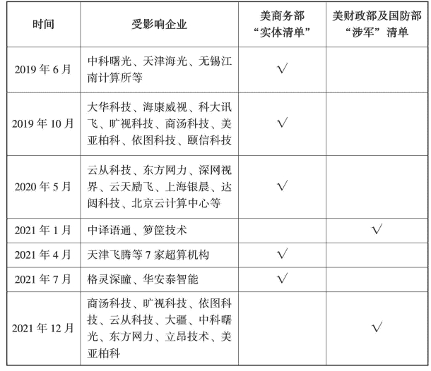

### 二、以规则标准撬动体系分化
美国愈发把科技优势当作规避核冲突风险打压大国的手段。2022年2月俄乌冲突后，美西方联手以法律、行政、金融、舆论、司法等多维度对俄实施科技制裁，苹果、英特尔、谷歌、甲骨文等数十家美企配合停止对俄科技供应与商业合作。美国还长臂管辖欧盟、中国大陆与台湾地区企业，禁止其向俄罗斯提供美科技，实质是美西方对俄全面科技脱钩。俄方自给不足，经济社会各领域面临低端锁定风险。此种极限压制模式很可能被移植到对华政策中，成为体系分化的预演。

作为第三次科技革命策源地，美国长期引领全球科技方向，为创新提供理论基础与科技框架，并在标准制定上占优。国际标准往往滞后于科技，而美国标准常被默认为国际标准，降低贸易门槛，帮助美企拓展海外市场并输出产品，形成规模经济优势。

在AI标准层面，美国加强盟友协作，试图以西方价值观引领全球发展。2020年5月30日，美国改变此前立场，正式加入“人工智能全球合作伙伴组织”，支持法加等国主导的AI治理规则，其真实动力是联合西方限制中国AI发展。这些举措旨在按国家安全与意识形态划分阵营，构建西方主导的发展生态，抢占先机并固化优势。拜登政府明确把西方主导的科技联盟列为优先议程，以科技领先支撑霸权，修复与强化传统同盟，充分发挥对华科技竞争中的联盟优势。^[[\[20\]](#txt007.html#footnote_content_txt007_20)]国务卿布林肯在AI国家安全委员会主办的全球新兴科技峰会上表示，美国正与欧盟、英国、日本、韩国等盟友及在四国对话、七国集团等平台加强合作，目标是构建由国家、企业、大学组成的强大网络，以共同价值观设计部署科技，强化系统开放互操作，鼓励思想与言论自由。^[[\[21\]](#txt007.html#footnote_content_txt007_21)]

美中AI博弈：威胁叙事与规则围堵

围绕AI等前沿技术治理产生的美中分歧，根子在于美国政界、战略界与军方人士有意放大中国技术进展的威胁效应，持续炒作中国威胁论调。这种说法与事实不符，也对中国的发展思路与政策取向作了歪曲。特朗普执政期间，国会两党与舆论已形成遏制中国技术崛起的战略共识，该共识在拜登时期得到延续并进一步强化。在此背景下，美方刻意放大两国在意识形态和价值层面的差异，国内用来维系政治整合，对外用来拉拢盟友。美国的AI战略扩张性突出，对技术安全顾虑不足，同时对外遏制也在加速AI领域的事实脱钩。从规范视角看，若各国在AI和技术标准上走向分化，全球技术体系的统一性会被削弱，依赖合作推动创新与监管将变得困难。

目前美国的AI战略已打上所谓美国民主价值的烙印，并作为对外推广的核心抓手。^([\[22\]](#txt007.html#footnote_content_txt007_22))2021年美国国会通过的《2021年战略竞争法案》提出，要推动盟国和伙伴在规则、规范与标准制定上与美国保持一致，认为加强技术治理协调对保持美国的经济与安全领导地位至关重要。^([\[23\]](#txt007.html#footnote_content_txt007_23))在西方价值指引下，美国在网络空间行为准则、5G、量子、数据保护、反网络犯罪等领域搭建“小圈子”式联盟，意在把西方主导的治理理念固化为国际事实规则。拜登政府更强调标准与规则竞争，技术治理之争已成为中美战略博弈的重要赛道，AI治理正渗入既有国际机制，价值观差异的扩大可能加剧技术领域的意识形态对立，削弱现有机制的实际效用。

与“数字革命必然带来权力分散”的常见想象不同，AI有可能使权力向少数主体进一步集中。数字经济的网络效应和规模效应，让霸权国家在经济、军事与政治层面获得更集中的优势。美国大力推行以技术为主轴的软霸权，中美技术博弈随之升级。外溢压力下，多国转向科技内生化以降低对外依赖。所谓“两头下注”虽能降低站队风险，但多数国家并不具备独立发展AI的必要条件。更多国家可能依附中美其中一方，以兼顾技术潜能与安全利益，这将强化国际体系的阵营化逻辑，加剧分化撕裂。

## 三、以技术前沿为重点，巩固对华实力优势
技术领先是美国霸权地位的重要支柱，以技术优势压制他人是美式软霸权的典型体现，AI创新能力与生态则是中美实力较量的关键。根据既有分析，实力分野正在催生中心—外围的全球技术秩序，美国试图以价值为依据在中心区域构建新生态，通过盟国联合研发维系高端创新优势，进而维护科技霸权。^([\[24\]](#txt007.html#footnote_content_txt007_24))在霸权金字塔中，AI技术创新已成为中国提升综合实力必须跨越的鸿沟，而AI优势也有助于巩固美国实力，实力对比因此可能生变。

为保住AI领先并确保霸权体系的超强基础，美国把新兴技术作为遏制中国增强实力的重点领域，AI是核心。谷歌前CEO施密特等产业人士称中美在AI上是全方位竞争者，呼吁政府加大投入，这反映出产业界对中国技术实力提升的忧虑。这种来自私营部门的焦虑与国家战略趋同，美国国家安全战略加速转向，特朗普政府将世界视作“竞争性世界”。在国家安全思维泛化的影响下，美国推行技术封锁、技术脱钩乃至技术冷战，意图通过打压中国技术发展阻碍其国家实力提升，维护全球领先地位。

美国的软霸权具体体现为对全球价值链与产业链的掌控。2021年9月，为应对芯片短缺，美国商务部要求各国半导体厂商提交库存与销售数据，台积电、三星、SK海力士等起初以涉及商业机密为由抗拒，最终因难以承受美国封锁与制裁压力而妥协。这表明即便美国本土制造外迁，仍凭源头关键技术控制全球产业链，最终超150家企业向商务部提交数据。凭借此软霸权，美国推动全球价值链向以美国为主导的方向结构性调整，强化对AI关键核心技术与产业链关键环节的掌控，提升自身在全球价值链中的优势。科技企业在研发、生产、应用与治理中发挥关键作用，其在中美竞争中的分量不断上升，中国AI企业自然成为美国压制政策的重点对象。

拜登上台后政策取向基本延续。针对中国AI发展的关键领域，美国启动更有针对性的遏制。中美科技一体化程度远超想象，全面脱钩不可实现也会伤及美国，学者萨姆·萨克斯提出的“小院高墙”理念逐步成为主流，即选择性脱钩而非全面脱钩。^([\[25\]](#txt007.html#footnote_content_txt007_25))该策略要求制定关键新兴技术与基础技术目录，对关键半导体制造设备实施有针对性出口管制，并利用美国高端芯片不断增长的市场需求，影响日本、荷兰等设备制造商，使其与美国对华管制保持一致。同时加强对关键技术领域竞争对手投资来源的监控，提高中国公司在AI等敏感技术投资的披露要求。^([\[26\]](#txt007.html#footnote_content_txt007_26))

从此视角看，美国动用国家力量阻拦中国攀登高科技高峰的根本动力在于巩固与捍卫科技霸权。^([\[27\]](#txt007.html#footnote_content_txt007_27))近年来中美围绕AI、5G、量子等技术的博弈加剧，与香港、南海、台湾等传统热点交织，凸显技术议题的重要性与复杂性。这一趋势在拜登执政以来得到加强，美国在以AI为核心的新兴技术领域加大对华防范，已成为美国各界一致共识，这场竞争已超出传统意识形态与价值观冲突的范畴。

## 第三节　关于中国应对策略的思考
AI是引领本轮科技革命与产业变革的战略性技术，具有强溢出带动的“头雁”效应。在移动互联网、大数据、超级计算、传感网、脑科学等新理论新技术的驱动下，加上经济社会对信息技术需求旺盛，AI加速发展，呈现深度学习、跨界融合、人机协同、群智开放、自主操控等新特征，对经济发展、社会进步、国际政治经济格局产生重大而深远的影响。^([\[28\]](#txt007.html#footnote_content_txt007_28))中国对本轮AI发展的认识是充分清晰的，在其对大国关系影响的评估基础上，需坚持总体国家安全观，充分认识AI技术对国家发展与安全的机遇与风险，既包括国际体系层面的间接风险，也包括中美战略竞争的直接风险。着眼AI时代大国竞争的内在逻辑与发展态势，从体制机制构建、治理理念谋划、能力体系打造等方面加强战略部署，做好全方位准备。

### 一、兼顾短期和长远，建立协同性的推进机制
AI技术快速迭代与大国竞争的复杂环境叠加，对中国战略布局提出严峻挑战。短期看，面对美国日益加码的压制，中国需以全球视野谋划创新发展，通过提升科技原始创新能力实现高水平自立自强。长期看，AI作为未来智能化社会的基础性技术，回报周期较长，需纳入国家中长期科技发展规划与科技治理规则，通过国家力量持续资源投入，确保新兴技术领域竞争力。

## 第一，加强国家战略层面的统筹部署和推进。
人工智能对国家安全、经济发展、社会治理、外交影响复杂多元，美国、欧盟、英国、日本等均致力于整合资源，建立高级别咨询委员会为高层决策提供支撑。中国已形成较为合理的部门分工，但推进机制较为分散，统筹力度需进一步加强，对AI带来的综合复杂性影响的应对能力有待提升。有国外研究认为中国形成了不同部门牵头的人工智能治理路径，各部门从算法治理、技术治理、技术伦理规范角度管控安全风险，但缺乏协调可能导致部门间竞争、监管空白或过度遏制创新活力。^([\[29\]](#txt007.html#footnote_content_txt007_29))需从战略层面加强新兴技术安全发展的统筹协调，开展前瞻布局，防止协调不畅造成监管空白或过度抑制技术活力。面向技术不确定性，需加强政策举措跟踪评估与动态调整，提升出台与实施的时效性与有效性。

## 第二，遵循技术客观发展规律，构建有利于创新的推进机制。
新兴技术发展越来越遵循“赢者通吃”，拥有先发优势者可能率先搭建以自身技术为基础的生态体系，进一步巩固优势。中国AI从过去的赶超型创新转向当前引领者创新，本质不同，引领型创新需在摸索中前行，跨越创新“死亡之谷”成本高昂过程艰难。著名经济学家吴敬琏认为，“两弹一星”类与信息技术代表的技术类别特性不同，需尊重客观规律。在AI等信息技术发展中，若夸大“两弹一星”中的独立自主与人定胜天，不计成本闭门造车式发展可能陷入过度社会动员风险。相比之下，“两弹一星”是在相对封闭环境中解决“有没有”的问题，而AI兼具军用民用特点，需在不断开放中解决“好不好”的问题。需推动形成良性循环产业生态，实现自我造血，维持持续创新与迭代。

## 第三，促进各方协同协作，汇聚推动技术发展的合力。
需加强AI技术各环节一体化布局，促进各类主体协同。在军民融合方面，AI民用级与军用级应用差距较大，背后数据集、算法库、智能化判定分析模型等行业与技术要求差距明显，需鼓励领先企业与科研机构深度合作，发挥民用领域创新驱动作用，促进国防科技领域供需对接，持续推动技术创新与成果转化。在政企协同方面，大型科技企业是推动AI发展与应用的重要力量，需完善数据安全、算法安全、个人隐私保护等法律规范，厘清各方数据安全职责边界，为企业数据资源开发利用、探索AI发展新模式新业态提供指引。在区域协作方面，探索构建全国一体化AI算力网络，面对AI对大算力需求，实现各地区算力随需分配，避免重复建设与资源浪费。在行业探索方面，充分发挥中国海量数据资源优势，优先在政府、金融、医疗等领域推动数据共享利用，建设高质量公共数据集，支撑数据安全有序流动，进一步释放数据价值，为AI技术发展提供有力支持。

## 二、平衡国内和国际，形成系统性的治理理念
“科技是发展的利器，也可能成为风险的源头。要前瞻研判科技发展带来的规则冲突、社会风险、伦理挑战，完善相关法律法规、伦理审查规则及监管框架。”^([\[30\]](#txt007.html#footnote_content_txt007_30))AI治理问题引起各大国关注，大国间治理理念差异愈发难以调和，需防止AI治理竞争导致技术体系分化，使技术竞争成为大国冲突的风险源与导火索。需注重对外应对策略的灵活性与有效性，从国内国际两个层面制定完善AI道德伦理与安全隐私标准，合理引导技术健康发展。同时发展丰富国内治理实践，形成具有吸引力的中国方案，为AI国际治理贡献中国方案，提升前沿技术领域的软实力。以人类命运共同体理念为指引，倡导建立包容性AI国际治理体系，为AI领域合作创造良好国际环境。

### 第一，形成具有中国特色的技术治理方案。
当前各国都在探索基于本国发展实际的AI治理理念，西方国家、机构与企业纷纷提出一系列原则、标准、法案，具有全球影响力的治理准则多源于美欧，如美国阿西洛马AI原则，欧盟AI治理法案，其中不可避免内嵌西方价值观、伦理标准与监管理念。中国新一代人工智能治理专业委员会发布《新一代人工智能治理原则——发展负责任的人工智能》，以“负责任”为核心理念，明确治理框架与行动指南、设计开发原则、伦理规范、安全要求等。2021年12月，中国向联合国《特定常规武器公约》第六次审议大会提交《中国关于规范人工智能军事应用的立场文件》，就规范AI军事应用提出解决思路，提出应秉持共同、综合、合作、可持续的全球安全观，倡导各国积极寻求共识，在AI领域践行构建人类命运共同体理念。这些理念、原则、文件为解决AI治理难题进行尝试性探索，提出具有中国特色与中国智慧的技术治理理念，同时坚持积极态度推动AI规制与科技探索相协调，规范风险与鼓励创新并重，可借鉴包容审慎监管方式，加强风险管控同时防止陷入“伦理陷阱”，为AI健康发展提供理念指引。

### 第二，积极参与人工智能相关国际治理议程，加强对人工智能治理的影响力。
尽管大国权力竞争干扰AI国际治理取得实质性进展，但AI治理对话是大国间明确分歧与达成共识的必经之路。需制定安全有效的技术管理目标，积极管控AI可能带来的安全风险。针对AI军事化可能带来的紧迫性议题，加强在具体应用所带来安全隐患与伦理问题的国际对话与合作，凝聚国际治理共识，推动各国为AI武器系统应用划出红线，避免技术议题摩擦加剧大国冲突。在技术治理关键领域“不失声”，重视中国叙事与中国逻辑，在国际社会积极发出中国声音，宣传中国AI技术创新活动与应用成效，抵制西方社会有失公允的指责与抹黑行为。积极倡导并推动AI治理考虑到广大发展中国家与中小国家的发展需求与利益，帮助这些国家跟上技术发展步伐，与大国同步获取技术发展红利，提升应对技术风险能力，促进智能化技术发展成果惠及更多人口。

### 第三，提升人工智能相关数字领域国际规则制定话语权。
目前AI发展竞争也是治理话语权之争，技术治理讨论通常将特定技术问题与价值观绑定。受西方压制以及监管政策差距等因素影响，中国AI企业目前尚难以获得国外用户数据，海外拓展受限制约中国在全球AI技术发展中的布局。中国企业拥有巨大市场与丰富实践经验，需及时提炼相关定义与新问题、新概念与新规则，有助于更好参与全球治理规则制订。为打破美西方构建AI发展的“小圈子”，应支持推动传统国际电联、国际标准化组织、联合国教科文组织等多边平台在AI技术标准制定中发挥主导作用，倡导技术标准制定应征求与吸纳更多发展中国家声音与诉求。将AI作为数字经济国际合作重点，在G20、APEC等机制下全面了解各方AI议题立场，宣传推广中国治理理念与治理方案。鼓励研究机构、高校、专家学者等与西方国家AI机构开展“二轨”对话，阐介中国AI发展理念，交流推广中国AI发展与安全治理理念。

## 三、统筹发展和安全，打造创新型的能力体系
基于AI发展生态全球化特点，“御敌于国门之外”的传统安全理念很难适用于AI时代的安全发展，一国无法在所有技术环节保持领先，因此必须在开放中发展，以发展促安全，通过融入全球产业链实现产业升级。目前中国AI发展呈现高端依赖、中端争夺、低端混战基本态势，高端化技术需求无法得到有效满足。需以传感器、智能芯片、基础算法等重点技术的安全可控发展为目标，构建有利于技术创新的能力体系。

### 第一，培育提升原始创新能力。
中国工程院院士徐匡迪曾发出“徐匡迪之问”——中国有多少数学家投入到AI基础算法研究中？在当前国际形势与中美战略竞争加剧现实环境下，中国AI发展需打破“拿来主义”怪圈。有关研究提出中国智能产业77%分布在应用层，在核心算法与底层理论方面，中国开源代码专业性水平不高、竞争力不强。AI技术具有发散性、非线性、复杂性等特点，创新周期长、难度大且风险高。需聚焦技术创新与产业发展基础层面，加强AI芯片、算法等研发支持力度，鼓励AI基础软硬件国产化适配。发挥新型举国体制优势，引导国内龙头企业与优势厂商开展联合攻关，汇集产学研合力，尽快掌握关键核心技术，提升应对西方技术压制政策的能力。

### 第二，提升产业链关键节点的韧性。
从美国种种技术制华举措看，对中国较大威胁之一就是针对AI发展生态的遏制。这可能造成中国无法获取全球性AI优势资源支持，自主发展替代品周期过长。关键核心技术往往是复杂综合性技术，其研发创新仅靠单一主体难以完成，需得到良性创新生态支撑，由政府、高校、企业、科研院所等不同主体相互协作、联合攻关，最终实现技术不断迭代更新。中国AI技术仍建立在美国基础理论与技术体系之上，科研成果多是回答国外提出与定义的研究问题，在AI基础理论贡献与探索十分有限。目前AI企业创新更多仍是在国外技术基础上的“增量创新”，在高性能AI专用芯片、深度学习框架、基础软件中间件等方面高度依赖美国企业。针对影响AI产业安全的“卡点”“堵点”，需引导产学研用、产业链上下游相互支持、联合研发，在共性关键技术等方面实现突破，培育良性产业生态。

### 第三，打造适合技术发展特点的人才培养体系。

人工智能的发展高度依赖人才供给。理论突破之后能否真正落地，关键在于能否将思路转化为可用产品与系统的工程力量。工程化阶段绝非调几个参数就能上线，必须由既懂模型原理又熟悉行业场景的复合型人才牵头。鉴于技术演进方向不确定、探索路径分散，既要为海内外顶尖AI科学家提供充足资源，推动前沿理论探索与技术验证，也要培育布局更广、层次更高的科研人才队伍。瞄准产业前沿，引导高校与企业在联合育人上深度协同，打造多元化、重实操的人才培养通道；鼓励校企以多种形式合作，重点补齐芯片设计、算法研发、技术架构等行业急缺的岗位缺口。

### 第四，强化关键产业国际竞争力，打造高水平开放发展新格局
坚持以开放促发展，面向人工智能前沿赛道，必须守住产业链、价值链、供应链自主可控、安全可信的底线。建立兼顾技术创新与管理创新的容错机制，提升科研成果产出效率，加速成果向现实生产力转化，增强关键技术进口替代能力。深化国际科技交流合作，提炼可复制的成功经验，系统梳理合作机理与路径。借助世界级人工智能会议等平台牵头组建全球性科技产业发展联盟，提升技术议题上的话语权。优化创新、监管、税收和知识环境，吸引国际资本和技术型企业加大科研投入。在标准化和评估上加大投入，推动行业标准与国际标准接轨，消除非关税壁垒，改善整体创新生态。

### 第五，补齐全民人工智能素养短板
新冠疫情放大了数字化进程中的结构性分化，不同群体在应用人工智能等新兴技术上的数字素养差距明显。数字化基础设施完善的地区，政务线上化程度高，疫情对工作生活的冲击相对有限；数字化水平高的行业能够支撑远程办公；年轻人对数字工具的接受度和熟练度更高，更容易借助电商等渠道满足生活需求。而数字素养偏低的人群和弱势群体在疫情防控中遭遇更多现实困难；在数字化基础薄弱的国家和地区，宽带质量和使用成本等基础条件也制约了数字化应对能力。^([\[31\]](#txt007.html#footnote_content_txt007_31))进入智能化时代，国家和地区之间的人口数字技能鸿沟可能进一步拉大。把人工智能作为全民数字素养提升的重点，是把握智能化机遇、提升国家智能化时代创新竞争力的基础。

## 本章小结
中美战略博弈是长期且全面的，以人工智能为核心的新兴技术已成为博弈的主战场。人工智能正呈现迭代加快、垄断性增强、跨域融合加深的趋势，不断重塑创新模式、产业治理方式和参与主体的角色，垄断性与跨领域性对国家资源协同能力提出更高要求。美中双方都看清了人工智能的颠覆性潜力，竞争的实质已演变为战略谋划、技术创新与标准规则引领能力的综合较量。

本研究构建的人工智能对大国关系影响分析框架，为理解智能时代的中美互动提供了新视角。双方在避免大规模直接对冲上仍存共识，合作中竞争、竞争中合作是主旋律，而在新兴技术领域的竞争强度持续上升。随着应用推广，中美在人工智能领域的较量将更多聚焦技术标准与规则的话语权。从态势看，中国在数量上占优但主要局限于国内市场，在基础理论、技术布局、技术积累与生态构建上仍处劣势。数据资源方面中国具备一定规模优势但隐忧并存。人才合作层面，西方国家逐步抱团形成发展小圈子，中国通过对外合作获取智力资源的难度加大，人才差距可能被放大。当前中国AI发展仍高度依赖以美国为主导的全球技术生态，这些短板制约着创新能力的提升。

美国凭借先发优势，可借助“软霸权”压制中国利用人工智能提升国家实力的战略，短期造成直接冲击，长期则遏制中国追赶基础。技术依附与路径依赖的存在，可能导致中美各自引领的两大技术体系出现阵营化分化。

从美国软霸权运用的逻辑看，美方将中国的科技挑战视作一次新的“斯普特尼克”时刻^([\[32\]](#txt007.html#footnote_content_txt007_32))，核心考量是通过重振科技领先优势压制中国追赶，重塑国际体系主导权。一方面，以价值观为纽带联合西方构建人工智能国际技术联盟，巩固技术创新与产业生态的主导地位；另一方面，中国人工智能在基础理论、技术路线上仍建立在西方技术基础之上，对高性能芯片、深度学习框架、开源软件等关键基础技术高度依赖全球生态。美国意在以精准脱钩重构以西方为主导的封闭生态，阻断中国通过全球参与获取先进能力。中美竞争已上升到治理理念与规范层面，在意识形态差异深化的背景下，标准规范的分歧可能进一步撕裂技术体系。

面对美国的压制政策及其带来的发展挑战与安全风险，应清醒认识到，随着人工智能潜能释放及其对国家实力的强力赋能，美国在人工智能领域的对华打压具有长期性与复杂性，将长期影响中美战略竞争。软性遏制虽隐蔽，威胁不减，其背后意图是在大国竞争中实现“不战而胜”。应对上需兼顾短期与长远，建立协同体制机制，着眼未来技术前沿布局，提升原始创新能力，抢占技术突破点与制高点；统筹国内国际两个大局，完善人工智能道德伦理与安全隐私标准，为国际化发展奠定理念与制度优势，提升中国模式的吸引力与感召力；统筹发展与安全，从技术、产业、人才等多维度构建一体化能力体系，力争在前沿技术领域实现高水平科技自立自强，同时提高利用国际创新资源的水平，增强应对美国软霸权打压的实力。

## 【注释】

[\[1\]](#txt007.html#footnote_quote_txt007_1)孙学峰：《数字技术竞争与东亚安全秩序》，载《国际安全研究》，2022 年（4）：8 页。

[\[2\]](#txt007.html#footnote_quote_txt007_2)赵可金、郎昆：《中美竞争中的供应链安全研究》，载《东北亚论坛》，2022 年（2）：32-33 页。

[\[3\]](#txt007.html#footnote_quote_txt007_3)王明国：《从制度竞争到制度脱钩———中美国际制度互动的演进逻辑》，载《世界政治与经济》，2020 年（10）：110 页。

[\[4\]](#txt007.html#footnote_quote_txt007_4)Ian Hogarth：AI Nationalism，June 2018，（2021-11-15）https：//www.ianhogarth.com/blog/2018/6/13/ai-nationalism。

[\[5\]](#txt007.html#footnote_quote_txt007_5)Jonathan B.Tucker：Partners and Rivals：A Model of International Collaboration in Advanced Technology，International O rganization，1991，Volume 45，Issue 1，pp.83-120.

[\[6\]](#txt007.html#footnote_quote_txt007_6)Ryan Hass，Zach Balin：US-China Relations in the Age of Artificial Intelligence，the Brookings Institution，January 2019，（2021-3-21）https：//www.brookings.edu/research/us-china-relations-inthe-age-of-artificial-intelligence/。

## 参考文献

[\[7\]](#txt007.html#footnote_quote_txt007_7)尤拉西亚集团白皮书：5G 的地缘政治，2018 年 11 月，（2022-2-10）`https：//www.eurasiagroup.net/siteFiles/Media/files/1811-14％205G％20special％20report％20public（1）.pdf`.

[\[8\]](#txt007.html#footnote_quote_txt007_8)Pak Nung Wong：技术地缘政治：中美科技战与数字治国术的实践，纽约：Routledge，2022，p11.

[\[9\]](#txt007.html#footnote_quote_txt007_9)邓伯军：《数字资本主义的意识形态逻辑批判》，载《社会科学》，2020 年（8）：23-31 页。

[\[10\]](#txt007.html#footnote_quote_txt007_10)PwC：把握机遇——PwC 全球人工智能研究：利用人工智能革命，2017，（2021-03-29）`https：//www.pwc.com/gx/en/issues/data-and-analytics/publications/artificial-intelligence-study.html`.

[\[11\]](#txt007.html#footnote_quote_txt007_11)Ashwin Acharya，Brian Dunn：比较美国和中国对高影响力人工智能研究的贡献，2022 年 1 月，（2022-03-05）`https：//cset.georgetown.edu/publication/comparing-u-s-andchinese-contributions-to-high-impact-ai-research/`.

[\[12\]](#txt007.html#footnote_quote_txt007_12)张宇燕、冯维江：《从“接触”到“规锁”：美国对华战略意图及中美博弈的四种前景》，载《清华金融评论》，2018（7）：24-27 页。

[\[13\]](#txt007.html#footnote_quote_txt007_13)美中战略小组：非对称竞争：中国与技术的战略，美国领导力的可行见解，2020 年秋季，（2021-11-08），`http：//industrialpolicy.us/resources/SpecificIndustries/IT/final-memo-china-strategy-group-axios-1.pdf`。

[\[14\]](#txt007.html#footnote_quote_txt007_14)美国国家安全委员会关于人工智能：最终报告，（2021-03-02），`https：//reports.nscai.gov/final-report/table-of-contents/`，2021 年 3 月。

[\[15\]](#txt007.html#footnote_quote_txt007_15)白宫：拜登总统在 2021 年慕尼黑安全会议虚拟会议上的讲话，2021 年 2 月，（2021-03-09），`https：//www.whitehouse.gov/briefing-room/speeches-remarks/2021/02/19/remarks-by-president-biden-at-the-2021-virtual-munich-security-conference/`。

[\[16\]](#txt007.html#footnote_quote_txt007_16)白宫：拜登总统、印度总理莫迪、澳大利亚总理莫里森和日本首相菅义伟在虚拟四方领导人峰会上的讲话，2021 年 3 月，（2021-03-09），`https：//www.whitehouse.gov/briefing-room/speeches-remarks/2021/03/12/remarks-by-president-biden-prime-minister-modi-of-india-prime-minister-morrison-of-australia-and-primeminister-suga-of-japan-in-virtual-meeting-of-the-quad/`。

[\[17\]](#txt007.html#footnote_quote_txt007_17)Husanjot Chahal，Ngor Luong：如何使四方真正成为四边形，2021 年 10 月 22 日，（2021-12-15），`https：//asia.nikkei.com/Opinion/How-to-make-the-Quad-truly-quadrilateral`。

[\[18\]](#txt007.html#footnote_quote_txt007_18)北约：北约人工智能战略概要，2021 年 10 月 22 日，（2021-11-15），`https：//www.nato.int/cps/en/natohq/official_texts_187617.htm`。

[\[19\]](#txt007.html#footnote_quote_txt007_19)李括：《美国科技霸权中的人工智能优势及对全球价值链的重塑》，载《国际关系研究》，2020（1）：44 页。

[\[20\]](#txt007.html#footnote_quote_txt007_20)凌胜利、雒景瑜：《拜登政府的“技术联盟”：动因、内容与挑战》，载《国际论坛》，2021（6）：3-25 页。

[\[21\]](#txt007.html#footnote_quote_txt007_21)Antony J. Blinken 国务卿在国家安全委员会关于人工智能（NSCAI）全球新兴技术峰会上的讲话，2021 年 7 月 13 日，（2021-11-18），`https：//www.state.gov/secretary-antony-j-blinken-at-the-national-security-commission-on-artificial-intelligences-nscai-globalemerging-technology-summit/`。

[\[22\]](#txt007.html#footnote_quote_txt007_22)张东冬：《转向“数字霸权”：美国国家人工智能战略及其国际影响》，载《当代世界与社会主义》，2020（5）：158-168 页。

[\[23\]](#txt007.html#footnote_quote_txt007_23)Meredith Broadbent：AI 监管：欧洲最新提案是对美国的警醒，2021 年 5 月，（2022-02-26），`https：//www.csis.org/analysis/ai-regulation-europes-latest-proposal-wake-call-united-states`。

[\[24\]](#txt007.html#footnote_quote_txt007_24)唐新华：《西方“技术联盟”：构建新科技霸权的战略路径》，载《现代国际关系》，2021（1）：38-64 页。

[\[25\]](#txt007.html#footnote_quote_txt007_25)加州大学圣地亚哥分校美中关系科学与技术工作组，“应对中国挑战：美国技术竞争的新战略”，2020 年 11 月，（2021-04-05），`https：//asiasociety.org/sites/default/files/inline-files/report_meeting-the-china-challenge_2020.pdf`。

[\[26\]](#txt007.html#footnote_quote_txt007_26)美国国家安全委员会关于人工智能，“最终报告”，（2021-03-02），`https：//reports.nscai.gov/final-report/table-of-contents/`，2021 年 3 月。

[\[27\]](#txt007.html#footnote_quote_txt007_27)魏南枝：《世界的“去中心化”：霸权的危机与不确定的未来》，载《文化纵横》，2020（8）：49 页。

[\[28\]](#txt007.html#footnote_quote_txt007_28)中共中央党史和文献研究院：《习近平关于网络强国论述摘编》，北京，中央文献出版社，2021：119 页。

[\[29\]](#txt007.html#footnote_quote_txt007_29)Matt Sheehan：中国的新 AI 治理举措不容忽视，2022 年 1 月，（2022-01-28），`https：//carnegieendowment.org/2022/01/04/china-s-new-ai-governance-initiativesshouldn-t-be-ignored-pub-86127`。

[\[30\]](#txt007.html#footnote_quote_txt007_30)《习近平：在中国科学院第二十次院士大会、中国工程院第十五次院士大会、中国科协第十次全国代表大会上的讲话》，2021 年 5 月 28 日，（2022-03-04），`http：//www.gov.cn/xinwen/2021-05/28/content_5613746.htm`。

[\[31\]](#txt007.html#footnote_quote_txt007_31)联合国贸易和发展会议，COVID-19 危机：强调弥合数字鸿沟的必要性，（2020-07-19），`https：//unctad.org/en/PublicationsLibrary/dtlinf2020dl_en.pdf`。

1957年苏联把斯普特尼克一号送上天，美国舆论为之震动，被解读为莫斯科的技术能力对华盛顿的安全感与领导地位形成严峻冲击。随后斯普特尼克危机便成为形容技术对手逼近所带来的紧迫感的典型说法。

## 结语
自2010年前后起，全球AI热潮进入平台期，但技术沉淀以及向各行业的渗透并未中断，赋能释放的节奏依旧稳定。AI被视为当下爆发力最强、想象空间最大的颠覆性新兴技术，已成为各方高度关注的焦点。为此本文把技术研究与国际关系研究结合，探讨AI对强国互动的影响机制。先在技术层面，基于对AI演进态势、应用现状与走向的客观研判，梳理其作为国力构成要素的地位，以及对其他国力要素的赋能路径，并以AI视角观察国际实力格局的变动；再上升到国际关系层面，从战略认知、战略落地与战略评估等角度剖析主要国家的AI布局，提炼AI影响下强国互动在关系特征、互动方式、实力分配上的表现，并提出AI时代强国关系的分析框架。在此基础上，对AI条件下强国博弈情境作出前瞻性推演，并结合治理维度展望竞合走向。最后聚焦AI在当下及未来美中战略竞争中的角色，引入对中方应对思路的战略思考。

本文以AI与强国关系为研究对象，围绕AI对国力作用机理、对国际格局影响趋势、强国竞合关系、治理走向等关键问题展开。立足技术发展现实与未来走向，进一步发展软实力、软霸权等概念，试图在既有成果基础上勾勒AI时代强国关系的发展图景。

第一，本文以前瞻性判断AI技术发展态势为论证基础，系统梳理AI对各类国力要素的影响路径，阐明数字权力集中化的原因与表现。通过要素类型与要素性质两个维度，论述技术因素对全部国力要素均产生不同程度的影响，其在塑造与提升国力中的分量日益凸显，占比与影响力持续扩张。参照既往变革性技术的作用形式并结合AI自身特质，比对选取科技、数据、经济、网络、军事等受影响最直接的领域，分析AI赋能的作用机理。研究发现，AI为海量数据的分析处理提供了技术手段，掌握AI的主体可在数字化时代占据技术领先优势，而获取技术红利的主体实质上构成了新的权力中心。AI改变了主要国家对核心利益的认知框架与维护方式，强国博弈日益转向以技术实力为代表的软实力竞争。凭借对技术要素的掌控与对技术生态的占位优势，科技强国拉大了与他国的实力差距。从国际体系层面看，该趋势推动权力优势进一步向技术霸权国集中，加剧国际格局的等级化，以AI为核心的技术垄断优势成为霸权国实施软霸权的重要支撑，也日益成为其霸权护持的关键基础。

第二，本文对美国、欧盟成员国、俄罗斯、日本、英国、中方等主体的人工智能战略进行了横向比较，在此基础上评述不同主体在战略认知与实施上的异同、优劣，并对AI竞争态势作出评估。评估显示，主要国家均已认识到AI的颠覆性效应，纷纷将其列为国家发展的战略重点。基于国家利益的现实需求，各国制定了务实可行的战略定位、路径策略与规制导向，核心目标是在技术发展中争取最大优势。为落实国家战略，各国普遍在研究基础设施、研发资源投入、体制机制保障、产业生态优化、顶尖人才培养等多个方面强化保障举措。对比评估发现，尽管主要国家在技术发展上整体占优，但各国仍存在差异。从当前态势看，美中处于第一梯队，对其他国家优势明显；欧盟、俄罗斯、英国等则依托自身资源禀赋选择适配的发展路径，力图尽早分享技术红利。围绕AI领域的竞争不断升温，其压力不可避免地传导至强国互动。

第三，在深入分析技术应用态势与主要国家战略的基础上，本文构建了AI对强国关系影响机制的分析框架。借鉴既有强国关系理论解释，并借助软实力与软霸权等视角，从关系特征、互动方式、实力分配三个相互关联的维度探索构建影响机制，进一步揭示AI对国际关系尤其是强国间关系产生影响的逻辑路径与演变轨迹。一是关系特征方面，全球化相互依赖仍是技术发展的底层环境，经济全球化催生的技术生态体系使相互依赖关系不断演进，技术议题政治化、安全化趋势改变了对相互依赖的传统认知，各国在追求战略自主性与依赖全球环境发展之间并重，软性竞争日渐成为强国博弈的主流形式。二是互动方式方面，以AI为代表的技术议题已成为强国关系关注的焦点，争夺技术优势可能触发极限竞争，围绕实力、规则、理念的角力愈发激烈，各国希望以自身价值理念引领技术发展，强大的话语权为霸权国掌控技术发展方向提供手段，同时也构成牵制、压制其他国家技术发展的壁垒。三是实力分配方面，技术发展推动实力格局变化是AI对国际关系最直接的影响方式，较高的技术门槛不断拉大国家间的差距，实质上催生中心—外围的二元分野，外围发展中国家只能依附中心国家提供的领先技术实现发展，难以凭传统劳动力成本优势完成发展阶段追赶，可能面临被永久边缘化的风险。

## 第四
本文前瞻性地推测了AI条件下强国博弈的场景，并引入AI治理机制的讨论。受制于有效治理框架与手段的缺失，AI在军事对抗、网络战、心理战等领域的风险管控存在空白，这些对抗情景可能诱发难以预料的冲突风险。同时，研究认为强国博弈亦存在加强AI合作的现实需求，跨国长期合作在理论突破与技术研发中提供重要借鉴渠道，在生命科学研究、应对气候变化、弥合数字鸿沟等全球性挑战上也存在迫切合作诉求。在此基础上，归纳三类AI风险类型及治理需求，从治理主体、治理维度、治理方式等方面梳理了AI治理现状。然而，各国担忧在国际竞争中落后而过早遏制自身技术发展，当前治理推进动力不足，治理平台效用有限；AI治理议题庞杂，缺乏主要国家参与的综合性治理框架，国际治理机制实践面临诸多困境。面对实践困境，本文对比中方、美国、欧盟在治理理念与路径上的异同，发现全球治理理念虽逐步趋同，负责任、安全、透明、公平、隐私等共识性原则被各方接受，但在理念背后的路径选择、监管模式、治理思路、重点方向上仍存深层次分歧。在AI技术可能引发全球治理失序的风险下，技术黑箱性或放大强国政治分歧，加剧竞争。为应对此风险，各方应借鉴中方提出的人类命运共同体理念，在追求自身发展的同时强调共同安全，兼顾他国合理关切，加强国际对话合作，促进共同发展，推动技术成果惠及全球。

## 第五
本文运用构建的三位一体分析框架，对AI视域下的主要国家竞争态势进行考察。可以看出，AI时代美中战略竞争将集中于位势之争、规则之争和创新之争三个方面。面向AI时代强国竞争格局变化的特点与趋势，提出中方应注重增强以技术实力为核心的软实力，并从战略部署、产业发展、基础研究等方面提出应对AI时代强国竞争的思考。

## 研究局限与展望
AI技术仍处于持续演进之中，必将对各国政治经济各领域产生深远影响。本文限于研究议题与作者水平，仅在宏观层面聚焦强国关系变化进行观察与阐述，加之技术变量对国际政治的影响往往存在滞后，AI与国际关系间的互动需持续跟踪，相关问题尚待后续深入探索。

### 一
需关注非国家行为体的作用，尤其是科技巨头企业、顶尖科学家群体、技术社群等在不同情境下的行为选择，也将对国家间关系产生影响，这种智能化时代的影响与网络化时代存在诸多差异。非国家行为体与国家行为体既有矛盾也有共同利益，如何借助非国家行为体服务于强国竞争，成为主要战略力量共同面临的议题，需进一步挖掘其角色与作用。

### 二
AI技术发展在一定程度上使军事、经济力量与一国人口基础脱钩，掌握先进技术关键环节的中等国家可能成为受益者，其技术能力或转化为国力提升优势，中等国家的战略取向可能对强国战略态势产生重要影响。因此，中等国家在AI发展中的影响力及其国际地位变化，值得进一步深入讨论。

## 参考书目

### 一、中文书目

#### （一）中文著作

1.董青岭：《大数据与机器学习：复杂社会的政治分析》，北京：时事出版社，2018 年版。

2.方滨兴：《人工智能安全》，北京：电子工业出版社，2020 年版。

3.高奇琦：《人工智能Ⅱ：走向赛托邦》，北京：电子工业出版社，2019 年版。

4.郭锐：《人工智能的伦理和治理》，北京：法律出版社，2020 年版。

5.国务院发展研究中心国际技术经济研究所：《人工智能全球格局：未来趋势与中国位势》，北京：中国人民大学出版社，2019 年版。

6.李巍：《制度之争：战略竞争时代的中美关系》，北京：社会科学文献出版社，2017 年版。

7.李艳：《网络空间治理机制探索———分析框架与参与路径》，北京：时事出版社，2018 年版。

8.李勇坚、张丽君等：《人工智能：技术与伦理的冲突与融合》，北京：经济管理出版社，2019 年版。

9.刘伟：《追问人工智能：从剑桥到北京》，北京：科学出版社，2019 年版。

10.尼克：《人工智能简史》，北京：人民邮电出版社，2017 年版。

11.庞宏亮：《21 世纪战争演变与构想：智能化战争》，上海：上海社会科学出版社，2018 年版。

12.石海明、贾珍珍：《人工智能颠覆未来战争》，北京：人民出版社，2019 年版。

13.孙海泳：《科技创新与国际关系》，北京：时事出版社，2021 年 7 月版。

14.吴明曦：《智能化战争———AI 军事畅想》，北京：国防工业出版社，2020 年版。

15.徐曦：《机器 70 年：互联网、大数据、人工智能带来的人类变革》，北京：人民邮电出版社，2017 年版。

16.尹丽波：《工业和信息化蓝皮书：人工智能发展报告（2019—2020）》，北京：电子工业出版社，2020 年版。

17.之江实验室：《探路智慧社会》，北京：中国科学技术出版社，2021 年版。

18.中国人工智能 2.0 发展战略研究项目组：《中国人工智能 2.0 发展战略研究》，杭州：浙江大学出版社，2018 年版。

19.中国现代国际关系研究所：《信息革命与国际关系》，北京：时事出版社，2002 年版。

20.周志华：《机器学习》，北京：清华大学出版社，2016 年版。

#### （二）中文译著

1.阿米塔·阿查亚：《美国世界秩序的终结》，袁正清、肖莹莹译，上海：上海人民出版社，2017 年版。

2.T.V.保罗：《软制衡：从帝国到全球化时代》，刘丰译，上海：上海人民出版社，2020 年版。

3.安妮-玛丽·斯劳特：《棋盘与网络：网络时代的大战略》，唐岚、牛帅译，北京：中信出版社，2021 年版。

4.保罗·肯尼迪：《大国的兴衰》，陈景彪译，北京：国际文化出版公司，2006 年版。

5.保罗·沙瑞尔：《无人军队：自主武器与未来战争》，朱启超等译，北京：世界知识出版社，2019 年版。

6.杰瑞·卡普兰：《人工智能时代：人机共生下财富、工作与思维的大未来》，李盼译，杭州：浙江人民出版社，2016 年版。

7.凯西·奥尼尔：《算法霸权：数学杀伤性武器的威胁》，马青玲译，北京：中信出版集团，2018 年版。

8.兰德尔·施韦乐，《麦克斯韦妖与金苹果———新千年的全球失序》，高婉妮、邓好雨译，上海：上海人民出版社，2021 年版。

9.劳伦斯·莱斯格：《代码 2.0：网络空间中的法律》，李旭、沈伟伟译，北京：清华大学出版社。2007 年版。

10.雷·库兹韦尔：《人工智能的未来》，盛杨燕译，杭州：浙江人民出版社，2016 年版。

11.卢克·多梅尔：《算法时代———新经济的新引擎》，胡小锐、钟毅译，北京：中信出版社，2016 年版。

12.罗伯特·基欧汉、约瑟夫·奈：《权力与相互依赖》，3 版，门洪华译，北京：北京大学出版社，2002 年版。

13.罗素、诺维格：《人工智能：一种现代的方法》，殷建平、祝恩、刘越等译，北京：清华大学出版社，2013 年版。

14.斯图尔特·罗素：《人工智能新生：破解人机共存密码———人类最后一个大问题》，张羿译，北京：中信出版社，2020 年版。

15.特伦斯·谢诺夫斯基：《深度学习》，姜悦兵译，北京：中信出版社，2019 年版。

16.王维嘉：《暗知识：机器认知如何颠覆商业和社会》，北京：中信出版社，2019 年版。

17.西蒙·莱克、理查德·内德·勒博：《告别霸权！全球体系中的权力与影响力》，陈锴译，上海：上海人民出版社，2017 年版。

18.小约瑟夫·奈、戴维·韦尔奇：《理解全球冲突与合作：理论与历史》，10 版，张小明译，上海：上海人民出版社，2018 年版。

19.约翰·伊肯伯里：《美国无敌：均势的未来》，韩召颖译，北京：北京大学出版社，2005 年版。

20.约瑟夫·巴-科恩、大卫·汉森：《机器人革命：即将到来的机器人时代》，潘俊译，北京：机械工业出版社，2015 年版。

21.小约瑟夫·奈：《权力大未来》，王吉美译，北京：中信出版社，2012 年版。

22.詹姆斯·巴拉特：《我们最后的发明：人工智能与人类时代的终结》，闾佳译，北京：电子工业出版社，2016 年版。

23.詹姆斯·多尔蒂、小罗伯特·普法尔茨格拉芙：《争论中的国际关系理论》，5 版，阎学通、陈寒溪等译，北京：世界知识出版社，2003 年版。

24.莫伊塞斯·纳伊姆：《权力的终结：权力正在失去，世界如何运转》，王吉美、牛筱萌译，北京：中信出版社，2013 年版。

25.尤瓦尔·赫拉利：《人类简史：从动物到上帝》，林俊宏译，北京：中信出版社，2014 年版。

26.巴里·布赞、乔治·劳森：《全球转型：历史、现代性与国际关系的形成》，崔顺姬译，李佳校，上海：上海人民出版社，2020 年版。

27.卡萝塔·佩蕾丝：《技术革命与金融资本———泡沫与黄金时代的动力学》，田方萌等译，北京：中国人民大学出版社，2007 年版。

28.玛格丽特·博登：《人工智能：人工智能的本质与未来》，孙诗惠译，北京：中国人民大学出版社，2017 年版。

29.尼尔·弗格森：《广场与高塔：网络、阶层与全球权力竞争》，周逵、颜冰璇译，北京：中信出版社，2020 年版。

30.尼克·波斯特洛姆：《超级智能———路线图、危险性与应对策略》，张体伟、张玉青译，北京：中信出版社，2015 年版。

31.苏珊·斯特兰奇：《国家与市场》，2 版，杨宇光等译，上海：上海人民出版社，2012 年版。

32.维克托·迈尔-舍恩伯格、肯尼斯·库克耶：《大数据时代：生活、工作与思维的大变革》，盛杨燕、周涛译，杭州：浙江人民出版社，2013 年版。

#### （三）中文期刊、论文

1.保建云：《大数据、人工智能与超级博弈论———新时代国际关系演变趋势分析》，载《国家治理》，2019（11）：19-33 页。

2.陈琪、朱荣生：《为何担心人工智能冲击国际安全》，载《人民论坛》，2020（8）：124-127 页。

3.陈伟光、袁静：《人工智能全球治理：基于治理主体、结构和机制的分析》，载《国际观察》，2018（4）：23-37 页。

4.董青岭：《机器学习与冲突预测———国际关系研究的一个跨学科视角》，载《世界经济与政治》，2017（7）：100-117 页。

5.封帅：《建构人工智能国际关系研究的中国视角》，载《国际关系研究》，2021（6）：51-75 页。

6.冯玉军、陈宇：《大国竞逐新军事革命与国际安全体系的未来》，载《现代国际关系》，2018（12）：12-20 页。

7.傅莹：《人工智能对国际关系的影响初析》，载《国际政治科学》，2019，4（1）：1-18 页。

8.高奇琦：《全球善智与全球合智：人工智能全球治理的未来》，载《世界经济与政治》，2019（7）：24-48 页。

9.郭泽林、陈琪：《人工智能技术发展对国际政治格局的影响》，载《人民论坛·学术前沿》，2020（12）：88-91 页。

10.黄忠：《人工智能与未来十年的国际关系》，载《当代世界与社会主义》（双月刊），2019（6）：37-46 页。

11.季志业：《大国关系调整态势：美国强化霸权地位》，载《现代国际关系》，2019（2）：6-9 页。

12.贾开、薛澜：《人工智能伦理问题与安全风险治理的全球比较与中国实践》，载《公共管理评论》，2021（1）：122-134 页。

13.贾珍珍、刘杨钺：《总体国家安全观视域下的算法安全与治理》，载《理论与改革》，2021（2）：135-148 页。

14.贾子方、王栋：《人工智能技术对战争形态的影响及其战略意义》，载《国际政治研究》（双月刊），2020（6）：36-59 页。

15.郎平：《大变局下网络空间治理的大国博弈》，载《全球传媒学刊》，2020（7）：70-85 页。

16.李恒阳：《美国人工智能战略探析》，载《美国研究》，2020，34（4）：94-114 页。

17.李峥：《总体国家安全观视角下的人工智能与国家安全》，载《当代世界》，2018（10）：18-21 页。

18.刘冲、邓门佳：《新兴生物技术发展对大国竞争与全球治理的影响》，载《现代国际关系》，2020（6）：1-10 页。

19.刘国柱、尹楠楠：《美国国家安全认知的新视阈：人工智能与国家安全》，载《国际安全研究》，2020（2）：135-155 页。

20.刘胜湘、陈飞羽：《大国竞争关系生成与传导机制论析———兼论美苏冷战与中美战略竞争的比较》，载《当代亚太》，2021（5）：4-38 页。

21.刘杨钺：《技术变革与网络空间安全治理：拥抱“不确定的时代”》，载《社会科学》，2020（9）：41-50 页。

22.鲁传颖、约翰·马勒里：《体制复合体理论视角下人工智能全球治理进程》，《国际观察》，2018（4）：1-19 页。

23.庞珣：《全球价值链中的结构性权力与国际格局演变》，载《中国社会科学》，2021（9）：26-46 页。

人工智能战略与治理文献精粹

中文期刊论文
24. 阙天舒、张纪腾 (2020).《美国人工智能战略新动向及其全球影响》.刊于《外交评论》2020年第3期,页码121-154.
25. 阙天舒、张纪腾 (2020).《人工智能时代背景下的国家安全治理：应用范式、风险识别与路径选择》.刊于《国际安全研究》2020年第1期,页码4-38.
26. 任琳、孙振民 (2021).《经济安全化与霸权的网络性权力》.刊于《世界经济与政治》2021年第6期,页码83-109.
27. 孙学峰 (2022).《数字技术竞争与东亚安全秩序》.刊于《国际安全研究》2022年第4期,页码1-26.
28. 王桂芳、王南 (2019).《美国网络联盟发展及其对我国的影响》.刊于《中国信息安全》2019年第9期,页码39-41.
29. 王悠、陈定定 (2018).《迈向进攻性现实主义世界？——人工智能时代的国际关系》.刊于《当代世界》2018年第10期,页码22-26.
30. 吴雁飞 (2018).《人工智能时代的国际关系研究：挑战与机遇》.刊于《国际论坛》2018年第6期,页码38-44.
31. 夏立平、田博 (2020).《论国际新智缘政治的范式与影响》.刊于《同济大学学报(社会科学版)》第31卷第6期,页码53-63.
32. 徐能武、龙坤 (2019).《联合国 CCW 框架下致命性自主武器系统军控辩争的焦点与趋势》.刊于《国际安全研究》2019年第5期,页码108-132.
33. 阎学通 (2019).《超越地缘战略思维》.刊于《国际政治科学》2019年第4期,页码3-6.
34. 余南平 (2020).《人工智能革命背景下的大国博弈——以全球价值链的结构变化为分析视角》.刊于《国际关系研究》2020年第1期,页码3-25.
35. 俞晗之、王晗晔 (2019).《人工智能全球治理的现状：基于主体与实践的分析》.刊于《电子政务》2019年第3期,页码9-17.
36. 张力 (2017).《对当前网络与信息技术的发展及新工业革命的思考》.刊于《现代国际关系》2017年第12期,页码7-10.
37. 张一飞 (2019).《冷战思维的新科技包装：《人工智能如何重塑全球秩序》评析》.刊于《当代美国评论》2019年第1期,页码85-96.
38. 支振锋 (2017).《互联网全球治理的法治之道》.刊于《法制与社会发展》2017年第1期,页码91-105.
39. 周琪 (2021).《高科技领域的竞争正改变大国战略竞争的主要模式》.刊于《太平洋学报》第29卷第1期,页码1-20.

### 二、英文书目
#### （一）英文原著
1. Sinan Aral (2020).《The Hype Machine: How Social Media Disrupts Our Elections, Our Economy, and Our Health—and How We Must Adapt》.Penguin Random House.
2. Meredith Broussard (2018).《Artificial Unintelligence: How Computers Misunderstand the World》.Cambridge, MA: MIT Press.
3. Taina Bucher (2018).《IF…THEN: Algorithmic Power and Politics》.Oxford University Press.
4. Allan M. Din (ed.) (1987).《Arms and Artificial Intelligence: Weapon and Arms Control Applications of Advanced Computing》.Oxford University Press.
5. Franklin Foer (2017).《World without mind: the existential threat of big tech》.New York: Penguin Press.
6. Martin Ford (2015).《Rise of the Robots: Technology and the Threat of a Jobless Future》.Basic Books.
7. Keith Frankish, William M. Ramsey (ed.) (2014).《The Cambridge Handbook of Artificial Intelligence》.Cambridge University Press.
8. Carl Benedikt Frey (2019).《The Technology Trap: Capital, Labor, and Power in the Age of Automation》.Oxford: Princeton University Press.
9. Scott Galloway (2017).《The Four: The Hidden DNA of Amazon, Apple, Facebook, and Google》.New York: Portfolio/Penguin.
10. Rosario Girasa (2020).《Artificial Intelligence as a Disruptive Technology: Economic Transformation and Government Regulation》.Palgrave Macmillan.
11. Jacob L. Heim, Benjamin M. Miller (2020).《Measuring Power, Power Cycles, and the Risk of Great-Power War in the 21st Century》.RAND Corporation.
12. Geoffrey Herrera (2006).《Technology and International Transformation: The Railroad, the Atom Bomb, and the Politics of Technological Change》.Albany: State University of New York.

# 参考文献
## 书籍
13. Michael C. Horowitz (2010).《军事力量的扩散：对国际政治的原因和后果》.Princeton University Press.
14. Valerie M. Hudson (ed.) (1991).《人工智能与国际政治》.New York: Routledge.
15. Jeremy Rabkin (2017).《打击力量：网络、机器人和太空武器如何改变战争规则》.Encounter Books.
16. Henry Kissinger, Eric Schmidt, Daniel Huttenlocher (2021).《人工智能时代：与我们的人类未来》.London: John Murray.
17. Richard Lipsey (2005).《经济转型：通用目的技术与长期增长》.Oxford University Press.
18. Markus Dubber, Frank Pasquale, Sunit Das (ed.) (2020).《牛津人工智能伦理手册》.Oxford University Press.
19. Yvonne R. Masakowski (ed.) (2020).《人工智能与全球安全：未来趋势、威胁与考量》.Emerald Publishing.
20. Taylor Owen (2015).《破坏性力量：数字时代国家的危机》.New York: Oxford University Press.
21. Kenneth Payne (2018).《战略演进与战争：从猿类到人工智能》.Washington, DC: Georgetown University Press.
22. Paul Scharre (2018).《无人军队：自主武器与战争的未来》.New York: W.W. Norton & Company.
23. Peter Singer, Allan Friedman (2014).《网络安全与网络战：每个人都需要知道的事》.Oxford University Press.
24. Max Tegmark (2017).《生命 3.0：在人工智能时代做人》.Alfred A. Knopf.
25. Ashley J. Tellis, Janice Bially, Christopher Layne et al. (2000).《后工业时代国家实力的衡量》.RAND Corporation.
26. Darrell M. West, John R. Allen (2020).《转折点：人工智能时代的政策制定》.Brookings Institution Press.
27. Nicholas D. Wright (ed.) (2019).《人工智能、中国、俄罗斯与全球秩序》.Air University Press.

## （二）英文期刊论文
1. Daron Acemoglu, Pascual Restrepo (2020).“错误类型的人工智能？人工智能与劳动需求的未来”.Cambridge Journal of Regions, Economy and Society, 13(1):25-35.
2. Kareem Ayoub, Kenneth Payne (2016).“人工智能时代的战略”.Journal of Strategic Studies, 39(5-6):793-819.
3. Robert Chesney, Danielle Citron (2019).“深度伪造与新的虚假信息战——后真相地缘政治的到来”.Foreign Affairs, 98(1):147-155.
4. Daniel W. Drezner (2019).“技术变革与国际关系”.International Relations, 33(2):286-303.
5. Henry Farrell, Abraham L Newman (2020).“锁链于全球化：为何为时已晚而无法脱钩”.Foreign Affairs, 99(1):70-80.
6. Amandeep Singh Gill (2019).“人工智能与国际安全：长远视角”.Ethics & International Affairs, 33(2):169-179.
7. Avi Goldfarb, Jon R. Lindsay (2022).“预测与判断：为何人工智能在战争中提升了人类的重要性”.International Security, 46(3):7-50.
8. Gonenc Gurkaynak, Ilay Yilmaz, Gunes Haksever (2016).“扼杀人工智能：人类风险”.Computer Law & Security Review, 32(5):749-758.
9. Thilo Hagendorff (2020).“人工智能伦理的伦理：指南评估”.Minds and Machines, 30:99-120.
10. Yuval Noah Harari (2019).“谁将赢得人工智能竞赛？中国和美国领先群雄，落后者面临严重危险”.Foreign Policy, 231:52-54.
11. Michael C. Horowitz, Sarah E. Kreps et al. (2016).“无人机扩散争论中事实与虚构的区分”.International Security, 41(2):7-42.
12. Michael Horowitz (2018).“人工智能、国际竞争与力量平衡”.Texas National Security Review, 1(3):36-57.
13. Benjamin Jensen, Christopher Whyte et al. (2020).“战争中的算法：人工智能的承诺、风险与局限”.International Studies Review, 22(3):526-550.
14. James Johnson (2020).“核战争中的人工智能：不稳定的完美风暴？”.The Washington Quarterly, 43(2):197-211.
15. Lucas Kello (2013).“网络革命的意义：对理论与治国之道的风险”.International Security, 38(2):7-40.
16. Erik Lin-Greenberg (2020).“盟友与人工智能：行动与决策制定的障碍”.Texas National Security Review, 3(2):57-76.
17. Shakir Mohamed, Marie-Therese Pny et al. (2020).“去殖民化人工智能：去殖民化理论作为人工智能中的社会技术前瞻”.Philosophy & Technology, 33:659-684.
18. Kenneth Payne (2018).“人工智能：战略事务的革命？”.Survival, 60(5):7-32.
19. Norrin M. Ripsman (2021).“全球化、去全球化与大国政治”.International Affairs, 97(5):1317-1333.
20. Heather Roff (2019).“人工智能：权力归于人民”.Ethics & International Affairs, 33(2):127-140.
21. Paul Scharre (2019).“杀手级应用：人工智能军备竞赛的真正危险”.Foreign Affairs, 98(3):135-144.
22. Wenjun Wu, Tiejun Huang et al. (2020).“中国人工智能的伦理原则与治理技术发展”.Engineering, 6(3):302-309.

## （三）英文网络文献
1. Greg Allen, Taniel Chan (2017).“人工智能与国家安全”.Belfer Center for Science and International Affairs, Harvard Kennedy School.检索日期2020-08-20.https://www.belfercenter.org/sites/default/files/files/publication/ai%20NatSec%20-%20final.pdf
2. M.L. Cummings, Heather M. Roff (2018).“人工智能与国际事务：预期中的颠覆”.Chatham House Report.检索日期2020-08-05.https://www.chathamhouse.org/publication/artificial-intelligence-and-international-affairs
3. Allan Dafoe (2017).“人工智能治理：研究议程”.Future of Humanity Institute, University of Oxford.检索日期2020-08-20.https://www.fhi.ox.ac.uk/wp-content/uploads/GovAI-Agenda.pdf
4. Matthew Daniels, Ben Chang (2021).“人工智能之后国家的力量”.Center for Security and Emerging Technology.检索日期2021-09-05.https://cset.georgetown.edu/Publication/national-power-after-ai/
5. Peter Engelke (2020).“人工智能、社会与治理：导论”.Atlantic Council.检索日期2021-03-01.https://www.atlanticcouncil.org/wp-content/uploads/2020/03/FINAL-AI-POLICY-PRIMER-0220.pdf
6. Samar Fatima, Gregory S. Dawson, Kevin C. Desouza et al. (2021).“国家人工智能愿景实现中的赢家与输家”.Brookings TechTank.检索日期2022-01-15.https://www.brookings.edu/blog/techtank/2021/10/21/winners-and-losers-in-the-fulfilment-of-national-artificial-intelligence-aspirations/
7. Jessica Fjeld et al. (2020).“有原则的人工智能：伦理与权利为本方法中人工智能原则共识的映射”.Berkman Klein Center for Internet & Society.检索日期2020-08-20.https://cyber.harvard.edu/publication/2020/principled-AI
8. Stefan Heumann, Nicolas Zahn (2018).“国家人工智能战略基准”.检索日期2020-08-05.https://www.stiftung-nv.de/sites/default/files/benchmarking_ai_strategies.pdf
9. Michael C. Horowitz et al. (2020).“人工智能与国际安全”.Center for a New American Security Report.检索日期2020-08-28.https://www.cnas.org/publications/reports/artificial-intelligence-and-international-security
10. Michael C. Horowitz, Lauren Kahn et al. (2020).“政策圆桌会议：人工智能与国际安全”.检索日期2021-03-04.https://tnsr.org/roundtable/policy-roundtable-artificial-intelligenceand-international-security/
11. International Telecommunications Union (2020).“为善的人工智能：全球影响”.ITU News Magazine, Vol.2.检索日期2020-08-05.https://www.itu.int/en/myitu/Publications/2020/06/15/09/01/ITU-News-Magazine-No2-2020

以下为支撑观点的核心文献清单，信息已按作者、主题、来源及查阅时间重新梳理：

12. Andrew Hunter 与 Lindsey R. Sheppard 等人合著的研究报告《人工智能与国家安全：AI 生态系统的关键作用》，出自战略与国际研究中心，出版年份为 2018 年，查阅日期为 2020 年 8 月 15 日，可见于 https://www.csis.org/events/artificial-intelligence-and-national-security-importance-AI-ecosystem。

13. Konstantinos Komaitis 与 Justin Sherman 联合撰写的文章《美欧技术战略的趋同被高估了》，刊载于布鲁金斯学会，发布时间为 2021 年 5 月，访问于 2022 年 2 月 25 日，原文链接 https://www.brookings.edu/techstream/us-and-eu-tech-strategy-arent-as-aligned-as-you-think/#cancel。

14. Gary Marcus 所著《AI 的未来十年：通往可靠人工智能的四项路径》，预印本于 2020 年 2 月上线，arXiv 链接为 https://arxiv.org/abs/2002.06177，获取时间为 2021 年 3 月 5 日。

15. 由 Ben Scott 领衔的研究团队发布的研究报告《人工智能与外交政策》，完成于 2018 年，查阅时间为 2020 年 8 月 5 日，PDF 地址为 https://www.stiftung-nv.de/sites/default/files/AI_foreign_policy.pdf。

16. 斯坦福大学人文中心人工智能研究所编撰的《人工智能指数年度报告》，报告期为 2021 年 3 月，查看日期为 2021 年 3 月 20 日，文档可通过 http://aiindex.stanford.edu/wp-content/uploads/2021/03/2021-AI-Index-Report_Master.pdf 获取。