# 人工智能赋能智慧社区

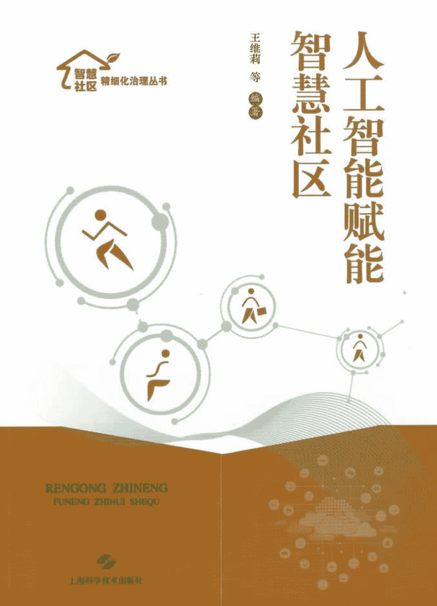

## 智慧社区精细化治理丛书

### 编撰委员会

主　编

韩　新

副主编

丛北华　周晓芳　王维莉

编　委

（以姓氏笔画为序）

马梦菲　叶伙荣　冯冰洋　齐　力　孙少华　李子铨　李晓恋
吴松洋　吴轶轩　时　宇　张　旺　张红忠　张美璟　范勤勤
林　翔　周昌志　房彦锋　秦春磊　徐会军　徐韵如　黄凤彬
谢启苗　雷　琰　鲍　亮

## 丛书前言

城市社区是城市的基本单元，是人民群众赖以生存的生活和精神家园。大力推进城市社区建设，充分发挥社区在发展经济、繁荣城市、稳定社会、服务群众中的重要作用，不仅是提升城市竞争力、增强城市亲和力、塑造城市个性魅力、提高城市综合实力的重要途径，也是新形势下实现城市现代化的必然要求。

近年来，我国普遍开展智慧城市建设。发展智慧城市的核心理念是以人为本，提供智能化便民服务，让数据多跑路，让办事群众少跑腿，将“智慧”概念渗透到城市的各个领域，如智慧交通、智慧城管、智慧医疗、智慧环保、智慧社区等，使公共服务完备化、公共治理系统化、人民生活便利化，不断提高城市居民的幸福感。社区作为智慧城市的基本构成模块，各级政府都在积极加快推进“智慧社区”建设，以切实解决社区信息收集渠道相对落后、缺少综合服务方式、缺乏现代科技支撑力度等问题，最大程度发挥城市社区自身所具有的服务于民的基础管理作用。

当前，全面推进城市数字化转型已成为我国各大城市主动服务新发展格局的重要战略。从“城市是生命体、有机体”的全局出发，用数字化方式创造性解决智慧社区建设和发展难题的需求日益加大。但目前人们对智慧社区的理解和认识尚不统一，社区精细化治理的技术仍不成熟，规划和建设数字化转型背景下智慧社区的系统方法一直在探索研究中。特别是，面对 2020 年年初突如其来的新冠肺炎疫情，以人工智能、大数据、云计算等为核心制定的一系列精细化科学应对方案，积极助力社区的疫情防控，成为此次严重公共卫生危机事件阻击战中的亮点。为了满足和促进社区全方位发展需要，在上海市科委科研项目“人工智能赋能智慧社区综合管理平台关键技术研究及示范（项目编号：19dz1209600）”支持下，我们策划出版了这套“智慧社区精细化治理丛书”，旨在总结国内外智慧社区的建设经验，顺应智慧城市发展规律，积极探索智慧社区“整体性转变、全方位赋能、革命性重塑”的创新理念，回应人们对美好生活的新期待。

本丛书系统介绍了智慧社区的基本概念，国内外智慧社区基本情况和发展趋势，物联网、大数据、人工智能在智慧社区构建过程中的技术体系和技术要点，并通过应用场景和具体案例进行了展示和说明。丛书体现了智慧社区建设理念的更新和转变，探讨了精细化治理在智慧社区中的创新应用模式，展望了未来智慧社区的发展策略和愿景，相信对积极推进我国智慧城市健康发展、全面提升城市治理体系和治理能力现代化水平、创造人民城市数字化美好生活体验，具有很好的参考价值和借鉴作用。

本丛书包括 5 分册：由同济大学韩新等编著的《智慧社区导论》《智慧社区应用场景与典型案例》为综合性的内容，前者为智慧社区的一般性论述，后者着重介绍智慧社区的主要应用场景和相关案例；由同济大学丛北华编著的《智慧社区物联网系统》、公安部第三研究所周晓芳等编著的《智慧社区大数据》和上海海事大学王维莉等编著的《人工智能赋能智慧社区》则分别围绕物联网、大数据和人工智能赋能应用展开。

对于本丛书，读者可以阅读全套 5 分册，进行综合、系统的学习，从而对智慧社区有一个全方位的了解；也可以根据工作需要和专业背景只选择某一分册阅读，掌握智慧社区规划和建设的某一专项内容和某一种专业技术方法。本丛书阅读对象主要是从事社区治理和人工智能相关工作的技术人员，高等院校、科研院所相关专业和领域的教师、学生、研究者也可以将其作为参考书；本丛书对政府管理人员了解智慧社区基本知识及其管理工作也会有一定帮助。

在本丛书编写过程中，作者收集了国内外相关领域的大量资料，参考了新加坡、日本、美国和欧洲一些国家以及我国台湾和香港地区的先进经验，总结了我国智慧社区建设的丰富实践，采纳了人工智能领域和城市治理领域的最新研究成果。同时得到了林伟教授、丁健青教授、曹先艳博士等专家以及融创中国控股有限公司等单位的大力帮助，他们提供了相关领域的研究成果和案例、审阅了文稿，并提出了宝贵的意见和建议，在此一并致谢。

由于本丛书篇幅较大，跨越多个学科和门类，且人工智能相关前沿技术还在探索发展中，加之作者水平有限，不足及疏漏的地方在所难免，敬请读者批评指正。

韩　新　同济大学

2021 年 8 月

## 前言

社区是城市的基础单元，是城市治理的“最后一公里”。“智慧社区”的建设，是将“智慧城市”的概念引入社区，以社区群众的获得感、幸福感、安全感为目标，通过物联网、大数据、人工智能等新技术的加持，推动社区向智慧化方向转型发展。

“人工智能赋能智慧社区”是智慧社区引入人工智能技术后迭代升级的产物，是一种基于海量信息和智能处理的全新社区形态。其将“数据”作为社区治理要素的重要资源，并通过各类智能终端和管理平台，融合机器学习、算法推理等人工智能技术，使社区治理具备“感知—认知—决策”全链条的智能化能力。人工智能赋能的智慧社区，具有更全面的人、物、事件等信息感知能力，更强大的信息资源整合和数据处理能力，更科学的监测分析和辅助决策能力，以及更高水平的风险防控和智慧服务能力。

本书围绕数据智能驱动社区共建共治共享，结合社区公共安全、公共管理、公共服务三大应用需求，介绍了支撑社区智慧安防、公共卫生防护、灾害应急管理、公共空间治理、公共交通优化、智慧养老助残、个性化精准服务等核心应用场景实现的人工智能关键技术及算法模型，以及围绕泛在智能，描述了如何打造人性化、智慧化的未来社区。

全书围绕智慧社区典型应用场景，对各个场景主要功能的实现流程、相关人工智能技术及算法做了介绍，努力克服市场上智慧社区同类书中“案例场景描述较多，功能实现介绍不足”以及人工智能算法同类书中“算法介绍为主，对智慧社区应用无针对性”的问题，力图让读者在有限的时间内更为透彻地理解人工智能赋能智慧社区的内涵、关键支撑技术以及实现的算法流程。全书内容精炼、重点突出，具有较强的引领性。

本书由上海海事大学王维莉博士主要编著和统稿，参编人员包括上海海事大学范勤勤博士、谢启苗博士、王卓、戎加宇。具体编写分工如下：第 1、5、6、9 章和附录由王维莉编写，第 2 章由谢启苗编写，第 3、7 章由王卓编写，第 4 章由戎加宇编写，第 8 章由范勤勤编写。本书撰写时参考和借鉴了诸多同行的著作经验，在此一并表示感谢！

限于作者水平，加之“人工智能赋能智慧社区”仍在持续探究和发展中，书中难免存在不足之处，恳请专家、读者批评指正。

作者

2021 年 7 月

# 第 1 章　概论

随着人口的激增和城市化进程的加快，城市规模快速增长，给城市管理带来新的挑战。城市的不断扩容，使城市在住房、就业、教育、医疗、养老、治安等方面都面临着各种问题和压力，这就迫切需要建立一个高效运转的城市管理体系来应对，因此智慧城市应运而生。随着智慧城市的发展，社区智慧化建设已成大势所趋。2016 年民政部发布的《城乡社区服务体系建设规划（2016—2020 年）》便明确提出了智慧社区的建设目标：要建设“设施智能、服务便捷、管理精细、生态宜居”的智慧社区。2017 年，中共中央、国务院印发了《关于加强和完善城乡社区治理的意见》，要求增强社区信息化应用能力，提高城乡社区信息基础设施和技术装备水平。近年来，《智慧社区建设指南（试行）》《关于推进社区公共服务综合信息平台建设的指导意见》《智慧社（园）区建设评价指标体系研究》等政策文件也相继出台，从而推动智慧社区建设不断走向深入。

智慧社区建设是指将智慧城市概念引入社区单元，以社区居民的幸福感为起点，通过打造智慧社区为社区群众提供便利和服务，从而推动区域社会进步。智慧社区是一个以人为本的智能服务体系，其充分借助物联网等网络通信技术把物业服务、安防、通信等体系集成在一起，并通过通信网络连接物业管理处，为社区住户提供一个安全、舒服、便利的现代生活环境，形成基于大规模信息智能处理的新型管理模式，通过增强社区便民利民智能化水平，使得社区治理的供给侧服务平台化、扁平化，实现上下联动、流程透明、管控精准、服务便捷。

## 1.1　人工智能赋能智慧社区内涵

### 1.1.1　智慧社区的概念及内涵

2020 年 7 月，住房和城乡建设部将智慧社区定义为“利用物联网、云计算、大数据、人工智能等新一代信息技术，融合社区场景下的人、事、地、物、情、组织等多种数据资源，提供面向政府、物业、居民和企业的社区管理与服务类应用，提升社区管理与服务的科学化、智能化、精细化水平，实现共建共治共享管理模式的一种社区”。

智慧社区建设是全国推行智慧城市建设背景下提出的操作化方案，是智慧城市的“最后一公里”。智慧社区治理关注提升社区内部软硬件设施的信息化和智能化水平，进而达到提升社区各项事务管理水平的目标。

从应用角度来看，智慧社区是指运用新一代信息技术，融合多种网络资源，覆盖智能建筑、智能家居、视频监控、健康医疗、物业管理、数字生活、能耗管理等诸多领域，融合构建社区的人文、生活、经济环境，形成基于海量信息和智能处理的新型社区管理模式，以及面向未来的全新社区形态。

从发展思路来看，智慧社区是未来实体社区的虚拟映射对象和智能操控体，形成虚实对应、相互映射、协同交互的复杂巨系统，其可在数字化水平相对较高、需要运行机理建模、实现虚实空间协同优化、彰显多维智能决策支撑等领域优先落地实施。通过“六化发展”思路，即支撑社区全要素数字化和虚拟化、社区全状态实时化和可视化、社区管理决策协同化和智能化，实现在“社区规划建设一张蓝图管到底、社区治理虚实融合一盘棋、社区服务情景交融个性主动一站式”这三类场景下的应用，逐步实现社区的智能运行和迭代创新。

### 1.1.2　人工智能的发展及赋能作用

“人工智能”（artificial intelligence，AI）这一概念诞生于 1956 年。在半个多世纪的发展历程中，由于受到智能算法、计算速度、存储水平等多方面因素的影响，人工智能技术和应用发展经历了多次高潮和低谷。2006 年以来，以深度学习为代表的机器学习算法在机器视觉和语音识别等领域取得了极大的成功，识别准确性大幅提升，使人工智能再次受到学术界和产业界的广泛关注。云计算、大数据等技术在提升运算速度和降低计算成本的同时，也为人工智能发展提供了丰富的数据资源，协助其训练出更加智能化的算法模型。人工智能的发展模式也从过去追求“用计算机模拟人工智能”，逐步转向用机器与人结合而成的增强型混合智能系统，用机器、人、网络结合成的新的群智系统，以及用机器、人、网络和物结合成的更加复杂的智能系统。

作为新一轮产业变革的核心驱动力，人工智能在催生新技术、新产品的同时，对传统行业也具备较强的赋能作用，能够引发经济结构的重大变革，实现社会生产力的整体跃升。人工智能将人从枯燥的劳动中解放出来，越来越多的简单性、重复性、危险性任务由人工智能系统完成，在减少人力投入、提高工作效率的同时，还能够比人类做得更快、更准确。人工智能还可以在教育、医疗、养老、环境保护、城市运行、司法服务等领域得到广泛应用，能够极大地提高公共服务精准化水平，全面提升人民生活品质。同时，人工智能可以帮助人类准确感知、预测、预警基础设施和社会安全运行的重大态势，及时把握群体认知及心理变化，主动做出决策反应，显著提高社会治理能力和水平，同时保障公共安全。

人工智能正成为撬动新一轮技术和产业变革的重要力量，其颠覆传统的思维逻辑、决策方式和管理模式，解构着既有的信息传播方式、主体行为习惯和社会利益格局等，重塑政府、市场和社会及其关系，推进形成新的政府治理生态，推动人类社会迈入网络化、社会化和智慧化的新时代，开辟社会治理新格局。

在新时代背景下，人民对美好生活的需求日益强烈，对社区居民而言，则更加渴望拥有高效、便捷、智能的服务。智慧社区的建设过程就是充分利用各种信息化手段，全面整合社区内各类分散的资源，让居民足不出户就可以享受到多种优质、便捷的服务，这在一定程度上解决了社区发展中不平衡、不充分的问题，有助于增强社区居民的归属感、舒适感和未来感。

人工智能赋能智慧社区是智慧社区引入人工智能技术后迭代升级的产物，是一种基于海量信息和智能处理的全新社区形态，人工智能社区的内涵如图 1-1 所示。具体来讲，人工智能赋能智慧社区是在社区已经使用物联网、大数据等信息技术的基础上，融合机器学习、算法推理等人工智能技术，提升社区治理和公共服务的智能化水平，重构居民生活与社会组织关系的一种新型社区治理模式。

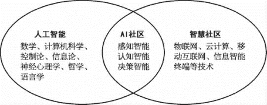

图 1-1　人工智能社区的内涵

人工智能赋能智慧社区不是社区原有数字化、信息化管理模式的简单升级，也不只是视频监控、物联网、移动互联网等技术在社区管理方面的引入应用，应当理解为社区治理从信息化向以计算机辅助决策的智能化发展的更高阶段，具体体现在“四个能力”上，即具有“更全面的人、物、事件等信息感知能力，更强大的信息资源整合和数据处理能力，更科学的监测分析和辅助决策能力，更高水平的风险防控和智慧服务能力”。其核心特征是将“数据”作为社区治理要素的重要资源，并通过各类智能终端和管理平台，使社区治理具备“感知—认知—决策”全链条的智能化能力。

### 1.1.3　人工智能创新社区治理生态

党的十九届四中全会明确提出“建设社会治理共同体”的新目标，强调“必须加强和创新社会治理”，“要健全运用互联网、大数据等技术手段进行行政管理的制度规则”。党的十九大报告提出“推动社会治理重心向基层下移，发挥社会组织作用，实现政府治理和社会调节、居民自治良性互动”。社区作为社会治理系统的重要组成部分，率先创新开展并深化智慧化、精细化建设活动，对推进社区治理现代化和完善国家公共服务体系具有极其重要的实践探索意义。

基于全域集理论的社区治理体系构建将智慧社区比作人类的“大脑”，全域集则是模拟人类对客观世界认识抽象过程的数学表述。显然，人类活动面对的实际环境是一个混乱的数据世界，可见人类对客观世界的认识过程与基于大数据的智慧社区治理具有几乎一致的基本逻辑。换言之，只要找到能够模拟人类认识客观世界过程的数据描述理论体系，即可实现智慧社区的有效治理。解决这一问题，可将数据管理问题以数学集合论的形式进行高度抽象，应用基于全域集理论的数据管理模式来分析社区治理的过程。

作为一项复杂的系统工程，基于人工智能技术的智慧社区治理能够超越传统粗放式、经验化管理模式，克服社区管理带来的城市创新活力、创新能力难以在更高层次和更大范围上跃升的不足，打破管理者与被管理者的行政边界，以及公共部门之间、公共部门与私人部门之间的工作边界，建立政府、企业、社会组织、基层群众共同参与的多主体治理机制。作为一种增量式改革、城市公共服务和公共产品的供给侧结构性改革，超大型城市社会精细化治理将推进人工智能赋能的社区治理和服务，这既是新时代中国城市内涵式发展的时代性要求和可持续发展的结构性支撑，也是实现城市治理体系和治理能力现代化的必由之路。

## 1.2　人工智能赋能智慧社区主要应用体系

目前，人工智能在社区的应用主要围绕“公共安全、公共管理、公共服务”三大核心需求，重点在态势监测、风险预测、辅助决策三个方向借力人工智能技术赋能，构建了智慧安防、智慧消防、智慧防疫、智慧物业、智慧养老、智慧医疗、智慧家居、智慧商区等多个典型应用模块，这些应用随着社会民生和经济的发展，呈现出差异化、多样化和阶段性的特征。随着智慧社区的不断发展演进，还会有更多的应用场景融入人工智能社区的总体架构中，形成可扩充、可迭代、可复制、可推广的模式和体系，从而进一步提高社区治理的智能化和精细化水平。

### 1.2.1　人工智能赋能社区公共安全

新时代背景下，社区公共安全的重要性不言而喻，加强社区公共安全风险防控的精细化管理，可以推动社会健康、有序、和谐发展。社区公共安全是指同一地区大多数人的生命健康能够得到保障、公私财产能够得到保护，主要体现在外部环境的安定、规章制度的健全，以及某一地区居民的公共服务能力。一个社区要达到安全社区的标准，至少要具备两个条件：一是为全体居民、环境和条件制定积极的公共安全规划；二是有一个由地方政府为居民提供的安全服务。在社区公共安全管理中，风险问题具有复杂性、深刻性的特征，还需要采用风险防控和以管理为中心的精细化管理手段，达到优化社会治理、社区治理的发展目标。

公共安全是人工智能技术在社区落地应用较广、相对也较成熟的领域，其涉及网络、软件、安防等不同专业，形成了智慧安防、智慧防疫、智慧应急等主要应用场景。智慧社区的公共安全应用通过多维度的采集、感知以及联动，通过人脸大数据、人体大数据、物联网大数据等数据后台技术实现无感采集、无感预警、多级布控等综合能力，大幅度地提升了社区安全水平。

智慧安防融合社区综合治理工作中心、网格中心、公安、城管、党建、民政等数据平台，通过设置视频监控、出入口控制、人员车辆卡口、信息卡口、移动巡防等神经元传感器，以及部署 WiFi 探针、一键报警设备等数据采集报警前端，实现社区数据实时采集和即时预警；当事件处理完成后，须对处理结果进行反馈、拍照，结果保存至系统平台，形成闭环处置模式，构建起基层立体化治安防控体系，为社区提供全面的安全保障。社区系统也可通过安全边界接入平台接入当地公安信息网，并关联公安信息网中公安内部的关注人员、重点人员、涉事前科人员等信息，结合社区系统内采集信息进行对比碰撞，提前预警，防患于未然。同时，公安部门也可以利用社区系统进行布控预警、信息搜集、模型训练研判，确保社区居民安全，保障社区良好的治安环境。

在智慧防疫方面，通过互联网、物联网、路网监控和移动互联等信息技术，将居民、社会机构及政府机构等信息资源整合到数据计算中心，并进行数据统计和分析，将居民、社区工作人员、物资提供者、政府相关卫生组织和运营管理商等连接起来，实现信息的互联，保障社区公共卫生安全。

在智慧应急方面，社区加装烟感、温度、可燃气体探测等传感器，并通过物联网连接，实现火灾预警、全境监测、智能巡检等功能，推动了社区消防由被动式管理向主动式管理演进。同时，智慧社区能够为公众参与提供更多的灾害防治参与渠道合作平台，在一定程度上提升公众的参与意愿和交互率，将社区中的各主体组织起来形成不同功能的团队，以更好地应对复杂的灾害环境。例如，社区可以依据社区综合管理平台便捷、高效和信息容量大的特点，通过共享信息、协调资源、提供合作机会等方式来促进各主体共同救灾。各主体也可以通过网络平台迅速发布救援组织人员信息，提供多种丰富的参与渠道供大众选择，以大范围、高效率地吸引线上线下的公众参与到志愿者行动中，促进主体间的互动交流和协调。

本书第 2～第 4 章将围绕智慧社区公共安全应用，重点介绍智慧社区公共安全防范、智慧社区公共卫生防护、智慧社区灾害应急管理主要场景的功能需求，深入剖析各场景主要功能实现的关键技术，介绍相关落地应用案例。

### 1.2.2　人工智能赋能社区公共管理

人工智能技术在社区公共管理的应用主要在高空抛物治理、电动车治理、智慧停车、公共交通优化等方面。主要包括：运用数据关联技术、智能信息处理技术等，分析和梳理社区采集的海量数据，从数据中找规律、找关联、找内涵，排查隐患，破解社区管理的一些“老大难”问题。借助智慧平台，通过人脸识别及通行异常、陌生人徘徊等基础关联数据的分析和挖掘，预测社区可能存在的群租、传销居住等内容；通过视频监控、图像识别技术对高空抛物、车身划痕、乱倒垃圾等现象取证，整治社区顽症。此外，还可提供小区水质、窨井、车辆等管理和服务，实现机动车和非机动车停车充电等有效管理，提升管理的精细化水平。

本书第 5、第 6 章将围绕智慧社区公共管理应用，重点介绍智慧社区高空抛物管理、电动自行车入梯管理、智能充电设施规划管理、智慧停车管理、智慧灯杆管理、慢行交通规划管理等主要场景的功能需求，深入剖析各场景主要功能实现的关键技术，介绍相关落地应用案例。

### 1.2.3 人工智能赋能社区公共服务

社区承载的任务和功能非常多样化，目前管理部门和社会共识已经从安全管理、公共管理向公共服务进行重点倾斜。智慧社区建设通过智慧互联、智能高效、共治共享、绿色低碳、开放包容等先进理念的植入和新一代信息技术的集成迭代应用，围绕社区居民全生活链服务需求（幼有所育、学有所教、劳有所得、病有所医、老有所养、住有所居、弱有所扶），提供相匹配的综合配套和智慧服务支撑，可大幅度提升物业的服务质量。通过社区智慧平台完成各物业系统间联动，实现社区事件的智能监控、智能响应、智能控制，不仅应用于报事报修、远程抄表、小区环境监测等基础服务上，甚至还应用于街区环卫、养老服务等方面，实现垃圾分类和满溢告警，居家老人远程监护，大气粉尘和噪声污染监测等，为社区民众提供有归属感、获得感、幸福感、安全感的社区环境。

本书第 7、第 8 章将围绕智慧社区公共服务应用，重点介绍智慧社区居家养老、社区智慧配送、智慧教育、智慧物业等主要场景的功能需求，深入剖析各场景主要功能实现的关键技术，介绍相关落地应用案例。

## 1.3 人工智能赋能智慧社区关键支撑技术

从人工智能的角度看，智慧社区是人工智能落地的一个应用场景；从社区治理的视角看，人工智能技术是社区管理智能化的一种手段或工具。人工智能在社区应用的技术体系，一是感知理解，智能感知与理解视频、图片等非结构化数据，进行精确的结构化数据采集；二是推理分析，汇集各个领域的结构化数据，基于业务规则，建立模型和关系的知识数据，进行推理、比对和分析，获取深入的数据洞察与决策依据；三是学习深化，从知识大数据中快速提取关键信息，基于神经网络进行学习和认知，优化计算模型；四是人机交互，通过增强现实、虚拟现实等技术，以自然友好的方式进行人机交互。

### 1.3.1 精准感知和智能识别

#### 1）数据感知与传输

在数据感知与传输方面，目前的研究热点是智能前置技术，提升前端智能算法的成熟度，研发适合于前端计算节点、占用较少计算资源和存储资源的轻量级算法、程序库、智能分析模型等软件技术，以及提高前端芯片、传感器等主要器件性能，从传统的“事后查阅录像”向“事中及时响应”转变，提高实时性，提升监控价值。在`5G`技术推广应用的大背景下，开展`5G`技术在社区智能化治理中的应用研究，在利用`5G`解决高通量数据快速传输的同时，针对与`5G`兼容的“高可靠性+低延迟”实时监测采集技术、高通量的数据快速挖掘分析技术、同步预警技术、前后端一体化的管理平台功能优化等技术体系进行系统研究，打造“全覆盖、全天候、智能化”的数据传输体系。

#### 2）智能识别

所谓智能识别技术，就是指使用一定的识别装置，自动获取且识别人或物的特征及信息，并将其传输给后台计算机处理系统进行处理的一种技术，可以简单分为有生命识别和无生命识别两种。在智慧社区中，智能识别技术主要以人脸识别和车牌识别为主。

人脸识别是基于人的脸部特征信息进行身份识别的一种生物识别技术，是指用摄像机或摄像头采集含有人脸的图像或视频流，并自动在图像中检测和跟踪人脸，进而对检测到的人脸进行脸部识别的一系列相关技术，在智慧社区中主要应用于门禁系统。要想让人脸门禁系统能够得到快速有效的使用，一定要先设置一个人脸存储信息库，对所有许可进行访问的人员信息进行采集，同时将其存储到人脸信息的数据库里。在有访问者到访的时候，人脸识别系统主要是通过摄像头获得访问者当前的面部信息，同时能够把收集获得的信息输入计算机里，与保存在数据库里的人脸信息进行有效的比对，当与信息要求保持一致时，门禁可以自动地打开而允许访问者进入其中。但是为了防止信息比对失效，系统一定要对人像信息在和数据库人像进行比对之前予以适当处理，预防表情和光照等多种因素对采集信息造成干扰。在对人像信息进行合理的处置后通过对其特征提取和识别完成比对功能，如比对成功，计算机会下发开门的指令，门禁系统则会自动开启；如未成功，门禁系统不但不能够把门开启，还会把来访者的人脸信息记录在主机，便于日后进行查询和处理。

车牌识别技术主要包括车牌定位和字符识别。车牌定位是指从图像区域中提取车牌位置的技术。由于车牌具有一定的颜色、纹理和形状特征，车牌检测方法通常会利用这些特征来检测和确定车牌的位置。字符识别是指从检测到的车牌区域中识别车牌字符的技术。目前的车牌字符识别技术经过优化，已经能够满足特定场合下的需求。从整体上来说，车牌识别技术就是在视频图像中首先确定车牌的位置与范围，再通过对车牌的预处理以及几何校正将车牌字符从车牌中分离出来，最后通过相应的人工智能算法识别字符信息的一个过程，其输入内容为原始的汽车图像，输出内容是车牌号。车牌识别技术在智慧社区中主要应用于小区车辆出入管理或智能停车系统。在车辆出入管理场景中，通常将车牌识别设备安装于小区出入口，记录车辆的牌照号码、出入时间，并与自动门、栏杆机的控制设备结合，实现车辆出入的自动放行，同时可以自动判别驶入车辆是否属于本小区。在智能停车系统场景中，可在车库入口位置设置车牌识别装置以及大屏幕，实时监测在库车辆数量并显示剩余车位，还可以与支付系统结合，实现自动计时收费，从而节省人力、提高管理效率。

### 1.3.2 数据治理与价值挖掘

智慧平安社区建设的第一步，就是要实现对社区视频信息、人员信息、车辆信息、出入口信息、门禁信息、消防智能传感信息等基础数据资源的统一汇聚分类管理，形成视频信息库、人员信息库、车辆信息库、房屋信息库、出入信息库、报警信息库、门禁信息库等分类专题数据库。

#### 1）海量数据治理

在数据治理方面，针对现有大数据存在的数据体量大、非结构化数据比例高、不同系统或平台的数据共享难、数据质量参差不齐等特点，围绕社区非结构化视频监控数据、结构化职能部门数据以及其他社会资源数据等各类信息资源，研究数据采集、多源异构数据融合标准，形成跨媒体跨平台的大数据池与结构化数据库，为社区综合管理应用做好数据准备。

数据的价值关键在于应用。海量数据汇聚后就是要通过人工智能、大数据等技术分析后为上层的智能应用提供数据支撑，给社区居民提供便捷的同时也能为管理部门提供及时、准确的决策分析。

#### 2）大数据价值挖掘

在大数据价值挖掘方面，需要面向社区运行管理的人、车、物、场地等多模式场景的复杂性，按既定业务目标，对大量的数据进行探索和分析，通过算法搜索隐藏于其中的有价值信息，并进一步将其模型化。在数据深度挖掘中，除了优化数据算法以外，更需要系统设计人员充分理解业务场景，能基于业务的理解找到所需的关键数据，实现业务、数据与技术的充分结合，从而更高效地实现数据挖掘。

在公共服务方面，大数据价值挖掘有助于使政府改变传统指令导向的公共管理模式和供给导向的公共服务模式，开启人本导向、需求导向的公共管理与服务新模式，为公众提供更优质、高效、个性化的公共服务。比如在这次疫情防控中，大数据技术就很好地支撑各地利用“社区大脑”拨开疫情传播的迷雾：各地充分运用大数据技术手段，通过疫情溯源和监测、疫情态势研判和预测预警、疫情防控部署以及对社区流动人员的监测统计，有效支撑社区对疫情的提前防范和精准施策。在商业服务方面，社区数据价值挖掘有助于提升社区商业数据的准确性和及时性，降低社区企业的交易摩擦成本，助力企业进一步挖掘细分市场的机会，从庞大的社区居民数据中分析出不同类型居民的行为习惯和消费喜好，利用大数据实现精确化营销和精细化运营，主动推送服务和商品。

### 1.3.3 人工智能辅助决策

社区中的决策包括社区政务决策、社区商业决策以及社区公共服务决策。社区政务决策是做规划、定政策、出措施的过程，决策一经出台实施，就必然在社区的各个层面引起不同程度的反响，必然会涉及各方面利益格局的调整，决策的失误会造成社会的损失。大数据使得社区公共管理和服务变得可以监督，并且是全过程、全员的监督，为避免社区管理者行为失范提供了一种可能。

在智能决策支持方面，基于人工智能技术的大数据分析，通过数据量化建立社区基本元素的模型，如居民、车辆、基础设施等基本信息和行为的模型，构建高度智能化、高度信息融合的数字孪生系统，具备面向复杂业务的信息协同感知能力，能够实时展示业务需求驱动的社区全状态和全信息，根据历史数据和当前决策推测关键状态信息的未来走向，形成可评价的决策评估标准，评估当前决策的短期和长期影响，持续修正和完善决策体系，辅助社区管理者做出科学理性的判断，避免分析决策时管理者对直觉的过分依赖。

### 1.3.4 人机交互与虚拟现实

#### 1）人机交互技术

人机交互主要研究人和计算机之间的信息交换，主要包括人到计算机和计算机到人的两部分信息交换，是人工智能领域重要的外围技术。人机交互集成了语音识别、手势识别、表情识别、肢体动作识别等交互形式的技术，其核心是人机交互的智能化，即要使“人-机”互动变得像“人-人”互动一样自然、流畅。

##### （1）社区医疗方面

通过打造一个医疗信息平台，采用最先进的物联网技术，达到患者与医务人员、医疗设备、医疗机构的互动，从而更好地为患者服务。

##### （2）社区管理方面

通过打造人脸识别门禁系统，居民通过“刷脸”进出小区或楼宇，不仅免除了出门必须携带门禁卡的麻烦，“后疫情时代”还能避免因接触而可能产生的传染病感染风险。小区路灯、楼道照明设备通过感应系统，在有人经过或发出声响的情况下自动点亮，大大减少了能源的消耗。社区电梯配备嵌入式信号控制系统，通过人机交互技术使得该类产品可以通过内置系统与电梯操作系统连接，进行电梯操作信号的传输和处理，并最终完成指令的呈现。如居民通过梯外召唤箱使电梯停靠在其所在楼层，通过梯内操作箱选择到达楼层，电梯内外的液晶显示屏可以显示电梯的上下、楼层等乘梯人的操作信息，电梯内的监控设备可以收集并分析乘梯环境的语音和视频信号以及电梯的运行信号，保障电梯安全运行。

##### （3）智能家居方面

防盗门使用指纹锁、刷脸解锁取代传统使用钥匙开门，房屋内设置一台智能控制设备，通过物联网控制家中的各种设备，可以实现诸如语音唤启设备、智能灯感应亮灭、家中有人自动调节温度湿度甚至识别意外状况快捷报警等功能，大大提高了居民的生活体验。

##### （4）社区消费方面

智能结算终端也是一种人机交互终端，其主要功能是将客人的点餐信息传输给餐厅后厨、自动识别客人选取的菜品并连接餐厅结算系统，支持各种快捷支付方式，完成客人与餐厅之间的信息交互和资金结算，简化餐厅服务流程，提高效率。

##### （5）社区疫情防控方面

在社区入口布置红外测温仪，配合人脸识别等生物特征识别等技术，监控体温异常人的轨迹和识别身份。人脸识别测温终端通过内置的摄像头识别到人脸后，通过前端配置的脸部识别热像仪快速读取图像中的脸部信息对应位置的温度信息，计算人体的体温并直接显示在终端的液晶显示设备；在脸部识别热像仪检测出异常体温值的情况时发出警报音，并将异常信息上传到管理系统，从而为社区提供基于大数据应用模式的健康预警、健康评估等服务，完成人与红外测温终端之间的信号交互过程。

#### 2）虚拟现实与增强现实技术

虚拟现实（virtual reality，`VR`）／增强现实（augment reality，`AR`）是以计算机为核心的新型视听技术。其结合相关科学技术，在一定范围内生成与真实环境在视觉、听觉、触感等方面高度近似的数字化环境。用户借助必要的装备与数字化环境中的对象进行交互、相互影响，获得近似真实环境的感受和体验，通过显示设备、跟踪定位设备、触力觉交互设备、数据获取设备、专用芯片等实现。

`VR`／`AR`从技术特征角度，按照不同处理阶段可以分为获取与建模技术、分析与利用技术、交换与分发技术、展示与交互技术、技术标准与评价体系五个方面。获取与建模技术重点研究如何把物理世界或者人类的创意进行数字化和模型化，其难点是三维物理世界的数字化和模型化技术；分析与利用技术重点研究对数字内容进行分析、理解、搜索和知识化的方法，其难点在于内容的语义表示和分析；交换与分发技术主要强调各种网络环境下大规模的数字化内容流通、转换、集成和面向不同终端用户的个性化服务等，其核心是开放的内容交换和版权管理技术；展示与交换技术重点研究符合人类习惯的各种显示技术及交互方法，以期提高人对复杂信息的认知能力，其难点在于建立自然和谐的人机交互环境；技术标准与评价体系重点研究`VR`／`AR`基础资源、内容编目、信源编码等的规范标准以及相应的评估技术。

# 第 2 章 人工智能赋能智慧社区的公共安全防范

智慧社区中的公共安全管理须做整体化规划与设计，通过网络化、智慧化、层次化的方式，充分利用好各种现代信息技术与方法，将公共安全中的孤立、分散信息以及基础设备设施等资源形成网络化节点，成为智能化社区的基础要素，从而加强人与人之间、人与物之间、物与物之间的联系。通过对社区整体安全状况的感知，准确、全面、迅速地了解、掌握和判断社区中公共安全的风险源及态势的发展状况，从而可以提前预知、防范、控制可能发生的安全风险与事件；对于一些突发事件，也可以在处置过程中提供多部门间的信息沟通共享，资源统一调配，处置协调联动，从而实现高效、智能、安全的社区公共安全应急决策支持。

## 2.1 智慧社区安防应用场景

近年来，智慧平安社区是人工智能的一个典型公共安全应用场景。社区安防设施通常包括楼宇对讲、门禁、视频监控和车行道闸等。人工智能技术在社区中广泛应用于人员身份鉴别、车辆、物体鉴别等，其中人脸识别技术以其舒适度高、可用性强、准确度好、成本较低的优势，在社区出入口场景中得到了广泛应用。人脸识别在社区安防中作为一个典型的垂直应用，数据以复杂环境下的图像视频为主，采用垂直专用图像识别算法针对社区复杂场景进行优化应用，在多角度、多姿态、复杂光线下也能够快速准确地完成。同时，人工智能（artifical intelligence，`AI`）图像识别技术可以准确识别出车牌号码、车身颜色、车辆类型等特征，方便业主车辆在社区中出入，便于社区的车辆管理。

### 2.1.1 社区基础信息采集

社区数据碎片化、信息分布式管理以及信息化程度参差不齐，导致社区案件难以追溯。通过对小区出入口、单元楼道口、社区公共区域、社区内学校商铺等的感知设备新建、改造或感知数据的接入，实现管辖社区采集的多维信息［人脸、人体、行为、车辆、人车特征、射频识别（radio frequency identification，`RFID`）、`WiFi`探针、传感等］统一汇聚。通过多维信息感知、智能分析和大数据研判，实现对社区内人员异常、房屋异常、车辆异常等情况的分析，及时发现违法犯罪行为及存在的安全隐患，结合公安其他业务信息形成数据资源仓库，可提供智能研判、多维数据查询服务，为社区违法犯罪案件侦破、事后查证等业务提供应用支撑。

### 2.1.2 社区实有人口管理

在社区主要出入口部署人脸摄像机，对通过的人员进行智能感知，并结合人脸识别技术和人脸聚类技术，做到对社区实有人口的精准掌握，指导民警进行社区实有人口的动态采集，保证公安能够随时掌控社区实有人口的变化情况。

#### 1）社区实有人口底数分析

通过对接社区在公安已登记的实有人口（户籍人口、外来人口、人户分离、境外人口），并结合一定时间周期（月度、季度）内频繁活动人员的人脸聚类统计数据，进行关联碰撞分析，可以彻底摸清每个小区的实有人口底数。

#### 2）未登记人员采集

将在社区连续一段时间内被抓拍到的人员与公安人口库比对，发现此人在公安人口库中无任何信息的归类为社区未登记人员，系统按采集流程设置，自动推送未登记人员给人口采集员，由其进行核查登记，对公安人口库的人口信息进行补充。

#### 3）离开、注销人员采集

分析社区实有居住人员中连续一段时间内无人脸抓拍记录的，将信息推送给人口采集员，经核实后进行实有人口信息的变更。

#### 4）人户分离采集

社区中有很多人存在拥有多套房或者居住地址和户籍地址不一致的情况。通过对进出社区的人员进行智能感知，并结合人脸识别技术，可以将社区居住人员进出社区信息与公安人口库比对，分析该人员是否存在人户分离变动情况，经人口采集员核查后进行采集登记，及时更新公安的人户分离信息。

#### 5）居住地址变更采集

社区内的人员流动性高，外来人员有时会经常更换住址，之前已在公安登记的居住地址信息往往滞后很多，也就无法即时掌握流动人员的行踪。通过对进出社区的人员进行智能感知，并结合人脸识别技术，可以分析一段时间内居住地址与公安人口库登记地址不一致的人员，经人口采集员核查登记后进行信息更新，保证公安人口信息的鲜活性。

### 2.1.3 社区重点人员管理

通过对进出小区的人员进行智能感知，并结合人脸识别技术，帮助民警及时发现辖区重点人员动态情况，为公安的情报研判提供及时准确依据。社区重点人员管理的应用举例如下：

#### 1）即时比对

通过社区内的多道视频监控防线进行人员感知，实时将人员感知信息与重点人员库进行比对，对存在活动频繁或活动隐匿等异常行为进行预警提醒。

#### 2）布防布控

通过对进出社区的人员进行视频感知，并结合人脸识别技术，可以对社区内单目标、多目标的重点人员进行布控，实现社区重点人员的布控检测与预警能力。

#### 3）轨迹分析

通过不同点位的人脸抓拍和识别记录，对重点人员进行轨迹刻画，为重点人员研判提供支撑。

#### 4）动态掌控

通过视频监控、人脸抓拍设备等采集的人员信息，可以反映重点人员近段时间内在社区的动态活动情况、动态信息，并将其自动推送和提醒民警。

### 2.1.4 异常行为识别分析

为了满足社区安全防范需求，可在社区出入口或公共区域范围内，对人员的出行规律进行分析，提取相关规则，对异常和可疑的行为设置标签。

#### 1）昼伏夜出

对社区出入口或公共区域范围内，分析一段时间内（时间可设定）出行天数及频次规律符合昼伏夜出规则的人员进行分析提取，昼伏夜出规则支持在系统中进行指定配置。

#### 2）频繁夜出

对在夜间时间段（时间可设定）出行抓拍的人员标记陌生人夜间出行标签。系统可以支持对已录入的社区人员人像库以外的符合频繁夜出规则的陌生人员进行分析提取，同时将其在社区出现的次数进行统计展示。频繁夜出规则也可以在系统中进行指定配置。

#### 3）深居简出

对社区出入口或公共区域范围内，一段时间内（时间可设定）已登记居住人员出现／未出现天数及频次等低于正常出行频次水平，出行频次符合深居简出规则的人员进行分析提取。深居简出规则支持在系统中进行指定配置。

#### 4）疑似社区盗窃人员分析

对社区出入口或公共区域范围内出行记录进行分析。对于非本社区人员，一段时间内（时间可设定）进出多个不同楼洞，或结合社区内多个小区的出行分析，对于某人员一段时间内（时间可设定）进出多个不同小区，比对公安盗窃前科人员数据库，其中可初步判定为疑似盗窃踩点的进行预警。

### 2.1.5 房屋异常识别分析

### 1）疑似非法生产／商用分析
对社区内的信息按户进行归档，包括标准地址、实有人口、实有房屋、实有单位、水费、电费、物业费等，对每户的水、电信息进行分析统计，当出现水、电费用异常增长，超过设置阈值时，则初步判定为非法生产／商用嫌疑。

### 2）未登记出租房分析
通过业务模型对于住户登记为自住房屋、疑似租赁情况，小区物业采集人员登记信息。同一房屋频繁多人登记来访，或房屋内不同人员有规律地出入，则初步判定为未登记出租房，社区民警得到异常后督促物业上门查看或亲自上门查看。

### 3）疑似群租房分析
对于频繁出入租赁房屋的陌生人员，其在该租赁房屋有规律地出入，例如规律性早出晚归，基本判定为该人员在该租赁房屋中居住，如果达到一定的指标（比如多少平方米不能住宿超过多少人），则初步判定为疑似群租嫌疑。

### 2.1.6 车辆异常识别分析
社区出入口或停车场内，对车辆的出行规律进行分析，提取相关规则，对异常或可疑的行为设置标签。与昼伏夜出、频繁夜归、夜不归宿等与异常模型类似，补充僵尸车异常车辆分析，即对于社区内某小区的已登记和未登记车辆，根据配置分析该小区的车辆在进入小区超过一段时间内无通行记录，则符合僵尸车异常行为规则，获取该车辆基础信息、可能存在的车主信息以及车辆最后出现的抓拍数据信息。

## 2.2 社区信息无感采集分析
通过前期的各类技防建设，小区里已经安装了大量的视频监控设备，要对这些视频监控进行智能分析，通常有两种方案：集中计算和边缘计算。由于视频监控存量非常大，如果采用集中计算方案，中心机房建设投入大，对于计算设备、交换设备、网络带宽、系统运维的要求都非常高。随着人工智能（`AI`）芯片技术的快速发展，在边缘侧进行实时图像的初步解析即边缘计算已经成为可能。`AI`边缘计算系统架构图如图 2-1 所示。

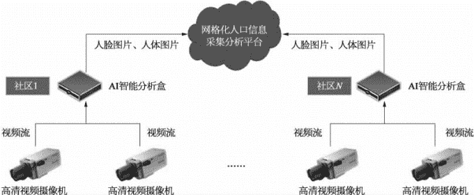

图 2-1 `AI`边缘计算系统架构图

### 2.2.1 社区人员信息智能采集
人脸信息采集系统采用技术领先的人脸检测算法、人脸跟踪算法、人脸质量评分算法以及人脸识别算法，对社区各主要场所人员进出通道进行人脸抓拍、识别以及属性特征信息提取，建立海量人脸特征数据库。在社区重点场所或主要通道设置人脸卡口，专门针对各类重点场所进出人员进行人脸抓拍、人脸特征的提取和分析识别，帮助管理部门快速人脸检索、定位、黑名单布控，找出人员的活动轨迹，识别出嫌疑人员。人脸信息采集系统是视频分析、运动跟踪、人脸检测和识别技术在视频监控领域的全新综合应用。

#### 2.2.1.1 人脸检测与识别技术
人脸识别是一种依托于图像理解、模式识别及计算机视觉、统计学和人工智能，对人的脸部特征信息进行身份识别的生物识别技术。其具有可靠、操作简单和无接触等特点，已经成为生物识别领域活跃技术之一。主流人脸识别技术主要有基于几何特征的方法、特征脸方法、卷积神经网络方法（convolutional neural networks，`CNN`）等。基于几何特征的方法是最早、最传统的方法，通常需要和其他算法结合才能有比较好的效果；特征脸方法是 20 世纪 90 年代初期由 Turk 和 Pentland 提出的目前最流行的算法之一，具有简单有效的特点，也称为基于主成分分析的人脸识别方法；卷积神经网络方法是在近几年发展起来并引起广泛关注的一种高效人脸识别方法，由于其深层的结构、强大的学习能力和分层非线性映射，被应用于人脸特征提取，并成为人脸识别领域的主流方法。

人脸聚类工作原理是基于计算机视觉、机器学习、大数据处理等技术，对海量的人像特征做关联分析，将海量的人像特征进行归类分组，把同一人的所有人像特征都归为一类，实现人像特征按人归档。通过人像大规模聚类服务，可以建立起人员活动轨迹数据库，并且实时更新每个人的活动轨迹，还可以对轨迹进行碰撞分析实现各种功能。人脸识别和人脸聚类流程图如图 2-2 所示。

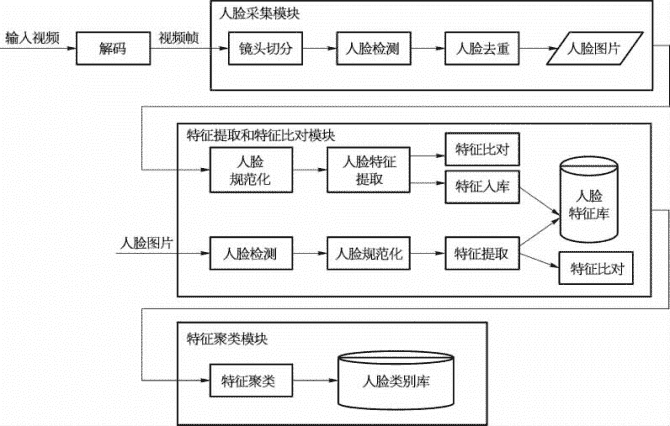

图 2-2 人脸识别和人脸聚类流程图

##### 1）人脸识别系统组成
人脸识别系统由一系列相关技术组成，分别为人脸图像采集及检测、人脸图像预处理、人脸图像特征提取以及人脸图像匹配与识别，其流程如图 2-3 所示。

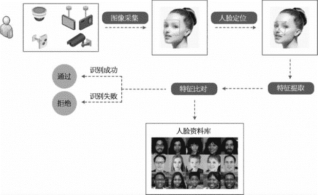

图 2-3 人脸识别技术流程

（1）人脸图像采集及检测。通过摄像头采集人脸图像，紧接着利用图像中的模式特征，如直方图特征、颜色特征、模板特征、结构特征及哈尔特征等，实现人脸检测。
（2）人脸图像预处理。系统获取的人脸图像由于受到各种条件的限制和随机干扰，往往不能直接使用，必须在图像处理的早期阶段对其进行灰度校正、噪声过滤等图像预处理。
（3）人脸图像特征提取。人脸识别系统可使用的特征分为视觉特征、像素统计特征、人脸图像变换系数特征、人脸图像代数特征等。人脸特征提取也称人脸表征，是对人脸进行特征建模的过程。
（4）人脸图像匹配与识别。将提取的人脸图像特征数据与数据库中存储的特征模板进行搜索匹配，通过设定一个阈值，当相似度超过这一阈值，则把匹配成功的结果输出。人脸识别就是将待识别的人脸特征与已有的人脸特征模板进行比较，根据相似程度对人脸的身份信息进行判断。

导入户籍或常住地在当地的吸毒人员、在逃人员和前科人员以及其他本地管控人员的人像照片及信息（包含姓名、性别、身份证号、家庭住址、人脸照片等信息），能实现对上述人员的提前布控（可按照时间、地点、布控等级、相似度报警阈值等信息，对人员进行布控）。系统可对前端人脸抓拍机抓拍的人脸与布控库进行实时比对，当抓拍人脸与布控库的人脸相似度达到设定报警阈值时，系统进行实时自动报警。

##### 2）人脸识别技术难点
当前人脸识别技术存在的主要难点如下：
（1）人脸特征的高效提取。光照、姿态、装饰、遮挡物等外在因素会影响人脸特征提取的效果；同时，对于不同的年龄段，人脸识别算法的识别率也不同，年龄变化对人脸识别算法的影响亟须得到解决；另外，随着人脸数据库规模的增长，人脸识别算法的性能将呈下降态势，如何维持或提高大规模应用环境下人脸识别算法的识别率，也是亟须解决的问题。
（2）在人脸识别准确率不理想的情况下人员身份核验的问题。由于受到环境因素的影响，人脸特征识别可能会存在部分特征识别错误或识别率较低的情况，由此可能带来人员身份核验准确率的问题。因此，如何采用机器学习的算法自动处理这些识别偏差，也是目前需要克服的难点之一。
（3）兼容多厂家人脸识别算法并进行有效人脸聚类。由于不同厂家建设的项目采用的人脸识别算法可能各不相同，如何兼容多厂家人脸识别算法并进行有效人脸聚类，最大限度地降低用户重复投资显得尤为重要。

#### 2.2.1.2 基于机器视觉的人员跟踪技术

##### 1）单视角目标跟踪
视觉跟踪系统的基本框架一般由搜索策略、特征提取和观测模型等模块组成。目前常用的搜索策略包括均值漂移（`mean shift`）、粒子滤波（`particle filter`）和循环密集采样（`cyclic dense sampling`）等方式；通过搜索策略获得候选样本后进行特征提取，主要包括人工特征和学习特征；利用特征判断候选样本是否为跟踪目标的观测模型，通常分为生成式模型和判别式模型。

生成式模型提取目标特征构建表观模型，在图像中搜索与模型最匹配的区域作为跟踪结果。生成式模型不论采用全局特征还是局部特征，其本质是在目标表示的高维空间中，找到与目标模型最相邻的候选目标作为当前估计。但是，此类方法的缺陷在于只关注目标信息，而忽略了背景信息。

判别式模型同时考虑了目标和背景信息，将跟踪问题看作分类或者回归问题，目的是寻找一个判别函数，将目标从背景中分离出来，从而实现对目标的跟踪。常见的判别式模型包括分类判别式模型和回归判别式模型。其中基于回归判别模型的典型方法是相关滤波，其利用循环矩阵，通过快速傅里叶变换实现时域到频域的转换，大大提升了算法的速度。相关滤波因速度优势受到了广泛关注，逐渐成为目标跟踪领域的主流框架。

基于深度学习的目标跟踪方法主要是利用深度特征强大的表征能力来实现跟踪。按照利用深度特征的方式，可分为基于预训练深度特征的跟踪和基于离线训练特征的跟踪。

##### 2）跨视角目标跟踪
基于跨视角目标匹配策略的目标跟踪流程如图 2-4 所示。具体如下：
（1）相机初始化。该过程主要是对相机进行标定，以确定相机的内外参数，建立相机成像几何模型，主要反映真实世界三维坐标点映射到相机图像二维坐标点的过程。
（2）提取运动目标。首先进行背景建模，对于每一帧图像，对背景模型减除得到前景图像，对前景图像进行轮廓提取，获得运动目标。
（3）目标跟踪。遍历获取到的每个运动目标，对运动目标进行跟踪，若运动目标与已经存在的跟踪器相匹配，则视为旧目标，并对该跟踪器进行更新；若未找到相匹配的跟踪器，则进入跨视角目标关联匹配环节。
（4）与其他视角相机目标是否关联。将待匹配目标与其他视角相机获取到的运动目标进行匹配，匹配策略采用基于脚底坐标和头部坐标的评估方式，若未能与其他视角匹配，则判断为新出现的目标，进行行人检测环节；若已匹配，则对跟踪器进行更新。

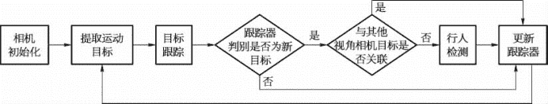

图 2-4 跨视角目标跟踪流程图

①基于脚底坐标的跨视角目标匹配策略。虽然同一目标的脚底坐标在不同视角相机的像素坐标系中位置各不相同，但其在真实世界的三维坐标系中却是固定不变的。因此，在无误差的理想情况下，同一目标在不同视角的像素坐标值经过上述方式求得的三维坐标点是重合的，这就是基于脚底坐标的跨视角目标匹配策略的核心思路。
②基于头部坐标的跨视角目标匹配策略。该策略通过对头部的三维世界坐标进行重建，并对重建后的坐标评估其合理性。
（5）行人检测。对于新出现的目标，根据相应特征进行人员检测，若为人员目标，则为其注册跟踪器，并在后续的视频帧中为该目标保持跟踪。

### 2.2.2 社区车牌智能识别分析
车牌识别技术的任务是处理、分析摄取的视频流中复杂背景的车辆图像，定位、分割牌照字符，最后自动识别牌照上的字符。车牌识别技术运用数字图像处理、模式识别、人工智能技术对采集到的汽车图像进行处理，能够实时准确地自动识别出车牌的数字、字母及汉字字符，并以计算机可直接运行的数据形式给出识别结果。

车牌识别技术的关键在于车牌定位、字符分割和字符识别（optical character recognise，`OCR`）三部分，如图 2-5 所示。其中车牌定位的准确与否直接决定后面的字符分割和识别效果，是影响整个车牌识别系统识别率的主要因素，是车牌识别技术中最为关键的一步。字符分割算法是指在车牌上定位独立的字母、数字和字符。光学字符识别算法是指将捕获的图像转换成字母数字文本条目。

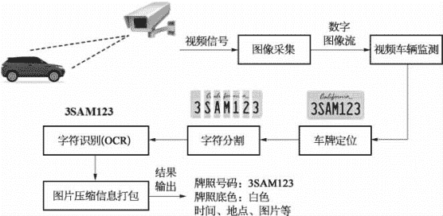

图 2-5 车牌识别技术流程

#### 2.2.2.1 车牌定位
车牌定位的任务是从上一步采集的车辆图像中找到车牌区域并截取出来。

##### 1）车牌定位算法分类
车牌定位算法概括起来可以分为基于图形图像学的定位方法和基于机器学习的定位方法两大类。
（1）基于图形图像学的定位方法。如边缘检测定位、颜色定位等。外界信息的干扰会“欺骗”定位算法，使得定位算法生成过多的非车牌候选区域，增大系统负荷。此算法的实现分为三步：①对图像进行边缘检测、二值化等预处理；②进行膨胀和腐蚀操作等形态学处理；③查找车牌轮廓并精确定位。
（2）基于机器学习的定位方法。如特征工程定位、神经网络定位等。使用此算法进行车牌定位的关键是找到好的特征和训练方法。其主要步骤可以分为：①提供一套拥有正确输出的训练数据（车辆图像）；②构建神经网络模型；③用训练后的模型进行实际车牌定位，检测定位效果。

##### 2）常见车牌定位方法
（1）基于彩色分割的车牌定位方法。该方法由彩色分割和目标定位等模块组成，采用多层感知器网络对彩色图像进行分割，然后通过投影法分割出潜在的车牌区域。在进行彩色分割时采用神经网络模型，一般图像采用`RGB`三原色，但`RGB`三原色中两点的欧氏距离与颜色距离不成线性比例。为了更好地进行彩色分割，将`RGB`模式的彩色图像转化为`HSI`模式，即色调（`hue`）、饱和度（`saturation`）和亮度（`intensity`），然后对输出图像的饱和度做调整。为了减少计算量，将彩色图像抽稀后再进行模式转化。同时，为了减少光照条件对图像分割产生的影响，采用对数方法进行彩色饱和度调整。然后对模式转化后的彩色图像进行彩色神经网络分割，最后根据车牌底色及长宽比等先验知识，采用投影法分割出合理的车牌区域。当获取的彩色图像质量较高时，尤其是车牌区域颜色与附近颜色差别较大时，准确率将有所下降。该定位算法正确率较高，但由于采用了神经网络计算法，当区域颜色与附近颜色相似时，计算速度则较慢。
（2）基于灰度图像纹理特征分析的车牌定位方法。传统的纹理特征分析定位算法大多是基于灰度图像来分析的，因此该算法需要对图像进行预处理，将彩色图像转换为灰度图像，然后进行行扫描，找出图像中每一行所含有的车牌线段，记录下它们的起始坐标和长度，如果有连续若干行均存在不少于一个的车牌线段，且行数大于某一确定的阈值，则认为在行的方向上找到了车牌一个候选区域，并确定了该候选区域的起始行和高度；在已找到的可能存在车牌的区域做列扫描，以确定该车牌候选区域的起始行和高度以及起始列坐标和长度，由此确定一个车牌区域；继续在其他可能存在车牌的区域寻找，直至找到所有的车牌候选区域。该算法对于牌照倾斜或变形以及光照不均、偏弱或偏强有很好的效果，但其对噪声敏感。对于背景复杂的图像可以结合垂直投影的方法来得到真正的车牌区域，可以有效地解决背景复杂的车牌定位。
（3）利用小波分析和数学形态学的车牌定位方法。小波分析是一种应用于图像处理的重要分析工具，具有“显微镜”的特性。小波分析的多分辨率特性使得小波分解系数在不同方向的高频子波系数具有不同特性，因此该方法能够反映出图像在不同分辨率上沿任一方向变化的情形。小波分析的多尺度分解特性也更加符合人类的视觉机制。小波变换的基本思想是将原始信号经过伸缩、平移等运算分解为一系列具有不同空间分辨率、不同频率特性和方向特性的子带信号，这些子带信号具有良好的时频特性，通过利用这些特性可以实现对信号时域、频域的局部分析。目前利用小波分析的车牌定位算法大多是利用小波变换与其他多种方法相结合来实现更准确、快速地定位。例如基于小波分析和数学形态学的车牌定位方法，该方法首先通过小波多尺度分解提取出纹理清晰且具有不同空间分辨率、不同方向的边缘子图，然后利用车牌目标区域具有水平方向低频、垂直方向高频的特点实现子图提取，最后用数学形态学方法对小波分解后的细节图像进行一系列的形态运算，进一步消除无用信息和噪声，以确定车牌位置。该方法的优点是在噪声较小的情况下定位效果好，分割精度高；其缺点是速度较慢，且在噪声较大时误定位概率也随之增大。

#### 2.2.2.2 车牌字符分割
车牌字符分割的任务是把上一步得到的车牌区域中的字符正确截取出来，成为多个只包含一个字符的图像。常用的字符分割算法有基于连通域标记的算法、基于图像投影的算法和基于字符几何特征的算法。前两种算法介绍如下：

1）基于连通域标记的算法（简称“连通域切分法”）
理想情况下，除汉字以外，车牌剩余 6 个字符均是独立连通的。连通域切分法首先对车牌图像进行连通区域标记，然后找出与字符尺寸相近的连通域，之后根据字符的间距和排列特点确定这 6 个字符的位置，最后再根据字符间宽度和间距确定汉字的位置。连通域切分法对车牌图像的质量要求较高，当字符发生粘连、断裂，或字符与车牌边框粘连，都会影响分割结果。

2）基于图像投影的算法（简称“投影算法”）
投影算法应用较为广泛、分隔效率较高。此算法的实现可描述为：首先遍历整个图片计算每一列白色（车牌号区域）像素点的个数并存到数组中；其次由数组里的灰度值得到相应的投影图，再通过数组的内容找到相邻字符间的分割点；最后根据分割点完成字符分割。

#### 2.2.2.3 车牌字符识别
车牌字符识别是车牌识别过程的最后一步，主要任务是把上一步分隔出的车牌字符图像转化为正确的字符，并最终拼接为正确的车牌号码。在实际应用场景中，主要涉及辨识的准确性和识别速度两方面。一般停车场在车牌无损伤的状态下识别率应达到 95%以上，识别速度应达到 1 s 以内。车牌字符识别算法可以简单分为以下三类：
（1）模板匹配。这是一种早期较为传统的字符识别方法。其原理是首先建立车牌中所有可能包含字符串的标准字符模板库，然后将单个字符图像处理成和模板库中字符一样的格式，最后根据一定的规则与模板库中的字符进行比对，计算出一个相似度值，该值最大者即为正确的字符。该算法对于清晰、干净、无倾斜和变形的车牌字符图像识别率较高。
（2）神经网络。它是一种机器学习算法，如典型的神经网络（back propagation，`BP`）、卷积神经网络（convolutional neural networks，`CNN`）。其工作原理是首先提取梯度分布特征、灰度统计特征等字符特征；然后构建一个神经网络模型，设置网络训练参数；最后进行模型训练并识别检验。
（3）支持向量机（support vector machine，`SVM`）。该算法本质上和神经网络算法类似，也是一种机器学习方法。其主要设计思路是：先得到样本特征，进行训练，然后再分类。

## 2.3 社区重点人员异常轨迹识别
社区是基层社会治理和公共安全治理基本单元，社区安全引起国家高度重视，中共中央办公厅、国务院办公厅印发的《关于推进城市安全发展的意见》指出“应当加强安全社区建设、完善城市社区安全网格化工作体系”。社区治安高危人员（简称“高危人员”）指活动在社区范围内，对国家安全、社会治安、公民人身财产安全具有较高威胁的人员，包括但不限于“犯罪前科人员”“涉毒人员”“在逃人员”和“肇事肇祸精神病人”，该群体违法犯罪可能性较高，对社会潜在危害较大。根据中国疾病预防控制中心精神卫生中心公布数据，截至 2017 年年底，我国严重精神障碍患者人数超过 1 600 万，其中肇事肇祸人数占 10%。根据公安部发布的《2020 年中国毒品形势报告》，截至 2020 年年底，全国有吸毒人员 180.1 万名（不含戒断 3 年未发现复吸人数、死亡人数和离境人数）。毒品滥用给吸毒者本人及家庭带来严重危害，同时诱发暴力伤害、“毒驾”和“以盗养吸毒”等违法犯罪活动。因此，对高危人员进行有效管控，可有效预防打击违法犯罪活动及维护社会治安稳定。

## 2.3 异常轨迹数据预警预测框架
随着社区基础信息化建设不断加强，大量社区部署人脸识别点位、车辆卡口及 WiFi 电子围栏等物联网感知终端，用于识别人员身份，获取人员轨迹，为高危人员异常轨迹识别与预警提供数据支撑。国内外利用时空连续轨迹数据可识别“伴随”“聚集”“频繁”等常见轨迹模式，以及“离群”“昼伏夜出”等特殊轨迹模式，通过将人员、车辆轨迹与路网信息、兴趣点（`point of interest`，`POI`）等数据结合，识别环境因素约束下人员及车辆轨迹模式，可以为高危人员异常轨迹识别提供技术支持，利用人脸识别、WiFi 电子围栏等终端设备采集多源数据，识别高危人员异常活动轨迹并及时预警。

对社区重点人员进行轨迹刻画，首先需要采集其人员行动轨迹，然后对采集的数据进行处理，最后对处理过的轨迹数据分类，识别并提取出重点人员行动轨迹，如图 2-6 所示。

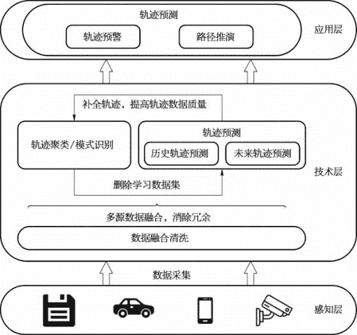
图 2-6　异常轨迹数据预警预测框架图

### 2.3.1 人员轨迹采集
随着以智能手机、智能手环为代表的移动终端的普及与应用，可以相对轻松地获取用户实时位置信息，通过对社区监控图像处理、WiFi 定位技术，可以实时获取人员当前所在位置、楼层等高精度信息。特别地，对于重点人员，记录其连续时间点上的位置信息，即可获取其在这个时间段的行为轨迹数据，如图 2-7、图 2-8 所示。

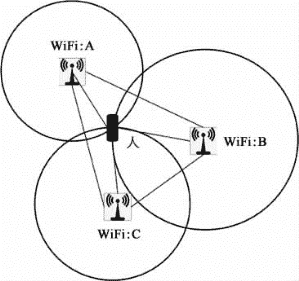
图 2-7　WiFi 定位示意图

（1）对社区内有摄像头的区域进行图像处理、统计当前区域人数，没有摄像头覆盖的区域通过使用 WiFi 定位技术、获取当前用户设备信息，对于同一个用户名下的多个设备只计一个，获取到用户实时位置信息后即可实现社区热力图、社区人员密度、行人轨迹图预警等功能。

（2）通过跨摄像头的目标检测技术、WiFi 定位技术，进行精确到建筑、楼层的高精度行为轨迹图绘制。

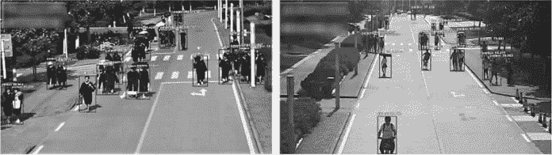
图 2-8　室外监控人员轨迹示意图

### 2.3.2 动态轨迹标定
针对多源动态轨迹数据，需要进行统一标定。动态轨迹数据获取方式包括主动式与被动式两种：主动式轨迹获取指高危人员佩戴定位装置，并主动上传定位信息如全球定位系统（`global positioning system`，`GPS`）数据，该方式仅适用于少数高危人员，如社区矫正人员；被动式轨迹获取指利用人脸识别、监控点位、交通卡口、WiFi 电子围栏等物联网设备终端，对高危人员进行身份识别，并记录其轨迹数据，该方式适用于无法强制其携带定位装置的人员。详述如下：

1）高危人员主动上传轨迹场景下的轨迹标定
`GPS`定位数据相邻驻留点的时间间隔较短，空间位置信息相似，故采用轨迹时空聚类法对其降维，对高危人员的提取是要将这些重点人员从普通居民中区分出来。由于个体的行为轨迹与其社交对象有某种程度上的关联，并且该关联越密切，两者间行为轨迹的相似性就越高。此外，人群移动的可预测性是显著稳定的。根据社区重点人员的行为特性来搭建一个时空轨迹数据分类模型，利用海量数据去不断训练和调整，从而通过该模型预测轨迹或该轨迹所属个体的类别。

2）高危人员被动式轨迹获取场景下的轨迹标定
在社区重点区域和场所，利用人脸识别点位、车辆卡口、WiFi 电子围栏等物联网传感器，对高危人员进行身份识别，并将观测点位置近似作为高危人员驻留点。观测点类型包括区域型观测点和交通路口观测点：①区域型观测点。指具有特定功能的面，其边界可通过若干经纬度点确定，或通过观测点中心和观测覆盖半径确定。当高危人员进入被观测区域时，形成轨迹记录。②交通路口观测点。当高危人员在不同场所间移动时，均沿路网运动，通过在重要交通路口设置观测点，可捕捉高危人员动态轨迹。

### 2.3.3 人员轨迹处理
在实际应用中，不同来源的时空数据具有不同特性和精度，由此产生不同的分类模型。比如在轨迹数据采集过程中，受到`GPS`本身误差、`GPS`信号受到遮挡变弱等因素的影响，可能导致采集的数据不准确甚至丢失等情况。因此在采集重点人员轨迹数据后，难以直接分析和刻画人员轨迹，需要对其中的一些数据进行清理，这些数据类型包括不完整数据、不准确数据、重复记录数据和不一致数据。

1）部分轨迹缺失处理方法
对于人员轨迹数据缺失的部分，处理方法主要有三种：统计插补、运动学内插和概率事件地理。

（1）统计插补。在统计插补中，根据含有缺失数据的变量概率分布函数生成的随机值、平均值、中位数或最大似然估计等替换缺失数据。针对序列数据诸如隐马尔可夫链等生成方法，则试图通过提取时间序列中隐含的规律对缺失值进行估计。其中个案剔除法、均值替换法、热卡填充法、回归替换法和多重替代法是较为常见的统计插补法。

（2）运动学内插。针对人员轨迹数据，采用代数方法按照一定的运动学模型对两个轨迹点之间的部分进行内插，线性内插假设物体沿直线匀速运动，是最常见的简单的模型。随机游走模型利用随机过程的原理可以实现对物体在平面空间的随机活动插值，此方法源自计算机图形学领域的曲线插值方法。

（3）概率时间地理。相比前两种方法，该理论引入了历史轨迹中蕴含的先验知识的可扩展性。时间地理学的发展使之与概率相结合，展现出与轨迹重建相关的潜力。但是已有的概率时间地理分析模型分析的对象通常是空间中两点之间在一定时间内的访问概率情况。这里两点之间的时间跨度通常比给定速度限制下所需的最短时时间稍长，没有考虑数据缺失情景中两点之间的时间跨度远远超过所需时间的情景。在这种情况下，定向随机游走模型和截断布朗桥模型的访问概率计算将与通常考虑的情况出现较大偏差，不符合模型实际应用的场景和需求。

综合上述分析，个体活动具有的内在规律性有助于轨迹重建。个体活动模式可由地点对频次、相对时间下的出现频次、地点序列频次、地点停留时长分布等特征表达。并且已有的概率时间地理模型在社区对重点人员轨迹刻画中存在以下缺点：一是难以精准考虑到重点人员行为活动的特点，二是一旦遇到轨迹缺失的一段是长时间跨度，就很容易出现异常的结果。利用轨迹经验和先验知识进行轨迹分析、重建或预测的工作主要考虑的因素有历史轨迹中位置的访问频次、位置相邻或成特定序列出现的频次等空间信息，轨迹起讫点对之间所需时间的分布、空间位置在相对时间（即特定常用周期内的时间单元，如一年中各个月份、一天中各个时段）上的分布等时空信息。有借助路网构建路径、借助运动学公式刻画时间属性等先验知识的应用，还有一些较为独特的活动半径、单次活动步长、空间位置停留时长、社会关系等时空间和先验知识。因此要对这些经验知识进行概率表达，并将其应用到顾及时空位置的访问概率估计中。

2）部分轨迹数据清洗方法
采集重点人员轨迹数据中的重复记录数据和不一致数据，需要将这一部分数据进行剔除，目前将这些数据剔除的主流方法是均值漂移模型和方差膨胀模型。然而，国内外有关人员轨迹数据清洗的相关研究仍然处于起步阶段，现有研究依然停留在对明显`GPS`噪声或异常值剔除，例如基于滤波方法剔除`GPS`轨迹数据中明显噪声数据和利用空间聚类方法去除`GPS`轨迹数据内大量的漂移点。滤波方法基本原理是根据前一个轨迹点的位置、航向、速度等运动特征计算下一个轨迹点的空间位置，并将其与真实测量值进行对比，实现对异常数据的判别。空间聚类方法则主要利用密度聚类方法剔除轨迹数据中低密度区域的轨迹点，具体叙述如下。

（1）基于滤波方法的数据清洗。卡尔曼滤波方法是 20 世纪 60 年代发展起来的一种现代滤波技术，其主要作用在于对系统的状态估计。在工程技术应用中，为了得到工程对象每个物理量的数据，必须采用测量方法对其进行观测，然而测量值很可能是系统部分状态或部分状态的线性组合，轨迹大数据挖掘与高时空精度道路众包测图。同时会存在一定程度的系统误差，所以采用卡尔曼滤波方法可以将只与部分状态相关的测量值进行处理，从而得到某种意义上误差最小的状态估计值。卡尔曼滤波是一种最优化自动回归数据处理算子，该算法通过不断预测、修正递推过程，计算最新的滤波值，以便于实现实时处理观测数据、提供最优估计值。目前，卡尔曼滤波法被广泛应用于车载`GPS`定位系统数据处理，主要通过分析车载`GPS`的特点建立合适的滤波器。一般情况下，由于`GPS`信号比较微弱，在定位数据序列中会出现一些突发性漂移点，从而使滤波结果产生很大的误差，在进行滤波之前需要剔除这些漂移点。在滤波计算过程中，如果滤波的实际误差超出误差允许的范围，就会导致滤波失效，这种情况被称为滤波发散。产生滤波发散的主要原因是用于推导滤波公式的数学模型和系统的真实模型有很大偏差。采用自适应滤波方法可以使滤波器参数随输入数据而调整，从而使推导滤波公式的数学模型更加贴合系统真实模型。除了卡尔曼滤波方法，大量考虑其他因子的滤波方法被相继提出，包括均值滤波、粒子滤波等。

（2）基于聚类方法的数据清洗。采用聚类方法去除大量轨迹数据中的漂移点是目前数据预处理的另外一种方法。与滤波方法相比，聚类方法弱化了轨迹数据之间的时序关联特征及产生轨迹数据移动目标的运动状态模型，主要利用基于密度或模型的聚类算法实现异常数据检测。点密度处理方法是基于密度聚类算法去除异常值方法中的一种，其原理是通过设置一定范围的邻域，计算邻域内点的密度，然后设置密度阈值进行异常点删除。在设置邻域时需要根据具体处理数据的特点进行设定，例如，利用范围内平均点密度作为阈值，然后根据具体数据设置邻域范围，依次对范围内所有点进行分析、比较和处理。

以上两种方法虽然在一定程度上可以对轨迹数据进行清洗，但是这些方法在适应性、数据清洗后质量水平及参数设置方法等方面依然存在问题，首先，采用滤波方法修正`GPS`轨迹数据的明显噪声点存在三个局限性：①依赖于数据采样频率；②只能修正明显噪声；③对运动模型敏感度高。其次，采用空间聚类方法优化轨迹数据主要遵循两个理论基础：①高精度轨迹点一般会聚类于每一条道路中心线；②低密度点等同于异常值，也等同于质量差的轨迹点。基于空间聚类方法的数据清洗虽然不用考虑轨迹数据的采样间隔，但是无法对夹杂在高密度点中的低质数据进行去除。基于滤波方法的数据清洗同样不需要考虑数据采样频率，却需要先验知识支持且参数确定过程繁杂。除此之外，采用聚类方法实现数据清洗的模式对数据覆盖度要求较高，对于稀疏数据集数据清洗效果不佳。因此，如何实现从众源轨迹大数据中滤选出定位精度较高的轨迹数据，依然是一个亟待解决的科学问题。

### 2.3.4 动态轨迹序列化建模
由于轨迹数据格式和包含信息存在差异，需要对多源轨迹数据进行融合，形成统一、序列化的行为链。根据动态轨迹标定结果，将高危人员 1 个周期轨迹划分为若干个子行为，将每个子行为按时间串联，形成动态行为链，动态行为链属性见表 2-1。其中，场所类型包括居民区、学校、经营场所等 9 种。

表 2-1　动态行为链属性
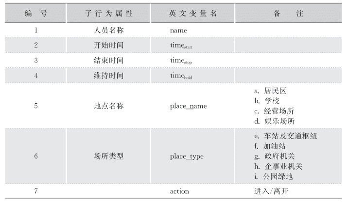

### 2.3.5 异常轨迹识别与预警
1）特征变量选择
结合高危人员动态行为链及身份属性信息，建立异常轨迹识别模型。首先，选取“身份属性”“年龄”“性别”3 种静态属性信息数据，以及场所类型、空间所属关系、入访时间、访问频率 4 种动态轨迹信息数据作为异常轨迹分析特征变量。

（1）身份属性（`identity`）。由高危人员类型决定。高危人员类型包括但不限于犯罪前科人员、涉毒人员、在逃人员。身份属性数据结构为 1×n 维矩阵，n 为高危人员类型总数，一个人可能同时具有多种身份属性特征。

（2）场所类型（`place_type`）。指高危人员入访场所类型，场所类型有 9 种属性。为方便计算，利用独热编码算法将特征转换为 1×9 维特征向量。

（3）高危人员与空间所属关系（`insider`）。指高危人员及其入访空间之间是否有居住、工作及访客等关系。该特征拥有 2 种特征属性，用独热编码转换为 1×2 维特征向量。

（4）高危人员年龄特征（`age`）。拥有 4 种属性，用 1×4 维特征向量表示。

（5）性别特征（`gender`）。拥有 2 种属性，用 1×2 维特征向量表示。

（6）入访时间特征（`time`）。由高危人员进入某场所起始时间与离开时间共同确定。把一天划分为 48 时段，每个时段时间跨度为 0.5 h，将高危人员活动时间映射到 48 个时段，其中，停留在场所内时段对应属性值为“1”，未在场所内时段为“0”，最终形成 1×48 维入访时间特征向量。

（7）访问频率特征（`frequency`）。指高危人员访问某场所历史频率，通过专家系统将访问频率划分为 4 个等级。采用独热编码将访问频率转换为 1×4 维特征向量。

2）特征变量风险权重设置
（1）入访场所对高危人员吸引力权重。利用专家系统和模糊综合评价法确定不同类型场所对高危人员的吸引力。其中，场所类型包括居民小区、学校、经营场所等 9 种，高危人员类型包括前科人员、涉毒人员、在逃人员等 n 种类型，可生成 9×n 维矩阵，矩阵中“1”代表场所对该类人员具有吸引力，“0”代表没有吸引力。

（2）入访时间的风险权重。我国某大型城市 2006—2016 年共发生 44 831 起入室盗窃案，归一化后得到每个时间段案发频率，并将其作为入访时间风险权重。

（3）其他变量风险权重。通过分析入室盗窃案件数据发现，作案人员中男性占 76.67%、女性占 23.33%；年龄分布情况为：17～30 岁、31～50 岁、小于等于 16 岁和大于 50 岁年龄段人员分别占 41%、47%、2%和 10%。通过分析作案地点与居住或工作地点间关系发现，仅有 20%入室盗窃案件选择在居住或工作地点附近作案，而 80%入室盗窃案件则倾向于远离居住或工作地点作案。

3）异常轨迹分析模型建立
对异常轨迹分析模型特征变量标准化，根据各影响因素权重，建立异常轨迹分析模型。

## 2.4 社区人员异常行为识别与检测
在传统社区中，各个社区虽然基本实现了视频监控全覆盖，但是在实际应用中，视频监控存在以下问题：越来越多的监控摄像头的安装与越来越多的视频图像未被监视，形成一个不可调和的矛盾。据统计，现有视频的 97%以上从未被查看或监视。这主要是因为传统的社区视频监控主要依靠人为识别监控，人为识别监控具有不全面性和时滞性，一方面人为识别监控不像计算机可以 24 小时不间断工作，难免会有信息疏漏的时候，如果人为长时间盯着屏幕还会造成视觉疲劳，从而影响识别的准确率；另一方面，当发生打架、斗殴和抢劫等异常行为时，往往等到事情发生后才观看视频用于调查取证，不能及时阻止人身伤害和财产损失的发生。由此可知，以人为识别监控为目标的视频监控体系不能适应实际需求，这种方式无法有效保障居民安全。智慧社区需要大量视频图像处理（监控、存储、查找）技术来代替人为识别监控。

在智慧社区中，主要考虑的异常行为有跌倒、打架斗殴、恶意破坏公共物品、聚众等。可以通过构建视频监控系统，使其发挥实时监控的作用，自动对监控视频中的图像序列进行处理，包括定位、跟踪或者识别目标行为等。通过收集不同用户的操作行为，为其建立用户画像，通过对画像进行特征提取，建立模型学习正常用户的行为集合，并应用马氏距离等方法检测异常的用户行为，完成基于用户画像的异常行为识别。

### 2.4.1 基于视频的异常行为识别
基于视频的异常行为识别与检测技术，大致可分为基于行为识别的方法和基于异常检测的方法两类。

基于行为识别的方法是基于模型的异常检测方法。首先需要确定某种判断规则，从视频图像中提取出运动轨迹特征等信息，对异常动作或者行为建立样本库，然后根据这些信息判定其是否属于异常行为样本库范畴。当所有的异常行为都被很好建模的情况下，基于模型的方法检测性能良好；但是当异常行为数据库的量很大并且要求完全建模存在相当大困难时，检测准确性和效率方面会下降。

基于异常检测的方法是基于相似度的异常检测方法。针对异常行为易于察觉、难以规范的特点，不用事先定义好模型，较少考虑具体的异常动作，往往通过自主学习视频场景中正常的行为模式、进行相似度对比，来实现对视频中异常行为的判定。

在效果方面，基于行为识别的方法往往对个体异常行为具有较好的识别效果，对于全局信息的关注则较少；而基于异常检测的方法对视频的全局信息具有更强的分析能力，但对局部微小的异常行为难有精确的检测效果。这两类方法对异常行为的判别原理各有不同，但又紧密联系，如图 2-9 所示。两类方法关系如下：一方面，两者均以特征提取环节为前提；另一方面，在实际应用中，往往既希望检测全局的异常行为，同时又希望获知异常的具体对象及原因，因此两类方法常常联合使用，用以提升识别与检测效果。

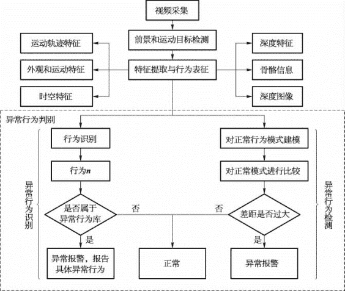
图 2-9　异常行为识别检测流程图

#### 2.4.1.1 基于行为识别的方法
对于人体行为而言，违反社会道德及法律或不符合当前场景下的行为均可视为异常。异常行为通常具备如下特征：环境相关性、不可预知性、突发性、短时性、低频性、无周期性、局部时空性和全局一致性等。异常行为的上述特征一般要求异常行为识别及检测算法要具有一定的鲁棒性、实时性和适应性。

从不同角度出发，可将异常行为划分为不同类别。从行为的发生对象出发，可分为个体行为异常（如跌倒、越界、持械）、群体行为异常（如踩踏、聚集）、人物交互异常（如恶意损坏公共物品及公共设施）和人人交互异常（如打斗、推搡）等。从发生事件的性质出发，可分为暴力异常行为和非暴力异常行为。从发生异常的目标空间位置出发，又可分为区域入侵行为、区域徘徊行为等。可见，异常行为的类型多种多样、特点各不相同，因此须根据具体应用场景选择合适的特征提取、识别与检测方法。

异常行为识别在实际应用中存在以下问题：一是实际应用中单个目标异常行为样本较少；二是当视频中人数众多、遮挡严重时，单个目标行为识别的精度下降，同时人数的增加使得计算量增大；三是在拥挤场景中，对每种行为进行标记成本较高，同时无法保证标记能够覆盖全部异常行为。此时，异常行为检测方法就显得格外重要。

#### 2.4.1.2 基于异常检测的方法
异常行为检测方法仅将行为分为正常和异常两个类别，从大量的视频数据中学习经验，实现像素级、帧级或视频级的异常行为判别。针对不同场景，采集的视频数据及标签的制作各不相同。基于不同的数据形式，异常行为检测方法可分为有监督、半监督和无监督三种。

1）有监督异常行为检测

在模型训练之前需要对所有数据进行标注，通过样本数据与标签的映射关系建立起网络模型，之后进行特征提取并设置分类器，最终实现数据的分类，常用的分类器有支持向量机、贝叶斯网络等。此外，卷积神经网络作为一种有监督方法在异常行为检测领域同样有广泛应用。在分析具体的异常行为时，有监督的分类方法具有较好的效果。然而，监督学习对于像素级和帧级视频标注的成本较高，部分研究人员将目光投入以视频级异常标签为训练数据的异常行为检测技术中，利用数据的弱标签实现数据包与标签的映射。由于在视频中准确标定异常行为的时间位置较为烦琐，一些研究利用多示例学习方式来解决其中的弱监督异常检测问题。所谓弱监督学习是指在训练数据只具有粗粒度标签的情况下建立模型，此过程中视频被视为包，视频的每一帧图像便是示例，通过标记包的正负注释判定训练数据是否异常。

## 2）半监督异常行为检测
通过学习一部分已知标签的样本和一部分未知标签的样本，从而将输入数据映射到标签。相比于异常数据，获取正常数据相对容易。因此，半监督方法在异常行为检测任务中使用较多。在半监督异常行为检测方法中，仅须对正常样本进行标记，在训练阶段从视频中学习正常模式，在测试阶段计算当前模式与正常模式的相似度，将偏离正常模式的检测视为异常模式。从模型的原理出发，半监督异常行为检测方法可分为基于重构模型的异常行为检测和基于预测模型的异常行为检测。

### （1）基于重构模型的异常行为检测方法
首先在训练阶段，利用大量的正常片段得到自动编码器的权重，训练结束后将原始时间序列输入自动编码器网络，得到重构后的时间序列，最后设计样本的估计异常分数，用来表示重构前后视频序列之间的整体和局部误差，当测试样本得分超过阈值则判定此时出现异常。作为一种常见的统计推理方法，主成分分析法能够将高维数据映射到低维特征空间，降维后的特征可以由低维空间重新映射到原空间，实现对原始数据的重构，从而将离群点从数据中分离出来。根据这一思路，以主成分分析法为基础的一系列算法被应用于异常检测任务。

### （2）基于预测模型的异常行为检测方法
其为目前应用较为广泛的方法之一。不同于重构模型，这种方法考虑了视频序列的时空相关性，其目的在于学习一个能够较好地重构视频帧的生成模型，从而利用过去的多帧图像信息建模当前帧及未来帧，通过比较预测帧与实际帧之间的差异实现异常检测。由于长短期记忆网络能够学习时间特征并预测时序数据，因此其常被用于检测视频序列内的行为异常。

## 3）无监督异常行为检测
在无需任何数据标签的情况下，仅依靠样本之间的内部关联进行建模并将全部数据映射到多个标签。由于大多数样本中异常行为出现的概率较低，因此，在无监督异常行为检测过程中，通常将与数据主体相似度较低的行为视为异常行为。生成对抗网络由一个生成器和一个判别器构成，通过对抗学习的方式估测数据样本在特征空间中的潜在分布并生成新的数据样本，在无监督异常行为检测任务中获得了成功。此外，随着人工神经网络的发展，基于深度学习技术的无监督异常检测方法层出不穷。

### 2.4.2 基于用户画像的异常行为识别
基于用户画像的大数据环境中异常行为特征提取方法主要分为三个阶段进行工作：第一阶段为用户行为数据收集，为异常特征提取奠定基础；第二阶段对收集到的用户行为数据进行处理，包括数据脱敏、数据清洗、用户识别、会话识别、路径补全、事物识别，区分正常行为数据与异常行为数据；第三阶段利用用户画像技术将异常行为数据抽象成标签，完成异常特征提取，如图 2-10 所示。

### 1）用户行为数据收集
用户行为数据通过智慧社区数字化平台获取，智慧社区数据采集主要来自周边视频、小区视频、人脸识别、车牌识别、楼宇门禁、出行记录等。社区住户或者社区访客一旦进入社区，就会产生相应的活动记录，如用户身份、访问日期、车牌号码、出行轨迹等。以上这些记录都存放在相应的视频监控或者后台记录中，从而储存在智慧社区数字化平台。通过智慧社区数字化平台获取社区用户行为数据，能够反映真实环境下用户的基本情况，且收集到的数据也更加精确，能够存储的数据数量更多，产生的消耗也最少。
在这里为有效获取智慧社区数字化平台的用户行为数据需要构建一个收集系统，该系统从功能上看，主要分为三大模块：行为数据采集模块、行为数据传输模块、行为数据统计与显示模块。其中，行为数据采集模块使用页面标签法捕获数据，主要负责集成服务器日志中的用户访问记录；行为数据传输模块主要负责将采集到的数据传输给下一层统计模块，负责数据搬运；行为数据统计与显示模块主要负责接收传输过来的数据，进行数据统计分析并以报表的形式显示出来。

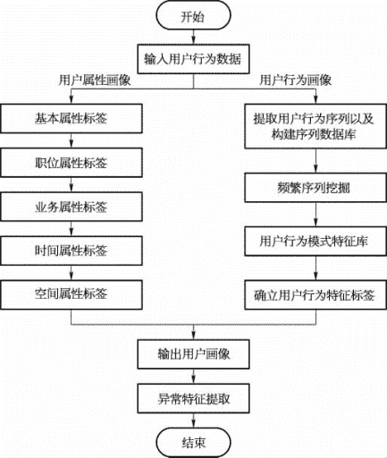

图 2-10　用户画像模型构建基本流程

### 2）用户行为数据处理
由于智慧社区数字化平台是记录用户从访问开始到结束的所有行为痕迹，因此通常情况下，数据预处理主要包括数据清洗、用户识别等步骤。
数据清洗工作主要包括数据合并：用户行为数据是按照一定的原则分布储存在智慧社区数字平台的，因此当需要分析某类数据时，需要将这些数据从不同的文件中提取出来，合并到一起，然后对其进行解析，并将解析出来的内容以统一的格式存放到某个指定文件或数据库当中。数据清洗工作还包括数据删除：当用户连续重复某一行为，而这些信息与研究目标的关联并不大，因此需要将其清除出去，减少数据量。
用户识别是通过智慧社区数字化平台记录的数据来识别用户，也就是确认每个行为所属于哪一个用户。

### 3）数据标签化处理
智慧社区数字化平台数据大多数为异构数据、图像数据、文字数据等，需要将图片数据等非文字数据抽象成用文字描述的标签。
这些标签中包含用户的静态信息和动态信息。其中，静态数据包括基本身份信息，例如身份证号、性别、年龄、民族、受教育程度、职业、家庭结构等相对稳定的信息；动态数据则包括用户利用公共服务多维信息平台检索信息的行为，同时也包括通过不同公共服务供给部门获得的居民实际消耗公共服务的信息，这些数据能够准确反映居民公共服务的偏好及诉求。
这些标签中还包括行为标签。所谓“用户行为画像”就是建立用户“行为标签”。本书中“行为标签”特指用户的各种行为，即用户的行为序列。

### 4）用户行为异常特征提取
构建用户画像模型，然后利用该模型进行用户行为数据异常特征提取。用户画像模型主要由两部分组成：第一部分构建用户属性画像，即明确用户属性标签，该标签表示用户固有、静态的状态。用户属性标签主要包括基本属性、职位属性、业务属性、时间属性以及空间属性等 5 类。其中，基本属性是指用户基本信息，如用户身份标识号（identity document，`ID`）、互联网协议地址（internet protocol address，`IP 地址`）等；时间属性是指用户访问在时间上的分段；空间属性是指在用户访问在区域上的分段。第二部分是运用具有相应的行为画像来对用户行为进行动态刻画。
利用上述构建好的用户画像可以精确提取出用户的异常行为模式，然后以此作为特征，把用户待测的行为序列模式与之匹配，通过匹配是否成功来判断是否为异常用户，并据此提取用户行为数据异常特征。首先将这些用户行为模式作为异常检测的特征，然后把用户待测的行为序列模式与已知特征序列模式进行模式匹配，若匹配正确，则待测行为划分为正常行为；若无法匹配或匹配程度低，则将待测行为划分为异常行为，且发出告警。

## 2.5 社区智慧安防应用案例

### 2.5.1 多维感知与人工智能提升社区安全防范水平
随着城市的快速发展，本地居民购房迁移、外地人口大量涌入、流动人口规模急剧膨胀、人户分离情况尤为突出，给实有人口管理带来新的挑战。同时，随着我国国民经济的高速发展和人民生活水平的提高，人们对社区环境治理的需求也在日益增长，尤其对社区安全性、管理智能化提出了更高的要求。澎思智慧社区系统是基于多维感知、人工智能、大数据等核心技术推出的智慧社区解决方案，致力于提高社区的精细化管理与安全防范水平，打造便民利民、社会保障和社会化服务于一体的良性智慧社区生态体系。
社区可以在澎思智慧社区系统中建立重点关爱人群库，对于独居老人、智障患者、老年痴呆、社区戒毒、康复人员等对象的异常出行或长期未出现的情况进行及时预警，通知社区物业或者基层民警关注、走访。例如无锡某小区的澎思智慧社区系统多次抓拍到患有严重精神疾病的居民李某进出的人脸图像，当时物业管理人员分析，8 月天气炎热，李某平时又极少外出，行为明显反常，遂迅速与其家属联系上门了解情况，后发现李某精神疾病复发，立即将其送至医院治疗，起到了提前预警作用。
澎思智慧社区系统另一个重要功能是为社区提供全天候、全方位的安全防护。系统可以对网上逃犯触发报警，对重点人员和长期徘徊人员进行重点关注并自动监控，解决了社区治安的痛点，为居民提供安全的智能化社区生活环境。北京某回迁房小区在部署澎思智慧社区系统后，一年内抓获偷盗、伤害等案件违法犯罪嫌疑人 5 名，守护了居民安全。
在沿海某市的智慧社区建设过程中，已建住宅小区较多布置了视频系统，但绝大部分设备都是普通高清摄像机，以大角度取景为主，不具备智能分析能力，视频数据中存在严重的着装相似、光照和视角变化、复杂背景和遮挡现象，给调阅和识别带来很大困难。澎思科技采用“云边端”融合计算架构，接入安装在出入口、路面的既有视频设备，通过边缘侧 AI 智能分析盒实现图像解析，最终汇聚到云平台实现大数据计算与业务应用（图 2-11）。在该系统中，澎思科技充分利用其领先的行人再识别技术（person reidentification，`ReID`），通过与人脸识别、图像聚类等技术深度融合，大大提高场景适应性，提高智慧安防水平，完善了社区多维立体化管理服务体系。据了解，在该市某个拥有 2 000 多人口的试点小区，工作人员通过该平台赋能模块功能，2020 年以来已成功预警各类关注人员 50 余人次，对于增强社区综合治理能力效果明显。

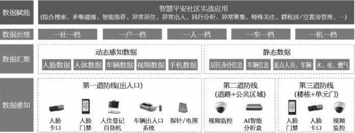

图 2-11　澎思科技智慧社区管理平台

### 2.5.2 考虑不同人员管控需求的社区人员精细化管理
要切实保障社区安全，必须对进出社区和单元楼的人员进行有效监控和管理，然而每天出入社区的人流量都很大，靠人工实现社区人员管理并不现实，因此需要高效的人员身份识别、记录和管理系统，杜绝外来人员的随意进出。
天地伟业 AI 智能社区管理系统（图 2-12）依据不同人员进出管控需求集成了不同的人员管理系统，包括出入口身份识别系统、智能门禁系统和人脸识别系统。

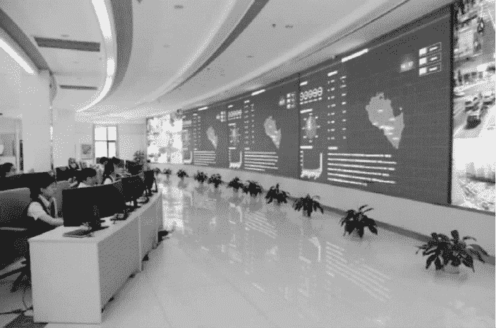

图 2-12　天地伟业 AI 智能社区管理系统

#### （1）出入口身份识别系统
设置在社区出入口，用于管控进出人员，系统检测为社区内人员则允许通行；若为非社区人员，则需要确定人员身份决定是否放行，系统的建设可以有效阻止社区以外人员的随意进出，以免给社区秩序造成混乱。

#### （2）智能门禁系统
部署在单元楼门口，用以判别人员是否有权限进出，对人员的进出进行严格管理，以免造成重要物资的损失。

#### （3）人脸识别系统
设置在社区进出门口、单元门口、活动场所，对有偷盗等违法行为的嫌疑人进行布控，发现可疑人员及时报警，提醒保安重点关注。同时，对于经常出现在小区的外部人员进行频次分析，异常频次可及时报警。还可通过照片快速检索出走失人员在小区内出现过的位置及运动轨迹。
人员管理系统具有判定的唯一性和精准性，可避免不法人员蒙混出入社区各场所。

### 2.5.3 社区实有人口动态管理的大数据应用
云从实有人口管控系统依托人脸识别技术，实现社区实有人口动态管理的大数据应用。在智慧社区安防管理建设中，通过调用实时、精准、有效的人像抓拍数据和通行数据，依托智能算法进行新增、离开等行为及人员属性分析，挖掘关联关系，实现异常行为预警、布控、轨迹查询等应用，实现社区人员的精准和精细化管理。云从智慧平安社区示意图如图 2-13 所示。

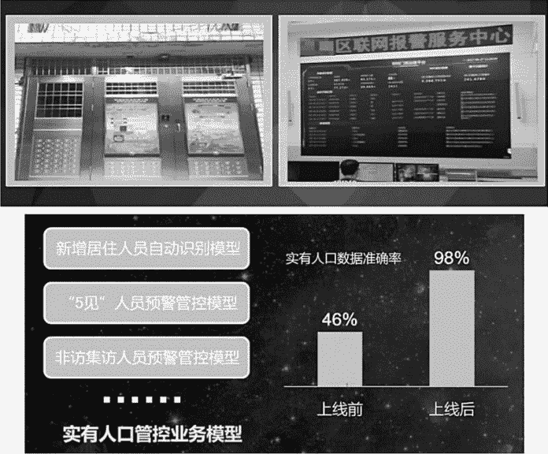

图 2-13　云从智慧平安社区示意图
云从实有人口管控系统结合在社区部署的人脸门禁、人脸抓拍机等设备，实现人员布控、辖区内人员管理、小区新增人员、搬离人员、各类窝点、重点关注人员管控等应用功能，为社区警务智能化、精准化的提升提供了有效的技术支撑，为社区安全提供了有效的技术保障。云从实有人口管控系统运用结构化数据采集分析，批量化生成情报信息，提高了政务警务生产能力，实现了“打防管控服”一体化、分析调度可视化、警务运行扁平化，推进了“智慧社区”向“智慧城市”的升级进程，为公安安防提供了新的实战业务思路和工具。

# 第 3 章 人工智能赋能智慧社区的公共卫生防护
现代社会巨大的人口规模以及高频度的人口流动、高密度的人口聚集为城市系统带来极大压力，风险源的多样性、诱发机制的复杂性更进一步放大了公共卫生风险的危害冲击，而所有这些问题都会沉淀到基层。社区既是风险爆发的第一现场，也是风险后果最直接的承担者，更是风险过后恢复和重建的直接参与者，越来越多的实践证明了社区在国家公共卫生应急管理体系中的主体性地位。
自新冠肺炎疫情暴发以来，社区成为防控下沉的重要环节，这也是对社区有效治理的严峻考验。中国城乡基层社区在“外防输入、内防扩散”方面发挥着不可替代的作用。习近平总书记指出，要充分发挥社区在疫情防控工作中的“阻击作用”。国家四部委联合印发的《新冠肺炎疫情社区防控工作信息化建设和应用指引》明确指出，发挥互联网、大数据、人工智能等信息技术优势，依托各类现有信息平台特别是社区信息平台，形成立体式社区防控数据链路和闭环。
在疫情防控日益常态化的当下，社区作为新冠肺炎疫情联防联控第一线，要积极适应新形势、新任务的需求，推动人工智能赋能社区治理和服务创新，利用在疫情防控治理过程中形成的线上线下融合的新型“智慧社区”治理模式与经验，加快转变治理方式，逐步构建和完善起政府、社区、社会组织等多元主体参与的社区治理和服务创新的新模式。

## 3.1 智慧社区防疫应用场景——AI 云防疫
社区作为社会治理的基本单元，是疫情常态化防控的前沿阵地，除去之前基本的物业服务外，对多元化的新兴抗疫技术和设备提出了需要，基于 AI 技术的智慧社区建设迫在眉睫。智慧社区软硬并举开展非接触式监管和排查。社区部署人脸识别卡口、门禁、非接触式人体测温、智能门锁等智能设施，阻断可能传染源，实现非接触、安全高效的社区管理，打造抗疫“安全岛”。

### 3.1.1 人工智能提升社区监测管控能力
社区防疫是城市防疫的基础性环节之一，而社区封闭化管理需要大量保安、物业以及志愿者，在避免接触的同时，提升登记排查工作效率非常重要。而复工复产开始后，人员流动性大幅度提高，更加为社区防疫带来挑战，考验着社区的智能化管理水平。为了帮助社区防疫、避免交叉感染，在全国多个小区都有以 AI 为基础的云防疫应用，如健康申报、人车管理、体温筛查以及智能隔离。

#### 1）健康告知与申报承诺
针对健康在线申报，利用 AI 核心技术，用户可以通过微信实名验证，提高健康申报效率，且校验身份后签署承诺书更具有法律效力。

#### 2）电子出入证+AI 识别开门+自动体温测量
针对封闭式小区出入口、开放式重点区域，AI 识别技术可辅助社区人员在线申请电子出入证；同时集成该技术的热成像摄像头、热成像门禁机等设备，可实现实时身份识别、测量体温等预警记录上报。

#### 3）车辆出入管理和行为预警
车辆识别技术能够对社区以外的出入车辆进行自动化车辆识别登记，并对由疫情中高风险地区进入的车辆进行提示，对于是疫情中高风险地区牌照车辆但未进入风险地的车辆进行白名单处理。还能根据车辆的出入时间、频次等行为特征，对车辆出入进行分析预警。

#### 4）预警疫情风险、人群聚集告警
基于 AI 识别技术，平台能够及时发现未佩戴口罩的人员，统计社区内人员口罩佩戴情况，协助社区居民管理，降低疫情传播风险。同时，AI 识别技术还可以用于社区公共区域，自动识别人员聚集情况，设置告警阈值，提前预知疫情风险，协助社区管理者合理调度安排执勤人员等。

### 3.1.2 防疫机器人助力社区防疫
在 AI 技术和 5G 网络的支持下，智能防疫机器人的应用，让处于疫情防控一线的医疗卫生工作者和社区物业人员多了一件防疫利器，AI 机器人穿梭在隔离区，开展物品配送、杀菌消毒、运送药品等工作，有效助力打赢疫情防控攻坚战。
配送机器人能够打通社区无人配送的“最后一公里”，实现“无接触”配送，居家隔离的社区业主只须网上下单，就会有机器人送菜上门，除此之外，搭载有高精度红外测温成像系统的机器人，还可以识别出取外卖人员的体温，通过 5G 网络实时显示在车载屏幕和远程监控设备上提升疫情检测能力，这些勤劳能干的“快递小哥”最多可装 300 kg 物品、续航 60 km，满电状态下防疫监测功能能够持续 10 h。
各种防疫期间无人机空中喊话的短视频火爆，立体防疫成为疫情防控新形态。在乡镇地区，原本需要 10 辆车宣传督导的，如今只需一架无人机就能覆盖整个村镇，并且，对于车辆难以深入地区，也能进行较好地监测。对于区域人群聚集，无人机自动靠近人群上空，采用高精度红外测温，对所有人进行在线测温。确定无发热异常后，再进行喊话驱离，督促人群散开。“空中+地面”抗疫的无人机解决方案已成功应用于疫情防控期间。

### 3.1.3 人工智能助力社区居民远程问诊
在疫情防控的常态化阶段，很多公立医院的门诊改为预约制，限制每日门诊患者数量，并紧急上线互联网医院平台，提供远程问诊和病情咨询等服务。很多医药电商开展的互联网平台也出现业务量猛增的趋势，在线心理咨询、发热咨询、疫情动态发布等成为医院以外的另一个重要防疫“战场”。对于社区居民而言，新冠肺炎传染性强，入院问诊存在交叉感染的风险，对有问诊需求的患者造成不便，并且疫情带来一定的心理恐慌，导致人们害怕去医院，但是又急需专业的医学信息来解决问题。AI 助力的远程问诊、线上医学科普可以有效为他们解决这一难题，在医疗领域中的图像识别、医药筛选、远程问诊场景下的落地应用，彰显了 AI+医疗的力量。

在社区远程医疗流程中，老年患者首先基于对自身症状的主观感受、居家传感器的数据异动警告、定期复查与药物补充等原因，以电话通信、视频咨询、网页文字描述等方式向社区远程医疗保健平台提交就医意向。随后，平台整合老年患者在社区卫生服务中心、医院、其他保健护理机构等多方预留的电子健康记录、住宅内传感器的实时监测数据、移动行程轨迹等医疗信息，以机器学习等技术算法对老年病症进行评估预判，初步掌握其病情类型、紧急度与严重性。对于疑似传染病感染患者执行社区替代性防疫控制场所隔离措施，并实行二次试剂检测。若为感染患者，则计算各传染病医院患者容量情况后将其进行转移；若非感染患者，则与其他老年患者类似，双方协商系统内纳入且符合症状诊疗等级的医疗机构，经老年患者及家属同意对其发布定向分类转诊的预约需求。最后，指定的医疗机构人员以移动式门诊、远程视频会话或必要性家访等形式为老年患者提供医疗问诊与康复保健，并由社区平台对其进行结果跟踪与辅助护理。

## 3.2 人工智能助力社区疫情防控检测

疫情期间，基层社区通过数字化、智能化手段加强管理，如热成像体温监测、无人机喊话、人脸扫描通行等精细化地毯式管理手段，极大地减轻了社区基层负担，助力社区精细管控人员进出、车辆出入、动态发布信息，有效控制人员流动，从而阻断疫情传播。

### 3.2.1 基于红外热成像的人员无接触测温

自新冠肺炎疫情全球暴发以来，新冠病毒时刻威胁着人类社会的公共安全，并可能将与人类文明长期共存，世界各国都在积极研究基于红外热成像技术的非接触式人体测温筛查系统。人体测温筛查是防疫战斗中的第一道防线，也是作为人群密集社区快速筛查的最重要方法。如何有效开展体温筛查，降低新冠病毒传播的风险，成为构建智慧社区疫情防控体系的第一要务。

#### 1）红外热成像技术

红外热成像技术是一种热辐射信息探测技术，在自然界中，由于内部分子热运动现象，温度高于绝对零度（-273℃）以上的物体都在释放红外辐射。红外热成像设备是针对物体的热辐射现象，利用红外波段的光学探测器对被测目标的热辐射能量进行显示，并进行差异化区分显示，从而将设备使用者的可观测光谱范围从可见光波段拓展为可见光+红外波段。与相对成熟的可见光技术相比，红外热成像具有更高的普遍性（红外热辐射现象广泛存在）、更强的穿透性（红外热成像对大气、烟、云、雾等物质的穿透性强）、更好的稳定性（不受强光、炫光等因素的干扰）。

目前，红外热成像技术作为视频监控技术和信号探测技术已广泛应用于智慧社区的综合智能场景。相比传统的可见光视频采集设备，红外热成像设备虽然无法针对色彩进行采集，但仍然具有相应的空间分辨能力。除此之外，红外热成像设备还具有温度分辨能力，可对监控画面中目标热源的大小、轮廓及温度分布情况进行显示。因其非接触、无感、筛查速度快的特点，红外热成像体温检测仪迅速成为快速筛查人群体温的优选方案。

热成像测温摄像机（半球或筒机）主要用于临时布控的社区场所，用于目标人体体温的初步筛查，如图 3-1 所示。当目标人体通过热成像测温摄像机的监控区域时，须通过测温结果判断目标人体体温是否超过正常体温阈值，若未超过的话，可快速通过；若超过，可给出报警提示，并通知现场工作人员做进一步处理。

#### 2）热成像体温校正

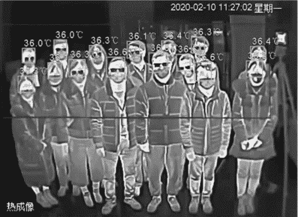

图 3-1　热成像演示图

人体热辐射的最大波长一般在远红外区，波长范围在 5～50μm 之间，因此，可将人体看作红外辐射源。红外热成像设备是利用红外探测器把人体红外辐射能转变成电信号，根据修正后的史蒂芬-玻尔兹曼定律`M（T）=εσT4`，人体辐射功率与皮肤绝对温度的 4 次方成正比，利用红外探测器接收到的人体辐射功率，即可以反向计算出对应的体温。黑体作为标定红外系统的基准源，能够吸收外来的全部红外电磁波，并且不会产生任何反射与透射，但是可以向外辐射红外电磁波的理想化物体，即黑体的辐射率与吸收率为 1，透射率为 0。将黑体设置在热成像视野范围内，利用黑体的特性开展测温标定，建立灰度与温度的准确对应关系，进行测量温度实时校正，将视频画面和个人体温对应显示，大幅度提高人体测温的测温精度。

连续扫描人体面部，再把热能信息转换成数据，就可以描绘出人体的二维温度，以彩色图像的形式显示面部温度的分布状态。体温的分布状态可以反映体内生理状态的变化和局部的病变，由于人体内各组织的代谢功能不同，体表温度并不一致，但都有各自的正常范围。当人体发生某种病变时，相应部位就会因血流和代谢的变化而产生异常的温度变化，从而为临床诊断提供有效的信息。

### 3.2.2 基于深度学习的人脸佩戴口罩识别

疫情防控期间，佩戴口罩是疫情防控的最佳手段，也是人员出行的基本要求。但在佩戴口罩的情况下，人脸识别系统如何做到戴口罩刷脸通行，避免接触感染，成为疫情防控和治安防控要求下的新难题。

人脸口罩识别技术多基于深度学习方法（相关算法介绍请参见本书附录）实现，包括人脸检测和佩戴口罩识别两部分，如图 3-2 所示。人脸检测模块首先对输入的图像进行人脸检测；佩戴口罩识别模块对检测到的人脸区域按照一定比例扩展，并裁剪出人脸区域子图像，采用图像分类的方法，对整个人脸区域子图像进行二分类，从而得到是否佩戴口罩的识别结果。

图 3-2　人脸佩戴口罩识别整体框图

人脸佩戴口罩识别关键技术流程如下：

#### 1）原始数据集获取

对社区真实的历史监控视频数据分帧处理，选择其中包含人脸的图像，并人工将其分类标记为佩戴口罩和未佩戴口罩两类图像，从而获得包含两类图像的原始数据集。其中，原始数据集中佩戴口罩和未佩戴口罩的人脸图像数量比为 3∶1。

#### 2）数据集增强

采用数据集增强方法对原始数据集进行预处理，将处理后的图像增加到原始数据集中，获得扩增后的训练数据集。数据集增强方式包括角度旋转、随机裁剪、亮度调整、对比度调整。

（1）角度旋转指对原始图像进行任意角度旋转的变化，该过程中人物图像主体的位置被改变，契合了真实场景下取景角度的差异。

（2）随机裁剪是对原始图像进行裁剪，在该变换情况下，人物主体在图像中的大小比例发生改变，契合了真实场景下人物主体位置变化带来的前景和后景的景深变化。

（3）亮度调整是对图像的亮度进行调整，对比度调整是指改变图像的对比度。在这两种调整情况下，图像质量被改变，契合了真实场景下因为光纤、空气质量等环境因素造成取像质量不一的情况。

数据集增强处理的应用，有效解决了常规取景状态下可能存在的各种影响成像质量的问题，也满足了神经网络在训练过程中准确识别图像中人物对口部进行遮挡和欺骗行为等深层语义特征的识别要求，保障了神经网络最终识别准确率。

#### 3）神经网络模型的构建

将单发多边框检测器基础网络模型中的主干网络替换为具有残差结构的`DenseNet`网络，并在神经网络模型中引入具有特征融合的特征金字塔模块，进而构建改进后的基于单发多边框检测器（`single shot multibox detector`，`SSD`）的神经网络模型。

#### 4）神经网络模型训练

需要对构建的神经网络模型进行训练，以提高其对于目标检测对象的识别准确率。该阶段需要根据具体的训练指标要求设定训练阶段的相关参数，这些参数包括学习率、迭代次数和衰减策略等。该项技术中，利用经过数据集增强方法扩增后的训练数据集作为样本输入，对基于改进`SSD`的神经网络模型进行迭代训练，训练完成后保存经训练过的具有最优识别效率的神经网络模型。

#### 5）输入检测图像获取

神经网络模型在进行目标对象是否佩戴口罩的识别检查过程中，输入样本数据是从视频监控中获取的图像。该项技术中，通过分帧方法将实时获取的监控视频转化为逐帧图像，并识别出其中含有人脸的目标图像。

通常来说，一段视频经分帧后产生的图像很多，在实际识别检测过程中无须对所有图像进行输入识别，否则会导致系统处理难度和数据量激增。因此，可以通过择优方式选择其中的若干张作为输入图像进行检测。一般选择标准是人物主体在图像的中央区域且图像质量较佳，图像质量的判断指标包括亮度、对比度和图像噪点等。在针对逐帧图像选取最佳图像之后，还需要通过对目标图像进行亮度调整和清晰度提升完成图像预处理。其中，通常需要将图像的亮度提升至可清晰辨认人物主体的程度，而清晰度调整可通过图像去噪等技术实现，最后再将预处理后的图像作为目标检测图像输入。

#### 6）口罩佩戴识别检测

将实时监控过程中提取并预处理后的目标检测图像作为输入，训练完成后的神经网络模型对其进行识别和检测，获取检测目标对象是否佩戴口罩的识别结果。该处理结果可以通过语音或视频图像方式直接输出，也可以传输到其他功能系统中，作为后续管理执行过程的依据。

### 3.2.3 面向群体特征的人群聚集检测

通过覆盖社区的摄像机，管理平台可以进行分钟级的自动“巡逻”，结合人脸识别和人形检测功能，系统可以在第一时间发现人员聚集情况，并向社区值班物管发送告警，提醒劝散现场聚集人员。

关于人群聚集的检测，分析方法可分为面向个体特征和面向群体特征两类。面向个体特征的方法基于对每个目标的分割和跟踪，用个体的特征来研究人群中的事件。面向群体特征的方法对全局图像进行处理和采样，获取整体的信息，然后对采集到的数据进行处理，对异常情况和正常情况进行分类，这种方法关注人群中行为的一致性，因此对于群体事件的分析效果较好。随着智能视频监控领域实际需求的变化和计算机视觉研究的发展，近年来面向群体目标的研究方向也逐渐成为热点。

面向群体特征的分析方法不对视频中的目标进行单独分割，而是将视频中整幅图像进行特征提取，使用提取的特征建立人群模型，检测视频中出现的各种事件。典型的群体特征分析框架主要包括特征提取、人群模型、事件检测、知识库等部分，其中事件检测部分可以只使用人群模型进行检测，也可以根据事先建立的知识库来检测事件，或者结合上述两种方法检测事件。通常的群体分析框架如图 3-3 所示。

群体分析框架的主要部分为特征提取、人群模型和事件检测三个模块，其主要内容如下：

#### 1）特征提取

视频中的多种特征都可以用于人群场景的分析，例如灰度、颜色、光流运动向量、形态特征、纹理特征、局部二值模式、尺度不变特征变换、方向梯度直方图、韦伯局部描述符等视频图像算子。在人群密度较高的视频中，难以对每个目标进行跟踪，但是可以得到整个人群的近似运动轨迹。而人群密度、人群受力和运动情况等信息也是可以有效描述人群的特征。从人群视频中提取的特征用于下一步的人群模型建模。

#### 2）人群模型

将视频中提取的特征输入人群模型进行训练，计算模型中的参数，对人在群体中的运动情况进行建模。根据人群模型的建模思想，人群模型可以分为如下几类：

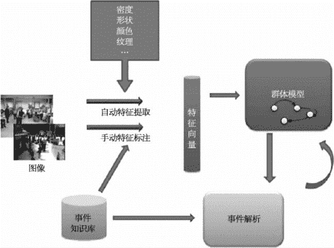

图 3-3　群体分析框架

（1）使用计算机视觉的方法直接分析从视频中提取的特征，不针对人群建立结构化的模型。例如将光流向量作为特征，使用聚类的方法得出人群的运动方式，使用隐马尔可夫模型对运动建模，检测视频中的异常场景。

（2）基于物理学的模型。这种方法类似于用物理学中的动力学模型对人群中的个人进行建模，将每个人的运动状态用物理学中的参数来描述，而人群的行为可以类比为气体或液体等流体的运动情况。例如有学者提出了使用社会力模型检测视频中的异常事件的方法。社会力模型是一种可以较好地模拟人群中个体运动和受力情况的模型。社会力模型中个人会受到两种作用力：一种是由于个人会向其预想的目标前进，因此要不断修正其运动方向和速度，使其向正确的目标方向前进，上述运动形态的改变可以被看作由于个人受到了内在的作用力；另一种是由于每个人周围都有一定的人际空间范围，当其他人和目标进入这个范围后，会对这个人的心理上造成虚拟的斥力，这样人受到斥力影响就会自动绕开其他的人和障碍物，维持周围一定的空间，避免碰撞的发生。该方法首先对视频进行网格状粒子采样，计算采样点的光流运动向量，然后用社会力模型计算每个采样点受到的相互作用力，得到图像上的社会力场，对时空域上相互作用力的立方体采样和量化，作为词袋（`bag of words`）来训练隐狄利克雷分配模型（`latent dirichlet allocation`，`LDA`）模型，区分视频中的正常片段和异常事件。

（3）Agent 模型。综合使用模糊数学、博弈论、社会学、蒙特卡洛等方法来对群体中的个体行为进行建模。例如有学者提出了一种人群的模拟仿真方法，其对个人兴趣、加入和离开群体、人群相互关系、碰撞检测等行为制订了详细的规则，仿真模拟博物馆中人群的参观行为。此外，还有细胞自动机模型和仿生学模型等人群模型。

#### 3）事件检测

视频中的异常事件检测和人群模型关系紧密，人群模型的设计需要有利于对正常、异常等各类事件进行区分。通常使用各种机器学习的方法，将视频中提取的特征和训练得到的人群模型参数输入机器模型中，使用分类的方法检测视频中的异常事件。检测模型根据特征数量的标签将问题转化为二分类问题，以此来判断是正常事件还是异常事件。从视频中提取有标签的基本事件，然后让这些事件进行学习而建立分类器，最后用分类器对这些事件进行分类。目前，常用的分类器有支持向量机（`SVM`，算法具体介绍请参见本书附录）、隐马尔可夫模型（`hidden markov model`，`HMM`）、`LDA`、神经网络等，它们在模式识别领域有着广泛的应用。另外，由于部分样本标签并不明确，全部列举的方法不可取，基于聚类的人群异常聚集也是个不错的选择。聚类的方法在进行事件检测前依然需要特征向量与正常事件的特征向量有一定的区分度，常用的如`K-means`聚类（算法详细介绍请参见本书附录）。

## 3.3 大数据筛查社区疫情接触人员

社区作为疫情风险管控的基本单元，也是疫情区域聚集暴发的起点。智慧型防疫策略对社会隔离防疫要求下社区环境的支持，主要集中在构建具备实时监测功能的公共场所和建筑物。另外，疫情的传播依赖于传染源与人、人与人之间的接触，因此，如何从微观层面识别这种关系成为疫情防控的关键。主要包括两个方面的问题：一是如何通过病例的位置信息发现聚集性疫情，实现传染关系和场所的空间溯源；二是如何通过病例与病例、病例与一般人员轨迹间的交集，发现感染者之间的传染关系以及潜在感染者。随着感知大数据的快速发展，大范围感知精细尺度个体轨迹和群体活动动态成为可能。机器学习等大数据科学能够在对接触者追踪、数据预测和新的流行病学传播模型建立方面具有重要辅助意义。

### 3.3.1 实时监测的公共场所与建筑物

在`5G`、`WiFi`、低能耗蓝牙（`bluetooth low energy`，`BLE`）、射频识别（`radio frequency identification`，`RFID`）等通信技术和`GPS`技术的支持下，形成了信息收集、数据分析、可视化传递的社区社会隔离实时监测系统，增强了公共场所与建筑物在疫情时期的可用性与安全性。首先，经由居民携带的移动设备端、公共场所与建筑物内投放的传感仪器、社区发布的信息分享平台等数据源所共同整合而成的物联传感媒介，实时地为社区防疫管控采集体温、地理信息、接触距离、交易点数据、社交媒体内容等数据。在网络云层内通过人工智能、深度学习与机器学习等算法判别数据的准确性与来源的可靠性，并规划数据用户的移动轨迹，计算社会隔离情况。最后，返回到设备层的应用程序界面，向有外出活动的社区居民提供可通行标识、图示化疫情实际与预测风险区域，或对打破接触距离要求的居民发出警告，降低无意识蔓延风险，如图 3-4 所示。

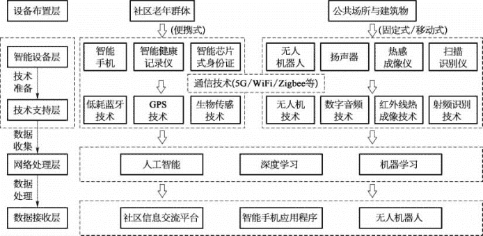

图 3-4　社区公共场所与建筑物内实时监测的技术路线

在对公共场所与建筑物内人群的识别追踪、接触监测方面，各个国家分别有不同方式的相应举措，见表 3-1。以新加坡、澳大利亚、韩国等为代表的国家多以智能手机的应用程序为媒介，并将其个人信息仅保留 21 天以保证数据隐私。其中，新加坡对于没有移动设备或者具有一定技术障碍的老年群体，可采用身份证内的植入式芯片进行公共场所出入扫描，以保证对老年群体的技术友好性。意大利、英国、荷兰等国家则通过佩戴式智能运动手环设备，收集社区居民日平均心率、离家最大距离等 9 项日常生活特征，并通过开源健康信息平台“远程疾病评估”工具汇总数据，可视化公共场所与建筑物内居民的聚集情况。而西班牙、美国等国家则在各个公共场所与建筑物内定点布置携带扬声器与热感成像仪的机器人，以热成像的方式探查空间内人群的接触距离，并通过扬声器提醒密切接触者。

表 3-1　不同国家对社区内公共场所与建筑物内人群的识别追踪与接触监测

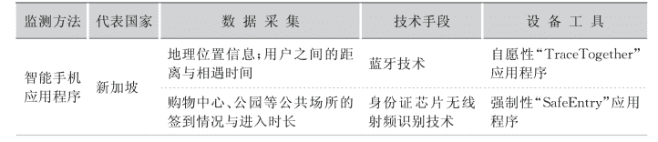

（续表）

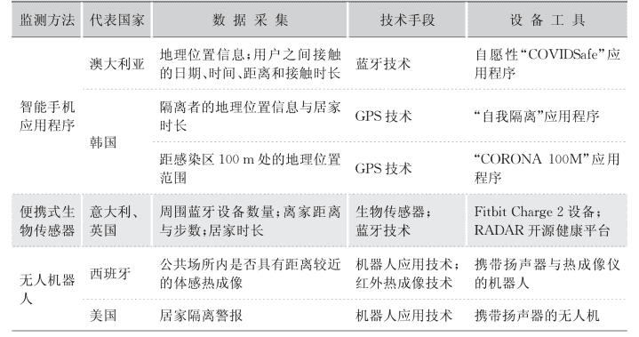

### 3.3.2 接触人员追踪与社区监测

#### 1）接触人员自动追踪

在追踪接触者的过程中，工作人员会询问已知患者近期的直接接触者，并依照流行病潜伏期时间对这些接触者进行监测或隔离，从而减少病原体的传播途径。世界卫生组织和美国疾病控制与预防中心强调了接触者追踪的重要性。从数据本质上看，接触者识别是寻找和感染者时间、空间上有重叠的人群。在当前信息社会，通过基站数据、支付数据、出行数据、城市公共安全视频监控系统等可以建立大数据融合平台，通过数据融合与深度挖掘进一步实现人员的追踪。

然而，接触者追踪高度依赖于患者对自身直接接触者的了解程度，因此，在人口密集、陌生人接触频繁的区域，存在大量无法追踪的隐匿接触者，给疫情防控带来了巨大挑战。为了找到这些无法被及时追踪的密切接触者，可以依托社区对全体居民的健康状况进行监测，一旦发现异常，就迅速隔离患者。

#### 2）社区监测

在现代社会中，社区作为人类居住的固定场所，人员密集，活动频繁，是进行疫情防控的重点区域。因此，依托社区来进行疫情监测，具有经济、高效及可操作性强等优点。社区监测既包括政府以社区为基本单位，对社区内居民的健康状况进行排查、统计与监测，对社区居民的行为进行建议、指导与约束的公共卫生政策；也包括居民检查自身的健康状况，并主动向卫生防疫部门报告。疫情期间个人隔离计划如图 3-5 所示。

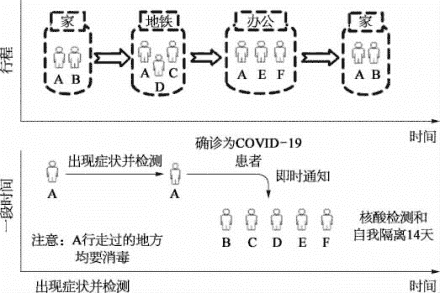

图 3-5　疫情期间个人隔离计划

### 3.3.3 潜在感染者识别

## 潜在感染者类型与风险评估
潜在感染者分为两种类型：疫情高风险区经停的人员和确诊病例的密切接触者。前者是指由于新冠病毒离开人体之后仍可在环境中存活，因此只要在病例经停场所停留的人员，就存在被病例或其遗留物感染的风险；而后者是指与病例存在近距离接触，可能发生直接传染的人员。疫情期间广泛使用的“健康码”，其原理就是根据全国各个乡镇（街道）、社区的疫情风险程度，叠加个人轨迹大数据，评估其可能发生感染的风险，并据此分为红、黄、绿三个等级，从而实现不同风险人群的动态管理。

## 病例密切接触者识别
对于病例密切接触者的识别，其思路是从人群时空关系的角度出发，通过分析人群移动轨迹在时间和空间上的邻近性，识别出与已感染者可能发生过密切接触的潜在感染者大致范围。根据所使用的数据，相关进展可以分为以下三类：

### （1）基于历史出行记录的密切接触者识别
如国家卫生健康委员会和中国电子科技集团联合推出的“密切接触者测量仪”，公众只需要输入姓名和身份证号码，后台便会根据其乘坐飞机、火车、大巴等交通工具的信息判断其是否属于已感染病例的密切接触者。

### （2）基于手机定位数据的密切接触者识别
通过对手机用户的移动轨迹与病患活动轨迹进行时空邻近性比对，判断其是否属于密切接触者，具体又可细分为基于手机信令的方法和基于手机定位数据的方法。由于手机信令的定位精度有限（室外约 200～500 m，室内则根据基站密度而定，精度较室外高），因而由此得到的密接人数范围较大，具体的甄别还需要借助具体的流行病调查；手机定位数据由于采用 GPS 或北斗定位系统，因而定位精度较高（不同条件精度不同，约 3～50 m），对密切接触人群的甄别度较高，但仍然需要借助人工流调的信息才能最终确定密接人员。

### （3）基于手机传感器的密切接触者识别
该类方法可通过对移动个体的手机 WiFi、蓝牙等传感器信号进行分析，确定不同用户之间的相对位置，进而判断他们是否发生密切接触，相比其他方法识别结果更为准确。

## 3.4 平疫结合的社区无接触配送
为实现疫情常态化的“无接触配送”要求，将快递和外卖人员截停在社区门口，保障小区安全性，缓解业主对陌生人进出小区的担忧，尤其是疫情期间的恐惧，下面总结分析了四种机器人社区配送方案，从而实现平疫结合——平时保隐私安全，疫情期间保公共安全。

### 3.4.1 群控蜂群
AGV（automated guided vehicle）小车是指在无线局域网络的控制下，经磁、激光等导向装置引导，并沿程序设定路径运行完成作业的无人驾驶自动导引小车，是成本最低的可运用于社区的无接触配送方案，且技术成熟、可靠性高。AGV 设备外观类似一台扫地机器人，在小区和楼宇办公区设置磁钉，机器人在铺排运动路径上行驶。小区设置固定空间，安装标准货架，放置快递、外卖包裹。机器人接收指令后，按磁钉的固定路线到固定位置“搬运”，沿社区及目标楼栋残疾人坡道上的磁钉路径到达大堂门口，呼叫门禁内置模块，利用开门器打开大堂大门；进入大堂的同时呼叫电梯模块，并乘坐电梯到达指定楼层住户门口等待，后台电话呼叫住户，开门取货，至此完成配送闭环。配送过程中，AGV 设备利用单线激光雷达识别眼前临时出现的障碍物，采取刹车等待或绕行避障措施。整体而言，AGV 单机设备经济性高，后台群控系统成熟，系统搭建方便，适用于社区人行道路行驶。但社区内需要大量安装室内外磁钉，对室内外景观和装饰影响较大，预装和改造的复杂程度较高，基本无法在小区的车行道路上行驶。AGV 方案适合功能、环境单一的场所，且目前大部分机器人公司提出的配送解决方案为单机智能方案。

### 3.4.2 机器人室内配送
目前，业内的单机智能配送机器人分为室内配送机器人、室外配送机器人、室内外配送机器人和 L4 级无人驾驶车。单机智能配送机器人在无人驾驶底盘上安装有敞开式或封闭式货仓，即可根据预先扫描的社区即时定位地图和 GPS 地图，移动到指定位置收发货物。但由于小轮和单线激光束的限制，决定了此类机器人底盘无法行驶到室外，其爬坡极限约为 7°。

### 3.4.3 移动货柜方案与社区“大车+小车”接力配送
2020 年疫情期间，每天小区门口所堆放的快递外卖数量巨大，若配送到达住户门口后无法联系到业主，则更加降低了机器人的使用效率。自主移动快递柜的方案，可在一定程度上解决该问题。该配送方案的客户须自行拿取货品，如果联系不上无人拿取，机器人则会返回社区总站，物业再另行安排配送。此方案已经在京东和美团试运行，因其装载量大，所需机器少，无须进入楼栋，所以成本可控。业主也无须到小区大门取快递，从一定程度上解决了疫情期间人员交叉感染的问题。
“移动丰巢”移动速度慢，依赖小区人车分流；而 L4 级的无人驾驶车辆则适合各种交通组织类型的社区，已被批准在部分城市的市政道路上运行，车体一般 1 m 宽、2 m 长，可搭载的货箱达到 2.4 m3，其速度快、效率高、载货量大，整体性价比较高。在国外，目前已有 L4 级无人驾驶车搭载机械臂、机器狗甚至人形配送机械的配送方案，但方案要求 L4 车辆具备分布式货物分拣功能，而非目前国内普遍采用的由物业、快递外卖配送人员社区分拣的方式，且搭载的机械设备成本非常高，故仍处于样机阶段。

### 3.4.4 利用地下车库的社区机器人配送
除了 AGV 方案，机器人都是按适应社区规划建造现状而设计编程的。只要运动路径上无高坎、陡坡或台阶，机器人都可实现配送。近年来规划建设的居住小区，都按规范具备全区贯通的无障碍坡道，坡度不超过 8%，地下车库车行坡道坡度不超过 15%。因此，室内外配送机器人及 L4 级无人车都可以利用居住区地下车库进行配送。
采用地下车库机器人无接触配送方案，在社区规划建设方面应关注以下 10 项要点：①地下室照明亮度均匀稳定；②保障地下室 WiFi 和手机 GPS 信号；③地下室内部无障碍设计；④电梯直达地下大堂；⑤地下大堂门口设置物联开门器；⑥电梯设置物联模块；⑦地下室设置具有物流配送分拣功能的房间用于物流中转，或采用外投内取方式，物品送达此空间后由平台配送人员或物业人员分拣、配送，此空间也可作为配送机器人充电空间；⑧地下室空间也可对城市开放，方便机器人通过安装物业道闸模块进行协议认证放行，进入小区地下室配送；⑨升级物联平台，监控机器人运行情况、位置和状况；○10 配备专业物业人员，管理机器人配送系统和设备平台。

## 3.5 社区智慧防疫案例

### 3.5.1 从“人防”到“智控”
北京市顺义区某街区、石景山区鲁谷街道某社区和上海徐汇某街道小区通过建立非接触式的社区疫情防控监测系统，实现了防疫模式从“人防”到“智控”的转变。
1）社区人员流动分析
（1）通过智能设备分析居民离城、返城流量，根据现状给出预测。
（2）合理分配人力物力资源规划阶段工作重点，追踪重点地区返城人员。
2）社区人员实时居住状态监控和查询
（1）实时分析，以精确到户的方式呈现居民状态。
（2）统筹生活物资发放、通知传达。
（3）规划防疫物资配置、工作人员配置。
3）须重点监测的返城人群状态分析
（1）统计返城人流，按楼、按户、按返城时间管理返城人群。
（2）将排查范围极大缩小，锁定。
（3）第一时间发现新增返城人员。
（4）密切关注社区内人员返城动态。
4）监控电梯使用频率
根据每部电梯使用频率，进行有针对性消杀工作，从而提高人力物力使用效率。在人力物力有限情况下，物业可以根据精准数据分析和优先安排相应的电梯消杀工作，从而确保流通人员所乘坐电梯安全可靠（图 3-6）。
5）实时居家隔离状态监控和查询
（1）实时分析，精确到户呈现隔离状态和异常（图 3-7）。
（2）全面自动检查须自行隔离人员外出状态。
（3）提升工作人员效率，只需要关注异常须隔离人员。
6）社区进入人员体温监测预警
（1）入口处无接触温度感应。
（2）人数较多也无须排队，无须摘下防护高效率通行。
（3）高温智能预警。
（4）使用简便，一名工作人员就能够实现有效管控。

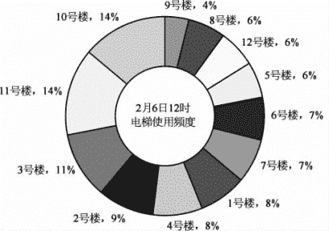
图 3-6　某一时刻小区各电梯的使用频度统计

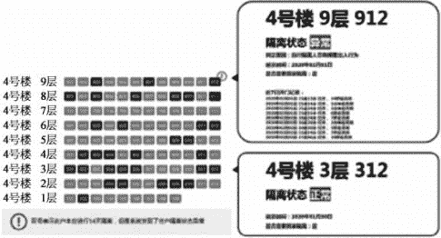
图 3-7　某小区 4 号楼住户隔离状态

### 3.5.2 智慧测温与“零接触”乘梯
疫情防控工作中，难度最大的当属社区等人员密集场所。针对社区等场所的“最后一道防线”，捷顺科技基于智慧人行解决方案研发上线了“全新 AI 测温人行防控通道解决方案”与“零接触”乘梯方案，有效降低了病毒传播风险。
1）0.3 s AI 测温人行通道，人员严进严出管控
在社区、园区等出入口，采用“捷顺高端通道闸+人脸识别+集成红外测温”的智能设备，可实现人脸识别身份及±0.3℃的非接触式 AI 红外精准测温，体温正常即 0.3 s 开闸放行，若体温异常即刻语音告警，“拦截”上报。另外还可集成访客机，对访客实行“非接触式测温+线上填写健康登记+凭证通行”的严进严出管理模式。
在物业管理后台，工作人员可通过捷顺物联云平台新增的“疫情防控预警监测平台”板块，设置集团旗下所有项目场所的人脸识别、访客通行、测温预警、在线监控、自动预警等功能，随时查看所有项目防疫实时预警、监测统计报表、人脸测温记录、重点人群跟踪、防疫数据上报、热力图分析（异常事件实时弹出）、跨区域统一管理等多维度数据，助力物业全局掌握情势，科学调度资源，做好社区、园区等区域的疫情防控工作。
2）“零接触”乘梯应用，避免乘梯交叉感染
除出入口外，针对社区内乘坐电梯的疫情传播高风险场景，捷顺科技设计了“零接触”乘梯应用，让用户通过手机操作即可进行呼梯和选层，避免“伸手”按电梯的潜在传染风险。
“零接触”乘梯应用便捷，既可通过“捷生活”公众号和小程序进行远程呼梯和选层，也可通过蓝牙、人脸识别或二维码的方式“现场呼梯+手机选层”。

### 3.5.3 无人无接触配送
2020 年新冠疫情期间，哈奇智能在广州常春藤社区运营的 hachi delight 承担起“无人无接触配送”的重任，将社区内居民订购的快递包裹、生活用品、食用蔬果及时送到用户家门口，高峰期单台机器人日均送货量超过百单，有效降低了“人传人”的感染风险，为隔离疫情、提升小区封闭管理质量做出了贡献，得到社会各界的好评，成为新冠肺炎疫情期间国内第一例成熟的智慧社区无人配送解决方案。

# 第 4 章 人工智能赋能智慧社区的灾害应急管理
社区是城市的基础单元，是城市治理的“最后一公里”，也是应急管理系统最重要的建设单元和关键环节。一个城市在遭受灾害侵袭时，社区是灾害的直接受体，同时也是抗击灾害的主体。目前，社区中的致灾因子主要包括火灾、风暴潮、有毒气体泄漏等。其中火灾的发生频率最高、影响较为严重，如家庭用电不慎、厨房用火不当、吸烟烟头未及时熄灭、电动车等设备违规充电等都是导致社区火灾的主要原因。
在上海积极推行的“两级政府，三级管理，四级网络”的城市管理模式中，社区是城市管理的基层，在城市灾害管理中发挥着越来越重要的作用。此外，中国城市基层组织形式大多以街道办事处作为政府的派出机关，以实现对基层的管理职能。正是基于这样的管理职能，使得社区的管理与城市行政区划基本上重合，可以将街道所涉及的辖区范围视为一个大社区。社区具有一个很显著的特点：人口的高密度导致公共用地、工业用地、住宅的拥挤和紧张。由此产生的许多超高层建筑、大面积的地下建筑以及生命线管道的交错密集，致使社区所面临的灾害风险增强。导致社区灾害的最大特点就是灾害的连发性和严重性。由于地理上的原因，加之人为因素的影响，自然灾害频繁，特别是当等级高、强度大的自然灾害发生后，常常诱发一连串的次生灾害，从而形成灾害链。建设智慧社区可以提高社区灾害学习能力。灾害学习是指从过去发生的灾害中吸取经验教训，消灭导致脆弱性的根源，优化升级社会系统，提高社区应对未来风险与灾害的适应性能力。

## 4.1 智慧社区应急管理应用场景
基层社区的基础设施和人员资源往往不占优势，突发事件的应对能力和多级联动应急响应的执行能力相对较弱，但也意味着数字化应急管理系统在基层社区的应用能够释放更加巨大的潜力和动能。
灾害治理中，社区不可能提前设计好所有的措施来应对未知、复杂和突发的灾害风险，但可以重新组建已有的“积木块”，以更好地应对风险和抵御灾害。这里积木是指从复杂事物中分解，并已被检验且可以被再次使用的元素。信息与通信技术是实现积木高效组合的重要手段，也是有效的决策支持系统。人工智能、大数据等技术可辅助决策者，从以往的灾害治理措施中分解出被验证且有效的管理机制、物资资源、技术手段等治理元素，协助他们重新组合灾害治理要素，最终形成一套新方法来应对新状况。同时，智慧社区可以利用人工智能技术获取和分析信息，进行灾害情景模拟，并在虚拟情境中筛选出合适的治理元素并进行治理策略选择，从而降低人工计算和分析数据的成本，提供多样化、合理和精准化的灾害决策支持，辅助决策制定者进行可视化高效率的灾害治理。智慧社区应急管理系统主要包括数字化日常防控、数字化应急预案、数字化应急联动和数字化事后恢复子系统。

### 4.1.1 数字化日常防控
数字化日常防控子系统针对突发事件进行提前预防，包括基础信息单元、物联网感知预警、安防视频联动、温湿度监测监控、气体烟雾智能监控、应急基础设施监控、可能危险源监控、线上线下安全教育、应急能力提升、指令接收与信息上报等模块。传统社区应急管理更多专注于事中和事后阶段，强调应急响应、应急救援和灾后恢复等，常常忽视和削弱日常防控的作用，防控监测不连续、人员成本高、预警不及时等短板突出。数字技术赋能下的基层社区依赖物联网技术和移动网络技术支持 24 小时不间断监测监控全社区人员和设施安全，形成实时数据集合，同时快速分析潜在危险，排查突发异常并自动警报，真正实现“居安思危，防患于未然”。
基层社区数字化应急管理系统各子系统内部运行机制遵循“数据输入—运行过程—结果输出”范式，如图 4-1 所示。数字化日常防控子系统中社区基础信息数据、物联网感知数据、安防视频数据、温湿度监测数据、气体烟雾智能监控数据、应急基础设施监控数据、可能危险源监控数据和上级总体要求是数据输入单元。基于这些数据，数字化日常防控子系统进一步进行基础性信息数据存储与分析，从中分析社区设备运行状况，若出现故障，则通知选派人员进行设备检修。若设备运行正常则对数据内容进行检查，通过构建模型、依托算法寻找异常点，并将社区防控情况分为三类：第一类为未出现异常，此时系统将继续监测；第二类为出现轻微异常，系统将自动溯源寻找危险源头和原因，并提供优化方案，安排及时处理异常；第三类为出现严重异常，系统在判断情况属于突发公共事件后，自动选择接入消防系统和医务系统等，将数据及分析导出形成文本向上汇报，并准备启动应急预案。无异常和轻微异常两种情况下，应急管理系统将不进入下一阶段，而是在处理与监测循环中反复修正和提高。严重异常情况下，应急管理系统进入准备阶段，数字化日常防控子系统接入数字化应急预案子系统。

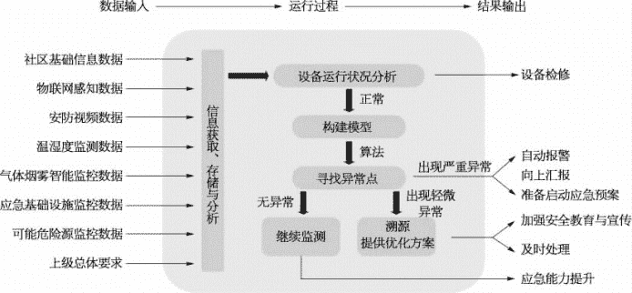
图 4-1　数字化日常防控子系统内部运行机制

以消防生命通道监测预警为例，该系统主要由前端视频感知、云端视频识别引擎、消防卫士 APP 和可视化统计分析平台等部分组成，以“多维感知、数据共享、业务联动”为理念，综合应用了边缘计算、基于深度学习的图像识别、基于人工智能的自动语音提醒等先进技术，实现消防生命通道实时状态监测，物业、社区、公安、交警、消防等多部门协同治理，有效提高了消防通道管理能力，彻底打通消防“生命通道”。
该系统采用基于边缘计算的高清摄像头结合 5G 通信技术，实现了前端精准探测。系统安装部署方便，可以适应老旧小区、新建小区、社会单位等各类消防生命通道场景。摄像头探测到堵塞目标后，可发出警告提示音，提醒行为人马上清除堵塞物，保障消防通道畅通。确认消防通道被堵塞，相关信息将第一时间被推送到物业、社区或网格员，以便其进行整改，及时消除隐患。消防通道堵塞隐患长时间未处理，消防部门可通过消防卫士 APP 督促相关物业、社区或网格员进行整改，并且相关信息可同步推送至公安部门，用于协同治理。该系统可完整保存消防通道堵塞涉及的所有图片、文字、视频、整改情况等信息，为公安、消防等部门处罚相关责任人提供有效证据。

### 4.1.2 数字化应急预案
数字化应急预案子系统以大数据、云计算、人工智能等为工具，针对突发公共事件做预前准备，包括数字化应急预案管理、自动推荐、应急预案分析与统计、应急预案评审、应急预案备案、应急预案演练、应急预案部署、应急预案交互、指令接收与信息上报等模块。当社区自检出现严重异常或出现区域内突发公共事件时，应急预案子系统前置准备功能将被启动。传统应急预案管理依赖主观人力水平，各社区各部门预案编制和演练相互割裂，对相似情况处置不尽相同，阻碍了各个主体应急联动的衔接程度和配合效率，同时可能出现事件超出预案设定情况，对突发公共事件指导作用的不确定性和差异性较大。数字技术赋能下的基层社区应急预案子系统依赖大数据和云计算技术，建立起交互联动的应急预案数据仓库，在线集合相关社区和部门的应急预案以及执行状况，突出衔接联动，实现救援力量、最优路线、物资调配可视化，为具体预案编制和实施提供参考。同时系统依据人工智能自动优化应急预案的内容范畴，并对预案演练予以统筹和评价，实现应急预案实时更新，并在预案启动时自动推荐和部署，真正实现“运筹帷幄，决胜千里”。
如图 4-2 所示，数字化应急预案子系统中社区基础信息数据、应急预案交互平台数据、潜在事件数据、现场监测监控数据、上级及专家意见是数据输入单元。这些数据支持数字化日常应急预案子系统的形成和启动过程。在应急预案启动阶段，系统结合已有预案与数据仓库自动推荐最佳应急预案并进行结果展示、综合预测分析，由人员或系统选择最终启动方案，向上实时汇报、分级预警、成立专项负责小组、部署应急预案，并对具体应急措施做适应性调整。应急预警启动后将进入响应阶段，数字化应急预案子系统接入数字化应急联动子系统。

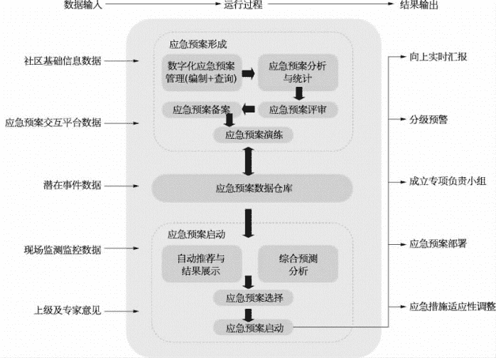
图 4-2　数字化应急预案子系统内部运行机制

### 4.1.3 数字化应急联动

## 数字化应急联动子系统
数字化应急联动子系统综合利用移动互联网、物联网、大数据、云计算、人工智能等工具，针对突发公共事件的应急响应，包括公共服务管理、摸排统计、物资配送、信息发布、应急救援、辅助决策、社区物联网集成管理、应急人员与资源调度、事件分析与后果推演、指令接收与信息上报等模块。数字技术赋能下的基层社区应急联动子系统依赖大数据、`3S`［遥感技术（`remote sensing`，`RS`）、地理信息系统（`geography information systems`，`GIS`）、全球定位系统（`global positioning systems`，`GPS`）］技术，及时联系医院和消防最佳救援力量，减少救援的时间成本和生命成本；依赖移动互联网、物联网加强实时监测监控，及时上报社区突发公共事件的表现情况，使上级指示、决策有的放矢；利用移动互联网及时收集民情民意，并利用媒体向社会发布事件信息知识、普及预防措施；利用物联网、人工智能实现监测监控、传输存储、综合研判的数字化、智能化，拉好应急响应的技术防线。通过引入多主体联动，形成以社区为核心单元的数字化应急联动系统，实现从传统单向管理转向多方互动，真正实现“同舟共济，共克时艰”。

如图 4-3 所示，数字化应急联动子系统中社区基础信息数据、应急预案数据、事件实时数据、应急物资和人员数据、救援力量（消防、医疗）实时数据、上级联动要求与安排、居民反馈接报数据、社区物联网集成管理数据、专家意见是数据输入单元。应急联动还将向上实时汇报，更大范围地发布与扩散信息，直至响应升级或降级、事态控制或蔓延。应急联动后将进入恢复阶段，数字化应急联动子系统接入数字化事后恢复子系统。

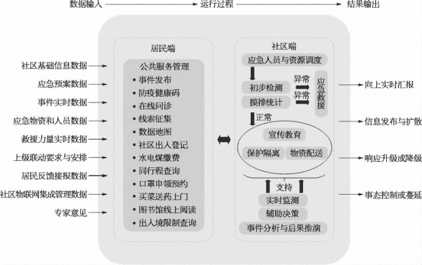

图 4-3　数字化应急联动子系统运行机制

### 4.1.4 数字化事后恢复
数字化事后恢复子系统综合利用移动互联网、大数据、人工智能、遥感监测等工具，针对突发公共事件的善后安置，包括受灾住户帮助与管理、恢复计划、总结评估、案例管理、指令接收与信息上报等模块。数字技术赋能下的基层社区事后恢复子系统强调网络效应，利用移动互联网技术直接联系相关参与者与受影响居民，实时收集反馈数据，方便社区精准帮扶管理，同时利用大数据和人工智能技术提供世界范围内事后恢复案例数据仓库，自动推荐实施路径，指导社区灾后建设，遥感监测技术还能够实时监督检查恢复进度，不断夯实“以图管地”工作基础，真正实现“重整旗鼓，勠力同心”。

如图 4-4 所示，数字化事后恢复子系统中社区基础信息数据、事件后果评测数据、事后恢复案例数据、上级及专家意见是数据输入单元。以这些数据为基础，进行现场清理、解除警戒、开展恢复工作、帮助与管理受灾住户、进行事件调查，总结评估经验，并建立针对本社区应急管理历史的案例管理仓库。事后恢复还将向上实时汇报、信息发布，直至社区恢复正常运转，再次转入日常防控系统，进行新一轮监控监测。

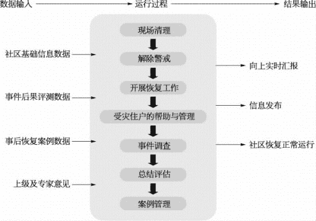

图 4-4　数字化事后恢复子系统运行机制

## 4.2 社区火灾探测及演化趋势快速预测
### 4.2.1 社区火灾危害及发展规律
火灾的发展是一种复杂的燃烧反应过程，并伴有化学反应、能量交换等。在燃烧的过程中有的物质被氧化，有的物质被还原。火灾中产生的热量通过对流、传导、辐射的方式传递出去。

#### 4.2.1.1 火灾危害特性
在火灾情况下，烟气层的高度是影响人们逃生的一个重要因素。较高的烟层有助于人们逃离火灾环境。当烟气层较低时，人们暴露在高温烟气环境中，烟气高温容易引起人的烧伤，烟气中的有毒气体容易引起人的窒息。由此可见，烟气层高度是发生火灾时人们生命安全是否受到严重威胁的重要指标。有研究表明，判定火灾危险的临界状态标准为烟气层界面位于人眼特征高度。通常，人眼的特征高度为 1.2～1.8 m，亚洲人的特征高度约为 1.5 m。

#### 4.2.1.2 火灾的发生条件
火灾的发生要满足三个条件，即可燃物、助燃剂、点火源，缺少任何一个，火灾都不会发生。这三个条件被称为火灾三要素，或“火三角”，如图 4-5 所示。

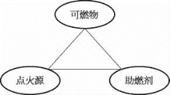

图 4-5　“火三角”

若要燃烧或自燃连续不断地进行，就必须确保这三个要素同时存在，哪一个都不能缺少，缺少任意一个，燃烧或自燃都会被中断。因此在火灾救援的过程中，可以从这三个角度去灭火，切断任意一个，燃烧就会终止。在灭火过程中运用沙土灭火，其机理是减少助燃剂的含量；把火源旁边的可燃物移除，没有了可燃物，火就会灭掉；也可以降低温度使之不能达到可燃物的着火点，从而移除点火源。

#### 4.2.1.3 火灾蔓延过程
通常将火灾蔓延过程分为四个阶段，即初始、发展、稳定和衰退阶段，如图 4-6 所示。

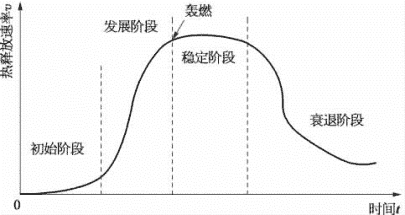

图 4-6　火灾燃烧蔓延的四个阶段

1）初始阶段
从图 4-6 可知，在火灾初期阶段刚发生火灾，火势比较小，热释放速率比较小，周围温度变化不大。在此阶段立马采取救火措施，火灾会被扑灭；如果未对火灾进行必要的控制，火势将会不断扩大。

2）发展阶段
在此时段，火势渐渐增大，燃烧加剧，同时产生巨大的热量和烟气以及有毒有害气体等，使其周围的温度上升，现场可见度下降，还会有轰燃现象。为避免人员的伤亡，应在轰燃前疏散人员，否则将会存在非常大的危险。

3）稳定阶段
火灾不断地发展，到此处于稳定阶段，伴随着其他物质被引燃，火源温度达到最大，周围温度不断增加，能见度不断降低，烟气在疏散领域不断蔓延，严重影响疏散的进展，人员有生命危险，扑救灭火变得较为困难。

4）衰退阶段
在火灾不断地发展中，可燃物渐渐耗尽以及空气中氧气含量减少，火势慢慢降低，使之处于衰退阶段，在此阶段火灾处于逐渐熄灭状态。在这个阶段中会出现阴燃，没有火焰的产生，但是火源温度依旧很高。

#### 4.2.1.4 高层建筑加速火势蔓延
高层建筑的层数多、高度高、体积大，且烟气蔓延途径多，其火灾危险性比普通建筑物大得多，主要的特殊火灾问题体现在以下方面：

1）烟囱效应
高层建筑内大多设有多而长的竖井，如楼梯井、电梯井、管道井、风道、电缆井、排风管道等。火灾发生后，火灾烟气由于其温度较高、密度较低，会通过电梯井、楼梯井等开口从高处排出，建筑内部的压强变小，低温空气会从底层补充，最终会出现气流由建筑底部快速向上运动的现象。烟囱效应对于火势蔓延起到了很大的作用：①会加强火场内部的热对流，造成火势的快速蔓延；②还会带来大量的新鲜空气进入火场，提供大量的氧气助燃；③空气的快速流动会使火焰倾斜，加快火焰的传播速度。

2）围炉效应
围炉效应是指高层建筑一般较为封闭并且保温设施良好，燃烧产生的热量及烟气很难排出室内，火源附近房间温度和压力都急速增加，会产生局部轰燃的现象。围炉效应可导致火场温度进一步升高、火势进一步扩大，当压力进一步增加后门窗破碎，新鲜空气涌入，会与未完全燃烧的产物进一步反应，出现回燃现象，高压、高温的长时间存在也会导致建筑物的倒塌等严重后果。

3）火羽流
燃烧火源的上部与可燃物燃烧产生的高温烟气被称为火羽流。高层建筑的最高层通道的开口大小会影响火羽流的温度及速度。

### 4.2.2 人工智能火灾探测预警
基于热红外成像或视频图像数据，提供人工智能联动策略，计算建立对灭火装置的实时动态控制，有助于消防救援的科学决策。

#### 4.2.2.1 全视场火灾探测
全视场火灾探测采用红外热成像火灾探测装置，用于全视场红外扫描对热点进行探测，采集热点成像数据，对热点成像数据进行量化分析，并根据量化分析结果形成人工智能联动策略数据。

红外热成像火灾探测装置主要由高精度火灾辨识传感器及其数据采集器、40 倍光学变焦全高清（`Full HD`）、高精度数字化云台、`ARM`（`advanced RISC Machines`）量化分析处理器、前端路由器等组成，如图 4-7 所示。高精度火灾辨识传感器可以实现 800 m 范围内最小 0.01～1.00 m2 的火灾辨识。

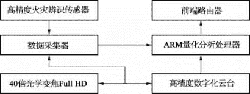

图 4-7　红外热成像火灾探测装置

红外热成像火灾探测定位的过程如下：数据采集器通过高精度火灾辨识传感器获取视场覆盖区域的热点参数，40 倍光学变焦`Full HD`获取同框可见光高清视频画面，`ARM`量化分析处理器对热点参数进行量化分析比对，得到热点的温度、距离、面积及其三维空间定位参数（即三维空间坐标），根据量化分析结果形成人工智能联动策略。高精度数字化云台用于带动数字红外热成像探测器旋转以及旋转后的定位，实现 360°球体空间全视场覆盖。应用于一些较小扇形区域时，根据实际环境情况可以不需要采用数字化云台支撑，数字红外热成像探测器采用预先设定的沿某一方向的多个视场角，整体装置的结构得到了简化。

1）人工智能决策控制
人工智能算法根据热点的危险级别，给出匹配的灭火方案，对危险级别较低的元素区域热点，采用就近匹配的灭火装置做点对点灭火方案；对危险级别较高的元素区域热点，采用就近匹配的灭火装置做合围式灭火方案；对危险级别较高且动态蔓延变化的元素区域热点，采用沿热点蔓延路线匹配的灭火装置选择追踪式灭火方案；当元素区域热点危险级别较高且需要形成防火间隔区域时，根据热点动态蔓延路线趋势，集中配置趋势方向的灭火装置做堵截式灭火方案。根据火场实际情况选择合适的灭火方案，能有效进行灭火。

2）人工智能控制方法
人工智能算法根据人工智能联动策略和灭火装置的布局位置数据，计算出所有热点与灭火装置的布局位置关联性，按预先设定的火警危险级别，确定最大危险元素区域并进行降序排序，按元素的三维空间定位参数形成火警危险加权关联路线，即在联动策略与灭火装置之间建立匹配的拓扑关系，从而给出相应的灭火方案或灭火方案组合。根据灭火方案给出人员疏散指引策略，当采用点对点灭火方案或合围式灭火方案时，人员疏散按常规指引路线提示；当采用追踪式灭火方案时，给予特定的人员疏散路线指引；当采用堵截式灭火方案时，阻隔火灾蔓延以留出专门的人员疏散区域路线，不同的灭火方案采用不同的人员疏散指引策略，可以大大增强火灾救援效果。

#### 4.2.2.2 图像型火灾探测
在火灾预防中，传统烟雾型火灾探测器易受空间和环境因素影响，导致火灾的检测不及时甚至无法检测，从而错失最佳灭火时机。基于视频的图像型火灾探测技术利用图像信息的丰富和直观性，通过早期火灾图像变化特征来探测火灾是否发生，可有效解决大空间火灾探测的难题。

图像型火灾检测系统通过图像识别来检测火灾的发生，其由前端摄像装置和图像识别模型组成。前端摄像装置负责对现场画面进行拍摄，通常为电荷耦合元件（`chargecoupled device`，`CCD`）摄像机，图像识别模型对所拍摄的画面进行分类，将所有的画面分类为发生火灾和没有发生火灾。图 4-8 为图像型火灾检测系统检测火灾的过程。

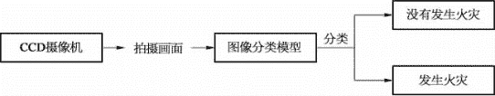

图 4-8　图像型火灾检测系统检测火灾过程

火灾发生后，燃烧过程会失控，这是导致火场情况危险而复杂的根本原因。火灾发生伊始，火焰特征将会发生明显变化，而识别和掌握变化规律就是实现火灾视频识别的有效方法。

火灾视频识别系统在读取视频文件后将会完成如下操作：第一，系统将会自动完成差影图处理和视频图像变化预判操作；第二，在确定发生变化后，将基于视频图像的变化阈值，对其进行灰度化、二值化、去噪声处理和火焰面积分析；第三，经过上述分析，将基于火焰面积变化情况、火焰图像色彩分析情况，开展`RGB`色彩分布判断和`YCbCr`火焰颜色、色彩分布判断；第四，基于灰度梯度分布状况以及火焰尖角分布情况，判断是否发生火灾。

1）运动目标检测
火灾现场的情况十分复杂，在开展火灾视频检测与识别的过程中将会受到多种因素干扰，所以有效检测运动目标、消除背景干扰成为提高检测火焰准确度的必然要求。在此环节，相关工作可以基于三种算法完成运动目标检测，即分别为帧间差分法、背景图像差分法和光流法。在实际应用环节，前两者适用于自然场景，而光流法适用于运动的摄像机；此三种算法中，帧间差分法能够快速完成运动目标检测，但检测到的目标大多大于实际情况；背景图像差分法可能高质量提取运动目标，但易受到外界环境干扰；而光流法则有利于独立运动对象的检测，但由于算法过于复杂，所以并不适用于实际检测。

2）火灾图像的形态特征处理
火灾图像的形态特征处理是实现火灾视频识别的基础，处理工作的有效性将会直接影响火灾视频识别系统的运行效率。当火灾发生时，现场的整体反应过程都极为复杂多变，所以火焰的视觉特征也会跟随火场情况而发生变化，那么在掌握这些变化的规律以及节点后，火灾检测人员就能够基于火焰图像状态合理判断火灾情况，进而对火灾进行有效识别。

（1）差影图处理。目前，求出差影图是实现多图像高效处理的常见准备方法。处理差影图时，可以从直接差影图和阈值差影图两个角度出发。实际上，求差影图就等同于基于差分法求运动目标，十分有利于检测图像的变化情况。通常摄像头拍摄的环境图像变化概率极小，此时利用火灾探测仪进行实时监控会造成资源浪费。但发生火灾时，环境图像必然出现变化，利用差影图来判断变化情况，既能够保证火灾检测的及时性，又能够避免资源浪费和设备损耗。

（2）真彩图像灰度化。在处理火灾图像形态特征时，应该合理应用真彩图像，也就是 24 位位图（`bitmap`，`BMP`）图像。进行真彩图像的灰度化处理时，必须有效转化 24 位`BMP`的`RGB`值，从而实现真彩图像到灰度图像的转变，使灰度分布检测工作能够顺利开展。

（3）图像去噪声。去噪声处理是火灾图像形态特征处理的必要性操作，主要方法是借由过滤器完成图像过滤。所谓噪声，并不是常规意义上的噪声，而是数字化图像中的无用信息，有效去除这些信息可提高图像的实用性和火灾判断精准性。在此环节，可基于高斯过滤器、均平过滤器清除噪声。

（4）计算火焰面积。精确地计算火焰面积，对准确识别和判断火灾情况有着十分重要的意义。在实践中，须完成图像二值化处理，从而获得二进制位图，然后再对其进行精确剪取，进而为有效计算火焰面积提供依据。此时，“0”代表二值化图像中的背景而“1”代表火焰，所以计算火焰面积可基于求和运算计算图像矩阵。

（5）识别火焰尖角。火焰尖角识别也必须基于二值化图像来开展，通过这种处理能够区分火焰和感染源，是火灾视频识别工作中不可或缺的部分。在实际应用环节，需要全面扫描预处理后的二值化图像，并以图像首行、首列和尾列为“0”。那么，当扫描出非“0”时，代表该行不属于尖角的“尖”，须再次进行扫描。需要注意的是，若火焰存在尖角，则需要对其角度进行判断从而进一步确定其是否为火焰的尖角，使火灾视频识别结果更为可用。

### 4.2.3 火灾场景演化趋势快速预测
为了积极抵御社区火灾风险，须掌握典型火灾的发生演化趋势。目前，常见的火灾模拟模型包括区域模型、网格模型和场模型等。

区域模型是将发生火灾建筑物空间的气体进行分隔，依据是空气温度，可以分为热烟气区和冷空气区，根据位置两者可归类于上、下层区域。在区域模型中，假设各自参数都是一定的、不可变化，即提供参数的因素包括烟气浓度、室内压力、空间温度，这三个条件在区域模型中呈均匀分布状态，其次通过质量守恒与能量守恒定理计算出各自的参数变化情况。

网络模型是将实验对象主体看作完整的实验系统，整体系统中分隔出的每个单独空间都是一个单独的网络节点，它们的连接通过空气流动来实现，在能量和质量守恒定律支持下，对随着时间变化的烟气浓度以及各个位置的压力分布参数进行详细研究。网络模型适用于连续空间，其优点在于对空间做了处理、使其简化，适用于火灾研究受限空间数目较多的情况。其缺点是均匀参数很多，每个节点必须用一个均匀参数表示，比较适用于均匀场景下进行的烟气运动分析。网络模拟虽然模拟方法较简单容易，但也造成实验结果的偏差较大，与现实情况有差距。

场模型是由三类物理守恒法则和一种化学守恒法作基础，包括动量守恒定律、能量守恒定律、质量守恒定律和化学反应原理，其将火场分隔成无数的小空间，并通过解方程的形式来计算每个小空间的温度场、流速场和烟气浓度场，由每个小空间的数据进而归纳总结计算出整个空间场的这些数据。场模型和网络模型两者相比，前者的计算较准确，也造成需要做大量工作，因此设施、硬件设备要求高，对实验的边界条件要求也相对严格。

`Pyrosim`是一款功能强大的基于火灾动力学模拟工具（`fire dynamics simulator`，`FDS`）原理的`CFD`工具，可以通过计算机模拟火灾，从而能更加直观和方便地了解火灾和烟气的扩散过程。其是一种基于大涡模拟的专用流体动力学软件，融合了构建仿真所需的所有方程，即连续性方程、动量方程、能量守恒方程和分量守恒方程，可以用于构建模型，来预测火灾现象中烟雾、温度、一氧化碳和其他重要参数。

在用`Pyrosim`构建高层建筑火灾场景模拟时，由于楼层较高且占地面积大，在细分网格时，网格数量过于庞大，且数据提取时数据量也是数百万计，普通的计算机运行一次火灾模拟所需的时间过长。在经过大量的火灾点仿真模拟后，将数据导出归类，随后运用现有机器学习的方法对数据进行测试预测，这样可以快速预测火灾演化趋势，以指导社区住户安全疏散，是“场景—任务—能力”智慧消防建设的基础。

1）基于趋势特征向量的火灾烟气流动与温度分布预测
`CFAST`（`consolidated model of fire and smoke transport`）是现有的主流火灾预测模型之一，它是一种综合的火灾烟气、温度预测模型。在大多数情况下，用户根据经验来设定`CFAST`模型的参数和系统的初始状态，包括起始温度、热释放速率、材料特性、隔间尺寸、机械通风规格、火源特性等，然后根据经验来修正`CFAST`输出的预测结果。因此，`CFAST`模型的使用是一个相当复杂且耗时的过程。`CFAST`的预测准确度在大多数情况下与实际情况不相符，这就需要工程技术人员根据经验进行修正。随着深度学习技术的快速发展，利用深度学习方法来提高`CFAST`模型的预测精度成为热点。

深度学习技术具有全局寻优和万能逼近的特点，它能够从火灾历史数据中学习出潜在的知识和规律，并通过神经网络来表达和保存。在对趋势数据的预测中，深度学习方法达到了超越传统方法的效果。深度学习技术利用深度神经网络的自学习、自组织、自适应特点，可以处理环境信息复杂、知识背景模糊、推理规则不明确的问题。长短期记忆网络（`long short-term memory`，`LSTM`）是一种深度神经网络。`LSTM`因为其具有独特的端到端建模方法、容易引入外部变量、能够自动提取特征等优点，而备受关注。

为了深入挖掘时间序列数据预测的准确度，利用时间序列数据的内在特征来辅助深度学习的方法。具体做法是：从时间序列数据中抽取趋势特征信息，并将这些信息作为深度神经网络的外部变量，最终构建出具有先验知识的深度神经网络模型。常见的趋势特征计算方法有`Cochran-Armitage`方法、`Mann-Kendall`方法和`Kendall's tau-b`方法。这些方法能够从火灾时间序列数据中抽取出变化趋势，并且能进一步检测出时间序列数据是否发生了突变。

## 2）基于多核极限学习机的火灾趋势预测

不同的代理模型有各自的优缺点，极限学习机（`extreme learning machine`，`ELM`）是一种新型的单隐层前馈神经网络，相比其他代理模型`ELM`具有计算速度快、泛化性能好的特点，近几年在分类回归方面应用广泛，比较符合火灾预测须快速响应的要求。

`ELM`与其他前馈神经网络的不同之处在于：`ELM`隐含层权重和阈值都是随机产生的。因此，`ELM`具有较快的计算速度，但也存在算法性能不稳定等问题。将核函数引入`ELM`中提出的基于核方法的核极限学习机（`kernel extreme learning machine`，`KELM`），结合核映射和正则化理论，来降低网络的复杂度和随机性，有效地提高了原始`ELM`模型的稳定性和泛化性。

## 4.3　突发事件下社区应急疏散策略优化

社区是城市居民生活的基本单位，也是城市灾害最重要的承灾体，如何在灾害等突发事件发生时将人员迅速而又安全地撤离到安全区域，保护人民群众的生命财产安全，最大限度地减少伤亡，是社区应急管理工作的重点之一。

### 4.3.1　社区灾害场景特征

#### 1）人员组成与分布

当社区发生灾害等突发情况时，需要立即制定有效的疏散策略，以便安全快速地疏散社区人员。在疏散策略制订的过程中，社区人员的组成和分布必须被考虑在内。

##### （1）人员组成方面。
社区中不同特征的人员对疏散策略的理解会有所不同，甚至产生误解；不同特征人员的疏散行为也各不相同，这将对疏散产生较大的影响。社区中人员众多，组成复杂。就年龄而言，人员可分为童年（0～6 岁）、少年（7～17 岁）、青年（18～40 岁）、中年（41～65 岁）、老年（66 岁以上）。就文化程度而言，人员可分为研究生、大学本科、大学专科和专科学校、中等专业学校或中等技术学校、技工学校、高中、初中、小学、文盲或半文盲。

##### （2）人员分布方面。
当灾害发生时，人员在建筑内的位置分布会对疏散策略的制定、优化、实施产生一定的影响。因此，在对灾害疏散策略进行制订和优化时，需要考虑到人员分布情况。

#### 2）灾害类型与等级

面对不同类型的灾害，对应的人员疏散策略也有所不同。疏散策略的制订需要考虑到不同灾害的特点，使得疏散更有针对性。同一类型的灾害发生等级也会有所不同，面对不同等级的灾害，需要制订对应的疏散策略，在保证人员安全的前提下，尽可能减少经济损失。

##### （1）灾害类型方面。
不同类型的灾害蔓延方式不同、灭除方式不同、对人员的伤害方式不同。因此，人员疏散策略要以此为基础，对不同灾害场景进行特定的策略优化。灾害按照起因，有人为灾害或自然灾害；根据原因、发生部位和发生机理划分，有地质灾害、天气灾害和环境灾害、生化灾害和海洋灾害等。

##### （2）灾害等级方面。
灾害等级的高低对应着对人员伤害的大小。所以等级较低的灾害发生后不需要对人员进行疏散，或者不需要紧急疏散；而当等级较高的严重灾害发生时，须制订紧急且有效的疏散策略。

#### 3）建筑结构

社区的建筑结构对灾害人员疏散有着极大的影响，不同结构的建筑可以对疏散的行为产生积极或消极的影响。影响人员疏散行为的建筑结构主要分为两类：室内建筑结构和室外建筑结构。

##### （1）室内建筑结构方面。
室内建筑结构会对人员的疏散行为产生影响，如果疏散策略不考虑室内建筑结构，可能会导致疏散时发生堵塞甚至踩踏等情况。室内建筑结构包括出口大小、数量与位置，室内面积、设施布局等。在进行疏散策略制订与优化时，需要将其考虑在内。

##### （2）室外建筑结构方面。
社区室外建筑结构主要包含社区中所有建筑的数量、面积、功能等信息。在进行人员疏散策略的制订与优化中，必须将其考虑在内，防止疏散出现拥堵、方向错误等现象。

#### 4）其他社区灾害场景特征

进行人员疏散时，除了上述较为重要的社区场景特征需要被考虑，许多其他因素也需要被考虑，包括疏散目的地、居住楼层数、电梯数量、楼梯宽窄等。

### 4.3.2　社区应急疏散规划

社区应急疏散规划是指在灾害来临前或发生后，将城市中处于危险区域即目标社区的人员有计划有组织地转移至安全避难所的过程。如火灾时需要将危险社区的居民转移到附近的广场或公园里。其主要目标是做出合理规划，将危险社区的居民通过集中疏散或分流疏散等方式在有效时间内转移到安全避难所。制定有效可行的疏散方案是降低灾害损失的重要手段，须及时做出决策指导行动。

#### 1）疏散区域划定

灾害发生时，特别是规模较大的事件，如果城市所有社区同时疏散则会给路网带来巨大压力。这就需要结合城市的社区及其人口分布与交通网规划，将城市划分为若干区域，确定应急疏散时各区域的疏散次序与疏散时间。根据致灾因子情景，需要初步建立疏散分区，引导居民在一定范围内合理避难。

#### 2）疏散策略方案生成与评价

基于已有的应急能力投入推演可能的灾情状态，模拟得到相对合适的疏散路径和疏散方式的方案。决策者集成所有的情景要素实时构建事件从初始到当前的发展状态，并对未来发展趋势有合理的把握。情景推演可通过模糊规则、复杂网络、物理-信息-行为等多事件耦合、贝叶斯网络、系统分析与实时情景匹配等手段，从时空、横向与纵向角度在决策点上考虑情景信息实时更新的特点，推演情景可能的发展序列即预测从当前到未来的情景链。结合社区具体特点与疏散目标，决策者须在成本约束或时间约束的条件下选择疏散方案，并在灾后对疏散实际效果做出评价。在疏散执行时，须在不断仿真与修正交通情景的过程中发挥辅助决策调整方案的功能。

在应急疏散的紧急状态下可能面临全局信息缺失的情况，难以刻画疏散过程表现出的多样性和不确定性，而导致难以构建完整情景，易使仿真数据出现偏差而造成更大的财产损失。那么，历史案例便成为有价值的经验得以借鉴。通过收集各社区相关灾害情景下的历史案例并建立成库，经检索得到相似案例可直接使用或进行适配修正辅助，从而生成疏散方案。

#### 3）应急疏散优化模型

从管理的角度，科学的疏散计划与管理都必须依赖于合理的疏散模型，通过数学分析、图论与人工智能算法得到疏散的优化结果。主要是指优化应急疏散路径与估算最短疏散时间，增强选定方案的效用。

### 4.3.3　基于智能启发式算法的疏散策略优化

传统应急疏散策略的优化由人员疏散仿真模型与优化模型迭代操作实现。当初始应急疏散策略被制订时，其策略往往可能不是最优的，因此需要利用优化模型对应急疏散策略进行改进。首先，疏散仿真模型根据场景特征与生成的初始疏散策略进行人员疏散过程模拟；接着，优化模型根据场景特征以及疏散过程模拟结果对初始疏散策略进行优化修改；然后，疏散仿真模型再根据修改后的应急疏散策略进行社区人群疏散过程仿真，依据仿真模拟的结果，优化模型并对应急疏散策略持续优化完善。如此反复迭代，直到应急疏散策略的模拟结果达到要求后，该疏散策略则被认为是优化的应急疏散策略，具体流程如图 4-9 所示。

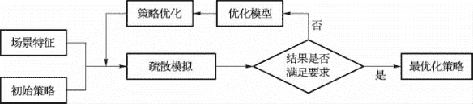

图 4-9　传统应急疏散策略优化流程

优化算法大致可分为两类，即精确算法与启发式算法，如图 4-10 所示。精确算法适用于小规模优化问题，主要包括线性规划、动态规划、整数规划等传统算法，可以精确地得出绝对最优解。但其复杂性较大，不适用于大多数规模较大的工程问题。启发式算法不同于精确算法，不会系统地以确定的步骤寻求答案，而是利用一定的规则去修改解，使得解更为优化，经过多次迭代与修改，在解满足要求后，即为最优解。因为启发式算法不需要遍历所有可能解，所以其能在可接受的计算成本内去搜寻最好的解，但不一定能保证所得的最优解是全局最优解，在算法不佳时可能会陷入局部最优解。启发式算法包括以下几种：

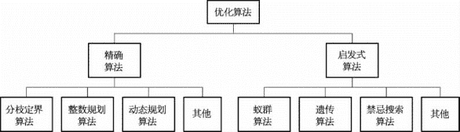

图 4-10　优化算法分类

#### 1）遗传算法

遗传算法（`genetic algorithm`，`GA`）是模拟达尔文生物进化论的自然选择和遗传学机理的生物进化过程的计算模型，是一种通过模拟自然进化过程搜索最优解的方法。

该算法首先随机产生决策方案，判断该方案是否满足优化要求，如果满足，将其作为最优化决策输出。否则算法将会选择较优的决策，淘汰较差的决策，对被选择的决策进行交叉与变异，生成新的决策。而后判断该新决策方案是否满足优化要求，由此往复，直到最优解产生。遗传算法具体流程如图 4-11 所示。

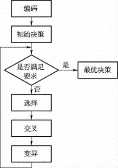

图 4-11　遗传算法具体流程

遗传算法的重点环节为编码、交叉与变异，以下做一简单介绍。

##### （1）编码。
遗传算法需要将解进行“数字化”编码，即将决策变为一段二进制或十进制编码。编码方法影响到交叉算子、变异算子等遗传算子的运算方法，很大程度上决定了遗传进化的效率。目前编码方法众多，常用方法为二进制编码法、浮点编码法、符号编码法。

##### （2）交叉。
遗传算法的交叉操作，是指对两个相互配对的染色体按某种方式相互交换其部分基因，从而形成两个新的个体。适用于二进制编码个体或浮点数编码个体的交叉算子有四类，分别为单点交叉、两点与多点交叉、均匀交叉、算术交叉。

##### （3）变异。
遗传算法中的变异运算，是指将个体染色体编码串中某些基因座上的基因值，用该基因座上的其他等位基因来替换，从而形成新的个体。具体而言，是将决策编码进行随机的变化，得出变异的新决策。适用于二进制编码和浮点数编码的变异算子有五类，分别为基本位变异、均匀变异、边界变异、非均匀变异、高斯近似变异。

#### 2）禁忌搜索算法

禁忌搜索（`tabu search`）算法是一种智能启发式优化算法，它从一个初始可行解出发，选择一系列的特定搜索方向（移动）作为试探，选择实现让特定的目标函数值变化最多的移动方向，改变初始可行解，再次向特定搜索方向（移动），由此往复，直到解满足要求。

禁忌搜索算法为了避免陷入局部最优解，其在迭代优化解的过程中采用了一种灵活的“记忆”技术，对已经进行的优化过程进行记录和选择，指导下一步的搜索方向。

该算法首先随机产生初始决策，判断该决策是否满足优化要求，如果满足，即该决策为最优决策，如果不满足，则需要根据算子产生候选解。在候选解中寻找最优决策作为下一步的初始解，由此往复。而上一步的解需要被放入禁忌表中，此后禁忌步长内其不会被选择为下一步的初始解。禁忌搜索算法具体流程如图 4-12 所示。

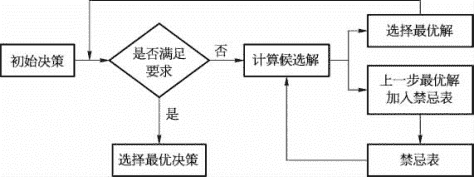

图 4-12　禁忌搜索算法具体流程

假设疏散目的为将人员从地区 A 疏散至地区 E，其中需要途经 B、C、D 三处走道，初始疏散策略为“`A—B—C—D—E`”。禁忌步长为 2，即禁忌表中禁忌内容只会被连续两个步骤禁止候选解。此后会被解禁。禁忌搜索算法将会对该疏散策略进行优化，得出最佳疏散策略，具体步骤如下：

步骤一，根据初始策略计算并选择候选解，将初始解加入禁忌表。

步骤二，根据上步最优候选解计算并选择该步候选解，将上步最优候选解加入禁忌表，判断禁忌表中禁忌解是否需要解禁。

步骤三，根据上步最优候选解计算并选择该步候选解，转步骤二，继续搜索。

以此类推，直到步数达到最大迭代步数。最终从所有步骤的最优候选解中选取出最优的疏散策略。

#### 3）蚁群算法

蚁群算法是一种用来寻找优化路径的智能启发式算法。该算法基本原理来源于蚁群搜寻食物的最短路径原则。蚂蚁在搜寻食物时，单只蚂蚁无法得知获取食物的最短路径，但是蚂蚁会在走过的路径分泌信息素。蚂蚁可以识别其他蚂蚁分泌的信息素，从而选择浓度最高的路径行走。如此反复多次行走，较短的路径上累积的信息素浓度逐渐增高，选择该路径的蚂蚁个数也愈来愈多。最终，整个蚁群会在正反馈的作用下集中到最优的路径上。

该算法首先需要随机产生初始决策，将决策中的每一步看作一个点，而后在这些点上随机放置蚂蚁，进而让蚂蚁开始随机行走，直到蚂蚁将所有点都走完，更新信息素，再次随机放置蚂蚁，进行迭代，直到迭代次数达到要求，结束蚂蚁放置。最后，根据信息素的分布，选出最好路径，即最优决策。蚁群算法具体流程如图 4-13 所示。

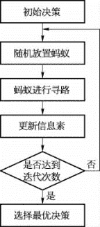

图 4-13　蚁群算法具体流程

### 4.3.4　基于人工神经网络的疏散策略优化

在应急疏散领域，人工智能也有着极为重要的作用。在人工智能关键技术中，机器学习、知识图谱、计算器视觉、虚拟现实与增强现实将为应急疏散策略优化提供有效的技术支撑，为策略的制订与优化提供重要的数据与建议。

#### 1）人工智能模型辅助疏散策略优化

计算机视觉技术将利用摄像头等设备对现场场景进行实时的判断和预警，为历史数据和实施场景特征提供信息；而虚拟现实模型、知识图谱模型将利用历史数据，得出疏散行为中人员的疏散特征，为此后的策略优化提供信息；同时利用历史数据对机器学习模型进行训练，将实时场景输入机器学习模型中，得出疏散策略，并进行策略优化，最终增强现实模型可将疏散策略实时传达给疏散人员，优化疏散效果，具体如图 4-14 所示。

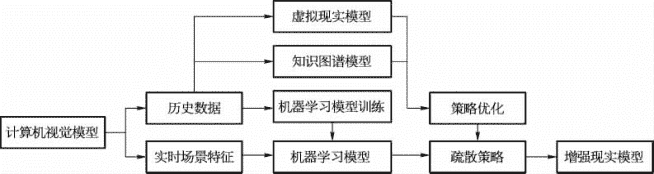

图 4-14　人工智能模型疏散策略优化

#### 2）基于人工神经网络的疏散决策支持

以大量真实疏散数据为基础，训练出有效的神经网络模型，预测时仅将场景信息与灾害信息输入神经网络模型中，无须优化模型优化，即可直接得出最优化的决策。

神经网络模型与传统疏散模型不同，其以数据为基础，学习真实数据中的疏散规律，训练出符合真实规律的神经网络模型，神经网络模型可以直接利用场景数据与灾害情况计算出最优疏散决策。

神经网络模型首先需要收集大量真实的疏散数据，并对数据进行预处理，形成神经网络可识别的数据；其次利用这些数据训练神经网络，得到较优的神经网络；最后将现场的场景数据作为输入，利用训练好的神经网络模型得出最优决策。

## 4.4　面向灾害的社区人员疏散动态诱导

社区灾害人员疏散策略不仅包括宏观的路径、节点选择，也包括面对现场情况实时改进变化的微观动态诱导。

首先，需要根据摄像头、传感器等相关设备获取灾害发生时的现场场景数据，利用计算机视觉等技术对现场数据进行实时分析处理；其次相关系统利用该数据进行决策判断，即微观实时的决策选择；最后利用指示灯、增强现实（`AR`）等技术进行实时的动态诱导，具体如图 4-15 所示。

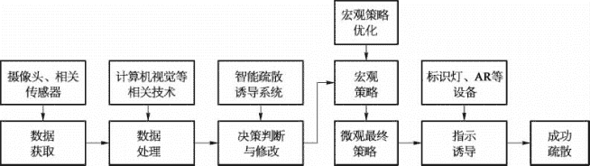

图 4-15　社区人员疏散动态诱导策略

### 4.4.1　实时数据处理

社区人员疏散动态诱导策略以实时场景数据为基础，所以对获取的数据处理就显得极为重要，其中最为重要的技术为计算机视觉。疏散时，为了避免人群聚集造成的踩踏事故，需要对疏散人群的数量和密度进行监测与估计。人数估计算法及相关算法介绍如下：

#### 1）人数估计算法

人数估计算法能对监控区域内的人群数量进行估计，当人群的数量（密度）达到一定基数时，就会进行异常行为分析，将实时的人群信息传递给疏散系统，用于疏散路径的决策优化。

人群估计算法的主要功能是对人群的数量进行估计，该算法在`Vibe`算法的基础上通过透视矫正算法更新前景像素值，结合角点提取算法求出群体密度的权值，完成前景像素归一化处理。然后，利用高斯拟合对每一帧图像的像素和人数进行拟合，记录拟合后的高斯函数。并结合实时提取的视频图像的像素信息，就可以估计人群的数量，人群估计算法流程如图 4-16 所示。

感兴趣区域（`region of interest`，`ROI`）是图像中重点关注的区域，除了此区域外其他区域都不会出现在处理计算程序中。`ROI`的设置既可以减少程序的运算时间和复杂程度，又可以减少非关注区域造成的干扰因素。

#### 2）Vibe 算法

`Vibe`算法是一种背景建模方法，其通过对邻域像素的计算来创建背景模型，再利用背景模型和当前像素值做比较，从而检测出前景像素（目标对象的像素）。该算法主要包括模块初始化、像素的分类（属于背景或前景）和模块的学习（更新）三部分。`Vibe`算法具有计算量小、内存占有较少、处理速度快等特点，并且非常适合作为内置算法嵌入摄像设备里。

#### 3）角点提取算法

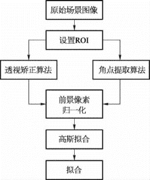

图 4-16　人数估计算法流程

图 4-17　算法提取的特征点图例

角点提取算法用于图像处理时提取特征点的检测算法，算法提取的特征点图例如图 4-17 所示。常见的基于模板的角点检测算法有`Kitchen-Rosenfeld`角点检测算法、`Harris`角点检测算法、`KLT`角点检测算法及`Susan`角点检测算法。和其他角点检测算法相比，`Susan`角点检测算法具有算法简单、位置准确、抗噪声能力强等特点。`Harris`角点检测是特征点检测的基础，提出了应用邻近像素点灰度差值概念，从而进行判断是否为角点、边缘、平滑区域。

#### 4）高斯拟合

为了利用图像数据反映人群的数量，采用已知的历史数据（x，y）训练，其中 x 代表图像信息、y 代表人数信息，构建一个函数表达式`y=f（x，c）`反映 x 与 y 的关系，该函数表达式就称为拟合的模型，其中 c 为模型的参数。训练时，提取每帧图像的前景像素作为 x，对应图像场景的人数 y，然后根据群体密度权重值的不同，分别求出高斯拟合的拟合函数；为了避免过拟合情况的出现，需要对训练的模型进行测试，测试中利用同样的方式获取 x，根据之前训练的模型来预测估计视频中的人群数量。

### 4.4.2　智能疏散诱导

智能疏散诱导系统工作原理如图 4-18 所示。系统由控制系统的计算机、烟气层的烟气浓度、温度探测装置、人群疏散速度探测仪以及动态疏散路线标识与安全出口标识等组成。火灾发生时，该系统根据灾害场景的烟气层烟气浓度、温度等烟气态势信息，人群疏散速度、人群密度等人的行为数据以及建筑物的疏散设施、结构等环境参数，不断优化疏散诱导路径，最终给出人群实时最佳疏散诱导路径的动态标识路径。

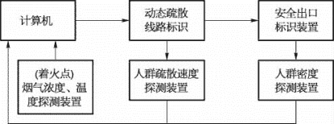

图 4-18　智能疏散诱导系统工作原理

## 紧急疏散指示系统与动态标识

如生活中所见，紧急疏散指示系统广泛应用于已建成的环境中，传递有关逃生路线和紧急出口位置的方向性信息，帮助人们疏散。研究者在过去的紧急突发事件中发现，应急标识系统尽管符合法律规定和标准，但并不能达到预期的效果。灾害发生后，由于现场环境会实时改变，如火灾造成烟气、有害气体扩散，会影响逃生者的视野，看不清应急出口标识；地震造成建筑结构发生改变；在疏散过程中安全出口的堵塞等，这些都不利于逃生者路线的选择。

如何使紧急出口标识醒目同时又不显著地改变标识的设计是其中一个问题。增强标识感官启示的方法有很多，如增加标识的大小，使标识从背景中更加突出，或引入额外的感官刺激。标识的绿色有助于人们把它和墙壁区分开来。应急标识还被加上了 LED 灯光，使标识在疏散时更大可能地被逃生者看到。常见的应急出口标识如图 4-19 所示。

欧盟 FP7 GETAWAY 项目指出了传统静态标识系统的局限性，并试图通过开发智能主动动态标识系统（intelligence active dynamic signage system，IADSS）来解决这些局限性。虽然 LED 静态灯光标识解决了注意力问题，但并不能解决关闭折中退出路径的问题。为了解决该问题，于是就出现了激活动态标识系统（active dynamic signage system，ADSS）的概念。顾名思义，动态标识利用一系列周期性闪动的绿色闪光灯传递方向信息，表示此路畅通；利用闪动的红色叉号传递阻碍信息，表示此路不通，如图 4-20 所示。动态标识在正常环境下同标准出口标识外观一致，一旦警报触发，动态标识就会被激活，起到提示特定的路线和出口是否可用的作用。

图 4-19　常见应急出口标识

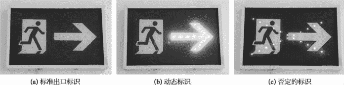

图 4-20　出口标识

为了实现 ADSS 的智能自动控制，即智能主动动态标识系统（IADSS，图 4-21），需要两个不同的支持系统实现：
（1）第一个支持系统是由闭路电视系统（closed-circuit television system，CCTV）和火灾侦查系统（fire detection system，FDS）组成的信息收集系统（information gathering system），该系统建立即时态势感知的信息收集。信息的收集包括了人员的数量和分布，以及是否存在火灾危险，如烟雾、热量和有毒气体。通过 CCTV 监控站台，确定人口信息。
（2）第二个支持系统是被称为方向判断系统（decision engine，DE）的智能组件，用以辨认最优的出口路径。DE 使用 FDS 提供的火灾特征信息和模式匹配算法，来识别从火灾库中预先确定的火灾与检测到的火灾特征是否匹配。然后，人口分布和确定的火灾被加载到疏散模拟软件 building EXODUS（该软件由英国 Greenwich 大学防火安全工程团队研制，用于描述人员与火场环境的交互）中，该软件接着运行一系列预先确定的建筑物疏散策略。并使用安全出口路线度量（safe egress route metric，SERM）算法，对仿真结果进行分析，从而根据预测的伤亡人数、疏散距离、疏散时间、使用的楼梯数量等因素对策略进行从最好到最坏的排序。DE 及其支持系统都以实时或更快的速度运行，以确保上述过程在 FDS 识别可能的火灾和报警激活之间的时间内完成。然后将排序后的疏散策略提交给人工控制器，让它们依此决定最佳的逃生方案并且操作 ADSS 的控制系统，将路径信息通过动态逃生指示标识传递给现场逃生者。一旦启动，ADSS 不仅会向逃生者指示安全的路径，而且同样重要的是，指示他们不应该去的地方。这样，IADSS 将人员引导到此时最佳的出口，同时避免了潜在的不可行路线。

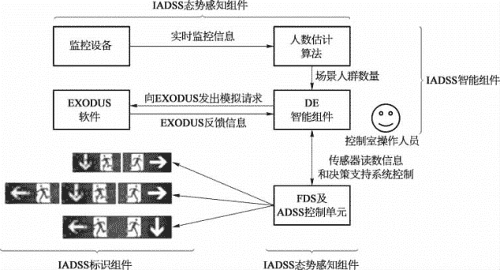

图 4-21　智能激活动态标识系统配置

### 4.4.3 基于增强现实技术的动态指示

指示诱导是整个人员疏散策略的最后一步，也是最为关键性的一步。无论疏散决策制订与优化有多正确，如果指示诱导出现错误，那么人员也无法快速有效地进行疏散，甚至错误的指示诱导可能会导致人员陷入更危险的境地。

### 1）疏散标识

安全疏散标识是按照视觉和听觉效应制作的光、声诱导装置。与传统应急标识相比，其会随着声波周期性闪动，形成“动态”闪光。动态疏散标识采用“三点定向”原理（图 4-22），在同一直线的三只声光疏散指示器，依次按 1、2、3 顺序发声，指示向右疏散；反之，指示向左疏散。箭头除了“左”“右”，也可以变化为“上”“下”共四种形状，与声波指示的方向相对应。

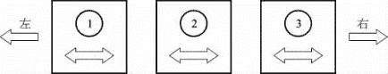

图 4-22　三点定向原理示意图

广义的应急标识包括疏散通道指示标识、出口指示标识、顶部应急照明灯等，主要通过电力系统产生的光线进行疏散引导，降低了因视野不良造成的疏散风险。而狭义的应急标识，是指采用先进高科技材料制造，可以在电力故障或浓雾密布的情况下引导行人疏散的指示标识。随着社会的发展，现代住宅建筑开始向大型、高层的方向发展，应急标识的作用也就越来越重要了，尤其在突发事件时，利用应急标识快速疏散成为非常关键的部分。

公共场所内都会设置应急指示标识，以提高公众对突发事件的处理能力。应急标识作为应急疏散系统的主要组成部分之一，包括应急通道标识、应急出口标识、应急电话标识和应急避险标识。火灾或电路故障等紧急状况下，大量人员需要紧急疏散，应急标识是保障行人安全的一项重要措施。具体设置时，需要考虑建筑物情况、流动人员情况、对环境的熟悉程度、事故情况等多种因素综合确定。

低照度环境下发光型疏散指示器的诱导作用会降低，而声波的传播不受浓烟或遮挡物的影响，声音诱导优于视觉诱导；反之，视觉诱导优于声音诱导。因此，疏散诱导系统多采用声、光诱导装置共同作用的双重诱导机制。

### 2）虚拟现实与增强现实技术

虚拟现实（VR）技术是一种将真实世界信息和虚拟世界信息“无缝”集成的新技术。增强现实（AR）技术将虚拟世界信息与现实环境信息相结合，使两者出现在同一画面中，增强了用户的感官体验。VR 技术在应急疏散中的应用如下：
（1）常态准备阶段的应用。为了提升应对突发事件的处理能力，灾害发生前的疏散常态准备尤为重要。利用 VR 技术事前对建筑场景、疏散环境进行建模，模拟并找出人群疏散的拥挤点、人群流量瓶颈点、最佳避难区域等关键点。经过多次模拟优化，可以生成该场景下的最佳疏散线路、最佳比难点等信息。同时在现今智能设备与信息化背景下，人们获取场景信息更为便捷，只须通过随身携带的智能手机或官方宣传的二维码等入口，就可以轻松获取疏散信息。
（2）事中阶段的应用。灾害发生时，人员可利用 AR 技术获取灾害发展信息、外界疏散信息等，以优化疏散的效果。如逃生者在确保自身安全的情况下，借助手机 AR 给出的语音、图像提示指令进行有序的疏散。
（3）事后阶段的应用。利用 3R［虚拟现实技术（VR）、增强现实技术（AR）、混合现实技术（MR）］技术重现场景，积累疏散案例经验。

### 3）动态疏散诱导平面图

某楼层有三个逃生楼梯，其疏散通道及动态疏散标识如图 4-23 所示。从图 4-23 中可以看到各个动态疏散标识的位置，箭头表示标识显示的疏散方向。

疏散指示标识的方向会设置为指向最近的疏散出口，发生火灾时，由火灾报警器启动并按照预设的方向指示疏散路线，如图 4-24 所示。火灾发生后，如果正常的疏散路线被火势、浓烟或其他因素封堵，可以通过火灾探测器或人为按下封堵区域内的手动报警按钮，将信号送入火灾报警控制器，控制器根据封堵现场的情况，调整动态标识的指示方向，重新指引一条可行的疏散路线，指引人员及时逃生。

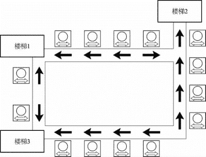

图 4-23　动态疏散诱导平面图

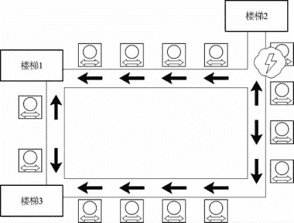

图 4-24　调整疏散路径示意图

## 4.5 智慧社区应急管理应用案例

### 4.5.1 数字化应急管理系统提升社区治理能力

深圳市福田区莲花街道紫荆社区是整合辖区社会力量打造的防灾减灾社区，在深圳市率先建设社区智慧微中心系统，通过实施“三个一”工程，即社区智慧应急系统“一中心”、组建多元应急作战队伍“一体化”运行联动、构建智慧安全监测平台“负一秒”风险预警，能够可视化地进行上级指令接收、风险点危险源监测预警、应急人员与资源定位、预案电子化、高清视频会议、事件现场信息上传等功能。该系统是深圳市福田区“智慧福田”应急指挥平台向街道社区的纵向延伸，打通和汇聚了本社区综合数据和全辖区安全、民政、司法、综治等数据资源以及公共卫生类等应急管理专家库，实现街道社区资源全盘共享和应急指挥市、区、街道、社区四级联通，为上级党委决策和基层社区防控管理提供全方位可视化数据支持。
（1）预防阶段。紫荆社区对外接入智慧福田预警监测平台和深圳市突发事件预警信息发布平台，对内上线水、电、火等方面的“物联网+”风险监测系统，如易涝水位监测系统、可燃气体探测系统等，并连通公安“天网+”系统和远程消防预警系统，延伸打通物业小区内部监控网络和“老、旧、危”场所，辅助无人机实施空中巡查，做到全天候实时监控 542 处高风险区域，并对异常状况实施在线上报、持续追踪和全程管理等应急处理措施。在准备阶段，针对社区所有风险点危险源和动态环境可能发生的气象灾害、突发疫情、地震火灾、地陷地裂等潜在事件，社区编制和上报电子化应急预案，莲花街道应急指挥中心进一步集成各社区电子化应急预案，编制《社区应急预案》《社区值守工作管理手册》等文件，形成预案仓库，并组织社区应急演练。2020 年年初疫情来临时，福田区启动重大突发公共卫生事件Ⅰ级响应，紫荆社区迅速启动应急预案，成立专项负责小组，调动应急人员和资源，激活一体化动态响应体系。
（2）响应阶段。紫荆社区与莲花街道应急指挥中心、社区健康管理中心、社区警务室联动，又接入新型社区智能防疫系统，获取实时的业主动态信息和疫情救援数据等，建立起疫情管控机制、信息统一报告和发布机制、协调落实机制和跟踪督办机制，从而有的放矢地进行可疑人迹追踪、疑似人员分派、宣传教育、摸排走访和物资配送，并在重要区域配置 GPS 无人机，对人员密集的公共场所进行空中巡查。
（3）恢复阶段。紫荆社区一方面继续坚持消杀、测温、登记等基础防疫工作，总结防疫经验，形成案例；另一方面逐步有序恢复社区正常生产生活秩序。可以发现，以紫荆社区智慧微中心系统为代表的基层社区数字化应急管理系统，有力支撑着社区外防输入、内防扩散的有效防线，极大地提高了基层社区应急管理精准化、精细化和智能化水平，成为开展社区治理与服务的“硬核力量”。

### 4.5.2 灾后学习机制提升社区综合防御能力

人工智能在获取巨量信息后，可以通过深度学习创建有效的灾后学习机制，从多个灾害事件中进行总结学习，避免类似灾害发生。例如，上海市杨浦区内城镇社区设有气象观测站，市气象和民政部门依据对气象观测站的历史数据分析，综合考虑社区的房屋结构脆弱性、排水脆弱性以及外来人口、老年人口和贫困人口的脆弱性等因素，对社区的雨涝灾害风险进行评级并建立社区灾害风险图。这为社区对暴雨、短时强降水等采取防御措施，开展防灾救灾工作提供了具有针对性和有价值的数据，提高了社区应对雨涝灾害的综合防御能力。基于社区以往的灾害记录以及实时监控的社区环境和人口结构与特征人工智能可以搭建现实社区模型空间，预测不同致灾因子和孕灾环境相互作用下的各类人群和社区区域的风险程度，及时向灾害脆弱群体以及易受灾区域发出预警。通过物理空间向网络空间的数据流动，以及网络空间向物理空间的信息流动，社区模型空间和社区现实空间得以实现自我更新，抵御灾害的内在能力得以加强。

### 4.5.3 智慧消防系统助力社区风险预警与应急救援

自 2020 年下半年起，北京市朝阳门外街道办事处会同区消防救援支队，在老旧社区——吉祥里共同打造了全区首个居民社区智慧消防系统。以社区为中心建立集日常安全监控、隐患提示报警、快速响应联动、实时远程指挥等功能于一体的“全方位、全流程、全要素”的消防监督和应急救援体系。

智慧消防系统分为隐患排查、提示报警、联动救援、制度保障四大模块，并建立了社区消防基础数据库，为智慧化消防安全管理提供了强大的技术支撑。
（1）电动自行车进楼的应对举措。当电动自行车进楼时，安装在楼门口的 AI 摄像机立即“捕捉”到风险点，随即发出语音提示“请不要在室内停放电动自行车或对其进行充电”，同时拍照取证向中控指挥室报警，值守人员立即通过“一键调派”手持台通知附近物业安保或者工作人员上前制止，并对其告知电动自行车楼内停放或充电的火灾危险性。
（2）消防车通道占用、堵塞的应对举措。在小区消防车通道上方 5 m 处架设 AI 摄像机，发现消防车通道被占用、堵塞的，AI 摄像机将自动拍照取证，向中控指挥室报警，随即调派人员予以制止，如车主已离开车辆，将通过“114 挪车服务”告知其违法行为，要求立即予以整改。
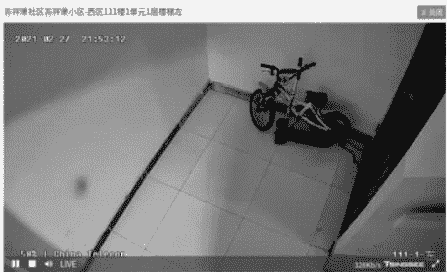

图 4-25　疏散通道占用智能识别
（3）楼道（疏散通道）内堆物堆料的应对举措（图 4-25）。在楼道公共区域架设可以识别违法行为的 AI 摄像机，让小到一块砖头、大到家具和货架等堆物堆料无处遁形，一经发现立刻向中控指挥室报警，随即调派人员上前制止，并对占用、堵塞疏散通道的危害性进行宣传讲解。
（4）常闭式防火门未关闭的应对举措。AI 防火门智能摄像机发现防火门未关闭时，向中控指挥室报警，调派物业安保人员对防火门进行关闭。

此外，智慧消防系统还配有高位“火眼”摄像机，全天候 24 小时守候小区院内、车辆、绿植、变电站等公共部位，一旦探测到烟雾、火焰，立即向中控指挥室报警，并启动应急响应处置预案，通知附近点位工作人员到场处置。

# 第 5 章 人工智能赋能智慧社区的公共空间治理

智慧社区的公共治理是新时代构建基层社会治理新模式的一项重大变革，其通过网格化、精准化、高效性的管理与服务实现社区治理现代化。社区公共空间是社区居民最重要的社交场所，可促进居民之间的交流、交往和生活连通，因而使得社区公共空间治理显得愈发重要。社区公共空间治理，不仅包括公共空间安全保障，还包括公共设施合理布局、公共环境美化与保护等多个方面，处处体现了社区管理者的管理和服务水平。

## 5.1 智慧社区空间治理应用场景

随着城市人口持续扩张，社区内部人员组成越来越复杂，楼宇建设越来越高层化，使得社区面临着诸多问题，高空抛物、电动车充电起火等安全隐患成为近年来公众关注的焦点话题。此外，电动车充电桩布局的合理性也是社区管理者应该考虑与重视的问题，许多地方存在“一面人找桩，一面桩等人”的尴尬局面，暴露出管理者在公共设施规划与建设方面的不足。

### 5.1.1 高空抛物治理

近些年来，高空抛物坠物事件越来越多，导致多名无辜群众罹祸，被称为“悬在城市上空的痛”。个别高空抛坠物事件面临找人难、取证难的难题，也让不少群众陷于对劣行严厉谴责同时又对“共同补偿”不理解的尴尬当中。对于此陋习的治理，各地各有关部门多年来一直在持续不断的努力。比如，有的地方试图通过向业主散发传单或签署承诺书等方法起到劝诫约束作用；有的地方通过安装摄像头等方式遏制不文明行为；有的地方探索用奖励的办法发动群众举报。但遗憾的是，不是无疾而终就是治理效果不佳。2019 年 11 月，最高人民法院印发《关于依法妥善审理高空抛物、坠物案件的意见》，明确对于故意高空抛物者，根据具体情形按照以危险方法危害公共安全罪、故意伤害罪或故意杀人罪论处，同时明确物业服务企业责任。2021 年 2 月，《最高人民法院最高人民检察院关于执行，确定罪名的补充规定（七）》规定了高空抛物罪。除了法律法规方面的完善，随着 AI 技术的发展，社区对高层单元楼建立了智能追溯系统，通过现代技术的运用大大降低了事件发生后的“取证难、追责难”问题，同时也可以起到对居民的行为约束作用，是新时代社区公共空间治理中的一种高效手段。

高空抛物智能追溯系统通过将小区监控设备接入 AI 视频分析平台，可对高空抛物行为进行实时智能监测，后端平台对视频流进行实时 AI 分析，分析结果发送至云端存储并于 Web 端进行展示，同时将视频文件根据时间、事件等属性分类和归档，向社区物业等部门发出警示，使高空抛物事件得到第一时间处理。概括起来，高空抛物智能追溯系统可以实现以下功能：
1）智能检测报警
智慧社区高空抛物智能追溯系统通过接入高清监控设备实时采集社区视频图像，并设计深度学习算法对视频流进行挖掘分析，实现自动检测、识别高空抛物行为，并生成告警信息通过电脑端或移动端设备弹窗提醒、通知相关人员第一时间前往现场处理。该系统监测物体的精度非常高，能检测到微小物体，并能将抛物物体准确识别、标注显示出来，有利于相关部门实现精准定责。
2）日常视频监控任务
智慧社区高空抛物智能追溯系统除了能够实现高空抛物智能监测、报警、溯源等功能，还能满足日常视频监控需求，监控设备对小区周围环境进行 24 h 全天候在线实时监控。一旦发生异常事件，可及时查看视频录像回放追踪、还原事件过程，同时，该系统具有视频图像自动备份功能，可实现相关音视频的有效保存，实现了人防、物防、技防三防合力，开启小区智能化管理起点，确保智慧小区安全，提升居民安全感。
3）系统参数设置和设备管理
该系统能够实现对监控设备参数设置及远程自动控制，并在系统运行过程中根据需要进行修改和设置。同时，系统设有日志管理功能，实现系统内各个设备运行情况记录，并具备操作日志功能，即实现用户从登录到退出全过程的记录，做到统一存储、实时检索、查询和分析、监控告警等。
4）系统巡检
该系统不仅能够对监控设备、交换机等硬件设备运行状态进行巡检，还可实现对视频图像质量自动巡检，确保传输到后台的视频流清晰有效，方便 AI 算法进行高空抛物行为的智能识别。同时，系统支持性能监测监控系统客户端工作站的 CPU 使用情况和网络带宽监测，监控网络上下行占用情况。
5）数据备份
为了规范数据备份管理工作，合理存储历史数据及保证数据的安全性、可靠性，防止因硬件故障、意外断电、病毒等因素造成的数据丢失，系统设有视频图像数据备份功能。一旦出现网络异常，系统自动将视频图像数据暂时保存于内存卡中，待网络恢复时，便将断网期间的视频数据回传至系统后端。同时，将视频图像数据备份于云上的历史数据库中，一旦出现数据丢失，利用数据备份恢复机制可进行数据恢复、还原操作，保证数据的安全性。

### 5.1.2 电动车入梯管理

近年来，随着新技术的发展，电动自行车应运而生，并以其便捷、经济、环保等优点成为替代传统自行车的新型短途交通工具，广泛进入人民生活。电动自行车数量的迅猛发展的同时，也增加了大量的停放、充电需求。城中村及住宅小区是电动自行车的主要集中地，但其缺少与电动自行车数量相匹配的停放、充电配套设施。这也是造成电动自行车违规停放充电的主要原因。随着电动自行车数量持续增长，电动自行车火灾事故也不断增多，人员伤亡时有发生。面对新事物带来的新的社会风险，智慧社区建设应充分考虑新风险的化解对策。

针对非机动车的停放问题，2014 年发布的《成都市非机动车管理条例》提到，“在医院、学校、商场、步行街、体育馆、展览馆、集贸市场等人员流动频繁的场所”，可以根据交通需要合理设置收费或者免费的非机动车停车场，并落实专人或者委托专业服务机构管理，停放非机动车，应当进入停车场，未设停车场的，应当停放在划定区域内。该条例并未明确“电瓶车在居民小区内不得上楼”。近期的法律法规才对电动车不准上楼做了明确的规定，2019 年 1 月 1 日起实施的《长沙市住宅物业消防安全管理办法》明确规定，在楼梯间、楼梯出入口停放电瓶车（不含电瓶汽车）、电瓶自行车，妨碍安全疏散行为的，将由消防主管部门处警告或 500 元以下罚款；拒不改正的，强制执行，所需费用由违法行为人承担。2021 年 5 月 1 日起实施的《上海市非机动车安全管理条例》明确，禁止电瓶自行车在建筑物首层门厅、共用走道、楼梯间、楼道等共用部位，以及疏散通道、安全出口、消防车通道及其两侧影响通行的区域、人员密集场所的室内区域停放、充电。同时明确，物业、业主自行管理机构均可劝阻、制止，对不听劝阻、制止的，应当向城管执法部门或者负有消防监督管理职责的部门报告。

在融合新产品新技术、利用信息化技术、数字化融合大数据分析方法的基础上，建设新型电动自行车管理基础设施是解决传统管理手段短板的有效路径。通过设置智能识别设备，防止电动自行车进入电梯和楼宇，将充电引起的火灾风险降到最低。如“电动车禁入电梯管控系统”采用 AI 图像识别，以传感器自动识别非机动车，并搭配摄像头辅助监控，形成了一套严密的非机动车禁入电梯管控系统。电动车一进入，电梯就自动“罢工”，并播放：“电动车进入电梯存在安全隐患，电梯已暂停运行，为了您和他人安全，请将电动车推出电梯。”此系统只控制电梯开关，不涉及其他线路，对电梯没有任何影响。目前，上海、武汉等城市已有小区投入使用，在电动车“上楼”治理中取得了良好的效果。建议逐步进行全面推广，杜绝电动车“乘梯上楼”带来的安全隐患，为居民的人身及财产安全保驾护航。

### 5.1.3 智能充电设施规划

2021 年以来，多地出台相关规定，禁止电动自行车入户充电，为了满足居民的日常需求则必须在社区内进行充电设施的合理布局与建设。通过在智慧社区中合理规划和建设智能充电设施，是解决上述矛盾的主要途径。

2021 年 5 月 20 日，国家发展改革委、国家能源局，联合发布了《关于进一步提升充换电基础设施服务保障能力的实施意见（征求意见稿）》的公告，意见中指出，要加快推进居住社区充电设施建设安装，完善居住社区充电桩建设推进机制。各地充电基础设施主管部门会同住房和城乡建设、人防、消防等部门建立协同机制，统筹推进居住社区充电桩建设与改造。要求新建居住社区要落实 100%固定车位预留充电桩建设安装条件。

## 5.2 高空抛物智能追溯

高空抛物智能追溯系统的功能实现通常包括数据采集、运动目标检测、运动目标跟踪、抛物判断和智能警示五个步骤，而目标检测及目标跟踪又是确保该类系统功能实现的核心。图 5-1 为高空抛物智能溯源系统判断条件算法规则，包括物体检测、规避气象、蚊虫鸟类等干扰、视频图像自动学习等规则，生成取证信息，包括一张特征图、一张全景图及 10～15 s 视频。

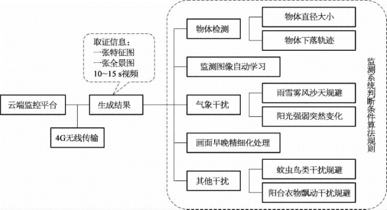

图 5-1 智慧社区高空抛物智能溯源系统判断条件算法规则

### 5.2.1 数据采集

通过在社区楼宇周边特定距离位置安装一定数量且具有一定仰角的高清监控设备，对楼宇外侧进行抓拍，完成视频数据采集。针对不同楼层，监控设备设置不同仰角，以保证抓拍画面的完整性。摄像头布局如图 5-2 所示。

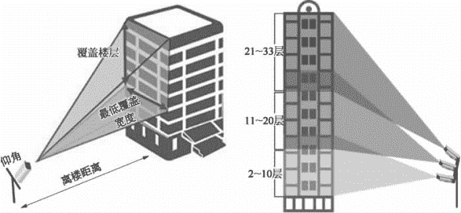

图 5-2 摄像头布局示意图

### 5.2.2 运动目标检测

运动目标检测主要包含三种方法，即帧差分法、背景差法和光流法。

#### 1）帧差分法

帧差分法又称帧间差分法，简单来说就是将前后两帧图像对应像素值相减。如果差值很小，认为此处静止，如果差值很大，则认为是由于物体运动引起的。把所有差值很大的像素标记出来，就是运动目标在图像中的位置，当然前提条件是前后两帧图像的环境亮度基本不变。如果背景亮度的差别很大，以及目标在光照下的阴影处理，帧间差分法还需要考虑更多的内容。

帧间差分法的主要优点是：算法简单，程序设计复杂度低，实时性强。但在实际应用中，这种最基本的帧间差分法精度不高，要求背景绝对静止或很少有变化，对目标很难精确标记出来。

#### 2）背景差法

背景差法是用图像序列中的视频帧与背景图像相减而检测出目标的方法，之后选择一个合理阈值对差值图像进行二值化，从而获取运动目标。

简单常用的方式为直接把视频序列中某一幅图像提取出来，或以多幅图像的平均值作为背景。最简单的背景模型是时间平均图像，提供的目标特征数据也很完全。

背景差分法计算也很简单，得到的运动目标也比较完整，并且对视频中停止运动的物体也可以检测出来。缺点是如果出现了较大的光照和场景变化，可能会出现较多的噪声点，这就需要及时更新背景，因此算法的复杂性增加，实时性变差；而且阈值的选取对检测效果影响较大，一个好的阈值可以大大提高检测的精度。

#### 3）光流法

在空间中，运动可以用运动场描述。在一个图像平面上，物体的运动往往通过图像序列中不同图像灰度分布的变化体现。空间中的运动场转移到图像上就表示为光流场，光流场反映了图像上每一点灰度在空间位置的变化趋势。光流是研究图像灰度在时间上的变化与景象中物体结果及其运动的关系。

光流法的优点是不需要预先知道场景的任何信息，就能够检测出独立运动的对象，可用于静态、动态背景。缺点是如果运动目标的亮度变化较大，会影响结果准确性；难以检测暂时不动的目标；计算复杂，抗噪性能差，实时性差。

### 5.2.3 运动目标跟踪

运动目标跟踪是在目标检测算法成功提取出运动目标的基础上，利用具有代表性的目标特征建立目标模型，采用合适的搜索策略和匹配原则，在下一帧图像中确定运动目标的位置，实现目标跟踪。目前常用的目标跟踪方法可以分为四大类：基于模型的跟踪、基于区域的跟踪、基于活动轮廓的跟踪和基于特征的跟踪。

#### 1）基于模型的跟踪

基于模型匹配跟踪的原理就是通过对跟踪目标的学习，利用点、线、区域把跟踪目标拟合成一个几何模型，常用的模型有二维模型和立体模型等，然后在当前帧中寻找与上一帧目标模型最为相似的区域，并把这个区域认定为当前帧中的目标区域。这种方法的优点是可以准确地分析目标的三维运动轨迹，但是拟合的目标模型很大程度上决定了跟踪的准确性。在实际应用中，跟踪目标在运动过程中往往会因为旋转、遮挡或拍摄角度变化等多种原因发生形变，导致很难拟合出固定的几何模型，所以研究人员提出基于可变形模型解决这一问题。

#### 2）基于区域的跟踪

基于区域的跟踪的主要思想是：利用检测算法从视频图像序列中分割出运动目标前景并建立目标模板，然后利用模板匹配相关技术在下一帧图像中搜索出与该模板最为相似的区域位置，该位置即为跟踪的结果。基于区域的跟踪算法所用到的目标模板比实际目标区域要大，其完全包含了所要跟踪的运动目标，而且模板形状可以是圆形、矩形，也可以是不规则形状，根据具体的跟踪目标而定。常用匹配技术有平方和准则法、相关系数匹配法等。基于区域的跟踪的优点是当目标未被遮挡时，跟踪精度高且稳定。但其最大的缺点是算法运行时间长，当搜索区域较大时算法运行更加缓慢；而且当目标因运动、旋转出现形变或存在大面积遮挡时，容易出现目标丢失的情况。

#### 3）基于活动轮廓的跟踪

基于活动轮廓的跟踪思想是将运动目标用有效的闭合轮廓曲线表示，并以该曲线为基础建立能量函数，然后通过将能量函数极小化将曲线向目标位置逼近，实现轮廓自动更新，进而达到跟踪的目的。常用的轮廓跟踪方法有基于 Snake 模型的跟踪算法和基于水平集的轮廓跟踪算法。Snake 模型的基本思想是把使能量泛函最小的曲线当作目标外部轮廓曲线，所以 Snake 模型比较适合单目标的跟踪，对可变形目标的跟踪有较好的鲁棒性。利用水平集来表示目标轮廓的跟踪算法原理是利用水平集的相关曲线演化理论来表示目标轮廓，实现跟踪，该方法更适用于多目标跟踪。基于活动轮廓的跟踪算法由于表示轮廓数据量较少，所以减小了一定的算法计算量，如果可以准确地初始化每一个运动目标的轮廓，则能动态适应可变形（包括部分遮挡造成的形变）目标的跟踪，但是该方法的关键是初始化位置的选择，假如初始化的位置比较接近运动目标，则很容易丢失目标。

#### 4）基于特征的跟踪

基于特征的跟踪方法不考虑运动目标的整体特征，而只通过其单个或多个能够稳定表现目标的个体特征来实现目标跟踪。一般来讲，由于视频中两帧之间的时间间隔较短可以认为所选的目标特征不会消失或突变，因此个体特征才可以用于目标跟踪。简单来说，基于特征的跟踪算法分为特征提取和特征匹配两个过程。特征匹配是在运动目标提取出来后，选择具有代表性且稳定的目标特征作为跟踪的参考，常用的目标特征有颜色特征、角点特征、梯度特征和纹理特征等；特征匹配也叫相似性度量，是当前图像与上一帧图像中目标模型的相似度比较，根据相似性衡量系数来选择最好的匹配区域，其相应的目标区域即认为是目标在当前帧中的位置，从而实现目标的跟踪。基于特征的跟踪方法的优点是在跟踪过程中只要被选定的特征没有被遮挡或破坏时，跟踪都能进行，所以选取抗干扰性强的目标特征是该算法中的关键所在：

（1）抛物判断。在动态目标检测与轨迹跟踪之后，由 AI 系统对移动物体进行判断，对干扰项（如飞鸟、落叶等）进行排除，进行高空抛物的自动识别。

（2）智能警示。将分析结果传输给社区管理中心，由物业等相关部门到场处理。如若发生人身伤害等事件，则可自动通知公安部门及时处理。

## 5.3 电动自行车入梯智能预警

近年来，电动车辆尤其是电动两轮、三轮自行车以及电动摩托车以其轻便、经济、便捷等特点，保有量迅速增长，在部分地区已经成为群众出行代步的重要工具，一些快递企业也将其作为行业末端的主要运输工具。但在电动车发展初期，各类安全技术标准不健全、生产工艺不科学，再加上市场监管存在漏洞，改装和劣质电动车、充电器、电池充斥市场，电动车火灾事故频发，给人民群众生命财产造成巨大损失。虽然各地采取了一些严管严控措施，从电动车生产、改装、维修、充电、停放等各方面多管齐下，有效降低了火灾数量，但在电动车使用末端，由于物业及相关执法人员难以进行 24 h 监管，在楼道内、楼道口随意停放电动车、通过电梯轿厢将电动车推进家中充电的违规现象时有发生，一旦成灾，小则烧一家，大则容易造成建筑立体火灾或人员盲目逃生引发的伤亡。

目前，已投入使用的电梯阻车系统可分为三类：一是地感应线圈阻车系统，二是图像识别阻车系统，三是采集板阻车系统。三种阻车系统中，前两种阻车优点均在于系统结构简单、成本低、易于安装，无需厂家专业人员即可维修。

#### 1）地感应线圈阻车系统

此系统在电梯箱体入口下方设置地感应线圈，可以过探测电动车材质的金属，使地感应线圈敏感，连通与控制器控制相连接的执行机构，执行机构控制执行元件阻止电梯门关闭，控制器连接的扬声器发声实现语音提示，以阻止电动车推入轿厢。所述执行机构与电梯非接驳连接，也可连接光幕电源电路。

地感线圈阻车系统的缺点在于容易对所有金属都有反应，导致过度触发率高，使电梯无端就停运，给日常生活带来极大不便，而且对电梯周围的地面要求非常高，不能有金属物体存在。

#### 2）图像识别阻车系统

此系统通过获取电梯预设范围内的图像信息，识别图像信息中是否存在电动车，若图像信息中存在电动车，统计预设时间内存在电动车的第一识别次数和未存在电动车的第二识别次数，判断第一识别次数是否大于第二识别次数，若是，控制器控制电梯执行禁止电动车乘坐指令，阻止关闭电梯门，触发语音功能提示推离电动车。通过此方法，实现对电梯预设范围内的图像信息的自动识别，自动判断电梯内是否存在电动车，以阻止电动车推入轿厢。

图像识别阻车系统随着近年来机器学习的发展成熟而得到广泛应用，基于视频监控设备，通过采用人工智能算法，经过大量真实的场景样本训练后，可实现对电动自行车的快速、高效识别检测，目前识别的准确度已相当高。

#### 3）采集板阻车系统

该系统在电梯箱体入口处设置有采集板，采集板包括处理器模块、与所述处理器模块电性相连的金属检测模块、压重检测模块、电梯驱动模块、报警模块和语音提示模块。其中所述金属检测模块适于检测电动车材质的金属物体接近电梯箱体的靠近信号，信号发送至处理器模块，此时所述处理器模块会实时通过压重检测模块检测电梯箱体内压重数据，一旦压重数据达标，所述处理器模块就会根据金属物体接近电梯箱体的金属检测信号和电梯箱体内压重数据信号综合判断有电动车进入电梯箱体，控制报警模块进行报警提示，通过电梯驱动模块控制电梯停止运行，禁止关闭电梯门，语音提示推离电动车，阻止电动车推入轿厢。

采集板阻车系统通过金属检测模块直接扫描空间内电动车金属部分的轮廓和移动轨迹，结合压重检测模块检测到的电梯箱体内压重数据，能够高精度地判别电动车是否进入电梯箱体，完美实现了阻车上楼的功能。但缺点在于电梯加装阻车配件的安装方法较上述两种系统复杂、价格偏高，且采集板在电梯频繁运送重物、家具等大型物品时容易损坏，而采集板更换价格与整个系统价格相当，还需厂家专业人员更换维修调试。

## 5.4 智能充电设施规划与优化

电动自行车停放充电设施主要由电动自行车停车棚、智能充电桩、智能充（换）电柜及充电安全管理系统组成。停车棚主要由钢架不燃顶棚、排水沟构成主体辅以红外监控摄像头自动喷水灭火系统（或简易喷淋系统）、智能充电桩及智能充（换）电柜确保电动自行车停放、充电期间的防盗、防火及防触电等安全。为居民提供安全、可靠的停放充电场所。同时，配备智能充电桩及智能充（换）电柜能够感应标签化的电动自行车及其电池信息，为居民提供折扣充电电价，进一步提升居民户外停放充电意愿。

### 5.4.1 充电设施类型

#### 1）充电棚

充电棚是电动自行车户外集中停放充电的重要场所，是解决电动自行车安全管理的重要基础设施，如图 5-3 所示。由于其占地面积大、场地要求高等特点，在用地紧张的城中村及老旧小区内无法大量建设。

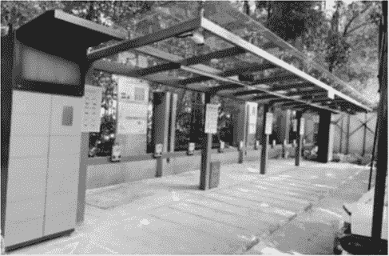

图 5-3 社区充电棚

#### 2）智能充电桩

智能充电桩主要是为不可拆卸电池的电动自行车提供安全便利的充电需求，由于其设置在户外，属于电动自行车集中停放场所且使用人群多样，功能设计须考虑户外环境、电气安全、消防安全、防盗安全精准计费等要求。关于户外环境，充电插座满足 IP54 的防护等级要求。关于电气安全，要求未连接充电器与电池时，插座不带电，并具备空载断电、过载保护短路保护、漏电保护等功能。关于消防安全，一是当电池充满时应自动断电，防止过充；二是充电功率超出设定最大功率时会自动断电；三是超出设备运行温度时自动断电并发出警报；四是检测到充电器异常时会自动断电并提醒用户，检查充电器。关于防盗安全，当充电时，检测到插座被拔时会微信推送消息给车主与车主核实操作信息。关于精准计费，当检测到电池充满则自动断电，不产生费用纠纷，同时，智能充电桩支持各类支付方式，满足各类用户的使用需求。

#### 3）智能充（换）电柜

智能充（换）电柜主要服务于可拆卸电池的电动自行车车主及物流快递外卖行业人群。因其具有占地少、外形美观、安全性高、建设场地要求较低的特点，适合用地紧张的城中村及老旧住宅小区，利于广泛布设。与智能充电桩一样，智能充（换）电柜通常布置于户外，功能设计须考虑户外环境、电气安全消防安全防盗安全精准计费等要求。但由于其实现了车-电（池）分离，且充电仓内设置高效灭火装置，进一步提升充（换）电柜的消防安全性能。同时，为每一个充电柜购置财产保险，充电过程中电池发生火灾可获保险理赔，确保居民财产安全，免除用户后顾之忧。

#### 4）充电安全管理系统

通过开发电动自行车充电安全管理平台，以完成电动自行车充电安全管理信息化升级。充电安全管理平台与智慧社区数字化系统无缝对接形成信息交互与共享。结合物联网技术，配套研发一套智能化、可运营“互联网+”的社区充电安全管理系统。充电运营管理云平台集用户端 APP 于一体，该系统可广泛适用于居民充电、行业换电等场景和领域。

### 5.4.2 充电设施规划与优化

#### 1）充电设施规划考虑因素

2020 年初，充电桩基础设施首次被纳入“新基建”行列。随着电动汽车的不断普及推广，社区充电桩建设成为“新基建”重点任务之一。电动汽车充电设施在规划时除了考虑服务对象，也应考虑以下因素：

（1）政策因素。电动汽车的推广应用能够有效缓解能源与环境压力。目前我国针对电动汽车充电设施发展的政策包括国家和地方层面。地方性政策条款由各地方政府依据各地方具体情况制定施行，差异性较大；现有的国家层面政策主要针对各类型充电设施规划数量、配建比例、运营主体、补贴措施、定价依据给出了原则性意见。在考虑政策因素进行充电设施规划时，一般按照政策规划数量或者配建比例确定充电设施规划数量的上下限或根据政策规定的充电设施建设用地进行充电设施候选站址的选择。

（2）配电系统的影响。充电设施作为用电设备与配电系统相连，规划时必须考虑配电系统的容量裕度、电压上下限约束、电能质量要求，以保证配电系统的运行安全性。现有研究主要将配电系统的安全运行约束加入充电设施规划模型，计及配电系统规划与运行经济性来进行充电设施协同规划。

#### 2）充电站选址模型分析

电动汽车充电设施的选址定容是充电设施规划的核心内容，如何在确定充电需求的时空分布以及路网、配电网络相应约束的条件下合理选择充电设施位置与容量使规划目标达到最优是研究的核心问题。由于充电桩主要集中在住宅小区和公共停车场，对其进行规划时主要需要确定建设数量，所以现有 EV 充电设施的选址定容模型主要面向公共充电站。模型求解流程主要包括充电站数量确定、站址选择、容量计算、方案评估优选。

（1）充电站数量预估。需要规划的充电站数量一般通过预先给定或由规划区域内充电需求和充电站的容量与服务范围进行计算得到。

## （2）备选站址确定
现有的充电站选址模型主要包括有备选站址和无备选站址两类。无备选站址的充电站选址模型首先确定充电站数量，之后在随机生成站址的情况下通过服务范围、截获流量、建设成本等指标大范围寻优确定最终选址，虽然选出的位置实现了目标最优，但未必适合进行充电站的建设，比如是否留有规划建站用地、配变是否留有裕量、对周边环境是否造成破坏等都会影响充电站的最终建设。目前广泛采用的方法首先根据实际情况选择适合建充电站的备选地点，在此基础上选择合理的充电站站址。备选站址的选择不仅要考虑交通与使用约束，包括充电需求约束、交通条件约束、服务区域覆盖约束、建设条件约束，还要考虑电网建设约束，包括出线间隔约束、线路长度约束等，充电站的分布主要考虑城市路网节点、公共停车场或配电系统节点。

## （3）充电站选址模型
现有电动汽车充电站选址模型主要分为基于点需求和基于流量需求两类。
基于点需求的基本规划选址模型主要有三种：p-median 模型，即指选定 p 个充电站位置使所有需求点到站点的加权距离之和最小；p-center 模型，指在充电站数量给定的情况下，使任一需求点到最近充电站的最大距离最小；覆盖模型，又可以分为集覆盖模型和最大覆盖模型。集覆盖模型是在满足用户充电需求的基础上，使得充电设施投资成本和建设数量最小化，最大覆盖模型在充电设施建设数量有限的条件下尽可能多地覆盖规划区域内的充电需求点。在点需求模型中，区域中的充电需求都被集中在交通网络或配电网络节点上。为了使充电需求最快得到满足，应该从需求点出发前往最近的充电设施，但实际中却并非总是如此，因此产生了基于流量需求模型，如基于路网流量需求的充电设施截流覆盖选址模型。

## （4）充电站定容模型与求解算法
现有充电站的定容模型主要分为在确定站址条件下的定容模型和在候选站址条件下的选址定容模型。在确定充电站站址的情况下确定充电站容量时主要考虑充电设施的利用率、建设成本、服务情况等因素，常用的容量确定方法包括基于排队论原理的方法、道路路口流量计算法、概率预测法等。
在确定候选站址的条件下对充电站进行选址定容时，决策变量包括充电站站址与容量，按照一定的规划目标并考虑约束条件在可行域内寻求最优解。现有方法主要为采用智能算法，如粒子群算法及其改进算法、遗传算法及其改进算法、免疫算法、萤火虫算法、蜂群算法等对充电站进行选址和定容。

## 5.5 智慧社区公共空间治理案例

### 5.5.1 高空抛物行为智能监测、追溯与举证
2020 年 9 月 8 日凌晨 3 时许，一个红色“小火星”从上海某个小区高层住宅楼的窗口一跃而出，呈抛物线落下，始作俑者以为神不知鬼不觉，殊不知，这一切已被高空抛物监测系统尽收眼底。而系统的提示及精准的实况视频录像已推送至物业的服务终端，物业管理人员只需要根据系统提示前往事发地进行核实处理。复杂的社区管理顽疾，被这一“黑”科技迎刃而解。
“监测、追溯、举证”，作为高空抛物事件处理的最大难点，如今已被艾索擘科技开发的模块化 AI 系统轻松解决。通过硬件收集图像后利用后台 AI 算法对比，便可在毫秒内对高空抛物行为做自动识别。当有物体从窗口扔出且满足 AI 的算法轨迹时，系统就会自动捕捉这事件发生一刹那的前 2 s 至后 7 s 的视频，并将截取的视频推送至物业人员的手机及其他管理终端。相较以往单纯的事后录像调阅比对，该高空抛物监控系统可以省去大量的人力与时间，同时也保证了管理单位对事件处置的时效性，提升整体管理的时效比。
据悉，上海多个社区已进行艾索擘科高空抛物 AI 监测系统的安装及接入工作，其间一个服务点曾在安装后的一天内便有多达 13 起的高空抛物报警，街道与社区民警在完成取证后，当日便对楼内的社区住户做了警示劝告。原本对高空抛物矢口否认的住户，在看到视频后就立即转变态度，表示对自己这种不文明行为的悔过，并保证以后不再有高空抛物的错误行为。在之后的一周内，该大楼的高空抛物现象明显减少，不少底层的住户也向居委物业表达了感谢之意。据介绍，该系统还能定期对收集的数据进行分析，将易发生类似情况的时间段和楼层段比对形成数据结果，更有利于相关管理单位针对某一时段、某些住户进行严密的监管，从源头对“高空抛物”进行防控。

### 5.5.2 基于图像识别的电梯智能阻车系统
针对电动自行车进入电梯存在的安全隐患，北京市海淀区北太平庄街道日前在多个社区试点安装“智能阻车系统”。利用安装在电梯内的高清摄像头，系统一旦识别到电动自行车进入电梯内部，就会发出语音警告，控制电梯无法关门、停止运行，从而将电动自行车“拒之门外”。据介绍，未来，“智能阻车系统”将在北太平庄街道 32 个社区实现全覆盖。
北太平庄街道在多个社区试点安装“智能阻车系统”，借助科技赋能的“技术隔离”手段从根源上遏制电动自行车进电梯诱发燃爆事故，体现了小区电梯管理智慧，为其他社区和相关部门治理这一公共安全顽疾提供了可借鉴和可复制的样本。
值得一提的是，利用技防手段防范电动自行车进电梯可能诱发的燃爆安全风险，只是当下治标的一种选择。为实现标本兼治，相关部门应在补齐电动自行车安全技术保障短板的基础上，积极完善充电等基础设施建设。另外，还应强化电动自行车车主安全意识教育，督促养成“公共安全第一”的用车文明行为，对罔顾公共安全的任性行为依法依规严肃查处，使有关人员知敬畏、存戒惧、守底线，把“不进电梯”作为电动自行车使用第一准则，杜绝电动自行车进电梯发生燃爆安全事故的风险。

### 5.5.3 科学布局充电设施进行全流程管控
以智能充电设施项目为切入点，充分运用“一网统管”大数据系统，不断解决新形势下城市建设和发展中的难点、痛点、堵点问题。

#### 1）服务圈+生态圈，科学布局充电设施
上海在加速推进“曹杨新村保护更新项目”规划的背景下，以“一轴一圈一村”为重点，全力打造“5 分钟生活服务圈”，积极完善“15 分钟生活服务圈”，提供更为便捷的养老、教育、体育等公共服务，擘画社区发展新蓝图。坚持需求导向、问题导向，推进充电设施科学布局，探索“便民充电生态圈”，并与“生活服务圈”实现融合发展。在充分考虑社区居民、沿街商铺、过路市民的多元化充电需求的基础上，在道路沿线及居民区内布设综合性充电设施。

#### 2）智能化+数字化，因地制宜满足需求
根据社区群众的充电需求，街道因地制宜，配置“四件套”充电设施。一是智能充电桩，在具备条件的小区内安装智能充电桩，在道路沿线安装“花坛景观”式充电桩，每套充电桩可同时满足 10 辆电瓶车的充电需求。二是智能充电柜，在已有充电设施无法满足充电需求，且不具备加装充电桩的区域安装智能充电柜，可同时满足 8 块电瓶充电需求，充电柜内置烟感、温感、电压检测、气溶胶灭火等装置，最大限度地保障充电安全。

#### 3）智能换电柜
针对外卖及快递行业从业人员日常高频次使用电瓶车的特点安装换电柜，能同时满足 12 块同类型电瓶的充电需求。所有完成安装的智能充电设施均接入街道“一网统管”智联普陀 3.0 大数据管理平台，对布点和使用数据进行归集、分析、应用，提高全流程管控的精准度。

# 第 6 章 人工智能赋能智慧社区的公共交通优化
智慧城市是数据驱动型城市，是数字城市发展的高级阶段，亦是能够实现空间和时间上不断自我学习和自我完善的城市，其重要价值之一是为市民提供更加舒适便利的出行体验。一个智慧城市的最终实现离不开其重要的基本组成单元——智慧社区，只有后者不断迭代实现智慧化，智慧城市才能真正落地。
近年来，“15 分钟生活圈”的概念受到重视，这一概念最先在上海进行了规划探索，随后影响了广州、济南、长沙和厦门等大城市以及雄安新区等当前热点建设地区的规划工作。上海市浦东新区于 2019 年 1 月开展了加快推进“15 分钟服务圈”布局的工作会议。《浙江省未来社区建设试点方案》对交通场景内涵做出进一步阐述，指出其应瞄准差异化、多样化、全过程的出行需求，构建“5-10-30 分钟出行圈”，最终实现“人”畅其行、“车”畅其道、“物”畅其流，满足社区层面真正意义上的差异化、多样化、全过程出行便利需求（图 6-1）。

图 6-1 智慧社区的交通场景

## 6.1 社区智慧交通应用场景
人工智能在社区智慧交通领域的应用，主要集中在公共交通、智慧出行、智慧停车等领域。智慧出行是指借助移动互联网、云计算、大数据、物联网等先进技术和理念，将传统交通运输业和互联网进行有效渗透与融合，形成具有“线上资源合理分配，线下高效优质运行”的新业态和新模式，并利用卫星定位、移动通信、高性能计算、地理信息系统等技术实现了道路交通系统状态的实时感知，准确、全面地将交通路况，通过手机导航、路侧电子布告板、交通电台等途径提供给百姓。在此基础上，集成驾驶行为实时感应与分析技术，实现公众出行多模式多标准动态导航，提高出行效率；并辅助交通管理部门制定交通管理方案，促进城市节能减排，提升城市运行效率。网约车就是智慧出行催生的新业态。

### 6.1.1 5-10-30 分钟社区出行圈

#### 1）车“5 分钟”取停车
完善社区停车场充电设施供给，统筹外售车位和公共车位资源，创新车位共享停车管理机制和服务 APP。预留车路协同建设条件，为 5G 环境无人驾驶和智能交通运行留白空间。

#### 2）人“10 分钟”到达对外交通站点
创新实施街道分级，慢行交通便利化设计，倡导社区居民低碳出行理念，通过信息一键导航、交通无缝衔接，打造居民 10 min 到达对外交通站点出行圈。

#### 3）物“30 分钟”由社区入户
运用智慧数据技术，集成社区快递、零售及餐饮配送等物流需求，打造“社区-家庭”30 min 智慧物流服务集成系统。

#### 4）“15 分钟生活圈”
“15 分钟生活圈”的规划布局强调步行尺度的基础作用，重视公共设施的配置，其形成的规划模式与以往居住区规划或依据邻里单位理论及邻里中心模式形成的布局方案并无明显差异。从生活圈涉及的时空关系和公共服务获取方式的变化来看，随着共享自行车、网络购物和快递等新技术的应用，社区生活方式和公共服务获取方式出现新的变化，居民 15 min 内获得服务的范围和基于新技术出行的范围均得到了扩大，生活圈的空间布局也应进行相应的调整，但当前“15 分钟生活圈”理念强调步行尺度和基本公共服务的供给，而对新技术带来的变化回应并不充分。

### 6.1.2 社区非私有交通出行场景
非私有交通出行场景主要是指社区居民通过步行、骑行、乘坐公交或地铁轨交等方式到达目的地过程中所涵盖的各类场景。该出行场景倡导居民低碳出行，以实现交通无缝衔接，打造居民便捷交通站点出行圈为目标，须从顶层设计层面对街区道路进行创新规划与分级、设计便利化的慢行交通，并给予信息服务支持（图 6-2）。此外，在共享经济理念下，滴滴和美团等互联网企业为居民提供的网约车、拼车等移动出行服务的解决方案也是该场景的重要组成部分。

图 6-2 街区道路的创新规划示意图

### 6.1.3 社区私有交通出行场景
私有交通出行场景主要是指社区居民借助私家车至目的地过程中所涵盖的多种场景。目前我国的城市建设、管理、规划布局以及居住区建设、管理和车位设置，均是按照私家车发展速度与规模来确定的，按照可能容纳的私家车数量设计的。虽然各国大力提倡公共交通出行，但也必须迎合私家车发展的世界趋势。世界银行 2019 年发布的数据显示，中国以千人拥车量 173 辆排第 17 位。随着城市的不断扩张、生活圈的快速延伸，社区居民的出行场景需求由 10 km 至 50 km 的城市区域扩展至近郊及远郊出行旅行、节假日的跨城市自驾游等，由此，私家车成为重要的第三生活空间（图 6-3）。《浙江省未来社区建设试点方案》中就汽车实现快速取停、车位资源统筹、自动引导设备（AGV）等智能停车技术做出发展指引，并强调为 5G 环境自动驾驶和智能交通运行预留空间，完善社区新能源汽车充电设施供给。海南省则提出在 2030 年前实现全岛使用新能源汽车，目前正在推广新能源汽车，并在全岛有序推进建设分散式充电桩。

图 6-3 私家车使用场景

## 6.2 人工智能赋能社区智慧停车

### 6.2.1 社区停车存在的主要问题
随着我国经济社会的发展，人民生活水平提高，私家车数量逐年攀升。然而，近年城市公共车位规划及建设速度远远跟不上私家车增长的速度。机动车保有量迅猛增长与停车资源有限供给之间的矛盾日益突出。据统计，我国大多数省会城市停车泊位的缺口在 50%以上。从宏观层面，如果一个小区内的大部分居民的知识水平、年龄相似（事实上，这也符合现在小区居民分布趋势，即：老年人社区、年轻人社区、高知识水平社区），小区内许多人的日常生活、工作时间段安排大致一致，就会造成车位资源使用时间段过于集中。举例来说，住区车辆朝出夕归的出行特征使得车位在白天工作时间出现明显闲置，停车位资源得不到有效利用。引起车位资源利用效率低下的原因主要如下：

#### 1）理念层面：以罚代管，缺乏对于问题的深层理解
随着人们经济生活水平的提高，汽车作为衣食住行之一“行”的主要工具必然会不断增加。所以停车需求和开车需求是一样的，这是人们的基本需求。有停车需求时，车主有权有地方停车。对于禁停区域内的违法停车行为，部分地区存在以罚代管的现象。乱停车现象的背后，说明停车位供给不足，管理不善。这是社会管理者的不作为，但所有的责任都归于用户，这显然是不合理的。

#### 2）规划层面：建设初期考虑不足，停车需求预测技术不够完善
在规划层面，针对解决城市交通问题，我国早年主要集中于道路建设，致力于解决城市各功能区的空间联通，通过扩路或改变路线来减少交通拥挤，然而却忽略了停车也是应该是城市交通的一部分，作为交通流的最后一环，车位建设规划长期以来并没有作为城市的交通来统一考虑，而是划入建筑开发商的范围，随着城市路网的不断完善和道路设施的建设，城市停车的问题逐渐凸显出来。同时，在进行资源整合、技术升级的过程，城市中全面的车位数据获取困难也是进行停车需求预测、车位资源规划的一个难点。

#### 3）法规层面：数年前法规规定的车位不足，现有部分地区小区车位少建
根据《城市居住区规划设计标准》（GB 50180—2018）的规定，除了廉租房小区外，普通小区中住户与机动车车位的比例已经调到 1∶0.8。对于大部分小区来说，1∶0.8 的比例已经勉强能够满足大部分小区住户需求，但仍存在着大量施工日期较早的小区车位数是按照十几年前的住户数，车位数为 1∶0.1 来建造的，这严重妨碍了老旧小区住户的停车需求。而如今新建的小区，由于城区用地的紧张和部分地区法规并不严格，开发商也往往少建车位，然而对于车位数的相关法规，由于不同地区用车需求、经济发达程度不同，无法一刀切地规定 1∶1 的车位，也就变相造成了各地建设标准不一，小区配套设施质量鱼龙混杂的局面。

#### 4）资源管理层面：技术落后，管理体系混乱
资源管理层面难以协调车位资源，主要体现在两方面：一是技术落后，二是管理体系混乱。智慧停车场已在过去的数年里在一线、二线城市渐渐普及，然而，大部分的智慧停车仍然只独立地停留在各个小区中运营，而且这种智慧停车场的“智慧”之处主要体现在对于住户车辆的车位信息提示、路线引导以及自动扣费方面，对于城市中其他停车场空闲车位信息并未汇总在一起形成信息网，这与各个小区物业独立运营的模式有关。
目前停车管理部门众多，对于停车场空间的使用情况缺少整体的管控，对于空闲车位的利用也仅停留在自身小区内的公共停车位，对于买房时已经买了车位住户的私人车位其实也经常有空闲时段，对此并没有做到很好的利用，这涉及物业管理与住户私人的利益；此外，对于建成的小区住户车位无法满足，究其原因是在建设初期政府管理部门、规划部门、建设部门和开发商之间没有形成有关停车建设统一的发展计划，各司其职的同时，带来了不成体系的停车设施发展现状。

### 6.2.2 智慧停车实现手段
智慧停车系统能缓解社区停车难的问题，提高空间利用效率。与现有人力管理技术相比，智慧停车系统的“智慧”主要表现在智能车位的发现和停车费的自动支付上：一是采用先进的停车诱导技术，使居民能够在手机上快速查找、预订空车位，甚至为车主自动提供选择，节省人们搜寻车位的时间；二是应用云计算，提高车辆停放空间的有效利用率，通过共享停车模式能分时段缓解车辆无处停放的问题；三是引导居民养成良好的停车习惯，减少私占他人车位的情况。

#### 6.2.2.1 智能停车诱导
停车诱导系统通过对机动车流进行动态分配、实时诱导、科学管理等功能，达到提高城市道路服务水平的目的。停车诱导技术通过对停车资源的实时统计和发布，有效引导停车设施使用者顺利到达目的地、实现交通流优化、避免因停车导致的交通阻塞，也是提高停车设施利用率的有效手段。通过多种可识别方式向驾车者提供停车场的位置、使用状况、行驶路径以及相关道路交通状况等信息，诱导驾车出行者最直接有效地找到停车场。智能停车诱导系统一般分为区域诱导系统、车位引导系统、反向寻车系统三个部分。

##### 1）区域诱导系统
区域诱导系统是通过将某个区域范围内的多个停车场形成信息共享的联网模式，在城市中主要干道旁设置多种信息显示终端，为车主提供周边停车场的位置、车位数、空满状态等信息，促进车辆快速选择最优的停车方案的停车诱导系统。
车辆出门前，便可以通过手机或者电脑等终端查询目的地附近停车场的车位信息，选择最优的行车路径；当车辆行驶在路上时，车主可以通过一级、二级引导屏快速了解附近停车场车位信息，同时引导屏还有“指路”的作用，指引车辆到达目的停车场。

##### 2）车位引导系统
车位引导系统是一种通过智能化的设备对停车场内的车辆停车进行正确的引导，促进车辆方便快速地寻找空车位停车的停车诱导系统重要组成部分。该系统的基本组成为车位探测器、车位指示灯、车位引导屏、采集终端、服务器等。根据目前的技术水平，车位探测器多采用超声波车位引导系统和视频车位引导系统。
（1）超声波车位引导系统：采用超声波探测器安装在车位上方利用超声波反射的特性侦测车位下方是否有车，从而通过系统对车辆进行引导。
（2）视频车位引导系统：采用摄像机识安装在车位上方，通过视频分析车位下方是否有车，从而通过系统对车辆进行引导。
车位引导系统的原理是通过车位探测器对车辆的检测，将车位的占用信息定位到具体的某个具体车位，通过实时发布停车场的剩余车位信息、显示单个车位的占用信息，并配合方向指示，引导车辆进行快速地停车。

##### 3）反向寻车系统
反向寻车系统是近年来逐渐发展起来的诱导系统之一，是通过车辆停车信息的处理、收集和共享，促进车主快速找车的诱导系统，主要应用于大型的停车场。
系统通过视频车位探测器对车辆进行检测，视频再经由交换机传送到识别终端，并对车牌和车位等信息进行识别后，通过以太网传输到数据服务器上，最后分享到每一个查询终端上，车主只需要在查询终端上通过输入车牌号码或其他相关信息便能够获取最佳的寻车方案，快速找到爱车。

#### 6.2.2.2 共享停车

对于共享停车的概念，国内外学者还处于探索阶段，相关的研究报告也较少。美国城市土地协会提出的共享停车的定义为：一个停车场为两个或两个以上独立的场所提供足够的停车空间，没有冲突或干扰。目前小区私有车位利用率非常低，主要原因是其空闲停车位信息传播、共享难。将私有停车位资源盘活，可以成为解决城区停车难问题的有效举措。共享停车即打破信息孤岛，充分利用已有的各种类型的停车资源。一味地改、扩建公共车位已无法从根本上解决城市汽车数量过饱和的状态。国家发改委在 2017 年 3 月 17 日印发《国家发改委确定首批 5 个城市开展城市停车场试点示范工作》，明确提出建设智能停车信息平台，通过手机 APP 多种形式，推动“互联网+停车”和车位共享新业态发展。共享停车的策略的实施离不开物联网、感应技术、大数据、无线通信技术等的应用，按信息生成和传递的流程，共享停车的过程可以分为感应层、数据传输层、分析反馈层，以及为了激励企业、个人参与到共享停车，共同营造共享停车环境，必须加入的支付层，为了方便车位主人或平台、企业对租出车位进行管理的智能车位锁系统。

### 6.2.3 “5G+AI+物联网”智慧停车系统

基于 5G、人工智能（AI）技术的智慧停车系统主要由若干停车场出入口管理设备（包括车牌识别一体机、道闸等）、若干 5G 移动网络基站、物联网云平台和市政务云组成。停车场出入口管理设备实现车牌数据采集及道闸控制；5G 网络提供低延时、高可靠性、安全的数据传输服务；物联网云平台提供车牌识别算法服务，并与市政务云、停车诱导子系统进行数据对接，实现各停车场车位信息发布，并运用大数据分析，实现车辆引流，便于车主合理选择停车场，方便市民交通出行。

通过构建“5G+AI+物联网+大数据平台”，与市政部门联合解决停车难问题，全面整合存量资源，激活闲置资源，以建设无人值守的全智能停车场（图 6-4）：一方面解决停车管理难问题，降低人工管理成本，减少车辆进出场耗时，实现社区停车资源统一规划与管理；另一方面缓解停车难问题，实现车位共享，数据共享，便于车主快速找到车位，实现车辆引流、分时段错时停车等，提高车辆管理与出行效率，实现停车资源使用率最大化、停车效率最优化、停车管理便利化。

图 6-4　基于“5G+AI+物联网”的智慧停车方案

智慧停车系统的实现首先需要在城市主干道和次干道安装多级停车诱导显示屏，停车场出入口安装车牌识别一体机，停车位埋设无线地磁车辆检测器。停车诱导显示屏、车牌识别一体机、地磁车辆检测器等无线网络设备通过与城市中部署的数千个 5G 基站进行双向通信，实现低延时、高吞吐量的数据传输，并由物联网云平台对接入的无线网络设备进行控制和状态监控，对设备实时上传的数据进行 AI 算法分析和大数据分析。同时，该系统与市政务云进行系统对接，帮助市政部门建设智能化城市静态交通监管体系，通过一张网实现城市实时车位、停车场数据动态监管，支持各项业务可视化监管、大数据分析、信息发布及应急指挥，助力城市交通发展。

### 6.2.3.1 停车诱导子系统

停车诱导子系统的目标是提供有效途径帮助车主快速寻找到停车位，提高停车场车位利用率，便利市民出行。

1）停车场车位信息发布

物联网云平台通过埋设在路侧临时停车位、停车场固定停车位和小区及单位停车位的无线地磁车辆检测器，准确感知车位的使用状态；通过与停车场及小区车辆出入口道闸对接，获得停车场车位的使用情况；同时，将城市中停车场车位动态变化情况发送至市政云进行分析与处理，由停车诱导子系统将各停车场信息发布到三级诱导屏上。

一级诱导屏发布主干道动静态交通数据，反映当前城区主干道拥堵情况及区域所有停车场剩余泊位数；二级诱导屏发布次干道当前所有停车场剩余泊位数；三级诱导屏发布当前停车场剩余泊位数。通过这三级诱导系统，引导车主合理选择出入停车场，避免因盲目出行造成局部交通拥堵。

2）车位预定与自助支付

车主通过网站、手机终端、车载终端等输入目的地后，可获取目的地停车场剩余车位及相应时间段停车数量，如果目的地停车场无剩余车位，市政务云通过大数据分析自动搜索目的地周边停车场剩余车位信息，并综合停车便利性、距离等多种因素，将车辆诱导至最合适的停车场。车主离开停车场时，通过微信、支付宝、银联等主流支付方式快速完成停车缴费，缩短车辆等待时间，提高车辆通行效率。

### 6.2.3.2 车牌识别子系统

车牌识别子系统优化提升车牌识别算法准确率，提供云端车牌识别服务，并提供车牌图像采集、道闸控制、物联网云平台管理等功能，实现智慧停车管理。

1）车牌图像采集

通过在停车场出入口安装具备 5G 传输能力的车牌识别一体机，当车辆经过停车场道闸时，车牌识别一体机自动感应车辆，采用图像抓拍模式或视频流模式快速抓拍车牌图像，通过 5G 网络将采集车牌图像数据实时上传到物联网云平台进行车牌识别。

2）停车场道闸控制

采集的车牌图片上传到物联网云平台后，平台对当前车牌图像数据进行车牌识别，判断缴费信息等，将最终的判断结果通过 5G 网络传输至车牌识别一体机终端，车牌识别一体机根据反馈结果驱动道闸放行。

3）云平台管理

物联网云平台主要实现车牌识别一体机管理、车牌识别、数据综合查询及管理功能。平台对通行车辆的基本数据（如通行时间、车牌号码、车型、是否违章、是否缴费等）、停车场基础数据（如停车位数量、剩余停车位数量等）分析之后，提供数据综合查询及管理，包括：

（1）对车牌识别一体机实时状态监控和远程程序升级。
（2）统计每天、每周、每月、每年的各停车场车流量、车流分布等数据，并用图形、报表方式显示。
（3）按照时间、车型、车牌号码等信息查询各停车场历史记录，显示相关车辆的相关数据。
（4）实现自动维护功能，可以保证长时间、大容量数据存储，提供实时车牌识别服务。
（5）实现与车牌识别一体机终端连接，以及与市政云和其他政务平台的数据对接。

### 6.2.3.3 市政管理子系统

市政管理子系统与市政务云连接，由市政务云提供停车场数据存储管理、大数据分析服务等。市政管理子系统，实现实时车位、停车场数据动态监管，支持各项业务可视化监管、大数据分析、信息发布及应急指挥。同时，市政务云与物联网云平台、停车诱导子系统数据对接，实时获取物联网云平台上传的不同停车场进出车辆车牌号码、出入场时间、停车场位置等信息，将相关信息整合，通过停车诱导屏子系统发布到各级诱导屏中。

1）停车场数据管理

市政务云汇总管理城市公共／私用停车场资源，包括各停车场位置信息、容纳车位数量、业主相关信息，以及停车费用结算等数据信息。同时，实时获取物联网云平台上传的各停车场动态变化信息，包括停车场位置、车辆号牌、出入场时间等。通过市政管理子系统可视化监管城市所有路侧停车场、公共停车场泊位情况。

2）数据分析与资源调度

市政务云提供数据分析服务，一方面基于各停车场动态变化数据进行实时分析计算，将各停车场现有泊位数据实时推送至停车诱导子系统，实现数据发布。另一方面对于某些停车场车位已满的情况，基于周边停车场车位情况分析，通过网站、手机终端、车载终端等发布提示消息，帮助车主快速找到附近合适车位，实现车辆引导分流，避免局部交通拥堵。

通过大数据分析，合理调配现有停车资源，有效缓解停车供需矛盾，实现城市停车资源最大化利用。通过构建城市停车公共服务大数据，实现对静态交通资源管控，通过共享经济的方式盘活利用存量泊位，实现动、静态交通联动的调度管理和信息服务，利于城市停车场资源统一规划和管理，为政府交通规划提供数据决策。

3）应急指挥管理

通过市政管理子系统可清楚获悉当前城市停车泊位剩余及分布情况，通过信息发布、分流引导等方式，缓解城市停车难困境。另外，支持城市应急联动管理，配合政府其他部门，通过应急调度快速处理各类突发性公共事件，确保城市运行安全有序。也可与公安、交管、政务平台对接，实现对套牌车、非法营运车辆、涉案车辆分析和跟踪，为打造智慧社区、平安城市奉献一份力量。

## 6.3 基于 5G+智慧灯杆的区域交通协调优化

随着城市私家车的数量越来越多，城市道路拥堵的情况屡见不鲜。智能交通系统以交通流理论为核心，系统地运用现代信息和控制技术以显著提高既有交通基础设施的使用效率和安全水平，减少交通流的盲目性。5G+智慧灯杆恰恰是最适合成为智能交通管理系统底层感知层面的基础设施。其每隔 30～35 m 布设间距的先天优势，使得更容易搭载一些交通管理感知设备，如车流量传感器、高清监控设备等。通过 5G 网络组网，能够轻松地在城市的大街小巷布置出智慧交通的感知网络。这些感知信息也能够更快地传递给综合交通管理平台，供城市管理者们更快地做出相应决策，缓解交通拥堵的情况。

智能交通系统主要分为三个不同的阶段：信息感知（采集）、信息处理、信息服务。首先，通过智慧路灯对于路况及路网容量进行数据采集，实时传输至中央控制中心；通过人工智能预测算法预测未来几小时内某段路发生拥堵，以及堵车的概率进行预测分析；最后通过这些预测数据及时提示，以及为驾驶员们提供建议的行车路线。其信息服务有别于普遍的车载导航软件，真正的智能交通系统的信息服务，应做到定点、定向投放。通过智慧灯杆，记录某一段行车的车牌号，定向投放给这一段的驾驶者，让其按照预测算法的结果变道行驶。有别于普遍的导航软件，其不会产生无差别疏导而导致更多拥堵的现象。

通过 5G+智慧灯杆对路况数据的采集，对定向定点车辆通行路径进行局部管控；通过强大的人工智能预测算法对道路路况进行决策分析，对驾驶者进行交通诱导。其中，诱导策略实施网络化：在寻求诱导资源与动态交通流时空耦合性的基础上，注重诱导主体的智能化设计与布设，强调动静态诱导主体信息的一体化时空关联与协同联动，以及诱导与信号控制系统的协同控制。在更大的时空范围内，对于现状路况进行信息服务的科学决策，对车流量进行更加智能地控制。

### 6.3.1 区域交通协调优化控制系统建立

（1）根据交通拥堵的实际情况，聚焦拥堵核心主体，对拥堵主体周边的信控路口进行网格化划分。
（2）依托 5G+智慧灯杆的道路基础设施，对路况数据（现状路况绿信比、相邻网格化路口车流量及平均车速监测）进行采集。
（3）通过搭建径向基神经网络模型（RBF，算法相关介绍参见附录）对相邻网格化路口中短期（5～30 min）的交通流进行预测，并借助系统的评价准则对预测方案进行评价，预测出的最优交通控制方案将作为下一网格化路口的输入量进行迭代运算，最终得到这一网格化区域内该预测时间内最优的交通诱导方案。
（4）依托 5G+智慧灯杆及系统得出的最优交通诱导方案，及时调整信控路口控制参数（四个相位绿信比及总信号周期）作为定向交通诱导的手段。

### 6.3.2 交通流预测模型建立

模糊神经网络模型被广泛地运用在交通信号控制中。其原理可理解为模拟交警思维，根据四个相位的车辆排队情况，调整各个相位允许通行的时长。由此，即可建立一个神经网络模型，以四个相位的车流量为输入，四个相位绿信比及总信号周期为输出。根据往期历史数据，可将相同时间段的交通流数据作为训练样本以得到相关相位的绿信比的最优方案。

由于车流量存在一定随机性及变量，故交警指挥时会存在些许变化。在模糊神经网络模型的基础之上，该系统使用了小波变换来减少一些交通变量对系统造成的波动影响。

在实际路况中，有许多意外情况会影响交通速度，但只会在很短的时间内产生影响。流量预测的目的是向用户提供有用的信息，关键是要提供合理的平均值估算未来的流量。因此，意外信息可以被视为噪声。为了滤除这些噪声，有许多现有方法可用。小波变换是一种强大的工具，能分析非平稳信号并获取其趋势。在降噪应用中，小波变换具有较多优势，如其可以保留信号中的细节，并且不需要任何噪声假设。

### 6.3.3 区域交通协调优化方案评估

区域交通协调控制优化模型主要由交通流预测模型、区域评价体系及定向交通诱导系统三方面构成。通过交通流预测模型，可以得到预测精度相对准确的交通流预测数据。每一个信控路口的预测数据，作为下一个信控路口的输入数据进行迭代预测，以得到该网格化路口最优的绿信比。

为了达到最优的响应速率，该系统建立了一套评分体系。通过评分体系对每一个评价周期的平均排队长度及定向诱导方案进行评估，评判该区域交通协调优化方案的控制效果是否达到舒缓交通的效果。如若未达到预期，则修正该路口信号周期、绿信比及定向诱导方案。具体评价原理如下：

（1）将城市道路中，每九个就近的信控路口分为一个网格化区域，对每个网格化区域进行交通流预测。
（2）设每九个信号周期为一个评价周期，通过交通流预测模型推算一个评价周期结束后，某个相位所有方向（相邻九个路口）车流排队长度作为评价的依据（其中包括该评价周期内放行及到达的车辆）。
（3）将定向诱导方案纳入评价体系进行模型预测。定向诱导方案的实施原则：将平均排队长度最长的相位调整至相同路径下排队长度最短的相位，并进行路径规划。根据平均车速推算该定向诱导方案的方案可行性，即原路径到达目的地的时长与定向诱导方案到达目的地的时长对比。如若定向诱导方案缩短了车主到达目的地的时间并且网格化区域内，各个相位的平均车流排队长度缩短，系统则判定该定向诱导方案成立。
（4）根据平均排队长度及交通诱导方案，将平均排队长度作为调整信号周期的重要参数，调整相应信控路口的总信号周期及四个相位绿信比。

通过评分体系能够加快区域交通协调优化控制模型的响应速率，以达到实际的控制需求。

通过区域交通协调优化控制模型，系统已经得出了最优的区域协调优化方案。从而借助 5G+智慧灯杆的定向诱导系统，及时调整每一个信控路口信号机的控制参数，用以达到舒缓城市道路拥堵的情况。

## 6.4 社区慢行交通出行优化

人车矛盾是我国人地矛盾的集中体现之一，居住小区是城市中人车密度较高的场所，也是人车矛盾发生的高频空间。目前，我国的居住区道路规划主要思想是强调人的主体地位，极力减少机动车对行人可能存在的威胁，因此也基本倡导完全人车分流的组织模式或设计独立的人、车行道。“人车分流”这一概念的初衷是进一步保证路人安全，给予路人在交通空间内的优先权，本质上是一种关怀式的交通规划模式。

### 6.4.1 人车分流道路系统基本模式

1）平面分流模式

平面分流模式主要用于设计住宅小区内道路系统，铺设适用于各种功能的住宅小区道路网络，使得住宅区内的交通工具以及行人在各自的道路网络上通行时，相互之间没有干扰，从而可在整体上形成人车分流系统。平面分流这种交通组织模式通常适用于大型住宅小区，这样住宅区内的交通组织与道路网络系统将与城市道路的总体规划或者区域道路的总体建设紧密地结合。英国伦康新城的“8”字形公交专用道路系统、魏尔温的花园步行系统和斯蒂文内其的自行车道路分流系统等都是采用平面分流模式的经典例子。

2）内外分流模式

内外分流模式也即雷德朋式体系，这种人车分流模式以每个住宅庭院或者小区组团作为居住单位，从而形成住宅的内部生活区，各居住单位之间则通过步行道路相连接，而各居住单位与住宅区外面的车行道路则通过住宅区内的尽端路或者半环式道路进行有效连接。车行道路可以直接通向各个住宅院落以及小区组团的一侧，从而方便人们的停取车。这种交通组织模式让机动车道路与人行道路行形成两个独立的道路网络的同时，行人与车辆之间在道路平面上不产生交汇，各行其道，步行道路将住宅区内的景观环境和公共服务设施有效连接起来，居民通过步行道路可以在住宅区内自由、安全地活动，并且与住区外围的车行交通完全分离，不会产生相互干扰。

3）立体分流模式

立体分流模式，即充分利用居住小区的立体空间，增加不同层面的道路网络来进行人车分流。这种模式在我国新建的住宅小区较为普遍，其人车分流的方式一般分为两类：一类是将步行道路铺设在屋顶或者架空步行道路，最终形成一个抬高的可供步行的平台；另一类则是将机动车道路设置于地下，简单来说就是在住宅区内设置地下停车场，从而形成立体空间上的人车分流，一般多运用在地形条件复杂、地势起伏较大的住宅小区中。

### 6.4.2 社区慢行交通出行的影响因素

社区是城市步行交通流的出发点与汇集地，也是人们生活的物质载体，在城市用地中具有重要作用。大型封闭社区阻碍了社区与城市的联系，降低了城市整体的步行交通运行效率，也加剧了居民近距离步行出行的绕行问题，做好社区路网组织，优化步行交通环境，有利于社区的良性发展。

2016 年年初，《中共中央国务院关于进一步加强城市规划建设管理工作的若干意见》第十六条建议“优化街区路网结构”，提出“新建住宅要推广街区制，原则上不再建设封闭住宅小区。已建成的住宅小区和单位大院要逐步打开，实现内部道路公共化，解决交通路网布局问题，促进土地节约利用”。引发广大研究学者在街区制的背景下，对已建成封闭式社区路网的优化改造及新建社区的路网规划展开热议和思考。而步行是每位居民的日常生活出行方式，社区路网规划是否合理，会影响居民步行出行的效率，因此有必要基于居民的主要出行目的，立足步行到关键吸引点的视角，探索社区步行交通优化方法，以实现社区的良性发展。社区慢行交通出行影响因素如下：

1）社区居民出行习惯改变

随着社会的不断进步，青年人也越来越重视精神层面的需求，在城市社区中更加重视对于公共空间的改造与利用。在美国，新一代的社区的建设与规划中更加重视公立学校的发展与成长，并且设计出更为舒适的步行街区和活力街区，并且通过这种设计的方式来进一步激励社区人口数量的增加以及经济环境的可持续发展。在社区的整体规划理念上，他们更加追求公共空间的交流程度以及舒适出行、安全慢行。中国城市与美国城市拥有较为类似的发展历史，其中表现为中心区的衰退，城市交通问题的白热化以及社区可利用公共空间的缩减等。这些方面的改善不仅使得社区居民的价值观念发生变化，还使得机动车的出行方式不再成为居民出行方式的首选。并且伴随着含有慢行交通价值观念的低碳生态城市以及绿色建筑等进一步规划实施，我国社区居民的出行习惯也逐渐转变。

2）社区道路吸引力影响

通常具备吸引力的社区在交通道路上都需要具备足够充实的交通功能。其中社区内道路不仅要充分发挥其本身具备的交通功能，同时还应该具备公共空间的交流性能。既可以方便社区内的居民出行，缩短出行的距离同时又可以减少居民使用干路网络的概率。社区的居民要想真正体验道路自身具备的吸引力，就必须进行短距离的慢行出行。因此，社区道路的吸引力与居民的慢行短途出行具有十分密切的联系。

3）社区非机动车停车规划影响

现在实行的《城市居住区规划设计规范》中，停车位的数量已在规定的下限内，受市场规则的影响，社区停车位的数量将增加。但一些社区缺乏停车空间，严重影响了居民的停车，很多社区居民直接将车停在慢行道路上，阻断了道路，极大地影响了居民慢行出行的可连续性。其次对于自行车停车位的规划也有待加强。在 1995 年的规范当中，自行车停车位需要在公交站附近，公交站点的服务半径以行人出行的舒适度为主要参考点。规范中还规定，公共交通的车站服务面积如果以 300 m 作为半径起算的话，不得少于城市实际用地面积的一半。如果以 500 m 作为半径的话则不能少于城市实际用地面积的 90%。但是在城市的实际规划与设计当中，我国公交站点的间距设计通常都要大于规定的距离，公民出行不方便，所以当前要解决的问题就是自行车的停车位与公共交通站点相结合，有效地连接社区内外公共交通的接驳，为慢行交通出行提供便利。

## 4）社区基础公共设施规划影响

我国城市社区的规划思想主要是由邻里单位的发展思想演变而来，其中规划更看重社区功能的区分，注重将公共交通和居住环境分靠，并且在规划中使用公共交通的线路将住区内的地块进行分割，减少了社区慢行交通出行的概率。在这样的功能分割条件下，城市的社区公共设施布置整体上呈现小巧但是全面的布局状态，不能很好地满足社区居民对社区设施多样化的要求。并且在实际的开发和建设中，经常会出现很多个开发商一起开发地块的情况，这给地块内的公共设施的建设带来了麻烦，种类少、慢行交通基础设施匮乏等问题经常出现，不利于居民日常生活的进行。

### 6.4.3　社区慢行交通优化设计策略

### 1）社区土地功能混合利用

社区除了应具备居住的功能之外还应具备公共服务设施的功能，一般可分为居住、教育、医疗、商业、文化和体育等。社区鼓励混合功能的综合开发以及推进产业与公共服务设施的平衡发展，积极促进本地区的就业，并且改变居住与就业分开造成的居民往返于不同城市功能区之间的类似钟摆式的交通模式。还可进一步完善居住区配套设施，加强社区功能建设，减少居民日常生活距离等。在源头上降低居民的生活成本，减少交通上的浪费。

### 2）完善周边干线道路，引导步行交通分流

社区常常作为一个整体系统而存在，内部缺少交通干道，因此完善社区周边道路系统，建立分流体系，优化路网结构，同时采取相关措施引导机动车辆选择周边道路绕行，可以有效缓解社区步行交通的压力。如增加社区周边道路系统的机动车道宽度，在周边分流交通要道上合理设置交叉口信号灯时间，优先放行分流方向的交通。对于没有步行交通干道的社区，不仅要完善周边分流环线道路，还要采取有效的措施限制机动车进入社区。如减少社区内部道路的路边停车位供应数量来限制进入社区的小汽车，以及在道路主要出入口采用限时通行的方法控制机动车流等，以缓解社区内的步行交通压力，净化社区步行交通环境。

### 3）设立单行线，发展单向交通

世界上许多国家很早就开始采用单行线路来解决社区步行交通拥堵的问题。在社区双向步行交通比较拥堵无法拓宽道路时，设置单行线是一个很好的解决途径。单行线所注重的是步行交通组织和管理，涉及综合治理的步行交通措施，主要由社区步行交通管理部门负责实施管理。单行线本质上是以局部的限制来保障整个路网的畅通，单行线最大的缺点是绕行，如果成对的路之间太远或者路网太稀疏，机动车绕行的距离就比较远，有悖于“有利于居民出行”这条原则。单行线路有时也会和其他路段产生衔接上的问题，产生一些新的行车不便。国内外的实例证明，若社区步行交通规划合理，单行道路划分恰当，一般不会使汽车绕行太多的路，即使绕路耗费时间和燃料，但减少了停车和起步时间从而提高了车速，而且减少了交叉口与步行交通流的冲突点，提高了行车的安全性，缓和了社区步行交通主道上的拥堵。

### 4）社区内增加道路网络密度

为了进一步改善社区的出行环境并且增加居民使用慢行交通出行的比例，应大力倡导小尺度的道路发展模式，适宜的街区宽度可以改善社区内部的道路通行能力从而影响到社区周边的交通通行能力，将以车为主的大尺度的道路模式向以人为本的小尺度道路模式转变。而且，小尺度道路模式通过加大道路网络的密度以及慢行道路网络的密度，从而鼓励居民选择慢行交通出行。密度较大且分布均衡的慢行网络，还可以加强公共交通的使用度，为居民减少绕行距离，提升社区内居民采用慢行交通的可到达概率。此外，小尺度道路的模式自身在设计上还有很多的道路交叉口，实现了道路中车辆分流的目的，对于构建人与车混流的慢行空间有重要的价值。通过建构适宜慢性街区的尺度并根据不同街区的范围对尺度再进行适当地调整，不仅可以确保道路行驶的通畅性，还可以营造优质的慢行出行环境。居民更愿意选择慢行交通出行，从一定程度上减少社区内居民对于机动车出行交通方式的依赖。

### 5）开发利用地下空间

对社区而言，土地利用与道路用地不足的矛盾突出，开发利用地下空间，可以有效缓解社区的交通压力。社区地下空间开发利用的目的是改善社区环境，缓解社区化进程中的问题。随着汽车的发展，道路和停车场占去了社区大部分土地。世界各地都在不同程度地开发利用社区地下空间。开辟地下空间发展交通有两种方式：一是发展轨道线路和地下机动车道路，二是建设地下停车设施。在社区，开发地下空间设置地下机动车道路和地下停车场，通过地下通道将需要穿过社区的交通流引入地下，不仅可以满足社区车辆的交通需求，而且减少了机动车对社区的干扰。结合现有的停车设施开发地下车库，建立“地面+地下”的停车模式，有效缓解社区停车位不足的矛盾。

## 6.5　智慧社区公共交通应用案例

人工智能、物联网、大数据等技术遍布社区治理“最后一公里”，小智治事、大智治制，智能应用成为社区人与人连接的交流纽带。

### 6.5.1　“云行天下”未来智慧出行新模式

浙江“云行天下”的发展是以宁波为起点和中心，致力于将宁波打造成智慧停车的城市标杆，在快速发展中，已拥有海量的城市停车信息数据，落地千余个项目。智慧停车项目致力于智能停车软件系统的开发和智能停车设备的技术研发、生产制造、停车场运营管理等服务。

#### 1）无人值守停车应用解决方案

通过智能车牌识别系统、多种自助缴费方式、远程岗亭呼叫帮助、智能机器人值岗、大数据云平台等打造无人值守停车场（图 6-5），不仅提高了车场的效率，同时也为车主提供了更加方便快捷智能的停车功能，让车主能提前预约车位、车位导航、反向寻车、自助缴费并快速驶离出口。

图 6-5　无人值守停车方案

#### 2）路侧停车应用解决方案

“云行天下”运用物联网、互联网、信息技术、通信技术等，建立统一的路侧停车管理平台，城市泊位资源统一管理、配置，制定停车、收费、管理和服务的标准化制度及流程，面向车辆从到达、离开，计费、收费、支付全过程数据采集，满足路侧停车的管理和服务需求。

通过构建路侧停车智慧管理平台，实现使车主能够有车位可停，出行前可获取出行目的地停车位信息，了解停车收费信息，多种手段快捷缴费；减少人工干预，减少收费漏洞，运营方可实时掌握车位空余度、收费动态及发布空位信息，提高营收；政府管理部门可掌握停车热点区域车位动态，且掌握出入车牌信息，提高治安效率，分析停车热点变化，为建设、交通规划提供依据。

### 6.5.2　立林智能停车管理系统

立林智能停车管理系统，是一套完善的基于车牌及车型识别作为车辆出入停车场凭证的解决方案。通过出入口的车辆识别来判断进出场权限、停放时间和应缴停车费，语音模块和显示屏会实时播报和显示相应信息，从而实现车辆快速进场、缴费、出场等全自动化智能停车场管理应用。

系统能按需选择多种缴费方式，改变以往由人工管理或刷卡、取票管理所带来的泊车效率低、服务差、人为乱收费、拒缴停车费等诸多问题。

#### 1）APP 移动管理

相机助手 APP 可远程调试与升级维护摄像机。终端机智能管理摄像机故障和岗亭收费，应急措施更完善。

#### 2）2 种车牌识别

视频识别和地感触发识别，提高车牌识别准确率，识别更科学。

#### 3）16 屏监控管理

最多支持一台电脑同时在线管理 16 个车道画面，提高管理效率。

#### 4）脱机正常工作

支持脱机收费和脱机进出，避免因系统瘫痪影响车辆通行效率。

#### 5）实用系统向导

界面简洁明了，风格多样，通过快捷向导图标快速找到常见设置功能。

#### 6）智能语音提醒

服务器、计算机出现故障，显示屏和语音均能正常工作，提示更周到。

### 6.5.3　智慧停车助力打造智慧社区

2020 年，“新基建”首次写入政府工作报告。智慧城市将成为新基建最主要的“服务对象”。智慧社区是智慧城市实现的基础环节。为了积极响应国家政策，推进智慧城市建设进程，科拓推出的社区业态解决方案支持线上访客预约，通过手机端预约，减少安保人员排查工作，有效降低人工成本。不仅如此，“一位多车／多位多车”的管理模式，不仅可以帮助社区停车管理减负，还让业主也可灵活运用车位。基于人性化的管理，管理人员无论处于哪种场景，都可通过科拓停车场云助手的“视频监控”功能实时监控出入口情况。而“监控回放”功能则能为车场管理提供有效的依据，相比人工岗亭模式，便捷不止一点点。

智慧停车系统的落地，是打造智慧社区的第一步。社区构建起微生态，物业服务更加多元，业主获得舒适的全场景生活体验。智慧停车还将持续和其他物业终端服务结合在一起，用科技的力量推进智慧社区的全方位发展。

### 6.5.4　5G+区域道路感知网络升级改造

上海市合杆整治工程针对现状道路杆件（公安、交警监控杆、路灯杆、标志标牌等）进行综合化改造，集约城市照明、监控杆件、配套管线资源。通过对综合杆件进行 5G 设备改造，配套搭载 5G 设备顶杆仓，用以对道路两侧进行 5G 信号覆盖。通过搭载各种路况监测传感器，对现有的城市道路感知网络进行信息化升级改造。

依托工程背景，选取 2019 年合杆整治工程虹口区北外滩板块作为系统试点区。工程范围西起天潼路，东至平凉路，北起哈尔滨路，南至黄浦路。其中共涉 35 条路，全长 15.64 km。经过上海市交通管理局提供的实时路况数据分析，北外滩板块拥堵情况主要集中在外白渡桥、北苏州路、长治路及东长治路、吴淞路等路段。故该系统设计的核心聚焦在解决国际客运中心周边网格化区域。通过建立基于车路协同模式的区域交通协调优化控制系统，从时空维度解决交通拥堵的实际问题。

# 第 7 章　人工智能赋能智慧社区的养老助残服务

我国于 20 世纪末已经进入了老龄化社会且老龄化进程日益加快。2001—2020 年，我国处于快速老龄化阶段，老年人口每年以超过 3%的速度增长，每年新增老年人口近 600 万人。其中高龄、失能、半失能的老年人口增长很快，出现高龄化、空巢化、失能化等特点，整个社会对专业化和规范化的养老服务需求增加。但基于我国传统观念，专业性的养老机构仍不是很多居民心中的最佳选项，而打造智慧社区内的社区养老，建立以家庭为核心，以社区为依托，以老年人日间照料、生活护理、家政服务和精神慰藉为主要内容，以上门服务和社区日托为主要形式，并引入养老机构专业化服务方式的居家养老服务体系将成为未来养老的一个重要方向。

智慧社区养老通过对诸如社区居民委员会、养老驿站、养老日间照料中心等社区养老资源进行有机的整合，针对社区老人的养老需要提供行之有效的养老服务。根据整合程度的不同，可将其分为全整合与部分整合两种方式。全整合智慧社区养老模式是指所有智慧养老服务资源都整合到社区内；部分整合智慧社区养老模式是指社区承担部分养老职责，其余的由老人子女来承担，如当前盛行的“托老所”“养老日间照料中心”等就是白天在社区中集中照料老人，而晚上由老人子女承担照料老人的职责。智慧社区养老模式的特征可以弥补居家养老在日常照料上的不足，满足老人在熟悉社区中的养老需求。另外，智慧社区养老模式还在于能够整合社区智慧养老资源，为老人提供智慧服务。

## 7.1　智慧社区养老助残应用场景

“十四五”规划和“2035 年远景目标纲要”提出，积极应对人口老龄化，构建居家社区机构相协调、医养康养相结合的养老服务体系。人工智能通过一系列理论和方法学习、模拟、延伸人的智能，涉及领域主要有图像、语音识别、机器学习、深度学习、自然语言处理等。人工智能推动各领域向智能化加速发展，这也给养老服务行业带来了机遇。将人工智能技术属性和社会属性进行融合，并将其应用于医疗、养老等领域，可以全面改善人们的生活质量。

### 7.1.1　安全防护

#### 1）老年人防跌倒

针对有轻度行动障碍或发生跌倒事故风险较大的老人，通过使用可穿戴设备、助行机器人等各类跌倒防护产品，帮助老人居家或外出时独立行动，当老人发生跌倒事故时能大幅降低身体伤害。产品应轻便易用，保护效果好，价格可承受。产品方或服务方应为老年人或家属提供相应的使用培训服务。

#### 2）老年人紧急救援

##### （1）自主救援场景

重点解决老人不愿意安装或佩戴设备、设备使用过于复杂、设备功能单一、紧急呼叫后续服务不完善（如对接 120）等问题，随身佩戴的手环、手表类设备应具备较长的电池续航时间，“一键通”电话机等固定安装设备宜具备语音唤醒和呼救语音识别等功能。

##### （2）无感监测报警场景

主要针对老人无人看护时的监测报警需求，老人发生中风、跌倒、心梗等意外情况时，能及时监测、发出报警信息并通知到监护人或其他指定人员，便于第一时间发现并实施救助。要求设备检测率高，误报率低，便于安装，能保护老人隐私，价格适中，并能解决供电、通信等问题。

#### 3）认知障碍老年人防走失

##### （1）居家场景

主要针对轻度认知障碍老人，解决老人出门后忘记回家或忘记家庭地址问题。主要解决定位设备充电和设置麻烦，老人不愿意佩戴等问题。

##### （2）机构场景

主要针对中度和重度认知障碍老人，解决老人抗拒佩戴设备、故意损坏设备的问题。

#### 4）机构出入管控

综合采取人脸识别、红外监测、门禁管理等技术，可满足人员进出方便、审核快速、指定进入区域和路线、同步测量人员体温和监测随申码等要求，预约方便、无须办证，可充分利用现有的基础设施，成本较低，管理人员少。

#### 5）机构智能查房

能保障老年人夜间看护安全、降低各类突发事件风险、弥补护理员夜间巡查人力的不足。通过应用智能床垫、人体雷达、生命体征探测等设备，实时搜集并传输分析各种状态数据，可供夜间值班人员大范围监控养老机构房间及入住老人状态。可实现老人跌倒、生病、人员冲突、违反安全规定等多场景监控，须重点解决状态采集准确性、老人居室隐私保护、智能报警等问题。

#### 6）机构智能视频监控

基于视频压缩技术，以较低的成本实现养老机构内部多个摄像头数据的实时采集、传输、保存、分析，市、区民政部门可实时查看，在疫情发生等特殊时段可具备人员是否佩戴口罩、人员进出监测、疑似病例接触人员分析等智能检测功能。同时，老年人家属可通过 APP 等方式查看老年人用餐、活动等生活状态。

### 7.1.2　照顾服务

#### 1）智能卧床护理

智能化卧床护理具备大小便处理、辅助翻身、体位调整、生命体征监测及报警、预防褥疮等功能。

#### 2）家庭照护床位远程支持

家庭照护床位远程支持的设备具备卧床护理、离床感应、体征监测、紧急呼叫、数据回传、远程指导等功能，可通过视频通话等方式指导老年人家属开展日常护理和突发情况应急处理。

### 7.1.3　健康服务

#### 1）慢性病用药

应用互联网+技术，提供老人每日开药、取药和服药的一站式解决方案。如可在老人家庭、养老机构或家门口服务点配备智能药箱，采用人脸识别等技术供多个老人取药、用药，具备界面友好、简单易用的自动分药、用药提醒功能。此外，在具备条件的场所（如养老机构），缺少药物时能够报警并远程对接内设医疗机构或社区医疗机构，实现远程开药、远程刷医保卡买药、对接医药企业送药上门。

#### 2）无接触式智能消毒

无接触智能消毒机器人能够自动按照符合标准的消毒程序，依照设定的路线和区域开展消毒工作。此外养老院、综合为老服务中心等养老服务机构也希望能由机器人承担自动送餐送药等工作。

### 7.1.4　情感关爱

#### 1）智能语音交流互动

利用智能自动群呼系统，自动向村居委内数百名以上老人自动拨打关爱电话，并具备交互功能，可听懂老人的简单需求，或根据老人述说自动转人工席位。可将有关关爱通知信息自动转换为方言，对老人方言的言语识别率高，并能智能识别老人的需求。

#### 2）老年人智能相伴

在老年人日常生活的居家、社区、机构等各种场所和养老服务场景中，应用各类智能化、信息化手段，为老年人提供触手可及、便捷易用的养老信息资源服务和智能陪伴，提高老年人的生活质量，提高老年人的社会参与感。例如在综合养老服务中心、日间照护机构等社区养老场所，利用电视机、音频设备、触摸屏、机器人等智能化、信息化设备，为老年人提供视频、图像、音频等智能互动服务，让老年人便捷获取养老服务信息和智能陪伴服务。

## 7.2　AI+医疗健康服务

### 7.2.1　医疗健康服务智能推荐

居家养老人员中很大一部分人因为疾病导致行动能力下降，多数老年人患有高血压、糖尿病、冠心病等慢性病，此类人群需要定期进行健康检查、药物购买以及疾病预防知识等健康教育的普及。在人工智能社区智慧养老模式下，可通过深度学习技术学习养老服务领域知识，获得大量相关数据，通过对收集的老人健康数据进行分析，针对不同人群推送不同的营养搭配、身体锻炼方法和医疗建议等知识。对于健康或患有慢性病但能自理的老人，可以通过推荐的专业医疗知识进行自查、自诊。可以对一些特征明显的疾病进行远程诊断，给老年人带来方便。

深度学习方法可以更好地进行特征提取，更加精准地学习用户和服务的特征。将环境监控层收集的数据与老年人护理服务领域的专业数据进行比较，分析和挖掘它们之间的关系，并使用用户评分训练模型选择具有较高预测评分的服务生成推荐集，满足老年人需求的服务。可以利用人工神经网络提取老年人特征，人工神经网络由内部复杂的神经元通过大量数据学习相应的规则，将学习的数据特征用于预测或分类。老年人特征提取模型如图 7-1 所示。

图 7-1　老年人特征提取模型

首先，将老年人姓名、年龄、性别、职业、收入、身体状况、自理能力程度等基本信息转化为数字。之后将这些数字映射到低维度并用词向量进行表示，由此得到老年人每个基本属性的特征向量。将得到的特征向量通过多个隐藏层合并各个属性特征以获得最终的老年人特征向量。

医疗健康服务特征提取模型是根据医疗健康服务基本属性特征和医疗健康服务内容融合得到的，提取模型如图 7-2 所示。医疗健康服务内容描述通过分词处理后，经文本卷积网络提取，得到医疗保健服务的内容特征，并将与医疗保健服务的属性如服务类型、服务价格等特征相结合，通过多个隐藏层获取到医疗健康服务特征向量。

图 7-2　医疗健康服务特征提取模型

医疗健康服务推荐模型利用老年人特征提取模型和医疗健康服务特征提取模型对网络进行训练，并将获取到的老年人信息输入训练的模型中以获得医疗健康服务的预测得分。对分数进行排序筛选，以生成医疗健康服务的推荐集，为老年人推荐集合中得分较高的信息，生成模型如图 7-3 所示。

图 7-3　医疗健康服务推荐模型

### 7.2.2　人工智能助力基层医疗

人工智能技术在智慧社区中的核心应用场景就是解决优质医疗资源不足的问题。“看病难”是普罗大众对医院服务诟病最厉害的地方，其实核心的问题是优质医疗资源不足，供需不匹配。因此，AI 在大医院的应用场景就是如何借助人工智能的力量，帮助医生进一步提高生产效率。

为了缓解大医院资源不足的问题，国家一直在力推行“分级诊疗”，希望广大的基层医院能分流就诊人群。但现状是基层医疗机构优质医生资源很有限，老百姓对基层医疗机构的医疗质量不信任，因而不愿意去这些机构。基层医生们无论是上学期间的培训还是从业后的在职培训相对大医院的医生来说都很不充足，同时他们面对的是几十种疾病的全科诊疗（不像大医院的医生们都按科室提供专科服务），会面对有各种常见病（高血压、糖尿病、高血脂、冠心病等）的患者。所以 AI 在基层医疗的核心应用场景就是如何借助机器（人工智能）力量，帮助基层医生达到中等程度的诊疗服务水平，让老百姓愿意走进基层医院，真正实现“分级诊疗”。

AI 具体如何帮助提高医疗服务水平呢？本小节围绕医院为患者提供的关键医疗服务展开介绍，包括诊断、预测、治疗、基层医疗机构，还有疾病管理的服务。

### 1）诊断

该服务主要为判断患者到底得了什么病，这是所有后续治疗的基础。为了提高诊断的精度，好的医生应具备以下几点专业技能：一是利用先进的诊断辅助方法，比如各种医学影像（超声／CT／核磁），病理切片（细胞染色）和基因分析；二是综合患者的主诉、体格检查、生化检测、影像、病理和基因数据，利用多维的数据做出诊断。但目前这些分析工作主要靠人工完成。一个人的心脏 CT 影像有几百张，胃肠道的连续内窥镜影像有几万张，肾脏病理切片的分辨率是最高清照片的几百倍，医生需要花大量的时间用肉眼扫描这些影像，判断可能的心血管堵塞、胃溃疡或者肾小球病变的位置和病变程度等；三是能结合多维数据做出诊断，这也对医生的综合能力要求很高。从人工智能的角度看，在疾病诊断的核心应用场景是利用各种分类算法（尤其是影像分析技术），融合多模态医疗数据，过滤无用的信息，自动分析病变的位置、程度（分级）和分型等关键信息，最终辅助医生完成鉴别诊断。

### 2）预测

本项服务的主要功能是预测疾病的发展，“治未病”。比如诊断为房颤的患者，同时患有高血压和糖尿病，那么该患者在未来的几年内中风的可能性就较高，所以医生就要提前采取抗栓治疗，让患者口服华法林等抗凝药，降低他将来中风的风险。类似的，癌症的患者术后有高复发或转移风险的，可能要通过相应的化疗和放疗来预防。好的医生不仅是处理患者目前的问题，更重要的是能预测患者疾病的演进，采用预防手段，防患于未然。预测疾病发展风险最困难的是找到最关键的风险因素，以及各种风险因素对最终疾病发展的权重。目前这个过程主要靠医生的经验积累产生科研假设，然后花很长时间去积累跟潜在风险因素相关的数据，再用统计的方法加以验证。从人工智能的角度看，在疾病预测的核心应用场景是利用各种分类算法，首先从真实世界数据（病历／医保）、生活方式数据和社交媒体等多维数据中自动发掘风险因素及其权重；再者构建预测模型，自动对个体患者的疾病发展进行预测，辅助医生“治未病”。从控制医疗保险费用的角度，预测患者未来的医疗资源使用情况也是很热门的题目，比如预测医疗费用，住院天数、急诊出诊次数或专科门诊次数等。这些预测当然跟疾病的发展相关，但更多是从管理者的角度（医疗保险公司或政府）来分析。

### 3）治疗

千百年来，医生通过用药或者手术作用于患者，治愈疾病。但同样是房颤患者，接受华法林抗凝治疗一年，有人不中风了，有人还是中风，有人甚至提早诱发了脑溢血。这是为什么？因为个体有差异。所以治疗最困难的地方是根据患者的个体差异提供个性化的治疗，这是精准医疗的核心。如果从数据的角度看一个患者，这个集合里有该患者的基本人口学数据（性别，年龄等），生化检验数据（糖化血红蛋白、高密度脂蛋白等），影像学数据（冠状动脉扫描或乳腺超声），病理学数据（肾脏病理或甲状腺病理等），基因突变数据（EGRF 变异等）和生活方式数据（饮食／运动／睡眠）等。从理论上说，世界上任意两个患者的数据都是不相等的，这就是个体差异，精准医疗的目标是将患者尽可能多地分成子群，为每个子群制定不一样的治疗方法，达到最佳的治疗效果。从人工智能的角度看，在疾病治疗的核心应用场景是利用各种聚类方法，根据不同治疗方案的效果，实现自动从患者的多维数据中寻找能够区分患者所属子群的关键变量及其权重、自动划分患者子群、自动给出个性化的治疗方案推荐，辅助疾病治疗。除了考虑治疗的临床效果，不同治疗方案的“性价比”也是分析的热点，会把各种治疗方案的费用也考虑在内。

### 4）管理

疾病管理是指患者离开医院后对患者的持续随访服务，并根据患者病情的变化主动提供医疗建议，或被动回答患者的问题等。比如医生通过随访了解到某个高血压患者的血压在最近一个月内持续升高，而且他不按时服降压药，酗酒嗜烟，且熬夜严重，那么医生可能会建议患者采取措施，避免可能的脑梗或心梗风险。或者某个糖尿病患者突然觉得最近视力下降很厉害，她可能会主动咨询医生，如果医生响应及时，可能她就可以避免并发视网膜病变甚至失明的风险。但现状是大医院的医生没有时间对院外的患者进行疾病管理，社区的全科医生有疾病管理的责任，但受限于资源，也很难对我国的患者，尤其是近 3 亿慢性病的患者，提供及时的随访和管理服务。从人工智能的角度看，在疾病管理的核心应用场景是利用各种自然语言理解和对话技术，实现以下几个目标：一是自动对患者进行随访，采集关键的病情变化数据；二是根据患者的病情自动给出预警或建议；三是主动回答患者的问题，尤其是跟患者教育相关的问题（病因／饮食禁忌／药物禁忌等）。

### 7.2.3　人工智能辅助疾病诊断

一般而言，为了能够建立一个用于医学影像分类、基于人工智能方法的计算机辅助系统，需要具体实现以下三部分内容，即影像数据库建立、分类模型训练与分类模型预测。其中，图像数据库建立部分的主要工作是从原始医学影像中提取疑似病灶区域作为候选图像，并选出其中一部分图像作为训练集，剩余部分作为测试集。训练部分则是通过对训练集中所有图像依次进行预处理，特征提取与人工标注中的所有或部分操作，从而将原始候选图像转换为一个有病灶类型标签的候选图像特征集。接着只需要将该候选图像特征集导入某种恰当的人工智能方法进行预测模型训练，即可获得一个训练误差较小的医学图像病灶预测模型。此预测模型将会被用于对测试集中候选图像进行类型预测，预测的结果就是该模型认为的测试集中候选图像的病灶类型，更直观的流程可参考图 7-4。

图 7-4　计算机辅助诊疗系统的基本流程

### 1）预处理工作

医学影像预处理工作的主要目的是去除医学影像中大量无关冗余部分，突出感兴趣区域，从而为之后的步骤，如特征提取与影像分类等起促进作用。常见的医学影像预处理工作包括影像增强与影像分割。

其中，影像增强的主要目的包括改善医学影像的质量，提升影像清晰度与对比度。通过合理选用诸如灰度变换增强、直方图增强、图像平滑、图像锐化、彩色增强与频率域增强等操作，后续影像病灶区域的分割质量与特征提取效果将被大幅度提升。

影像分割则是为了更直观地从医学影像中取出最重要的子区域，即感兴趣区域，也就是通常意义上的疑似病灶区域。影像分割实质上可以看作对整个影像上所有像素进行的类别粗预测，其效果的精确与否对后续部分类型特征提取算法的实际效果影响巨大。现有用于影像学的分割方法往往是直接在基于自然图像的分割方法上改良而来。

### 2）特征提取

一个完整的医学影像特征提取模块应包含特征提取与特征选择两部分内容。

特征提取是指通过计算机获得医学影像中属于特征性信息的过程，是建立基于各类型疾病计算机辅助诊断系统中最重要的一步。良好的特征提取能在简化输入样本图像复杂度的同时，更好地反映待诊断病例图像的结构信息、视觉特性和生物学背景知识，因此即便选用较简单的预测模型训练，最终模型也可获得理想的预测效果。常用的特征提取方法有形态学特征、纹理特征、空间位置特征与其他特征。

特征选择则是试图解决两个问题，即特征维度过高所产生的后续算法运行性能下降与因模型复杂度提高所导致的预测模型泛化误差上升。前者可以通过建立对比实验进行特征筛选机制改良，后者则使用主成分分析方法。

对于医学影像人工智能分析中典型的深度学习方法、深度神经网络本身可以自动对特征进行提取，一般无须再单独进行特征提取。但对于医学图像的一些特殊语境，直接利用图像块作为模型输入往往只能提供较少或较差的信息，故结合特征提取的分类方法仍具有一定的应用。

### 3）预测模型训练

预测模型训练实质是整个基于人工智能方法的计算机辅助诊断系统的核心。如果说特征选择的优劣能影响诊断系统的性能上限，那么机器学习方法的选取无疑就是决定诊断系统性能下限的最终保障。一个由合适机器学习方法训练获得的医学图像预测模型能极大程度地弥补特征提取方法效果的不足，甚至直接跳过特征提取。目前常用的预测模型方法包括支持向量机与深度神经网络，偶尔也会涉及朴素贝叶斯、线性判别分析、传统神经网络以及决策树等，在极个别情况下可能还会用到基础的机器学习方法，如逻辑回归。

其中，逻辑回归是一种广义线性回归，常用于探究自变量与因变量之间的关系，并以此建立基于各自变量权重的预测模型，可解释性是逻辑回归的最大优势；朴素贝叶斯是一种有着扎实数学基础与稳定分类性能的传统机器学习方法，发源于古典数学概率理论之贝叶斯统计推断，可以通过样本某一属性的分布与先验分布算出已知样本属于不同类型的条件下该属性的条件分布，其应用在癌症与脊柱病理分类任务与乳腺图像中；线性判别分析是另一种逻辑回归的典型线性学习方法，也称 Fisher 线性判别，其核心理念是将高维样本投射到一个最佳鉴别矢量空间，确保样本在新鉴别矢量空间中类间距离最大，类内距离最小，其在计算机辅助诊断系统中的应用包括用于乳腺图像任务、肺结节诊断与用于结肠息肉分类等；决策树则是一种可以描述样本可能分类的树形结构模型，用于代表样本特征与分类类型之间的一种映射关系，在计算机辅助诊断系统的应用包括乳腺钼靶 X 线影像与乳腺超声影像中的肿瘤分类、SPECT 影像中的阿尔茨海默病诊断；支持向量机是一种专门针对二分类任务设计的预测模型方法，其核心思想就是在样本空间中寻找一个超平面对样本进行分割，且需要保证超平面到各支持向量之间的间隔最大化，即目标函数为间隔最大化的同时，约束条件为训练样本均能被正确分类的经典凸二次规划问题，其应用领域包括甲状腺疾病诊断、阿尔茨海默病鉴定、帕金森病诊断、乳腺癌分类、恶性黑色素瘤鉴别与肺结节分类等；人工神经网络则是一种模拟大脑神经元结构的运算模型，由大量多层神经元之间相互连接构成，每个神经元代表一种特定的激励函数，而任意两个节点间的连接则代表通过该连接信号的权值，根据不同的网络连接方式、权值与激励函数，人工神经网络理论上能逼近任意一种算法、函数或是逻辑策略，从而能更好地模拟出真实任务中网络输入与输出之间复杂的非线性关系。早期人工神经网络在计算机辅助诊断系统的研究涉及乳腺癌、心脏病与糖尿病三种图像诊断任务，以及有关乳腺图像的检查与分类任务；深度神经网络技术在早期人工神经网络的基础上发展而来，通过更深层的神经网络结构，使整个网络的表达能力与性能上限得到极大的提升；如今的深度神经网络以压倒性的性能优势与良好的业界口碑，被广泛应用于各个领域，且均取得了不错的实际效果，同时也诞生了相当多的衍生方法，其中以深度置信网络与卷积神经网络最为有名，而后者的最大优势就是帮助使用者彻底摆脱了大量的目标图像分割和特征提取的开销，因此成为目前众多深度神经网络中最受欢迎的一种方法。近几年来，涉及深度神经网络在计算机辅助诊断系统中的应用大量涌现，具有代表性的研究领域有肺结节鉴别、乳腺癌诊断、脑肿瘤分类以及糖尿病视网膜病变检测等。对于序列超声和内窥镜等医学视频影像，深度神经网络同样具有良好的应用。对于超声心动图的序列超声影像，深度学习算法的广泛应用取得了良好的效果。

### 7.2.4　人工智能助力疾病风险预测

公共卫生事件的预测预警主要是预测未来时间点某一个城市或地区居民传染病如流感的患病率，而针对个体的疾病风险预测是预测个体在未来设定的时间窗口内是否会患某种疾病或者患病的概率。在人工智能领域，这些预测场景则会转换成回归预测或分类建模问题，利用人工智能技术进行疾病预测建模的主要技术点如下：

### 1）数据预处理

用于疾病预测的输入数据，比如电子病历经常存在字段缺失或数据异常的情况，导致特征无法提取或者给建模造成噪声，因此需要对输入数据进行去噪、缺失值填充等预处理。缺失值填充方法常用的有均值填充、中位数填充等。

### 2）特征选择

在疾病预测应用中，用于传染病预测的特征因子可能涵盖天气、舆情、人口等多源数据。在疾病风险预测中，每位患者的数据涉及病情主诉、诊断、生活习惯等，往往有上百维，而真实电子病历的数据甚至有上千维。因此在使用机器学习算法进行建模时，为了避免冗余的无意义的特征给模型引入噪声，降低模型拟合的精度，需要选择有意义的、相关的特征作为模型的输入。疾病预测中使用的特征选择算法类别包括过滤法（方差及相关系数检验）、封装法（前向特征选择等）以及嵌入式法（树模型等）。在使用深度学习算法进行建模时，深度学习网络将原始特征进行多层变换，把原始特征映射到新的空间中，因此不需要另外加入特征选择模块。

### 3）模型选择

用于挖掘序列本身相关性规律的时间序列模型、自回归积分滑动平均模型是经典的传染病患病率预测模型，用数学模型近似描述序列的变化，对于短期趋势的预测准确率较高；逻辑回归模型由于可解释性强被广泛应用在疾病预测中；同时，集成学习算法随机森林及其后续的改进算法，由于兼具可解释性且能够进一步提高预测精度，被应用在越来越多的疾病预测研究中。此外，SVR 回归、Lasso 回归以及组合模型等预测算法也被尝试用于传染病患病率及个人疾病风险预测模型中。近年来，由于深度学习算法在处理高维复杂的结构化数据以及非结构数据时表现出优秀的算法性能，已有一些研究利用深度学习算法建立疾病预测模型，采用卷积神经网络、循环神经网络对电子病历数据、医学图像以及语音数据进行分析，预测个人患病风险。

## 7.3　AI+日常生活辅助

老年护理最大的工作量就是日常生活帮助，通过一个完备的居家生态环境系统，会大大降低护理成本。系统能主动或根据老人需求调节家里家电、温湿度、空气质量等环境指标，使老人在舒适的环境中生活。首先，该系统可以主动或根据老年人的需求开关家用电器，调节家里温湿度和空气质量等环境指标，使老年生活舒适。同时，对老人居住环境进行监测，可以减少某些安全隐患的发生。其次，监测水电网气等设备，使用数值异常时提醒家人及社区人员，余额不足时提醒老人及家人通过终端缴费。最后，社区培养护理人才，满足老人各类上门服务需要。老年人可以在家通过监控对讲机或者智慧终端选择上门服务的内容，获取外部资源帮助，如助餐、助行、助医、助浴、助洁、助急等，把每次护理人员监测的血压、脉搏、呼吸、体温等基本生命体征数据传输到所属社区的老人健康档案中，家人和社区可以随时掌握老人的身体状况，便于后期对老人进行日常帮助。

### 7.3.1　社区智慧养老服务系统

人工智能社区智慧养老服务系统由环境监测层、人工智能社区智慧养老服务层以及终端层组成。环境监测层的功能是负责采集信息，它用到各种各样的传感设备，拥有全面的感知能力和更高的灵敏度。把传感设备接入到无线传输网络之后，就可以把采集到的数据往上层传输了。人工智能社区智慧养老服务层是整个系统的上层平台，负责为用户提供具体服务。构建智慧养老服务系统涉及物联网、通信、数据挖掘等技术和卫生医疗护理专业知识。整合这些技术到服务系统中，为用户提供便捷的、有价值的生活帮助服务。

系统可采用紫蜂协议（Zigbee）技术组成无线局域网负责智慧养老环境下的数据传输，相比于其他无线协议如 WiFi、蓝牙，Zigbee 更加简单，成本更加低廉，能耗更低。在智能建筑、智能家居、智能医疗等领域有广泛的应用。基于 Zigbee 技术的自组织网形成 Zigbee 传感网，用来组织所有的传感器。通过编写代码，完成传感器的初始化、信息采集、远程控制等工作。家庭控制中心是服务器与 Zigbee 的中间媒介，负责传输、处理数据信息。可以将接收的 Zigbee 传感器发来的相关数据经过处理后发送到网络或手机终端，也可将终端发送的命令处理后转发给相应的 Zigbee 节点。终端可以对用户家中温湿度、煤气水电、家电等进行设置。在终端到云服务器的数据传输上，可使用 AJAX 技术，通过 JSON 数据格式访问接口，尽可能减小延迟，提高用户体验度。基于 Zigbee 技术的家庭网络结构如图 7-5 所示。

图 7-5　基于 Zigbee 技术的家庭网络结构

### 7.3.2　居家老人活动识别

在智能家居方面，人类活动识别是智能家居中辅助生活、运动伤害监测和老年护理背景下持续监测人类行为的框架组成部分，是研究人类行为和人机交互的重要领域。健康智能家居中日常生活活动分为睡觉、准备和享用早餐、穿衣脱衣、休息、卫生活动、排便、交流等 7 项活动，活动识别依赖于传感器，包括位置传感器、门接触、浴室温度和湿度传感器、麦克风（声音分类和语音识别）和可穿戴运动传感器等。然而，人类活动具有高度复杂性和不确定性，有学者提出可利用深度学习技术获得优化的活动识别器。深度学习和人工智能方法适用于图像识别、人类活动的特征抓取和分类等自主特征学习，对于移动和可穿戴设备来说，与深度学习融合会有更广阔的发展空间，如智能手机传感器利用深度卷积神经网络进行活动识别，通过深度学习构建传感器数据与个人健康的联系。传感器另一端便是远程监控系统，老年人可能经常需要立即进行医疗干预，而远程监控平台在老年人独立居家的条件下提供医疗护理，如电子医疗为患者提供电子处方、电子供应、电子病例和电子健康记录等。此外，在智能家居中使用辅助机器人也将成为养老问题的一种解决方案。

#### 7.3.2.1　传统活动识别方法

### 1）基于数字设备的活动识别

## 基于运动感测的活动识别
日常生活中，用户通过佩戴诸如运动手表、运动手环等传感器的方式来记录人体运动，大多数广泛使用的基于运动感测的方法需要将传感器放置在移动的身体部位上，例如，用于分析基于腿部的健身房锻炼，传感器需要放置在腿上。这些基于数字设备的活动识别方法有其局限性：其一，用户需要无时无刻携带传感设备，这造成了用户穿戴的不便，还可能会影响活动体验；其二，人体运动的识别受限于一系列狭窄的活动，例如，腿部的加速度计将无法感知手臂运动。

## 基于计算机视觉的活动识别
另一种传统方法是利用基于视频图像的计算机视觉技术来进行活动感知。视觉是人类获取信息的一个重要手段：基于计算机视觉的人体行为识别技术，通过对视频图片的分析，提取人体运动信息。而在活动过程中，由于受到视角变化、光照变化、背景变化等多种因素的干扰，对真实场景下的人体运动分析仍然面临诸多挑战。与此同时，摄像头对于用户隐私的侵犯也是不可忽略的问题。

## 基于无线信号的活动识别
近年来，随着无线网络的快速发展，射频信号的作用已经从单一的通信介质扩展到非侵入式的环境传感工具，主要包括基于超声波、基于 WiFi、基于特殊射频信号的实现方式。利用无线信号进行人体行为识别，解放了用户的穿戴限制，拥有广阔的发展前景。其基本原理是射频信号通过多路径在无线介质中传播，反射不同物体并达接收器，因此携带有关环境的信息。人体是良好的反射体，通过分析接收到的射频信号模式和特征，可以检测人类活动和行为状态，如呼吸率、手势和跌倒等，这被称为非接触式或无设备人体感知过程。

### 使用专用设备的无线信号活动识别
许多系统使用的是`FMCW`无线电设备，其配备了两个天线阵列：水平阵列和垂直阵列。`Marko`是一种自动收集与行为相关的数据而无需人们编写日记或佩戴传感器的系统。`Marko`发送低功率无线信号并分析其从环境中反射的信号，还将这些反射映射到用户使其与环境以及彼此进行交互。

### 基于 WiFi 的活动识别
基于`WiFi`的人类活动识别系统大多是基于`CSI`工具，使得研究人员可以从无线数据包中提取物理层级别的`CSI`，这无需部署特殊硬件，但需要设置`WiFi`设备以高速率发送数据包即使在没有数据通信的情况下。`CARM`是一种基于`CSI`的人类活动识别和监测系统，其有两个理论基础：`CSI`速度模型，量化`CSI`值动态和人体运动速度之间的相关性；`CSI`活动模型，量化不同人体部位的运动速度与特定人类活动之间的相关性。速度模型方法背后的原理是当多路径的长度改变时，`CFR`功率根据路径长度变化而变化。

现有的利用无线射频信号的人体行为识别技术中，利用改造商用`WiFi`路由获取信道状态信息进行人体运动识别是最具前景的实现方式，但需要改变路由器发包速率导致影响信号通信，并且在室外环境下，这种可用性前提将大大降低。另外，在多个用户同时运动时，由于对信号的反射存在相关干扰，还会降低用户动作的识别准确度。

## 基于 RFID 的活动识别
使用`RFID`的系统可以将`RFID`标签连接到非生命物体中，其背后原理是捕捉无源标签的反向散射产生的频移。通过这种设计，系统可以知道用户访问了哪个对象以及它发生了什么。尽管这种系统不会直接监视人类活动，但它仍然可以工作，因为可以通过了解人类正在利用的对象来隐式推断许多活动。例如，如果知道热水器已经打开，则可以推断出人类正在洗澡；而且它们很便宜，可以按需部署。

## 居家老人安全监护
人工智能社区智慧养老系统可以为老人提供多重保护。首先，当监测到老人身体指标异常、家庭环境异常时，可以与子女和社区人员等联系，及时得到救助。其次，当家里出现燃气泄漏或者老人因身体不适未洗衣做饭等情况时，水电燃气传感器、温湿度传感器、安防传感器等数据会发生异常，此时也会向子女或社区进行预警。再次，如果有老人意外摔倒且周围无人时，不能及时到医院治疗，可能会造成更大的健康伤害，人工智能还可以对老年人的异常行为进行监测，当老人因跌倒、突发疾病而处于异常行为状态时，系统及时发现并报警，使老人及时得到救助，减少意外发生后生命财产的损失。

对老人的监测设备要涉及很多方面，需要在老人家中安装一个本地服务器，定时接收各类监测设备发送的异常数据信息，然后对不同等级的异常信息进行分类并做标记，再由本地服务器分析是本地报警提示还是发送到社区服务器给出异常报警提示。在日常安全监护分类中行为异常报警最常见，主要是指对老人自身行为方面的监测，包括对老年人的活动量、生理信号、地理位置的监测。常见的行为异常检测主要指跌倒检测，可通过穿戴式设备、外围式设备和视频分析三种方式进行检测。

### 基于穿戴式的检测方法
通常把螺旋仪和加速度计等植入智能手机、手环和其他穿戴设备中，螺旋仪和加速度计分别获取人体的方向信息和不同方向的加速度，之后对收集的运动信息进行分析判断。基于穿戴式检测方法的精度较高，受周围环境的影响较小，并且老人的活动区域不受限制，可以在室内，也可以进行户外活动。但是可穿戴设备需要每时每刻检测人体的状态，如何有效地控制模型的存储消耗和计算资源，同时又要保证准确性，显得尤为重要。

### 基于外围的检测方法
通过在家中安装如压力和声音等传感器来收集老年人的运动信息。当老年人跌倒时，周围的压力和声音信息将发生变化。通过检测数值进行判断。由于该方法安装成本高，且容易受到周围噪声的影响，检测精度相对较低，因此在实际生活中很少使用。

### 基于视频的跌倒检测方法
对硬件的要求较低，仅需要一个或者多个摄像头。该方法可以获取更多的人体信息，如速度、位置和行走的姿态等，并且有很好的展示效果，老人的家属可以远程观察室内的具体情况。该方法可以通过剪影、轮廓、姿态特征估计等方法进行。例如对老人进行姿态估计能够获取关节点坐标，这些坐标可以更好地表示人体在图像中的位置，该方法对跌倒行为识别更加敏感。基于视频的跌倒检测方法取得了很好的检测效果，但现阶段还存在许多问题需要解决，例如光照的影响、遮挡问题等，当人体处于复杂环境下，检测效果会有所下降。

## AI+情感关爱服务
老年人退休后社会角色发生转变、社交圈变小，与子女共同生活时间有限，共同话题少，容易产生孤独感。社区作为老年人的主要生活空间，是为老年人提供精神慰藉服务最为便利的提供主体。人工智能社区智慧养老模式下，可以通过人机交互系统进行人性化交流，基于深度学习、自然语言处理等技术和心理学、语言学等学科，人工智能系统甚至能像心理医生一样疏解老人心理问题。人工智能还可以收集老年人兴趣爱好、生活习惯等个人数据，通过学习，得到老人更喜欢的娱乐项目，并为老人提供个性化推荐服务。在社交方面，随着智能手机和其他智能设备的普及，老人可以轻松与家人、朋友进行语音、视频等联系。在保证正常生活的基础上，提高老年人的幸福感。

### 个性化推荐
个性化推荐是指计算机系统根据老人的个性化需求，为其提供相关信息，使其得到满足。个性化推荐过程主要包括用户、被推荐对象和计算机信息系统三个部分。其中用户是个性化推荐的核心，主要收集用户年龄、性别、收入、健康程度、生活习惯等基本信息，认知风格、消费动机、主观感受等，被推荐对象主要包括老人感兴趣的文本信息、视频音频等多媒体信息、衣食住行等建议信息等。用户可以将其个性化需求主动提供给系统，也可以通过用户的使用记录和爱好，根据一定的推荐方法生成。系统采用的推荐方法是关键，主要的推荐方法有以下几种：

#### 基于内容的推荐
该方法是早期使用较多的个性化推荐方法，需要分别建立用户偏好模型与被推荐对象特征模型，然后执行分类和匹配，按照匹配度的高低排序，将排名较高的结果推荐给用户。当被推荐对象是文本或具有较强属性特征的时候，该方法推荐结果直观，容易解释，也不需要提供用户的历史信息，有很好的效果。但对于属性较为复杂的对象，构造用户偏好和被推荐对象分类时需要较大的数据量。

#### 基于协同过滤的推荐
该方法目前使用较为广泛，主要根据用户的历史行为数据，寻找用户或被推荐对象的近邻集合，以此计算用户的偏好。与基于内容的推荐算法相比，协同过滤推荐算法存在以下优点：一是由于协同过滤推荐算法是基于其他用户的行为进行推荐，因此该方法可以发现用户潜在的兴趣偏好；二是与被推荐项目的领域无关，对被推荐项目相关的领域知识没有要求；三是相似用户之间的数据可以借鉴，缓解数据稀疏的问题。协同过滤推荐算法通常分为基于用户或项目的近邻方法和基于模型的方法。

##### 基于模型的协同过滤算法
主要有基于矩阵分解和神经网络等。近邻方法的优势有可解释性，也就是说用户容易理解基于近邻进行推荐得到的结果。然而，由于有些用户虽然没有共同的评分行为但依旧有相似偏好情况的存在，会导致该方法难以完整的找到近邻。基于模型的协同过滤是从用户和项目的数据中学习用户和项目的表示，通过训练模型来进行预测，为用户生成推荐列表。

##### 基于用户的协同过滤算法
指从用户角度出发，借助用户之间的相似度找到与目标用户兴趣相似的近邻，将目标用户近邻喜欢的项目，且目标用户没有接触的项目推荐给目标用户。协同过滤推荐算法中相似度的计算尤为重要。协同过滤推荐算法常使用的相似度度量有皮尔逊相关系数、向量相似度和 Jaccard 相似系数等方法。

##### 基于项目的协同过滤算法
指针对用户对于项目的评分等行为来计算项目之间的相似度。其根据项目的相似度和用户的历史行为提供用户合适的推荐服务。

#### 基于关联规则的推荐
挖掘用户和被推荐对象的关联规则。基于关联规则的推荐算法的优点在于该方法的研究相对成熟，易于工程实现，容易被理解，并且可以发现用户新的兴趣点。该推荐算法的缺点是数据处理工作比较繁重。此外，在模型的建立阶段耗时较长，且无法进行实时推荐。

#### 基于知识的推荐
基于某一领域一整套规则和特定领域的知识推荐。通过先验知识确定项目的属性和用户偏好之间对应关系。常见的有基于实例的推荐系统。该类推荐系统要求使用相似函数来评估用户的需求和被推荐项目之间的匹配程度。基于知识的推荐算法的优点是能将用户的需求映射到项目中。该类推荐算法的缺点包括获取特定领域的知识是十分困难的，难以挖掘用户潜在偏好以及推荐的结果是静态的。

由于不同的推荐算法各有不足，因此在实际的推荐系统中是将多种推荐算法组合起来，以取得更好的推荐效果。常见的方式是将基于内容的推荐和协同过滤组合。组合的思路大致分为三类：后融合、中融合和前融合。后融合是将算法独立实现，再将不同的推荐结果进行加权融合得到最终的推荐结果；中融合是以一种推荐算法为核心，使用另一种算法来增加实现核心算法的部分功能，避免单一推荐算法存在的不足；前融合是直接构建一个融合两种推荐算法的模型。

## 社区智慧养老应用案例

### 多模式智能养老云平台
盘城养老中心智慧养老项目位于南京江北新区盘城街道的盘城红叶林居家养老服务中心，该服务中心属于盘城智慧养老服务综合体的一期工程，通过借助物联网、大数据、云计算、人工智能等技术手段构建线上智能养老云平台，整合多种智慧养老设备和产品，进一步保障和提升盘城街道老年人群的生活质量，提高街道养老机构服务质量。

该项目整体装修为简约田园风，灯光大多采用暖色调，一进门便采用了当前最主流的智能触摸情景开关，可以通过一键触摸控制实现回家模式、离家模式、会客模式和用餐模式。开关采用`2.5D`玻璃面板，且带有背景`LED`灯提醒，触摸方便，操作简单，非常适合老人使用。厨房安装有烟雾报警器、水浸探测器以及燃气传感器和智能触摸开关等搜新智能的相关智能产品。客厅也安装了最新的多款智能单品方便老人在家时给予多重的安全和防护，同时多功能空气质量监测传感器也与空气净化器相连，保障室内的空气质量，给老人一个健康的居住环境（图 7-6）。同时也为老人安装了智能窗帘，通过智能窗帘开关可以轻松实现窗帘的开和关。卧室里也为老人准备好了多功能护理床，在睡觉的同时也能更好地保护老人的健康，一键触摸报警开关可以快速地将危险信息提交。

图 7-6　智能产品和智能看护报警系统

### 虚实互通智慧居家养老
武汉市武昌区社会福利院“人工智能老年看护应用案例”，围绕打造智慧养老服务机构，建设统一规范、高效便捷的养老机构信息系统，设置人工智能养老实验床位，应用无接触式、无需穿戴的智能看护设备，通过系统平台、移动端`APP`与智能设备集成联动运行，实时监测老人的体动状态、呼吸、心率等各项身体数据，及时发现、有效干预在院老人服务问题，显著降低了看护风险，节省了人员成本，提升了服务效率，初步形成了有效的养老机构看护应用场景。

武昌区杨园街中心辐射式养老服务中心“‘虚实互通、家院互融’智慧居家养老应用案例”，以服务社区居家老人为目标，为居家老人安装视频监控、佩戴智能手环等智能设备，通过电话拨打、`GPS`定位、一键呼救、整点报时等多种功能，解决老人居家养老服务需求，为居家老人提供了智慧化生活照料方案。

### 嵌入式智慧养老服务网络
上海某街道在电话关心 2 569 名独居老人基础上，建设以高科技、信息化手段帮助老人紧急救助、生活设施维修、居家养老、心灵关怀的科技助老平台，形成“智慧养老”服务网络。借助物联网、互联网技术，实时监测社区老年人家中火灾及燃气泄漏的情况，如果安装的消防烟感或燃气检测报警器发出警示，报警系统会自动以电话和短信的形式，立即通知老人的紧急联系人。截至 2019 年 12 月，已安装了 106 户。街道智慧健康小屋配备“一体机”智能设备——能够提供身高、体重、脂肪、血压、体温、血氧、腰臀比、血糖、胆固醇、尿酸、心电图 10 项体重指标的测量，所有的测量器械都整合在了一个可以滚动的手推设备上。该设备能智能化身份识别（身份证、社保卡）与数据采集；数据质量控制后上传并动态持续更新至居民健康档案，经健康账户上传市卫生信息平台后，同步至各区域卫生信息平台；居民可以在智慧健康小屋可通过自助打印获取自检自评报告。建设智慧养老数据中心，形成以综合为老服务中心为枢纽，通过资源集聚和人工智能成为赋能中心，由一个中心枢纽、32 个微型为老服务站、X 个专项服务设施构成的“`1+32+X`”嵌入式养老服务新模式，居家、社区、机构形态互补，融合发展，建立立体式养老服务生态圈，实现医养医院在 15 min 内可达、可触及，将有限的资源更精准地服务每一位社区老人。通过智慧养老数据中心实现“服务送出去，社区全覆盖”，展现居家照护服务、养老服务、养老公共服务等多维度应用场景。通过小程序“智慧养老服务平台”，老人们可以在线申请助餐、护工住院陪护。小程序需要实名注册，注册信息统一汇总到街道智慧养老数据中心，各种助餐需求、护工需求也在平台上留下记录。利用协同办公的“`钉钉`”平台，在手机`APP`上，不仅有养老服务设施、养老政策、老人档案等信息汇总，工作人员的日常走访、工作日报等也会及时上传形成记录。在综合为老服务中心的场地预定模块，各居委、部门可以直接在“`钉钉`”上插空预约，相比原先的人工统计，更加直观，还避免了差错。在家门口服务的养老顾问模块，哪位居民咨询了哪些问题，得到了怎样的反馈，平台都会留有记录。32 个居民区“家门口”微型养老服务站，夯实养老顾问、微型日托、社区助餐，老年活动室等四大功能，支撑长护险对准高频服务，让老年人不出小区，就可以享受日托、助餐、咨询、休闲娱乐等服务。完善“老伙伴”计划，社区志愿者与老年人结对，注入更多人文关怀，真正打通服务老人的“最后一公里”。“`1+32+X`”是可扩展智能化为老服务三级体系，它的实施对社区老人来说，不仅能享受到健康服务，而且能享受到更多的人文关怀。建设智慧养老建设平台，让社区养老服务更精准。通过智能化、大数据等手段，丰富老年人养老服务供给内容，畅通老年人养老服务渠道。凭借这个网络，街道盘活更多空间资源、联动更多社会资源，给老人们送上了精准养老服务。

# 第 8 章 基于用户画像的社区个性化服务
泛信息时代，用户画像在电子商务精准营销、用户定位、产品设计、个性化服务等方面发挥着重要作用。构建精准用户画像，能够为管理层决策提供有效指导。面向未来，信息量过载的问题会越来越严重。通过用户画像，智慧社区可以充分感知居民的深层需求，即使居民不对其需求对象进行准确描述，系统也能精准推断居民的意图，并根据符合程度向居民提供所需服务。同时，结合用户画像分析居民的偏好，比如社区 O2O 服务、社区智慧教育、社区智慧物业等，可以提供个性化的服务推荐。相比传统社区，智慧社区与居民的互动更频繁，在制度、管理、服务、布局等方面更加人性化，用户画像为智慧社区提供深入感知用户需求的渠道和方法。以用户为中心，提供个性化、智慧化服务，符合智慧社区以人为本的发展理念。用户画像可以对用户的属性及行为特征的多维度进行刻画，并将其应用于社区的个性化服务，有利于驱动智慧社区的创新性发展。

## 社区个性化服务应用场景
智慧社区是当下推动高质量发展的又一张“金名片”。智慧社区聚焦人本化、生态化、数字化三维价值坐标，以和睦共治、绿色集约、智慧共享为内涵特征，突出高品质生活主轴，构建以智慧邻里、教育、物业、健康、服务和治理等场景创新为重点的集成系统，打造有归属感、舒适感和未来感的新型城市功能单元，促进人的全面发展和社会进步。集成系统描绘了服务需求全覆盖、服务人群全覆盖以及服务响应零延迟的智慧社区生活链全图景，以智慧社区 O2O 服务、智慧教育、智慧物业三个场景为切入点，对其设计思路、实现目标与数字化、信息化应用路径进行综合分析。

### 社区 O2O 服务
在移动互联网时代，随着移动网络服务质量不断提升和智能手机快速普及，线上虚拟世界和线下现实世界之间实现便捷互动的新型模式——`O2O`浮出水面。`O2O`（`online to offline`）又称离线商务模式，是指线上营销和线上购买带动线下经营和线下消费。`O2O`通过打折、提供信息、服务预订等方式，把线下商店的消息推送给互联网用户，从而将他们转换为自己的线下客户。

社区`O2O`电商新零售是智慧社区需要着力打造的服务内容，按功能可细分为便民服务类、社交类、物业类。其核心是全面整合社区周边的零散商家（餐饮、超市、药品、生鲜、快递物流、家政等），形成以社区为中心的线上线下电商服务，提升社区居民生活的便捷度，实现足不出户即可处理生活各类事务的愿景。以社区智慧购物为例，区别于传统的网络购物，社区智慧购物着力打造基于社区生活圈的快捷购物平台，充分整合社区附近的便利店、超市、药店等商家信息，构建“社区极速购物圈”，居民通过移动购物`APP`，实现商品采购，30 分钟内极速送货上门的功能，进一步提升社区居民生活的便捷程度。

当前科技下的大数据可以为社区 O2O 电商新零售提供很多便利，例如，针对消费群体的分析和在市场上的目标定位，通过整合消费者线上和线下的数据，全方位地对客户进行用户画像。企业通过大数据带来的全方位用户画像，能够为客户提供准确的个性化服务，进而完成企业的精准营销。云计算作为科技发展的产物，在社区 O2O 电商新零售的发展过程中也做出了不可缺少的贡献，如建立了数据管理平台，企业可以通过这个数据管理平台实现对消费者线上和线下的数据互通，通过统一的数据管理平台满足消费者一体化下的消费需求。在人工智能方面，可以通过推荐系统进行优化处理，为社区 O2O 电商零售定制个性化且能快速匹配满足用户喜好的模式，提升消费者购物体验。

### 8.1.2 社区智慧教育

在我国，社区教育起步于 20 世纪 80 年代初期，它是在国家实行改革开放后，总结原有学校教育、家庭教育、社会教育相结合经验的基础上，通过试点逐步发展起来的。2006 年，中国国家标准化管理委员会发布的《社区服务指南第 3 部分：文化、教育、体育服务》文件中对社区教育（community education）做了明确的定义：社区教育是运用本社区教育、文化等资源，面向本社区全体公民，以促进本社区人的发展与社区发展为目标的各类教育活动。智慧教育是随着信息化教育的发展所产生的新型教育方式，其目的是将以互联网为代表的智能化信息技术应用于教育领域，提升传统教育的效率和智能化程度，实现个性化和创新性的新型教育。把智慧教育应用到社区教育中来，符合我国营造高质量未来社区教育场景的发展规划。

在智慧社区中，智慧教育的主要目标是积极构建方式更加灵活、资源更加丰富、学习更加便捷的社区居民学习机制，满足不同人群多样化的学习需求，营造更好的智慧社区教育场景。包括如下：

### （1）全方位布局的学习空间
实现一出家门就进“校门”。设置“一站式”幸福学堂，设置社区共享书房，配备未来社区学习服务终端，为居民提供学习报名、学习咨询、学习清单、学习地图等“一站式”服务；成立“一心多点”学习空间，因地制宜设置 STEM 课堂、手工作坊、创客空间、民家工作室等，营造多点辐射分布的学习空间结构模式。利用社区周边公共资源，设置专题学习空间，通过社区智慧服务平台提供“学习地图”，方便社区居民开展自主学习；涵盖幼儿园和中小学校规划，以跨区合作办学、名校集团化办学、联盟式发展等方式，扩大优质教育资源覆盖面，保障未来社区学龄儿童和青少年“就近入学”。

### （2）全年龄打造幸福课堂
从 3 岁儿童到老年人。包括青少年“四点半课堂”，围绕儿童学习需求，提供素质拓展、兴趣活动、体验学习、自护教育、心理健康等学习课程；职业人员“乐学课堂”，统筹高校、职校、社区学校力量，面向居民开放智能技术应用、知识技能、文化休闲、国学礼仪、准爸妈课程、亲子教育等学习课程和资源；老年人“常青课堂”，向老年人举办长学制课程和短期学习活动，办好家门口的老年教育。

### （3）全时段创设学习环境
“数字+智慧”保驾护航。“5G+VR”智慧学习，根据社区条件支持建设智慧体验室、社区数字图书馆、社区史馆等，打造以在线学习、虚拟现实为载体的社区学习场景，通过 VR 全景展示推广社区环境和文化；建立社区数字学习公共服务体系，对接未来社区智慧服务平台，落实全民数字学习应用服务未来社区居民，实现找资讯、找事项、找场所、找活动、找课程等教育便民服务综合集成。

### 8.1.3 社区智慧物业

在互联网浪潮下，中国已搭上智慧化列车飞驰，社区作为生活基本单元，经过几十年发展已经步入一个全新时代，“智慧社区”也成为新时代社区发展的新方向。而作为社区的服务者，物业也随之融入智慧化，智慧物业随之出现。智慧物业是指以现代科学技术特别是信息网络技术、移动技术、语音技术为主要支撑，建立在传统物业服务基础上的新的商业模式、服务方式和管理方法的物业服务企业。通过大数据、物联网等先进信息化技术手段，将物业各个部门紧密连接起来，并对数据进行分析与挖掘，同时解决传统物业工作模式产生的问题，打通部门之间的沟通壁垒，建立起高效的联动机制，从而建立高效、快速的工作机制。随着技术的发展，智慧物业具有全面的管理系统，涵盖物业 ERP、移动管家等方面，通过人力资源、财务收费、物资管控、移动巡检、设备维保等功能模块，帮助物业企业摆脱人力成本上涨的困境，通过信息化手段，以科学角度制订工作标准、工作内容，保证人员工作积极性，提高物业人员工作效率，将个人的效用发挥到最大，确保投入的合理产出。除了建立信息化工作机制之外，智慧物业也肩负着社区服务的重任，通过搭建社区服务平台，促进社区服务智慧化、信息化。

## 8.2 智慧社区用户画像构建

用户画像（persona）的概念最早由交互设计之父 Alan Cooper 提出，他指出用户画像是真实用户的虚拟代表，是在一系列真实数据之上建立的目标用户模型。用户画像产生于大数据背景下，是一种描绘目标用户、实现精准营销或服务的有效工具，在各领域都得到了广泛的应用。对企业来说，通过用户画像可以实现对用户的精准化营销、个性化定制，通过用户画像中的某些特征有助于企业完成产品升级优化，借助于用户画像，企业或管理人员能够更深入了解用户需求，精准定位用户特征，进而挖掘出用户潜在的价值，从而实现服务的精准化营销，提高客户满意度，用户画像技术为用户提供个性化的推送和其他服务支持。伴随物联网的发展、创新思维的深入以及数字移动技术的融合应用，利用用户画像技术助力智慧社区建设，有利于提升智慧社区个性化精准服务能力。

### 8.2.1 用户画像体系构建

用户画像数据来源于两方面：一方面是用户注册信息，另一方面是使用过程中产生的日志数据和其他数据。其中用户注册所产生的数据，主要是用户自行填写的信息、地理信息以及用户允许使用地理位置。日志数据主要是根据具体的需求在系统中设计埋点，进而形成用户行为日志保存下来，主要是通过记录用户的使用习惯和行为，通过整理这些数据，并对这些数据进行分析，可以了解到用户当前的需求，如登录时间和次数，产品使用时间长短、用户在产品上所浏览的具体栏目以及点击的广告类型。业务数据则主要包括用户与平台业务的交互行为。这三类数据构成用户画像体系中的原始数据层，通过对这些数据提取并分析，抽取出用户行为特征。

#### 8.2.1.1 用户画像体系构建流程

在搭建体系之前，首先要对现有社区现状及信息化平台进行分析，随后整理出智慧社区平台的业务需求，再根据需求，确定出所要采集用户的数据范围和颗粒度，并进行数据清洗等处理。其次是在提取出用户数据特征之后对其制定标签和维度划分，构建出相应的标签体系，随后根据标签体系设计出对应的匹配规则和权重计算方法，并在运算之后得出用户画像标签的初步结果。最后通过聚类算法划分群体用户，形成智慧社区平台的群体画像，通过可视化的用户画像展示分别对个体用户画像和群体用户画像进行分析，将形成结果展示到平台上呈现给平台管理者，便于其进行下一步服务支持，再将支持结果反馈给用户，为用户带来优质体验和推送，让使用者精确获取信息。智慧社区平台用户画像体系构建流程如图 8-1 所示。

图 8-1　智慧社区平台用户画像体系构建流程

#### 8.2.1.2 用户画像构建方法

目前，智慧社区用户画像构建方法主要有以下三种。

##### 1）基于贝叶斯方法的用户画像构建
贝叶斯网络是一个有向无环图（directed acyclic graph，DAG），该图由两部分组成，一部分是代表节点，另一部分是连接节点的边。贝叶斯网络示意图中各个节点表示的是随机变量，连接节点的则表示其依赖关系。贝叶斯网络的优点是可以综合先验信息和样本信息，进而可以获得数据之间的因果关系，通过贝叶斯网模型可以处理很多不完整的数据集。然而其存在的问题则是需要确定合理的先验密度，而且并没有现成的规则。

##### 2）基于主题模型方法的用户画像构建
随着社交网络的发展，相应的积累了大量的用户信息包括用户社交和基本属性信息，这些信息为从社交角度分析并构建基于主题模型的用户画像提供了基础数据。基于主题模型的用户画像构建方法主要是将用户的社交信息和已知的用户属性信息整合到统一的主题模型框架中，进而使用标签传播算法对模型结果做精准调研，最后形成了一个基于主题模型的用户画像分析方法。在构建用户画像过程中经常使用的主题模型包括 LDA 主题模型，主要是用来获取标签主题，通过定义相应的计算公式感知用户兴趣，并以此来划分用户兴趣。

##### 3）基于匹配定义规则的用户画像构建
该方法主要是通过整理分析具体业务需求来定义相应的匹配规则，然后对这些规则进行匹配和用户特征的挖掘。基于匹配定义规则的方法最重要的是需要结合平台自身所具有的功能和特点来定义计算其规则，从而使得计算出来的标签对平台本身的业务功能具有一定的指导意义。基于匹配定义规则的用户画像方法能够根据平台自身的业务需求灵活地建立合适的数学模型，并且制定标签规则，将为业务功能提供最直观的指导意见，该种方法是企业和社区管理者中经常应用到的一种用户画像建立方法。

### 8.2.2 用户画像标签创建

建立用户画像首先要对收集到的数据进行数据清洗，再提取需要的特征数据来创建标签。用户行为特征的标签化是构建用户画像体系的核心过程，用户特征在经过标签化处理后不仅能够方便机器的计算分析，还能便于人们理解。用户画像的表示方法主要有四种，分别是关键词列表法、本体论表示法、向量空间模型表示法以及嵌入向量表示法。当前构建用户画像体系最常用到的表示方法是向量空间模型（VSM）的词语权重计算方法。用户基本标签是利用用户的静态属性定义的，信息包括有年龄、职业、住宅小区等。而动态属性包括用户偏好、用户价值和用户认可度，由这些信息共同反映用户的行为、偏好特征。不同用户的动态属性标签则因时间或者自身差异而各有不同。

通过平台获取用户历史信息数据，包含注册登录信息、预先录入业主信息、用户日常行为日志、与用户交互产生的信息和社交数据等，以此形成标签体系的原始数据层。通过对原始数据层的数据清洗、特征提取等操作，形成描述用户真实特性的事实层。针对智慧社区信息化平台的事实层标签主要是包括用户的自然属性、行为属性以及社会属性，根据相应的规则标签化之后形成业务层标签。通过划分标签层次，细化标签所描述的用户行为特征，结合平台中的其他功能，设计出能够准确描述属于该平台的用户画像标签体系，如图 8-2 所示。

图 8-2　用户画像标签体系

##### 1）数据层的数据采集
智慧社区应用平台所需要的用户画像数据层是来自用户的注册登录采集到的数据、用户日常行为特征的日志数据以及物业管理平台所采集的数据信息等。建立该平台的用户画像数据层需要对平台中相关的用户行为类型进行定点采集，并针对不同组别的数据信息进行结构式储存。

基本信息数据主要来自用户自行填写的数据，主要分为两个方面，一方面是人口基本属性信息包括姓名、电话等数据；另一方面则包括社区基本信息数据，即小区名称、房号、用户类别等信息。

用户日志数据主要是用来记录用户日常行为特征的数据，用户行为数据获取的过程主要是从设计到数据采集再到数据储存三个阶段。用户日常行为主要分为七类：登录行为、消息及广告行为、页面跳转行为、调查问卷行为、物业报修行为、缴费行为、用户信息管理。

##### 2）事实层标签体系设计
从数据层得出原始数据层之后对初始数据进行清洗等梳理工作需求，提取出符合用户特征的数据，形成第二层次的事实层标签。根据需求分析对本层标签进行维度划分，分别从用户的基本属性和行为属性两个维度构建事实层。

通过对事实层的基本属性标签的建立，可以确立用户的基本特征，并结合用户的行为属性和兴趣属性等其他属性标签进行进一步分析，获得基本属性不同的用户在其他维度的属性方面的规律，进而进一步了解用户特征。用户行为属性标签是构成事实层标签的另一个维度，主要是通过结合用户的日常使用行为，以此促使平台能更了解用户的行为特征。

##### 3）业务层标签体系设计
在事实层的基础上进一步对该层的标签进行提取，从而形成更加形象化的业务层标签，进一步描述用户的行为特征。

业务层标签主要是针对事实层的行为属性标签，从用户的使用习惯、活跃度、寻求帮助以及平台社交四个维度描述用户形象标签。本层的标签可以帮助平台使用者明确了解用户的行为特征，对有需求的用户提供相应的服务支持，该层标签实现过程如图 8-3 所示。例如，可以帮助关注物业需求的用户，简化服务时长和提供针对性服务。

图 8-3　业务层标签实现过程图

在计算用户画像标签的结果时，不同维度的标签权重取值会因为用户行为的区别而产生巨大的差异，可能会使得某些维度的标签在后期运算中所产生的影响微乎其微。所以，用户画像的标签权重形成之后，需要对这些标签权重进行归一化处理。归一化主要将各类维度的标签取值范围映射到 0 和 1 之间，目前用到的处理方法有：反正切函数转换、线性函数转换以及数函数转换。

### 8.2.3 用户画像标签匹配

搭建完成用户画像的标签体系后，需要根据业主行为为每位业主用户匹配画像标签，并为这些标签赋予权重比例。用于智慧社区平台的部分内容是由平台内部居住社区的业主所输出，故而针对这部分内容可对其具体内容进行标注和分类。

首先，平台使用者在使用过程中产生的信息经过平台管理者的识别划分，进一步划分到具体模块和分支，当标签体系能与内容标签对应时，根据交互信息匹配对应标签特征。假如所匹配的标签不能匹配，便在适当的位置添加标签分支。当标签体系不具备此元素时，需要在合理的位置上为标签体系添加分支。

为了更加清楚地了解类似用户的行为特征，需要对相似的用户实施有针对性的推送和其他服务，可以采用对用户的多维标签进行聚类运算的方式，形成群体画像设计。群体画像所形成的数据是由事实层的其他标签（如兴趣标签）通过 K-means 等聚类算法计算得到，其结果可作为多种人群的群体画像，如图 8-4 所示。

图 8-4　聚类过程图

## 8.3 基于用户画像的个性化服务推荐系统

### 8.3.1 个性化服务推荐系统概述

##### 1）常见的推荐系统分类
常见的推荐系统主要包括以下四种推荐方式（图 8-5）：

（1）热门推荐。即热门排行榜的概念。这种推荐方式不仅在 IT 系统，在平常的生活中也是处处存在的。这应该是效果最好的一种推荐方式，毕竟热门推荐的物品都是位于曝光量比较高的位置的。

（2）人工推荐。即人工干预的推荐内容。如一些热点时事如世界杯、NBA 总决赛等就需要人工加入推荐列表。此外，热点新闻带来的推荐效果也是很高的。

图 8-5　常见的推荐系统分类

（3）相关推荐。此类似于关联规则的个性化推荐，就是在你阅读一个内容的时候，会提示你阅读与此相关的内容。

（4）个性化推荐。基于用户的历史行为做出的内容推荐，也是本章主要讲述的内容。一般说来，这部分内容应该占到总推荐内容的 80%左右，另外 20%则是对长尾内容的个性化推荐。

##### 2）推荐系统的目标

（1）用户满意性。推荐系统主要就是为了满足用户的需求，因此准确率是评判一个推荐系统好坏的最关键指标。

（2）多样性。虽然推荐系统最主要还是满足用户的兴趣，但是也要兼顾内容的多样性，对于权重不同的兴趣都要做到兼顾。

（3）新颖性。用户看到的内容是那些他们之前没有听说过的物品。简单的做法就是在推荐列表去掉用户之前有过的行为的那些内容。

（4）惊喜度。和新颖性类似，不过新颖性是指用户没看到过，但是确实是和他行为相关的；而惊喜度是指用户既没有看到过、和他之前的行为也不相关，但用户看到后的确是喜欢的。

（5）实时性。推荐系统要根据用户的上下文来实时更新推荐内容，用户的兴趣也是随着时间而改变的，需要实时更新。

（6）推荐透明度。对于用户看到的最终结果，要让用户知道推荐此内容的原因。比如，“买过这本书的人同时也买过”“你购买过的某商品和此商品类似”。

（7）覆盖率。挖掘长尾内容也是推荐系统很重要的目标。因此，推荐的内容覆盖到的内容越多越好。

##### 3）基于用户画像的个性化服务推荐系统
基于用户画像的个性化服务推荐系统的实质，就是依赖于用户的历史行为构建用户画像，实现用户点对点的推荐过程。智慧社区个性化服务推荐系统旨在为用户提供信息化的管理应用服务，不同于传统的智慧社区服务平台需要人工的干预，智慧社区个性化推荐系统自动为用户提供信息，满足用户不断变化的需求。推荐系统的目标包括：

（1）为用户提供个性化的项目（包括产品、服务）推荐，使用户满意并能够吸引用户再次访问使用。

（2）吸引新用户使用系统。

（3）激励用户参与系统反馈中，帮助完善系统功能。比如积极地评价项目，使推荐系统推荐的结果更加准确。

（4）研究盈利模式。有用户的地方就有商机，包括商户入驻、电子商务模块、家电维修、家装服务等。

基于用户画像的个性化服务推荐系统包含众多子系统，如电商服务推荐子系统、家政服务推荐子系统、宠物服务推荐子系统、物业服务推荐子系统等。电商服务推荐子系统、家政服务推荐子系统将在第 8.3.2 节和第 8.3.3 节做具体介绍。

在宠物服务推荐子系统中，如果某一社区中养宠物的居民很多，针对这一现象可以在该社区的生活版块设计宠物交友的功能，对于需要外出一段时间无法照看自己宠物的居民，可以通过在线留言等方式寻求该社区其他居民帮助照看或有偿照看，还可以考虑整合社区周边宠物医院等商家，进行合作将相关服务汇集到线上，让居民可以在线上事先了解相关信息、与宠物医院预定时间等，再进行线下消费。

在物业服务推荐子系统中，物业公司作为社区现实服务者，拥有社区用户的数据，真实了解社区用户的情况，满足业主在水、电、物业、停车费的线上缴纳需求。许多上班族上班时间与物业营业时间冲突，或者缴费过程占用用户大量时间，线上缴费很大程度地节约社区用户的时间，同时还方便社区用户维修、投诉等方面的刚性需求。

### 8.3.2 电商服务推荐

智慧社区商圈作为新型城市经济的重要载体，对社区居民的日常生活、城市经济的正常运转都有着非常重要的影响。智慧社区的电商服务推荐系统主要为社区居民提供社区商圈的传统商业服务，其中商业服务包括品牌服饰、餐饮服务以及社区超市与日常生活密切相关的小商品，以“社区便利商品+短距离配送服务”为主要运行机制，引入个性化商品推荐服务，既满足社区居民足不出户的网上购物需求，又节省用户选购商品时间，提升下单转化率，增强用户黏性，从而进一步增加用户满意程度。

# 智慧社区电商服务推荐系统

## 研究意义
智慧社区的电商服务推荐系统的主要研究意义在于：为社区居民提供一个更便捷的社区在线商圈服务平台，实现线上和线下相结合，线上购买商品，支付订单之后，既可以享受极速配送服务，也可以线下到店体验服务，此外，系统的个性化推荐模块会根据用户特征数据，为用户推荐服务其兴趣喜好的商品，即节省用户选购商品时间，又提升用户购物满意度；为社区商户开拓线上销货渠道，增加销售额，提供统一的管理平台；实现社区配送的“最后一公里”配送工作，以社区商圈为中心，增加商品送递过程安全性和保险性。

## 系统架构与模块
电商服务推荐系统分为移动客户端（IOS、Android）、门户网站、Web 管理系统以及后台服务器。移动客户端（IOS、Android）和门户网站作为社区居民直接与系统交互的两大形式，可为社区居民提供各类丰富的社区电子商务服务。基于用户画像的电商服务推荐系统的模块包括数据收集功能模块、用户画像功能模块、用户个性化推荐模块、用户管理功能模块。

### 数据收集功能模块
数据收集功能模块用来收集和存储用户的相关数据，主要数据有用户的静态数据，商品数据以及用户动态数据。用户静态数据主要从前台的用户个人信息管理中产生，当用户进入该应用中进行注册登录等操作就会产生用户的基础信息，包括用户的性别、年龄、住址、用户等级等。商品数据主要通过后台产生，即商家添加商品及其商品相关信息，包括商品的名称、类别、价格、属性、状态等。用户动态数据通过用户的各种行为产生，包括用户浏览数据、加入购物车数据、购买商品数据、库存改变、退换货数据，以及对购买商品进行评论的数据等。

### 用户个性化推荐模块
用户个性化推荐模块的推荐包括三个方向：一是相关推荐，通过基于内容的推荐算法，采用数据挖掘技术对用户的购买行为进行分析，找到经常被一起或被同一个人购买的物品集，从而进行关联推荐；二是当日推荐，通常是根据用户当日留言记录或者购买记录，结合时下流行的物品，通过协同过滤算法筛选出用户偏好指数最高的商品，分享给社区用户；三是最新推荐，最新推荐的整个流程为用户需要注册系统并完善个人信息，包括基本信息、爱好、风格等信息，系统根据用户的基本信息和行为数据进行用户画像构建，随着时间的推进，用户的兴趣偏好逐渐明显或者逐渐改变，系统都可以自动采集用户最新的基础信息数据和行为数据并更新该用户的画像。

## 8.3.3 家政服务推荐
家政服务事业与民政发展息息相关，与社区服务管理工作相互融合，与政府党群服务中心一起，为满足人民对美好生活的向往，特别在保障民生、促进就业、扩大内需、精准扶贫方面做出了巨大的贡献。传统的家政服务行业通常是以熟人介绍，一桌一人一电话的登记方式或者一些小型的服务类型较为单一的机构开展登记和购买服务。这样不规范的制度会产生家政服务行业从业人员培训知识不足、登记信息不严、出现问题无法追溯等弊端，不利于行业的稳定发展。

在家政服务推荐系统中，用户可以通过网上预约的方式让雇主可以在线浏览家政服务人员的相关信息，包括健康证、技能证书、服务时长、服务评价等，方便对家政服务人员进行选择。同时，雇主也可以通过平台的宣传和推送了解企业的后台数据，并可以通过电子问卷的形式对家政服务人员进行回访。透过后台搜集的相关数据，可以获得用户画像，根据顾客的需求推荐优质和符合资格的家政服务人员。在顾客浏览平台的过程中，也可以让顾客了解提供服务的时长，是否提供工具，服务包含的内容以及可以提供用户定制等相关满足用户个性化需求的服务，从而达到留住顾客并提高自身服务质量、服务范围以及服务垂直化的目的。

社区家政服务包括保姆、月嫂，代客服务和维护服务，以及特色老年服务等。其中，个性化家政服务和特色老年服务的内容如下所述。

### 个性化家政服务
#### 家政寻人服务
目前市场上的大部分家政公司或家政平台都是由系统指定家政人员为顾客服务，而且并没有择优选择，顾客不能按照自己的想法来选择合适的服务人员，从而经常出现顾客对服务人员不满意的情况。平台的家政寻人服务按地图就近分类资源。采取 GPS 定位系统，将家政人员按照类似共享单车的模式在界面的地图中显示出来，用户在搜索服务时出现地图界面，直接方便地显示附近的可供选择的家政人员，便于用户就近选择信任的家政人员进行服务。用户可以看到可靠的信息评分、服务评分和家政人员的接单数，用户可以根据这些数据选择最适合自己的令人信任的服务人员。

#### 整理收纳服务
很多人家里的物品经常杂乱堆放，零零碎碎挤满了每个角落，每次要找东西时都要花费很多的精力，每次收拾起来也要花费很长的时间。专业整理人员上门到家，教做整理，让东西找得到、看得见、拿得到。根据顾客使用习惯、使用者人数空间规划；教会顾客认知自己的需求，做到有效取舍；将物品分类、收纳、定位；收纳方法示范，教客户如何整理出自己的风格并在适合使用者使用的情况下进行合理的空间改造。

#### 专业按摩服务
随着时代的发展，生活节奏的加快，很多人每天都忙于工作，导致身体出现各种失调问题，经常觉得疲劳，想要调理和按摩，但苦于没有时间去按摩店放松。专业按摩师上门服务，让客户更加有私密感和安全感，卫生条件也更好。客户先经过专家诊断，做出一套调理方案，之后把身体的具体情况反馈给专家，用以进一步调整调理方案；教客户一些基本的按摩技巧，帮助顾客熟悉相关的穴道，平时可以自己按摩。

### 特色老年服务
#### 银龄互助
社区里高龄、空巢、独居、失独家庭的老人虽然物质生活得到了满足，但往往缺少心灵上的慰藉和精神上的愉悦，经常会觉得孤单。老年人缺少一个同年代的人来倾诉心肠，填补心理上的缺失。银龄互助就是让老年人之间互相交流互相帮助的一项服务。子女可以帮助家里的老人在平台上注册，并提交需求，平台会为之匹配具有相同需求、年龄相近且位于同一社区的老人，之后再线下进行交流。也可以匹配健康的、热心的低龄老年人，帮扶社区高龄、空巢、独居、失独家庭的老人。

#### 老年人时代纪念物交易
随着时代的发展，物品的更新替换速度越来越快，很多属于老一辈的 20 世纪 40～50 年代的物品变得罕见，虽然这些物品已经没有什么实用价值，但对老年人来说具有意义深远的纪念价值。老年人时代纪念物交易服务栏目里老年人可以将属于自己年代的物品放在平台上，供有需要的人交换或者交易，类似于拍卖的性质，但不只是涉及利益的交易。

#### 老年人约玩项目
老年人不像年轻人对于现代的一些电子产品那样熟悉，由于年龄的限制，他们的休闲活动较少，而往往老年人的空闲时间又是较多的，长此以往就会觉得生活单调、无趣。子女可以根据老人的想法在平台发起约玩项目，如约下棋、约牌、约锻炼；还可自愿免费向其他人教授自己擅长的东西，既消磨了时间又帮助了他人。

社区用户在操作系统的商业服务页面时，会产生用户对商品和家政服务的收藏、浏览、分享和评价等行为数据，因此推荐服务的用户行为信息采集模块需要实现对这些数据的采集。

首先收集用户在商品和家政服务操作页面中的收藏、浏览、分享和评价行为的数据，然后通过一定的技术处理这些用户行为的数据，从而实现用户行为数据的采集。又因为用户对商品和家政服务的评分是具体值，而用户的浏览、收藏和分享行为不是具体值，所以推荐算法模块根据用户的评分行为和用户的分享、浏览、收藏行为分别计算推荐项目。

用户的分享、浏览、收藏行为设计的推荐算法模块的思路是：通过用户分享、浏览和收藏的商品或家政服务找出与这些商品或家政服务类似的项目，并且用户之前没有购买过这些项目，从而将这些商品或家政服务推荐给用户。此外，为了更加准确地为用户进行家政服务推荐，系统将分析社区用户的家庭成员。比如家里长期只有老年人居住，系统就可以将老人护理方面的家政服务推荐给该用户。

以协同过滤在 O2O 家政中的实现为例，这里把客户当成`user`，把从业者当成`item`。此时用户购买物品的矩阵表，对应于系统里面的客户选择从业者。对照基于用户的协同过滤，就是基于用户的历史行为，找出相似用户，再把相似用户的行为推荐给用户。也就是说基于用户在 O2O 家政服务里的浏览／下单／评论等行为，找出相似用户（协同好友），然后把相似用户浏览查看和下单过的从业者推荐给该用户，提高订单成交量和成交速度。

家政 O2O 在线服务事件流图如图 8-6 所示，主要分为 6 个阶段：第 1 阶段为客户提交岗位需求；第 2 阶段为从业者浏览岗位需求；第 3 阶段为客户与从业者达成合约，生成订单；第 4 阶段就是在线支付部分，由客户通过微信或者支付宝或者网上银行的方式支付费用，费用存放在家政 O2O 平台内部；当第 5 阶段也就是从业者完成工作内容后，启动计算服务；第 6 阶段为结算服务，则由平台与从业者之间进行结算。也就是说，在家政 O2O 服务平台里，在线支付包括 2 块，分别对应图中的事件 4 和事件 7，事件 4 是客户在线支付到平台，事件 7 是平台在线结算给从业者。

图 8-6　家政 O2O 在线服务事件流图

## 8.4 基于用户画像的社区共同配送优化
随着互联网技术的不断发展，社区成员的网络消费能力不断提升，随之而来的就是配送问题日益严峻。随着快递业务量的增长，整个行业也保持着一种高速发展的状态，但过程中仍然存在着大量的问题。如投递服务不完善、延误、破损等，而这些问题大多发生在末端配送，也就是社区配送的过程中。同时消费者的订单配送时间以及配送地点常常分布不均，且与运力稳定存在一定的矛盾，这将限制配送的效率。末端配送具有客户多、分布广、批量小的特点，又使得不同快递企业在末端配送的服务区域重叠，导致资源的浪费。

由此可以得出，社区现有的末端配送模式不能完全适应实际需求，在这样的情况下人们引入了共同配送的概念。通过社区用户画像实现对社区客户群的聚类，从而有助于电商企业、快递企业了解目标群体的兴趣分布，洞察用户以及用户群的行为规律。结合用户的某些特征属性，企业可以确定不同配送模式的适用人群与范围，实现市场定位并制定有效且针对性强的营销手段。基于用户画像的社区共同配送模式能更好地利用已有的数据为企业做出决策，实现基于多元化用户需求的自提点布局、共同配送微型仓选址，从而提高整个末端配送网络的运行效率。

### 8.4.1 社区共同配送模式概述
社区配送是发生在配送服务商的派送网点到终端社区用户之间的配送环节，属于城市末端配送。社区配送是整个物流中直接面对用户的环节，其范围包括社区内节点间的运输配送和包括节点内部的配送服务，如图 8-7 所示，由于社区中人口密度高、消费者基数大，社区配送往往承担着“最后一公里”配送的责任。

目前根据社区用户收件方式的不同，可以将社区配送模式分为送货上门与用户自提两种。

#### 送货上门
配送员将货物送至用户预留的地址，实现配送服务到家的一种模式。这一模式支持拆包验收服务，可以有效提升用户的满意度。派件员一般会通过电话或短信的方式提前告知用户到件时间，当用户时间不方便时可以重新预约送件时间。

#### 用户自提
用户自己选择时间前往指定地点领取快件的方式。这种模式还可以细分为自提点自提、自提柜自提和第三方代收平台自提这三种形式。自提点自提是位于社区的一种能够实现快递包裹代收发和自提的集快递与仓储于一体的模式，多是以电商物流基础上发展起来的，比如京东、天猫、苏宁等。智能自提柜指派件员直接将快件放入自提柜，然后向用户发出可以取件的通知，不发生等待用户取件的时间成本，可以有效提高末端配送效率。同时，自提柜支持用户在任意时间段取件，用户可以根据自身情况选择时间取件，对于提高末端配送满意度有一定的积极作用。比较常见的智能自提柜有丰巢、速递易等。第三方代收平台主要由快递或电商主导的，第三方在固定的地点对快件进行暂存和发放的模式，比如菜鸟驿站、便利店等。同时小区物业也可作为代收点，为小区用户提供代为签收服务。

图 8-7　社区配送模式

在实际的社区配送中，往往存在配送资源的巨大浪费，由于不同物流服务商配送服务的腹地重合，在服务社区内用户时都存在有线路重叠，不利于末端配送效率的提升。面对社区内消费者对社区配送服务要求不断提高以及当前社区配送中存在的配送资源浪费的情况，考虑将在社区实行共同配送。

共同配送的定义为：城市里为实现物流合理化，在几个有定期运输需求的企业的合作下，由一个卡车运输者，使用一个运输系统配送的现代化物流方式。在我国共同配送指由多个企业联合实施的配送活动，如图 8-8 所示。无论是电商自营物流还是传统快递企业通过统一的信息平台将物品送至城市共配中心，经过简单分类后再运输至社区共配中心，最后针对消费者需求以不同的方式由社区配送统一配送到消费者手中。共同配送对整个物流系统的集约化处理实现了降本增效、减少环境污染，同时减少了城市末端交通拥堵，是智慧城市末端配送的有效方法。

图 8-8　城市共配中心和社区共配中心工作流程

### 8.4.2 社区用户配送需求挖掘
用户画像依靠真实的用户数据进行数据建模，模型与真实用户越接近，越能反映用户的真正需求，从而越能说明用户画像构建得成功。同时这种建模不是一次性完成的，而是不断反馈、修正和完善的过程。

社区用户图像的构建主要包括用户基础数据采集、标签体系建设和用户图像体系建设。

#### 用户基础数据采集
用户图像是通过用户的真实数据建立模型来描绘目标用户特征的，所以必须遵循所使用的数据是真实有效的原则。在社区共同配送的发展初期，可以选择问卷调查的形式直接获得相应的信息，同时可以针对原有物流企业的订单信息总结出消费者的行为习惯。

为了更好地利用所获得的信息，可以将信息分为用户基础信息、用户行为偏好、用户服务价值和用户认可度这四个维度。用户基本信息主要包括性别、年龄、职业、小区信息、客户到自提点距离等；用户行为偏好主要包括用户能接受的收件方式以及收件时间、能否接受一天多次取件等，从而了解消费者的收件习惯；服务价值维度主要包括用户的配送服务频率、配送要求、能接受的配送费用等，进而对消费者对配送的消费能力以及偏爱的配送模式进行判断；在用户对配送服务认可度方面主要是用户对于不同配送方式的接受程度、对配送服务的满意程度、对配送的反馈频率以及关注度等，从中可以推算出用户对于配送的敏感程度。

在获得了相应的信息后，需要对所获得的信息进行信度分析，通过信度分析量化随机误差，衡量所获得信息的一致性程度。只有总的信度系数大于标准，才能说明所获得信息的有效性，从而进行下一步操作。

#### 标签体系建设
为了将用户信息转换为商业价值，物流公司需要识别用户某一行为的发生概率、该行为的特征以及不同行为之间的相关性，从而根据不同的行为对社区用户进行分类。在实际应用中，可以将用户基本标签、用户偏好标签、用户价值标签、用户认可度标签以及用户分类标签组合成末端配送服务的用户标签体系，如图 8-9 所示。用户的静态属性主要是指用户的基本标签，而动态属性包括用户偏好、用户价值、用户认可度及用户分类标签。静态属性变化的可能性较小，而不同用户的动态属性会随着时间、环境以及用户自身的使用感受而发生变化。所有标签都将作用于用户分类，根据不同的标签将用户进行分类，从而选择合适的服务模式。

同时标签只是对用户某些特征的高度总结，而用户的需求是不断变化的，标签并不能完全反应用户现在以及未来的需求，所以需要不断对用户标签进行更新，补充。

#### 用户画像体系建设
用户画像体系的建立主要包括单个用户画像的建立以及用户群体画像的建立。单个用户画像是针对社区中某一具体用户，将四个维度的数据信息进行提取通过用户画像模板创造实例。首先确定指标的极值以及影响指标，然后构建用户评级指标矩阵，将指标进行无量纲化处理，最后确定熵值和信息效用值，从而确定不同维度中各项指标的权重。为了将结果可视化可以通过判断指标绘制雷达图。

图 8-9　社区用户画像标签体系

用户群体画像主要采用聚类的方式，将单个用户画像进行相似度分析、关联分析、特征匹配分析后，将相似的用户画像进行聚类。当消费者需求发生变动或者有新的消费者加入群体时，用户群体画像的构建能快速找到适合他的配送模式。

### 8.4.3 基于协同过滤的配送模式优化
#### 基于协同过滤的推荐算法
所谓协同就是利用群体的行为来做推荐，生物上有协同进化的说法，通过协同的作用，让群体逐步进化到更佳的状态。对于推荐系统来说，通过用户的持续协同作用，最终给用户的推荐会越来越准。而过滤就是从可行的决策方案中将用户喜欢的方案找出来。具体来说，协同过滤的思路是通过群体的行为来找到某种相似性，通过该相似性来为用户做决策和推荐。

协同过滤分为基于用户的协同过滤与基于物品的协同过滤两类算法。基于协同过滤的两种推荐算法，其核心思想是很朴素的“物以类聚、人以群分”的思想。所谓物以类聚，就是计算出与每个标的物最相似的标的物列表，可以为用户推荐与用户喜欢的标的物相似的标的物，这就是基于物品（标的物）的协同过滤，如图 8-10 所示；所谓人以群分，就是可以将与该用户相似的用户喜欢过的标的物推荐给未曾操作过的用户，这就是基于用户的协同过滤。

图 8-10　基于物品的协同过滤与基于用户的协同过滤

协同过滤的核心是如何计算标的物之间的相似度以及用户之间的相似度。可以采用非常朴素的思想来计算相似度。将用户对标的物的评分（或者隐式反馈，如点击、收藏等）构建用户行为矩阵，矩阵的某个元素代表某个用户对某个标的物的评分（如果是隐式反馈，值为 1），如果某个用户对某个标的物未产生行为，值为 0。其中行向量代表某个用户对所有标的物的评分向量，列向量代表所有用户对某个标的物的评分向量。有了行向量和列向量，就可以计算用户与用户之间、标的物与标的物之间的相似度了。具体来说，行向量之间的相似度就是用户之间的相似度，列向量之间的相似度就是标的物之间的相似度。

目前常用的相似性计算方法主要有两种，包括余弦相似度和皮尔逊相关系数。余弦相似度主要衡量两个用户向量之间的向量夹角大小，夹角越小，证明余弦相似度越大，两个用户也就越相似。相比余弦相似度，皮尔逊相关系数通过使用用户平均分对各独立评分进行修正，减小了评分偏置的影响。

基于用户的协同过滤的核心思想就是将与该用户相似的用户喜欢的物品推荐给该用户。而基于物品的协同过滤就是根据用户历史选择物品的行为，通过物品间的相似度，给用户推荐其他物品。对于末端配送的模式选择而言主要采用基于物品的协同过滤，通过计算配送货物之间的相似性以及用户历史中对相似物品的服务评价，为用户生成推荐列表，并排序，从而将客户最有可能接受的产品或服务推荐给客户。

#### 智慧社区商城个性化推荐模块

# 个性化推荐模块

个性化推荐模块由数据预处理子模块、推荐引擎子模块和推荐结果展示子模块三个部分组成，其中数据预处理模块主要是清洗不符合要求的数据，转换数据为要求的格式；推荐引擎模块是基于社区用户的协同过滤算法的推荐模型，从数据预处理模块中获取数据，计算推荐结果并保存至数据库中；推荐结果展示模块主要用于读取推荐结果内容，展示在用户界面。

## （1）数据预处理模块

数据预处理模块主要的任务是为推荐引擎模块预先清洗和转换所需的输入数据。在输入数据中可分为用户属性特征数据和行为特征数据，其中用户属性特征数据具体表现为用户注册时所提供的生日和性别等基础数据；用户行为特征数据具体表现为用户登录商城后发生的浏览商品、购买商品、将商品添加至购物车、收藏商品以及评价商品等行为数据，故对应的数据库表为`用户表`、`商品表`、`购物车表`、`订单表`、`收藏信息表`、`评价信息表`、`浏览记录表`等。

在数据预处理阶段，数据的预处理操作包括数据清洗、集成和转换三个基本步骤。首先，数据的清洗将删除数据的错误信息、无关信息和重复信息，补全空缺信息，使数据格式标准化；其次，数据的集成将不同类型的数据源整合成到同一个数据集中；再者，数据的转换将数据以其特征来表示，并通过维度转换等方法来规格化，最后将预处理后的数据分别导出至`Excel`表中。其中，用户属性特征数据按社区用户属性维度进行规约化，最终生成用户属性特征向量，用户行为特征数据按用户—商品评分矩阵规范进行汇总，得到用户—商品评分表向量。

## （2）推荐引擎模块

推荐引擎模块主要功能是从数据预处理模块中读取数据，进行个性化推荐算法的计算，给出商品的预测评分，由用户建模、推荐算法和推荐结果存储三个子模块组成。其中用户建模子模块用于获取、存储和更新用户的特征数据，计算综合用户特征的相似度和选取用户邻居集；推荐算法采用基于用户的协同过滤算法，计算出用户未评分项的评分预测，选取预测评分最高的`Top-N`商品作为推荐结果，最后将结果保存进数据库中，并提供用户个性化推荐的接口。为保证用户每天能正常访问网站，且保持良好的个性化推荐效果，推荐引擎模块采用离线方式进行数据的计算和更新，并设置在每天的固定时间，如凌晨 3 时。

## （3）推荐结果展示模块

推荐结果展示模块主要是获取用户待推荐的商品信息，将数据展示在前端页面的“今日推荐”首页栏目中。

# 8.5 社区个性化服务案例

### 8.5.1 从“传统店”到“社区 O2O”

从零售业态的发展历史看，“传统店”是单一的线下交易，“电商”是完全的线上交易，“便利店 O2O”是线上消费、线下体验，而“社区 O2O 新零售”是真正满足客户需求的消费模式。

最典型的代表就是“安心店”“天猫小店”等。以“安心店”为例，核心在于建立智慧社区，通过连接周围商家和互联网 O2O 节点，整合线上和线下商业资源，使客户获得便捷周到的消费体验。可以说，满足消费者的切实需要是“安心店”的主要特点。社区新零售的“新”主要体现在利用大数据的智能化管理上。例如，天猫小店就是通过和实体店加盟，再利用阿里巴巴的大数据对 500 m 以内的人群进行智能化分析，判断他们的交易购物行为，以这种数据资源和消费者行为为企业决策提供依据，使企业在激烈的市场竞争中占据一席之地。作为“社区 O2O 新零售”来说，这种零售模式的核心竞争力是建立在消费者的基础上，通过整合服务、调度联合科技、高效、智慧化的配送方式，最大限度地体现零售业的变革。

2020 年 2 月，疫情期间，重庆龙湖智慧物业与永辉超市共同推出“社区保障计划”，以“物流仓库+配送到家”的新模式，为业主提供产品和服务。特殊时期，为保障龙湖业主的日常生活需求，龙湖智慧物业与永辉超市开展合作，业主可通过线上购买蔬果生鲜、肉蛋家禽、米面粮油、日常用品，货品直接配送到龙湖社区。可购买的物品囊括优选蔬菜、新鲜水果、肉蛋家禽、米面粮油、方便速食五大品类，商品量在 100～150 个，这些是龙湖与永辉团队根据龙湖用户习惯大数据共同选出的优选商品，而且许多商品享受“龙民价”，更加经济实惠。社区保障计划采用“物流仓库+配送到家”的商业新模式，配送商品全部从永辉的物流仓库为分散在全市各个区域的龙湖小区提供集中配送服务，最大限度保证商品品质，满足消费者需求。

### 8.5.2 足不出户享受“智慧家政”

浙江省绍兴市越城区北海街道秉持“以民为本，服务为先”的理念，瞄准生活服务业，创新“生活北海”智慧管理服务平台，大力发展数字生活“新服务”，积极打造城市智慧社区样板。据介绍，该平台以手机微信公众号为载体，通过“百姓投诉”“政府服务”“社区商业”三大板块，服务社区与居民，连接政府和百姓，切实做到“服务无微不至、投诉无缝对接、信息无所不在”。

依托“生活北海”平台，目前已实现党建服务、物业管理、停车缴费、家政服务和邻里互助等功能建设。在“生活北海”家政板块，社区居民打开“生活北海”微信公众号，动动手指，足不出户就能获得所需的家政服务。这是北海街道“数字化”带来的一个实实在在的便利。同时，“生活北海”平台结合百姓所需，在“社区商业”板块推出“北海优选”“幸福粮仓”等带货平台，并定期发放水果、粮油家政等惠民优惠券。为了解决物流配送、老年人手机使用困难等问题，街道还挂牌成立 17 个社区服务站，让居民在家门口就能享受集约式生活配套服务。此外，居民可以通过“生活北海”平台进行线上投诉，社区工作者及时处理，及时、有效回应居民的公共服务需求，切实把问题解决在萌芽状态，预防社会矛盾升级，真正做到从“管理”到“治理”的转变。截至目前，街道有效办结居民投诉案例近 3 000 起，居民满意度大大提升。

### 8.5.3 从“传统物业”到“智慧物业”

传统物业提供的服务都是最基础的社区服务，而且由于经常性出现物业费收缴困难，物业服务不理想，导致物业管理在很多社区是一个难解决的问题。宅司令的出现成功解决了物业发展的痛点和问题，促进了物业行业的升级与转型，让智慧物业走进了千家万户中。整合物业行业十余年的运营管理经验，利用移动互联网和物联网技术，串联行业内人力资源、固定资产、物料工具、设备、财务、报修、办公等各个业务环节，实现了运营、管理、服务一体化的同时，不断拓展商业周边，让物业行业从举步维艰到一飞冲天。宅司令提供的智慧物业平台，融合物联网技术、云技术、AI 数据分析技术，可以降低物业成本、提高业主满意度、创造增值收益。

物业行业目前主要是人力成本，要想降低人力成本，提高工作效率，减少员工数量是关键。传统物业大部分服务人员每日工作不饱和，员工管理松散，脱岗离岗现象十分严重，这不仅耗费大量的成本，更影响物业服务品质，使得业主的满意度下降，物业和业主的矛盾也逐渐加深。宅司令，通过报修管理和巡更管理可以实时检查员工工作效率和执勤率，从而强化员工管理，更好地保证服务质量。同时通过精细化固定资产、物料、设备等方面的管理，有效强化了基础设施的保护，延长其使用寿命，很大程度上降低了成本投入。通过降低人力成本和设备维护成本，宅司令让物业行业减少了不必要的支出，进一步降低了物业的运营成本。

物业费收缴困难，将直接导致物业公司收入减少，严重时则难以维持运营。实际上业主拒交物业费，主要是对服务质量不满意，如何提高业主满意度，是物业企业面临的主要问题。宅司令，拥有线上缴费、线上报修、客户服务等功能，无论是需求申请还是意见反馈，均可以通过 APP 操作，沟通平台的建立，可以有效拉近物业与业主间的距离，减少矛盾，增强信任，提升业主满意度。

现代化生活方式下，业主对物业服务的要求也在不断升级，管理服务只是最基本的需求，物业公司只有做到更程度的方便业主生活，满足业主的多样性需求，更贴近业主的生活方式，才能脱颖而出。宅司令，为业主提供了包括社区电商、上门服务、线上政务等多样性的增值服务，搭建业主与第三方服务新平台，推动社区新业态开展。使物业公司在基础服务之上做到了节能增效，提高收入，实现物业公司可持续发展。可以说，物业从一个简单密集型的劳动，成为具有科技含量的新型服务产业，是时代进步的体现，也是对未来生活的重新定义。未来，相信智慧物业将取代传统物业，互联网+物业将掀起新一轮物业改革的浪潮。

# 第 9 章 基于泛在智能的未来智慧社区

下一个阶段的人工智能将进入“泛在智能”的阶段。泛在智能，一是泛于基础设施建设，在“新基建”的春风下，智能技术将逐渐转变为像网络、电力一样的基础服务设施，作为新一轮产业变革的核心驱动力，人工智能算力、算法、数据三位一体的基础设施可面向全行业全领域提供通用的 AI 能力，促进社会经济转型升级；二是泛于越来越多元的应用场景和更大规模的受众，更多的传统产业或快或慢接入智能技术，人们会在生活里感受到无处不在的智能应用，技术的普惠精神进一步得到体现。

泛在智能驱动下的未来智慧社区以满足人民美好生活需要、推进社区治理能力现代化为出发点，以人本化、生态化、数字化为价值坐标，为居民提供有归属感、舒适感和未来感的社区环境。

从长期愿景看，智慧社区终极目标是打造社区级人工智能赋能体系，通过数据全域标识、状态精准感知、数据实时分析、模型科学决策、智能精准执行，实现社区的模拟、监控、诊断、预测和控制，解决社区管理、服务过程中的复杂性和不确定性问题，全面提高社区物质资源、智力资源、信息资源配置效率和运转状态，实现智慧社区的内生发展动力。通过形成支撑新型智慧社区建设的复杂综合技术体系，实现社区智能运行持续创新的前沿先进模式，构建物理维度上的实体社区和信息维度上的虚拟社区同生共存、虚实交融的社区未来发展形态。

## 9.1 5G+AIoT 完善社区生态

`5G+AIoT`通过顶层设计，向下打通智慧家庭，向上对接智慧城市。`5G`将促进形成基于信息化、智能化的管理和服务，构建出良性运营的新社区形态，是打通最后一公里的终结者。传感网络是用户感知“无形的技术”的重要媒介，部署的海量物联网设备通过`5G`升级，在社区场景实现数据感知和连接的社会面、行业面全覆盖，让无处不在的传感器随时随刻地提供缜密的数据收集与反馈。

`AIoT`是 AI 和 Io T 相互赋能的产物，更是可持续的生态化组合和相互融入的产物，从而实现更加智能的生态，把应用推进到应用前端，实现端到端的落地。通过`5G+AIoT`的部署，新型智慧社区以实现准确感知、实时监测、精确预警、高效智能为建设目标，实现在智慧社区化系统中，出入有记录、异常有动作、管理有协同、动态有更新、不断有迭代、被动变主动，运维是常态。

在`5G`智慧社区场景中，泛在的智能感知管理系统包含社区的态势感知、预警感知、消防感知、地磁感知、烟感感知、车辆感知、运维感知、井盖感知、垃圾箱感知、水压感知、空气质量感知、水质感知、电梯感知、温度感知等一系列的感知应用。泛在物联网的感知+AI 的赋能，可以实现具有高度智能的社区管理、精准运营的神经感知能力。

## 9.2 知识图谱提升社区智慧大脑

知识图谱（`knowledge graph`）是一种语义网络，是一种由节点和边组成的图数据结构，包含大量实体和概念及其之间的语义关系，知识图谱中所富含的实体、概念、属性、关系等信息，提供了从“关系”角度去分析问题的能力。不同实体之间通过关系相互联结，构成网状的知识结构。在知识图谱中，每个节点表示现实世界的“实体”，每条边为实体与实体之间的“关系”。通俗地讲，知识图谱就是把所有不同种类的信息连接在一起而得到的一个关系网络，提供了从“关系”的角度去分析问题的能力。知识图谱示例如图 9-1 所示。

图 9-1　知识图谱示例

知识图谱构建的过程主要分为信息抽取、知识表示、知识融合、知识推理等四个部分：信息抽取，包括知识提取、实体抽取、语义类抽取、属性和属性值抽取、关系抽取等五部分，主要完成知识图谱基础信息收集和关系治理；知识表示，方法主要是以资源描述框架（`resource description framework`，`RDF`）的三元组`SPO`（`subject`，`property`，`object`）来符号性描述实体间的关系；知识融合，在提取了知识后，由于知识来源广泛，这些知识常常呈现出分散、异构、自治的特点，还有冗余、噪声、不确定、非完备的特征，清洗数据并不能解决这些问题，所以必须对知识进行融合和验证；知识推理，通过各种方法获取新的知识或者结论，这些知识和结论满足语义，其具体任务可分为可满足性、分类、实例化。

正是由于智慧社区的综合性、复杂性以及参与者覆盖人群的全面性，都决定了知识图谱技术是构建知识社区、智慧社区最好的技术之一，它将提升社区智慧大脑的能力，赋予移动信息端真正的智慧能力，提供平台端全面的 AI 化，协同智慧终端实现聪明的大脑功能。知识图谱奠定的技术基础，与`CV`（计算机视觉）、`ASR`（语音识别）、`NLP`（自然语言处理）一起，为智慧社区 AI 可持续化、自我净化提供无限可能。智慧社区知识图谱是个长期建设、完善的过程，不断地学习各种社区知识并形成知识推理能力，实现居民、政府、管理方等多方面的自动文字交互、语音交互、终端交互等需求，逐步实现社区管理居民自治。同时，还可以引入保安、物业、政务办理等机器人，将会大幅度减少人力成本，创造一个全天候、高度智能、高效服务能力的智慧社区支撑体系。

智慧社区包含各种精细化的智能场景，涉及各种智能硬件、智能体系生态链建设。智慧社区的技术发展一定会在智能语音技术、深度学习技术、自然语音交互、计算机视觉、知识图谱持续建立、融合 AI 技术的物联网感知设备设施落地等领域得到高速发展。

## 9.3 全面激活未来社区数据价值

未来社区的建设与传统社区建设的核心区别在于以数字时代的城市发展和居民生活需求为中心，通过发挥物联网、云计算、大数据、人工智能、`5G`等数字技术来激活数据的价值，通过数据共享带动跨部门，跨层级、跨地域的业务协同，用智能算法让社区变得可感知、可分析、可决策和可预警。

未来社区的数字化建设目标是为居民、服务企业和管理监督部门带来全流程的数字化体验和能力。用数据和算法来改善居民的居住和出行体验，提供便捷的公共服务；升级社区商、贸、公共服务综合承载能力和运营效率，构建市场化的商业运营生态；加强城市基层单元的智能化管理和监督能力，有效提升社区运行管理领域的智能化和精细化水平，推进未来社区全面可持续发展，并支撑城市发展决策。

在充分融合社区数据和城市数据的基础上，依托未来社区数字化操作系统可对数据进行深度挖掘，构建数据模型，为智能应用提供标准规范的数据，实现从数据到智能的价值转换。

## 9.4 构建虚实融合的数字孪生社区

数字孪生（`digital twin`）是物理空间与虚拟空间之间虚实交融、智能操控的映射关系，通过在实体世界以及数字虚拟空间中记录、仿真、预测对象全生命周期的运行轨迹，实现系统内信息资源、物质资源的最优化配置。

数字孪生社区既可以理解为实体社区在虚拟空间的映射状态，也可以视为支撑智慧社区建设的复杂综合技术体系，它支撑并推进社区规划、建设、服务，确保社区安全、有序运行。通过`BIM/CIM`及物联网等新一代信息技术构建数字孪生社区，实现各职能系统的互通互联、有效整合及数据的叠加计算，使社区政府、各级职能管理机构、辖区市民都可以从丰厚的社区各类资源及区域环境中受惠，实现管辖区域内“人、车、地、事、物”的全面监控，社区治理手段正向泛在感知数字化升级，以感知、连接和计算三大能力为主线，推动基础设施智能化升级，丰富社区治理手段。

依托数字孪生技术，社区的规划布局、道路建设、交通优化、关系百姓民生的各类政策出台均可通过数字化模拟，达到效果验证、成效体验等能力实现，为科学决策和精准治理奠定基础，避免规划冲突、资源分配不均衡等现象。如通过模拟仿真、动态评估、深度学习社区规划方案效果，实现规划不再走弯路；三维呈现水势、空气动力、雾霾变化等，为治理决策提前部署提供依据；通过深度学习民众出行、生活、消费等习惯，制定个人出行路线；通过交通流量预测，智能疏导和优化信号灯时长。

通过将社区各类智能终端进行空间关联映射和有序管理控制，全面释放大数据资源价值，尤其是实时感知数据。根据社区部署的智能路灯、泊车、烟感传感器、井盖、管线压力计、高空无人机、空气传感器、水体监测器等感知载体，通过`5G`网络实时传输至云端，利用 AI 技术实现市政交通、公共安全、空气质量、水体安全、灾害预警等信息实时监测和通报。

## 9.5 打造主动型智慧安防场景

充分利用云计算、物联网、大数据、视频分析和`5G`技术等前沿科技，在此基础上开发建设智慧平安社区警务管控系统，打造集信息采集、人车防控、重点人群关注等的公安一体化防控体系。

智慧平安社区安防系统在规范警务工作流程、提高警务工作效率的同时，使警务工作实现了由打击型向防范型、由被动型向主动型、由管理型向服务型的转变。具体警务管理要实现由人工管理向信息化管理转变、从宽泛管理向精确化管理转变、从部门零散管理向系统化管理转变，整体提升基层警务工作执行力，促进警务工作的常态长效运行。

针对社区环境复杂，人流、车流密集情况，以“高起点、高效率”为原则，以“可视、高效、动态”为目标，做到信息掌握到位、矛盾化解到位、治安防控到位、便民服务到位。通过门禁系统、车辆抓拍系统、人脸抓拍系统、视频监控系统等，建立起“人防部署到位、物防设施完善、技术手段先进、应急处置高效”的集管理、防范、控制于一体的社区安防保障体系。完善实有人口、实有房屋、实有单位、实有车辆等“一标 N 实”数据采集来源，实现以房管人，对各类事件做到预知、预判、预防、预警和有效处置，切实加强社区的安全保障能力和应急响应能力。为各地市公安系统相关部门提供集各类信息展示、查询统计、分析研判、多色预警于一体的应用信息系统，全面提升社区警务信息化工作水平；实现对社区实有人口、实有车辆信息的实时、精确掌控；实现对重点关注人员的动态管控，有效预防社区高发侵财类案件的发生；提高社区居民的安全感和满意度，从根本上改变由事后研判到事前预警的转变，为全面建成智慧城市提供基础保障。

## 9.6 打造可持续智慧交通场景

交通场景作为“未来社区”建设和发展过程中的一块至关重要的“拼图”，应顺时顺势，不断迭代更新和完善。对于社区而言，交通出行面向的主体即是人、车和物，必须以“人畅其行、车畅其道、物畅其流”作为目标，才能让居民满意。建设未来社区，应该紧紧围绕“以人为本”的核心，结合`TOD`（`transit-oriented development`）、`MaaS`（`mobility as a service`）、智慧交通等发展理念，瞄准人、车、物的个性化交通需求，实现公共交通一体化、慢行交通便利化、智慧交通集成化、社区交通分级化和出行服务人性化，打造“5-10-30 分钟生活圈”，构建一个“全对象、全过程、全覆盖”的可持续未来交通场景。未来社区居民出行场景繁多，最为关键的环节便是解决便利化问题。出行的便利化程度直接反映了出行的效率与体验。未来社区以居民慢行顺畅、10 分钟到达公交站点为目标，打造 10 min“慢行+公交”的交通出行链。

### 1）“公交+社区”与“TOD”导向的一体化对外交通

在有条件重建或新建的社区，结合社区建设，围绕快速、大运量的轨道交通站点进行综合一体化开发。平面规划上，结合社区特点为社区到公共交通站点间提供便利、舒适的衔接设施服务；立体空间上，将 TOD 综合体与周边社区紧密结合，合理规划轨道上盖的不同功能的物业综合体。采用多种技术手段（如加强稳静化处理、提供出行服务等）保障 10 分钟“慢行+公交”的交通出行链建设。

## 2）“全天候、无障碍”的便利化慢行交通
统一规划非机动车道和人行道，并接入城市交通干道中，构建内外畅通的非机动车及人行交通系统。街道设计上，充分考虑老人、孕妇、残障人士等特殊群体需求，布置休憩空间和风雨连廊等人性化设施。

## 3）“小街区、密路网”的“街区制”社区交通
该路网设计能为慢行交通和公共交通提供高密度、低干扰的街道空间。综合考虑街道沿线的用地性质、交通特性、社区经济和街道景观等因素，针对不同类别进行模块化设计。另一方面，充分考虑城市未来交通发展趋势，布设路测传感器、预留智慧交通设施标准化接口以满足“共享、无人、电动”未来交通形态。

## 4）“一键式、全行程”的人性化出行服务
引入一站集成式出行服务运营商，提供从出发地到目的地的“个性定制化”出行服务，满足社区居民便利多模式出行需求。以社区为单位综合开发“邻里共享出行平台”“社区出行仪表盘”等数据产品，引入社区拼车、“社交+出行”等特色功能，完善社区居民交通出行信息服务。社区公共场所设置居民生活服务信息显示牌，实时播报社区周边干道交通运行状况；社区对外公交站点设置交通信息显示牌，实时提示公交到站时刻信息。

## 5）打通社区公交微循环、实现行人和私家车“人车分流”
对于公共交通车辆，充分利用社区内部支路密路网体系，完善交通导向设施，优化社区公交车路线，形成社区内部公共交通可持续微循环体系；对于私家车，统一规划管理，引导车辆从小区外部道路直接进入地下车库，避免车辆在地面行驶对公交和慢行交通的干扰，实现“人车分流”。

## 6）“智慧停车、共享停车、绿色停车”
静态交通方面瞄准“5 分钟取停车”目标，从新服务、新机制、新设施等维度着手推动社区停车朝着智慧化、便捷化、高效化方向改革。利用立体车库、AGV 等技术提高车位机械化率、自动化率，提供停车诱导、一键停车、无感停车、自动结算和在线支付等便民智能服务。统筹社区租售及公共车位资源，创新车位共享管理机制，制度化、常态化更新社区停车配建指标，适应不同发展阶段对车位的需要。配备完善社区停车充电设备，支持鼓励第三方充电桩运营平台入驻社区，打造“未来社区”智能化便民共享充电服务平台，全天候、全时段满足“未来社区”新能源汽车充电需求。

## 7）“规模化、品质化”的便民集成配送平台
集成配送方面，联合各物流企业及社区零售、餐饮配送企业，对社区物流进行整合和分类，统一管理，实现物联网末端追踪。收集居民对于末端派送的个性化需求以及售后意见和建议，实现配送员灵活排班、配班，统一安排物件派送，并实时监控维护配送设备和智能蜂巢等存储设备的管理使用情况。社区建设中，统一规划物流用房（仓储空间）、社区公共用房与物业用房用地，每个中转场至少配备一个员工休憩整备场所，完善社区物流技术设施配套。探索利用区块链溯源等技术，强化物流配送安全智慧化管理。

## 8）“精细化、智能化”的新型配送手段
提升智能快递柜等社区智能配送终端覆盖率，覆盖半径满足社区居民需求，实现“3 分钟取货”。加速智能机器人、无人车、无人机等新型配送方式的试点与应用。引入“丰 Box”等绿色环保包装应用，针对生鲜等特殊货品，采用前沿冷链技术实施供应链管理。

## 9.7 打造一体化智慧消防场景
未来消防物联网通过 5G、广域部署的烟感、温感、手动报警按钮、可燃气体探测器等无线感知设备，结合消防水栓用水量、水压监测以及消防水池液位监测功能，构成社区消防物联网基本单元。三维 GIS 地理信息平台，建立辖区内消防核心单位的实景三维模型，实现三维模型的快速加载、准确测量和作战力量物联网接入。实现灭火救援的二三维信息“一张图指挥、一张图调度、一张图分析、一张图决策”。解决系统界面存在多套地图、多种框架结构，且各系统界面缺乏一致性和包容性等问题。对于消防核心单位、消防核心监控区域等的消防管理、信息录入、灭火预案、现场指挥等均有重要的实用价值。
基于 5G+物联网+视频监控技术，可以实现视频巡检、告警联动和视频指挥，满足对消防设备远程巡检、火灾隐患及时报警、火场情况实时掌握的要求。联网单位动态风险预警分析，数据+算法+AI 建设实时准确风险量化一体应急救援指挥辅助决策系统，服务于实战应用，把天网信息、物联网信息、灾源周边救援信息、业务部门信息以及无人机、机器人等多功能载荷回传信息接入平台，通过对数据进行整合管理，推送出多样化的智慧应用。

### 1）视频巡检，提高防火监督效率
利用 5G 摄像机，对社区重要的消防设施和消防通道进行监控，通过监控中心实时视频监控进行远程网络巡检，及时发现消防隐患，生成巡检报告；还可以对失效和违规行为进行智能识别、主动告警，并生成工单，推动维修和整改工作。这种基于视频的定期巡检方式相比传统的社区网格员实地巡检，极大地提高了巡检效率和巡检的实时性，能够真正做到“防患于未然”。增强掌握火灾信息、值守人员新信息、环境信息等关键因素的时间流动性变化的能力，对灾害发展保持预测和感知能力。

### 2）视频告警联动，提高报警的即时性和准确度
在重点单位、商业综合体、多小场所、高层住宅等消防复杂环境中，安装水压、水位传感器、火灾报警控制器、电气报警探测器、独立式感烟探测器、水泵房开关状态探测器、防火门开关状态探测器、易燃气体探测器等设备组成消防物联网。
当消防设施发生火警、设备故障、设备掉线等异常告警信息时，系统自动调动就近的 5G 摄像机抓拍现场视频，抓取实时图片进行智能分析，快速进行告警二次确认，并上报监控中心的值班人员和片区消防责任人员，做到第一时间告警、第一时间处理。

### 3）移动视频指挥，实现抵近指挥、专业指导
利用 5G 网络，通过一线消防人员的头戴式 AR 眼镜，将火情现场视频接入消防指挥中心。指挥中心的和专家和领导，进行视频会商，实时指导一线消防人员对被困人员、危化品进行及时、专业地处置。
利用消防资源大数据可以实现对消防力量的智能调度。灾情定位后，人工智能可以自动调出火灾地点、区域地图，系统可以自动搜索灾情附近 1 km／2 km 半径内微型消防站，并发送短信和警铃告知辖区内微型消防站执勤人员火速到达灾害现场进行处置。系统确认灾情后建立灾情时间，系统自动创建战斗工作组，工作组成员由消防支队、消防大队、出勤中队、无人机、机器人、微型消防站人员、全勤指挥部等人员自动参与创建组成。同时可显示有关重点单位灭火作战计划图形资料，在工作组中，信息互联互通。支队、大队领导可以依据灾情现场全程可视化和工作组动态进行指挥调度。战斗结束后工作组自动解散，该次工作组所有战斗信息进入平台自动备份。

## 9.8 打造多形式智慧养老场景
《中国智能养老产业发展报告》蓝皮书指出，我国将在 2022 年后迎来第二次老年人口增长高峰，预计老年人年均增长 1 100 万人。未来智能养老的主要形式是智能家居的普遍应用。
全国各地已经积极展开了利用现代信息技术提供社区居家养老服务的探索。5G 的进一步应用将会让智慧城市市场向更智能的方向前进，不再局限于传输速率而导致单一设备的智能化，而是通过 5G 与 AI，将智慧社区中的所有设备实现互通互联，真正的通过大数据来实现智慧社区的集成化智能化解决方案。
通过跨终端的数据互联及同步，连通各部门及角色，形成一个完整的智慧管理闭环，实现老人与子女、服务机构、医护人员的信息交互，对老人的身体状态，安全情况和日常活动进行有效监控，及时满足老人在生活、健康、安全、娱乐等各方面的需求。
未来的智慧养老平台将为老人提供优越的养老服务，对老人的身体状态、安全情况和日常活动进行有效关注，全方位满足老人在生活、健康、安全、娱乐等各方面的需求。

## 附录 智慧社区相关人工智能主要算法
算力、算法、数据是人工智能发展的三大核心要素，推动人工智能从计算智能向感知、认知智能的更高阶段发展。
机器学习（machine learning）是一门涉及统计学、系统辨识、逼近理论、神经网络、优化理论、计算机科学、脑科学等诸多领域的交叉学科，它研究计算机怎样模拟或实现人类的学习行为，以获取新的知识或技能，重新组织已有的知识结构使之不断改善自身的性能，是人工智能技术的核心。基于数据的机器学习是现代智能技术中的重要方法之一，研究从观测数据（样本）出发寻找规律，利用这些规律对未来数据或无法观测的数据进行预测。具体而言，机器学习将利用历史数据训练机器模型，该模型已有原数据的特征，最后利用真实数据和该模型进行预测（附图 1、附图 2）。

附图 1 机器学习模型疏散策略优化

附图 2 机器学习实施过程

根据学习模式、学习方法及算法的不同，机器学习存在不同的分类方法。

### 1 根据学习模式分类
人们通常根据计算机的“学习模式”对机器学习算法进行分类，针对同样的数据，使用不同的机器学习算法来对真实世界（问题）建模。常用的机器学习模式或者学习模型算法有四种，区别在于输入变量扮演的角色不同，以及如何为训练模型准备数据（附表 1、附图 3）。

附表 1 机器学习模式

#### 1）监督学习
监督学习是利用已标记的有限训练数据集，通过某种学习策略／方法建立一个模型，实现对新数据／实例的标记（分类）／映射，最典型的监督学习算法包括回归和分类。监督学习要求训练样本的分类标签已知，分类标签精确度越高，样本越具有代表性，学习模型的准确度越高。监督学习在自然语言处理、信息检索、文本挖掘、手写体辨识、垃圾邮件侦测等领域获得了广泛应用。

#### 2）无监督学习
无监督学习是利用无标记的有限数据描述隐藏在未标记数据中的结构／规律，最典型的非监督学习算法包括单类密度估计、单类数据降维、聚类等。无监督学习不需要训练样本和人工标注数据，便于压缩数据存储、减少计算量、提升算法速度，还可以避免正、负样本偏移引起的分类错误问题。主要用于经济预测、异常检测、数据挖掘、图像处理、模式识别等领域，例如组织大型计算机集群、社交网络分析、市场分割、天文数据分析等。

附图 3 机器学习算法分类

#### 3）强化学习
强化学习是智能系统从环境到行为映射的学习，以使强化信号函数值最大。由于外部环境提供的信息很少，强化学习系统必须靠自身的经历进行学习。强化学习的目标是学习从环境状态到行为的映射，使得智能体选择的行为能够获得环境最大的奖赏，使得外部环境对学习系统在某种意义下的评价为最佳。强化学习不能立即得到标记，而只能得到一个反馈，因此可以说强化学习是一种具有“延迟标记信息”的监督学习。其在机器人控制、无人驾驶、下棋、工业控制等领域获得成功应用。

### 2 根据学习方法分类

#### 1）传统机器学习
传统机器学习从一些观测（训练）样本出发，试图发现不能通过原理分析获得的规律，实现对未来数据行为或趋势的准确预测。相关算法包括逻辑回归、隐马尔科夫方法、支持向量机方法、K 近邻方法、三层人工神经网络方法、Adaboost 算法、贝叶斯方法以及决策树方法等。传统机器学习平衡了学习结果的有效性与学习模型的可解释性，为解决有限样本的学习问题提供了一种框架，主要用于有限样本情况下的模式分类、回归分析、概率密度估计等。传统机器学习方法共同的重要理论基础之一是统计学，在自然语言处理、语音识别、图像识别、信息检索和生物信息等许多计算机领域获得了广泛应用。

##### （1）支持向量机
支持向量机（support vector machine，SVM）主要用于解决模式识别领域中的数据分类问题，属于有监督学习算法的一种。SVM 要解决的问题可以用一个经典的二分类问题加以描述。如附图 4 所示，灰度深浅的二维数据点显然是可以被一条直线分开的，在模式识别领域称为线性可分问题。然而将两类数据点分开的直线显然不止一条。附图 4b、c 分别给出了 A、B 两种不同的分类方案，其中实线为分界线，术语称为“决策面”。每个决策面对应了一个线性分类器。虽然在目前的数据上看，这两个分类器的分类结果是一样的，但如果考虑潜在的其他数据，则两者的分类性能是有差别的。

附图 4 线性可分问题的分类方法

SVM 算法认为附图 4 中的分类器 A 在性能上优于分类器 B，其依据是 A 的分类间隔比 B 要大。这里涉及第一个 SVM 独有的概念“分类间隔”。在保证决策面方向不变且不会出现错分样本的情况下移动决策面，会在原来的决策面两侧找到两个极限位置（越过该位置就会产生错分现象），如虚线所示。虚线的位置由决策面的方向和距离原决策面最近的几个样本的位置决定。而这两条平行虚线正中间的分界线就是在保持当前决策面方向不变的前提下的最优决策面。两条虚线之间的垂直距离就是这个最优决策面对应的分类间隔。显然每一个可能把数据集正确分开的方向都有一个最优决策面（有些方向无论如何移动决策面的位置也不可能将两类样本完全分开），而不同方向的最优决策面的分类间隔通常是不同的，那个具有“最大间隔”的决策面就是 SVM 要寻找的最优解。而这个真正的最优解对应的两侧虚线所穿过的样本点，就是 SVM 中的支持样本点，称为“支持向量”。对于附图 4 中的数据，A 决策面就是 SVM 寻找的最优解，而相应的三个位于虚线上的样本点在坐标系中对应的向量就叫作支持向量。从表面上看，优化的对象似乎是这个决策面的方向和位置。但实际上最优决策面的方向和位置完全取决于选择哪些样本作为支持向量。而在经过漫长的公式推导后，终会发现，其实与线性决策面的方向和位置直接相关的参数都会被约减掉，最终结果只取决于样本点的选择结果。

##### （2）K-means 算法
也称为 K-平均或者 K-均值，一般作为掌握聚类算法的第一个算法。这里的 K 为常数，需事先设定，通俗地说该算法是将没有标注的 M 个样本通过迭代的方式聚集成 K 个簇。在对样本进行聚集的过程往往是以样本之间的距离作为指标来划分。
选取 K 个点作为初始聚集的簇心（也可选择非样本点）；分别计算每个样本点到 K 个簇核心的距离（这里的距离一般取欧氏距离或余弦距离），找到离该点最近的簇核心，将它归属到对应的簇；所有点都归属到簇之后，M 个点就分为 K 个簇。之后重新计算每个簇的重心（平均距离中心），将其定为新的“簇核心”；反复迭代以下②～③步骤，直到达到某个中止条件：
①K 值的选择。K 值对最终结果的影响至关重要，而它却必须要预先给定。给定合适的 K 值，需要先验知识，凭空估计很困难，或者可能导致效果很差。
②异常点的存在。K-means 算法在迭代的过程中使用所有点的均值作为新的质点（中心点），如果簇中存在异常点，将导致均值偏差比较严重。比如一个簇中有 2、4、6、8、100 五个数据，那么新的质点为 24，显然这个质点离绝大多数点都比较远；在当前情况下，使用中位数 6 可能比使用均值的想法更好，使用中位数的聚类方式叫作 K-mediods 聚类（K 中值聚类）。
③初值敏感。K-means 算法是初值敏感的，选择不同的初始值可能导致不同的簇划分规则。为了避免这种敏感性导致的最终结果异常性，可以采用初始化多套初始节点构造不同的分类规则，然后选择最优的构造规则。

##### （3）KNN（K 近邻）
全称是 K Nearest Neighbors，意思是 K 个最近的邻居。K 个最近邻居，毫无疑问，K 的取值肯定是至关重要的。KNN 的原理就是当预测一个新的值 x 的时候，根据它距离最近的 K 个点是什么类别来判断 x 属于哪个类别（附图 5）。

附图 5 KNN 算法中的类别判断

附图 5 中正方形的点就是要预测的那个点，假设 K=3。那么 KNN 算法就会找到与它距离最近的三个点（这里用圆圈把它圈起来了），看看哪种类别多一些，比如这个例子中是三角形的点多一些，新来的正方形的点就归类到三角形的点了。

附图 6 KNN 算法中 K 的取值差异

但是，当 K=5 的时候，判定就变成不一样了。这次变成圆形的点多一些，所以新来的正方形的点被归类成圆形的点，如附图 6 所示。从这个例子中，可以看出 K 的取值很重要。
K 值的选取和点距离的计算。要度量空间中点距离的话，有好几种度量方式，比如常见的曼哈顿距离计算、欧式距离计算等。不过通常 KNN 算法中使用的是欧式距离，这里只是简单说一下，拿二维平面为例，二维空间两个点的欧式距离计算公式如下：

其实就是计算（x1，y1）和（x2，y2）的距离。拓展到多维空间，则公式变成这样：

KNN 算法就是将预测点与所有点距离进行计算，然后保存并排序，选出前面 K 个值看看哪些类别比较多。

##### （4）随机森林
指利用多棵树对样本进行训练并预测的一种分类器。该分类器最早由 Leo Breiman 和 Adele Cutler 提出，是一个包含多个决策树的分类器，并且其输出的类别是由个别树输出的类别的众数而定。
决策树是一种常见的分类方法，在已给出各种情况发生概率的基础上，通过构成决策节点与决策分支，来给出对象属性与对象值之间的一种映射关系。如附图 7 所示，决策树模型可以被图解为一棵树，树中每一个节点代表某个对象值，每一个分支交叉代表某一个可能的属性值，通过组合，可以得出该对象的最终结果。所以决策树的核心是通过对数据的学习，选定判断节点，构造一棵合适的决策树。

附图 7 决策树实例

由于一个决策树的效果不佳，可能会产生过拟合的情况，所以随机森林采用多个决策树的投票机制来改善决策树。假设随机森林使用了 n 棵决策树，那么就需要产生 n 个一定数量的样本集来训练每一棵树，如附图 8 所示。

附图 8 随机森林实例

#### 2）深度学习

# 深度学习

深度学习是建立深层结构模型的学习方法，典型的深度学习算法包括深度置信网络、卷积神经网络、受限玻尔兹曼机和循环神经网络等。深度学习又称为深度神经网络（指层数超过 3 层的神经网络）。深度学习作为机器学习研究中的一个新兴领域，由 Hinton 等人于 2006 年提出。深度学习源于多层神经网络，其实质是给出了一种将特征表示和学习合二为一的方式。深度学习的特点是放弃了可解释性，单纯追求学习的有效性。经过多年的摸索尝试和研究，已经产生了诸多深度神经网络的模型，其中卷积神经网络、循环神经网络是两种典型的模型。卷积神经网络常被应用于空间性分布数据；循环神经网络在神经网络中引入了记忆和反馈，常被应用于时间性分布数据。深度学习框架是进行深度学习的基础底层框架，一般包含主流的神经网络算法模型，提供稳定的深度学习 API，支持训练模型在服务器和 GPU、TPU 间的分布式学习，部分框架还具备在包括移动设备、云平台在内的多种平台上运行的移植能力，从而为深度学习算法带来前所未有的运行速度和实用性。目前主流的开源算法框架有`TensorFlow`、`Caffe`/`Caffe2`、`CNTK`、`MXNet`、`Paddle-paddle`、`Torch`/`PyTorch`、`Theano`等。下面对卷积神经网络展开介绍。

## 卷积神经网络

卷积神经网络（convolutional neural network，`CNN`）是一种具有深度网络结构并能够通过卷积运算对图像进行处理的前馈神经网络，卷积神经网络模仿了生物视觉系统对于信号的处理过程，与传统的神经网络点对点连接的网络结构相比，卷积神经网络与之最大的区别在于卷积层和池化层，其对于大型图像数据处理有更为出色表现。

### 结构组成

卷积神经网络主要包含输入层、卷积层、池化层、全连接层以及`Softmax`层等层级结构，如附图 9 所示，各层作用如下所述：

（1）输入层。卷积神经网络输入层可以直接作用于原始输入数据，或者根据网络结构对图像改变为固定尺寸。

（2）卷积层。为卷积神经网络中的基础操作，其目的是通过固定大小的卷积核对图像进行滤波操作，获取图像局部区域的特征信息。卷积计算实际上就是利用固定大小的卷积核，对上一层输入的图像或者特征图中大小的区域内对每一个像素点进行线性加权操作。具体如附图 9 所示，在 5×5 像素大小的原图上选取一个 3×3 的区域，每次移动一格（即步长为 1），那么输出就是 3×3 的矩阵。

附图 9　卷积运算

（3）池化层。当数据经过卷积运算以及激活函数的非线性处理后，有时候还会通过池化层进行降采样操作。池化层的主要目的在于通过对数据进行降采样操作，在保留主要特征的同时，降低参与网络训练的数据量。常见的池化方法包括随机池化法、最大池化法以及平均池化法，附图 10 为最大池化法的示意图，图中 4×4 的大小的矩阵在经过 2×2 大小的窗口进行最大池化层操作后，把每片区域中的最大值映射至 2×2 的矩阵中。

附图 10　卷积神经网络最大池化操作示意图

（4）全连接层。原始图像经过输入层、卷积层以及池化层操作后，其原始的图像数据已被抽象成高级的语义特征，最终通过全连接层对图像特征进行整合以及分类，在全连接层中每一个神经元都与上一层的每一个神经元相连接。对于分类问题而言，通过会在全连接层后进行`Softmax`函数操作，`Softmax`函数将预测值在负无穷到正无穷区间上的预测结果转换为概率分布。首先，`Softmax`函数将输出层中的预测结果经过指数函数转换，确保了概率的非负性。然后，对预测结果进行归一化处理，概率最大的一类则为卷积神经网络的最终的预测类别。

### 训练步骤

卷积神经网络的训练主要包括以下步骤：①初始化网络中各层神经元的权值参数。②训练样本数据经过卷积层、池化层、全连接层等网络结构进行前向传播得到预测结果。③计算通过前向传播计算的预测值与真实值之间的误差`Loss`值，`Loss`值由损失函数计算所得，对于分类任务，损失函数一般定义为交叉熵。④当误差`Loss`值大于设置的阈值时，将误差`Loss`值传回网络中，依次求得全连接层、池化层以及卷积层的误差。当误差值小于设定的阈值时，结束训练。否则进入下步。⑤若误差大于设置的期望值时，根据求得误差进行权值更新。然后再进入步骤②。

## 其他常见算法

### 迁移学习

迁移学习是指当在某些领域无法取得足够多的数据进行模型训练时，利用另一领域数据获得的关系进行的学习。迁移学习将源域中已经训练好的`CNN`网络权重迁移至具有相同网络结构的目标域中，通过目标域的数据对网络权重进行微调来适应新的任务。迁移学习的灵感来自人的学习归纳能力，只要对某一类问题有了足够深刻的认知，则对于同类型的问题能够实现举一反三。即只要具有相同结构的`CNN`网络模型对某一任务（如图像识别）得到了充分的训练，则迁移到相同任务不同目标域的`CNN`网络模型同样可以得到可观的效果。

迁移学习可以把已训练好的模型参数迁移到新的模型指导新模型训练，可以更有效地学习底层规则、减少数据量。目前的迁移学习技术主要在变量有限的小规模应用中使用，如基于传感器网络的定位，文字分类和图像分类等。未来迁移学习将被广泛应用于解决更有挑战性的问题，如视频分类、社交网络分析、逻辑推理等。迁移学习示意图如附图 11 所示。

附图 11　迁移学习示意图

### 主动学习

主动学习通过一定的算法查询最有用的未标记样本，并交由专家进行标记，然后用查询到的样本训练分类模型来提高模型的精度。主动学习能够选择性地获取知识，通过较少的训练样本获得高性能的模型，最常用的策略是通过不确定性准则和差异性准则选取有效的样本。

### 演化学习

演化学习对优化问题性质要求极少，只需能够评估解的好坏即可，适用于求解复杂的优化问题，也能直接用于多目标优化。演化算法包括粒子群优化算法、多目标演化算法等。目前针对演化学习的研究主要集中在演化数据聚类、对演化数据更有效的分类，以及提供某种自适应机制以确定演化机制的影响等。

## 参考文献

［1］丁兆威.AI 赋能智慧社区进入 4.0 时代［J］.中国公共安全，2020（Z2）：30-33.

［2］王喜富，陈肖然.智慧社区：物联网时代的未来家园［M］.北京：电子工业出版社，2015.

［3］中国电子技术标准化研究院.人工智能标准化白皮书（2018 版）［C］.北京：2018 人工智能标准化论坛，2018.

［4］孟令鹏，田萃，许维胜.人工智能赋能城市社区治理的共融模式及其实施路径［J］.上海行政学院学报，2021，22（2）：83-90.

［5］杜坤杰，刘华诊，邵知寅，等.人工智能技术在智慧社区建设中的应用研究［J］.华东科技，2020（5）：57-63.

［6］叮当.生物识别技术在 AIo T+5G 新型智慧社区中的应用及趋势［J］.中国安防，2019（6）：65-68.

［7］贾晶.我国城市社区公共安全风险防控精细化的讨论［J］.公关世界，2021（10）：186-187.

［8］周健.基于大数据的社区公共安全管理问题探析［J］.法制与社会，2021（6）：134-135，151.

［9］李夏风.人脸识别技术在智慧城市的深度应用［J］.中国安防，2019（6）：54-59.

［10］中通服咨询设计研究院有限公司.理想智慧社区白皮书——数智驱动社区治理现代化［R］.2020.

［11］吴桂峰.安全防范系统应用技术［M］.北京：机械工业出版社，2016.

［12］乔晓翔，罗丽，王臻.人工智能技术在智慧社区建设中的应用分析［J］.警察技术，2019（6）：19-21.

［13］曲轶，董辉，徐型平.基于人脸识别技术的社区人口精细化管理及应用浅析［J］.中国安全防范技术与应用，2019（3）：13-15.

［14］徐敏，崔昕.非接触式红外热成像测温验码报警技术应用［J］.中国安全防范技术与应用，2020（5）：58-61.

［15］李玺，查宇飞，张天柱，等.深度学习的目标跟踪算法综述［J］.中国图象图形学报，2019，24（12）：2057-2080.

［16］吴楷泽.基于跨视角目标匹配策略的多视角人员跟踪方法［J］.科学技术创新，2021（13）：99-101.

［17］张延年，米洪.车牌识别中人工智能技术的应用［J］.福建电脑，2021，37（3）：65-66.

［18］沈兵，胡啸峰，吴建松.社区治安高危人员异常轨迹识别与预警方法研究［J］.中国安全生产科学技术，2021，17（4）：171-177.

［19］张晓平，纪佳慧，王力，等.基于视频的人体异常行为识别与检测方法综述［J／OL］.控制与决策：1-14［2021-08-16］.https：／／doi.org／10.13195／j.kzyjc.2020.1428.

［20］朱佳俊，陈功，施勇，等.基于用户画像的异常行为检测［J］.通信技术，2017，50（10）：2310-2315.

［21］张丽，吕康银.智慧城市公共服务数据画像及应用模式研究［J］.情报科学，2020，38（10）：61-67，89.

［22］刘文钢.AI+安防在智慧社区的深度应用［J］.中国安防，2020（9）：69-72.

［23］周仁.当智慧社区进入 AI 时代［J］.中国公共安全，2020（Z2）：41-43.

［24］王小强.大数据推进社区治理和服务创新的路径［J］.人民论坛，2021（12）：76-78.

［25］闫楚倩，马航，王墨晗.公共卫生事件下面向老年宜居的国外智慧型社区防疫策略［J／OL］.国际城市规划：1-17［2021-08-16］.http：／／kns.cnki.net／kcms／detail／11.5583.TU.20210622.1325.002.html.

［26］张济国，刘琦，井冰.红外热成像技术在智慧社区中的应用［J］.中国安全防范技术与应用，2021（2）：19-22.

［27］张科铭.人群行为分析算法研究与实现［D］.上海：上海交通大学，2012.

［28］李超群，陈智罡，宋新霞，等.疫情环境下接触人跟踪系统的研究综述［J］.计算机工程与应用，2021，57（9）：68-80.

［29］汤宇樑.国内社区平疫民用无接触物流机器人配送可行性研究［J］.建筑技艺，2020（3）：108-110.

［30］梁浩，孔鹏，许昂.绿色数字人居技术助力社区防疫的探索与实践［J］.建设科技，2020（6）：38-41.

［31］中国公共安全期刊编辑.AI+防疫，捷顺科技推出人车全方位疫情防控解决方案［J］.中国公共安全，2020（Z1）：46-47.

［32］朱秀梅，林晓玥，王天东.基层社区数字化应急管理系统构建研究［J］.软科学，2020，34（7）：67-74.

［33］陈达.基于 FDS 某酒店火灾模拟与消防设计建议［D］.绵阳：西南科技大学，2018.

［34］刘慧峰.高层住宅建筑火灾发展及人员疏散研究［D］.北京：中国矿业大学，2019.

［35］陈志谦，王毅.全视场人工智能火灾探测系统分析［J］.消防科学与技术，2017，36（10）：1409-1411.

［36］熊正，朱沛杰，左冠中.基于 OpenCV 的火灾视频识别方法探讨［J］.新型工业化，2021，11（2）：79-80，83.

［37］李晨霖.地铁火灾风险评估与烟气作用下的人员疏散模拟［D］.北京：北京交通大学，2019.

［38］尹云飞，林跃江，黄发良，等.基于趋势特征向量的火灾烟气流动与温度分布预测［J］.计算机科学，2021，48（7）：299-307.

［39］何传阳.智能监控中人群异常行为识别［D］.成都：西华大学，2017.

［40］郭英军，冉海潮，孙丽华.智能疏散诱导系统中动态标志对人群疏散的影响［J］.消防科学与技术，2014，33（4）：383-387.

［41］杜丽娟.应急标识的疏散作用研究［D］.北京：北京化工大学，2010.

［42］郑发泰.公共建筑智能疏散诱导系统设计［J］.智能建筑电气技术，2008，2（5）：19-20.

［43］张宇.高位“火眼”上岗自动识别消防报警问题——北京市朝阳区社区打造“智慧消防”系统侧记［J］.消防界（电子版），2021，7（9）：58-59.

［44］詹秀珍.智慧社区高空抛物 AI 智能追溯系统［J］.智能建筑，2020（10）：55-58.

［45］陈曦.疫情期间的居民住宅消防安全工作［J］.中国科技信息，2021（9）：115-116.

［46］王慧.运动目标检测和跟踪算法综述［J］.电脑知识与技术，2018，14（24）：194-197.

［47］蒋璐.基于视觉检测的运动目标跟踪算法研究［D］.南京：南京理工大学，2019.

［48］游阳.电动车阻车系统研究［J］.消防界（电子版），2021，7（1）：69-70.

［49］智慧社区下的电动自行车安全管理［J］.中国建设信息化，2021（7）：77-79.

［50］盛锴.智慧社区视角下的出行便利场景研究［J］.绿色建筑，2020，12（5）：8-9.

［51］段满珍，杨兆升，张林，等.居住区泊位对外共享能力评估模型［J］.交通运输系统工程与信息，2015，15（4）：106-112，117.

［52］卢建平，刘静.“新基建”背景下智慧社区的建设方向及效益分析［J］.智能建筑与智慧城市，2021（5）：104-106.

［53］左劲中.基于 NB-IOT 互联网技术的城市智慧停车管理系统设计［J］.九江学院学报（自然科学版），2021，36（1）：75-78，123.

［54］刘源，张玉栋，康雷，等.人工智能技术在智慧停车领域的实践［J］.人工智能，2019（1）：82-89.

［55］步春江.基于 5G+智慧灯杆的区域交通协调优化控制系统功能分析与研究［J］.城市道桥与防洪，2021（4）：12，45-48，12.

［56］陆贺芸.浅析“人车分流”管理模式［J］.法制与社会，2016（6）：209-210.

［57］吕俊莹.城市社区低碳慢行交通规划设计策略和方法研究［D］.北京：北京交通大学，2018.

［58］王松煜.“云行天下”：创造未来智慧出行新模式［J］.宁波经济（财经视点），2019（7）：55-56.

［59］赵岩.智慧社区解决方案探讨——物联网时代的智慧家园［J］.智能建筑与智慧城市，2019（6）：68-70.

［60］黄山.科拓：创新技术，打造掌上智慧停车场［J］.城市开发，2021（7）：64-65.

［61］邢珍珍.人工智能赋能下社区智慧养老服务模式及关键技术研究［J］.护理研究，2021，35（9）：1573-1579.

［62］张博.新时代新经济：智慧健康养老产业及发展路径［J］.兰州学刊，2020（6）：200-208.

［63］赵愉，王得旭，顾力栩.人工智能技术在计算机辅助诊断领域的发展新趋势［J］.中国科学：生命科学，2020，50（11）：1321-1334.

［64］徐亮，阮晓雯，李弦，等.人工智能在疾病预测中的应用［J］.自然杂志，2018，40（5）：349-354.

［65］张萍，武佳文，杨申茂.智慧养老建筑体系中的 AI 技术研究与应用［J］.四川建筑科学研究，2021，47（1）：90-98.

［66］徐越.人体活动识别研究现状综述［J］.电脑知识与技术，2020，16（14）：221-222.

［67］王星凯，邓浩江，盛益强.基于深度学习的智能推荐系统综述［J］.网络新媒体技术，2021，10（1）：1-11，36.

［68］桑捷.上海市社区治理智能化工作完善研究［D］.上海：上海师范大学，2020.

［69］彭婉莹.“新零售”背景下社区 O2O 电商零售表现及未来市场发展趋势研究［J］.中国管理信息化，2020，23（20）：151-152.

［70］王开放.智慧社区平台的用户画像系统设计与实现［D］.淄博：山东理工大学，2020.

［71］刘希媛.基于用户画像的社区共同配送优化研究［D］.北京：北京交通大学，2019.

［72］丁海涛.基于用户画像的个性化搜索推荐系统［J］.电子技术与软件工程，2020（16）：161-162.

［73］倪骍波.个性化推荐在智慧社区中的研究与应用［D］.南昌：南昌大学，2016.

［74］段嘉豪.智慧社区 O2O 商城系统的设计与实现［D］.成都：西华大学，2019.

［75］许甜华.用户画像技术在电子商务系统中的研究与应用［D］.北京：北方工业大学，2019.

［76］黎娄.基于诚信体制的个性化家政服务平台［J］.南方论刊，2020（7）：30-32.

［77］杜亮.基于 SOA 的智慧社区管理系统的研究与设计［D］.重庆：重庆邮电大学，2018.

［78］谢小娟.家政 O2O 服务平台设计与实现［D］.北京：北京工业大学，2019.

［79］詹岑，董辉，徐型平.基于视频数据治理技术的社区安全管控应用浅析［J］.警察技术，2019（6）：15-18.

［80］鲍敏.AI+Io T 赋能智慧社区的现状和技术趋势［J］.人工智能，2019（1）：67-81.

［81］李宝玺，蒋苏萌.5G 在“智慧社区”的应用与未来［J］.中国安防，2020（9）：76-78.

［82］AI 芯天下.新锐丨 5G+AI：智慧健康养老迎来“数字”机遇［J］.大数据时代，2021（4）：21-25.

