# 社区治理的智能跃迁

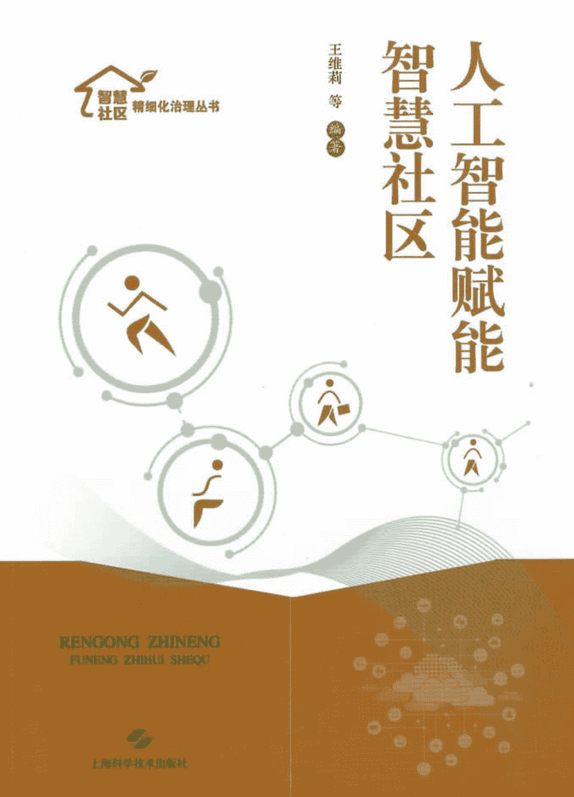

## 智慧社区精细化治理丛书

### 编撰委员会

主　编

韩　新

副主编

丛北华　周晓芳　王维莉

编　委

（以姓氏笔画为序）

马梦菲　叶伙荣　冯冰洋　齐　力　孙少华　李子铨　李晓恋

吴松洋　吴轶轩　时　宇　张　旺　张红忠　张美璟　范勤勤

林　翔　周昌志　房彦锋　秦春磊　徐会军　徐韵如　黄凤彬

谢启苗　雷　琰　鲍　亮

## 丛书前言

社区是城市肌体的细胞，也是居民栖居与心灵归属的地方。做强社区建设，能够更好发挥其在经济发展、城区繁荣、社会稳定和便民服务等方面的支撑作用，是提升城市竞争力、增强城市温度、塑造城市特色、提高综合实力的关键路径，也是新形势下推进城市现代化的必然要求。

近些年我国智慧城市建设加速。以人中心、提供智慧便捷服务、让数据多跑路让群众少跑腿的理念，正在向交通、城管、医疗、环保、社区等领域渗透，推动公共服务更完善、管理更体系化、生活更便利。社区作为智慧城市的基础模块，各级政府正加快智慧社区落地，补齐信息采集滞后、服务分散、科技支撑不足等问题，最大化发挥社区服务居民的基底职能。

当前，服务新发展格局的城市数字化转型已成战略重点。站在城市是生命体的整体视角，用数字化手段破解智慧社区建设难题的需求愈发迫切。但学界对智慧社区的认识仍不完全一致，精细化治理的技术尚在成熟中，数字化背景下的系统化路径仍在探索。特别是2020年年初新冠肺炎疫情的突然到来，以人工智能、大数据、云计算为核心的科学精细化应对方案，为社区防疫提供了有力支撑，成为公共卫生应急中的亮点。为回应社区全方位发展的需求，在上海科委科研项目“人工智能赋能智慧社区综合管理平台关键技术研究及示范（项目编号：19dz1209600）”支持下，我们策划出版“智慧社区精细化治理丛书”。

本书系统梳理智慧社区的基本概念、国内外现状与演进趋势，解析物联网、大数据、人工智能在社区构建中的技术架构与要点，并以场景与案例作呈现。内容体现了建设理念的更新，探讨精细化治理在社区场景中的创新模式，并对未来方向与愿景作出展望，有助于智慧城市健康发展、提升城市治理体系与治理能力现代化、营造数字化美好生活体验。

本套丛书共5分册：同济大学韩新等编著的《智慧社区导论》《智慧社区应用场景与典型案例》为综合性内容，前者作通识性阐述，后者聚焦主要场景与案例；同济大学丛北华编著的《智慧社区物联网系统》、公安部第三研究所周晓芳等编著的《智慧社区大数据》、上海海事大学王维莉等编著的《人工智能赋能智慧社区》则分别围绕物联网、大数据、人工智能赋能展开。

读者可通览全套获得系统认知，也可按工作与专业需求择卷阅读。本书面向从事社区治理与人工智能相关工作的技术人员，高校、科研院所相关专业的教师、学生与研究者可作参考，政府管理者了解智慧社区基础知识与管理工作亦有助益。

编撰过程中，作者查阅大量国内外资料，借鉴新加坡、日本、美国、欧洲等国家及港台地区的先进做法，总结国内智慧社区建设实践，并吸收人工智能与城市治理领域的最新研究成果。林伟教授、丁健青教授、曹先艳博士及融创中国控股有限公司等单位提供了研究成果、案例审阅与宝贵建议，在此致谢。

因篇幅庞大、学科跨度广，且人工智能前沿技术仍在演进，加之作者水平有限，疏漏难免，敬请批评指正。

韩　新　同济大学

2021 年 8 月

## 前言

社区既是城市的基本单元，也是城市治理的最后一公里。智慧社区建设的本质，是把智慧城市理念下沉到社区，以居民获得感、幸福感、安全感为导向，依托物联网、大数据、人工智能等新技术，推动社区向智慧化转型。

人工智能赋能智慧社区是引入人工智能后的迭代形态，以海量信息与智能处理为基础的全新社区形态。其以数据为治理要素的核心资源，通过各类智能终端与管理平台，融合机器学习与算法推理，使社区治理具备感知、认知、决策全链条智能能力。赋能后的社区拥有对人、物、事件更全面的感知力，更强的资源整合与数据处理力，更科学的监测分析与辅助决策力，以及更高水平的风险防控与智慧服务力。

本书围绕数据智能驱动的共建共治共享，结合社区公共安全、公共管理、公共服务三大需求，介绍支撑智慧安防、公共卫生防护、灾害应急管理、公共空间治理、公共交通优化、智慧养老助残、个性化精准服务等核心场景实现的人工智能关键技术与算法模型，并从泛在智能视角描绘人性化、智慧化的未来社区图景。

全书围绕典型应用场景，介绍各场景功能实现流程、相关人工智能技术与算法，力求克服市场上重场景描述轻功能实现以及重算法介绍轻社区应用针对性的问题，帮助读者在有限时间内透彻理解人工智能赋能智慧社区的内涵、关键技术与算法流程。内容精炼、重点突出，具有较强引领性。

本书由上海海事大学王维莉博士主编统稿，参编人员包括上海海事大学范勤勤博士、谢启苗博士、王卓、戎加宇。分工如下：第 1、5、6、9 章和附录由王维莉执笔，第 2 章由谢启苗执笔，第 3、7 章由王卓执笔，第 4 章由戎加宇执笔，第 8 章由范勤勤执笔。撰写过程中参考了诸多同行成果，在此致谢。

鉴于作者水平有限且该领域仍在持续探索，书中难免有不足之处，恳请专家与读者批评指正。

作者

2021 年 7 月

# 第 1 章　概论

人口快速增长与城市化加速，城市体量急剧扩张，给城市管理带来新挑战。城市规模扩张带来住房、就业、教育、医疗、养老、治安等方面的压力，亟需高效运转的管理体系应对，智慧城市由此兴起。随着智慧城市推进，社区智慧化已成趋势。2016 年民政部发布的《城乡社区服务体系建设规划（2016—2020 年）》明确提出建设设施智能、服务便捷、管理精细、生态宜居的智慧社区目标。2017 年，中共中央、国务院印发的《关于加强和完善城乡社区治理的意见》要求提升社区信息化应用能力与技术装备水平。随后，《智慧社区建设指南（试行）》《关于推进社区公共服务综合信息平台建设的指导意见》《智慧社（园）区建设评价指标体系研究》等政策相继出台，推动智慧社区建设不断深化。

智慧社区建设是将智慧城市理念引入社区单元，以居民幸福感为起点，通过打造智慧社区为群众提供便利，推动区域社会进步。智慧社区是一个以人为本的智能服务体系，借助物联网等通信技术整合物业、安防、通信等体系，通过网络连接物业管理处，为住户营造安全、舒适、便利的生活环境，形成基于大规模信息智能处理的新型管理模式，提升便民利民智能化水平，实现社区治理供给侧服务平台化、扁平化，达成上下联动、流程透明、管控精准、服务便捷。

## 1.1　人工智能赋能智慧社区内涵

### 1.1.1　智慧社区的概念及内涵

2020 年 7 月，住房和城乡建设部将智慧社区界定为运用物联网、云计算、大数据、人工智能等新一代信息技术，融合社区场景下的人、事、地、物、情、组织等多种数据资源，提供面向政府、物业、居民和企业的社区管理与服务类应用，提升管理与服务科学化、智能化、精细化水平，实现共建共治共享管理模式的一种社区。

智慧社区建设是智慧城市建设在基层的可操作方案，是智慧城市的最后一公里。其治理聚焦提升内部软硬件设施的信息化与智能化水平，从而带动各项事务管理水平提升。

从应用视角看，智慧社区是运用新一代信息技术融合多种网络资源，覆盖智能建筑、智能家居、视频监控、健康医疗、物业管理、数字生活、能耗管理等领域，构建社区人文、生活、经济环境，形成基于海量信息与智能处理的新型管理模式与面向未来的全新社区形态。

从发展思路看，智慧社区是实体社区的虚拟映射与智能操控体，形成虚实对应、互映射、协同交互的复杂巨系统，可在数字化水平较高、需运行机理建模、实现虚实协同优化、需多维智能决策支撑的领域优先落地。通过六化发展思路，即实现全要素数字化与虚拟化、全状态实时化与可视化、管理决策协同化与智能化，在一张总图管控到底、虚实融合一盘棋、服务一窗式主动个性化三类场景中应用，逐步实现社区智能运行与迭代创新。

### 1.1.2　人工智能的发展及赋能作用

人工智能概念诞生于1956年。半个多世纪以来，受算法、算力、存储等制约，其发展经历多次起伏。2006年起，以深度学习为代表的机器学习在机器视觉、语音识别等领域取得突破，准确率大幅提升，人工智能再次成为学界与产业关注焦点。云计算、大数据提升运算速度与降低成本，为算法训练提供丰富数据，推动发展模式从计算机模拟智能转向人机结合增强智能、人机网群智系统、人机网物复合智能系统。

作为新一轮产业变革的核心驱动，人工智能在催生新技术新产品同时，对传统行业具备强赋能效应，可重塑经济结构、整体跃升社会生产力。它将人从枯燥劳动中解放，简单、重复、危险任务逐步由系统承担，在减少人力投入、提升效率的同时实现更快速更准确输出。人工智能还在教育、医疗、养老、环境保护、城市运行、司法服务等领域广泛应用，大幅提升公共服务精准化水平，改善人民生活品质。它还能帮助人类精准感知、预测、预警基础设施与社会安全运行态势，把握群体认知与心理变化，主动决策响应，显著提升治理能力与公共安全保障。

人工智能正成为撬动技术与产业变革的重要力量，重塑思维逻辑、决策方式与管理模式，解构信息传播方式、主体行为习惯与社会利益格局，重塑政府、市场与社会关系，推动社会治理迈向网络化、社会化、智慧化新时代，开辟社会治理新格局。

在新时代，人民对美好生活的需求日益增强，社区居民尤其渴望高效、便捷、智能的服务。智慧社区建设通过信息化手段整合社区分散资源，让居民足不出户享受优质服务，在一定程度上缓解发展不平衡不充分问题，增强归属感、舒适感与未来感。

人工智能赋能智慧社区是引入人工智能后的迭代升级，是一种基于海量信息与智能处理的全新形态，人工智能社区内涵如图1-1所示。

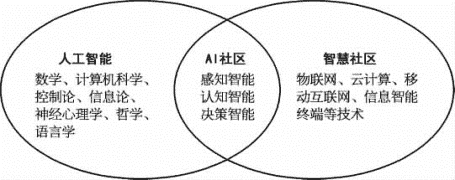

图 1-1　人工智能社区的内涵

具体而言，人工智能赋能智慧社区是在已应用物联网、大数据等信息技术的基础上，融合机器学习、算法推理等技术，提升治理与公共服务智能化水平，重构居民生活与社会组织关系的新型治理模式。

这并非对原有数字化、信息化模式的简单升级，也不是单纯引入视频监控、物联网、移动互联网等技术，而应视为社区治理从信息化向计算机辅助决策的智能化跃升，具体体现为四个能力：更全面的对人、物、事件的信息感知能力，更强大的信息资源整合与数据处理能力，更科学的监测分析与辅助决策能力，更高水平的风险防控与智慧服务能力。其核心特征是以数据为治理要素重要资源，通过各类智能终端与管理平台，使社区治理具备感知—认知—决策全链条智能化能力。

### 1.1.3　人工智能创新社区治理生态

党的十九届四中全会提出建设社会治理共同体新目标，强调加强和创新社会治理，健全运用互联网、大数据等技术手段进行行政管理的制度规则。党的十九大报告提出推动社会治理重心下移，发挥社会组织作用，实现政府治理与社会调节、居民自治良性互动。社区作为社会治理系统重要组成部分，率先创新智慧化、精细化建设，对推进治理现代化和完善国家公共服务体系具有重要实践意义。

基于全域集理论构建的社区治理体系将智慧社区比作人类大脑，全域集模拟人类对客观世界认识抽象过程的数学表述。人类面对的实际环境是混乱的数据世界，其认识过程与基于大数据的智慧社区治理具有高度一致的逻辑。只要找到模拟人类认识过程的数据描述理论体系，即可实现智慧社区有效治理。解决该问题可将数据管理以数学集合论形式抽象，应用基于全域集理论的数据管理模式分析治理过程。

作为复杂系统工程，基于人工智能技术的智慧社区治理能够超越传统粗放、经验化管理，克服社区管理对城市创新活力、创新能力跃升的制约，打破管理者与被管理者行政边界，以及公共部门间、公共与私人部门间的工作边界，建立政府、企业、社会组织、基层群众共同参与的多主体治理机制。作为增量式改革与公共服务供给侧结构性改革，超大型城市社会精细化治理将推进人工智能赋能的社区治理与服务，既是新时代城市内涵式发展的时代要求与可持续发展的结构性支撑，也是实现城市治理体系和治理能力现代化的必由之路。

## 1.2　人工智能赋能智慧社区主要应用体系

目前，人工智能在社区的应用主要围绕公共安全、公共管理、公共服务三大核心需求，重点在态势监测、风险预测、辅助决策三个方向赋能，构建了智慧安防、智慧消防、智慧防疫、智慧物业、智慧养老、智慧医疗、智慧家居、智慧商区等多个典型模块，这些应用呈现差异化、多样化与阶段性特征。随着发展演进，更多场景将融入人工智能社区总体架构，形成可扩充、可迭代、可复制、可推广的模式体系，进一步提升治理智能化与精细化水平。

### 1.2.1　人工智能赋能社区公共安全

新时代背景下，社区公共安全意义重大，加强风险防控精细化管理有助于社会健康有序和谐发展。社区公共安全指同一地区大多数人生命健康受保障、公私财产受保护，主要体现在外部环境安定、规章制度健全、居民公共服务能力。达标社区至少需具备两点：一是为全体居民制定积极的公共安全规划；二是地方政府为居民提供安全服务。社区公共安全管理中风险具有复杂性与深刻性，需采用风险防控与以管理为中心的精细化手段，优化治理发展目标。

公共安全是人工智能技术在社区落地较广且相对成熟的领域，涉及网络、软件、安防等专业，形成智慧安防、智慧防疫、智慧应急等主要场景。智慧社区公共安全应用通过多维度采集、感知与联动，依托人脸大数据、人体大数据、物联网大数据等后台技术实现无感采集、无感预警、多级布控，大幅提升社区安全水平。

智慧安防融合社区综合治理中心、网格中心、公安、城管、党建、民政等数据平台，通过视频监控、出入口控制、人员车辆卡口、信息卡口、移动巡防等传感器，以及无线信号探针、一键求助设备等前端，实现数据实时采集与即时预警；事件处置完成后需反馈、拍照，结果存入系统形成闭环，构建基层立体化治安防控体系，为社区提供全面安全保障。系统也可通过安全边界接入平台对接当地公安信息网，并关联关注人员、重点人员、涉事前科人员等信息，结合社区采集信息比对碰撞，提前预警。同时，公安部门可利用社区系统进行布控预警、信息搜集、模型训练研判，保障居民安全与良好治安环境。

在智慧防疫方面，通过互联网、物联网、路网监控与移动互联等技术，将居民、社会机构、政府机构等信息资源整合至数据计算中心，进行统计分析，连接居民、社区工作人员、物资提供者、卫生组织与运营管理商，实现信息互联，保障公共卫生安全。

在智慧应急方面，社区加装烟感、温度、可燃气体探测等传感器并通过物联网连接，实现火灾预警、全境监测、智能巡检，推动消防由被动管理向主动管理演进。同时，智慧社区为公众参与提供更多灾害防治渠道与合作平台，提升公众参与意愿与交互率，将各主体组织成不同功能团队，更好应对复杂灾害。例如，依托社区综合管理平台便捷高效与信息容量大的特点，通过共享信息、协调资源、提供合作机会，促进各主体协同救灾。各主体也可通过网络平台迅速发布救援组织人员信息，提供线上线下参与渠道，吸引公众参与志愿行动，促进互动交流与协调。

第2至第4章聚焦邻里公共安全议题，覆盖防范、卫生防护、灾害应对三大方向。每类议题先明确功能诉求，再拆解实现路径的技术要点，最后配以落地方案作参考。

### 1.2.2　AI助力街区日常治理
在日常运维层面，AI主要切入高空抛物管控、电动自行车规范、智慧泊车、通勤优化等场景。核心做法是数据关联与智能信息处理，对小区采集的大量原始信息进行整合与挖掘，找规律、找关联、挖内涵，提前排查风险、破解长期顽疾。借助智能中台，通过人脸核验、通行异常、陌生人员逗留等基础要素的联合分析，可预判群租、传销式居住等潜在隐患；依托视频监控与图像识别，对高空抛物、车身损伤、乱倒垃圾等顽症进行取证与治理。中台还能覆盖水质、窨井、车辆等运维事项，实现机动车与非机动车的停放与充电有序管理，推动治理向精细化迈进。

本书第5、第6章围绕街区公共管理展开，重点解读高空抛物治理、电动自行车禁入梯道管理、智能充电设施规划、智慧停车、智慧路灯杆、慢行交通规划等场景的功能需求、技术路线与落地实践。

### 1.2.3 AI赋能街区公共服务
街区承担的功能日益丰富，社会共识正从安全与管理转向服务供给。智能街区建设植入互联互通、智能高效、共治共享、绿色低碳、开放包容等理念，结合新一代信息技术的迭代应用，以居民全生命周期需求为牵引——幼有所育、学有所教、劳有所得、病有所医、老有所养、住有所居、弱有所扶——提供配套综合服务支撑，有效提升物业服务品质。借助街区智能中台打通各子系统，实现事件的智能监控、智能响应与智能控制，初步用于报事报修、远程抄表、环境监测等基础服务，并延伸至环卫、养老等领域，支撑垃圾分类与溢满告警、居家老人远程看护、大气粉尘与噪声监测等，为居民营造归属、获得、幸福与安全感。

第7、第8章聚焦街区公共服务应用，重点介绍居家养老、智慧配送、智慧教育、智慧物业等场景的功能需求、技术拆解与典型案例。

## 1.3 AI赋能智能街区关键支撑技术
从AI视角看，智能街区是其重要落地形态；从治理视角看，AI是管理智能化的工具与手段。其技术体系可概括为四环节：感知理解，通过智能感知与解析把视频、图像等非结构化信息转为结构化信息；推理分析，汇聚多领域结构化数据，结合业务规则构建知识模型，进行比对、推理与分析，输出决策洞察；学习深化，从知识大数据中抽取关键要素，利用神经网络持续学习与认知，优化计算模型；人机交互则借助增强现实、虚拟现实等技术实现自然友好的交互体验。

### 1.3.1 精准感知与智能识别
#### 1）数据感知与传输
当前研究热点集中于智能前置能力提升，研发适配前端计算节点的轻量级算法、程序库与分析模型，降低资源占用，提升前端芯片与传感器性能，由“事后调阅录像”转向“事中即时响应”，增强实时性与监控价值。在5G推广背景下，开展5G在街区智能化治理中的应用研究，解决高吞吐数据快速传输问题，同时构建与5G协同的高可靠低时延监测采集体系、高吞吐数据挖掘分析体系、同步预警体系与前后端一体化管理平台，形成全覆盖、全天候、智能化的数据传输网络。

#### 2）智能识别
智能识别是指通过特定装置自动获取人或物特征信息并传输至后台处理的通用能力，可分为生命体识别与非生命体识别。在街区场景中，人脸识别与车牌识别最为核心。

人脸识别基于面部生物特征进行身份鉴别，通过摄像机采集含人脸的图像或视频流，检测、跟踪并识别人脸。在门禁场景中，需先建立人脸信息库，采集并存储授权人员数据。访客到访时，系统采集实时面部信息并与库内数据比对，比中则自动开门放行；比对前需对人像进行预处理以抵消表情、光照等因素干扰。比对成功则下发开门指令，若失败则记录访客人脸信息以备后续核查。

车牌识别包含车牌定位与字符识别。定位通过颜色、纹理、形状等特征从图像中提取车牌区域；字符识别则对提取区域进行预处理与几何校正后，使用AI算法识别字符。流程为从视频图像中确定车牌范围、分离字符、输出车牌号码。在小区进出管理中，设备记录牌照与时间并联动门禁放行；在智慧停车场景中，入口识别与显示屏联动统计车位，配合支付系统实现自动计费，提升效率。

### 1.3.2 数据治理与价值挖掘
智慧平安街区建设的第一步是统一汇聚街区视频、人员、车辆、出入口、门禁、消防传感等基础数据，形成视频库、人员库、车辆库、房屋库、出入库、报警库、门禁库等专题数据库。

#### 1）海量数据治理
现有大数据面临体量庞大、非结构化占比高、跨系统共享困难、质量参差不齐等问题。需针对街区非结构化视频监控数据、结构化职能部门数据及社会资源数据，研究采集与多源异构融合标准，构建跨媒体跨平台的大数据池与结构化数据库，为综合管理应用提供数据基础。数据价值最终体现在应用上，汇聚后的海量数据经AI与大数据分析后，可为上层智能应用提供支撑，既便利居民，也为管理部门提供及时准确的决策依据。

#### 2）大数据价值挖掘
面向人、车、物、场地等多模态复杂场景，需按业务目标对数据进行探索分析，通过算法挖掘隐藏价值并模型化。除了算法优化，系统设计人员需深刻理解业务场景，找到关键数据，实现业务、数据与技术的结合。公共服务领域，大数据推动管理模式从指令导向、供给导向转向人本导向、需求导向，提供更优质个性化服务。例如疫情防控中，“街区大脑”借助大数据实现溯源监测、态势研判与预警、防控部署及流动人员统计，支撑精准防范。商业服务领域，数据挖掘可提升街区商业数据的准确性与时效性，降低交易摩擦，助力企业发现细分市场机会，实现精准营销与精细化运营。

### 1.3.3 AI辅助决策
街区决策涵盖政务决策、商业决策与公共服务决策。政务决策关乎规划、政策与措施，失误将带来社会成本。大数据使管理与服务全过程全员可监督，为防范管理行为失范提供可能。基于AI的大数据分析可量化街区基本要素，构建居民、车辆、设施等行为模型，搭建数字孪生系统，实现复杂业务的信息协同感知，实时呈现街区全状态与全信息，依据历史数据与当前决策推演未来走向，形成可评估的决策标准，持续修正决策体系，辅助管理者做出科学理性判断，减少对直觉的过度依赖。

### 1.3.4 人机交互与虚拟现实
#### 1）人机交互技术
人机交互研究信息在人机之间的双向交换，涵盖语音识别、手势识别、表情识别、肢体动作识别等，核心是实现像人与人交流一样自然流畅的互动。

##### （1）街区医疗方面
构建医疗信息平台，借助物联网实现患者、医务人员、设备、机构间的互动，提升服务效率。

##### （2）街区管理方面
人脸识别门禁实现“刷脸”通行，减少携带卡件与接触风险；路灯与楼道照明通过感应系统实现有人或声响自动点亮，节能减耗；电梯配备嵌入式信号控制系统，通过人机交互实现召唤、选层、信息显示、语音视频信号采集与运行监测，保障安全运行。

##### （3）智能家居方面
指纹锁、刷脸解锁替代传统钥匙；智能控制设备通过物联网联动家电，实现语音唤醒、灯光感应、温湿度自动调节与异常报警，提升居住体验。

##### （4）街区消费方面
智能结算终端将点餐信息传输至后厨，自动识别菜品、连接结算系统，支持快捷支付，完成信息交互与资金结算，提升效率。

##### （5）街区疫情防控方面
入口部署红外测温仪配合人脸识别，监控体温异常人员轨迹与身份。终端通过摄像头识别人脸，结合热像仪读取面部温度并显示，异常时报警并上传管理系统，实现健康预警与评估。

#### 2）虚拟现实与增强现实技术
虚拟现实VR／增强现实AR是以计算机为核心的视听技术，在一定范围内生成视觉、听觉、触感高度拟真的数字环境，用户借助设备与环境互动，获得沉浸式体验。其技术体系分为获取与建模、分析与利用、交换与分发、展示与交互、技术标准与评价体系五个阶段。获取与建模聚焦物理世界与创意的数字化建模；分析与利用关注数字内容的语义表示与分析；交换与分发强调大规模内容流通与个性化服务；展示与交互追求符合人类习惯的显示与交互方式；标准与评价体系则规范资源、编目、编码等并提供评估方法。

# 第 2 章 AI赋能智能街区的公共安全防范
智能街区公共安全管理需整体规划，通过网络化、智慧化、层次化的设计，将分散的孤立信息与基础设备资源整合为网络化节点，形成智能化街区要素网络，强化人与人、人与物、物与物之间的联系。通过整体安全态势感知，可及时掌握风险源与演化态势，提前预警防范；面对突发事件，可实现多部门信息共享、资源调度与协同处置，提升应急决策效率。

## 2.1 智能街区安防应用场景
智慧平安街区是AI在公共安全领域的典型应用。街区安防设施包括楼宇对讲、门禁、视频监控、车行道闸等。AI在街区中广泛用于人员、车辆、物体鉴别，人脸识别因舒适度高、可用性强、准确率高、成本可控，在出入口场景得到普及。对复杂环境下的图像视频，采用专用垂直算法优化，支持多角度、多姿态、复杂光线下的快速识别。AI图像识别还能准确提取车牌号码、车身颜色、车辆类型等特征，便于车辆通行与管理。

### 2.1.1 街区基础信息采集
街区数据碎片化与管理分散导致案件追溯困难。通过对小区出入口、单元楼道口、公共区域、学校商铺等感知设备改造或接入，实现人脸、人体、行为、车辆、人车特征、RFID、WiFi探针、传感等多维信息的统一汇聚。结合多维感知、智能分析与大数据研判，可分析人员异常、房屋异常、车辆异常，发现违法犯罪线索与安全隐患，结合公安业务信息构建数据资源库，提供智能研判与多维查询，为案件侦破与事后查证提供支撑。

### 2.1.2 街区实有人口管理
在主要出入口部署人脸摄像机，结合人脸识别与聚类技术，实现实有人口的精准掌握，为民警动态采集提供依据。

#### 1）街区实有人口底数分析
对接公安已登记的户籍人口、外来人口、人户分离、境外人口，结合月度、季度等周期内频繁活动人员的人脸聚类统计，进行关联碰撞，摸清小区实有人口底数。

#### 2）未登记人员采集
将一段时间内在街区被抓拍的人员与公安人口库比对，未命中者归类为未登记人员，系统自动推送至采集员核查登记，补充人口库信息。

#### 3）离开、注销人员采集
对长期无抓拍记录的实有居住人员推送给采集员，经核实后变更实有人口信息。

#### 4）人户分离采集
通过进出街区的智能感知与人脸识别，将居住信息与公安库比对，分析是否存在人户分离变动，经核查后更新信息。

#### 5）居住地址变更采集
利用人脸识别分析流动人员一段时间内居住地址与登记地址不一致的情况，经核查登记后更新，保证人口信息的鲜活性。

### 2.1.3 街区重点人员管理
通过智能感知与人脸识别，帮助民警及时掌握辖区重点人员动态，为情报研判提供依据。

#### 1）即时比对
利用多道视频监控进行人员感知，实时比对重点人员库，对活动频繁或隐匿等异常行为预警提醒。

#### 2）布防布控
对进出人员进行视频感知与人脸识别，实现单目标、多目标重点人员的布控检测与预警。

#### 3）轨迹分析
基于多点位的人脸抓拍与识别记录，刻画重点人员轨迹，为研判提供支撑。

#### 4）动态掌控
通过视频监控与人脸抓拍采集的信息，反映重点人员近期在街区的活动情况，自动推送提醒民警。

### 2.1.4 异常行为识别分析
为满足安全防范需求，可在出入口与公共区域对人员出行规律进行分析，提取规则并对异常可疑行为进行标注。

#### 1）昼伏夜出

在居住区门禁及公共空间的通行记录里，针对可自定时间窗内呈现“白天少见、夜间活跃”出行模式的人员进行筛选，该判定阈值可在平台后台自定义配置。

#### 2）夜间高频外出
夜间时段可自定义，被摄像头记录的外来人员会被标注夜间出行标识。平台可对未入库的居民面部库之外、符合夜间高频外出特征的陌生个体进行挖掘，并累计其在小区内的出现频次进行展示，相关规则支持在系统内按需设定。

#### 3）长期居家
针对已登记住户，在小区进出口或公共空间的监测范围内，统计设定周期内的在场天数与缺席天数。当出现频次明显低于常态水平且符合长期居家模型时，系统将其抽取出来，判定标准可在平台灵活调整。

#### 4）潜在踩点盗窃研判
系统关联门禁及公共空间的进出日志。对非本小区人员，若在可设周期内多次进出不同楼栋，或跨小区数据显示其在同一时段反复出入多个小区，则与公安盗窃前科库比对，初步判定为踩点嫌疑并触发预警。

### 2.1.5 房屋异常识别分析

### 1）违规生产经营嫌疑
按户归档住址、常住人口、房屋信息、单位信息及水电费、物业费等数据。对每户水电用量进行统计，当费用增速超过预设阈值时，初步判断为违规生产或商业用途嫌疑。

### 2）隐性租赁研判
结合业务模型识别登记为自住但呈现租赁特征的房屋，并参考物业采集的访客登记。若同一住址短期内有多人反复登记到访，或不同人员呈现规律性出入，则判定为未备案出租，异常触发后由社区民警督促物业核查或上门确认。

### 3）人员拥挤租赁研判
当大量外来人员频繁出入某套租赁房，且出入时间规律稳定，例如规律性早晚通勤，可推断其在该处居住。若居住密度超出面积对应的合理上限，则初步判定为群租风险。

### 2.1.6 车辆异常识别分析
针对小区进出口及停车场的车辆通行规律进行分析，提取行为特征并对异常情形打标签。与人员异常模型类似，另补充长期停放车辆识别：对已登记与未登记车辆，若进入小区后超过设定时长无通行记录，则符合长期停放异常规则，系统可调取车辆基础信息、推测车主信息及最后一次抓拍数据。

## 2.2 社区信息无感采集分析
随着前期技防建设，小区已部署大量视频监控。对视频进行智能解析主要有集中式计算与边缘式计算两种思路。集中式方案对中心机房算力、网络带宽与运维要求高，投入大。借助人工智能芯片发展，边缘侧实时初筛的边缘计算已成主流。AI边缘计算系统架构图如图 2-1 所示。

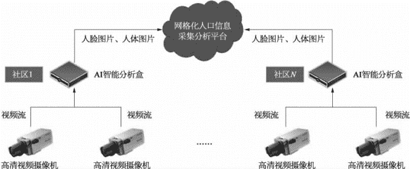

图 2-1 `AI`边缘计算系统架构图

### 2.2.1 社区人员信息智能采集
面部信息采集系统集成领先的面部检测、跟踪、质量评分与面部识别算法，对小区重点场所及通行通道进行面部抓拍、识别与属性提取，构建海量面部特征库。在重点部位布设面部卡口，对进出人员进行抓拍与特征分析，为管理部门提供快速检索、定位、黑名单布控及轨迹还原与嫌疑排查能力。该系统是视频分析、运动跟踪、面部检测与识别技术在监控领域的综合应用。

#### 2.2.1.1 人脸检测与识别技术
面部识别是依托图像理解、模式识别、计算机视觉、统计学与人工智能，对面部特征进行身份鉴别的生物识别技术，具有可靠、操作简便、无接触等特点，是当前生物识别领域活跃方向之一。主流技术包括基于几何特征的方法、特征脸方法以及卷积神经网络方法。几何特征法历史较早，通常需配合其他算法；特征脸法由 Turk 与 Pentland 于 20 世纪 90 年代提出，基于主成分分析，简洁有效；卷积神经网络法近几年发展迅速，因深层结构与强大学习能力，已成为面部特征提取与识别的主流。

面部聚类依托计算机视觉、机器学习与大数据处理，对海量面像特征进行关联归类，将同一人的多张影像聚为一类，实现按人归档。通过大规模聚类服务，可建立人员活动轨迹库并实时更新，还能进行轨迹碰撞分析。人脸识别与人脸聚类流程图如图 2-2 所示。

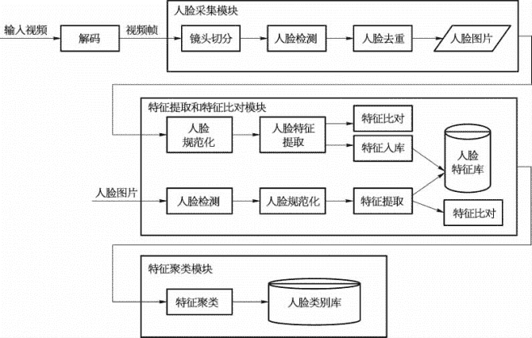

图 2-2 人脸识别和人脸聚类流程图

##### 1）人脸识别系统组成
面部识别系统由面部图像采集与检测、面部图像预处理、面部图像特征提取、面部图像匹配与识别等环节构成，其流程如图 2-3 所示。

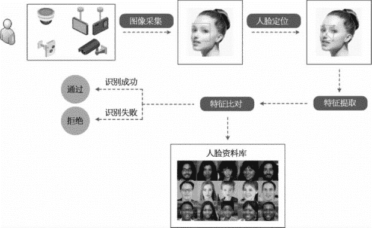

图 2-3 人脸识别技术流程

（1）人脸图像采集及检测。摄像头采集面部图像后，利用直方图、颜色、模板、结构及哈尔等模式特征完成面部检测。

（2）人脸图像预处理。采集到的面部受环境干扰大，需进行灰度校正、噪声滤除等预处理以提升可用性。

（3）人脸图像特征提取。可使用视觉特征、像素统计特征、变换系数特征、代数特征等进行表征，属于对面部进行特征建模的过程。

（4）人脸图像匹配与识别。将提取的特征与库中模板进行比对，设定相似度阈值，超过阈值则判定匹配成功，完成身份判断。

系统可导入户籍或常住地在本地的吸毒人员、在逃人员、前科人员及其他管控人员的人像及信息，建立布控库。前端抓拍的面部会与布控库实时比对，相似度达到报警阈值时自动触发实时告警，布控可按时间、地点、等级与相似度阈值设定。

##### 2）人脸识别技术难点
当前主要难点包括：

（1）人脸特征的高效提取。光照、姿态、饰品、遮挡等因素会干扰特征提取；不同年龄段识别率差异明显，年龄变化带来的影响需解决；随着面部库规模扩大，算法性能易下降，如何保持大规模环境下的识别率是关键。

（2）低准确率情况下的身份核验。环境因素可能导致部分特征错误或识别率偏低，带来核验准确性问题，需借助机器学习自动修正识别偏差。

（3）多厂家算法兼容与聚类。不同项目可能采用不同厂商算法，如何兼容并有效聚类，降低重复投资，具有重要意义。

#### 2.2.1.2 基于机器视觉的人员跟踪技术

##### 1）单视角目标跟踪
视觉跟踪系统通常由搜索策略、特征提取与观测模型构成。常用搜索策略有均值漂移、粒子滤波、循环密集采样等；特征提取包括人工特征与学习特征；观测模型多分为生成式与判别式。

生成式模型基于目标表观构建模型，在图像中寻找最匹配区域。无论全局或局部特征，其本质是在高维空间寻找邻近候选，但缺点是忽略背景信息。

判别式模型同时考虑目标与背景，将跟踪视作分类或回归问题，旨在分离目标。典型方法为相关滤波，利用循环矩阵与快速傅里叶变换提升速度，成为主流框架。

基于深度学习的跟踪主要利用深度特征的表征力，按使用方式可分为基于预训练深度特征与基于离线训练特征两类。

##### 2）跨视角目标跟踪
基于跨视角匹配的目标跟踪流程如图 2-4 所示。

（1）相机初始化。对相机进行标定，确定内外参数，建立三维到二维的成像几何模型。

（2）提取运动目标。构建背景模型，用当前帧减去背景得到前景，进行轮廓提取获得运动目标。

（3）目标跟踪。对每个运动目标进行跟踪，若与已有跟踪器匹配则视为旧目标并更新；否则进入跨视角关联匹配。

（4）跨视角关联。将待匹配目标与其它视角相机获取的运动目标进行匹配，采用脚底坐标与头部坐标评估方式，未匹配则判定为新目标进入行人检测，已匹配则更新跟踪器。

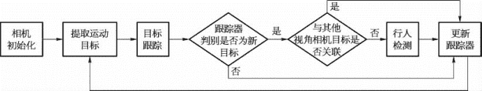

图 2-4 跨视角目标跟踪流程图

①基于脚底坐标的跨视角匹配。同一目标的脚底在真实世界三维坐标中固定不变，不同视角的像素坐标转换后应重合，这是该策略的核心。

②基于头部坐标的跨视角匹配。通过重建头部的三维世界坐标并评估合理性进行匹配。

（5）行人检测。对新出现的目标进行人员检测，若为人员则注册跟踪器并在后续帧中持续跟踪。

### 2.2.2 社区车牌智能识别分析
车牌识别的任务是对视频流中复杂背景的车辆图像进行处理，定位牌照、分割字符并自动识别数字、字母与汉字。其技术融合数字图像处理、模式识别与人工智能，可实时输出可机读的识别结果。

车牌识别的关键在于车牌定位、字符分割与字符识别三部分，如图 2-5 所示。定位的准确性直接决定后续分割与识别效果，是整个系统的核心。字符分割旨在将字母、数字与汉字独立截取，光学字符识别则将图像转为文本。

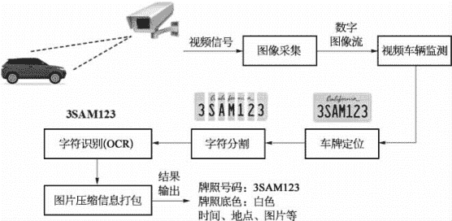

图 2-5 车牌识别技术流程

#### 2.2.2.1 车牌定位
车牌定位是从车辆图像中截取牌照区域。

##### 1）车牌定位算法分类
总体分为基于图形图像学的方法与基于机器学习的方法。

（1）基于图形图像学。如边缘检测定位、颜色定位，易受外界干扰产生大量候选区域，增加系统负载。实现步骤为图像预处理、形态学处理、轮廓查找与精确定位。

（2）基于机器学习。如特征工程定位、神经网络定位，关键在于特征选择与训练方法。流程为准备带标注训练数据、构建神经网络、模型训练与效果评估。

##### 2）常见车牌定位方法
（1）基于彩色分割的方法。采用多层感知器对彩色图像进行分割，再以投影法提取潜在牌照区域。彩色空间常由 RGB 转为 HSI 以更好反映颜色，随后对饱和度做对数调整减少光照影响。颜色差异明显时准确率较高，但在颜色相近时计算耗时。

（2）基于灰度纹理特征分析的方法。将彩色图转为灰度图后进行行扫描，记录每行中可能的牌照线段，连续多行满足阈值则形成候选区域，再进行列扫描确定完整位置。对倾斜、变形及光照不均有较好鲁棒性，但对噪声敏感，可结合垂直投影改善复杂背景效果。

（3）基于小波分析与数学形态学的方法。小波多尺度分解可提取不同分辨率与方向的边缘子图，结合牌照在水平低频、垂直高频的特性提取目标，再用形态学运算去除噪声。噪声小时定位效果与精度较好，但速度较慢且噪声大时易误定位。

#### 2.2.2.2 车牌字符分割
字符分割是将牌照区域中每个字符单独截取。常用方法有连通域标记、图像投影与几何特征法。

1）基于连通域标记的算法。理想情况下除汉字外其余字符相互独立。算法先进行连通区域标记，再筛选尺寸接近字符的区域，按间距与排列确定位置，最后定位汉字。对图像质量要求高，粘连、断裂或与边框粘连会影响结果。

2）基于图像投影的算法。遍历图片统计每列白色像素数形成投影图，通过投影谷值找到字符间分割点再完成切割。该方法应用广泛、效率较高。

#### 2.2.2.3 车牌字符识别
字符识别是将分割后的字符图像转为正确字符并拼接为完整车牌号。应用场景关注准确率与速度，一般停车场在牌照完好时识别率应达 95% 以上，速度控制在 1 秒以内。主流方法有：

（1）模板匹配。建立标准字符模板库，将待识别字符归一化后与模板计算相似度，取最大值作为结果。对清晰无倾斜图像效果较好。

（2）神经网络。如 BP 神经网络与卷积神经网络，先提取梯度、灰度统计等特征，构建网络并训练后进行识别。

（3）支持向量机。先提取样本特征进行训练，再用于分类，本质与神经网络类似，均属机器学习方法。

## 2.3 街区风险人群异常动向识别

基层单元是社会治理与公共安全的末端载体，安全街区建设被高度重视。中共中央办公厅、国务院办公厅印发的《关于推进城市安全发展的意见》要求强化安全街区建设，完善网格化管理体系。活动在街区范围、会对国家安全、社会秩序及公民人身财产安全形成较大威胁的对象统称治安高风险人群，涵盖既往有案底者、涉毒者、在逃者及肇事肇祸精神障碍患者等，违法犯罪概率偏高，社会危害性突出。中国疾病预防控制中心精神卫生中心数据显示，截至2017年末全国严重精神障碍患者超1600万，其中约10%存在肇事肇祸风险。公安部《2020年中国毒品形势报告》指出，截至2020年末全国登记吸毒人数达180.1万，不含戒断三年未复吸、死亡及离境人员。毒品滥用不但严重损害使用者及家庭，也易诱发暴力伤害、毒驾、以盗养吸等违法行为。对风险人群实施有效管控，是预防违法犯罪、维护治安稳定的关键抓手。

## 2.3 异常动线预警预测架构

随基层信息化推进，街区内布设大量面部识别点、车辆闸口及无线电子围栏等物联网感知终端，用于核验身份并采集活动路径，为风险人群异常动线的识别与预警提供数据支撑。国内外研究表明，基于时空连续路径可挖掘出伴随、聚集、高频往返等常见模式，也可捕捉离群、昼伏夜出等特殊模式。将人员、车辆路径与路网、兴趣点POI等信息融合，可在环境约束下刻画规律，为异常动线识别提供技术支撑。

对重点对象的路径刻画大致分三步：先采集行动路径，再对原始数据进行清洗，最后完成分类并提取重点个体的行为路径。

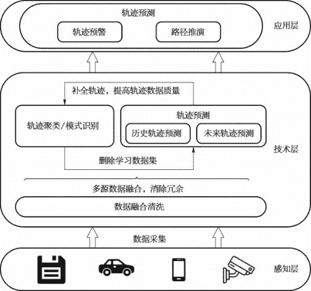

图 2-6 异常轨迹预警预测框架示意

### 2.3.1 轨迹采集环节

智能手机、智能手环等移动终端普及后，实时位置获取变得便捷，结合街区监控图像分析与无线定位技术，可精准获知个体当前所在位置乃至楼层。针对重点对象，连续记录不同时刻的位置，即可还原该时段内的行为路径。

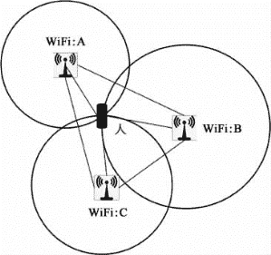

图 2-7 WiFi定位原理示意

1）对街区内有摄像头的区域进行图像处理，统计实时人流；未被摄像头覆盖的区域借助无线定位获取终端信息，同一账号下多设备计为一人。可据此实现街区热力图、人员密度、行人路径预警等功能。
2）依托跨摄像头目标检测与无线定位，可实现建筑、楼层级别的高精度行为路径绘制。

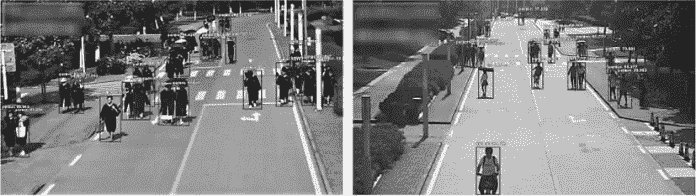

图 2-8 室外监控下人员轨迹示意

### 2.3.2 动态轨迹归一化

多源动态路径需统一标定。采集方式分为主动与被动两类。主动指风险人群佩戴定位设备并上报卫星定位信息，主要适用于社区矫正等少数可强制管理对象；被动指利用面部识别、监控点位、交通闸口、无线电子围栏等物联网终端识别身份并记录路径，适用于无法强制携带定位设备的对象。

1）主动上报路径场景下的标定
卫星定位邻近驻留点时间间隔短、空间位置相近，可采用时空聚类法降维。重点个体的提取在于从普通居民中辨识出来。个体的行为路径往往与其社交关系存在关联，关联越紧密相似度越高，且人群迁移具有显著可预测性。可依托街区重点人群行为特征构建时空路径分类模型，利用海量数据持续训练调整，从而预测路径或推断个体类别。

2）被动获取路径场景下的标定
在重点区域部署面部识别点、车辆闸口、无线电子围栏等传感器，将观测点位置近似为驻留点。观测点分为两类：①面状观测点。具有特定功能的面状区域，由经纬度点或中心点加覆盖半径确定。风险人群进入即生成路径记录。②交通路口观测点。人员在不同场所间迁移沿路网进行，重要路口布设可捕捉动态路径。

### 2.3.3 轨迹数据处理

不同来源的时空数据精度与特性各异，直接分析易产生偏差。采集过程中受卫星定位误差、信号遮挡等影响，可能出现数据缺失、不准、重复或不一致。需对不完整、不准确、重复记录和不一致数据进行清理。

1）路径缺失补全方法
常见做法有三种：统计插补、运动学内插与概率时空地理。
统计插补依据缺失变量的概率分布，用随机值、均值、中位数或最大似然估计等替代；对序列数据可采用隐马尔可夫链等方法挖掘时间规律。常用的统计插补包括个案剔除、均值替换、热卡填充、回归替换和多重插补。
运动学内插按运动学模型对两点间缺失段进行插值。线性内插假设匀速直线运动，是最简模型。随机游走模型基于随机过程原理实现平面随机活动的插值，源自计算机图形学曲线插值方法。
概率时空地理引入历史路径先验知识，对路径重建有一定潜力。但现有模型多聚焦两点间在限定时间内的访问概率，未充分考虑极长时段缺失情形。在此情况下定向随机游走与截断布朗桥模型的访问概率计算会产生较大偏差。个体活动具有内在规律性，可用地点对频次、相对时间出现频次、地点序列频次、停留时长分布等特征表达。概率时空地理模型在街区重点人群刻画中存在两点不足：一是难以精准反映风险人群行为特点，二是遇到长时间缺失易得出异常结果。路径分析重建需综合历史路径位置访问频次、相邻或特定序列出现频次，以及起讫点所需时间分布、相对时间上的空间分布等时空信息，结合路网、运动学公式、活动半径、单次步长、停留时长、社会关系等先验知识进行概率表达。

2）路径数据清洗方法
重复与不一致记录需剔除，当前主流手段为均值漂移与方差膨胀模型。国内外的路径清洗研究仍在起步阶段，多集中于剔除明显卫星噪声或异常值。
基于滤波的数据清洗：卡尔曼滤波是20世纪60年代发展起来的状态估计技术，通过预测修正递推实现实时最优估计。被广泛用于车载卫星定位数据处理，可通过分析卫星定位特性建立滤波器。但信号微弱时易出现突发漂移点，需先行剔除。若实际误差超出允许范围会发生滤波发散，主因是数学模型与真实系统偏差较大。自适应滤波可随输入数据调整参数。除卡尔曼滤波外，还有均值滤波、粒子滤波等。
基于聚类的数据清洗：利用密度或模型聚类算法去除漂移点，弱化时序关联。点密度法通过设定邻域计算密度并以阈值剔除异常点，邻域设定需结合数据特点。
两种方法均有局限。滤波法依赖采样频率、仅能修正明显噪声、对运动模型敏感；空间聚类法虽不依赖采样间隔，但难以去除嵌入高密度点的低质数据，且对稀疏数据效果不佳。如何从众源路径大数据中筛选出高精度路径，仍是待解问题。

### 2.3.4 动态轨迹序列化建模

因路径格式与信息差异，需融合多源数据形成统一序列化的行为链。依据标定结果，将风险人群一个周期内的路径划分为若干子行为，按时间串联成动态行为链，其属性如表2-1所示。场所类型涵盖居民区、学校、经营场所等共9类。

表 2-1 动态行为链属性

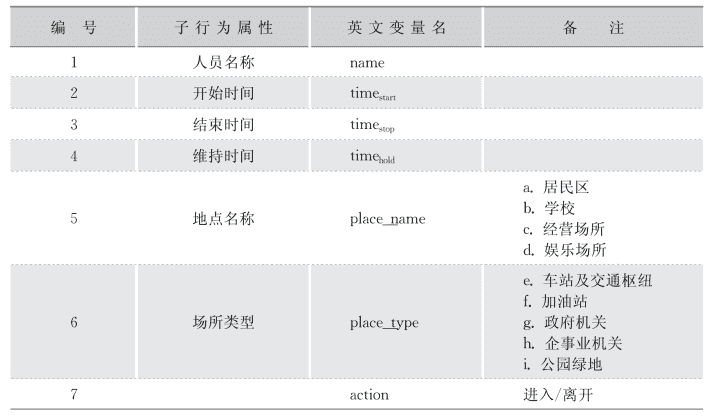

### 2.3.5 异常轨迹识别与预警

1）特征变量选取
结合动态行为链与身份属性，构建异常路径识别模型。选取身份属性、年龄、性别3项静态信息，以及场所类型、空间归属关系、到访时间、到访频次4项动态信息作为分析特征。
身份属性由风险人群类型决定，包括犯罪前科、涉毒、在逃等，可构成1×n维矩阵。
场所类型共9类，经独热编码转为1×9维向量。
空间归属关系指风险人群与到访空间是否存在居住、工作或访客关系，编码为1×2维向量。
年龄特征分4类，编码为1×4维向量。
性别特征分2类，编码为1×2维向量。
到访时间特征由进入与离开时间确定，全天划分为48个0.5小时时段，在场时段为1，不在场为0，形成1×48维向量。
到访频次指历史到访频次，经专家系统划分为4级，独热编码为1×4维向量。

2）特征风险权重设定
到访场所吸引力权重：采用专家系统与模糊综合评价法确定不同场所对不同类型风险人群的吸引力，形成9×n维矩阵，1表示有吸引力，0表示无。
到访时间风险权重：以某大城市2006-2016年共44831起入室盗窃案为依据，经归一化得到各时段案发频率作为权重。
其他变量风险权重：入室盗窃案中男性占比76.67%、女性23.33%；年龄分布为17-30岁占41%、31-50岁占47%、16岁及以下占2%、50岁以上占10%。作案地点与居住或工作地关系数据显示，仅20%案件发生在附近，80%远离居住或工作地作案。

3）异常路径分析模型构建
对特征变量进行标准化处理，依据各影响因素权重建立异常路径分析模型。

## 2.4 街区人员异常行为识别与检测

传统街区虽已基本实现视频监控全覆盖，但实际应用中存在矛盾：监控点越来越多，可实时查看的视频却有限。据统计，现有视频超过97%从未被人工查看。主要原因是传统监控依赖人工识别，存在不全面与时滞性。人工无法24小时不间断值守，易出现疏漏与视觉疲劳；当打架斗殴、抢劫等异常发生时，往往事后回看用于取证，无法即时阻止人身与财产损失。人工为主的监控体系难以满足安全需求，智慧街区需以视频图像处理技术替代人工识别。

智慧街区关注的异常行为包括跌倒、打架斗殴、恶意破坏公共物品、聚众等。可构建视频监控系统实现实时监控，对图像序列进行定位、跟踪与行为识别。通过收集用户操作行为建立用户画像，提取特征并训练正常行为集合，借助马氏距离等方法检测偏离，实现基于画像的异常行为识别。

### 2.4.1 基于视频的异常行为识别

视频异常行为识别大致分为基于行为识别与基于异常检测两类。

基于行为识别属于基于模型的方法。需先建立判断规则，从视频中提取运动轨迹等特征，建立异常动作样本库，再判定是否属于样本范畴。当异常行为被充分建模时效果较好，但当异常类型众多且难以完全建模时，准确率与效率会下降。

基于异常检测属于基于相似度的方法。针对异常行为难以预先定义的特性，不依赖预设模型，通过自主学习场景中正常行为模式并进行相似度对比，实现异常判定。

效果上，基于行为识别对个体异常动作识别较好，全局信息关注较少；基于异常检测对全局信息分析能力强，但对局部微小异常检测精度不足。两者原理不同但紧密关联，都以特征提取为前提，实际应用中常联合使用以提升效果。

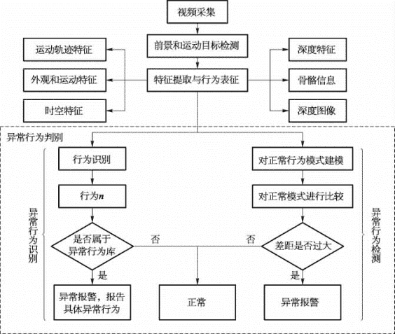

图 2-9 异常行为识别检测流程示意

#### 2.4.1.1 基于行为识别的做法

对人体行为而言，违反社会道德法律或不符合当前场景的行为均可视为异常。异常行为通常呈现环境相关性、不可预知性、突发性、短时性、低频性、无周期性、局部时空性与全局一致性等特征。这些特征要求识别与检测算法具备较好的鲁棒性、实时性与适应性。

异常行为的分类与工程考量

换个视角审视，非正常行为可以从多个维度进行归类。以作用对象划分，单人类的异常如坠落、越界、携带器具；群体的异常如拥挤踩踏、聚集逗留；人对物的异常如恶意损毁公共设施；人对人的异常如肢体冲突、推搡。按事件属性划分，可分为具有攻击性的暴力类型和不具有攻击性的非暴力类型。按空间位置划分，则出现区域闯入、区域长期徘徊等形态。类型繁多且表现各异，因而在具体场景落地时必须依据业务需求挑选适配的特征提取与检测方案。

在实际部署中，识别非正常行为常受制于几类问题：单一目标的异常样本十分稀缺；画面人群密集、遮挡严重时，单目标识别准确率下降且计算负担骤增；拥挤场景下对每种行为逐帧标注成本高昂，也难以穷尽所有异常形式。基于此，将任务简化为正常与异常的二分类检测更具现实意义。

#### 2.4.1.2 基于异常检测的方法
该思路不做细致分类，而是从海量视频中学习常规模式，实现像素级、帧级或视频级的正常与异常判断。依据数据与标签的使用方式，可归为有监督、半监督、无监督三类。

1）有监督异常检出
训练前需对全部样本完成标注，通过样本与标签的对应关系构建网络，随后进行特征提取并接入分类器，常用器具包括支持向量机、贝叶斯网络等。卷积神经网络亦是典型的有监督方案。对特定异常，有监督分类的稳定性较好，但像素或帧级标注成本极高，于是出现了以视频级弱标签为依据的方向，利用弱标签实现包到标签的映射。弱监督的思路是把整段视频视作一个包、单帧视作示例，仅凭包的正负注释判断整段是否异常，从而省去精确的时间定位。

## 2）半监督异常检出
半监督同时利用少量已标注样本和大量未标注样本完成映射。因为正常数据相对易得，这种思路在检出任务里应用广泛。做法是只标注正常样本，训练阶段学习正常模式，测试时计算当前模式与正常模式的偏离度，偏离即视作异常。按原理可分为重构型和预测型两类。

### （1）基于重构模型的异常检出方法
训练阶段用大量正常片段训练自编码器的参数，测试时把原始时序送入网络得到重构结果，再设计异常分值衡量重构前后的整体与局部误差，分值超过阈值即判定异常。主成分分析能把高维数据映射到低维再重构，从而把离群点分离出来，基于PCA的思想衍生出一系列检出算法。

### （2）基于预测模型的异常检出方法
该类更关注视频序列的时空关联，目的是学会一个能较好生成后续帧的生成模型，用过去多帧预测当前或未来帧，再比较预测帧与真实帧的差异来发现异常。长短期记忆网络擅长学习时序特征并做预测，因此常被用于视频行为异常检出。

## 3）无监督异常检出
无监督不依赖任何标签，只靠样本内部关联建模，并把所有数据映射到多个隐式类别。因为异常出现的概率很低，通常把与主体相似度很低的行为判定为异常。生成对抗网络由生成器与判别器对抗学习，用来估计特征空间的潜在分布并生成新样本，在无监督检出中取得不错效果。随着深度学习发展，基于深度技术的无监督检出方法不断涌现。

### 2.4.2 基于用户画像的异常行为识别
在大数据环境下，基于画像的异常特征提取通常分三步走：先收集用户行为数据，为后续提取奠定基础；再对数据进行脱敏、清洗、用户识别、会话识别、路径补全、事物识别等处理，并区分正常与异常；最后借助画像技术把异常数据抽象成标签，完成异常特征提取。

### 1）用户行为数据收集
数据主要来自智慧社区数字化平台，采集源包括周边视频、小区视频、人脸识别、车牌识别、楼宇门禁、出行记录等。住户或访客进入社区后会产生身份、访问日期、车牌号、出行轨迹等活动记录，这些记录存放在监控或后台系统，最终汇总到平台。平台获取的数据真实、精确、量大且成本低。

为有效采集，需要构建一个采集系统，功能上分为三大模块：行为数据采集模块，用页面标签法捕获数据，主要集成服务器日志中的访问记录；行为数据传输模块，负责把采集数据搬运给统计层；行为数据统计与显示模块，接收数据后做统计分析并以报表形式呈现。

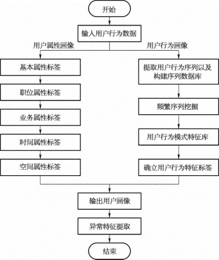

图 2-10　用户画像模型构建基本流程

### 2）用户行为数据处理
智慧社区平台记录的是用户从访问开始到结束的完整痕迹，预处理通常包括清洗和用户识别。清洗包括合并：把分散存储的数据提取出来统一解析、格式化后存入同一文件或数据库；删除：剔除与研究目标关联度低的连续重复行为以减少数据量。用户识别则是依据平台记录确认每个行为归属的具体用户。

### 3）数据标签化处理
平台数据多为异构、图像、文本等，需要把非文本信息抽象成文字标签。标签包含静态信息，如身份证号、性别、年龄、民族、受教育程度、职业、家庭构成等相对稳定的属性；也包含动态信息，如用户在公共服务多维信息平台的检索行为、实际消耗公共服务的情况，能反映居民偏好与诉求。此外还包括行为标签，即用户行为画像，本书特指用户的行为序列。

### 4）用户行为异常特征提取
先构建用户画像模型，再用它提取异常特征。模型由两部分构成：用户属性画像，明确固有静态标签，包括基本属性、职位属性、业务属性、时间属性、空间属性五类。基本属性如用户ID、IP地址等；时间属性是访问时间分段；空间属性是访问区域分段。另一部分是行为画像，用于动态刻画行为。

利用构建好的画像，可精确提取异常行为模式作为特征，与待测行为序列做模式匹配。匹配成功则判为正常，匹配失败或程度低则判为异常并发出告警。

## 2.5 社区智慧安防应用案例

### 2.5.1 多维感知与人工智能提升社区安全防范水平
城市快速发展带来人口迁移、外来人口涌入、流动人口激增、人户分离等问题，给实有人口管理带来挑战。随着经济提升，公众对社区环境治理、安全性和智能化的要求同步提高。澎思智慧社区系统依托多维感知、人工智能、大数据，提出智慧社区解决方案，致力于精细化管理与安全防范，构建便民利民的良性生态。

系统可建立重点关爱人群库，对独居老人、智障患者、老年痴呆、社区戒毒、康复人员等的异常出行或长期未出现情况进行预警，通知物业或基层民警走访。无锡某小区曾多次抓拍到患严重精神疾病的居民李某进出人脸图像，8月高温期间李某极少外出，行为明显反常，物业联系家属上门后发现其疾病复发，及时送医。

系统还能提供全天候全方位防护，对网上逃犯触发报警，对重点人员和长期徘徊人员重点监控。北京某回迁房小区部署后一年内抓获偷盗、伤害等违法犯罪嫌疑人5名。

沿海某市很多老旧小区已布视频，但多为普通高清摄像机，大角度取景、缺乏智能分析，易受着装相似、光照视角变化、复杂背景和遮挡影响。澎思采用“云边端”融合架构，接入出入口、路面既有设备，边缘AI分析盒解析图像后汇聚云平台做大数据计算与业务应用。系统融合行人再识别ReID、人脸识别、图像聚类等技术，提升场景适应性。试点小区2020年以来已通过平台预警各类关注人员50余人次，对综合治理效果明显。

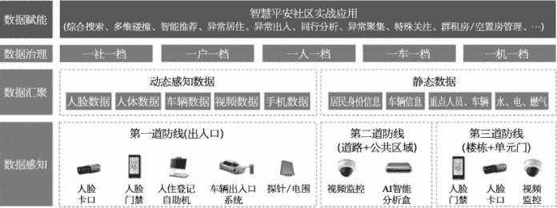

图 2-11　澎思科技智慧社区管理平台

### 2.5.2 考虑不同人员管控需求的社区人员精细化管理
保障社区安全需要对出入社区和单元楼人员进行有效管控，人工难以应对高人流量，必须依靠高效的身份识别、记录与管理系统。天地伟业AI智能社区管理系统整合出入口身份识别、智能门禁、人脸识别等子系统。

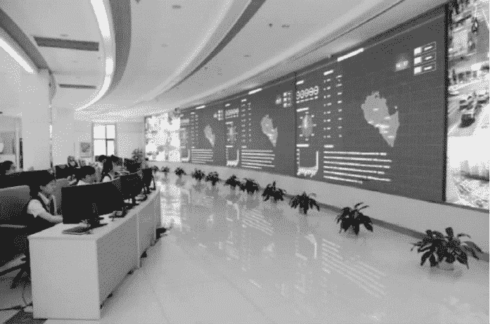

图 2-12　天地伟业 AI 智能社区管理系统

#### （1）出入口身份识别系统
部署在社区出入口，检测是否为社区内人员，社区人员放行，非社区人员需核验身份后决定是否放行，有效阻止外来人员随意进入。

#### （2）智能门禁系统
部署于单元楼门口，判断进出权限，严格管控以免重要物资损失。

#### （3）人脸识别系统
布设在出入口、单元门口、活动场所，对偷盗等违法嫌疑人布控，发现可疑即报警提醒保安关注。对小区内常出现的外部人员做频次分析，异常频次及时报警。也可通过照片快速检索走失人员在小区的出现位置与轨迹。系统判定具有唯一性和精准性，避免不法人员混入。

### 2.5.3 社区实有人口动态管理的大数据应用
云从实有人口管控系统基于人脸识别实现实有人口动态管理大数据应用。通过调用人像抓拍和通行数据，借助智能算法分析新增、离开等行为及人员属性，挖掘关联关系，实现异常预警、布控、轨迹查询，为社区人员精准管理提供支撑。

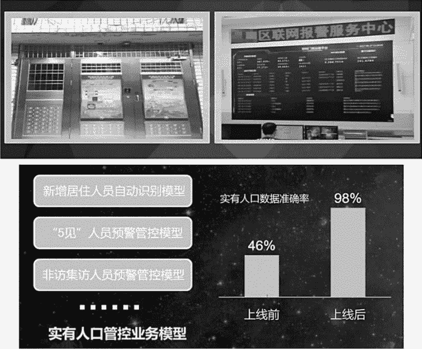

图 2-13　云从智慧平安社区示意图

系统结合人脸门禁、人脸抓拍机等设备，支持人员布控、辖区管理、小区新增与搬离人员、各类窝点、重点关注人员管控等功能，提升社区警务智能化与精准化。依托结构化数据采集分析批量生成情报信息，实现打防管控服一体化、分析调度可视化、警务运行扁平化，推动智慧社区向智慧城市升级。

# 第 3 章 人工智能赋能智慧社区的公共卫生防护
现代社会人口规模庞大、流动频繁、聚集密度高，给城市系统带来巨大压力，风险源多样、诱发机制复杂，进一步放大公共卫生风险冲击，这些问题最终沉淀到基层。社区既是风险爆发的现场，也是后果最直接的承担者，更是恢复重建的参与者，社区在国家公共卫生应急体系中的主体地位日益凸显。

新冠肺炎疫情暴发后，社区成为防控下沉的关键环节，对有效治理提出严峻考验。我国基层社区在外防输入、内防扩散中发挥不可替代作用。习近平总书记强调充分发挥社区在疫情防控中的阻击作用。国家四部委联合印发的《新冠肺炎疫情社区防控工作信息化建设和应用指引》要求发挥互联网、大数据、人工智能等技术优势，依托社区信息平台形成立体式防控数据链路和闭环。

在常态化防控阶段，社区作为联防联控第一线，需推动人工智能赋能治理与服务创新，借鉴疫情期间线上线下融合的智慧社区经验，加快转变治理方式，构建政府、社区、社会组织多元参与的新模式。

## 3.1 智慧社区防疫应用场景——AI 云防疫
社区是常态化防控的前沿阵地，除传统物业服务外，对多元化抗疫技术提出需求，AI驱动的智慧社区建设势在必行。软硬结合开展非接触监管与排查，部署人脸识别卡口、门禁、非接触式人体测温、智能门锁等设施，阻断传染源，实现安全高效管理，打造抗疫安全岛。

### 3.1.1 人工智能提升社区监测管控能力
社区防疫是城市防疫的基础，封闭管理依赖大量保安、物业和志愿者，如何在避免接触的同时提升登记效率至关重要。复工复产后人员流动加大，对智能化管理提出更高要求。全国多地小区已采用AI云防疫，覆盖健康申报、人车管理、体温筛查、智能隔离等场景。

#### 1）健康告知与申报承诺
利用AI核心技术，用户可通过微信实名验证完成健康在线申报，身份校验后签署承诺书更具法律效力。

#### 2）电子出入证+AI识别开门+自动体温测量
针对封闭小区出入口和重点区域，AI可辅助在线申请电子出入证；集成热成像摄像头、热成像门禁机的设备可实时识别身份并测量体温，预警记录上报。

#### 3）车辆出入管理和行为预警
车辆识别技术可自动登记出入车辆，对来自疫情中高风险地区车辆提示，对高风险牌照但未进入风险地的车辆做白名单处理。还能依据出入时间、频次等行为特征进行预警分析。

#### 4）预警疫情风险、人群聚集告警
平台可及时发现未佩戴口罩人员，统计佩戴情况，降低传播风险。AI还可用于公共区域，自动识别人群聚集，设定告警阈值，提前预知风险，协助管理者调度执勤人员。

### 3.1.2 防疫机器人助力社区防疫
在AI与5G支持下，智能防疫机器人成为一线医疗和物业人员的助力，穿梭隔离区配送物品、杀菌消毒、运送药品等。

配送机器人打通社区无人配送最后一公里，实现无接触送达。搭载高精度红外测温成像系统的机器人可识别取外卖人员体温，通过5G实时显示在车载屏幕和远程监控端。设备可载重300kg、续航60km，满电防疫监测可持续10h。

无人机空中喊话的短视频推动立体防疫。乡镇地区用一架无人机即可替代多辆宣传车，车辆难及区域也能监测。对聚集区域，无人机可靠近上空红外测温，确认无发热后喊话驱离。“空中+地面”方案已成功应用于疫情防控。

### 3.1.3 人工智能助力社区居民远程问诊

日常管控转入常态后，公立医疗机构门诊多改走预约通道，压缩单日接诊规模，同时上线线上诊疗平台，提供远端咨询与病情说明。医药电商的数字平台流量明显攀升，在线心理疏导、发热咨询、病毒动态播报等也成了除医院之外的重要防治阵地。对基层住户而言，病毒传染性强，入院检查存在交叉感染风险，让有就医需求的人十分为难；流行带来的焦虑又让人抗拒去医院，却又迫切需要专业医学信息指引。依托智能算法的在线诊疗与医学科普正好填补了这一缺口，在影像辨识、药品匹配、远端诊疗等场景的落地，体现了技术与医疗融合的价值。

面向老年群体的街区远端医疗大致流程如下：长者因主观症状感受、居家传感设备的异常预警，或定期复查、补药等需求，通过电话、视频或网页文字向街区远端保健平台表达就医意向。平台随即调取长者在街区卫生中心、医院、其他护理机构留存的电子健康档案，结合住宅内传感器的实时监测数据和移动轨迹等信息，以学习型算法对老年相关病症进行评估与预判，初步掌握病情类型、紧迫程度与严重程度。对疑似传染病感染者先实施街区替代性管控场所隔离，并进行二次试剂检测。若确认感染，则依据各传染病医院的承载情况安排转运；若未感染，则参照其他老年群体流程，在系统内协商选择符合症状诊疗等级的医疗机构，经长者及家属同意后下达定向分类转诊预约。最终，由指定医疗机构人员以移动门诊、远端视频会话或必要上门家访方式提供诊疗与康复照护，街区平台同步跟进结果并给予辅助护理。
## 3.2 人工智能助力社区疫情防控检测
流行期间，基层借助数智化手段提升精细化管理水平，无人机播报、面部扫码通行、热成像筛查等地毯式做法显著减轻基层负担，有助于精准管控人员车辆进出、实时发布信息、限制流动，从而阻断传播链。

### 3.2.1 基于红外热成像的人员无接触测温
自病毒全球大流行以来，对公共安全的威胁持续存在且可能长期共存，各国纷纷探索基于红外热成像的非接触式人体体温筛查方案。体温筛查是防治的第一道关口，也是人流密集街区快速排查的关键。如何高效完成体温检测、降低传播风险，已成为构建智慧街区防治体系的首要课题。

#### 1）红外热成像技术
红外热成像本质上是一种热辐射探测方式。自然界中，温度高于绝对零度-273℃的物体都会发出红外辐射。热成像装置利用红外波段的探测器捕捉被测目标的辐射能量并可视化呈现，从而把人眼可视范围拓展至可见光加红外。与成熟的可见光技术相比，红外热成像普遍性更强、穿透烟雾雨雾能力更佳，且不受强光炫光干扰，稳定性更好。

目前红外热成像已广泛应用于智慧街区的视频监控与信号探测场景。相较传统可见光采集装置，它虽不能采集色彩，但仍具备空间分辨能力，同时具备温度分辨能力，可呈现监控画面中热源的大小、轮廓和温度分布。凭借非接触、无感、筛查迅速的特点，热成像体温仪成为人群快速测温的首选。热成像测温摄像机多用于临时布控的街区场景，承担人体体温初筛。当目标人员进入监控区，系统即判断体温是否超出正常阈值，正常则放行，超标则报警提示并通知现场人员进一步处置。

#### 2）热成像体温校正
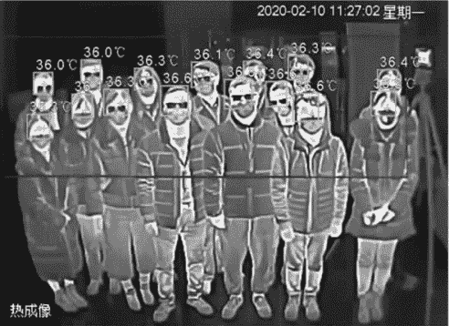
图 3-1　热成像演示图
人体热辐射峰值位于远红外区，波长约5～50μm，可把人体视作红外辐射源。热成像装置利用红外探测器将人体辐射能转化为电信号，依据修正后的斯特藩-玻尔兹曼定律`M（T）=εσT4`，人体辐射功率与皮肤绝对温度的四次方成正比，由此可反推实际体温。黑体是标定红外系统的基准，其吸收率与辐射率均为1、透射率为0，能吸收全部入射红外且不反射透射，只能向外辐射。将黑体置于热成像视野内，利用其特性进行测温标定，建立灰度与温度的精确对应关系并实时校正，从而把视频画面与个体体温联动显示，大幅提升测温精度。

持续扫描面部并把热能转化为数据，可绘制人体的二维温度场，以彩色图呈现面部温度分布。温度分布可反映生理状态变化与局部病变，因组织代谢差异体表温度并不一致但各有正常区间。病变部位往往因血流与代谢改变出现异常温差，为临床诊断提供信息。

### 3.2.2 基于深度学习的人脸佩戴口罩识别
佩戴口罩是流行防治的核心举措，也是出行基本要求。但佩戴口罩后如何实现刷脸通行并避免接触感染，成为防治与治安双重需求下的新难题。面部口罩辨识多基于深层神经网络实现，包含面部定位与口罩佩戴判定两部分，如图 3-2 所示。定位模块先在图中找到面部；判定模块对检测框适当扩展裁剪后，采用图像分类对面部子图做二分类，得出是否佩戴口罩的结果。

图 3-2　人脸佩戴口罩识别整体框图
关键流程如下：
#### 1）原始数据集获取
对街区历史监控视频分帧，挑选含面部图像并人工标注为佩戴口罩与未佩戴两类，构成原始数据集。其中佩戴与未佩戴面部图像比例约为3∶1。

#### 2）数据集增强
对原始数据进行预处理增强，扩充训练集。增强方式包括角度旋转、随机裁剪、亮度调整、对比度调整。角度旋转使人物主体位置变化，贴合真实场景取景角度差异；随机裁剪改变主体在图中的比例，模拟景深变化；亮度与对比度调整模拟光线、空气质量等环境对成像质量的影响。增强有效解决了常见取景干扰，并帮助网络学习口部遮挡等深层语义，提升识别准确率。

#### 3）神经网络模型的构建
在单发多框检测器SSD基础网络上，将主干替换为带残差结构的DenseNet，并引入特征融合的特征金字塔模块，构建改进版SSD网络。

#### 4）神经网络模型训练
根据学习率、迭代次数、衰减策略等参数设定，对改进SSD模型进行迭代训练，使用经增强的训练集作为输入，训练完成后保存识别效率最优的模型。

#### 5）输入检测图像获取
模型输入来自实时监控视频。视频分帧后筛选含面部的目标帧。为降低算力，通常择优选取主体居中、亮度对比度适宜、噪点少的帧作为输入。随后对目标图进行亮度提升与去噪等清晰度优化后送入检测。

#### 6）口罩佩戴识别检测
经预处理的目标图输入已训练模型进行识别，输出是否佩戴口罩的结果，可语音或图像直接反馈，也可接入后续管理流程。

### 3.2.3 面向群体特征的人群聚集检测
街区摄像头可实现分钟级自动巡逻，结合面部识别与人形检测，系统能第一时间发现聚集并告警物管进行劝散。聚集检测可分为面向个体特征与面向群体特征两类。前者对每个目标分割跟踪，后者对整幅图像采样提取整体信息再分类，更关注行为一致性，对群体事件分析更有效。群特征分析框架主要包括特征提取、人群模型、事件检测、知识库等，如图 3-3 所示。

主要模块如下：
#### 1）特征提取
可用于人群分析的特征包括灰度、颜色、光流运动向量、形态、纹理、局部二值模式、尺度不变特征变换、方向梯度直方图、韦伯局部描述符等。在高密度场景难以追踪个体时，可获取整体运动轨迹。人群密度、受力与运动等信息亦能有效刻画场景。

#### 2）人群模型
提取的特征输入模型训练后用于刻画人群运动。可分三类：
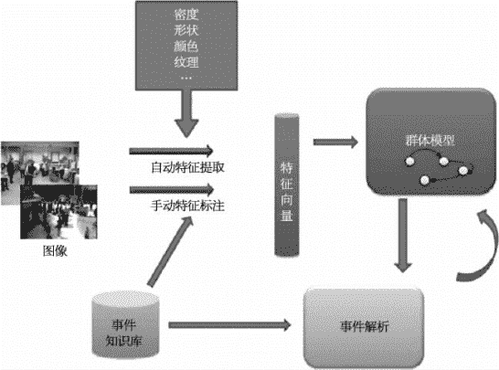
图 3-3　群体分析框架
（1）直接用计算机视觉分析视频特征，不建结构化人群模型，如用光流聚类描述运动、用隐马尔可夫模型建模检测异常。
（2）基于物理学的模型。将个体运动类比气体或液体流动。社会力模型是典型方法，个体受内在目标驱动力与外界斥力共同作用，斥力保证人际空间避免碰撞。方法是对视频做网格粒子采样计算光流，用社会力模型求作用力生成社会力场，将时空作用力立方体量化为词袋，用LDA模型区分正常与异常片段。
（3）Agent模型。融合模糊数学、博弈论、社会学、蒙特卡洛等方法建模个体行为，如模拟博物馆参观行为的规则模型。细胞自动机与仿生学模型也常见。

#### 3）事件检测
异常检测与人群模型紧密相关，常借助机器学习将视频特征与模型参数送入分类器，二分类判断正常或异常。常用分类器包括支持向量机SVM、隐马尔可夫模型HMM、LDA、神经网络等。对于标签不明确样本，基于聚类的异常聚集检测更实用，如K-means聚类，前提是异常特征与正常特征可区分。

## 3.3 大数据筛查社区疫情接触人员
街区是风险管控的基本单元，也是聚集性暴发的起点。智慧防治对街区环境要求聚焦实时监测的公共场所与建筑物。流行传播依赖传染源与人、人与人接触，如何微观识别关系是关键，包括：一是通过病例位置信息发现聚集性流行，实现传染关系与场所空间溯源；二是通过病例轨迹交集发现感染链与潜在感染者。感知海量数据发展使得个体轨迹与群体活动精细化感知成为可能，学习型算法等大数据技术在接触者追踪、预测与流行病传播模型构建上发挥重要辅助。

### 3.3.1 实时监测的公共场所与建筑物
在5G、WiFi、低功耗蓝牙BLE、射频识别RFID与GPS技术支撑下，形成了信息采集-数据分析-可视化传递的街区社会隔离实时监测体系，提升了场所可用性与安全性。居民移动端、室内传感装置、信息分享平台等多源物联媒介实时采集体温、地理信息、接触距离、交易数据、社交媒体内容等数据，经云端智能算法、深度学习与学习型算法校验准确性与来源可靠性，推算移动轨迹与隔离情况，最终在应用端向外出居民提供通行标识、风险区域图示或越界警告，降低无意识蔓延风险，如图 3-4 所示。

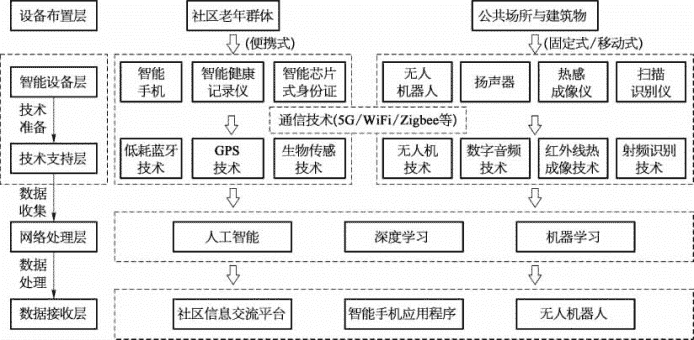
图 3-4　社区公共场所与建筑物内实时监测的技术路线
各国识别追踪与接触监测方式各异，见表 3-1。新加坡、澳大利亚、韩国多以手机App为载体，个人信息保留21天保障隐私。新加坡对无装置或技术障碍的老年群体，可用身份证植入芯片扫码通行。意大利、英国、荷兰借助可穿戴运动手环采集心率、离家距离等9项日常特征，通过远程疾病评估开源平台汇总可视化。西班牙、美国则在公共场所部署带扬声器与热成像仪的机器人，热成像判断接触距离并语音提醒密切接触者。

表 3-1　不同国家对社区内公共场所与建筑物内人群的识别追踪与接触监测
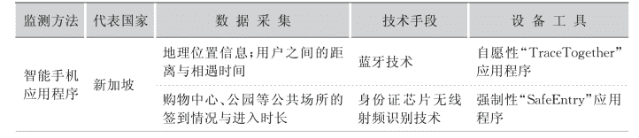
（续表）
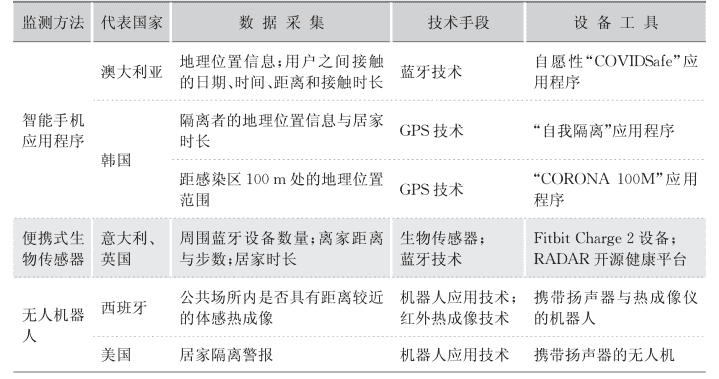

### 3.3.2 接触人员追踪与社区监测
#### 1）接触人员自动追踪
追踪接触者时，工作人员会询问已知患者的近期直接接触者并按潜伏期监测或隔离，以切断传播。世卫组织与美国CDC均强调接触者追踪的重要性。从数据看，接触者即与感染者在时空上重叠的人群。当前可依托基站、支付、出行数据与城市视频监控构建大数据融合平台，实现深度挖掘与人员追踪。但追踪高度依赖患者自述，在人员密集、陌生接触频繁区域，大量隐匿接触者无法及时发现，给防治带来挑战。可通过街区整体健康监测发现异常后迅速隔离。

#### 2）社区监测

社区是城市人口最密集的居住单元，人流交互频繁，历来是疫情防控的重点防线。以社区为依托开展监测，投入相对有限、见效迅速且执行可行。监测工作有两方面内涵：一方面政府把社区作为基本网格化单元，对辖区居民健康进行排查、汇总与跟踪，并通过提示、引导和约束来规范公共卫生行为；另一方面需要居民自查身体状况并及时向疾控部门报备。疫情期间个人隔离的流程见图 3-5 所示。

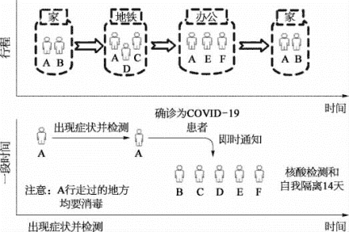

图 3-5　疫情期间个人隔离计划

### 3.3.3 潜在感染者识别

## 潜在感染者类型与风险评估
按暴露来源划分，疑似感染人群大致分为两种。第一种是途经新冠病毒高风险区域的人员，病毒离开人体后仍可在环境中存续，进入过病例到访场所就存在被污染物二次感染的可能；第二种是与确诊病例有近距离接触、存在直接传播风险的人群。健康码的工作逻辑是把全国各乡镇街道社区的风险等级与个人轨迹大数据叠加，估算感染概率后划分为红、黄、绿三级，进而实现不同风险人群的动态分级管控。

## 病例密切接触者识别
锁定密接的关键在于人群时空关联分析，通过比对移动轨迹在时间与空间上的重叠，圈定可能与感染者发生近距离接触的范围。依据所用数据，实践大致归纳为三种路径：

### （1）基于历史出行记录的密切接触者识别
典型做法是卫健委与中国电子科技集团联合推出的筛查工具。用户输入姓名和身份证号码后，后台调取其乘坐飞机、火车、大巴等交通工具的记录，与病例行程比对，判断是否属于密接范围。

### （2）基于手机定位数据的密切接触者识别
做法是将手机用户轨迹与患者活动轨迹进行时空邻近比对。细分可分为信令法与定位数据法。手机信令定位精度有限，室外约200～500米，室内受基站密度影响范围更大，筛出的人员需经流行病学调查再精筛；基于GPS或北斗的定位数据精度可达约3～50米，辨别更细，但最终确认仍需人工流调。

### （3）基于手机传感器的密切接触者识别
该类方案通过解析移动个体手机的WiFi、蓝牙等传感器信号，推算不同用户间的相对位置，从而判断是否发生密切接触，识别精度相对更高。

## 3.4 平疫结合的社区无接触配送
常态化防控要求投递实现无接触，快递外卖被挡在社区入口，既能维护小区安全，也能缓解居民对陌生人进出的焦虑，尤其在疫情敏感期。以下归纳四类机器人配送思路，体现平时侧重隐私安全、疫情时强化公共安全的理念。

### 3.4.1 群控蜂群
AGV小车是在无线局域网控制下，依靠磁钉、激光等导引装置按预设路径行驶的无人导引车，是成本最低、技术成熟、可用于社区的无接触方案。外观类似扫地机，小区和楼宇办公区铺设磁钉，机器人在磁钉路径上运行。小区划定固定区域并安装标准货架存放包裹。接收指令后，机器人沿磁钉路线取货搬运，经社区及目标楼栋的无障碍坡道抵达大堂门口，呼叫门禁内置模块并用开门器打开大门；进入大堂后呼叫电梯模块乘梯至指定楼层，在住户门口等待，后台电话通知住户取件，完成闭环。行驶中单线激光雷达可识别临时障碍并刹车或绕行。单机经济性好，后台群控成熟、搭建便捷，适合人行道通行。但需大面积铺设室内外磁钉，对景观装修影响大，改造复杂，基本无法在车行道行驶，多用于功能单一场所，且多为单机智能方案。

### 3.4.2 机器人室内配送
业内单机智能配送机器人按场景分为室内型、室外型、室内外兼顾型和L4级无人驾驶车。单机机器人在无人底盘上装配敞开或封闭货仓，依据预先扫描的社区即时定位地图和卫星地图实现取送。因小轮和单线激光的限制，这类底盘多限于室内，爬坡极限约为7°。

### 3.4.3 移动货柜方案与社区“大车+小车”接力配送
2020年疫情期间，小区门口快递外卖堆积量大，若送至住户门口后无法联系业主，机器人使用效率会大幅下降。移动快递柜可部分缓解该问题，用户自行取货，若无人领取机器人则返回社区总站，物业另行安排配送。该方案装载量大、所需机器少、无需进楼，成本可控，已在京东和美团试运行，业主无需到大门取件，在一定程度上降低交叉感染风险。

“移动丰巢”行驶缓慢，依赖小区人车分流；而L4级无人驾驶车更适应各类交通组织的社区，已获批在部分城市道路运行，车体约1米宽、2米长，货箱可达2.4立方米，速度快、效率高、性价比佳。国外已有L4车搭载机械臂、机器狗甚至人形配送的方案，但需要车辆具备分布式货物分拣能力，而非国内普遍的物业或快递员社区分拣模式，且搭载设备成本极高，尚处样机阶段。

### 3.4.4 利用地下车库的社区机器人配送
除AGV外，其他机器人均需按社区规划现状设计运行路径。只要路径上无高坎、陡坡或台阶，配送即可实现。近年新建居住小区普遍按规范配置全区贯通的无障碍坡道，坡度不超过8%，地下车库车行坡道坡度不超过15%，因此室内外配送机器人及L4级无人车均可利用地下车库配送。

采用地下车库无接触配送，规划建设应关注以下10项要点：①地下室照明亮度均匀稳定；②保障地下室WiFi和手机卫星信号；③地下室内部无障碍设计；④电梯直达地下大堂；⑤地下大堂门口设置物联开门器；⑥电梯设置物联模块；⑦地下室设物流分拣功能房间用于中转，或采用外投内取方式，物品送达后由平台人员或物业分拣、配送，该空间也可兼作机器人充电区；⑧地下室空间可对城市开放，机器人经物业道闸模块协议认证放行进入小区地下室配送；⑨升级物联平台，监控机器人运行状态、位置与状况；⑩配备专业物业人员，管理机器人配送系统与设备平台。

## 3.5 社区智慧防疫案例

### 3.5.1 从“人防”到“智控”
北京市顺义区某街区、石景山区鲁谷街道某社区及上海徐汇某街道小区通过建设非接触式社区疫情防控监测系统，实现防疫从人工防范向智能管控转变。

1）社区人员流动分析
（1）利用智能设备分析居民离城、返城流量，并据此预测趋势。
（2）据此合理分配人力物力，规划工作重点，追踪重点地区返城人员。

2）社区人员实时居住状态监控和查询
（1）实时分析并以精确到户方式呈现居民状态。
（2）统筹生活物资发放与通知传达。
（3）规划防疫物资与工作人员配置。

3）须重点监测的返城人群状态分析
（1）统计返城人流，按楼、按户、按返城时间管理。
（2）大幅缩小排查范围，锁定对象。
（3）第一时间发现新增返城人员。
（4）持续关注社区内返城动态。

4）监控电梯使用频率
依据各电梯使用频率进行针对性消杀，提升人力物力使用效率，在资源有限时优先安排高频电梯消杀，保证乘坐安全（图 3-6）。

5）实时居家隔离状态监控和查询
（1）实时分析并精确到户呈现隔离状态与异常（图 3-7）。
（2）自动核查需自行隔离人员外出情况。
（3）工作人员只需关注异常个案，提升效率。

6）社区进入人员体温监测预警
（1）入口处无接触温度感应。
（2）人多时无需排队、无需摘防护具即可高效通行。
（3）高温自动智能预警。
（4）操作简便，单人即可有效管控。

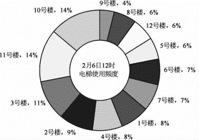

图 3-6　某一时刻小区各电梯的使用频度统计

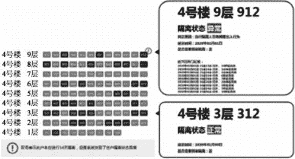

图 3-7　某小区 4 号楼住户隔离状态

### 3.5.2 智慧测温与“零接触”乘梯
社区等人员密集场所是防控难点。针对“最后一道防线”，捷顺科技基于智慧人行方案推出人工智能测温人行防控通道与“零接触”乘梯方案，有效降低传播风险。

1）0.3 s 人工智能测温人行通道，人员严进严出管控
在社区、园区出入口部署高端通道闸加人脸识别加集成红外测温设备，可实现人脸身份识别及±0.3℃非接触式人工智能红外精准测温，体温正常0.3s开闸放行，异常则即刻语音告警并上报；可集成访客机，对访客实施非接触测温、线上健康登记后凭证通行。
物业后台通过捷顺物联云平台的疫情防控预警监测板块，可设置人脸识别、访客通行、测温预警、在线监控、自动预警等功能，随时查看项目防疫实时预警、监测报表、人脸测温记录、重点人群跟踪、防疫数据上报、热力图分析等跨区域统一管理数据，助力全局掌握态势、科学调度资源。

2）“零接触”乘梯应用，避免乘梯交叉感染
针对电梯这一高风险场景，设计零接触乘梯，用户通过手机即可呼梯和选层，避免伸手按键的潜在传染风险。可通过“捷生活”公众号、小程序远程呼梯选层，也可通过蓝牙、人脸识别或二维码现场呼梯并手机选层。

### 3.5.3 无人无接触配送
2020年新冠疫情期间，哈奇智能在广州常春藤社区运营的hachi delight承担无人无接触配送，将居民订购的快递、生活用品、蔬果及时送至家门口，高峰期单台日均送货超百单，有效降低人传人风险，提升封闭管理质量，获社会好评，成为国内首例成熟的智慧社区无人配送方案。

# 第 4 章 人工智能赋能智慧社区的灾害应急管理
社区是城市的基层单元，也是治理的“最后一公里”，更是应急管理体系的关键环节。灾害来临时，社区既是直接受体也是抗灾主体。社区致灾因子主要包括火灾、风暴潮、有毒气体泄漏等，其中火灾发生频率最高、影响最严重，用电不当、厨房用火、烟头未熄、电动车违规充电等均为主要诱因。

上海推行的“两级政府、三级管理、四级网络”模式中，社区是基层管理载体；中国城市基层多以街道办事处作为派出机关，管理区域与行政区划基本重合，可视街道辖区为大社区。社区人口高密度导致公共、工业、住宅用地紧张，超高层建筑、大面积地下空间、生命线管网交错，使灾害风险加剧。社区灾害一大特点是连发且严重，地理与人为因素叠加，常引发次生灾害形成灾害链。建设智慧社区可提升灾害学习能力，从既往灾害中吸取教训、消除脆弱性根源、优化社会系统，增强应对未来风险的适应性。

## 4.1 智慧社区应急管理应用场景
基层社区在基础设施和人员资源上相对薄弱，应对与联动能力有限，但这也意味着数字化应急管理系统在基层释放的潜能更大。

灾害治理难以预设所有应对未知、复杂、突发风险的措施，但可重组已验证的“积木”元素以更好应对风险。信息与通信技术是实现积木高效组合的关键，也是决策支持系统。人工智能、大数据等技术可帮助决策者从既往治理经验中拆解出有效的管理机制、物资资源、技术手段等治理元素并重新组合，形成新方法应对新状况。智慧社区可利用人工智能获取和分析信息，进行灾害情景模拟，在虚拟环境中筛选治理元素并选择策略，降低人工计算成本，提供多样化、精准化的决策支持，辅助可视化高效治理。应急管理系统主要包括数字化日常防控、数字化应急预案、数字化应急联动和数字化事后恢复四部分。

### 4.1.1 数字化日常防控
该子系统面向突发事件开展前置预防，涵盖基础信息单元、物联网感知预警、安防视频联动、温湿度监测监控、气体烟雾智能监控、应急基础设施监控、可能危险源监控、线上线下安全教育、应急能力提升、指令接收与信息上报等模块。传统管理重在事中、事后，应急响应与灾后恢复突出，日常防控常被忽视，监测不连续、成本高、预警不及时。数字技术赋能下，基层社区依托物联网与移动网络实现全社区24小时不间断监测，形成实时数据集合并快速分析潜在风险，自动排查异常并报警，实现“居安思危、防患未然”。

基层社区数字化应急管理系统各子系统运行遵循“数据输入—运行过程—结果输出”范式，如图 4-1 所示。数字化日常防控子系统的输入包括社区基础信息数据、物联网感知数据、安防视频数据、温湿度监测数据、气体烟雾智能监控数据、应急基础设施监控数据、可能危险源监控数据和上级总体要求。系统据此存储和分析基础信息，判断设备运行状态，若故障则派员检修；若正常则检查数据内容，通过建模、算法寻找异常点，并将防控情况分为三类：未出现异常，继续监测；出现轻微异常，系统自动溯源危险源头并提供优化方案，及时处理；出现严重异常，系统判断为突发公共事件后自动接入消防、医疗等系统，将数据和分析文本化上报，并准备启动应急预案。无异常和轻微异常时系统在处理与监测中循环修正；严重异常时进入准备阶段并接入数字化应急预案子系统。

以消防生命通道监测预警为例，系统由前端视频感知、云端视频识别引擎、消防卫士APP和可视化统计分析平台组成，理念为“多维感知、数据共享、业务联动”，综合边缘计算、深度学习图像识别、人工智能自动语音提醒，实现通道实时状态监测，多部门协同治理，提高管理能力，打通“生命通道”。

系统采用基于边缘计算的高清摄像头结合5G通信，实现前端精准探测，适配老旧小区、新建小区及社会单位场景。摄像头探测到堵塞目标即发出警告提示音，提醒清除障碍；确认堵塞后信息第一时间推送至物业、社区或网格员整改；隐患长期未处理，消防部门可通过消防卫士APP督促整改并同步推送公安部门协同治理。系统可完整保存图片、文字、视频及整改信息，为执法提供证据。

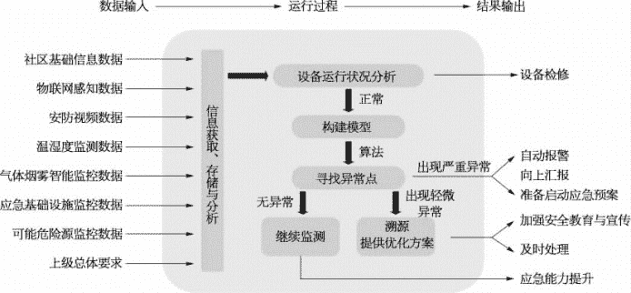

图 4-1　数字化日常防控子系统内部运行机制

### 4.1.2 数字化应急预案
该子系统以大数据、云计算、人工智能为工具，对突发公共事件做预前准备，涵盖数字化应急预案管理、自动推荐、分析统计、评审、备案、演练、部署、交互、指令接收与信息上报等模块。当自检出现严重异常或区域内发生突发公共事件时，预案前置准备功能启动。传统预案管理依赖主观人力，各部门编制演练割裂，处置不统一，联动衔接与配合效率受阻，且可能超出预案设定，指导不确定性大。数字赋能下，基层社区建立交互联动的应急预案数据仓库，在线汇聚相关社区和部门预案及执行情况，实现救援力量、最优路线、物资调配的可视化，为编制和实施提供参考。系统依据人工智能自动优化预案范畴，统筹演练与评价，实现预案实时更新，启动时自动推荐部署，真正实现“运筹帷幄、决胜千里”。

如图 4-2 所示，数字化应急预案子系统的输入为社区基础信息数据、应急预案交互平台数据、潜在事件数据、现场监测监控数据、上级及专家意见。这些数据支撑预案形成与启动。启动阶段，系统结合已有预案与数据仓库自动推荐最佳方案并展示结果、综合预测，由人员或系统选择最终方案，向上实时汇报、分级预警、成立专项小组、部署预案并对具体措施做适应性调整。预警启动后进入响应阶段，数字化应急预案子系统接入数字化应急联动子系统。

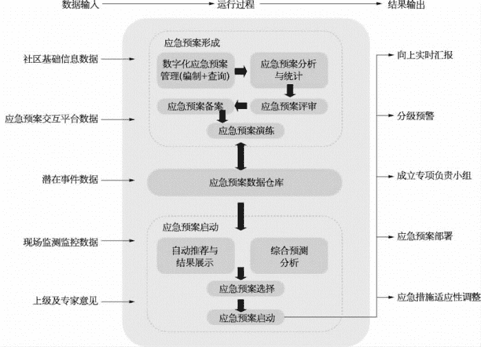

图 4-2　数字化应急预案子系统内部运行机制

### 4.1.3 数字联动下的基层应急协作
## 社区数字应急联动整体架构

社区数字应急联动整体架构以移动互联网、物联网、大数据、云计算、人工智能等数字工具为底座，围绕突发公共事件的处置流程，整合公共服务管理、排查统计、物资投送、信息发布、应急救援、辅助决策、社区物联网统筹管理、人员与资源调度、事件研判与后果推演、指令接收与信息上报等功能模块。借助大数据和 3S 技术体系【遥感技术（`remote sensing`，`RS`）、地理信息系统（`geography information systems`，`GIS`）、全球定位系统（`global positioning systems`，`GPS`）】，可以迅速锁定医院、消防等最优救援力量，切实压缩救援时耗与生命损失；依托移动互联网与物联网实现在线监测与即时上报，让社区突发情况的表征快速呈现，上级指示与决策更有针对性；通过移动互联网收集社情民意，并借助主流媒体向公众推送事件科普与防护要点；凭借物联网与人工智能打通监测、传输、存储、研判全链路，构建应急响应的数字化与智能化防线。引入多元主体协同，推动以社区为基本单元的联动体系从单向管控转向互动共治，实现真正意义上的守望相助、共渡难关。

如图 4-3 所示，该联动体系的数据入口涵盖社区基础信息、应急预案、实时事件数据、应急物资与人员数据、消防医疗救援实时数据、上级联动指令与安排、居民反馈与接报数据、社区物联网集成数据以及专家意见。联动期间信息将实时向上传递，并不断扩大发布与扩散范围，直至响应级别升降、事态得到控制或进一步蔓延。联动结束后进入修复阶段，数字化应急联动子系统将接入数字化事后恢复子系统。

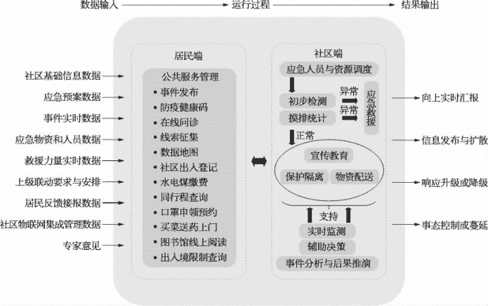

图 4-3　数字化应急联动子系统运行机制

### 4.1.4 数字化修复与灾后重建
数字化事后恢复子系统融合移动互联网、大数据、人工智能、遥感监测等手段，聚焦突发公共事件的善后安置，包含受灾住户帮扶管理、恢复规划、总结评价、案例沉淀、指令接收与信息上报等模块。该体系强调网络协同效应，利用移动互联网直连各参与方与受影响居民，实时采集反馈，便于社区实现精准帮扶；利用大数据与人工智能搭建全球范围的事后恢复案例库，可自动推荐实施路径，为灾后重建提供决策参考；遥感监测则持续跟进恢复进展，夯实“以图管地”的工作基础，真正做到重整阵容、携手共进。

如图 4-4 所示，输入端为社区基础信息、事件后果评估数据、事后恢复案例数据及上级与专家建议。在此基础上展开现场清理、警戒解除、恢复作业、受灾住户帮扶管理、事件调查、经验总结评价，并建立面向本社区应急管理历史的案例仓库。恢复阶段同样保持实时向上汇报与信息发布，直至社区恢复常规运转，再切回日常防控循环，进入新一轮监测。

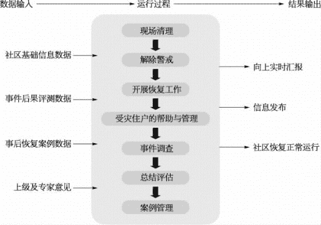

图 4-4　数字化事后恢复子系统运行机制

## 4.2 社区火灾智能探测与演化预测
### 4.2.1 火灾风险与发展规律概述
火灾本质上是复杂的燃烧反应过程，伴随化学变化与能量交互，被燃烧物质发生氧化还原，释放的热量通过对流、传导、辐射方式散发。

#### 4.2.1.1 火灾对人员的危害特征
烟气层高度直接影响逃生窗口。烟层越高，可用空间越大；烟层过低时，高温烟气易造成灼伤，有毒成分易引发窒息。因此烟气层高度是判断火灾对生命威胁程度的关键指标。研究指出，火灾危险临界点可定义为烟气层界面降至人眼特征高度。通常人眼特征高度在 1.2～1.8 m区间，亚洲人群约 1.5 m。

#### 4.2.1.2 火灾发生的必要条件
火灾必须同时具备可燃物、助燃剂、点火源三要素，缺一不可，被称为火三角，如图 4-5 所示。

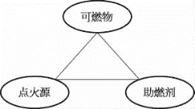

图 4-5　“火三角”

只要三要素持续共存，燃烧就会维持；切断任一要素即停止。实践中，覆土灭火削减助燃剂；移除邻近可燃物消除燃料；降温至低于着火点则可消除点火源。

#### 4.2.1.3 火灾蔓延四个阶段
火灾蔓延通常可划分为初始、发展、稳定、衰退四个阶段，如图 4-6 所示。

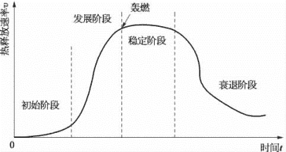

图 4-6　火灾燃烧蔓延的四个阶段

1）初始阶段
火灾初起，火势微小，热释放速率低，环境升温不明显。此阶段及时处置即可迅速扑灭，否则火势将持续放大。

2）发展阶段
火势逐渐增强，燃烧加剧，产生大量热量、烟气及有毒气体，周边温度上升，可视范围下降，可能出现轰燃。为避免人员伤亡，需在轰燃前完成疏散。

3）稳定阶段
火灾继续发展，可燃物不断被引燃，火源最高温度出现，周围温度持续升高，可视度进一步降低，烟气向疏散区域扩散，严重阻碍疏散进程，灭火难度加大，人员面临生命威胁。

4）衰退阶段
可燃物逐渐耗尽，环境氧气减少，火势逐步减弱，进入阴燃状态，无明火但火源温度仍高。

#### 4.2.1.4 高层建筑的火势加速机制
高层建筑层数多、体量大、烟气通道复杂，火灾危险性显著高于普通建筑，主要特殊问题有：

1）烟囱效应
高层内布设大量竖井，如楼梯井、电梯井、管道井、风道、电缆井等。火灾时高温低密烟气经开口向上排，室内压强下降，底层冷空气补充，形成底部向上快速气流。烟囱效应会强化火场热对流加速蔓延，引入大量新鲜空气助燃，并使火焰倾斜加快传播。

2）围炉效应
高层建筑封闭保温性能好，热量与烟气难以排出，火源附近温压急升，易产生局部轰燃。温压持续攀升导致门窗破裂，新鲜空气涌入与未燃产物反应引发回燃，长期高压高温还可能导致结构坍塌。

3）火羽流
火源上部及高温烟气形成的上卷气流称为火羽流。高层顶层开口尺寸会影响火羽流的温度与速度。

### 4.2.2 基于人工智能的火灾探测预警
依托热红外成像或视频图像数据构建人工智能联动策略，实现对灭火装置的实时动态调控，提升消防救援的科学决策能力。

#### 4.2.2.1 全视场红外探测
全视场探测采用红外热成像装置对全视场进行红外扫描，采集热点图像并量化分析，形成人工智能联动策略数据。

装置主要由高精度火灾辨识传感器及数据采集器、40 倍光学变焦全高清、`ARM`（`advanced RISC Machines`）量化分析处理器、高精度数字化云台及前端路由器组成，如图 4-7 所示。传感器可在 800 m 距离内辨识最小 0.01～1.00 m² 的火源。

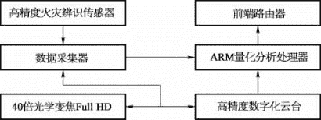

图 4-7　红外热成像火灾探测装置

定位流程为：数据采集器经传感器获取视场覆盖区域的热点参数，40 倍光学变焦获取同框可见光高清画面，`ARM`处理器对热点参数进行量化比对，输出温度、距离、面积及三维空间坐标，形成联动策略。数字化云台带动探测器旋转，实现 360°球体覆盖；小范围扇形场景可省去云台，采用预设多视场角简化结构。

1）人工智能决策控制
算法依据热点危险等级匹配灭火方案：低危区域采用就近装置点对点处置；高危区域采用合围式处置；动态蔓延的高危热点沿蔓延路线匹配装置实施追踪式处置；需形成防火间隔时按蔓延趋势集中配置装置实施堵截式处置。方案选择可有效提升灭火效率。

2）人工智能控制方法
算法依据联动策略与灭火装置布局数据，计算各热点与装置的关联度，按预设火警危险等级确定最大危险元素区域并降序排列，结合三维定位参数形成火警危险加权关联路线，建立联动策略与装置间的拓扑关系，给出灭火方案或组合。配套人员疏散指引策略：点对点或合围式采用常规指引；追踪式提供特定疏散路线；堵截式阻断蔓延并预留专门疏散通道，不同方案对应不同指引，提升救援效果。

#### 4.2.2.2 基于图像的火灾探测
传统烟雾型探测器易受空间与环境干扰，导致探测滞后甚至失效。基于视频的图像型探测利用图像特征丰富直观，通过早期火焰图像变化实现火灾探测，适用于大空间场景。

图像型火灾检测系统由前端摄像装置与图像识别模型组成。前端多采用电荷耦合元件（`chargecoupled device`，`CCD`）摄像机采集现场画面，模型将画面分类为火灾或非火灾。图 4-8 为检测流程。

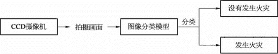

图 4-8　图像型火灾检测系统检测火灾过程

火灾失控后火场复杂危险，火灾初期火焰特征变化明显，掌握变化规律是视频识别的关键。系统读取视频后依次完成：自动差影图处理与视频变化预判；确定变化后基于变化阈值进行灰度化、二值化、去噪与火焰面积分析；基于火焰面积变化与色彩分析进行 `RGB` 色彩分布与 `YCbCr` 火焰颜色分布判断；结合灰度梯度分布与火焰尖角分布判定是否发生火灾。

1）运动目标检测
火场干扰多，有效检测运动目标、抑制背景干扰是提升准确率的基础。可采用帧间差分、背景差分、光流法三种算法。帧间差分与背景差分适用于静态场景，光流法适用于运动摄像机。帧间差分速度快但目标易偏大；背景差分能较好提取目标但易受环境干扰；光流法对独立运动对象敏感但计算复杂不利于实际部署。

2）火灾图像形态特征处理
形态特征处理是视频识别的基础，其有效性直接影响系统性能。火灾时火焰视觉特征随火场变化而变化，掌握规律即可实现有效识别。

（1）差影图处理。求差影图是多图像处理常见预处理，可分为直接差影图与阈值差影图，本质为差分法提取运动目标，便于捕捉图像变化。摄像头环境图像变化概率低，实时监控易造成资源浪费；火灾发生时环境变化明显，差影图可兼顾及时性与资源节约。

（2）真彩图像灰度化。处理时使用 24 位位图 `BMP`，需将 `RGB` 值有效转化为灰度，实现真彩到灰度的转换，为灰度分布检测提供基础。

（3）图像去噪。去噪指去除数字图像中的无用信息，可提升实用性与判断精度，常采用高斯滤波器、均值滤波器等。

（4）计算火焰面积。精确面积计算对识别至关重要，需先二值化得到位图再精确定位求和，其中“0”表背景、“1”表火焰，通过矩阵求和获取面积。

（5）识别火焰尖角。尖角识别基于二值化图像区分火焰与干扰源。需全图扫描并将首行首列尾列置为“0”，遇非“0”则判定非尖角并继续扫描；存在尖角时需进一步判断角度以确认是否为火焰尖角，提升识别可用性。

### 4.2.3 火灾场景演化趋势快速预测
掌握典型火灾发生演化趋势是抵御社区火灾风险的基础。常见模拟模型包括区域模型、网格模型与场模型。

区域模型将建筑空间气体按温度分为热烟气区与冷空气区，即上、下层。假设各区参数均匀不变，包括烟气浓度、室内压力、空间温度，通过质量守恒与能量守恒计算参数变化。

网络模型把研究对象视作整体系统，每个分隔空间为网络节点，节点间通过气流连接，基于能量与质量守恒研究随时间变化的烟气浓度与压力分布。适用于连续空间，能简化处理，适合节点较多的受限空间研究；缺点是参数均匀化程度高，每个节点仅用一个均匀参数表示，适合均匀场景烟气运动分析，模拟简单但偏差较大，与现实差距明显。

场模型以动量守恒、能量守恒、质量守恒与化学反应原理为基础，把火场划分为无数微元，通过求解方程计算各微元的温度场、流速场、烟气浓度场，进而归纳整体场数据。相比网络模型计算更精确，但工作量大，对硬件与边界条件要求严格。

`Pyrosim` 是基于火灾动力学模拟工具 `fire dynamics simulator`，`FDS` 原理的 `CFD` 工具，采用大涡模拟，可通过计算机模拟火灾与烟气扩散，集成连续性方程、动量方程、能量守恒方程、分量守恒方程，可预测烟雾、温度、一氧化碳等关键参数。

在 `Pyrosim` 构建高层建筑火灾场景时，因楼层高、占地大，网格数量庞大，数据量达数百万，普通计算机单次模拟耗时过长。经大量火灾点仿真后导出归类数据，借助机器学习方法进行测试预测，可快速推演火灾演化趋势，为社区住户安全疏散提供依据，是场景—任务—能力智慧消防建设的基础。

1）基于趋势特征向量的火灾烟气流动与温度分布预测
`CFAST`（`consolidated model of fire and smoke transport`）是主流火灾预测模型之一，综合预测烟气与温度。用户通常按经验设定初始温度、热释放速率、材料特性、隔间尺寸、机械通风规格、火源特性等参数，再按经验修正输出结果，使用复杂且耗时，且预测准确度常与实际情况不符，需工程人员经验修正。随着深度学习发展，利用深度学习提升 `CFAST` 预测精度成为研究热点。

火灾预测与社区疏散智能优化实战手册

深层神经网络天生具备全域最优化搜索与任意函数逼近的能力，从历史火灾样本里提炼隐含规律，并把这些规律固化在网络参数中。面对走势类任务时，这类方法往往能拉开与传统手段的差距。其根基在于网络可自主学习、自我组织和动态适应，从而应对环境要素纠缠、背景认知模糊、推理规则不明晰的难题。长短期记忆网络 `long short-term memory`，`LSTM` 便是典型的深度结构，因支持输入到输出一体建模、外源因子易于接入、特征可自行抽取而备受关注。

想把时序预测精度再推进一步，就要借用序列自身的内在属性。具体做法是从时序中拆分出趋势性指标，再把该指标作为深层网络的额外输入，得到带有先验信息的模型。常用的趋势提取手段有 `Cochran-Armitage` 方法、`Mann-Kendall` 方法和 `Kendall's tau-b` 方法。这类手段既能从火灾序列中辨识演进方向，也能检验序列是否发生突变。

## 2）基于多核极限学习机的火灾趋势预测

不同代理模型各有优劣。极限学习机 `extreme learning machine`，`ELM` 是一种单隐层前馈结构，相较其它代理，训练耗时短、泛化表现佳，近年在分类与回归中应用广泛，也契合火灾预测对快速响应的需求。

`ELM` 与其它前馈网络的本质差别在于隐层权重与阈值是随机指定的。因而效率高，但稳定性易受波动牵动。引入核函数后得到核极限学习机 `kernel extreme learning machine`，`KELM`，借助核映射与正则化理论压降模型复杂度与随机性，在稳定性和泛化上明显优于原始 `ELM`。

## 4.3　突发事件下社区应急疏散策略优化

社区既是居民日常生活的单元，也是灾害承灾最集中的载体。突发事件发生时，如何在短时间内把人群安全送达避险区，保全生命财产并把伤亡降到最低，是应急管理的核心任务。

### 4.3.1　社区灾害场景特征

#### 1）人员组成与分布

灾害来临时立刻制定可操作的疏散方案，其合理性很大程度上取决于对社区人群构成与空间分布的把握。

##### （1）人员组成方面。
社区内部不同属性的人对疏散指引的理解程度不一，甚至会产生误读；行为模式也呈现差异，对整体疏散产生较大影响。社区人口基数大、构成多元。按年龄可划分为童年 0～6 岁、少年 7～17 岁、青年 18～40 岁、中年 41～65 岁、老年 66 岁以上。按文化程度可划分为研究生、大学本科、大学专科和专科学校、中等专业学校或中等技术学校、技工学校、高中、初中、小学、文盲或半文盲。

##### （2）人员分布方面。
灾害发生时，人员在建筑内部的位置分布会影响疏散方案的编制、优化与落地。因此在制定与优化过程中必须真实反映人员分布。

#### 2）灾害类型与等级

不同灾害对应的疏散策略不同，方案设计需贴合灾害特性做到精准应对。同一类型灾害的严重程度也存在差异，需据此制定分级措施，在保障安全的前提下尽量减少经济损失。

##### （1）灾害类型方面。
灾害的蔓延方式、处置方式、对人员的伤害方式各不相同，疏散策略需要针对不同场景进行专项优化。按起因可分为人为灾害与自然灾害；按原因、部位与机理可分为地质灾害、天气灾害与环境灾害、生化灾害与海洋灾害等。

##### （2）灾害等级方面。
等级高低对应人员受害程度。低等级事件可能无需疏散或只需非紧急疏散；而高等级严重事件发生时必须制定紧急且可行的疏散策略。

#### 3）建筑结构

社区建筑形态对疏散行为影响极大，不同结构会产生积极或消极效应。主要可分为室内建筑结构与室外建筑结构。

##### （1）室内建筑结构方面。
室内结构会直接影响疏散路径，若方案忽略这一点易导致拥堵甚至踩踏。涉及出口尺寸、数量与位置，室内面积、设施布局等，均需纳入方案考量。

##### （2）室外建筑结构方面。
室外结构主要指社区内各建筑的数量、面积、功能等。若制定方案时未纳入这些要素，易出现拥堵、方向错误等情况，因此必须考虑。

#### 4）其他社区灾害场景特征

除上述核心要素外，疏散目的地、居住楼层数、电梯数量、楼梯宽窄等细节同样需要在编制方案时给予重视。

### 4.3.2　社区应急疏散规划

社区应急疏散规划指灾害来临前或发生后，有计划有组织地把处于危险区的居民转移到安全避难场所的过程。如火灾时把受威胁社区的居民转移到附近广场或公园。目标是在可控时间内通过集中疏散或分流疏散完成转移。可行的疏散方案是降低灾害损失的关键，需要及时决策并指导行动。

#### 1）疏散区域划定
若城市所有社区同时疏散，会对路网造成巨大压力。因此需要结合城市社区人口分布与交通网，把全市划分为若干疏散区，明确各区的疏散顺序与疏散时间。根据致灾因子情景，初步建立疏散分区，引导居民在限定范围内合理避险。

#### 2）疏散策略方案生成与评价

基于已有应急能力推演可能的灾情状态，模拟得到相对合适的疏散路径与疏散方式。决策者集成情景要素实时构建事件从初始到当前的发展状态，并对未来走向做出合理判断。情景推演可借助模糊规则、复杂网络、物理-信息-行为多事件耦合、贝叶斯网络、系统分析与实时情景匹配等手段，从时空、横向与纵向维度实时更新情景信息，推演从当前到未来的情景链。结合社区具体特点与疏散目标，在成本或时间约束下优选疏散方案，并在灾后对实际效果做出评价。执行过程中需通过持续仿真修正交通情景，实现辅助决策与方案调整。

应急状态下常出现全局信息缺失，疏散过程的多样性与不确定性难以完整刻画，易导致仿真数据偏差而加大损失。此时历史案例具有重要借鉴价值。通过收集各社区相关灾害情景下的历史案例并建立案例库，经检索获得相似案例后可直接使用或适配修正，从而辅助生成疏散方案。

#### 3）应急疏散优化模型

从管理视角看，科学的疏散计划与管理都依赖合理的疏散模型，通过数学分析、图论与人工智能算法获得优化结果。主要是指优化疏散路径与估算最短疏散时间，提升方案效用。

### 4.3.3　基于智能启发式算法的疏散策略优化

传统优化流程由疏散仿真模型与优化模型迭代完成。初始策略往往非最优，需借助优化模型不断改进。首先仿真模型依据场景特征与初始策略模拟人群疏散；随后优化模型依据场景特征与模拟结果对初始策略修正；再由仿真模型基于新策略进行再次模拟，如此反复迭代直至模拟结果满足要求，最终得到优化后的疏散策略，具体流程如图 4-9 所示。

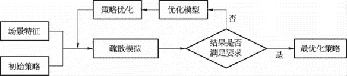

图 4-9　传统应急疏散策略优化流程

优化算法大致可分为精确算法与启发式算法，如图 4-10 所示。精确算法适用于小规模问题，主要包括线性规划、动态规划、整数规划等，可求得绝对最优解，但复杂度高，不适合大规模工程。启发式算法不按确定步骤穷举，而是利用特定规则不断改进解，经过多次迭代在解满足要求时输出结果。其可在可接受成本内搜索较好解，但不一定保证全局最优，也可能陷入局部最优。常见的启发式算法有：

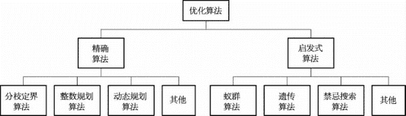

图 4-10　优化算法分类

#### 1）遗传算法

遗传算法 `genetic algorithm`，`GA` 模拟达尔文自然选择与遗传学机制，通过模拟自然进化过程搜索最优解。

算法先随机产生决策方案，判断是否满足优化要求，若满足则输出；否则选择较优个体淘汰较差个体，对被选个体进行交叉与变异以产生新解，再判断是否满足要求，如此循环直至产生最优解。具体流程如图 4-11 所示。

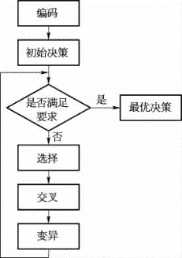

图 4-11　遗传算法具体流程

遗传算法的关键环节包括编码、交叉与变异。

##### （1）编码。
需把解数字化，把决策转化为二进制或十进制编码。编码方式会影响交叉、变异等算子的运行效率，进而决定进化效率。常用方法有二进制编码法、浮点编码法、符号编码法。

##### （2）交叉。
交叉操作是对配对染色体按一定方式交换部分基因形成新个体。二进制或浮点编码常用的交叉算子有单点交叉、两点与多点交叉、均匀交叉、算术交叉。

##### （3）变异。
变异是指用基因座上的其他等位基因替换原基因值，形成新个体，即对决策编码做随机扰动。二进制与浮点编码常用的变异算子有基本位变异、均匀变异、边界变异、非均匀变异、高斯近似变异。

#### 2）禁忌搜索算法

禁忌搜索 `tabu search` 是一种智能启发式优化算法，从初始可行解出发，选择特定搜索方向作为试探，改变初始解并重复寻优，直至解满足要求。

为避免陷入局部最优，算法在迭代中采用记忆技术，记录已进行的优化过程以指导下一步搜索。

算法先随机产生初始决策，判断是否满足要求，若不满足则依据算子产生候选解，从中挑选最优作为下一步初始解，并把上一步解放入禁忌表，在禁忌步长内不被再次选择。具体流程如图 4-12 所示。

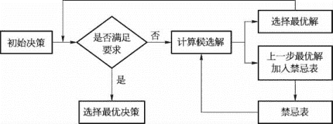

图 4-12　禁忌搜索算法具体流程

假设疏散目标为把人员从地区 A 转移至 E，需经 B、C、D 三处通道，初始策略为“`A—B—C—D—E`”。设禁忌步长为 2，禁忌表中的内容连续两步禁止候选后解禁。算法将对该策略进行优化，步骤如下：

步骤一，依据初始策略计算候选解，并把初始解加入禁忌表。
步骤二，依据上步最优候选解计算本步候选解，将上步最优解加入禁忌表，检查禁忌表是否需要解禁。
步骤三，依据上步最优候选解计算本步候选解，返回步骤二继续搜索。

迭代至最大步数后，从各步最优候选解中选出最优疏散策略。

#### 3）蚁群算法

蚁群算法用于寻找优化路径，其原理源自蚁群觅食的最短路径行为。单只蚂蚁无法直接找到最短路径，但会在路径上留下信息素，后续蚂蚁倾向于选择浓度更高的路径，短路径信息素不断累积，最终整个蚁群在正反馈作用下集中到最优路径。

算法先随机产生初始决策，把每一步视为一个节点，随后在节点上随机放置蚂蚁，让其随机行走，直至走完所有节点并更新信息素，再次放置蚂蚁迭代，直至达到设定次数，最后依据信息素分布选出最佳路径。具体流程如图 4-13 所示。

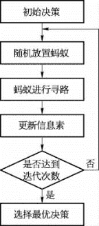

图 4-13　蚁群算法具体流程

### 4.3.4　基于人工神经网络的疏散策略优化

在应急疏散领域，人工智能技术发挥重要作用。机器学习、知识图谱、计算机视觉、虚拟现实与增强现实等关键技术为疏散策略优化提供数据支撑与建议。

#### 1）人工智能模型辅助疏散策略优化

计算机视觉利用摄像头等设备对现场进行实时判断与预警，为历史数据与现场特征提供信息；虚拟现实模型与知识图谱模型基于历史数据总结出人员疏散行为特征，为后续优化提供依据；机器学习模型利用历史数据训练后，将实时场景输入即可输出疏散策略并优化之；增强现实模型则可把策略实时传达给疏散人员，提升效果，具体如图 4-14 所示。

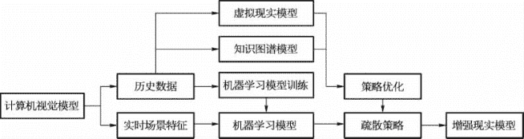

图 4-14　人工智能模型疏散策略优化

#### 2）基于人工神经网络的疏散决策支持

以大量真实疏散数据为基础训练神经网络模型，预测时仅需输入场景信息与灾害信息，无需额外优化环节即可直接输出最优决策。

神经网络模型不同于传统模型，它以数据驱动学习真实疏散规律，训练出符合实际的模型，可直接基于场景数据与灾害情况计算最优策略。

建模流程为：先收集大量真实疏散数据并预处理，使其可被神经网络识别；再用数据训练神经网络得到较优模型；最后将现场场景数据输入训练好的模型，得到最优决策。

## 4.4　面向灾害的社区人员疏散动态诱导

社区疏散不仅涉及宏观的路径与节点选择，还包括依据现场情况实时调整的微观动态诱导。

首先，通过摄像头、传感器等设备获取灾害现场数据，利用计算机视觉等技术进行实时分析；随后系统据此进行微观决策；最后借助指示灯、增强现实 `AR` 等技术实现实时动态诱导，具体如图 4-15 所示。

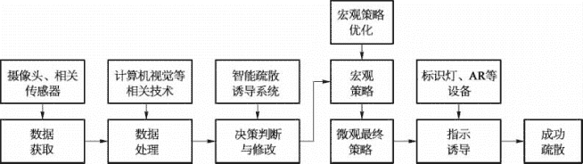

图 4-15　社区人员疏散动态诱导策略

### 4.4.1　实时数据处理

动态诱导以实时场景数据为基础，数据处理是关键，其中计算机视觉技术最为重要。为避免人群聚集引发踩踏，需对疏散人群数量与密度进行监测与估计。相关算法如下：

#### 1）人数估计算法
该算法可估计监控区域内人群数量，当数量或密度达到阈值时触发异常行为分析，并把实时信息传递给疏散系统用于路径决策优化。

算法在 `Vibe` 算法基础上，通过透视矫正更新前景像素值，结合角点提取算法求取群体密度权重，完成前景像素归一化。随后利用高斯拟合对每帧图像的像素和人数进行拟合并记录拟合函数，结合实时视频图像像素信息即可估计人数，流程如图 4-16 所示。

感兴趣区域 `region of interest`，`ROI` 是图像中重点关注的部分，排除该区域外的其余部分可减少运算量与干扰。

#### 2）Vibe 算法
`Vibe` 是一种背景建模方法，通过计算邻域像素建立背景模型，将其与当前像素比较以检测前景像素。主要包括初始化、像素分类与模型学习更新三部分。特点是计算量小、内存占用少、处理速度快，适合嵌入摄像设备。

#### 3）角点提取算法

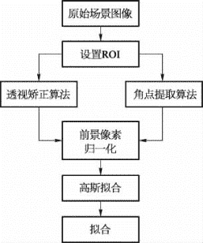

图 4-16　人数估计算法流程

图 4-17　算法提取的特征点图例

角点提取算法用于图像处理中特征点检测，提取效果如图 4-17 所示。常见的基于模板的角点检测算法有 `Kitchen-Rosenfeld` 角点检测、`Harris` 角点检测、`KLT` 角点检测及 `Susan` 角点检测。与其他方法相比，`Susan` 算法实现简单、定位准确、抗噪能力强。`Harris` 角点检测是特征点检测的基础，提出利用邻近像素灰度差值进行角点、边缘、平滑区域的判断。

#### 4）高斯拟合

人群规模的光学估算，本质是基于历史样本的学习。把图像表征记为 x，实测人数记为 y，构建映射关系 y = f(x, c)，其中 c 为可调参数，映射即为拟合模型。训练阶段逐帧提取前景像素作为 x，与该帧标注人数 y 配对；按区域拥挤程度赋予差异化权重，分别求解高斯近似的拟合函数。训练完成后需用独立数据检验以避免过拟合，检验时同样提取 x 特征，由已训练模型对视频片段进行人数预测。

### 4.4.2 智慧疏散引导机制
智慧疏散引导的工作逻辑如图 4-18 所示。系统由控制主机、探测烟气层浓度与温度的传感器、监测人员撤离速度的装置，以及可变路线指示器和安全出口标识构成。火灾发生时，平台融合现场烟气浓度、温度等态势、人群撤离速度与密度等行为参数、建筑疏散设施与结构等环境参数，持续优化引导路线，并以动态标识呈现实时最优撤离路径。

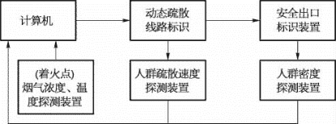

图 4-18 智能疏散诱导系统工作原理

## 紧急疏散指示与动态标识
日常可见的紧急疏散指示装置已广泛部署在既有建筑，用以传递逃生走向和出口位置。研究显示，即便符合规范，实战中效果常不理想。火灾产生的烟气与有害气体遮挡视线，地震可能改变结构，疏散通道受阻等现场变化都会干扰路线判断。

如何在不大幅改动原设计的前提下提升出口辨识度是关键。提升感官提示的手段多样，如放大标识以脱颖而出，或增加额外感官刺激。绿色底色利于与墙面区分，部分标识加装 LED 光源以提升被发现概率。常见应急出口标识如图 4-19 所示。

欧盟 FP7 GETAWAY 项目指出传统静态标识的局限，并提出研发智能主动动态标识系统 IADSS 以弥补不足。LED 静态灯光虽能吸引注意，却无法解决关闭不当出口的问题，由此出现激活动态标识系统 ADSS 的概念。动态标识通过周期性闪烁的绿色灯传递“可通行”信息，通过闪烁红色叉号传递“受阻”信息，如图 4-20 所示。日常状态下外观与标准出口一致，报警触发后被激活，用以提示特定路线与出口的可通行状态。

图 4-19 常见应急出口标识

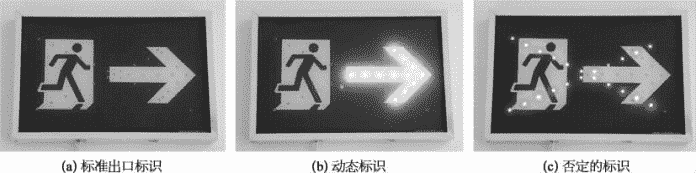

图 4-20 出口动态标识示例

实现 ADSS 的智能自动控制即 IADSS，需要两类支撑模块：

（1）信息采集模块由闭路电视系统 CCTV 与火灾探测系统 FDS 组成，用以建立即时态势感知。采集内容包括人员数量与分布，以及是否出现火灾风险如烟雾、热量、有毒气体等。经由 CCTV 监控平台确认人口信息。

（2）智能决策模块即方向判断系统 DE，用于识别最优出口路径。DE 借助 FDS 提供的火灾特征与模式匹配算法，判断检测到的火灾是否与火灾库中预设类型相符。随后将人口分布与确认的火灾信息导入疏散仿真软件 building EXODUS，该软件由英国格林威治大学防火安全工程团队研发，用以描述人员与火场环境的交互。软件运行预设的建筑疏散策略，并采用安全出口路线度量算法 SERM 分析仿真结果，按预测伤亡人数、撤离距离、撤离时长、楼梯使用数量等指标对策略进行排序。DE 及其支撑模块以实时或更快速度运行，确保在 FDS 识别火灾并触发报警前完成流程。排序后的策略提交人工控制器，由其判定最佳方案并操作 ADSS 控制系统，通过动态逃生指示标识将路径信息传递给现场人员。启动后，ADSS 不仅指引安全路径，也明确提示不应前往的区域。如此，IADSS 能够将人员引导至当前最优出口，同时规避不可行路线。

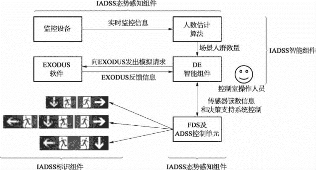

图 4-21 智能激活动态标识系统架构

### 4.4.3 基于增强现实的动态指引
指引诱导是人员疏散策略的最后环节，也是最关键的环节。决策再完善，若现场诱导出错，人员难以快速有效撤离，甚至错误引导会把人带入更危险境地。

### 1）疏散标识
安全疏散标识是依据视觉与听觉效应制成的光声诱导装置。与传统应急标识不同，它随声波周期性闪烁形成动态光效。动态疏散标识采用“三点定向”原理（图 4-22），在同一直线上的三只声光指示器按 1、2、3 顺序依次发声则指示向右撤离，反之指示向左撤离。箭头除左右外，还可变为上下共四种形态，与声波指示方向对应。

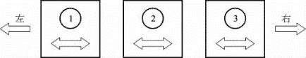

图 4-22 三点定向原理示意图

广义应急标识涵盖疏散通道指示、出口指示、顶部应急照明灯等，主要依赖电力系统提供光线引导，降低视野不良带来的疏散风险。狭义应急标识则采用先进高科技材料，可在断电或浓雾环境下仍引导行人疏散。随着建筑向大型化、高层化发展，应急标识的重要性日益凸显，尤其在突发事件中快速疏散的关键作用尤为突出。

公共场所普遍设置应急指示标识以提升公众应对突发事件的能力。应急标识是应急疏散系统的重要组成，包含应急通道标识、应急出口标识、应急电话标识和应急避险标识。火灾或电路故障等紧急状况下，大量人员需迅速疏散，应急标识是保障安全的重要措施。布设时需综合建筑条件、人员流动情况、对环境的熟悉程度、事故情形等多重因素确定。

低照度环境下发光型疏散指示器的诱导效果会下降，而声波传播不受浓烟或遮挡物影响，声音诱导优于视觉诱导；反之视觉诱导更优。因此疏散诱导系统多采用声光结合的双重诱导机制。

### 2）虚拟现实与增强现实技术
虚拟现实 VR 技术能够将真实世界信息与虚拟世界信息无缝融合。增强现实 AR 技术把虚拟信息叠加到现实环境中，与真实画面共存，提升用户感官体验。VR 在应急疏散中的应用包括：

（1）常态准备阶段的应用。为提升应对突发事件的能力，灾害前的疏散准备至关重要。利用 VR 事先对建筑场景与疏散环境建模，模拟并找出人群拥挤点、流量瓶颈点、最佳避难区等关键点。经多次模拟优化，可生成该场景下的最佳疏散线路、关键薄弱点等信息。在智能设备与信息化背景下，人们可通过随身手机或官方二维码等入口便捷获取疏散信息。

（2）事中阶段的应用。灾害发生时，人员可借助 AR 获取灾害进展与外界疏散信息以优化撤离效果。例如逃生者在确保自身安全前提下，通过手机 AR 获得语音、图像提示指令，有序疏散。

（3）事后阶段的应用。利用 3R 技术即 VR、AR、混合现实 MR 重现场景，积累疏散案例经验。

### 3）动态疏散诱导平面图
某楼层设置三个逃生楼梯，其疏散通道及动态疏散标识如图 4-23 所示。图中可看出各动态疏散标识的布置位置，箭头表示标识当前显示的疏散方向。

疏散指示标识默认指向最近的疏散出口，火灾时由火灾报警器启动，按预设方向指示疏散路线，如图 4-24 所示。火灾发生后，若正常路线被火势、浓烟或其他因素封堵，可通过火灾探测器或人工按下封堵区域的手动报警按钮将信号送入火灾报警控制器，控制器依据现场封堵情况调整动态标识的指示方向，重新指引一条可行的疏散路线，协助人员及时逃生。

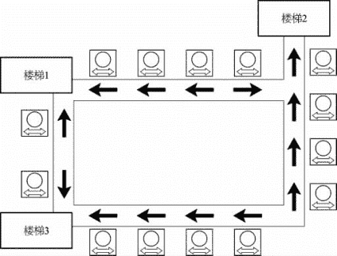

图 4-23 动态疏散诱导平面图

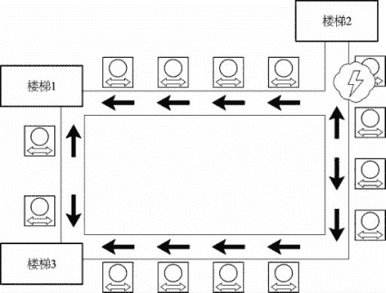

图 4-24 调整疏散路径示意图

## 4.5 智慧社区应急管理应用案例

### 4.5.1 数字化应急管理提升社区治理效能
深圳市福田区莲花街道紫荆社区整合辖区社会力量打造防灾减灾样板社区，在全市率先建设社区智慧微中心系统，通过实施“三个一”工程，即社区智慧应急系统“一中心”、多元应急作战队伍一体化联动运行、智慧安全监测平台“负一秒”风险预警，实现上级指令接收、风险点危险源监测预警、应急人员与资源定位、预案电子化、高清视频会议、现场信息上传等功能的可视化操作。该系统是深圳市福田区“智慧福田”应急指挥平台向街道社区的延伸，打通并汇聚本社区综合数据及全辖区安全、民政、司法、综治等数据资源与公共卫生类应急专家库，实现街道社区资源共享与市、区、街道、社区四级指挥联通，为党委决策与基层防控提供全方位可视化数据支撑。

（1）预防阶段。紫荆社区对接智慧福田预警监测平台与深圳市突发事件预警信息发布平台，内部上线水、电、火等“物联网+”风险监测系统，如易涝水位监测、可燃气体探测等，并连通公安“天网+”系统与远程消防预警系统，延伸至物业小区内部监控与“老、旧、危”场所，辅以无人机空中巡查，实现 542 处高风险区域的全天候实时监控，对异常状况在线上报、持续追踪并全程管理。准备阶段针对社区所有风险点与动态环境可能引发的气象灾害、突发疫情、地震火灾、地陷地裂等潜在事件，社区编制并上报电子化应急预案，莲花街道应急指挥中心集成各社区预案，编印《社区应急预案》《社区值守工作管理手册》等，形成预案库并组织应急演练。2020 年初疫情期间，福田区启动重大突发公共卫生事件Ⅰ级响应，紫荆社区迅速启动预案，成立专项小组，调动人员与资源，激活一体化动态响应体系。

（2）响应阶段。紫荆社区与莲花街道应急指挥中心、社区健康管理中心、社区警务室联动，并接入新型社区智能防疫系统，获取业主动态信息与疫情救援数据，建立疫情管控、信息统一报告发布、协调落实与跟踪督办机制，从而精准开展可疑人员追踪、疑似人员处置、宣传教育、摸排走访与物资配送，并在重点区域部署 GPS 无人机，对人员密集公共场所实施空中巡查。

（3）恢复阶段。紫荆社区一方面坚持消杀、测温、登记等基础防疫，总结经验形成案例；另一方面逐步有序恢复社区生产生活秩序。以紫荆社区智慧微中心系统为代表的基层数字化应急管理体系，有力支撑社区外防输入、内防扩散的防线，极大提升基层应急管理的精准化、精细化与智能化水平，成为社区治理与服务的硬核力量。

### 4.5.2 灾后学习机制提升社区综合防御力
人工智能在获取海量信息后，可通过深度学习构建有效的灾后学习机制，从多起灾害事件中总结经验，避免类似灾害重现。例如上海市杨浦区城镇社区设有气象观测站，市气象与民政部门依托历史观测数据，结合社区房屋结构脆弱性、排水脆弱性及外来人口、老年人口、贫困人口脆弱性等因素，对社区雨涝灾害风险进行分级并建立社区灾害风险图，为暴雨、短时强降水等防御措施提供针对性数据，提升社区应对雨涝灾害的综合防御能力。基于社区过往灾害记录与实时监控的环境、人口结构特征，人工智能可构建现实社区模型空间，预测不同致灾因子与孕灾环境相互作用下各人群与区域的风险程度，及时向脆弱群体与易灾区域发布预警。通过物理空间向网络空间的数据流动与网络空间向物理空间的信息回流，社区模型空间与现实空间实现自我更新，抵御灾害的内在能力不断增强。

### 4.5.3 智慧消防助力风险预警与应急救援
自 2020 年下半年起，北京市朝阳门外街道办事处联合区消防救援支队，在老旧社区吉祥里打造全区首个居民社区智慧消防系统。以社区为中心构建集日常安全监控、隐患提示报警、快速响应联动、实时远程指挥于一体的“全方位、全流程、全要素”消防监督与应急救援体系。

智慧消防系统分为隐患排查、提示报警、联动救援、制度保障四大模块，并建立社区消防基础数据库，为智慧化安全管理提供技术支撑。

（1）电动自行车进楼应对。当电动自行车进入楼内，楼门口安装的 AI 摄像机立即捕捉风险点，随即语音提示“请不要在室内停放电动自行车或对其进行充电”，同时拍照取证向中控指挥室报警，值守人员通过“一键调派”手持台通知附近物业安保或工作人员上前制止，并告知楼内停放或充电的火灾危险。

（2）消防车通道占用、堵塞应对。在小区消防车通道上方约 5 m 处架设 AI 摄像机，发现通道被占用或堵塞时，摄像机自动拍照取证并向中控指挥室报警，随即调派人员制止，若车主已离开则通过“114 挪车服务”告知违法行为并要求立即整改。

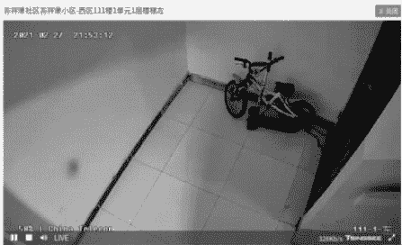

图 4-25 疏散通道占用智能识别

（3）楼道疏散通道堆物堆料应对。在楼道公共区域架设可识别违法行为的 AI 摄像机，对砖块、家具、货架等堆物堆料进行监测，一经发现立刻向中控指挥室报警，调派人员制止并宣传讲解占用堵塞疏散通道的危害。

（4）常闭式防火门未关闭应对。AI 防火门智能摄像机发现防火门未关闭时，向中控指挥室报警，调派物业安保人员予以关闭。

此外，系统还配备高位“火眼”摄像机，24 小时巡守小区院内、车辆、绿植、变电站等公共部位，一旦探测到烟雾或火焰，立即向中控指挥室报警，启动应急响应处置预案，通知附近点位工作人员到场处置。

# 第 5 章 人工智能赋能智慧社区的公共空间治理
智慧社区的公共治理是新时代构建基层社会治理新模式的重要变革，通过网格化、精准化、高效化的管理与服务实现社区治理现代化。社区公共空间是居民重要的社交场所，促进交流、交往与生活连通，因而公共空间治理愈发重要。该治理不仅涉及公共空间安全保障，还包括公共设施合理布局、公共环境美化与保护等多个方面，充分体现管理者的管理与服务水平。

## 5.1 智慧社区空间治理应用场景
随着城市人口持续扩张，社区人员构成日益复杂，楼宇高度化趋势明显，社区面临诸多问题，高空抛物、电动车充电起火等安全隐患成为公众关注焦点。此外电动车充电桩布局的合理性也是管理者需重视的问题，部分地区出现“一面人找桩、一面桩等人”的尴尬局面，暴露出公共设施规划与建设方面的不足。

### 5.1.1 高空抛物治理
近年来高空抛物坠物事件频发，造成多名无辜群众伤亡，被称作“悬在城市上空的痛”。部分事件存在找人难、取证难的难题，也让公众在谴责不文明行为的同时对“共同补偿”产生困惑。对此，各地持续探索治理手段，如发放传单或签署承诺书进行劝诫、安装摄像头遏制不文明行为、发动群众举报并给予奖励等，但效果多不理想。2019 年 11 月，最高人民法院发布《关于依法妥善审理高空抛物、坠物案件的意见》，明确对故意高空抛物者按具体情形以危险方法危害公共安全罪、故意伤害罪或故意杀人罪论处，并明确物业服务企业责任。2021 年 2 月，《最高人民法院最高人民检察院关于执行，确定罪名的补充规定（七）》增设高空抛物罪。伴随 AI 技术发展，社区对高层单元楼建立智能追溯系统，通过技术手段大幅降低事件后的取证难、追责难问题，同时对居民行为形成约束，成为新时代公共空间治理的高效手段。

高空抛物智能追溯系统通过将小区监控接入 AI 视频分析平台，对高空抛物行为进行实时智能监测，后端对视频流做实时 AI 分析，结果上传云端存储并在 Web 端展示，同时按时间、事件等属性分类归档视频文件，并向社区物业等部门发出警示，确保事件第一时间得到处理。系统可实现的功能包括：

1）智能检测报警
智慧社区高空抛物智能追溯系统接入高清监控设备实时采集视频图像，采用深度学习算法挖掘视频流，实现对高空抛物行为的自动检测与识别，并生成告警信息通过电脑端或移动端弹窗通知相关人员第一时间到场处置。系统监测精度高，能够识别微小物体并对抛物物进行准确标注显示，便于部门实现精准定责。

2）日常视频监控任务

智慧小区落地的高空抛物智能追溯平台，功能远不止捕捉抛物、即时告警、事后溯源，还承担了日常视频监控的职责。监控点位对小区周边环境做 24 小时不间断在线实时监看，一旦出现异常，可迅速调阅录像回放、还原全过程。该平台还支持视频图像自动归档备份，确保音视频资料得到有效留存，通过人防、物防、技防协同发力，为小区智能化管理按下启动键，筑牢安全底线，让居民安心感持续提升。

3）系统参数设置和设备管理

平台可对前端监控设备进行参数配置与远程自动化管控，运行期间能按需动态修改与设定。系统内置日志管理模块，完整记录各设备运行状态，并开启操作日志追踪，实现用户从登录到退出的全流程留痕。所有日志统一归档、支持实时检索、查询分析与告警联动。

4）系统巡检

平台不仅巡检监控设备、交换机等硬件的运行健康，还能自动巡检视频图像质量，保证传回后台的视频流清晰可用，为 AI 识别高空抛物行为提供可靠输入。同时平台具备性能监测能力，可监控客户端工作站的 CPU 占用与网络带宽使用，掌握网络上下行负载情况。

5）数据备份

为规范历史数据的存储与安全管理，防止因硬件故障、意外断电或病毒导致资料丢失，系统配备视频图像数据备份机制。网络异常时，视频暂存至本地内存卡，网络恢复后断网期间的数据会自动回传至后端。同时视频数据会同步备份至云端历史数据库，出现丢失时可借助备份恢复机制完成数据恢复与还原，确保数据稳妥可信。

### 5.1.2 电动车入梯管控

电动自行车凭借便捷、经济、环保的优势成为短途出行主力，保有量快速攀升也带来了停放与充电需求激增的问题。城中村和老旧住宅小区配套不足，是违规停放充电的诱因之一。随着车辆增多，电动车火灾事故频发，伤亡案例时有发生，智慧社区建设需正视这一新风险。

2014 年《成都市非机动车管理条例》提出在人流密集场所可设收费或免费停车场并专人管理，未明确小区内电瓶车不得上楼。2019 年 1 月 1 日起实施的《长沙市住宅物业消防安全管理办法》规定，楼梯间、楼梯出入口停放电瓶车妨碍疏散的，由消防主管部门警告或处 500 元以下罚款，拒不改正的强制执行。2021 年 5 月 1 日起实施的《上海市非机动车安全管理条例》明确禁止电瓶自行车停放、充电于建筑物首层门厅、共用走道、楼梯间、楼道等共用部位，以及疏散通道、安全出口、消防车通道两侧及人员密集场所室内区域，物业、业主管理机构可劝阻制止并向城管或消防部门报告。

依托新技术与信息化手段，加装智能识别设施阻断电动车进电梯，是弥补传统管理短板的路径。典型方案如“电动车禁入电梯管控系统”，以 AI 图像识别配合传感器自动识别非机动车，并用摄像头辅助监控，形成闭环管控。车辆一旦进入，电梯即暂停运行并语音提示：“电动车进入电梯存在安全隐患，电梯已暂停运行，请将电动车推出电梯。”该系统仅干预电梯开关逻辑，不改动其他线路，对电梯本体无影响。上海、武汉等地小区已应用，治理效果明显，建议逐步推广，彻底消除乘梯上楼安全隐患，守护居民人身和财产安全。

### 5.1.3 充电设施布局规划

2021 年起多地明确禁止电动自行车入户充电，社区层面须合理规划建设智能充电设施以满足需求。

2021 年 5 月 20 日，国家发展改革委、国家能源局联合发布《关于进一步提升充换电基础设施服务保障能力的实施意见（征求意见稿）》，要求加快推进居住社区充电设施建设，完善充电桩建设推进机制。各地主管部门会同住建、人防、消防等部门协同推进新建及改造工程，并要求新建居住社区 100% 固定车位预留充电桩建设安装条件。

## 5.2 高空抛物智能追溯

高空抛物智能追溯的实现路径通常涵盖数据采集、运动目标检测、运动目标跟踪、抛物判定、智能告警五个环节，其中目标检测与跟踪是核心。图 5-1 为智慧社区高空抛物智能溯源系统的判断条件与算法规则，包含物体检测、气象干扰规避、蚊虫鸟类干扰过滤、视频图像自学习等，输出取证材料包括特征图、全景图及 10～15 秒视频。

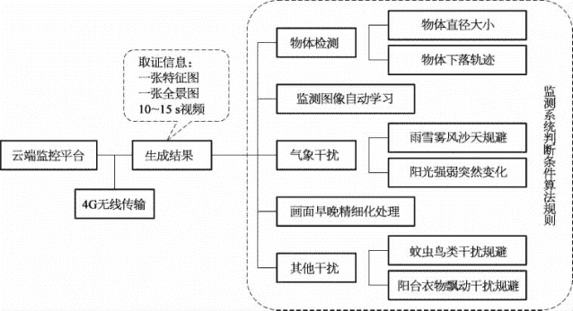

图 5-1 智慧社区高空抛物智能溯源系统判断条件算法规则

### 5.2.1 数据采集

在楼宇周边特定距离布设一定数量、带一定仰角的高清监控，对楼宇外立面进行抓拍完成视频采集。不同楼层对应不同仰角设置，以确保画面完整。摄像头部署示意如图 5-2。

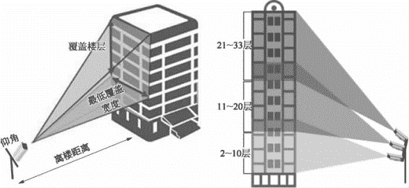

图 5-2 摄像头布局示意图

### 5.2.2 运动目标检测

主流方法有帧差分法、背景差法、光流法。

#### 1）帧差分法

帧差分法即帧间差分，将前后两帧对应像素相减，差值小视为静止，差值大视为运动引起。标记出大差值像素即可定位运动目标，前提是前后帧环境亮度基本一致。背景亮度变化大、阴影干扰时会带来额外问题。其优点是算法简洁、实现容易、实时性好；缺点是精度有限，要求背景近乎静止，目标定位不够精确。

#### 2）背景差法

背景差法用当前视频帧与背景图相减，阈值二值化后提取运动目标。背景常取单帧或多帧平均作为时间平均背景。计算简便，目标轮廓完整，也能检测静止后的物体。缺点是光照或场景大幅变化会引入噪点，需及时更新背景，复杂度上升、实时性下降；阈值选择对效果影响显著，合理阈值可大幅提升精度。

#### 3）光流法

光流描述空间运动在图像平面上的灰度变化，光流场反映各点灰度在位置上的变化趋势。其优势是不依赖场景先验，可检测静态或动态背景下的独立运动。不足在于目标亮度变化会削弱准确性，难以捕捉短暂停滞目标，计算量大、抗噪弱、实时性差。

### 5.2.3 运动目标跟踪

在检测出运动目标后，利用代表性特征建立目标模型，结合搜索策略与匹配原则在下一帧定位目标。常用方法分为基于模型的跟踪、基于区域的跟踪、基于活动轮廓的跟踪、基于特征的跟踪。

#### 1）基于模型的跟踪

先学习跟踪目标，用点线区域拟合成几何模型，二维或三维均可，再在当前帧寻找与上一帧最相似区域。优点是可以分析三维运动轨迹，缺点是模型拟合决定准确性，目标旋转、遮挡、视角变化导致形变时难以保持，现有研究多用可变形模型弥补。

#### 2）基于区域的跟踪

先分割前景建立目标模板，再在后续帧用模板匹配搜索最相似区域。模板通常大于实际目标，形状可为圆形、矩形或不规则。常用平方和准则、相关系数匹配。优点是无遮挡时精度高稳定；缺点是搜索耗时随范围增大而增长，目标形变或大面积遮挡易丢失。

#### 3）基于活动轮廓的跟踪

用闭合轮廓曲线表示目标，建立能量函数，通过能量极小化让曲线逼近目标，实现轮廓自更新。代表方法有 Snake 模型和水平集方法。Snake 适合单目标可变形跟踪，水平集更利于多目标。轮廓数据量小，计算负担降低，能适应形变与部分遮挡，但初始化位置关键，初始偏差大易丢失目标。

#### 4）基于特征的跟踪

不依赖整体外观，只用稳定个体特征实现跟踪。两帧时间间隔短，特征一般保持稳定。流程为特征提取与匹配，常用颜色、角点、梯度、纹理等特征，通过相似度衡量选出最佳匹配区域。优点是只要特征未被遮挡破坏即可持续跟踪，关键在于选取抗干扰强的特征。

（1）抛物判断。检测与跟踪完成后，AI 对移动物体进行甄别，排除飞鸟、落叶等干扰，完成高空抛物自动识别。
（2）智能警示。分析结果推送至社区管理中心，物业等部门到场处置。人身伤害等严重事件将自动通知公安部门及时处置。

## 5.3 电动自行车入梯智能预警

电动车尤其是两轮、三轮自行车及电动摩托车因轻便经济便捷，使用量快速增长，成为末端配送主要工具。早期标准缺失、改装劣质、监管缺位导致火灾频发。虽然生产到使用全链条管控在收效，但物业与执法难以 24 小时全覆盖，楼道、楼道口随意停放、乘梯上楼充电现象仍存，成灾后果从波及一家到立体化蔓延。

目前投入使用的电梯阻车系统主要分三类：地感应线圈式、图像识别式、采集板式。前两者结构简洁、成本低、安装便捷，可自行维护。

#### 1）地感应线圈阻车系统

在轿厢入口下方埋设地感线圈，探测电动车金属材质触发敏感信号，经控制器驱动执行机构阻止门关闭，并通过扬声器语音提示。执行机构与电梯非硬连接，也可接入光幕电源。缺点是对所有金属均敏感，误触发率高导致电梯无故停运，且对地面金属干扰要求极高。

#### 2）图像识别阻车系统

获取电梯预设范围图像，判断是否存在电动车。统计预设时间内电动车出现次数与未出现次数，出现次数大于未出现次数时控制器下发禁止乘坐指令，阻止关门并语音提示推离车辆。依托机器学习大量场景样本训练，识别速度快、准确度高，应用广泛。

#### 3）采集板阻车系统

电梯入口处装设采集板，集成处理器、金属检测、压重检测、电梯驱动、报警、语音提示模块。金属检测模块感知电动车金属接近，处理器结合轿厢压重数据综合判定车辆进入，触发报警、停止运行、禁止关门并语音提示。识别精度高，实现阻车上楼。但安装较复杂、价格较高，频繁搬运重物易损坏采集板，更换成本与整机相当，需厂家专业维护。

## 5.4 智能充电设施规划与优化

电动自行车停放充电设施由停车棚、智能充电桩、智能充换电柜和充电安全管理系统构成。停车棚以钢架不燃顶棚、排水沟为主体，辅以红外监控、自动喷水灭火或简易喷淋，配合充电桩与充换电柜，保障停放充电期间防盗、防火、防触电安全，提升居民户外停放意愿。智能桩与智能柜可感应标签化车辆及电池信息，提供折扣电价。

### 5.4.1 充电设施类型

#### 1）充电棚

充电棚是户外集中停放充电的场所，是电动车安全管理的基础设施，如图 5-3。由于占地大、场地要求高，在城中村与老旧小区难以大规模建设。

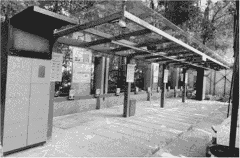

图 5-3 社区充电棚

#### 2）智能充电桩

为不可拆卸电池电动车提供户外安全充电。设计需兼顾户外环境、电气安全、消防安全、防盗安全、精准计费。插座防护等级达 IP54；未接充电器时插座不带电，具备空载断电、过载、短路、漏电保护；充满自动断电防过充，超功率自动断电，超温自动断电并报警，充电器异常自动断电提醒；充电中被拔出时微信推送核实；充满自动断电避免计费纠纷，并支持多种支付方式。

#### 3）智能充（换）电柜

服务可拆卸电池车主及快递外卖群体。占地小、外形美观、安全高、场地要求低，适合用地紧张区域。与智能桩同等考虑户外、电气、消防、防盗、计费要求，并实现车电分离，充电仓内置高效灭火装置，消防安全进一步提升。每柜可投保财产险，火灾可获理赔，降低用户顾虑。

#### 4）充电安全管理系统

通过电动自行车充电安全管理平台实现信息化升级，与智慧社区数字化系统无缝对接，信息互通共享。基于物联网打造“互联网+”可运营社区充电安全管理系统，云平台对接用户端 APP，适用于居民充电与行业换电场景。

### 5.4.2 充电设施规划与优化

#### 1）充电设施规划考虑因素

2020 年初，充电桩配套被正式写进新基建清单。随着新能源汽车加速普及，社区端充电设施的建设被列为新基建的重点抓手。做规划时，除了锚定服务人群，还要兼顾两类外部条件。

政策层面是第一道约束。推广新能源汽车既是缓解能源与环境压力的抓手。现行政策呈现国家与地方双层结构，地方条款由各地因地制宜出台，分散度较大；国家层面则主要给出数量、配建比例、运营主体、补贴方式、定价依据等原则性要求。落地时，一般按政策给出的数量区间或配建比例确定规划的上下限，也会依据政策划定的建设用地范围来筛选候选场址。

配电系统的承载力是另一道硬约束。充电设施是大型用电负荷，必须考虑配网的容量余量、电压上下限、电能质量等安全指标。现有研究普遍把配网安全运行约束嵌入选址模型，并在规划与运行经济性之间做协同优化。

#### 2）充电站选址模型分析
为电动汽车配建充电设施，核心是空间分布与规模的匹配，即在明确时空需求、路网与配网约束后，找到位置与容量的最优组合。桩体主要集中在居住小区与公共停车场，规划时关键是数量的确定，现有公共充电站的选址定容流程通常包含数量预判、站址挑选、容量测算、方案评估四个环节。

（1）充电站数量预估。需求规模一般由规划区内的充电需求、电站服务能力与覆盖半径推算，也可直接以政策或经验值前置给定。

## （2）备选站址确定
现行选址思路分为有候选池与无候选池两类。无候选池的做法先定电站总数，再在随机生成点位中以覆盖范围、截流流量、建设成本等指标寻优，虽能实现目标最优，却常出现用地不可行、配变无裕量、扰民等问题。更通行的做法是先圈定可建点位，再在此范围内优选。圈定标准包含使用与交通类约束，如需求强度、交通可达性、服务区覆盖、建设条件等，也包含电网类约束，如出线间隔、线路长度等。典型分布落在城市路网节点、公共停车场、配电系统节点上。

## （3）充电站选址模型
按需求表达方式可分为点需求与流量需求两类。点需求模型主要有三种：p-median，即选出 p 个点位使所有需求点到最近站点的加权距离总和最小；p-center，即在站点数固定的前提下使最远需求点到最近站点的距离最小；覆盖模型可细分为集覆盖与最大覆盖，集覆盖以满足需求为前提追求投资与数量最小，最大覆盖在站点数受限时追求覆盖需求点数最多。点需求模型把需求集中到网络节点上，理想状态是最近就近充电，现实中路径选择受流量影响，因而出现路网流量截流覆盖等流量需求模型。

## （4）充电站定容模型与求解算法
定容可分为站址已定后的容量优化，以及站址与容量联合决策两类。站址确定后，容量设计要兼顾利用率、建设成本与服务水平，常用思路有排队论方法、路口流量换算法、概率预测法。进入联合决策阶段，决策变量同时包含位置与容量，需在约束可行域内按规划目标寻优。实际求解多借助智能算法，如粒子群及其改进、遗传及其改进、免疫算法、萤火虫算法、蜂群算法等。

### 5.5 智慧社区公共空间治理实践
#### 5.5.1 高空抛物智能监测追溯与取证
2020 年 9 月 8 日凌晨 3 时左右，上海某高层小区窗口飞出一枚红色火星，呈抛物线坠落。抛物者以为无人知晓，却被已上线的抛物监测系统全程记录，系统实时推送视频至物业终端，管理人员据此迅速核查处置。

监测、追溯、举证是治理难点，已被模块化 AI 系统破解。硬件采集图像后，后台算法毫秒级识别抛物行为。一旦检测到物体脱窗且轨迹符合算法特征，系统自动截取事件前 2 秒至后 7 秒的视频，并推送至物业手机端与管理平台。相比传统事后调阅，大幅节约人力时间，提升处置时效。

上海多地已完成该系统的部署接入。某服务点上线当天即触发 13 起报警，街道与社区民警当日取证并对楼内住户进行警示。看到视频后，原本否认的住户当场认错并承诺不再发生。随后一周内该楼抛物明显减少，底层住户对居委物业表达感谢。系统还能对数据定期分析，生成易发时段与楼层画像，为精准监管提供依据。

#### 5.5.2 图像识别电梯阻车系统
电动自行车进梯引发的安全隐患在北京海淀北太平庄街道得到技术回应。该街道在多个社区试点电梯内高清摄像头阻车系统。识别到电动车进入轿厢后，系统语音提示并令电梯无法关门、停止运行，实现物理阻隔。未来该方案将在全街道 32 个社区覆盖。

技术隔离从源头遏制燃爆风险，为其他社区提供了可复制样本。需要指出，技防仅是治标，标本兼治需补齐电动车安全技术短板，完善充电配套，强化车主安全意识教育，依法严肃查处违规行为，让“电动车不进电梯”成为使用铁律。

#### 5.5.3 充电设施科学布局与全流程管控
以智能充电设施为抓手，依托“一网统管”大数据平台破解城市建设痛点。

1）服务圈与生态圈融合布局
上海曹杨新村保护更新项目中，以“一轴一圈一村”为载体推进 5 分钟生活服务圈，完善 15 分钟生活服务圈。在需求导向与问题导向下探索便民充电生态圈，与生活服务圈融合发展。兼顾居民、沿街商铺、过路人群的多元需求，在道路沿线与居住区内布设综合充电设施。

2）智能化数字化因地制宜供给
街道按需求配置“四件套”。社区内部安装智能充电桩，道路沿线布置花坛景观式充电桩，每套可同时服务 10 辆电瓶车；在不具备桩体安装条件但需求旺盛的区域配置智能充电柜，单柜可充 8 块电瓶，内置烟感、温感、电压检测与气溶胶灭火装置，保障安全。

3）智能换电柜
针对外卖、快递等高频使用电瓶车的从业者，部署可同时充 12 块同型号电瓶的换电柜。所有智能设施接入街道“一网统管”智联普陀 3.0 平台，实现点位与使用数据的归集分析，提升全流程管控精度。

# 第 6 章 人工智能驱动智慧社区出行优化
智慧城市本质上是数据驱动的城市，是数字城市的高级形态，能够在时空维度持续自我学习与完善，其核心价值之一是提供更舒适便利的出行体验。智慧城市落地依赖其基本单元智慧社区的持续迭代。

“15 分钟生活圈”概念自上海提出后，影响到广州、济南、长沙、厦门及雄安新区等地的规划。上海浦东于 2019 年 1 月启动推进布局。浙江省《未来社区建设试点方案》进一步明确交通场景，应面向差异化、多样化、全过程出行需求，构建“5-10-30 分钟出行圈”，实现人车物畅通，满足社区层面的精细化出行便利。

图 6-1 智慧社区的交通场景

## 6.1 社区智慧交通应用场景
人工智能在社区智慧交通中的应用聚焦公共交通、智慧出行与智慧停车。智慧出行借助移动互联网、云计算、大数据、物联网等技术，把传统交通与互联网深度融合，形成线上资源调度、线下高效运行的新模式，并以卫星定位、移动通信、高性能计算、GIS 等技术实现路网状态实时感知，通过手机导航、路侧电子告示、交通电台等渠道向公众发布。叠加驾驶行为实时感知与分析，可实现多模式动态导航，提升出行效率，并为交通管理部门提供决策支持，促进节能减排。网约车即是典型产物。

### 6.1.1 5-10-30 分钟社区出行圈
#### 1）车“5 分钟”取停充电
完善停车场充电供给，统筹对外售车位与公共车位资源，创新车位共享机制与服务 App，预留车路协同建设条件，为 5G 环境下的无人驾驶与智能交通预留接口。

#### 2）人“10 分钟”达对外交通站
创新街道分级与慢行系统设计，倡导低碳出行，通过信息一键导航与交通无缝衔接，打造居民 10 分钟可达对外交通站点的出行圈。

#### 3）物“30 分钟”社区入户
运用智慧数据技术整合社区快递、零售与餐饮配送需求，构建“社区-家庭”30 分钟智慧物流服务体系。

#### 4）“15 分钟生活圈”
该规划强调步行尺度与公共服务配置，其布局形态与传统邻里单位并无本质差别。随着共享单车、网络购物、快递等新技术应用，居民获取服务的时空范围与出行方式均已扩展，生活圈空间应随之调整。当前理念对步行与基础服务供给强调充分，却对新技术带来的变化回应不足。

### 6.1.2 社区非私有交通出行场景
指居民通过步行、骑行、公交、地铁等方式抵达目的地的全过程，倡导低碳出行与无缝换乘。需从顶层设计对街区道路进行创新分级与慢行友好设计，并提供信息服务支撑。在共享经济下，滴滴、美团等提供的网约车、拼车等移动出行方案也是重要组成部分。

图 6-2 街区道路的创新规划示意图

### 6.1.3 社区私有交通出行场景
指居民驾私家车出行的全过程。我国城市建设与居住区规划长期按私家车规模设计。世界银行 2019 年数据显示，中国千人汽车保有量 173 辆位列第 17。城市扩张与生活圈延伸使出行半径从 10 公里扩展至 50 公里乃至远郊与跨城自驾，私家车成为第三生活空间。《浙江省未来社区建设试点方案》提出快速取停、车位资源统筹、AGV 智能停车等指引，并强调为 5G 自动驾驶预留空间、完善新能源充电供给。海南提出 2030 年前全岛使用新能源汽车，正推广新能源车与分散式充电桩。

图 6-3 私家车使用场景

## 6.2 人工智能赋能社区智慧停车
### 6.2.1 社区停车主要矛盾
随着生活水平提升，私家车保有量持续攀升，而公共车位供给增速滞后，多省会城市泊位缺口超 50%。车位资源有限与需求快速增长的矛盾突出。若小区居民年龄、职业、作息高度趋同，车位使用将高度集中，白天工作时段出现大量闲置，有效利用率偏低。

根源可归为四个层面：
#### 1）理念层面：以罚代管，认知不足
汽车是基本出行工具，停车需求合理。部分地区对违法停车以罚代管，背后本质是供给不足与管理缺位，把责任转嫁给用户不合理。

#### 2）规划层面：前期缺位，预测能力弱
早期城市交通规划重扩路轻停车，停车被视作开发商附属，长期未纳入统一交通体系。车位数据碎片化导致需求预测与资源规划困难。

#### 3）法规层面：标准滞后，执行不一
《城市居住区规划设计标准》GB 50180-2018 要求普通小区车位配比不低于 1:0.8。大量老旧小区按十几年前的 1:0.1 配建，严重短缺。新建项目因用地紧张与监管宽松常被少建。各地执行口径不一，导致配套质量参差。

#### 4）资源管理层面：技术落后，体系混乱
智慧停车在一二线城市普及，但多局限于小区内部，并未形成城市级信息网。管理主体多元，缺乏总体管控，既有车位闲置浪费，私人车位时段空置也未利用。政府、规划、建设、开发商缺乏停车建设统一规划，形成割裂现状。

### 6.2.2 智慧停车实现路径
智慧停车系统可缓解停车难、提升空间利用率。与人工管理相比，其智慧体现在车位发现与费用自动支付两方面：一是通过停车诱导技术，让居民在手机端快速查找、预约空位并自动推荐路径，节省寻车时间；二是借助云计算推动共享停车，分时释放资源缓解供需矛盾；三是引导规范停车习惯，减少占位冲突。

#### 6.2.2.1 智能停车诱导

城市停车与交通协同优化新框架

让车更顺畅的关键在于把车流实时拆分、动态指引并系统化管控，从而提升道路整体服务水平。车位资源实现实时统计并对外发布后，驾驶者更容易抵达目的地，路网通行更流畅，因找车位引发的拥堵被压制，车位使用效率同步提升。平台以图文、语音、屏显等多种形态向司机推送车场位置、占用态势、行驶路径及周边路况，帮助快速锁定目标车位。整体来看，智能停车引导多由区域级指引、场内泊位指引、离场寻车三层构成。

##### 1）区域诱导系统
区域级指引把一定范围内的多个车场联成信息互通的网络，在城市主干道旁布设各类信息终端，向过往车辆发布周边车场的方位、剩余车位数及满闲状态，助力使用者迅速选出最优停车方案。

出行前，车主可通过手机、电脑等终端查询目的地附近车位并规划路线；驾车途中，可通过主干道屏、次干道屏快速了解周边车场的空位情况，同时兼具指路功能，引导车辆直达目标车场。

##### 2）车位引导系统
车位引导借助智能设备对场内车辆停放进行精确指引，帮助车辆迅速找到空位，是智能停车的重要组成部分。常见配置包括车位探测器、指示灯、引导屏、采集终端与后台服务器。当前探测器多采用超声波方案与视频方案。

（1）超声波车位引导系统：探测器安装在车位上方，利用超声波反射特性判断下方是否已有车辆，再由系统完成引导。
（2）视频车位引导系统：摄像机安装在车位上方，通过视频分析判断下方是否停放车辆，再由系统完成引导。

工作逻辑是探测器识别车辆后把占用信息定位到具体车位，实时发布车场剩余车位与各车位占用状态，并配合方向提示引导车辆快速停放。

##### 3）反向寻车系统
反向寻车是近年兴起的引导方式，通过采集、处理和共享停车信息帮助车主快速找回车辆，多用于大体量车场。

系统借助视频探测器完成车辆检测，经交换机送至识别终端识别车牌与车位，再经以太网上传至数据服务器并分发到各查询终端。车主只需在查询终端输入车牌或其他相关信息即可获取最佳寻车路径，迅速找到自驾车辆。

#### 6.2.2.2 共享停车
学界对共享停车的界定仍在探索，相关研究较少。美国城市土地协会的表述为：一个车场可为两个及以上独立场所提供停车空间，且彼此不冲突、不干扰。当下小区私家车位闲置率高，根源在于空闲位信息难以传播和共享。盘活私有车位是缓解城区停车难的关键路径。共享停车的实质是打破信息壁垒，综合利用各类存量停车资源。单纯新建扩建公共车位难以从根本上解决汽车保有量过饱和的问题。国家发改委于2017年3月17日公布首批5个城市开展城市停车场试点示范，明确提出建设智能停车信息平台，依托手机APP等推进“互联网+停车”及车位共享新业态。落地需要物联网、感知、大数据、无线通信等技术支撑，按信息生成与传递流程可分为感知层、数据传输层、分析反馈层，以及为激励参与必须加入的支付层，并配套智能车位锁便于车位主人或平台管理租出车位。

### 6.2.3 “5G+AI+物联网”智慧停车系统
依托第五代通信与人工智能的智慧停车方案主要由车场出入口管理设备、第五代移动通信基站、物联网云平台和市政云构成。出入口设备负责车牌采集及道闸控制；第五代网络提供低时延、高可靠、安全的数据传输；物联网云平台提供车牌识别算法服务，并与市政云、停车诱导子系统对接，实现各车场车位信息发布，借助大数据分析完成车辆分流，便于车主合理择场，提升出行便利度。

构建“5G+AI+物联网+大数据平台”，与市政部门协同破解停车难，全面整合存量资源、激活闲置资源，打造无人值守的全智能车场：一方面解决管理难题、降低人工成本、缩短车辆进出耗时，实现社区停车资源统一规划管理；另一方面缓解找车位难，实现车位与数据共享，助力车主快速找到空位、车辆分流、分时错峰停放，提高车辆管理与出行效率，实现停车资源使用最大化、停车效率最优化、管理便利化。

图 6-4　基于“5G+AI+物联网”的智慧停车方案

落地智慧停车需在城市主干道与次干道部署多级诱导显示屏，车场出入口安装车牌识别一体机，车位埋设无线地磁检测器。诱导屏、车牌一体机、地磁检测器等无线设备与城市部署的数千个第五代基站实现双向通信，完成低时延高吞吐的数据传输，物联网云平台负责设备控制与状态监控，并对实时上传数据进行人工智能算法与大数据分析。同时系统与市政云对接，助力建设智能化城市静态交通监管体系，通过一张网实现城市实时车位与车场数据动态监管，支持业务可视化监管、大数据分析、信息发布及应急指挥，助推城市交通发展。

### 6.2.3.1 停车诱导子系统
停车诱导子系统的目标是为车主提供便捷寻位路径，提升车场车位使用率，便利市民出行。

1）停车场车位信息发布
物联网云平台通过埋设于路侧临时车位、车场固定车位及小区单位车位的无线地磁检测器，精准感知车位使用状态；并通过与车场及小区出入口道闸对接获取车位使用情况；同时将城市车场车位动态变化推送至市政云进行分析处理，由停车诱导子系统发布至三级诱导屏。
一级屏发布主干道动静态交通数据，反映城区主干道拥堵情况及区域内各车场剩余泊位数；二级屏发布次干道沿线各车场剩余泊位数；三级屏发布当前车场剩余泊位数。三级诱导配合引导车主合理选择进出场，避免盲目出行引发局部拥堵。

2）车位预定与自助支付
车主通过网站、手机终端或车载终端输入目的地后，可获取目的地车场剩余车位及对应时段停车数量。若目的地无剩余车位，市政务云依托大数据自动检索周边车场剩余信息，结合停车便利性、距离等多因素将车辆诱导至最合适车场。离场时，车主可通过微信、支付宝、银联等主流支付方式快速完成停车缴费，缩短等待时间，提升通行效率。

### 6.2.3.2 车牌识别子系统
车牌识别子系统通过优化识别算法准确率，提供云端车牌识别服务，并提供车牌图像采集、道闸控制、物联网云平台管理等功能，实现智慧停车管理。

1）车牌图像采集
在车场出入口安装具备第五代传输能力的车牌识别一体机，车辆通过道闸时，设备自动感应，采用图像抓拍或视频流模式快速抓拍车牌图像，通过第五代网络实时上传至物联网云平台进行识别。

2）停车场道闸控制
车牌图片上传至物联网云平台后，平台完成车牌识别并判断缴费等信息，将最终结果通过第五代网络回传至车牌识别一体机终端，终端据此驱动道闸放行。

3）云平台管理
物联网云平台主要实现车牌识别一体机管理、车牌识别、数据综合查询与管理。平台对通行车辆基础数据、车场基础数据分析后，提供数据综合查询与管理，包括：
（1）对车牌识别一体机实时状态监控与远程程序升级。
（2）统计每日、每周、每月、每年的各车场车流量、车流分布并以图形、报表形式呈现。
（3）按时间、车型、车牌号码等信息查询各车场历史记录并显示相关车辆数据。
（4）具备自动维护能力，保证长时间大容量数据存储，提供实时车牌识别服务。
（5）实现与车牌识别一体机终端连接，以及与市政云等政务平台的数据对接。

### 6.2.3.3 市政管理子系统
市政管理子系统与市政务云连接，由市政务云提供车场数据存储管理与大数据分析服务。子系统实现实时车位与车场数据动态监管，支持业务可视化监管、大数据分析、信息发布及应急指挥。市政务云与物联网云平台、停车诱导子系统数据对接，实时获取各车场进出车辆车牌、出入场时间、位置等信息，整合后通过停车诱导屏子系统发布至各级诱导屏。

1）停车场数据管理
市政务云汇总管理城市公共与私用车场资源，包括各车场位置、容纳车位数、业主信息及停车费用结算等数据。同时实时获取物联网云平台上传的动态变化信息，包括车场位置、车辆号牌、出入场时间等。通过市政管理子系统可视化监管城市所有路侧、公共车场泊位情况。

2）数据分析与资源调度
市政务云提供数据分析服务，一方面基于各车场动态数据实时计算，将现有泊位数据推送至停车诱导子系统发布。另一方面当某车场车位已满时，基于周边车位情况分析，通过网站、手机、车载终端发布提示信息，帮助车主快速找到合适车位，实现车辆引导分流，避免局部拥堵。
通过大数据分析合理调配现有停车资源，有效缓解供需矛盾，实现城市停车资源最大化利用。构建城市停车公共服务大数据，实现静态交通资源管控，以共享经济方式盘活存量泊位，实现动静态交通联动调度与信息服务，有助于统一规划管理，为政府交通规划提供数据决策依据。

3）应急指挥管理
市政管理子系统可清晰掌握城市停车泊位剩余及分布情况，通过信息发布与分流引导缓解停车难困境。支持城市应急联动管理，配合政府部门快速处置各类突发公共事件，确保城市运行安全有序。也可与公安、交管、政务平台对接，实现对套牌车、非法营运车辆、涉案车辆分析和跟踪，为智慧社区与平安城市建设贡献力量。

## 6.3 基于 5G+智慧灯杆的区域交通协调优化
私家车保有量增长带动道路拥堵频发。智能交通系统以交通流理论为核心，系统运用现代信息与控制技术，提升既有交通基础设施使用效率与安全水平，减少交通流盲目性。第五代加智慧灯杆适配作为智能交通管理系统底层感知设施，其约30～35米布设间距便于搭载车流量传感器、高清监控等设备。借助第五代组网，可在街巷布置智慧交通感知网络，感知信息更快送达综合交通管理平台，供管理者及时决策缓解拥堵。

智能交通系统主要分信息感知、信息处理、信息服务三阶段。智慧路灯采集路况及路网容量数据实时传输至中央控制中心；人工智能预测算法预测未来数小时某路段拥堵概率并分析；最后依据预测数据及时提示并为驾驶员推荐行车路线。其信息服务区别于普通车载导航，真正智能交通应做到定点定向投放。智慧灯杆可记录特定路段通行车牌，定向推送给该路段驾驶者，使其按预测结果变道行驶，避免无差别疏导导致更大拥堵。

通过第五代加智慧灯杆采集路况数据，对定向定点车辆通行路径进行局部管控；依托强大AI预测算法对道路路况进行决策分析并对驾驶者进行交通诱导。诱导策略实施网络化：在寻求诱导资源与动态交通流时空耦合基础上，注重诱导主体智能化设计与布设，强调动静态诱导主体信息一体化时空关联与协同联动，以及诱导与信号控制系统协同控制。在更大时空范围内，科学决策现状路况信息服务，实现对车流量的智能化控制。

### 6.3.1 区域交通协调优化控制系统建立
（1）依据交通拥堵实际，聚焦拥堵核心主体，对拥堵主体周边信控路口进行网格化划分。
（2）依托第五代加智慧灯杆道路基础设施，采集路况数据，包括现状绿信比、相邻网格化路口车流量及平均车速监测。
（3）搭建径向基神经网络模型对相邻网格化路口中短期5～30分钟交通流进行预测，并借助系统评价准则对预测方案进行评价，预测最优交通控制方案作为下一网格化路口输入进行迭代运算，最终得到该网格化区域预测时段内最优交通诱导方案。
（4）依托第五代加智慧灯杆及系统最优诱导方案，及时调整信控路口控制参数，即四个相位绿信比及总信号周期，作为定向交通诱导手段。

### 6.3.2 交通流预测模型建立
模糊神经网络模型被广泛应用于交通信号控制。其原理类似交警思维，根据四个相位车辆排队情况调整各相位通行时长。据此可建立神经网络模型，以四个相位车流量为输入，四个相位绿信比及总信号周期为输出。利用往期历史数据，将相同时间段交通流数据作为训练样本以得到相关相位绿信比最优方案。

因车流量存在随机性，交警指挥时会产生波动。在模糊神经网络模型基础上，系统引入小波变换以减小交通变量对系统波动影响。

实际路况中诸多意外情况会短时影响交通速度，流量预测旨在为用户提供有用信息，关键在于给出合理平均值估算未来流量，故意外信息可视为噪声。小波变换是分析非平稳信号并获取趋势的有力工具，在降噪应用中可保留信号细节且不需假设噪声分布。

### 6.3.3 区域交通协调优化方案评估
区域交通协调控制优化模型由交通流预测模型、区域评价体系及定向交通诱导系统构成。交通流预测模型可获得预测精度较高的交通流数据，每个信控路口预测数据作为下一个信控路口输入进行迭代预测，以得到该网格化路口最优绿信比。

为达到最优响应速率，系统建立评分体系。通过评分体系对每个评价周期的平均排队长度及定向诱导方案进行评估，判断区域交通协调优化方案控制效果是否达到舒缓交通。若未达预期，则修正该路口信号周期、绿信比及定向诱导方案。具体评价如下：
（1）将城市道路中每九个就近信控路口划分为一个网格化区域，对每个区域进行交通流预测。
（2）设每九个信号周期为一个评价周期，通过交通流预测模型推算评价周期结束后，某个相位所有方向即相邻九个路口车流排队长度作为评价依据，其中包括评价周期内放行及到达车辆。
（3）将定向诱导方案纳入评价体系进行模型预测。定向诱导实施原则：把平均排队长度最长的相位调整至相同路径下排队长度最短的相位并进行路径规划。依据平均车速推算方案可行性，即原路径到达目的地时长与诱导方案到达目的地时长对比。若诱导方案缩短车主到达时间且网格化区域内各相位平均车流排队长度缩短，则判定方案成立。
（4）根据平均排队长度及交通诱导方案，将平均排队长度作为调整信号周期的重要参数，调整相应信控路口总信号周期及四个相位绿信比。

评分体系可加快区域交通协调优化控制模型响应速率，满足实际控制需求。借助第五代加智慧灯杆定向诱导系统，可及时调整每信控路口信号机控制参数，缓解城市道路拥堵。

## 6.4 社区慢行交通出行优化
人车矛盾是我国人地矛盾集中体现之一，居住小区人车密度较高，人车矛盾高发。我国居住区道路规划强调人的主体地位，极力减少机动车对行人威胁，基本倡导完全人车分流组织模式或设计独立人、车行道。“人车分流”初衷在于保障行人安全、赋予行人交通空间优先权，本质为关怀式交通规划模式。

### 6.4.1 人车分流道路系统基本模式
1）平面分流模式
平面分流模式主要用于住宅小区内部道路系统，铺设适用于各类功能的住宅小区道路网络，使住宅区内交通工具与行人各自在道路网络通行互不干扰，从而整体形成人车分流。该模式通常适用于大型住宅小区，住宅区内部交通组织与道路网络需与城市道路总体规划或区域道路总体建设紧密结合。英国伦康新城“8”字形公交专用道路系统、魏尔温花园步行系统和斯蒂文内其自行车道路分流系统均为经典案例。

2）内外分流模式
内外分流模式即雷德朋式体系，以每个住宅庭院或小区组团为居住单元形成内部生活区，各居住单元之间通过步行道路连接，各居住单元与住宅区外侧车行道路则通过小区内尽端路或半环式道路有效连接。车行道路可直接通达各住宅院落及小区组团一侧，便于车辆停取。该组织模式使机动车道与人行道形成两个独立网络，行人与车辆在道路平面不产生交汇，各行其道，步行道路将住宅区景观环境与公共服务设施有效串联，居民可在小区内自由安全活动，与外围车行交通完全分离不产生干扰。

3）立体分流模式
立体分流模式充分利用居住小区立体空间，增加不同层面道路网络进行人车分流。该模式在我国新建住宅小区较为常见，人车分流方式大致分两类：一类将步行道路铺设于屋顶或架空步行道，形成抬高的步行平台；另一类将机动车道设置于地下，即在住宅区内设地下停车场，形成立体空间上的人车分流，多用于地形复杂、地势起伏较大住宅小区。

### 6.4.2 社区慢行交通出行的影响因素
社区是城市步行交通流的出发点与汇集地，也是人们生活的物质载体，在城市用地中作用重要。大型封闭社区阻碍社区与城市联系，降低城市整体步行交通运行效率，也加剧居民近距离步行出行绕行问题，做好社区路网组织、优化步行交通环境，有利于社区良性发展。

街区开放与慢行体系重塑

2016 年初，中共中央、国务院发布《关于进一步加强城市规划建设管理工作的若干意见》，第十六条明确要优化街区路网结构。新建住宅推广街区制，原则上不再打造封闭住宅小区；已有的住宅小区和单位大院要逐步打开，内部道路向公众开放，以理顺路网、节约用地。该导向出台后，学界围绕街区制背景下存量封闭社区改造和新建社区路网布局展开了广泛讨论。

步行是居民最日常的出行方式，社区路网是否顺畅直接影响步行效率。有必要从居民主要出行目的出发，以步行到达关键吸引点为切入点，探索社区步行交通优化路径，助力社区良性发展。影响社区慢行出行的因素主要有：

1）居民出行心态在变化
社会发展下，年轻人对精神层面的需求增强，对社区公共空间的使用与改造更为关注。以美国为例，新一代社区规划更重视公立学校的成长，并打造舒适步行街区和充满活力的街区，通过设计手段促进人口集聚与经济可持续。规划理念上，更强调公共空间的交流性与出行舒适、安全。我国城市与美国在发展脉络上有相似之处，都出现中心区衰退、交通矛盾加剧、可用公共空间减少等问题。背景变化推动了居民价值取向的调整，私家车不再是首选出行方式。随着低碳生态城市、绿色建筑等理念落地，我国居民出行习惯正向慢行转变。

2）道路本身的吸引力
具备吸引力的社区，其内部道路不仅要承担交通功能，还要具备公共交往的特质。既要服务居民日常出行、缩短距离，又要降低对城市主干路的依赖。居民只有在短距离慢行中才能感受到街道的魅力，因此街道吸引力与居民短途慢行需求密切相关。

3）非机动车停放与接驳不足
现行《城市居住区规划设计规范》对停车位数量已接近下限，市场作用下供给往往上浮。部分社区缺少停车空间，居民常将车辆停在慢行道上，造成阻断，严重影响慢行连续性。自行车停放设施也亟待完善。1995 年版规范要求自行车泊位应靠近公交站，站点服务半径以步行舒适度为依据。规范还规定，公交站 300 米半径应覆盖城市用地一半以上，500 米半径应覆盖九成以上。实际建设中站点间距多大于规范，换乘不便。当前需将自行车停放与公交站点结合，完善社区内外接驳，为慢行提供便利。

4）基础公共服务设施布局的制约
我国社区规划受邻里单位思想影响，注重功能分区，常将居住与公共交通分离，并以交通线切割地块，一定程度上抑制了慢行发生。在功能分割前提下，社区公共设施呈现小而全的格局，难以满足多样化需求。实际开发中常有多家开发商共同推进，导致配套协调困难，设施类型单一、慢行基础设施匮乏，不利日常生活。

### 6.4.3 社区慢行交通优化策略

1）土地功能混合利用
社区除居住外，还应承担公共服务功能，通常包括居住、教育、医疗、商业、文化、体育等。鼓励混合功能复合开发，平衡产业与公共服务，促进区域就业，改变居住与就业分离造成的钟摆式通勤。完善居住区配套，加强社区功能建设，缩短居民日常活动半径，从源头降低生活成本，避免交通资源浪费。

2）完善周边干线，引导步行分流
社区多以整体形态存在，内部缺乏交通干道。因此应完善周边路网，建立分流体系，优化结构，并采取措施引导机动车辆走周边道路。可通过拓宽外围道路机动车道、在分流要道合理设置信号配时，优先放行分流方向。缺乏步行干道的社区，除完善周边环线外，还需限制机动车进入：减少内部道路路边停车供给、在主要出入口实行限时通行等，以净化步行环境，缓解压力。

3）设立单行线，发展单向通行
不少国家早用单行线缓解社区交通拥堵。当双向步行交通拥堵且难以拓宽时，单行线是有效手段。其核心在于步行交通组织与管理，由相关管理部门实施。单行线以局部限制换取整体畅通，缺点是可能增加绕行，若路网稀疏则违背便利原则，且可能与衔接路段产生不便。实践表明，只要规划合理、划分得当，不会造成明显绕行负担。虽可能略增行驶时间和油耗，但可减少起停次数、提高车速，降低交叉口与步行流冲突，提升安全性，缓解主道拥堵。

4）提升内部路网密度
为改善出行品质、提高慢行比例，应倡导小尺度道路发展模式。适宜街区尺度可改善内部通行能力并外溢至周边，将以车为中心的大尺度模式转向以人为本的小尺度模式。小尺度模式通过提升道路与慢行网络密度，鼓励步行骑行。均衡分布的慢行网络还能提升公共交通使用率，减少绕行，提升慢行可达性。小尺度道路交叉口增多，可实现车辆分流，有助于构建人车混流的慢行空间。据街区范围灵活调整尺度，既能保证车辆通畅，又能营造优质慢行环境，降低对机动车的依赖。

5）开发利用地下空间
社区土地与道路用地矛盾突出，开发地下空间可有效缓解交通压力。地下空间开发旨在改善环境、解决城镇化问题。随着汽车普及，地面道路和停车场占用大量土地。国内外均有实践。社区地下空间主要包括地下机动车道与轨道线路，以及地下停车设施。通过地下通道将穿越社区的过境交通引入地下，既满足车辆需求，又减少干扰。结合地面停车设施建设地下车库，形成地面加地下停车体系，可缓解车位不足。

## 6.5 智慧社区公共交通应用案例

人工智能、物联网、大数据不断渗透社区治理最后一公里，小智治事、大智治制，智能应用正成为连接社区人与人的纽带。

### 6.5.1 “云行天下”未来智慧出行新模式

浙江“云行天下”以宁波为起点，致力于打造智慧停车城市标杆，已积累海量停车数据并落地千余个项目。业务涵盖智能停车软件开发、设备研发制造及停车场运营管理。

#### 1）无人值守停车应用解决方案
依托智能车牌识别、多样化自助缴费、远程岗亭呼叫、智能机器人值守和大数据云平台，打造无人值守停车场，提升运营效率，让车主可提前预约车位、导航寻位、反向寻车、自助缴费后快速离场。

图 6-5　无人值守停车方案

#### 2）路侧停车应用解决方案
“云行天下”整合物联网、互联网、信息与通信技术，搭建统一的路侧停车管理平台，对城市泊位资源统一管理与配置，制定标准化收费、管理与服务流程，全流程采集车辆到离、计费、收费、支付数据，满足路侧停车管理需求。

平台建成后，车主可查询目的地车位与收费信息并快捷缴费，人工干预减少、收费漏洞降低，运营方可实时掌握空余车位与收费动态；政府管理部门可掌握热点区域车位动态和车辆牌照信息，提升治安效率，并为停车热点分析与交通规划提供依据。

### 6.5.2 立林智能停车管理系统

立林系统以车牌及车型识别作为车辆凭证，通过出入口识别判断通行权限、停放时长及应缴费用，语音与显示屏实时播报，实现了车辆进出与缴费全流程自动化，提升泊车效率，减少人工收费问题。

#### 1）APP 移动管理
相机助手 APP 可远程调试与升级摄像机，终端机可智能管理摄像机故障与岗亭收费，保障应急措施完善。

#### 2）2 种车牌识别
采用视频识别与地感触发识别相结合，提高识别准确率。

#### 3）16 屏监控管理
单台电脑可同时在线管理 16 个车道画面，提升管理效率。

#### 4）脱机正常工作
支持脱机收费与脱机进出，避免系统故障影响通行。

#### 5）实用系统向导
界面简洁、风格多样，快捷向导图标便于快速定位常用设置。

#### 6）智能语音提醒
服务器或计算机故障时，显示屏与语音仍可正常工作，提示更周到。

### 6.5.3 智慧停车助力打造智慧社区

2020 年“新基建”写入政府工作报告，智慧城市成为重点服务对象，智慧社区则是落地基础。为响应政策，科拓推出社区业态解决方案，支持线上访客预约，减少安保排查，降低人工成本。“一位多车/多位多车”管理模式减轻停车管理负担，也让业主使用更灵活。无论何种场景，管理人员都可通过科拓停车场云助手的视频监控实时查看出入口，“监控回放”功能为管理提供依据，较人工岗亭更便捷。

智慧停车的落地是智慧社区建设的第一步。社区形成微生态圈，物业服务多元化，业主获得全场景舒适体验。未来智慧停车将与更多物业终端服务融合，科技驱动智慧社区全面发展。

### 6.5.4 5G+区域道路感知网络升级改造

上海合杆整治工程对道路杆件进行综合改造，集约照明、监控杆件与管线资源。在综合杆件上部署 5G 设备，配套顶杆仓实现道路两侧 5G 信号覆盖，并搭载路况监测传感器，对城市道路感知网络进行信息化升级。

工程以 2019 年虹口区北外滩板块为试点，范围西起天潼路、东至平凉路、北起哈尔滨路、南至黄浦路，共涉 35 条路、15.64 公里。根据交通局路况数据，拥堵集中于外白渡桥、北苏州路、长治路及东长治路、吴淞路等路段。因此系统聚焦国际客运中心周边网格化区域，通过车路协同的区域交通协调优化控制系统，从时空维度缓解交通拥堵。

# 第 7 章 人工智能赋能智慧社区的养老助残服务

我国于 20 世纪末进入老龄化社会，老龄化进程持续加快。2001—2020 年处于快速老龄化阶段，老年人口年均增速超 3%，每年新增约 600 万老年人。高龄、失能、半失能群体快速增长，呈现高龄化、空巢化、失能化特征，社会对专业化、规范化养老服务的需求上升。传统专业养老机构难以满足全部需求，构建以家庭为核心、以社区为依托、以日间照料、生活护理、家政服务和精神慰藉为主、以入户服务和社区日托为主要形式的居家养老服务体系，成为未来重要方向。

智慧社区养老通过整合社区居委会、养老驿站、日间照料中心等资源，为社区老人提供有效服务。根据整合程度分为全整合与部分整合。全整合模式将所有智慧养老服务资源纳入社区；部分整合模式下社区承担部分照料职责，其余由子女承担，如“托老所”“养老日间照料中心”白天集中照料、夜间由子女照护。智慧社区养老弥补了居家养老的日常照料短板，满足老人熟悉环境下的养老需求，并能整合资源提供智慧服务。

## 7.1 智慧社区养老助残应用场景

“十四五”规划和 2035 年远景目标纲要提出构建居家社区机构相协调、医养康养相结合的养老服务体系。人工智能通过学习、模拟、延伸人的智能，涉及图像、语音识别、机器学习、深度学习、自然语言处理等，推动养老服务智能化。将人工智能的技术属性与社会属性融合应用于医疗养老，可全面提升生活质量。

### 7.1.1 安全防护

#### 1）老年人防跌倒
针对轻度行动障碍或跌倒风险高者，通过可穿戴设备、助行机器人等跌倒防护产品，助力居家或外出独立行动，降低事故伤害。产品应便携易用、保护效果好、价格可承受，服务方需提供使用培训。

#### 2）老年人紧急救援
##### （1）自主救援场景
解决老人不愿佩戴设备、操作复杂、功能单一、呼叫后续服务不完善等痛点。手环、手表类设备应具备长续航，“一键通”电话机等固定设备宜支持语音唤醒与呼救语音识别。
##### （2）无感监测报警场景
面向无人看护场景，监测中风、跌倒、心梗等意外并及时报警通知监护人。要求检测率高、误报率低、安装便捷、保护隐私、价格适中，并解决供电通信问题。

#### 3）认知障碍老年人防走失
##### （1）居家场景
主要针对轻度认知障碍老人，解决出门后迷路或忘记家庭地址问题，需解决定位设备充电、设置复杂及佩戴意愿问题。
##### （2）机构场景
针对中重度认知障碍老人，解决抗拒佩戴、故意损坏设备等问题。

#### 4）机构出入管控
综合人脸识别、红外监测、门禁管理等技术，实现人员进出便捷、审核快速、限定区域与路线、同步测温与健康码核验，预约无须办证，可利用现有设施，成本低、人力少。

#### 5）机构智能查房
通过智能床垫、人体雷达、生命体征探测等设备实时采集并传输分析数据，弥补夜间护理人力不足，保障夜间安全。可监控跌倒、生病、人员冲突、违规行为等多场景，需重点解决采集准确性、隐私保护与智能报警。

#### 6）机构智能视频监控
利用视频压缩技术低成本实现多摄像头数据采集、传输、存储与分析，市、区民政部门可实时查看；在特殊时段可实现口罩佩戴检测、进出监测、疑似病例接触分析等。家属也可通过 APP 查看老人用餐、活动等生活状态。

### 7.1.2 照顾服务

#### 1）智能卧床护理
具备大小便处理、辅助翻身、体位调整、生命体征监测报警、防褥疮等功能。

#### 2）家庭照护床位远程支持
设备支持卧床护理、离床感应、体征监测、紧急呼叫、数据回传与远程指导，可通过视频通话指导家属日常护理与应急处理。

### 7.1.3 健康服务

#### 1）慢性病用药
借助互联网+技术，为老人提供开药、取药、服药一站式服务。家庭、养老机构或社区服务点可配置智能药箱，采用人脸识别供多位老人取用，具备自动分药、用药提醒功能。具备条件的场所可在缺药时报警并远程对接医疗机构，实现远程开药、医保刷卡、药品配送上门。

#### 2）无接触式智能消毒
机器人按标准程序与设定路线开展区域消毒。养老院、为老服务中心等也期望机器人承担送餐送药等工作。

### 7.1.4 情感关爱

#### 1）智能语音交流互动
利用智能自动群呼系统，向村居委数百名以上老人自动拨打关爱电话，具备交互功能，能听懂简单需求或转人工席位。可将通知信息转为方言，识别率高并能智能判断需求。

#### 2）老年人智能相伴

老年人日常起居和养老服务覆盖居家、社区、机构等多个场景，通过部署智能化信息手段，可以让养老资讯和陪伴服务变得触手可及、操作简便，从而改善生活质量并增强社会参与感。比如在综合养老服务中心、日间照护机构等社区服务点，电视、音响、触控屏、服务机器人等设备能够提供图文视听互动，让长者快速获取服务信息并获得智能陪伴。

### 7.2 AI驱动的医疗健康服务

#### 7.2.1 医疗健康服务的智能化推荐
居家养老群体中，因病致残或行动受限的情况比例不小，高血压、糖尿病、冠心病等慢性病在老年人中较为普遍，这类人群需要定期体检、购药以及疾病预防科普。在人工智能社区智慧养老的范式下，可借助深度学习掌握养老服务领域的专业知识并积累海量数据，对收集到的健康数据进行分析，为不同人群定制营养搭配、运动方式、就医建议等内容。针对身体尚可自理或仅患慢性病的老人，可通过推送的专业知识实现初步自查；对特征明显的疾病还能提供远程诊断，便利就医。

深度学习在特征提取上更具精度，能够更细致地学习使用者与服务的特征。将环境感知层采集的数据与护理服务的专业数据对照，挖掘两者关联，并用用户评分训练模型筛选出预测分较高的服务组合，以满足个性化需求。人工神经网络可用来刻画老年人特征。

图 7-1　老年人特征提取模型

首先把姓名、年龄、性别、职业、收入、身体状况、自理能力等基础信息数字化，再将这些数值映射到低维空间并用词向量表达，形成每项属性的特征向量，随后经多层隐藏层融合各属性，最终得到老年人的综合特征向量。

医疗健康服务特征提取则是把服务基础属性与服务内容融合而成，提取流程如图 7-2 所示。服务内容经分词后通过文本卷积网络抽取内容特征，再与服务类型、价格等属性特征结合，经多层隐藏层得到医疗健康服务的特征向量。

图 7-2　医疗健康服务特征提取模型

推荐模型以老年人特征提取模型与医疗健康服务特征提取模型为基础进行训练，把获取的老年人信息输入模型得到服务的预测得分，按分数排序筛选，生成推荐集并推送得分靠前的信息。整体建模流程如图 7-3 所示。

图 7-3　医疗健康服务推荐模型

#### 7.2.2 人工智能助力基层医疗
在智慧社区里，AI 的核心价值之一是缓解优质医疗资源短缺带来的“看病难”。看病难的本质是优质资源供给与需求不匹配。AI 在三甲医院的角色主要是提升医生的生产效率。

为缓解大医院压力，国家大力推进“分级诊疗”，希望基层机构分流患者。但现实中基层医疗机构的高水平医生匮乏，公众对基层诊疗质量信任度不足。基层医生在校及在职培训远不如大医院，且需应对几十种病种的全科诊疗，常见病如高血压、糖尿病、高血脂、冠心病等患者众多。因此 AI 在基层的核心作用是借助机器能力帮助基层医生达到中等水平的诊疗能力，提升就诊意愿，推动分级诊疗落地。

围绕医院的关键服务，AI 可在诊断、预测、治疗与疾病管理等环节发挥作用。

1）诊断
诊断是后续治疗的基础。优秀医生需要借助医学影像、病理切片、基因分析等辅助手段，并综合主诉、体格检查、生化指标等多源数据做出判断。目前大量分析依赖人工，单张心脏 CT 可达数百张，胃肠内镜影像可达数万张，病理切片分辨率极高，医生需耗费大量时间肉眼筛查。AI 核心在于利用分类算法尤其是影像分析技术，融合多模态数据，剔除无效信息，自动定位病灶、判断程度与分型，辅助鉴别诊断。

2）预测
预测旨在“治未病”。例如房颤合并高血压、糖尿病的患者未来中风风险升高，需提前抗凝；癌症术后高复发风险者需预防性放化疗。难点在于识别关键风险因子及其权重。AI 可从真实世界数据、病历、医保记录、生活方式、社交媒体等多源信息中自动挖掘风险因子及权重，构建模型对个体疾病进展进行预测，辅助“治未病”。同样可从管理者视角预测医疗费用、住院天数、急诊次数等资源使用情况。

3）治疗
治疗需考虑个体差异，实现精准医疗。同一房颤患者用华法林一年，结局可能截然不同。患者数据集合包括人口学、生化检验、影像、病理、基因突变、生活方式等，每个人数据各不相同。AI 可利用聚类方法，从多维数据中找出区分亚组的变量及权重，自动划分亚组并给出个性化治疗方案建议，同时兼顾疗效与成本效益。

4）管理
疾病管理指患者出院后的持续随访与主动建议，例如高血压血压持续升高且不遵医嘱、酗酒熬夜时需预警脑梗心梗风险；糖尿病患者视力骤降时及时干预可避免视网膜病变。但大医院医生无暇院外随访，社区全科医生亦受限于资源。AI 可借助自然语言理解与对话技术实现：自动随访采集病情变化；依病情自动预警或建议；主动解答病因、饮食禁忌、药物禁忌等教育类问题。

#### 7.2.3 AI辅助疾病诊断
构建医学影像分类的计算机辅助系统通常包含三部分：影像数据库构建、分类模型训练、分类模型预测。数据库构建从原始影像中提取疑似病灶区域作为候选图像，部分用于训练其余用于测试。训练阶段对训练集进行预处理、特征提取与标注，转化为带标签的候选图像特征集，再用 AI 方法训练得到预测模型，用于测试集的类型预测。整体流程参考图 7-4。

图 7-4　计算机辅助诊疗系统的基本流程

1）预处理工作
医学影像预处理旨在去除冗余信息、凸显感兴趣区，为后续特征提取与分类打基础。常用工作包括影像增强与影像分割。

影像增强改善图像质量、清晰度与对比度，常用灰度变换增强、直方图增强、图像平滑、图像锐化、彩色增强、频域增强等，可显著提升病灶分割与特征提取效果。

影像分割旨在从整幅图像中提取最关键的子区域即疑似病灶区域，本质上是对每个像素做粗分类，精度直接影响后续特征提取。现有医学影像分割多在自然图像分割方法上改进。

2）特征提取
完整模块包含提取与选择。特征提取是通过计算获得图像中具诊断价值信息的过程，是辅助诊断系统的关键。好的提取可在简化样本复杂度的同时保留结构、视觉与生物学背景。常用方法有形态学特征、纹理特征、空间位置特征等。

特征选择用于解决维度过高导致的运行性能下降与泛化误差上升。可通过对比实验筛选或主成分分析降维。深度学习网络可自动提取特征，通常无需单独提取；但在部分特殊语境下，直接用图像块输入信息有限，结合手工特征仍有价值。

3）预测模型训练
预测模型训练是系统的核心，特征选择决定性能上限，算法选择决定性能下限。合适的机器学习方法可弥补特征提取不足，甚至跳过特征提取环节。常用方法包括支持向量机与深度神经网络，偶见朴素贝叶斯、线性判别分析、传统神经网络、决策树，个别情形用逻辑回归。

逻辑回归可解释性强，用于探究自变量与因变量关系；朴素贝叶斯数学基础扎实，适用于癌症、脊柱病理分类与乳腺图像等；线性判别分析即 Fisher 判别，追求类间最大类内最小，用于乳腺、肺结节、结肠息肉等；决策树用于描述特征到类别的映射，应用于乳腺钼靶、超声肿瘤分类及阿尔茨海默病诊断；支持向量机追求最大间隔超平面分割，用于甲状腺、阿尔茨海默、帕金森、乳腺癌、黑色素瘤、肺结节等；人工神经网络模拟神经元结构，可逼近复杂非线性关系；深度神经网络在表达能力上大幅提升，卷积神经网络因摆脱手工分割与特征提取负担而广受欢迎，已在肺结节鉴别、乳腺癌诊断、脑肿瘤分类、糖尿病视网膜病变检测等领域取得成效，对序列超声与内镜视频同样适用。

#### 7.2.4 AI助力疾病风险预测
公共卫生预测关注未来时段城市或区域传染病患病率，个体风险预测关注个体在设定时间窗内患病概率。二者均可转化为回归或分类问题，主要技术环节如下。

1）数据预处理
电子病历常存在缺失或异常，导致特征提取困难或引入噪声，需进行去噪与缺失值填充，常用均值填充、中位数填充等。

2）特征选择
传染病预测特征可涉及天气、舆情、人口等多源数据；个体风险涉及主诉、诊断、生活习惯等上百维度，电子病历可达上千维。对冗余特征需筛选。常用方法为过滤法如方差与相关系数检验、封装法如前向特征选择、嵌入式法如树模型。深度学习通过多层变换映射特征空间，通常无需独立特征选择模块。

3）模型选择
时间序列模型与自回归积分滑动平均模型是经典传染病患病率预测方法，对短期趋势较准。逻辑回归因可解释性强被广泛用于疾病预测。集成学习如随机森林及其改进兼顾可解释性与精度。SVR、Lasso 回归、组合模型亦被尝试。近年来深度学习在处理高维结构化与非结构化数据上表现突出，卷积神经网络、循环神经网络可对电子病历、医学图像、语音数据建模，预测个体患病风险。

### 7.3 AI+日常生活辅助
老年照护的最大工作量在于日常生活协助。完善的居家环境系统可大幅降低照护成本。系统能主动或按需求调节家电、温湿度、空气质量等环境参数，让老人舒适生活。

系统可主动或按需求开关家电、调节温湿度与空气质量；对居住环境监测以减少安全隐患；监测水电网气设备，异常时提醒家人与社区，余额不足时提醒缴费。社区需培养护理人才满足上门服务需求。老人可通过监控对讲机或智慧终端选择上门服务，如助餐、助行、助医、助浴、助洁、助急等。每次上门护理记录的血压、脉搏、呼吸、体温等生命体征数据会同步至社区健康档案，家属与社区可随时掌握状况，便于后续日常帮助。

#### 7.3.1 社区智慧养老服务体系

# 从感知到陪伴：智慧养老全景拆解

社区型智慧养老架构通常划分为环境采集层、智慧服务层、终端互动层。采集层承担信息捕捉职责，部署多元感测装置实现全域感知与高灵敏度响应。各类采集单元接入无线传输网络后，数据即可逐级上报。智慧服务层为体系的运算中枢，面向长者提供具体服务能力。搭建该体系需融合物联网、通信、数据挖掘以及卫生医疗护理领域的专业知识，将这些能力整合成可用的生活支持方案，为老年人带来便利且有价值的日常帮助。

组网传输层面，Zigbee 协议常被选用搭建无线局域网。对比 WiFi、蓝牙等方案，Zigbee 更简洁、造价更低、功耗更省，在智能建筑、家居、医疗等场景得到广泛应用。基于 Zigbee 的自组织网络可形成传感网络，统一编排所有采集节点。借助代码可完成节点的初始化、信息采集与远程操控。家庭控制中心介于服务器与 Zigbee 之间，负责数据的中转与处理。接收到传感器上传的数据后，中心先行处理再推送至网络或移动终端；终端下发的指令同样经处理后转发给对应节点。终端侧可设定家中温湿度、燃气水电状态及家电运行。终端与云端的交互可采用 AJAX 方式，以 JSON 格式调用接口，以期减小延迟、提升使用体验。基于 Zigbee 的家庭网络结构如图 7-5 所示。

图 7-5　基于 Zigbee 技术的家庭网络结构

### 7.3.2　居家老人活动识别
在智能家居语境下，人类活动识别是生活辅助、运动损伤监测与老年照护中持续行为监测的关键环节，也是行为模式与人机交互研究的重要方向。健康智能家居里，日常活动常分为睡眠、早餐准备与食用、穿衣脱衣、休憩、卫生、排便、交流等七大类。识别依赖位置感测、门磁、卫浴温湿度感测、麦克风声类区分与语音识别，以及可穿戴运动感测器。人类行为具备高度复杂与不确定性，部分研究提出借助深度学习训练更优的识别器。深度学习与人工智能在图像识别、特征提取与分类的自主学习上优势明显，与移动及可穿戴设备结合后拓展空间更大，例如智能手机传感器配合深度卷积网络实现活动识别，并以深度学习建立传感器数据与个人健康关联。感测终端的另一端是远程监控平台，独居老人常需即时医疗介入，远程平台可在居家条件下提供电子处方、物资配送、电子病历与电子健康档案等支持。此外，智能家居引入辅助机器人也成为应对养老难题的可选路径。

#### 7.3.2.1　传统活动识别方法
### 1）基于数字设备的活动识别
## 基于运动感测的活动识别
日常中，用户佩戴运动手表、手环等记录身体运动。多数运动感测方案要求感测器贴合运动部位，如分析腿部训练时装置需置于腿上。此类方案存在局限：一是用户需长期携带设备，穿戴不便且影响体验；二是识别范围受限，腿部加速度计无法捕获手臂动作。

## 基于计算机视觉的活动识别
另一传统做法是利用视频图像的计算机视觉技术感知活动。视觉是信息获取的重要通道，基于视频的识别通过分析画面提取人体运动信息。实际场景中受视角、光照、背景干扰，分析难度较大，同时摄像头带来隐私顾虑。

## 基于无线信号的活动识别
随无线网络发展，射频信号从单一通信媒介扩展为非侵入式环境感测工具，常见于超声、WiFi、专用射频实现。利用无线信号识别人体行为可免除穿戴负担，发展前景广阔。其原理是射频在介质多路径传播，反射物体后抵达接收端，携带有环境信息。人体是良好反射体，分析接收信号的模式与特征可检测呼吸频率、手势、跌倒等，这被称为非接触或无设备感知。

### 使用专用设备的无线信号活动识别
不少系统采用 FMCW 无线电，配备水平与垂直两组天线阵。Marko 系统无需日记记录或佩戴感测器即可自动采集行为相关数据。它发射低功率无线信号并解析环境反射，将反射映射到人与环境及彼此的交互关系。

### 基于 WiFi 的活动识别
基于 WiFi 的识别多依赖 CSI 工具，研究者可从无线数据包中提取物理层 CSI，无需专用硬件，但需让 WiFi 设备高速率发包，即使无通信也在进行。CARM 系统是典型案例，其基于两项理论：CSI 速度模型，用以量化 CSI 动态与人体运动速度相关性；CSI 活动模型，用以量化不同身体部位运动速度与特定活动的关联。速度模型的核心是多径长度变化时 CFR 功率随路径长度变化。

当前最有前景的方式是用改造后的商用 WiFi 路由获取信道状态信息进行运动识别，但改变发包速率会影响通信，室外可用性显著下降。多用户同时运动时，信号反射的相互干扰也会降低识别精度。

## 基于 RFID 的活动识别
RFID 系统可将标签附着于非生命物体，原理是捕捉无源标签反向散射产生的频移。由此系统可知用户接触了哪个物品及发生了何事。虽不直接监测人体，但可通过使用物品间接推断活动，如热水器开启可推断正在洗澡。成本低、部署灵活。

## 居家老人安全监护
人工智能社区智慧养老体系可为长者提供多重保障。首先监测到生理指标异常或居家环境异常时，可联络子女与社区人员及时救援。其次，家中出现燃气泄漏或老人因身体不适未做饭洗衣时，水电燃气、温湿度、安防等传感器数据会异常，系统会向子女或社区发出预警。再者，若老人意外跌倒且无人陪伴，延误就医会带来更大健康风险，人工智能可监测异常行为，跌倒或突发疾病时及时告警，减少损失。

监测覆盖面广，需在家中部署本地服务器定时接收各类监测设备的异常数据，按等级分类标记，再判断是本地提示还是上报社区服务器报警。日常安全监护以行为异常告警为主，聚焦活动量、生理信号、地理位置。常见行为异常检测即跌倒检测，常用穿戴式、外围式、视频分析三种方式。

### 基于穿戴式的检测方法
通常将陀螺仪与加速度计植入手机、手环等穿戴设备，前者获取方向信息，后者获取多轴加速度，再分析判断。精度较高，受环境影响小，室内外均可使用。缺点是设备需持续监测人体状态，如何在保证准确性的同时控制存储与计算资源消耗是关键。

### 基于外围的检测方法
在家中布置压力、声音等传感器收集运动信息，跌倒时会引起周边压力与声音变化，通过数值判断。该方法安装成本高，易受噪声干扰，精度相对较低，实际应用较少。

### 基于视频的跌倒检测方法
硬件需求低，一个或多个摄像头即可。可获取速度、位置、行走姿态等丰富信息，家属亦可远程观察室内情况。常用剪影、轮廓、姿态估计等方法，姿态估计可得到关节点坐标，更好表征人体在画面中的位置，对跌倒识别更敏感。效果虽好，但受光照、遮挡影响，在复杂环境下性能会下降。

## AI+情感关爱服务
退休后社会角色转变、社交圈缩小、与子女共同时间有限，容易产生孤独感。社区是提供精神慰藉最便利的主体。在人工智能社区智慧养老模式下，人机交互系统可进行人性化交流，依托深度学习、自然语言处理及心理学、语言学知识，系统甚至能像心理咨询师般疏导情绪。系统还能收集兴趣爱好、生活习惯等个人数据，通过学习推荐更受欢迎的娱乐项目。在社交层面，智能手机等设备的普及让老人能便捷进行语音、视频联系，结合正常生活，提升幸福感。

### 个性化推荐
个性化推荐是指系统依据老人个性化需求提供相关信息。推荐过程涉及用户、被推荐对象、信息系统三部分。用户为核心，需收集年龄、性别、收入、健康程度、生活习惯等基础信息及认知风格、消费动机、主观感受等。被推荐对象包括感兴趣的文本、视频音频等多媒体信息及衣食住行建议等。需求可由用户主动提供，也可通过使用记录与爱好推导。推荐方法的选择是关键，常见方法有：

#### 基于内容的推荐
早期常用方法，需分别建立用户偏好模型与对象特征模型，再分类匹配并按匹配度排序。优点是结果直观易解释，无需历史数据；缺点是面对属性复杂的对象时，需要大量数据构建模型。

#### 基于协同过滤的推荐
目前应用广泛，基于用户历史行为数据寻找用户或对象近邻集合来推断偏好。相比内容驱动，其优势在于可发现潜在兴趣、对领域知识无依赖、相似用户数据可共享缓解稀疏问题。分为基于邻域和基于模型两类。

##### 基于模型的协同过滤算法
常见有矩阵分解、神经网络等。邻域方法可解释性强，但当用户无共同评分却偏好相似时难以找到近邻。基于模型的方法从用户与项目数据中学习表示，通过训练预测生成推荐列表。

##### 基于用户的协同过滤算法
从用户角度出发，利用相似度找到与目标用户兴趣相近的邻居，将邻居喜欢且目标用户未接触的项目推荐给其。相似度计算常用皮尔逊相关系数、向量相似度、Jaccard 系数等。

##### 基于项目的协同过滤算法
针对用户对项目的评分行为计算项目间相似度，据此结合用户历史行为给出推荐。

#### 基于关联规则的推荐
挖掘用户与被推荐对象的关联规则。成熟易实现，能发现新兴趣点；缺点是数据处理重、建模耗时长，不易实时推荐。

#### 基于知识的推荐
基于领域规则与先验知识确定项目属性与用户偏好对应关系，常见为基于实例的系统。需用相似函数评估匹配度。优点是能映射需求，缺点是领域知识难获取、难挖掘潜在偏好、结果相对静态。

单一方法各有不足，实际系统常组合使用。常见组合内容驱动与协同过滤，融合方式有三种：后融合，先独立实现再加权合并结果；中融合，以一种算法为核心，另一种补充其功能；前融合，直接构建融合模型。

## 社区智慧养老应用案例
### 多模式智能养老云平台
盘城养老中心智慧养老项目位于南京江北新区盘城街道的盘城红叶林居家养老服务中心，属于盘城智慧养老服务综合体一期工程。项目依托物联网、大数据、云计算、人工智能构建线上智能养老云平台，整合多种设备与产品，提升当地老年人生活质量和养老机构服务水平。

装修简约田园风，灯光暖色调。入口采用主流智能触摸情景开关，一键切换回家、离家、会客、用餐模式。开关配 2.5D 玻璃面板与背景 LED 提示，操作简便。厨房装有烟雾报警器、水浸探测器、燃气传感器及智能触摸开关等。客厅部署多款智能单品，空气质量监测传感器联动净化器保障室内空气。另有智能窗帘，卧室配备多功能护理床及一键触摸报警开关，危险信息可迅速上报。

图 7-6　智能产品和智能看护报警系统

### 虚实融合居家养老模式
武汉市武昌区社会福利院的人工智能老年看护案例，建设规范高效的养老机构信息系统，设置人工智能养老实验床位，应用无接触、无需穿戴的智能看护设备，通过平台、APP 与设备联动，实时监测体动、呼吸、心率等数据，及时干预服务问题，降低风险、节约人力、提升效率。

武昌区杨园街中心辐射式养老服务中心“虚实互通、家院互融”案例，以社区居家老人为目标，安装视频监控、佩戴智能手环，提供电话拨打、GPS 定位、一键呼救、整点报时等功能，解决居家养老需求。

### 嵌入式智慧养老服务网络构建
上海某街道在电话关怀 2569 名独居老人基础上，搭建以高科技助力紧急救助、设施维修、居家养老、心灵关怀的科技助老平台，形成智慧养老服务网络。依托物联网、互联网实时监测火灾、燃气泄漏，报警器触发后电话、短信立即通知紧急联系人。截至 2019 年 12 月已安装 106 户。

街道智慧健康小屋配备一体化智能设备，可测身高、体重、脂肪、血压、体温、血氧、腰臀比、血糖、胆固醇、尿酸、心电图等 10 项指标，设备可滚动推行。支持身份证、社保卡智能识别与数据采集，数据经质控后上传居民健康档案并同步至市、区卫生信息平台，居民可自助打印自检报告。

建设智慧养老数据中心，形成以综合为老服务中心为枢纽的“1+32+X”嵌入式新模式，32 个微型服务站与 X 个专项设施协同，居家、社区、机构互补，建立立体养老生态圈，实现 15 分钟可达的医养服务。数据中心推动“服务送出去、社区全覆盖”。小程序“智慧养老服务平台”可在线申请助餐、护工陪护，需实名注册，需求记录汇总至街道数据中心。钉钉协同办公平台汇聚服务设施、政策、老人档案，走访与日报实时上传；场地预约、养老顾问咨询均在平台留痕。32 个微型站夯实养老顾问、微型日托、社区助餐、老年活动室四大功能，支撑长护险高频服务。“老伙伴”计划让志愿者与老人结对，提供人文关怀，打通服务“最后一公里”。该体系可扩展、智能化，让老人享受健康与人文关怀。

# 第 8 章 基于用户画像的社区个性化服务

画像驱动社区服务闭环

信息洪流持续扩容，居民人群画像已成为电商精细运营、客群定位、产品迭代与专属供给的重要依据。高质量的画像体系能为决策层提供有效参考。未来信息过载只会加剧。借助画像能力，智慧社区可更敏锐地感知居民深层诉求，即使诉求未被明确表达，系统也可推断意图并按契合度推送相应服务。结合画像对偏好进行解析，例如邻里线上线下联动场景、社区教育、数字化物业等，就能完成更具针对性的定制化推荐。较传统社区，智慧社区与居民互动更密集，在制度、运营、服务和空间布局上更贴合人性，画像为其提供了深入理解需求的路径。以人为本提供定制、智能的服务，契合智慧社区人本化发展的核心理念。画像能够多维度描绘属性与行为并落地到社区定制服务，有助于推动智慧社区的创新演进。

## 智慧社区定制服务全景图

智慧社区正成为推动高品质发展的鲜明名片。它围绕人本、生态、数字三重价值坐标，以共治共享、集约绿色、智慧互联为内在特征，突出高品质生活主轴，构建以智慧邻里、教育、物业、健康、服务与治理等场景创新为重点的集成体系，打造具有归属、舒适与未来感的新型城市单元，促进人全面发展与社会进步。该集成体系勾勒出服务需求全覆盖、人群全覆盖、响应极速的生活链全景，以智慧社区线上线下联动服务、智慧教育、智慧物业三个切入点，对设计思路、实现目标与数字化信息化路径进行综合剖析。

### 社区 O2O 服务

在移动互联网环境下，网络质量提升与智能终端普及催生了线上虚拟世界与线下真实世界便捷联动的新形态——`O2O`。`O2O`即`online to offline`，又称离线商务模式，指线上营销与线上购买带动线下经营与线下消费。`O2O`通过折扣、信息推送、服务预约等方式，把线下商铺消息送达互联网用户，将其转化为线下客流。

社区`O2O`电商新零售是智慧社区需要重点打造的内容，按功能可分为便民、社交、物业三类。其核心在于整合社区周边零散商家，涵盖餐饮、超市、药品、生鲜、快递物流、家政等，形成以社区为核心的线上线下电商服务，提升居民生活便利度，实现足不出户处理各类事务的愿景。以社区智慧购物为例，与传统网络购物不同，社区智慧购物致力于打造依托社区生活圈的快捷平台，深度整合周边便利店、超市、药店等商家信息，构建“社区极速购物圈”，居民通过移动购物`APP`下单，30 分钟内即可极速送达，显著提升便捷程度。

当前大数据为社区 O2O 电商新零售带来诸多便利，例如对消费群体的分析与市场定位，通过整合消费者线上线下数据，全方位构建居民画像。企业借助大数据形成全景画像，能为客户提供精准定制服务，进而完成精准营销。云计算作为技术产物，在社区 O2O 电商新零售发展中不可或缺，如搭建数据管理平台，企业可实现消费者线上线下数据互通，通过统一平台满足一体化消费需求。在人工智能层面，可通过推荐系统优化处理，为社区 O2O 电商零售定制更易匹配用户喜好的模式，提升购物体验。

### 8.1.2 社区智慧教育

我国社区教育起步于 20 世纪 80 年代初，在改革开放后总结学校教育、家庭教育、社会教育相结合经验的基础上逐步发展。2006 年，国家标准化管理委员会发布的《社区服务指南第 3 部分：文化、教育、体育服务》文件对社区教育作出明确界定：社区教育是运用本社区教育文化等资源，面向全体公民，以促进居民与社区发展为目标的各类教育活动。智慧教育是信息化教育发展带来的新型教育方式，旨在将以互联网为代表的智能化信息技术引入教育，提升传统教育效率与智能化水平，实现定制化与创新性新型教育。将智慧教育引入社区教育，契合我国打造高质量未来社区教育场景的发展规划。

在智慧社区中，智慧教育的核心目标是构建更灵活的方式、更丰富的资源、更便捷的学习机制，满足不同人群多样化学习需求，营造更好的教育场景，具体包括：

### （1）学习空间的整体布设

实现出门即入“校门”。设置幸福学堂，建设社区共享书房，配备未来社区学习服务终端，为居民提供报名、咨询、学习清单、学习地图等集成服务；打造“一心多点”学习空间，因地制宜设立 STEM 课堂、手工作坊、创客空间、民家工作室等，形成多点辐射分布结构。利用周边公共资源设立专题学习空间，通过社区智慧服务平台提供“学习地图”，方便居民自主学习；涵盖幼儿园与中小学校规划，通过跨区合作办学、名校集团化办学、联盟式发展扩大优质教育资源覆盖面，保障学龄儿童青少年“就近入学”。

### （2）跨龄段课堂设计

覆盖 3 岁儿童至老年人。包括青少年“四点半课堂”，围绕儿童学习需求提供素质拓展、兴趣活动、体验学习、自护教育、心理健康等课程；职业人员“乐学课堂”，统筹高校、职校、社区学校力量，面向居民开放智能技术应用、知识技能、文化休闲、国学礼仪、准爸妈课程、亲子教育等资源；老年人“常青课堂”，为老年人举办长学制课程与短期学习活动，让老年教育触手可及。

### （3）时段贯通学习场景

“数字+智慧”保驾护航。以“5G+VR”智慧学习为抓手，根据社区条件建设智慧体验室、社区数字图书馆、社区史馆等，打造以在线学习、虚拟现实为载体的学习场景，通过 VR 全景展示社区环境与文化；建立社区数字学习公共服务体系，对接未来社区智慧服务平台，实现全民数字学习应用服务，综合集成找资讯、找事项、找场所、找活动、找课程等教育便民服务。

### 8.1.3 社区智慧物业

在互联网浪潮下，中国已搭上智慧化快车，社区作为生活基本单元正步入全新时代，“智慧社区”成为新时代发展新方向。物业作为社区服务主体，也随之智慧化。智慧物业是指以现代科学技术特别是信息网络技术、移动技术、语音技术为支撑，在传统物业服务基础上形成的新商业模式、服务方式和管理方法的物业服务企业。通过大数据、物联网等信息化手段，将物业各部门紧密连接，对数据进行分析挖掘，解决传统物业模式问题，打通部门沟通壁垒，建立高效联动机制，形成高效快速工作机制。随着技术发展，智慧物业具备全面管理系统，涵盖物业 ERP、移动管家等，通过人力资源、财务收费、物资管控、移动巡检、设备维保等功能模块，帮助企业摆脱人力成本上涨困境，以信息化手段科学制定工作标准与内容，保障人员积极性，提升工作效率，最大化个人效用，确保投入产出合理。除建立信息化工作机制外，智慧物业还肩负社区服务重任，通过搭建社区服务平台，推动社区服务智慧化、信息化。

## 8.2 智慧社区用户画像构建

用户画像 persona 的概念最早由交互设计之父 Alan Cooper 提出，指建立在真实数据之上的目标用户模型。用户画像产生于大数据背景下，是描绘目标用户、实现精准营销或服务的有效工具，在各领域广泛应用。对企业而言，画像可实现用户精准化营销与定制化供给，画像中的特征有助于产品升级优化，管理人员可更深入了解需求、精准定位特征、挖掘潜在价值，实现服务精准化营销，提升客户满意度，并为定制化推送提供支持。伴随物联网发展、创新思维深入以及数字移动技术融合，运用画像技术助力智慧社区建设，有利于提升定制化精准服务能力。

### 8.2.1 用户画像体系构建

画像数据来源于两方面：一是用户注册信息，二是使用过程中产生的日志及其他数据。注册数据主要为用户自填信息、地理信息及用户授权的位置信息。日志数据通过在系统中设计埋点形成，主要记录使用习惯与行为，用于了解当前需求，如登录时间与频次、使用时长、浏览栏目及点击广告类型。业务数据主要包括用户与平台业务的交互行为。三类数据构成画像体系原始数据层，经提取分析后抽取出用户行为特征。

#### 8.2.1.1 用户画像体系构建流程

搭建体系前，首先分析现有社区现状及信息化平台，随后梳理智慧社区平台业务需求，根据需求确定采集范围与颗粒度并进行数据清洗。其次在提取用户数据特征后制定标签与维度划分，构建标签体系，随后设计匹配规则与权重计算方法，运算后得到画像标签初步结果。最后通过聚类算法划分群体用户，形成平台群体画像，通过可视化展示对个体与群体画像进行分析，将结果呈现给管理者，便于下一步服务支持，再将支持结果反馈给用户，实现信息精准触达。智慧社区平台用户画像体系构建流程如图 8-1 所示。

图 8-1　智慧社区平台用户画像体系构建流程

#### 8.2.1.2 用户画像构建方法

目前智慧社区用户画像构建方法主要有三种。

##### 1）基于贝叶斯方法的用户画像构建

贝叶斯网络是有向无环图，由代表节点的随机变量和连接节点的依赖边组成。贝叶斯网络优点在于能综合先验信息与样本信息，获取数据因果关系，可处理不完整数据集。其问题在于需确定合理先验密度，且缺乏现成规则。

##### 2）基于主题模型方法的用户画像构建

社交网络发展积累了大量用户信息，为从社交角度构建主题模型画像提供基础。基于主题模型的方法将用户社交信息与已知属性信息整合到统一框架，使用标签传播算法对结果精调，形成基于主题模型的画像分析。构建中常用 LDA 主题模型获取标签主题，通过计算公式感知兴趣并划分用户兴趣。

##### 3）基于匹配定义规则的用户画像构建

该方法通过整理分析具体业务需求定义匹配规则，进而挖掘用户特征。核心在于结合平台功能特点定义计算规则，使标签对业务具有指导意义。该方法能根据业务需求灵活建立数学模型并制定标签规则，为业务提供直观指导，是企业与社区管理者常用方法。

### 8.2.2 用户画像标签创建

建立画像首先对采集数据清洗，再提取特征创建标签。用户行为特征标签化是构建体系核心，便于机器计算与人工理解。画像表示方法主要有关键词列表法、本体论表示法、向量空间模型表示法、嵌入向量表示法，当前常用的是向量空间模型词语权重计算方法。用户基本标签利用静态属性定义，含年龄、职业、住宅小区等；动态属性包括用户偏好、用户价值、用户认可度，反映行为与偏好特征，不同用户因时间与差异而各异。

通过平台获取历史信息，包括注册登录信息、预录入业主信息、日常行为日志、交互信息与社交数据，形成标签体系原始数据层。经清洗、特征提取后形成事实层。针对智慧社区信息化平台，事实层标签包括自然属性、行为属性、社会属性，经规则标签化后形成业务层标签。划分标签层次、细化行为特征，结合平台功能，设计出准确描述平台用户的画像标签体系，如图 8-2 所示。

图 8-2　用户画像标签体系

##### 1）数据层的数据采集

智慧社区应用平台画像数据层来自注册登录采集数据、日常行为日志数据及物业管理平台数据。建立数据层需对平台用户行为类型定点采集，并结构化存储。

基本信息数据来自用户自填，分为人口基本属性如姓名、电话等，和社区基本信息如小区名称、房号、用户类别等。

用户日志数据用于记录日常行为特征，获取过程分设计、采集、存储三阶段。日常行为主要分为七类：登录行为、消息及广告行为、页面跳转行为、调查问卷行为、物业报修行为、缴费行为、用户信息管理。

##### 2）事实层标签体系设计

数据层形成原始数据后需清洗梳理，提取符合用户特征数据，形成第二层事实层标签。依据需求分析对本层标签进行维度划分，从基本属性与行为属性两个维度构建。

建立基本属性标签可确立用户基本特征，结合行为属性与兴趣属性等进一步分析，获得不同基本属性用户在其他维度的规律，进而深入理解特征。用户行为属性标签是事实层另一维度，通过日常使用行为让平台更了解行为特征。

##### 3）业务层标签体系设计

在事实层基础上提取标签形成业务层标签，更形象描述行为特征。业务层标签针对事实层行为属性标签，从使用习惯、活跃度、寻求帮助、平台社交四个维度刻画用户形象。本层标签帮助平台明确行为特征，对有需求用户提供服务支持，实现过程如图 8-3 所示。例如帮助关注物业需求用户简化服务时长并提供针对性服务。

图 8-3　业务层标签实现过程图

计算画像标签结果时，不同维度标签权重因用户行为差异而变化，可能使某些维度影响微弱。因此需对标签权重进行归一化处理，将取值映射到 0 至 1 之间，常用方法有反正切函数转换、线性函数转换、数函数转换。

### 8.2.3 用户画像标签匹配

标签体系搭建完成后，需依据业主行为为每位业主匹配画像标签并赋予权重。平台部分内容由社区业主输出，故可对内容进行标注分类。

平台使用者使用过程中产生的信息经管理者识别划分到具体模块与分支，当标签体系能与内容标签对应时，根据交互信息匹配特征标签。若无法匹配，则在适当位置添加标签分支。若标签体系不具备该元素，需在合理位置增添分支。

为清晰了解类似用户行为特征，可对相似用户实施针对性推送与服务，采用多维标签聚类运算形成群体画像。群体画像数据由事实层其他标签如兴趣标签经 K-means 等聚类算法计算得到，结果可作为多种人群群体画像，如图 8-4 所示。

图 8-4　聚类过程图

## 8.3 基于用户画像的个性化服务推荐系统

### 8.3.1 个性化服务推荐系统概述

##### 1）常见的推荐系统分类

常见推荐系统主要包括四种方式，见图 8-5：

（1）热门推荐。即热门排行榜概念，不仅在 IT 系统，在日常生活中也随处可见。热门内容因曝光量高，效果通常较好。

（2）人工推荐。即人工干预的推荐内容。如世界杯、NBA 总决赛等热点时事需人工加入推荐列表，热点新闻推荐效果也较高。

图 8-5　常见的推荐系统分类

（3）相关推荐。类似关联规则的定制化推荐，在用户阅读某内容时提示相关内容。

（4）个性化推荐。基于用户历史行为进行内容推荐，是本章重点。一般而言，这部分应占总推荐 80%左右，其余 20%为长尾内容的定制化推荐。

##### 2）推荐系统的目标

（1）用户满意性。推荐系统核心在于满足用户需求，准确率是最关键评判指标。

（2）多样性。推荐需兼顾内容多样性，对权重不同的兴趣均应兼顾。

（3）新颖性。用户看到的内容应是其此前未接触过的，可通过在推荐列表剔除已有行为内容实现。

（4）惊喜度。与新颖性相近，新颖性指未见过但相关的；惊喜度指既未见过、与前期行为也不相关，但用户确喜爱的。

（5）实时响应。推荐要紧跟用户的即时场景动态刷新，个人兴趣本身就在不断漂移，所以系统必须做到即时更新。

（6）推荐可解释。对用户呈现的最终结果，要让用户明白为什么推给他，例如“买过这本书的人也买过”“你之前买的某件商品和这个相似”。

（7）覆盖面。发掘长尾内容是推荐系统的核心目标之一，越能覆盖到越多的内容越好。

##### 3）以用户画像驱动的个性化服务体系
这套系统的本质是依托用户历史行为构建画像，实现点对点的精准触达。智慧社区的个性化推荐是为居民提供自动化信息管理服务，和传统需要人工干预的平台不同，它能自动推送内容并适应需求变化。目标有：
（1）为用户推送个性化的项目、产品或服务，提升满意度并促进复访。
（2）吸引新用户入驻使用。
（3）激励用户参与反馈，比如主动评价项目，让推荐结果更准。
（4）探索盈利模式，如商户入驻、电商模块、家电维修、家装服务等。

体系下包含电商服务推荐、家政服务推荐、宠物服务推荐、物业服务推荐等多个子系统。下面电商和家政将在 8.3.2、8.3.3 展开。

宠物服务推荐子系统中，若社区养宠居民集中，可在生活版块设置宠物社交功能，临时代管需求的居民能在线留言求助，社区内其他居民可免费或有偿照看，还可整合周边宠物医院商家，将服务汇集到线上，居民能先了解信息、预约时间后再线下消费。

物业服务推荐子系统中，物业公司掌握真实的用户数据，能实现水电物业停车费的线上缴纳。多数上班族工作时间与物业营业时间冲突，线上缴费节省时间，同时也方便维修、投诉等刚性需求。

# 社区电商智能推荐方案
## 研究价值
智慧社区电商推荐的核心意义是打造更便捷的社区线上商圈，实现线上线下融合：线上下单支付后可选极速配送，也可线下到店体验。个性化推荐模块依用户特征数据推送感兴趣商品，既省去挑选时间又提升购物满意度；为社区商户打开线上销货通道，提升销售额并提供统一管理后台；解决社区配送的“最后一公里”，以商圈为中心提升送递安全性和可控性。

## 架构与模块
系统由移动客户端 iOS/Android、门户网站、Web 管理后台及服务器组成。客户端和门户是居民交互的两大入口，提供丰富的社区电商服务。基于画像的电商推荐包含数据采集模块、画像模块、个性化推荐模块、用户管理模块。

### 数据采集模块
负责收集和存储各类数据，主要为用户静态数据、商品数据、用户动态数据。用户静态数据来自前台个人信息管理，注册登录产生性别、年龄、住址、等级等基础信息。商品数据由后台商家录入，包括名称、类目、价格、属性、状态等。用户动态数据由行为产生，涵盖浏览、加购物车、购买、下单、退换货、评论等。

### 个性化推荐模块
推荐分三条线：一是关联推荐，采用基于内容的推荐算法，通过数据挖掘分析购买行为，找到常被一起购买或同一个人购买的商品集合进行关联推荐；二是当日推荐，依据用户当日留言或购买记录结合当下流行品，用协同过滤筛出偏好指数最高的商品推送给社区用户；三是最新推荐，用户需注册并完善基本信息、爱好、风格等，系统据此构建画像，随着时间推移兴趣偏好明晰或变化，系统自动采集最新基础信息和行为数据并刷新画像。

## 8.3.3 家政服务精准推荐
家政行业与民生发展紧密相关，与社区服务管理、政府党群服务中心协同，在保障民生、促进就业、扩大内需等方面发挥作用。传统家政多靠熟人介绍或小型单一机构登记，规范不足导致从业人员培训不够、信息不严、问题难追溯，不利于行业稳定。

在推荐系统中，用户可网约服务，雇主在线浏览家政人员的健康证、技能证书、服务时长、评价等信息，便于挑选。平台还通过宣传推送展示企业后台数据，并以电子问卷回访家政人员。后台数据支撑画像构建，按顾客需求匹配优质合规人员。浏览过程中顾客还能了解服务时长、是否提供工具、服务内容及定制化选项，提升留存和服务质量。

社区家政涵盖保姆、月嫂、代客服务、维护服务及特色老年服务。

### 个性化家政服务
#### 寻人式家政
多数平台由系统指定人员，缺乏优选，满意度低。寻人服务按地图就近分资源，采用 GPS 定位，将家政人员以类似共享单车的方式在地图上呈现，搜索时直接显示附近可选人员。用户可查看可信度评分、服务评分、接单量等数据，挑选最合适的服务者。

#### 整理收纳服务
居家物品堆放杂乱、查找耗时。专业整理师上门教学整理，按使用习惯、人数、空间规划；帮助顾客认知需求、取舍；进行分类、收纳、定位，并示范方法，指导顾客形成自己的收纳风格并在合适条件下做空间改造。

#### 到家按摩服务
生活节奏快导致身体失调，很多人想按摩却难抽身。上门按摩提供更高私密感、安全感和卫生条件。先由专家诊断制定调理方案，服务后反馈身体状况以调整方案，同时教授基础按摩手法和穴位知识，方便日常自理。

### 特色老年服务
#### 银龄互助
高龄、空巢、独居、失独老人物质虽足但精神慰藉不足。平台允许子女为老人注册并提交需求，系统匹配同需求、年龄相近、同一社区的老人线下交流，也可匹配健康低龄老人帮扶高龄老人。

#### 老年时代纪念物交易
物品更新快，20 世纪 40-50 年代物件稀少，对老年人有纪念价值。交易专栏允许老人将年代物品上架交换或交易，类似拍卖但不仅限于利益。

#### 老年约玩
老年人对电子产品不熟，休闲活动少但空闲多，易感到单调。子女可依老人意愿在平台发起约棋、约牌、约锻炼等约玩项目，也可自愿向他人传授专长，既消磨时间又助人。

社区用户在商业服务页产生的收藏、浏览、分享、评价等行为数据，需被用户行为采集模块捕获。先收集商品和家政服务操作页的这些行为数据，再经技术处理实现采集。因评分是具体值而浏览、收藏、分享不是具体值，推荐算法会分别计算。

分享、浏览、收藏类推荐思路是：找到与这些行为相关的相似项目，且用户此前未购买，从而推送。家政推荐会进一步分析家庭构成，例如家中长期只有老人，则优先推荐老人护理类家政。

以 O2O 家政中的协同过滤为例，客户视作 user，从业者视作 item。用户购买矩阵对应客户选择从业者。基于用户的协同过滤即依据历史行为找相似用户，再把相似用户的行为推荐过来。也就是根据用户在 O2O 家政中的浏览、下单、评论行为找出协同好友，把好友浏览、下单过的从业者推荐给该用户，提升成交量和成交速度。

家政 O2O 在线服务事件流如图 8-6 所示，共六阶段：第 1 阶段客户提交岗位需求；第 2 阶段从业者浏览需求；第 3 阶段双方达成合约生成订单；第 4 阶段客户通过微信、支付宝或网银在线支付，款项暂存平台；第 5 阶段从业者完成工作启动服务核算；第 6 阶段平台与从业者结算。平台内在线支付分两块，对应事件 4 和事件 7，事件 4 为客户向平台付款，事件 7 为平台向从业者结算。

图 8-6　家政 O2O 在线服务事件流图

## 8.4 基于画像的社区协同配送优化
随着互联网消费能力提升，配送难题日益突出。快递量高速增长，但末端配送仍存在服务不完善、延误、破损等问题。消费者订单时间、地点分布不均，与运力稳定性矛盾，制约效率。末端配送客户多、分布广、批量小，不同快递企业服务区重叠造成资源浪费。

社区现有末端模式难以完全满足需求，故引入共同配送。通过用户画像聚类客户群，帮助电商、快递企业洞察兴趣分布与行为规律。结合特征属性可确定不同配送模式的适用人群，制定精准营销。基于画像的协同配送能利用数据做决策，实现自提点布局、微型仓选址，提升末端网络运行效率。

### 8.4.1 社区协同配送模式概览
社区配送指派送网点到终端用户的末端环节，范围包括社区内节点间运输和节点内部服务，如图 8-7 所示，因人口密度高，常承担“最后一公里”。

按收件方式可分为送货上门与用户自提。

#### 送货上门
配送员送至用户预留地址，支持拆包验收，提升满意度。派件员通常电话或短信提前告知到件时间，用户不便时可改约。

#### 用户自提
用户自行前往指定地点取件。可细分为自提点自提、智能柜自提、第三方代收平台自提。自提点自提位于社区，集快递代收发与仓储于一体，如京东、天猫、苏宁。智能柜由派件员直接投递后通知用户取件，无需等待，提升效率，且支持全天候取件。常见品牌有丰巢、速递易。第三方代收由快递或电商主导，在固定点暂存发放，如菜鸟驿站、便利店，小区物业也可作为代收点提供代签收。

图 8-7　社区配送模式

实际配送中不同物流商腹地重合，线路重叠浪费资源。面对需求提升与资源浪费的矛盾，社区宜推行共同配送。

共同配送指城市为实现物流合理化，由多个有定期运输需求企业合作，由单一承运商统一配送的现代化方式。在中国即多企业联合配送，如图 8-8 所示。电商自营或传统快递通过统一信息平台将货物送至城市共配中心，简单分拣后运至社区共配中心，再按消费者需求以不同方式统一配送。共同配送实现集约化降本增效、减排降污、缓解末端交通拥堵，是智慧城市末端配送的有效路径。

图 8-8　城市共配中心和社区共配中心工作流程

### 8.4.2 社区配送需求挖掘
用户画像依赖真实数据建模，模型越贴近真实越能反映需求。建模是持续反馈、修正、完善的过程。

社区用户画像构建包括基础数据采集、标签体系建设、画像体系建设。

#### 用户基础数据采集
画像需基于真实有效数据。起步期可用问卷直接获取信息，也可从既有物流订单总结行为习惯。为便于利用，可分为四个维度：用户基础信息、行为偏好、服务价值、认可度。基础信息含性别、年龄、职业、小区、到自提点距离等；行为偏好含可接受收件方式与时间、是否接受一日多次取件等，反映收件习惯；服务价值含配送频率、要求、能接受费用等，判断消费能力与偏好模式；认可度含对不同方式接受程度、满意度、反馈频率与关注度，推算对配送敏感度。

采集后需做信度分析，量化随机误差衡量一致性。总信度系数达标后方可进入下一步。

#### 标签体系建设
物流公司需识别行为发生概率、行为特征及行为间相关性，按不同行为分类用户。实践中可将基础标签、偏好标签、价值标签、认可度标签、分类标签组合成末端配送用户标签体系，如图 8-9 所示。静态属性指基础标签，动态属性含偏好、价值、认可度及分类标签。静态属性变化慢，动态属性随时间、环境、使用感受变化。所有标签作用于用户分类，以匹配合适服务模式。标签只是特征高度概括，需求会变化，需持续更新补充。

#### 用户画像体系建设
包括单用户画像与群体画像构建。单用户画像针对具体社区用户，提取四维度信息经模板实例化。先确定指标极值与影响因素，构建评级指标矩阵，对指标做无量纲化，再确定熵值与信息效用值，得出各维度指标权重。可视化时可绘制雷达图。

图 8-9　社区用户画像标签体系

人群画像的搭建多靠聚类技术完成。先对个体画像做相似性比对、关联挖掘与特征对齐，把相似个体归到同一类。需求发生变化或有新用户进来时，这套画像机制能迅速为其匹配合适的派送方式。

### 8.4.3 基于协同过滤的配送模式优化

#### 基于协同过滤的推荐算法

协同过滤的点子很直观：用多数人的行为来做判断。生物学里有协同进化的说法，群体互动会让状态逐步变好，推荐也一样，使用越久越准。过滤的动作则是从众多可选方案里筛出更符合偏好的那一款。总体思路是从集体行为中提炼共性，再据此做决策与推送。

常见做法分为用户视角和商品视角，本质都是同类相吸。商品视角先算出每个目标物的近似物清单，借此向用户推荐与已有偏好相近的商品，如图 8-10 所示；用户视角则是把和目标用户接近的其他用户喜欢过的目标物推荐给当前用户。

图 8-10　基于物品的协同过滤与基于用户的协同过滤

协同过滤的关键在于如何衡量物品间和用户间的接近程度。做法是先构建用户行为矩阵，用评分或点击、收藏等隐式反馈作为信号，矩阵单元表示某用户对某目标物的反馈，有行为记 1，无行为记 0。行向量体现该用户对全部目标物的偏好，列向量体现全部用户对某目标物的反馈。行与行比就是用户相似度，列与列比就是目标物相似度。

相似度计算常用余弦相似度和皮尔逊相关系数。余弦看向量夹角，夹角越小越像；皮尔逊在余弦基础上用均值做修正，能削弱评分偏置的影响。

用户侧协同过滤把相似用户的偏好迁移给目标用户；物品侧协同过滤结合历史选择和物品间相似度做推荐。在末端派送模式选择上更倾向物品侧协同过滤，通过计算配送货品间的相似性以及用户对相近货品的历史服务评价，生成排序清单，把客户更可能接受的产品或服务推上去。

#### 智慧社区商城个性化推荐模块

# 个性化推荐体系

该体系包含数据准备、推荐运算、结果展示三部分。准备部分负责清洗和格式转换；运算部分基于社区用户的协同过滤模型读取准备数据、计算并写库；展示部分读取推荐内容在界面呈现。

## （1）数据准备环节

准备环节为运算提供干净输入。输入分用户属性特征和行为特征。属性特征是注册时填写的生日、性别等基础信息；行为特征是商城内的浏览、购买、加购、收藏、评价等操作，涉及的表有`用户表`、`商品表`、`购物车表`、`订单表`、`收藏信息表`、`评价信息表`、`浏览记录表`等。

准备流程分清洗、集成、转换三步。清洗剔除错误、无关、重复记录并补全缺失，统一格式；集成把多源数据汇总到同一集；转换以特征表示数据并做维度规范化。处理后导出至`Excel`。用户属性按属性维度规约生成特征向量；用户行为按用户—商品评分矩阵汇总得到用户—商品评分表。

## （2）推荐运算环节

运算环节读取准备数据完成个性化推荐并输出商品预测分，由用户建模、推荐计算、结果存储三子环节组成。用户建模负责获取、存储、更新用户特征并计算相似度与邻居集；推荐计算采用用户侧协同过滤，预测未评分项并选取预测分最高的`Top-N`商品作为结果写入数据库并提供接口。为保证日常可用，计算以离线方式在固定时段如凌晨 3 点更新。

## （3）结果展示环节

展示环节取出待推荐商品信息，在前端页面“今日推荐”栏目呈现。

# 8.5 社区个性化服务案例

### 8.5.1 从传统门店到社区 O2O

从零售演进看，传统店是纯线下交易，电商是纯线上交易，便利店 O2O 是线上消费线下体验，社区 O2O 新零售才真正以客户需求为核心。

典型代表有安心店、天猫小店。以安心店为例，关键在于打造智慧社区，通过连接周边商家与互联网 O2O 节点，整合线上线下资源，提供便捷周到的消费体验。社区新零售的“新”在于大数据驱动的智能化运营。天猫小店通过门店加盟结合阿里大数据，对 500 米内人群购物行为进行智能分析，为企业决策提供依据。社区 O2O 新零售的核心竞争力建立在消费者之上，通过服务整合与高效智慧配送体现零售变革价值。

2020 年 2 月疫情期间，重庆龙湖智慧物业与永辉超市推出“社区保障计划”，采用“物流仓库+配送到家”模式。业主线上购买蔬果、生鲜、肉蛋、粮油、日用品，商品由永辉物流仓库集中配送至全市龙湖小区。商品涵盖蔬菜、水果、肉蛋、粮油、速食五大类约 100-150 个 SKU，由双方基于用户习惯大数据筛选，部分享受“龙民价”。集中配送保障品质，满足居民需求。

### 8.5.2 足不出户的智慧家政体验

浙江省绍兴市越城区北海街道以“以民为本、服务为先”为导向，打造“生活北海”智慧管理服务平台，推动数字生活新服务。平台以微信公众号为入口，设百姓投诉、政府服务、社区商业三大板块，连接政府与百姓，实现服务精细、投诉闭环、信息全覆盖。

依托平台已实现党建、物业、停车缴费、家政、邻里互助等功能。居民通过微信公众号即可下单家政，无需出门。社区商业板块推出“北海优选”“幸福粮仓”等带货平台并定期发放惠民券。为解决配送与老年人操作难题，街道设立 17 个社区服务站，提供家门口服务。居民可线上投诉，后台及时处置。截至目前已办结居民投诉近 3000 起，满意度显著提升。

### 8.5.3 传统物业向智慧物业演进

传统物业仅提供基础服务，因收缴难、服务不佳常陷入困局。宅司令解决了行业痛点，推动物业升级。平台整合十余年运营经验，利用移动互联网与物联网串联人力资源、固定资产、物料、设备、财务、报修、办公等环节，实现运营管理服务一体化，并拓展周边商业。

智慧物业融合物联网、云技术、AI 数据分析，降低成本、提升满意度并创造增值收益。物业成本以人力为主，传统物业人员工作不饱和、管理松散、脱岗严重，既增加成本又影响品质。宅司令通过报修与巡更管理实时监控工作效率与在岗率，强化管理；精细化管理固定资产、物料、设备延长使用寿命，降低投入，从而降低运营成本。

物业费难收本质是满意度不足。宅司令提供线上缴费、线上报修、客户服务等功能，所有需求与反馈均可在 App 内完成，沟通平台拉近物业与业主距离，减少矛盾增强信任。

在现代化生活中，业主需求不断升级。宅司令提供社区电商、上门服务、线上政务等增值服务，搭建与第三方服务的新平台，推动社区新业态。物业由此从劳动密集型向科技型服务转型，智慧物业终将取代传统物业，互联网+物业将开启新一轮变革。

# 第 9 章 基于泛在智能的未来智慧社区

下一阶段人工智能将进入泛在智能。一方面泛于基础设施，新基建下智能技术如网络、电力般成为基础服务，算力、算法、数据三位一体为全行业提供通用 AI 能力；另一方面泛于多元场景与更大受众，传统产业逐步接入智能，应用无处不在。

泛在智能驱动的未来智慧社区以满足美好生活需要、推进社区治理现代化为目标，以人本、生态、数字化为价值坐标，为居民提供归属感、舒适感、未来感的环境。

长期愿景是打造社区级人工智能赋能体系，通过数据全域标识、状态精准感知、数据实时分析、模型科学决策、智能精准执行，实现社区的模拟、监控、诊断、预测与控制，解决管理服务中的复杂不确定性，提升资源配置效率，实现内生发展。最终形成实体社区与信息虚拟社区共存、虚实交融的形态。

## 9.1 5G+AIoT 构建社区生态

`5G+AIoT`向上对接智慧城市，向下打通智慧家庭。5G 推动信息化、智能化管理服务，构建良性运营的新社区形态，是打通最后一公里的关键。传感网络是感知无形技术的媒介，社区海量物联网设备经 5G 升级，实现社会与行业全覆盖的感知与连接，传感器实时提供精密数据。

`AIoT`是 AI 与 IoT 相互赋能的可持续生态组合，推动应用下沉实现端到端落地。部署后智慧社区目标为准确感知、实时监测、精确预警、高效智能，实现出入可记录、异常可响应、管理可协同、动态可更新、持续迭代、由被动转主动，运维常态化。

在 5G 智慧社区场景中，泛在智能感知管理包括态势、预警、消防、地磁、烟感、车辆、运维、井盖、垃圾箱、水压、空气质量、水质、电梯、温度等感知应用。感知加 AI 赋能实现高度智能管理与精准运营的神经感知能力。

## 9.2 知识图谱赋能社区大脑

图 9-1　知识图谱示例

知识图谱是一种语义网络，由节点与边构成的图结构，包含实体、概念及其语义关系，提供关系视角分析问题。节点代表现实实体，边代表实体间关系。

构建流程包括信息抽取、知识表示、知识融合、知识推理。信息抽取完成知识、实体、语义类、属性、关系抽取等基础收集与关系治理；知识表示常用 RDF 三元组 SPO 符号化描述实体关系；知识融合处理来源分散、异构、冗余、噪声、不确定、非完备等问题；知识推理通过可满足性、分类、实例化等任务获取新知识。

智慧社区综合性强、参与面广，知识图谱是适配技术之一，可提升社区智慧大脑能力，赋予移动信息端真实智慧，提供平台端全面 AI 化，协同终端实现聪明大脑功能。知识图谱与 CV、ASR、NLP 一起为智慧社区 AI 可持续、自我净化提供可能。建设是长期过程，不断学习社区知识形成推理能力，实现居民、政府、管理方多方自动文字、语音、终端交互，并可引入保安、物业、政务机器人大幅减少人力，支撑全天候高效服务体系。

智慧社区场景精细化，涉及各类智能硬件与生态链。技术发展将在智能语音、深度学习、自然语言交互、计算机视觉、知识图谱持续构建及融合 AI 的物联网感知设施落地等领域高速推进。

## 9.3 释放未来社区数据价值

未来社区建设区别于传统社区在于以数字时代城市发展与居民生活需求为中心，用物联网、云计算、大数据、人工智能、`5G` 等激活数据价值，通过数据共享带动跨部门、跨层级、跨地域业务协同，让社区可感知、可分析、可决策、可预警。

数字化建设目标是为居民、服务企业、管理监督部门带来全流程数字化体验与能力。用数据与算法改善居住、出行体验，提供便捷公共服务；升级社区商贸、公共服务承载力与运营效率，构建市场化商业运营生态；加强基层单元智能化管理与监督能力，提升运行管理智能化、精细化水平，支撑城市决策。

在社区数据与城市数据深度融合基础上，依托未来社区数字化操作系统挖掘数据、构建模型，提供规范化数据支撑智能应用，实现从数据到智能的价值转换。

## 9.4 虚实融合的数字孪生社区

数字孪生是物理空间与虚拟空间虚实交融、智能操控的映射关系，通过记录、仿真、预测对象全生命周期运行轨迹，实现信息资源与物质资源最优配置。

数字孪生社区既是实体社区在虚拟空间的映射，也支撑智慧社区建设的综合技术体系，推进规划、建设、服务，确保安全有序运行。通过 `BIM/CIM` 与物联网等技术构建孪生体，实现各职能系统互通整合与数据叠加计算，使政府、管理机构与居民共享资源。实现辖区内人、车、地、事、物全面监控，治理手段向泛在感知数字化升级，以感知、连接、计算为主线推动基础设施智能化，丰富治理手段。

数字底座驱动的未来社区生活新范式

依托数字孪生技术，社区从空间布局、道路建设到交通微调以及民生政策出台，均可在虚拟镜像中先行推演，实现成效验证与体感体验，为科学决策与精细治理奠定基础，有效规避规划冲突与资源分配不均的问题。通过模拟实验叠加动态评估与模型学习，规划方案的校验效率提升，绕弯情况被削弱；三维可视化能够呈现水势、气流、雾霾演变过程，为治理前置提供依据；通过分析居民出行、生活、消费行为习惯，制定定制化出行方案；结合流量预测实现路口疏导与信号配时自动调节。

将社区分散的感知设备进行空间关联与有序管控，能充分释放大数据尤其是实时感知数据的价值。社区部署的数字化路灯、泊车监测点、烟感、井盖、管线压力计、高空无人机、空气传感器、水体监测仪等感知载体，经第五代移动通信网络实时回传至云端，借助人工智能实现市政运行、公共安全、空气质量、水体安全、灾害预警等信息的实时监测与通报。

## 9.5 前瞻型科技安防体系构建
以云计算、物联网、大数据、视频解析与第五代移动通信为底座，建设科技型平安社区警务管控平台，整合信息采集、人车防控、重点人群关怀，形成公安协同防控格局。

平台在规范流程、提升效能的同时，推动警务从打击为主转向防范为主、从被动响应转向主动介入、从管理取向转向服务取向。管理方式由人工向信息化、由粗放向精准、由部门分割向统筹协同演进，基层执行力提升，警务运行趋于常态长效。

针对人流车流密集的复杂环境，以高起点高效率为原则，以可视高效动态为目标，做到信息掌握到位、矛盾化解到位、治安防控到位、便民服务到位。依托门禁、车牌采集、人脸采集、视频监控，建立人防部署到位、物防设施完善、技术手段先进、应急处置高效的综合保障体系。完善实有人口、房屋、单位、车辆的来源数据，以房控人，实现事件预知、预判、预防、预警与有效处置，提升安全保障与应急响应能力。为市级公安提供信息展示、查询统计、分析研判、多色预警的应用，实现人口与车辆的实时精细管控，对重点关注对象实施动态监管，有效遏制侵财类高发案件，提升居民安全感与满意度，推动工作重心从事后研判转向事前预警，为智慧城市建设提供基础支撑。

## 9.6 构建可持续交通体系
交通是未来社区建设的关键拼图，需要持续迭代完善。对于社区而言，出行主体为人、车与物，必须遵循人畅其行、车畅其道、物畅其流的原则。建设应围绕以人为本，结合轨道交通导向发展、出行即服务、科技交通等理念，瞄准人、车、物的定制化交通需求，实现公共交通一体化、慢行便利化、交管集成化、社区交通分级化与出行服务人性化，打造五到十分钟到三十分钟生活圈，构建全对象、全过程、全覆盖的可持续未来交通场景。未来社区居民出行场景繁多，核心环节在于解决便利化问题。社区以慢行顺畅、十分钟到达公交站点为目标，打造十分钟慢行加公交的出行链条。

### 1）公交社区融合与轨道交通导向对外交通
在有条件重建或新建的社区，结合建设，围绕快速大运量轨道站点进行整体开发。平面规划上，为社区到公共交通站点提供便利舒适的衔接服务；立体空间上，将轨道综合体与周边社区紧密结合，合理规划站点上盖多功能物业。采用多种技术手段保障十分钟慢行加公交的出行链落地。

### 2）全天候无障碍的便利慢行交通
统一规划非机动车道与人行道并接入城市交通干道，构建内外贯通的慢行系统。街道设计充分考虑老人、孕妇、残障人士需求，布置休憩空间与风雨连廊等人性化设施。

### 3）小街区密路网的街区制社区交通
路网设计为慢行与公交提供高密度低干扰的街道空间。综合考虑沿线用地性质、交通特性、社区经济与景观等因素，针对不同类别进行模块化设计。同时布设路侧传感器并预留科技交通设施标准接口，以满足共享、无人、电动等未来出行形态。

### 4）一站式全行程的人性化出行服务
引入集成式出行服务运营商，提供从出发地到目的地的定制出行服务。依托社区开发邻里共享出行平台、社区出行仪表盘等数据产品，引入社区拼车、社交加出行等特色功能，丰富出行信息服务。社区公共场所设置生活服务信息显示牌，实时播报周边干道运行状况；对外公交站点设置交通信息显示牌，实时提示公交到站时刻。

### 5）打通社区公交微循环并实现行人与私家车分离
充分利用内部支路密路网完善导向设施，优化社区公交线路，形成内部公共交通可持续微循环；私家车统一规划管理，引导车辆从小区外部道路直接进入地下车库，避免地面行驶对公交与慢行交通的干扰，实现人车分离。

### 6）科技停车、资源共享停车、绿色停车
静态交通瞄准五分钟取还车目标，从服务、机制、设施维度推动停车向数字化、便捷、高效方向改革。利用立体车库、AGV等技术提升车位机械化率与自动化率，提供停车诱导、单步泊车、无感停车、自动结算与在线支付等便民服务。统筹社区租售及公共车位资源，创新车位共享管理机制，常态化更新社区停车配建指标。完善充电配套，鼓励第三方充电桩平台入驻，打造全天候共享充电服务平台，全时段满足新能源汽车充电需求。

### 7）规模化品质化的便民集成配送平台
联合各物流企业及社区零售、餐饮配送企业，对社区物流进行整合分类，统一管理，实现物联网末端追踪。收集居民末端派送定制需求与售后意见，灵活排班配班，统一安排物件派送并实时监控配送设备与智能蜂巢使用情况。社区建设中统一规划物流用房、仓储空间、公共用房与物业用房用地，每个中转场至少配备员工休憩整备场所，完善技术设施配套。探索利用区块链溯源等技术强化配送安全数字化管理。

### 8）精细化数字化的新型配送手段
提升智能快递柜等社区数字化配送终端覆盖率，覆盖半径满足居民需求，实现三分钟取货。加速智能机器人、无人车、无人机等新型配送方式试点应用。引入丰Box等绿色环保包装，针对生鲜等特殊品类采用前沿冷链技术实施供应链管理。

## 9.7 整体化智慧消防场景
未来消防物联网通过第五代移动通信、广域部署的烟感、温感、手动报警按钮、可燃气体探测器等无线感知设备，结合消防水栓用水量、水压监测及消防水池液位监测功能，构成社区消防物联网基本单元。三维GIS地理信息平台建立辖区消防核心单位实景三维模型，实现模型快速加载、准确测量与作战力量物联网接入。实现灭火救援的二三维信息一张图指挥、一张图调度、一张图分析、一张图决策。解决系统界面多套地图、多种框架结构且各系统界面缺乏一致性与包容性的问题，为消防核心单位、消防核心监控区域的管理、信息录入、灭火预案、现场指挥提供重要支撑。

基于第五代移动通信加物联网加视频监控技术，可实现视频巡检、告警联动与视频指挥，满足消防设备远程巡检、火灾隐患及时报警、火场情况实时掌握的需求。联网单位动态风险预警分析，数据加算法加人工智能建设实时准确风险量化一体应急救援指挥辅助决策系统，服务实战应用，把天网信息、物联网信息、灾源周边救援信息、业务部门信息以及无人机、机器人等多功能载荷回传信息接入平台，通过数据整合管理，推送多样化应用。

### 1）视频巡检提升防火监督效率
利用第五代移动通信摄像机，对社区重要消防设施与消防通道进行监控，通过监控中心实时视频监控开展远程网络巡检，及时发现消防隐患并生成巡检报告；可对失效与违规行为进行智能识别、主动告警并生成工单，推动维修整改。相比传统社区网格员实地巡检，效率与实时性大幅提升，实现真正防患于未然。增强掌握火灾信息、值守人员信息、环境信息等关键要素时间流动性变化的能力，对灾害发展保持预测与感知能力。

### 2）视频告警联动提升报警即时性与准确度
在重点单位、商业综合体、复合场所、高层住宅等消防复杂环境，安装水压水位传感器、火灾报警控制器、电气报警探测器、独立式感烟探测器、水泵房开关状态探测器、防火门开关状态探测器、易燃气体探测器等设备组成消防物联网。

当消防设施发生火警、设备故障、设备掉线等异常告警信息时，系统自动调动就近第五代移动通信摄像机抓拍现场视频，抓取实时图片进行智能分析，快速进行告警二次确认，并上报监控中心值班人员与片区消防责任人员，做到第一时间告警、第一时间处理。

### 3）移动视频指挥实现抵近指挥与专业指导
利用第五代移动通信网络，通过一线消防人员头戴式AR眼镜，将火情现场视频接入消防指挥中心。指挥中心专家与领导进行视频会商，实时指导一线消防人员对被困人员、危化品进行及时专业处置。

利用消防资源大数据可实现对消防力量的智能调度。灾情定位后，人工智能可自动调出火灾地点、区域地图，系统可自动搜索灾情附近一公里两公里半径内微型消防站，并发送短信与警铃告知辖区微型消防站执勤人员火速到达灾害现场处置。系统确认灾情后建立灾情时间，系统自动创建战斗工作组，工作组成员由消防支队、消防大队、出勤中队、无人机、机器人、微型消防站人员、全勤指挥部等人员自动参与创建组成。同时可显示有关重点单位灭火作战计划图形资料，在工作组中信息互联互通。支队、大队领导可依据灾情现场全程可视化与工作组动态进行指挥调度。战斗结束后工作组自动解散，该次工作组所有战斗信息进入平台自动备份。

## 9.8 多形式科技养老场景
中国智能养老产业发展报告蓝皮书指出，我国将在2022年后迎来第二次老年人口增长高峰，预计老年人年均增长1100万人。未来智能养老的主要形式是智能家居普及应用。

各地已积极展开利用现代信息技术提供社区居家养老服务的探索。第五代移动通信进一步应用将让智慧城市市场向更智能方向前进，不再局限于传输速率导致单一设备智能化，而是通过第五代移动通信与人工智能，将智慧社区中所有设备实现互通互联，真正通过大数据实现智慧社区集成化数字化解决方案。

通过跨终端数据互联同步，连通各部门与角色，形成完整智慧管理闭环，实现老人与子女、服务机构、医护人员的信息交互，对老人身体状态、安全情况和日常活动进行有效监控，及时满足老人生活、健康、安全、娱乐等方面需求。

未来的智慧养老平台将为老人提供优越养老服务，对身体状态、安全情况和日常活动进行有效关注，全方位满足在生活、健康、安全、娱乐等方面需求。

## 附录 智慧社区核心人工智能算法概览
算力、算法、数据是人工智能发展的三大核心要素，推动人工智能从计算智能向感知、认知智能更高阶段发展。

机器学习是一门涉及统计学、系统辨识、逼近理论、神经网络、优化理论、计算机科学、脑科学等交叉学科，研究计算机如何模拟或实现人类学习行为，以获取新知识或技能，重构已有知识结构使之不断改善自身性能，是人工智能技术的核心。基于数据的机器学习是现代智能技术重要方法之一，研究从观测数据出发寻找规律，利用这些规律对未来数据或无法观测数据进行预测。具体而言，机器学习将利用历史数据训练机器模型，该模型已有原数据特征，最后利用真实数据与该模型进行预测（附图1、附图2）。

附图1 机器学习模型疏散策略优化

附图2 机器学习实施过程

根据学习模式、学习方法及算法不同，机器学习存在不同分类方法。

### 1 根据学习模式分类
通常根据计算机学习模式对机器学习算法进行分类，针对同样数据，使用不同机器学习算法对真实世界问题建模。常用机器学习模式或学习模型算法有四种，区别在于输入变量扮演角色不同，以及如何为训练模型准备数据（附表1、附图3）。

附表1 机器学习模式

#### 1）监督学习
监督学习是利用已标记有限训练数据集，通过某种学习策略方法建立模型，实现对新数据实例标记分类映射，最典型监督学习算法包括回归和分类。监督学习要求训练样本分类标签已知，分类标签精确度越高，样本越具代表性，学习模型准确度越高。监督学习在自然语言处理、信息检索、文本挖掘、手写体辨识、垃圾邮件侦测等领域获得广泛应用。

#### 2）无监督学习
无监督学习是利用无标记有限数据描述隐藏在未标记数据中的结构规律，最典型非监督学习算法包括单类密度估计、单类数据降维、聚类等。无监督学习不需要训练样本与人工标注数据，便于压缩数据存储、减少计算量、提升算法速度，还可避免正负样本偏移引起分类错误问题。主要用于经济预测、异常检测、数据挖掘、图像处理、模式识别等领域，例如组织大型计算机集群、社交网络分析、市场分割、天文数据分析等。

附图3 机器学习算法分类

#### 3）强化学习
强化学习是智能系统从环境到行为映射的学习，以使强化信号函数值最大。由于外部环境提供信息很少，强化学习系统必须靠自身经历进行学习。强化学习目标是学习从环境状态到行为映射，使得智能体选择行为能够获得环境最大奖赏，使得外部环境对学习系统在某种意义下评价为最佳。强化学习不能立即得到标记，而只能得到反馈，因此可说强化学习是一种具有延迟标记信息监督学习。其在机器人控制、无人驾驶、下棋、工业控制等领域获得成功应用。

### 2 根据学习方法分类

#### 1）传统机器学习
传统机器学习从观测训练样本出发，试图发现不能通过原理分析获得规律，实现对未来数据行为或趋势准确预测。相关算法包括逻辑回归、隐马尔科夫方法、支持向量机方法、K近邻方法、三层人工神经网络方法、Adaboost算法、贝叶斯方法以及决策树方法等。传统机器学习平衡学习结果有效性与学习模型可解释性，为解决有限样本学习问题提供框架，主要用于有限样本情况下模式分类、回归分析、概率密度估计等。传统机器学习方法共同重要理论基础之一是统计学，在自然语言处理、语音识别、图像识别、信息检索与生物信息等计算机领域获得广泛应用。

##### （1）支持向量机
支持向量机主要用于解决模式识别领域数据分类问题，属于有监督学习算法一种。SVM要解决的问题可用经典二分类问题描述。如附图4所示，灰度深浅二维数据点显然可被一条直线分开，在模式识别领域称为线性可分问题。然而将两类数据点分开直线显然不止一条。附图4b、c分别给出A、B两种不同分类方案，其中实线为分界线，术语称为决策面。每个决策面对应线性分类器。虽然在目前数据上看，这两个分类器分类结果一样，但如果考虑潜在其他数据，则两者分类性能有差别。

附图4 线性可分问题的分类方法

SVM算法认为附图4中分类器A在性能上优于分类器B，其依据是A分类间隔比B要大。这里涉及第一个SVM独有概念分类间隔。在保证决策面方向不变且不会出现错分样本情况下移动决策面，会在原来决策面两侧找到两个极限位置，越过该位置就会产生错分现象，如虚线所示。虚线位置由决策面方向与距离原决策面最近几个样本位置决定。而这两条平行虚线正中间分界线就是在保持当前决策面方向不变前提下的最优决策面。两条虚线之间垂直距离就是这个最优决策面对应分类间隔。显然每一个可能把数据集正确分开方向都有一个最优决策面，有些方向无论如何移动决策面位置也不可能将两类样本完全分开，而不同方向最优决策面分类间隔通常不同，那个具有最大间隔决策面就是SVM要寻找最优解。而这个真正最优解对应两侧虚线所穿过样本点，就是SVM中支持样本点，称为支持向量。对于附图4中数据，A决策面就是SVM寻找最优解，而相应三个位于虚线上样本点在坐标系中对应向量就叫作支持向量。从表面上看，优化对象似乎是这个决策面方向与位置。但实际上最优决策面方向与位置完全取决于选择哪些样本作为支持向量。而在经过漫长公式推导后，终会发现，其实与线性决策面方向与位置直接相关参数都会被约减掉，最终结果只取决于样本点选择结果。

##### （2）K-means 算法
也称为K-平均或者K-均值，一般作为掌握聚类算法第一个算法。这里K为常数，需事先设定，通俗说该算法是将没有标注M个样本通过迭代方式聚集成K个簇。在对样本进行聚集过程往往是以样本之间距离作为指标来划分。

选取K个点作为初始聚集簇心，也可选择非样本点；分别计算每个样本点到K个簇核心距离，这里距离一般取欧氏距离或余弦距离，找到离该点最近簇核心，将它归属到对应簇；所有点都归属到簇之后，M个点就分为K个簇。之后重新计算每个簇重心平均距离中心，将其定为新簇核心；反复迭代以下步骤，直到达到某个中止条件：

K-means 实际使用中的三个典型陷阱

① K 必须提前给定。 聚类结果对 K 的敏感度很高，而这个参数需要在训练前就确定下来。 没有足够先验时靠经验猜测，选不准往往会让效果变差。

② 异常值会拖偏中心。 K-means 每次迭代都用簇内样本的算术平均来更新质心，一旦簇里混入极端值，均值就会被拉开。 比如一个簇里有 2、4、6、8、100 这五个数，均值变成 24，离绝大多数点很远；这种情况下用中位数 6 更稳健，按中位数思想改进的方案通常称为 K-medoids 聚类。

③ 对初始中心点敏感。 不同的起始点会导致不同的最终划分。 为了降低这种不确定性，常用做法是做多次随机初始化，生成多组划分结果后再挑选最优的一组。

##### （3）KNN（K 近邻）
KNN 的全称是 K Nearest Neighbors，核心思想是看最近的 K 个邻居。 K 的大小直接决定分类倾向。对新样本 x 预测时，算法会找到训练集中与其距离最近的 K 个样本，用多数表决来决定 x 的类别。

附图 5 KNN 算法中的类别判断
图中正方形为待预测样本，设 K=3。 算法会圈出距离最近的三个邻居，三角形占多数时，新点会被划入三角形类别。

附图 6 KNN 算法中 K 的取值差异
若把 K 调到 5，邻居构成随之改变，这次圆形占优，新点于是被归到圆形。如图所示，K 的选择至关重要。

邻居的选取受距离度量影响。 常用度量有曼哈顿距离和欧氏距离，KNN 实践中多采用欧氏距离。以二维为例，两点欧氏距离的表达式如下：

本质上就是求 (x1, y1) 与 (x2, y2) 之间的直线距离。 推广到多维，公式变为：

实际操作是对预测点与全部训练点逐一算距，排序后取前 K 个，再看类别多数。

##### （4）随机森林
随机森林是基于多棵决策树训练并做集成预测的分类器，最早由 Leo Breiman 与 Adele Cutler 提出。 最终输出由各棵树投票的众数决定。

决策树是通过节点和分支构建属性到结果映射的分类方法。 节点代表属性，分支代表取值，组合后得出结论，如附图 7 所示。

附图 7 决策树实例
单棵树容易过拟合且稳定性差。 随机森林用多棵树的投票机制来平滑这一问题。 若使用 n 棵树，则需准备 n 个样本集分别训练，如附图 8 所示。

附图 8 随机森林实例

#### 2）深度学习
# 深度学习
深度学习是建立深层结构模型的学习方法，典型方法包括深度置信网络、卷积神经网络、受限玻尔兹曼机和循环神经网络等。也被称作深度神经网络，即层数超过 3 层的神经网络。 该方向由 Hinton 等人在 2006 年提出，源自多层神经网络，实质是把特征表示和学习合二为一。 其特点是放弃可解释性，单纯追求学习的有效性。

发展至今已形成多种深度模型，其中卷积神经网络和循环神经网络应用最广。 卷积神经网络擅长处理空间分布数据，循环神经网络引入记忆与反馈，常被用于时间序列数据。

深度学习框架是进行深度学习的基础底层框架，一般包含主流的神经网络算法模型，提供稳定的深度学习 API，支持训练模型在服务器和 GPU、TPU 间的分布式学习，部分框架还具备在包括移动设备、云平台在内的多种平台上运行的移植能力，从而为深度学习算法带来前所未有的运行速度和实用性。 目前主流的开源算法框架有 `TensorFlow`、`Caffe`/`Caffe2`、`CNTK`、`MXNet`、`Paddle-paddle`、`Torch`/`PyTorch`、`Theano` 等。下面对卷积神经网络展开介绍。

## 卷积神经网络
卷积神经网络 convolutional neural network，`CNN` 是一种具有深度网络结构并能够通过卷积运算对图像进行处理的前馈神经网络，卷积神经网络模仿了生物视觉系统对于信号的处理过程，与传统的神经网络点对点连接的网络结构相比，卷积神经网络与之最大的区别在于卷积层和池化层，其对于大型图像数据处理有更为出色表现。

### 结构组成
卷积神经网络主要包含输入层、卷积层、池化层、全连接层以及 `Softmax` 层等层级结构，如附图 9 所示，各层作用如下所述：
（1）输入层。 卷积神经网络输入层可以直接作用于原始输入数据，或者根据网络结构对图像改变为固定尺寸。
（2）卷积层。 为卷积神经网络中的基础操作，其目的是通过固定大小的卷积核对图像进行滤波操作，获取图像局部区域的特征信息。 卷积计算实际上就是利用固定大小的卷积核，对上一层输入的图像或者特征图中大小的区域内对每一个像素点进行线性加权操作。 具体如附图 9 所示，在 5×5 像素大小的原图上选取一个 3×3 的区域，每次移动一格，即步长为 1，那么输出就是 3×3 的矩阵。

附图 9　卷积运算
（3）池化层。 当数据经过卷积运算以及激活函数的非线性处理后，有时候还会通过池化层进行降采样操作。 池化层的主要目的在于通过对数据进行降采样操作，在保留主要特征的同时，降低参与网络训练的数据量。 常见的池化方法包括随机池化法、最大池化法以及平均池化法，附图 10 为最大池化法的示意图，图中 4×4 的大小的矩阵在经过 2×2 大小的窗口进行最大池化层操作后，把每片区域中的最大值映射至 2×2 的矩阵中。

附图 10　卷积神经网络最大池化操作示意图
（4）全连接层。 原始图像经过输入层、卷积层以及池化层操作后，其原始的图像数据已被抽象成高级的语义特征，最终通过全连接层对图像特征进行整合以及分类，在全连接层中每一个神经元都与上一层的每一个神经元相连接。 对于分类问题而言，通过会在全连接层后进行 `Softmax` 函数操作，`Softmax` 函数将预测值在负无穷到正无穷区间上的预测结果转换为概率分布。 首先，`Softmax` 函数将输出层中的预测结果经过指数函数转换，确保了概率的非负性。 然后，对预测结果进行归一化处理，概率最大的一类则为卷积神经网络的最终的预测类别。

### 训练步骤
卷积神经网络的训练主要包括以下步骤：①初始化网络中各层神经元的权值参数。②训练样本数据经过卷积层、池化层、全连接层等网络结构进行前向传播得到预测结果。③计算通过前向传播计算的预测值与真实值之间的误差 `Loss` 值，`Loss` 值由损失函数计算所得，对于分类任务，损失函数一般定义为交叉熵。④当误差 `Loss` 值大于设置的阈值时，将误差 `Loss` 值传回网络中，依次求得全连接层、池化层以及卷积层的误差。当误差值小于设定的阈值时，结束训练。否则进入下步。⑤若误差大于设置的期望值时，根据求得误差进行权值更新。然后再进入步骤②。

## 其他常见算法
### 迁移学习
迁移学习是指当在某些领域无法取得足够多的数据进行模型训练时，利用另一领域数据获得的关系进行的学习。 迁移学习将源域中已经训练好的 `CNN` 网络权重迁移至具有相同网络结构的目标域中，通过目标域的数据对网络权重进行微调来适应新的任务。 迁移学习的灵感来自人的学习归纳能力，只要对某一类问题有了足够深刻的认知，则对于同类型的问题能够实现举一反三。 即只要具有相同结构的 `CNN` 网络模型对某一任务如图像识别得到了充分的训练，则迁移到相同任务不同目标域的 `CNN` 网络模型同样可以得到可观的效果。

迁移学习可以把已训练好的模型参数迁移到新的模型指导新模型训练，可以更有效地学习底层规则、减少数据量。 目前的迁移学习技术主要在变量有限的小规模应用中使用，如基于传感器网络的定位，文字分类和图像分类等。 未来迁移学习将被广泛应用于解决更有挑战性的问题，如视频分类、社交网络分析、逻辑推理等。 迁移学习示意图如附图 11 所示。

附图 11　迁移学习示意图

### 主动学习
主动学习通过一定的算法查询最有用的未标记样本，并交由专家进行标记，然后用查询到的样本训练分类模型来提高模型的精度。 主动学习能够选择性地获取知识，通过较少的训练样本获得高性能的模型，最常用的策略是通过不确定性准则和差异性准则选取有效的样本。

### 演化学习
演化学习对优化问题性质要求极少，只需能够评估解的好坏即可，适用于求解复杂的优化问题，也能直接用于多目标优化。 演化算法包括粒子群优化算法、多目标演化算法等。 目前针对演化学习的研究主要集中在演化数据聚类、对演化数据更有效的分类，以及提供某种自适应机制以确定演化机制的影响等。

## 参考文献
［1］丁兆威.AI 赋能智慧社区进入 4.0 时代［J］.中国公共安全，2020（Z2）：30-33.
［2］王喜富，陈肖然.智慧社区：物联网时代的未来家园［M］.北京：电子工业出版社，2015.
［3］中国电子技术标准化研究院.人工智能标准化白皮书（2018 版）［C］.北京：2018 人工智能标准化论坛，2018.
［4］孟令鹏，田萃，许维胜.人工智能赋能城市社区治理的共融模式及其实施路径［J］.上海行政学院学报，2021，22（2）：83-90.
［5］杜坤杰，刘华诊，邵知寅，等.人工智能技术在智慧社区建设中的应用研究［J］.华东科技，2020（5）：57-63.
［6］叮当.生物识别技术在 AIo T+5G 新型智慧社区中的应用及趋势［J］.中国安防，2019（6）：65-68.
［7］贾晶.我国城市社区公共安全风险防控精细化的讨论［J］.公关世界，2021（10）：186-187.
［8］周健.基于大数据的社区公共安全管理问题探析［J］.法制与社会，2021（6）：134-135，151.
［9］李夏风.人脸识别技术在智慧城市的深度应用［J］.中国安防，2019（6）：54-59.
［10］中通服咨询设计研究院有限公司.理想智慧社区白皮书——数智驱动社区治理现代化［R］.2020.
［11］吴桂峰.安全防范系统应用技术［M］.北京：机械工业出版社，2016.
［12］乔晓翔，罗丽，王臻.人工智能技术在智慧社区建设中的应用分析［J］.警察技术，2019（6）：19-21.
［13］曲轶，董辉，徐型平.基于人脸识别技术的社区人口精细化管理及应用浅析［J］.中国安全防范技术与应用，2019（3）：13-15.
［14］徐敏，崔昕.非接触式红外热成像测温验码报警技术应用［J］.中国安全防范技术与应用，2020（5）：58-61.
［15］李玺，查宇飞，张天柱，等.深度学习的目标跟踪算法综述［J］.中国图象图形学报，2019，24（12）：2057-2080.
［16］吴楷泽.基于跨视角目标匹配策略的多视角人员跟踪方法［J］.科学技术创新，2021（13）：99-101.
［17］张延年，米洪.车牌识别中人工智能技术的应用［J］.福建电脑，2021，37（3）：65-66.
［18］沈兵，胡啸峰，吴建松.社区治安高危人员异常轨迹识别与预警方法研究［J］.中国安全生产科学技术，2021，17（4）：171-177.
［19］张晓平，纪佳慧，王力，等.基于视频的人体异常行为识别与检测方法综述［J／OL］.控制与决策：1-14［2021-08-16］.https：／／doi.org／10.13195／j.kzyjc.2020.1428.
［20］朱佳俊，陈功，施勇，等.基于用户画像的异常行为检测［J］.通信技术，2017，50（10）：2310-2315.
［21］张丽，吕康银.智慧城市公共服务数据画像及应用模式研究［J］.情报科学，2020，38（10）：61-67，89.
［22］刘文钢.AI+安防在智慧社区的深度应用［J］.中国安防，2020（9）：69-72.
［23］周仁.当智慧社区进入 AI 时代［J］.中国公共安全，2020（Z2）：41-43.
［24］王小强.大数据推进社区治理和服务创新的路径［J］.人民论坛，2021（12）：76-78.
［25］闫楚倩，马航，王墨晗.公共卫生事件下面向老年宜居的国外智慧型社区防疫策略［J／OL］.国际城市规划：1-17［2021-08-16］.http：／／kns.cnki.net／kcms／detail／11.5583.TU.20210622.1325.002.html.
［26］张济国，刘琦，井冰.红外热成像技术在智慧社区中的应用［J］.中国安全防范技术与应用，2021（2）：19-22.
［27］张科铭.人群行为分析算法研究与实现［D］.上海：上海交通大学，2012.
［28］李超群，陈智罡，宋新霞，等.疫情环境下接触人跟踪系统的研究综述［J］.计算机工程与应用，2021，57（9）：68-80.
［29］汤宇樑.国内社区平疫民用无接触物流机器人配送可行性研究［J］.建筑技艺，2020（3）：108-110.
［30］梁浩，孔鹏，许昂.绿色数字人居技术助力社区防疫的探索与实践［J］.建设科技，2020（6）：38-41.
［31］中国公共安全期刊编辑.AI+防疫，捷顺科技推出人车全方位疫情防控解决方案［J］.中国公共安全，2020（Z1）：46-47.
［32］朱秀梅，林晓玥，王天东.基层社区数字化应急管理系统构建研究［J］.软科学，2020，34（7）：67-74.
［33］陈达.基于 FDS 某酒店火灾模拟与消防设计建议［D］.绵阳：西南科技大学，2018.
［34］刘慧峰.高层住宅建筑火灾发展及人员疏散研究［D］.北京：中国矿业大学，2019.
［35］陈志谦，王毅.全视场人工智能火灾探测系统分析［J］.消防科学与技术，2017，36（10）：1409-1411.
［36］熊正，朱沛杰，左冠中.基于 OpenCV 的火灾视频识别方法探讨［J］.新型工业化，2021，11（2）：79-80，83.
［37］李晨霖.地铁火灾风险评估与烟气作用下的人员疏散模拟［D］.北京：北京交通大学，2019.
［38］尹云飞，林跃江，黄发良，等.基于趋势特征向量的火灾烟气流动与温度分布预测［J］.计算机科学，2021，48（7）：299-307.
［39］何传阳.智能监控中人群异常行为识别［D］.成都：西华大学，2017.
［40］郭英军，冉海潮，孙丽华.智能疏散诱导系统中动态标志对人群疏散的影响［J］.消防科学与技术，2014，33（4）：383-387.
［41］杜丽娟.应急标识的疏散作用研究［D］.北京：北京化工大学，2010.
［42］郑发泰.公共建筑智能疏散诱导系统设计［J］.智能建筑电气技术，2008，2（5）：19-20.
［43］张宇.高位“火眼”上岗自动识别消防报警问题——北京市朝阳区社区打造“智慧消防”系统侧记［J］.消防界（电子版），2021，7（9）：58-59.
［44］詹秀珍.智慧社区高空抛物 AI 智能追溯系统［J］.智能建筑，2020（10）：55-58.
［45］陈曦.疫情期间的居民住宅消防安全工作［J］.中国科技信息，2021（9）：115-116.
［46］王慧.运动目标检测和跟踪算法综述［J］.电脑知识与技术，2018，14（24）：194-197.
［47］蒋璐.基于视觉检测的运动目标跟踪算法研究［D］.南京：南京理工大学，2019.
［48］游阳.电动车阻车系统研究［J］.消防界（电子版），2021，7（1）：69-70.
［49］智慧社区下的电动自行车安全管理［J］.中国建设信息化，2021（7）：77-79.
［50］盛锴.智慧社区视角下的出行便利场景研究［J］.绿色建筑，2020，12（5）：8-9.
［51］段满珍，杨兆升，张林，等.居住区泊位对外共享能力评估模型［J］.交通运输系统工程与信息，2015，15（4）：106-112，117.
［52］卢建平，刘静.“新基建”背景下智慧社区的建设方向及效益分析［J］.智能建筑与智慧城市，2021（5）：104-106.
［53］左劲中.基于 NB-IOT 互联网技术的城市智慧停车管理系统设计［J］.九江学院学报（自然科学版），2021，36（1）：75-78，123.
［54］刘源，张玉栋，康雷，等.人工智能技术在智慧停车领域的实践［J］.人工智能，2019（1）：82-89.
［55］步春江.基于 5G+智慧灯杆的区域交通协调优化控制系统功能分析与研究［J］.城市道桥与防洪，2021（4）：12，45-48，12.
［56］陆贺芸.浅析“人车分流”管理模式［J］.法制与社会，2016（6）：209-210.
［57］吕俊莹.城市社区低碳慢行交通规划设计策略和方法研究［D］.北京：北京交通大学，2018.
［58］王松煜.“云行天下”：创造未来智慧出行新模式［J］.宁波经济（财经视点），2019（7）：55-56.

智慧社区、AI养老与智能服务 核心文献清单

59. 编号 59；类型 [J]；作者 赵岩；篇名 智慧社区解决方案探讨——物联网时代的智慧家园；刊名 智能建筑与智慧城市；出版信息 2019年第6期68-70页
60. 编号 60；类型 [J]；作者 黄山；篇名 科拓：创新技术，打造掌上智慧停车场；刊名 城市开发；出版信息 2021年第7期64-65页
61. 编号 61；类型 [J]；作者 邢珍珍；篇名 人工智能赋能下社区智慧养老服务模式及关键技术研究；刊名 护理研究；出版信息 2021年第35卷第9期1573-1579页
62. 编号 62；类型 [J]；作者 张博；篇名 新时代新经济：智慧健康养老产业及发展路径；刊名 兰州学刊；出版信息 2020年第6期200-208页
63. 编号 63；类型 [J]；作者 赵愉，王得旭，顾力栩；篇名 人工智能技术在计算机辅助诊断领域的发展新趋势；刊名 中国科学：生命科学；出版信息 2020年第50卷第11期1321-1334页
64. 编号 64；类型 [J]；作者 徐亮，阮晓雯，李弦，等；篇名 人工智能在疾病预测中的应用；刊名 自然杂志；出版信息 2018年第40卷第5期349-354页
65. 编号 65；类型 [J]；作者 张萍，武佳文，杨申茂；篇名 智慧养老建筑体系中的 AI 技术研究与应用；刊名 四川建筑科学研究；出版信息 2021年第47卷第1期90-98页
66. 编号 66；类型 [J]；作者 徐越；篇名 人体活动识别研究现状综述；刊名 电脑知识与技术；出版信息 2020年第16卷第14期221-222页
67. 编号 67；类型 [J]；作者 王星凯，邓浩江，盛益强；篇名 基于深度学习的智能推荐系统综述；刊名 网络新媒体技术；出版信息 2021年第10卷第1期1-11，36页
68. 编号 68；类型 [D]；作者 桑捷；篇名 上海市社区治理智能化工作完善研究；论文属性 学位论文；出版地 上海；授予单位 上海师范大学；年份 2020
69. 编号 69；类型 [J]；作者 彭婉莹；篇名 “新零售”背景下社区 O2O 电商零售表现及未来市场发展趋势研究；刊名 中国管理信息化；出版信息 2020年第23卷第20期151-152页
70. 编号 70；类型 [D]；作者 王开放；篇名 智慧社区平台的用户画像系统设计与实现；论文属性 学位论文；出版地 淄博；授予单位 山东理工大学；年份 2020
71. 编号 71；类型 [D]；作者 刘希媛；篇名 基于用户画像的社区共同配送优化研究；论文属性 学位论文；出版地 北京；授予单位 北京交通大学；年份 2019
72. 编号 72；类型 [J]；作者 丁海涛；篇名 基于用户画像的个性化搜索推荐系统；刊名 电子技术与软件工程；出版信息 2020年第16期161-162页
73. 编号 73；类型 [D]；作者 倪骍波；篇名 个性化推荐在智慧社区中的研究与应用；论文属性 学位论文；出版地 南昌；授予单位 南昌大学；年份 2016
74. 编号 74；类型 [D]；作者 段嘉豪；篇名 智慧社区 O2O 商城系统的设计与实现；论文属性 学位论文；出版地 成都；授予单位 西华大学；年份 2019
75. 编号 75；类型 [D]；作者 许甜华；篇名 用户画像技术在电子商务系统中的研究与应用；论文属性 学位论文；出版地 北京；授予单位 北方工业大学；年份 2019
76. 编号 76；类型 [J]；作者 黎娄；篇名 基于诚信体制的个性化家政服务平台；刊名 南方论刊；出版信息 2020年第7期30-32页
77. 编号 77；类型 [D]；作者 杜亮；篇名 基于 SOA 的智慧社区管理系统的研究与设计；论文属性 学位论文；出版地 重庆；授予单位 重庆邮电大学；年份 2018
78. 编号 78；类型 [D]；作者 谢小娟；篇名 家政 O2O 服务平台设计与实现；论文属性 学位论文；出版地 北京；授予单位 北京工业大学；年份 2019
79. 编号 79；类型 [J]；作者 詹岑，董辉，徐型平；篇名 基于视频数据治理技术的社区安全管控应用浅析；刊名 警察技术；出版信息 2019年第6期15-18页
80. 编号 80；类型 [J]；作者 鲍敏；篇名 AI+Io T 赋能智慧社区的现状和技术趋势；刊名 人工智能；出版信息 2019年第1期67-81页
81. 编号 81；类型 [J]；作者 李宝玺，蒋苏萌；篇名 5G 在“智慧社区”的应用与未来；刊名 中国安防；出版信息 2020年第9期76-78页
82. 编号 82；类型 [J]；作者 AI 芯天下；篇名 新锐丨 5G+AI：智慧健康养老迎来“数字”机遇；刊名 大数据时代；出版信息 2021年第4期21-25页