# 智能辅助办案

# 人工智能法学系列教材编写委员会

编委会顾问：张文显

编委会主任：崔亚东

编委会副主任：刘晓红、叶青、刘庆峰、郭伟清、黄祥青、施伟东、刘学尧

编委会委员：（按姓氏笔画排列）：王志强、王国华、文学国、孔祥俊、白宁、石其宝、杨华、陈亮、何志鹏、吴泽勇、宋晓燕、欧阳为民、胡鹏、赵玉成、唐议、高志刚、袁胜育、曹红星、黄芹华、蒋传光、蒋晓伟、熊明辉

编委会办公室主任：杨华

副主任：黄芹华、赵玉成、胡荣鑫

# 前言

智联时代，想象空间无限。
掌握AI即掌握未来。

进入21世纪后，新一代人工智能迈入快车道，呈现深度学习、跨界融合、人机协同、群体开放智能、自主控制等新趋向，成为科技革命与产业变革的重要引擎，并被提升为国家战略。

习近平强调，“加快发展新一代人工智能是事关我国能否抓住新一轮科技革命和产业变革机遇的战略问题”。^((1))

应用场景持续裂变，智能技术已深度嵌入社会肌理，改写着生产生活方式、生存形态与思维行为范式，也重塑国家治理与社会治理的逻辑与效能。尤其是2020年以来，在新冠肺炎疫情防控中展现出的能力，让公众切身感受到其无所不在、无时不有的基础设施属性。

人工智能亦是双刃利器。

技术属性与社会属性高度耦合，造福社会的同时，也伴随风险与挑战。

2018年9月17日，国家主席习近平在致2018世界人工智能大会贺信中指出：“新一代人工智能正在全球范围内蓬勃兴起，为经济社会发展注入新动能，正在深刻改变人们的生产生活方式。把握好这一发展机遇，处理好人工智能在法律、安全、就业、道德伦理和政府治理等方面提出的新课题，需要各国深化合作、共同探讨。中国愿在人工智能领域与各国共推发展、共护安全、共享成果。” ^((2))

国务院《新一代人工智能发展规划》指出：“人工智能发展的不确定性带来新挑战。人工智能是影响面广的颠覆性技术，可能带来改变就业结构、冲击法律与社会伦理、侵犯个人隐私、挑战国际关系准则等问题，将对政府管理、经济安全和社会稳定乃至全球治理产生深远影响。在大力发展人工智能的同时，必须高度重视可能带来的安全风险挑战，加强前瞻预防与约束引导，最大限度降低风险，确保人工智能安全、可靠、可控发展。”

面对智能社会，新的技术风险该如何应对？

人工智能法治应运而生。

构建智能社会法治秩序已形成广泛共识。

共识之一，构建秩序紧迫且重要。AlphaGo战胜李世石之时，舆论认为技术尚处孕育期，过早干预或制约创新，可让子弹再飞一会。随着数字经济加速，智能社会形态迅速成型，人们逐步意识到既有风险与潜在风险均需及早应对，法治秩序的必要性与可行性日渐清晰。社会普遍呼吁要让子弹在轨道上飞行。

共识之二，法治是最优治理手段。习近平强调要“坚持在法治轨道上推进国家治理体系和治理能力现代化”。法治是社会治理的有效路径，也是维护智能社会秩序的最佳选择。智能社会风险中，最突出的是法律规制失灵；挑战中，最严峻的是秩序失衡。法治思维与法治方法是推进治理的核心路径。

共识之三，治理需全球协同。风险挑战是人类共同课题，治理赤字呈现全球化特征，故应秉持人类命运共同体理念，推动全球一体化治理、共同维护安全、共享发展成果。

我国高度重视智能社会法治秩序建设，政策体系、规则体系、技术标准体系、法律法规体系建设提速，社会化、法治化、智能化、专业化治理水平不断提升，智能社会法治秩序的中国方案正在凝聚。

上海致力于打造国家人工智能发展高地。

习近平总书记在浦东开发开放30周年庆祝大会上强调：“要聚焦关键领域发展创新型产业，加快在集成电路、生物医药、人工智能等领域打造世界级产业集群。”

2017年6月上海提出建设国家人工智能发展高地。2018年9月上海进一步提出，以科教资源、应用场景、海量数据、基础设施为支撑，秉持全球视野和未来导向，聚焦创新策源、应用示范、制度供给、人才集聚，加快建设人工智能发展的上海高地。

人工智能已成为上海发展的重要战略。

截至2020年，上海人工智能重点企业1149家，产业链条较为完备，全年规上产业规模达2246亿元，实现50%左右逆势增长，行业复苏态势明显，2018—2020年年均增速29.5%。

上海亦致力于打造人工智能法治高地。

2020年7月9日，李强同志在2020世界人工智能大会云端峰会上强调：“更加重视应对人工智能发展带来的道德伦理、隐私保护、安全风险等问题，加快研究制定相关法规制度，让人工智能更好为人所用、为人服务。”2021年7月9日，李强同志在2021世界人工智能大会再次强调：“要持续打造更加安全的敏捷治理，彰显科技向善理念，不断强化制度供给，在健全法规体系、标准体系、监管体系等方面努力形成‘上海方案’，为全球人工智能治理贡献上海智慧。”

在数字化转型与智能社会到来的背景下，法律人应如何自处？责任何在？我认为：

第一，AI+法治——主动拥抱新技术。抓住机遇，推动人工智能与法治深度融合，让法治借助科技力量，更好维护社会公平正义。

第二，AI法治——推动智能社会法治体系建设，营造法治生态，建立法治秩序，以法治思维与法治方法，促进、规范、保障人工智能安全、可靠、可控、健康发展，使其更好地造福人类。

上海法学法律界积极作为，主动服务国家人工智能战略和上海人工智能“四个高地”建设，努力营造人工智能法治生态，打造人工智能法治高地。例如，2018年9月世界人工智能大会法治论坛发布国内首个《人工智能与未来法治构建上海倡议》，率先提出人工智能法治概念，提出14项倡议；2018年以来连续四年在世界人工智能大会举办法治论坛，主题涵盖“人工智能发展应用与法治保障”“共建未来法治，共享智能福祉”“人工智能的权利义务与法治实践”“智能社会的法治秩序”；先后发布《世界人工智能法治蓝皮书》《人工智能安全与法治导则》《人工智能法治发展评估指数》等，国内外专家学者积极发声，形成一批具有战略性、前瞻性、指导性的学术观点，繁荣引领理论研究，建立治理国际交流平台，为智能社会法治建设提供智力与理论支撑。

建立人工智能法学院，培养复合型法治人才。

“科教兴国、人才强国”是建设中国特色社会主义的重大战略，新科技竞争中人才是核心。

习近平强调：“人工智能具有多学科综合、高度复杂的特征。要加强人才队伍建设，以更大的决心、更有力的措施，打造多种形式的高层次人才培养平台，加强后备人才培养力度，为科技和产业发展提供更加充分的人才支撑。”并对高校加强人工智能专业人才培养、调整学科与课程设置作出重要指示。

高校肩负建立人工智能与法学交叉学科、加快复合型法治人才培养的使命。上海政法学院在夏小和、刘晓红带领下，敢于担当、敢为人先、敢于创新，在上海市法学会、科大讯飞公司支持下，于2019年5月率先成立“人工智能法学院”。自2019年起连续两年招收法学AI法学方向本科生和法律硕士研究生，每年本科生40名、研究生10名，成为全国乃至世界第一所招收该方向本科生的法学院。

人工智能法学院是新生事物，人工智能法学是新学科。学院建设任务繁重，涉及人才培养、学科建设、科学研究、师资队伍，其中教材不可或缺。因该学科尚新，缺乏可借鉴样板，上海政法学院决定自主编写。这是一项具有战略性、开创性、前沿性、先导性、引领性的工程，虽困难重重，意义重大。学校成立“人工智能法学系列教材编写委员会”。根据要求，编委会制定《人工智能法学教材编写纲要》，规划19本系列教材。编写坚持以习近平法治思想为指引，遵循“基本原理、基本知识、基本体系”原则和“厚基础、宽口径、强能力、高素质”本科要求，注重实践与理论阐释、要点讲透、体系完整等教学需求，着力提升专业性、针对性与创新性，探索理论与实践深度融合的本科教材编写与知识传播新模式，通过完成编写建立专业教材体系，形成上海特色，为国家战略与上海高地建设培养人才，为学科建设、人才培养、理论创新、应用示范提供“上海方案”，服务法治研究与实践，促进国际交流合作。

系列教材编写有序推进。学院与编委会采取“政产学研用”一体方式，汇聚法学、教育学、计算机科学、实务部门、人工智能研究与应用等领域专家与教师。参与者积极主动、务实勤勉，自觉奉献智慧。系列教材陆续出版，特此致谢！

编委会荣幸邀请中国法学会学术委员会主任、资深教授张文显担任顾问并作序，特此致谢！

系列教材由上海人民出版社出版，封面设计由北京“高高国际”设计公司完成，特此致谢！

上海市法学会党组书记、会长
人工智能法学系列教材编写委员会主任
崔亚东（二级大法官）
2021年7月31日

* * *

(1)　2018年10月31日，习近平总书记在中共中央政治局第九次集体学习时的讲话。
(2)　2018年9月17日，习近平主席致2018世界人工智能大会的贺信。

# 序

2018年10月，习近平总书记在中共中央政治局第九次集体学习上就人工智能发展态势与健康发展发表重要讲话，指出：“人工智能是新一轮科技革命和产业变革的重要驱动力量，加快发展新一代人工智能是事关我国能否抓住新一轮科技革命和产业变革机遇的战略问题。”同时强调，“要加强人工智能发展的潜在风险研判和防范，维护人民利益和国家安全，确保人工智能安全、可靠、可控。要整合多学科力量，加强人工智能相关法律、伦理、社会问题研究，建立健全保障人工智能健康发展的法律法规、制度体系、伦理道德”。重要讲话为安全发展、健康发展、法治建设、人才培养指明方向，设定根本遵循。

在智能社会，科技具有双刃剑特质。在法治轨道上发展运用则造福人类，脱离法治轨道则必然带来危害。以大数据、云计算、互联网、区块链为标志的智能科技催生的“数字化”“网络化”“智能化”革命，对现行秩序带来严重冲击与挑战，我们要积极引导、规范和保障健康发展，构建智能社会的法治秩序。

构建法治秩序需要大批高素质人才，而培养人才需要科学专业设置和教材支撑。高校担负建立人工智能与法学交叉学科、加快复合型人才培养的重要使命。上海政法学院在上海市法学会、科大讯飞公司等单位支持下，于2019年5月在上海率先成立人工智能法学院，并当年起招收AI法学方向本科生和法律硕士研究生。目前已招生三届，在校本科生达120余名。人工智能法学是新兴学科，与法学、哲学、伦理学、人工智能交叉融合，教材与师资是建设难点。上海政法学院不畏艰难、勇于攻坚，聘请人工智能法治应用领域专家，集中本校研究力量，组建以崔亚东为主任的编写委员会，制定《上海政法学院人工智能法学系列教材编写纲要》，规划19本教材，为专业建设与人才培养提供支撑。该套教材是人工智能法学首套系统教材，是对教育与人才培养的创新探索，具有很强的专业性、创造性与示范性：

一是体现专业性。建设人工智能法学专业是贯彻习近平法治思想的重要体现，旨在为健康、安全、可控、可靠的产业发展提供专业保障。培养既懂法学又懂人工智能并能融合的人才并非易事。依据总体规划，系列教材注重科技与法律紧密结合，如《人工智能法学概论》《人工智能法治应用》《人工智能辅助办案》《法律大数据分析》《数字证据与区块链》等均体现独特性，为人工智能时代社会治理人才培养提供支撑。

二是体现创造性。推进“新文科”等跨学科交叉是高等教育重大改革，建设人工智能法学专业正是重要举措。该套教材融合法学、哲学、伦理学、人工智能知识体系，并结合司法实务，为培养跨学科复合型、应用型人才提供保障。作为新生事物，编写以创新为驱动，注重交叉融合，为形成新兴学科体系、培育新增长点奠定基础。

三是提供示范。法学是实践性很强的学科，人才培养需实务性教材配套。本套教材以上海司法体制改革经验、司法执法领域与人工智能深度融合的创新成果为标本，广泛吸收国内外经验，具有本土经验与国际视野。以解决理论与实践问题为牵引，促进基础理论研究与实践结合，为复合型、应用型人才培养树立典范。

系列教材出版，是学科建设与法治人才培养的重要支撑，也是智能时代中国法治发展的崭新探索。希望通过建设培养更多人才，为保障健康发展，建设中国特色社会主义现代化法治强国贡献力量。

是为序！

中国法学会党组成员、学术委员会主任
吉林大学、浙江大学文科资深教授
张文显
2021年7月31日

# 关于《人工智能辅助办案》的编写说明

《人工智能辅助办案》系上海政法学院“人工智能法学系列教材”之一。

人工智能法学院是新事物，人工智能法学是新学科，人工智能辅助办案亦属新课目。新学科建设任务繁重，教材建设是关键环节，兼具法学与现代科学交叉及较强实践性、应用性特征。本书编写以国内外首个“刑事案件智能辅助办案系统”研发应用的成功实践和崔亚东所著《人工智能与司法现代化》为基础。

## 一、本书编写背景

中国人工智能辅助办案系统领先世界。

新一代人工智能向社会各领域渗透的同时，也进入司法领域。世界多国司法界均在研究、探索、实践，中国处于领跑地位。

习近平强调：“要遵循司法规律，把深化司法体制改革和现代科技应用结合起来，不断完善和发展中国特色社会主义司法制度。”^((1))

近年来，我国人工智能司法应用成效显著，呈现技术创新、覆盖面广、多主体联合开发、专门应用并举等特点。特别是2017年根据中央政法委部署，由上海市高级人民法院牵头，上海全市公安机关、检察院、司法局等部门协作，与科大讯飞公司合作研发的“刑事案件智能辅助办案系统”成功实践，实现了人工智能与司法深度融合从0到1的突破，开创历史先河，领跑世界。

上海政法学院人工智能法学院将这一成功案例纳入教学课目，故本书编写纳入系列规划。

## 二、本书编写目的和意义

“刑事案件智能辅助办案系统”是司法与人工智能深度融合的典范，是中国司法体制改革的创新成果，对防范冤假错案、维护社会公平正义具有重大作用。教材将全景展现人工智能在中国司法领域深度应用并实现突破的成果，力图使教学建立在全球领先视角、前沿理论依据、一线办案实践基础之上，让学生全面了解系统研发过程、主要功能、主要作用、应用成效，并深刻理解研发应用的重大意义，从而提升跨学科研究能力，为培养复合型、应用型人才提供支持。

## 三、本书编写过程

为开展编写，组建了由崔亚东任主编，杨华、刘江、曹红星、吴海崟、吴涛任副主编的团队。

分工如下。

崔亚东负责统筹规划、拟定大纲、确定思路、统稿修订，确保编写契合系统研发、应用、推广实践和教学需求。

杨华参与大纲拟定、章节审定，负责全书审校与出版，并纳入教学计划。

曹红星、刘江参与大纲拟定、内容论证。

吴海崟、张文亚、吴涛负责素材与参考资料收集汇总，并分别负责相关章节编写。

本书自2020年1月启动，历时一年半完成初稿，先后进行13稿整体修改、数十次集中讨论。因是新课目，无先例可借鉴，加之能力有限，书中不足敬请指正。

《人工智能辅助办案》编写团队
2021年7月31日

* * *

(1)　2017年7月10日，习近平总书记对司法体制改革作出重要指示。

# 第一章 导论

本章提要：随着人工智能技术快速发展，其在司法领域的应用不断扩大。世界多国司法界均在进行研究与探索。但从广度与深度比较，中国在司法领域的深度应用，尤其是辅助办案的应用实践，处于世界领先地位。人工智能司法应用被列入国家战略，充分体现我国制度优势。

## 第一节 人工智能概述

### 一、什么是人工智能

人工智能（Artificial Intelligence），英文缩写为AI。“人工智能”一词最初是在1956年达特茅斯会议上提出的。

AI 如何被定义：一场跨学派的对话

学界与业界对AI的理解并不完全一致，不同机构给出各自的表述。

《人工智能标准化白皮书（2018版）》由中国电子技术标准化研究院等机构编撰，其中表述为：AI借助数字计算机或受其控制的机器，实现对人的智能的仿真、延伸与扩充，能够感知环境、获取知识并运用知识以求得最优结果；本质上它是一种面向智能活动的人工系统，属于知识工程，是机器基于知识完成特定行为的模仿过程。

斯坦福大学的尼尔斯·J.尼尔森教授认为，AI的实质即让机器具备智能，而智能是指主体在其环境中具备前瞻性并能恰当实现功能性的能力。麻省理工学院的学者表达更为直白：研究让计算机执行过去只能由人类完成的智能任务。《人工智能——一种现代方法》将AI归纳为四种形态：像人一样思考的系统、像人一样行动的系统、理性思考的系统、理性行动的系统。大英百科全书的说法是，数字计算机或其控制的机器人完成智能生物才有的任务时展现的能力。

尽管表述各异，但共识存在：机器需拥有与人类相近的思考与判断能力。

### 二、人工智能的发展

谈到AI的起点，业界普遍以1956年8月达特茅斯学院围绕机器智能、特别是让机器模仿人类学习等议题的研讨会为标志，至今已逾六十年。

往前追溯，进程并非直线上升，而是在萌芽、探索、高峰、回落、再攀升之间波动，每一次低谷都为下一轮突破积蓄动能。总体可划分为以下阶段：

#### 1．萌芽初始阶段（17 世纪中期到 20 世纪 30 年代）

这一时期的代表性事件包括：

17世纪中期，莱布尼茨、托马斯·霍布斯与笛卡儿提出形式符号体系假设，为后续研究奠定思想基础。

19世纪初，查尔斯·巴贝奇设计了可编程机械计算机“分析机”，虽未完成但意义开创。

20世纪初，乔治·布尔的《思维规律研究》、弗雷格的《概念文字》以及罗素与怀特海的《数学原理》，推动数理逻辑取得重大进展，使AI呼之欲出。

1936年11月30日，数学家阿隆佐·邱奇与艾伦·图灵提出邱奇-图灵命题，认为所有可计算或可算法化的过程均可由图灵机执行，被视作计算机科学基石之一。

#### 2．人工智能的诞生（20 世纪 40—50 年代）

1950年10月，图灵测试诞生。图灵提出，若一台机器能通过电传设备与人对话而不被识破，则可视其拥有智能。同年他还预言真正智能的机器终将出现。

1954年，美国的乔治·戴沃尔设计了全球首台可编程机器人。

1956年8月，美国达特茅斯学院举行了首次AI研讨会，被视作学科诞生的标志。会上，约翰·麦卡锡首次提出“人工智能”这一术语，纽厄尔与西蒙展示了逻辑理论机器。

#### 3．人工智能的发展（20 世纪 50 年代至 2015 年）

第一个繁荣期（20世纪50—70年代）。

1966至1972年间，美国斯坦福国际研究所研制出机器人Shakey。

1966年，麻省理工学院的约瑟夫·魏泽鲍姆发布首个聊天机器人Eliza，能借助脚本理解简易自然语言并进行类人互动。

1968年12月9日，斯坦福研究所的道格拉斯·恩格尔巴特发明计算机鼠标并提出超文本链接概念，为数十年后互联网奠基。

首个低谷期（20世纪70—80年代）。

70年代初，算力与存储受限，难以解决实际问题；要求程序具备儿童级世界理解能力，被认为过于理想，数据库与学习机制均不成熟。因进展缓慢，英国政府、美国国防部高级研究计划局与美国国家科学基金会相继削减资助，国家科学委员会在拨款2000万美元后停止支持。

再繁荣期（1980—1987年）。

1981年，日本通产省投入8.5亿美元启动第五代计算机项目，当时被称为AI计算机。随后英美也加大信息技术投入。

1984年，在道格拉斯·莱纳特带领下，Cyc百科全书项目启动，目标是让AI以类人推理方式运行。

1986年，美国发明家查尔斯·赫尔制造出历史上首台3D打印机。

再度低迷期（AI之冬，1987—1993年）。

这一称谓源于经历1974年经费削减的研究者，他们预见到专家系统热潮后必然失望，事实也如此，专家系统的实用范围有限。80年代末，DARPA新任领导认为AI并非下一波浪潮，转而扶持回报更快的项目。

第三次繁荣期（1993—2015年）。

标志性事件包括：

1993年，美国克林顿政府发布《技术是经济增长的发动机》报告，提出建设信息高速公路，为互联网与AI爆发奠定基础。

1997年5月11日，IBM电脑“深蓝”在标准赛时限内击败国际象棋世界冠军加里·卡斯帕罗夫，成为首个战胜棋王的计算机系统。

2011年，IBM研发的自然语言问答系统沃森参加美国智力问答节目，击败两位人类冠军，赢得100万美元奖金。

2012年，加拿大神经科学团队构建出具备简单认知能力的虚拟大脑“Spaun”，拥有约250万个模拟神经元，通过基础智商测试。

2013年，Facebook成立AI实验室深耕深度学习；Google收购语音与图像识别公司DNNResearch，推广深度学习平台；百度成立研究院等。

2015年，Google开源基于海量数据训练的机器学习平台TensorFlow第二代；剑桥大学设立AI研究所等。

### 三、人工智能新时代

人机对弈标志新时代开启。

2016年3月15日，Google的AlphaGo^((1))与韩国围棋顶尖选手李世石^((2))的五番棋收官。比赛于3月9、10、12、13、15日进行，共约20小时对弈，最终比分1比4，李世石落败。赛前李世石曾放言5比0或4比1，全球亦寄予厚望，但结果打破了人类围棋不可战胜的神话，点燃AI市场新一轮爆发。

能力展现令人瞩目。

2017年5月，AlphaGo再次与当时世界排名第一的中国棋手柯洁^((3))对决，三局全败。

一战激起千层浪。

## 第二节 人工智能深刻改变世界

### 一、人工智能国家战略

2016年后，美国、中国、日本、英国、德国、法国、韩国、俄罗斯、印度等国家相继将AI纳入国家战略。

#### 1．中国

2017年7月8日，国务院发布《新一代人工智能发展规划》，中国成为第二个以政府名义发布AI发展规划的国家。

规划提出三步走目标。

第一步，到2020年，总体技术与应用达到国际先进水平，AI产业成为新的重要经济增长点，技术应用成为改善民生新路径，支撑创新型国家建设与全面小康。

第二步，到2025年，基础理论实现重大突破，部分技术与应用达到国际领先，AI成为产业升级与经济转型主要动力，智能社会建设取得积极进展。

第三步，到2030年，理论、技术与应用总体达到国际领先水平，成为全球主要创新中心，智能经济与智能社会成效明显，为跻身创新型国家前列和经济强国奠定基础。

2020年8月，国家标准化管理委员会等五部门联合发布《国家新一代人工智能标准体系建设指南》。

#### 2．美国

2016年10月，白宫发布《国家人工智能研究与发展战略计划》，美国是首个将AI提升为国家战略的国家。计划确定七项长期战略：持续投入研发；研发人机协作方法；研讨伦理、法律与社会影响；保障系统安全；开发共享数据集与测试平台；建立标准与基准；把握人才需求。

#### 3．世界部分国家和组织

（1）英国

2016年10月，下议院科学技术委员会发布《机器人和人工智能》报告；2017年1月政府发布《现代工业战略》，拟投入47亿英镑用于AI、智能能源、机器人与5G等领域。

（2）德国

2013年4月汉诺威工业博览会上正式推出“工业4.0”计划。德国对AI的支持集中于该计划下的机器感知、规划、决策与人机交互。经济部侧重应用，教研部关注科研。

（3）日本

分三阶段推进：第一阶段临近2020年，确立无人工厂、无人农场，借助AI辅助药物研发，预知设备故障；第二阶段2020—2030年，实现运输配送完全无人化，机器人多能化协同工作，实现个性化药物开发，利用AI控制家居；第三阶段2030年后，护理机器人进入家庭，移动自动化普及，力争把人为事故致死降至零，并通过AI可视化潜在意识。

（4）韩国

2019年12月17日，韩国政府公布“AI国家战略”，目标是从“IT强国”转向“AI强国”，到2030年竞争力跻身世界前列。预算显示落实后到2030年可创造约455万亿韩元经济效益。

（5）法国

2018年5月，马克龙宣布法国AI战略，旨在打造AI强国。配套调研报告聚焦健康、交通、环境与国防安全四个优先领域。

（6）俄罗斯

2019年10月10日，普京签署总统令，批准2030年前俄罗斯联邦AI发展总体规划，强调确立宏大目标、保持军事领域绝对应用、加强数字经济与互联网建设。

（7）乌克兰

2018年，由总理担任主席的全国科学技术委员会制定多项科研政策，包括设立国家研究基金会、确定研发重点、在2030年前实现可持续发展目标等，重点支持基础研究。

（8）印度

2018年6月，国家转型委员会发布《AI国家战略》报告，认为印度可在全球竞争中占据优势，建议在医疗健康、农业、教育、智慧城市与智慧交通加大投入。

（9）欧盟

2020年2月19日，欧盟委员会发布《AI白皮书——欧洲追求卓越和信任的策略》，邀请成员国与利益相关方反馈，旨在提升创新能力，推动可信赖AI发展，谋求全球领导地位。

### 二、人工智能未来核心竞争力

经过六十余年演进，在互联网、大数据、云计算、工业互联网、物联网、混合现实、量子计算、5G、区块链、边缘计算等新理论、新技术以及经济社会强烈需求驱动下，AI进入新阶段，呈现深度学习、跨界融合、人机协同、群智开放、自主操控等新特征。自2020年起，AI与互联网一样，已成为社会生活不可或缺的部分，深刻改变生产生活与世界面貌。

#### 1．人工智能成为国际竞争的新焦点

以新一代AI为代表的科技与产业革命正在孕育，美国、英国、德国、日本等主要发达国家均将其视作提升国家竞争力与维护安全的重大战略，加紧出台规划，围绕核心技术、顶尖人才、标准规范强化布局。2021年3月发布的《国民经济和社会发展第十四个五年规划和2035年远景目标纲要》全文19篇65章中，“智能”“智慧”表述达57处。

#### 2．人工智能成为经济发展的新引擎

作为新一轮产业变革的核心驱动力，AI将释放历次科技革命积累的能量，围绕“智能+”催生新技术、新产品、新产业、新业态、新模式，推动经济结构重大变革，改变人类生产生活与思维方式，实现社会生产力整体跃升。

#### 3．人工智能带来社会建设的新机遇

AI在教育、医疗、养老、环境保护、城市运行、司法服务等领域的广泛应用，将推动智能制造、智能物流、智能农业、智慧旅游、智能医疗、智慧城市等模式创新，大幅提升公共服务精准化水平；其对群体认知与心理变化的把握能力，也显著提升社会治理效能，对维护稳定具有不可替代作用。

### 三、人工智能赋能社会

语音识别、文本识别、图像视频识别、自然语言处理等技术快速发展，AI已广泛应用于智能机器人、智能驾驶、无人机、智能安防、智能教育、智能医疗、智能搜索、智能金融等多个方面，让智能社会更近。

中国在该领域已具备良好基础。改革开放以来特别是党的十八大后，国家前瞻布局，2017年发布《新一代人工智能发展规划》。多年积累下，中国在应用与部分关键核心领域取得突出进展，在研发、专利、人才、资本、产业、生态等方面全面快速推进，部分领域与主要发达国家站上同一起跑线，具备跨越式发展潜力。^((4))

2021年3月11日，十三届全国人大四次会议通过《国民经济和社会发展第十四个五年规划和2035年远景目标纲要》决议，提出迎接数字时代、激活数据要素、推进网络强国、加快数字经济社会政府建设，以数字化转型驱动生产、生活、治理方式变革，并强调发挥海量数据与丰富场景优势，推动数字技术与实体经济深度融合。

#### 1．医疗领域

主要包括智能健康管理、智能医疗设备、智能药物研发。在诊断上可对部分病症实现智能判读降低误诊；手术上应用手术机器人；治疗上出现智能康复仿生机械肢；制药研发上加速研发、降低成本、提升成功率。

**图 1-1　人工智能在医学影像领域中担任医生助手角色**

#### 2．汽车领域

核心是自动驾驶及相关技术，由AI、视觉计算、雷达、监控与定位系统协同，在无人工干预下实现自动安全行驶。场景包括智能汽车、公共交通、快递用车等。领先企业有谷歌、特斯拉、百度、优步等。

**图 1-2　京东公司在校园内投入的无人快递车**

#### 3．金融领域

通过机器学习、语音与视觉识别分析交易数据与价格走势，为客户提供投资理财、股权投资与风险规避服务。应用场景涵盖智能投顾、智能客服、安防监控、金融监管等。

#### 4．教育领域

实现知识分类，并利用大数据匹配高效教学模式。应用场景有智能评测、个性化辅导、儿童陪伴等。

#### 5．安防领域

依托视频智能分析技术，对监控画面进行智能研判并采取行动。场景包括智能监控、安保机器人等。

**图 1-3　VR 眼镜使抽象知识可触摸化**

#### 6．电商零售领域

利用大数据分析降低仓储物流成本、提升购物效率、简化购物流程。主要应用于仓储物流、智能导购与客服等。

#### 7．AI 正向更多场景渗透

AI 早已不只是概念，它正渗入社会运行的毛细血管。手机和家庭场景里，语音交互、语音输入、智能管家、陪护机器人已经成为常见配置。面向网络诈骗，AI 能提前嗅出新型手法与变种，帮助降本提效增准。美国头部企业在该赛道并购动作密集，国内创投的关注度也在持续升温。

### 四、战“疫”中 AI 的实战价值

2020 年初，新冠肺炎在全球蔓延，人类共同应对这场危机时，AI 快速扛起防疫前线。

**图 1-4　人工智能在新冠疫情中的作用**

在国内，AI 与大数据、云计算、互联网、物联网、5G 联动，在智能消毒、智能筛查、密接轨迹研判、阻断隔离、在线答疑、远程会诊等环节实现规模化应用。机场、车站、医院等人流密集区，机器人、无人机、红外测温设备不间断作业，像一支不下班的专业队伍，帮一线人员远离污染源，降低交叉感染风险，提升战疫质量与效率。

例如，某地借助 AI 排查，3 天内完成 900 万人次筛查；智能外呼机器人一小时可拨通 10 万通电话，1 至 2 分钟生成一份问卷；新冠影像辅助诊断可在 3 秒内完成一例判定。

多国也把 AI 纳入疫情防控体系，流动测温机器人、医院移动消毒机器人等智能装备冲在第一线。数据与 AI 还被用于疫情监测、抗疫药物研发、人体临床试验模拟等行动。

可以预见，这类新技术将在经济修复中发挥更积极作用。疫情加深了公众对新技术的认知，也为 AI 发展带来新机遇。

## 第三节 AI 与司法：现代化的新契机

科技是第一生产力。随着 AI 向社会渗透，也正向司法领域渗透。AI 时代到来，法律界形成主流共识：应把握这一历史窗口，主动拥抱新技术，推动 AI 与司法深度融合，实现司法现代化。^((5))

技术演进下，各国都在积极推进 AI 在司法、执法、治理等场景的应用。

### 一、智慧司法已进入国家顶层部署

2015 年，最高人民法院提出要建设智慧法院。

2016 年 7 月，中办、国办发布《国家信息化发展纲要》，把建设智慧法院列入国家信息化战略，明确要提升案件受理、审判、执行、监督等环节信息化水平。

2017 年 7 月，国务院《新一代人工智能发展规划》指出：为抢抓 AI 发展重大战略机遇，构筑我国发展先发优势，加快建设创新型国家和世界科技强国，制定本规划。

《规划》确定三步走目标：
2020 年，AI 总体技术与应用与世界先进水平同步；
2025 年，基础理论实现重大突破，部分技术与应用达到世界领先水平；
2030 年，理论、技术与应用总体达到世界领先水平，成为世界主要 AI 创新中心。

《规划》对 AI 在司法领域的应用提出明确要求：围绕行政管理、司法管理、城市管理、环境保护等社会治理热点难点，促进 AI 技术应用，推动社会治理现代化。

《规划》在建设安全便捷智能社会中明确：智慧法庭。建设集审判、人员、数据应用、司法公开和动态监控于一体的智慧法庭数据平台，促进 AI 在证据收集、案例分析、法律文件阅读与分析中的应用，实现法院审判体系和审判能力智能化。

AI 上升为国家战略，在政策支持下行业获得更好发展；同时 AI 的飞速演进，会更快推动各类智能技术从实验室走向真实场景，进一步推动 AI 技术与司法的深度融合，促进司法现代化。

全国智慧法院建设已取得明显成效，形成从立案阶段的远程立案、智能导诉，庭审环节的远程开庭、语音转录，到审判阶段的文书自动生成等综合性、系统性的智能辅助体系，大幅提升司法质量、效率与公信力。

### 二、沪上法院的探索路径

以上海智慧法院、数据法院建设为例。上海法院的信息化建设起步于 20 世纪 90 年代中期，相继经历自主建设的百花齐放阶段，自成体系的提速升级阶段，网络畅通安全、应用全面覆盖、数据即时生成、信息高度聚合、资源共享互通、管理三级联动的整合提升阶段，到 2016 年正式迈入以建设数据法院、智慧法院为载体，以大数据、互联网、AI 等新技术应用为核心的跨越发展阶段。

大数据、互联网、AI 的建设应用是系统工程，推进智慧法院建设过程中，上海法院始终坚持问题导向、需求导向和目标导向，加强顶层设计，抓好整体规划，统筹推进，在发展战略、发展规划、总体方案、技术标准、评价指标体系、管理机制和科技创新等方面形成统一的指导规范和行动方案。

#### 1．上海智慧法院启动期 2014-2016

2014 年上海市高级人民法院制定《上海市高级人民法院智慧法院建设三年规划（2014—2016）》（沪高法〔2014〕50 号），确定以统一规划、统一标准、统一管理；需求主导、以用促建、方便使用；资源共享、互联畅通、保障安全为总原则，以服务审判工作、服务决策管理、服务群众诉讼、服务法官办案、服务司法公开为目标，规划了 63 项重点建设内容，采用分级实施模式，融合大数据、云计算、移动互联网等新技术新应用，在三年内基本建成由六大信息应用系统、标准化专业化中心数据支撑的上海市高级人民法院综合信息系统，共有 26 项智慧法院建设应用属于全国法院首创。上海高院拥有 18 项自主知识产权，开发了法官办案智能辅助系统、裁判文书智能分析系统、移动办案平台、12368 诉讼服务平台、律师服务平台、法官业绩管理系统、卷宗即时电子化系统、司法决策分析系统等知名应用，建有现代化数字机房、集约化云平台、千兆级网络带宽、标准化高清法庭监狱及看守所远程审判法庭、高清视频会议室、信息管理中心等先进基础设施，形成网络顺畅安全、应用全面覆盖、数据即时生成、信息高度聚合、资源共享互通、管理三级联动的智慧法院建设大格局，基本实现法院工作的“四全”“六化”，即执法办案全程留痕、全程可视、全程监督、全程公开；法官办案智能化、司法公开常态化、司法为民便捷化、司法决策科学化、法院管理可视化、司法监督系统化。具体成效体现在：

一是建立六大应用系统，即审判管理信息系统、为民服务信息系统、司法公开信息系统、政务工作信息系统、队伍管理信息系统、信息技术管理系统，使业务应用更全面、更好用实用，实现法官办案智能化、审判管理可视化、综合保障智慧法院建设。打造七大司法公开服务平台，即审判流程信息公开平台、裁判文书信息公开平台、执行信息公开平台、新闻信息公开平台、12368 诉讼服务平台、知识产权保护信息平台、监督联络信息平台，并根据实际需要不断拓展，使诉讼服务更加便捷亲民，司法公开更加透明规范，监督沟通更加全面顺畅。

二是整合十一大审判信息资源库，即案件基本信息库、电子档案库、庭审录像库、典型案例库、裁判文书库、审判业务指导文件库、疑难法律问题咨询库、司法建议库、信访信息库、人事信息库、装备信息库，使信息资源更规范、鲜活及准确，通过大数据技术实现信息资源的深度挖掘，实现服务办案与管理水平的飞跃。

三是统一两大网站，在上海高院原有的五大网站基础上，整合成对外、对内两大网站，即面向社会的“上海法院网”和面向法院系统的“上海法院综合信息网”，使网站信息发布更加规范权威及时，信息服务更加便捷实用，网站形象更可亲，从而彰显法治文化魅力。

四是优化两大运行环境，即互联安全、高速畅通的业务专网网络环境和主要业务应用软件集约高效的运行环境，业务专网带宽从 100 兆升至 1000 兆，法庭、指挥中心、信息中心、会议室建成高清视频，实现互联互通、双向多向视频对话；全面采用云技术“云服务、云存储、云桌面”，实现审判、执行、信访、人事、装备等主要业务应用软件和硬件维护的集约高效运行；建立上海高院集中云存储中心，实现全市法院审判信息资源安全共享。

五是规范两大标准，即业务标准规范与技术标准规范，以信息的标准化促进法院业务工作的标准化，以业务工作的标准化提升智慧法院建设工作的实效化与规范化。

#### 2．上海数据法院深化期 2017-2019

随着 AI 快速发展，国家大数据战略实施，上海高院制定了《上海市高级人民法院“数据法院”建设与发展规划（2017—2019）》（沪高法〔2016〕318 号），确立实施“一个战略、两个行动”的发展战略，即大数据战略、“互联网+”行动、“人工智能+”行动，确定以顶层规划、协同推进，数据驱动、资源共享，创新应用、务求实效，自主可控、确保安全为原则，以建设“数据法院”“智慧法院”建设为载体，以互联网、大数据、AI 等新技术应用为核心，构建广泛汇聚、开放共享、标准规范的大数据中心，打造创新驱动、需求导向、日臻完善的大数据信息系统，搭建智慧决策、保障有力、协同治理的大数据分析平台，筑建运行稳定、能力先进、自主可控的大数据运行基础，锻造全程可控、分类施策、加固认证的大数据安全屏障。主要成效有：

一是强化统筹发展，形成“一盘棋”建设格局。通过制定《上海市高级人民法院“数据法院”建设与发展规划（2017—2019）》，坚持统一管理、统一规划、统一标准，以标准化、数据化为抓手，健全完善两庭建设技术规范 7 项；健全完善了上海法院司法审判大数据中心，建立了大数据分析应用平台，梳理整合了 7 个大类 77 个标准化专业化数据库；各法院建立了以业务数据辅助决策为主线的审判信息管理中心、执行指挥中心、法警安全管理指挥中心，为各项审判工作开展提供更为集约高效的科技服务支撑。

二是推动基于电子卷宗的网上办案，为智能辅助审判、提高审判质效提供基础保障。电子卷宗是实现案件全流程网上办理、办理过程智能辅助的前提和基础，也是落实最高人民法院推进以电子档案为主，纸质材料为辅的案件归档改革试点工作，全面推进电子卷宗同步生成和深度应用的具体实践。上海高院为此制定了《上海市高级人民法院关于建立完善电子卷宗随案同步生成系统的实施方案》，完善了全流程网上办案系统，健全了案件卷宗随案生成与深度应用的功能，配套了相关设备，开展了部分法院试点。该项工作走在了全国法院的前列，“单套制”试点工作得到了最高人民法院的充分肯定。

三是研发智能辅助审判系统，打造智慧审判新模式。积极探索将 AI 技术应用到司法实践中的方式，不断推进以审判为中心的诉讼制度改革，研发智能辅助办案系统软件，开创 AI 在司法领域深度应用的范例。一是开发和应用“刑事案件智能辅助办案系统”。充分运用图文识别、自然语言理解、司法要素抽取等 AI 技术，通过机器识别证据、理解证据、分析证据，辅助法官检验审查证据、准确定罪量刑。目前该系统已在上海公安机关、检察院、法院各单位全面上线运行，适用于全国 102 个常见罪名，覆盖上海一审刑事案件总数的 97%；累计录入刑事案件 7.3 万件，提示证据瑕疵 1.1 万个，并在安徽省、山西省、云南省、贵州省、新疆生产建设兵团进行试点应用。二是开发和应用“民商事、行政案件智能辅助办案系统”。将智能辅助办案系统拓展至民商事、行政案件办理中，建立了办案要件库、证据规则库等 12 个数据资源库，将办案要件指引及证据数据模型嵌入系统，辅助法官归纳争议焦点、采信证据、认定事实、适用法律，构建了标准化、规范化、智能化的民商事、行政审判新模式。目前，该系统具备证据审查判断、争议焦点归纳等 19 项功能，完成了 8 个案由的办案要件指引，提升了案件办理质量和效率。

四是推进电子诉讼普及应用，有效提升诉讼便捷化程度。积极入驻市“一网通办”政务服务总平台，通过上海移动微法院、12368 诉讼服务平台、律师服务平台的建设应用，实现覆盖全市法院的移动端网上立案、缴费、质证、开庭、送达、联系法官等功能，提升群众诉讼体验。2017 年以来累计访问量达 226.1 万次，网上立案 36.31 万件，网上缴费 12.59 万笔，金额达 5.04 亿元。

五是深化司法公开平台建设，进一步完善阳光司法机制。持续推进审判流程信息公开、执行信息公开、裁判文书公开、庭审公开平台建设。2017 年以来，累计公开审判流程信息 383.1 万条、执行信息 163.2 万条，上网文书 131.15 万篇、庭审直播 3.1 万件，以公开促公正，有力地促进了司法公信力的提升。

六是开展司法大数据专题研究，为经济社会发展提供智力支持。积极对司法审判大数据资源进行挖掘利用，开展对自贸试验区、知识产权、金融、破产、环境资源等案件审判领域的司法大数据专项分析。2017 年以来，全市法院累计完成 27 个大数据专题分析项目，其中 6 项被最高人民法院评定获奖，为促进上海营商环境的向好发展提供了分析参考。

七是完善基础设施建设，为科技服务法院发展提供良好生态环境。在最高人民法院及市有关单位的指导支持下，作为全国首家以省为单位实施整体“迁网上云”工程的法院，上海高院完成全市法院 115 个网络接入点、1.3 万余台计算机、850 余台服务器、120 个主要业务系统、1397 T 数据向政务外网及政务云的迁移部署，形成了“三张网”“三朵云”的基本框架格局，为新一轮三年规划发展奠定了扎实的基础，为全国法院提供了创新示范案例。

2019 年，上海高院持续制定了《上海法院智慧法院建设发展规划（2020—2022）》（沪高法〔2020〕66 号），以坚持司法规律、坚持问题导向、坚持发展创新、坚持方便实用、坚持安全有序为基本原则，以构建全流程智慧审判平台、规范化智慧执行平台、现代化诉讼服务平台、全方位智慧管理平台以及新一代基础能力体系、系统化安全运维保障体系、全要素标准规范体系为建设目标，规划建设项目 85 项，全面深化全业务网上办理、全流程依法公开、全方位智能服务，通过进一步集成、升级、普及和深化应用，建立比较完善的上海法院“智慧法院”建设体系，促进“智慧法院”建设与法院业务的深度融合，实现知识驱动、智能辅助，能力支撑、全面赋能，云网一体、集约高效，中台架构、创新业态，质效运维、安全可靠，规则引领、规范有序，打造具有上海特色、国内一流、世界领先，集数字化、智能化、人文化于一体的新时代“智慧法院”，对业务支撑的深度和广度实现跨越式提升。

### 三、AI 司法落地的理论支撑

计算机先驱、思想家莱布尼兹曾这样描述推理与计算的关系：“我们要造成这样一个结果，使所有推理的错误都只成为计算的错误，这样，当争论发生的时候，两个哲学家同两个计算家一样，用不着辩论，只要把笔拿在手里，并且在算盘面前坐下，两个人面对面地说：让我们来计算一下吧！”如果连抽象的哲学问题都能转变为计算问题来解决，那么司法推理的定量化也必然能实现。AI 是对人的意识、思维的信息过程的模拟，包括对学习、思维、语言、分析、判断等能力在内的综合心理机能的模拟，AI 在司法领域的应用正是实现司法推理定量化、过程精细化、行为规范化，使司法活动更加科学、公正、规范、高效的有效路径。尤其是法律形式主义、现实主义学说的发展以及折中观点的提出为 AI 在司法领域应用提供了越来越有力的理论储备。

### 1．司法活动本身为何适合 AI 切入

司法本质上是适用法律的活动。AI 之所以能够在司法领域应用，司法活动的特性为其提供了基础和前提：一是尽管法律推理十分复杂，但司法活动具有相对稳定的对象、相对明确的前提和严格的程序规则，且须得出确定的判决结论。这为 AI 模拟提供了极为有利的条件。二是法律推理特别是抗辩式诉讼中的司法推理，以明确的规则、理性标准、充分的辩论，为观察思维活动的轨迹提供了可以记录和回放的样本。三是法律知识的积累、完备的档案，为将 AI 引入司法活动，模拟法律知识的获得、表达和应用提供了丰富、准确的资料。四是法律活动所特有的自我意识、自我批评精神，对法律程序和假设进行检验的传统，为模拟法律推理提供了良好的反思条件。

### 2．形式主义如何为 AI 司法铺路

法律形式主义肇始于古罗马，是一种凸显逻辑的作用的法律思想，其核心主张就是坚信法律制度是一个封闭的逻辑自足的概念体系，遵循三段论的推理逻辑模式，即以法律规范为大前提，以具体的案件事实为小前提，进而推导出裁判结果，其最基本的两个要素为机械的演绎推理和封闭的规则体系。根据这一理论，机器只要遵守法律推理的逻辑，就可以得出公正的裁判结果。尽管这一理论被批判为“自动售货机”现象，但从 AI 就是为思维提供机械论解释的意义上来说，法律形式主义对法律推理所作的机械论解释，恰恰为 AI 的司法应用提供了可能的理论前提。从 AI 司法应用发展的起步阶段看，AI 专家正是对三段论演绎推理进行模拟，美国人沃尔特和伯恩哈德在 20 世纪 70 年代初开发了法律推理系统，计算机以“如果 A 和 B，那么 C”的方式对三段论加以描述，使机器法律推理第一次从理论变为现实。

### 3．现实主义让 AI 更接近法官思维

法律现实主义是美国 20 世纪上半叶兴起的一场法律变革的运动，其从反面对传统法律方法提出质疑，倡导法律方法必须把社会利益的衡量引入规范的法律论证当中。可以说，法律形式主义忽视了推理主体的社会性。法官是生活在现实社会中的人，其所从事的法律活动不可能不受到其社会体验和思维结构的影响。法官在实际的审判实践中，并不是机械地遵循规则，特别是在遇到复杂案件时，往往需要作出某种价值选择。而一旦面对价值问题，法律形式主义的推理逻辑便显出其僵化性的致命弱点。霍姆斯法官有一句著名的格言：“法律的生命并不在于逻辑而在于经验。”法律现实主义对法官主观能动性和法律推理灵活性的强调，促使 AI 研究从模拟法律推理的外在逻辑形式进一步转向总结裁判经验中的规律性和普适性问题，探求法官的内在思维结构。知识库系统开发就注意了思维结构的整合作用，许多具有内在联系的小规模子系统，在分别模拟法律推理要素功能的基础上，又通过联想程序被有机联系起来，构成具有法律推理整体功能的系统。

### 4．开放结构理论拓展司法应用边界

法治推理在取向上的争论，始终围绕着规范与事实如何匹配展开。形式主义的路径倾向于将法律条文视为封闭体系，却容易忽视疑难案件的存在。疑难案件的共同点是规则与个案之间缺乏单一、明确的逻辑通路：同一规则在不同语境下可能导出数个难以判断优劣的结论，同一事实也可能同时落入若干相近规范的解释范围。面对此种不确定性，纯粹的演绎逻辑往往无力给出令人信服的答案。

法律现实主义对形式主义提出反思，却走向了另一面。它否认普遍适用的一般规则的正当性，主张以运行中的个案裁判取代成文法的规范位阶。这种矫正虽然有助于摆脱机械推理的束缚，但若司法被压缩为个案裁量，裁判脱离可供检验的标准、甚至因人而异，不仅会冲击形式主义的根基，更会动摇以规则治理为基础的秩序，也削弱智能技术介入司法的理论前提。

学界由此提出折中的开放结构思路。该思路承认推理存在边界却不否定推理价值，拒绝法官依据主观直觉随意裁断，同时保留内心确信的合理空间。在此框架下，智能参与司法既可求深也可求广：一端借助规则引擎把常规事项筛选分流，实现自动化处理；另一端针对疑难情形，先以规则阐释、当事人陈述、社会常识等非判例性材料形成初步指向，再以既往案例进行对照检验。开放结构既维系了法的形式理性，也为司法实践留出演进弹性，为智能技术提升裁判科学性与可预期性提供了支撑。

### 四、人工智能破解司法难题，促进司法进步
技术迭代往往是破解司法痛点的关键，每一次跃迁都意味着工具更新与效率提升。智能在司法场景中的作用主要体现在以下方面：

### 1．防范冤假错案，保证司法公正
冤假错案成因复杂，事实不清、证据不足是重要诱因。借助智能手段对证据进行复核、校验与把关，能够及时发现证据瑕疵、识别证据间的冲突，并提示办案人员回溯查证、补充完善，确保侦查、审查起诉阶段的案件事实与证据经得起法律检验，从源头上降低冤错风险。

### 2．缓解案多人少，提升审判质效
法院受理案件逐年攀升，人案矛盾已成制约审判发展的瓶颈，而法官编制增长受限。在难以扩编的情况下，向科技要效率成为现实选择。引入智能化工具可将法官从大量事务性、辅助性环节中解放，集中精力从事核心审判业务，这既能缓解案多人少的压力，又能实质性提高审判质量。

### 3．促进适法统一，落实司法责任制
司法责任制深化推进，“谁审理谁裁判、谁裁判谁负责”的要求下，保障审判主体独立的同时，类案裁判一致性受到更多关注。科技手段有助于统一不同审判者、不同合议庭的审理思路，通过争议焦点归纳、审理范围辅助界定、证据校验、裁判偏离度预警等方式，推动裁判尺度趋同，助力责任制落地。

### 4．助力司法公开，让正义看得见、可衡量
阳光是最好的监督。司法公开既是工作要求，也是提升公正与公信的重要载体。智能技术的引入显著拓展了公开的渠道、形式与范围，让监督更为便捷、结果更为透明。

### 5．全程可视，有效防止司法腐败
公正乃司法生命。司法一旦被腐败侵蚀就可能沦为谋私工具。预防腐败既需要提升职业素养，也需要技术赋能实现流程可视、行为可追溯，从机制上压缩暗箱空间。

### 6．尊重保障人权，提升司法文明
刑事审判体现一个国家的价值取向与法治文明水平。推进刑事审判改革，需要增强公开性、公正性与公平性。将智能手段融入审判实践，有助于以审判为中心的刑事诉讼改革落实，统一证据标准、规范司法行为、强化庭审实质化，更好实现惩治犯罪与保障人权相统一，建设更高水平的社会主义司法文明。

实践表明，司法与科技深度融合才能更好发展，才能彰显科学与公平。伴随技术演进，智能在司法中的运用不断深化。世界多国都在探索，但深度与广度仍有限。中国在该领域的探索走在前列，这与制度优势密切相关。

## 第四节 人工智能法治

### 一、人工智能是一把“双刃剑”
智能技术兼具技术属性与社会属性，既能造福社会，也会带来风险挑战。

2018 年 9 月 17 日，习近平主席在致 2018 世界人工智能大会贺信中指出：“新一代人工智能正在全球范围内蓬勃兴起，为经济社会发展注入新动能，正在深刻改变人们的生产生活方式。把握好这一发展机遇，处理好人工智能在法律、安全、就业、道德伦理和政府治理等方面提出的新课题，需要各国深化合作、共同探讨。中国愿在人工智能领域与各国共推发展、共护安全、共享成果。”

2018 年 10 月 31 日，习近平总书记在中共中央政治局第九次集体学习上强调：“我国对人工智能可能产生的经济、社会、伦理影响的研究和政策应对、法治建设等相对滞后，适应人工智能发展的基础设施、政策法规、标准体系亟待完善。我们既要看到我国在人工智能发展方面的成就和强劲发展态势，增强信心，又要清醒认识到我们的短板和不足，增强紧迫感。”

### 二、人工智能法治应运而生
如何应对智能发展带来的风险与挑战？

法治是最优的治理方式，也是最重要的发展环境。人工智能法治因此应运而生，构建人工智能法治体系、营造法治生态被提上议程。

人工智能法治是新概念、新理念、新领域。其体系包括立法、执法、司法、守法、治理等，研究内容涵盖基础理论、体制机制、规范体系及前沿议题。构建法治体系、建立法律新秩序，用法治思维和法治方法把智能发展应用纳入规范轨道，以法治引领、促进、规范、保障其安全、可靠、可控、健康发展，是发展的必然要求。人工智能法治的提出，有助于趋利避害，使技术更好地造福人类。

### 三、上海打造人工智能法治高地

#### 1．上海人工智能国家发展高地
习近平指出：“人工智能是新一轮科技革命和产业变革的重要驱动力量，加快发展新一代人工智能是事关我国能否抓住新一轮科技革命和产业变革机遇的战略问题。”^((6))

2017 年 6 月 20 日，时任中央政治局委员、上海市委书记韩正在市委学习中心组“国际国内人工智能的发展和应用”主题学习会上提出：“上海要努力打造国家的人工智能发展高地。”

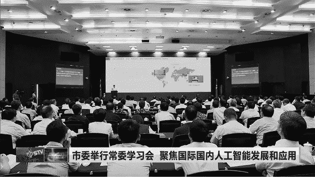

**图 1-5　2017 年 6 月 20 日，上海市委中心组学习会在上海高院的大法庭举行**

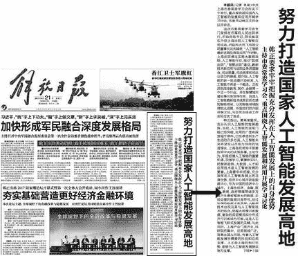

**图 1-6　2017 年 6 月 21 日，《努力打造国家人工智能发展高地》载于《解放日报》**

2018 年 9 月，中共中央政治局委员、上海市委书记李强在 2018 世界人工智能大会开幕式上提出：“上海将依托科教资源、应用场景、海量数据、基础设施等优势，以面向全球、面向未来的视野，聚焦创新策源、应用示范、制度供给和人才聚集，加快建设人工智能发展的‘上海高地’。”

2020 年 11 月 12 日，习近平总书记在浦东开发开放 30 周年庆祝大会上要求上海：“要聚焦关键领域发展创新型产业，加快在集成电路、生物医药、人工智能等领域打造世界级产业集群。”

上海把人工智能作为重大战略，紧抓这一突破口，结合本地实际，加快深度应用与产业发展，努力打造国家发展高地，建设全国领先的创新策源地、应用示范地、制度供给和人才集聚高地。截至 2020 年年底，上海重点人工智能企业 1149 家，产业链基本完备，全年规模以上产业规模达到 2246 亿元，实现 50% 左右逆势增长，2018—2020 年年均增速 29.5%。

#### 2．法治助力人工智能高地建设
2020 年 7 月 9 日，李强在 2020 世界人工智能大会云端峰会上强调：“更加重视应对人工智能发展带来的道德伦理、隐私保护、安全风险等问题，加快研究制定相关法规制度，让人工智能更好为人所用、为人服务。”

2021 年 7 月 9 日，李强在 2021 世界人工智能大会开幕式上致辞时指出：“要持续打造更加安全的敏捷治理，彰显科技向善理念，不断强化制度供给，在健全法规体系、标准体系、监管体系等方面努力形成 ‘上海方案’，为全球人工智能治理贡献上海智慧。”

上海法学、法律界积极响应，主动服务国家人工智能战略和“四个高地”建设，努力打造人工智能法治生态，促进、保障健康发展。例如，2018 年 9 月发布了《人工智能与未来法治构建上海倡议》，在国内首提构建人工智能法治的 14 项建议；自 2018 年起连续举办四届“世界人工智能大会法治论坛”，主题涵盖人工智能发展应用与法治保障、共建未来法治、智能社会的法治秩序等；率先提出人工智能法治概念，先后发布了《世界人工智能法治蓝皮书》《人工智能安全与法治导则（2019）》等，为推动治理国际交流、打造法治高地提供智力与理论支持。

#### 3．建立人工智能法学院，培养人工智能法治复合型人才
为加快培养复合型人才，上海政法学院在上海市法学会和科大讯飞公司支持下，于 2019 年 5 月在全国率先成立“人工智能法学院”。自 2019 年起，已连续两年招收 AI 法学方向本科生和法律硕士研究生（本科生每年 40 名、研究生 10 名），成为全国乃至世界第一所招收 AI 法学本科生的法学院。

该学院宗旨是培养人工智能与法学复合人才，为政法机关、政府机构和企事业单位提供适应人工智能时代的新型法律人才，为人工智能企业提供精通法律的技术人才。学院还负责全校计算机公共课程教学。截至 2021 年 6 月，学院在编教职工 20 余名，其中专任教师 15 名，包括 3 名教授、8 名副教授、4 名讲师；博士学位教师 6 人。

**课后习题：**

（简答题）

1．尝试整理一下人工智能发展时间轴。

2．请论述人工智能司法应用的理论基础。

（思考题）

你认为人工智能可以与哪个领域相结合？其结合能够给哪些方面带来怎样的变革？能够满足哪些方面的需求？

* * *

(1)　AlphaGo 是第一个击败人类职业围棋选手、第一个战胜围棋世界冠军的人工智能机器人，由 Google 旗下 DeepMind 公司戴密斯·哈萨比斯领衔的团队开发。其主要工作原理是“深度学习”。

(2)　李世石，1983 年 3 月 2 日出生于韩国全罗南道，韩国著名职业围棋手，世界顶级围棋棋手。

(3)　柯洁，中国围棋九段棋手，先后获得多项国内国际围棋大赛冠军。

(4)　2018 年 10 月 31 日，习近平总书记在中共中央政治局第九次集体学习时的讲话。

(5)　参见崔亚东：《人工智能与司法现代化》，上海人民出版社 2019 年版。

(6)　2018 年 10 月 31 日，习近平总书记在中共中央政治局第九次集体学习时的讲话。

# 第二章 智能辅助办案系统 0—1 的突破

**本章提要：**运用人工智能等新技术，推进刑事诉讼制度改革，防范冤假错案，是司法与科技融合的重大创新。本章系统介绍“刑事案件智能辅助办案系统”的研发、应用与推广，全面呈现人工智能辅助办案的思路、条件、方法、成效与前景。该系统开创了人工智能在司法领域深度应用的先河，领跑世界。

习近平指出：“要遵循司法规律，把深化司法体制改革和现代科技应用结合起来，不断完善和发展中国特色社会主义司法制度。”^((1))

2017 年中央政法委决定研发“以审判为中心的诉讼制度改革软件”，同年 2 月将任务交由上海市高级人民法院。四年来，在中央政法委、上海市委及市委政法委领导下，在最高人民法院、最高人民检察院指导下，在上海市相关部门大力支持下，市高院牵头，市公安、检察、司法等部门协同，与科大讯飞公司合作，历经艰辛，成功完成研发，实现人工智能与司法深度融合 0—1 的突破，让不可能变为可能。

## 第一节 “刑事案件智能辅助办案系统”的诞生

### 一、决策的出台
2017 年 1 月，中央政法委作出研发“推进以审判为中心的诉讼制度改革软件”的重大部署：“通过运用大数据、人工智能等现代技术，从海量司法数据中挖掘以审判为中心的证据标准体系，提炼相关规则并嵌入办案系统，推动改革落地。”^((2))

这是具有历史性、战略性的重大决策，对完善社会主义司法制度、促进司法公正、提升司法公信力、实现司法现代化具有重大意义。

### 二、决策的背景
中央政法委作出该决策的主要背景如下：

#### 1．依法纠正冤假错案的历史背景
党的十八大以来，在全面依法治国和司法体制改革大背景下，自 2013 年起人民法院通过审判监督程序，依法纠正呼格吉勒图案、聂树斌案等重大刑事冤假错案 46 起，涉及 94 人。^((3))纠正冤假错案彰显实事求是思想路线和依法治国决心，极大提振社会对司法公正的信心。

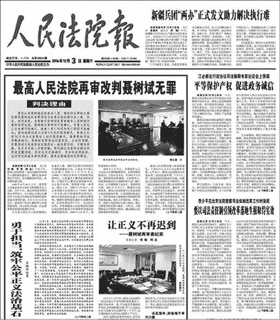

**图 2-1　2016 年 12 月 3 日《最高人民法院再审改判聂树斌无罪》载于《人民法院报》**

习近平强调：“公正是法治的生命线；司法公正对社会公正具有重要引领作用，司法不公对社会公正具有致命破坏作用。”他在关于《中共中央关于全面推进依法治国若干重大问题的决定》的说明中指出，英国哲学家培根说：“一次不公正的审判，其恶果甚至超过十次犯罪。因为犯罪虽是无视法律——好比污染了水流，而不公正的审判则毁坏法律——好比污染了水源。”道理深刻。若司法防线缺乏公信力，社会公正将受质疑，社会和谐稳定难保障。

冤假错案必须纠正，但仅仅纠正不够，必须从根本上杜绝其产生。

#### 2．全面推进司法体制改革的时代背景
预防和杜绝冤假错案是新时代全面推进依法治国、实现社会公平正义的重要体现。

2013 年 11 月 12 日，党的十八届三中全会通过《关于全面深化改革若干重大问题的决定》，提出“全面深化司法体制改革，加快建设公正高效权威的社会主义司法制度，维护人民权益，让人民群众在每一个司法案件中都感受到公平正义。”

中国特色社会主义司法制度是长期实践的成果，与国情和制度相适应。但司法实践中仍存在不公、冤假错案、司法腐败等问题，不解决将严重影响依法治国进程和公平正义。全面深化司法体制改革是推动制度发展的关键，是自我完善的需要。

为此，习近平提出“努力让人民群众在每一个司法案件中感受到公平正义”总目标。

为实现目标，2014 年 10 月，党的十八届四中全会《关于全面推进依法治国若干重大问题的决定》进一步部署司法体制改革，其中提出“推进以审判为中心的诉讼制度改革”。

习近平总书记在十九届四中全会讲话中指出：“推进以审判为中心的诉讼制度改革，目的是促使办案人员树立办案必须经得起法律检验的理念，确保侦查、审查起诉的案件事实证据经得起法律检验，保证庭审在查明事实、认定证据、保护诉权、公正裁判中发挥决定性作用。这项改革有利于促使办案人员增强责任意识，通过法庭审判的程序公正实现案件裁判的实体公正，有效防范冤假错案产生。”

可见，这是牵一发动全身的改革，涉及公安、检察、法院，旨在有效防范冤假错案，确保无罪者不受追究、有罪者受公正惩罚，标志法治重大进步。

为贯彻落实中央部署，最高人民法院、最高人民检察院、公安部、国家安全部、司法部于 2016 年 10 月 11 日发布《关于推进以审判为中心的刑事诉讼制度改革的意见》。

#### 3．人工智能等新技术快速发展的科技背景
如何让改革真正落地、切实防范冤假错案？

人工智能等新技术发展为推进司法改革、破解难题、防范冤假错案、保证公正司法提供了历史机遇和科技支撑。

在大数据、人工智能时代，可将现代科技伟力与司法人员创造力结合，形成科技理性、司法理性与人类理性的融合效应，为防范冤假错案提供支撑，使不可能成为可能。

### 三、决策的意义
中央政法委作出研发“推进以审判为中心的诉讼制度改革软件”的决策具有历史性、战略性意义，开创了人工智能在司法领域深度应用先河，是司法体制改革与科技创新结合的里程碑，对完善中国特色社会主义司法制度、促进司法公正、提升司法文明具有重大意义，为司法现代化蹚出新路。主要体现为：

#### 1．推动了“以审判为中心的诉讼制度改革”落地见效
将大数据、人工智能深度运用到刑事诉讼，制定统一适用的证据标准并嵌入数据化办案程序，实现对证据的审查、校验与把关，辅助办案人员办案，确保侦查、审查起诉的案件事实证据经得起法律检验，有助于从源头预防冤假错案，尊重和保障人权，确保无罪者不受刑事追究、有罪者受公正惩罚，使改革真正落地，意义重大。

#### 2．实现了人工智能新技术在司法领域应用 0—1 的突破

2017年1月，审判主导型的诉讼制度改革软件就进入研发通道，这代表司法系统率先把前沿科技与制度变革绑在一起，比国务院7月发布的《新一代人工智能发展规划》还要早半年动手，折射出司法人对技术趋势的高度警觉与开拓气魄，也让人工智能在司法场景里的深度落地实现从无到有的跨越，为司法现代化趟出一条新路。

#### 3．疏通堵点，重塑司法可信度
十八大之后，司法体制改革已到攻坚深水区，机制梗阻、办案质量、透明度、案多人少等矛盾集中显现。只有深化改革守住公平底线，防止冤错发生、提升效率，公信力才能回升。科技正是破解这些顽疾的关键。以人工智能为代表的信息手段，已经促使全球司法机构不再满足于把纸质流程数字化，而是在反思并重塑传统工作方式，主动拥抱新技术推动变革。

### 四、重担落在沪上
2017年2月6日，中央政法委把推进审判主导型诉讼制度改革软件的研发任务交给了沪高人民法院。

当天，中央政法委与上海市委主要领导来到沪高人民法院调研，并在院内召开政法系统负责同志座谈会。会上传达了上海深化司法体制改革的三大新部署，其中一项就是由沪高人民法院牵头研发上述软件。会议要求把科技创新与制度改革融为一体，特别是在审判主导改革中借助大数据深度应用，把统一的证据基准嵌进数据化程序，减少主观随意，既提速又提质。会议强调审判主导改革是核心牵引，上海具备联合法院、检察、公安及相关司法安全部门搭建证据基准体系的条件，可通过大数据方法从海量司法数据中提炼证据基准与规则，再以数据法院、智慧法院建设为载体落地，推动改革跳出原有框架，开辟新路。

这项荣誉与压力并存的历史任务，落在了沪高人民法院肩上。

### 五、为何叫“206 系统”
“刑事案件智能辅助办案系统”内部俗称“206 系统”。

名称源于工作习惯。研发团队以2017年2月6日中央政法委交办之日为记号，内部把系统简称为“206 系统”，工程亦称“206 工程”。媒体后来沿用了这一叫法。

**图 2-2　“206 工程研发基地”建立**

**图 2-3　《揭秘“206”：法院未来的人工智能图景》载于《人民法院报》**

**图 2-4　《智能 206，能有效防范冤假错案吗？》载于《解放日报》**

## 第二节 “刑事案件智能辅助办案系统”总览

### 一、定位何在
定位决定成败。核心问题是做何种系统、谁来主导、如何消除对司法科技化的疑虑。

#### 1．到底要做一个什么样的工具？
2017年初，中央政法委的要求是制定统一的证据基准、规则并嵌入大数据平台，为办案提供指引。团队最初把方案命名为“上海刑事案件证据基准统一适用大数据系统”，设想借助互联网、大数据形成证据收集、固定、使用的统一指引并嵌入办案流程。2017年3月，中央政法委进一步明确要利用新技术实现证据审查判断，对存在瑕疵的案件阻断进入审判程序，以防范冤错，并要求在当年7月全国司法体制改革推进会前见到雏形。

这是前人未涉足的领域，难度极大。当时团队对技术能否承载目标心里没底。

#### 2．技术研发由谁来扛？
研发主体选择极难。2017年初人工智能新一轮兴起，国内尚无成熟承接能力。沪高人民法院成立206专班展开快速寻访。

为何选中科大讯飞？2017年2月14日，沪高人民法院与科大讯飞股份有限公司签署战略合作协议，语音系统应用启动，崔亚东院长与刘庆峰董事长出席。当时有对话记录。

崔亚东：贵司规模多大？人员结构如何？
刘庆峰：员工约8659人，平均年龄24岁，超六成从事研发。
崔亚东：我们刚领到中央政法委的审判主导型诉讼改革软件研发任务，需用大数据等手段在办案中校验证据、防冤错，正在物色合作方，你们能担吗？
刘庆峰：未做过，但我们会看病、会高考阅卷，想来办案亦可尝试。回去深入研究。
2月16日，刘庆峰即派技术人员赴沪高人民法院调研。

专班同期广泛调研后，备选面窄，倾向科大讯飞。

2017年3月4日，中央政法委领导在京听取崔亚东汇报。崔亚东介绍准备情况，并提出鉴于难度大时间紧，拟先易后难分步走：7月推进会前先把证据基准、规则制定并嵌入系统提供指引，7月后再启动AI证据审查校验研发。领导肯定进展，但明确要求证据基准指引与证据审查校验必须同步启动，力争7月有初步成果，并强调要以高科技攻克难关，实现证据审查把关，有效防范冤错。

要求坚决，无余地。
3月5日晚，两会开幕之夜，崔亚东与在京的刘庆峰会面，再次对话。

崔亚东：行还是不行？
刘庆峰：应该行。
崔亚东：“应该”不行，必须去掉。7月不行就晚了，这关乎司法改革成败，只能成。
刘庆峰：行。
崔亚东：好，今天立军令状。

选择科大讯飞基于全面调研与权威咨询，沪高人民法院分析了国内AI企业，征求专家与管理部门意见后形成共识，按程序报批获准。

#### 3．认知误区与担忧
实现路径如何？这是开创性探索。团队选择了AI与科大讯飞，研发在试探中启动。

彼时AI热潮刚起，多数人不明就里，能否达成目标存疑。即便选定合作方，能否担纲也让人没底。有人质疑：刑事案件繁复多变，诉讼环节长，在当时技术条件下做一套贯穿侦查、逮捕、审查起诉、庭审、审判并实现证据校验分析的系统，无异于天方夜谭。也有人受AlphaGo影响，误认为机器办案，能否替代人作司法判断？若机器出错怎么办？质疑声不断。

#### 4．定调为“智能辅助办案系统”
在崔亚东带领下，团队系统调研国内外司法科技应用，并类比医疗、教育、金融、交通等场景，重点把握刑事司法规律与AI现阶段特征，反复论证后确定定位为“智能辅助办案系统”，即以AI等新技术辅助办案人员，发挥人机协同优势，当好司法人员的科技助手，也回应了外界误解。

##### (1) 定位科学
把握司法规律与AI现状并结合，是避免颠覆性失误的关键。

司法活动有公正、独立、公开、亲历等特质，法官、检察官、侦查人员的经验与理性判断决定办案主体是人，机器不可替代。但在科技成熟的当下，借助互联网、大数据、云计算、AI为办案提供统一证据基准与规则指引，并对收集证据进行审查校验、提示瑕疵矛盾，推动查证补证，确保移送案件经得起法律检验，防范冤错是可行的。系统只是辅助侦查、检察、审判人员，证据采纳与定罪量刑最终由法官决定，非“机器办案”。实质是为办案人员增添AI侦查助理、AI检察助理、AI法官助理。因此定位准确。

据此系统全称定为“推进以审判为中心的诉讼制度改革——上海刑事案件智能辅助办案系统”。

##### (2) 技术边界决定AI不能替代司法决策
弱人工智能即应用型AI，聚焦特定问题，因功能局限被视作工具而非威胁。基础科学对人类智慧与意识尚未给出精确解释，从弱到强AI短期内难以跨越。深度学习通过海量符合要求数据训练、多层神经网络筛选，总结规律输出结果。例如206系统可识别证据并提示瑕疵，后续由办案人员决定补正或说明并取舍。决定权在人。

##### (3) 办案特点决定人员不可被AI取代
一方面，办案人员从表象推导规律、因果解释、证据提取、案情逻辑推断等能力远超当前计算机，可用思维导图、假设求证、换位思考等多种推理，源于生活常识与司法经验的积累，机器单一的“数据思维”难以复现。

另一方面，法理与人情的权衡是机器难以理解的。情感、自我认知等人类特质在刑事案件中体现为怜悯与惩罚的取舍，价值判断主观性强，机器仅刚性适用规定，会削弱司法对社会秩序与道德完善的作用。

司法责任制与亲历性决定AI只能作“智能助理”，机器延伸人类能力，司法必须由人主导，也不存在机器办错案的担忧。

#### 5．未来走向
目标是通过人机协作探索刑事司法新形态。AI对工作生活的冲击与蒸汽机、计算机相似。对此，美国《国家人工智能研究与发展战略计划》指出，大部分AI的最佳绩效来自与人合作而非替代。随着技术演进，最可能的是进入人机协作时代，AI驱动的工具大幅提升效率。同理，智能辅助办案系统现为辅助工具，未来可在人机协作平台上发挥更大作用。例如新入职人员可借助系统学习资深法官经验快速成长，资深人员也可从系统中汲取数字思维，将精力集中于综合能力提升。

### 二、系统定义
刑事案件智能辅助办案系统是指：运用图文识别、自然语言理解、智能语音识别、司法实体识别、实体关系分析、司法要素自动提取等AI技术，制定统一适用的证据基准与规则指引并嵌入公安、检察、法院、司法局刑事办案系统，实现对办案人员的统一指引与对证据的校验、把关、提示、监督，确保侦查、审查起诉案件事实证据经得起法律检验，确保办案全程可视、可留痕、可监督，减少司法任意性，防范冤假错案。

### 三、研发进程

#### 1．难点何在
AI是21世纪前沿科技，使司法科学化需要创新、实战与担当。

研发时间紧，且需攻克两大难关。

##### (1) 证据基准制定难关
统一证据基准为办案指引是首要目标。但实践中对证据基准的理解不一致。学界一度模糊证据基准与证明基准，有的认为二者等同。实践中办案人员不断追问总结，推动证据理论发展。改革与防冤错实践呼唤理论与实践同步更新。

##### (2) 技术难关
要实现现有AI对证据识别与辅助审查，需使AI适配司法特征，实现卷宗识别与证据审查提示。系统问世前，因技术阶段性，人们缺乏用现代技术破解司法难题的思维。但新一轮AI兴起使不可能变可能，需攻克构建证据模型、证据校验、网络联通、系统融合、卷宗电子化等众多技术，实现从0到1突破。

#### 2．团队搭建

##### (1) 成立领导小组
为完成任务，沪高人民法院成立以崔亚东为组长的研发领导小组，即206工程领导小组，设专门办公室与业务组、技术组、综合组、专家咨询组，抽调精兵集中办公。业务组负责证据规则研究与业务指导；技术组负责大数据收集与建模研发；专家咨询组含最高法院专家、刑事证据专家、大数据技术专家、刑事辩护专家；综合组负责协调督办。

##### (2) 建立联席会议制度
研发涉及公安、检察、法院、司法局，需政法协同。经市委政法委同意，建立上海研发工作联席会议，由市委政法委、高院、检察院、公安局、司法局等组成，办公室设在高院。

##### (3) 建立研发队伍
任务艰巨，队伍构成关键。当时科大讯飞技术人员不熟悉司法，司法人员不懂技术，需深度融合。决定在全市抽调刑事业务专家与科大讯飞技术人员共建团队：刑事业务人员400余人，法院220余人、检察院80余人、公安100余人、司法机关10余人；科大讯飞技术人员300余人，共700余人。

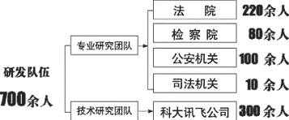

**图 2-5　“206 工程”研发团队构成**

##### (4) 建立研发基地
为提升效率，206工程研发基地设在沪高人民法院，团队集中办公，摸着石头过河。

#### 3．顶层设计、精心谋划、摸索前行
古人云多算胜。206办公室制定了《上海刑事案件智能辅助办案系统研发方案》。

##### (1) 工作思路
时间紧无先例，只能边谋划边开发边试行边完善。

##### (2) 指导思想

审判中心化诉讼改革的智能底座：206工程解析

206工程的整体思路是把审判中心化诉讼制度的落地作为主攻方向，坚持公安、检察、法院三机关权责划分清晰、各司其职、相互配合又相互制约的工作格局，坚持以问题为导向、以需求为导向、以目标为导向，坚持先易后难、分步实施，同时边规划边开发边试点边优化。工作始终遵循司法运行规律和刑事诉讼活动要求，构建科学规范、符合法律要求的证据标准与规则指引，依托大数据、互联网、云计算、人工智能等新技术，完成审判中心改革软件的研制并推送至办案一线，确保系统在推进改革落地中发挥关键作用，推动公正司法，遏制司法随意，预防冤假错案。

##### (3) 基本原则

第一，法律合规。系统建设以宪法、刑法、刑事诉讼法等为根本依据，参照中央深改组审议通过的《关于推进以审判为中心的刑事诉讼制度改革的意见》、两高三部和全国人大常委会法工委相关规定，最高人民法院适用解释，以及《人民检察院刑事诉讼规则》《公安机关办理刑事案件程序规定》等要求，始终在法律框架内开展。

第二，尊重司法规律。研发与应用会重塑既有工作流程，必须将司法活动规律与科技特征相融合，既要实现证据指引的统一认识、统一规范、统一执行，也要兼顾不同诉讼行为、不同阶段对证据的不同要求，明确侦查、审查起诉、审判各阶段的证据指引，从而规范办案。

第三，问题、需求、目标三结合。紧紧抓住侦查、审查起诉、审判在证据收集、固定、检验、审查判断中存在的突出难点，以及一线人员对科技应用的现实诉求，准确把握程序对证据审查判断的要求，使系统功能设计契合规范、回应实务、解决痛点。

第四，科技驱动。充分运用大数据、人工智能等现代技术，推动新技术与软件研发深度融合，发挥科技的牵引与支撑作用。

第五，分步有序。按边研发边试行边完善的思路，集中业务骨干与技术力量，先易后难、分阶段推进研发。

##### (4) 目标任务

总目标是让人民群众在每个案件中感受到公平正义，以提升司法公信力为根本尺度，将现代科技与司法体制改革相融合，强化大数据、人工智能在审判中心改革中的深度应用，把统一适用的证据基准与规则嵌入程序化的数据流程，减少司法随意性。明确系统功能定位，抓好研发、建设、应用，突出服务公安、检察、法院办理刑事案件的功能，在规范办案、推进庭审实质化、强化人权保障、贯彻证据裁判规则、统一法律适用等方面发挥作用，引导办案人员树立经得起法律检验的理念，确保侦查、起诉案件事实证据经得起检验，保证庭审在查明事实、认定证据、保障诉权、公正裁判中起到决定性作用，切实防范冤假错案，提升质量、效率与公信。

##### (5) 研发进度

截至2021年6月，研发分为两期。

一期工程：2017年2月6日接受任务至2018年8月验收。
2017年2月6日至7月10日是攻坚阶段。2017年5月3日1.0版上线试运行，具备4项功能。2017年7月10日中央政法委在贵阳召开全国司法体制改革推进会，主题为拥抱新科技，孟建柱同志强调要主动拥抱新一轮科技革命，深化司法体制改革，努力创造更高水平的社会主义司法文明。
2017年7月至2018年8月，2.0版推广应用，覆盖罪名20个、功能16项，攻克OCR手写识别、案情要素自动抽取、自动编目、政法数据交换等技术瓶颈。2018年8月16日项目通过市发改委、市经信委验收，专家认为功能齐全、性能稳定、安全可靠、文档完备，符合国家软件质量要求。

二期工程：2018年8月至2021年6月
2018年3月至2019年底，3.0版全面应用，罪名102个、功能24项。系统在实践中不断完善，应用从试运行扩展到上海全市。至2018年底，上海刑事案件办理已实现立案、侦查、报捕、起诉、审判均在206系统内流转，形成三个百分百：证据基准指引覆盖常办罪名达100%；常办罪名案件录入率100%；一线办案人员使用率100%。
2020年至2021年6月，4.0版持续完善，罪名102个、功能26项。工程办坚持审判中心、防范冤错、提升质效的总目标，巩固三个百分百成果，夯实要素式讯问、证据校验、自动标注等能力，重点推进统一网络运行平台建设，实现四个全面、一个机制共41项任务。即全面推行刑事案件电子卷宗单套制并完善质量管控，推广至全市政法单位；全面实施系统融合工程，将206系统与公安、检察、法院、司法局现有业务系统深度融合，实现案件办理全流程一体化应用；全面推广协同办案功能，攻关网上换押、涉案财物共管、远程提审、远程开庭等跨部门协同及配套规则；全面优化智能辅助审讯、智能辅助庭审功能，提升要素提取与自动抓取能力；建立可持续发展的长效机制，使206系统成为刑事办案不可或缺的智能辅助工具。

第三节 “刑事案件智能辅助办案系统”架构

“刑事案件智能辅助办案系统”由办案网络平台、办案应用软件、大数据资源库三部分组成。

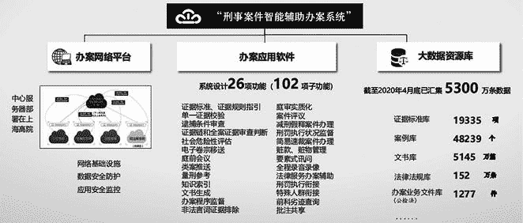

**图 2-6　“刑事案件智能辅助办案系统”**

### 一、办案网络平台

206系统采用“一中心、一网络、四平台”的网络架构。

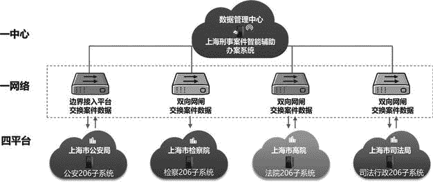

**图 2-7　“206 系统”网络架构**

#### 1. 中心节点
中心服务器设在上海高院。各平台经数据管理中心交换数据，实现侦查、审查起诉、审判、刑罚执行等环节信息共享与一体化应用。系统联通公安、检察、法院、司法局办案业务平台，搭建信息互通的立交桥，使各家流程联结汇聚，形成开放式平台，便于新手段、新技术持续汇入叠加。

#### 2. 统一通信网
建设统一办案网络，联通公检法司各平台。依据刑事诉讼法及办案规则设计网上流程，案件一律网上运行。经政务外网与各业务网构建安全交换通道，实现数据自动同步、跨部门共享共用，涉密案件除外。上海已在公安、检察、法院间建立专网互联，形成统一刑事办案平台，打破信息壁垒，实现一网运行、互联互通、信息共享。

#### 3. 四方业务平台
将206系统嵌入公安、检察、法院、司法局各业务网络平台，与各家系统融为一体，一键联通，提升一线民警使用便捷性。

### 二、数据库

数据库为可共享、冗余度低、与应用独立的数据集合。206系统大数据资源库是智能辅助办案的基础，截至2020年4月底已汇集超5300万条数据，主要包括：

#### 1. 证据基准库
将制定的证据基准指引录入系统，形成数据资源。利用专家梳理的基准及实践经验数据，构建结构化资源。

#### 2. 罪名要件库
对具体罪名证据三性判断的常见问题和指引结果进行结构化存储。在故意杀人、故意伤害、盗窃、抢劫、电信网络诈骗、毒品犯罪、非法吸收公众存款等案件中可验证犯罪事实证据。

#### 3. 案件信息库
对受理情况、犯罪嫌疑人基本信息、审查逮捕情况、审结情况等进行结构化存储。

#### 4. 案件特征库
对上海及全国相关刑事案件的作案工具、指纹、印章、捺印、DNA等特征数据进行结构化存储。

#### 5. 电子卷宗库
同步采集办案中生成的电子卷宗，形成资源库。与信息采集设备和业务系统结合，实现随案同步收集，系统可自动关联并按目录归类电子材料。

#### 6. 裁判文书库
以上海案件为核心兼顾全国同类文书，利用自然语言理解与信息抽取技术抽取要素并结构化存储。

#### 7. 案例库
汇集上海典型案例和最高法指导案例，经格式化处理，形成完整案件信息库，为办案提供参考。

#### 8. 法律法规司法解释库
将法律、法规、司法解释文件格式化、归类存储，构建检索指引。

#### 9. 办案业务文件库
对业务文件进行结构化存储，抽取特征要素并与他库关联，为证据收集指引和程序监督提供参考。

### 三、系统安全

#### 1. 网络安全多重防护
司法信息化进入数据共享时代，传统边界弱化。206系统建设网络防火墙、入侵防御、防病毒、安全管理、运维管理等，按等保三级要求建设。公安、检察、司法局、法院网络属三级等保，各有内外网隔离。涉密网络数据严禁流入低密网络。公检法司及数据中心间通信采用光单向安全隔离数据自动导入系统，即单向网闸。同密级内网间通信采用双向单向网闸。

#### 2. 数据安全区块链防篡改创新应用
数据安全机制基于透明加密、防篡改、动态脱敏、数据防火墙、数据监测构建统一保护体系。在“一中心、一网络、四平台”基础上，部署五条存证私有链防止篡改。

##### (1) 公安机关卷宗哈希私有链
5个节点位于公安内网、检察内网、法院内网、司法局内网、数据中心内网，仅公安内网节点可读写，其余只读，数据经光闸同步。

##### (2) 检察院卷宗哈希私有链
5节点同上，仅检察内网节点可读写，其余只读，经光闸同步。

##### (3) 法院卷宗哈希私有链
5节点同上，仅法院内网节点可读写，其余只读，经光闸同步。

##### (4) 司法局卷宗哈希私有链
5节点同上，仅司法局内网节点可读写，其余只读，经光闸同步。

##### (5) 政法委数据中心卷宗哈希私有链
5节点同上，仅数据中心内网节点可读写，其余只读，经光闸同步。

第三章 智能辅助办案系统的技术应用概述

本章提要：深度神经网络发展带来海量数据、深度学习、大规模并行计算三大条件。206系统的研发与应用是智能技术在司法领域从初级向高级迈进的里程碑，实现了多项技术创新，截至2021年6月获6项知识产权，被誉为司法领域智能应用标杆，是刑事司法的深蓝、AlphaGo。

第一节 技术应用原理

### 一、技术应用总体情况
智能技术引入司法并深度融合是司法现代化的必由之路，可促进技术司法应用创新。智能辅助办案系统运用图文识别、自然语言理解、智能语音识别、司法实体识别、实体关系分析、司法要素自动抽取等技术。主要任务：

一是让机器学会识别证据。自动识别证据类型并归入相应卷宗目录。识别对象包括印刷文字、部分手写文字、签名、手印、签章、表格、图片等。

二是让机器学会理解证据。基于大量标注证据学习，机器可自动理解证据内容并抽取与查证事项相关信息。学习对象包括证据基准、规则、模型、典型案例、司法资源、办案经验等。

三是让机器学会分析证据。如笔录问答聚类系统对言词证据进行语义分析并聚类相似问答。机器需学会校验、把关，及时提示证据基准不统一、程序不统一、证据瑕疵、证据矛盾等问题，确保提请逮捕、移送审查起诉案件符合法定标准，提升质量效率，确保无罪不追诉、有罪公正惩处，实现防止冤错案件、减少司法随意性目标。

### 二、技术实现路径
系统运用光学字符识别、自然语言理解、智能语音识别、要素提取、机器学习五大核心技术，结合循环神经网络、卷积神经网络、注意力机制、多模态理论等原理，实现对印刷文字、手写文字、签名、指印、签章、表格、图片等证据的智能识别与信息提取。为办案人员提供收集固定证据指引，解决证据适用不统一、程序不规范问题，及时发现并提示证据瑕疵与矛盾，确保案件符合法定标准，减少司法随意性，防止冤错案件。

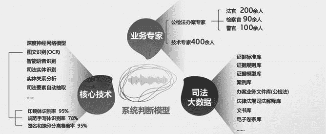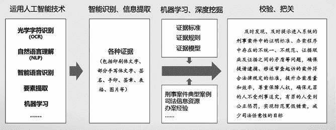

**图 3-1　上海刑事案件智能辅助办案系统要素图**

第二节 技术应用创新

206工程研发多项应用型技术，实现图文识别、图文分析、逻辑推理、规则模型生成、自动编目、要素分析、智能搜索、语义理解、量刑模型等基础功能。

审判驱动的刑事司法智能攻关：206系统研发纪实

司法场景在所有行业里技术复杂度最高，对模型精度和运行稳定性的要求也最苛刻。206系统研发团队以通用人工智能为基础架构，针对刑事司法活动流程的特殊诉求开展专项攻坚，伴随以审判为中心的诉讼制度改革持续迭代，最终凝结出图文识别、图文解析、逻辑推演、规则模型生成、自动编目、要素分析、智能检索、语义理解、量刑建模等能力集群。其中图文识别、图文解析、自动编目、逻辑推演、要素分析等应用型能力已达到全球领先水平。上述成果既兑现了项目初期的设计预期，也反哺推动了人工智能技术本身的迭代演进。

### 一、技术攻坚克难
事非经过不知难。206工程在研发推进中啃下大量硬骨头，同时紧扣审判中心改革导向，对业务与技术进行整体重塑。

首要压力在于多项核心技术难关。涵盖证据标准搭建、规则模型构建、证据校验、网络互联、平台融合、卷宗电子化等（如表 3-1 所示）。

**表 3-1　需攻克的技术难关**

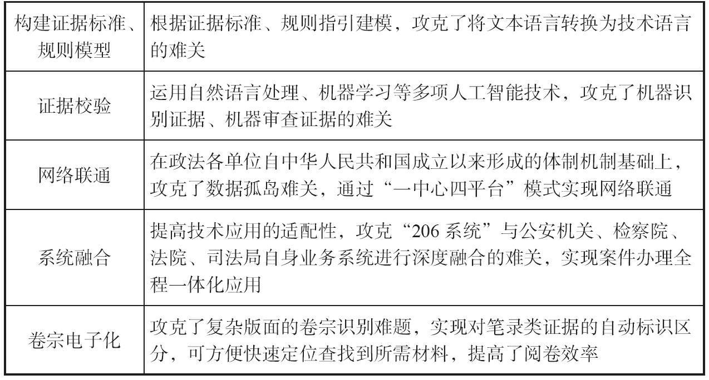

次要压力在于多项技术瓶颈。涉及 `OCR` 手写体识别、案情要素自动抽取、自动编目、政法数据互通等（如表 3-2 所示）。

**表 3-2　需攻克的技术瓶颈**

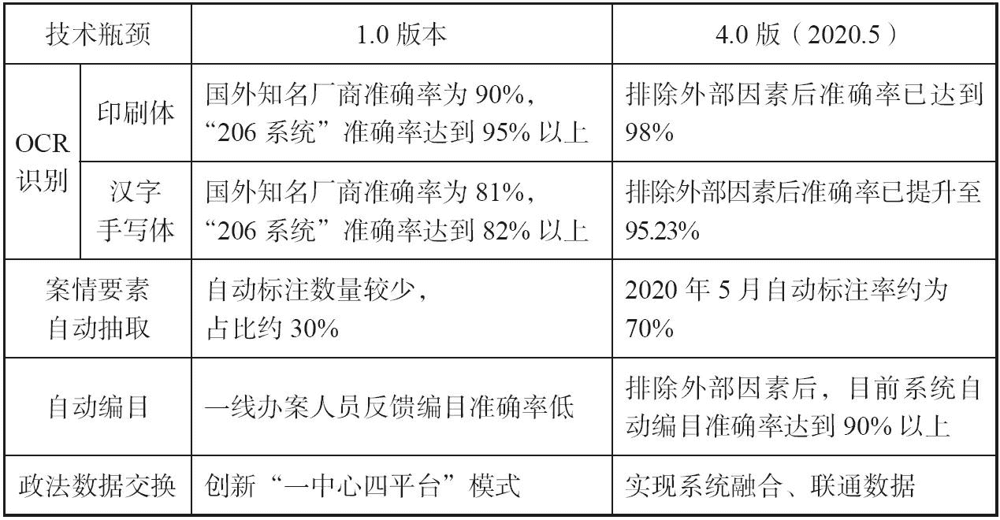

落地层面则是大量具体问题。截至 2020 年年底，累计化解近千项技术与应用层面的细节难题。

### 二、实现多项技术突破
206系统在应用侧的创新集中于六个方向：光学字符识别、自然语言处理、智能语音识别、要素抽取、机器学习以及区块链。

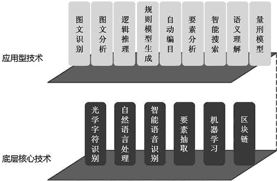

**图 3-2　“206 系统”的技术支持**

#### 1. 实现司法信息的高效识别
将光学字符识别引入刑事证据场景，实现司法信息的精准快速读取。

##### (1) 光学字符识别技术原理
光学字符识别（`optical character recognition`，`OCR`）是指由扫描仪或数码相机等设备采集纸面印刷字符，通过明暗模式判断字符形态，再借助识别方法转化为计算机可处理文字的过程。系统提供基于深度神经网络的端到端文字识别服务，可将扫描仪或数码相机来源的图片文字转为可编码的计算机文字。

实现路径为先用图像采集设备把文字以图像形式输入电脑，再把图像切分为多行文本，最后调用分类器完成识别，从而把文字图像转为文本信息（如图 3-3 所示）。

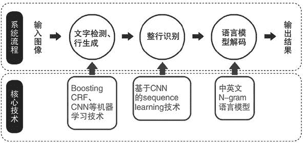

**图 3-3　OCR 流程示意图**

##### (2) 技术应用层面遇到的难题
把 OCR 用于刑事证据主要面临两类阻力。

识别率遭遇瓶颈。达到一定水平后继续提升成本极高，每提升一个百分点甚至千分点都需要巨大投入；印刷质量不佳的材料识别率会大幅受限。中文汉字笔画繁复、书写形态多样且具象，识别难度较高。困难贯穿图像预处理、版面分析、特征提取、文本行切分、分类器设计等多个环节，由此中文字符识别整体发展一直偏慢，识别率并不理想。

证据材料混杂，干扰因素较多。因内容、类别、格式、排版差异，识别刑事证据不仅存在中文数字混杂等传统 OCR 干扰，还因证据材料中的下划线、印章等新型干扰而导致准确率下降。

### （3）研发刑事司法定制化模型，运用手写识别技术和图像识别转换技术，突破刑事证据自动识别率低的难题
研发团队围绕上述难点集中攻关。其一定制模型以过滤识别干扰、降低误识、提升证据信息抽取准确性；其二强化手写识别与图像结构化技术的精度。截至 2018 年 10 月底，印刷体文书识别率达到 98%，复杂卷宗类文书含插图、签章、手写体等识别率达到 92%，处于世界领先水平，达成 206 系统的预设目标，为深度挖掘与机器智能学习分析奠定基础。团队攻克了刑事证据自动识别的难关，实现了中文字符信息的自动化录入，解决了司法领域的识别精度问题。具体体现为：

#### 第一，提升手写识别技术的精确度
电子证据中常包含当事人签名、手写文字，准确转写手写内容是关键。手写识别首先要区分手写体与印刷体并检测为文本行。

手写文本行切分后进行手写字符识别转写，主要步骤为：
首步，单行文本行的预处理。包括图像尺寸归一化调整，将不同分辨率扫描图像缩放至同一尺度，通常采用 300dpi 标准，再进行单行文本的倾斜矫正。
次步，单行文本行的字符识别。当前人工智能已由传统混合高斯模型发展至深度神经网络模型，例如基于 `DNN`、`CNN`、`RNN` 等的模型。
末步，单行文本行的解码。采用基于维特比解码原理的高效连续识别解码算法，完成单行文本的识别转写。

#### 第二，提升图像结构化技术精准度
电子卷宗中的证据材料多为图像格式，需借助图片分析引擎进行解析并转为结构化数据。如图 3-4 所示，从图像输入到结构化识别结果输出，需经过图片预处理、图像版面分割与分析、版面理解与文档内容识别等环节。

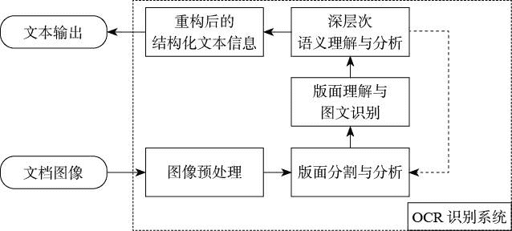

**图 3-4　图片处理示意图**

首步，文档图像预处理。利用数字图像处理中的降噪方法去除拍摄噪声，并将原始彩色图转为灰度图（`RGB to Gray`）或二值化处理（`binarization`），并做倾斜纠正（`skew correction`）等。
次步，版面分割与分析。对文档图像采用边缘检测方法进行连通分支分析（`connected component`），检出文字与非文字区域后，再用连通域分割、无向图分割等版面分割方法，自上而下或自下而上将整幅图像切分为多个候选子块进行属性识别，区域通常分为文字区域、图片区域和表格区域。
末步，版面理解与图文识别。将各区域送入识别分析模块进行图文解码，输出结构化可编辑文本，并依据各区域位置及属性关系进行版面理解与恢复。

#### 2．搭建人机信息转换的桥梁
自然语言处理技术消除了人机语言隔阂，搭建了信息转换的桥梁。

### （1）自然语言处理技术原理
人机自然语言通信是长期追求的目标。要让计算机既能理解自然语言文本的含义，又能用自然语言表达意图与思想。

自然语言处理（Natural Language Processing，`NLP`）是人工智能的重要分支，也是新一代计算机科学的核心课题。其主要目标是消除人机对话限制，让用户可用自身语言与计算机交流，因而需要研制语言能力与语言应用的模型，建立计算框架，并不断完善方法；基于语言模型设计实用系统并探讨评测技术。通常而言，自然语言处理技术如图 3-5 所示。

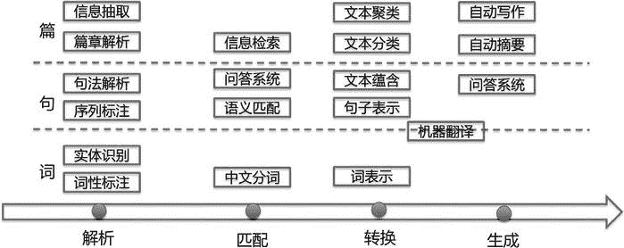

**图 3-5　NLP 相关技术示意图**

### （2）技术应用层面遇到的难题
刑事证据等材料多属于非结构化文本，如何精准提炼有效信息并排除复杂文本干扰，直接关系到 206 系统功能能否落地。同时证据材料需先做光学字符识别，这种级联处理方式也是司法领域应用 NLP 的难点。

### （3）运用人工标注手段提升机器自主学习能力并攻克语义分析的难题
非结构化文本只有经自然语言处理、解析并转为结构化数据，才能被计算机高效处理，进而形成司法专业知识图谱，实现人机交互与机器阅读理解。例如中文文本形式上由汉字（含标点）组成字符串，由字成词、由词成词组、由词组成句子，进而构成段节章篇。字、词、词组、句子、段等各层级间以及层级间的转换都存在歧义与多义，同一字符串在不同场景或语境下可理解为不同词串与含义。

为此，需通过大量文书标注打磨刑事司法知识的机器自主学习；借助海量裁判文书、卷宗笔录的特征标注实现证据要素、案情要素的自动提取；借助语义分析实现要素的准确抽取。在此基础上，通过语义识别与基于知识图谱的法律认知引擎技术识别待检索词的含义，将其归入已构建的特定知识图谱，贯通信息输入输出，提升机器自主学习能力，实现语义分析功能。

#### 3．攻克音字转换的应用难题
206 工程优化了智能语音识别技术方案，攻克了音频转文字准确率低的难题。

### （1）智能语音识别技术原理
智能语音识别技术（Automatic Speech Recognition，`ASR`）即将人声转为文本的技术。该领域交叉声学、语音学、语言学、数字信号处理、信息论、计算机科学等。受语音信号多样性与复杂性影响，系统通常只能在一定限制下取得满意效果。性能主要取决于识别词汇表大小、语音复杂性、信号质量、声源数量、硬件标准。

在线听写功能借助强大的神经网络模型将语音转为文字，让机器“听懂”人语，相当于为机器安装“耳朵”，可在各种噪声环境、信道下实时准确识别不同方言说话人的语句。自 2011 年微软研究院首次用深度神经网络（Deep Neural Networks，`DNN`）在大规模语音识别任务上取得显著提升以来，`DNN` 已成为主流语音识别系统的标配。

### （2）技术应用层面遇到的难题
研发调研发现，`DNN` 虽分类能力强，但对上下文时序信息的捕捉较弱，不适合处理长时相关性的时序信号，导致音频转文字准确率偏低。

### （3）运用复杂信道环境手段攻克音频与文字转换率低的难题
与 `DNN` 不同，206 系统采用循环神经网络（Recurrent Neural Networks，`RNN`），在隐层增加反馈连接，使当前时刻输入包含前一时刻隐层输出，从而赋予记忆功能。

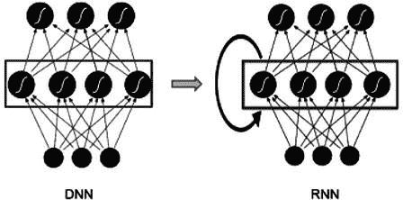

**图 3-6　DNN 和 RNN 示意图**

传统双向 `RNN` 理论上需听到语音结束才能利用未来信息提升效果，只适合离线任务。在需要即时响应的在线任务如语音输入法中常出现 3—5 秒硬延迟，难以接受。此外 `RNN` 对上下文相关性拟合较强，更易过拟合，易因训练数据局部不鲁棒产生额外异常识别错误。

206 系统采用前馈型序列记忆网络 `FSMN`（Feed-forward Sequential Memory Network）新框架（如图 3-7 所示）。该框架能较好融合上述要点，各技术点的增益可叠加。研发团队在 206 系统中创造性提出 `FSMN` 结构，采用非循环前馈结构，仅需 180 ms 延迟即可达到与双向 `LSTM-RNN` 相当的效果。

借助 `RNN` 方案，206 系统有效适应复杂信道环境，满足时序信号处理需求，大幅提升转换准确率。智能语音识别技术将刑事音视频资料中的音频信息有效转为文字，为后续通过文字准确定位音视频内容、快速查找作案时间、地点、人物、工具、手段、后果等证明事项信息，以及深度挖掘证明事项间的印证、关联、矛盾等逻辑关系提供技术支撑。

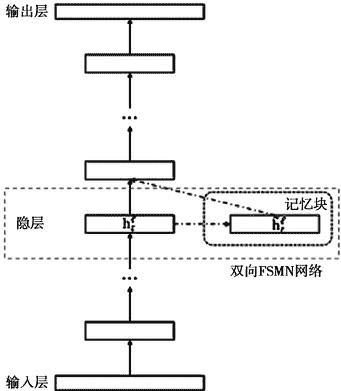

**图 3-7　FSMN 结构示意图**

#### 4．实现关键信息的准确提取
要素抽取技术解决了机器自动标注难题，实现了海量数据中关键信息的精准提取。

### （1）要素抽取技术原理
要素抽取的底层用到命名实体识别技术（Named Entity Recognition，`NER`）。命名实体识别本质是模式识别任务，即给定句子识别实体边界与类型，是自然语言理解的基础。

实体关系描述客观事物间的关联，定义两个或多个实体间的联系。实体关系学习即自动从文本中检测并识别实体间的语义关系，也称关系抽取。实体关系抽取分为预定义关系抽取和开放关系抽取。预定义关系抽取指抽取关系是预先定义好的，如上下位、国家—首都等；开放关系抽取不预先定义类别，由系统自动发现并抽取。

实体关系抽取中，实体间存在语义关系，当两个实体出现在同一句子时，上下文决定其语义关系。完整实体关系包括关系类型与关系参数，类型说明关系本质，如雇佣、类属；参数指发生关系的实体，至少两个，二元关系指两个参数间关系，多元关系指两个以上参数间关系。关系可对称也可非对称，对称关系不考虑参数顺序，非对称关系考虑顺序，不同顺序表达不同关系。实体关系有时还具有时间属性，即有效期。

实体识别算法主要有基于规则、基于统计及混合方法三种思路。

第一，基于规则方法。规则匹配在司法领域主要适用于版式结构相对固定的法律文书，如起诉意见书、起诉书、裁判文书。方法是通过数据集分析文本特点，总结待抽取要素标签在文本中的位置及前后表述，写成正则表达式匹配。例如公安机关起诉意见书中嫌疑人身份描述通常为：“犯罪嫌疑人张三，男，19××年××月××日生，出生地：×××××，身份证号×××××××××××××××，汉族，初中文化……”版式句式基本固定，可通过简单正则表达式`犯罪嫌疑人（.\*{2-4}）， $`匹配抽取嫌疑人姓名，其含义为抽取“犯罪嫌疑人”后 2—4 个汉字，逗号结尾。

新文本到来时，需先判断文本所属文书类型，文本预处理后，调用人工制作的指定规则资源库。

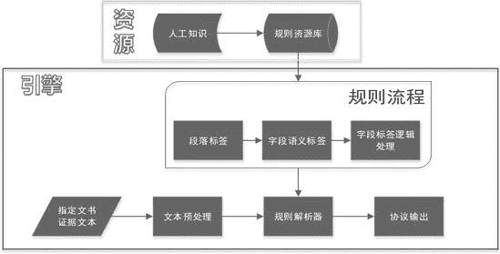

**图 3-8　基于规则方法的实体识别算法流程**

规则识别实体过程一般包括：
a．篇章段落划分：对篇章分段并赋予一个或多个连续段落标识。
b．标签抽取：基于常见句式规则从指定段落抽取标签内容。
c．字段标签逻辑处理：基于效果分析做细节调整。
例如对《起诉意见书》进行标签抽取以生成审查报告关键信息，经分析定义标签包括：
●　嫌疑人姓名
●　嫌疑人性别
●　嫌疑人出生日期
●　嫌疑人刑事拘留情况
●　嫌疑人取保候审情况
●　……
经分析可得到一般编写模板，如图 3-9 所示。

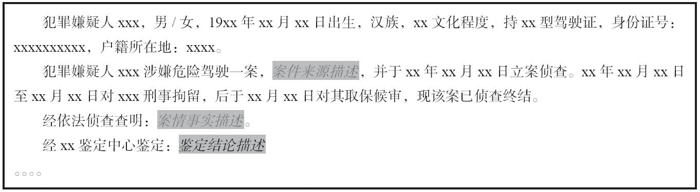

**图 3-9　对起诉意见书分析得到的模板**

第二，基于统计方法。序列标注模型适用于结构相对发散但可收敛的法律文书，如判决书中罪名及判决结果抽取。原理基于人工已标注标签文本位置数据，比较相同标签上下文语义相似度，发现机器敏感的文本语义特征，进而在测试集上识别抽取标签位置。

第三，混合方法。自然语言处理并非完全随机，仅用统计方法会使状态搜索空间庞大，必须借助规则知识提前过滤修剪。目前几乎没有仅用统计模型而不使用规则知识的命名实体识别系统，常见混合方法包括：统计学习方法间或内部层叠融合；规则、词典与机器学习方法融合，其核心是融合技术，在统计学习中引入部分规则结合人工知识；将各类模型算法结合，以前一级模型结果作为下一级训练数据进行训练得到下一级模型。具体实现需考虑高效融合方式与融合技术。分类层面可采用 `Voting`、`Bagging`、`Boosting`、`Stacking` 等融合技术。

### （2）技术应用层面遇到的难题
复杂案件伴随海量证据与文书材料，存在大量重复冗余信息及复杂干扰。如何在海量司法信息中挖掘有价值数据，是构建司法知识图谱、进行自然语言处理的第一步。

为有效提取有价值数据，人工智能需通过自主学习不断改善智能化程序模型，这依赖人工标注数据的质量与数量。通过人工标注建立机器学习识别校验规则、优化业务智能学习模型，是 206 系统形成智能化学习应用的基础。

然而数据标注工作，尤其是中文语义下文本标注，实践难度较大。刑事司法领域文本标注问题更复杂。高质量与高数量标注数据是机器学习效果保障，但获取成本高昂且耗时耗力。人的知识具强主观性，中文语义模糊与语言多义导致司法专家与标注人员对文本理解存在差异，标注结果个体差异较大。

### （3）通过构建多层级数据标注体系提高数据标注质效
为解决上述问题，需依据刑事罪名、罪状等构建多层级数据标注体系，保证标注过程可解释性，尽量消除标注表述中的语义分歧。同时采用规则描述与统计模型结合方案，实现对自定义语义要素的抽取。

主体技术方案以及基于深度学习的语义和要素抽取框架如图 3-10 所示。

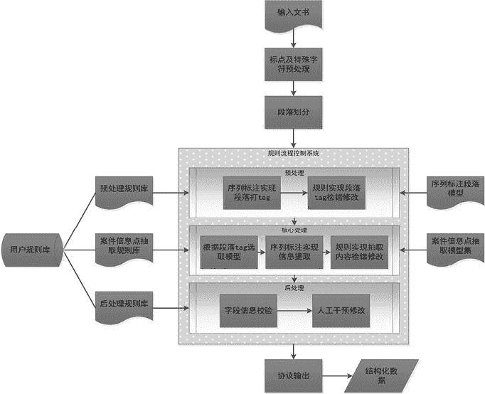
**图 3-10　要素抽取核心框架图**

要素抽取被拆解为四个环节。首环节，206系统调用 character-CNN，把字符级别的 embedding 输入卷积网络得到词向量；次环节，把该向量与传统词向量拼接，形成最终表征；第三环节，BiLSTM 对序列做编码，输出每个位置的后验概率；末环节，CRF 选出要素标注的最优序列。

标注完成后，会按预设规则对抽取结果做合法性与合理性校验，不合格的要素会被修改或删除。目前主要用正则表达式做模式匹配，匹配不通过时要素点将被剔除或重写。

随后在讯问笔录、起诉书、庭审笔录等司法文书上对要素进行人工标注，用以训练阅读理解式的要素抽取模型。如图 3-11 所示的网络结构为例，输入包含非判决文书即 Context text 与要素标签名称。为提升效果，标签会改写成问题形式，比如把“是否认罪”改写为“对于你的所作所为，你是否认罪”，即网络中的 Query text。

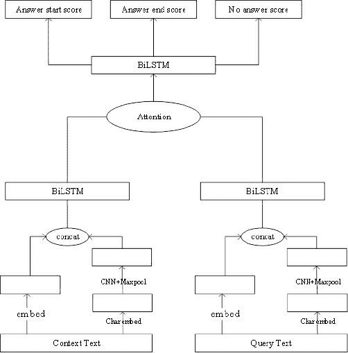
**图 3-11　基于阅读理解技术的要素抽取模型结构示例**

Answer start score 用来衡量预测答案起点的得分，Answer end score 用来衡量终点得分，No answer score 用来衡量答案为空的得分，三者的输入均为 Context text 中各词的隐层表示。

#### 5．提升系统功能的可信度

利用机器学习构建司法知识图谱，从源头增强系统可信度。

### （1）机器学习原理

机器学习通常被定义为：计算机程序在任务 T 与性能度量 P 的框架下利用经验 E 学习，若其在 T 上的表现可用 P 度量，则随 E 积累而提升。通俗讲，就是让程序模仿人类学习，从实例中习得知识经验。它是人工智能的重要分支，也是实现人工智能的一种方式，通过样本提炼规律用于推理决策。与常规程序不同，它需要样本数据，属于数据驱动方法。

机器学习研究的核心是让计算机从数据中产生模型的相关算法，即学习算法。拥有该算法后，可把经验数据提供给机器，它就能基于这些数据生成模型；面对新情况时，模型会给出相应判断。可以说机器学习是关于学习算法的学科，其方法可视为普通算法的进化版，通过自动学习数据规律让程序更聪明。

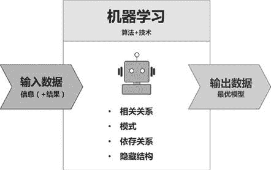
**图 3-12　机器学习示意图**

建模方式取决于数据类型。在机器学习或人工智能领域，首先会考虑算法的学习范式。目前主流可分为有监督学习与无监督学习两大类。

### （2）有监督学习算法

包括：① K-近邻算法，按样本间距离求和，选取最近的 K 个样本，样本类别多则分类结果也多。② 决策树算法，通过最大信息增益确定判断与拆分标签，再递归建树直至叶节点结束。③ 朴素贝叶斯算法，与全量样本对比计算不同样本概率，选择概率最大者分类。④ 逻辑回归算法，利用样本数据计算逻辑回归系数以确定分类概率，系数越大准确性越高，结果大于0.5归为一类，小于0.5归为另一类。⑤ 支持向量机，与逻辑回归不同，其特征维度相对较少，最后通过构建一个最优超平面实现二分类。

## （3）无监督学习算法

包括：① 聚类算法，先设定任意质心，计算周边点归属，以最近 K 个点的均值作为新质心，不断迭代直至结束。② 协同过滤算法，主要是划分数据集，计算支持度，过滤无效数据，最后通过置信度得出数据出现概率。③ 技术应用层面遇到的难题。

206系统通过机器学习与深度挖掘，对上海市公检法机关积累的刑事典型案例、司法信息资源、办案经验、上海高院指定的证据标准、证据规则与证据模型进行分析，及时发现并提示进入系统的刑事案件中存在的证据标准适用不统一、办案程序不规范、证据瑕疵及证据间矛盾等问题，确保提请逮捕、移送审查起诉符合法律规定。然而在具体应用中，因算法存在黑箱，机器学习在量刑的可信度、智能推送相似案例参考的可解释性等方面受到质疑。司法审判属于强逻辑推理领域，且结果关乎人权与公正等价值判断，如何保证智能量刑结果可信、类案推送可解释，是206系统研发面临的重大挑战。

### “206 系统”运用深度学习算法，有效提升系统功能的实用度。

机器深度学习是机器学习的一种特殊形式。为解决上述问题，需充分运用深度学习算法构建司法知识图谱，通过科学的算法模型、海量司法信息、丰富的文书材料，让系统功能更稳定，为法官提供更丰富、更科学、更有说服力的裁判依据。对可信智能量刑与可解释类案推送的探索，是实证法学发展的重要一步。

### “206 系统”运用深度学习算法构建智能量刑模型。

第一，在充分提供学习样本的基础上保障量刑模型准确性。例如，盗窃罪量刑模型的学习样本为全国约30万起盗窃罪案件，样本涵盖该罪现有全部案情要素及量刑情节要素。

第二，为保障量刑模型可信度，206系统采用了增强学习与迁移学习算法。例如，影响案件量刑结果的因素包括犯罪行为、犯罪主观方面、犯罪人基本情况、罪前罪后表现等法定与酌定量刑情节，206系统则通过构建要素抽取模型，将案件中影响量刑结果的要素准确抽取，同时结合法官的经验常识，输入影响案件量刑结果的通用与个案情节，运用深度学习算法构建智能量刑模型。

#### 智能量刑模型包括以下内容。

知识库：知识库是领域知识的存储器，其将业务法官经验、法律法规、专门知识、常识性知识囊括在内，包括法律库、经验库与判例库三大部分。

数据库：数据库存储司法领域内的初始数据与推理过程中得到的各种信息，如卷宗材料、询问/讯问笔录、庭审笔录等案件材料。这些内容是专家系统需要处理的事实，包括案件推理过程中影响量刑结果的量化数据。

推理机：控制并协调输入数据即数据库中的信息，利用知识库中的知识，采用一定逻辑推理策略，提取决策信息，将量刑情节的专业知识和经验整理归纳为若干推理规则，在策略控制下进行推理判断并得出量刑结果，保证机器量刑可信。智能量刑系统汇总广大审判人员的办案经验，全面分析案情事实中与量刑有关的基本因素与具体因素，有助于审判人员克服外界非法律因素干扰，提高量刑公正性。

### “206 系统”不断增强类案推送模型的可解释性。

知识图谱是一种表示知识的数据结构，通过“结点—边—结点”结构，表示知识与事实的实体关系三元组。知识图谱之所以表达能力强，是因为其表达方式与人类认知模式一致，与自然语言表达语义的方式一致。

把知识图谱应用于司法，对司法领域的概念分类、分层、叠加维度，允许司法知识与语言相对独立表示，在保证法律概念知识、司法实践知识、司法实践涉及的领域知识、一般社会常识等案情要素准确抽取的基础上，运用知识图谱表示各证据要素、案情要素、证据要素与案情要素之间的实体关系，结合逻辑推理机制构建案情画像。当办案人员办理具体案件时，只要输入案情要素、证据要素等内容，206系统便会通过后台存储的知识图谱为办案人员推送相似度最高的案例。

#### 6．构建可信的防篡改平台

区块链是信息技术领域的术语。本质上是一个共享数据库，存储于其中的数据或信息具有不可伪造、全程留痕、可追溯、公开透明、集体维护等特征。基于这些特征，区块链技术奠定了坚实的信任基础，创造了可靠的协作机制，具有广阔应用前景。结合区块链与防篡改技术，可构建安全可靠的电子文件存证与防篡改流转机制。

第一，防篡改技术原理。防篡改系统是在自有知识产权的多维底层平台上，采用 PBFT 算法、多线程技术、不对称加密技术、平行链管理及联盟链架构建成自有知识产权的区块链底层业务平台。在国产数据库架构上，结合自有防篡改技术，研发设计了以应用为中心的基础架构，开发了适配政法系统的电子材料防篡改系统，对接使用单位业务系统，实现电子材料的存证、固证、查证、校验、防篡改、预警报警、监督管理等业务功能，做到系统内形成的电子材料在不同系统与业务区块间流转时完整、可信、可靠、安全，并通过采用智能化轻量级客户端技术 LCV、大数据分析技术，建成可视化大数据运维平台，实现系统业务运行管控。

性能与容量方面，基于联盟链超级节点架构、多线程技术等，防篡改系统性能可达26000 tps。

安全性方面，防篡改系统为电子材料与电子数据提供了不对称加密等多种安全保护方案，保障了数据在区块链上的隐私安全。

第二，技术应用层面遇到的难题。在206系统各单位协同业务中，文书、证据文件等交互安全需要解决，业务互认互信体系需要建立，公安机关、检察院、法院、司法局跨部门数据共享与案件协同处理的数据安全如何解决，如何做到电子文件在交互时可信、不被篡改且完整安全，是206系统数据安全的难点。

第三，运用防篡改特性，有效保障数据安全与系统可靠性。文件进入系统时将其存入防篡改系统存证，并在需要查验文件是否丢失或被篡改时，查询防篡改系统，对文件进行校验，以判断是否被篡改。

第四，防篡改系统工作流程。本系统对子平台及中心平台中生成的数据进行安全管理。在数据从生成、使用到归档的全生命周期中，保障数据生成有效性，防止数据被篡改，保障数据真实性、唯一性，并保障在传输或存储时的安全性。

**表 3-3　防篡改系统工作流程**

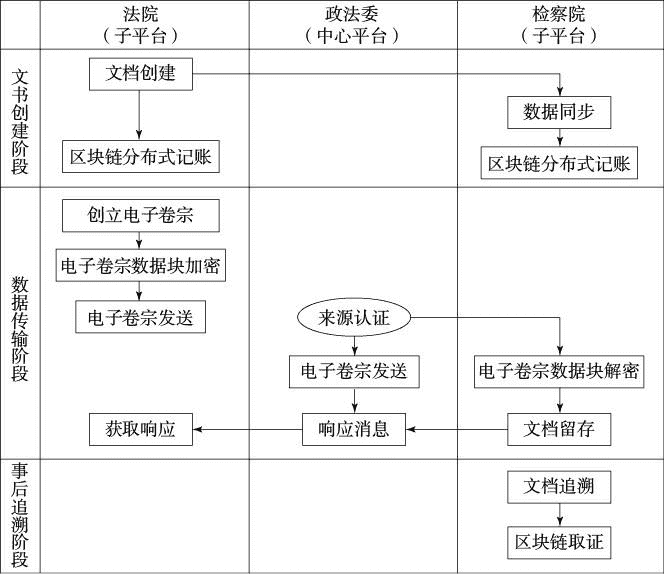

#### 7．业务流程实现

### （1）存证业务流程

业务系统对电子文件进行编辑与审核，文件编目，形成电子卷宗索引信息。应用系统通过调用防篡改系统接口，进行电子文件上链操作，具体步骤如下：

① 业务系统通过部署在本系统上的防篡改系统 API，生成电子文件哈希值；
② 业务系统通过调用防篡改系统的上链接口，将电子文件哈希值及电子文件索引信息一同发送到防篡改系统；
③ 防篡改系统通过接口接收电子文件哈希值及电子文件索引信息；
④ 接收完成后，防篡改系统需对信息发送者身份进行验证，若身份不合法则直接结束上链流程并返回失败信息；
⑤ 若身份验证通过，则防篡改系统将电子文件哈希值与电子文件索引在防篡改系统中保存；
⑥ 防篡改系统保存数据后，向业务系统反馈上链成功；
⑦ 之后，防篡改系统将电子文件上链后信息后台自动同步到防篡改系统各节点。

### （2）查证校验业务流程

在业务系统需要调用电子卷宗查看或进行文件交换时，应用系统需通过防篡改系统接口，向防篡改系统发起查证操作，具体步骤如下：

① 应用系统通过调用部署在本系统中的防篡改系统 API，实时生成电子文件哈希值；
② 通过防篡改系统的查证接口，将电子文件哈希值发送给防篡改系统；
③ 防篡改系统接收应用系统发送的查证请求；
④ 防篡改系统对传入的电子文件哈希值在本节点上进行查询及对比校验；
⑤ 单节点验证后，防篡改系统会在本系统内发起多节点信息校验，参与验证节点及数量通过共识算法随机选取；如多节点校验结果不一致，防篡改系统自动按超过半数原则处理；
⑥ 以上两步校验完成后，防篡改系统将查询到的电子卷宗哈希值反馈给业务系统进行显示；如电子文件被修改或未上链管理，则校验结果为空，此种情况视为电子证据不可信。

### （3）防篡改系统主要防护的数据对象

图 3-13 数据模型中可看到防篡改系统协同平台主要实体间关系。

案件流程中每个节点生成一个表单，表单包含来自公安机关、检察院、法院的基本信息。表单还对应犯罪嫌疑人、涉案财物以及卷宗目录信息。每个卷宗会有多个证据，包括图片、电子文档、音视频等，每个案件还会有附件。防篡改系统主要防范证据文件、批注截图、OCR 以及附件文书被恶意篡改，旨在保障电子卷宗唯一性与真实性。

结构化数据会存入数据库中。防篡改系统主要防护非结构化数据被调包或恶意篡改。其实现方式主要是将非结构化数据文件的哈希值及相关信息写入防篡改系统中，做到全程留痕、不可篡改、可追踪、可查询。

206系统电子数据防篡改架构包括各子平台数据防篡改与中心平台汇聚交互，数据包 CA 认证流转，以及与中心平台汇聚交互的流转架构。

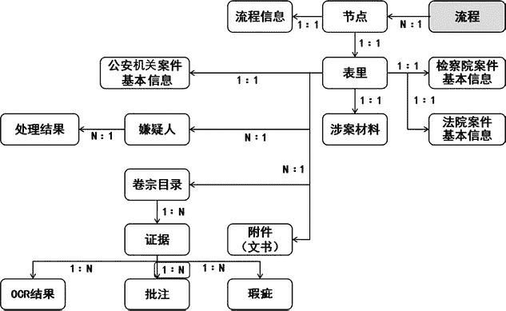
**图 3-13　防篡改系统协同平台的主要实体关系**

**表 3-4　结构化数据与非结构化数据**

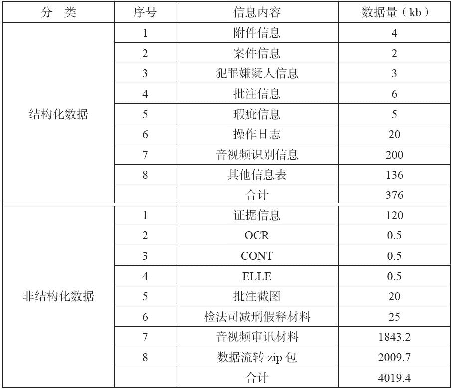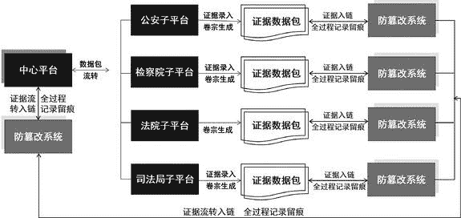
**图 3-14　“206 系统”——电子数据防篡改示意图**

防篡改系统可视化平台的表现形式为防篡改信息采集平台，该平台可单独部署，默认部署在文件服务器，其功能包括：采集区块链接口调用增量存/校验，记录到 uxdb 数据库；采集告警信息，记录到 uxdb 数据库，更新节点状态；提供查询功能，作为节点统计分析的数据来源接口；提供告警消除接口及告警信息查询接口。

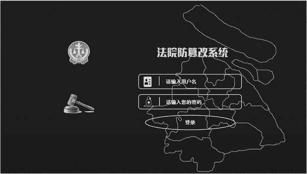
**图 3-15　法院防篡改系统登录界面**

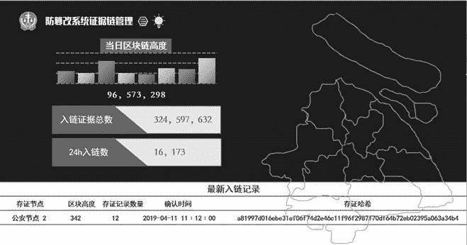
**图 3-16　防篡改系统的证据链管理界面**

### （4）防篡改系统关键功能点

第一，分布式对等网络。防篡改系统利用对等网络模型，对各参与节点进行组网，并在各对等节点间分配任务与共享资源。各网络节点间无需依赖中心节点即可实现信息共享与交换。对等节点既可以是资源、服务与内容的提供者，也可以是获取者，从而降低组网复杂度并提高网络系统容错性。

第二，数据块链式存储。防篡改系统通过对某一时间段内发生的事务数据进行验证、打包与共识，形成数据区块，同时使每个区块与上一个区块通过密码学特征方式有序链接。

第三，存证功能。防篡改系统对206系统每一份案件证据材料都入链存证，不仅更准确记录每个案件证据材料的数量与质量，也更有力保证案件证据材料的数量与质量。

第四，查询验证功能。防篡改系统根据206系统业务系统的查询请求，进行一致性检查校验并返回结果。此机制可保证在系统中历史保存时的电子文件与当前调阅文件的内容保持一致。同样在文件交换与传输过程中，应用同种方式进行电子文件一致性检查校验，保证发送端发送的电子文件与接收端接收到的内容完全一致。

第五，不可伪造、防篡改功能。防篡改系统实现了利用电子数据扫描、PBFT 共识机制、分布式存储技术、多线程技术、非对称加密技术、平行链管理及联盟链架构等先进技术的集成；实现了智慧审判系统电子证据及卷宗的防篡改、流转真实可信。向防篡改系统写入数据的事务请求需附有发起方私钥签名，该签名随事务请求在网络参与节点间广播并进行验证，因此事务请求不可伪造且防篡改。同时，块链式数据结构进一步保证了防篡改性。

第六，透明可信规则。防篡改系统中信息的传递与区块的生成都遵循透明的共识规则；每一次事务处理都以特定形式发送给其他节点，授权节点可以保存与其权限相关的历史记录，从而保证了链上数据的透明性。每一次事务处理与区块的生成均可由授权节点根据既定规则验证其合法性，并通过共识机制进行记录，保证了记录结果的可信。

第七，数据损坏与数据丢失判断。防篡改系统的特征码与文件分开存储，并且特征码有多个备份，所以即使一处特征码损坏，防篡改系统仍可校验文件是否被篡改。在防篡改系统中，证据文件的哈希值与证据文件分开保存，并且事先在链上同步到其他节点，多点备份，所以在文件丢失时，文件的哈希值并不会丢失。这样通过比对同一案件下证据文件的总数与证据文件哈希值的总数，可以方便发现初始录入的证据是否有丢失或遗漏。也就是说，证书认证无法保证证据文件数量完整性。证据文件被删除或隐藏时，证书认证无法查证。防篡改系统保存案件证据的数量信息，无法被篡改。

第八，全程留痕。防篡改系统无法篡改，全程留痕，可追踪、可查询，并且防篡改系统上的痕迹也是无法篡改的。

### 三、获多项知识产权

206系统共涉及29项知识产权，其中科大讯飞公司原有知识产权23项，专利10项，著作权13项；上海高院与科大讯飞公司共同研发创造的知识产权6项，专利5项，著作权1项。图 3-17 为206系统获国家知识产权局、国家版权局颁发的专利证书。

2021年正在申请中的知识产权有6项。

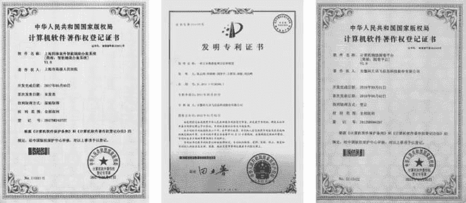
**图 3-17　“206 系统”的专利证书**

**课后习题：**

简答题
1.请简述206系统的技术应用路径。
2.请简述206系统主要涉及的六类技术创新内容。

思考题
选择一项具体的应用技术，谈谈你对该项技术的未来发展的看法。

# 第四章 证据标准指引、证据规则指引、证据模型

**本章提要：**206工程阐明了证据、证明标准、证据标准的内在逻辑关系与实践发展方向，集中攻关并创造出了证据标准指引与证据规则指引，实现了人工智能在刑事司法领域深度应用的从0到1突破。证据标准指引与证据规则指引的制定，丰富完善了刑事诉讼理论体系与刑事证据体系，为以审判为中心的刑事诉讼制度改革作出了历史性贡献，是世界首创，在国内外处于领先地位。

## 第一节 证据标准指引

### 一、什么是证据标准指引

#### 1．什么是证据

##### （1）证据的文义解释

《辞源》将证据解释为证明事实的根据。《现代汉语词典》将证据解释为能够证明某事物真实性的有关事实或材料。《牛津法律大词典》将证据解释为事实、从事实中推断出的结果及陈述，这些事实、论及陈述有助于法院或其他调查主体确信某些尚不知道但正在调查之中的事实与情况。

##### （2）我国《刑事诉讼法》关于证据的界定及其相关规定

我国《刑事诉讼法》第50条规定可以用于证明案件事实的材料，都是证据。证据包括物证、书证、证人证言、被害人陈述、犯罪嫌疑人、被告人供述和辩解、鉴定意见、勘验、检查、辨认、侦查实验等笔录、视听资料、电子数据共八类证据。

刑诉立法经由三次迭代重塑了取证观念

1979年7月1日刑诉法条正式施行后，历经1996、2012、2018三次修定。回顾轨迹，对证材的立法表述由事实取向转向物证取向。1979与1996两个文本仅阐明了证材的职能，未对证材的性质作出明示，因而在2012年前实质沿用了事实取向的立场。该取向把证材视为客观存在，其能否证成案件事实仍依赖办案人员的主观评判，很难做到绝对客观。2012年修正案与2018年修正案均采纳了物证取向。2012年刑诉法第48条写明：“可以用来证实案件事实的材料，都是证材。”同条第3款同时要求：“证材必须经过查证属实，才可作为定案根据。”由此可见证材并不等同于定案根据。定案根据是在控辩双方质证后，审判人员就影响定罪量刑的证材加以取舍确认的结果，严格意义上即为定案证材。因此认定证材时审查对象是材料，认定定案根据时审查对象是证材。简言之，证材可以理解为用以证实案件事实或法律事务相关事实存在与否、符合法定形式并须经查证的材料。

刑诉法第55条要求，一切案件审判都要重证材、重调查研究，不轻信口供。仅有被告人供述而无其他证材的，不能认定有罪并判处刑罚；没有被告人供述，只要证材确实充分，也可以认定有罪并判处刑罚。证材确实充分需要同时满足：定罪量刑的事实均有证材支撑；据以定案的证材均按法定程序查证属实；全案证材综合后，对所认定事实已排除合理怀疑。

##### （3）证材属性
证材具备真实、合法、关联三大基本属性。2014年启动的以审判为中心的刑事诉讼改革，其内核是通过证材倒逼规范化建设。通过改革确保证材的收集、质证与采信符合法律要求及证材属性要求，达到“犯罪事实清楚，证材确实充分”的证明要求，从而阻断非法或瑕疵证材进入诉讼环节，有效预防冤假错案。

##### （4）域外关于证材的界定
美国：
美《加州证据法典》第140条规定：“证材是指为证明某一事实存在或不存在而提供的证言、文件、物品或其他可感知对象。”美国学界对概念界定兴趣有限，更注重分类。凡能证明或反驳待证事实的事物，包括证人证言、文书和有形物，均可归入证材。能否被采纳取决于审理过程中证据法的规则与标准，其渊源为成文法与判例法。

英国：
英法没有成文的证材定义。贝斯特提出：“任何能对其他事实的存在产生说服力或不确信性的事实问题。”通说认为，证材是在庭审中经法官许可提出，旨在使法官或陪审团确信指控相关事实的材料。

英法上的证材包括具有法律效力的证言、书证、实物证材，涵盖证人言辞、专家意见、文件、公共记录、物品、照片等，还包括旁证，即通过展示情境帮助形成逻辑结论的材料。律师意见、法官陈述、对裁定的异议回答不属于证材。用于说明的图表、地图、模型本身不是证材，但基于其的证言或标注可以作为证材。证材须经对方律师异议检验后得以保留，不得因无关、传闻规则或其他技术瑕疵被排除。

德国：
德法上“证材”兼具“证明”含义，指形成对特定事实真伪确信的理由，即法院据以确认诉讼争议事实的各种途径与方法。法定证明方法包括勘验、证人证言、专家鉴定、文书、当事人询问等。德法以案件真相证明为核心，证据法实质是证明法，规范证明对象、证明责任、证明方法证明力、证明程序、证材审查等内容，强调自由心证与疑点有利于被告。

### 2. 取证尺度概念辨析
（1）证成要求
学界表述不一：有人认为是指诉讼中对案件待证事项证明所应达到的要求；也有人说它是衡量刑事案件事实证明是否达标的具体尺度；还有观点认为“证材确实”关注单一证材的真实可靠，“证材充分”关注证材群体的整体证明力。

（2）取证尺度
“取证尺度”概念兴起于21世纪初，源于不同诉讼阶段的司法实践需要。
2009年，有检察实务人员提出刑事诉讼的取证尺度是指运用证材作为定案依据时应达到的要求或程度，并以证材“三性”为其内涵，把关注点从证明力评价转向证材能力判断。
2010年，有学者在梳理“证材确实充分”属于证成要求还是取证尺度之争后指出：诉讼意义上的证明仅存在于法庭审判阶段，提起公诉阶段并不存在诉讼意义上的证明活动，故不应使用证成要求而应使用取证尺度；证成要求包含证明责任与证明不能两层含义，取证尺度不涵盖这两者；提起公诉的取证尺度是指检察机关拟指控被告人犯罪并要求承担刑事责任时，依据实体法和程序法在证材要求上应达到的最低门槛。
自此学界以诉讼证明活动为分界，证成要求仅用于审判阶段，取证尺度则贯穿审前阶段。二者在适用阶段、判断主体、审查内容、程序地位与评价尺度等方面均有差异。

（3）证成要求与取证尺度的关联与区分
二者都服务于司法人员对证材的审查判断。
第一，具有相似性。二者的核心都是探讨主观认识与客观实际的一致性；都需要考虑证材对事实的证明程度是否充分确实；都审查符合诉讼要求的定案证材规格；二者确定证明力与作出结论的方法，都是对证材进行核对并据此客观判断。正因高度相似，20世纪80年代二者语义曾被混用，当时学界把证成要求定义为“司法人员评断证材证明力的依据”。
第二，具有差异性。随着研究深入，二者区别被厘清。取证尺度主要用于案件证材的审查判断，包括证材能力、要件证材及必要辅助证材的审查；证成要求则是对案件事实的综合评价，涉及取证尺度审查、证材证明力强弱、要件事实融贯性及案件整体论证强度。取证尺度虽是证成要求评价的第一步，二者不可等同。二者在内容、是否依附特定诉讼构造、审查主体与方式、功能与法律效果等方面存在实质区别。
取证尺度细化到具体罪名需结合归纳法。研发团队聚焦常见多发、重大新类型案件，尤其针对公共安全与群众关切问题，从刑法法定罪名中选取102个罪名逐项制定取证尺度。例如命案被分为四类：现场目击型、认罪供述印证型、现场留痕型、拒不认罪型。不同类型对证材审查尺度差异显著，需要个性化证成要求。
取证尺度指引是对取证尺度的一次实践探索，是“206系统”的核心内容与首要功能。具体是指办案中应收集哪些证材、如何收集，是“犯罪事实清楚，证材确实充分”这一法律证成要求的具体化、规范化。其提出丰富完善了刑事诉讼理论与证材体系，开创了先例。取证尺度指引需在实践中按罪名与具体情形体系化梳理，这是“206工程”的核心工作。

### 二、编制取证尺度指引的动因
证材是诉讼的灵魂。合法有效、确实充分的证材是案件事实清楚的前提。某种意义上，“206系统”就是围绕证材展开的。制定的原因有三：
1. 防范冤假错案的需要
冤假错案成因复杂，其中重要原因是案件事实证材不够确实充分。如捏造供述、虚假证词、违法鉴定意见被错误采信，进而得出貌似合理的错误结论。
2. 推进以审判为中心的诉讼制度改革的需要
党的十八届四中全会部署推进以审判为中心的诉讼制度改革。习近平强调，改革目的是促使办案人员树立办案必须经得起法律检验的理念，确保侦查、审查起诉的案件事实证材经得起法律检验，有效防范冤假错案。
3. 办案人员收集、固定、判断证材的需要
刑诉法规定了证材种类八类和证明标准，但在具体案件中，八类证材该如何把握标准、如何收集鉴别固定、如何做到确实充分，一线人员常感难以把握。长期以来主要依赖个人经验和自由心证，不同人员理解不一，易导致应采证材遗漏而灭失。故制定统一、标准化、清单式指引，使办案“看得见、摸得着、可操作”，减少任意司法与不规范行为，是办案人员长期期盼。

### 三、取证尺度指引的构建
### 1. 原则、范围与方法
（1）构建原则
以《刑法》《刑事诉讼法》等法律为依据，把握刑事诉讼规律，坚持完整性与阶段性相统一，制定统一规范的取证尺度，为办案提供数据化、清单式指引。
（2）构建范围
刑法及其修正案共规定罪名483个。根据中央政法委要求与司法实践需求，研发团队拟聚焦常见多发、重大、危害公共安全和人民生命财产安全的案件，分批制定。运用大数据统计2018—2020年全国刑事案件，确定了常涉102个罪名，占全部案件98%以上，其中上海常涉71个，占上海案件98%以上。经中央政法委同意，首批指引范围确定为102个罪名。
（3）构建方法
集中攻关。领导小组在上海集中400余名刑事业务专家负责71个罪名的制定，其中资深法官220余人、资深检察官80余人、资深警官100余人；中央政法委指定11省区市集中专家负责其余31个罪名。上海及11个省市专家用21个月时间，自2017年2月6日至2018年11月完成102个罪名的取证尺度指引、证据规则指引与证据模型制定，是前所未有的创新工程。

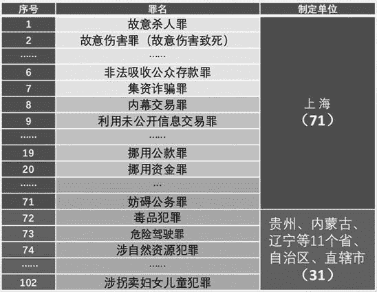

**图 4-1　证据标准指引的制定图示**

### 2. 分层、分类、分段应用
“206系统”设计需兼顾证材审查功能与审判中心改革落地，便利办案并落实分工负责、互相配合、互相制约原则。故确立完整性与阶段性结合原则，提供分层、分类、分段指引。
（1）分层指引
根据构建完整证材链条的需要，提示办案人员办理具体案件时应如何构建链条，应查证哪些事实、收集哪些证材。
（2）分类指引
根据案件证材结构特点及查证繁简程度不同，提示针对不同类型案件应收集哪些证材。
（3）分段指引
根据不同诉讼阶段要求提示应收集哪些证材。例如在逮捕阶段制定了《命案逮捕基本证材标准（试行）》《盗窃案件逮捕基本证材标准（试行）》等。

### 3. 证材链条的呈现方式
证材链条一般由案件线索来源、锁定犯罪嫌疑人及到案经过、查证犯罪事实、证材充实性及排他性说明、罪前罪后表现及其他量刑情节、涉嫌罪名六个环节组成。复杂特殊案件会增设环节，如命案增设查找被害人确认死者身份，非法集资增设集资活动行政违法性。
案件线索来源指案件如何被侦查机关知晓；锁定犯罪嫌疑人及到案经过指嫌疑人如何被锁定与到案；查证犯罪事实指作案时间、地点、人员、手段经过、后果、动机预谋等；证材充实性及排他性说明指证材是否确实充分、达到印证程度、符合逻辑并排除合理怀疑；罪前罪后表现及其他量刑情节指前科劣迹、自首坦白立功、退赔谅解等情节；涉嫌罪名指构成要件与易混罪名的区分。
指引规范性可从六方面判断：证材链条是否闭合、查证事实有无遗漏、证材分型是否必要准确、证材综合分析是否合理、注意事项是否到位、基本证材与补强证材区分是否准确。考虑到审查逮捕的重要性，研发团队在每个罪名中特别列明批准逮捕阶段所需的基本证材收集清单。证材收集是基础，使用则涉及综合分析判断，需对事实项下证材进行印证性、逻辑性、矛盾性分析，才能排除合理怀疑得出唯一结论，故指引中明确了综合分析判断规则。不同诉讼阶段证成要求不同，但形成完整证材链条查清事实是共同目的。

### 4. 取证尺度指引的效用
指引为办案人员提供了统一规范的数据化清单式指引，倒逼规范收集证材，对防范冤假错案、提高办案质效、节约诉讼资源、确保案件经得起法律检验具有重要意义，是推进以审判为中心的改革与刑事案件智能辅助办案系统研发的重大成果。

# 第二节 证据规则指引

## 一、取证规则指引的内涵
证据规则是指公安、检察、法院三机关办理刑事案件时依据法律规定收集、固定、保存、运用证材应遵循的规范，主要解决证材合法性、真实性、关联性以及证材鉴真、传闻证材使用、非法证材排除等问题。
证据规则指引即“206系统”研发团队制定的《上海刑事案件证材收集、固定、审查判断规则》，规定了证材收集程序、形式要件、内容要件及审查判断要点，明确量刑证材与程序证材的收集固定要点，以数据化形式嵌入系统，为办案提供数据化清单式规则指引。

### 二、编制规则指引的必要性
有关证据规则的规定散见于《刑事诉讼法》《刑事诉讼法解释》《关于实施刑事诉讼法若干问题的规定》《人民检察院刑事诉讼规则（试行）》《公安机关办理刑事案件程序规定》《关于办理刑事案件排除非法证据若干问题的规定》《关于办理死刑案件审查判断证据若干问题的规定》等文件中。内容庞杂、侧重点不同、交叉重复，查阅使用不便。因此需要系统梳理并分类规范，为办案提供数据化清单式指引。

### 三、规则指引的形成路径
### 1. 统一规则制定的考量
《上海刑事案件证材收集、固定、审查判断规则》将刑诉法规定的八类证材细化为收集程序、形式要件、内容要件及不可采纳情形；针对量刑情节列举自首、立功、累犯、再犯、和解等所需证材及其规范；针对强制措施、查询、冻结等程序性事项明确文书制作要求，便于工作人员快速检索对照。
### 2. 案例提炼
从审理报告与案卷中提取具体证材，按《刑事诉讼法》八类证材归类，根据证材特性将卷宗材料分门别类归入，对裁判先例归纳总结，形成专家经验与规则。
### 3. 法规提炼

沪上刑事证据工作：从条文堆砌到系统校验

把散落在上位法、司法解释、部门规章以及各地上审判实践中的证据要求收拢梳理，是申城推动证据规范化的一条主线。研制团队以刑诉法、刑诉法解释、关于实施刑诉法的若干规定、人民检察院刑事诉讼规则试行、公安机关办理刑事案件程序规定、关于办理刑事案件排除非法证据若干问题的规定、关于办理死刑案件审查判断证据若干问题的规定等为基准，叠加各地办案经验，对取证、固定、审查、评判各环节进行细化提炼，最终于形成了《上海刑事案件证据收集、固定、审查、判断规则》。

### 4．证据规则指引的实践例证

案例一：现场勘验笔录。对该类文书单独设定核验清单。形式要件须涵盖勘验事由、起止时间、现场位置、现场条件、勘验经过、勘验人员签名、见证人签名及印章共八项；程序要件须同步附勘验影像、绘制现场示意并附见证人资格说明。笔录还须与《提取痕迹、物证登记表》形成捆绑式核查，缺一则视为不完整。

案例二：电子数据。206系统研发组在起草规则时，对电子证据的取证流程与评判标准分别作出导引。取证层面提出六条刚性要求，其中包括电子数据的提取应由两名以上办案人员共同操作，取证方式应符合技术规范；原始存储介质须当场扣押封存并制作笔录，笔录须如实记载封存状态等。评判层面围绕真实性、完整性、合法性三维度展开，共细化十七条细则，并明确瑕疵电子证据的四种情形及补正要求，以及非法电子证据排除的三类情形。例如，未保持封存状态移交的电子数据即属瑕疵；对名称、类别、格式标注不清的数据应要求补正或作出合理解释，无法补正或解释的不得作为定案依据；数据出现增删改动影响真实性的，亦不得用于定案。办案人员依规操作可保证规范性，审判人员对照核查即可判断是否采信、是否要求补正或排除。

当规则导引被转译为兼具逻辑、对应与唯一性的计算机语言，就形成了206系统的单证核验能力。证据录入后，系统自动识别证据类型并套用对应规则进行核验。

需要说明的是，导引中大部分内容可转化为机器可识别的校验点，但单证核验仍需人工复核。一方面技术尚未达到人工水平，手写体、签名捺印的识别准确率偏低；另一方面部分判断依赖情境，例如辨认物品时同类样本需达五件以上、照片需达五张以上，系统目前只能统计照片数量，是否符合“同类”标准仍需人工判断。

# 第三节 证据模型

## 一、什么是证据模型

证据模型是以基础证明标准与证据规则为依托，以查清案件事实为目标构建的各类案件证明链体系。它把诉讼中影响定罪量刑的变量与证据规范性判断要素拆解到各工作环节，通过智能化机器辅助识别、检验、评测、审查判断，最后以知识图谱形式向办案人员呈现全案证据与事实查证的分析结果。

### 二、为什么要制定证据模型

### 1．立足侦查集成各类案件证明链的构成环节
模型内嵌基础证明标准与证据规则，并与侦查活动紧密衔接。研制团队依据侦查推进的常规节奏与节点设定证明链的延展路径，在广泛征求侦查机关意见、分析大量实证案件，尤其是对破案经过、抓获经过等书面材料的统计基础上，结合司法实践，从侦查视角合理安排模型的横向环节与纵向深度。横向上设置通用的“证据充实性及排他性分析”“罪前罪后情节”“罪名与罪数确认”三个环节，同时按案类差异设置其余横向链路，以贴合各类型案件固有的侦查规律。如电信网络诈骗案中特设“线索串并”环节，并按起获作案窝点即为破案关键的特点，设置“锁定作案窝点”再到“锁定犯罪嫌疑人”的路径，精准对应该类犯罪的侦破规律。

### 2．以证明链为线索厘清各环节下应查实的案件事实
横向证明链确定后，各环节下的待证事实即为法庭需要认定的构成要件事实、量刑事实、罪数罪名确定事实。依据不同罪名对要件事实的不同要求，将横向证明链分解为若干待证要点，并梳理其逻辑关系、排序与分层。如非法集资案模型中，考虑涉案人数多、分工细、常以单位名义犯罪的实际，在查证作案地点、时间、手段经过、后果等常规要点的同时，下设共同犯罪人员分工、单位犯罪还是个人犯罪等分支路径，将待证事实进一步细化，避免空泛。

### 3．以全样本分析为方法梳理各查证事实下的印证材料
司法经验是模型的基础。基于上海法院五年相关犯罪案件的侦查卷、诉讼卷、审理报告的结构化分析，提取同一类案件中各类证据出现的频次与数量，形成降序统计表。结合一线法官办案经验，发散梳理各待证事实项下的基本印证证据，在众多证据中区分关键证据、程序证据等，进一步理顺印证证据间的逻辑咬合，确保待证事实由完整证明链支撑。

### 4．以认识规律和法律逻辑为要素设置开放性模型结构
证据模型的生命力在于可不断填充。对现实作案手法与证据收集要求的覆盖不可能一次性完成，因此模型须保持开放结构，允许补充模型未涉及的证据，以契合侦查活动的能动性。

### 5．以经验法则为依托提示证明链构建中的常见问题
制定证据标准实质是将庭审中法官认定的证据标准固化为操作流程。把某一类案件在庭审中暴露的共性问题前置到侦查阶段提示，能大幅提升效率。如电信网络诈骗案中，电子数据存储介质、电信设备座位工号与操作人员对应关系，常因收集瑕疵导致法官在庭审中对行为人是否使用该机位、使用时段、存储介质与作案窝点关联性产生疑问，且事后时空已变难以补正。对此，模型在对应环节专门设置问题提示，要求侦查机关起获作案窝点时在条件许可下对提取封存电子数据的过程进行录音录像或拍照固定，对各行为人对应操作机位同步录像或制作辨认照片、笔录。

### 三、证据模型的制定

### 1．证据模型需要实现的功能

#### （1）证据收集指引功能
按模型步骤提示收集证据，常见证据的收集方式已在模型中列明，不常见或超出模型范围的证据可在开放性结构中人工录入。通过层层递进、发散方式明确待证事实对应的具体证据名称，从审判角度提出证据收集要求，按互相印证、排除合理怀疑的标准形成全案证据目录并标注关键证据，确保侦查阶段收集到一切与案件事实有关的材料。

#### （2）初步判断功能
第一，单个证据形式合法性提醒与判断。对侦查过程中制作的证据材料进行形式合法性提醒，如案发经过表无侦查人员签字和机关盖章，或讯问时间、地点空缺，或被告人身份信息不全，系统均会提示并要求补正。
第二，多份证据印证所对应证据清单的梳理。对每一项待证事实如作案时间、地点，梳理是否已收集、收集了几份材料，并自动生成梳理报告，一目了然。
第三，证据材料是否印证待证事实的精确比对。模型设定需精确比对的待证事项及证据名称，软件自动抓取证据材料有效信息进行多份比对，同步生成比对结果并以不同颜色标识。
第四，证据之间印证程度的辅助比对。通过人机结合模式提示各待证事实下证据是否包含待证要点和证据要素，由侦查人员勾选，系统自动分析判读关联证据是否印证、哪些要素形成印证、哪些未印证，形成分析清单并以颜色标示，如未印证要素及对应待证事实以红色显著提示，督促补充取证。

#### （3）问题提示功能
依据审理该类案件的司法经验与实证研判，设置薄弱环节提醒，对审理中易忽视、易出错的问题在相应环节提示，从源头排除证据收集不全隐患。综合设定证据要素间的印证关系与待证事实间的逻辑联系，对证据材料间存在矛盾、完全不能印证的情况进行筛选，形成分析报告并以颜色显著标识具体矛盾点，提示侦查中关注并补充取证或作出说明以排除合理怀疑。

#### （4）证据链完整呈现功能
通过梳理待证事实与通常需收集的证据列举出该类案件所需材料，再经证据充实性及排他性分析至罪名确定，将材料按内在逻辑组成证据链并一体呈现。

### 2．证据模型对证据的审查与判断

#### （1）物证的收集与审查标准
第一，搜查程序。至少双人以上搜查人员，搜查妇女身体应由女工作人员进行，出示搜查证，紧急五种情形除外，由被搜查人或其家属、邻居或其他见证人在场见证并制作搜查笔录，侦查人员与见证人签名，未签名须在笔录中注明。
第二，查封、扣押程序。至少双人以上侦查人员出示查封决定书、扣押决定书，制作查封、扣押笔录并由侦查人员、持有人、见证人签名。无法确定持有人或拒绝签名须注明。制作清单须会同见证人与持有人当场清点，载明名称、编号、数量、特征、来源等并签名。
第三，现场勘验检查。现场提取的血迹、指纹、毛发等物证须在《现场勘查笔录》《现场勘验、检查提取痕迹、物品登记表》中注明。
第四，调取证据程序。至少双人以上侦查人员出示《调取证据通知书》，制作调取证据清单，由两名侦查人员签名并由被调取单位或个人签章。拒绝盖章或签名的须注明，必要时以录音录像固定内容与过程。
第五，见证人限制。生理、精神缺陷或年幼不具备辨认能力或不能正确表达者；与案件有利害关系可能影响公正者；行使勘验、检查、搜查、扣押职权的司法机关工作人员或其聘用人员不得担任见证人。司法机关应对见证人身份作出说明并附卷。
第六，送交鉴定。具备鉴定条件的物证须依法定程序鉴定；具备辨认条件的物证应交当事人或其他人员辨认。
第七，物证不能作为定案依据的情形。物证灭失、严重污染或损坏无法核实真实性；提取扣押物证未附笔录或清单无法证明来源且无法补正说明；照片、录像、复制品不能反映原物外形特征且原物无法提供；照片、录像、复制品经鉴定为虚假且原物无法提供；来源、收集程序存在重大疑问无法合理解释。

#### （2）书证的收集与审查标准
收集程序与物证相似。不能作为定案依据的情形包括：书证有更改或更改迹象无法合理解释；提取扣押时未附笔录或清单无法证明来源且无法补正说明；副本、复制件不能反映原件内容；副本、复制件经鉴定为虚假；来源、收集程序存在重大疑问无法合理解释。

#### （3）证人证言的收集与审查标准
询问须由至少双人以上侦查人员进行，行政机关在执法中收集的证言须转化。询问可在现场或证人所在单位、住处或证人提出地点进行，必要时通知到检察院或公安机关提出地点取证须注明。现场询问须出示工作证件，其他地点须出示证明文件。证人须单独询问，聋哑人须请通晓手势者参加，不通晓当地语言文字者须提供翻译，相关人员资格证明附卷。未成年证人须通知法定代理人或合适成年人到场并附证明。询问时须告知如实作证义务及作伪证法律责任，笔录涂改处须由相关人员签字或捺印。不能采用的情形包括：无作证资格者提供；未个别询问；书面证言未经证人核对确认；聋哑人询问未请手势通晓者；非通用语言文字者未提供翻译；不能排除暴力、威胁、引诱、欺骗等非法取证情形。

#### （4）被害人陈述的收集与审查标准
形式要件包括询问起止时间、地点、被害人姓名、年龄、联系方式、工作单位、户籍地、身份证号，询问人员姓名、工作单位，修改处由被害人或制作人签名，被害人确认意思一致。文盲或无法签名者须注明已宣读并由其捺印或画押确认，询问人员、被害人、翻译、法定代理人或合适成年人签名。亲笔书写的陈述须由被害人签名并由至少双名侦查人员签名注明收到过程及日期。内容要件包括与犯罪嫌疑人关系、案发时间地点、作案人身份体貌衣着、手段工具方式、作案后去向、自身伤势、受损物品、现场状态、案发起因。不能采用的情形包括：生理、精神缺陷或年幼不能辨别是非或不能正确表达者，以及明显醉酒、中毒、麻醉状态不能正常感知或正确表达者；未个别询问；笔录未经核对确认；聋哑人未请手势通晓者；非通用语言文字者未提供翻译；不能排除非法取证情形。

#### （5）被告人供述的收集与审查标准
讯问须由公安或检察侦查人员负责，侦查人员不得少于两人。羁押后讯问须在看守所进行，无需逮捕拘留者可传唤至指定地点或住处进行，须出示证明文件。传唤、拘传持续时间不得超过12小时，重大复杂案件需采取拘留逮捕措施的不得超过24小时。同案犯须个别讯问。首次讯问须告知回避、聘请律师等诉讼权利。聋哑被告人须请手势通晓者参加，非通用语言文字者须提供翻译，未成年被告人须通知法定代理人或合适成年人，并附身份资质证明。对可能判处无期徒刑、死刑或其他重大犯罪案件须全程录音录像，与提押讯问同步进行，保证完整，不得选择性录制、中断、剪接删改，技术故障无法录制须中止讯问。不能采用的情形包括：笔录未经被告人核对确认；聋哑人未请手势通晓者；须提供翻译而未提供；依法应全程录像的案件无法提供录音录像且真实性无法核实；刑讯逼供取得；依法应在看守所进行而未在看守所进行且被告人翻供真实性无法核实。

#### （6）鉴定意见的收集与审查标准
审查围绕鉴定机构和鉴定人、委托人、送检日期、检验对象、鉴定事由、鉴定要求、鉴定日期、鉴定过程与方法、明确鉴定意见、签名盖章十个方面。鉴定机构、鉴定人须符合全国人大常委会关于司法鉴定管理问题的决定规定。尸体检验鉴定书须明确死亡原因，否则须说明。分尸案件须对每个尸块进行DNA鉴定和同一性比对。女性被告人须审查妊娠检查报告，羁押期间自然或人工流产视为审判时怀孕妇女。

**鉴定意见不能作为裁判依据的情形**

司法机关在遇到以下情形时，不能采信鉴定结论：鉴定机构不具备法律规定的资格或其业务范围、技术能力达不到委托要求；鉴定人资格不符合规定、缺少相应专业背景或职称，或应当回避却未回避；送检的检材来源不清楚，或因污染等原因已丧失鉴定价值；实际检材与待鉴定对象不一致；鉴定流程违反法定程序；鉴定方法和过程不符合行业专业规范；鉴定文书未加盖鉴定机构公章并由鉴定人签字；鉴定结论与案件待证事实无关；后续出现可能动摇认定的新鉴定材料；经法院传唤鉴定人无正当理由不出庭作证；以及其他违反相关规定的情形。

#### （7）勘验、检查、辨认、侦查实验等笔录的收集与审查标准

勘验检查笔录审查通常聚焦十个要点：启动事由、进行时间、具体地点、执行人员、现场环境、勘查检查的具体过程、勘验检查人员签字、见证人签字、现场提取痕迹物品登记表、勘验检查照片。

勘验要求：现场勘查至少由公安机关指派两名以上人员执行，并须有见证人在场。勘查时要拍照、绘制现场图并制作笔录，重大案件现场还应录像固定。

检查要求：为确认被害人或犯罪嫌疑人的体貌特征、伤情或生理状况，可进行人身检查。若被检查人拒绝，而侦查人员认为确有必要，经办案部门负责人批准后可以强制检查、提取或采集。检查妇女身体须由女工作人员或医师实施。检查结束后应制作笔录，由参与检查的侦查人员、检查人员、被检查人及见证人签字；被检查人拒签的要在笔录中说明。

辨认要求：辨认由侦查人员主持，主持人不得少于两人；多名辨认人辨认同一对象时需单独进行；被辨认对象必须混杂在其他对象中。辨认犯罪嫌疑人或被害人时，被辨认人数不少于7人，照片不少于10张；辨认物品时，同类物品不少于5件，照片不少于5张。对犯罪地点、尸体等进行辨认时应拍照，必要时可录音录像。辨认笔录须由侦查人员、辨认人、见证人签字。

#### （8）视听资料的收集与审查标准

视听资料原则上以原件为准，需附制作人或持有人的身份信息，以及制作时间、地点、条件和方式的说明。若为复制件，应说明无法调取原件的原因、复制过程和原件存放位置，并附制作人及原资料持有人的签字或盖章。

视听资料不得作为定案依据的情形：发现资料存在伪造、剪辑、篡改、删除、重新编排等情况时，应要求公安、检察机关核查并作出说明。若相关机关无法给出合理解释，且经技术鉴定确认系伪造或篡改，则不能作为定案依据。

#### （9）电子数据的收集与审查标准

收集提取电子数据应注意：须由两名以上侦查人员实施；取证方法须符合技术规范；能够扣押原始存储介质的，应扣押并封存，制作笔录载明封存状态。法定情形下无法扣押原始介质的，可提取数据，但须在笔录中说明无法扣押的原因、介质存放地或数据来源，并计算完整性校验值。因客观原因无法按上述方式操作的，可采用打印、拍照或录像等方式固定，并说明理由。

收集提取时须制作笔录，记录案件名称、对象、内容、时间、地点、方法、过程，并附电子数据清单，注明类别、格式、校验值等，由侦查人员及数据持有人或提供人签字盖章；持有人无法签名或拒绝签名的，应在笔录中注明并由见证人签字盖章。条件许可时应全程录像。见证人须符合法定条件，客观原因无法安排的，应在笔录中说明并录像。

电子数据不能采信的情形：数据系伪造篡改或真伪无法查明；数据存在增删修改影响真实性；其他无法保证真实性的情形。

课后习题：

简答题
1．说明制定证据标准与证据规则指引的必要性。
2．说明分层、分类、分段制定证据标准指引的思路。

思考题
证据标准指引的制定应依据哪些方面？

* * *

(1)　《刑事诉讼法》（1979）第 31 条规定：“证明案件真实情况的一切事实，都是证据。”（1996 年修正的《刑事诉讼法》第 42 条关于证据的定义亦是如此）

(2)　当然还有其他诸如根据说、法律存在说、命题说、修正的事实说等学说。

(3)　参见何家弘主编：《新编证据法学》，法律出版社 2000 年版，第 93—99 页。

(4)　龙宗智：《我国刑事诉讼的证明标准》，《法学研究》1996 年第 6 期。

(5)　张中：《论刑事诉讼的证明标准》，《山东法学》1999 年第 6 期。

(6)　隋光伟：《证据标准与证明法则——兼谈证据的一般理论问题》，《当代法学》1996 年第 6 期。

(7)　参见李小平、张礼萍：《刑事诉讼中应当确立 “证据标准”概念》，《河南社会科学》2009 年第 2 期。

(8)　参见李小平、张礼萍：《刑事诉讼中应当确立 “证据标准”概念》，《河南社会科学》2009 年第 2 期。

(9)　熊晓彪：《刑事证据标准与证明标准》，《法学研究》2019 年第 4 期。

(10)　习近平总书记就《中共中央关于全面推进依法治国若干重大问题的决定》所作的说明。

# 第五章

## “刑事案件智能辅助办案系统”的主要功能

**本章提要：**“206 系统”为办案人员收集、固定证据提供了可视、可操作、标准化的数字化指引，倒逼办案从案件受理起就按法律要求的证据标准和规则取证，解决了公安、检察、法院三机关标准不统一、行为不规范等问题。系统主功能 26 项、子功能 102 项，其中四项核心功能属世界首创。系统在发挥作用后，有效防范冤假错案，推动以审判为中心的诉讼制度改革落地，实现人工智能与司法深度融合的突破。

**表 5-1　“206 系统”功能表**

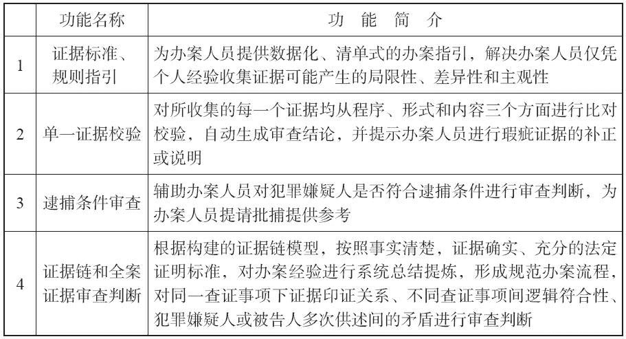

**（续表）**

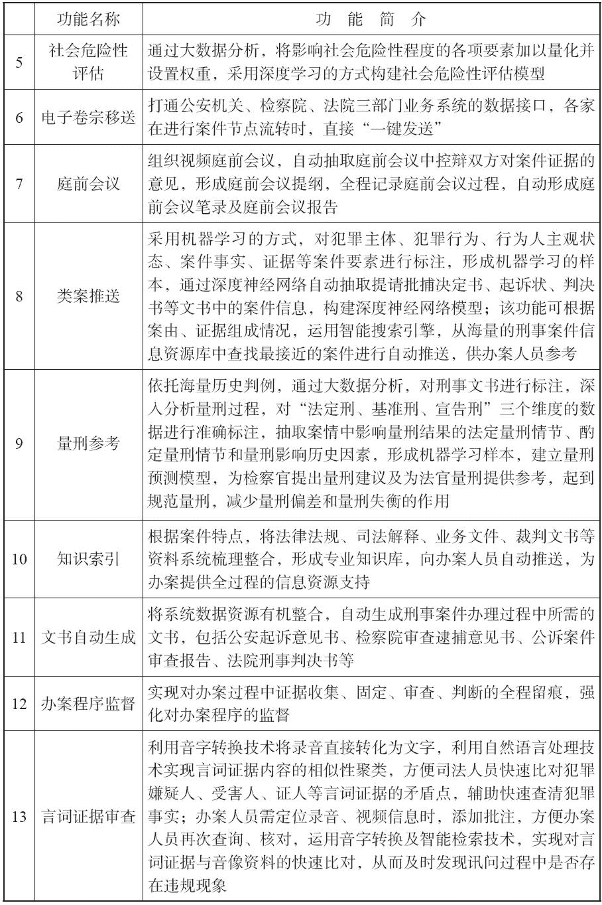

**（续表）**

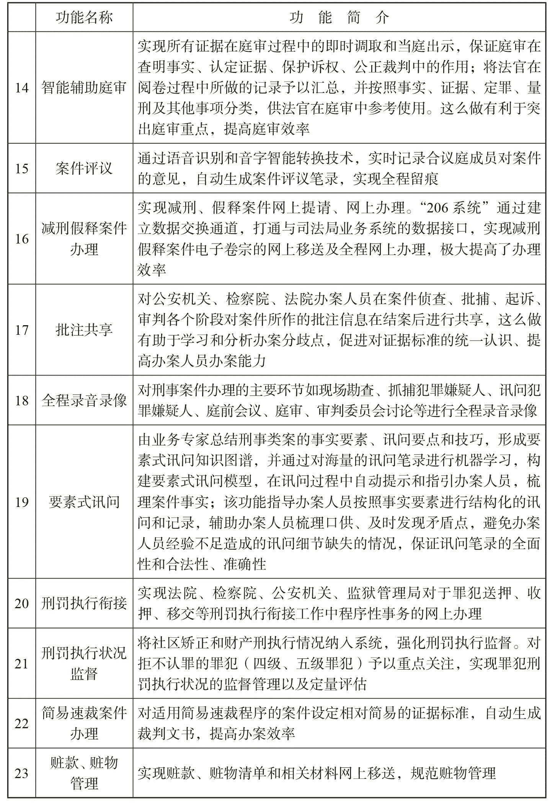

**（续表）**

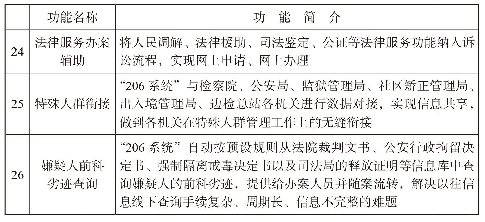

## 第一节 证据标准、规则指引功能

### 一、证据标准指引功能

该功能把证据标准指引数字化嵌入系统，为办案人员收集、固定、审查、判断证据提供标准化数据化指引，明确应收集何种证据、如何收集，促使诉讼活动符合“犯罪事实清楚，证据确实、充分”的要求，解决了三机关标准适用不一、办案不规范的问题。此功能是“206 系统”的核心首创功能之一，属世界首创。

### 二、证据规则指引功能

研发团队把《上海刑事案件证据收集、固定、审查判断规则》转化为机器可识别的校验规则并嵌入系统，以数字化方式明确量刑证据、程序性证据的收集固定要点。

团队把办案中常见的证据区分为形式要件和程序要件，设定规则、识别字段、校验类型、关键词、识别位置、瑕疵信息字段、提示信息字段，编写程序交由电脑识别提示。对关联性证据还设定完整性校验规则，避免程序性文件缺失。

### 三、作用和意义

该指引功能为办案人员提供可视、可操作的数据化指引，倒逼办案从接案起就按法定标准和规则取证，从源头减少司法随意性，解决三机关标准不统一、行为不规范的问题。

一线办案人员反响积极。按标准和规则指引，立案、勘查、取证、制笔录、立卷时，怎么做、做哪些内容一目了然。

## 第二节 证据审查、校验功能

### 一、什么是证据校验、审查功能

该功能运用深度神经网络、自然语言理解等技术，采用海量数据挖掘加专家经验的方式，对证据标准和规则进行机器学习，围绕客观性、关联性、合法性，对每个证据从程序、形式、内容三方面比对校验，并提示补正说明。此功能为“206 系统”核心独创功能之一，属世界首创。具体如下：

#### 1．单一证据审查校验

对办案人员收集的证据进行审查校验，提供自检自测智能手段，及时发现瑕疵并提示补正。

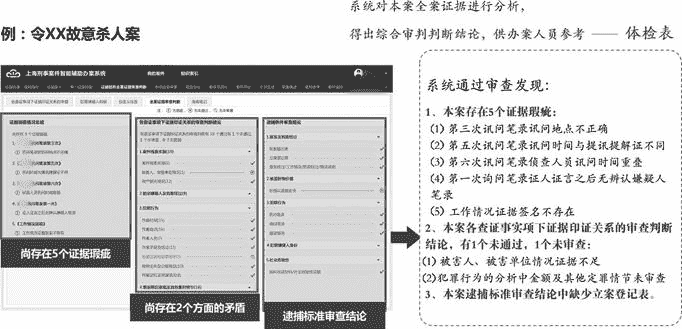

**图 5-1　“206 系统”全案证据校验图**

#### 2．证据链形成

2020 年 12 月 7 日通过的最高人民法院《关于适用＜中华人民共和国刑事诉讼法＞的解释》，将“全案证据已经形成完整的证明体系”修改为“全案证据形成完整的证据链”，把司法实践经验上升为规范性文件。

“206 系统”可辅助办案人员对案件人物关系、时间、地点、行踪、作案工具来源去向、证据间逻辑关系等进行智能罗列分析，达到完整证据链要求。

#### 3．全案证据审查判断

根据系统自动生成的证据链，形成案情全景图，及时发现矛盾和缺失并提示办案人员决定是否补正或说明。

### 二、证据审查、校验功能的作用

该功能从立案到审判对办案流程各环节证据材料进行校验、提示、把关、监督，贯穿诉讼全过程，实现全程可视、可控、留痕、监督，克服个人判断差异局限主观性，提高审查判断科学性、精准性、全面性，防止起点错误连锁反应，有助于防范冤假错案和司法腐败，保证公正司法。

#### 1．校验提示作用

可提醒和判断侦查中收集制作证据的形式合法性。对明显缺要件的材料，如案发经过表无侦查人员签字和机关盖章，或讯问时间地点空缺，或被告人身份信息不全等，系统会及时提示补正。

#### 2．把关比对作用

对每项待证事实，如作案时间地点对应的证据是否已收集、收集几份进行梳理并生成报告，每个待证事实下证据数量一目了然。软件自动抓取有效信息，对多份材料进行精确比对并同步生成结果，用不同颜色标识提醒。

系统自动提示各待证事实下证据是否包含待证要点和要素，并提示侦查人员勾选，勾选后系统自动分析判读各关联证据是否印证、哪些要素形成印证、哪些未印证，形成分析清单报告并以不同颜色标示，如将未印证要素和对应待证事实以红色显著显示，提醒补充取证。

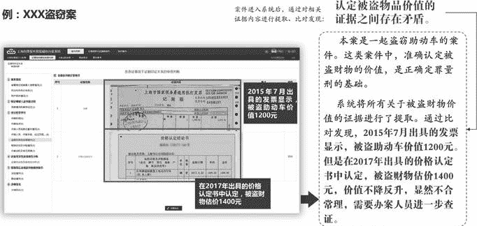

**图 5-2　“206 系统”证据比对图**

#### 3．监督审查作用

系统对审理中易忽视易出错的问题在相应环节提醒，从源头排除收集不全隐患。通过对证据要素间印证关系及待证事实间逻辑联系进行综合分析，除分析证据间印证关系外，还可筛选出互相矛盾、完全不能印证的材料，形成分析清单报告，以不同颜色显著标识矛盾之处并提示侦查人员在侦查中关注，从而补充材料、作出说明以排除合理怀疑，从源头提升收集质量。

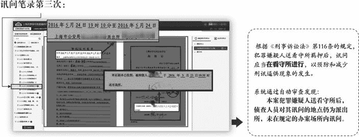

**图 5-3　“206 系统”证据审查图示**

## 第三节 智能辅助审讯功能

### 一、什么是智能辅助审讯功能

智能辅助审讯功能即智审功能：研发团队依据《刑事诉讼法》及审讯规范要求，提炼案件事实要素和讯问要点；运用光学字符识别、智能语音识别、自然语言理解、机器学习等技术及大数据、云计算支撑，构建要素式讯问模型嵌入刑事办案系统。审讯中，智审功能可自动提示指引，使办案人员按要素和要点讯问记录，辅助梳理案情、及时发现矛盾，避免因经验不足导致细节缺失，保证笔录真实、准确、完整、合法。

研发过程中攻克了侦查活动复杂性、法律用语专业性、口头表达情绪性等难关，先形成“通用要素式讯问模型”并与公安笔录系统融合。在此基础上，团队针对不同案由攻关，通过要素提取、海量笔录机器学习训练，提升模型适配度，形成“个案要素式讯问模型”。

经三年多研发试用完善，原单一要素式讯问功能发展为集多种功能为一体的“智能辅助审讯子系统”。该系统既可作为“206 系统”子系统，也可独立使用。

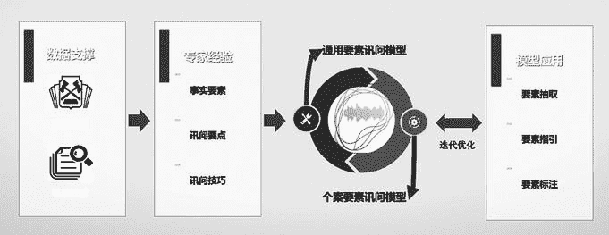

**图 5-4　“智能辅助审讯系统”功能实现路径**

### 二、智审系统的主要功能

如图 5-5 所示，智审系统目前具有 11 项子功能。

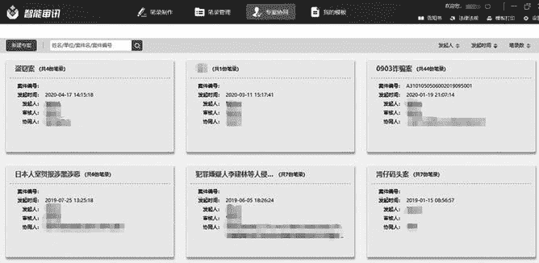

**图 5-5　智审功能图示**

#### 1．讯问要素指引功能

由公安、检察、法院刑事办案专家总结提炼类案事实要素、讯问要点形成专家经验，研发团队对海量讯问笔录人工标注供机器学习，构建要素式讯问模型。系统可根据笔录中缺失的证据要素，自动推荐需问问题并直观展示。

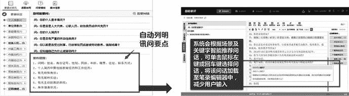

**图 5-6　为办案人员提供指引**

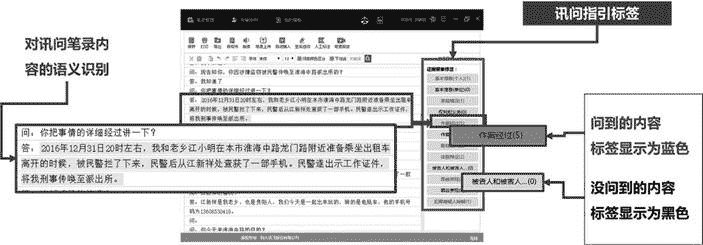

**图 5-7　讯问要素指引功能图**

#### 2．笔录自动标注功能

系统可根据罪名自动抽取笔录关键句，利用语义知识库进行语义分析，采用要素标签展示、触发、定位等技术，基于证据模型对笔录涉及的证据要素自动标注分类。

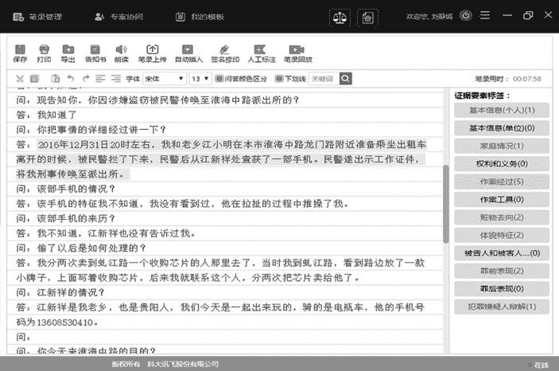

**图 5-8　笔录自动标注功能图**

#### 3．办案提醒功能

系统可根据罪名自动推荐办案提醒内容，确保侦查、起诉阶段办案标准符合法定要求，预防冤假错案，按“案件事实清楚，证据确实、充分”要求，依据《刑事诉讼法》及相关司法解释，给基层办案人员提供全面取证要点指引。

#### 4．要素抽取功能

根据审讯场景及司法活动特点，对案件相关核心要素进行提取和结构化存储，提示笔录中涉及的核心要素。

#### 5．远程提审功能

通过网络视频、无线传输、远程监控等手段，建立声音视频远程网络传输，对提审全过程录音录像。

#### 6．语音转写功能

利用先进智能语音识别技术，实现审讯内容快速转写，本地语音快速回放，辅助提升办案效率。

#### 7．电子签名、指纹捺印功能

笔录完成后，系统可在线采集当事人指纹和签名，无需打印手工签名，实现无纸化操作，并可将笔录信息直接同步到“206 系统”，简化传输路径。

#### 8．笔录质检功能

办案民警在制作笔录过程中可一键检测质量，系统自动识别缺失项或瑕疵，从源头助力提升笔录质量，辅助快速审核。

#### 9．专案协同功能

实现组内即时通信、笔录互查互享和快速审核，辅助发现笔录矛盾点及缺失证据项，解决团伙案件信息难以实时共享问题。

#### 10．全程录音录像功能

对现场勘查、抓捕、讯问、庭前会议、庭审、审判委员会讨论等关键环节进行全程录音录像。

#### 11．综合管理分析功能

实现后台笔录数据集中管理、全文搜索、笔录可视化分析等功能，弥补集中管理带来的缺失。

**图 5-9　综合管理的功能图示**

### 三、智审系统的意义与作用

#### 1．审讯与讯问笔录

审讯是侦查人员为揭露案情、证实犯罪和查明犯罪人，对犯罪嫌疑人依法进行讯问的侦查活动。

讯问笔录是犯罪嫌疑人供述辩解的书面记录，属于法定证据种类，具有收集审查其他证据、维护辩护权、作为定罪量刑依据等功能，其特点为亲历性、直接性等。

世界各国刑事法律均对讯问笔录作出规定。

#### 2．规制讯问——世界性的难题

讯问是侦查重要环节。几乎每个国家执法机关都依赖讯问并视其为侦查犯罪、发现证明有罪证据最有效工具之一。这一普遍现象揭示所有国家都面临共同风险：过度依赖口供可能导致灾难性司法不公。

如何规制警察讯问才能在根除酷刑、强迫和虚假口供同时给予警察充分调查余地，一直困扰各国。

我国《刑事诉讼法》第 55 条规定：“对一切案件的判处都要重证据，重调查研究，不轻信口供。只有被告人供述，没有其他证据的，不能认定被告人有罪和处以刑罚；没有被告人供述，证据确实、充分的，可以认定被告人有罪和处以刑罚。”

尽管规定明确，实践中过度依赖口供的情况仍存在，是造成冤假错案的重要原因之一，也是世界性难题。

#### 3．智审系统——破解难题的利器

智审系统的诞生应用破解了这一难题。

第一，应用强化办案人员证据意识，保证讯问笔录真实、准确、完整。讯问要素指引功能可根据案件事实要素自动列明讯问要点，为办案人员提供指引，避免经验不足导致讯问细节缺失，保证笔录证据真实、准确、完整。

智审系统上线后，办案人员对程序合规的敏感度被明显激活，讯问走向规范、合法、可追溯，为以程序上的正当性支撑实体上的公正奠定了基础。办好每个案件，都要把事实查清、证据充分、程序合法、法律适用恰当四道关口守住。程序正义是实体正义的前提，实体正义是程序正义的追求，二者相辅相成，才能守住维护社会公平正义的底线。

依托全程音视频记录、全程痕迹留存、全程动态监督的机制，智审系统把讯问行为纳入标准轨道，推动办案人员严格按法律和法定流程操作，有效遏制诱供、引供乃至刑讯逼供等导致口供失真的风险，用程序的规范保障实体的公正，使讯问笔录即口供具备真实、准确、完整、合法的品质，维护当事人合法权益。

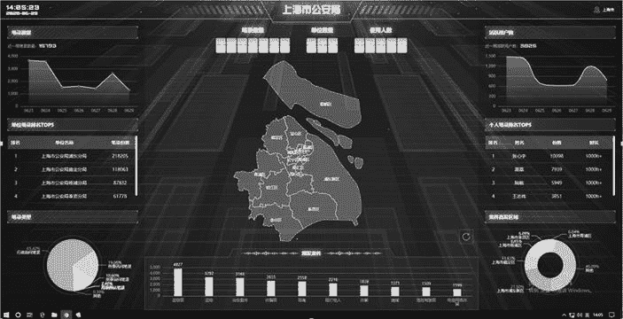

**图 5-10　智审系统界面截图**

#### 4．智审系统的应用成效
智审系统研制推广的核心价值在于从源头确保讯问笔录这一关键证据的真实与合法，有效破解了虚假口供这一长期困扰司法的难题，同时整体提升了审讯的质量与效率。

在上海，系统已实现全市覆盖，涉及900余家办案单位、1.4万余名办案人员。2020年1月至12月，通过该系统形成的讯问笔录累计超81万份，全年电子笔录制作总量达148万份，日均约2500份。

该系统标志着审讯实践的历史性转折，推动传统审讯向智能化、现代化审讯跃迁，在理念、方式、技术层面全面升级，是人工智能等新技术与以审判为中心的刑事诉讼制度改革深度融合的重大成果，确保《刑法》《刑事诉讼法》确立的原则与规定真正落地，推动以审判为中心的改革落实，有效防范冤假错案，破解讯问规制这一世界性难题，彰显中国司法进步，为全球刑事诉讼制度改革提供中国方案。

## 第四节 智能辅助庭审功能

### 一、什么是智能辅助庭审功能
智能辅助庭审功能是借助人工智能等新技术对庭审进行赋能，保证庭审在查明事实、证据认定、权利保障、公正裁判中发挥决定性作用，使“案件事实查明在法庭、证据认定在法庭”的实质化要求真正落地，从而切实保障当事人诉权、律师辩护权以及公众的知情权、参与权、表达权、监督权，让正义以可见的方式实现，促进司法公正、司法文明与公信力的提升。

该功能依托智慧法庭设施运行，于法庭大屏实时呈现庭审进度、系统追踪状态与证据展示位置。界面由三大区域构成：

一是语音即时识别区，系统能够即时、高效、精准地将庭审语音转化为笔录并展示；
二是智能抓取区，系统运用案件要素抽取与语音理解技术，根据控辩审三方的质证问答，自动抓取相关证据并展示；
三是庭审示证区，系统通过示证、证据校验、证据链审查判断、言词证据等功能，对审理中发现的证据瑕疵、矛盾等进行提示性展示。

三区联动，为庭审全流程提供智能化支撑。

### 二、智能辅助庭审功能及主要作用

#### 1．辅助构建证据链条：证据链审查判断
系统自动梳理案卷材料，并在证据材料与待查证事项之间建立关联，形成初步证据链。公诉人可根据案情与庭审需要对证据链进行校核完善后用于示证。法官也能依据证据链完整性快速判断全案证据是否存在矛盾，有针对性地开展查明工作，节约司法资源。

#### 2．全面展示证据材料：让证据说话
系统运用庭审示证功能，使诉讼各方通过电子屏幕查阅调阅全部证据，以电子化形式呈现。依据庭审进展自动抓取证据，同步向审判员、控辩双方、被告人及旁听人员展示，真正实现证据质证在法庭，提升庭审公开透明度，增强审判公信力与说服力。

#### 3．自动提示证据瑕疵：证据瑕疵审核
系统以深度神经网络模型对证据标准与规则进行机器学习，从真实性、合法性、关联性三维度对证据自动校验，对发现的瑕疵自动提示合议庭在庭审中重点关注并核实查明，提升证据审查的科学性、精确性与全面性。

#### 4．高效审查证据材料：查明案件事实
系统运用言词证据审查功能，结合音字转换与智能检索技术，帮助办案人员在庭审中迅速定位音视频资料的关键内容，实现笔录等言词证据与音视频的快速比对，加强对证据的全面检验，提高庭审质效。

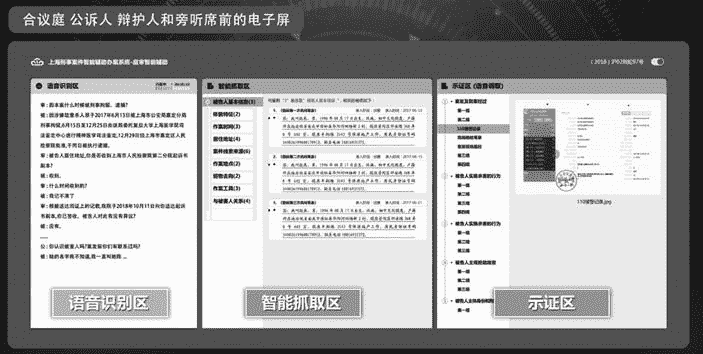

**图 5-11　智能辅助庭审系统展示图**

## 第五节 系统多项功能集成应用推动刑事诉讼深刻变革

### 一、系统全面应用优化了刑事诉讼活动的工作流程
系统全面部署后，实现刑事诉讼流程再造，更好体现分工负责、互相配合、互相制约的原则，有助于遏制司法随意性，落实司法责任制，推动以审判为中心的诉讼制度改革落地。

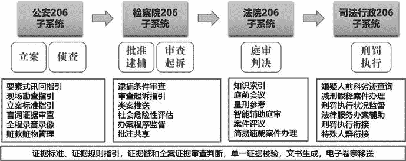

**图 5-12　“206 系统”辅助刑事诉讼活动流程图示**

研发团队基于刑事诉讼司法场景需求与诉讼活动特点，以数字化手段减轻办案负担、优化流程。例如：

#### 1．文书自动生成功能
过去：手工录入，誊抄纸质卷宗，类型化案件重复操作。
现在：起诉意见书、起诉书等简易批量案件文书可自动生成，大幅节省人力时间成本。系统已初步实现公安机关批准逮捕意见书、检察机关起诉意见书、法院裁判文书的自动生成，办案效率显著提升。

#### 2．电子卷宗移送功能
过去：人工搬运纸质卷宗，耗费大量人力时间。
现在：公安、检察、法院卷宗实现一键发送，安全便捷快速，便于及时补正。电子卷宗移送支持一键传输与在系统内补正补充，获得基层办案人员广泛认可。

**图 5-13　电子卷宗移送一键传输**

#### 3．电子签名捺印
公安机关讯问笔录制作完成后，可直接在线采集当事人指纹与签名，无需打印手签，实现无纸化操作，同时可将笔录信息直接同步至“206 系统”，简化证据传输路径。

**图 5-14　电子签名流程图示**

### 二、系统的全面应用带来刑事诉讼活动的革命性变化
多项功能集成应用节约司法资源与成本。法律文书自动生成、电子卷宗一键传输、智能辅助讯问、辅助庭审、类案推送、量刑参考等功能协同，办案质量与效率大幅提升，缓解案多人少矛盾，“206 系统”成为办案人员不可或缺的智能助手。

#### 1．证据标准、证据规则指引功能带来的革命性变化
过去：传统办案中证据标准、规则模糊难操作。
现在：系统内置统一的证据标准与规则，为收集固定证据提供标准化、数据化、清单式、易操作的指引，刑事立案、勘查、起诉、判决时所需工作一目了然，如同专业指导。

#### 2．证据校验提示功能带来的革命性变化
过去：依赖办案人员个人经验与认识，主观性与局限性强，科学性与及时性不足。
现在：办案人员可通过系统对收集证据自检自测，及时发现瑕疵并补正。

#### 3．证据链和全案证据审查判断功能带来的革命性变化
过去：人工审查证据真实性、合法性质效不足，复杂疑难案件证据链完整性审查难度大效率低。
现在：系统可对同一查证事项下证据印证关系、不同查证事项间逻辑符合性进行校验把关，及时发现瑕疵与矛盾并提示办案人员决定补正或说明。实践中，卷宗与证据越复杂的案件，系统优势越明显。以盗窃案件为例，法官梳理证据时间平均减少30%—50%。

#### 4．智能辅助讯问功能带来的革命性变化
过去：讯问内容随意，笔录不全面，模式多样缺乏统一标准。
现在：办案人员依要素式指引开展讯问，避免经验不足导致细节缺失，确保笔录证据全面准确。

#### 5．电子卷宗的同步生成带来的革命性变化
过去：人工整理纸质卷宗归档，周期长、环节多，易损毁丢失，查阅不便。
现在：卷宗随案同步生成并电子编目，便于安全保存流转，笔录类证据自动标识区分，快速定位，阅卷效率提升。

#### 6．智能辅助庭审功能带来的革命性变化
过去：书记员需多次往返传送证据，人工记录庭审笔录，人工逐页播放PPT，耗时耗力。
现在：可语音唤醒证据实现及时示证比对，全程语音自动生成庭审笔录，示证过程可批注标记，通过快速定位与关键词检索实现合法性审查，自动提示证据瑕疵，实现智能校验。

#### 7．批注共享功能带来的革命性变化
过去：纸质卷宗阅看靠便签标注，易遗漏关键点。
现在：电子卷宗由系统自动梳理证据并提示瑕疵，办案人员可随时标注，后续工作可高效利用前期标注。

### 三、网上换押功能创新，实现换押工作质的改变
传统线下换押流程耗时耗力，占用大量司法资源。2020年起研发团队开展调研并构建跨部门协同体系，在国内率先推出网上换押功能，实现换押手续网上办理，节约成本提升效率，推动换押工作质变。

截至2021年6月，上海已实现看守所、公安、检察、法院全程线上无纸化换押、流程节点线上跟进、超期自动提醒，将换押时间由原先的3天压缩至2小时。

研发团队依据《“206 系统”网上换押设计方案》及办理规则推进试点。网上换押1.0版于2020年10月试点后，团队持续优化升级为一体化换押功能，全面实现换押手续网上办理。

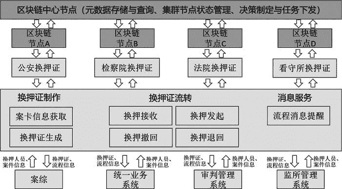

**图 5-15　网上换押一体化平台架构图**

## 第六节 “206 系统”向司法行政部门的延伸
智联世界，无限可能。人工智能具有跨界融合特征。“206 系统”向司法行政部门延伸，打通公安、检察、法院、司法局办案全流程。

自2018年起，系统向上海司法行政部门延伸，按市司法局需求研发减刑假释办理、刑罚执行衔接、刑罚执行监督、法律援助等功能。截至2021年6月，系统功能已覆盖立案、侦查、报捕、起诉、审判至减刑、假释、刑罚执行、回归社会全流程。

### 一、“206 司法行政子系统”的主要功能

#### 1．嫌疑人前科劣迹查询
系统按预设规则自动从法院裁判文书、公安行政拘留决定书、强制隔离戒毒决定书及司法局释放证明等信息库中查询嫌疑人前科劣迹并随案流转，解决线下查询手续繁琐、周期长、信息不全问题。

#### 2．减刑假释案件办理
实现减刑假释案件网上提请与网上办理。通过“206 系统”建立数据交换通道，打通司法局业务系统接口，实现电子卷宗网上移送与全程网上办理，大幅提升效率。

#### 3．刑罚执行状况监督
将社区矫正与财产刑执行情况纳入系统，强化刑罚执行监督。对拒不认罪的四级、五级罪犯重点关注，实现刑罚执行状况监督管理与定量评估。

#### 4．法律服务办案辅助
将人民调解、法律援助、司法鉴定、公证等法律服务纳入诉讼流程，实现网上申请与办理。

#### 5．刑罚执行衔接
实现法院、检察院、公安机关、监狱管理局在罪犯送押、收押、移交等刑罚执行衔接中的程序性事务网上办理。

#### 6．特殊人群衔接
子系统与检察院、公安机关、监狱管理局、社区矫正管理局、出入境管理局、边检总站等进行数据对接，实现信息共享，保障特殊人群管理工作无缝衔接。

### 二、“206 司法行政子系统”的应用成效
截至2020年年底，子系统已实现数据全流程网上流转、业务跨部门协同办理。从罪犯入监、戒毒人员入所、社区服刑人员入矫，到认罪悔罪评估、财产刑执行、减刑假释，再到刑满释放、风险评估、安置帮教回归社会，全过程实现数据网上流转、跨部门协同、流程再造。

#### 1．推进减刑假释案件“单套制”运行
办理减刑假释时同步传递案件材料、状态信息、公示文书、裁定文书等电子卷宗，由线下人工送达纸质卷宗转为线上电子卷宗流转与无纸化办理，实现减假业务“单套制”。将财产刑执行情况纳入办理，为减刑假释幅度建议与法官审判提供客观依据。截至2020年12月15日，累计流转5104件案件，结案3186件，法院反馈公示文书1175份、刑事裁定书3292份。

#### 2．强化刑罚执行网上监督职能
完善刑罚执行监督功能，实现数据汇总，并将认罪悔罪评估结果与评估表自动同步至子系统，已实现部分认罪悔罪评估等级数据同步至法院。2020年1月至2020年12月15日累计反馈82788条。

#### 3．深化刑满释放人员信息衔接
完成监狱局综治办、社区矫正部门、市公安局监管总队、市人口办等部门数据互联互通与业务协同，由线下刻盘流转转为线上实时传输下载。2020年1月至2020年12月15日，安置帮教部门对外共享五年期在册人员累计229418人，较2019年增加140626人，人口办反馈数据累计71054条。

#### 4．研发法律援助等公共法律服务功能
实现子系统与司法局公共法律服务业务系统深度融合，按需求将公安、检察、法院相关数据实时推送至公共法律服务系统，并可反馈至各机关，由线下流转转为线上流转，辅助协同提升服务效率与质量。实现司法局与公安、检察、法院法律援助律师网上申请、指派、撤销等业务协同，提升办事效率。截至2020年12月15日，检察院发起443件，法律中心受理373起，案件办理时间由过去4小时缩短至5分钟，在疫情期间发挥明显作用。

#### 5．推进入监、入所、入矫数据衔接
在子系统中研发入监、入所、入矫数据衔接功能，实现司法局入监、入所、入矫信息与公安、法院数据互联共享。截至2020年12月15日，已获取40万判决数据、3.5万余条社区矫正对象数据、2万余条戒毒人员相关数据，实现监狱、戒毒、社矫对象入与出的线上审核、线下移送，提升执法办案质量与效率。

**课后习题：**

（简答题）

1．请简述证据校验、审查功能的含义。

2．请简述智审系统的作用。

3．请简述智审功能的技术架构和作用。

（思考题）

你认为在“206 系统”向司法行政部门延伸的过程中，需要注重哪些方面？

* * *

(1)　参见柏恩敬、刘超、高原：《追问警察讯问方法——比较法的视角》，法律出版社 2018 年版。

# 第六章 “民事、行政案件智能辅助办案系统”

**本章提要：**“206 系统”的研发成功，实现了人工智能与司法领域深度融合 0—1 的突破，助力“以审判为中心的诉讼制度改革”落地，为司法体制改革闯出了一条新路子，进一步坚定了推进改革的信心和决心。2017 年 8 月上海市高级人民法院决定研发“民事、行政案件智能辅助办案系统”，其运用人工智能等现代科技，有效解决民事、行政案件审判实践中存在的法律适用不统一、证据审查不全面、自由裁量权行使不规范、裁判结果偏离度过大等问题，从而减少司法任意性，保证公正司法，提高司法质量、司法效率、司法公信力。

## 第一节 “民事、行政案件智能辅助办案系统”的诞生

在民商事、行政案件的审理中，一直存在着不同程度的法律适用不统一、自由裁量权不规范等突出问题。运用现代科技手段辅助法官办理民事以及行政案件，可以发挥其在认定事实、适用法律、采信证据、公正裁判中的作用，促进统一法律适用，规范法官自由裁量权行使，减少司法任意性，提升司法质量、司法效率和司法公信力。

在“206 系统”的启示下，2017 年 8 月上海高院作出研发“上海法院民事、行政案件智能辅助办案系统”的决策（以下简称“民事、行政 206 系统”），将“206 系统”拓展应用到民事、行政案件中去。经市委政法委批准，研发工作于 2017 年 8 月 18 日启动。2017 年 11 月 29 日系统上线试运行；2018 年 9 月部署在全市推广应用。

### 一、“民事、行政案件智能辅助办案系统”概述

由于民事、行政案件数量多、占比高（上海法院近 3 年年平均收案约 71 万件，其中刑事案件约占 4%，民事、行政案件约占 65%），因此探索构建具有上海法院特色的人力与科技深度融合的标准化、规范化、智能化的民事、行政审判模式，破解案多人少矛盾，向科技要质量、向科技要效率，实现办案规范化、智能化、集约化十分必要。

**表 6-1　上海法院案件受理情况**

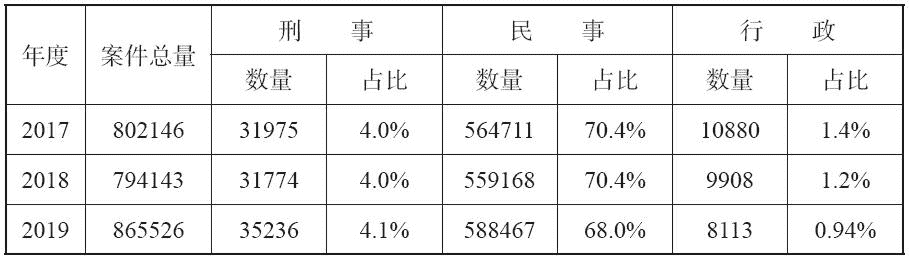

#### 1．研发原则

（1）坚持于法有据

以民事、行政领域的实体法，程序法以及最高人民法院有关民事、行政审判的司法解释为依据，精心设计方案，确保系统研发始终沿着法治轨道进行。

（2）坚持司法规律

认真研究审理民事、行政案件的司法规律，坚持将现代科技与司法规律相融合，确保司法规律真正成为可视化、可量化的科学。

（3）坚持问题导向

# 民行审判智能升级，让公平正义更可感
民行审理直接牵动当事人切身利益。推进智能辅助工具建设，要广泛征询一线办案法官与执业律师的实践意见，紧盯制约公正与能力提升的深层障碍开展调研，使技术开发有的放矢、真正解决办案痛点。

（4）坚持科技引领
把新一代技术与司法人员的创造力有机结合起来，树立数据驱动意识，充分让互联网、大数据、云计算、人工智能等手段发挥先导作用，形成技术理性与司法理性的双向融合。

（5）坚持方便实用
研发应用要以办案法官为本位，重视使用体验，设计要科学、操作要简洁，保证好用管用，成为法官办案的智能助手。

（6）坚持循序渐进
在遵循司法规律的前提下，先易后难、稳步推进，分项攻关，有重点、有步骤、有计划实施。

#### 2．总体目标
以让人民群众在每一起案件中体会公平正义为总牵引，以提升司法公信为检验标准，找准现代科技与民行审判实践的结合点。依托海量司法数据及办案要件的机器学习与深度挖掘，研发契合审判规律、贴合一线需求、智能化水平较高的“民事、行政 206 系统”，在证据采信、事实认定、法律适用、裁判公正等环节发挥关键支撑，破解思路不一、审查不全、裁量不规范、裁判结果偏离等问题，减少司法随意性，打造从立案到执行的全流程网上办案体系，提升司法能力，增强群众获得感。

### 二、主要任务

#### 1．建立民事、行政案件证据规则指引
构建证据规则指引是研发“民事、行政 206 系统”的核心。围绕以审判为中心的诉讼改革，坚持办案经得起法律检验的理念，依据《民事诉讼法》《行政诉讼法》及相关司法解释，制定统一适用的证据规则指引，明确当事人为证明主张应提交的证据，法院依职权调查的证据种类与形式要件，以及举证责任分配与举证认证的具体规则。

#### 2．建立民事、行政案件办案要件指引
完善要件指引是研发重点。按立案、审判等不同阶段，为办案人员提供统一规范、简明易行、数据化、清单式、全流程指引。
一是构建民事案件办案要件指引。遵循诉讼要件审查—固定诉请与抗辩—明确请求权基础—确定争议焦点要件事实证明—要件事实认定—具体法律适用—裁判文书生成的审理顺序，研究形成民事案件办案指引，帮助统一思路、明确方向、规范流程、减少裁判偏离。
二是构建行政案件办案要件指引。结合审判经验，从行政行为的执法目的、职权依据、事实认定、程序合法性、法律适用等要件出发，研究制定行政案件办案指引，明确审判要点，为统一思路与规范流程提供支撑。

#### 3．建立上海民事、行政案件大数据资源库
该资源库涵盖证据规则、办案要件、电子卷宗、案例、裁判文书、法律法规司法解释、办案业务文件等子库，办案要件初建时覆盖六类八个案由，为办案提供信息支撑。

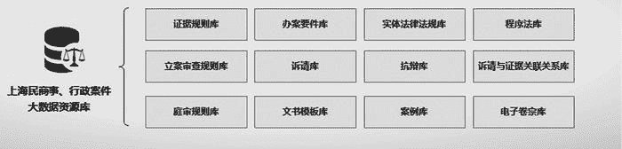

**图 6-1　上海民商事、行政案件大数据资源库 12 类功能资源库图示**

#### 4. 研发智能辅助办案系统功能
依托图文识别、自然语言理解、智能语音识别、司法实体识别、实体关系分析、司法要素自动抽取等人工智能技术，完成智能辅助办案系统开发，初步设计27项功能。
系统将证据规则指引、办案要件指引转化为数据模型嵌入其中，对证据合法性、关联性等进行自动审查、提示、把关、监督，对办案要件完整性、齐备性进行指引、提示、监督，实现诉讼全程可视、可控、可留痕，有效统一审理思路，规范自由裁量，统一法律适用，提升司法质量、效率与公信力。

#### 5. 实现电子卷宗随案同步生成
电子卷宗随案同步生成是系统顺畅运行的基础。要全面推动电子卷宗在司法实践中的深度融合，从立案起采用统分结合方式同步采集案卷材料，保证录入数据全面、准确、及时、鲜活，实现电子卷宗自动生成、数字化流转，为审判人员提供全流程网上办案、同步阅卷、同步提取信息、同步生成文书、裁判文书辅助制作、庭审示证、卷宗移送、一键归档等功能，提升审判质效。

## 第二节 “民事、行政案件智能辅助办案系统”的功能

“民事、行政 206 系统”运用图文识别、自然语言理解、智能语音识别、司法实体识别、实体关系分析、司法要素自动抽取等技术开发，由若干应用软件支撑，设计27项功能。

### 一、功能概览
在办案要件指引统领下，按办案流程节点覆盖立案、诉前调解、庭前、庭审、评议、裁判等阶段。
立案有2项：案件受理标准审查、诉讼费缴纳智能提示；诉前调解有3项：明确原告诉讼请求、明确被告抗辩主张、明确事实与理由；庭前有5项：无争议事实预归纳、争议焦点预归纳、证据缺失性检验、证据合规性预判断、要件式庭审提纲构建；庭审有3项：庭审程序智能提示、庭审无纸化质证、庭审笔录智能生成；评议有3项：合议指引、合议无纸化示证、评议笔录智能生成；裁判有1项：裁判结果预判断。另设阅卷及辅助4项：办案要件指引、证据规则指引、诉讼程序指引、智能编目。

#### 1. 办案要件指引
以要件指引方式规范办案思路与步骤，为查明要件事实、正确适用法律、依法裁判提供科学、实用的指引。

#### 2. 证据审查判断指引
对当事人应提供证据、法院应调查收集的证据类型与形式要件，以及举证责任分配、举证认证规则作出详细规定，提供清单式指引。

#### 3. 智能阅卷
对审理中整理、标记和抽取的案件摘要信息模块化展示，并在关键节点给予提示，辅助办案。

#### 4. 法条推送
根据诉辩对抗后认定的法律关系自动推送匹配的实体法规范；根据审理进展为程序性环节推送相关程序法规范。

#### 5. 类案推送
自动推送同类案例并进行裁判智能分析比对，提升适法统一度。

#### 6. 案件受理标准审查
智能审查案件是否符合《民事诉讼法》《行政诉讼法》的立案规定。

#### 7. 诉讼费缴纳智能提示
通过数据比对提示在庭审前、判决前了解案件减免缓情况，办理诉讼费补交、催缴等。

#### 8. 明确诉请
智能识别当事人诉讼请求及证据材料并自动提取、归类、提示，帮助及时固定诉讼请求。

#### 9. 明确事实与理由
智能识别证据材料并自动提取、归类、提示，帮助及时固定案件事实与理由。

#### 10. 明确抗辩主张
智能识别证据材料并自动提取、归类、提示，帮助及时固定抗辩主张。

#### 11. 无争议事实预归纳
依大数据学习归纳诉讼请求与抗辩关系，将未被抗辩的部分归纳为无争议事实。

#### 12. 争议焦点预归纳
借助人工智能与大数据学习构建诉讼请求与抗辩关系，将被抗辩部分归纳为争议焦点。

#### 13. 证据缺失性校验
通过要件知识库梳理证据，结合原被告证据清单智能匹配，发现遗漏。

#### 14. 证据合规性校验
依据证据审查标准对书证、物证等进行合规性判断，包括签章、签名、日期、真伪等验证。

#### 15. 要件式庭审提纲构建
以个性化庭审笔录模板为基础，结合诉辩状与证据提取核心信息回填提纲，形成庭前提纲。

#### 16. 无争议事实归纳
通过大数据学习归纳诉讼请求与抗辩关系，将未被抗辩事实归纳为无争议事实。

#### 17. 争议焦点归纳
通过大数据学习归纳诉讼请求与抗辩关系，将被抗辩部分归纳为争议焦点。

#### 18. 庭审程序智能提示
梳理庭审规则形成数据库，对接庭审系统，为不同流程提供程序提示。

#### 19. 庭审无纸化质证
庭审中基于各方发言实时调度电子证据并在终端同步显示，用于质证和辩论，减少纸质翻阅。

#### 20. 庭审笔录智能生成
将庭审笔录提纲与智能语音庭审系统对接，完整记录各方发言，辅以书记员现场修正，智能生成笔录。

#### 21. 合议无纸化示证
基于各方发言实时调度电子证据并在终端同步显示，用于合议介绍案情和调阅电子卷宗。

#### 22. 评议笔录智能生成
通过智能语音合议系统完整记录评议发言，辅以书记员现场修正，智能生成合议笔录。

#### 23. 程序性文书智能生成
运用文本信息智能提取技术，从电子卷宗自动识别、抓取信息，一键生成办理所需文书。

#### 24. 裁判结果预判断
根据案件信息和法律要点裁判指引生成裁判结果预判断。

#### 25. 文书模型智能匹配
按案件特点自动匹配适用的裁判文书、调解书、裁定书等模型。

#### 26. 裁判文书智能生成
以系统内置文书模型为框架，结合案由特性，基于庭审笔录和合议笔录智能抽取信息点并回填，智能生成裁判文书。

#### 27. 裁判偏离度提示
依据法律要点自动抓取案件重要信息，结合大数据分析类案结果，对草拟判决主文进行偏离度校验及提示，确保尺度一致，推动法律统一适用。

### 二、主要功能列举

#### 1. 智能阅卷
对案件审理中整理、标记和抽取的案件摘要信息模块化展示，并在关键节点给予提示，辅助办案。

#### 2. 争议焦点预归纳
利用人工智能和大数据学习归纳诉讼请求与抗辩关系，将抗辩部分归纳为争议焦点。

#### 3. 办案要件指引
以要件指引方式规范办案思路与步骤，为查明要件事实、正确适用法律提供指引。

#### 4. 要件式庭审提纲构建
依个性化庭审笔录模板，结合诉辩状与证据提取核心信息回填提纲，形成庭前提纲。

#### 5. 智能辅助庭审
“民事、行政 206 系统”在庭审中的主要应用：
庭审程序智能提示：梳理庭审规则形成数据库，对接庭审系统，提供流程提示。
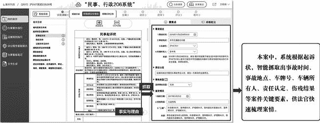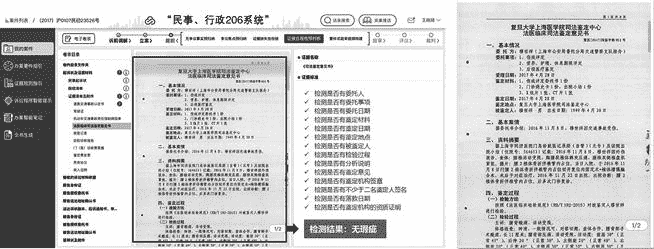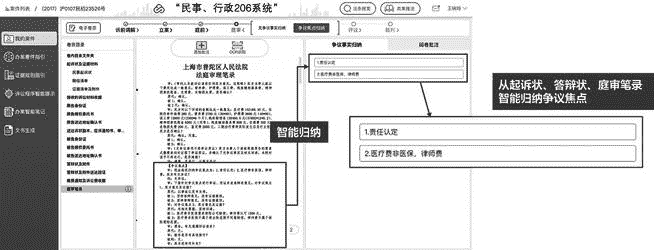

**图 6-2　争议焦点预归纳流程图示**

**图 6-3　办案要件指引功能图示**
庭审无纸化质证：在庭审中实时调度电子证据并同步显示，主要用于质证辩论，减少纸质翻阅。
庭审笔录智能生成：将提纲与智能语音系统对接，完整记录发言，辅以书记员修正，智能生成笔录。

**图 6-4　庭审无纸化质证图示**

#### 6. 裁判文书智能生成

**图 6-5　裁判文书智能生成流程图示**
通过从起诉书、庭审笔录中智能抽取要素并嵌入文书模板，初步实现裁判结果预生成与法条自动推送，辅助裁判文书制作。
“民事、行政 206 系统”运用互联网、大数据、人工智能等手段，将证据规则指引、办案要件指引转化为数据模型嵌入系统，对证据合法性、关联性、客观性进行审查、提示、把关、监督，对办案要件进行审查、指引、提示、监督，辅助办案，统一审理思路与法律适用，规范自由裁量行使，强化审判监督管理，提升司法质量、效率和公信力，努力让人民群众在每一起案件中感受到公平正义。其研发应用在民法典颁布实施的重大时刻意义更加重大。
截至2020年6月底，系统研发已完成20个案由办案要件指引制定；完成证据审查判断、争议焦点预归纳等19项功能研发；建立8个案由标签体系、标注电子卷宗6400余份、标注点14万个，供机器识别抽取，实现案件要素自动抓取；运用系统办理案件97502件。

**课后习题：**
（简答题）
1．为什么要研发“民事、行政 206 系统”？
2．请简述“民事、行政 206 系统”的主要功能。
（思考题）
你认为“民事、行政 206 系统”的未来发展需要注重哪些方面？

# 第七章 人工智能在司法领域的应用前景

**本章提要：**应用新兴技术于司法，既要把握时代机遇、关注科技前沿，也要坚持问题导向破解司法难题；既要遵循司法规律，也要把握新技术特征，让其更好服务司法。随着人工智能及互联网、大数据、5G等新技术快速发展，现代科技在司法领域的应用前景广阔。
信息化与司法改革是实现司法现代化的“车之两轮，鸟之两翼”。在高科技快速发展的今天，需通过信息化建设转型升级，进一步推动人工智能在审判执行、司法公开、诉讼服务、管理、监督、决策等方面深度应用，改造和提升系统功能，实现司法工作全方位、更高层次的智能化。

## 第一节 司法知识图谱

如今法律科技厂商的核心竞争力体现在对以文本为主的法律语料进行实体识别能力上。传统做法是运用案卡数据和文本提取数据相结合的法院案件数据库。各地法院今后的竞争能力取决于对文本语料结构化的能力，即机器将案件文本拆解为要素化数据的效率和效果。结构化数据库即为内容丰富的知识库，与之联系最紧密的应用是类案推送和检索。案件要素化有多类实现形式，其中“206系统”研发团队最看好知识图谱的实现形式。

### 一、知识图谱的应用思路
人工智能技术包含专家经验、数据和算法，其在司法领域应用的首要前提是将法律规定、裁判规则、判断标准类型化与要素化，形成结构化表达。这需要借助知识图谱技术，采用图结构建模并记录事物间关联关系和知识，形成语义网络，实现比常规应用更加精准的对象级应用。^((1))知识图谱的关键技术包括实体链指、关系抽取、知识推理和知识表示。其基础组成单元是“节点”和“边”，每个“节点”代表司法情境中的要素，既可以是联接现实世界的实体，如典型证据，也可以是高度抽象的概念如法律构成要件；每个“边”代表要素间的关系。通俗地说，司法知识图谱通过把异质化法律知识和司法信息有序联接得到关系网络。虽然往往需借助机器学习作语料训练，但关系网络的有序联接为司法决策的因果式思维提供了可能性。
要件式审判方法是一种在实务中产生深远影响的裁判方法，其帮助审判人员形成严谨逻辑思维，避免审理思路模糊、裁判标准混乱，^((2))可以与知识图谱技术融合，作为设计系统的基础规则。
人工智能的算法逻辑要求司法数据具备标准化、层级化、要件化特征，这与要件式审判方法具有内生契合性。以民事司法为例，要件式审判方法遵循“固定权利请求→确定请求权基础→寻找抗辩权基础→解构要件→检查诉讼主张→梳理诉讼争点→证明和认定要件事实→法律适用”的法规出发型思维路径，逻辑严密，核心是对法律要件的解构，使得机器面对杂乱案件事实时能作出基本层次区分，例如基于二级证明体系，将案件事实分为主要事实、间接和辅助事实，并对事实内容进行分词设置，从而实现生活语言和法律特定用语之间的转化。
在弱人工智能技术背景下，能否对司法数据准确定性、定位和识别，直接关系智能系统实效。相比人脑，机器在记忆法律和演绎推理上具有天然优势，但难以应对复杂社会现象，在价值判断方面无法与人类媲美。司法人工智能在实际研发中面临的最大问题就是对法律事实的识别和认定，从技术层面看，机器在利用自然语言理解、认知个案方面有局限性，以及法律知识的不确定性。
正是基于此，可以采用“法律事实要素”这一概念来引导司法知识图谱的形成和裁判思维模型的建构，尽可能实现法律知识的结构化，以便机器识别和处理。法律事实要素指的是法律规定的要件事实经过特定规则如请求权基础的层层解构和提取后，形成的足够精细化、类型化的规范表述，由特定法律知识对应的关键词构成。

# 语境塑造裁判 要素化落地司法

当法官面对待决的法律争点并作出规范选择时，首先要把相关法理疑点提炼出来并加以评析，探寻能够回应争议的可行解释路径。这类问题与答案的组合，共同构成了规范适用的“法律语境”。^((3)) 在处理事实争议、确认法律事实的过程中，法官实质上是依据证据与证明标准，在一组真伪未明的事实表述中进行筛选与校正，由此形成的表述集合及其可真程度，便界定了“事实语境”。^((4)) 所谓要件事实的精细化规则，就是依托司法大数据和具体的裁判方法，对法律语境与事实语境做进一步限定，从而实现要件事实的精准把握。法条本身存在模糊余地，这种模糊可能是技术性的，也可能是策略性的，^((5)) 立法者在权衡不同可能性时，有意为审判者预留裁量空间，^((6)) 以保障涵摄的周全性。要降低机器在模糊情境下的不确定性，并在个案中削弱立法模糊对裁判确定性的侵蚀，就必须结合语境与裁判方法进行归纳判断。

相较于法条明示的要件事实，法律事实要素体系更强调案件所处的具体语境，把条文表述不清之处通过要素式梳理归类，提炼成可在裁判文书中直接使用的规范化表述。该体系在规范推理框架下坚持事实本位，推动语境具体化与法律适用标准化，同时参照商业惯例、社会常识等经验性要素，兼顾形式主义与现实主义所重视的审判技艺。要素体系为法官提供三大支撑：一是将外部法律体系做归类梳理，“将杂乱无章的法律规定与裁判进行体系化归纳”；二是形成对法律规范的整体遍历认知，避免在视角转换中出现规范遗漏；三是搭建案件具体情境与法律规范的连接通道，从而准确认定事实。^((7))

### 二、知识图谱的技术构成

知识图谱在谷歌等搜索引擎中已得到成熟应用，例如检索“老虎伍兹”时，右侧即展示该高尔夫运动员的个人信息卡片，这就是典型应用。

支撑知识图谱的核心技术可归纳为实体链接、关系抽取、知识推理和知识表示。

#### 1. 实体链接
实体链接要完成实体识别与消歧。前者是从文本中发现命名实体，主要有人名、地名、机构名三类，司法文本中抽取卷宗事实就依赖该技术；后者针对同名异义现象，如“苹果”“笔记本”等词存在多义，纯规则定义难以彻底消除歧义。

#### 2. 关系抽取
关系抽取的任务是建立实体间的联系。主流做法是通过自举迭代，按“模板生成—实例抽取”的流程不断收敛，该方法同样适用于法律文本，例如“X持刀致Y死亡”这一句式可从“张三持刀致李四死亡”中抽取出故意杀人的三元组实例；在此基础上可对模板进行扩展，抽取更多被告与被害人间的关系模式。智能化体现在不做关系语义的单一归一，能够捕获同一关系的多种表述；也可将关系视作分类标签，把抽取转化为实体对分类问题，通过标注语料训练模型，使机器获得识别关系的能力，进而构建信息抽取系统。

#### 3. 知识推理
知识推理体现高阶智能，可完成更复杂的推导。其中一种自动化方式是共现统计，即若干实体对频繁共现时，基于大规模数据归纳出规律。例如，（X，嫌疑人，被告）、（X，是，被告人）可推导出犯罪嫌疑人→被告人的推理规则。

#### 4. 知识表示
知识表示的任务是让计算机数据库实现知识图谱存储。在司法场景中，需要先界定业务中关键的实体类型，如以人为核心，提炼出被告、原告、法院、检察院等主体间的图谱；另一种思路是以案件程序为实体构建图谱。目前国内尚无厂商完成全量案件的知识图谱定义，该工作仍是待完成的重点。前述技术指向智慧法院的发展方向，但需注意知识图谱属于重资产工具，需大量人工标注，缺乏高质量标签数据则无法启动。

### 三、司法领域的应用现状
人民法院第五个五年改革纲要（2019—2023年）多次强调以新技术赋能审判，如“加强智能辅助办案系统建设，完善类案推送、结果比对、数据解析、瑕疵提示等功能”，以及“丰富扩展司法数据资源，深入开展司法大数据研究，提升数据汇聚、分析、应用水平”。经过多年数据治理与“法标”多次修订，法院的数据治理水平相对较高。

“206系统”研发团队将智能技术在司法场景的应用前景与案件要素化结合考察。案件要素化在技术层面基本等同于数据结构化。目前知识图谱在法院尚未真正落地，相关技术多停留在理论探讨。找到切入点、依托图数据库升级底层架构，仍需从零到一的突破。

### 四、知识图谱演进方向
优秀知识图谱的功能是多样的，涵盖智能问答等，这里重点展望智能检索与推送。我国虽非判例法国家，但类案参考需求依然存在。传统检索主要依赖关键词匹配，缺乏对查询词的语义理解，用户输入通常为短文本，单纯匹配难以把握深层意图，效果有限。若引入知识图谱，无论是关键词、构成要件类实体还是主体类实体，都可激活关联实体并呈现，效果显著提升。

机器学习通过海量原始数据训练构建可测试假设模型，底层逻辑是捕捉相关性。它无法在运行前预设复杂程度，如参数维度、多项式选择，也无法真正理解语义，缺乏常识，易产生谬误。典型问题是欠拟合与过拟合，即模型未能掌握样本一般规律，或把样本特有特征误认为普遍规律。简单说，在复杂程度与准确率的曲线上，过低或过高都会降低准确率。欠拟合相对易解，如增加训练轮数、扩展决策树分支；过拟合则难以根除，是机器学习的重大障碍。^((8))社会上存在常见误区，认为人工智能效果差是因为“机器没学够”，只要样本越大越好。但因过拟合，盲目扩量反而适得其反。

根本困境在于机器学习遵循相关性逻辑而非因果性逻辑，数据虽多样，算法却僵化。要解决鲁棒性问题，必须融入因果关系模型，而非仅限相关关系。^((9))

为提升司法智能化水平，知识图谱技术正逐步进入司法领域。但主流实践缺乏事理描述，难以模拟思考过程，过拟合与欠拟合会削弱知识的准确性，不符合司法要求。行业最新研究认为，要模拟人类思维向认知的演化，需将知识图谱从“实体”维度提升到“事件”维度，以反映更高层次语义，模拟人类社会的“事理”运行方式，这类图谱称为“事理图谱”。从认知心理学看，以事件为基本单元更贴合客观世界，能体现知识的动态性，符合人类思维习惯。事理图谱本质是事理逻辑知识库，通过“节点”即事件和“有向边”即因果关系，形成有向有环图，用于描述事件间的推演规律。^((10))

事理图谱仍属知识图谱范畴，分为自顶向下和自底向上两种模式。自底向上是大数据模式，基于海量文本自动抽取，高置信度内容进入知识库；自顶向下是小数据模式，由领域专家手工构建，预先定义数据模式，以结构化知识库为基础。前文论述的二级证明过程与法律事实要素体系的技术逻辑，本质上就是自顶向下的事理图谱。

未来发展中，既要发挥机器学习对过往司法知识的总结能力，也要强化因果关系，遵循司法逻辑。基于司法专业性，对知识图谱应采取两分法：一是在法律判断与决策方面，坚持小数据思维，依托法律事实要素体系构建自顶向下的事理图谱；二是在生活事实整理方面，可沿用大数据思维，将自底向上模式用于卷宗识别、案例检索等环节。^((11))

## 第二节 智慧化执行

执行难长期困扰人民法院，也是群众反映强烈的突出问题。自2016年起法院打响“基本解决执行难”攻坚战，运用人工智能、大数据等新技术解决执行难是最佳选择，也是必由之路。

### 一、执行信息化建设要点

#### 1. 办案平台全覆盖
与审判相比，执行节点多、部门多、案件类型多、管理难度大。要遏制消极执行、选择性执行，必须借助信息化手段把案件纳入流程系统，压缩执行人员自由裁量，将执行权关进数据铁笼。最高法院大力推行执行办案平台，要求新收案件全部在执行案件流程信息管理系统办理，并逐步迁移历史数据，网上办案成为常态，杜绝体外循环。

#### 2. 查控系统持续优化
2017年全国3500余家法院上线网络执行查控系统，覆盖率达99.66%。商业银行基本实现网络查询、冻结、扣划；不动产查询也已基本网络化。

#### 3. 终本案件自动筛查
终本案件出现问题，既有程序标准不统一因素，也有未纳入流程系统导致监督缺位的原因。为强化监管，最高法院开发终本案件管理系统，对终本案件集中、分类、动态管理并关联筛查。系统每半年自动对被执行人集中财产调查，发现财产即提示执行法院恢复执行，并实时监督恢复情况。

#### 4. 委托事项纳入系统监管
委托执行是解决跨辖区执行的必要手段，但实践中多有怠于执行、不反馈甚至直接退回的情况。最高法院出台管理办法并在执行办案系统开发执行事项委托系统，将委托纳入统一管理，有助于发挥执行指挥中心优势，规范委托管理。

中国社会科学院法学研究所与社会科学文献出版社联合发布的《中国法院信息化发展报告（2020）》指出，越来越多的当事人通过中国执行信息公开网联系法官，2019年达73200余次，法官及时回复率85.2%。多项数据表明，2019年是智慧法院从初步建成向全面建设迈进的第一年，审判执行智能化取得长足进步，逐步走向标准化、系统化、精准化、智能化。

### 二、科技赋能执行的思考
为进一步推进执行网络化、阳光化，聚焦智能化与可视化，需充分借助科技力量。包括全面应用执行办案平台，优化网络查控系统，建立单独模块统一管理异地委托和终本案件；推动流程节点定向公开、网络司法拍卖全民见证、信用惩戒信息社会共享及终本案件信息公示；强化智能化应用，对案件科学分流、智能关联，深度挖掘执行大数据，实现智能分析决策，推动执行工作进入智慧执行阶段。

目前全国法院已形成以五大网络为纽带的信息基础设施，支撑司法服务、审判执行、司法管理等各类应用，实现审判执行、司法管理、司法研究及外部数据的集中管理。各级法院建成覆盖所有法官、案件、流程的网上办案系统，通过动态监督把事后监督拓展为全程管理、动态跟踪。法院信息化正朝着网络化、阳光化、智能化并重的智慧法院目标前进。

执行信息化共性问题表现为办案系统使用不足、查控反馈迟缓、数据不准、司法网拍落实不均、执行指挥中心空心化等。随着建设纵深推进，要实现智慧执行，需提升信息化认知，理解其本质属性并统筹布局，避免因发展不平衡和平台分散形成新的数据割据。

## 第三节 数字化时代与智能社会治理
伴随新科技迅猛发展，人类正经历第四次工业革命。互联网、大数据、云计算、物联网、人工智能、区块链、5G等日新月异，全球经济呈现数字化特征，生产、生活、思维方式的深刻变革影响着经济社会发展和国家治理。

人类社会进入以数字化为标志的新阶段，数字化转型推动智能社会快速形成。谁掌握数字技术，谁就主导未来。党的十九届五中全会部署全面建设社会主义现代化，《十四五规划和2035年远景目标纲要》提出建设数字中国，明确了转型方向、目标与任务。

### 一、数字化驱动智能社会形成

#### 1. 数字经济增长动能
数字化已成为经济发展与技术创新的新动力，以不同方式改造价值链，为增值和结构变革开辟渠道，推动数字经济与数字政府建设。
据牛津经济研究院测评，过去30年数字技术投资每增长1美元，GDP可增加20美元，回报是非数字技术投资的6.7倍。联合国《2019年数字经济报告》显示，数字经济占全球GDP比重约4.5%至15.5%。

#### 2. 数字技术赋能生活
新一轮科技革命下，语音识别、文本识别、图像视频识别、自然语言处理等人工智能技术迅猛发展，数字技术广泛应用于智能机器人、智能驾驶、无人机、智能安防、智能教育、智能医疗、智能搜索、智能金融等，深度渗透社会各领域。在抗击新冠肺炎疫情中，人工智能作为不间歇的“专业工作者”提升了防疫质量效率，让人们切身体会到新技术如水电般无处不在。

#### 3. 智能社会全新塑造
数字化转型重塑生产、生活、学习、行为方式，改变国家治理体系、治理能力和政府决策机制，改变法律体系与运行方式，塑造全新智能社会。

智能社会的规律与特征：其一，科技赋能型。科技创新是活力来源，成为第一生产力与福祉源泉。其二，易变性强。日新月异，一切在快速改变。其三，风险变数最大。其四，全球化形态。智能科技全球化已成新常态。

### 二、智能社会治理新挑战
数字时代、智能社会，法治不能缺席。
法治是维护社会秩序的有效方式，也是维护智能社会秩序的最优选择。智能社会最突出的风险是法律规制失灵，最严峻的挑战是法治秩序失调。规制失灵与秩序失调表现为治理赤字，即现有治理体系、规则、能力、技术难以应对智能科技全方位挑战，可能失控、失序，危及公民权利、社会福祉、公共秩序、国家安全和全球和平。

#### 1. 人工智能带来的风险与挑战
智能社会是风险变数最大的社会。人工智能是双刃剑。2018年9月17日，习近平主席在致2018世界人工智能大会贺信中指出，新一代人工智能为经济社会注入新动能，也在深刻改变生产生活方式。把握发展机遇，处理好法律、安全、就业、道德伦理和政府治理等新课题，需要各国深化合作、共同探讨。

国际学界对人工智能风险早有预警。2014年“人工智能恶魔论”引发争论，霍金多次警告人工智能可能毁灭人类；比尔·盖茨也表示需敬畏人工智能崛起。这些观点反映了人类对未来的担忧。

人工智能的技术与社会属性决定其在造福的同时也带来风险。风险丛生、叠加、高度是智能社会重要特征。

(1) 就业的风险与挑战
人工智能应用扩大，对就业构成挑战。麦肯锡研究认为，人类60%的职业中至少30%工作将来可能被自动化，引发失业担忧。调查显示，50%的年轻人最关心失业问题。

(2) 道德伦理的风险与挑战
人工智能将生活伦理问题规则化，若研发设计未与社会伦理约束结合，可能遵循与人类不同的逻辑导致严重后果。例如人类偏见是个体化、局部性，而算法偏见是系统性的。应用于社会治理时，一旦形成算法偏见，将产生广泛道德伦理问题，因而呼吁“向善的人工智能”。

(3) 法律的风险与挑战
人工智能带来新机遇，也带来新挑战。如大数据与隐私保护、虚拟世界危险承担与瑕疵担保责任、网络知识产权创造归属、智能产品侵权或损害赔偿责任归属等。人类与机器人关系引发的法律、政策、伦理问题紧迫摆在面前，对伦理标准、法律规则、社会秩序和公共管理体制构成挑战。

(4) 政府治理、社会治理的风险与挑战

秩序跃迁：从田地到代码

人类治理的底层逻辑一路迭代。先是围绕土地展开的农耕治理，继而让位于围绕工厂与市场的工业治理，再被围绕网联与信息流的信息治理取代。如今步入智能化阶段，主轴正滑向由算法驱动的新型秩序。由大数据、云算、互联、链式记账、生成式AI等技术集群推动的数字化、网联化、智能化浪潮，一方面冲撞现有行政与社会管理规则，另一方面也提供了重塑规则的强动能。

（5）安全风险与挑战的演变

在传统治理情境里，多数风险呈现点状、局部、偶发特征。进入信息时代与智能时代后，风险更容易高速扩散、快速放大，并牵连多重安全领域。

#### 2. 数据安全——智能社会的生命线

数据安全关乎经济、金融、社会、国家乃至全人类安全，是智能社会的命脉。

（1）数据升格为战略资源
从传统信息到网络信息，从小规模数据到大规模数据，形态与积累的改变让安全议题发生质变。进入大数据时代叠加AI应用后，数据已不只是记录或传输的载体，更成为国家的基础战略资源。

公开资料表明，2015年以后我国数据总量年均增速超过30%，数据中心从2015年的124万家增至2020年的500万家，中国已进入全球数据资源第一梯队。
《2020全球计算力指数评估报告》显示，计算力指数每提升1个百分点，数字经济与GDP分别可拉动3.3%和1.8%。

（2）采集边界被极大打开
智能社会里，自然万物的数字镜像如山川、植被、土壤、矿藏都能被便捷采集分析；人的生物特征如基因、虹膜、指纹，以及行动轨迹、兴趣偏好、支付痕迹、医疗记录等行为数据，也被前所未有地大规模收集使用。

抗击新冠肺炎期间，AI与大数据发挥了积极作用，但个人信息的集中采集也在同步展开。据有关资料，2020年全国健康码累计使用超600亿次，海量个人信息集中在社区、物业、企业手中，风险隐患突出。
数字安全议题愈发凸显，公众对个人隐私的敏感度持续升高，透明社会带来的隐私焦虑在蔓延。

以面部识别为例，该技术已渗透城市运行、公共服务、商业运营及企事业单位内部管理，提升效率、便利生活，兼具公共与商业价值，在侦查破案领域更是被视作利器。

比如劳荣枝案：1996年起法子英与劳荣枝在多地作案并杀害7人，1997年法子英被捕，劳荣枝潜逃。2019年11月劳荣枝在厦门落网，警方面部比对系统发挥关键作用，即便其整容后容貌大变，仍被迅速锁定。

与此同时，数据使用也放大了公民权利的担忧。面部信息属于个人特有的生物识别信息，一旦泄露，将威胁财产与隐私安全。非法交易、违法利用、“深度伪造”案件频发，公众对面部识别使用边界、授权机制以及采集、存储、使用、加工、传输、提供等全流程合规性提出质疑，呼吁在该领域建立法治秩序。

### 面部识别技术与智能社会法治秩序

#### 面部识别争议与隐私保护
面部信息属于个人独有的生物识别信息，一旦泄露将严重威胁财产安全与隐私安全。近年来个人信息被非法交易、违法利用的案例屡见不鲜，“深度伪造”引发的案件时有发生。人们对技术使用的合法性高度关注，越来越多声音要求构建面部识别应用的法治秩序。

#### 生物信息与生物识别信息界定
生物信息指反映生物运动状态与方式的信息，一般可分遗传信息、神经与感觉信息及化学信息。
生物识别信息指能直接体现生物独一无二性与不可替代性的身体、生理或行为特征信息，可分为身体与生理识别信息和行为特征识别信息，涵盖指纹、掌纹、面部信息等。例如指纹和掌纹信息是遗传与环境共同作用形成的信息；声纹信息是电声学仪器呈现的言语声波频谱；耳廓、虹膜和面部信息则是对人耳、眼、面部特征进行数字化处理后的个人信息。

#### 面部识别典型案例
### 第一，英国“面部识别第一案”
2020年8月，世界首起针对警方使用面部识别技术的诉讼在英国宣判，法院认定警方部署面部识别技术时违反人权与数据保护法。
2017年5月，威尔士警方开始试点自动面部识别技术，相关设备每秒可扫描50张面部并提取生物特征后与后台数据库比对。至2019年4月，该系统已在50处部署。原告布里奇斯两次经过相关设备后，认为系统侵犯隐私，依据《欧洲人权公约》、英国《1998年数据保护法》《2018年数据保护法》等提起诉讼。

### 第二，瑞典《通用数据保护条例》首例处罚聚焦面部识别
2019年8月21日，瑞典数据保护机构因安德斯托普斯中学违反《通用数据保护条例》第5条数据处理的最小必要性原则和第6条合法依据，判处2万欧元罚款。这是瑞典针对条例违规作出的首笔处罚。该校在教室安装面部识别相机以实验考勤方式，持续3周，影响22名学生。

### 第三，中国“面部识别第一案”——郭某诉杭州野生动物世界有限公司服务合同纠纷案
2019年4月，郭某支付1360元购买杭州野生动物世界“畅游365天”双人年卡。之后园区将入园方式由指纹识别改为面部识别并更新告示。因入园方式与退卡等协商未果，2019年10月28日郭某向杭州市富阳区人民法院起诉，2020年6月15日开庭，同年11月一审判决野生动物世界赔偿郭某1038元并删除其办理指纹年卡时提交的面部特征信息，驳回确认告示与短信内容无效等请求。2020年12月11日，杭州中院二审在原判基础上增判删除郭某办理指纹年卡时提交的指纹识别信息。

公众安全感与立法关注
自2006年起的持续调查显示，公众在个人信息与隐私方面的安全感持续走低。据《世界人工智能法治蓝皮书2021》评估，人工智能法治主观指数中隐私保护得分最低，为62.3分。
近年全国两会期间，个人信息与隐私保护立法持续成为焦点，舆论高度关注《数据安全法》出台与《个人信息保护法》制定。
个人信息与隐私兼具人格自由与人格尊严价值、商业价值和公共管理价值，保护与利用的利益衡量成为法治秩序的核心议题。需识别各方利益诉求，保障核心利益，通过让渡非核心利益实现他方核心利益，强化对敏感隐私信息的保护，同时促进一般信息的商业利用与国家公共管理利用，实现个人、信息业者、国家三方平衡。

#### 3. 建立智能社会法治秩序
2017年7月，我国《新一代人工智能发展规划》指出，人工智能发展的不确定性带来新挑战，可能冲击就业结构、法律与社会伦理、个人隐私、国际关系准则，对政府管理、经济安全、社会稳定及全球治理产生深远影响，必须加强前瞻预防与约束引导，确保安全可靠可控发展。
2016年10月，美国白宫发布的《国家人工智能研究与发展战略规划》和《为人工智能的未来做好准备》也强调应对人工智能给社会和公共政策带来的问题，开发方式须符合道德、法律和社会原则。
构建智能社会法治秩序已成共识。

共识之一：构建智能社会法治秩序重要而紧迫
智能社会来势迅猛，准备不足。其既充满生机，也暗藏风险。最突出的是法律规制失灵，最严峻的是法律秩序失调，集中体现为“治理赤字”——治理体系、规则与能力难以有效应对以互联网、大数据、云计算、人工智能、区块链为代表的智能科技全方位挑战，导致失控失序，危及公民权利、社会福祉、公共安全、国家安全与全球治理。
有观点认为新技术尚在发展，过早制约会阻碍创新。但数字技术飞速发展使风险应对的紧迫性与可行性日益清晰，加快构建法治秩序、“让子弹有序飞行”成为普遍呼声。

共识之二：法治是最有效的治理方式
面对风险挑战，人工智能法治应运而生。构建以科学、人本、公正、包容、共治为核心要素的法律新秩序，建立人工智能法治体系与生态，以法治引领规范保障人工智能安全、可靠、可控、健康发展，是破解治理赤字的根本保障。
传统社会风险多为个别、局部、偶然，信息与智能社会风险则具快速蔓延、急剧增强性，个体与群体识别、预防、控制能力严重不足，易演变为大规模公共风险。要尊重科技创新规律，把法治建立在科学认知基础上，把权利保护与人权保障作为核心要义，推动算法公正、智能正义、制度公平，以法治力量维护包容性秩序，建立法科共治、法德共治、多元共治格局，形成政策、规则、法律、技术标准体系。法治是维护秩序的有效方式，也是最优选择。

共识之三：智能社会治理需全球一体化
2013年3月23日，习近平在莫斯科国际关系学院演讲中首次提出人类命运共同体理念，强调各国相互联系、相互依存，人类生活在同一个地球村。
智能社会风险挑战是世界共同问题，治理赤字具有全球化趋势，需以人类命运共同体理念推动全球一体共同治理、共护安全、共享成果。

#### 4. 智能社会治理“中国方案正在形成”
习近平强调，要加强人工智能发展潜在风险研判和防范，维护人民利益和国家安全，确保人工智能安全可靠可控。要整合多学科力量，加强人工智能相关法律、伦理、社会问题研究，建立健全保障健康发展的法律法规、制度体系与伦理道德。
我国高度重视法治秩序建设，相关政策规则、法律规范、技术标准体系建设快速推进，治理的社会化、法治化、智能化、专业化水平不断提升，中国方案正在形成。

（1）政策规范体系逐步建立
自2013年以来，国家层面含各部委出台涉及人工智能政策性文件约240件，其中专门政策性文件41件，相关政策性文件199件。
**表 7-1　部分重要的人工智能有关政策性文件（专门政策性+相关政策性文件）**

**（续表）**

**（续表）**

（2）法律法规体系逐步建立
自2009年以来，国家出台相关法律10件（含法律草案1件、修订建议稿1件）。
**表 7-2　涉人工智能相关法律（含草案）**

**（续表）**

（3）技术标准体系建立
截至2021年7月，技术标准相关文件共8件，其中技术指南3件，技术标准（含征求意见稿）4件，伦理指引1件。
**表 7-3　人工智能相关技术标准指南、技术标准及伦理指引（含征求意见稿）**

#### 5. 智能社会治理，法律实施任重道远
习近平指出：法律的生命力在于实施，法律的权威也在于实施。“天下之事，不难于立法，而难于法之必行。”
我国智能社会法律体系正在形成，部分立法走在世界前列，但实施仍需完善配套制度与机制。
《民法典》第1035条规定处理个人信息应遵循合法、正当、必要原则，不得过度处理，并需征得自然人或监护人同意、公开规则、明示目的方式范围、不违反法律规定。刑法、《数据安全法》《网络安全法》《个人信息保护法》等亦贯彻相同原则。
实践中“合法、正当、必要”与“征得同意”如何落地仍是难题，部分网络服务提供者仍借知情同意变相过度采集信息，多次专项治理难以根除。
以面部识别为例，1.1千米道路上布设89个摄像点、每日出行被抓拍约500次等场景中，哪些属于合法正当必要？是否真正获得自然人同意？谁来评估、授权、执行、监督？这些问题需在法律实施中解决，需尽快出台配套制度体系与完备实施机制措施，以保障法律落地。

课后习题
（简答题）
1．请简述知识图谱技术的应用思路。
2．请简述网络舆情分析的三个环节。
3．请简述智能社会治理的思路。
（思考题）
人工智能还能在司法领域中进行哪些拓展？

206系统：让证据尺度在公检法之间贯通

华东政法大学校长叶青老师认为，206系统是首家把法律明文的采证基准写入公安、检察、法院三方数字化办案平台并打通数据通道的方案。通道打通后，三家平台的操作都必须遵循同一把衡量尺子，也反向推动侦查、审查起诉、审判各环节依法逐项处理。该系统面世，对上海法院乃至全市司法体制创新意义突出。叶青在《“捕诉合一”办案模式的理论反思与实践价值》这篇文章里进一步指出，系统的核心是把一致适用的举证规则融入数字化流程，有望成为大数据时代司法数字化办案的样本。

2018年7月12日，项目组登门拜访刑法学大家苏惠渔老师。苏惠渔对上海法院把前沿科技与审判实践结合、做出206系统给予高度肯定，认为此举推动了围绕审判展开的诉讼变革，首开先例，功在当下利在长远。

吉林大学法学院负责人蔡立东在上海电视台的访谈中提到，庭审可视呈现、智慧化后，审判人员、公诉人员和辩护律师能更清晰地查阅案证内容及关联事项，有助于裁判更公平。

二、舆论回响
中央党校官方网站的稿件里把206系统点评为法律科技落地用的标杆产品。

从2017年夏季首次公开后，海内外媒体持续跟进报道进展。

2017年7月10日第一次登场即引发各方高度关注，在法律圈和技术圈反响积极。2019年1月该系统用于协助法庭审理首次公开后反响强烈，庭审结束后中央电视台、上海电视台、SiTV均作专访。《解放日报》《法制日报》《人民法院报》《文汇报》、中央电视台、中国国际电视台、上视新闻等对上海法院首次使用206系统协助审理作头版首发报道，人民网、新华网、中国法院网、法制网、中国日报网等主流网络平台和微信公众号纷纷转载。2021年2月4日，《法治日报》刊发《AI辅助办案防范冤假错案成常态 上海研发推广“206”系统走出四年“天路”》，获得广泛关注。相关研究已汇成专题内参。

三、境内外考察
2018年到2019年12月，上海206工程研发基地累计接待来访学习团队317批次、7790余人次。其中境外司法代表共计14批次、200余人，来源覆盖近50个国家和国际组织，来访名单中的“一带一路”沿线国家包括巴基斯坦、白俄罗斯、俄罗斯、哈萨克斯坦、吉尔吉斯斯坦、土耳其、乌兹别克斯坦等。

2019年8月，美国亚利桑那州最高法院首席大法官罗伯特·莫里斯·布鲁特尔在参加世界人工智能大会法治论坛期间，专程到研发基地调研。

四、著述与刊发
1. 斯坦福大学官网发布了崔亚东撰写的《上海法院人工智能在司法实践中的应用》。
2. 《人工智能与司法现代化——“以审判为中心的诉讼制度改革：上海刑事案件智能辅助办案系统”的实践与思考》一书于2019年1月由上海人民出版社出版。
3. 《人工智能与司法现代化》被经典中国国际出版工程办公室列为2019年“经典中国国际出版工程项目”。
4. 2019年10月，《人工智能与司法现代化》英文版由德国斯普林格出版社出版发行，旨在向世界介绍中国司法改革与司法科技应用的最新成果，让世界了解中国的司法进步和中国在司法科技应用领域的重大创新和改革成效。