# AI重塑新药研发：从入门到实战的指南

## 核心看点

本书聚焦人工智能技术在医药研发全流程中的落地应用。内容编排遵循“夯实基础、逐层深入”的逻辑：先梳理AI核心算法与生物医药基础概念，再深入剖析分子表征、性质预测、分子生成、配体-蛋白结合亲和力评估及蛋白结构预测等关键环节的实战案例，手把手演示如何将算法转化为研发生产力。

**适读人群**：具备Python编程基础及药学入门知识的读者。无论是医工交叉学科的高校师生、制药企业研发人员，还是渴望跨界医药赛道的程序员，均可从中获益。

## 作者寄语：为什么要写这本书？

医药研发本质上是一场与海量数据博弈的马拉松。AI凭借处理大数据、挖掘非线性复杂规律的独特优势，正在改写这个百亿美金级别的赛道规则。追溯历史，1964年汉施提出的定量构效关系（QSAR）奠定了雏形，历经半个多世纪演进，AI已渗透至靶点发现、化合物筛选、先导优化、成药性评价、多肽设计等全链条，成为药企布局未来的核心战略。

然而，**跨学科壁垒**是拦在门外最大的拦路虎：懂算法的不懂药理，懂药理的不懂代码，想系统入门却找不到结构化的参考坐标。

本书作者深耕AI制药一线多年，在小分子药物、多肽疫苗研发上积累了丰富的“踩坑”与“避坑”经验，相关成果发表于国际权威期刊，自研的蛋白-蛋白对接算法更在国际CASP-CAPRI大赛中斩获前三。本书正是将这些实战沉淀系统化、教材化的成果，旨在为后来者搭建一座通往AI制药核心腹地的桥梁。

## 知识地图：全书18章三大版块

### 第一篇：算法内功心法——机器学习与深度学习精要
不搞枯燥推导，直击核心原理。涵盖AI发展脉络、基础概念，以及SVM、决策树、集成学习、随机森林、KNN及主流神经网络架构，助你构建坚实的算法认知骨架。

### 第二篇：工程落地脚手架——Python环境与深度学习框架搭建
拒绝“Hello World”式教学。**场景化驱动**：直接在药物研发实战语境下部署TensorFlow、PyTorch环境，快速构建一套开箱即用的AI制药开发工作站。

### 第三篇：业务实战主战场——生物医药核心场景深度解析
这是本书含金量最高的部分，理论联系实际，代码伴随讲解：
- **数据底座**：主流药物/蛋白数据库检索与调用
- **经典范式升级**：虚拟筛选、QSAR建模、分子特征工程
- **前沿攻坚**：
  - 分子性质精准预测
  - **从头分子生成**（De Novo Design）
  - 蛋白质三维结构预测
  - 配体-蛋白结合亲和力深度学习预测

## 致谢与资助

感谢国家自然科学基金、江苏省自然科学基金、常州市应用基础研究项目、江苏省“双创博士”、NSFC-广东联合基金超算专项、江苏省双创计划科技副总项目、六大人才高峰项目及常州市青年人才托举工程的经费支持。

特别鸣谢中科院陈润生院士、上交大张健教授的学术指导与推荐，以及课题组成员陆冀、徐晴、蔡标、周利涛、王志超、茅荣智、张春的辛勤付出。

作者水平有限，疏漏在所难免，恳请读者批评指正，共同推动领域迭代。

## 获取配套资源 & 纠错互动


**资源包含**：全书完整源代码。
**获取方式**：扫描上方二维码，按提示领取。
**验证码**：`220267`

**发现错误？** 欢迎登录异步社区（epubit.com）搜索书名提交勘错，经确认采纳即赠100积分（可兑换优惠券/样书）。

## 联系我们

- **技术答疑/建议**：邮件标题注明书名发至责编信箱
- **出版合作/翻译/审校/批量采购**：`wujinyu@ptpress.com.cn`
- **举报盗版**：发送侵权链接至上述邮箱，守护知识产权，激励优质内容持续产出。

## 关于异步社区

隶属人民邮电出版社，2015年上线的IT专业内容生态平台。旗下“异步图书”品牌依托30年计算机出版积淀，致力于高品质IT内容的创作、出版与开发者社区运营。

---

## 第一章 绪论：AI制药的来龙去脉

### 1.1 AI演进简史：从达特茅斯到AlphaFold

**1956，达特茅斯会议。** 麦卡锡、明斯基、香农、纽维尔等巨擘聚首，“人工智能”概念正式落地。但“机器思考”的梦想早在古希腊亚里士多德的形式逻辑中埋下伏笔。图灵1936年的图灵机模型奠定了计算理论基石，1946年ENIAC诞生提供了物理载体，1950年“图灵测试”给出了智能判定标准。此后数十年，AI经历了“神话破灭-重燃希望-寒冬低谷-再度爆发”的跌宕起伏。

**第一次黄金期（50-60年代）**：达特茅斯会议定名，Samuel跳棋程序战胜人类冠军，DENDRAL专家系统攻克化学结构推导，奠定早期符号主义霸主地位。

**第一次寒冬（70年代初）**：程序只能解决“玩具问题”，基础瓶颈（算力、数据、算法）导致资金断流。

**第二次黄金期（80年代）**：霍普菲尔德网络与反向传播算法（BP）让连接主义（神经网络）绝地反击，专家系统商业化落地。

**90年代细分化发展**：机器学习、NLP、CV、机器人学分道扬镳。1997年“深蓝”击败卡斯帕罗夫，展示专用超算+海量棋谱的暴力美学。

**第三次浪潮（2010至今）：三驾马车拉动爆发**
1.  **算力革命**：GPU/TPU/分布式计算普及，并行处理成本暴跌。
2.  **数据红利**：互联网催生海量图像、文本、交易、地图等非结构化数据。
3.  **算法突破**：深度神经网络（DNN）在图像、语音、NLP上实现超人类表现。

**里程碑时刻**：
- **2016-2017 AlphaGo系列**：从学习人类棋谱（AlphaGo Lee）到零知识自博弈（AlphaGo Zero，36小时超越人类积淀，40天登顶Master），展示强化学习+自我对弈的恐怖潜力。

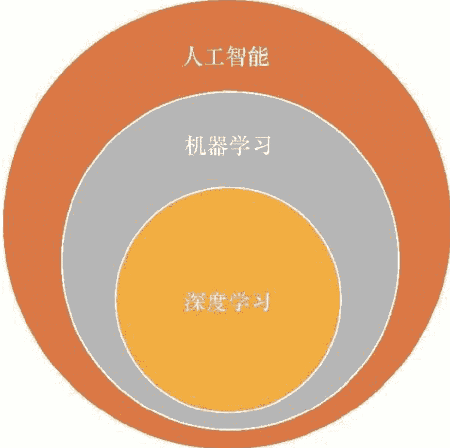

> **概念辨析**：AI ⊃ ML ⊃ DL。
> - **AI**：宏大目标，制造智能体。
> - **ML**：核心路径，让机器从数据中“学”出规律（概率论、统计学、凸分析、算法复杂度交叉支撑）。
> - **DL**：ML的特定流派，源于人工神经网络（多层感知机），通过层层非线性变换，自动从低级特征抽象出高级语义表示（图像边缘→纹理→部件→物体），模拟大脑皮层层级处理机制。

---

### 1.2 传统CADD：AI接力的起跑线

**计算机辅助药物设计（CADD）** 核心逻辑：模拟计算“小分子配体-大分子受体”相互作用，指导先导化合物优化。其与ML深度绑定的三大支柱：**QSAR、分子对接、ADMET预测**。

| 发展阶段 | 关键节点 | 核心突破 | 局限性 |
| :--- | :--- | :--- | :--- |
| **2D-QSAR时代 (60s)** | Hansch分析 | 将疏水/电子/立体参数与活性建立**线性/非线性数学关系**（回归方程） | 忽略分子3D构象，跨骨架预测差 |
| **3D-QSAR时代 (1988)** | CoMFA (Cramer等) | 引入分子场（静电/疏水场），对齐分子比较场点能量，**考虑空间构象** | 依赖分子对齐规则，主观性强 |
| **结构模拟时代 (80s至今)** | DOCK软件首发 | **分子对接**：搜索配体在口袋最佳构象+打分函数排序。打分函数参数常用**回归/ML优化权重** | 刚性受体近似、打分函数物理项不准、水分子/熵效应处理难 |
| **ADMET并行** | 同期发展 | 吸收/分布/代谢/排泄/毒性预测。本质上也是**理化描述符→性质的映射建模**（SVM/NN/随机森林） | 早期模型泛化性弱，数据噪声大 |

**传统CADD痛点**：高度依赖专家经验（描述符选择、对接参数设定）、物理模型近似误差大、高维化学空间搜索效率低。这倒逼**数据驱动的深度学习**接管特征工程与端到端预测。

---

### 1.3 AI制药里程碑：从辅助到主导

**2015 AtomNet (Wallach等)**：首创**3D-CNN**直接体素化蛋白-配体复合物，端到端预测结合亲和力。打破手工特征工程垄断，但强依赖高质量三维共晶结构。

**2018 逆合成AI登《Nature》 (Waller/Segler等)**：**3N-MCTS**（3神经网络+蒙特卡洛树搜索）。无需人工编码反应规则，自动从文献数据学习化学直觉。实测：5秒/分子完成80%复杂路线设计，60秒达92%。**标志着AI开始渗透“合成可及性”这一最后一公里。**

**2020 斯坦福+默克大规模实证**：31个ADMET数据集，**多任务图神经网络 (GCNN) 全面超越传统指纹+随机森林**。证明了**分子图表征学习**在小样本、多任务迁移上的优势。

**2020 AlphaFold 2 统治CASP**：**单体结构预测精度达实验级**。人类蛋白组98.5%覆盖 vs 过去几十年17%。《Nature》评价“It will change everything”，《Science》连续两年十大突破，施一公院士称“21世纪最重要生命科学突破之一”。**结构生物学“结构瓶颈”基本被打破，AI制药进入“有结构可用”新纪元。**

**国内响应**：科技部组织“AI+结构生物学”（2021）、“AI+中医药”（2020）两届香山科学会议，部署国家战略布局。

---

## 第二章 机器学习核心概念速览

### 2.1 三大概念关系回顾
详见1.1节概念辨析，此处不赘述。重点明确：**ML是AI落地的主力军，DL是当下最锋利的矛。**

### 2.1.1 什么是人工智能？
定义看似简单（人工+智能），实则哲学坑深：“智能”涉及意识、自我、心智，至今无共识定义。学术界通常以**“模拟/延伸/拓展人类智能的理论、方法、技术及应用系统”**为工作性定义。研究对象不限人类，动物群体智能、人造系统涌现智能均在考察范围。

# AI演进史：从科幻梦想到落地技术的关键跨越

“人工智能”绝非横空出世的新宠，而是历经数十载春秋、跌宕起伏沉淀而成的学科（见图2-1）。回溯达特茅斯会议，先驱们怀揣宏愿：借助初生的计算机，锻造出具备人类级认知的“通用人工智能”（General AI）。这设想中的实体，拥有五感乃至超感官知觉，能推理、能思维、能像人一样理解世界——科幻大片里那个懂礼貌的C-3PO，或是令人胆寒的“终结者”，皆是其投射。然而，跨越半个多世纪，通用AI依然栖身于银幕与小说，未曾在现实落地。我们触手可及、且已大规模应用的，是“弱人工智能”（Narrow AI）：专攻单一领域，表现媲美甚至超越人类的专用系统。眼下弱AI案例遍地开花，它们勾勒出AI的基本轮廓。可智能究竟如何生成？未来又将走向何方？答案藏在“机器学习”里——这是早期研究者确立的核心路径。一言以蔽之，机器学习摒弃了硬编码指令集，转而用海量数据喂养算法，让机器在“训练”中自主领悟任务规律、输出预测。决策树、归纳逻辑编程、强化学习、贝叶斯网络等，皆是这一路径下的算法里程碑。

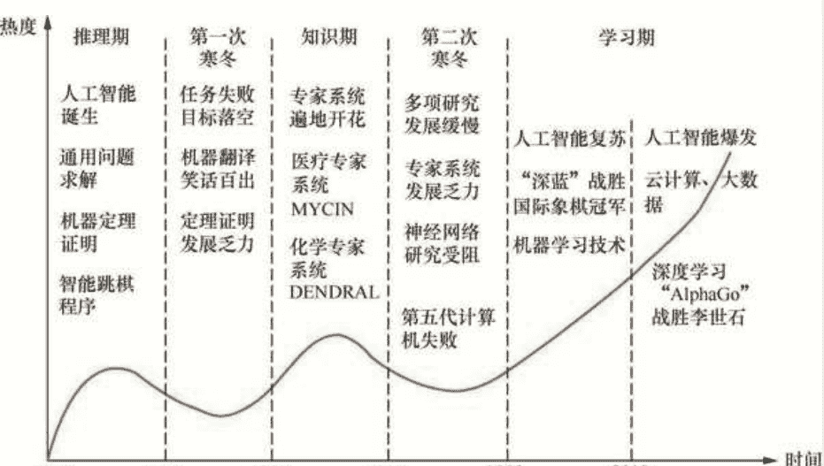

图2-1 人工智能发展的过程

长期以来，计算机视觉虽依赖繁重的人工编码，却始终是机器学习的主战场。研发者手工设计分类器（如边缘检测滤波器），辅助智能体勾勒物体轮廓——比如判断图像里是否存在八边形；再叠加理解算法，让机器学会识别停车标志。

深度学习，是机器学习的进阶技术。早期神经网络算法虽已问世，却沉寂数十载。其灵感源自人脑神经元连接，但人工网络强制数据按层级、定向传播，而非生物脑的任意连接。譬如把图像切块输入首层初算，神经元传至次层深算，层层递进至末层出结果。每个神经元对输入赋予权重，最终输出由权重共议。以识别停车标志为例：将形状、颜色、字符、尺寸、动态等属性拆解入网，网络输出“概率向量”——本例中，约86%判定为停车标志，7%误判为限速标志。

早期神经网络算力需求惊人，一度被判定为不可行。幸得多伦多大学Geoffrey Hinton教授等人坚守，推动超算并行跑通算法，验证其效力。但训练不足易误判，欲提精度，必靠海量图片反复打磨权重，直至近乎完美。如今深度学习在特定视觉任务上已超人类：辨猫、读片筛癌，样样精通。

本质上，AI以“智能”为靶，机器学习为达成智能的计算手段。可粗略类比：AI是科学大厦，机器学习是砌墙垒砖的算法，后者推动前者不断向上生长。

#### 2.1.2 机器学习必懂的核心术语

### 1. 数据三分法：训练集、验证集、测试集

- **(1) 训练集**：模型“练功”专用的数据本底。
- **(2) 验证集**：用于调参、优选模型的“模考题”。
- **(3) 测试集**：评估最终模型泛化实力的“高考卷”。

> **避坑指南**  
> 三者必须互斥，严防信息泄露导致评估失真。

模型练成后，如何验收？四种主流验证策略对比如下：

- **策略A：全量当训练集。** 训练过的数据再测，必然虚高，堪比“考前背答案”，引发数据窥探偏差，**不可取**。
- **策略B：随机二分（训练+测试）。** 规避窥探，但超参数难调，**有短板**。
- **策略C：随机三分（训练+验证+测试）。** 验证集导航调参，选优后再合并训练+验证重练终极模型，测试集把关。缺点是训练数据被切走，影响模型上限。
- **策略D：交叉验证（K折）。** 将训练集均分K份，轮流作验证集训K次，测试集评估，最终取K次平均。兼顾数据利用率与评估可靠，**工程首选**。

> **实战提示**  
> 5折交叉验证最常用（见图2-2）：数据均分5份，轮流留1份验、用4份练，循环5遍。

| | 模型1 | 模型2 | 模型3 | 模型4 | 模型5 |
|---|---|---|---|---|---|
| 第1折 | 训练 | 训练 | 训练 | 训练 | 预测 |
| 第2折 | 训练 | 训练 | 训练 | 预测 | 训练 |
| 第3折 | 训练 | 训练 | 预测 | 训练 | 训练 |
| 第4折 | 训练 | 预测 | 训练 | 训练 | 训练 |
| 第5折 | 预测 | 训练 | 训练 | 训练 | 训练 |

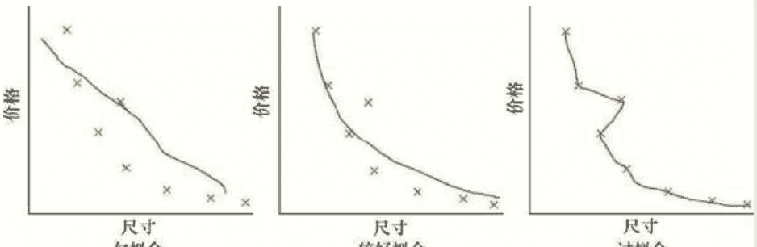

图2-2 5折交叉验证示意图

### 2. 特征缩放：让数据说同一种“量纲语言”

建模前，常需对特征统一量纲，主流三招：

- **(1) 归一化（Min-Max）**：强制压缩至固定区间（如[0,1]、[0,255]或[-1,1]）。  
  $$ X_{new} = \frac{X_i - X_{min}}{X_{max} - X_{min}} $$
- **(2) 标准化（Z-score）**：变换为均值0、标准差1的分布（不保证正态）。  
  $$ X_{new} = \frac{X_i - \mu}{\sigma} $$
- **(3) 中心化（均值归零）**：均值归0，范围锁定[-1,1]。  
  $$ X_{new} = \frac{X_i - mean(x)}{X_{max} - X_{min}} $$

> **术语对齐**  
> 本书“标准化”≡Standardization（Z-score）；“归一化”≡Min-Max Normalization。特征缩放还涵盖单位向量归一化、Log/Sigmoid/Box-Cox变换等。

**为什么要缩放？**  
① 统计建模中，量纲不一导致回归系数不可比；  
② 距离度量算法（PCA、kNN等）若量纲悬殊，大量纲特征主导距离，结果失真；  
③ 梯度下降求解时，缩放后等高线趋圆，收敛显著加速。

**怎么选？** 无银弹，视数据边界与分布经验抉择。

### 3. 三大核心素质：鲁棒性、健壮性、泛化能力

- **鲁棒性/健壮性**（Robustness音译）：面对噪声、偏差数据，模型仍能保持高精度、高有效性。
- **泛化能力**：模型对未见数据的预测把控力——能在相似或全新测试集上延续训练期表现，是机器学习的终极目标。

### 4. 两种误差视角

- **经验误差**：模型在训练集上的失准度。
- **泛化误差**：模型在测试集上的失准度。  
学习的本质，不是拟合有限训练样本，而是精准预测从未见过的样本。

### 5. 拟合失衡双子星：过拟合与欠拟合

二者均源于“模型学习能力”与“数据复杂度”错位。

| 维度 | 欠拟合 | 过拟合 |
|---|---|---|
| **本质** | 学习力太弱，捕捉不住普遍规律 | 学习力过强，把噪声/个例当规律 |
| **训练集表现** | 差 | 好 |
| **测试集表现** | 差 | 差 |
| **神经网络视角** | 高偏差 | 高方差 |

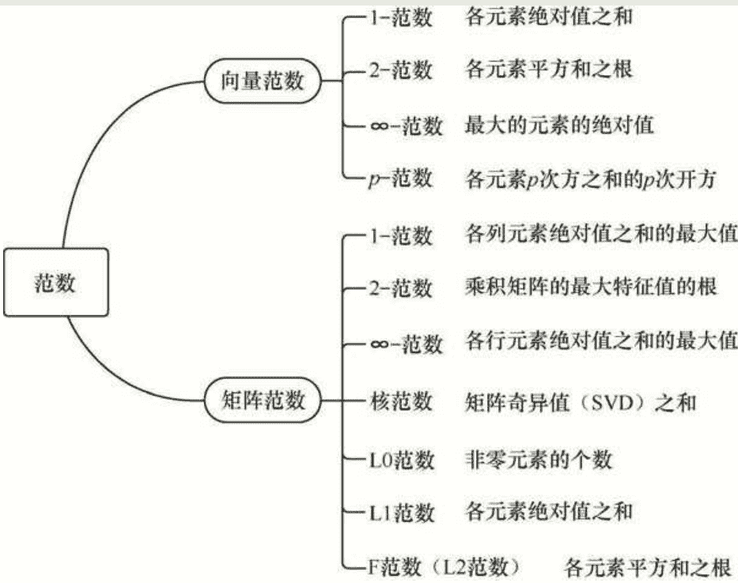

图2-3 欠拟合、较好拟合和过拟合

**欠拟合常因**：模型太浅、特征太少。  
**破局招式**：  
✅ 加特征（组合、高次项）  
✅ 引多项式特征（二/三次项强化线性模型）  
✅ 降正则化参数  
✅ 换非线性模型（核SVM、决策树、深度学习）  
✅ 扩模型容量（拟合函数族的能力）  
✅ 集成学习

**过拟合常因**：样本太少/有误/噪大、假设不成立、参数过剩模型过复杂。  
**对症下药**：  
✅ 正则化（L1/L2）  
✅ 数据扩增  
✅ Dropout  
✅ Early Stopping

### 6. 四大防过拟合利器详解

**正则化**  
在损失函数里加入模型复杂度惩罚项，平衡“降误差”与“防过拟”。常用L2正则化；L0/L1/L2对应不同范数约束（见下图）。

> **数学注脚**  
> 范数赋予向量“长度”概念。L0/L1/L2正则化分别对应L0范数、矩阵L1范数、矩阵L2范数。模型参数矩阵的范数大小，决定正则化项强弱。

```
MSE = \frac{\sum_{i=1}^{n}(y_i - \hat{y}_i)^2}{n}
```

### 图2-4 范数的分类

**数据扩增**  
解决数据不足导致的过拟合。来源三途：  
① 上游采集更多；  
② 拟合分布参数生成（少用）；  
③ **数据增强**（主流）：利用不变性变换扩充。如图像分类中，平移/翻转/缩放/裁剪/调亮暗，标签不变，数据成倍增长。

**Dropout**  
训练时按概率（如50%）随机丢弃隐层节点，强制网络学习鲁棒特征，神经网络防过拟合标配。

**Early Stopping**  
迭代早停法。每轮结束验证集评估，精度不再涨即停训，以“及时刹车”规避过拟合。

**损失函数补充**  
均方根误差（RMSE）常用于回归评价，平方放大大误差，对异常值极敏感，亦称L2 Loss。另有L1 Loss/MAE、平均偏差、Hinge Loss等，选型直接影响模型优劣判断。

## 2.2 机器学习分类导览

搞清分类体系，能让初学者快速建立知识地图，后续学习事半功倍。最主流的两维分类法：**按任务类型** 与 **按学习方式**。

### 2.2.1 按任务类型：四大基础范式

#### 1. 回归问题 —— 预测连续值
标签为连续数值：股价、降雨时长、气温、房价。  
常用算法：线性回归、逻辑回归、岭回归等。  
**实战案例**：已知面积、楼层、卧室数、学区等6套房数据（表2-1），预测第7、8套房价。

### 表2-1 房价预测信息表

| 序号 | 面积/m² | 楼层 | 卧室个数 | 学区与否 | 房价/万 |
|---|---|---|---|---|---|
| 0 | 88 | 8 | 3 | 是 | 65 |
| 1 | 90 | 5 | 3 | 是 | 71.6 |
| 2 | 65 | 16 | 2 | 否 | 56 |
| 3 | 120 | 31 | 4 | 是 | 150.3 |
| 4 | 75 | 5 | 2 | 否 | 88.5 |
| 5 | 99 | 2 | 3 | 是 | 110 |
| 6 | 101 | 6 | 3 | 是 | ? |
| 7 | 85 | 7 | 3 | 是 | ? |

#### 2. 分类问题 —— 判定离散标签
标签为有限离散值：是否下雨、胜负、猫狗识别。  
常用算法：kNN、决策树、随机森林、SVM、逻辑回归等。  
**通俗类比**：孩童认物，家长指着说“这是猫/狗/猪”，大脑建模；见新狗能叫出“狗”，分类成功；叫错被纠正，模型迭代；久而久之，泛化出“识狗”能力。**分类与回归同属监督学习。**

#### 3. 聚类问题 —— 无监督找族群
将数据划分为互斥子集，簇内相似度最大化。“物以类聚”的自动化实践：市场细分、社群画像、消费习惯挖掘。  
常用算法：K-Means、DBSCAN、EM等。  
**认知视角**：幼时虽不知“狗”的定义，但凭相似性自动归类，见新狗图也能归入“狗簇”，此即聚类思维。

#### 4. 降维问题 —— 高维投影低维
通过映射将高维数据压至低维。显性收益：易计算、可视化；深层价值：提炼有效信息、抛弃噪声冗余。  
常用算法：PCA、LDA、LE、LLE等。

### 2.2.2 按学习方式分类

#### 1. 监督学习

# 机器学习核心范式与药物研发应用解析

监督学习的训练素材由“输入特征”与“标签”构成。假设手头有10,000条样本，仅1,000条打好标签，我们便可先用这1,000条“带答案的题目”训练模型，再让模型推断剩余9,000条“只有题目无答案”的数据。换个角度看，监督学习的本质就是让算法在“题目-答案”对中总结规律，进而对新题目给出最优预测。按标签性质，监督学习又细分为回归与分类两大阵营。

放眼整个机器学习领域，其核心任务只有一件：通过训练获得模型，并期望模型能在“新样本”上依然表现优异——这种跨数据集的适用性，正是“泛化能力”，也是衡量算法优劣的金标准。

## 2. 无监督学习

与监督学习“给题给答案”不同，无监督学习仅接收无标签的特征数据，擅长解决聚类、降维等“自寻结构”类问题。

## 3. 半监督学习

半监督学习的训练集混合了“少量有标签”与“大量无标签”样本。它的核心思路是：借助海量无标签数据蕴含的分布信息，辅助有限的有标签数据完成监督任务，实现“以少驭多”。

## 4. 强化学习

强化学习将学习视为一连串动作的决策过程。不同于前三类“即时对错判断”，它引入**延迟奖惩机制**：智能体在时刻 *t* 执行动作，环境依据当前甚至历史状态给出“好/坏”反馈（奖励/惩罚），而非标准答案。  
打个比方：训练小狗拿苹果，它拿回香蕉，若主人恰爱吃香蕉，便给奖励——此时动作被判定为“好”；下次它再拿香蕉，主人想吃苹果便给惩罚——同一动作在 *t+1* 时刻变成“坏”。可见，强化学习的“标签”是动态生成的、依赖上下文的评价信号。

---

# 2.3 机器学习赋能药物研发：现状与方法

传统药物研发痛点显著：周期长、投入大、成功率低、数据量巨大。随着算力跃升、AI理论突破、药理学数据积累，机器学习作为核心数据挖掘工具，已渗透至靶点识别、分子设计优化、老药新用、性质预测、临床试验等全流程。本节将围绕**核心算法**、**药物设计理论**、**虚拟筛选实战**三条线展开。

早在 20 世纪 90 年代，神经网络、SVM、随机森林便用于抗癌药筛选、蛋白设计。21 世纪以来，AI 与制药企业深度绑定，推动领域爆发式增长。

## 2.3.1 药物设计两大范式

| 范式 | 别称 | 核心逻辑 | 典型方法 |
|------|------|----------|----------|
| **间接药物设计** | 基于配体设计 | 从已知小分子出发，通过结构修饰获取活性更强、毒性更低的新化合物 | QSAR、三维药效基团 |
| **直接药物设计** | 基于结构设计 | 从靶点大分子结构出发，寻找/设计能结合调节其功能的小分子 | 分子对接、全新药物设计 |

### QSAR：结构-活性的量化桥梁
假设：分子理化性质与活性随结构变化而变化，且结构可用“分子描述符”编码。通过统计建模，建立 **描述符 → 活性** 映射。  
案例：SVM 对 131 种致敏化合物分类，训练集/测试集准确率 89.77%/72.09%。QSAR 是先导优化的主力方法。

### 三维药效基团：关键相互作用的空间抽象
提取一组活性分子共同的氢键、静电、范德华、疏水作用点及其空间排列，构建药效基团模型。常用于分子对接前的**初筛**，大幅削减计算量并提升命中率。

### 分子对接：把“钥匙”插进“锁孔”的模拟
将化合物库中分子逐个对接靶点结合口袋，优化位姿、构象，打分排序。并行化后即为**高通量虚拟筛选 (HTVS)**，数天筛完百万级化合物，成为高通量实验筛选 (HTS) 的有力补充。

### 全新药物设计：从零生成匹配口袋的分子
根据结合口袋几何与化学特征，*从头*设计新分子。两大流派：
1. **碎片连接法**：在口袋关键位点放置匹配片段，再用连接子拼装成完整分子。
2. **碎片生长法**：从口袋一端起步，逐步“延伸”分子，每步评估最优片段与朝向，直到生成完整结构。

---

## 2.3.2 药物设计高频算法图谱

### 1. 支持向量机 (SVM)
1995 年由 Vapnik、Cortes 提出，核心是寻找**最优超平面**最大化类间间隔，擅长小样本、非线性、高维分类/回归。

**实战证据**：
- **乳汁/血药浓度比预测**：126 种药物，SVM 测试集准确率 90%（LDA 仅 76.7%）。
- **HIV-1 蛋白酶抑制剂 QSAR**：SVM 模型 RMSE 0.275、R² 0.936，显著优于 PLS。
- **神经退行性疾病药物分类**：SVM-RFE 从 314 描述符中筛 40 个，10 折交叉验证准确率 80%。

### 2. 决策树与随机森林
- **决策树**：基于少量变量生成显式规则，可解释性强。
- **随机森林**：集成多棵树，“少数服从多数”投票，并通过**特征随机采样**降低相关性、防过拟合、提升泛化。

**实战证据**：
- **亲和力预测**：~16 万样本，决策树法提取更多蛋白-配体信息，筛选效率提升 **200~1000 倍**。
- **基因致病性/可成药性预测**：元分类器以 66% 精度回收 65% 致病基因，75% 精度回收 78% 可成药基因。

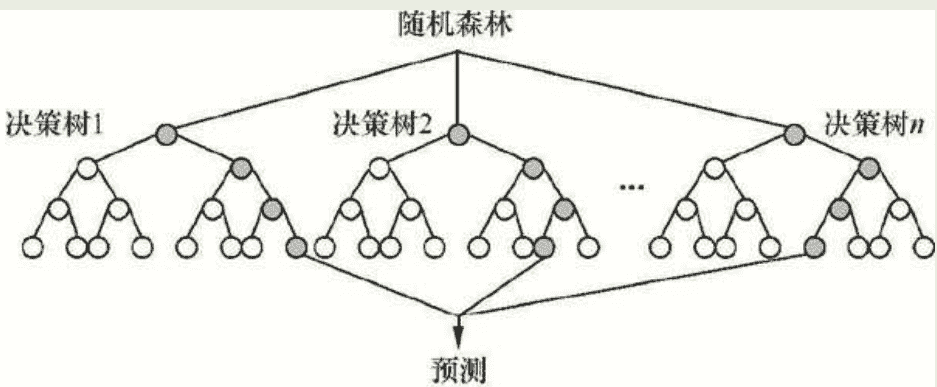

### 图 2-5 随机森林原理示意

### 3. K 近邻 (KNN)
1967 年 Cover & Hart 提出：**“近朱者赤”**——样本归属由特征空间中 K 个最近邻的多数类决定。优势：天然适配样本不平衡；劣势：预测时需计算全量距离，计算量大。

### 4. 朴素贝叶斯 (NBC)
基于“特征条件独立”假设的贝叶斯分类器，数学基础扎实、参数少、抗缺失、训练极快。

**实战证据**：  
基于 203 例电子处方数据，构建 3 种中成药适宜人群 NBC 模型，测试集总判别正确率 **80.2%**。

---

## 2.3.3 预测模型构建标准流程

1. **数据收集**  
   多源检索（数据库、文献、专利），清洗缺失/重复/异常值，按比例随机切分训练/验证/测试集。

2. **数据描述（特征工程核心）**  
   将分子结构、蛋白序列转化为模型可读特征：分子描述符（分子量、LogP 等）、分子指纹、嵌入向量等。这是**能否成模的关键**。

3. **特征选择（可选但常必要）**  
   去除冗余/无关特征 → 降维防过拟合 + 增强可解释性。高维、共线性严重时必须做。

4. **模型构建与算法匹配**  
   - 回归任务 → 线性/逻辑回归、SVR、树模型  
   - 分类任务 → SVM、决策树/随机森林、ANN  
   - 生成任务 → 深度生成模型（VAE、GAN、扩散模型等）

> **现实提醒**：药物 AI 仍处早期，部分领域存在**不可解释、难复现**问题。务必重视**可解释性实验验证**，否则将制约长远发展。  
> 虽然 AI 能大幅压缩周期、降低成本，但**海量数据挖掘难**与**一药一模型的适配性**仍是双重挑战。

---

## 2.4 核心参考文献（节选）
[1] 刘伟. 现象学视角的 AI 隐喻批判...  
[2] 刘常江等. 有监督图像认知分类系统...  
[3] 刘捷. CV 与 ML 在 3D 人体动画中的应用...  
[4] 骞宇澄、刘昭策. 深度学习演进史...  
[5] 杨澜. 吴恩达：“让机器认出猫”...  
[6] 杨旭然. AlphaGo 背后的天才...  
[7] WALTZMAN R 等. 保持 AI 竞争优势. RAND, 2020.  
[8] 周玥等. 机器学习在创新药研发中的进展. 医学信息学杂志, 2020.  
[9] WEINSTEIN J 等. 神经计算在抗癌药开发中的应用. Science, 1992.  
[10] SCHNEIDER G, WREDE P. 神经网络设计氨基酸序列. Biophys J, 1994.  
[11] 罗小民等. 药物分子设计进展. 中科院院刊, 2003.  
[12] 雷蓓蕾. QSAR 与分子模拟在药物设计中的应用. 兰州大学, 2011.  
[13] CORTES C, VAPNIK V. Support-Vector Networks. ML, 1995.  
[14] 赵春燕. QSAR 在生命分析化学中的应用. 兰州大学, 2006.  
[15] DEEB O, GOODARZI M. HIV-1 蛋白酶抑制剂 QSAR: GA-PLS vs GA-SVM. Chem Biol Drug Des, 2010.  
[16] SHAHID M 等. SVM-RFE 筛选描述符分类 NDD 药物. Mol Inform, 2013.  
[17] PU Q 等. 决策树与神经网络在药物设计筛选效率对比. Sci China Chem, 2019.  
[18] COSTA P R 等. 基于系统级数据的基因致病/可成药性预测. BMC Genomics, 2010.  
[19] COVER T M, HART P E. 最近邻模式分类. IEEE Trans IT, 1967.  
[20] 罗文舒等. 基于 MATLAB 的中风病中成药适宜人群 NBC 构建. 山西中医, 2018.

---

# 第3章 支持向量机：小样本下的泛化大师

SVM 能在**模型复杂度**与**学习能力**间寻找最佳平衡，使有限样本下的泛化性能达到理论最优。在小样本、非线性、高维模式识别及函数拟合中展现出独特优势。

## 3.1 回溯与定位
1995 年 Cortes 等正式提出，凭借文本分类卓越表现迅速成为 2000 前后“统计学习热潮”核心驱动力。事实上，SVM 概念萌芽于 60 年代，统计学习理论在 70 年代已成型，历经数十年沉淀才迎来爆发。

## 核心原理：支持向量机（SVM）深度解析

支持向量机植根于结构风险最小化原则，其关键机制在于引入核函数技术，从而巧妙化解高维特征空间中的计算难题，即所谓的“维数灾难”。核函数直接决定了SVM的非线性建模能力，因此核函数及其参数的选取在模型构建中举足轻重，也是学术界持续聚焦的研究热点。不同核函数特性迥异，选择差异将直接导致模型泛化性能的高低。核函数研究渊源深厚：Mercer定理早在1909年即已提出，再生核希尔伯特空间（RKHS）于20世纪40年代获深入探讨，但直至统计学习理论兴起，核方法才真正确立了其在机器学习中的基石地位。

作为统计学习理论与VC维理论的集大成者，SVM能在有限样本条件下，于模型复杂度与拟合能力间寻得最佳平衡，从而实现优异的推广性能。该算法保证求得的极值为全局最优而非陷入局部极小，这奠定了其在手写数字识别、文本分类、图像识别等模式识别领域的广泛应用根基。SVM以分析统计理论为基石，是结构风险最小化（SRM）准则的具体落地，其演进脉络始于线性可分场景下的最优分类，后延伸至函数回归与密度估计，且广泛服务于自然语言处理等领域。依模型形态划分，主要涵盖线性SVM与非线性SVM两大范式。

### 3.2 间隔与支持向量

给定训练集 $D = \{(x_1, y_1), \dots, (x_m, y_m)\}, y_i \in \{-1, +1\}$，分类学习的核心意图是在样本空间寻得一划分超平面，以此将不同类别样本分隔。然而，能正确划分训练集的超平面往往不止一个（如图 3-1 所示）。

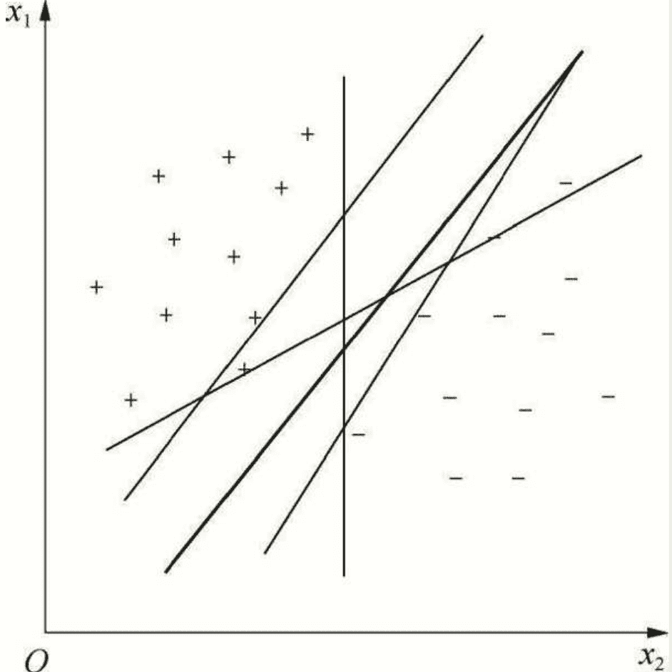

图3-1 存在多个划分超平面将两类训练样本分开

观察图3-1可知，位于两类样本“正中央”的超平面（黑色加粗线）乃是我们追寻的最优解，因其对训练样本局部扰动具备最强“容忍度”。受限于训练集规模或噪声干扰，测试样本可能逼近类别边界，导致大多数超平面误判，而该中心超平面受影响最小。换言之，它赋予了分类结果最佳鲁棒性，泛化能力最强。

样本点距超平面越远，预测置信度越高。故而需寻找距超平面最近的那些点，并最大化它们到超平面的距离——这便是“间隔”的由来。这些最近的样本点即为“支持向量”，寻找最优超平面问题由此转化为寻找“最大间隔”问题。

在样本空间中，超平面可由线性方程 $\boldsymbol{\omega}^T x + b = 0$ 描述（式 3-1）。其中 $\boldsymbol{\omega}$ 为法向量决定朝向，$b$ 为位移项决定截距。任意点 $x$ 到超平面 $(\boldsymbol{\omega}, b)$ 的距离为 $d = \frac{|\boldsymbol{\omega}^T x + b|}{\|\boldsymbol{\omega}\|}$。

假设超平面能正确分类，则对正类 $y_i=+1$ 有 $\boldsymbol{\omega}^T x_i + b \geqslant 0$，负类 $y_i=-1$ 有 $\boldsymbol{\omega}^T x_i + b < 0$。进一步规范化约束（式 3-3）：
$\begin{cases} \boldsymbol{\omega}^T x_i + b \geqslant +1, & y_i = +1 \\ \boldsymbol{\omega}^T x_i + b \leqslant -1, & y_i = -1 \end{cases}$

如图3-2，距超平面最近的异类支持向量使等号成立，两者距离之和 $\gamma = \frac{2}{\|\boldsymbol{\omega}\|}$ 即为几何间隔。

求解最大间隔，即在满足约束 $y_i(\omega^T x_i + b) \geqslant 1$ 下最大化 $\frac{2}{\|\omega\|}$（式 3-5），等价于最小化 $\frac{1}{2}\|\boldsymbol{\omega}\|^2$。最终得到SVM基本型（式 3-6）：
$\min_{\boldsymbol{\omega}, b} \frac{1}{2}\|\boldsymbol{\omega}\|^2 \quad \text{s.t.} \quad y_i(\boldsymbol{\omega}^T x_i + b) \geqslant 1, \ i=1,\dots,m$

### 3.3 核函数

核函数主宰SVM与核方法的终局性能，但其选择至今仍是悬而未决的难题。多核学习（MKL）通过学习多个核的最优凸组合来逼近理想核，实质上借鉴了集成学习思想。

前文假设样本线性可分，但现实中原始空间往往不存在完美分割超平面。解决路径是将样本映射至更高维特征空间实现线性可分（如图3-3，二维映射三维）。若原始空间有限维，必存某高维空间使样本可分。

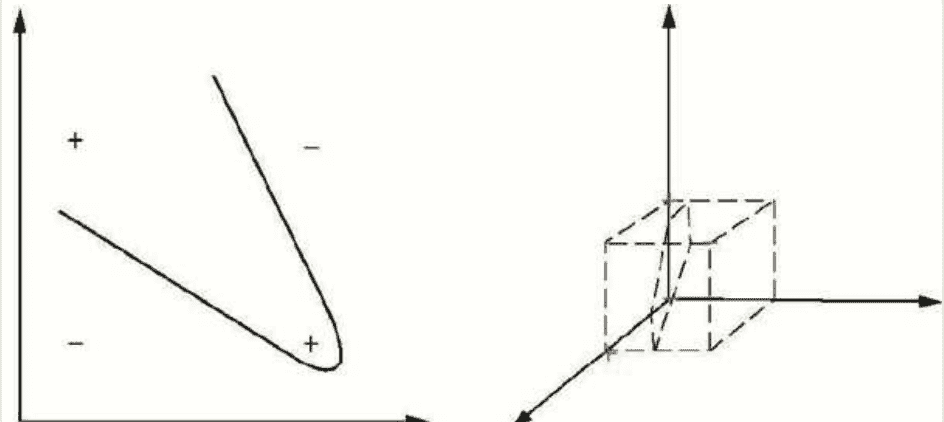

图3-3 非线性映射

设 $\phi(x)$ 为映射后特征向量，特征空间模型为 $f(x) = \omega^T \phi(x) + b$。优化目标同式（3-8）所示。引入拉格朗日乘子法求对偶问题（式 3-9 至 3-12），核心难点在于计算高维甚至无限维空间内的内积 $\phi(x_i)^T \phi(x_j)$。

为规避直接计算高维内积的困境，构造函数 $\kappa(x_i, x_j) = \langle \phi(x_i), \phi(x_j) \rangle$（式 3-13），使原始空间中的核运算等价于特征空间内积。于是对偶问题重写为式（3-14），模型最优解展开为式（3-15）：
$f(x) = \sum_{i=1}^m \alpha_i y_i \kappa(x, x_i) + b$
此即“支持向量展开式”，核函数 $\kappa$ 避开了显式映射 $\phi(\cdot)$。

判定函数是否为合法核函数，引用定理 3.1：对称函数 $\mathbf{K}$ 为核函数，当且仅当任意数据集对应的核矩阵（Gram矩阵）半正定（式 3-16）。这意味着半正定核矩阵隐式定义了一个再生核希尔伯特空间。

特征空间优劣决定SVM性能，但映射形式未知，核函数仅隐式定义空间，故“核函数选择”成为最大变数。不当的核函数将样本映射至不适配空间，必导致性能劣化。

表3-1汇总四大常用核：
*   **线性核**：$\kappa(x_i, x_j) = x_i^T x_j$。最简内核，文本处理常用，情况不明可先试高斯核。
*   **多项式核**：$\kappa(x_i, x_j) = (x_i^T x_j)^d$ ($d \geqslant 1$)。$d=1$退化为线性核，适用于归一化数据。
*   **高斯核 (RBF)**：$\kappa(x_i, x_j) = \exp(-\frac{\|x_i - x_j\|^2}{2\sigma^2})$。径向基典范，带宽 $\sigma$ 至关重要：过大趋近线性丧失非线性能力，过小缺乏正则化致边界对噪声敏感。
*   **拉普拉斯核**：$\kappa(x_i, x_j) = \exp(-\frac{\|x_i - x_j\|}{\sigma})$。可构建非线性决策边界，将样本映射至高维实现线性可分。

### 3.4 软间隔与正则化

前述讨论预设样本在样本空间或特征空间线性可分。现实任务中，既难寻觅完美核函数保证线性可分，即使偶然找到，也难排除过拟合嫌疑。

缓解之道是引入“软间隔”概念，允许部分样本分类错误（图3-4圈出样本）。

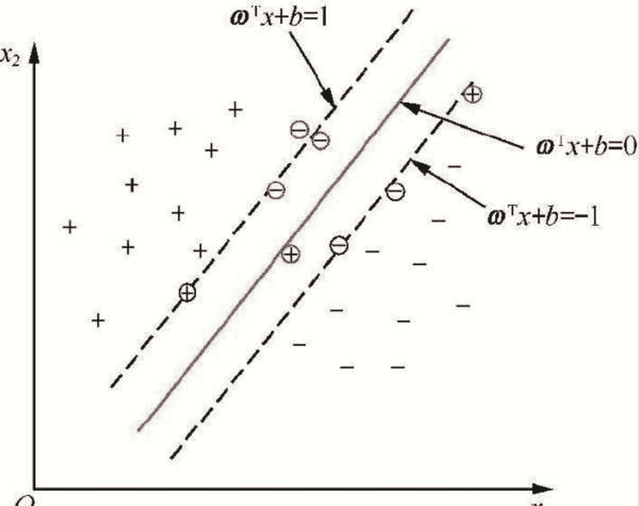

图3-4 软间隔示意图，圈出的是一些不满足约束的样本

硬间隔要求所有样本严格满足 $y_i(\omega^T x_i + b) \geqslant 1$（式 3-17）。软间隔则允许违例，但惩罚违例数量。优化目标调整为式（3-18）：
$\min_{\omega, b} \frac{1}{2}\|\omega\|^2 + C \sum_{i=1}^m \ell_{0/1}(y_i(\omega^T x_i + b) - 1)$
其中 $C>0$ 为惩罚系数，$\ell_{0/1}$ 为0/1损失。$C \to \infty$ 时退化为硬间隔（式 3-6）；有限 $C$ 允许容错。

$$\ell_{0/1}(z) = \begin{cases} 1, & \text{如果 } z < 0 \\ 0, & \text{其他} \end{cases}$$

然而 0/1损失非凸非连续，求解困难。学界常用凸连续的“替代损失函数”替代，常见三种（式 3-20）：Hinge损失、指数损失、对率损失。

$$\ell_{\text{hinge}}(z) = \max(0,1-z) \\ \ell_{\text{exp}}(z) = \exp(-z) \\ \ell_{\text{log}}(z) = \log(1+\exp(-z))$$

若采用Hinge损失，式（3-18）转化为式（3-21）……

$$\min_{\boldsymbol{\omega}, b} \frac{1}{2} \|\boldsymbol{\omega}\|^2 + C \sum_{i=1}^m \max(0, 1 - y_i (\boldsymbol{\omega}^T x_i + b))$$

引入非负的“松弛变量” $\xi_i$ 后，原本的式 (3-21) 便能转化为式 (3-22) 的形式。

$$\min_{\boldsymbol{\omega}, b, \xi_i} \frac{1}{2} \|\boldsymbol{\omega}\|^2 + C \sum_{i=1}^m \xi_i$$

这便是我们常说的**“软间隔支持向量机”**。

显而易见，式 (3-22) 里每个样本都配有一个专属的松弛变量，专门用来度量该样本违背约束 (3-17) 的程度。虽引入了新变量，但问题本质未变——它依然是一个**二次规划 (QP)** 问题，这与式 (3-6) 的结构如出一辙。因此，沿用拉格朗日乘子法，我们可以构建出式 (3-22) 对应的拉格朗日函数，如下所示：

$$L(\boldsymbol{\omega}, b, \alpha, \xi, \mu) = \frac{1}{2} \|\boldsymbol{\omega}\|^2 + C \sum_{i=1}^m \xi_i \\ + \sum_{i=1}^m \alpha_i (1 - \xi_i - y_i (\boldsymbol{\omega}^T x_i + b)) - \sum_{i=1}^m \mu_i \xi_i$$

其中，$\alpha_i \geqslant 0,\ \mu_i \geqslant 0$ 均为拉格朗日乘子。

令拉格朗日函数 $L(\boldsymbol{\omega}, b, \boldsymbol{\alpha}, \boldsymbol{\xi}, \boldsymbol{\mu})$ 分别对 $\boldsymbol{\omega}, b, \boldsymbol{\xi}_i$ 求偏导并置零，可推导得出：

$$
\boldsymbol{\omega} = \sum_{i=1}^m \alpha_i y_i x_i
$$
$$
0 = \sum_{i=1}^m \alpha_i y_i
$$
$$
C = \alpha_i + \mu_i
$$

将上述三个等式代入拉格朗日函数，消去原始变量后，即得到式 (3-22) 的**对偶问题**：

$$
\max_{\alpha} \sum_{i=1}^m \alpha_i - \frac{1}{2} \sum_{i=1}^m \sum_{j=1}^m \alpha_i \alpha_j y_i y_j x_i^T x_j
$$
$$
\text{s.t. } \sum_{i=1}^m \alpha_i y_i = 0
$$
$$
0 \leqslant \alpha_i \leqslant C, \quad i=1, 2, \cdots, m \tag{3-27}
$$

将式 (3-27) 与硬间隔下的对偶问题（式 (3-12)）并列比较，两者结构高度相似，**唯一的分歧仅在于对偶变量 $\alpha_i$ 的取值范围**：软间隔被限制在 $[0, C]$ 区间内，而硬间隔仅要求非负。这意味着，我们可以沿用求解硬间隔的算法来攻克式 (3-27)，引入核函数后，亦能获得与式 (3-15) 形式一致的支持向量展开式。

对于软间隔 SVM，**KKT 条件**要求满足如下约束体系（式 3-28）：

$$
\left\{ \begin{array}{l} 
\alpha_i \geqslant 0,\ \mu_i \geqslant 0 \\
y_i f(x_i) - 1 + \xi_i \geqslant 0 \\
\alpha_i (y_i f(x_i) - 1 + \xi_i) = 0 \\
\xi_i \geqslant 0,\ \mu_i \xi_i = 0 
\end{array} \right. \tag{3-28}
$$

据此可推断：对任意训练样本 $(x_i, y_i)$，必有 $\alpha_i = 0$ 或 $y_i f(x_i) = 1 - \xi_i$。
*   若 $\alpha_i = 0$，该样本对决策函数 $f(x)$ 无贡献；
*   若 $\alpha_i > 0$，则该样本必为**支持向量**，且满足 $y_i f(x_i) = 1 - \xi_i$。

结合 $C = \alpha_i + \mu_i$ 可知：
*   若 $\alpha_i < C$，则 $\mu_i > 0 \Rightarrow \xi_i = 0$，样本正好落在**最大间隔边界**上；
*   若 $\alpha_i = C$，则 $\mu_i = 0$。此时若 $\xi_i \leqslant 1$，样本位于**最大间隔内部**；若 $\xi_i > 1$，则意味着**分类错误**。

可见，软间隔 SVM 的最终模型仅由支持向量决定，引入 hinge 损失依然保留了模型的**稀疏性**。

---

那么，式 (3-18) 中的 0/1 损失能否替换为其他替代损失？答案是肯定的。若改用**对率损失** $\ell_{\text{log}}$，模型几乎就退化为**对率回归**。二者优化目标相近，实际性能往往也在伯仲之间。
*   **对率回归优势**：输出自带概率解释，直接给出预测标记及置信度；原生支持多分类。
*   **SVM 特点**：输出无概率意义，需额外处理（如 Platt 缩放）才能获概率；多分类需扩展策略。
*   **稀疏性差异**：Hinge 损失拥有“平坦”的零区间，赋予了 SVM 稀疏解（仅依赖支持向量）；对率损失光滑单调递减，无法产生类似支持向量的稀疏性，导致对率回归依赖更多训练样本，**预测开销相对更大**。

我们还可以继续替换损失函数，衍生出更多学习模型。这些模型性质虽因损失函数而异，但优化目标具备共同骨架：一项刻画“间隔”大小（结构风险），一项度量训练集拟合程度（经验风险），可统一写为式 (3-29) 形式：

$$
\min_f \Omega(f) + C \sum_{i=1}^m \ell(f(x_i), y_i) \tag{3-29}
$$

此处：
*   $\Omega(f)$ 为**结构风险**，描述模型 $f$ 的内在性质（如复杂度）；
*   $\sum \ell(\cdot)$ 为**经验风险**，反映模型与数据的契合度；
*   $C$ 为折中系数。

从经验风险最小化视角看，$\Omega(f)$ 注入了我们对模型的先验偏好（如倾向低复杂度），这为引入领域知识、缩减假设空间、抑制过拟合提供了路径。此即**正则化**视角：$\Omega(f)$ 称正则化项，$C$ 称正则化常数。常用 $L_p$ 范数中，$L_2$ 范数倾向分量取值均衡（非零分量多）；$L_0$ 与 $L_1$ 范数则倾向稀疏解（非零分量少）。

---

### 3.5 支持向量回归

现在转向回归任务。给定训练集 $D=\{(x_1, y_1), \dots, (x_m, y_m)\}, y_i \in \mathbb{R}$，目标是学得 $f(x)$ 使其尽可能逼近真实值 $y$，$\boldsymbol{\omega}, b$ 为待定参数。

传统回归通常直接计算 $f(x)$ 与 $y$ 的差值作为损失，仅当完全相等时损失为零。**支持向量回归 (SVR)** 另辟蹊径：设定一个容忍度 $\varsigma$，仅当 $|f(x) - y| > \varsigma$ 时才计算损失。如图 3-5 所示，这相当于以 $f(x)$ 为中心构建宽度为 $2\varsigma$ 的**“$\varsigma$-不敏感带”**——落入带内的样本视为预测正确，不计损失。

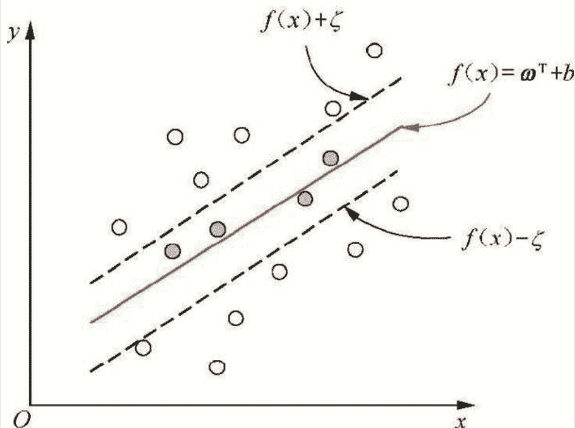

**图3-5 支持向量回归示意图。虚线部分为 $\varsigma$-间隔带，落入其中的样本不计算损失**

于是，SVR 问题形式化为式 (3-30)：

$$
\min_{\boldsymbol{\omega}, b} \frac{1}{2} \|\boldsymbol{\omega}\|^2 + C \sum_{i=1}^m \ell_\varsigma(f(x_i) - y_i) \tag{3-30}
$$

其中 $C$ 为正则化常数，$\ell_{\varsigma}$ 为 $\varsigma$-**不敏感损失函数**（式 3-31）：

$$
\ell_{\varsigma}(z) = \begin{cases} 0, & |z| \leqslant \varsigma \\ |z| - \varsigma, & \text{其他} \end{cases} \tag{3-31}
$$

引入两组松弛变量 $\xi_i, \hat{\xi}_i$，式 (3-30) 可重写为带约束的优化问题（式 3-32）：

$$
\min_{\boldsymbol{\omega}, b, \xi, \hat{\xi}} \frac{1}{2} \|\boldsymbol{\omega}\|^2 + C \sum_{i=1}^m (\xi_i + \hat{\xi}_i)
$$
$$
\text{s.t. } 
\begin{cases}
f(x_i) - y_i \leqslant \varsigma + \xi_i \\
y_i - f(x_i) \leqslant \varsigma + \hat{\xi}_i \\
\xi_i \geqslant 0,\ \hat{\xi}_i \geqslant 0, \quad i=1,\dots,m
\end{cases} \tag{3-32}
$$

仿照分类情形，引入拉格朗日乘子构建拉格朗日函数（式 3-33）：

$$
\begin{aligned}
L = &\frac{1}{2} \|\boldsymbol{\omega}\|^2 + C \sum_{i=1}^m (\xi_i + \hat{\xi}_i) - \sum_{i=1}^m \mu_i \xi_i - \sum_{i=1}^m \hat{\mu}_i \hat{\xi}_i \\
&+ \sum_{i=1}^m \alpha_i (f(x_i) - y_i - \varsigma - \xi_i) + \sum_{i=1}^m \hat{\alpha}_i (y_i - f(x_i) - \varsigma - \hat{\xi}_i)
\end{aligned}
$$

令 $L$ 对 $\boldsymbol{\omega}, b, \xi_i, \hat{\xi}_i$ 偏导为零，得式 (3-34)：

$$
\boldsymbol{\omega} = \sum_{i=1}^m (\hat{\alpha}_i - \alpha_i) x_i, \quad
0 = \sum_{i=1}^m (\hat{\alpha}_i - \alpha_i), \quad
C = \alpha_i + \mu_i, \quad
C = \hat{\alpha}_i + \hat{\mu}_i
$$

代入拉格朗日函数消元，获得 SVR 的**对偶问题**（式 3-35）：

$$
\max_{\alpha, \hat{\alpha}} \sum_{i=1}^m y_i(\hat{\alpha}_i - \alpha_i) - \varsigma(\hat{\alpha}_i + \alpha_i) - \frac{1}{2} \sum_{i=1}^m \sum_{j=1}^m (\hat{\alpha}_i - \alpha_i)(\hat{\alpha}_j - \alpha_j) x_i^T x_j
$$
$$
\text{s.t. } \sum_{i=1}^m (\hat{\alpha}_i - \alpha_i) = 0, \quad
0 \leqslant \alpha_i, \hat{\alpha}_i \leqslant C \tag{3-35}
$$

该过程满足 KKT 条件（式 3-36）：

$$
\left\{\begin{array}{l} 
\alpha_i(f(x_i)-y_i-\varsigma-\xi_i)=0 \\
\hat{\alpha}_i(y_i-f(x_i)-\varsigma-\hat{\xi}_i)=0 \\
\alpha_i \hat{\alpha}_i=0,\ \xi_i \hat{\xi}_i=0 \\
(C-\alpha_i)\xi_i=0,\ (C-\hat{\alpha}_i)\hat{\xi}_i=0 
\end{array}\right. \tag{3-36}
$$

由 KKT 条件可知：
1.  仅当样本**落在 $\varsigma$-带之外**时，对应的 $\alpha_i$ 或 $\hat{\alpha}_i$ 才可能非零；
2.  两个约束不能同时成立，故 $\alpha_i$ 与 $\hat{\alpha}_i$ **至少有一个为零**。

将 $\boldsymbol{\omega}$ 表达式代入决策函数，得 SVR 解（式 3-37）：

$$
f(x) = \sum_{i=1}^m (\hat{\alpha}_i - \alpha_i) x_i^T x + b \tag{3-37}
$$

使 $(\hat{\alpha}_i - \alpha_i) \neq 0$ 的样本即为 SVR 的**支持向量**，它们必位于 $\varsigma$-带外。可见，SVR 解同样具有**稀疏性**。

**求解偏置项 $b$**：
由 KKT 条件 $(C-\alpha_i)\xi_i=0$ 及互补松弛性，若存在 $0 < \alpha_i < C$，则 $\xi_i=0$，进而可由式 (3-38) 计算 $b$：

$$
b = y_i + \varsigma - \sum_{j=1}^m (\hat{\alpha}_j - \alpha_j) x_j^T x_i \tag{3-38}
$$

工程上为增强鲁棒性，常取所有满足 $0 < \alpha_i < C$ 的样本计算 $b$ 后**取平均**。

**核化扩展**：
若引入特征映射 $\phi(\cdot)$（式 3-7），$\boldsymbol{\omega}$ 表达式变为式 (3-39)：

$$
\boldsymbol{\omega} = \sum_{i=1}^m (\hat{\alpha}_i - \alpha_i) \phi(x_i) \tag{3-39}
$$

代入后得到核化形式的 SVR（式 3-40）：

$$
f(x) = \sum_{i=1}^m (\hat{\alpha}_i - \alpha_i) \kappa(x, x_i) + b \tag{3-40}
$$

其中 $\kappa(x_i, x_j) = \phi(x_i)^T \phi(x_j)$ 为核函数。

---

### 3.6 支持向量机算法

本节将系统介绍 SVM 求解算法，涵盖**选块算法、分解算法、模糊 SVM 算法**及**序贯最小优化 (SMO) 算法**。

#### 3.6.1 选块算法

# SVM优化算法全景解析：从选块、分解到SMO的实战进阶

提到大规模SVM训练的早期突破，不得不提Boser团队首创的**选块算法**。它的核心逻辑很直观：既然拉格朗日乘子为零的样本不影响决策边界，那就直接把核矩阵里对应的行列“裁剪”掉。这一操作让原本庞大的二次规划（QP）问题，化身为一系列体量轻巧的子问题。

选块算法的关键在于“预判”：提前圈定哪些样本的乘子归零（直接丢弃），哪些非零（即支持向量，重点保留）。但支持向量在训练前是未知的，于是引入KKT条件作为“裁判”，通过迭代逐步逼近全局最优解。这招将矩阵规模从样本数平方压缩到非零乘子样本数平方，极大缓解了存储压力，训练速度随之起飞。不过，这只是缓解而非根治：选块算法终究要存核函数矩阵来锁定所有支持向量，本质上仍受支持向量数量制约，内存瓶颈依然存在。

#### 3.6.2 分解法：化整为零的动态策略

紧随其后，**分解算法**由Osuna等人登场。它同样主打“化整为零”，但路数不同——它是活动集方法的变体。

具体流程是：每轮迭代把拉格朗日乘子 $\alpha_i$ 分成“工作集”（自由变量，本轮优化）和“非工作集”（固定不动）两拨。不断优化工作集，直至满足停机条件。这招的成败手在于**如何挑选最优工作集**以加速收敛，但早期版本多采用随机选取，导致收敛速度上不去。

针对这个短板，Joachims对Osuna方案动了大刀阔斧的改良，提出了一套工作集选择策略，并落地开发出**SVM light**软件。其选集思路是：从全量变量中筛选 $q$ 个，要求它们非零且指向目标函数可行的最速下降方向，这等价于求解一个简单的线性优化问题。

SVM light 还集成了三大“黑科技”：
*   **Shrinking技术**：自动剔除已确定的非支持向量；
*   **Caching技术**：缓存核矩阵热点数据；
*   **梯度增量修正**：避免重复计算。

实测在大规模场景（特别是支持向量比例低、或多靠边界的情况）下效果立竿见影。

#### 3.6.3 模糊SVM（FSVM）：给噪声“降权”，让模型更稳健

实际挖掘数据满坑满谷的噪声（模糊信息），硬喂标准SVM往往性能崩塌。Lin团队为此融合模糊数学，推出**模糊支持向量机（FSVM）**。

核心套路是**“加权分离”**：用异常检测筛出噪声/孤立点，赋予极低隶属度；支持向量则给高隶属度。相当于把“捣乱分子”隔离开，不让它们干扰分类面构建。

FSVM 双管齐下：提升分类精度、解决异常数据导致的“过学习”。但也有痛点：
1.  异常点若成群结队或服从特定分布，强行剔除会丢失信息，伤泛化能力；
2.  核计算量大、内存占用高、训练慢，优化速度刻不容缓。

学界随后给出多路改良方案：
*   **邵啸、魏延**：引入**截集C-均值聚类**，用聚类中心代替原始样本训练，实验证实分类速度与精度双提升。
*   **刘三阳**：针对类中心距离法难辨噪声、误伤支持向量隶属度的问题，引入**半径控制因子**，设计改进隶属度函数，零增复杂度下精度跃升。
*   **文献[13]**：针对非球形分布数据失效，用**类内超平面替代类心**，构建基于“样本到超平面距离”的隶属度函数，降低对几何形状依赖，泛化能力增强。

**隶属度函数设计是FSVM的命门。**

早期策略以类几何中心为球心，距离越远隶属度越低——这等于把所有远离中心的点视为孤立点。但**远离中心却贴近分类面的样本，往往正是关键支持向量**！给它们低权重会严重削弱分类面表达力。

新策略引入**控制因子调节超球半径**：
*   孤立点挤到超球外，给极低隶属度；
*   支持向量落在超球内靠边缘处，遵循“离中心越远（越靠边缘）隶属度越大”原则，强化其对分类面的决定性作用。

#### 3.6.4 序贯最小优化（SMO）：把分解法玩到极致

分解法每步只动工作集 $B$，其余集合 $N$ 乘子不动，再用 $N$ 里“最差样本”换 $B$ 里部分样本。**SMO算法直接把工作集大小卡死为 2**——每次仅优化两个样本的微型子问题，循环往复直到所有乘子满足KKT条件、目标函数极小。

为何是2？因对偶问题有等式约束，动一个乘子至少得配动另一个才能守住约束，2已是下限。

**SMO执行流程标准化：**

1.  **初始化**：给精度 $\mathcal{E}$，$k=0$，$\alpha^0=0$；
2.  **选工作集**：依当前解 $\alpha^k$ 从 $\{1,...,l\}$ 中挑两个下标 $\{i,j\}$ 组成 $B$；
3.  **解子问题**：求解 $B$ 对应的两变量优化问题（式3-41），得 $\alpha_B^*$，更新得新可行解 $\alpha^{k+1}$；
4.  **收敛判断**：若 $\alpha^{k+1}$ 在精度 $\mathcal{E}$ 内满足 KKT 条件
    $$

  \sum_{i=1}^l y_i \alpha_i = 0, \quad 0 \leqslant \alpha_i \leqslant C

  $$
    $$

  y_j \left| \sum_{i=1}^l y_i \alpha_i K(x_i, x_j) + b \right| \begin{cases} > 1, & \alpha_j = 0 \\ = 1, & 0 < \alpha_j < C \\ < 1, & \alpha_j = C \end{cases}

  $$
    $i, j = 1, \dots, l$
    (3-41)
    则输出 $\alpha^*$ 停机；否则 $k=k+1$ 跳回步骤2；
5.  **输出模型**：得最优分类决策函数。

SMO落地需破两关：
1.  **两变量子问题的解析解**：假设仅调整 $\alpha_1, \alpha_2$，它们在 $(0,C)$ 正方形内、且受 $\alpha_1 + s\alpha_2 = \gamma$ 对角线约束（$s=y_1y_2$），几何约束化解析求解；
2.  **工作集选取策略**：如何挑这对 $\{i,j\}$ 最高效，直接决定收敛快慢。

---

#### 3.7 实战演练：激酶抑制剂四分类建模

理论讲透了，上手跑个真实项目。我们用SVM构建**激酶抑制剂分类模型**，附完整源码复现。

**背景速览**：激酶抑制剂能抑制蛋白激酶活性（调节细胞多功能），自2001年起已有76款获批上市（如抗癌明星药伊马替尼）。本案例数据集含 **2013个样本、5个特征、4个类别**，为便阅读已重命名特征（见表3-2），数据预览见图3-6。

**标签分布（表3-3）显著不均衡**：
| 标签 | 数量 |
| :--- | :--- |
| I | 1399 |
| II/2 | 377 |
| II | 190 |
| A | 47 |

> 💡 **小贴士**：应对不均衡手段很多——简单法（增数、转异常检测、调权重/阈值）、数据层（欠/过采样）、算法层（代价敏感、集成学习）。本演示为聚焦SVM核心流程，暂不引入均衡处理。

**表3-2 特征重命名对照表**

| 原始特征名 | 替换名 |
| :--- | :--- |
| r_desc_Average_connectivity_index_chi-2 | feature0 |
| r_desc_Maximal_electrotopological_negative_variation | feature1 |
| r_desc_Second_Mohar | feature2 |
| r_desc_Second_Zagreb_index_by_valence_vertex_degrees | feature3 |
| r_qp_ACxDN^.5/SA | feature4 |

**图3-6 数据集前几行预览**

| | feature0 | feature1 | feature2 | feature3 | feature4 |
| :--- | :--- | :--- | :--- | :--- | :--- |
| 0 | 0.293245 | 1.902150 | 7.867279 | 611.000000 | 0.021358 |
| 1 | 0.300698 | 6.693446 | 5.678195 | 347.777778 | 0.058341 |
| 2 | 0.274048 | 0.987404 | 4.915686 | 401.000000 | 0.009612 |
| 3 | 0.280079 | 1.899112 | 7.295805 | 650.000000 | 0.019622 |
| 4 | 0.287003 | 2.405486 | 3.201728 | 481.000000 | 0.022678 |
| ... | ... | ... | ... | ... | ... |
| 2008 | 0.283208 | 5.174158 | 3.261525 | 356.000000 | 0.024340 |
| 2009 | 0.279821 | 0.861883 | 3.539995 | 347.037037 | 0.008887 |
| 2010 | 0.270120 | 2.089367 | 4.400193 | 509.000000 | 0.012749 |
| 2011 | 0.269581 | 1.893247 | 6.029059 | 673.000000 | 0.019620 |
| 2012 | 0.284379 | 1.861145 | 4.676438 | 314.000000 | 0.008033 |

**操作步骤：**

**(1) 环境就绪与模型实例化**  
导入依赖库，创建SVM实例（详见清单3-1）。

### 清单3-1 导入库和创建支持向量机实例

```
1. from sklearn.ensemble import AdaBoostRegressor,
   RandomForestRegressor,
   RandomForestClassifier
2. from sklearn.datasets import load_boston
3. from numpy import array
4. from pandas import read_csv
5. from sklearn.model_selection import train_test_split
6.  import pandas as pd
7.  import numpy as np
8.  from sklearn.preprocessing import OneHotEncoder, StandardScaler
9.  from sklearn.svm import SVC
10. #创建支持向量机实例
11. estimator = SVC()
```

**(2) 多模型对比实战**  
实际代码中（清单3-2），我们用 `sklearn` 一键调用随机森林、决策树等模型并行基线对比。

### 清单3-2 实际代码

```
1.  from sklearn.ensemble import AdaBoostRegressor,
RandomForestRegressor,
RandomForestClassifier
2.  from sklearn.datasets import load_boston
3.  from numpy import array
4.  from pandas import read_csv
5.  from sklearn.model_selection import train_test_split
6.  import pandas as pd
7.  import numpy as np
8.  from sklearn.preprocessing import OneHotEncoder, StandardScaler
9.  #读取data文件
10. dataframe = read_csv( " kinase_selected.csv ", delimiter = ',')
11.
12. dataset = dataframe.values
13. X = dataset[:,1:]
14.
15. scaler = StandardScaler()
16. X_scaled = scaler.fit_transform(X)
17. print(X_scaled.shape)
18. #输出为
19. # (2013, 5)
20. #feature_names = dataframe_cat.columns.values[2:]
21. feature_names = dataframe.columns.values[1:]
22. features = array(feature_names)
23. print("All features: " )
24. print(features)
25. print( " length of features ", len(features))
26. #输出为
27. #All features:
28. #[ 'r_desc_Average_connectivity_index_chi-2'
29. # 'r_desc_Maximal_electrotopological_negative_variation'
30. # 'r_desc_Second_Mohar'
31. # 'r_desc_Second_Zagreb_index_by_valence_vertex_degrees'
32. #'r_qp_ACxDN^.5/SA']
33. #length of features 5
34. #读取label文件
35. label = pd.read_csv('label_kinase_selected.csv',
    sep=',', )
36.
37. from sklearn import preprocessing
38. from sklearn.preprocessing import OneHotEncoder, StandardScaler
39.
40. le = preprocessing.LabelEncoder()
41.
42. y=label.iloc[:,-1]
43. print(y.shape)
44. #输出为
45. #(2013,)
46. # label encoder
47. Y=le.fit_transform(y)
48. print(Y)
49. #输出为
50. #[3 2 1 ... 2 2 1]
51. print(label['Binding_Modes'].value_counts())
52. #输出为
53. #I      1399
54. #II/2   377
55. #II     190
56. #A      47
57. # split into input (X) and output (Y) variables
58. from sklearn.model_selection import train_test_split
59.
60. X_train, X_test, Y_train, Y_test =
    train_test_split(X_scaled, Y, test_size
    =0.2, random_state=42,
    stratify=Y)
61.
62. print("Feature data dimension: ", X_train.shape)
63. print("Num of classes: ", Y_train.shape)
64. #输出为
65. #Name: Binding_Modes, dtype: int64
66. #Feature data dimension: (1610, 5)
67. #Num of classes: (1610,)
68.
69. from sklearn.svm import SVC
70. estimator = SVC()
71.
72. estimator.fit(X_train, Y_train)
73. print("train score: ", estimator.score(X_train,
    Y_train))
74. print("test score: ", estimator.score(X_test,
    Y_test))
75. #输出为
76. #train score: 0.7521739130434782
77. #test score: 0.7344913151364765
```

（3）模型评估。训练阶段结束后，汇总得到表 3-4 的评测指标。本次采用 `accuracy_score` 作为衡量标准，其计算逻辑详见式（3-42）。对比训练集与测试集的表现，两者数值极为接近，表明 SVM 分类器在该任务上泛化能力良好，未出现过拟合或欠拟合迹象。最终测试集（占总样本 20%）的正确分类率达 73.449%。

```
accuracy_score=\frac{TP}{ALL}
```

(3-42)

式中：TP 为预测准确的样本计数，ALL 表示样本总量。

### 表3-4 评测指标对比

| 评价指标 | 训练集 | 测试集 |

|---|---|---|

| accuracy_score | 0.75217 | 0.73449 |

### 3.8 参考文献

- [1] 杨志民, 刘广利. 不确定性支持向量机: 算法及应用[M]. 北京: 科学出版社, 2012.
- [2] 赛英, 张凤延, 张涛. 基于支持向量机的中国股指期货回归预测研究[J]. 中国管理科学, 2013, 21(3): 35-39.
- [3] 危傲. 基于SVM算法的分类器设计[J]. 电子科技, 2015, 28(4): 23.
- [4] 张铃. 基于核函数的SVM机与三层前向神经网络的关系[J]. 计算机学报, 2002, 25(7): 5.
- [5] 李凯, 卢霄震. 一种基于粗糙间隔的模糊支持向量机[J]. 电子学报, 2013, 41(006): 1183-1187.
- [6] 梁礼明, 钟震, 陈召阳. 支持向量机核函数选择研究与仿真[J]. 计算机工程与科学, 2015, 37(6): 1135-1141.
- [7] 奉国和. SVM分类核函数及参数选择比较[J]. 计算机工程与应用, 2011, 47(3): 3.
- [8] BOSER B E, GUYON I M, VAPNIK V N. A Training Algorithm for Optimal Margin Classifiers[C]//Proceedings of The Fifth Annual Workshop on Computational Learning Theory. New York: ACM Press, 1992: 144-152.
- [9] OSUNA E, FRENUD R, GIROSI F. An improved Training Algorithm for Support Vector Machines[C]//Proceedings of IEEE Workshop on Neural Networks for Signal Processing. New York, USA:[s.n.], 1997: 276-285.
- [10] WANG X H, LIU A, ZHANG S Q. New facial expression recognition based on FSVM and KNN [J]. Optik-International Journal for Light and Electron Optics, 2015, 126(21): 3132-3134.
- [11] 邬啸, 魏延, 吴瑕. 改进的双隶属度模糊支持向量机[J]. 重庆师范大学学报: 自然科学版, 2011, (5): 194-196.
- [12] 刘三阳, 杜喆. 一种改进的模糊支持向量机算法[J]. 智能系统学报, 2007, 2(3):30-33.
- [13] 刘开旻, 吴小俊. 一种基于新隶属度函数的模糊支持向量机[J]. 计算机工程, 2016, 42(4): 155-159.
- [14] 汪海燕, 黎建辉, 杨凤雷. 支持向量机理论及算法研究综述[J]. 计算机应用研究, 2014, 31(5): 1281-1286.

## 第4章 决策树

决策树的底层逻辑与人类直觉决策高度契合，在机器学习及深度学习体系中均占据重要地位。作为集成学习代表作的随机森林，即是以此为基学习器构建而成。本章将以二分类问题为切入点，层层拆解核心原理、划分准则，并附代码实战，助你快速掌握此算法。

### 4.1 核心原理解析

以二分类为例，目标是让模型从历史数据中挖掘规律，进而对新样本完成归类。这本质上是一个层层“博弈”与“抉择”的过程。生活中典型的如医院分诊：医生依指标逐步筛查——若体温超 41℃，直接转急诊；体温正常则追问病史、观察反应，排查隐患。每轮判断均聚焦当前指标，逐步逼近最终结论。

此过程具备天然的递归特性：中间每一步裁决，仅依据当下属性测试结果，而非预判后续路径。以测温为例，医护仅凭当下读数决策，正常则进入下一环节。

从结构看，决策树呈树形拓扑，由根节点、内部节点、叶节点三要素构成。内部节点对应特征测试，分支代表测试输出，叶节点输出类别标签。流程自根节点发轫，按最优特征自顶向下递归切分，直至叶节点给出判定。根节点承载全量数据，经逐层特征筛选将数据流向子节点，最终落入叶节点确定输出。

### 4.2 划分准则详解

如何切分是树模型构建的关键，涉及信息熵、信息增益、增益率、基尼指数等核心度量，本节逐一拆解。

#### 4.2.1 信息熵——度量“不确定性”

切分优劣直接决定模型性能。理想状态下，切分后各分支节点样本应尽可能“纯净”（同类别占比高）。为此需引入度量指标。树的生长本质是信息处理过程，不确定性贯穿始终，熵值可量化该不确定性——“信息熵”常用于刻画样本集合纯度，熵值越大，混杂度越高，不确定性越强。故将其作为划分选择的基准指标。

设样本集合 $D$ 含 $D$ 个样本，第 $k$ 类样本占比为 $p_k$，则 $D$ 的信息熵定义为：

$$Entropy(D) = -\sum_{k=1}^{n} p_k \ln p_k$$

> **特别提示**  
> 为降低理解门槛，本章示例数据经教学化处理，数值仅作演示，**严禁用于实际医疗决策**。

引入“个体化用药推荐”案例：临床用药讲究因人制宜，受遗传、年龄、体重、病种等影响差异巨大。选取 Kaggle `drug200` 数据子集，综合病情程度、吸收率、耐受性等因素决策用药。表 4-1 记录 17 位患者的“年龄、性别、血压、胆固醇、钠钾比”五维特征与对应药物（drugA/drugB）。模型学习该映射关系后，新患者录入特征即可推荐用药。

### 表4-1 用药决策示例数据

| 编号 | 年龄 | 性别 | 血压 | 胆固醇 | 钠钾比 | 给药方案 |

|---|---|---|---|---|---|---|

| 1 | 43 | M | HIGH | HIGH | 13.972 | drugA |
| 2 | 72 | M | HIGH | NORMAL | 9.445 | drugA |
| 3 | 37 | F | LOW | HIGH | 13.091 | drugA |
| 4 | 64 | M | HIGH | NORMAL | 9.475 | drugA |
| 5 | 29 | M | HIGH | HIGH | 12.856 | drugA |
| 6 | 36 | F | HIGH | HIGH | 11.198 | drugA |
| 7 | 19 | F | NORMAL | HIGH | 13.313 | drugA |
| 8 | 38 | F | HIGH | NORMAL | 11.326 | drugA |
| 9 | 31 | M | HIGH | NORMAL | 11.871 | drugA |
| 10 | 74 | M | HIGH | HIGH | 9.567 | drugB |
| 11 | 58 | F | HIGH | LOW | 14.239 | drugB |
| 12 | 68 | F | HIGH | NORMAL | 10.189 | drugB |
| 13 | 55 | M | HIGH | NORMAL | 11.34 | drugB |
| 14 | 60 | F | NORMAL | HIGH | 13.303 | drugB |
| 15 | 70 | M | HIGH | HIGH | 13.967 | drugB |
| 16 | 60 | M | HIGH | HIGH | 13.934 | drugB |
| 17 | 59 | M | HIGH | HIGH | 13.935 | drugB |

表中 drugA 占比 9/17，drugB 占比 8/17，根节点熵值见下：

```
Entropy(D) = -\sum_{k=1}^{2} p_k \ln p_k = -(\frac{9}{17} \ln \frac{9}{17} + \frac{8}{17} \ln \frac{8}{17}) = 0.691 4
```

设特征 $v$ 有 $V$ 种取值，以 $v$ 切分 $D$ 将生成 $V$ 个分支。第 $v$ 分支含 $D_v$ 个样本，可计算其熵值 $Entropy(D_v)$。因各分支样本量不同，需按占比加权聚合。

需分别评估“年龄、性别、血压、胆固醇、钠钾比”五特征的切分效果。以“年龄”为例，按均值 50 岁分箱：$D_1$（<50 岁）含样本 {1,3,5,6,7,8,9} 共 7 个，全为 drugA；$D_2$（≥50 岁）含样本 {2,4,10,11,12,13,14,15,16,17} 共 10 个，drugA 占 2/10，drugB 占 8/10。代入公式得加权熵值为：

```
Entropy(D(Age)^1) = -(\frac{7}{7} \ln \frac{7}{7} + \frac{0}{7} \ln \frac{0}{7}) = 0.0
Entropy(D(Age)^2) = -(\frac{2}{10} \ln \frac{2}{10} + \frac{8}{10} \ln \frac{8}{10}) = 0.500 4
```

同理推导其他特征。“性别”切分对应的加权熵值为：

```
Entropy(D(Gender)^1) = -(\frac{5}{10} \ln \frac{5}{10} + \frac{5}{10} \ln \frac{5}{10}) = 0.693 1
```

```
Entropy(D(Gender)^{2}) = -\left(\frac{4}{7} \ln \frac{4}{7} + \frac{3}{7} \ln \frac{3}{7}\right) = 0.682 9
```

“血压”特征切分对应的加权熵值为：

```
Entropy(D(BP)^{1}) = -\left(\frac{7}{14} \ln \frac{7}{14} + \frac{7}{14} \ln \frac{7}{14}\right) = 0.693 1
Entropy(D(BP)^{2}) = -\left(\frac{1}{2} \ln \frac{1}{2} + \frac{1}{2} \ln \frac{1}{2}\right) = 0.693 1
Entropy(D(BP)^{3}) = -\left(\frac{1}{1} \ln \frac{1}{1} + \frac{0}{1} \ln \frac{0}{1}\right) = 0.0
```
```
Entropy(D(Chol)^{1}) = -\left(\frac{5}{10} \ln \frac{5}{10} + \frac{5}{10} \ln \frac{5}{10}\right) = 0.693 1
Entropy(D(Chol)^{2}) = -\left(\frac{4}{6} \ln \frac{4}{6} + \frac{2}{6} \ln \frac{2}{6}\right) = 0.636 5
Entropy(D(Chol)^{3}) = -\left(\frac{0}{1} \ln \frac{0}{1} + \frac{1}{1} \ln \frac{1}{1}\right) = 0.0
```
```
Entropy(D(NaK)^{1}) = -\left(\frac{2}{2} \ln \frac{2}{2} + \frac{0}{2} \ln \frac{0}{2}\right) = 0.0
Entropy(D(NaK)^{2}) = -\left(\frac{7}{15} \ln \frac{7}{15} + \frac{8}{15} \ln \frac{8}{15}\right) = 0.690 9
```

#### 4.2.2 信息增益

挑选切分特征的核心意图，是让子节点内的标签分布尽可能“纯粹”。信息增益正是量化这种“纯度跃升”的核心度量——数值越大，引入该特征带来的有序化收益越显著。其计算逻辑为：以特征 $v$ 切分样本集前后，熵值的降幅即为增益，公式表达如下：

```
Gain(D, v) = Entropy(D) - \sum_{v=1}^{V} \frac{D^v}{D} Entropy(D^v)
```

式中，$\frac{D^v}{D}$ 表示该分支样本量占总量的比重，$Entropy(D^v)$ 为该分支的熵值。

实测“年龄”特征的增益为：

```
Gain(D, Age) = Entropy(D) - \sum_{v=1}^{2} \frac{D^v}{D} Entropy(D^v)
= 0.691 4 - \left( \frac{7}{17} \times 0.0 + \frac{10}{17} \times 0.500 4 \right)
= 0.397 0
```

其余特征的增益表现如下：

```
Gain(D, Gender) = 0.691 4 - \left( \frac{10}{17} \times 0.693 1 + \frac{7}{17} \times 0.682 9 \right) = 0.002 5
Gain(D, BP) = 0.691 4 - \left( \frac{14}{17} \times 0.693 1 + \frac{2}{17} \times 0.693 1 + \frac{1}{17} \times 0.0 \right) = 0.039
Gain(D, Chol) = 0.691 4 - \left( \frac{10}{17} \times 0.693 1 + \frac{6}{17} \times 0.636 5 + \frac{1}{17} \times 0.0 \right) = 0.059
Gain(D, NaK) = 0.691 4 - \left( \frac{12}{17} \times 0.0 + \frac{15}{17} \times 0.690 9 \right) = 0.081 8
```

显而易见，“年龄”贡献的增益领跑全场，遂锁定根节点切分权。基于“年龄”切分后的树初始形态见下图。

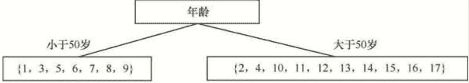

图4-1 基于“年龄”特征对根节点的切分

后续流程采用递归策略：在剩余特征（性别、血压、胆固醇、钠钾比）中继续筛选，发现在分支层“钠钾比”增益最大，故将其作为二级切分标准。按此机制迭代至所有样本落叶，完整模型即告生成（如图4-2所示）。最终仅凭“年龄”与“钠钾比”两维指标，即可精准定型用药方案。

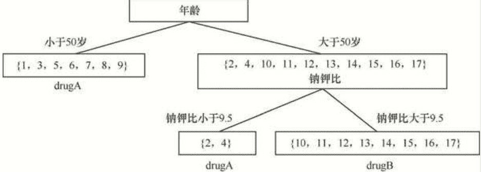

图4-2 基于“钠钾比”特征对分支节点再切分，构建完成的增益驱动决策树

#### 4.2.3 信息增益率

信息增益虽适用通用场景，却存在明显短板：倾向偏好取值繁多的特征。极端情况下，若将表4-1中每个样本单独成枝（裂为17个分支），各节点纯度虽达理论上限，但模型完全丧失泛化能力，新样本无法预判。

为规避此缺陷，引入增益率作为修正指标。其定义为信息增益与特征固有值（IV）之比：

$$Gain\_ratio(D, v) = \frac{Gain(D, v)}{IV(v)}$$

$$IV(v) = -\sum_{v=1}^{V} \frac{D^v}{D} \ln \frac{D^v}{D}$$

其中 $IV(v)$ 量化了特征 $v$ 自身的分布广度。以“年龄”为例，其固有值计算如下：

$$IV(Age) = -\left( \frac{7}{17} \ln \frac{7}{17} + \frac{10}{17} \ln \frac{10}{17} \right) = 0.6775$$

据此，“年龄”特征的增益率为：

$$Gain\_ratio(D, Age) = \frac{0.3970}{0.6775} = 0.586$$

经典的 C4.5 算法即采用该指标甄选最优切分特征。

#### 4.2.4 基尼指数

决策树构建除熵体系外，基尼系数也是常用不纯度度量。其物理意义为：从数据集 $D$ 中随机抽取两个样本，类别标签冲突的概率。定义式为：

```
Gini(D) = 1 - \sum_{i=0}^{m} p_m^2
```

以二分类为例，模型预测生成 A、B 两类预测集，但准确率难达 100%。假设预测为 A 的集合中，真实为 B 的样本占比 $p$，真实为 A 的占比 $1-p$；同理预测为 B 的集合亦同。两次抽样标签冲突的概率均为 $p(1-p)$，合计 $2p(1-p)$，此值直观反映预测优劣。沿用表4-1数据：9人服药 A，8人服药 B，整体基尼值为：

```
Gini(D) = 1 - \frac{9}{17} \times \frac{9}{17} - \frac{8}{17} \times \frac{8}{17}
= \frac{9}{17} + \frac{8}{17} - \frac{9}{17} \times \frac{9}{17} - \frac{8}{17} \times \frac{8}{17}
= \frac{9}{17} \times \left(1 - \frac{9}{17}\right) + \frac{8}{17} \times \left(1 - \frac{8}{17}\right)
= 0.498
```

基尼指数的关键落地场景是评估**特征权重**。构建树时，每个特征导致的基尼下降量经归一化即为其重要度（Scikit-learn 默认输出即为“Gini Importance”）。定义为：

```
Gini\_importance(D) = \frac{D^v}{D} \times \left( \text{Gini}(D) - \sum_{m=1}^{N} \frac{D^{v(m)}}{D^v} \text{Gini}(D^{v(m)}) \right)
```

结合图4-2 复盘表4-1数据：先用“年龄”将 17 样本二分——<50 岁组纯净药 A，基尼系数归零；另一组再按“钠钾比”切分，该特征下的基尼系数为：

```
Gini(D, \text{NaK}) = 1 - \frac{2}{10} \times \frac{2}{10} - \frac{8}{10} \times \frac{8}{10} = 0.32
```

进而可得“年龄”与“钠钾比”的基尼重要性绝对值：

```
Gini\_import(\text{Age}) = \frac{17}{17} \times \left( 0.498 - \frac{7}{17} \times 0 - \frac{10}{17} \times 0.32 \right) = 0.310

Gini\_import(\text{NaK}) = \frac{10}{17} \times \left( 0.32 - \frac{2}{10} \times 0 - \frac{8}{10} \times 0 \right) = 0.188
```

两者绝对值分别为 0.310 与 0.188，归一化后得到重要度 0.622 与 0.378。结论清晰：用药选择高度依赖“年龄”“钠钾比”，而与“性别”“血压”“胆固醇”关联微弱。

需特别注意：特征重要性低 $\neq$ 该特征无信息量。仅说明在当前树结构中未被选中，极可能因其他特征已携带同质信息而被“屏蔽”。这一洞见在高维生物数据挖掘中尤为关键——助从海量噪音中锚定核心驱动因子。

### 4.3 实战演示

下面通过两个完整案例，带你把决策树原理落地为可运行代码。

#### 1. 实战：决策树构建全流程

标准建模流程六步走：
1. **采集数据**：整理含特征与目标值的样本（文献、数据库、实验积累均可）。
2. **清洗标准化**：转数值型、剔除异常值、必要时规范化。
3. **探索性分析**：明确特征/标签角色，摸排相关性。
4. **模型训练**：喂入训练集拟合参数。
5. **效果评估**：测试集验证泛化性能。
6. **上线应用**：推广至新数据场景。

Scikit-learn 已内置决策树实现。以下以表4-1 的 17 条样本为例，演示 Python 构建全过程。

### 清单4-1 数据准备

```
1.  #!/usr/bin/python
2.  #encoding:utf-8
3.  # 将原始数据分为训练数据和测试数据
4.  import numpy as np
5.  from sklearn import tree,metrics
6.  import pydotplus
7.  def gender(s):
8.      it = {'M':0, 'F':1}
9.      return it[s.decode("utf-8")]
10. def BP(s):
11.     it = {'HIGH':0, 'NORMAL':1, 'LOW':2}
12.     return it[s.decode("utf-8")]
13. def Cholesterol(s):
14.     it = {'HIGH':0, 'NORMAL':1, 'LOW':2}
15.     return it[s.decode("utf-8")]
16. def drug_type(s):
17.     it = {'drugA':0, 'drugB':1}
18.     return it[s.decode("utf-8")]
19.     drug_features = 'Age', 'Gender', 'BP', 'Cholesterol',
20.     'Na_to_K'
21.     drug_class = 'drugA', 'drugB'
22. # 读入数据，并将原始数据中的数据转换为数字形式
23. data = np.loadtxt("drug_decision.csv", delimiter=",",
    converters={1:gender, 2:BP, 3:Cholesterol,
                5:drug_type}, dtype=str)
24.     x, y = np.split(data, (5,), axis=1)
25.     print(x,y)
```

通常将数据集切分训练/测试集以评估准确率；亦可全量建树（视业务而定）。

### 清单4-2 划分数据集

```
1.     from sklearn.model_selection import train_test_split
2.     # 拆分训练数据与测试数据，以便进行交叉验证
3.     x_train, x_test, y_train, y_test = train_test_split(x, y, test_size=0.3)
```

随后依次完成训练、测试与预测（见清单4-3~4-5）。

### 清单4-3 模型训练

```
1.     # 3、使用信息熵作为划分标准，对决策树进行训练
2.     clf = tree.DecisionTreeClassifier(criterion='entropy')
3.     print(clf)
4.     clf.fit(x_train, y_train)
```

### 清单4-4 模型测试

```
1.     # 4、使用训练数据预测，验证结果
2.     y_pred = clf.predict(x_train)
3.     y_train = y_train.reshape(-1)
4.     print(y_pred)
5.     print(y_train)
6.     print(np.mean(y_pred == y_train))
```

### 清单4-5 实战预测

```
1.     # 5、对测试数据进行预测
2.     y_pred = clf.predict(x_test)
3.     y_test = y_test.reshape(-1)
4.     print(" accuracy: ")
5.     print(metrics.accuracy_score(y_test, y_pred))
6.     print(y_test)
7.     print(np.mean(y_pred == y_test))
```

输出特征权重如下：

feature_importances:

| 特征 | 重要性 |
|------|--------|
| Age | 0.643312969322477 |
| Gender | 0.0 |
| BP | 0.0 |
| Cholesterol | 0.0 |
| Na_to_K | 0.35668703067752305 |

结果印证前文分析：“年龄”与“钠钾比”主导分类判别。代码生成的树拓扑见下图，仅两层切分即实现用药类别完美分离。

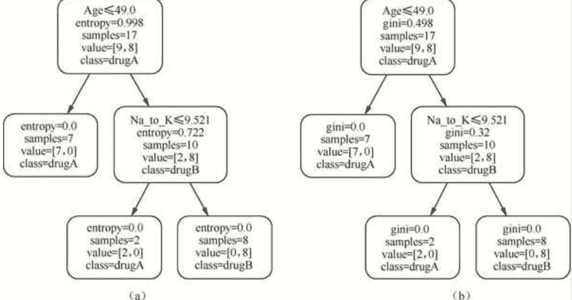

图4-3 代码复现的给药决策树

#### 2. 进阶案例：激酶抑制剂分型实战

决策树适用面极广。本节演示其在药物筛选中的应用——对激酶抑制剂分型。依结合模式与位点差异，抑制剂可分为 I 型、II/2 型、II 型、别构剂 A 共四类。以分子描述符为特征，激酶类别为标签，完成训练与验证。完整代码见清单4-6。

### 清单4-6 决策树分类激酶抑制剂

```
1. # from pandas import read_csv
2. from sklearn.model_selection import train_test_split
3. import pandas as pd
4. import numpy as np
5. from sklearn.preprocessing import OneHotEncoder, StandardScaler
6. from sklearn import tree,metrics
7. dataframe = read_csv("kinase_selected.csv", delimiter = ',')
8. dataset = dataframe.values
9. X = dataset[:,1:]
10. scaler = StandardScaler()
11. X_scaled = scaler.fit_transform(X)
12. print(X_scaled.shape)
13. #feature_names = dataframe_cat.columns.values[2:]
14. feature_names = dataframe.columns.values[1:]
15. features = np.array(feature_names)
16. print("All features: ")
17. print(features)
18. print("length of features ", len(features))
19. label = pd.read_csv('label_kinase_selected.csv', sep=',', )
20. from sklearn import preprocessing
21. from sklearn.preprocessing import OneHotEncoder, StandardScaler
22. le = preprocessing.LabelEncoder()
23. y=label.iloc[:,-1]
24. print(y.shape)
25. # label encoder
26. Y=le.fit_transform(y)
27. print(label['Binding_Modes'].value_counts())
28. # split into input (X) and output (Y) variables
29. X_train, X_test, Y_train, Y_test = train_test_split(X_scaled, Y, test_size=0.2, random_state=42, stratify=Y)
30. print("Feature data dimension: ", X_train.shape)
31. print("Num of classes: ", Y_train.shape)
32. estimator = tree.DecisionTreeClassifier()
33. estimator.fit(X_train, Y_train)
34. print("train score: ", estimator.score(X_train, Y_train))
35. print("test score: ", estimator.score(X_test, Y_test))
```

代码执行完毕，分类准确率结果如下：

训练集得分：1.0
测试集得分：0.6377

结果表明，决策树确实能胜任激酶抑制剂的四分类任务。然而，训练集完美得分（1.0）与测试集表现（约63.8%）之间存在巨大落差，典型的过拟合现象显现。此处采用的是决策树的默认配置，实际上，通过调整超参数或引入集成学习策略，完全有望进一步提升预测精度与模型泛化能力。

#### 3. 决策树超参数调优实战

想让模型预测更精准，超参数调优是绕不开的环节。但需明确：不存在放之四海而皆准的优化方案，一切取决于具体业务场景。Wolpert 和 Macready 提出的“没有免费午餐定理”指出：任何迭代优化算法，若在某类问题上表现优异，必在另一类问题上不如随机搜索。因此，调优策略必须因地制宜。

常见的调优手段包括网格搜索交叉验证（GridSearchCV）、随机搜索交叉验证（RandomizedSearchCV）、贝叶斯优化等。下文以网格搜索交叉验证为例，演示如何为决策树“把脉问诊”，详见清单 4-7。

### 清单4-7 网格搜索交叉验证调优决策树超参数

```
1. #grid search
2. from sklearn.model_selection import GridSearchCV
3. 
4. params = {
5.     'max_depth': range(1, 10),
6.     'min_samples_leaf': range(1, 20)
7. }
8. 
9. grid_search = GridSearchCV(
10.     estimator,
11.     param_grid = params,
12.     scoring = 'accuracy',
13.     cv=5
14. )
15. 
16. grid_search.fit(X_train, Y_train)
17. print(grid_search.best_params_)
18. 
19. estimator_opt = tree.DecisionTreeClassifier(max_depth=grid_search.best_params['max_depth'],
20. min_samples_leaf=grid_search.best_params_['min_samples_leaf'])
21. estimator_opt.fit(X_train, Y_train)
22. print(" train score: ", estimator_opt.score(X_train, Y_train))
23. print(" test score: ", estimator_opt.score(X_test, Y_test))
```

在五折交叉验证框架下，我们重点优化了 `max_depth`（树的最大深度）与 `min_samples_leaf`（叶节点最小样本数）两个关键参数。前者限制模型复杂度，后者防止叶子节点过于稀疏。网格搜索输出的最优参数组合如下：

```
{'max_depth': 7, 'min_samples_leaf': 12}
```

基于这组参数重新训练模型，结果如下：

```
train score: 0.7652173913043478
test score: 0.6799007444168734
```

对比可见：虽然训练集得分较未调优时有所回落，但测试集表现显著提升。这正是调优的核心逻辑——**不盲目追求训练期的“满分”，而是寻找拟合能力与泛化能力的平衡点**。若模型过度贴合当前训练数据，反而会削弱其面对新数据时的适应性。实战中需根据业务容忍度，在两者间做权衡取舍。

## 第5章 集成学习：众智成林，化弱为强

本章聚焦集成学习。它非单一算法，而是通过构建并融合多个学习器协同完成任务。无论分类、回归、特征筛选还是异常检测，集成学习几乎渗透机器学习的每个角落。

### 5.1 核心理念：从“弱学习器”到“强学习器”

监督学习中，单一模型往往难以全面稳健，常陷入“有偏好”的弱势（即弱学习器/弱监督模型）。集成学习的思路是**“三个臭皮匠，顶个诸葛亮”**：将多个弱学习器组合，互补纠错，合成一个泛化更强、表现更全面的强学习器。

集成学习的基本范式：构建一系列学习器 -> 按特定规则融合结果 -> 获得超越个体的整体效果。主要流程参考图 5-1。

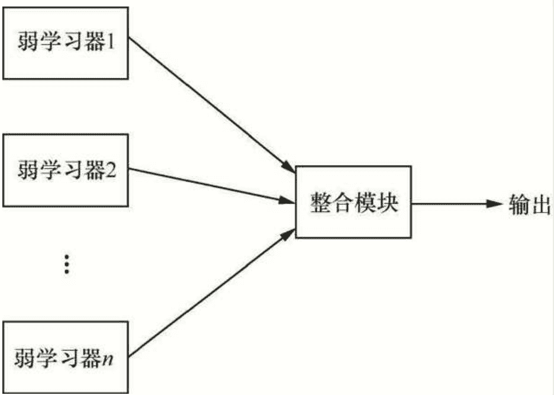

图5-1 集成学习主要流程

**弱学习器的来源主要有两类：**

1.  **同质集成**：基学习器类型一致（全是决策树、或全是神经网络）。典型代表：Bagging、Boosting 系列。
2.  **异质集成**：基学习器类型多样（如 SVM + 逻辑回归 + 朴素贝叶斯），再经结合策略决策。典型代表：Stacking。

**按学习器间依赖关系分类：**

1.  **强依赖·串行生成**：后一轮依赖前一轮结果，代表算法——**Boosting 系列**。
2.  **无强依赖·并行生成**：各学习器相互独立，代表算法——**Bagging 系列**。

#### 5.1.1 Bagging：并行投票的“民主派”

Bagging 核心流程（见图 5-2）：从原始数据有放回抽样出 T 个子集 -> 各子集独立训练基分类器 -> 融合预测（分类用简单投票，回归用简单平均；票数持平随机选）。

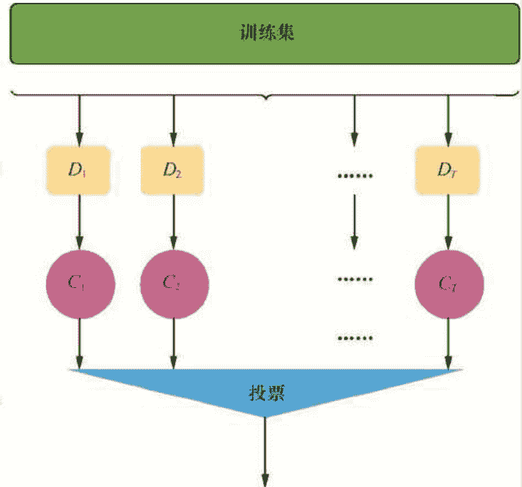

图5-2 Bagging 主要思路

**关键特性：**
*   **天然并行**：极适合大规模数据处理。
*   **多样性源泉**：有放回采样使各子集差异化，训练出差异化基分类器，多样性保证集成上限。
*   **采样细节**：初始样本量 m，每次采 n 个放回。采样后，部分样本重复出现，部分从未现身（即袋外数据 OOB）。

> **视角拓展**：从偏差-方差分解看，Bagging 主攻**降低方差**。

#### 5.1.2 Boosting：串行迭代的“精英派”

与 Bagging 不同，Boosting 因基学习器强依赖，**只能串行迭代**（见图 5-3）。
流程：训练基学习器1 -> 按表现调整样本分布（升高错分样本权重，降低正确样本权重） -> 训练基学习器2 -> 循环至 T 轮 -> 加权融合（错少权重大，错多权重小）。代表作：AdaBoost、XGBoost。

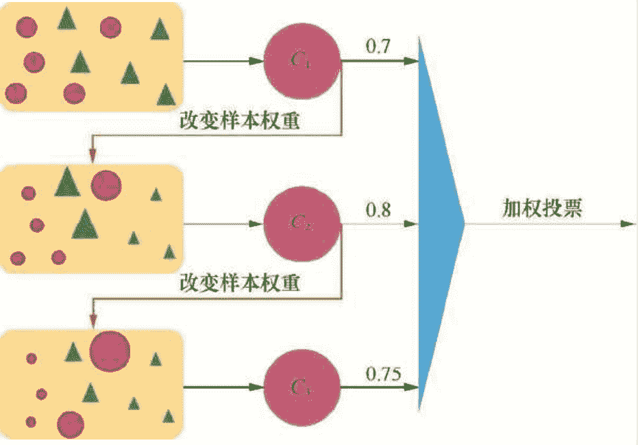

图5-3 Boosting 示意图

> **视角拓展**：从偏差-方差分解看，Boosting 主攻**降低偏差**。

### 5.2 集成方法论：结合策略与多样性构建

集成效果取决于两大支柱：**怎么融合（结合策略）** 与 **怎么造不同（多样性来源）**。

#### 5.2.1 三大结合策略

训练完一堆基学习器，如何“开会决策”？常用三板斧：平均法、投票法、学习法。

**1. 平均法——回归首选**
*   **简单平均**：$H(x) = \frac{1}{T}\sum_{i=1}^T h_i(x)$ ```
\( O(x) = \frac{1}{T} \sum_{i=1}^{T} o_i(x) \)
```
*   **加权平均**：$H(x) = \sum_{i=1}^T w_i h_i(x)$ ```
\( O(x) = \sum_{i=1}^{T} w_i o_i(x) \)
```，权重 $w_i \ge 0, \sum w_i = 1$ ```
\( w_i > 0, \sum_{i=1}^{T} w_i = 1 \)
```。
*   *提示*：加权不一定优于简单平均，视具体情况而定。

**2. 投票法——分类主流**
*   **绝对多数投票**：得票超半数者胜出。多用于二分类（多分类难达半数）。
*   **相对多数投票**：得票最多者胜出。解决多分类难题。
*   **加权投票**：引入权重联合决策。用于复杂场景，常可转化为回归处理。
*   *提示*：平票随机定夺。

**3. 学习法——数据量大时的“终极武器”**
核心：**用一个模型去学怎么融合**。典型即 **Stacking**。
架构：基学习器 = 初级学习器；融合学习器 = 次学习器/元学习器。
流程（见图 5-4）：初始数据分训练/测试 -> 初级学习器出预测 -> **初级学习器在验证集上的预测**作元学习器训练特征，**在测试集上的预测**作元学习器测试特征，真实标签作元学习器标签。

图5-4 Stacking 示意图

> **关键注意**：实战中元学习器特征通常来自**多折交叉验证**（图示为四折），而非初级学习器在训练集上的预测，防止信息泄露。

#### 5.2.2 四大多样性注入手段

基学习器“长得太像”，集成无意义。需从数据、特征、标签、参数四个维度制造差异：

1.  **数据样本扰动**：有放回采样（Bagging 核心）。对决策树、神经网络等敏感算法极有效；对 SVM、朴素贝叶斯、KNN 等稳健算法效果有限。
2.  **输入属性扰动**：特征子集随机采样。高维冗余数据中极佳——既造多样性，又降维提速，冗余特征少时不宜用。
3.  **输出表示扰动**：操作标签（如翻转法随机改标签）或转换输出类型（如分类转回归）。较少见。
4.  **算法参数扰动**：同一算法改参数造差异。深度学习中常见（神经网络超参多，微调即生成差异大的基学习器）。

### 5.3 随机森林：Bagging 的“进化版”

随机森林 = **Bagging (决策树基学习器) + 输入属性扰动**。
机制（见图 5-5）：随机抽取样本/属性构建新训练集 -> 训练 CART 决策树 -> 集成融合（分类用相对投票，回归取均值）。

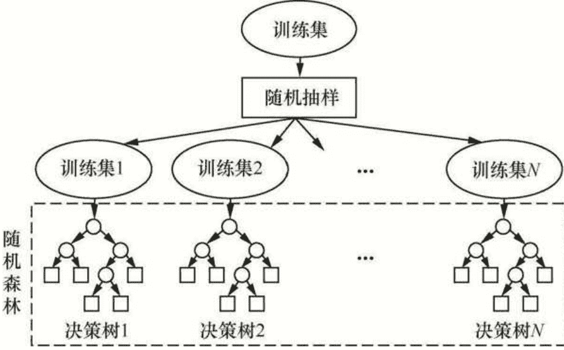

图5-5 随机森林示意图

**为何强？** 双重随机性（样本+特征）极大拉大基学习器差异，泛化性能跃升。
**核心优势**：代码简、训练快、易并行、开销小、效果好、抗过拟合。作为 Bagging 阵营代表，基于 CART 树，分类回归双修。

### 5.4 实战演示

下面通过一个具体案例，演示如何将随机森林算法落地到激酶抑制剂分类任务中。

#### 1. 构建随机森林模型基础框架

构建模型的核心代码请参考 **```
1.  #导入库
2.  from sklearn.ensemble import RandomForestClassifier
3.  #实例化随机森林模型
4.  RF = RandomForestClassifier(n_estimators=100,
5.                   criterion="squared_error",
6.                   max_depth=None,
7.                   min_samples_split=2,
8.                   min_samples_leaf=1,
9.                   min_weight_fraction_leaf=0.0,
10.                  max_features="auto",
11.                  max_leaf_nodes=None,
12.                  bootstrap=True,
13.                  oob_score=False,
14.                  n_jobs=None,
15.                  verbose=0,
16.                  max_samples=None,
17.                  )
```**。

*提示：上述代码均沿用了库的默认参数配置。在实际工程实践中，若无特殊调优需求，这些默认参数往往可直接省略不写。*

##### 核心超参数解析

随机森林的表现高度依赖于超参数设定，关键参数的作用机制如下：

*   **n_estimators（基学习器数量）**：默认 100。过少易导致欠拟合，过多则计算开销大且可能过拟合，需结合业务场景权衡。
*   **criterion（划分准则）**：CART 树节点分裂的评价指标。回归任务默认 `squared_error`，亦可选 `mse`、`absolute_error` 或 `poisson`。
*   **max_depth（树最大深度）**：默认 `None`（完全生长至叶子纯度达标或样本量不足）。限制深度是防止过拟合的常用手段。
*   **min_samples_split（内部节点最小分裂样本数）**：默认 2。样本量低于此阈值的节点将停止分裂。
*   **min_samples_leaf（叶节点最小样本数）**：默认 1。样本过少的叶子会被剪枝合并；大样本场景下适当增大可起到平滑正则化作用。
*   **min_weight_fraction_leaf（叶节点最小加权样本占比）**：权重总和低于设定值的叶子将被视为不合格，常用于样本权重不均的场景。
*   **max_features（分裂时最大特征数）**：默认 `auto`。可选 `sqrt`、`log2` 或指定整数/浮点数，通过限制特征视野增强树间差异性。
*   **max_leaf_nodes（最大叶节点数）**：默认不限。高维特征下设置上限可有效抑制过拟合。
*   **bootstrap（是否有放回采样）**：默认 `True`。设为 `False` 则退化为使用全量数据构建每棵树（即 Bagging 变体）。
*   **oob_score（袋外评估）**：默认关闭。开启后利用未被采中的样本（约 36.8%）作为免费验证集，无需额外划分数据即可评估泛化能力。
*   **n_jobs（并行核心数）**：默认单核（`None`）。设为 `-1` 可调用所有 CPU 核心加速训练。
*   **verbose（日志冗余度）**：默认 0 静默模式，调大数值可查看训练进度。
*   **max_samples**：仅在 `bootstrap=True` 时生效，控制每棵树的采样比例。

##### 模型训练后的关键属性

拟合完成后，模型对象将保留以下核心状态信息：

*   **feature_importances_**：特征重要性向量，数值越大表示该特征对预测贡献越显著，是特征工程的重要参考。
*   **estimators_**：存储所有训练好的基决策树对象列表，便于模型解析或集成推理。
*   **n_features_** / **n_outputs_**：记录训练时的输入特征维度与输出目标维度。
*   **oob_score_** / **oob_prediction_**：启用 `oob_score=True` 时产出，分别为袋外样本的验证得分与预测结果，可作为模型性能的无偏估计。

##### 常用接口方法速查

*   **fit(X_train, y_train)**：核心训练入口。
*   **predict(X)**：输出类别标签（分类）或数值（回归）。
*   **predict_proba(X)**：输出各类别的概率分布（仅分类任务）。
*   **predict_log_proba(X)**：输出对数概率，数值计算更稳定。
*   **score(X_test, y_test)**：快速返回测试集准确率（分类）或 R²（回归）。
*   **apply(X)**：返回样本在每棵树中落入的叶节点索引，常用于树嵌入特征工程。

---

#### 2. 实战案例：激酶抑制剂活性分类

本节将决策树与随机森林置于同一数据集下对比，直观感受集成学习的提升效果。实验数据集包含 **2013 个激酶抑制剂样本**，每样本由 5 个分子描述符表征（原始 CSV 共 2014 行 6 列，含表头）。

为便于阅读，我们对冗长的特征名进行了映射简写，对应关系见下表：

| 原始特征名 | 简写映射 |
| :--- | :--- |
| r_desc_Average_connectivity_index_chi-2 | feature0 |
| r_desc_Maximal_electrotopological_negative_variation | feature1 |
| r_desc_Second_Mohar | feature2 |
| r_desc_Second_Zagreb_index_by_valence_vertex_degrees | feature3 |
| r_qp_ACxDN^.5/SA | feature4 |

数据集前几行预览如下（完整数据结构参考 **图5-6**）：

| 索引 | feature0 | feature1 | feature2 | feature3 | feature4 |
| :--- | :--- | :--- | :--- | :--- | :--- |
| 0 | 0.293245 | 1.902150 | 7.867279 | 611.0 | 0.021358 |
| 1 | 0.300698 | 6.693446 | 5.678195 | 347.78 | 0.058341 |
| ... | ... | ... | ... | ... | ... |
| 2012 | 0.284379 | 1.861145 | 4.676438 | 314.0 | 0.008033 |

完整建模与评估代码实现见 **```
1. # 导入所需要的库
2. import pandas as pd
3. import numpy as np
4. import matplotlib.pyplot as plt
5. import matplotlib as matplotlib
6. import seaborn as sns
7. from sklearn.ensemble import RandomForestClassifier
8. from sklearn.datasets import fetch_openml
9. import joblib
10. from sklearn.model_selection import train_test_split
11. from sklearn import tree
12. import sklearn
13. #读取数据
14. df = pd.read_csv("kinase_selected.csv", delimiter=',', header=0, index_col=0)
15. label = pd.read_csv('label_kinase_selected.csv', sep=',')
16. #查看是否有缺失值
17. print(df.isnull().any())
18. #输出结果
19. # Unnamed: 0
20. False
21. # r_desc_Average_connectivity_index_chi-2
22. False
23. # r_desc_Maximal_electrotopological_negative_variation
24. False
25. # r_desc_Second_Mohar
26. False
27. # r_desc_Second_Zagreb_index_by_valence_vertex_degrees
28. False
29. # r_qp_ACxDN^.5/SA
30. False
31. feature_list = ['feature'+str(i) for i in range(5)]
32. feature_list = pd.array(feature_list)
33. #显示统计数据
34. print(df.describe())
35. #输出效果如图5-7所示
36. #相关性矩阵
37. corr = df.corr()
38. sns.heatmap(corr, xticklabels=feature_list, yticklabels=feature_list)
39. #输出如图5-8所示
40. print(corr)
41. from sklearn import preprocessing
42. from sklearn.preprocessing import OneHotEncoder, StandardScaler
43. le = preprocessing.LabelEncoder()
44. y=label.iloc[:,-1]
45. #print(y.shape)
46. #产生X, y, 即特征值与目标值
47. dataset = df.values
48. X = dataset[:, :]
49. #lable encoder
50. y=le.fit_transform(y)
51. #将数据分为训练集和测试集
52. X_train, X_test, y_train, y_test = train_test_split(X, y, test_size=0.2, random_state=123, stratify=y)
53. #实例化
```** 与 **```python
48. dtree = tree.DecisionTreeClassifier(
49.     criterion='entropy',
50.     max_depth=5, # 定义树的深度，可以用来防止过拟合
51.     min_weight_fraction_leaf=0.005 # 定义叶节点最少需要包含多少个样本（使用百分比表达），防止过拟合
52. #训练
53. dtree = dtree.fit(X_train, y_train)
54. #输出结果
55. print(" 决策树: train score: ", dtree.score(X_train, y_train))
56. print(" 决策树: test score: ", dtree.score(X_test, y_test))
57. #获取特征重要性
58. importances = dtree.feature_importances_
59. #获取特征名称
60. feat_names = df.columns
61. #排序
62. indices = np.argsort(importances)[::-1]
63. #绘图
64. plt.figure(figsize=(10, 6))
65. plt.title(" Feature importances by Decision Tree ")
66. plt.bar(range(len(indices)), importances[indices], color='lightblue', align="center")
67. # plt.step(range(len(indices)), np.cumsum(importances[indices]), where='mid', label='Cumulative')
68. plt.xticks(range(len(indices)), feature_list[indices], fontsize=14)
69. plt.xlim([-1, len(indices)])
70. #输出结果
71. plt.show()
72. #实例化随机森林
73. rf = RandomForestClassifier(
74.     n_estimators=100,
75.     criterion='entropy',
76.     max_depth=7, # 定义树的深度，可以用来防止过拟合
77.     min_samples_split=10, # 定义至少多少个样本的情况下才继续分叉
78.     #min_weight_fraction_leaf=0.02 # 定义叶节点最少需要包含多少个样本（使用百分比表达），防止过拟合
79. #模型训练
80. rf.fit(X_train, y_train)
81. #输出结果
82. print(" 随机森林: train score: ", rf.score(X_train, y_train))
83. print(" 随机森林: test score: ", rf.score(X_test, y_test))
84. #特征的重要程度
85. importances = rf.feature_importances_
86. #特征名称
87. feat_names = df.columns
88. #排序
89. indices = np.argsort(importances)[::-1]
90. #绘图
91. plt.figure(figsize=(10, 6))
92. plt.title(" Feature importances by RandomForest ")
93. plt.bar(range(len(indices)), importances[indices], color='lightblue', align="center")
94. # plt.step(range(len(indices)), np.cumsum(importances[indices]), where='mid', label='Cumulative')
95. plt.xticks(range(len(indices)), feature_list[indices], fontsize=14)
96. plt.xlim([-1, len(indices)])
97. #输出结果
98. plt.show()
99. #保存模型
100. joblib.dump(dtree, "train_model_dtree.m")
101. #调用模型
102. clf = joblib.load("train_model_dtree.m")
103. #保存模型
104. joblib.dump(rf, "train_model_rf.m")
105. #调用模型
106. clf = joblib.load("train_model_rf.m")
```**。

# 激酶抑制剂数据探索与建模分析

激酶抑制剂数据集的统计分布概览见图5-7。图中呈极值、中位数及均值等关键指标，为剔除离群样本、调优模型超参数提供了直观依据。

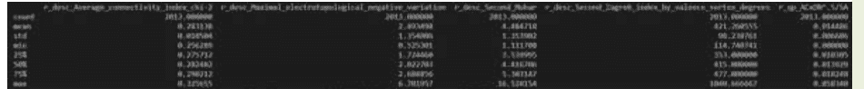

图5-7 激酶抑制剂数据集数据分布情况

借助图5-8的热力图，我们能直观捕捉特征间的关联强弱。该矩阵由`sns.heatmap()`生成，主对角线代表特征自相关，数值恒为1。观察可知，对角线色块整体偏浅，其中feature2与feature3颜色最淡，揭示二者存在显著的线性共线性。

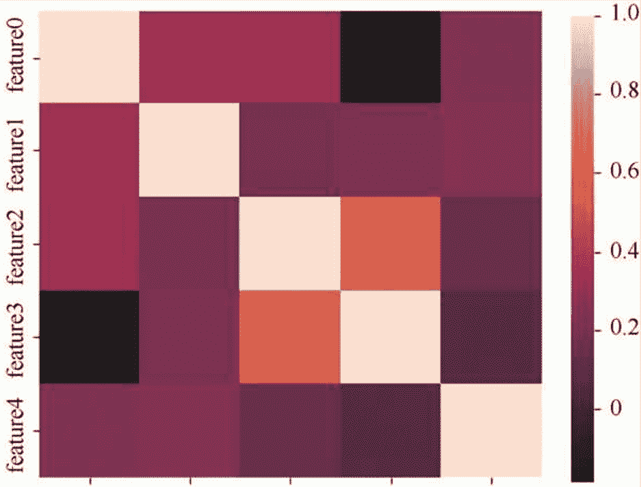

图5-8 特征相关性图

图5-9与图5-10分别展示了决策树与随机森林两种算法输出的特征重要性排序。

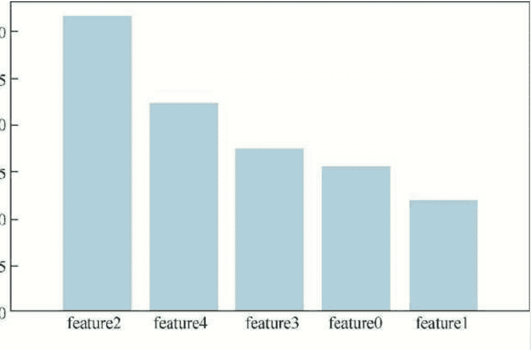

## 图5-9 采用决策树算法获得的特征重要性

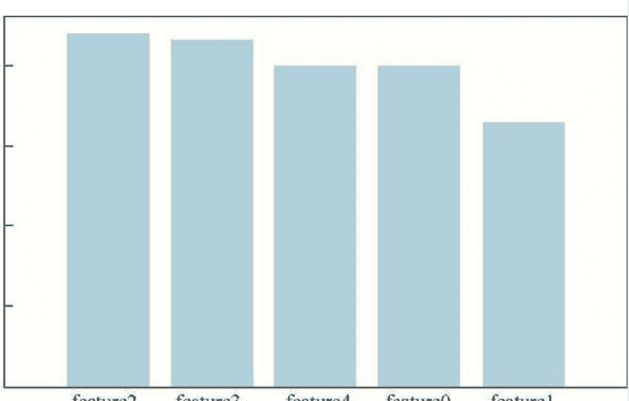

## 图5-10 采用随机森林算法获得的特征重要性

对比两图可见，尽管两模型给出的重要性排序略有出入，但核心结论一致：均能锁定与激酶抑制剂分类强相关的关键特征。据此，我们可人工剔除重要性靠后的冗余特征，从而精简模型、提升预测性能。

实验表明，随机森林与决策树均能胜任该分类任务，且集成学习框架下的随机森林表现更优（详见表5-2）。这印证了集成策略能有效增强模型的泛化能力与预测精度。

## 表5-2 损失情况

| 模型名称/损失 | train_score | test_score |
|---|---|---|
| 决策树（DT） | 0.743 | 0.737 |
| 随机森林（RF） | 0.808 | 0.769 |

## 5.5 参考文献

- [1] 姚登华, 杨静, 詹晓娟. 基于随机森林的特征选择算法[J]. 吉林大学学报: 工学版, 2014, 44(1): 137-141.
- [2] 李欣海. 随机森林模型在分类与回归分析中的应用[J]. 应用昆虫学报, 2013, 50(4): 1190-1197.
- [3] 方匡南, 吴见彬, 朱建平, 等. 随机森林方法研究综述[J]. 统计与信息论坛, 2011, 26(3): 32-38.
- [4] BIAU R, DEVROYE L P, LUGOSI B. Consistency of Random Forests and Other Averaging Classifiers [J]. Journal of Machine Learning Research, 2008, 9(1): 2015-2033.
- [5] GEORGEP. Random forests with bagging and genetic algorithms coupled with least trimmed squares regression for soil moisture deficit using smos satellite soil moisture [J]. International Journal of Geo-Information, 2021, 10(8): 507.
- [6] 范昕, 赵桂新, 孙萌, 等. 使用随机森林判别分析法预测黑加仑油胶囊治疗高血脂的效果[J]. 中医药信息, 2012, 29(4): 43-46.
- [7] CHEN H Y, CHEN J Q, LI J Y, et al. Deep Learning and Random Forest Approach for Finding the Optimal Traditional Chinese Medicine Formula for Treatment of Alzheimer's Disease [J]. Journal of Chemical Information and Modeling, 2019, 59(4): 1605-1623.
- [8] RU Xiaoqing, LI Lihong, ZOU Quan. Incorporating distance-based top-n-gram and random forest to identify electron transport proteins [J]. Journal of Proteome Research, 2019, 18(7): 2931-2939.

# 第6章 k近邻算法（KNN）

本章将系统讲解一种兼具实效性与易学性的经典算法——k近邻（k-Nearest Neighbors，KNN）。内容涵盖：核心理论与距离度量分类原理、Python实战数据导入解析、以及多数据源场景下规避距离计算陷阱的实战技巧。

## 6.1 KNN算法核心解析

KNN的工作机制基于“物以类聚”：
1.  拥有带标签的训练样本集；
2.  输入无标签新样本，计算其与训练集中各样本的特征距离；
3.  选取距离最近的$k$个邻居（$k$通常取不大于20的整数）；
4.  以这$k$个邻居中占比最高的类别，作为新样本的预测类别。

**算法特性**：精度高、鲁棒性强（不惧异常值）、无先验分布假设；**短板**：计算与空间复杂度均较高。适用于数值型与标称型数据。

### 6.1.1 理论基石：实例化学习与距离度量

KNN是基于实例学习的典型代表。假设实例映射为$n$维欧氏空间$R^n$中的点。任意实例$x$可表示为特征向量：

$$ \left(\alpha_1(x),\alpha_2(x),\cdots,\alpha_n(x)\right) $$

(6-1)

两实例$x_i, x_j$间的欧氏距离定义为：

$$ d(x_i,x_j) = \sqrt{\sum_{r=1}^n (\alpha_r(x_i)-\alpha_r(x_j))^2} $$

针对离散目标函数$f: R^n \to V$（$V$为有限类别集），KNN训练阶段仅存储样本$\langle x, f(x)\rangle$；分类阶段对查询点$x_q$，找出最近的$k$个训练实例$x_1,\dots,x_k$：

$$ \hat{f}(x_q) \leftarrow \arg \max_{v \in V} \sum_{i=1}^k \delta(v,f(x_i)) $$

预测值$\hat{f}(x_q)$即这$k$个邻居中最高频的类别。若$k=1$，退化为最近邻算法；$k$增大则引入多数表决机制。

图6-1演示了二维空间下的决策边界：1-NN形成沃罗诺伊图（Voronoi Diagram，即梯森多边形），每个训练样本周围构成凸多边形区域，区域内任一点最近邻均为该样本；5-NN则平滑了边界。

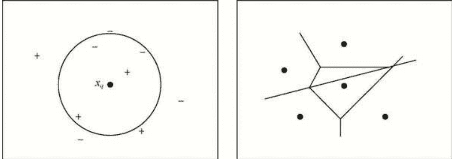

### 图6-1 k 近邻算法

*注：图中1-NN判定查询点为正类，而5-NN因周围负类占多数而判定为负类。*

**术语速查**：
- **回归**：拟合实值目标函数。
- **残差**：预测误差$\hat{f}(x) - f(x)$。
- **核函数**：距离衰减权重函数$\omega_i = K(d(x_i, x_q))$。

**回归任务适配**：将“多数表决”改为“$k$邻居目标值平均”：

```
\(\hat{f}(x_q) \leftarrow \frac{\sum_{i=1}^k f(x_i)}{k}\)
```

### 6.1.2 进阶：距离加权近邻算法（DWNN）

痛点：标准KNN对$k$邻居一视同仁。改进：引入距离倒数加权，近者权重大。

离散目标函数加权表决公式：

$$ \hat{f}(x_q) \leftarrow \arg \max_{v \in V} \sum_{i=1}^k \omega_i \delta(v, f(x_i)) $$

$$ \omega_i \equiv \frac{1}{d(x_q, x_i)^2} $$

若查询点精中训练样本（距离为0），直接采纳该样本标签；多命中则少数服从多数。

实值目标函数加权平均公式：

$$ \hat{f}(x_q) \leftarrow \frac{\sum_{i=1}^k \omega_i f(x_i)}{\sum_{i=1}^k \omega_i} $$

分母为归一化常数，保证全同标签时预测不变。

**全局 vs 局部**：加权机制下理论上可纳入所有训练样本（全局法，即Shepard法），远样本权重趋近于0；仅考虑$k$邻居为局部法。全局法精度潜力更大但计算更慢。

## 6.2 KNN工程落地实战

场景：根据“打斗镜头数”与“接吻镜头数”两特征，判定未知电影属于动作片还是爱情片。

**标准ML流程在KNN中的映射**：
1.  **收集数据**：多源获取。
2.  **准备数据**：转为结构化数值矩阵（距离计算前提）。
3.  **分析数据**：可视化/统计探索。
4.  **训练算法**：**KNN无显式训练过程（惰性学习）**。
5.  **测试算法**：计算错分率。
6.  **使用算法**：输入样本 $\to$ KNN推理 $\to$ 后续业务处理。

### 6.2.1 环境就绪：Python数据载入

新建`KNN.py`模块。建议手敲代码以深化理解，亦可参考配套源码。推荐PyCharm IDE提效。

**清单6-1 依赖导入**
```python
from numpy import *
import operator
def createDataSet():
    group = array([[1.0, 1.1], [1.0, 1.0], [0, 0], [0, 0.1]])
    labels = ['A', 'A', 'B', 'B']
    return group, labels
```

引入`NumPy`支撑科学计算，`operator`模块辅助排序操作。

编写`createDataSet()`函数构造演示数据。于PyCharm中新建`test.py`验证：

**清单6-2 构造数据集与标签**
```python
import KNN
##### 导入上面编辑的程序模块KNN
group, labels = KNN.createDataSet()
print(group)
##### 输入变量的名字以检验是否正确地定义变量
print(labels)
```

输出显示：4个样本，各2维特征（`group`矩阵行对应样本），`labels`向量给出类别（A/B）。受限于人类可视化维度，教学演示常压缩至二维。

### 6.2.2 文本数据解析与核心分类器实现

**KNN分类伪代码流程**：
对每个待分类样本：
1.  计算其与全量训练样本的距离；
2.  距离升序排序；
3.  取前$k$个最近邻；
4.  统计这$k$邻居的类别频次；
5.  返回最高频类别作为预测结果。

**清单6-3 KNN分类器核心实现 (`classify0`)**
```python
import KNN
##### 导入上面编辑的程序模块KNN
group, labels = KNN.createDataSet()
print(group)
##### 输入变量的名字以检验是否正确地定义变量
print(labels)
``` -> *此处原素材为```python
import KNN
##### 导入上面编辑的程序模块KNN
group, labels = KNN.createDataSet()
print(group)
##### 输入变量的名字以检验是否正确地定义变量
print(labels)
```标记清单6-3，保留标记* 
```python
import KNN
##### 导入上面编辑的程序模块KNN
group, labels = KNN.createDataSet()
print(group)
##### 输入变量的名字以检验是否正确地定义变量
print(labels)
```（注：原文此处标记为```python
import KNN
##### 导入上面编辑的程序模块KNN
group, labels = KNN.createDataSet()
print(group)
##### 输入变量的名字以检验是否正确地定义变量
print(labels)
```对应清单6-3，此处保留一致）

请将上述函数追加至`KNN.py`。后续章节将逐行拆解代码逻辑与实战调用细节。

# k近邻算法实战：从核心函数到约会网站配对优化

```python
def classify0(inX, dataset, labels, k):
    dataSetSize = dataset.shape[0]
    # 距离计算
    diffMat = tile(inX, (dataSetSize, 1)) - dataset
    sqDiffMat = diffMat**2
    sqDistances = sqDiffMat.sum(axis=1)
    distances = sqDistances**0.5
    sortedDistIndicies = distances.argsort()
    classCount = {}
    # 选择距离最小的k个点
    for i in range(k):
        voteIlabel = labels[sortedDistIndicies[i]]
        classCount[voteIlabel] = classCount.get(voteIlabel, 0) + 1
    # 排序
    sortedClassCount = sorted(classCount.items(),
                              key=operator.itemgetter(1),
                              reverse=True)
    return sortedClassCount[0][0]
```

`classify0()` 函数接收四个关键参数：待分类的特征向量 `inX`、训练数据集 `dataset`、对应的标签向量 `labels` 以及邻居数量 `k`。值得注意的是，标签向量的长度必须与训练集的行数严格对应。代码清单 6-3 展示了如何利用欧氏距离度量两个向量点 $x_A$ 与 $x_B$ 之间的直线距离，其数学定义如下：

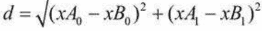

假设数据集包含 4 个特征维度，那么点 (1,0,0,1) 与点 (7,6,9,4) 的距离计算过程为：

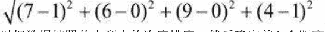

得出所有样本点的距离后，程序会按升序排列。接下来，选取距离最小的前 `k` 个邻居（`k` 必为正整数），统计它们所属的类别频次。通过 `itemgetter()` 对 `classCount` 字典中的元组按频次降序排列，最终返回出现频率最高的类别标签作为预测结果。

想验证分类效果？在 `test.py` 中运行以下指令：

```python
>>> print(KNN.classify0([0, 0], group, labels, 3))
```

预期输出应为 `B`。你也可以自行修改输入向量 `[0, 0]` 来观察不同测试用例的分类表现。

至此，我们已成功构建首个 kNN 分类器，为后续更复杂的分类任务奠定了基础。

## 6.2.3 分类器性能如何评估？

虽然分类器已能跑通，但它并非百发百中。不同算法在不同数据集上的表现差异巨大，且参数配置、数据可分性等因素都会显著影响最终精度。因此，必须引入量化指标来评估模型好坏。

通用做法是：利用已知标签的数据作为“试卷”，对比模型预测与真实标签的偏差。通过大量测试样本，可计算**错误率**——即误判次数除以总测试次数。理想模型错误率趋近 0，失效模型则接近 1.0。后续章节将通过实战案例深入演示。

前文的示例虽能运行，但缺乏实战价值。接下来的 6.3 与 6.4 两节，我们将把 kNN 落地到真实场景：首先优化约会网站的推荐匹配，随后攻克手写数字识别系统，并以此为基准考察算法效能。

### 6.3 实战案例：用 kNN 优化约会网站配对逻辑

本案例以用户“海伦”在约会网站的经历为背景。尽管平台推荐了大量候选人，海伦却始终难觅心仪对象。复盘后，她将过往交往对象归纳为三类：**“不喜欢”**、**“魅力一般”**、**“极具魅力”**。她希望工作日约会“一般”型，周末陪伴“高魅力”型，但苦于无法自动将新推荐对象精准分类。此外，海伦还搜集了平台未记录的额外特征数据，认为这些信息能显著提升分类精度。

**实施路线图：**
1.  **数据获取**：以文本文件形式提供原始数据。
2.  **数据预处理**：用 Python 解析文本，转为结构化矩阵。
3.  **探索性分析**：借助 Matplotlib 绘制二维散点图，直观洞察分布。
4.  **模型验证**：划分训练集与测试集，以已分类数据为基准计算错误率。
5.  **落地应用**：封装命令行工具，海伦只需输入特征即可获得预测类别。

#### 1. 数据预处理：从文本到 NumPy 矩阵

海伦积累了 1000 条约会记录，存放于 `datingTestSet.txt`，每行一个样本，包含三大核心特征：
*   年飞行常客里程数
*   玩视频游戏占比
*   每周冰淇淋消费量

在喂入分类器前，必须将文本转为 NumPy 矩阵与标签向量。`KNN.py` 中新增的 `file2matrix()` 函数专司此任，输入文件名，输出特征矩阵与类别向量。解析逻辑见清单 6-4：

```python
def file2matrix(filename):
    fr = open(filename)
    arrayOLines = fr.readlines()
    # 得到文件行数
    numberOfLines = len(arrayOLines)
    # 创建返回的NumPy矩阵
    returnMat = zeros((numberOfLines, 3))
    classLabelVector = []
    index = 0
    # 解析文件数据到列表
    for line in arrayOLines:
        line = line.strip()
        listFromLine = line.split('\t')
        returnMat[index, :] = listFromLine[0:3]
        classLabelVector.append(int(listFromLine[-1]))
        index += 1
    return returnMat, classLabelVector
```

代码逻辑清晰：先统计行数初始化零矩阵（特征维度固定为 3），逐行读取，`strip()` 去除首尾空白，`split('\t')` 切分字段。前三列写入特征矩阵，最后一列利用负索引 `-1` 取出并转为整型存入标签向量。类型转换细节全托管给 NumPy，省去了手动处理的繁琐。

在 `test.py` 中验证加载效果（需确保 `datingTestSet2.txt` 在工作目录下，并重新加载模块）：

```python
>>> from importlib # 可以放到文件开头的位置
>>> importlib.reload(KNN)
>>> datingDataMat, datingLabels = KNN.file2matrix('datingTestSet2.txt')
```

查看数据概貌：

```python
>>> print(datingDataMat)
>>> print(datingLabels[0:20])
```

仅看数字不够直观，下面引入可视化手段挖掘数据模式。

> **工具提示**
>
> 本章大量使用 NumPy 数组。可在命令行执行 `from numpy import array` 或整体导入库。注意：NumPy 数组与 Python 原生列表操作不兼容，编码时勿混淆。

#### 2. 探索性分析：Matplotlib 绘制散点图

首轮可视化使用特征矩阵的第 2、3 列（游戏时长占比 vs 冰淇淋消费量）绘制原始散点图，代码见清单 6-5：

```python
import matplotlib
import matplotlib.pyplot as plt
fig = plt.figure()
ax = fig.add_subplot(111)
ax.scatter(datingDataMat[:, 1], datingDataMat[:, 2])
plt.show()
```

运行结果如图 6-2 所示。由于缺乏类别标签着色，图中点云混杂，难以辨别分类边界。

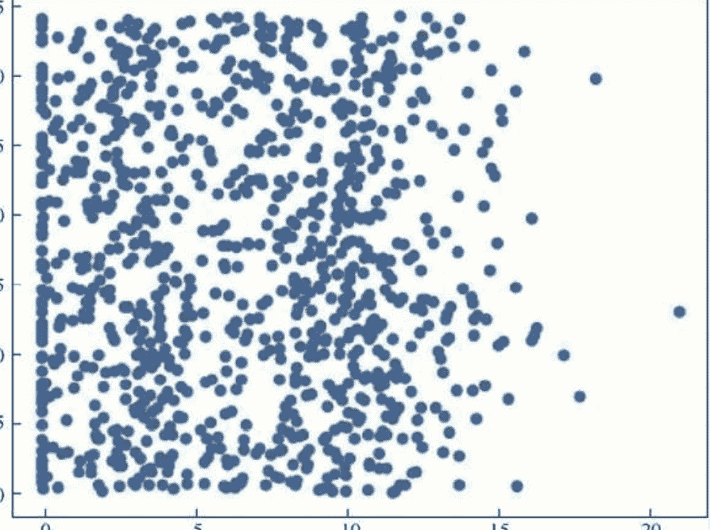

**图 6-2 无标签约会数据散点图：类别边界模糊不清**

为揭示结构，利用 `scatter()` 函数的 `c` 与 `s` 参数，根据 `datingLabels` 赋予不同颜色与尺寸：

```python
>>> from numpy import *
>>> ax.scatter(datingDataMat[:, 1], datingDataMat[:, 2], 15.0 * array(datingLabels), 15.0 * array(datingLabels))
```

优化后的图 6-3 清晰勾勒出三大类别的聚类轮廓。不过，当前仅用两个特征投影，若调整特征组合（如引入里程数），分离度可能更高。

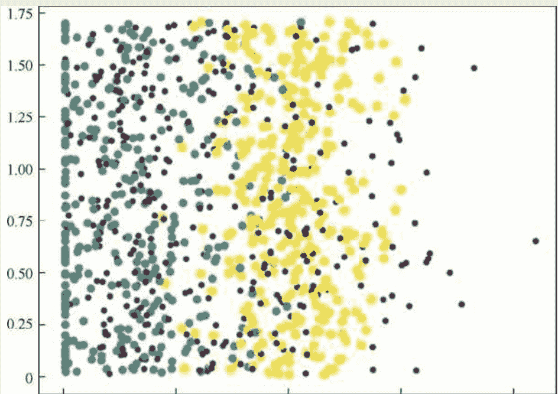

**图 6.3 带类别标签的约会数据散点图：三类人群轮廓分明**

#### 3. 特征工程：归一化消除量纲差异

表 6-1 列出 4 组样本数据。若直接计算样本 3 与 4 的欧氏距离：

$\sqrt{(0-67)^2 + (20000 - 32000)^2 + (1.1 - 0.1)^2}$

显而易见，“里程数”因数值量级极大（万级），主导了距离计算，导致“游戏占比”（小数级）与“冰淇淋”（个位数）特征几乎失语。但业务上三特征同等重要，不能因量纲差异造成权重失衡。

**表 6-1 约会网站样本数据对比**

| 样本 | 游戏时间占比 | 年飞行里程 | 周冰淇淋量 | 类别 |
| :--- | :---: | :---: | :---: | :---: |
| 1 | 0.8 | 400 | 0.5 | 1 |
| 2 | 12.0 | 134,000 | 0.9 | 3 |
| 3 | 0.0 | 20,000 | 1.1 | 2 |
| 4 | 67.0 | 32,000 | 0.1 | 2 |

解决方案是**归一化**，将所有特征压缩至 [0, 1] 区间。转换公式（6-8）如下：

```
newValue = (oldValue - min) / (max - min) (6-8)
```

其中 $min$、$max$ 为该特征列的极值。虽增加预处理步骤，但为保证距离度量公平，势在必行。`KNN.py` 新增 `autoNorm()` 函数实现自动化归一化，详见清单 6-6：

```
def autoNorm(dataSet):
    minVals = dataSet.min(0)
    maxVals = dataSet.max(0)
    ranges = maxVals - minVals
    normDataSet = zeros(shape(dataSet))
    m = dataSet.shape[0]
    normDataSet = dataSet - tile(minVals, (m,1))
    normDataSet = normDataSet/tile(ranges, (m,1))
    return normDataSet, ranges, minVals
```

函数内部：`min(0)` 按列取最小值，`max(0)` 按列取最大值，得出极差 `ranges`。利用 `tile()` 将 1×3 的 `minVals` 与 `ranges` 扩展为 1000×3，与数据矩阵形状对齐，完成向量化批量运算 `(dataSet - minVals) / ranges`。

在 `test.py` 中重载模块并测试：

```
>>> importlib.reload(KNN)
>>> normMat, ranges, minVals = KNN.autoNorm(datingDataMat)
>>> print(normMat)
>>> print(ranges)
>>> print(minVals)
```

若后续流程仅需归一化矩阵，也可仅返回 `normMat`。

#### 4. 模型验证：构建自动化测试流程

数据就绪，进入核心验证环节。通用做法：随机抽取 10% 数据做测试集（原数据无序，直接切片即可保证随机性），剩余 90% 训练模型。错误率 = 误判数 / 测试总数。

`KNN.py` 新增 `datingClassTest()` 函数（清单 6-7），封装完整测试逻辑：初始化错误计数器，遍历测试集调用 `classify0` 预测，与真实标签对比，累加误差，最终输出错误率。该函数自包含，可随时调用复核模型表现。

## 清单6-7 约会网站分类器测试函数

```
def datingClassTest():
    hoRatio = 0.10 #预留出10%的数据
    datingDataMat, datingLabels = file2matrix('datingTestSet2.txt')    #导入文件
4.     normMat, ranges, minVals = autoNorm(datingDataMat)
5.     m = normMat.shape[0]
6.     numTestVecs = int(m*hoRatio)
7.     errorCount = 0.0
8.     for i in range(numTestVecs):
9.         classifierResult = classify0(normMat[i,:],normMat[numTestVecs:m,:],datingLabels[numTestVecs:m],3)#此处使用k = 3
10.    print("the classifier came back with: %d, the real answer is: %d" % (classifierResult, datingLabels[i]))
11.    if (classifierResult != datingLabels[i]):
    errorCount += 1.0
12.    print("the total error rate is: %f" % (errorCount/float(numTestVecs)))
13.    print(errorCount)
```

函数 `datingClassTest()` 的执行流程大致分为四步：先调用 `file2matrix()` 与 `autoNorm()` 读取文件并完成特征归一化；继而依据设定比例划分测试集与训练集；随后将两部分数据送入原版 KNN 分类器 `classify0()` 运行；最后统计误差率并打印输出。特别提醒：此处沿用的是基础版分类器。虽然后续章节大量笔墨讲解数据清洗与特征工程，但获取高质量数据本身同样至关重要。

在 `test.py` 中重新导入 KNN 模块并运行 `KNN.datingClassTest()`，即可看到测试输出：

```
>>> print(KNN.datingClassTest())
the classifier came back with: 3, the real answer is: 3
the classifier came back with: 2, the real answer is: 2
......
the classifier came back with: 2, the real answer is: 1
the classifier came back with: 2, the real answer is: 2
the classifier came back with: 1, the real answer is: 1
the classifier came back with: 1, the real answer is: 1
the classifier came back with: 2, the real answer is: 2
```

约会数据集的分类错误率仅为 0.6%，表现相当优秀。你可以尝试调整 `datingClassTest()` 内部的 `hoRatio`（测试集比例）与 `k` 值（邻居数），观察错误率随参数变动的趋势。受限于算法特性、数据分布及代码配置，不同设定下的输出结果可能差异巨大。

这个案例证明：模型能以极低的误差（0.6%）精准预测分类。海伦只需录入心仪对象的三项指标，系统便能自动判定其吸引力等级——“讨厌”、“一般喜欢”、“非常喜欢”。

## 5.实战落地：搭建完整可用的预测系统

前文已完成分类器验证，现在将其封装为实用工具。我们将为海伦编写一段交互式脚本：她在约会平台锁定目标后录入对方信息，程序即时输出喜好度预测。

请将以下代码追加至 `KNN.py` 并重新加载模块。

## 清单6-8 约会网站预测函数

```
1. def classifyPerson():
2. resultList = ['not at all', 'in small doses', 'in large doses']
3. percentTats = float(raw_input(\
4. "percentage of time spent playing video games?"))
5. ffMiles = float(raw_input(" frequent flier miles earned per year? "))
6. iceCream = float(raw_input(" liters of ice cream consumed per year? "))
7. datingDataMat, datingLabels = file2matrix('datingTestSet2.txt')
8. normMat, ranges, minVals = autoNorm(datingDataMat)
9. inArr = array([ffMiles, percentTats, iceCream])
10. classifierResult = classify0((inArr - \
11. minVals)/ranges, normMat,
12. datingLabels, 3)
13. print "You will probably like this person: ", \
resultList[classifierResult - 1]
```

上述代码大多在前文出现过，唯一的新面孔是 `raw_input()` 函数（Python 2 语法，Python 3 请用 `input()`），它负责捕获用户控制台输入的文本行。为直观感受运行效果，请在终端依次执行如下指令：

```
>>> print(KNN.classifyPerson())
```

至此，我们已掌握在结构化数据上构建分类器的全流程。但现实中海量数据晦涩难懂，如何让分类器“读懂”非结构化信息？这正是下一节要攻克的难题。

## 6.4 经典案例：手写数字识别系统

本书将带你从零搭建一套基于 KNN 的手写数字识别系统。系统识别范围限定为 0-9，样本经图像预处理统一了尺寸与色深。虽以文本格式存储图像不利于内存优化，但极大降低了理解门槛。图 6-4 展示了一个典型样本。

构建流程五步走：

- **收集数据**：直接使用现成的文本文件库。
- **准备数据**：编写 `img2vector()` 将图像转为分类器可识别的列表向量。
- **分析数据**：在 Python 交互环境下校验数据格式合规性。
- **测试算法**：划分已知标签的测试集，预测结果与真实标签对比，不一致即计为错误。
- **使用算法**：本例未实现完整应用，感兴趣可自行扩展：从图片提取数字并完成端到端识别。

### 1. 数据预处理：图像向量化

`trainingDigits` 目录存放约 2000 个训练样本（每个数字约 200 例），`testDigits` 目录存放约 900 个测试样本，两者互不重叠。请自行核对文件命名是否规范。

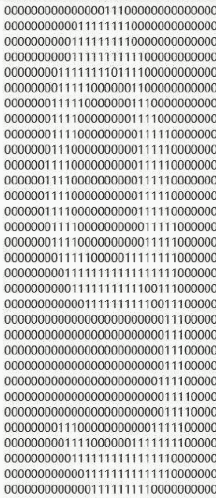

## 图6-4 手写数字数据集样本示意

为复用前序分类器，必须将 32x32 像素图像压平为 1x1024 向量。函数 `img2vector()` 逻辑如下：初始化 1x1024 的 NumPy 零数组，打开文件逐行读取前 32 行，每行前 32 字符（'0' 或 '1'）依次写入数组，最后返回向量。详见清单 6-9。

## 清单6-9 图像转向量函数

```
1. def img2vector(filename):
2.     returnVect = zeros((1,1024))
3.     fr = open(filename)
4.     for i in range(32):
5.         lineStr = fr.readline()
6.         for j in range(32):
7.     returnVect[0, 32*i+j] = int(lineStr[j])
8.     return returnVect
```

将代码写入 `KNN.py`，随后在 `test.py` 中运行测试指令，对比文本编辑器打开的原始文件内容验证正确性：

```
>>> testVector = KNN.img2vector('testDigits/0_13.txt ')
>>> print(testVector[0, 0:31])
>>> print(testVector[0, 32:63])
```

### 2. 算法测评：KNN 实战手写识别

数据就绪后，将其喂入分类器检验实战表现。清单 6-10 给出了自包含的测试函数 `handwritingClassTest()`，请追加至 `KNN.py`。写入前别忘在文件头部添加 `from os import listdir`，用于获取目录文件列表。

## 清单6-10 手写数字识别系统测试代码

```
1.     def handwritingClassTest():
2.         hwLabels = []
3.         trainingFileList = listdir('trainingDigits')      #导入数据集
4.     m = len(trainingFileList)
5.     trainingMat = zeros((m,1024))
6.     for i in range(m):
7.         fileNameStr = trainingFileList[i]
8.         fileStr = fileNameStr.split('.')[0]      #去除字符.txt
9.         classNumStr = int(fileStr.split('_')[0])
10.        hwLabels.append(classNumStr)
11.        trainingMat[i,:] = img2vector('trainingDigits/%s' % fileNameStr)
12.    testFileList = listdir('testDigits')      #测试集
13.    errorCount = 0.0
14.    mTest = len(testFileList)
15.    for i in range(mTest):
16.        fileNameStr = testFileList[i]
17.        fileStr = fileNameStr.split('.')[0]      #去除字符.txt
18.        classNumStr = int(fileStr.split('_')[0])
19.        vectorUnderTest = img2vector('testDigits/%s' % fileNameStr)
20.        classifierResult = classify0(vectorUnderTest, trainingMat, hwLabels, 3)
21.        print("the classifier came back with: %d, the real answer is: %d" % (classifierResult, classNumStr))
22.        if (classifierResult != classNumStr):
errorCount += 1.0
23.        print( "\nthe total number of errors is: %d" % errorCount)
24. print( "\nthe total error rate is: %f" % (errorCount/float(mTest)))
```

核心逻辑解读：遍历 `trainingDigits` 目录，解析文件名（如 `9_45.txt` 标签为 9）构建标签向量 `hwLabels`，同时调用 `img2vector()` 生成 `m` 行 1024 列的训练矩阵。接着遍历 `testDigits` 目录，对每个测试样本调用 `classify0()` 预测，统计错误计数。因像素值仅为 0/1，无需归一化。

在 `test.py` 中调用测试函数。受限于机器性能，数据加载可能耗时较久，随后开始逐个样本测试。

```
>>> print(KNN.handwritingClassTest())
```

KNN 在手写数字集上的错误率约 1.1%。调整 `k` 值、修改测试逻辑、随机抽样或变更训练集规模均会影响最终指标，建议自行实验观察。

**性能瓶颈提示**：实战中 KNN 效率偏低。单次测试需对 2000 训练样本计算 1024 维欧氏距离，共 900 次测试，存储开销约 2MB。如何压缩存储与加速计算是工程落地的必答题。

### KNN 算法的缺陷与主流改进方向

尽管 KNN 简单有效，但短板明显：大规模数据下时空复杂度过高。学术界提出了多种改进变体：

- **模糊 KNN**：引入隶属度函数与模糊分类规则，显著提升大数据集上的精度与速度。
- **多标签 ML-KNN**：针对“单实例多标签”场景，利用邻居标签统计信息结合最大后验原理（MAP）推断未知实例标签集，性能卓越。
- **加权 KNN (WKNN)**：按距离远近分配权重（距离越近权重越大），修正了标准 KNN “一票一权” 的不合理，分类精度通常大幅提升。
- **亲和度/自适应 KNN**：设计新型亲和距离函数实现局部度量学习，实验证明优于多种知名变体。
- **移动环境下的反向 KNN 与四叉树索引**：针对持续移动查询场景，利用空间索引减少重复计算，维护实时邻居集合。
- **融合改进**：KNN 与决策树、SVM、深度学习等模型结合，在特定任务中兼顾精度与复杂度，提供了丰富的工程选型思路。

### 6.5 参考资料

- [1] 毛雪雁, 王水花, 张煜东. K最近邻算法理论与应用综述[J]. 计算机工程与应用, 2017, 53(21): 7.
- [2] 经海东. 基于Voronoi图的空间数据 k-最近邻查询技术的研究[D]. 哈尔滨理工大学, 2016.
- [3] GAO Feng. Fast k-Nearest-Neighbors Calculation for Interpolation of Radar Reflectivity Field [J]. Journal of atmospheric and oceanic technology, 2009, 26(7): 1410-1414.
- [4] 陆凯, 徐华. 基于最近邻距离权重的ML-KNN算法[J]. 计算机应用研究, 2020, 37(4): 4.
- [5] 刘海燕. 基于决策树分类算法的学习成绩分析系统的设计与实现[D]. 电子科技大学, 2011.

## 参考文献

[6] LIU X, TAO X, DUAN Y, 等. 基于 k-NN 旁路熵与互信息估计的遥感图像增量压缩性评估 [J]. China Communications, 2017, 14(8): 9.

[7] 于化龙, 倪军, 徐森. 采用留一交叉验证的类不平衡危害预评估策略 [J]. 小型微型计算机系统, 2012, 33(10): 6.

[8] MINDER L, SINCLAIR A. 扩展 k 树算法 [J]. Journal of Cryptology, 2012, 25(2): 349-382.

[9] 马宏兴. 基于 k 近邻准则的若干模式分类方法研究 [D]. 陕西师范大学, 2018.

[10] 霍凯旋. 基于灰度图像与近邻传播算法的变压器局部放电模式识别研究 [D]. 山东大学, 2019.

## 第7章 神经网络：从仿生起源到反向传播核心原理

人工神经网络（Artificial Neural Network，ANN），简称神经网络（Neural Network，NN），是机器学习领域的基石算法，更是支撑起当今深度学习大厦的关键基础。

回望发展史，神经网络的演进并非一帆风顺，几个里程碑事件深刻塑造了它的命运：**1943年**，生理学家 McCulloch 与数学家 Pitts 联手推出 **M-P 模型**，首次用数学语言抽象出生物神经元的计算逻辑；**1958年**，Rosenblatt 发明 **感知机**，赋予网络“学习”能力，虽仅能解决线性可分问题，却奠定了“模型+算法”的范式；**1982年**，Hopfield 提出全连接的 **Hopfield 网络**，凭借联想记忆特性与硬件友好性，让陷入寒冬的神经网络研究重燃希望；**1986年**，Rumelhart 与 McClelland 正式确立 **BP 算法**（误差逆传播），使多层前馈网络得以高效训练，成为至今应用最广的模型范式之一。

进入新世纪，算力爆发与大数据红利叠加，神经网络在语音识别、计算机视觉、模式识别、智慧医疗及药物研发等领域斩获突破性进展，彻底改写了人工智能的版图。

### 7.1 仿生起源：从生物神经元到 M-P 数学模型

**生物蓝图：复杂而高效的计算机器**

人脑由数亿神经元编织而成，构成极其精密的生物网络。思维的本质，是感知器官接收的信号经此网络加工，最终输出决策与反应。神经元作为神经系统的基本单元，具备“感受-传导”双重职能。结构上，它由**细胞体**与**突起**组成；突起分化为**树突**（输入端，数量多）与**轴突**（输出端，通常单一但末梢分支丰富）。

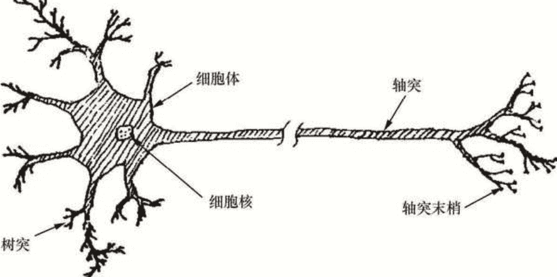

工作流程极具逻辑美感：来自其他神经元的电位信号经树突汇聚至细胞体积分，一旦累加电位跨越**兴奋阈值**，便触发动作电位沿轴突发射，传递给下游神经元；反之则抑制输出。连接的频繁程度，直接决定了突触连接的强弱——这便是生物学层面的“学习”与“记忆”。

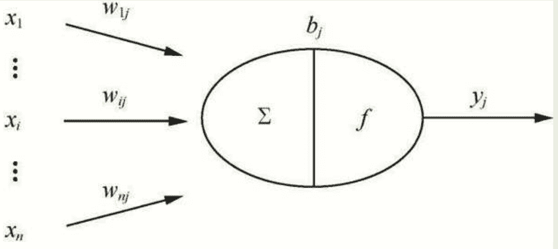

**表 7-1 生物神经元核心结构功能速览**

| 结构 | 核心角色 |
| :--- | :--- |
| **树突** | **输入单元**：接收外部生物信号或上游神经元传递的信息 |
| **细胞体** | **处理单元**：对输入信号加权积分，判断是否突破阈值，输出兴奋或抑制信号 |
| **轴突** | **输出单元**：将细胞体决策经末梢分支传递给下游神经元 |

**数学抽象：M-P 神经元模型的诞生**

受生体启发，科学家试图用算法复刻大脑学习机制，人工神经网络应运而生。它以**人工神经元**为基本单元，按特定拓扑连接构建模型。**M-P 模型**（1943，McCulloch & Pitts）是首个将生物结构数学化的简化模型，如图 7-2 所示。


其核心组件与生物结构一一对应：
- **输入 $x_1 \dots x_n$** $\leftrightarrow$ 树突接收信号
- **权重 $w_{ji}$** $\leftrightarrow$ 突触连接强度
- **加权求和 $\Sigma$** $\leftrightarrow$ 细胞体积分
- **阈值/偏置 $b_j$** $\leftrightarrow$ 兴奋阈值
- **激活函数 $f(\cdot)$** $\leftrightarrow$ 决策“发火”与否，兼具归一化作用
- **输出 $y_j$** $\leftrightarrow$ 轴突发射信号

**数学表达：**
$$y_j = f\left( \sum_{i=1}^{n} w_{ji} x_i + b_j \right)$$

通俗而言，激活函数是“闸门”，决定信息是否通过、以及通过多少。

### 7.2 跨越鸿沟：生物网络与人工网络的本质差异

尽管架构仿生，但人工神经网络与人脑之间仍横亘着难以逾越的鸿沟：

1.  **规模与拓扑的“杂乱度”**：人脑拥有数亿神经元，连接呈**无规则、高稀疏、动态变化**的复杂拓扑；人工网络虽可堆叠参数量，却难以用现有工程手段驾驭这种“看似混乱实则高效”的结构。
2.  **通用性与自主性**：人脑通过**统一入口**（感知器官）处理终身海量任务，自主学习、举一反三；人工网络通常**单任务专用**，架构与超参需人工预设，跨任务泛化能力极弱，“智能底气”明显不足。
3.  **鲁棒与容错**：生物网络**天然抗噪**——每日大量神经元凋亡不影响功能，局部损伤常可随时间恢复；人工网络**脆弱敏感**，单节点失效可能引发级联崩溃。
4.  **学习机制的根本分野**：
    - **生物学习 = 结构重塑**：神经元初始连接混沌，学习即**动态调整拓扑**（建立/削弱/删除连接）直至网络达到稳定态（认知形成）；纠错即继续学习、再稳定。
    - **人工学习 = 参数优化**：架构**固化**（分层：输入层、隐藏层、输出层；层内无连、层间全连或跳连），学习仅调整**权重 $W$ 与偏置 $b$**。
    - **前向传播 $\neq$ 学习**：数据流经网络得输出，参数不变，仅是推理。
    - **反向传播 = 真正的学习**：输出与真值偏差 $\to$ 计算损失 $\to$ 梯度反向流回 $\to$ 更新 $W, b$。循环往复，误差收敛，模型定型。

### 7.3 前馈神经网络：最经典的“流水线”架构

前馈神经网络（FNN）是最早落地、至今仍最主流的范式。其拓扑呈**有向无环图（DAG）**：按层排布，层间全连接，层内无连，无环路。

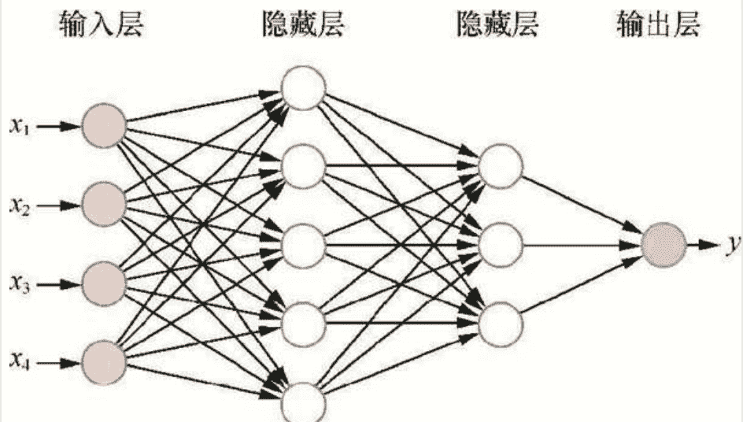

**三层解剖：**
- **输入层**（$l=1$）：数据入口，维度等于特征数。
- **隐藏层**（$1 < l < L$）：特征变换与抽象的核心车间，层数与宽度决定表达能力。
- **输出层**（$l=L$）：任务相关的预测结果（分类概率、回归值等）。

**统一数学符号（表 7-3）：**

| 符号 | 物理意义 |
| :--- | :--- |
| $L$ | 总层数 |
| $M_l$ | 第 $l$ 层神经元数量 |
| $f_l(\cdot)$ | 第 $l$ 层激活函数 |
| $W^{(l)} \in \mathbb{R}^{M_l \times M_{l-1}}$ | 第 $l-1$ 层 $\to$ 第 $l$ 层权重矩阵 |
| $b^{(l)} \in \mathbb{R}^{M_l}$ | 第 $l$ 层偏置向量 |
| $z^{(l)}$ | 第 $l$ 层线性变换结果（输入） |
| $a^{(l)}$ | 第 $l$ 层激活后输出 |

**前向传播迭代公式：**
设 $a^{(0)} = \boldsymbol{x}$（输入样本），则逐层计算：
$$z^{(l)} = W^{(l)} a^{(l-1)} + b^{(l)}$$
$$a^{(l)} = f_l(z^{(l)})$$

合并视角下，整个网络是一个参数为 $\Theta = \{W, b\}$ 的**复合函数** $\Phi$：
$$\boldsymbol{x} = a^{(0)} \to z^{(1)} \to a^{(1)} \to \dots \to z^{(L)} \to a^{(L)} = \Phi(\boldsymbol{x}; W, b) \tag{7-6}$$

输出优劣完全取决于 $W, b$。训练的本质，即通过**反向传播**不断迭代更新这两组参数，逼近最优解。

### 7.4 反向传播算法：让网络“从错误中学习”的核心引擎

BP 算法包含**正向推理**与**反向梯度流**两阶段。以单样本 $(\boldsymbol{x}, \boldsymbol{y})$ 为例，网络输出 $\boldsymbol{y}'$，损失函数 $L(\boldsymbol{y}, \boldsymbol{y}')$。目标：求 $\frac{\partial L}{\partial W^{(l)}}, \frac{\partial L}{\partial b^{(l)}}$。

$$\frac{\partial L(y, y')}{\partial W_{ij}^{(l)}} = \frac{\partial L(y, y')}{\partial z^{(l)}} \left(\frac{\partial z^{(l)}}{\partial W_{ij}^{(l)}}\right)$$
$$\frac{\partial L(y, y')}{\partial b^{(l)}} = \frac{\partial L(y, y')}{\partial z^{(l)}} \left(\frac{\partial z^{(l)}}{\partial b^{(l)}}\right)$$

利用链式法则，需计算三个偏导乘积，关键在于**误差项** $\frac{\partial L}{\partial z^{(l)}}$（记为 $\delta^{(l)}$）的层层回传。

$$\frac{\partial z^{(l)}}{\partial W_{ij}^{(l)}} = \frac{\partial(W^{(l)}a^{(l-1)} + b^{(l)})}{\partial W_{ij}^{(l)}}$$
$$\frac{\partial z^{(l)}}{\partial b^{(l)}} = \frac{\partial(W^{(l)}a^{(l-1)} + b^{(l)})}{\partial b^{(l)}}$$

推导权重与偏置梯度：
- $\frac{\partial z^{(l)}}{\partial W_{ij}^{(l)}} = a_j^{(l-1)}$，$\frac{\partial z^{(l)}}{\partial b_i^{(l)}} = 1$
- 利用 $z^{(l+1)} = W^{(l+1)} a^{(l)} + b^{(l+1)}$ 及 $a^{(l)} = f_l(z^{(l)})$（逐元素运算）：

$$\frac{\partial z^{(l+1)}}{\partial a^{(l)}} = (W^{(l+1)})^T$$
$$\frac{\partial a^{(l)}}{\partial z^{(l)}} = \text{diag}(f'_l(z^{(l)}))$$

得到误差项递推公式（向量形式）：
$$\delta^{(l)} = \text{diag}(f'_l(z^{(l)})) \cdot (W^{(l+1)})^T \cdot \delta^{(l+1)} = f'_l(z^{(l)}) \odot \big((W^{(l+1)})^T \delta^{(l+1)}\big)$$
其中 $\odot$ 为 Hadamard 积（对应元素相乘）。

**核心洞见**：第 $l$ 层误差项仅依赖第 $l+1$ 层误差项——**误差从输出端向输入端反向流动**。

最终参数梯度极简形式：
$$\frac{\partial L}{\partial W^{(l)}} = \delta^{(l)} (a^{(l-1)})^T, \quad \frac{\partial L}{\partial b^{(l)}} = \delta^{(l)}$$

**算法流程总结：**
1.  **初始化** $W, b$。
2.  **正向传播**：计算 $a^{(L)}$ 及各层中间量 $z^{(l)}, a^{(l)}$。
3.  **计算输出层误差项** $\delta^{(L)} = \nabla_{a^{(L)}} L \odot f'_L(z^{(L)})$。
4.  **反向传播**：按 $l=L-1 \dots 1$ 递推 $\delta^{(l)}$。
5.  **计算梯度**并更新参数（如 SGD：$W \leftarrow W - \eta \frac{\partial L}{\partial W}$）。
6.  **迭代** 2-5 直到损失收敛、权重稳定、精度达标。

这就是神经网络“通过试错修正自身”的数学闭环，也是深度学习能够规模化落地的算法基石。

上述内容阐述了神经网络中节点误差的推导与参数修正机制。由此可见，获取某层神经元的偏差值，前提是已知其连接的下一层节点的偏差，故而误差计算必然遵循从输出端向输入端逆序进行的顺序，依次回溯至首个隐藏层，这便是误差逆向传播算法的核心逻辑。

随着技术演进，参数优化手段已趋成熟简便，核心归结为计算梯度并沿反方向下降。梯度指引着误差增大的路径，因此更新参数时取其反向，以抑制权值带来的偏差。工程落地中，还会依据具体场景调整优化策略。

### 7.5 激活函数：赋予模型非线性表达能力

神经网络的本质任务，可视为借助参数与激活算子，去逼近特征与标签间隐匿的真实映射关系。单层结构仅能处理线性可分问题，但叠加两层并引入非线性变换，便具备了逼近任意连续函数的潜能。

神经元的计算过程可拆解为两个阶段：**线性加权累加** 与 **非线性映射**。前者指上层输出经权重求和加偏置；后者即激活算子。若缺失非线性环节，无论堆叠多少处理单元，整体运算仍等价于矩阵连乘，彻底丧失拟合复杂曲面的能力，深层架构将退化为单层表达。此外，激活机制能将数值规约至固定区间，这不仅稳定了训练动态，亦大幅降低了计算负载。主流激活算子涵盖 Logistic、Tanh、ReLU、Leaky ReLU 及 Swish 等。

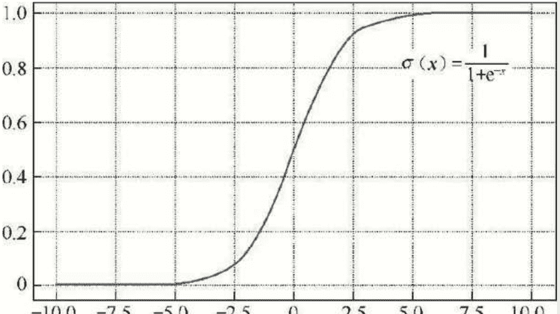

#### 7.5.1 Logistic (Sigmoid) 函数：经典 S 型曲线的局限

Logistic 函数（即 Sigmoid）将实数映射至 (0, 1) 区间，大负值趋近 0，大正值趋近 1，此特性酷似生物神经元的“激发/抑制”机制，定义式为 $\sigma(x) = 1 / (1 + e^{-x})$。

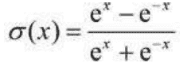

图 7-4 所示为 Logistic 函数的曲线。


图 7-4 Logistic函数

工程实践中鲜用该函数，主要受三大因素制约：其一，曲线两端趋于水平，梯度趋近于零。逆向传播时，饱和区单元参数停止更新，上游梯度随之中断，导致深层结构难以优化，即“梯度衰减”问题。其二，输出均值非零，致使后层输入分布偏移，引发震荡收敛变慢。其三，指数运算开销较大，效率低下。

#### 7.5.2 Tanh 函数：零均值改良，仍难逃饱和困境

双曲正切函数将输出压缩至 (-1, 1)，解决了零均值问题，有利于后续层级收敛。


图 7-5 所示为 Tanh 函数的曲线。

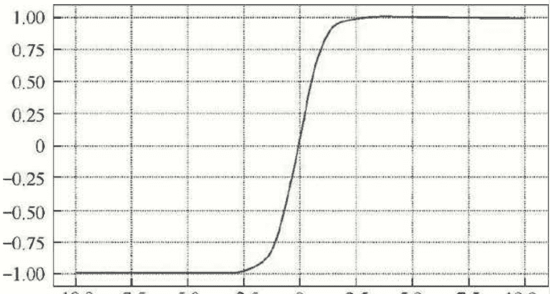

图 7-5 Tanh函数的曲线

然而，它继承了 Sigmoid 的饱和特性，两端梯度同样衰减，深层网络中依然力不从心。

#### 7.5.3 ReLU 函数：深度学习的主流选择

修正线性单元：输入小于 0 时输出 0，大于等于 0 时恒等映射。

$$\sigma(x)=\left\{\begin{array}{ll} x & x \geqslant 0 \\ 0 & x < 0 \end{array}\right.$$

图 7-6 所示为 ReLU 函数的曲线。

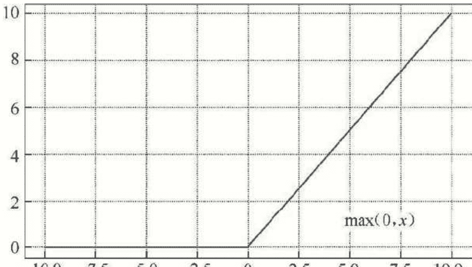

图 7-6 ReLU函数的曲线

**核心优势：**
- **缓解梯度衰减**：正区梯度恒为 1，信号原路回传无损耗，显著加速收敛。
- **极致计算效率**：仅需 `max(0, x)` 阈值操作，无乘除指数，硬件友好。
- **诱导稀疏性**：负区间硬性输出 0，天然促进稀疏表达。

**两大短板：**
1. **输出均值偏移**：同 Sigmoid，均值大于 0，影响后层优化动态。
2. **“神经元死亡”**：输入持续为负时，梯度永为 0，权重冻结，该单元永久失活。

#### 7.5.4 Leaky ReLU：为“死单元”保留一线生机

在负轴保留微小斜率 $\gamma$ (如 0.01)：$x > 0$ 为 $x$，否则为 $\gamma x$。

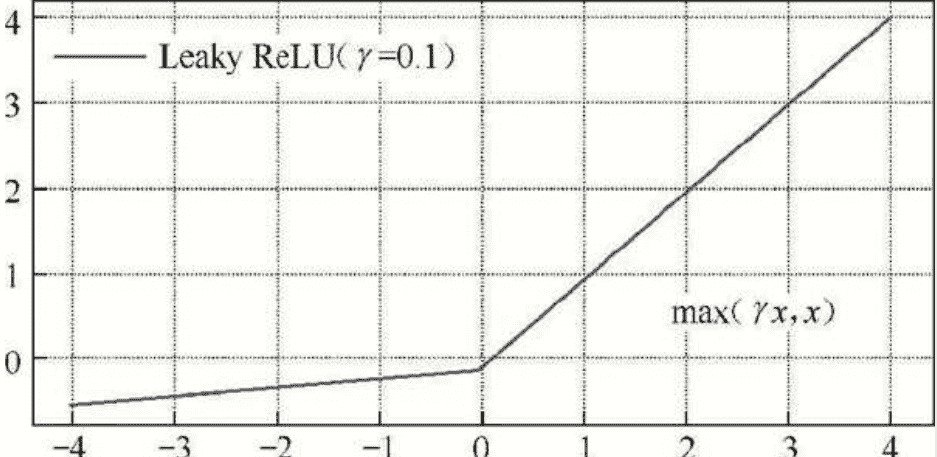

如图 7-7 所示为 Leaky ReLU 函数的曲线。

这一改动保证负区间梯度非零，彻底解决“死单元”问题，参数更新永不停歇。常见变体 PReLU 将 $\gamma$ 设为可学习参数，进一步提升拟合上限。

#### 7.5.5 Swish 函数：自动搜索发现的平滑替代品

$Swish(x) = x \cdot \sigma(\beta x)$，引入门控机制，$\beta$ 可学习或固定。

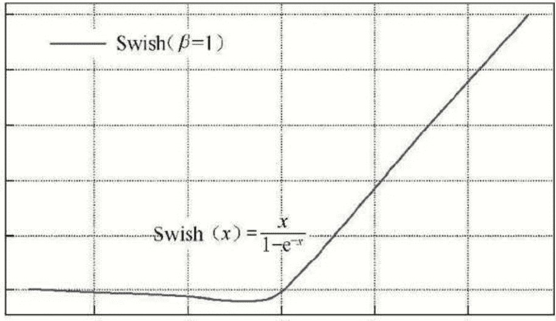

如图 7-8 所示为 Swish 函数（β=1）的曲线。

- $\sigma(\beta x) \approx 1$ 时，门开，输出 $\approx x$（类 ReLU）；
- $\sigma(\beta x) \approx 0$ 时，门关，输出 $\approx 0$。

曲线平滑无突变，兼具 ReLU 非饱和性与 Sigmoid 有界性，在深层架构（如 Transformer、EfficientNet）中常超越 ReLU 表现。

---

### 7.6 实战：TensorFlow 构建激酶抑制剂分类器

完整流程四步走：**数据预处理 → 网络搭建 → 模型训练 → 推理部署**。本节聚焦前两阶段。

#### 7.6.1 数据预处理：垃圾进，垃圾出

原始数据 `kinase_selected.csv` 含 5 列分子描述符特征，首列索引无意义，舍弃。

```python
import pandas as pd
import numpy as np
dataframe = pd.read_csv("kinase_selected.csv")
print(dataframe.head())
```

**规范化处理是必须的**：将各特征缩放至 0 均值、单位方差量级。这不改变分布本质，却能消除量纲差异，让优化路径沿最陡方向直达底部，大幅提速。处理后特征矩阵 `X_scaled` 形状为 (2013, 5)。

```python
dataset = dataframe.values # 不含属性标签的数据值列表
X = dataset[:, 1:]
scaler = StandardScaler() # 定义标准化方法对象
X_scaled = scaler.fit_transform(X) # 将数据传入标准化方法对象中，进行标准化处理
print(X_scaled.shape)
```

标签文件 `label_kinase_selected.csv` 最后一列 `Binding_Modes` 为 4 分类目标（I: 1399, I1/2: 377, II: 190, A: 47），样本量与特征集对齐。

```python
label = pd.read_csv('label_kinase_selected.csv')
print(label.head())
```

**标签映射管线：**
1. `LabelEncoder` 将字符串映射为整数（A:0, I:1, I1/2:2, II:3）。
2. `to_categorical` 做独热编码，转为长度 4 的概率向量，完美匹配输出层 4 个神经元。

```python
label = pd.read_csv('label_kinase_selected.csv')
print(label.head())
y = label.iloc[:, -1]
print('y.shape:', y.shape)
print(pd.DataFrame(label['Binding_Modes'].value_counts())) # 获得各标签的数量
```

```python
from sklearn.preprocessing import LabelEncoder
from tensorflow import keras
le = LabelEncoder()
# 标签编码
Y = le.fit_transform(y)
label_encoder_dict = dict(zip(le.inverse_transform([0, 1, 2, 3], [0, 1, 2, 3])))
print('label_encoder_dict:', label_encoder_dict)
print('label_encoder:', Y)
Y = keras.utils.to_categorical(Y)
print('One-Hot_Encoder:\n', Y[:5])
```

**划分样本集**：`train_test_split` 按 8:2 分层抽样，固定 `random_state` 保证复现性。产出 `X_train`, `X_test`, `Y_train`, `Y_test` 四份数据。

```python
X_train, X_test, Y_train, Y_test = train_test_split(
    X_scaled, Y, test_size=0.2, random_state=42)
```

#### 7.6.2 网络架构搭建：Keras 顺序模型实战

借助 `Sequential` API 栈式堆叠层级，核心组件：
- `Dense`：稠密层，参数量 = (输入维度 + 1 偏置) × 神经元数。
- `Dropout`：训练时随机失活比例单元（如保留 80%），强制学习鲁棒特征，对抗过拟合。

```python
X_train, X_test, Y_train, Y_test = train_test_split(
    X_scaled, Y, test_size=0.2, random_state=42)
```

### 清单 7-7 构建神经网络

**模型拓扑速览（`model.summary()`）：**
1. **Input/Dense-1**：输入维度 5 → 128 单元，ReLU 激活。参数量 = (5+1)×128 = 768。
2. **Dropout-1**：失活率 0.2，无参数。
3. **Dense-2**：128 → 64 单元，ReLU。参数量 = (128+1)×64 = 8,256。
4. **Dropout-2**：失活率 0.2。
5. **Output/Dense-3**：64 → 4 单元，Softmax 输出类别概率。参数量 = (64+1)×4 = 260。

总参数量约 9.3k，轻量级架构适配小规模表格数据，训练极快。后续将配置优化器、损失函数（分类交叉熵）启动训练循环。

```python
from keras.layers import Sequential, Dense, Dropout
model = Sequential(name='model-1')
model.add(Dense(128, activation='relu', input_shape=(5,)))
model.add(Dropout(0.2))
model.add(Dense(16, activation='relu'))
model.add(Dropout(0.2))
model.add(Dense(4, activation='softmax'))
model.summary()
```

图 7-14 神经网络结构摘要

#### 7.6.3 模型训练配置与执行

清单7-8演示了如何为神经网络指定优化器、损失函数及评价指标。`model.compile()` 是模型投入使用前必须完成的编译环节，缺失将导致运行期异常。该方法核心接收三大参数：优化器（`optimizer`）、损失函数（`loss`）与评价指标（`metrics`）。

**优化器指定方式灵活**：既可直接传入字符串别名（如 `'sgd'`, `'adam'`），亦可实例化 `tensorflow.keras.optimizers` 下的类（如 `SGD`, `Adagrad`），后者支持对学习率、动量等超参数进行精细调控。

**损失函数同样支持双模式**：字符串别名（如 `'categorical_crossentropy'`, `'mse'`）与 `tensorflow.keras.losses` 模块下的函数类（如 `MeanSquaredError()`, `SparseCategoricalCrossentropy()`）均可接入，满足不同精度控制需求。

**评价指标按任务类型配置**：`metrics` 参数接受字符串或函数列表，用于监控训练质量。标量回归任务常用 `mean_absolute_error`；One-hot 编码或概率分布输出适配 `categorical_accuracy`；二分类可用 `binary_accuracy`，此外 `sparse_top_k_categorical_accuracy` 等亦为常用选项。

```
model.compile(optimizer='adam',
	loss='categorical_crossentropy',
	metrics=['accuracy'])
```

清单7-9调用 `model.fit()` 启动训练流程，核心入参涵盖训练特征、标签、批次大小（`batch_size`）与迭代轮数（`epochs`）。训练结束后将返回 `History` 对象，其 `history` 属性以字典形式完整记录了各轮次的损失值与指标演变轨迹。

```
history = model.fit(X_train, Y_train,
	batch_size=16,
	epochs=100)
```

利用 `history.history.keys()` 可快速查看可视化字段，随后提取目标键值绘制曲线。清单7-10给出了绘图实现，输出效果见图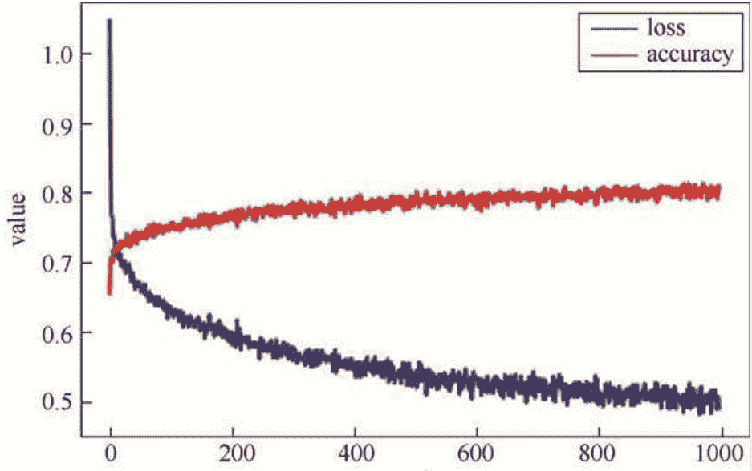。

```
1. import matplotlib.pyplot as plt
2. print(history.history.keys())
3. plt.plot(history.history['loss'], 'b')
4. plt.plot(history.history['categorical_accuracy'], 'r')
5. plt.ylabel( " value ")
6. plt.xlabel( " epoch ")
7. plt.legend([" loss ", " accuracy "])
8. plt.show()
9. print('loss----------',history.history['loss'][-1])
10. print('accuracy----', history.history['categorical_accuracy'][-1])
```


图7-15 训练轮次下的损失值与准确率走势

#### 7.6.4 模型推理与效果验证

曲线显示训练准确率收敛至 0.8 左右。现对测试集开展激酶抑制剂分类预测。鉴于网络输出为概率向量，取向量最大值索引即为预测类别。清单7-11演示了如何遍历预测向量与 One-hot 真实标签提取类别索引，并对比打印细节，结果见图```
y_test_label:
[1, 1, 1, 1, 1, 1, 3, 2, 1, 1, 2, 1, 1, 1, 1, 2, 3, 2, 2, 3, 1, 1, 1, 1, 1, 1, 1, 1,
2, 1, 1, 1, 2, 1, 1, 1, 1, 2, 3, 1, 1, 2, 1, 3, 1, 1, 2, 3, 1, 0, 1, 1, 2, 1, 1, 1, 1,
3, 1, 1, 1, 1, 1, 1, 1, 2, 1, 1, 2, 1, 1, 1, 1, 1, 1, 2, 1, 3, 1, 1, 1, 2, 1, 1, 2, 1, 1, 3,
3, 1, 1, 2, 1, 2, 1, 1, 3, 1, 1, 1, 2, 1, 1, 1, 1, 1, 1, 1, 3, 3, 1, 2, 1, 1, 1, 1, 1,
1, 1, 1, 1, 1, 1, 1, 1, 1, 1, 1, 2, 1, 3, 1, 2, 2, 2, 1, 3, 2, 2, 1, 1, 1, 1, 1, 2, 2, 1,
1, 3, 1, 3, 1, 1, 1, 3, 1, 1, 1, 1, 1, 3, 1, 1, 2, 1, 3, 1, 2, 1, 1, 1, 1, 2, 1, 1, 1, 1,
1, 1, 3, 1, 1, 2, 1, 1, 1, 1, 0, 1, 2, 1, 1, 3, 1, 1, 2, 1, 1, 1, 1, 1, 2, 1, 1, 1, 1, 1]
```。

```
1. y_predict = model.predict(X_test)
2. y_predict_label = [np.argmax(i) for i in y_predict]
3. y_test_label = [np.argmax(i) for i in Y_test]
4. print ('y_predict_label:\n',y_predict_label)
5. print ('y_test_label:\n',y_test_label)
```

```
y_predict_label:
[1, 1, 1, 1, 1, 1, 3, 1, 1, 1, 1, 3, 1, 1, 1, 3, 1, 3, 2, 3, 3, 1, 1, 1, 1, 1, 1, 1, 1,
1, 1, 1, 1, 1, 1, 0, 1, 1, 1, 3, 1, 1, 1, 1, 1, 1, 1, 2, 3, 1, 1, 1, 1, 1, 1, 1, 1, 1, 1,
2, 1, 1, 1, 1, 1, 1, 2, 1, 1, 1, 1, 1, 1, 1, 1, 1, 2, 1, 3, 1, 1, 1, 2, 1, 1, 1, 1, 1, 1,
1, 1, 1, 1, 1, 1, 1, 1, 3, 1, 1, 1, 1, 2, 1, 1, 1, 1, 1, 1, 1, 3, 1, 1, 1, 1, 1, 1, 0, 1,
1, 1, 1, 1, 1, 1, 1, 1, 1, 1, 1, 1, 1, 1, 1, 2, 1, 2, 2, 1, 2, 1, 1, 1, 3, 1, 1, 2, 1,
1, 3, 1, 1, 1, 1, 1, 3, 1, 1, 1, 1, 1, 2, 1, 1, 1, 1, 1, 2, 1, 2, 1, 1, 1, 1, 1, 1, 1,
1, 1, 3, 3, 1, 1, 3, 1, 1, 1, 1, 1, 1, 1, 1, 2, 2, 1, 1, 1, 1, 3, 1, 1, 1, 1, 1, 1, 1]
```

```
y_test_label:
[1, 1, 1, 1, 1, 1, 3, 2, 1, 1, 2, 1, 1, 1, 1, 2, 3, 2, 2, 3, 1, 1, 1, 1, 1, 1, 1, 1,
2, 1, 1, 1, 2, 1, 1, 1, 1, 2, 3, 1, 1, 2, 1, 3, 1, 1, 2, 3, 1, 0, 1, 1, 2, 1, 1, 1, 1,
3, 1, 1, 1, 1, 1, 1, 1, 2, 1, 1, 2, 1, 1, 1, 1, 1, 1, 2, 1, 3, 1, 1, 1, 2, 1, 1, 2, 1, 1, 3,
3, 1, 1, 2, 1, 2, 1, 1, 3, 1, 1, 1, 2, 1, 1, 1, 1, 1, 1, 1, 3, 3, 1, 2, 1, 1, 1, 1, 1,
1, 1, 1, 1, 1, 1, 1, 1, 1, 1, 1, 2, 1, 3, 1, 2, 2, 2, 1, 3, 2, 2, 1, 1, 1, 1, 1, 2, 2, 1,
1, 3, 1, 3, 1, 1, 1, 3, 1, 1, 1, 1, 1, 3, 1, 1, 2, 1, 3, 1, 2, 1, 1, 1, 1, 2, 1, 1, 1, 1,
1, 1, 3, 1, 1, 2, 1, 1, 1, 1, 0, 1, 2, 1, 1, 3, 1, 1, 2, 1, 1, 1, 1, 1, 2, 1, 1, 1, 1, 1]
```

图7-16 预测标签与真实标签对照

为量化评估，清单7-12统计类别分布并计算测试集整体预测精度，执行结果见图```
predict_Results--- Counter({1: 166, 3: 17, 2: 17, 0: 2})
y_test_label----- Counter({1: 146, 2: 33, 3: 21, 0: 2})
correct_prediction--- 0.7871287128712872
```。

```
1. from collections import Counter
2. print ('predict_Results---',Counter(y_predict_label))
3. print ('y_test_label-----',Counter(y_test_label))
4. correct_prediction = np.equal(y_predict_label, y_test_label)
5. print ('correct_prediction---',np.mean(correct_prediction))
```

```
predict_Results--- Counter({1: 166, 3: 17, 2: 17, 0: 2})
y_test_label----- Counter({1: 146, 2: 33, 3: 21, 0: 2})
correct_prediction--- 0.7871287128712872
```

图7-17 类别样本分布与最终预测精度

## 7.7 参考文献

[1] 陈龙鹏. 基于RFID技术的室内定位方法研究[D]. 南京: 南京邮电大学, 2020.
[2] 储琪. 基于深度学习的视频多目标跟踪算法研究[D]. 合肥: 中国科学技术大学, 2019.
[3] 戴风智, 魏宝昌, 欧阳育星, 等. 基于深度学习的视频跟踪研究进展综述[J]. 计算机工程与应用, 2019, 55(10): 16-29.
[4] 段世豪. 基于神经网络深度学习的智能调度算法研究[D]. 成都: 电子科技大学, 2020.
[5] 李炳臻, 刘克, 顾佼佼, 等. 卷积神经网络研究综述[J]. 计算机时代, 2021, (4): 8-12.
[6] 陆峰, 刘华海, 黄长缨, 等. 基于深度学习的目标检测技术综述[J]. 计算机系统应用, 2021, 30(3): 1-13.
[7] 邱天宇, 申富饶, 赵金照, 等. 自组织增量学习神经网络综述[J]. 软件学报, 2016, 27(9): 2230-2247.
[8] 谭俊. 一个改进的YOLOv3目标识别算法研究[D]. 武汉: 华中科技大学, 2018.
[9] 谭璐珊. 面向自然语言处理的深度学习模型优化研究[D]. 长沙: 国防科技大学, 2017.
[10] 谭秀辉. 自组织神经网络在信息处理中的应用研究[D]. 太原: 中北大学, 2015.
[11] 汤烨, 陆卫忠, 陈成, 等. 基于Adam算法和神经网络的照度计算方法[J]. 照明工程学报, 2019, 30(2): 50-54.
[12] 吴森森. 地理时空神经网络加权回归理论与方法研究[D]. 杭州: 浙江大学, 2018.
[13] 严春满, 王钺. 卷积神经网络模型发展及应用[J]. 计算机科学与探索, 2021, 15(1): 27-46.
[14] 杨青, 王晨蔚. 基于深度学习LSTM神经网络的全球股票指数预测研究[J]. 统计研究, 2019, 36(3): 65-77.
[15] 杨挺, 赵黎媛, 刘亚闯, 等. 基于深度强化学习的综合能源系统动态经济调度[J]. 电力系统自动化, 2021, 45(5): 39-47.
[16] 张国栋. 基于深度学习的图像特征学习和分类方法的研究及应用[J]. 网络安全技术与应用, 2018, (7): 52-53.
[17] 张顺, 龚怡宏, 王进军, 等. 深度卷积神经网络的发展及其在计算机视觉领域的应用[J]. 计算机学报, 2019, 42(3): 453-482.

## 第8章 卷积神经网络核心原理与实战

卷积神经网络（CNN）属于深层前馈网络的一种特化形式，其出现推动了计算机视觉领域的突破性进展。本章将系统拆解 CNN 架构与核心运算，补充关键细节，并以药物分子性质预测为例演示实战流程。

### 8.1 网络架构核心组件

#### 8.1.1 卷积层深度解析

CNN 的计算核心是卷积核，亦称滤波器或算子。它作为小型窗口在输入矩阵上滑动，通过卷积运算自动提取特征。

**1. 二维卷积运算机制**

卷积核本质为 $n \times n$ 矩阵（通常取奇数边长便于定位中心，如图8-1所示的 $3 \times 3$ 核）。

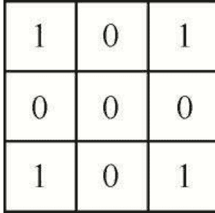

图8-1 $3 \times 3$ 卷积核示意

> **提示**：为便于定位中心，核尺寸通常设为奇数。

以图8-2为例：输入 $3 \times 3$ 矩阵，核尺寸 $2 \times 2$，步长为 1，按“先行后列”顺序滑动。每次滑动覆盖 4 个输入元素，执行对应位置元素乘积求和，生成输出矩阵对应位置的一个值。最终输出形状为 $2 \times 2$。

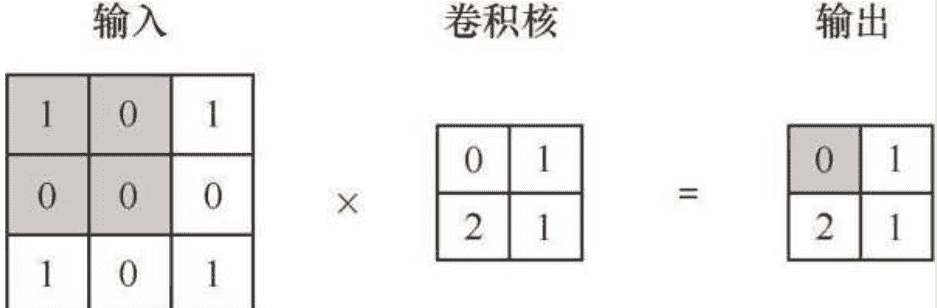

图8-2 二维卷积滑动计算演示

> **核心概念：步长**
> 步长定义核每次移动的像素距离。卷积默认步长=1；池化层默认步长等于池化窗口边长。

详细计算推导如下：

```
1x0+0x1+0x2+0x1=0

0x0+1x1+0x2+0x1=1

0x0+0x1+1x2+0x1=2

0x0+0x1+0x2+1x1=1
```

代码层面，Keras `Conv2D` 层封装了上述逻辑，关键参数详解见清单8-1。

```
tf.keras.layers.Conv2D(
    filters,
    kernel_size,
    strides=(1, 1),
    padding='valid',
    data_format=None,
    dilation_rate=(1, 1),
    activation=None
)
```

**关键参数速查表：**

*   **filters**：卷积核数量，决定输出通道深度。
*   **kernel_size**：核尺寸。正方形用单整数，长方形用元组/列表 `(h, w)`。
*   **strides**：滑动步长，默认 `(1, 1)`，可分别设定横纵向。
*   **padding**：填充策略。`'same'` 保持尺寸（全零填充），`'valid'` 无填充（尺寸缩小），详见 8.2.3 节。
*   **data_format**：数据排布。默认 `channels_last` 即 `(batch, H, W, C)`；`channels_first` 为 `(batch, C, H, W)`。
*   **dilation_rate**：膨胀率（空洞卷积），在核内部插入零扩大感受野，详见 8.2.4 节。
*   **activation**：激活函数，卷积后直接接入（如 ReLU、Sigmoid、Softmax），详见 8.1.5 节。

#### 2. 多维卷积运算拓展

### 8.1 卷积神经网络架构全景解析

承接前文，我们已拆解过二维平面上的卷积逻辑。但在实战视觉任务中，数据维度远不止于此。灰度图虽为单通道二维矩阵，但彩色图像引入 RGB 三原色，瞬间将数据结构拓展为 $h \times w \times 3$ 的立体张量。本章将系统拆解卷积层与池化层的核心机制，重点攻克多维卷积的三大变体——常规卷积、深度卷积、逐点卷积，以及池化层的降维智慧。

---

#### 多维卷积的三大核心范式

面对多通道输入，卷积运算不再是简单的平面滑动，而是演化出三种截然不同的计算范式。

**(1) 常规卷积：跨通道特征融合**
常规卷积的核心逻辑是“合”。输入为多通道（$h \times w \times c_{in}$），卷积核必须同步扩展通道数（$k_h \times k_w \times c_{in}$），输出却压缩为单通道特征图。

以 $3 \times 3 \times 3$ 输入配 $2 \times 2 \times 3$ 卷积核为例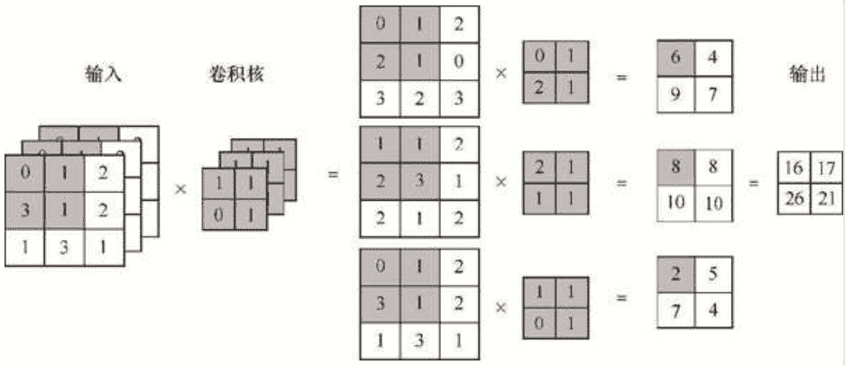。运算时，每个通道独立完成二维互相关运算，随后将三通道结果按元素位置逐一求和，最终融合成 $2 \times 2$ 的单通道输出。具体数值演示如下：
- 位置 (1,1)：$6+8+2=16$
- 位置 (1,2)：$4+8+5=17$
- 位置 (2,1)：$9+10+7=26$
- 位置 (2,2)：$7+10+4=21$

流程总结：单个多通道卷积核 $\rightarrow$ 分通道卷积 $\rightarrow$ 跨通道加权求和 $\rightarrow$ 激活函数 $\rightarrow$ 单通道特征图```
tf.keras.layers.Conv3D(
    filters,
    kernel_size,
    strides=(1, 1),
    padding='valid',
    data_format=None,
    dilation_rate=(1, 1),
    activation=None
)
```。

**关键铁律**：
1.  **通道强绑定**：卷积核通道数必须与输入通道数严格对齐。
2.  **参数自学习**：早期需人工设计核参数，现代 CNN 通过反向传播梯度下降自动寻优，这是其强大表达力的源头。

代码实现参考```
tf.keras.layers.Conv3D(
    filters,
    kernel_size,
    strides=(1, 1),
    padding='valid',
    data_format=None,
    dilation_rate=(1, 1),
    activation=None
)
```。

> **避坑指南**：`kernel_size` 设置时务必隐含通道维度，切勿沿用二维卷积的参数习惯。

**(2) 深度卷积：逐通道独立建模**
常规卷积“融合”通道，深度卷积则选择“分离”。它坚持**多通道入、多通道出**，通道数不增不减。

仍以 $3 \times 3 \times 3$ 输入配 $2 \times 2 \times 3$ 核为例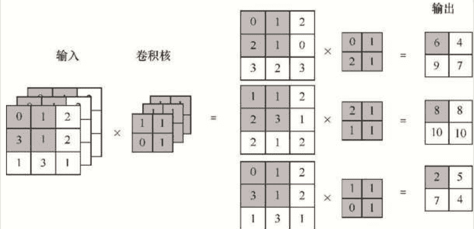。运算时，第 1 个核通道仅处理第 1 个输入通道，以此类推，互不干扰。三个通道并行输出三张 $2 \times 2$ 特征图，堆叠成 $2 \times 2 \times 3$ 张量。这种机制大幅削减参数量，是轻量化网络（如 MobileNet）的基石。

**(3) 逐点卷积：$1 \times 1$ 的维度魔术师**
逐点卷积核尺寸固定为 $1 \times 1 \times C_{in}$，本质是逐像素的全连接映射。它常紧随深度卷积之后，组成“深度可分离卷积”组合拳：
- **补全交互**：弥补深度卷积无法跨通道聚合的短板，在空间原位实现通道间信息流动。
- **双重功效**：
  1. **注入非线性**：等价于逐像素的全连接层 + 激活函数，提升网络拟合复杂函数的能力。
  2. **自由调控维度**：通过核数量（$N$）直接决定输出通道数（$C_{out}$），实现升维扩充或降维压缩，平衡精度与算力。

**核心参数公式**：核形状 $= 1 \times 1 \times C_{in} \times C_{out}$。输出特征图数量 $\equiv$ 卷积核数量（注意区分“核通道数”与“核数量”）。

---

### 8.1.1 卷积层：特征提取的核心引擎

卷积层是 CNN 的“眼睛”，核心组件是卷积核——那个在输入上游走的“感受野窗口”。

#### 1. 二维卷积：一切的起点
卷积核通常设为奇数边长（如 $3 \times 3$）以利于定位中心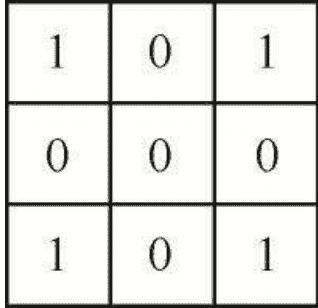。以 $3 \times 3$ 输入配 $2 \times 2$ 核、步长 1 为例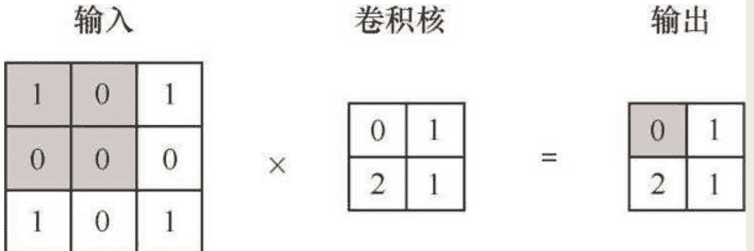。核从左上向右下滑动，每步覆盖 4 个元素，执行“对应相乘、求和”得到输出矩阵对应位置的值。

**示例推演**```
1x0+0x1+0x2+0x1=0
0x0+1x1+0x2+0x1=1
0x0+0x1+1x2+0x1=2
0x0+0x1+0x2+1x1=1
```：
输入 $3 \times 3$，核 $2 \times 2$，步长 1，输出 $2 \times 2$。四次滑动对应四个输出元素，计算逻辑清晰直观。

**工程落地**见代码清单```
1.   tf.keras.layers.Conv2D(
2.       filters,
3.       kernel_size,
4.       strides=(1, 1),
5.       padding='valid',
6.       data_format=None,
7.       dilation_rate=(1, 1),
8.       activation=None
9.   )
```。核心超参解读：
- `filters`：核数量 $\rightarrow$ 输出通道数。
- `kernel_size`：核空间尺寸（整数或元组）。
- `strides`：滑动步长，默认 (1,1)。
- `padding`：'same' 补零保尺寸，'valid' 不填充缩尺寸。
- `data_format`：'channels_last' (NHWC) 或 'channels_first' (NCHW)。
- `dilation_rate`：膨胀率，引入空洞扩大感受野。
- `activation`：融合激活函数，如 ReLU。

#### 2. 多维卷积：通道维度的博弈
彩色图像引入通道维 $C$，将卷积推向立体空间。

**(1) 常规运算：融合压缩**
输入 $h \times w \times C_{in}$，核 $k_h \times k_w \times C_{in}$，输出单通道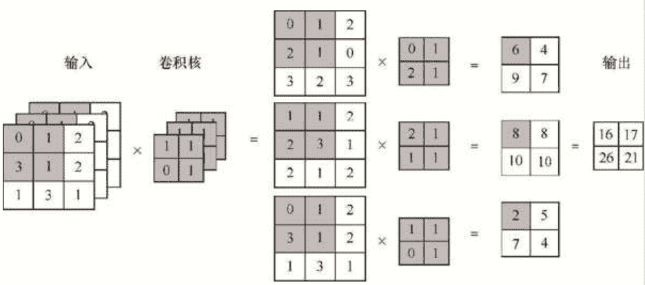。分通道卷积后求和融合，数值复现同上。核心原则不变：核通道=输入通道；核参数由梯度下降自动学习```
tf.keras.layers.Conv3D(
    filters,
    kernel_size,
    strides=(1, 1),
    padding='valid',
    data_format=None,
    dilation_rate=(1, 1),
    activation=None
)
```。

**(2) 深度卷积：并行保持**
输入输出通道数锁定一致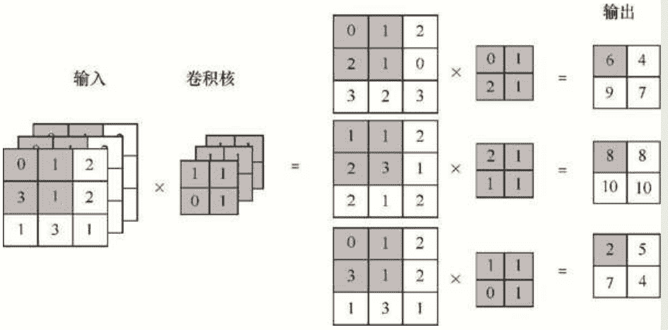。$3 \times 3 \times 3$ 输入经 $2 \times 2 \times 3$ 核，输出 $2 \times 2 \times 3$。各通道“自扫门前雪”，互不越界，极致参数效率。

**(3) 逐点卷积：$1 \times 1$ 重塑**
核退化为 $1 \times 1 \times C_{in}$，跨通道线性组合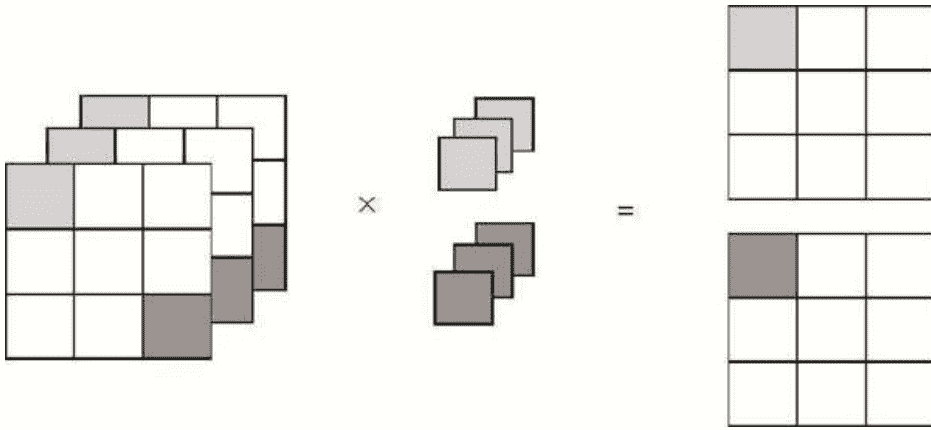。单核产出单图，多核堆叠多图。
- **设计精髓**：核形状 $1 \times 1 \times C_{in} \times C_{out}$。
- **战略价值**：非线性增强 + 维度自如调控（升维增表达，降维减参数）。

---

### 8.1.2 池化层：降维与不变性的平衡术

卷积层堆叠带来参数爆炸与过拟合风险，池化层以“降采样”之名，完成压缩参数、抑制过拟合、赋予平移不变性的三重使命。主流操作包括最大池化、平均池化、随机池化。

#### (1) 平均池化：背景守护者
池化窗口滑动，不学习权重，仅统计窗口内元素**均值**```
y_{kij} = \frac{1}{|R_{ij}|} \sum_{(p,q) \in R_{ij}} x_{kpq}
```。
公式：$y_{kij} = \frac{1}{|R_{ij}|} \sum_{(p,q) \in R_{ij}} x_{kpq}$

实例：$2 \times 2$ 窗口、步长 2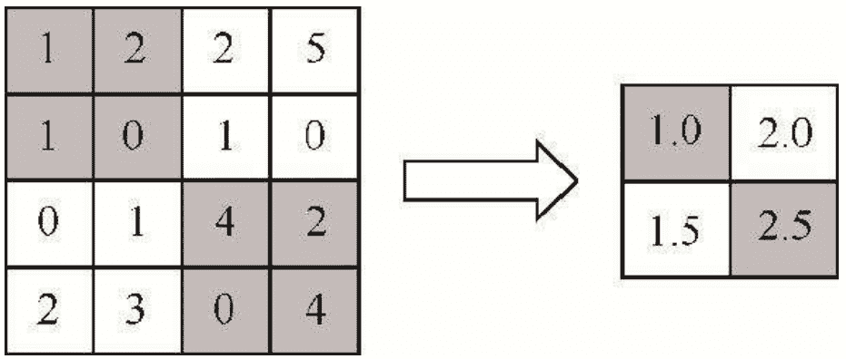。
- 窗口1：$(1+2+1+0)/4 = 1.0$
- 窗口2：$(2+5+1+0)/4 = 2.0$
- 窗口3：$(0+1+2+3)/4 = 1.5$
- 窗口4：$(4+2+0+4)/4 = 2.5$

**特性**：平滑背景纹理，易模糊边缘细节。代码实现```
tf.keras.layers.AveragePooling2D (
    pool_size = (2, 2),
    strides = None,
    padding = 'valid',
    data_format = (None, **kwargs)
)
```。

> **默认习惯**：池化步长默认等于窗口尺寸，实现非重叠采样。

#### (2) 最大池化：纹理捕手
同窗口滑动，取窗口内**最大值**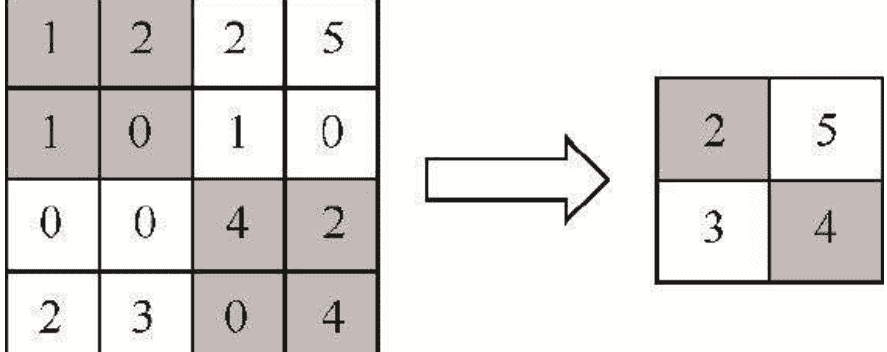。
公式：$y_{kij} = \max_{(p,q) \in R_{ij}} x_{kpq}$

**对比优势**：最大响应往往对应显著纹理（边缘、角点），最大池化天然保留最强激活特征，主流 CNN 架构首选。

---

### 8.1.1 最大池化

最大池化操作在矩形窗口 $R_{ij}$ 内筛选峰值响应 $y_{kij}$，该值隶属于第 $k$ 个通道；窗口内坐标 $(p,q)$ 处的元素记作 $x_{kpq}$。

**核心优势**：对纹理细节保留效果显著。

代码实现参考清单 8-4。

**清单 8-4 最大池化实现代码**

```
1.   tf.keras.layers.MaxPool2D(
2.       pool_size = (2, 2),
3.       strides = None,
4.       padding = 'valid',
5.       data_format = (None, **kwargs)
6.   )
```

### 8.1.2 随机池化

该机制依据元素数值幅度构建概率分布：数值越大，中选几率越高，但非零项仍保留被抽取可能。这打破了“赢家通吃”的固定模式，显著提升了模型泛化水平。

**计算流程**（见图 8-8）：
1.  累加窗口内所有元素求和；
2.  各元素除以总和，生成概率向量；
3.  按概率随机抽取位置，以该位数值作为输出。

**演示案例**：窗口值 [1, 2, 1, 0]，总和 = 4。概率分布为 0.25、0.5、0.25、0。

**数学定义**：$P_i = \frac{a_i}{\sum_{k \in R_j} a_k}$

**特性小结**：流程简明，随机性强，泛化表现优于确定性池化。

**随机池化代码示例**

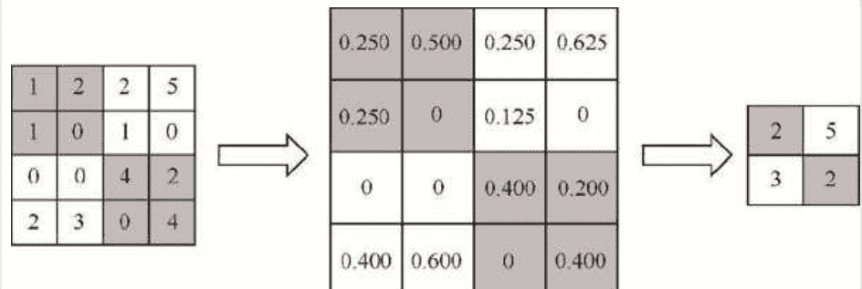

### 8.1.3 反池化机制

本节解析反池化操作，涵盖反平均与反最大两大范式。

**(1) 反平均池化**
平均池化将窗口数值求和取均值，反向过程则将该均值等分回传至上一层窗口对应的每个坐标，确保梯度总量守恒。图 8-9 直观演示了均值在窗口内的均匀分布还原。

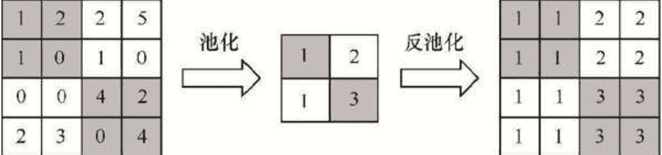

**图 8-9 反平均池化还原演示**

**(2) 反最大池化**
正向仅保留窗口最大值，反向任务是将该最大值精准填回原始坐标，其余位置补零。关键差异在于：正向阶段**必须**缓存最大值坐标索引，否则反向无法定位。图 8-10 展示了还原后数组：最大值位置与输入期完全对齐，其余全为零。

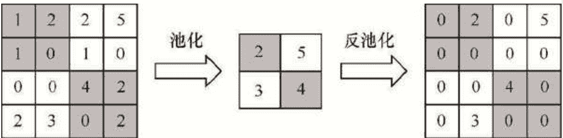

**图 8-10 反最大池化还原演示**

**关键提示**
- 池化层无可学习参数，训练期不参与梯度计算，仅作残差传递通道。
- 最大池化需记录峰值坐标，便于反向定点还原、其余补零；平均池化反向则将均值平铺至窗口全域。

### 8.1.4 激活函数层

激活函数建立层间非线性映射。若缺失，网络退化为线性叠加，表达力等同感知机，难胜复杂任务。引入非线性使模型具备逼近任意函数的能力。

常用函数沿用前馈网络体系：ReLU、Softmax、Sigmoid 等。

**ReLU（线性整流单元）**
当前主流选择。分段线性特性：正区间恒等映射，负区间截断为零。

*长处*：
1.  正半轴梯度恒为 1，有效缓解梯度衰减。
2.  仅涉及阈值判断，计算开销远小于指数型函数。

*短板*：负半轴梯度为零，易导致神经元“失活”，参数停止迭代。

**Softmax**
面向多分类设计，将向量映射为概率分布（值域 0~1），取概率最大类别为预测结果。

*局限*：
1.  原点处不可导。
2.  输入为负时梯度消失，阻断反向权重更新。

**Sigmoid (Logistic 函数)**
输出压缩至 (0,1)，大值趋 1，小值趋 0，常用于二分类。

*特性*：
- 优势：曲线光滑，求导简便（导数可用函数值表达）。
- 劣势：两端饱和区梯度趋零，极易引发梯度消失，阻碍深层网络收敛。

### 8.1.5 全连接层

全连接层部署于网络末端，承担“分类器”职能。前序卷积与池化完成特征抽取，全连接层接管展平后的一维向量执行判别。接入前需将多维特征图拉伸为向量，随后与输入层逐元素稠密连接。输出端通常搭配激活函数输出预测概率。

拓扑结构见图 8-11：首层输入，末层输出，中间堆叠多隐藏层（深度与宽度可按需配置）。激活函数选型、网络深度（层数）与宽度（单层神经元数）均深度影响性能。加深或加宽虽能提升拟合上限，但过度扩张易陷过拟合，参数激增亦大幅拖慢训练。


**图 8-11 全连接层拓扑图（示例 6 层：输入/输出各 1，隐藏 4，实配视模型而定）**

### 8.2 卷积神经网络核心计算

#### 8.2.1 特征图尺寸推导

输入张量经卷积核滑动卷积后产出的输出张量，即称**特征图**。若输入形状 $m \times m \times 1$，核形状 $n \times n \times 1$，则输出尺寸为 $(m-n+1) \times (m-n+1) \times 1$。

> **注**：形状末尾 “1” 即通道数，灰度图为单通道。

通用计算表达式：

```
\begin{cases}
height_{out} = \frac{height_{in} - height_{kernel} + 2 \times padding}{stride} + 1 \\
width_{out} = \frac{width_{in} - width_{kernel} + 2 \times padding}{stride} + 1
\end{cases}
```

式中 $H_{out}, W_{out}$ 为输出高宽，$H_{in}, W_{in}$ 为输入高宽，$H_k, W_k$ 为核高宽，$p$ 为填充层数，$s$ 为步长。

**工程注记**
- 默认 $s=1, p=0$（详见 8.2.3 节）。
- 卷积尺寸向下取整，池化向上取整。

**张量规范**：`[batch_size, height, width, channels]` 即 `[b, h, w, c]`。
- `b`：批量大小；`h`：行；`w`：列；`c`：通道数。
- 例：`[b,h,w,1]` 灰度图；`[b,h,w,3]` RGB 图；`[b,h,w,c] (c \le 4)` 抽象维度。

#### 8.2.2 感受野分析

**感受野** 定义为输出特征图上单一像素在原始输入上的映射区域范围。类似人类视觉：单元仅感知局部，经层层叠加局部信息，最终构建全局认知。正如反复观察细节后能识别整体，网络亦通过累积局部特征获取全局语义。

以图 8-12 为例：输入 $5\times5$，两层 $3\times3$ 卷积（步长 1）。首层感受野 $3\times3$，次层覆盖首层 $3\times3$ 区域，等效回溯至输入层 $5\times5$ 区域。

**感受野递推公式**（膨胀率 $d=1$ 时）：

```
RF i=(RF i+1-1)xstride i +Ksize i (8-5)
```

$RF_i$ 为第 $i$ 层感受野，$RF_{i+1}$ 为下层，$s$ 为步长，$K_i$ 为当前层核尺寸。


**实战指南**
1.  **小核代大核**：多层小核替代大核，可减参数、加深度、扩感受野；网络越深，感受野越大，性能通常越优。
2.  **分类任务**：末层感受野需 $\ge$ 输入图尺寸，否则效果欠佳。
3.  **检测任务**：感受野与目标尺寸严重失配（过大或过小）导致收敛困难、性能骤降。
4.  **计算规则**：感受野估算**不计** padding 影响。

#### 8.2.3 填充策略

直接卷积致边缘信息流失：边缘像素参与运算少，无法与核中心对齐，导致特征提取不足。为维持输入输出尺寸一致、保护边缘特征，引入**填充** 机制，常用常数 0 扩展边界，使边缘像素获得更多卷积机会。图 8-13 演示零填充示意。


**图 8-13 填充示意**

图 8-14 列举三种主流模式：


**图 8-14 三种填充模式对比**

1.  **Full 模式**：核与输入刚接触（仅 1 元素重叠）即计算，外围全 0 填充至核完全覆盖填充区。
2.  **Same 模式**：核心对准输入首元素启动计算，外围填 0 保证输出尺寸与输入一致（步长为 1 时）。
3.  **Valid 模式**：核完全落入输入区域内才计算，无填充，输出尺寸缩小。

**痛点与对策**
- 连续卷积导致特征图急剧缩小，边缘语义衰减。
- 全零填充旨在锁定输出尺寸，规避边缘特征被忽略。

#### 8.2.4 膨胀卷积

膨胀卷积在核元素间插入零间隔，等效于在不引入池化损失、不增参数量的前提下**放大感受野**，使每个输出单元聚合更广上下文。图 8-15 展示 $2\times2$ 与 $3\times3$ 核的膨胀示意。


**图 8-15 膨胀卷积操作示意**

**有效核尺寸计算**：

```
k_d = (k-1)×d + 1
(8-6)
```

$k_d$ 为膨胀后有效核尺寸，$k$ 为原始核尺寸，$d$ 为膨胀率。通常 $k$ 取奇数，$d$ 取偶数，保证 $k_d$ 为奇数。运算时先将核膨胀 $d$ 倍再卷积。

**约束条件**
- $d=0$ 时退化为 $1\times1$ 核，且不可填充。
- $d$ 默认 1（标准卷积）。
- 膨胀后核尺寸 $k_d$ 不得超输入尺寸，否则无法运算；设置 $d$ 前需预估 $k_d$。

### 8.3 实战案例：CNN 预测药物分子脂溶性

药物分子性质预测是 AI 辅助筛选核心赛道。分子结构高多样性使传统经验公式失效，神经网络强非线性拟合力可捕捉结构-性质深层映射。本案例演示利用 CNN 预测分子脂溶性（log P）。

**背景**：log P 为油水分配系数对数，表征药物穿透细胞膜能力，是设计关键指标。数据源采用 MoleculeNet 基准集中的 Lipophilicity 数据集。

**步骤一：数据导入**（清单 8-5）

```
1.   tf.keras.layers.MaxPool2D(
2.       pool_size = (2, 2),
3.       strides = None,
4.       padding = 'valid',
5.       data_format = (None, **kwargs)
6.   )
```

# 清单 8-5 导入 Lipophilicity 数据集

```
1.  #导入模块
2.  import pandas as pd
3.  import tensorflow as tf
4.  from keras import backend as K
5.  from keras.models import Sequential
6.  from sklearn.model_selection import train_test_split
7.  from keras.constraints import maxnorm
8.  # 导入数据集
9.  dataframe = pd.read_csv ("
./Lipophilicity/ecfp-Lipop.csv" , delimiter = ',' , header=None)
10. dataset = dataframe.values
11. # 将数据集拆分为输入和输出
12. X = dataset[:,:]
13. Y =
np.loadtxt( "/home/yons/xielx/AlogP/Lipophilicity/Lipop_logP.value" )
14. X_train, X_test, Y_train, Y_test = train_test_split(X,
Y, test_size
=0.2, random_state=42)
15. X_train = X_train.reshape(-1, 2048, 1)
16. X_test = X_test.reshape(-1, 2048, 1)
```

接着，我们搭建了一个卷积神经网络（CNN）专门用于预测log P值，具体实现代码请参考下方的代码清单8-6。

### 代码清单8-6 基于CNN的log P值预测实现

```
1.  # 构建模型
2.  model = Sequential()
3.  # 卷积层1
4.  model.add(Conv1D(32, 3, activation='relu', input_shape=
    (2048, 1),
    padding="same "))
5.  # 池化层1
6.  model.add(MaxPool1D(pool_size=3, strides=1))
7.  # 卷积层2
8.  model.add(Conv1D(64, 3, strides=1, activation='relu',
padding='same'))
9.  # 池化层2
10. model.add(MaxPool1D(pool_size=3, strides=1))
11. # 神经元随机失活
12. model.add(Dropout(0.25))
13. # 拉成一维数据
14. model.add(Flatten())
15. # 全连接层1
16. model.add(Dense(1024))
17. # 激活层
18. model.add(Dense(1))
19. # 查看定义的模型
20. model.summary()
```

```
21.  model.compile(optimizer='adam',
    loss='mean_squared_error',
    metrics=['mean_absolute_error',
    'accuracy'])
```

```
22.  # 训练
23.  history = model.fit(X_train, Y_train, epochs=100,
    batch_size=64,
        verbose=1, validation_data=[X_test,
        Y_test])
```

模型的预测效果如图8-16直观展示。经测算，训练集与测试集的平均绝对误差（MAE）分别控制在0.37与0.67左右。特别提醒：上述代码仅供教学演示之用，实际项目中超参数需根据具体业务场景深度调优。


图8-16 CNN预测log P任务中的Loss与MAE走势图

### 8.4 参考文献

- [1] 常亮, 邓小明, 周明全, 等. 图像理解中的卷积神经网络[J]. 自动化学报, 2016, 42(9): 13.
- [2] 王晓华. TensorFlow 2.0 深度学习应用实战[M]. 北京: 清华大学出版社, 2020.
- [3] GOODFELLOW I, BENGIO Y, COURVILLE A. Deep Learning [M]. Cambridge: MIT press, 2016.
- [4] CHOLLET F. Deep Learning with Python [M]. Zed. New York: Manning Publications, 2021.
- [5] 邱锡鹏. 神经网络与深度学习[J]. 中文信息学报, 2020, (7): 1.
- [6] ABRAHAMS S, HAFNER D, ERWITT E, et al. TensorFlow for Machine Intelligence [M]. Santa Rosa: Bleeding Edge Press, 2016.
- [7] MINAR M R, NAHER J. Recent Advances in Deep Learning: An Overview [J]. 2018. DOI: 10.13140/RG.2020 24831, 10403.
- [8] 焦李成. 神经网络系统理论[M]. 西安: 西安电子科技大学出版社, 1990.
- [9] 卢宏涛, 张秦川. 深度卷积神经网络在计算机视觉中的应用研究综述[J]. 数据采集与处理, 2016, 31(1): 17.
- [10] ZEILER M D, FERGUS R. Stochastic Pooling for Regularization of Deep Convolutional Neural Networks [J]. Eprint Arxiv, 2013.

## 第9章 生成式深度学习探秘

### 9.1 深度学习与GAN：从认知到生成

#### 9.1.1 深度学习：让机器学会“思考”

人工智能的终极愿景，是赋予计算机人类般的智能，使其具备自主学习进化的能力。深度学习正是通往这一目标的核心路径之一，已渗透进AI应用的方方面面。它的核心不在于简单的逻辑演绎，而在于归纳与综合——通过算法剖析数据、汲取规律，进而支撑决策。

主流深度学习范式主要分为三大阵营：**无监督学习、监督学习、强化学习**。

*   **无监督学习：自主发现隐秘结构**  
    只需指定大致方向，无需人工打标，算法便能自动挖掘数据内在规律，并将样本自动归类——这正是我们常说的“聚类”任务。

*   **监督学习：在标签指引下精准映射**  
    此处需人工提供“答案”（标签）。模型通过“输入-标签”的对应关系学习映射函数。打个比方：判断土豆能否食用，发芽=有毒，未发芽=安全。模型训练完成后，只需“看”土豆外观特征，即可给出判定。

*   **强化学习：在奖惩机制中进化策略**  
    这与前两者截然不同。它通过“奖励信号”引导智能体学习决策。就像教育孩子：不想学习？约定“学两小时奖励看半小时动画片”。在回馈机制驱动下，孩子逐渐养成“主动学习换看电视”的行为模式。这正是强化学习的缩影，也是当前科研最前沿的热点方向。

早期深度学习借助深度神经网络（DNN）攻克特征表达难题。“深度”指的就是网络拥有多个隐藏层。实战中，通过调整激活函数、重构神经元连接拓扑，可显著提升训练效能。本质上，深度学习是在构建模拟人脑认知机制的网络来解读数据。

虽属机器学习分支，但两者在**适用数据量、硬件依赖、特征工程、解题范式、训练耗时、模型可解释性**六大维度差异巨大：

| 维度 | 传统机器学习 | 深度学习 |
| :--- | :--- | :--- |
| **数据量** | 擅长小样本，各量级均能应对 | 依赖海量数据，“数据饥渴” |
| **硬件需求** | CPU即可流畅运行 | 必须依赖GPU/TPU加速矩阵运算 |
| **特征工程** | 依赖领域知识手工提取像素等浅层特征 | 自动学习高阶语义特征，弱化人工干预 |
| **解题思路** | 分而治之：拆解问题 -> 逐个击破 -> 组装结果 | 端到端：整体建模，一站式求解 |
| **执行时长** | 训练快，参数少 | 训练周期长，参数量巨大 |
| **可解释性** | 模型透明，决策路径清晰 | 多为“黑盒”，解释性往往较弱 |

#### 9.1.2 GAN：生成式AI的“双子星”博弈

2014年，Ian Goodfellow团队发表《Generative Adversarial Nets》，生成对抗网络（GAN）横空出世，瞬间点燃学界热情，相关论文呈指数级爆发。

GAN是深度生成模型的集大成者，其**“博弈生成”**机制与传统“参数拟合生成”截然不同。传统模型按人为设定的分布采样，而GAN在生成器与判别器的零和博弈中，自然涌现出目标分布。如今，GAN早已突破图像/语音/视频合成边界，在图像翻译、上色、对抗样本、域自适应乃至**药物分子设计**等硬核领域均斩获惊艳战果。

GAN架构包含两大核心模块：
1.  **生成器**：尽力造假，生成能以假乱真的数据；
2.  **判别器**：扮演“二分类侦探”，辨别输入来自真实分布还是生成器。

训练过程本质是一个**二元极小极大博弈**：生成器拼命逼近真实分布以“欺骗”判别器，最终达到判别器“无法辨别真伪（概率=50%）”的动态平衡。

理论上，生成器/判别器可用简单线性映射，但工程落地中，双方均采用**深度神经网络**参数化，以拟合复杂分布。

GAN最大的亮点在于**“免去了显式建模真实分布的痛苦”**。判别器在博弈中自动学习真实数据流形，反向指导生成器。这一机制极大节省了寻找先验分布的人力与时间成本。当然，判别器初期并不完美，需经历漫长的迭代对抗，直至双方共同进化至最优状态。

本章后续将深度拆解GAN的核心原理、数学基石与训练实战。

### 9.2 GAN核心概念预备课

正式进阶GAN前，我们需打好六大数学基石：梯度下降、信息熵、KL散度、纳什均衡、高斯分布与高斯过程。

#### 9.2.1 梯度下降法：优化的“指南针”

机器学习的“学习”本质是参数迭代优化。梯度下降是解决无约束优化最通用的一阶算法，三大核心要素缺一不可：**初始点、下降方向、步长（学习率）**。

目标是求解 $\min f(x)$，其中 $f(x)$ 连续可微。若序列 $x_0, x_1, x_2 \dots$ 满足 $f(x_{t+1}) < f(x_t)$，则能不断逼近局部极小值（如图9-1演示）。


图9-1 梯度下降法寻优路径示意

如何确定下一步落脚点？假设当前在 $x_0$，沿某方向迈出微小步长 $\Delta x$ 得到 $x_1$。函数值变化仅取决于 $x$ 的位移，迭代公式通式为 $x_{t+1} = x_t + \Delta x$。

在神经网络中，梯度指**损失函数对权重 $W$ 与偏置 $B$ 的偏导向量**。参数更新规则如下：


其中 $\eta$ 为学习率，控制更新幅度；$\frac{\partial E}{\partial W^{(i)}}$, $\frac{\partial E}{\partial B^{(i)}}$ 分别为损失函数对第 $i$ 层权重、偏置的梯度。具体代码实现见清单9-1。

##### 代码清单9-1 梯度下降法Python实现

```
1. import numpy as np
2. import matplotlib.pyplot as plt
3. def f(x):
4.     return np.power(x, 2)
5. def d_f_1(x):
6.     return 2.0 * x
7. def d_f_2(f, x, delta=1e-4):
8.     return (f(x+delta) - f(x-delta)) / (2 * delta)
9. #绘制函数
10. xs = np.arange(-10, 11)
11. plt.plot(xs, f(xs))
12. plt.show()
13. learning_rate = 0.1
14. max_loop = 30
15. x_init = 10.0
16. x = x_init
17. lr = 0.1
18. for i in range(max_loop):
19.     # d_f_x = d_f_1(x)
20.     d_f_x = d_f_2(f, x)
21.     x = x - learning_rate * d_f_x
22.     print(x)
23. print('initial x =', x_init)
24. print('arg min f(x) of x =', x)
25. print('f(x) =', f(x))
```

#### 9.2.2 信息熵与KL散度：度量不确定性与分布差异

**信息熵**量化样本“纯度”或“不确定性”。连续/离散形式分别为：
$$H(p) = -\int p(x) \log p(x) dx \quad \text{或} \quad H(p) = -\sum_x p(x) \log p(x)$$

**直观理解**：均匀分布熵最大（最不确定）。A队必胜（概率1），熵为0，无需额外信息；五五开（概率0.5），熵最大，需最大信息量才能消除悬念。

**KL散度（相对熵）**衡量两个分布 $p$ (真实) 与 $q$ (拟合) 的差异：
$$D_{KL}(p \| q) = \sum_i \left[ p(x_i) \log p(x_i) - p(x_i) \log q(x_i) \right]$$

它代表用 $q$ 近似 $p$ 造成的信息损失。性质：**非负性**（$D_{KL} \ge 0$），仅当 $p=q$ 时等于0。无负值，值越大分布偏离越严重。

#### 9.2.3 纳什均衡：博弈论的“停战协议”

以诺贝尔奖得主约翰·纳什命名，是非合作博弈的核心解概念。

**通俗版定义**：在博弈中，若每个参与者在**知晓对手策略不变**的前提下，单方面改变策略**无法**获得更高收益，则该策略组合构成纳什均衡。

每方均为利己主义者，追求收益最大化。对抗中不断调整策略，非无限内耗，而是趋向一个“谁也动不了、谁也不想动”的稳定点——纳什均衡。GAN的训练动力学正是此思想的直接投射。

#### 9.2.4 高斯分布与高斯过程：建模函数空间的利器

高斯分布（正态分布）是统计学基石。高斯过程（GP）虽非当下深度学习主流，却长期活跃于科研前沿。

**传统建模 vs GP建模**：
*   传统：参数化函数 $\to$ 对参数建模（有限维）。
*   **GP：直接对函数分布建模（无限维/非参数）**。

这赋予GP两大超能力：**拟合任意“黑盒”函数** + **量化预测不确定性**。得益于此，数据增多时仍能高效探索复杂分布。最著名应用莫过于**AlphaGo**：其参数调优核心即依托高斯过程（贝叶斯优化），助其击败柯洁登顶围棋巅峰。

### 9.3 GAN理论基石深挖

#### 9.3.1 GAN本质：纳什均衡在深度生成中的落地

前文铺垫的纳什均衡，正是GAN理论大厦的基石。从模型架构设计到损失函数构造，再到训练动力学分析，无不烙印着“博弈均衡”的印记。理解了这一点，GAN的种种设计（如Minimax损失、模式崩塌本质、梯度消失对抗）便有了统一的理论解释框架。

GAN的架构由两大核心模块构成：生成网络（Generator，简称G网）与判别网络（Discriminator，简称D网）。G网的使命是拟合真实数据分布，产出以假乱真的样本；D网的职责则是充当“鉴别官”，精准识别输入数据的真伪。GAN的训练本质上是一场“零和博弈”：G与D相互较量、同步进化，直至双方达到纳什均衡——你奈何不了我，我也难倒不了你。

为了直观理解这一机制，不妨设想一个都市寓言：城里活跃着一群造假犯，技艺高低不一。警方发起专项打击行动，拙劣的赝品立马露馅被捕。不久警方发现市面“净化”了，实则高手潜伏，假货依然流通却难辨真伪，迫使警方必须升级鉴别技能。警方技术迭代后，高级造假犯纷纷落网。为求生存，造假集团疯狂打磨工艺以欺骗检测；警方为履职尽责，则拼命钻研辨伪手段。

在这场“矛与盾”的螺旋式升级中，造假产品逼真到与真品无异，警方火眼金睛般的鉴别力也登峰造极。最终，最强造假团队与最强反诈小组双双诞生。此时，警方判定造假品为“赝品”的概率锁定在50%——彻底看不出来了。

这个寓言完美映射了GAN的训练动态：生成器=造假团伙，判别器=警方。 图示便是这对“最强对手”诞生的时刻。

### 9.3.2 GAN核心原理深度解析

下面通过一个具体案例，拆解GAN的数学骨架。

首先构建生成器G，引入一组随机噪声向量Z（100维，服从均值0、方差1的高斯分布）。G的任务是借助可学习参数$\theta_g$，驾驭Z逼近真实数据分布。

接着定义判别器D，同样是一个多层感知机（MLP），内含可学习参数$\theta_d$。D接收数据后吐出一个标量：若输入源自真实分布，输出趋近1；若源自G生成，输出趋近0。当D训练到位时，$D(G(Z)) \approx 0$，意味着 $1-D(G(Z)) \approx 1$，此时 $\log(1-D(G(Z)))$ 输出正值。

GAN的终极目标：经过对抗洗礼，G能生成以假乱真的数据，即生成分布$P_G$无限贴近真实分布$P_{data}$。 展示的正是生成分布逐步“贴靠”真实分布的演进轨迹。

图中橙线为判别器概率分布，黑虚线为真实数据分布，绿实线为生成数据分布。
(a) 初始态：判别器波动剧烈（橙线起伏大），生成分布与真实分布南辕北辙（绿线远离黑线）。
(b) D先行收敛：判别器分布变平滑（橙线变顺），峰值高处表明D认定该处为真实数据概率大。
(c) G追赶中：绿线向黑虚线靠拢，生成质量显著提升。
(d) 达成均衡：绿线与黑虚线近乎重合，D彻底“看走眼”，判定生成数据为真概率=50%。

记真实数据分布为$P_{data}(x)$，生成器分布为$P_G(x;\theta)$（$\theta$控制高斯噪声的均值方差）。G的核心诉求是$P_{data} = P_G$，即最大化生成似然 $L = \prod_{i=1}^m P_G(x^i;\theta)$。引入对数似然简化计算，转化为期望优化问题。```
\theta^* = \arg \max_{\theta} \prod_{i=1}^m P_G (x^i;\theta)
= \arg \max_{\theta} \log \prod_{i=1}^m P_G (x^i;\theta)
= \arg \max_{\theta} \sum_{i=1}^m \log P_G (x^i;\theta)
= \arg \max_{\theta} E_{x \sim P_{data}} \left[ \log P_G (x;\theta) \right]
= \arg \max_{\theta} \int_x P_{data} (x) \log P_G (x;\theta) dx - \int_x P_{data} (x) \log P_{data} (x) dx
= \arg \max_{\theta} \int_x P_{data} (x)(\log P_G (x;\theta) - \log P_{data} (x)) dx
= \arg \min_{\theta} \int_x P_{data} (x) \log \frac{P_{data} (x)}{P_G (x;\theta)} dx
= \arg \min_{\theta} \text{KL}(P_{data} (x) || P_G (x;\theta)))
```

推导显示，最大化似然等价于最小化KL散度 $\text{KL}(P_{data} || P_G)$，侧面印证了分布一致时似然极大。

博弈视角下：D追求判别准确率最大化（概率分布峰值最大），G希冀生成数据被判为真（即极小化$V(D, G)$）。双方互博，推导出GAN的核心目标函数——极小极大博弈公式：```
\(\min_G \max_D V(D, G) = E_{x \sim P_{data} (x)}[\log D(x)] + E_{z \sim P_z}[\log(1 - D(G(z)))]\)
```

### 9.4 GAN训练实战流程

优化策略采用“轮流更新”：**先锁死G训D，再锁死D训G**，循环往复直至双模型均收敛最优。

为何先训D？若无成熟“裁判”把关，盲目训练G只会产出纯噪声而非目标数据。必须先立标准（训好D），模型才能步入正轨。

#### 9.4.1 训练判别器D
首阶段冻结G，仅优化D。喂入随机噪声让G产出假样本，混同真样本送入D鉴别。初期G造假拙劣，分布偏离极远，D极易分辨，损失函数快速下降，D迅速学会“真假分辨”。

#### 9.4.2 训练生成器G
次阶段冻结D（参考清单9-2），专攻G。此时D已练就“火眼金睛”，再练D边际效益递减，转而固定D、更新G，迫使G生成能骗过D的样本。当D无法区分真伪（输出0.5），单轮迭代告终。```
# 训练生成器
z = torch.normal(0, 0.02, (num_img, 100), dtype=torch.float32).cuda()
# z = Variable(torch.randn(num_img, z_dimension)).cuda() # 得到随机噪声
# 随机噪声输入生成器中，得到一幅假的图片
fake_img = G(z)
# 经过判别器得到的结果
output = D(fake_img)
# 得到的假的图片与真实的图片的label的损失
g_loss = criterion(output, real_label)
# 定义优化器
# 梯度归0
g_optimizer.zero_grad()
# 进行反向传播
g_loss.backward()
# step() 一般用在反向传播后面，用于更新生成网络的参数
g_optimizer.step()
```  直观呈现了单次迭代的完整数据流向。

### 9.5 实战演练：手写数字生成（PyTorch）

书中选用MNIST手写数字集演示GAN落地。

**1. 环境就绪**（清单9-3）：核心依赖`torch`、`torchvision`、`os`。```
import torch.nn as nn
from torchvision import transforms
from torchvision import datasets
from torchvision.utils import save_image
import torch.autograd
from torch.autograd import Variable
import os
```

**2. 数据与目录准备**（清单9-4）：建立存储路径，加载MNIST数据集并完成预处理封装。```
# 创建文件夹
if not os.path.exists('./img'):
    os.mkdir('./img')
# 进行图片大小的确认和预处理
def to_img(x):
    out = 0.5*(x+1)
    # clamp函数可以将随机变化的数值限制在一个给定的区间[min, max]内
    out = out.clamp(0, 1)
    # view()函数的作用是将一个多行的Tensor拼接成一行
    out = out.view(-1, 1, 28, 28)
    return out
# 一批128个
batch_size = 128
# 总共100批
num_epoch = 100
# 噪声维度
z_dimension = 100
# 图像预处理
img_transform = transforms.Compose([
    transforms.ToTensor(),
    #归一化处理
    transforms.Normalize([0.5], [0.5])
])
# 加载手写数据集，此处我们是将数据集存放在本地
# 数据集载入
# mnist数据集下载
mnist = datasets.MNIST(
    root='./data/mnist/',
    train=True,
    transform=img_transform,
    download=True)
# 数据载入(批次读取)
dataloader = torch.utils.data.DataLoader(
    dataset=mnist,
    batch_size=128,
    shuffle=True)
```

**3. 判别器架构设计**（清单9-5）：输入28×28图像展平为784维向量 → 多层感知机(MLP) → 中间层接`LeakyReLU`激活 → 末层`Sigmoid`输出[0,1]概率，完成二分类。```
class discriminator(nn.Module):
    def __init__(self):
        super(discriminator, self).__init__()
        self.dis = nn.Sequential(
            # 输入特征数为784，输出为256
            nn.Linear(784, 256),
            # 进行非线性映射
            nn.LeakyReLU(0.2),
            # 进行线性映射
            nn.Linear(256, 256),
            nn.LeakyReLU(0.2),
            nn.Linear(256, 1),
            # 激活函数，二分类问题中，Sigmoid可以将实数映射到 [0,1]，作为概率值
            # 多分类用Softmax函数
            nn.Sigmoid()
        )
    def forward(self, x):
        x = self.dis(x)
        return x.reshape(-1)
```

**4. 生成器架构设计**（清单9-6）：输入100维高斯噪声(0~1) → `Linear(100→256)` + 激活 → `Linear(256→256)` + 激活 → `Linear(256→784)` → `Tanh`激活，映射至[-1,1]像素空间，生成伪造图像分布。```
class generator(nn.Module):
    def __init__(self):
        super(generator, self).__init__()
        self.gen = nn.Sequential(
            # 用线性变换将输入映射到256维
            nn.Linear(100, 256),
            # ReLU激活
            nn.ReLU(True),
            # 线性变换
            nn.Linear(256, 256),
            # ReLU激活
            nn.ReLU(True),
            # 线性变换
            nn.Linear(256, 784),
            # Tanh激活使得生成数据分布在[-1,1]
            nn.Tanh()
        )
    def forward(self, x):
        x = self.gen(x)
        return x
```

**5. 判别器训练逻辑**（清单9-7）：损失函数采用二分类交叉熵（BCE）；优化器Adam，学习率3e-4。训练分两步走：
- 真图像标签设1，算Loss反向传播；
- 假图像(由当前G生成)标签设0，算Loss累加反向传播。
过程中G参数同步更新，为下阶段对抗铺垫。

```
for epoch in range(num_epoch):
    for i, (img, _) in enumerate(dataloader):
        # print(img.shape)
        num_img = img.size(0)
        real_img = img.view(num_img, -1).cuda()
        real_label = torch.ones(num_img).cuda()
        fake_label = torch.zeros(num_img).cuda()
        # 计算真实图片的损失
        # 将真实图片放入判别器中
        real_out = D(real_img)
        print(real_out.shape[0])
        # 得到真实图片的损失
        d_loss_real = criterion(real_out, real_label)
        # 得到真实图片的判别值，输出的值越接近1越好
        real_scores = real_out
        # 计算假的图片的损失
        z = torch.normal(0, 0.02, (num_img, 100), dtype=torch.float32).cuda()
        # 随机噪声放入生成网络中，生成一张假的图片
        fake_img = G(z)
        # 判别器判断假的图片
        fake_out = D(fake_img)
        # 得到假的图片的损失
        d_loss_fake = criterion(fake_out, fake_label)
        # 得到假图片的判别值，对于判别器来说，假图片的损失越接近0越好
        fake_scores = fake_out
        # 损失函数和优化
        # 损失包括判真损失和判假损失
        d_loss = d_loss_real + d_loss_fake
        # 在反向传播之前，先将梯度归0
        d_optimizer.zero_grad()
        # 将误差反向传播
        d_loss.backward()
        # 更新参数
        d_optimizer.step()
```

锁死判别器参数，专攻生成器优化（流程见```
z = torch.normal(0, 0.02, (num_img, 100), dtype=torch.float32).cuda()
# z = Variable(torch.randn(num_img, z_dimension)).cuda() # 得到随机噪声

# 随机噪声输入生成器中，得到一幅假的图片
fake_img = G(z)
# 经过判别器得到的结果
output = D(fake_img)
# 得到的假的图片与真实的图片的label的损失
g_loss = criterion(output, real_label)
# 梯度归0
g_optimizer.zero_grad()
# 进行反向传播
g_loss.backward()
# step()一般用在反向传播后面，用于更新生成网络的参数
g_optimizer.step()
# 打印中间的损失
if (i + 1) % 100 == 0:
    # 打印的是真实图片的损失均值
    print('Epoch[{}/{}]，d_loss:{:.6f},g_loss:{:.6f}' 'D real: {:.6f},D fake: {:.6f}'.format(epoch, num_epoch, d_loss.item(), g_loss.item(), real_scores.data.mean(), fake_scores.data.mean()))
```），核心意图是让生成器产出的图像能骗过判别器的“法眼”。训练过程中，将生成图像送入判别器，拿其输出与真实样本的判别结果做对比，利用反向传播计算梯度并更新生成器权重，以此驱动生成网络朝着“以假乱真”的方向迭代。

### 清单9-8 生成器训练实操

```
z = torch.normal(0, 0.02, (num_img, 100), dtype=torch.float32).cuda()
# z = Variable(torch.randn(num_img, z_dimension)).cuda() # 得到随机噪声

# 随机噪声输入生成器中，得到一幅假的图片
fake_img = G(z)
# 经过判别器得到的结果
output = D(fake_img)
# 得到的假的图片与真实的图片的label的损失
g_loss = criterion(output, real_label)
# 梯度归0
g_optimizer.zero_grad()
# 进行反向传播
g_loss.backward()
# step()一般用在反向传播后面，用于更新生成网络的参数
g_optimizer.step()
# 打印中间的损失
if (i + 1) % 100 == 0:
    # 打印的是真实图片的损失均值
    print('Epoch[{}/{}]，d_loss:{:.6f},g_loss:{:.6f}' 'D real: {:.6f},D fake: {:.6f}'.format(epoch, num_epoch, d_loss.item(), g_loss.item(), real_scores.data.mean(), fake_scores.data.mean()))
```

完成模型权重与生成样本的落盘保存，具体代码参见```
if epoch == 0:
    real_images = to_img(real_img.cpu().data)
    save_image(real_images, './img/real_images.png')
    fake_images = to_img(fake_img.cpu().data)
    save_image(fake_images, './img/fake_images-
```。

### 清单9-9 权重与样本持久化

```
if epoch == 0:
    real_images = to_img(real_img.cpu().data)
    save_image(real_images, './img/real_images.png')
    fake_images = to_img(fake_img.cpu().data)
    save_image(fake_images, './img/fake_images-
```

{}.png'.format(epoch + 1))

6.

7. torch.save(G.state_dict(), './generator.pth')

8. torch.save(D.state_dict(), './discriminator.pth')

9. g_optimizer.step()

图9-5 展示了GAN生成的手写数字效果图。


图9-5 GAN生成手写数字示例

### 9.6 GAN特性解析与家族谱系

#### 9.6.1 核心优势

*   **工程落地轻量化**：摒弃了传统生成模型依赖的复杂马尔可夫链采样，仅凭反向传播一招贯穿始终，大幅降低了实现门槛。
*   **分建模免人工**：无需人工设定真实数据分布的先验假设，而是由判别器自逼近拟合，极大节省了人力物力，同时降低了计算复杂度，拓宽了适用边界。
*   **半监督天然适配**：训练范式本质属于半监督学习，使其在无监督及半监督场景大有可为，发展前景广阔。

#### 9.6.2 固有短板

*   **“黑盒”不可控**：判别器拟合真实分布的过程不透明，易引发梯度消失等意外异常，调试困难。
*   **偏好连续空间**：原理决定其更擅长处理连续期望，故而在图像领域如鱼得水，离散数据（如文本）表现相对乏力。
*   **模式崩溃风险**：若生成器产出伪样本却被判别器误判为真，双方将在错误分布上相互“勾结”、共同漂移，陷入模式崩溃泥沼。
*   **纳什均衡难觅**：理论追求纳什均衡，实战中却难以完美收敛，训练不稳定是常态。

#### 9.6.3 GAN家族大观（GAN ZOO）

随着研究热度爆棚，改进论文层出不穷，形成了庞大的“GAN家族”。基础架构由“输入/输出、生成器、判别器”三大基石搭建，改进切入点可归纳为五大维度：输入端、输出端、生成器内部、判别器内部、以及多模块组合策略与跨模型融合。

下表梳理了主流变体脉络：

表9-1 GAN家族变体速览

| 改进维度 | 细分路径 | 代表模型 |
| :--- | :--- | :--- |
| **输入端** | 隐变量条件化 | cGAN、BiCoGAN、IcGAN |
| | 隐空间结构化 | DeLiGAN、NEMGAN |
| | 其他输入创新 | FCGAN |
| **输出端** | 多分类扩展 | SGAN、AC-GAN |
| | 特征解耦输出 | InfoGAN |
| **生成器** | 集成学习机制 | AdaGAN |
| | 采样模块差异 | MADGAN、MGAN |
| | 其他架构创新 | MPGAN |
| **判别器** | 集成判别策略 | PacGAN、MGAN、DropoutGAN |
| | 样本匹配机制 | D2GAN、StabilizingGAN |
| | 其他损失/结构 | EBGAN、BEGAN |
| **多模块协同** | 多阶段渐进 | RGAN、StackGAN、ProgressGAN |
| | 辅助模块增强 | TripleGAN、controlGAN |
| | 记忆/其他机制 | SGAN、MemoryGAN |
| **跨模型融合** | 主干网络替换 | DCGAN、CapsuleGAN |
| | 复合生成模型 | VAEGAN、DEGAN、AAE、BiGAN、Ali |
| | 其他融合探索 | SAGAN、KDGAN、IRGAN、LapGAN、QuGAN |
| **距离度量** | 基于散度优化 | LSGAN、EBGAN |
| | 基于IPM（积分概率度量） | WGAN、WGAN-GP、BWGAN、RWGAN、FisherGAN |
| | 其他度量方式 | IGAN、MMGAN、OT-GAN |
| **梯度计算** | 梯度流改进 | MAGAN、RGAN、LSGAN |

得益于无需人工指定分布、双网络博弈机制，GAN具备强大的建模与生成实力。图像合成是其主战场，且效果碾压其他领域；虽在文本、音频等方向持续探索，但成果尚不及视觉领域惊艳。未来演进重点在于：一、跨域迁移，攻克非图像场景落地难题；二、技术融合，引入先进深度学习手段修补短板、提升鲁棒性。

### 9.7 参考文献

*   [1] 李凌云. 基于神经网络随机梯度下降法的手写数字识别方法[J]. 信息与电脑（理论版）, 2021, 33(17): 74-76.
*   [2] 王正龙, 张保稳. 生成对抗网络研究综述[J]. 网络与信息安全学报, 2021, 7(04): 68-85.

## 第10章 Python编程入门与环部署

Python凭借简洁高效的特质，已成为AI领域的“通用语”。读优质Python代码如读英文般流畅，让开发者聚焦问题本身而非语法细节；海量第三方库支撑，寥寥数行即可调用复杂功能，大幅压缩开发周期。其兼具简洁语法与丰富生态，且通过C扩展完美补齐性能短板，深受数据科学界推崇，成为本书首选开发语言。

### 10.1 Python溯源与定位

Python由Guido van Rossum于90年代初创立，旨在替代ABC语言。它内置高效高级数据结构，原生支持面向对象范式。动态类型与解释执行特性，使其成为跨平台脚本编写与快速原型开发的利器；随着版本迭代，更进化为大型工程落地的主力语言。

得益于语法清晰、易读易扩展，海外科研机构纷纷采用Python开展科学计算，CMU、MIT等名校更将其列入核心教学大纲。主流开源库（OpenCV、VTK、ITK）均提供Python绑定；NumPy、SciPy、Matplotlib“科学计算三剑客”更为其装上数值计算与可视化引擎，构建出极佳的工程科研开发生态。

**Python九大鲜明特质：**

1.  **上手极易**：文档清晰，学习曲线平缓。
2.  **纯粹面向对象**：万物皆对象（函数、模块、基础类型），完备支持继承、重载、多重继承，促进代码复用。
3.  **跨平台零负担**：开源特性驱动其移植至Linux、Windows、macOS、Android、嵌入式设备等几乎所有主流平台。
4.  **解释执行**：无需编译链接，源码经解释器转字节码再译机器码即时运行，开发调试循环极短。
5.  **开源免费**：遵循FLOSS协议，自由复制、修改、分发、二次开发。
6.  **高层抽象**：屏蔽内存管理等底层细节，专注业务逻辑。
7.  **无缝扩展**：性能瓶颈可用C/C++重写核心模块并嵌入调用，兼顾安全与速度。
8.  **标准库极其丰富**：“电池内置”理念，覆盖正则、网络、数据库、GUI、多线程、加密等海量场景；社区生态（wxPython、Twisted、PIL等）更是锦上添花。
9.  **强制缩进规范**：以缩进界定代码块，天然保证代码整洁、可读性高。

### 10.2 Python编程实战准备

运行代码前，需确认本机已部署较新版Python（建议3.x），并配备得心应手的编辑器/IDE，利用语法高亮快速把控代码结构。语言生态日新月异，全书基于Python 3编写，若环境仍为Python 2请务必升级。

#### 10.2.1 为何选择Anaconda

初学者面对原生Python、IPython Notebook、终端Vim/Emacs等多元选择易感迷茫。本书推荐**Anaconda**——一个预装700+数据科学包（覆盖可视化、机器学习、深度学习）的Python发行版集成管理器。

**核心优势：**
*   **开箱即用**：默认捆绑Python、IPython、Jupyter Notebook、Spyder IDE，免去逐个安装依赖的繁琐，节省海量配置时间。
*   **全平台一致**：提供Linux、macOS、Windows三端安装包，跨系统迁移零学习成本。
*   **包管理差异**：使用`conda install <pkg>`替代`pip install`（如`conda install argparse`），虽兼容pip，但conda对二进制依赖解析更优，建议优先使用。

#### 10.2.2 Anaconda部署指南

1.  **获取安装包**：官网下载龟速，强荐**清华大学开源软件镜像站**（见下表/图10-1），按系统架构下载Anaconda3最新版。

| 文件名 | 大小 | 更新时间 |
| :--- | :--- | :--- |
| Parent directory/ | - | - |
| Anaconda-1.4.0-Linux-x86.sh | 228.5 MiB | 2013-07-04 01:47 |

# Anaconda 与 PyCharm：Python 数据科学环境零基础搭建全攻略

## 一、 获取安装包：镜像站极速下载

首站前往清华大学开源软件镜像站。该源提供多版本历史安装包，覆盖 Linux、macOS 及 Windows（x86/x64）全平台。以 1.4.0 与 1.5.0 系列为例，体积在 150MB~310MB 区间，均为 2013 年 7 月早期构建版本，按需选择对应系统架构的 `.sh` 或 `.exe` 文件即可。

## 二、 图解安装向导：逐步落地

双击下载的可执行文件启动安装向导，按下述节奏推进：

1.  **初始欢迎页**  
    直接点击 `Next` 跳过引导页。
2.  **部署范围抉择**  
    面对“Select Installation Type”对话框，建议勾选 **All Users**（需管理员权限），而非默认的“Just Me”，确保全用户生效，点击 `Next`。
3.  **落地目录指定**  
    “Choose Install Location”阶段，建议避开系统盘，挂载至数据盘符（如 `D:\Anaconda`），预留 3GB+ 空间，确认后 `Next`。
4.  **高级选项（核心决策点）**  
    进入“Advanced Installation Options”面板，两项勾选策略直接影响后续体验：
    *   **取消勾选** `Add Anaconda to the system PATH environment variable`。官方明确不推荐：此举易污染全局 PATH，导致多版本冲突、卸载残留等棘手问题。日常调用请走开始菜单快捷方式。
    *   **强制勾选** `Register Anaconda as the system Python 3.7`。此举将其登记为系统级默认 Python 3.7，使 PyCharm、VS Code、PyDev、Wing IDE 及 MSI 包能自动探测识别。
    *   确认无误，点击 `Install` 静待进度条跑完。

安装完成页（图示成功状态）点击 `Next`。随后弹出 VS Code 推荐安装页，若暂不需要，直接点 `Skip` 跳过。

## 三、 手工注入环境变量：打通终端调用链路

因安装期未入 PATH，需人工补齐，令 `conda` 与 `python` 在任意终端生效：

1.  右键“此电脑” → `属性` → `高级系统设置` → `环境变量`。
2.  系统变量区定位 `Path`，双击编辑。
3.  点击“新建”，按顺序写入 Anaconda 根目录及其 `Scripts` 子目录（路径格式参考下方示意）。
4.  层层点击“确定”落地生效。

```
E:\Anaconda
E:\Anaconda\Scripts
E:\Anaconda\Library\bin
```

## 四、 验收环境就绪：双指标确权

重启终端（必须重开以刷新环境变量），执行双指令验证：

*   输入 `python` 回车。若回显版本号与 `>>>` 提示符，核心运行时就绪（输入 `exit()` 退出）。
*   输入 `conda --version` 回车。若输出版本字样，包管理器配置成功。

```
C:\Users\zk>python
Python 3.7.0 (default, Jun 28 2018, 08:04:48) [MSC v.1912 64 bit (AMD64)] :: Anaconda, Inc. on win32
Type "help", "copyright", "credits" or "license" for more information.
>>>
```


至此，Anaconda 基建告捷。

---

## 五、 终端交互模式（REPL）：碎片验证利器

Python 自带交互式解释器，无需落盘即可即时运行片段，极适合语法试错、API 探针、逻辑验证。

**入场姿势**：终端键入 `python` 回车，见 `>>>` 即进入。此后逐行输入代码，回车即执行，结果即时回显。

> **微演示**：`print("Hello REPL")` 回车，屏幕即刻打印问候。

**适用边界**：单行、少行、即时反馈场景称王；一旦涉及多行函数、类定义、复杂流程，终端短板暴露——无持久化、难修改、无语法高亮。此时应切换**脚本文件模式**——写入 `.py` 再整体运行。

```
>>> print('hello world')
hello world.
>>>
```

---

## 六、 PyCharm：专业级 IDE 全景扫描

### 为何是它？

JetBrains 出品，集成开发全生命周期工具链：
*   **智能编码**：语法高亮、补全重构、跳转定义、实时静态检查（Linter）遵循 PEP 8。
*   **可视化调试**：断点打桩、变量监控、表达式求值，排错效率指数级提升。
*   **工程治理**：项目视图、虚拟环境隔离、Git/SVN 版控面板一站式内嵌。
*   **生态深度**：原生适配 Django/Flask、Google App Engine、IronPython、Jupyter、科学计算栈。

**版本抉择**：Professional 版（订阅制）解锁 Web/数据科学高阶特性；Community 版（免费开源）覆盖纯 Python 全链路，入门至中型项目绰绰有余。

---

## 七、 PyCharm 绑定 Anaconda 环境：实战演练

装好 Python 与 PyCharm，首要任务是指引 IDE 识别正确的解释器。

### 分步走：

1.  打开 `File` → `Settings`（macOS 为 `PyCharm` → `Preferences`）。
2.  左侧导航 `Project: <项目名>` → `Python Interpreter`。
3.  点击右上角 **齿轮图标** → `Show All...` → 列表上方 **加号 (+)** 新增。
4.  弹窗选 **Existing environment（现有环境）**，浏览定位至 Anaconda 根目录下的 `python.exe`（如 `D:\Anaconda\python.exe`）。
5.  **关键动作**：勾选 `Make available to all projects`，实现环境全局复用，新建项目免重复配置。
6.  确定返回，解释器列表将显示该环境预装包清单（numpy、pandas、requests 等），核对无误 `OK` 封盘。


---

## 八、 PyCharm 中诞生首个脚本：规范起步

### 构建工程骨架

1.  项目视图右键 → `New` → `Directory`，命名 `python_work`（全小写+下划线，符合 PEP 8 命名约定）。
2.  右键该目录 → `New` → `Python File`，命名 `hello_world`（自动补全 `.py` 后缀）。后缀标识文件类型，IDE 据此开启高亮与运行入口。

### 落笔代码

编辑器输入：
```python
print("Hello, Python World!")
```
若界面无高亮或报红自检：文件名是否含大写/空格？引号是否成对？缩进是否混用？Python 对大小写、缩进、符号零容忍，细节偏差即报错。


---

## 九、 Python 核心数据类型速览：数据处理基石

掌握基础类型是后续数据清洗、特征工程的前提，聚焦高频三大类。

### 1. 数值体系：四大家族，两主流

Python 按数学特性划分四类，**整数** 与 **浮点数** 使用率超 95%。

| 类型 | 关键字 | 典型场景 | 速写示例 |
| :--- | :--- | :--- | :--- |
| **整数** | `int` | 计数、索引、ID | `42`, `-7`, `0` |
| **浮点数** | `float` | 测量、金融、科学计算 | `3.14`, `-0.001`, `2.0` |
| 长整数 | `long`(Py2)/`int`(Py3) | 超大整数 | Py3 无缝融合，无需后缀 |
| 复数 | `complex` | 信号、物理仿真 | `1+2j`, `3j` |

**浮点数精度陷阱实战**：

```python
# 除法必产浮点
8.3 / 2.7           # 3.074074...
format(8.3 / 2.7, '.3f')  # '3.074' 格式化保 3 位

# 乘法看似整数实为浮点
y = 2.5 * 4.8       # 12.0 (非 12)
print(f"{y:.1f}")   # 12.0

# 两种除法写法等价
8 / 3               # 2.666...
8.0 / 3.0           # 2.666...
```

```
1.   x = 9
2.   print( '#1: {0}'.format(x) )      #打印变量x，输出9
3.   print( '#2: {0}'.format(3*4) )     #打印3*4的计算结果，输出12
4.   print( '#3: {0}'.format(int(8.3)/int(2.7))   #通过int将小数转换成整数，并进行除法运算，输出4)
```

```
1.   print( '#4: {0:.3f}'.format(8.3/2.7) )   #输出3.074
2.   y = 2.5*4.8
3.   print( '#5: {0:.1f}'.format(y) )    #输出12.0
4.   r = 8/float(3)
5.   print( '#6: {0:.2f}'.format(r) )   #输出2.67
6.   print( '#7: {0:.4f}'.format(8.0/3) )    #输出2.6667
```

### 2. 字符串：文本数据的通用容器

**本质**：字符有序不可变序列。凡“人类可读文本”皆字符串。

**高频业务域**：
*   非结构化文本：用户名、地址、评论、日志、报文。
*   **伪数值标识**：邮政编码 `010000`、手机号 `13800138000`、身份证号——**禁参与数学运算，必须按串存储**。

**四种定界符灵活嵌套**，解决引号转义痛点：
*   单引号 `'simple'`
*   双引号 `"double"`
*   三单引号 `'''多行\n保留格式'''`（常作文档字符串 Docstring）
*   三双引号 `"""SQL片段\nSELECT * FROM t"""`

```
1.  print('hello world!')
2.  print("hello world!")
3.  print('''hello world!''')
4.  print("""hello world!""")
```

### 3. 列表：有序可变动态数组

**特征**：`[]` 括起，逗号分隔，元素类型任意混合，允许重复，下标从 0 起随机访问。

```python
# 命名建议用复数名词暗示集合语义
letters = ['a', 'b', 'c']
scores  = [95, 87, 92, 88]
mixed   = [1, "text", 3.14, True, [1, 2]]  # 支持嵌套
```

**核心优势**：原地增删改查（`append`/`pop`/`insert`/`remove`/切片赋值），是数据清洗、特征工程最基础的数据结构。

---

> **下一站**：掌握变量赋值、流程控制（`if`/`for`/`while`）、函数封装，即可驾驭列表与字符串完成真实数据处理任务。

# Python核心语法与深度学习环部署全攻略

在商业分析场景中，列表无处不在——客户名录、产品目录、资产台账、销售流水，本质上都是同类对象的罗列。但 Python 的列表（可排序的对象集合）打破了这种单一性：它能像“百宝箱”一样，随意装下数值、字符串、嵌套列表、元组乃至字典的任意组合。正因为列表在实战中高频、灵活、威力巨大，精通其操作手法便成了 Python 进阶的必修课。

构建列表的实战代码请参考下方示例。

清单10-4 创建列表

```
1.    """方式一"""
2.    list1 = ['hello', 'world', 123]    # 创建列表
3.    print(list1)    # 输出列表内容
4.    print(type(list1))    # 输出类型
5.
6.    """方式二，使用内置函数list()"""
7.    list2 = list(['hello', 'world'])
8.    print(list2)
9.    print(type(list2))
```

### 4. 元组：数据的“只读”守护者

元组与列表如同孪生兄弟，唯一的基因差异在于“不可变”。正因无法修改，元组自然也就没有增删改的方法。你或许会困惑：为何要设计两种如此相似的结构？答案在于元组拥有列表无法企及的特权——**它可以作为字典的键**。Python 将不可修改的值称为“不可变对象”，不可变的列表便被命名为元组。外观上，元组用圆括号 `()` 标识，列表用方括号 `[]`。

创建元组的代码如下。

清单10-5 创建元组

```
1.    """方式一"""
2.    tup1 = ('hello', 'world')    # 创建元组
3.    print(tup1)    # 输出元组内容
4.    print(type(tup1))    # 输出类型
5.
6.    """方式二，使用内置函数tuple()"""
7.    tup2 = tuple(('hello', 'world'))
8. print(tup2)
9. print(type(tup2))
```

二者并非泾渭分明，内置函数 `tuple()` 与 `list()` 能让它们自由切身：将列表名塞入 `tuple()` 变元组，将元组名塞入 `list()` 变列表，操作如下所示。

清单10-6 元组与列表的相互转换

```
1. '''列表转元组'''
2. list1 = [1, 2, 3, 4]
3. print(list1)
4. tup1 = tuple(list1)
5. print(tup1)
6.
7. '''元组转列表'''
8. tup2 = (5, 6, 7, 8)
9. print(tup2)
10. list2 = list(tup2)
11. print(list2)
```

### 5. 字典：键值映射的高效引擎

Python 字典本质是“带唯一 ID 的成对信息集”。它虽同属可变序列，却打破了列表“有序、靠整数索引”的刻板印象——字典**无序**，以“键值对”存储。这恰似新华字典：拼音（键）定位汉字（值），键唯一、值可重复。当你需要定义一个含多个命名字段的对象时，字典是首选。

要驾驭字典，必须看清它与列表的四大分野：

1.  **索引维度不同**：列表只认连续整数；字典接受整数、字符串甚至任意 Python 对象作为键。当“语义化键”比“数字下标”更能表达业务含义时，字典完胜。
2.  **排序机制不同**：列表因索引连续而天然有序；字典因键类型多元而无内置序（虽可自定义排序，但非原生特性）。
3.  **赋值规则不同**：列表给不存在的索引赋值会报错；字典允许随时创建新键、扩充领地。
4.  **性能特质不同**：得益于无序特性，字典在搜索、新增时无需重排索引，响应极快。数据量激增时，这一优势愈发明显。

创建字典的代码请见示例。

清单10-7 创建字典

```
1. '''方式一'''
2. dic1 = {'name': 'Python', 'age': 32} # 创建字典
3. print(dic1) # 输出字典内容
4. print(type(dic1)) # 输出类型
5.
6. '''方式二，使用内置函数dict()'''
7. dic2 = dict(name='python', age=32)
8. print(dic2)
9. print(type(dic2))
```

### 6. 集合：去重与关系运算的利器

集合虽不如列表、字典高频，却是处理“唯一性”与“集合论运算”的神兵利器。它是无序、不重复元素的聚合，可作字典键，核心价值在于**聚合异质值、做交并差补运算**，而非纠结单个元素。

创建集合用大括号 `{}` 或 `set()` 函数。**特别注意**：空集合只能用 `set()`，因为 `{}` 被占用来创建空字典了。

实战代码如下。

清单10-8 创建集合

```
1.   '''方式一'''
2.   set1 = {'hello', 'python', 123}   # 创建集合，集合内容不允许重复
3.   print(set1)                      # 输出集合内容
4.   print(type(set1))                # 输出类型
5.
6.   '''方式二，使用内置函数set()'''
7.   set2 = set([1, 21, 33, 4])       # 集合中的内容是无序的
8.   print(set2)
9.   print(type(set2))
```

#### 10.3.2 条件判断：代码的决策中枢

编程本质是“根据状况决策”。`if` 语句让程序具备感知状态、分岔执行的能力：条件为真走 `if` 分支，为假跳过或走 `else`。

### 1. if-else：二选一的逻辑分支

`if-else` 逻辑直白——“成则行此，不成则行彼”。`else` 块虽非强制，但加上能让意图更清晰。

案例代码见下。

清单10-9 if-else语句示例

```
1. x = 5
2. if x > 1:
3.     print('True')
4. else:
5.     print('False, x is not greater than 1')
```

此例中 `x=5`，`5>1` 为真，故执行 `if` 块打印 `True`；若条件为假，则落入 `else` 块。

### 2. if-elif-else：多路分支的优雅写法

面对多重条件，`if-elif-else` 避免了层层嵌套。执行机制：自上而下判断，首个为真即执行对应块并跳出，全假则进 `else`。

案例代码见下。

清单10-10 if-elif-else语句示例

```
1. x = 5
2. if x > 6:
3.     print('x is greater than 6')
4. elif x > 5:
5.     print('x is greater than 5')
6. else:
7.     print('x is not greater than 5')
```

示例演示：`5>6` 假，进 `elif`；`5>5` 仍假，最终进 `else` 打印结果。

#### 10.3.3 循环控制：自动化重复任务

### 1. for循环：遍历序列的首选

`for` 循环专为“有序序列”设计——字符串、列表、元组等可迭代对象皆可遍历。它与 `if` 配合，能在遍历中嵌入条件筛选。

示例代码如下。

- 清单10-11 for循环示例

```
1. numbers = [1, 2, 3, 4] # 创建一个列表
2. for i in numbers: # 在列表里面遍历
3. print(i) # 依次输出遍历内容
4.
5. ...
6. 输出结果为：
7. 1
8. 2
9. 3
10. 4
11. ...
```

### 2. while循环：条件驱动的持续执行

`while` 逻辑是“条件成立，循环不止”。判断表达式非零、非空即为真；甚至可写死常值造死循环。条件变假，循环终结。

两大跳转指令须牢记：
- `continue`：跳过本轮，直入下轮判断。
- `break`：直接熔断，退出整个循环。

示例代码如下。

- 清单10-12 while循环示例

```
1. i = 1
2. num = 0
3. while i<6:
4. num += i
5. i += 1
6. print(num)
```

该例计算 1~5 累加和：初始化 `i=1`，`i<6` 则累加并自增，直至 `i=6` 退出打印结果。

**选型建议**：明确迭代次数或遍历集合用 `for`；迭代次数未知、纯靠条件控制用 `while`。

#### 10.3.4 函数封装：复用代码的核心技巧

函数是“可复用的代码胶囊”。发现自己反复抄写同一逻辑？封装成函数。Python 标准库与第三方模块已提供海量现成函数，**优先用轮子**，轮子不存在或不可用时，再自我造。

自定义函数遵循五步法：
1.  `def 函数名():` 起手，冒号收尾。
2.  括号内定参数（可为空）。
3.  函数体缩进书写。
4.  调用格式 `函数名(实参)`，实参与形参对应。
5.  `return` 返回结果，无表达式则返回 `None`。

定义加法函数的示例见下。

- 清单10-13 定义函数示例

```python
def num(a, b):
    c = a + b
    return c
print(num(1, 2))
```

该例定义 `num(a,b)` 返回两数之和，调用 `num(1,2)` 得 `3` 并打印。

#### 10.3.5 面向对象：用类构建现实世界模型

面向对象编程（OOP）是应对复杂系统的利器。核心在于**类**——描述同类对象共同属性与方法的蓝图。**对象是类的实例**。类将数据（属性）与行为（方法）封装一体，创建新类即定义新数据类型。

类名习惯大写驼峰，语法：`class 类名:`。

创建类的示例见下。

- 清单10-14 创建类示例

```
1. class Dog:
2.     # 初始化属性name和age
3.     def __init__(self, name, age):
4.     '''self.name称为实体属性，进行一个赋值操作，将局部变量的name的值赋给实体属性'''
5.     self.name = name
6.     self.age = age
7.
8.     # 实例方法
9.     def sit(self):
10.     print(f'{self.name} is sitting')
```

#### 10.4 深度学习框架搭建：从选型到落地

学透本书，除 Python 解释器外，还需部署主流深度学习框架——**TensorFlow** 或 **PyTorch** 二选一（或兼备）。

#### 10.4.1 双雄对决：TensorFlow 与 PyTorch

**TensorFlow**：Google 出品，端到端开源平台。生态全（工具、库、社区）、抽象分层清晰、部署灵活（云、边缘、移动端）、性能强悍，科研与生产双料冠军。

**PyTorch**：FAIR（Facebook AI Research）基于 Torch 打造，Python 原生、动态图机制、自动求导、GPU 加速一把抓。可视为“带自动微分的 NumPy” 或 “强力神经网络库”。除 Meta，Twitter、CMU、Salesforce 等皆在用。

**核心差异决策指南**：

| 维度 | PyTorch (动态图) | TensorFlow (静态图/动静结合) |
| :--- | :--- | :--- |
| **运算模式** | 定义即运行，数据流动驱动图构建，灵活调试。 | 传统需先建计算图再喂数据（静态），流程固化，早期调试难；新版 Eager 模式已改善。 |
| **适用人群/场景** | **科研、原型验证、中小项目、教学**——上手快、调试爽、Pythonic。 | **大规模生产、跨平台部署、嵌入式落地、Serving**——工程化成熟、部署生态无敌。 |

**选型口诀**：搞科研、写论文、快速迭代 → PyTorch；上线服务、跨端部署、追求极致工程性能 → TensorFlow。

#### 10.4.2 TensorFlow 实战安装指南

推荐 Conda 环境隔离，步骤如下：

### 1. TensorFlow 安装全流程

打开终端，逐条执行：

1.  **创建虚拟环境**  
    `conda create -n tensorflow python=版本号`  
      
    

2.  **激活环境**  
    `activate tensorflow`  
      
    

3.  **切换清华镜像源（加速下载）**  
    ```bash
    conda config --add channels https://***/anaconda/pkgs/free/
    conda config --set show_channel_urls yes
    ```  
      
    

4.  **安装核心包（耐心等待）**  
    `pip install --upgrade --ignore-installed tensorflow`  
      
    

### 2. 安装验证：三步走

1.  进环境：`activate tensorflow`
2.  进解释器：`python`
3.  导入测试：`import tensorflow as tf`  
      
    

无报错即安装成功，可开工。

#### 10.4.3 PyTorch 安装入门

# PyTorch GPU 环境配置与药物设计常用数据库指南

## PyTorch 深度学习环境搭建：从 CUDA 到 cuDNN

PyTorch 是构建与部署深度学习模型的主流框架。为大幅提升训练效率，搭载 GPU 的硬件环境是标配。但在动手安装框架前，必须先落实底层的 GPU 运行时——即 CUDA 与 cuDNN 的部署。

### 1. 部署 CUDA 并行计算平台

GPU 凭借强大的并行架构，在算力上早已超越通用 CPU。NVIDIA 推出 CUDA（Compute Unified Device Architecture），打破了显卡仅用于图形渲染的局限，赋能通用并行计算。它提供了指令集架构（ISA）与并行计算引擎，支持 C/C++、Fortran 等语言开发。简而言之，CUDA 是让显卡变身“并行计算加速器”的核心驱动软件栈。

**步骤一：版本对齐**
前往 PyTorch 官网，根据目标系统（Linux/Windows）、包管理器及语言，查看官方推荐的 PyTorch 与 CUDA 版本对应矩阵（如 Stable 1.11.0 对应 CUDA 11.3 等）。


**步骤二：获取并安装**
登录 CUDA 官网，下载与 PyTorch 版本匹配的 CUDA Toolkit 安装包，解压后按向导完成安装。
```
c: 管理员: C:\Windows\system32\cmd.exe
Microsoft Windows [版本 10.0.16299.1087]
(c) 2017 Microsoft Corporation. 保留所有权利。
C:\Users\Administrator>nvcc -V
nvcc: NVIDIA (R) Cuda compiler driver
Copyright (c) 2005-2019 NVIDIA Corporation
Built on Fri_Feb__8_19:08:26_Pacific_Standard_Time_2019
Cuda compilation tools, release 10.1, V10.1.105
```

**步骤三：验证部署**
打开终端执行 `nvcc -V`，若输出版本信息即表示环境就绪。

### 2. 配置 cuDNN 深度神经网络加速库

cuDNN 是 NVIDIA 面向深度学习优化的 GPU 加速库，主打高性能、易用性与低显存占用。它可无缝嵌入 PyTorch、TensorFlow 等框架，帮助开发者摆脱底层性能调优，专注模型设计。

**版本匹配原则**
cuDNN 必须与已安装的 CUDA 版本严格对应。在官网下载中心根据 CUDA 版本筛选对应的 cuDNN 包（例如 CUDA 10.2 对应 cuDNN v7.6.5）。


**手动集成方法**
解压下载的压缩包，将内部的 `bin`、`include`、`lib` 三个目录直接复制覆盖至 CUDA 安装根目录（默认如 `C:\Program Files\NVIDIA GPU Computing Toolkit\CUDA\v10.1`），即完成注册。

### 3. 安装 PyTorch 核心框架

环境就绪后，回到 PyTorch 官网，复制 “Run this Command” 栏生成的指令（如 `pip3 install torch torchvision torchaudio --extra-index-url https://download.pytorch.org/whl/cu113`），在终端执行即可。


### 4. 完整性校验

进入 Python 交互环境，依次执行以下代码，无报错且输出版本号、`True` 则大功告成：
```python
import torch
print(torch.__version__)        # 版本号
print(torch.cuda.is_available()) # True 表示 GPU 可用
```


---

## 第 11 章 生物医药 AI 必备：核心数据库全景解析

药物设计（合理药物设计）旨在基于生物靶点信息发现新药。无论是基于结构（SBDD）还是基于片段（FBDD）的策略，均高度依赖蛋白三维结构、小分子性质及靶点数据。机器学习与深度学习模型的训练更离不开海量生物医药数据。本章将按“药物、蛋白质、药物-靶点互作”三大维度，梳理实战高频数据库。

### 11.1 小分子药物数据库

#### 11.1.1 PubChem：全球最大公开化学信息枢纽

**【核心定位】**
PubChem 由美国国立卫生研究院（NIH）于 2004 年建立，是全球访问量最大的化学物质及生物活性开放数据库。它不仅收录小分子，还覆盖核苷酸、糖类、脂质、肽段及修饰大分子，整合化学结构、理化性质、生物活性、专利、毒理学及安全数据。作为化学信息学、药物化学与化学生物学的基石资源，它亦为虚拟筛选、计算毒理学、药物重定位等 AI 项目提供核心大数据支撑。

**【三级架构】**
- **Substance（物质库）**：原始化学样品记录，由提交方提供，关联生物活性。
- **Compound（化合物库）**：从 Substance 标准化去重后的唯一化学结构集合。
- **BioAssay（生物测定库）**：高通量筛选及文献来源的生物活性实验数据。

数据规模（2020.8）：2.93 亿+ 物质记录、1.11 亿+ 唯一结构、2.71 亿+ 活性数据点（源自 120 万+ 实验）。另设专门的 COVID-19/SARS-CoV-2 专题数据集。


**【多模态检索体系】**
1. **关键词检索**：支持名称、分子式、SMILES、CID 等标识符，返回理化性质、活性、专利、文献等全维度信息。
2. **结构式检索**：通过 “Draw Structure” 绘制骨架/子结构搜索，结果与关键词模式互通。

3. **批量检索**：通过 “Upload ID List” 上传标识符列表（支持示例文件学习格式），实现高通量查询。


**【实战演示：锁定 BTK 抑制剂伊布替尼】**
在首页搜索 “Ibrutinib”，返回 23 条化合物结构（含单体/复方）、196 条物质记录、2688 条活性数据、408 项专利。

点击首条 Compound 记录进入详情页：右侧导航栏涵盖结构、标识符、理化性质、药理学信息等；左侧显示核心画像——口服小分子 BTK 抑制剂，具抗肿瘤活性，获批用于复发/难治性套细胞淋巴瘤（MCL）及慢性移植物抗宿主病（cGvHD），并列出相关临床试验进展。


#### 11.1.2 DrugBank 数据库

### 1. DrugBank：药物研发的“全能百科”

作为全球最权威的药物信息中枢之一，DrugBank 自 2006 年在阿尔伯塔大学 Wishart 实验室诞生以来，已从面向学术界的结构化数据项目，进化为临床医生、药理学家、药物化学家乃至制药企业人手必备的“瑞士军刀”。它覆盖了 FDA 上市药物与临床试验药物的全生命周期数据，将药物本体、靶标蛋白、作用机制、相互作用等海量信息标准化整合，实现了临床医学视角与化学信息学视角的双轨并行。

**核心数据规模（v5.1.9 版）：** 收录 14,623 个药物条目（含 2,724 个小分子上市药、1,517 个生物制剂、132 个营养保健品、6,677+ 实验性药物），关联 5,269 个非冗余蛋白靶标。单条目超 200 个数据字段，化学数据与靶标数据各占半壁江山。特别增设的 COVID-19 专题库，更是为抗疫研发按下了“加速键”。此外，其整合的 HMDB、T3DB、SMPDB、FooDB 四大子库，构建了代谢组学与化学信息学的完整生态。

**实战检索指南（以伊布替尼 Ibrutinib 为例）：**
首页支持按药物、靶标、通路、适应症四大维度直检。进入详情页，左侧导航栏模块化清晰（药理、相互作用、上市产品、分类、临床试验、理化性质、靶点等），右侧正文区即时呈现背景介绍、适应症/禁忌症、化学结构、靶点网络等核心情报。进阶玩法可点击 `Browse` 或 `Search`，解锁化学结构相似性、分子量范围、药物-食物相互作用、靶标序列比对等高维检索模式。


图11-6 DrugBank Online主页


图11-7 药物Ibrutinib在DrugBank中的详细页面

---

### 11.1.3 DGIdb：精准医疗下的“药-基”匹配引擎

2013 年上线、现已迭代至 v4.0 的 DGIdb（Drug-Gene Interaction Database），专注解决一个核心痛点：**给定一组基因（尤其是癌基因），能用什么药？** 它聚合了文献挖掘、专家人工审读、公共数据库导入等多源数据，将“可药用基因组”划分为两大梯队：
1.  **已知交互型**：基因-药物关系已落地文献/数据库，适合“以基因找药”验证假设；
2.  **潜在可药型**：基因属激酶等“可成药家族”成员，虽暂无对应药物，但具结构特征可被靶向，为新靶点挖掘提供线索。

**v4.0 数据看板：** 40,000+ 基因 × 10,000+ 药物 = 100,000+ 交互对，覆盖 42 个潜在可药基因家族。后端基于 Ruby on Rails + PostgreSQL，灵活 schema 兼容异构元数据，支持 API 与 TSV 批量下载。

**双模检索实操（仍以伊布替尼为例）：**
- **Search Drug-Gene Interactions**：输入药物/基因名，右侧多维过滤器极其硬核——临床可行性、药物基因组学分类、耐药机制、数据来源、基因功能分类（如 DNA 修复）、交互类型（抑制剂、诱导剂等）。结果页三板斧：`Summary`（药物档案）、`Interactions`（逐基因打分、机制、直接/间接作用、PMID 溯源）、`Claims`（临床声明）。
- **Search Potential Druggability**：纯输入基因列表，输出其所属可药家族分类，附带示例基因列表，便于快速评估“新靶点”价值。


图11-8 DGIdb官网首页


图11-9 Search Drug-Gene Interactions模块搜索页面


图11-10 Search Potential Druggability模块搜索页面

**伊布替尼 DGIdb 检索结果速览：**

## IBRUTINIB Drug Record

Summary Interactions Claims

| Drug Info: | |

| --- | --- |

| FDA Approval | not approved |

| Drug Class | small molecule |

| Drug Indications | antineoplastic agent |

| FDA Approval | Mantle cell lymphoma... |

| Drug Class | Kinase Inhibitors |

- PC127895
- PC1-27895
- CHEMBL32763
- PC1-2795408
- MBSR1/VICA
- IBRUTINIB
- PC-327895
- MBSR1/VICA

 *注：素材中此处标记为 PRE5，对应原图 11-11，此处保留原标记*

图11-11 Ibrutinib在DGIdb中的搜索结果

---

#### 11.1.4 ChEMBL：药物化学家的“结构-活性”金矿

EBI 于 2009 年推出的 ChEMBL，直指药物化学核心——**小分子结构与生物活性的定量关系（SAR）**。数据源极其“硬核”：《J. Med. Chem.》《ACS Med. Chem. Lett.》等顶刊全文深度抽提，叠加 FDA 橙皮书、USAN、ClinicalTrials.gov、BNF、ATC 等权威注册库，并与 PubChem BioAssay、BindingDB 双向同步。v30.0 版收录 14,855 靶点、215 万+ 独特化合物、8.4 万+ 专利，是靶点预测模型训练、选择性评估、药物再创制、靶点可成药性评价的标准训练集。

**四维检索入口：** 药物名称/化合物 ID、手绘/粘贴化学结构、蛋白/核酸序列比对、靶标 ID。

**伊布替尼检索实录：** 名称搜索命中 46 条小分子记录，左侧 `Filters` 面板堪称“数据剖析仪”——分子类型、最高临床阶段、RO5 违规次数、分子量分布……点击任意统计值即可下钻子集。首条即为目标药物，点入详情页可获：命名体系、数据来源、理化指纹、适应症/机制、临床进展全景图。ChEMBL 在药物-靶点矩阵检索上的深度优化，更是结构生物学家与计算化学家的高频刚需。

 *注：素材中此处标记为 PRE5，对应原图 11-12，此处保留原标记*

图11-12 ChEMBL官网首页


图11-13 Ibrutinib在ChEMBL中的搜索结果


图11-14 Ibrutinib在ChEMBL中的详细信息

---

### 11.1.5 ETCM：中药现代化的“数字化标本馆”

2018 年上线的 ETCM（中医药百科全书），致力于用现代信息学语言重写中药本草。它不止于收录 402 味常用药材、3,959 个经典名方、7,284 个有效成分，更通过**化学指纹相似性匹配**已知药物靶点，为中药成分“预测”潜在靶标基因（2,266 个）及关联疾病（4,323 种），并内置系统药理学网络分析工具，支持“成分-靶点-通路-疾病”多层级网络构建。

**艾叶查询实录：** 界面呈现标准化药材档案——中/英/拉丁三名对照、来源植物、产地分布、采收加工、性状鉴别、规格等级、成分谱（如 α-蒎烯、7-羟基香豆素、甲基桂木酚等），并提供药理作用、交叉引用链接，实现从“本草纲目”到“分子网络”的无缝跳转。


图11-15 ETCM数据库官网首页

### AI YE

| Field | Value |

|---|---|

| Herb Name in Chinese | 艾叶 |

| Herb Name in Pinyin | AI YE |

| Herb Name in Latin | Artemisiae argyi Leaf et Vent |

| Type | Plant medicine |

| Description in Chinese | 菊科 |

| Description in English | Composite |

| Habitat in Chinese | 我国华北及江南至山东、陕西、甘肃等地有栽培 |

| Habitat in English | SHAN XU SUI HU BEI JIANG NAN HU ZHONG SHAN DONG HE SHAN XI GAN SU DENG DI |

| Collection Time | 春、夏、二季，收叶时，外叶剪去枝梗，晒干或阴干 |

| Appearance | 叶片展平，皱缩，呈羽状，长椭圆形叶片下方为灰绿色绒毛，以叶绿色，质柔软较厚叶片的，出香气者为优等品。上表面灰绿或深绿色带黄，背面灰色绒毛厚而密。下表面灰绿或灰白色，药性温、气香苦，味苦 |

| Specifications | |

| Components | (IR)-Alpha-Pinene, 7-Hydroxycoumarin, Estragole, Unidentified ... |

 *注：素材中此处标记为 PRE9，对应原图 11-16，此处保留原标记*

图11-16 ETCM数据库中艾叶的查询结果

---

### 11.2 蛋白质数据库

### 11.2.1 UniProt：蛋白质世界的“身份证中心”

由 EBI、PIR、SIB 组成的 UniProt 联盟，构建了全球最核心的蛋白质知识基础设施，官网集成三大核心模块：
- **UniProtKB（知识库）**：双层架构。`Swiss-Prot`（人工深度注释，含功能、PTM、结构、变异致病、30+ 库交叉引用，仅收直接测序蛋白）；`TrEMBL`（自动注释，海量补充）。
- **UniParc（归档库）**：全公开蛋白序列非冗余存储，唯一稳定标识符 UPI 永不复用，解决跨库同一序列多 ID 混淆。
- **UniRef（参考聚类）**：按 100%/90%/50% 身份聚类，加速大规模序列比对。

**CD47 实战演示：** 搜索即得物种分组表，黄底=Swiss-Prot 人工金标准，蓝底=TrEMBL 自动注释。勾选 `Human` 首条 `Q08722`，详情页左侧全景目录（功能、亚细胞定位、PTM、相互作用、结构、序列、跨库链接），右侧核心功能速读：THBS1 粘附受体调节整合素、海马记忆与突触可塑性参与者。顶部 `BLAST`/`Align`/下载（FASTA/Excel/XML）工具链一应俱全，支持多序列同源性对比推断功能保守性。

 *注：素材中此处标记为 PRE9，对应原图 11-17，此处保留原标记*

图11-17 UniProt数据库官网首页


图11-18 UniProt中蛋白质搜索结果页面


图11-19 UniProt中CD47蛋白详细信息页面

# 核心生物数据库深度解析：从三维结构到药物靶点

### 11.2.2 PDB：三维结构数据的“独家档案库”

#### 1. 起源与地位

回溯至1971年，美国布鲁克海文国家实验室奠基建立了蛋白质数据库（PDB），初期仅收录7份X射线晶体衍射结构。作为全球首个开放获取的数字化生物数据资源，它至今仍是国际上**唯一**专门存档生物大分子三维空间结构的权威库。馆藏对象不局限于蛋白质，还囊括核酸及核蛋白复合物。数据来源锁定在X射线晶体学与核磁共振（NMR）两大实验技术，治理工作由世界蛋白质数据库联盟（wwPDB）把关，涵盖审核与注释；日常运维则由结构生物信息学研究合作组织（RCSB）承担，保持周更节奏。

#### 2. 数据内涵：远超坐标本身

如今的PDB条目早已突破“原子坐标”的单一维度。每份记录均打包了描述分子模型与实验细节的原始数据及元数据。后者涵盖：分子命名、序列、来源生物、小分子档案（化学名、结构式、配方）、采集参数（仪器配置、数据处理流程）、结构解析细节（建模、精修、验证方法及统计指标）。此外，wwPDB还输出增值注释——二级结构划分、四级结构描述、配体结合位点标注等。这些资源广泛支撑基础科研、教学、方法学开发及新药研发等全链条场景。

#### 3. 检索与入口

PDB支持字段组合与布尔逻辑检索，可筛选维度极广：功能分类、入库代码、作者、空间群、分辨率、物种来源、录入时间、分子式、文献引用等。官网首页布局直观，便于快速切入。


图11-20 PDB官网首页

---

### 11.2.3 NCBI：生物信息的“超级枢纽”

#### 1. 定位与版图

美国国家生物技术信息中心（NCBI），隶属于美国国立卫生研究院（NIH）旗下的国家医学图书馆（NLM），自1988年成立起，便致力于构建分子生物学信息系统。它不仅是数据仓库，更是工具箱与教学库的集合体：提供数据存取、下载、教程、API接口、分析工具及基础科研支持。旗下矩阵庞大，约40个在线数据库中，PubMed、PubMed Central与GenBank最为人熟知。

- **PubMed**：聚焦小分子与siRNA生物活性实验数据，主打免费快捷获取与可视化分析（文献、活性数据、实验记录、分子靶标）。
- **GenBank**：1992年上线，核心为核酸序列，同步整合基因、OMIM、分子模型、SNP、人类基因组等模块，并与美国国家癌症研究所（NCI）合作推进肿瘤基因解剖计划。

数据汇聚渠道多元：科研人员直接提交、国际合作伙伴同步（如日本DDBJ、欧洲EMBL等核心核酸库）、内部专业策展。在蛋白序列层面，NCBI整合了RefSeq、GenBank、PDB、UniProtKB/Swiss-Prot等多源文本信息，并关联基因、核酸序列、通路、表达、突变、文献等维度，几乎实现了“全量蛋白序列一站式查询”。

#### 2. 实战演示：以Integrase为例

进入官网首页，选定“Protein”库检索“integrase”，即可调取全物种整合酶序列集，左侧面板支持按物种、数据来源等多维筛选。


图11-21 NCBI数据库官网首页

以首条 *Streptococcus pneumoniae* 整合酶（502aa）为例，详情页汇总了GenBank登录号、序列特征注释。右侧工具栏直达核心功能：Run BLAST（比对）、Identify Conserved Domains（保守域识别）、Highlight Sequence Features（特征高亮）等；关联信息模块则链接核酸、文献、分类学、CDD、全文、相关结构等外部资源；底部保留最近访问记录，便于回溯。


图11-22 整合酶蛋白质的序列信息

### Integrase [Streptococcus pneumoniae]

```
GenBank: CBW36769.1
Microbial Proteins FASTA Graphics

Seq. (8):

LOCUS   CBW36769            602 aa    linear   BCT 31-JAN-2011
DEFINITION  Integrase [Streptococcus pneumoniae].
ACCESSION CBW36769
VERSION CBW36769.1
KEYWORDS    .
SOURCE      Streptococcus pneumoniae
  ORGANISM  Streptococcus pneumoniae
            Bacteria; Firmicutes; Bacillales; Lactobacillales; Streptococcaceae;
            Streptococcus.
REFERENCE   1  (bases 1 to 602)
  AUTHORS   Croucher,N.J., Harris,S.R., Fraser,C., Quail,M.A., Burton,J., van der Linden,M., McGee,L., von Gottberg,A., Song,J.H., Ko,K.S.,
Pichon,B., Baker,S., Parry,C.M., Lambertsen,L.M., Shinas,D.,
Filiol,R., Mitchell,T.J., Dougan,G., Tomasz,A., Klugman,K.P.,
Bentley,S.D. and Parkhill,J.
  TITLE     Rapid pneumococcal evolution in response to clinical interventions
  JOURNAL   Science 331 (6016), 430-434 (2011)
  PUBMED    21719593
REMARK   Type I (replicon 1 to 902)
FEATURES             Location/Qualifiers
     source          1..602
                     /organism="Streptococcus pneumoniae"
                     /strain="11030"
                     /db_xref="taxon:1312"
     Protein
                     /product="Integrase"
     Region
                     103..191
                     /note="INT_CBNer1C_like"
                     /note="C-terminal catalytic domain of integrases from
                     /bacterial plasmids and conjugate transposons. cd01189"
     Site
                     /note="282, 223, 231, 323, 362, 390"
                     /site-type="DNA binding"
                     /note="DNA binding site [nucleotide binding]"
```

- Analyze this sequence
  - Run BLAST
  - Identify Conserved Domains
  - Highlight Sequence Features
  - Find in this Sequence
- Related Information
  - Nucleotide
  - PubMed
  - Taxonomy
  - CCD Search Results
  - Conserved Domains (cdd/cog)
  - Conserved Domains (Full)
  - Full text in PMC
  - Related Structures (Lit)
  - Related Structures (Summary)
- Recent activity
  - Integrase [Streptococcus pneumoniae]
  - integrase (3277372)
  - integrase [Brachyspira pilosicoli]
  - integrase AMO (animals)(Btet) (115673)

图11-23 Integrase [Streptococcus pneumoniae]序列的详细信息

---

### 11.2.4 SMART：结构域识别的“精准雷达”

#### 1. 核心使命与架构

全称 **Simple Modular Architecture Research Tool**。专注于蛋白结构域的鉴定、注释与深度分析。核心资产在于大量人工策划的隐马尔可夫模型（HMM），配合强大的Web界面，输出可视化分析报告。


图11-24 SMART数据库官网首页

#### 2. 双模式运行逻辑

提供 **Normal** 与 **Genomic** 两套模式，差异在于底库：
- **Normal**：依托 Swiss-Prot、SP-TrEMBL 及稳定版 Ensembl 蛋白组。
- **Genomic**：基于全基因组序列构建。

统一基座为完整版 UniProt 与稳定版 Ensembl 蛋白组，现覆盖约46万物种/亚种/菌株，超5000万蛋白序列。

#### 3. Genomic模式实操指引

首页配色区分模式。Genomic模式下分“序列分析”与“结构分析”两条线：
- **序列分析**：输入 UniProt/Ensembl ID（或ACC）、或直接粘贴序列 → 返回结构域分布图谱。
- **结构分析**：直接录入域名称至 Domain selection 框，或用 GO 术语反查域列表。
两模式均内置示例，降低上手门槛。


图11-25 Genomic模式显示页面

---

### 11.2.5 Pfam：蛋白家族分类的“黄金标准”

#### 1. 分类体系：三层递进

Pfam 基于多序列比对（MSA）与 HMM 模型，将蛋白划入家族与结构域，官网入口简洁高效。


图11-26 Pfam数据库官网首页

其分类呈金字塔结构：
1. **Family（PF编号）**：基础单元，细分为 Family、Domain、Repeat、Motifs、Coiled-Coil、Disordered 六大类型。
2. **Clan（CL编号）**：超家族层面，依据三维结构相似或共享 Motif 将多个 Family 归簇。
3. **Proteomes**：物种级蛋白组全景视图。

#### 2. 灵活的检索入口

支持序列搜索、域/关键词检索多路并行。任意 Accession/ID 均可作为跳板，直达 Pfam 条目、Clan、UniProt 序列或 PDB 结构页。

---

### 11.2.6 STRING：蛋白互作网络的“预测大脑”

#### 1. 数据来源与规模

由欧洲分子生物学实验室（EMBL）Peer Bork 团队打造。覆盖**直接物理结合**与**间接功能关联**两大互作类型。证据链条四维融合：
- 文献自动文本挖掘
- 实验验证/注释通路数据库导入
- 共表达与基因组邻近性计算预测
- 跨物种互作证据系统转移

v11.5 版收录 5090 个物种、超 2458 万蛋白，规模宏大。核心功能除互作预测外，还擅长构建多蛋白网络、功能富集分析。

#### 2. 搜索策略：单蛋白 vs 多蛋白

官网首页入口清晰，点击 SEARCH 进入分策略页面。


图11-27 STRING数据库官网首页

左侧菜单提供八大检索模式：
- **Protein by name / by sequence** → 单靶蛋白互作伙伴挖掘
- **Multiple proteins / sequences** → 批量蛋白互作网络构建
- **Proteins with Values/Ranks** → 带权重/排序的蛋白集分析
- **Organisms / Protein families (COGs) / Examples / Random entry** → 辅助探索入口

右侧主区以“Single Protein by Name”为默认态，输入名称（如 p53, CD28）、物种自动识别，高级设置可调参数，一键启动预测。

### SEARCH

Single Protein by Name / Identifier

Protein Name: (examples: p53, CD28)

Organism: auto-detect

Advanced Settings

SEARCH+

图11-28 STRING数据库的搜索页面

---

### 11.2.7 补充兵器库：小众而锋利的专项库

| 数据库 | 核心定位 | 关键指标/特色 |
| :--- | :--- | :--- |
| **PROSITE** | 功能位点/序列模式鉴别 → 反推蛋白家族 | 2022_01版：1903文档、1311模式、1336配置文件、1352 ProRule |
| **SCOP** | 已知3D结构蛋白的结构/进化分类 | 7层体系至 Family；2022版：71812非冗余结构域，对应841711结构 |
| **DIP** | 实验验证的蛋白-蛋白互作 | 专注物理互作证据 |
| **BioGRID** | 遗传/物理互作数据集聚合 | 多物种、多证据类型整合 |
| **COG** | 同源基因聚类与功能推断 | 系统发育分类视角 |

---

### 11.3 药物-靶点数据库：精准用药的“导航图”

靶点定义为生物体内可被配体/药物识别结合的实体（蛋白、核酸、离子通道等）。深度解析靶点与早期候选物，是评估可成药性、推进系统药理学、开发发现工具的基石。**选对靶点、找对分子，是提升新药研发成功率的关键钥匙。**

### 11.3.1 TTD：治疗靶点数据库

#### 1. 数据库定位

# 深度解析：TTD 与 BindingDB，药物靶点挖掘的两大神器

## 一、 TTD：聚焦靶点的治疗数据枢纽

**治疗靶点数据库（TTD）** 官网界面见下文 `` 标记处。该库的核心使命是汇聚已知与探索性的治疗靶点（蛋白/核酸）、关联疾病、信号通路及对应药物信息。**TTD 以“靶点”为圆心构建数据生态**，药物详情、调控分子、生物通路等维度均环绕靶点展开。依据临床转化成熟度，靶点被划分为四大梯队：
*   **成功靶点**：已有获批上市药物；
*   **临床试验靶点**：仅存在临床阶段药物，暂无获批产品；
*   **专利记录靶点**：见于专利文献及后续报道；
*   **文献报告靶点**：仅见于学术文献披露。

以 2020 版为例，库内囊括药物超 3.8 万种，含获批药 2,797 个、临床试验药 10,831 个、实验阶段药 20,123 个；靶点总计 3,578 个，其中成功靶点 498 个、临床试验靶点 1,342 个、专利记录靶点 185 个。

### Therapeutic Target Database

- Home
- Advanced Search
- Target Group
- Drug Group
- Patient Data
- Model & Study
- Download

Search Whole Database

### Search for Targets:

Examples: EGFR; Vascular endothelial growth factor; Peramivir; Renal cell carcinoma; EGFR_HUMAN ...

### Therapeutic Target & Drug Data for Coronavirus (COVID-19, MERS-CoV, SARS-CoV)

A comprehensive collection of anti-coronavirus drugs (small molecular drugs, monoclonal antibodies, protein-peptide drugs, combination drugs, vaccines, etc.) together with their corresponding therapeutic targets data from previous and recent coronavirus researches [Click to Expand All Drugs]


Jump to the Star Target & Star Drug for COVID-19 of This Week

### Search for Drugs:

Examples: Cabocantinib; Ebola virus infection; Oseltamivir ...

### Search Drugs and Targets by Disease or ICD Identifier:

Examples: Influenza, Alzheimer; ICD8: 331; ICD10: G30 ...

### Search for Biomarkers:

Examples: 5-HT 2A receptor; Rheumatic fever; Candidiasis; Dengue; HIV infection ...

图11-29 TTD数据库官网首页

### TTD 实战检索：多维入口与 EGFR 案例

平台提供**靶点、药物、疾病、生物标志物**四大核心检索维度，并内置**化合物相似性搜索工具**，支持反推无明确靶点化合物的潜在作用靶标；高级检索模块专设新冠药物与疗效靶点专区。

官网首页给出检索范例。以 **EGFR（表皮生长因子受体，HER 家族成员）** 为例，检索结果见图 11-30。返回列表呈现靶点 ID、名称、分类、适应症及对应药物，并支持深入查看药物详情。

## Therapeutic Target Database

Home Advanced Search Target Group Drug Group Patient Data Model & Study Download

## Search for targets

You are searching for: EGFR

| ID | Target Name | Target type | Disease | Drugs |
|---|---|---|---|---|
| T59328 | Epidermal growth factor receptor (EGFR) | Successful Target | Angina pectoris, HER2/NEU overexpressing breast cancer; | Osimertinib |
| T48069 | Insulin-like growth factor 1 receptor (IGF1R) | Successful Target | Growth failure; Hormone deficiency; | Treprotumumab |
| T86250 | ErbB3 tyrosine kinase receptor (ErbB-3) | Clinical Trial Target | Colorectal cancer, Head and neck cancer; | CDK-3379 |
| T41560 | EGFR messenger RNA (EGFR mRNA) | Clinical Trial Target | Head and neck cancer; Non-small-cell lung cancer; | ACD010 |
| T64969 | Epidermal growth factor receptor variant III (EGFR vIII) | Clinical Trial Target | Brain cancer; Malignant glioma; | |

图11-30 靶点EGFR在TTD中的搜索结果

---

## 二、 BindingDB：结合亲和力实测数据的开创者

**BindingDB** 于 2000 年上线，是全球首个面向公众开放的**结合亲和力实测数据库**。其核心聚焦于**作为药物靶点或候选靶点的蛋白与小分子间的相互作用强度**。数据源整合了 PDB 相关文献、专利文档、PubChem BioAssay 子库及 ChEMBL 数据。覆盖酶抑制/动力学、等温滴定量热法（ITC）、核磁共振、放射性配体竞争等多元测定手段，输出 **Ki、IC50、Kd、EC50** 等核心指标。

BindingDB 坚持**周更机制**。检索入口支持靶点名/序列、药物名/结构、通路等多维度，并提供下载服务与 API 接口，便于程序化调用；数据亦托管于 AWS Open Data Registry。

数据截至 **2022 年 3 月 19 日**：库内收录 **41,296 条目（均附 DOI）**，涵盖 **8,689 个蛋白靶点**与 **104.7 万小分子**间的 **243.7 万余条结合记录**。若限定 **100% 序列一致性**，可获 **5,988 个**具亲和力实测的蛋白；放宽至 **85% 同源性**，则拥有 **11,442 个**蛋白-配体晶体结构。

### The Binding Database

Please try our new beta-test BindingDB site! • Responsive design for better display on tablets and phones • New tool to filter search results by e.g. target, article, affinity, x-tal structure • Simplified new look. Access coronavirus binding data on our covid page here.

BindingDB is a public, web-accessible database of measured binding affinities, focusing chiefly on the interactions of protein considered to be drug-targets with small, drug-like molecules. As of March 19, 2022, BindingDB contains 41,296 Entities, each with a DOI, containing 2,437,529 binding data for 8,689 protein targets and 1,047,667 small molecules.

There are 5,988 protein-ligand crystal structures with BindingDB affinity measurements for proteins with 100% sequence identity, and 11,442 crystal structures allowing proteins to 85% sequence identity.

You can also use BindingDB data through the Registry of Open Data on AWS. https://registry.opendata.aws/binding-db.

- myBDB logged

- o Search and Browse

- Target
- Sequence
- Name &
- Ki IC50 Kd EC50
- Rate constants
- ΔG° ΔH° -TΔS°
- pH (Enzymatic Assay)
- pH (ITC)
- Substrate or Competitor
- Compound Mol. Wt.
- Chemical Structure
- Pathways
- Source Organism
- Number of Compounds
- Monomer List in cov
- Het List in SDF
- Compound
- FDA Drugs
- Important Compounds
- Chemical Structure
- Name
- SMILES
- Number of Data / Targets
- Special tools
- 3D Structure Series
- Find My Compound's Targets
- Find Compounds for My Targets
- Do Virtual Screening
- SCOP
- Citation
- Author
- Journal/Citation
- Institution
- PubMed
- PubChem BioAssay
- US Patent
- Special Data Sets
- C-circularism Data
- Simple Search
- Article Titles, Authors, Assays, Compound Names, Target Names
- Advanced Search
- Combine multiple search criteria, such as chemical structures, target names, and numerical affinities; restrict searches by data source, such as BindingDB, ChEMBL, PubChem, and Patents.
- Recently added Targets
- Serine protease HTRA2, mitochondrial. Human. O43464 (Curated 03/13/22). HTRA2: 6 subμM ligands
- Genome polyprotein. HRV-1B, P12916 (Curated 03/13/22). 3 subμM ligands
- Genome polyprotein. DENV-1, P17763 (Curated 03/04/22). 5 subμM ligands
- NEDD8-conjugating enzyme Ubc12. Human. P61081 (Curated 08/17/20). UBE2M: 100 subμM ligands
- N-acetylglucosamine-1-phosphotransferase subunits alpha/beta. Human. Q3T906 (Curated 03/04/22). GNPTAB: 126 subμM ligands
- Glucokinase 1, putative. Trypanosoma cruzi (strain CL Brener). Q4E4E1 (Curated 02/02/22). 8 subμM ligands

BindingDB has accelerated collection of COVID related data. You can find the result here: We are excited to share our new browser extension, BDBfind. Once installed in your browser, BDBfind automatically lets you know when BindingDB has the data from an article. PubMed Entry, or US Patent you are looking at online and provides direct links to view or download the data. Get BDBfind by searching for it in the Chrome webstore or in Firefox extensions or by following these links: https://chrome.google.com/webstore/search/bdbfind (Once installed, click on the "Jigsaw puzzle" icon to keep the BDB icon displayed.) https://addons.mozilla.org/addon/bdbfind/ Watch BDBfind in action in this 1.5 minute video.

图11-31 BindingDB官网首页

### BindingDB 实操演示：锁定 EGFR 亲和力谱

首页布局见图 11-31。左侧导航栏 **Target → Name** 入口进入检索页，仍以 EGFR 为例，搜索列表见图 11-32，**第 4 条**为目标靶点。点击跳转详情页（图 11-33），即可获取靶点名称、小分子 **BDBM 编号、化学结构、英文名、SMILES** 等核心字段，以及关联文献引用。

### The Binding Database

| Target Name | Commercially Available Compounds | Ki | IC50 | Kd | EC50 | Kd/Ki | other ITC | Other Articles | UniprotKB Swiss-Prot/TrEMBL | SDF | TSV | Add to myBDB |
|---|---|---|---|---|---|---|---|---|---|---|---|---|
| dMNEGFR | <0 0 | 0 | 3 | 0 | 0 | 0 | 0 | 0 | 1 | 3 | 20 30 TSV | ☐ |
| DNA-PK-EGFR | <0 0 | 0 | 1 | 0 | 0 | 0 | 0 | 0 | 1 | 2 | 20 30 TSV | ☐ |
| DNA-PK-VEGFR2 | <0 0 | 0 | 1 | 0 | 0 | 0 | 0 | 0 | 1 | 2 | 20 30 TSV | ☐ |
| EGFR | 432 | 237 | 14033 | 1515 | 226 | 0 | 3 | 0 | 0 | 862 | 16 | 20 30 TSV | ☐ |
| EGFR (0346-750-T73M | 0 | 0 | 2 | 0 | 0 | 0 | 0 | 0 | 0 | 1 | 0 | 20 30 TSV | ☐ |
| EGFR (the 164-760 | 0 | 0 | 13 | 3 | 0 | 0 | 0 | 0 | 0 | 3 | 0 | 20 30 TSV | ☐ |
| EGFR (G719S | 9 | 9 | 2 | 1 | 0 | 0 | 0 | 0 | 0 | 2 | 0 | 20 30 TSV | ☐ |
| EGFR (L858R, T790M, C797S | 9 | 0 | 118 | 0 | 0 | 0 | 0 | 0 | 0 | 1 | 0 | 20 30 TSV | ☐ |
| EGFR (L747T | 9 | 0 | 2 | 1 | 0 | 0 | 0 | 0 | 0 | 2 | 0 | 20 30 TSV | ☐ |
| EGFR Data 9574(675) | 9 | 0 | 26 | 0 | 0 | 0 | 3 | 0 | 0 | 1 | 0 | 20 30 TSV | ☐ |
| EGFR Data 9574(675) T790M | 9 | 0 | 26 | 0 | 0 | 0 | 0 | 0 | 0 | 1 | 0 | 20 30 TSV | ☐ |

### 11.3.3 扩展阅读：其他药物-靶点数据库

#### 1. SuperTarget：药物靶点交互的网络枢纽

SuperTarget 专注于药物-靶点相互作用网络的分析，是一个整合型网络资源库。它汇聚了药物适应症、不良反应、代谢路径、信号通路以及目标蛋白的基因本体（GO）术语等多维信息。平台提供了三层级的检索体验：

*   **极速全文检索“Targle”**：一键搜索，同步返回药物、靶点、通路三类核心信息。
*   **专项分类检索**：针对药物、靶点、通路、GO术语、CYP酶五大实体设有独立入口。支持同义词、UniProtKB/PDB/KEGG ID及EC编号等多种标识符查询。结果页详细记录SMILES/InChI字符串、假定靶点列表、蛋白互作及同源靶点等，实体间全交叉链接，跳转无缝衔接。
*   **高级组合检索**：支持氢键供体数量等通用理化性质，以及亲和力数值等特异性指标的任意组合筛选，满足复杂科研查询需求。

#### 2. Open Targets：开源靶点优选平台

Open Targets 由Biogen、EBI、GSK及英国桑格研究院联合发起，致力于构建全面、开源的治疗靶点系统识别与优先级排序工具。平台整合公开数据集，建立并评分“靶点-疾病”关联，同时标注靶点、疾病、表型及药物的详细注释信息，为早期药物发现提供强有力的数据支撑。

> **补充提示**：前文介绍的 PubChem、DrugBank、 ChEMBL 等数据库，同样具备药物-靶点查询功能，可作为补充资源并行使用。


---

## 第12章 分子对接：计算药物设计的核心引擎

新药研发是融合分子生物学、生物化学等前沿成果，探究靶点与配体互作机制，进而理性设计药物分子的漫长征程。传统研发周期长达十年、投入巨大、风险高企。计算机辅助药物设计（CADD）的成熟应用，让通过模拟分子结构与活性关联来优化先导化合物成为可能，显著压缩了筛选周期与成本，更能在早期预警潜在毒副作用，已成现代制药不可或缺的利器。

### 12.1 CADD 核心概念与技术路线

CADD 是数学、化学、药学与计算机科学交叉融合的产物，已发展为成熟的独立研究领域。其标准化工作流通常遵循以下闭环：

1.  **明确病理靶点**：依据疾病类型、发病机制及生化指标异常，锁定功能明确的生物大分子靶点。
2.  **获取三维结构**：通过表达、纯化、结晶等湿实验，或同源建模手段获得靶点三维构象，以标准格式（如PDB）归档。
3.  **结合口袋分析**：利用专业软件读取结构文件，计算解析药物结合袋特征，为分子设计导航。
4.  **虚拟筛选与优化迭代**：设计分子 → 模拟打分 → 结构修饰 → 再打分 → 再修饰，多轮迭代至最优，指导实体合成及后续药学评价。

**无结构场景下的替代策略**：若靶点三维结构难以获取，可反向分析已知活性配体的结构特征，构建药效团模型或三维定量构效关系（3D-QSAR），间接推演结合模式，指导化合物修饰。

#### 按受体结构已知与否，CADD 分为两大流派：

| 设计流派 | 核心逻辑 | 典型方法 |
| :--- | :--- | :--- |
| **直接药物设计 (SBDD)** | **“靶点已知，配体设计”**。依托受体/复合物三维结构，或利用同源建模预测结构。 | **分子对接**、**从头设计** |
| **间接药物设计 (LBDD)** | **“配体已知，反推靶点”**。受体结构未知时，分析同靶点活性配体群，构建虚拟受体模型。 | 药效团建模、3D-QSAR、机器学习模型 |

**深度解析：直接设计的两大支柱**

*   **分子对接法**：模拟小分子配体与受体的“互认、结合”过程。理论基石包括：① **锁钥互补说**——要求立体、电性、疏水三维度的空间匹配；② **诱导契合说**——双方构象自适应调整以达成稳定复合物。核心任务即确定复合物中分子的最佳位置、取向与构象。
*   **从头设计法**：不预设配体库，而是基于受体活性位点的形状与理化特性，在化学空间中“生长”或“组装”出完美互补的新分子骨架。

### 12.2 分子对接：原理演进与分类详解

#### 12.2.1 从“刚性锁钥”到“柔性诱导”的理论跨越

*   **百年经典·锁钥模型 (Fisher)**：奠基性思想。主张药物与受体如同钥匙插入锁孔，仅靠几何形状刚性匹配识别。
*   **范式革新·诱导契合模型 (Koshland, 1950s)**：打破刚性僵局。指出结合伴随构象重排——受体或配体主动调整构象以适应对方，实现全局最优结合。
*   **现代融合·几何与能量双匹配**：随着算力飞跃，对接算法融合**几何互补**（大接触面积）、**静电互补**、**氢键/盐桥网络**、**疏水作用聚集**四大准则，从刚性走向柔性，从定性走向定量打分，实现大规模高通量虚拟筛选。

**技术本质**：以已知单体结构为起点，通过**构象采样**搜海量结合模式，再经**打分函数**评估亲和力，筛选最优复合物构象与三维结构。

#### 12.2.2 按柔性程度分类：权衡精度与效率

| 对接模式 | 柔性设定 | 代表算法/软件 | 适用场景 | 计算特点 |
| :--- | :--- | :--- | :--- | :--- |
| **刚性对接** | 受体/配体构象全程锁定 | FTdock (Katchalski-Katzir) | 蛋白-蛋白、蛋白-核酸等大分子复合物 | 原理简洁、速度极快、但忽略构象适应性，精度受限 |
| **半柔性对接** | **配体全柔性** + **受体整体刚性**(仅结合位点侧链可动) | **AutoDock (Olson)**、DOCK (Kuntz) | **小分子药物-大分子靶点** (主流药物设计场景) | **精效平衡最佳**，兼顾构象适应与计算可行性，应用最广 |
| **全柔性对接** | 受体主链/侧链、配体均可动 | 难度极大，较少常规应用 | 理论最真实，但组合爆炸导致计算量指数级上升 | 精度上限高，但极难收敛，多用于专项机理研究 |

> **行业共识**：半柔性对接凭借“配体柔、受体刚(位点活)”的设定，在保证结合位点微调适应性的前提下，将计算成本控制在可接受区间，成为虚拟筛选与先导化合物优化的**标准化首选工具**。

# 分子对接核心模式与实战流程全解析

## 柔性对接与分类体系

所谓柔性对接，核心在于模拟过程中允许受体或配体的构象发生动态调整。这一方法的典型代表是美国Accelrys公司基于分子力学与动力学原理开发的对接算法。它的优势在于能精准捕捉分子识别的微观细节，但代价是计算量巨大，往往需要漫长的等待时间。

依据参与对接的两个分子初始状态差异，分子对接可划分为三大范式：
*   **结合态对接**：直接提取复合物晶体结构中的受体与配体片段，保持其天然结合姿态。
*   **非结合态对接**：选用复合物形成前、各自独立存在时的单体构象作为起点。
*   **假非结合态对接**：折中方案，一方取自非结合态单体，另一方源自复合物结构。

---

### 12.3 AutoDock 4 实战操作全流程指南

市面上主流的对接工具众多，涵盖商业与开源阵营，如DOCK、Autodock、Fred、MVD等。本节以广泛使用的AutoDock 4为例，拆解标准化操作步骤。

#### 1. 结构文件预处理：统一转为 .pdbqt 格式

AutoDock Tools (ADT) 内置可视化处理功能，支持 .pdb、.pdbqt 等格式。考虑到常见的小分子源文件多为 .sdf，首要任务是将蛋白与配体统一转换为 .pdbqt。

**蛋白质结构准备**
1.  **获取源文件**：从PDB数据库下载目标蛋白（如 1iep）。
2.  **深度清洗（PyMOL操作）**：
    *   启动PyMOL，命令行输入 `fetch 1iep` 调取结构。
    *   **去杂质**：右键选择水分子、氯离子等非必需成分，执行 `remove` 删除（参考 ）。
    *   **去重链**：该蛋白为同源二聚体，输入 `remove chain B` 仅保留A链。
    *   **补氢修复**：执行 `h_add` 添加氢原子，修复残基缺失侧链。
    *   **导出中间格式**：`File → Export Molecule` 保存为 `1iep_H.pdb`。
3.  **ADT格式转换**：
    *   打开ADT，`Grid → Macromolecule → Open` 导入 `1iep_H.pdb`。
    *   确认合并非极性氢原子提示，点击 OK。
    *   另存为 `1iep_receptor.pdbqt`（参考 ）。

**小分子配体准备**
1.  **提取纯净配体（PyMOL）**：
    *   加载含复合物的配体文件，画面常含蛋白残留（参考 ）。
    *   选中配体原子，点击 `sele` 栏 `A` 键 → `copy to object → new`，新建仅含配体的对象（参考 ）。
    *   执行 `h_add` 加氢，导出为 `ligand_H.pdb`（参考 ）。
2.  **ADT电荷与柔性设定**：
    *   `Ligand → Input → Open` 导入 `ligand_H.pdb`，软件自动完成加电荷、原子类型识别（参考 ）。
    *   **定义可旋转键**：`Ligand → Torsion Tree → Detect Root` 确定根节点；`Choose Torsions` 进入编辑界面（参考 ）。
        *   红色键=刚性，绿色键=可旋转，粉色=肽键（默认刚性，Shift+点击可改为柔性）。
        *   确认无误点击 `Done`。
    *   `Ligand → Output → Save as PDBQT` 保存为 `1iep_ligand.pdbqt`。

#### 2. 双程序协同计算：AutoGrid 预计算 + AutoDock 对接

AutoDock 4 采用“预计算网格→快速搜索”策略，核心在于生成 **gpf** (Grid Parameter File) 与 **dpf** (Docking Parameter File) 两大参数文件。全流程共8步：

| 步骤 | 核心动作 | 关键细节 |
| :--- | :--- | :--- |
| **1. 设定工作路径** | `File → Preferences → Set` | 指定存放输入文件与可执行程序的目录。 |
| **2. 加载受体/配体** | `Ligand/Grid → Input/Open` | 依次载入 `1iep_ligand.pdbqt` 与 `1iep_receptor.pdbqt`；弹窗询问保留电荷选 Yes，其余选 OK（参考 ）。 |
| **3. 定义对接盒子** | `Grid → Set Map Types → Choose Ligand` → `Grid → Grid Box` | 选中配体文件生成映射类型；调出盒子（参考 ）。若位置偏移，用 `Center → Center on ligand` 一键将配体完整包裹。最后 `File → Close saving current` 固定参数。 |
| **4. 生成并运行 GPF** | `Grid → Output → Save GPF` → `Run → Run AutoGrid` | 存为 `1iep.gpf`；运行窗口选中该文件，Log自动命名为 `1iep.glg`，点击 Launch 启动（参考 ）。 |
| **5. 检查网格产出** | 打开工作目录 | 确认生成系列 `.map` 文件，即原子类型相互作用能量网格图（参考 ）。 |
| **6. 设定对接主体** | `Docking → Macromolecule → Set Rigid Filename` → `Docking → Ligand → Choose` | 本例为**半柔性对接**：受体刚性（选 `1iep_receptor.pdbqt`），配体柔性（选 `1iep_ligand` 并 Accept）。 |
| **7. 配置搜索算法与 DPF** | `Docking → Search Parameters → Genetic Algorithm` → `Docking → Output → Lamarckian GA` | 遗传算法参数默认即可，建议将 **运行次数改为 50**；输出保存为 `1iep.dpf`。 |
| **8. 执行对接与结果复盘** | `Run → Run AutoDock` → `Analyze → Conformations → Play` | 选中 `1iep.dpf` 启动（Log为 `1iep.dlg`）；运行结束后播放50次构象轨迹，直观呈现结合模式（参考 ）。 |

至此，半柔性分子对接全流程闭环完成。

---

### 12.4 AI 赋能分子对接：从打分函数到深度学习框架

随着算力跃升，机器学习（深度学习、随机森林、SVM等）已渗透药物设计全链路：活性预测、相互作用推演、亲和力评估、药物相似性筛选等。

#### 12.4.1 打分函数：评估结合优劣的“标尺”

打分函数 (SF) 旨在快速估算结合自由能，指导构象排序与采样算法。按理论基础分三类：

1.  **物理基础型**：基于力场 (AMBER, CHARMM, OPLS, GROMOS) 能量项加权求和。量子力学修正版精度最高，但计算昂贵。
2.  **经验基础型**：以氢键数、疏水/亲水作用等描述符加权线性组合，速度极快，依赖实验数据拟合参数。
3.  **知识基础型**：源自蛋白折叠预测，利用统计力学从已知复合物结构推导势函数，按原子对距离统计自由能贡献。

**打分函数空间视角**：将蛋白构象空间与配体化学空间视为两大聚集体，理想的 SF 能在“打分空间”精准映射二者亲和力关系，成为最优预测器。

#### 12.4.2 机器学习重塑打分与采样

ML 不仅优化现有 SF，还能直接从复合物结构学习新打分器，亦可用于结合位点检测、虚拟筛选分类。

*   **线性回归**：基础工具，对蛋白-配体相互作用描述符加权，参数化亲和力预测。
*   **随机森林 (RF)**：决策树集成模型，擅长分类/回归/聚类/异常检测，是早期引入对接领域的代表算法。
*   **支持向量机 (SVM)**：深度学习爆发前的主力，引入核技巧处理非线性回归与分类。
*   **卷积神经网络 (CNN)**：特征提取利器。多通道卷积层共享权重 (卷积核)，经训练自动学习最优特征表示，显著提升预测性能。

#### 12.4.3 CAMP：仅凭一级序列预测肽-蛋白相互作用的 SOTA 框架

**痛点**：肽-蛋白相互作用 (PPI) 关乎核心生命活动，但现有计算方法多强依赖高分辨率三维结构，限制应用范围。

**创新**：**CAMP (Convolutional Attention-based Model for Peptide-protein interaction)** 仅需 **一级序列** 输入，双任务输出：
1.  二分类预测：是否相互作用。
2.  序列标注：识别肽段关键结合残基。

**核心架构设计**：
*   **多维特征图谱**：从序列挖掘二级结构、疏水/亲水/极性、内在无序倾向、进化保守性 (PSI-BLAST) 等物理化学属性。
*   **双通道特征提取器**：并行处理肽/蛋白序列特征。
*   **CNN + Self-Attention 混合编码**：CNN 捕捉局部模式，注意力机制建模长程依赖及残基级贡献。
*   **多任务监督头**：三层全连接网络融合特征，联合优化交互预测与残基识别。

**训练数据构建**：
1.  正样本源：RCSB PDB 肽-蛋白复合物 + DrugBank 药物-靶点对。
2.  过滤：仅保留存在非共价相互作用的对。
3.  标签体系：对级交互标签 + 残基级结合标签（多层次监督信号）。

**验证结果**：
*   多个基准集及独立测试集上全面超越 SOTA 方法。
*   准确识别结合残基，解决“黑盒”解释性难题。
*   迁移能力强：在亲和力回归、虚拟筛选等下游任务亦优于基线。

**结论**：CAMP 打破结构依赖壁垒，为肽类药物早期发现提供“序列进、预测出”的高通量利器。

---

### 12.5 核心参考文献

*   [1] 李伟章, 恽梅红. 药物研究的有效途径: 组合化学与合理药物设计相结合[J]. 药学学报, 1998, 33(9): 710-716.
*   [2] 李利华, 赵蔡斌, 闵锁田, 等. 基于配体-受体理论的计算机辅助药物分子设计方法及应用[J]. 西北药学杂志, 2007, 22(5): 282-285.
*   [3] 段爱霞, 陈晶, 刘宏德, 等. 分子对接方法的应用与发展[J]. 分析科学学报, 2009, 25(4): 5.
*   [4] 赵丽琴, 肖军海, 李松. 分子对接在基于结构药物设计中的应用[J]. 生物物理学报, 2002, 18(3): 263-270.

- [5] 傅汝运. 计算机辅助药物设计研究[J]. 中国药学杂志, 1997, 32(11): 4.
- [6] 高丽, 刘艾林, 杜冠华. 计算机辅助药物设计在新药研发中的应用进展[J]. 中国药学杂志, 2011, (09): 641-645.
- [7] 徐筱杰, 侯廷军, 乔学斌, 等. 计算机辅助药物分子设计[M]. 北京: 化学工业出版社, 2004.
- [8] 陈凯先, 蒋华良, 傅汝运. 计算机辅助药物设计——原理、方法及应用[M]. 上海: 上海科学技术出版社, 2000.
- [9] 赫荣乔. 酶与底物反应的“诱导契合-锁钥”模式[A]. 第十届全国酶学学术讨论会, 杭州, 2011.
- [10] 秦晋. 几类激酶抑制剂的分子模拟研究[D]. 兰州大学, 2010.
- [11] 吴坚, 薛晓燕, 王丽芳, 等. 分子对接方法应用与发展[J]. 亚太传统医药, 2013, 9(12): 2.
- [12] FISCHER D, LIN S L, NUSAINOV R, et al. Docking of protein molecules[C]. Proceedings of the 12th IAPR International Conference on, Pattern Recognition, Vol 3-Conference C: Signal Processing, 1994.
- [13] MORRIS G M, LIM-WILBY M. Molecular docking [J]. Methods in Molecular Biology, 2008, 443: 365-382.
- [14] 常珊, 陆旭峰, 王峰. 蛋白质-配体分子对接中构象搜索方法[J]. 数据采集与处理, 2018, 33(4): 9.
- [15] 钟红梅, 蔡开聪. AutoDock软件在生物化学教学中的应用——半柔性对接[J]. 化学教育（中英文）, 2020, 41(6): 4.
- [16] 王珏, 石纯一. 机器学习研究[J]. 广西师范大学学报: 自然科学版, 2003, 21(2): 15.
- [17] 王存新, 常珊, 龚新奇, 等. 蛋白质-蛋白质分子对接中打分函数研究进展[J]. 2012, 28(4): 751-758.
- [18] 董师师, 黄哲学. 随机森林理论浅析[J]. 集成技术, 2013, 002(001): 1-7.
- [19] 李彦冬, 郝宗波, 雷航. 卷积神经网络研究综述 [J]. 计算机应用, 2016, 36(009): 2508-2515.
- [20] LEI Y P, LISY, LIU Z Y, et al. A deep-learning framework for multi-level peptide-protein interaction prediction[J]. Nature Communications, 2021, 12(1): 5465.

## 第13章

## QSAR进阶：深度学习重塑定量构效关系

物质世界的基石在于分子。化合物的内在架构与原子排布方式，直接主导了其理化性质与生物活性的表现；分子结构一旦发生变动，相应性质与活性也随之重塑。计算机辅助药物设计（CADD）正是将分子模拟技术引入药物研发，融合传统药理学智慧，逐渐演化为一门前沿交叉学科。它综合运用多元理论与算法，深度剖析药物靶点或小分子的理化属性、动态行为，在获取精准的物理、化学及生物学信息后，通过数据整合、转化与统计建模，最终反哺药物设计决策。QSAR（定量构效关系）作为现代药物设计的核心手段之一，借助数学模型解码配体结构参数与生物活性强度间的量变逻辑，助力配体结构优化与同类新化合物活性预测。

### 13.1 QSAR 核心解析

#### 13.1.1 概念界定

QSAR（Quantitative Structure-Activity Relationship，定量结构-活性关系），亦称定量构效关系，核心在于构建数学模型，量化描述有机分子结构（涵盖二维拓扑、三维构象、电子分布等维度）与生物效应（药理活性、毒性反应、药效学特征、药代动力学参数及生物利用度等）之间的定量映射法则。

作为人类最早确立的合理药物设计路径之一，定量构效关系以计算量小、预测性能佳著称。近年来，其应用边界持续拓展：除经典的生物活性预测外，在化合物理化性质估算、毒性筛选、候选药物设计、酶-配体互作机制解析、以及不可测化合物活性推演等领域均大显身手。

尤为关键的是，当受体三维结构未解析时，QSAR计算结果仍能为生物活性分子的定向结构修饰提供明确指引。在20世纪80年代计算机算力爆发前，QSAR几乎是唯一的合理药物设计主力。然而，作为统计经验模型，其预测上限高度依赖实验数据精度，常遭“统计欺诈”质疑；同时，回归方程的物理意义模糊、难以揭示药物-受体作用模式，也是其核心短板。

#### 13.1.2 发展脉络：从线性到高维

**奠基期（1868-1960s）：** 1868年，苏格兰化学家Crum-Brown与Frazer首抛砖引玉，断言分子结构$X$与生物活性$Y$存在函数依存关系（$Y=f(X)$），虽未落地实例。1900年前后，Meyer与Overton分别发现吸入麻醉药脂溶性与麻醉效能正相关。1939年，Ferguson以$\lg 1/c_i = m \lg A_i + k$量化结构-效应关系。1935年Hammett方程建立取代苯甲酸解离常数与电性参数的线性关联；1952年Taft引入立体参数修正得Taft方程。

**2D-QSAR成熟期（1960s-1980s）：** 1962年，Hansch教授基于线性自由能关系（LFER）建立Hansch方程，Free与Wilson同期提出取代基贡献模型，开启2D-QSAR时代。Hansch方程脱胎于Hammett/Taft方程，以疏水($\pi$)、电性($\sigma$)、立体($E_s$)参数回归生理活性，经典形式为：
$$ \log(1/C) = a\pi + b\sigma + cE_s + k $$
后藤田稔夫等引入指示变量、抛物线及双线性模型修正疏水性-活性非线性关系（如$\log(1/C) = a\pi + b\pi^2 + c\sigma + dE_s + k$及双直线模型），显著提升拟合度。Free-Wilson法虽直接以结构为变量回归，但应用广度不及Hansch法。

**3D/高维QSAR拓展期（1980s至今）：** 受限于2D方法无法精准刻画三维构象-活性关系，1979-1980年Crippen与Hopfinger分别提出距离几何3D-QSAR与分子形状分析。1988年Cramer推出比较分子场分析（CoMFA）横扫药物设计界；90年代继而衍生出CoMSIA、虚拟受体法等。维度持续跃升：Hopfinger引入构象集成为第4维（4D-QSAR），Vedani等将诱导契合作用列为第5维、溶剂化效应为第6维（5D/6D-QSAR）。尽管高维理论迭代，2D/3D-QSAR在药学与环境毒理学实战中仍占主流。

#### 13.1.3 建模全流程：四步走策略

QSAR研究遵循**数据筹备 → 结构建模 → 描述符筛选 → 模型构建与验证**的标准化范式。

**1. 数据集筹备与清洗**
数据质量决定模型上限。来源涵盖公开文献、OECD QSAR Toolbox（57库/8万化合物/240万数据）、QSAR DataBank（500+模型/4万结构）及内部数据。清洗关键动作：去重、统一实验条件、活性值跨数量级时取负对数（如$IC_{50} \to pIC_{50}$）、按4:1随机划分训练/测试集。常用活性指标还包括MIC、LC50、EC50、LD50、ED50等，均须采用物质的量单位以消除分子量干扰，还原分子水平真实活性。

**2. 分子结构构建与几何优化**
结构表征形式多样（命名、CAS号、2D/3D结构），常用ChemDraw、SYBYL等工具绘制。2D难以区分手性与空间构象，故需通过力场优化生成接近真实分布的3D构象，为后续描述符计算奠基。

**3. 分子描述符计算与特征工程**
将结构特征数字化为描述符。分类为：
*   **实验型：** $\log P$、摩尔折射率、偶极极化率等。
*   **理论计算型：**
    *   组成描述符（原子/键/环计数、分子量）；
    *   拓扑描述符（Wiener指数、Hosoya指数、邻接指数等，刻画连接拓扑）；
    *   量子化学描述符（轨道能量、偶极矩、反应性指数）；
    *   电荷描述符（极性、偏电荷、表面积）；
    *   几何描述符（体积、惯性矩、表面积）。
计算工具涵盖Dragon、PowerMV等专用软件及SYBYL、Cerius2集成模块。建模前必做预筛选：剔除常数/近常数、高相关冗余描述符，降噪增效。变量选择方法从启发式、PCA、PLS演进至遗传算法、蚁群、粒子群等群智能算法。

**4. 模型构建与严格验证**
*   **建模算法演进：** 早期依赖多元线性回归（MLR）、主成分回归（PCR）、偏最小二乘（PLS）等统计学方法；现代广泛引入人工神经网络（ANN）、支持向量机（SVM）、随机森林、深度学习等机器学习技术，兼顾回归与分类任务。
*   **验证指标体系：**
    *   拟合优度：$r^2$（决定系数）、$F$检验值越大越好，RMSE（均方根误差）越小越好。
    *   预测能力：留一法交叉验证$q^2$值越大越好。
    *   核心公式：
        $$ r^2 = 1 - \frac{\sum(y_{exp} - y_{cal})^2}{\sum(y_{exp} - y_{mean})^2} $$
        $$ RMSE = \sqrt{\frac{\sum(y_{predicted} - y_{exp})^2}{n-1}} $$
        $$ F = \frac{r^2(n-k-1)}{k(1-r^2)} \quad (\text{注：原文公式为根号形式，标准F检验统计量通常不开根号，此处保留原文逻辑}) $$
        $$ q^2 = 1 - \frac{\sum(y_{exp} - y_{predicted})^2}{\sum(y_{exp} - y_{mean})^2} $$
    *   变量说明：$n$样本数，$k$变量数，$y_{exp}$实验值，$y_{cal}$拟合值，$y_{mean}$训练集均值，$y_{predicted}$预测值。

### 13.2 传统QSAR深度剖析

#### 13.2.1 2D-QSAR 基石：Hansch方程体系

2D-QSAR视分子为整体，以整体结构性质为自变量回归生理活性。核心流派包括Hansch方程、Free-Wilson法、分子连接性指数（MCI）法，其中Hansch方程最具代表性与影响力。

**经典模型与参数定义：**
Hansch方程沿袭Hammett/Taft线性自由能思想，引入疏水参数$\pi$。标准形式：
$$ \log(1/C) = a\pi + b\sigma + cE_s + k $$
其中：$C$为产生效应所需浓度（$IC_{50}$/$EC_{50}$/$LC_{50}$等）；$\sigma$为Hammett电性常数；$E_s$为Taft立体参数；$\pi = \log P_x - \log P_H$为相对疏水常数（$P_x$为衍生物分配系数，$P_H$为标准物）。

**迭代修正：捕捉非线性本质**
经典线性模型难描述疏水性与活性的“倒U型”关系。藤田稔夫与Hansch团队引入三大修正策略：
1.  **指示变量：** 区分离散结构差异。
2.  **抛物线模型：** 引入$\pi^2$项，构建二次多项式：
    $$ \log(1/C) = a\pi + b\pi^2 + c\sigma + dE_s + k $$
3.  **双线性/双曲线模型：** 更精准拟合疏水性最优区间：
    $$ \log(1/C) = a\log P - b\log(\beta P + 1) + D $$
这些修正显著增强了模型对生物活性“疏水性最优窗口”的捕捉能力，奠定了Hansch方程在药物化学优化中的实战地位。

#### 13.2.2 3D-QSAR 核心原理

3D-QSAR 立足于配体与受体的三维结构特征，通过数学模型量化分子结构与生物活性间的关联。其基石假设在于：分子结构内蕴了决定其理化及生物性质的全部信息。该技术能间接映射药物分子与大分子靶点非键相互作用的特征，相较于 2D-QSAR，它具备更明确的物理意义与更丰富的信息容量。自 20 世纪 80 年代起，3D-QSAR 逐渐确立了其在基于机理的合理药物设计中的主导地位。不过，两者均以能量变化为理论依据，因此二者描述的特征互为补充。当前 3D-QSAR 的主流技术路线以比较分子场分析（CoMFA）与比较分子相似性指数分析（CoMSIA）为代表，此外尚有距离几何法（DG 3D-QSAR）、分子形状分析法（MSA）及虚拟受体法（FR）等流派。

### 1. CoMFA 概述

CoMFA 是合理药物设计领域应用极广的经典方法，核心在于探究化合物生物活性与分子立体场、静电场的内在联系，主要服务于蛋白-配体相互作用研究，用于表征亲和力或抑制常数。1979 年，Cramer 与 Milne 首创空间叠合并将分子场映射至 3D 网格的比较策略，后演进为 DYLOMMS 系统，但未获学界广泛认可。1986 年，Svante Wold 引入偏最小二乘法（PLS）关联场值与活性。1988 年，Cramer 正式确立 CoMFA，其关键创新在于以 PLS 取代主成分分析（PCA），并融合交叉验证机制。

CoMFA 研究流程起步于分子空间叠合：将同母核化合物在三维空间对齐，统一空间取向；继而引入探针粒子在分子周域游走，计算其与分子的相互作用能，记录不同坐标点的能量值以构建分子场数据集。探针种类决定探测场的性质——甲烷探针对应立体场，水分子对应疏水场，氢离子对应静电场，成熟软件通常提供数十种探针供选。CoMFA 考量的力场包含立体相互作用（基于 Lennard-Jones 势函数）与库仑静电相互作用（基于 Coulomb 势函数），其数学表达式分别见式（13-12）与式（13-13）。


式中，$a、b$ 为原子固有常数（可从 Tripos 力场获取）；$r_{ij}$ 表示原子 $i$ 与探针 $j$ 的距离；$q_i、q_j$ 分别为原子 $i$ 与探针 $j$ 所带电荷；$D$ 为介质介电常数。

海量分子场数据作为自变量参与生理活性回归，因数据维度极高，必须实施降维，首选偏最小二乘法，主成分分析亦可辅助。统计结果可图形化呈现在分子表面，直观指导先导化合物结构修饰；同时输出回归方程，实现分子场与活性的定量表达。

### 2. CoMSIA 概述

CoMSIA 由 Klebe 团队开发，广泛用于药物研发中关键结合特征的挖掘。该法纳入立体、静电、氢键供体、氢键受体及疏水五大场类型。作为 CoMFA 的改进版，CoMSIA 革新了探针-分子相互作用能的计算公式，从而获得更优的分子场参数。

其核心通过高斯型函数计算相似性指数 $A_{F,k}^q (j)$，在网格点 $q$ 处量化数据集中分子 $j$ 的场特征：

\[ A_{F,k}^q (j) = -\sum_{i=1}^n w_{\text{probe},k} w_{ik} e^{-\alpha r_{iq}^2} \]

其中，$A$ 为分子 $j$ 所有原子 $i$ 在网格点 $Q$ 处相似性指数之和；$w_{\text{probe},k}$ 为探针原子参数，$w_{ik}$ 为原子 $i$ 第 $k$ 理化性质的实测值；$r_{iq}^2$ 为网格点 $q$ 至原子 $i$ 的距离平方；$\alpha$ 为衰减因子，默认 0.3，优选区间 0.2~0.4。衰减因子越大，高斯函数峰值越尖，距离依赖性衰减越快，整体分子性质权重相对降低。

CoMSIA 与 CoMFA 计算流程、统计手段、结果可视化大同小异，差异在于场描述维度、数目及计算函数：CoMSIA 以相似性指数表征配体-受体相互作用性质，在立体、静电场基础上增补疏水、氢键给受体场；采用距离相关高斯函数有效规避了分子表面邻近网格点的势能剧烈跳变问题。

### 3. 其他 3D-QSAR 技术

**距离几何学三维定量构效关系（DG 3D-QSAR）** 实质上介于 2D 与 3D 之间。其假设药物-受体作用由活性基团与受体结合点直接匹配实现，活性强度取决于二者结合能，而结合能由基团性质与结合点类型决定。通过筛选最优受体结合点分布模型与药物结合模式以拟合实验数据，可得一组与基团/结合点类型关联的能量参数。确定新化合物结合模式后，代入参数即可定量预测结合能及药效。

**分子形状分析法（MSA）** 诞生于 1980 年，融合构象分析与 Hansch 思路。其核心观点为药效构象决定活性，柔性分子多构象对应多形状。通过比较同机理药物分子形状，以重叠体积等为结构描述符进行统计建模。

**虚拟受体法（FR）** 系距离几何与 CoMFA 的延伸发展。基本思路是利用多探针在药物周围构建虚拟受体微环境，以此关联不同分子的结构-活性差异。相较 CoMFA，其原理更符合物理本质，是当前 QSAR 研究热点之一。

### 13.3 QSAR 模型构建流程

#### 13.3.1 常用软件简介

可用于描述符计算的软件众多，如 TOPIX、HyperChem、Discovery Studio、SYBYL 等。本节以 SYBYL 为例演示 3D-QSAR 建模全流程。

SYBYL 为美国 Tripos 公司出品的综合分子模拟平台，深耕小分子药物与生物大分子科研领域，功能涵盖分子绘制、对接、构象分析、QSAR 等，可助力化合物全周期设计。其同源建模模块亦属主流，集成虚拟筛选、药效团建模、组合库设计、化合物管理等全链路工具。


图 13-1 SYBYL 软件界面

#### 13.3.2 3D-QSAR 实操指南（以 CoMFA 为例）

当前 QSAR 应用以 3D 为主，CoMFA 与 CoMSIA 为核心算法，均内嵌于 SYBYL、Discovery Studio 等大型软件模块中，广泛服务于药物设计与毒理筛选。以下以 CoMFA 操作为范本，详述关键步骤。

**(1) 数据集构建与预处理**
通过数据库检索、文献整理及实测获取活性数据，随后严格预处理：确保数据同源同条件；同化合物多数据取均值，离群值剔除；划分训练集/测试集以验证预测力。建模分子可在 SYBYL 或 ChemDraw 中绘制。注意：SYBYL 需预先设置默认路径。为保证可靠性，所有分子必须能量优化。

操作路径：`Compute → Minimize → Molecule`，在弹窗中选用 Tripos 力场、Gasteiger-Huckel 电荷，设定最大迭代数与梯度收敛阈值（如图 13-2），执行能量最小化并保存最终构象。亦可生成分子表格后批量优化。


图 13-2 分子能量最小化参数配置

**(2) 手动分子叠合**
叠合质量直接决定模型成败。主流分为骨架叠合与场叠合。骨架叠合遵循三原则：① 已知活性构象作模板，其余分子构建优化后叠合；② 活性构象未知时，以最高活性分子低能构象为模板；③ 活性类似法搜索共同构象确立活性构象。选取公共骨架时须注意：必须为全数据集共有（否则无法自动叠合），且不含氢原子。

具体操作：`File → Database → Align Database`。在对话框（图 13-3）中指定待叠合数据库、模板分子（通常选最高活性者）、公共骨架。骨架选择两法：`Atom Expression` 对话框勾选，或按住 `Shift+鼠标左键` 在模板上框选。选毕界面仅保留骨架其余隐去。


图 13-3 叠合参数设置界面

其余三项保持默认：`Grid Orientation` 选 `Inertial`，`Put Into` 选 `New Database`，`Align` 选 `All Molecules`。点击 `Apply` 启动叠合。若遇缺骨架分子，系统弹窗提示，确认后继续。完成后命名新数据库保存。

**实战提示**：测试集分子亦需叠合，且模板必须与训练集一致。为避免重复操作，可通过 `View → Transformation` 点击 `Freeze All` 冻结模板构象。

**(3) 分子表格生成**
生成表格时选择叠合后的新数据库（如 `db1.mdb`，见图 13-4）。新表不含活性数据，需手动导入负对数形式数据（如 pIC50）。在表格中点击 `File → Import into spreadsheet`，选中含活性数据的文本文件（`*.txt`，格式 `Delimited file`），导入（图 13-5）。注意文本格式统一。


图 13-4 分子叠合结果示意


图 13-5 生物活性数据文件导入

**(4) 参数配置与计算**
SYBYL 内置 QSAR 模块，导入活性列后即可启动 CoMFA/CoMSIA 计算。菜单栏点击 `Calculate Properties`，在弹窗 `QSAR` 下选择对应方法（图 13-6），进阶参数通过 `Advanced Details` 设定（图 13-7），确认后点击 `Calculate` 执行。


图 13-6 CoMFA/CoMSIA 计算入口

**CoMFA 参数面板**
- Field Class: Tripos Standard
- Field Values: Type(s): Both, Dielectric: Distance, Smoothing: None, Drop Electrostatics: Within Steric Cutoff for Each Row
- Cutoffs: Steric: 30.0 kcal/mol, Electrostatic: 30.0 kcal/mol
- Transition: Smooth/Abrupt
- Region: Create Automatically / Use Existing Region / Define... / Use External Fields / Use Saved Alignments

**CoMSIA 参数面板**
- Field Types: Steric, Electrostatic, Hydrophobic, Donor, Acceptor, Steric_and_Electrostatic, Donor_and_Acceptor
- Field Parameters: Attenuation Factor: 0.3
- Region: Create Automatically / Use Existing Region / Define...

图 13-7 CoMFA/CoMSIA 关键参数详解

**(5) 偏最小二乘法（PLS）建模与验证**
PLS 通过最小化误差平方和寻找最佳拟合函数。首轮采用留一法（LOO）交叉验证，产出最佳成分数（ONC）与交叉相关系数 $q^2$（即 $r^2_{cv}$）；次轮依据 ONC 执行非交叉验证，得常规相关系数 $r^2$、均方根误差（RMSE）、Fisher 检验值 $F$。上述指标用于评估模型稳健性与预测力，并可预测测试集活性。

操作步骤：
选中活性列（pIC50）与 CoMFA 列，进入 `QSAR → Partial Least Squares`。
- **交叉验证阶段**（图 13-8）：`Validation` 选 `Leave-One-Out`；勾选 `Column Filtering` 设为 2.0；`Components` 选 `Components` 默认 6；`Scaling` 选 `CoMFA Standard`；取消 `Use SAMPL5`。点击 `Do PLS`。结果显示于 `Command Console` 窗口（图 13-9），记录 ONC 与 $q^2$。


图 13-8 CoMFA 交叉验证参数设置

```
Crossvalidated R2 for 10 components:
0.356 0.511 0.354 0.520 0.690 0.675 0.664 0.665 0.629 0.620
-- optimum is 0.690 at 5 components
```

图 13-9 CoMFA 交叉验证输出结果

- **非交叉验证阶段**：返回对话框，将 `Components` 改为交叉验证得出的 ONC；`Validation` 选 `No Validation`；取消 `Column Filtering`（图 13-10）。点击 `Do PLS` 执行常规回归，以 `*.pls` 格式保存。完成后在命令窗口查看 $r^2$、RMSE、$F$ 值等最终统计量（图 13-11）。


图13-10 CoMFA常规回归分析参数配置界面


图13-11 CoMFA常规回归分析输出结果

在“Partial Least Squares Analysis”窗口中点击“End”按钮退出，即完成模型构建流程。CoMSIA的操作流程与CoMFA大同小异。

- **(6) 绘制等势分布图**。依次点击菜单栏 `QSAR` → `View QSAR` → `CoMFA`（如图13-12），随即弹出“View CoMFA”对话框；若选择CoMSIA，则弹出“View CoMSIA”对话框（如图13-13）。两者在基础设置上一致：在“Type of Field to Display”区域勾选“PLS Analysis”，并加载常规回归分析保存的文件；在“Contour Specifications”区将“Contour by”设为“Contribution”，“Display as”设为“Solid”。常规情况下，各分子场的“Favored”截断值默认80.0，“Disfavored”默认20.0。核心差异在于分子场种类：CoMFA仅包含立体场与静电场两类，配色固定不可调；CoMSIA在此基础上新增疏水场、氢键给体场、受体场共三类，且支持自定义配色（见图13-14）。用户可按需勾选场类，单独或叠加显示。CoMFA等势图效果见图13-15。


图13-12 三维等势图调用菜单


图13-13 CoMFA/CoMSIA等势图参数详情设置

| CoMSIA场类型 | Favored显示层 | Favored阈值 | Favored颜色 | Disfavored阈值 | Disfavored颜色 |
|---|---|---|---|---|---|
| 立体场 | D2 | 80.0 | 绿色 | 20.0 | 黄色 |
| 静电场 | D3 | 80.0 | 蓝色 | 20.0 | 红色 |
| 疏水场 | D4 | 80.0 | 黄色 | 20.0 | 白色 |
| 给体场 | D2 | 80.0 | 青色 | 20.0 | 紫色 |
| 受体场 | D3 | 80.0 | 品红 | 20.0 | 红色 |

图13-14 CoMSIA等势图配色方案


图13-15 CoMFA等势图示例

- **(7) 生物活性预测实战**。借助已建立的3D-QSAR模型对训练集分子活性进行预测。在电子表格空白列右键，选择“Add A Computed Column”，在弹出的对话框（图13-16）中选中“PREDICT”并确认；随后指定预测用的电子表格（如DB1），再次确认即可。


图13-16 活性预测前置配置

选定用于计算的模型后点击确定，系统自动完成运算并将结果回填至表格。CoMFA预测结果示例见图13-17。注意：预测测试集时，必须保持记录训练集信息的电子表格处于打开状态，否则无法执行。获得预测值后，可将其与实测活性值一同导入绘图工具，绘制预测值与实验值的相关性散点图。

| | | 编号 | 结构 | 实测pIC50 | CoMFA场值 | 预测pIC50 |
|---|---|---|---|---|---|---|
| 1 | | 01 | [结构图] | 7.100 | 279.00 | 6.930 |
| 2 | | 02 | [结构图] | 7.100 | 490.00 | 6.983 |

图13-17 CoMFA生物活性预测结果展示

### 13.4 机器学习视域下的QSAR演进

药物研发的核心在于发掘具备特定理化性质的新化合物以对抗疾病。面对精准医疗提出的新目标与挑战，构建稳健、标准、可复现的计算范式势在必行。传统QSAR难以驾驭大数据的“四大特性”：规模巨大、增长迅猛、来源多元、不确定性高。相较于传统机器学习，深度学习凭借解决梯度消失的能力，更擅长处理原始高维数据。数据驱动与算力驱动的双轮驱动下，机器智能已跃居药物发现的新高地。当前，基于机器学习的预测模型在临床前研究中占据核心地位。自21世纪初起，SVM、ANN、随机森林等经典算法即被引入QSAR建模预测生物活性；随着神经网络技术迭代，CNN等深度架构亦逐步渗透至药物设计全链路。

#### 13.4.1 主流机器学习算法速览

**支持向量机（SVM）** 是生物信息学的“常青树”，凭借处理复杂、非线性、高维及噪声数据的强悍能力广受青睐。针对线性问题，SVM通过空间映射最大化类间间隔；面对非线性难题，则借助核函数将数据投射至高维特征空间实现线性可分。近年SVM在QSAR与虚拟筛选中的应用爆发式增长，且常与弹性网络、随机森林、PLS、kNN等技术融合。例如Haixind团队结合递归特征消除（RFE），集成随机森林、SVM、XGBoost三大算法，基于BCF数据建立450+化合物LC50模型，揭示芳香结构、氢键基团、分配系数为关键致毒因子。

**决策树（DT）** 以“白箱”特性著称，可解释性强。其层级结构包含根节点、内部节点、终端节点，广泛用于模拟药物ADMET性质。Gupta等针对挥发性有机物毒性，对比了融合Bagging的DT-forest与融合梯度提升的DT-boost，两者均显著超越标准决策树。

**随机森林（RF）** 作为集成学习代表，通过聚合多棵决策树有效抑制过拟合。应用版图极广：生物活性分类、毒性建模、蛋白-配体亲和力预测、靶点识别等。Mistry团队首创RF与DT建模药物-载体毒性关系（涵盖22万+候选药物、39载体），成功预测载体对药物毒性的缓解作用；Wang团队模拟HIV-1蛋白酶、胰蛋白酶、碳酸酐酶三类复合物亲和力；Kumari团队改进RF（集成Bootstrap与旋转特征矩阵），精准区分人类药物靶点与非靶点。

**k近邻（kNN）** 是简易高效的无监督分类回归算法，核心逻辑为特征空间中K个最近邻居投票决策。常作为基础分类器与特征选择算法耦合。Weidlich团队融合模拟退火与RF优化kNN，筛选679分子发现改进模型优于单一RF；Mansouri团队对比多种分类器预测化学品生物降解性，kNN表现领跑。

**人工神经网络（ANN）** 模拟脑神经机制，是药物设计中极具张力的建模利器。Hdoufan等利用MLR、ANN、SVM三法建模128个吲哚类附着抑制剂QSAR，解析HIV-1 gp120抑制活性的结构密码。

#### 13.4.2 深度学习：从特征工程到表征学习

尽管传统ML优势显著，但深度学习（DL）正在特定场景实现“降维打击”。DL不仅天然适配大数据，更摒弃了手工特征提取，通过多层非线性神经网络堆叠实现端到端的自动特征学习。主流架构涵盖DNN、CNN、RNN等，广泛服役于溶解度预测、QSAR/QSPR、核酸结合蛋白序列特异性识别等任务。

在QSAR领域，**深度神经网络（DNN）** 应用最广。Dahl团队虽早期探索DNN分类QSAR，但数据划分不够严谨；Ma团队在15个基准数据集上实证：DNN多数情况下超越RF，且存在一组通用的鲁棒超参数，无需逐数据集调优，确立了DNN在QSAR中的实用性。此外，Karpov团队创新提出Transformer-CNN，将SMILES转化为Seq2Seq任务，基于CharNN架构在回归分类基准上产出高质量可解释模型。

**须正视“黑箱”隐忧**：DL预测精度虽高，但中间决策机制不透明，难以直接映射生物学机制。总体而言，作为新生代机器智能技术，深度学习在药物发现大数据时代展现出统治级潜力。随着数据开放共享加速与算法架构迭代，DL必将在不久的将来成为计算机辅助药物设计（CADD）的主力方法论。

### 13.5 核心参考文献索引

- [1] 王婷. 定量结构-活性关系的研究方法及其应用[J]. 科技视界, 2014, (15): 2.
- [2] BROWN A C, FRASER T R. On the Connection between Chemical Constitution and Physiological Action... [J]. Journal of Anatomy and Physiology, 1868, 2(2): 224-242.
- [3] MISSNER A, POHL P. 110 years of the Meyer-Overton rule... [J]. ChemPhysChem, 2009, 10(9-10): 1405-1414.
- [4] PEROUANSKY M. The Overton in Meyer-Overton... [J]. BJA, 2015, 114(4): 537-541.
- [5] FERGUSON J. The use of chemical potentials as indices of toxicity [J]. Proceedings of the Royal Society of London, 1939, 127(848): 387-404.
- [6] HANSCH C, FUJITA T. Rho-sigma-pi Analysis... [J]. JACS, 1964, 86(24): 1616-1626.
- [7] FREEMAN, WILSON J W. A Mathematical Contribution to Structure-Activity Studies [J]. J. Med. Chem., 1964, 7(4): 395-399.
- [8] HAMMETT L P. The Effect of Structure Upon the Reactions of Organic Compounds... [J]. J. Chem. Phys., 1936, 4(9).
- [9] TAFT R W. Polar and Steric Substituent Constants... [J]. JACS, 1952, 74(12): 3120-3128.
- [10] CRIPPEN G M. Distance Geometry Approach to Rationalizing Binding Data[J]. J. Med. Chem., 1979, 22(8): 988-997.
- [11] HOPFINGER A J. Inhibition of dihydrofolate reductase... [J]. J. Med. Chem., 1981, 24(7): 818-822.
- [12] CRAMER R D, PATTERSON D E, BUNCE J D. Comparative molecular field analysis (CoMFA). 1... [J]. JACS, 1988, 110(18): 5959-5967.
- [13] KLEBE G, ABRAHAM U, MIETZNER T. Molecular similarity indices in a comparative analysis (CoMSIA)... [J]. J. Med. Chem., 1994, 37(24): 4130-4146.
- [14] 陈红明, 周家驹, 谢桂荣, 等. 一种基于虚拟受体模型的定量构效关系研究方法 [J]. 物理化学学报, 1997, (07): 626-631.
- [15] HOPFINGER A J, WANG S, TOKARSKI J S, et al. Construction of 3D-QSAR Models Using the 4D-QSAR Analysis Formalism [J]. JACS, 1997, 119(43): 10509-10524.
- [16] VEDANI A, DOBLER M. 5D-QSAR: the key for simulating induced fit[J]. J. Med. Chem., 2002, 45(11): 2139-2149.
- [17] VEDANI A, DOBLER M, LILL MA. Combining Protein Modeling and 6D-QSAR... [J]. J. Med. Chem., 2005, 48(11): 3700-3703.

## 文献基石与理论支撑

本章理论框架建立在大量经典与前沿文献之上：早期定量构效关系（QSAR）中分子描述符相关性分析（任伟、孔德信，2009）、分子连接性指数法的建立与毒性预测应用（赵邦屯等，1997；曹红英等，2003）、三维QSAR研究进展（刘仲杰、刘叔倩，1999；Hopfinger，1980）及基于网格的分子内部连续分析（Potemkin等，2017）。机器学习引入药物发现的综述与进展（Carracedo-Reboredo等，2021；Zhang等，2017；Maltarollo等，2019），以及决策树（Newby等，2015；Gupta等，2015）、随机森林（Harinder等，2015；Mistry等，2016；Wang等，2015；Kumari等，2015）、核回归（Altman，1992）、支持向量机（Weidlich等，2013）、生物降解性建模（Mansouri等，2013）、分子对接联用（Hdoufane等，2019）等专算法研究奠定了算法基础。深度学习浪潮下，药物性肝损伤预测（Xu等，2015）、调控基因组学（Yongjin & Manolis，2015）、深度神经网络用于QSAR（Ma等，2015）、核酸结合蛋白预测（Babak等，2015）、蛋白残基接触预测（Jesse & Cheng，2012）、溶解度预测（Alessandro等，2013）、多任务神经网络（Dahl等，2014）及Transformer-CNN架构（Karpov等，2020）共同勾勒出智能药物发现的演进脉络。

# 第十四章 分子特征工程核心要义

## 14.1 药物分子架构解析

### 14.1.1 微观视角下的分子实体

在微观尺度上，分子乃是原子借助电磁相互作用、按特定几何排列组装而成的稳定聚合体。它既是化合物参与化学反应的微观单位，亦是维持物质物理性质的物质基础。原子间通过化学键相互束缚，限制了彼此的相对位移。分子体量跨度极大，小至寥寥数原子，大至囊括数千原子均在分布范围内。

药物分子虽结构纷繁复杂，却遵循共同的组织规律：可拆解为**主链架构**与**侧链装饰**两大模块。主链架构进一步包含**环系单元**与**连接桥**——环系指在不断裂化学键前提下形成的完整环结构，可通过共享键或原子相互融合；连接桥则是链接两个独立环系的原子或键；侧链为非主链范畴的原子团。值得注意的是，非环式分子不存在主链架构概念。该层级关系如下图所示。


图14-1 药物分子结构层级示意

### 14.1.2 化学键：维系分子的核心力

分子内部原子的连接依赖化学键，其本质为原子最外层电子的相互作用。鉴于结构多样性，化学键宏观上可划分为**共价键**与**非共价键**两大阵营。

**共价键**源于原子间电子对的共享。电离能极高、电子亲和力极低的元素难以完成电子得失，唯有通过共用电子实现稳定。无论同核（如H₂、O₂）还是异核（如CH₄、H₂O、NH₃）均可形成此类键合。共价键键能高、性质稳、不易生成断裂。依据共享电子对数目，细分为单键、双键、三键：单键共享一对电子，虽键能密度较低但最稳健；双键、三键分别对应两对、三对电子共享，键级越高稳定性反而递减，三键最为脆弱。

**非共价键**则不涉及电子直接共享，作用力较弱且具备动态可逆性，能不断断裂重组。其三大支柱为离子相互作用、疏水相互作用及氢键。虽单个作用微弱，但量变引起质变，大量非共价键协同足以锁定复杂分子构型。

### 14.1.3 从二维拓扑迈向三维空间构象

理解构象，先要认识**分子拓扑图**。以节点代表原子、以边代表化学键，任意化学分子均可映射为一张拓扑图。它清晰记录成分组成与连接关系，却局限于二维平面。随着研究深入，科学家亟需洞察分子在三维空间中原子与键的精确定位姿态，这便引出了**分子构象**概念。

构象指原子在空间的任意排列，可通过单键旋转相互转换。只要单键连接的两个多原子团中，至少有一个原子偏离键轴，该分子便存在多种构象。生物大分子（核酸、蛋白、多糖）更会随环境重塑构象。下图对比了配体分子的二维拓扑与三维实体。


图14-2 配体分子二维拓扑与三维实体对比

对于蛋白质等大分子，可行构象空间随尺寸增大呈指数级爆炸。其三维架构极为精复杂，蕴含多重几何基序，有力印证了分子远不止化学式，更具备高维几何结构特征。


图14-3 蛋白质三维构象的复杂几何拓扑

### 14.1.4 手性：镜像不重合的“左右手”效应

**分子手性**描述一类特殊现象：分子存在两种互为镜像却无法重合的形式（对映异构体），恰似左右手，故标记为“R型”（右手）与“S型”（左手）。氨基酸即典型手性分子。螺旋化合物的手性特征如下图所示。


图14-4 螺旋化合物手性示意

对映异构体成分相同、镜像对称、理化性质高度近似，导致常规实验难以辨识，单一异构体的制备极具挑战。计算层面同理，若仅以分子拓扑图为训练输入，机器学习模型亦无法区分“R”与“S”。

临床用药多为手性药物。不同手性往往靶向不同蛋白，引发生理反应截然相反：通常仅一种手性具备疗效，另一种可能无效、产生副作用甚至剧毒。**沙利度胺（反应停）事件**是血淋漓的教训：1957年上市用于缓解孕吐，却致使上万新生儿畸形。后证实R型为有效镇静成分，S型则是致畸元凶。此事件倒逼药物生产必须严格拆分异构体，经大量实验与临床验证方可上市，杜绝悲剧重演。

## 14.2 分子描述符：量化分子“指纹”

### 14.2.1 描述符定义与核心作用

分子描述符是通过算法生成、用于量化表征分子理化特性的数学符号。其数值化本质使其成为分子库相似性检索的利器：描述符数值越接近，分子理化性质越相似。描述符覆盖面极广，既能刻画分子体积等简单属性，也能融合多重理化与结构特征表达复杂性状。

### 14.2.2 多维分类体系概览

在计算机辅助药物设计（CADD）领域，分子描述符是化学信息学应用的基石，也是药物设计与分子多样性分析的抽象语言。以薛定谔软件为例，其Maestro模块即内置了拓扑、Mopac、QikProp等多维描述符计算功能。

分类维度丰富，主流归纳为五大范式：

1.  **量化属性视角**：定量描述符输出连续数值；定性描述符通常指**分子指纹**，以位串形式标记结构特征有无。
2.  **数据形态维度**：涵盖布尔值（如是否手性）、整数（如环计数）、实数（如分子量）、向量乃至张量等多元形态。
3.  **表征维度视角**：分为组成类（原子种类计数）、性质类（理化参数）、拓扑类（连接关系）、几何类（空间构象）四大族群。
4.  **来源途径维度**：实测所得的实验描述符，与理论推导得出的理论描述符。
5.  **依赖维度视角**：依据计算所需分子结构维度（0D/1D/2D/3D）划分，隐含信息量层层递增。

这一分类框架为后续特征工程与模型构建提供了系统性导航。

# 分子描述符维度与特征工程全解析

## 分子描述符的“维度”分级

计算分子描述符时，依据所需结构信息的复杂程度可划分为不同维度。这里的“维度”本质上是指参与计算的分子表征形式。

*   **零维（0-D）**：仅涵盖不含结构连接信息的基础属性，表达程度相当于化学式。原子计数、键计数、分子量均属此类。获取虽易，但通常需与其他描述符联用才具参考价值。
*   **一维（1-D）**：能捕捉大量分子属性，分子指纹为典型代表，获取门槛极低。
*   **二维（2-D）**：基于平面结构图计算，反映分子大小、形状与对称性等拓扑特征。
*   **三维（3-D）**：依赖分子具体构象。常见有分子矩阵、3D-MoRSE等。优势在于信息量大、能区分异构体；短板是计算复杂、耗时较长。值得注意的是，部分表征表面积或形状指数的“隐性”3D描述符，其实可从二维拓扑图反推得出。
*   **四维（4-D）**：又称“基于网格描述符”，侧重刻画分子与受体活性位点的相互作用，或覆盖分子多构象状态。CoMFA、GRID为经典案例。其强项是信息极其丰富且能为不同结构生成唯一数值，但同样受限于高计算复杂度，获取不易。

### 筛选描述符的四大“硬指标”

1.  **可解释强相关**：具备结构解释性，且至少同一种性质呈显著相关。
2.  **异构识别力**：在差异化其他描述符的同时，具备区分异构体的能力。
3.  **局部适用性**：可作用于局部结构，并随结构变化而动态响应。
4.  **统计独立性**：彼此间保持良好的正交性，避免共线性干扰。

## 14.2.3 SMILES：分子的“线性身份证”

字符串表示法基于ASCII字符集，较其他格式更紧凑、更利于人工读写。SMILES（简化分子线性输入规范）是当前主流的文本化分子编码标准，它用字母标识原子，用符号数字编码键序、连接、分支与立体构型，以极简直观的方式还原分子骨架。

### 核心编码规范

1.  **无间隙原则**：全串字符连续排布，严禁空格。
2.  **隐式氢原子**：氢原子可省略，如甲烷 `CH4` 仅写 `C`。
3.  **原子显式化**：元素符号加方括号表示具体原子，如 `[Au]` 代表金原子。
4.  **连接默认**：字符串中相邻原子默认直接相连。
5.  **键序符号**：单键 `-`、双键 `=`、三键 `#`、芳香键 `:`。单键与芳香键在相邻原子间可省略不写。
6.  **分支括号**：支链结构置于 `()` 内，主链通常靠左书写。
7.  **环式断键编号**：环状结构需任意切开一键，断键处两原子标注相同数字，将闭环转为开链书写。切哪个键不限。
8.  **离散组分**：无连接关系的多组分用 `.` 分隔，顺序任意。

**实例速览**  
  
图14-5 （a）一氯甲烷：标准写法 `C-H-H-H-Cl`，省略单键与氢后简写为 `CCl`；（b）环己烷：断键编号后记为 `C1CCCCC1`。

## 14.2.4 SMARTS：带“通配符”的升级检索语言

SMARTS 在 SMILES 基础上引入通配符机制，支持对原子与化学键进行模糊匹配。这使其超越了单纯的结构记录，具备了**子结构检索**与**分子对齐可视化**的核心能力——这是其相较 SMILES 最大的实战优势。

### 表14-1 SMARTS 原子语义速查表

| 符号 | 语义 | 对应原子性质 |
| :--- | :--- | :--- |
| `*` | 通配符 | 任意原子 |
| `a` | 芳香族 | 具芳香性原子 |
| `A` | 脂肪族 | 非芳香性原子 |
| `<n>` | 键价指定 | 总键价等于 n 的原子 |
| `+<n>` / `-<n>` | 电荷状态 | 携带正/负 n 个电荷 |
| `#n` | 原子序数 | 序数为 n 的元素 |
| `@` / `@@` | 手性标识 | S 构型 / R 构型 |

**代码演示**  
```
1. # 对分子进行特征化
2. from rdkit import Chem
3. from rdkit.Chem.Draw import MolsToGridImage
4. smiles_list = ["CCCCC", "CCOCC", "CCNCC", "CCSCC"]
5. mol_list = [Chem.MolFromSmiles(x) for x in smiles_list]
6.
7. # 对比SMILES字符串和SMARTS字符串，并匹配相同结构
8. query = Chem.MolFromSmarts("CCC") # 对“CCC”进行匹配
9. match_list = [mol.GetSubstructMatch(query) for mol in mol_list]
10. MolsToGridImage(mols=mol_list,
11. molsPerRow=4,
12. highlightAtomLists=match_list)
13.
14. # 使用通配符来匹配原子集
15. query = Chem.MolFromSmarts("C*C") # 匹配SMARTS字符串中含有“C*C”的分子
16. match_list = [mol.GetSubstructMatch(query) for mol in mol_list]
17. MolsToGridImage(mols=mol_list, molsPerRow=4,
18. highlightAtomLists=match_list)
19.
20. # SMARTS字符串可以扩展特定的原子
21. query = Chem.MolFromSmarts("C[C,N,O]C") # 与碳连接的碳、氧或氮，连接至另一个碳
22. match_list = [mol.GetSubstructMatch(query) for mol in mol_list]
23. MolsToGridImage(mols=mol_list,
24. molsPerRow=4,
25. highlightAtomLists=match_list)
```  
*清单14-1 展示了如何用代码构建分子、渲染结构，并高亮显示匹配 SMARTS 模式的原子。*

## 14.3 分子指纹：结构的“二进制基因图谱”

### 14.3.1 概念重构

分子指纹，别称“定性描述符”，本质是化学结构的数字化编码。编码时常转为二进制位串，每一位对应特定结构片段或结构键的存在（1）与否（0）。最初设计用于表征描述符集、片段及连接路径，现广泛服务于相似性检索、聚类分类等下游分析任务。

### 14.3.2 MACCS Keys：预定义结构键的标准化查户口

基于 SMARTS 编码体系，按向量长度分为 166 位与 960 位两版。**166 位版因精简高效最为通用**。每一位与特定子结构一一映射，直观标记该片段在分子中的有无。极适合大规模分子库的子结构快速筛选。

### 14.3.3 ECFP：自适应进化的圆形指纹王者

扩展连通性指纹（ECFP）是当前应用最广的二维拓扑指纹技术，属“圆形指纹”范畴，核心优势三点：
*   **极速计算**：毫秒级生成。
*   **无限表达**：非预定义特征，能覆盖无限结构变体（含立体信息）。
*   **可解释性**：特征直指具体子结构，便于结果溯源分析。
*   **算法可定制**：可调参数生成不同半径/类型指纹，适配多样任务。

**算法溯源与逻辑**  
ECFP 改良自摩根算法，旨在解决分子同构判别难题（即不同原子编号下的同分异构识别）。核心思路：将分子量化为指纹字符串，比较字符串匹配度以此推断分子相似度——匹配位越多，结构越相近。

**三阶段生成流程**  
1.  **初始赋值**：依据原子固有属性（元素、电荷、杂化等）分配初始整数标识符。
2.  **迭代扩展**：固定轮次内，引入邻居原子标识符更新当前原子标识符。每轮迭代扩大感受野半径，迭代次数决定捕获子结构的拓扑大小。
3.  **去重压缩**：最终特征列表去重，仅保留唯一代表性标识符。  
*目标：精准捕获原子局域环境的精确拓扑特征。*

**代码实战**  
```
1.  import deepchem as dc
2.  from rdkit import Chem
3.  smiles = ['C1CCCCC1', 'O1COCCC1'] # 环己烷和二氧六环
4.  mols = [Chem.MolFromSmiles(smile) for smile in smiles]
5.  feat = dc.feat.CircularFingerprint(size=1024)
6.  arr = feat.featurize(mols) # arr是一个2x11的数组，包含两个分子的性质
```  
*清单14-2 演示分子 ECFP 计算全流程。*

### FCFP：功能视角的变体补充

功能类指纹（FCFP）将 ECFP 的“原子专一性”泛化为“原子功能角色”。当关注药效团特征（如氢键供受体、芳香环、卤素等）而非具体元素身份时，FCFP 更具优势，它将原子归入通用功能类别，捕捉药物化学层面的共性模式。

> **ECFP 核心特性备忘**  
> 1. 轻量高速，高效表征显著特征。  
> 2. 摆脱预定义库，兼容新颖骨架。  
> 3. 高压缩比下信息必有损耗，指纹无法唯一反推单一分子结构（非单射映射）。

## 14.4 药物分子特征工程：从手工设计到自动习得

### 14.4.1 分子表征的“两派之争”

我们用向量描述分子的一切数值化表示，统称**分子表征/特征向量/描述符**，分两大流派：

| 派别 | 代表典型 | 核心优势 | 核心痛点 |
| :--- | :--- | :--- | :--- |
| **手工表征** | 分子指纹、SMILES | 规则明确、可控、易计算、可解释 | 高维稀疏易丢失信息；SMILES 字符微扰致结构巨变（脆弱性） |
| **习得表征** | 深度学习嵌入向量 | 泛化强、表达力强、自动特征提取 | **黑盒难解释**，无法溯源特征物理化学含义 |

**习得表征细分**：  
*   **任务无关（无监督预训练）**：从海量无标签分子中学通用结构语义。  
*   **任务相关（监督微调）**：针对特定预测目标（如活性、毒性）学判别性特征。

### 14.4.2 两大进阶特征化路径

#### 网格特征：蛋白-配体复合物的“空间切片”
源自 PDBBind 场景设计，核心是将结合口袋三维空间体素化。融合蛋白侧与配体侧特征，显式编码盐桥、氢键、Pi-堆积、配体环系指纹（SPLIF）等物理化学相互作用。经优化后在速度、鲁棒性、通用性上均达工业级水准。

#### 图卷积特征：拓扑结构的“深度压缩”
属习得表征范畴，原理类 CNN 但作用于**分子图（节点=原子，边=化学键）**。
*   **节点特征**：原子类型、电荷、杂化态等原子级属性。
*   **卷积机制**：聚合邻居节点信息迭代更新节点嵌入，层层抽象局域拓扑语义。
*   **局部性定义**：由化学键连接的一阶/多阶邻域决定。
*   **局限**：计算严格限制于分子子图内部，难以直接捕捉长程非共价相互作用（除非引入虚拟边/全局注意力机制）。

### 14.4.3 特征选择：从“堆砌”到“精简”的工程艺术

**定义**：从海量原始特征中筛选最优子集，剔除无关、冗余、噪声变量。  
**标准四步走**：子集生成 → 评价打分 → 停止判定 → 结果验证。  
**生成策略**：空集/全集/随机采样起步。  
**评价维度**：依赖模型性能（包装器） vs 独立统计指标（过滤器）。  
**停止条件**：达预设特征数/迭代数，或评价指标不再提升/达标。  
**验证手段**：基准数据集或实测数据回测。  
**核心收益**：模型简化易懂、训练加速、降维抗过拟合。

#### 按监督信号分类

1.  **监督选择**：分类/回归主力。利用标签相关性评估特征，强依赖模型训练，需划分训练/测试集。针对有标签数据。
2.  **无监督选择**：聚类场景主力。数据无标签，靠内在结构（方差、流形、互信息）评估重要性。获取标签成本高时首选，能提供比纯无监督学习更可靠的数据描述。
3.  **半监督选择**：实战最贴合。标签量介于两者之间，利用少量标签引导海量无标签数据特征筛选，性价比最高。

#### 按搜索策略分类

| 策略 | 核心逻辑 | 优势 | 劣势 | 典型应用 |
| :--- | :--- | :--- | :--- | :--- |
| **过滤器法** | 预处理打分排序 → 截断低分特征 | 计算极快、天然抗过拟合、模型无关 | 易遗留冗余特征、忽略特征交互 | 相关性分析、mRMR、信息增益 |
| **包装器法** | 以模型性能为目标函数，搜索最优子集（嵌套迭代） | 捕捉特征协同效应、针对性最强 | 计算极重、极易过拟合、模型耦合度高 | 递归特征消除(RFE)、遗传算法搜索 |
| **嵌入式法** | 特征选择融入模型训练过程（如 L1正则、树模型重要性） | 兼顾速度与交互感知、无需外层搜索 | 依赖特定模型形式 | LASSO、随机森林/XGBoost 内置重要性 |
| **混合选择法** | 组合上述多策略（如过滤降维→包装精选） | **增强鲁棒性、抑制扰动、修正不稳定性** | 流程设计复杂 | 当前前沿研究主流方向 |

---

## 14.5 核心参考文献

*   [1] WESSEL M D, et al. Prediction of Human Intestinal Absorption of Drug Compounds from Molecular Structure. *J. Chem. Inf. Comput. Sci.*, 1998, 38(4): 726-735.
*   [2] WARR W A. Representation of chemical structures. *WIREs Comput. Mol. Sci.*, 2011, 1(4): 557-579.
*   [3] JHOTI H, LEACH A R. *Structure-Based Drug Discovery*. Springer Netherlands, 2007.

- [4] SHENKIN P S, MCDONALD D Q. Cluster analysis of molecular conformations [J]. Journal of Computational Chemistry, 1994, 15(8): 899-916.

- [5] RAMSUNDAR B, EASTMAN P, WALTERS P, et al. Deep Learning for the Life Sciences: Applying Deep Learning to Genomics, Microscopy, Drug Discovery, and More [M]. CA: O'Reilly Media, 2019.

- [6] TODESCHINI R, CONSONNI V. Molecular descriptors for cheminformatics[M]. Weinheim: Wiley-VCH, 2009.

- [7] KHAN D A U. Descriptors and their selection methods in QSAR analysis: paradigm for drug design [J]. Drug Discovery Today, 2016, 21(8): 1291-1302.

- [8] ATZ K, GRISONI F, SCHNEIDER G. Geometric Deep Learning on Molecular Representations [J]. Nature Machine Intelligence, 2021, 3(12): 1023-1032.

- [9] ESTRADA E. Characterization of 3D molecular structure[J]. Chemical Physics Letters, 2000, 319(5-6): 713-718.

- [10] O'BOYLE, NOEL M. Towards a Universal SMILES representation——A standard method to generate canonical SMILES based on the InChI [J]. Journal of cheminformatics, 2012, 4: 1-14.

- [11] TODESCHINI R, NONE. Handbook of Molecular Descriptors[M]. New York: John Wiley & Sons, 2008.

- [12] RAGHUNATHAN S, PRIYAKUMAR U D. Molecular representations for machine learning applications in chemistry [J]. International Journal of Quantum Chemistry, 2022, 122(7): e26870.

- [13] STEPIŠNIK T, ŠKRLJ B, WICKER J, et al. A comprehensive comparison of molecular feature representations for use in predictive modeling [J]. Computers in Biology and Medicine, 2021, 130: 104197.

- [14] LING X, JURGEN B. Molecular Descriptors in Chemoinformatics, Computational Combinatorial Chemistry, and Virtual Screening [J]. Comb Chem High Throughput Screen, 2000, 3(5): 363-372.

- [15] ROGERS D, HAHN M. Extended-connectivity fingerprints [J]. Journal of Chemical Information and Modeling, 2010, 50(5): 742-754.

- [16] TAYLOR R D, MACCOSS M, LAWSON A D. Rings in drugs: Miniperspective[J]. Journal Medicinal Chemistry, 2014, 57(14): 5845-5859.

- [17] POZZAN A. Molecular descriptors and methods for ligand based virtual high throughput screening in drug discovery [J]. Current Pharmaceutical Design, 2006, 12(17): 2099-2110.

- [18] CHUANG K V, GUNSALUS L M, KEISER M J. Learning Molecular Representations for Medicinal Chemistry [J]. J Med Chem, 2020, 63(16): 8705-8722.

- [19] ROGERS D, BROWN R D, HAHN M. Using extended-connectivity fingerprints with Laplacian-modified Bayesian analysis in high-throughput screening follow-up[J]. Journal of Biomolecular Screening, 2005, 10(7): 682-686.

- [20] ADJIMAN C, GALINDO A. Molecular Systems Engineering [M]. New York: John Wiley & Sons, Ltd, 2014.

- [21] GOMES J, RAMSUNDAR B, FEINBERG E N, et al. Atomic Convolutional Networks for Predicting Protein-Ligand Binding Affinity [J]. arXiv preprint arXiv:1703.10603, 2017.

- [22] LI P, WANG J, QIAO Y, et al. Learn molecular representations from large-scale unlabeled molecules for drug discovery [J]. arXiv preprint arXiv:2012.11175, 2020.

- [23] MIAO J, NIU L. A Survey on Feature Selection [J]. Procedia Computer Science, 2016, 91: 919-926.

- [24] WIGH D S, GOODMAN J M, LAPKIN A A. A review of molecular representation in the age of machine learning [J]. Wiley Interdisciplinary Reviews: Computational Molecular Science, 2022, 12(5):e1603.

- [25] YANG K, SWANSON K, JIN W, et al. Analyzing Learned Molecular Representations for Property Prediction [J]. Journal of chemical Information and Modeling, 2019, 59(8): 3370-3388.

- [26] WU Z, RAMSUNDAR B, FEINBERG E N, et al. MoleculeNet: A Benchmark for Molecular Machine Learning [J]. Chemical Science, 2018, 9(2): 513-530.

- [27] DASH M, LIU H. Feature Selection for Classification[J]. Intelligent Data Analysis, 1997, 1(1-4): 131-156.

- [28] LI G Z, MENG H H, LU W C, et al. Asymmetric Bagging and Feature Selection for Activities Prediction of Drug Molecules[J]. BMC Bioinformatics, 2008, 9(6):1-11.

- [29] GUYON I M, ANDRÉ, ELISSEEFF, et al. An Introduction to Variable and Feature Selection [J]. The Journal of Machine Learning Research, 2003, 3: 1157-1182.

- [30] DAS S, DAS A K. A graph-based approach for feature selection from higher order correlations[J]. International Journal of Computational Systems Engineering, 2018, 4(1): 66-71.

- [31] CHANDRASHEKAR G, SAHIN F. A survey on feature selection methods[J]. Computers & Electrical Engineering, 2014, 40(1): 16-28.

- [32] KUMAR V, MINZ S. Feature Selection: A literature Review [J]. The Smart Computing Review, 2014, 4(3): 211-229.

- [33] LI J, CHENG K, WANG S, et al. Feature Selection: A Data Perspective [J]. ACM Computing Surveys, 2017, 50(6): 1-45.

- [34] NOORIZADEH H, ARDAKANI S S, AHMADI T, et al. Application of genetic algorithm-kernel partial least square as a novel non-linear feature selection method: partitioning of drug molecules [J]. Drug Testing & Analysis, 2013, 5(2): 89-95.

## 第15章 分子性质预测：AI驱动的药物发现新范式

探明分子骨架与生物响应的映射机制，历来是药物化学的核心命题。传统路径多依赖定量构效关系（QSAR）建模剖析此课题。近年来，以深度学习为矛头的AI技术在多个维度斩获佳绩，强势切入化学药学研发版图。分子性质预测作为计算机辅助药物发现（CADD）流程的基石环节，直击化合物筛选与分子设计两大下游场景——其核心在于借助原子坐标、序数等本征结构信息，推演理化与药理指标，助力从海量化学空间中极速定位优质候选分子，大幅压缩研发周期。

### 15.1 药代动力学：药物在体内的命运轨迹

#### 15.1.1 核心内涵与研发定位

药代动力学（PK）聚焦药物在机体内的时空动态演变，以动力学理论与数学工具量化描述药物及其代谢产物经历吸收、分布、代谢、排泄（ADME）四大进程的全貌。当前，该学科理论已深度渗透至毒理学、生物药剂学、药理学等诸多版块，成为衡量研发深度的关键标尺。

创新药诞生是典型的“高投入、长周期、高风险”马拉松。从实验室走向市场，需跨越合成制备、生物筛选、临床前药理毒理、制剂工艺、临床试验及上市监管等重重关卡。流程漫长、变数巨大，任一节点失守均可能导致巨额沉没成本。当前新药研发面临周期拉长、成本攀升、新实体发现乏力的“三重困境”，导致成功率长期低位徘徊。

PK研究在创新药开发中扮演“守门人”角色。统计显示，进入临床阶段的候选分子中，近四成因PK缺陷而出局。不少化合物在体外模型表现亮眼，进入体内却疗效大打折扣，甚至完全失活或暴露毒性，这是研发团队最不愿目睹的“翻车”现场。

> **专家视角**
> 体内活性缺失多源于PK画像不佳：如首过效应过强、肠道透吸受限致口服生物利用度（F%）过低、清除过快导致半衰期（t1/2）过短、难以到达靶器官等。体内毒性则多由活性代谢产物引发。
>
> **首过效应揭秘**：经胃肠道吸收的药物经门静脉进入肝脏，若肝代谢能力强或胆汁排泄量大，入血有效成分锐减，此即“首过消除”（亦称首过代谢/效应）。肠黏膜上皮细胞代谢造成的损耗亦属此列。

#### 15.1.2 ADMET 画像：成药性的“体检报告”

ADMET 涵盖五大维度：**A**bsorption（吸收）、**D**istribution（分布）、**M**etabolism（代谢）、**E**xcretion（排泄）与 **T**oxicity（毒性）。
*   **吸收**：药物从给药部位跨膜进入体循环；
*   **分布**：药物穿越生理屏障，向组织、器官或体液扩散；
*   **代谢**：在酶系或菌群作用下发生结构转化；
*   **排泄**：以原型或代谢物形式排出体外；
*   **毒性**：对机体的潜在损伤风险。

ADMET 画像是现代药物设计与筛选的“试金石”，直击药物能否被人体有效利用的核心。精准评估可跨越种属差异、显著提升成功率、压降开发成本、规避毒副作用，并指导临床合理用药。

理想候选药需达成“高活性、低毒性、优PK”的“三角平衡”。优PK即生物利用度高、半衰期适宜。实战中，科研人员依托药理、毒理、药动“三位一体”体系，通过多轮循环筛选与结构优化，最终敲定临床前候选药物（PCC）。临床前PK研究由此奠定了新药筛选评价的基石地位。

> **概念拓展：先导化合物**
> 指通过多源手段发现、具备明确生物活性与新颖骨架的分子。它是后续结构优化的起点，也是创新药研究的“发令枪”。

早期 ADMET 预测多依托人源靶点蛋白，融合体外实验与分子模拟，探究药物与生理屏障的相互作用。如今，机器学习与深度学习等 AI 技术已成为预测主力军。第 15.3 节与 15.4 节将详解两大典型 AI 预测范式。

#### 15.1.3 解离常数：分子行为的“隐形开关”

解离常数（pKa）作为有机分子的核心理化参数，决定分子在介质中的电离形态，进而主导溶解度、分配系数、生物富集性及毒性。对药物而言，pKa 更深度调控 ADME 全过程与生化行为。在环境科学、生物化学、医药研发等领域，精准预测 pKa 具有战略价值。

pKa 既是评价生物活性的关键指标，又是驾驭药物体内动态的核心变量。实测耗时费力、通量低，因此基于结构的计算机高通量预测成为过去几十年生物信息学的研究热点，能有效对冲研发风险、管控成本。

### 15.2 Lipinski 法则：口服小分子的“入场门槛”

#### 15.2.1 起源与核心指标

Lipinski 法则，即“类药性五原则”，由辉瑞资深化学家 Christopher A. Lipinski 于 1997 年基于口服药大数据归纳提出，旨在快速判断小分子是否具备口服药物潜力。其核心硬性指标为：

1.  **相对分子质量** < 500 Da
2.  **氢键给体数（HBD）** < 5
3.  **氢键受体数（HBA）** < 10
4.  **脂水分配系数（LogP）** < 5
5.  **可旋转键数** ≤ 10

在早期筛选中，该法则广泛用于化合物库“去噪”，剔除非药物样分子，压缩化学空间、降低成本。长期实践中，化学家衍生出“四原则”（移除可旋转键限制）与“三原则”（进一步放宽受体限制），但因阈值均为 5 或 500，仍常统称“五原则”。这是基于口服药物大数据总结的经验法则，为小分子设计提供了极具实操性的指导框架。

#### 15.2.2 代码实战：Lipinski 合规性自动化校验

# 利用 RDKit 开启药物分子建模与性质预测实战

化合物药物是医药研发的主力军，针对这类药物开展研究时，核心工作往往围绕结构操作、可视化展示，以及分子量、化学描述符等理化参数的计算展开。RDKit 作为化学信息学领域的明星开源工具包，凭借对 2D/3D 分子结构的深度操作能力，结合机器学习手段，能够高效完成描述符生成、指纹构建、相似性比对及多维结构展示等任务。下文将通过实战案例，带你领略其核心应用流程。

### 清单15-1 Lipinski 法则代码速览

```
1.    from rdkit import Chem
2.    from rdkit.Chem import Descriptors
3.    from rdkit.Chem import rdMolDescriptors as rdes
4.    drugbank = Chem.SDMolSupplier(
5.        './data/drugbank/drugbank_approved_logP.sdf')
6.    def lipinski_wt_limit(m):
7.        return Descriptors.MolWt(m) <= 500
8.    def lipinski_logp_limit(m):
9.        return Descriptors.MolLogP(m) <= 5
10.   def lipinski_hba_limit(m):
11.       return rdes.CalcNumLipinskiHBA(m) <= 10
12.   def lipinski_hbd_limit(m):
13.       return rdes.CalcNumLipinskiHBD(m) <= 5
14.   def lipinski_violations(m):
15.       return 4-sum((lipinski_wt_limit(m),
16.                   lipinski_logp_limit(m),
17.                   lipinski_hba_limit(m), lipinski_hbd_limit(m)))
```

紧接着，我们编写脚本验证上述实现，统计满足各项指标的小分子数量，具体代码见下文。

### 清单15-2 规则验证测试脚本

```
1.    # exp-1
2.    print( "Lipinski_wt_limit---- ",
sum(lipinski_wt_limit(m)
3.        for m in drugbank if m))
4.    # exp-2
5.    print( "Lipinski_logp_limit-- ",
sum(lipinski_logp_limit(m)
6.        for m in drugbank if m))
7.    # exp-3
8.    print( "Lipinski_hba_limit--- ",
sum(lipinski_hba_limit(m)
9.        for m in drugbank if m))
10.   # exp-4
11.   print( "Lipinski_hbd_limit--- ",
sum(lipinski_hbd_limit(m)
12.       for m in drugbank if m))
13.   # exp-4
14.   violations = [lipinski_violations(m) for m in drugbank
if m]
15. print ( " violations--------------
", sum (violations) / len (violations) )
```

执行结果如下图所示。

```
Lipinski_wt_limit—— 1677
Lipinski_logp_limit— 1795
Lipinski_hba_limit— 1751
Lipinski_hbd_limit— 1828
violations—— 0.4937841869716559
```

**图15-1 规则验证输出结果**

### 15.3 机器学习赋能药物分子性质预测

将分子数据转化为算法可识别的数学表达，是引入机器学习的关键一环，这一过程业内称为“特征化”。简单说，就是将离散的分子结构映射为向量或张量。特征化路径多样，需结合具体业务场景抉择，主流方案包括分子指纹与面向图卷积的 ConvMol 对象。本节将以分子指纹为切入点，演示特征化处理及后续的性质预测建模。

### 15.3.1 分子数据特征化实操

首先搭建本地 pKa 数据仓库，选取权威的 DrugBank 数据库作为原料，完成数据清洗与深度挖掘。

数据库以 SDF 格式存储分子信息，蕴含丰富的结构与属性细节，我们可借助脚本语言精准提取所需字段。在清单 15-3 中，调用 `rdkit.Chem.PandasTools` 的 `LoadSDF` 方法导入文件，并配置显示选项直观查看分子属性，原始 SDF 数据形态如图 15-3 所示。

### 清单15-3 加载 SDF 数据并预览属性

```
Mrv0541 02231216082D

155160  0 0 1 0     999 V2000
  -19.1798   -19.8286    0.0000 N   0  0  0  0  0  0  0  0  0  0  0  0  0  0  0
  -18.5326   -19.3169    0.0000 C   0  0  0  0  0  0  0  0  0  0  0  0  0  0  0
  -17.7659   -19.6216    0.0000 N   0  0  0  0  0  0  0  0  0  0  0  0  0  0  0
  -18.6521   -18.5006    0.0000 N   0  0  0  0  0  0  0  0  0  0  0  0  0  0  0
  -19.4188   -18.1960    0.0000 C   0  0  0  0  0  0  0  0  0  0  0  0  0  0  0
  -19.5383   -17.3797    0.0000 C   0  0  0  0  0  0  0  0  0  0  0  0  0  0  0
  -20.3050   -17.0751    0.0000 C   0  0  0  0  0  0  0  0  0  0  0  0  0  0  0
  -20.4245   -16.2588    0.0000 C   0  0  2  0  0  0  0  0  0  0  0  0  0  0  0
  -21.1912   -15.9541    0.0000 N   0  0  0  0  0  0  0  0  0  0  0  0  0  0  0
  -21.8384   -16.4658    0.0000 C   0  0  0  0  0  0  0  0  0  0  0  0  0  0  0
  -21.7189   -17.2821    0.0000 O   0  0  0  0  0  0  0  0  0  0  0  0  0  0  0
  -22.6051   -16.1611    0.0000 C   0  0  2  0  0  0  0  0  0  0  0  0  0  0  0
  -23.3022   -16.6023    0.0000 C   0  0  0  0  0  0  0  0  0  0  0  0  0  0  0
  -23.9372   -16.0757    0.0000 C   0  0  0  0  0  0  0  0  0  0  0  0  0  0  0
  -23.6326   -15.3090    0.0000 C   0  0  0  0  0  0  0  0  0  0  0  0  0  0  0
  -22.8093   -15.3618    0.0000 N   0  0  0  0  0  0  0  0  0  0  0  0  0  0  0
  -22.2826   -14.7268    0.0000 C   0  0  0  0  0  0  0  0  0  0  0  0  0  0  0
  -21.4693   -14.8653    0.0000 O   0  0  0  0  0  0  0  0  0  0  0  0  0  0  0
  -22.5692   -13.9531    0.0000 C   0  0  2  0  0  0  0  0  0  0  0  0  0  0  0
```

**图15-2 分子属性字段预览**  
**图15-3 SDF 原始数据片段**

随后导入后续处理所需的工具模块。

### 清单15-4 核心依赖模块导入

```
1.  import pandas as pd
2.  from rdkit import Chem
3.  from deepchem import feat as fp
```

在清单 15-5 中，我们通过 `Chem.SDMolSupplier` 获取文件读取迭代器 `supp12`。特别注意：遍历时需将每个 `mol` 对象转为可迭代格式，以满足下游特征化接口的输入规范。特征化分两步走：先实例化 `CircularFingerprint` 并配置半径、长度、手性等超参数（本例设定半径 2，指纹长度 2048），再调用特征化方法生成特征向量并汇总入列表。最后借助 Pandas 将数据标准化存储为 `ecfp-drugbank-all.csv`。

### 清单15-5 指纹特征提取与持久化存储

```
1.  supp12 =
Chem.SDMolSupplier('./data/drugbank/drugbank_approved_logP.sdf')
2.  feature_list = []
3.  for mol in supp12:
4.      mol = [mol]
5.      engine = fp.CircularFingerprint(radius=2,
```

运行输出如图 15-4，共生成 8655 条样本，每条对应 2048 维稀疏向量（因版面限制仅展示部分列）。

**图15-4 ECFP 特征化矩阵局部视图**

#### 15.3.2 基于机器学习的分子性质回归预测

建模阶段将调用 `pandas`、`numpy`、`sklearn` 及 `scipy` 生态核心模块。

### 清单15-6 建模环境依赖准备

```
1. from pandas import read_csv
2. import numpy as np
3. from sklearn.model_selection import train_test_split
4. from sklearn.ensemble import RandomForestRegressor
5. import scipy
6. import matplotlib.pyplot as plt
```

清单 15-7 展示数据装载与划分流程：使用 `read_csv` 解析逗号分隔文件，获取 `DataFrame` 进而转为数据集矩阵。以全量特征为输入变量 `X`，以 `drugbank_all_logP.AlogP.value` 列为目标变量 `Y`（一维数组）。随即调用 `train_test_split` 按 8:2 比例随机切分训练集与测试集，`random_state` 固定随机种子保证复现性。

### 清单15-7 样本加载与训练测试集分层抽样

```
1. from pandas import read_csv
2. import numpy as np
3. from sklearn.model_selection import train_test_split
4. from sklearn.ensemble import RandomForestRegressor
5. import scipy
6. import matplotlib.pyplot as plt
```

**图15-5 目标变量 Y 分布概览**

> **专家提示**  
> 给 `random_state` 赋定固定整数，能确保跨平台、跨时刻运行时划分结果完全一致，这正是“伪随机”在工程落地中的可控价值。一旦更换种子数值，划分结果必然不同，这揭示了计算机随机性的本质——确定性算法生成的伪随机序列。

```
[-0.55 -0.96 -2.67 ... 3.05 3.82 2.61]
len(Y) : 8655
```

### 图15-5 数据集 Y 呈一维数组形式

### 清单15-7 读取数据文件并切分训练集与测试集

```
1. dataframe = read_csv("./data/drugbank/ecfp-drugbank-all.csv", delimiter=',')
2. dataset = dataframe.values
3. X = dataset[:, :]
4. Y = np.loadtxt("./data/drugbank/drugbank_all_logP.AlogP.value")
5. X_train, X_test, Y_train, Y_test = train_test_split(
6. X, Y, test_size=0.2, random_state=42)
```

我们构建了一个随机森林回归模型实例 `estimators`，核心超参数配置如下：子树数量设为 90 棵，单棵树最大深度限制在 24 层，内部节点再分裂要求至少 6 个样本，叶子节点最少包含 5 个样本，单棵树采用的最大特征数取总特征数的平方根。此外，模型启用了 `oob_score`（袋外得分）——这是随机森林特有的强大验证机制，能在不单独划分验证集的情况下给出低方差的性能估计。随后将训练特征 `X_train` 与标签 `Y_train` 输入模型拟合，训练过程记录为 `history`。通过查阅 `history.oob_score_` 即可直观掌握模型的泛化预测能力。实测训练集准确率为 0.671。完整流程详见清单15-8。

### 清单15-8 基于随机森林回归的模型训练与效果评估

```
1. estimators = RandomForestRegressor(n_estimators=90,
max_depth=24,
min_samples_split=6, min_samples_leaf=5,
max_features='sqrt',
oob_score=True)
2.  history = estimators.fit(X_train, Y_train )
3.  print('training accuracy:', history.oob_score_)
```

转至清单15-9，我们使用已训练好的模型对测试集推理，预测结果以一维数组 `prediction` 存储。为了直观评估预测质量，我们绘制了预测值与真实值的散点对比图（横轴为真实值，纵轴为预测值），如图15-6所示。散点越贴近对角线 `y=x`，表明模型预测偏差越小、拟合越精准。

### 清单15-9 模型在测试集上的推理预测

```
1.  prediction = estimators.predict(X_test)
2.  plt.scatter (prediction,Y_test, color='red',s=2)
3.  x = np.linspace(-2, 5, 10000)
4.  plt.plot(x,x,color=" blue ")
5.  plt.xlabel( " prediction " )
6.  plt.ylabel( " Y_test " )
7.  plt.show()
```


### 图15-6 测试集整体预测效果可视化

### 15.4 深度学习实战：药物分子子性质（pKa）预测

### 15.4.1 特征工程与数据集划分

SDF 文件中的 `ROMol` 属性编码了药物分子的拓扑结构信息，本节将利用该属性作为输入，预测分子的 pKa 值。首先导入必要的工具模块，详见清单15-10。

### 清单15-10 核心依赖库导入

```
1. from rdkit import Chem
2. import pandas as pd
3. from rdkit.Chem import Descriptors
4. from rdkit.ML.Descriptors import MoleculeDescriptors
5. from rdkit.Chem import PandasTools
6. from sklearn.model_selection import train_test_split
7. from sklearn.preprocessing import MinMaxScaler
```

在清单15-11中，我们加载 SDF 文件 `drugbank_approved_logP.sdf`，提取标签为 `JCHEM_PKA` 列的数值，转为 `float` 类型后存入新列 `New_pKa`。图15-7 展示了数据表 `df` 的前几行记录。

### 清单15-11 数据读取与标签提取

```
1. df = PandasTools.LoadSDF('drugbank_approved_logP.sdf')
2. pd.set_option('max_columns', None)
3. df[" New_pKa "]=[float(i) for i in df[" JCHEM_PKA "].values]
4. print(df.head())
```

| DATABASE_ID | SMILES | INCHI_IDENTIFIER | New_pKa |
|---|---|---|---|
| 0 | DB00006 | CC(C@H)(C)[C@H](NC(=O)C@H)(CCC(O)=O)(NC(=O)[C@H... | InChI=1S/C99H138N24O33/c1-52(4)82(96(153)122... | 3.177101 |
| 1 | DB00014 | CC(C)[C@H](NC(=O)[C@H](CCC(O)=O)(C)(C@H]... | InChI=1S/C59H84N18O14/c1-31(2)22-40(49(82)68-3... | 9.818594 |
| 2 | DB00027 | CC(C)[C@H](NC(=O)CNC(=O)[C@H](NC(=O)C(C)C)(... | InChI=1S/C99H135N19O16/c1-50(2)36-71(105-79(11... | 11.945820 |
| 3 | DB00035 | NC(=O)CC[C@H]1NC(=O)[C@H](CC2=CC=CC=C2)NC(=O)... | InChI=1S/C46H64N14O12S2/c47-35(62)15-14-29-40(... | 11.344259 |
| 4 | DB00050 | CC(C)[C@H](NC(=O)[C@H](CCCNC(N)=O)NC(=O)[C@H... | InChI=1S/C70H92CN17O14/c1-39(2)31-52(61(94)82... | 11.590298 |

### 图15-7 原始数据表 `df` 部分字段预览

调用 `Descriptors._descList` 可获取 RDKit 支持的所有分子描述符名称，部分展示见图15-8。

```
['MaxEStateIndex', 'MinEStateIndex', 'MaxAbsEStateIndex', 'MinAbsEStateIndex', 'qed',
'MolWt', 'HeavyAtomMolWt', 'ExactMolWt', 'NumValenceElectrons', 'NumRadicalElectrons',
'MaxPartialCharge', 'MinPartialCharge', 'MaxAbsPartialCharge', 'MinAbsPartialCharge',
'FpDensityMorgan1', 'FpDensityMorgan2', 'FpDensityMorgan3', 'BCUT2D_MWHI', 'BCUT2D_MWLOW',
'BCUT2D_CHGHI', 'BCUT2D_CHGLO', 'BCUT2D_LOGPHI', 'BCUT2D_LOGPLOW', 'BCUT2D_MRHI',
'BCUT2D_MRLOW', 'BalabanJ', 'BertzCT', 'Chi0', 'Chi0n', 'Chi0v', 'Chi1', 'Chi1n', 'Chi1v',
'Chi2n', 'Chi2v', 'Chi3n', 'Chi3v', 'Chi4n', 'Chi4v', 'HallKierAlpha', 'Ipc', 'Kappa1', 'Kappa2',
'Kappa3', 'LabuteASA', 'PEOE_VSA1', 'PEOE_VSA10', 'PEOE_VSA11', 'PEOE_VSA12',
'PEOE_VSA13', 'PEOE_VSA14', 'PEOE_VSA2', 'PEOE_VSA3', 'PEOE_VSA4', 'PEOE_VSA5',
```

### 图15-8 部分分子描述符名称列表

清单15-12 演示了特征提取全流程：实例化 `MolecularDescriptorCalculator` 对象 `calc`，其可计算分子的全部描述符数值；`header` 变量保存描述符名称，将作为特征表的列名。接着对 `df` 表的 `ROMol` 列批量计算描述符，结果存入列表 `rdkit_2d_desc`，再将 `header` 与计算结果拼合成特征表 `df_final`，末尾追加目标列 `New_pKa`。为保证数据质量，建模前会检查并剔除含缺失值的行。运行结果截图见图15-9。

### 清单15-12 分子描述符计算与特征表构建

```
1.  rdkit_2d_desc = []
2.  calc = MoleculeDescriptors.MolecularDescriptorCalculator([x[0] for x in Descriptors._descList])
3.  header = calc.GetDescriptorNames()
4.  for i in range(len(df)):
5.      ds = calc.CalcDescriptors(df["ROMol"][i])
6.      rdkit_2d_desc.append(ds)
7.  df_final = pd.DataFrame(rdkit_2d_desc,columns=header)
8.  df_final=pd.concat([df_final,df["New_pKa"]],axis=1)
9.  is_NaN = df_final.isnull()
10. row_has_NaN = is_NaN.any(axis=1)
11. rows_with_NaN = df_final[row_has_NaN]
12. df_final.drop(index=rows_with_NaN.index,inplace=True)
13. print(df_final.head())
```

| fr_thiazole | fr_thiocyan | fr_thiophene | fr_unbrch_alkane | fr_urea | New_pKa |
| :--- | :--- | :--- | :--- | :--- | :--- |
| 0 | 0 | 0 | 1 | 0 | 3.177101 |
| 0 | 0 | 0 | 1 | 1 | 9.818594 |
| 0 | 0 | 0 | 0 | 0 | 11.945820 |
| 0 | 0 | 0 | 1 | 0 | 11.344259 |
| 0 | 0 | 0 | 2 | 1 | 11.590298 |

### 图15-9 特征表 `df_final` 部分数据截览

在 `df_final` 中，前 `n-1` 列作为神经网络的输入特征，最后一列为对应的真实 pKa 值。由于各描述符量纲、数量级差异巨大，直接使用原始值会导致数值大的特征主导模型学习，削弱小数值特征的贡献。因此必须进行归一化，本例采用 Min-Max 缩放将所有特征映射至 [0, 1] 区间。最后调用 `train_test_split` 完成训练集与测试集的分层划分，代码实现见清单15-13。

### 清单15-13 数据归一化与训练测试集切分

```
1.  X=df_final.values[:,0:-1]
2.  y=df_final.values[:,-1]
3.  scaler=MinMaxScaler()
4.  X=scaler.fit_transform(X)
5.  X_train1, X_test1, y_train, y_test = train_test_split(X, y, test_size
    =0.2, random_state=101)


### 15.4 深度学习中的药物分子子性质预测

### 15.4.1 特征化处理和数据集划分

SDF文件中的ROMol属性记录药物分子的拓扑结构，我们将利用数据库中分子的ROMol属性值来预测药物分子的pKa值。首先需要导入相关工具模块，如清单15-10所示。

清单15-10 导入相关工具模块

```python

from rdkit import Chem

import pandas as pd

from rdkit.Chem import Descriptors

from rdkit.ML.Descriptors import MoleculeDescriptors

from rdkit.Chem import PandasTools

from sklearn.model_selection import train_test_split

from sklearn.preprocessing import MinMaxScaler

```

在清单15-11中，载入SDF文件drugbank_approved_logP.sdf，读取标签名为JCHEM_PKA所在列的值，将其转换为float类型后保存在New_pKa标签下。图15-7为df数据表中的部分属性数据。

清单15-11 读取数据文件

```python

df = PandasTools.LoadSDF('drugbank_approved_logP.sdf')

pd.set_option('max_columns', None)

df["New_pKa"]=[float(i) for i in df["JCHEM_PKA"].values]

print(df.head())

```

| DATABASE_ID | SMILES | INCHI_IDENTIFIER | New_pKa |
|---|---|---|---|
| 0 | DB00006 | CC[C@H](C)[C@H](NC(=O)C@H)... | InChI=1S/C9H8H138N24O33/c1-5-52(4)82(96(153))122-... | 3.177101 |
| 1 | DB00014 | CC(C)(C)C@H](NC(=O)C@H]... | InChI=1S/C59H84N18O14-c1-31(2)22-40(49)82-68-3-... | 9.818594 |
| 2 | DB00027 | CC(C)C(C@H](NC(=O)CNC(=O) [C@@H](NC=O)C(C)C(... | InChI=1S/C96H135N19O16/c1-50(2)36-71(105-79(11... | 11.945820 |
| 3 | DB00035 | NC(=O)CC[C@@H]1NC(=O)C@H] (CC2=CC=CC=C2)NC(=O)... | InChI=1S/C46H64N14O12S2/c47-35(62)15-14-29-40(... | 11.344259 |
| 4 | DB00050 | CC(C)C[C@H](NC(=O)C@H] (CCNCNC(N)=O)NC(=O)[C@H... | InChI=1S/C70H92CN17O14/c1-39(2)31-52(61(94)82... | 11.590298 |

图15-7 df数据表中的部分属性数据

调用Descriptors._descList能够查到分子描述符的属性名称，如图15-8所示。

```python

['MaxEStateIndex', 'MinEStateIndex', 'MaxAbsEStateIndex', 'MinAbsEStateIndex', 'qed',

'MolWt', 'HeavyAtomMolWt', 'ExactMolWt', 'NumValenceElectrons', 'NumRadicalElectrons',

'MaxPartialCharge', 'MinPartialCharge', 'MaxAbsPartialCharge', 'MinAbsPartialCharge',

'FpDensityMorgan1', 'FpDensityMorgan2', 'FpDensityMorgan3', 'BCUT2D_MWHI', 'BCUT2D_MWLOW',

'BCUT2D_CHGHI', 'BCUT2D_CHGLO', 'BCUT2D_LOGPHI', 'BCUT2D_LOGPLOW', 'BCUT2D_MRHI',

'BCUT2D_MRLOW', 'BalabanJ', 'BertzCT', 'Chi0', 'Chi0n', 'Chi0v', 'Chi1', 'Chi1n', 'Chi1v',

'Chi2n', 'Chi2v', 'Chi3n', 'Chi3v', 'Chi4n', 'Chi4v', 'HallKierAlpha', 'Ipc', 'Kappa1', 'Kappa2',

'Kappa3', 'LabuteASA', 'PEOE_VSA1', 'PEOE_VSA10', 'PEOE_VSA11', 'PEOE_VSA12',

'PEOE_VSA13', 'PEOE_VSA14', 'PEOE_VSA2', 'PEOE_VSA3', 'PEOE_VSA4', 'PEOE_VSA5',

# 实战指南：基于RDKit二维描述符的pKa值神经网络预测模型构建

在药物设计与分子性质预测领域，pKa值作为表征化合物酸碱性的核心指标，其精准预测至关重要。本文将带你完整复盘一个从分子描述符计算、数据清洗、特征工程，到深度学习模型搭建与评估的全流程实战案例。

## 核心描述符提取与数据清洗

一切建模的起点是数据准备。我们利用RDKit强大的化学信息学功能，提取了分子全量的二维物理化学描述符作为特征空间。

首先初始化描述符计算器，获取所有可用的描述符名称列表；随后遍历数据集中的每个分子对象（`ROMol`），批量计算描述符向量。计算完成后，将特征矩阵与目标变量 `New_pKa` 合并生成最终数据框。

数据质量直接决定模型上限，因此必须剔除含有缺失值的样本。通过布尔索引快速定位并删除含 `NaN` 的行，确保输入数据的完整性。

```

图15-8 分子描述符部分属性名称

在清单15-12中，使用MolecularDescriptorCalculator()创建一个计算描述符对象calc，该对象能够查询分子的所有属性值。header变量中保存calc对象能够查询到的属性标签，它在最终的特征表中作为表头。利用calc对象计算df表中ROMol列，将查询结果保存在列表rdkit_2d_desc中，然后将查询属性标签header和查询结果组合成一个特征表df_final并在表的最后添加一列属性New_pKa。在特征表df_final作为数据集前，还需要检查表中是否有空值存在，如果有，则去除该行数据。程序运行结果如图15-9所示。

清单15-12 提取特征

```python

rdkit_2d_desc = []

calc = MolecularDescriptors.MolecularDescriptorCalculator([x[0] for x in Descriptors._descList])

header = calc.GetDescriptorNames()

for i in range(len(df)):

    ds = calc.CalcDescriptors(df["ROMol"][i])

    rdkit_2d_desc.append(ds)

df_final = pd.DataFrame(rdkit_2d_desc,columns=header)

df_final=pd.concat([df_final,df["New_pKa"]],axis=1)

is_NaN = df_final.isnull()

row_has_NaN = is_NaN.any(axis=1)

rows_with_NaN = df_final[row_has_NaN]

df_final.drop(index=rows_with_NaN.index,inplace=True)

print(df_final.head())

## 特征工程：划分与归一化

得到干净数据后，将特征矩阵 `X` 与标签 `y` 分离。考虑到神经网络对特征尺度敏感，引入 `MinMaxScaler` 将所有描述符归一化至 `[0, 1]` 区间，消除量纲差异带来的干扰。

最后按 8:2 比例随机切分训练集与测试集（固定 `random_state` 保证复现性），为后续建模铺路。

```

| fr_thiazole | fr_thiocyan | fr_thiophene | fr_unbrch_alkane | fr_urea | New_pKa |
|---|---|---|---|---|---|
| 0 | 0 | 0 | 1 | 0 | 3.177101 |
| 0 | 0 | 0 | 1 | 1 | 9.818594 |
| 0 | 0 | 0 | 0 | 0 | 11.945820 |
| 0 | 0 | 0 | 1 | 0 | 11.344259 |
| 0 | 0 | 0 | 2 | 1 | 11.590298 |

图15-9 df_final数据表部分截图

数据表df_final中前 n-1列为神经网络的输入数据，第六列为对应的真实结果数据。由于各个评价指标的性质不同，通常具有不同的量纲和数量级。当各指标间的水平相差很大时，如果直接用原始指标值进行分析，就会突出数值较高的指标在综合分析中的作用，相对削弱数值较低的指标的作用。因此，为了保证结果的可靠性，需要对原始指标数据进行归一化处理，此处使用的是Min-Max归一化方法。之后，使用train_test_split划分训练集和测试集，如清单15-13所示。

清单15-13 划分数据集

```python

X=df_final.values[:,0:-1]

y=df_final.values[:,-1]

scaler=MinMaxScaler()

X=scaler.fit_transform(X)

X_train1, X_test1, y_train, y_test = train_test_split(X, y, test_size=0.2, random_state=101)

## 构建多层感知机 (MLP) 回归模型

模型采用 Keras `Sequential` API 搭建，架构遵循“宽到窄”的漏斗式设计，引入 Dropout 正则化缓解过拟合：

*   **输入层/隐层1**：200 神经元，`tanh` 激活，捕捉非线性特征组合；
*   **隐层2**：100 神经元，`ReLU` 激活，加速收敛；
*   **隐层3**：50 神经元，`ReLU` 激活，进一步抽象高阶特征；
*   **输出层**：单神经元，`linear` 激活，直接输出连续 pKa 值。

编译阶段选用 Adam 优化器与均方误差 (MSE) 损失函数，设定批次大小 128、训练 400 轮，并同步监控验证集表现。

```

#### 15.4.2 深度学习预测药物分子子性质

Sequential模型结构是一种网络层的线性堆栈。它是一个简单的线性结构，没有多余分支，是多个网络层的堆叠。从代码中可看出这是一个7层网络结构，4个全连接层和3个dropout层，该模型选择adam优化器和均方差（mse）损失函数。

将数据装载到模型中，前两个参数分别为训练数据的输入和输出，validation_data为测试集的输出，训练一次网络需要的样本数batch_size=128，一共迭代训练400次。具体实现如清单15-14所示。图15-10所示的是模型训练过程中的详细信息。

清单15-14 构建神经网络模型

```python

from tensorflow.keras.models import Sequential

from tensorflow.keras.layers import Dense

from tensorflow.keras.layers import Dropout

model=Sequential()

model.add(Dense(200,activation="tanh"))

model.add(Dropout(0.2))

model.add(Dense(100,activation="relu"))

model.add(Dropout(0.2))

model.add(Dense(50,activation="relu"))

model.add(Dropout(0.2))

model.add(Dense(1,activation="linear"))

model.compile(optimizer='adam',loss='mse')

model.fit(x=X_train,y=y_train, validation_data=(X_test,y_test),batch_size=128,epochs=400)

## 训练动态监控：Loss 曲线解读

训练后期（第 393-400 轮）日志显示，训练集损失 (`loss`) 在 3.3 左右波动，而验证集损失 (`val_loss`) 维持在 4.0-4.6 区间。两者存在明显差距且验证损失未随训练持续下降，提示模型存在一定的过拟合倾向，后续可尝试增强正则化或引入早停机制优化。

```

```

6/6 [==============================] - 0s 5ms/step - loss: 3.7753 - val_loss: 4.1367

Epoch 393/400

6/6 [==============================] - 0s 5ms/step - loss: 3.3696 - val_loss: 4.4091

Epoch 394/400

6/6 [==============================] - 0s 4ms/step - loss: 3.2914 - val_loss: 4.1826

Epoch 395/400

6/6 [==============================] - 0s 5ms/step - loss: 3.3773 - val_loss: 4.2328

Epoch 396/400

6/6 [==============================] - 0s 4ms/step - loss: 3.3208 - val_loss: 4.4095

Epoch 397/400

6/6 [==============================] - 0s 5ms/step - loss: 3.3318 - val_loss: 4.3793

Epoch 398/400

6/6 [==============================] - 0s 4ms/step - loss: 3.6522 - val_loss: 4.0488

Epoch 399/400

6/6 [==============================] - 0s 5ms/step - loss: 3.3757 - val_loss: 4.0351

Epoch 400/400

6/6 [==============================] - 0s 4ms/step - loss: 3.4886 - val_loss: 4.6354

可视化完整训练历史有助于直观判断收敛情况。将 `model.history.history` 转为 DataFrame 绘图，可清晰观察损失随 Epoch 的演变趋势。

```

图15-10 模型训练过程中的详细信息

模型的fit函数返回一个history的对象，其history.history属性记录了损失函数和其他指标的数值随epoch变化的情况。将损失函数的变化进行可视化显示，代码如清单15-15所示。通过图15-11所示的损失函数变化图更容易查看损失函数数值变化的趋势。其中loss是训练集的损失值，loss值是神经网络参数更新的重要依据，val_loss是测试集的损失函数，val_loss值不会对神经网络参数产生影响。

清单15-15 损失函数变化可视化显示

```python

loss=pd.DataFrame(model.history.history)

loss.plot()

## 模型效果直观评估：预测值 vs 真实值散点图

定量指标之外，散点图是回归任务最直观的诊断工具。在测试集上预测并绘制 `y_predict` 与 `y_test` 的对比图，辅以 `y=x` 对角基准线（蓝线）。

理想情况下，红色散点应紧贴蓝线分布。实际图中散点围绕对角线呈现一定离散度，与前期 Loss 分析一致，表明模型捕捉了主要趋势，但在精度上仍有提升空间，为后续特征筛选或模型调优提供了明确方向。

```


图15-11 损失函数变化图

在清单15-16中，用训练好的模型对测试集进行预测，得到的结果保存在列表y_predict中。绘制散点图，横坐标和纵坐标分别为预测值和真实值，如图15-12所示，我们能直观地观察到模型对测试集数据的整体预测效果。散点离直线 y = x 越近，表明预测越准确。

清单15-16 评估模型预测效果

```python

import matplotlib.pyplot as plt

import numpy as np

y_predict=model.predict(X_test)

plt.scatter(y_predict,y_test, color='red', s=4)

x = np.linspace(0,20, 10000)

plt.plot(x,x,color="blue")

plt.xlabel("y_predict")

plt.ylabel("Y_true")

plt.show()

---

**总结**：本案例演示了基于 RDKit 描述符构建 pKa 预测模型的标准化流程。尽管基线模型已具备预测能力，但过拟合迹象提醒我们：在分子性质预测中，**特征降维（如 PCA/特征重要性筛选）与更强的正则化策略**将是突破性能瓶颈的关键。

```


图15-12 模型对测试集的整体预测效果的展示

### 15.5 参考资料

- [1] 陈安进, 石杰. 计算机辅助药物设计中用于建模的计算方法研究进展[J].中国海洋大学学报（自然科学版）, 2005, 35(3): 407-411.
- [2] 陈瑶, 葛卫红, 廖俊. 深度学习在医药领域命名实体识别中的研究进展[J].药学进展, 2020, 44(1): 28-34.
- [3] 邓燕红, 蔡滵萱, 张建华, 等. 基于深度学习的微管蛋白秋水仙碱位点抑制剂的预测研究[J].化学研究与应用, 2020, 32(12): 2192-2198.
- [4] 黄芳, 杨红飞, 朱迅. 人工智能在新药发现中的应用进展[J].药学进展, 2021, 45(7): 502-511.
- [5] 兰欣, 卫荣, 蔡宏伟, 等. 机器学习算法在医疗领域中的应用[J].医疗卫生装备, 2019, 40(3): 93-97.
- [6] 李凤雷, 胡乔宇, 熊若凡, 等. 基于深度学习的药物设计方法[J].自然杂志, 2021, 43(5): 383-390.
- [7] 李伟, 杨金才, 黄牛, 等. 深度学习在药物设计与发现中的应用[J].药学学报, 2019, 54(5): 761-767.
- [8] 梁桂兆, 梅虎, 周原, 等. 计算机辅助药物设计中的多维定量构效关系模型化方法[J].化学进展, 2006, 18(1): 120-127.
- [9] 沈泓佑, 何小妮, 鲁素芳, 等. 新型萘醌类拓扑异构酶 II 抑制剂的深度学习设计与合成[J].合成化学, 2021, 29(4): 261-267.
- [10] 谢良旭, 薛亮亮, 李峰. 神经网络的深度与宽度对药物分子pKa预测性能影响的研究[J].江苏理工学院学报, 2021, 27(2): 1-8.
- [11] 徐娟, 王林. 计算机辅助药物设计中的QSPR,QSAR和QSMR研究[J].国外医学（药学分册）, 2003, 30(3): 135-138.
- [12] 颜彩琴, 范睿琦, 宁雨坪, 等. 深度学习模型在中药毒性预警中的应用和前景[J].中国药理学与毒理学杂志, 2022, 36(3): 231-240.
- [13] 于海瀛, 陈伟, 袁泉, 等. 有机小分子化合物解离常数pKa的预测研究进展[J].科学通报, 2015, 60(14): 1261-1271.

## 第16章 分子从头生成

### 16.1 先导化合物的优化

发现的先导化合物不能立刻进入临床是因为先导化合物可能会存在化学结构不理想、与靶点结合性弱或者生物活性弱等问题。需要对先导化合物进行化学修饰，使其能够达到预期的药理作用进而使之优化发展为理想的药物，我们把这一过程称为“先导化合物的优化”。

在进行先导化合物优化之前，需要明确两点：一是要根据预期的药理明确优化目的，确定修饰目标，制定合适的优化路线，同时要保证具体问题具体分析；二是对于要优化的先导化合物的性质、特点及目前存在的问题有充分的了解。

先导化合物优化时要注意以下3点。

- (1) 最小修饰原则，意思是在优化先导化合物的时候，优先选择与先导化合物分子结构接近的类似物，或是只要结构轻微改变就能改变化合物性质的化合物。
- (2) 改善药理活性和化合物的ADMET性质。
- (3) 经济学评估。先导化合物的优化除了要考虑知识产权问题，还要从合成路线是否简便、合成原料或中间体是否价廉和易得等方面进行综合考虑。

随着计算机技术的发展，分子生成技术也有很大的发展，形成了传统组合药物化学方法和基于人工智能的从头生成方法。


### 16.2 药物分子设计的原则

### 16.2.1 前药设计

前药（prodrug）是用来形容那些需要经过生物转化才会呈现药理作用的化合物。一般而言，前药设计的结构修饰类型主要包括酯类前药、磷酸盐类或磷酸酯类前药、碳酸酯类与氨基甲酸酯类前药、酰胺类前药以及脂类前药。

前药大致可以分为两大类，载体前药和生物前体前药。生物前体前药是通过分子修饰有活性的化合物从而获得的新化合物，这个新的化合物就是代谢酶的底物，预期的活性分子就是通过酶的代谢产生的活性代谢物。载体前药原理是利用共价键把具有生物活性的药物与载体连接，进而影响药物的物理化学性质，最后在酶的影响下产生活性药物。

在药物设计中，前药设计已经成为一种用途广泛的有效手段。前药设计不仅可以对经典的含羧基、羟基、氨基药物进行结构改造，制成酯、羧酸酯、氨基酸酯等类型的前药，还能够制作出既能保持或增强了原药的药效，又能解决原药的某些局限的偶氮型前药、一氧化氮型前药以及开环、闭环等新型结构的前药。

前药设计的4个原则如下。

- (1) 共价键连接后，能够在人体内经化学反应及酶解产生断裂。
- (2) 制备前药的过程需要容易实现，制备的前药没有活性或活性低于原药活性。
- (3) 载体分子在容易获得的基础上价格也要便宜，同时获得的载体分子要没有毒性或没有生理活性。
- (4) 前药在人体内能够定量转化，并且能够足够快地反馈动力学。

前药设计的目的和应用可概括为以下4个方面。

- (1) 提高药物吸收度和生物膜通透性。药物的物理化学性质决定了药物的生物膜通透性，尤其是药物脂水分配系数，基于此药物与亲脂性载体连接在一起能够极大地提高药物吸收度，使其更容易通过被动扩散跨过细胞膜。有很多给药方式，其药物的吸收都依赖于被动扩散，例如口服吸收、直肠给药、眼部给药和皮肤给药等。

- (2) 前药的靶向给药。给药的最终目标就是能做到靶向给药，因此前药也需要能完成这一目标。可以通过转运体介导给药、器官内的被动富集、酶的选择性代谢激活、抗原靶向作用这4个途径完成前药的靶向给药。使用前药的方法将药物靶向于人体的特定部位，原则上有两种方案：一是原药有选择地运送到需要作用的部位；二是使前药能够抵达身体的不同部位，同时只允许在靶器官上实现生物活性、显示生物学活性。

- (3) 延长药物作用时间。除非药物能蓄积在脂肪中，否则口服给药的药物作用持续时间会比它们在胃肠道的转运时间减少很多。至于那些被人体迅速清除的药物，其作用持续时间往往更短，所以必须在24小时内反复给药以保证血药浓度在正常治疗水平。而为了延长该药的作用持续时间，可配制成亲脂性前药，使之迅速溶化或悬浮于油性介质中，然后以深部肌肉注射方式给药。如：注射药物氟奋乃静苯磺酸之后，一般情况下是在24~72小时开始起效，其药效的时长平均可以维持3~4周。

- (4) 提高药物的水溶性与稳定性。采用前药原理，在分子中引入一些亲水性基团，用以提高水溶性，可以解决一些药物分子中缺少亲水基团和水溶性小的问题。如糖皮质激素类抗炎药倍他米松、地塞米松等通过分子中的羟基与磷酸或有机二元酸成酯，制成有良好水溶性的盐类，在体内通过酶解重新释放出母体化合物从而发挥作用。

### 16.2.2 嵌合药设计

将两种药效基团之间通过共价键结合而连接起来的制剂称为 嵌合药。嵌合药不仅是先导化合物优化设计的一种方式，还是一种典型的新药设计方式。利用相结合生成嵌合药，如果嵌合药可以在体内裂解为原本的两种药物，则能够改变药学和药物代谢的动力学特性；如果嵌合药在体内并不裂解，但是以整个分子结构起作用，则能够产生完全不同的药理效应。

嵌合药的种类有两种，即相同嵌合药和相异嵌合药，拼合生产嵌合药的方式可以通过各种各样的连接基团连接，以调节两个药用作用团的空间距离。两个原子之间也可以不通过连接基团就直接相连，甚至经重叠成某种结构而键合。相同嵌合药指的是将两个相同基团或分子连接在一起的嵌合药。同生型嵌合药是在一个原子内，将很多个相同的元素或片段通过共价键结合而产生的新分子，主要目的是获得比单分子或单体药物拥有更高活性和选择性的药物。相异嵌合药是将两个不同基团或分子连接在一起的嵌合药。通过共价键将多个不同的分子或片段结合起来以形成新分子，当由多种酶或受体作介导的疾病存在时，这种异生型嵌合药能够同时刺激多个靶点，进而提高药物的疗效。

### 16.2.3 软药设计

软药原理是在深入研究人体新陈代谢过程的理论基础上，根据新陈代谢过程机制，经过研究设计活性代谢物、无活性代谢物、软类似物、活性软物质及经过诠释方法设计天然软物质等有生物活性的药物分子。软药在人体起效应后经可预见的和可控的新陈代谢功能逐步代谢失活，转化成无活力、无毒害作用的化合物，避免副作用的发生。其功效与原药相比只高不低，并且极大地减少了原药的毒性和副作用，是一个很值得推荐的新药物研发方法。

软药和前药的主要差异体现在两个方面：第一是它们的先导物不一样，因为前药都是以原药为先导物的，而软药的先导物既可以是原药又可以是原药的中间代谢物；第二是它们的作用方式不同，前药设计在体外没有活力，只有到靶位后产生出的原药才有活力，而软药物设计在体外是有活力的，但它们到靶位发生治疗效果后进一步代谢失活。

### 16.3 传统的先导化合物优化

### 16.3.1 采用生物电子等排体进行替换

Langmuir提出只要分子、原子或基团（离子）具有相同数目的原子和电子，同时它们的电子排列状况也相同，那么这些分子、原子或基团（离子）就被称为电子等排体。电子等排体有相似的物理和化学性质。同时还有一些等价的概念，如Hinsberg提出的“环等价部分”，即芳香环的等价部分能够相互替代，同时它的物理化学性质不会被显著改变。在Hinsberg之后，Huckel拓展其等价理论，认为CH3与F是可以等价替代的。

随着时间的推移流逝，不断有人对电子等排体的概念进行拓展和完善。1979年，Thornber将电子等排体的概念进行了归纳和总结，他指出具有广泛相似的生物学效应、物理以及化学性质类似的官能团或者分子都可被称为电子等排体。

### 16.3.2 生物电子等排体的分类

生物电子等排原理的应用和适用范围逐步拓宽。生物电子等排体分为两类，即经典和非经典的生物电子等排体。经典的生物电子等排体一般可以分为一价、二价、三价、四价4种类型。

一价生物电子等排体：卤素是一类经常使用的生物电子等排体，具有影响药物的电荷分布、增强与受体的电性结合的作用；在苯环上引入卤素后能增强分子的脂溶性。将F、Cl、Br、I互换之后能够产生作用相同、活性相似或增强的化合物。例如，图16-1 (a) 的抗雌激素药物他莫昔芬中的苯环被甲基取代后生成图16-1 (b) 的化合物，将—CH3换成—OH和—Cl而进一步生成图16-1 (c) 和图16-1 (d) 的化合物。


图16-1 他莫昔芬优化的过程

二价生物电子等排体：二价原子或基团主要是O、S、NH等，它们的键角相似，但是疏水性差异很大，在进行替换之后，将会在疏水性、立体性以及电性方面都发生变化。如：用—S—和—NH—代替局麻药普鲁卡因酯基中的—O—后，能够得到硫卡因和普鲁卡因胺。其中，硫卡因的局部麻醉效果比普鲁卡因好两倍以上，而普鲁卡因胺的局部麻醉效果则仅为普鲁卡因的1%，故目前大多用来处理心律失常，由此可见生物电子等排体互换之后对药理作用的影响。

三价生物电子等排体：三价生物电子等排体是新药设计中常用的一种电子等排体，三价基团主要是—CH— 和—N— 这两者的互换。如：毛果芸香碱是胆碱神经M受体兴奋剂。但是它的内酯结构使它很易水解且波动。将毛果芸香碱环上的—CH— 改换成电子等排体—N— 后，变成氨基甲酸内酯结构。氨基甲酸内酯比甲酸酯有着更好的稳定性，改变后增强了药物的稳定性。

四价生物电子等排体及环系等价体：四价生物电子等排体基团主要是Si和C。在对生物电子等排体的研究中，因为在原子大小、负电性和亲脂性等方面，C原子和Si原子有很大差异，所以应用不会太普遍。环系等价体主要是具有芳香性物质的替换。

非经典的电子等排体在电性及立体方面的定义与经典的电子等排体有着明显的差异。即使原子数和电子数以及结构都存在差异的基团，但只要在其中的某些关键性质上存在着相似性并能形成相似的生物活性，就能将它们称为电子等排体，即非经典的生物电子等排体。常见的能相互替代的非经典生物电子等排体有—CH= 、—S—、—NH—、—O—。进一步细分，可分为两类，即环与非环取代和可交换的基团。

环与非环结构及构象限制。经典的例子是己烯雌酚和雌二醇是环与非环生物电子等排体。对酚羟基和乙烯基在受体部位正确的空间分布取向起到关键作用的是己烯雌酚的双键。在可交换的基团方面，也有相应的应用，例如氨基苯磺酸与氨基苯甲酸已经被证实电子分布和构型方面相似的同时，它们在物理化学性质方面也有相同的一面。

### 16.4 计算机辅助的先导化合物优化

除了传统的先导化合物优化方法，随着计算机技术的发展，计算机辅助的先导化合物优化渐渐融入日常研究中。常见的计算机辅助的先导化合物优化方法有QSAR、骨架跃迁等。

### 16.4.1 QSAR

QSAR具体表达的是化合物的分子结构与其生物活性之间的关系，并利用理论的计算公式与各种数据分析方法相结合，来探讨化学结构与生物效应之间的定量关系。一个相对有效的QSAR模型能够预测未知化合物的各种性质，并能够找到决定化合物性质的构成要素，从而了解化合物微观结构改变会对宏观性质造成的不同影响。QSAR不仅应用在寻找先导化合物中，在先导化合物的优化过程中也发挥着重要作用。

QSAR研发的主要流程如图16-2所示。

- (1) 数据收集。为了确认后续建立模型的有效性，必须确保获取的数据的正确性。数据一般有3个主要来源：第一个是从实验中获得数据；第二个是从发表在各种科学研究刊物中的论文中获得数据；第三个是从各种数据库系统中获得数据。最理想的数据是在相同的试验条件下测得的，又或者是由同一实验室的多个学者共同测得。其中，活性数据最好是采用当前学术界普遍认可的一种标准样品进行实验测得的，因为这样的数据实验偏差较小、质量也较高。此外，实验数据收集的样品量通常不少于10个。


图16-2 QSAR研发的主要流程

- (2) 分子构建与能量优化。可以通过ChemOffice等软件绘制分子结构，也可以通过PubChem、Zinc等一些在线数据库下载化合物结构。分子结构建立好以后，首先要对分子结构进行调整，确保得到最低能量结构。能够获得能量最低结构的常规做法是采用分子力学方法完成最基本的几何优化，之后再采用量子力学方法进一步优化。

- (3) 分子描述符的计算。分子描述符是使用特定算法直接从分子结构计算得到可用于描述化合物结构信息的数值矢量。分子特征提取中尤为重要的步骤是从化学结构计算分子描述符。常用于表征分子结构和生成分子描述符的方法有基因贡献法和拓扑指数法，此两类方法均通过分析分子结构特征即可得到所需特征的描述符。使用分子描述符（即基于分子结构的参数）对分子的结构进行表征，能够成功地实现QSAR模型的构建。

分子描述符是度量分子某一方面性质的一个指标。分子描述符的计算是得到相对较高效度的QSAR的基础和前提，因为各种描述符至今已经超过5000种，这就需要在研究中根据研究对象选择最合适的描述符。

- (4) 特征选择。由于目前的分子描述符的数量过于庞大，所以进行特征选择是十分重要的一步。因为如果所选取的描述符很少，就会使化合物活性的主要结构特征无法全部被涵盖，但是如果选取的描述符过多，又会出现数据冗余，造成过度拟合，所以需要进行特征选择。目前常见的特征选择方法有主成分分析法、启发式方法、遗传算法等。

- (5) 建模方法。QSAR中一般使用多元线性回归、偏最小二乘法等数学方法，在化学计量学方法的基础上构建一种可以对分子性质进行量化的模型。

- (6) 模型验证。模型验证主要包括两方面内容：一方面是内检验，即检验模型的拟合能力和稳健能力；另一方面是外检验，即检验模型的预测能力。模型的判定系数 R 是用来检验模型拟合能力的最常用指标，R 值在回归模型中判定了拟合的优良程度。交互验证相关系数 q² 是从内检验的视角检验模型预测能力的系数。

### 16.4.2 骨架跃迁

骨架跃迁（scaffold hopping）也称先导物跃迁，是发现崭新结构化合物的一个策略。骨架跃迁方法是将具有活性的化合物作为起点，通过更改分子的核心结构得到崭新的化学结构。其主要找寻的目标是活性相似且核心结构不同的化合物。找寻的条件除了活性，其他的一些分子性质也应该被纳入考虑范围。因此，骨架跃迁的目标是判别出在活性和分子性质方面相似的结构多样化的化合物。

骨架跃迁有两个明显的特征：第一，新化合物和母体化合物拥有不同的母体构造；第二，新化合物和母体化合物有着相似的性质。这两个要求显然与结构相似性原理相冲突，即有着相同化学结构的化合物一般也有着相似的物理化学性质。可以这样解释，尽管配体分子属于不同的化学类型，但组合到一个口袋中的配体之间可能存在特定的化学结构相似性，例如相似的形态和相同电位表面。

如图16-3所示，对化合物A的骨架进行修改得到化合物B，新得到的化合物B和原化合物A的骨架整体上的差异不是很大，只对其中一小块进行了修改，但此时的 Ki 由原来的1.2 μmol/L变成了0.018 μmol/L。再例如，对化合物C的骨架进行修改得到化合物D，对化合物C骨架的两处进行修改， Ki 由原来的148 μmol/L变成了0.92 μmol/L，提升效果显著。


图16-3 化合物骨架跃迁。化合物A经骨架跃迁得到化合物B，化合物C经骨架跃迁得到了化合物D

### 16.5 分子从头生成简介

### 16.5.1 什么是分子从头生成

分子从头生成是依靠算法自动提出新的化学结构、以最佳方式满足所需的分子特征的过程。在药物发现中，目标分子特征是为了既能得到预期理想的生物学效应，又能保持在接受范围内的药代动力学特性。由于人工智能中生成模型的日益流行，分子从头生成又称为生成化学。

传统上，虚拟筛选（Virtual Screening，VS）是用于识别能够表现出符合理想实验结果的分子。虚拟筛选与从头设计之间的一个重要差异是分子的来源：在虚拟筛选中，结构是先验的；而在从头设计中，我们寻求生成的是要评估的结构，这两者之间是不同的。因为涵盖所有可能的分子的化学空间的信息量显然是无比庞大且无法完全探索的，所以尽管目前虚拟筛选数据库的规模正在变得越来越庞大，也有许多数据库包含10亿以上的分子，但这些数据库仍只相当于化学空间的极小一部分。此外，当需要考虑大规模的复合数据库时，评估方法有可能会牺牲预测的有效性。

分子生成的任务：通过使用从头设计以定向方式生成化合物，药化从业者希望能够更有效率地遍历化学空间，从而得到最佳分子。此外，对于一个给定的目标，化学空间中可能有许多可接受的区域，分子设计方法的一个任务是寻找能平衡全局解决的方案以及利用局部极小值。从头设计方法通常是通过其在独立的任务上的表现来进行评估，例如计算辛醇-水分配系数。尽管这些目标对于计算和展示优化器生成目标分子的能力来说不值一提，但它们在捕捉现实世界药物发现的复杂性上效果不佳。相比之下，评估从头设计方法的另一种方法是通过实验证明它们的实用性。

分子生成评价的基准：建立基准是持续测量化学结构生成自动化方法的进展尤为关键的一步。基准的发布和可用性是从电子的角度对从头设计方法进行了标准化评估。分子集合基准包含一组分布学习任务，以及分子有效性和唯一性的度量。分布学习任务的目的是通过将生成的化学结构与已知的化学结构进行比较，来衡量化合物的结构多样性和相关性。例如分子生成的基准模型GuacaMol，该基准模型除了分发基准点，还包括一组更实用的目标导向任务和特征评分的方法，使用的评分函数有物理化学评分函数、相似度评分函数和异构评分函数。利用该模型对生成的分子进行优化，建立了比虚拟筛选更好的方法。

分子生成的输入：评估化学结构的计算方法需要依赖于符合预期的分子表示，即后续算法能看到的分子结构形式。分子表示是一个广泛的话题，例如，这些方法可以对官能团的存在或不存在进行编码，将分子表示为其拓扑图，或者包括描述键角的3D信息。在从头设计方法中，常见的分子表示是基于文本的，例如简化分子线性输入规范（Simplified Molecular Input Line Entry System，SMILES），以及基于图形的，其中分子生成器可以显式地在分子拓扑上操作。基于文本的方法得益于自然语言处理（NLP）中大量的研究，而基于图形的方法更多的是分子结构自然表示的体现。此外选择分子表征还有其他影响，如分子表征是否是离散的、连续的以及是否是可逆的。最近从头设计方法的探索主要集中在通过生成模型架构的视角进行分子表征。

分子生成的优化：在分子从头生成中，我们还需要对分子进行优化。有两种分子优化方法，即无梯度分子优化和梯度分子优化。不同方法各有优缺点。通过编码分子中的每个原子和化学键，或者在其子结构及其连接性保持不变的表示形式上表示。例如具有取代模式的苯基团可以被视为单一基团。或者是将目标分子认为是反应物和反应条件的产物，进而对反应进行编码。


### 16.5 分子从头生成简介

### 16.5.1 什么是分子从头生成

分子从头生成是依靠算法自动提出新的化学结构、以最佳方式满足所需的分子特征的过程。在药物发现中，目标分子特征是为了既能得到预期理想的生物学效应，又能保持在接受范围内的药代动力学特性。由于人工智能中生成模型的日益流行，分子从头生成又称为生成化学。

传统上，虚拟筛选（Virtual Screening，VS）是用于识别能够表现出符合理想实验结果的分子。虚拟筛选与从头设计之间的一个重要差异是分子的来源：在虚拟筛选中，结构是先验的；而在从头设计中，我们寻求生成的是要评估的结构，这两者之间是不同的。因为涵盖所有可能的分子的化学空间的信息量显然是无比庞大且无法完全探索的，所以尽管目前虚拟筛选数据库的规模正在变得越来越庞大，也有许多数据库包含10亿以上的分子，但这些数据库仍只相当于化学空间的极小一部分。此外，当需要考虑大规模的复合数据库时，评估方法有可能会牺牲预测的有效性。

分子生成的任务：通过使用从头设计以定向方式生成化合物，药化从业者希望能够更有效率地遍历化学空间，从而得到最佳分子。此外，对于一个给定的目标，化学空间中可能有许多可接受的区域，分子设计方法的一个任务是寻找能平衡全局解决的方案以及利用局部极小值。从头设计方法通常是通过其在独立的任务上的表现来进行评估，例如计算辛醇-水分配系数。尽管这些目标对于计算和展示优化器生成目标分子的能力来说不值一提，但它们在捕捉现实世界药物发现的复杂性上效果不佳。相比之下，评估从头设计方法的另一种方法是通过实验证明它们的实用性。

分子生成评价的基准：建立基准是持续测量化学结构生成自动化方法的进展尤为关键的一步。基准的发布和可用性是从电子的角度对从头设计方法进行了标准化评估。分子集合基准包含一组分布学习任务，以及分子有效性和唯一性的度量。分布学习任务的目的是通过将生成的化学结构与已知的化学结构进行比较，来衡量化合物的结构多样性和相关性。例如分子生成的基准模型GuacaMol，该基准模型除了分发基准点，还包括一组更实用的目标导向任务和特征评分的方法，使用的评分函数有物理化学评分函数、相似度评分函数和异构评分函数。利用该模型对生成的分子进行优化，建立了比虚拟筛选更好的方法。

分子生成的输入：评估化学结构的计算方法需要依赖于符合预期的分子表示，即后续算法能看到的分子结构形式。分子表征是一个广泛的话题，例如，这些方法可以对环键的存在或不存在进行编码，将分子表示为其拓扑图，或者包括描述键角的3D信息。在从头设计方法中，常见的分子表示是基于文本的，例如简化分子线性输入规范（Simplified Molecular Input Line Entry System，SMILES），以及基于图形的，其中分子生成器可以显式地在分子拓扑上操作。基于文本的方法得益于自然语言处理（NLP）中大量的研究，而基于图形的方法更多的是分子结构自然表示的体现。此外选择分子表征还有其他影响，如分子表征是否是离散的、连续的以及是否是可逆的。最近从头设计方法的探索主要集中在通过生成模型架构的视角进行分子表征。

分子生成的优化：在分子从头生成中，我们还需要对分子进行优化。有两种分子优化方法，即无梯度分子优化和梯度分子优化。不同方法各有优缺点。通过编码分子中的每个原子和化学键，或者在其子结构及其连接性保持不变的表示形式上表示。例如具有取代模式的苯基团可以被视为单一基团。或者是将目标分子认为是反应物和反应条件的产物，进而对反应进行编码。

### 16.5.2 分子生成的分类

分子生成设计有多种不同的方法，如基于原子的分子生成设计、基于片段的分子生成设计、基于反应的分子生成设计。在实践中，基于原子、基于片段和基于反应的方法有着明显的优势和劣势，但是许多方法模糊了这些分类之间的界限。

梯度分子优化是基于原子的分子生成模型，利用SMILES作为分子表示。鉴于SMILES是一种基于文本的表示，能够利用适合序列的深度学习体系结构（如循环神经网络）进行分子生成。通过对大量分子结构语料库进行训练，生成模型可以做到先验学习，从而封装有效SMILES的语法和句法。早期的研究使用迁移学习使生成偏向感兴趣的化学空间，而现在将生成任务与强化学习算法相结合是很常见的，后者学习遍历空间以得到更优化的分子。

基于原子的从头设计方法中的无梯度分子优化的经典例子是基于图形的遗传算法，它利用反应智能对一组数据执行变异和交叉，同时自然选择程序确保在群体中保持最优化的分子。

无梯度分子优化中，基于片段的分子从头生成方法限制了新化合物的生成，使其包含已知的相关亚结构，一个包含一个或多个原子的片段库可以用来构建新的分子。MOARF是一种基于片段的从头设计方法，它使用一组反向合成的断开规则和进化算法。

梯度分子优化中，尽管基于预训练原子的生成模型对训练数据中的子结构有着很强的先验性，但它们仍可以单独修改分子中的每个原子。尽管增强学习的模型具有灵活性和强大的表达能力，同时也扩大了化学空间的覆盖范围，但基于配体的方法使用更简单的分子表示来限制搜索空间。一个简单的分子表示法的初期的例子是简化图，最初是为了表示专利的马库什结构而开发的。后来，葛兰素史克公司的研究人员报告了一种序列对序列模型的使用，该模型可以学习在简化图和SMILES之间进行的转换。Jin等人提出一种名为JT-VAE的模型，这是一个两步生成过程，在此过程中，第一步构造非常类似于简化图的连接树来表示分子中子结构的组成，第二步使用图消息传递网络来解码最终的分子结构。

基于反应的分子优化方法中，从头设计最实用的策略是借助计算机进行正向反应。最近开发的AutoGrow4利用了遗传算法和一个反应库，这些反应主要源于群体中变异分子的有机反应。但是反应有一个明显的缺点，即它们与反应手柄相匹配，但不考虑分子中的其他反应基团，这在现实中可能会影响反应。

梯度分子优化中，ChemBO代表了一种随机结构，其通过随机选择反应物和条件来随机生成候选结构，之后对其进行性能评估。整个运行流程通过多步化学合成产生分子。

### 16.6 深度学习与分子从头生成

### 16.6.1 分子从头生成背景

分子从头生成面临着进行遍历的化学空间大以及药物优化领域不连续性的挑战，因此早期的分子生成会耗费大量的时间成本以及人力成本，同时最后的结果还有着不符合预期的可能。随着计算机算力的提升以及理论的升级，深度学习方法为分子生成提供了一种自动学习任务和相关特征提取的有效方法。虽然计算能力在现代得到了迅速提高，但根据不同的估计方法，类药物分子的数量从10^23到10^180不等，如此大量的分子仍然需要投入大量的时间和资金才能发现潜在的候选化合物。

在早期的研究中，分子生成任务被用作字符串生成，即表示成一种文本的形式，一个显著的例子是SMILES生成模型。但是SMILES生成模型有两个缺点：一个是不同的SMILES可以代表单个分子，另一个是不容易表达基本的化学性质。随着图神经网络算法的发展，基于分子图的方法比字符串有更好的性能。此外，传统的基于图的生成模型以节点和边的形式生成分子图。但是基于图的逐点生成并不是分子生成的理想方法，因为一个原子接一个原子生成的分子可能会产生化学上无效的中间物。可以通过连接树和树中的节点生成分子图的有效子图来解决这些问题。常见的生成性架构包括循环神经网络（RNN）、自动编码器（AE）、变分自动编码器（VAE）、对抗性编码器（AAE）、生成对抗网络（GAN）等。其中，VAE和GAN被广泛用于训练分子生成模型。基于VAE的生成模型包含一个编码器和解码器，编码器负责以连续的方式将分子渲染到空间，而解码器能够将优化的连续表示从空间映射到性能更好的分子。GAN由生成器和判别器组成，是从头药物设计的有用工具。生成器根据学习到的概率分布生成新数据以欺骗判别器，判别器的主要功能为区分生成器的真实数据和生成数据。生成器和判别器在训练过程中相互进化。一般应用于分子从头生成的GAN都是和其他模型混合使用。例如，卷积生成对抗网络（DCGAN）将卷积神经网络应用到GAN中来训练具有所需特性的从头药物设计的生成模型。

我们常用的分子生成模型结构主要包括以下5个：循环神经网络（Recurrent Neural Network, RNN），变分自编码器（Variational AutoEncoder, VAE），生成对抗网络（Generative Adversarial Network, GAN）和生成流模型（generative flow-based model）等。每种模型因其架构特征都存在各自的优势和局限。

图16-4所示的是一个基于循环神经网络的分子生成的示意图。针对一些前后有关联的数据，循环神经网络的效果显著。循环神经网络能记忆之前输入的数据信息，同时能应用到当前输出的计算中。因此要实现上述结果就要求循环神经网络的隐藏层之间的节点是有连接的而不是无连接的，即隐藏层的输入由两部分组成——输入层的输出和上一时刻隐藏层的输出。

基于GAN的分子生成示意图如图16-5所示，GAN由生成器和判别器两部分组成，其面对真实的数据不是直接求真实数据的概率分布而是采用生成器和判别器两者互相对抗的方式去拟合真实数据的概率分布，因此能节省大量的时间成本和计算成本。

#### 循环神经网络


图16-4 基于循环神经网络的分子生成示意图


图16-5 基于GAN的分子生成示意图

流模型和GAN最大的区别是流模型在面对真实的数据时，选择去计算出真实数据的概率分布，即能将分布A变成真实数据的分布B，同时它的转换通常是可逆的。如图16-6所示，流模型在将分布A转换成真实的分布B的同时也能将真实的分布B转换成分布A。但是这种转换是有限制的，即要求两个分布上的数据维度一致。

#### 流模型


图16-6 流模型

变分自编码器（如图16-7所示）是变分推断和神经网络的结合，因此其通常应用在复杂场景中进行推断以及作为生成模型生成连续型数据。变分自编码器能够同时训练生成模型和推断模型，同时在推断和生成上有着很多优势。例如，在推断问题上，其训练快且成本低；在生成上，其在训练快的同时又能保持高稳定性和多样性。

#### 变分自编码器


图16-7 变分自编码器

掌握了基础算法工具，接下来就要展开应用。最先需要解决的问题就是把人看来简单的化学结构转化成能让计算机识别的信息。只有满足这个条件，才好利用底层的成熟算法去训练模型，从而达到预期的效果。目前多种化合物分子表征方式被用于计算机对化学分子结构及其特征的识别，因此也衍生出多个层次的分子生成方式。

### 16.6.2 分子从头生成模型

分子从头生成模型可以根据分子结构维度分为一维分子生成模型、二维分子生成模型、三维分子生成模型。

一维分子生成模型，最常见的是化学分子描述符，将化学结构以字符串表示。RNN模型的优势在于对序列属性的信息处理，例如自然语言识别、乐曲生成等。二者的结合令RNN模型通过训练集学习到SMILES序列每个位置出现特定原子字符的概率，进而能够获得化学结构和化学空间的分布规律，以指导对已有字符串进行字符替换或产生全新字符串的操作，这就是一维生成模型的工作方式。一维分子生成模型也能采用VAE网络实现，通过控制隐藏变量来操控分子的结构，对比发现VAE训练得到的隐藏表征与结构存在较高的关联性。

目前有一个利用SMILES字符串生成分子的模型——BIMODAL。因为使用的输入数据形式为文本形式的SMILES字符串，很多实验结果表明RNN在基于序列的方法上和在匹配结构以及生物特征训练数据分布任务上性能最佳。RNN的一般形式是一种前向读取数据方式，即从左到右进行训练读取和产生SMILES。同时SMILES能够从非氢原子开始并沿任何方向进行生成，它的非唯一性和无向性是支持双向序列生成的新方式的前提，即前向与后向读取和生成SMILES。将两种已经提出的双向RNN——同步双向RNN（FB-RNN）和神经自回归分布估计器（NADE）进行结合就是BIMODAL模型。你可以通过表16-1中参数的调整增加生成分子的效果。

表16-1 BIMODAL的参数调整

| 参数 | 调整 | 最终成效 |
|---|---|---|
| 起始位置 | 进行固定 | 能够提升分子的新颖性 |
| 数据增强 | 增强 | 增加分子的独特性和新颖性，改善模型 |
| 网络规模 | 增加 | 网络规模与模型性能成正比 |

除了RNN模型，GAN模型的变形也能使用基于序列的方法SMILES，变形的GAN模型是SMILES-MaskGAN。这个模型是在MaskGAN架构基础上修改得到的，其除了传统的GAN的生成器和判别器，增加了一个评价器。3个模块拥有相同的架构，都是采用具有注意力机制的seq2seq，注意力机制由编码和解码模块组成。生成时，向量进入生成器先执行编码，之后再解码从而得到生成的分子，判别器和评价器都是这个流程。GAN中重要的是对生成器参数的更新，SMILES-MaskGAN是利用评价器对生成器参数进行更新，降低梯度更新的高方差来加快生成器的收敛速度，从而提高模型的效率和效果。

鉴于一维生成模型的局限性，我们需要一种表现力更强的分子模型。二维分子生成模型，促使研究向更具表现力的“分子图”方法推进。分子图是一种标记图，由对应于原子的点和对应于化学键的边组合而成，并通过一定的连接关系连接到一个集合中。图生成模型在分子图生成领域有着特有的优势，并着重于解决以下两个问题：第一个问题是设计能够直接处理图数据结构的神经网络架构；第二个问题是设计分子图的生成过程。

基于片段（fragment-based）构建单元进行拼接生成新骨架的方式是二维分子生成模型的基本思路。可采用VAE将分子编码成若干构建单元和亚结构结构（node）的连接方式，通过训练集学习构建单元的特性和出现频率，以及结的拼接规则，最后通过解码器对新拼装出的亚结构组合进行解码，就获得了全新的分子图。

基于图像进行分子从头生成的经典模型之一也是GAN的变形，即MolGAN模型。该模型利用GAN与强化学习相结合的策略直接生成小分子图结构。如图16-8所示，其生成器输入一个随机噪声，通过多层感知机实现；而判别器以图神经网络实现，并通过节点向量聚合得到图向量作为判别器的输入。


图16-8 MolGAN示意图

MolGAN的过程是首先从先验分布中进行采样，输入生成器，生成器一共会输出两个矩阵。一个是输出邻接矩阵 A，包含边的类型信息；另一个是注释矩阵 X，代表着分子每个节点对应的原子类型。A 和 X 是连续而密集的矩阵，A 和 X 中的值是0和1之间的连续值，这个连续值代表概率。经过分类采样得到离散稀疏的 A* 和 X* 矩阵，之后生成图像输入判别器。将生成的图像输入判别器以判断这个化合物是否合理，同时也输入强化学习网以评判化合物是否具备一些预期想要的性质，例如生物活性有了提高。

前述两种分子生成模式均着眼于对配体结构特征的提取。综合考虑靶点口袋和化学分子的三维构象进行分子设计是一种基于形状（shape-based）的三维分子生成模型。GAN的运用可以生成与结合口袋互补的配体三维结构。一方面，将结合口袋以图的表征方式输入并编码为隐藏向量；另一方面，训练网络运用隐藏向量信息生成满足口袋结构的配体形状。例如DeepLigBuilder，可以在靶标蛋白的结合位点内生成三维的配体分子。

### 16.6.3 分子从头生成的挑战

随着人工智能和机器学习在药物发现中的作用越来越大，以及它们能够比虚拟筛选或人类专家更有效地在超大的化学空间探索。对分子从头设计模型的改进仍有较多的机会，目前的算法也存在着生成分子的不稳定性、反应性、可操作性和合成可行性问题。发展可靠的生成模型算法，优化分子的三维分子特征化的方法，并增强生成模型的可解释性，将更加有利于我们生成具有特定功能的药物分子。

分子从头生成领域所面临的最大问题是如何评估我们的生成器和优化目标对药物设计有用。大部分的方法仍是黑盒模型，尽管已经有了一些对生成分子进行打分评价的函数，但这些函数更多的是对配体分子的物理化学性质以及分子是否合理等方面进行打分评价，如何更好地评价分子的生物活性仍有待改进。

### 16.7 参考资料

- [1] PROKIA L, PROKIA-TATRAI K, ZHARIKOVA A, et al. Combinatorial Lead Optimization of a Neuropeptide FF Antagonist[J]. Journal of Medicinal Chemistry, 2001, 44(10): 1623-1626.
- [2] ZHOU P, TIAN F, SHANG Z. LigEvolutioner, a New Strategy for Modification and Optimization of Lead Compounds in Receptor/Ligand Complexes[J]. Chemical Biology and Drug Design, 2010, 72(6): 525-532.
- [3] ZHANG Wen, LI Changzheng, SHEN Chengwu, et al. Prodrug-based nano-drug delivery system for co-encapsulate paclitaxel and carboplatin for lung cancer treatment[J]. Drug Delivery, 2015, 23(7/8): 2575-2580.
- [4] WANG H, ZHENG X, CAI Z, et al. Synthesis and evaluation of an injectable everolimus prodrug [J]. Bioorganic and Medicinal Chemistry Letters, 2017, 27(5): 1175-1178.
- [5] KRATZ F, MÜELLER I A, RYPPA C, et al. Prodrug Strategies in Anticancer Chemotherapy [J]. ChemMedChem, 2010, 3(1): 20-53.
- [6] WU X, LU Y, LIU B, et al. A H2S-triggered two-photon ratiometric fluorescent theranostic prodrug for bio-imaging[J]. Chinese Chemical Letters, 2021, 32(8): 2380-2384.
- [7] ETTMAYER P, AMIDON G L, CLEMENT B, et al. Lessons Learned from Marketed and Investigational Prodrugs [J]. J Med Chem, 2004, 47:2393-2404.
- [8] MARDER S R, ARAVAGIRI M, WIRSHING W C. Fluphenazine plasma level monitoring for patients receiving fluphenazine decanoate [J]. Schizophr Res, 2002, 53:25-30.
- [9] ZHANG T, HUANG P, SHI L, et al. Self-Assembled Nanoparticles of Amphiphilic Twin Drug from Fluoruridine and Bendamustine for Cancer Therapy[J]. Molecular Pharmaceutics, 2015, 12(7): 2328-2336.
- [10] LIU C, GUO W, MAERZ S, et al. 3,5-Dimethoxy-4-(3-(2-carbonyl-ethyldisulfanyl)-propionyl)-benzoic acid 4-guanidino-butyl ester: A novel twin drug that prevents primary cardiac myocytes from hypoxia-induced apoptosis[J]. European Journal of Pharmacology: An International Journal, 2013, 700(1/3): 118-126.
- [11] BELL M, FOLEY D, NAYLOR C, et al. Discovery of super soft-drug modulators of sphingosine-1-phosphate receptor 1[J]. Bioorganic and Medicinal Chemistry Letters, 2018, 28(19): 3255-3259.
- [12] VOLLE J, FILIPPINI D, KRAWZCY B, et al. Drug discovery: phosphinolactone, in vivo biosistere of the lactol group [J]. Organic & Biomolecular Chemistry, 2010, 8(6): 1438-1444.
- [13] BREWITZ L, NODA H, KUMAGAI N, et al. (2R,3S)-3,4,4,4-Tetrafluoro-valine: A Fluorinated Biosistere of Isoleucine[J]. European Journal of Organic Chemistry, 2020(11): 1745-1752.
- [14] GENG, SUN YANG, et al. Scaffold hopping approach to a new series of smoothened antagonists [J]. Bioorganic and Medicinal Chemistry Letters, 2014, 24(10): 2300-2304.
- [15] MEYERS J, FABIAN B, BROWN N. De novo molecular design and generative models [J]. Drug Discov Today, 2021, 26(11): 2707-2715.
- [16] HAGA J H, ICHIKAWA K, DATE S. Virtual Screening Techniques and Current Computational Infrastructures [J]. Current Pharmaceutical Design, 2016, 22(23): 3576-3584.
- [17] BROWN N, FISCATO M, SEGLER M H S, et al. GuacaMol: Benchmarking Models for De Novo Molecular Design [J]. Journal of chemical information and modeling 2019, 59(3): 1096-1108.
- [18] TOROPOV A A, BENFENATI E. SMILES in QSPR/QSAR Modeling: Results and Perspectives [J]. Current Drug Discovery Technologies, 2007, 4(2): 77-116.
- [19] GRISONI F, SCHNEIDER G. De Novo Molecular Design with Chemical Language Models [J]. Methods Mol Biol, 2022, 2390: 207-232.
- [20] VATHSALA M K, GANGA H. RNN based machine translation and transliteration for Twitter data [J]. International Journal of Speech Technology, 2020, 23(3): 499-504.
- [21] FIRTH N C, ATRASH B, BROWN N, et al. MOARF, an Integrated Workflow for Multiobjective Optimization: Implementation, Synthesis, and Biological Evaluation [J]. Journal of Chemical Information and Modeling, 2015, 55(6): 1169-1180.
- [22] SPIEGEL J O, DURRANT J D. AutoGrow4: an open-source genetic algorithm for de novo drug design and lead optimization [J]. Journal of Cheminformatics, 2020, 12(1): 25.
- [23] ODA K, KAWAMATA R, WAKAO S, et al. Fast Multi-Objective Optimization of Magnetic Shield Shape by Combining Auto-Encoder and Level-Set Method [J]. IEEE Transactions on Magnetics, 2021, 57(7): 1-5.
- [24] HAN Kuan, WEN Haiguang, SHI Junxing, et al. Variational autoencoder: An unsupervised model for encoding and decoding fMRI activity in visual cortex [J]. NeuroImage, 2019, 198: 125-136.
- [25] XIN Y, XU W D, QI J, et al. Research on Digital Camouflage Pattern Generation Algorithm Based on Adversarial Autoencoder Network[J]. International Journal of Pattern Recognition and Artificial Intelligence, 2019, 34(6). DOI: 10.1142/s0218001420500172.
- [26] MOSSER L, DUBRULE O, BLUNT M J. Stochastic Reconstruction of an Oolitic Limestone by Generative Adversarial Networks [J]. Transport in Porous Media 2018, 125(1): 81-103.
- [27] ÖCAL A, ÖZBAKIR L. Supervised Deep Convolutional Generative Adversarial Networks [J]. Neurocomputing, 2021, 449: 389-398.
- [28] BAI Qifeng, LIU Shuo, TIAN Yanan, et al. Application advances of deep learning methods for de novo drug design and molecular dynamics simulation[J]. WIREs Computational Molecular Science, 2022, 12(3).
- [29] GRISONI F, MORET M, LINGWOOD R, et al. Bidirectional Molecule Generation with Recurrent Neural Networks [J]. Journal of Chemical Information and Modeling, 2020, 60(3): 1175-1183.
- [30] LEE Y J, KAHNG H, KIM S B. Generative Adversarial Networks for De Novo Molecular Design [J]. Molecular Informatics, 2021, 40(10). DOI: 10.1002/minf.202100045.
- [31] CAO N D, KIPF T. MolGAN: An implicit generative model for small molecular graphs [J]. 2018. DOI: 10.48550/arXiv.1805.11973.
- [32] LI Y B, PEI J F, LAI L H. Structure-based de novo drug design using 3D deep generative models[J]. Chemical Science, 2021, 12(41): 13664-13675.

## 第17章

## 蛋白质结构预测

蛋白质对生命至关重要，了解它们的结构可以进一步促进我们对蛋白质功能的理解。生物体的重要组成部分是蛋白质，其在生物体的日常活动中起着关键作用，研究蛋白质的结构与功能也是国内外研究的重点。构成蛋白质的基本单位是氨基酸，氨基酸的种类有20种，这20种氨基酸以mRNA为模板通过脱水缩合后形成氨基酸序列，也就是蛋白质的一级结构。因为不同的蛋白质拥有不同的氨基酸序列，所以在蛋白质一维结构的基础上，所有蛋白质都能折叠成特定的三维结构，而了解蛋白质的三维结构是研究其生物功能及活性机理的基础。

### 17.1 蛋白质的结构与功能

#### 17.1.1 蛋白质的结构层次

蛋白质的结构层次分为蛋白质的一级结构、蛋白质的二级结构、蛋白质的三级结构和蛋白质的四级结构。

##### 1. 蛋白质的一级结构

细胞用于蛋白质物质构建的标准L-α-氨基酸有20种。氨基酸包含一个氨基和一个羧基，这使得单个氨基酸通过形成肽键链接成长链，肽键是指一个氨基酸的—NH2 和另一个氨基酸的—COOH 之间的酰胺基。肽通常为少于50个氨基酸的序列，而蛋白质则是由一个或多个多肽分子构成。羧基端或C端是指在蛋白质序列或多肽的末端带有游离羧基，氨基末端和N末端是指有一个游离α-氨基的多肽或蛋白质序列末端。

蛋白质的一级结构是指构成蛋白质肽链的氨基酸残基的排列次序，也是蛋白质最基本的结构。基因上遗传密码的排列顺序可以决定蛋白质的一级结构，而各种氨基酸在遗传密码排列顺序的基础上通过肽键进行链接，成为多肽链，因此蛋白质结构中的主链是肽链。目前，已有一千多种蛋白质的一级结构被确定，如胰岛蛋白、胰岛素和胰核糖核酸酶等。

蛋白质的一级结构决定了蛋白质的二级、三级和四级结构。天然蛋白质往往有其自身的生物学活性，肽链的氨基酸序列能够决定每种蛋白质的生物学活性的结构特点，由于组成蛋白质的20种氨基酸各具特殊的侧链，氨基酸侧链上不同的取代基使得氨基酸在结构上有所区别。这些侧链赋予了肽或蛋白质不同的化学、物理和结构性质。当侧链基团按照不同的序列关系组合时，能够形成各种空间结构和具有不同生物学活性的蛋白质分子。根据侧链取代基的性质不同，氨基酸可分为酸性氨基酸、碱性氨基酸和中性氨基酸。

蛋白质分子的多肽链并非直线伸展，而是不断地折叠和盘曲，直到构成具有一定特点的比较稳定的空间结构。空间结构的完整决定了蛋白质的生物学活性和理化性质。但是，只凭借蛋白质分子的氨基酸组成和排列顺序并不能完全解析蛋白质分子的生物学活性和理化性质，故蛋白质的一级结构是无空间的一维结构，蛋白质的空间结构则是指蛋白质二级、三级和四级结构。

##### 2. 蛋白质的二级结构

蛋白质或肽的线性延伸链段具有一定特性的局部结构构象，这就是蛋白质的二级结构，其形成主要依赖于氢键。二级结构的两种类型为α-螺旋和β-折叠。α-螺旋是右螺旋，在α-螺旋中，氨基酸的侧链取代基向外延伸，而氢键的形成使得这种结构变得很稳定，氨基酸的侧链取代基位于N-H基团之外。β-折叠中的氢键则是在肽链之间（股间）而不是肽链之内（股内）。折叠构象主要是由于成对并排排列的股段组成的，若肽段方向相同，则两股线可以是平行的；若方向不同，则两股线是反平行的。反平行的β-折叠因为氢键的排列比较整齐，所以二级结构也变得整齐。

##### 3. 蛋白质的三级结构

蛋白质的三级结构是多肽链在二级结构的基础上进一步盘曲或折叠形成的稳定、具有一定规律的空间结构。一个蛋白质的构象是肽链中具有规则的二级结构和其他无规则的肽段一起构成的完整立体结构，这就是蛋白质的三级结构，它涉及那些按线性顺序来说相隔较远的氨基酸残基之间的空间关系。

侧链构象形成的是微区，对于蛋白质来说是疏水区和亲水区。在生理条件下，中性非极性氨基酸的疏水侧链在蛋白质分子的内部，这样它们不会受到水的影响。而酸性或碱性氨基酸侧链是亲水的，故通常暴露在蛋白质表面。此外，不同侧链基团之间也有可能形成氢键，而这些氢键可以按顺序将一条链上的两个部分排列在一起。盐桥-氨基酸侧链上的离子间相互作用对蛋白质的三级结构起到一定的稳定作用。


##### 4.蛋白质的四级结构

蛋白质亚单位由多个多肽链组成。PDB中ID为4KQL的蛋白质的四级结构如图17-1所示。同源二聚体是指亚单位相同的情况，异源二聚体是指亚单位不相同的情况。蛋白质的四级结构则是指一个聚集蛋白复合物，它是由蛋白质亚基相互作用并排列而成的。而蛋白质复合物的形状是由氢键、二硫键桥和盐桥的各种相互作用所稳定的。


图17-1 蛋白质的四级结构，以PDB中ID为4KQL的蛋白质为例

### 17.1 蛋白质的结构与功能

#### 17.1.1 蛋白质的结构层次

蛋白质的结构层次分为蛋白质的一级结构、蛋白质的二级结构、蛋白质的三级结构和蛋白质的四级结构。

### 1.蛋白质的一级结构

细胞用于蛋白质物质构建的标准L-α-氨基酸有20种。氨基酸包含一个氨基和一个羧基，这使得单个氨基酸通过形成肽键链接成长链，肽键是指一个氨基酸的—NH2 和另一个氨基酸的—COOH 之间的酰胺基。肽通常为少于50个氨基酸的序列，而蛋白质则是由一个或多个多肽分子构成。羧基端或C端是指在蛋白质序列或多肽的末端带有游离羧基，氨基末端和N末端是指有一个游离α-氨基的多肽或蛋白质序列末端。

蛋白质的一级结构是指构成蛋白质肽链的氨基酸残基的排列次序，也是蛋白质最基本的结构。基因上遗传密码的排列顺序可以决定蛋白质的一级结构，而各种氨基酸在遗传密码排列顺序的基础上通过肽键进行链接，成为多肽链，因此蛋白质结构中的主链是肽键。目前，已有一千多种蛋白质的一级结构被确定，如胰岛蛋白、胰岛素和胰核糖核酸酶等。

蛋白质的一级结构决定了蛋白质的二级、三级和四级结构。天然蛋白质往往有其自身的生物学活性，肽链的氨基酸序列能够决定每种蛋白质的生物学活性的结构特点，由于组成蛋白质的20种氨基酸各具特殊的侧链，氨基酸侧链上不同的取代基使得氨基酸在结构上有所区别。这些侧链赋予了肽或蛋白质不同的化学、物理和结构性质。当侧链基团按照不同的序列关系组合时，能够形成各种空间结构和具有不同生物学活性的蛋白质分子。根据侧链取代基的性质不同，氨基酸可分为酸性氨基酸、碱性氨基酸和中性氨基酸。

蛋白质分子的多肽链并非直线伸展，而是不断地折叠和盘曲，直到构成具有一定特点的比较稳定的空间结构。空间结构的完整决定了蛋白质的生物学活性和理化性质。但是，只凭借蛋白质分子的氨基酸组成和排列顺序并不能完全解析蛋白质分子的生物学活性和理化性质，故蛋白质的一级结构是无空间的一维结构，蛋白质的空间结构则是指蛋白质二级、三级和四级结构。

### 2.蛋白质的二级结构

蛋白质或肽的线性延伸链段具有一定特性的局部结构构象，这就是蛋白质的二级结构，其形成主要依赖于氢键。二级结构的两种类型为α-螺旋和β-折叠。α-螺旋是右螺旋，在α-螺旋中，氨基酸的侧链取代基向外延伸，而氢键的形成使得这种结构变得很稳定，氨基酸的侧链取代基位于N-H基团之外。β-折叠中的氢键则是在肽键之间（链间）而不是肽键之内（链内）。折叠构象主要是由成对并排排列的链段组成的，若链线方向相同，则两链线可以是平行的；若方向不同，则两链线是反平行的。反平行的β-折叠因为氢键的排列比较整齐，所以二级结构也变得整齐。

### 3.蛋白质的三级结构

蛋白质的三级结构是多肽链在二级结构的基础上进一步盘曲或折叠形成的稳定、具有一定规律的空间结构。一个蛋白质的构象是肽链中具有规则的二级结构和其他无规则的肽段一起构成的完整立体结构，这就是蛋白质的三级结构，它涉及那些按线性顺序来说相隔较远的氨基酸残基之间的空间关系。

侧链构象形成的是微区，对于蛋白质来说是疏水区和亲水区。在生理条件下，中性非极性氨基酸的疏水侧链在蛋白质分子的内部，这样它们不会受到水的影响。而酸性或碱性氨基酸侧链是亲水的，故通常暴露在蛋白质表面。此外，不同侧链基团之间也有可能形成氢键，而这些氢键可以按顺序将一条链上的两个部分排列在一起。盐桥-氨基酸侧链上的离子间相互作用对蛋白质的三级结构起到一定的稳定作用。

### 17.1.2 蛋白质的功能

蛋白质是生物体内具有特殊地位的生物大分子，它是生物体的基本构件，也在许多重要的生物过程中起着相当重要的作用。生物体内的蛋白质多种多样，它们在生物体内有很多不同的功能，如提供机械支撑、充当催化剂、传输和存储其他分子等。

蛋白质结构对其功能的影响可以从蛋白质结构的变化程度看出。蛋白质在所有结构层次上的任何变化都有可能使其失去一定的功能，蛋白质的功能与其根据一定序列折叠而成的三维结构直接相关。蛋白质相互作用或与其他生物大分子组合形成复合体，而在这些复合体中，蛋白质可以发挥出DNA复制或细胞信号传递等独立的功能。蛋白质最重要的生物学功能就是作为酶来催化体内的各种新陈代谢过程，它也是有机体的重要结构。蛋白质的主要作用有以下3个。

- (1) 酶的催化作用。生物体内的很多反应在没有酶的催化作用下几乎是不能进行的，而所有已经了解到的酶多数都是蛋白质。
- (2) 物质运载和存储作用。最典型的例子就是血红蛋白运载氧。肌红蛋白则是在肌肉中运送氧气。血浆中的铁蛋白运载铁，到达肝部时与铁蛋白形成复合体存储。
- (3) 免疫保护作用。具有免疫作用的抗体是高度专一的蛋白质，它们能够识别细菌、病毒以及其他有机体的细胞，并与异物结合。

蛋白质的性质也是高度可变的。有些蛋白质是相对刚性的，而有些是柔性的。刚性的蛋白质可能在细胞骨架或结缔组织中有相当重要的作用，而柔性的蛋白质则可以作为弹簧或杠杆等来辅助其他蛋白质的功能。此外，蛋白质还有运动协调、生长或是分化控制等功能。随着科学技术的不断发展，人们对于蛋白质的认识会不断加深，不仅能够对蛋白质的已知功能进行深度学习，还能不断发现蛋白质的新功能。

### 17.2 蛋白质折叠动力学简介

### 17.2.1 蛋白质折叠

一个有活性的蛋白质分子有特定的氨基酸序列，同时还处于三维空间结构中。如果三维结构的稳定性或完整性受到外界力量的干扰，那么生物活性就会发生变化，一些小的变化或破坏就可能使得生物活性全部丧失。根据分子生物学的中心法则，生命的遗传信息在核内从DNA转录到RNA，在细胞质的核糖体上翻译成蛋白质多肽链的氨基酸序列，实际上是合成了新生肽链而不是蛋白质。此时，新生肽链需要经历复杂的加工过程，包括对氨基酸残基进行诸如二硫键的形成、羧基化作用等的化学修饰。新生肽链需要经过折叠才能形成一定的空间结构，而每个新生肽链在特定的场所或被分泌到细胞外才能发挥它的作用，然后就是对新生肽链进行转运，转运的过程往往会经过一次或多次跨越细胞膜结构的过程。然而，完全折叠好的蛋白质是无法跨越膜结构的，因此当出现折叠过早或过多的情况时，需要对蛋白质先进行去折叠操作，然后才能跨膜运输到其他特定的生物功能场所，接着折叠成有特殊空间结构的功能蛋白。新生肽通过折叠成特定的三维结构获得生物学功能，成熟为功能蛋白质分子。从这里我们可以看出折叠不仅是指空间上肽链的盘旋卷曲，还包括肽链的整个成熟过程，如跨膜运输、化学修饰等。

蛋白质折叠的动力学控制的研究是以热力学假说为基础对蛋白质折叠展开更进一步的研究和完善。对于不同的蛋白质，它们的折叠也是不同的，各有各的特点。蛋白质折叠是遵循“热力学假说”，也就是可以从高能态转向低能态。在这一过程中，蛋白质折叠会受到动力学上的控制，而在蛋白质多肽链的折叠反应中热力学控制与动力学控制是相统一的。对于结构单一的小蛋白质来说，其折叠简单，以至于在热力学控制下能够进行可逆的变性和复性。

### 17.2.2 蛋白质折叠动力学

### 1.蛋白质分子的运动

天然蛋白质分子的三维构象在溶液中是不断改变的。温度的存在促使着原子的运动。由于分子内部各原子基团间的相互作用以及溶液分子的影响，蛋白质分子内部的运动表现相当复杂。生物功能的基础是蛋白质的空间结构，而蛋白质分子内部原子间、集团间、二级结构以及三级结构亚基间的空间结构可以使得生物功能得以发挥。蛋白质分子的内部运动是有规律可循的，其与生物功能的作用紧密联系。研究蛋白质分子需要我们对蛋白质结构、功能及其相互作用有明确的认识。

为了能够从理论和计算的角度研究蛋白质分子运动，我们需要先引入势能能量表面（potential energy landscape）的概念。原子在基态下有准确的能量和结构，而相对于基态的结构变化能够反映激发态和相应的能级集合。蛋白质分子也作为一个物理系统，有其结构空间和相应的能量。蛋白质系统的总能量在基于分子三维结构的空间中展开，形成蛋白质的能量面，但蛋白质的能量面极其复杂。蛋白质在天然的状态下是处于能量表面的全局极小值（global minima）。蛋白质分子在能量表面的运动和构象变化对应于全局最小值附近的扰动，或从全局最小值到附近的局部最小值（local minimum）的跳跃，或从平衡到非平衡的重大引力过程。

原子尺度的第一性原理的分子动力学模拟能够模拟真实的蛋白质分子运动，但庞大的计算量会使得模拟的基本时间步长变得很小。但过小的步长计算过程对于现代的计算来说是很难完成的。因此，正则模式分析能够提供一种模拟蛋白质运动的计算。

### 2.正则模式分析

假设在温度不太高的情况下，典型的半经验势能式（17-1）所示。

```

### 核心能量函数与电荷响应矩阵的数学构建

在分子模拟与力场开发体系中，体系总势能的精确刻画是基石。我们通常将其拆解为键合与非键合两大贡献，前者涵盖键长拉伸、键角弯曲与二面角扭转，后者则包含范德华相互作用与静电相互作用。其标准数学形式如下：

$E_P = \frac{1}{2} \sum_{\text{bonds}} k_b(b - b_0)^2 + \frac{1}{2} \sum_{\text{bond angles}} k_\theta(\theta - \theta_0)^2$

$+ \frac{1}{2} \sum_{\text{dihedral angles}} k_\phi[1 + \cos(n\phi - \delta)]$

$+ \sum_{\text{nonbond bonds}} \left\{ 4\varepsilon_{ij} \left[ \left(\frac{\sigma_{ij}}{r}\right)^2 - \left(\frac{\sigma_{ij}}{r}\right)^6 \right] + \frac{q_i q_j}{\varepsilon r} \right\}$

```

式（17-1）中前3项为对形成价键的两原子间的键长、键角及二面角的能量大小的描述，而其中的后两项分别代表了范德华力和静电力。静电力为长程力，作用于非成键的原子对间，公式中有不同的常数 k，而根据不同的元素的原子间的价键作用的不同会有不同程度的差异，范德华力的作用常数以及各原子所带的电量也会根据不同的相互作用产生不同的结果。一般而言，针对生物大分子的力场主要是AMBER、CHARMM、GROMOS等。

在已有势函数的基础上，我们可以选取一组广义坐标，此时势函数可表示为式（17-2）。

```

当引入电荷平衡或波动电荷模型时，静电能部分不再固定，而是呈现为电荷变量的二次型函数，该表达式极为紧凑：

$E_p = \frac{1}{2} \sum_y^n q_i F_y q_j$

```

```

在此框架下，耦合矩阵 $F_{ij}$ 的物理意义明确，它定义为体系势能关于原子电荷 $q_i$ 与 $q_j$ 的二阶偏导数，直接反映了电荷响应核：

$F_{ij} = \frac{\partial^2 E_p}{\partial q_i \partial q_j}$

掌握这一组核心方程，便掌握了从经典力场到反应性力场构建的数学钥匙。

```

其中，EP 为势能，F ij 为广义力矩阵，qi、 qj 为广义坐标。

第一个对蛋白质体系进行标准模式计算的理论取得了较大的成功。模拟蛋白质分子在未有高温的条件下产生非谐运动，模型给出了比较好的结果。然而，随着实验设备的逐渐改善，蛋白质体系的三维分子结构可以使用新的技术来获取。而模拟巨大分子量的蛋白质分子聚合体体系，应用传统的标准模式分析，对计算条件尤其是内存的要求很高。

### 17.3 蛋白质结构预测算法

本节将介绍3种蛋白质结构预测算法，即遗传算法、模拟退火算法和同源建模算法。

### 17.3.1 遗传算法

遗传算法（Genetic Algorithm, GA）是一类以生物界的进化规律（适者生存机制）为基础并不断演化的随机搜索方法。它是由美国的J. Holland教授于1975年首先提出，将要解决的问题模拟成一个生物进化的过程，通过复制、突变等操作产生下一代的解，并逐步增加适应度函数值较高的解，淘汰适应度函数值较低的解，不断进化，从而得到适应度函数很高的结果。其主要特点是能够直接对结构对象进行操作，具有一定的隐并行性和全局优化能力。但在实际应用中，有局部寻优能力差、早熟、收敛等缺点。

遗传算法的基本运算过程如下。

- (1) 初始化数据。设置进化代数计数器 s=0，设置最大进化代数 S，然后随机生成 N 个个体作为初始群体 P (0)。
- (2) 个体评价。计算群体 P ( s)中各个个体的适应度。
- (3) 选择运算。其目的是把优化的个体直接遗传到下一代或交叉配对产生新的个体再遗传至下一代。这里将选择算子作用于群体，并建立在群体中个体的适应度评估基础之上。
- (4) 交叉运算。遗传算法中的核心作用。
- (5) 变异运算。对群体中的个体串的某些基因座上的基因值进行变动。也就是说，群体 P ( s ) 经过选择、交叉、变异运算后得到下一代群体 P ( s+1)。
- (6) 终止条件判断。如果 s = S，则将进化过程中获得的具有最大适应度的个体作为最优结果输出，然后终止计算。

遗传操作主要包括以下3点：选择、交叉和变异。其中，选择是指从群体中选择最优的个体，淘汰劣势个体。常用的选择算子有适应度比例方法、随机遍历抽样法和局部选择等；交叉是指把将两个父代个体的部分结构通过替换重组的方式生成新的个体，此时遗传算法的搜索能力得到提高；变异则是指对群体中的个体串上的某些基因座的基因值做出变动，根据个体编码表示方法，可以分为实值变异、二进制变异。之所以在遗传算法中引入变异，是为了使其具有局部的随机搜索能力。当最优个体的适应度达到了给定的阈值时，算法终止。

### 17.3.2 模拟退火算法

模拟退火算法（Simulated Annealing, SA）是借鉴于固体的退火原理，当固体的温度很高时，其内能是比较大的，固体内部的粒子会进行快速的无序运动，随着固体的内能减少，其无序运动也会逐渐趋于有序，当固体处于常温时，内能达到最小，此时粒子也最稳定。模拟退火算法从某一温度出发，这个温度为初始温度，随着温度参数不断减少，其解趋于稳定，但该解为局部最优解，以局部最优解去寻找目标函数的全局最优解。模拟退火算法具有较强的局部寻优能力，但在把握整个搜索过程上能力是不够的。

模拟退火算法流程如下。

- (1) 随机选择一个单元 t，并给它一个随机的位移，从而求出其产生的能量变化 \(\Delta E_t\) 。
- (2) 若 \(\Delta E_t \leqslant 0\) ，该位移可以作为系统状态下次变化的起点。若 \(\Delta E_t > 0\) ，那么位移后的系统状态的概率为 \(P_t=\frac{1}{1+e^{-\Delta E_t/T}}\) 。其中，T 为温度，在(0,1)内进行均匀分布，在生成的随机数中挑选数值 Q，若 \(Q < P_t\) ，此时变化后的状态作为下次的起点。
- (3) 再转到步骤（1）继续执行，直至达到平衡状态。

### 17.3.3 同源建模方法

### 1.基本思想

同源建模又称比较建模，根据与已知结构的序列同源性预测蛋白质结构，也就是计算目标蛋白质序列与模板蛋白质序列之间的相似性，并以序列联配的形式来给出序列相似性计算结构，然后从联配出发并构建出蛋白质的空间结构。

### 2.序列联配算法

典型的同源建模方法包括FFAS、ORFeus、SAM-T99等。在蛋白质序列表示方面，最开始是使用残基序列表示，之后采用包含同源序列信息的序列列型，接着使用隐马尔可夫模型（Hidden Markov Model, HMM）和马尔可夫随机场（Markov Random Field, MRF）。不同的序列相似性计算方法会导致不同的蛋白质序列。

FFAS是通过序列列型方式来展示目标蛋白质和模板蛋白质的，并使用序列列型和序列列型之间的差异来衡量两条序列之间的相似性。这样做的优势在于能够找出每个残基位点上出现各种氨基酸和空位（gap）的可能性。

ORFeus则是使用序列列型中添加了预测的二级结构信息，也就是说，ORFeus是先去预测蛋白质的每个残基的二级结构倾向性；之后在序列联配中考虑目标序列的预测二级结构与模板序列的真实二级结构之间的相似度，以此来增加序列联配的准确性。序列列型的优势在于能够将每个位点产生的各种变异考虑在内。然而，空位罚分的存在导致了序列列型联配方法更倾向于将目标序列与模板序列进行“块联”联配。

SAM-T99则是采用隐马尔可夫模型的序列列型来表示模板蛋白质序列，通过让每个位置具有特异的空位罚分的方式来避免序列列型联配的缺陷。我们也可以从另一个角度看：SAM-T99建立了一个生产式模型，目标蛋白质与模板之间的最优联配可以转化为隐马尔可夫模型的标记问题，然后使用动态规划算法进行求解。

HHpred通过使用序列连接的隐马尔可夫模型来同时表征模板蛋白序列和目标蛋白序列，进一步扩展了该问题；模板蛋白序列和目标蛋白序列之间的最优比对问题被转化为两个隐马尔可夫模型之间的最优比对问题。为了计算两个隐马尔可夫模型之间的耦合，HHpred建立了一个包含多组“配对状态”的有限状态自动机（Finite State Automaton, FSA）；其中“配对状态”的一个状态来自目标蛋白的隐马尔可夫模型，另一个状态来自模板蛋白的隐马尔可夫模型。在每个配对状态中，同时发出两个残基，具体如图17-2所示。两个隐马尔可夫模型之间的相似性可以通过两个模型产生相同残基序列的概率来计算。


图17-2 序列列型隐马尔可夫模型之间的最优联配

## 3.同源建模方法小结

同源建模方法适用于模板库中具有同源序列的目标蛋白。现有同源建模方法的区别在于如何描述序列信息。事实上，序列信息表示方案的不断完善是同源建模方法发展史的一部分。例如，最早的BLAST只是简单地使用了氨基酸序列信息；PSIBLAST和FFAS进一步描绘了位点特定的序列信息；SAMT99使用序列型隐马尔可夫模型来描述模板蛋白序列信息，允许位点特定的空罚；而HHpred为目标蛋白序列和模板蛋白序列建立了一个序列列型隐马尔可夫模型。需要注意的是，同源建模方法中考虑的序列特征描述了残基的局部特征，不考虑远离序列的残基之间的关联，因此可以有效地计算序列关联。Swiss-model、Modeller和I-TASSER等是比较可靠和常用的蛋白同源建模方法。

### 17.4 蛋白质结构预测的颠覆性发展

目前，已经确定的有大约100 000种蛋白质结构，也仅仅只是数十亿已知蛋白质序列中的一小部分。根据氨基酸序列预测三维结构的问题已经被研究了50多年，虽然很多方法有一些进步，但仍达不到原子精度，尤其是在没有同源模板的情况下。在2020年的CASP14蛋白质结构预测关键评估竞赛上，DeepMind团队提出的AlphaFold2即使是在没有同源模板的情况下，仍可以原子精度来预测蛋白质结构。AlphaFold2将有关蛋白质结构的物理、生物知识，利用多序列比对，融入深度学习的算法之中，最终获得了非常高的准确性。

传统的蛋白质结构预测方法需要先通过蛋白质序列做多序列比对，之后再通过深度学习模型得到序列的距离图，最后再根据距离图预测该序列的结构，其理论基础是蛋白质的共进化信息。AlphaFold2网络是使用一级氨基酸序列和同源物的比对序列作为输入，直接预测给定蛋白质的所有重原子的三维坐标。该网络结构图如图17-3所示，可以分为4个部分：模型输入部分、循环利用部分、Evoformer部分以及结构模块部分和最后的输出。

AlphaFold2网络包括两个主要部分。第一个部分是网络的主干，它通过一个新型的神经网络块的重复层来处理输入，我们称之为Evoformer。该模块生成一个 N_seq × N_res 数组（ N_seq 表示序列数， N_res 表示残基数），表示一个已处理的MSA和一个 N_res × N_res 数组，可以用来表示残基对。MSA表示是用原始的MSA进行初始化，Evoformer模块包含许多新颖的基于注意力和非基于注意力的组件。网络的主干之后是第二个部分，即结构模块，该模块以蛋白质的每个残基（全局刚体框架）的旋转和平移的形式引入一个明确的三维结构。这些表示在琐碎的状态下初始化，所有旋转设置为一致，所有位置设置为原点，但快速发展和完善具有精确原子细节的高度精确的蛋白质结构。网络这一部分的关键创新包括打破键原子结构，允许同时对结构的所有部分进行局部细化，一种新的旁边变换器允许网络对未表示的侧链原子进行隐式推理，以及一个损失项，它在形成进化相关性残差的方向正确性上占据了重要的权重。无论是在结构模块内还是在整个网络中，我们都通过重复地将最终损失函数应用于输出，然后将输出递归地馈送到相同的模块来强化迭代细化的概念。使用整个网络的迭代精化（我们称之为“循环利用”，与计算机视觉中的方法相关）对准确性有显著贡献，只需要很少的额外训练时间。


图17-3 AlphaFold2网络结构

与AlphaFold2发表的同一时间，Baker团队发布了RosettaFold的相关文章，该方法采用三轨神经网络机制，分别关注对蛋白质一级氨基酸序列信息、二级氨基酸残基侧链间距离与构象图谱信息和三级骨架坐标信息的提取和整合，通过在三者之间加上多处连接，使整个神经网络能够同时学习3个层次的信息。在这种体系结构中，信息在一维氨基酸序列信息、二维距离图和三维坐标之间来回流动，允许神经网络推理序列、距离和坐标内部之间的关系。

与此同时，该文章指出AlphaFold2方法主要进步在以下5个方面：第一，从多个序列比对（MSA）开始，而不是从处理较多的特征（如源自MSA的逆协方差矩阵）开始；第二，用注意力机制代替二维卷积，以更好地表示序列远处的残基之间的相互作用；第三，采用双轨网络结构、一维序列级和二维距离图级的信息进行迭代转换和来回传递；第四，使用等变量SE(3)-Transformer网络直接精化由双轨网络生成的原子坐标（而不是以前的方法利用二维距离图）；第五，端到端学习，通过从最终生成的三维坐标反向传播到所有网络层回到输入序列，优化所有网络参数。尽管蛋白质的结构预测与深度学习方法的结合有了很大的进步空间，但是也有一定的局限性，如严重依赖已有结构信息、无法做到百分之百准确等问题。

### 17.5 基于蛋白质结构预测的药物设计

基于蛋白质结构的方法有助于预测小分子的结合模式及其相对亲和力。在获得蛋白质的结构后可以开展多种基于结构的药物设计的研究。近年来，计算机辅助药物设计方法发展迅速，其精度已经达到可以在药物发现过程中进行日常实际应用的程度。通过对多达10^6个小分子的高通量对接，然后基于隐式溶剂力场进行评分，可以使用刚性蛋白目标稳健地识别微摩尔结合剂。显式溶剂的分子动力学是一种低通量的技术，用于表征柔性结合位点和准确评估结合途径、动力学与热力学。

### 17.5.1 分子对接

分子对接是指两个或多个分子通过几何匹配和能量匹配相互识别的过程，作为一种重要的分子模拟技术，它具有广泛的应用，如虚拟筛选、药物研发、结合部位识别、蛋白质-蛋白质或蛋白质-核酸相互作用等。尤其是对药物设计具有相当重要的意义，因为如果一个药物分子要产生药理作用，就需要与目标蛋白相互结合。在结合过程中，两个分子采取适当的措施来接近对方，在必要的部位相互配合和作用，然后经过适当的构象调整，最终得到一个稳定的复合物构象。此时，蛋白质-配体分子的正确位置和方向可以通过分子对接的复合物的构象来确定，这样就可以研究两个分子的构象。

按照分子类型，方法可以分为蛋白质-配体对接和蛋白质-蛋白质对接。蛋白质-配体对接按照分子柔性的程度不同可分为3类：刚体对接、半柔性对接和柔性对接。刚体对接是指在对接过程中蛋白质与配体分子构象都不会改变。半柔性对接是指在对接过程中，蛋白质分子构象不会发生改变，但是配体分子构象可以在一定范围内发生变化。柔性对接是指蛋白质与配体分子构象可以变化。从模拟精度上来看，对于刚性对接，因为会考虑计算过程中的许多变量，所以其计算时间成本较大，但柔性对接则可以精确地描述分子间的相互作用情况。

蛋白质-蛋白质对接方法根据分子柔性的程度不同可以分为刚性对接和柔性对接，其中，柔性对接根据柔性层次不同又可以分为3种，即侧链柔性、主链柔性和结构域柔性。侧链柔性是在对接过程中考虑侧链的变化，主链柔性是在对接过程中考虑主链的变化，而结构域柔性是在对接过程中考虑大范围结构域的相对变化。

虚拟筛选的原则是评估分子库与蛋白质结合的可能性，并筛选出最有可能以最高亲和力结合的分子。如上所述，主要的挑战不是在小分子库中找出少数纳摩尔级的结合物，而是要减少被选为体外试验验证的化合物子集中的假阴性数量。很少有研究系统地分析对接活动的成功率，即正确预测与蛋白质目标结合的化合物的百分比。虽然许多论文报告了非常好的命中率，但定义命中的标准总是主观的，并且取决于研究。最严格的标准是认为只有那些被目标-配体复合物的晶体结构所证实的命中率才是有效的。在这种情况下，必须指出的是，即使是毫摩尔级的结合物，也有可能获得与目标蛋白的复合物的晶体结构。另外，要解决与强效配体（如纳摩尔亲和力）的复合物的晶体结构可能非常困难，有时甚至不可能，因为结合位点可能被晶体接触物遮挡，或者由于蛋白质分子在晶体中的紧密堆积而导致配体无法进入。最常用的命中率标准是基于在体外生化试验或生物物理实验中测得的亲和力（通常KD或IC<sub>50</sub>低于100 mM）或半定量数据，例如基于配体的核磁共振谱学。必须谨慎对待这样的成功案例，因为很明显，选择过程往往涉及目测和通过具有重要专业知识的用户进行检查，并可能倾向于以前在文献中披露的支架。为了正确衡量不同软件套件的性能，应该引入共同的标准，并尽量减少人为干预，但是从结合姿势分析的复杂性和体外验证的相关费用来看，这并不简单。

目前，分子对接得到分子间结合的最佳方式，也就是说，会涉及两个主要问题：一是分子间的结合强度怎么确定；二是如何找到最合适的结合位置，即分子间力的描述问题和优化问题。结合位点的预测对于分子对接来讲是相当重要的，使用这些预测信息指导对接的途径一般有前端使用和后端使用两种，它们是互相弥补的。前端使用是为了加快搜索过程而将搜索空间限制在蛋白质的局部区域。后端使用是为了减少假阳性结果，则在搜索过程结束后预测信息辅助用来对对接构象进行排序。

### 17.5.2 基于半监督学习的药物-靶点相互作用研究

药物-靶点相互作用是指药物作用于靶点蛋白质并与靶点蛋白质发生相互作用，通过影响靶点蛋白质的药理作用来达到表型药效，这促使药物产生药效。药物-靶点的研究具有实际应用价值和理论指导意义。新涉及和批准的药物数量少，因此治疗疾病的效果也比较难达到预期。大多数疾病的生物系统极其复杂，药物-靶点相互作用网络还是难以构建和处理的。靶点蛋白质是在人体组织细胞内与药物化合物分子相互作用并拥有药物效应的特定蛋白质分子，如酶、离子通道和核受体等。虽然药物与靶点蛋白质之间的已知相互作用的数量一直在增加，但如何有效识别药物-靶点间的相互作用关系，并以此为辅助，对药物重定位、药物验证和药物副作用的研究仍然是一项艰巨的任务。

确定药物-靶点相互作用（Drug-Target Interaction, DTI）候选是药物重定位的关键。目前已知的数据库中往往存放的是正样本，缺乏负样本，这给预测DTI的计算带来了难题。研究人员为了克服这一难题，向未标记的药物目标中引入许多负样本，其中有假负样本。在现有的研究中，训练数据集中不仅有正样本，还有负样本，而监督学习的分类精度和鲁棒性取决于训练数据集。但为了判别潜在的DTI，只需要利用少量的正样本，没有使用负样本（非相互作用的药物-靶标对）是难以实现的，甚至可能无法获得判别结果。因此，需要在未标记的药物-靶点作用对中随机产生负样本。然而这些未标记的数据集中可能既含有正样本，又含有负样本。因此，样本的选择方法与判别模型直接相关，而且提取高度可信的负样本是预测DTI的重要步骤。

半监督学习也能够运用于获取高可信度的负样本，这样能够获得更好的效果。现有的研究资料中，将未知的(DTI为未标记的样本处理，并采用多个方法提取负样本。目前，基于正样本无标签监督学习 (Positive Unlabeled Learning, PU-Learning) 和目标相似性信息也是常用的负样本生成方法。对于有未标记数据的分类应用最广泛的方法是PU-Learning。而处理未标记样本的策略主要分为以下两种。一种方法是从未标记数据中提取出可靠的负样本，并采用可靠的负样本训练分类器。Spy-EM和Roc-SVM是两种具有代表性的技术。Spy-EM是基于期望最大化（Expectation Maximization, EM）和基于朴素贝叶斯分类器算法，Roc-SVM则是通过集成Rocchio技术和支持向量机，对未标记样本进行分类。因为已知的正样本和提取的负样本可以使用，这两种技术排除了模棱两可的样本，所以限制了它们的能力。另一种方法是充分利用了模糊样本，在PU-Learning的基础上，从未标记的样本中选择高质量的负样本和仍然不确定的样本进行分类。通过混合全局和局部信息来识别模糊样本，而负样本的生成方法也有待于更深入的研究。

### 17.5.3 药物-靶点结合亲和力研究

因为个体内蛋白质水平异常的程度不同，以及患者对不同药物的反应不同，很难使用一种药物来满足所有患者的病变位置的治疗，所以从数据库中获取生物信息数据，通过计算方法来快速获取候选分子集，这样可以更快地发现药物。通过计算平台预测药物的过程可以降低相当多的实验成本。DTI结合亲和力的鉴定则是新药研制过程的关键一步。使用生成模型生成的新药需要从药物与靶点蛋白之间的生物分子识别模式获取有参考价值的信息。

DTI的研究现在也一直被当作二分类问题进行处理，也就是药物与靶点是否有相互作用。有研究者开展了对DTI强度值的测定与研究，比较DTI强度值与阈值大小，来判定药物与靶点蛋白之间是否能够发生相互作用，此时可以得出药物与靶点蛋白在一定置信区间内的相互作用强度值，这些都可以作为药物设计的参考。

药物与靶点的结合亲和力通常由解离常数（ **_K_**<sub>_d_</sub> ） 、 半最大抑制浓度（ IC<sub>50</sub> ） 以及抑制常数（ **_K_**<sub>_i_</sub> ） 来表示，同时也为DTI强度提供一定的信息。分子对接、深度学习模型等计算方法被广泛应用于DTI研究领域。在分子对接中，将药物与靶点蛋白的3D结构特征通过仿真模拟进行操作，但缺点是不能作用于大规模的数据集。而为了克服这一缺点，提出了基于相似度方法的KronRLS和SimBoost。但使用相似度方法也是有缺点的，例如，相似度方法会限制训练过程中化合物分子的最大数量，同时该方法是使用了相似度较弱的分子进行表达，这会降低预测精准度。研究者们为了克服这些缺点，提出了一种基于深度学习的模型DeepDTA，该模型使用一种端对端的卷积神经网络，在原始的药靶生物序列中学习特征表达，然后利用全连接层来预测药靶结合亲和力，这一模型的优势在于可以使用深度学习来自动寻找生物序列中的有用信息，这样可以免去烦琐的特征工程处理步骤，这说明了深度学习模型在生物信息领域的优势。另外，DeepDTA模型存在数据表达方式单一，而且在从原始序列中学习特征时只利用了基于生物字符的特征表达方式。于是，研究者们为了优化方法，提出了一种基于化学语言的蛋白质序列特征表达方法，采用一种可以表达靶点蛋白序列特征方法的配体序列，这个序列能够与相应的靶点蛋白产生高结合亲和力。事实上，如何更有效地利用特征信息来提取模块，希望能够从生物序列中发现生物分子之间的潜在联系，这也是目前研究的重点。

### 17.6 参考资料

- [1] 林亚菲，刘志杰，龚为民. 蛋白质结构研究[J]. 生命科学, 2007, 19(3): 289-293.
- [2] KUHLMAN B, BRADLEY P. Advances in protein structure prediction and design [J]. Nature Reviews Molecular Cell Biology, 2019, 20(11): 681-697.
- [3] ŚLEDŻ P, CAFLISCH A. Protein structure-based drug design: from docking to molecular dynamics [J]. Current Opinion in Structural Biology, 2018, 48: 93-102.
- [4] 李慧敏，谢月辉，刘次全，等. 蛋白质折叠，动力学以及蛋白质-配体结合的物理化学基础[J]. 中国科学：生命科学, 2014, 44(5): 433-449.
- [5] 陈辉. 蛋白质折叠动力学参数预测研究[D]. 天津理工大学, 2006.
- [6] 蒋泽南，房超，孙立风. 朗之万方程及其在蛋白质折叠动力学中的应用[J]. 物理学报, 2011, 60(6): 76-82.
- [7] 郭继生. 基于天然接触数空间中的随机行走模型研究两态蛋白质的折叠动力学[D]. 大连海事大学, 2009.
- [8] 王超，朱建伟，张海仓，等. 蛋白质三级结构预测算法综述[J]. 计算机学报, 2018, 41(4): 760-779.
- [9] COMPIANI M, CAPRIOTTI E. Computational and Theoretical Methods for Protein Folding [J]. American Chemical Society, 2013, 52(48): 8601-8624.
- [10] NOÉ F, FABRITIIIS G D, CLEMENTI C. Machine learning for protein folding and dynamics [J]. Current Opinion in Structural Biology, 2020, 60: 77-84.
- [11] JUMPER J, EVANS R, PRITZEL A, et al. Highly accurate protein structure prediction with AlphaFold [J]. Nature, 2021, 596(7873): 583-589.
- [12] BAEK M, DIMAIO F, ANISHCHENKO I, et al. Accurate prediction of protein structures and interactions using a three-track neural network [J]. Science, 2021.

## 第18章 蛋白质-分子结合的深度学习预测

### 18.1 药物靶点的基本概念

药物发挥作用的前提是可以到达生物体内的特定组织，并与特定的生物大分子发生相互作用，这些生物大分子通常被称为“药物设计的靶标”。通常作用的靶标有受体、酶蛋白、结构蛋白、离子通道、基因等。目前，以蛋白质为靶标的药物占大多数，其次是DNA和RNA等。在生物体内，酶蛋白通过催化反应发挥着重要的作用，酶蛋白结合底物后，可高效催化化学反应的发生，如果设计一种底物的类似物，竞争性地与酶蛋白结合，则可以阻止酶发挥其本来的功能。这种基于酶催化机理的药物设计因为有明确的反应机理，所以取得了较大的成功。例如激酶抑制剂，可以作为二磷酸腺苷与激酶结合的竞争性抑制剂。

确定了靶标和靶点位置后，你就可以开展基于结构的药物设计。寻找新药的过程包括苗头化合物的筛选、先导化合物的发现和候选药物的选定。寻找药物的过程中最初可能会筛选百万种化合物，生物测试初步筛选出的对靶点有作用的化合物被称为苗头化合物。在随后的苗头化合物到先导化合物的过程中，根据分子的生理药理活性和毒性分析，改善分子的药理化学性质，这一步会筛选出100种先导化合物。最后，根据动物模型检测优化选出1～2个候选化合物。例如，全球知名医药公司诺华研发的BCR-ABL1的变构抑制剂就是从5万个化合物的筛选中获得的苗头化合物。

研制一种新药可能需要花费十几年的时间和几亿美元的投资。其中，药物苗头化合物的发现是寻找新药的起始阶段。这一阶段依靠的策略是随机高通量筛选或者从已知化合物中寻找。虽然高通量筛选已经实现了自动化，可以实现几十万种化合物的筛选，但是高通量的筛选需要巨大的投资，带来的却是非常低的成功率。随机的高通量筛选更是一个极具挑战性的过程，如果已经获得靶点的结构，可以借助计算机辅助进行虚拟筛选，这将极大地降低药物筛选盲目试错的成本。虚拟筛选是基于计算机和理论方法在生物结构的基础上寻找配体分子的过程。目前已经有的计算方法有定量构效关系QSAR、分子对接、自由能计算、机器学习和深度学习方法。这些方法的发展都依赖于数据库的建立，包括靶标蛋白的数据库、化合物小分子的数据库以及蛋白与配体分子相互作用的数据库等。

本章涉及的主要术语如下。

- 靶点：药物的靶点是药物在体内与生物大分子进行结合并发生有效相互作用的部位。
- 配体：能够与生物大分子结合的小分子。
- 抑制剂：能够直接或间接阻止底物与蛋白结合的分子即抑制剂。
- 受体：与激动剂结合后可引起下游生物效应的膜蛋白或者蛋白复合物。


### 18.2 药物靶点与小分子的相互作用

靶标蛋白与配体分子的结合强度是可以测量的，结合强度可以由结合常数来表征。根据统计学理论，在溶液中蛋白质和配体分子的结合在达到动态平衡后，其结合常数符合式（18-1）所示的规律。

$K_{eq.aq} = \frac{[P \cdot L]_{aq}}{[P]_{aq}[L]_{aq}}$

(18-1)

其中，[P]aq 为受体分子的浓度，[L]aq 为配体分子的浓度，[P·L]aq 为受体-配体结合后的浓度。结合常数与解离常数互为倒数。对于酶蛋白来说，我们通常是寻找的配体小分子抑制酶的活性，这时候就需要用抑制常数来衡量蛋白与抑制剂分子的结合强度，抑制常数 Ki 如式（18-2）所示。

$K_i = \frac{[P]_{aq}[L]_{aq}}{[P \cdot L]_{aq}}$

(18-2)

可以看出，Ki的值越小，配体与蛋白的结合能力越强。在实验中，Ki通常由一个半抑制浓度IC50的数值来代替。抑制剂的IC50受底物亲和力的影响，抑制剂和底物竞争性地结合到酶蛋白的相同位置。因为IC50更容易获得，所以更适合表征抑制剂分子的相对结合能力。生物实验手段有多种方法可以测量小分子与靶标的结合强度，例如荧光偏振能量转移（FRET）、生物膜干涉（BLI）、磁共振和表面等离子共振（SPR）等生物实验技术。实验技术手段提供了有效而且可靠的实验结果，然而实际实验中需要溶剂和蛋白质等试剂，并进行大量重复试验。蛋白质和生物抑制剂的价格不便宜，整个过程花费巨大并且需要耗费科研人员大量的时间。发展高效的药物筛选方法成为制药企业关注的问题。

计算机辅助药物设计在新药的研发中发挥了巨大作用。利用物理模型或者深度学习等人工智能方法，计算配体分子与靶标蛋白的结合能力，并对结合能力进行排序，把排名靠前的配体分子拿去做生物实验，从而减少盲目筛选的工作量。为了准确计算配体分子与靶标蛋白的结合能力，需要分析配体与蛋白相互作用的机理。配体分子与靶标结合的重要的先决条件是具有合适的尺寸和形状。为了实现与蛋白结合，配体分子可以通过化学键的旋转调整形状以适应靶标蛋白的结合口袋。配体分子与靶标的相互作用要具有高度的亲和力和高度的选择性，这样药物分子才能发挥所需要的作用，而不会带来不必要的副作用。在结构互补性的基础上，蛋白与配体分子也要达到能量的互补。

配体的官能团需要寻找与蛋白的氨基酸有互补的相互作用，深入分析和理解蛋白与配体的相互作用有助于发现新的先导化合物和实现对先导化合物的理性设计。蛋白质与配体通过分子间的非键相互作用结合在一起，相互作用力包括静电力、范德华力，以及由于疏水相互作用所获得的相互作用能。非键相互作用的描述有独特的作用模式，靶标与配体小分子相互作用的主要模式有氢键、离子相互作用、金属复合物相互作用、疏水相互作用和阳离子-π相互作用等。蛋白与配体的相互作用类型及其描述如表18-1所示。

表18-1 蛋白与配体的相互作用类型及其描述

| 类型 | 描述 |
|---|---|
| 氢键 | 氢键是氢原子与电负性原子之间相互作用的一种常见方式。生物分子中带氢子的部分有N-H或者O-H键团，称为氢键的给体；带部分负电荷的氮或氧等负性原子称为氢键的受体。例O-H，N-H等。氢键的相互作用通常很弱。氢键受体与给体之间的距离为3Å左右，并具有方向性 |
| 离子键（盐桥） | 配体带电的基团与蛋白中带相反电荷的基团附近形成离子键相互作用。这种相互作用是静电相互作用引起的，在蛋白质-配体的复合物中，配体的结合是由这种离子相互作用决定的 |
| 金属离子配对 | 有些蛋白质中含有金属离子，这些金属中心可以稳定蛋白的结构或者参与催化反应。这些金属离子可以与配体中的氢键给体（如酰胺）或者带相反电荷的基团（如羧酸基团）形成特定的配位化合物。对配体与蛋白的结合形成关键性的影响 |
| 疏水 | 配体中的非极性基团和蛋白中的非极性基团都可以相互作用形成疏水相互作用。亲脂性基团有酰胺基、芳香基、杂环等。疏水作用主要是由结合过程中两个疏水基团接近从而把水分子从结合口袋中排除以外所引起的。疏水作用又有选择性 |
| 正离子-π | 正电荷的离子基团可以与芳香环形成极强的相互作用。阳离子可以是配体中的带正电的氨基。也可以是蛋白中的阳离子。例如带一个正电荷的赖氨基 |

### 18.3 药物靶点与小分子的结合自由能的计算

药物分子与靶点之间结合的能力是评价药物分子有效性的首要标准。热力学自由能广泛应用于物理、化学及生物等领域，是衡量一个过程是否自发进行的判据。自由能是生物物理领域最常用的物理量，可用于酶催化反应机理、蛋白质结构折叠和蛋白质-配体结合机制的研究。因此，自由能计算方法的开发是国际上研究的热门领域。目前已发展的方法可以分别计算溶剂化自由能、构象自由能和结合自由能。其中，准确计算结合自由能是基于结构药物设计的核心问题之一，具有重要的应用价值。本节将介绍代表性的传统自由能计算方法以及基于机器学习和深度学习的新兴的自由能预测方法。

蛋白质与配体小分子的结合自由能描述了配体小分子从溶液进入蛋白质受体空腔或者孔道过程中的自由能变化，包括在结合过程中配体和受体的构型变化，以及受体空腔和配体表面的溶剂重排。

Δ：希腊字母 Delta，表示“变化量”

其结合的强度表达为吉布斯自由能 ΔG ，如式（18-3）所示。

\(\Delta G = -RT \ln K_{\text{eq, aq}} = -RT \ln \frac{[P \cdot L]_{\text{aq}}}{[P]_{\text{aq}}[L]_{\text{aq}}}\)

(18-3)

通过计算结合自由能可帮助理解微观过程中蛋白质与配体分子的结合机理。

蛋白质-配体的结合自由能可分为蛋白质和配体的相互作用及溶剂化的自由能变化。目前，结合自由能的精准计算是领域内研究的重要方向。比较常用的方法有3类：第一类是根据物理模型推导出的严格求解状态函数或者通过近似公式估算结合自由能；第二类是根据实验数据统计和拟合得到的经验打分函数；第三类是根据已有实验数据通过机器学习或者深度学习估算结合能力。

#### 18.3.1 基于物理模型的方法

基于物理模型的方法，是从基本公式中推导出来的。根据热力学中吉布斯自由能 \(\Delta G\) 的定义，可得到式（18-4）所示的公式。

\(\Delta G = \Delta H - T\Delta S\)

其中，\(\Delta H\) 描述了体系的能量变化，\(T\Delta S\) 描述了体系熵的变化。在蛋白质-配体分子的结合体系中，如果能计算出各个状态的自由能，则结合自由能可表达为式（18-5）。

\(\Delta G_{bind} = \Delta G_{complex} - (\Delta G_{protein} + \Delta G_{ligand})\)

结合自由能是一个状态函数，通过分别计算蛋白、配体和复合物在结合前后的自由能变化，就可以获得结合自由能的变化。结合自由能可以分解为不同的组分，对各个状态的自由能变化的组分可以通过主方程获得，如式（18-6）所示。

\(\Delta G_{bind} = \Delta G_{int} + \Delta G_{solv} + \Delta G_{molion} + \Delta G_{conf}\)

其中，\(\Delta G_{int}\) 是复合物中蛋白与配体的相互作用，主要来自靶点和配体的范德华相互作用和静电相互作用，这类相互作用通常是结合位点附近的局域相互作用。\(\Delta G_{solv}\) 是结合过程中的溶剂化自由能变化，水也是影响蛋白与配体结合过程的重要因素，在配体靠近蛋白结合口袋的过程中，蛋白和分子表面的水会被排挤开。\(\Delta G_{molion}\) 是结合过程中的运动变化所引起的自由能变化，在形成复合物结构后，分子的3个转动自由度和3个平动自由度消失。\(\Delta G_{conf}\) 是结合前后构象变化所引起的自由能变化。将结合自由能分解为主方程的形式可以更容易理解哪一部分能量的变化有利于配体和靶点的结合，从而实现更加理性的药物设计。

基于物理模型的推导，实现了通过计算机计算结合自由能。为了将物理模型应用到蛋白与配体的相互作用的研究中，发展了基于力场参数的方法。将蛋白等生物大分子的势能使用分子力场的参数进行描述，采用牛顿力学的方法模拟生物分子中每个原子的运动变化。分子动力学模拟是模拟蛋白等生物大分子结构性质的常用方法。分子动力学模拟可以动态地描述配体结合到蛋白受体的过程。例如，Shaw课题组首次实现了对蛋白与配体结合的分子动力学模拟，从长时间的分子动力学模拟中获得配体结合靶点的动态过程。基于过程的自由能计算中，平均力势能（Potential of Mean Force，PMF）函数被广泛用来描述受体-配体解离/结合的过程，通过计算沿着反应路径的自由能变化，获得到配体结合过程中的自由能变化。PMF的计算通过概率分布函数获得，如式（18-7）所示。

\(F = -k_B T \ln \rho\)

对较为复杂的结合过程，普通的分子动力学模拟研究的时间尺度和空间尺度受到了限制，导致PMF的计算面临着采样效率的问题。而增强采样技术克服了传统分子动力学中采样不足的问题，在可支付的计算资源内获得蛋白质构象转变的动态信息，例如伞形采样（Umbrella Sampling，US）、积分热力学采样（Integrated Tempering Sampling，ITS）、温度加速的分子动力学（Temperature Accelerated Molecular Dynamics，TAMD）和马尔可夫态模型（Markov State Model，MSM）等。增强采样方法已应用到研究蛋白质-配体结合过程中，通过构建初态和终态之间一系列连续的中间态，并计算沿着反应路径上的自由能变化，在一定程度上考虑了受体与配体结合过程中的结构变化。

除了直接从分子动力学模拟复现结合过程，还有两种流行的基于物理模型的实现方法。一种是基于热力学路径的方法，例如热力学积分法和自由能微扰法。热力学积分法和自由能微扰法是基于热力学路径计算相对结合自由能的方法。这些方法需要通过系统能量函数的化学变化将系统从初始状态转换到最终状态。例如，从配体A的两种状态转变成配体B的两种状态，或者从配体A分子转变为配体B分子，从而比较两种状态或者两种相似配体的不同结合自由能。也可以将配体A突变为“无”，可以提供绝对的结合自由能。由于能够提供较高的计算精度，这两种方法广泛应用到先导化合物的优化过程中。

另一种是基于终点的方法，例如应用较为广泛的MM/PBSA或者MM/GBSA方法。相比自由能微扰法，MM/GBSA和MM/PBSA的计算量较少，可以用于单靶标多配体的筛选排序中。这两种方法都是使用隐式溶剂模型来考虑溶剂分子，并使用电介质连续模型来获得溶剂化自由能的静电组分。不同的地方使用不同的模型计算溶剂化自由能Δ G solv ，分别使用GB模型或PB模型计算极性溶剂化（Δ G PB/GB）。配体和蛋白中非极性贡献基于溶剂可及表面积（Δ G SASA ）大小的计算。

#### 18.3.2 经验打分函数

基于经验的打分函数方法是计算机辅助药物设计早期的研究方法。这种方法将蛋白与配体的相互作用写为经验公式，并利用已有的实验结果拟合出经验公式中的参数。经验公式通常是由简单的势能函数组成的，例如范德华势能、氢键和静电势能。公式中的系数是从实验测定的结合强度中拟合出来的。拟合过程是尽可能地增强强计算的结合强度与实验结合强度的相关性。分子对接软件中使用的打分函数就是基于经验的打分函数。例如，AutoDock软件中的相互作用能量就是以下分子间相互作用的加和，如式（18-8）所示。

$E_{AutoDock} = E_{vdw} + E_{H-bond} + E_{elec} + E_{inter}$

其中，$E_{vdw}$ 为范德华势能，$E_{H-bond}$ 为氢键相关的能量，$E_{elec}$ 为静电势能，$E_{inter}$ 为配体的分子内的势能。

基于经验的打分函数方法的优点是计算速度快，可以实现高通量的药物筛选。其中经验打分函数和机器学习的方法依赖于已有数据的质量和数量，尤其是在对某一个靶点多个已知配体进行优化过的打分函数，在筛选该靶点时的打分结果最好。这样的基于经验拟合系数得出的打分函数必然也存在一定的限制，在处理训练数据集中没有的体系时，估算自由能的准确性有待提高。

#### 18.3.3 基于知识的方法

基于知识的方法是对已有知识的统计分析，并提炼出内在的规律，从而解决新的问题。已有的知识包括分子的晶体结构、晶体堆积方式、蛋白的结构、蛋白的序列以及蛋白与配体分子形成的复合物结构。通常采用的数据库为PDB。在这些生物数据中，可以通过设定算法，建立分子的结构-活性的关系。这类方法可以认为是建立了一个统计势能。该统计势能建立在PDB中的结构处在热力学平衡状态的能量最低点，因此复合物结构中的原子的分布符合玻尔兹曼分布。在预测蛋白-分子结合能时，可以从蛋白的结构以及蛋白与配体的复合物的结构中统计某类原子出现的次数与结合自由能的关系，如式（18-9）所示。

其中，\(\rho_{ij}(r)\) 为所定义的原子对在结合状态时在距离 \(r\) 内出现的概率，\(\rho_{ij}(\text{bulk})\) 为所定义的原子对在非结合状态时在距离 \(r\) 内出现的概率。基于知识的方法需要预先定义一个公式，借用人的经验知识挖掘数据中的隐藏规律。由于生物数据的复杂性，有时候难以找到一个能概括所有相互作用的公式，可以很容易地借用人工智能方法实现。

#### 18.3.4 基于深度学习的蛋白质-配体分子结合能力

在获得蛋白质-配体结合的结构以及实验测定的结合常数的基础上，我们可以进行基于结构的深度学习，即利用深度学习的算法从结构与对应的结合常数等数据中发现隐藏的规律。相比基于经验公式的模式，人工智能方法与大数据的有机组合改变了目前计算机辅助药物设计的领域，成为超过传统计算模式的新兴药物设计方法。近年来，人工智能技术已逐步用于对蛋白与药物分子结合强度的预测。借助机器学习或者深度学习方法可以从复杂的蛋白与小分子相互作用的结构中得到内在的规律，从而预测蛋白与配体分子的结合自由能。深度学习方法在打分函数和预测结合模式两个任务中均有应用。

基于深度学习的蛋白质-配体分子结合常数的预测的一般步骤如下。

- 数据集的准备。针对不同的问题，需要选择相关的数据集。在预测蛋白质-配体相互作用的问题中，采用较多的数据集是PDBbind。从该数据集中挑选出具有更高精度的一个子数据集CASF。最新的版本是CASF-2016，该数据集在优化打分函数的问题中发挥了重要作用，目前也是深度学习领域中一个重要的基准数据集。

- 分子特征表示。将蛋白的三维坐标信息转为计算机易于处理的数字信息。在机器学习时代，通常采用的分子特征的表示方法是分子描述符，并对分子描述符进行特征工程筛选，挑选出与结果具有最好相关性的分子描述符。现在已经可以借助深度学习的方法对分子表示进行自主学习，不再需要特征工程，出现了多种分子描述符或者分子指纹的方法。

- 建立预测模型。预测模型需要根据问题是分类问题、回归问题还是生成问题进行选择。在预测蛋白质-配体结合常数的问题中，预测模型可以选择机器学习方法（例如支持向量机、决策树等），也可以选择深度学习方法（例如深度神经网络和卷积神经网络等）。

- 优化模型超参数。超参数的优化直接决定了模型的预测性能。可以通过格点搜索或者贝叶斯优化的形式找到一组超参数。各种人工智能的方法均有很好的结果，值得关注的问题是如何防止模型的过拟合，模型通常在训练集中有较好的结果，但是在测试集的预测结果不佳，这时候就是出现了过拟合的问题。

- 预测结果分析。训练人工智能模型的目的是实现对所关心问题的预测。例如，借用优化好的模型对分子对接的结构进行重新排序，或者将配体分子分为有活性的或者无活性的。

在这个流程中，关键的步骤是如何实现对蛋白等生物分子的结构的数字化编码。对蛋白的编码大致可以分为两种方法，即分子描述符和分子指纹。分子描述符是利用定义好的原子种类，以及原子电荷、蛋白与原子的相互作用等基于物理化学的分子特征，统计不同描述符在一定距离内出现的次数，将结构信息转变为数字信息。分子指纹是对分子的数字化表征，它将分子编码为一系列位串。例如，扩展连通指纹（ECFP），该指纹通过分析从一个原子开始直至到达指定数量键的路径上所有的分子片段，然后对每一个路径中分子片段所对应的标识符进行哈希化产生特定长度的指纹，如图18-1所示。


图18-1 将蛋白质-配体分子分别转变为分子描述符和分子指纹的示意图

目前已经报道了多种基于结构的深度学习模型。代表性的方法有RF-Score、AtomNet、Pafnucy等。RF-Score使用蛋白质-配体分子之间原子种类出现的次数作为描述符，对蛋白质和配体分别定义了9种原子类型，因此共有81对原子类型对。通过使用随机森林方法对81种描述符和结合常数进行了回归分析，借助机器学习进行结合常数预测的目的得以实现。2015年，Wallach等人报道了第一个基于结构的卷积神经网络预测小分子生物活性的深度学习模型AtomNet。AtomNet使用间隔为1 Å的三维格点，将配体结合位置定义为原点，在原点周边20 Å以内计算是否出现了基本的结构特征，从而提取出可以用于深度卷积神经网络的结构信息。AtomNet是一个分类模型，如果配体分子有活性则输出1，否则输出0。2018年报道的Pafnucy使用了配体分子子周围的三维笛卡儿坐标和19个分子特征（原子种类、成键数目、杂原子、电荷等）来描述蛋白质-配体的结构。Kdeep采用三维分子描述符将蛋白质-配体的结构转变为三维的像素信息，三维分子描述符包含疏水、芳香性、氢键受体、氢键给体、正电离子、负电离子、金属和原子的范德华体积等。将这些三维的像素信息输入三维的卷积神经网络中，通过训练来预测蛋白质-配体的结合常数。PLEC是一种基于ECFP的方法，将ECFP应用到蛋白质-配体分子的结构编码中。OnionNet是将配体及配体结合周围的蛋白质氨基酸转变为指定的分子特征，然后利用卷积神经网络进行训练与预测。不同模型在PDBbind数据集的预测性能比较如表18-2所示。可以看到，基于深度学习的方法（表中前5项）计算出的相对误差RMSE小于分子对接AutoDock Vina的误差，预测值与实验值之间的相关系数高于分子对接的方法。

表18-2 不同模型预测性能的比较

| 模型 | RMSE | R |
|---|---|---|
| RF-Score-v3 | 1.39 | 0.80 |
| Pafnucy | 1.42 | 0.78 |
| Kdeep | 1.27 | 0.82 |
| OnionNet | 1.278 | 0.816 |
| PLEC | 1.25 | 0.83 |
| AutoDock Vina（2013） | 1.90 | 0.54 |


### 18.4 人工智能预测蛋白质-配体分子结合能的实战

#### 18.4.1 药物靶点与小分子的特征提取

将人工智能方法应用到蛋白质-配体分子的结合能预测的关键步骤是将三维的结构信息转变为计算机能处理的数字信息，这就需要借助分子特征化的方法连接生物分子与数字信息，即对生物分子的编码。目前业内已有多种可以编码蛋白与配体相互作用的方法，例如，将ECFP扩展到蛋白质-配体分子中的PLEC、SPLIF等。PDB中包含了生物大分子的三维结构信息。其中PDBbind数据库是一个专门收集整理的蛋白和配体分子结合系数的数据库。我们可以从PDBbind的数据库中获得蛋白与配体相互作用的复合三维结构信息和结合常数。利用实验获得的数据对深度学习模型进行训练。

药物靶标与配体小分子的相互作用有多种特征提取方式。为便于学习，这里我们以Pande课题组开展的Grid Featurization为例进行展示。Grid Featurization编码方法含有物理化学的信息和分子指纹的信息，在预测蛋白质-配体分子的结合常数中也有较好的表现。该方法已被写入DeepChem软件，DeepChem是一个封装比较好的人工智能辅助药物筛选和材料设计的软件。分子特征的提取和人工智能的模型都集中在一个软件内，所需的功能可以通过简单的脚本实现。

#### 18.4.2 基于蛋白质与配体相互作用的指纹提取

使用DeepChem将配体分子转为ECFP，如清单18-1所示。

清单18-1 将配体分子转为ECFP

```python

# DeepChem实战：从分子指纹到蛋白-配体网格特征的亲和力预测建模

在计算机辅助药物设计（CADD）中，将三维结构信息转化为机器可读的数值特征是关键一步。本文将演示如何利用 **DeepChem** 库，结合 RDKit 完成从简单的环形指纹提取，到复杂的蛋白-配体相互作用网格特征化，并最终构建随机森林与深度神经网络（DNN）两类模型预测结合亲和力的完整流程。

---

### 一、 基础特征工程：环形指纹与网格化表示

#### 1. 环形指纹—— 快速捕获拓扑信息
对于仅需分子本身拓扑结构的场景，`CircularFingerprint` 是高效的选择。以下代码展示了如何读取 PDB 格式的配体文件，并将其编码为固定长度（2048 位）的向量：

```

配体分子的指纹更多地应用到配体分子本身的物理化学性质、药代动力学的预测或者寻找类似结构的分子中。如果要预测蛋白质-配体分子的结合自由能，就需要将蛋白质的信息包含到分子指纹中，因为分子间的相互作用在结合过程中起到了重要的作用。如果想要获得蛋白质-配体复合结构的指纹，则可以使用清单18-2所示的代码。

清单18-2 蛋白质-配体复合结构的指纹

```python

from rdkit import Chem

from rdkit.Chem import AllChem

import deepchem as dc

fp_featurizer = dc.feat.CircularFingerprint(size=2048)

ligands = ['ligand_lulb.pdb']

features = fp_featurizer.featurize([Chem.MolFromPDBFile(l) for l in ligands])

#### 2. 网格特征化—— 显式建模蛋白-配体相互作用
当需要引入受体口袋的空间环境时，`RdkitGridFeaturizer` 能将结合口袋体素化，并统计多种弱相互作用类型（氢键、盐桥、π-π 堆积、阳离子-π 等），同时融合 ECFP 与 SPLIF 描述符，生成高维网格特征。

```

其中，feature_types中的'hbond'、'salt_bridge'、'pi_stack'、'cation_pi'等是基于化学相互作用的结构信息，而'ecfp'、'splif'是分子指纹的信息。

注意

清单18-1和清单18-2分别对配体、蛋白质-配体复合结构进行了分子指纹的计算。清单18-2实现了将蛋白质-配体复合结构的信息转变为分子指纹的功能，本示例中所采用的参数为DeepChem默认的参数，在实际使用过程中需要根据具体的体系和显卡的内存对dc.feat.RdkitGridFeaturizer()中的参数进行优化调整。

#### 18.4.3 人工智能模型预测蛋白质-配体结合常数

在获得对蛋白质-配体复合结构的编码后，可以对人工智能的模型进行训练，然后利用训练好的模型进行后续的预测。例如，我们可以利用训练好的人工智能模型，对从分子对接中获得的结构进行重新打分排序，进一步提高分子对接的打分能力。我们选取了PDBbind数据库中的“refined”的子集作为训练和测试的数据集。相比CASF-2016，“refined”的数据集中包含了更多的蛋白质-配体结合常数的结构。因为深度学习是一种贪心算法，在数据越多的情况下，预测性能越好。我们利用清单18-3和清单18-4比较了典型的机器学习算法随机森林模型和深度学习算法多任务神经网络模型在预测蛋白质与配体结合常数中的预测性能。

清单18-3列出了利用随机森林对蛋白质-配体复合结构的GridFeature分子指纹进行训练和预测的示例。GridFeature是Pande课题组开发的专门对蛋白质-配体复合结构进行编码的特征化计算方法。

清单18-3 利用蛋白质与配体分子指纹训练随机森林模型

```python

from rdkit import Chem

from rdkit.Chem import AllChem

import deepchem as dc

fp_featurizer = dc.feat.RdkitGridFeaturizer(voxel_width=16.0,

                    box_width = 16.0,

                    feature_types=['hbond', 'salt_bridge', 'pi_stack',

                    'cation_pi','ecfp', 'splif'],

                    ecfp_power=9,

                    splif_power=9,

                    sanitize=True, flatten=True)

proteins = ['lulb_pocket.pdb']

ligands = ['ligand_lulb.pdb']

features = fp_featurizer.featurize(zip(ligands, proteins))

print(features)

print(features.shape)

---

### 二、 基于 PDBBind Refined 集的基线建模：随机森林回归

我们使用 DeepChem 内置的 `load_pdbbind` 加载预处理好的 "refined" 数据集（网格特征版），并以经典的 **随机森林** 作为基线模型，评估其在亲和力（-logKd/Ki）预测任务上的表现。

```

输出的结果如下:

```python

from rdkit import Chem

import os

import deepchem as dc

import numpy as np

from sklearn.ensemble import RandomForestRegressor

from deepchem.molnet import load_pdbbind

from sklearn.model_selection import train_test_split

# For stable runs

np.random.seed(123)

split = "random"

feat = "grid"

dataset = "refined"

current_dir = os.path.dirname(os.path.realpath(__file__))

pdb_dir = os.path.join(current_dir, "%s_%s" % (dataset, feat))

pdbbind_tasks = ["-logKd/Ki "]

dataset = dc.data.DiskDataset(pdb_dir)

transformers = []

X, y, w, ids = dataset.X, dataset.y, dataset.w, dataset.ids

print(len(X), X.shape)

print(X[:,0])

print(y[:10], ids[:10])

X_train, X_test, Y_train, Y_test = train_test_split(X, y, test_size=0.2, random_state=123)

#sklearn model

sklearn_model = RandomForestRegressor(n_estimators=500)

sklearn_model.fit(X_train, Y_train)

print("train score: ", sklearn_model.score(X_train, Y_train))

print("test score: ", sklearn_model.score(X_test, Y_test))

Y_predict = sklearn_model.predict(X_test)

import scipy

from scipy import stats

print("pearson: ", scipy.stats.pearsonr(Y_test.reshape(-1), Y_predict))

from sklearn.metrics import r2_score

print(r2_score(Y_test.reshape(-1), Y_predict))

#### 训练结果分析
模型在训练集上拟合度极高 ($R^2 \approx 0.93$)，但在测试集上泛化能力下降 ($R^2 \approx 0.53$)，典型的过拟合迹象。不过测试集皮尔逊相关系数达到 **0.74**，说明模型捕捉到了显著的线性相关信号。

```

在训练集上, 我们训练的随机模型的分数达到了0.93, 在测试集上的分数为0.53。该计算中的随机森林模型有待进一步优化。为此Pande课题组开发了一种具有更强拟合能力的多任务神经网络模型。清单18-4列出了利用多任务神经网络模型对蛋白质-配体复合结构的GridFeature分子指纹进行训练和预测的示例。

清单18-4 利用蛋白质与配体分子指纹训练多任务神经网络模型

```

train score: 0.9349345760655188

test score: 0.5340532857885314

pearson: (0.741329666049171, 1.97912286664592e-125)

---

### 三、 进阶建模：DeepChem 多任务深度神经网络 (MultitaskRegressor)

为进一步挖掘特征的非线性关系，我们切换至 DeepChem 原生的 `MultitaskRegressor`。该模型采用全连接架构，包含单隐层（1000 单元）、Dropout 正则化，并使用 DeepChem 的数据集分割器进行划分。

```

计算结果如下:

```python

import os

import deepchem as dc

import numpy as np

from sklearn.ensemble import RandomForestRegressor

from deepchem.molnet import load_pdbbind

from sklearn.model_selection import train_test_split

# For stable runs

np.random.seed(123)

split = "random"

feat = "grid"

dataset = "refined"

current_dir = os.path.dirname(os.path.realpath(__file__))

pdb_dir = os.path.join(current_dir, " %s_%s" % (dataset, feat))

pdbbind_tasks = ["-logKd/Ki "]

dataset = dc.data.DiskDataset(pdb_dir)

transformers = []

#sklearn model

X, y, w, ids = dataset.X, dataset.y, dataset.w, dataset.ids

print(len(X), X.shape)

print(X[:,0])

print(y[:10], ids[:10])

#deepchem model

dataset = dc.data.NumpyDataset(X=X, y=y)

splitter = dc.splits.RandomSplitter()

train_dataset, valid_dataset, test_dataset = splitter.train_valid_test_split(dataset, frac_train=0.8)

metric = dc.metrics.Metric(dc.metrics.pearson_r2_score)

n_features = X.shape[1]

model = dc.models.MultitaskRegressor(

    1,

    n_features,

    layer_sizes=[1000],

    dropouts=[.25],

    learning_rate=0.001,

    batch_size=50,

    verbosity=" high "

)

# Fit trained model

model.fit(train_dataset)

import scipy

from scipy import stats

dnn_predicted_train = model.predict(train_dataset, transformers)

dnn_true_train = train_dataset.y

dnn_predicted_test = model.predict(test_dataset, transformers)

print(dnn_predicted_test.shape)

dnn_true_test = test_dataset.y

print(dnn_true_test.shape)

from scipy import stats

print(" train pearson: ", scipy.stats.pearsonr(dnn_true_train.reshape(-1), dnn_predicted_train.reshape(-1)))

print("test pearson: ", scipy.stats.pearsonr(dnn_true_test.reshape(-1), dnn_predicted_test.reshape(-1)))

#### DNN 性能表现
深度模型在训练集上达到 **0.94** 的皮尔逊相关系数，测试集依然保持 **0.756** 的高水平，且 P 值极显著。相比随机森林，DNN 在测试集上的相关系数略有提升（0.756 vs 0.741），显示出更强的泛化鲁棒性。

```

在测试集上表现出更好的相关性。预测的数值与实验值的相关图如图18-2所示。

深度学习方法为评估配体与蛋白质的结合能力提供了一个更为有效的工具，随着更多的蛋白质-配体复合结构的解出和生物信息的增加，深度学习作为一种贪心算法，其性能也将变得更为准确。深度学习将在基于结构预测来预测结合常数和结合模式的问题上发挥更大的应用价值，有望进一步加快药物设计的流程。


图18-2 多任务神经网络预测的数值与实验值的相关图

### 18.5 参考资料

- [1] WANG X, SONG K, LI L, et al. Structure-Based Drug Design Strategies and Challenges [J]. Current Topics in Medicinal Chemistry, 2018, 18(12): 998-1006.
- [2] 徐筱杰，侯廷军，乔学斌，等.计算机辅助药物分子设计[M]. 北京：化学工业出版社, 2004.
- [3] WALLACH I, DZAMBA M, HEIFETS A. AtomNet: a Deep Convolutional Neural Network for Bioactivity Prediction in Structure-based Drug Discovery [J]. Mathematische Zeitschrift, 2015, 47(1): 34-46.
- [4] STEPNIEWSKA-DZIUBINSKA M M, ZIELENKIEWICZ P, SIEDECKI P. Development and evaluation of a deep learning model for protein–ligand binding affinity prediction [J]. Bioinformatics, 2018, 34(21): 3666-3674.
- [5] JIMÉNEZ J, ŠKALIĆ M, MARTÍNEZ-ROSELL G, et al. KDEEP: Protein-Ligand Absolute Binding Affinity Prediction via 3D-Convolutional Neural Networks[J]. Journal of Chemical Information and Modeling, 2018, 58(2): 287-296.
- [6] WÓJCIKOWSKI M, KUKIEŁKA M, STEPNIEWSKA-DZIUBINSKA M M, et al. Development of a Protein–Ligand Extended Connectivity (PLEC) fingerprint and its application for binding affinity predictions [J]. Bioinformatics, 2019, 35(8): 1334-1341.
- [7] WU Z, RAMSUNDAR B, FEINBERG EVAN N, et al. MoleculeNet: a Benchmark for Molecular Machine Learning [J]. Chemical Science, 2018, 9(2): 513-530.

```

train pearson: (0.9406207609910671, 0.0)

test  pearson: (0.7563313666541416, 2.096440771445612e-67)

---

### 总结

本实战串联了 **分子特征提取（指纹/网格） -> 数据加载 -> 传统 ML 基线 -> 深度学习建模** 的标准化管线。
*   **网格特征** 通过显式编码空间相互作用，为模型提供了丰富的物理化学先验。
*   **随机森林** 虽训练快、可解释性强，但易过拟合高维稀疏特征。
*   **MultitaskRegressor** 配合 Dropout 正则化，在该任务上展现出更优的测试集泛化能力。

后续可尝试：引入图神经网络（GNN）直接处理原子图、集成集成学习策略、或优化超参数搜索空间以进一步提升预测精度。