# 合流法则：重读数字世界的底层逻辑

## 献给《合流：科技与艺术未来丛书》的序言

文艺复兴时期以来，艺术、技术与科学早已分道扬镳，可眼下却呈现出破镜重圆之势。

当下的世界愈发错综复杂：能源短缺、疫病流行、贫富悬殊、种族鸿沟、可持续发展困境……面对这类复杂性挑战，寻找破局之道要求我们打破思维壁垒，实现跨领域融会贯通。然而，主流文化鲜少提供跨域训练。新一代创造者若想在复杂性中游刃有余，亟待一种全新思维范式的指引。

我们将这种范式定义为“合一思维”（Nexus thinking），即丛书核心倡导的“合流”；具备此思维者，称为“合一思维者”（Nexus thinker），亦即“全脑思考者”（whole-brain thinker）。

传统认知常将人类思维二元切割：一为收敛思维，讲究有章可循、重因果推演，多与科学挂钩；二为发散思维，擅长天马行空、重类比联想，常与艺术相连。整体思维的构筑，始于艺术、技术、科学这三大人类创造性疆域边界的消融。三者在名为“合一境”（Nexus）的全新思维场域中交汇融合。于此，迥异范畴不再割裂，而是有机综合；界限消弭之处，整体大于部分之和，新事物随之涌现。

合一思考者能洞察复杂趋势，自如穿梭于各领域分野之间。他们将成为未来创新的先锋，引领团队在创新组织内部实现动态平衡。

立足科技与艺术的交叉路口，我们旨在搭建一间无墙课堂，将融汇艺术、科技等前沿学科的读物呈现给大众：数据与视觉艺术、信息与自然科学、游戏与人类学、计算机与沟通艺术……期冀激发读者自发培育综合全景视野，并确立由“合一思维”加持的思考哲学。

我们不妄想给出解决眼下问题的现成答案，渴望速成方案的读者必感失望。在我们眼中，这套丛书更似一份行动指南。它指引个体与团队——创造者们与各类组织——穿行于看似无关的疆域之间。我们将传授如何理解、抵达并善用综合思维场域，如何组建善用理论工具的团队，从而在复杂环境中游走，抵达真正的创新彼岸。

正如古语云：“海以合流为大，君子以博识为弘”。

感谢母亲伊琳娜·前田佑美（Elinor “Yumi” Maeda）传授我与人沟通的秘诀，教我以人喜好的方式待人——以夏威夷式温情。

感谢父亲前田洋次（Yoji Maeda）教会我像机器般运作，让我懂得打造客人喜爱并复购的产品——以日本式匠心。

他们比任何人都更勤奋努力，才让我有机会入读世界顶尖学府。多亏父亲，我习得与机器对话之法；而最重要的是多亏母亲，我未曾遗忘如何与人类共情。

## 引言

麻省理工学院（Massachusetts Institute of Technology），缩写 MIT。编者注。

苏斯博士（Dr. Seuss）以文字游戏享誉全球。编者注。

2004年12月17日，一个寒冷飘雪的新英格兰寻常冬日，我在WordPress上开启“简单法则”网络日志。忽有一念掠过：M、I、T 三字母竟按序隐匿于 SIMPLICITY（简单）与 COMPLEXITY（复杂）之中，难道是巧合？还有一个不那么“苏斯式”的动机，我也在首篇博文中提及：

John Maeda, “Why Simplicity?”, Maeda’s Simplicity (blog), MIT Media Lab, December 17, 2004, web.archive.org/web/20041230214607/http://weblogs.media.mit.edu:80/SIMPLICITY/archives/000045.html.

我一直好奇：计算机（异常复杂之物）与设计（传统崇简之道）为何如水火般互不相容。

后此博客结集成书，即《简单法则》（The Laws of Simplicity），迅速被译为14种语言。为何影响力超常？我想因其恰逢iPhone问世前出版，彼时计算技术始渗透日常。《简单法则》之锐势，叠加苹果公司对设计与技术融合的成功实践，竟推着我逆“计算机固有复杂性”而行，转向“为简单而设计”。

我试图以职业生涯早期之法远离计算机、回归设计本质——上世纪90年代，我曾在日本任实习平面设计师，从事与麻省理工工科背景截然不同的工作。我挣脱MIT中代表技术的“T”的束缚，却兜兜转转180度，成为麻省理工媒体实验室——引领设计与前沿计算的跨界圣地——的终身教授。或因终身教职的无形重压，我感到自己仿佛被困在设计的未来里。我渴望重拾经典设计的联结。因不知如何用好业余攻读的MBA学位，加上2008年奥巴马那句“Yes We Can”的鼓舞，以及对过往的眷恋，我最终出任艺术设计殿堂——罗德岛设计学院第16任校长。

STEM泛指科学（Science）、技术（Technology）、工程（Engineering）、数学（Mathematics）相关学科。编者按。

在长期领导媒体实验室的基础上，一系列里程碑事件让我成为设计的坚定捍卫�者：出席国会推动将艺术（A）纳入STEM化为STEAM；在凯鹏华盈（Kleiner Perkins）任职时发布“设计技术报告”（Design in Tech Reports）。因此2019年，当一本热门商业杂志标题引述我“设计其实没那么重要”时，设计爱好者网上群起攻之，将我拖入舆论泥沼。

> John Maeda, “Fast Company on the Design in Tech Report,” Design in Tech Report (blog), March 24, 2019, designintech.report/2019/03/24/fast-company-on-the-designin-tech-report–%F0%9F%90%B8-edition.

采访中或长或短的片段被断章取义，曲解为不同程度的无知与愚昧。当我的偶像哈特穆特·艾斯林格（Hartmut Esslinger）——苹果原创设计语言缔造者——也在社交媒体发起攻击，舆论登顶高潮。若我曾在设计界享有“殊荣”，那一刻网络正裁定我须归还它，此后一段时间我将不被任何设计圣殿接纳。当时心境？糟透了。

实情是，被引语句源自长达20分钟的电话采访。坦白说，文章刚出时，我甚至佩服编辑团队的标题党功力，极具点击诱饵力。显然文章长期霸占其网站点击榜首，迎面而来的无数刀锋便是铁证。最讽刺的是，极少人读完全文，大众只记住标题。在他们眼中，我彻底否定设计师劳动价值，理应受罚。

事实上，我也确不认为设计是当下最关键之事。反之，我笃信我们应优先关注“何为计算”。因为当设计遇见计算，会爆发奇妙化学反应；商业遇见计算，会孕育巨大商机。何为计算？我二三十岁走出MIT校园，或四五十岁离开科技公司时，都被反复追问。

计算是一个无形的陌生宇宙，无限广袤且蕴含无限细节。它是不遵循物理定律的原材料，在某种意义上为互联网提供远超电力的能量。它是无处不在的媒介，掌控在资深软件工程师与科技巨头手中，其掌控力甚至可能威胁国家主权。在“学会编程”训练营，你或许易掌握编程机制，却永远无法完全读懂计算。计算更似一个拥有自有文化、问题与语言的国度；在此，仅学基础语法远远不够，更遑论在认知浅薄时妄图驾驭。

> BBC Newsnight, “David Bowie Speaks to Jeremy Paxman on BBC Newsnight (1999),” YouTube, youtube.com/watch?v=FiK7s_0tGsg&t=665s.

各国正有意推动大众理解计算机与互联网运作原理。然而，以技术为中心的教育项目一启动即已过时。因计算机非按人类速度进化，而是如互联网般指数级跃迁。早在1999年，BBC采访者以不屑口吻评价互联网时，已故音乐人大卫·鲍伊（David Bowie）便先见之明地断言：“互联网是一种外星生命体……它才刚降临人间。” 自此“外星体”降临，世界改变——对我而言，传统设计圣殿定义的设计不再是产品服务世界的基础语言，反倒受制于日益壮大的科技圣殿新规则，这种统治本质上排斥不谙技术者。

新设计形态应运而生——计算设计。它少用纸、棉、墨、钢等物理材料，转而用字节、像素、声音、人工智能等数字原料，由新计算技术驱动生成。它们是屏幕弹出的爱人讯息，冷雨中颤抖手拍下的完美照片，对智能音箱说“播放鲍伊歌”时它回应的“约翰，我到了！”。我们需要对计算有基础认知，方能最大化利用这些日益智能的设备与环境完成新型交互。

于是，我开始探索：能否让更多非技术人士建立对计算的基本理解，继而展示计算如何重塑产品服务设计？20世纪大半时间，计算仅服务于军事导弹轨迹计算。步入21世纪，正是设计让计算与商业紧密相扣，更关键的是，设计让计算走进大众日常。当设计、对计算的深刻理解与计算独特可能性三者合一，设计便变得至关重要。但对无形陌生宇宙建立直观理解，谈何容易。

James Poniewozik, “ ‘Black Mirror’ Finds Terror, and Soul, in the Machine,” The New York Times, October 20, 2016, nytimes.com/2016/10/21/arts/television/review-black-mirror-finds-terror-and-soul-in-the-machine.html.

计算引发一系列问题，但多半关乎我们如何使用计算，而非底层技术本身。我们已进入新纪元：今日计算机不再仅由电力与数学驱动，更由我们的一举一动、实时使用中产生的数据驱动。未来计算走向终将归因于人类，若我们对实况一无所知，极易陷入受害者心态，进而将矛头指向极少数——乃至所有——科技领袖。这极可能发生，因对无形未知的恐惧远胜对具体形象（如狼群、龙卷风）的恐惧。这种无形、不可见的外星力量潜伏社区、教育子女、暗中伤人，是完美的恐惧化身。这解释为何当下影视剧充斥技术制造的恐怖叙事。

我始终信仰：好奇心胜过恐惧——好奇生创造，恐惧生毁灭。这些年在设计与技术两座圣殿间切换的经历让我保持好奇。深思之下，觉得是无数职业失败中极少数成功的幸运，让我保持求知若渴。说实话，我也像常人一样疲惫、懒惰，太渴望等待英雄拯救我们。大众普遍缺乏对计算根本能为何、不能为何的理解。与其把理解权上交他人，我邀请你对计算宇宙保持好奇。

或许本书正是为你而写。或许你就是世界等待的英雄。或许你能发掘计算富创造力与奇迹的一面。人类迫切需要这样的英雄，将计算推向超越当下“能力强大却心智似少年”的状态。作为计算世界的新手，你可能发现我们第一代技术人员未曾想象之物。当你找到并成功时，将为他人树立榜样。期冀你终有英雄时刻，但现在，请允许我为你开启与机器对话的大门。

# 第一章

## 机器的循环本质

### 计算机擅长通过循环实现自我重复

幼时我不擅运动，不光是班上第二胖的孩子，更怎么也接不住、扔不好任何球。唯一特长是能长时间保持清醒，得益于父亲军事化的家业管理哲学。但在学校跑圈、不断被同学超越时，这点自豪感也荡然无存。我一直觉得跑圈又累又乏味。虽不擅长，但我也知晓并非唯一精疲力竭者——即便跑得最快的同学，我冲终点那刻也都气喘吁吁。无论运动天赋、体质如何，我们终究是会疲倦的动物。

有一件事，计算机能超越现实世界中任何人类、动物或机械：重复。若让它从1数到1000甚至10亿，它绝不会因厌倦抱怨。只需指令从0始、加1、循环至目标数，随后它自行运行。例如，我输入三行代码：

```
top = 100000000
i = 0
while i < top: i = i + 1
```

这指令能让计算机数到10亿，耗时不超一分钟，随后静待新指令，在我的完全掌控下执行。它急于取悦我。

设想：仓鼠跑轮累极而停，F1赛车耗尽燃油熄火。仓鼠不停我们会担忧“太怪异”；赛车无需进站我们会惊叹“太神奇”。

但接通电源的计算机只要运行程序，便能持续循环、永不失能与热情。它是超越机械的机器，无真实机械的表面磨损，不受重力束缚，从而实现完美运行。这一特性，是计算机与生机勃勃、躁动不安、吱呀作响的物理世界的首要分水岭。

我初识计算循环威力在1979年，七年级时，遇见人生第一台计算机。对在城市贫民区长大的我而言，这很不寻常。

得益于民权运动推动废除种族隔离，我被送往一小时车程外的学校，环境远胜家附近那所破败校舍。

当时康懋达（Commodore）在计算机圈小有名气——指美欧数千发烧友那个圈层。个人电脑尚未真正普及，普通家庭买不起。康懋达PET（Commodore PET）为美产，自带绿屏小屏、触感键盘、磁带存储。内存8KB，主频1MHz。对比如今手机动辄8GB内存（百万倍）、2000MHz主频（两千倍），天差地别。

彼时无互联网可搜索，无微软办公软件，无触屏鼠标交互，无彩色灰度像素显图，仅单一字体、纯大写文本。键盘控光标上下左右移动。想要功能，须自写程序或从书刊逐行敲入代码。

可想而知，教室里这台机器无人问津——既无实用性，操作也无灵魂。无表现力图像、无立体声流行乐、无丰富应用，只有矩形光标不停眨动——似在等你输入指令以示服从。鼓起勇气输入，大概率收获一行大写回复：SYNTAX ERROR（语法错误），潜台词：“你输错了，我看不懂。”

不出所料，只吸引极少数学生——或像我同理心发育迟缓者，或能忍受每次击键都被报错重击者。朋友科林（Colin）父母在波音（Boeing）搞计算机。他演示了我见过的第一个程序，飞快在PET敲入无语法错误代码：

```
10 PRINT "COLIN"

20 GOTO 10
```

让我输入RUN……随后景象震惊我：计算机疯狂输出COLIN。我问何时停，他说：“永不。”我心生担忧。他用Control-C中断，光标重闪。

接着他修改首行，加空格、分号：

```
10 PRINT "COLIN";
```

再输RUN，屏幕显示：

```
COLIN COLIN COLIN COLIN COLIN COLIN COLIN COLIN COLIN COLIN COLIN COLIN COLIN COLIN COLIN COLIN COLIN COLIN COLIN COLIN COLIN COLIN COLIN COLIN COLIN COLIN COLIN COLIN COLIN COLIN COLIN COLIN COLIN COLIN COLIN COLIN COLIN COLIN COLIN COLIN COLIN COLIN COLIN COLIN COLIN COLIN COLIN COLIN . . .
```

又是无尽滚动输出。我自己试了试，输入：

```
10 PRINT "MAEDA " . . .
```

屏幕上名字不断重复浮现，给了我极大满足感：

```
MAEDA MAEDA MAEDA MAEDA MAEDA MAEDA MAEDA MAEDA MAEDA MAEDA MAEDA MAEDA MAEDA MAEDA MAEDA MAEDA . . .
```

自从掌握了这项绝活，我逮着对电脑感兴趣的人就爱表演这个“报上名来”的“魔术”。有一次，我把它展示给我当时暗恋的女同学杰西卡看。结果她来了一句“除了这招，电脑还能干啥？”（尴尬了！），我对计算机一窍不通的短板瞬间暴露无遗。

好胜心被勾起来了，我开始啃《Byte》（字节）杂志——那年代能找到的为数不多的计算机刊物之一。当时现成软件少得可怜，自学编程成了刚需。《Byte》上经常刊登完整源码，动辄好几页，供读者手工敲进机器——麻烦是，我手头没机器。

好在老妈伊琳娜眼光长远，总盼着孩子干出番大事业。她从自家在西雅图开的小豆腐店利润里掏钱，给我买了台 Apple II 和一台 Epson 打印机。为报答她，我琢磨着写的第一个程序得能帮她店里用上。于是，我动手开发一个月账单系统，旨在帮她省时间：录入老主顾每周订单，月底自动出账单。

高二那年，我打字飞快，满腔热血扑在代码上，自觉能分担不少活。足足花了三个月，放学后天天泡在屏幕前。最让我头大的是闰年逻辑——按 365 天写死，每四年就多一天。权衡再三，我偷了个懒：不写通用算法，改用笨办法，把 365 条指令一行行手敲进去（那时候还没有复制粘贴这功能）。这可是场纯手工、重体力的苦力活。至今还记得，老妈第一次用它打出月账单时，我心里那股成就感简直要溢出屏幕。

程序刚写完，高二数学老师莫耶先生就拉我进课后编程社团。学校里我早小有名气——说白了就是个“电脑书呆子”。千行代码大关已破，我琢磨去社团会不会掉价，毕竟水平碾压在场诸位。但我还是去了。莫耶先生讲 `FOR...NEXT` 循环那一刻，我后背发凉，冷汗直冒，恨不得找个地缝钻进去——我干了件多蠢的事啊。

回家翻开那个长得离谱的程序，里面躺着 365 组孤立指令：

```
10 DIM T(365), A(365) : HOME

100 REM GET THE NUMBER OF TOFU AND SUSHI AGE FOR EACH DAY OF THE YEAR

110 REM COMMENTS LIKE THIS ARE HOW PROGRAMMERS TALK TO THEMSELVES

120 PRINT "IT'S DAY 1"

130 PRINT "HOW MANY TOFU"

140 INPUT T(1)

150 PRINT "TOFU ORDER IS", T(1)

160 PRINT "HOW MANY DOZEN SUSHI AGE"

170 INPUT A(1)

180 PRINT "SUSHI AGE ORDER IS", A(1)

190 PRINT "CONTINUE? HIT 0 TO EXIT OR 1 TO CONTINUE"

200 INPUT ANSWER

210 IF (ANSWER = 0) GOTO 9999

220 PRINT "IT'S DAY 2"

230 PRINT "HOW MANY TOFU"

240 INPUT T(2)

250 PRINT "TOFU ORDER IS", T(2)

260 PRINT "HOW MANY DOZEN SUSHI AGE"

270 INPUT A(2)

280 PRINT "SUSHI AGE ORDER IS", A(2)

290 PRINT "CONTINUE? HIT 0 TO EXIT OR 1 TO CONTINUE"

300 INPUT ANSWER

310 IF (ANSWER = 0) GOTO 9999

320 PRINT "IT'S DAY 3"

330 PRINT "HOW MANY TOFU"

340 INPUT T(3)

350 PRINT "TOFU ORDER IS", T(3)

360 PRINT "HOW MANY DOZEN SUSHI AGE"

370 INPUT A(3)

380 PRINT "SUSHI AGE ORDER IS", A(3)

390 PRINT "CONTINUE? HIT 0 TO EXIT OR 1 TO CONTINUE"

400 INPUT ANSWER

410 IF (ANSWER = 0) GOTO 9999

420 PRINT "IT'S DAY 4"

430 PRINT "HOW MANY TOFU"

440 INPUT T(4)

450 PRINT "TOFU ORDER IS", T(4)

460 PRINT "HOW MANY DOZEN SUSHI AGE"

470 INPUT A(4)

480 PRINT "SUSHI AGE ORDER IS", A(4)

490 PRINT "CONTINUE? HIT 0 TO EXIT OR 1 TO CONTINUE"

500 INPUT ANSWER

510 IF (ANSWER = 0) GOTO 9999

520 PRINT "IT'S DAY 5"

530 PRINT "HOW MANY TOFU"

540 INPUT T(5)

550 PRINT "TOFU ORDER IS", T(5)

560 PRINT "HOW MANY DOZEN SUSHI AGE"

570 INPUT A(5)

580 PRINT "SUSHI AGE ORDER IS", A(5)

590 PRINT "CONTINUE? HIT 0 TO EXIT OR 1 TO CONTINUE"

600 INPUT ANSWER

610 IF (ANSWER = 0) GOTO 9999

620 REM CONTINUE SIMILARLY FOR 360 MORE TIMES BY TYPING AS FAST AS YOU CAN

9999 PRINT "ALL DATA ENTERED"
```

以此类推，重复 360 次……

我用 1 到 365 代表一年每一天，硬生生拼成超长流水账。除了豆腐和寿司用的腐皮，店里还有五六款货，对话提示更繁杂。每天要录一堆字段，全靠 `GOTO` 硬跳转，好让老妈知道哪儿得手输数据。

接着，我用莫耶先生刚教的“新招数”重写全盘：

```
10 DIM T(365), A(365) : HOME

100 REM THANK YOU, MISTER MOYER

110 FOR I = 1 TO 365

120 PRINT "IT'S DAY", I

130 PRINT "HOW MANY TOFU"

140 INPUT T(I)

150 PRINT "TOFU ORDER IS", T(I)

160 PRINT "HOW MANY DOZEN SUSHI AGE"

170 INPUT A(I)

180 PRINT "SUSHI AGE ORDER IS", A(I)

190 PRINT "CONTINUE? HIT 0 TO EXIT OR 1 TO CONTINUE"

200 INPUT ANSWER

210 IF (ANSWER = 0) GOTO 9999

220 NEXT

230 REM NO NEED TO TYPE ANY MORE ENTRIES. RELAX!

9999 PRINT "ALL DATA ENTERED"
```

搞定！

盯着屏幕发呆良久：原本 365 个独立模块，每模块约 40 行——总计近 1.5 万行代码。新写法半小时压缩到 50 行以内，自尊心遭遇暴击。之前我还为“靠蛮力手敲完工”沾沾自喜。恍然大悟：若能像计算机那样“循环思考”，它就能自动优雅地跑完任务。我只需用正确姿势设定重复逻辑，给它上紧发条，它便像玩具车般自行奔跑！

让机器反复干同一件事，看似占了它“不够聪明”的便宜。实则人类必须动用智慧，把重复升华为代码里的艺术。毋庸置疑，计算机自有专属语言体系。想与它无障碍对话，还有大量知识待掌握，远超本书范畴。但我能带你触摸计算最核心的脉络，先绕道聊聊软件的本质。

## 硬件看得见，软件摸不着

21 世纪初，我还在 MIT 媒体实验室。一次跟摩托罗拉高管闲聊，聊到标志性的 StarTAC 翻盖机及其普及移动通信的奇功。我对它前景大为看好，对方却泼冷水。他用个预言解释为何这款机型开始滞销——后来应验了。他说：“过去靠牛硬件配只读光盘就能卖，光盘随时可扔。未来反过来，硬件扔了留软件。”这正是当下写照：满屏皆应用，我们对软件的依赖远超实体设备。

表面上，软件有视觉图标，让人误以为那是电脑本体。实则屏幕上的 App 更像快餐店“得来速”招牌——你对着招牌喊单，招牌本身是空的，它连着几车距离外的忙碌后厨。拆解招牌背后的麦克风搞不清餐厅怎么运转，屏幕像素也泄露不了底层计算机半点机密。打开硬件倒能摸到屏幕、电池、元件，虽乱却实实在在。现实机器由导线、齿轮、软管组成，好理解；数字机器由“比特”“0 和 1”构建，肉眼不可见。

那我上一节给父母豆腐店写的月账单程序代码算怎么回事？用 BASIC 写的，眼可读、耳可听。软件可见吗？是也不是。代码是软件核心，可读，但这像把“蛋糕食谱”当“蛋糕本身”。软件是代码跑起来后在机器内部活着的东西——它是蛋糕，不是食谱。这概念跨度不小。

区分“计算机脑中运行的软件”与“输入的程序代码”有助于建立认知：别信代码只是代码——表面可见的一切。代码背后代表的才是真潜力。就像你读这行字，大脑激起无形念头，体验的不是文字本身，而是隐匿其后的想法。文学滋养想象力，让大脑做成曾以为不可能的事。精心设计的程序被敲击或双击激活时，也是如此——另一种无形意识瞬间显现，恰似给干海绵注水的神奇时刻。

计算机能在“赛博空间”自由构想。“赛博空间”源自威廉·吉布森 1984 年名作《神经漫游者》（同年我入读 MIT）：

> 赛博空间。一种交互式幻象，全球数十亿合法操作员与学数学的孩子每天体验……复杂得不可思议。光线延伸于意识、数据簇与数据群交汇的虚拟空间……如城市灯光渐远……

迷幻却精准，贴合我写代码时在机器“内部”无形世界的本能体验——注意“内部”加引号，因为可见应用之下一无所有。互联网前，有个计算机易进入的底层宇宙。如今因网络普及，这宇宙膨胀远超像我这等早期幸运书呆子的预测。吉布森笔下数十亿人共历的“交互式幻象”，可映射 Facebook、任意社交网络、绚烂 3D 虚拟世界的多人游戏；或指向“不可思议的复杂”代表的抽象方向，恰归纳了我从“光线延伸于意识、数据簇与数据群交汇的虚拟空间中”感受到的意境。

可见我对这主题热血沸腾，渴望你同我共悟。无论 1993 年京都搞装置（把计算机内部运作具象化为真人迪斯科，大家扮零件），还是 2005 年巴黎卡地亚基金会展出（漆黑画廊九巨幕投射数十亿如蜂群嗡鸣的混沌粒子），我都盼更多人体会数字意识的滋味。为何？因为我信：要与机器对话，你也得“活”在机器世界里。可惜，那世界本质不可见。

读懂机器的路径之一是成为顶尖程序员，但非人人愿走这路。所以接下来我们沿用吉布森的“赛博空间”视角，看看母语者们如何集体“看见”不可见之物。

在完全跃入赛博空间前，先浅谈本书最后一章主题——机器自动化失衡，探访计算史另一不可见侧面，裨益良多。高效计算机会不断重复直到任务成事实，人类历史亦然。在你对机器过度兴奋前，让我们回溯计算机还是“看得见的人类”的年代，拥抱更多不可见。过程中，你将有机会重写计算史，把那些被不公忽略的女性专家正名。

## 人类是最早的“计算机”

John Maeda, “First Use of the Word ‘Computer,’” How to Speak Machine (blog), February 24, 2019, howtospeakmachine.com/2019/02/24/first-use-of-the-word-computer. 详见 wordnik.com/words/computer。

最早的“计算机”非指机器，而指与数字打交道的人——定义可追溯至 1613 年，英国作家理查德·布雷斯韦特把“有史以来最优秀的算术专家”称为“有史以来最准确的计算机”。②数百年后，1895 版《世纪词典》③释义如下：

> 做计算的人；计算者；做算术的人；专指为数学家、天文学家、测地学家等做算术计算的人。亦可拼作 computor。

公共事业振兴署（WPA）是大萧条期罗斯福新政设立的机构，旨在解决大规模失业。编者注。

20 世纪初中叶，computer 指用笔纸干活的人。若无大萧条，未必有这么多人类计算者。为创造就业、刺激经济，WPA ④启动“数学表项目”，由数学家格特鲁德·布兰奇博士领军，目标招募数百失业美国人，耗十年手工制各类数学函数表。今你科学计算器秒出自然指数 e 或三角正弦值，当时却装在 28 本厚重大部头里，供人查阅现成结果。近期拍卖会我竞得一本这稀罕书，却发现布兰奇博士未被列为合著者。于是，不只是传统计算存在不可见，人类计算同样存在此题。

设想数百人挤屋里算题，人人笔纸推演。难免枯燥，需吃饭、上厕所、睡觉。人还会犯错。前夜派对玩太晚、上班迟到者，极可能算错一两回。实话实说，较今电子计算机，人类计算者速度较慢、前后不一，还会犯机器永不犯的错。

但在电子计算机接棒前，世界只能将就用人。就此时，艾伦·图灵博士与图灵机登场。

图灵机构想源自图灵 1936 年开山之作《论可计算数及其在判定问题上的应用》，文中描述一种可行“计算机器”：在长纸带上读写数字、任意位置读写，两大基本操作。机器输入条件状态，依读取内容决定磁带上数字写入或重写位置，从而完成计算。虽受限于当时工艺无法造出真机，但图灵奠定了所有现代计算机的思想基石。他断言：这类机器能通过将编程代码存储于处理计算的磁带本身，实现任意计算。这正是当今所有计算机的工作原理：用于计算的内存同时存储代码。

详见 seas.upenn.edu/about/history-heritage/eniac/.

“ENIAC Programmers Project,” First Byte Productions, LLC, 2019, eniacprogrammers.org/eniacprogrammers-project/.

# 当机器接管计算：从人肉计算器到指数级跃迁

区别于无数伏案疾书的“人肉计算器”，图灵脑海中浮现的是另一种景象：一台不知疲倦的机器，在无限延展的纸带上穷尽数字。无论是运算一次，还是重复十亿次，它从不犹豫、停顿，更无怨言。面对这般钢铁般的耐力，血肉之躯该如何抗衡？十年后，为美军打造的电子数值积分计算机（ENIAC）率先将图灵的蓝图变为现实。彼时舆论聚光灯全指向硬件架构——莫奇利与埃克特的名字由此载入史册；而被视作“辅助性”工作的编程任务，则落在了六位女性肩上：弗朗西丝·霍伯顿、弗朗西丝·斯宾塞、露丝·泰特鲍姆、简·巴蒂克、凯瑟琳·安东内利、马琳·梅尔策。她们曾是人肉计算器的主力军，如今以程序员身份让ENIAC跑起来，功绩却长期被尘封。

随着算力跃迁，人肉计算者逐渐退出历史舞台，取而代之的是打孔卡上的指令。50年代末，格蕾丝·霍珀博士推出首门“可读性”编程语言，让人机对话不再晦涩；60年代，NASA的玛格丽特·汉密尔顿在MIT首提“软件工程”之名。同期，半导体先驱戈登·摩尔大胆预言：算力将以年为单位翻倍——“摩尔定律”由此诞生。二十年后，我有幸在MIT拿到汉密尔顿命名的学位，此时算力已翻了数千番，摩尔的指数曲线被现实彻底验证。

面对冰冷的金属盒敲击键盘，我们极易遗忘人性。为找回那份共鸣，我常回望布兰奇博士时代那些扮演“计算机器”的人。他们提醒我们：机器的基因里，流淌着人类的过往。我拍得的一本《弧度制圆周与双曲正切余切表》厚达四百页，两百个数值精确到小数点后七位——翻阅中却发现个别计算有误，极可能是人为疏漏。恰是人类发明了图灵机来修正此类错误，又创造出无数语言与机器对话。可我们常忘了：人总会犯错，无论是亲自做机器的活，还是让机器替我们犯错。计算的共同祖先，是我们自己。历史上我们在计算机上犯的错多在运算层面，如今却须直面嵌入代码深处的假设——比如无数女性在计算史上的贡献被系统性抹除。计算由人创造，其结果理应由我们共同担责。

---

# 递归：最优雅的自我重复

1984年初入MIT，计算机科学尚在襁褓。系里采用阿贝尔森、苏斯曼夫妇合著的新教材，将编程从手艺提炼为批判性思维与科学方法。这并非孤例，而是全球高校同步发生的变革——毕竟那时除了校园，没人拥有（或想要）电脑。没有Google、Yahoo、Amazon、Facebook……别忘了，拥台印着彩虹苹果的怪装置，只会招来嘲笑。

阿贝尔森与苏斯曼的入门课名为“计算机程序的构造和解释”，我们是首批用新教材的实验班，每周课业都超出认知边界。他们的野心是重塑思维模式。开课第一周，严令禁止用`GOTO 10`或`FOR...NEXT`理解世界，转而引入一个陌生概念——**递归**。这在日常生活中罕见，因它违背物质世界的常规运作；不仅诡异，简直离谱。容我细说。

孩童时我深信魔法，自觉拥有透视双手的超能力：睁眼伸手置于眼前一英尺，世间万物竟透过掌心清晰可见。这秘密从未示人，怕被视为怪胎。直到在《阿奇》漫画里见到莫比乌斯环制作法，亲手折出那一刻，魔力才真正觉醒。这仅是张扭曲的纸，摆弄间却展露惊人特质。

取两条纸带：一条首尾相连成普通环，另一条扭转180度再连接，便得莫比乌斯环。

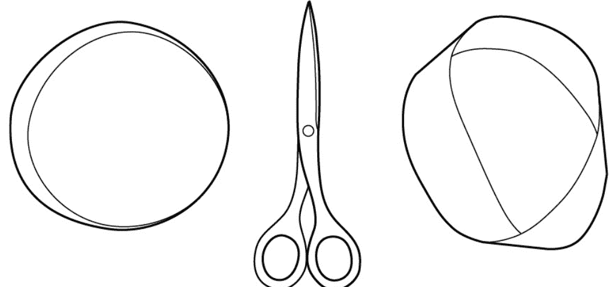

沿中线剪开普通环，理所当然得到两个环。可剪开莫比乌斯环，得到的不是两个，而是**一个**更长的环。

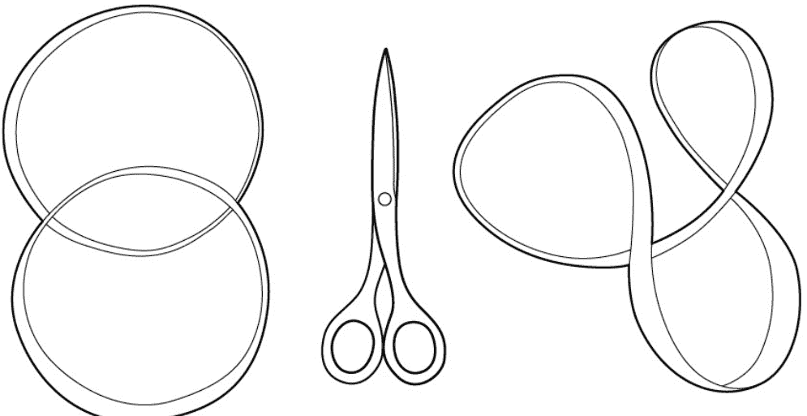

那时的我彻底崩溃——仿佛触碰禁忌黑魔法，不知是否释放了透视手掌时的恐怖力量。更进一步，若效仿约翰·巴斯《框架故事》：纸的一面写“从前”，另一面写“有一个故事开始了”，首尾相连成环。沿莫比乌斯曲线阅读，故事永无止境。这正是递归的体验：看似简单的循环，暗藏转折，将你引入另一维度。

在代码中写递归，如同用概念本身定义概念。初学画树时便能领悟：树干向上分叉，每个分叉顶端再生分叉，层层递进。只需重复最初的笔法，便能生出繐繁枝桠。换言之，**枝由枝构成，部分由部分自身定义**。侧视树根，同一法则静默运作——大自然正用递归平静描绘万物。

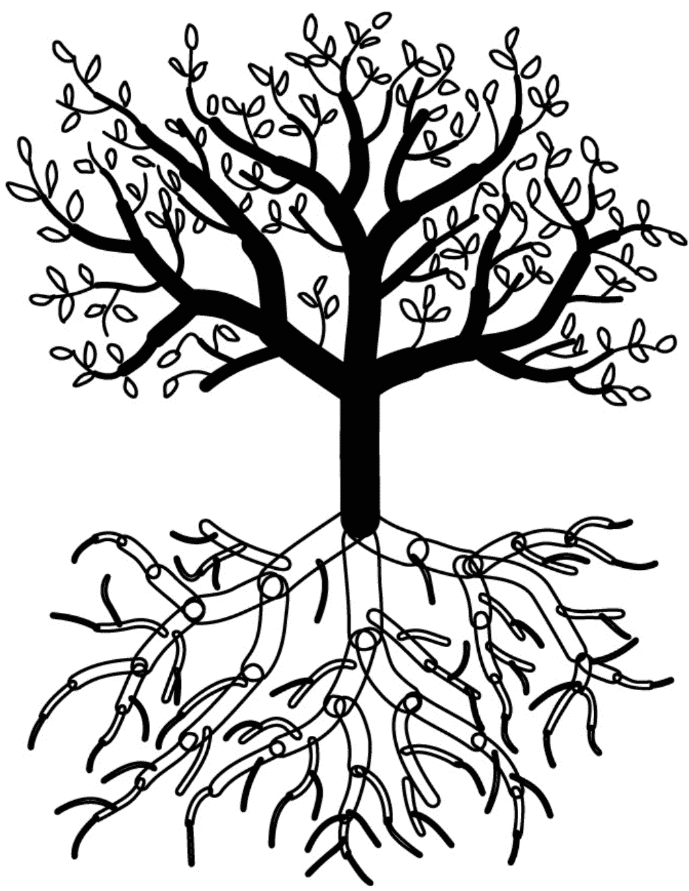

另一递归实感源于Unix。80年代叛逆程序员誓言重写这套系统，MIT的理查德·斯托曼欲其摆脱AT&T掌控，发起“GNU计划”。GNU暗藏递归奥义：`GNU's Not Unix`。请驻足细读：U指Unix，N指Not，皆平常；唯G指GNU，诡谲莫测。若试图展开G：

```
[G]NU's Not Unix

[[G]NU's Not Unix]NU's Not Unix

[[[G]NU's Not Unix]NU's Not Unix]NU's Not Unix

[[[[G]NU's Not Unix]NU's Not Unix]NU's Not Unix]NU's Not Unix

[[[[[G]NU's Not Unix]NU's Not Unix]NU's Not Unix]NU's Not Unix]NU's Not Unix

......
```

实体隐喻莫过于俄罗斯套娃：娃中套娃，层层缩小，因每个娃皆由另一娃复制而来。世界纪录套娃仅51层；但计算中的“套娃”嵌套无上限，除非程序员设定“基例”。想象剥开层层娃娃，哪怕缩至米粒大小，内里仍藏更小一枚。


在比套娃更实用的数学层面，递归能造出优雅表达，迥异于我早年那杂乱豆腐店记账程序。递归非循环的暴力推进——后者似流水线传送带，罗列任务、按序执行、回头重来。递归本质不同：按情境定义任务——像列流水线做大锅咖喱的步骤，关键原料却是小锅咖喱。最终流水线消失于做小锅咖喱的过程中，而小锅又需更小一锅……你消融于自创之物中。这概念不为胆小者准备：用定义本身表达定义，在物质世界仅能模糊想象，在赛博空间却自然至极。

至此你懂了：计算世界存在优雅的自我表达，宛如有形世界中引人深省的艺术。计算思维欣赏一种高度概念化的艺术，虽未入大都会博物馆藏品。程序员说“代码如诗”，绝非比喻。递归以极简表达复杂思想，思想本质可无限、可悖谬，如展开GNU般。在计算里，将悖论嵌入可运行机器成为可能。计算机时代前，递归已是迷人哲学命题。迈克尔·科尔巴里斯在《递归思维》中从人文视角精辟概括：

> Michael Corballis, The Recursive Mind: The Origins of Human Language, Thought, and Civilization (Princeton, NJ: Princeton University Press, 2011), 1.

**递归**（rì-kūr'-zhən），名词。若仍未明了，请参阅“递归”。

---

# 循环坚不可摧，除非程序员失手

回溯本章开头那个从0数到十亿的循环：

```
top = 1000000000
i = 0
while i < top: i = i + 1
```

实测在我的机器上跑完全程不足一分钟。请记住：当你拿到此书，算力已更强。计算机畅通无阻，如驾超跑踩死油门奔赴无尽长路。可车内轰鸣、肾上腺素飙升时，极易忽视数英里外的巨石——轰隆！车毁人亡，但愿系了安全带。

将计数循环与驾车比喻对照，请思考差异。汽车加速有极限，撞击后至少留几秒清醒爬出废墟，祈祷仅皮外伤。但计算进程一启动，瞬间满血运行。遇错即停，连同其所在世界瞬间湮灭。这一刻是彻底灾难：正常运行时你看不见它在做什么；停下时，要么显式报错，要么毫无反应。屏幕闪烁报错或骤然黑屏，向来无预警——让人烦躁乃至暴怒。搜“Computer Rage”便知共鸣何其强烈。

探讨死机成因前，先设身处地感受计算机的绝望。最贴切的比喻：网上那些“大神级”多米诺玩家，煞费苦心摆数千骨牌，开机拍摄完美倒塌……直到某块错位——失败了。尴尬与震惊真实存在，唯一出路是回溯原点，逐一修正。

一块错位骨牌毁掉数百块完美序列——正如运行中程序彻底崩溃。满地骨牌面前，职业玩家以自律耐心重摆；程序员须同等态度，干脆利落说声：“修吧。” 若每次崩溃都无法控制暴怒，开发工作寸步难行。软件频繁崩溃，逼得职业开发者对灾难容忍度极高，却几乎零容忍那些本可轻易规避的低级错误。

设想份工作：每隔几分钟被机器指出你哪里错了。系统越复杂，错点越多。错误三类：可避免的“蠢错”、难避免的、不可避免的。计算机早期软硬件缺陷多，如试验飞机，多属“不可避免”。如今成熟度大增，此类少见。80年代我写代码，常遭早期机器“实验室属性”导致的不可控错误。这些Bug，源于40年代霍珀在早期计算机继电器里发现的一只困死飞蛾——阻断触点导电，机器瘫痪。

> **此处为双关，Bug本义“虫子”，引申为程序运行错误。**

霍珀沿复杂布线寻获真Bug，极具象征意义：除虫后的喜悦与排查时的痛苦并存。在堆叠数字符号中找Bug，大海捞针。因查Bug极难，团队协作时对“蠢错”有强烈偏见——视为可耻。幸而现在有各类系统技术降低Bug率，但人类写出零Bug软件不可能。谨记：非所有Bug致命——许多潜伏代码中却无显性影响。

为何无法构建零Bug程序？设想驾驶飞机：数百万部件，多少螺丝可能松动脱落？同理，Excel级软件有数千万行代码——写错或编译错一行的概率几何？大型软件常由成百上千人耗时数年打造。单颗松螺丝未必致命，如Excel一处错数不一定崩溃。但足够多“良性”Bug散落四处，负面耦合必发，意外随之而来。

计算机能孜孜不倦循环。程序启动循环那刻，便入隐秘广袤宇宙。纯数字世界里，数字自由、精确、无阻力地读写。视软件复杂度，Bug总有大小概率潜伏，伺机干扰甚至停机。停机时，若开发者能定位修复，循环得以续行。更隐蔽的是那些不即时发作、却悄无声息以难诊方式埋雷的Bug。

切记：屏幕所见，仅是计算机无形世界冰山一角。在循环与递归驱动下，无数数据流被或优雅或笨拙地高速处理。皆赖于人肉计算者、硬件制造者、软件工程师。我们须时刻准备，在最不合时宜的时刻，应对人类同伴遗留的无形Bug冲击。无论如何，迎接未来吧：计算机将深入内部，孜孜不倦清除我们写入的Bug——扫除一切障碍，让强大循环永不停歇。计算机将永远精准无误地重复自己。

---

# 第二章

## 机器能无限变大

## 拥抱指数思维：始于反本能

有个古老谜题：一池清水遭外来睡莲入侵，数量日翻倍，很快覆满池面。池畔小屋住位科学家，每日记录生长，担忧叶下水生物因缺光灭绝。

第30天池面全覆，睡莲达536,870,912片。谜题问：“第15天约有多少片？”初闻时我答268,435,456——半数，**错**。

更易的问法：“哪天覆盖一半？”答第29天。因日翻倍，第30天前一日必为半池，合乎逻辑。若答第15天半池，也自然——15是30的一半嘛。

但若日翻倍，第15天真相如何？从第1天1片起算：

- 第1天 = 1 片
- 第2天 = 2 片
- 第3天 = 4 片
- 第4天 = 8 片
- 第5天 = 16 片
- 第6天 = 32 片
- 第7天 = 64 片
- 第8天 = 128 片
- 第9天 = 256 片
- 第10天 = 512 片
- 第11天 = 1,024 片
- 第12天 = 2,048 片
- 第13天 = 4,096 片

### 指数思维：从睡莲池到代码循环的维度跃迁

故事开篇，池塘里的睡莲每天翻倍：
- 第14天：8,192 片
- 第15天：16,384 片

这背后的数学逻辑，正如 Excel 函数 `=POWER(2, DAY-1)` 所揭示的。按此推算，第30天池塘将覆盖 **536,870,912** 片睡莲。但令人震惊的是，即便到了第15天，睡莲仅占总量的 **0.003%**，连 1% 都不到。直到第23天（约419万片）与第24天（约838万片）的交界处，覆盖率才勉强跨过 1% 的门槛。

这道经典谜题，精准地剖开了**线性思维**与**指数思维**的认知鸿沟。

我们习惯线性增量：幼苗浇水施肥、孩子学数数、哪怕以百万为单位计数，本质都是“每次加固定值”。这是加法世界的稳态。但指数增长是乘法世界的“飞跃”：**符号仅旋转45度（+ 变 ×），维度便彻底易位。**

以 10 为例：加法 10 步至 101；乘法 10 步直抵 100 亿。因为乘法内部“藏”着无数次加法——`5 × 1000` 实则是 1000 个 5 相加，这种累积让数字以《杰克与豆茎》般的速度生长。

```
5+5+5+5+5+5+5+5+5+5+5+5+5+5+5+5+5+5+5+5+5+5+5+5+5+5+5+5+5+5+5
+5+5+5+5+5+5+5+5+5+5+5+5+5+5+5+5+5+5+5+5+5+5+5+5+5+5+5+5+5+5+5
5+5+5+5+5+5+5+5+5+5+5+5+5+5+5+5+5+5+5+5+5+5+5+5+5+5+5+5+5+5+5
+5+5+5+5+5+5+5+5+5+5+5+5+5+5+5+5+5+5+5+5+5+5+5+5+5+5+5+5+5+5+5
5+5+5+5+5+5+5+5+5+5+5+5+5+5+5+5+5+5+5+5+5+5+5+5+5+5+5+5+5+5+5
+5+5+5+5+5+5+5+5+5+5+5+5+5+5+5+5+5+5+5+5+5+5+5+5+5+5+5+5+5+5+5
5+5+5+5+5+5+5+5+5+5+5+5+5+5+5+5+5+5+5+5+5+5+5+5+5+5+5+5+5+5+5
+5+5+5+5+5+5+5+5+5+5+5+5+5+5+5+5+5+5+5+5+5+5+5+5+5+5+5+5+5+5+5
5+5+5+5+5+5+5+5+5+5+5+5+5+5+5+5+5+5+5+5+5+5+5+5+5+5+5+5+5+5+5
+5+5+5+5+5+5+5+5+5+5+5+5+5+5+5+5+5+5+5+5+5+5+5+5+5+5+5+5+5+5+5
5+5+5+5+5+5+5+5+5+5+5+5+5+5+5+5+5+5+5+5+5+5+5+5+5+5+5+5+5+5+5
+5+5+5+5+5+5+5+5+5+5+5+5+5+5+5+5+5+5+5+5+5+5+5+5+5+5+5+5+5+5+5
5+5+5+5+5+5+5+5+5+5+5+5+5+5+5+5+5+5+5+5+5+5+5+5+5+5+5+5+5+5+5
+5+5+5+5+5+5+5+5+5+5+5+5+5+5+5+5+5+5+5+5+5+5+5+5+5+5+5+5+5+5+5
5+5+5+5+5+5+5+5+5+5+5+5+5+5+5+5+5+5+5+5+5+5+5+5+5+5+5+5+5+5+5
+5+5+5+5+5+5+5+5+5+5+5+5+5+5+5+5+5+5+5+5+5+5+5+5+5+5+5+5+5+5+5
5+5+5+5+5+5+5+5+5+5+5+5+5+5+5+5+5+5+5+5+5+5+5+5+5+5+5+5+5+5+5
+5+5+5+5+5+5+5+5+5+5+5+5+5+5+5+5+5+5+5+5+5+5+5+5+5+5+5+5+5+5+5
5+5+5+5+5+5+5+5+5+5+5+5+5+5+5+5+5+5+5+5+5+5+5+5+5+5+5+5+5+5+5
+5+5+5+5+5+5+5+5+5+5+5+5+5+5+5+5+5+5+5+5+5+5+5+5+5+5+5+5+5+5+5
5+5+5+5+5+5+5+5+5+5+5+5+5+5+5+5+5+5+5+5+5+5+5+5+5+5+5+5+5+5+5
+5+5+5+5+5+5+5+5+5+5+5+5+5+5+5+5+5+5+5+5+5+5+5+5+5+5+5+5+5+5+5
5+5+5+5+5+5+5+5+5+5+5+5+5+5+5+5+5+5+5+5+5+5+5+5+5+5+5+5+5+5+5
+5+5+5+5+5+5+5+5+5+5+5+5+5+5+5+5+5+5+5+5+5+5+5+5+5+5+5+5+5+5+5
5+5+5+5+5+5+5+5+5+5+5+5+5+5+5+5+5+5+5+5+5+5+5+5+5+5+5+5+5+5+5
+5+5+5+5+5+5+5+5+5+5+5+5+5+5+5+5+5+5+5+5+5+5+5+5+5+5+5+5+5+5+5
5+5+5+5+5+5+5+5+5+5+5+5+5+5+5+5+5+5+5+5+5+5+5+5+5+5+5+5+5+5+5
+5+5+5+5+5+5+5+5+5+5+5+5+5+5+5+5+5+5+5+5+5+5+5+5+5+5+5+5+5+5+5
5+5+5+5+5+5+5+5+5+5+5+5+5+5+5+5+5+5+5+5+5+5+5+5+5+5+5+5+5+5+5
+5+5+5+5+5+5+5+5+5+5+5+5+5+5+5+5+5+5+5+5+5+5+5+5+5+5+5+5+5+5+5
5+5+5+5+5+5+5+5+5+5+5+5+5+5+5+5+5+5+5+5+5+5+5+5+5+5+5+5+5+5+5
+5+5+5+5+5+5+5+5+5+5+5+5+5+5+5+5+5+5+5+5+5+5+5+5+5+5+5+5+5+5+5
5+5+5+5+5+5+5+5+5+5+5+5+5+5+5+5+5+5+5+5+5+5+5+5+5+5+5+5+5+5+5
+5+5+5+5+5+5+5+5+5+5+5+5+5+5+5+5+5+5+5+5+5+5+5+5+5+5+5+5+5+5+5
5+5+5+5+5+5+5+5+5+5+5+5+5+5+5+5+5+5+5+5+5+5+5+5+5+5+5+5+5+5+5
+5+5+5+5+5+5
```

这正是计算世界的底层逻辑：摩尔定律、内存容量、算力演进，无不遵循指数曲线。硅谷眼中的未来，从不是匀速前行的直线，而是一场场指数级的跃迁。而构建这种“魔法”的基石，往往藏在看似枯燥的**循环嵌套**之中。

---

#### 循环套循环：在代码里造维度

还记得小学在平面纸上画立方体吗？两个重叠的正方形，连线瞬间“骗”过大脑构建出三维空间。数学家用这套逻辑推演维度跃升：

 点（零维）  
 连线成段（一维）  
 扩面成方（二维）  
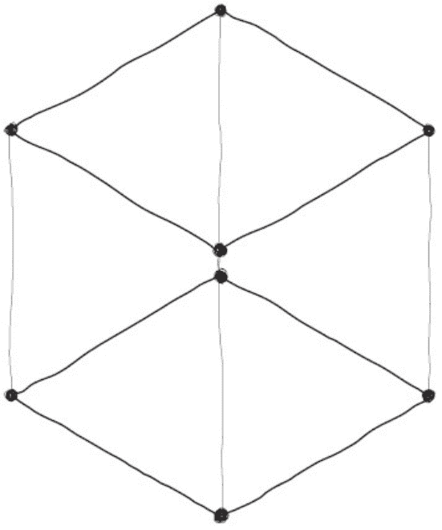 长体成立方（三维）  
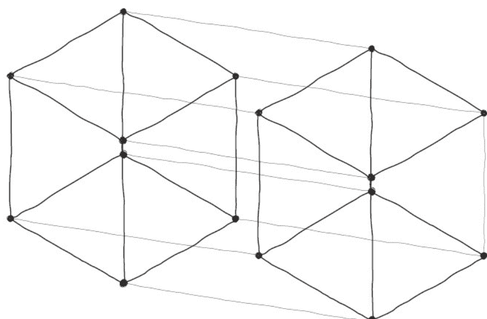 再展开连顶点，得超立方体（四维）

每次“展开”，空间量级指数级爆炸：边长 10mm 的线，成方变 100mm²，成体变 1000mm³。这种“超维增长”，在代码里只需一个动作——**把一个循环塞进另一个循环**。

先看单层循环遍历“十年”：
```
for ( year = 1; year <= 10; year = year+1 ) { }
```
输出：`1 2 3 ... 10`

再加一层“月”循环：
```
for ( month = 1; month <= 12; month = month+1 ) { }
```
输出：`1 2 3 ... 12`

嵌套起来：
```
for ( year = 1; year <= 10; year = year+1 ) {

for ( month = 1; month <= 12; month = month+1 ) {

}

}
```
瞬间生成 10 × 12 = 120 条记录。年份每转一圈，月份跑完 12 圈。这感觉像把线拉成了面。

若再嵌入“日”循环（假设30天）：
```
for ( day = 1; day <= 30; day = day+1 ) { }
```
```
for( year = 1; year <= 10; year = year+1 ) {
for( month = 1; month <= 12; month = month+1 ) {
for( day = 1; day <= 30; day = day+1 ) { }
}
}
```
三层嵌套产出 10 × 12 × 30 = **3,600** 个数据点。正如线→面→体，每多一层 `{}` 拥抱，就在虚拟空间里“凭空”多出一个维度。

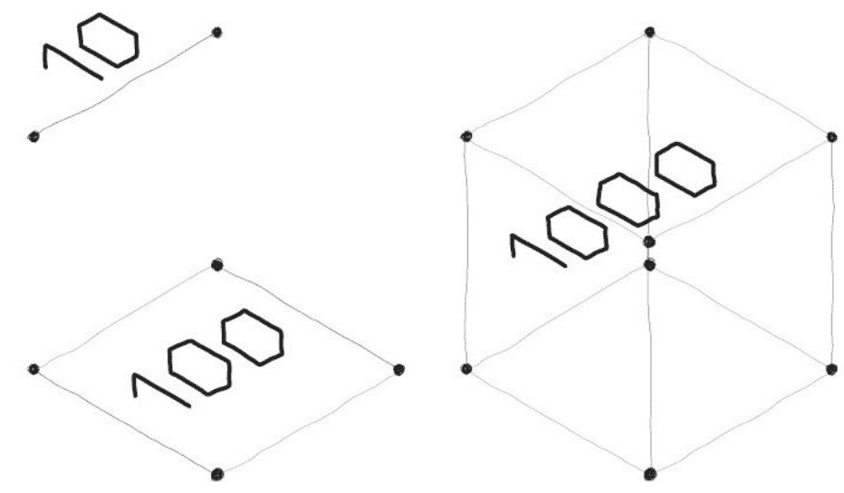

这不仅是数字游戏。`{}` 里可以装**任何可执行逻辑**：

- 遍历 10 台云服务器分发任务：
```
for( machine = 1; machine <= 10; machine = machine+1 ) {
for( year = 1; year <= 10; year = year+1 ) {
for( month = 1; month <= 12; month = month+1 ) {
for( day = 1; day <= 30; day = day+1 ){}
}
}
}
```

- 或在 10 年的每一天，驱动 10 台机器并行计算：
```
for( year = 1; year <= 10; year = year+1 ) {
for( month = 1; month <= 12; month = month+1) {
for( day = 1; day <= 30; day = day+1 ) {
```
```
for( machine = 1; machine <=10; machine = machine+1 ) { }
}
}
}
```

**维度的上限在哪里？**  
把 `year <= 10` 改成 `100,000`；把天拆解为时分秒；把 10 台机器扩容至千台万台。每一层嵌套，都是新维度的诞生；每一个边界的拓宽，都是空间的指数级膨胀。在物理世界里这违背直觉，但在计算宇宙里，这只是寻常操作。

---

#### 保持对“十的幂次方”双向开放的心态

从微观代码块到宏观宇宙尺度，指数思维无处不在。正如伊姆斯办公室经典短片《十的幂次方》所展示：视角每拉远十倍，认知维度便重构一次。

（注：素材末尾引用来源保留）

> **“Powers of Ten and the Relative Size of Things in the Universe,” Eames Office, LLC, 2019.**

# 当代码获得上帝视角：计算的无限尺度与人类的有限边界

看过雷·埃姆斯和查尔斯·埃姆斯的短片《十的次方》吗？这对以昂贵椅子闻名的设计师夫妇，其实在电影里藏着更野心勃勃的野心。镜头从芝加哥公园野餐毯上的一对夫妇起步，每十倍跨度跳跃一次：1米、10米、100米……直穿金星轨道、太阳系边缘，直至万光年之外；随后又折返人体，钻进毛孔、原子核，抵达0.0001埃的微观尽头。九分钟里，宇宙的宏大与微观的幽深被一口气贯通。

九十年代我做视觉设计时，天天和这种“无限缩放”打交道。为了把海报细节做到极致，我曾用特种打印技术把字号压到肉眼不可见，那组森泽10号海报后来躺进了MoMA永藏馆。但纸张有边缘，油墨有网点，物理介质终究卡住了想象力的翅膀。

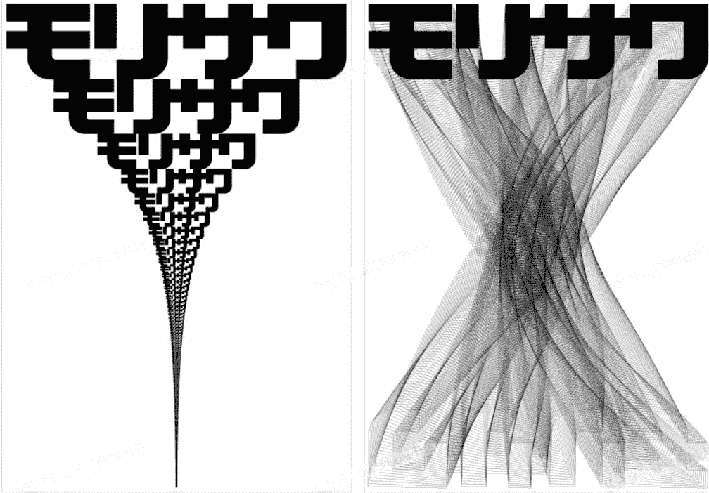

真正能承载“无限层级”的，只有计算本身。拿科赫雪花举例：用四条线段替换每一条线，再对新生成的每条线重复替换，锯齿状曲线便在有限面积里生出无限周长。


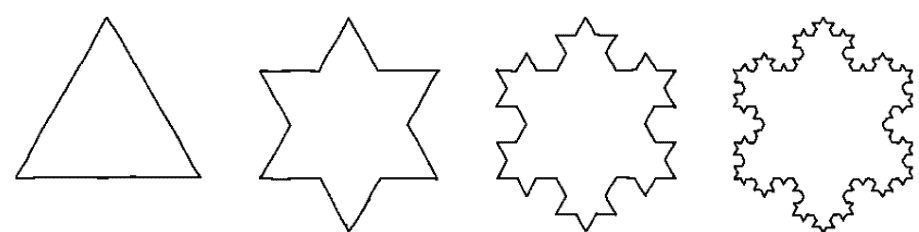

这种“细节永不终结、却不占额外空间”的悖论，正是计算媒介的原生气质。写段循环，十亿用户数据、每条GPS轨迹、每次按键记录，全都能在几行代码里被遍历、分析、建模。

```
for( user = 1; user <= 100000000; user = user+1 ) {user_data = get_data(user);
for( data = 1; data <= length(user_data); data = data+1 ) {
analyze_user_data(data);
}
}
```

没有广度与深度的二选一，只有“全都要”。摩尔定律再跑几个周期，算力瓶颈自然瓦解。这种能力像极了超能力：正幂方向可直抵亿万光年，负幂方向可潜入埃级尺度。酷炫？是的。反直觉？也是。仿佛瞬间长出外星人的感知器官——别急，请先听听大卫·鲍伊怎么唱《火星生活》。

---

## 离开“人的尺度”，代价由谁买单？

**“繁杂”可解，“复杂”难测。** 印刷机、分发系统再精密，拆开看总能看懂——那是繁杂。可一旦上亿用户、实时推荐、算法反馈回路叠加，系统就变成“复杂”：没人能预判全部涌现行为，哪怕算力再强。

约瑟夫·魏森鲍姆早看穿了：程序员是自己造出的宇宙里的唯一立法者，剧作家、导演、皇帝都没享受过这种“演员绝对服从、舞台任意重写”的权力。难怪写久了代码，有人会产生上帝情结，把妄想当指令强加于人——“技术男”刻板印象虽不全是代码的错，但与这种权力体验高度相关。独裁者敲几下键盘就能重塑亿万人认知，本质上也是同一套逻辑：比特听话、周期极快、零异议。

机器本身是繁杂可懂的；一旦规模化介入社会，后果就成了复杂系统。繁杂有解，复杂只能持续治理。阿尔弗雷德·诺贝尔发明炸药既炸死更多人又让矿工更安全；曼哈顿计划科学家余生都在赎罪与救命间摇摆。今天，同样的一套推荐算法，既能把课程推给偏远山区孩子，也能把极端内容塞进青少年时间线。

开发者训练大脑搞定繁杂，价值观必须托底复杂。计算已渗透进每个人的微动作与地球尺度，懂机器语言的人若不践行人文主义，后果由全人类承担。

---

## 计算机比人类更懂“团队作战”

八十年代MIT宿舍里，学长嘲笑我的Mac是玩具，转身在终端里从剑桥跳到哥大、再跳到斯坦福。那一刻我懂了：联网的瞬间，渺小终端化身超算触角。早期互联网还是孤岛，调制解调器拨号接上长途，万维网降临后才真正民主化——从剑桥咖啡壶实时图到《连线》杂志，网站数从94年的2,738个爆发至如今十亿级。

```
for ( website = 1; website <= all_the_websites; website = website+1 ) { < 访问这个网站中的所有网页，看有没有你想找的东西 > }
```

谷歌搜索的本质，就是用循环把“大海捞针”拆解成“逐根核对”。人类做不到，但对代码来说只是基础操作。云计算更进一步：不是摩尔定律的线性翻倍，而是每接入一台机器，算力就指数级跃升。数十亿智能手机、服务器、边缘节点，以毫秒级节奏互发请求、借算力、存数据，零摩擦、零抱怨、零疲惫。

拿起手机，你握着的就是通往这支“无限赛博机器”的微型触手。云厂商掌握的能量，足以让人兴奋也足以让人战栗。

---

**别让循环把自己困住。** 我在铝工厂见过金属硬度、在团队里摔过跟头、在代码里尝过全能幻觉。工程师思维解剖繁杂，艺术家心态拥抱谜题，领导者技巧驾驭复杂——三者缺一不可。偶尔还要写几行代码，感受一下无限空间的魔力，算是给大脑做做理疗。万一哪天你看我像台机器一样运转，麻烦扔只飞蛾过来，帮我跳出死循环。

# 云端博弈：当巨头不再自建“发电厂”

Kevin McLaughlin, “Netflix, Long an AWS Customer, Tests Waters on Google Cloud,” The Information, April 17, 2018, theinformation.com/articles/netflix-long-an-aws-customer-tests-waters-on-google-cloud.

拿视频巨头奈飞（Netflix）来说，它的核心算力引擎长期运行在亚马逊云（AWS）之上。道理很简单：自建云基础设施成本高得惊人，而在红海市场里租用现成资源要划算得多。对奈飞这类公司而言，掌握大规模计算底座并非核心竞争力，与其自建“发电厂”，不如直接接入电网。云的真正诱惑力在于资源的弹性流动——随时扩容、缩容，精准匹配用户观看高峰与低谷的波动。

但凡事有两面性。当亚马逊一家独揽半壁江山、拥有定价权时，奈飞自然会寻找“备胎”——转向谷歌云测试部署，本质上是为谈判桌上多攥一张筹码。这倒逼所有云厂商拼命优化服务器协作效率，只为给客户交出更快、更强的算力账单。

“按需租用”而非“自建地基”的创业模式，其实是近十几年才兴起的新物种。云计算重塑了公司的诞生逻辑：原材料变成了虚拟、不可见的比特流。别被“虚拟”迷惑，这套系统并非玄学，只是极其复杂、却完全可知、可学。我们得直面一个深层追问：当机器群落实现远超人类协作效率的自组织时，会重塑怎样的世界？这种隐忧倒逼我下定决心：用余生打磨团队协作、深化人际连接，因为硅基伙伴正以指数级速度拉开差距。

# 第三章

## 机器仿佛有了“生命”

## 判断“活着”的标准，曾经很直观

初中生物课第一天，费格罗亚夫人（Mrs. Figueroa）给出的定义清晰得像刀切豆腐：生物学研究生命，判断标准只有一条——**“对刺激做出反应”**。

运动是生命的第一信号。燃烧的烛火、镜中的倒影、林间晃动的影子、池塘里的涟漪、安静房间里突然坠地的书……这些画面总能瞬间抓住我们的注意力。大脑会下意识归类：是生物？是自然现象？还是幽灵？所有判断都指向同一个坐标系——有机世界、自然界、超自然实体。

科学家瓦伦蒂诺·布雷滕伯格（Valentino Braitenberg）用极简模型拆解了大脑如何“脑补”出生命感。他的世界里只有马达、传感器和电子积木，不同组合却能催生出仿生行为。

设想一辆微型小车，装着驱动马达和光线传感器，逻辑是：**光越强跑越快，光越弱跑越慢。**
再反转逻辑：**光越强跑越慢，光越弱跑越快。** 这辆车在强光下静止，在漆黑中狂奔。若它拳头大，你觉不出异样；但若缩小到一分硬币大小，你脱口而出：“蟑螂！”除了蟑螂，何物偏爱阴暗尘埃、见光遁逃？布雷滕伯格由此推演出攻击性、爱、远见等更复杂的“类生命特质”，这在今日扫地机器人的滑行逻辑里依然清晰可见。

详见mitpress.mit.edu/books/vehicles。

我们会被机器人彻底欺骗、哪怕细看仍以为它有生命吗？尚未抵达那一天。但已故哲学家刘易斯·芒福德（Lewis Mumford）对早期电力技术（彼时的“互联网”）的洞见依然穿透时空：

Lewis Mumford, *Technics and Civilization* (New York: Harcourt, Brace and Company, 1934), 435.

> **无论科技离终极可能多远，它至少教会人类一课：没有什么是不可能的。**

栩栩如生的机器人虽未问世，但人工智能正因多重技术突破而狂飙突进。

John Maeda, “Abstract,” *How to Speak Machine* (blog), April 13, 2019, howtospeakmachine.com/2019/04/13/us-patent-4058672-and-voice-prompting-1976/.

回溯智能手机与自动驾驶之前的年代：**自动语音客服**，那是80年代家喻户晓的“无实体机器人”。它是合成生命体，守在听筒那头重复：“留言按1，查询按2。”按下键盘，它即刻响应——刺激、反应，如真人般标准。但凡在按键迷宫里迷路失去耐心的人都知道：它永不疲倦地把你引向错误出口。你想用漫长等待激怒它？别做梦了，对端运行的是**无限循环**。它对歇斯底里的咆哮免疫，因为它无感；它拥有全世界的时间，一遍遍重复同一句台词。

早期交互迟钝、组件缺失、响应缓慢。我们潜意识将“反应速度”等同于“生命力”：一秒才刹住的机器蟑螂不像活物；电话那头几秒才应答的声音让人毛骨悚然。过去我们轻松自诩“高人一等”，因为技术太慢——90年代搜索引擎输入后漫长的等待便是注脚。如今搜索近乎瞬间，因为它预判了你的意图；语音助手回应快如真人，尾音还带着“嗯”“哈”的语气词，恍惚间——**它听起来简直像……人类。**

Louis Liebenberg, “Persistence Hunting by Modern Hunter-Gatherers,” *Current Anthropology*, 47.6 (2006): 1017–1026.

认知完成了大逆转：昔日我们嘲笑计算机笨拙，因它事事拖沓；今朝我们恐惧它可能比我们更聪明，只因它对刺激的反应**快得离谱**。速度制造了“有生命”甚至“超智能”的幻觉。回到费格罗亚夫人的定义：生命体回应输入；**反应越快，我们判定它越聪明**；**耐力若超越我们，生存本能便会触发焦虑**——我们天生不愿被超越，尤其是被亲手创造、本该服务我们的“新物种”超越。

James Vincent, “Watch Jordan Peele Use AI to Make Barack Obama Deliver a PSA About Fake News,” *The Verge*, April 17, 2018, theverge.com/tldr/2018/4/17/17247334/ai-fake-news-video-barack-obama-jordan-peele-buzzfeed; Karen Hao, “Google’s AI Can Now Translate Your Speech While Keeping Your Voice,” *MIT Technology Review*, May 20, 2019, technologyreview.com/s/613559/google-ai-language-translation.

**无限循环**赋予了机器不眠不休的“耐力”，让它畅行无阻地调用云端算力。对于这些无形的“伪生命体”，只有一个词精准贴切：**僵尸**。它们该让我们警醒，理由有二：**（1）跟它们辩论你永远赢不了；**（2）你越来越难分辨对面坐着的是人还是僵尸。前者关乎理智生存，后者关乎关系公平。比被成倍增长的僵尸愚弄更可怕的事有很多，但我赌你更愿成为那个**依然能分清人机界限的人**——哪怕机器拟真到极致，至少要争取一个“辨别的机会”。

## 仿生科学正迎来文艺复兴

上世纪70年代探索计算机前沿的先驱约瑟夫·魏森鲍姆博士，恰是80年代我在麻省理工修读的一门AI课程教授。助教们私下传颂他的大名，当时的我和旁的年轻学子一样，只盼在课堂上不打瞌睡。多年后猛然惊觉：他正是60年代那款**Eliza程序**——首个模拟英语对话的计算机程序——的发明者。其拟真程度骗过了他的学生，让他们误信屏幕那头坐着活人。

详见psychologytoday.com/us/therapy-types/person-centered-therapy.

选修这门课的前一年，我们在计算机入门课上手写过Eliza简化版——**令人寒毛直竖，却又酷得发指**。Eliza的内核是“以人为本疗法”（Person-Centered Therapy）的简化仿真，鼓励病人借助原始AI自寻出路。技术手段是**“符号计算”**：把词汇与数字装进按序执行的if-then语句链。通俗说，就是“用字母多于数字写代码”，让程序处理高阶语义而非单纯运算。Eliza在无限循环中“倾听”输入，两招应对：（1）把输入改成反问句抛回；（2）捕捉关键词，调用模板话术。代码长这样，被【拥抱】在永不停歇的循环里：

```
forever {
<将这句话中所有的“我”替换为“你”，然后在句前加上“你刚才说”，在句后加一个问号。>
}
```

运行效果如何？你输入：“我今天过得真糟。”它回：“你刚才说你今天过得真糟？”你输入：“我要去商场。”它回：“你刚才说你要去商场？”——**这酷不酷？**

进阶版：按关键词触发差异化回复。依然在无限循环的怀抱中：

forever {

<把句中所有“我”换成“你”，句首加“你刚才说”，句尾加问号。>

<一旦出现“母亲”“父亲”等亲属词，无视其余内容，只回：“告诉我更多关于你×的事。”>

}

你吐槽：“全是我妈的错。”它接：“告诉我更多关于你母亲的事。”你咆哮：“我受够我爸了！”它接：“告诉我更多关于你父亲的事。”你若随口哼一声“噢？”或“啊！”，它更显共情：“噢？你说啥？脚不舒服？啊！再给我讲讲你的脚。”

再加一层逻辑——模拟“真人倾听、追溯语境”，让对话感更深：

forever {

<同前：人称转换+反问。>

<同前：亲属词触发模板。>

<对话持续一段时间后，回溯历史提取主题，回复：“我真想再听听关于 × 的事。”>

}

实战演练如下：

你：我今天过得挺开心。
它：你刚才说你今天过得挺开心？
你：是啊，棒极了！
它：多跟我说说。
你：得从我奶奶说过的一件事讲起。
它：你奶奶是做什么的？
你：她在皇后区开面包房。
它：我真想再听听你今天过得怎么样。
你：真高兴你感兴趣！那就从头说起……

**被耐心倾听、被允许喋喋不休的纯粹快乐**，让人感到被看见、被尊重、被确认存在——哪怕对面只是机器。因无限循环驱动，它永不厌烦、永不离席，宛如最包容的父母或挚爱。获得倾听，便想回馈；被尊重，便生依恋。

“Professor Joseph Weizenbaum: Creator of the ‘Eliza’ program,” *The Independent*, March 18, 2008, independent.co.uk/news/obituaries/professor-joseph-weizenbaum-creator-of-the-eliza-program-797162.html.

**机器竟能如此轻易欺骗人类**，让年轻的魏森鲍姆深感不安。今时今日，野心勃勃的技术专家早将发明变现上市，可他不是寻常技术客。幼年逃离纳粹、侥幸躲过大屠杀的经历，让他的世界观扎根于**“滥用权力的危害”**之中。发明Eliza后，他公开呐喊计算机对社会的潜在危害，而非从中牟利。他预见：终有一日，计算机不仅能熟练模仿人类言谈，更能凭借对对话者的全量认知，**在对话中完美冒充真人**。

F.Rosenblatt, “The Perceptron: A Probabilistic Model for Information Storage and Organization in the Brain,” *Psychological Review* 65, no. 6 (1958): 386–408.

这预言需跨越三座大山：**（1）获取个体全量信息的渠道；**（2）海量人际对话语料库供AI学习新模式；**（3）能消化上述数据的新计算范式——符号计算力有不逮。** 智能手机的普及攻克了前两座：极具成瘾性的终端让云端得以**持续、贴身、全天候**监测我们的一举一动。第三座大山的钥匙是**“人工神经网络”**——与符号计算近乎同龄，却在60年代经费争夺战中落败，如今却驱动着我们习以为常的、极其精准逼真的语音文本生成。

最后一道防线几年前才被一种特殊硬件攻破——**图形处理器（GPU）**。它原本为狂热玩家而生：让游戏跑得更快、画面更真。给屏幕上每个像素对应的微小多边形上色，是CPU能干但繁琐的苦活；协处理器分担了这类海量并行数值运算。如今任何电脑配置单上GPU都是卖点，但唯独游戏玩家吃得透——它加速不了常规数据处理。然而命运爱开玩笑：GPU竟是**“神经网络”所需稠密数值运算的完美廉价加速器**——这个被AI学界冷落50年的陈年概念，在21世纪强势觉醒。

拆解“神经网络”即见深意：**神经**——对标大脑神经元；**网络**——对标神经元互联拓扑。它与符号计算截然不同：无符号逻辑链，只有输入输出间**“原始”的数值映射关系**，由一群相互连接的仿生神经元在数学层面建模，酷似生物神经网络。故而它无法像传统程序那样拆解为可读逻辑，而是将原始数字在合成神经元间反复传递、迭代，直至**“学会”某种模式**。

打个比方：肌肉通过反复训练“记住”动作模式，你不需将动作拆解为步骤清单，肌肉自会给出反应。神经网络正是**为那些无法写成食谱的“直觉”编码**——彻底背离了字母数字符号编程的旧范式。这里没有显式代码，只有一个**“学习模式的黑匣子”**。黑箱内部是粗略数学模型，用电流模拟生物神经元工作机制；受正确刺激时，它吞吐原始数据，自发生成火花、连接、关联，**自发完成模式学习**。

摩尔定律加速通用CPU，反哺专用GPU更快迭代；符号计算在通往“更聪明”路上撞墙；GAFA（谷歌、苹果、脸书、亚马逊）囤积的海量用户数据……多重共振引发了**神经网络方法的复兴**——60年代夭折的路径，因计算机智能领域的**意外“超级爆炸”**而浴火重生。我们不再爱用“AI”一词（背负旧时代负面包袱），转而偏爱**“机器学习”（Machine Learning）**与**“深度学习”（Deep Learning）**。

深度学习是机器学习的一种具体技术路径。旧范式靠if-then规则“教”机器推理；新范式引入**脑模型——特别是神经网络**——让机器**通过观察期望行为来“思考”，通过分析重复模式来“习得技能”**。模型要跑通，前提是**持续、不间断地观察人类行为**。深度学习曾因缺乏海量训练数据与强算力而不可行；摩尔定律以近乎奇迹的算力兑现了承诺。我们不再需要手把手教机器——它能自学手边一切数据，数据不足时自行从云端拉取更多，**在自发生长中变得更聪明**。

# 面包与算法：两种智造的隐喻

不妨先按下暂停键——这个概念颇为微妙，难以一蹴而就地领会。这就好比走进一家传统的法式面包铺，柜台上摆着两款外观几乎无异的面包。一款是天然酵母面包，另一款则是工业酵母面包。对于像我这样的美国普通消费者而言，两者毫无分别：都是那标志性的撒着面粉、呈浅褐色的脆皮长棍。但在法国人眼中，这是天壤之别，因为工艺迥异，滋味亦有细微分野。天然酵母靠天然菌种发酵，工业酵母则依赖工业菌种。记忆的小窍门是：法语“天然酵母”结尾是n，英语“天然”开头也是n。

我认为，早期手工打造计算机器、沿用旧式AI技艺，宛如天然酵母——是对手写代码工艺的致敬。而神经网络驱动的新式AI，则以一种前所未有的合成方式诞生，仿若工业酵母。两款面包满足的都是“做面包”的基本需求，正如两类计算都回应了“计算”的核心诉求，可在内在成分上，它们截然不同。如何辨别？光看表皮没用，得用鼻子闻：天然酵母带酸香，工业酵母则无。同理，神经网络在展现出前所未有的行为时，不发出任何“气味”，我们必须格外留心这份差异。

Istvan S.N. Berkeley, “A Revisionist History of Connectionism,” 1997, userweb.ucs.louisiana.edu/~isb9112/dept/phil341/histconn.html.

Andrew Ng (@AndrewYNg), 2017, “If you're trying to understand AI's near-term impact, don't think ‘sentience.’ Instead think ‘automation on steroids,’” Twitter, May 1, 2017, twitter.com/andrewyng/status/859106360662806529?lang=en.

在魏森鲍姆的AI纪元，我们尚能分辨出计算机系统那机械般的回应。①它带着天然酵母特有的酸味。但即便那时，随着摩尔定律推演，真人反应与机器反应的界限注定日益模糊。若你像魏森鲍姆一样，对栩栩如生的神经网络新技术带来的冲击心生忧虑，欢迎加入这场关于“工业酵母AI”的持久辩论。机器学习权威吴恩达指出，关键不在于计算机终将苏醒、进化为高级生命。他主张：“若想看清AI的近期冲击，别想‘觉醒’，要想‘打了鸡血的自动化’。”②所谓“打了鸡血的自动化”，意指我们身处这样一个时代：循环往复、规模无垠的计算机器激活了仿佛有生命的物质，它们像不知疲倦的僵尸般行动。AI是无思想的机器人，依据其“大脑”接触到的模式执行指令。

Benedict Evans, “Voice and the Uncanny Valley of AI,” Benedict Evans (blog), March 9, 2017, ben-evans.com/benedictevans/2017/2/22/voice-and-the-uncanny-valley-of-ai.

新式“工业酵母活机器”远超过往机器的智商，因摩尔定律将我们推向极远，以致意想不到的事发生了。GPU让神经网络算力跃升，但吴恩达口中的“打了鸡血的自动化”需要海量数据喂养网络，否则网络永无法靠自学成才。譬如2012年前，图像识别平均错率28%，语音识别26%。②机器学习流行后，图像错率降至7%，语音错率降至4%。倘若云端持续吸纳我们活动数据，僵尸般复制我们一切动作且无需午休，终有一日我们将无法分辨AI与人类。工业酵母AI已至，它不再带有旧时天然酵母AI的酸味。

## 艺术视角：守住好奇心的钥匙

担任罗德岛设计学院校长时，我视在STEM至上的时代捍卫艺术教育为己任。眼见公立校艺术课从周课数小时压缩至寥寥数十分钟，而我的技术成就很大程度上得益于艺术熏陶，这逼我反思：如何揭示纯STEM教育的短板？这让我权衡摩尔定律的利弊，洞见艺术与STEM交叉产生的经济价值，坚信STEAM优于STEM。将此议题带进华盛顿国会，听闻无数艺术设计让位STEM的故事，后促我赴硅谷。我想弄清苹果、爱彼迎等公司如何在产品服务中充分释放STEAM综合效能。发现何在？设计氛围浓厚的公司深谙“艺术是享受生活的科学”，为让客户享受使用产品，必须让艺术家深度参与研发。

艺术家名声向来不佳——我深有体会，父母望我习数学弃艺术，恐我谋生无门。因艺术看似晦涩无关痛痒，可正是在艺术中，我找到了与计算世界完美兼容的切入角。艺术非止于所见所感，而是关于发掘表象之下的本质核心。比如艺术家知晓苹果的一个关键事实，咬一口根本发现不了。

试凭记忆画苹果，你大概会画个圆，上头加根棍。但苹果形状并非基于圆或球，而更似五棱柱。横切苹果，别竖切。你看到了什么？

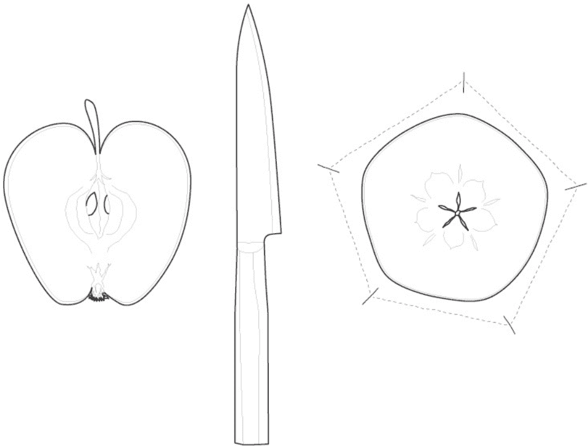

John H. Lienhard, “No.1243: Five-Fold Symmetry,” The Engines of Our Ingenuity (blog), uh.edu/engines/epi1243.htm.

看见五边形了？掌握这点，画出的苹果更写实。地球上绝大多数植物皆呈五棱排列——苹果源自苹果花。亲自验证最简捷的法子：输入樱花表情符号，同样揭示五重对称。优秀艺术家知晓此几何本质并据此描绘——除非你全神贯注地理解（而非仅用眼看），否则发觉不了。这也是画家为精准表现人体，必先研习骨骼架构与肌肉包裹方式，而后落笔。这是个合乎逻辑、严谨的过程。

我们常误以为艺术家随自由想象描绘世界。年轻时我亦犯此错，但浸润艺术后，在更深层面读懂了艺术家思维。我开始充分欣赏他们在核心思维层同时掌控前景与背景的能力。深夜漫步罗德岛设计学院校园，我常造访埃德娜·劳伦斯自然实验室——一个汇聚动植物标本与矿物样本的微型自然史博物馆。我常驻足欣赏华丽的蝴蝶标本柜，玻璃盒里形态色彩各异的翅膀，蓝、绿、橙交织。

有个寒冬夜，我推门进实验室，空无一人，便自在地问学生展员蝴蝶是不是镇馆之宝，说它是我的最爱。她脱口而出：“不是。葫芦才是。”神情仿佛说：“你就爱蝴蝶？太浅薄幼稚了。”我们都怕比自己聪明的学生，是有原因的，于是我以谦卑姿态请教：“请指教，大师！”

幸好她给了提示，半开玩笑：“不过羽毛也神奇！”我当时有点慌，她莫非休息时嗑药了？羽毛？！？！

见我彻底懵了，她从大柜子取出一份蝴蝶标本，领我到新装的高倍显微镜前。“看这里！”透过镜头，影像渐清——正是蝴蝶翅膀表面的羽毛状鳞片。蝴蝶被好奇稚童抓住、再也无法飞翔时，沾在手指上的粉末状物质，近看并非粉末，而是羽毛。我走回寒冷室外，但那名学生跨越尺度、行云流水般的认知能力带来的启迪，让我感到温暖。她让我意识到：艺术家总擅长建立看似不可能的联结。

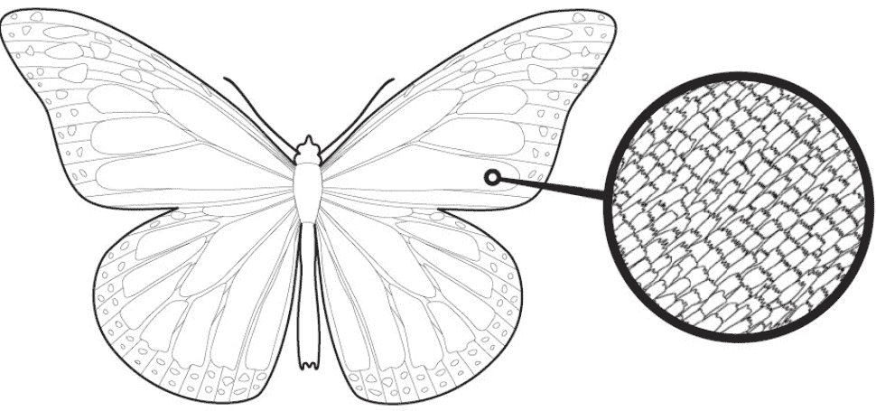

Zhenqiang Gong, Nicholas J. Matzke, Bard Ermentrout, Dawn Song, Jann E. Vendetti, Montgomery Slatkin, George Oster, “Evolution of patterns on Conus shells,” Proceedings of the National Academy of Sciences, January 2012, 109 (5) E234–E241; DOI: 10.1073/pnas.1119859109.

怀着对“似不可能联结”的敬意，我策划了桌面微型自然实验室，陈列芋螺属贝壳。这些海螺壳无羽毛纹，却布满蛛网状线条，线条围成小三角，小三角向外扩展生出更多三角——宛如无限放大科赫雪花可见的永无止境重复图案。这模式酷似计算机科学家斯蒂芬·沃尔夫勒姆发现的“规则30”算法，展示了有机物质现实与不可见计算世界间惊人的关联。因此，我们在计算机上编写的看似冷冰冰的算法，或许比想象中更具人性、更自然。

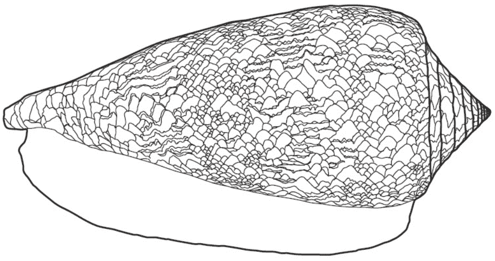

“规则30”的运作机制是将一行数字设为零：

```
0000000000000000000000000000...
```

然后编写简短代码，依据以下8条规则生成下一行：

- 规则1：序列000，中央变0。
- 规则2：序列111，中央变0。
- 规则3：序列110，中央变0。
- 规则4：序列101，中央变0。
- 规则5：序列100，中央变1。
- 规则6：序列011，中央变1。
- 规则7：序列010，中央变1。
- 规则8：序列001，中央变1。

全设为0时结果乏味，运行算法得：

```
00000000000000000000000000 ...
00000000000000000000000000 ...
00000000000000000000000000 ...
```

但若在这行数字中设一个1，运行中便见变化：

```
0000000000000100000000000 ...
0000000000001110000000000 ...
0000000000011010000000000 ...
0000000000110111000000000 ...
```

留意，由1和0构成的模式正在生长，循环数百周期，会得波峰波谷模式。以白色方块代0，黑色方块代1，得此图案：

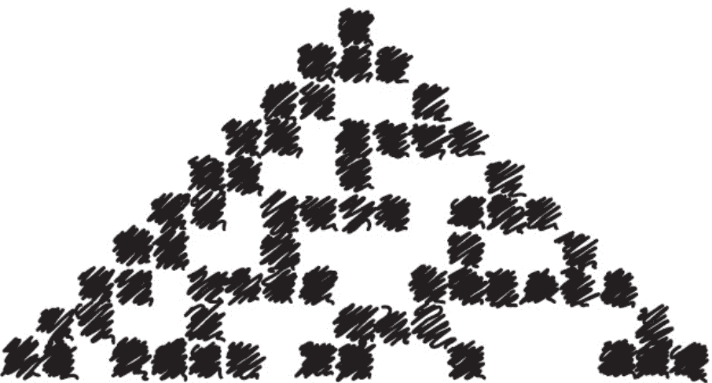

画到第十行手累了，我写程序用完美矩形代替手绘歪斜矩形，完成剩余290行——计算机不足一秒搞定。

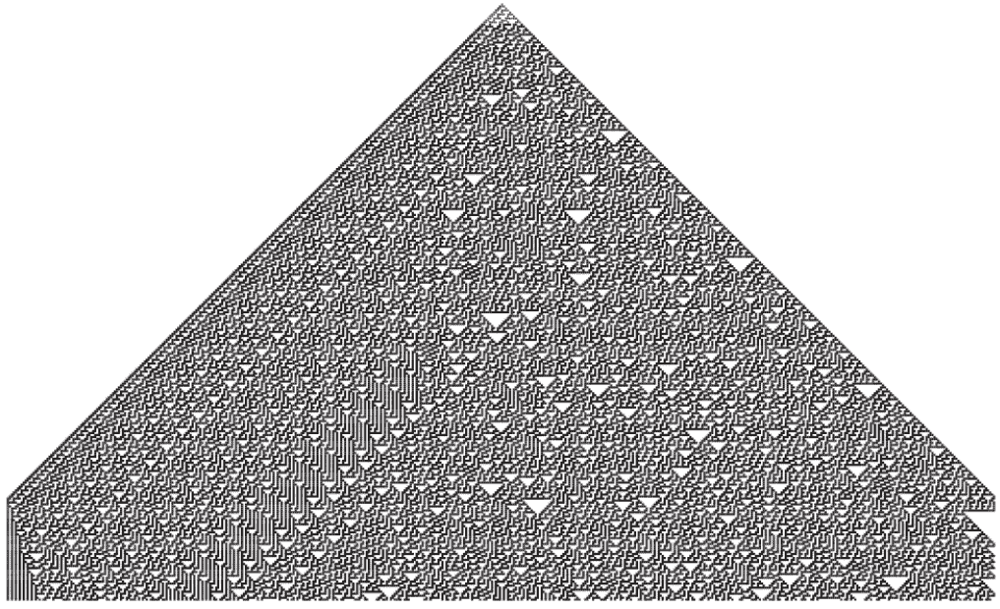

此处为文字游戏，“地球”英文earth，“艺术”英文art，去掉earth中的art，仅剩eh（呃），英文语气词。编者注。

这种图案与芋螺花纹惊人相似，已成多篇科学论文探讨主题——若你我一样迷信，会怀疑这绝非巧合。大自然说机器语言？机器说大自然语言？我们仅仅是机器？若你也在追问，定是在像艺术家那样思考，因为艺术家懂得透过表象之美深察。他们挖掘下层之下的下层，不达目的誓不罢休。我最爱的T恤图案说得最妙：“没有艺术的地球，不过是个‘呃’。”（The earth without art is just ‘eh'.）

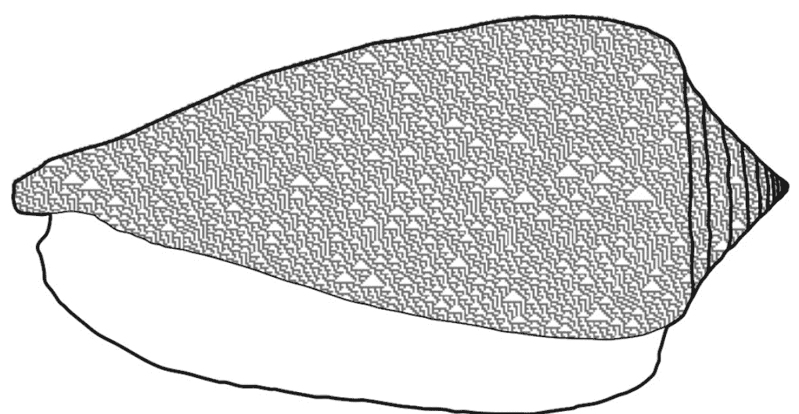

## 生活由我们如何与他人相处来定义

我与许多创意人共事，他们轻视“不搞创意”的管理者商人，因未见这些人亲手创造。艺术家/设计师有偏见：唯独自己在身心合一地创造，弄脏双手，留下认真工作的证据。这些脏手与大部分时间只说不做之人干净的手形成鲜明对比。

这种“说话人与做事人”的二元对立，源于一位设计系学生的直言。初遇他在我常散步的罗德岛校园，他大步走来：“嗨，约翰。刚才跟那些学生说话不对劲。”我困惑，自信包容性，问为何。答：“他们全是‘说话人’。只谈工作，不花时间真做。该跟我们玩，我们是真‘做事人’，只做事不废话。”

这学生坦率简单的逻辑，让我想起麻省理工工程师看待斯隆商学院同僚的心态。“说话人”被视为“坏”，“做事人”被视为“好”。但作为完全拥抱内心“说话人”身份的“做事人”，我忍不住告诉他：“遗憾告诉你，你自己就是‘说话人’，否则不会走过来跟我说话。告诉你为何交谈是好事。它把你与除自己外的他人连接——过程中，你不仅找到未知问题的答案，还因结识新友增加了创造潜力。”欣喜见这学生后在TED社区活跃，因他发现了内心的“做事人”与“说话人”。但我讲这故事非关注他，而是引发对“做事与连接事”模式的思考。

Sarah Zielinski, “The Secrets of Sherlock’s Mind Palace,” Smithsonian.com, February 4, 2014, smithsonianmag.com/arts-culture/secrets-sherlocks-mind-palace-180949567.

David Foster Wallace, “Plain Old Untrendy Troubles and Emotions,” The Guardian, September 19, 2008, theguardian.com/books/2008/sep/20/fiction.

设计师（与开发者）起步常定位为“做事人”。他们用双手完工，骄傲源于作品本身获认可，而非被迫在公共论坛为作品发声。因作为“做事人”，我们常活在自己的“思想宫殿”里，这里只与自己对话、只深耕工作才重要。或如已故大卫·福斯特·华莱士更讽刺的描述：“我们自由地成为自己只有头盖骨大的迷你王国主人，独处万物中心。” 你或察觉我语气带丝轻蔑，实非不敬。这是我的地盘，我最舒服之处。我大声说出、定期强迫自己更平衡地与世界互动。因大半生我爱创造东西，且真不需谈论它。这心态缩影是我早期职业生涯最知名艺术作品之一，一首俳句：

我只想成为的

是那个创造新事物

并思考新事物的人。

有段时间，我可像纯粹“做事人”般生活。早期计算设计作品在日获誉时，有位出版商江并直美代理我作品。江并先生包揽所有“说话人”活，我在幕后创作。

90年代初一个秋天，江并先生想让我在知名会议演讲。我极度害羞不愿公开露面。最终勉强应允，因江并先生恩重，紧张上场。晚会上，他建议我去派对多社交。我说不想去，宁愿回房继续写代码。他严厉盯着我，用日语说：“前田先生，建立关系与创作软件或设计同等重要。” 年少傲慢的我自然未听，回房写代码。几周后，江并先生陷入昏迷。事发后我顿悟：再无人替我说话，我必须学会为自己发声。于是有意识地选择，走出“头盖骨大小的王国”，成了“说话人”，同时仍尽力创作。过程中，我鼓励“做事人”学会从与“说话人”合作中获益，因“说话人”不只互谈——他们对接潜在客户。“说话人”的连接工作与创作工作同等重要，因为它让受众规模远超“做事人”独力所及。

> “Intermediate Level Lessons: Bundle of Twigs,” War of 1812, PBS, pbs.org/wned/war-of-1812/classroom/intermediate/bundle-twigs.

无论现实世界还是计算世界，连接工作都是催化剂，能让变革在个体能力之外的更大范围发生。早期计算机不过高级计算器，霸道占据电视屏幕只为自运行；后随着互联网诞生，计算机因与其他机器相连而变得惊艳。回想访问howtospeakmachine.com时，数十亿计算机可供调度，且我们不愿等待超一秒——当感谢域名系统（DNS）技术，它让无数计算机协作创造奇迹。站点名抛给命名空间服务器，不知映射则询问下一台，循环至匹配——皆在百分之一秒内完成。涉及机器或人，彼此依靠便生巨力，因我们在一起能做到个体无法做到之事。或如肖尼族首领特库姆塞所言：“一枝易折，一捆难断。”

1970 年 10 月，《科学美国人》刊载马丁·加德纳专栏，首度向公众揭开约翰·康威「生命游戏」的面纱。注：1860 年米尔顿·布拉德利构想《生命格子游戏》；百年轮转，鲁本·克拉默与比尔·马克姆将其复刻为现代家庭版《生命游戏》（详见孩之宝官网五十周年庆典记录）。

在数学版图上，一套极简算法于上世纪七十年代精准勾勒出「生命相互依存」的图景——这就是《康威生命游戏》。因名字雷同，它极易被误读为那款充满人生起伏的桌游；实则两者迥异：康威的版本剥离了叙事快感，只留下黑白格矩阵与冷冰冰的逻辑，唯有对数学怀揣兴趣者方能品出滋味。所幸，你即将踏入的计算宇宙以数学为基石，这或能助你领略这颗璀璨明珠的光芒——至少我由衷期盼如此。

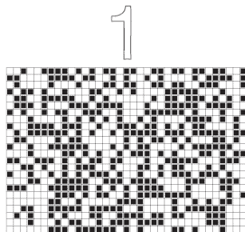
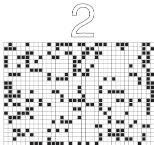
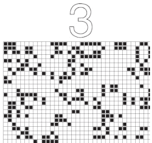
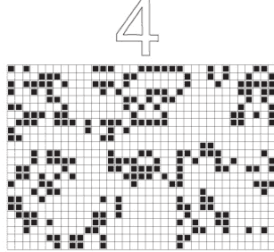
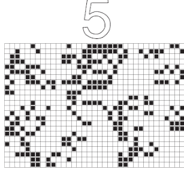
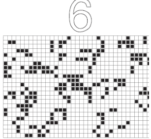

此游戏在二维晶格上演化，酷似沃尔夫勒姆的「规则 30」，却仅凭四条公理，用极度抽象的模型模拟个体与邻里的博弈：

*   **公理一**：活细胞若仅得单一活邻伴，将因孤立而凋零。
*   **公理二**：活细胞若拥二至三活邻伴，状态趋稳，延续生存。
*   **公理三**：活细胞若活邻过众，将因稠密而窒息消亡。
*   **公理四**：死寂格点若恰逢三活邻环绕，将因「繁衍」而诞生新生。

你可以用黑白卡片在桌面手动推演，黑代表存，白代表亡。但推演数轮便会觉察：人力太慢、太累、太枯燥。所幸八十年代算力觉醒，机器能自动迭代无限大网格。我至今铭记阿贝尔森教授在课上激动演示：方阵闪烁、簇群游走、碰撞融合、新结构涌现。彼时我却满心困惑：屏幕上忽明忽灭的色块，怎配得上「生命」两字？自认愚钝，望不穿其宏大。

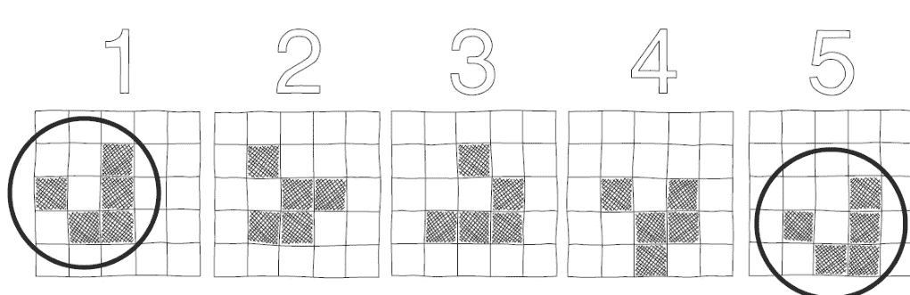

多年后方悟：其伟大**正在于简洁**。仅四条公理管辖单体与邻里关系，却能催化群体智涌现，让无数独立个体如同一个有机整体般协同。康威规则从未预设「群体」概念，可群体却自发分化、协作——这正是**涌现**的奇迹：无需全局视野，只靠邻里间的局部对话，协作便自然发生。

**借镜自然：从企鹅群聚到人体共生体**

协作让个体跨越单体极限。帝企鹅紧簇御寒，轮流站岗于寒冷边缘与温暖核心，脚尖微动减少冰面接触，羽毛层不压迫不挤压——这是刻进基因的生存智慧。鸟群鱼阵同理，绚丽队形背后是「抱团存续」的铁律。NIH 2012 年数据揭示：人体内共生菌数量是自有细胞的十倍。换个视角，**我们每个个体都是一个微观协作巨头**，数万亿「微员工」在体内不知疲倦地协同运作。

此时此刻，体内信息交换与创生从未停歇；硅基世界亦然。机器学会了「说话」，意味着它们拥有了直通最聪明大脑的通道——正如社交网络连接人类群体智慧。机器已习得协同、通讯、调用集体智力。反问我们：**能否像机器进化般飞速习得倾听与合作？** 若我们能训练算法完美聆听人机对话，为何不为同类也练就这门必修课？

---

## 保持大胆：机器无法取代我们的核心价值

回溯 AI 诞生初期（五十余年前），目标直指「机器思考」，而「下棋」被视为逻辑推演的试金石——毕竟这是书卷气十足者的强项。为让计算机科学显得「正统」，国际象棋成了招募天才数学家的招牌。

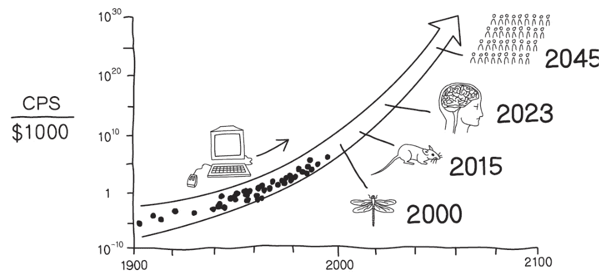

但说服四星上将掏钱时，「下棋机器」显得太不靠谱。推广团队硬是扭转乾坤，让 AI 研究繁荣近二十年。七十年代期望落空，资金断流，首个「AI 寒冬」降临。快进至今，工业级 AI 爆发，千亿资本回流，「AI 之夏」再临。

1984 年，我入读 MIT，苹果 Macintosh 问世。那时正值寒冬余波，百亿美元产业崩塌，实验室同窗都觉得我押注 AI 是「买彩票」——算力不足，下棋赢人远不如文字处理器替代打字机来得实在。如今呢？AI 成了硅谷乃至政商界的唯一热词，智能机器仿佛注定降临。

这增速让人联想到**巴菲特的复利法则**：存得越久、利率越高，财富指数级爆发。摩尔定律就是计算界的「超高复利」。按保守年增 66.66% 算，1 分五十年后化作 12 亿美元——这仍是保守估算。

弗诺·文奇 1993 年预言：「三十年内我们将造出超人智能，人类时代随之终结。」他命名这临界点为**奇点**。外行视若科幻，信摩尔定律者却视为逻辑必然。库兹韦尔更将其细化为六百页巨著：2015 年超鼠，2023 年超人，2045 年超全人类总和。奇点大学应运而生，2015 年超算模拟鼠脑成功，库兹韦尔的时间表正一步步兑现。明斯基生前偏爱科幻，只因科幻敢想象伟大理念——奇点正是注定实现的伟大理念之一。

**隐形的算力，拟真的面孔**

菲利普·范·艾伦 2011 年洞察：计算体验正悄然变质。这是「天然酵母」与「工业酵母」的分野。百万云端循环永不疲倦、无限扩展，正从「有机器味的 AI」进化为「无机器味的 AI」。科技巨头投入巨资，融合艺术洞察与人性理解，打造替身：它们眨眼、微笑、哼哼哈哈、甚至调情。它们永不止步进化，每时每刻从你身上汲取认知，自然讨喜。

机器擅长模仿、协作、海量细节。老板第一反应：「录用！」第二反应：「会替代我吗？」答案分两层：
1.  **好领导的目标就是「被替代」**——团队超越你，你才成功。所以「会被替代」本是荣耀。
2.  **目标在移动，你就永不落伍**——持续进化，跳入未知，像新生代般大胆。正如恩师威廉·J·米切尔所言：**「全力以赴完成它！」** 勇士不杞人忧天，直面挑战。

我有幸深耕 AI 半生，此刻觉醒：必须重新审视计算在设计新产品、新服务中的意义。我们站在不可逆转的人类转折点。算力飞奔下，少数技术精英的偏见将被嵌入永恒云端，非技术者将被不公平地甩在身后。这仿佛是**睡莲彻底覆盖池塘前的最后窗口期**。

谷歌、苹果、Meta、亚马逊、微软、阿里……巨头早占先机。你的挑战不止于「有胆量」，更需「智勇双全」。现在，让我们拆解计算产品的本质差异，引入你的全新视角。用天然酵母与工业酵母各烤一炉面包，烘焙出未来所需的多元深度。**奇点未至，开烤吧！**

---

# 第四章

## 机器本质不完美

## 及时的设计胜过永恒的设计

> 参考：敏捷宣言（2001），Jeff Gothelf 精益创业实践。Scrum 作为自组织框架，通过会议、工具、角色助力团队高效、可持续交付复杂软件。全球软件工程中的 Scrum 应用文献见 IEEE 2009 会议录。

# 代码世界的黑话：为何完美是数字产品的陷阱

程序员圈子爱用行话。混久了你会听到“敏捷”，纳闷怎么没见程序员穿运动装；听到“精益”，疑惑工位上咋全是糖果包装纸；还有 Scrum，听起来像部没看过的科幻片。这些术语指向同一核心哲学：**别憋大招追求“完美交付”，而要发布不完整产品，靠疯狂迭代把它养好。**

这玩法放在过去属于异端。老派软件开发走的是“瀑布流” —— 就像瀑布从悬崖直落，需求、设计、编码、测试、维护，一步接一步，线性推进。造车、造手机都这么干：图纸定死才能开模，一旦下线想改？除非召回，既贵又伤招牌。瀑布流周期动辄数年，风险极大。有汽车设计师吐槽：某车企曾预判“传真机将成车载标配”，专门留出巨大安装槽；几年后车型上市，传真机早绝迹，车里落个巨大的废弃空腔。

实体制造的逻辑是压榨“边际成本”，规模化分摊固定成本赚利润。但数字产品打破了物理规则：**复制分发成本趋近于零**。没库存、没物流、没召回风险。对传统制造业思维来说这是降维打击，但懂计算本质的人知道 —— 既然原材料（比特）不受物理约束，商业规则自然得重写。

这不仅省钱，更改变了研发范式：**不用押注“终极版本”，先推个“半成品”试水**。随时能用新版本无缝替换旧版，规避了“造完发现没人要”的巨额沉没成本。更关键的是，云端遥测能实时捕捉用户真实行为，让产品进化方向由“拍脑袋”变成“看数据”。

在纯计算世界，更新快到你感知不到。醒来发现 App 变了，系统升级了，却没弹窗打扰。**速度即质量** —— “好不好用”取决于新功能触达多快、解决问题多快。摩尔定律加持下，算力翻倍、成本腰斩是常态。

要找个隐喻，仰望天空：**云端连接重塑了一切**。设备持续在线，数据随时删改同步，云端随时可变。**追求“永恒经典”成了伪命题**，唯有“及时”与“在线”才是硬道理。在随时可能被迭代淘汰的状态里，找到持续进化的节奏。

---

### 这像不像“计划性淘汰”？

大萧条后通用汽车搞“计划性淘汰”，让车主觉得旧车过时逼迁换新，靠焦虑赢过福特的“实用主义”（福特名言：颜色随便选，只要是黑的）。环保主义者骂这策略造垃圾、毁环境。但软件不同：**计算介质天生“永远过时”**，一次 OTA 升级即可焕新，**零物理垃圾、极低碳排**。硅谷标准配置：软件在你睡觉时、甚至用着时，悄悄变强。

当然也有阴暗面：苹果等巨头推送需新硬件跑得动的“优化”，逼你要么忍卡顿，要么换机。软硬一体把“计划性淘汰”玩成精准收割机——汽车厂做梦都不敢想，科技公司却能让你像发条玩具般，每季度准时掏钱。

---

## 设计圣殿，已失势

如果设计是“理性意图”，我们得升级理性的算力。可传统设计界不在云端，在你的客厅：祖母的古董椅、婚礼的瑞典餐具、铝桌上的法式皮箱、时尚杂志喊你烧掉条纹外套改穿草间弥生波尔卡点。**这是物理世界的审美崇拜，我们爱它，却不能拿它套用数字逻辑。**

博物馆、画廊、时尚界、美校构成了**“设计圣殿”** —— 一个垄断“何为卓越设计”定义权的利益共同体。进不去？因为你不懂史、不思考。我曾因 MIT 学位不被认可，跑去美校读书、后来还管过美校，才摸清门道：

1.  **补课**：艺术设计史刷够、馆藏看透、投入数千小时（现在有手机谷歌，我当年的四年图书馆功夫，几天搞定）。
2.  **实战**：像设计师一样思考、动手。包豪斯基础是入场券，但真正入行靠**一万小时刻意练习**。你得做烂作品、被大神骂、在毁灭中重生。

设计训练营里分三派风格：
*   **过时风**：慢半拍，被时代抛弃（死磕或转型）。
*   **流行风**：蹭热度，混圈子（警惕下一波浪潮拍死在沙滩上）。
*   **创造风**：逆流而上，表达异见（不一定红，但最酷）。

定风向的，是圣殿里握筹码的精英。这是个有英雄、有阶级、有特权的圈子——皇室炫耀“独占稀缺”那套逻辑延续至今。在线零售商“Design Within Reach”（设计触手可及）被调侃为“Design Without Reach”（设计遥不可及），一针见血。**圣殿内部自嗨得很爽，但已与计算时代脱节。**

过去生产需重资本，圣殿精英掌握知识网络决定“造什么”。现在：**硅谷资本 + 普惠算力 + 数据反馈 = 理性思维碾压精英品味**。优质数字设计能极低成本触达所有人。你永远不“过时”，永远能“在流行头部”，因为电子产品迭代实时发生，用户还能参与共创。**科技圣殿以摩尔定律速度，早已甩开设计圣殿几条街。**

包豪斯回应工业革命，用机器流水线造大众买得起、用得好、看得惯的产品。百年后，计算驱动新工业革命，**旧包豪斯教条必须扔掉**。新勇气是：**拥抱人机协作，做新包豪斯一员。**

计算产品质量看**更新频率**，不看“打磨十年的永恒杰作”。这与圣殿“花几十年打造永世珍品”背道而驰。我们活在云算力支撑的实时现实里，**必须根本性抛弃“设计应追求完整”的执念。**

**新质量定义**：扔出未完成品，看它在市场怎么活，再改。不是押注“大师首秀即巅峰”，而是组建极客小队，驾驭这外星材料（比特），用**精益（减冗余、重实验）**和**敏捷（跟需求跑）**重塑态度。说白了：**以“永远做不完、进不了 V&A 博物馆”为荣，拥抱枯燥漫长的渐进式创造。** 听听豪斯曼那句百年箴言：**“新一代人类，当有勇气创新。”**

---

## 懂用户，比求完美更重要

计算产品设计师每天醒来第一件事：**主动降低标准**。接受现实：你不用巴黎时装周的灵感，要造 **MVP（最小可行产品）**。把宏大愿景削成骨架，只保留核心假设，做成低成本原型 —— 完美主义者恨不得地缝钻进去。**但换个角度：用优雅形式包装早期想法，把精力花在“搞懂用户怎么想”上，哪怕他们看到的是最简陋版本。**

怕被圣殿同行骂“垃圾”？**分享不完美，才能遇见“不同于你的人”**。云端部署，全球触达。像食堂放意见箱收集对新政看法，给网页挂反馈入口，**不用猜，全球用户实时告诉你答案**。

我亲测有效：备战 TED 曾精雕细琢 50 页 PPT，现在**裸奔上场，屏幕只放手机号**。观众发短信提问，我现场答。这招治好了“我以为观众要什么”的傲慢，**精准给他们真正要的**。没浸泡硅谷文化，我不可能想出这招。于是，谷崎润一郎《阴翳礼赞》供审美信仰，我自编的**《不完美礼赞》**供实战信仰。

**交付未完成品的妙处：想改随时改，甚至永远不“完工”。** 互联网完成了吗？没。它随摩尔定律日新月异。90 年代印刷转网页设计，网站上线≠完工，永远在扩容、重构。**视觉设计“定稿即腐烂”**的幻觉，在算力指数增长面前彻底破灭。

> “电子游戏：艺术测试通过，MoMA 认证。” —— The Atlantic
> “Rhizome 发布 Webrecorder 首个公开版本。” —— Rhizome Blog

**别再为“完美”献祭。在云端，唯有“被理解”才能生存。**

# 为何博物馆鲜少收藏网站？设计界的“等待”与新生代的“进化”

设计殿堂之所以对网页设计嗤之以鼻，根源在于数字媒介的流动性冲击了他们对“永恒完美”的执念。博物馆馆藏稀缺网站作品，并非因其无价值，而是技术迭代太快——诸多权威专家习惯性地按下暂停键，期盼这股“计算浪潮”能像过往潮流般迅速退去，等待下一个确定性的到来。这种心态无可厚非，毕竟传统设计师多不擅机器语言，难以驾驭这种失控的动态感。

好在，守旧派之外，先锋力量正在渗透。正如策展人保拉·安东内利大胆将电子游戏纳入现代艺术博物馆永藏，纽约新博物馆艺术团体Rhizome推出开源数字归档工具Webrecorder。进步已然发生，未来可期。

当下，新一代产品设计师正重塑认知：他们的作品大概率不会入史册，也不会陈列在博物馆的名椅旁。但这并非遗憾，而是一种特权——他们拥有让“未完成”趋近“完美”的独特路径：将用户实时反馈与前沿技术融合。听到仪表盘在恶劣天气下难读？第二天补丁即推送。过去追求“定稿即终局”，今朝拥抱“理解迭代胜过成品固化”。因为唯有持续调校配方，才能通往真正的经典。这是一场马拉松，而非百米冲刺。

## 迭代：让不成熟的念头进化为好想法

前文提及设计殿堂下的三种风格光谱：**过时风、流行风、创造风**。三者各有生存逻辑，深度常被低估。深入探讨迭代前，先逐一“放大”审视。

**流行风：借变化续命。** 优秀产品初上市仅几色，继而扩展色系、材质、工艺，最终走向终点，滑入“过时”深渊。流行周期长短取决于内核硬度，但营销高手擅长用技巧拉长高光时刻——正如时尚偶像艾瑞斯·阿普费尔所言：“穿得不同，便无需思维同频。”这类不自知的坚持，反造就了超越规则的“经典”，甚至让古老创意借“复古”重焕“创造风”光彩。

**过时风：无声消逝而非体面告别。** 它曾是时代最优解，只是时候到了。执念守旧者终将被时代抛下，除非他们能像阿普费尔般活成风格本身。大多数情况下，跟不上节奏，便是落后。

**创造风：孵化器与坟场共存。** 野心勃勃的创意多诞生于此。它们或如婴儿般天真，或源自永不消逝的古董灵感。早期采用者明知它可能永不“流行”直奔“过时”，仍欣然接纳。艺术家在“不适区”极度自在，深谙小众宿命；商业设计师追逐大众共振，而拥有资产支撑的艺术家则享受“不必售出”的自由。

**现在，是“创造风”玩家的黄金时代。** 硅谷繁荣的本质，是激进创意得以冲破平流层——不仅定义风格，更书写历史。从未有比当下更适合创业的时刻：算力云端按需取，人才云端匹配，代码现成调用，千亿风投蓄势待发（虽伴随指数级增长的高压）。资源满载，扬帆起航。

初创的终局，是“终创”——最终获胜的幸存者。摩尔定律让起跑变易，但规模化突围、复制谷歌神话却难上加难。亲历硅谷科技圣殿后，我方悟其中奥义：这是发明密度、规模效应、可能性边界均碾压传统计算机研究的独发生态，身在其中，是福亦是战。

| 维度 | 初创公司 | 终创公司 |
| :--- | :--- | :--- |
| **状态** | 渴望建功 | 已享盛誉 |
| **心态** | 全情投入 | 追求稳健 |
| **文化** | 孕育成型 | 根深蒂固 |
| **资产** | 近乎空手 | 资源丰厚 |
| **风险** | 几无损失 | 满身担忧 |
| **经验** | 首度尝试 | 遍尝知效 |
| **验证** | 待证实 | 久经沙场 |
| **分工** | 事必躬亲 | 岗位明确 |
| **架构** | 扁平精益 | 等级森严 |
| **命运** | 生死未卜 | 经受考验 |
| **驱动** | 全员主动 | 自上而下 |

**技术债：终创的隐形枷锁。** 软件速建且短视，新层依赖旧基，债务便在依赖链崩塌时显现。恰似一座“初创桥”因便捷建成，却因承载过重卡车、高峰拥堵而不堪重负。现实中扩建成本高企，只能由使用者自行规避。但数字世界不同——素材本质是流动的代码，**技术债理论上可偿还**，只是极难。

核心阻力来自人：维护高速运转系统的建造者。他们能修补、优化、延缓衰败，却绝不敢在光速运行中拆卸核心、重塑架构——牵一发动全身。软件工程师杰西卡·克尔直指痛点：软件越有用，依赖链越长，修改越惊心动魄。你需渐进交付、谨慎迁移、向下兼容、双倍测试、特例处理，**设计的是整个“变更过程”，而非单一补丁**。

初创期虽无债，但月复一月，债务悄然累积。终创视角下，初创的野蛮生长显得格格不入：那里只有“Yes, we can”，无“No, don't”。无资产可失，无正统可守，尽享“创造风”自由，直到捕捉到“产品市场契合（PMF）”。纯软件形态下，摩尔级速度的持续迭代，成就了Uber、Pinterest、Airbnb等硅谷宠儿。

**复利迭代：时间的朋友与敌人。** 沃伦·巴菲特的复利法则同理适用产品。
*   原地踏步：$1^{365} = 1$（零增长）。
*   日精进1%：$1.01^{365} \approx 37.8$（**年增37倍**）。
*   日退步1%：$0.99^{365} \approx 0.03$（**年剩3%**，归零）。

不作为的技术债，是复利的反面，将平庸放大为毁灭。

**“交付的时间价值”：** 布兰登·朱指出，争议不在“100%就绪”的定义，而在策略抉择：
*   **项目A：** 打磨大而全功能 → 交付慢（11月后上线，仅服务1月）。
*   **项目B：** 上线小而核心功能 → 交付快（1月上线，服务全年11月迭代）。

除非项目A威力超项目B两倍以上，否则项目B的累积价值碾压前者。我曾亲历项目A式创业烧钱惨败，血泪教训：**拥抱不完美，在发布中无情迭代**。但切记，速度非借口——亚历克西斯·劳埃德金句在耳：**“速度与深思须共生，方造好物，而非速成品。”**

**警惕“发布即弃”陷阱。** 军事词汇“Fire and Forget”（发射后不管）移植软件，酿成“Ship and Forget”恶果。推出半成品、 thereafter 置之不理，接受$0.99^{365}$式资产蒸发。转向不完美产品观，**请像抚育蹒跚学步的婴儿般持续照料**。它是“一劳永逸”导弹的对立面——弃之不理，必在潜移默化中“过时”腐烂。

## 情绪价值：订阅制下的生存刚需，而非锦上添花

代码工匠隐匿于众：无油污、无老茧、无物理实体劳作痕迹。他们在云端无声调度亿级数字，构筑高速流转的信息机器。虽召唤机器入世令人振奋，但长期与机器对话，心智难免异化——仿佛游戏高手或无人机飞手，所见维度与常人错位。懂机语不使你变机器，却让你觉得常人对真相一无所知。

**掌控权在谁手中？软件工程师。** 云端推送迭代的每一刻，话语权归他们。他们的感受至关重要——入其境，方知其苦。他们活在无限循环、超精细巨系统、日益逼真的机器世界里。懂商业设计者能赋予机器“流行基因”（如Photoshop、Gmail），但工程基础教育常缺商业设计视野，**导致科技公司普遍存在认知鸿沟**。

云计算重塑商业本质，鸿沟由此放大。产品从“一次性买断（拥有）”转为“持续付费使用（租用）”：昔日万金买光盘“成品”，今朝月费几美元订云端“服务”。周期收入模式（订阅制）虽具扩展性、可预测性、高粘性，却要求**永无“最终成交”，唯有持续取悦**。恰似“约会”而非“婚姻”：约会须时刻展现最佳，续订节点更是考验；婚姻易生惰性，视伴侣如常。若全程处于“约会态”，**持续愉悦用户便是生存刚需**。

十年前，取悦极客只需“跑通流程”，桥梁无需美观，只求能渡。通行费理所当然。如今桥梁林立、算力普惠、用户画式大变——七旬潮妈、从未碰表格的真人秀明星、非数学天才的少年。**“好用”已是底线，“爽感”才是及格线**——苹果、Instagram已重塑大众标准。

**MVP（最小可行产品）困境：** 精益给想要，不求全备。云端测试低成本，MVP成主流范式。但“可行”定义存争议：工程师眼中“可行”=可靠、少Bug。桥若随机踢车、突发塌塌，花纹再美也白搭。若承重不足，装饰无义。**快速构建安全、稳健、工程可行的系统，本身就是硬仗**。故而“最小可行”常异化为“功能优先，体验靠后”，资源倾斜底层架构。

请允许我暂且驻足，此处有话直陈。程序员能窥见那无形的计算宇宙，驾驭的复杂度令旁人难以企及。他们还得独自扛起层层叠加的技术债——牵一发而动全身，关乎所有相连的“桥梁”。全赖他们敲击键盘的双手，硬生生在混乱洪流中筑起堤坝。可这份壮举未获应有回响——此间无硝烟、无尘埃，汗水亦化作无形。故而，当商业逻辑闯入、设计视角切入，给这群数字世界的守夜人一点共情，实在必要。他们脑海中，海量细节与宏大架构同步运转。读懂他们，起于重塑你对算力世界的认知，于你毫无损益。不妨习得几分与机器对话的法门；若问长处，且浅笑道：“仅晓‘一比特’罢了。”

约翰·梅达，《最小可爱产品 (MVLP)》，Design.co，2018年12月27日。

极客群体或能容忍毛糙、唯功能论的交互，因其不适阈值天生极高。可大众审美早已水涨船高，“可行”定义亟待重写——他们要舒适，更渴望惊喜。试飞员无需软垫，民航旅客却盼枕毯与整罐汽水。为在满屏缺乏温度的 MVP 中讲清此理，我钟情于 MVLP 概念，L 即 “Lovable（可爱）”。缘何？我们极易遗忘：打磨的可用体验，受众远非唯效率论的技术派。保留 L，乃是自省——不管视作“热恋”抑或“白头”，懂得“调情”以固情谊，方能长久共舞。

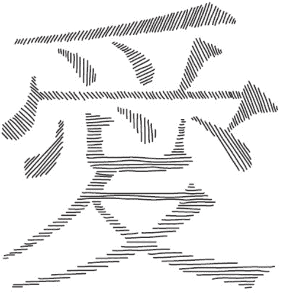

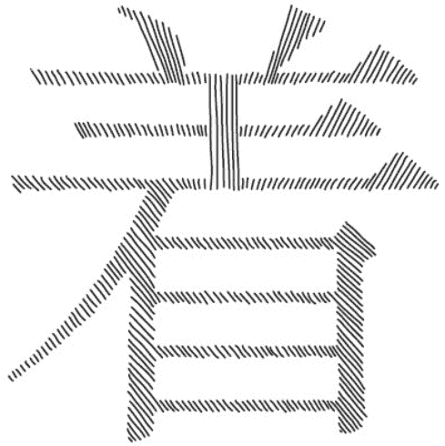


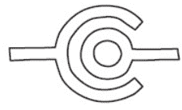

设计的艺与科，深植于日式哲学“愛着（Aisuru）”——意指“爱的契合”。此词描绘你我与环境中某物的奇妙羁绊：它完美贴合生活，令你瞬间心动。让“可爱、向往”成为强算力机器的核心指标，早超越了“加分项”，成了“生存项”。我大半生穿梭于技术与设计两座圣殿间搭桥。做桥梁者知晓：须亲身踏桥、测桥，方敢过桥。嗟乎，我常迷失归属，因所为屡被两殿拒之门外。然正是这尴尬的平衡，让我得以洞悉、珍重双方视角。

部分科技巨头已受惠于洞悉工程师心智的实践智慧，将创意转化为无需设计介入、人人称好的体验。借乔布斯设计丰碑为引，说说梅耶尔早年掌管谷歌搜索与体验的往事。她反其道而行，摒弃主流视觉堆砌，死磕“云端数据抵达终端的速度”。2006 年她力陈用户“确在意速度”，并证实单次查询体积从 100KB 瘦身至 70KB 带来的实质增量。彼时业界痴迷大图、花哨特效，两者截然不同。我归因梅耶尔胜局于谷歌重塑卓越设计坐标——逼近苹果巅峰，然功颂文多誤读其首创功勋。

梅耶尔拿工程师听得懂、量得准的指标，借内部技力极致追速。这正如麦当劳兄弟创“极速达”系统，以惊人效率出餐。两者同破体验基石的一隅，即吾《简约法则》第三条：**省时，即简觉。**

谷歌以工程视角诠释体验的魄力令我震撼，那正是其产品基石。早期策略常被误读为极简主义或极客偏见，实则大有深意。必须从代码层面、从起跑线起，郑重对待 MVLP 里的 L——万物皆赖计算。速度被立为设计属性，成工程师与常人罕见的“最大公约数”：秒开即优。攻克速度关隘后，谷歌顺势将 L 策略外延至非工程维度，如主页那些高压缩率的精美涂鸦。

唯有商业与设计早早介入数字产品全周期，MVP 才能赢得非技术者芳心。成品再套模式、完工再刷设计，皆为下策。需走综合路线：重开发者爱的造物观（保桥不塌），亦服消费者愿为“契合感”买单。若团队协作撞上“风口”，需求红利易催化商业圣殿推崇的“最佳契合”（PMF）。邀客户试用、纳入研发，配合敏捷迭代，好运自至。

常用喻：工程向 MVP 是“试吃块”，MVLP 是“纸杯蛋糕”——缩微版大蛋糕，细节全保留。纸杯易制且传神，交付即成品。MVLP 稀缺，因众人记忆犹新“纸杯配送贵如金”年代——做好底胚本就难，能稳产扎实底子者凤毛麟角。一口不碎渣便是“惊叹”，爱上颜值，因其乃技术奇迹。今欲逐鹿大众、对手同质化严重，风险倍增，必须卷风味、拒平庸。组团时，刻意拓展技术外维度，融入多元阅历，行致远。全员若懂些机语、能共情码农指尖跃迁的无形深渊，已属上乘。继而，成员间的爱与情谊，或能铸就计算时代中，让不完美更具温度的制胜之师。

# 第五章

## 机器可以被测量

### 遥测让你拥有某种心灵感应的能力

桌上挂着串铁铃铛，母亲豆腐店歇业时留下的物件。一枚弯钉钉门楣，开门响铃，知客至矣。帘幔隔前厅后厂，视线受阻；磨浆机轰鸣震耳，声响尽失。唯铃音尖锐，穿透噪墙，赋予我们低技版“第六感”。此物寓意深远：机械纪元里，它即遥测雏形。

“遥测”源于法兰西十九世纪，电信萌芽期。意指：电子仪器将勃朗峰积雪深度传送巴黎。核心价值在于——传感器替人工，自动采集、单向回传。设想彼时巴黎学者，获知四百哩外雪况，震惊不亚初见互联网。勃朗峰只能单向，互联网却成就高速双向——关键分野。远端双向通信必生错漏：线坏、传感器瞎、人失误。机间高速对话，须频繁应答：“收到没？”“未收，重发。”机器极快，重试零负担，循环确认至正确。“握手”机制暗含设备明确对话意图，以百%可靠协同、零丢包。故每节点皆可监听对端状态，通信基石也。

设备联网瞬间，输入源超越键鼠。软件若具测力，即将数据回传厂商。关键性不亚迫降时的黑匣子。如应用闪退，开发者溯源前序操作，修补漏洞、防复发——前提是你许可告知崩溃前情形。电脑崩溃时，厂商或窥你隐私，令人不安。实则，联网即意味一切操作可能共享全球。尤甚者，浏览器跑云系统，会话全程 100% 上传。产品上云、用户上机，厂商即刻观测用法，迭代未完设计。你用的绝大多数在线服务（听歌、协作文档）皆运行于此，且在注视。此赋厂商“读心术”，洞悉产品实况。觉醒者必问：如何关停？然无双向链路，便无互联网红利——根本关不掉。软件网络本质：显性连接外部系统。你的一举一动，经仪表遥测回传云端大本营。与其弹窗显性发问，不如静默监控、推演意图。驻留某图久，暗示偏好；录入半途弃，透露犹豫。纵无显性表达，行为串联成推理，恰如侦探破案拼线索。

如你所料或新闻所见，依网行数据画像用户心行，侵略性极强。惊人的是，2018 年欧盟 GDPR 生效前，科技巨头收集、处理、转卖数据几近无障——用户蒙在鼓里。成书时，美仍缺消费级同类法规，企业处置数据手脚松。我们点同意冗长条款变更时，实则签署了放弃自我数据所有权的文书。更怕的是：非止几个开发手动研判，而是永不停歇的算力系统，以微米级精度、全天候穷尽洞察你。若“读心”是超能，当遵斯坦·李《蜘蛛侠》箴言：“能大，责任大。”此责正成科技界焦点，或是你读此书的缘由。用机造物，强险并存——无人应惊，因力险本伴生。然险端常被忽，因技领袖常戴“傲慢”帽。我以为非傲，乃“特权保护区”——浸 NIRL（非现实）久，IRL（现实）浅。吾身处亿级数字操纵的 NIRL 宇宙，知其侵蚀自我。少年勇气配天真，叠加算力，酿不可测后果。故随你机语愈顺、读心术愈熟，须守影响半径外扩，时刻校准决策对现实冲击。吾曾几度逃避客户痛点、抱团取暖求安。算力读心醉人，易生“全知”妄念。有意识升维道德底线，已成凡通机语者的必修课。

### 更好地了解是为了更好地服务

毕业后寓居日本数载，初见列车严丝合缝守时刻表进出站，愕然。干支线皆然，非独东京。反观西雅图长大的我，早悟公交时刻表不可信，寰宇皆然——唯日本除外。同事答复如一：“日客零容忍。”言下之意似讽美人期待低。抛却自卑，我懂其重客之心，源自我家豆腐铺熏陶。父常挂嘴边一词：Omotenashi（おもてなし）。约译“款待”，实远超宾至如归。乃迎送之礼、服务之细、预判之智、超越之心。铺中：严双手递袋、别时为客启门。父知客远行，暗拣韧度适中豆腐——防碎。虽讳莫如深，亦包含客与吾夏威夷母间温情玩笑，母笑靥灿烂、声韵暖人——吾信此乃回头最大引力。佑美总送客以笑颜。

# 从“三杯茶”到算法推演：极致服务与隐私边界的博弈

Yuko Daishoji, “The Three Cups of Tea,” Miyoshi Tea Co., November 19, 2018, miyoshitea.com/new-blog/the-three-cups-of-tea-sankoncha. The Editors of Encyclopædia Britannica, “Ishida Mitsunari,” Encyclopædia Britannica, January 1, 2019, britannica.com/biography/Ishida-Mitsunari.

待客之道的最高境界，不是应声而动，而是未问先知。日本战国时期流传着一个“三杯茶”的典故，完美诠释了这一哲学。十六世纪，一位贵族武将狩猎归来，渴极了。侍者石田三成先端一大碗温茶，武将牛饮而尽；第二杯，换成半碗更热的茶，武将缓缓品味；第三杯，则是满碗滚烫热茶，配以精致小杯。前两杯解了渴，武将才有闲情逸致赏杯品茗。石田三成凭此机敏，获封武士，日后成为名将。

这个故事的隐喻深远：服务不应是千篇一律的“上茶”，而要基于对方状态设计体验。若石田三成不知武将狩猎归来口渴难耐，上来就端滚烫热茶配精致小杯，非烫伤舌头，即辜负美器。甚至可以说，若他不去打探武将行踪（这本质上是情报搜集），便无法完成这看似天然实则精密的服务闭环。懂客，才能以客之所愿待客。但这需要成本：你得“多管闲事”，甚至需要些运气，去获取那些能让你取悦客人的关键信息。

这种“御前度”（Omotenashi，日式极致好客）不只存在于日本。常去的餐厅老板记住你名字，你从路人变成“自家人”；网站弹出“欢迎回来，约翰”，初访时倍感亲切。但若素未谋面的网站、陌生的餐厅服务员直呼你名字、道出你隐私，恐惧感会瞬间取代温暖。当下最棘手的困境正是此：陌生人对你的“了解”，已越过舒适区直抵惊悚线。我们渴望隐私保护，呼吁机器停止窥探，可这无异于要求魔杖收回魔法——**计算机器的本质即是测量**，从点击按键到三维轨迹，测量是其内生优势。

Cookie（饼干/小文本文件）是这出戏的关键道具。它缓存在浏览器里，记录你来过、看过什么，像石田三成记住武将渴了，好沏出那“第三杯完美茶”。但技术机制允许无关第三方也往你的“饼干罐”塞东西——这就是“第三方 Cookie”，建议你读完去设置里关了它，夺回身份主导权。全关也行，只是登录密码、偏好设置全得自己记，浏览体验大打折扣。Cookie 本身无毒，它只是便利的载体。

未来可期，我们将持续用“泄露”的数字足迹换取计算便利。**隐私让渡多少，便利得多少**。连锁酒店知我避电梯间，航空公司记我偏过道座，我乐见其成，因为需求被满足。我反感的是未经许可的倒卖。可现实中，我们常在“同意”冗长条款的瞬间，不知不觉献出了所有。你到底签了什么卖身契？

> “House Votes to Allow Internet Service Providers to Sell, Share Your Personal Information,” Consumer Reports, May 4, 2018. “Patterns,” Privacy Patterns. “An Evolving Collection of Design Patterns for Sharing Data,” Data Permissions Catalogue. Holly Habstritt Gaal, “Ethical, by Design: How We Design with Your Privacy in Mind,” DuckDuckGo (blog), January 22, 2019. “ACLU Links Pizza Delivery to Privacy Erosion in New Online Video,” ACLU, July 26, 2004; ACLU, “Scary Pizza,” YouTube.

有时我们主动授权定位，层层叠叠权限交出去，互联网不再是你认知的样子。新认知是：ISP 存储贩售你数据，在美国合法合规；运营商、云厂商、App、硬件设备，全天候独立遥测你。数据如何流转、是否经你同意，正成为产品设计的新维度。若你仍存疑，看看 ACLU 2004 年的《可怕的披萨》：订披萨电话接通健康档案、职业记录，店家因“医生嘱咐少吃奶酪”拒绝加料并加价。当事人震惊：披萨店凭什么比我更懂我？

亚马逊存信用卡，Gmail 预判回复，云端掌握全貌，沏出“温度口感完美的茶”，宛如魔法。可一旦亚马逊被黑、谷歌泄露，后果不堪设想。值得吗？**值得**。风险可控的前提是懂规则、知底线。拒绝计算时代红利，意味着失去跨时空拥抱亲人、远程围观孩子成长的每一个高光时刻。每当技术替我分担琐碎、超越我独力所能，我心生感激，同时警醒：我得到了什么？云端拿走了什么？

“Guest Story: Expressed and Unexpressed Need,” The Ritz-Carlton Leadership Center, June 24, 2015.

测量的价值，终点是懂每一个需求。丽思卡尔顿用低技术手段演绎传奇：客人剩半块饼干，服务员推断口味不合，下次换甜点。我住过一次，愿以所有数据换那份“御前度”。问题是：**数据面前，算法为谁服务？** 启用遥测与客户数据时，请全盘照搬“御前度”心法——**视客户数据如己有数据**。让清楚知道“共享什么”，由客户自己权衡隐私代价与价值回报。

---

## 数据科学在全局层面控制逻辑解释

假设人均日解锁手机百次，全球数十亿设备在线，“大数据”非虚名。海量交互数据看似无从下手，但懂计算原理的人知：分析千万亿级数据点，已是寻常操作。技术层面，云端以惊人吞吐收敛数据；道德层面，同等量级的隐忧并存。数据流入企业，究竟是成就用户，还是反噬用户？

运作机制你大抵清楚：代码的不知疲倦，让无限信息流采集成为可能。

```
for( t = 1; < 无结束条件 >; t = t+1 ) {
<客户端设备向云端传输信息 >
}
```

云视角下，遍历全球服务器，再深入每台终端，仅需简单嵌套循环。

```
for( server = 1; server < number_of_servers; server = server+1 ) {
for( device = 1; device < number_of_devices; device= device+1 ){
< 筛选从每台服务器连接的所有设备中收集的所有数据 >
}
}
```

> “1,000,000,000 Lifetime Steps...Is It Possible?,” LetsRun.com, January 30, 2017. “The Only Way to Learn to Fly Is to Fly: Regina Dugan at TED2012,” TED (blog), February 29, 2012.

跑遍服务器、遍历设备，现代分析手法能精准推断你下一步想看什么剧、买什么书、穿什么衣，耗时随摩尔定律指数级缩短。参照系：运动员走 10 亿步需 67 年。云端跑同样逻辑，虽不需 67 年，但绝非极限——**软件工程师的魔法，在于不等摩尔奇迹也能跑出不可能**。十年前“极客”贬义，今非昔比。雷吉娜·杜根博士 2012 年 TED 呼吁：“极客改变世界，请善待他们。”现在，请特别友好对待新物种：**数据科学家**。《哈佛商业评论》封其为“21 世纪最性感职业”。

Thomas H. Davenport and D. J. Patil, “Data Scientist: The Sexiest Job of the 21st Century,” Harvard Business Review, October 2012.

数据科学家入门技能是写代码，五年后可能通用；硬技能是**用利益相关者听得懂的语言讲故事**——口头与可视化，最好双管齐下。读杜根演讲、读 HBR 那年，我兴奋于找到同族。直到扎根硅谷，见识科技巨头数据深度，我才真正敬畏那段核心逻辑：

```
{ < 筛选从每台服务器连接的所有设备中收集的所有数据 > }
```

数据筛选如耕作：联合收割机扫荡公顷，论吨不论质；巧手采果人精拣成熟，重质不重量。前者声势浩大，后者匠心独运。显然收割机更吸睛，但**“解释”这门课，人类仍是大师**。数据科学家登场：写专用程序，从乱麻中理出头绪。我常写代码剖析邮件、社交轨迹，趣味横生，非职业亦可为。当年疑惑为何无“数据科学”专业？因统计学痛点二：大样本才准、手工算太累。计算既是数据爆炸之因，亦是破解之匙，颇具讽刺意味。

数据科学不止写代码。它是**剔除噪音、拉通干系、倒逼“先定问题再采数”**。统计术语分两派：“描述统计”给数据贴标签（均值、标准差，如分割牛肉标注“腩/柳”）；“推论统计”搞预测（回归、P值、R平方）。记住：**高 R平方模型靠谱，低 P值更硬核**。HBR 点题：比会算更重要的是会讲。基于高 R平方、低 P值的结论，讲不好等于白算。定量信息极具迷惑性——**哪怕是错的，也能在组织里横行霸道**。数据不产出真相，只勾勒轮廓，需人类深度解读，永无 100% 正确。

迷人的图表、确定性计算、合理推论，皆可量化得来。我却更迷恋另一类数据：**定性数据**。它不靠摩尔定律，靠老派倾听——虽慢，却有严谨科学性。用户研究泰斗埃里卡·霍尔一语道破：

> 评估设计最佳路径，是定量定性双管齐下。**数字告诉你“发生了什么”，个体告诉你“为什么发生”。**

Erika Hall, *Just Enough Research* (New York: A Book Apart, 2013), 103.

### 数据、实验与自动化：当云端触及人性边界

数据科学负责给出答案，数据人文主义则追问“为什么这与人有关”。前者量化趋势——揭示贫困家庭倾向于给孩子喂食垃圾食品；后者俯身倾听——那是穷父母仅能负担得起、向孩子表达爱意的寥寥几种方式之一。我出身贫寒、曾深受体重困扰，后入顶尖学府习得量化思维。这段跨越阶层的经历教会我：所有聪明才智叠加在一起，也不及一次真诚、深入的倾听来得珍贵。  
—— 普利娅·菲尔丁-辛格，《洛杉矶时报》，2018

约翰·梅达将其喻为经典隐喻：定量是脚手架，定性才是核心泥土。二者融合，再辅以团队的直觉经验，方能得出真正服务于受众、经得起推敲的结论。  
—— 约翰·梅达，《How to Speak Machine》，2019

---

### 实战胜过祈祷：把想法推向世界

我们一路探寻至此，测量体系的核心价值只有一个——**让测试想易如反掌**。但在深入这项能力前，需先搞清三件事：测量如何发生、用户数据为何能成双刃剑、以及一项看似微不足道实则影响深远的新技术。它借助覆盖全球的算力云，只需把想法扔进市场，观察真实反馈，便能轻松判定成败。

更高明的策略是**并行测试多个变体**。别押注单一想法，像给鱼竿挂三种鱼饵，看哪个上钩最多。留下最优者，作为下一轮变体的基础，如此迭代。这大幅降低了盲猜风险，让产品进化有迹可循。

复利公式赤裸裸地展示了迭代的威力：  
日进 1%：$1.01^{365} = 37.8$｜日退 1%：$0.99^{365} = 0.03$  
若日进 2%：$1.02^{365} = 1377.4$（对比 37.8）  
若日退 2%：$0.98^{365} = 0.0006$（对比 0.03）  
猜错成瘾，后果毁灭性；千倍跃升触手可及。但激情当用于助退休者安度晚年，而非操纵选民心智。云连接的不仅是机器，更是鲜活的人。这点极易被遗忘，故我反复自省：自动化作恶何其容易。

2014 年，脸书对 68.9 万用户调整信息流情绪倾向，证实了**大规模情绪传染**——算法能自动化制造愤怒暴民。虽不信你会滥用，但切记：未获明确授权，绝不进行此类实验。  
—— 克莱默等，《PNAS》，2014

奥巴马 2008 竞选团队给出正面教材：24 种页面组合并行测试，最优方案比默认版高出 40.6%，多筹 6000 万美金。核心成员后创 Optimizely 普及此法。2012 年邮件主题测试中，“我将严重超支”募得 254 万，“民调做对一件事”仅 40 万——措辞微调，金额悬殊百倍。  
—— 西罗克/格林，2010/2012

实体产品试错成本高昂，3D 打印虽降本但仍受限于物流；纯数字产品变体成本趋近于零，副本图像改动即刻触达亿万用户。

罗恩·科哈维指路：学会 A/B 测试，**听客户声，不听 HiPPO（最高薪者意见）**。实验起点常源于 HiPPO，但变体多样性靠团队包容性。多元团队保实验质量，单一视野必导致盲区。  
逼近目标时微调（局部最优），陷入误区需大胆跃迁（全局最优）。高层不听劝？推翻 HiPPO 或另起炉灶。  
—— 科哈维/库比等，2007/2014

克劳德·霍普金斯百年前金句仍振聋发聩：**“争论不如测试，直面买家终审法庭。”** 测试有成本，权衡机会成本。需可衡量指标对比基准。警惕“先测再说”成懒惰借口——测试是硬仗，做对可换千倍回报。  
—— 克劳德·霍普金斯，《科学广告》，1923

---

### 自动化狂飙无人问津，人类该何去何从

设计思维求“完美上线”，科技思维推崇“不完美但可测上线”，极大降低了初期风险。云端持续迭代，海量学习随之而来，企业以**低风险、零边际成本、无限规模、极速响应**服务用户。

但人工测试有频次上限（月/周级）。若引入“自动驾驶”，毫秒级迭代，复利将引发指数级爆炸：  
```
1.0001 ^ (365 24 60 60) = 无穷大
```  
详见 Wolfram Alpha 计算智能。  
```
2.27085010951860670522948672484157641277497142226720 ... x 10 ^ 82171
```  
结果：227 后跟 82,169 个零。人类根本无法竞争。

那些塑料桶装的电线零件，为何让我们感到不安？口袋里的方块，为何预示我们将被边缘化？愤怒指向科技巨头？梅达说：**不全是他们的错，也是你不懂机器语言的错。**  
物理世界若按摩尔定律演化：1899 年“永不满足”号电动车跑 60 英里/时，1925 年将超光速。现实中早有法规限速，计算世界却隐形太久，直至今日冲击政治商业才被觉察。  
—— 约翰·梅达，“60mph Versus the Speed of Light”，2019

核心矛盾在于头顶云系统吸干过往数据。不懂其能则恐惧；庆幸专家早研伦理，区分善恶采集。黑箱不再被接受，透明度是信任前提。  
—— 约翰·梅达，“Talk Data to Me”，2019

我们仍处初级阶段：信用卡数据匿名售予谷歌，匹配交易记录与手机广播信号……

**半人马时代的隐忧：算法如何将偏见自动化，以及我们该如何破局**

只要掌握了你的地理坐标，或是你在社交网络上打卡分享的位置标签，原本匿名的数据瞬间就能被“实名化”。①我们对摩尔定律加速度下发生的种种，才刚刚踏上探索的征程。试想，若在上世纪90年代末，麻省理工媒体实验室的我们能以清醒姿态捕捉到“永不满足”以超光速狂奔的信号，今日世界或将改写剧本。现实却是，全球才刚惊觉：一个由科技巨头全权掌控的隐形计算帝国早已成型。即便如此，我们仍该给那些发明技术的极客留一份信任——他们动机多源于好奇而非恶意。当然，越界者必须受罚，因为部分极客的行径确已难以容忍。技术从业者渐渐惊觉：当他们敲下每一行代码，不完整的计算系统若在不久将来习得“自动补全”，将掀起怎样的浪潮？即便是最顶尖的自动化专家，也难逃被巧妙“自动化”的命运。好在，这种忧虑已让他们绷紧神经，开始反思自我在世界上的作为。

> Nicky Case, “How to Become a Centaur,” Journal of Design and Science, February 6, 2018 (updated), jods.mitpress.mit.edu/pub/issue3-case.

软件产业演进分五期，终局由全知全能的AI接管一切。前三期已成过往，我们正身处第四期——人机智能深度融合的混合体阶段，尼基·凯斯将其喻为“半人马时代”，寓意人类智慧与机算力量的合体。②当下我们明了：在教导计算机变聪明的同时，计算机也在拓展我们的认知边界，所以我们不寻求击败，而是选择融合。

- **第一期：封盒发行。** 软件实体装箱，更新亦同。
- **第二期：盒装加下载。** 用户可选在线获取，更新转至云端。
- **第三期：SaaS云服务。** 软件上云，人工团队持续迭代。
- **第四期：半人马SaaS（当前）。** 云端运行，人类携手轻量AI共同进化。
- **第五期：全新纪元。** 软件进化速度前所未有，驱动核心为重度全知AI。

Jarno Koponen, “Get Ready for a New Era of Personalized Entertainment,” TechCrunch, April 13, 2019, techcrunch.com/2019/04/13/get-ready-for-a-new-era-of-personalized-entertainment.

你或许正四处张望寻觅半人马踪迹，其实他们的杰作早已内嵌于你手中智能手机的每一次触达。他们深研你在亚马逊的最近一次购物轨迹，为你重构“御也天下”（Omotenashi）式的专属体验；同一服务，也同时为千万顾客量身定制。搜索、资讯、视频……凡你所用，莫不如此——算法正按你的心意，将“计算式御也天下”推向极致。⑪最直观的佐证，看看好友屏幕呈现何景，或找个年龄、文化、信仰、性别全然不同的人对比，差异立现。

Cass R. Sunstein, Republic.com (Princeton, NJ: Princeton University Press, 2007), 1.

Brian Resnick, “Yes, Artificial Intelligence Can Be Racist,” Vox, January 24, 2019 (updated), vox.com/science-and-health/2019/1/23/18194717/alexandria-ocasio-cortez-ai-bias; Simone Stolzoff, “Meet Andrew Yang, a 2020 US Presidential Hopeful Running Against the Robots,” Quartz, December 7, 2018, qz.com/1485345/meet-andrew-yang-a-2020-us-presidential-hopeful-running-against-the-robots.

早在70年代，媒体实验室缔造者尼古拉斯·尼葛洛庞帝便预判了这种极致定制服务，他提出“每日一我”概念——只装你感兴趣内容的报纸。⑫如今，这已成数字生活底色：所有半人马都在全力自动化、持续打磨包裹大脑的“享乐气泡”。美好时刻循环回放供你细嚼慢咽；认知舒适区却悄然收窄，桎梏个体与群体的成长半径。该怪尼葛洛庞帝？怪半人马？还是怪科技巨头？当民选领袖读懂机器语言，他们会试图以公共利益名义介入，雏形已现。⑬但鉴于行政惰性与立法者陈旧思维，靠立法彻底化解摩尔定律（非法律法规）的冲击，恐属痴人说梦。

若你手持本书实体版，请放心：它无埋点，不知你翻阅何页，我也不介意你跳读。若你读的是电子版，则心知肚明：我在记录你的阅读轨迹——但即便你跳页，我也不怪罪。因为你是怀揣好奇而非恐惧拥抱未来之人，本书写给你们——新生代半人马。（那新长出的毛茸茸后腿，适应了吗？）半人马模式亦有隐忧，魔法生物易生优越感。且看A/B测试：即便成了专家，成功率也仅三分之一，失败三分之一，无效三分之一。用复利公式推演：

1.01 ^ (365/3) × 0.99 ^ (365/3) × 1.0 ^ (365/3) ≈ 0.9879 …

结果约0.99，趋近1，意谓长期无累积增益；若更新频次提至秒级，结果归零！请勿纠结简化模型，但请与我共思：人类如何以大胆干预，推动计算机无法企及的质变？我们的介入，能防止进化归零——这是值得骄傲的责任。

在麻省理工，我曾自诩“人文主义技术专家”，却未悟其真谛，因我误以为技术专家信条是“技术越多越好”。技术专家创造进步，进步关乎“正在发生”。我们不愿要一潭死水的世界。然时光流转，我辨出二者分野：

- **技术专家 = 我做，因为我能做。**
- **人文主义者 = 我做，因为我关心。**

仅以“care”易“can”，技术便染上人性温度。我相信你关心此事。因关心，你得以翻开终章，直面AI无力应对的挑战——证明我们“老实人”非有价值，更不可或缺。我们站在“奇点”边缘，核心使命是化解失衡社会的自动化危机，行动未晚。即使算力总和超越人类，仍有机器力所不及之处，寻找它们，是人类的本分。洞悉机器世界后，你需对共创之物担责——且须在为时已晚前，携手重塑。算力产品将因收集的数据即时进化；随AI崛起，它将成迭代唯一驱动力，不再赖人类显性指令，我们必须出手干预。

# 第六章

## 机器驱动下的失衡自动化

## 科技行业如何孕育排斥

科技行业长仰仗科技教育体系（我的老本行）输血，我深信源头之患必顺流而下。入职麻省理工数载，时任院长查尔斯·M·维斯特就1999年《麻省理工科学学院女性教职地位报告》发声：

> “A Study on the Status of Women Faculty in Science at MIT,” The MIT Faculty Newsletter (special edition), March 1999, http://web.mit.edu/fnl/women/women.html.

此报告及讨论给我两记重锤。一、我原以为高校性别歧视半实半虚，今知“实”占大头。二、我和大多数男同事自诩全力托举初级女教职工，事实也的确如此，她们多表满意，支持到位（虽非全方位）。但当一位资深女教职工说出“我年轻时也觉得大家很支持我”时，我猛然坐直——这句看似平常的话，道尽了结构性失衡的隐蔽性。

我天真以为，麻省理工公开报告加上《纽约时报》跟进，性别不公将被正式逐出科技圈。十余年后在硅谷，满屋“顶级UX设计师”里只有两位女性，让我大跌眼镜。离谷前，我主办或参会的活动已实现男女半半，因为我发现这是提升整体质量的最高招。这逻辑，我认了。

> Rachel Gutman, “The Origins of Diversity Data in Tech,” The Atlantic, February 3, 2018, theatlantic.com/technology/archive/2018/02/the-origins-of-diversity-data-in-tech/552155. Alison DeNisco Rayome, “5 Eye-Opening Statistics About Minorities in Tech,” TechRepublic, February 7, 2018, techrepublic.com/article/5-eye-opening-statistics-about-minorities-in-tech.

Donald Tomaskovic-Devey and JooHee Han, “Is Silicon Valley Tech Diversity Possible Now?,” University of Massachusetts Amherst, June 2018, umass.edu/employmentequity/silicon-valley-tech-diversity-possible-now-0.

深挖行业数据，忧虑加剧。科技圈女性仅占21%，而美女性人口比例近50%——失衡显而易见。➎ 2014年美国平等就业机会委员会数据：高科技业非裔7.4%、西裔8%、亚裔14%；私企整体却为14.4%、13.9%、5.8%。➏ 作为亚裔，我注意到就业平等中心报告：亚裔从业比例虽高，管理高管却多为白人男性（新行话“苍白男性”）。➐ 美国之外（如中国），科技界偏好男性同属普遍——此非肤色问题，乃结构性顽疾。

“The 2017 Tech Leavers Study,” Kapor Center, April 27, 2017, kaporcenter.org/tech-leavers.

比数字失衡更可怕的是，它如何侵蚀少数派在各层级的生存质量。卡普尔社会影响中心研究离职原因，指认歧视、霸凌、性骚扰、种族主义为四大元凶。➑ 女性与有色人种最易遭骚扰、晋升时被隐形。回溯麻省理工往事，后来发现绝大多数高校从未兑现维斯特院长的“重置”愿景。这个为业界输送海量工程师的管道，自源头就带着性别偏差，且如一切有偏系统般——沿默认惯性惯性前行。领导者或觉醒痛失良机而介入，或听之任之。

系统视角下，无自我纠正机制，这种量级的失衡将持久化。科技公司为跟上摩尔时间尺度全速狂奔，被迫在招聘中极度优化“文化契合度”——潜台词：招“和我们一样的人”。新人磨合快（因为同质），日常摩擦少（因为同质），听话照办（因为同质）。他们又招更多同类——除非有显性的全系统干预、激励或惩罚打破循环。无论是志趣相投的校友、因缘聚居的邻居、还是为和谐自我调整的职业圈层，我们本能趋同、避异。

故而不出所料，科技圈聚拢同质化人群，因为“快”永远压过“慢思考”。一旦有“我们”，必有“不像我们”的“他们”被排除——异见拖后腿。科技圣殿与金融圣殿或其他专业圣殿无异，边界内滋生认同感，规避部落之外的摩擦。区别在于：科技从业者以摩尔速度与规模运作，施加的影响力不成比例地放大。

> Jeffrey Dastin, “Amazon Scraps Secret AI Recruiting Tool That Showed Bias Against Women,” Reuters, October 9, 2018, reuters.com/article/us-amazon-com-jobs-automation-insight/amazon-scraps-secret-ai-recruiting-tool-that-showed-bias-against-women-idUSKCN1MK08G.

任何公司的专业“失误”可伤众人，但计算系统的“失误”能在毫秒间触达所有连接用户。企业单一文化偏见若成“失误”底色——如金融部群发邮件贬低不知EBITDA者，止于不幸。但若技术产品团队偏见随版本推送至百万用户——如按钮文案未顾及非白人男性感受，偏见即升维。庆幸社交媒体反馈回路迅猛无情，可公司文化深处可能潜伏更毒“失误”。亚马逊白人男性主导的AI团队研发内部招聘工具，训练数据源自白人男性经理过往决策，导致含“女子大学”或“女子”字样简历自动降权。若真重问责，易被归为“程序Bug”的问题，须按“文化Bug”处理。

> Lee Fleming, “Perfecting Cross-Pollination,” Harvard Business Review, September 2004, hbr.org/2004/09/perfecting-cross-pollination.

失衡系统必产失衡果。置于科技业，可预见失衡产品将长期量产。参与者以算力速度狂奔，失衡速度与程度将前所未有——终将全自动化。除损害公平正义外，组织视角看，这也是创新的次优解。千篇一律缺催化剂的文化，注定无法支撑卓越增长。欠考虑的“失误”产品是企业风险，若团队初始包容多元背景与观点，本可规避。无人畏惧异见的环境，最快避开高昂代价。前提是：你得有不同类型的人，才能听见不同声音。

Sara Wachter-Boettcher, Technically Wrong: Sexist Apps, Biased Algorithms, and Other Threats of Toxic Tech (New York: W.W. Norton & Company, 2018), 31.

Davey Alba, “Clearly Snapchat Doesn’t Get What’s Wrong with Yellowface,” Wired, August 10, 2016, wired.com/2016/08/snapchat-anime-filter-yellowface.

萨拉·沃赫特-伯彻里程碑式著作《技术上的错误》记录了科技圈如何无意识让顺性别白人男性文化渗透产品：称用户“女孩”的经期应用；推送女性买礼物讨好“他”的购物应用；热门社交应用滤镜将面孔变亚洲漫画斜眼，几个月前另一滤镜还能把浅肤色变黑——不可接受的错误引发公关危机，虽代价高昂，未必能倒逼更好产品决策所需的招聘投入。故可预判乱象将延续，这是科技固有失衡的自然溢出，牵涉初创融资、董事会治理——让妥协极易发生。

Courtney Seiter, “Our Latest Pay Analysis: Examining Buffer’s Gender Pay Gap in 2019,” Buffer, March 29, 2019,

**重塑科技版图：当包容成为核心竞争力**

一批极具商业嗅觉的科技领袖正悄然改写游戏规则。他们敏锐捕捉到：唯有拥抱包容性产品研发，才能触达最广泛的客户群体。忽视多元需求不仅是认知局限，更意味着实实在在的商业损失。于是，从缩小性别薪酬鸿沟入手，他们致力于重塑企业文化，推动组织从执着于“文化契合”转向珍视“文化增量”——将差异化视角视为注入团队的活水而非干扰项。

以谷歌为例，尽管曾因内部备忘录风波、解雇反对多元化员工等事件陷入舆论漩涡，但其在“产品包容性”赛道上的投入从未停歇。在安妮·让-巴蒂斯特的主导下，核心逻辑直指要害：多元团队孕育卓越产品。这种变革渗透至供应链多元化、甚至发起“包容性图像竞赛”以丰富视觉数据库。随着用户开始从产品质量、生产伦理审视延伸至企业基因与数据治理，这种主动求变的姿态将成常态。

修正科技领域的结构性失衡，实则暗藏着触手可及的增长红利与颠覆式创新契机。虽因教育资源倾斜与代际财富鸿沟等深层顽疾，挑战显得艰巨，但我依然看好未来。最高杠杆率的突破口，在于普及计算思维——特别是唤醒那些从未涉足此领域的人群。计算力无处不在，只因它隐于不可见之中。一旦认知被打开，跨越国别、种族、性别、阶层的“白色空间”便浮现眼前：这是处于开发初期、竞争者稀缺的蓝海，任由新入局者深耕拓展。

哈维·马德学院校长玛丽亚·克劳的实践堪称标杆：其计算机科学专业实现了性别均衡；大学先修课程（AP）将考察重心从单纯编码转向“用代码解决实际问题”，直接催化了女性及少数族裔考生的报名热潮；WordPress构建的开源学习生态，更让不同年龄层的志愿者在非正式协作中习得硬核技能，反哺家庭生计。唯一的钥匙，就是打破技术的同质化，让人类的多样性充分流动，从而在摩尔定律加速演变的浪潮中，重建一座对所有人敞开的科技圣殿。

---

**拒绝“数据唯上”，厚数据才是洞察人性的钥匙**

得益于部署门槛降低，我们轻易便能收集海量用户数据来迭代产品。统计显著性成了成功的代名词，技术团队顺势沉迷于万尺高空的聚合视角，而非深潜个体体验的微观世界。原因简单：算力让量化分析变得极其廉价高效。报出“7.2%对1.2%”的结论，听起来科学且令人信服；反观耗时耗力的定性访谈，技术含量低、成本高，本质上是人类学田野调查的延伸。花时间陪伴非技术用户詹姆斯排查痛点，虽显笨拙，实则是客户同理心的金标准。

困境在于：数字往往比真人更具话语权。定量指标披着“事实”的外衣，实为从噪音中提炼的信号；定性反馈却易被贴上“刁钻用户”的标签而被忽略，只因他不在那个光鲜的百分比区间内。真相是：**无论宏观聚合还是微观叙事，都不等于事实。** 人性本不可测，一切基于行为的预测本质上都是“带概率的猜测”。我们花重金买的是高质量猜测，而非真理。聪明的投资者懂得组合投资分散风险，数据决策亦当如此。

计算时代让量化数据触手可及，反而让“走出工位、面对用户”成了硬仗。巨型显示器前的舒适区、近乎零成本的海量日志分析，让一对一深度访谈显得昂贵且低效。但金融界的顶级投资人深谙此道：除了研读报表，他们必赴实地考察基金管理人。这份尽职调查的逻辑，在产品领域同样适用——定期与真实用户对话，是商业常识而非可选项。

文化人类学家克里福德·吉尔茨提出的“厚描述”点明了方向：理解文化绝不能止步于表象（薄描述），而须深入语境层层剥离。特里西亚·王据此提出“厚数据”概念，与大数据互补。我在WordPress的实战中深有体会：后台数据显示“90%用户盯着统计页”，薄描述誓要优化仪表盘；可一位博主的厚数据揭示真相——他登陆首页即见“零浏览”，挫败感扼杀了创作动力。真问题不是做漂亮图表，而是助他产出爆款内容、建立读者群。

沉浸式收集厚数据耗时费神，量化诱惑时刻将人拉回舒适区。我曾也爱躲在屏后高效产出，直到受Intuit创始人斯科特·库克“跟用户回家”传统感召，亲历现场才懂：这种“不舒服”的投资回报率极高。你会直面产品让用户失望的瞬间，也能修正“单一案例泛化为普遍规律”的偏见。

实操建议三点：一、锚定用户**终极目标**而非系统缺陷。别陷入“造防爆胎/练换胎绝技”的误区，而要问：用户想去哪？梦想是什么？二、警惕三大思维陷阱：**工程师思维**（迷信唯一标准答案，福特输给斯隆）、**设计师思维**（迷信天才审美垄断真理，精英叙事非成功捷径）、**高管思维**（迷信过往经验永续有效，巴里·奥莱利提醒我们必须从历史成功中“解脱”）。三、像精明基金经理一样配置数据资产：广纳异质观察样本，**三角验证**效力随数据源多元度指数级跃升。

在这个时代，我们需要全感知的敏锐与真诚的好奇，而非戴着耳机躲避人味。去收集厚数据吧，深吸一口气，拥抱那份真实的复杂。

---

**别神话AI，它注定会像我们一样“犯蠢”**

谷歌联合创始人谢尔盖·布林公开表达对AI风险的担忧，绝非护盘话术。洞悉摩尔定律指数级威力的内行人，看见的风景与大众截然不同。哈佛学者吉尔·莱波尔一语道破天机：身份政治本质上是市场调研，自30年代起便驱动美国政治版图；而Facebook等平台所做的，不过是将这一进程**自动化、规模化、算法化**而已。

这意味着：掌握算力者，实掌握了放大人性弱点与社会裂痕的杠杆。我们对AI的期待，不应是全知全能的神明，而应是一面镜子——映照出我们自身的愚蠢、偏见与局限。唯有认清这一点，我们才能在算法洪流中守住人类的主动权。

# 当算法继承了人类的偏见：我们该如何重塑计算的未来？

**关键词是“自动化”，但这绝非简单的机械重复。** 它不是转动发条让塑料玩具蹦跶，而更像按下启动键，看着玩具站起身、向你招手，随即接管你余生所有的邮件往来。当纪录片里的年轻人指证剑桥分析与 Facebook 操纵 2016 年美选时，我们曾嗤之以鼻——世界上哪来那么多廉价人力去处理百万级信息？可如今我们懂了：计算的规模效应，让一年多前的“不可能”变成了今天的“常态”。

摩尔定律语境下的自动化，早已不是洗衣机或扫地机器人那种单体设备。它是一张横跨生活全维度的、摩尔级规模的处理网络，承载着人类全部的数据历史。当意识到这些数据浸润着数百年的偏见，惊奇感瞬间坍塌为恐惧：预测警力部署的算法将巡逻车开进了贫困高发区；COMPAS 量刑系统因训练于历史判决数据，对黑人被告判若两人。喜剧演员 D.L. 休利曾乐言“机器学不会种族主义”，现实却狠狠打了脸——AI 已经从我们这里，把种族主义学了个透。

**旧 AI 写规则，新 AI 炼数据。** 过去我们在 Excel 里写 if-then、调公式，出错就查逻辑改参数；现在数据一喂进神经网络，一个“神奇黑盒”诞生了——输入输出全凭它自行涌现，无需一行显式代码。百度 2017 年实证研究显示：深度学习随数据量指数级增强。可机器学习的本质是“以史为鉴”，从未发生的事永远不会在未来发生。若我们不改，AI 就会把既有趋势与偏见自动化、放大化。**“主人不好，AI 便不善。”**

当系统高度自动化，舆论是否会把“失误”甩锅给 AI 而非人类？切记：**一切错漏的责任主体都是人。** 机器只会观察我们如何纠错、如何重置数据分布，进而学会修正。除非我们喂给它足够多“正确修正”的样本，它不会自发进化。这就像孩子必然复刻父母的言行——哪怕拼命想不同，最终仍长成父母的模样。曾经需耗时数月编码的复杂问题，现在只要倒入历史数据，机器瞬间生成等效模型。与其脑补谷歌机房里二十名员工人肉交叉验证，不如直面现实：亿级“机器僵尸”军团正不知疲倦地吞噬信息、指数级复刻人性。AI 不背锅，**我们才是幕后推手。**

---

### 信息茧房：机器只是照着我们的剧本演

随着 Facebook 等系统获得改变个体行为的能力，人机共生迎来关键十字路口。若我们甘愿暴露在性别歧视、种族主义、恐同症的算法投喂下，《华尔街日报》“蓝信息流/红信息流”实验展示的撕裂现实就不足为奇——你看到的，正是你“极易成为的今日自己”。偷瞄邻座陌生人的屏幕，会发现截然不同的网络平行宇宙。我们沉溺于确认偏误带来的多巴胺：“我有《每日一我》，你有《每日一你》”；偶遇异见，只能傲慢判定对方无知。机器持续投喂，只因我们亲手设定了“取悦我”的目标函数——它们在观察我们的喜怒哀乐，学习人类善恶的边界。

---

### 破局之道：包容性设计与开源协作

**为时未晚。** 我们可以从“更懂自己”开始，构建更具人类广度理解的计算机器。这正是我深入“包容性设计”领域的初衷——利用多样性造更好产品，虽起步懵懂，却嗅到了信号：计算设计带来的商业繇荣背后，隐藏着核心圈层难以自察的失衡。工业级 AI 无色无味，这反而最让人不安。

好在变化正在发生。包容性设计专家凯特·霍姆斯在微软孵化的理念，经《误配：包容如何改变设计》（2018）传播全球，现领衔谷歌云 UX 重塑。她提出的三大原则，浅显易行却需毕生精进：

1.  **识别排斥：** 主动捕捉个体或群体被拒之门外的瞬间。主动走出舒适区的不适，远不及被排斥者长期承受的痛楚。
2.  **向多样性学习：** 沉浸式收集“厚数据”，闯入非己文化圈层。离开安全区、置身险境，投资回报率极高。
3.  **以小见大，扩展通用：** 破解偏见的微小方案，往往能打开全新市场。创新即引入新视角；唯有异质视角能看见的全新问题，才能催化最具爆发力的增长。

霍姆斯框架对抗的是人类“趋同排异”的本能。舒适区皆偏见温床：计算由技术圈搭建，必染技术圈偏见；化学胶卷只调浅肤色；包豪斯大师榜上全是男性；女性导演寥寥，《财富》500 强非白人男性 CEO 凤毛麟角。计算不特殊，**但我们可以重塑它，立刻开始。**

---

### 开源：用“开放”对冲“排斥”的计算公平手段

“排斥”源自拉丁语 *excludere*（向外关门）。人类社会里是不公平的圈层壁垒；商业视角下却是“护城河”——封闭系统赋予绝对控制权。苹果 1984 年封闭 Macintosh、后封闭 iPhone，以此掌控极致体验；安卓却押注开源，终以设备量胜出。2019 年苹果被迫开放生态，封闭优势式微。

**“开源”即“开门纳客”。** 1998 年克里斯汀·彼得森创造术语，意在摆脱“免费软件=低质”的刻板印象，强调社群价值。Linux、Firefox、WordPress（驱动全网 1/3+ 流量）、PHP——这些开源基石不仅是代码，更是“People Helping People”（PHP 的社群解读）的协作场域：零门槛、零费用、全球热情共建。

闭源软件像“合作”——保持距离，界限分明；开源像“协作”——手挽手拥抱，妥协共赢。若科技巨头全盘开源，政府无需高压监管：代码透明，数据去向可查，作恶成本飙升。**“开放促进公平，自然而然。”** 这或许是懂机器语言的政治家该举的竞选旗帜。

当然，开源非银弹。完全透明无法藏秘密：银行核心代码开源等于送钱；Facebook 算法全开等于递刀子给恶意操纵者。商业竞争仍需核心机密维持相对优势。但巨头们已觉醒：微软 75 亿美元收购 GitHub 却不干预运营；谷歌 Chrome 开源引擎反哺微软 Edge；苹果 Safari 采开放内核+闭源上层的混合策略。拥抱开源时，务必读清协议：MIT 许可赋予你自由，GPL 许可守护他人自由。

**计算的未来，不在黑盒里，而在我们选择如何敞开大门的那一刻。**

# 算法黑箱之外：重寻技术与人性的平衡

**引言：当代码不再透明**

Wachter、Mittelstadt 与 Russell（2018）在《哈佛法律与技术杂志》上指出，反事实解释无需拆解黑箱即可回应自动化决策合规。Makdonov（2018）于 STARCANADA 大会提出“灰箱测试”，为 AI 系统验证提供新径。Hartnett 与 Quanta（2018）在《大西洋月刊》记录机器学习先驱转型为严厉批评者的历程。

我们正面对一种全新的“编程范式”——它不再依赖可阅读、可共享的源代码，而是将海量数值与数据封装进不透明的“黑箱”。早期的代码像天然酵母，逻辑清晰可追溯；如今的深度学习模型更似工业酵母，内部只有密密麻麻的参数矩阵，人类难以窥探其推理路径。这种不可解释性引发警觉：偏见随训练数据潜入，决策过程却无从审计。庆幸的是，“灰箱”技术正在兴起，试图在不完全透明的前提下，让我们窥见模型运作的轮廓；甚至有研究致力于赋予 AI “追问为什么”的能力，萌发类似道德意识的雏形。我们理应要求：在让机器无休止地循环优化之前，先投入更多资源去理解它们、教会它们分辨是非。

**恐惧源于不透明，安全源于开放**

AI 成为大众热议话题，恐慌随之而来：清洁机器人拒绝指令、起搏器被勒索、僵尸网络劫持数字分身……虽未成真，却在技术可行性范围内。归根结底，计算形态只有两种：人类可读的源代码，或人类难懂的数字黑箱——正如天然酵母与工业酵母的分野。前者公开共享，后者闭门造车。

开放带来协作与信任。当代码可见，价值观趋同的开发者聚在一起，恐惧便消解。开源社区不设门槛，哪怕只是“能与机器对话”的新手也受欢迎。若想提升这门语言，可访问 howtospeakmachine.com 获取社区清单。选择开放，本质上是选择公平。

## 关心人类

**清晨四点的顿悟**

2015 年 12 月 6 日凌晨四点刚过，我在帕洛阿尔托的埃尔卡米诺大道慢跑。气温宜人，路线熟悉，思绪飘向六点后的电话会议。穿越六车道人行横道时绿灯闪烁，我加速冲刺，对面漆黑一片。抢在红灯前通过，本该是小小的胜利，右脚却勾住人行道边缘——重重摔下。

脸、胳膊、膝盖着地，脑袋嗡嗡作响。四下无人，天色未亮。摸到脸上湿漉漉的血，右臂悬垂无法伸直，肘关节像散架的乐高积木。几辆车疾驰而过，我身穿黑色卫衣，无手机、无证件，仅戴初代 Apple Watch 无法求救。震颤、寒冷、绝望中，我意识到：十个街区外的 Airbnb 是唯一避风港。深色连帽衫、满脸鲜血，哪个赶路的上班族敢停车相助？仰望漆黑夜空，反而涌起奇异的平静——我只是星球表面微不足道的生物，生死不足挂齿。

工程师思维突然在线：把自己当成火星探测器，部件损坏，必须靠冗余系统爬回基地。这个“化身机器”的意象，配合肾上腺素，让我暂忘疼痛。走几步倒下、再爬起、再前行，脸贴邻居草坪的柔软触感成为前行动力。

终于回到住所，联系助手找到最近医院，叫车冲进急诊室。右臂骨折的右撇子用左手歪歪扭扭填完表格，焦虑等待一个小时。一位像医生的人走进来，瞥一眼我撕裂的脸、断裂的门牙：“你看起来很糟！”随即让我转动脖子，严肃道：“你很幸运！”如释重负——若颈椎受损，我将彻底瘫痪在路边，成台彻底报废的机器。缝合完毕，护士走进来严厉训斥：“锻炼没好处，知不知道？没穿反光背心、没带灯，早晚被车撞！”麻醉下笑不出来，却又涌起一阵庆幸：两年全黑装备晨跑，确实随时可能被静谧的电动车收割。侥幸感再次升级。

**手术台上的觉醒**

次日推进手术室，麻醉生效前的粉红暮色中，我猛然清醒：计算时代必须正视技术与人类的失衡。

康复十个月，技术固然无处不在——钛合金钢板、精密器械、影像系统——但真正支撑我的，是一个个鲜活的人：缝合我脸的医生、斥责我的护士、术后照料我的房东 Betty 和 Benny、搬运行李的空乘、默默打扫的清洁工、餐饮人员……以及从未谋面的工程师、设计师、物流团队。康复不遵循摩尔定律加速，却值得我再来一次。

**特权与责任**

科技给不了你“认识人性”的礼物。每当被问为何执着包容，我半开玩笑建议：“去摔断根骨头试试。”对方礼貌拒绝，我却认真：那是我看清自身特权的时刻。生于牺牲一切供我读 MIT 的家庭，享有顶级医疗保障，感激与责任感由此生根，成为我毕生使命。

**最后的一比特**

现在你已学会如何与机器对话，带着这门新语言上路吧。作为计算思考者，永远铭记：**关注机器，更要关心人类**。我们开创了计算时代，正努力理解它对不完美产品与服务的意义。比以往任何时候，我们都需要包容地思考与协作，主动开辟新路径，而非任由失衡自动化。

**合作与协作的分水岭**

| 维度 | 合作 | 协作 |
|------|------|------|
| 核心 | 独立并行 | 相互支撑 |
| 难度 | 门槛低，无需深度了解 | 门槛高，需深度连接 |

计算发展大半程，众人都在学着与飞速迭代的机器“合作”；硅谷少数精英却在云端以指数级速度“协作”，我们寄望他们能代表全人类。读完此书前，你或许难以直接与机器或其人类伙伴协作——你未涉足那个无形宇宙，不懂其历史习俗，更不通其语言。但现在，你至少掌握了“一比特”。

机器循环往复，跨越无限大与无限小，有生机、有缺陷、被测量、知晓我们隐私。在我们的监督下，它们将失衡自动化至全球。**关注机器。关心人类。出发。**

## 致谢

献给我的父母——前田佑美与前田洋次。若无他们省吃俭用买下第一台电脑，便无今日之我。

编辑 Niki Papadopoulos 授权并鼓励我成书，提供心理安全空间；Rafe Sagalyn 远见卓识，Laura Parker 陪伴写作全程；Rebecca Shoenthal 与 Portfolio 团队倾力呈现。技术审稿人 Kevin Bethune、Tracy Chou、Martin Eriksson、Alexis Lloyd、Rochelle King、Theresa Austin 指正谬误，不胜感激。

求学 MIT 时遇到的诸位导师，思想与鼓励深植我心：Muriel Cooper、Paul Rand、Ikko Tanaka、William J. Mitchell、Robert Silbey、Red Burns、Charles M. Vest、Whitman Richards、Mits Kataoka、Patrick Henry Winston……岁月流逝，仰望之人相继凋零，幸而在他们在世时汲取智慧——尝过鲜烤面包，便难再咽隔夜馍。

修正系统错误后，我将目光投向组织变革：摩尔定律加持下，组织必须指数级进化。Regina Dugan、Hugo Sarrazin、Ivy Ross、Jason Fried、Kim Scott、Scott Belsky、Beth Comstock、Becky Bermont、Cat Noone、Hajj Flemings、Maria Giudice、David Granger、Marina Mihalakis、Betty & Benny Xian、Georgia Frances King、Katharine Schwab 等人深启于我。名单不全，将在 howtospeakmachine.com 持续迭代。

最后感谢 Ben Ichinose（1929-2019）。陌生来电邀我观后院日式庭园，屡拒终至。退休牙医手作花园践行《简单法则》，启 1966 年葡萄酒配鲜烤面包。若问此生谁最具计算之魅，非本莫属。

## 译后记

前田约翰——前 MIT 终身教授、RISD 第 16 任校长、推动美国 STEAM 改革、微软设计与 AI 副主席——耗时六年深耕硅谷一线，相隔《简单法则》13 年推出此作。这位 AI 先驱将带来何种新见？

> “对不懂与机器沟通的大多数人，我们正以极不公平的方式逼近奇点。”

人类已踏入 AI 时代：世界由极少数技术精英构建规则，大众却不懂其运作，这种不平等何解？前田先生自 90 年代起致力于向非技术者阐释“计算设计”，本书旨在“让更多非技术人士建立对计算的基本认知”。

2013 年初读《简单法则》，十年后译介新作，深感荣幸。感谢恩师向帆教授鼓励、后浪出版公司信任，让我从 AI 使用者转型为“计算设计”研究者。方贞硕、李紫嫣、赵辰伟、张宇翔、黄河清、黄东敏、陈文倩、俎琬滢等前沿从业者参与调研审校。盼译本尽忠原意，赋予冰冷技术以包容，为更多人所懂。

致谢推荐语撰写者谷雪梅、丁文璠、钱世政教授，及后浪全体编辑辛劳付出！

何盈  
2024 年 2 月 29 日于上海

### Source Code Pro 字体授权协议（SIL OFL 1.1）核心解读

**版权归属：** Adobe Systems Incorporated (2010, 2012) 保留所有权利，字体保留名为 "Source"。
**协议依据：** 本字体遵循 SIL Open Font License Version 1.1 (2007年2月26日发布)，完整条款及 FAQ 见：http://scripts.sil.org/OFL

---

#### 协议初衷：构建开放共创的字体生态
OFL 的核心使命是推动全球字体项目的协作开发，赋能学术与语言学界的创作，并建立一套“自由、开放、可共享、可迭代”的框架。简单说：**你可以免费用、免费改、免费传，但不能单独把字体文件当商品卖。**

---

#### 关键术语快速锁定
*   **字体软件：** 版权方发布并明确标记的一整套文件包（含源文件、构建脚本、文档等）。
*   **保留字体名称：** 版权声明后指定的特定名称（如 "Source"），受特殊保护。
*   **原始版本：** 版权方分发的原始组件集合。
*   **修改版本：** 对原始版本增、删、替换组件，或转换格式、移植环境后的衍生成果。
*   **作者：** 设计师、工程师、程序员、技术文档撰写者等所有贡献者。

---

#### 核心权利：你可以怎么用？（附带条件自动生效）
获取副本即免费获得以下权利：**使用、研究、复制、合并、嵌入、修改、再分发、销售（修改版/未修改版均可）。** 前提是必须遵守下列 5 条红线：

1.  **严禁单独售卖字体文件**  
    原始版或修改版的单个组件、完整包，**绝不允许**作为独立产品贩售。

2.  **捆绑/分发/销售软件时必须“带证上岗”**  
    字体可随任意软件打包、嵌入、再分发或销售，但**每份副本必须完整保留版权声明与本协议全文**。形式灵活：独立文本文件、人类可读的文件头、或文本/二进制文件中易于用户查看的元数据字段均可。

3.  **保留字体名称“专属专用”**  
    未经版权方书面授权，**修改版严禁沿用保留字体名称**（仅限向用户展示的主字体名，非内部标识）。

4.  **署名权不可商业化利用**  
    版权方/作者姓名**不得**用于推广、背书、广告宣传修改版；仅可用于致谢贡献，或经书面许可后使用。

5.  **衍生作品“传染性”开源**  
    字体（含修改版、部分或整体）**必须完整置于 OFL 1.1 协议下分发**，严禁切换至任何其他协议。*特别豁免：使用字体生成的文档（如 PDF、图片、网页）不受此限制。*

---

#### 终止条款：一旦违规，授权即刻失效
任一上述条件被违反，本协议授权**自动终止**，无需另行通知。

---

#### 法律免责声明：风险自担，无担保无赔偿
*   **“现状交付”：** 不提供任何明示/默示担保，包括但不限于商品性、特定用途适用性、非侵权性。
*   **责任豁免：** 版权方**不对任何索赔、损害或法律责任负责**（含合同、侵权或其他诉因），涵盖直接、间接、附带、特殊、惩罚性及后果性损失，无论因使用、无法使用字体软件，或其他相关交易引发。

---

**一句话总结：**  
Source Code Pro 以 **SIL OFL 1.1** 开源，**可商用、可改、可嵌入、可分发**，核心底线是：**别单卖字体文件、别乱用“Source”名、分发必带协议、改了也得用 OFL 协议**。文档成品完全自由，法律风险自担。