# 生命、思维与人机边界

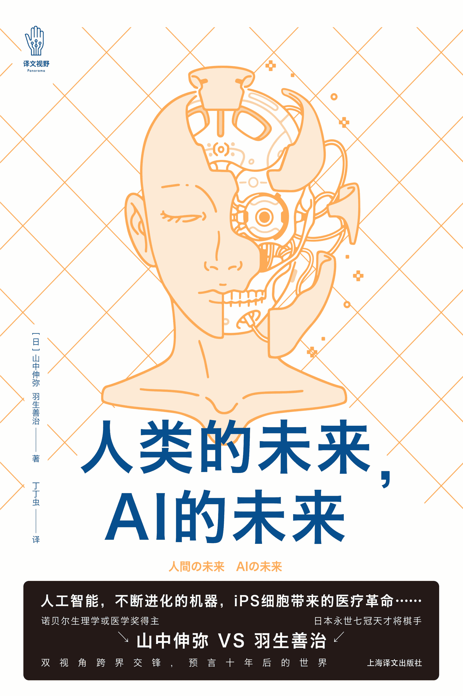

棋盘上的人机差距
iPS 研究前沿正发生什么

# 代序

羽生善治致山中伸弥

二〇一六年秋，我第一次拜访由山中伸弥教授担任所长的京都大学 iPS 细胞研究所 CiRA。
能与活跃在生命科学最前线的研究者直接对话，是难得的际遇。出发前我既期待又紧张。
真正坐下来谈后才明白，教授的个性非常亲切。
他站立时透出一种难以形容的细密感，一开口却是关西腔的笑话，丝毫不见盛气，氛围立刻舒缓下来。
话题起初围绕生命科学的前沿，很快延伸到人工智能的边界与可能性、下棋时的思考法、灵感与第六感^((1))的本质、才能如何养成等多个层面。
跟随他进入实验室，墙上悬挂的匾额格外醒目，上书“人间万事塞翁马”数字，想必是他的座右铭。世间何为幸福，确实难料。
经过多次见面，我切身感到，山中教授之所以能找到 iPS 细胞，正因他坚信自己一定能找到。
他站姿沉稳，身上却流露出热情与气魄，思维灵活，还带着一种不着痕迹的轻盈。
我想读者也能感受到教授独特的存在感。
这场对谈充盈着面对未知时的体感，也让我度过一段极其满足的时间。山中教授不吝惜宝贵时间，诚恳细致地解答我这个门外汉的朴素疑问，在此由衷致谢。
最后希望，这段对话能成为一个小小契机，让您了解世界正在发生的变迁，并在日常阅读中提供轻松的养分，那将是我的荣幸。

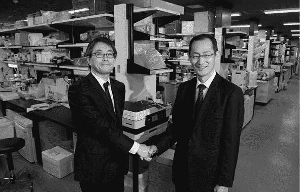

**京都大学 iPS 细胞研究所内拍摄的羽生善治与山中伸弥合影，羽生在左山中在右**

* * *

(1)　日文里“直感”与“勘”都可指直觉，细微差别不同，中文不易体现。大致上“直感”偏向先天能力，“勘”偏向后天经验。为区分后文多次出现的用词，将“直感”译为“第六感”，“勘”译为“直觉”。

# 第一章

iPS 研究目前走到何处

**羽生向山中提问……**

**山中：**羽生棋士的国际象棋也很强，围棋怎么样？

**羽生：**围棋大概初段水平。小时候碰过一点，后来没人陪就荒废了，实力很弱。

**山中：**是吗？我前阵子在网上下过围棋，挺有意思的。系统不显示对手段位，我也不知道对手几级。我是八级。若对手也是八级，有时能赢；遇到六级左右偶尔能胜；但碰到三四级基本必输。

**羽生：**听说网络围棋的定段比线下更严。

**山中：**可能吧，难怪输得很惨。每次输完都挺懊恼的。（笑）

**羽生：**哈哈。

**山中：**我和围棋手井山裕太交流时，请他陪我下一盘。

**羽生：**哎，还能这样？让七子^((1))吗？

**山中：**对，七子。

**羽生：**我和赵志勋老师对谈时，他也说要下一盘。聊到让子，他说分先，我就战战兢兢从分先下了八十多手。真是如履薄冰。

**山中：**这次就不下棋吧。（笑）

**羽生：**下吧，只要您愿意。（笑）

## 仍属起步阶段

**羽生：**山中教授您发现的 iPS 细胞，全称是诱导性多能干细胞吧。

**山中：**嗯，名字有点拗口。简单说，就是能分化成任意细胞的细胞。这类细胞在人体内几乎不存在，是人工造出来的，所以叫诱导性多能干细胞。
不过即便说“在体内不存在”，一生中至少有一次会出现，那就是受精卵期。脑、骨、肌、心等两百多种体细胞都源自受精卵发育而来，所以受精卵是多能干细胞，能变成任何细胞，可简称为万能细胞。
成年后体内基本不再有这类细胞，但我们可以采集体细胞如皮肤或血液，经过处理使其回到接近受精卵的状态，也就是干细胞，英文 stem cell，本质上就是 iPS 细胞。

**羽生：**这就是所谓的初始化吧。

**山中：**对。我们常说电脑初始化，对细胞也一样。通过还原处理让细胞回到最初状态。皮肤与血液细胞原本都来自受精卵，现在把它们逆转回去，恢复到受精卵状态。
京都大学 iPS 细胞研究所的目标是 iPS 的医学应用，主要分两块。一是再生医疗，让 iPS 分化成各种体细胞后移植给患者；二是新药研发，用患者细胞制成 iPS，再在分化细胞上重现疾病状态，以此解析发病机制并研发药物。

**羽生：**二〇〇六年您在全球首次宣布成功制备小鼠 iPS，二〇〇七年又宣布人类 iPS。如今是二〇一七年，人类 iPS 诞生整十年，目前进展如何？

**山中：**当时只是动物基础研究的成功。过去十年全球都在积极推进。iPS 形成机制的阐明、利用患者 iPS 解析疾病原理，再生医疗与新药开发等临床应用都在前进。可以说，现在已进入人体应用的起步期。

**羽生：**已有实际临床案例了吧？

**山中：**是的，已在真实患者身上验证疗效与安全性，推进到临床试验阶段。
二〇一四年秋，理化学研究所高桥政代教授团队在全球首次用 iPS 培养出视网膜细胞并手术移植到老年黄斑变性患者眼中。老年黄斑变性是随年龄增长导致视力下降甚至失明的疾病，患者数快速增加，据说五十岁以上约百分之一的人发病。我听说，第一例接受人体移植的患者术后至今进展良好。
不过该技术仍处于临床应用起步阶段，后续还有诸多难题。我跑马拉松时，四十二公里的路程，跑到十公里左右会觉得已经很远了。（笑）但真正的难关在剩下的三十公里。感觉差不多。

## 在家猪体内培育人肝

**羽生：**我有个很基础的问题。现阶段已能从 iPS 培养出视网膜细胞，那么持续培养下去，能否培育出内脏器官？

**山中：**是的。

**羽生：**要达到那样的水平，需要哪些研究？

**山中：**当前热点集中在细胞本身，或把细胞培养成层状后再移植的技术，但培育内脏器官的研究也有大进展。
二〇一三年，横滨市立大学谷口英树教授团队在全球首次利用人 iPS 制作出肝脏原基，即迷你肝脏。他们的目标是将来把这种肝脏的芽移植到患者体内，在患者自身体内培育器官。也就是说出发点不是细胞，也不是完整器官，而是把中间状态的器官芽植入患者体内培养。
还有中内启光教授。中内教授曾任东京大学医科学研究所干细胞治疗研究中心主任，二〇一三年赴美，现主要在斯坦福大学开展研究。
以中内教授为核心的项目中，有一项研究是利用 iPS 技术，在家猪等动物体内培育人类肝脏或肾脏。对家猪胚胎进行基因编辑，使其无法发育出自身肝脏，再注入人类 iPS 细胞。目前已成功在家猪体内形成来自另一只家猪的肝脏。

**羽生：**这就是在动物体内培育人类器官的嵌合体技术。

**山中：**对。器官移植领域长期面临供体不足，希望它能开辟新道路。

**羽生：**为何选用家猪来培育人体器官？

**山中：**家猪器官的功能、大小和形态都与人类相似，很令人意外吧？家猪繁殖力强，向家猪胚胎注入 iPS 细胞的技术也相对简单。
十年前，利用 iPS 培养器官，还停留在但愿有一天能实现。现在发展速度超出预期，这已不再是梦想。借用将棋的说法，接下来差不多进入如何将军的阶段。发展太快，甚至连后续走向都难以预测。

**羽生：**技术的进步速度太快，日常生活中很难感受到。就像坐车，时速一百公里左右时，看窗外景色会觉得原来景色变化会这样。而到了三百、四百公里，就只觉得哇，好快，已经搞不清到底发生了什么。（笑）

**山中：**确实是这种感觉。

## 追索遗传病的根源

**羽生：**目前全球似乎都在展开激烈的研发竞争。

**山中：**iPS 的实用化在世界各地都有进展，但值得欣慰的是，日本的研究者在 iPS 本身的研究上也在努力推进。
京都大学斋藤通纪教授团队正在研究如何从 iPS 和 ES 细胞等多能干细胞中制备生殖细胞，即精子和卵子。他们在全球首次利用小鼠 iPS 成功制备出精子和卵子，并诞生了健康小鼠。

**羽生：**人们常把 iPS 和 ES 做对比，这两种研究的进展有何差异？

**山中：**ES 细胞也能分化成所有功能细胞。一九八一年报道小鼠 ES 细胞，一九九八年报道人类 ES 细胞。由于 ES 细胞需要破坏受精卵、取出囊胚制备，因此存在伦理争议。若用于移植，实际上是异体移植，会产生排异反应。在这点上，iPS 是自体移植，一般认为排异反应相对较小。
但 ES 和 iPS 只是来源不同，细胞本身是一样的。所以我们认为没必要刻意区分讨论。ES 和 iPS 都必须实现两个目标才有用，即增殖和分化。在扩增到数万、数亿倍后，再给予不同刺激，形成脑细胞、心脏细胞或器官本身。
对于 ES 和 iPS 而言，促进增殖与分化的技术是完全相同的。我这里有两皿培养的 ES 细胞和 iPS 细胞，如果有人说一个月后，不管用什么分析设备，请指出哪个是 iPS 细胞，我是找不出来的。

**羽生：**竟然是这样？

**山中：**现在利用 ES 和 iPS 制备生殖细胞的研究，包括猴子和人等灵长类的研究，正在不断推进。如果能制备出生殖细胞，首先对不孕症治疗以及遗传病原因的探索都会很有帮助。
在京都大学 iPS 细胞研究所，最接近临床的研究之一，是关于帕金森病治疗的研究。高桥淳教授等人的团队已在小鼠和猴子上进行研究。研究就是这样，若干研究者的成果成为其他研究者的动力，从而以意想不到的速度不断前进。

**羽生：**现在也有用 3D 打印制作骨骼和内脏的技术，应该不久就会实用化了吧？

**山中：**关于 3D 生物打印的技术开发，已有多家创业公司在推进。大约十年前，这件事还被当成笑话讲。美国的研究合作者曾对我说：山中，我看到一项专利，把细胞当墨水，用 3D 打印机制作内脏。那时还以为是玩笑。真的是非常了不起的想法，也非常了不起的技术。

**羽生：**这样的设想能成为现实，难以想象。

**山中：**没错。即使能想到这个点子，也不敢说真会去尝试。但现在真有好几组团队在尝试实用化，确实令人惊讶。

## 五十年前的突破

**羽生：**像山中教授您所说的 iPS 细胞，让已分化成皮肤或血液的细胞重新回到初始状态，就像把时钟指针倒转一样，我们也难以想象。是什么契机让您认为这可能实现？

**山中：**这是得益于前人的研究。与我一同获诺贝尔奖的英国研究者约翰·戈登教授，在一九六二年，也就是我出生的那年，发表了一篇用青蛙做实验的论文。他用蝌蚪的肠道细胞培养出新的蝌蚪，并成功发育成青蛙，证明了细胞核移植技术可行。
这个实验表明，即使细胞已分化，细胞内仍保留着全部遗传信息。而且它不仅证明了这一点，同时也成功让成熟细胞重新回到受精卵状态，并产生新的生命克隆蝌蚪。这是重大突破。

**羽生：**原来如此。那真是划时代的突破。

**山中：**当时连遗传物质到底是什么都还不清楚。只是因为子代能继承父代性状，人们推测有某种东西在传递信息，于是称之为遗传物质，但那时还不知道它具体是什么。
人们猜测细胞核里有遗传信息，但早在一百年前，人们就认为只有传递给下一代的生殖细胞，即精子和卵子，才具有完整的遗传信息。精子和卵子受精、发育成大脑或心脏后，必然会有无数信息用不上了，所以大脑细胞只要保存大脑相关信息，心脏细胞只要保存心脏相关信息即可。其他用不上的信息都是浪费，应该在物理上消失或变成不可读取的状态，这样才合理。实际上，人们一直这么认为。

## 果蝇触角会长出眼睛

**羽生：**教科书上也都是这么写的吧。

**山中：**对，而且考试不这么写就拿不到分。但后来出现了质疑的研究者。一开始是零星的独立研究，直到约翰·戈登教授培育出克隆青蛙，证明成熟细胞中也完整保存着全部信息。那是一九六二年的事，所以教授实际上经过五十年才获诺贝尔奖。说起来我算是搭便车了

**羽生：**没有没有，怎么可能。

**山中：**克隆技术难度极大，很难成功。哺乳类的成功是在一九九六年。克隆青蛙之后过了三十多年，英国的伊恩·威尔穆特培养出多莉

**羽生：**啊，那只羊。我记得看过新闻。

**山中：**绵羊多莉，是哺乳类首次成功克隆的动物。它证明了，不仅是青蛙，哺乳类也完整保存着全部遗传信息。不过，哺乳类的克隆非常困难，即便是专家，尝试一百次也不见得成功一次。
但如果使用 iPS 细胞技术，任何人都能轻松倒转。这种技术，就是我们研究的。五十年前戈登教授成功的实验，现在谁都能做了。所以我们两人同时获奖。从这一点上说，实际上研究到现在花了五十年。

**羽生：**真的是花费了漫长的时间，才终于实现了。

**山中：**是啊。我之所以从事 iPS 细胞研究，也是因为约翰·戈登和伊恩·威尔穆特两位教授的工作。
另外还有一项不同的研究，是哈罗德·温特劳布教授二十多年前发表的实验。他仅向小鼠皮肤细胞导入一个遗传基因，就把原本的皮肤变成了肌肉。可惜这位教授四十九岁就去世了，但他发现了一个基因就能改变细胞命运。此外，激活果蝇触角的一个基因，就能让本应是触角的部分变成腿。

**羽生：**哎，还能这样吗？

**山中：**激活其他基因，能让触角顶端长出眼睛。这些都是前人的研究。一个基因，就能彻底改变细胞命运。

## 断腿还能再长

**羽生：**这样说来，虽然成熟后拥有实体且很稳定，但生命本身却是流动性极高的存在啊。

**山中：**非常非常高的流动性。大家都知道的一个例子：蜥蜴尾巴断了以后，又会长出新的尾巴。其实蜥蜴尾巴虽然会长出来，但里面的骨骼并不会再生。

**羽生：**蜥蜴的骨骼没有再生吗？

**山中：**壁虎也一样，爬行动物大概都是这样。但进化前一阶段的两栖动物，比如蝾螈，腿断了还会再长出腿，那就是连骨骼都会再生。说起来很想建议壁虎回想一下连骨骼都能再生的蝾螈时代。涡虫这种生物更加原始，只有简单的眼睛、神经、肠道，如果把它的身体切成两半，还能再生成两只涡虫。

**羽生：**从一个生命变成两个生命吗？

**山中：**以前，京都大学生物物理学教室的阿形清和教授，研究过涡虫最多能分裂成多少只。

**羽生：**好厉害的研究。

**山中：**十六等分都是可以的。一只涡虫分成十六份，可以长成十六只涡虫。没有头的部分会长出新的头，没有眼睛的部分会长出新的眼睛。那种生物全身都有再生能力。生命本来就像那样，具有非常强大的再生能力。
遗憾的是，人类连手指断了都无法再生。简单来看，如果继承了那样神奇的能力，对维持生命显然有利，但为何人类或哺乳类失去了那样的再生能力呢？而且并不是一开始就没有，本来是有的。

**羽生：**在进化的过程中，失去了那样的能力？

**山中：**是的。关于为何失去再生能力，有许多观点，但都是假说，未得到证实。比如，有一种理论认为，与再生能力有关的基因，也与癌症发生有关。再生需要细胞快速增殖，一旦出错就会带来极大风险。若在不该增殖的地方增殖了，就会变成癌症。
我的假说则是认为它与寿命长短有关。如果寿命像哺乳动物这样长，而又继续具有再生能力，那么在到达生殖年龄前，发生癌症的概率会变得很高。人类只有长到十几岁才能生殖，如果在此之前得癌，整个物种也就灭绝了。所以不得不牺牲再生能力，选择寿命可能是这样吧。实际上如何，完全不知道，也无从证明。
不过美国国防部好像正在研究如何让人类重新获得再生能力。如果能让士兵在地雷中失去的双腿再生，那就太厉害了。

**羽生：**如果 iPS 细胞的实用化取得进展，再生也

**山中：**iPS 细胞能不能做到这一步，还不是很清楚。不过这可以成为研究的契机。

## 沙里淘金的过程

**山中：**从约翰·戈登的实验算起，到如今的生命科学，若把所有成果串联起来，就会自然冒出一个疑问：能否往已分化的皮肤细胞或血液细胞里导入基因，从而彻底改写细胞命运，使其回到受精卵状态？仅靠一个基因大概不行，但多个基因呢？这种设想正是 iPS 研究的起点。
正因前人的积累才产生这样的念头。虽然困难，但并非不可实现。不过即便知道理论上可行，也完全不知具体该怎样操作。（笑）

**羽生：**确实如此。

**山中：**毕竟人类基因超过三万个。我们不清楚哪些基因能诱导出 iPS，更不清楚需要多少个。若只是从三万个里挑出一个倒也罢了，可很可能不是一个，而是十个、百个、千个。组合数几乎无限。

**羽生：**就像沙里淘金。

**山中：**是的。最终我们发现，四种基因组合就能让分化细胞回到原点。

**羽生：**这四种基因是如何找到的？

**山中：**姑且假设手中先有二十四个候选基因，我们先拿它们试手。做下来后，发现似乎真的出现了 iPS 细胞。

**羽生：**最初这二十四个基因是怎么挑出来的？

**山中：**综合检索数据库、实验验证功能等多种手段。不过我们并不乐观地认为二十四个里就全有答案。估计还有大量遗漏，所以一开始心里就做好了可能要筛上万个的准备。
但一开始就处理一万个太可怕了，于是先用二十四个试试。接下来采用排除法，把基因逐个拿掉，观察是否还能让细胞初始化，最终锁定了四个。

## 这个发现起初被认为肯定是错的

**怀疑到证实：iPS 诞生的那一刻**

羽生问山中伸弥，第一次看到 iPS 细胞成形的瞬间是什么感觉。山中说第一反应是肯定搞错了。实际操作的是博士后高桥和利，他当时就叮嘱对方先别高兴，劝他这结果多半不靠谱。

羽生追问为何觉得不可能。山中解释概率本身就很低，而且过去经验里，每当觉得要碰到大发现时，最后基本都是自找麻烦。ES 细胞和 iPS 细胞性质相近，很容易在不察觉的角落混进来。表面看着像 iPS，其实可能是 ES 在增殖。起初的判断就是被污染了。

要排除这种可能，验证工作繁琐到极点。先是检验可重复性，反复做，只要次数够多就会稳定得到同样的 iPS。但即便次数再多，也可能每次都混进了 ES。要真正证明没有混入，就得用多种科学手段交叉检验。实验极少一做就稳定不变，轻信结果通常都会付出代价。

羽生形容这像空欢喜。山中说空欢喜在研究者里太常见了。有幅画在圈子里流传，画了两只穿白大褂的猴子。一只兴高采烈，旁边写着大发现，另一只垂头丧气，手里的试管快掉地上。同一只猴子，意味着以为发现了东西，验证后发现是错的，这种事反复上演。

羽生问从发现到拿到证据花了多久。山中说多到数不清，而且异常谨慎。先让高桥重做，再让自己最信任的两位助手重做，过程中刻意改变部分操作细节。结果高桥能稳定复现，另外两人改法后反而得到更好的结果。到那时才觉得可以相信，于是投稿。但发表后仍提心吊胆，不知道别的实验室能不能做出来。半年后哈佛和麻省理工的研究团队宣布成功再现，才真正松口气。

羽生问教授真正高兴的时刻。山中说其实一直没高兴过。

羽生说一直怀疑。山中说怀疑从未间断。即便自己心里有底，论文一旦发表，总会招来零星批评，根本没空庆祝。

羽生问实际有批评吗。山中笑说基本是围攻。因为学界普遍认为细胞分化成皮肤肌肉后就回不去了，更何况只用四种基因就能逆转。论文登到美国期刊后不久，纽约举行了有关 iPS 的研讨会，住宿型会议。晚上在酒店酒吧，熟人围坐讨论他的论文，有人说四个基因就能搞定根本不可能。转头看见他过来，又马上改口好久不见。背后议论很正常。后来批评声铺天盖地，其中最激烈的那位，半年后发文说自己也复现了。

羽生说这样反而更可信。山中点头。

## 纸笔也能拿诺贝尔？

羽生想聊诺贝尔奖的事。山中刚发表论文不久就获奖，而像益川敏英那样，1973 年提出理论，2008 年才得奖的例子也不少。这是物理和生命科学的差异吗。

山中说物理分理论和实验。理论物理只要纸笔写几页论文就可能产生诺奖级别的发现。实验物理则要建造超级神冈那样的巨型装置，投入几百亿，动用数十人团队去证实。两者都需要相应的评价。医学奖的正式名称是生理学或医学奖，本就涵盖两个领域。他和约翰·戈登共同获得的奖更偏向生理学，是对现象阐明的肯定，而非医学应用。自己本来是医生，很想早点把 iPS 用在病人身上，所以仍在推进。

获奖时间看他个人确实快，2006 年发文，2012 年获奖，只隔六年。但从戈登的发现算起，已经五十年了。

## 诺奖通告现场的乱象

羽生问从被列为候选到最终获奖隔了多久。山中说大约三年。

羽生问那段时间周围怎样。山中说生理学或医学奖周一公布，京都大学照常办公。因为不确定会不会有电话打来，学校派人拿着摄像机在教授室守着记录。网上公布获奖者是别人时，工作人员什么也没说就走了，连声安慰都欠奉。获奖当然开心，但想到以后不用再经历这种守株待兔，才是真正的解脱。

羽生问那段时间是不是只等诺奖电话。山中说谁知道。

羽生打趣说如果接起来不是，就更伤心。

山中说2012 年正好是体育日，周一不上班。那年年初，瑞典卡罗林斯卡医学院邀请他当评审委员，他因太忙拒绝，很少有人会拒，评审方很惊讶。也因此他觉得今年没戏。休假日心情放松，上午跑了二十公里左右，晚饭后想喝点啤酒，结果妻子说洗衣机在响。于是他躺在地上修机器。留在大学的秘书打来，说有位外国人打电话来问教授联系方式，她给了手机号。他敷衍一句就继续修，四五分钟后手机真的响了，对方用英语说要授予他诺贝尔奖，并问是否接受。他惊讶地问还有人拒绝吗，听说确实有不少人拒绝。对方叮嘱两小时后才正式公布，期间不能告知任何人。那怎么可能。他立刻给校长打电话说情况。

羽生说到颁奖仪式结束前重心都在这件事上。山中说自己还好，妻子很忙。记者从周一开始连访一个星期，之后他就不再接受采访。大约一周后他和橄榄球选手平尾诚二去打高尔夫。

羽生提到文学奖颁奖当天东京千驮谷的爵士酒吧会聚集粉丝。山中笑着说如果是鲍勃·迪伦还差不多。

羽生问那届文学奖是谁。山中说莫言。他来自中国农村，不会说英语，带了翻译。颁奖仪式只允许本人进入等候室。那天仪式没按时开始，工作人员解释国王因交通拥堵迟到。莫言听不懂，山中也不会中文，最后只好在苹果笔记本上写上「王様遅刻」几个字，莫言看后连说哦哦哦。意外地实现了一次日中友好。

* * *
(1)　预先在棋盘上放七颗棋子作为让子。
(2)　日本法定的国民节假日，日期是每年10 月的第二个星期一。

# 第二章

## 人工智能如何让棋手俯首
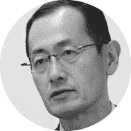
**山中向羽生提问……**

### 当年我以为绝不会输

山中提起阿尔法围棋在2016年3月以四比一击败李世石，引发热议。

羽生说那年2月，NHK纪录片《天使或魔鬼 羽生善治 探索人工智能》里，他和谷歌旗下DeepMind的杰米斯·哈萨比斯谈过。当时大家都认为围棋至少还要十年才能被机器追上，李世石自己也觉得不可能输。

山中说AI的强势远超预期。

羽生说将棋软件也在飞快变强。2017年4、5月的电王战里，PONANZA两局全胜佐藤天彦名人。现在直播对局时，软件同步解析，会给出正三百点或负两百点之类的数值评价。他自己下的手会被软件一步步纠正为正解，这种世界让人战栗。

山中本以为将棋更复杂，其实围棋复杂得多。

羽生说可能性数量上围棋是10的360次方，将棋是10的220次方。软件发展路径也不同。

山中提到上世纪九十年代中期IBM的深蓝首次击败世界冠军。

羽生说1997年深蓝战胜卡斯帕罗夫。深蓝靠过百万局棋谱的庞大数据库和每秒两亿个位置的硬件 brute force 获胜。二十多年前软件本身不成熟，硬是靠数据和算力取胜。

山中形容像推土机。围棋就算用今天的算力也数不过来。阿尔法围棋是从历史对局里学习胜负模式吗。

羽生说阿尔法用的是深度学习。先用十五万盘人类对局做基础，让它学会职业棋手的下法。然后机器和机器对战，一秒一局或十秒一局，24小时不间断，积累几十万上百万盘，成长速度人类无法企及。更可怕的是它有启发式思维，不是追求绝对正确答案，而是估算出接近正确答案的方案，类似人类的第六感或将棋的大局观。这正是它强大之处。

### 将棋软件的孤岛式进化

山中问将棋软件的进化方式和国际象棋围棋不一样吗。

羽生说完全不同。国际象棋和围棋的软件依赖硬件和数据，由谷歌等大企业推动。将棋界没有巨额资本投入。2005年保木邦仁开发的Bonanza是当时最强，且开源。独立程序员基于它改良修正，持续升级。

山中问具体改哪。

羽生说最难的是局面评价。评价函数把先手后手的优劣数值化，程序员在这里反复琢磨，让软件变强。

山中问这些年为何突变。

羽生说因为GitHub。将棋软件基本都上传开源社区，任何人都能看源码提意见，提出这里奇怪这里需要改，而且不断上传新版本。看到的人也会想自己也做一个。职业业余棋手都用它分析，水平飞跃。

山中说这是国际象棋围棋没有的。

羽生说将棋软件市场大约十年前就消失了，软件太强没人买。没有利益牵扯，干脆开源让大家一起改进。每年软件大赛结束后，前几名会公开源代码，第二年又有人在此基础上开新作。去年冠军明年掉到中游，这种高速迭代持续不断。

山中笑着说大家比的不是棋手胜负而是软件胜负。

羽生说他原本以为将棋软件比国际象棋落后十年十五年。国际象棋参赛人数最多，论文数量质量都高。但现在将棋软件全免费，还有共通平台可对比多台引擎，甚至有人写使用手册。国际象棋软件整合成本高，使用者反而少。过去五年他感觉将棋软件的易用性和强度已经反超国际象棋。

山中问开发的人图什么。

羽生说没有收益，不是工作。可能因为现在的程序大数据和硬件资源决定性能，程序员感受不到价值感。将棋软件能让人发挥个人能力。

山中说那是个人兴趣的领域了。

羽生说不同领域的人把各自知识迁移过来，化学、法学背景的人都参与开发。这很有益。所以将棋软件不是靠数据硬件取胜，而是靠持续提升程序本身实现加拉帕戈斯式的演化。

### 以后只跟电脑练棋的世代

山中说数据库规模仍是基础。

羽生说医学世界有海量历史数据，将棋世界最多十万局棋谱，对数据学习来说价值有限。

山中问十万还不够。

羽生说国际象棋数据库已有八百万局以上，依概率选招的电脑起码不会在序盘落败。

山中问不能把国际象棋围棋软件直接搬到将棋。

羽生说有的适合有的不适合。比如围棋的蒙特卡罗法要算到棋局结束，将棋胜负可能一百步结束也可能两百步，难以下算。将棋软件的预读探索主要借用了国际象棋开源程序Stockfish。以前说将棋软件没有通用性，结果Stockfish跨界发挥了功能。

山中说AI冲击下，专业棋手会不会觉得靠机器伤自尊。

羽生说有人会这样想。用不用机器像用不用计算器一样，该自己想的时候自己想，基础重复的工作交给AI也未尝不可。这两年年轻人用软件分析已成常态，未来孩子们会把工具内化，变得更强。

山中说和科学一样，将棋世界变化极快，必须跟上。

羽生说技术发展总会反复上演。数据库出现时大家争论怎么用。互联网出现后偏僻地区也能随时找对手练习，地理障碍消失。现在软件普及，如何有效使用程序成为新一代必备技能。将来会出现只与软件对练而成长起来的强者。

### 科研为何倾向保密

山中说将棋软件开源协作最大化网络优势，而生命科学竞争激烈，大家倾向隐藏研究到发表才公开。

羽生说前沿科学有点意外。

山中说论文发表要先投到《自然》《科学》之类期刊，再由同领域研究者匿名评审，叫同行评审。据意见修改。最差情况被拒认为无价值，这种情况很多。最好情况是立刻刊登，一个月见刊，偶尔会发生但很少。大多数是退回要求补充实验修改，花费数月再发回，有时要一两年。生命科学里正在做的研究，最快也要两三年后才公开。

羽生说时间滞后很严重。

山中说技术日新月异，数据很快就能拿到，而且是巨量数据，却无处发表只能藏着，已成大问题。越来越多声音要求实时发表机制，但进展缓慢。过去一百多年目标都是这样发表。习惯很难改。发表论文是生命。由接近领域的人评分，容易受人际关系左右，公平性存疑。

### 一切都实时化的时代

**羽生：** 近期注意到一则消息，康奈尔大学推行的数字存档服务 `arXiv` 很有意思。它把物理、数学、计算机等方向的预印本电子化公开，相当于开放式的论文仓库。

从研究完成到正式出版往往要等很久，这段空窗期同行很难知道彼此在做什么。打开 `arXiv` 就能看到审稿前的稿件，掌握前沿动向，也有团队拿它来复现验证。

**山中：** 物理和数学圈很早就习惯先行公开。正式刊出只是收尾。会议上或网上先放数据，会立刻被同行质疑，有错马上被揪出来，这是常态。

生命科学的传统则相反，一直要等到见刊才肯露面。研讨会上也会把关键信息藏起来。比如基因分析，找到某段序列与疾病相关当然会写成论文，但同样重要的负向信息——某段序列与疾病无关——常常被省略。

**羽生：** 对。

**山中：** 按现有发表惯例，这类阴性结果基本不对外，资源就被浪费了。

**羽生：** 很容易出现重复劳动，或别的实验室其实早有结论……

**山中：** 我觉得这类情况不少。数据越多越可靠，错误越少。对比大量共享数据的领域，生命科学进展缓慢，阻力很大。

创办 Facebook 的马克·扎克伯格，妻子是儿科医生，他为科研投入不少。2016 年，一对夫妇出资 30 亿美元启动攻克疾病计划，目标就是把生命科学的发表方式改成像 `arXiv` 那样的开放形态，该计划也获得不少捐助。

**羽生：** 论文网站订阅费非常昂贵，很多机构被迫停订，这本身就是问题。大学生不满现状，用技术手段把数十万篇论文免费公开，结果遭到期刊方的投诉。

**山中：** 论文和期刊本应推动研究，现在某些环节反而成了绊脚石。

**羽生：** 其他领域也可能类似，但研究成果涉及权利，又牵动专利，不可能完全自由开放。

**山中：** 确实，研究会产生专利，该保护的部分就要保护。

### 专利费为何该降

**羽生：** 说到专利，我想请教一下。美国有“专利流氓”的问题，有人大量收购专利，一旦有人碰到就索要高额赔偿或许可费。生命科学里也有这种事吗？

**山中：** 有，而且不少。有些公司就靠这个模式。所以我们申请专利，有时不是为了赚钱，而是为了自保。

**羽生：** 原来如此。

**山中：** 诱导多能干细胞 iPS 是非常基础的技术，以它为平台能衍生出很多应用。我们做出 iPS 后，希望它被更广泛使用，尽量不设限制。

可正如你说的，除了我们的专利外，还有公司出于商业目的申请专利。如果那些申请被批准，哪怕只是部分内容，iPS 技术的使用也会变得困难。

专利原本是保障企业独占开发利益的制度，但在我们看来作用被反了。京都大学这类公立机构拿到专利后设定合理许可费，就能防止某家企业独占，让各研究机构更自由地使用 iPS。意义完全不同。实际上，我们在 2017 年曾要求富士胶片下调细胞开发与制造的专利许可费。

**羽生：** 与其由企业掌握，不如由大学持有更有公益性。

**山中：** 大学握有专利很重要。因为企业以盈利为目标。新药和医疗手段研发成本极高，甚至有患者为此花费上亿日元，这是全球性威胁。

**羽生：** 股东追求利润本也无可厚非。

**山中：** 是的，没有收益就无法发展。但归根结底，我们希望基础技术像操作系统一样被广泛使用。过去微软相对开放，苹果则较为封闭，很难说哪种更好，但目前世界潮流是基础部分趋于公开。生命科学也一样，根本性技术最好不要封闭，这对研究推进至关重要。

### 偏见如何影响判断

**羽生：** 不过各国专利申请制度差异很大，相当复杂。

**山中：** 是的。过去只有美国采用“发明优先”制，其他国家包括日本和欧洲都是“申请优先”制。

**羽生：** 也就是先申请者优先？

**山中：** 这是强调申请日可查的原则。申请日期有明确公开记录。但在美国，即使已申请，若有人主张“我更早想到”，也可能被承认。为应对这种主张，只能留下详细记录，注明创意何时产生，而且不能只有自己写，需要第三方定期签字。我也做过这类笔记验证，用来应对美国的发明优先。

**羽生：** 这要耗费不少精力吧。

**山中：** 是的。不过在奥巴马任期内，美国也改为申请优先，与其他国家统一。如今理论上不再需要笔记验证，但为了防止不当研究，我们仍在持续记录。

**羽生：** 记录还是很关键。

**山中：** 规则统一了，但审查的人还是人。美国专利局、日本专利局都是审查团作业，特别是美国，某项申请通常由一人决定。

**羽生：** 真的吗？

**山中：** 所以审查员的想法会极大影响结果。理想状态下应公正裁决，但在我们看来有些裁决并不合理，似乎在过度考虑本国利益。

**羽生：** 论文评审也有同样问题。网球有鹰眼挑战，不像可以回放确认。

**山中：** 现在赛事规则很清晰。过去的观念是即使裁判明显误判也要服从。如今多数球类都有录像，可挑战改判。拳击、花样滑冰、体操等靠打分的项目则很难客观，由人类来判，怎么看都不——

**羽生：** 法庭审判也一样。需要得出现实结论时，总担心人类判断难免带偏见或利益关联。这不算揣测，但可能性确实存在。

**山中：** 所以专利裁决、论文评审、评分类竞技，最好交由公平公正的 AI 来执行。（笑）
* * *
(1) 指在孤立环境下独自进化，如同加拉帕戈斯群岛生物一般。
(2) 2006 年起网球比赛启用鹰眼系统追踪球路，允许运动员观看鹰眼回放质疑司线判罚。每局有三次质疑机会，质疑成功不扣除次数。
# 第三章
## AI 真会掌控我们吗

**山中向羽生提问……**

### 美学怎样框住走法
**山中：** 将棋里，电脑越来越强。与人类对弈的棋谱和与电脑对弈的棋谱，在人类眼里趣味性和自然度上有什么差别吗？

**羽生：** 现在的 AI 并不是按时间顺序推演。它不是沿着对局流程走，而是每一步都单独挑选当前局面下的最优着法。因为没有流程概念，看起来就不自然。这大概是让人最不协调的地方。

**山中：** 与人类思维方式根本不同。时间序列，也就是定式吗？

**羽生：** 不只是定式，更像是人类棋手先定下方向，比如“打持久战”或“速攻”，这种意图会体现在棋路上。AI 把每个着法孤立处理，完全不考虑是如何走到这一步的。换句话说，AI 的棋路缺乏连贯性和一致性。所以人类会觉得 AI 对局的棋谱缺少美感。不过最近也有让 AI 学习时间序列的尝试，战术也变得更简练。过去认为电脑做不到的事，现在能做到的越来越多。

**山中：** 也就是说，将棋软件的棋路也越来越美了？

**羽生：** 这与其说是 AI 的问题，不如说是人类审美的问题，人到底认为什么是美。下棋的选择和培养审美很像。盘面上即使有可下的着点，人类棋手也会因为“不美”或“不喜欢这个局面”而放弃。反过来，细致分辨好形和恶形，锻炼形势判断力，也等于提升棋力。

**山中：** 增强棋力就是磨练审美吗？

**羽生：** 但 AI 全局搜寻，不留死角，会选择人类看来不协调的下法，与人类审美不符。其中很多着法在人类眼里几乎毫无意义。从这个角度看，人类的审美意识可能限制了着法的选择范围。不过通过吸收 AI 的思路，人类审美也在变化。技术革新带来的吸收也越来越常见。将来也许会出现，本来因“不美”而排除的着法，试着走下去反而可行？

### 机器为何不惧
**山中：** 那么 AI 也可以具有创造性？

**羽生：** 要看怎么定义创造。百分之九十九点九的创造性事物，都是过去事物的组合。所以在将棋里，创造性就是“把过去出现过的下法，以从未有过的组合呈现”。

AI 下出从未有人下的新手的情况越来越多。软件发现的新手后来变成定式也时有发生。但那种创造和基于人类思考的创造明显不同。

**山中：** 为什么人类没下过 AI 下出的新手？

**羽生：** 可能是因为人类有某种防御本能或生存本能，会回避那样的选择。

**山中：** 防御本能？什么意思？

**羽生：** 人类习惯于连贯性和一致性，在其中感到安心。这可能是我们感受“美”的审美基础的由来。反过来说，对从未见过未经历过的事物会感到不安和危险，这是人类为生存而具备的本能。在下棋时也会有这种感觉。另外，不管多强，被将军时都会感到危险。

AI 天生没有恐惧，所以能摆脱基于连贯性和一致性的审美束缚，完全根据数据计算最优解，于是能下出人类绝对不会选择的危险着法。

**山中：** 因为电脑不会害怕。

**羽生：** 我听开发者说过，如果不断加入随机变量，AI 可能做出创造性的工作，但这点随机性和我们说的真正创造完全不同。所以普遍认为，即使 AI 进步，也很难做出像人类那样的创造。

### AI 造不出梨妖精
**山中：** 在将棋的创造性上，人类棋手还有可能性吗？

**羽生：** 双方都有可能。AI 虽然不能产生真正创造性的东西，却能依托海量数据无死角地思考。

而且考虑到 AI 的飞速进步，即使百分之九十九点九都是过去事物的组合，剩下的零点一也许会是前所未有的创造，我也有一点期待。

不过即便如此，我认为有些创造只有人类能实现。我常拿“梨妖精”举例。无论 AI 如何进化，我想都造不出梨妖精。无论积累多少畅销商品数据，也造不出初音未来，更不可能创造出像梨妖精那样以混乱设计获得巨大人气的“突变体”。

AI 擅长根据数据预测人们喜欢的东西，但人类喜欢意外的天性、喜欢无厘头的可能性，AI 恐怕无法预测。我想这是只有人类才能做出的创造行为。

**山中：** 也有共鸣的问题。如果 AI 做出来，大概会被说“AI 真不行”，如果是人类做出来，就会说“哦哦，很可爱”。（笑）

**羽生：** 这种偏见很重要。巴赫音乐的双盲测试是典型例子。三段音乐，分别是真巴赫、AI 创作的巴赫风格、人创作的巴赫风格，听众不知道出处。结果大家认为最有机械感的，竟然是人创作的巴赫风格。若事先告知是 AI 创作，听感就会变成“果然很机械”。（笑）

**山中：** 这还真有人类的风格。（笑）

**羽生：** 我去英国拍日本放送协会的节目时拜访过开发肖像画软件的西蒙·柯尔顿。他说：“AI 可以做很多事，也能写诗，但我不会写那种软件。”理由是：“人类写的诗才有意义，AI 和机器人写诗没有意义。”

说起来，如果一群机器人沿着鸭川排成一列，飞速写诗逐一吟诵俳句。那样的诗和俳句，确实有点……（笑）

**山中：** 实在说不上风雅啊。（笑）

**羽生：** 果然还是因为有着一个个人类肉体，作品才有意义啊。

### AI 会推脱责任吗
**羽生：** 专研 AI 的东大教授松尾丰说过，AI 能否融入社会，最关键的问题是“AI 能不能找借口”。

**山中：** “找借口”？

**羽生：** 是的。对不了解 AI 的人来说，倾向于认为 AI 绝对不会犯错。但只要理解 AI 的运行机制，就会知道 AI 只是在概率上比人类更正确、效果更好而已。谁也不能保证 AI 出错概率为零。但一般印象是 AI 百分百不出错。这是很大错觉，而且 AI 越进化，这种误解会越多。

做什么事都会有失误、失败、事故。发生时，AI 能否很好地解释说明失败原因？如果不能，AI 将很难被社会接受。

**山中：** 也就是说，现在的 AI 解释能力不足。

**羽生：** 我访谈过许多 AI 一线人士，专家们都认为 AI 的决策是黑箱。深度学习经过多层学习，决策过程可能有几十层复杂运算。若输入输出距离短还能理解，但层数一多，人类就看不清发生了什么。结果 AI 表现很好，但过程为何能做好，连开发者也不知道。

**山中：** 只看结果。这样的话失败时原因人类也不知道。

**羽生：** 有人会说：“结果性能提升了，不是吗？”但既然是人类在使用，当然希望能回答“为什么”“怎么做”。

比如金融自动交易不断获利，没人异议。但在医疗一线使用 AI 时，患者会问“为什么用这种治疗方案”，如果只回答“我们不知道原因，但治愈概率较高”，患者会安心吗？

反过来说，如果是医生这么说，人们愿意信任。即使意思相同，说话对象不同，感受完全不一样。很多时候我们会因为“是他说的”而接受。

我想社会能否接纳 AI，关键在于 AI 说的话能否获得人类充分信任。

将棋界也有这个问题。AI 下出新手时，人类能否拆解黑洞般的过程、接受这一下法呢？这已是现实问题。

### 让人安心的陪伴机器人
**山中：** 一想到人类与 AI 共存的可能性，双方要解决的问题都堆积如山。不过回顾历史，包括我在内的科学家认为“不可能”的事，都一一成真了。若靠科学，可能很久无法确定，但我也认为迟早 AI 会在相当程度上实现。就像人类基因组计划，当时普遍认为绝对不可能，结果还是实现了。

**羽生：** 各领域都有类似情况。

**山中：** 就说开车这件事，也许用不了几年就会变成自动驾驶，很多司机都会失业。

哪怕在医疗领域，医生做的很多事其实是模式识别：看检查数据、诊断、再看数据确定治疗方案。即使以当前技术，许多事计算机的准确率可能更高。但医疗一线人员的触诊、医生谈话给患者带来的安心感，要让计算机承担……

**羽生：** 那就很难了。

**山中：** 另一方面，很多老人也在医用动物机器人身上获得慰藉。活宠物终会死去，机器人坏了修好就能继续使用，就能避免丧宠综合征。

**羽生：** 确实，我听说有人把陪伴自己的机器人送去维修，客服顺手清洁后归还，反而遭到投诉。如果长时间接触机器人和 AI，也许就会把对待人类的情感投射进去。

**山中：** 这样想来，总有一天机器人会打扮成医生来给患者触诊（笑）——与其让我这种可疑的医生触诊，不如对机器人更放心。那时候是好事还是坏事呢？

**羽生：** 语音识别、图像识别、气味感知等，机器人都有比人类更灵敏的高精度传感器，肯定会有相应程序利用这些传感器获取信息，采取让人类感到舒适的行动。

到那时，机器人虽然并不真正体会人类情感，但在人类看来它们都非常体贴温柔，都是“体贴的机器人”。（笑）我觉得将来很有可能制造出那样的机器人。

**山中：** 今后日本将是超高龄社会，让机器人协助照顾老人也是对策之一。和不知道在想什么的人类相比，也许编写了体贴温柔程序的机器人更让人安心。

**羽生：** 不过人类的感情很复杂，有时对受护者来说，不带感情淡然遵从手册的看护机器人反而更舒心。

**山中：** 确实有可能。夜里按呼唤铃总觉得不好意思，但如果对方是机器人，似乎就能随便使唤了。

### AI 会下让棋吗
**羽生：** 说到开发行为类似人类的 AI，北陆先端科学技术大学院大学的饭田弘之教授说，他一直在研究能下“招待棋”的将棋软件。

**山中：** 哎？

**羽生：** 那不是以战胜人类为目标的强大软件，而是根据对手情况微调自身棋力，最后输给对手的软件。不过，要在胶着战斗后输掉、让对手满足的人类行为，对 AI 来说好像很难做到。

**山中：** 哎呀，这种事人类也做不到。（笑）

**羽生：** AI 虽然也能输，但往往很明显。突然送一辆车什么的，（笑）要么乱下。

**山中：** 这样对手赢了也不高兴啊。既然不高兴，也算不上招待。

**羽生：** 我在日本放送协会的节目上采访过软银研发的人型机器人“派博”。那种机器人设计目标是通过摄像头和麦克风捕捉人的表情情绪，从而反映在行动上，成为“亲近人”的机器人。我和派博玩过花札，它会故意输牌让我高兴。说起来我是被机器人招待了。（笑）

**山中：** 这机器人也太会演了。不过羽生棋士和小学生下指导棋时，也不能大杀四方吧。要激发孩子兴趣，还要最后以微弱优势获胜，很难很难吧。这就是一般说的“招待棋”吧。（笑）

**羽生：**哈哈，那回我跟上百名中小学生连下了百局。棋本身不累，累的是在长桌旁像螃蟹似的来回挪。一次上百人，即便走得快，绕一圈也要四五分钟。几个孩子事先商量好，趁我走开的间隙偷偷多走一步。头一次我没说，再来一次就不能容了，我开口提醒：“你们刚才连走了两步啊。”

**山中：**那也就是说这一百盘你全都看在了眼里？全记住了？

**羽生：**没有全记住，不过脑子里会有画面。没见过的布局或明显放错的位置，我会立刻觉察出来。

**山中：**现在学高尔夫的小孩也不少，有些挺机灵，推杆前把球先挪到标记点很远再打。（笑）小事，但长辈发现了就得好好教。

**羽生：**嗯。那次多走一步反而让我感受到孩子的执着。因我下一步几乎必定能吃掉他的车，他太想把车救回来。我能理解那种心情，所以第一次才睁一只眼闭一只眼。

**山中：**可当场被指出作弊，那孩子肯定挺受伤，以后再也不会那样了吧。

**羽生：**应该没事。

### 闲暇时代的困惑
**山中：**跟过去不一样了，现在六七十岁的人还在踏实工作，洗衣机洗碗机这些省力的家电不断涌现，工厂里也布满各种机器人。跟百年前比，我们本该更悠闲才对。一天忙一小时，剩下的时间全用来玩也够了。可实际感觉比以前更忙，这是为什么？AI 越来越强，将来人类是不是就没活可干了？有人说没事就画画吧，可绘画机器人画得比人更好，也就没意思了。（笑）

**羽生：**说法不一。一种观点认为人类会被从体力劳动里解放出来，想做什么就做什么，每天都开心。另一种认为按现行资本主义制度，要达到那种状态还很远。AI 发展迅猛，能取代绝大多数人类的工作，人类不再需要劳动。那时不工作也能过得好吗？社会实验不少。无条件基本收入的设想就是其一。二〇一六年瑞士公投否决了这套制度。感觉人类跟不上变化的速度。但反过来说，完全不用干活时间很充裕，反而会想“还是想做点事”。忙时讨厌工作，太闲又想工作。

**山中：**怎么看人类都会去工作，这大概就是本性。

**羽生：**也有人设想不工作的生活。美国相对积极，有个项目在研究“当人类不再需要工作时间变得充裕后会怎样”。项目为数千人提供三年生活保障并跟踪。

**山中：**一周可能还觉得幸福，时间太长就难说了……

**羽生：**一周？！

**山中：**一个月假期当然也开心，可想到休完假工作还在等，反而会有压力。（笑）

**羽生：**朋友没同步休息，自己单独休假也很麻烦。比如有些老人约定去公民馆下将棋，每天同一时间集合，固定几个人，每次下的内容也差不多。一直重复，似乎也挺满足。

**山中：**这也能行？（笑）

### 棋士会不会被时代淘汰
**羽生：**我听AI研究者说，常被问“不管怎么发展，未来哪些职业不会消失”。他们的回答是“现在还不存在的职业”。我觉得有道理。今天的职业会保留一部分，未来也会出现新职业。百年前的人看到现在的职业，肯定一头雾水。

**山中：**棋士这种工作应该不会消失吧。

**羽生：**谁知道呢。AI可以量产，近年的将棋软件强得吓人。

**山中：**可人与人对弈才有意思。看两台电脑下棋太无聊。就算宣布“机器A赢了机器B”，那已经是另一场比赛了。（笑）

**羽生：**现在已有网站让AI二十四小时不间断对弈，源源不断产出新棋谱。如果爱好者认为AI之间的对局比人类之间更有看头，棋士这个职业就危险了。

反过来说，棋士现在要面对的问题是，如果人类对局更有魅力，能否持续产出超越AI对局的价值？另一方面，AI进化后，会不会激发人类创造力，让人类发挥出更高的创造性？就算不能匹敌，至少能否证明人类能力也在提升？

**山中：**按这速度，有生之年会出现完全不同的技术。你看大哥大变成智能手机，不管在家地铁，从小孩到老人都会用，十年前谁能想到。所以十年后会怎样，我也想象不到。不过我认为绝不会出现人类被机器控制的情况。

**羽生：**我觉得面向特定目标的专业AI，发展会很快，应用也会越来越广。但一个在特定领域学习后，能在其他领域同样发挥作用、具备人类那种通用智慧的AI，还很遥远。

### 机器智力能追上人脑吗
**山中：**将棋和围棋都是比胜负的游戏，本就是电脑擅长的。就算在体育领域，只比投球速度、跑步速度，机器人肯定更快。问题是，能造出用和人类完全一样身体结构投球的机器人吗？用和人类一样身体结构跑步并胜过人类的机器人，何时能出现？也许迟早会，但不知道要等多久。

**羽生：**确实，让机器人学会保持平衡、平稳运动这些技巧非常难。

我对通用AI感兴趣，是因为开发AlphaGo的哈萨比斯先生在谈初衷时提到，想揭开人类思考的机制。所谓的启发法，也就是抓住大方向的方法，本质上引入了类似人类思考的方式。

只是还有不少障碍。半导体行业有个经验规律叫摩尔定律，说集成度每隔一年半到两年翻倍。现在的CPU大约是七纳米，迟早会到极限，所以很多人开始研究完全不同的工作方式来提升速度，其中之一就是基于量子力学原理的量子计算机。

**山中：**据说量子计算机的运算速度能远超超级计算机。

**羽生：**除了量子计算机，还有一种模仿人类大脑的脑型计算机。未来要处理海量数据和信息，比如神户的超算“京”，也不可能建一千台两千台。很多人认为计算机的未来，要么是可并行处理的量子计算机，要么是超节能的脑型计算机。理论上可行，但可预见的将来实现不了。

**山中：**大脑的机制至今远未弄清。AI进步飞快，有人预测三四十年后会出现技术奇点，也就是计算机总智慧超越全人类。但能不能真的用电脑预测人脑全部功能，感觉还是很难说。有生之年能不能看到也不确定。

## 手机即外接大脑
**山中：**美国前总统奥巴马在二〇一三年提出“脑研究计划”BRAIN Initiative。这是继阿波罗计划、人类基因组计划之后又一个大型科研项目。目标是弄清大脑各部分功能，完成大脑地图，从而掌握大脑网络整体情况。

**羽生：**欧盟也在推进对抗性的巨型脑科学项目——人类脑计划。由洛桑联邦理工学院主导，靠欧盟资金，目标是借助超算最终实现人类大脑的模拟。

**山中：**这些项目会带来什么突破，真让人期待。阿波罗计划推动了计算机技术的飞跃，正因为有那样的计算能力，基因组计划的解析才得以推进。接下来会怎样，真是让人好奇。

**羽生：**我个人感觉，人类与机器的边界会越来越模糊。比如有身体残疾的人借助人工装置恢复功能正常生活，那么人体哪些是天生的、哪些是人造的，就会变得很难区分了。

**山中：**日本人很看重外表。特别是现在养老护理人员不足，很多地方尝试引入机器人。我觉得是好事，但在日本，外表像人大概是最重要的特质之一。而在美国，就算外表很硬、很机械化，只要实用就会普及。日本跟其他国家不一样，外观因素也很关键。

**羽生：**这就是《终结者》和《铁臂阿童木》的差别吧。（笑）阿童木的贡献很大。

说到智能，现在大多数人都带着智能手机。拥有智能手机，其实就是把手机的智能外挂在了自己身上。用智商来形容可能不恰当，但如果能把智商五百、一千的AI做成便携工具，无论是挂在体外还是植入体内，我想没人会拒绝。

如果人人都随身带着这种工具来理解世界，智商一百的人大概会感叹：“原来智商五百是这样子呀！”（笑）从这个意义上，人和机器的界限也会变得非常模糊。

**山中：**现在的苹果手机，性能跟十年前世界上最快的电脑差不多吧。

**羽生：**苹果手机的性能比阿波罗计划时用的计算机还要高。

**山中：**结果现在就装在一个小盒子里，每个人都在用。学生遇到问题立刻用苹果手机查。我一旦说错什么，当场就会被指出：“老师，你说的不对。”（笑）用手机已经成了理所当然的事情。

## 当 AI 走向不可控
**羽生：**从这个角度看，未来我们人类可能不得不重新定义“智能”和“智慧”。人类历史是在“只有人类才有高度智能”的前提下发展的。但将来AI的智商可能高达三千甚至一万，那个前提就不再成立了。

“在这个领域AI比人类做得更好”“人类能做这个，但AI做不了”。讨论这些时，不得不重新思考：人类所说的高度智能到底是什么？可问到智能是什么时，最后的答案往往是不知道。对人类来说，能做到却解释不了、能感受却说不出来的事情太多了。

**山中：**都是黑箱。

**羽生：**不过随着AI进化，我觉得可能出现能与人类智能匹敌的东西，从而让人类智能的真实面貌显现出来。正因为过去一直没有可比对象，智能是什么才一直没有答案。如果AI成为参照，也许就能说“智能就是这个样子”，从而接近本质。很多研究者认为，一旦弄清人类智能的本质，就能创造出与人类同等的AI。

**山中：**在AI与人类合作的世界里，会诞生怎样的可能性呢？

**羽生：**我一直在关注这个问题。比如美国利用AI巡逻防盗的案例。那是在全美犯罪率很高的街区，因人手不足，以犯罪发生地和频率等数据为依据，让AI决定当天去哪里巡逻。资深警察抱怨“为什么要去那种安静的住宅区，肯定不会有人犯案”，但照着AI的指示去了后，却真的发现有人行为可疑，马上要行窃。结果犯罪率明显下降。

这让我想起电影《少数派报告》。电影里AI能预测将要杀人的人并提前逮捕。从某种意义上，那是一种荒诞的近未来社会。

**山中：**可又没办法嘲笑那种荒谬。

**羽生：**是的。现在AI大多由民间企业开发，在很长一段时间内开发计划都不公开，只有偶尔宣布“我们做出了这个”。在这种情况下，社会就算要求建立新标准、新伦理，也跟不上现实发展。而且这些标准和伦理由谁、在哪、以什么形式决定，连基本框架都没有。所以现在还是非常模糊的阶段。

在数据充裕的世界里，AI有可能给出超越人类经验的结果。但是否一定会出现，也不是绝对的。届时刚才说的黑箱问题，虽然能得到结果，但机制无人可见，人类能否接受是另一个问题。

由于道理无法理解，AI给出的结果或结论，人类可能会相信、可能不信、也可能只是听听。但我认为，人类不能放弃自己的思考方式和启发方式。

## AI 只是顶级助理
**山中：**以后像我们这样的研究者和医生工作会发生什么变化呢？比如AI甚至会建议研究方向：“要不要试试这样？”但最终是否执行，还是得人类决定。

**羽生：**AI会制造大量无意义的数据。就拿将棋来说，将棋软件一直在跑，积累了数百万盘棋谱。显然不可能全部用作参考，只有极小一部分才有用。所以给数据赋予意义的，最终还是人类。

**山中：**所以AI大概就相当于一个优秀的员工，知识丰富、永远冷静、不带感情地说：“山中教授，按这个选择，结果改善的可能性会提升百分之十三。”（笑）信息很重要，但终究是参考意见。AI是员工，不是负责人。

在医疗领域这一点差别很大。最终的治疗方案是由患者和医生决定的。比如对癌症末期患者，AI可能基于逻辑建议：“这种癌症几乎任何治疗都无效，不如停止治疗转为临终关怀。”但如果患者和家属理解情况后说“不，我们不想放弃，要战斗到最后”，那就应该尊重患者的愿望。这种判断只有人类能做。

从这个意义上，人类的意见最终是不可替代的。如果AI说了算，可能会出现“从医疗经济角度，这个患者不必再治了”或“花几千万给八十岁患者治疗不划算”等判断。但如果患者仍希望继续治疗，就应该被考虑。

**羽生：**是的。

**山中：**不过如果AI基于各类数据，也可能聪明到提出：“理论上是这样，但考虑到这位患者的性格和经济状况，还有其他选择。”

**羽生：**这可能有两种做法。一种是基于百万级大数据，说“在概率上存在这样的选项”。另一种是积累该患者的人生数据，基于此推断“他可能会希望这样的回答”。

**山中：**那时要提供判断依据，就必须积累患者的个人数据。随机数据可以存储，但个人数据涉及隐私，能否存储又是另一个问题了。

**羽生：**是啊。只是现在只要用手机，个人信息就会自动存到服务器上。

**山中：**确实。明明没要求，亚马逊也会跑来推荐“这是给你准备的书”。有时候挺烦人。（笑）不过确实是个聪明的员工。

* * *

(1) 日本千叶县船桥市的吉祥物。

# 第四章 医学能否终结所有病痛

**羽生向山中提问……**

## 基因组计划起步与爆发
**羽生：**生命科学领域变化极快，远超预期。诱导多能干细胞的发现也是如此。

**山中：**是啊。说到“消灭癌症”，我学医时很多研究者都认为到二〇〇〇年人类会彻底攻克癌症。我一九八七年从医学部毕业，到现在三十多年了，癌症仍未被攻克。当然技术进步很大，但很多时候仍无法治愈。类似进展慢于预期的领域还有很多。

**羽生：**进展快慢是不是很大程度上取决于投入多少资源？

**山中：**有这方面原因。但最大原因我觉得是有没有重大突破。诱导多能干细胞的发现就是例子。生命科学里这十年二十年的最大发现，必然是基因解析技术。基因是细胞里用脱氧核糖核酸书写的遗传信息，也就是生物的设计图。科学常预测未来，但攻克癌症根本没预测对。而基因技术，二十年前也没人想到会发展成今天这样。

**羽生：**远远超出想象。

**山中：**对。一九九五年前后，我从美国加州的格拉德斯通研究所回国，那时还在做实验。当时做基因解析要自己做电泳设备分离脱氧核糖核酸，把胶体凝固一晚上，注入样本，再花几小时做电泳，然后读取由ATGC四个字母组成的序列。一轮实验最多五百对碱基，也就是五百个字母，十到二十个样本加起来也就一万个字母左右。

**羽生：**二十年前真的很费劲。

**山中：**一次只能读一万字，当然费劲。在阿波罗计划把人类送上月球后，下一个巨型项目就是一九九〇年初启动的人类基因组计划。以美国为中心，英国等各国研究者共同解析一个人三十亿个碱基的基因。规模庞大，日本也做了少量贡献。用了十多年、上千亿资金，终于在二〇〇三年完成了单个人的全基因组破译。中间波折不断，但计划完成了。随后计算机技术加速，基因解析技术不断革新。

**羽生：**那计算机处理速度提升很快吗？

**山中：**处理速度也重要，但基因读取速度本身的变化更惊人。基因组计划用了十年，现在一天就能完成。费用也在下降，大约两年前要十天加几千万经费，现在几百万就够了。二〇〇〇年时，我想没人能预见这种戏剧性变化。

**羽生：**那解析全人类的基因，也不是梦了吧？

**山中：**变化就是这么快。拉长来看，基因解析的这次变化，彻底摧毁了生命科学原有的思维方式，进入了全新阶段。

## 基因数据中的临床价值
**羽生：**越来越多人的基因被解析，这具体有什么好处？

**山中：**过去对同一种疾病用同一种药，有人有效有人无效，还有人无效甚至出现副作用。我们知道人有个体差异，但无法事先预测。不到发生时根本不知道。

但随着基因组解析，就有可能从基因序列的细微差异关联到体质差异。人们期待的是，当能读取每个人的“设计图”时，就能从基因信息预测每个人易患的疾病和适合的药物。这就是所谓的定制医疗、精准医疗。

实际上正在推进的“东北医疗基因库计划”，就是在东日本大地震后解析东北地区数万人的基因组，把医疗信息和基因信息结合起来构建巨型基因库。不过，虽然拿到了人类基因组三十亿对碱基的信息量，但我们根本不明白其含义。现在的情况是，我们轻易拿到了一本百科全书，但上面的文字几乎都不认识，随便翻一页都不知道写了什么。

**羽生：**那些文字，也就是碱基序列的意义，还无法解读吗？

**基因组里的“垃圾”到底是垃圾吗**

**山中：** 对，就是那堆看起来乱七八糟的多余片段，大家才叫它垃圾 DNA、垃圾基因。人类基因草图定稿那年是 2000 年，克林顿和布莱尔一起站台宣布完成，当时闹得很响。

**羽生：** 那会算是个大新闻。

**山中：** 那会说七八成序列都是没意义的重复，或是远古病毒塞进去的残渣，所以就被当成废物。但不到十年风向就变了，原来这些所谓垃圾里藏着不少用处。

**羽生：** 倒也不是真的垃圾。

**山中：** 越查越不像垃圾。解析前我也以为人大概有十万个基因，结果出来只有两万上下。（笑）

**羽生：** 直接砍到五分之一了。

**山中：** 现在估算又慢慢往上调，大概三万出头。

**羽生：** 数字还在变。

**山中：** 还没定论。整个序列是拼出来了，意义才刚起步。

## 基因片段怎么拼回去

**羽生：** 序列是怎么读出来的？

**山中：** 很折腾。三十亿字的词典，一晚上就能扫完，先得用碎纸机把它撕碎。

**羽生：** 先拆再说。

**山中：** 对。撕成平均一百字左右的小条，一次能读几千万条，所以三十亿碱基很快就过掉了。问题是不知道每条原本在什么位置，得把它们按顺序贴回去。

怎么贴，就靠人类基因组计划给出的参考序列当底图。靠电脑把一百字的小片段对应到底图的哪一段，一片片粘上去。

实验分两步。湿的部分用试剂做，一晚搞定。干的部分纯电脑操作，叫干实验。干活的关键是人的眼力，电脑贴错的不少，有些一眼能看出，有些藏得很深。湿的做完快，拼对顺序要花很久。

**羽生：** 现在还是这样做？

**山中：** 一样。纯靠机器错误率太高。

**羽生：** 三十亿碱基里有没有什么规律？

**山中：** 大体都一样。我和你 99.999% 完全重合，有底图就能直接套。只是过去叫垃圾的区域常年重复，ABC、ABC、ABC 连着出现，切碎后很难判断该贴哪儿。要是真没用就懒得读，可现在发现那里藏着关键信息，不仔细读就会判错。

碱基多半一致，偶尔你这里是 A，我这里是 G。很多差异没影响。

**羽生：** 没影响？

**山中：** 但有些差异会牵动身高、智力、易感疾病、对药物的反应。个性的部分能用基因蓝图解释，部分要靠后天环境。

**羽生：** 环境的影响。

**山中：** 环境是读图读不出来的，蓝图本身只要读出来就行。现在全世界都在给字母赋意，以前想做没条件，现在能读了，但难度仍然很大。

## 设计婴儿的伦理困境

**羽生：** 只要知道差异对应什么特质，以前做不到的事就会变得可能吧？

**山中：** 是的。解析之外，自由替换基因的技术这几年也在突飞猛进。

**羽生：** 基因编辑。

**山中：** 没错。早期的编辑效率低、准头差。2012 年 CRISPR/Cas9 出来后精度和操作性都大幅提升，很快成为通用工具。核心的 CRISPR 序列是九州大学石野良纯教授发现的。

有了精准解析加精准编辑，理论上就能按意愿更换遗传信息。

**羽生：** 那是不是就能制造出父母想要容貌、智力的孩子，也就是设计婴儿？

**山中：** 理论上可行。但对不对，还得伦理说了算。

**羽生：** 比如想要一米八？

**山中：** 2017 年《自然》报道过 24 个基因可把身高调高约一厘米。肌肉增量的基因兴奋剂已经在牛鱼身上用出来了，牛上能成，人上理论上也行。可不可以做，是技术能不能追上伦理的问题。

**羽生：** 另一方面也能在出生前防遗传病吧。

**山中：** 可以。所以有些国家开始研究受精卵阶段的编辑。伦理能否接受，在全球引发争议。

2015 年中国团队宣布用基因编辑改人类受精卵基因，并未植入子宫，学术界和舆论都炸了。美国也在有条件地推进。

**羽生：** 国际上没有形成统一框架吗？

**山中：** 各国文化历史不同，统一规则很难。目前共识是基础研究可以做，但从编辑过的受精卵培养出新生命要禁止。日本也在讨论。

**羽生：** 山中教授，你觉得该允许吗？

**山中：** 很难讲。用生命科学让孩子更健康，和制造所谓“更强”的孩子本质并不远。

**羽生：** 嗯。

**山中：** 不做基础研究就看不到可能性。但规则必须有。透明是前提，谁、在哪、为啥、做什么都要公开。没有这个前提，也不在预防遗传病且严格审慎的条件下推进，我觉得不行。

## iPS 的“订单化”思路

**羽生：** 用自己细胞做 iPS，时间和钱成本很高，技术能改善吗？

**山中：** 理想是完全定制，专人专用。但从 iPS 到移植用的细胞现在要半年到一年，费用高达几千万。几个人可以，几万人就不现实。

**羽生：** 那就得从别人身上做。

**山中：** 对。先确认质量后冷冻，需要时再分化。这样省时省钱。问题是细胞不是自己的，会排异。

所以要提供多种免疫型，像订单一样。但 HLA 类型有上万种，全部覆盖不现实。大约千人里有一个 HLA 纯合子，移植排异风险很低，叫超级供体。

**羽生：** 像 ABO 血型的 O 型，能给所有人输血。

**山中：** 差不多。就用他们的细胞做 iPS 存起来。约十个超级供体就能覆盖日本约一半人。京都大学 iPS 研究所正在找更多超级供体建立库。

**羽生：** HLA 就是骨髓移植配型的问题吧。

**山中：** 是。骨髓库登记了大量 HLA 信息。我们借助日本红十字会、脐带血库等查到海量数据。

**羽生：** 从中筛出了超级供体。

**山中：** 找到十个以上。他们原本就是同意捐骨髓的志愿者，我们另行征询是否愿意配合 iPS 研究，同意者捐血做成临床级 iPS 保存，供外部研究用。细胞库的好处是能提前彻底检安全。

我以前是整形外科医生，学生时练柔道橄榄球，常接触脊髓损伤。橄榄球选手因事故致残终生卧床的例子不少。

治疗脊髓损伤要在受伤后一周到十天内移植神经细胞，等自己细胞来不及。所以提前用超级供体细胞分化好放库里，就能及时用。

## 细胞库该由谁来管

**羽生：** 美国很多细胞库是民营的吧。

**山中：** 美国很多。医保制度不一样，日本全民保险，治疗相对平等。美国有无医保、覆盖范围都不同，文化也有差别。

日本期望集中管理。最大的在茨城筑波理化学研究所的生物资源中心，是国家项目。我们做的细胞基本送去那里。为防灾害损失，京都大学也会留一份分散风险。

**羽生：** 细胞等于生命备份，管理权放公立更合理吧。

**山中：** 我也这么想。日本的骨髓库、脐带血库、iPS 库基本都是公立。私人库也有，为个人单独保存。但面向不特定多数的库，我觉得该维持日本这种公立模式。

**羽生：** 研究时隐私保护很关键。京都大学怎么做？

**山中：** 很注意。基因信息是最核心的个人隐私。研究所里有一整层是解析设备和电脑，物理上和互联网隔离。

**羽生：** 防外泄。

**山中：** 对。联网就会被攻击。进入房间的人必须事前登记，全程监控。发热大，空调电费很高。

## 我们才明白一成

**羽生：** 社会对隐私和安全的认识还不够吧。

**山中：** 国内很多民营基因筛查公司积累了大量个人数据，费用越来越便宜，大家随意检查等于把核心信息卖了，还倒贴钱。

**羽生：** 确实。

**山中：** 美国 IT 企业也提供基因信息保存解析服务。虽然想往善意想，一步走错代价很大。

**羽生：** 保护过度也会拖慢竞争，只能在一定程度上容忍。

**山中：** 谷歌重金投资 23andMe。他们怎么用基因信息让人不安。23andMe 能查民族背景，知道祖先来自哪。

**羽生：** 很多人想知道。

**山中：** 还能推断亲戚。朋友是日裔美混血，检测说 50% 日本人，本来就显而易见，他很高兴。白人至上团体成员检测发现曾曾祖父是黑人。基因检测既涉及歧视，也让人意识到大家都是混合体。

**羽生：** 大家都是杂交后代。

**山中：** 也对。世界大多数人其实都混入了尼安德特人基因。

**羽生：** 人和黑猩猩差异也不大吧。

**山中：** 基因 98% 相同。现代人和尼安德特人约 99.5% 相同。最新研究说现代人不是尼安德特人进化而来，两者分别从猿进化而来，后来异种交配。除撒哈拉以南非洲外，几乎所有地区都有尼安德特基因。

**羽生：** 这样下去四五十年后会明白很多吧。

**山中：** 发育研究也在进步，但生命科学仍有大量未知。目前我们大概只懂一成。

**羽生：** 这么少？

**山中：** 受精卵发育成生物像奇迹。三十年前研究者可能连 1% 都不懂。但他们可能也觉得自己懂一成。

**羽生：** 三十年后说不定还是觉得只有一成。

**山中：** 很可能。

# 第五章

有哪些事情，人类可以做到，而 AI 做不到

**山中向羽生提问……**

## 藤井聪太的特别之处在哪里

**山中：** 藤井聪太四段让将棋人气大涨啊。

**羽生：** 确实厉害。到现在初中生就成为职业棋手的已有五人。十几岁的棋手通常强项弱项并存，藤井身上完全看不到短板，很完美。连胜纪录尤其在劣势局面逆转，是很罕见的。

**山中：** 他和别人有什么不同？

**羽生：** 我也不清楚。

**山中：** 是吗？羽生棋士都不知道，我们就更不知道了。（笑）会不会是他用电脑研究将棋的缘故？

**羽生：** 别的棋士也在用，这不是关键。就算不用电脑他也肯定强。十岁左右就在将棋界有名了。

要成为四段至少要吃透基础定式和理论，很多棋手到二十多岁才完全掌握。藤井十四岁就能全盘应对，天赋相当突出。

**山中：** 年纪小，说话却很豁达。

**羽生：** 待人接物也很认真。上次将棋联盟大会，新人发言时他还在上学，由老师杉本昌隆七段代读：“我，杉本，作为老师，代表藤井致辞。”全场大笑。（笑）培养这样的人才不仅靠本人，周围的人都要付出。像乒乓球的张本智和也是十几岁，好像有个黄金年代。

**山中：** 说到羽生棋士，将棋界不也常说“羽生之前、羽生之后”“令人敬畏的一代”吗？

**羽生：** 不不不，我那时没法比。我成为初中生棋手时还没三段联赛。现在要在三段联赛胜出才成四段，难度非常高。同时刷新最年轻职业棋手和连胜纪录，含金量极高。

**山中：** 日本也有爱因斯坦型天才。孙正义育英财团的聚会上，孩子们都很厉害。

**羽生：** 当时有个十四岁左右的孩子讲了两分钟数学，讲的是两百年前的课题，专业到我完全听不懂。提问环节也没人能问。说话不像孩子，像成年人。不是本人会以为是大学教授。这世界要变成什么样啊。（笑）

## 创造力会随年龄下滑吗

**山中：** 年轻人脑子更活，点子多。日本体制下不读研就难做研究，国外的有些人跳级，十七八岁读研。

**羽生：** 不说点子多，验证和归纳的能力呢？

**山中：** 需要经验。我深感五十多岁和二三十岁相比，灵感创造力在下降，以前点子一直冒，现在少了，像抛物线。

但经验也积累了，所谓的坏点子其实是经验智慧在增加，消长难说。

或许是角色转换。以前出点子、动手做实验都是我的事。现在这些交给年轻人，我转向定战略、管团队。我现在五十多岁，羽生你现在……

**羽生：** 四十多岁。

**山中：** 还年轻。我这年纪干劲很足。（笑）

**羽生：** 教授您每年还跑好几场全马吧？（笑）

**山中：** 今年也在鸭川跑了几场。我只做过运动员，没做过教练。但只要拼命跑，就能随时间变强。跑步累，但努力就提升。实验也一样，自己动手总能得到某种成果。

眼下想靠单打独斗来推进已经不现实，两个人也远远不够，得靠一群人一起上，这件事的难度极高。

**羽生：**仅仅靠自己死磕……

**山中：**要是没人跟进就没意义，最棘手的是如何让别人加入。对了羽生棋士您十多岁起就一直领跑，以后到了五六十岁，战术会不会明显改动？

**羽生：**确实会改。您说的这种体感在将棋里也很典型。将棋最前沿的技术更新和流行走向，基本都出自十五到二十五岁的群体，段位多在三四段，正是刚转职业或马上转职业、尚无名气的年轻人。

当然质量参差不齐，想法并非全都好用。十个点子里只要有一两个成，就足以产生突破。

## 第六感、读棋和大局观

**山中：**说到将棋的突破，具体是什么形态？藤井四段很强，但强在何处……笑

**羽生：**先用到的是第六感。一个局面平均约有八十个可走点，棋手凭借累积经验瞬间筛出两三手感觉是关键的急所。

**山中：**八十个？

**羽生：**是。第六感并非乱猜，而是长期学习实战沉淀后瞬间浮现的判断。用理论去加固直觉会更稳，不过理论若有误反会误导。

接下来是读棋，也就是对未来的推演。纯靠逻辑很快会爆炸，一步分三变，十步下来就是三的十次方，接近六万种。第六感已经剔除绝大部分选项，十步之后仍有海量分支，根本算不清。

实战中十步以后基本无法预判。就算勉强算到十步，多半局面都会滑向意料之外，于是得重想。实战很多时候就是在黑暗里摸索。反过来，走得越顺着预期越要警惕，因为对手也是这么想的。

**山中：**嗯，有道理。

**羽生：**第三是大局观。不是跳马将军这类具体手段，而是把从开局到现在连起来，判断接下来该走的战略方向。

读棋更像是靠理论堆起来的细致功课，大局观偏感性。比如认定现在要走防守，就能只盯防守相关选项，省掉大量无用思考。

## 战法随年龄而变

**山中：**用这三种方式思考，年纪不同，配比会变吗？

**羽生：**会。十几到二十五岁，记忆、计算、爆发力都在高峰，读棋占主导。过了三十岁，经验积累起来后，更倾向依赖第六感和大局观这类感性层面。

这不是好坏问题，更像是走北坡还是南坡。很少能两边一起涨，往往一方升另一方降。所以每个阶段的特征和占比都不一样。

年轻时缺经验，只能靠读棋靠逻辑审视局面。年纪大了会慢慢学会“不要读棋”的大局观。省去无效计算，迅速判断这里该攻还是守，是打持久战还是速战。这样就能和年轻人分庭抗礼。

大局观越精细，就能一眼看出该往哪落，会很爽。但如果忽视读棋，对细小官子的精度会下降。

**山中：**有意思，像人生观直接映射到战斗风格。

**羽生：**实际上越老越常因疏忽而输。技术没退化，但偶尔会出现空白。走完才发现下错了。可遇到困局时，能想到的解法往往比年轻时多，所以很难说到底是进步还是退步。

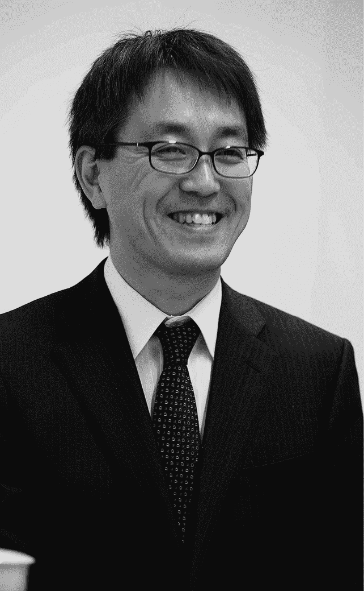

看胜率的话，通常二十多岁是峰值，三十四十岁以后慢慢走低。虽然没体育那么极端，但普遍觉得年轻状态更好。大体年轻占优，但二十岁有二十岁的长处，三十有三十岁的长处，四十也有四十岁的长处。关键是找到各年龄段的优势并发挥出来。

## “如何舍弃”比“如何获得”更重要

**山中：**那和年轻棋手对局，感受会不一样吧？

**羽生：**反差很强。就像和年轻人聊天，意思都懂，却有种触感上的违和。体现在一步步棋子里。有时会出现自己完全没想到过的着法，那种情况最难应付。为什么他们能想到？我觉得后辈的优势在于博采众长。

**山中：**哦，博采众长？

**羽生：**就是知识量当然年纪越大越多，但年轻人没有“这个不行”“那个不能用”的成见，可以干脆舍弃一些东西，从而得到新想法。将棋里，怎么放弃、怎么忘记，比怎么获得更重要。比如十五年前研究的定式，现在完全没用了。不斩钉截铁放弃就跟不上时代。所以“舍弃成见”很重要。

**山中：**这很难啊。笑

**羽生：**这也是，提升水平最重要的不是死背手筋^((1))，而是“明白什么是俗手^((2))”。能否瞬间发现绝对不能下的俗手，至关重要。因为读棋再多，只要混入一步俗手，一切白费。能瞬间排除俗手，读棋效率才会高。

**山中：**换句话说，很多下法根本不用考虑。那人工智能是看总分吗？

**羽生：**不是，有波动。我估计现在将棋程序一秒能读五百万个局面。用万位算可能就不准了。至少对一个局面不读上亿，评价就不会正确。

**山中：**一手就要上亿？

**羽生：**是。因为每一步分支极多，不读至少上亿个局面得不到正确答案。所以最近我更觉得将棋是个很难的游戏。笑

## 如果百年前的棋士和现代棋士对弈

**山中：**将棋和围棋历史很长。

**羽生：**规则成型有四百年。

**山中：**奇妙的是，四百年里棋子种类和规则基本没变。国际象棋也是。

**羽生：**确实没变。

**山中：**感觉稍微改一点会不会更好？

**羽生：**过去出现过后来消失的将棋也不少。规则变来变去，最终稳定成现在大家认可的样子。将来或许需要改变，目前不改也行。

**山中：**我喜欢拿体育比，很多体育规则一直在改。我学生时代打的橄榄球就改了很多。

**羽生：**您打哪个位置？

**山中：**锁球。

**羽生：**相当难的位置啊。

**山中：**我都能打锁球，显然不是强队。笑 不过马拉松、短跑这些运动规则基本没变。但和百年相比，纪录一直在提升。虽然不能简单对比，将棋和围棋呢？四百年前的棋士、一百年前的棋士、现在的棋士，如果顶尖棋手跨时代对弈，是不是越近越强？

**羽生：**论知识，今天确实在进步。所以一百年前的棋士来到现代，首先在知识上吃亏。不过给三年五年的适应期，大概实力不会减损。将棋需要知识和对未知的应对力。这种应对力，江户时代和现代并无差别。虽然知识量天差地别，但四百年历史里最近的五十年很关键。学过半世纪的棋谱基本就能跟上。

**山中：**江户时代就开始流传对局记录了吗？

**羽生：**很古老的记录。家元制度建立四百年前，最早的将棋名人和围棋本因坊的对局都有。

**山中：**将棋名人和本因坊下了什么棋？

**羽生：**将棋。一开始是本因坊赢了。

**山中：**哇——很有意思。

**羽生：**毕竟是四百年前。总之棋谱留下来了。

**山中：**是吗。对了，《每日新闻》还登过我和井山裕太本因坊的棋谱。笑

**羽生：**真的吗？那厉害。笑

**山中：**中途认输了。应该下完的。

## 解答问题，终有局限

**羽生：**将棋本来有家元制度。江户时代只有少数人能下，是个封闭世界。名人也是世袭。大正以后成立将棋联盟，变成实力强就能加入，技术越发展越不可思议。

将棋传统很古老。然而三十年前会被逐出师门的下法，今天已成主流。所以必须在很短时间内改变战略。

**山中：**这样一来，将棋的学习方法也和过去大不一样吧。

**羽生：**是啊。互联网出现后，年轻人都在网上练。今后主流恐怕是靠软件研究。

**山中：**肯定的。

**羽生：**不过那时也会出新问题，有问题有答案，只看问答，人类能力是否就能提升呢？换句话说，如果没有老师教练告诉你“这里该这样想”“除了这种还有那种”，而无人传授思考诀窍，人类可能理解不了。在其他领域不也这样吗？

**山中：**确实。我小学时学过几天将棋，买入门书自学。书上写了下法，却没写为什么下。理由是“这是定式”。后来另一本书写了每一步的意义和下法理由，我才信服。

**羽生：**作为工具，互联网非常强大，我想今后仍会被利用。但年轻人如何有效地、有意义地使用互联网，恐怕是一种历史性实验。

## 导向重大发现的“感觉”

**山中：**我原本是临床医生，现在做研究，也在用人工智能。很多时候我觉得自己比人工智能更准，但也在担心现在做的事将来会不会被全部取代。iPS 建立过程中，我们从二十四个基因里找出了四个必需组合，说起来秘诀是“感觉”。虽然什么都不知道，却有一种“这个基因可疑”“这个一定要试试”的直觉。问题是，我们称之为感觉的东西，人工智能能否再现。

刚才聊过第六感、读棋、大局观，您平时下棋多大程度上靠直觉？

**羽生：**哎呀，基本全靠直觉。笑 就算想读棋，一下就变成几千几万手，完全不现实。绝大多数局面我都靠直觉缩小范围，只考虑第二第三手。所以整体看真的只是一个很小的碎片。

重要的是，直觉判断能达到多高精度。另外，因为必然会出现预想外的情况，当出现时又能否顺利应对。

**山中：**果然还是直觉。我也在想直觉是什么。可能有纯粹的直觉，像抽签那样。而您下棋的直觉，和我们在研究中感觉一定要试这个基因的直觉，恐怕都不是纯粹直觉，而是基于过去经验产生的难以言明的判断。但那是什么，我也说不清。

## “空白的时间”催生出灵感

**羽生：**脑科学家池谷裕二教授把能描述的比赛相关直觉叫“灵感”，不能描述的叫“第六感”。换句话说，能语言化和不能语言化，用到的大脑部位不同。但对使用者来说，用哪个部位好像没太大关系。笑

**山中：**也是。

**羽生：**有一种说法，生物在寒武纪获得眼睛功能，于是爆发式进化。眼睛扩展行动范围，智能随之提升。松尾丰教授推测，随着人工智能图像识别飞速发展，能处理视觉信息后，其可能性也会迅猛拓展。

有趣的是，生物进化出眼睛，其他器官反而会钝化。所以所谓直觉，也许是将进化中钝化的机能再次激活。

创意、想法、灵感的获得，既有千锤百炼想出来的，也有稍微留点空白，从深思中抽离后在朦胧中突然冒出来，像沉睡的东西苏醒。那也许就是钝化机能瞬间活化的时刻。

这就像为了获得灵感，不仅要有输入，还需要时间整理，清理掉不需要的东西。

**山中：**这么说来，我虽然不是阿基米德，也在浴缸里有过灵感。那是在加州格拉德斯通研究所研究癌症小鼠时。某个基因为何引发癌症一直没解释清楚，有一天洗澡时突然冒出一个美妙想法。我边冲澡边喊“太妙了！”，把我妻子吓一跳。笑

跑步时大脑一片空白，但跑步时只觉得累，并不会冒出点子。笑 跑完后的冲澡才是机会！

## AI 能作巴赫的曲，但写不出村上春树

**山中：**人工智能是否真能取代人类工作，我认为重点在于，我们称之为直觉的东西，能在多大程度上探明本质，人工智能又能在多大程度上实现同样的功能。

**羽生：**是啊。类似直觉的东西，对人类而言都很难说清为什么那么想、对人工智能更是难题。

**山中：**因为没法写程序。

**羽生：**对。人工智能擅长“优化”，也就是从组合里找出最合适的答案。所以没有像人类那样的审美能力。让人工智能学会像人类看到自然风景时觉得“真美”“真漂亮”的感性，我觉得很难。

人工智能开发领域不同，进展快慢不一，与能否进行数学处理密切相关。比如巴赫风格乐曲可以数学解析，人工智能也能创作。

文学领域，人工智能也能写结构清晰的超短篇小说。实际上二〇一六年三月，人工智能写的故事通过了“星新一奖”初选。那么人工智能能写出村上春树式的小说吗？目前还不行。

**山中：**体育记录、决算报告等固定格式文章撰写好像已引入人工智能。但加入基于感情和感觉的表现就很难了。

**羽生：**语言的难度很高。我们说人工智能可以处理自然语言，但它怎么做呢？说到底也是用数学式处理。人工智能会建立坐标轴空间，比如葡萄酒在这里、玻璃杯在那里，基于数据计算距离关系，总结出文章关联性。单纯数学处理与理解人类文章完全不同。

国立信息学研究所新井纪子教授推动的“东罗伯”，也在二〇一六年十一月放弃了考东大。

## 正因为无知才去挑战

**山中：**另一方面，语音识别能力已经很厉害了。

**羽生：**啊，对。

**山中：**有很多“沃森”那样的系统。另外像“Siri”，可以用英语提问。以前发音糟糕就听不懂，现在就算有点问题也能懂。“这家伙发音不行，不过肯定想说这个。”大概就像这么体贴。我一开始还以为自己发音变准了。笑

**羽生：**实际上是计算机处理能力提高了。

**山中：**是的。以前“R”和“L”不分就很难理解，现在就算日本人的英语也能懂。

**羽生：**也有用相机拍文字全文翻译的技术。

**山中：**啊，那个很厉害。东京奥运会，外国人来时志愿者也不至于太头疼，什么外语都能交流。

**羽生：**但方便的技术反过来可能降低学习动力。反正用软件就行，干吗辛苦背单词？

**山中：**是有可能。我二〇〇〇年开始研究 iPS 细胞，如果那时有人工智能调查全世界文献给我提建议，会怎么样呢？

“山中教授，这项研究成功可能性百分之零点一，失败风险百分之九十九点九。最好别研究。”笑

人工智能很可能给这种建议。而且它说得这么有道理，我大概也会想“还是放弃吧”。所谓无知者无畏，如果没有无知的挑战，也不是好事啊。

**羽生：**我觉得，通过人工智能获得的知识越多，对人的行为和选择影响越大。年轻人决定毕业方向或求职方向，本来想好“就走这条路”，结果一搜网，发现“这里薪水低事多”“那边工作环境差”“老板脾气坏”，于是哪儿都不想去了。人啊，必须有踏入未知勇气，正因为看不到失败风险，才能去挑战。

**山中：**结婚时也是，如果把对方信息全告诉你，说“结婚成功率百分之五十”，反而不知道该怎么判断。所以还是要有某种直觉吧。虽然明知道成功率不高，但就是感觉好像能行。

**羽生：**基本上人工智能来做，最终只是提高概率上的精确度。因为它不是找到正确答案，而是不断重复，每次都比前次稍微好一点。

**山中：**“这是命运相遇，所以有些地方忍一忍吧”。正因为有这种想法，交往才能进展下去。如果这时人工智能跳出来分析说“不，这绝不是命运相遇”，可能就结束了。

**羽生：**以前看电视介绍，Facebook 上能记录喜好等信息。电视上说有人就靠那些信息找对象，“这个人最合适，所以选了他”。但我认为这种选择很鲁莽。肯定有某些地方存在信息无法解决的问题。

**山中：**治疗过程也一样。比如某种疾病，虽然知道一般这样治最好，但就是感觉当前这个患者最好换种做法——为什么做出这种判断呢？连自己也无法解释，但很多时候相当准确。

如果说这种医生的第六感或直觉，实际上是基于一切信息在潜意识中做的判断，那么说不定人工智能也能进行同样判断。不过能让人工智能做到吗？

**羽生：**人们常说“隐性知识”这个词。就是医生、工程师，自己能解决问题，但自己到底怎么解决的，自己也无法解释，也不知道为什么这样做。这种情况很多。这些都属于隐性知识，很难说人工智能能不能处理。因为最终是要编写程序。我感觉，这将是今后一个非常大的主题。

**山中：**如果我们人类的决定、决心，都能用数据化信息做出判断，好像也很没意思。笑 我希望还是能有无法解释的成分。

# 第六章

## 新创意是从哪里诞生的

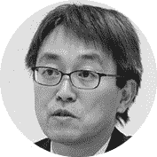

**羽生向山中提问……**

### 独创究竟从哪儿来

**羽生：** 我常下棋，也积累了一些实战经验。下了步前人没见过、局面一下子就打开的着法，我会称之为“新手”。可很多时候，我以为自己想出了惊人的新手，其实别人早已想过。

山中教授，您总能提出很新鲜的研究思路。您觉得要想做出真正与众不同的创意，关键在哪儿？

**山中：** 艺术家也这样，研究者更是不能人云亦云。大家都说重复太无聊。可怎么摆脱重复，真的很难。我也有过“自己好像想到绝妙点子”，结果一查早就有人做过的时刻。

更麻烦的是现在。互联网让信息瞬间互通。互联网之前，有人靠掌握信息就能做出别人做不出来的东西。如今论文上线前就全球共享了，靠信息差做出独家发现的时代基本结束了。

**羽生：** 在这种情况下，独特性到底怎么产生？

**山中：** 我反复讲过，只有三条路。

第一条是爱因斯坦式的天才，生来就能跳出常人框架。这是王道，但我自己从未体验过，也几乎没见过。这条路普通人无缘。

第二条是大家都在想，自己也想到了。生命科学靠实验验证假说，得到预期结果当然高兴。但实验常常不按剧本走，出现完全意料外的反应。

这就是机会。靠冥想很难得到与众不同的点子，可自然未知无穷。当你用实验去叩问时，超乎预期的反馈会像自然的提示。能不能抓住这种意外，是第二个机会。

**羽生：** 也就是说结果与预期不符时，不能立刻否定，而是以自己的方式追问原因。

**山中：** 对。结果打脸时，是失望收工，还是兴奋地说“有意思”？态度决定一切。

第三条路，大家都觉得“做出来会很震撼”，却又普遍认为“做不出来”而放弃，只有你敢站出来硬碰硬。我觉得只有这三种方式才能做出差异化的研究。我做不了第一种，所以长期经营第二种和第三种。

**羽生：** 原来如此。

### 做别人不做的实验

**山中：** 第二种最核心。想走这条路，先得真正动手。不要嫌实验蠢，先做一遍，很重要。做的时候出现了怪现象，要感到庆幸。

我读研时，导师给我一个血压相关的课题，是我第一次做实验。结果完全违背假设。我兴奋地冲进导师办公室喊：“老师，您的假说错了，但结果太不得了了！”那一刻我觉得自己适合做研究。

导师也很激动，说“那可真不得了”。明明假说被推翻，理应沮丧，他却表现出惊喜。这种态度让我感受到研究的魅力。

到 iPS 细胞则是第三种模式。2000 年左右我有了自己的实验室，想做点不一样的东西。那时美国已做出 ES 细胞，全世界都在比谁能分化出更多细胞型。

我没法加入这场竞争，没人没钱。而且 ES 细胞要用受精卵，伦理争议很大。大家都在想：能不能不用受精卵，让成体细胞回到未分化状态再利用？想是想了，都觉得大概不可能，于是没人动。我就一头扎进去了，“试试看吧”。

iPS 的发现就是第三种模式。此前我的研究几乎都是第二种：结果和老板预期完全两样，不管老板高兴还是失望，我都异常兴奋：“太好了！”

### 无知的力量

**羽生：** 为什么您会敢闯别人不去的地方？

**山中：** 说来话长。我原本是整形外科医生。学生时代就想当运动医生，帮受伤运动员康复。所以整形课我总坐第一排，其他课就偏科了，常去打橄榄球。

当外科医生后发现，运动损伤里很多病没法治，比如脊髓损伤，和想象不同。于是转去做研究。让我震惊的是，学生时代太松懈，基础知识几乎空白，连最基本术语都不知道。基因里的外显子、内含子，大概初中生都知道，可我读研时看到这两个词完全懵。

这种状态持续很久。后来在奈良先端科学技术大学教书，第一次有自己的实验室。从四月开始讲半年的课，却发现自己很多内容都不懂。学生都很刻苦，比我懂得多，我一边冷汗直流一边怕露馅。

某种程度上，正因为无知，所以无所畏惧。iPS 的研究也是这样。如果我懂太多，可能就不敢做了。正因为不知道，才会想“那就试试看”。

### 经验成了绊脚石

**羽生：** 我也觉得自己年纪越大，经验越多，判断材料越多，潜意识里就更倾向于可行、低风险的方法。大胆挑战反而变少，一直在反省。

**山中：** 知识必要，但也会碍事。懂得太多会害怕：“这肯定失败”。一旦这样想，就真的不行了。

**羽生：** 确实很多新想法被经验堵住。我一般不会直接套用经验，而是把它提炼成可以实战运用的思考方式。

**山中：** 应该如此。

**羽生：** 如今信息爆炸。要想与众不同，先得知道别人做了什么。但如果把太多时间耗在搜集他人信息上，创造性工作的时间就被挤占。脑子里塞满信息，容易先入为主、形成定式，就很难想到颠覆性的东西。

## 舒适的环境最危险

**山中：** 填满知识的状态其实很舒服。我觉得现在的教育就是这样。

亚洲多地都类似，日本尤其突出。从幼儿园到高考，一路都是找标准答案。课本写的、老师说的就是正确答案。分数不够就进不了理想大学。

于是大部分孩子没经历过失败，照着标准答案就能上好学校。等他们闯进研究世界，别人说“别信课本”“实验出错才是机遇”，他们很难接受。

**羽生：** 思维方式已经固化。

**山中：** 我在日本和美国都做过研究，美国孩子明显更自由。大学前很多孩子疯狂运动。从研究者角度看，美国更有潜力。

**羽生：** 潜力是指遇到意外或无法回答的局面时机会更多？

**山中：** 对。对孩子来说，日本很舒适。按父母老师说的做，就是好孩子。但破坏规矩就会痛苦，很难生存。

近年来成年人也倾向于不批评孩子。学校老师也不敢骂。稍微说重一点就被投诉骚扰、霸凌。如果从未被否定过自己的思维方式，就不会尝试别的可能性，也就失去了进入新世界的大门。

## 要先懂再否定课本

**山中：** 说个例子。现在家用车都有跟车自动减速功能，我立刻就用上了。上高速收费站 ETC 通道，前车降到时速二十公里左右，我的车也跟着慢下来。可比我自己控制晚了一拍，虽然理智知道会停，身体却很不舒服。

这就是习惯被打破的不适感。研究本质上是对今天课本的否定。因为要发现新东西，就得否定既有结论。不过我并非鼓吹无脑否定。我自己对课本也不算熟。

**羽生：** 您又谦虚了。

**山中：** 我不是否定课本，而是要在充分理解后加以否定。很多时候回头才发现，“啊，原来跟课本写的不一样”。

**羽生：** 别人问我对年轻人的建议，我常说：去做没做过的事，经历指南针失效的情境，这很重要。

刚才您说的汽车也是如此。有导航、有地图时很安心。可如果把自己放到知识和经验都失效的环境里，哪怕不至于混乱，也可能诞生新想法。

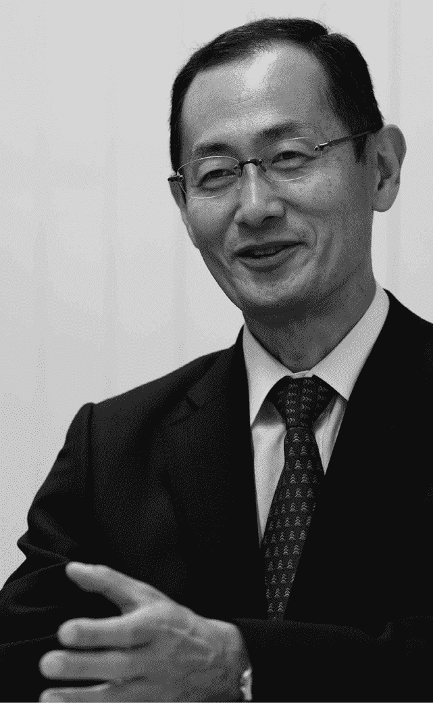

## 从信息囤积到能力转化

**山中：** 下棋也有这种事吧？

**羽生：** 有。将棋里有时能明确判断“就该这样”，有时完全无法回答。指南针失灵时能否迅速应对，正是检验真实水平。

日常生活中我也刻意避免重复循环。去将棋会馆或羽田机场，我会有意识走新路线，把自己放进新环境。

不过年轻人听到“知识失效”就冲动说“我去叙利亚”“去灾区”，这就过激了。知识经验失效往往伴随风险，必须先确保自身安全，这是前提。

**山中：** 一无所知也不行。对情况和自身要有足够了解。

**羽生：** 信息时代，数据量越大力量越大。但我更在意的是，别只囫囵吞枣地记，而是能吸收利用。能否在未知局面把信息“量”自然转化为应对的“质”，是未来年轻人关键课题。

**山中：** 过去知识经验当然重要。将棋要学旧对局，我也读很多论文。但只做这些会僵化。

到了某个阶段，必须亲自动手。否则顶多成为优秀评论家，做不成一流研究者。

我做研修医生时领导反复说“别想太多，做个实验看看”。这句话我一直用。走不下去时先做实验，说不定会出现新结果，激发出新想法。

工作会改写课本，这需要学习，但要控制度。研究进行到一半，必须不怕失败勇敢迈步。时机很重要。一篇论文都不读就做实验不行，读再多论文不做实验也不行。就像盐梅要恰到好处，时机非常关键。

## 失败也是种收获

**羽生：** 做实验选项无穷无尽，凭感觉判断哪种可能成功、哪种可能失败，很主观、很感性。这其实就是个人风格吧？

**山中：** 是的。

**羽生：** 三种模式都可。如果是别人没想过的，不妨带着“失败也没关系”的心态去做。别人已在做的，再做意义不大，浪费时间。而别人没做的，不管什么都有价值。成功不保证，很多会失败。但从我的经验，失败也值得。“不错的尝试”，这种感觉很好。

**羽生：** 下棋也常这样。走新奇棋路，大多会输。可某种程度上必须容忍，因为没办法。那种失败也是必需的。

实战中尝试能真正学到东西。正式比赛读秒、复杂对峙时，注意力最集中，思考最细致。压力下的表现才是最完整的。

光想不行，亲手下过后才知道“这步是这样”“这个想法行不通”。

**山中：** 就是要自己动手。

**羽生：** 不同时间视角看风险不同。四十岁后常不知不觉踩刹车。有时必须有意识地踩油门，去承担风险。“今天我就要赌一把看看”。机会像抽奖，了解风险后自己去选，能承受多大风险就有多大选择。

**山中：** 研究也一样。必须不断挑战新事物。进展不顺很正常，不挑战才有问题。

好歹领工资可以做全新尝试。发现新东西公布全世界，会得到评价，也可能造福社会。归根结底是挑战还是不挑战。研究是很公平的职业。

## 真原创与假原创

**羽生：** 近年有人说基础研究环境越来越难。您觉得该怎么推进？

**山中：** 我自己研究二十多年才发现 iPS，全是基础研究。之后才转向应用。两者都重要。

基础研究不考虑有用与否。想着有没有用，反而做不出有趣的研究。我确信带来突破的必定是基础研究。

日本的基础研究真的很难吗？我觉得没糟糕到那种程度。文部科学省的科研费没大幅削减。

**羽生：** 这样吗？

**山中：** 没削减，但成本在涨，相对就更困难了。

**羽生：** 所有项目都这样？

**山中：** 不一样。我读研时一年一百万日元就能做实验，现在可能一个月都撑不住。基因解析和试剂越来越贵，各个领域都面临资金压力。

**羽生：** 如果研究数量增加，会不会必然产出更多结果？

**山中：** 某种程度上是概率问题。挑战的人越多，成果可能性越高。关键是挑战是否真正具有独创性。

真正独创的研究，五年十年都该支持。单纯重复别人正在做的事就是浪费。分辨两者很重要。最先要自己想清楚，这项研究的意义在哪。

## “阿倍野狗实验”陷阱

**山中：** 我读研究生时，老师讲过一件事我一直忘不了。我在大阪市立大学医学部，阿倍野区。我们用比格犬做实验动物。当时的副教授问我：“山中，你知道‘阿倍野狗实验’吗？”我问：“那是什么？”于是他向我解释了一番。

比如美国率先在全球注意到一个现象：敲一下狗的脑门，狗就会汪汪叫，于是发了一篇文章。因为是头一回被报道，大家都觉得很了不起。后来日本的研究者读到后想，美国的狗会叫，那日本的狗是不是也一样？于是也去敲。结果狗果然叫了，又写了一篇。接着大阪市立大学的团队看到后觉得，要不换成阿倍野区的狗试试？实验做了，狗照样叫，也又成了一篇论文。

当时老师问我：“山中，这样子的论文你会写吗？”我当时回答：“不会。”听起来像个笑话，可在科研圈里这种情况其实相当常见。

**羽生：** 真是这样吗？

**山中：** 概括来说，就是因为美国先发了，日本就跟着做一遍，得到同样结果再发一篇。这样的文章非常多。

**羽生：** 也就是换个条件就发。

**山中：** 不小心就会掉进这个坑里。研究者普遍承受着必须尽快出成果的压力。博士学位要在几年内拿到学位论文，博士后经费也只有两三年，撑不过这段时间就没法继续往下走。

要在两三年里产出论文，很多时候就很容易滑进“阿倍野狗”的陷阱。明明想做研究，实际上只是在模仿美国人的日本版本。

所以首先要自我检视，自己是不是在做这种研究。导师也需要把关。甚至在评审是否拨款的时候，也要从这个角度来审视。说起来简单，真正操作起来却很难。

**羽生：** 如果一项研究需要五到十年，那选方向本身就是一场豪赌，也是真正的考验。

**山中：** 没错。所以不要做“阿倍野狗实验”，要去挑战连结果都未知的课题。而年轻研究者敢于选择这种挑战，能否获得强力支持，这才是最关键的。

既然是在碰硬题目，三五年没有产出是正常现象。若这时就断了资助，说“三年五年拿不出成果就不行”，大家全都会跑去做“阿倍野狗实验”。我们需要一种可以兜底的机制。

* * *

(1)　本意是指做菜时盐醋比例、火候时机恰到好处，引申为各种衡量都恰到好处。

# 第七章 让日本重返人才强国

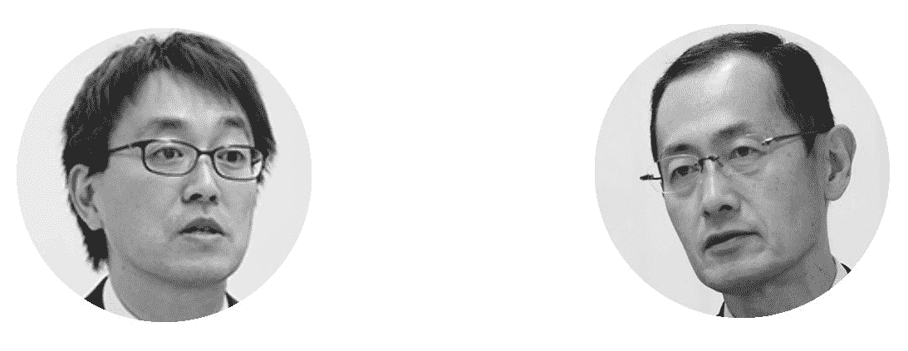

**和读者一起梳理问题**

## 用马拉松跑出来科研经费

**山中：** 我们京都大学 iPS 细胞研究所专门设立了一个部门，名字叫“未来生命科学开拓部”，口号是“不怕失败、敢于挑战、开创未来”。目标是用 iPS 技术去探索癌症、传染病发病机理、免疫系统原理等，打开全新的生命科学与医疗领域。

钱从哪来？我们成立了“iPS 细胞研究基金”，我自己跑马拉松来筹款。

**羽生：** 马拉松筹款啊。山中教授每年跑好几次全马，这都是线上募捐吗？

**山中：** 对。一半是运动，一半是募捐。国家给的经费有大学运营补助和各种竞争性项目，每隔几年就得拿出实绩。

**羽生：** 也就是说经费用途和目标是固定的，很难用于全新探索吧？

**山中：** 也不是不能用。只是资助期三五年一到，再申请时如果看不到成果，继续很难。这就是现实。

美国除了联邦资助，还有州政府支持，还有大量民间捐赠，特别是 IT 企业会给研究者巨额资金，基础研究也得到相当程度的扶持。

国家资金来自税收，容易受天灾或政治判断影响。避免单靠国家，从筹资角度看分散风险更有优势。

**羽生：** 不只依赖国家，也把民间支持当作基石。

**山中：** 研究本就该如此。历史上很多富豪赞助艺术家，也赞助学者，让他们自由研究。回到原点可能有点奇怪，但日本不能只靠税收做研究，必须更多依靠社会捐赠来推动基础研究。

不过完全依赖企业资金也有风险。比如研究结果与企业预期不符，高层可能叫停项目。但对科学家而言，追问这个“不符合预期的结果”，反而可能带来科学的飞跃。

## 向捐赠大国美国取经

**羽生：** 我听说美日的大额捐赠者气质不一样。美国人会公开名字，日本人常希望匿名。

**山中：** 希望匿名的确实不少。

**羽生：** 能吸收这种文化差异，建起可合作的体制就好了。

**山中：** 美国有很多家族自建基金会，捐几十亿上百亿很常见。日本则非常罕见。我们也收到不少捐赠，个人捐赠在日本很多。

**羽生：** 最近众筹也在尝试吧。

**山中：** 我们也在做。跑马拉松时沿途有几十万人观看，踏实努力很有效。在美国，研究机构的负责人、医学院院长，可能有一半工作是筹款。

**羽生：** 一半工作？

**山中：** 因为筹款成果占评价比重很大，所以大家都很拼，日本也一样。不拼就拿不到钱。

**羽生：** 但我印象里日本做筹款的人才很少。

**山中：** 确实少。我们研究所自己成立了筹款部门，特意聘了几个人。在国立大学里算是另类。

**羽生：** 确实。

**山中：** 这就是如何催生独创性工作的问题。筹款部门也不是我们自己想出来的，只是美国普遍存在，日本没有，所以想试试看而已，并没什么了不起的想法。了解美国很重要。

## 西方科学背后的宗教影子

**羽生：** 说到美日差异，美国普通人与科研人员的距离更近。

**山中：** 感觉很近。美国对科学感兴趣的人非常多。我坐美国航空时和空乘聊，他问我做什么，我说做科研，干细胞。他惊呼“太厉害了”！在日本很少遇到聊得这么深的。

**羽生：** 完全不知道你是诺贝尔奖得主就聊起来了。（笑）

**山中：** 他们有本《科学美国人》，机场便利店都在卖，销量不错。日本也有类似杂志，但几乎看不到在机场卖。

**羽生：** 确实。

**山中：** 美国不同政党对生命科学政策也不同。

**羽生：** 共和党和民主党态度完全相反。

**山中：** 完全相反。共和党不太重视科学，受基督教原教旨主义影响，很多支持者并不真信进化论。当然进化论也未被完全证明，但基本的科学认知就有差异。

**羽生：** 会不会因此科学渗透到大众，变成政策分歧？

**山中：** 有可能。全球变暖、人工流产、进化论这些都会成为总统大选议题。

**羽生：** 但有反对州也有赞成州，研究还是在推进吧。

**山中：** 是的。美国是联邦制，国家权力受限，国家说不行州可以说行，反之亦然。

**羽生：** 关于制造 iPS 细胞，教皇曾评价“在不破坏受精卵前提下开展疑难病治疗的技术非常了不起”。日本人听了可能难以理解，但在欧美这是大议题。

**山中：** 是的。ES 细胞研究时，时任美国总统布什就行使否决权。

**羽生：** 在欧美，科学背后似乎仍有宗教在支撑。

## 医学至上带来的副作用

**山中：** 科学家社会地位，美国更高。我先当医生后才做科学家。在日本，医生收入更高，社会评价也更高。

**羽生：** 可能确实如此。

**山中：** 这种状况到现在仍有。在美国两者是对等的，很多医生不推荐孩子学医。而日本医生家庭子承父业的多，我家也是。（笑）为什么差异这么大？

**羽生：** 日本从小科学课时比例比美国少吧。

**山中：** 但每年问小学生想做什么，学者科学家排很前，和医生差不多。实际结果却是进医学部的人最多，有偏差。不过日本也有很多数学物理天才，在国际奥赛上拿金牌。

**羽生：** 对，奖拿了不少。

**山中：** 即使在数学物理上很突出，很多人仍去医学部。学医后除了极特殊情况，基本用不到数理知识，从某种意义上很浪费。现在作为研究者，我更希望大家来做研究。

**羽生：** 选择研究者少，会不会是因为未来路径看不清？学医路线很清晰，考上医学院→资格→研修医生→医生。而研究者的道路很模糊。

**山中：** 确实。多数读科学博士的希望留在大学或大企业继续研究，也有做科学记者、科普、教育等选择。

**羽生：** 美国学生好像选择这些的多。

**山中：** 是的。生命科学和 AI 发展到高度专业化，引发社会问题，需要有人把尖端知识通俗化，促进科学与公众对话。所以也应向学生展示这类职业选项。

## 卡在中间的死亡谷

**山中：** 大学研发的技术如果不能被大药企等正式开发，就无法惠及社会。大学直接回馈社会很难。

基础成果向实用化商品化转化时，资金出现瓶颈，被称作“死亡谷”。日本大学有优秀研究却翻不过去，反被美国抢先。基因测序技术原本也是日本企业领先。

**羽生：** 还有这事？

**山中：** 但国家资助断了，日本的开发就……

**羽生：** 停滞了。

**山中：** 美国迅速发展靠创新企业。美国创企成立快，能聚集优秀人才。大学技术→创新企业深化→大企业收购，流程很成熟。日本创企也很努力，但筹资难，聚集人才也难。

美日年轻人差异明显。美国顶尖学生倾向去创企，追求自由。日本很少学生想去创企，多留在大学或一流企业。就算本人有兴趣，父母也会反对。

**羽生：** “好不容易上大学，为什么要选高风险的创企？”

**山中：** 差异很大。所以优秀年轻人回避研究者道路，也回避创企道路，这一点必须改变。

**羽生：** 因为科技是支撑日本的支柱。

**山中：** 确实有点担心。

## 培养螺旋式人才

**羽生：** 美国很流行创业，好像不创业就落伍了。

**山中：** 确实。而且美国认可失败经历。创企破产在日本意味着前途尽头，在美国会被视为宝贵经验，反而让人更有勇气再挑战。

我把日本和日本人叫做“直线型思考文化”，一旦确定目标就一根筋到底，不三心二意。

**羽生：** 笔直往前，集体也倾向同方向突进。

**山中：** “一门心思干到底”很受赞赏。进公司基本一辈子，结婚也很少离婚。遇到挫折，会被视为人生落伍者。

相比之下美国是“螺旋型思考文化”。先在这边，再转到那边，可以按兴趣灵活跳转。美国两种人都有，螺旋型和直线型。日本直线型占绝对优势。而美国因为两者并存，像 iPS 这样新技术一出，螺旋型马上扑上去。

**羽生：** 要加入进去。

**山中：** 是的，会说“我们干吧”。直线型则很谨慎：“不清楚，先观望”。所以不管技术如何发展，美国都能灵活应对。

**羽生：** 原来如此。美国因此能广泛接纳新技术。

**山中：** 对。技术大爆发时，螺旋型成功；技术失败时，螺旋型会想“下次再努力”。直线型则会说“看吧，我早说了”。日本直线型多，技术不顺时就变成“果然观望是对的”，技术顺利时就会落后。

所以两种人才都需要。日本直线型放任也会成长，今后关键是怎么培养螺旋型。但以考试为主的教育很难产生螺旋型。

**羽生：** 日本肯定也有具备螺旋潜质的人，关键是如何建环境让他们发挥。而且现在是全球化时代，就算在日本长大也不一定留在日本。

**山中：** 螺旋型的人停不下来。我自己也是不断转圈的螺旋型，兴趣不断变化，妻子总说和我结婚人生像过山车。

说实话，我的研究从临床整形、药理、分子生物、癌症、ES 细胞，一直在变。没成果时我曾怀疑自己的风格。

幸好那时我听了诺贝尔奖得主利根川进的演讲，提问时我问：“日本很多人认为研究要持续，教授怎么看？”他自己的课题也从免疫学跳到脑科学。他回答：“谁说要持续？觉得有趣就做。”这句话给了我巨大勇气。

## 诺奖获得者如何养成

**山中：** 螺旋型一旦偏离平均线，容易被当成怪人。普通人能做到的事他们做不到，但在某个领域可能爆发出惊人才能。我认为日美都有这样的人，需要在各领域广泛培养。

**羽生：** 将棋里进步方式也不同。有人看似停滞，突然大爆发；有人一直平稳提升。从这点看，人的能力很难理解。

**山中：** 在日美做研究时，我强烈感到日本需要更好地发挥人才能力。

大学入学考试会筛选出能顺利通过的孩子，直线型比例不断上升。过去容忍度高，上了大学可以只做自己喜欢的事。现在从入学开始管理就很严格，螺旋型更难出头。潜力如何发展，大学前教育很重要。

**羽生：** 人只有个性丰富才有活力。大人应该发现这类孩子，让他们发挥特长。

**山中：** 但在父母眼里，“普通的好孩子”才最好。我获诺奖后常被问：“怎样把孩子培养成诺奖得主？”（笑）完全答不上来。

**羽生：** 这是最难回答的问题。（笑）

**山中：** 唯一能说的是，“孩子和别人不一样时请别生气”。

## 无用之用的意义

**山中：** 外人看来我的人生充满徒劳，弯路很多，效率低。但正因那些弯路，才有了今天的我。

**羽生：** 将棋里经验积累后回头看，年轻时觉得无用放弃的东西，其实也很重要。看似无意义，实则有意义。靠每日一点点积累，才会出现新创意和灵感吧。

**山中：** 当今社会最看重效率。但看似没用、徒劳的事里，可能藏着未知新思想。

**羽生：** 即使不能直接用，学习它的过程可能就是理解新事物的捷径，成为通往新方向的平台。不过那不是具体可见的东西。

实际上将棋局面里，大多数选择都是“不做更好”。不管什么事，大多数时候都不做才好。（笑）某种意义上将棋是最容易犯错的游戏。所以别钻牛角尖，别坚持过头。与其追求结果，不如在过程中找乐趣，感到充实更重要。

**山中：** 这真的很重要。

**羽生：** 外行人以为职业棋手能算很多步，其实并非如此。

**山中：** 真的吗？

**羽生：** 主要是临场找对策，边摸索边想“下一步下哪”。当然想走最好的一步，但没有简单方法。百分百不会错的选项不存在，棋局很少按预期发展，通常要随机应变。

有时决定是错的，但结果是好的。比如走了一步坏棋，却引出对手失误，意外获胜。那这步坏棋到底算好还是坏呢？（笑）

遇到完全没想到的状况时总要想办法解决。这种能力无法数据化。所以还是保留一点暧昧比较好。（笑）

**山中：** 你这话又给了我勇气。（笑）

**羽生：** 当今环境完善，认真做就能飞速冲向目标。但反过来，在环境不完善的时代，没抵达目标的人也可以说抵达了。

我想过去肯定有很多有才华却因环境恶劣无法成长的人。随着互联网普及，因环境恶劣而无法发挥才能的情况会越来越少。

在整体水平不断提升的趋势里，只盯着旧知识积累和有利环境，很难形成差异。必须用不同做法。那恐怕不是简单的“这样对那样错”，关键在于无法被数据化的地方吧。

# 第八章
十年百年后，世界将通向何处

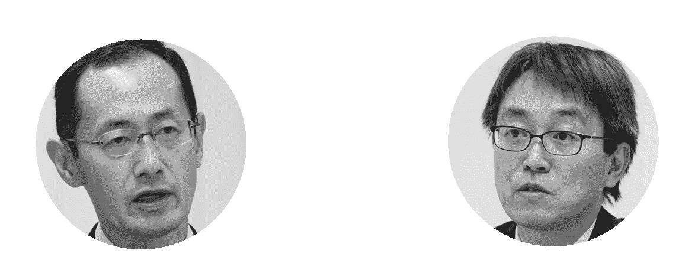

**两人携手带着读者一起探问……**

## 能否实现永生

**羽生：** 要是 iPS 再生医学配合基因编辑，把已知疾病全都清零，人类是不是就可以一直活下去？

**山中：** 不可能，衰老是绕不开的壁垒。现在普遍认为人的寿命天花板基本等于细胞寿命，大致在 120 岁左右。

血液的来源在骨髓里的造血干细胞。刚出生时数量很少，大约几千到上万个。干细胞本身几乎不增殖，主要靠分化出来的前体细胞快速膨增，源源不断产生红细胞、白细胞、血小板来替换。干细胞偶尔也要分裂，分裂就会累积基因损伤，也会自然凋亡，储备于是逐渐减少。让人惊讶的是，我们检查过百岁左右的老人，体内只剩下两枚造血干细胞。

**羽生：** 只靠那两枚撑着？

**山中：** 到零就意味着生命终止，这就是衰老带来的死亡。好在骨髓移植可以补充新的干细胞。心脏实质上从出生就一直在用，一百年后就会衰竭，但心脏移植是可以做的。膝关节不行也能换人工关节，技术一直在进步。

真正棘手的是大脑。大脑基本保持出生时的形态，神经元几乎不补充。一旦把大脑整体换掉，这还是同一个人吗？

**羽生：** 那已经不算是自己了。

**山中：** 所以大脑才是决定点。除了大脑，只要资金足够，器官和细胞理论上都能轮流更新。但移植必须长期服用抗排异药，这些药本身就有副作用，会损伤健康。

综合来看，造血干细胞会随年龄递减，大脑也不可避免地老化，人类寿命的上限大概还是 120 岁左右。更根本的问题是，活得那么久会不会感到幸福。

**羽生：** 长生是否可能，以及长生后是否快乐，一直是古老命题。

**山中：** 这样想，生命体真是精妙，人类尤其如此。我有时会怀疑，我们真的只是进化论能解释的偶然产物吗？

## “我不想把病基因传下去”

**羽生：** 基因解析后如果发现某人注定会得某种病，能提前用基因编辑处理吗？

**山中：** 单基因病，也就是由一个基因决定的疾病，理论上是可以干预的。比如亨廷顿舞蹈病^((1))。两个基因的也大概能想办法。但涉及三到十个以上基因的多因子病，以现在的技术就很困难。

我曾在一次聚会上听一位熟识的女士说，她和姐姐家族都有遗传病，所以她们都决定不生育。她说不想把致病的遗传信息传下去。当时在饭桌上也没法深入聊。

总之确实有人想得很深。如果真的是单基因问题，治疗的可能性就能改变她们的决定。

做一次普查就会发现，每个人身上都带着几十个所谓的致病基因，只是没有被表达出来。所以遇到这种困扰，不能简单以伦理为由拒绝基因编辑。

**羽生：** 是。但基因信息也可能导致基因歧视，比如保险公司会因此拒保。

**山中：** 风险确实存在。美国等国家已立法禁止保险公司询问投保人的基因检测结果。

**羽生：** 也有像安吉丽娜·朱莉那样的人，检测出乳腺癌或卵巢癌风险极高后，做了预防性的乳房、卵巢、输卵管切除。

**山中：** 她母亲死于乳腺癌，外祖母也很年轻就因卵巢癌去世，这个选择可以理解。她的基因与疾病是明确对应的，切除乳房虽然粗暴，也算一种手段。

难办的是这种情形：告诉你基因很可能致病，但我们无能为力。知道这个事实，对人生真的有益吗？

举例来说，阿尔茨海默病的风险基因已经找到不少，但现状只能说：检测显示你患病的概率很高，可现今医学还没办法。

即便如此，知道结果也能用来规划人生。如果五十岁前后发病的概率很高，就可以在那之前把想做的事完成，也为家人留下安排。某种意义上，这对个体可能是有帮助的。

**羽生：** 包含阿尔茨海默病在内的认知障碍正在急剧增加，预计到 2050 年患者将达 1.3 亿，是现在的三倍。

**山中：** 这是全人类的紧迫课题。反过来说，有些老人正是因为遗忘了各种烦恼和愤懑，才得以安宁地度过晚年。什么是好什么是坏，很难一概而论。

假设未来研发出认知症特效药，百岁高龄身体衰退但头脑清醒，反而会更恐惧死亡。有人认为，认知症或许是人类对抗死亡恐惧的一种防御机制。

## 向虚拟祖父请教

**羽生：** 肉体终会消亡，但以现有技术，记忆、经验、数据等都可以用某种形式保存下来。也就是说，可以收集逝者的信息，在电脑里模拟出“他大概会怎么回答”“他可能会怎么判断”，仿佛人还在。

这不是复活，只能算近似重现，我觉得并不奇怪。

**山中：** 美国墓园里有些墓碑会印二维码，扫一下就能在云端看到逝者的资料和趣事。

**羽生：** 以现在的技术，这很容易。让子孙后代扫墓碑上的二维码，了解祖先原本是什么样的人——有可能会颠覆神圣形象的想象。（笑）

**山中：** 不不，留下什么由自己决定，把能塑造高大形象的信息保留下来就行了。（笑）

**羽生：** 也就是筛选积极的信息。（笑）只要有大脑记忆数据作为基础，就能再现出类似的存在——不说完全相同。比如烦恼时对电脑说：“爷爷，我有这个困扰，你会怎么看？”电脑计算出爷爷可能的回答并给出建议。

**山中：** 那就是像活着一样的虚拟现实。

**羽生：** 虚拟现实发展极快。如今网络和现实仍有明显分野，但虚拟恐怖游戏明知是假的，仍会产生真实恐惧。推广技术奇点概念的雷·库兹韦尔预测，2020 年代后半人类就无法区分虚拟与现实，也会出现完全生活在虚拟世界里的人。

有“现充”一词，指在现实里生活充实。网络再开心终究是网络，难免有无奈。但如果虚拟现实能提供与现实同等的真实感，就有人会宁愿永远待在虚拟世界。产生这种想法并不奇怪。

**山中：** 科幻电影里的世界。

## 会引发噩梦的药物

**羽生：** 前几天我第一次去了幕张的“Nico Nico 超会议”，现场气氛非常热烈。大家把“Nico Nico 动画”里的活动搬到现实，平时在网上活跃的人都聚集到现实里。

现场有动画、游戏，也有企业和政党活动。不熟悉网络世界的人去了会完全看不懂。而对圈内人来说，这里每个板块都很精彩。规模很大，约有 15 万人。

**山中：** 哇，15 万！

**羽生：** 简直文化冲击。

**山中：** 您是以什么身份去的？

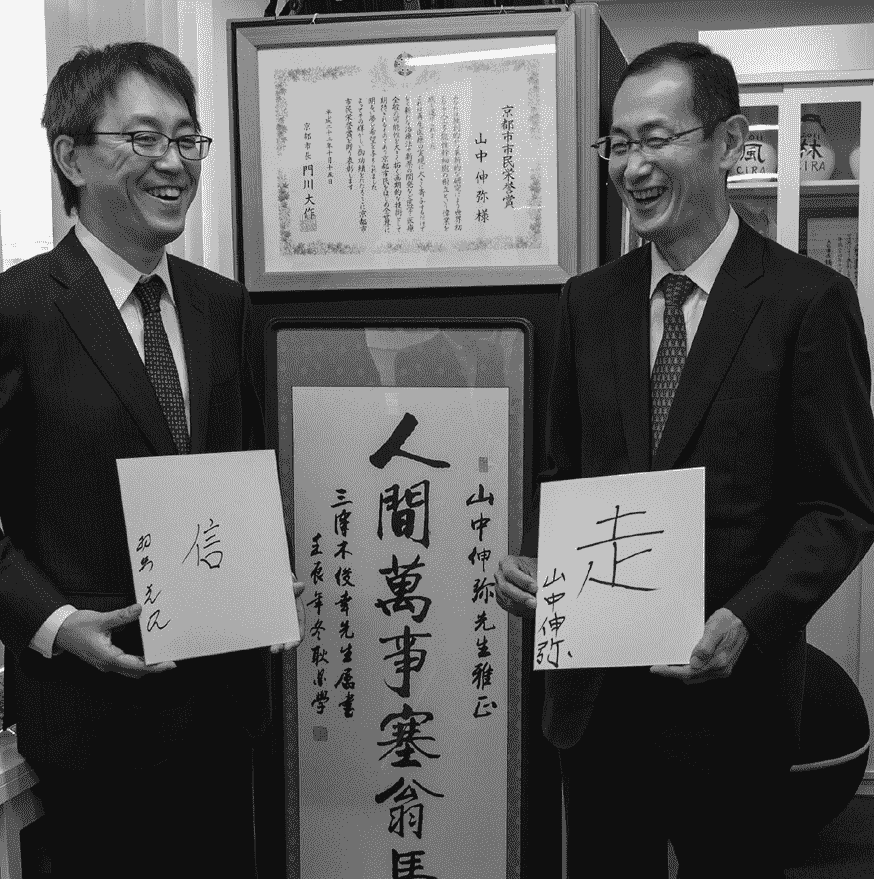

**羽生：** 现场有将棋环节，我和加藤一二三老师做了脱口秀，但和现场气氛完全不搭。（笑）感觉就是“为什么在这里做这个”。

**山中：** iPS 话题更格格不入吧。

**羽生：** 不不，活动丰富多彩，从歌舞伎大相扑到机器人大赛、尖端科学都有。真要做 iPS 主题活动，我想也会有人来。

**山中：** 说到虚拟现实我想起一件事。我每月要在旧金山的格拉德斯通研究所和日本之间往返一次，为倒时差吃过各种安眠药。

筑波大学柳泽正史教授发现了具有清醒作用的物质食欲肽，抑制它的安眠药只在日本发售。普通安眠药是增加助眠成分，这个药是抑制清醒物质，说明书副作用写着“会做噩梦”。我看到了还是想试试。

结果不是被终结者追杀那种刺激的梦，全是赶马拉松前厕所被占、被下属反过来骂之类的写实梦。就像虚拟现实一样。

**羽生：** 哈哈，通常做噩梦会惊醒，这个却是醒不了的噩梦啊。

**山中：** 这种梦平时也会做，只是频率明显变高了。不知道什么原理，药物连梦境都能改变。想到今天会做哪种写实噩梦，吃药这事确实有点郁闷。

**羽生：** 确实，知道睡着就会做噩梦，自然就不想睡了。反过来如果有一种药能让人做美梦，睡觉就变成享受了。

**山中：** 好像星新一的小小说里有这么一篇。昏睡的男人梦见自己现实中有美丽妻子和豪宅，于是发誓一定要活下去才醒来。醒后迎接他的是可怕的妻子和巨额负债。就是为了给他生的希望而喂下药。

**羽生：** 总之是脑内物质决定快乐还是悲伤。就像《黑客帝国》，选残酷的现实，还是安逸的梦？

## 记忆能否遗传给后代

**羽生：** 我看到过说法，梦是根据过去两周的经历随机剪辑出来的。梦分记得住和记不住两种。现在记忆机制弄清楚了吗？

**山中：** 我也跟不上脑科学前沿。不过不久前听说老鼠实验显示，对恐惧的记忆会传给下一代。实验是让老鼠闻到某种气味就电击，学会后闻到气味就会恐惧。它的孩子同样会对气味表现出恐惧，和其他老鼠的孩子有明显差异。

**羽生：** 明明没经历过，一开始就本能逃避。

**山中：** 教训会被遗传。这可能用表观遗传学的概念解释。

**羽生：** 表观遗传学是什么？

**山中：** 通常生殖细胞只能把基因序列传给后代。但有一种理论认为，通过学习或环境影响，基因周围的修饰状态会被改变，从而改变基因表达或细胞性质。这种后天的修饰有时会遗传下去。具体机制还不明确，但可能是记忆遗传的一种途径。

**羽生：** 可以说对物种存续而言，那种恐怖记忆是必要信息。

**山中：** 没错。不能去某个地方的信息，很多时候靠教育传达，但能教育的物种很少。性行为等行为模式不需要教育，生物都会。归根结底问题是，用 ATCG 四个字母的信息能不能把这些写下来。

**羽生：** 比如人类和其他动物在基因信息上差异大吗？

**山中：** 用了很多共同机制。

**羽生：** 那差异从哪来？

**山中：** 不清楚。不过前面说的垃圾序列，人类、猴子、老鼠完全不同。

**羽生：** 里面藏着大秘密吧。

**山中：** 有可能。制造蛋白质的部分相当相似，最大的差异在垃圾序列。所以我们现在知道那很重要。当然，还有很多很多不明白的地方。

## 人类的抉择正被考验

**羽生：** 科学前沿一直在变。

**山中：** 十年前的教科书内容已经完全不一样了。在如此大的技术进步中，以前只是科幻小说里的 AI 和生物工程，现在都成现实了。所以根本预测不了十年后人类和世界会怎样。

**羽生：** 未来确实无法想象、无法看清，但仔细想，以前的人也一直看不清未来吧。百年前、十年前，看不清这一点和今天一样。人们常说现在是不透明时代，但回顾历史，什么时候有过透明时代呢？

**山中：** 是啊。既有可预见的风险，也有未曾预见的风险。地球历史上，统治地球的恐龙因陨石撞击或气候变化灭绝了。

尼安德特人也在某个时间消失，谁也不知道怎么回事。一种可能人类消灭了他们，另一种是发生了危机只有人类存活。总之，与人类极近的物种因某种原因灭绝了。

我们人类也不敢说能永远存在，如今技术的飞速发展也许会灭亡人类。如此急速的人口爆炸和技术进步，也许不是恩赐而是威胁。这是人类自己的选择，人类正在为此经受考验。

**羽生：** 我采访过牛津大学人类未来研究所等机构，他们 2015 年发布的报告列出“威胁文明的十二种风险”。导致人类灭亡的十二种风险里有气候变化、核战争、大瘟疫、巨型陨石撞击、火山喷发等，人工智能也被列入。

我觉得气候变化、核战争、大瘟疫是单纯风险，而 AI 在进步的同时，说不定能帮我们解决其他十一种风险，这就是它的潜力。如此强大的技术必然会迅速渗透现实社会。如何设计和应用 AI，也取决于人类的选择。

**山中：** 人类历史上重复了无数次战争。今天再发生世界规模的战争，人类极可能被核武器毁灭。当再次面临那种局面时，人类能否克制自己？或者 AI 能否帮助人类克制自己？

“基于所有信息计算，结论都表明这是极其愚蠢的行为。请放弃这场战争。”如果 AI 能这样冷静地忠告，人类会停止战争吗？

* * *

(1)　一种遗传性疾病，通常由父母遗传。因一对基因中的任一染色体发生显性突变而导致，故拥有此基因的孩子有百分之五十的概率会遗传到此疾病。

# 代跋
山中伸弥致羽生善治

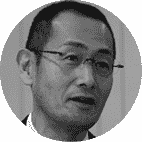

我一直期待着和羽生棋士见面的日子。

平时我埋头于研究所运营和自己的研究，很难抽出时间思考其他领域课题和人类未来问题。

和羽生棋士交谈，接触到各种智慧和见解时，我感觉大脑被激活，充满活力。这次对谈中，我请教了将棋世界的变迁，也一起思考了 AI 和生命科学的发展会给人类带来怎样的变化。真是刺激又有趣的时间。

科学研究日新月异。我们 iPS 细胞所在 2017 年发现了进行性骨化性纤维增殖症（FOP）这种疑难病的治疗候选药物，启动了世界上首次使用 iPS 细胞的新药临床试验。另外，本文提到的以帕金森症患者为对象的再生医疗临床试验，也将在近期实施。

但还有很多疾病没有治疗方法。尽早把疗法带给更多患者是我们的使命。

对谈后也传来激励我们的消息。羽生棋士获得了“永世七冠”^((1))，并荣获国民荣誉奖。听到这个消息，我就像自己获奖一样高兴。在获得永世七冠的记者招待会上，羽生棋士说：“自己也不知道将棋的本质是什么。”在达成如此伟业的同时仍保持谦逊的学习姿态，这深深打动了我。

在对谈中，羽生棋士也说过，将棋最重要的就是舍弃之前学过的东西，吸收新知识。研究的世界也一样。伴随真相被探明，既成事实不断被改写。

人类的生命和身体充满未知。我想像羽生棋士一样，不畏惧变化，永远保持学习新事物的姿态。通过这样的方式，我们未来将会找到改变世界的发现。

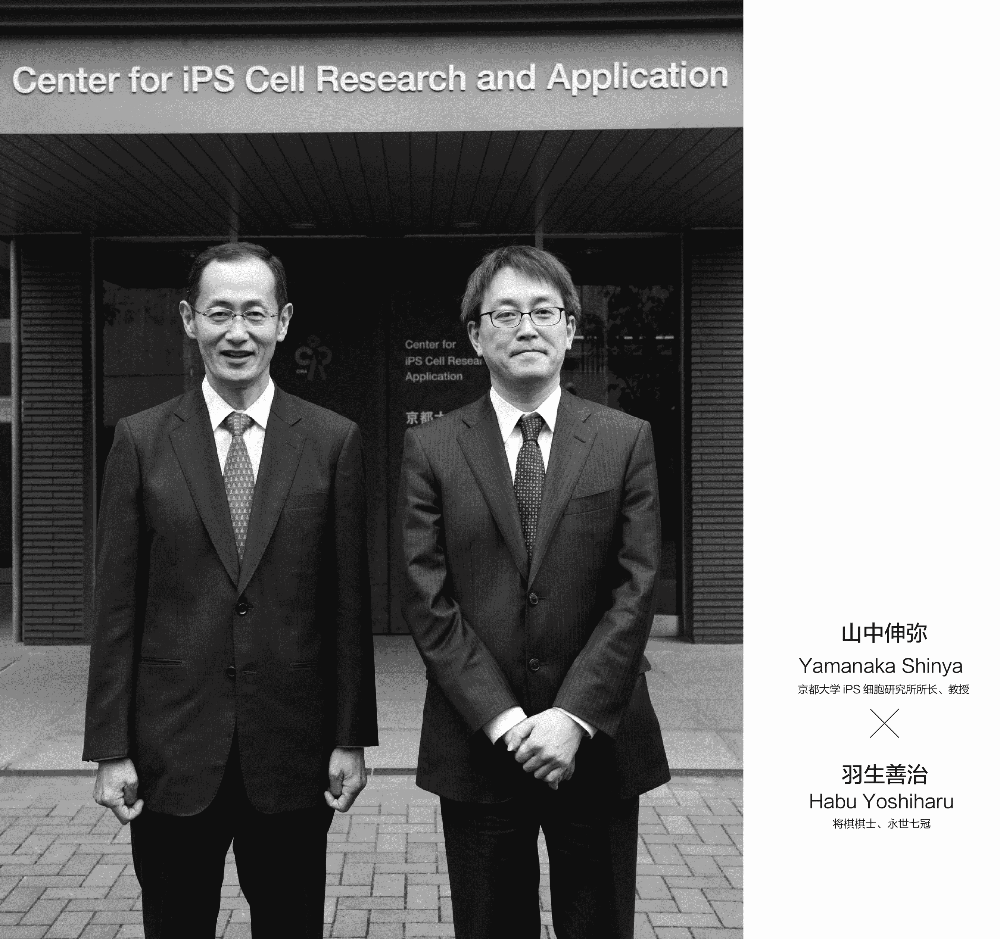

* * *

(1)　指在将棋七项赛事（头衔）中均获得“永世”称号。每项赛事的“永世”称号获得条件不尽相同，如“永世棋王”需要连续获得五届棋王称号，“永世王将”需要连续五届或累计十届等。