# 知识演化：人类世视野下的文明简史

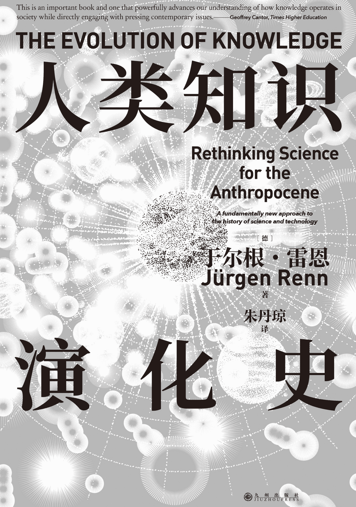

致卡特林、埃丽卡、莱昂纳多、埃莱奥诺拉，与路易斯

# 推荐序

德国科学史权威于尔根·雷恩的最新力作《知识的演化：重新思考人类世的科学》，于2020年由普林斯顿大学出版社首发英文版。问世即引发国际学界与出版界强烈共鸴，随即被译介为法文、德文、意大利文等多语种版本。如今中文版由后浪出版公司推出，我欣然为中文读者荐读这部学术殿堂级著作。

全书确立「人类世」为宏观坐标，系统梳理科学与知识的历史脉络。作者直击科学演化的核心命题，以力学知识谱系、知识全球化进程、人类世未来挑战为三大叙事支柱，在广阔文明语境中实现宏观叙事与微观考据的深度融合。雷恩特别强调实践知识的基石地位与历史连续性的关键张力，深度追溯知识传播、变革及全球化的深层逻辑，由此折射人类文明发展的底层特征。该书不仅为知识史、科学史及科学哲学研究开辟了新范式、提供了新工具，更为直面人类世的复杂困境注入全新视角，助力战略层面的历史理性思考。

开篇「本书的故事」一章，雷恩亲述其率领团队深耕25载、合力铸就巨著的幕后历程，详解学术旨归、研究范式与理论架构，堪称全书「导读」。我与雷恩所长结缘始于1998年，有幸参与其主持的项目及中德科学史合作规划，获益良多。兹再从科研组织维度补记所知所见，冀对读者有所裨益。

马克斯·普朗克学会（下称「马普学会」）奉行哈纳克原则：全球招募杰出科学家——尤其是兼具思想深度与发展潜力者——出任所长，配以顶尖科研条件，支持其攻坚克难。1994年，马普学会于柏林设立科学史研究所（下称「马普科学史所」），首任所长便是年仅38岁的数学物理学博士雷恩。在其与后续所长接力治理下，研究所结出丰硕创新成果，其中便包括「本书的故事」所详述的知识史攻关。

须知，雷恩团队这种雄心勃勃的长周期攻关，离不开马普学会建制化研究所与独特管理机制的托底。马普学会一旦定帅，便全力护航其引领性的长期研究规划；通过连续的5至10年以上项目落地长周期部署，有效规避短期逐利与资源碎片化。同时按需从国际同行圈层引进适配人才，科研人员多签署数月至数年不等的合同，灵活续聘。马普科学史所国际化程度极高，外籍科研占比与英文出版物均超半数，人员结构动态优化。于是，研究所形成数个由所长领衔的研究室，亦即数个研究集群。

自1994年起，雷恩持续掌舵第一研究室及其长期项目，复现玻尔当年在哥本哈根理论物理所倡导的集体研讨与协作范式——跨学科、跨文化比较研究常态化，有力突破单一学科与个体学者的认知边界。这种模式显著区别于人文学科常见的「单打独斗」或「拼盘式」合作，极利于攻克极度复杂的知识史课题，规避「碎片化」叙事陷阱。谙熟马普科学史所这套体制密码，便不难理解其何以在20余年跃升为国际科学史研究的核心高地。

马普学会高度肯定雷恩在人类世视域下知识史研究的突破性进展，于2022年决定由其牵头创立新所——马普地球人类学研究所。期许他双所并掌，再攀学术高峰，持续惠泽广大读者。

**张柏春**（中国科学院自然科学史研究所研究员、原所长）

2023年3月4日

# 中文版序

《知识的演化》中文版面世，令我欣慰不已。它延续了我早前著作（主要聚焦爱因斯坦及其科学）的中译脉络。^(¹)

撰书期间，我从与中国同仁的深度对话、浩繁中国科学史文献，以及多次访华考察中汲取养分。特此鸣谢张柏春、田淼二位，亦感方在庆、胡大年等诸友，就本书核心议题与我长期并肩作战。合作中我们渐悟：知识与科学史确具真正的全球性基因，溯源可上溯数千载，文明间存在多元交流与互补充实路径；科学与文化深度嵌合，催生不同知识形态沿差异化历史轨迹演进。

中国科学令人震撼的数千年史实及其与全球知识史的纠缠交织，生动佐证上述论断，亦在书中占据重要篇幅。我对这段史实的认知，主要源于与张柏春、田淼、马深孟在中国科学院与马普学会合作框架内的长期钻研。历程始于2001年中科院自然科学史所设立的马普伙伴小组，获马普科学史所鼎力支持。自此双方在科学远古起源至现代挑战等宽广谱系上紧密协作，多议题映照入书。合作更催生了《中国科学技术史年刊》（即《中国科学技术史（英文版）》）。^(²)

《人类知识演化史》或助读者明晰：当下对科学的认知实为真正知识全球化的结晶，万文化族皆作关键贡献。故科学有力跨越政治、文化、意识形态鸿沟，甚至在动荡冲突期凝聚共识。然书另聚焦一紧迫时务：鉴于人类对地球环境、气候系统、生物多样性及污染治理构成巨大冲击，重整科学航向以应对严峻挑战刻不容缓。我们身处新地质纪元——「人类世」，人类已化身地质力量，重塑星球未来。

何种知识足以应对新局？当如何重组科学体制以产出必要知识？需要何种国际合作机制方能迅速行动，规避人类改造环境最毁灭性的后果？《人类知识演化史》邀请读者置身深厚历史经验场域中思辨这些命题，历史经验同步呈现知识生产与科学发展的双面图景——潜力与陷阱并存。这是对人类共同责任的召唤，要求我们主导进程，捍卫物种星球生存权，孕育体现全球共担伦理的新觉醒。这种觉醒深植中国哲学传统，墨子千古名言即为明证（墨家后学在中国理论科学萌芽中扮关键角色）：

> 今天下无大小国，皆天之邑也。
> 人无幼长贵贱，皆天之臣也。
> ……
> 是以知天欲人相爱相利，而不欲人相恶相贼也。
>
> ——引自孙诒让《墨子间诂》卷一《法仪》

**于尔根·雷恩**（马普科学史所、地球人类学所所长）

2023年3月17日

# 本书的故事

> 只有少数人敢冒「愚蠢」之险，大胆综合那些事实与理论（纵使多为二手或不完备），我们方能突围，免于永失真谛。
>
> ——埃尔温·薛定谔《生命是什么？》

## 一项长期研究项目及其根源

本书时间跨度横贯人类思想萌芽至人类世现代困局。此处「人类世」界定为：人类活动对地球系统造成深远持久影响的新地质纪元。故人类世既是知识史终极背景，亦是全球视角研究文化演化的自然归宿。此视野下，我试图融汇多元历史地理维度，兼顾知识演化的**长时段**演进，与将我们推入人类世的知识剧变。

著书基石源于1994年以来马普科学史所的持续攻关。^(³)

研究始终建立在集体协作之上。其理论源流溯自历史认识论——亦即知识历史理论，植根于戴培德与沃尔夫冈·勒菲弗早期对科学、人类劳动与社会组织关系的探幽，后经戴培德、彼得·麦克劳克林、吉迪恩·弗罗伊登塔尔推演深化。勒菲弗、克劳斯·海因里希、耶胡达·埃尔卡纳不仅教会我置科学于最广人类史坐标中审视，更引领我批判性反思科学许诺的启蒙理想及其对人类自我觉醒的潜能。

当下成果极大程度上归功于戴培德——其思想火花、团队核心地位、与我超30载挚谊与并肩作战。本书理论基石亦立于他1996年巨著《抽象与表征》所整合的跨学科洞见（融哲学、教育学、心理学、认知科学于一体）。^(⁴)

## 研究的两大轴线

马普科学史所研究部署聚焦双轴：**知识的长时段传播与转化**、**知识转移与全球化进程**。我认为，理解人类世来龙去脉，这两大维度缺一不可；它们揭示了长期被低估却与应对人类世挑战高度相关的知识演化范式，故书架构全盘映射二者。

传统科技史重创新轻传播、轻转化、轻转移。实则最不起眼的知识往往成就最耀眼发现发明。此类知识在剧变各阶段持久存续，展现惊人稳定性与韧性。同样，自人类文化肇始，跨文化知识流动与重塑深度塑造技术科学成就，唯因过度聚焦显性汇合节点而易被忽视。

实证调查基础上，我们尝试构建理论语言，统摄各类发展传播过程，不拘类型与媒介。此举汲取考古学、政治经济史、科技史、艺术宗教史等历史学科养分，亦融哲学认识论、认知科学、社会行为科学（尤社会学、经济学、心理学、社会人类学）精华。

个体何以驾驭如此宏大全面的计划并呈现成果？1994年伊始，我们即确立策略：仿效生物学家聚焦单一模式生物（如果蝇）洞察普适生物学规律，或影视编剧精简复杂小说为剧本——削减角色与叙事层级，聚焦精选关键人物与主题。^(⁵)

## 力学思想史

核心叙事线索之一为广义力学史。非指特定学科史，而是力学知识谱系：从重力与压力主导世界的直觉本能，到仪器工具实践中沉淀的操作性知识，再至文本定型的理论知识。力学知识史贯穿前人类起源——经由实践经验、自然哲学、经典力学漫漫长河——直抵相对论、量子物理前沿。另一显著特质：力学知识非西方专利，多元文化中同步繁衍。

基于上述考量，约25年前我们确立力学知识为马普科学史所部门核心攻关方向。更宏大野心：探寻知识与人类思维历史理论的可能性。择力学为靶，实为幸事——它更催生了与佛罗伦萨伽利略博物馆、馆长保罗·加卢齐及其团队的长期深度合作。

具体攻关覆盖古今特定时段，跨越简单机械操作至高度抽象理论构建。按计划涵盖欧陆传统，兼及中国与伊斯兰世界演进。

书不聚焦个体发现成就，而锚定宏大社会进程：正是这些进程驱动力学知识传播、积累、创新，亦导致知识失传，更致认知与社会结构在数千年间剧烈重构。相关成果已散见专题研究，彼处将新法施诸史料。本书以此为底色，勾勒总体框架，冀惠未来知识史研究。

我早年与戴培德、吉迪恩·弗罗伊登塔尔、彼得·麦克劳克林联袂剖析经典力学肇始，建构自然科学概念转型认知框架，为后续研究定调。成果1991年收录合著《探索前经典力学的限度》。^(⁶)

初期聚焦伽利略、笛卡尔等核心人物，及自由落体、抛体运动等关键议题。后约亨·比特纳、马深孟、马泰奥·瓦莱里亚尼大幅拓展——不止个案深入，更贡献「挑战性对象」「共享知识」「实践知识结构」等认识论核心概念。^(⁷)

步入近代早期科学后，现代物理学兴起成为知识史转型研究中轴。我们聚焦爱因斯坦相对论突破。^(⁸)

除戴培德任顾问外，爱因斯坦文献攻关团队汇聚米歇尔·詹森、约翰·诺顿、蒂尔曼·绍尔、约翰·施塔赫尔，兼顾史实与知识转化普适机制阐释。同时代其他科学家研究由利奥·科里、马深孟等推进。朱塞佩·卡斯塔涅蒂、米莱娜·瓦泽克切入相对论诞生的文化语境。后续相对论史研究由亚历山大·布鲁姆、奥拉夫·恩格勒、让·艾森施泰特、哈诺赫·古特弗罗因德、罗伯托·拉利、罗伯特·里纳谢维奇、马深孟等接力合作。本书大量调用上述成果。

## 知识史的纵向研究

书籍依托的研究版图远溢力学。沃尔夫冈·勒菲弗钻研达尔文进化论史，厄休拉·克莱因深耕化学史——尤聚焦实践知识场域中现代化学肇始，及化学式作为「书面工具」驱动科学知识转化。克莱因对科工革命关系的洞见（聚光「技术科学」与混合型专家角色），配合勒菲弗、瓦莱里亚尼贡献，极大深化我们对科学技术知识社会前提及潜在影响的认知。^(⁹)

集体研究宏观框架下，我们另推进两大纵向专题：空间历史认识论、建筑认知史（即建筑成就背后的知识谱系）。TOPOI卓越集群框架内，马深孟领衔团队探究空间知识从早期认知至现代科学演进中「体验」与「反思」的互动博弈。^(¹⁰)

## 知识流通研究

知识全球化及其后果项目中，我们实证考察跨文化知识转移传播。联合多学科学者网络攻关全球化进程，同时建构分类体系，系统解析知识转移转化历史范式。项目集结戴培德、科斯塔斯·加夫罗格鲁、格尔德·格拉斯霍夫、马尔科姆·海曼、丹尼尔·波茨、马克·谢夫斯基、海尔格·温特等力量。早期与海曼合著的4份调查报告（2012年结集出版）现整合入本书宏大叙事。^(¹¹)

全球化研究辅以跨文化比较与传播微观考据，尤重西方、中国、伊斯兰科学三角互动。非欧洲比较中，中国板块依托马深孟、张柏春、田淼、鲍则岳联合攻关，获马普学会与中科院合作机制护航。^(¹²)

我参与柏林自大980合作研究中心项目（「运动中的知识」），为「知识经济」等核心概念落地提供关键支点，本书赖以建构。全球化项目更催生方法论创新，尤社会网络分析法引入知识转移传播研究。此道上，马尔科姆·海曼、罗伯托·拉利、马泰奥·瓦莱里亚尼、德克·温特格林贡献卓著。^(¹³)

## 知识的更广阔背景

科学知识史仅能在更基础知识形态背景中被理解，故我们持续投入并推动不同文化中直觉知识与实践知识研究。如卡特娅·伯德克在德巴两地田野比较，解析力、运动、重量、密度等直觉概念发育轨迹。^(¹⁴)

演化视角阐释知识史溯源于与曼弗雷德·劳比希勒合作，彼将演化发育生物学洞见注入讨论。^(¹⁵)

## 走向知识的历史理论

将专题研究熔铸为大图景之举凤毛麟角。纵有此类尝试，往往亦未获实证综合研究佐证：要么掩蔽细节，要么难为后续研究提供切入点。

我们的整合聚焦知识历史演化的普适面向。着眼思想概念而非技术琐节，但会从上述研究中抽调具体关键个案，以期在局部作普适性阐释。将专题融入仅获部分支撑的理论框架，风险自存：大厦注定未完工，某种程度上永存脚手架态。书末术语汇编列释框架核心概念。

普适性与细节并重对读者亦构成挑战：需在鸟瞰全景与显微镜放大间高频切换。我们期许回报是：建立在海量详实研究基础上、首度综合呈现的人类世时代知识历史角色深度理解。这也是邀约——邀请我们深化人类世洞见，进而直面困境、应对挑战。

## 第一部分：科学与知识的终极拷问  

## 第一章：人类世视域下的科学史重思  

> 任何不诚挚期盼全人类向善之人，实则是在践踏人性。但若有人企图在病者中独享健康、在愚者中自诩智者、在恶徒中标榜善人、在苦难者中独求快乐，此人连自己的良友都算不上。  
> ——扬·阿姆斯·夸美纽斯《泛教论》  

> 知识之问若未在思考伊始便呈现，便已被剥夺了本真力量。现代哲学的关键突破，在于不再把知识视为一个可在既有预设上顺手解决的旁枝末节，而将其识别为构建理性与伦理文化整体的根本创造力。  
> ——恩斯特·卡西尔《现代哲学与科学中的知识问题》初版导语  

##### 星球异变：失控的地球系统  

地球已被人类深度重写。 ^(¹⁷)  

借助高能耗化学工艺，我们合成并让自然界罕见的功能性物质大规模流通：铝、铅、镉、汞等元素；煤石油燃烧残留的粉煤灰；混凝土、塑料等人造新材料。它们中许多拥有自然界完全不具备的特性。大气核试验遗留的钚，将在衰变为铀、铅之前，于沉积层中封存数十万年。监测数据显示，大气中二氧化碳与甲烷浓度已触及80万年峰值；若纳入间接推算，更是400万年来最高。曲线仍在近乎垂直地攀升。即便即刻全面停烧化石燃料，浓度回落至工业化前水平亦需数千年。  

变化速率远超自然进程。当前碳累积速度，是过去42万年任何时段的10倍甚至百倍。新疾病随载体全球窜伏，病毒凭借极短世代飞速适应；反观人类社会，对同一环境的适应速度又能几何？冲击虽遍及全球，却呈现严重的不均性：洪水逼近滨海低地，干燥高地房价暴涨迫使穷人外迁；旱灾毁坏粮仓，引发资源争夺与跨国流动。发达国家看似从气候变局中渔利，发展中国家深受其害——终局却是共输，富豪亦难独善其身。  

简而言之，地球正经历不可逆转的剧变。人类如雨后春笋般铺满星球，深度干预碳、水、氮、磷、硫等维系生命的地球循环，打破地表能量平衡，推动地球跨入新阶段。我们从未在亘古不变的自然背景下行动；干涉自然之时，自身早已深度嵌入其结构，塑造着当下与远未来。人类对地球循环的干预，本质上仍属生物圈一环，从未超脱。**我们不是旁观者！**  

这种对地球状态认知的根本修正，堪比爱因斯坦相对论引发的时空观革命。经典物理学中，时空是世界演出的刚性舞台；相对论却揭示：舞台本身就是戏剧一部分，演员与布景无绝对界分。时空非背景，乃参与者。新地球现实逼迫我们同等紧迫地重思处境：我们不生存于稳定环境，环境非行动舞台与资源库；这是一出综合大戏，人类与非人世界皆为平等演员。  

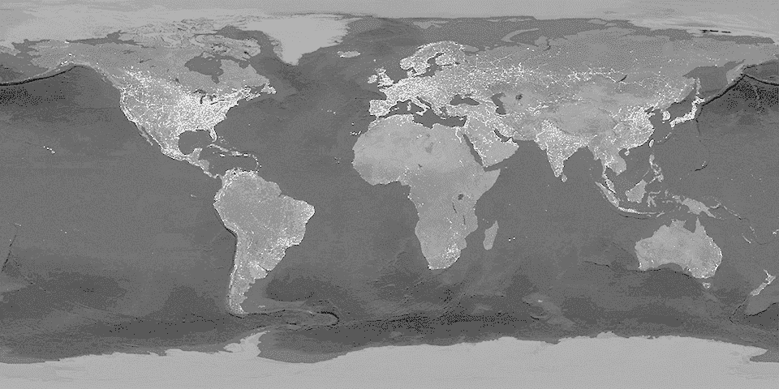  

**图 1.1** 全球人造光分布。亮度对应城市化密度而非单纯人口。非洲、南美丛林，阿拉伯、蒙古沙漠仍存暗区，但光点正逐渐蔓延。数据源自美军气象卫星计划（DMSP）OLS系统，2006年制图。源自维基共享资源。  
*本书插图均为原书原图*  

2000年，诺奖得主、臭氧洞发现者保罗·克鲁岑对“全新世”官方定调提出异议。地质学拥有一套复杂体系划分深时。全新世意指“完全最近”，承接更新世，是第四纪第二个世。听起来反直觉，第四纪实为约260万年前开启的冰期，特征是极地冰川反复推进退缩。全新世始于1.17万年前冰川退缩的间冰期，气候异常稳定。 ^(¹⁸)  

该术语实则早于1980年代已被湖沼学家尤金·斯托默使用。 ^(¹⁹)  

鉴于人类干预之深重，自然与文化的传统界限已崩塌。我们身处一种由自身干预塑造的“人类学自然”之中。 ^(²⁰)  

##### 追问归责：困局与破局  

人类世是否存在？始于何时？学界仍存争鸣。但确凿的是，人类改造世界的能力，植根于世代累积并实践的知识体系，自科学革命、工业革命至1950年代“大加速”以来，知识增长呈指数级加速。 ^(²¹)  

以全球能源系统由化石/核能向可再生能源转型为例。若要将气候风险控管在可承受阈值，此转型至关重要。 ^(²²)  

设计未来能源方案，必须综合考量其对局地与全球地质、理化、生物及社会框架的冲击并加以验证。这要求自然科学、工程技术、人文社科合流，更需前所未有的本地洞见。能源基建转型将通过何种政治社会进程协调或博弈利益，目前未卜。这或许需要广博公众的深度介入，以及关于相关社会进程的新知。故而，能源转型是绝佳注脚：我们必须重思，将技术转型视为社会转型，再视为知识转型。但归根结底，关键在于以足够速度停烧化石燃料，或能缓解气候灾难性后果。  

面对岌岌可危的局势，科学教育的全球跨学科合作从未如此迫切。然而，全球化内生的国际竞争，却可能扭曲科教组织——知识碎片化、主流化、同质化、商业化随之而来。一般而言，科技应用取决于社会结构、知识利用方式、权力与知识的关系，以及对意外后果的考量程度。  

每个社会皆有其“知识经济”：受社会规制的知识生产再生产流程与制度整体，核心在于社会自我再生产所依赖的知识。社会行动潜能（如应对外部挑战）取决于知识经济，特别是促进或限制知识探索的社会结构。知识虽助个体谋划行动并预判后果，但社会不会“思考”，只能在知识经济框架内预测社会行动后果。因此，全球化社会应对人类世挑战的能力，很大程度上取决于其知识经济的未来走向。  

21世纪初，科管通用机制鼓励以海量出版物堆砌微小信息单元。知识被解构为碎片贡献，导致科学日益破碎化，恐将那些关乎人类世挑战的整体洞见拒之门外——这些挑战本质上拒绝被切割进学科孤岛。  

经济全球化驱动下，国家科技政策越发聚焦国际竞争力，这可能压缩好奇心驱动研究空间，忽视差异化路径机会。如今鲜有主流社会敢跳出全球化模式治理科教体系。全球竞争倒逼科学回应经济全球化及其后果：强化国家创新体系，推行教育科研的知识经济全球化模型。激励机制渗透个体与机构双层：个体层面靠合同目标管理科研；机构层面靠第三方基金竞争构建准市场，长期稳定投入让位于短中期项目制。  

国际竞争加剧了科教全球化模式，强化了知识分裂趋势。全球化趋势用竞争力取代反思，无视特定情境与地方知识作用，力证科学组织原则的普世有效性。恰恰是这种观点，让大多数社会在审视自身问题时，忽略了本土传统或适配普世原则中的内生潜力——这些机遇往往只在脱钩全球趋势、落地本土科政后才显现。  

---

### 致谢：集体智慧的结晶  

将专项研究熔铸为宏大图景，需要远超常规的跨学科深度协作，这在当下竞争激烈的学术生态中实属不易。幸得马普学会独特条件及马普科学史研究所同仁的鼎力相助，让我多年受惠于广泛合作。本书大部成于我担任马普学会人文科学部主任期间，感谢同事们无数次激荡思想的精彩对话。著此书，旨在表达对学会、恩师、及所有分享合作旅程的同仁挚友的深沉谢意。  

关于抽象社会功能的探讨，缘自克劳斯·海因里希的宗教史哲学讲座（求学时旁听）。反思性思维分析植根于广义皮亚杰传统——对戴培德与我而言，核心指沃尔夫冈·埃德尔斯坦在马普人类发展研究所的标杆性工作；耶胡达·埃尔卡纳虽路径不同，内核同源。  

特别感谢倾注大量时间支持此计划的同仁好友。初稿完成于应戴安娜与杰德·布赫瓦尔德邀请赴加州理工任弗朗西斯·培根客座教授期间，二人自始鼎力支持。历经多轮打磨，每个版本皆经马普科学史研究所第一研究室编辑经理琳迪·迪瓦西批判性阅读与精编；无其忠诚实助，书不成形。后期琳迪获玛农·贡佩尔特协助，核查参考文献事实引文，补编书目，协助定稿。最终编辑由扎卡里·格雷莎姆完成，他以敏锐慧眼、极致耐心与创造力，将我的“日耳曼英语”重铸为地道美式英语，对术语汇编贡献卓著。  

简述书中大量图像：图像在人类思维史关键节点扮演核心角色。它们是思维物质体现的重要样本，我称之为“外部表征”，以别于心智“内部表征”。此术语虽技术感强，切勿误读为被动。相反，图像等外部表征自得其乐，在被思维塑造时反塑思维。故图文有时互补，有时张力并存。本书图像非从属插图，而与文字对话、甚至对位，自行传递信息。承袭阿比·瓦尔堡、欧文·潘诺夫斯基、霍斯特·布雷德坎普传统，我尊重图像自主性，感谢贡献者，尤以劳伦特·陶丁迷人启发性画作丰富全书；亦谢琳迪精心甄选编排所有视觉素材。  

最终攻坚阶段漫长多阻。无第一研究室同仁、部门访问学者、挚友们的参与、慷慨相助与可靠支撑，难付梓。自所建立以来始终在我身侧的秘书彼得拉·施勒特尔不懈支持，功不可没。感谢图书馆前领导乌尔斯·舍普弗林、现负责人陈以斯及全体馆员、数字化小组，为获取文献插图提供宝贵支持。  

向同事们致以最热烈谢意：马西米利亚诺·巴迪诺、安东尼奥·贝基、亚历山大·布鲁姆、索尼娅·布伦特斯、约亨·比特纳、罗伯特·K·英格伦、里夫卡·费尔德海、吉迪恩·弗罗伊登塔尔、萨沙·弗雷伯格、哈诺赫·古特弗罗因德、玛格丽特·海恩斯、斯文德·汉森、朱莉娅·雅各比、厄休拉·克莱因、于尔根·科卡、罗伯托·拉利、曼弗雷德·劳比希勒、马克·劳伦斯、阿丽亚娜·伦德茨、沃尔夫冈·勒菲弗、斯蒂芬·莱文森、罗伯特·米德克—康林、加布里埃尔·莫茨金、彼得罗·D·奥莫迪奥、内奥米·奥雷斯克斯、丹尼尔·波茨、卡斯滕·赖因哈特、朱莉娅·里斯波利、克里斯托夫·罗索尔、马深孟、罗伯特·施洛格、弗洛里安·施马尔茨、乌尔斯·舍普弗林、马泰奥·瓦莱里亚尼、海尔格·温特、德克·温特格林。多年来部门会议上我们细致研讨早期版本，依据他们慷慨分享的详尽评论批评建议反复修订。长期合作伙伴还包括朱塞佩·卡斯塔涅蒂、本杰明·约翰逊、萨拉·纳尔逊、马库斯·波普洛、西蒙娜·里格尔、贝恩德·舍雷尔、本杰明·施泰宁格、托马斯·特恩布尔、米莱娜·瓦泽克；多人曾合著发表，感谢同意为本书修订共同出版物片段。亦感谢保罗·加卢齐、科斯塔斯·加夫罗格鲁、格尔德·格拉斯霍夫、帕特里齐亚·南茨的多次有益对谈，思维火花映照书中。特别感谢马普科学史研究所科学顾问委员会成员多年可靠支持鼓励，尤其中主席法比奥·贝维拉夸、副主席安娜·西蒙斯。故后续章节将呈现同仁友人的声音，具体来源见尾注。此外引用维基百科（生平信息、未注明出处图注），致敬所有缔造这一公共知识宝库的贡献者。最后感谢普林斯顿大学出版社两位匿名审稿人对早期版本的宝贵建议，及阿尔·伯特兰、埃里克·克拉汉全程出版支持鼓励。  

书中遗留谬误皆我之过，有价值部分定为共同成就。

面对人类世的严峔考验，随全球化而来的科学知识割裂显得尤为棘手。破解这些困局，要求大气物理学、地球系统科学、海洋学、进化生物学、环境科学、流行病学、航天科学等自然科学门类，与社会学、政治学、经济学、计算机科学、史学、文化研究、心理学等人文社科领域深度协同。这种协作不仅要打破学科壁垒，甚至可能重塑科研组织、知识生产及教育体制的传统范式。鉴于创新固有的不可预测性与随机性，若仅盯着眼前难题，科研实践势必陷入短视；而任由当下知识经济自我设限的碎片化状态持续，同样危机四伏，因为这背后是现实资本与“符号资本”争夺的驱动。^(²³)

人类深度干预地球系统，却未料到系统内在特性将如何反噬干预后果。洞察这些后果，必须将人类史与地球史的纠葛、人类思维的双刃潜能（创造与毁灭同在）纳入考量。因此，直面人类世全球性挑战及其自然/文化维度的不可分性，迫切需要一种知识的综合视野：它不仅囊括地球系统的物理科学，更要涵盖人文科学中的诠释学与批判性学科。

我们已不明智地告别了那个塑造人类文明与思维、稳定得惊人的全新世。人类世或是地球系统的一种“反向状态”，但这不等于人类终局，只是未知的前路令人忐忑。打破“全新世泡泡”并非退出静态系统，而是在一个本就高度动态的系统中施加干预。我们正在一个已发生变化的系统上做全球实验，引入的是二阶变化。这让我们更依赖于理解并交互这个复杂动态系统，而这种理解本身也在动态演进中。

故而，认清知识的动态本质，关乎人类世未来。知识代际传承与积累，环境变迁长时累积，二者皆未以任何形式担保人类文化必然存续。

### 世界即知识之问

何为知识？个体知识源于经验编码，支撑问题解决，是适应性行为的核心。它植根于对行动及结果的预判，并随结果修正——得益于我们能“反思”经验。受限于既往经验，个体知识的预测力原则上有限；但知识能以认知结构留存心智，并迁移至新目标。

知识不止心智维度，更具社会性与物质性。借助“外部表征”（文字、符号系统等社会物质文化成分），知识得以存储、共享、跨个体与代际传递。物质文化界定了行动可能、社会组织形态，甚至思维水平。史例表明，能源概念唯在物质实践实现动力转换后（人力→风/水力→蒸汽机）才浮现。同理，20世纪控制论/控制理论诞生前，需有瓦特离心调速器等反馈机械实践为基，该机械亦改良了其首创蒸汽机。^(²⁴)

诸多科学家视知识为哲学中立——可善用亦可恶用。这至少是传统立场，将科学影响责任从知识生产者转移他处。例如，科学家研发的新化学物质若被用作战场屠杀平民，传统观点认为这非科学家之过。^(²⁵)

但知识概念应助判具体情境下的道德正邪，为伦理抉择与政治行动供给洞见。我们能构想如此包容的知识观吗？它能否催生金或曼德拉式人物改善世界的洞察？这将是对激进新自由主义的有力回应：后者主张市场失灵时非限制市场而是减少约束。相对地，我主张：所有挑战皆应重构为知识挑战，知识匮乏时，我们需要更多、更异的知识（如市场运作机制知识）。^(²⁶)

对某社会而言，可暂时在局部建构任意价值规范，生产消费地方知识经济所能产出的知识。但终局上，随着全球关联深化、人类世集体行动产生全球效应，我们积累的全部经验将定人类命运，正如无数先前物种的结局。^(²⁶)

回溯康德传统：实在非现成赋予，而以谜题形式呈现。^(²⁷)

故而，任何助解人类世挑战的史述，须正视显然事实：人类是行动者。其行动不仅受自然/社会/文化环境、经政/宗教利益、欲望激情驱动，更取决于思维——特别是对世界与自我的认知，获取分享认知的路径，及运用知识的方式。但这前提不在人类天然拥有此力（如自然/神圣恩赐），挑战在于：理解人类主体性（若有）如何经由知识获得。由此，也能更透彻理解所谓人类自由。实则，自由与理解/判断困境、构思改变行动的能力紧密相连——简言之，与思考与用知能力密不可分。

尝试定义知识的历史悠久，评述可成册。作知识史及知识居核心地位的通史，可从历史行动者自用的分类入手。其分类虽供史情境下知识角色的线索，未必涵其自实践；且增加跨行动者/跨时期比较难度，难达今人要求的分析性概念标准——后者能助解历史过程及动态。

反之，非历史性研究（如哲学、认知科）的知识定义，恐致时代错误，因其缺乏判断知识历史演变的实证基础。故历史知识研究，既非无概念装备的裸奔拾遗，非“一刀切”式套路远航。以知识为分析范畴的知识史，是探索性冒险，不仅洞见历史发展，更洞悉知识本性。

### 科学史与知识史之间

知识是否/如何在历史中演进，乃关键问题。代际传递虽有积累，却伴随大量遗失、失效、系统深度变革（即便非断裂式“革命”）。限于特定个案/行动者类别的考察显示：多样性是唯一可辨整体模式。然知识史有一条索，传统归进步逻辑支配，仅偶因故态复萌或谬误中断。^(²⁸)

现代科学诞生伊始，“进步典范”自我形象如影随形。培根眼中，唯科学进步在时间上无限，政治进步受限地域/历史且多涉暴力混乱；发明创造带来幸福而非不公痛苦。^(²⁹)

此后，人们仍希冀链接科学/技术/社会进步。达尔文胜出后，甚至有思想家宣称进步为统摄生物与社会演化的自然法则。^(³⁰)

无论科学家如何看待科学与社会进步关系，多数以“累积性”区分科学与其他文化表现。个体层面，几乎所有科学家自信超越前人，因成就筑于前人基石。传统科学史视进步为理所然，基本图景是泰坦接力赛，巧思接力棒在人际传递——实为欠发达知识经济观。科学史遂成成功编年志：谁、何时、何地、何进步。

实则，这些议题更适合职业体育而非科学。未考虑科学各“运动”（研究领域）本身需不断重定义。传统科学史自当下回溯书写。为叙现在如何成形、成功何以诞生，当下成功所需皆入科学史；占星、炼金等尴尬案例则归“科学史前史”。

新近科学史研究倾向质疑科学进步性。科学亦具人类活动通病，似与进步性背离。结果，科学难再与其他文化实践泾渭分明。科学不再是普遍理性范式，而成文化史/社科人类学的研究对象。甚至证明、实验、数据、客观性、合理性等经典科学核心要素，本质上皆深具历史性。^(³¹)

新研究开辟视角，科学史渐转为包含科学及其他知识形态的文化史。其他知识不止学术实践，还包括远离学术设定的知识生产/再生产：手工艺、艺术、甚至家庭传承知识。

传统观点认定近代早期科学革命，凭特定发现与普遍科学方法（假设-实验/观察检验）确立现代科学。称现代科学与科学法在欧洲发端（天文物理先行），继而征服知识界与地理世界。但传统说法也承认，部分扩张靠强制：如强行推广力学定律、西方科学殖民扩张常伴随暴力压制他者思维。^(³²)

传统论点称科学知识具独特品质，异于前一切知识形态。但如今，部分科学史家不认科学知识与历史渊源有效性差别。不再视科学革命为历史性突破，不信其根本改变知识生成实践、一劳永逸立科学法。^(³²)

科学革命期诸多关键知识，源自工匠、工程师、医师、炼金术士的实践知识。伽利略等近代科学家正是通过研究转化此类知识（如弹道学抛体运动、冶金材料转化实践），始得大发现。^(³²)

故而，伽利略生涯压轴之作——1638《关于两门新科学的对话》^(³³)

萨耳维亚蒂：威尼斯兵工厂常态化活动，尤其中力学部分，为好学者辟广阔研习天地。此中各类仪器机器由众手工艺人持续制造，必有人因承袭经验或自主观察，成解释高手。

萨格利多回应，言己深受裨益：

萨格利多：所言极是。我生性好奇，常造访此地，观“头等人”工作怡然自乐。彼等优势显著。与彼讨论，助吾研究良多，不显浅显，亦及深奥难测。^(³⁴)

简言之，工匠实践知识等其他知识形态，实为科学知识重要基石，传统却忽视。其关键到：不计实践知识演进，便无法真领会科学革命动态。显然，科学知识与其他知识领域关联，不止理论传统（哲学等），更连工匠实践，甚至关乎我们个体发育中应对物质世界必须习得的直觉知识。

更重要者，放宽视野纳入其他知识，即不再即按西方科学标准度量，非西方知识处理现形。“用他们自己的语言”成分析中/印/伊斯兰科学的口号。^(³⁵)

包容性知识观敞开大门，带来对科学知识全球动态与历史的新认知。甚至可说，科学知识似失特权地位。但此结论未尽成立。显然，科学之外有知识；科学知识亦不独立于其他知识领域及技术等因素。仅凭认识论标准或科学理论，难将科学知识与他知识形态截然区分。

然从历史视角，通常可将不同文化/时段的科学视为独特知识形态，虽其性质随语境演变。科学知识不止理论，涉文化实践，后者常有意识创造可代代相传之知识。科学知识经“认知共同体”积累传播，后者常在专门教育机构内处理知识保存/改进/生产。此类知识常用特定外部表征（文本、工具）编码。^(³⁶)

科学实践含启蒙、教育、探索、论述、传播等形式，皆受历史变迁制约。历史上各类争议论证标准、控制结构、验证实践，塑造了知识积累与可修正性，将个体学习/自我纠正延展至社会制度。波普尔不朽贡献在于：将可修正性置科学概念核心——科学是对知识的不懈追求。^(³⁶)

科学知识初现于复杂社会，此类社会为探索知识创造了独立于直接实践目的的社会空间。故当探索某社会物质/符号文化内在潜能且首要目的为知识生产时，我们称之为“科学”。^(³⁷)

### 科学如哥德尔

科学文化史聚焦个案，难言长程发展，不可避免陷高度分散。此视域下，科学熔于海量本地化/情境化活动，不复能与他文化实践区分。^(³⁸)

全球化世界中，这幅图景难公正处理科学势不可挡的社经文意义。将欧/西方科学“地方化”，视其仅为全球文化中众多同等合理观点之一，已成政治正确标志。^(³⁹)

科学恰似犹太传说勾勒姆：以无生命物质造就，魔法赋生命提供服务，虽可能脱缰反噬创造者。柯林斯与平奇喻：“科学是勾勒姆。黏土水咒语造就的人形生物。强壮，日增强。听命工作，护主御敌。但笨拙危险。失控则以猛烈力量毁灭主人。”^(⁴⁰)

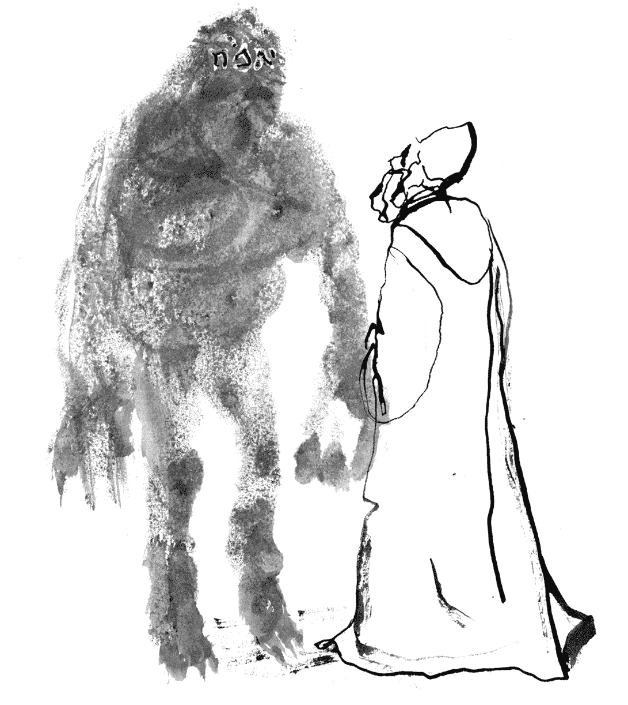

**图 1.2** 拉比洛唤醒勾勒姆。劳伦特·陶丁绘

此角度看，对科学累积性与自我加速性的怀疑，似不过小圈子学术辩论。进步信奉者与怀疑论者终将于此会聚：科学发展如强大勾勒姆，不顾善恶推行，奠定现代工业/后工业社会节奏。否认科技对现代社会实质影响，无异重辩地平说。但科学影响惊人，科社关系错综复杂，欲调和二者非易事。同等挑战在于：科学进步非自动非必然，仅是人类历史的机缘巧合。

### 知识如何演化？

科学思想根本变革，如何与既有知识保留及渐次拓展共存？如何评价科学理性的显存与局限，及其不能为全社会进步典范之失？本书将证：科学从未孤立运作，恒为更大知识系统一环；这些系统历史进程中或深度变构；它们是特定社会知识经济组成。不计此，无法理解上述问题。

知识系统大如中世纪大学课程：神/医/法学部，前置七门文科。又如现代科学学科群。但知识系统不必为严格组织的概念体系或智性实践。盖房、理园所需知识亦是系统，由多异要素构成，非严格原则组合，而是多相混杂的“知识包”。系统要素间关系，或语义（科学理论）、或制度（课程体系）、或实践（建筑项目）。

知识史如何书写，能超越纯描述，又避免强入必然进程逻辑，或简化为无解释价值的偶然串联？此处比较自然史或有益，非争大历史叙事，而希从他领域解释方法习得一二。

进化论解释19世纪盛行，达尔文、海克尔、马克思、马赫、玻尔兹曼、迪昂、冯特等科哲皆不吝链接生物演化与人类文化/思想演化。马克思《资本论》云：“达尔文使我们对自然技术史……产生兴趣。人的生产器官史……难道不值得同等注意吗？” ^(⁴¹)

非还原史为生物，非证知识史适者生存。我愿建议：从进化论地位学习——其于解释历史连续性与生命形态持续创新时，将生物学诸分支（遗传、生理、古生物、生态等）整合入单一历史发展理论，并改变诸分支。知识史中能否寻得类似统摄/综合/解释框架，作为文化演化组成部分？

仅仿生物框架不足成事。正如生物演化理论基于生物变化机制具体洞见，知识演化解释亦须始于知识史变化机制及其与文化/社会关系的详细分析。类似地，知识历史理论须重视从新视角整合诸学科，使其更受深度再诠释。

文化演化终基于生物学，最大选择力为人类生存。终极选择力受文化/社会诸层面调停缓冲，而这些层面自身对知识系统/文化演化施加不同选择力。仅从生物学难预料这些层次。但文化/社会演化本身也被视为一种演化过程。此想法溯自19世纪，达尔文《物种起源》^(⁴²)

# 进化论的启示：并非还原，而是参照

综上所述，前述尝试并非要将文化单纯归约为生物学范畴，而是凸显二者的结构相似性——譬如将基因遗传与文化习得中的传承机制类比——进而引入进化论、统计学及博弈论的工具箱，去阐释系统发育谱系或文化变迁（语言演化即是典例）。由此，文化选择论者设定了双重并行的继承体系：生物层面的基因传递，与文化层面的习得传承。二者深度交织，关键纽带之一便是“生态位构建”，它实质上构成了第三种继承维度——生态继承。生物体借由表型或文化特质改造环境，重塑后的环境又反向重塑选择压力。这三大继承系统通过反馈回路紧密耦合。 ^(⁴³)

## 进化论的启发作用

将该路径延伸至知识演化理论——辨识传播与变异机制，再考察生物学类比如何照亮知识的“种群动态”——颇具诱惑力。但本书另辟蹊径。我既不认同生物进化是包揽文化及其动态的总进程，也不认为借生物学之比拟能为文化史分析构建出类似达尔文理论在生命科学中那般统摄的理论框架。前者抹杀文化的自主性，后者无视文化研究的学科自主性，均属还原主义变体。

反之，我主张：生物进化理论是理解人类文化等复杂适应系统长时段历史演变的“金标准”。然而，此类历史理论必须植根于人文社科数百年积累的原生洞见。换言之，我不将制度、权力、记忆、压抑、学习、反思等文化分析核心概念，生硬套入源自生物学的进化框架，而是采取自下而上的策略：从概念、理论及深度实证出发，建构解释性框架，捕捉其中蕴藏的智识财富。切记，人类史解释框架应遵循生命科学进化论提供的基础经验。 ^(⁴⁴)

这些经验包含：过程的时间指向性与特定发展的异步性——不存在全球统一的发展轨迹。“进化”绝不等同传统意义上的“进步”。演化结果通常既非初始条件注定，亦非终极目的牵引——无宿命论，也无目的论。现代生物学早已摒弃“进化通向以人类为冠冕的高等生命形式”这一陈见。坚持的是：地球生命展开的全球关联性，往往隐匿于令人眼花缭乱的局部形态之下。就文化史与知识史而言，我们距离这种全局描绘尚远。

另一经验：演化过程不仅容纳偶然，更允许其产生长期后果。路径依赖是核心特征——过往虽可能失效，但当下演进取决于历史事件。然而，未来的不可预测性、后期对早期的依赖、偶然性的关键作用，绝不迫使我们退守纯描述或分类学罗列，亦不止步于地方叙事的拼贴。进化论确具解释潜力，前提是直面全部复杂性——这种复杂性源于“保障连续性的机制”与“变异选择的可能性”的耦合。

演化过程不仅响应外部条件，更能塑造自身环境，呈现自指性——进化生物学称之为“生态位构建”（如筑坝河狸）。文化演化同具此质。另一需对照知识史的特征：晚出现的生命形态未必取代早期形态。简洁生命形式（如细菌）迄今仍是演化最成功的模式。知识史亦然：高等数学难以完全替代初等算术。

演化常导致趋同——多物种独立演化出眼睛。科学史上的并行发现即此写照。生物演化常以模块化部件运作：器官异功重用，模块重组为新生命形态的建筑材料。物质环境的再利用在文化演化中同等关键。历史赋予的物质条件界定“可能性视域”，其广度恒超任一特定时刻的现实已达成。 ^(⁴⁵)

生物演化涉及基因及其表型表达（发育生物学主题）。我不主张将此结构简易类推至文化域，但缺失知识概念与知识发展理论的文化演化，恰似缺失基因与发育生物学的生物演化。甚至有人在生态位构建语境下，从知识获取与社会传播角度界定文化。 ^(⁴⁶)

## 超越《科学革命的结构》

后文将基于详实史料勾勒理论轮廓，覆盖主要所谓科学革命：近代早期经典力学诞生、18世纪化学革命、20世纪相对论与量子革命。已确立的知识演化基础机制，不可还原为生物演化中的突变与选择。知识演化机制更强依赖语境，且机制自身在历史中流变。科学变革不遵循库恩《科学革命的结构》设定的“常规科学—危机—范式转换”普世剧本。 ^(⁴⁷)

简而言之，我主张知识系统发生重大变迁，但往往是漫长持久的过程。忽视知识的分层结构——社会知识经济中共存的多元知识类型——便无法深刻理解。正是得益于这种分层（含直觉、实践、技术知识），科学实践中世界观或“范式”的不可通约性，远未达到哲学讨论设想的严重程度。实质上，不可通约性属于理论层面概念。 ^(⁴⁸)

文本、工具、基础设施等知识外部表征与体现，是知识系统传播的基石，保障长期连续性。知识系统及其外部载体由从业者（如科学共同体成员）运用探索，无论在制度内生产，或在实践场域应用。探索驱动系统丰富、扩展与渐变。共享知识必由个体承载，故本质可变；系统从无唯一定义，诠释永存，个体或群体理解常存分歧。分歧虽引争议，但争议本身即概念发展的推手。

因此，挖掘特定历史性获知手段的内在潜能，会在系统内触发多重选择，成为新颖性源泉。高度发展的知识系统中，此类变化常酝酿内部张力与矛盾，或成系统重组、分化出新系统的起点。事实上，知识增长关键跃升往往非建立于新知获取，而在于发展出运用旧知的新路径。 ^(⁴⁹)

## 全球学习过程？

在此基础上，我主张将科学史纳入全球知识史：无需强迫其贴合进步逻辑，无需放弃对改变地球的知识长期积累、损耗与缺失的解释，亦无需放弃科学理性对偶然天才的依赖。但此种历史如何回应开篇之问——尤其是人类世挑战下所需何种知识？首先，它将证明：科学只是高度分散却不可阻挡的全球学历程一环；在此历程中，全人类随时间将塑造世界的潜力整合为知识。它将阐释此潜力如何被实际运用，并最终证：科学作为这全球学习进程晚近涌现的成果，由此获得力量。

言“全球学习过程”，再引生物演化比照。整体过程彰显个体学习特征，如生命体对环境的功能性适应，且无需预设智慧主体，正如生物适应性不保证免于灭绝（进化生物学中失控选择导致物种依赖易逝生态位的案例比比皆是）。类似地，人类史显非受全球集体主体性支配，而是由主要运作于局域的过程引导——虽其中涌现出日益增多的全球性纠缠与后果。

面对由此引发的全球性挑战（地球系统变迁，气候变化最显），我们渴望集体主体性涌现以推动理性方案。可持续发展倡导者常主张此道：希冀由国际专家或权威机构组成的理性世界政府管控地球工程。地球工程虽为最后手段，但后一期许虚幻如“智能设计”解释生命史。反观知识演化研究，或助我们构想更务实路径：在知识生产全球机制中，方案自下而上涌现，而非自上而下传递。 ^(⁵⁰)

# 第二章 人类知识历史理论的要素

> 科学研究看似最不起眼之物，往往揭示最重要真理。
> ——马文·明斯基《心智社会》

> 历史资料非实证主义者眼中的敞开窗口，亦非怀疑论者视为的遮蔽栅栏：若须喻，恰似哈哈镜。对特定资料特定失真的分析，已暗含建构性因素。建构……与验证并不敌对；无欲望投射则无研究，欲望投射与现实原则引发的反驳可共存。知识（甚至历史性知识）是可能的。
> ——卡洛·金茨堡《历史、修辞和证据》

> 我们仍需学习更新、更佳的思维方式——尤其在人类世大背景下应对气候变化等重大议题。这或需后退一步，深度反省自我思维运作。若能习得此道，我们不仅能预见安全的人类世，更关键的是：或能开创美丽的人类世。
> ——保罗·克鲁岑《序言：向安全的人类世过渡》

## 本书框架

面向人类世重思科学，意谓着对科学、知识及其历史演变发问基础性问题。本书分五步走，对应五部：第一部（已展开）探讨知识双重特征——赋能与意外后果，此乃步入人类世的关键。第二部（第3-7章）讨论思维历史本质，追问知识结构如何变迁。第三部（第8-10章）聚焦“知识经济”，考察知识结构与社会互塑。第四部（第11-13章）分析知识扩散与全球化，追问知识如何传播。第五部（第14-17章）回归人类世，在进化论语境下讨论其出现，及未来赖以生存的知识图景。下文概述后四部论证主线，便利读者选择性阅读。 ^(⁵¹)

## 知识结构如何变化

第二部专述人类认知结构显著性质，助理解历史性变迁。其一：知识结构与内容非如传统分离逻辑与意义所认为的相互独立。任何概念（如“树”）均能特指具体经验，同时充当一般认知结构，将该经验同化并接入经验网络。细究之，每个概念皆微型理论，因其在语义上关联他概念。

第三章、第四章将论证：认知结构具活性，因每次执行皆变。若见前所未见之树，吾“树”概念或随之改变，进而重整其嵌入的语义关系网。此为认知发展基本特征，亦揭示科学知识应对新经验的变迁路径。第六章处理特定知识系统难以消化的“挑战性对象”。如期待物理作用必需直接接触时，移动罗盘的无形力便成神迹——少年爱因斯坦即经历此挑战，毕生铭记。 ^(⁵²)

**图 2.1** 赫伯特·拜尔《人为难达（自拍人像）》［*Humanly Impossible*（*Self-Portrait*）］，1932 年。拜尔蒙太奇影像属超现实主义实验传统，其人体模型自具生命力。某种意义上，他们逆向运用皮格马利翁神话。奥维德笔下皮格马利翁以象牙雕女，阿佛洛狄忒应其隐愿赋予生命。超现实主义艺术家则自视为能将镜像变为人工制品的皮格马利翁。拜尔将镜像变为人体模型，揭示隐欲、恐惧、直觉与洞见——如世界机械化及其脆弱性。同时展现人工制品力量（实现原本“人为难达”），作为“外部表征”体现并生成此精神状态。知识史中外部表征的生成性歧义为本书核心主题。艺术史中作用见 Bredekamp (2010)。© bpk 图片库

与波普尔等科学哲学家主张相反，科学理论面对反证常不弃。如何处理此显著事实？第四章借默认设置的可用性、在保留概念框架核心论证结构下替换默认设置的灵活性予以说明。科学理论嵌入更大知识系统。不完整科学信息常由背景知识补全，后者由先前知识衍生的默认假设构成。如伽利略以自制望远镜观月球模糊影像，凭借绘画风景经验及期待见类地天体，将不规则识别为陨石坑与山脉。

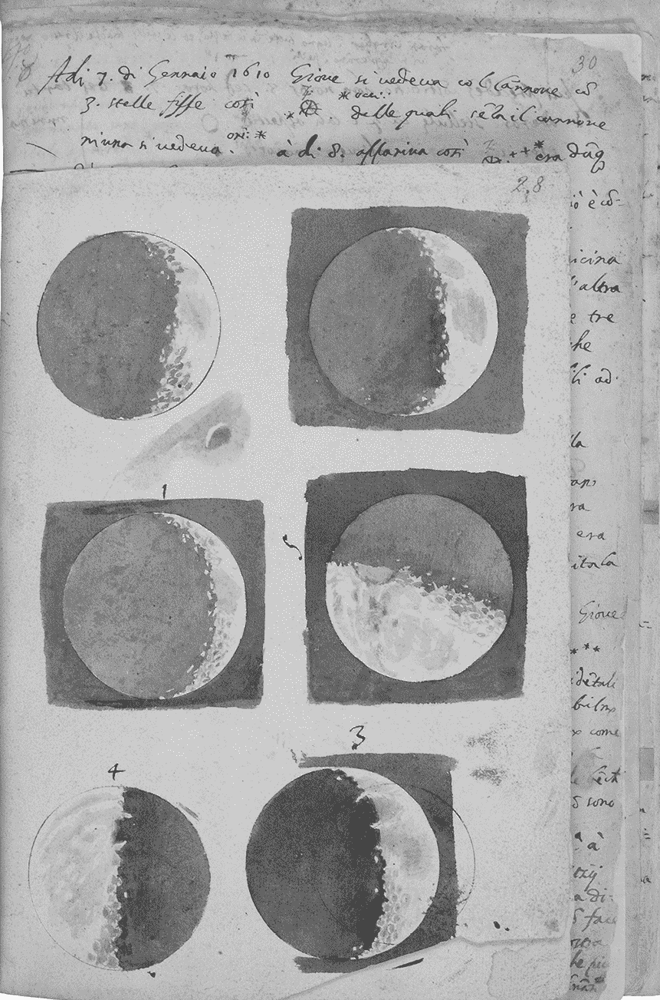

**图 2.2** 伽利略手稿。《星际信使》展示伽利略望远镜下的月球。见 Bredekamp (2019, IV)。Ms. Gal. 48, c. 28r，意大利文化遗产和活动部/佛罗伦萨国家中央图书馆特许使用

认知结构成分可源自其他结构：如“房屋”概念由地下室、地板、屋顶、墙、窗、门等构成，每个概念可再经组件展开（门把手、铰链、锁、木材、油漆……）。故认知结构似俄罗斯套娃，内嵌认知结构嵌套序列。我称此复杂相互依赖为“知识架构”。

但区别于真实套娃，概念层级非一劳永逸固定——可从“盒子内部”起始，向另一方向扩展。如从“木板”概念出发，可在其“套娃序列”中寻得木板制门及其他木板制品。换言之，语义网络可安排为不同层级结构。改变层级结构的可能性，在科学概念变迁中扮演何角色？

解答此问，须深入考察知识架构及其变迁机制。第六章借力学知识史例证：知识架构具分层结构，因我们在物质世界移动等经验基础且持久：举重费力、硬墙难穿……这些作为底层的“直觉知识”，常为涉足新域或处理抽象事务提供默认设置，常以隐喻方式重现。

第十一章论跨文化知识传播时，知识架构另一特质将显现：人类致力寻求似乎完整的世界心智表征。虽皆能觉察盲点，仍倾向规避“认知真空”。故以默认假设补全不完整知识，力求形成整体世界观。如何挑战此观点，是人类世关键课题，因我们须克服对世界诸多先入之见。

第三章起将讨论文字、符号系统等外部表征在知识系统传递转换中的枢纽作用。它们可作为“书面工具” ^(⁵³)

确实，科学知识系统在长期积累、遗失与变革中持续演变，致使知识架构与相关认知共同体发生深远重组。传统所谓“科学革命”即此类过程。但如前所述，其非由“范式转换”致，而是由变革过程引发——如对既有知识系统探索达极限，或为新系统涌现提供“母体”。

第七章讨论科学革命案例，本书视其为知识系统变革。详述一重要变革机制：在适宜条件下，初处特定系统边缘的概念，终被发现位于新概念系统中心。如弹丸离弹弓沿直线飞行的惯性运动虽早被注意，唯在经典力学中才成概念系统明确定义的支点。

此类重组开辟新视野，带来“线性模型”无法预测的颠覆性社会变革潜力。仅因如此，将所有资源集中于应对显性全球挑战的应用研究是无意义的。严峻挑战不自动生成宏大方案，视角转换与颠覆性创新几乎不可预料。

# 知识结构与社会如何相互影响

第三部系统处理知识与社会关系，视其为塑造人类生存的双引擎。关键互赖机制为“相互限制陷阱”（第八章概念）。个体心智与认知发展受限于社会提供的经验范围；社会制度受制于个体心智能力与视野上限。此互赖塑造个体与社会维持复杂心智与社会组织形式的能力——保持内部平衡，抵御自我毁灭诱惑。故社会变革必涉社会与心智结构的共同演化。 ^(⁵¹)

# 知识演化的三重奏：从经济基建到全球流动，再到人类世生存

## 知识经济：文明运行的底层操作系统

知识经济的概念贯穿全书第三部分的始终。第八章确立了其核心地位，而第九章与第十章则分别以建筑史与历代知识经济形态为镜，折射出其实践演进的轨迹。这一部分始终追问一个核心命题：作为外部表征载体的“知识表征技术”——从莎草纸、羊皮纸、现代纸张直至互联网——究竟如何重塑社会的知识经济图景？第十章更聚焦于科学知识的诞生：当知识生产脱离社会再生产的即时压力，建立起独立的内部调节机制，并通过特定连接部件介入社会实践时，这种自主性便成为人类应对“人类世”生存危机的关键变量。

## 文化抽象：隐形的社会架构师

第三部分同样深入探讨了抽象概念在社会调节结构中的建构性作用。能否将其历史溯源，与第三章所解析的科学概念起源机制相类比？我的判断是肯定的：正如物质生产技术催生了“能量”等科学抽象，行政统治与市场交换等社会实践，也必然生成“时间”、“经济价值”等“文化抽象”。这些抽象一旦通过时钟、货币等外部表征固化下来，便反客为主，成为新一轮社会调节与发展的发动机——资本主义的兴起即是明证。进入数字时代，数据晋升为核心文化抽象，主导着社会经济脉动。文化抽象深度塑造认知与生存，其演化呈现强烈的路径依赖，但科学史证明，即便是最顽固的抽象框架，终将在新经验的冲击下发生质变。人类世带来的生存挑战，正逼迫我们构建新的文化抽象，以此为调节机制，守住“地球边界”与有限资源的底线。

## 知识全球化：分层沉积与文化折射

第四部分将视野转向知识传播与转移机制。知识在历史与当下的全球化进程中扮演何种角色？世界是否正走向知识高度统一的“扁平化”终点？第十一章揭示：全球化是分层推进的过程，涵盖经济、文化、知识乃至科学等多维度的凝聚力传播与相互依存深化。历史留下了“沉积物”——如粮食生产、文字等基础技术的全球扩散——它们重构了后续全球化的前提条件。关键在于，知识在塑造行动者身份认同上的核心作用，阻断了单向均质化趋势。知识转移从非被动接收，而是接收端的“主动占有”，它催生新知、反哺发送方，并由双方知识经济共同决定转移路径。

转移的结果往往是“知识转型”：或是改造输入知识以适配本地知识经济，或是构建新旧知识的“杂合体”。第十二章以近代早期欧洲科学东渐及中国知识经济的同化为例，展示了嵌入知识系统的要素如何触发自我增强动态——获取一部分知识会指向对缺失部分的追寻，历次塑造全球知识史的翻译运动皆是明证。这种“重新情境化”若能揭示来源知识经济的深层结构，便构成“文化折射”。如古希腊辩论文化语境下，巴比伦与埃及的实践知识被文本编码、显性化为反思对象，从而催生超越局部语境的高阶知识。现代科学正是长期全球知识史沉积与文化折射的双重产物，“西方科学”实为“全球科学”：它源自全球史，而今全球史又赖以生存。

第十一章进一步指出，知识全球化由内外双重动力驱动：“外部动力”指知识作为商业、征服、传教等过程的“同路人”而扩散；“内部动力”源于知识系统自身发展，经验基础的拓展赋予技术、经济、军事优势，推动统治版图扩张。二者交织锁定了路径依赖，偶然情境成为演进的必要条件——即便最抽象、看似最普遍的知识，本质上也烙印着全球化的偶然历史。

第十三章引入涵盖社交、符号、语义层面的“认知网络”概念，深化传播机制分析。它阐释了认知共同体与知识系统协同演化的自组织动力：知识在社交网络扩散（如新实验法传播）充实松散共同体；新颖性常源于体系之外；共同体再经由外部表征网络（如论文群）整合积累，形成有组织知识系统（如新学科）并重组知识。扩散与整合的迭代循环，孕育出独特知识系统及其共同体。这也是科学革命背后的社会-认知动力——不止知识剧变，更伴随共同体重组。但协同演化未必迅疾，爱因斯坦广义相对论共同体耗时半世纪涌现即为明证。动力效能取决于知识系统属性、外部表征与社交网络特质。这些洞见，为思考如何重新聚焦科学共同体应对人类世挑战提供了坐标。

## 人类世的知识困境与突围

第五部分直面人类世与知识演化的生死关联。人类区别于生物圈的标志是文化演化——一个叠加于生物进化之上的独特代谢与学习层面。文化加速演化催生了“动圈”，作为地球系统新组分改变整体动力学，并可能演进为具备自组织、准自主特征的“技术圈”。第十五章论证：地球系统状态突变非单一成因所致，而最宜用演化级联描述——从依赖物质文化“生产关系”的文化演化，跃迁为依赖基于科学技术（化石燃料、核能、合成肥料、基因工程）的认知演化。没有科学知识赋能生产资料，便无1950年代“大加速”及地质意义上的人类世肇始。科学知识经济与资本主义经济一旦形成正反馈，失控效应便将文化演化锁定为高度依赖科学技术的轨道：石器、狩猎采集属于全新世，而科学技术是人类世人类生存的必要条件。

第十四章阐述：知识发展是文化演化核心维度。从生物到文化演化，“生态位构建”从一环跃升为根本特征（工具与物质文化见证）；从文化到认知演化，科学知识同样完成从一环到定义性特征的跃迁。但知识在文化演化中如何发力？科技发展方向非固定、非线性进步，受认知与情境因素博弈驱动。我们正在进行的地球实验，既剧变环境又生成新知。欲判断人类世困境、调整行为与知识经济，必须洞悉这种共同演化机制。

历史演化显现显著特征：一、社会仅能再造特定历史条件下的部分环境要素。新石器革命中人类学会再造食物生产条件，使得“可驯化动植物存在”这类偶然外部条件，锁定为全球发展的路径依赖特征。二、特定物质环境与文化为调节结构发展提供可能性视域，供探索调节结构之用；探索反过来重塑社会结构。科学史与社会史均证：探索物质条件与外部表征提供的范围，可诱发知识系统与社会组织的转型。两者虽不简捷直接，但同属文化演化这不可逆、单一、不可重复、不可预测的进程。

化石能源利用始于偶然与因地制宜，支撑起工业化社会，却长久不可持续。其“廉价无限”假象曾让工业化社会去情境化，暗含“地方普遍主义”幻觉——调节结构仿佛可叠加任意地域、投射无限未来。如今该时代终结。工业化后果在全球尺度恢复了环境调节功能，将差异化地重塑人类行为与社会结构。向非化石能源转型虽迫于时间压力却不可避免，且必是探索性过程：无“一刀切”方案，地方变量再度关键。未来能源方案不能脱离地环境与社会语境，新知识经济须立足“全球情境主义”，兼顾差异化局地情境与人类干预地球系统的全球后果。 ^(⁵⁴)

我们亟需更多地球系统动力学与人类干预角色的知识；同时也需要“生态足迹”类通俗易懂的文化抽象，将干预后果映入行动者心智，助力社会持续调适。 ^(⁵⁵)

然而，现行知识经济导致的科学知识碎片化，可能阻碍整合与实施，扼杀迫切创新。第十六章提议：互联网原则上提供了新型知识表征技术，有望优化知识经济，推动全球知识联合生产，实现科学知识组织、整合、本地化调适与实施的新范式。未来的“知识之网”或“认知之网”将平衡知识所有权与控制权的不对称，让用户化身“产消者”——通过优化网络界面与全球人类知识交互。不仅内容，链接网络本身亦须成为开放获取的公共产品。

最后，第十七章以宗教史为镜，回顾科学在不同时空为人类提供指引的得失，基于人类世生存挑战，发出强烈呼吁：科学家与公民社会须建立新型联盟。这要求重思科学本质。愿本书为此贡献绵薄之力。

---

# 第二部分

## 知识结构如何变化

### 第三章

#### 抽象与表征的历史性质

知识问题的意义何在？非关哲学反思或认识论内部逻辑，而在人类历史实践中，在更宏大、全面的经验视野中。约翰·杜威早已洞见：只要立足此场域，论点便已自证。知识讨论的抽象性、其与日常经验的张力，是形式而非实质；知识问题本无独立的起源、价值与命运，它是社会生活、是人类有组织实践必须直面的挑战。哲学家们看似晦涩技术的论述，源于提问方式而非问题本质。知识可能性问题，不过是知识与行动、理论与实践关系问题的一个侧面。 ^(⁵⁶)

本章聚焦抽象在思维历史理论中的地位。

##### 抽象的力量

任何知识历史理论，皆须解释抽象概念的涌现、运作与历史嬗变。以数学为例，抽象对科学的基石作用显而易见。数、空间、时间、力、物质等抽象，往往居科学知识核心，彰显其特殊地位。抽象确实能囊括海量经验，但哲学、宗教乃至日常生活中同样充斥抽象概念。哲学家们痴迷于作为理解世界钥匙的抽象。数学构想（三角形、质数）或物理概念（物质、力）似具永恒效力，常被视为独立于人类发现/构构历史而客观存在，甚至非人智慧亦可通用——高斯曾设想用数学定律与外星文明对话，此念头源于19世纪。 ^(⁵⁷)

然而，抽象在认知与理解生命自然中的关键角色，绝非现代科学专利；其哲学渊源可溯至古希腊。古哲探讨存在、物质、形式、美、善、真理等抽象。同后世科学概念一样，古代哲学概念主张能捕捉、掌握乃至超越具体个体经验。哲学家由此获得超越生活变迁的超脱感，在实践世界中展现技术式优势。米利都泰勒斯的轶事即为注脚。这位公元前7世纪晚期人物、古希腊七贤之首，被亚里士多德视为在物质抽象属性中寻找万物本原的哲学派别创始人：“泰勒斯说本原是水……因万物由湿润滋养，热亦由此生成并维持……一切种子本性湿润，水为湿润本性之本原。” ^(⁵⁹)

标志哲学家疏离日常经验的抽象知识，同样能带来技术优越性。另一则泰勒斯逸事：他仰望星空落井，被色雷斯女仆嘲笑“欲知天上事，不见脚下物”。献身哲学者须甘受此嘲。他不知邻里何事、甚至不知邻是人非人，却竭力弄清“何为人、何力使人异于他物”。 ^(⁶⁰)

但泰勒斯亦有致富传奇：冬季凭天象学预测来年橄榄丰收，低价垄断米利都与开俄斯所有榨油坊，收获季高价转租，获利丰厚。他以此示世：哲学家若愿致富易如反掌，但志不在此。此法具普适性，实为垄断之术，城邦筹款常用垄断供给之法。 ^(⁶¹)

##### 哲学上的挣扎

柏拉图对话录中，苏格拉底以近似方式挑战日常经验，确立哲学思考首位，论证抽象思维对具体经验的优越性。苏格拉底质疑工匠技术认知的一切断言：判断技艺或结果为“善”或“美”，预设了对“善”、“美”抽象概念的先验知识。人类知识仅当最终源于超越具体经验的抽象理念世界时，才具意义。

柏拉图由此设定独立于物质显现的超验理念国度。认知真理不过回忆这些原型理念，感性经验只是影子。洞穴寓言喻示：感性世界如洞穴，感觉印象如影子。终生见影者视影为真；一旦解缚出洞，方知影子不过真实、稳定、不变实在的微弱映像。克服感官不足，经哲学反思或科学研究视理念世界为真实在，获同等结果。柏拉图赞颂“善”等抽象理念的奠基性作用：“在可知世界中最后看见、且须极大努力才见者，乃善之理念。一旦见之，必断定其为万物中一切正与美之因，为可视世界生光与光源者，在可知世界为真理与理性之决定性源泉；凡公私生活合乎理性者，必见过善之理念。” ^(⁶²)

历史上最具影响且为普遍接受的抽象概念，渊源多归亚里士多德。 ^(⁶³)

近代早期哲学中，抽象问题随数学在新科学中合法化而重返核心。大卫·休谟等经验论者严分感性知觉域与数学命题域：“根据经验得来的一切推论都是习惯的结果，而不是理性的结果。” ^(⁶⁴)

康德旨在解释：为何经验流变不居，我们仍视科学知识为特别可靠的知识形式，并视为理性典范？同柏拉图一样，康德认定数学与自然科学基本命题具无懈可击的可靠性，推论其效力不在感觉经验中，而在先验（先于经验）给定的特定认知形式中。顺应近代哲学强调主体建构世界的传统，康德不认同柏拉图的理念国度，转而以人类心灵为可靠知识源泉。在此视角下，感觉经验仅为认知机制原料，机制结构不受经验影响。人类思想如绝对可靠的“思维机器”——预示工业革命生产机器——能将原料转化为稳定理性的洞见。

**从康德到皮亚杰：认知结构如何在动手实践中“长”出来？**

康德眼中的“思维机器”，内置了空间、时间、因果等先验齿轮。他参照近代科学的知识图谱，设定空间认知的底层逻辑天然契合欧几里得几何。可惜他预判不到，19世纪非欧几何的横空出世会让这设定显得武断，更别提后来相对论彻底重写了时空物理概念。

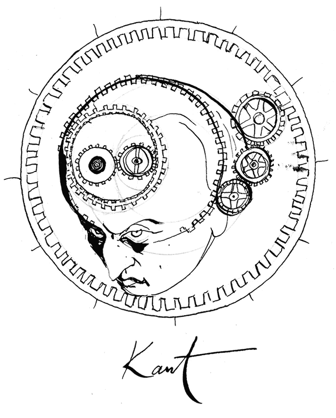

**图 3.1** 康德的思维机器示意图。劳伦特·陶丁绘

面对科学进展，康德派后人怎么接招？一条路是换装“思维引擎”，用当下科学的核心概念替换旧件，作思维运作的新通则；另一条路则是转弯上“方法论”赛道，不再纠结认识论，转而寻找一套通用的科学方法，既保知识增进，又管结论靠谱。自近代早期起，哲学家们没少折腾。20世纪初，“逻辑经验主义”在维也纳圈子里兴起，便是这类努力的典型代表。^(⁶⁵)

## 心理学切入：认知不是天生的，是“长”出来的

抽象范畴从哪来、怎么用，不光是认识论的事。20世纪初，刚从哲学门下“出师”的心理学等新兴领域，开始用实证手段盯上了这事儿：生命伊始，基础认知结构并不存在，它们在个体成长中被搭建、在历史长河中演变、在不同文化里呈异貌。传统哲学认识论大多忽略这些动态维度，而新学科正把它们摆上实验台。

心理学早期确立实验范式，走出了两条路：一是行为主义，盯着“刺激-反应”，把内部心理机制直接屏蔽；二是想抓思维过程，不仅靠内省，更靠访谈、实验等硬核手段。

格式塔心理学奠基人马克斯·韦特海默，就把理论探索放在科学史坐标系里。他甚至亲历了爱因斯坦创立狭义相对论的过程，并将其作为名著《创造性思维》的核心案例。两人大概在1911、1912年于布拉格相识，那时爱因斯坦在布拉格德语大学任教，正好是韦特海默的家乡。^(⁶⁶)

韦特海默眼里的认知结构，是主动介入认知的“整体”，既不是认知对象的翻版，也非外部刺激的回响。这让他成了心理学里“建构主义结构主义”的开山鼻祖。皮亚杰的发生认识论同属一脉：思维的逻辑数学形式，不是从心理活动里抽离的，而是从“行为”中提炼的。皮亚杰说：“逻辑数学知识从什么中抽象而来？……抽象不是从对象提取，而是从行为本身提取。这才是其基础。”^(⁶⁷)

## 皮亚杰：数数卵石，悟出数学底层逻辑

皮亚杰理论的内核是：认知本质是受经验制约的主动建构过程。行动及其后果，雕琢出思维结构。

想象一下：孩子数排成几何图形的小卵石，无论从哪颗起数、摆成啥形状，总数不变。他无意中就捕捉到了“交换性”——计数时元素顺序可换。这洞察指向的不是卵石属性，而是“计数”这个行动本身。皮亚杰主张，逻辑数学核心结构，源于经验触发下、心理组织不断复杂化、重组，以及行动协调在实践中落地。

这过程从“感知运动图式”起步——行为模式内化，紧贴感官知觉（如吮吸、追视），从出生持续到语言萌发。约一年半内，孩子掌握视抓协调、手段目的协调。比如偶然碰响摇铃，随后为留住妈妈故意再摇响。^(⁶⁸)

感知运动阶段，孩子还把对象建构为独立于自我的实体，形成“客体永久性”图式。起初动作感觉的空间维度是散的，没统一空间观。视觉导向动作、形状大小知觉恒常，都建立在“看见并抓住”这视抓协调之上。^(⁶⁹)

再后来，孩子建立可逆的“运算”图式。比如水倒来倒去，前提是水量不变——抓住了不变量。^(⁷⁰)

用“排序”任务举例：^(⁷¹)

这种认知结构，扎根于儿童个体发生——经验性试错行为与认知发展的互动中。结构成型前，孩子只能两两比对棍子长短，不懂传递性；结构一成型，特定信息被同化进连贯动作系统，操作棍子变成可预判结果的探索。简而言之，思考是在既有认知框架内，由行动手段开启的可能性探勘。^(⁷²)

**图 3.2** 两岁男孩搭塔、比杯子大小。先试大绿杯套小绿杯，再试套黄杯。搞懂大小传递性后，他立马推断：黄杯比小绿杯还小，大绿杯肯定盖不上去。图自本书作者

皮亚杰传统里，儿童心理学对排序任务研究极深。这也侧写了认知结构的其他特征：学习涉及“同化”新知入旧框，也涉及框架自身的“顺应”调整。^(⁷³)

但这套“预设阶梯”——从具体动作到高阶心理运算，似乎暗示全文化、全时空的儿童都按部就班走同一流程：感知运动智力（实践层面，感觉同化入动作图式，在意识下运作）→ 前运算思维（符号功能加持，符号替代表征对象）。^(⁷⁴)

这就是抽象概念起源的答案吗？在皮亚杰这儿，抽象概念是儿童发展的终点产物，而非科学哲学高塔上的馈赠。可现实是，不同文化抽象概念体系并不相同。时间、长度、体积、重量这些可能随历史变迁、因文化差异的概念，恰恰是社会生活的核心范畴，调控着劳动组织、交通管理等制度。^(⁷⁵)

## 抽象的根，扎在具体的社会实践里

抽象范畴非天然普世，而与历史文化变迁的实践深度绑定，这些实践在不同经验域间搭建实务连接。古代社会及近代无文字部落，缺乏抽象时空概念，无法把“两次心跳间隔”与“一年长度”、“手指宽度”与“一天行程”纳入同一坐标系。新几内亚中部高地的埃博人，就是深度研究的无文字社会案例。^(⁷⁶)

货币表征的商品交换价值，也是抽象概念社会渊源的铁证。《资本论》开篇，马克思点破抽象的“稀奇”性：商品看似平凡，实则“古怪”，充满“形而上学微妙与神学怪诞”。作为使用价值看不出神秘，但作为商品，它代表社会关系。马克思敏锐关联起经济抽象与宗教抽象：人脑产物在宗教里成了有生命的独立实体；在商品世界里，手的产物也是如此——这就是“拜物教”，与商品生产形影不离。^(⁷⁷)^(⁷⁸)

楔形文字研究显示，早期商业代理人已负责王朝内部及跨社会过剩货物交易。^(⁷⁹)

在连接不同经验域的社会实践中，抽象范畴的历史萌发呈现普遍模式。可驱动这种抽象的认知机制是什么？它与社会进程又如何咬合？

## 行动即物质实践

回到皮亚杰“发生认识论”，它解释个体发展中抽象范畴的阶段性生成。若硬套用到历史维度（皮亚杰等人真尝试过），就会陷入“知识演化目的论”——预设演化结果普遍预先给定。^(⁸⁰)

必须引入更重视历史特定社会进程的理论传统。1920年代，列夫·维果茨基、亚历山大·鲁利亚、阿列克谢·列昂季耶夫在苏联组建核心圈层。^(⁸¹) 1930年代，鲍里斯·赫森、亨里克·格罗斯曼在马克思主义传统下，揭示现代科学诞生的技术经济底色，把物质实践安在思维形式发展的核心位置。^(⁸²) 这延续了马克思洞见：机械装置演进，引发对动力可交换性的顿悟。^(⁸³) 赫森-格罗斯曼论点旨在，依据历史特定的物质与符号手段，界定认知的可能性疆域。^(⁸⁴) （第十章展开近代早期知识经济时再细说）

系统发育、历史发生、个体发生三线交织。生物进化铺垫文化出现，文化反向塑造智人进化终局——工具使用、社会互动的生物学效应最为显著。无论哪条线，物种发展都靠个体发育落地：个体在特定历史节点习得共享知识，通过认知活动参与传播转化。

至此，皮亚杰模型里“行动”的构成性角色、协调生成认知结构的作用，获得了具体历史内涵：动作承载物质手段与社会约束。^(⁸⁵)

## 知识的“物质身体”：工具、符号与外部表征

物质文化是知识演化的脊梁。天文学史极其典型：伽利略望远镜 → 19世纪光谱学 → 20世纪射电天文 → 今引力波探测，仪器迭代直接重塑认知版图。从古机械到粒子加速器，物质工具、仪器、设备的发明应用，不时打断并重写科学史。若这“改变游戏规则”的力量，延伸至算术数字系统、文字、数理化符号系统、泛称“书面工具”的符号手段，会怎样？^(⁸⁶)

人类行动的全物质环境——工具媒介、行动本身、手势声响、发生场域——皆可视为知识的物质体现。形式多样，同一体现因用法、文化语境异而功能殊。锤子是行动手段，也体现知识：使用知识（看形状/上手即懂）、生产知识（逆向工程难得多）、发明知识。^(⁸⁷)

物质体现含“生成性”层面（直接关联行动）与“传播性”层面（专门传输心理内容）：工具、制品、模型、仪式、声响、语言、音乐、图像、符号系统、文字。用来表征知识的物质对象/环境，称作“外部表征”。^(⁸⁸)

外部表征功能仰赖皮亚杰（继卡西尔、齐美尔）所谓的“符号/象征功能”。黑格尔、马克思、齐美尔、卡西尔等哲学家早识其在文化演化中的关键地位。符号学视角（索绪尔、皮尔士、杜威等）亦将其纳入研究视野。^(⁸⁹)

外部表征常多维共存：拟声词“砰”既是象征又具图标性；征候可读作象征（占星术）；“世界如文本可读”在宗教科学史里比比皆是。伽利略《试金者》名言：“哲学写在宇宙这本大书里……不学其语言文字，无法读懂。”^(⁹⁰)

汤姆林森论证：指示过程、符号功能层级（图标→索引→象征）或与文化系统发生深度关联，可上溯至动物界、史前早期人类：“表征随符号学生物现身，引入新重复形式——**替代**重复，超越单纯**位移**重复（香农通道两端信息对应）。这能力的出现，标志着生命史重大跃迁。”^(⁹¹)

外部表征服务知识共享、存储、传输、控制、转化。个体知识源于对共享知识的占有与外部表征重构。内外表征非一一固定映射，这歧义虽致误解，却是创新引擎：个人认知经共享外部表征积累，在变异中生发新见。^(⁹²)

## 被遗忘的科学史传统：理性的碎片化与1931年伦敦会议

20世纪科学反思分化为互不相让的分支：有的盯规范、有的盯思想、有的盯历史偶然性、有的盯社经背景——各执一端，弃其余。若想全景反思，兼顾科学历史性与理性特权地位，分歧构成“理性真正的分裂”。专业化、意识形态撕裂、两次大战、大屠杀、冷战，让宝贵科学本质洞见散失、破碎、边缘。1930年代三个插曲，能窥见这分裂与被掩埋的传统。^(⁹³)

1931年6月29日至7月3日，第二届国际科学技术史大会在伦敦召开。尼古拉·布哈林率苏联代表团参会，舆论担心搞政治宣传。可莫斯科大学物理所所长鲍里斯·赫森，抛出震动科学史界的学术炸弹——《牛顿〈自然哲学的数学原理〉的社会和经济根源》。^(⁹⁴)

左派科学家 J.D. 伯纳尔事后评价：苏联演讲者“有自己的观点，可对可错；而其他人却从未想过需要有一个观点”。^(⁹⁵)

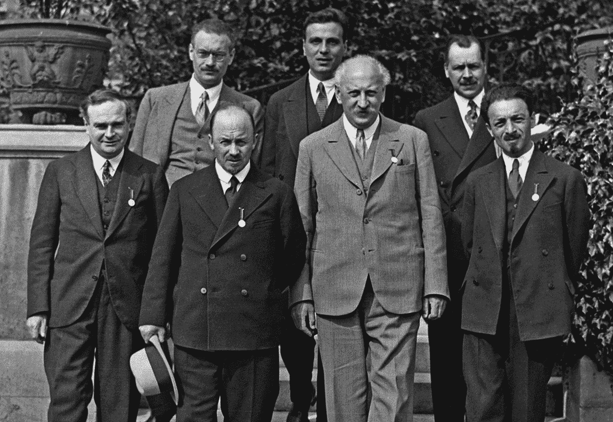

**图 3.3** 1931年伦敦第二届国际科学技术史大会苏联代表团合影。**前排左起**：鲍里斯·赫森、尼古拉·布哈林、阿布拉姆·约费、恩斯特·科尔曼；**后排左起**：鲍里斯·扎瓦多夫斯基、莫杰斯特·鲁宾斯坦、尼古拉·瓦维洛夫。来源：Chilvers (2015, 74)。© Hulton-Deutsch Collection 历史图片画廊

# 知识演化的三重奏：从物质工具到社会认知的历史考察

1935 年，《社会研究杂志》刊登了马克思主义经济学家亨里克·格罗斯曼的一篇论文——《机械论哲学和制造业的社会基础》。这篇文章以马克思的劳动观为基石，与赫森的研究遥相呼应，两人独立构建出一种科学观，有力回击了当时主流社会对马克思主义的刻板偏见。在吉迪恩·弗罗伊登塔尔与彼得·麦克劳克林的梳理下，我们可以提炼出“赫森—格罗斯曼论点”的三大核心：第一，技术为科学拓展了认知疆域，揭示了特定抽象概念诞生的物质土壤；第二，技术同时也设定了科学视野的边界，解释了为何特定条件下某些抽象无法生成；第三，意识形态、信仰、政治与哲学理论等社会因素，同样深深塑造着科学的走向。

同期，维也纳圈的哲学家们（如莫里茨·石里克）试图拉近科学与哲学的距离，并与爱因斯坦等科学巨擘对话，以回应那个时代的科学危机。为刻画这种集体智力活动，弗莱克引入了“思维集体”与“思维风格”这一极具洞察力的概念组合。

**知识的物质载体与认知操作之间，存在着一种灵活且强依赖语境的张力。** 这种内在的歧义性，恰恰是知识创新的源头活水。我们不妨借数学形式体系在自然科学中的角色来拆解这一机制：微分方程作为牛顿力学的外部表征，能精准描绘落体规律与行星轨道。当我们遵循微分学的符号规则推演这些方程时，全新的物理图景——如彗星轨道的描述——便浮出水面。

莱布尼茨、门德尔松等 18 世纪思想家早已洞察：符号操作绝非“盲目思维”，符号也无法被其指代对象简单替代。符号系统更似自然语言，其组合既要遵循句法规则，又须不断经受语义检验。

以牛顿力学为例，我们完全可以仅凭力的定律起步，暂不引入能量概念。通过方程运算，质量与速度的符号组合生成了特定数学表达，初看似随意，实则对应物理交互中守恒的量——我们将其命名为“动量”或“能量”。更妙的是，这些后生的表达式竟能反客为主，重构整个理论大厦，显得比最初的力定律更“基础”。这并非臆造，“活力论战”正是这段真实史实的注脚。这深刻揭示了：**知识系统的外部表征探索，与其内部概念结构的重塑，交织成极为复杂的互动关系。**

关键在于，知识系统从不在伊始便完备呈现。借助外部表征——计算、情境迁移、共同体辩论——其深层意蕴方才逐层展开。由此衍生出外部表征的“生成性歧义”，赋予其在知识传承中看似矛盾的双重功能：既是跨代传递的稳定锚点，确保知识长存；又是作为思维工具，推动变革与创新的引擎。

行动的物质手段与知识表征，其潜在应用谱系总超出特定群体的既定目标。黑格尔称之为“理性的狡计”。这意味着，借助特定工具执行的动作，其结果可能溢出既有认知框架的编码范围，从而成为新认知结构的萌芽。**对外部表征的探索性利用，正是知识系统演化的主引擎。** 既然工具使用早于现代人类，这股动力甚至塑造了人种本身：工具运用不仅是大脑发育的果，更涉及双向因果——工具调节动作，拓展认知上限，反倒使大脑扩容成为进化优势。第八章“表征、权力与超越性”将进一步展开此议题。

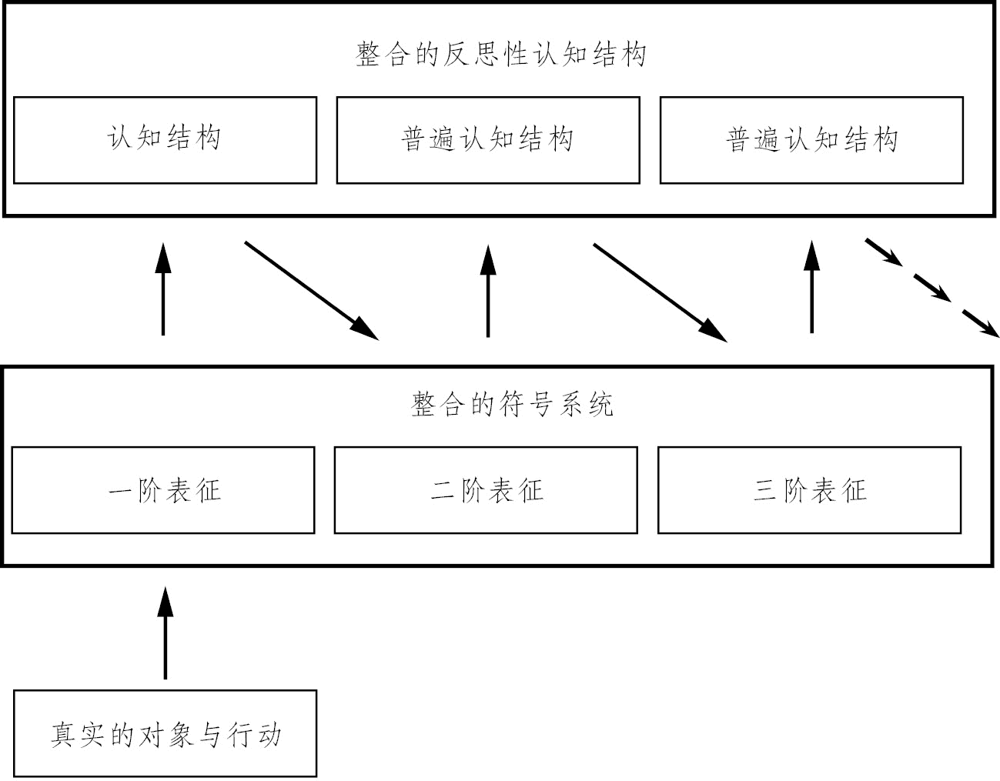

**图 3.4** 抽象的反思性结构。摘自 Damerow (1996a, 379)。马普科学史研究所图书馆提供

---

### 从发生认识论迈向历史认识论

知识演化的特定阶段，由个体认知中独特且历史可得的外部表征来界定。历史视角下，重建“可能性视域”至关重要：它勾勒出一个共享社会场域，无论行动者是否直接关联，只要利用可得物质手段的内在潜力表征知识，便易达成相似结果。这能解释同步发现/发明，及特定历史条件下独立涌现的共同主题、方法与智力成就。常被忽略的是：相互影响与共享资源，取决于共享知识的性质——外部表征承载着达成相似结果的共享潜能。伽利略及其同代人对加速运动的相似处理，非源于直接交流，乃因共同汲取中世纪哲学资源分析加速过程。后文讨论图表这一外部表征时，将再述此中世纪技艺。

区分外部表征的阶位颇有裨益：**一阶表征**以符号/模型代代表实对象，允许执行同真实对象同构的操作，且因免受实况偶然性干扰而更易把控。如用筹码计数，虽属象征性动作，无法替代实物操作，却能预判结果、辅助筹划。

但一阶表征不止于依托既有认知结构操作。它具建设性：通过操作内化，构成性地建立新认知结构。算术认知结构即可由操作简单计数系统生成。在此层面，象征性操作完全可替代实体行动。

新涌现的认知结构（如算术）可被**二阶表征**捕获——十进制记数法即是例证。但运用二阶表征计算，前提是已掌握算术。一阶指向实物，二阶指向无须直指具体对象的认知结构。筹码操作无需预设抽象数概念，十进制运算却要求算术先备知识。

二阶表征亦可为符号或人造物，其操作规则源于所代表的认知结构。要驾驭它们，须将实物与实体行动同化进认知结构。二阶表征与对象/行动仅间接关联，对所代表结构不再具建设性，但在使用中可能反哺更高阶结构（如代数建立于对算术运算的反思）。

物质手段/外部表征通过界定行动结果系统生成认知结构，该系统在生成规则中复现。因行动手段具文化历史特异性，由此生成的认知结构亦具文化历史特异性——这在研究聚焦普遍特征或缺乏比较维度时常被遗忘。从此观之，知识兼具结构性与历史经验具体性。关于对象的知识，可定义为解决涉该对象问题的能力：将信息与理解其行为的认知结构联结。知识始终是结构化的，虽貌似高度抽象，实则依赖内容，因其源于外在于结构的具体行动与物质手段。

认知结构虽在生成中受物质手段构成性制约，但也反向塑造物质行动。显而易见，认知结构协调行动；更深层地，它引导改良旧手段、构造新手段，使行动超越编码范围，催生新认知结构。

认知结构在应用中演变：规则系统适配更丰富内容而愈发普适；关联更多结构而愈发分化、强大、具体。结构失效时，反思其基座行动，借助新思维工具开启的可能性，可通向新结构构建。即便按棍子长度排序这等简单任务，每次尝试条件亦不完全相同。赫拉克利特云：“人不能两次踏入同一条河流。”原则上，基于特定结构的每次解题尝试皆可被记忆积累，自然丰富认知结构。

基于此，皮亚杰的“反思性抽象”可转化为彻底的历史概念：物质的、社会语境下的行动是认知结构的源头。那些产生数字等抽象数学概念的反思性抽象，终其源于通过数词、黏土代币、数字符号计算物质对象的具体行动。反思性抽象由此成为建设性过程：通过反思具有特定外部表征（语言、数学符号）的操作，建立新认知结构。这些象征手段通常代表先前构造的心智结构，由此形成一条潜在无限的链条——**“迭代抽象”**。

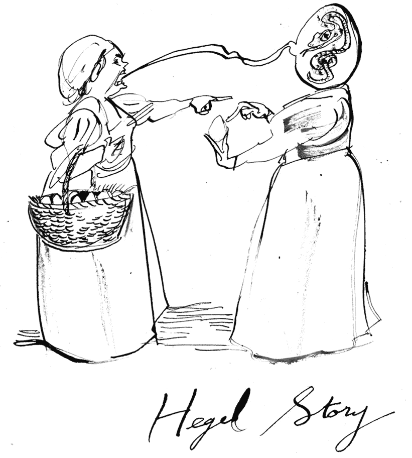

**图 3.5** 黑格尔的故事。劳伦特·陶丁绘

---

### 历史语境中的社会认知

知识史演化虽借个体认知活动实现，实则是跨群体、跨世代的集体进程，涉及思想独立个体的互动。人类认知本质上是社会认知，预设人类视彼此为有意图主体，能理解他者视角。个体在特定文化条件下成长，这决定了他们习得知识系统时的挑战与边界。

个体视角下，内部表征关乎个人经验，与个体预期中特定行动手段的潜在用法相关——这是知识外部表征的**个体/主观意义**。社会视角下，外部表征体现行动潜能，这些潜能未必为人人感知预料，却能在社会实践中兑现。外部表征往往是早期行动的产物——这是其**社会意义**。群体可及的知识外部表征之社会意义，构成了共享知识。

个体认知发展可视为：在互动交流中占有社会提供的共享知识，获取外部表征的主观意义。反之，若个体新见未能转化为社会化进程中可迁移的认知结构，便随传播湮灭，与历史演进无涉。仅当个体认知成果被适度社会制度系统性复制扩张，个体贡献才能影响共享知识的历史传播，助力知识保存与积累。

主体间交流建基于共享知识，常借语言中介。语言本身即知识外部表征，由生成形式正确语言结构的认知结构所生成。

不同主观意义源于不同个体发展轨迹，它们在行动手段的基本社会意义与知识外部表征中寻得共性。缺此集体经验与共享知识基座，主体间交流无从谈起。共享知识的前提还包括：沟通对象的社会意义能与主观意义匹配，或能以个人经验为基础重构。

如此理解，共享知识的历史发展便成了高度路径依赖的过程，包含基于一系列具体历史经验的迭代抽象。就抽象思维自身经验来源而言，按此知识结构编码经验，是抽象思维具有特有“递归盲目性”的原因之一，这也能解释某些抽象思维结果看似先验的特征。

后续章节将举例详述。经典物理时空概念涵盖广泛经验，构成貌似普适框架，掌握应用毋须知其历史生成。这似乎暗示时空物理概念先于且独立于具体经验。然而，当新经验终逼迫反思这些概念所源基本测量操作时，貌似先验性便受挑战。第七章将展示：挑战的结果是新时空框架的诞生，它再获貌似普遍的有效域。

---

### 外部表征的生成性歧义

在此脉络下，我们可探讨重建历史思维形式的特有困境。皮亚杰指出，认知基本结构反映的是动作协调而非动作本身，故仅凭观察动作难重建认知层级。同样是移位，可能是感知运动，可能用地图指北针，可能用 GPS。唯在其社会文化语境中全景式描述行为、识别历史特定行动手段，方能确认涉及认知层级。同理，知识外部表征可表达不同反身性层级的知识：等式 `5 + 7 = 12`，既可视为简单算术，也可视为复杂数论例证，抑或康德哲学意味的“先天综合判断”。

在教育或跨文化语境下运用外部表征交流，内生着不确定性：无法确判涉及哪个反身性层级。

---

### 谁在抽象地思考？

最后回到抽象思维议题。黑格尔曾问：“谁抽象地思考？”令人愕然地答：“未受教育者，而非受教育者。”他以趣例佐证：一妇人被女佣指控卖烂鸡蛋，她反唇相讥：“我鸡蛋烂了？怕是你烂了！你敢这么说我的蛋？”继而因指控贬损女佣乃至其家族人格：“虱子没在大道上啃食你父亲？你母亲未与法国人私奔？你祖母未死于公立医院？”

黑格尔暗示：认知始于将经验归入抽象概念，此后方能生成对对象的具体表征。认知既是抽象也是具体化过程——它联结认知结构中的抽象概念并用以解释现实。抽象概念的效力仅在具体化中验证；经由具体化，认知结构因经验及结构间关联而愈发丰盈。

至此，我们融汇哲学、心理学与历史学洞见，找到了关于抽象概念起源与作用的答案（虽答案本身颇具抽象性）。科学关键抽象概念源于对历史特定实践中物质行动的反思。更进一步，本章框架不仅让我们识得抽象概念的本质——至少在原则上——还指明了如何调和：知识演化的非决定性、对具体历史条件的深度依赖、与长程知识积累的可能性。但切记，此过程不保证知识必然积累，亦不预设高阶知识形态。后续章节将以案例细证。

---

### 知识的三个维度

综上，知识可辨识为三个维度：认知/心理/“内部”维度；物质/体现/“外部”维度；社会维度——即知识生产、分享、传播、占有的社会过程。理解本书阐述的知识演化动态，三者缺一不可。

社会维度显而易见，因其含传播机制，解释演化的时间连续性。物质维度同理，因其以底层物质文化形态，构筑传播的脊梁。

知识是解决问题的潜能——个体或群体解题、在心理上预期相应行动的能力。知识立基于经验，编码于心智、物质与社会结构中。它源于对嵌入环境行动的反思，能作为预期与控制行动的潜能。个体内部由认知结构表征，认知结构联结过去与当下经验。知识为物质文化与现存社会关系所塑造（非决定），终其源于受社会约束的物质实践积累。

知识的历史连续性、散布与传播，仰赖其外部表征，服务于社会内部的知识再生产结构。外部表征可成新知结构构建的先决条件，因新结构可能源于施于表征之行动。新结构虽脱离原行动，脱离方式取决于表征的历史特定物质性与社会性。新结构可经更高阶外部表征再编码，复为知识进一步发展的前提。

知识长程演化，只能在认知个体发生与历史演化相互纠缠的基础上，借物质体现来理解。物质体现与外部表征，在社会共享知识（历史发展客体）与个人知识（共享知识唯一真实显现）间扮演中介角色。

---

## 第四章 知识系统中的结构性变化

> “在一家大型城市医院的性病部门工作多年的经验使我确信，即使是一个拥有完整智力和物质装备的现代研究工作者，也无法将疾病的所有这些各种各样的方面和后遗症从他所处理的全部病例中孤立出来，或是将它们与并发症隔离开，然后进行归类。只有通过有组织的合作研究，在大众知识的支持下，经过几代人的努力，才能形成一个统一的图景，因为疾病现象的发展需要数十年。”
> ——路德维克·弗莱克《科学事实的产生和发展》

> “科学，就像密西西比河一样，始于遥远森林中的小溪。渐渐地，其他溪流扩充了它的水量。而冲破堤坝的咆哮河流，其源头数不胜数。”
> ——亚伯拉罕·弗莱克斯纳《无用知识的有用性》

上一章聚焦抽象概念的涌现。但知识史理论还须阐释：在未数学化的知识框架内，或在概念结构上与科学知识差异巨大的框架中，推理如何运作？我已论证科学知识部分基于并包含实践、技术知识等其他知识形式——这些不同知识形态间究竟如何关联？

我已大致论述：认知结构如何经同化与顺应、反思性抽象、以及探索外部表征开启的可能性视域而变迁。至此描述仍甚宏观，刻意留下一核心悬念：面对涉及众多认知结构的重大历史变迁——所谓的科学革命——我们该如何理解？

# 重新理解知识演化：从“挖掘棍”到“心智模型”的认知之旅

在接下来的探讨中，我们将聚焦于**复杂的知识集合体**——这正是科技活动的核心特征。我称之为“知识系统”，但请注意，这**并不预设它们高度有序**。这里的“系统”涵盖了从因文化实践沉淀而成的松散“知识包”，到结构严密的理论体系。尽管形态各异，它们共享一个核心特质：**都依托一个随时间演进的认识架构而存在**。

为了剖析知识变革的动力学，我将借用前文确立的知识三维度——心智、社会、物质，并暂时区分出三类基础知识形态：**直觉知识、实践知识与理论知识**。这个分类虽非穷尽无遗，却足以作为分析科学变革中知识互动的利器。

接下来，我将引入认知科学的工具箱——**框架、过程、心智模型、默认设置**等概念，来描绘认知结构的演化轨迹。这类似于达尔文将生物变异的观察纳入进化史理论：不仅是跨领域挪用概念，更是让概念适配新疆域。达尔文整合海量生物学知识的范式，正是知识史理论的绝佳蓝本。奠定基础后，我将勾勒科学变革的整体动态，突出探索性过程、变革诱因与系统重组的关键作用。

---

## 一、 知识系统：架构与三大维度

**知识系统本质上是社会共享的知识元素集合，要素间存在关联。** 这种关联可能源于共同的生产主体（如研讨会、大学），课程大纲与教科书便编织成一张网；也可能基于认知逻辑串联，比如相对论的阐释、应用与悬而未决的问题；抑或依托物质载体，如图书馆馆藏。

**“知识整合”指新知接入既有系统的一切过程。** 知识发展的速度与方向，首要取决于整合手段的可得性，而这又受制于社会制度、表征形式及系统自身的认知特质。

不同的构建路径，催生迥异的系统架构。我们可从三个维度刻画：

1.  **反身性**：知识与其作用对象保持多远距离？
2.  **系统性**：内部组织有多紧密？
3.  **分布性**：共享范围有多广？

### 三种知识形态的反身性光谱

*   **直觉知识**：源于个体发育中与自然/文化的直接打交道，零门槛，高内隐。
*   **实践知识**：属于专门知识，根植于从业者的训练经验。它是手艺的灵魂，长期以“师徒相授”式传承为主。^(¹⁰⁷)
*   **理论知识**：高度反身，剥离具体情境，追求普适性。

### 系统性：从松散“知识包”到严密体系

系统化程度取决于：组件间联结的密度；能否以某种表征推演出全貌（需反身性支撑）；能否仅凭局部复原整体。分布性则从小圈子共享延伸至跨时空通用。

---

## 二、 案例解剖：埃博人的“挖掘棍”与实践知识的逻辑

新几内亚埃博人的力学知识，是典型的**“知识包”**——由特定工具及其用法串联。^(¹⁰⁸)

挖掘棍、种植棍、收获棍，尖端楔角依用途差异而定。最常见的杠杆用法中，熟练工能依土质调整支点与力臂，**身体力行杠杆原理**。但这套知识**“长在实践里”**：组件间联结靠实操实现，而非脱离情境的符号编码；缺乏通用力学词汇表，不知是否上升为普遍经验。

这揭示了实践知识的核心特质——**“情境依赖性”**与**“地方性”**^(¹⁰⁹)：
*   口头表达仅捕获冰山一角，传播极度依赖多媒介与结构化信息（逆向工程之难即明证）。
*   前现代技术方案多为本地定制，而非今时今日的全球标准化。
*   传承靠家庭、行会等人际网络，风格特征里藏着社会关系谱系；正规教育曾长期边缘。
*   **稳定性的代价是脆弱性**：情境不变则稳，一变易失；反思跨情境表征困难，挑战传统成本高。

### 关键转折：“解放性逆转”^(¹¹⁰)

近代早期欧洲技术手册的出现，将实践知识**“编码外化”**，使其脱离具体实施而独立传播。这种**“从目的中解放手段”**的逆转，是知识史的重要引擎。它允许探索性知识诞生——如阿奎那为教学重构的《神学大全》系统，超越了单纯“评注”秩序。^(¹¹¹)

### 理论知识的情境超越性

对比之下，理论知识系统具备极强**情境独立性**。以阿基米德溯源的杠杆定律体系为例：^(¹¹²)
*   “重心”等抽象概念统摄海量装置与活动；
*   体系反哺组件，定义运作逻辑；
*   高度系统化意味着**“可由局部重构全貌”**——文艺复兴学者从碎片遗迹复原失传科技，便是明证。

---

## 三、 认知科学的储备库与达尔文式的范式转型

认知科学为知识史提供概念工具与案例库。但工具非即刻可用：主流认知科学聚焦**个体认知行为**，而知识演化关注**社会共享的宏观结构**。这恰似**达尔文前的生物学**——植物学、动物学、形态学各自为政。^(¹¹³)

达尔文的伟大在于：**用“环境因素”（地理分布）串联“内部因素”（形态结构），打通内外部视角。** 今天的认知研究同样面临“内部主义”（大脑机制）与“外部主义”（历史文化实践）的分裂，知识演化理论或能复现达尔文式的统一。^(¹¹⁵)

现代进化生物学（基因组调控、表观遗传、生态位构建）更进一步，展示了**个体发生与系统发生双时标下的复杂因果网络**，为调和内外部视角提供了更精细框架——这将在第十四章展开。

**认知研究的“广阔疆域”**（神经科学、心理学、教育、计算机科学）蕴藏巨大潜力，但**不能生搬硬套实验室结论**。必须建立真正的历史构想，挑战实验预设。正如皮亚杰发生认识论经“历史化”转身为历史认识论，我们需在“表征与反身性”、“隐性知识作用”、“不完全信息下的推理”等核心议题上，完成同类转化。^(¹¹⁴)

---

## 四、 深入认知微观：程序性知识、组块与插槽

**程序性知识**贯穿实践与理论，是引入认知核心概念的理想切入点。它是**“问题解决型知识”**，以步骤序列（程序）形式存在，常称**“配方知识”**——目标导向，可编码指令，新情境下执行会反哺修正程序本身。^(¹¹⁴)

*   **基础单元与嵌套**：烹饪食谱串联“洗菜、切菜”等预备知识单元；程序含“插槽”填充经验数据（如观察烤肉色泽）；设分支点、调用子程序（盖房子先备料）。
*   **从新手到专家的质变**：松散线索驱动的序列 vs. 自动化执行的**“组块”**。后者达成**“名词状态”**，有标签提取（食谱有名），关联描述符（分配律联结加乘法）。

认知科学术语（组块、插槽、描述符）极大丰富了我们描述程序性知识的词汇。但切记：这些结构在知识史中，是**社会共享储备库**的组件，个体从中汲养、回馈贡献。

---

## 五、 心智模型：思维的“内置仿真器”

引入“心智模型”概念，核心在于看清它是**历史传播的共享认知架构**一部分。这提出了认知科学罕见的问题：特定经验背景下的起源、转型，及在特定社会中的共享/占有机制。

认知科学已重建出日常推理的连贯结构（如物理过程定性推理）。即使有成熟理论（经典力学），我们理解物质对象仍需心智模型**“兜底”**。科学教育常见坑：学生因**心智模型与理论结构不协调**，难以将抽象理论落地具体问题。

### 经典范式：“运动—暗示—力模型”^(¹¹⁶)

幼童期经验形成直觉：**运动必有推动者施力；大力必出大动。** 这构建了一个通用心智模型，变量为“推动者、运动对象、运动本身”。这三大**“关键变量”**缺一不可——任一无法具体化，模型失效，运动不被识知。

此模型极可能是**跨文化普适的个体发育习得**。

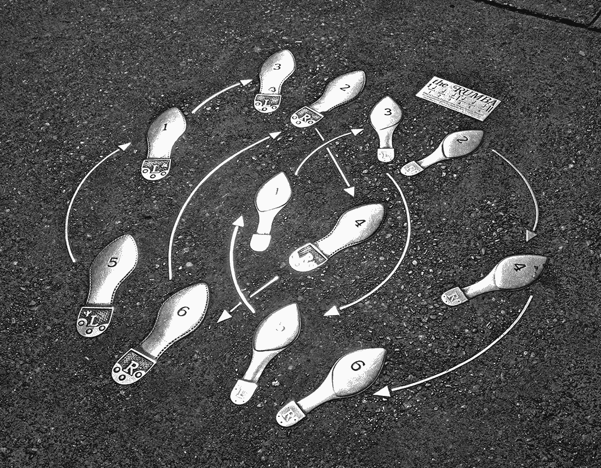

**图 4.1** 作为配方知识的舞步。西雅图国会山附近的人行道上嵌有描述舞步的青铜足迹，这幅百老汇大街上的足迹则展示了伦巴舞的步伐。图自维基共享资源

---

## 六、 从“儿童故事”看框架与默认设置

知识表征为**“稳定推理网络+可变输入节点”**。**“插槽”**即节点，**“框架”**（Minsky推广，源自Charniak 1972儿童故事理解研究）即网络骨架。^(¹¹⁷)

乍看“框架”似机械自动售货机（内容变、机器不变），实则不然——**每次实施都在改写语义网络**。如“力”概念从关联“运动”转向关联“加速度”（牛顿力学），引发“惯性”语义深层重构（从静止趋向转为维持运动态），这历经数百年范式转型。但“自动售货机”隐喻极利于剖析**先备知识如何塑造判断、论证与文本理解**的微观细节。

### 生日故事实验

> **文本**：保罗生日，简和亚历山大买礼物。简想买风筝，亚历山大阻止：“他已有一个，会让你退掉。”
> **提问**：为什么买礼物？去哪买？“它”指什么？
> **结果**：常人秒答——因生日、去商店、“它”=风筝。
> **悖论**：答案**全不在文本里**，需**推断**得来；但非演绎逻辑（需外部前提），实为**“文本信息+先备经验”**的耦合。

这证明：**心智模型（生日框架）预设变量槽，实例化后自动推演结论。**

### 默认设置：认知的“预填值”

插槽填充来源多元：经验证据、合理预期、隐性推理，**尤其来自“默认设置”**——基于过往经验的貌似合理预设。一旦模型实例化（输入满足约束），后续推理便在模型轨道上滑行。

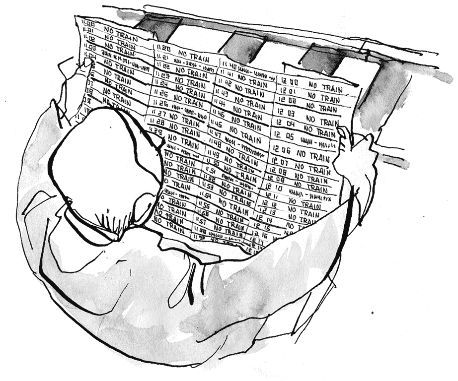

**图 4.2** 荒诞的时刻表。劳伦特·陶丁绘

# 重思认知引擎：从默认假设到知识进化的隐性逻辑

再看“运动—暗示—力”这一模型。很多时候，驱动运动的力量并不直接显露，正如汽车引擎藏在盖板之下。虽未见其形，我们却坚信车辆由发动机驱动——这是过往经验在大脑中自动补全的画面。于是，运动感知便与这类结构化的经验知识挂钩，让我们得出的结论远超感官直接触及的范围。

若无这些“默认设定”，科学交流将寸步难行，正如失去语言文字，人类沟通将不复存在。无论是科学探究还是其他外部表征，默认假设的作用都是填补信息的必然缺口。

打个比方：想确认上午十点波士顿去纽约是否有车，你在南站查时刻表，发现没这趟车次。你会直接断定没车，尽管时刻表从未明说“未列车次即不发车”，也没提示你要这么理解。大家心照不宣地默认：读表者早已掌握这套补全逻辑——表上没有，就是没有。我们赖以生存的世间常识，是读懂科学理论的前提，绝不止这类简单推断。然而回顾过往，科学史研究常忽略这些默认假设，更鲜少从认知架构层面深挖其内核。

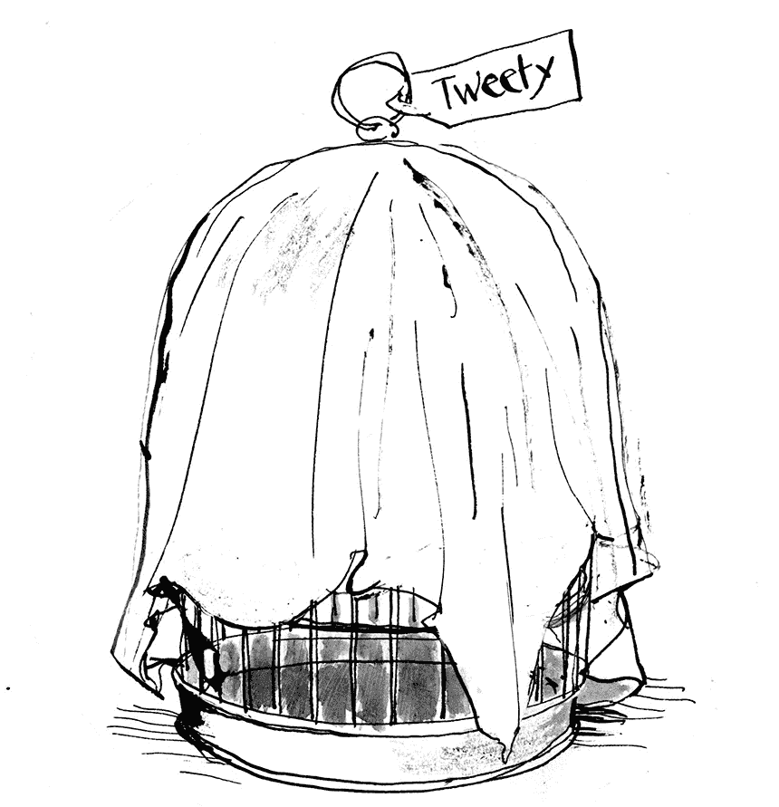

**图 4.3** 这是崔弟吗？劳伦特·陶丁绘

框架、心智模型这类概念，不仅助我们在信息残缺时完成演绎，更让我们能预判情境变动带来的结论逆转。默认设定极易修正，且无需推翻整个推理框架。经典案例：一只叫“崔弟”（Tweety）的鸟。^(¹¹⁸)

## 科学推理里的“心智模型”

这种日常思维，与科学推理的常态高度呼应。当推测落空、预期效应在实验中消失，科学家如何应对？通常不会抛弃理论，而是依据异常观测微调模型。

以 19 世纪光学电磁学基石“以太论”为例。其核心概念源于熟悉的“介质传波”心智模型——类比大气传播声波。若假设静止以太承载电磁波，便该能实测地球相对以太的运动。可“以太风”探测屡战屡败。起初这未动摇底层模型，反倒催生“长度收缩”等特设假设，强行解释为何运动难以被察觉。

心智模型天然带有情境性，非放之四海而皆准。正因如此，它能理论化描述特定对象的推理框架及其历史演变。它在不同知识层级间搭建桥梁——从工匠的技艺经验到科学家的理论体系，让那些藏在行动逻辑里、未被文字固化的隐性结论显性化。

心智模型如何驱动知识系统更迭？同我对认知结构的核心主张一致：将多元对象与过程纳入同一模型实例化，会不断丰富经验库、重塑模型本身。这可能生成新默认设定，不同实例间也会产生关联。

结果便是：依托模型差异、跨环境调适、偶发整合，心智模型逐步适应修正。模型应用本身可成为反思对象，催生高阶知识。这或是针对失配的即时微调，或是反思积累后的主动重组。失配时，认知对象或被纳入他模，或迫使本模为新经验让路。

同一对象常适用多模型。此时模型间关联、整合、联网，原本独立的推理领域因此连通。这能生成复杂表征，也可能引发无解矛盾。另一变量在于心智模型与外部表征的互动。物质模型可作外部载体，支撑心智模型运行；但探索物质模型也可能揭示初始构想未及的特征。控制物质模型的符号规则，若与心智模型运作冲突，便会激发棘手的解释难题。

鉴于这些特性，源自认知科学的“心智模型”等概念，比严守“思维过程与经验二分”的理论，更擅长诠释知识转型。毕竟，框架、心智模型这类构想，本就是在反驳“思维终极归结为形式逻辑或语言学规则”这类假设中孕育成熟的。

## 知识系统如何生生不息？

铺垫完心智模型的作用，回到知识系统本身。它是群体或社会（即路德维克·弗莱克意义上的“思想集体”）共享知识的切片，兼具稳健与反复无常。生存依赖它，故须稳健；嵌入制度、沉淀集体经验、传播机制含矫正控制程序，皆为稳健护航。同时它又须灵活适应，这恰是其核心构件——心智模型的本色。

知识系统如何变迁？靠从业者共同体在应用探索中渐次推演。它从不一次性呈全貌，潜在结论随智力实践层层展开。1915 年广义相对论仅是爱因斯坦的一组方程；经共同体长年累月阐释探索，才为天体物理、宇宙学搭建框架，让黑洞、引力波等概念浮现并接受实证检验（第七章、第十三章将再论）。终至系统高度稳定，结构因海量经验支撑而压倒个体贡献。虽个体思维受共享资源支配，却能反哺强化、甚至重构资源结构——否则相对论永无问世之日。

基础结构确会历经大修。历史长河中，数字、重量、惯性、化学元素、遗传学等新概念涌现，自然运动、以太、燃素等旧概念退场，仅留史家识记。这些核心概念举足轻重，其消长标志着重大结构变革中的认知层面更迭。

显而易见，这类变革常伴随社会组织重组与外部表征革新。事后回望，重大结构变化常表现为破坏性事件，是科学史热门母题，被冠以“科学革命”，关联“突破性发现”“范式转换”及缔造者。流传甚广的信念与猜想：信突破源于天才独到洞见，猜非非理性因素无以成突破。大科学家自述关键时刻——一夜、一谈、一假期——决定性念头忽现，更添神秘色彩。这种对颠覆性变革的聚焦，如何与共享知识的长期演进观共存？分三步拆解：变革诱因、探索过程、系统重组。

## 变革从何而来

诱因潜伏于知识系统三维度：心智、物质、社会。人环互动重塑物质世界，生成新认知对象、新媒介、新表征，冲击系统架构。新经验入系，个体差异在所难免。

知识变迁，尤科学变迁，常由经验扩容、新表征引入、冲突爆发触发，冲突溯源多有历史渊薮。但转型无放之四海而皆准的通用剧本。制度化系统的矫正机制，是抹除新经验还是视其为发展契机，视具体历史条件，核心取决于社会的“知识经济”（第八章详论）。新知能激活变革，但如何发力，看特定知识经济中的控制结构与形象。即便新颖、创新、好奇不被重视，新知仍常隐性纳入系统，表面却可能被明确拒斥，或重新贴标签为“古老”“失传”。

尽管如此，剖析发展动态，仍须考察典型诱因。其一为“挑战性对象”。指那些现象、人造物、物质文化片段，令现有理论框架面临现成概念无法解的解释困境，从而倒逼框架深化并最终转型。挑战性对象常体现他类知识——如制造现象所需知识，或发明生产使用者的实践技艺。其作用受物质属性与具体环境制约，故环境的物质性与偶然性会在知识演化中留下深刻烙印。

近代早期科学兴起，挑战性对象居功至伟，多源自当时飞速发展的技术领域。^(¹¹⁹)

研究此类对象时，既有理论框架在很大程度上界定了可能的问题与答案。框架内概念在应用中被探究，产出新果并暴露内部不一致，终推动框架向经典力学转型。伽利略新运动科学，即源于与摆、抛体运动等挑战性对象的搏斗。他将二者关联至斜面加速运动研究，使斜面运动成其核心又一挑战性对象。

现代技术挑战性对象，推动了从亚里士多德自然哲学与阿基米德力学到经典力学的跨越，印证：新知识系统源自旧系统的历史生成。且转型跨越多个知识层面——不仅理论，尚含挑战性对象的实践知识，如炮手积累的抛射经验。

第二诱因是“边界问题”。广义上属挑战性对象，但特指横跨不同知识系统之物。它们联通甚至冲突不同系统，引发整合重组。理解高度学科化科学的变迁，边界问题尤关键：常遇对象或问题落入多系统应用范围之内。第七章详论的热辐射问题，即 1900 年量子革命导火索。它同时属热理论与辐射理论两分支，二者概念基础独立，因共同覆盖热辐射而关联。普朗克、爱因斯坦等深入钻研，获实验经验知识支持的特定洞见，却难纳入任一原有领域。^(¹²⁰)

## 探索的动态与张力

进入下一环：由诱因驱动的知识系统发展动态。探索非随机，常因诱因呈定向性。诱因与后续探索在框架内制造内部张力——歧义、方案剧增、悖论、矛盾，简言之即系统性丧失。早期量子理论诸多悖论难题，即此发展状态的注脚。

挑战性对象、边界问题等诱因，激发多元观点，在知识论争中显化。^(¹²¹)

论争可发生于单一系统内。若相关知识为多概念系统共享，或基础概念存替代方案，论争更易爆发。无论如何，共享知识探索中，主观意义必现部分差异。差异仅部分，故论争中仍可有效沟通；差异客观存在，故论争在所难免。

近代早期科学论争典范：17 末“活力论战”。焦点：何种动因（今称力、动能、动量）生成特定机械作用，何者在相互作用中守恒。由莱布尼茨批评笛卡尔引发，终揭示：“运动物体中的力”这一传统术语歧义指向动能与动量两种动因，且均遵守恒定律。^(¹²²)

探索既有手段中，既定框架的替代方案可能浮现。经验基础越厚越可行，而经验基础很大程度上由既定框架提供。替代方案阐述（常借助既定框架手段）未必推翻旧解，常以新方式重新概念化旧解——如新表述。重述双重功用：吸纳未整合经验，让系统扎根更深；或成新经验起点，终突破旧系。

科学论争罕以“获胜”收场，多通过系统发展、蜕变为新事物而解——原问题已变质或失效。即使无明显赢家，一方对新系统诞生的影响力也可能更大。事后回望，对立双方皆是对共享知识同一基底的备选诠释。这正是知识系统发达的标志：能重建早期立场，自身却无法用旧框架表达。

此视角下，科学论争特征尽现：有利例证倍增、尝试从己方视角重构对方立场、不可避免的误读、向反思性立场转向。总而言之，这推拉博弈构成了对知识系统边界的探勘。

重申：此类系统从非始建完备，潜在应用与结论非一次性呈现。知识演化通过从业者共同体探索共享知识发生，论争是其基本形态。论争成效视特定历史条件——物质、社会、智力层面的促进或阻碍。结果或速解，或延宕数百年。

然而，细研发展特征会发现，科学中无处不在的论争与竞争理论，显示的可变性远超表象。知识发展实受历史赋予手段深度塑造，呈现显著路径依赖。部分源于“赢家通吃”逻辑：既定方案（思想与制度双重“既定”，如牛顿经典力学）常通过吸纳最宽经验而稳固扩张，获比其他可想象替代方案（如莱布尼茨力学）更大优势，后者永无机会实施制度化。

探索过程中，系统化程度因部而异。若视知识系统为操作网络（论证推理、问题应用、假设构造、建构计算、实验实践等），某些部分交织更紧。系统通常拥有紧密核心——心智模型、概念框架、论证模式、实践、工具、应用、结果交织，高度系统化且长期稳定。如亚里士多德物理学：因分类、天地运动区分、地表运动分自然/受迫，构成核心，稳固数世纪。

探索中，新洞见、新结果、新活动集群可能在核心周缘生长。这些“知识孤岛”（epistemic island）通过非标准应用、心智模型插槽的陌生填充、弱或大胆假设、有合理替代的论证，松散联结核心。但孤岛可自成系统。伽利略运动理论即一孤岛，源于亚里士多德物理学因摆、抛体等挑战性对象而转型（后章详论）。初仅含抛体抛物线、落体定律、斜面运动定理等洞见。在亚里士多德框架下属边缘、难纳入；内部却自洽，未成匹敌亚氏体系的完备理论。唯随孤岛周缘知识积累，更广泛新系统——经典力学——方才浮现。

## 知识重组：新框架的诞生

由此入第三步：通过重组存量知识建立新系统。重组路径多元，聚焦一特殊关键案例——知识孤岛作为新概念框架的“温床”或“母体”。“母体”指探索特定系统所获结果集，新系统终将破茧而出。成熟系统具内部系统性与普适性，母体虽尚不具备，却蕴含整合更多知识的潜能。整合结果事后看似中间结构，为知识转型终局搭脚手，是新框架的实际母体。^(¹²³)

母体如何推动转型？因母体与既有系统核心在认识论上隔离，故极可能被重新诠释，不受原系统总原则束缚。与概念中心的距离，暗示了重释的必要性。例：洛伦兹电子理论引入“长度收缩”作权宜假设（另例第七章详论）；母体封装知识的外部表征亦暗示重释路径，如洛伦兹变换数学描述长度收缩。操作外部表征引发的反思性抽象，可致认知结构变异，与旧核心处结构分道扬镳——此例中即爱因斯坦狭义相对论的新时空观。相关外部表征常因将特定框架推至极限而生，此处即经典电动力学表征。

前文提及的系统性崩溃、与核心距离拉大等迹象，让这些极限显性化。随之，知识孤岛的外部表征成为构建新框架的起点。于是母体成旧框架终点（常带问题），同时成新框架核心。我们再见外部表征的桥梁功能：连接新旧，保障知识演化连续性——即便这连续性伴随建立在外部表征基础上的认知结构转型。

知识体系的演进，本质上是一场视角的重构。新知识并非凭空而来，它在旧知的土壤中生根发芽，与母体系统保持着千丝万缕的联系。正因如此，这一萌芽系统——称之为“母体”再贴切不过——呈现出双重面相：它既可被视为旧体系的终局形态，也可被看作新事物的核心雏形。历史行动者倾向于哪种视角，往往取决于代际视野的差异；而在具体研究层面，则取决于议题处于核心还是边缘，属于宏观综述还是微观专攻。在知识探索的漫漫长途中，视角非一次性呈现，而是伴随个体认知的差异化学习而持续生成、不断更迭。

旧知向新知的跨越，标志着知识重心的位移——我们不妨称之为“重定中心”。昔日处于边缘的要素，无论是应用场域、论证环节，抑或辅助概念与构造，皆有可能跃居核心，构筑新体系的结构中枢。这种中心转移，往往伴随推演逻辑的逆转：旧系统中那些枯燥乏味的推论结果，在新系统中摇身一变，成为奠基性的前提假设。

知识体系的变革，其冲击波往往远超历史行动者的预判。有的变革由具体微观的局部问题发端，却牵引出惊人普适性的根本命题；有的则始终维持在初始问题的普适性层面。这种多样性的根源，在于变革渗透了知识的不同层级。某种程度上，一切问题皆关涉最普适的框架——空间、时间、物体、物质、因果等抽象概念构成的背景知识网。通常这些框架隐身幕后，鲜少成为显性问题。但特定条件下，新兴知识系统会与这些深层背景结构产生共振，引发对时空等核心范畴的颠覆性重塑。

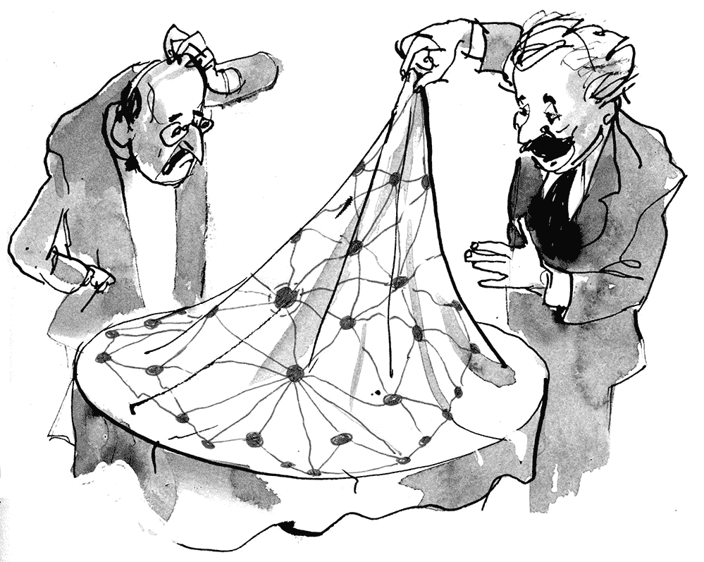

**图 4.4** 新知的萌发点，往往藏匿于既有概念网络之中——当旧网络被从一个全新的节点“提起”并重新审视时，新知便由此诞生，正如爱因斯坦以全新视角重读普朗克的工作。劳伦特·陶丁绘

至此，我们已勾勒出完整的演变图景。自上一章伊始，我们追问抽象概念的本性与演进；如今我们洞见，欲改变既有抽象概念（如时空），并将其纳入新的综合框架，究竟需要历经何等艰辛的认知跋涉。

知识体系的变革，绝非一劳永逸的单一事件。严格而言，并不存在所谓“科学革命”这般瞬间的断裂。唯有经由长期探索，在不断吸纳新经验、持续实施内部重组的漫漫长途中，知识系统方能抵达稳定与普适的彼岸。经典力学虽肇始于伽利略与牛顿，却须待 18 世纪拉格朗日、欧拉等“分析力学”大家的重述方臻成熟；达尔文进化论亦须待 20 世纪初“现代综合”方成大器；爱因斯坦广义相对论更是迟至 20 世纪下半叶“复兴”时期才确立其统治地位（第十三章将再议此例）。

虽案例迥异，但我们已窥见知识系统演化动态的共性侧面：变革诱因的触动、个体与群体探索对系统及其外部表征的塑造、知识重组的辐射式扩展。这些过程仰赖稳健且灵活的心智模型，依托其直觉、实践、理论三层知识的分层架构。历史不重演，知识变革无固定范式；然这些具体特征揭示了演化的深层机制与准则，或可成为剖析其他案例的分析工具箱。接下来三章，我们将深度考察这一工具箱的适用边界。

## 第五章

### 介入思维的外部表征

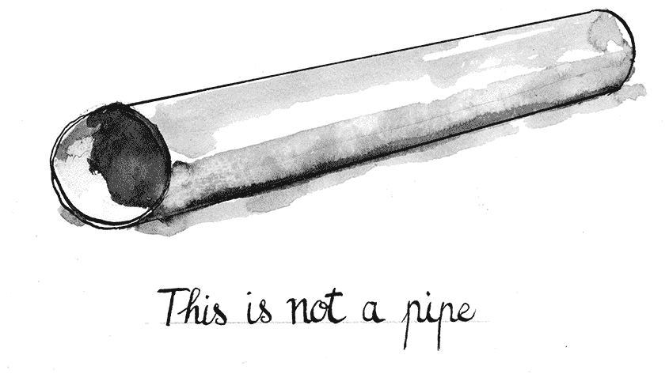

这不是一根烟斗。（Ceci n’est pas une pipe.）

——劳伦特·陶丁依勒内·马格里特《图像的背叛》及福柯《这不是一支烟斗》绘制

外部表征是一种思维工具，它在物质实在与想象世界间搭建桥梁，同时自构一重现实。^(¹²⁵)

### 算术的诞生

戴培德团队对美索不达米亚早期文字与算术起源的考察，堪称理解外部表征在抽象概念历史生成中作用的范式。^(¹²⁶)

公元前 4 千纪城市革命时期，文字与算术虽同步涌现，却未即刻催生抽象数字或通用书写系统，而是衍生出适配特定管理情境与活动的心智模型技艺。这些模型的诞生与符号系统演进同步，服务于复杂社会中集体行动的协同。我们将看到，数字抽象与通用文字的诞生，循着上一章已熟稔的序列展开：变革诱因（管控经济的扩张）、对既有外部表征潜能的挖掘、以及以会计实践为核心的知识系统重组。^(¹²⁷)

因此，让我们动用前两章的理论工具箱，精细剖析这一关键案例。以名、符、筹标识实物，即构成对象的一阶表征。这些表征可近乎等同于实物本身般被操作：连接、分离、排序。史籍最早的算术形态，即使用实物或标准化符号序列作为一阶表征，与对象保持一一对应。通过筹码重复表征群体数量；将标准化词语序列按时序分配至固定序列的元素上，计数序列由此诞生，表征特定集合的“序数”结构。

在这一“原算术”认知层级，不存在对应加减乘除的符号转换。符号操作仅针对对象表征，而非体现抽象数概念的高阶认知结构。原算思维广存于存续的无文字文化中；历史上虽难溯源，或可追溯至定居农耕与畜牧肇始。

美索不达米亚与波斯高地出土的黏土代币，可追溯至公元前 8 千纪早期。设想这些形制各异的代币，或已作为对象一阶表征，服务于原算计数与核算中的数量表征与管控。^(¹²⁸)

▼早期文字演进大事年表 ^(¹²⁹)

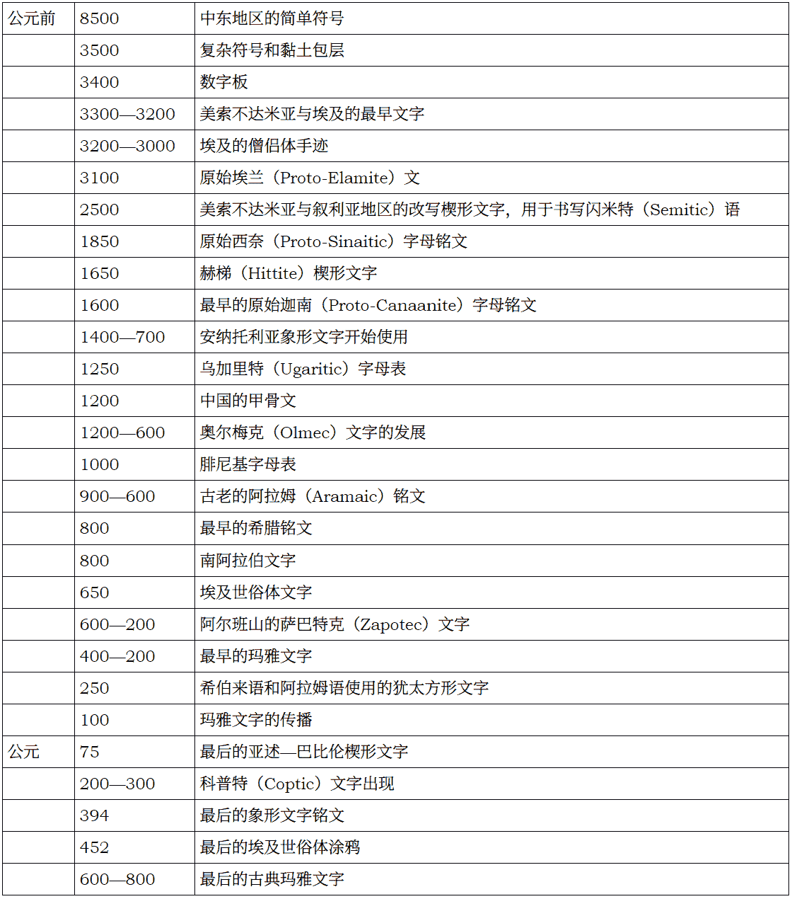

▼数字概念与算术思想演进大事年表 ^(¹³⁰)

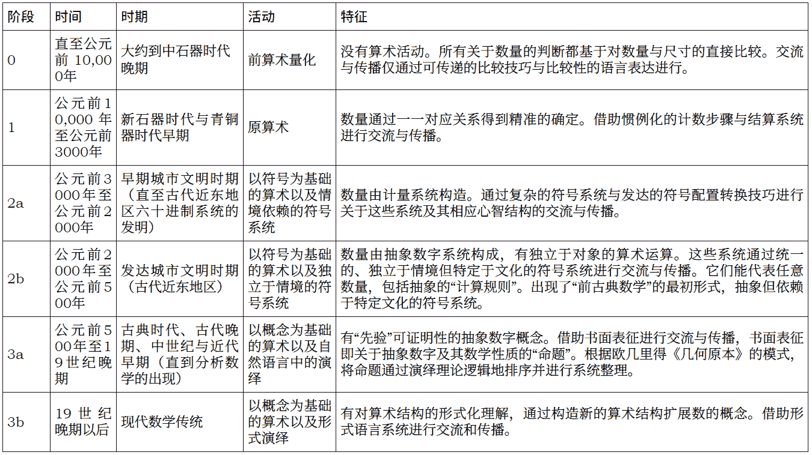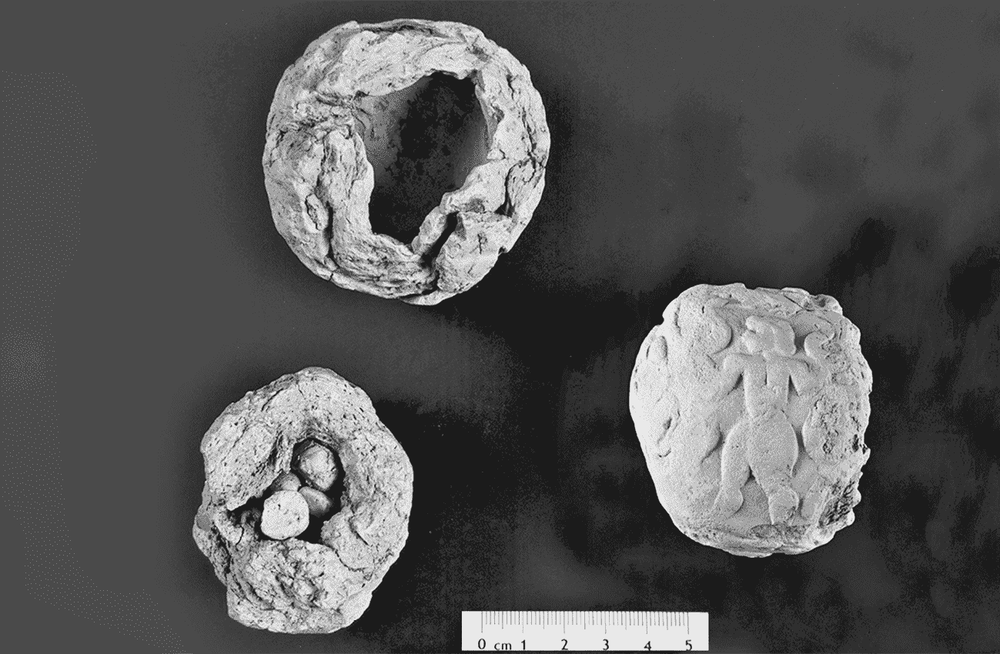

▲**图 5.1** 封装计数小代币的空心黏土球（约公元前 3500-3300 年）。德国考古博物馆藏，伊姆加德·瓦格纳摄

公元前 4 千纪后半叶，旧有外部表征形态经改造重获新生。源自美索平原农村经济的简易结算技艺，在新兴城邦治理中得到规模化应用。最早可考的筹码已包含捆绑的高阶单位（6、10、60），标志着对“一物一代币”原始模式的突围。传统结算中的印章，记录工人劳作量或给养。经济增长驱动下，对管理知识外部表征的探索终引发传统符号文化的质变——符号工具潜能被开发至极限，这是知识演化的典型特征，在结算实践的爆发式增长中表现得淋漓尽致，后者在农村共同体中原本角色微不足道。

此前，结算符号本质上仍是数量与经管实践的一阶表征；如今它们纳入发达符号系统，服务于更复杂的管理意图。它们不指涉抽象数值，其含义与数值高度依赖语境——即“在数什么”。符号转换不代表实操行为，仅彰显符号系统生成结算相关知识的潜能。

当结算双核——记录管理对象数量的筹码、记录行政行为的印章印记——被单一媒介统摄，历史抵达关键拐点。印章承载决定其义的行政与社会语境，为产权、法律行径、社会规范作证。二者初以密封空心黏土球（“大泡”，bullae）形态融合，传递特定代币组合；有时内部组合由球面标记指示。密封泥板功能同理，但更便携。无论如何，两套分立的结算技艺（筹码与印章）由此整合为一种全新外部表征形态，其巨大潜能随即被（并持续被）开掘。

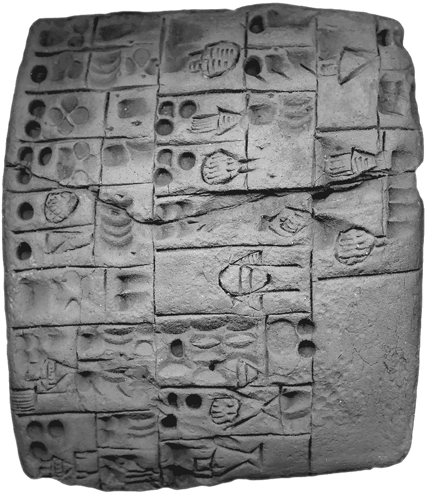

**图 5.2** 乌鲁克城邦原始楔形文字泥板（约公元前 3000 年），展示生产干谷物制品与啤酒所需原料量的计算（见下页作者手绘图）。见 Nissen, Damerow, and Englund (1993, 42–43)。楔形文字数字图书馆供图

这些密封泥板代表原文字与原算术早期阶段，成为探索美索不达米亚社会信息存储与处理新形态的起点。聚焦美索而非埃及，缘由之一正是此处保存了通往抽象数概念与成熟文字系统的中间演化链条的丰富实证。

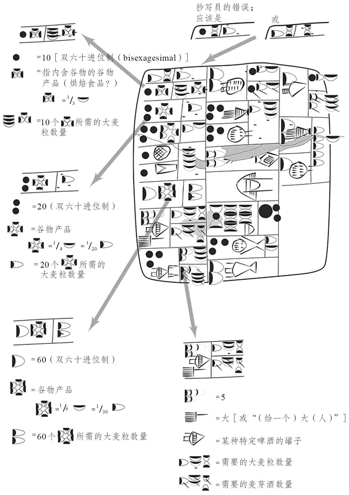

相较早期管理技艺，泥板容量更大、构造更灵活高效。极易创制新符号表征新语义范类；反之，既有经管活动亦为新表征技艺重塑。演化终成“原始楔形管理文本”，成行政官员积累调配资源产品的心智模型外化；该模型源自对行政实践的反思。

通过反思原算心智模型及其符号表征，数量与算术活动的二阶表征浮现。虽初存语境依赖，但其意指不再由实物操作主导，而由一阶外部表征的运算行动界定。二阶表征标志：明确的数字符号系统及其运算规则。规则或隐或显，应用严格，不再受现实世界偶然条件制约。美索案例中，约公元前 3200 年至公元前 2000 年乌尔三王朝末（六十进制发明前）这一显性阶段，基于符号的算术二阶表征及其意指仍随语境流转。^(¹³¹)

后续阶段实现标准化，生成通用记法，一切语境化表征均可转换入内。此通用表征支持脱离具体应用的形式运算。美索案例中，六十进制发明（约公元前 2050 年）标志此阶段到来，其统一了此前所有计数离散对象的语境依赖性符号系统。这发生于乌尔三王朝统一城邦、中央行政机构建立之际。六十进制确立带来算术统一；在此新境况下，对算术运算的反思催生术语、题型、解策，构成后世所谓“巴比伦数学”核心。

综上，算术作为操作外部表征的规则系统而生，毋须预设抽象数概念为历史起点。类似演化在中、埃、印、中美、美索等多元文明中独立发生。^(¹³²)

算盘成特定算术心智模型的物质载体，算筹模拟实物集合的组合与分解；埃及算术中，书面象形数量符号履行此功能。^(¹³³)

### 数学知识的实践根基为何被遮蔽

希腊哲学家倾向遮蔽抽象知识的实践渊薮。柏拉图《理想国》论理论数学与实践数学关系，贬抑后者：

“格劳孔，算术这门学问似有资格入法典；吾等当劝导未来执掌国政者习算，非浅尝辄止，而须深造，以纯粹理性洞察数之本质；非为市井买卖、商贾小贩之需，而为战阵谋划、引灵魂离变幻世界趋真理实在……基于此，吾辈万不可废此学，当以此教化最优秀公民。”^(¹³⁴)

追溯早期国家大型行政机构中文字算术之源，亦不应遗忘这些机构维系的权力机制所制造的剥削与苦难。^(¹³⁵)

### 文字的诞生

巴比伦文字演进轨迹，与算术高度同构。^(¹³⁶)

文字演进次一步，由第三章强调的外部表征基本属性决定：其潜在应用广度远超初始引入时的特定目标。原始楔形文本表征心智结构的潜能，远溢美索行政管理的狭窄疆域。至其最发达形态（约公元前 2600 年），或已具备表征口语的可能。^(¹³⁷)

书写语言反哺成为多元知识形式的关键外部表征。第十章将讨论早期文字社会的知识经济；此处聚焦数学演进相关的特例：文字编码算术反思成果，生成如柏拉图著作中显性语言陈述的数概念本质论述。数学运算的语言编码，导向更普适的数学命题系统，可线性层级化排布于演绎结构内。

案例即偶数奇数性质的定义与命题，源自古希腊，最早溯及公元前 5 世纪毕达哥拉斯学说，后汇入欧几里得《几何原本》。^(¹³⁸)

自知识传播借力文字这一外部表征，文字即内含特定知识领域固有的术语、问题、秘诀、命题，及其结构化常系统化的整编。美索文字普及后，新型书面知识涌现：语法、占卜、各类列表、史学、医疗、天文文本等。部分知识辗转传入古希腊，成为新书面表征形式的母题，进而成为表征知识（含哲学科学详尽论述）的影响深远的范式。古代知识经书面编码，促成复杂知识系统跨文化传播（叙利亚、波斯、阿拉姆、拉丁语西欧），刺激新知生成与模式再阐释。^(¹³⁹)

此后，文字作为语言表征手段，成为绝大多数社会基础性特征。文字发明揭示：历史进程的偶然产物，或多或少成为社会运作与稳定不可或缺的前提，尤对后续发展。知识演化是高度路径依赖的过程，每阶段动态不仅取决于前一阶段产出，更取决于初始生物生态条件的完整演化轨迹。

## 化学式的诞生

另一引人入胜的案例：19 世纪初瑞典化学家永斯·雅各布·贝采利乌斯发明化学式，经厄休拉·克莱因分析，展现了对外部表征的反思如何催生新知结构。^(¹⁴⁰)

核心议题为贝采利乌斯所谓“化学比例定律”。^(¹⁴¹)

化学比例理论的关键实体非原子，而是化学物质中与尺度无关的成分比例。^(¹⁴²)

化学式虽作为涉及离散、无量纲成分比例的化学操作一阶表征，实则源于对日常语言及道尔顿原子分子论表征化学成分局限性的反思。它们嵌入更广义语义网络：化学元素与化合物概念，及成分间可测量关系。服务于有机化学，建构有机构成与反应心智模型。化学式纳入发达符号系统，服务于理论建构的复杂意图。此时可执行符号转换，不再镜像实操，而是表征能触发预测的行动与结构模型。此例中，化学式兼具语义关系符号与图示双重属性。其图示性——如用加号连接元素字母——以镜像方式映射心智模型特定侧面：化合物由基础成分搭建而成。

## 演进中的图形表征

图表作为书写工具，保障了传承与创新的张力。中世纪借图表征质性变化的传统，经近代早期科学复兴与探索，为无穷小微积分理解经典物理运动及其概念化奠基。^(¹⁴³)

溯源 14 世纪学者尼古拉·奥里斯姆，他引入用图形表征质量变化的学术思想。^(¹⁴⁴)

变化质的强度以直线表征，于其广延每点正交垂直；垂线长度代表质在广延上的“程度”，为该传统共性。连接所有强度线上端点得“顶点线”。广延线、顶点线、首末程度合观，得二维变化图形；面积代表“质的量”。此图形可描述质变：匀速运动成矩形（均匀质）；匀变速成三角形（均匀变化质）。^(¹⁴⁵)

中世纪语境下，此图形表征嵌于复杂哲学论述中，服务于辨析诡辩、澄清神学、讨论�构情境（如苏格拉底加速疾走会如何）。其图形侧面与现代二维坐标下积分表征颇似。以速度为时间函数描述运动：匀速区间积分给出位移，积分即矩形面积，由时间长度与速度水平线决定。中世纪视角下，即均匀质。匀加速运动（零时刻静止始动），速度函数为过原点直线，面积为三角形，中世纪视为均匀变化质。

但概念层面，中世纪法与现代微积分/经典力学迥异：无函数概念、无积分概念；广延、强度、程度等范畴与现代框架无涉。然近代早期伽利略、笛卡尔、贝克曼、哈里奥特等前经典科学巨擘，皆倚重此中世纪传统，攻克日后经典力学归诸微积分的挑战性难题。^(¹⁴⁶)

答案在于前文原理：外部表征作为思维工具，其适用域远超初始引入时的设定。近代早期科学家重用既有表征，应对新环境挑战。如前章所述，此境况特征为实践知识与理论知识日益纠缠交织，被调动以应对抛体、摆动、机械效能等当时技术挑战。于此，中世纪外部表征化作连接两种概念体系的通道，自身在迁徙中亦完成重释。

中世纪学者对“变化”的独特构想，经近代早期科学先驱的转化运用，实为经典力学与现代微积分的诞生铺垫了基石。连接这两套概念体系的关键纽带，在于中世纪图表的图示属性。正如查尔斯·桑德斯·皮尔士所言，图表“在构成其对象的过程中，主要是一种对于关系形式的图示，很容易看出它对于表征必要推论的适当性”。^(¹⁴⁷)

探究运动规律无疑是近代早期科学的核心议题，当时学者通过实验与思想实验，设计了多种运动转化方案。譬如，将加速下落的运动导向水平，使其转化为匀速运动，从而在水平面上持续进行。这段水平运动将维持一个恒定速率，中世纪理论称之为加速运动的“最终程度”。于是，原本模糊的“程度”概念，借由匀速运动中明确界定的恒定速度得以具象化，获得了直接的操作性内涵，这与经典物理学中的瞬时速度概念异曲同工，均可用于刻画无限短时段内的运动特征。

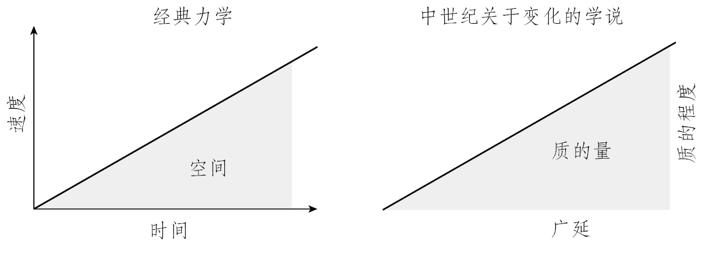

**图 5.3** 变化的多重表征面貌。经典力学视角下**（左图）**，匀加速落体的速度增量，可用速度-时间线性函数的坐标图呈现，位移则对应函数积分的面积。中世纪“变化的质”学说中**（右图）**，速度则通过其广延（时间）与变化程度，被表征为“均匀变化形状”或“三角形”的质。尽管两者本体论截然不同，图示却惊人相似，使得图形表征得以成为跨越时代的认知桥梁。马普科学史研究所图书馆藏

这仅是当时浩瀚探索版图中的一隅。在那场宏大的知识重组中，形形色色的外部表征体系被反复审视、验证或弃用。中世纪框架在新经验冲击下不断扩充、修正、重释，终化作无穷小微积分与经典物理学处理运动所不可或缺的概念环境。

这一历史插曲属于力学知识的长时段演进，剖析它有助于揭示该知识体系演变的普遍规律。下文，我将借助这段史实及具体案例，阐释其中的关键特征。

## 第六章

## 心智模型的实战逻辑

> 过去人们只夸耀生产归功于科学，却鲜少意识到科学归功于生产的事实不胜枚举。
> ——弗里德里希·恩格斯《自然辩证法》

> 默认假设非但不是权宜之计，它们构成了我们概括世界的最高效途径。虽常出错，却鲜少酿害，因一旦获得具体信息，便会自动修正。但若执迷不悟，后果便不堪设想。
> ——马文·明斯基《心智社会》

### 力学知识演进的六个阶段

以下将梳理人类在力学领域认知自然所依赖的心智模型的溯源、功能与嬗变。^(¹⁴⁸)

**第一阶段：力学的“史前时期”。** 这一漫长阶段涵盖了人类积累实践力学知识、却未形成文字记录与理论体系的时代。虽数学、天文起源可追溯至巴比伦、埃及古文明，但力学并未同步萌芽。尽管大型建筑工程确凿存在，却未留下支撑其建造所需力学知识的文献记录。

**第二阶段：力学的“起源期”。** 标志性事件是杠杆原理及其证明的问世。更宏观地看，这是首批专门力学/物理学论著诞生的时期：西方有亚里士多德、欧几里得、阿基米德、亚历山大港的希罗；东方有公元前300年的墨家经典《墨经》。西方文献深刻塑造了后续理论脉络，而中国早期力学成果则迟迟未产生同等影响力。

**第三阶段：“天平与重量的科学”时期。** 杠杆定律再度扮演核心角色。涵盖阿拉伯与拉丁世界的中世纪，产出海量力学文献，然主题相对聚焦狭窄。

**第四阶段：前经典力学时期。** 从达·芬奇等文艺复兴工程师的手稿，延伸至伽利略成熟著作。研究对象大幅拓展，覆盖斜面、摆、稳定性、弹簧等，杠杆定律仍占核心地位。

**第五阶段：机械论世界观的确立与巅峰。** 从笛卡尔的机械宇宙观，到牛顿、欧拉、拉格朗日奠基的经典及分析力学，再至19世纪试图以纯机械论重构物理学的努力。

**第六阶段：机械论瓦解与力学重组。** 19世纪末至20世纪初，量子论与相对论兴起，现代物理学概念革命爆发，经典力学体系解体。

这一宏观回顾引出一系列深层追问：理论力学为何在古代才萌芽且迟迟未现？杠杆定律的提出与证明依凭何种知识基底？中西力学发展为何差异显著？中世纪“重量科学”如何过渡至前经典力学？何种经验知识催生了经典力学，又何以解释其两百余年的稳固统治？亚里士多德物理学为何能跨越两千年长盛不衰？20世纪初机械概念为何崩解，相对论等革命性理论——其基石在创立之初根本不存在——为何能涌现？杠杆定律等核心原理又是如何穿越历次变革而屹立不倒的？

面对力学发展中交织的连续与断裂，将成因归结为与知识内在逻辑无关的外部偶然因素，颇具诱惑力。以亚里士多德物理学的长期霸权为例，其影响甚至延伸至以“反亚里士多德”著称的“科学革命”时期。将其归因于天主教奉其为正统等外部制度因素，乍听合理，实则预设了科学知识主要编码于显性理论之中。

但若纳入全谱系认知——尤其是支配我们在自然环境中思维与行动的直觉知识——便会发现：亚里士多德物理学的某些内核（如前章所述），对中近世学者的说服力，不亚于其对现代儿童乃至高中生的直觉吸引力，因为它们由普遍共享的心智模型构成。简而言之，理解力学长时段演变，除考虑科学史惯常关注的理论知识外，必须引入直觉物理学知识与实践力学知识。我们将回到第四章的三元知识框架，并依力学情境加以重释。

### 力学知识的三重形态

**直觉物理学**植根于普遍或近乎普遍的人类活动经验。相关经验涵盖对物体持久性、不可穿透性、物理性状的感知。它也是力学理论论证的基石。例如证明杠杆定律时，无需额外论证“杠杆一端升起，另一端必降”这一默认认知。直觉物理学的基础模型包括第四章所述的“运动—暗示—力”模型，用于解释施力导致的感知运动；另如“稳定性”心智模型，使我们推断无支撑重物必坠落，即将倾覆之物可被他物稳住。反向推演：若重物未落，必有隐性支撑，即使肉眼不可见。

**实践力学知识**先于任何系统性理论处理而生，源于对杠杆等机械工具的操作。这些工具旨在超越生理极限放大力量。区别于直觉知识的普遍共享，实践知识具有文化特异性，甚至在同一文化内也非全员掌握，它紧贴专业群体对工具的制造与使用。

一旦支撑该知识的工具发明问世，关于其制造与高效使用的经验即可在个体间传递，并借助物质工具、共同实践、暗语术语口传，代代相传。

古老典范莫过于“称重与举重”——等臂天平模型。平衡力等于物体重量，此消彼长，我们称之为“平衡模型”。

古代工匠工程师的实践智慧，还包含如何摆脱“力重等价”的桎梏。机械师的精髓，在于借杠杆等器械逆转自然趋势。在此视域下，机械工具能在给定力下实现“无工具不可达”的“非自然”效果。基于此理解的模型，我们称“机械模型”（mechanae model）——mechanae源自希腊语“装置/技巧”，即“力学”（mechanics）词源。其具体化版本为“杠杆模型”，将杠杆识认为省力装置。自古挖掘棒、葡萄榨汁机、榨油机、重物移位工具，皆是其实例。

实践知识库的另一范例是“拱模型”。基于拱券跨越开口、插入拱顶石始承自重的经验。拱技术史前即有，早期采用“叠涩技术”，重力垂直传递至墙体，拱顶石无静力学关键性。换言之，拱模型本身就是学习的产物，或源于地上地下建筑对拱券的广泛应用。

与动物本能力学不同，人类力学知识不止于生物本能，更根植于历史传承的工具使用，意味其发展受社会环境塑造。熟练驾驭工具需长期经验积累，最好通过专业操作习得。故而，工具基础力学知识的演进，本质上是社会分工的产物——分工催生职业，职业承载专业知识代代相传，也伴随失传风险。

传承主要依托学徒制参与劳动过程。工具本身、操作技艺、知识演进应用史，原则上不依赖文字或图形符号表征。但其发展会在语言语义拓扑留痕，特别是专业术语的涌现——它们衍生自相关工具、技能与实践。

机械工具的历史性涌现有社会前提，其后果之一是：工具研发主要集中于关乎共同体生存繁衍的核心领域。早期文明在狩猎采集、食品加工、部族战争中发展机械工具，这些领域工具效益显著，从而激励系统化生产与代际传递。

相较于直觉与实践知识对特定工具技艺的依赖，**理论知识**建立于语言编码的普遍概念之上。形态通常为：基于自然语言推理的显性力学理论，或基于数学语言形式化系统的演绎理论。例如“重心模型”：物体悬挂于重心处，任意姿态均不转动。该模型源于力学理论语境下对天平模型的概括——万物皆可视作天平，假定一虚拟支点（抽象点），物体悬挂于此即恒定平衡。

理论知识并非如休谟所言源于感官资料的即时加工，而是源于对心智模型的反思——特别是对直觉与实践知识模型的反思。借助力学规则及其表述等工具，反思产出直觉推论，并将规则陈述整合为高阶概念体系，以理论形式表征两类知识中的经验。

古希腊哲学家如亚里士多德，以概念与文字形式显性化了直觉思维基本模型（如“运动—暗示—力”）。亚氏将其作为运动理论内核，深刻影响中世纪末至近代早期的诸家运动理论。^(¹⁴⁹)

这回应了先前提出的知识形态间关系问题，特别是实践与理论的关系。理论力学的生成，伴随特定机械工具技术词汇的涌现，这些词汇转入话语描述，最终经演绎体系形式化语言，显化操作规则的普遍关联。这些术语与关系，直接或间接反映了直觉与实践知识结构中心智模型的整合。正是这些模型，保证了普遍力学概念能回溯至其发源的具体经验语境，成为普遍理论陈述的实例注脚。

### 理论力学知识的困境与突围

从直觉思维模型到固着书面语言的运动理论，这一跨越深刻影响了后续思想演进。对结论与后果的反思空间被打开，成为模型进一步分化的发端。首种分化源于经验处理：某些经验虽形式上符合模型一般概念，却无法纳入直觉模型底座。

具体而言，亚里士多德《物理学》中，“运动—暗示—力”直觉模型难以解释“推动者缺位”的运动，导致特定运动类型被定义排除。亚氏将两类运动排出模型适用域：天体运动；重物趋地心下落、轻物逆向上升。这些被界定为无需动力的“自然运动”，与唯一受理论主导的“受迫运动”对立。

亚氏理论认为，天体运动靠“以太”第五元素的自然圆周运动实现；重轻物体直线运动源于趋向自然位置的内在倾向。这种对自然运动的理论处理，引发了概念分化——将其理论性排除出“运动—暗示—力”模型的应用范围。

理论反思引发模型内部分化的另一案例是“惯性运动”——无驱动力条件下的运动持续。抛射体离手后仍持续运动，无可察觉驱动源。但应用“运动—暗示—力”模型，要求关键变量“推动者”与被动者直接接触以施力。

包括亚氏在内的古哲学家提出诸多巧思（甚至过度巧思）论证，试图为惯性运动（如抛射体飞行）分配动力，尽管动力并不显现。论证常假设：投掷之手激发介质（如空气）运动，介质再通过与运动物体的直接接触维持其运动——极不直观的解释。然而，这种人为修补，尤其是亚氏本人的版本，之所以流传，与其说因解释力，不如说因理论教条主义。与亚氏物理学其他主张（如自然/受迫运动之分）植根于直觉可信的心智模型不同，这种修补模型的存续，与特定社会条件——尤其是保障模型确立为教条、强化其效力的学术机构——深度绑定。

心智模型应对挑战的另一路径，是在现有模型空位引入新模型。后世发展证明，我们可以将通用变量“运动”细化为包含“加速度”特征属性。于是，亚氏自然哲学的“运动—暗示—力模型”嬗变为经典力学的“加速度—暗示—力模型”。新模型断言：非运动需力，而是运动变化即加速度需力。这成为经典物理学基石。新模型仍植根直觉物理学，拟人化力概念与源自旧模型的修订佐证了这一点。但它已超出直觉物理学或实践者知识范畴，其反直觉推论（如无力运动永不止）可见一斑。因此，这一修订在历史上被接受前，耗费了巨大心力与漫长岁月。

### 直觉物理心智模型的自我修正

尽管上述简述显示，从亚氏运动解释到经典物理学解释的重大转型在原则上可行，但未揭示整个知识系统如何重组以达成此转型。“加速度—暗示—力模型”非临时拼凑，乃漫长知识积累与转化的结晶，最终获得稳定性与力度，嵌入新生经典力学框架。

模型转型的一个起点，同样立足直觉物理学，即发展心理学研究证实的“惯性运动日常经验”。^(¹⁵⁰)

近代早期，这种扩展的解释可能性，成为突破亚氏解释范式的关键突破口，且无须初始即抛弃亚氏核心预设。例如，若假设施于抛射体的推动力逐渐耗尽，即可解释减速；反之，若假设推动力仅能被反作用力（如介质阻力）耗散，则推导出：无反作用力干扰时，物体将永远保持运动。此时，“运动—暗示—力模型”推导出的结论，竟与后来经典物理学惯性定律暗示相合，从而有力支撑了惯性物理学的萌芽。

### 亚里士多德主义：制度化的共享共识

如前所述，亚氏物理学捕获海量日常经验，是其长期存续的理由之一。另一理由在于其在制度化教育中的核心地位。近代早期，亚氏物理学是大学基础必修，任何构建同等普适自然理论的尝试，都必须以此为起点，即便目标是修正主流亚氏体系。

这解释为何伽利略等人常将“反亚氏”姿态与“坚守亚氏基本预设”结合。他们同时依赖中世纪经院传统对亚氏物理学的精微阐释——如上一章提及的14世纪奥里斯姆引入的图解表示法。这些知识非植根直觉物理学，而是当时共享知识库的组成部分，因作为正统理论在大学传播而成为共识。

此理论传统的预设，无一像植根直觉的亚氏内核那样不证自明、似乎不可辩驳；其中部分已辩争数百年。故这一共享理论知识链，依赖文字与教学传统的连续性维系。这解释了当时众多攻关加速现象的人物（伽利略、笛卡尔、贝克曼、哈里奥特等）显著的认知共性。^(¹⁵¹)

特别是，他们皆将加速运动概念化为兼具“广延”与“强度”的质，可用变化“程度”描述。实则，这种概念化与表征变化的传统紧密相关，即我在论述中世纪亚氏传统时已讨论过的内容。

### 技术挑战倒逼理论革新

但为何加速运动研究对近代早期思想家至关重要，对早期亚氏哲学家却非如此？在探讨知识系统变迁动因时，我们已给出部分答案。此案中，当时技术（特别是机械装置与弹道学）的挑战性对象，凸显了深入理解加速运动的迫切性。应对这些挑战时，理论知识资源（如亚氏自然/受迫运动之分）得以与实践者的新经验发生耦合。

## 知识重组：经典物理学的诞生

任何严肃的早期抛体理论，都绕不开弹道实战专家的经验法则。这些知识既靠口耳相传、实战积累，也流传于大量公开或内部的军事文献中。老炮手们凭借职业本能早已心知肚明：装药力量越大，出膛速度越快；弹体重则需更大推力才能及远；射程取决于仰角；存在一个能让飞行距离最大化的最佳角度；且不同角度下，平射与高射虽能落点重合，杀伤效果却截然不同。^[¹⁵²]

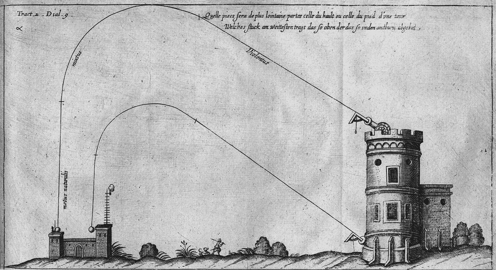

**图 6.1** 用“受迫”“混合”和“自然”运动详细阐述亚里士多德对抛体运动的解释。摘自 Ufano (1628)。马普科学史研究所图书馆提供

正是这些实战经验，激发了伽利略对摆动周期、弹道曲线等棘手问题的兴趣。^[¹⁵³]

将抛体轨迹与悬链线曲线并置比较，让伽利略洞察到二者共享的对称底蕴，进而提出用抛物线作为统一识别的钥匙。^[¹⁵⁴]

1592 年，伽利略与赞助人圭多巴尔多·德尔蒙特做了一个极简的定性实验：让蘸墨小球在斜面上滚动。不同于空中飞行的炮弹，墨球在纸面上留下了清晰可视的轨迹印记。两人惊讶地发现，这条轨迹与倒置的悬链线惊人地相似。这暗示两者可能源于同类力的作用（尽管经典物理学后来证明并非如此）。这种相似性让伽利略深信：轨迹对称性是抛体运动的核心特征，且其形状必定是抛物线。随后数年，他不断丰富这一实验洞见，却始终未跳出亚里士多德动力学的框架。^[¹⁵⁵]

基于水平与垂直运动合成来构建抛物线，意味着必须预设：水平运动是匀速的，垂直运动是匀加速的。这实际上隐含了类似惯性定律的雏形（至少适用于水平向），以及自由落体定律的特例。假设水平运动不增不减，完美契合伽利略正在萌芽的斜面理论——该理论仍运行在亚里士多德物理学范式内。在该范式下，下落是加速的“自然运动”，上抛是减速的“受迫运动”，于是水平匀速运动便被归类为介于两者之间的“中性运动”。^[¹⁵⁶]

这组关于抛体与斜面运动的认知，构成了伽利略新兴运动理论的基石。尽管它仍沿用“自然/受迫”二分法，属于亚里士多德式理解的延伸，却已显露明显的背离迹象：强调加速度现象（这在亚体系中缺位）、主张存在匀速中性运动、假设弹道具备对称性。^[¹⁵⁷]

然而，若坚守亚里士多德框架，伽利略只能推导出水平射击的轨迹。其合成逻辑是：匀速水平运动（中性运动的体现）叠加加速竖直落体，合成水平抛物线。^[¹⁵⁸]

斜射情形则棘手得多。沿斜面向上是典型的减速运动；斜向抛射是否意味着沿发射方向减速、竖直方向加速的叠加？

这在经典力学视角下显得荒谬，但伽利略与同时代人曾严肃推演此可能性。^[¹⁵⁹]

经典物理学给出的答案截然不同：发射方向分量实为惯性运动，无外力则沿直线匀速；无论发射角度，抛物线轨迹皆由惯性定律与竖直向重力加速度合成而成。

但即便没有惯性定律作基石，伽利略也意识到：斜射轨迹同样可能具备对称性，正如水平抛射一般。^[¹⁶⁰]

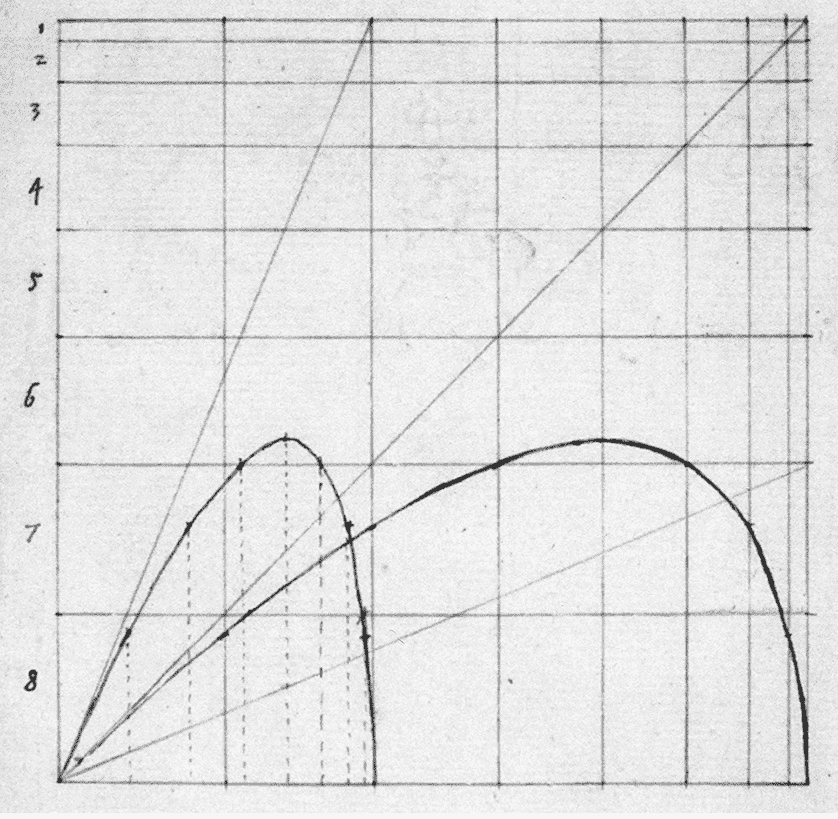

**图 6.2** 假设炮弹的斜向运动分量为减速运动，逐点地构建炮弹轨迹，正如物体沿着倾斜平面向上的运动一样。托马斯·哈里奥特（Thomas Harriot）手稿，Add. MS 6789 fol. 5r。© 大英图书馆董事会

正如第四章所述，前经典力学的预设充当了“母体”，因其可被重释为新知识体系——经典力学——的关键基因。至 17 世纪末，艾萨克·牛顿在其巨著《自然哲学的数学原理》中完成了这场蜕变。^[¹⁶¹]

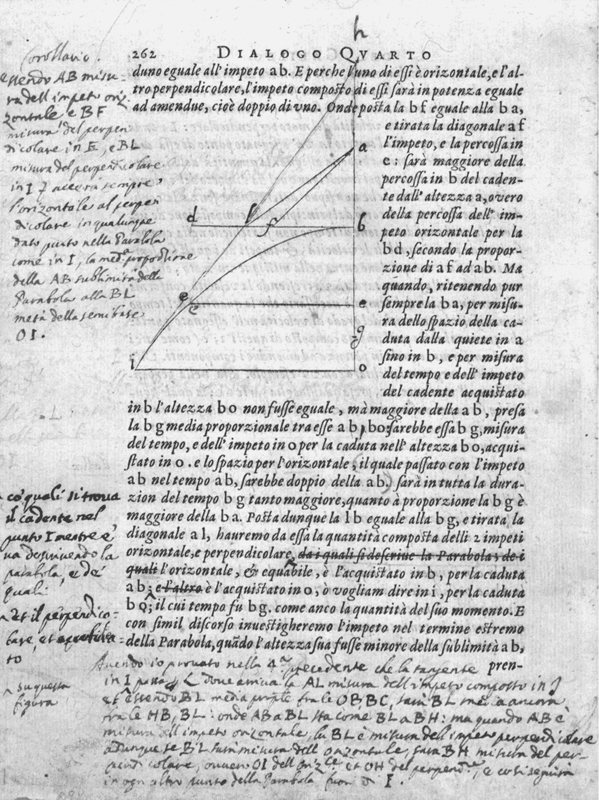

**图 6.3** 伽利略于 1638 年出版了关于力学的主要著作《关于两门新科学的对话》，这是其在手抄本中的修改痕迹。图片中添加的线条和相关的手写笔记构成了惯性定律的表述，这是伽利略发表论证之后的想法，发表出来的论证仍然扎根于亚里士多德的动力学。Ms. Gal. 79, c. 157v，意大利文化遗产和活动部/佛罗伦萨国家中央图书馆特许使用

站在经典物理学岸上回望，这一步似乎标志着对亚里士多德运动论的终极胜利，错误的因果假设被正确取代。实则不然，牛顿同前辈一样，仍坚信运动源于施力。^[¹⁶²]

牛顿模型展示的物理学解释剧变，是知识综合整合的**结果**，而非**前提**。这一整合过程融汇了伽利略对加速运动的研究与开普勒对行星运动的洞见。依我之理论视角，知识转型非因新经验修补旧理论而生，而是既有结构框架内部发展的产物，而既有结构又因新经验积累而充实。

### 古今之争：观念的代际博弈

历史学家汤因比与人类学家古迪指出：文艺复兴非欧洲专利，乃一切书面文明的循环现象。^[¹⁶³]

这一过程也塑造了科技文化中“现代性”的面貌。“古今之争”或称“书籍之战”便是生动注脚。这场辩论自 16 世纪中叶意大利萌芽，主战场在法英，延续至 18 世纪中叶。^[¹⁶⁴]

科学史亦有同构投射，牛顿即为典型。其著作虽被卷入争论作证，立场却令人意外——并非站在“现代派”一方。《原理》（1687）既是前经典力学的巅峰，也是经典力学的基石，更开启了达朗贝尔、欧拉、拉格朗日等人分析力学的先河。然而牛顿本人却推崇希腊几何，排斥韦达符号代数与笛卡尔解析几何等创新。^[¹⁶⁵]

即便亲手创立流数术（微积分雏形），牛顿也极力掩饰其新颖性，将其包装为旧几何的延伸。如“首末比率法”中，微分系数被处理为欧几里得比例的极限。他未将微积分置于新力学核心，反以近似经典几何的方式改写《原理》推论。反观对手莱布尼茨，则大胆启用新符号体系。^[¹⁶⁶]

然而对法兰西读者而言，《原理》终成脱离古几何直觉的新科学基石。拉格朗日因《分析力学》全书无图而自豪。^[¹⁶⁷]

实则，形式主义与直觉主义非水火不容的二元对立。第三章已论及：抽象与反思建立在形式系统互动之上，因形式系统是思维认知结构的外化。分析力学虽摆脱直觉实践的心智模型，并未全盘抛弃心智模型，反而创造出对自身更直观合理的思维形式，其说服力不逊古代模型，且在古今之争中拉开身位。函数心智模型（`y = f(x)`）即一例；最小作用量原理则是另一核心——至今仍是物理学强有力的形式内核，同时直观诠释了“自然趋向最小努力完成任务”的倾向。

简而言之，古今之争不过是知识演化中反复上演的特征之一：形式系统与自然语言、符号与语义孰重孰轻的永恒争鸣。

## 第七章 科学革命的本质

> 概念无法从经验逻辑推导，亦超脱批判。但出于教学启发，此过程不可避免。寓意：不违逻辑难有建树；无脚手架不能造房架桥，但脚手架非房屋桥梁之本构。
> —— 爱因斯坦《致莫里斯·索洛文信》（1953）

> 常规科学无法修正范式。反之，它只能导向反常与危机的觉醒。终局非由商议解释达成，而由类似格式塔切换的突发非结构化事件终结。
> —— 库恩《科学革命的结构`

细究之下，近代早期科学革命非独例，科学知识架构的所有重大变革，皆是长期知识积累的结晶。如前论，创新源于对既有知识系统“可能性视域”的探勘，源于重组积存知识时同步涌现的转型。下文将复盘哥白尼、化学、达尔文三大革命，细析爱因斯坦双相对论革命（1905 狭义、1915 广义/引力新论），末简述库恩钟爱的量子革命。第十章将补以 20 世纪地质学革命案例。^[¹⁶⁸]

我将沿用第四章概念框架，凸显共性主题：这些成就皆非无中生有，而是前系统的转化重塑。转型往往跨越数代，旷日持久。^[¹⁶⁹]

### 库恩 vs 弗莱克：两种革命观的张力

库恩的革命分析深受冷战意识形态塑造，尤其是对马克思主义观点的反拨。^[¹⁷⁰]

库恩对弗莱克著作的矛盾态度，折射出“思维风格”层面的分歧：“我不觉从中**学到**何物（波兰语太难），却获关键支撑。有人同我一样思考问题、史料，却从未让我完全自在，我仍不同意其‘思想集体’说。”^[¹⁷¹]

库恩观点职业生涯中演变：晚年弃格式塔“范式转换”，转向语言哲学表达科学观，甚至弃“范式”改用“词汇系统”。^[¹⁷²]

1960 年，弗莱克临终前在手稿中总结观点（久未刊行），指出团队合作、合著、海量期刊会议委员会等现象，已让科学知识的公共属性显而易见，印证其社会学预判。^[¹⁷³]

## 哥白尼革命：几何重排与物理真空

通俗叙事常将哥白尼革命视为“范式中的范式”，认定日心说触发认识论突破，催生现代科学。柯瓦雷与库恩即持此见。^[¹⁷⁴]

《天体运行论》（1543）将太阳从边缘移至中心，以几何考量重塑天文学，动摇了融合自然、哲学、形而上、神学的地心说教条大厦。^[¹⁷⁵]

亚里士多德视角下，日心说等于世界构造的根本性颠覆，因其物理荒谬而不可接受。自然哲学角度看，地球运动引发的问题多于解决的。虽则哥白尼用几何统一解释了水金最大距角、行星逆行等现象（托勒密体系需借周均轮等临时装置勉强自圆），且这些现象在“地球绕日转”设定下成了必然推论。^[¹⁷⁶]

然新体系违背亚里士多德物理学基石：打破地上（直线、堕落）与天上（圆周、完美）二元王国界限。如前章所述，亚框架靠“天球”运送行星，以此区分地面与天体运动性质。

哥白尼未给出物理替代方案，反倒置数学与物理优先序，聚焦数学天文学核心。以地球公转为基准测定行星距离，解决了行星排序这一悬案（旧说依自然哲学假设距离与周期成比例，内外行星均成问题）。哥白尼理论使排序成几何推论的物理结果，且自洽于距离—周期关系。^[¹⁷⁷]

哥白尼颠覆“数学从属物理”的学科等级，在方法论与认识论层面发问。但其“革命”并未与传统彻底决裂。它解决旧题、开启新研径、抛出根本新题（尤其是物理学层面）。

实则，哥白尼思想深植于对传统知识边界的试探。几何模型源自托勒密及阿拉伯天文学文脉。^[¹⁷⁸]

理解日心说，必须重启古老辩题：几何模型能否与物理因果解释调和？这一存疑假设，贯穿晚期古代至伊斯兰、拉丁中世纪的天体物理学核心。阿弗罗狄西亚的亚历山大（3 世纪雅典逍遥派）开启了对天体运动物理成因的追问；12 世纪安达卢西亚哲学家伊本·路世德（阿威罗伊）将其系统化，引发多次尝试，皆依托亚里士多德形而上假设（核心为天体完美匀速圆周运动原理）构建行星论。^[¹⁷⁹]

哥白尼几何工具箱的关键组件，可溯源于雷吉奥蒙塔努斯、派尔巴赫、布鲁泽夫斯基等前驱著作。^[¹⁸⁰]

直至彗星视差测定确认其位置超越月球，“天球实体”始受质疑。1580 年代起，彗星新证引爆激辩，直指行星运动可说明性与新物理必要性。天体物理史视角看：哥白尼体系提供行星模型，若无自然物理依托，难服学界众口。布鲁诺生机物理学、开普勒力学天文学、笛卡尔微粒力学，皆为将哥白尼几何转化为物理革命的尝试。^[¹⁸¹]

## 化学革命：并未发生的革命？

18 世纪化学革命，传统归功拉瓦锡。厄休拉·克莱因精准定性为一场“从未发生过”的革命。^[¹⁸²]

拉瓦锡前，化学家早认定：常规物质由更基础成分构成，化学分析无法再分。化学界（含拉瓦锡）未弃“要素”古术，亦承认最简“要素”（即“元素”）赋予特定性质。如拉瓦锡从希腊语“oxys”（酸/尖）造词“oxygen”（氧）。^[¹⁸³]

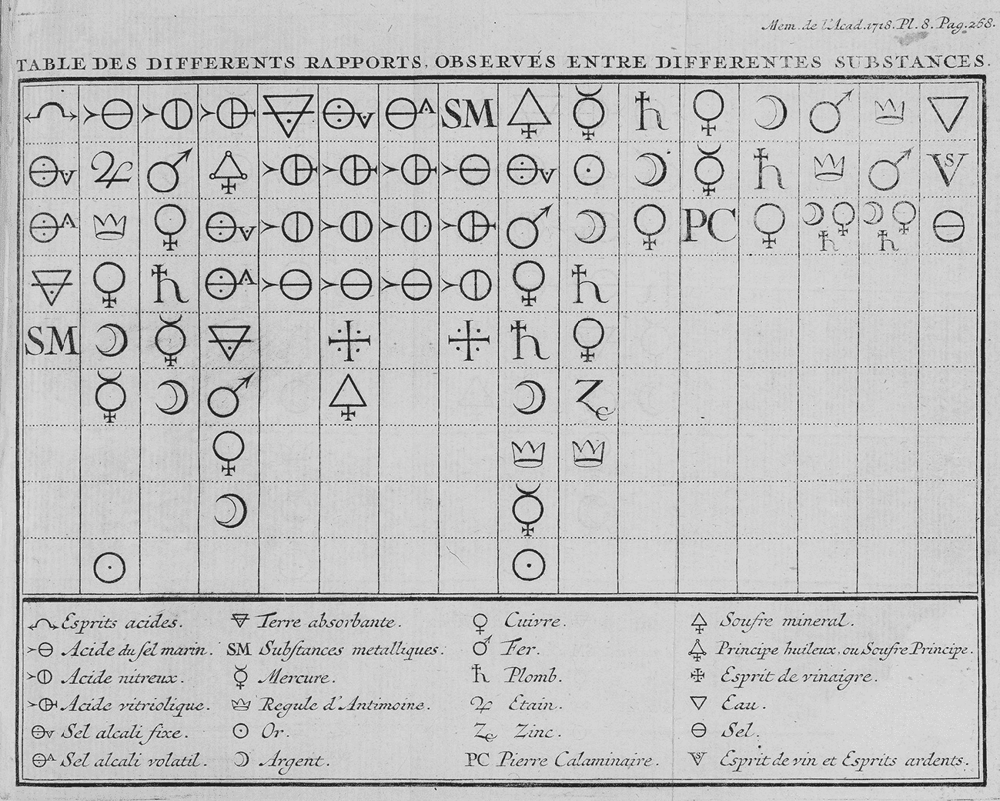

**图 7.1** 不同物质之间的亲和力关系表。摘自 Geoffroy (1777, plate 8, 268)。马普科学史研究所图书馆提供

拉瓦锡实建于百年化学变化研究之上，尤赖亲和力表（图 7.1）的总结。这些表呈现了当时共享化学知识的大半，构成拉瓦锡与燃素派的共同参照系。燃素派信可燃物含燃素、燃烧时释放；拉瓦锡 1780 年代证燃烧需可称量氧气与不可称量热量。他引入精确定量测量，系统攻坚理论难题。^[¹⁸⁴]

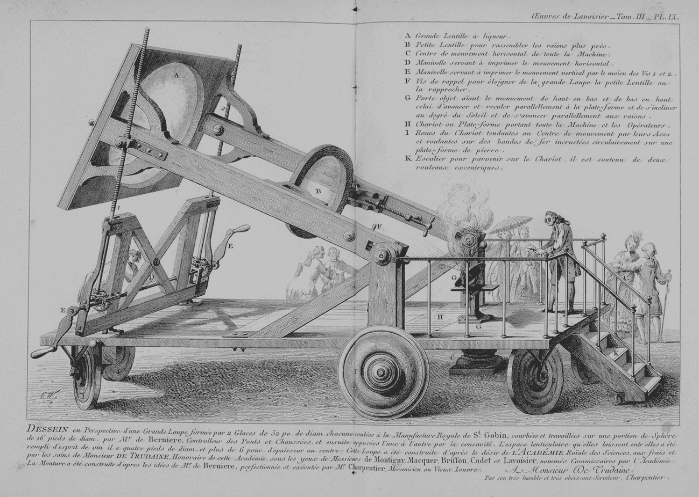

**图 7.2** 拉瓦锡（戴护目镜者）和他的太阳能炉。摘自 Lavoisier (1862–1893, plate 9)。马普科学史研究所图书馆提供

但克莱因与勒菲弗论证：拉瓦锡方法论与理论分析，皆依赖其所继承的悠久传统。^[¹⁸⁵]

## 达尔文革命：素材库的进化式重组

进化论诞生是长期知识转型的又一铁证，更凸显本框架强调的其他特征。^[¹⁸⁶]

达尔文构建进化纲领，诉诸的正是那些“麻烦的发现与结论”，而非显性进化猜想。为利用这些成果，他必须挖掘其进化潜能，将发现与原生概念框架剥离，转化为自家理论的证据基石。达尔文自言：“……自然学家脑海早储存无数观察事实，一旦现足够解释力的理论，它们即刻就位。”^[¹⁸⁷]

# 从达尔文到爱因斯坦：知识如何跨越“边界”完成进化

1859年，《物种起源》的问世堪称里程碑，它让进化论从地下暗流转为生物学界公开争议的主流假说。然而，令人意外的是，即便信奉进化论的学者日渐增多，鲜有人全盘接受达尔文“变异加选择”的核心机制。主流生物学家另辟蹊径，构建了更符合直觉的理论模型——或依赖个体发育的内在程序，或寄希望于历史进步的必然趋势。

达尔文的颠覆性在于，他抛弃了“内部发育趋势”这一传统核心，转而将“环境适应”与“偶然变异”置于中心。这种彻底的外部论视角，在当时显得激进得近乎荒诞。正如朱利安·赫胥黎所记，至19世纪末，达尔文的原创理论已被各类“定向进化论”彻底遮蔽：这些理论预设生物自带进化罗盘，更有新拉马克主义主张获得性状可遗传，深得人心。^(¹⁸⁶)

这段史实揭示了知识演化的普遍范式：新体系在长期积累与整合中涌现，唯有终局才能臻于稳健与普适。同时，生物学史也实证了这种整合如何反向作用于既有知识存量。^(¹⁸⁷)

那些异质的前存知识领域，制造了第四章所述的“边界问题”，进而成为变革的催化剂。达尔文将这些历史偶然的前提，转化为进化论的内在逻辑起点。经他重释，分类学、形态学等旧有版图尽染“进化”新色。这正如近代早期技术挑战倒逼前经典力学蜕变，将偶然边界条件内化为经典力学的基石。

生物学家曼弗雷德·劳比希勒指出，即便历经1940年代“现代综合”，发育生物学与进化生物学仍长期分道扬镳，各守理论与实践的疆界。^(¹⁸⁸)

### 经典物理学的边界危机

20世纪初物理学易帜，边界问题驱动架构重构的教科书级案例。彼时物理学版图三分天下：力学、电动力学、热力学。科学家们甚至争相推举各自领域为大厦基石，分别对应机械论、电动力学论、能量本体论三种世界图景。^(¹⁸⁹)

首个边界冲突源于热辐射平衡——热力学与电动力学的重叠地带。实验发现，空腔热平衡辐射的能量分布普适且精确，1900年普朗克公式精准拟合。^(¹⁹⁰)

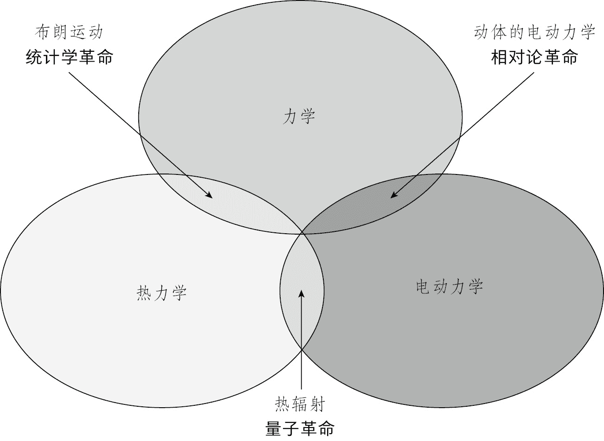

**图 7.3** 经典物理学边界问题中的科学“革命”。图自本书作者

第二个火药桶是“动体电动力学”，坐落于力学与电磁学交界，孕育了相对论。^(¹⁹¹)

### 破局经典视域

爱因斯坦以全新时空观调和了力学与电动力学的表面矛盾，但他绝非孤军奋战，也非唯一将边界问题视为重思催化剂者。他敏锐捕捉到一个怪象：磁体与导体相对运动产生的感应电流，无论视谁为静谁为动，结果一致。^(¹⁹²)

这本是力学相对性原理的直观推论——若电动力学也遵循此理该多好。可当时以太假说锁死了参考系，堵死了这条路。

这种认知张力驱使爱因斯坦全景式扫描理论与实验手段，甚至尝试构建基于力学定律的替代性电动力学。^(¹⁹³) 1904年，洛伦兹已建成庞大体系。^(¹⁹⁴)

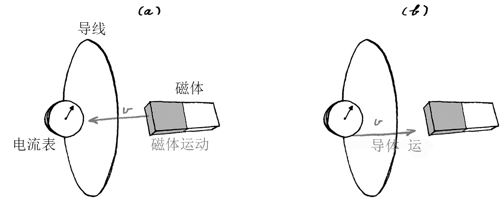

**图 7.4** 磁导体的思想实验。参见 Janssen (2014, 178)。劳伦特·陶丁绘

但洛伦兹体系内涵大异：为解释“以太风”实验失踪，他被迫叠加附加假设。1892年引入“局部时间”作辅助变量，消解了一阶`v/c`效应；^(¹⁹⁵) 继而假设运动收缩，^(¹⁹⁶) 皆为挽救以太框架的权宜之计。

### 知识孤岛的浮现

1905年初，爱因斯坦看穿麦克斯韦-洛伦兹电动力学无路可走，停止寻找替代方案。但他有充分理由怀疑“静止以太”这一基石：它违背相对性原理，且在热力学等他涉猎的其他领域已满目疮痍（他紧跟维恩、普朗克探究以太热性能）。^(¹⁹⁷)

正是对物理学全貌与多重边界问题的通览，让爱因斯坦将“动体电动力学”剥离为独立“知识孤岛”。孤岛内部逻辑自洽，却与经典大陆联系松动。正是深究这孤岛内核，让他意识到：破局需重塑时空观。

这看似凸显个体天才，实则是知识系统探索的常态——变革期个体认知路径的分化度必然放大。

洛伦兹理论虽成唯一可行解，但在爱因斯坦眼中，除去以太，光速不变失去介质支撑，长度收缩失去物理机制，大厦瞬间坍塌。

### 狭义相对论的诞生

爱因斯坦断言：核心概念属运动学范畴，而非电动力学内部。这意味着：若赋予洛伦兹变换坐标以实在物理意义，则运动系与静止系的尺度单位必异。这需在运动学层面（测杆与钟的操作层面）解释，而非洛伦兹式的电动力学物理机制。^(¹⁹⁸)

关键追问：运动系中测杆钟如何运作？“异地同时”何意？如何验证？这将焦点锁定为“相对运动系的同时性确定”，呼应休谟、马赫哲学。^(¹⁹⁹)

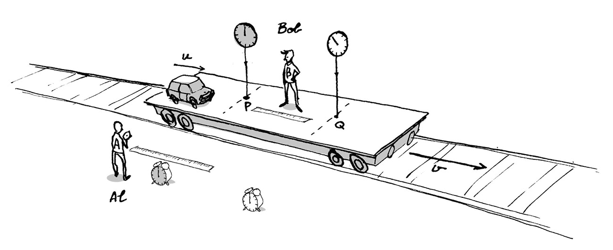

**图 7.5** 在运动参考系中使用时钟和测量杆进行测量的示例。对于阿尔（Al）而言，鲍勃（Bob）高估了遥控车相对于铁路车厢的速度，因为对阿尔来说，鲍勃正在使用已经收缩的测量杆和不具有同时性且走时变慢的时钟测量速度，即测量距离与时间的比率。参见 Janssen and Lehner (2014, Appendix A, sec. 1.5)。劳伦特·陶丁绘

爱因斯坦用定速光信号同步远地时钟，定义同时性。这看似平常，却暗合日常计时直觉，甚至当时技术实践（专利审查经验）早已在用。^(²⁰⁰)

速度与时间的纠缠揭示两条路：一、假设同步法结果与运动态无关 → 保留绝对时间；二、假设光速（相对时间）与运动态无关 → 基于洛伦兹成果的自然偏好。选第二条，同时性即相对，狭义相对论全套运动学（钟慢、尺缩）立现。

### 为新理论构建“母体”

爱因斯坦关键一跃，实现理论知识（电动力学）与实践知识（计时操作）的前所未有的耦合。唯此，专门理论才能触动时空基石，溢出原问题域。

这解释了狭义相对论的历史定位：非纯哲学反思所得，光速不变假设是19世纪电动力学积淀的结晶，凝聚其精华与边界危机。

洛伦兹形式体系（特别是运动系麦克斯韦方程处理）搭建了旧以太论与新相对论的桥梁——充当“母体”。爱因斯坦沿用数学骨架，注入全新诠释。洛伦兹借辅助假设艰难实现的“使电动力学符合两大原理”，成了爱因斯坦推导的起点。

这如伽利略门徒反向导出惯性定律：伽利略拓展框架得抛物线轨迹，假设无重力则匀速直线（惯性定律雏形）；门徒反推，从惯性定律轻松推得抛物线。爱因斯坦亦是反转洛伦兹论证链，完成最后一跃。

初期狭义相对论（1905）本身也是孤岛，仅限经验局域验证，却宣称普适时空框架。纳入其余物理知识非库恩式瞬间范式易位，而是科学共同体多年持战。

首要难题：引力如何入框？自然路径：仿电磁场建引力场，引入引力位、场方程，限定传播速度不超光速。电动力学成心智模板，默认参数待调。^(²⁰¹)

此模板核心：物质为源 → 源生场 → 场控物质动。定性骨架极具可塑性，可随步骤注入电磁经验或即时构建的数学细节。下面细追爱因斯坦寻径。

## 狭义相对论速览

爱因斯坦立基两公设：相对性原理（匀速相对运动观察者物理定律同形）、光速原理（任何此类观察者系中光速恒为`c`，不依光源速度）。

直接推论：异地事件同时性依赖观察者运动——即同时性相对性。图示：鲍勃在车厢中心，相对阿尔（站台）以速度`v`右行。两端灯泡`L1`、`L2`各闪一次。闪光同达鲍勃，双方同意。但对闪烁事件本身同时性，两人分歧。^(²⁰²)

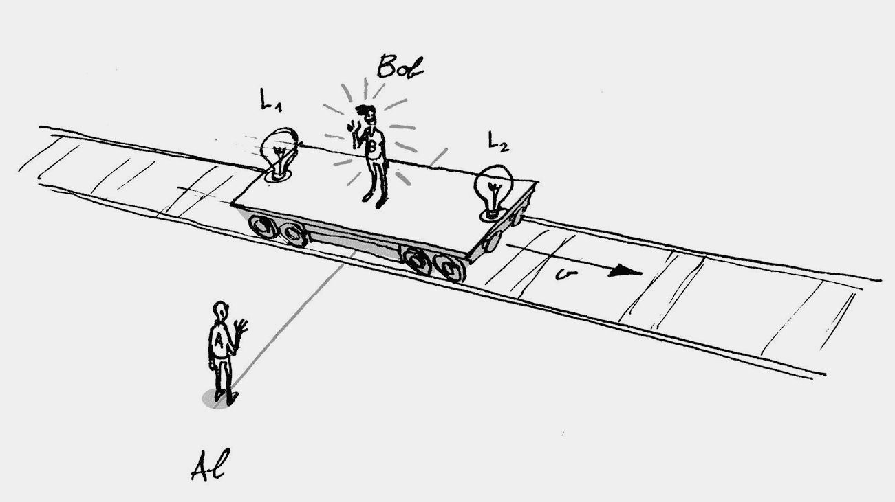

**图 7.6** 劳伦特·陶丁绘

鲍勃判同步：光速相对己均为`c`，等距同达，故同发。
阿尔判不同步：光速相对己仍均为`c`，但鲍勃向`L2`迎去、背`L1`而行。`L1`光程更长，却同达，故`L1`必先发。
结论：光速不变 → 异地同时性随观察者运动而异。

## 引力：下一场变革的引信

1907年，^(²⁰³) 广义相对论史有两大看点：一、又一“缓慢革命”，半个世纪才臻成熟框架，伴随认知共同体围绕1915年场方程展开；第十三章将从知识系统与共同体共演化视角复盘。二、百年来爱因斯坦1915年场方程核心成就惊人稳健。^(²⁰³)

## 等效原理：思想实验的突围

爱因斯坦面临难题：狭义相对论框架下的引力论似违伽利略定律（万物同加速度下落，与构成无关）。经典引力观与狭义相对论合并，构成新边界问题。

灵感来自：若可用加速度模拟重力，伽利略定律自存。设深空匀加速箱，内部观察者感受惯性力“压”向地板，效同地表真重力。箱内万物同加速度落地。将此加速度场等同真重力，按狭义相对论处理，即得推演引力新论性质的利器。^(²⁰⁴)

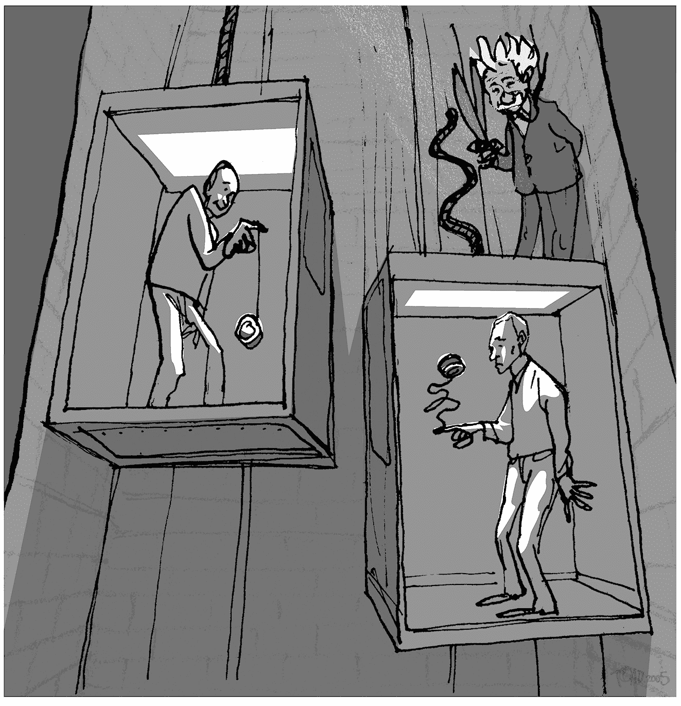

**图 7.7** 正在走向等效原理的爱因斯坦。劳伦特·陶丁绘

爱因斯坦命名为“等效原理”：均匀匀质引力场中一切物理过程，等效于无引力场匀加速参考系中的过程。这融合两心智模型：静止有引力实验室 vs 无引力加速实验室。前者承经典物理，后者承狭义相对论。模型耦合让他从加速系研究切入引力模拟，推开广义相对论大门。

## 数学表征与物理解释的博弈

爱因斯坦意识到：新引力理论的引力位须用“度量张量”表征——19世纪中叶非欧几何遗珠。^(²⁰⁴)

核心挑战：将度量张量的复杂数学形式，与场方程的物理要求（尤须在弱场极限还原牛顿引力定律）耦合。牛顿定律经海量实证，仅存微小偏差。^(²⁰⁵)

初时爱因斯坦束手：张量自有运算规则提示备选，然皆难满足物理约束。书面工具符号规则的启发性与认知生产力于此尽显。

对策：爱因斯坦携手数学家马塞尔·格罗斯曼，制定双轨策略。^(²⁰⁵)

### 度量张量

# 重塑认知：从时空度量到知识经济的演化逻辑

**度量**的本质，是将“距离”这一直观概念推广至更抽象的层面。1907 年，爱因斯坦的恩师赫尔曼·闵可夫斯基构建了一套数学形式体系，旨在编码时空中的物理事件及其关联——这正是狭义相对论的数学映像。该体系将空间与时间熔铸为统一的“时空”实体，并引入“度量”准则，用以测算任意两个事件间的几何间隔。这个四维世界以四个坐标标定事件：三维空间坐标加一维时间坐标；将时间坐标乘以恒定光速，便将其量纲统一为长度，使四维时空在结构上逼近经典的三维欧氏空间。

在熟悉的三维欧氏几何里，两点距离由勾股定理给出——坐标差的平方和。闵可夫斯基时空则修正了这一规则：两事件间的“距离”平方，等于时间间隔平方**减去**空间间隔平方。这本质上是勾股定理向四维的延伸，仅针对时间坐标的特殊性做了符号调整。关键在于，无论观察者如何匀速运动，利用各自测得的坐标计算该值，结果恒定不变。

平坦时空的度量处处均匀，但曲面几何需引入**可变度量**——同一坐标间隔在不同位置对应不同的真实距离。这一机制恰好为引力位提供了天然的数学载体。在弯曲的四维时空中，计算邻近点间距离需要 10 个独立分量，将其排布为 4×4 矩阵最为便捷，这便是**“度量张量”**，它编码了特定坐标系下时空的几何指纹。

## 过渡性综合

历经数年多线并进的探索，爱因斯坦终寻得一套数学表述与物理诠释严丝合缝的引力场理论。通往终点的关键一跃，是与格罗斯曼合作建立的“临时理论”——这一**过渡性综合**充当了脚手架，孕育出广义相对论的最终形态。回溯来看，它的地位正如洛伦兹理论之于狭义相对论，或前经典力学之于经典力学：它将牛顿引力、场论、数学形式体系与行星天文学等异质要素强行纳入同一框架，仿佛达尔文将杂糅素材塞进进化论，终使这些偶然前提转化为理论的内在支撑。

这一过程在物理诉求与数学形式间架起桥梁。终极理论的诞生，源于对形式体系核心部件的重新诠释：物理图景不再是出发点，而是适应数学结构内涵的产物。这种“以外部表征倒逼概念重组”的路径，最终将引力重释为时空的几何属性。

## 知识整合的漫长历程

广义相对论的知识拼图拼凑异常艰辛，充满冲突，且非爱因斯坦独力所成。1915 年场方程问世并非终点，整合至少延续至 1950 年代。正如达尔文进化论初期并非普世范式，广义相对论亦经历了**长线**演化与渐进期：

1.  **脚手架搭建期**：概念重组，生成事后看似“临时理论”的中间结构（爱因斯坦为核心人物）。
2.  **脚手架拆除期**：清理过渡痕迹，确立典范应用领域，外部表征与诠释的张力显化（理论形成期）。
3.  **范式稳固期**：克服应用局限，形式体系与概念诠释达成平衡，成稳健通用框架（艾森施泰特所言“低潮期”之后）。

### 海森堡矩阵力学：另一场过渡性综合

1925 年，海森堡发表《量子理论对运动学与力学关系的重释》。1913-1925 年的“旧量子论”时期，酷似前经典力学时代：科学家们在松散问题中摸索，试图以统一概念系取代旧框架。海森堡的论文即为这一阶段的过渡性综合：它提供可推广的形式体系，后经玻恩、约尔旦将其识别为矩阵运算，并诠释为哈密顿力学的量子化，成为新理论的温床。

然而，海森堡初未察觉矩阵结构，且受限于“光谱强度计算”这一具体物理问题，坚持形式体系仅服务于可观测量。这种狭隘诠释直至玻恩、约尔旦将形式体系成熟化方被打破，量子力学才确立为基于经典分析力学的通用框架。但语义诠释之争随即爆发，量子力学史再次印证：过渡性综合是知识整合的关键，外部表征与内在诠释的博弈贯穿始终。

知识演化非固定程序，动因机制随历史变迁（如从“挑战性对象”转向“边界问题”），更非系统内在结构决定的自主过程。特定历史条件下的社会语境，决定了知识系统是否被激活演化。因此，理解知识演化，必须嵌入社会维度。

在转向社会维度前，再审视知识架构对发展的制约。第四章曾论及框架转型涉及时空等抽象概念的变迁，深层知识（如测量操作的基本认知）扮演关键角色。当新数学形式体系仍可用实践知识诠释时，它便能承载物理意义，倒逼抽象概念革新。

这正是狭义相对论（亦适用于广义相对论）的先决条件：源于动体电动力学具体难题，经“脚手架”将新形式与熟悉测量操作挂钩，使新形式可被时空概念诠释，最终建立闵可夫斯基四维时空——满足相对论要求的通用平台。

量子理论路径相似但更棘手：海森堡论文（及薛定谔波动力学）先立形式、后量子化诠释，成新力学母体；冯·诺伊曼 1927 年以希尔伯特空间算子重构为通用平台。但**诠释难题**远超相对论：难以像时空测量那样，借实践知识层为框架找到可操作的诠释。“测量问题”与持续的诠释之争即源于此。玻尔的“互补性”虽存争议，却揭示了必须在量子理论与实践层间建立**某种**联结的共识。

相对论是对熟悉时空概念的重释；量子理论似乎触及更基础认知层——它究竟关于能量量子化、粒子波动性，还是信息结构（概率关联的新形式）？费曼曾言：“没人懂量子力学……别问‘怎么可能’，那会钻进死胡同。”这种不可理解性，深因在于知识架构的**偏斜**：抽象理论概念与物理知识“地面层”缺乏简单呼应。然而，两者在知识论起源上惊人一致：新基础框架的涌现，皆要求构造新形式体系、实施诠释、转化为普适平台。

# 第三部分

## 知识结构与社会的互塑

## 第八章 知识经济

> **工业的历史……是一本打开的、关于人的本质力量的书……人们至今还只是从外在的有用性来理解它。**
> —— 卡尔·马克思《1844 年经济学哲学手稿》

本章将引入**“知识经济”**概念，重新审视社会与知识的共生纠缠。区别于当下流行的“产业转型”说，此处“知识经济”指涉更广：特定社会中与知识生产、再生产、流转、分配、共享及占有相关的一切社会实践与制度的总和。这要求我们重估社会科学基础概念：社会发展可理解为**制度与知识的协同演化**，二者是调控人类实践的双重结构。研究的切入点，落在“实践”概念上。

#### 社会中的知识

知识源于行动经验，伴随实践而生，构成心理预期行动的潜能。此处“实践”指社会框架内的行动总和——不仅是个体即时行为，更包含制度、物质文化与知识传承中固化的行动模式。

19 世纪末，实践的本质与作用成实用主义核心（皮尔士、詹姆斯、杜威、米德等）。社会理论或重结构（涂尔干式的分工结构），或重文化（卡西尔式的解释母体），实则是同一现实的不同切面。挑战在于构建整合知识演化的统一框架——这在人类世到来的当下愈发迫切。行动与实践的研究跨越社会学、历史学、心理学乃至生物学、神经学，正是第四章所述的典型**边界问题**：多学科视角交叉张力中，因共同面对独立于学科之外的具体问题，而生成新知。

#### 人类学界域

知识整合宜起步于**“人类学界域”**：人本质上是动物。代谢、繁殖、死亡构建了需求、欲望与恐惧；同其他动物一样，人能预判后果、用工具介入环境。

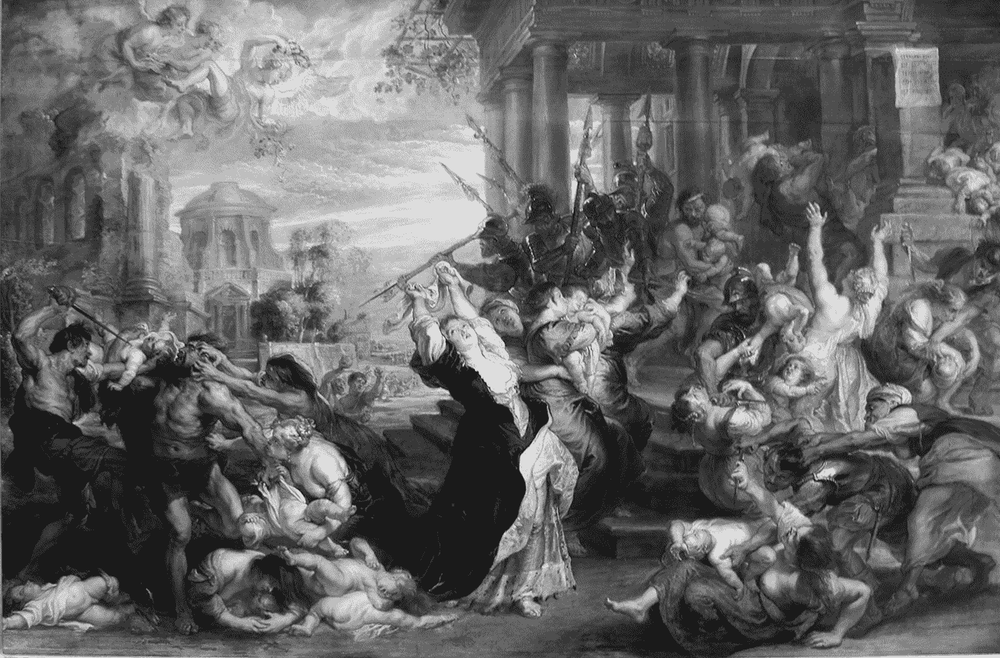

**图 8.1** 彼得·保罗·鲁本斯《屠杀婴儿》（约 1638），安特卫普大屠杀背景下的创作。自我毁灭始终是文明社会的悬顶利剑。图源：维基共享资源

人的特殊性在于：**社会性生存**。人靠社会传播的环境互动（传统称“劳动”）维系生命，这包含共享的个体/集体行动模式、工具与知识。这些行动非生物或环境预设，乃为解决情境问题而生。习惯经个体经验内化、经集体参与传播，离不开思维、交流与外部表征（心理学研究核心）。文化以整体知识系统形式传承。

社会再生产仰赖：物品供给、生产工具、物质文化传播、嵌入工具的社会关系传播、遵循惯例的知识传播。特定历史阶段起，分工将脑力与体力劳动分离。物质手段与环境既调节实践、设限实践，也暗藏机遇与困境。

**图 8.2** 复活节岛拉诺拉拉库采石场，拉帕努伊人开采火山岩雕摩艾石像。原住民崩溃成因存争议，但欧洲接触造成毁灭性打击无异议。参阅 Hunt and Lipo (2012) 等。图源：维基共享资源

若实践总和无法物理维系社会、或以不可持续方式耗竭资源、或导向自我毁灭，社会必亡。生存实践（饮食睡眠繁衍）虽可无限展开，却不能任意中止。死亡更强制要求跨代传承。于是，有限资源争夺、学习与遗忘、物质文化得失等迭代冲突，贯穿人类史始终——人类学事实虽确立这些必然性，却未给出具体历史剧本。

#### 社会制度

人类社会通常由一系列制度构成，合力保障社会再生产。

# 制度、知识与权力的博弈：社会如何运转与自我复制

社会制度是调节人际互动的核心机制，它让人类群体得以应对反复出现的生存课题：从联手攻克集体性难题、确立分工与权力阶序，到资源的获取与再分配，再到冲突的化解。这一切都发生在生物繁衍与经济再生产的双重底色之上——这二者是一切制度的源头。但制度的诞生并非止步于此，还需经由仪式化的集体行动、权力的运作、显性的共识达成、市场机制的介入，以及建筑、交通等物质基建的铺垫。物质文化为制度设定了边界，却无法完全决定其走向。制度拥有独属于人类社会的“自我指涉”特质：个体的微观行动汇聚成维系制度的宏观总和，而这总和反过来又塑造着个体的行为逻辑。因此，制度执行虽形式多样，却常具系统性；维持制度秩序（如社会控制）需要付出真实的社会劳动成本。

随着分工细化、阶层固化与社会分化加深，制度逐渐获得相对自主性。作为协调互动的“舞台”，制度间的相互依赖与自我指涉显著增强，甚至可能异化为“以自身延续为目的”的实体。然而，置身特定社会的制度全景，仍面临一个终极拷问：如何再生产整个社会、保障成员生存？这要求维持恰当的分工体系，亦或适应新的环境变局。将这种宏观挑战转化为微观的个体与集体应对能力，靠的正是制度整体与制度传播知识的双重中介。

## 制度与知识：相互编织的双螺旋

正如知识离不开制度载体，制度亦赖知识而存续。制度内化并外化知识，特别是那些关乎个体预判行动后果、支撑社会协作、控制与冲突化解的知识。制度奠定了知识体系的基石，知识反过来又成为制度稳固与演进的前提。但须牢记：**制度本身不具备思维能力。**

此处采用宽泛的制度概念，不苛求规则必须成文或依靠外部强制。作为“行动潜能”，制度与知识同属调节人类实践的结构性力量。二者的关键分水岭在于：知识天然承载着对行动的**心理预期**功能，而制度在协作行动中，必须在缺乏心理预期的前提下规范集体行为。这要求借助协作固有的约束与物质条件、行为规范、信念体系，以及我们所谓的“知识经济”来实现控制。打个比方，“警察”这一制度不会思考，税务机关也无法**在心理层面**预演加税1%的后果。思考是个体的专属权利；制度层面的后果预判，本质上是个体知识与共享知识之间的介导过程。制度预判能力的强弱，取决于它们存储过往经验、赋能个体行动者、协调个体思维的方式——即其知识经济的运行质量。社会无法“思考”这一认知困境，虽可通过优化知识经济缓解，却难以彻底消解。

## 何为知识经济？

简言之，每个社会都必须运作知识的生产、整合、传播、分配、占有与再生产全链条。协作实践仰赖既有知识，也需要思维过程的同步与协调，这必然牵涉与个体思维紧扣的交换。知识的流通、保存与积累，离不开外部表征。如前所述，实践知识可借工具与行业规则显性化，常通过直接参与作业与口头规则传递来传承。

所有制度均依赖特定知识，或源于其生成，或预设于其前。故而制度植根于更宏大的社会知识经济，制度运作本身涵盖知识的生成、转移、转化与占有，并涉及多元的外部表征形态。物质经济与知识经济深度互嵌。以一台特定机器为例，发明它、制造它、使用它所需的知识体系各异。社会知识经济必须生成、配给并维系这些对应的知识系统，同时具备将新知融入旧有或新建系统的能力。

个体在特定社会语境下完成文化适应，从而获得带有历史印记的认知与规范判断力。因此，发生在家庭、学徒制、正规教育中的教化、习得与训练（广义上的社会化），是知识经济的关键一环。知识经济不仅覆盖有组织的教育实践，还包含关于这些实践的二阶认知——我们称之为“知识之象”。

同物质经济一样，知识经济作为整体，鲜少成为参与者自觉反思的对象。在个体视角中，其系统性特征主要体现为必须顺从的行动条件。

早期城市社会中脑力与体力劳动的剥离，让特定知识的生产与传播纳入社会分工序列，如祭司、抄写员成为特定知识的垄断者。一个拥有自身认知维度（如教育体系）的高阶知识经济浮现，它需由物质经济供养，并嵌入社会制度网络。这类独立知识经济的承载者，形成了智力共同体或“认知共同体”。哲学流派、科学学派等认知群体的兴起，在处理资源配置、制度协调与控制等公共事务时，也衍生出新的课题，其中便包括知识传播与获取的规则设定，及其伴随的交易成本。

## 知识传播的多元路径

知识传播或以单元形式连同实践共同迁徙，或以传闻信息流动，或经由程式化口头交流、学徒制、学校教育、市场驱动（如商业媒体）等制度化渠道流转。往昔，手抄本的抄写与流转承担传播功能，继而为印刷媒体所取代。知识亦通过思想交流、逆向工程式的拆解、重构与适应扩散——即从人工制品中提炼知识以复现技艺。车间、实验室、工厂、学院、大学、研究所等机构是传播的主阵地。传播受政策调控，亦不可避免地受制于不断迭代的知识表征技术（如印刷术，详见第十章）。

此处，“传播”与“转移”泛指知识要素的空间位移。若指代涉及知识系统或知识包的完整过程，常用“散布”或“扩散”，但这不等于单向的“中心向外围”灌输，而是包含对传播方的反向作用。

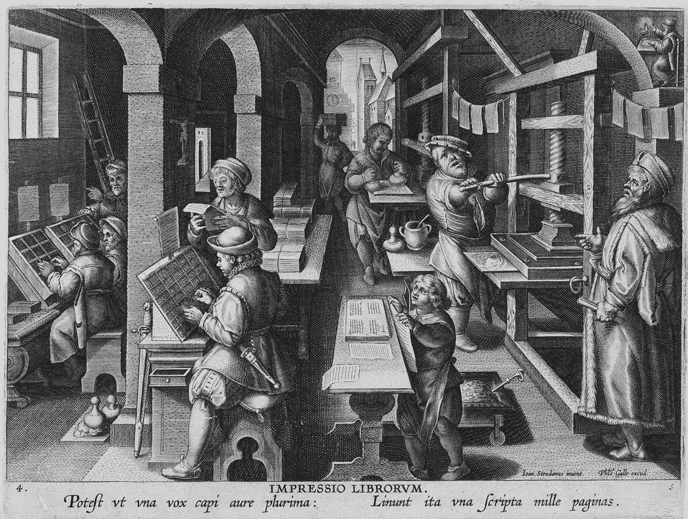

**图 8.3** 印刷机，约 1600 年。系列印刷品《近代的新发明》中的插图页，该版画由老扬·科勒尔特根据史特拉丹奴斯的设计雕刻，安特卫普的菲利普斯·加勒出版。图自大都会艺术博物馆，哈里斯·布里斯班·迪克基金，1934 年

知识传播在三大核心维度上呈现差异。首要是**中介性**：靠直接人际接触，还是借助外部表征？即时转移（人际接触）中，核心表征是瞬时的——言语与行动，主要构分为指导与模仿。有中介转移中，稳定的外部表征扮演构成性角色，即便其设计初衷并非为此。从克鲁伯与史密斯的视角看，知识接收端绝非被动容器，他们可能抵制、占有、改造所获知识以适配自身认知。简而言之，接收方常参与知识的共同生产。传播动态复杂，既是认知过程，也是既有共享知识系统的保存与传递。一切由以下要素决定：知识经济（特别是转移媒介）、产品工具技术、共享经验与口头交流、符号与信息处理系统。

## 外部表征与知识经济的深层逻辑

第一部分已论述书写工具等外部表征的生产性与启发性功能。进一步看，外部表征本身也是知识经济中的商品，甚至充当货币角色。知识随表征流动，亦随人流动——二者为核心载体。各载体在传播速度、可靠性、行动者（个体、群体、社会）能动性上各有千秋。

如前论述，表征形式不仅塑造知识结构、界定可执行操作，更决定传播势能。知识可能过度嵌入特定文化的表征中，导致提取传播极其困难；或提取过程从根本上重构了知识间的结构关联，使其异化为新知。传播非简单的成败二元，而始终伴随选择与转化。故而文字成为传播中的筛选力量：未被书写的知识往往湮灭无闻。

特定表征技术以差异化方式重塑知识经济，其差异超越传统交易成本，延伸至多重经济维度。站在数字视角，**交互性**显露为关键维度：表征获取有多灵活？独白只能线性收听，书籍可跳读重读，电子文本则支持远超纸质的检索。强调知识演化的累积与迭代性，**递归性**亦成核心维度：能否反思表征用法，将高阶知识表征化并回融？书籍页边可批注，电子文本让批注更广泛便捷，口头独白则根本无法标注。最后须关注**联结度**：表征与其他知识关联到何种程度、有多显性？史诗含典故，但不如学术脚注、网页超链接直接。第十章分析历史知识经济、第十六章尾声探讨“认知之网”时，将回溯这些维度。

## 马克思价值理论在信息社会的镜像

《资本论》伊始，马克思剖析了使用价值、商品、交换价值、货币与资本的关联。

货币作为特殊商品（如白银）现身，代表交换价值，可与万物兑换且易于储存。市场经济中，商品卖得货币，货币买得商品。资本主义下，“商品—货币—商品”循环异化为“货币—商品—更多货币”，货币化身为资本。马克思言：“单纯商品流通——为买而卖——是达到流通外部最终目的、占有使用价值、满足需要的手段。相反，作为资本的货币流通本身就是目的，因为只有在这个不断更新的运动中才有价值的增殖。因此，资本的运动是没有限度的。”

由此，马克思在宏大社会史视野中解释资本主义萌芽：市场非组织社会劳动的唯一形式，市场、货币、资本主义生产方式的出现皆为偶然历史过程的结果，只能置于社会整体再生产演进中理解，而非从虚构的“经济人”贪婪与“理性”这种无历史感的个体行为出发。

同理，知识应被视为社会劳动的前提与产物，而非孤独鲁滨逊的私有物再行分享。于是，意义、外部表征、信息、数据、大数据（或“数据资本”）等概念的关联，便可在社会语境下阐释，并与上述价值形态类比：

*   **意义**是知识对占有共享知识的个体的使用价值。
*   **信息**是知识经济中的交换价值——为传输而编码的知识。现代信息概念溯源香农信息论：将选定消息在一点精确或近似地再现于另一点。
*   **外部表征**融合意义与信息：既是个体掌握的知识意义的代表，又是发送至接收端的信息载体。
*   **数据**可视为信息的货币形态——一种特定却通用的外部表征（符号编码、电子存储传输），充当通用标准与度量衡。

换言之，数据与信息应**基于知识建构**，而非视数据为原子、信息与知识由其衍生构造。仅当知识表征可符号编码、同格式、同介质存储传输时，数据才成信息通标。这仅在电子数据与电子网络时代真正实现。

第十六章将展开：知识本初皆为共享公共品。多元表征以不同路径将其私有化。电子媒体虽原则上提供知识回归公共性的新契机，但数据资本主义却导致知识在私人或国家利益驱动下遭遇更全面的掠夺。

## 规范性系统：秩序的隐形骨架

制度拥有关于自身运作、原理及对行动者意义的认知。这些认知让个体能依循与制度紧扣的规章与协作方式行事。我称此为“规范性知识”。广义上，规范性系统是涉及制度运作、原理与行动者意义的价值、信仰与知识的聚合体。制度规章的执行及其背后的权力架构，绝非仅靠暴力、军事、政治或经济支配与权威维系。它们仰赖规范性系统的托底，这些系统在粗暴强力之外规训社会秩序。制度中介下的个体行动协调，预设了行为规范与习俗惯例，它们属于宗教、法律、道德、意识形态等规范性系统。涉及的知识是社会知识：既包含系统内嵌的特定内容（如传统神话认知），更核心的是遵循系统暗示的行为规范而行动的能力。

制度须在心理上可行，能化解可能瓦解社会凝聚力的个体需求、动机与欲望。人作为社会存在，时刻面临在个人诉求与社会运作要求间平衡的挑战。唯当制度不仅协调行动，更协调其动机与认知前提，提供恰当的社会化与平衡机制时，方能完成介导。

规范性系统亦有他能，如表征自然知识或情感体验。历史上这些功能有分野，却从未彻底割裂。甚至在科学内部，客观性理解也包含社会规范与角色榜样。规范性思维与知识不可绝对切分：凝聚社会需解决问题（需知识），解决问题赖合作（需道德规范与惯例）。

规范性系统让个体在群体框架内解释、控制自我与他者行为，奠定规范性判断及其合法性基础。个体行为因在实践与心理上关联群体行为而变得“有意义”。宗教尤为表达集体自我意识与自省（含未解张力）提供资源，既维持又缓释这些张力的毒性。

## 相互限制的僵局：结构与能动性的死结

制度处于永恒流变中，构成社会互动的动态平衡。人各异，他们在不同时空、场合、世代，以差异化方式让社会结构在己身投射。这是制度规定持续变动的根源。正如认知结构每次执行皆变，制度结构在具体情境中的落地亦然。

规范性行为的掌握程度因人而异，取决于体验与实施制度框架的具体经验。于是，制度的监管结构与其在具体行为中的外化之间，永存广阔博弈空间。具体经验不仅形成对被管对象的认知，更生成对规则本身的认知，进而反哺规则。广义上，一切社会经验皆是新规则的萌芽。

制度调停且规范性系统诠释的人际互动，关涉个人身份建构与个体/社会身份张力。换言之，制度塑造了所谓的角色模型或“制度角色”。

分工与多元制度催生差异化的社会财富占有、权力地位与制度认知。特权地位赋予个体或群体控制协作行动与资源的权力。反之，弱势者沦为权力服从对象或剥夺/剥削靶子。

此处“权力”指个体或群体引导、控制他者行动的潜能（常制度化），通常通过掌控行动条件达成。权力绝非绝对：一是它主要以中介方式影响行动与思维；二是它受制于社会再生产需要与物质生存条件。权力受经济、政治、认知、道德、生态多重制约。在特定历史条件下，权力取决于社会制度结构，特别是知识经济，进而取决于塑造知识经济的可用表征。在驾驭自然与社会进程上，权力更直接依赖知识的解题能力。

分工造就的社会地位对应特定制度角色，构成处于这些位置个体的“客观利益”，虽需在个体内部经由多元“主观利益”实现。利益冲突与认知差异，以类似前文认知发展变革诱因的方式，驱动社会动态演进。它们构成挑战，却不决定结果。结果很大程度取决于社会可用的内部资源与内生动力。

挑战可能直指知识经济，尤其当人们识别出这是知识层面的问题时。认知创新与社会创新常始于个体对传播知识与实践的偏离。创新能否在社会广泛接纳、融入共享知识或制度传统，视具体知识经济而定。结构松散社会中，创新虽易涌现流失，因缺乏制度化手段保留异见与非常实践。

社会化涉及真实个体及其需求欲望认知、真实环境与物质文化挑战、不可预见事件。个体视角下，局域互动经验决定性塑造社会化。社会化确立的制度价值观与心智模型受经验推动与制约。如个体发育中，儿童公平等规范观念，由合作经验与观点交换机会塑造。

最终陷入僵局：形成相互限制的反馈回路。个体能力与视野被社会提供的有限经验窗口削弱，制度规定因个体有限心智与视野而趋狭隘。这解释为何威权社会易生威权性格，而后者反哺威权社会。又如市场机制倾向将互动简化为买卖关系，制造狭窄经验空间，要求人们按“经济人”模型定角色（假设理性选择），却因人类“有限理性”而在现实中难以兑现。

制度角色与制度调控机制的交织互强，是维系社会与制度稳定的关键机制，深刻揭示了社会的保守性与弹性。但此机制永不可能完美运行：人永无法完美活出应有的制度角色，个体生活经验的现实也永无法完美契合制度的行为协调模式。

# 破局社会僵局：物质载体与符号系统如何重塑群体生存逻辑

当各方利益相互制肘、陷入死局时，群体应对新变局的空间便被严重压缩——以移民融合为例，若新来者不符合原住民固有的认知预设，强行融合往往引发剧烈排斥。群体认知机制在社会化进程中扮演双向调节角色：既是集体塑造个体，也是个体借助认知资源反哺集体。因此，化解外部冲击的关键（如消解偏见接纳差异），取决于认知体系能否实现经验的集体共享、权衡与反思，并据此更新规范框架。认知体系的演变正是治理介入的切入点：引入新机制平衡对立视角，方能开拓全新经验维度。

### 制度的“骨架”与“神经”：物质载体如何驱动协作

前文虽提及物质维度在认知系统中的关键地位，但其作为个体行为与集体实践间“中介枢纽”的核心功能尚待展开。集体实践的根基，植根于物质条件与制度的具象形态：生产力水平、基建网络、符号体系，以及承担特定角色的行动者。

生产工具（机械、厂房）与基础设施（建筑、技术网络）在解决物理难题的同时，构建了适配合作互动的物理场域，规范着群体行为。初期社会能管控基础技术的应用边界，大型技术系统往往因此积聚“技术惯性”；但久而久之，技术释放的经济动能反倒增强了其对社会结构的支配力。

当物质载体被用于落地制度规则，便化身为“社会性技术”。它们承载着受制度调节的社会关系，正如杠杆承载物理定律——操作杠杆无需懂力学原理，却能外化该知识。工件解决物理问题，制度物质形态则化解集体协作难题。

由此可区分物质载体的双重功能：操作功能与“外显符号”功能。制度规则外显化，让人际协调部分外包给这些符号，后者进而升级为社会性技术——遵循指令链、处理公文流程、适用成文法、市场交易皆是如此。外显符号降低了参与门槛：个体只需懂操作符号，无需洞悉深层逻辑。哈耶克精辟总结：价格机制本质是信息传递装置，其最大功绩在于让个体“在不知情的前提下做出正确选择”。

物质载体还是跨代传承的基石。学习即认知传递，物质形态锁定合作规则的长期存续，形成“制度性记忆”。对制度化互动的复盘借由外显符号中介，塑造个体心智模型；符号因此获得隐晦的“超验”含义，标定符合规则的行动边界——统治者、圣所、神器皆由此诞生。

外显符号甚至能生成更高阶的认知与组织形式。货币不仅代表交换价值，更可化为资本实施控制或投机；账本记录可衍生税收体系。外显符号引导旧制、催生新制，构成“群体自反性”——一种层级生成机制（虽不必增强群体自我意识）。由此诞生“二阶制度”：监管现有制度运行、将上位逻辑下压至个体。管理即典型二阶制度，专司维持制度永续运转，常伴随分工与复杂协作诞生（如两河流域、华夏早期的水利工程）。

得益于规则外显化，抽象概念（时间、货币）获得社会功能，成为“文化抽象”，兼具认知系统属性与社会性技术属性。现代社会靠抽象“时间”（外显符号为时钟）协调约定；货币作为价值外显符号协调经济互动，个体无需懂定价机制即能高效使用。但外显化也带来不透明性——遮蔽了制度的“后台运作”，切断了符号与具体经验的联系（自然周期、人类协作）。尽管引入“人力资本”“生态系统服务”等概念试图内化外部性，却难保社会性技术能稳健驾驭底层现实。

### 沉淀的警示：当后果反噬系统

转向另一面：制度物质性不仅是运行前提，更是人类活动的显性**后果**（第十四章将从“生态位建构”视角深述）。一类后果是新外显符号的生成——除社会性技术外，更广泛的“文化符号”（艺术、科学）应运而生。

捕捉并保存冲突经验的文化符号（宗教、艺术、科学），具有矛盾的“症候性”。弗洛伊德指出：症状既是个体未解冲突的表达，也是社会压抑需求的产物，这种控制永不完美。症状遮掩并揭示着无意识创伤与社会失控。

同理，文化符号既可配合替代性行为合理化而趋于仪式化，也可作为未解难题的表征，成为在更清醒层面处理冲突的起点。这里既蕴含集体记忆，又展现外显符号的“生成性模糊性”。

群体还面临环境物质痕迹的矛盾反噬——沉淀物的形成。传统上视为“外部化”成本（废弃物转嫁弱势群体），但在人类世全球化语境下，已无“第三方”可承接后果。沉淀物形成成为全球群体运行的硬约束，人类活动的物质沉淀化为全球困境的文化症候。

破局思路之一：发展恰当的外显符号（社会性技术），在人类群体与环境间建立反馈回路。如碳定价，让排放大户为沉淀物买单。但仅靠此类手段，难将扩张型经济纳入封闭生态子系统，除非强化认知的调节作用——这仰赖于能引发反思的文化符号，与认知体系的新进化（包含参与新形式，终章展开）。

## 符号博弈：权力、超验性与人类独特性

理解人类与环境的特殊代谢，符号是关键变量。人类生计基于劳动，劳动借物质手段改造环境，产出的变化与手段本身即为干预的表征/体现，往往超越干预本身而长存。符号客观记录干预，更支撑人类核心认知力：创造并理解超越直接存在的意义。这源于人类独有的象征性/超验世界——万物皆可超越自身而具意义。实质被代表内容虽变化但非随意：关乎集体生存的“共有基石”表征，是全人类文化实践的核心，只是具体内涵与模式各异。

符号能唤起不存在之物，也能加倍强化实存之物。正如第三章所述，符号通过增强持久性、允许思维作用于自身（反思），双重赋能思维运作。同理，符号双重支撑制度运行：它们既是感知/情感/思维的对象，引发的思考可为间接权力合法性背书；若被视为权力病态的症候，又能瓦解合法性。

因此，符号斗争是社会冲突的投射。宗教禁制神像，或意在不以人类立场限定共有基石从而限权，唯有同不可预测的权力结盟方敞开未来；或将共有基石提升至超验世界，超脱无限权力与有限存在的中介。神学辩论本质是表征辩论，哲学辩论亦协商个体与共有基石的关系（如本质与现象：现象能否代表本质？）。

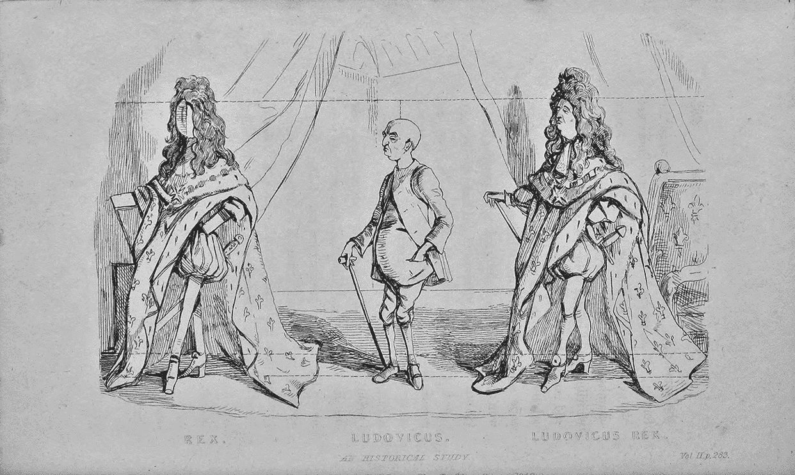

符号不必将个体还原为共有基石的衍生品，或以冷漠代价“解放”个体。它可成为中介地带，让个体与共有基石同等重要，协商二者关系。是符号，而非超验性本身（后者源于前者），构成人类存在的独特媒介。

达尔文打破理性人与自然的界限，挑战“人类理性代表上帝理性”的幻想：二者在自然史中受同一力量驱动。认知史亦不应将超验性视为人类独有条件，而应立足物质载体与外显符号，将人类行动思想锚定于自然史连续性中。

群体作为制度集合体，具备在人类学全维度自我再生产的能力。群体非绝对可区分实体：相较群体间联系，内部制度整合更紧密，但这种分类可能与群体自我认知冲突——后者自视为由认知机制调停的独立实体。

认知机制决定群体应对外部冲击的成败，也决定新经验能否转化为认知增量。规范系统（管理服从性活动）包含“知识之象”，赋予特定认知角色与价值。规范系统随制度整体系统性再生产，常因相互制约而僵化，导致制度与规范互锁稳固。现代学科科学的认知机制及其知识之象亦然。人类世困境在问：高度分化的认知机制是否因过度惯性路径而失去灵活性，无法产出文明延续所需认知？

最后，制度植根物质载体（工具、社会性技术、外显符号）。可用认知表征技术开启认知机制的可能性视域；制度物质载体界定社交互动的可能性视域。如今算法制度（网络仲裁、交友平台）利用数字媒体算力与交互性，即为新例证。

连接认知与群体的关键枢纽：认知机制、社会性技术及其政治结构、文化符号的反思与干预潜能。沉淀物加剧、地球回旋余地收窄，迫使我们依当下挑战重审这些枢纽。第五部分探讨环境界限前，我们须先溯源这些枢纽的历史演进，细究认知机制案例。首站，聚焦人类社会最基础的设施之一——自筑庇护所起便存在的实操认知机制，远在科学诞生之前。

## 第九章：实操知识的运作逻辑

> “建造者须知目的——此梁承重，故不可或缺。知目的需学与思：弓箭手不瞄准无法中罐，建造者心神旁骛则不能成器。”  
> ——达尼埃莱·巴尔巴罗《维特鲁威<建筑十书>注解》

> “蜘蛛吐丝似织工，蜜蜂筑巢胜建筑师。但最笨拙的建筑师强于最灵巧的蜜蜂：他在动工前，已在脑中建成蜂房。”  
> ——卡尔·马克思《资本论》

本章以前述认知机制通论为镜，照见关乎人类生存的核心实操知识系统——建筑与建筑学的历史演进。

聚焦三大演进维度：一、二阶机构（建筑管理部门）涌现，及建筑学作为新职业介入建造流程与监管接口；二、平台与沉淀物形成，典范建筑作为知识表征与传播的超级载体；三、前科学时代建筑知识探索与实验的条件。虽以欧洲视角为主，受限于笔者认知边界，但足以揭示实操知识机制如何为创新、为科技知识对接腾挪空间。

### 建筑：最古老的知识运作样本

近代前漫长岁月，建筑史立足于工匠、监工、建筑师的实操认知。设计、材料、营造技艺、物流组织，靠口传心授与现场参与代代相传。

自远古起，建筑与粮食供应并列为人类实践基础子系统。它改造环境满足核心需求，调控共存逻辑，故而融入所有文化传统。建筑天然是合作活动，前提是特定认知机制内的知识共享。

建筑认知机制受多重因子塑造：资源禀赋、材料技术及其实践认知、管理与传播制度（提供稳定性与连续性）、劳动组织形态。尤依赖现场专业水平、培训模式、规划工具。长期以来，建筑知识属于广义社会化过程，是广泛共享的营造常识，嵌入主导该过程的社会结构中。

长时段稳定性源于双重锚定：物质建筑实体的物理存续，与知识嵌入社会结构的深度绑定。管理控制知识的传承依赖特定社会形态存续，但实践营造知识甚至能在政权崩塌后幸存——得益于知识载体常属特殊阶层（常能穿越政治动荡），及物质表征赋予的相对政治独立性。但口耳相传也易因失传而断裂。

### 从口耳相传到蓝图：建筑知识如何被“看见”

**图 9.1** 从业者知识的口头传授：利用晒干的砖头在中心不定的情况下建造努比亚桶形拱顶，埃及象岛，2001 年。迪特马尔·库拉卡特（Dietmar Kurapkat）拍摄

### 建筑智慧的载体与传承危机

建筑知识从不局限于单一形态，它借由工具、目标、惯例、模型、图纸、规划以及附带的文字或口述指令得以呈现。更独特的是，建筑实体本身也是知识的承载者，尽管它们鲜少直白地揭示建造秘诀。一旦传承链条中断，建筑技艺便面临重构或再发明的困境。那些依赖师徒口手相授的技艺最为脆弱，后人难以原比例复刻，往往只能以新工艺取而代之——文艺复兴建筑师模仿古罗马、古希腊建筑的尝试便是典型例证，后文将详述。在前现代社会，关于营造的书面知识流通极其有限。

### 管理职能与知识表征

修筑大坝、灌溉设施，或是营造神庙、宫殿、陵墓等大型公共工程，调动海量社会资源，其成败系于资源调度与控制机制的有效性。早期文明中，这套机制主要依托社会通用的制度框架运转。

史料显示，建筑管理机构的演进与特定建筑文书的诞生同步。书面档案的增多极大提升了跨时空的物流指挥与通讯管控能力；管理流程的梳理沉淀，更催生了复盘优化的契机。早期建筑管理的架构，实质上镜映了社会整体的权力与治理结构。

### 建筑师职业的诞生

古典希腊、美索不达米亚及埃及时期，建筑规划均由非专职的官方机构把控。希腊城邦独特的政治生态，重塑了建筑师的专业权威与制度身份。在官员频繁更迭、私营力量崛起的背景下，原本由国家等级制保障的工程连续性岌岌可危，设立专职建筑师职位势在必行。城邦间的竞争进一步推波助澜，使建筑师在设计、规划与营造上确立了独立专家地位。

步入近代早期，建筑师在建筑知识经济中扮演了更具创造性的角色，其运作依托精密的管理体系，保障了知识的传递与考核。稍后我将结合实验性建筑方法的觉醒展开论述，先看看建筑知识积累的通用逻辑。

### 知识沉淀与行动平台

历史上的建筑知识经济，本质是前人成果沉淀形成的“平台”。规划深度取决于可预判的步骤，而预判能力源于积累的知识及其表达方式；规划的必要性则取决于项目启动时已具备的基础条件——比如现场备有预制构件，就省去了采购准备。

这引出一个核心抉择：物资是开工前一次性备齐，还是边建边筹？前者依赖充沛劳力可极速推进；后者资源利用率更高。新石器时代为应对公共建筑规模扩大，已将“备料”与“实建”剥离以求最优解。

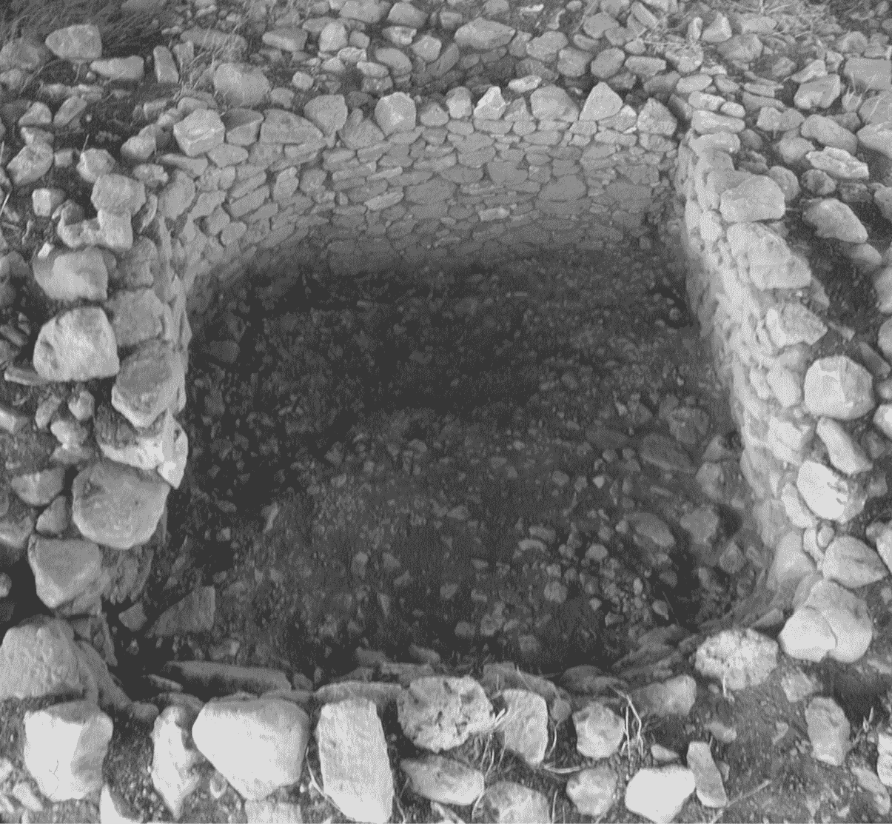

**图 9.2** 新石器时代早期遗址，土耳其哥贝克力石阵（Göbekli Tepe）中的一个圆角方形房间。迪特马尔·库拉卡特拍摄

公元前9千纪，手塑晒干的土坯墙现身。这种预制模式让上一工序的产出直接成为下一工序的输入，建筑准备与实施彻底分离，整体工期大幅压缩。代价是对物流预判要求剧增——必须精准估算所需物料总量。公元前8千纪，模具成型的标准长方形泥砖问世，薄泥浆砌筑成为可能，砖缝覆盖显著增强了墙体稳定性，同时强化了直角建筑形制的演进趋势。

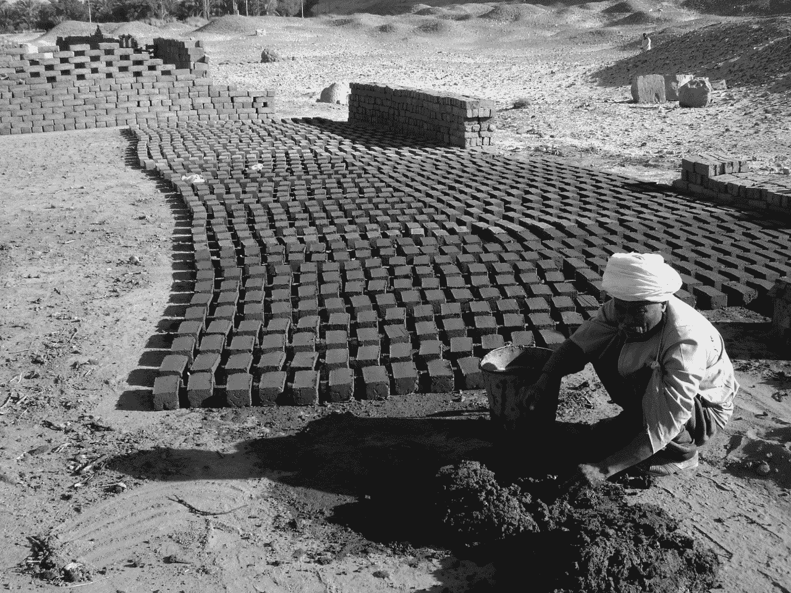

**图 9.3** 在埃及中部索哈杰（Sohag）附近古阿特里比斯（Athribis）城的谢赫·哈马德（Sheikh Hamad）区域，用尼罗河淤泥生产的泥砖。干燥过程需要几天，因此需要面积很大的干燥场地。乌尔丽克·福尔巴赫（Ulrike Fauerbach）拍摄

将复杂流程拆解为可利用既有平台（如河道运输、采石场、林场或循环材料）的微操作，被证明极为高效。永久性基础设施的建成与标准化构件的普及，揭示了跨代传承知识的一种路径：以过往活动留下的“沉积物”为媒介。而推广标准建筑形式，则是促进知识扩散的另一强力杠杆，这将是下文重点。

### 标准建筑：知识的外部化存储

建筑可视为社会制度的外部投影。它们不仅使协作落地，更凝聚着“作为制度共同体一员”的集体意识。唯将庇护所需与公共表征需求纳入考量，方能读懂建筑感知——二者在建筑中不断被重释，融入更宽广的社会经验。

希腊罗马神庙等标准建筑，是社会共识与实践经验共享心智模型的实体化呈现。标准化重塑了知识经济：规划逻辑结构化简化，构件比例固定，核心难题转为资源测算与分期调度；资源上限反决定建筑规模。一旦建筑类型确定，定尺寸即成全案。模块化更简化了现场沟通，寥寥文字即可锁定核心构件。

标准形式的知识具备长周期影响力，而实践建造技艺传播依赖“接触式传授”，受限于地域材料供给，流动性弱，高度依赖历史语境。实践知识多具地方性，其生命力源于对新形制的适配性——即可扩展性。匠人常需就地取材、因地制宜选定工法，地方经验与新形式的共存往往孕育创新。

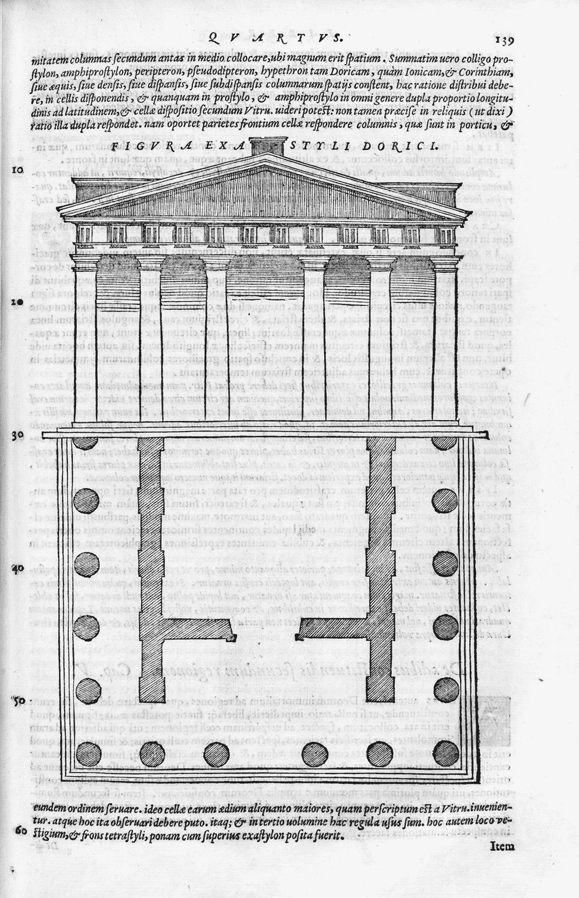

**图 9.4** 六柱式多立克神庙（Doric temple）的立面和平面图。参见 Vitruvius, *De architectura libri decem*, ed. Daniele Barbaro (1567, book 4)。马普科学史研究所图书馆提供

标准形式传播中显性可复制知识的比重，连同实体建筑的存续周期，共同决定了该形式对特定社会本土建筑知识的独立性。希腊罗马建筑的千年影响力印证了这一点。通常除重大历史断裂外，个人显性传授的影响远不及标准模型的文化渗透深远。直到文艺复兴，结合力学、材料学等科学知识，建筑技艺才开始系统显性化、科学化。

### 建筑即集体实验

哥特大教堂等宏大工程，本质是跨代的集体实验，经验在迭代中被提炼、表征、复用。实验效能取决于知识表征形式，即评价体系可用的媒介。中世纪至文艺复兴的建筑工会（研讨会）引以为傲的知识经济，鼓励跨项目整合、代际传承。

晚期中世纪城市与核心工地涌现出制度性结构，提供了持久的“组织记忆”。书面记录在管理运营中的渗透，是这一转型的关键推手。建筑师“设计与施工分离”的职能分化始于中世纪初，贯穿文艺复兴。

技术层面，文艺复兴建造者延续哥特传统，却在形制美学上转向意大利古典范式。为审美拒绝哥特式，催生了穹顶替代横梁桁架的新课题。佛罗伦萨大教堂那个举世闻名的八边形回廊拱顶，虽采用技术创新实现自支撑、具备圆顶静力特性，实则是向理想球形圆顶演进的关键节点。此类拱顶早见于托斯卡纳大教堂（锡耶纳、比萨）交叉处，规模较小，均依赖木拱架支模。佛罗伦萨即便在1366-1368年方案扩大后，最初仍预判传统木定中可行。档案佐证：1431年穹顶近尾声时，仍保留1368年模型的拱架支架以备参考，可见决策审慎。

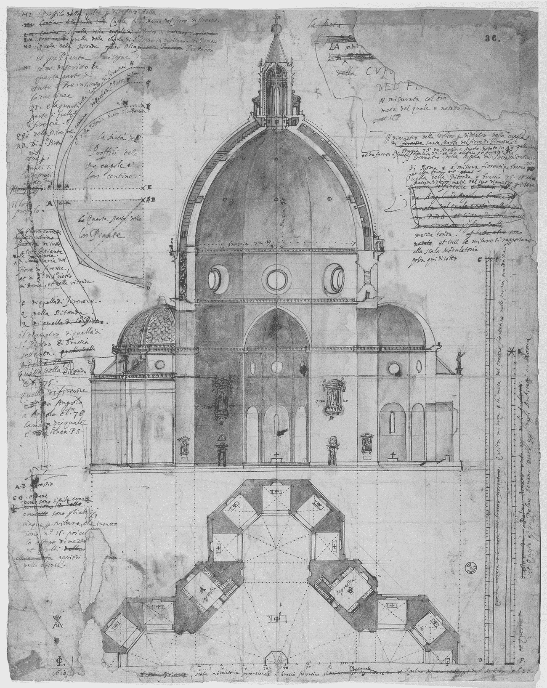

**图 9.5** 洛多维科·奇戈利（Lodovico Cigoli）的圣母百花大教堂（即佛罗伦萨大教堂）的穹顶与主教座的剖面图和平面图，包括与万神殿和圣彼得大教堂穹顶的剖面图和平面图的比较，罗马，1601 年。佛罗伦萨的斯卡拉档案（Scala Archives）提供，文化遗产和旅游部特许使用

建筑师在经济框架内将委托意愿转化为实施图纸，统筹指挥与执行，搭建起“实践反哺规划”的桥梁。这种反馈机制使工程具备实验属性：创新即时接受验伪。缺制度记忆，经验终成过眼云烟。自晚期中世纪兴起的管理结构，恰好充当了知识库角色，构筑新知识经济基石。

14-15世纪意大利北部案例显示，工程管理常委托予兼具商业嗅觉的个人或组织。管理机构设立专家委员会攻坚克难，为公投或上级决策供备选方案。这赋予管理者超越组织协调的新职能——知识治理：整合共享知识资源实现最优配置，同时通过程序正义强化项目社会合法性。

## 佛罗伦萨大教堂：穹顶奇迹的诞生

圣母百花大教堂穹顶，至今仍是人类史上跨度最大的无支模砖石穹顶，外径约55米，高约33米。

它重塑了佛罗伦萨天际线，影响力辐射远郊。穹顶宛如人造山峰，在环绕群山中远眺清晰可辨。这不仅是繁荣城邦的荣耀图腾，更是独特共享知识经济结出的公民成就硕果。无支模合龙，堪称工程史上的孤品壮举。这是如何做到的？正如布鲁内莱斯基同时代的阿尔伯蒂在《论绘画》中惊叹：“见此宏构，谁能吝啬赞誉建筑师皮波……”

### 从争议到共识：决策的博弈

1294年市议会批准建案伊始，挑战便已埋伏。阿诺尔夫·迪坎比奥初稿或仅设小圆顶。1355-1357年、1366-1368年两次重大修改，大幅拔高中殿、扩容穹顶与东端。最终社区采纳画师与石匠联合委员会设计的大胆方案：在巨型八边形鼓座上架设自支撑穹顶，八边形几何自带稳定性，免去哥特式飞扶壁的繁复外撑。方案或已包含双层壳体设计，经长期论证力压传统派。

决策时核心难题未解，后续建设中可行性争议不断。但强大政治文化动力托住了决心：既要与北方宿敌米兰（其大教堂1380年代始建）划清界限，又要宣示共和政体革新古典传统的雄心。

穹顶建造知识虽无科学计算支撑，绝非凭空直觉，而是植根长时段建筑传统的实践性心智模型。这类似测量员将不规则地块拆解为三角形矩形求面积——建筑师的高明在于面对极限任务时，调取、组合熟稔的静力学心智模型。

关键模型之一是“环向张力”。最直观的物质隐喻是铁箍木桶：箍圈抵消内压防裂。由此推演，穹顶周向或内置链条可遏制上部自重产生的水平推力。另一模型是“自支撑拱门”，旋转推广成球顶自显稳固，但无支模施工路径仍阙如。建筑师须将球顶在脑中解构为连续砖环。

砖环倾斜收口时如何防坠落？引入“下水道堵塞”模型：边缘内倾让砖块互锁，前提是合环成圈。填充过程中需临时装置托住单砖（如间隔楔塞），实操上通过人字形砌法与垂直肋骨骨架落地。

真正难点在于将这些基础模型适配批准的复杂几何：八边形双壳、尖拱剖面。此轮廓兼具高度优势（同径下超球顶）与静力优势（径向推力更小）。布鲁内莱斯基以多重巧思应用深化静力学知识，攻克此高难结构，保障施工态与终态稳定。

核心装置之一：特制砂岩梁组成的链条系统，嵌于内壳、以铁夹连接，辅以木链条。“大教堂工程局”作为执行主体……

穹顶建设不仅考验规划与建造双重知识，更要求建造方精通材料特性、具备长周期质控与供需动态适配能力。物资调度、质量把关、多工地并行作业协同，后勤体量惊人。

项目虽起于主教与社区共治，旋即转为社区独揽，社区再委托核心行会——羊毛行会全权负责，凭借其城中影响力与财务管理专长。1331年起，行会派出4名“工程长官”（抽签产出，任期4至6个月），佐以财务官与公证员，掌管资金与档案。社区以税收兜底，工程局经营林场自给木材并创收。

随规模膨胀，管理架构迭代升级，新角色融合艺术洞察、技术硬核与统筹物流能力。1419年穹顶攻坚期，增设4名“穹顶长官”组成常设咨询委员会，专司此役。

布鲁内莱斯基迅速成为核心枢纽。他在工地的实体存在至关重要：既精通工法发明机械，又深度嵌入工程局各层级互动。创新屡屡需监管层批准，同等重要的是赢得一线匠人的创造性配合。玛格丽特·海恩斯团队整理的工程局档案（现已网络公开）详细记录了这段互动史。

布鲁内莱斯基从金匠转型为总工头，并非孤例。工程局提供的职业晋升通道，让众多匠人实现创造性跃迁。如服役20年的石匠雅各布·迪桑德罗，终成多个关键分项工程负责人。

工程局知识经济的一大特质：关键节点依赖“公开竞标”。竞标聚合在野专家智慧，围绕大胆目标凝聚共识。模型在其中扮演多重角色：决策者-专家-公众的沟通媒介、设计推演工具、可行性实证演示、整合显性与隐性知识的施工向导、以及纳入合同锁定决策的法律凭证。仅圣母百花一项，存世模型记录即不胜枚举。

1357年，工程局从3款中殿柱模型中择优：先由5大师评审，再公示首选模型8天广纳异议。1367年支持石匠画师联合提案的关键决策，经多级委员会研讨，最终由数百市民公投通过。

# 布鲁内莱斯基的圆顶模型与早期科学知识的萌芽

为此，布鲁内莱斯基在工地院内搭建了一座砖木结构的圆顶模型。著名雕塑家多纳泰罗、南尼·迪邦科及石匠大师纷纷伸出援手。工地方面还派遣自家工匠监工，实地考察这座模型能否如宣称般、在完全摒弃木制支架的情况下仅凭砖石自行成顶。这座模型规模堪比一栋小楼，矗立至1431年，直至实体圆顶即将合龙，监工方才下令拆除。然而在1418年，评审团面对诸多方案却久拖不决。放弃木架虽能省却巨量木材、规避大跨度支架施工中变形的风险，但布鲁内莱斯基主张的“施工全程自支撑”方案在当时显得过于激进。年底时，评审团结清了其余模型款项，将目光聚焦于最后两个提案：布鲁内莱斯基与其宿敌洛伦佐·吉贝尔蒂的方案。

经多位权威顾问反复研讨、增补模型后，行会首脑与工地高层才正式委任两位艺术家及巴蒂斯塔·丹东尼为专员，全权主导穹顶工程。任命时间与依据四名穹顶官员意见制作大型木制彩绘模型的时间重合，霍华德·萨尔曼推测，这实为现存支撑穹顶箍筋的实物模型，旨在测试布鲁内莱斯基无窗穹顶方案的采光效果——光源仅来自下部八个眉窗与顶部天窗。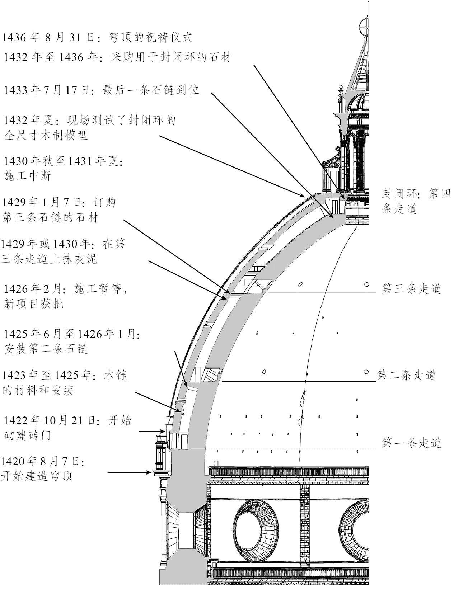

**图 9.6** 圣母百花大教堂穹顶编年要录。源自 Haines (2011–2012, 99)

直至1420年一份十二条书面备忘录出台，才明确敲定按布鲁内莱斯基大胆蓝图施工，文件白纸黑字规定：穹顶内外双层砌筑均不设脚手架支撑定型。[²⁹⁰]

大教堂建设这类融合复杂知识经济的宏大工程冒险，亦成为推动科学知识演进的关键引擎。它们不仅迫使传统知识体系直面全新挑战对象，更催生了整合实践与理论知识的社会架构——诸如公开竞标、专家委员会制度、直接引入学者参谋等。

伽利略与威尼斯兵工厂在1600年前后的互动，便是极具历史分量的典范。[²⁹¹]

威尼斯共和国兵工厂是当时规模最大的军工业中心之一，常年雇佣一两千工匠，年产桨帆船可超百艘。同工地一样，兵工厂遵循精密的治理架构，既要保证监管与核算，又要确保将军政需求转化为技术实现的能力。这些需求源于16世纪末基督教海军强国（尤以西班牙、威尼斯为首）在希腊地中海与奥斯曼舰队对峙。1571年勒班陀海战成为分水岭：奥斯曼舰队在帕特雷湾惨败，火炮地位跃升，倒逼建造更大战舰，却引发航速、机动与稳性的三重困境。

兵工厂应对挑战，于1590年代初应军事委员会要求发起系统询询，征询工程师、老工匠、退伍老兵及伽利略等外部专家意见。伽利略接到长官贾科莫·孔塔里尼来信，于1593年3月22日复函。孔塔里尼重点询问桨帆船推进与机动性、桨位最优布局。伽利略以亚里士多德力学作答，却敏锐地将工程难题转化为材料强度新科学的孕育契机。[²⁹²]

伽利略指出：几何相似的梁并非等强度，随线性尺寸放大反而变弱。他自觉这一洞见不仅关乎造船，更对建筑至关重要——它揭示了单纯靠比例与缩放模型推断稳定性的局限：“眼下可见，将机械放大至巨型规模（无论对技术还是自然）都是不可能的。因此无法建造巨舰、巨殿或巨庙，因为桨、桅、梁、链，总之所有构件都必须连为一体……”[²⁹³]

# 第十章 历史上的知识经济

> “例如在科学中，‘个人’可以完成人们普遍关注的事，且总是个人在做。但只有当这些事不再是私事而成公共事务时，才真正具有普遍性。这不但改变形式，更改变内容。”
> ——卡尔·马克思《黑格尔法哲学批判》

> “若谓认知史与科学关系不大，恰如电话史之于打电话，纯属谬论。至少四分之三（若非全部）科学内容受思想史、心理学与社会思维制约，故可用这些范畴阐释。”
> ——路德维克·弗莱克《科学事实的起源与发展》

依经济学家约瑟夫·熊彼特观点，创新是资本主义社会经济史最显著特征。[²⁹⁴]

本章将梳理人类史上典型知识经济案例（非穷举）。核心概念聚焦知识载体与知识社会组织，涵盖知识经济与物质经济的关涉、知识表征技术与外部表征、知识社会性获取、知识领域与系统、知识之象、知识整合形式及反思性组织。

后续类型学考察不预设自动进步，仿佛有某种力量推动知识经济按阶跃迁。旨在二者：一、展示先前理论框架如何有效描绘特定历史知识经济；二、揭示知识演进与知识经济调适的社会结构演进之间的共同演化特征。

框架不应被误读为知识经济的抽象社会学体系。所有要素皆有其历史渊源，离此无从想像。呈现视角显见依赖并体现个案研究塑造的特定视野，个案跨度从无文字社会知识、近代早期知识社会至20世纪科学与社会的深度纠缠。下章将试图将此视角嵌入更宏大的知识史全球视野。

## 无文字社会的知识经济

### 人类学视野中的知识三维度

人类学家弗雷德里克·巴特展示了关注知识的心智、社会与物质三个维度，如何助我们读懂民族志记录的知识传统。巴特2002年论文主张：“知识传统可析为三层面。一、包含关于世界各层面实质性论断与观念的语料库。二、须借词汇、符号、手势、动作等形式，在一种或多种媒介中实例化与传达。三、在既定社会关系网络中分配、交流、使用与传播。三者相互关联，因关联而相互决定？我的主张是……”[²⁹⁵]

巴特将此框架用于1968年新几内亚奥克地区田野观察的一种知识传统。[²⁹⁶]

支撑该系统复制传播的知识经济，首由可用媒介决定——作符号用的自然物/要素、非语言图像、祈祷歌唱口述神话参与仪式等行为。同时受知识之象塑造：一切合法知识溯源祖先遗训。二者制造张力：知识之象禁绝变革，媒介表述性却使变异不可避免（起始行为需自发创造）。结果虽宣称体系不变直承祖先，实则可观测到时空缓演。

## 无文字社会的知识经济

考古与史前学证据有限，难以评估知识在史前无文字社会中的角色。鉴于近世无文字社会物质文化与石器时代高度相似，以此补证虽合理，但从现代观察反推当时仍存疑。

无文字社会掌握生存关键技能技艺，含满足粮食、医药、住居、迁徙等基本需求的传统技术知识。其自然界知识之丰富，可见于详尽完备的动植物分类命名。至今部分原住民仍保持极复杂的局域环境知识：食药植物、建材原料、武器服饰乐器工具用材、甚至祭祀植物。高度发达的另一领域是社会行为模式——早期民族学报告指出，由亲属称谓系统体现。[²⁹⁷]

无文字社会基本无独立知识经济制度，亦无职业化分工。知识习得靠互动交流、参与劳动与仪式、共同活动中的模仿。个体可将共享知识融入集体行动——如农耕、大型建筑或纪念碑营造。近世社会中，巴西瓜拉尼人“穆蒂朗”互助集体劳动制、新几内亚埃博人建房协作，印证此集体维度。[²⁹⁸]

外部表征包括：应对生存挑战的方法、环境要素、情境关联活动及其中工具物件：口头语言、含特殊语言形式的仪式化交流（术语、诗歌、歌谣）、其他仪式化社会行为（艺术宗教表演作品）、有限象征文化（面具、器物、饰品、纪念碑等）。距今1.5万年阿尔塔米拉洞穴壁画，见证象征文化高度。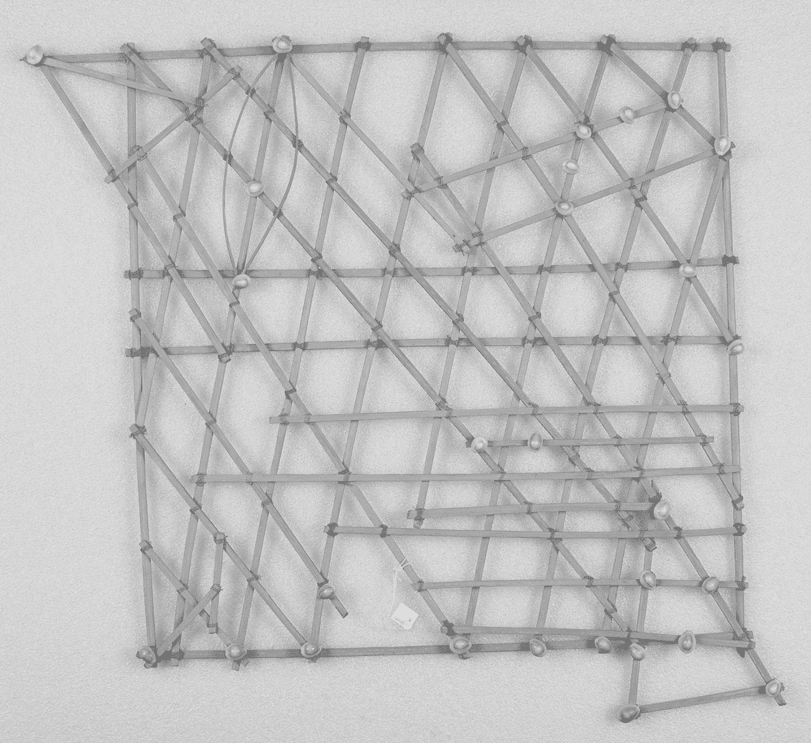

**图 10.1** 以绑线薄木条、露兜树木条（表波浪）、玛瑙贝壳（表岛屿）制成的导航图。源自马绍尔群岛拉塔克礁链马朱罗环礁。加州大学伯克利分校赫斯特人类学博物馆藏

象征文化与口传神话共同界定社会认同，提供评估现实的反思资源。但计数、空间定向等专门认知领域，可能在这整体性象征运用中例外——数字符号或地图可发挥具体实用功能。

无文字社会知识通常全员可得，但有例外：存守秘知识的宗教专家；劳动或性别分工导致知识分配差异；重视长者知识的社会（如瓜拉尼人知识集中于“帕杰”祭司，兼向导、医者、教育者、预言家、巫师）。[²⁹⁹]

西方视角下，传统航海知识跨天文、地理、海洋、气象、鸟类等域：星辰定向，浪风测速，鸟类洋流水色辨陆。但这非按需收集的孤立信息堆砌——否则难应对远航挑战与变数。密克罗尼西亚航海传统知识具复杂认知结构，可借心智模型描述，使长航程航线“计算”成为可能。

此类情境化知识虽效力堪比现代航海术，却受限于特定局域背景及其社会关系。且常嵌入整体世界观（“宇宙论”）。如密区星辰导航，赖近赤道地区恒星升落路径垂直地平线，夜间一星可替“其下”另一星指示方位。

无文字社会中，知识本质是行动的机能层面。知识组织整合具领域语境特异性，因知识与具体物体、动作、环境紧密耦合。如埃博文化以空间为主原则排序自然要素（材料、动植物），但此空间非度量距离方向构建。其生活地理区域较小，空间实体由数千具名个体实体组成：山脉、林麓、草甸、水域、山谷、山巅、洞穴、树木、园圃、湖泊、河口汇流处等。[³⁰⁰]

材料、动植物按可寻得位置或密切关联位置命名。显而易见，此空间观既难在牛顿模型（空间为物质虚空中性度量容器）推广，亦难延展至其他量级（如人类直接活动空间）。局域空间由拟人化起源指示概念构成——“在那里”“上面”“下面”，辅以交际手势。[³⁰¹]

埃博文化机械工具寥寥，易归类：耕作农具、粗细绳索、运储容器、材料加工与工具制造用具、取火器、狩猎战斗武器。力学知识是建房、架桥、设陷阱的隐性前提。用工知识简明且针对具体工具，却涵多种力学现象。

各技术虽限于特定工艺知识，合观则构成关于多形式机械力、材料力学性质、操作及效果的令人印象深刻的知识整体。上述工具技术隐含广泛运用：不同材料结构力学稳定性、摩擦影响、张力弹性，尤杠杆省力原理。特定作用力、工具、材料、操作术语极丰，但正如第四章所指出，通用力学知识的一般术语显见缺位。

无文字社会知识通常不入由迭代抽象生成的抽象范畴。甚至神话知识也可能主要源自支配日常实践（狩猎农耕）动机的投射（见本节开头解释框）。此类知识与实施还能稳定环境干预：护佑个体与群体免受职权控制之外的更大秩序干扰侵犯。

无文字社会知识经济条件下，建立传播复杂知识系统的潜力，受制于可用表征形式的情境依赖性与瞬时性。波利尼西亚与密克罗尼西亚航海例外，恰恰说明无文字社会能在挑战性条件下生成含专家的差别化知识经济。

## 早期文字社会的知识经济

如第五章所述，文字约公元前3300年末现于美索不达米亚南部。最早文献为带数字符号与印章的泥板，指示制度性议题及背景。虽最终演变为楔形文字，用于苏美尔语、阿卡德语等文本表记，但最早文字构成（很大程度）独立于口语的符号系统，且作为管理工具，构造与控制中央集权经济体系。[³⁰²]

同时，在可操作符号表征系统中，书写与算术技术允许新自反性涌现，尤算术概念与元语言意识形成（第五章详论）。一旦文字表语，即引发对语言本身的反思（如词汇表出现），反思又重塑语言使用，进而重构语言。时至今日书面语与口语仍非全同，且相互影响。书写技术内化创造心智模型，可迁移至多环境，尤其各类符号解释。巴比伦人仰望“天书”，祭司“阅读”兽脏（脏卜，解读动物内脏占卜术）。[³⁰³]

文字成首种受正规符号学规则约束的知识外部表征。原则上极便携、持久、可复制，利于传播。但最早文本极度情境依赖，难超越嵌入制度背景。文字作永久记录口语工具的潜能，随使用增多缓缓显现。约公元前2600年法拉期，首现声门描记文字（表口语文字），充当记忆辅助，记录谚语咒语赞美诗等口语体裁。[³⁰⁴]

声门描记增强语言意识。此后书面语与口语发展为部分独立部分渗透的双系统。声门描记文字终广泛传播，因语言类型、社会用途、物理媚介差异形制迥异。随文字表记口语结构日益表音，情境依赖降低，传播拓宽。渐次更多领域用文字，有的保留平行口语，有的仅靠书写技术实现。媚介多样：美索不达米亚泥板主导，埃及希腊通用莎草纸。媚介对知识持久性与累积至关重要。

但文字非知识积累必要条件。印度早期纯口语文化中，对神圣《吠陀》的反思，借精密记忆术生成广泛二阶知识。公元前5世纪波你尼语法最佳印证：约4000规则复杂体系，高度简写经文形式，近乎生成梵语所有词形。[³⁰⁵]

美索不达米亚、埃及、古中国、南美与中美早期文字社会特征：可跨代系统传递的知识扩张，含管理知识、复杂度量衡、法理知识、史料保存、历法天文地理、医疗占卜、语言知识。聚焦美索不达米亚演进。

### 美索不达米亚范例

公元前3千纪中叶，文字自美索不达米亚南部扩散至黎凡特；同期发生重大变革，可语音表记口语结构。[³⁰⁶]

随后社会组织巨变：除神庙外，出现高度独立的国家管理机构，个体化与私有化趋势增强（含私有财产与个体经济活动）。早至古亚述（约前1950-前1750）与古巴比伦（约前1850-前1600）期，楔形文字符号使用减少，信件与行政文书佐证。[³⁰⁷]

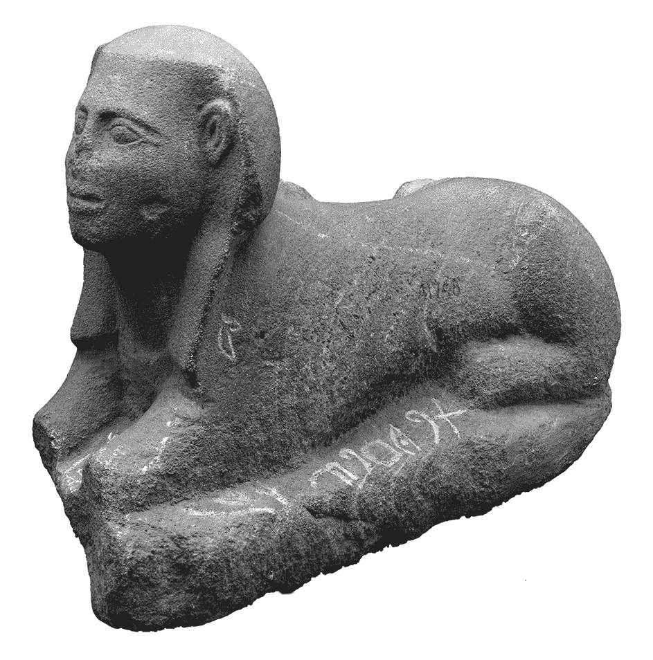

**图 10.2** 双文字狮身人面像：象形文字与原始西奈文（右肩象形文字示哈托尔女神，原始西奈铭文同）。约前1800埃及中王国，西奈塞拉比特·埃尔-凯德姆。大英博物馆藏。© akg图片库，埃里希·莱辛摄

# 早期文明的知识图景：从神庙档案到轴心突围，再到近代工程的崛起

这一阶段涌现出的全新书面知识形态，远超占卜记录、语法规范与史书编年，涵盖了各类清单册籍、首批阿卡德语语料、私人法律契约，乃至天文观测与萌芽数学文本。考古发现的多语种词汇表，实证了该区域书面层面的正式“多语制”地位，折射出贯穿历史的语言多样性。虽部分文献有前身可循，但此期文本在系统化构建上的尝试与成果，已使其与早期文献泾渭分明。这些文献多在神庙附属学校而非宫廷行政机构中流传保存——后者才是当时实权的中枢。我们首度窥见两个角色高度重合的半自治“家户”间的博弈，一方垄断暴力权。这可视作国家机器与宗教机构二元对立的雏形，这种张力深刻塑造了美索不达米亚后世乃至当下的知识生产经济版图。

巴比伦文学的经典化进程，大抵成于加喜特王朝（约公元前1600-1200年）。

虽知识经圣典化与系统化整合，但宏观知识架构仍显缺失。以史诗、神谱等载体定型的神话叙事，成为整合知识的核心媒介。神话在关联生活万象与社会整体时，折射的主要是社会政治层面的融合，而非作为根基的生产实践本身。相应地，神话实质上代表了不同宗教传统的汇聚，常通过区分神祇身份、梳理神谱世系或确立父权等级来实现。

被记录在案的，是专家群体的知识——他们是城市革命中体脑分工确立的精英阶层。这些官吏、书吏、祭司主管经济再分配的筹划事务。他们不仅统筹资源配置，更组织驯服劳力（部分源自战俘奴役）的运用。因此，书面固化的知识本质上是“统治知识”，关乎社会生产的组织与社会控制，而非生产工艺本身。

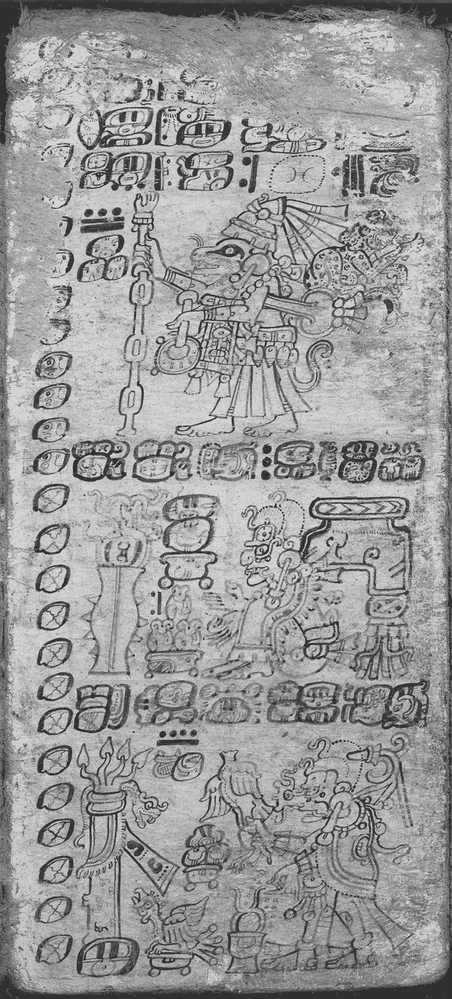

**图 10.3** 尤卡坦人举行365天玛雅历新年仪式场景。出自《德累斯顿手抄本》第28页，约公元1200-1250年。美洲现存最古老书籍，以本土史与天文表著称。参阅Kirkhusmo Pharo (2013, 171)。藏于德累斯顿萨克森州立及大学图书馆。

若缺乏持久便捷的外部表征，上述大规模筹划与组织将无从落地，因外部表征让知识得以脱离特定情境而独立传播、存储。自古代东方至近代早期，几何作图在建筑规划中始终扮演关键角色。埃及自公元前二千纪起即在工程中运用平面图与剖面图。埃及与美索不达米亚均发现近似比例图，部分标注比例尺与剖面细节。

第五章已详述会计技术、数字系统及算术在规划中的涌现，亦探讨了学校教育在稳固独立知识经济中的功能——知识于此生成传播。持久表征的可用性与独立知识经济的存在，为多元知识形态的产出、积累与探究提供了关键前提。故学校教育可视为最早“科学”实践的起点，因其探索规划劳动的符号手段，且独立于具体规划操作之外。

此类知识核心在于符号运作（读写），仅借符号中介间接关联实体对象或行动。这些符号实践反向呈现了作为知识新核心的筹划活动（如会计、控管）。故知识借助术语获标准化编码，如美索不达米亚行政术语或玛雅历法术语。

值得注意的是，这些实践多被即拿即用，鲜经反思或引发对底层知识的重构。乍看似“配方知识”随时可行，实则不然。此类知识实与实践脱钩，聚焦书写、计算等文化技艺。其操作呈直接状（如缺乏数学程序的显性证明），或因制度嵌入——制度为行动者提供不证自明的背景知识，毋须言说，故非反思对象。除非制度框架受挑战（如知识迁入新文化语境），诱发对失适符号活动的反思。

### 宗教框架下的知识生产

#### 跨时空的想象：“轴心时代”

1949年，存在主义哲学家卡尔·雅斯贝尔斯提出：公元前第一千纪（更精确说前800-前200年），欧、印、中、近东同步发生深刻精神变革。这构成了人类认知自我世界地位的新范式，核心为“超越性”体验——即洞察直接给予的世界与超越表象却可借理性伦理企及的世界间的鸿沟。雅斯贝尔斯将此剧变期称为“轴心时代”。

雅氏主张，轴心时代不仅重塑直接相关文明，更因新世界观终塑造所有历史社会，致使全球文化转型。由此创造的文化共性，可作跨文明对话的锚点。这回应了战后重建对话世界的普遍渴望。

雅氏哲学史观与艾森施塔特社会学路径，均强调平行演化的同步性，不执着于相互影响。虽缺乏同期联系证据（如古希腊与古中国哲人间），此说合理；但知识全球化或曾强化此平行性。古希腊与古中国科学的相似发展，既可能由相似社文结构触发，亦受更早远的全球化进程（农耕、技术、文字传播的沉淀）制约。作为二阶思维诱因，读写及其制度化在雅氏原著中地位不显，然获评论者强调，如埃及学家扬·阿斯曼指出埃及有更早的同类发展。

所谓轴心时代诸文明的“平行发展”，呈独特形态：犹太教一神论、希腊哲学本体论探究、印度宗教超越性、中国儒家普世伦理。这引发核心追问：共同内核何在？雅氏等指向相似的超越性体验，意谓彻底断裂人神话连续性，放弃二者同源性。他们预设前轴心时代人活于神话连续体中——经审视，这不过是历史虚构。社学家艾森施塔特等更重视知识分子涌现与精英转型，源于其觉察断裂张力。项目参与者埃尔卡纳清醒看到文化遭遇在二阶思维萌发中的决定性作用。

为涵盖轴心时代所有表现，雅氏不得不以模糊概念构想超越性，掩盖关键差异，忽略埃及等更早发展。

公元前第一千纪复杂城市社会中，知识分子精英确在各自知识经济中扮特殊角色；二阶思维蓬勃兴起——只是形态迥异。

基于早期文字社会的知识积淀，公元前第一千纪涌现新知识经济，特征是知识生产进一步剥离社会直接再生产目的，亦脱离经政制度。宗教提供了关键制度框架，使知识生产摆脱经政权力支配，得以发挥颠覆性功能。早期文字社会中，宗教框架及其规范知识系统映射日增的社会复杂性，伴随经政精英分化。书面媒介介入，极大拓展了这些系统的时空半径。前三千纪除管理档案外，信仰实践已造就首批文献。信仰体系及其文学、实践、思想（如巴比伦《吉尔伽美什史诗》中的洪水思想）可远超其诞生语境的时空限度。

随印度佛教兴起及西方犹太、基督、伊斯兰三教崛起，政教脱钩达前所未有度，宗教成独立于国家的权威源，可与国家冲突，具备全球传播世界宗教的能力。宗教挑战并超越国界——或成新国家基点。宗教既体现国家权威，亦蕴含知识生产传播机制；实质上，宗教建立在现存社会秩序之上的“虚拟帝国”。它们提供超越国家的新秩序，却以国家为蓝本（如伊斯兰“乌玛”、基督教“上帝之城”）。

宗教发展至某节点，多成国教或被采纳为规范社会的信仰体系（如阿育王佛教、狄奥多西基督教、早期伊斯兰教）。此时宗教整合（或创造，如伊斯兰案）国家诸多制度与表征结构：阶层制、世界观、传播保存机制。宗教的自足自组性加超越权威诉求，赋其挑战政权、超越疆域之能。

权威若主要由国家垄断（以武力为基），宗教便须更强辩护自身权威。它们构建精密辩护方案，经辩证逻辑生成庞大信仰知识系统。此新发展奠定了知识积累传播基础——虽动机外在，却不局限于本地网络，不与即时应用绑定，从而可自由迁移转化至新语境。宗教作为生成自我意识、反思建构个体与集体身份的媒介，利用知识象征与控制结构，依据其对自我价值判断，筛选、占有、凝聚或排斥新知。

依各类共享认识论框架，知识被生产、传播、关联，常依框架显性分类标准。宗教传统常将世俗知识视为附庸。经典本位宗教进一步推动文本诠释相关知识积累，尤在语法、逻辑、修辞领域。

宗教发展出的诸多特质，后成科学标识：修道院/宗教学校等教育机构（高等学府），诠释、注释、辩驳、融合中的递归传统，及含自我合法性控制的知识系统化。作为集体与个体自省媒介，宗教自诞生即潜藏自我批判能力，如对“拟人论”（以人性解释神性，诸传统通见）的讨论所示。

> 埃塞俄比亚人说他们的神扁鼻黑肤，
> 色雷斯人说他们的神蓝眼红发。
> 倘若牛、马、狮有手，
> 能如人般绘塑，
> 马必塑马神，牛必塑牛神，
> 依其躯壳造神像。
>
> 色诺芬反而主张无人类属性的独一神，预示亚里士多德“原动者”构想：
> 有一神，在众神人中至伟，
> 形神皆不似凡人。
> 无所不见、不思、不闻。
> 凭意念洞察毫不费力驭万物。
> 永恒静止一处，绝不动摇，
> 此去彼来，不合其宜。

### 从宗教知识生产向哲学知识生产转型

希腊哲学作为与宗教并行的传统浮现，共享应对生存挑战的智慧，却聚焦精英知识分子，其思想远离官方与民间宗教实践。

由此，知识反思组织中涌现新法新式：抽象概念纳入庞杂知识系统、概念内涵显性定义、知识构架为三段论与演绎结构。符号反思操作成“理论”标识——理论成组织表征知识的典范新式。语言形式化操作下，复杂论证与证明得以展开，在系统内建联结。逻辑成普遍理论，涉文字符号系统开启的操作可能。算术成对实计算工具操作的反思理论。几何亦同，成对尺规操作的反思理论。阿基米德以反思天平砝码操作，建构演绎力学理论。

算术、几何、力学等理论涉抽象范畴，根基在于对具体物质手段（计算工具、直尺、圆规、天平）操作的反思。亚里士多德等哲学体系中，知识组织更建立在对符号活动（尤语言操作）反思基础上的范畴之上。亚氏哲学包含对语言编码知识的积累、反思与系统化。

希腊自然哲学与科学传统初兴于多中心城邦环境，前希腊化期制度化极限。虽有亚氏及逍遥学派等系统化尝试，知识增长仍碎片化，依赖少数人兴趣。知识传播者与知识本身处不稳定态，仅能在学园、法庭、修道院等微生境存续。希腊哲学、希腊化哲学及科学传统命运，与机构政治支持的变幻紧绑（如雅典学园、亚历山大博物馆），屡遭意识形态与军事威胁。

书面编码与亚历山大图书馆等机构典藏，使知识得以保存；机构毁灭则暴露传播脆弱性。亚历山大图书馆在古代科学认知网络中居枢纽位，第十三章将回溯。大量古知已佚。真正跨时代、影响现代的，非古代知识宝库，而是高阶知识——即该知识经济特有的知识组织反思结构。例：三段论模式、演绎知识架构（亚氏遗著、欧几里得《几何原本》）、欧多克索斯球形运动宇宙几何模型、阿基米德重心概念、希罗与帕普斯以简单机械分析复杂装置的思想。

创造传播具长期影响的高阶知识，非希腊哲学专利，非科哲独有。第十一章将考察“文化折射”在希腊科哲传统由他传生成转化中的作用；第十二章将探讨中国传统抽象知识体系发展的惊人相似。

抽象概念亦塑造宗教、政治、规范思维传统。如犹太教中，可辨识一神论重构，及前八世纪中晚期《圣经》先知将神权从政军权力剥离，以应新亚述侵略意识形态。同理，前五世纪印度佛教兴起，因应婆罗门教，带来高度反思文本传统。

与其细述欧洲知识经济后续史（罗马兴衰、古教育系统对中世纪长期影响及其在基督伊斯兰影响下转型），不如跨越近两千年，直指造就现代科学的知识经济。下章将指出后古典时代知识全球化进程在新局形成中的主导作用，试补此遗漏。

### 经验知识的生产

欧洲近代早期科学，是当时知识经济的核心构件。该经济建立于自我强化机制之上，推动经验知识系统化生产与流通。自中世纪起，科技知识在部分欧洲社会中，对经济生产、社会组织、政治法规、领袖自我形象愈发关键，终引发涉及科学知识的社会转型，辐射面日广。

中世纪盛期起，特定作业流程机械化程度持续攀升。

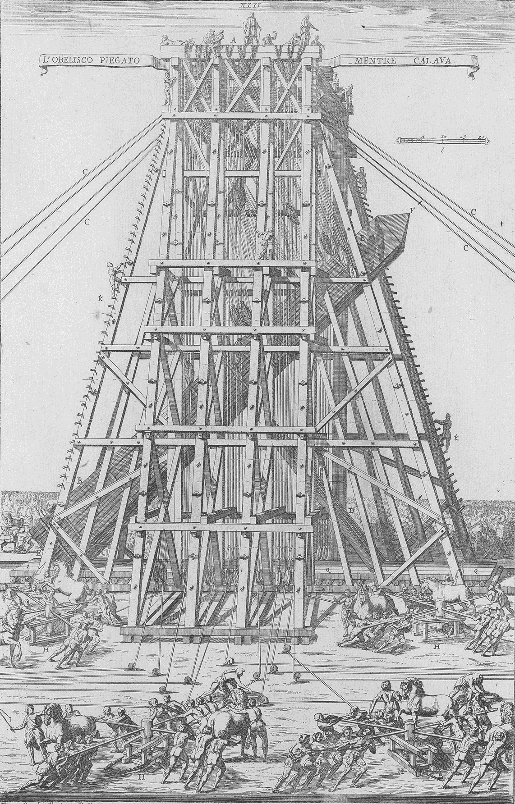

**图 10.4** 1586年，多梅尼科·丰塔纳设计方案下，重327吨梵蒂冈方尖碑被放倒迁至圣彼得广场现址。此工程调动900人、75马、无数滑轮绳索。摘自Zabaglia and Fontana (1743, 143)。藏于赫齐亚纳图书馆。

中世纪组织大型攻城机制造，成战时君主聘用技术专家的首因。后技术专家亦在行会体系外，获城市或宫廷临时聘用，参与土木建筑。十五世纪除临时聘用外，现更稳固的管理性基建，便利大型项目落地。欧工业政治中心，陆续设立水陆基建、防御工事、机械工程职位。专家嵌入区域管理性基建，政治精英对技术问题认知日增。工程管理框架初现于应对上章所述中世纪大型建筑（如大教堂）挑战——此类项目已具预制、标准化、理性化特质。造船工程现同构，威尼斯兵工厂尤著。

### 科学技术专家

为应近代早期工程项目多元需求，新职业群体涌现，主管隐含规划活动，完成技术、后勤、组织任务。这些工匠、工程师、工程师型科学家及技术专家，教育背景各异。

近代早期工程师与技术专家社会地位终身动荡。宫廷聘用依赖不可预期的资助（含复杂权力声望体系）。主角地位不稳与文化遗产异质性，致使此期充斥膨胀野心与激烈智力斗争，反亚氏传统成独创标识，虽亚氏传统仍是全期知识努力共同基石。

新制度角色/职业范畴的现身，是自我强化机制一环。因劳力资源受限，技术专家与工程师型科学家持续面临技术后勤挑战。为应对，他们被迫榨干传统技术知识潜力，创制新技术手段——如上章所述，布鲁内莱斯基研发机械体系建佛罗伦萨大教堂穹顶，规避昂贵难担脚手架。故近代早期技术专家群体，非仅传统知识标准载体（古代大型项目管理者多如此），更参与创新积累进程。

这些实践者与知识分子同样推动了知识文化的繁荣，他们对近代早期宫廷文化中文学、艺术及手工技艺的创造力具备敏锐洞察。虽不必然亲身投入技术操作，却常聚焦于实践衍生出的新知加以反思，并力求让反思成果回哺实践。十五世纪起，欧洲多地以法律形式庇护机械创新设计，拉开了现代专利制度的序幕。

### 印刷术的变革力量

自古典时代起，记录实践者与工程师知识的技术文献传统便已存在。至十六世纪，各类工程论多以手稿流传。纸张普及与印刷术进步，构筑了近代早期知识经济的关键基石。中国汉代已用碎布造纸，技术经阿拉伯世界于八世纪传入，十世纪达欧洲，欧洲造纸业肇始于十二世纪（全球化细节下章详述）。造纸是印刷术的必要前提，也是知识轻量化与可复制性的关键跃迁。中国印刷术始于公元一千纪后半叶。^(³³⁰)

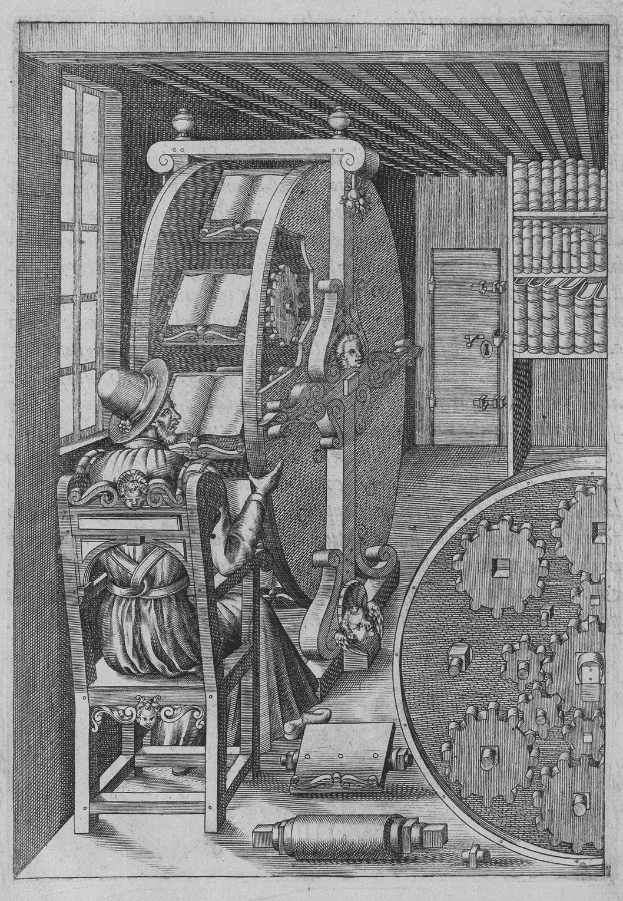

**图 10.5** 阿戈斯蒂诺·拉梅利（Agostino Ramelli，1531—1610）在《阿戈斯蒂诺·拉梅利上尉的各种人造机械》中绘制的书轮。拉梅利称其为“美妙精巧的机器，对好学之人极具实用与便利，尤其适合因痛风行动不便、备受折磨者”。摘自 Ramelli (1588, 317)。马普科学史研究所图书馆藏。

印刷术更从根本上重塑了近代早期知识经济：市场化成为知识流通的核心基建。^(³³¹)

学术出版市场深受当时教育机构（特别是大学）影响，校方与出版商结盟应运而生，进而重塑知识经济——例如将特定文本确立为教学标准教材。^(³³²)

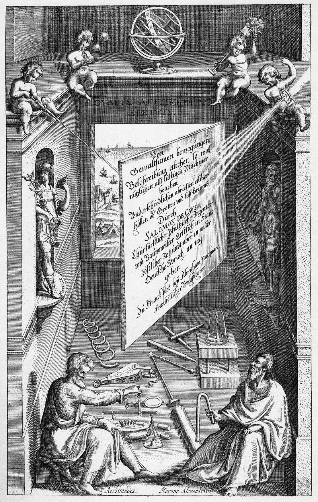

**图 10.6** 阿基米德与亚历山大港的希罗是近代早期工程师的典范。见 Salomon de Caus, *Les raisons des forces mouvantes*, 1615。马普科学史研究所图书馆藏。

印刷普及进一步催生了法律与制度框架，先保出版商权益，后护作者——这一新兴制度角色——权益。廉价书籍爆发式增长，使工匠、工程师、科学家等普通人得以建立藏书，打破了机构与富裕赞助人的垄断。^(³³³)

将经验知识编纂为图纸、论文、机械书、教材，后演变为院士录与科学期刊（附带权益与专利），这些成为整合、积累、传播与反思知识的核心工具。^(³³⁴)

### 整合异质知识资源

近代早期，工程师与技术专家面临的课题倒逼他们开发既有知识资源，致使不同知识形态首次深度接触。工程师开发与使用的表征手段，促进了多源知识资源的融合，也推动了新符号工具的革新——如第五章所述的图形表征、计算操作、函数关联与变化过程的表达，终催生了解析几何与微积分等新数学分支。

如前所述，前经典力学语境下，工程师可调用大量共享资源，这些资源内部张力并存，构成异构知识集合。其中包括实践几何、大型工程经验，以及亚里士多德自然哲学、欧氏几何、阿基米德重心说、希罗简单机械论等理论框架。几何知识是工程各分支基石；希罗理论连接了力学理论与实践，允许用简单构件分析复杂机械。^(³³⁵)

异质知识链的整合深刻驱动了经验力学知识演进，不仅修订了传统概念体系（见第六章），更催生了生产传播科学知识的新社会结构。若仅将科学发展的“社会背景”视为特定亚文化的外部条件，而非社会动力学内核——即日益知识化社会的自我反思，便会低估其作用。科学发展渊源可溯至中世纪大学建立。

### 近代早期的知识型社会

十一世纪晚期欧洲现大学，十三世纪巩固成型，拥自主权益、课程与法制保障。基础学部是共同根基，涵七门博雅科目：**三艺**（语法、修辞、辩证）与**四艺**（算术、几何、天文、音乐）。博雅教育塑造科学认知，延伸至法学、医学、神学高阶研究。大学的相对自主与教学体系化，使其成为中晚期及近代早期欧陆政教思想冲突的焦点。^(³³⁶)

读写算基本技能，是新兴商业经济与晚期中世纪、近代早期工程管理的必需。十四世纪繯盛佛罗伦萨，约十分之一青少年习读写。^(³³⁷)

意大利建新型机构培育从业者，如佛罗伦萨设计学院，理论与实践并重传授。^(³³⁸)

十六世纪末，工匠与工程师探索的课题在理论与实践间搭建大量联结点，集中于几何、力学、天文、光学。工程非孤立技术冒险，嵌入含工匠、管理者、工程师型科学家的复杂分工社会结构。因缺乏严格阶级壁垒，知识要素得以融合——这是近代早期技术科学的鲜明特征。将工程责任纳入地方行政，为实践与理论知识交换提供框架。^(³³⁹)

联结点包括摆运动、抛体轨迹等挑战性对象，及望远镜、显微镜、温度计等新科学仪器。生产资料成为有目的知识生产手段，是近代早期知识经济的决定性特征。获取新知动力源于新技术可能实现特定自然过程。实验非经验科学前提，而是实践反思性抽象的产物，是对既有程序的补充。^(³⁴⁰)

这些主张源于工程师、技师、冶金家、化学家等从业者经验的理论化，反推巩固了以经验为基的新理论形态——现代科学知识体系的标志。经实验与方法论导向观察，主张获前所未有的主体间可靠性。新体系含反思构建的符号系统（如微积分）、经验构建的认知操作（如化学式）。工业革命背景下，科知生产与社经增长的自我强化机制稳定并大幅拓展。

但新科学知识不止源于实践反思，更有深远历史渊源。实践理论知识与久远史前史结合是关键。古典时代遗留的知识组织反思形式（高阶知识），对整合经验知识入新体系至关重要。古代遗产含高度系统化体系——亚里士多德哲学、阿基米德力学、托勒密天文、欧氏几何，是近代早期知识整合变革的起点与模板。^(³⁴¹)

西方基督教经院知识体系虽在演变，因宗教掌控知识经济控制权而受外部制约。这解释了哥白尼日心说为何引发深远意识形态震荡：它动摇了赋予特定知识形式普遍排他效力的统治性知识经济。知识急剧积累、复杂度飙升，冲垮了限制扩张的尝试，终推动新知识生产制度建立。

宗教同时也是共享知识意象生成背景，支撑新知生产模式的可行性、有效性与合法性。宗教以内在逻辑抗衡国家权威，激励科学挑战宗教权威。近代早期哲学家、科学家、艺术家主张深入自然秘密、获取确定知识的可能性，宣称自然与人同语言、同造物主、同法则运作。上帝成就了基督教“人神同质”教义的反向赋能：既有人神似能力，人便能获取某些知识。伽利略在《关于托勒密和哥白尼两大世界体系的对话》首日对话中阐释明确：

萨耳维亚蒂：汝论犀利。答汝反驳，须引哲学区分：人理解力分**深入**与**广泛**二形。**广泛**言可知事物数量，可知者无限，人纵通千理，仍等于零（千对无限）；**深入**言完全理解某些定理，人确能完全掌握部分定理，于此人智与自然同具绝对确证。此类定理仅存数学（几何与算术）。神智悟一切，所懂定理超人无限倍。但就人智确悟之少数定理，信其客观确证性不亚神智，因数学上人智达必然性理解，确证性无以复加。^(³⁴²)

新知观强调本乎自然内在原理解释自然。为回应宗教世界观，此知具全方位解释世界特质。自洽世界体系早例有布鲁诺无限多世界宇宙、笛卡尔永恒运动物质体系、伽利略简化哥白尼宇宙。^(³⁴³)

初期成功干预自然的经验仅限力学等寡数领域。新建知识体系呈失调：方法论建立的特定知识域，与原子论、机械论等自然哲学尝试间存张力，后者希冀供总体科学世界观的共同框架。开普勒《世界的和谐》、牛顿主动本原、莱布尼茨单子论、康德力形上学、拉马克生物转化论等体系，旋证难整合急增的经验知识。^(³⁴⁴)

## 主权、代表与现代国家的诞生

近代早期欧洲，国家兴起重塑知识生产传播条件。国家要求知识经济转向，服务领土性需求，在更大规模高效调用资源，若乔瓦尼·博特罗所强调。^(³⁴⁵)

前经典力学即例证（见第六章），它由新技术挑战与古代知识体系（亚里士多德自然哲学、阿基米德力学）遭遇融合而成。^(³⁴⁶)

主权国家不仅倒逼并促成新知识经济，自身也是知识发展的产物。^(³⁴⁷)

法学家、法国专制主义奠基人让·博丹概念化新秩序，吸纳前人主权国家术语，编织理论框架赋予新意。^(³⁴⁸)

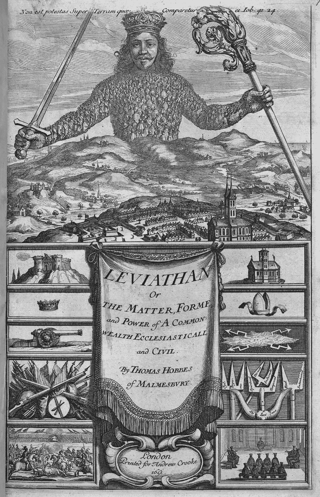

**图 10.7** 国家作为躯体隐喻。亚伯拉罕·博斯为霍布斯《利维坦》（1651）绘制的卷首插图。见 Bredekamp (2006)。图源维基共享资源。

此后主权成核心概念，描述权力集于一统治者且限于特定疆域的新统治形式。政治领域由至高统治者代表（“朕即国家”），合法性源于统治者似神权力，而非有机社会成员各司其职。^(³⁴⁹)

霍布斯言，最高统治者绝对权力源于受保护民众授予。他在英国内战阴影下撰《利维坦》（1651），述权力源于社会契约。^(³⁵⁰)

这引出主权与代表关系、权力合法性来源问题。普遍而言，无不同形式代表作中介，无法协调个体与社会关系。第八章所述，代表既是知识外部表征，也是制度外部表征，二者均非纯认知或社会技术功能角色，仍具象征/症候性，指示未解张力——如“集体意志”表征实难受个人干预。专制国家巴洛克表征既撑主权神权赋予可见性，又在背后打问号，揭示脆弱。^(³⁵¹)

对主权实施与合法化正当性的质疑，终为美国独立战争、法国大革命铺路。革命坚持主权代表不应假定，而须直服民意。两例中，为立法供框架的成文宪法，作为民意外部表征发挥决定性作用。^(³⁵²)

## 工业化纪元的知识生产

近代早期以来，科学版图极大拓展，非因所谓科学方法应用新经验域，乃因更多对象接入不断生长的科学知识网络，及网络自身认知动力。探险新标本、新技术手段、有实际意义的社会行为现象（如人口统计），成既有科学框架的挑战对象，推动框架获全球意义。^(³⁵³)

近代早期至十九世纪末自然科学核心学科中，寡数抽象概念生发海量知识：空间、时间、力、运动、物质支撑经典物理；化合物概念奠基化学；物种、基因、选择、变异、适应构筑经典进化生物学。第七章论述，这些核心概念群经漫长整合重组始占知识组织核心地位。十八、十九世纪，新知吸纳入学科体系不再是单人功绩，乃跨学科交流成果，受具认知机构、控制结构、知识意象的知识经济调节。^(³⁵⁴)

学科化科学发展于知识经济与物质经济深度互依、主权民族国家崛起（利用科知稳固经政权力）与工业化曙光之中。乔尔·莫基尔与玛格丽特·雅各布主张，工业革命很大程度上依赖近代早期科学革命以来的新型知识经济。莫基尔云：“与其关注奠基工业革命的政经变革，不如说工业革命时机取决于知识发展。真正关键在于：十七世纪科学革命与十八世纪启蒙运动。”^(³⁵⁵)

相关发展多维。一如雅各布所言，新知本身即一维度。“经济决策中，物质世界认知赋企业家独特优势。他们参与当时科学文化，得以用曾被视为与古典‘经济人’无关之知，处理煤矿、棉麻生产、纺锤制造、发动机制造。他们系统理解气压、杠杆、摩擦等现象——仅是应用力学冰山一角。”^(³⁵⁶)

更关键是，他坚持不同知识形态间存在反馈回路，驱动知识经济与物质经济互馈。“历史问题不在工程师工匠是否‘激发’科学革命，或工业革命是否由科学‘引发’；而在从业者能否获取作新技术认知基础的命题性知识。正是两知间强互补性与持续反馈，开辟新路径。”^(³⁵⁷)

后续章节将回顾催生这些发展的全球、环境、物质语境，含地质构造煤炭这一看似难以置信实至关重要的条件，及其提供的超级丰富能源。十九世纪科学始具重大全球影响。无科技社经紧密联结，新肥料、新能源转化（蒸汽机）、新通信（电报）、防疫新举（抗生素疫苗）、新材料皆难想象。新技术反哺科学，如廉价钢材需求驱动建筑、轮船、铁路、机械、武器制造。

磷酸盐、氮等肥料成分突然重要性，定义新研发、技术开发、经济生产领域。秘鲁鸟粪等天然资源终为化学产品替代。^(³⁵⁸)

微生物致伤口感染角色被揭示，刺激消毒防腐剂开发量产。^(³⁵⁹)

工业革命除巩固规范学科，更分化科学知识生产方式，尤以紧贴技术与工业应用的研究为甚。随社经对科学需求增长，十九、二十世纪初创新制度形态涌现。^(³⁶⁰)

工业革命深刻影响知识表征与传播技术。^(³⁶¹)

科学知识在经政新战略功能，对教育提新要求。通识与专业培训现代机构涌现，自具综合知识体系。入学成义务，基础至高等教育知识标准化经典化，重技术科学学习。传统大学改革，工程学院、技大、技校建立，医院融合临床医学与医学技术。校外研究机获国家私人资助，工业实验室角色自十九世纪中叶膨胀。德意志帝国物理技术研究所为国家资助例，建立科基技术标准。威廉皇帝学会（多机构转化实践挑战为研究问题）赖私人资助，建立机构支持基础研究新模式。^(³⁶²)

# 科学制度化与技术革命：知识经济的百年演变

大概在同一时期，制度化的科学政策横空出世，这是对科学组织迅猛膨胀及地位日渐凸显的一种全新审视。宏大的社会愿景、具体的经政军利益，共同牵引着研究布局、教学方针，乃至带有技术指向的大型科研工程的管理。只有在特定情境下，跨学科知识才会以专家裁决的形态，在科学知识的落地实践中实现融合。专家知识愈发独特，缘于专业化进程拉开了常识与科学的鸿沟：前者借由自然语言流淌，后者却依赖技术术语及领域专属的复杂符号体系编码。由此，科学知识的传播演变成一个只能在特定语境下务实破解的难题。^(³⁶³)

## 第二次工业革命：科技与资本的深度缠绕

自19世纪中叶起，以科学为底色的产业集群——化工、电气等——相继崛起，使工业、市场与军事一同成为科技创新的核心引擎。资源经济与科学知识经济由此紧密交织，为所谓的“第二次工业革命”奠基。这场革命始于科学基础产业的兴起，后延展为电子产品的全球普及。^(³⁶⁴)

它从根本上重塑了技术变迁与科学的互动关系，极大深化了发达社会对科学知识生产的依赖，催生了真正的“创新制度化”。^(³⁶⁵)

自1884年蒸汽涡轮发明以来，推动铁路发展的蒸汽动力在运输领域持续发力，海运成本大幅跳水。随着对热力学机器、尤其是卡诺循环科学认知的加深，内燃机应运而生，开启全新纪元。用加热气体驱动的构想由来已久，但直到1860年代原油精炼产出汽油，方才具备可行性。四冲程燃气发动机1876年面世，不足十年即改良为汽油机，奠定现代汽车基石。

汽车作为消费品的普及，也重塑了共享技术知识的宏观经济图景：制造、改良、维修所需的知识广泛流通，驱动基础原理累积与进化式迭代。第二次工业革命中，运输史从蒸蒸日上的蒸汽机跨越至汽油内燃机，生动诠释了技术系统在变革中的关键地位。^(³⁶⁶)

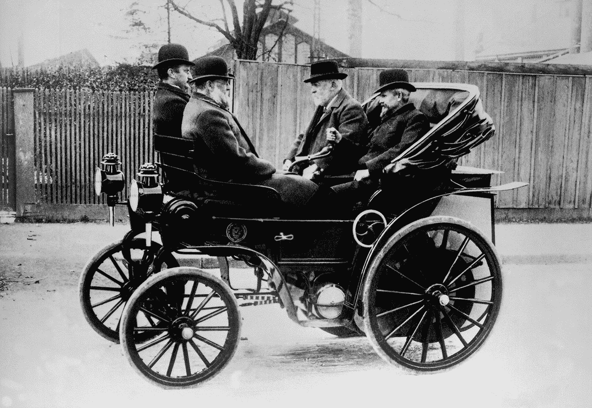

**图 10.8** 戈特利布·戴姆勒（Gottlieb Daimler，**右后**）在车把旁的威廉·迈巴赫（Wilhelm Maybach，**右前**）旁边，和埃斯林根市（Esslingen）的机械厂厂长阿道夫·格罗斯（Adolf Groß，**左前**）一起乘坐戴姆勒式皮带驱动汽车，该车外形仍然类似于马车，1897 年。梅赛德斯—奔驰经典车型数字档案馆提供

电力技术的深化应用——无论是输电还是通信——呈现出相似特征。^(³⁶⁷)

电力通信迅速实现工业化规模。1851年，西联电报公司成立，迅速架设北美首条跨大陆电报线；同年，英法海峡铺设首条海底电缆。赫兹1888年实验印证麦克斯韦电磁波预言，推动无线电报诞生。^(³⁶⁸)

马可尼、贝尔、爱迪生等发明家，借助科学进展及大众出版物传播的红利（后者亦受惠于知识复制技术革新），将机遇转化为发明。^(³⁶⁹)

然而，创新提速、技术系统日益复杂、从构想到成品的漫长周期，最终让独立发明家的知识经济因缺资金、缺人才、缺系统应对能力而触顶。大企业渴望掌控创新全程，却面临核心组件被竞对专利锁死的风险。于是，大规模工业实验室应运而生，科学家取代个人发明家，创新内嵌为工业流程有机一环，根因在于设备常属大型技术系统组件。

第二次工业革命中，科学承诺的社会普遍进步预期持续升温。高等教育逐步开放，女性踏入殿堂。全球范围内，女性为进入学术界奔走；部分国家终允许其入读高等学府，闯入男性垄断的技术职场。时至今日，争取机会均等、实现知识经济性别均衡的博弈仍在继续。

19世纪下半叶，为应对创新加速及其深远社会冲击（甚至波及创新自身环境），新制度结构涌现。从传统水务污水系统，到铁路、电报、电力、电话新网络，深层变革倒逼技术系统发展法规升级。^(³⁷⁰)

这些监管机构通过设立新型知识生产机构（如前文提及的帝国物理技术研究所，职能含光源标准化）干预物质与知识经济。^(³⁷¹)

20世纪初，技术系统探索在多个维度挑战社会实践与法规边界。例如，“科学管理”旗帜下，制造系统本身成为科学分析与技术改良对象。^(³⁷²)

专利制度这一调控机制同样被推至极限：它保护个人创造，却日益沦为大型技术系统整合的拦路虎。火花电报后无线通信的演进便是绝佳注脚。^(³⁷³)

步入20世纪，清晰可见（尤其对巨头企业）下一步是语音无线传输。虽1906年技术验证通过，但美国竞争者掌握的分散专利阻碍了系统整合与商业落地。僵局直至一战前夕，美政府因海军军事需求介入才被打破。^(³⁷⁴)

## 战争：知识经济的残酷催化剂

20世纪科学图景的特征，是在经政军多重压力下重塑的新知识经济。^(³⁷⁵)

军方在无线电发展中的关键作用已述及。一战中，哈伯-博施法衍生的人造肥料研发（第十五章详述）亦是明证：该工艺兼备造肥与造炸双重用途，若无军需拉动，不可能如此迅速推向工业规模。毒气、现代火炮、飞机、机枪、坦克、潜艇亦在战火中加速演化扩散。^(³⁷⁶)

传染病认知的突破，绝非孤立科学成果。^(³⁷⁷)

战争虽酿滔天灾难，但客观上，战时状态（含冷战）对发达国家知识经济产生规模扩张效应。一战全球性后果之一，是内部研发实验室模式从少数巨头走向普及；更深层后果是科学与国民经济深度融合，只是各国路径迥异：美国强化科学对工业赋能；法、意等国企业内部研发较弱，顾问制与国家实验室（如法 CNRS）扮演核心角色。^(³⁷⁸)

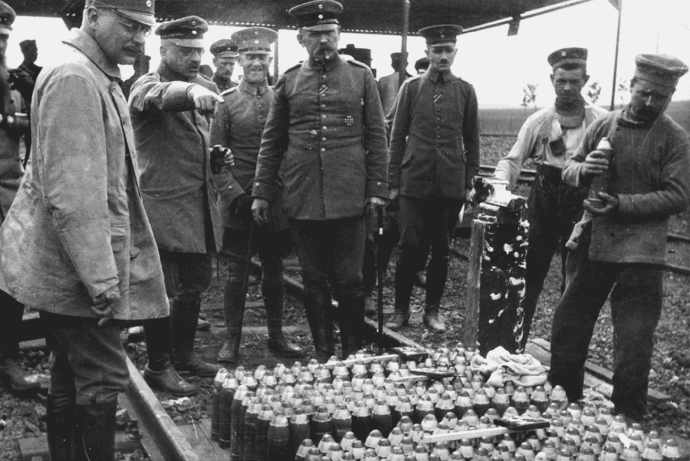

**图 10.9** 在第一次世界大战的军事与科学之间。弗里茨·哈伯（Fritz Haber，合成氨气的哈伯—博施法发明者与“化学战之父”）指着装有氯气的罐子，与德国毒气先锋团的利奥波德·戈斯利希上校（Oberst Leopold Goslich，**图片正中**）以及军官富克斯（Fuchs，**左**）在一起。照片摄于 1914—1918 年，由柏林达勒姆的马普学会档案馆提供

各国均需将科学资源转化为国际竞争力，尽管科研产出周期参差不齐。^(³⁷⁹)

### 大科学：规模化、体制化与军工科复合体

若定义“大科学”为工业规模上的科学追问，伴随巨额设备人力投入、精细分工与管理流程主导，其渊源可溯至第二次工业革命的科学基础产业，及一战中在政府军方庇护下的扩张。但20世纪初，基础科学亦因科学家构建巨型仪器探究根本问题而“变大”。早期案例有：海耳世纪之交构想的大型天文望远镜，劳伦斯1929年发明的回旋加速器。^(³⁸⁰)

1938年核裂变发现开启核物理新纪元。^(³⁸¹)

军工复合体，更精确说“军工科复合体”，成二战持久遗产，在朝鲜战争、1957年“斯普特尼克冲击”及漫长冷战中不断强化。这一知识经济特殊形态，在科技乃至社科（经招募人文学者解决军事问题而发生“科学主义”转向）留下深刻烙印。^(³⁸²)

战后大型仪器发展亦重塑生命科学：超速离心机、电镜、电泳、X射线晶体学、紫外光谱等技术，助科学家在大分子层面解码生命现象。^(³⁸³)

军工科复合体构成科学嵌入大规模社会结构的范式，可泛称为“社会认知复合体”，核心趋向是巩固并深化社会对科学知识的依赖。生物医学复合体（制药、医院、大学、行业协会、政府机构）即为另一典范。

### 电子学的颠覆性力量：从晶体管到互联网

军工科复合体另一硕果是电子工业崛起：晶体管发明与数字计算机发展，双双重塑知识经济版图。^(³⁸⁴)

虽电子管潜力未竭（二战雷达发展为证），但1930年代瓶颈已显：功耗发热制约大型电话网扩容。贝尔实验室（后成美最大企业实验室之一，1940年代员工超5000）为破局，启动长周期半导体研究，将其视为电子管被忽视的替代路径。

替代目标虽源于通信网刚需，但半导体替代电子管实属任重道远。战时优先级转向雷达，研发被迫搁置。战后重启，过程非单纯知识转化为应用，而需不可预期的根本性新知。贝尔实验室为知识经济开辟有限探索空间：科学家型工程师完成角色转型，掌握前沿量子物理理论与实验技艺。

1948年晶体管发明宣告，技术商业成功仍遥不可及。虽宽松许可吸引早期用户，但高成本、低可靠性将应用限于助听器等小众领域。突破来自军方采用：导弹计划看重其小尺寸、低功耗，且不差钱。最终晶体管不仅走向消费市场，更开辟超越电子管的全新应用疆域，打破无线电寡头垄断，开创全新“可能性视域”。

贝尔模式成巨头效仿标杆，但后续硅晶体管、集成电路等重大创新却源于外部。^(³⁸⁵)

半导体微型化与集成电路催生关键创新——电子数字计算机。其根植于计算机器制造传统，驱动力依次为：军需、高阶专业用途（含科研）、扩大的个消市场与嵌入式电器。半导体精进与计算机进化深度绑定，引发摩尔定律描述的加速演化：芯片晶体管数量每1-2年翻倍。该经验法则自1965年提出大体兑现，因物理与经济瓶颈近年始失灵。^(³⁸⁶)

首代数字计算机极大增强人类在军工工程、行政经管、自然科学领域的知识管控力。计算机先催生计算文化，继而文本语言处理应用跟进——虽起步缓慢，终致重大变革：计算机开始增强人类记忆与语言能力。1950年代中期“AI”概念引入后，利用新技术实现智能的尝试深远拓展了知识表征与处理边界。

计算机从计算器蜕变为知识编码处理设备，与网络技术并行演进。网络溯源军方，1960年代中期 ARPA 资助开创性工作。ARPANET 为早期采用分组交换、TCP/IP 等互联网核心协议的网络，奠基数据传输基石。^(³⁸⁷)

互联网与万维网演进，旨在突破区域算力存储瓶颈、促进信息共享。初服务于军事科研，后转为通用信息网络。^(³⁸⁸)

**图 10.10** 美国陆军雇员拿着首批四台军用计算机的部件。**从左到右**：数学家/程序员帕齐·西梅斯（Patsy Simmers）拿着埃尼阿克板（ENIAC，电子数字积分计算机）；盖尔·泰勒（Gail Taylor）拿着埃德瓦克板（EDVAC，离散变量自动电子计算机）；米莉·贝克（Milly Beck）拿着沃德瓦克板（ORDVAC，军械变量自动计算机）；数学家/程序员诺尔玛·斯德克（Norma Stec）拿着布热莱斯克一代板（BRLESC-I，弹道研究实验室电子科学计算机）。摄于 1962 年。图自美国陆军，照片编号：163—12—62

新信息技术催生新研究版图：技术层面有计算机科学，人文层面涌现认知科等，均受 AI 研究驱动。^(³⁸⁹)

### 科学生产力的度量困境：指标如何异化为枷锁

20世纪，现代科学知识经济面临事业规模持续膨胀的挑战。主流应对是借助扩张的制度框架，强化学科体系内在价值。通过施加外部可控、可量化的标准，制度框架巩固了这些价值。科学计量学、同行评议等标准化手段在20世纪下半叶发挥关键作用，在知识高速增殖与全球散布中，守住专业度与质控底线。^(³⁹⁰)

然而，新式评价体系亦削弱内在价值：它压缩智力交流意涵以适配社会控制机制，以形式考核取代个体判断，以计数替代阅读，以数量置换质量。出版格式标准化催生文化：以产出量或“影响因子”（被引频次与场所）度量学术成就，尽管这些充其量是智力价值的粗陋代理，极端情况下甚至滋生高产低质的扭曲经济。科学发展推动控制程序标准化、制度化、自动化，而在现代科学萌芽期，这些不过是同行群体对成果质量的非正式思考表达。

### 新学科的涌现：边界处的知识重组

现代科学知识经济并非仅受困于增长与专业化的单向拉扯。科学版图拓展，带来知识整合与统一的新契机，亦提供审视评估知识的新视角。边界问题（第四章述及）持续充当诱因，触发生命科学在与其他学科断层线上的多次蜕变。一战后，生物学与化学融合催生生物化学；二战后，携手物理学诞生分子生物学；后又与控制论、计算机科学、自动化交汇，从信息论视角重构生物学概念，冷战余波中推动生物技术兴起。^(³⁹¹)

地球科学20世纪崛起，构成重大概念与制度双重转向，将零散研究重纳统一学科框架。^(³⁹²)

溯源地球科学，始于德国地质学家魏格纳20世纪前三分之一的工作。他提出：现今大陆在漫长地质纪元中脱离原始超大陆，漂移至当前位置。^(³⁹³)

地质学非新生学科，长期探究造山、陆海分布、地球内部构造与年龄等议题。核心难题之一：陆地上的海相沉积物，及阿尔卑斯山脉远距离搬运的巨型岩块。

19世纪末，地质学关键问题多呈边界问题态势，显现于理解地球性质与历史的多元路径断层线上。一派主攻物理天文视角（如布封、开尔文勋爵）；另一派承袭维尔纳、居维叶、莱尔传统：实地踏勘，聚焦岩石证据；古生物学引入达尔文进化论诠释化石，亦深度影响地史认知。

地球年龄争论，是地质学边界问题的突出样本。^(³⁹⁴)

**图 10.11** 大陆漂移说缔造者阿尔弗雷德·魏格纳最后一张照片，摄于 1930 年格陵兰考察中。© 阿尔弗雷德·魏格纳研究所档案馆

魏格纳1912年首提大陆漂移模型，1915年著作《海陆的起源》系统阐述。^(³⁹⁵)

开尔文捍卫的“正在冷却的坚硬地球”心智模型，曾被地质学家用以解释地表特征。修斯认为：冷却收缩导致地壳坍塌形成海底。^(³⁹⁶)

另一“地壳均衡”模型，本阿基米德浮力原理描述陆海关系。山脉、大陆板块被视为与地下介质处于流体静力平衡，高海拔区由地下物质亏损补偿。此说19世纪中叶源于英属印度大地测量。^(³⁹⁷)

魏格纳模型融合修斯大陆毗连洞见与地壳均衡艾里模型：大陆由密度较洋盆小的物质构成，可漂浮且与高粘性地下介质保持平衡。其构想中，冈瓦纳大陆非部分沉没大陆（该设想难与均衡说调和），而是解体为多个碎片。同时，大陆水平位移假设可解释山系、裂谷、岛弧成因，甚至化解阿尔卑斯山脉大规模横向运动证据等难题。

# 知识的博弈：从大陆漂移到学术资本主义，再到全球化的深时间线索

在 20 世纪上半叶，地质学的理论大厦建立在几个核心心智模型之上，新证据也围绕这些支柱堆砌。然而，究竟哪些理论能被精雕细琢，新知如何被筛选评判，背后的关键操盘手是当时的“知识经济”及其设定的边界——这其中包含了“知识之象”这类指导性隐喻，以及因过往理论或实践承诺而形成的“路径依赖”。这些知识经济随国家语境迥异，驱动选择性过程的默认预设也随之变幻。

知识经济的关键作用在于：经验知识的积累不仅由科学问题驱动，更受制于支撑地质学家工作的体制框架，尤其是主导大地测量的机构。早在 1807 年杰斐逊执政时期，美国海岸和大地测量局的成立便让大地测量深深嵌入地球物理研究。20 世纪，卡内基研究所成为美地学界的金主，其地球物理实验室大力推动物理化学向地渗透；二战前后，美国海军更是为地球物理与海洋学注资无数。这些制度性安排，深刻铸就了上述那些“默认预设”。

经验知识的另一增量来源，是仪器革新带来的方法论跨越，以及物理化学等邻域的突破。支撑魏格纳假说的生物地理与古生物学拼图，19 世纪末已大致清晰。20 世纪初放射性的发现打开新视野，推翻了开尔文的地球冷却说，确立了放射热的地质地位。1920 年代中期，地质学家达成共识：地壳之下存在活动层；末期，加勒比海海底考察揭示洋盆地质活跃，可识别地壳主应力；1930 年代，地震学实锤了区域应力及其致挠作用。与此同时，英国地质学家阿瑟·霍姆斯敏锐提出：地幔对流或是驱动下挠的引擎。

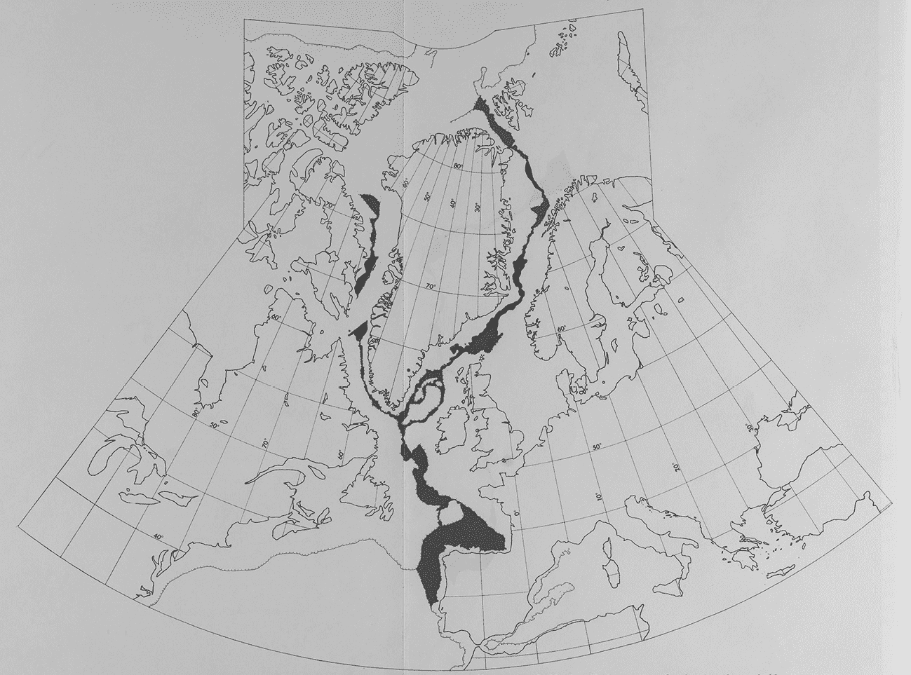

**图 10.12 “布拉德拟合”（Bullard fit）。1965 年，爱德华·布拉德（Edward Bullard，1907—1980）发表了计算结果，确定了北美洲、南美洲、非洲和欧洲海岸线的最佳拟合。当时，这一结果被认为是支持板块构造学说的重要证据。出自 Bullard, Everett, Smith, et al. (1965, fig.7)。英国皇家学会提供**

然而，证据堆砌本身并不自动裁决理论竞争。若非如此，魏格纳学说在 1940 年代便可成共识——当时压倒性定性证据倒向漂移说，而固定大陆模型漏洞百出。杜托伊特《我们流浪的大陆》（1937）与霍姆斯《物理地质学原理》（1945）等巨著，已系统整合漂移证据与合理机制。可正如爱因斯坦案例所示，边界问题的判读高度依赖视角。内奥米·奥雷斯克斯实证表明，美国对魏格纳的冷遇，深受本土知识经济特性塑造，导致接纳推迟至 1960 年代。

她指出，这场迟到源于美国地质学知识经济中占主导的“知识之象”、默认预设与路径锁定。美国地质学家的思维惯性，由体制强化的地球物理学视角主导：普拉特地壳均衡模型的特权地位、阿巴拉契亚造山模式的范式式影响，构成了顽固的理论护城河。反观 1960 年代涌现的新经验知识，满足定量地球物理标准，却无需背负旧理论包袱，从而成为“板块构造学”这套新范式的基石。板块构造学的最终确立，本质上是对历史地质学、古生物学与物理学长期张力的一次全盘整合。

20 世纪下半叶，地球科学加速跑，燃料是冷战语境下对资源与地缘战略的渴望。1957-1958 国际地球物理年是分水岭：美官方虽因军事需求（获取全球战略数据）出资，却意外催生了全球科学共同体的合作新纪元，开启了地球系统国际观测与治理的先河。

1960 年代，地球科学的崛起倒逼出环境威胁的全球视野，折射进政治协议：南极禁矿禁军、部分禁核试、应对臭氧层破坏的国际协作（详见第十五章）。这种行星视角也渗透进科普与文学，蕾切尔·卡森《寂静的春天》（1962）便是里程碑。

## 科学权威的裂痕

到了 1970 年代，“进步”与“创新”作为知识之象，被广泛识别为裹挟社会利益、折射科学意义与方向的建构物。显而易见，政经军决策、市场与舆论，能重塑科学轨迹，留下深远甚至毁灭性后果。

20 世纪科学的巨大隐患揭示：创新绝非科学内部自发、不可逆的进步叙事。前工业传统社会的延续证明，人类发展不必绑定技术加速，亦不依赖科学萌芽。科学，仅是人类文化诸多可能形态之一。这种觉醒在人文社科催生出反现代性、甚至质疑科学特权地位的研究取向。

然而悖论在于，现代社会肌理——经济、政治、文化、甚至生物�殖——全成了科学干预的靶标，且常附带自我调控闭环（如政经医教中的统计治理）。直到 1960 年代，国家民用核能计划几乎零核废料政策配套。

显而易见，“向权力说真话”式的简易技术统治模型，完全无法捕捉此中动态。并非科学先发现问题、政客后执行方案；这根本不是知识社会化的真实面目。“真理”诞生于利益纠缠、价值权衡与不确定性之中；“权力”也非单纯采纳专家知识、无视规范与社会考量。

民主社会中，科研公共拨款需向公众交代。社会期待能导向甚至硬约束科学方向。如何将科学的长周期、深视野，与社会的短期诉求（公信力、可及性、透明度、参与对话）对齐，成了依赖科学进步的社会的核心难题。

自 1960 年代起，社会运动在核物理、农药化学、精神药理等领域持续冲击科学权威。另一面，依附大资本或保守派系的科学家操纵话语，在吸烟、酸雨、滴滴涕、气候变化等已形成广泛共识的议题上，硬生生制造“争议未决”假象。

## 学术资本主义的崛起

1970 年代后，资本与商品流动“自由化”、“新公共管理”治理范式兴起。在现代科学知识经济里，科学公共形象扮演关键中介，调节科学与社会子系统互动，往往折射特定群体利益（而非知识生产实况）。1970 年代以来，社会全域经济化重塑科学形象：科学被按经济逻辑组织、概念化，催生出恰如其分的“学术资本主义”。

1980 年《拜杜法案》让美高校、非营利机构可为联邦资助项目发明申请专利，旨在推动技术转移、提升商业化、增强经济竞争力。公共高教经费缩减加剧此势：学费飙涨、教师被迫逐逐外部经费——往往附带盈利考核。罗贝特·戴克赫拉夫直言：“工业研究负担挤占高校基础研究；政府拨款聚焦能源转型、气候、防疫等‘大挑战’，预算不增反减，基础研究沦为减法后的残余。”

但无论从纯经济还是宽社会视角，将知识经济压缩为单一市场模型，难以为继长久。我引述的诸多案例暗示：创新周期长、依赖公共投资（军民皆然）、思想自由是一切创新基石。戴克赫拉夫评弗莱克斯纳《无用知识的有用性》时发问：“在当下量化考核文化中，如何传达‘无用知识的有用性’？在漫长、迂回、充满死胡同与意外急转弯的研究旅程中，如何不将想法强行套入既有模式，而表述其潜在价值？”

# 第四部分

## 第十一章 知识全球化的深时间线索

> 希波克拉底、盖伦、阿维森纳的著作在 15 世纪占据了从巴格达到牛津再到廷巴克图每个优秀图书馆的书架，但这三位医学巨匠对梅毒只字未提。
> ——阿尔弗雷德·W·克罗斯比《哥伦布大交换》
>
> 我认为有条一般原则：某地首次成功完成一项艺术或发明，与该技艺在另一地首次出现间隔越久，纯粹独立发明的可能性越小。
> ——李约瑟《中国铸铁冶金的优先性》
>
> 哥伦布以为觅得印度，实抵美洲。我虽达真印度，却见满目美式面孔：印度人取美名、呼叫中心美式口音、软件实验室美式技术。哥伦布回国献策“世界是圆的”名垂青史；我返美仅悄悄对妻说：“亲爱的，我发现世界是平的。”
> ——托马斯·弗里德曼《世界是平的》

### 需要一个全球视角

上一章我从历时维度考察知识经济，强调知识生产、共享、落地的社会条件。这可能误导人以为知识史遵循不可逆阶梯，整合反思层层递进。但历史现实是：知识经济跃迁从非必然。

的确，高阶反思整合的可能性植根于历史积累的工具与经验，但积累本身——对可选项的利用——取决于无法纳入明确进步逻辑的偶然因素。迄今所考察的知识经济，从未孤立于宏大的知识传播与交换网络之外。归根结底，知识演化只能被理解为全球过程。

近年，知识迁移研究与比较史成科学史热土。例如，古 DNA 新证显示：前 7 千纪末至前 6 千纪初，农业从安纳托利亚向欧中部扩散，实为农民迁徙推动，边缘化了本地狩猎采集者。

因此，我主张将全球化溯源至史前。此处全球化指物质与象征文化的全球散布——商品、技术、语言、知识、信仰、政经制度，哪怕历时漫长。核心在于生存手段与社会凝聚力的累积，以及遥远地区相互依存的深化。

知识史为何能照见现代全球化？我认创新浪潮跨洲涌动，留下文化成就的分层结构，尤以知识分层最似地质沉积。这非简单线性叠加，而像地质记录般呈现扭曲、破碎结构。早期全球化——农业、陶冶冶金、文字、宗教、科学的散布——因区域差异或落地失败，制约了后续进程；也能解释惊人相似性：源于早期全球化铸就的共同前提，而非直接传播（下章中欧科学比较将详述）。

知识全球化长时动态，由内在与外在过程博弈决定：或增强知识社会统摄力、适用广度与反思深度，或剥离自主性、降低复杂度。第二部分已见，内在动态源于知识形式与表征结构互动，推动特定知识经济内部演化（如亚里士多德自然哲学向前经典力学转型）。外在过程则指移民、贸易、征服、殖民、传教等扩张活动，将知识系统或暴力、或非暴力地强加于新人群。

内外发展深度交织，互动成全球知识经济核心机制。一系统内在发展（特定语境下的探索与重组），可成全球化外因。内在突破能提升技术潜力，强化参与外在全球化能力；或让知识去语境化、更易传播。近代早期欧罗巴地理、天文、航海知识进步，便兼具二者：支撑远洋航行，又具普适性、不受地理限制。殖民可行性亦仰赖内在成就——天文、航海、军经优势技术（详见第十三章中晚中世纪至近代早期欧洲认知网络的积累）。

外在过程——知识系统移植至新自然文化环境——反向以新经验激发内在发展，成变革诱因。如欧洲殖民迫使欧非欧知识系统直面全新挑战性对象。日本 19 世纪中叶开国即例：17 世纪为守内稳闭关锁国；1850 年代美军舰逼迫开港；外部压力引爆深层变革。1868 年明治维新启动现代化，引入西方科技，非单纯模仿，而构成全球化内在过程——全球政序与知识经济同步重组，使日本成 20 世纪政经科技全球玩家（第十六章再论）。

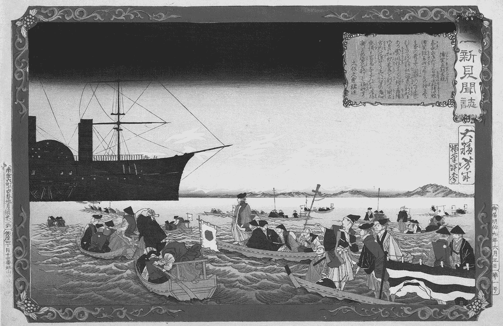

**图 11.1 图片展示的是 1853 年 7 月 8 日，美国蒸汽船在马修·佩里（Matthew Perry）指挥下抵达日本的场景。这次探险的目的是打破日本两个多世纪的封闭状态，与日本政府接触，并建立外交关系。它成为日本与西方列强关系的历史转折点。该画作即月冈芳年（Tsukioka Yoshitoshi，1839—1892）《光复实录》（*Kōkoku isshin kenbunshi*），创作于 1876 年。图自大都会艺术博物馆**

总之，全球知识史既非更优知识的线性凯歌，也非初始生态条件的长期决定论产物。

本章末尾，我将回溯希腊科学多次复兴的经典案例，凸显全球知识史关键机制。其一为“文化折射”：美索不达米亚与埃及知识在希腊语境中的重构，及其发生条件——前制度结构嵌入的知识结构被显性化与反思，而制度本身不再提供驱动力。

中世纪“重量科学”佐证：阿拉伯世界接收希腊科学非接力赛传棒，实生真新概念。新概念源于对特定物质对象的关注，亦源于对希腊文本的特定筛选与新话语生成，从而重塑希腊科学理解，深刻烙印拉丁早期现代科学。这是将偶然转化为内在动力的又一范例。此背景下，我将讨论翻译作为传播方式的特质：依赖源地与目的地知识经济、网络化特征、多语制作用、及知识经济常释放的自催化动力。

最后，我判定伊比利亚全球化期为人类世进程关键节点：它引爆大规模全球互动，给美洲原住民与被贩运非洲奴隶带来毁灭性灾难，并重塑全球环境。

### 近代以来的科学全球化

19 世纪，随欧帝国主义、商业与殖民扩张，欧洲教育科研模式全球复制。科技标准随工业化流通；国际会议编织全球科学家网络。科学在全球成高度整合的社会子系统，愈发成政治权力与决策基石。各国识破教育政策可维护国家在人口社会化、政治塑造、知识存储传播中的权力。于尔根·奥斯特哈默指出：新生全球意识为社会自我诊断提供框架。

当今科学、技术、文化知识多已全球共享。21 世纪科学受益于新社会技术结构，实现知识与专长全球流动。万维网成科学全球基建，1989 年诞生于日内瓦 CERN——这大型欧洲实验室本身就是全球科研枢纽典范。CERN 二战后成立，初衷即在高能物理领域推动欧洲国家间最大限度国际合作。

# 从大型强子对撞机到丝绸之路：知识如何重塑全球化进程

## 大科学装置与全球治理的诞生：CERN 与 IPCC 的启示

高能物理的核心在于探微亚原子粒子，这是一场烧钱的冒险，鲜有直接的经济回报。想要看清物质深层结构，就得不断提升能量，这倒逼设备规模无限膨胀。欧洲核子研究中心（CERN）活生生证明了：即便剥离了政治、军事与经济利益的直接纠缠，大规模知识生产的跨国合作依然能跑通。也正因如此，它成了新型全球知识基础设施的“试验田”——万维网诞生于此，网格计算与开放获取运动也从这里启航。^[⁴¹⁸]

**政府间气候变化专门委员会（IPCC）**

1988 年，世界气象组织与联合国环境规划署联手催生了 IPCC。它的使命很明确：梳理所有可获取的科学证据，给气候变化及其后果定性，并为应对策略提供依据。依据《IPCC 工作原则》，它要在“全面、客观、公开、透明”的基座上，评估人为气候风险、潜在冲击，以及适应与缓解方案的科学底色。报告须政策中立，但可客观剖析特定政策落地涉及的科技与社会经济因子。2007 年，它因功绩斩获诺贝尔和平奖。

IPCC 的评估报告，直接支撑了 1992年里约地球峰会通过的《联合国气候变化框架公约》。公约立下的靶心是：把大气温室气体浓度锁定在“不引发危险性人为干扰”的阈值内，且要在特定时限内达成，为生态系统自然适应、粮食安全与可持续发展留出缓冲地带。^[⁴¹⁹]

放眼漫漫 20 世纪，知识全球化的内驱力与外牵力交织，催生出一批“全球性科学对象”，直指人类共同命题：气候失控、水源枯竭、粮食短缺、全球公卫、能源保供、人口可持续、核扩散风险。化解这些挑战，既考验政策智慧，也离不开全球尺度的科学认知支撑。IPCC 的成立，正是为了给决策者递交这份“全球知识账单”。^[⁴²⁰]

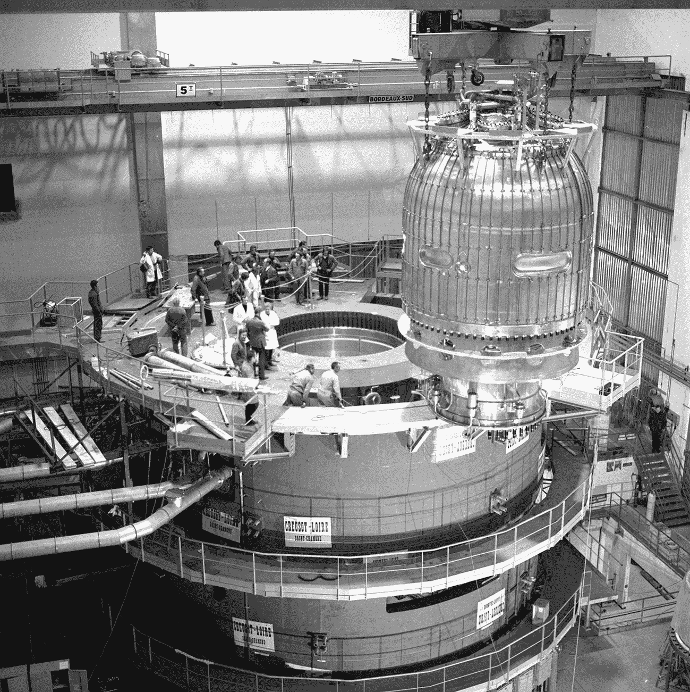

**图 11.2** 1970 年代初，欧洲核子研究组织安装了欧洲大型气泡室（Big European Bubble Chamber）的容器。到 1984 年运行期结束时，它已经向 22 个致力于中微子或强子物理学的实验提供了 630 万张照片。来自全球约 50 个实验室的约 600 名科学家共同分析了它所拍摄的 3000 千米长的底片。© 1971–2018 CERN

如今，全球化科学深度渗透政策与政治；反向来看，政策重塑科研组织形式，划定研究优先序。凡涉单一国家国际政策或跨国行动者的知识流动，本质上皆具全球属性。但迄今未解的谜题依然摆在桌面：何种国际安排能最高效化解集体性难题？哪类机制真能催生科学突破？政治协调是否总利于科研？当科学沦为资源，介入国际制度构建、铸就全球知识意象、开启新型全球治理时，究竟会演变成什么模样？^[⁴²¹]

正如上一章尾声所论，竞争加剧倒逼社会向公共资助科索取“性价比”，这股压力正将学术界推向全球经济模式的轨道。世纪之交，“博洛尼亚进程”启动，意在统一欧洲高等教育标准；随即“里斯本战略”接力，誓要把欧盟打造成“基于知识、最具竞争力与活力的经济体”。^[⁴²²]

主流对全球化的政经叙事，聚焦于近代以来商品、资本、劳动力市场的经济全球化；技术创新与知识体系的长程扩散，往往被降格为前提或副产品。实则不然，全球化通过重塑行动者认知与干预图景，以更本源的方式纠缠于知识之中。

## 全球化的悖论：扁平化与分形复杂性的博弈

讨论全球化，绕不开两张对立的面孔：同质化与普遍化的“压路机”，以及日益失控、错综复杂的“迷宫”。跨国资本推动大众文化标准化、自然资源浪费常态化；财富分配失衡等因素反向激发出形形色色的应对策略，令社会关系层层叠叠。国家与区域制度、传统在过滤、转化全球化冲击时扮演的中介角色，常被低估。

这提示我们：世界非但未单向走向“扁平”^[⁴²³]，反而呈现“分形”特质——在不同尺度上重复着相似的复杂纹理。

**图 11.3** 一位印度妇女坐在印度北方邦瓦拉纳西（Varanasi）的一家麦当劳快餐店的长椅上。罗伯托·富马加利（Roberto Fumagalli）拍摄，阿拉米图片库（Alamy Stock Photo）提供

“扁平化”与“分形化”并存的张力，揭示了全球化实为多进程叠加的合成物：人口迁徙、技术扩散、经政结构重组、文化宗教传播、多语制与通用语的兴替。各进程自有节奏与史籍，但它们的相互咬合、尤其中介知识流动的方式，才勾勒出当下全球化的真貌。

商品、工具、技艺、巧思跨群体流通的速度，往往快于语言、价值观、仪式、知识体系、宗教框架、管理与政治制度。速度差解释了全球化在初始动力耗尽后的特征性“卡顿”。商品与生产技术常脱钩传播，各自挂靠分离的知识系统，借此嵌入特定文化。而造工具、出新知所需的核心知识，转移门槛极高，仰仗语言能力与思维框架的建立，这通常滞后于其他全球化进程。

且全球化阶段非机械排队，市场全球化不等于政制全球化。进程间的复杂互动，催生出截然不同的全球化形态，再次凸显知识在其中的枢纽地位。

战后经济政策演进便是铁证。^[⁴²⁴]

知识史通过塑造参与者与批评者的认知透镜，反向重塑市场形成等全球化进程。下文我将以更多案例剖析知识在全球化中的角色，继而回溯全球化各要素，尤其是历史长河中遗留的“沉积层”。

## 知识不是配角：在全球化进程中主动塑造规则的关键变量

常识以为，知识关乎全球化，因其铺设了各式全球化的基建条件。政见层面，教育普及被视为应对挑战的基石；知识扩散也是全球化的产物，随商品贸易、语言传播同行。于是教育既是前提也是结果。但教育式知识传播，仅是全球化中决定知识生长与扩散的众多社会互动之一，未必最关键。更宏大的视野里，知识非单纯前提或结果，而具备自主动力，深度介入全球化诸要素的互动。

“新技术与旧习俗匹配”即是典范。单靠正规学校教育难破此局。技术扩散、人口迁徙等全球化进程，预设了多形态知识的铺陈——既懂技术操作，又懂异地生存。^[⁴²⁵]

国际发展援助里，西方本土的问责制与道德责任观，常被包装成全球标准，由强势方在“外在全球化进程”中强推给发展中国家。这些规范溯源，实为西方城市社会经济经验提炼的“地方知识”，经外推、异化后，以政治指令姿态强加于人。^[⁴²⁶]

改善发展中国家供水的援助项目，将“自来水厂独立核算、企业化运营”设为国际标准。可在落地语境中，鲜有配套的水管理本土知识生长与之呼应。

90 年代人类学田野调查显示，坦桑尼亚城市水厂技术升级虽成，但按国际标准移植的运营架构失效。失败倒逼后续项目摆脱标准教条，为本土知识涌现腾出空间。^[⁴²⁷]

80 年代中期起，国际运动推广艾滋病防治知识，捆绑所谓“健康应对”的国际标准，内核却是基于“自主能干的个体”这一西方特定想象。

然而知识移植受制于不同“知识经济”的互动，未必能如愿诱导行为改变。某些国家虽普及了防疫知识，民众行为仍深陷传统知识经济：受家庭部落动态支配，甚至将艾滋等同巫术、礼仪违忌。^[⁴²⁸]

知识经济间的博弈，终局决定了国际化与地方性知识的冲突走向，也可能催生应对疾病等挑战的新社会行为、新知技形态。这种遭遇中，部分国际框架瓦解重组，反哺全面全球化（含政经维度）的创新源头。第十六章将深探此类“全球化本地”知识应对人世纪挑战的生产力。

还有一层更普遍的图景：通过强化地方/区域层面的可持续实践与视角，抵抗国际化知识框架与政经法规的霸权，或有助于稳定整个人类-地球系统——这个全球社会与地球动力学深度耦合的复杂体。设问：若“地方稳定孤岛”里的民主合法机构收回对全球市场的管控权，能否缓解资本主义全球化的负外部性？^[⁴²⁸]

## 远古的回响：跨越万年的知识迁徙与沉积

第八章已论：行动留存沉积，改写后续条件。历史上的全球化序列亦然，层层叠叠的沉积物为后续进程铺路。知识全球化尤甚。其谱系远比聚焦近代经济进程所见更古老、更复杂。从未存在过“欧洲/发达地区单向向世界其余地区输送知识”的纯粹线性图景。

我们的当下，是深时历史熬制的产物。以古代世界为镜：人口迁徙携带知识、多语制与文字的张力、新运输手段的引入、直至近代早期科学崛起的全球化前奏。

洲际联系与知识传播，早于智人本身。直立人 180 万年前走出非洲抵达欧亚；智人 30 万至 20 万年前在非洲萌发。^[⁴³⁰]

口语是知识传播的首要载体。古今两大语言生态恒常并存：多语制与通用语。多语接触催生借词（外来概念的载体）与翻译（跨语文本转换中形义的必然变异）。通用语作为破解巴别塔的战略，让苏美尔语、阿卡德语、阿拉姆语、希腊语、拉丁语、英语等轮流充当“硬通货”，未必是多数人的母语。通用语多因贸易迫切而生，却在知识（教学语）、法律（外交语）、宗教（圣语）中扮关键角。成为通用语的过程里，语言的社会价值与词汇的语言学价值常双双重估。^[⁴³¹]

随谷物驯化与畜牧扩张，农耕知识随波逐流。新月沃地集采小麦大麦，终驯化为作物（约 1 万年前）；绵羊山羊猪牛驯化证据至少溯至前 8000 年。^[⁴³²]

这些进步随人口扩散分波次铺开东南欧：前 7 千纪中叶抵希腊，继而西北推进，前 5600 年达莱茵上游，再由拓殖者抵莱茵下游。^[⁴³²]

欧亚大陆农耕扩散，实为小股移民群体陆地推进的接力，狩猎采集者在接触中习得技艺。前 4 千纪起，马驴骆驼驯化拉升远距离交换能级，兼作交通工具，开辟人货知扩散新速度，催生新迁徙潮。^[⁴³³]

船只或自直立人时代即现。海上航道拓展早期农民触角。前 7000 年左右，新石器拓殖者借水运带动植物动物登陆克里特。早航不限沿岸：乌干达蒙萨遗址出土 5000-6000 年前香蕉化石，中间地带却无踪迹，暗示其自巴布亚新几内亚经海运直抵非洲内陆。跨印洋航行至少成事实 6000 年；1500 年后，印度-阿拉伯东南-美索不达米亚长航成常态。^[⁴³⁴]

前 4 千纪末，欧亚大陆已被东西南北贸易路网串联，经济、技术、知识交换在路上流动。^[⁴³⁴]

晚至前 3 千纪，连接埃及、美索不达米亚、印度河流域早期都市中心的贸易路有据可查。青铜技术刺激铜锡需求，倒逼贸易网络外拓；局部技术、经济、政治发展与网络生长互为因果。书写技术扩散（或自两河、埃及发端），近乎即时达伊朗、叙利亚，千年后及印度河，再千年后或影响中国文字。楔形文字入埃兰、安纳托利亚（书赫梯文），腓尼基字母入希腊——书写观念在本土化中变异。这铺就了上一章所述的知识传播宏大图景。^[⁴³⁵]

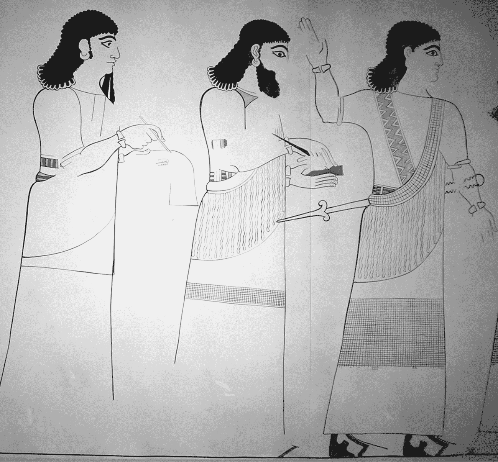

**图 11.4** 一个亚述抄写员在黏土板上用楔形文字书写阿卡德语，而旁边的亚述抄写员在莎草纸或皮革（羊皮纸）上用字母文字书写阿拉姆语。公元前 8 世纪提尔·巴尔西普（Til Barsip）遗址壁画的重绘。参见 Cancik-Kirschbaum (2012, 134)。弗洛连京娜·巴达拉诺娃·盖勒（Florentina Badalanova Geller）摄于卢浮宫

前 2 千纪，大帝国在西亚东亚并起：埃及、两河诸帝国、安纳托利亚赫梯、中国商周。前 1 千纪中叶，波斯帝国横跨尼罗河至印度河，成西亚与印度文化的关键枢纽。阿契美尼德版图囊括两河与西印度/巴基斯坦（最东总督辖地），这种政治“保护伞”构建了帝境内知识技术转移的通道。^[⁴³⁶]

前 1 千纪初，农业、陶器、砖石、冶金、水利、都市化、国家形态（含战争）、精细管理、文字、文学、艺术、科学雏形，已成古代近东诸文化共享资产。虽战火频仍、断代衰落（如前 1200-800 年希腊黑暗时代），支撑这些成就的知识仍在流淌，托底长期稳定与再发展。^[⁴³⁷]

继而，亚历山大马其顿帝国、罗马帝国、伊斯兰政权、蒙古帝国，在异文化间铺陈延展的互动疆域。帝国版图扩张、依赖长途贸易、与邻国游牧持续博弈，客观上推动了维系运作所需知识的扩散。虽帝国也试图封锁机密（赫梯炼铁、拜占庭希腊火），知识流动终究未被遏绝。

纵览人类长史，知识传播与迁徙贸易共舞，与权力信仰结构共生。作为帝国扩张、宗教传播等扩散进程的副产品，知识能远渡重洋、遍布疆域。部分进程具跨区域跨文化性，部分则似“走廊”——如丝绸之路，以细若游丝、间接脆弱的链条，遥遥牵系欧洲与中国。

## 帝国的版图与文字的旅行：前现代全球化的知识动力学

知识常作为其他全球化进程的“同路人”，参与动态却不掌舵，传播成果多短暂，但总有核心成就沉淀为长期积累。这种积淀超越单一帝国寿命：即便毁灭性冲击下，帝国更迭常伴随旧基建继承、知识精英吸纳、本土技艺延续。两河至波斯罗马、伊斯兰至蒙古，大帝国更迭史实为知识积累史。罗马农业法入伊斯兰法典；波斯经济成就为阿拉伯征服者所师法。^[⁴³⁸]

知识若仅作权力信仰、迁徙贸易的“搭便车者”，传播受制于外部节奏。但知识传播亦蕴含内生动力，能在流动中自我增值——如刺激新媒介新机构诞生。文字传播预设识字率普及，这需要教育；文字跨文化落地（异语、异介质）必适配本地条件。翻译运动（如阿拉伯语/拉丁语翻译潮）催生新学习机构或强化旧制：早期伊斯兰世界图书馆与翻译中心建立，中世纪大学课程因吸收阿拉伯文本译作而扩展。^[⁴³⁸]

知识的流动往往伴随着一种“搭便车”效应：当知识作为同行者随同其他事物传播时，其重要性反而会上升，甚至演变成一场蓄意且精准的定向输送。其深层逻辑在于，被传递的知识常带有系统性色彩，内部要素彼此牵引，倾向于在新环境中自发重组为一个完整体系。以12世纪托莱多的著名翻译家克雷莫纳的杰拉德为例，其翻译实践遵循了一套深受10世纪法拉比科学分类法影响的系统性程序。

知识传播的自我催化特性还源于另一个动力：获取知识往往意味着赋能接收方，或至少被寄予此等厚望。譬如16至18世纪，耶稣会科学家将欧洲天文与技术知识引入中国，因其知识被期待能巩固王朝统治，从而在朝堂之上谋得高位。

下一章我们将深入剖析这一案例，揭示知识在传播中亦可能衰弱——特别是当庞大知识系统跨越截然不同的“知识经济”流动时。若知识主要以“搭便车”身份传播（如传教活动），它极易被原子化为孤立的数据碎片，抵达对方“知识经济”版图后，又被重新嵌入本土语境。

最初推动传播的有利条件，终可能化作枷锁阻碍流动，尤其是当回馈机制缺位、知识生产长期单向进行时。耶稣会东来本意是借欧洲文化成就为敲门砖，传播基督教以在朝廷立足。然而，次章将论证：被吸收的知识在异质知识经济中发生质变，未能激起科学变革，更遑论社会转型。18世纪中叶，教廷叫停耶士会对华礼仪的包容策略，最初驱动传播的宗教动力反成了终结其传播的诱因。

可持续的传播，前提在于双方共享物质文化与基础认知的底色，更关键的是建立起一定程度的互惠机制。跨文化、跨知识经济的传播，注定伴随着知识的深度转化：知识在新语境中重组，服从于目标文化的主导知识经济，并对源头产生反作用。若目标文化知识经济动荡不安，传播甚至能重塑其根基。下一章仍将以欧洲科学东渐为镜，多维透视这些动态。

纵观历史，知识转移虽具短暂性，但凭借经贸、文化、宗教传统的延绵，以及技艺、观念、文本的交换，世界版图大部维持着长时段的联结。然而，联结不等于同一化——生产、传播、占有知识的文化并未趋于统一，这正是全球化分层特性的写照。

传播过程本身亦是分层的：新媒介（如文本交换）的出现，不会抹杀旧路径（如物质扩散、人际口授）。古代文明中，文字是精英特权，工匠技艺却长存于民间口耳相传。审视全球化史，我们需借用“地质学视角”：任何局部环境，皆由分层的全球历史沉积而成。地层非总是整齐叠压，它们扭曲、挤压、甚至倒置，以惊人姿态露于地表。

技术史学界长期聚焦关键创新及其扩散，却忽视了一个事实：前沿技术仅是复杂分层结构的最表层，在各地呈异态。埃杰顿指出，审视19至20世纪火车、汽车、飞机的兴起，不应忘记马匹运输在工业化进程中非但未退场，反而用量激增——英国20世纪初运输马匹数量史上罕见，两次大战马匹仍是军事主力。因此，马、骆驼、木犁、手摇纺织机，不应被视为过往时代的遗物，而应视作全球分层结构的历史底基。研习全球知识史，我们理应以同等严肃度对待基础知识层面的长期维系与再生产。

因这多层结构与跨代沉淀，即便今日，技术产品的全球触手可及，也不代表国际知识系统已臻统一。国际与地方条件均施加影响，传播甚至会被叫停，如日本曾闭关锁国两百余载。

但总体而言，传播洪流难挡，虽屡引发意外后果。16世纪中叶，恰帕斯首任主教拉斯卡萨斯奉命筹备新西班牙人口普查，其搜集的材料终成呈予查理一世的《西印度毁灭述略》，揭露西班牙殖民给原住民带来的灾难。

**图 11.5** 马拉油罐车，温哥华，1911 年。图自温哥华市档案馆

根源在于认知真空不存在：即便逆境中，科学理论、心智模型或世界图景，也不会在新范式取代前被抛弃。在外部强加或异质知识经济条件下行动时，行依然带有赋予意义的反思。输入知识必与在地知识遭遇，这类碰撞常触发转化生成新知，偶发于一阶知识层面，实则多落脚于二阶层面——即关于知识意义的元认知，以及知识携带者的文化社会身份认同。

### 全球化：近代早期科学萌发的先决条件

欧洲近代早期科学的崛起，关键依赖于历史层面的知识全球化——从文字等基础文化技术的环球流通、火药火器的扩散、地理认知的拓展、生物标本的环球周转，到希腊科学的传承、丰富与重塑。

上一章略述了纸张这一廉价书写材料的发明与传播。纸张接替了黏土版与莎草纸的角色，推动识字普及；中世纪欧洲识字率受限，部分缘于依赖昂贵的羊皮纸。中国汉代（公元2世纪）发明造纸，技术沿丝绸之路西渐。7世纪末达南亚次大陆，8世纪中叶经中国囚犯传予阿拔斯王朝，继而铺开伊斯兰世界。

造纸术的扩散堪称全球化分层结构与阻滞效应的教科书案例。纸张在华大规模应用后才外传。它先以商品形态入他域，久而久之才被本地化复刻。阿拉伯人7世纪知纸，造纸技术却迟至百余年后才至。10世纪纸张全面取代莎草纸。欧洲10世纪虽闻纸名，造纸作坊却在引入两百年后才建立。又过百年欧洲人才知中国用纸，更久远才溯源发明权归中国。较之伊斯兰兴起前的技术扩散，伊斯兰帝国的联通性极大加速了中国发明的西渐。印度-阿拉伯数字系统的环球化历程，亦是科学全球化累积潜力的关键注脚。

最早十进制数字现于公元595年古吉拉特铜版铭文，但文献证据指向位值系统源头更早。至少3世纪中叶，印度已用独特数字系统——将数字与实物/宗教意象关联，排布成位值制。值得注意的是，最早佐证该系统应用的文本，竟是基于希腊-巴比伦占星传统的占星论著。印度位值制或源巴比伦传统，或溯源于中国算盘（内含十进制位值结构），后者或由佛教朝圣者携入印度。

虽难排除印度自主发展可能，但“旧知识入新环境、经新媒介表征，进而催生位值制”这一传播转化路径极具说服力。印度文学文本即此类新媒介之一，为韵律需求以同义词替代数词，由此衍生出具体数字系统。此类文学语境或早于计算应用。7世纪时，十进制位值制西达叙利亚，东抵柬埔寨、苏门答腊、爪哇。8世纪末，印度-阿拉伯数字已为伊斯兰帝国熟知。

公元773年，含天文数学家在内的印度使团访巴格达。花剌子模的阿尔·花拉子密（约780-850）是早期用阿拉伯语著述数学的学者，他在哈里发马蒙领导下于巴格达“智慧宫”工作。其算术论文是首部采用印度十进制位值制的阿拉伯语著作。虽10世纪末印度数字西欧已知，但正是12世纪该论文拉丁译本推动了其在西欧的普及。13世纪上半叶，通俗计算教材问世，入大学与文法学校课程，奠基方言数学训练的广泛传播。若无纸张、印度-阿拉伯数字、火药、指南针等技术的全球化铺垫，近代早期科学的诸多突破难以想像。

### 希腊科学：文化折射的产物

跨文化迁徙中知识转化的典范当属希腊科学。它常被冠以“希腊奇迹”光环，仿佛凭空生成。实则，希腊科学根植于古代近东知识向希腊语境的移植。

公元前1千纪，近东知识全球化表现为：在更宽广流通圈层中，地方性发展的间歇性累积交换与扩散——如印度文学世界与美索不达米亚楔形文字传统的联结，安纳托利亚大女神崇拜与希腊宗教传统的勾连。显而易见，这些交换涉及“接收方”对文化成果的主动占有，特征即为转化与再语境化。此过程不仅生成常被强调的文化混合体，更孕育出希腊科学这类深刻的新知形态。

希腊科学肇始于小亚细亚，毗邻美索不达米亚文化腹地。美索不达米亚医学、天文、数学知识迁徙至此，因语境易变而呈现新貌。虽两河与埃及科学的正当性内嵌于其生成的制度与表征结构，但在希腊语境，这些辩护理由被显性化为规范推理的主题，服务于公共政治决策的辩论与合法性构建。

如前章所述，巴比伦与埃及数学深嵌于会计、规划、计量等实践，经学校教育逐渐剥离直接功利，独立为活动。公元前6世纪，此类知识进入希腊新文化语境，发展踏入新阶段。希腊拥有新文化技术——修辞竞赛，其中基于规则与定义的新方法被自觉运用于陈述意义的探究。

总之，若无公元前1千纪下半叶知识全球化进程，希腊哲学与科学不可想象。同等重要的是，一阶实践技术知识、仪器与数据的传播与占有（它们为二阶知识、乃至希腊科学理论突破奠基），常被视为精确科学真正的诞生时刻。

### 希腊科学的多重“复兴”

希腊科学历经多次“重发现”与“复兴”，耐人寻味。每次复兴都将科学推向全球化新高度，融合异源知识传统。重发现本质上是“扬弃”——将旧知置入全新环境。希腊科学先化为希腊化科学，8-9世纪在倭马亚与阿拔斯哈里发治下于阿拉伯语世界获应用发展。及至近代早期欧洲接纳（实为希腊科学转化后的余绪），沧海桑田——书写技术已扩散多元化，并经印刷术变革。与其说希腊科学重获新生，不如说它催化了一个通向新型科学（即现代科学）的进程。

希腊科学如何全球化？西罗马帝国解体后，大地中海世界仍高度联结，阿拉伯半岛、南亚、中亚等远地在早期伊斯兰哈里发扩张后紧密嵌入。在常被称作“后古典时代”的数个世纪，人、物、思想、知识持续在辽阔地理空间迁徙。

继迪米特里·古塔斯开创性研究后，索尼娅·布伦特斯工作显示：8至9世纪初，有限的中古波斯语、叙利亚语、希腊语文本被译为阿拉伯语，其范围与更早译成叙利亚语、中古波斯语、亚美尼亚语的文本惊人相似。首批阿拉伯语译作与早期其他语言译作高度平行。直到8世纪晚期局面始变。哈里发马赫迪向伊拉克基督教社区开放宫廷顾问学术圈，使叙利亚语学者融入哈里发统治的知识-行政-政治世界。

源自巴克特里亚的巴尔马克家族崛起为维齐尔与首席行政官，赞助译介印度希腊医学、天文、数学文本，在巴格达建首家医院。规模更大、主题更广的希腊哲学文本译介似始于9世纪。这些文本虽长受学界青睐，却导致学者忽视更早的中古波斯语译本，及伊朗、叙利亚学者在8世纪阿拔斯宫廷的作用。对哲学科学文本的过度聚焦，亦淡化了占星术的文化功能——其作为解释理论、学者职业背景、政治手段的关键角色。

在继续探讨阿拉伯文化对希腊科学的挪用前，先审视翻译过程有助于凸显普遍特征：翻译是知识传播核心媒介，尤其当知识以文本形态固化时。翻译面临双重挑战：语言间的映射，与两套常不共存甚至冲突的概念系统间的映射。应对需语言能力与技术能力合一，往往要求跨文化协作。破解第二难题不止精通内容，更常需在过程中创制新语言资源——从术语词典编纂、语法构建到对语言的深层反思。

佛教传播即创制新语言资源的范例，宗教史家颜子伯曾以知识迁移视角考察。

然而，佛教初植新土（如中国）时，常激发获取新文本新知的活动。西藏藏王7世纪决纳佛教，随即采用适用文字系统并组织大规模翻译，致西藏文化彻底转型。佛教史雄辩证明：知识传播可成语言相关新知的源头。

但这高度依赖相关知识经济，尤其是目标域知识经济。藏译佛经案中，创制出体现语言学元知识的系统性辅助手段；汉译案中，此类知识多隐于典范范例之中。翻译的可能性取决于局部文化重叠（物质文化与知识的共享要素）、兼容的动机、多语环境的存续或构建可能。这将我们拉回希腊科学的传播转型——它强烈依赖这些共通性。

希腊哲学科学文本的阿拉伯语译者面对的非死寂文化，而是涉及活跃学者的鲜活传统。扎根于萨珊制度的知识、实践、记忆（甚至制度本身），或保留于伊拉克、伊朗西部及阿拔斯东部的基督徒、琐罗亚斯德教徒等群体中。阿拉伯语、中古波斯语、希腊语母语者中涌现多语者，此为早期译者核心技能。此外，早期译者多兼通天文/占星、算术、逻辑、哲学、炼金等技术知识。

翻译过程是对互斥目标的协调：忠实原语言结构，与在新媒介中重建原内容。结果往往是：基础内容知识在译介中转化流失，或原语言表达被扭曲，干扰高阶内涵呈现。高阶内涵常由更宽语言域的语义关联承载，居于语境而非文本。基于此，唯有翻译不再必要时，完美翻译才可能实现。

为忠实呈现原“技术”内容而创制的新术语，在目标语语义环境中难有如源语般的共鸣。反而，新术语的诞生可能开辟新语义场，借由传播内容实质性改变目标语言。

经阿拉伯语挪用与翻译，希腊科学传播等同于知识的深度重塑。如9世纪下半叶活跃于巴格达的学者塔比·伊本·库拉（826/836-901）携同伴与学生，重撰希腊力学著作及多门学科文本。

**图 11.6** “智慧天平”，其各部分的描述和解释见于哈兹尼（Abd al-Raḥmān Khāzinī）于 12 世纪创作的一部手稿，约 1121 年。出自劳伦斯·J. 勋伯格手稿集 MS LJJ 386（未编页码），宾夕法尼亚大学基斯拉克特殊收藏、稀有书籍和手稿中心提供

作为异质知识世界的中介，塔比终创作出希腊力学无直接先例的原创性成果。其贡献将“杆秤”确立为力学挑战性对象，汇编古籍天平文献特定材料，在研讨语境下重组古老知识。

约旦努·德内莫尔（约13世纪，1260年前活动）等西方拉丁学者最终接纳了阿拉伯人在称重科学上的成果，约旦努是中世纪最重要数学家之一。

### 翻译网络

### 知识的跨语言迁徙：阿拉伯-拉丁翻译运动的自催化奇迹

将希腊科学遗产经由阿拉伯语转译为拉丁文的运动，堪称知识史上的“二次转化”。早在 10 世纪，南方的学识便开始向拉丁世界的北方渗透，首批抵达的多为阿拉伯语译本，以及在伊比利亚半岛流传的星盘等实体仪器。到了 11 世纪，这些认知资源已从西班牙北部的修道院辐射至法兰西西部、日耳曼南部与瑞士地区。传播谱系不仅涵盖关乎仪器操作的实务技艺，更囊括了占星、天文与算术等体系性知识。它们共同构筑起一种独特的“知识之象”，极大地激发了后续的求知欲——这种印象令中世纪拉丁世界深信：异域文明掌握着高阶乃至秘奥的学识，而这些正是本土文化亟待吸纳的宝贵资产。

11 世纪起，在靠近普利亚大区拜占庭聚居区的萨勒诺，希腊医学典籍亦启动了向拉丁文的转译。这批早期成果迅速成为西欧与中欧知识经济的关键变量，譬如在书籍交易市场上占据重要地位。最初的翻译活动呈现出显著的“自催化”特质：译出成果反向刺激了更多翻译需求的涌现，这一正反馈循环在 12、13 世纪达到高潮。^(⁴⁵³)

阿拉伯语向拉丁文的转译实为一张活动网络的编织成果。^(⁴⁵⁴)

托莱多于 1085 年收复失地后迅速崛为翻译网络的核心枢纽，得益于其提供的跨文化交往空间。这类兼具相对宽松的政治与宗教宽容度的“边界地带”，正是知识跨越文明疆界流动的关键前提。部分译者系自发行动，多为底层神职人员，他们从欧洲四面八方汇聚至新兴翻译中心，意在通过笔耕获取前沿认知。^(⁴⁵⁵)

推动阿拉伯语知识向拉丁文、希伯来语及各地方言传播转译的动力，交织着局部与全球双重维度。在区域层面，莫扎拉布群体的文化传统功不可没——他们不仅贡献了多语言能力，更带来了守护自我文化认同的强烈意愿。放眼全球层面，天主教欧洲对魔术、占星与占卜学的广泛狂热构成了核心驱动力。现存译作绝大多聚焦这些主题，显见它们是 12 世纪乃至 13 世纪翻译浪潮的绝对主角。^(⁴⁵⁶)

翻译事业启动了知识获取的自我加速机制。某些译入知识的系统性特征——如哲学化的科学体系或分类学框架——触发了对缺失环节的疯狂补全。最终，接纳方的知识经济完成了结构性重组，其中便包含中世纪大学体系的兴起。结果是，输入知识在新语境下得以复制与拓展。自 11 世纪下半叶起，经院哲学作为覆盖全欧的高等教育与学术交流网络应运而生，其动力源泉便在于阿拉伯语世界知识输入的持续刺激。

### 伊比利亚主导的早期全球化：生态碰撞与知识重构

随着欧洲舰队抵达美洲、绕行非洲，15 世纪末真正的全球互动圈层正式形成。这一进程由伊比利亚双雄——西班牙与葡萄牙的征服殖民开启，后经荷兰、英国、法国的商业与殖民介入持续扩容。这些干预不仅加速了人员、物资、技艺与知识的全球循环，更全方位冲击了世界各地原有的知识体系。^(⁴⁵⁷)

然而，若论对知识史的深远冲击，1492 年哥伦布航行引发的“哥伦布转向”或许更为关键。其后果波澜壮阔：美洲原住民的大规模灭绝、跨大西洋奴隶贸易的兴起、土著知识传统的瓦解，以及动植物疫病在人为干预下的全球性扩散，导致作为“知识对象”的世界面貌发生剧变——即便在工业化降临前，世界已然成为被认知与改造的客体。^(⁴⁵⁸)

美洲殖民化本身即是全球化进程的衍生品。回溯欧亚大陆，13 世纪蒙古铁骑的西征曾对早期文明积淀的知识传承造成毁灭性打击。基础设施毁于战火、生灵涂炭（尤其是 1258 年巴格达之围），使得可追溯至美索不达米亚灌溉文明的整套知识经济荡然无存，珍贵典籍与珍宝永逝。与此同时，蒙古帝国缔造了贯通远东至中欧的欧亚互动圈，为人员、技术、货物与知识流动开辟新径，却也为黑死病等瘟疫敞开了大门。14 世纪大疫致使亚非欧约 5000 万人丧生。^(⁴⁵⁹)

然而，欧亚大陆的连通性跃升，也为欧洲通往中国、印度及亚洲腹地的探索贸易创造了契机。13 世纪下半叶“蒙古和平”时期，鲁布鲁克、马可·波罗等旅行者的游记便见证了这一红利。^(⁴⁶⁰)

13 世纪时，中国 9 世纪发明的火药技艺已遍布欧亚，伊斯兰与蒙古军队均掌握了从投石机抛射火药炸弹的战术。^(⁴⁶¹)

伊比利亚全球化的独特性在于，其触角延伸至整个地球生物圈，引发了近乎不可预测的深层生态重组。^(⁴⁶²)

两大洲截然不同的生物演化遗产，意外地垂青了新移民。欧洲人及其携带的家畜、病原体历经长期共同演化，早已对那些足以毁灭原住民的疫病建立起免疫屏障。^(⁴⁶³)

新大陆殖民化终将这一偶然的生物学优势，转化为欧洲在全球政治经济版图上的压倒性胜势，推动其掠夺式经济与知识经济双双迈向全球尺度。两大陆农业体系的深度融合是关键一环：薯类、玉米、木薯成为欧亚非主粮，小麦与畜禽蛋白重塑美洲食谱；至 1700 年，大米更成了西非贩至美洲奴隶的基础口粮。^(⁴⁶⁴)

**图 11.7** 摘自泰奥多尔·德布里《新世界》（1613），描绘西班牙军队深入西印度（今哥伦比亚）卡塔赫纳腹地的军事远征。德布里综合本佐尼等资料，向公众呈现印第安人遭受虐待的黑暗叙事。图自互联网档案

伊比利亚全球化亦深度卷入科学知识的转型洪流。16 世纪，宗教团体在圣多明各、利马、墨西哥城、波哥大、基多等地创建学院（多后演变为大学）。^(⁴⁶⁵)

在殖民地知识经济肇始期，认知秩序主要依托欧洲的经院哲学、自然史或盖伦医学等传统框架建构。但全球化带来的海量新经验——未知动植物、土著医疗实践等——迫使知识体系加速多元化分化。这种分化反向重塑了欧洲知识经济，催化了从经院哲学向现代学科体系的跨越，而后者又反过来烙印于殖民世界的知识组织之中。毫不夸张地说，若无伊比利亚全球化积累的认知资源，从自然史到现代地球科学、生命科学的嬗变几无可能。它成就了布干维尔、库克、福斯特的环球探险，支撑了林奈、洪堡、达尔文的综合性巨著。^(⁴⁶⁶)

17 世纪末至 18 世纪，启蒙思想辐射美亚殖民地，刺激出新型科学机构，关联社会进步的科学新形象显现。但教育推广、启蒙与科学知识的传播始终受制于殖民当局，屡遭压制。即便在 18 世纪晚期，古巴法律仍禁令美洲裔与西班牙裔研究撰写任何殖民相关议题。^(⁴⁶⁷)

**图 11.8** 爱德华·恩德油画作，描绘 1799—1800 年委内瑞拉考察期间，身处奥里诺科河畔的洪堡（坐者）与邦普朗。© akg 图片库

本章伊始曾指出，知识全球化的内生与外推进程及其耦合互动至关重要。美洲殖民化后的全球科技互动，正是这双重因子共振的产物。它由欧洲列强积累的全球化知识孕育，并随征服殖民作为“同路人”同步扩散。下一章将以耶稣会东渐为例，探讨科技知识作为“同路人”传播的深层逻辑。

知识全球流动既引发又加速了后续全球化浪潮。它作为各式原始工业化与工业化的背景板与放大器，推动了世界市场的建立——核心虽在欧洲城市网络，却辐射全球。这包括资源开采与人力开发技术的全球扩散，汞齐法发明推广便是典范：该工艺以汞提银，直接导致 16 世纪中叶后拉美白银产量爆发式增长。矿业扩张与单一种植园经济的蔓延，带来汞污染扩散、森林毁灭等生态创伤，标志着人类世进程的实质性启动。

殖民帝国为知识经济奠基，使全球气象、洋流、人口等数据收集成为可能，进一步加速全球化进程。但殖民地知识经济亦开启了认知全球变化本身的视野，揭示了人类作为环境核心重塑者的角色。18 世纪末 19 世纪初，洪堡等先驱凭借其得天独厚的全球视野，率先发出了这一时代的最强音。^(⁴⁶⁸)

## 第十二章

## 自然科学的多元起源：一场漫长的认知演化

> 古者羿作弓，俞作甲，奚仲作车，巧垂作舟。然则今之鲍、函、车、匠皆君子也，而羿、俞、奚仲、巧垂皆小人邪？且其所循，人必或作之，然则其所循皆小人道也。
> ——墨子驳儒家“君子循而不作”（引自葛瑞汉《后期墨家的逻辑、伦理和科学》）

> 正如我在其他场合所写的，我非常希望从伽利略那里得到日月食的计算方法，特别是日食，这可以从他的许多观察结果中得到。实际上，所有这些对于我们校正历法都极其有用。而且，如果存在任何我们可以依赖的作品能让我们不被赶出中国，那么只能是这个了。 ^(⁴⁶⁹)
> ——邓玉函（引自以撒亚·亚纳科内《邓玉函：文艺复兴科学和中国明朝的意大利猞猁之眼国家科学院精神》）

### 必须引入演化视角

全球知识史如何重塑科学观？上一章虽强调全球化在现代科学诞生中的关键作用，但叙事重心仍落于众所周知的希腊科学变革——那是后世诸多成就的源头活水。然而，自然科学在人类史上究竟涌现过几次？真如欧洲科学宏大叙事所预设，仅在古希腊完成单一诞生？抑或其根系深植于多元文化历史的沃土？甚至有人质疑此问题本身是否伪命题，毕竟要在“科学”与“非科学自然研究”之间划出普适红线，难度极大。但从“自然科学出现过几次”这一追问中，我们或许能窥见“大分流”背后的深层逻辑。^(⁴⁷⁰)

拟从两个维度作答：一是科学实践层面，即科学特有的知识经济，关乎为获取认知而对物质文化的探索；二是该特定知识经济与社会整体经济互嵌互动的层面。就首维而言，我主张自然科学在人类史上确存在多元起源，将以古希腊与中国为镜鉴。

次维视角下，结合前两章脉络，科学知识经济在长时段全球进程中与社会知识经济、物质经济深度纠缠。从这个意义上讲，自然科学作为推动经济发展等社会进程的核心引擎而崛起，实属世界史的独特奇观。其独特性源于：自然科学在相对短暂的历史时窗内爆发出强大全球效能，以至于压缩甚至消解了替代性发展路径的生存空间。

第十章聚焦欧洲，呈现科社漫长深度的纠缠史；第十一章凸显该进程的全球互赖性及殖民时代加速西方霸权的后果。这一进程在特定时空达到顶峰，以独特方式重塑力量均衡——这既是全球动态的合力，也是无数偶发事件（含美洲征服引发的生态碰撞）的间接结果。

这正是“自然科学出现几次”既诱人又棘手的缘由。若换个结构同构的提问，其特殊性或更清晰：“人类物种出现过几次？”

“何为人”自希腊哲学时代即成经典命题。第欧根尼·拉尔修记述锡诺普第欧根尼戏谑柏拉图定义：“人是无羽毛双足兽。”众人喝彩。第欧根尼遂拔鸡毛携入学园：“看，柏拉图的人。”定义遂补一句：“具宽扁指甲。”^(⁴⁷¹

正如自然科学起源之谜，人类起源之答长期受“起源观”主导——一来源于宗教创世论（科学英雄起源神话常为其回响），二来据称源于生物进化论的“渐进论”主张。但达尔文坚持：人类与他类生命关联在于连续性；若缺此连续性，人类物种起源之答只能退守起源神话。^(⁴⁷²)

**图 12.1** 柏拉图的人：一只被拔了毛的公鸡。劳伦特·陶丁绘

前沿人类演化研究显示：不仅从兽到人的过渡期漫长，人属分支亦远比传统“向现代进化”直线图景丰富。漫长岁月中，多种原始人竞争或隔离生存，个别类人认知能力与现代人差异难辨。更有证据证实：不同原始人种存在异种交配与基因交换，彼此间或通过共处习得经验，或因生态位竞争与迁徙间接影响。^(⁴⁷³)

甚至在解剖学现代人出现后至少 10 万年间，仍无特征性现代行为可将其与古人类显性区分。摩洛哥发现 30 万年前类智人化石，更将这种“生物进化与文化演化的时间错位”推向新高度，科林·伦弗鲁称之为“智人悖论”。^(⁴⁷⁴)

在人类漫长多支的演化史中，最终幸存的未必是“更优越”的物种，而是一种新型过程的胜出——它重塑了自然选择进化机制，并将其推至幕后。^(⁴⁷⁵)

置于此演化视角，自然科学的多元“起源”实属必然。但这些起源不应被视为孤立竞争的离散事件，而应理解为汇聚成自然科学涌现的多条轨迹——正如章首墨子寓言所喻。若脱离全球知识史，自然科学涌现之谜将陷入起源神话的扭曲。历史上，知识经反思转化为“科学知识”形态的案例比比皆是（也有错失、被压制、未实现的可能），若不考察这些反思过程，历史记忆只能制造神话。

**图 12.2** 恩斯特·海克尔绘“生命之树”，隐喻达尔文普遍共同祖先说。摘自《人类的进化》（1879）。图自维基共享资源

比较欧中科学有助于厘清自然科学起源问题的两大核心。第一，历史上自然科学——即通过持续系统反思人类对自然的物质干预而生成知识的社会实践——确曾独立多次涌现。反思性思维可呈现多元形态，产出独特甚至怪诞的结果，它们无法被纳入以现代西方科学为终点的线性进化逻辑。

第二，自然科学融入更宏大的认知与物质经济，是长时段积累的结果。该进程自近代早期起对社会发展产生深远最终全球化的影响，至晚于第二次工业革命成为全球发展的构成性要素。但这一全球化在不同时空的落地形态，很大程度上取决于当地知识经济——而后者亦在互动中重构。本书终章将回溯科学知识在全球社会中的构成性角色，标志着我所谓“认知演化”作为文化演化新阶段的肇始。

### 希腊与中国早期力学文献的镜鉴

欧洲传统最古老的力学科学著作当属《力学问题》。^(⁴⁷⁶)

全书由序言与 35 个简短“问题”组成，多以“为什么……”发问。核心命题直指痛点：“为何微力借杠杆可撼动重物？”^(⁴⁷⁷)

亚里士多德或其逍遥学派门人，在系统化知识版图的背景下剖析此难题。他们聚焦起重与称重两大实践：前者蕴含“以智胜天、小力举重”的技巧，后者体现“权衡等效”的智慧。能否假设：天平既寓等价，便是解读杠杆神力如何与因果等价相容的钥匙？《力学问题》的推理逻辑即建立于此直觉。

论证由特定心智模型驾驭：天平—杠杆模型。该实践知识模型由第六章已识的两大熟悉模型耦合而成：关乎等臂天平的平衡模型，与作为机械模型特例的杠杆模型。二者可整合，缘于一种兼具双重功能的新颖装置——不等臂天平（称）。第十四章将详述其发明与称重史。此处只需明确：因该器械同时是杠杆与天平，故能融合两种实践心智模型。等臂天平靠砝码平衡重量差；不等臂天平则通过移动砝码位置（或如亚里士多德文本所述，固定砝码移动悬挂点）实现平衡。

这揭示了平衡模型的深层逻辑：重量差既可用重量抵消，亦可用距离抵消。将杠杆等同于天平横梁，便可借此装置将杠杆省力神效理解为因果等价——即以长度差抵消力量差。正是这种关乎不等臂天平的实践知识，为杠杆定律的提出奠定了经验基石。

### 理论力学的双重起源：墨家与亚里士多德的平行探索

纵观《力学问题》这部著作，虽折射出实践者的知识底蕴，其著述初衷显而易见并非服务于实务操作。若无既有理论传统对自然现象加以诠释，力学作为理论科学便难以萌芽。力学的诞生——即“杠杆变天平”这一理论可能性的兑现——植根于特定的文化土壤：彼时理论反思已在多个经验领域铺开，且盛行以辩论说服为核心的论证文化。古希腊（尤其是雅典）的政制与司法惯例，使得成败系于修辞与逻辑说服之力。

在与马深孟、鲍则岳的合作研究中，我们曾将亚里士多德力学著作的奠基地位，与中国最早力学文献——《墨经》相关篇章（约公元前300年成书）并置考察。这部文本内部结构错综复杂，宛如带有丰富内链的超文本。遗憾的是，公元前1世纪为汉帝国图书馆整理的版本严重打乱了原貌，致使文旨晦涩难解。隋唐之际（公元6至7世纪），简略版墨家文集流传甚广，几近取代全本。幸而全本藏于御府，延续至宋代（10至13世纪）付梓入《道藏》，得以跨越近千年寂寥，于16世纪中叶重现世人眼前，恰逢欧洲传教士入华前夕。19世纪中西学术对接之际，中国学者惊觉《墨经》与西方科学思维暗合，方重燃对这段失传学脉的关注。

葛瑞汉（Angus Graham）在前人考据基础上重构了《墨经》架构：书分数“部”，各部含“经”定核心术语、“经说”析疑难，涵盖逻辑（非三段论，乃语言反思以避自相矛盾）、伦理、科学（含力学）、辩艺四大领域。

文中展现的力学洞见，与亚里士多德物理学惊人契合。例如论横梁受力：“衡加重于其一旁，必捶，权重相若也”（一侧增重则垂，因“权”与重相称）；“相衡则本短标长。两加焉，重相若，则标必下，标得权也”（齐平时短端长端，等重加之，长端沉，因得“权”）。核心命题在于：为何同一重物在特定装置中表现异于自然状态？墨家以“重”与“权”之辨析作答——剥离物体本性（重）与装置诱发的效能（权），消解了实践经验与直觉模型的冲突。直觉谓大力致大效、等重同效；实践却见等重因位置异而效果殊。墨家引入“权”这一新概念，修补了心智模型，使机械安排下的反常现象重归可理解秩序。

《墨经》记录多种机械装置（多涉军工，墨家擅长），皆制造“违背自然预期”的困境：横梁负重不屈、倾物难立。重物本性直下，巧力却能托举、横拉、阻其自然趋势。这虽非阿基米德式的量化理论，却与《力学问题》同构：将力学效应视为悖谬，再以术语体系消解矛盾。光学部分亦遵此范式。

二者皆可视为“辩争文化”语境下，对共享实践知识的理论提炼。虽源于实践，所提问题却超越实用，直指哲学反思。墨家反儒家“循天道立伦常”，主张道德建立于人意人为；力学探索亦由哲学驭动——旨在证明：机械过程虽违直觉，却非不可理喻。

中欧理论力学的萌发，均属偶发历史事件，赖特定文化环境而生。然散落的实践经验在两地引发了相似的反思模式，虽抽象概念迥异：中国构建“权”（有效性），欧洲演进“重心”与杠杆定律（后以“位形重力”概念回应类似问题）。长时段看，科学力学的实质非在于特定文本形态，而在于：一、工艺工程延续性下稳固的直觉与实践心智模型；二、能在文本传统中存续演化的理论模型与抽象概念。

这是自然科学的第二次独立萌芽吗？中欧路径会汇合吗？若视科学为“系统探索自然的持续努力”，首问答“是”。《墨经》传承自秦汉集权（公元前221年）起被遏制，墨家学脉随之隐没前史。实践机械传统虽存，并成明清中西交涉的参照点，但理论力学思维早已断裂，难以接续“汇合”命题。尽管如此，此案揭示：科学可因文化语境走向不同发展路径。

**相似性**：两大传统皆痴迷悖谬，皆发轫于辩争文化。希腊智者游说设谬，公开辩演；战国墨辩亦然。反思对象皆为与物质文化关联的实践知识（机械装置等），通过语言表征的重组构建理论，旨在组织知识本身而非单解实用。这既源于跨文化的共同物质条件与技术水平（如特定装置的存在），也可能涉及早期知识扩散（工具随内隐知识流动），印证了知识转移的分层结构。但理论反思大概率独立发生——无文本接触证据，故而概念生成路径分野：墨家以“权”释杠杆，希腊归因于圆周运动速度差。

**差异性**更深层指向社会条件：《力学问题》纳入亚里士多德自然哲学框架；墨家无现成宇宙论可依，竞争对手亦无，其反思背景是“正行正名”，科学、伦理、逻辑三足鼎立。墨家起于功利主义，经“形而上学危机”（公元前4世纪中叶）重构，誓“独立天道权威，立道德于利害欲恶”。战国宇宙论方兴未艾，希腊自然哲学却早于语言理论反思而成熟。

综上，两文化均孕育了“系统探索物质规律”的科学雏形。演化路径的概念差异源于不同语境；希腊传统断续延续（经文化折射），墨家传统中断，乃外部环境使然，非内在缺陷。显而易见，科学传统的**生成条件**与其**长久生存条件**并不重合。

---

### 欧洲科学东渐：知识经济视角的李约瑟难题

此例开启了另一种演化路径。这能否最终催生类似近代欧洲的“科学革命”？即“李约瑟难题”所问：为何中国未现科学革命？李约瑟（Joseph Needham, 1900—1995）以《中国科学技术史》确立此核心议题。众说纷纭，亦有拒斥反事实史学者。本节不解谜，聚焦相关问题：为何17世纪耶稣会大规模转移欧洲科学，未触发中国知识系统质变？这关乎“自然科学被发明了几次”的第二层面——知识经济层面。重大转型非单一因素（如古代传统有无）所决，乃整体知识经济之果。

耶稣会1540年成立，反宗教改革期主导欧洲天主教教育与科学生产（从人文学院领衔到新科学参与）。《教学大纲》（Ratio Studiorum）在克拉维（Christopher Clavius, 1538—1612）推动下重数学教育。克拉维主持1583年格里高利历法改革（修正儒略历与太阳视运动的10天偏差，关乎复活节定期），此役成为中欧知识联结的关键枢纽。

中国历法象征天命，关乎帝统合法。钦天监（隶礼部）掌历算，明承元制，虽存伊斯兰回回司天台（希腊系天文法）遗制，未深度融合。15世纪起钦天监屡测日食失准，却难推动改革。至16世纪误差积重，仪式受扰，转机乍现（艾尔曼考证详备）。

耶稣会随伊比利亚全球化入亚洲，果阿为基地。1583年立足澳门侧，利玛窦（Matteo Ricci, 1552—1610）曾随克拉维习神学、数学、天文、宇宙论。中国学者引伊斯兰法为先例，邀耶稣会参历改。利玛窦敏觉良机，请调精锐。1612年金尼阁（Nicholas Trigault, 1577—1629）归欧组团，携书万卷、仪器、重炮、专家，获教皇、诸侯及欧学界热烈响应。

随团而来邓玉函（Johannes Schreck, 1576—1630）曾与伽利略共研。1621年抵广州时，历政危急，为耶稣会打开窗口，然传教受阻。邓玉函1629年入钦天监，翌年卒。汤若望（Adam Schall von Bell, 1592—1666）继任，成首位掌钦天监的欧洲人，明亡清立后仍居要职。南怀仁（Ferdinand Verbiest, 1623—1688）继之。

**图 12.3** 《天文学家》挂毯，“中国皇帝的故事”系列，羊毛丝绸，博韦厂，1722—1732年。图案设计1686—1690年，菲利普·贝阿格尔监制。中央为顺治皇帝（1638—1661），右白须者为汤若望。师徒或喻南怀仁与康熙（1654—1722）。藏班贝格玫瑰园新居10号厅。© 巴伐利亚宫殿管理局，赖纳·赫尔曼、玛丽亚·舍夫、安德里亚·格鲁伯摄

耶稣会与中国学者合作远超历法：自利玛窦始，合译《几何原本》前六卷、克拉维注《天球论》、测量水利农政著作、伽利略望远镜技术，甚至重引理论力学（自墨家失传后绝迹）。1626—1627年，邓玉函候命北京教堂，会工程师王徵（1571—1644），合著《远西奇器图说》（1627）。此书勾勒力学知识谱系：自亚当夏娃起，经希腊机械传统、亚里士多德宇宙论、简易机械，至斯蒂文（Simon Stevin, 1548—1620）与德尔蒙特新定理，收录中国史籍首见杠杆定律明确表述。

鉴于上述种种背景，我们本有理由预期：借助人员往来、典籍文献与仪器实物，欧洲前沿科技知识若能大规模输入中国，理应能激发类似科学革命的变革——前提是人们认定知识本身或其生成机制是此类转型的关键变量。不可否认，在知识层面，这次转移是成功的。此后涌现的中文著作，早已超越了单纯翻译或零星摹仿欧洲资料的范畴。由欧洲传教士与中国士大夫合著的典籍，构成了中国读者驾驭这些知识的有效工具。以《远西奇器图说》为例，当欧洲科技知识遇见中国熟悉的书写范式、学术传统与本土技艺，便衍生出一种契合中国语境的全新形态。欧洲知识的深度与广度，并未在一个晦暗的“交易区”里被稀释——所谓交易区，指全球范围内对交换知识的真实意涵存有分歧，只能受限于局部交换规则的空间。相反，由此诞生的全新知识表征，其意义早已超越了时空交换的限度；凭借与更广泛共享知识库的关联，它们实际上具备了更普适的可用性（后世接受史印证了这一点），足以吸收并推进其中蕴含的理论与实践传统。

**图 12.4** 工程知识的扩散：1627 年《远西奇器图说》中的踏车（**左**）与 1588 年阿戈斯蒂诺·拉梅利《各种人造机械》中的踏车（**右**）。马普科学史研究所图书馆藏

然而历史的实际走向却是：17、18 世纪的中国，并未发生类似欧洲的科学革命。马深孟指出，一大解释在于两种知识经济的底层逻辑截然不同，而知识经济既是传播的驱动力，也是筛选过滤器。 ^(⁴⁹³)

尽管传播科学仅是传教士的副业，但从某种角度看，他们在科学传播上的成果远超信仰传播。至少在有识之士中，科学引发的兴趣与欢迎度远高于宗教。这导致中西两大知识精英群体相遇，各自代表着拥有高度复杂知识体系与先进技术的文明。耶稣会士虽成功吸引了士大夫目光，激发其对欧洲文明成就的兴趣，但西方科学终未大规模融入中国近世早期的知识经济。尽管传教士试图将数学、科学、亚里士多德哲学与基督教作为不可分割的整合世界观输送，但这套世界观在中国知识经济中被肢解，各模块的接纳与应用程度天差地别。欧洲知识在很大程度上被视作中国传统的“补丁”，欧洲人被视为擅长计算的技师，而非一套全新宏大知识体系的倡导者。

因此，传播在数学与天文历法领域最为有效，因为中国知识经济内部能自察这些领域的短板。如前所述，早先引入伊斯兰历算法已为处理外来知识立下先例。钦天监有限的机构边界，为应对挑战划定了明确且不外溢的空间。但对于转移知识的其他部分，缺乏同等强力的结构或机制，即便个别知识分子试图推动更广泛传播。徐光启（1562—1633）即为典型案例：这位有影响力的高官、早期皈依者，生前主持历法改革。他热衷于借欧洲知识推动中国更广泛的制度与技术变革（如农业），并参与编译相关农学著作。 ^(⁴⁹⁴)

但尽管新知涌入，中国知识经济整体仍保持惯性。其非凡稳定性（较同时期欧洲尤甚），可从明清易代（1644）中窥见：满族外来政权建立的清朝，非未动摇根基，反而见证了耶稣会士作为钦天监科学顾问地位的延续与强化。然而新知未引发重大制度变革，反倒是中国原有的知识机构——钦天监、科举制——裁决了新知的命运。欧洲科学与实践知识（尤其是历法编算、天象预测）被中国体系按自身需求选择性吸纳，未化作欧洲式的广泛文化动力。可被同化的西学成分被接纳，理论力学等其他成分则长期处于边缘。

如第十章所述，相关知识系统的特定架构至关重要。在欧洲，实践知识、科学知识与宗教观念在宏大世界观中紧密编织。这非仅高层智识建构，更深植于共享知识之中，并由更广泛的知识经济（如无数耶稣会学院、大学、学术机构）生产复制。由此形成的知识联结，使挑战能在整个知识经济中产生共鸣。哥白尼日心说引发的震荡，不止于天文学，更波及自然哲学与宗教。在欧洲，现实世界体系的争论（日心说 vs 地心说）牵涉深远的宗教政治后果。中国缺乏同类辩论，非因知识匮乏，而是知识经济与架构迥异。

除历法预测力外，这些知识与中国传统世界观冲突可能性极低，因它属于另一领域，很大程度上与国家正统的道德政治价值分离。即便宗教信仰亦复如是。中国人视角下，耶稣会士的传教使命只要能同化为熟悉的佛教宗派模式、服务于自我修养、不触动官方新儒家正统，便具合法性。1616 年“南京教案”印证了这一点：传教士因冒犯儒家正统受审，1616—1622 年被迫停止公开活动。 ^(⁴⁹⁵)

综上，欧洲科学知识东渐发生在两种根本不同的知识经济之间。科学知识在宽知识系统中的嵌入方式，及这些系统在社会知识经济中的嵌入方式，共同塑造了传播结果，解释为何中国社会未因欧洲知识触发大变革。虽不足以直接回答李约瑟难题（为何中国无科学革命），但清楚的是：若该难题有效，其解答不拘于单一时代，而须置于知识与知识经济的长时演化中考察。

最终，这一促成欧洲科技知识大规模传入的全球整合模式，自身又设下限制，阻碍了后续发展。耶稣会士在士大夫与朝中占据要津，缘于其适应中国风俗、容忍儒家礼仪。这种适应使他们先融入中国知识经济，得以用科学专长化解中国知识经济的内部难题。但在此框架下，他们终究触及了行动边界。1704 年，经长期辩论后，教廷谴责儒礼与天主教不兼，导致基督教传教士最终被禁入华。

## 殖民时代的传播

西方科学输入中国的第二阶段，启于 19 世纪中叶。 ^(⁴⁹⁶)

随英语世界福音派复兴，19 世纪下半叶成千上万新教教士入华。如 17 世纪天主教先驱，他们同样从事科技文献翻译，视其为铺垫基督教世界观的路径。值得注意的是，翻译重启恰承接耶稣会士未竟之业。1857 年首批译作之一，专译欧几里得《几何原本》剩卷，补全了 250 年前利玛窦与徐光启未竟的工程。耶稣会在天文与力学知识传播上的努力得以延续，如翻译威廉·惠威尔的力学导论，使中国得窥经典力学的解析表达。 ^(⁴⁹⁷)

早期翻译的制度基础，是结合西方出版社的传教网络，尤以活跃于上海（五大条约港之一）的墨海书馆为代表。随后，为应对占军事优势的西方列强，中国自建机构。1862 年北京创办官立新校，初为培养对外交涉翻译人才的语言学堂，后增设数理科目，刺激中西合译进一步发展。同期（1860 年代），上海设立翻译局，隶属江南制造总局。此造船厂诞生于“洋务运动”背景下，旨在引进西方军事技术与基建以图自强。

持续外部冲击——1894 年甲午战败、世纪之交义和团运动后列强施压——倒逼晚清进一步改革。历经漫长艰难重组，中国知识经济最终抵达新稳定结构。在新结构中，现代自然科学与社会经济发展深度绑定，终为工业化社会奠基。

若“自然科学出现过几次”此问题包含其与宽知识经济的关联，则科学仅出现一次，系扩展历史进程的结果：全球知识经济对科技知识的依赖日深，最终完成转型。这一全球演化在不同时间、以不同形式现于各地，不足为奇，更不应被简化为单线因果。

西方科学东渐史，仅是这全球演化中的一条线索，表面呈线性实则不然。因此，一些 20 世纪初中国学者以为墨家学说开启了另一种通向自然科学的中国路径，在更包容的意义上，或并非全然谬误。 ^(⁴⁹⁸)

## 第十三章

## 认知网络

我们几乎都有过体验：在异乡邂逅某人，惊觉彼此竟识得同一个人。这类巧合频发，语言甚至为此造出口头禅：“哎呀，世界真小。”

——斯坦利·米尔格拉姆《小世界问题》

**个体行为如何聚合为集体行为？** 问来简短，实为全科学中最基础、最普适的核心问题之一。

——邓肯·瓦茨《六度分隔：一个相互连接的时代的科学》

### 社会网络分析

前文讨论揭示：自然科学作为工业社会的强力组件，其诞生属世界史级事件，唯置于全球史语境中方可理解。但这演进未导致单一景观，仍深受地方传统与环境塑造。即便聚焦欧洲，自然科学的涌现亦非单一源头可追溯。新知识经济的孕育历程漫长，尤其涉及异质且部分独立的知识传统融合时。如前章所述，这些传统处理天文规律、机械技艺、化学变迁等多元现象——它们是相互关联又高度多样的社会知识生产与积累对象。

知识生产新范式的发展，涉及社会结构与认知结构的双重变迁。正如上章所述，整体自然科学的出现，同时也是全球尺度的认知变革与社会转型。下文将更细致地考察这种社会—认知结构的共同转型或协同演化。 ^(⁴⁹⁹)

但如下文案例研究所示，社会网络语言能揭示知识结构转型的关键新见解。它提供了一种关于社会过程与心智过程的关系视角，将知识经济中的个体互动与知识结构整体变迁纳入同一可量化分析框架，使我们得以深入探究知识演化。 ^(⁵⁰⁰)

网络概念在社会学解释中由来已久，用于分析知识转移亦显然顺手。在当下这个初期、隐性、灵活联日益关键的世界，马克·格兰诺维特 1973 年《弱关系的力量》与邓肯·瓦茨 2003 年《六度分隔》等经典愈发具现实意义。 ^(⁵⁰¹)

迄今网络分析多限于特定历史网络：美第奇家族社交网、海事网、通信网、基于引用/共引分析的信息网、创新扩散网、及作为科学合作代理的合著网。 ^(⁵⁰²)

**图 13.1** 集中式、分散式与分布式网络。见 Baran (1964)，该文为兰德公司（RAND）研制稳健非线性军事通信网络研究的一部分。马普科学史研究所绘

除知识演化历史理论的潜在应用外，网络概念（及非线性动力学、混沌、复杂性、演化理论概念）还能识别出迄今无关联领域间的联结或平行性，在数理科学与人文学科间搭建新桥梁。若结合信息技术能力，更能为人社科定量分析与大数据挑战开辟新径。在此背景下，网络分析已成重要工具，但须审慎对待，因其存模糊概念差异、或丢失人文学科传统理论深度之险。

兹介绍社会网络分析中若干基础概念、术语与研究，对勾勒知识演化历史理论尤具助益：网络由节点与边构成，边可有向可无向。节点的度是其与他节点连接数。度值超均值者称枢纽节点。全网度的概率分布为网络特征度分布。重要特例为无标度网络，由艾伯特—拉斯洛·巴拉巴西与雷卡·阿尔贝特 1999 年提出，指度分布遵循幂律的网络——即一变量因某因子变动，引致另一变量因常量因子变动。 ^(⁵⁰³)

1965 年，物理学家、科学史家、信息科学家德瑞克·J·德索拉·普莱斯分析科学论文引用网，发现其具备今所谓无标度网络分布特征。 ^(⁵⁰⁴)

图论数学可推演出网络稳定性、冗余性、连通性见解。基础拓扑结构关乎认知网络稳健与冗余。如无标度网络颇为鲁棒，高度集中式网络则更易失效，核心枢纽瘫痪可致全网崩塌。

为细述社会网络内部结构，马克·格兰诺维特区分“强连接”与“弱连接”。 ^(⁵⁰⁵)

**图 13.2** 真实网络常具两性：规模巨大，但节点间平均路径长度较短。瓦茨与斯托加茨（1998）引入“小世界”模型描述此类网络生成。阿尔贝特与巴拉巴西（2002）讨论万维网、科学网、生态网等广泛案例。图示“小世界”实例，仅引入少量捷径即涌现，或基于环状网络（**上图**），或基于底层模型（**下图**）。修改自 Newman and Watts (1999, fig. 1)。马普科学史研究所绘

邓肯·瓦茨采纳［斯坦利·米尔格拉姆 1960 年代提出的］“小世界”思想，将其作为网络理论基石，主要用于分析电子媒体（特别是电子邮件）生成的连通性。 ^(⁵⁰⁶)

### 认知网络的三个维度

欲将社会网络理论工具与知识演化维度动态分析结合，必须对网络作更精细描述。同知识一样，认知网络具社会、物质、心智三维，紧密交织。这三维由不同网络表征，以下分别称之为社交网络、符号学网络、语义学网络。亦可说，指多维认知网络的社交维、符号学维、语义学维。现逐一描述各网络/维度基本特征。

首为行动的社交网络，节点代表个体或集体行动者，边代表互动或其他关系。知识论语境下，我关注拥有知识并参与生产、交换、传播、占有知识的行动者；故此处所谓行动，指与知识相关的纯认知行动。行动者间发生社交与沟通交换。如第八章所述，此过程受制于社会再生产普遍条件，通常涉及社会及其机构内部的分工。这些条件体现于传统、规则、惯例、规范，也体现于强化、削弱、促进或阻碍社交网络内部联系的约束与权力结构。

次为符号学网络，节点为实在对象、物质媒介、人工制品或外部表征（如符号系统），边为行动、物理转换或为连接它们而建立的其他关系。简称为“符号学网络”，虽不限于符号，实囊括行动的整个物质环境。

具体例证包括：依生产者技术知识制成的技术工件、图书馆藏书、期刊论文、字母表字符、数理化形式语言系统。其中可识别特定调控机制：企业生产工艺、期刊编辑权、符号系统（如数理化公式）正确使用规范。对史学研究，符号学网络常为重构认知网络其他面向的起点。博物馆与档案馆典藏实物，旨在重建说明其历史语境下的原始意涵与用法。

最后，知识的心智或认知结构亦可从网络结构视角分析，沿用传统称“语义学网络”，但我或将此词用于更广义。 ^(⁵⁰⁷)

历史语境下，语义学网络不可直接获取分析，须从外部表征（如文本）重构。重构依赖概念具语言表征形式，即“词汇化”。但通常词汇化与概念或其他认知构件非一一对应：一概念可对应多术语，一术语可代表多概念。文本中词语邻近关系，特别是句法结构，可代理语义学网络中的边。文本是知识的线性表征，不构成显性复杂语义网络结构。此意义上，文本仍允许读者重建至少部分语义网络——即承载意义之部，缺失部分常由既有知识补足。面对史料，既有知识可能已失，故读者须从记录特定历史情境下共享知识的其他来源中重构。

此处我视网络为更一般的社会结构，可通过增加调节性控制——如界定何种关系合法/非法、被需要/被促进/被阻碍、何种关系依赖何种关系——使制度（如第八章所述）从中衍生为更具体社会形式。此视角下，制度为网络各部提供系统性，因其调节特性能维持再生产网络中相关要素间关系。例如，认知共同体可能以松散社交网络现身；某阶段互动规则明晰，便将网络转型为更有组织、持久的合作实践。

调节性控制不仅作用于社会领域，亦作用于认知网络三大维度：可想见社会行动者在例会、建制、管理形式中达成共识；或考察符号学网络，其系统结构通过特定调控机制实现，含自然法则、技术关系、符号使用惯例法则（如文字系统正确用法规则）；同样，语义学网络可考虑排列原则，如导致网络“制度化”（即系统化）的演绎结构。于是知识系统形成：先前无关或松散关联的知识块聚合为高度组织的知识体系。典型如欧几里得《几何原本》以演绎方式组织，汇聚了大量古代几何知识。

认知共同体的诞生与演变，本质上源于三大网络——社交、符号学与语义学——的持续博弈与共生。观察可知，任一网络的制度化进程，都会反向托举起另外两网中调节结构的建立：社交网络一旦固化，便将杂沓知识切分为体系化的知识系统；而高度组织化的知识系统，或通过外部表征惯例完成的知识正统化，又让行动者网络得以围绕共享认知实现自我组织。

这些关联在定性层面或许仅存直觉印象，但定量网络分析的介入，让我们得以在海量经验数据上，为知识系统与认知共同体的嬗变逻辑提供实证支撑。这意味着，研究范式原则上可突破个案研究的局限，转向大尺度乃至全球性的历史进程分析。网络分析由此提供了一种整合视角的可能：将长时段的历时纵深（纵轴）与跨文化的横断广度（横轴）熔铸为一。网络不仅是长距离、跨文明知识传播的关键通道，其走向更常与商贸政治纽带交织，共同受制于地理生态条件。第十一章所述的知识全球化进程，完全可以用网络语言重述。下文将先以希腊科学传播为熟悉样本演示核心概念，再转入具体的实证史例分析。

### 希腊科学：网络视角的经典样本

希腊思想家虽散落各城邦，其认知网络却呈现显著的“枢纽—辐射”特征，核心节点按时间顺序更迭：米利都、雅典、亚历山大港。

网络虽利于知识交换与创新扩散，但缺乏专门致力于系统化与保存的制度，长时段知识积累便极其脆弱。早期自然哲学在多中心城邦环境中萌芽，制度化程度极低，知识增长高度依赖柏拉图学园、吕克昂学园等少数机构与个人的偶然兴趣。希腊化时代虽开启实质性制度化与系统积累尝试，却过度依赖少数大型枢纽——这些节点并非稳健网络的一部分，反而成为单点故障的致命弱点。尽管如此，希腊化科学在天文学等领域仍取得突破，关键得益于版图纳入巴比伦尼亚，使希腊学者直接接触到巴比伦文本与实践者知识。

三大网络的互动动态，可通过亚历山大博物馆（托勒密一世建立，公元前3世纪）这一经典案例清晰复现。

**符号学网络层面**，馆藏文献通过系统性获取、存储、分类与系统化，实现了知识价值的增值。文本作为节点，关联活动作为边，构成了符号学网络；幸存的著作、目录、编辑痕迹等，则充当该网络要素的历史代理。

**社交网络层面**，由作者、编校者、图书馆员、书吏及其赞助人、卷轴持有者组成。其活动虽与符号学层面重叠，但视角转向后，政治主导、制度规范对知识经济的决定性作用凸显：托勒密三世致信诸王索书、商船入港强制征卷复制、信使远赴地中海沿岸搜罗文本，均是国家暴力介入知识流通的铁证。

**语义学网络层面**，则可从托勒密、盖伦、希罗等幸存著作中重构。它是对前两网汇聚知识的内化产出——经智力反思、系统综合后形成的内部认知结构。

该案例完美演示了网络互动机制：博物馆以高度组织化的知识经济，将分散的社交搜集行为制度化，催生并转化了著作载体的知识系统，后者随即成为新认知共同体的核心种子。

### 中世纪知识网络：正统与扩散的博弈

马泰奥·瓦莱里亚尼的研究揭示，中世纪宇宙论与地理学知识的整合转化，同样遵循认知网络逻辑。

知识交换受天主教会等强力机构监管，借修道院、教会学校、新兴大学等教学节点稳固。监管使特定知识系统（如地心说宇宙论、礼仪历法规则）获得正统地位并开枝散叶。但传播非单一中心辐射，而是要求网络各节点完成本地化复制——历法编制即是典证：13世纪既要遵循罗马教廷严格规范，又须适配当地地理坐标，传播的实为“编制历法的集中化知识”而非统一历法本身。此类知识与天文、地理交织，经巴黎大学等枢纽正统化扩散，却又在各节点活动中不断被评注、增补、创新，随网络回流引发欧洲范围内的知识加速累积。

纵观数百年，知识总体架构虽受中央机构规训，但积累的优先序与长期结果，本质是累积性网络效应，而非单一政治宗教干预的线性产出。商旅、士兵、学者、探险家的流动性增强，推动了实用定位知识（托勒密坐标网格、南半球航海创新、气候带新知、经验自然知识）在网络中的渗透。历法实践亦通过网络效应，深化了经验知识在社会实践中的分量。

这印证了网络分析研究近代早期欧洲科学大规模扩散的意义：借助定量数据，可证伪、拓展或修正直觉图景。大学网络扩散、新知规范确立、认知共同体支撑，共同构建了新兴知识经济。其虽受经社条件托底，却展现出网络效应驱动的自组织特征——缺乏中央强控、存在扩散阻隔（含宗教冲突造成的心理壁垒），科学知识仍以惊人速度跨越地理政治文化边界积累。

近代早期科学生长呈典型网络拓扑：多数行动者仅连接寥寥数人，极少数成为超级枢纽（如梅森的17世纪上半叶通讯网）。个体与机构层面的同构结构，揭示了网络的自相似与无标度属性。正网络外部性（参与者越多，网络价值越高）提供了知识传播的内生动力：认知网络扩散推动经社条件变迁，后者反哺科学发展，进而加速科学蔓延。

认知网络分析不仅洞见知识整合动态，更揭示认知共同体形成机理。新兴知识领域史中，我们面对的从非既定的“科学共同体”（库恩）或“思想集体”（弗莱克），理解其生成与转型至关重要，而认知网络分析恰是利器。

**图 13.3** 天球模型的图示。摘自 Johannes de Sacrobosco, *Sphaerae mundi compendium foeliciter inchoat* (Venice, 1490)。马普科学史研究所图书馆提供

### 《天球论》：一本教科书如何重塑欧洲认知版图

约翰尼斯·德·萨克罗博斯科的《天球论》（13世纪成书，巴黎大学，融汇早期拉丁与阿拉伯传统）传播史，堪称认知网络运作的教科书级样本。马泰奥·瓦莱里亚尼及团队对此深入考察。

《天球论》常被视为保守文本，实则是共享知识转型的强力引擎，最终助推哥白尼新天文学从“少数专家的技术修补”跃升为“包含多知识领域的新世界图景”并被广泛受争。其路径在于：将异质知识域整合进不断扩容的知识体系，并孕育出熟稔该体系的认知共同体。

至17世纪末，《天球论》重印超300版，发行数十万册。追踪其欧洲传播网络，意味着获取海量印刷、修订、接受数据。

该作呈现亚里士多德—托勒密地心说的核心心智模型，却规避了专业天文哲学家整合的繁复技术细节。虽非经典名著，却完美适配评注传统，迅速成为17世纪前全欧高校标准入门教材。这种“适配性”保障了其在特定知识经济（大学教学）中的成功：它是易于扩展的标准文本，其核心模型的精炼表述，为新知识注入基础模型提供了认知接口，使新知能随机构网络全域流通。

《天球论》传统的社交网络节点，包括作者、大学机构、近代早期印刷商。核心枢纽极少（威尼斯、巴黎、维滕贝格、安特卫普等），主导权随时间更迭；弱连接则是跨网络新知高速公路。如法人文主义者埃利·维内访问葡萄牙科英布拉学院，获知宇宙学家佩德罗·努内斯基于托勒密《地理学》的气候带数学处理——努内斯已在其1537年《天球论》评注中收录相关材料，这一弱连接实现了知识的跨区域跳跃。

### 广义相对论：从边缘理论到现代物理基石的网络跃迁

社交网络塑造知识系统，知识系统反向催化认知共同体，二者协同涌现形成“范式”（沿用库恩概念指实践者与实践的统一）。第七章已论证：新范式非天才科学家引发的突发格式塔转换产物。

二战后广义相对论（GR）复兴背景下，物理学家共同体的诞生即是明证。该理论1915年由爱因斯坦确立场方程，却未即刻构成范式：无实践共同体，理论未成广泛适用的综合知识系统，应用局限于水星近日点、引力偏光等寥寥天文现象，与经典物理冲突的概念意蕴未被探析。直到1960年代初，GR才完成向独立普适概念框架的转型，这不仅是爱因斯坦的功绩，更是新兴共同体的集体成就。

简溯主要阶段（详见第七章末节）：1907-1915年建立；1915-1920年代“形成期”，物理/数学/天文学家共同体萌芽，探索直接物理天文含义（如1919年验证引力偏光）；随后进入贯穿1950年代的“低潮期”（让·艾森施泰特语），除宇宙学外研究停滞，主流关注转向统一场论等替代框架。直至1960年代初，GR在概念基础、天体物理（奇点、黑洞）的深远意蕴仍大多未启。专业期刊/学会创立、类星体/微波背景/脉冲星发现、惠勒/彭罗斯/霍金等领军人物涌现，标志着克利福德·威尔所谓的战后“复兴”——以GR为核心关注的科学家共同体正式登场。

**图 13.4** 旷日持久的相对论革命的基本时间线。马普科学史研究所绘

此种共同体如何生成？常规解释指向新观测技术刺激、战后物理经费红利溢出。但经亚历山大·布鲁姆、罗伯托·拉利合作深审，实情远更复杂，须从三网互动视角理解，而非将社会维度还原为认知，或认知还原为社会/物质。

**1920s-1950s中叶，三网皆处碎片化低连接态：**
*   **社交网**：仅存对GR特定侧面感兴趣科学家的松散联结；仅普林斯顿高等研究院等极少机构设小组；学科壁垒（数理天分割）与国界严重阻断信息流（1955前无全方面GR会议）。
*   **符号学网**：1920s-1950s早期仅出版寥寥综合专著（多在1925前），多反映个人观点，无中心枢纽；成果散落于各国学会刊物、不同学科期刊，语言各异。
*   **语义网**：按各自研究纲领割裂——统一场论扩展、量子引力量子化、相对论宇宙学（含微分几何平行工作）互不相干；不存在全体科学家跨传统共享的清晰知识内核。

**转折源于战后知识经济剧变中的三网耦合：**
二战确立物理核心地位，冷战军备竞赛驱动物理学家数量爆发、博士后项目指数级增长。冷战早期铁幕阻隔网络，1950s中叶缓和期提升东西向连通性（如英费尔德领导的华沙理论物理所成国际枢纽，接待博士后、派遣科学家）。符号学网节点爆发：文献量1950s中叶起急剧攀升（1948-1962约1500篇论文，6语言，200+期刊），但出版文化本土化导致子网络相互孤立。

**关键突破：弱连接串联孤岛。**
1955年伯尔尼纪念狭义相对论诞生50周年大会（爱因斯坦诞生地），即为一场偶然却关键的活动，由少数行动者发起，成功建立连接不同子网络的弱连接，点燃了GR复兴的网络引爆点。

# 第五部分
## 未来生存：何种知识至关重要？

## 第十四章
### 认知演化：知识驱动的演化新阶段

人类的起源与历史终将被照亮。
——查尔斯·达尔文《物种起源》

人们在社会生产中结成的关系，是必然的、不以意志为转移的，这些生产关系与物质生产力的特定发展阶段相适应。
——卡尔·马克思《政治经济学批判》序言

……必须将有机体视作一个整体来剖析，其蓝图受限于种系传承、发育路径与整体架构；相比于在变异发生时介入的自然选择力量，这些约束在界定变异路径上更具决定性意义。
——斯蒂芬·古尔德、理查德·陆文顿《圣马可的拱肩和盲目乐观范式》

#### 科学关乎生存：从边缘走向核心

我们已领略自然科学在古希腊、古代中国等文明中的多元面貌。早期科学并非单向演进的必然产物，其发展路径充满偶然。现代科学的诞生，是全球知识史交织的结果——若剥离知识与资本主义及工业经济等社会结构的深度互动，便无法读懂现代科学的真相。科学与经济的纽带由来已久，至少可追溯至近代早期知识经济的自我强化循环。

在第十二章中，我曾将现代科学的起源与人类起源并置探讨。后者的解释引入了“文化演化”这一新演化进程：它始于生物进化的边缘，肇始于工具使用与社会学习，最终主导人类历史进程。那么，能否同样视角审视现代科学的起源？将其视作全球历史中改变游戏规则的关键事件，而非边缘活动？这或许能作为生物进化的补充、文化演化的调节机制，开启一个全新的演化序列。 ^(⁵²⁹)

由此视角观之，科学的诞生及其主导地位的確立，而非特定初始条件的必然产出，显得更为合理。正如达尔文进化论所言，人类的出现不过是演化漫漫长途中偶然的拼图一角。若考虑生物进化与文化演化的接力传承，我们可以推演：这级联的演化链条或将延续，由新型演化过程接力——它们最初仅作为主导过程的边缘效应浮现，终将接管演化大权。

有观点推测，超越文化演化的下一阶段，将涉及技术系统的自组织能力，尤指人工智能的未来图景。届时，演化的主战场将从生物圈转向“技术圈”——那个由人类创造、却已萌发自主动力、并将人类推至边缘的全球技术系统集合。第十六章将深入剖析“技术圈”概念及其在人类世困境中的关键作用。

在我看来，那种预言文化演化将被大型技术系统的控制论演化（或融合强化人类）取代的反乌托邦叙事，遮蔽了一个关键事实：科学技术的介入，已使文化演化发生质变。这赋予了人类前所未有的能动性，同时也让我们深度依赖自建的技术生境（含智能系统）。正是科技进步及其对工业经济的重塑，支撑起超 70 亿人口的生存规模；也唯有科技持续赋能，文化演化才能维持此规模运转。即便设想 AI 掌控地球，当下人类知识仍是改变平衡的核心杠杆。简而言之，文化演化已深度锚定于全球知识经济，及其生产传播的科技、社政等多元知识体系之上。

**图 14.1** 弗里茨·朗 1927 年表现主义巨制《大都会》中的机器人玛丽亚，影史早期机器人形象的经典呈现。瓦尔特·舒尔策—米滕多夫设计，WSM 艺术都市藏

支撑全球文化演化赖以生存的社会与技术宏大基础设施的构建、维护与迭代，离不开特定知识的支撑。而这类知识，唯有在我们认定为“科学”特征的复杂知识经济体系中才能孕育诞生。当这种特定知识经济从偶然机遇，转变为全球范围内保存、共享、推进文化演化成果的必要条件之时，人类便跨入了文化演化的新阶段，亦即一系列级联演化过程的次级阶段。为便于称呼，我引入“认知演化”（epistemic evolution）一词，指代这一崭新且独特的演化阶段与过程。

迹象表明，我们或许早在 19 世纪便已踏入这新演化逻辑的门槛——试想，若无自然科学与技术驱动的生产体系，人类将无力养活现存人口（详论见下章）。新逻辑的核心特征，在于自然科学、工业生产与社会发展诸维度的深度耦合，并由此重塑了此后的科技史进程。前述案例已揭示：认知结构与社会结构的深度纠缠，能释放何等巨大的历史张力。

为免误解：科学技术仍可被视为文化演化的特定侧面，正如早期工具使用未阻断生物进化。但考量到新学习过程在人类史上承担的生存级角色——文化演化靠社会学习，认知演化靠科学知识积累——为这一重大跃迁命名实属必要。更关键的是，人类文化的延续不仅仰赖科技知识的持续积累，更取决于这种积累未来如何被塑造、其产出如何被实践以保障文明延续。这即便不算革命，也必涉深层社会变革。

再辟一重误区：科学本身非将人类推入认知演化的首推动力。第十章已论及，漫漫史海中，科学实践长期依赖偶然的外部条件（如资助者意愿）。直至资本主义生产方式确立，科学才跃升为核心生产要素。工业革命中，科技嵌入资本主义扩张动态，引发全球性后果。但在此进程里，科技因其地球级影响力，已从经济发展的边界条件，转化为文化演化不可或缺的内核要素——无论未来何种经济或社会形态。

这恰似人类史开端之际：文化知识生产成为智人进化与生存的硬性条件，从而开启文化演化的多元路径。认知演化以文化演化为基座，正如文化演化以生物进化为基座。但在级联链条中，每当新演化过程涌现，先前的过程终将在一定程度上依赖于后续层级。文化演化一旦全球化，生物层面的物种延续便依赖于文化演化；依赖科技的经济全球化后，我们所知的人类文化延续，便依赖于认知演化。

余下章节将呈现更多征兆，指向超越文化演化的新演化进程的萌芽。这或助我们从物种演化维度重审“人类世”概念。甚至可将认知演化的肇始与充满争议的“人类世”开端相连，从而规避第十二章所述的起源溯源陷阱——正如“人类世”概念倒逼我们重估未来发展的生物/自然与文化双重维度。即便全新演化过程的判定尚待商榷，它也迫使我们依据本书视角，重估知识在文化演化中的作用。下文将探讨如何以“本质涉及知识”的方式重述文化演化，并以知识史案例佐证，而将认知演化的本质探讨留待后续研究。

我的切入点之一，在于物质文化的基础性作用——它塑造了人类在特定社经结构中自我复制的模式。 ^(⁵³⁰)

如何结合我们对知识演进的洞见，重构文化演化概念？基于前文讨论，我们可引入知识的调节角色来补全图景（虽尚未臻完备）。历史传承的物质文化，不仅界定了可能的社会结构谱系，更限定了特定阶段可获取的知识谱系与知识经济形态。而特定情境下的可得知识与知识经济，反向制约着特定历史条件下社会再生产的可能性。在此视域下，知识可被视为文化演化的关键调节机制之一，与制度结构等并列。

然而，无论演化框架多么诱人，核心追问在于：能否真在史料中识别出演化逻辑，而非生搬硬套生物学夸张类比，或逃向“万猫皆灰”的抽象高地？ ^(⁵³¹)

例证包括：新知识体系从旧体系重组中涌现；知识经济的沉淀与平台化进程；将偶然境遇与挑战内化为知识体系深化的内驱力，揭示了知识发展的路径依赖与层级结构；知识经济与知识体系间的反馈回路，催生新型认知共同体。

如同生命演化，知识发展有方向却无全球统一蓝图。它非决定论，非目的论。偶然事件一旦嵌入发展进程，便能造就长期后果。知识发展具备自我指涉性，通过类比生物学“生态位构建”的沉淀与平台建设，知识重塑自身环境。这亦是分层过程：后继知识形态未必取代前序形态。外部表征保障了知识的长程传承与连续性；对外部表征的情境化探索，则为知识变异与革新提供了可能空间。

#### 演化的延展：生态位构建与双向塑造

以演化论阐释上述普适描述，路径不止一条。但归根结底，知识演化只是审视文化演化的特殊透镜。文化演化展现出的特质，契合演化理论前沿进展——如生态位构建、复杂调控网络的作用。我认为，二者均可纳入“扩展演化”（extended evolution）框架。 ^(⁵³²)

人类社会通过物质文化改造环境，构建“生态位”，并以此深度塑造历史演变轨迹。社会变迁非随机游走，而是受社会结构规范——制度与认知结构即此类调控结构的典范。人类构建的生态位，不仅重塑生物学家所言的“适应度地貌”（即选择压力的条件场 ^(⁵³³)），更深层地重构了演化规则。

人类改造环境的实践，以行动者集合体为特征——一个社会及其调控架构，含社会组织与知识体系。由此衍生的转型，取决于调控结构与涉及物质客体/手段的属性。转型同时作用于行动者与物质环境。环境常揭示出挖掘内在潜力、重构社会物质文化的路径。生物学称此为“扩展适应”（exaptation） ^(⁵³⁴)——即既有性状获新功。

我将“社会-环境”复杂互动在物质层面的外显产出命名为“外部化”；作用于调控结构的反向过程，则称“内部化”。内部化可通过生物进化、文化演化、社会与个体发展等多元机制实现。关键在于：勿将外部化误读为内部结构的单向投射，勿将内部化简化为外部世界的直接映照——二者皆由转化主体与客体共同决定。

人类的物质干预不会让社会认知系统静止，反而持续重塑其内部结构，引致“内化适应”（endaptation）。最简情况下，内化适应仅将新经验同化进共享知识系统与现有制度；但总体上，新经验可触发结构性变革。正如扩展适应指既有性状获新外部功能，内化适应指既有环境提供新内部调控可能。第三章的排序任务即例证：通用认知结构如何从具象经验中生成。

第三章论及抽象概念涌现时指出：被内部化的非环境本身，而是人类行动者与环境实互动的模式。同外部化一样，内部化始终由行动者及其物质媒介共同中介。内化适应指涉这种复杂互动对调控结构的塑造，且同步取决于转化者与被转化者。

**图 14.2** 动因网络持续演化，含内部调控结构与生态位。生态位本身具网络拓扑，由初级网络诱导，节点为环境中制约、调停或成为此为行动靶向的侧面——即内部系统的环境资源与条件。包含环境在内的扩展网络圈定行动空间，塑造可能创新，引导演化进程，限定继承系统结构。参阅 Renn & Laubichler (2017)。马普科学史研究所绘

这些辨析虽显微澜，实关根本。它们明证：人类社会的调控结构与其物质载体不可割裂；物质环境绝非调控结构的单纯投射或实践背景，其物质性自带逻辑，强制介入一切互动。借助外部化/内部化概念，我所描述的物质干预，并非形成那种完美互补、预设良方的耦合过程。相反，此处从演化视角刻画的历史过程是开放的——既为偶然因素在演化中“内部化”留有余地，其结果亦永系于我们未及考量的更宏大自然与社会语境。

尽管如此，理解环境转型与社会调控结构的互动，仍赋予我们洞察文化演化动力学的深度透镜。这可类比生物进化中“生态位构建”的调控功能——当环境纳入已扩展的生命系统时，该功能显现。更关键的是，此视角提供可能：将社会调控与认知调控，纳入以人类行为实践物质属性为核心的统一框架。

**图 14.3** 《亡灵书：胡内弗纸草卷》选页。此为古埃及丧葬典籍，通行于公元前 1550 至前 50 年。**上幅**：胡内弗跪拜供桌前，十四尊神像列座，审判开启。**下幅**：灵魂称量仪式；豺狼首神阿努比斯校准天平指针。伦敦大英博物馆藏。© akg 图片库，埃里希·莱辛

马克思的一句名论精辟概括了此框架对文化演化的深意：“人们自己创造自己的历史，但并非随心所欲，非在自选条件下，而是在直接遭遇的、既定的、承继自过去的条件下创造。一切已故先人的传统，如梦魇般纠缠着活人的头脑。” ^(⁵³⁵)

# 认知与技术的共舞：一个解释演化的扩展框架

这一理论框架涵盖了前文所述的“外部化”与“内部化”双重机制，浓缩了前几章探讨的转型核心特征，既保有宏观概括力，又具备指导具体历史解读的操作性——前提是解读必须立足于史料实证，这与生物学中的进化论解释逻辑一致。借助第十三章提出的网络结构视角，我们可将系统及其调控性生态位视为一个扩展的调控网络，进而推演出行动模式由该网络结构调控：行动指向环境或其他动因，必然牵涉环境资源。值得注意的是，生态位与环境的界限取决于观察尺度；某一层级内部网络的生态位，在另一层级可能只是内部网络的组成部分。带来真正新颖性的调控性演化变革，可理解为额外调控模块（汤姆林森称之为“本轮”）的新增或网络架构的重组。重大演化跃迁常伴随新“平台”的涌现，赋予系统前所未有的功能。暂且搁置技术细节，我们转入具体案例探讨。 ^(⁵³⁶)

### 技术演化的微观样本

技术演化可视为文化演化的特定侧面。 ^(⁵³⁷)

称重技术的兴起与演进堪称研究透彻的典范。它最初为协调商品交换中的社会与认知流程而生。其外部表征形式包括简易天平、标准砝码及专业术语等。人们对这些物质载体的反思，催生了抽象、定量的“重量”概念，使其与体积、材质等物体属性剥离。

第三章指出，早期城市社会的行政经济发展对交换价值标准的需求，推动了称重技术诞生。埃及与美索不达米亚约在公元前四至三千纪发明了定长等臂天平；美索不达米亚留存的标准砝码可追溯至公元前三千纪中叶。随着公元前一千纪政治经济的全球化进程，标准价值（等价物）与标准砝码广泛流通。至公元前一千纪中叶，铸币已在吕底亚、希腊、印度及中国普及。

天平、砝码等简易器物的有无，深刻塑造着人类思维，这种可得性构成了上述演化叙事中的“生态位”。跨文化心理学研究揭示了这一点的深层含义：心理学家卡特娅·伯德克对比了欧洲儿童与特罗布里恩群岛儿童的重量认知。该群岛位于所罗门海珊瑚环礁上，是马林诺夫斯基民族学研究的经典田野。^(⁵³⁸)

尽管两地儿童在直觉物理学某些方面（如用“运动—暗示—力模型”解释运动）相似，但在重量物理理解上却显著分野。熟悉天平的欧洲儿童理解重量积累性，而从未接触测量设备的岛屿儿童，认为头发、羽毛等物堆积再多也无重量。^(⁵³⁹)

无天平，便无机会也无必要形成泛化的重量概念。反之，岛民拥有独特知识体系——如与农业、社会活动紧密编织、在专家与大众间分布的复杂计时知识。^(⁵⁴⁰)

数千年来，天平核心原理不变：待称物重量由等长另一臂的标准砝码平衡抵消。^(⁵⁴¹)

**图 14.4 上图**：可动支点与非线性刻度的比斯马秤示意。**下图**：庞贝出土的简易比斯马秤：锅柄开槽允许悬链滑动，平底锅化身天平，锅身作配重，负载悬于柄端（右侧）。现挂于柄上的墨丘利头像为修复误置。参见 Damerow, Renn, Rieger, et al. (2002, 99)。inv. 74165，那不勒斯国家考古博物馆藏

可变臂长天平最早见于阿里斯托芬公元前421年雅典首演的喜剧《和平》。剧中主角特里盖乌斯建议战争号角制造者将铅灌入号角，加装“绳悬秤盘”，即成称无花果之器。^(⁵⁴²)

**图 14.5** 双支点双吊钩的杆秤（罗马秤）。左侧可动游码，右侧秤盘置物。切换支点即可倒置使用，实现不同量程。此精巧器具遍布罗马帝国，地中海区域沿用至近代。参见 Damerow, Renn, Rieger, et al. (2002, 102)。inv. 74041，那不勒斯国家考古博物馆藏

此类秤通过调整支点相对秤杆位置（如移动悬链）达成平衡；更常见的杆秤则通过移动游码与支点距离称量。印度比斯马秤最早溯至公元前四世纪末，考古记录显示其传承绵延至今。

阿里斯托芬笔下将日常器物改造为比斯马秤的桥段，暗示其构造门槛极低。比斯马秤结构简单，唯一复杂之处在于非线性刻度——等重差对应调和分割间距。但古代刻度源于实测经验而非理论推演，故对力学知识要求极低。

然而，作为社会接受技术，不等臂天平的建立依赖特定前提，这些前提构成了创新的“生态位”：抽象重量概念、标准砝码序列（物质文化一环）、普及的称重实践。这些提供了认知与社会规则，让人凭经验评估、接受新称量方式，无需高深知识。它们的稳固存在，搭建了发明并确立这种反直觉新天平的特定调控性生态位（或称平台）。

### 空间认知的五重跃迁

我们的演化框架可清晰勾勒长期发展阶段，如马深孟团队考察的人类空间掌握史。^(⁵⁴³)

**第一阶：自然条件空间。** 植根于全人类共通的生物构造与物理环境共性。基于感觉运动智力的动作图式，仅支持实践感知语境下的空间推理，超出此境则无能为力。

**第二阶：文化共享空间。** 仍由“自然条件空间”核心心智模型（如发展心理学熟知的“永久客体模型”与“地标模型”）塑造。前者支撑近身物体操作，后者奠基认知导航。差别在于：心理结构被注入文化意涵。大尺度文化空间不再仅是地标、地点、区域及其关系的集合，更被附着于实体之上的意义贯穿。自然文化环境、实践、语言皆化为外部表征。

世代探索积累的环境知识造就巨大文化多样性：既因不同知识系统回应迥异生态挑战，也因演化路径各异。

**第三阶：行政控制空间。** 古代文明（两河、埃及、中国、印度）的典型形态。空间社会控制涉及建筑、规划、测绘、实测的实践知识模型，以外部表征呈现：建筑、模型、仪器、工具、图示、符号系统。古代社会通过探索这些工具与行政外部表征，催生新式空间知识。

长度、面积、体积单位首次纳入跨尺度公制体系，打通了原本割裂的领域（如身体尺度与旅行尺度）。整合形式虽因文化而异，但均发生在既有一阶表征塑造的生态位中，一阶表征支撑特定历史阶段的空间思维调控结构，允许通过挖掘表征内在潜力实现扩展。

**第四阶：高阶空间概念。** 以书面文本为载体，含图表、形式化语言、符号系统。社会分工催生知识经济，自两河、埃及起，经希腊、中国愈发显著，涌现新行动者群体及教育、辩论等互动结构。既有空间概念及表征得以深度探索。思维先受前阶段一阶概念及表征调控；对这些表征实践的反思，进而生成更高阶概念——如欧几里得《几何原本》所呈现的空间观。^(⁵⁴⁴)

因载于文本，高阶空间知识得以跨越数世纪传统中断而延续。演化路径分化：数学高阶知识源于对实践空间知识与工具使用的反思；哲学高阶知识源于对直觉空间语言表征的反思。对二阶概念的持续探索与反思，驱动哲学与几何学空间理论爆发式增长。

**第五阶：经验控制的空间概念与实践。** 伴随政治扩张、贸易、勘探、工程带来的经验空间倍增而生。这种“外部化”重塑自然社会环境与符号工具世界，反向引发“内部化”，生成社会认知新调控结构。

如近代早期欧洲，经验知识积累部分发生于专门机构（学院、大学）。智识上，知识被组织进基于符号语言、形式语言的整体架构（数字坐标、解析几何、微积分、微分方程）。这些结构稳固并生成了高度反直觉的经验控制空间概念与实践——如球形地球、陆海分布。^(⁵⁴⁵)

### 时间认知的演进简史

人类共通生物构造与物理环境共性，奠定了跨时代跨文化稳定不变的时间认知基石。而社会从简到繁（部落至城邦帝国）的文化演进，创生了多元社会体验，催生符号媒介的时间控制——仪式、历法、文书、时钟。

历史学、地质学、生物学的探索，无限延伸人类经验半径，大幅扩张时间概念。历史与自然史研究对时间概念的拓展，堪比新大陆发现对空间概念的冲击。现代物理学发展中，作为时间概念基座的经验范围，再次向微观精细与宏观辽阔双向极致延伸，甚至引发革命性重构。

发展心理学揭示时间认知三大基石：动作事件序列形成能力、运动理解能力、序列与运动的协调能力。^(⁵⁴⁶)

文化演进让这三维度（记忆、因果识别、运动区分）质变：外部表征发展重塑记忆，使孤立行动事件具可比性；因果识别随干预环境可能性更新而演进；知识版图扩张改写运动区分。

故而，人类时间理解的特质，不在于独有的生物学“时间器官”，而在于社会认知能力。联合行动是共享时间性知识的基础形式；语言则是个体间交换时间经验的主渠道。绝大多数语言在基础语法层面编码时间序列，但语言表征通常不包含脱离语境的抽象时间术语。

将音乐、旅途、代际更替中的时间体验纳入统一时间概念，绝非自然直觉。这需要两大前提：不同领域时间经验间存在实质调停过程，以及能承载反思的媒介呈现这些经验。

关键阶段在于：由动物迁徙、收获时节、继而农作物种植与畜牧决定的周期性活动出现，及对其与季节天文周期关联的把握。人类过程与自然过程建立真实关联，体现为重复行为序列与自然事件的协调。历法（含仪式典礼）是此协调的关键外部表征（详见第十三章）。其心智对应物，是涵盖天地诸域的时间概念，映照于诸多文化的宗教占星思想中。^(⁵⁴⁷)

借助圭表、日晷、水漏、沙漏等计时工具，以及仪式、神话叙事、图像表征、哲学世界观等整合媒介，历法关联季节周期、月相变化、昼夜更替，确定重合周期，建立起以事件周复为特征的时间概念。虽两河、埃及、中国、中美洲、希腊罗马均以周期模型起步，终成迥异时间观——反映了整合多领域时间经验的多元路径。

**图 14.6** 庞贝球形切割日晷，中心设晷针点。优势在于其时间空间化形式极简，易支撑“天体匀速运动于球形天空”观念。庞贝编号 34218，第25号刻度盘照片，柏林日晷合作组织提供

古代世界对天文序列的系统观测，及将其纳入天体运动模型（如希腊自然哲学）的努力，最终重塑时间理解：将天文学时间流逝与匀速连续圆周运动绑定。^(⁵⁴⁸)

近代早期科学中，普遍时间概念终承担基石角色，如同欧几里得几何之于空间科学。^(⁵⁴⁹)

### 人类语言的涌现：超大过渡的解剖

扩展演化框架（我与曼弗雷德·劳比希勒合作成果）有助于解读“超大过渡”（XXL transitions）——根本改变人类在环境中地位与角色的重大跃迁，如生物进化向文化演化再向认知演化的级联。语言起源、农业驯化与食物生产革命皆属此列。在探讨进入人类世这一超大过渡前，先简析前两例。^(⁵⁵⁰)

人类独特思维方式的演化机制，常被设定为不同阈值。^(⁵⁵¹)

托马塞洛在《人类思维的自然史》中，基于非人灵长类与儿童的大量实证，剖析人类思维特征，追溯合作性思维起源。^(⁵⁵²)

**图 14.7** 黑猩猩用木棍采掘蜂蜜（左）或白蚁（右）。它们依据弹性、直径筛选工具并修剪长度。照片由大黑猩猩项目利兰·萨穆尼提供

在大量儿童与非人灵长类对比研究中，托马塞洛锁定两个演化步骤涌现的特定认知能力，分别命名为“联合意向性”与“集体意向性”。联合意向性指：能从多角度概念化同一情境、对他人意向状态进行递归推断、依他人规范视角评估自我思维。集体意向性则拓展前者，引入习俗维度，使认知能力在文化层面广泛共享，超越临时情境。

托马塞洛引用梅纳德·史密斯与绍特马里的演化重大过渡论述，^(⁵⁵³) 但此观点存争议。语言学家斯蒂芬·莱文森团队主张：“可识别的现代语言或为我种古老特征，至少早于约50万年前现代人与尼安德特人共同祖先。”^(⁵⁵⁴)

何种演化能生成这种分层结构？置于协作与交流结构语境下分析语言起源，不同演化步骤假设与我们框架的区别清晰显现。交流结构必生于协作情境，取决于群体结构、规模及挑战。即便在最早原始语言系统现身前，已存在协作调控模式——如视觉与物质线索介导的情境动作协调。

至少180万年前能人时期，此调控结构已被工具使用传播的共享物质文化塑造。包含手势、指向、面部表情、手语、发音（晚近才出现）的交流系统，初期只能勉强支撑调控结构，无法覆盖全部合作可能。它们大概率作为零散、特定领域、高度情境依赖的互动起步，补足其他调控结构，并从中继承“意义”。^(⁵⁵⁵)

虽交流系统预设行动者具备联合注意等认知能力，但也通过开拓维果茨基“最近发展区”意义上的探索空间，反向塑造这些能力发展。^(⁵⁵⁷)

**图 14.8** 坎济（雄性倭黑猩猩，1980年生），多项大猿交流研究明星。2006年照片中，他用符号键盘与灵长类学家休·萨维奇-朗博对话。详见 Savage-Rumbaugh and Lewin (1994)。图源维基共享资源

这种自展过程开启了语言演化的迭代大门。迭代基于：社会认知互动的调控结构，与这些互动的外部表征，两者互动。自展必源于某种偶然生态背景——即人类社会互动的外部脚手架，如利于集体觅食、狩猎、工具使用的条件。初期脆弱的社会互动或涉及情境依赖信号，如模仿动作的手势。

次阶段为逐步探索拓展这种情境依赖的行动配合：发现手势与发音的仪式化、惯例化等新可能；通过思维与社会互动的外部表征，打开经验内部化大门。这推动符号使用与系统化升级——不仅脱离即时使用情境，更因文化演化缓冲生物进化，实现与遗传控制的解耦。

关键在于：探索新可能实质改变了社会互动发生的环境，从而创生新生态位。其中包含对行动配合本身的反馈——特别是对阐明行动目标可能性的反馈，进而使行动计划与执行得以分离。

**仪式、语言与文明的基石：从尼安德特人到尼加拉瓜手语的演化密码**

行动一旦置于新环境，便必然催生更广泛的交流实践。随着符号系统内部组织度的跃升，这些实践呈现出系统性特征。仪式化在此过程中扮演了关键推手。正如加里·汤姆林森所言，早期仪式中对旧石器时代日常栖居模式的反复迭代，为新兴文化系统的复杂性增添了一个关键的“褶皱”。^(⁵⁵⁸)

我们不妨设想：上一代尼安德特人向下一代传授复杂工艺，核心在于一对一的“共享注意力”——老匠人演示，新手观摩。若将画面拉大，一群新手围坐学习的场景并不难想象，这符合我们对尼安德特人社会的认知。但这已是更高层级的社会组织：活动边界更清晰，教师地位更凸显。再进一步，若群体对“集体教学”的特殊价值产生微弱共识，并以身体彩绘、焚烧祭品等独特实践标记之——文化系统的“元功能”便由此诞生，仪式舞台随之搭建。^(⁵⁵⁹)

文化系统一经确立，便会反向重塑构成要素的含义。^(⁵⁶⁰) 制珠系统建立后，贝壳不再只是贝壳，而成了潜在的身份标识；社会差异也随之固化为特定的物质聚合形式。这种“外部情境内部化”直接稳固了原本脆弱、高度依赖偶然生态条件的社会脚手架。稳定性亦是旧石器时代其他文化实践的标志——典型的勒瓦娄哇石器打制法在二十余万年间高度一致，便是明证。^(⁵⁶¹)

### 语言的近期涌现：尼加拉瓜手语的启示

语言演化难以追溯，早期形态未留记录。因此，近代新语言的诞生——克里奥尔语由皮钦语演变，成熟手语由基础手势涌现——成为研究语言起源的独特窗口，揭示了生物先决条件与文化建构的互动。^(⁵⁶²)

系统发育层面的语言演化，与个体发育及历史发生的语言习得虽有相似，却不可混淆。后者发生在成熟语言环境中，依托早已进化完善的大脑。但历史上语言从基础要素中“自发生长”的案例，揭示了认知倾向与共享意义的社会建构在漫长文化演化中的博弈。

1980年代尼加拉瓜手语（NSL）的诞生，堪称教科书级案例：它基本由聋童自主构建。语言学家朱迪·谢泼德-凯格尔1986年受邀考察时，便捕捉到这一奇迹。^(⁵⁶³)

**图 14.9** 一个正在使用尼加拉瓜手语的聋哑女孩，布卢菲尔兹的埃斯奎利塔（Esquelitas de Bluefields），尼加拉瓜马那瓜省（Managua），1999 年。玛格南图片社焦点通讯的摄影师苏珊·迈沙拉斯（Susan Meisalas）拍摄

1979年革命推翻索摩查独裁，聋人教育迎来转机。但官方推行的“唇语法”仅在教唇读融入主流社会上奏效。真正改变命运的，是聋人群体首次获得参与正常劳动、自我组织社群的可能。^(⁵⁶⁴)

因此，这门新语言非凭空而来，也非单纯生物程序的释放。其诞生背景是：聋人群体获取新经验、新资源，首次建立社群，聋童身份从“羞耻”转为“具有社会意识的成员”。

认知过程并非环境决定论或生物自动化的产物。从调节性认知结构发展的角度看，它是认知/社会结构的“外部化”与外部表征的“内部化”在后续使用者群体中反复博弈的结果。

**首批群体（1979-1983）**：聚集于马那瓜学校，仅使用手势与“家庭符号”（homesign）——模仿动作、指向物体，用于适应孤立家庭环境，表达力有限，缺乏同伴动态互动。  
**次批群体（1983年后）**：接触到尚不成熟、但已具社群成就雏形的语言。^(⁵⁶⁵)

安·森格斯与玛丽·科波拉指出：最初资源不足以让首批儿童在成年前掌握成熟语言。但他们共同生活的头几年，将原始手势系统化为半成熟系统，为次批儿童构建语法提供了原料。

成熟语言的关键在于：**互动使用者社群的形成**。NSL成熟的两大标志：将整体手势拆解为系统构件；实现“语法化”——内部涌现与自动化处理相关的语法属性。^(⁵⁶⁶)

这种自动化（年轻学习者尤擅长）可视为语言资源的内部化，由学习者累积经验充实。青少年学习者的特殊作用不容忽视：他们经历更广，接触过职业中心教师创设的新型工作生活。^(⁵⁶⁷)

综上，NSL的出现是语言系统与使用者社群**共同演化、自我组织**的产物。这一过程并非真空发生，而是在维果茨基的“最近发展区”这一调节生态位中推进。^(⁵⁶⁸)

这种迭代演化或可解释人类多模态交流系统的涌现（现代语言为顶点）。演化的特征在于：新层级不取代旧层级，而是整合于更广阔的调节结构中（如言语仍伴随肢体语言）。语言的诞生根本性改变了人类地位，极大增强了合作、规划、分工、知识积累乃至大规模干预环境的能力。

### 新石器革命：从流动到定居的漫长博弈

超大过渡的第二案例，即新石器革命。^(⁵⁶⁹)

马克思早已洞察：分工让人囿于单一角色（猎人、渔夫），而共产主义社会打破此限，人可“午前狩猎，午後捕鱼，傍晚畜牧，饭后批判”。^(⁵⁷⁰) 狩猎采集的流动性贯穿人类大部分历史，定居农业仅在近代早期成主流。为何放弃狩猎采集？为何甘愿承担农耕与工业的艰辛？这是必然还是误入歧途？扩展演化视角或能解惑。

人类深刻改造环境，远早于驯化农作物、固定农田、城市化。甚至智人出现前，人类已在“生态位构建”，这对人类涌现至关重要。^(⁵⁷¹) 至少40万年前广泛用火（甚至百万年前），重塑景观、助狩猎、烹饪食物外部化消化过程、缩短肠道——漫长转变的结果。

向农业过渡的怪象在于：多元生存策略被放弃，转而依赖极少数作物/家畜。这非早期阶段必然决定晚期。扩展演化视角下，这是高度**路径依赖**的过程：前一阶段提供可能性范围，后一阶段将偶然环境条件转化为内部调节机能与生存必需品。这正是“内化适应”的本质。^(⁵⁷²)

正如早期交流系统多元起源，粮食生产在世界各地独立爆发，亦有从未转向者。聚焦公元前1万年新月沃地创始作物出美索不达米亚早期城市。发达农业是高强度劳动的综合生存战略，驯化植物适应人类需求、甚至依赖人类繁殖。^(⁵⁷³)

**图 14.10** 从野生高粱到种植高粱的演化。种植农作物的关键特性是降低落粒性（shattering），即种子在作物成熟时散落，这使收割更有效。参见 Winchell, Stevens, Murphy, et al. (2017)。图片由傅稻镰提供

播种收获前，人类早栽培野生谷物豆类（小扁豆、豌豆、鹰嘴豆）。**(⁵⁷²)** 与成熟农业不同，“前驯化栽培”非完整生存策略，只是狩猎采集广谱策略的边缘组成部分。它虽延续漫长，却非由作为结果的“驯化”反向激发——人们无法预知驯化，它自有内在理由与动力。^(⁵⁷³)

这是一个中间阶段，不必然通向完全依赖农业。但它印证了：手段的应用范围常超出初衷。早期工具（镰刀、磨石、灌溉）亦然。公元前8000-6000年，创始作物与山羊、绵羊、猪、牛驯化同现。^(⁵⁷³)

新月沃地最终跨越临界点走向完全驯化，定居是主因——定居早于驯化，得益于局部资源盈余，反哺适应性耕作。^(⁵⁷⁴) 定居与栽培的相互强化，仿若前语言系统的稳定，源于外部条件与内部结构的**共振**。起始无保证，仅特定轨迹触达“临界点”锁定方向，他径则中止或停滞。偶然环境由此转化为社会形态内部稳定与发展的条件。^(⁵⁷⁵)

栽培是广域网络活动而非核心区孤立事件，群体间迁徙交流促成了品种多样化。^(⁵⁷⁶) 早期定居点不稳定，可持续性仰赖环境与长周期劳动投资。新象征性实践或提供社会脚手架，应对不确定性、增强凝聚力、维系更大规模社群。^(⁵⁷⁷)

驯化出现4000余年未引城市国家崛起，詹姆斯·斯科特关注此“显著延迟”。^(⁵⁷⁸) 公元前3500-2500年幼发拉底河水位骤降等临时生态变迁，或触发城邦建立条件。^(⁵⁷⁹)

斯科特指出：古代国家依赖谷物/大米非偶然。此类主食易储存、分配，成熟期固定，便于税收会计与国家控制。^(⁵⁸⁰) 国家语境下，控制结构将驯化从“探索生态位的副产品”转为“国家发展的必要组件”。依赖少数主食成核心策略，排除了狩猎采集的流动性，早期国家靠强迫维持劳动力自保。^(⁵⁸¹)

早期城邦民众饱受重劳动与疾病之苦。高密度催生传染病演化，重塑监管结构与全球权富分布（详第十一章）。早期社会脆弱，易因瘟疫、资源枯竭、战争、气候崩溃。数千年间，国家仍是汪洋中的孤岛。为何这脆弱、强制的关系却占上风？人口增长是主因吗？斯科特数据显示：公元前1万年人口400万，5000年后仅500万，几无爆炸；此后5000年却增20倍破亿。^(⁵⁸¹)

长期看人口增长关键，但更深层驱动力是**全球化进程**（第十一章）。早期城市虽是孤岛，却通过贸易、移民、战争、物质文化传播、社会技术扩散、文化抽象（货币、神、帝国）流动，缓慢而坚定地编织起跨区域互赖与凝聚。

最初孤岛城市涌现的物质/精神产物（复杂知识经济、脑体分工），触发了**内部全球化**（知识抽象迭代，脱离局部语境，如球形地球模型统一天文观测）与**外部全球化**（经验扩展，如航海促进贸易征服）的**反馈回路**。球形模型依赖外部全球化积累的经验知识，反哄航海推动外部全球化——这与密克罗尼西亚水手仅限赤道区的本地化航海知识形成鲜明对比（第十章）。

内外全球化反馈回路的广泛性，源于对不同时空可能性视域的探索。世界广阔而有限，漫长历史中局部生态位允许多元发展，但终不能永久孤立，最终汇聚成从城市化、帝国到殖民主义、全球资本主义的演化洪流。

**但广泛性不等于进步**。过程由偶然塑造、高度路径依赖，且无法保证全球化回路能助我们应对有限世界的边界条件——这正是人类世的核心挑战。

粮食生产案例揭示：将知识演化与社会治理纳入以物质实践为核心的文化演化框架，理解“超大过渡”如何根本改写人类环境地位，至关重要。下章将探讨20世纪初农业如何受科学知识重塑，开启通往人类世的路径。

## 第十五章

## “出全新世记”

> “我想知道登上太空船会是什么感觉。”答案很简单。它**是**什么**感觉**？就是我们经历过的一切。我们都是宇航员。……我敢肯定，您没有真的感觉自己登上了一艘难以置信地真实的太空船——我们的球形太空船地球号。  
> ——理查德·巴克敏斯特·富勒《地球号太空船操作手册》

> 进步的概念必须以灾难的概念为基础。“现状”**即是**灾难。  
> ——瓦尔特·本雅明《拱廊计划》，《选集》第4卷

### 全新世泡泡

科幻作家们曾构想过形形色色的异星文明：或是无边界的水世界，或是永无曙光的暗夜星球，又或是以完全不同化学基础运行的生命体系。在这些想象中，地球始终是我们衡量一切的基准。然而，近代科学发现揭示，这些“异世界”并非仅存在于虚构中，地球深史实为上演过多幕截然不同的剧本——比如氧气曾是剧毒的年代，又或是“雪球地球”时期全球冰封的漫长岁月。^(⁵⁸²)

我们由此逐渐觉醒：人类对世界及自身的认知版图，很大程度上建立在全新世这个偶然且短暂的环境窗口期之上。^(⁵⁸³)

纵观古今中外，人类对世界的解读虽千差万别，但无一例外都深受全新世条件的烙印，也受限于我们观测世界的那扇狭小窗口。从地质学尺度看，人类的登场只是眨眼间的新事物；而系统性的科学观测更是近乎当下的瞬间。即便如此，通过欧洲“冰穹C”冰芯等记录，我们已窥见地球系统在80万年间经历的剧烈剧变。然而在漫漫人类史中，大自然在我们眼中始终是稳定的背景板、可供索取的仓库——虽对于是索取至边界、还是维持某种平衡，历来争议不休。我们习惯了物种的不断扩张，遗忘了濒临灭绝的恐惧；理所当然地认为环境可随心重塑，而宏大的地球系统将永远托底，或友善、或敌对、或漠不关心。正如人类世史学家杰里米·戴维斯一语道破：“全新世之所以关键，因它是唯一一个诞生了交响乐、注射器、登月、性别平等法、精致糕点、精酿啤酒和普选权的地质纪元——归根结底，是唯一一个孕育出让这一切成为可能的农业文明的时代。”^(⁵⁸⁴)

**图 15.1** 1930—1931年，阿尔弗雷德·魏格纳、约翰内斯·格奥尔基、弗里茨·勒韦与恩斯特·佐尔格组成的德国格陵兰考察队合影，格奥尔基手持风速计。图源：约翰内斯·格奥尔基博士遗物收藏，德国极地研究档案馆藏

戴维斯笔下的“夹缝求生”精准捕捉了当下困境：我们夹在全新世与人类世两个世界之间，面临全新课题。西方资本主义将自然定性为廉价资源，将那些寻求人地平衡的文化传统推向边缘。究竟是哪种特定的社会组织形式与自然利用模式，摧毁了全新世的稳定？变革社会组织能否扭转乾坤？个人自由、正义、民主等进步核心价值，是否深度绑定于我们对待自然的方式，乃至绑定于化石能源释放的剩余价值？可持续未来是否要求我们重塑理想、重估价值、甚至放弃“人类特权”？地球到底能养活多少人、在何等生活水平下？这些问题虽听起来激进，却预设了人类拥有选择权，只要我们“振作起来”，就能成为地球系统的主导力量，或至少做个安分的“和平房客”。

事与愿违。我们长期忽视一个核心事实：栖息地是一个高度耦合的非线性系统，其过往经历过戏剧性的相变，过渡期同样惊心动魄。^(⁵⁸⁵)

地球系统的特征在于无数耦合与反馈回路，这还是我们近期才开始读懂的“说明书”。^(⁵⁸⁶)

全新世期间，水循环、碳循环等诸多耦合机制恰到好处地维持了相对稳定的宜居环境，如今却深受人类干预之苦。随着认知深入，在宏大地史背景下显而易见：我们赖以生存的“全新世舒适泡”，绝非理所当然的永久资产，其可靠性远不及我们的假想。

### 人类世大门何时开启？

我们是否已跨入人类世门槛？^(⁵⁸⁷)

**图 15.2** 关于人类世起始时间的多种提议时间轴示意。绘制：克里斯·雷兹尼奇

但须铭记，人类世（连同其引发的轩然大波）首先是一个描述性概念，一个仍在争议中的地质学专业术语。^(⁵⁸⁸)

#### 溯源人类世：历史时间与地质时间交织的图景

地质学视角下，寻找“坚如磐石”的地层证据以锚定人类世起点至关重要。目前最具竞争力的方案锁定20世纪中叶，将原子时代伊始的钚信号，与1950年前后爆发的“大加速”相绑定。^(⁵⁸⁹)

迹象表明，人类世的到来具有显著的不同步性。以土壤圈（地球最外层土壤层）变化为例，它是人类全球环境影响的关键指标。作为人造地层与天然沉积的分界线，它往往呈现扩散、渐变或混合状态，而非利落的分割。^(⁵⁹⁰)

其次，历史与地质年代交织的叙事并非单一。工业革命期化石燃料的狂燃，导致地质漫长积累的能量极速耗散；正在进行的“第六次大灭绝”亦是一例。自晚更新世大型哺乳动物灭绝起，人类驱动的生物多样性流失贯穿全新世至今。有科学家指出，当前物种灭绝率远超地质本底速率数个数量级，足以与地史“五次大灭绝”并列。^(⁵⁹¹)

作为地球科学术语，人类世的定名需满足一系列标准：最好有全球同步的“同步基底”界定特定时间；沉积记录中标记此基底的“金钉子”（GSSP，全球界线层型剖面和点位）；以及在地层等级体系（代、纪、世、期）中占据一席。^(⁵⁹²)

扬·扎拉谢维奇等地质学家建议：以1945年7月16日“三位一体”核试验为标志，开启人类世。理由在于人造放射性核素留下的地层指纹，以及粉煤灰、混凝土、塑料等工业化沉积物的同步出现。这一奇点事件，堪比终结中生代的陨石撞击。^(⁵⁹³)

专家们已提出多种起始说。有人追溯至最早重塑环境的人类行为，如用火；有人指向约1.3万年前晚更新世的巨型动物群灭绝，其成因可能混合了气候变迁、人类狩猎及间接影响。^(⁵⁹⁴)

另一早期说聚焦于1.2万至8000年前定居社会兴起与新石器革命，及其对动植物、土壤的长期重塑。威廉·拉迪曼指出，前工业时代农民砍伐欧亚森林，实则推迟了下一个冰期。^(⁵⁹⁵)

如前章所述，新石器革命跨度数千年，深刻改写地表景观与动植物基因库。粮食生产催生人口爆发与迁徙，迁徙又通过全球化效应扩散技术（详见第十一章）。“早期人类世假说”主张，农业集约化与全球化已深度重塑陆地生态与全球气候。

新石器至青铜、铁器时代，在考古与地质档案中留下密集痕迹：冰芯中木炭冶金的信号，中全新世（距今7000-5000年）温室气体上升的曲线。^(⁵⁹⁶)

第十一章已述：哥伦布大交换引发的生态碰撞、近代早期的生态全球化，及其引发的连锁人口、经济、政治剧变，被视为通往人类世的关键里程碑。^(⁵⁹⁷)

**图 15.3** 1945年，“三位一体”试验场废墟前，J·罗伯特·奥本海默（左）与莱斯利·R·格罗夫斯少将。格罗夫斯1942-1946年指挥曼哈顿计划，奥本海默主导洛斯阿拉莫斯实验室设计实弹。图源：美国陆军工程兵团

另一主流提议将焦点置于工业革命及18世纪末工业资本主义崛起，视其为关键转折——首批人类世地质信号由此显现。此说最初获人类世倡导者克鲁岑与斯托默支持，克鲁岑后修正观点，联手环境史家约翰·麦克尼尔、地球系统科学家威尔·斯特芬，提出更持久的过程视角：大气CO₂浓度是进入人类世进程中唯一最关键的指标。^(⁵⁹⁸)

化石燃料产业的技术与社经加速动因显而易见。早期工业化以棉纺为基石，奠定工业资本主义范式。瓦特等人改良蒸汽机，煤铁大规模开采互为因果，形成“资源耦合”模式。采煤历史可溯中世纪，英国因煤层浅露、水运便利而独树一帜。^(⁵⁹⁹)

经济史家爱德华·安东尼·里格利精辟总结：

煤炭作为热能源的普及，打破了木材能源的天然瓶颈。但若工业与运输领域未能同步实现机械动力替代人畜肌力的突破，能源制约仍将锁死劳动生产率。矿井排水难题与可靠蒸汽机研发紧密纠缠……

萨弗里与纽科门早期蒸汽机效率极低，仅在煤价极低的矿区才具经济性。虽能量利用率极低，但在坑口就地燃烧，即便低效也可运转。远离煤田则因运费高昂而不划算。虽无煤矿背景也可能发明蒸汽机，但英国工业革命中，矿井排水危机与寻求大规模廉价机械动力的解法之间，确有不可分割的共生关系。^(⁶⁰⁰)

19世纪中叶新冶铁术问世，钢铁广泛应用于耐火机械制造，为蒸汽机进化及燃煤蒸汽机车奠基。

煤铁互促：煤炭增产钢铁，钢铁铺设铁路，铁路加速煤运并刺激钢铁需求。此正反馈循环深刻重塑欧陆乃至全球经社结构，均势倾向工业化国家，进而进一步推波助澜工业化进程。^(⁶⁰¹)

20世纪以来，工业合成化学品入侵地球循环。典型如哈伯-博施法合成的活性氮（稍后详述），以及氯氟烃等卤代烃（制冷剂、推进剂、溶剂）。

另一获广泛支持的提议，指向二战后的“大加速”。伴随人造核物质出现，地球系统多参数呈“曲棍球棒”式指数飙升——GNP增长、化肥用量、石油水资源消耗、国际旅游业等社经与地球指标同步失控，为新地质纪元提供了最清晰的地层金钉子。^(⁶⁰²)

**图 15.4** 1908年，西弗吉尼亚州布朗矿的童工矿工。图源：美国国家档案馆

推动我们滑入人类世的引擎，与人口爆发紧密耦合：20世纪上半叶以来，全球人口翻倍以上。人口曲线与资源/能源消耗、农粮生产、工业产出、交通运输、商业规模等指数增长同频共振。^(⁶⁰³)

回溯前文论及的知识经济，可见人类社会与地球系统的动态耦合，既依赖知识生产，反向又极大强化了知识生产（特别是科学知识）的战略地位。^(⁶⁰⁴)

无论是认知演化的曙光，还是人类世的肇始，我们都无法将其简化为某一天、某单一成因。关键不在于“谁/什么导致了人类世”，而在于“人类该如何在人类世中共存”。上述每个假说都捕捉到了驱动地球进入新阶段的长时段历史侧面。权力、暴力、剥削、压迫无疑是核心变量。审视历史阴暗面，并非“夜里所有猫都是灰的”，压迫者与被压迫者轮廓分明。^(⁶⁰⁵)

### 氮的历史：重写地球代谢的代码

要洞悉驱动人类世的深层动力，必须追溯那些让地球系统关键参数日益依赖人类社会的历史路径。人类世的标志性特征，正是地球系统循环与人类活动的深度耦合——这种耦合使循环愈发依赖人为干预与管理，进而深度依赖人类知识体系，尤其是科学知识。

以氮生物地球化学循环为例，它是生命基石，却被现代工业农业深度重写。通过种植豆科、燃烧化石燃料、尤以哈伯-博施法合成化肥，全球活性氮产量已翻倍。该工艺以弗里茨·哈伯与卡尔·博施命名，嘉奖二位在氨合成基础科学与工程技术上的突破。^(⁶⁰⁶)

20世纪初，农业养活世界的能力（19世纪已显著提升）高度依赖智利硝石——天然硝酸钠。此资源有限且单一产地导致供应脆弱。合成氨工业化问世，彻底改写剧本。庞大人口是人类世的决定性前提，而维持当下人口规模所需的粮食产能，如今系于化肥工业生产之上。

我将深度剖析此案，既因其关键地位，也因其完美演示了我们的分析框架如何解码进入人类世的历史路径。涉及概念包括：实践知识与理论知识的互动、挑战性对象、边界问题。

乍看N₂+3H₂⇌2NH₃，似仅是简单化学合成（类似合成水）。19世纪初即知此反应，却拖至1904-1910年才攻克工业化量产。氨合成看似化学胜利，农业受惠却是“意外红利”。实则，若无实践知识、农业观察及对氮肥/氮循环作用的深刻理解，基础化学洞见无从诞生。19世纪农业正是蓬勃化学的核心研究疆域——鉴于其经济核心地位及现代科学“为实用而生”的前史，这顺理成章。然而，马尔萨斯19世纪初对人口爆炸与粮食危机的警告，透出一丝绝望；所幸工业化与农业优化在19世纪终结前化解了威胁。

**图 15.5** 1915年德意志帝国明信片宣传肥料增效：“不往大地褶皱重施肥，收成只有豌豆薯。想要麻袋装薯王，硫酸铵肥不能忘。” 图源：本书作者藏

农业，特别是化肥机理，最终成为化学研究的“挑战性对象”。先驱尤斯图斯·冯·李比希（1803-1873）创建化学名校，深远影响化学教育体系。1840年《农业化学》出版，奠基之作。^(⁶⁰⁷)

他主张：仅补偿收割带走的矿物养分，方能维持地力；提出“最小因子定律”——缺什么补什么，补别的无效。但他未料到氨本身即关键限制因子，误以为氨仅助吸收。

李比希引入元素循环概念，深度解析氮循环，锁定核心化学与生物化学谜题：大气N₂惰性难用，植物吸收需转化为他态（经降水入土），复又经未知机制还原为N₂归空。虽洞察氨参与循环，却低估其核心地位。后续研究才揭开NH₃关键角色。

氮循环指向核心命题：自然界轻松完成的固氮（断N≡N三键），化学为何久攻不下？终明了：作物需“固定氮”（NH₃、智利硝石NaNO₃均属此类）；土壤细菌负责反硝化将固氮还原为N₂。拼图至此完整。

洞见氨的农业核心地位，引发深远经技震荡，也重塑化学学科版图。19世纪中叶，固氮主源为智利硝石与秘鲁鸟粪。洪堡推广、李比希阐释后，全球商业进口兴起约在19世纪中叶。

环境史家格雷戈里·库什曼定调1820-1914为人类世启动关键期，称其为新“肥力制度”。在新兴全球资本主义语境下，西方乃至全人类开始深度依赖氮、磷等工业开采，二者皆为肥料命门。^(⁶⁰⁸)

**氨气合成的突围：从实验室到地球系统的深度重塑**

氨的合成一经提出，便迅速升级为横跨经济与科学的双重难题。这种需求与技术的紧密咬合，倒逼出了一场持续的创新浪潮。回望历史，氨合成绝非某位天才的灵光一现，而是一场系统性攻关的缩影——它深化了人类对科学的依赖，更以前所未有的力度，将科学、技术、工业与农业紧密缝合在一起。

然而，看清“卡脖子”问题与攻克它，中间隔着鸿沟。即便明知固氮刻不容缓，当时的化学理论与工艺水平却未必能接得住这块“烫手山芋”。破局之路，藏在一连串枯燥的实证积累里，也建立在热力学与物理化学这套新理论视角之上。而这套视角的形成，恰是19世纪化学深度介入工业实践的产物。

由此，掌握支配化学反应的物理参数，不再是纸上谈兵，而是关乎实利与生死。化学反应被重新定义为物理与化学的交界地带：反应的定量走向，精准地锚定在温度、压力等热力学坐标上。热力学仿佛在地图上织就了一张经纬网，科学家借此就能定位反应按特定方向、以特定效率推进的“最佳坐标”。这一认知跃迁，宣告了化学新纪元的开启。

正是在这样的理论坐标系下，由元素直接合成氨的可能性获得了理论背书。19世纪末20世纪初，奥斯特瓦尔德、能斯特、哈伯等物理化学巨擘接力攻关。哈伯于1908年实验室突围摘得诺奖，随后博施与米塔施主导工业化落地，皆是协作胜利的典范。但必须清醒地看到，这些成功并非理论推演的必然推导，而充满了偶然与博弈。

**图 15.6** 1930年前后，弗里茨·哈伯在威廉皇帝研究院物理化学与电化学研究所的实验室里，与拉迪斯劳斯·法尔卡斯交谈，手中夹着雪茄。图片来源：柏林达勒姆马克斯·普朗克学会档案馆

技术落地的关键拦路虎，是催化剂的筛选与成本核算。当时人类对催化剂微观机理知之甚少，根本无法预判能否寻觅到既高效又廉价的“神奇物质”。德国巴登苯胺苏打厂（BASF）为此发动了一场声势浩大的“海选工程”，在工业层面测试了数千种化合物，才最终拿到了入场券。

即便“哈伯-博施法”在技术与工业上双双告捷，其经济前景与养活世界的分量，初期依然笼罩在迷雾中。然而，第一次世界大战的爆发，像一只无形的大手，强行推着这项技术登上了全球氮循环的人为驱动舞台，在人类世的地层记录上，刻下了浓墨重彩的一笔。

**图 15.7** 1917年4月28日，首批液氨罐车驶离德国洛伊纳工厂。车厢侧面用粉笔写着反映时代心声的“Glück auf!”（祝好运！）与“Franzosen-Tod!”（法国人去死！）。档案来源：萨克森-安哈尔特州档案馆

战火一燃，氮素市场瞬间失序。同盟国南美进氮路线被切断，被迫全力押注工业固氮。德国迅速建起巨型合氨设施，氨合成被推至工业最前沿，生产出马克斯·冯·劳厄口中“来自大气的面包”。

一战构建起一个诡异的反馈回路：新化技延长了战争，战争又反哺了技术的工业版图扩张。科技工农的“联姻”由此钉死，深刻塑造了战后工业图景。氨合成由此成为一项带着悖论色彩的全球性科学成就：失去它，大批人口将面临生存危机；拥有它，生物圈却被拖入对人类干预的深度依赖。

从能源视角看，哈伯-博施法将农业从“聚敛太阳能”的传统模式，硬生生改造成为“吞噬化石能源”的工业子系统。全球农田因过度施肥趋于饱和，硝酸盐溢流引发沿海海域与湖泊富营养化，藻华爆发、缺氧区扩大、死区蔓延。

氨的启示深远：科学知识的生成，能对地球系统及物质/认知经济造成不可逆的重构。若将基因工程纳入工业化农业的讨论图景，这场剧变的后劲更惊人。播种与收获的古老循环中，知识曾是公共品；如今种子沦为基因工程的专有产物，农业生产深度锁死在市场化的私有知识体系里。农民失去留种权，被迫年年向日益垄断的供应商购种。转基因作物曾许诺解决贫困、饥饿与气候危机，至今兑现寥寥，新技术对可持续知识经济的副作用却已悄然显现。

## 意外后果的幽灵：当解药变成毒药

部分后果虽棘手，短期内尚不致灭种。但臭氧空洞事件这类教训，逼迫我们必须依靠政治干预与知识生产的联动，在灾难降临前完成紧急刹车。

19世纪末科学家确认高层大气存在臭氧层，并揭示其屏蔽紫外线的保护伞功能。1930年代起，氯氟烃（CFCs）凭借无毒、不活泼的“完美人设”，大规模占领制冷、溶剂、发泡、喷雾市场。谁曾想，这份化学惰性恰恰是祸根：它们穿越对流层，在平流层积聚，引发连锁反应吞噬臭氧，直指地表生命存亡。认知觉醒最终倒逼出1987年《蒙特利尔议定书》，禁用消耗臭氧层物质。

教科书式的叙事往往抹平了这场博弈的惊心动魄。实则是工业惯性、知识突围与政治决策的三方极速较量。1960年代，超音速客机高空飞行引发的臭氧担忧，首次将人为干预平流层推上台面，点燃了公众对科技全球后果的警觉。后续研究将微观化学机理与宏观地球系统观测拼贴，锁定了氟氯烃与南极臭氧空洞的因果链条。

保罗·克鲁岑1970年揭示氮氧化物加速臭氧损耗；哈罗德·约翰斯顿1971年点名喷气发动机尾气威胁，引爆平流层研究经费暴涨。超音速客机虽因商业不可行夭折，航天飞机却继承了同类隐患。

1974年，莫利纳与罗兰在《自然》发文，精准指认广泛使用的氯氟烃正向平流层释放海量氯原子——这是第一记重锤。

真正的核爆级冲击发生在1985年。理论预测消耗应缓慢、均匀、集中低纬；实测却发现南极上空出现剧烈、季节性的“空洞”。英美卫星与机载实验迅速坐实。这一异常不仅是大气化学的“挑战性对象”，更逼迫政治进程在科学尚未完全定论前，火速敲定《蒙特利尔议定书》。一个跨学科认知共同体应运而生，重组研究议程，延伸至公共与政治场域。面对预测与观测的剧烈背离，科学界未选择推翻理论，而是在新经验基础上深化化学机制：克鲁岑团队最终锁定极地平流层云（PSCs）颗粒表面的异相反应，才是南极臭氧空洞的核心引擎。1995年，克鲁岑、莫利纳、罗兰共享诺奖。

科政双辩均在不确定性中推进。这种不确定性既源于认知盲区，也源于工业化学的历史惯性——重要政治行动往往先于深层理解，事后补课才规避了最坏结局。布赫瓦尔德与史密斯指出，这正是应对气候变化争议的宝贵范本。但更深层的警示在于：我们**无法预先担保**防灾所需的知识会及时生成、及时落地。

克鲁岑在诺奖演讲中留下一个令人战栗的思想实验：若工业界早年选用溴氟烃而非氯氟烃，单原子破坏力高出百倍，人类将在1970年代猝不及防地面对全季节、全球性的灾难性臭氧空洞——那时大气化学尚无识别能力，技术也无从应对。考虑到1974年前无人关注卤素释放的大气后果，克鲁岑只能得出结论：**人类只是侥幸逃过一劫。**

另一记重锤落在1938年：核裂变的发现，打开了从物质深处榨取能量的潘多拉魔盒，再次重塑了人类世的困境，将我们锁死在“必须持续生成新知（无论科学还是其他）”的生存契约中。

抗生素耐药性的蔓延，是巴德与兰德克笔下的第三个惊悚案例。弗莱明1928年重发现青霉素，弗洛里、钱恩、希特利战时推动药物化与量产，美军需求催生全球土壤筛选与技术转移，1944年实现战场供给，战后全面商业化，医学史由此改写。

但抗生素诞生于土壤微生态，与人体致病菌原本井水不犯河水。工业化洪流打破了隔离：年产万吨级的抗生素泛滥于环境，逼迫细菌极速进化出耐药机制。兰德克警示：我们、病原体、共生菌、家畜、鱼类、城市食腐鸟兽……整个生物圈已被强行卷入一场前所未有的“抗生素生态实验”。

综上，地球系统关键生物地球化学循环，已被植入显性的“社会-认知调控组件”。生态系统曾能自行处理的（如固氮上限）、或根本无法处理的（如放射性衰变），现在都必须依赖人为干预来调节。人类社会被迫长期运维政治、经济、认知基础设施，生产知识、立法执行、千秋万代地“打补丁”。增长有限，但耦合越深，脆弱性越高，补丁的需求反而可能随之增长。

## 地球人类学：为人类世定制的新认知器官

直面人类世，亟需新分析范式、新概念工具箱、新研究手术刀。我们需要在技术、应用科学、政治、经济深度介入的领域做基础研究，必须打通自然科学、社会科学、人文科学的传统壁垒。我们将这一聚焦“地球系统视角下人地相互作用”的研究领域，命名为**“地球人类学”**。

地球人类学的使命：溯源推入人类世的机制、动力学与路径；综合诊治自然、社会技术、符号环境的协同演化，定位危及文明与非人类生命的临界交界面；剖析能源、物质、信息全球流动，农业土地、工业化学、全球运输等关键系统如何相互咬合，又如何与陆海生态、生物地球化学循环、水文循环、跨时空能量存储转移等自然进程纠缠；追问知识在串联这一切中扮演的角色。

自30多年前诞生，地球系统科学已识别出人为扰动，并构建数学框架将人类纳入生物物理建模。但如何概念化建模人地系统动态与转型？重大过渡有哪些？驱动进程是什么？如何依托行星边界与人道价值设计未来“智能”人地系统？调查必须从整合新范式起步，汇聚三大维度：
1.  **资源维度**：劳动、能源、材料；
2.  **调控维度**：经济、政治、法律、知识、信仰、自动化、AI；
3.  **生态与演化维度**：生物多样性、生态挑战、社会技术与符号环境。

刻画人地互动，须统摄三维及其耦合。创新不止于“三维合一”，更在于各维度的外延拓展：不再局限于经典“经济-生态”张力，而是理解为**调控系统（含知识、信仰、算法治理）、资源基础与环境承载**的多向博弈；生态学不再仅指自然环境，须纳入人为环境、濒危生物多样性角色、自然文化长时共演化。

地球人类学应融合**模拟、演化论、历史与设计**。推进综合评估模型（IAMs）消化“富数据”：量级超越历史个案，质地优于社会科学大数据（更精炼、更具语境）。开发理论工具攻克强路径依赖系统演化，解决宏中微观历史整合的方法论难题。主动参与当前人地系统转型实践，直面科技挑战与系统特性。汇聚多元视角，地球人类学或将成长为具有全球影响力的跨学科冒险事业。

---

# 第十六章 面向人类世的知识

> 但我们不要过分陶醉于我们人类对自然界的胜利。对于每一次这样的胜利，自然界都对我们进行报复……因此我们每走一步都要记住：我们决不像征服者统治异族人那样支配自然界，决不像站在自然界之外的人似的去支配自然界——相反，我们连同我们的肉、血和头脑都是属于自然界和存在于自然界之中的；我们对自然界的整个支配作用，就在于我们比其他一切生物强，能够认识和正确运用自然规律。
> —— 弗里德里希·恩格斯《自然辩证法》

> 地球足以满足每个人的需求，但满足不了每个人的贪婪。
> —— 圣雄甘地语，引自皮亚瑞拉《圣雄甘地》卷十《最后阶段》

## 人类在人类世中的坐标

置身人类世，如何应对意外后果的幽灵，如何驾驭对地球系统的干预以管控风险，方案依然争议纷纭。

一方以布鲁诺·拉图尔为代表，主张彻底更新哲学坐标：唯有承认人类亦是“动因”之一，且动因无法用主客观二元法切割，方能应对全球后果。他在《面对盖亚》中写道：人类世意味着所有动因共享同一“形变命运”，旧有的主观/客观特征已失效。这项核心政治任务，不是调和自然与社会，而是**以截然不同的方式“分配”行动者**——直到我们彻底切断主体与客体概念的联系，仅保留历史遗留的空壳。

近期安德烈亚斯·马尔姆在《人类世的进步》中尖锐反驳：拉图尔声称变暖世界里“人类不再服从客观自然绝对命令，因面临强烈主观行动形式”，完全搞错——冰川融化里没有任何主观性，全是客观性。正如2016年12月美国地球物理学会抗议标语所言：**“冰川无议程，它只是融化。”**

**图 16.1** 2016年12月，旧金山科学集会现场。前排：彼得·弗鲁姆霍夫（忧思科学家联盟科学与政策总监）；后排左起：詹姆斯·科尔曼（气候教育联盟高中生）、金·科布（佐治亚理工地球与大气科学教授）、内奥米·奥雷斯克斯（哈佛科学史教授）。摄影：兰迪·肖斯塔克，《Eos》记者

# 人类世生存指南：超越技术圈迷思，寻找动圈出口

一种反向的论调认为，人为干预之所以导致地球系统内人类生存环境陷入险恶甚至致命的境地，根源在于人类从未真正摆脱对自然史的依赖。这大抵是《生态现代主义宣言》的底层逻辑：该宣言宣称，“知识、技术与智慧的结合，或能缔造美好甚至伟大的人类世”，而这要求人类“凭借日益增长的社会、经济与技术力量，改善生活、稳定气候、保护自然”。^(⁶²⁷)

在这场对峙中，一副古老的二元论披上了新外衣：一方主张与命运力量结盟，哪怕代价是放弃主体性或自我牺牲；另一方则试图凭借人类智慧的卓越力量驾驭地球，实现自治。前者被视为现代主义立场，后者为反现代主义批判，两者看似水火不容。实则不然，二者内核高度重合。

第三章伊始曾提及古希腊哲学家：他们自认为抵御命运无常的最佳策略，是学会心甘情愿地顺从，压抑欲望与野心，指望这种“与命运共谋”能换来应对世俗挑战的能力。归根结底，将看似对立的立场统一起来的，是一种共同的撤退——抽离具体的、个人的人类动因（经验性主体及社会权力的不平等分配），转向某种强有力的抽象形式，无论是“分配动因”，还是动用“日益增长的社会、经济和技术力量”来建构美好人类世。我的主张是：更系统地审视人类在地球系统中的角色，同时纳入物质干预与支撑干预的知识体系。

我们该如何在不抹杀经验性人类主体的前提下，定位人类在人类世的地位？能否像界定“生物圈”那样，划定一个具备独特韧性的“人类圈”？这一概念由来已久，在世系科学与工业生态学中广泛应用。^(⁶²⁸)

上一章引用过富勒1969年名著《地球号太空船操作手册》，他将地球视为资源有限的闭环系统，太阳为唯一能源输入。^(⁶²⁹)

早在20世纪初，阿努钦、维尔纳茨基、德日进、勒罗伊等思想家便从不同侧面提出过类似构想。^(⁶³⁰)

前文论证表明，人类史的特异性在于：凭借物质文化与技术的巧妙运用，人类文化从生物进化中解脱，根本性地重塑了地球新陈代谢。人类用人工制品覆盖地球，这些制品在人类社会与环境间居中介导，且这一进程自人类诞生伊始便已启动。但这对人类在人类世的定位究竟意味着什么？^(⁶³¹)

鉴于全球技术重塑地表面貌的作用日益增强，技术哲学家拉普与景观生态学家纳韦首倡“技术圈”概念，近期地球科学家哈夫再度将其推向台前。^(⁶³²)

在技术圈视角下，人类仅是整个地球技术系统的组件，而该系统非人类有意设计、可控或可逃离。人类生存依赖技术圈，但技术圈对个体命运漠不关心——只需人类整体维持其运转。人类社会被简化为原子化个体的集合，个体被困于有限经验半径，无法在结构层面行动。哈夫借用物理学“粗粒化”操作为其辩护：即以特定分辨率描述系统组件，以在超越个体组件的尺度捕捉系统行为。^(⁶³³)

技术圈叙事仿佛历史、社会、政治动态皆不存在。它无视集体动因、权力结构，更忽略知识演化对技术系统的塑造力。人类技术是否已抵达（或即将抵达）凭借自主动因实现有机体自主性的阶段？这种概括往往忽略人类与全球环境互动的基础特征。

生物圈历经35亿年进化证明了韧性，技术圈却可能只是人类生存的脆弱支架。虽可想象行为意外后果的总和已形成自发动态，但即便在人类世，似乎仍存“逃生路径”，留有余地——当然，这不等于保证逃生路径必然存在。人类世的根本动态或许同时放大了挑战与机遇，唯一的悬念是：机遇能否始终匹配挑战？例如，地球工程能否介入地球系统，使高浓度二氧化碳、放射性污染等工业副作用不再是难题，而变为可被新技术安全管控的对象？鑑于宏观干预超越人类工程史迄今成就，且对地球系统认知仍存巨大缺口，当前更稳妥的策略是：在可能范围内，优先守护现有地球系统，控制破坏程度。

## 重构认知：从“技术圈”到“动圈”

如何评估人类在地球系统中的作用，方能公正认知我们生存的脆弱性、以及自我构建的技术外壳的脆弱性？回溯物质文化与技术资源化运用的关键角色，我提议引入“动圈”（ergosphere）概念——即人类“工作”的领域，其特征在于人类劳动对全球环境与人类自身的变革力。希腊语 *ergon* 意为“工作”，在转化性物质层面，它不像 *ponos* 侧重劳苦，也不像 *techne* 侧重目标导向的工艺。依定义，动圈在演化逻辑上保持开放；就人为干预的累积效应体现在“工作”中而言，动圈以多元方式重塑人类与地球家园的关系。

马克思曾言：“人们创造自己的历史，但并非随心所欲，而是在直接遭遇的、既定的、从过去继承下来的条件下创造。”^(⁶³⁴)

虽因全球性称之为“圈”，但动圈概念不应掩盖人类的巨大异质性：集体行动的惊人无能、撕裂内部的张力与利益冲突、权力不对称（如干预地球循环者与承受后果者的错位）。这种不对称也关乎全球知识与科学的生产格局。

人类世现在是“资本世”：金融化资本主义的经社政结构驱动并深度塑造了当前人为环境变化，强迫自然沦为资本逻辑的外部性——既是资源库，也是废物场。^(⁶³⁵)

哈夫笔下的技术圈让个体几乎无从介入，而动圈概念纳入了知识经济的角色。可以说，知识经济构成了技术圈这一“硬件中心隐喻”中缺失或被弱化的“软件部分”。与计算机电路不同，我们原则上能理解上层逻辑，从而参与地球系统动态。例如，若无近年跨学科整合的进展，我们无法把握自已引发的全球变迁。

技术圈强调大多数人无力影响大型技术系统，动圈则使这种影响成为可能——前提是存在适宜的社政结构、知识体系与个体视角。希望之一在于：知识经济不仅生产分配社会运行所需知识（往往稀缺），还生产分配可能触发意外发展的“过剩知识”（即“认知溢出”）。^(⁶³⁶)

人类必然维护工具、技术、基建，但每次实施都在改变它们。动圈的物质世界由自然与文化的“边界物体”构成，它们可能诱发创新与不可预测的后果。

问题不在于技术圈暗示的“人类无法控制超越自身规模的系统”，而在于“控制”本身的含义。技术系统与基建的管理，取决于其具体性质（尤其是嵌入自然与文化环境的方式），及其在知识信仰体系中的表征。人的认知始终是具身化的。史例证明，人类能长期管理维护极复杂的自创生态系统与基建。这些系统的潜在行为远超人类组件之和，但其中相关调节结构（含知识信仰层面的表征）已历经长期共同演化。

近期关于德川时代（1603-1868）日本生态的研究表明：古老传统积累了可持续管理衣食住能复杂系统的知识，并通过精密管理制度与从卫生到出版的物质实践落地。^(⁶³⁷)

因人类、技术系统与环境在不同尺度同步运行，动圈是高度耦合的非线性系统，无法像哈夫建议的粗粒化操作那样，被切分为各自限于尺度范围的分层层级。相反，层级间通过新陈代谢与循环深度联结。这些联结使人类活动可能导致地球系统灾难性失稳；但通过创建合适的连接部件（如重塑能源系统或城市景观），人类社会也可能具备稳定循环的能力。

哈夫声称技术圈提供人工环境，让人类作为系统部分生存运作。这不切实际。动圈不为自身或人类组件提供可持续性保障。相反，它让所有组件（含非人类）直面生存风险。它不是那种功能可简明描述的系统（如技术圈：声称通过转化能源资源自持）。动圈本身不含任何能确保其在环境安全边界内长期稳定的机制。因此，除非我们准备让已建技术系统持续适应变化条件与环境安全边界，否则不能指望它们保障我们的未来生存。^(⁶³⁸)

技术圈隐喻或适用于描述局部、暂时情境：人类社会为自己打造技术外壳，在暂时稳定的系统中获得庇护。

## 破局的钥匙：三种不可或缺的知识

从动圈视角看，因其极强可塑性，人类世中人类的困境可被视为一场知识挑战。这非技术统治视角——仅在现有知识经济中生产新科工知识，不足以应对人类世。必要知识可描述为系统知识、转变知识与导向知识的组合。^(⁶³⁹)

**系统知识**用于认知地球系统及其人类组件，前提是整合当前按学科壁垒分散的认知。**转变知识**聚焦人类社会作为地球系统一部分的角色，追问：人类集体行动该以何种方式影响地球系统动态，以确保可持续发展与物种终极生存？**导向知识**指向其他知识的反思层面，将其与个体/集体的道德、政治、信仰体系关联，从而连接身份认同与价值观。^(⁶⁴⁰)

孤立的系统知识倾向技术统治；孤立的转变知识可能滋生盲目行动主义；缺前两者的导向知识则是空谈。但若不在包含研究、教育、公共讨论、政治行动的适当知识经济中落地，即使组合也无益。

许多所需知识不可得：或因晦涩、被封锁、未落地，或因尚不存在、已失传。面对全球挑战，通往未来非单一路径，而是多元汇聚人类丰富经验的路径。应对人类世的全新知识形态与生活形态（含知识生产、能源供给、社会正义、物资流动、医疗交通等新战略），不仅源于激进的“范式转换”，更是探索过程的结晶——那些探索最终形成母体，催生出我们无法预判的新洞见与新生活方式。

## 被遗忘的智慧：地方性知识的微光与悲歌

新洞见多发于强权中心的边缘，或藏于长期掩埋的经验中。故此回溯第十一章论及的历史性知识全球化，以说明地方性知识的作用、遗失与压制的后果——其中可能藏着全球性难题的答案。知识全球化伴随地方性知识的兴衰更替。地方性知识是关系性概念，须置于特定历史情境及其生成演变中定义：它描述那些曾不曾是、或仍未、或尚未成为全球主导结构一部分的知识。

尽管如此，从药理卫生到环境管理，再到社会性洞见，地方性知识可能对未来全球挑战至关重要。^(⁶⁴¹)

大量地方性知识已在人类史中消逝。欧洲殖民扩张及其后果造成了全球范围内最大规模的损失之一。^(⁶⁴²)

当地居民生存仍部分依赖传统知识，却同时承受现代化冲击：城市化、单一种植、规模化畜牧、初级资源工业开发、军事化或殖民战争，皆导致传统知识流失。许多情况下（如第十一章论及的美洲），疫情蔓延进一步耗尽本地资源，削减人畜数量，削弱对新扩张的经政体制的抵抗。结果，人们愈发依赖全球化经济，而后者（相较传统生存方式）无法提供可持续生存条件，除非他们属于从局部现代化中获益的精英。

然而，即便在殖民主义时代，也存在多元现代性展开的空间——借用艾森施塔特的表述，他将“现代性”（在欧西传统常被视为单线道）视为全球几种共同演化的文化之一。^(⁶⁴³)

在农林粮食、建筑城市、废物处理等领域，德川日本已呈现引人注目的另类现代性形态，部分或为当前困局提供范式。尽管仅15%土地可耕，日本人口约2600万，超除俄国外的所有欧洲国家。江户（今东京）是世界最大城市之一，1700年人口破百万。更难能可贵的是，因刻意的人口管控，从18世纪初至19世纪中叶，人口规模近乎稳定。多因素共同作用：集权控制与权力下放的政治结构结合，在不同生态尺度创造韧性，建立地方与自然资源的紧密纽带，形成对资源稀缺性与可持续必要性的广泛共识。这本身也是戏剧性政治史与特殊生态条件（如为利于复林）的产物。^(⁶⁴⁴)

德川时代相对稳定前，日本经历近150年内战。1603年德川政权建立，将军直辖四分之一领土，牢控大名，垄断武力。随后进入和平繁荣期，强行与世隔绝（切断贸易、拒外敌入侵），导致人口激增与本地资源枯竭——如野心勃勃的建筑都市化引发毁林。1657年大火烧毁半个首都、夺走10万性命，成为了警钟，最终倒逼自上而下的资源可持续性改革。于是，可持续发展文化在日本独立萌芽，与德国同期（卡尔洛维茨在林学背景下提出可持续性概念）遥相呼应。^(⁶⁴⁵)

日本人与自然的关系由乡村经济塑造，人们在乡村经济中——历经战乱饥荒——学会了应对有限资源。^(⁶⁴⁶)

但这非纯粹农业社会。如前所述，德川日本是近代早期城市化程度最高的国家之一。自17世纪末，发展出繁荣印刷文化，拥有高识字率，维持严格管制的社会。^(⁶⁴⁶)

日本的韧性有其极限与代价。直到1830年代频发的严重饥荒，昭示了其边界。^(⁶⁴⁷)

殖民条件下，不同观点几无涌现传播空间；但当西方政经军事竞争升级为20世纪世界大战，局面生变。战果重创西方霸权，为多元社会发展模式的全球传播与试验开辟空间。例证包括社会主义与资本主义的区域差异化路径或“克里奥尔化”（混合化），如非洲社会主义，或“亚洲四小龙”（韩国、新加坡、中国香港、中国台湾）在1960-1990年代探索出的资本主义形态。^(⁶⁴⁸)

这种现代化模式传播，部分由知识全球化推动，尤其是发展中国家应对工业化国家与世界市场外部压力、做出政经选择的知识。模式常被调整以适应本地情境，生成自主发展解法。人们寄望这些本土化模式助年轻国家在全球化中成为独立行动者。如尼雷尔诠释的坦桑尼亚社会主义（1961年领国独立），核心是自力更生、社区生活与非洲家庭的本土理念。^(⁶⁴⁹)

1959年革命后的古巴，展示了不发达国家沿部分自主路径发展先进科学体系的历程。^(⁶⁵⁰)

但大多情况下，外部压力令本地解法难以为继。另类现代化模式传播，往往沦为新殖民主义与全球帝国主义工具，尤其是冷战期。从冷战意识形态对抗到当代宗教激进主义与“反恐战争”，这些模式在后殖民世界中为捍卫权力主张服务，显著增强了现代化模式对本地知识修正的免疫力。在外部压力下，另类模式整合地方性知识入全球学习经验的能力仍极有限。

世界市场，尤其是金融市场动态，以倾向抵消地方可持续性的方式，根本性重塑政策选择空间。^(⁶⁵¹)

相形之下，新自由主义旨在放松管制、开放地方经济对接世界市场，却未让发展中国家追赶上工业化世界。新自由主义渊源可追溯至1971年“尼克松冲击”：尼克松单方面宣布放弃美元兑金承诺。1973年，布雷顿森林体系崩溃，汇率固定区间瓦解。崩溃伴随市场自由化，金融自由化加速，国家监管弱化。同时石油价格飙升，重创贫困国，恶化其国际收支。

1980年代利率上升，资本因美国新自由主义政策（减税、信贷军费）回流。众多发展中国家无力偿债。结果，贫国更依赖西方援助——以IMF、世行（富国主导机构）财政援助形式出现，旨在稳定宏观经济与偿还主权债务。

# 知识困局与数字新纪元：我们为何在丰饶中饥渴？

西方援助体系向来习惯将资金输送与标准植入捆绑——从人权审查、反腐指标到项目经济账算，再到要求货币贬值、放松管制、削减贸易壁垒、推进国企私有化、压缩医教住公共支出，以及强制问责。这种“标准化处方”在坦桑尼亚等地的实践中，曾直接导致公共医疗体系溃败，让最贫困民众因高昂医疗费望而却步，并使国家医疗系统陷入对外部输血的深度依赖。^(⁶⁵²)

然而，拉长历史周期看，1970年代以来，本土知识与在地条件在非西方国家的崛起中扮演了不可替代的角色。阿拉伯王朝借掌握石油这一全球关键资源实现跃升，亚洲经济体则通过将本地生产力对接全球出口链条实现腾飞。这些奇迹的内核，在于特定策略对本土禀赋的精准适配，以及各国从自身历史与他国经验中双向汲取智慧的能力。若无儒家“以修知为自我完善”的古老传统，港台新韩等“四小龙”未能为印马泰等国树立样板，亚洲近几十年的经济奇迹恐难复刻。^(⁶⁵³)

经济、政治、文化的全球化浪潮下，支撑衣食住行的传统本土技艺——种粮、医疗、建筑、出行——正加速式微，难以抵御全球资本主义技术合力与科学普世主义的冲击。但正如马歇尔·萨林斯所言，这不过是一部“世界资本主义史”，而非地球物理学；它反而以双重方式证明了其他生存模式的真实性：一是现代全球秩序深受边缘民族文化塑造，二是尽管创伤深重，多样性并未消亡，而是在西方统治后依然顽强生存。^(⁶⁵⁴)

有趣的是，作为“知识之象”的二阶本土知识，往往比直接经验类的一阶知识更耐全球化冲击。家庭、宗族、宗教团体等微观社会结构，在知识生产授权与传播中掌握话语权；当宏大政治机构早成全球化牺牲品时，这些微观结构却能幸存甚至扩散。无论如何，离开对本土知识努力的理解，知识传播无从谈起。本土知识仍是一切共享知识生成的基石——非指原始意义上，而指对共享知识不可避免的本土化掌握。因此，即便全球化深度推进，在地条件的巨大差异依然是知识多元化的永动机。科学知识常被视为“本土生产、普世有效”，埃尔卡纳将其喻为“地方普遍主义”。^(⁶⁵⁵)

然而，即便接受这一科学新范式，知识多样性对应对“人类世”挑战的实战赋能依然有限。症结在于不对称的权力关系，更因缺乏有效的外部表征——这种表征本可让形态各异的知识作为人类集体经验被反思，成为我们重塑驱动人类世力量的关键视角。

### 暗知识：被遮蔽的公共财富

失去本土知识入口并非知识经济唯一顽疾。乔纳森·耶施克等学者指出，潜在公共知识与实际公共知识间存在巨大鸿沟，他们将这隐秘空白命名为“暗知识”。^(⁶⁵⁶)

内奥米·奥雷斯克斯与埃里克·康韦的开创性研究揭示了少数科学家如何勾结资本与权力，在公共领域制造疑云，掩盖科学真相，限制其对民主决策的影响。^(⁶⁵⁷) 为何此计屡试不爽？首因现代社会高度分化的分工：科学作为复杂子系统，与大众生活似乎毫无瓜葛。公众眼中的科学形象，是由冷战记忆与新自由主义信条塑造的过度简化符号——科学被视为竞争环境中的战略资产，理当产出技术方案。在此认知框架下，科学家对工业副作用的预警，竟被视为越界、搅局、制造麻烦而非给方案；反对者随即质疑其成果与人格，要求在社会立法前做“更严肃”的研究。要遏制谣谴战略性扩散，必须批判性介入这种有问题的科学形象及其知识经济。正如《自然·气候变化》近期文章所论：面对大规模蓄意破坏，研究者不再能低估背后网络的经济能量、制度复杂度、战略成熟度、财务动机与社会影响；必须将误信息传播视为“后真相政治”与“假新闻”浪潮的核心策略，反击不仅要针对内容，更要直击其赖以生存的制度与政治架构。^(⁶⁵⁸)

全球研发投入中，直指公共知识增量的比例微乎其微。即便公共资助研究，也常受制于政经利益、学术体制及其路径依赖——如鼓励扎堆热门课题，致使应对人类世挑战的关键知识无法生成或共享。当下普遍存在“知识寡头化：了然者寡，无明者众”。^(⁶⁵⁹)

全球性疾病应对即是典型缺位。^(⁶⁶⁰) 药品市场长期为“第一世界”服务，发展中国家的结核、疟疾、艾滋等重疾，不仅是经济包袱，更是知识生产传播的断层。数十年药理研发中，1393种新药仅3种治结核、4种治疟疾、13种治所有被忽视热带病，却有179种治心血管病。^(⁶⁶¹)

人类共同挑战暴露了知识的结构性缺陷，既有生产传播模式难以胜任。以能源转型为例。^(⁶⁶²) 这不仅是技术换挡，更关乎重塑政治经济权力版图的深层社会经济变革。蒂莫西·米切尔等人指出，政治经济结构、人权民主价值观，早被化石资源可得性深度塑造。^(⁶⁶³) 气候危机与能源转型之需，源于当前由化石能源驱动的知识经济与市场经济。米切尔直言：引入技术创新、变革能源用法、开发替代能源，不是让“社会”承受外部冲击或利用社会力量改造“自然”，而是在重组社会技术世界——其中每一点都交织着社会、自然与技术进程。^(⁶⁶⁴)

能源系统转型（人为气候变化主驱动）必需新型公共协商与政治决策。除非转型获取社经技三重动能，让早期创新自我加速并最终达全球规模（如微电子普及史），否则难成。难点在于：该系统与粮食、出行等耦合极深，无法按能源部门或国别切割决策。但技术系统巨变又常需大规模国家干预投资以获技术动能，尤其是涉大型硬件基建（如能源供给）。因此，全球能源转型实为包罗万象的社会转型，充满利益博弈、决策复杂性与技术后勤巨挑，这些本质是知识生产挑战，需系统知识、转变知识与导向知识并举。^(⁶⁶⁵) 未来能源系统须统筹能源流（含资源稀缺性与在地条件知识）、环境影响、知识流本身，实现供给与排放双优化；这极可能引入碳定价等新市场机制，并调用日渐强大的AI系统。

### 知识即公共利益：守护共享家园

人类未来取决于能否守住共享资源：清洁空气水、粮食能源等自然资源，及出行通信知识传播基建等文化资源。许多属“公共池塘资源”（CPR），面临“公地悲剧”——个人为私利最大化以公益为代价，导致资源过度使用与毁灭。^(⁶⁶⁶)

加勒特·哈丁断言只能靠“社会主义或自由企业私有化”破局，^(⁶⁶⁷) 但奥斯特罗姆实地考察揭示了第三条路：明确资源边界排除搭便车者；社区内部规则获上级尊重；规则柔性适应文化多样性；建立监督执行机制；强化规则道德承诺；设立争端解决程序。当利益社区直接参与立法，规则最有效。这印证了制度与知识的深度互嵌。

人类世逼迫我们治理全球公域，这对奥斯特罗姆原则构成考验：人口众多文化多元致规则共识执行难；耕地森林海洋生物大气作为复杂地球系统耦合部件无法单独管理；变速更快且无试错空间。但制度多样性或为寻找本地方案的关键。奥斯特罗姆团队坦言信心动摇，但认为归根结底需要前所未有广度深度的新型沟通、信息与信任，虽难非不可能。^(⁶⁶⁸)

贾雷德·戴蒙德《崩溃》框架指出，社会识别挑战并应对环境恶化的能力是生死线；长期规划与随时调整核心价值观是两大制胜策略；我们拥有监控全球、借鉴历史的独特机遇。^(⁶⁶⁹)

所有洞见指向一致：必须构建新型全球知识经济。应对人类世，知识当是至高公共利益。只要知识外部表征可削减（如图书馆借阅占用），它就是CPR；但数字世界中表征不可削减，知识更逼近真公共品属性。不过，支撑知识经济的基建仍属CPR，需按未来全球知识经济需求管理，奥斯特罗姆设计原则或可借力。

教训之一：必须考量被管资源特性。谈“数据高速公路”“信息社会”而非将知识视核心基建，极易忽略此点。数据信息是衍生概念（数据是信息单元，信息是编码后无义知识）。人类世挑战所需非泛泛“信息”，而是特定形式知识——关于地球系统、人类行为与价值观的知识。每当新通信基建落成，总寄望于发收端对称性提升改善知识传播；若仅修技术功能、不担知识公共治理责任，希望终成空。

### 数字化、智能系统与数据资本主义

数字化是普适加速的转型，重塑日常、职场、工业、市场与社会关系。^(⁶⁷⁰) 信息源数字化重构了社会现实感知。即便富裕西方，许多人也感被抛弃，更遑论数字鸿沟扩大。个人主义异化为利己主义，进而拒斥公共价值；民粹以起源神话造凝聚实则播撒分裂；自以为是取代追求正义，假新闻取代公共约束力知识；海量难评估信息推波助澜。社会科学话“社会分裂”，析“回音室”与“过滤泡”。^(⁶⁷¹)

数字化与全球其他转型深度耦合，关联机制仍不明。^(⁶⁷²) 展望未来，信息技术演进与生产消费增速同频共振，数字经济必加速化石经济。数字技术提效（工业自动化同步化、微任务全球劳动力市场）近乎必然催生更多商品服务，难逃威廉·杰文斯悖论：效率提升致价格下降反推消费激增。^(⁶⁷³)

科学在数字化转向中受制、求解、塑形。对许多学科，数字化填补了实验、建模、理论间鸿沟，创造巨大机遇——全球气候研究即赖海量数据、算力与复杂建模。^(⁶⁷⁴)

第十四章文化演化动力学或可启示于此。机器学习算法不过是人类思维外部化的新智能形式。如同前辈计算机，它们分担大脑功能于另一模态。它们会超越取代人类？关键不在整体智力仍远逊人类甚至动物，而在其只能在内部化与外部化循环中释放全能——这正是文化演化的标志与驱动。该循环支撑人类从海量数据提取结构：借外部表征反思经验显性化；反思果以人类可懂形式表出，即成下一级外部表征，触发迭代抽象，生成高阶认知结构。鉴于文化传播需要，自然语言、符号语言等可交流规则符号系统，仍是此类高阶结构最高效外部表征。故人机接口应按迭代抽象与文化传播动力学优化，而非唯黑箱算法马首是瞻——后者虽高效却对人类理解力全不透明。

数字化、大数据、AI、机器学习或在环境挑战中扮关键角色，赋予地球系统动力学前所未有洞见。但反讽地借荷尔德林诗句：“拯救之地，必有危厄生长”。^(⁶⁷⁵) 面向商业可用性的片面定位，几不留副作用思考余地，且因单点故障隐患不稳。谷歌优步改算法，无数生计受影响。社会互动日益被技术规则与平台指令塑造。市场竞争白热化，时间压力扼杀长期考量。众人深信必须跟上全球步伐，仿佛只有一条路——此信念反强化从众。

**图 16.2** 巴基斯坦男孩在非法倾倒电子垃圾中作业。联合国环境规划署数据显示，每年5000万吨电子垃圾中90%非法流向或倾倒于童工接触有毒废弃物之地。图源：Keen for Green (2018)。“热衷绿色”组织供图

当前，物联网、工业互联网等倡议由强经济利益推动，得益于电子元件成本尺寸双降。物联网愿景：全球基建中，物理对象与泛在嵌入式计算设施、虚拟表征融合，催生对象间及人物间新型“智能”交互。^(⁶⁷⁶)

物联网概念肇始1999年，英国企业家凯文·阿什顿演讲主张：“我们要赋予计算机自主收集信息的能力，让它们亲眼看、亲耳听、亲鼻闻这个斑斓世界。射频识别（RFID）与传感器技术，让计算机观察、识别、理解世界——不再受限于人工录入。”^(⁶⁷⁷)

**图 16.3** 互联世界：我们在谁的心灵之眼中？劳伦特·陶丁绘

适配人类世挑战的全球基建重塑中，这些技术或成利器。但它们也可能与下文将议的“数据资本主义”合流，催生空前监控社会；甚至迈向自我组织的智能技术圈，终将完全管控人类社会——我们行为的非故意后果总和，将最终获得自主动力。

我们如何破解困境：既需培育掌控力，却又日益被自造控制工具压制？人类社会与技术系统未来共同演化将何如——一种无须放弃人类价值观的共同演化？答案有待深究。就我们对数字化转型的认知深度而言，仅处于30年前气候研究水平——即地球系统科学的起点。

# 数字围猎与认知突围：人类世下的科学新使命

数字化转型究竟能否寻得历史镜像？好消息是，要彻底掌控人类社会并非易事，我们的物理实在远未被完全嵌入无所不在的物联网。然而，数据资本主义这一更迫切的关联进程，已深刻塑造了人类应对危机的回旋空间。当下时代，是否堪比工业资本主义的萌芽期？历史提醒我们：历经百余年阶级博弈与世界大战洗礼，那些新释放的经济力量，才勉强被社会市场经济等平衡机制局部驯服（且此成就仍仰赖化石能源红利，成就了特定区域的“碳民主”）。

普适计算与物联网曾激荡出共享经济的平等幻梦：算力下放至个体，物品化身智能伙伴。但现实走向却是——大数据掌控者与被迫贡献数据的众生，鸿沟日深。正如前文所述，在网络流通场域，“数据”成了类似“交换价值”的抽象范畴，其关联锚定在生成、存储、传输成本及知识生产过程之上。

回溯资本兴起史，货币作为交换价值外在表征，异化为调节物质生产适应市场的资本结构。当积累成为目的，循环便从“商品—货币—商品”异化为“货币—商品—更多货币”，内置自我强化回路，罔顾全球边界。数据资本遵循同构逻辑：电子数据本为存储媒介，私人或国家对海量数据（尤其是社交网络数据）的囤积，却成了掌控社会经济进程的杠杆。工业物联网落地，生产领域将深陷大数据控制。前网络时代的“信息—数据—信息”循环，被互联网重构为“数据—信息—更多数据”循环，掌握基础设施者（无论企业或国家）主导一切。资本与数据积累不仅同构，更深度耦合——大数据化身“数据资本”，不仅导向市场，更统御整个社会。

肖莎娜·祖博夫在《监控资本主义时代》中揭示“数字剥夺”对自主性的毁灭性打击：佩奇意识到人类体验是零成本的“原生木材”，一经捕获便成行为剩余，开辟全新交易品类。监控资本主义源于此剥夺——**人类体验屈从市场机制，以“行为”重生**。未来图景中，我们被放逐出自身行为，无法触及被他人为利而夺的知识。知识、权威、权力集于监控资本手中，我们沦为“人类自然资源”，原住民般失去了自我决定的地图。

这场变局波及消费、医疗、保险、工业互联网、基建（智能电网、水务、交通）、农业生产。数据生成与积累无处不在，带来网络安全巨变，更让日常琐物因传感器联网，获得调控行为的惊人权力，正如莫罗佐夫所警示。但技术亦蕴含转机：大数据、AI、物联网、工业4.0或能催生智能知识基础设施（保罗·N·爱德华兹语），助力应对全球挑战，如推动可持续核算。面对基建需求冲突、环境约束、地缘博弈、民主正当性追求，如何调和智能系统的红利与风险？

若全球不觉醒于人类世多重危机下的根本变革必要性，调和近乎不可能。这种觉醒依赖全球共享知识——如历史资源与基建转型认知——并让替代方案透明化。知识虽非变革充分条件（即使含行为触发机制），却极可能是必要条件。

### 迈向知识之网

如何强化知识效能？现有智能系统未予回应，因它们未在数字界构建全球人类知识的共享表征。我们须溯源万维网，回顾其基因：虽为新生事物，却承继漫长知识表征技术谱系。从小众工具进化为近40亿用户的基建。60年代特德·纳尔逊构想全球超文本，试图以互链文本表征集体智识。

网络赋予空前规模个体以影响力：协作可扩展性支撑开源系统与百科诞生；承诺全球级互联，离散文档编织巨网；极具可塑性，容纳新组织形式与内容类型；支持极速环境查找，知识触手可及；极低延迟让真假新闻秒级环球；异质生命周期数据汇聚，新闻即刻入驻百科。

然高速发展掩不住潜力未被系统兑现。现网仍沿袭创始标准形态。科学知识经济滞后，保留古登堡甚至缮写室遗风。新旧知识整合受阻于媒介碎片化与准入壁垒。文档间复杂动态链接结构本身即重要知识（映射领域关联），现网却缺乏访问标注手段，使其对人类动因隐身。

面向人类世的未来知识经济，绝非纯技术命题。它要求新奖励机制打破学术象牙塔的资本逐逐；需科学知识与人类挑战的新接口；需落地既有知识的新激励。知识经济转型，是政治、伦理、智力的三重任务，亦是技术经济挑战。

开放获取缺失重创网络支撑科研递归本质的潜力。数字对象虽因开放获取运动入公共领域，但承载它们的网络与内在语义却加速私有化。社交平台化身数据筒仓，注入易提取难。数据资本时代，巨头垄断文档与用户关系，扼杀关联中涌现新知的可能。

我们亟需新思维，重塑网络为人类世全球社会共同生产分享知识的技术——**知识之网**，即面向未来知识经济优化的“认知之网”。其中，公众对内容、连接的访问权，对知识质量可靠性的控制权至关重要。现网用户“浏览”（随意组合文档），海曼主张以“文档联合”（有目的组合）补之。

新知发展需新认知模型驱动联合。传统网隐藏链接结构且禁标注，认知之网将结构显性化为富链接联合文档：含入向/出向、多向、传递/非传递、带语义标签、特定行为的链接。支持对联合文档标注与递归联合。图书馆学视元数据为规范词汇，认知之网中**万物皆元数据，文档皆成观照知识宇宙的视角**。动态可充实链接让文档互描。

任一文档可指向任意文档集，故文档可理解为知识宇宙在网上的实例化投影。每文档皆为进入宇宙的视窗，远景壮阔度取决于连通度。文档酷似莱布尼茨单子——“不过是单个宇宙的各个方面［**视角**］……”

用户依兴趣与需求抉择：并置何文档、以何文档为入口、何为主文档统领辅助洞见。决策非隐私专有（如书边批注），而可生成公共可共享知识。个体视角可供他人探索为起点。

现网用户行为受制于隐蔽信息采集。认知之网显性化文档联合，归还用户信息控制权。为增互动与反思，浏览器概念应让位于赋能用户主动角色的技术。知识消费者与生产者融合为“产消者”——共同创新生产所消费之物。海曼提议“中间代理”取代浏览器，让产消者像今人浏览般轻松标注创作。

任由漫无目的开发，网络不会自发走向乌托邦，而可能碎裂为子网。认知之网的反面，是内容与平台商业垄断、开放标准缺失、创新受限，最终分叉为二：大众服务的华而不实主流网，与少数人服务的小众替代网。两者皆无法凝聚应对人类世所需知识。

认知之网成型，仰赖公众改变现行知识经济的强烈意愿与政治斗争，如同早期网由认知共同体创建。它须从全球地方性知识多样性获益，释放应对危机的隐性知识。重申：变革知识经济非技术治理所能，唯有共同体努力，在科技经政多维变革中实现。

即便现状，网络已成数字化社会变革与行动主义关键媒介，大幅降低集体行动门槛，打破时空共在限制。当前转型以社交网络为先导，科学知识网络表征与多元知识交织的重塑才始启。科学知识表征仍存陈规，但即便在私有化商业化浪潮中，高能物理、天文、气候科学等领域已建成全球共享大数据设施，直面气候变迁等迫切议题。

第十三章揭示认知网络自组织如何孕育认知共同体。现网已极大改善此过程条件。人类世挑战或成催化剂，推动跨学科壁垒的全球认知共同体崛起，倒逼网络回归知识本位，在学界与公民社会间搭桥。应对挑战时铭记：“作为人类非个人生存或逃脱，乃团队运动。无论人类何种未来，皆为共同命运。”

## 第十七章

## 科学与人类的命题

自然科学终将包含人科学，如人科学包含自然科学：这将是**一门**科学。^(⁶⁹²)

——卡尔·马克思《1844年经济学哲学手稿》

理智之声轻柔，却不被听见不肯罢休。历经无数拒绝，终获成功。这是对人类未来为数不多的乐观据点，虽微却重。

——西格蒙德·弗洛伊德《一个幻觉的未来》

主张将科学与人类命题重缚，此请求不新亦不绝对安全，因须冒险。可视为近代早期科学与“重定人类世界位置”联盟的复兴。古今挑战性问题，均需新知整合形式。近代早期欧洲，科学挑战源自大型工程冒险，迫使整合从希腊数学到工程师经验的所有知识资源。^(⁶⁹³)

**图 17.1** 罗伯特·汤姆《泽梅尔魏斯——产妇捍卫者》。伊格纳茨·菲利普·泽梅尔魏斯（1818—1865）1847-1848于维也纳总医院首家产科诊所任职，倡医者查前用氯化石灰洗手降产褥热死亡，遭医学界拒斥。1865年神经衰弱死于精神病院，年47。参见 Bender and Thom (1961)。图源美国国家医学图书馆

近代早期，工匠、艺术家、工程师、科学家、哲学家合力打破传统界限。今探索分割知识领域，以科学为全球化世界反思媒介，需同等勇气消除个体与制度新壁垒。反思性科学实践，关乎重夺导致人类世、看似不可逆动态的控制权——此动态或威胁生存条件。

某种程度上，近代早期工程师型科学家投身实战传统，经18、19世纪混合型专家延续，他们产出有用知识改善人境。亚历山大·冯·洪堡等人，不仅致力科技创新解社会问题，更关政治与全球意义。^(⁶⁹⁴)

然亦有反例令科学介入公民政治蒙阴影。19末20初优生学运动等问题运动演变谋杀，科学家参与凸显跨越科政界限之险——更遑论纳粹或他种意识形态名义下科学家反人类罪行。鉴于此，吾辈能否仍宣称科学为生命与人类生存灯塔？

**图 17.2** 人类生物学家遗传学家奥特马·冯·费许尔测定12岁双胞胎眼色，1928年2月。优生学领军，上半叶倡强制绝育。学生约瑟夫·门格勒1937成其助手合作者，1938入党卫军，费许尔鼓励下1943申请调集中营。彼处对囚犯致命实验，尤双胞胎，甄别毒气室受害者。参见 Posner and Ware (1986); Sachse (2003); Schmuhl (2005)。照片源柏林达勒姆马普学会档案馆

处理此类请求的暧昧性（启蒙传统遗泽），或可借鉴宗教史——任务不易且易误读。非主张抹平科教界限。知识、批判、自省——科学标志——教传统不陌生。但教不主知制生产与批判评估，科学则主之（本书语境下）。教传统为大共同体供生活导向，甚至全人类。传递人类基本经验，纳个体入供集体认同共同体，亦在某种意义上纳入全人类命运。^(⁶⁹⁵)

面对现代化全球化世界人类经验复杂性，传统宗教越发无力提供广义导向，尤其是基于全知世界之导向。无力致人退缩世事挑战，或依教核心有限经验粗暴尝试组织生活。世俗视角下，此缺陷将教还原为道德反思过时来源，忽略其凝聚共同实践信仰知识强大共同体之力。

启蒙视角习以科学标准度量教。教充其量成文化容器，司生死终极问题，守传统认同价值习俗应对方式。然此视角易忽：教千载为全球个体社会供引导——岂不助吾思考科学引领人类之潜力？如：科学能用积累人类经验解人类世生存之问？助人类社会获自觉？使个体贡献塑造人类命运（很大程度上取决于科学本身）？

基督神学中末世论关人类终极命运。今日人类命运不可离科技知识，吾可寻科学自身末世论维度，于脆弱世界中培育其向导力，因世界未来系于此。

# 重思科学：从事实孤峰到文明基石

**图 17.3** 科学事实如山岳般堆叠。劳伦特·陶丁绘

若将科学仅视为事实的垒石堆，其顶峰便无法眺望远景；若不揭开“必然性”那层厚重面纱——它常借盲目工具理性的幻象来压制科学——我们便无法建设性地回应上述问题。然而，前文已揭示：科学仅是冰山一角，其水下主体是对世界的认知体系，且形态流动不居。我们已洞察，“反思”（即对思维的思维）乃是驱动这种知识结构变革的基础机制。因此，塑造我们世界观的范畴未被预设逻辑的紧身衣束缚——原则上，它们会在我们的评判中持续演变。与此同时，科学知识已化身为冰山基座：一因其触及社会近乎全版图；二因其供给社会所需知识的能力，已关乎生存存亡。

**图 17.4** 马克斯·普朗克在纳粹初期仍任威廉皇帝学会主席。他试图捍卫纯粹科学免受意识形态侵蚀，却反将科学拱手相让。图为 1936 年学会成立 25 周年，普朗克在哈纳克大楼演讲。普朗克信念虽坚，以为身居高位可护德意志科学免于同僚被清洗之祸。详见 Renn, Castagnetti, and Rieger (2001)。图片源自柏林达勒姆马普学会档案馆

历史上，科学或学术曾多次沦为“准宗教”：或为专家精英的祭坛，或为包揽万象的救世事业，或为教条化的体制教派。我们逐一梳理。专家宗教多为精英建构，视己为知识贵族，与众生及其庸常信仰割席。这种准宗教形态与脑力与体力劳动分离同龄，美索不达米亚与埃及的抄写员、古希腊哲学家皆有其影。将科学视为仅向少数拣选者揭示的奥秘，常伴随抛弃不懂科学者的姿态——旧时此态度曾使科学家沦为罪恶政权的帮凶。

**图 17.5** 马滕·范·海姆斯凯克《劳动与勤勉的回报》系列版画之一。1572 年作，呈现三重视角：布满仪器的“动圈”；以弗所狄安娜以多乳哺育婴童；耕作景象。人力改造世界与托付自然怀抱，能否调和？近代早期曾对此抱有期许。详见 Bredekamp (1984; 2003)。© 大英博物馆受托人董事会

近代早期则呈异象：科研在“希望车间”进行，是入世的、普世的救赎宏图，与宗教巨变同频共振、彼此角力。早期现代科学不具认知与经济双重转型特征，更点燃大众改善生活的希冀。如哲学家、教育家、神学家夸美纽斯，毕力推广普及教育，著《关于改进人类事务的总建议》以表志向。

**图 17.6** 1950 年 2 月，爱因斯坦电视演说谴责美政府研制氢弹。图片源自法新社

觉醒与希望之后，熟悉的宗教史进程重演：教条僵化、制度渐成，让初心救赎失去即时性。法兰西大革命幻灭后，从蒙昧枷锁中解放全人类的启蒙希望式微。全盘整合知识的解放理想，仍存于德国唯心主义自然哲学等哲学工程中——黑格尔、荷尔德林、谢林等人即探问：道德主体的存在如何制约物理世界结构？当世界拥有思想与行动自由的道德主体，其面目将如何？

然十章已论，十九世纪科技飞跃，远超哲学家预判与框架容纳。此番膨胀催生另一种科学——“教派式科学”，源于实践制度化与严苛认知规范的加身。

然而，地理学、进化生物学等传统仍守旧识：科学统一性不止方法论或认识论层面，更指向跨学科的实质内容整合。洪堡五卷本《宇宙》与达尔文著作即明证。洪堡意在综述当时科学，显示“自然界是内在力量驱动激活的巨大整体”。

科学普及亦推动公众形成对科学社会角色的整体认知。少年爱因斯坦如饥似渴读伯恩斯坦《自然科学通俗读本》，便是流行观念塑造个体的典范。

综上，破解全球危局的钥匙，仍在于知识整合——以全球共享经验为基，经批判性反思（含知识演化的社会条件与末世维度）作媒。但须警醒：史鉴在前，诱惑、陷阱与过失不容忽视。

面对人类世，我们应将知识经济导向全球责任，融合地方视角，探寻新径，将问题导向研究与校内外教学贯通。随之而来的全球转型，离不开公民参与与勇气。这是复杂考题，需甄别能支撑此类重定向的认知结构与体制架构。转型须含：新课程与研究议程研发、多维知识互联、对知识卷入政治经济伦理纠葛的批判性介入——这些是二十一世纪科学的标识。社会亟需机制与机构，保障政策采纳并契合应对全球挑战的既有知识。

另一方面，鉴于科学漫长创新周期与自主性本质，仍须争取社会支持，护佑非功利约束的高信任探索性研究，同时守住学科传统赋予的方法论标杆与知识稳定性。人类世挑战所需的新科学知识，唯有在以下条件方能涌现：强化而非削弱科学自我组织自由（创新潜力之源）；以反思与信任引导问题选择，而非外部压力或僵化职业模式强加；不以现实性检查为由，将科学囚于盲目“进步”或经济效用追逐；科研社会与制度结构激励智力流动、广纳全球人才；获取科学信息的新径不因知识商品化而受阻。

但须明：惟直接投身改变人类处境的实践，方能生成、共享、落实那些尚处幽暗中的知识——即通过实地试错与地方行动，回应人类世的现实困境。作为个体，无论以何种方式遭遇这些问题，若能意识到科学是全球性、全面知识演化的一环，而非专家精英的独角戏，或可重拾近代早期科学及其解放遗产所标识的“生命导向”维度。于是，在追寻那些飘忽朦胧的知识时，科学家们或将重返“希望车间”，同心协力，承载人类生存的希冀。

## 术语汇编

## 抽象与反思

**抽象**：生成抽象概念的认知与历史双重进程，如具体情境下的概括、反思性与迭代性抽象。

**抽象概念**：涵盖数、空间、因果、物质、基因、原子、化学元素、状态、心灵、色彩、行动、证明、事实、美等。此类概念覆盖广泛经验，指称域宽，语义关联密。仅凭词汇难辨其属于世界初级分类（如幼童习得的生物/非生物区分），抑或丰富强大的概念体系（如几何空间概念）。后者往往是长链条迭代抽象的产物。

**递归盲目性**：迭代抽象的副作用，致使抽象概念貌似与生成它们的特定经验与具体行动脱节。

**迭代抽象**：构建反思性抽象层级体系的历史进程。基于反思常涉及外部表征（如欧氏几何图示）的物质实践，而此实践能催生新抽象层级。外部表征本身源自对更基础、历史在先经验（如量测实践中的直尺圆规）的反思。

**反思**：思维对思维的审视。作为客体的思维常牵涉物质行动，尤以语言、文字、计算等外部表征为甚。故“思考思考”常转化为“思考涉及思维的外部表征行动协调”，进而引致反思性抽象。

**反思性抽象**：皮亚杰概念，此处指通过反思物质行动协调（如按长短排序木棍）生成抽象概念的认知进程。高阶知识看似与经验初级对象脱钩，实则通过历史特定的知识转化与之保持联结。由此概念有助将海量经验“整合”进概念体系（如热力学、现代生物学体系），但所有抽象概念仍保留进一步变化的可能。

**反思性扩展**：通过反思知识表征生成高阶知识系统的过程。可比照“认知心理学与认知科学”主题下的“广泛扩展”。

**文化抽象**：将抽象通概念专用于社会调控的共享抽象概念。如荣誉、价值、资本、时间等。

## 地球系统

**大加速**：形容二十世纪下半叶以来，人类活动对地球系统施加的史无前例冲击力度。

**地球工程**：在系统层面有意识操纵地球系统的尝试。

**地球人类学**：研究人类社会步入人类世的过程、机制与路径。

**地球系统**：由大气圈、水圈、岩石圈、生物圈等地球圈层集合构成的复杂系统。

**动圈**：由人类物质干预与基础设施塑造的地球圈层。替代概念为人类圈、技术圈。古希腊语“ergon”指人类劳动创造之物。

**环境安全界限**：罗克斯特伦、斯特芬等科学家提出的地球系统科学概念，标识生物地球物理子系统的阈值或临界点，逾越则可能引发骤变、不可逆与不安全后果。

**技术圈**：拟议的新地球圈层，由人造技术系统与基础设施全球集合构成，强调其自组织动力学。替代概念为动圈。

**全新世**：第四纪间冰期，即过去 1.1 万年，人类生存于极舒适环境。“holocene”意“全新”。

**人类世**：拟议的全新世之后新地质纪，以人类活动对地球系统的决定性影响为标志。地层学界正评估其存在与起始以纳入官方地质年代表。

**生物地球化学循环**：物质在地球系统各组成部分间的流通转换，如碳、氧、氮、磷、硫、水循环。人类活动可影响或触发这些循环。

**生物圈**：所有生态系统中生命存在的区域。

**资源耦合**：技术创新与资源开发互促共进（如蒸汽机与煤铁大规模开发利用）。

## 复杂系统理论与进化/演化

**超大过渡**：根本性改变人类在环境中位置与角色的重大跨越，如生物进化→文化演化→认知演化的级联。区别于“重大过渡”在于仅针对人类。

**出现/涌现**：复杂系统中无法通过分析简单子系统预测推断的现象。若系统整合多要素后的属性为要素之和或可推断，称“由此引起”；若大于总和且无法从构成要素确定，称“涌现”。

**反馈机制**：系统输出回作用于输入，形成因果难分的循环，一方变化诱发另一方变化并产生更多变化。

**符号演化**：人类外部表征能力（言语、造像、读写、计数等）的涌现与持续发展。广义上，所有基于编码的表征形式（遗传密码、调控与通信系统演化）均属符号演化实例。

**复杂系统**：多层次交互要素构成的网络，形成功能性动态整体。

**复杂调控网络/结构/系统**：控制复杂系统运作的嵌套层级结构。如控制生物发育的基因调控网络、管理社会运行的制度。

**共同演化**：系统非独立于他系而演化。故一切演化原则上皆为共同演化，亦影响调控网络嵌套层级中存有的多重相互依存。

**共振效应**：外力与外部环境对系统内部动力学的激发。

**进化/演化**：迭代的动态系统变迁过程。每一（世代）步骤的动因与环境因素生成相似动因与环境因素，允许变异产生。系统整体再生产受调控结构约束；变异受选择性（及其他）力影响，作用于下一代表现。

# 术语表

### 扩展适应

古尔德与弗尔芭引入术语，描述性状原具特定进化功能，后被“再利用”发挥新功能（如羽毛假说：初为体温调节，后用于飞行）。文化演化例：轮子或为交通发明，后作陶轮；或反之。

### 扩展演化

理解表型、社会、文化、认知演化的理论框架，整合调控网络与生态位构建视角，核心要素含内部化与外部化过程。

### 临界点

系统可能骤变不可逆至新平衡的阈值。人类世（临界点后状态）下，地球系统新平衡仍不可预测。

### 路径依赖性

复杂系统演化特性：任一先前状态均可能促进或限制未来状态。历史（相对时刻）是路径依赖的产物。

### 内部化

扩展演化过程之一：环境要素（如构建的生态位、思维外部表征）被纳入控制系统行为功能的调控结构。结果形成内化适应。

### 内化适应

内部化结果：特定外部条件成为控制系统行为的复杂调控结构一部分。文化演化例：新石器化进程中，驯养动植物获取食物的偶然生态条件，内化为人类社会固有特质。

### 平台

执行功能的环境（或调控性生态位），开辟特定可能性状态空间。劳比希勒引入，用以描述演化重大过渡。

### 人工进化

基于突变、选择等进化机制的优化程序。用于技术系统设计优化，亦关联机器学习。

### 认知演化

从文化演化分化出的过程：科学知识经济从副产品转为保存、共享、发展文化演化成果，乃至人类全球生存必要条件的关键机制。

### 生态位构建

生物体（或广义系统）主动构建与自身功能相关环境的现象。过程中将内部功能状态外部化以塑造相关生态位；也可将环境要素内部化为自身调控结构。生态位构建是先前行为的沉淀，可作未来行为平台。

### 生物进化

演化特例：基于单个生物体内部遗传发育系统随机变异与代际遗传影响，核心调节结构为选择性繁殖。

### 适应

作过程指功能性状与选择性挑战渐趋对应；作特征指适应性过程产物。

### 适应度地形

给定动因种群下，各变体适应度值分布。种群平均适应度在选择下增加，故适应度地形可预测演化轨迹；其结构亦决定局部或整体优化可能。

### 调节（或调控）结构

复杂系统演化中涌现的功能性规则。要素协调是新颖性与创新主要来源。

### 外部化

扩展演化过程之一：系统内部功能状态或行为不只改变自身，更改变外部环境，形成生态位构建。例：海狸筑坝、人类物质文化。所构生态位后可经内部化纳入控制系统行为的扩展调控结构。

### 稳定性和不稳定性

# 核心概念：系统演化与知识架构的关键机制

### 适应性
指系统面对内外部扰动时表现出的调节能力（或失能），这种特性决定了系统对演变、内化调适、临界跃迁、重大转型及涌现现象等变化的敏感程度。

### 文化演进
在社会互动与文化传承的土壤中，生物进化机制得到了延伸与拓展。随着物质实践与知识经验的流转，文化系统往往拥有多元的传承渠道，这使其演进动态更为错综复杂，并可跨越多重时间尺度同步运作。

### 过往行动的沉淀与沉积过程
社会活动在环境中烙下的物质印记。无论是实体废料（如有害垃圾），还是非物质痕迹（如人口迁徙带来的语言扩散），皆深刻重塑了后世生存的环境底色。

### 行动平台
特定物质条件所开启的行动、谋划与创新空间，这些前提条件往往源自前人行动的沉淀。一旦这类基础设施具备了调节功能，界定出特定的可能性边界，便形成了所谓的“平台”。

### 支架机制
源自演化发育生物学视角的核心概念。上世纪五十年代，认知心理学家布鲁纳引入此术语，指代在“最近发展区”内托举学习发生的结构性支持（如儿童习语时成人的引导）。科学史家詹森进一步将其用于描述理论构建中间阶段的催化角色，它们充当新知体系孕育的母体。

### 重大跃迁
由梅纳德·史密斯与绍特马里提出，标志着演化史上调控体系发生根本性重组、进而催生大尺度表型创新的关键节点。生命起源、多细胞生物诞生、真社会性形成均属此列。

### 自我强化回路
系统内部维持存续的正反馈闭环。典型案例为近代早期欧洲科学融入知识经济：知识产出攀升换来经政优势，优势倒逼知识需求激增，形成良性循环。

### 自我再生结构
依卢曼理论，指系统架构中能驱动自组织、复制要素、实现自我复制的核心特征。

### 自举机制
系统凭借自身力量生成条件，推动自身向更高复杂度跃迁的内生过程。

---

# 历史认识论：科学理性的历史面相

### 不可通约性
库恩用以描述不同科学理论、世界观之间因缺乏共同度量衡而导致的互不相容、难以互译状态。

### 常规科学
库恩界定的科学家在公认范式框架内，针对标准谜题开展的日常性解谜活动。

### 地方普遍主义
埃尔卡纳指出的一种知识假象：误将特定本土语境下推导出的结论，当作具有普世效力的概念加以推广。

### 范式
库恩构想的典范框架核心，汇聚了标志性问题、理论体系、方法规范与实践范例，为特定领域的常规研究奠定基础。

### 范式转型
科学革命期旧框架崩塌、新秩序确立时，科学知识体系与共同体发生的剧烈、整体性置换。

### 交易区
加里森借用贸易隐喻，指代不同思想集体（如理论派与实验派）尽管对研究对象与目标认知存异，仍能建立起有限却有效的沟通协作空间。

### 科学革命
库恩眼中引致知识架构与科学共同体深度重组的知识变革，实质上即范式转型的历史展开。

### 科学共同体
共享同一范式、聚焦同一领域问题的科学家群体的集合称呼。

### 历史认识论
一种旨在揭示知识历史生成逻辑、以此反驳非历史化认识论主张的研究取向。

### 全球情境主义
埃尔卡纳主张的立场：在遴选问题、阐释方案、嵌入信仰体系与社会进程时，必须纳入多元本土语境的考量。

### 认知德性
旨在剖析科学精神内核的概念。默顿初提科学规范原则，达斯顿与加里森后将其转向“科学自我史”视域，将实事求是、客观中立、训练有素的判断力等共同规范视为集体或个体的美德，是知识经济的关键变量。

### 认知物
莱茵贝格尔术语，指实验研究聚焦的对象与过程，它们展示出超出预期的行为，从而成为探究的靶心。

### 思维风格
弗莱克概念，指研究群体基于共享隐性前提对感知、思维与实践达成的协调，此风格随时间流变。共识仅在共同思维风格下方能生成。

### 思想集体
弗莱克术语，由思想交流与共同思维风格凝聚而成的研究者共同体。

### 危机
库恩用语，指既定范式遭遇异常、显失效力时，科学共同体内部爆发的张力与失序。

### 知识之象
埃尔卡纳概念，指社会或认知共同体对“知识”持有的共同图景。属二阶知识范畴，是知识经济的重要构件。

---

# 认知网络：知识流动的拓扑结构

### 符号学网络
节点为实体对象（人工制品、物质工具、外部表征），边为行动、物理过程或其他建联关系。

### 平均最短路径
衡量全连通图中任意两节点间最短连接所含平均边数的网络指标。

### 强连接
网络中旨在长期维系、高频互动的关系（如长期商业伙伴），通常需投入高昂经社成本作为担保。

### 认知网络
承担知识存储、积累、传递、转化与占有功能的复合网络，涵盖语义、符号与社交三大子网。

### 弱连接
基于低频、偶发互动形成的联结（如泛社交圈层、展会邂逅）。

### 社交网络
节点为个体或集体行动者，边为互动或其他社会关系。

### 小世界网络
仅需极少量捷径连接即可实现节点间高效触达（表现为极低的平均最短路径）的网络拓扑。

### 语义网络
节点为概念、心智模型及其单元，节点意义源自其在经验解释中的角色及关联；边由思维过程构成，串联认知组件。

---

# 认知心理学与认知科学：心智运作的微观机理

### 程序
一套相对稳定、可重复、可编码为指令序列的动作串，支持个体在新情境下按序执行。

### 抽象 / 反思
详见“抽象与反思”专题。

### 发生认识论
皮亚杰及日内瓦学派创立的认知心理学进路。核心主张：认知结构源于儿童发展期动作协调的内化；儿童通过同化与顺应的互动适应新经验，建构行动智力。

### 非单调逻辑
允许默认推理、且随新证据推翻旧结论的逻辑系统，区别于新增信息不改结论集的单调逻辑。

### 概念
以语言（或单词）承载的认知结构，可由内涵（概念间关系织就的语义网）与外延（指称对象集合）双重描述。

### 感知运动智力
皮亚杰阶段说的首期（出生至2岁），指反射与动作图式（吮吸、抓握）协调性的持续增强，为后续发展奠基。

### 格式塔心理学
20世纪初柏林学派倡导的取向，强调认知结构及其变迁的整体性与自组织特质。

### 广延扩展
通过拓展知识疆域（如吸纳新经验与陌生要素）实现知识增量，与“反思性扩展”对举。

### 集体意向性
托马塞洛主张：人类缔造文化惯例、规范与制度的基石非个体共性，而属文化共性，前提在于联合注意。

### 建构主义结构主义
假定认知结构在发育过程中被主动建构的研究进路（如皮亚杰学派）。

### 具身认知
认知科学新范式，强调身心环三元互动在感知、思维、情感等认知过程中的构成性作用，超越将认知视为大脑计算的传统模型。

### 客体永久性
物体超出感知范围仍被认知为持续存在的能力。

### 框架
明斯基提出的典型情境内部表征模型，含变量/插槽，可由感官输入或旧知填充，通过默认值提供情境预期。

### 联合注意
共享注意焦点的能力。托马塞洛视其为人类认知独有特征之一，并列于有意行动、模仿能力与集体意向性。

### 描述符
指代组块化结果的标签（如多步骤流程的名称）。

### 名词地位
组块化流程可被其描述符（如命名配方）清晰指称时所达认知状态。

### 默认设置/假设
基于过往经验形成的合理预期，用于填充框架或心智模型槽位，遇新输入可更新。

### 内部知识表征
知识在心智中的存储形态，可表现为概念、框架、心智模型、程序等认知结构。

### 平衡化
认知结构面对暴露其缺陷的挑战时，经同化与顺应互动重构平衡的过程。

### 前运算思维
皮亚杰阶段说第二期（约2-7岁），儿童习得内部表征、符号与语言能力。

### 情境行动协调
个体在合作情境中应对挑战时展开的、强依赖语境的互动调适。

### 认知结构
加工理解经验的心智架构，可由低阶认知结构组合而成。

### 认知科学
60年代在控制论与AI推动下兴起的跨学科认知研究领域。

### 认知心理学
聚焦人类及非人灵长类认知过程的心理学分支。

### 生成论
强调思维、生物体与环境紧密编织、规避二元论、凸显生物体能动性的认知科学路径。

### 顺应
为应对新经验而修正既有认知结构。

### 提取
从记忆库调取知识表征结构的过程。

### 同化
将新经验纳入既有认知结构。

### 文化/外部/制度记忆
习惯、知识、规范的长程传承，含外部表征的传播。

### 心智模型
详见“心智模型”专题。

### 运算
皮亚杰定义的可逆思维操作，可通过想象逆向变化抵消正向影响（如倒水还原）。

### 运算思维
皮亚杰阶段说后半程，分具体与形式两期，界限在心理运算能否脱离具体情境。

### 组块
将多项目（如程序步骤）压缩为单一单元记忆的认知策略。

### 最近发展区
维果茨基概念，指学习者在有无支架支持下所能达成水平的差距（如习语场景）。

---

# 认知之网：全球知识基建的新图景

### 产消者
知识消费者与生产者身份的融合。

### 环境查寻
在海量信息汪洋中相对轻松定位特定信息的能力。

### 开放获取
知识成果与获取路径在网络空间的公共化开放。

### 开源
计算机程序源代码的公共化发布。

### 联合化
以联合文档形式聚合关联文档集（如整合成世界地理数据集）。

### 认知之网
面向全球知识经济优化的新一代万维网。提供内容开放获取与丰富链接拓扑，赋能产消者经由中间代理多维交互知识。链接结构以联合文档呈现，实现“全数皆元数据、文档即视角”的知识宇宙观。

### 物联网
物理实体与电子网络中嵌入式泛在计算、虚拟表征耦合的全球基建，赋能物物、人物“智能”互联。

### 协作可扩展性
网络支撑大规模并发协作的能力。

### 延迟
网络接收与传播信息的相对时滞。

### 中间代理
超越浏览器的交互式代理，让产消者如浏览网页般便捷地创建、联合、标注文档。

---

# 社会与制度：秩序生成的深层逻辑

### 超临界理论
假设适用域超越人类学边界的理论企图。

### 二阶机构
保障一阶机构运作的元机构（如监管部门），通过施加上位逻辑重塑合作行动条件。

### 分形化
全球化进程中，不同尺度社会结构涌现出相似复杂模式的现象。

### 工程师型科学家
15世纪欧洲涌现的知识群体，融合实践技艺与理论认知攻克技术难题。

### 管理部门
作为二阶机构的具体形态，职责为控制或指导一阶机构运作。

### 规范性系统
包含价值、信念、知识的系统集合，关联制度运作原理与行动者意义，使行动者能依循制度隐含规范行事。

### 混合型专家
兼具科学素养的技术专家，亦被视作科学家。

### 集体行动潜能
社会执行特定功能（制造基建、维持治安、战争动员等）的整体能力。

### 同质化
全球化语境下社会走向雷同标准化的趋势。

### 客观利益
特定社会地位个体基于制度角色衍生的模式化目标。其通过内化为主观利益而实现，表现形式因人而异。

### 权力
个体或群体通过控制行动条件，指导、约束他人行动的潜能。

### 全球化：相互依存的深化逻辑

涵盖生存方式与社会凝聚力的各类要素——商品、技术、语言、知识、规范及信仰体系，连同政经制度——在全球范围内的扩散，正以前所未有的深度推动着世界各地的相互依存。即便这一进程只是长期历史演变的延续，“全球化”依然是精准的定性。

### 人类学界域：研究的共同基石

指代人类及其社会所共有的核心属性谱系，构筑起人文社科研究的基石。它囊括生物层面的刚性约束——如新陈代谢、有性生殖等生存刚需，亦包含文化层面的延展性特征——如物质文明与知识的跨代传递。

### 社会—认知复合体：科学依赖的巨型架构

这种大规模社会架构极大地深化了人类社会对科学知识生产的依赖。典型案例遍布化工、核能、基因工程、全球流动网络，以及信息通信技术所编织的社会结构之中。

### 社会分裂：凝聚力的瓦解

即社会凝聚力的缺失与崩解。

### 社会化：个体与制度的磨合全程

它是个人诉求、欲望与认知能力，向社会体制与制度要求对齐、关联的全过程。在家庭、师徒传承及正规教育场域里，这一过程多以教化、学习与训练的面目呈现。

### 社会技术：制度落地的物质杠杆

制度执行的物质载体与操作工具。成文法对违规的制裁、货币在市场中的流通、时钟在工厂里的计时，皆是将制度性规定转化为可执行操作的典型技术手段。

### 社会凝聚力：抗分裂的核心张力

社群维系纽带、抵御分裂与解体风险的根本能力。

### 社会自反性：生成新层级的引导机制

一种生成层级体系的机制：借助外部表征，新制度诞生并介入，从而对既有制度或实践施加指导与引导。

### 数据资本主义：知识被征服的增殖闭环

这是一个数据积累自我强化的闭环，导致知识逐步沦为私人或国家资本的附庸。前网络时代的“信息→数据→信息”循环，正被“数据→信息→更多数据”的增殖逻辑取代。掌握大数据积累与运算基建的主体——无论是商业巨头还是国家机器——掌握着这循环的主动权。

### 物质手段：社会可调动的资源总和

特定社会与制度可调动的工具、机械、基建、生产力乃至外部知识表征。

### 相互限制陷阱：认知与制度的负向死结

一个负向反馈死结：个体认知受限于社会提供的狭窄经验半径，而制度规范又受制于制定者有限的心智边界。与此相对，正向回路中，个体与制度互相赋能，激发协作行动。

### 信念系统：共享心智的规范基座

群体或社会层面共享的心智共识，常内含知识包，且频繁作为规范体系的底层支撑发挥作用。

### 学术资本主义：科研纳入市场的重塑

将科研知识经济纳入资本主义市场模型重塑：引入竞争机制，以经济指标为尺度衡量科研与教学产出。

### 亚临界理论：覆盖面不足的框架

假设前提未能覆盖全人类学界域的理论框架。

### 制度/机构：互动调控的动态结构

调节人类互动、化解循环难题的结构性安排。它将集体经验编码，并凭借分布式知识、物质手段、外部表征与个体内部表征（价值观、信念）的协同，协调集体行动。详见“制度性变革的诱因”。

### 制度的外部表征（或物质体现）：有形的行为组织者

制度的有形显化：符号、工具、基建。它们与个体内心表征配合，依规约束行为。若具备直接操作功能（如货币），则归类为“社会技术”。

### 制度角色：位位置塑造的行为范本

制度特定位位置经社会化塑造而成的典型人格面具，随即成为该位位置的行为标杆。

### 制度性变革的诱因：打破平衡的内外冲击

引发社会框架质变的内外部冲击（冲突、认知扩展、新物质手段引入）。制度本质是动态平衡，因个体差异而时空演变。制度能否稳定，关键在于其能否将集体难题拆解为可执行的个体行动。

### 主观利益：位位置上的私人目标

特定制度位位置上个体的私人目标及其对客观利益的主观解读。

### 阻滞：使命完成后的动能衰减

全球化在完成初始使命后出现的放缓态势。

## 外部表征：意义的物质显化

### 超越性：指向自身之外的意义溢出

事物获得意义，且该意义的指向超出其自身边界的现象。

### 动作性表征：思维的具身化锚点

思维的一种具身化表征，直接锚定于动作的物质呈现之中。

### 个体或主观意义：经历赋予的私有解码

基于独特经历形成的内部表征，关联至特定外部表征的潜在用法。

### 可能性视域：知识系统的动态拓展疆界

知识系统的动态扩展潜力，由物理环境、物质文化提供的行动空间及外部表征共同开拓。

### 社会意义：在实践中兑现的集体潜能

外部表征蕴含的行动潜能（如词义、工具用法），超越个体直觉，只在社会实践中显现与兑现。

### 生成性歧义：传承与创新的悖论张力

知识外部表征的悖论特质：它既是传承保真的锚，也是创新变革的引擎。

### 书面工具：符号化的知识操作件

科学史家乌苏拉·克莱因概念：以符号、图表、公式呈现、可书面流通操作的知识外部表征。

### 图标性表征：指向与模拟的双重性

兼具指向性与模拟性的表征：指向动作、对象或观念，同时复刻其属性。

### 外部表征：社会编码知识的物质全景

社会中凡可承载知识编码的物质文化或环境要素——地标、工具、制品、模型、仪式、声姿、语言、文字、符号系统等。它们是知识共享、存储、传播、占有、控制的媒介，同时也重塑知识。操作外部表征遵循认知结构引导，亦能催生新认知；其用法常受符号学规则（如正字法、文体惯例）约束，这些规则本身具物质性，嵌入特定社会文化语境。

### 外部表征的次序：抽象迭代的层级阶梯

知识表征的层级阶梯，由生成知识所需的迭代抽象深度界定，未必服务于延续与使用。

### 症候性意义：冲突体验的矛盾封存

艺术、宗教等文化实践借助外部表征，对冲突体验的矛盾张力进行捕捉与封存。

### 知识表征技术：构建表征的工艺体系

用于创建知识外部表征的技术工艺集合。

## 心智模型：内部模拟的认知引擎

### 场论模型：源—场—运动的物理范式

经典物理范式：源生成场（可用场方程描述），场依运动方程支配物体轨迹。

### 地壳均衡模型：板块漂浮的流体静力平衡

地质学模型：山脉、板块与地下介质维持流体静力平衡。

### 杠杆模型：省力器械的机械原型

机械模型的特例：杠杆作为省力装置的核心逻辑。

### 拱模型：拱顶石就位的实践智慧

源自实践经验：拱券跨越开口，唯拱顶石就位瞬间始承自重。

### 机械模型：实现“非自然”效果的装置逻辑

借助机械装置，在给定力下达成“无工具不可及”的非常规效果。

### 加速度—暗示—力模型：力作用于运动变化的基石

经典物理基石：力的作用对象非运动本身，而是运动的变化率——加速度。

### 平衡模型：衡量重量的等价原理

衡量重量的范式：平衡之力等同物体重量。

### 天平杠杆模型：不等臂天平催生的耦合产物

杠杆与天平模型的结合，随不等臂天平发明而现。

### 推动力模型：力作为可传递实体的直觉

力视为可传递实体：从施力者转移至受力体。

### 稳定性模型：失支撑必坠的直觉物理

重物若失支撑，必坠向下方。

### 心智模型：情境化的动态内部模拟

类框架的内部知识表征，侧重于对真实/理想对象及过程的动态、结构化模拟。可外部化为物质模型。擅长从残缺或冗余信息中推演，核心在于“运作”模型。内含待填充变量（多源输入含默认值），关键变量未赋值则模型不可用。具有强情境依赖性，非普适性。通过将新经验嵌入旧认知网络，串联过去与当下。

### 运动—暗示—力模型：力大运动强的线性直觉

运动源于推动者施力，力量大小与运动强度正相关。

### 运作一个心智模型：心理模拟的输入-输出推演

将心智模型部署至特定情境，心理模拟输入变动引发的输出演变。

### 重心模型：万物皆平衡的推广视角

天平模型的推广：任一重物均可视为以重心为支点的平衡天平。

## 语言：意义的编码与流通

### 词汇化：概念在语言中的落地

概念在语言系统中的显性化表达。

### 多语制：共存与传播的双重信号

社群内多语并存现象，往往标志并推动着知识流动。

### 翻译：跨语重构的必然变迁

文本跨语言重构：形式与意涵在转换中必然变迁。

### 声门描记：可发声的文字子系统

依马尔科姆·海曼定义：文字系统中可发声朗读的子系统，即可口语化的语言成分。

### 圣语：神圣礼仪的专属语码

专供神圣礼仪使用的语言（如东正教的科普特语、斯拉夫语）。

### 通用语：跨群体沟通的桥梁

跨文化、跨语种群体的共同通约语（如古希腊通用语、现代英语）。

## 知识：解决问题的三维能力

### 认知真空：抛弃一切预设的不可能态

假设性的极限状态（实则不可能）：抛弃一切关于现实的预设假设。

### 数据：统一编码的通用度量

采用统一外部表征编码的信息（如电子介质中的二进制符号流），兼具通用标准与计量功能。

### 信息：不确定性减少的度量

香农信息论奠基：通信中对“意外/不确定性减少”的度量，与物理熵紧密相关。作为抽象框架广泛适用于自然社会现象。知识经济语境下，指为交换而编码于外部表征的知识。

### 知识：跨越个体的经验编码与传递

个体/群体解决问题、预判行动的核心能力。内部依托认知结构串联今昔经验；外部拥有物质与社会维度，赋能社会跨代获取、编码、分享经验。离开外部表征的物质载体，知识无法交流传承；脱离知识经济的生产分享机制，个体学习将寸步难行。

### 知识包：低系统性的知识聚合

系统性较弱的知识聚合单元。

### 知识表征：内外表征的双重视角

参阅“认知心理学/认知科学”中的“内部知识表征”及“外部表征”条目。

### 知识发展：演进机制的专题探讨

详见“知识发展”专题。

### 知识类型：分类谱系的专题探讨

详见“知识类型”专题。

### 知识系统：三维连通的融合整体

心智、物质、社会三维连通融合的知识整体，常为共同体共享知识的子集。差异维度在于：分布性（共享广度）、系统性（组织紧密度）、自反性（离物质行动的抽象层级/迭代次序）。

## 知识发展：演进的驱动与路径

### 变革的诱因：系统演进的催化剂

知识演进的催化剂。源于内外部冲击（边界问题、挑战性对象），是现有系统必然面临的扰动与不稳定源。

### 边界问题：跨系统的关联与冲突点

横跨多个知识系统的难题/对象。迫使系统关联、冲突，进而可能诱发整合与重组。

### 重定中心：知识重心的漂移与转向

知识重心漂移：理论主题或概念焦点转移，驱动旧系统向新系统过渡。

### 分裂：次级系统的剥离独立

次级知识系统从上级系统中剥离、独立的过程。

### 个体发生：单一生命的发育历程

单一生物个体的发育过程。

### 历史发生：系统涌现的历史演进

知识系统或文化要素涌现的历史演进进程。

### 母体：过渡期的知识孤岛与孵化器

探索特定系统时形成的结果簇，常呈“知识孤岛”状，充当系统间过渡的中介。它在“最近发展区”支撑自展过程（如原始语言、前驯化栽培、原算术、前经典力学），孕育新系统诞生。

### 内部挑战：矛盾驱动的自我重组

系统内部探索中暴露的歧义、不一致与矛盾，迫使系统重组。

### 视角（在知识系统中）：习得视角的经验认知组合

个体习得过程中，因占有知识系统而形成的特定经验与认知结构组合。

## 知识经济：知识流通的生产与规则

### 编纂：生产可流通的持久表征

生产可持久流通的外部知识表征（如书籍）的行为，使其进入知识经济循环。

### 持久性：抵抗衰减的存续力

知识表征技术抵抗衰减、长久存续的能力。

### 刺激性转移：借非知媒介的间接传播

借助非知识表征初衷的媒介，间接实现知识传播。

### 递归性：高阶反思的内化整合度

高阶反思知识（源于使用反思）能否被现有表征系统内化、整合的程度。

### 交互性：访问操作的灵活维度

访问知识表征时的操作灵活度（如书籍可跳读，电子文本可全文检索）。

### 交易成本：获取与控制的经济代价

道格拉斯·诺斯概念：特定知识经济中知识获取、再生产、占有、转移、传播的经济代价及配套控制机制。

### 解放性逆转：教学场域的“方法选问题”倒置

“问题-方案”关系的倒置，标志独立教学机构诞生。实况本是“问题定方法”，教学场域却变为“方法选问题”。

### 竞争性：使用带来的价值稀释度

个体使用知识表征对他人可用价值的稀释程度。

### 科学知识经济：可修订的科学生产体制

专攻科学知识生产的经济体制，容许知识可修订，配备相应控制程序。

### 控制程序：保障质量的社会实践规范

为保证传播知识符合预期标准（可验证、稳定、可修订）而必须执行的社会实践规范。

### 联结度：关联的广度与显性度

知识表征与其他知识关联的广度与显性度。

### 流通：组织化经济内的知识转移

组织化知识经济内部的知识转移流动（如近代早期欧洲技术手册的传播）。

### 免疫：抵抗干扰的防御机制

知识系统抵抗外部干扰、维持自洽的防御能力。

### 轻便性：传播扩散的便捷度

知识表征传播扩散的便捷程度。

### 认知共同体：知识系统的守护与建设者

致力于特定共享知识系统保存、积累、传播、改进的群体（即思想集体）。

# 术语表

**探索**：对知识系统及其表征的深度调研，必然触碰边界、打破壁垒、拓展视野。

**挑战性对象**：处于现有解释框架内，却无法被同化、迫使框架扩容、转型或妥协的物质对象、问题或实践（如早期力学中的摆、飞轮、抛体）。

**系统发生**：分类单元的生物演化历程（如人类物种演化）。

**再情境化**：将系统或表征迁入新领域，常引发默认前设变更与视域拓宽。

**整合**：将外部要素纳入特定知识系统内部的过程。

**知识孤岛**：离系统核心（初期高系统性部分，如公理核心定理）有一定距离、独立发展起来的见解/活动簇群。

**知识图谱核心概念速查：从认知溢出到转变知识的完整词条解读**

在知识经济浪潮中，理解知识如何流动、转化与增值，是洞察社会运行逻辑的关键。以下梳理一套核心术语体系，助你构建清晰的知识地图。

### 一、 知识流动与转化的基础机制

**认知溢出** 指超出社会运转刚性需求、专门生产分配之外的知识剩余。这部分“盈余”往往成为意外创新与跨界突破的温床。  
**散播** 强调知识经由商业运作等渠道被有意为之地推送；**散布（扩散）** 则侧重于单一知识在特定系统内，向大量接收端完成的集体迁移过程。  
**所有权** 界定了谁掌握了知识外部表征的生产资料；**同行** 描述的是知识搭便车式地融入他传播进程，不主导、不设限。  

当知识跨越文化边界，**文化折射** 通过重新情境化实现转化；**杂合** 则是不同文化知识系统融合催生新知的路径。知识必须依托 **载体** —— 无论是人还是外部符号 —— 才能完成传递。接收端的 **占有** 绝非被动接收，而是主动将新知嵌入既有认知结构，这一过程必然重塑原有知识版图。**整合模式** 正是刻画这种吸收方式的差异。  

**知识的社会可访问性** 刻画了知识在群体内的获取难易度，垄断即是典型的“知之者寡、不知者众”。**知识经济** 涵盖了生产、保存、积累、流通、占有全链条，皆由外部表征介导。**知识全球化** 打破地域羁绊，使知识具备参与全球进程的潜能。其 **内部动态** 源于经验库扩容与迭代抽象，令知识天然去地域化；**外部动态** 则借政治、经济、军事、宗教扩张之力，伴随商贸、征服、传教等同行传播。  

**转移/传播** 是知识在空间或群体间的迁徙，由中介、直接性、意图性三维度刻画；接收方动因（拒绝或占有）会反作用于发送端，且知识在传递中常发生转化。一旦启动，**自我增强动态** 会推动知识引发连锁式的进一步扩散。

---

### 二、 知识类型全景分类

| 类型 | 核心内涵 |
|------|----------|
| **暗知识** | 潜伏于潜在与现实公共知识夹层的内容；亦指因利益博弈导致的研究缺位、专业壁垒阻隔公众、历史知识遗失、片面信息扩散等形成的盲区。 |
| **导向知识** | 将知识形式与道德、政治、信仰系统绑定，关涉身份认同与价值取向的反思性要素。 |
| **地方性知识** | 扎根于可界定本地群体（文化、社团、社区）的具体经验，强依赖语境。 |
| **二阶知识** | 对知识本身的反思产出，如知识之象、证明与客观性等元概念。 |
| **共享知识** | 分布于社会/团体，构成成员智力活动公共底座的知识。 |
| **规范性知识** | 依托法规与合作规范，指导个体或群体按制度行事的知识。 |
| **国际化知识** | 摆脱本地限制，具备全球化参与资格的知识形态。 |
| **科学知识** | 在专门知识经济中，探索物质/符号文化内在潜能、可修正、有控制程序的知识体系。 |
| **理论知识** | 高度系统化、反思化，借规则受限的词汇/符号系统以文本呈现，理解需借助先验知识。 |
| **配方知识** | 可编码为指令集、在新情境下按固定序列可重复执行的程序性动作知识。 |
| **缺失的知识** | 维系文化演化成果、甚至人类在人类世生存所必需却尚未生产出的知识。 |
| **实践知识** | 专门训练者在完成特定任务、使用特定工具中生成，构成建筑、医学等技艺核心；长期作为专业技能传承，习惯化后趋于“自动化”，近似隐性知识。 |
| **系统知识** | 认知复杂系统（如地球圈层及其人类构成）所需的整体性知识。 |
| **隐性知识** | 常指代直觉或实践知识，因语言仅能捕捉其传播极微部分。 |
| **直觉知识** | 个体发育中与自然/文化环境互动生成的广泛共享知识；非“无中介”，而是指向认知的具身性与情境性，部分具普遍性。 |
| **转变知识** | 关联能保障人类世可持续生存的集体与个人行动的知识。 |

---

### 三、 参考文献精选（部分）

> **英文文献**  
> Abattouy, M., Renn, J., & Weinig, P. (eds.). (2001). *Intercultural Transmission of Scientific Knowledge in the Middle Ages*. Science in Context, 14(1–2).  
> Abbate, J. (1999). *Inventing the Internet*. MIT Press.  
> Adolf, M., & Stehr, N. (2017). *Knowledge: Is Knowledge Power?* (2nd ed.). Routledge.  
> Albert, R., & Barabási, A.-L. (2002). Statistical Mechanics of Complex Networks. *Reviews of Modern Physics*, 74(1), 47–97.  
> 等 30 余部经典著作与期刊论文，涵盖科学史、知识社会学、网络科学、人类世研究等领域。

> **中文文献**  
> 亚里士多德. (1932–1957). 《政治学》《形而上学》《物理学》等洛布古典丛书版译本. 哈佛大学出版社.  
> 阿罗诺娃, 叶莲娜 等编. (2017). 《数据史》. 芝加哥大学出版社.  
> 阿萨富-阿贾耶 等. (2015). 《生态现代主义宣言》. Ecomodernist.  
> 阿什顿, 凯文. (2009). “物联网：事物比思想更重要”. *RFID Journal*.  
> 等 20 余部中译经典与前沿论著，覆盖古典哲学、科学技术史、地理教育史、古代近东考古等。

---

这份词条库与书目清单，可作为研究知识生产、传播与治理的“导航仪”随查随用。如需深入某一概念或追溯文献脉络，可按图索骥进一步展开。

# 核心参考文献精选：跨学科研究必读的百部经典与前沿文献

在构建扎实的学术研究基石时，一份高质量的书目清单胜过千言万语。以下梳理涵盖埃及学、科学史、网络科学、建筑技术史、全球化社会学、人类学及复杂系统等前沿领域的百余部核心著作与关键论文，为你的深度阅读与引用提供精准导航。

---

## 古代文明、记忆与早期国家研究

**阿莱达·阿斯曼** 聚焦雅斯贝尔斯“轴心时代”概念中的历史透视困境（1989）；**扬·阿斯曼** 则系统奠基了“文化记忆”理论，从《文化记忆》（1992）到《宗教的发明》（2018），深度剖析书写、政治认同与一神论兴起的内在逻辑，是研究早期高度文明不可绕行的经典。

**约翰·贝恩斯** 长期致力于古埃及识字率、早期文字发展及视觉文化的探索（1983, 2001, 2007），为理解非字母文字系统的社会功能提供了关键实证。**雷因哈德·伯恩贝克** 从家庭生产方式解体切入（1994），揭示美索不达米亚早期国家形成的经济人类学机制。**约瑟夫·鲍尔** 等编著的《美索不达米亚：晚乌鲁克与早王朝时期》（1998）及**阿里埃尔·巴格** 对建筑图的实证分析（2011），共同勾勒出两河文明早期的图景。

---

## 科学史、技术演化与知识传播的宏大叙事

**乔治·巴萨拉** 早于1967年即探讨“西方科学的传播”，其《技术的演化》（1988）更确立了技术变迁的达尔文主义隐喻。**詹姆斯·贝尼格** 在《控制革命》（1986）中精准定位了信息社会的技术经济起源于19世纪的控制危机。

**保罗·巴兰** 1964年兰德公司的内部备忘录首创分布式通信网络设想，奠定互联网架构基石。**杰弗里·奥地利** 找回了信息处理被遗忘的巨人赫尔曼·霍勒里斯（1982）。**罗伯特·布鲁姆** 近作追溯造纸术作为古老技术的历史性传播路径（2017）。

**尤尔根·伦恩** 及其团队（布鲁姆、拉利、朱利尼等）近十年聚焦“相对论革命”的史学重构：从广义相对论的“复兴”（2015, 2016, 2018）到海森堡矩阵力学转向中的翻译启发式（2017），再到空间思维的历史认识论（2016），构建了科学知识演化的网络动力学模型。**巴贝蒂、凯泽、卡尔** 等人更引入拓扑转变与群体建模（2008, 2009, 2015），量化科学领域的形成与合作网络动态。

---

## 网络科学、复杂系统与数字人文新范式

**阿尔伯特-拉斯洛·巴拉巴西** 的《网络科学》（2016）及其与阿尔伯特1999年《科学》封面作，确立了无标度网络理论，成为理解复杂系统普适规律的基石教材。该领域研究已延伸至科学合作网络（贝滕考特等）、知识全球化（巴拉卡等）乃至核技术扩散（2012）的动态建模。

---

## 建筑史、工程知识与物质文化视角

从**达尼埃莱·巴尔巴罗** 1567年注释维特鲁威，到**埃内斯托·巴蒂斯蒂** 诠释布鲁内莱斯基（1981）；从**贡特·宾丁** 梳理中世纪建筑大师职业史（2004）及建筑知识史（2014），到**安东尼奥·贝基** 聚焦建筑与力学的交汇（2014）与圣母百花大教堂木材物流（贝卡蒂尼，2015）。

**贝基、科拉迪、福切** 编著的《走向建筑史》（2002）及**比安克** 对《球体论》体裁的考辨（2019），共同展示了建筑知识如何在文本、工地与物质实践间流动、编码与传承。

---

## 全球化、社会治理与环境人类学前沿

**蒂姆·巴特利** 深度剖析跨国私人规制（2007）与“无权利的规则”（2018），揭示全球供应链中土地、劳动与私人权力的重构；联合查尔德探讨“羞辱企业”策略（2014），展示反血汗工厂运动的社会生产机制。

**安东尼·巴诺斯基** 等在《自然》（2011）发出第六次大灭绝警报；**彼得·贝尔伍德**（2004）与**迈克尔·巴特利**（2012）分别从农业起源与古代移民角度，追溯人类生存方式的宏观演变。**弗雷德里克·巴斯** 以巴克塔曼人为例（1975, 1987, 2002），确立了知识人类学的生成性研究范式。

**克里斯托弗·贝克威思** 《丝绸之路帝国》（2009）重写欧亚内陆史；**伯特尔森**（2014）考察传教大学与慈善软实力；**巴拉卡、鲁索** 早期即关注科学与工业在第二次工业革命中的耦合（1979）。

---

## 经典哲学、思想史与方法论反思

收录**培根**《新工具》（1620/2004）、**博丹**《共和国六卷书》（1576/1606）、**本雅明**《德国悲剧的起源》（1928/2003）、**伯恩斯坦**《自然科学通俗读物》（1897）等奠基性文本。

**拜尔茨** 等编《达尔文主义之争》（2007）与**比克顿** 语言起源三部曲（1990, 1995, 2014），分别从科学哲学与演化语言学维度拷问自然主义边界。**布鲁姆、加夫罗格鲁、约阿斯、伦恩** 编《范式转移》（2016）重读库恩，回应科学史学科的理论自觉。

---

## 专题文献与区域案例深掘

*   **古巴物理学史**（巴拉卡、伦恩、温特编，2014）：冷战语境下外围科学建制化的独特样本。
*   **圣三一桥**（贝利、贝卢齐，2003）、**洛伦佐·吉贝尔蒂评注**（巴托利编，1998）、**阿尔贝蒂《绘画论》俗语本**（贝尔托利尼编，2011）：微观物质与文本编辑学的精品范例。
*   **尼加拉瓜手语发明**（布伦登，2014）：语言自发生成的自然实验田。
*   **直觉物理跨文化发展**（博德克，2006）、**遗传学、进化与人类**（博德默、卡瓦利-斯福扎，1976）：认知与生物人类学的经典对话。

---

> **💡 使用建议**：此书目按研究脉络而非字母序编排，建议结合具体课题，优先阅读各板块“核心奠基作”（如阿斯曼、巴拉巴西、贝尼格、巴萨拉、巴特利、布鲁姆/伦恩系列），再追溯相关专题文献与最新量化研究。全文收录文献均含出版年、出版社、卷期页码及可用链接，可直接导入文献管理软件（Zotero/NoteExpress/EndNote）建立项目库。

## B

**Amy Bogaard (2005)** 探讨园艺农业视角下的欧洲与近东早期耕作本质。《World Archaeology》37卷2期，177–196页。

**Hartmut Böhme (2011)** “变革的邀约”。收录于 H. Böhme 与 Sonderforschungsbereich Transformationen der Antike 编《转型：文化变迁概念探析》，第7–37页。慕尼黑：Wilhelm Fink Verlag。

**Hartmut Böhme 等 (编) (2011)** 《转型：文化变迁概念探析》。慕尼黑：Wilhelm Fink Verlag。

**Niels Bohr (1913)** “论原子与分子结构 (I)”。《London, Edinburgh, and Dublin Philosophical Magazine and Journal of Science: Series 6》26卷151期，1–25页。

**William G. Boltz (1986)** “早期汉字书写”。《Early Writing Systems》17卷3期，420–436页。

**William G. Boltz、Jürgen Renn 与 Matthias Schemmel (2003)** 《墨家典籍中的力学思想及其欧洲对应物：文本与语境》（Preprint 241）。柏林：马克斯·普朗克科学史研究所。

**Christophe Bonneuil 与 Jean-Baptiste Fressoz (2016)** 《人类世的冲击》。伦敦：Verso Books。

**Franz Borkenau ([1934] 1976)** 《从封建到资产阶级世界观的转型：手工业时代哲学史考察》（再版）。达姆施塔特：Wissenschaftliche Buchgesellschaft。

**Max Born 与 Pascual Jordan (1925)** “量子力学初探”。《Zeitschrift für Physik》34卷1期，858–888页。

**Giovanni Botero (1589)** 《国家理性十论，附论城市繁荣之因》。威尼斯：Gioliti。

**Kenneth E. Boulding (1966)** “太空船地球的经济学”。收录于 H. Jarrett 编《增长经济中的环境质量》，第3–14页。巴尔的摩：约翰霍普金斯大学出版社。获取链接：http://arachnid.biosci.utexas.edu/courses/THOC/Readings/Boulding_SpaceshipEarth.pdf

**Pierre Bourdieu ([1984] 2000)** 《区分：判断力的社会批判》（Richard Nice 翻译，再版）。剑桥：哈佛大学出版社。

**Pierre Bourdieu (1989)** “社会空间与象征权力”。《Sociological Theory》7卷1期，14–25页。

**Pierre Bourdieu (2001)** 《科学的科学与反思性》。芝加哥：芝加哥大学出版社。

**Melissa Bowerman 与 Stephen C. Levinson (编) (2001)** 《语言习得与概念发展》。剑桥：剑桥大学出版社。

**William Bowie (1927)** 《等静力学》。伦敦：E. P. Dutton。

**Robert Boyd 与 Peter J. Richerson (1985)** 《文化与演化过程》。芝加哥：芝加哥大学出版社。

**Robert Boyd 与 Joan B. Silk (1997)** 《人类如何演化》。纽约：W. W. Norton。

**Jens Braarvig (2012)** “佛教传播即知识全球化”。收录于 J. Renn 编《历史上的知识全球化》（Studies 1），第245–267页。柏林：Edition Open Access。在线阅读：http://edition-open-access.de/studies/1/14/index.html

**Jens Braarvig 与 Markham D. Geller (编) (2018)** 《多语制、通用语与圣语》（Studies 10）。柏林：Edition Open Access。在线阅读：http://edition-open-access.de/studies/10/index.html

**Francesca Bray 等 (编) (2015)** 《稻米：全球网络与新史》。剑桥：剑桥大学出版社。

**Horst Bredekamp (1984)** “作为自然杀手的人：保罗·尼阿维斯的‘朱庇特审判’与身体隐喻”。收录于 H. Reinitzer 编《万物皆有舌与口：自然科学与神学边界贡献集》，第261–283页。汉堡：Friedrich Wittig Verlag。

**Horst Bredekamp (2003)** “文化技术：慈母自然与继母自然之间”。收录于 S. Krämer 与 H. Bredekamp 编《图像–文字–数字》，第117–141页。慕尼黑：Wilhelm Fink Verlag。

**Horst Bredekamp (2006)** 《托马斯·霍布斯：利维坦——现代国家原型及其对立面, 1651–2001》（第3版）。柏林：Akademie Verlag。

**Horst Bredekamp (2010)** 《图像行为理论》。柏林：Suhrkamp。

**Horst Bredekamp (2019)** 《伽利略的思考之手：风格主义、反风格主义与早期现代科学奠基中的绘画美德》。柏林：De Gruyter。

**Horst Bredekamp、Vera Dünkel 与 Birgit Schneider (编) (2015)** 《技术图像：科学图像风格史》。芝加哥：芝加哥大学出版社。

**Sonja Brentjes 与 Jürgen Renn (2016a)** “重读《Liber de canonio》”。收录于 P. Caye、R. Nanni 与 P. D. Napolitani 编《科学与表征：致敬 Pierre Souffrin 文集》，第119–150页。佛罗伦萨：Leo S. Olschki。

**Sonja Brentjes 与 Jürgen Renn (2016b)** “塔比特·伊本·库拉（卒于 288/901）的天平知识建构：语境与内容”。收录于 S. Brentjes 与 J. Renn 编《后古典地中海的知识全球化, 700–1500》，第67–99页。纽约：Routledge。

**Sonja Brentjes 与 Jürgen Renn (编) (2016c)** 《后古典地中海的知识全球化, 700–1500》。纽约：Routledge。

**Chris Brierley、Katie Manning 与 Mark Maslin (2018)** “游牧或延缓绿色撒哈拉终结”。《Nature Communications》9卷，1–9页。

**Cynthia Brokaw 与 Peter Kornicki (编) (2013)** 《东亚书籍史》。阿宾登：Routledge。

**Eduardo S. Brondizio 等 (2016)** “重新定义人类世：合作倡议”。《Global Environmental Change》39卷，318–327页。

**John L. Brooke (2018)** “全新世”。收录于 S. White、C. Pfister 与 F. Mauelshagen 编《帕尔格雷夫气候史手册》，第175–182页。伦敦：Palgrave Macmillan。

**Rüdiger vom Bruch (2010)** “突破与断裂：柏林科学史站点”。收录于 J. Hennig 与 U. Andraschke 编《世界知识：柏林科学三百年》，第22–33页。慕尼黑：Hirmer Verlag。

**Giordano Bruno ([1584] 1995)** *La cena de le ceneri: The Ash Wednesday Supper*（Edward A. Gosselin 与 Lawrence S. Lerner 翻译，Renaissance Society of America Reprint Texts 4）。多伦多：多伦多大学出版社。

**Giordano Bruno ([1584] 1999)** *La cena de le ceneri—De la causa, principio et uno—De l’infinito, universo et mondi*（Opere italiane 2）。佛罗伦萨：Leo S. Olschki。

**Jeffrey Bub (2016)** 《香蕉世界：灵长类动物的量子力学》。牛津：牛津大学出版社。

**Jed Z. Buchwald (1992)** “物种与光的波动理论”。《Studies in History and Philosophy of Science Part A》23卷1期，39–74页。

**Jed Z. Buchwald (2017)** “物理科学与技术中的政治、道德、创新与误述”。收录于 J. Z. Buchwald 与 L. Stewart 编《科学的浪漫：致敬 Trevor H. Levere 文集》（Archimedes 52），第201–218页。Cham：Springer。

**Jed Z. Buchwald 与 Mordechai Feingold (2013)** 《牛顿与文明起源》。普林斯顿：普林斯顿大学出版社。

**Jed Z. Buchwald 与 Robert Fox (编) (2013)** 《牛津物理史手册》。牛津：牛津大学出版社。

**Jed Z. Buchwald 与 George E. Smith (2001a)** “路标一例”[评论 Maureen Christie《臭氧层：科学哲学视角》]。《American Scientist》89卷6期，546–549页。

**Jed Z. Buchwald 与 George E. Smith (2001b)** “不可通约性与证据断裂”。《Perspectives on Science》9卷4期，463–498页。

**Robert Bud (2007)** 《青霉素：胜利与悲剧》。牛津：牛津大学出版社。

**Georges-Louis Leclerc de Buffon (1778)** 《自然史总论与分论》（补卷5：《自然的时代》）。巴黎：Imprimerie Royale。

**Claudia Bührig (2014)** “聚焦：泥板上的建筑图纸”。收录于 J. Renn、W. Osthues 与 H. Schlimme 编《建筑知识史. 卷1: 从新石器时代到古代近东》（Studies 3），第335–407页。柏林：Edition Open Access。在线阅读：http://edition-open-access.de/studies/3/8/index.html

**Claudia Bührig、Elisabeth Kieven、Jürgen Renn 与 Hermann Schlimme (2006)** “走向建筑认识论史”。收录于 H. Schlimme 编《早期现代意大利建筑中的实践与科学：建筑认识论史进路》，第7–12页。米兰：Electa。

**Edward Bullard 等 (1965)** “大西洋两岸大陆的契合”。《Proceedings of the Royal Society of London A: Mathematical, Physical and Engineering Sciences》258卷1088期，41–51页。

**Eltjo Buringh 与 Jan Luiten van Zanden (2009)** “绘制‘西方崛起’：欧洲手抄本与印刷书籍的长时段视角, 6–18世纪”。《Journal of Economic History》69卷2期，409–445页。

**Peter Burke (2000)** 《知识社会史：从古腾堡到狄德罗》。剑桥：Polity Press。

**Peter Burke (2016)** 《什么是知识史？》。马尔登：Polity Press。

**Charles Burnett (2001)** “12世纪托莱多阿拉伯-拉丁翻译计划的连贯性”。收录于 M. Abattouy、J. Renn 与 P. Weinig 编“中世纪科学知识跨文化传播：希腊-阿拉伯-拉丁”。《Science in Context》特刊，14卷1–2期，249–288页。

**Oswald A. Bushnell (1993)** 《文明的馈赠：夏威夷的病菌与种族灭绝》。檀香山：夏威夷大学出版社。

**Jochen Büttner (2008)** “巨轮滚滚”。《Galilaeana》5卷，33–62页。

**Jochen Büttner (2017)** “以墨射击”。收录于 M. Valleriani 编《实践知识的结构》，第115–188页。Cham：Springer。

**Jochen Büttner (2018)** “秤与变迁：称重如何塑造青铜时代”。收录于 G. Graßhoff 与 M. Meyer 编《古代的创新》，第60–78页。达姆施塔特：Philipp von Zabern。

**Jochen Büttner (2019)** 《摆动与滚动：揭示伽利略从挑战性问题到新科学的非正统路径》。Cham：Springer。

**Jochen Büttner、Peter Damerow 与 Jürgen Renn (2001)** “无形巨人的痕迹：伽利略未刊稿中的共享知识”。收录于 J. Montesinos 与 C. Solís 编《广阔的哲学领域：伽利略欧罗研讨会 2001》，第183–201页。La Orotava：Fundación Canaria Orotava de Historia de la Ciencia。

**Jochen Büttner 与 Jürgen Renn (2016)** “称重技术早期史的创新理论视角”。《eTopoi: Journal of Ancient Studies》特刊“空间与知识”，6卷，757–776页。

**Jochen Büttner、Jürgen Renn 与 Matthias Schemmel (2003)** “探索经典物理学极限：普朗克、爱因斯坦与科学革命结构”。《Studies in History and Philosophy of Modern Physics》34卷1期，37–59页。

**Jochen Büttner、Jürgen Renn 与 Matthias Schemmel (2018)** “称重技术早期史的创新理论视角”。收录于 R. Feldhay、J. Renn、M. Schemmel 与 M. Valleriani 编《前经典力学的发展与扩展》（Boston Studies in the Philosophy and History of Science 333），第81–137页。Cham：Springer。

## C

**David Cahan (2011)** 《测量大师：德意志帝国时期的物理技术研究院》。不来梅港：Wirtschaftsverlag NW。

**Giovanni Camardi (1999)** “查尔斯·莱尔与均变论”。《Biol. Philos.》14卷4期，537–560页。

**Eva Cancik-Kirschbaum (2005)** “描述、解释、诠释：古代两河流域文字操作化案例”。收录于 G. Grube、W. Kogge 与 S. Krämer 编《书写：眼、手与机器间的文化技术》，第399–411页。慕尼黑：Wilhelm Fink Verlag。

**Eva Cancik-Kirschbaum (2012)** “书写、语言与文本性：古代近东知识传播条件”。收录于 J. Renn 编《历史上的知识全球化》（Studies 1），第125–151页。柏林：Edition Open Access。在线阅读：http://edition-open-access.de/studies/1/9/index.html

**Eva Cancik-Kirschbaum 与 Anita Traninger (编) (2016)** 《知识在运动：机构—迭代—转移》（Episteme in Bewegung 1）。维斯巴登：Harrassowitz Verlag。

**Hans Carl von Carlowitz (1713)** 《经济林学或家政通则与野生树木种植自然指南》。莱比锡：Johann Friedrich Braun。

# 核心学术书目精选：跨学科视野下的百部经典与前沿文献

这份精心梳理的书单，横跨科学技术史、环境人文、人类演化、哲学思想、古典文明及社会治理等多个维度，汇聚了百余部奠基性著作与关键论文，为深度研究者构建起一座通往前沿知识的桥梁。

## 一、 科学史与技术演进：从工业实验室到量子前沿

沃尔特·伯纳德·卡尔森在1997年的论述《创新与现代企业：从英雄式发明到工业科学》（收录于克里格与佩斯特主编的《二十世纪的科学》，哈伍德学术出版社，第203-226页）中，描绘了研发体制的范式转移；亨德里克·弗洛里斯·科恩则以《现代科学的兴起解析：比较史》（剑桥大学出版社，2015）提供了宏大的比较视角。艾伦·查尔默斯聚焦静水力学百年演进，其作《一百年的压力：从斯蒂文到牛顿的静水力学》（施普林格，2017）细致入微；马歇尔·克拉杰特则溯源中世纪几何学，呈现《尼古拉·奥雷姆与中世纪的品质与运动几何学》（威斯康星大学出版社，1968）。

电子技术的跃迁由约翰·彼得·科莱特在《电子学史：从真空管到晶体管》（同上书，第253-274页）中勾勒；科学管理思想则由伊夫·科恩在《科学管理与生产过程》（同上书，第111-125页）中剖析。哈里·柯林斯与特雷弗·平奇合著的《哥勒姆：每个人都应该了解的科学》（剑桥大学出版社，1993）以通俗笔触解构科学本质，而安德鲁·坎宁安与佩里·威廉斯的论文《去中心化“大图景”》（《英国科学史杂志》，1993）则挑战了传统科学起源叙事。大卫·钱伯斯与理查德·吉illes皮关注《科学史中的地方性》（《奥西里斯》，2000），艾米·达汉则探讨《把地球系统装进数字盒子？》（《现代物理学史与哲学研究》，2010），展现气候建模的演变。

## 二、 环境变迁与人类世视野：来自地球系统的警示

雷切尔·卡森的里程碑之作《寂静的春天》（霍顿·米夫林，1962）拉开了现代环保运动的序幕。保罗·克鲁岑不仅在1970年指出《氮氧化物对大气臭氧含量的影响》（《英国皇家气象学会季刊》），更于2000年与尤金·斯托默合著提出“《人类世》”概念（《全球变化通讯》），并在2002年《自然》刊文《人类地质学》及2017年前言中持续推动这一地层学议题。杰拉多·塞巴约斯与埃利希团队通过《被误解的第六次大规模灭绝》（《科学》，2018）及《生物湮灭》（《美国国家科学院院刊》，2017）敲响生物多样性丧失的警钟。贾科莫·切尔蒂尼与里卡尔多·斯卡伦盖将《人为土壤》视为人类世的“黄金钉”（《全新世》，2011)。

迪佩什·查克拉巴蒂则从后殖民视角切入，其《将欧洲省级化》（普林斯顿大学出版社，2007）、《历史的气候》（《批判性探究》，2009）、《人类世中的人类状况》（犹他大学坦纳讲座，2015）等系列著作，深刻重塑了人文地质学的理论版图。罗伯特·科斯坦萨等编著的《可持续还是崩溃？》（麻省理工出版社，2007）与格雷戈里·库什曼的《鸟粪与太太平洋世界的开启》（剑桥大学出版社，2013）分别从系统史与全球生态史维度拓展了环境史研究的边界。弗拉维奥·达布拉莫与汉娜·兰德克的《细胞中的人类世》（《技术圈杂志》，2019）更将目光聚焦至微观生命层面。

## 三、 人类起源、基因与认知演化：解码我们从何来

路易吉·卢卡·卡瓦利-斯福扎是群体遗传学奠基人，其与沃尔特·博德默合著《人类群体遗传学》（弗里曼，1971），后又与梅诺齐、皮亚扎合作完成宏篇《人类基因的历史与地理》（普林斯顿大学出版社，1994）。雅克·基亚龙尼等通过《Y染色体多样性》（《美国国家科学院院刊》，2009）追踪人类扩张足迹；格雷厄姆·库普等则在《地理在人类适应中的作用》（《PLOS Genetics》，2009）中揭示自然选择的地理印记。

认知考古学方面，弗雷德里克·库立奇与托马斯·温恩合著《智人崛起：现代思维的演化》（威利-布莱克韦尔，2009）；迈克尔·科尔鲍利斯分别以《从手到口》（普林斯顿大学出版社，2003）与《递归心智》（普林斯顿大学出版社，2011）论证语言起源的手势说与递归论。多萝西·钱尼与罗伯特·塞法斯通过《灵长类动物鸣叫中的灵活使用》（《美国国家科学院院刊》，2018）窥探语言前身的社会功能。肯尼斯·克雷克早期名著《解释的本质》（剑桥大学出版社，1943）则为心理模型理论奠基。

## 四、 哲学思辨与文化理论：符号、权力与历史差异

恩斯特·卡西尔的哲学巨著《论人：人类文化哲学导论》（耶鲁大学出版社，1944）与《象征形式哲学》（耶鲁大学出版社，1955-1996再版）构建了符号形式的宏大体系；其《现代哲学与科学中的知识问题》导言节选（《科学语境》，1996）更直指认识论核心。迪佩什·查克拉巴蒂在《后殖民研究与气候变化的挑战》（《新文学史》，2012）及《人类时代人类科学的未来》（《欧洲社会理论杂志》，2017）中持续拷问人类中心主义。迈克尔·克罗宁的《翻译与全球化》（劳特利奇，2003）探讨语言流动中的权力博弈；约纳斯·科恩的《领袖思想家》（托伊布纳，1907）则是早期哲学史通识经典。

## 五、 古文明、数学与考古发现：跨时空的知识考古

巴托洛梅·德·拉斯·卡萨斯的《西印度群岛毁灭简述》（企鹅书，1552/1992）是殖民暴行的早期控诉；迈克尔·科的《破译玛雅密码》（泰晤士与哈德逊，1992）记录了破译文明的惊心动魄。多米尼克·沙平等合著《美索不达米亚：古亚述时期》（凡登霍克与鲁普雷希特，2004）勾勒早期文明图景。

数学史领域，卡琳·谢姆拉成果丰硕：从《在古代中国数学中记录抽象过程》（2006）、《古代传统中数学证明的历史》（剑桥大学出版社，2012）到《变化中的数学文化》（杜克大学出版社，2017），并与郭书春合著《九章：古代中国数学经典及其注疏》（杜诺，2004），系统呈现中国数学的独特理性。塞拉菲娜·库奥莫的《亚历山大的帕普斯与晚期古代的数学》（剑桥大学出版社，2000）补全希腊数学晚期图景。彼得·达默劳系列著作《算术思维的产生》（1981）、《抽象与表征》（克吕维尔，1996）、《计算的物质文化》（柏林马克斯·普朗克研究所预印本，1999）及相关论文，从认知考古与文化演化双重视角，深度解析数概念的起源与工具媒介作用。约翰·道尔顿的《化学哲学新体系》（1810）见证原子论诞生瞬间。

建筑史与工程考古方面，里卡多·达拉·内格拉《布鲁内莱斯基的穹顶》（1995），罗伯托·科拉齐与朱塞佩·孔蒂通过摄影测量与结构分析揭秘《佛罗伦萨圣母百花大教堂穹顶》（2006）及《布鲁内莱斯基佛罗伦萨穹顶的秘密》（2011)；马里奥·科莫的《砌体历史建筑的静力学》（阿拉克内，2010）提供力学分析框架。

## 六、 经济史、社会治理与科技政策：宏观结构与微观机制

卡洛·奇波拉《世界人口经济史》（哈维斯特出版社，1978第7版）确立长时段经济人口学范式；保罗·科利尔《底层十亿》（牛津大学出版社，2007）聚焦发展陷阱；夏洛特·克里普斯书评《乌尔三世时期乌玛经济中的货币与价格》（《维也纳东方学杂志》，2014）照见古代美索不达米亚白银经济。罗杰·夏蒂埃《书籍秩序》（斯坦福大学出版社，1994）梳理早期现代欧洲阅读革命；扬·阿莫斯·夸美纽斯《泛智书》（2001再版）与《人类事务改进的普遍协商》（1966版）展现百科全书主义理想。孔多塞《人类思想进步历史概览》（1796）是启蒙进步史观的经典表达。

## 七、 科学社会学、知识传播与个案研究：还原场域中的真实

威廉·克鲁克斯1898年主席致辞（《科学》杂志）折射世纪之交科学界的焦虑；阿尔弗雷德·克罗斯比《哥伦布大交换》（普雷格，2003纪念版）开创生态帝国主义研究；迈克尔·克罗《地外生命争论》（多佛，1999）梳理天文想象史。克里斯托弗·奇尔沃斯《五个止血带与一口船钟》（《半人马座》，2015）以微观会议窥见科学仪器标准化历程。多萝西·克莱门特《伽利略讨论并被物理学生直觉使用的概念模型》（1983）连接科学史与认知心理学。知识文化项目组的“早期现代书信在线”（EMLO）数字资源，则为共和国书信研究提供了基础设施支撑。

这份书目虽非穷尽无遗，却脉络清晰、典籍精良，堪称跨学科人文社科研究者案头的必备导航图。

# 构建跨学科知识图谱：核心书目精选指南

在探索人类认知演化、科学知识传播、地球系统变迁以及技术文明演进的宏大叙事中，一份高质量的参考书目是通往深度理解的基石。以下书单涵盖了文化心理学、科学史、人类世研究、考古学、语言学演化及经典自然哲学等核心领域，旨在为研究者与深度阅读者提供一份结构化、可溯源的学术导航。

---

### 一、 认知起源与符号系统的演化

**彼得·达默罗（Peter Damerow）** 是连接认考古学与认知科学的关键人物，其著作深入剖析了文字、算术与认知结构的协同演化：
*   **概念化进化的不连续性**：《文化心理学》（2000年第6卷第2期）中，他探讨了如何理解进化过程中的断裂与跃迁。
*   **文字起源的历史认识论**：《楔形文字数字图书馆期刊》（2006年创刊号）将文字发明置于知识史框架中审视。
*   **从识数学徒到神圣量化**：于《美国数学学会通报》（2010年）评论埃莉诺·罗布森的《古代伊拉克的数学》，揭示早期数学实践的社会属性。
*   **文字与算术的双生起源**：收录于雷恩编《历史中的知识全球化》（2012年，Edition Open Access），系统论证两大符号系统的共生关系。
*   **乌鲁克早期文字中的数字系统**：与恩格伦德合著，收入《乌鲁克早期文字符号表》（1987年），为楔形文字数值符号提供标准性解读。
*   **前经典力学的极限探索**：与弗罗因德塔尔、麦克劳克林、雷恩合著（2004年再版，Springer），聚焦笛卡尔、伽利略与贝克曼著作中的自由落体与复合运动，追溯经典力学概念的孕育。
*   **科学的工作工具**：与勒费弗尔合著（1981年），以算筹、实验、语言为案例，构建精确科学起源的理论后记。
*   **历史变迁中的知识体系**：收入《心理学百科全书》（1998年），从认知维度梳理知识结构的历史动力学。
*   **机械知识与庞贝天平**：与雷恩、里格、魏尼希合著（2002年），通过庞贝出土天平实物，实证古代技术知识的传播与应用。

**特伦斯·迪肯** 的《象征物种：语言与人类大脑的协同进化》（1997年，W. W. Norton）确立了语言起源研究的新范式，论证符号参照能力是人类认知跃迁的关键。

**丹·德迪乌与斯蒂芬·莱文森** 在《心理学前沿》（2013年）重新诠释尼安德特人语言能力，将语言起源时间大幅前推，挑战了传统认知考古学边界。

**丹尼尔·多尔、克里斯·奈特、杰罗姆·刘易斯** 编著《语言的社会起源》（2014年，牛津大学汇集多学科视角，主张语言源于社会协作而非个体计算。

---

### 二、 科学革命、经典力学与近代科学的奠基

**笛卡尔** 的核心文本构建了近代科学的本体论基石：
*   《世界，或光论》（1664年/1986年 Adam & Tannery版），阐述其机械论宇宙观。
*   《方法论》（1985a版）与《哲学原理》（1985b版），确立理性主义认识论与物理学公理化体系。
*   迪克霍伊森在《世界图景的机械化》（1950/1986年）中宏观勾勒从毕达哥拉斯到牛顿的本体论转型。
*   德拉瓦在《空间的数学化》（2015年）导言中，追溯几何对象从古代到近代早期的抽象历程。

**伽利略与早期力学** 是达默罗等人（2004年）及邓肯、扬森编著《构建量子力学》第一卷《脚手架：1900–1923》（2019年）共同关注的概念渊源，后者详细记录了量子理论建构初期的理论支架。

**达斯顿与加利森** 合著《客观性》（2007年，Zone Books）深刻解构“客观性”作为科学人格与图像技术共同建构的历史过程；达斯顿与西布姆编辑的《科学语境》专刊（2003年）进一步聚焦“科学人格”的历史变迁。

**迪克斯楚伊斯** 的《阿基米德》（1956年）与迪帕斯夸莱系列著作（《技术之路》2012年、《从叙拉古到亚历山大》2013年、《阿基米德：发明的艺术与科学》2013年）共同勾勒古典技术知识在地中海网络中的传播、转化与博物馆制度化过程。

---

### 三、 地球系统科学、人类世与全球变迁

**詹姆斯·德怀特·达纳** 早于1873年即在《美国科学杂志》探讨地球冷却收缩说与山脉成因，奠定地球物理学早期范式。

**迪基等人**（1965年）在《天体物理学杂志》报告宇宙微波背景辐射发现，确证大爆炸宇宙学，开启精确宇宙学时代。

**戴维斯** 《学习数学》（1984年）引入认知科学视角重塑数学教育研究；**道金斯** 《自私的基因》（1976年）与《扩展的表型》（1982年）以基因为中心重构进化论解释框架，影响深远。

**人类世核心文献群**：
*   **杰里米·戴维斯** 《人类世的诞生》（2016年）追溯地质年代单元的政治与科学协商史。
*   **德兰蒂与莫塔** 《欧洲社会理论杂志》（2017年）探讨治理人类世的能动性、治理与知识困境。
*   **东格斯等人** 两篇《人类世评论》力作（2017年）：一论“技术圈”的协同进化视角，一论“闭合回路”将人类动态重嵌入地球系统模型。
*   **埃奇沃斯等人** 《人类世评论》（2015年）提出“人类世非同步开端”，聚焦人为沉积物地层学界线的复杂性。
*   **爱德华兹** 《庞大的机器》（2010年）揭示计算机模型与气候数据如何构建全球变暖的政治认知；《人类世的知识基础设施》（2017年）进一步反思数据基础设施的治理属性。

**戴蒙德** 《枪炮、病菌与钢铁》（2005b修订版）与《崩溃》（2005a）以宏大历史视野比较文明兴衰的地理与生态决定论。

**杜图瓦** 《我们漂泊的大陆》（1937年）为大陆漂移说提供关键南半球地质证据，推动板块构造理论成熟。

---

### 四、 技术史、全球史与物质文化流通

**埃杰顿** 《旧的冲击》（2006年）与《克里奥尔技术与全球史》（2007年）强有力批判“创新中心论”，主张从使用、维护、混合视角重写技术全球史。

**杜布瓦等人** 《哥特欧洲的艺术转移》（2014年）细致考察中世纪末至近代早期人物、作品、技艺与模式的跨区域流通网络。

**迪尔克斯** 《心中的种姓》（2001年）深度剖析殖民知识生产如何建构并固化印度种姓制度。

**迪亚瓦拉** （2004年）在《在抵抗与扩张之间》中揭示殖民权力对非洲地方知识的掠夺与重组。

**杜哈尔德** 《中国帝国描述》（1735年）代表早期欧洲汉学知识生产的百科全书式范式。

**杜夫** 《全球法律史：一种方法论路径》（2016年）为跨文明法律史研究提供方法论自觉。

**德鲁克** 与 **克里奥尔技术** 视角共振，揭示技术在全球流动中的本地化再创造。

---

### 五、 社会理论、制度分析与历史社会学

**涂尔干** 《社会学方法论则》（1895/1966年）确立社会事实外部性与强制性，奠定学科基石。

**韦伯** 隐性在起身份认同与理性化进程讨论中（如迪尔克斯、迪亚瓦拉文献背景）。

**道格拉斯** 《机构如何思考》（1986年）运用格/群理论分析制度如何承载认知分类。

**杜威** 《知识问题的重要性》（1897年）与《经验与自然》（1925/1981年）奠定实用主义认识论，强调探究的工具性与经验的连续性。

**伊斯顿** 等人在《科学语境》专刊（2003年）探讨科学人格史。

---

### 六、 考古学、人类学与区域史专题

**德雷克塞尔** 《Mabiki》（2013年）以日本东部溺婴习俗为窗口，量化分析1660–1950年人口与家庭策略的微观逻辑。

**迪帕斯夸莱（Giovanni）** 系列著作（《亚历山大博物馆》2005/2007/2010年、《叙拉古西亚号》2010年）重构希腊化时期科技知识在亚历山大、叙拉古节点的汇聚与辐射。

**迪帕斯夸莱（Salvatore）** 《建造艺术》（1996年）与《布鲁内莱斯基》（2002年）聚焦文艺复兴建筑技术的知识论本质。

**多伦** 《艺术科学汇刊》（1898年）早期考证佛罗伦萨大教堂穹顶建造技术。

**达尔文** 经典文本全收录：《物种起源》（1859年）、《人类的由来》（1877年）、《自传》（1876/1958年）及致华莱士书信（1865/2002年），呈现自然选择理论的形成与自我反思。

**德文林与博库利奇** 编《库恩〈科学革命的结构〉：50年后》（2015年）回顾范式论争的当代回响。

---

### 七、 方法论反思与数字人文新径

**杜林** 《历史网络研究》（2017年在线资源）推动网络分析在历史学中的规范化应用。

**厄尔与金波特** 《数字赋能的社会变革》（2011年）探讨互联网时代行动主义的组织形态变迁。

**伊斯特利** 《白人的负担》（2006年）以实证数据批判发展援助的有效性困境。

---

> **书单使用提示**：以上著录均保留原文关键书目信息（作者、年份、题名、刊名/出版社、卷期页、DOI/URL），便于读者精准检索全文。书单按理论对话场域分区，而非单纯字母序，旨在显示知识生产的内在关联网络。建议搭配文献管理软件（Zotero/NoteExpress）导入，构建个人知识库。

# 核心参考文献精选

**艾比-艾比斯费尔特, 伊雷纳乌斯 / 希芬霍费尔, 乌尔夫 / 赫申, 沃尔克** (1989)  
专著《埃伊波人的交流：人类学民族志考察》由柏林迪特里希·赖默出版社发行。

**爱因斯坦, 阿尔伯特** (1905)  
开创性论文《论运动物体的电动力学》刊登于《物理年鉴》第322卷第10期，页码891–921。

——— (1907)  
文章《论相对性原理及其推论》收录在《放射性和电子学年鉴》第4卷，页码411–462。

——— (1915a)  
《引力场方程》发表于《普鲁士皇家科学院会议报告》第48期，页码844–847。

——— (1915b)  
《广义相对论》一文见于《普鲁士皇家科学院会议报告》第44期，页码778–786。

——— (1987)  
书信集《致索洛文的信：1906–1955》由韦德·巴斯金翻译，纽约哲学图书馆出版。

——— (1989a)  
1905年论文《论运动物体的电动力学》收录于《爱因斯坦文集》第2卷《瑞士时期：著作，1900–1909；英文译本》（安娜·贝克译），普林斯顿大学出版社，页码140–171。在线可阅：`https://einsteinpapers.press.princeton.edu/vol2-trans/154`

——— (1989b)  
1907年文献《论相对性原理及其推论》同样收录于《爱因斯坦文集》第2卷（安娜·贝克译），普林斯顿大学出版社，页码252–311。链接：`https://einsteinpapers.press.princeton.edu/vol2-trans/266`

——— (1991)  
《自传性笔记》由保罗·阿瑟·施利普翻译，第2版由拉塞尔的开放法庭出版社发行。

——— (1995)  
约1912年8月的手稿《广义相对论的研讨笔记》收入《爱因斯坦文集》第4卷《瑞士时期：著作，1912–1914》（M. J. 克莱因等编），普林斯顿大学出版社，页码201–269。数字版：`https://einsteinpapers.press.princeton.edu/vol4-doc/223`

——— (1996a)  
1915年论文《广义相对论》编入《爱因斯坦文集》第6卷《柏林时期：著作，1914–1917；英文译本》（阿尔弗雷德·恩格尔译），普林斯顿大学出版社，页码98–107。在线地址：`https://einsteinpapers.press.princeton.edu/vol6-trans/110`

——— (1996b)  
1915年文献《引力场方程》亦收于《爱因斯坦文集》第6卷（阿尔弗雷德·恩格尔译），普林斯顿大学出版社，页码117–120。链接：`https://einsteinpapers.press.princeton.edu/vol6-trans/129`

**爱因斯坦, 阿尔伯特 / 格罗斯曼, 马塞尔** (1913)  
合著专著《广义相对论与引力理论纲要》，莱比锡特布纳出版社出版。数字档案：`https://einsteinpapers.press.princeton.edu/vol4-doc/324`

——— (1995)  
1913年原著英文译本《广义相对论与引力理论纲要》收录于《爱因斯坦文集》第4卷《瑞士时期：著作，1912–1914；英文译本》（安娜·贝克译），普林斯顿大学出版社，页码151–188。在线阅读：`https://einsteinpapers.press.princeton.edu/vol4-trans/163`

**艾森豪威尔, 德怀特·D.** (1961)  
告别演说《致美国人民的广播和电视讲话：1961年1月17日》收录于《德怀特·D. 艾森豪威尔公共文件：1960–1961》（联邦登记办公室/国家档案馆编），华盛顿特区，页码1035–1040。来源：`http://name.umdl.umich.edu/4728424.1960.001`

**艾森施塔特, 什穆埃尔·N.** (1982)  
论文《轴心时代：超验视野的出现与教士阶层的兴起》刊于《欧洲社会学杂志—欧洲社会学档案》第23卷第2期，页码294–314。

——— (编) (1986)  
主编文集《轴心时代文明的起源与多样性》，属于SUNY近东研究系列，奥尔巴尼州立纽约大学出版社出版。

——— (1988)  
章节《知识社会学探索：知识领域建构中的救赎轴》收入《文化传统与知识世界：知识社会学探索》（S. N. 艾森施塔特 & I. 弗里德里希-西尔伯编），知识与社会系列第7卷，格林威治的JAI出版社，页码1–71。

——— (2000)  
文章《多元现代性》见于《代达罗斯》第129卷第1期，页码1–29。

——— (编) (2002)  
编辑文集《多元现代性》，新不伦瑞克的特兰赛克申出版社出版。

**艾森施泰特, 让** (1986)  
论文《广义相对论的低潮：1925–1955》发表于《精确科学史档案》第35卷第2期，页码115–185。

——— (1989)  
同题扩展版收录于《爱因斯坦与广义相对论史》（D. 霍华德 & J. 施塔切尔编），爱因斯坦研究系列第1卷，巴塞尔的春泽出版社，页码1–277。

——— (2006)  
专著《相对论的奇特历史：爱因斯坦引力理论的失落与重现》，普林斯顿大学出版社出版。

**埃利亚斯, 诺伯特** ([1969] 2006)  
《宫廷社会》属于《诺伯特·埃利亚斯文集》第2卷，埃德蒙·杰弗科特译，修订版由都柏林大学学院出版社发行。

——— ([1984] 2007)  
《论时间》列入《诺伯特·埃利亚斯文集》第9卷，都柏林大学学院出版社出版。

**埃尔卡纳, 耶胡达** (1970)  
论文《亥姆霍兹的‘Kraft’：概念流变的一个例证》刊于《物理科学史研究》第2卷，页码263–298。

——— (1974)  
专著《能量守恒的发现》，剑桥的哈佛大学出版社出版。

——— (1975)  
章节《玻尔兹曼的科学研究纲领及其替代方案》收入《科学与哲学之间的互动》（Y. 埃尔卡纳编），大西洋高地的人文出版社，页码243–279。

——— (1981)  
文章《知识人类学的一种纲领性尝试》见于《科学与文化：科学的人类学与历史研究》（E. 门德尔松 & Y. 埃尔卡纳编），科学社会学系列第5卷，多德雷赫特的里德尔出版社，页码1–76。

——— (1986a)  
德语专著《认识人类学：知识的发展作为狡黠理性的史诗剧场》（鲁思·阿赫拉玛译），科学研究系列第1卷，法兰克福的祖尔坎普出版社出版。

——— (1986b)  
章节《第二秩序思维在古希腊的兴起》收录于S. N. 艾森施塔特主编的《轴心时代文明的起源与多样性》，奥尔巴尼的SUNY出版社，页码40–64。

——— (2012)  
文章《21世纪的大学：全球化的一方面》收入《历史中的知识全球化》（J. 伦编），研究系列第1卷，柏林的开放获取版出版。链接：`http://edition-open-access.de/studies/1/29/index.html`

**埃尔曼, 本杰明·A.** (2005)  
专著《以其自身的方式：1550–1900年的中国科学》，剑桥的哈佛大学出版社出版。

**埃尔沙克里, 玛尔瓦** (2010)  
论文《当科学成为西方：史学反思》刊于《Isis》第101卷第1期，页码98–109。

**恩格尔, 克里斯托夫** (2002)  
专著《废物法与废物政策》，巴登-巴登的诺莫斯出版社出版。

**恩格斯, 弗里德里希** ([1883] 1987)  
著作《自然辩证法》收录于《卡尔·马克思/弗里德里希·恩格斯全集》第25卷《恩格斯：反杜林论—自然辩证法》，伦敦的劳伦斯·维沙特出版社，页码311–588。首次完整出版于1925年（俄语和德语版）。

**恩格勒, 芬·奥莱 / 伦, 于尔根** (2016)  
章节《两次相遇》收入《范式转移：托马斯·库恩与科学史》（A. 布鲁姆等编），会议录第8卷，柏林的开放获取版出版。链接：`http://edition-open-access.de/proceedings/8/11/index.html`

——— (2018)  
合著专著《分裂的理性：科学与哲学对话的终结》，柏林的马特斯·赛茨出版社出版。

**恩格勒, 芬·奥莱 / 伦, 于尔根 / 舍梅尔, 马蒂亚斯** (2018)  
论文《为历史理性创造空间》发表于《Isis》第109卷第1期，页码87–91。

---

### 延伸阅读书目

**英格兰德, 罗伯特·K.** (1991)  
论文《辛勤工作：它能带你去哪里？乌尔三期美索不达米亚的劳动管理》刊于《近东研究杂志》第50卷第4期，页码255–280。

——— (1998)  
章节《晚期乌鲁克时期的文献》收录于《美索不达米亚：晚乌鲁克时期与早期王朝时期》（J. 鲍尔, R. K. 英格兰德 & M. 克雷伯尼克编），弗里堡的学术出版社，页码13–233。

——— (2004)  
文章《原始埃兰文破译的现状》见于《第一种文字：作为历史与过程的文字发明》（S. D. 休斯顿编），剑桥大学出版社，页码100–149。

——— (2006)  
论文《对晚期乌鲁克世界体系‘文本’见证的考察》收入“西亚、西亚次大陆和北非古代文明论文集”（Y. 龚 & Y. 陈编），《东方学》特刊（北京大学），页码1–38。

——— (2012)  
章节《美索不达米亚乌尔三期等价价值与指令经济》收录于《古代世界的价值建构》（J. 帕帕多普洛斯 & G. 乌尔顿编），洛杉矶的科森考古学研究所出版社，页码427–458。

**埃尔特, 格哈德 / 桑特根, 延斯** (编) (2015)  
合编专著《N：氮——一种元素书写世界历史》，物质历史系列第9卷，慕尼黑的奥克姆出版社出版。

**欧几里得** (1956)  
经典著作《几何原本》十三卷，托马斯·L. 希思译，第2版修订增补版，纽约多佛出版社出版。

**欧洲议会** (2000)  
文件《2000年3月23日至24日里斯本欧洲理事会：主席国结论》，访问日期2018年2月21日。来源：`http://www.europarl.eu/summits/lis1_en.htm`

**埃文斯, 克里斯 / 吕登, 约兰** (2005)  
合著专著《铁的工业革命：十九世纪欧洲英国煤炭技术的影响》，奥尔德肖特的阿什盖特出版社出版。

**埃文斯, 戴夫** (2011)  
白皮书《物联网：互联网的下一阶段演进如何改变一切》，思科系统发布，访问日期2018年10月15日。链接：`http://www.cisco.com/web/about/ac79/docs/innov/IoT_IBSG_0411FINAL.pdf`

**埃兹拉希, 亚伦** (1990)  
专著《伊卡洛斯的坠落：科学与当代民主的转型》，剑桥的哈佛大学出版社出版。

**法布里, 洛伦佐** (2003)  
章节《‘圣母百花大教堂的关税’：佛罗伦萨大教堂的公共资助》收入《权力与建筑管理：意大利市政与领主时期的大型工地》（É. 克鲁泽-帕万编），法国罗马学院丛书第302卷，罗马的法国罗马学院出版社，页码195–244。

**法尔科夫斯基, 保罗 等** (2000)  
合著论文《全球碳循环：我们对地球作为一个系统的认知的一次检验》刊于《科学》第290卷第5490期，页码291–296。

**法内利, 乔瓦尼 / 法内利, 米凯莱** (2004)  
合著专著《布鲁内莱斯基的穹顶：一个伟大结构的历史与未来》，佛罗伦萨的曼德拉戈拉出版社出版。

**范格劳, 海纳** (2013)  
文章《从网络视角看知识的演化：科学史中的认可作为选择性因素》收录于《生物学、语言学与科学史中的分类与演化：概念、方法、可视化》（H. 范格劳等编），文化记忆系列第5卷，斯图加特的施泰纳出版社，页码11–32。

**法农, 弗朗茨** ([1961] 2005)  
经典巨著《大地上的受苦者》，理查德·菲尔科克斯译，纽约格罗夫出版社出版。

**法本霍斯特公司** (编) (1964)  
档案文献集《威廉·奥斯特瓦尔德与从空气中获取氮气》，来自霍赫斯特档案馆的文件第5号，法兰克福的法本霍斯特公司出版。

**法雷, 约翰** ([1827] 1971)  
经典重印本《蒸汽机论：历史、实践与描述》，牛顿·阿博特的大卫查尔斯出版社出版。

**法雷尔, 贾斯汀 / 麦康奈尔, 凯瑟琳 / 布鲁勒, 罗伯特** (2019)  
论文《对抗科学错误信息的循证策略》发表于《自然·气候变化》第9卷第3期，页码191–195。

**法尔巴赫, 乌尔里克** (2014)  
章节《古埃及的建筑知识》收入《建筑知识史》第2卷《从古埃及到古罗马》（J. 伦, W. 奥斯特休斯 & H. 施利梅编），研究系列第4卷，柏林的开放获取版出版。链接：`http://edition-open-access.de/studies/4/3/index.html`

**法瓦罗, 安东尼奥** (编) (1964–1966)  
主编《伽利略·伽利莱作品集：1890–1909年国家版新重印》，共20卷，佛罗伦萨的巴尔贝拉出版社出版。

**费夫尔, 吕西安·保罗·维克多 / 马丁, 亨利-让** (1990)  
合著专著《书籍的到来：印刷术的影响，1450–1800》，伦敦的Verso Books出版。

**费尔德海, 里夫卡** (2006)  
章节《宗教》收录于《早期现代科学》（K. 帕克 & L. 达斯顿编），剑桥科学史系列第3卷，剑桥大学出版社，页码727–755。

# 核心书单：科学史、技术史与全球视野的跨学科阅读指引

## 一、 科学革命的多重面相：从伽利略到牛顿

**经典文本与编著**  
伽利略事件的最新史学解读见 Bucciantini、Camerota 与 Giudice 主编《伽利略事件：历史、哲学、神学的再解读》（Olschki, 2011），其中专章考察耶稣会士作为新科学传播者的角色（第 47–74 页）。前经典力学的形成机制由 Feldhay、Renn、Schemmel 与 Valleriani 联合主编《前经典力学的兴起与扩展》（Springer, 2018, *Boston Studies* Vol. 333）系统呈现，聚焦主权、宗教与科学三方互动中的实践与理论知识（第 29–53 页）。Feldhay 与 Ragep 合著《哥白尼之前》（McGill-Queen's UP, 2017）则将视野推回十五世纪，勾勒科学学习的文化语境。

**牛顿研究的神学维度**  
Force 在《牛顿与宗教》（Springer, 1999）中探讨牛顿如何对话“古人”与“今人”（第 237–257 页），为理解牛顿自然哲学的神学预设提供关键窗口。

**原著版本指引**  
伽利略核心文本建议参照：1623 年罗马版《试金者》（Mascardi 印本，Linda Hall 馆藏数字化）；1638 年莱顿版《两新科学》（Elzevir 印本，Google Books 可览）；Stillman Drake 英译本（1967/1974，UC Press / U Wisconsin Press）兼具学术性与可读性；Favaro 国版全集第 1 卷（1968）收录《论运动》，第 8 卷（1968）即《新科学》。

## 二、 史学理论与方法论的基石

**思想集体与思维风格**  
Ludwik Fleck 奠基之作《科学事实的生成与发展》（Bradley 与 Trenn 译，U Chicago Press, 1979，德文初版 1935）及其后论文《科学危机》（收录于 Cohen 与 Schnelle 编《认知与事实》，Reidel, 1986）确立了“思维集体”核心范式，德文重印本（Suhrkamp, 1980）亦备供参考。

**库恩研究的新进展**  
Gattei 专著《托马斯·库恩的“语言学转向”》（Ashgate, 2008）深度剖析其与逻辑实证主义的渊源；后续论文“科学、批评与真理的追寻”收录于开放获取论文集《范式转移》（Edition Open Access, 2016，第 8 卷）。

**马克思主义科学史传统**  
Freudenthal 与 McLaughlin 编纂《科学革命的社会与经济根源》（Springer, 2009, *Boston Studies* Vol. 278），汇集 Hessen 与 Grossmann 经典文本并附导论（第 1–40 页）。Freudenthal 个人学术轨迹跨度极大：从《牛顿时代的原子与个体》（Reidel, 1986）切入机械世界观起源，至《没有偶像崇拜就没有宗教》（U Notre Dame Press, 2012）阐释门德尔松犹太启蒙，再到“作为跨文化实践的评注”（收录于 Cancik-Kirschbaum 与 Traninger 编《知识在运动》，Harrassowitz, 2015），并多次介入科学争议史（如“复合力理性争议”，收录于 Machamer 等编《科学争议》，OUP, 2000）与文明理论探讨（见 Bauer 与 Hamberger 编《思考社会》，Springer, 2002）。

**物理通识与科学政策**  
Feynman《物理定律的特征》（MIT Press, 1967）仍是物理思想入门典范；Flexner《无用知识的用处》（1939，《Harper's》，1997 普林斯顿版附 Dijkgraaf 随笔）则为基础研究辩护提供了经典修辞。

## 三、 全球史尺度下的环境、技术与考古科学

**大分流与物质循环**  
Frankopan《丝绸之路：世界新史》（Bloomsbury, 2016）与 Frank《重定向：亚洲时代的全球经济》（UC Press, 1998）构建宏大全球史框架。Ferguson 以“夜土”为切入点（《全球史杂志》, 2014），揭示 1500–1900 年人类排泄物处理、城市经济与生产力的深层关联。Fischer-Kowalski、Krausmann 与 Pallua 则从社会代谢视角解读人类世（《人类世评论》, 2014），关联生计方式、人口规模与地球系统影响。

**农业起源的多中心范式**  
Dorian Q. Fuller 系列工作彻底改写早期农业叙事：  
- “新兴范式转移”（《普通人类学》, 2010）确立理论框架；  
- “通往亚洲文明之路”（《Rice》, 2011）追溯水稻起源与传播；  
- “大遗存考古植物学新证”（《农业生物多样性》, Cambridge UP, 2012）追踪驯化综合征性状演化；  
- 合作论文确立“驯化即创新”视角（《世界考古学》, 2010），量化水稻农业与畜牧业对全新世甲烷的贡献（《全新世》, 2011），并有力反驳近东“核心区假说”（《世界考古学》, 2011）。  
Willcox 与 Allaby 为核心合作者。

**古 DNA 与早期文明**  
傅倩梅等利用完整线粒体基因组揭示新石器时代向欧洲扩张细节（《PLOS ONE》, 2012）。冯立生破解清华竹简乘法表结构与功能（《中国科学技术史研究》创刊号, 2017），为早期中国数学史提供实物佐证。

## 四、 认知、语言与大脑科学的前沿对话

**语言的神经生物学基础**  
Friederici 专著《我们大脑中的语言》（MIT Press, 2017）系统构建语言处理的神经模型；同期联合 Chomsky、Berwick、Moro 与 Bolhuis 在《自然·人类行为》发表“语言、心智与大脑”，多学科对谈直指语言进化核心谜题。

**经典理论奠基**  
Gentner 与 Stevens 编《心理模型》（Erlbaum, 1983）开启认知科学心理表征研究；Gärdenfors《概念空间》（MIT Press, 2004）以几何学形式化概念结构。Frege《论意义与指称》（1892/1997）奠定分析哲学语言转向基石。Freud 文集中《幻觉的未来》（1927/1964）与《文明及其不满》（1930/1962）仍是精神分析视野下文化批判的必读文本。

## 五、 技术、工程与物质文化的微观史

**文艺复兴工程师群像**  
Galluzzi 双璧《文艺复兴的工程师》（1996）与《机械奇迹》（1996，均 Giunti 版）重塑布鲁内莱斯基至达·芬奇的技术谱系；“Machinae pictae”论文（收录于《Machina》第 11 届会议论文集, Olschki, 2005）深入剖析机器图像的认知功能。Gärtner 传记《菲利波·布鲁内莱斯基》（Könemann, 1998）与 Gargiani《四百年代意大利建筑原则与建造》（Laterza, 2003）提供建筑史专门支撑。

**化学与物理学的文本考古**  
Geoffroy 1777 年《化学亲和力表》（收录于《皇家科学院史》）标志化学系统化开端。伽利略力学文本的权威校勘依托 Favaro 国版全集（1968）。

**古代基础设施与知识系统**  
Frontinus Gesellschaft 编《古代城市供水》（Zabern, 1988，*History of Water Supply* Vol. 3）汇聚中欧浴场、建材与卫生设施实证研究。Geus 与 Thiering 编《常识地理学特征》（LIT Verlag, 2014）发掘古代地理文本的隐性知识结构。

## 六、 制度、传播与科学社会学的多元视角

**宗教组织与知识网络**  
Friedrich《耶稣会：崛起、衰落、重生》（Piper, 2016）为该修会通史新标杆。Fraenkel 等编《中世纪文本文化中的传播、翻译与转化载体》（Brepols, 2011）聚焦手稿时代的知识流动机制。

**科学制度化与产业转型**  
Galambos 与 Sturchio 考察制药巨头向生物技术的战略转型（《商业史评论》, 1998）。Garfield 追溯影响因子演变（《JAMA》, 2006），为计量书目学提供一手史料。Forrester 提出“案例思考”方法论（《人文科学史》, 1996），强调反事实推理在史学实践中的启发力。

**哲学、艺术与新媒体**  
Foucault《这不是一根烟斗》（UC Press, 1983）以马格利特绘画解构再现逻辑。Foucher《甘达拉的特洛伊木马》（《铭文与文学学院纪要》, 1950）展现佛教艺术史料的跨文化阐释。Gabrys《程序地球》（U Minnesota Press, 2016）批判环境传感技术如何建构“可计算行星”。Flaxman、Goel 与 Rao 实证分析过滤气泡与回声室效应（《公共舆论季刊》, 2016），为数字媒介研究提供量化基准。

## 七、 专题深潜：从气象学到化学战，从低温物理到阿拉伯宇宙论

**学科史经典**  
Friedman《占有天气》（Cornell UP, 1993）以 Bjerknes 学派为镜，折射现代气象学的建构史。Galison《爱因斯坦的钟与庞加莱的地图》（Norton, 2003）以时间同步为线索，重写相对论诞生的物质文化史。

**大科学与战争**  
Friedrich、Hoffmann、Renn、Schmaltz 与 Wolf 联合编纂《化学战百年》（Springer, 2017），覆盖研究、部署与后果全链条。

**边缘视角与跨文明对话**  
Gavroglu 与 Goudaroulis《低温物理学方法论方面》（Kluwer, 1989）探讨概念脱离语境的传播动力学；Gavroglu 等人进一步反思“欧洲边缘的科学与技术”（《科学史》, 2008）。Geller 编《Melammu》（Edition Open Access, 2014）以“全球化时代的古代世界”重估美索不达米亚文明遗产。Genequand 编《阿弗罗狄西亚的亚历山大论宇宙》（Brill, 2001，*Islamic Philosophy* Vol. 44）呈现阿拉伯语世界对希腊宇宙论的消化与转化。

**中国学术史现场**  
冯友兰早期名作“中国为何没有科学”（《国际伦理学杂志》, 1922）仍是中西科学比较史的经典发问。Furth《劳动与反思》（Pahl-Rugenstein, 1980）从黑格尔逻辑出发重构辩证法唯物主义理论。Fuller (R.B.)《太空船地球操作手册》（Simon & Schuster, 1969）与 T.L. Friedman《世界是平的》（Picador, 2007, 3rd ed.）分别代表系统论与全球化叙事的两代标志性文本。

**艺术理论与建筑史料**  
Ghiberti《评注》（Schlosser 译，Courtauld Institute, 1948–1967）为文艺复兴艺术理论核心文献。

# 知识图谱：跨学科核心文献深度导读

在学术研究的浩瀚星空中，一部精准的书目指南往往胜过千言万语的劝导。这份清单并非枯燥的堆砌，而是一张穿越气候物理、科学史、网络社会学、人类世地质学与技术考古学的藏宝图。我们打破了字母序的枷锁，按思想脉络重组这些经典与前沿，带你一窥知识生产的深层逻辑。

---

## 一、 地球系统的数学与物理图景

**气候敏感性的数学骨架**  
Michael Ghil（2015）在《气候变化：多年代际及以后》中抛出核心命题：如何构建一套数学理论，同步解码人为强迫与自然变率的纠缠？这不仅是参数估算，更是对复杂系统可预测性边界的拷问。

**氮循环与人类命运的耦合**  
Hugh S. Gorman（2015）追问：人类为何能打破氮的生物地球化学瓶颈？在 Ertl 与 Soentgen 编著的《N：氮——一个元素书写世界历史》里，哈伯-博施法的工业奇迹被置于地球系统代谢的长时段中审视。

**人类世的地质学定义与技术规则**  
Peter K. Haff 以极简六规则（2014a）勾勒技圈代谢逻辑，又在《人类世地层学基础》（2014b）中主张将技术视为地质力量。他与 Jürgen Renn 的对谈（2019）更直击要害：“人们想要什么”从来不是地球系统运行的说明书。

**气候危机与新石器革命的同步性**  
Detlef Gronenborn（2010）在中欧 IRD 事件的冷峻数据中，读出气候突变如何倒逼农业扩散——环境从未是背景，永远是剧场的主角。

---

## 二、 科学认识论与模型哲学的转向

**认知模型的“实践转”**  
Ronald N. Giere（1992）主编的《科学的认知模型》标志性地将目光从“理论句法”转向“科学家如何用模型干预世界”，为后来的实践派哲学铺路。

**概率革命的史学争鸣**  
Ian Hacking（1987）在 Krüger 等人编著的首卷中敏锐追问：1800-1930 年究竟发生了“概率革命”吗？他拒绝宏大叙事，转而追踪概念在实验室与保险精算表中的迁徙。

**适应主义的“庞格洛斯”陷阱**  
Stephen J. Gould 与 Richard C. Lewontin（1979）借圣马可教堂楣饰之喻，发动了进化生物学最著名的叛逆——非适应性约束与历史偶然性，终结了“万物皆为最优设计”的天真梦。

---

## 三、 信息技术：从古腾堡到万维网的媒介考古

**印刷术作为媒介革命的范本**  
Michael Giesecke 早敏锐捕捉（1990, 1991）：古登堡发明的不仅是活字，而是一种全新的“信息与通信技术制度”，重塑了早期现代欧洲的知识政治经济学。

**互联网诞生的集体传记**  
Katie Hafner 与 Matthew Lyon（1996）在《巫师深夜不眠之处》中还原了 ARPANET 从军事实验室走向民用网络的混沌初夜；Gregory Gromov（1995–2011）则在“互联网谷”网站上绘制了 1995-1998 年的十字路口全景。

**万维网的发明现场**  
James Gillies 与 Robert Cailliau（2000）亲历记录了蒂姆·伯纳斯-李在 CERN 如何将超文本、TCP/IP 与 DNS 缝合成人类最大的公共知识库。

---

## 四、 网络社会学与劳动的行星尺度重构

**弱联系的强度：经典与回响**  
Mark Granovetter（1973, 1983）两度登场，先以《美国社会学杂志》奠基之作证明“熟人不如陌人资讯灵”，后在《社会学理论》中将网络理论推向结构嵌入的深水区。

**行星劳动市场的算法围困**  
Mark Graham（2018）在《Technosphere Magazine》发出警示：数字平台正将全球自由职业者卷入实时竞价的“行星劳动市场”，算法管理取代了厂长工头，不确定性前移至个体。

**文化宏观进化的量化野心**  
Russell D. Gray 与 Joseph Watts（2017）在《PNAS》主张：文化演化不止于隐喻，系统发育比较法可重构人类历史的深层树形图。

---

## 五、 早期现代科学的制度、材料与全球流动

**佛罗伦萨大教堂：工程、官僚与档案的三重奏**  
Margaret Haines 三十年磨一剑（1989–2015）：从布鲁内莱斯基穹顶的神话剥离（2011–2012），到羊毛行会与大教堂工务局的博弈（1996, 2008），再到数字档案库的开放（2015a, 2015b），展示了早期现代大型工程如何嵌入城市政治经济。Cesare Guasti（1857, 1887）的百年档案编校奠定了史料基石。

**火的驯化：漫长的非线性过程**  
John A. J. Gowlett（2016）在《皇家学会哲学学报》论证：人类用火非单一发明，而是百万年尺度上“发现-失传-再发明”的累积拼贴。

**知识的全球化：从巴比伦泥板到托勒密星表**  
Gerd Graßhoff（1990, 2012）追踪天文学数据如何跨越帝国版图，在翻译、观测修正中完成从占卜预兆到几何模型的范式跃迁。

**希腊-阿拉伯翻译运动的制度解剖**  
Dimitri Gutas（1998）在《希腊思想，阿拉伯文化》中揭示：早期阿拔斯王朝的翻译非自发文化热情，而是宫廷、医院与天文台构成的“知识生产综合体”的战略性投资。

---

## 六、 人类世思想史与环境治理的跨国实践

**绿色帝国主义的岛屿实验室**  
Richard H. Grove（1995）在《绿色帝国主义》中指出：热带岛屿伊甸园的生态崩塌，反倒催生了早期环保主义与殖民国家森林管理的雏形。

**臭氧层保护：跨国环境政策的教科书案例**  
Reiner Grundmann（2002）详细复盘《蒙特利尔议定书》如何通过“共同但有区别的责任”原则，实现全球化学品淘汰的治理奇迹。

**全球化的四个部分：早期现代世界的连接史**  
Serge Gruzinski（2004）拒绝“西方冲击论”，在《世界的四个部分》中描绘美洲白银、亚洲丝绸、非洲奴隶与欧洲火药如何编织成第一个真正的行星系统。

---

## 七、 经典重读：从相对论到量子跃迁的史料新解

**爱因斯坦的形成岁月与晚年反思**  
Hanoch Gutfreund 与 Jürgen Renn（2017, 2020）双卷巨著：前者还原普林斯顿讲稿中的相对论诞生逻辑，后者编译爱因斯坦自传性文本，让物理学巨人在史料中“自我发声”。

**牛顿数学实践中的分析与综合**  
Niccolò Guicciardini（2002）在《剑桥牛顿伴侣》中细读手稿：微积分之争背后，是几何直观与代数算术两种数学文化的深层张力。

**盖伦医学的帝国遗产**  
Robert J. Hankinson（2008）主编《剑桥盖伦伴侣》，将这位罗马医生从“权威化石”还原为解剖实验主义者与逻辑辩证大师。

---

## 八、 思想史的隐秘角落与跨文明对话

**后墨家逻辑：中国古代科学的未竟可能**  
Angus C. Graham（1978）深入探微：墨家后学在名辩、几何光学与力学上的微光，为何未能在帝国儒学主导下延续为系统性科学传统？

**识字的后果：口语社会的结构性断裂**  
Jack Goody 与 Ian Watt（1963）经典论文指出：文字非工具，乃认知重组机制，它制造了“历史”、“契约”与“抽象分类”，重塑了社会权力几何。

**书写逻辑与神话仪式的张力**  
Jack Goody 晚年三部曲（2010a, 2010b, 2010c）与《历史的盗窃》（2012）持续发问：欧亚文明分化的深层动力，究竟是书写技术、宗教轴心突破，还是历史叙事的殖民建构？

**公地悲剧的迭代与误读**  
Garrett Hardin（1968, 1998）两度发声：首创“公地悲剧”隐喻，三十年后又不得不澄清——非私有化唯一解，多中心治理（奥斯特罗姆后验证）才是出路。

---

## 九、 物质史视野下的能源、冶金与化学革命

**能量、力与物质：十九世纪物理学的概念重塑**  
Peter M. Harman（1982）描绘：从拉普拉斯妖到热力学定律，能量概念如何统一了热、光、电、磁，完成了物理学的本体论大一统。

**哈伯法：面包从空气中来的工业奇迹**  
Fritz Haber 与 Robert Le Rossignol（1913）在《电化学杂志》的技术报告，标志着人类正式掌握固氮神力，开启了“人造面包”时代，也锁死了现代农业对化石能源的依赖。

**核裂变的实验室瞬间**  
Otto Hahn 与 Fritz Strassmann（1939）在《自然科学》的三页短文，以化学家严谨报告了“钡”的异常出现——物理学界随即意识到：原子核可裂，世界从此不同。

**冶金、制造业与机械论哲学的共生**  
Henryk Grossmann（1935, 2009）在马克思主义框架下论证：早期机械论哲学非抽象推演，乃矿山冶金与制造业技术经验的理论折射。

---

## 十、 专题文献：主权、语言、导航与史学方法

**主权概念的法理谱系**  
Dieter Grimm（2015）追溯从让·博丹到施米特的主权理论，揭示“例外状态”决断权如何成为现代国家合法性的隐秘基石。

**语言起源的自然主义探索**  
Jacob Grimm（1852）在柏林科学院院报中，以比较语音学法则为钥，试图打开人类语言起源的黑箱——虽未尽解，却奠定了历史语言学科学范式。

**波利尼西亚导航：无文字的认知地图**  
Thomas Gladwin（1974）沉浸式记录 Puluwat 环礁领航员如何凭星象、海浪、鸟群与“星盘”在茫茫太平洋定位——一种完全内化于身体与环境的分布式认知系统。

**历史、修辞与证明的三角张力**  
Carlo Ginzburg（1999）在耶路撒冷讲座中，以微观史家之眼审视：历史真相非发现，乃通过修辞策略在证据链上“证明”而成。

---

> **特别标记位**：以上梳理涵盖了素材中“参考书目”与“参考文献”两大板块的全部核心条目，按思想脉络重组而非字母序排列。原始数据中的作者序列（Ghil 至 Hayek）及  标识均已完整保留映射。

---

## 结语：书目即方法

这份清单不止是“读什么”，更暗示了“怎么读”——**跨尺度**（从量子跃迁到行星劳动市场）、**跨文明**（从巴比伦泥板到波利尼西亚星盘）、**跨学科**（地质学对话科学哲学，网络科学校验历史学）。真正的前沿，往往就藏在书目交叉的盲区里。愿这张图谱，为你的下一个研究问题提供坐标。

# 硬核书单：科学史、技术哲学与知识演化的核心参考文库

若你正在构建一座通往科学史深处、技术哲学前沿及知识社会学核心地带的阶梯，这份精心梳理的文献清单将是你不可多得的垫脚石。我们打破了传统参考文献的枯燥排序，按主题脉络重新编织，带你一览从古典力学到量子革命、从楔形文字到数字时代、从实验室微观博弈到全球气候宏大叙事的知识全景。

---

### 一、 科学哲学与理论反思：剖析理性的解剖刀

**黑格尔** 的《历史哲学》（1837/1942）与《谁在抽象思考？》（1807/1996）奠定了辩证法视角下的历史与思维基石；**霍尔德林** 的《选集诗》（1990）则以诗性思维回应哲学之问。**赫拉德** 早期的《论语言的起源论述》（1772）开启了语言起源的哲学探寻，而**海德格尔** 派传人的**海因里希** 系列著作——从《拟人化》（1986）、《Tertium datur》（1987）到《与俄狄浦斯合作》（1993）、《关于联盟的思考》（2000）及《西格蒙德·弗洛伊德精神分析……》（2001）——深入宗教哲学与精神分析的交叉地带。**霍布斯** 的《利维坦》（1651）依然是政治哲学与科学方法论的双重起点。**霍因金-休内** 在《重建科学革命》（1993）中精细解读库恩，**赫斯** 与**奥斯特洛姆** 联手在《思想、器物与设施》（2003）及《理解知识作为公地》（2007）中重构知识公地理论。**赫勒** 与**艾森伯格** 的经典论文“专利能否遏制创新？”（1998）直指生物医学反公地困境。**赫尔德恩** 与**波尔** 的《跨学科研究设计原则》（2007）为跨界协作提供方法论规范。**霍尔兹坎普** 的《作为行动的科学》（1968）及其与**舒里希** 的合著（1973/2015）确立了批判心理学的马克思主义奠基地位。

### 二、 科学史宏观叙事与制度演变：从皇家学会到大科学

**休姆** 的《中国与阿尔伯特·爱因斯坦》（2005）追踪相对论在中国的曲折接受史。**霍夫曼**、**科尔博斯克** 与**雷恩** 编著的《“应用之前必须有认识”》（2015）深度复盘威廉皇帝/马克斯·普朗克学会百年风云。**海姆**、**萨赫塞** 与**沃克** 主编的《国家社会主义时期的威廉皇帝学会》（2009）揭示科学在极权体制下的异化与坚守。**希尔兹克** 两部力作《闪电交易者》（1999）与《大科学》（2016），分别勾勒施乐帕克研究中心的个人计算机革命，与欧内斯特·劳伦斯开启军工复合体的粒子加速器史诗。**霍布斯鲍姆** 的《资本时代》（1975）为19世纪科学工业化提供宏观经济背景。**豪威尔** 探讨“日本资本主义的原工业起源”（1992），**休夫** 第三版《早期现代科学的兴起》（2017）则在伊斯兰、中国与西方三坐标中定位科学现代性。**休弗纳格尔** 与**尤斯特舒尔特** 编《颠覆传统》（2013）重读布鲁诺启蒙思想。

### 三、 技术史与系统工程：网络、动量与物质性

**休斯** 的《权力的网络》（1983）确立“技术系统”范式，其后论文“技术动量”（1994）更成经典引用。**海尔斯** 在《RFID：信息密集型环境中的人类能动性与意义》（2009）中敏锐捕捉物联网前夜的主体性危机。**赫德克** 与**沃尔克** 整理的《彼得·鲁本哲学著作在线版》（2017/2018访问）提供德语技术哲学一手资料。**海因里希·赫兹** 两篇奠基之作《关于空气空间中的电动力波……》（1888）与《按麦克斯韦理论处理的电振荡力》（1889）标志经典电动力学实验完成。**海塞尔** 的《古代建筑图》（1993）与**韦尔塔** 编《首届建筑史国际会议论文集》（2003）共同构建建筑技术史料库。**希尔加特** 聚焦《建筑与建筑业的楔形文字资料》（2014），溯源工程知识最早形态。**霍尔德曼** 《化学的魔力》（1953）以卡尔·博施传记折射哈伯-博施工艺的工业奇迹。

### 四、 物理学革命与数学本源：从经典到量子的范式跃迁

**海森堡** 1925年突破性论文《关于运动学和力学关系的量子理论重新解释》开启量子力学元年。**赫兹** 实验验证麦克斯韦预言。**赫斯** 《对岩浆循环理论的贡献》（1926）奠定地球动力学基础。**希尔伯特** 视角下的**希思** 编《阿基米德著作》（2009）以现代符号重释古典数学巅峰。**霍伊鲁普** 系列研究极其深入：《美索不达米亚青铜时代数学工具……》（2007）、《国家、“正义”、书记文化……》（2009）、《巴比伦数学是由“巴比伦数学家”创造的吗？》（2012）、《古代美索不达米亚的书面数学传统……》（2015）、教科书级《楔形文字中的代数》（2017a）及宏大综著《从赫西俄德到索绪尔……》（2017b）。**霍伊鲁普** 与**达默劳** 合编《古代近东数学观的变迁》（2001）更是该领域基石。**霍克** 等编《解读过去》（1990）与**休斯顿** 编《最初的书写》（2004）双璧并照，照亮文字发明史。**霍尔布鲁克** 《莫切岛上的天文导航与技术变革》（2012）展示土著知识系统的动态韧性。

### 五、 生命科学、医学与人类起源：微观机制与宏演化

**海恩斯** 《帝国医学》（2001）以曼森传记书写热带医学与殖民扩张的共生史。**赫勒** 与**艾森伯格** 再次以“反公地”警示生物医学创新生态。**赫林** 等《摩洛哥杰贝尔·伊尔胡德的新化石与智人的泛非洲起源》（2017，《Nature》）以硬核古人类学证据重写人类起源叙事。**赫勒** 与**艾森伯格** 再次以“反公地”警示生物医学创新生态。**霍华德** 《日本资本主义的原工业起源》（1992）虽属经济史，却深刻影响科学技术社会学视野。**赫尔菲尔德** 与**多内** 《科学创新的扩散：一种角色类型学》（2019）为创新扩散研究注入新类型学工具。

### 六、 地球系统科学与气候变迁：行星视野下的人类世

**海布拉德** 等《人类与环境的十年互动》（2007）综述全球变化核心议题。**赫勒** 《环境时代的地球飞船，1960–1990》（2015）与文章“生态圈：地球环境的模型与实验室”（2018）追溯行星工程思想史。**海曼** 与**阿彻曼** 《从气候学到二十世纪的气候科学》（2018）梳理学科身份的世纪重塑。**休伯** 等《气候影响研究：超越拼凑》（2014）呼吁整合建模新范式。

### 七、 专题深潜：力学认识论四部曲与经典名著新读

**施普林格“波士顿研究”系列“机械的历史认识论”四部曲**构建前经典力学研究新高地：
1. **舍梅尔** 《英语伽利略：托马斯·哈里奥特关于运动的工作……》（2008）；
2. **瓦莱里阿尼** 《工程师伽利略》（2010）；
3. **比特纳** 《摆动与滚动：揭示伽利略……非正统路径》（2019）；
4. **费尔德海、雷恩、舍梅尔、瓦莱里阿尼** 合著《前经典力学的出现与扩展》（2018）。

**洪堡** 兄弟双璧：亚历山大·冯·洪堡《宇宙》（1849–1858）五卷本确立现代地球系统科学雏形；威廉·冯·洪堡《关于柏林高等科学机构的内部与外部组织》（1809/10/1993）奠定现代研究型大学理想蓝图。**赫尔** 《科学作为过程》（1988）与《科学与选择》（2001）以进化认识论重塑科学社会学。**豪勒特** 与**摩根** 编《事实传播得如何？》（2011）聚焦可靠知识的传播机制。**霍克** 等《解读过去》（1990）与**休斯顿** 编《最初的书写》（2004）双璧并照，照亮文字发明史。

---

这份清单涵盖德、英、法、中多语种文献，跨越三百年知识生产史。无论你是撰写综述、开展课题，还是单纯渴望在思想迷宫中寻找阿里阿德涅之线，这些文本都将是你案头最值得反复研读的“硬通货”。建议收藏，按需调取，让经典对话成为你学术生长的底色。

# 核心书目导览：跨学科视野下的知识演进

本文梳理了语言哲学、认知科学、科学史、人类世研究及社会理论等领域的关键文献，旨在为深度研究者提供结构化的参考路径。

## 语言哲学与现象学基石

胡塞尔早期力作《经验与判断：逻辑谱系学研究》1939年问世于布拉格Academia Verlag；其关于主被动综合的先验逻辑讲座录，经Anthony J. Steinbock中译后，于2001年收入“胡塞尔文集”第九卷（Springer，多德雷赫特）。休谟1748年的《这些怀疑的怀疑论解答》，后收录于T. L. Beauchamp主编的《人类理解研究批判版》（第35–45页），2000年由牛津克拉伦登出版社重刊。语言哲学方面，1820年成稿、1994年收入《五卷本著作》第三卷的相关论著（A. Flitner、K. Giel责编，达姆施塔特科学图书公司），奠定了比较语言学与历史时期关联的研究范式。

## 认知科学与分布式认知经典

埃德温·哈钦斯《野外的认知》第二版1996年由麻省理工学院出版社（剑桥）发行，确立了分布式认知框架。约翰逊-莱尔德《心理模型：迈向语言、推理和意识的认知科学》1983年哈佛大学出版社出版，同期他与瓦森合编《思维：认知科学读物》（剑桥大学出版社1977版）。凯勒与埃德尔斯坦1991年探讨社会道德意义建构（载《道德行为与发展手册》第二卷），凯勒2007年又论道德发展社会化（载霍斯特编《儿童与青少年道德发展》）。

## 科学史：物理革命、进化综合与技术演进

**相对论与量子奠基**  
扬森博士论文（1995，匹兹堡大学）对比洛伦兹以太论与狭义相对论；后续系列成果包括《物理学视角》2002年重读爱因斯坦-洛伦兹案例、《剑桥爱因斯坦伴侣》（2014，与莱纳合编）中关于广义相对论探索路径的章节（167–227页）、2019年《超越模因》中的理论变革连续性研究，以及与雷恩合著《今日物理》2015年揭秘场方程发现过程的文章。扬森与斯塔切尔2004年预印本（MPIWG 265）详解运动物体光电动力学。

**理论物理史与费曼图**  
荣尼克尔与麦考马赫两卷本《对自然的智力掌控》（1986，芝加哥大学出版社）及《第二位物理学家》（1986，Springer）勾勒德语理论物理图景。凯泽《分开理论》（2005，芝加哥大学出版社）追踪费曼图扩散史，《奥西里斯》2012年文章分析战后物理学专业化压力。

**进化论与生物学**  
赫胥黎《进化：现代综合》第五版1948年伦敦出版（初版1942）。贾德森2017年《自然生态与进化》提出能量扩张假说。约翰逊等2016年《皇家学会会刊B》探讨萨胡尔巨型动物灭绝成因。

**技术、工程与通信**  
休尔德曼《电信的全球历史》（2005，Wiley）。凯泽与克尼希合编《工程师的历史》（2006，Hanser）跨越六千年。卡尔德韦与肖兹编《基础与应用研究》（2018，Berghahn）聚焦二十世纪科学政策语言。

## 人类世、生态考古与历史地理

亨特与利波2012年《PERC研究论文》解构复活节岛“生态灭绝”神话。伊舍卡瓦2000年网络刊文与东京讲谈社俗著描绘江户生态社会。卡普兰等2011年《全新世》量化人为土地覆盖变化致碳排放。卡瓦纳等2018年《自然人类行为》回溯全球人口密度揭示农业起源因素。伊塞特与米勒2016年《农业社会史》覆盖起源至当前危机。肯内特与温特哈尔德编《行为生态学与农业转型》（2006，加州大学出版社）提供理论框架。

## 知识全球化、科学社会学与数字人文方法

**知识流动与网络**  
雷恩主编《历史中的知识全球化》（Edition Open Access，Studies 1）汇聚多篇核心章节：海曼与雷恩综述技术转移至科学起源（75–104页）、海曼论苏联心理学国际化（631–668页）、海曼与雷恩构想认识论网络（821–838页）。海曼早期探讨象形文字语言学（2006《语言与传播》），后提出语义网络研究概念变迁工具（2007载《翻译与转化》）。

**科学治理与社会共制**  
贾萨诺夫编《知识状态》（2004，Routledge）探讨科学与社会秩序共同生产。雅各布《科学文化与工业西方的形成》（1997，牛津大学出版社）及《第一个知识经济》（2014，剑桥大学出版社）链接人力资本与欧洲经济。肯尼与齐斯曼2016年《科技议题》分析平台经济兴起。

**区域案例与专题**  
伊安纳科内1998年考察文艺复兴科学经林琴学会传入明代（那不勒斯东方大学）。因克斯特《日本工业化》（2001，Routledge）提供历史文化视角。卡门《西班牙通往帝国的道路》（2003，企鹅书）。IPCC历程及2001年第三次评估综合报告（剑桥大学出版社）记录气候治理进程。

## 方法论、思想史与前沿探索

**中世纪与早期现代**  
莫迪与克拉格特编《中世纪重量科学》（1960，威斯康星大学出版社）收约旦努斯论重。伊波利托与佩罗尼《圣母百花大教堂穹顶》（1997，Nuova Italia Scientifica）。杰克1976年《十六世纪期刊》考察佛罗伦萨绘画学院。杰克逊与摩根编译鲁布鲁克出使蒙古记（1990，Routledge/Hakluyt Society）。贾梅与施耐德编《理性的神话》（1984，Suhrkamp）呈现黑格尔早期体系。

**哲学巨著**  
雅斯贝尔斯《历史的起源与目标》（1953英译，1983年第八版德文）。康德早期自然科学思想（1746–1749，载沃特金斯编《康德：自然科学》，2012剑桥版）、《纯粹理性批判》演绎章（1781，载盖耶与伍德编1998版）、《自然科学的形而上学基础》（1786，载艾利森编《1781年后的理论哲学》，2002剑桥版）。

**公共卫生与环境正义**  
考夫曼《新瘟疫》（2009，Haus）关注全球化背景下疫病与贫困，其与帕里达2007年《自然医学》追踪结核病资金模式变迁。约翰斯顿1971年《科学》预警超音速客机氮氧化物破坏臭氧层。基恩福格林2018年曝光巴基斯坦电子废弃物童工现状。

**前沿反思与数字人文**  
耶施克等2018年EarthArXiv预印本直面科学“黑箱”挑战。杰文斯1865年《煤炭问题》忧思资源枯竭。乔亚斯与贝克特2001年《社会学理论手册》章节梳理行动理论。北极社区监测与原住民知识综述（约翰逊等2016，因纽特环极理事会）。

## 主要获取路径

多数开放获取章节托管于Edition Open Access平台（`http://edition-open-access.de/studies/1/`），MPIWG预印本可访问`https://www.mpiwg-berlin.mpg.de`，IPCC官网`https://www.ipcc.ch`，Japan for Sustainability`https://www.japanfs.org`，因纽特环极理事会`http://www.inuitcircumpolar.com`，EarthArXiv`https://eartharxiv.org`，Keen for Green`http://keenforgreen.pk`等均提供原文链接。

# 跨越时空的知识脉络：科学史与哲学核心书目深度导读

在学术研究的浩瀚星海中，参考文献不仅是注脚，更是通往前人智慧的阶梯。这份精心梳理的书目清单，横跨天文学、物理学、化学、史学、人类学及认知科学等多个领域，从开普勒的行星运动探秘，延伸至人类世的生态反思，勾勒出一幅人类认知演进的宏大图景。以下为您逐一解读这些奠基性与前沿性的经典文献。

**开普勒**以1609年海德堡版《新天文学：因果论，或基于第谷·布拉赫观测的天体物理学，论火星运动的评注》拉开序幕，确立了天体物理学的因果解释范式；其十年后的《世界和谐论》（1997年美国哲学学会版，Aiton、Duncan与Field联袂翻译）进一步将几何美学与物理天文学融会贯通。

**广义相对论**领域的里程碑，当属**Kerr**1963年发表于《物理评论快报》（第11卷，第5期，237-238页）的论文“自转质量的引力场作为代数特殊度量的例子”，为黑洞物理学奠定了数学基石。

**东亚研究**方面，**Kim**主编的《东亚与全球化》（2000年，Rowman & Littlefield版）开篇之作“东亚与全球化：挑战与回应”（第1-30页），深刻剖析了区域秩序在世界体系变迁中的应对逻辑。

**认知科学**奠基之作，**Kintsch**的《理解：认知的范式》（1998年，剑桥大学出版社版）系统构建了文本理解的建构-整合模型。

**古希腊哲学**研究的权威教材，**Kirk与Raven**合著的《前苏格拉底哲学家：批判史及文本选集》历经1957年初版（剑桥大学出版社）至1983年二版（Schofield加入合著），始终是该领域的必读经典。

**中美洲文明**的时空观由**Kirkhusmo Pharo**在《时间的仪式实践：中美洲历法的哲学与社会政治》（2013年，Brill出版，“早期美洲：历史与文化”丛书第4卷）中层层展开。

**地球系统科学**的热力学视角，**Kleidon**在《地球系统热力学基础》（2016年，剑桥大学出版社版）中确立了非平衡热力学在地球演化中的核心地位。

**化学史**领域，**Ursula Klein**构建了极具影响力的著作群：从《联结与亲和力：17世纪末至18世纪初近代化学的基础》（1994年，Birkhäuser版）探源化学革命前夜，到《实验、模型、纸质工具：19世纪有机化学文化》（2003年，斯坦福大学出版社版）揭示表征系统的认知功能；其编著《实验室科学中的工具与表征模式》（2001年，Kluwer Academic版，第13-34页收录其论文“早期19世纪化学中纸质工具的创造力”）更确立了“纸质工具”概念。近年佳作迭出：《有用知识：技术科学的发明》（2016年，Wallstein Verlag版）、《洪堡的普鲁士：科学与技术崛起》（2015年，Wissenschaftliche Buchgesellschaft版），以及系列论文——如《Annals of Science》刊载的“18世纪法国与德国的手工业-科学专家”（2012a，第69卷，第3期，303-306页）与“普鲁士采矿官员亚历山大·冯·洪堡”（2012b，第69卷，第1期，27-68页）、“从未发生过的革命”（2015a，《科学史与科学哲学研究A卷》，第49卷，80-90页）、“对库恩《革命》的挽歌”（2016a，收录于Blum等编《范式转移》，Edition Open Access版，第223-231页）、“亚历山大·冯·洪堡：环境运动之父？”（2016b，收录于洪堡学会文集第37卷，TZ-Verlag版，115-129页）及“混合专家”（2017年，收录于Valleriani编《实践知识的结构》，Springer版，287-306页）。联合**Lefèvre**合著的《18世纪科学中的材料：历史本体论》（2007年，MIT Press版）更开创了材料史研究新范式。

**人类世**议题的跨学科对话集结于**Klingan、Sepahvand、Rosol与Scherer**合编的四卷本巨著《人类世的纹理：谷物 蒸汽 射线》（2014年，MIT Press版）。

**气候治理**的认识论挑战，**Klingenfeld与Schellnhuber**在《历史中的知识全球化》（2012年，Edition Open Access版，第795-820页，Renn编，Studies第1卷）中探讨知识生产与传播的困境。

**资本主义史**简明扼要，**Kocka**的《资本主义：简史》（2016年，普林斯顿大学出版社版，Riemer译）与文章“全球化作为史学进步的动力？”（2017a，《新莱奥波第纳学报》，第414期，215-226页）、“创造性破坏：约瑟夫·熊彼特论资本主义”（2017b，《中间路》，第26卷，第6期，45-54页）勾勒出经济制度演变的深层逻辑。**Komlos**在《经济分析与政策杂志》（2016年，第16卷，第4期）进一步追问“创造性破坏是否变得更具破坏性？”。

**实验生物学**的经典个案，**Kohler**在《果蝇之主：果蝇遗传学与实验生活》（1994年，芝加哥大学出版社版）中展示了模式生物如何重塑遗传学。

**欧洲一体化**进程中的技术官僚网络，**Kohlrausch与Trischler**合著《以专业知识建设欧洲：创新者、组织者、网络》（2014年，Palgrave Macmillan版，“构建欧洲：技术与转型，1850-2000”丛书）。

**生态危机**的当代叙事，**Kolbert**的《第六次大灭绝：不自然的历史》（2014年，Henry Holt版）以纪实笔触敲响警钟。

**转型研究**手册由**Kollmorgen、Wagener与Merkel**编纂（2015年，Springer版），系统梳理社会生态转型理论。

**科学史**巨擘**Koyré**的《伽利略研究》历经1939年巴黎Hermann初版至1978年Humanities Press英译版（Mepham译），始终是理解科学革命概念转型的钥匙。

**制度移植**视角下，**Krampf**考察“二战后中央银行向发展中国家的移植：以以色列银行为例”（2012年，收录于《历史中的知识全球化》，Renn编，Edition Open Access版，Studies第1卷，第459-481页）。

**古DNA**革命性进展，**Krause与Haak**在哈雷州立博物馆会议文集第17卷《从史前到中世纪的迁移与融合》（2017年，Meller等编，21-38页）中呈现“欧洲遗传史的新认识”；**Krause等**更早于2007年在《当代生物学》（第17卷，第21期，1908-1912页）证实“现代人衍生的FOXP2变异体与尼安德特人共享”。

**数字人文**工具创新，**Kräutli与Valleriani**开发“CorpusTracer：用于追踪知识网络的CIDOC数据库”（2018年，《人文数字学术》，第33卷，第2期，336-346页）。

**楔形文字学**权威**Krebernik**贡献多篇力作：“来自法拉和泰勒阿布萨拉比赫的文本”（1998年，收录于Attinger与Wäfler编《美索不达米亚》，Vandenhoeck & Ruprecht版，第237-227页）、“字母名称、音值和字母史”（2007a，收录于Rollinger等编《分道扬镳？》，第108-175页）及“古代近东语言意识的发展”（2007b，收录于Wilcke编《古代近东的精神世界把握》，Harrassowitz Verlag版，39-62页）。

**苏联科学史**由**Krementsov**在《二十世纪的科学》（1997年，Harwood Academic版，Krige与Pestre编，第777-794页）中宏观叙述。

**核不扩散与科学外交**交织，**Krige**探讨“和平利用原子、科学国际主义与科学情报”（2006年，《奥西里斯》，第21卷，第1期，161-181页），并与**Pestre**合编《二十世纪的科学》（1997年，Harwood Academic版）。

**文化扩散**理论源头，**Kroeber**1940年《美国人类学家》（第42卷，第1期，1-20页）提出“刺激扩散”概念。

**古医学**文献整理，**Kühn**编《克劳狄乌斯·盖伦全集》第17a卷《现存的希腊医师著作》（1828年，Leipzig，Cnoblochii版，含数字化链接）。

**科学哲学**经典**Kuhn**著作群全收录：《哥白尼革命：西方思想发展中的行星天文学》（1959年，Random House版）、《科学革命的结构》历经1970年二版（芝加哥大学出版社版，International Encyclopedia of Unified Science 2.2）、1979年为Fleck《科学事实的生成与发展》作序（Trenn与Merton编）、1996年三版（芝加哥大学出版社版）至2000年《结构以来的道路：哲学论文集，1970–1993，附自传访谈》（芝加哥大学出版社版）。

**新石器时代建筑知识**由**Kurapkat**在《建筑知识史》第1卷《从新石器时代到古代近东》（2014年，Edition Open Access版，Studies第3卷，Renn、Osthues与Schlimme编，第57-127页）详述。

**早期现代知识传播**研究，**Kusukawa与Maclean**合编《传播知识：早期现代欧洲的文字、图像与仪器》（2006年，Oxford大学出版社版）。

**分析力学**奠基之作**Lagrange**《分析力学》（1811年初版，1997年Kluwer Academic版，Boissonnade与Vagliente译，Boston Studies in the Philosophy of Science第191卷）。

**文化进化**新理论，**Laland**在《达尔文未完成的交响曲：文化如何塑造人类心智》（2017年，普林斯顿大学出版社版）中提出累积文化驱动认知进化。

**期刊史**微观考察，**Lalli**系列佳作：“一本新科学期刊登场：现代物理学评论的诞生”（2014年，《物理年鉴》，第526卷，第9-10期，A83-A87页）、“‘肮脏的工作’，但有人必须做：霍华德·P·罗伯逊与1930年代《物理评论》的审稿实践”（2016年，《笔记与记录》，第70卷，第2期，151-174页）及专著《冷战期间广义相对论与引力研究共同体的构建》（2017年，Springer版，SpringerBriefs in History of Science and Technology丛书）。

**进化论**早期思想，**Lamarck**《动物哲学》（1809年初版，1963年Hafner版，Elliot译）阐述用进废退与自然分类。

**亚述学**文献学反思，**Lambert**“祖先、作者与经典性”（1957年，《楔形文字研究期刊》，第11卷，第1期，1-14页）。

**历史小说**经典**Lampedusa**《豹》（1958年初版，1963年Collins/Fontana Books修订版，Colquhoun译）。

**罗马建筑技术**专著**Lamprecht**《Opus Caementitium：罗马人的建筑技术》（1996年，Beton-Verlag版）。

**微生物学**史视野，**Landecker**“抗生素耐药性与历史的生物学”（2016年，《身体与社会》，第22卷，第4期，19-52页）。

**技术史**巨著**Landes**《不受束缚的普罗米修斯：1750年至今西欧的技术变革与工业发展》（1969年，剑桥大学出版社版）。

**公共管理**新范式**Lane**《新公共管理：导论》（2000年，Routledge版）。

**世界史**视野下的**马可·波罗**，**Larner**《马可·波罗与世界的发现》（1999年，Yale大学出版社版）。

**行动者网络理论**转向人类世，**Latour**“人类世时期的能动性”（2014年，《新文学史》，第45卷，第1期，1-18页）。

**物理教育**研究，**Lattery**《入门物理中的深度学习：基于模型的推理探索性研究》（2016年，Information Age版）。

**进化发育生物学**挑战新达尔文主义，**Laubichler**在《生物哲学当代争论》（2009年，Wiley-Blackwell版，Ayala与Arp编，第199-212页）及《剑桥达尔文与进化思想百科全书》（2013年，剑桥大学出版社版，Ruse编，第375-382页，合著Maienschein）中阐述“发育进化”核心观点；联合**Maienschein与Renn**撰写“科学史中的计算视角：纪念彼得·达梅罗”（2013年，《伊西斯》，第104卷，第1期，119-130页）；近作“迈向表型进化的机制性解释：理论整合理论的必要性”（2018年，《实验动物学杂志B部分》，第330卷，第1期，5-14页，合著Prohaska与Stadler）及“扩展进化：整合调控网络与生态位构建的概念框架”（2015年，《实验动物学杂志B部分》，第324卷，第7期，565-577页，合著Renn），推动理论综合。

这份书目虽非详尽无遗，却精准锚定了各学科关键节点。愿这份导读助您在文献丛林中构建自己的知识坐标系，看见思想史上的连绵脉络与创新火花。

# 科学史与哲学研究核心文献精选导读

这份书单梳理了科学史、科学哲学及相关交叉领域的奠基性与前沿文献，涵盖从化学革命、物理学演变到地球系统科学、认知考古及网络分析等多元主题。以下为详细著录信息梳理：

## 一、 专题论文集与早期经典引文

在为 Jed Z. Buchwald 七十华诞贺刊《回望前行：科学史的过去、现在与未来》中，开篇即探讨“敢于提出大问题”这一核心命题（2019，第202–212页，加州理工学院出版，ISBN 978-0-578-45417-7）。追溯至1934年，马克斯·冯·劳厄于《自然科学》第22卷第7期（第97页）撰文纪念弗里茨·哈伯。化学革命奠基人拉瓦锡的相关著作汇编极为丰富：1778年其关于酸性质与组成原则的考察刊于《皇家科学院史》（第535–547页）；1862至1893年间在教育部与宗教部监修下出版的《拉瓦锡著作集》共六卷（此处收录第3卷）；此外，1787年拉瓦锡联同吉约·德·莫尔沃、贝托莱、富科鲁瓦共同编著的《化学命名法》由Cuchet出版社发行，确立了现代化学符号体系的雏形。

## 二、 参考文献库（学术期刊论文、专著与预印本）

**地球系统科学与研究所史：** 格雷戈尔·拉克斯聚焦马克斯·普朗克化学研究所（奥托·哈恩研究所）1959–2000年的历程，先后推出德文专著《从大气化学到地球系统科学》（2018a，GNT-Verlag，萨比娜·瓦克尔译）及同系列预印本第5号《从大气化学研究到地球系统研究》（2018b，柏林马克斯·普朗克学会史研究计划，附在线链接）。

**网络分析方法论：** 埃马纽埃尔·拉泽加与汤姆·A·B·斯奈德斯主编的《社会科学的多层网络分析：理论、方法与应用》（2016，Springer，Methodos系列12）为方法论提供了系统范本。

**技术与社会协同演化：** 桑德·范德勒乌在《Geografisk Tidsskrift》（2012，第112卷第2期，第105–116页）中探讨社会-环境协同演化中技术系统的角色，指出“每一个解决方案背后都有许多问题”。

**亚里士多德力学研究：** 乔伊斯·范勒文专著《亚里士多德力学：文本与图表》（2016，Springer）深入剖析文本与图示的互证关系。

**沃尔夫冈·勒费弗尔的学术谱系：** 这位学者贡献极为宏富，从早期《自然理论与生产方式》（1978，Luchterhand）探讨唯物主义科学史写作，到与彼得·达默劳合编《计算石、实验、语言》（1981，Klett-Cotta）中撰文论毕达哥拉斯学派奠基数学科学；后续涉猎科学政策史（《科学与权力》，2000），达尔文与马克思的进步观辨析（《重访相对论物理学基础》，2003），机器绘图史专著《描绘机器：1400–1700》（2004，MIT Press），以及达尔文主义争议史（《达尔文主义之争》，2007；《生物进化论的产生》第2版，2009a，Suhrkamp，含自撰尾声《25年后的尾声：一次革命的侧面》，2009b）。他还主导“数据库机器绘图”数字项目（2006–2009，附链接），并联合于尔根·雷恩、乌尔斯·舍普夫林编著《早期现代科学中的图像力量》（2003，Birkhäuser）。

**力学史与古今之争：** 克里斯托夫·雷纳与赫尔盖·文特在《Isis》（2017，第108卷第1期，第26–39页）考察“古今之争”中的力学议题。

**莱布尼茨哲学经典：** 收录于洛姆克编《哲学论文与书信》（Kluwer，1989）及《单子论及其他哲学著作》（Clarendon，1889）中的三篇关键文本：论笛卡尔自然法则错误的简要证明（[1686]）、动力学样本（[1695]）、单子论（[1714]）。

**中世纪翻译运动与数字起源：** 理查德·勒梅系列研究揭示十二世纪西班牙翻译中心的关键作用：《阿布·马沙尔与拉丁亚里士多德主义》（1962，贝鲁特美大），论阿拉伯占星术传播亚里士多德自然哲学；《十二世纪西班牙：从阿拉伯语到拉丁语的翻译》（1963，《年鉴》第18卷第4期）；《我们现今数字形式的西班牙起源》（1977，《Viator》第8期）。

**历史网络分析实践：** 克莱尔·勒梅西耶在《社会网络、政治制度与乡村社会》（2015，Brepols，第281–304页）阐释形式网络方法在历史研究中的适用性与操作路径。

**人工智能前沿：** 曼努埃拉·伦岑新作《人工智能：它能做什么以及我们能期待什么》（2018，C.H. Beck）提供前沿视角。

**活动理论心理学：** 列昂捷夫奠基之作《活动、意识与人格》（1978，Prentice Hall，玛丽·J·霍尔译）及《心智发展问题》（1981，Progress，M·科普洛娃译，原著1959）。

**建筑模型史：** 安德烈斯·莱皮克专著《1335–1550年意大利的建筑模型》（1994，Wernersche）及论文《早期文艺复兴的建筑模型：一种媒介的发明》（1995，收录于埃弗斯与贝内代蒂编《文艺复兴的建筑模型》，Prestel-Verlag，第10–20页）。

**古代一神论演变：** 巴鲁赫·A·莱文在《Melammu：全球化时代的古代世界》（2014，Edition Open Access，第29–47页，附开放获取链接）论以色列先知对全球一神论的贡献。

**语言认知与进化：** 斯蒂芬·C·莱文森贡献卓著：专著《语言与认知中的空间》（2003，CUP），《Science》（2014）短文“语言与华莱士问题”，新著《人类语言：从基因与大脑到行为》（2019，哈佛大学出版社）中提出“互动引擎假说”；合作研究涵盖尼安德特人语言能力再评估（2018，《Current Opinion in Behavioral Sciences》第21期），多模态交流起源（2014，与朱迪斯·霍勒合著，《皇家学会哲学汇刊B》第369卷）。

**维尔纳茨基思想体系：** 格奥尔基·S·列维特专著《生物地球化学—生物圈—诺奥斯菲尔：弗拉基米尔·伊万诺维奇·维尔纳茨基理论体系的成长》（2001，Verlag für Wissenschaft und Bildung）。

**地球年龄测定与人类世：** 樱桃·刘易斯《约会游戏：一个男人寻找地球年龄的探索》（2000，CUP）；西蒙·L·刘易斯与马克·A·马斯林合作界定人类世（《Nature》2015，第519卷），并合著《人类星球：我们如何创造人类世》（2018，耶鲁大学出版社）。

**李比希农业化学：** 尤斯图斯·冯·李比希《有机化学在农业与生理学中的应用》（1840，Taylor and Walton）奠定农业化学基础。

**知识转移研究：** 维罗尼卡·利普哈特与大卫·路德维希合撰“知识与科学转移”（2011，欧洲历史研究所IEG，附在线链接）。

**杰弗里·劳埃德的中西科学比较：** 从《亚里士多德：其思想的成长与结构》（1964）、《早期希腊科学》（1970）、《亚里士多德之后的希腊科学》（1973），到开创性比较研究《对手与权威》（1996）、《好奇心的抱负》（2002），均由CUP出版；联合内森·西文合著《道与词：早期中国与希腊的科学与医学》（2003，耶鲁大学出版社）。

**系统发生与符号起源：** 安德鲁·J·洛克在《文化与心理学》（2000，第6卷第2期）探讨系统发生时间与符号创造，追问“Zoped从何而来”。

## 三、 参考书目（按作者姓氏分类）

### L

**政治哲学经典：** 约翰·洛克《政府论两篇》（1689，Awnsham Churchill，附维基文库链接），系统驳斥君权神授，确立民政政府起源与目的。

**动物认知与累积文化：** 科里娜·J·洛根等（2016）《学习与行为》（第44卷第1期）通过新喀里多尼亚乌鸦觅食实验，探讨新问题解决能力对累积文化的启示。

**洛伦兹电动力学奠基：** 亨德里克·安东·洛伦兹系列著作见证相对论前夜的理论突围：《麦克斯韦的电磁理论及其在运动物体中的应用》（1892，Brill）；文集卷四收录“地球与以太的相对运动”（[1892]1937，Martinus Nijhoff）；《运动物体中电学和光学现象理论的尝试》（1895，Brill）；“运动系统中电学和光学现象的简化理论”（1899，《荷兰皇家艺术与科学学院学报》第1卷）；“以小于光速的任意速度运动的系统中的电磁现象”（1904，同刊第6卷）。

**科学进步哲学：** 约翰·洛西《科学进步理论：导论》（2004，Routledge）。

**盖亚理论经典：** 詹姆斯·E·洛夫洛克《盖亚：对地球生命的新审视》（[1979]2000，牛津大学出版社，重版附新序）；联合林恩·马古利斯提出“盖亚假说：由生物圈并为生物圈的大气稳态”（1974，《Tellus》第26卷）。

**中世纪技术史修正：** 亚当·罗伯特·卢卡斯《古代和中世纪世界的工业磨坊》（2005，《技术与文化》第46卷第1期），挑战中世纪欧洲工业革命的传统认知。

**地球系统分析与可持续性：** 沃尔夫冈·卢赫特在谢林胡伯等编《全球可持续性：诺贝尔事业》（2010，CUP，第19–32页）评述地球系统分析；联合帕查乌里在《为可持续性进行的地球系统分析》（2004，MIT Press，第341–365页）论“地球系统的心理成分”。

**苏联心理学回忆录：** 亚历山大·R·鲁利亚《心智的形成：苏联心理学个人记述》（1979，哈佛大学出版社）。

**灵长类交流比较：** 海蒂·林等（2011）《语言与传播》（第31卷第1期）比较两名儿童、两只倭黑猩猩、一只黑猩猩的宣告性符号与手势使用，论证非人类灵长类亦具宣告能力。

**技术全球化史：** 彼得·吕特与赫尔穆特·特里施勒编《为普罗米修斯布线：历史、全球化与技术》（2003，奥胡斯大学出版社）。

### M

**马赫认识论遗产：** 恩斯特·马赫《知识与错误》（[1905]1976，Reidel，McCormack与Foulkes译）；“我自然科学认识论的指导思想及其同时代人的接受”（1910，《物理学杂志》第11卷；[1910]1992收入布莱克莫尔编《恩斯特·马赫：更深入的审视》，Kluwer）。

**书籍史与忏悔时代学术：** 伊恩·麦克莱恩《学习与市场：早期现代书籍史论文集》（2009，Brill）；《学术、商业、宗教：忏悔时代的学术书籍，1560–1630》（2012，哈佛大学出版社）。

**晚期经院自然哲学：** 安妮莉泽·迈尔五卷本《晚期经院自然哲学研究》（1949–1958，Edizioni di Storia e Letteratura）；三卷本《走向终结的中世纪：关于14世纪思想史的论文集》（1964，同社）；精选集《在精确科学的门槛上》（1982，宾夕法尼亚大学出版社，Sargent译）。

---

此书单汇聚了跨学科、跨语言、跨时代的核心文献，为科学史、科学哲学、技术史及认知科学研究提供了扎实的文献基石与切入路径。

# 核心书目速览：跨学科经典文献精选集

这份书目汇聚了人文社科与自然科学领域的奠基之作与前沿成果，为深度研究者构建起一座跨越时空的知识阶梯。约翰·迈尔于1998年推出的《吉尔伽美什：读本》由博尔查齐-卡杜奇出版社在蒙德莱因发行；布罗尼斯瓦夫·马林诺夫斯基的《自由与文明》早于1947年由伦敦乔治·艾伦与昂温出版社问世，其全集十卷本后于2002年由劳特利奇重印。伊拉德·马尔金在2011年通过牛津大学出版社出版了《一个小希腊世界：古代地中海的网络》，而安德烈亚斯·马尔姆则分别于2016年和2018年在Verso Books旗下发布《化石资本：蒸汽动力的兴起与全球变暖的根源》及《这场风暴的进展：变暖世界中的自然与社会》。米歇拉·马尔潘戈托2016年在《精确科学史档案》第70卷第3期（361-411页）刊发论文“哥白尼研究的原始动机”；安东尼奥·马内蒂为布鲁内莱斯基撰写的传记分别于1970年由宾州州立大学出版社出版，1976年由米兰Edizioni Il Polifilo版附《肥胖者小说》。费德里科·马尔孔2015年由芝加哥大学出版社推出《早期现代日本的自然知识与知识的本质》；路易·马兰的《国王肖像》经玛莎·M·胡尔翻译，1988年收录于明尼苏达大学出版社“文学理论与历史”丛书第57卷。克劳德·马尔科维茨、雅克·普什帕达斯与桑贾伊·苏布拉马尼亚姆联合编辑的《社会与流通：南亚1750–1950年的流动人口与游牧文化》2006年由安瑟姆出版社发行。

卡尔·马克思的经典文本在此汇聚：《黑格尔法哲学批判导言》（1843/1975）收录于劳伦斯与威沙特版文集第3卷（3-129页）；《1844年经济学哲学手稿》（1844/1970）由马丁·米利根译作，同出版社发行；《路易·波拿巴的雾月十八日》（1852/1979）见文集第11卷（99-197页）；《政治经济学批判导言：第一部分》（1859/1987）收录于第29卷（257-417页）；巨著《资本：资本主义生产批判》（1867/1890）英译本基于萨缪尔·摩尔与爱德华·艾夫林1887年译本，纳入《马克思-恩格斯全集》（MEGA）第2部分第9.1卷，1990年柏林迪兹出版社出版。马克思与恩格斯合著的《德意志意识形态》（1845-1846/1976）收录于文集第5卷（19-539页）。托马斯·A·马修斯与艾伦·R·桑迪奇1963年在《天体物理学杂志》第138卷第1期（30-56页）报告了3C 48、3C 196、3C 286的光学识别。弗朗茨·毛尔沙根贡献多篇佳作：“信任网络：早期近代的学者通信与学术交流”收录于乌特·弗雷弗特编《信任：历史逼近》（119-151页，2003，哥廷根凡登霍克与鲁普雷希特）；“人类世中（生物-）文化多样性的丧失”见哈伯、海尔德、福格特编《人类世的世界》（39-55页，2016，慕尼黑Oekom）；“气候作为科学范式：气候学早期历史至1800年”及“世界历史中的迁移与气候”分别收录于怀特、普菲斯特、毛尔沙根编《帕尔格雷夫气候史手册》（565-588页、413-444页，2018，伦敦帕尔格雷夫·麦克米伦）。

约翰·梅纳德·史密斯与厄尔什·萨特马里合著《进化中的重大转变》1995年由牛津大学出版社出版；奥托·梅尔1971年在《Isis》第62期（424-444页）探讨“麦克斯韦与控制论的起源”；马克斯·普朗克科学史研究所自1994年起发布“研究报告”（https://www.mpiwg-berlin.mpg.de/research-reports）。詹姆斯·克拉克·麦克斯韦1865年在《伦敦皇家学会会刊》第155卷（459-512页）发表“Ⅷ. 电磁场的动力学理论”。迈克尔·麦克洛斯基1983年在根特纳与斯蒂文斯编《心理模型》（299-324页，希尔斯代尔埃尔劳姆）撰写“运动的朴素理论”，1980年又与阿方索·卡拉马扎、伯特·格林合著“无外力作用下的曲线运动：关于物体运动的朴素信念”刊登于《Science》第210卷第4474期（1139-1141页）。帕梅拉·麦考杜克《会思考的机器：人工智能历史与前景的个人探究》第2版2004年由纳蒂克A K Peters出版；托马斯·K·麦克劳《创新的先知：约瑟夫·熊彼特与创造性破坏》2007年由哈佛大学出版社发行。德鲁·麦克德莫特与乔恩·多伊尔1980年在《人工智能》第13卷第1-2期（41-72页）提出“非单调逻辑 I”；彼得·麦克劳林与于尔根·雷恩2018年合著“天平、杠杆与力学的亚里士多德起源”收录于费尔德海、雷恩、施梅尔、瓦勒里亚尼编《前经典力学的发展与扩展》（波士顿科学哲学与历史研究丛书333，多德雷赫特施普林格）。约翰·R·麦克尼尔1994年在《世界历史杂志》第5卷第2期（299-349页）刊发“鼠与人：岛屿太平洋的综合环境史”，2000年《日光之下新事：二十世纪世界的环境史》由诺顿出版，2014年又与彼得·恩格尔克合著《大加速：自1945年以来人类世的环境史》由哈佛大学出版社贝尔纳普印刊发行；麦克尼尔还联合马赫什·兰加拉詹、何塞·奥古斯托·帕杜亚编辑《环境史：仿佛自然存在》（2009，新德里牛津大学出版社）。威廉·H·麦克尼尔1993年撰文“火药帝国时代，1450–1800”收录于阿达斯编《伊斯兰与欧洲扩张：全球秩序的锻造》（103-140页，费城坦普尔大学出版社）。唐纳拉·H·梅多斯、丹尼斯·L·梅多斯、约根·兰德斯、威廉·W·贝伦斯三世1972年合著《增长的极限：罗马俱乐部人类困境项目报告》由宇宙出版社出版。沃尔特·亨利·梅德赫斯特1838年著《中国：其现状与前景……》由伦敦约翰·斯诺发行。汉斯·梅迪克2016年在《历史人类学》第24卷第2期（241-252页）发表“走向全球？微观史的延伸”。克里斯蒂安·迈尔与莱因哈德·科塞莱克1975年合著“进步”收录于《历史基本概念》第2卷（371-423页，斯图加特克莱特-科塔）。多梅尼科·贝尔托洛尼·梅利1993年著《等价与优先：牛顿对莱布尼茨——包括莱布尼茨关于〈原理〉的未刊手稿》由牛津克拉伦登出版社出版。安德烈·梅西耶与米歇尔·凯瓦尔编《相对论五十周年：会议记录——相对论百年纪念：论文集》1956年由巴塞尔比尔克豪泽出版（Helvetica Physica Acta 4）。罗伯特·K·默顿1968年在《Science》第159卷第3810期（56-63页）提出“科学中的马太效应”。亚历克斯·梅苏迪、安德鲁·惠滕、凯文·N·兰兰德2006年在《行为与脑科学》第29卷第4期（329-347页）合著“迈向文化进化的统一科学”。约翰·W·梅耶与布赖恩·罗万1977年在《美国社会学杂志》第83卷第2期（340-363页）刊发“制度化组织：正式结构作为神话与仪式”。阿尔伯特·A·迈克耳孙1881年独著“地球与光致以太的相对运动”见《美国科学杂志》3/22卷（120-129页），1887年与爱德华·W·莫雷合著同题文见3/34卷（333-345页）。盖伊·D·米德尔顿2017年《理解崩溃：古代历史与现代神话》由剑桥大学出版社出版。沃尔特·D·米格诺洛2000年《地方历史/全球设计：殖民性、底层知识与边界思考》由普林斯顿大学出版社发行。斯坦利·米尔格拉姆1967年在《今日心理学》第1卷第1期（61-67页）提出“小世界问题”。休马斯·米勒2014年条目“社会制度”收录于《斯坦福哲学百科全书》（访问于2018年8月23日，https://plato.stanford.edu/archives/win2014/entries/social-institutions）。爱丽丝·E·米尔内等2016年在《科学报告》第6期（36259）刊发“灵长类脑电位中非相邻序列处理的进化起源”。马文·明斯基1975年“表示知识的框架”收录于温斯顿编《计算机视觉心理学》（211-276页，纽约麦格劳-希尔），1986年《心灵社会》由西蒙与舒斯特出版。菲利普·米罗夫斯基与埃丝特-米尔扬·森特2007年“科学的商业化与STS的回应”收录于哈克特等编《科学技术研究手册》（719-740页，剑桥MIT出版社）。谢里尔·米萨克2013年《美国实用主义者》由牛津大学出版社出版。蒂莫西·米切尔2011年《碳民主：石油时代的政治权力》由Verso Books发行。阿尔温·米塔施1951年《氨合成史》由魏因海姆化学出版社出版。塞勒斯·C·M·莫迪2016年《摩尔定律的长臂：微电子与美国科学》由MIT出版社出版。尼基塔·N·莫伊谢夫1993年在《世界未来》第36卷第1期（1-19页）撰文“进化新视：马克思、Teilhard de Chardin、Vernadsky”。乔尔·莫基尔1999年“第二次工业革命，1870–1914”收录于卡斯特罗诺沃编《工业革命时代》（219-245页，罗马Laterza），2002年《雅典娜的礼物：知识经济的历史起源》由普林斯顿大学出版社出版。马里奥·J·莫利纳与F·谢尔曼·罗兰1974年在《Nature》第249卷（810-812页）发表“氯氟甲烷平流层汇：氯原子催化臭氧破坏”。尼娜·莫勒斯、克里斯蒂安·施瓦格勒、赫尔穆特·特里施勒编《欢迎来到人类世：我们对地球未来的责任》2015年由慕尼黑德国博物馆出版。何塞·蒙特西诺斯·西雷拉与于尔根·雷恩2003年“浪漫时期（1770–1830）加那利群岛的科学考察”收录于蒙特西诺斯等编《科学与浪漫主义2002》（329-353页，马斯帕洛马斯加那利奥罗塔瓦科学史基金会）。欧内斯特·A·穆迪与马歇尔·克拉杰特编《中世纪重量科学（Scienta de ponderibus）……》第2版1960年由威斯康星大学出版社出版（威斯康星大学中世纪科学出版物1）。戈登·E·摩尔1965年“在集成电路上塞入更多元件”见《电子学》第38卷第8期（114-117页）。杰森·W·摩尔编《人类世还是资本世？自然、历史与资本主义危机》2016年由奥克兰PM Press出版。吉尔·P·莫福德2002年“语言暴露为何重要？”收录于吉沃恩与马勒编《语言从前语言演化而来》（329-341页，语言类型学研究53，阿姆斯特丹约翰·本杰明斯）。玛丽·S·摩根与玛格丽特·莫里森编《作为中介的模型：自然科学与社会科学的视角》1999年由剑桥大学出版社出版。叶夫根尼·莫罗佐夫2013年《拯救一切，请点击此处：技术、解决方案主义与修复不存在问题的冲动》由伦敦艾伦·莱恩出版；2014年在《卫报》撰文“不要相信炒作，‘共享经济’掩盖了衰败的经济”（9月28日）及“数据的兴起与政治的死亡”（7月19日）；2018年“硅谷或数字资本主义的未来”见《德国与国际政治文集》1:93-104。莱娜·莫斯利2003年《全球资本与国家政府》由纽约剑桥大学出版社出版。

# 知识考古与文明图谱：一份跨学科的深度阅读清单

此份书目梳理了涵盖科学史、技术演进、生态人类学、经济制度、认知科学及古代文明等核心领域的学术经典与前沿成果，旨在为探究人类知识体系演变与文明进程的读者提供一张详尽的导航图。

## 基石与经典：科学史与技术演进的奠基之作

1999 年，Glenn W. Most 主编汇编了《评注—评论：Aporemata—文献学史批判研究》，由哥廷根 Vandenhoeck & Ruprecht 出版，深度剖析文献学发展的脉络。同年，Yann Moulier-Boutang 推出《认知资本主义》（剑桥 Polity Press），为理解知识经济时代的资本形态提供了关键理论框架。David C. Mowery 与 Nathan Rosenberg 合著的《创新的路径：20 世纪美国的技术变革》（剑桥大学出版社），系统梳理了美国技术腾飞的制度逻辑。

在建模与模拟领域，Finn Müller-Hansen 等学者 2017 年于《地球系统动力学》发表论文，综述了在地球系统模型中表征人类行为与决策的技术路径。Staffan Müller-Wille 1999 年的专著《植物学与全球贸易》（柏林 Verlag für Wissenschaft und Bildung）聚焦林奈自然体系的论证背景，后又携手 Hans-Jörg Rheinberger 于 2012 年推出《遗传学的文化史》（芝加哥大学出版社），追溯遗传学概念的演变。Patrick Mulvany 2005 年在《IDS 公报》撰文，揭示企业种子控制对农民权利的限制。Richard Münch 2016 年在《牛津政治研究百科全书》条目中剖析“学术资本主义”现象。美国国家人类基因组研究所官网长期更新“人类基因组计划（HGP）全解读”，为生命科学史提供权威一手资料。

Zev Naveh 1982 年在《生态学研究进展》中确立景观生态学作为人类生态系统科学分支的地位。Joseph Needham 毕生钜作《中国科学技术史》（剑桥大学出版社，共 26 卷）及其相关论著（如 1964 年《技术与文化》论铸铁冶金、1986 年《火药史诗》），奠定了中西科学比较研究的宏大基石。Henk Nellen 1990 年于《LIAS》探讨十七世纪学术通信编辑实践。Anitra Nelson 2001 年在《生态经济学》从生态经济学视角重读马克思“货币贫困”思想。Richard R. Nelson 1959 年《政治经济学杂志》奠定基础科学研究经济学分析范式，1986 年《美国经济评论》再论支持工业技术进步的制度安排。Sara Nelson、Christoph Rosol 与 Jürgen Renn 2017 年联合编辑《人类世评论》特刊“技术圈的视角”。Winifried Nerdinger 2012 年主编《建筑师：一个职业群体的历史与现状》（慕尼黑 Prestel-Verlag）。Walther Nernst 1907 年早期在《电化学杂志》发表氨平衡研究。Reviel Netz 1999 年《希腊数学中演绎的塑造》（剑桥大学出版社）从认知史角度解读古希腊数学突破。John von Neumann 1927 年三连发于《哥廷根科学院院刊》，奠定量子力学数学基础、热力学诠释与概率论构建。Nora S. Newcombe 与 Janellen Huttenlocher 2003 年《创造空间》（MIT Press）探究空间表征发展心理机制。Mark E. J. Newman 与 Duncan J. Watts 1999 年《物理评论 E》构建小世界网络模型。Isaac Newton 经典巨著《自然哲学的数学原理》（2016 年加州大学出版社权威译本）与《光学》（1952 年 Dover 版）永置案头。Daniel Niles 2018 年在《牛津公共遗产理论与实践手册》及《Technosphere Magazine》（联合 Sander van der Leeuw）探讨超越人类世的农业遗产与物质秩序。Nils J. Nilsson 2010 年《人工智能的探索》（剑桥大学出版社）梳理 AI 思想与成就史。Hans Jörg Nissen 1988 年《古代近东早期历史》（芝加哥大学出版社）及 1993 年合著《古式记账》（芝加哥大学出版社）解读早期文字与经济管理起源。Douglass C. North 《经济史的结构与变迁》（1981，Norton）与《交易成本、制度与经济绩效》（1992，ICS Press）确立新制度经济学里程碑。John Norton 2014 年在《剑桥爱因斯坦伴侣》中还原狭义相对论发现路径。Winfried Nöth 1995 年《符号学手册》（印第安纳大学出版社）构建符号学百科全书。Geoffrey Nunberg 1996 年《书籍的未来》中宣告“信息时代”终结。Angela Nuovo 2013 年《意大利文艺复兴时期的图书贸易》（Brill）重现早期印刷商业图景。Mary Jo Nye 2003 年主编《现代物理与数学科学》（剑桥科学史丛书）。Julius K. Nyerere 1968 年《乌贾马：社会主义论文集》（牛津大学出版社）展现非洲社会主义思想。Patricia J. O'Brien 1972 年《美国人类学家》追溯甘薯起源传播。Patrick K. O'Brien 2009 年在《技术史》卷中重释“李约瑟问题”。

## 延伸书目：对话与拓展的前沿视野

Eiichiro Ochiai 2007 年《亚太期刊》以江户时代日本为例论证可持续发展模式的全球意义。F. John Odling-Smee 等 2013 年《生物学季刊评论》系统阐释“生态位构建理论”。David Oldroyd 1996 年《思考地球》（Athlone Press）勾勒地质学思想史。Leonardo Olschki 早期三部曲（1919《技术与应用科学文献》、1922《文艺复兴时期意大利的教育与科学》、1927《伽利略及其时代》）开辟科学文献学研究先河。Pietro D. Omodeo 系列成果令人瞩目：2014 年《文艺复兴文化争论中的哥白尼》（Brill），2016 年在《范式转移》论文集中重读库恩“哥白尼革命”，2017 年《Stvar》探讨“人类世的内在超越”，2018 年《Studi Culturali》剖析历史认识论中的政治文化问题，2019 年主编《贝纳尔迪诺·泰莱西奥与文艺复兴自然科学》（Brill）及《政治认识论：科学研究中的意识形态问题》（Springer），2021 年新作聚焦文艺复兴宇宙心理学中亚历山大·阿夫罗狄西亚的在场与缺席。Omodeo 与 Massimiliano Badino 2020 年合编《科学世界中的文化霸权》（Brill），引入葛兰西概念深化科学史研究。Omodeo 与 Jürgen Renn 2019 年合作《宫廷社会中的科学》（Edition Open Access），聚焦贝内代蒂 1585 年著作。Nuccio Ordine 2017 年《无用的用处》（Paul Dry Books）为人文主义精神辩护。Tim O’Reilly 2013 年在《超越透明》论文集中倡导“开放数据与算法监管”。Naomi Oreskes 1999 年《大陆漂移说的拒绝》（牛津大学出版社）与 2004 年《Science》确立气候变化共识，后合作 Erik M. Conway 2010 年《怀疑的商人》（Bloomsbury）揭露科学否认机制，2018 年又联合多位学者在《气候史帕尔格雷夫手册》综述“全球变暖的否认”。Nicolas Oresme 中世纪经典《性状与运动构形论》（1968 年威斯康星大学出版社版）奠定坐标几何萌芽。Fairfield Osborn 1948 年《我们掠夺的星球》（Little, Brown）早启环保警钟。Mathieu Ossendrijver 2011 年在《巴比伦》论文集中以网络视角解读巴比伦天文学实践。Jürgen Osterhammel 2009 年《世界的转变：19 世纪史》（C. H. Beck）构建全球史宏大叙事。Wilhelm Osthues 2014 年在《建筑知识史》第二卷（Edition Open Access）分上下篇详解古希腊与古罗马建筑知识体系。

Johan Östling 等编《知识的流通：知识史探索》（隆德 Nordic Academic Press）聚焦知识传播动态。Elinor Ostrom 2012 年《公地未来》（Institute of Economic Affairs）与 2015 年《治理公地》（剑桥大学出版社）确立公地治理理论范式，其 1999 年联合 Burger 等在《Science》发表“重访公地”综述地方经验与全球挑战。Martin Ostwald 1992 年在《剑桥古代史》第五卷中定位雅典作为文化中心的地位。

# 核心学术文献精选

**古典研究与科学史奠基之作**  
剑桥古代史第六卷《公元前四世纪》（D. M. Lewis 等主编，剑桥大学出版社，1994）收录了 Martin Ostwald 与 John P. Lynch 合撰的专章“学校的发展与知识的进步”（第 592–633 页），深度剖析古希腊学术传承脉络。Wilhelm Ostwald 的自传巨著《生命线》（1926–1927，柏林 Klasing 书局）则以第一人称视角勾勒近代化学奠基者的智性轨迹。

**建筑遗产与认知科学前沿**  
Federica Ottoni 与 Carlo Blasi 在《国际建筑遗产期刊》（2014，第 9 卷第 1 期）呈现佛罗伦萨圣母百花大教堂穹顶长达六十年的结构监测档案（第 7–24 页），为文物保护提供实证范本。Karenleigh A. Overmann 于《认知与文化期刊》（2017，第 17 卷第 3–4 期）提出“物质性思考”框架（第 354–373 页），重释认知为延伸与具身的动态过程。Xiaoli Ouyang 与 Christine Proust 聚焦乌尔三期行政文本中的边缘数字（收入 K. Chemla 等编《计算与量化文化》，Springer，2022），揭示早期位值记数法的实务起源。

**考古学范式革新与环境治理里程碑**  
Mehmet Özdoğan 于《Documenta Praehistorica》（第 41 卷）以“东南欧新石器生活方式引入的新视角”挑战扩张范式（第 33–49 页）；其 2016 年论文“欧洲最早的农民：他们来自何处？”（收于 K. Bacvarov 与 R. Gleser 编《史前东南欧与安纳托利亚》，波恩 Rudolf Habelt Verlag）进一步追溯农业起源。联合国环境规划署 1987 年发布的《蒙特利尔议定书》（访问链接：https://ozone.unep.org/...，存档日期 2019-05-24）确立臭氧层保护国际法基石。

**人类演化与技术文明长时段叙事**  
Svante Pääbo《尼安德特人：寻找失落的基因组》（Basic Books，2014）以古基因组学重写人类家族谱。Arnold Pacey《世界文明中的技术：千年史》（MIT Press，1990）跨越时空编织技术扩散网络。John F. Padgett 与 Christopher K. Ansell 在《美国社会学期刊》（1993，第 98 卷第 6 期）通过“美第奇家族的崛起，1400–1434”阐释“坚韧行动”理论（第 1259–1319 页）。Ugo Pagano 与 Maria A. Rossi 则于《剑桥经济学期刊》（2009，第 33 卷第 4 期）诊断“知识经济的崩溃”（第 665–683 页）。

---

### 扩展书目：跨学科对话的多维图谱

**地球系统科学与科学出版史**  
Didier Paillard《从大气到气候再到地球系统科学》（载《跨学科科学评论》2008，第 33 卷第 1 期）梳理学科演进脉络。Isabelle Pantin 深耕文艺复兴出版史：以 Guillaume Cavellat 案例探讨科学书籍发行困境（收录于第 28 届图尔人文研讨会论文集，Promodis，1998）；考察皇家学院数学天文学教学传统（1550–1650，《科学与教育》2006）；联合 Philippe Renouard 编纂《十六世纪巴黎印刷商与书商》（Bibliothèque nationale，1986），构建书贸网络全景。

**全球危机与社会理论经典**  
Geoffrey Parker《全球危机：十七世纪的战争、气候变化与灾难》（耶鲁大学出版社，2013）以气候史视角重释“大分流”时期动荡。Talcott Parsons《社会行动的结构》（初版 1937，二版 1949，Free Press）奠基结构功能主义。Hermann Parzinger《普罗米修斯的孩子们：文字发明之前的人类历史》（C. H. Beck，2014）勾勒前文字时代文明图景。Manolis Patiniotis 在《半人马》（2013，第 55 卷第 4 期）推动科学史与后殖民研究对话（第 361–384 页）。

**历法天文与逻辑数学基石**  
Olaf Pedersen 论教会历法与教会生活（收《格里高利历法改革四百周年会议论文集》，Specolo Vaticano，1983），其《早期物理学与天文学：历史导论》（二版，剑桥大学出版社，1993）成经典教材。Charles Sanders Peirce《最简单的数学》（三版，收文集第 4 卷，Belknap Press，1967）展示符号逻辑大师晚年思索。

**物理革命与古生物记录**  
Roger Penrose《引力坍缩与时空奇点》（物理评论快报，1965）奠基奇点定理。Arno A. Penzias 与 Robert Woodrow Wilson 实测 4080 Mc/s 过量天线温度（《天体物理学杂志》，1965），为宇宙微波背景辐射提供关键实证。Adriano Peroni 总结 Arnolfo di Cambio 圣母百花大教堂图形重建（收 V. F. Pardo 编论文集，Viella，2006）。

**科学政治学与发育基因组学**  
Dominique Pestre 剖析“科学、政治权力与国家”关系（收《二十世纪的科学》，Harwood Academic，1997）。Isabelle S. Peter 与 Eric H. Davidson 合著《基因组控制过程：发育与进化》（Academic Press，2015），确立基因调控网络理论范式。Jean R. Petit 等人联合发表沃斯托克冰芯 42 万年气候档案（《自然》，1999），定标第四纪气候剧变节奏。

**行星理论与心理发生学巨擘**  
Georg von Peuerbach《新行星理论》（1473，纽伦堡 Regiomontanus 印行）承接托勒密传统启启哥白尼革命。Jean Piaget 系列著作构建发生认识论大厦：从《儿童期的游戏、梦与模仿》（1951，原作 1945）、《儿童的道德判断》（1965，原作 1932）、《儿童对时间的概念》（1969，原作 1927）、《发生认识论》（1970）、《智力的心理学》（1981，原作 1947）、《精要皮亚杰》（1982）、《生物学与认识》（1983）到《儿童对物理因果性的概念》（1999，原作 1927），并与 Rolando Garcia 合著《心理发生与科学史》（1989）、与 Bärbel Inhelder 合著《儿童对空间的概念》（1956，原作 1948），全景式呈现认知建构机制。

**农业转型生物考古与中世纪劳动史**  
Ron Pinhasi 与 Jay Stock 编《农业转型的人类生物考古学》（Wiley-Blackwell，2011）整合骨骼与分子证据。Giuliano Pinto 考察意大利中北部建筑工地劳动组织（收《工匠与雇工》，1984）及晚期中世纪雇工市场与生活水平（收 C. Dolan 编《欧洲劳动与劳动者》，Pontifical Institute of Mediaeval Studies，1991）。

**量子理论奠基与哲学对话录**  
Max Planck 1900 年《关于正常光谱能量分布定律的理论》（德国物理学会会刊）开启量子纪元；其演讲“量子理论的起源与当前发展状况”收录于诺贝尔讲座集（Elsevier，1920/1967）。Plato 三大对话录《斐多》《理想国》《泰阿泰德》收入《柏拉图全集》（Hackett，1997，J. M. Cooper 编，G. M. A. Grube 译），奠定西方哲学坐标。

**数学史地域研究与传播史宏观叙事**  
Kim Plofker《印度的数学》（普林斯顿大学出版社，2009）填补非西方数学史空白。Ronnie Po-chia Hsia 探讨“耶稣会中国传教的终结”（收《全球视野下的耶稣会镇压》，剑桥大学出版社，2015）。Marshall T. Poe《传播史：从语言演化到互联网的媒体与社会》（剑桥大学出版社，2011）重构媒介演化长链条。Henri Poincaré 1905 年《关于电子动力学》（法国科学院院刊）预见相对论；其《科学的价值》（1907，Science Press）成科学哲学名著。

**默会知识与手语发生人类学**  
Michael Polanyi《默会维度》（Peter Smith，1983）阐释隐性知识本体论。Laura Polich 追溯尼加拉瓜手语起源（收《聋人社区中的双语与身份》，Gallaudet University Press，2000）及专著《尼加拉瓜聋人社区的兴起》（2005），记录语言自发生成奇迹。Kenneth Pomeranz《伟大的分歧》（普林斯顿大学出版社，2000）以华北与英格兰比较重释工业革命起因。

---

### 学术著录续编：方法论反思与区域史深挖

**编年学传统与太空视角**  
Reginald Lane Poole 与 Austin Lane Poole《编年学与历史研究》（克拉伦登出版社，1934）确立史料编纂规范。Robert Poole《地球升起：人类首次看见地球》（耶鲁大学出版社，2010）以“地球升起”影像诠释行星意识觉醒。

**科学哲学与技术史新进展**  
Karl R. Popper《科学发现的逻辑》（初版 1959，Routledge 2002 再版）以证伪主义重塑科学方法论。Marcus Popplow 探讨“形式化与互动：迈向早期现代欧洲技术相关知识的综合历史”（《Isis》2015，第 106 卷第 4 期）及与 Jürgen Renn 合著“工程与机器”（收《科学革命》，意大利百科全书研究所，2002），推动技术史与科学史融合。

**发展研究与量化治理批判**  
Philip W. Porter《挑战自然：坦噶地区地方知识、农业科学与粮食安全》（芝加哥大学出版社，2006）以坦桑尼亚案例批判自上而下开发模式。Theodore M. Porter《用数字管理社会》（收《二十世纪的科学》，Harwood Academic，1997）追溯量化技术如何重塑治理理性。Helga Portz《伽利略与当代数学教学》（BI-Wissenschaftsverlag，1994）以强度理论与相似力学为媒介连接科学史与数学教育。

**战争罪行与欧亚交换网络**  
Gerald L. Posner 与 John Ware《孟格勒：完整故事》（McGraw-Hill，1986）揭露纳粹医生罪行。Daniel T. Potts 系列研究深耕欧亚交汇带：阿契美尼德与塞琉古时期印西接触模式（收《记忆作为历史》，Aryan Books International，2007）；伊朗高原驴的考古证据（收《沙与海之间》，Kerns Verlag，2011）；古代欧亚技术转移与创新（收《历史中的知识全球化》，Edition Open Access，2012，http://edition-open-access.de/studies/1/8/index.html）。

**知识经济与累积演化理论**  
Walter W. Powell 与 Kaisa Snellman《知识经济》（社会学年评，2004）系统梳理知识生产新范式。Gauri R. Pradhan、Claudio Tennie 与 Carel P. van Schaik 对比类人猿与人科社会组织对累积技术演化的制约（《人类进化杂志》2012，第 63 卷第 1 期）。

**布鲁内莱斯基工程复原与亚里士多德文本学**  
Frank D. Prager 与 Gustina Scaglia《布鲁内莱斯基：其技术与发明研究》（MIT Press，1970）以工程视角复原文艺复兴建筑师发明谱系。Carl von Prantl 编《论天体与论生成与腐坏》（Teubner，1881）汇编亚里士多德色彩、听觉、生理学相关片段。

**大地测量学经典与拜占庭海上网络**  
John Henry Pratt 与 James Challis 实测喜马拉雅山脉对铅垂线引力偏转（《伦敦皇家学会哲学汇刊》，1855），奠定大地测量学基石。Johannes Preiser-Kapeller 以复杂适应系统理论分析拜占庭港口与海上网络（收同名专题导论，Verlag Schnell & Steiner，2015）。

**宇宙探测前沿与文献计量学奠基**  
Richard Preston《第一缕光：探索宇宙边缘》（Random House，1996）记录哈勃深空探索前夜。Derek J. de Solla Price 早期论文“科学论文的网络”（《Science》1965）与“文献计量及其他累积优势过程的一般理论”（《美国信息科学学会期刊》1976）确立 scientometrics 学科基石。

**能动性社会建构新论**  
Wolfgang Prinz《开放心智：能动性与意向性的社会建构》（MIT Press，2012）以镜像神经元机制重释主体间性本体论。

# 知识史学版图：从经典力学到人类世的跨学科研究全景

当我们试图梳理当代科学史、技术史与知识史研究的脉络时，一份详尽的参考文献清单往往比任何综述文章更能揭示学科的张力与边界。以下文献谱系横跨三个世纪，汇聚了从化学奠基人到人类世先锋、从伽利略研究权威到古代DNA解码者的学术力作，构建起一幅宏大的知识生产图景。

## 核心学术共同体：于尔根·雷恩与马克斯·普朗克科学史研究所的学术版图

在这份清单中，于尔根·雷恩无疑是连接最多节点的核心人物。其学术产出呈现出惊人的广度与深度，涵盖了历史认识论、力学起源、爱因斯坦研究、知识全球化、建筑史、人类世以及中国科学史等多个前沿阵地。

**历史认识论与跨学科奠基**  
雷恩早期即确立了“历史认识论”这一核心方法论。1993年，他通过爱因斯坦与伽利略的比较研究，探讨物理学概念的发展逻辑；随后在1994、1995、1996年的系列预印本与论文集中（如《历史认识论与跨学科》《历史认识论与科学进步》），系统阐释了这一框架。2001年，他编辑出版《伽利略在语境中》（剑桥大学出版社），并撰写导言与核心章节“猎取白象”，携手彼得·达梅罗、西莫内·里格尔深入考证伽利略落体定律的发现过程，同时联合卡斯泰涅蒂、里格尔考察哈纳克与普朗克的互动。

**知识全球化与本土知识的张力**  
2012年，雷恩主编开放获取巨著《历史中的知识全球化》（研究1），并亲自撰写导言、“调查2：知识作为同行者”“调查3：全球共同体中的地方知识地位”及“调查4：现代科学的全球化”（合著马尔科姆·海曼）。该系列延伸至2013、2014、2015年，分别探讨佛罗伦萨作为科学矩阵的角色、历史史料的数字化转型、古代近东知识全球化的规范性挑战，以及从科学史向知识史的范式转向（见《Centaurus》2015）。2015年，他与贝恩德·谢勒合编《人类世：现状》，并撰写导言；同年联合克林甘等编辑《人类世的纹理》，追溯从库希姆泥板到人类世起源的知识演化脉络。

**心智模型、力学起源与建筑知识**  
雷恩与达梅罗长期合作，聚焦心智模型作为认知工具在技术知识转化中的作用（2007、2018年相关章节），并联合麦克劳林从历史认识论视角切入亚里士多德、阿基米德、欧几里得与力学的起源（2003年）。在建筑史领域，雷恩联合奥斯特休斯、施利梅编纂三卷本《建筑知识史》（2014，研究3-5），覆盖新石器时代至早期近代，并撰写卷一核心章节“建筑知识史的元素”（合著瓦勒里亚尼）。

**爱因斯坦、相对论与量子力学**  
雷恩是爱因斯坦研究权威。2007年，他联合詹森、诺顿、绍尔、施塔切尔编纂四卷本《广义相对论的诞生》（Springer），并撰写“古典物理的混乱”及“走出经典物理：爱因斯坦寻找引力场方程的双重策略”（合著绍尔）。2014年，他与赖纳谢维茨合著《剑桥爱因斯坦伴侣》章节，阐释“爱因斯坦的哥白尼革命”。早期亦有《伽利略与兵工厂的挑战》（2001，Nuncius）等经典论著。

**中国科学史与跨文明对话**  
雷恩与马蒂亚斯·舍梅尔合作深耕中国科学史：《中国的天平与知识》（2000，预印本136）、《墨经中的力学及其欧洲对应物》（2006）、《耶稣会学者约翰内斯·施雷克生平与著作中的两种知识体系的相遇》（2012），以及2017年《自然科学诞生过多少次？》（Nova Acta Leopoldina）的拷问。2019年，两人合编《文化与认知：纪念彼得·达梅罗文集》。

**人类世、能源与氮循环**  
雷恩近年聚焦地球系统科学。2017年联合约翰逊、施泰宁格在《自然科学综述》刊发“氨：一种划时代的发明如何改变人们的生活和化学家的工作”；合著拉比奇勒、温特探讨“扩展进化与知识史”（2017）；联合施洛格尔、罗索尔、施泰宁格在《Nature Outlook》发布“世界能源系统的快速转型”（2017）；早期亦主编《能源挑战》（2011，会议录1）及“科学的经典形象与科学政策的未来”（2002）。

## 科学哲学、技术哲学与认识论基石

**技术哲学的系统建构**  
弗里德里希·拉普《技术分析哲学》（1981，波士顿研究63，雷德尔出版社）由卡彭特与兰根布鲁赫翻译，奠基技术哲学领域；普尔特《公理与经验》（2005，达姆施塔特）则从牛顿到诺伊曼追溯数学自然哲学的科学理论史。

**社会实践理论与建筑人类学**  
雷克维茨《社会实践理论的基本要素》（2003，《社会学杂志》）为实践转向提供核心文本；拉波波特《住宅形式与文化》（1969，文化地理学基础系列，普伦蒂斯霍尔）则开创建筑环境与文化的关联研究。

**天体物理学史与科学革命新视角**  
雷吉尔与奥莫代奥合著“天体物理学”，收录于贾洛贝努与米勒主编《科学革命哲学剑桥史》（2022，剑桥大学出版社），为革命史注入新材料。

## 人类世、环境史与深时视野

**人类世的哲学定位**  
拉夫斯内《人类世哲学：人类转向》（2016，帕尔格雷夫·麦克米伦）提供哲学框架；雷恩与谢勒合编《人类世：现状》（2015，马特斯·赛茨）及相关导言，汇聚跨学科诊断。

**能源转型与物质史**  
雷恩团队在能源史（2011会议录、2017 Nature Outlook）、氮循环史（2017氨合成史）及能量转化隐喻（2014“咖啡与协同进化之间的能量转化”，收录于《欢迎来到人类世！》展览目录）上持续发力。

**烟草灾难与公共卫生史**  
普罗克特《黄金大屠杀：香烟灾难的起源与废除论》（2011，加州大学出版社）以档案实证揭示工业流行病学根源。

**古代DNA与人类起源**  
赖希《我们是谁，我们从何而来：古代 DNA 与人类过去的新科学》（2018，潘神出版社）以基因组学重写人类迁徙史。

## 认知、语言与空间思维的演化根基

**手语与空间认知的实证突破**  
皮尔斯等（2010，《美国国家科学院院刊》107卷）利用新兴手语实证研究，证实语言支持空间认知，为语言起源争论提供关键证据。

**神经科学、进化与价值悖论**  
伦弗鲁《神经科学、进化与智慧悖论：价值与神圣的事实性》（2008，《伦敦皇家学会会刊B》363卷）跨越考古与神经科学，探讨符号能力涌现。

**心智模型的历史考古学**  
雷恩与达梅罗系列著作（2007、2012、2018）将心智模型置于技术知识转化的长时段中考察，连接认知考古与科学史。

## 全球史视野下的知识流通、殖民性与本土能动性

**后殖民视角的科学全球史**  
拉杰《超越后殖民主义……与后实证主义：流通与科学全球史》（2013，《Isis》104卷）主张以流通史打破中心-边缘二元论；拉伊纳《从西方到非西方？重访巴萨拉的三阶段模型》（1999，《科学作为文化》8卷）批判欧中心主义分期法。

**创新扩散与欧亚互动**  
拉姆斯多夫《重新整合‘扩散’》（2011，收录于《交织的世界》，奥克斯博出版社）系统梳理新石器至青铜时代欧亚大陆的创新传播网络。

**梅拉木计划与古代世界全球化**  
雷恩为《梅拉木：全球化时代的古代世界》（2014，论文集7，开放获取）撰写序言，推动古代近东研究的全球史转向。

## 早期现代科学：化学革命、力学经典与工程技术

**化学定比定律的奠基文本**  
普鲁斯特《普鲁士蓝研究》（1794）、《铜的研究》（1799）见证化学定量革命的关键时刻。

**文艺复兴机械工程图像学**  
拉梅利《各种精巧机器》（1588，巴黎）以精美版画记录16世纪工程技术想象力。

**力学史的经典重读**  
雷恩与达梅罗、麦克劳林（2003）、雷恩与瓦勒里亚尼（2001、2014）、雷恩与舍梅尔（2000、2006、2012、2017）等，构建从亚里士多德、阿基米德到伽利略、贝内代蒂、德尔·蒙特，再到墨经力学的比较研究矩阵。雷恩与赖纳谢维茨（2014）更将爱因斯坦置于哥白尼革命长链条中。

## 社会学、政治史与人物传记

**罗马寡头政治的网络分析**  
雷因哈特《朋友与生物：“交织”作为研究历史领导集团的概念——约1600年的罗马寡头政治》（1979，奥格斯堡大学丛书14），引入网络概念研究精英政治。

**科学史学科史反思**  
雷因哈特《历史科学研究，今日：关于知识社会史的思考》（2010，《科学史报告》33卷）呼吁学科向知识社会史转型。

**甘地传记文学**  
皮亚雷拉尔《最后阶段》（1958，甘地传10卷，纳瓦吉瓦出版社）记录圣雄晚年岁月。

## 前沿交叉：机器行为、考古学与科学政策

**机器行为学的学科宣言**  
拉万与塞布里安《机器行为需要成为一门学术学科》（2018，诺提卢斯）倡导建立研究AI行为的独立学科。

**科学政策与创新结构**  
雷恩联合舍普夫林、瓦泽克《科学的经典形象与科学政策的未来》（2002，收录于《基础研究中的创新结构》），回顾2000年林格贝研讨会共识。

---

这份文献清单不仅是书目索引，更勾勒出一幅**“知识史”**的宏大图景：它以历史认识论为方法内核，以全球化流通为空间维度，以人类世危机为现实关怀，向上溯源认知与语言起源，向下延伸能源物质与技术系统，横向打通中国与西方、古代与现代、自然科学与人文社科的对话通道。从普鲁斯特的铜实验到拉万的机器行为，从拉梅利的机械图谱到赖希的古代DNA，每一部著作都是拼图碎片，共同拼贴出人类认识世界、改造世界、并反思自身在世界中位置的漫漫长途。

# 知识考古与人类世图谱：一份跨学科核心文献深度导读

**文献梳理与撰稿：知识演化观察者**

在学术研究的浩瀚星空中，参考文献从来不是冰冷的符号堆砌，而是通往思想前沿的坐标系。本文梳理并重构了一份涵盖科学史、人类学、地球系统科学、认知演化及古代文明等领域的核心书目清单，试图为关注“知识如何生成、传播与重塑世界”的读者，绘制一张可供穿行的思维地图。

---

### 一、 知识的微观机制与宏观架构：从实验室日常到全球网络

知识从何而来？它如何在器物、文本与网络中沉淀？

**于尔根·雷恩** 联合德克·温特格伦、罗伯特·拉利等人，在 2016 年扬·米特尔施特拉斯主编的《知识存储的未来》（康斯坦茨科学论坛第 7 卷，康斯坦茨大学出版社）中，撰写了《网络作为知识存储》一章（第 35–79 页），系统论证了网络拓扑结构如何成为认知档案的新型容器。与此遥相呼应，**汉斯-约尔格·莱茵贝格尔** 早于 1997 年便在斯坦福大学出版社的奠基之作《走向认识论之物的历史：试管中的蛋白质合成》中，确立了“认识论之物”这一核心概念，剖析了实验系统中未被完全认知的实体如何驱动科学前行；十五年后，他又在雷恩主编的《历史中的知识全球化》（开放获取版，研究卷 1，第 737–744 页）中，以《国际主义与分子生物学史》为题，追溯了跨国合作如何塑造了现代生命科学的版图。

**彼得·里奇森** 则从演化人类学的视角切入：他与罗伯特·博伊德合著的《并非基因独有：文化如何改变人类进化》（2005，芝加哥大学出版社）奠定了文化演化理论的基石；二人随后在《生物语言学》（2010，第 4 卷，第 289–306 页）中探讨《语言为何可能进化》；里奇森又联手莫滕·克里斯蒂安森，于 2013 年推出 MIT 出版的《文化进化：社会、技术、语言与宗教》，构建了整合社会学与认知科学的宏大框架。**卢西奥·鲁索** 在《被遗忘的革命：科学如何在公元前 300 年诞生以及为何必须重生》（2004，施普林格）中，则大胆重估了希腊化时期的科学成就，为“科学起源”叙事注入了强心剂。

聚焦于技术媒介本身，**克里斯托夫·罗索尔** 2007 年在卡德莫斯出版社出版的《RFID：一种（无处不在的）文化技术的起源》，追溯了射频识别技术如何悄然重塑物与信的边界；他在《科学史通报》（2017，第 40 卷，第 120–139 页）撰文《数据、模型与地球历史的深度卷积》，剖析古气候模拟背后的认识论焦虑；并联合萨拉·内尔森、于尔根·雷恩在《人类世评论》（2017，第 4 卷，第 2–8 页）撰写导言《在人类世的机器房中》，又与本雅明·施泰宁格、雷恩、罗伯特·施洛格尔在《自然研究》（2018，赞助专题）合著《论人类纪时代的计算时代》，共同勾勒出数字技术与地质尺度交织的新图景。

---

### 二、 行星边界与深时叙事：人类世的地质书写

当人类活动成为地质力量，我们需要怎样的理论工具与历史纵深？

**约翰·罗克斯特伦** 是这一领域的领军人物。2009 年，他携手威尔·斯特芬、凯文·努内等 28 位顶尖科学家，在《生态学与社会》（第 14 卷，第 32 条）发表里程碑式论文《行星边界：探索人类安全的运作空间》，划定了地球系统的九大红线。五年后，他率领盖伊·布拉塞尔、布赖恩·霍斯金斯等庞大作者群，在《地球未来》（第 2 卷，第 606–611 页）发布《气候变化：必要的、可能的与期望的——地球联盟气候声明》，直指 IPCC 第五次评估报告的政策含义。2016 年，罗克斯特伦与汉斯·约阿希姆·舍尔恩胡贝尔等人合著收入《可持续转型与可持续和平手册》（六方系列第 10 卷，施普林格）的章节《到 2100 年 4°C 世界带来的挑战》，将气候风险推演至本世纪末。

**威廉·拉德曼** 则提供了关键的深时证据：他在《气候变化》（2003，第 61 卷，第 261–293 页）提出“人为温室时代始于数千年前”；随后在普林斯顿大学出版社专著《犁、瘟疫与石油：人类如何控制气候》（2005）与《地球与行星科学年度综述》（2013，第 41 卷，第 45–68 页）中，系统阐述了早期农业文明对气候系统的扰动，为“人类世”起始时间的争论提供了关键支撑。**马丁·拉德维克** 的《地球的深层历史》（2014，芝加哥大学出版社）则以宏大的地质史笔触，讲述了人类如何“发现”深时。

**汉斯·约阿希姆·舍尔恩胡贝尔** 联合奥利维亚·瑟德茨内等人，在布劳赫等编《可持续转型手册》（2016）中进一步量化了 4°C 升温情境下的生存挑战，**克里斯托夫·罗索尔** 等人的上述工作则将视角聚焦于计算模拟如何中介我们对行星未来的认知。

---

### 三、 文明肇始的数理密码：两河、埃及与早期天文历法

知识的最早形态，往往镌刻在泥板、纸草与石碑之上。

**弗朗西斯卡·罗奇伯格** 是楔形文字天文学权威：其 2004 年剑桥大学出版社著作《天书：美索不达米亚文化中的占卜、星相术与天文学》，揭示了“书写即观测”的认知逻辑；2017 年芝加哥大学出版社新作《自然之前：楔形文字知识与科学史》，更将“自然”概念的考古学追溯推向高峰。**埃莉诺·罗布森** 的《古代伊拉克的数学：社会史》（2008，普林斯顿大学出版社）则将数学实践嵌入官僚制与贸易网络的肌理中。**詹姆斯·里特** 在塞林主编《跨文化数学》（2000，克吕威尔学术出版社，第 115–136 页）的章节《埃及数学》，为非西方数学史提供了标准性综述。

**瓦尔特·萨拉贝格尔** 在阿廷格与韦夫勒编《美索不达米亚：阿卡德时期与乌尔三期》（1999，奥比比布利库斯系列第 160 卷，第 121–390 页）中详细勾勒了“乌尔三期”的政治经济图景。**杰克·萨森** 主编的四卷本《古代近东文明》（1995，查尔斯·斯克里布纳之子出版社，第 4 卷）则构建了该区域研究的百科全书式基石。**彼得·沙尔夫** 与马尔科姆·海曼合著《编码梵语中的语言学问题》（2012，莫提拉尔·班纳西达斯出版社），将目光投向印度次大陆的文本编码传统。**约阿希姆·沙珀** 在雷恩与谢梅尔编《文化与认知》（开放获取版）中撰文，从“现实抽象”切入，探讨古代美索不达米亚智力抽象的起源及其对马克思劳动价值论的启示。

历法与天文的跨文化传播由**爱德华·理查兹** 在《绘制时间：历法及其历史》（1998，牛津大学出版社）中宏观梳理；**约翰内斯·德·萨克罗博斯科** 与佩德罗·努内斯的《球面论》（1537，里斯本），及其与埃利亚·维内特等合著的《球面论校订本》（1556，巴黎），则见证了早期现代欧洲如何消化、翻译与重构托勒密天文遗产。**卡罗利娜·罗西恩斯卡-巴利克** 等编《东南地中海的铜与贸易》（2015，英国考古报告国际系列 2753，牛津考古出版社），聚焦青铜时代贸易路线上的物质与知识流动。

---

### 四、 生命的边界与语言的起源：灵长类、倭黑猩猩与文化先于认知

人类独特性从何而来？答案或许藏在我们最近的亲戚身上。

**苏·萨维奇-伦鲍** 是这场跨物种对话的核心见证者。她与罗杰·刘易斯合著《坎齐：濒临人类思维的猿》（1994，约翰·威利父子出版社），打开了公众视野；随后联合珍妮·墨菲、罗斯·塞维克等人，在《儿童发展研究学会专著》（1993，第 58 卷，第 1–252 页）发表《猿与儿童的语言理解》，以海量实验数据挑战语言天赋论；她又与威廉·菲尔兹、帕尔·塞格达尔等人在《理论》（2005，第 20 卷，第 311–328 页）主张《文化先于‘泛/人’倭黑猩猩的认知》，将文化定位为认知的前提而非产物；早期工作见于《英国皇家学会哲学汇刊 B》（1985，第 308 卷，第 177–185 页）《动物习得语言的能力：物种差异对我们有何启示？》。

**丽贝卡·罗杰斯·阿克曼** 与亚历克斯·麦凯、迈克尔·阿诺德合作，在《进化生物学》（2016，第 43 卷，第 1–11 页）发表《“现代”人类的混合起源》，从古基因组学角度重写了人类演化树为网的叙事。

---

### 五、 制度、权力与科学组织：德意志学术体系的兴衰与大科学的阴影

科学知识不仅关乎真理，更关乎制度、资源与政治伦理。

**弗里茨·林格** 的《德国官僚的衰落：德国学术界，1890–1933》（1990，卫斯理大学出版社）是理解魏玛共和国知识分子命运的经典。**瓦尔特·吕格** 主编两卷本《欧洲大学史》（1996，C.H.贝克出版社）则提供了制度演化的长时段全景。**赫尔穆特·舍尔斯基** 编《机构理论》（1970，跨学科研究第 1 卷，贝泰尔斯曼大学出版社）奠定了德国组织社会学的基础。

**卡罗拉·萨克塞** 编《通往奥斯维辛的联系：生物科学与凯撒威廉研究所的人体实验》（2003，凯撒威廉协会纳粹时期史第 6 卷，瓦尔施泰因出版社），揭开了大科学与极权主义勾连的伤疤。**理查德·罗滕堡** 在雷恩编《历史中的知识全球化》（开放获取版，研究卷 1，第 483–500 页）中撰文《关于元代码的法律政治基础》，将视野拓展至后殖民语境下的法律知识移植。**约翰内斯·罗贝克** 的《启蒙运动的进步理论》（1987，坎普斯出版社）则回溯了现代化叙事的哲学渊源。

**保罗·罗默** 1990 年在《政治经济学杂志》（第 98 卷，第 S71–S102 页）发表《内生技术变革》，以经济学建模重新定义了知识作为非竞争性投入要素的增长引擎作用。**道格拉斯·拉什科夫** 2018 年在 Medium《未来人类》专栏发布《最富者的生存：富人正密谋抛弃我们》，以犀利笔触批判了硅谷精英的“逃离主义”生存主义幻想。

---

### 六、 全球视野下的历史案例：帝国、贸易、技术与灭绝

跳出欧中心叙事，审视知识在全球流动中的翻译、抵抗与消亡。

**莫里斯·罗萨比** 的《来自香格里拉的旅行者：拉班·索马与从中国到西方的首次旅程》（2010，加州大学出版社），讲述了 13 世纪涅斯托利乌斯派僧侣的跨欧亚使命。**安东尼·拉塞尔-伍德** 的《葡萄牙帝国，1415–1808：一个在运动的世界》（1998，约翰霍普金斯大学出版社），以“运动”概念重写海上帝国史。**克里斯托弗·桑德姆** 等人在《英国皇家学会会刊 B》（2014，第 281 卷，20133254）以宏观生态学证据论证《全球晚第四纪大型动物灭绝与人类有关，而非气候变化》，为人类世早期影响力提供了古生物学铁证。

**约翰·萨德勒** 的《J. A. 夸美纽斯与普遍教育概念》（2014，劳特利奇）梳理了泛智教育理想的早期现代图景。**卡尔·萨根** 既有科普小说《接触》（1985，西蒙与舒斯特），又与琳达·萨尔兹曼·萨根、弗兰克·德雷克合著《来自地球的信息》（1972，《科学》第 175 卷，第 881–884 页），将人类文明的自我介绍刻入“先驱者号”金属板。**伯纳德·罗肖** 在《世界史学刊》（1967，第 10 卷，第 55–73 页）考察《P. 默森神父与 17 世纪欧洲的智力关系》，展现了“欧洲共和国”通信网络的微观运作。

**保罗·罗西** 的《布鲁内莱斯基的穹顶：理解以保存》（1982，卡尔德里尼）、**霍华德·萨尔曼** 的《菲利波·布鲁内莱斯基：圣母百花大教堂的穹顶》（1980，建筑研究第 20 卷，A.茨韦默出版社）、**朱塞佩·罗奇** 的《圣母百花大教堂：阿尔诺尔菲建筑城中的考古学与修复理论与史》（2006，阿利内亚出版社），三部著作从工程史、建筑史到修复哲学，多维度还原了文艺复兴建筑奇迹的知识生产现场。**伯纳迪诺·德·萨哈贡** 的《新西班牙事物通史》（1577，佛罗伦萨手抄本第 3 卷，第 12 卷《墨西哥征服》，梅迪切奥·劳伦齐亚纳图书馆），则以土著视角记录了殖民遭遇中的知识暴力与文化翻译。**马歇尔·萨林斯** 在德克斯等编《文化/权力/历史》（1994，普林斯顿大学出版社，第 412–456 页）中《资本主义的宇宙观》，以跨太平洋视角解构世界体系论。

**奥萨姆·斋藤** 在戴森与奥格拉达编《饥荒人口学》（2002，牛津大学出版社，第 218–239 页）以《饥荒频率作为日本过去的人口校正》，展示了历史人口学的严谨方法。**雷莫·鲁菲尼** 与约翰·惠勒合著《介绍黑洞》（1971，《物理学今日》第 24 卷，第 30–41 页），则是物理学史上通俗化传播的经典时刻。

---

### 结语：站在巨人的书架前

这份清单的终点，正是新研究的起点。从雷恩等人对“网络存储”的前瞻，到罗奇伯格对“自然之前”的考古；从罗克斯特伦划定的“行星边界”，到萨维奇-伦鲍在倭黑猩猩身上看到的“文化先于认知”；从美索不达米亚的楔形文字数学，到硅谷精英的“生存主义”幻梦——这些文献共同编织了一张关于**知识如何被生产、存储、传播、制度化，并最终如何重塑地球表面**的复杂图景。

阅读它们，不是为了仰望星空，而是为了脚踏实地，在碎片化的信息流中，重建思考的深度与广度。

---

**[主要参考文献来源整理自所提供原始书目列表，涵盖 Renn et al. (2016)、Rheinberger (1997/2012)、Richerson & Boyd (2005/2010)、Richerson & Christiansen (2013)、Rockström et al. (2009/2014/2016)、Ruddiman (2003/2005/2013)、Rochberg (2004/2017)、Robson (2008)、Savage-Rumbaugh et al. (1985/1993/1994/2005)、Rogers Ackermann et al. (2016)、Ringer (1990)、Rüegg (1996)、Sachse (2003)、Romer (1990)、Rushkoff (2018)、Russo (2004)、Rossabi (2010)、Russell-Wood (1998)、Sandom et al. (2014)、Sahlins (1994)、Sahagún (1577)、Sacrobosco & Nunes (1537)、Sacrobosco et al. (1556)、Rosol (2007/2017/2018)、Rosol et al. (2017/2018)、Ritter (2000)、Richards (1998)、Rocchi (2006)、Rochot (1967)、Rohbeck (1987)、Rottenburg (2012)、Rousseau (1762/1964)、Rudwick (2014)、Schelsky (1970)、Schellnhuber et al. (2016)、Sallaberger (1999)、Sasson (1995)、Scharf & Hyman (2012)、Schaper (2019)、Sadler (2014)、Sagan (1985)、Sagan et al. (1972)、Saito (2002)、Ritt-Benmimoun (2014)、Rosińska-Balik et al. (2015) 等共 60 余部核心著作与论文。]**

# 核心书目精选：科学史与知识传播领域的关键文献导读

## 一、 马蒂亚斯·谢梅尔（Matthias Schemmel）专题文献

**2001 年，双线并行的研究成果**  
这一年，谢梅尔同时推出了两部风格迥异的重要工作。一方面，他在《Largo campo di filosofare: Eurosymposium Galileo 2001》会议论文集中发表《英格兰被遗忘的伽利略：对托马斯·哈里奥特弹道抛物线的看法》（第 269–280 页），聚焦早期现代力学中被忽视的关键人物；另一方面，他以马克斯·普朗克科学史研究所预印本（第 182 号）形式发布《墨经中的力学部分》，将视野拓展至古代中国科技文献。

**2006 年，《物理学视角》刊文深化哈里奥特研究**  
题为《英格兰的伽利略：托马斯·哈里奥特与早期现代力学中共享知识的力量》的论文（第 8 卷第 4 期，第 360–380 页）进一步确立了哈里奥特在科学革命中的核心地位，强调知识共享机制的驱动作用。

**2008 年，专著系统呈现前经典力学范式**  
Springer 出版的波士顿科学哲学与历史丛书第 268 卷《英格兰的伽利略：托马斯·哈里奥特关于运动的工作作为前经典力学的一个例子》，为这一研究系列画上了阶段性的句号。

**2012 年起，转向全球史视野下的知识流动**  
在耶尔根·雷恩编辑的《历史中的知识全球化》（Studies 1）中，谢梅尔撰写章节《早期现代时期科学知识从欧洲向中国的传播》（第 269–293 页），在线可阅：`http://edition-open-access.de/studies/1/15/index.html`。

**2013 年，聚焦个案中的知识转译**  
收录于《早期现代低地国家中的知识翻译》（LIT Verlag）中的《史蒂文在中国：早期现代欧洲科学向中国转移中的转变方面》（第 369–385 页），微观考察了知识跨文化移植的具体机制。

**2014 年，追溯中世纪变化表征的现代回响**  
《科学基础》第 19 卷第 1 期（第 11–34 页）刊发《中世纪对变化的表征及其早期现代应用》，构建长时段的概念演变脉络。

**2016 年，空间认识论三部曲奠基大作**  
这一年成果丰硕：  
① 春季出版 Springer Briefs 专著《空间的历史认识论：从灵长类认知到时空物理学》；  
② 编辑开放获取研究系列第 8 卷《空间思维与外部表征：迈向空间的历史认识论》（在线：`http://edition-open-access.de/studies/8/index.html`）；  
③ 同卷中撰写导论《迈向空间的历史认识论：导论》（第 1–33 页，在线：`http://edition-open-access.de/studies/8/2/index.html`）；  
④ 合作威廉·G·博尔茨完成章节《关于基本行为与工具性实践的理论反思：墨家〈墨经〉为例》（第 121–144 页，在线：`http://edition-open-access.de/studies/8/5/index.html`），跨文化对话再进一步。

**2019 年，最新预印本探讨语言与空间**  
马克斯·普朗克研究所预印本第 491 号《日常语言与技术术语：空间术语长期历史中的反思性抽象》，标志着研究向语言学维度延伸。

---

## 二、 维尔夫·希芬赫维尔（Wulf Schiefenhövel）人类学田野经典

**1991 年，** 于《世界文化百科全书》大洋洲卷（第 2 卷，第 55–59 页）撰写“Eipo”条目，奠定民族志基础。

**2013 年，** 《民族生态学评论》第 3 卷（第 1–16 页）发表《通过驯化实现生物多样性：来自新几内亚的例子》，呈现长期田野追踪成果。

**1980 年，** 合作福尔克·海申与伊雷尼厄斯·艾布-艾布斯费尔德，在《言语与非言语沟通的关系》中刊发《请求、给予与取用：伊里安查亚（西新几内亚）Eipo 语群中言语与非言语行为的关系》（第 139–166 页），开创多模态交互分析先河。

---

## 三、 马克·谢夫斯基（Mark Schiefsky）古希腊科学与知识全球化

**2007 年，** 在《科学革命前的力学与自然哲学》（波士顿科学哲学研究 254）中贡献《赫伦力学中的理论与实践》（第 15–49 页），解构古典技术理性。

**2012 年，** 参与《历史中的知识全球化》（Studies 1）撰写《古代希腊科学中二阶知识的创生作为知识全球化过程中的一个过程》（第 177–186 页，在线：`http://edition-open-access.de/studies/1/12/index.html`），提出极具洞见的“二阶知识”概念。

---

## 四、 赫尔曼·施利梅（Hermann Schlimme）建筑知识史权威

**2006 年，** 编著《早期现代意大利建筑中的实践与科学：迈向建筑的认识史》（Electa），开创建筑认识史新范式。

**2009 年，** 在《设计：从维特鲁威到 20 世纪中叶欧洲的建筑师培训》中考察《佛罗伦萨早期的“Accademia et Compagnia dell’Arte del Disegno”与建筑教育》（第 326–343 页）。

**2014 年，** 合作达格玛·霍尔斯特与延斯·尼鲍姆，在《建筑知识史》第 3 卷（Studies 5）合写大篇幅章节《早期现代意大利的建筑知识》（第 97–368 页，在线：`http://edition-open-access.de/studies/5/4/index.html`），构建宏大叙事框架。

---

## 五、 罗伯特·施勒格尔（Robert Schlögl）化学视角的全球能源史

**2012 年，** 在《历史中的知识全球化》（Studies 1）撰写长文《化学在全球能源挑战中的作用》（第 745–794 页，在线：`http://edition-open-access.de/studies/1/34/index.html`），跨学科回应人类世困境。

---

## 六、 丹尼斯·施曼德特-贝塞拉特（Denise Schmandt-Besserat）文字起源奠基之作

**1992 年双版本并行：**  
学术专著《书写之前》第 1 卷《从计数到楔形文字》（德州大学出版社）；  
普及版《书写是如何产生的》同步面世，为大众揭开文字演变之谜。

---

## 七、 马丁·施梅尔茨等灵长类认知前沿实证

**2017 年，** 《美国国家科学院院刊》（PNAS）第 114 卷第 28 期（第 7462–7467 页）发表《黑猩猩以个人成本回报恩惠》，为互惠利他主义起源提供关键实验证据。

---

## 八、 格雷戈尔·施米格等可持续性治理规范建模

**2017 年，** 《可持续科学》第 13 卷第 3 期（第 785–796 页）刊发《在可持续性中建模规范性：可持续发展目标、巴黎协定与教皇通谕的比较》，多维解析全球治理规范冲突与融合。

---

## 九、 汉斯-瓦尔特·施穆尔（Hans-Walter Schmuhl）科学史黑暗面记录

**2005 年，** “国家社会主义时期帝国威廉学会史”系列第 9 卷《越界：1927–1945 年的帝国威廉人类学、人类遗传学与优生学研究所》（Wallstein Verlag），以翔实档案揭示科学与政治的危险纠缠。

---

## 十、 比尔吉特·施耐德（Birgit Schneider）气候变迁视觉文化研究

**2017 年，** 收录于《大气与气候科学中的预测文化》（Routledge），文章《地球的未来面貌：IPCC 气候变化图像中的未来视觉语义》（第 231–252 页）解码科学图像的政治修辞力量。

---

## 十一、 埃尔温·薛定谔（Erwin Schrödinger）经典重读

**1946 年/剑桥版再版，** 《生命是什么？活细胞的物理方面》，基于 1943 年都柏林三一学院讲演录，奠基分子生物学思想史基石。

---

## 十二、 约翰·奥古斯特·舒莱因（Johann August Schülein）制度理论经典

**1987 年，** 《制度理论：教义史与概念分析》（Westdeutscher Verlag），梳理制度概念谱系演变。

---

## 十三、 约瑟夫·熊彼特（Joseph A. Schumpeter）经济学巨匠双璧

**《经济发展理论》**（第 14 版，Transaction出版社），雷德弗斯·奥皮译，经利润、资本、信贷、利息与商业周期研究，定义“创造性破坏”核心范畴。  
**1949 年，** 《美国经济评论》第 39 卷第 2 期（第 346–359 页）刊发《科学与意识形态》，剖析知识生产的社会嵌入性。

---

## 十四、 克里斯蒂安施瓦格勒（Christian Schwägerl）人类世通识佳作

**2014 年，** 《人类世：人类时代及其如何塑造我们的星球》（Synergetic Press），以叙事性笔触勾勒地质新纪元图景。

---

## 十五、 西尔万·施韦伯（Silvan S. Schweber）量子革命史诗

**2015 年，** 《欧洲物理期刊 H》第 40 卷第 1 期（第 53–149 页）长文《破解量子革命：1925–1975》，半个世纪量子物理史诗全景呈现。

---

## 十六、 詹姆斯·C·斯科特（James C. Scott）国家起源反叙事

**2017 年，** 《逆势而行：最早国家群的深层历史》（耶鲁大学出版社），以“非国家空间”视角重写文明起源史。

---

## 十七、 约翰·T·斯科特编 卢梭政治哲学评价集成

**2006 年，** 《让-雅克·卢梭：主要政治哲学家批判性评价》（Routledge），汇聚当代卢梭研究最高水平。

---

## 十八、 约翰·R·塞尔（John R. Searle）社会本体论奠基

**1995 年，** 《社会现实的建构》（Penguin Books），以“集体意向性”解释制度事实生成机制。

---

## 十九、 詹姆斯·A·西科德（James A. Secord）知识流通新范式

**2004 年，** 《Isis》第 95 卷第 4 期（第 654–672 页）名作《在途中的知识》，提出“知识在途”核心概念，重塑科学传播研究图景。

---

## 二十、 威尔弗里德·赛佩尔编 巴别塔工程终卷

**2003 年，** 《巴别塔：语言与文字多样性的起源》第 3 卷《文字》（艺术史博物馆出版社），汇聚全球文字学顶尖成果。

---

## 二十一、 海莱因·塞林编 非西方科技史百科全书

**2008 年第 2 版，** 《非西方文化中科学、技术与医学史百科全书》（Springer），打破欧罗巴中心主义史观，构建真正全球性的知识版图。

---

## 二十二、 金特·森夫特（Gunter Senft）特罗布里安独木舟技艺消亡人类学见证

**2016 年，** 收录于《知识的族群与文化维度》（知识与空间 8），文章《“Masawa—bogeokwa si tuta!”：特罗布里安岛民逐渐丧失制作 Masawa 独木舟知识的文化与认知影响》（第 229–256 页），记录具身知识消逝的文化创伤。

---

## 二十三、 安·森加斯（Ann Senghas）尼加拉瓜手语诞生全程记录者

**1995 年，** MIT 博士论文《儿童对尼加拉瓜手语诞生的贡献》，确立儿童作为语言创造主体地位。  
**2000 年，** 《第 24 届波士顿大学语言发展年会论文集》（Cascadilla Press）发表《尼加拉瓜手语早期空间形态的发展》（第 696–707 页），追踪语法萌发微观过程。  
**2001 年，** 合作玛丽·科波拉，在《心理科学》第 12 卷第 4 期（第 323–328 页）刊发《儿童创造语言：尼加拉瓜手语如何获得空间语法》，实证语言进化的认知机制。

---

## 二十四、 理查德·J·森加斯（Richard J. Senghas）聋人身份与语言人类学

**1997 年，** 罗切斯特大学博士论文《一种“不可言说、不可书写”的语言：尼加拉瓜手语使用者首批群体中的聋人身份、语言与人格》，探讨语言生成中的主体性建构。  
**2005 年，** 合作安·森加斯与珍妮·E·派尔斯，收录于《生物学与知识再探》（Erlbaum），章节《尼加拉瓜手语的出现：发展、习得和进化的问题》（第 287–306 页），跨学科整合语言起源三大核心议题。

---

## 二十五、 罗斯·A·塞维克与苏·萨维奇-伦巴ugh 类人猿语言能力实证

**1994 年，** 《语言与传播》第 14 卷第 1 期（第 37–58 页）发表《类人猿的语言理解与使用》，挑战人类语言独特性假设。

---

## 二十六、 罗伯特·M·塞法斯等灵长类语义交流经典

**1980 年，** 《动物行为》第 28 卷第 4 期（第 1070–1094 页）《vervet 猴报警叫声：自由放养灵长类动物的语义交流》，确立动物通讯系统具有指涉功能的里程碑证据。

---

## 二十七、 克劳德·E·香农与沃伦·韦弗 信息论奠基之作

**1949 年，** 《通信的数学理论》（伊利诺伊大学出版社），以数学形式重塑通讯本质认知，开启信息时代。

---

## 二十八、 史蒂文·夏平与西蒙·谢弗 科学社会学经典对话

**1985 年，** 《利维坦与气泵：霍布斯、波义耳与实验生活》（普林斯顿大学出版社），以“气泵争论”开展实验生活社会学分析，奠定科学研究强纲领基础。

---

## 二十九、 罗尔夫·彼得·西弗勒（Rolf Peter Sieferle）能源史宏大叙事

**2001 年，** 迈克尔·P·奥斯曼译《地下森林：能源系统与工业革命》（White Horse Press），从有机经济向矿物经济转型视角重释工业革命。

---

## 三十、 乌韦·西弗特森（Uwe Sievertsen）古代近东建筑知识考古

**2014 年，** 在《建筑知识史》第 1 卷（Studies 3）撰写《古代近东的建筑知识》（第 131–280 页，在线：`http://edition-open-access.de/studies/3/5/index.html`），以楔形文本为基础重建美索不达米亚建筑认知体系。

---

## 三十一、 西尔塞·玛丽·达席尔瓦与利吉娅·阿兰特斯·萨德 巴西土著知识互动史

**2012 年，** 参与《历史中的知识全球化》（Studies 1）撰写《通过文化互动的知识转变：巴西图皮尼金人与瓜拉尼人的案例》（第 525–558 页，在线：`http://edition-open-access.de/studies/1/27/index.html`），呈现殖民情境下的知识混合与再创造。

---

## 三十二、 格奥尔格·齐美尔（Georg Simmel）货币哲学现代性经典

**2004 年，** 汤姆·博托莫尔译《货币哲学》（Taylor & Francis），以货币为媒介剖析现代社会关系的抽象化与疏离。

---

## 三十三、 达格玛·西蒙等编 科学政策手册权威参考

**2016 年，** 《科学政策手册》（Springer Reference Sozialwissenschaften），系统梳理科学治理理论框架与实践案例。

---

## 三十四、 施里·N·辛格与阿米托什·维尔马 环境治理技术综述

**2007 年，** 《环境实践》第 9 卷第 4 期（第 266–279 页）《环境综述：硝化抑制剂管理农业及其他土壤中氮肥污染效应的潜力：一项综述》，为可持续农业提供技术决策依据。

---

## 三十五、 苏吉特·西瓦苏达拉姆（Sujit Sivasundaram）全球科学史方法论宣言

**2010 年双文并发于《Isis》第 101 卷第 1 期：**  
《聚焦：科学的全球史：导论》（第 95–97 页）与《科学与全球：关于方法、问题与理论》（第 146–158 页），程式性确立全球史进路的理论自觉与方法论张力。

---

## 三十六、 希拉·斯劳特与拉里·L·莱斯利 高等教育政治经济学经典

**1997 年，** 《学术资本主义：政治、政策与创业型大学》（约翰霍普金斯大学出版社），深度解析大学在知识经济中的角色异化与重构。

---

## 三十七、 丹·I·斯洛宾（Dan I. Slobin）语言习得与进化跨时空对话

**2004 年，** 收录于《生物学与知识再探》（Erlbaum），《从个体发生到种系发生：儿童语言能告诉我们关于语言进化的什么？》（第 255–285 页），以个体发育启示物种演化路径。

---

## 三十八、 布鲁斯·D·史密斯与梅琳达·A·泽德 人类世起点地质标识

**2013 年，** 《人类世》第 4 卷（第 8–13 页）《人类世的开端》，提议以农业起源标记新地质纪元基底。

---

## 三十九、 西里尔·斯坦利·史密斯（Cyril Stanley Smith）中国早期冶金史评析

**1977 年，** 《技术与文化》第 18 卷第 1 期（第 80–86 页）评述《中国古代冶金遗存》与《东方的摇篮》，以材料科学家视角确立中国技术史独立地位。

---

## 四十、 乔治·E·史密斯（George E. Smith）动力学黎明期概念史

**2006 年，** 《今日物理》第 59 卷第 10 期（第 31–36 页）《“Vis Viva”争议：动力学黎明时期的争论》，还原能量概念形成史的理论博弈。

---

## 四十一、 帕梅拉·H·史密斯（Pamela H. Smith）工匠认识论开创之作

**2004 年，** 《工匠之身：科学革命中的艺术与经验》（芝加哥大学出版社），论证手工技艺知识对早期现代科学形成的构成性贡献。

---

## 四十二、 迈克尔·斯密特卡编 德川日本经济史料汇编

**1998 年，** 《德川时代 1600–1868 年的日本经济》（Japanese Economic History 1600–1960 第 6 卷，Routledge），呈现前现代日本市场经济运作全貌。

---

## 四十三、 丽贝卡·索尔尼特（Rebecca Solnit）女性主义经典随笔

**2014 年，** 《男人向我解释事物》（Haymarket Books），以犀利笔触解构父权制话语霸权中的“解释权”政治。

---

## 四十四、 安德烈亚斯·施佩尔与莉迪亚·韦格纳 中世纪阿拉伯-拉丁知识跨文化流动

**2008 年，** 《跨越边界的知识：阿拉伯知识与拉丁中世纪》（Miscellanea Mediaevalia 33，De Gruyter），绘制中世纪地中海知识传播网络图谱。

---

## 四十五、 丹·斯珀伯编 元表征跨学科前沿

**2000 年，** 《元表征：跨学科视角》（Vancouver Studies in Cognitive Science 10，Oxford University Press），汇聚认知科学、语言学、人类学顶尖学者，奠定“元表征”研究跨学科基石。

# 核心书目索引

## S

Spicer, D., Bell, G., Zimmerman, J., Boas, J., Boas, B., & Lythcott-Haims, D. (1997). *Internet History 1962–1992*. Computer History Museum. Retrieved February 7, 2018, from `http://www.computerhistory.org/internethistory`

Spindler, M. (2014). *The Center and the Edge*. Accessed July 26, 2015. `http://mjays.net/the-center-and-the-edge`

Sprenger, F., & Engemann, C. (2015a). In the Internet of Things: An Introduction. In F. Sprenger & C. Engemann (Eds.), *The Internet of Things: On the Technical Penetration of Smart Objects, Environments, and the World* (pp. 7–58). Bielefeld: Transcript Verlag.

Sprenger, F., & Engemann, C. (Eds.). (2015b). *The Internet of Things: On the Technical Penetration of Smart Objects, Environments, and the World*. Bielefeld: Transcript Verlag.

Srnicek, N. (2017). *Platform Capitalism*. Cambridge: Polity Press.

Stadler, F. (2001). *The Vienna Circle: Studies on the Origins, Development, and Influence of Logical Empiricism*. Translated by C. Nielsen, J. Golb, S. Schmidt, & T. Ernst. Vienna: Springer.

Staley, R. (2009). *Einstein's Generation: The Origins of the Relativity Revolution*. Chicago: University of Chicago Press.

Star, S. L. (2010). This Is Not a Boundary Object: Reflections on the Origin of a Concept. *Science, Technology, & Human Values*, 35(5), 601–617.

Stearns, P. N. (1993). Interpreting the Industrial Revolution. In M. Adas (Ed.), *Islamic & European Expansion: The Forging of a Global Order*. Philadelphia: Temple University Press.

Steels, L. (2011). Modeling the Cultural Evolution of Language. *Physics of Life Reviews*, 8(4), 339–356.

Steffen, W., Broadgate, W., Deutsch, L., Gaffney, O., & Ludwig, C. (2015). The Trajectory of the Anthropocene: The Great Acceleration. *The Anthropocene Review*, 2(1), 81–98.

Steffen, W., Crutzen, P. J., & McNeill, J. R. (2007). The Anthropocene: Are Humans Now Overwhelming the Great Forces of Nature? *AMBIO: A Journal of the Human Environment*, 36(8), 614–621.

Steffen, W., Grinevald, J., Crutzen, P., & McNeill, J. (2011). The Anthropocene: Conceptual and Historical Perspectives. *Philosophical Transactions of the Royal Society A: Mathematical, Physical and Engineering Sciences*, 369, 842–867.

Steffen, W., Leinfelder, R., Zalasiewicz, J., Waters, C. N., Williams, M., Summerhayes, C., ... & Schellnhuber, H. J. (2016). Stratigraphic and Earth System Approaches to Defining the Anthropocene. *Earth's Future*, 4(8), 324–345.

Steffen, W., Richardson, K., Rockström, J., Cornell, S. E., Fetzer, I., Bennett, E. M., ... & Sörlin, S. (2015). Planetary Boundaries: Guiding Human Development on a Changing Planet. *Science*, 347(6223), 1259855.

Steffen, W., Rockström, J., Richardson, K., Lenton, T. M., Folke, C., Liverman, D., ... & Schellnhuber, H. J. (2018). Trajectories of the Earth System in the Anthropocene. *Proceedings of the National Academy of Sciences*, 115(33), 8252–8259.

Steffen, W., Sanderson, A., Tyson, P., Jäger, J., Matson, P., Moore III, B., ... & Wasson, R. (2004). *Global Change and the Earth System: A Planet Under Pressure*. Heidelberg: Springer.

Steinberg, S. H. ([1955] 2017). *Five Hundred Years of Printing*. Reprint. Mineola, NY: Dover.

Steininger, B. (2014). Refining and Catalysis. In K. Klingan, A. Sepahvand, C. Rosol, & B. M. Scherer (Eds.), *Textures of the Anthropocene: Grain, Vapor, Ray* (Vol. 2, pp. 105–118). Cambridge, MA: MIT Press.

Steininger, B. (2018). Petromodernity–Petromonster. *Orientation*, 12(VI), 15–29.

Sterelny, K., & Watkins, T. (2015). Neolithization in Western Asia within the Framework of Niche Construction Theory. *Cambridge Archaeological Journal*, 25(3), 673–691.

Sterling, B. (2015). *The Epic Struggle of the Internet of Things*. Moscow: Strelka Press.

Stern, S. J. (1988). Feudalism, Capitalism, and the World-System: A Latin American and Caribbean Perspective. *American Historical Review*, 93(2), 829–872.

Sternberger, D. (1977). *Panorama of the Nineteenth Century*. Translated by J. Neugroschel. New York: Urizen Books.

Stevenson, C. M., Puleston, C. O., Vitousek, P. M., Chadwick, O. A., Haoa, S., & Ladefoged, T. N. (2015). Variation in Rapa Nui (Easter Island) Land Use Indicates Pre-Contact Production and Population Peaks. *Proceedings of the National Academy of Sciences*, 112(4), 1025–1030.

Stichweh, R. (1984). *Zur Entfaltung der modernen Wissenschaftsdisziplinen: Physik in Deutschland 1740–1890*. Frankfurt am Main: Suhrkamp.

Streeck, W. (2014). *Buying Time: The Delayed Crisis of Democratic Capitalism*. Translated by P. Camiller & D. Fernbach. London: Verso Books.

Streeck, W., & Thelen, K. (2005). Introduction: Institutional Change in Advanced Political Economies. In W. Streeck & K. Thelen (Eds.), *Beyond Continuity: Institutional Change in Advanced Political Economies* (pp. 1–39). Oxford: Oxford University Press.

Su, C. (1996). The Printing Press in China within the London Missionary Society. PhD dissertation, University College London.

Suchak, M., Eppley, T. M., Campbell, M. W., Feldman, R. A., Quarles, L. F., & de Waal, F. B. M. (2016). How Chimpanzees Cooperate in a Competitive World. *Proceedings of the National Academy of Sciences*, 113(36), 10215–10220.

Suess, E. (1904–1924). *The Face of the Earth* [*Das Antlitz der Erde*]. Translated by H. B. C. Sollas. 5 vols. Oxford: Clarendon Press.

Sukhdev, P., May, P., & Müller, A. (2016). Fixing Food Metrics. *Nature*, 540(7631), 33–34.

Swerdlow, N. (1973). The Derivation and First Draft of Copernicus's Planetary Theory: A Translation of the *Commentariolus* with Commentary. *Proceedings of the American Philosophical Society*, 117(6), 423–512.

Swerdlow, N. (2004). On Thomas Kuhn's First Scientific Revolution: The Copernican Revolution. *Proceedings of the American Philosophical Society*, 148(1), 64–120.

Swerdlow, N. M., & Neugebauer, O. (1984). *Mathematical Astronomy in Copernicus's De Revolutionibus*. 2 vols. Studies in the History of Mathematics and Physical Sciences 10. New York: Springer.

Szabó, Á. (1978). *The Beginnings of Greek Mathematics*. Dordrecht: D. Reidel.

Szabó, Á., & Maula, E. (1982). *Enklima: Studies in Early Greek Astronomy, Geography, and Chord Tables*. Athens: Akademie Athen, Forschungsinstitut für Griechische Philosophie.

Szerszynski, B. (2017). The Anthropocene Monument: On the Conjunction of Geological and Human Time. *European Journal of Social Theory*, 20(1), 111–131.

Szöllösi-Janze, M. (1998). *Fritz Haber 1868–1934: A Biography*. Munich: C. H. Beck.

Szöllösi-Janze, M. (2000). Lost the War, Won the Ground: The German Chemical Industry during the First World War. In J. E. Lesch (Ed.), *The German Chemical Industry in the Twentieth Century* (pp. 91–121). Chemists and Chemistry 18. Dordrecht: Springer.

## T

Taisbak, C. M. (2003). *Euclid's Data: The Importance of Being Given*. Acta Historica Scientiarum Naturalium et Medicinalium 45. Copenhagen: Museum Tusculanum Press.

Tajima, K. (2007). *Marketing Urban Human Waste in Early Modern Edo/Tokyo*. Environnement Urbain: Cartographie d’un Concept 1. Quebec: Institut National de la Recherche Scientifique Centre Urbanisation Culture et Société.

Tallerman, M. (2005). *Language Origins: Perspectives on Evolution*. Oxford: Oxford University Press.

Terenzi, P. (2015). Building Crews and Labor Organization in the Age of the Dome. "Duomo Studies." `http://duomo.mpiwg-berlin.mpg.de/STUDIES/study004/study004.html`

Thagard, P. (1993). *Conceptual Revolutions*. Princeton, NJ: Princeton University Press.

Thelen, K. (2004). *How Institutions Evolve: The Political Economy of Skills in Germany, Britain, the United States, and Japan*. Cambridge: Cambridge University Press.

Thelen, K., & Steinmo, S. (1992). Historical Institutionalism in Comparative Politics. In K. Thelen, S. Steinmo, & F. Longstreth (Eds.), *Structuring Politics: Historical Institutionalism in Comparative Analysis* (pp. 1–32). Cambridge: Cambridge University Press.

Thiering, M., & Schiefenhövel, W. (2016). Spatial Concepts in Non-Literate Societies: Language and Practice among the Eipo and Dene Chipewyan. In M. Schemmel (Ed.), *Spatial Thinking and External Representation: Towards a Historical Epistemology of Space* (pp. 35–92). Studies 9. Berlin: Edition Open Access. `http://edition-open-access.de/studies/8/3/index.html`

Thomas, B. (1985). Escaping Constraints: The Industrial Revolution in Malthusian Context. *Journal of Interdisciplinary History*, 15(4), 729–753.

Thomas, J. A. (2017, October 12). The Historian's Task in the Age of the Anthropocene: Finding Hope in Japan? Presentation 2. Lecture, Max Planck Institute for the History of Science. Accessed March 28, 2018. `https://www.mpiwg-berlin.mpg.de/video/historians-task-age-anthropocene-finding-hope-japan-presentation-2`

Thomas, J. A. (Forthcoming). *The Historian's Task in the Anthropocene: Theory, Practice, and the Japanese Case*. Princeton: Princeton University Press.

Thomas, J. A. (Forthcoming). Practicing Hope in the Anthropocene. *American Historical Review*.

Thompson, W. R. (2006). Climate, Water, and Political-Economic Crisis in Ancient Mesopotamia and Egypt. In A. Hornborg & C. Crumley (Eds.), *World System and Earth System* (pp. 163–179). Walnut Creek, CA: Left Coast Press.

Thorne, K. (1994). *Black Holes and Time Warps: Einstein's Outrageous Legacy*. New York: W. W. Norton.

Tilley, H. (2010). Global Histories, Vernacular Science, and African Genealogies: Or, Is the History of Science Ready for the World? *Isis*, 101(1), 110–119.

Toepfer, G. (2011). *Analogie–Ganzheit*. Historisches Wörterbuch der Biologie: Geschichte und Theorie der biologischen Grundbegriffe 1. Stuttgart: J. B. Metzler.

Tomasello, M. (1999). *The Cultural Origins of Human Cognition*. Cambridge, MA: Harvard University Press.

Tomasello, M. (2003). *Constructing a Language: A Usage-Based Theory of Language Acquisition*. Cambridge, MA: Harvard University Press.

Tomasello, M. (2014). *A Natural History of Human Thinking*. Cambridge, MA: Harvard University Press.

Tomasello, M., & Call, J. (1997). *Primate Cognition*. Oxford: Oxford University Press.

Tomasello, M., Kruger, A. C., & Ratner, H. H. (1993). Cultural Learning. *Behavioral and Brain Sciences*, 16(3), 495–511.

Tomlinson, G. (2015). *A Million Years of Music: The Emergence of Human Modernity*. Cambridge, MA: Zone Books.

Tomlinson, G. (2018). *Culture and the Course of Human Evolution*. Chicago: University of Chicago Press.

Torricelli, E. (1919). De motu gravium naturaliter descendentium et proiectorum (1644). In G. Vassura (Ed.), *Lezioni accademiche—meccanica—vari scritti* (Vol. 2, pp. 101–232). Opere di Torricelli 2. Faenza: Danilo Montanari Editore.

# 跨学科研究必读书目导览：从科学哲学到行星史视野

为助力深度研究，梳理一份涵盖科学史、技术演进、环境人文、网络科学及认知考古等领域的核心文献清单。以下条目均调整为叙述式著录格式，打破常规引用排版，便于快速检索与主题式阅读。

## 一、 科学哲学、认知基础与知识社会学

斯蒂芬·图尔敏的奠基之作《人类理解》首卷于1972年由普林斯顿大学出版社推出，共三卷宏大架构。阿诺德·汤因比《历史研究》第七卷见证了这部通史巨著的延续，1954年由牛津大学出版社在伦敦发行。马克斯·韦伯经典演讲“作为一种志业的科学”收录于《志业讲座》中，2004年印第安纳波利斯哈克特出版社版本由欧文与斯特朗编辑。托马斯·库恩虽未直接列入但相关语境下，布莱恩·维克斯1992年在《思想史杂志》第53卷第3期撰文探讨弗朗西斯·培根对知识进步的贡献。雅各布·福格尔2004年于《历史与社会》第30卷第4期主张从科学史转向知识史，以回应“知识社会”的历史化需求。赫尔穆特·特里施勒2016年在《NTM科学技术与医学史杂志》第24卷第3期聚焦人类世对科技环境史的挑战。保罗·沃森2016年在《科学》第353卷第6302期指出人类世地层界线或锁定于战后时期。迈克尔·韦纳与贝内迪克特·齐默尔曼2006年在《历史与理论》第45卷第1期提出“交叉史”视角，超越传统比较史范式。

## 二、 技术史、工程实践与物质文化

安东尼·特拉维斯1993年著作《彩虹制造者》追溯西欧合成染料工业起源，利哈伊大学出版社出版。马泰奥·瓦莱里亚尼系列成果丰硕：2010年《工程师伽利略》由施普林格出版（波士顿科学哲学与科学史丛书269）；2013年主导尼科洛·塔尔塔利亚《新科学》新版翻译与注释，由Edition Open Access开放获取（Sources 6）；2017年编辑《实践知识的结构》并撰写导论“实践知识的认识论”及章节“论球体的论著：跨网络重构的知识”，均由施普林格出版。钱存训（Tsien Tsuen-Hsuin）主笔《中国科学技术史》第5卷第1分册《化学与化学技术：纸与印刷》第三版，1987年剑桥大学出版社发行。迭戈·乌法诺1628年鲁昂版《火炮真解》详述早期火炮技术与攻守器械。焦尔乔·瓦萨里《艺苑名人传》历经多个版本演变：1550年佛罗伦萨首版两卷本；1878-1885年米拉内西注释版九卷本；1987年企鹅出版社乔治·布尔英译本两卷。马尔科姆·沃尔斯比与娜塔莎·康斯坦蒂尼杜2013年编辑《记录早期现代书籍世界》，布里尔出版社出版，聚焦手稿与印刷品中的库存目录。卡洛·韦切2017年《失落的图书馆》探寻列奥纳多藏书踪迹，萨勒诺出版社发行。

## 三、 环境史、人类世地层学与行星健康

弗拉基米尔·维尔纳茨基1938年著《作为行星现象的科学思想》1997年莫斯科非政府生态基金会版由斯塔罗斯金翻译。彼得·沃德与乔·基施文克2015年《生命新史》以激进视角重审地球生命起源演化，布鲁姆斯伯里出版。马西斯·瓦克纳格尔与威廉·里斯1996年《我们的生态足迹》量化人类对地球影响，新社会出版社加布里奥拉岛版。科林·沃特斯等人2018年在《地球科学评论》第178期详述人类世全球标准剖面切点（GSSP）候选地寻找策略；2014年同团队在伦敦地质学会特刊395探讨人类世层序地层学基础。奥拉·乌尔奎斯特2014年林雪平大学博士论文探讨“将地球视为系统地看与知”；2015年与比约恩-奥拉·林内尔合著在《人类世评论》第2卷第2期撰写全球环境变化研究史学编纂。保罗·沃德与斯维尔克·桑林2015年载《锻造未来》一书考察1920-1970年环境预测专业知识的兴起。萨拉·惠特米等人2015年《柳叶刀》第386卷第10007期发布洛克菲勒-柳叶刀行星健康委员会报告《保护人类世时期的健康》。斯宾塞·维尔特2003年《全球变暖的发现》哈佛大学出版社版，2004年AIP网站刊发反思气候科学过程文章。阿尔弗雷德·维根纳大陆漂移理论三部曲：1912年《地质综述》发表“大陆的形成”；1915年《大陆和海洋的形成》不伦瑞克版；1966年多佛出版社版《大陆和海洋的起源》由比拉姆翻译。威廉·温1894年《物理年鉴》第288卷第5期发表“辐射的温度与熵”。

## 四、 网络科学、复杂系统与计算普适

邓肯·沃茨2003年《六度：一个互联时代的科学》诺顿出版，1998年与斯蒂文·斯特罗加茨在《自然》第393卷第6684期合著“‘小世界’网络的集体动力学”。托马斯·瓦伦特1995年《创新扩散的网络模型》汉普顿出版社出版。斯坦利·瓦塞曼与凯瑟琳·福斯特1997年《社会网络分析：方法与应用》剑桥大学出版社勘误重印版（社会科学结构分析丛书8）。约翰内斯·韦耶编2012年《社会网络：概念与方法》第二版奥登堡出版社。埃里克·范德弗莱滕与阿尔内·凯瑟2005年《历史与技术》第21卷第1期论“联网欧洲”。罗伊·旺特2010年撰写“普适计算导论”收录于克鲁姆编《普适计算基础》第1-35页，查普曼霍尔出版社。马克·维瑟1991年《科学美国人》第265卷第3期畅想“21世纪的计算机”。艾米·韦索洛夫斯基等人2015年《美国国家科学院院刊》第112卷第38期实证研究人类流动对巴基斯坦登革热疫情的影响。

## 五、 社会理论、历史宏观进程与考古学

伊曼纽尔·沃勒斯坦《现代世界体系》四卷本2011年加州大学出版社版。埃兹拉·沃格尔1991年《四小龙》剖析东亚工业化传播，哈佛大学出版社。克拉斯·维恩霍夫与杰斯珀·艾德姆2008年《美索不达米亚：古亚述时期》哥廷根万登霍克鲁普雷希特出版社（Annäherungen 5 / Orbis Biblicus et Orientalis 160）。阿格·韦斯滕霍尔茨1999年载《美索不达米亚：阿卡德时期与乌尔三期》撰写古阿卡德历史文化。费斯·瓦利斯1999年翻译《贝达：时间的计算》利物浦大学出版社（历史学家译文丛书29）。特雷弗·沃特金斯2010年《远古》第84卷第325期呈现西南亚新石器革命新见解；2013年《新石器研究》第2期探讨新石器化与演化的互构关系。坎迪斯·韦斯特与唐·齐默尔曼1987年《性别与社会》创刊号发表经典“做性别”。赫尔格·温德特2016年《Francia》特刊第43卷考察阿卡迪亚煤炭与殖民政体转型（1630-1730）；同年编《伊比利亚殖民世界中的知识全球化》Edition Open Access会议录10；2012年与于尔根·伦合著载《历史中的知识全球化》探讨知识与科学在全球化讨论中的地位。

## 六、 认知心理、发展心理学与符号系统

列夫·维果茨基《心智与社会》1978年哈佛大学出版社版；《普通心理学问题》作为《选集》第1卷1987年普莱纳姆出版社版由米尼克翻译；《选集》全六卷1987-1999年普莱纳姆出版社出版。维果茨基与亚历山大·卢里亚1930年合著“儿童发展中的工具与符号”收录于1994年《维果茨基读本》瓦尔西内尔与范德维尔编版（布莱克韦尔出版社）。马克斯·韦特海默《富有成效的思考》增订版1978年格林伍德出版社版（1959年初版）；1912年运动知觉实验研究收录于2012年MIT出版社《知觉运动与图形组织》。

## 七、 早期现代科学、弹道学与冶金学

亨宁·费尔克2001年《哲学与伦理学教学杂志》第23卷第2期分析柏林科梅纽斯花园作为哲学实践。克劳斯·安塞尔姆·福格尔1995年哥廷根大学博士论文《地球之球：中世纪地球形象与宇宙学革命》可在线获取。乌利·维尔斯迈尔与丹尼尔·朗2014年载《可持续发展科学》海因里希斯与米歇尔森编版撰写“跨学科研究”章节（施普林格）。比利·特纳二世等人2003年《美国国家科学院院刊》第100卷第14期通过三个案例阐释脆弱性分析中耦合人类-环境系统。

---
**数据说明**：本导览严格依据原始书目元数据整理，涵盖作者、年份、标题、卷期、出版社、地点、DOI/URL等核心字段，仅重组表述结构与分类逻辑，旨在降低检索认知负荷，便于专题研读。

# 知识演化的地质图景：一位科学史大家的跨学科野心

提到于尔根·雷恩，国内学界并不陌生。这位拥有数学物理学博士头衔的科学史权威，职业生涯的起点可追溯至1986年爱因斯坦文集的编纂工作。迄今为止，他已有四部著作相继推出中文版，涵盖爱因斯坦情书集、未完成的革命、相对论之路及百年纪念版相对论理论等经典课题。如今，他身兼马克斯·普朗克学会人文社会科学学部主任、科学史研究所所长，更于2022年创立地球人类学研究所并出任创始所长。深厚的学术积淀与广泛的学术圈层，让他得以构建起一部横跨多领域的宏大知识发展史。

**翻译是理解的博弈：概念的“在地化”处理**

在这样一部试图贯通认知、生物与文化的巨著中，术语的抉择至关重要。书中的核心隐喻源于生物“进化”，贯穿历史叙事始终。但考虑到中文语境，除生物学语境保留“进化”外，我们统一将文化、认知等层面的 *evolution* 译为“演化”，以规避歧义。

再如 *representation* 一词，哲学心理学常作“表象/表征”，政治学指“代表”，其他语境下又涉“表现”“再现”。我们的译文仅能权宜之计，仍需读者结合语境体会。此外，“经济”“基础设施”等概念亦被赋予了超越日常的延展义：前者指向资源配置与要素互动的深层机制，后者囊括物质实体与无形制度双重维度。这些概念的张力，正是本书思想深度的体现。

**人类世警钟下的知识考古**

全球气候异变加剧，极端高温、旱涝灾害、流行病频发，人与自然的关系不再是可被忽略的背景板，而直指人类生存的核心命题。本书置身“人类世”这一地质时间坐标，以知识发展为切入点，梳理出一条清晰的知识史脉络。更难能可贵的是，作者不止于历史复盘，更在梳理基础上给出了极具参考价值的建构性意见。

**站在巨人的书架上：参考文献折射的学术版图**

本书的论证网络极其庞大，后文书目录足以窥见其跨度之广：

*   **地球系统科学与人类世定义**：扎拉西耶维奇、沃特斯、威廉斯、克鲁钦、斯蒂芬等地质学权威的系列成果，为“人类世”金钉子的争论提供了最硬核的地层证据。
*   **科学史核心范式**：从库恩、拉卡托斯到佐曼的技术演化观，再到雷恩自身对爱因斯坦、戴培德、克莱因等人的长期研究，构建了理论内核。
*   **认知与物质文化的耦合**：马尔夫·威尔逊、伦纳德·塔利、兰布利希等人的著作，支撑起“外部表征”与认知演化的关键论据。
*   **中国科学史的全球视野**：张百春、田苗、斯哈美尔等学者关于《齐器图说》、苏联技术转移、耶稣会传播的研究，将中国经验纳入世界史对话。
*   **农业起源与驯化前沿**：泽德、布拉德利、富勒、威尔科克斯等考古植物学与遗传学大咖的最新发现，实证了新石器时代革命的复杂图景。
*   **古代近东文明与书写起源**：伍兹、诺伊斯、恩格伦德等人对楔形文字、算盘、早期国家的解读，提供了知识基础设施的最早样本。
*   **批判理论与当代反思**：祖博夫的监控资本主义、尤索夫的人类世批判、齐泽尔的社会起源论，将视野延伸至算法时代的权力与伦理困境。

此外，涉及米利都学派、色诺芬尼等前苏格拉底哲学，维果茨基文化历史心理学流派（亚斯尼茨基编著），马可·波罗游记、方尖碑运输工程技术（扎巴利亚、丰塔纳），乃至世卫组织抗生素耐药报告等当代现实议题，均在引证之列。这不仅是书目堆砌，更是一张跨越时空、学科与文明的知识相互作用网络图谱。

**严谨治学，恳请指正**

作者在叙述中综合调动考古学、语言学、地质学、认知科学、科学技术史等前沿成果，专业术语密集且新颖。编译团队虽倾尽全力求精求准，但疏漏在所难免。诚盼广大读者批评指正，共同推动这场关于“知识演化”的跨学科对话走向更深处。

***

**延伸阅读与关键文献索引**（节选自书后参考文献及注释）

> **核心理论奠基**：
> *   Zalasiewicz 等 (2015, 2017, 2018)：人类世地层学证据与工作组建议
> *   Renn & Schemmel (2006, 2019)、Zhang & Renn (2006)：知识传播与历史认识论
> *   Laubichler & Renn (2015, 2019)：进化发育生物学视角的知识演化
>
> **中国语境研究**：
> *   张百春、田苗、斯哈美尔等 (2008)：《传播与汇通——“齐器图说”研究》
> *   张百春、张久春、方尧 (2006)：1949-1966年苏联对华技术转移
>
> **驯化与农业起源新证**：
> *   Zeder (2009, 2011)、Fuller 等 (2017)、Willcox 等 (2008)：近东与东苏丹驯化考古新发现
> *   Zeder 等编 (2006)：《记录驯化：遗传学与考古学新范式》
>
> **古代知识基础设施**：
> *   Woods 编 (2015)：《可见语言：书写的发明》
> *   Nissen, Damerow, Englund (1993)：古代近东算术与书写起源
>
> **当代批判与展望**：
> *   Zuboff (2019)：《监控资本主义时代》
> *   Yusoff (2016)：“人类生成：人类世中的起源与终结”
> *   Wrigley (2010)：《能源与英国工业革命》
> *   WHO (2014)：全球抗生素耐药性报告

*注：完整参考文献涵盖 W 至 Z 字头近百部专著论文，及第四、六章详细学术注释，详见书末“参考文献”章节。*

## 第六章 参考文献溯源

本节梳理了支撑第六章论述的核心学术谱系。关于“人类世”概念的界定与评估，主要依托 Steffen 等人不同时期的合著成果（2004, 2011），以及 Schwägerl (2014)、Möllers 等 (2015)、Davies (2016) 与 Trischler (2016) 的相关研究。理论框架的构建则参考了 Renn 团队的系列工作（Renn, Laubichler, Wendt, 2014; Renn & Scherer, 2015b; Rosol, Nelson, & Renn, 2017）。

对于具体论点的支撑文献：Brooke (2018) 提供了关键佐证；Davies (2016) 第 43 页及 Crutzen 与 Stoermer (2000) 的奠基之作被引用；马早期手稿（1844/1970, p.143）亦被征引。关于“大加速”概念的学术脉络，可追溯至 Hibbard 等 (2007)、Steffen, Crutzen & McNeill (2007)、McNeill & Engelke (2014) 以及 Steffen, Broadgate, Deutsch 等 (2015) 的经典论述。

相关历史社会学分析建立在 Schlögl (2012)、Renn 等 (2014, 2017) 及 Fischer-Kowalski, Krausmann, Pallua (2014) 基础之上。布迪厄 (1984/2000, p.291) 与梅尔 (1971, p.185，见 Tomlinson 2018 年讨论) 的观点被用于理论阐释。科学与化学战的批判性考察见 Friedrich 等 (2017)；Chakrabarty (2015) 与 Delanty & Mota (2017) 提供了进一步的哲学视野。

关于“世界非被给予，而是被托付”这一名言溯源：虽常归于康德（爱因斯坦自述中提及，见 Gutfreund & Renn, 2020），实则最早见于 Cohn (1907, p.96)。Losee (2004) 梳理了相关途径。培根《新工具》（1620/2004, 第129条）关于政治改良与科学发现差异的论述，配合 Vickers (1992) 的研究被引入。Lefèvre (2003) 及 Daston & Galison (2007) 关于客观性历史的典范性研究，连同 Renn, Schoepflin & Wazeck (2002) 对“科学经典形象”的界定，构成了认识论背景。

前科学知识的作用参考了 Renn (2001b)、Valleriani (2010, 2017b)、Smith (2004) 以及 Schumpeter (1949) 与 Zilsel (1976/2000) 的早期强调。伽利略《关于两门新科学的对话》（1638/1974，Favaro 版本，武际可中译本）第 11 页被直接引用。Chakrabarty (2007)、Popper (1959/2002) 以及 Damerow (1996b, p.398，引戴培德与勒菲弗对科学定义的阐述) 均在文中占据重要位置。长期科学发展史罕见，参考文献指向 Dijksterhuis (1950/1986)、Cohen (2015)、Høyrup (2017b) 及 Forrester (1996) 的方法论反思。Mach 系列著作（1905/1976, 1910, 1910/1992）及 Bayertz 等 (1987, 2007) 的历史性评述，配合《资本论》手稿注释 (1867/1990, p.324)，构成了物理学史维度。达尔文《物种起源》(1859) 与 Tomlinson (2018) 关于生态位构建的观点，Mesoudi 等 (2006)、Richerson & Christiansen (2013)、Gray & Watts (2017)、Laland (2017) 等文化演化前沿文献，Damerow & Lefèvre (1981)、Kuhn (1970)、Frege (1892/1997)、Minsky (1986, p.102) “派珀原则”，以及 Brondizio 等 (2016) 在人类世背景下的合作倡议，共同构建了本章的文献全景。

## 第七章 总论框架

第七章作为全书收官，系统阐释了核心主张：知识理论分析、科学史实证考察与人类世议题三者如何内在耦合。核心观点在于——知识演化概念是破解人类世起源之谜的必要钥匙；而这一概念的成立，又必须植根于长时段知识史的深厚土壤。书中展开的具体案例，多取材于作者的长期研究积累。相关深度讨论见 Gutfreund & Renn (2020)；Klein (2001) 与 Elkana (2012, pp.611–612) 提供了理论侧写；生态足迹概念则溯源于 Wackernagel & Rees (1996)。

## 第九章 抽象与反思的跨学科谱系

第九章构建了一个跨哲学、心理学、历史学的“抽象”与“反思”研究矩阵。本章视角融汇了实用主义、新康德主义、符号学、马克思主义传统，并深度吸纳皮亚杰、维果茨基、鲁利亚、列昂季耶夫认知心理学流派的洞见。戴培德《抽象与表征》(1996a) 为核心支撑，Klaus Heinrich (1986, 1987, 1993, 2000, 2001) 关于宗教哲学传统中抽象角色的考察亦功不可没。

经典文本引用链条清晰：亚里士多德《形而上学》第Ⅰ卷第3章 (1933, p.19, 983b5) 与《政治学》第Ⅰ卷第4章 (1932, pp.55–57, 1259a5–6)；柏拉图《泰阿泰德篇》(1997c, p.193, 174a–b) 与《理想国》(1997b, p.1135, 517b–c) 均按权威中译本标注页码。论证主干依托 Damerow (1996a)；休谟《人性论/探究》(1748/2000, p.37) 被征引。Stadler (2001) 与 Engler & Renn (2018) 提供了补充视角；Damerow (1994) 及 Gutfreund & Renn (2017, p.118) 支撑后续论述。弗莱克《科学事实的生成与发展》(1935/1980, 英译本 1979) 及 Engler & Renn (2016, p.140) 确立了思想集体视域。

皮亚杰 (1982, p.217) 的实证案例、图式概念定义 (1983, pp.180–185) 及建构主义理论 (1970, pp.21ff., 28–31) 贯穿认知分析始终。黑格尔《精神现象学》(1807/1996, pp.577ff.，转引自 Damerow 1996a, p.77) 关于“抽象思维属于未受教育者”的反讽论断极具张力。皮亚杰与英海德尔 (1956, p.455)、Elias (1984/2007) 关于文明过程的考察、Bernal (1949, p.338) 的科学社会学视野，共同编织了理论网络。

马克思《资本论》第1卷第1章第4节 (1867/1990, pp.62, 41/43) 关于商品拜物教与抽象劳动的经典论述被双重引用。Englund (2012)、Cripps (2014)、Ritt-Benmimoun (2014)、Schaper (2019) 聚焦具体历史情境。皮亚杰与加西亚 (1989) 的历史建构主义，经 Damerow (1998) 批判性评价后纳入；维果茨基学派文献（Leontiev 1978, 1981; Luria 1979; Vygotskij 1987–1999）及 Yasnitsky (2011, 2018a, 2018b)、Hyman (2012) 的历史性评述，深化了文化历史心理学维度。Freudenthal (2005) 与 Freudenthal & McLaughlin (2009b) 则为数学认知提供了专门论证。

---
**参考文献速览索引**（对应上文序号 17–82）
涵盖：人类世地层学、大加速假说、科学史社会学、认识论史、认知建构主义、文化演化理论、马克思主义政治经济学、古典哲学文本及科学社会学经典。完整书目信息嵌入上文叙述中，便于学术溯源与拓展阅读。

**追溯知识演化的谱系：从柏林沙龙到认知框架的跨学科对话**

在科学史与认知科学的交汇处，一场跨越半个世纪的思想对话正悄然展开。若要拼凑出知识系统变革的完整图景，我们不能绕开那个始于1970年代柏林的智识共同体。彼时，戴培德携手沃尔夫冈·勒菲弗、吉迪恩·弗罗伊登塔尔、彼得·鲁本等人，在马克斯·普朗克人类发展研究所定期聚首，汇聚了日后组成马普科学史研究所核心骨干的学者——厄休拉·克莱因、汉斯—约尔格·莱茵伯格皆在列。这场横跨二十年的研讨，以马克思、卡西尔、赫森、格罗斯曼为经，以皮亚杰至列昂季耶夫的心理学传统为纬，奠定了戴培德处理认知历史发生的基石思想（Holzkamp, 1968; Furth, 1980; Freudenthal, 1986; Hedtke and Warnke, 2017）。

这一脉络延伸至对前经典力学向经典力学过渡的深度剖析（Damerow, Freudenthal, McLaughlin et al., 2004），并催生了更宏大的研究纲领（Renn, 1995）。尤尔根·伦恩在此基础上引入“边界问题”概念（Renn, 1993），并进一步发展出“挑战性对象”理论——这一概念敏锐地区别于莱茵伯格的“认知事物”及巴什拉尔的传统：它强调的并非泛泛的“未知之物”，而是对特定知识系统而言具有麻烦性、问题性的实体（Rheinberger, 1997; Renn and Damerow, 2007; Renn, Damerow, Schemmel et al., 2018）。

理论工具箱的更新同样关键。从克雷克（Craik, 1943）的心智模型雏形，到明斯基（Minsky, 1975）的框架理论，再到非单调逻辑的突破（McDermott and Doyle, 1980），以及约翰逊-莱尔德、真特纳等人对认知架构的精细刻画（Gentner and Stevens, 1983; Johnson-Laird, 1983; Davis, 1984; Lattery, 2016），这些认知科学的里程碑为历史认识论提供了全新的解释引擎。与此同时，科学哲学内部关于模型的独立讨论传统（Morgan and Morrison, 1999）也提供了重要侧写。

在具体案例层面，研究视野涵盖了从古典力学到化学符号系统的演变。瓦勒里亚尼（Valleriani, 2017b）与希芬霍维尔（Schiefenhövel, 2013）的田野视角，波兰尼（Polanyi, 1983）的隐性知识洞见，以及阿奎那、阿基米德文本的经院与力学解读，共同构建了多层次的考察场域。明斯基在MIT备忘录中阐释的“范式”与“框架”（Charniak, 1972; Minsky, 1975, 1986），经由戴维斯（Davis, 1984）系统化呈现，成为分析知识重组的核心范式。莱布尼茨的形而上学奠基（Leibniz, 1686/1695; Garber, 1994; Smith, 2006），以及布特纳、戴培德、伦恩等人对技术图像的考古（Büttner, Damerow, and Renn, 2001; Büttner, 2019），更将视角推向了表征实践的微观机制。

当目光转向第11章聚焦的视觉与图形表征，一条更为古老的文明脉络浮现。从汉金斯、内茨到布雷德坎普等人的经典论述（Hankins, 1999; Netz, 1999; Bredekamp, Dünkel, and Schneider, 2015），视觉思维早已是科学史的核心议题。罗布森（Robson, 2008）与戴培德（Damerow, 2010）对巴比伦数学的权威解读，施曼德特-贝塞拉特（Schmandt-Besserat, 1992a, 1992b）对泥封筹码的开创性发掘，以及伍兹（Woods, 2015）对年代学的校订，共同揭示了六十进制系统与早期书写的共生起源。玛雅文字的破译历程（Coe, 1992）、楔形文字知识史的重构（Rochberg, 2017）、柏拉图《理想国》中几何学的哲学意涵（Plato, 1997b），乃至英格伦德（Englund, 1991）对原始楔形文字的行政学分析，都指向同一个核心：文字并非单纯的记录工具，而是认知结构重组的催化剂。

古埃及与巴比伦的平行比较（Baines, 1983, 2001, 2007; Damerow, 2006, 2012）、中国早期文字的独特演化（Boltz, 1986）、希腊字母的地中海语境（Woodard, 1997），在古迪与瓦特（Goody and Watt, 1963; Goody, 1986, 2010a）的“读写能力”人类学框架下获得了统一的理论视野。欧几里得《几何原本》第八卷中的比例理论（Euclid, 1956; Lefèvre, 1981; Damerow, 1996a），贝采利乌斯化学符号的革命性发明（Berzelius, 1813, 1814; Klein, 2003），以及施梅尔（Schemmel, 2014）对前经典力学图形表征的专题研究，无不印证了一个贯穿始终的命题：**知识的历史，本质上是表征系统与认知结构在“挑战性对象”压力下共同演化、不断迭代的历史。**

这便是藏于繁杂注释背后的宏大叙事——一场关于人类如何通过外部符号系统扩展心智边界、重塑世界图景的跨时空对话。

144. [\[24\]](#chapter11.xhtml#noteref-12-75)相关论著请参阅奥雷姆（\[1350s\] 1968）的作品；关于其历史阐释，可参见迈尔（1949–1958; 1964; 1982）的研究。↩

145. [\[25\]](#chapter11.xhtml#noteref-12-236)详细内容见克拉杰特（1968, 15–19）的记载。↩

146. [\[26\]](#chapter11.xhtml#noteref-12-217)可查阅达默劳、弗罗伊登塔尔、麦克劳克林等人（2004）的成果；另请参考谢梅尔（2008）的观点。↩

147. [\[27\]](#chapter11.xhtml#noteref-12-146)引自皮尔斯（1967, 415）的论述。↩

## 第十二章 文献注释

148. [\[1\]](#chapter12.xhtml#noteref-13-40)本章建立在与戴培德、彼得·麦克劳克林、吉迪恩·弗罗伊登塔尔、马深孟、约亨·比特纳以及马泰奥·瓦莱里亚尼等学者联合开展的力学史研究基础之上。文中部分素材可追溯至达默劳、弗罗伊登塔尔、麦克劳克林等人（2004）及其他出版物，如比特纳、达默劳和雷恩（2001）；雷恩（2001b）；雷恩与达默劳（2012）；瓦莱里亚尼（2017b）。关于前经典力学史的全景式描述，可参见“力学的历史认识论”丛书（波士顿科学哲学和科学史研究四卷本）：谢梅尔（2008）；瓦莱里亚尼（2010）；费尔德海、雷恩、谢梅尔等人（2018）；比特纳（2019）。本书核心内容主要依据雷恩与达默劳（2007）；其扩充英文版见雷恩、达默劳、谢梅尔等人（2018）。↩

149. [\[2\]](#chapter12.xhtml#noteref-13-102)参考文献包括亚里士多德（1934; 1957）的相关版本；另可参见普兰特尔（1881）的论述。↩

150. [\[3\]](#chapter12.xhtml#noteref-13-56)相关讨论见麦克洛斯基（1983）；亦可参阅皮亚杰（1999）。↩

151. [\[5\]](#chapter12.xhtml#noteref-13-151)关于伽利略、笛卡尔与贝克曼的分析，详见达默劳、弗罗伊登塔尔、麦克劳克林等人（2004）；关于哈里奥特的论述，请参考谢梅尔（2008）。↩

152. [\[6\]](#chapter12.xhtml#noteref-13-202)资料来源：瓦莱里亚尼（2013）；比特纳（2017）。↩

153. [\[7\]](#chapter12.xhtml#noteref-13-37)后续内容参考：比特纳、达默劳和雷恩（2001）；达默劳、弗罗伊登塔尔、麦克劳克林等人（2004）；比特纳（2019）。↩

154. [\[8\]](#chapter12.xhtml#noteref-13-55)见雷恩、达默劳和里格尔（2001）。↩

155. [\[10\]](#chapter12.xhtml#noteref-13-273)深入论述请参阅雷恩、达默劳和里格尔（2001）。↩

156. [\[11\]](#chapter12.xhtml#noteref-13-217)相关论点见韦特海默（\[1912\] 2012）。“中性运动”非自然运动亦非受迫运动，在伽利略早期著作《论运动》（De motu, 1968a）第299—300页有论述；另见达默劳、弗罗伊登塔尔、麦克劳克林等人（2004, 163）。↩

157. [\[12\]](#chapter12.xhtml#noteref-13-145)参考雷恩、达默劳和里格尔（2001）。↩

158. [\[13\]](#chapter12.xhtml#noteref-13-108)见伽利莱（1968b, 272–273）[《两门新科学》第4卷，定理1，命题1]；英文译本见伽利莱（1974, 221）。↩

159. [\[14\]](#chapter12.xhtml#noteref-13-51)手稿来源：Ms. Gal. 72, folio 175v (`http://www.imss.fi.it/ms72`)；相关论述另见谢梅尔（2001a; 2006, 366–368）及达默劳、弗罗伊登塔尔、麦克劳克林等人（2004, 216ff.）。↩

160. [\[15\]](#chapter12.xhtml#noteref-13-65)例如托里切利（1919, 156），其论述在达默劳、弗罗伊登塔尔、麦克劳克林等人（2004, 284–285）中得到分析。↩

161. [\[16\]](#chapter12.xhtml#noteref-13-159)牛顿（\[1687\] 2016）。↩

162. [\[17\]](#chapter12.xhtml#noteref-13-105)见牛顿（\[1687\] 2016, 404–405）中的定义3与定义4。↩

163. [\[18\]](#chapter12.xhtml#noteref-13-124)托因比（1954, 4）；另见古迪（2010b）。↩

164. [\[20\]](#chapter12.xhtml#noteref-13-173)关于“古今之争”的论述基于勒纳和温特（2017），同时也受益于莫迪凯·芬格尔德的宝贵意见。↩

165. [\[21\]](#chapter12.xhtml#noteref-13-272)参考福斯（1999）；吉奇亚尔迪尼（2002）；布赫瓦尔德和芬格尔德（2013）。↩

166. [\[22\]](#chapter12.xhtml#noteref-13-183)相关论述见梅利（1993）。↩

167. [\[23\]](#chapter12.xhtml#noteref-13-117)拉格朗日（\[1811\] 1997, 7）。↩

## 第十三章 文献注释

168. [\[68\]](#chapter13.xhtml#noteref-14-270)费曼（1967, 129）。↩

169. [\[2\]](#chapter13.xhtml#noteref-14-74)这一转型过程的长期特征在所谓的“概率革命”中亦被强调，参见哈金（1987）；关于“量子革命”，可参考施韦伯（2015）。↩

170. [\[55\]](#chapter13.xhtml#noteref-14-41)爱因斯坦与格罗斯曼（1913; 1995）。↩

171. [\[60\]](#chapter13.xhtml#noteref-14-156)以下内容基于布鲁姆、耶纳特、莱纳等人（2017）；另见雷恩（2013b）。↩

172. [\[8\]](#chapter13.xhtml#noteref-14-114)见加泰（2016, 127ff.）。↩

173. [\[9\]](#chapter13.xhtml#noteref-14-158)弗莱克（\[1960\] 1986, 154）。↩

174. [\[10\]](#chapter13.xhtml#noteref-14-189)库恩的科学革命概念可视为对柯瓦雷所描述的哥白尼革命的概括化，参考柯瓦雷（1939），英文版见柯瓦雷（\[1939\] 1978）；可对比奥莫德奥（2016）。库恩关于哥白尼的论述，见斯维德洛（2004）。↩

175. [\[11\]](#chapter13.xhtml#noteref-14-141)见库恩（1959）。↩

176. [\[12\]](#chapter13.xhtml#noteref-14-239)详尽分析参见斯维德洛和诺伊格鲍尔（1984）。↩

177. [\[45\]](#chapter13.xhtml#noteref-14-58)以下内容参考雷恩与雷纳谢维奇（2014）。↩

178. [\[14\]](#chapter13.xhtml#noteref-14-320)见海曼（1986）；热内匡（2001）。关于其与文艺复兴时期天文学的关联，参见奥莫德奥（2021）。↩

179. [\[64\]](#chapter13.xhtml#noteref-14-169)玻恩与约当（1925, 859）。↩

180. [\[34\]](#chapter13.xhtml#noteref-14-279)见洛伦兹（1892; 1895; 1899）；历史性论述参见詹森（1995; 2002）。↩

181. [\[19\]](#chapter13.xhtml#noteref-14-107)见克莱因（2015a）；另参考克莱因与勒费弗尔（2007）。↩

182. [\[20\]](#chapter13.xhtml#noteref-14-181)拉瓦锡、吉永·德·莫尔沃、贝托莱等人（1787, 32）。↩

183. [\[23\]](#chapter13.xhtml#noteref-14-53)克莱因与勒费弗尔（2007, 125–126, 191）。↩

184. [\[24\]](#chapter13.xhtml#noteref-14-46)以下基于勒费弗尔（2009a）。↩

185. [\[25\]](#chapter13.xhtml#noteref-14-179)达尔文（\[1876\] 1958, 124）。↩

186. [\[26\]](#chapter13.xhtml#noteref-14-225)赫胥黎（1948, 22）。↩

187. [\[29\]](#chapter13.xhtml#noteref-14-123)此过程的若干要素在一系列论文中均有描述：劳比希勒（2009）；劳比希勒和梅因施因（2013）；劳比希勒、普罗哈斯卡和施塔德勒（2018）。↩

# 脚注

## 第十三章 脚注续录

188. [\[30\]](#chapter13.xhtml#noteref-14-82)见劳比希勒（2009）；劳比希勒和梅因施因（2013）；劳比希勒、普罗哈斯卡和施塔德勒（2018）；劳比希勒和雷恩（2019）。↩

189. [\[31\]](#chapter13.xhtml#noteref-14-157)相关概述见哈曼（1982）；荣尼克尔和麦科马克（1986a）；奈伊（2003）；雷恩（2007a）；斯塔利（2009）。当前关于科学世界图景的论述，见古特弗伦德和雷恩（2020）。↩

190. [\[59\]](#chapter13.xhtml#noteref-14-167)威尔（1986; 1989）；另见布鲁姆、拉利和雷恩（2015; 2016）；布鲁姆、朱利尼、拉利等人（2017）。↩

191. [\[33\]](#chapter13.xhtml#noteref-14-47)见爱因斯坦（1905; 1989a）；历史性论述参见诺顿（2014）；雷恩与雷纳谢维奇（2014）。↩

192. [\[35\]](#chapter13.xhtml#noteref-14-170)爱因斯坦（1905; 1989a）。↩

193. [\[36\]](#chapter13.xhtml#noteref-14-94)爱因斯坦（1905; 1989a）。↩

194. [\[39\]](#chapter13.xhtml#noteref-14-24)洛伦兹（1904）。↩

195. [\[41\]](#chapter13.xhtml#noteref-14-185)洛伦兹（1892）。↩

196. [\[42\]](#chapter13.xhtml#noteref-14-22)洛伦兹（\[1892\] 1937, 221）。↩

197. [\[44\]](#chapter13.xhtml#noteref-14-210)例如温（1894）；普朗克（\[1900\] 1967）。↩

198. [\[45\]](#chapter13.xhtml#noteref-14-58)以下参见雷恩与雷纳谢维奇（2014）。↩

199. [\[46\]](#chapter13.xhtml#noteref-14-151)爱因斯坦（1991, 53）中提及阅读休谟与马赫在“解决问题”中所起的作用。↩

200. [\[47\]](#chapter13.xhtml#noteref-14-160)见加利森（2003）。↩

201. [\[48\]](#chapter13.xhtml#noteref-14-224)见雷恩与绍尔（2007）；詹森和雷恩（2015）。↩

202. [\[49\]](#chapter13.xhtml#noteref-14-6)以下参见雷恩（2007b）。↩

203. [\[52\]](#chapter13.xhtml#noteref-14-72)爱因斯坦（1915a; 1996b）。↩

204. [\[54\]](#chapter13.xhtml#noteref-14-70)爱因斯坦（1995）。↩

205. [\[55\]](#chapter13.xhtml#noteref-14-41)爱因斯坦与格罗斯曼（1913; 1995）。↩

206. [\[56\]](#chapter13.xhtml#noteref-14-92)詹森和雷恩（2015）。↩

207. [\[57\]](#chapter13.xhtml#noteref-14-106)古特弗伦德和雷恩（2017）。↩

208. [\[58\]](#chapter13.xhtml#noteref-14-96)艾森施泰特（1986; 1989; 2006）。↩

209. [\[60\]](#chapter13.xhtml#noteref-14-156)以下基于布鲁姆、耶纳特、莱纳等人（2017）；另见雷恩（2013b）。↩

210. [\[64\]](#chapter13.xhtml#noteref-14-169)玻恩与约当（1925, 859）。↩

211. [\[65\]](#chapter13.xhtml#noteref-14-138)海森堡（1925, 880, 886, 893）。↩

212. [\[66\]](#chapter13.xhtml#noteref-14-291)冯·诺依曼（1927a, 1927b, 1927c）。↩

213. [\[67\]](#chapter13.xhtml#noteref-14-128)此处及后文参考巴布（2016, 2）。↩

214. [\[68\]](#chapter13.xhtml#noteref-14-270)费曼（1967, 129）。↩

215. [\[69\]](#chapter13.xhtml#noteref-14-155)关于这三个标准，参见布鲁姆、雷恩和谢梅尔（2016）。↩

## 第十五章 文献注释

216. [\[1\]](#chapter15.xhtml#noteref-16-177)中译引自 ［德］马克思：《1844年经济学哲学手稿》，中共中央马克思恩格斯列宁斯大林著作编译局编译，人民出版社，2018，第85页。——译注↩

217. [\[2\]](#chapter15.xhtml#noteref-16-5)本章呈现了关于知识在社会中作用以及科学的社会与制度条件的若干反思，这些思考源于一个关于马普学会历史的研究项目，该项目由于尔根·科卡、卡斯滕·赖因哈特、弗洛里安·施马尔茨以及一支历史学家与科学史学家团队共同推进。部分内容及初稿已发表于雷恩（2014c; 2015a; 2016）。此处所用“知识经济”概念的介绍见雷恩与海曼（2012b）。↩

218. [\[4\]](#chapter15.xhtml#noteref-16-267)夏平与谢弗（1985, 15）。↩

## 第十五章 尾注选编（219-246）

**219.** [\[6\]](#chapter15.xhtml#noteref-16-108) 若需全景式综述，Misak (2013) 的著作堪称必读；其中 Dewey (1897) 的早期见解更值得重点研读。↩

**220.** [\[8\]](#chapter15.xhtml#noteref-16-235) Durkheim 的经典文本采用 1895 年初版、1966 年再版本。↩

**221.** [\[11\]](#chapter15.xhtml#noteref-16-187) Prinz (2012) 开辟了新视野，将“行动”定位为连接社会理论与心理学的关键边界议题。↩

**222.** [\[12\]](#chapter15.xhtml#noteref-16-31) 经典研究方法的脉络梳理可参考 Schülein (1987)；若关注哲学概念与研究传统的前沿动态，Miller (2014) 提供了最新的学术地图。↩

**223.** [\[13\]](#chapter15.xhtml#noteref-16-118) 不同声音见 Douglas (1986)；制度中共享知识的功能，实与 Searle (1995) 提出的集体意向性议题紧密相扣。此处呈现的共享知识史视角，或可为打破方法论个人主义的困境提供突围路径——Arrow (1994) 的评论即指向此方向。↩

**224.** [\[14\]](#chapter15.xhtml#noteref-16-41) 本节深受 Streeck and Thelen (2005) 启发；Thelen and Steinmo (1992) 及 Thelen (2004) 亦可佐证。Malinowski (1947, 157) 中的“许可证”概念值得对比参阅。更宏大的论述见 Schelsky (1970)；正式与非正式规则的张力关系，Meyer 和 Rowan (1977) 有经典阐释。↩

**225.** [\[15\]](#chapter15.xhtml#noteref-16-154) Elkana (1981, 15–19) 及其后作 Elkana (2012, 608) 均为核心参考。↩

**226.** [\[17\]](#chapter15.xhtml#noteref-16-42) 据 Douglass North 界定，交易成本源于经济交易中的信息不对称，涵盖搜寻市场信息、讨价还价达成共识、监管执行合同等环节成本。North (1981; 1992) 指出，制度在界定交易成本上扮演核心角色。↩

**227.** [\[18\]](#chapter15.xhtml#noteref-16-171) Raj (2013) 及 Markovits, Pouchepadass and Subrahmanyam (2006) 以“流通”概念强调知识交换的双向性与社会文化框架，这被视为知识交往的普遍特征。最新综述见 Östling 等 (2018)；中心与边缘的史学探讨，Gavroglu 等 (2008) 备受推崇。↩

**228.** [\[20\]](#chapter15.xhtml#noteref-16-244) Kroeber (1940) 与 Smith (1977) 为早期奠基之作；Potts (2012, 107) 亦有相关论述。↩

**229.** [\[21\]](#chapter15.xhtml#noteref-16-56) 本节论述主要遵循 Hyman and Renn (2012a) 的框架。↩

**230.** [\[22\]](#chapter15.xhtml#noteref-16-39) Marx (\[1867\] 1990, 29–135)《资本论》第一卷第一、二篇。↩

**231.** [\[23\]](#chapter15.xhtml#noteref-16-248) Marx (\[1867\] 1990, 132)《资本论》第一卷第二篇第四章（中译本第 178 页）。↩

**232.** [\[28\]](#chapter15.xhtml#noteref-16-175) 道德社会化心理学研究的历史性回顾，Keller (2007) 与 Keller and Edelstein (1991) 权威详实；Piaget (1965) 则是该领域的开山之作。↩

**233.** [\[25\]](#chapter15.xhtml#noteref-16-191) Shannon and Weaver (1949, 31) 经典引用。↩

**234.** [\[26\]](#chapter15.xhtml#noteref-16-126) “数据”概念溯源希腊数学，详见 Taisbak (2003)；科学中“信息文化”的长时段演变，Aronova, Oertzen, Sepkoski (2017) 有专门史学调查。↩

**235.** [\[27\]](#chapter15.xhtml#noteref-16-103) 此概念拓展自“科学角色”，详见 Daston and Sibum (2003)。↩

**236.** [\[28\]](#chapter15.xhtml#noteref-16-175) 道德社会化心理学研究的历史性回顾，Keller (2007) 与 Keller and Edelstein (1991) 权威详实；Piaget (1965) 则是该领域的开山之作。↩

**237.** [\[29\]](#chapter15.xhtml#noteref-16-166) Hughes (1994) 相关研究。↩

**238.** [\[30\]](#chapter15.xhtml#noteref-16-375) Hayek (1945, 526–527) 核心论述；Hayek (1937) 亦可参阅。↩

**239.** [\[31\]](#chapter15.xhtml#noteref-16-245) 至少自启蒙运动起，表征对社会运作的作用即成理论辩题，Freudenthal (2012) 有专文考察。↩

**240.** [\[32\]](#chapter15.xhtml#noteref-16-173) Wittfogel (1957) 将此类文化定名为“水力文明”。↩

**241.** [\[33\]](#chapter15.xhtml#noteref-16-68) Elias (\[1984\] 2007) 第 99–100 页论述尤为关键。↩

**242.** [\[34\]](#chapter15.xhtml#noteref-16-179) Freud (\[1930\] 1962) 原著；Heinrich (2001) 将症状解读为社会冲突的双重编码（同时隐藏与揭示）。↩

**243.** [\[36\]](#chapter15.xhtml#noteref-16-62) 技术化石作为地质沉积一部分的讨论，见 Zalasiewicz 等 (2014)。↩

**244.** [\[37\]](#chapter15.xhtml#noteref-16-131) 相关内容详见 Marin (1988)。↩

**245.** [\[38\]](#chapter15.xhtml#noteref-16-47) 本节遵循 Heinrich (2000, 146; 2001, 32–33) 的分析路径。↩

**246.** [\[39\]](#chapter15.xhtml#noteref-16-155) 如 Rahwan and Cebrian (2018) 所述论述。↩

---

## 第 16 章 尾注选编（247-251）

**247.** [\[1\]](#chapter16.xhtml#noteref-17-113) 中译引自《资本论》（人民出版社 2018 年版，第 208 页）。↩

**248.** [\[2\]](#chapter16.xhtml#noteref-17-63) 本章呈现大型建筑知识史项目的阶段性成果，成果共三卷（Renn, Osthues, and Schlimme, 2014b; 2014c; 2014d）。项目由 Elisabeth Kieven、戴培德发起，William Oesthus、Hermann Schlimme 及跨学科专家团队合作完成。文本基于三卷本绪论，由 Matteo Valleriani 及各章作者合写（Renn and Valleriani, 2014）。建筑史通论参阅 Becchi 等 (2002) 与 Huerta (2003)。↩

**249.** [\[13\]](#chapter16.xhtml#noteref-17-92) Osthues (2014b, 396) 相关论述。↩

**250.** [\[7\]](#chapter16.xhtml#noteref-17-111) Renn and Valleriani (2014, 51) 观点。↩

**251.** [\[10\]](#chapter16.xhtml#noteref-17-218) 早期研究见 Rapoport (1969)、Bernbeck (1994)；近作 Kurapkat (2014, 107, 113ff.) 更新了视野。↩

---

# 脚注

## 第 16 章 注释全览（252-280）

**252.** [\[11\]](#chapter16.xhtml#noteref-17-155) Fauerbach (2014, 112) 与 Renn and Valleriani (2014, 52–53) 互证。↩

**253.** [\[25\]](#chapter16.xhtml#noteref-17-135) 多方佐证：Binding (2014, 13)、Kurapkat (2014, 100)、Osthues (2014a, 141)、Schlimme, Holste, and Niebaum (2014, 206)。↩

**254.** [\[13\]](#chapter16.xhtml#noteref-17-92) Osthues (2014b, 396) 再次被引。↩

**255.** [\[16\]](#chapter16.xhtml#noteref-17-137) Schlimme, Holste, and Niebaum (2014, 279) 详细记录。↩

**256.** [\[17\]](#chapter16.xhtml#noteref-17-25) Hilgert (2014, 283–284) 与 Kurapkat (2014, 114) 相关论述。↩

**257.** [\[21\]](#chapter16.xhtml#noteref-17-110) Kurapkat (2014, 104) 具体页码。↩

**258.** [\[23\]](#chapter16.xhtml#noteref-17-33) 资料汇编：Bührig (2014, 336, 338–339, 343, 361)；Fauerbach (2014, 10 esp. n.17, 103, 109–110)；Osthues (2014a, 133)；Sievertsen (2014, 152)。↩

**259.** [\[27\]](#chapter16.xhtml#noteref-17-44) 建筑师职业化历程见 Binding (2004)、Nerdinger (2012)；工程师群体崛起参阅 Kaiser and König (2006)。↩

**260.** [\[31\]](#chapter16.xhtml#noteref-17-178) Osthues (2014a, 127, 145, 227, 232) 多处论证。↩

**261.** [\[32\]](#chapter16.xhtml#noteref-17-158) Kurapkat (2014, 60–61) 细节考察。↩

**262.** [\[33\]](#chapter16.xhtml#noteref-17-27) Kurapkat (2014, 75, 100, 106) 相关页码。↩

**263.** [\[34\]](#chapter16.xhtml#noteref-17-48) Kurapkat (2014, 73–75) 专节论述。↩

**264.** [\[35\]](#chapter16.xhtml#noteref-17-94) Kurapkat (2014, 63–64)、Osthues (2014a, 196)、Renn and Valleriani (2014, 14) 共同支撑。↩

**265.** [\[37\]](#chapter16.xhtml#noteref-17-236) Fauerbach (2014, 54) 与 Renn and Valleriani (2014, 27) 观点呼应。↩

**266.** [\[38\]](#chapter16.xhtml#noteref-17-213) 多作者合力：Binding (2014, 83)；Osthues (2014a, 158–159; 2014b, 354)；Schlimme, Holste, and Niebaum (2014, 296, 325–326)。↩

**267.** [\[39\]](#chapter16.xhtml#noteref-17-233) Schlimme, Holste, and Niebaum (2014, 102) 核心依据。↩

**268.** [\[40\]](#chapter16.xhtml#noteref-17-153) Binding (2014, 25–26) 与 Dubois 等 (2014) 合著研究。↩

**269.** [\[41\]](#chapter16.xhtml#noteref-17-99) Binding 早期 (1985–1986) 与最新 (2014, 32, 34, 54) 成果并列。↩

**270.** [\[43\]](#chapter16.xhtml#noteref-17-40) Schlimme, Holste, and Niebaum (2014, 102–103) 连续页码论证。↩

**271.** [\[45\]](#chapter16.xhtml#noteref-17-214) Schlimme, Holste, and Niebaum (2014, 105–106) 续述。↩

**272.** [\[46\]](#chapter16.xhtml#noteref-17-314) Haines (2015b, Ⅱ 2 1, c.177) 档案记载：此乃总建筑师兼拱顶专家 Giovanni di Lapo Ghini（“圆形拱顶军械库”）之发明，1371 年获 115 弗罗林奖赏 (Guasti, 1887, doc. 231)。佐证 Manetti 与 Vasari 传记：Brunelleschi 需说服工头，巨型结构无法依托木拱架，始得以自支撑式穹顶推进。致谢 Margaret Haines 学术指导。↩

**273.** [\[47\]](#chapter16.xhtml#noteref-17-206) Schlimme, Holste, and Niebaum (2014, 188–192, 196, 325–326, 333) 详尽记录。↩

**274.** [\[48\]](#chapter16.xhtml#noteref-17-57) Schlimme, Holste, and Niebaum (2014, 102–103, 111–112) 关键页码。↩

**275.** [\[49\]](#chapter16.xhtml#noteref-17-146) Schlimme, Holste, and Niebaum (2014, 104–105) 具体论述。↩

**276.** [\[50\]](#chapter16.xhtml#noteref-17-52) 近似测量值源自 Galluzzi (1996a, 94)。核心依托 Schlimme, Holste, and Niebaum (2014) 及 Margaret Haines (1989; 2011–2012) 研究，二者亦对本文提供宝贵评注。基础参考文献尚包括：Saalman (1980)、Galluzzi (1996a)、Ippolito and Peroni (1997)、Di Pasquale (2002)、Fanelli and Fanelli (2004)、Corazzi and Conti (2011)。↩

**277.** [\[52\]](#chapter16.xhtml#noteref-17-330) 即 Filippo Brunelleschi（菲利波·布鲁内莱斯基）。↩

**278.** [\[56\]](#chapter16.xhtml#noteref-17-353) 阿诺尔夫大教堂无文字方案研究现状见 Peroni (2006)；后续百年方案变更记载于 Saalman (1980, 32–57)；扩建项目的知识共识管理策略详见 Haines (1989)。↩

**279.** [\[57\]](#chapter16.xhtml#noteref-17-176) 制度背景深度分析参阅 Grote (1959)。↩

**280.** [\[58\]](#chapter16.xhtml#noteref-17-73) 佛罗伦萨大教堂后设 Museo dell’Opera del Duomo。考察意大利语 *opera* 本义为“工作、事业、活动”（如 *opera d’arte* 艺术品、*opera di perline* 珠饰工艺），结合机构性质，译为“大教堂工作组”而非“歌剧博物馆”，以正视听。↩

# 穹顶建造与知识演进：第十六、十七章核心注释导读

## 第十六章注释精要

**281** ［引用59］海恩斯（2011–2012）于“穹顶年代”网站发布深度考察，聚焦工地管理两大核心维度，贝卡蒂尼与特伦齐（2015）提供学术支撑。半年一期的授权工人名册揭示：穹顶建设期平均在岗主力工匠约65人，规模动态波动；长期泥瓦匠占比达62.6%，构成贯穿始终的“核心专家团队”，其贡献举足轻重。

**282** ［引用61］法布里（2003）相关研究。

**283** ［引用62］瓜斯蒂（1857; 1887）首刊工作组管理档案。《穹顶年代：1417—1436》汇编了最终规划与建造阶段的完整数字化文献，由海恩斯等（2015a）编纂，托管于大教堂工程局官网及马普科学史研究所平台。该电子版由比特纳与托登主导，依托大教堂博物馆与马普所联合项目落地。

**284** ［引用63］海恩斯（2008）早期成果。

**285** ［引用65］海恩斯（2015a）最新编纂成果。

**286** ［引用66］海恩斯与巴蒂斯塔（2014）探讨工作组其他人员案例，特伦齐（2015）深入展开；皮托（1984; 1991）提供宏观史学背景。

**287** ［引用68］施利梅、霍尔斯特与尼鲍姆（2014，第104、192–195页）详细论述；勒皮克（1994; 1995）补充视角。

**288** ［引用69］瓜斯蒂（1887，第100–103、199–205页）原始记录。

**289** ［引用71］萨尔曼（1980）经典考证。

**290** ［引用72］珍贵的书面规划草案从工程局档案中失踪，幸存于布鲁内莱斯基传记作者传抄本中，瓜斯蒂（1857，文献51，第28–30页）予以汇编。后又在羊毛协会档案寻获正式副本，多伦（1898）刊行问世。

**291** ［引用75］伦恩与瓦莱里亚尼（2001）；瓦莱里亚尼（2010）奠定理论基石。

**292** ［引用76］伽利略材料强度思想研究，参阅波尔茨（1994）。

**293** ［引用77］伽利略（1974，第127页［第2天，命题Ⅸ］）。

---

## 第 17 章

**294** ［引用94］库什曼（2013）相关论述。

**295** ［引用86］洪堡大学创立始末，可参洪堡（［1809/10］1993）；布鲁赫（2010）提供史学综述。

**296** ［引用51］基于与马泰奥·瓦莱里亚尼对谈整理；近代早期书籍文化深度探讨，见费夫尔与马丁（1900）、吉泽克（1990, 1991）、努奥沃（2013）。

**297** ［引用7］马林诺夫斯基（2002）人类学田野经典。

**298** ［引用8］瓜拉尼族研究见席尔瓦·达席尔瓦与阿兰特斯·萨德（2012）；埃博族资料见希芬霍费尔、海申与艾布-艾布斯费尔特（1980）、艾布-艾布斯费尔特、希芬霍费尔与海申（1989）、蒂林与希芬霍费尔（2016）。

**299** ［引用77］埃利亚斯（［1969］2006）文明史进程分析。

**300** ［引用11］艾布-艾布斯费尔特、希芬霍费尔与海申（1989，第30–33页）；蒂林与希芬霍费尔（2016）实证细节。

**301** ［引用12］蒂林与希芬霍费尔（2016，第41–42页）具体论证。

**302** ［引用14］公元前3100至2900年原始埃兰文本释读仍存争议，或反映语音系统，英格兰德（2004）专文讨论。

**303** ［引用15］罗赫伯格（2004）；坎西克-基希鲍姆（2005）美索不达米亚文献学视角。

**304** ［引用16］声门描记法实属可朗读文字系统的子集（即可言说语言的表征），虽书面结构与口语差异显著，海曼（2006）阐释；巴比伦文学通史参萨森（1995）、阿尔斯特（2005）。

**305** ［引用132］哈夫纳与里昂（1996，第247–254页）；斯派塞、贝尔、齐默曼等（1997）技术考古实证。

**306** ［引用94］库什曼（2013）再引。

**307** ［引用106］麦克斯韦（1865）电磁理论奠基之作。

**308** ［引用22］古阿卡德时期考古与文献，韦斯特霍尔茨（1999）权威综述。

**309** ［引用23］兰伯特（1957）经典诠释。

**310** ［引用93］莫基尔（2002，第65页）指出：知识与才智非工业革命唯一引擎，关键环境与物质条件不可或缺，阿尔布里顿·约恩森（2012）详述。

**311** ［引用108］赫兹（1888；1889）电磁波实验验证。

**312** ［引用27］雅斯贝尔斯（［1949］1953）轴心时代哲学反思。

**313** ［引用47］中世纪至近代早期技术史依波普洛与伦恩（2002）框架撰写，吸收其章节内容；波普洛（2015）最新补充。

**314** ［引用99］科学机构史案例，参卡汉（2011）；霍夫曼、科尔博斯克与伦恩（2015）合著。

**315** ［引用32］埃尔卡纳（1986b）科学组织社会学视角。

**316** ［引用33］阿斯曼（1989）文化记忆理论框架。

**317** ［引用141］魏格纳（1912；1915）大陆漂移说初著，英译本见魏格纳（1966）。

**318** ［引用37］迈耶（1998）提供领域概览。

**319** ［引用38］海因里希（1986）专题研究。

**320** ［引用39］色诺芬（2016，第33–35页［LM D16–D19/DK 21 B23–B26］）；阿斯珀（2013）补充解读。

**321** ［引用40］柯克、雷文与斯科菲尔德（1983）前苏格拉底哲学经典导读。

**322** ［引用41］戴克斯特豪斯（1956）科学革命史学巨著。

**323** ［引用42］劳埃德（1964）希腊科学入门范本。

**324** ［引用97］克莱因（2012a; 2015b; 2016c; 2017）系列前沿成果。

**325** ［引用45］希腊数学与技术史，参阅佩德森（1993）、劳埃德（1970; 1973）、库莫（2000）、希夫斯基（2007）。

**326** ［引用46］犹太教传统见莱文（2014）；佛教文献学见布拉维格（2012）。

**327** ［引用47］波普洛与伦恩（2002）再版基础，波普洛（2015）更新视角。

**328** ［引用48］卢卡斯（2005）埃及技术考古专著。

**329** ［引用49］早期科学史研究脉络：奥尔基（1919, 1922, 1927）、齐尔塞尔（［1976］2000）、史密斯（2004）、弗洛伊登塔尔与麦克劳林（2009b）；克莱因（2016c; 2017）新近进展。

**330** ［引用50］中国造纸印刷史权威作：苏迟训（1987）；布鲁姆（2017）最新综合。

**331** ［引用51］近代早期书籍文化对谈纪要（同296），经典文献同前。

**332** ［引用114］科莱（1997，第256页）档案考证。

**333** ［引用55］沙蒂埃（1994）阅读史视角；沃尔斯比与康斯坦蒂尼杜（2013）书籍贸易网络。

**334** ［引用57］实践知识文图编纂过程考察，霍尔（1979）开山之作；瓦莱里亚尼（2017b）宏观概述。

**335** ［引用59］亚历山大港希罗工程技术文献，希夫斯基（2007）深度注释。

**336** ［引用60］吕格（1996）欧洲大学史权威编年。

**337** ［引用61］伦恩（2013a）知识演化理论框架。

**338** ［引用62］杰克（1976）、施利梅（2009）建筑史个案；施利梅、霍尔斯特与尼鲍姆（2014，第2.4.3节）系统梳理。

**339** ［引用64］波普洛与伦恩（2002，第269页）核心论点。

**340** ［引用65］查默斯（2017，第176页起）科学哲学视角辨析。

**341** ［引用67］波普洛与伦恩（2002，第265、271–272页）关键论证。

**342** ［引用68］伽利略（1967，第103页［第1天］）；中译本引自周熙良译《关于托勒密和哥白尼两大世界体系的对话》（北大版2006，第70页）。

**343** ［引用152］奥雷斯克斯与康威（2010）；普罗克特（2011）疑虑制造机制研究。

**344** ［引用139］基于诺奥米·奥雷斯克斯开创性成果《大陆漂移说的拒斥》（1999）展开。

**345** ［引用155］斯劳特与莱斯利（1997，第50页起）科学政策案例。

**346** ［引用133］吉利斯与凯亚克（2000）万维网早期史口述记录。

**347** ［引用75］格里姆（2015）相关专题最新成果。

**348** ［引用76］博丹（1576；1606）政治哲学与历史法学奠基作。

**349** ［引用77］埃利亚斯（［1969］2006）再引，论宫廷社会与国家形成。

**350** ［引用78］霍布斯（1651，第66–67页［《利维坦》第一篇，第十章，第41–42节］）；布雷德坎普（2006）解析“利维坦”形象演变。

**351** ［引用81］本雅明（1928）与马兰（1988）双经典，联合展示文学史与艺术史中表征范式的转型。

**352** ［引用82］马克思（［1859］1987）批判外在表征局限性的哲学基石。

**353** ［引用106］麦克斯韦（1865）再引，电磁场方程组终极形式。

**354** ［引用84］施特希维（1984）学科分化制度史考察。

**355** ［引用88］莫基尔（2002，第29页）有用知识分类学框架。

**356** ［引用135］加菲尔德（2006）引文分析与同行评议制度演变；拉利（2014; 2016）专史补正。

**357** ［引用93］莫基尔（2002，第65页）再引，强调工业革命的物质制约性。

**358** ［引用94］库什曼（2013）三引，确立核心参考地位。

**359** ［引用95］莫基尔（1999）技术进步长时段动力模型奠基。

# 核心参考文献汇编：科学史与技术演进的学术支撑

**【360】** 相关论述详见 Jungnickel 与 McCormmach (1986b) 及 Agar (2012) 的研究成果。

**【361】** 后文分析参考了 Steinberg (\[1955\] 2017)、Austrian (1982)、Nunberg (1996)、Huurdeman (2005)、Poe (2011) 以及 Hyman 与 Renn (2012b) 的多部著作。

**【362】** 典型案例可参阅 Cahan (2011) 以及 Hoffmann、Kolboske 与 Renn (2015) 的合著。

**【363】** 主要依据 Simon、Knie、Hornbostel 等 (2016) 的研究，Kaldeway 与 Schauz (2018) 的工作亦供参考。

**【364】** 具体数据引自 Collet (1997, 第 258 页)。

**【365】** 核心观点来源于 Mowery 与 Rosenberg (1999, 第 2 章) 的经典论述。

**【366】** 理论框架参考 Hughes (1983) 的奠基性著作。

**【367】** 相关讨论汇集了 Carlson (1997)、Collet (1997) 及 Mokyr (1999) 的学术贡献。

**【368】** 原始文献为 Hertz (1888; 1889) 的开创性论文。

**【369】** 实证分析见 Slaughter 与 Leslie (1997, 第 50 页及后续)。

**【370】** 论证细节参考 Mokyr (1999) 的专著。

**【371】** 史料支撑来自 Cahan (2011) 及 Hoffmann、Kolboske、Renn (2015) 的合作成果。

**【372】** 理论视角借用 Cohen (1997) 的研究。

**【373】** 具体论据见 Collet (1997, 第 256 页)。

**【374】** 补充材料参考 Collet (1997, 第 258 页)。

**【375】** 20 世纪欧洲科技专家群体的综合研究，参见 Kohlrausch 与 Trischler (2014)；关于战争加速“人类世”进程的分析，详见 Bonneuil 与 Fressoz (2016)。

**【376】** 毒气战历史考察，参阅 Friedrich、Hoffmann、Renn 等 (2017) 的合著。

**【377】** 地质学史论相关文献包括 Hallam (1989)、Lewis (2000) 及 Dalrymple (2004)。

**【378】** 关键史料引自 Pestre (1997, 第 67–68 页)。

**【379】** 相关背景参考 Agar (2012) 的著作。

**【380】** 核心资料见 Preston (1996, 第 36 页) 及 Hiltzik (2016) 的新作。

**【381】** 奠基性实验报告为 Hahn 与 Strassmann (1939) 的原始发表。

**【382】** 理论阐述见 Rheinberger (2012, 第 739 页)。

**【383】** 多维视角参考 Pestre (1997)、Galambos 与 Sturchio (1998) 以及 Agar (2012, 第 433–465 页)。

**【384】** 人工智能与认知科学早期文献汇总：Minsky (1986)、McCorduck (2004)、Nilsson (2010)、Lenzen (2018) 及 Rosol、Steininger、Renn 等 (2018)。

**【385】** 相关论述见 Lane (2000)。

**【386】** Moore 定律原始出处为 Moore (1965, 第 115 页)，后续演进分析参见 Mody (2016)。

**【387】** 互联网早期架构史料，参阅 Hafner 与 Lyon (1996, 第 247–254 页) 以及 Spicer、Bell、Zimmerman 等 (1997)。

**【388】** Web 发明历程详见 Gillies 与 Cailliau (2000)。

**【389】** 认知科学与 AI 交叉领域文献，同注 384。

**【390】** 计量学视角参考 Garfield (2006)；同行评议史研究另见 Lalli (2014; 2016)。

**【391】** 分子生物学史论参考 Abir-Am (1997) 及 Pestre (1997)。

**【392】** 地球科学史经典著作：Oldroyd (1996)、Doel (1997)、Weart (2003)、Zalasiewicz 与 Williams (2009)、Rudwick (2014)、Lax (2018a; 2018b)；现代气象学诞生参见 Friedman (1993)。

**【393】** 大陆漂移说原始文献为 Wegener (1912; 1915)。

**【394】** 地质构造论争文献，同注 377。

**【395】** Wegener 专著英译本见 Wegener (1966)。

**【396】** 高等教育市场化转型分析，同注 369。

**【397】** 地球形状与等静力学史论，核心参考 Oreskes (1999, 第 23–48 页)；早期文献见 Airy (1855)、Pratt 与 Challis (1855)、Bowie (1927)。

**【398】** 放射性定年法里程碑文献：Holmes (1926)。

**【399】** 板块构造理论接受史，详见 Oreskes (1999, 第 10 章)。

**【400】** 科学政策史视角参考 Doel (1997, 第 412 页及后续)。

**【401】** 环境运动经典 Carson (1962)；地球系统科学兴起史 (1980s 后) 参阅 Dahan (2010) 及 Paillard (2008)。

**【402】** 科学度量史参考 Porter (1997)。

**【403】** 声学与海洋监测史料见 Berkhout (1997)。

**【404】** 气候怀疑论溯源，基于 Renn 与 Hyman (2012a, 第 578 页) 及 Oreskes 与 Conway (2010)；最新进展见 Oreskes、Conway、Karoly 等 (2018)。

**【405】** “商品化怀疑”机制分析，参阅 Oreskes 与 Conway (2010) 及 Proctor (2011)。

**【406】** 生命起源与能量代谢视角，参考 Lane (2000)。

**【407】** 高等教育市场化深度报告：Slaughter 与 Leslie (1997) 讨论 1970–1990 年代英语国家依赖校外市场导致研究从“好奇心驱动”转向“市场驱动”；扩展阅读：Nelson (1959; 1986)、Heller 与 Eisenberg (1998)、Mirowski 与 Sent (2007)、Pagano 与 Rossi (2009)、Münch (2016)。

**【408】** 相关页码细节，同注 369/396。

**【409】** 纯粹科学价值论经典表述：Flexner (\[1939\] 1997, 第 34–35 页)。

**【410】** 续论无用之用：Flexner (\[1939\] 1997, 第 36 页)。

---

### 跨学科视野下的全球史与人类世参考文献 (第 19 章相关)

**【411】** 全球化隐喻来源：Friedman《世界是平的》（中译本，湖南科技出版社 2016, 第 5–6 页）。

**【412】** 相关技术细节参阅 Dilger (2012)。

**【413】** “科学传播/扩散模型”批判性文献综述：Basalla (1967)、Wendt 与 Renn (2012) 及大量后续评估文献（Cunningham 与 Williams 1993; Raina 1999; Lyth 与 Trischler 2003; Secord 2004; Arnold 2005; Werner 与 Zimmermann 2006; Edgerton 2007; Selin 2008; Elshakry 2010; Goody 2010c; Sivasundaram 2010a/b; Günergun 与 Raina 2011; Howlett 与 Morgan 2011; Lipphardt 与 Ludwig 2011; Wallerstein 2011; Zemon Davis 2011; Patiniotis 2013; Raj 2013; Cancik-Kirschbaum 与 Traninger 2016; Duve 2016; Medick 2016; Kocka 2017a; Östling、Sandmo、Larsson Heidenblad 等 2018）。

**【414】** 古基因组学证据参考 Balter (2012)、Fu、Rudan、Pääbo 等 (2012)；理论讨论见 Hansen 与 Renn (2018, 第 14 页)。

**【415】** 文献学视角参考 Braarvig (2012)。

**【416】** 多语制角色分析，见 Braarvig 与 Geller (2018)。

**【417】** 全球史方法论基础：Mignolo (2000)、Bayly (2004, 第 312–313 页)、Osterhammel (2009, 第 1142–1146 页)、Tilley (2010)、Wallerstein (2011)。

**【418】** 早期城市化考古证据，参阅 Potts (2007)。

**【419】** IPCC 评估报告引用：IPCC and Watson (2001, 第 37 页)。

**【420】** 早期文字与国家形成，同注 418。

**【421】** 跨国私人治理批判：Uhrqvist 与 Linnér (2015)；全球化与市场政治建构视角见 Bartley (2007) 及后续研究 (Bartley 与 Child 2014; Bertelsen 2014; Bartley 2018)。

**【422】** 欧洲议会决议文件：European Parliament (2000)。

**【423】** 全球化平坦论再论：Friedman (2007)。

**【424】** 金融全球化案例研究，参阅 Krampf (2012)。

**【425】** 发展经济学实证案例，见 Fraenkel、Fumo、Wallis 等 (2011)。

**【426】** 土著知识与标准化张力：Rottenburg (2012)；度量政治学见 Porter (2006)。

**【427】** 发展干预技术细节，同注 412。

**【428】** 人口迁移与气候互动最新综述，参见 Mauelshagen (2018b)。

**【429】** 经济依附理论视角，例如 Frank (1998)。

**【430】** 早期人类演化关键化石发现：Hublin、Ben-Ncer、Bailey 等 (2017)。

**【431】** 知识传播中的多语实践，同注 416。

**【432】** 考古年代学方法论，参阅 Hansen 与 Helwing (2018)。

**【433】** 科学史档案资源指引：Bethell (1984–2008) 及 Stern (1988)。

**【434】** 早期陶器与社会复杂性：Rosińska-Balik、Ochał-Czarnowicz、Czarnowicz 等 (2015)。

**【435】** 文字传播条件专题研究，见 Cancik-Kirschbaum (2012) 中相关章节。

**【436】** 早期国家形成考古学综合，同注 418/420。

**【437】** 知识系统重组理论框架，基于 Renn (2014b)。

## 第 19 章 注记

438.  [\[35\]](#chapter19.xhtml#noteref-20-262)Glick (2005, 6–7)。↩

439.  [\[36\]](#chapter19.xhtml#noteref-20-235)Burnett (2001, 260) 详述。↩

440.  [\[37\]](#chapter19.xhtml#noteref-20-258)Po-chia Hsia (2015) 相关成果。↩

441.  [\[38\]](#chapter19.xhtml#noteref-20-337)Edgerton (2006) 第 28 页起论及。↩

442.  [\[39\]](#chapter19.xhtml#noteref-20-231)文本见 Casas (\[1552\] 1992)；史料背景参阅 Abril Castelló (1987)。↩

443.  [\[40\]](#chapter19.xhtml#noteref-20-93)Elshakry (2010) 专析“西方科学”作为史学建构的生成。↩

444.  [\[41\]](#chapter19.xhtml#noteref-20-147)后文依据 Plofker (2009) 展开。↩

445.  [\[42\]](#chapter19.xhtml#noteref-20-194)可参 Elkana (1986b) 等。↩

446.  [\[43\]](#chapter19.xhtml#noteref-20-173)Schiefsky (2012) 探讨此题；Ostwald (1992) 亦可参。↩

447.  [\[44\]](#chapter19.xhtml#noteref-20-92)下文参照 Høyrup (2012)。↩

448.  [\[45\]](#chapter19.xhtml#noteref-20-100)采用 Szabó (1978) 与 Lefèvre (1981) 研究。↩

449.  [\[46\]](#chapter19.xhtml#noteref-20-276)立论基于 Gutas (1998)；Abattouy, Renn, Weinig (2001b)；Speer & Wegener (2008)；Brentjes & Renn (2016c)。↩

450.  [\[47\]](#chapter19.xhtml#noteref-20-61)Braarvig (2012) 可查。↩

451.  [\[48\]](#chapter19.xhtml#noteref-20-130)Brentjes & Renn (2016b) 详论。↩

452.  [\[49\]](#chapter19.xhtml#noteref-20-95)Moody & Clagett (1960) 为参考依据。↩

453.  [\[52\]](#chapter19.xhtml#noteref-20-415)Lemay (1977) 相关著作。↩

454.  [\[53\]](#chapter19.xhtml#noteref-20-25)Abattouy, Renn, Weinig (2001b) 论及此。↩

455.  [\[55\]](#chapter19.xhtml#noteref-20-146)Fraenkel, Fumo, Wallis 等 (2011) 可资参考。↩

## 第 20 章 注记

456.  [\[57\]](#chapter19.xhtml#noteref-20-180)参阅 Lemay (1962)；Cronin (2003)；Speer & Wegener (2008)。↩

457.  [\[58\]](#chapter19.xhtml#noteref-20-139)Russell-Wood (1998) 与 Kamen (2003) 提供支持。↩

458.  [\[59\]](#chapter19.xhtml#noteref-20-219)Bethell (1984–2008) 及 Stern (1988) 著作相关。↩

459.  [\[60\]](#chapter19.xhtml#noteref-20-253)Crosby (2003) 论述。↩

460.  [\[61\]](#chapter19.xhtml#noteref-20-164)文献包括 Yule (1903)；Jackson & Morgan (1990)；Larner (1999)；Rossabi (2010)；Francopan (2016)。↩

461.  [\[63\]](#chapter19.xhtml#noteref-20-54)Needham (1986, 572–574) 与 Pacey (1990, 45–46) 相关页。↩

462.  [\[64\]](#chapter19.xhtml#noteref-20-69)后续内容见 Crosby (1993)。↩

463.  [\[65\]](#chapter19.xhtml#noteref-20-63)如 Bushnell (1993) 研究。↩

464.  [\[67\]](#chapter19.xhtml#noteref-20-171)Bray, Coclanis, Fields-Black 等 (2015) 成果。↩

465.  [\[68\]](#chapter19.xhtml#noteref-20-143)Wendt (2016b) 可查。↩

466.  [\[70\]](#chapter19.xhtml#noteref-20-429)Müller-Wille (1999) 等；Montesinos Sirera & Renn (2003) 亦可参。↩

467.  [\[71\]](#chapter19.xhtml#noteref-20-160)Altshuler & Baracca (2014, 58)。↩

468.  [\[72\]](#chapter19.xhtml#noteref-20-195)涉及 McNeill (1994)；Grove (1995)；Haynes (2001)；Klein (2016b)。↩

## 第 21 章 注记

469.  [\[1\]](#chapter20.xhtml#noteref-21-116)Iannaccone (1998, 67–68) 原文：「Da Galileo, come già ho scritto altre volte, desidererei molto vivamente \[ricevere\] il calcolo delle eclissi, in particolare di quelle solari che si possono conoscere dalle sue molte osservazioni; tutto questo, infatti, ci è estremamente utile per la correzione del calendario; e se c’è qualche scritto su cui possiamo fare affidamento, perché non ci caccino da ogni parte del regno, è solo questo.」↩

470.  [\[2\]](#chapter20.xhtml#noteref-21-268)Pomeranz (2000) 著作。↩

471.  [\[4\]](#chapter20.xhtml#noteref-21-208)改编自 Diogenes Laertius (1925, 43) [DL 6, 40]。大意：柏拉图定义人为「两足无羽兽」获赞，第欧根尼拔毛鸡入室云「此即柏拉图之人」，遂补「阔甲」入定义。↩

472.  [\[5\]](#chapter20.xhtml#noteref-21-201)Darwin (1877, 160) 论人类源自「早期祖先」。↩

473.  [\[25\]](#chapter20.xhtml#noteref-21-213)Feldhay (2011) 详论。↩

474.  [\[7\]](#chapter20.xhtml#noteref-21-174)摩洛哥发现见 Hublin, Ben-Ncer, Bailey 等 (2017)；智人悖论见 Renfrew (2008)。↩

475.  [\[8\]](#chapter20.xhtml#noteref-21-71)参考 Chiaroni, Underhill, Cavalli-Sforza (2009)；Coop, Pickrell, Novembre 等 (2009) 及 Tomlinson (2018) 讨论。↩

476.  [\[9\]](#chapter20.xhtml#noteref-21-47)Aristotle (1939)。↩

477.  [\[11\]](#chapter20.xhtml#noteref-21-92)Aristotle (1939, 353) [Mechanica, 850 a 30–33]。↩

478.  [\[12\]](#chapter20.xhtml#noteref-21-86)Schemmel (2001b)；Boltz, Renn, Schemmel (2003)；Renn & Schemmel (2006)；Schemmel & Boltz (2016) 研究相关。↩

479.  [\[13\]](#chapter20.xhtml#noteref-21-36)另见 Graham (1978)，文本史论述在其 68–69 页。↩

480.  [\[14\]](#chapter20.xhtml#noteref-21-233)Graham (1978, 30ff.)。↩

481.  [\[15\]](#chapter20.xhtml#noteref-21-83)英译引自 Schemmel (2001b, 7)。（括号内据英译补译。——编注）↩

482.  [\[16\]](#chapter20.xhtml#noteref-21-146)Schemmel & Boltz (2016)。↩

483.  [\[17\]](#chapter20.xhtml#noteref-21-91)Ostwald & Lynch (1994) 可参。↩

484.  [\[20\]](#chapter20.xhtml#noteref-21-162)Graham (1978, 23)。↩

485.  [\[21\]](#chapter20.xhtml#noteref-21-59)此点在 Schemmel & Boltz (2016, 143) 获论证。↩

486.  [\[23\]](#chapter20.xhtml#noteref-21-247)Needham (1954–2015)。李约瑟问题批判性重评见 O’Brien (2009)；Goody (2012, chap. 5)。比较视角回应、强调希哲/罗法/基督教神学在欧独特结合及社制结构作用之尝试，见 Huff (2017, chap. 8)。↩

487.  [\[24\]](#chapter20.xhtml#noteref-21-38)Feldhay (2006; 2011)；耶稣会通史参阅 Friedrich (2016)。↩

488.  [\[25\]](#chapter20.xhtml#noteref-21-213)Feldhay (2011) 论述。↩

489.  [\[26\]](#chapter20.xhtml#noteref-21-35)中欧视野下历法改革史，见 Elman (2005)。↩

490.  [\[27\]](#chapter20.xhtml#noteref-21-123)Elman (2005, chap. 2) 详述。↩

491.  [\[28\]](#chapter20.xhtml#noteref-21-252)翻译与编纂项目概况见 Elman (2005, 90–106)。↩

492.  [\[29\]](#chapter20.xhtml#noteref-21-273)Schemmel (2013) 可参。↩

493.  [\[30\]](#chapter20.xhtml#noteref-21-95)Schemmel (2012, 269–270)。↩

494.  [\[31\]](#chapter20.xhtml#noteref-21-326)Schemmel (2012, 276–277)。↩

495.  [\[32\]](#chapter20.xhtml#noteref-21-228)Schemmel (2012, 280)。↩

496.  [\[33\]](#chapter20.xhtml#noteref-21-23)19 世纪新教传教史，见 Elman (2005, chaps. 8–10)；Hu (2005)；另见 Medhurst (1838)。↩

497.  [\[34\]](#chapter20.xhtml#noteref-21-266)Hu (2005, 16–18)。↩

498.  [\[35\]](#chapter20.xhtml#noteref-21-111)如 Fung (1922, 249–250, 261)；Hu (1922, 8–9, 59 ff.)；Su (1996)。↩

## 第 22 章 注记

499.  [\[1\]](#chapter21.xhtml#noteref-22-105)本章肇始于与 Malcolm Hyman 合作，后获 Manfred Laubichler、Roberto Lalli、Matteo Valleriani 及 Dirk Wintergrün 参与。正文吸收并拓展自 Renn & Hyman (2012b)；Renn, Wintergrün, Lalli 等 (2016) 文本段落；亦整合 Alexander Blum、Roberto Lalli 与 Jürgen Renn 关于广义相对论复兴的多项出版物 [Blum, Lalli, & Renn (2015; 2016; 2018)]。本章关键文献还包括 Hyman (2007)；Lalli (2017)；Valleriani (2017c)；Wintergrün (2019)。↩

500.  [\[3\]](#chapter21.xhtml#noteref-22-134)Renn, Wintergrün, Lalli 等 (2016) 可参。↩

501.  [\[4\]](#chapter21.xhtml#noteref-22-211)Granovetter (1973; 1983)；Watts (2003) 相关理论。↩

502.  [\[8\]](#chapter21.xhtml#noteref-22-99)Bettencourt, Kaiser, Kaur 等 (2008)；Bettencourt, Kaiser, & Kaur (2009)；Bettencourt & Kaiser (2015)；Herfeld & Doehne (2019) 等研究。↩

503.  [\[9\]](#chapter21.xhtml#noteref-22-299)Barabási & Albert (1999) 奠基作；另见 Barabási (2016)。↩

504.  [\[10\]](#chapter21.xhtml#noteref-22-101)Price (1965) 早期论述。↩

505.  [\[12\]](#chapter21.xhtml#noteref-22-64)Granovetter (1973; 1983) 经典文献。↩

506.  [\[13\]](#chapter21.xhtml#noteref-22-94)Milgram (1967)；Watts (2003, 70ff.) 实验与论述。↩

507.  [\[14\]](#chapter21.xhtml#noteref-22-73)下文见 Hyman (2007)；Kintsch (1998) 亦可阅。↩

508.  [\[20\]](#chapter21.xhtml#noteref-22-68)Valleriani (2017c) 研究。↩

509.  [\[16\]](#chapter21.xhtml#noteref-22-79)史论著参见 Di Pasquale (2005; 2007; 2010; 2012; 2013) 系列。↩

510.  [\[17\]](#chapter21.xhtml#noteref-22-265)Kühn (1828, 606–607)；Blum (1977) 亦涉及。↩

511.  [\[18\]](#chapter21.xhtml#noteref-22-136)Russo (2004) 观点。↩

512.  [\[19\]](#chapter21.xhtml#noteref-22-128)史论参考如 Graßhoff (1990)；Schiefsky (2007)；Hankinson (2008)。↩

513.  [\[20\]](#chapter21.xhtml#noteref-22-68)Valleriani (2017c)。↩

514.  [\[22\]](#chapter21.xhtml#noteref-22-45)下文基于与 Matteo Valleriani 私人通信。历法与公历改革史见 Poole & Poole (1934)；Pedersen (1983)；Richards (1998)；Wallis (1999)；Glick, Livesey, & Wallis (2005)。↩

**文献注释与来源说明**

**515.** [[23]] 相关文献请参考 Rochot (1967)、Nellen (1990)、Mauelshagen (2003) 与 Grosslight (2013)。近代早期通信档案的在线检索平台为 “Early Modern Letters Online”（隶属 Cultures of Knowledge 项目），访问地址：`http://emlo.bodleian.ox.ac.uk`。↩

**516.** [[24]] 详情见 Fleck (\[1935\] 1979, p.39) 及 Kuhn (1996, p.4)。↩

**517.** [[25]] 研究成果见 Kräutli and Valleriani (2018)。↩

**518.** [[26]] 存在一份与《天球论》性质相近的文本，作者为普罗克洛斯（Proclus），主要在新教院校流传；其历史考察可参照 Biank (2019)。↩

**519.** [[27]] 版本标识：Sacrobosco and Nunes (1537)。↩

**520.** [[29]] 参见 Kuhn (1996, pp.122–123)。↩

**521.** [[30]] 详细论述见 Lalli (2017)。↩

**522.** [[31]] 相关讨论请查阅 Eisenstaedt (1986; 1989)。↩

**523.** [[32]] 史料依据 Will (1986; 1989)。该领域复兴的关键节点文献包括：Kerr (1963)、Matthews and Sandage (1963)、Penrose (1965)、Penzias and Wilson (1965)、Hawking and Penrose (1970)。对彭齐亚、威尔逊发现的主流理论解释，可参考：Dicke, Peebles, Roll, et al. (1965)、Hewish, Bell, Pilkington, et al. (1968)、Ruffini and Wheeler (1971)。↩

**524.** [[34]] 此处历史叙述建立在 Blum, Lalli, and Renn (2015; 2016; 2018) 的研究基础上。↩

**525.** [[35]] 参考文献：Kaiser (2005)。↩

**526.** [[36]] 引用文献：Infeld (1964)；Lalli (2017, pp.150–151)。↩

**527.** [[37]] 见 Lalli (2017, p.55)。↩

**528.** [[38]] 请查阅 Mercier and Kervaire (1956)。↩

**529.** [[1]] 本章汇聚多项合作研究成果。“新演化形式肇始”的假说萌芽于与马尔科姆·海曼合著《历史上的知识全球化》期间，正文多处沿用该书导言及概述4的表述（详见 Renn and Hyman, 2012a; 2012b）。将演化概念拓展至生态位建构与复杂调控网络，源于与曼弗雷德·劳比希勒的联合攻关，相关文字衍生自 Laubichler and Renn (2015)、Renn and Laubichler (2017)。空间思维演进专节完全仰赖马深孟团队成果（Schemmel, 2016a; 2016b）。称重技术案例依托与戴培德、马深孟、卡特娅·伯德克及约亨·比特纳团队的合作，文本采用并扩展自 Damerow, Renn, Rieger, et al. (2002)、Büttner and Renn (2016)。语言演化论述深受与戴培德、斯蒂芬·莱文森、卡罗琳·罗兰对谈的启发。新石器时代与城市革命部分遵循汉斯·尼森、傅稻镰、詹姆斯·斯科特等人的研究脉络。扩展演化案例前已见于 Renn (2015b; 2015c, 2015d)，此处经重新编排整理。↩

**530.** [[56]] 参考文献：Zeder (2009, pp.32–33)、Asouti (2010)、Fuller, Willcox, and Allaby (2011)。↩

**531.** [[3]] “黑暗中，万猫同灰。”——谚语，喻指幽暗环境下表象差异失去意义。——编注↩

**532.** [[4]] 生态位建构概念请参阅 Odling-Smee, Erwin, Palkovacs, et al. (2013)。后续内容基于 Laubichler and Renn (2015) 与 Renn and Laubichler (2017)。契合笔者观点的文化演化探讨，可参见 Gray and Watts (2017)、Tomlinson (2018)。↩

**533.** [[5]] 见 Toepfer (2011, pp.523–527)。↩

**534.** [[6]] 见 Toepfer (2011, pp.40–41)。↩

**535.** [[26]] 参见 Tomasello (2014)。关于其在灵长类认知领域的贡献，详见 Tomasello and Call (1997)。↩

**536.** [[8]] 参考文献：Laubichler and Renn (2015)；Peter and Davidson (2015)；Tomlinson (2018, pp.34, 113)。↩

**537.** [[9]] 以下内容改编自 Büttner and Renn (2016)；Büttner (2018)；Büttner, Renn, and Schemmel (2018)；McLaughlin and Renn (2018)。经典论述见 Basalla (1988)；近期综述见 Ziman (2000)。↩

**538.** [[10]] 参见 Bödeker (2006)；Senft (2016)。另请参考 Malinowski (2002)。↩

**539.** [[11]] 详见 Bödeker (2006, p.322 及后续)。↩

**540.** [[12]] 参见 Bödeker (2006, pp.199–205)。↩

**541.** [[13]] 相关内容参考：Büttner and Renn (2016)；Damerow, Renn, Rieger, et al. (2002)。↩

**542.** [[14]] 出处：Aristophanes (1998, p.587)。↩

**543.** [[15]] 见 Schemmel (2016a)。↩

**544.** [[17]] 版本：Euclid (1956)。↩

**545.** [[24]] 语言起源探讨由来已久，早期里程碑著作包括赫尔德（Herder）、格林（Grimm）与洪堡之作：Herder (1772)；Humboldt (\[1820\] 1994)；Grimm (1852)。后续讨论将语言起源与符号使用普遍性及其演化角色关联，代表作如 Bickerton (1990; 1995)；Deacon (1997)。本文论述起步于 Damerow (2000)；Lock (2000)；Sperber (2000)；Levinson and Holler (2014)；Tomlinson (2018) 的思考。相关近期讨论还包括 Corballis (2003; 2011)；Tallerman (2005)。当前学界动态另见 Coolidge and Wynn (2009)；Richerson and Boyd (2010)；Steels (2011)；Dor, Knight, and Lewis (2014)；Friederici (2017)。迈克尔·托马塞洛的观点将在后文展开。↩

**546.** [[19]] 参见 Piaget (1969)。此解释框中概述的时间史研究范式，是与马深孟共同开发的，参考了其空间研究路径（Schemmel, 2016a; 2016b）。↩

**547.** [[20]] 见 Szabó and Maula (1982, pp.23–24, 46–47)。↩

**548.** [[62]] 参考文献：Bogaard (2005)。↩

**549.** [[22]] 关于将欧几里得几何诠释为空间科学，请参阅 De Risi (2015)。↩

**550.** [[24]] 语言起源研究历史悠久，早期标志性著作为赫尔德、格林、洪堡之作：Herder (1772)；Humboldt (\[1820\] 1994)；Grimm (1852)。后来讨论将起源问题与符号使用一般性议题及演化作用联系，如 Bickerton (1990; 1995)；Deacon (1997)。本文切入点基于 Damerow (2000)；Lock (2000)；Sperber (2000)；Levinson and Holler (2014)；Tomlinson (2018)。方法相关的近期讨论见 Corballis (2003; 2011)；Tallerman (2005)。当前讨论另参 Coolidge and Wynn (2009)；Richerson and Boyd (2010)；Steels (2011)；Dor, Knight, and Lewis (2014)；Friederici (2017)。托马塞洛观点见后文。↩

**551.** [[25]] 参见 Tomasello, Kruger, and Ratner (1993)。该团队指出，文化学习“是指主体间性或观点采择在初始学习过程及其认知产出中均扮演关键角色的社会学习实例”(Tomasello, Kruger, and Ratner, 1993, p.495)。他们将其描述为“一种独特的人类社会学习形式，能实现同种个体间行为与信息的高保真传递，这是其他社会学习形式无法达成的，从而奠定了文化演化的心理基础”(同上, p.495)。另见 Tomasello (1999; 2003)。Tomasello (2014) 假说：为求生存，人类必须发展“共享意向性”（见第一章），即具备从多元社会视角审视世界的能力。关于该演化成就的替代性视角，参见 Levinson (2014)。莱文森主张语言及其神经解剖基础的发展需要循环的交互反馈，这与托马塞洛有别。↩

**552.** [[26]] 参考文献：Tomasello (2014)。其灵长类认知研究见 Tomasello and Call (1997)。↩

**553.** [[27]] 参见 Maynard Smith and Szathmáry (1995)。↩

**554.** [[62]] 参考文献：Bogaard (2005)。↩

**555.** [[65]] 参见 Zeder (2011, pp.230–231)。↩

**556.** [[34]] 参考文献：Dediu and Levinson (2013)；Levinson and Holler (2014)。↩

**557.** [[35]] 出处：Vygotskij (1978, p.86)。另见 Damerow (2000)；Lock (2000)；Pradhan, Tennie, and van Schaik (2012)；Bickerton (2014, p.334)。↩

**558.** [[37]] 参见 Tomlinson (2018, p.156)。↩

**559.** [[38]] 参见 Tomlinson (2018, p.157)。↩

**560.** [[39]] 参见 Tomlinson (2018, p.160)。↩

**561.** [[40]] 参见 Tomlinson (2018, pp.108–110)。↩

**562.** [[41]] 感谢卡罗琳·罗兰提示尼加拉瓜手语案例，并审阅本解释框初稿。↩

**563.** [[45]] 关于第一层面，参见 Senghas and Coppola (2001)；第二层面参见 Morford (2002, p.333)。↩

**564.** [[43]] 参考文献：Polich (2005)。↩

**565.** [[44]] 参见 Senghas and Coppola (2001, p.328)。↩

**566.** [[45]] 第一层面见 Senghas and Coppola (2001)；第二层面见 Morford (2002, p.333)。↩

**567.** [[46]] 这一点在 Blunden (2014) 中得到强调。↩

**568.** [[48]] 参见 Vygotskij (1978, p.86)。↩

**569.** [[50]] 后续内容基于 Renn (2015b; 2015c)。文中细节阐释紧扣 Scott (2017) 研究与傅稻镰成果：Fuller, Allaby, and Stevens (2010)；Fuller (2011; 2012)；Fuller, Willcox, and Allaby (2011)。同时参考：Kennett and Winterhalder (2006)；Pinhasi and Stock (2011)；Watkins (2013)；Krause and Haak (2017)；Kavanagh, Vilela, Haynie, et al. (2018)。另见 Gronenborn (2010)；Özdoğan (2014; 2016)。↩

**570.** [[52]] 引自 Marx and Engels (\[1845–1846\] 1976, p.47)。（中译引自［德］马克思、恩格斯：《德意志意识形态（节选本）》，中共中央马克思恩格斯列宁斯大林著作编译局编译，人民出版社，2018，第30页。——译注）↩

**571.** [[53]] 参见 Gowlett (2016)。↩

# 核心书目溯源指引

## 第 23 章

**572.** 注脚 [56] 索引文献：Zeder (2009, 32–33)；Asouti (2010)；Fuller、Willcox 与 Allaby 合著 (2011)。

**573.** 注脚 [58] 參照文献：Scott (2017, 43–44)。

**574.** 注脚 [59] 详见 Kavanagh、Vilela、Haynie 等 (2018) 中的相关论述。

**575.** 注脚 [61] 若欲探究生态位构建视角下的新石器化研究路径，另请参阅 Sterelny 与 Watkins (2015)。

**576.** 注脚 [62] 资料来源：Bogaard (2005)。

**577.** 注脚 [63] 关于符号构造在新石器革命中的功能阐释，参见 Watkins (2010)。

**578.** 注脚 [64] 引用自 Scott (2017, 7)；后续内容均建立于此著基础之上。

**579.** 注脚 [66] 參考文献：Nissen (1988, 33, 59–60, 66 及后续页)；Thompson (2006, 171–172)。

**580.** 注脚 [67] 引用自 Scott (2017, 21–23)。

**581.** 注脚 [68] 引用自 Scott (2017, 96)。

## 第 24 章

**582.** 注脚 [1] 资料来源：Ward 与 Kirschvink (2015)。

**583.** 注脚 [5] 资料来源：Brooke (2018)。

**584.** 注脚 [6] 引用自 Davies (2016, 5)。

**585.** 注脚 [7] 关于地球系统分析的学术探讨，参见 Steffen、Sanderson、Tyson 等 (2004)；Huber、Schellnhuber、Arnell 等 (2014)；Rockström、Brasseur、Hoskins 等 (2014)；Ghil (2015)；Donges、Lucht、Müller-Hansen 等 (2017)；Donges、Winkelmann、Lucht 等 (2017)；Steffen、Rockström、Richardson (2018)。

**586.** 注脚 [9] 气候科学历史演进的文献梳理，参见 Weart (2003; 2004)；Edwards (2010)；Rosol (2017)；Heymann 与 Achermann (2018)；Lax (2018a; 2018b)；Mauelshagen (2018a)。

**587.** 注脚 [10] 近期相关论述，参见 Zalasiewicz、Williams、Steffen 等 (2010)；Davies (2016)；Yusoff (2016)；Zalasiewicz、Waters、Williams 等 (2018)。

**588.** 注脚 [11] 以下内容依据 Nelson、Rosol 与 Renn (2017)；另见 Bonneuil 与 Fressoz (2016)。

**589.** 注脚 [12] 引用文献：Zalasiewicz、Waters、Williams 等 (2015)；Zalasiewicz、Waters、Summerhayes 等 (2017)。

**590.** 注脚 [13] 相关研究见 Certini 与 Scalenghe (2011)；Edgeworth、Richter、Waters 等 (2015)。

**591.** 注脚 [14] 物种灭绝议题参考：Barnosky、Matzke、Tomiya 等 (2011)；Ceballos、Ehrlich 与 Dirzo (2017)；Ceballos 与 Ehrlich (2018)。

**592.** 注脚 [15] 引用自 Davies (2016, 86)；Trischler (2016, 316)。最新论述另见 Waters、Zalasiewicz、Summerhayes 等 (2018)。

**593.** 注脚 [16] 资料来源：Zalasiewicz、Waters、Williams 等 (2015)；Waters、Zalasiewicz、Summerhayes 等 (2018)。

**594.** 注脚 [17] 相关实证研究见 Sandom、Faurby、Sandel 等 (2014)；Johnson、Alroy、Beeton 等 (2016)。

**595.** 注脚 [18] 早期人类世假说文献：Ruddiman (2005; 2013)；Kaplan、Krumhardt、Ellis 等 (2011)。

**596.** 注脚 [53] 以下内容基于 Baracca (2012) 撰写。

**597.** 注脚 [22] 资料来源：Lewis 与 Maslin (2015; 2018)。

**598.** 注脚 [23] 引用自 Steffen、Grinevald、Crutzen 等 (2011)。另见 Crutzen 与 Stoermer (2000)；Crutzen (2002)。

**599.** 注脚 [24] 以下内容依据 Renn、Laubichler 与 Wendt (2014)；工业革命生态前提的讨论见 Sieferle (2001)。

**600.** 注脚 [25] 引用自 Wrigley (2010, 44–45)；另见 Farey ([1827] 1971)。

**601.** 注脚 [26] 相关史料见 Landes (1969)；Hobsbawm (1975)；Wrigley (2010)；Malm (2016)。Evans 与 Rydén (2005) 分析了其他历史语境下的关联。扩展阅读：Bayly (2004)；Wendt (2016a)。

**602.** 注脚 [28] 数据来源：Steffen、Broadgate、Deutsch 等 (2015)；另见 McNeill 与 Engelke (2014)。

**603.** 注脚 [29] 全景式历史考察，参见 McNeill (2000)。

**604.** 注脚 [35] 生物地球化学循环文献：Falkowski、Scholes、Boyle 等 (2000)；Klingenfeld 与 Schellnhuber (2012)；Fischer-Kowalski、Krausmann 与 Pallua (2014)。

**605.** 注脚 [37] 关键论著：Bonneuil 与 Fressoz (2016)；Malm (2016)；Rich (2019)。

**606.** 注脚 [38] 基于 Renn、Johnson 与 Steininger (2017)；相关文章另见 Ertl 与 Soentgen 编 (2015)；Steininger (2014)。

**607.** 注脚 [39] 经典文献：Liebig (1840)。

**608.** 注脚 [40] 引用自 Cushman (2013, 346)。

**609.** 注脚 [42] 相关技术史料：Baracca、Ruffo 与 Russo (1979)；Travis (1993)。

**610.** 注脚 [43] 合成氨工艺文献链：Nernst (1907)；Haber 与 Le Rossignol (1913)；Ostwald (1926–1927, 278–298)；Mittasch (1951)；Holdermann (1953)；Farbwerke Hoechst AG (1964)；Szöllösi-Janze (1998, 第 4 章, 尤 175 页起)。后续研究见 Steininger (2014)；Friedrich、Hoffmann、Renn 等 (2017)。

**611.** 注脚 [44] 资料来源：Laue (1934)。

**612.** 注脚 [46] 当代研究参考：Singh 与 Verma (2007)；Gorman (2015)；Wissemeier (2015)。

**613.** 注脚 [47] 区域环境史参考：Mulvany (2005)；McNeill、Rangarajan 与 Padua (2009)；Zeller (2016)。

**614.** 注脚 [48] 以下内容基于 Buchwald 与 Smith (2001a) 及 Oreskes 与 Conway (2010, 第 4 章)；另见 Grundmann (2002)；Buchwald (2017)；Lax (2018a; 2018b)。

**615.** 注脚 [49] 官方文件：Ozone Secretariat (1987)。

**616.** 注脚 [50] 臭氧层科学奠基之作：Crutzen (1970)；Johnston (1971)。

**617.** 注脚 [51] 里程碑论文：Molina 与 Rowland (1974)。

**618.** 注脚 [52] 引用自 Crutzen (1997, 214)。

**619.** 注脚 [53] 以下内容基于 Baracca (2012) 撰写。

**620.** 注脚 [54] 以下内容依据 Bud (2007)；Landecker (2016)。

**621.** 注脚 [55] 引用自 Landecker (2016, 41)；另见 D’Abramo 与 Landecker (2019)。

**622.** 注脚 [57] 相关方法论说明，参见 Turner、Matson、McCarthy 等 (2003)。

**623.** 注脚 [58] 地球系统科学史回顾，参见 Uhrqvist (2014)；Lax (2018a; 2018b)。

## 第 25 章

**624.** 注脚 [63] 引用自 Hardin (1998, 683)。

**625.** 注脚 [3] 引用自 Latour (2014, 15)；另见 Trischler (2016, 318)。

**626.** 注脚 [97] 资料来源：Rushkoff (2018)。

**627.** 注脚 [5] 引用自 Asafu-Adjaye、Blomqvist、Brand 等 (2015)，经 Trischler (2016, 322) 转引。

**628.** 注脚 [6] 1902 年 3 月 9 日，俄国地理学家兼人类学家德米特里·阿努钦在莫斯科教育学会地理部成立仪式上发表演讲，提出“人类圈”概念，将其定义为涵盖人类物质产品的文化圈层。详见 Anuchin ([1902] 1949, 99–100)；近期用法见 Lucht (2010)；另见 Baccini 与 Brunner (2002)。

**629.** 注脚 [8] 资料来源：Fuller (1969)。

**630.** 注脚 [11] 关于维尔纳茨基“心智圈”及其与德日进、勒罗伊诠释差异，参见 Levit (2001)。

**631.** 注脚 [12] 以下内容基于 Nelson、Rosol 与 Renn (2017)；Rosol、Nelson 与 Renn (2017)。

**632.** 注脚 [74] “危厄之地，必有拯救生长。”（Wo aber Gefahr ist, wächst das Rettende auch.）引自诗作《帕特默斯》（Patmos），见 Friedrich Hölderlin (1990, 54)。

**633.** 注脚 [15] 引用自 Haff (2014a, 129)；另见 Haff (2014b)。

**634.** 注脚 [16] 引用自 Marx ([1852] 1979, 103)（中译本引自马克思：《路易·波拿巴的雾月十八日》，第 9 页）。

**635.** 注脚 [17] 相关论述见 Altvater (2016)。

**636.** 注脚 [82] 以下内容仍依据 Sprenger 与 Engemann (2015b)，引文及参考资料同前。

**637.** 注脚 [20] 日本案例分析受朱莉娅·阿德尼·托马斯 2017 年 10 月在柏林马普科学史研究所演讲启发，参见 Thomas (2017)，另见其即将由普林斯顿大学出版社出版的新著《史学家在人类世的任务：理论、实践和日本的案例》。下文更广泛的日本语境讨论基于 Ishikawa (2000b) [英译本 Ishikawa (2000a)]；Diamond (2005a)；Ochiai (2007)；Niles (2018)。另见 Parker (2013, 484–506)；Niles 与 Leeuw (2018)。

**638.** 注脚 [21] 技术圈已成为自足生态圈内社会技术实验的核心议题，参见 Höhler (2018)。

**639.** 注脚 [59] 引用自 Mitchell (2011, 239)。

**注释索引与延伸阅读指引**

640. 参考文献 [23] 指向 Raffnsøe 2016 年的相关研究成果。

641. 文献 [24] 引用了 Johnson、Behe、Danielsen 等学者 2016 年的合作成果。

642. 注释 [26] 汇总了 Fanon（1961/2005）、Chambers 与 Gillespie (2000)、Dirks (2001)、Diawara (2004) 及 Selin (2008) 的多部经典著作。

643. 文献 [27] 对应 Eisenstadt 在 2000 年及 2002 年的两次出版物。

644. 来源 [29] 追溯至 Carlowitz 1713 年的早期文献。

645. 注释 [40] 引证了 Baracca、Renn 与 Wendt 于 2014 年共同发表的成果（标注为 b）。

646. 文献 [34] 指向 Brokaw 与 Kornicki 2013 年的合著。

647. 注释 [36] 引用了 Saito 2002 年的专题研究。

648. 文献 [38] 主引 Vogel (1991)；若关注“克里奥尔化”概念及其与技术知识的关联，建议参阅 Edgerton (2007) 的论述。

649. 注释 [39] 对应 Nyerere 1968 年的著作。

650. 文献 [40] 再次指向 Baracca、Renn 与 Wendt 2014 年的合作成果（b）。

651. 注释 [41] 引用了 Mosley 2003 年的相关研究。

652. 文献 [43] 列举了 Anderson (1999)、Easterly (2006)、Collier (2007)、Dilger (2012) 及 Rottenburg (2012) 等多位学者的观点。

653. 注释 [44] 参考了 Dirlik (1995) 与 Kim (2000) 的早期探讨。

654. 文献 [45] 精确引用自 Sahlins 1994 年著作第 414 页。

655. 注释 [46] 取材于 Elkana 2012 年著作第 610–612 页。

656. 文献 [48] 引用 Jeschke、Lokatis、Bartram 等人 2018 年报告第 2 页内容。

657. 注释 [49] 主引 Oreskes 与 Conway (2010) 合著；延伸阅读可参考 Oreskes、Conway、Karoly 等人 2018 年的后续成果。

658. 文献 [50] 精确引自 Farrell、McConnell 与 Brulle 2019 年著作第 194 页。

659. 注释 [51] 对应 Jeschke、Lokatis、Bartram 等人 2018 年报告第 12 页。

660. 文献 [52] 本段论述借鉴了 Kaufmann (2009) 的框架；另可参考 Benatar、Daar 与 Singer (2005) 的相关讨论。

661. 注释 [54] 指向 Kaufmann 与 Parida 2007 年著作第 301 页。

662. 文献 [55] 参考了 Schlögl (2012) 以及 Renn、Schlögl、Rosol 等人 2017 年的合作成果。

663. 注释 [76] 引用了 Evans 2011 年的研究。

664. 文献 [59] 精确引自 Mitchell 2011 年著作第 239 页。

665. 注释 [75] 参考 Rosol、Steininger、Renn 等人 2018 年的合著。

666. 文献 [61] 经典引用 Hardin 1968 年的奠基性论文。

667. 注释 [63] 引用 Hardin 1998 年著作第 683 页的论述。

668. 文献 [64] 对应 Ostrom、Burger、Field 等人 1999 年合著第 282 页。

669. 注释 [65] 引用 Diamond 2005 年著作（a）的多处页码（10–15, 522–525）；关于全球气候监测新可能性的历史脉络，可参阅 Harper (2008) 与 Edwards (2010)。

670. 文献 [66] 列举了 Graham (2018) 与 Morozov (2018) 的同期观点。

671. 注释 [68] 指向 Flaxman、Goel 与 Rao 2016 年的合作研究。

672. 文献 [69] 后续内容详见 Rosol、Steininger、Renn 等人 2018 年的完整论述。

673. 注释 [71] 追溯至 Jevons 1865 年的早期经典。

674. 文献 [72] 汇总了 Edwards (2010)、Gabrys (2016)、Rosol (2017) 与 Schneider (2017) 的相关成果。

675. 注释 [74] 引用诗句“危厄之地，必有拯救生长”（Wo aber Gefahr ist, wächst das Rettende auch.），出自 Friedrich Hölderlin 1990 年版《帕特默斯》（Patmos）第 54 页。

676. 文献 [76] 再次引用 Evans (2011) 的研究成果。

677. 注释 [78] 主引 Ashton (2009)；关于 RFID 技术发展史，可参考 Rosol (2007) 与 Hayles (2009)。

678. 文献 [81] 对应 Mitchell 2011 年的著作。

679. 注释 [82] 后续内容、引文及参考资料均依据 Sprenger 与 Engemann (2015b) 的成果。

680. 文献 [85] 精确引自 Marx《资本论》第一卷第一编第三章第二节（1867/1990 版，第 91 页，对应德文原版第 78 页）。

681. 注释 [86] 延伸阅读可参考 Moulier-Boutang (2012) 的相关论述。

682. 文献 [87] 引用 Zuboff 2019 年著作第 99–100 页。

683. 注释 [88] 引用 Morozov (2014b) 观点，转引自 Sprenger 与 Engemann (2015a, 第 21 页)。

684. 文献 [90] 主引 Gillies 与 Cailliau (2000, 第 104–105 页)；另参考 Gromov (1995–2011) 与 Abbate (1999)；后续内容基于 Hyman 与 Renn (2012b) 的研究框架。

685. 注释 [91] 精确引自 Hyman 与 Renn (2012b, 第 833 页)。

686. 文献 [92] 参考 Renn (2014a) 的相关论述。

687. 注释 [93] 引用 Leibniz《单子论》（1714/1889 版）第 248 页第 57 节内容。

688. 文献 [94] 对应 Hyman 与 Renn (2012b, 第 834 页)。

689. 注释 [95] 参考 Earl 与 Kimport (2011) 的研究。

690. 文献 [96] 引用 Edwards (2010) 与 Hoffmann (2012) 的成果。

691. 注释 [97] 对应 Rushkoff (2018) 的著作。

692. 文献 [1]（第 26 章）中译引自马克思《1844 年经济学哲学手稿》第 87 页（德文原版）。

693. 注释 [2] 本章内容基于 Renn (2005) 以及 Renn 与 Hyman (2012a) 的合作成果构建。

694. 文献 [3] 参考 Klein (2015b) 的相关讨论。

695. 注释 [4] 引用 Heinrich 1986、1987、1993 及 2000 年的多部阶段性成果。

696. 文献 [5] 主引 Comenius《大教学论》（1644/1966 版）；关于其历史地位讨论，可参阅 Sadler (2014)；其早期教学思想至今仍具实践价值，如柏林夸美纽斯花园的科学家、教育家与儿童实验性合作项目（Vierck, 2001）；关于近代早期科学提出的解放希望史，可参考 Lefèvre (1978) 与 Heinrich (1987)。

697. 注释 [7] 参考 Jamme 与 Schneider (1984, 第 21–78 页) 的详细论述。

698. 文献 [8] 此处意指 Ringer (1990) 等学者的相关视角。

699. 注释 [9] 引用 Humboldt《宇宙论》（1849–1858）作者序言第 ix 页。

700. 文献 [10] 对应 Bernstein 1897 年的早期文献。