# 亿欧智库：2021全球AI教育落地应用深度洞察

## 引言

2019年5月，中方携手联合国教科文组织在北京主办国际人工智能与教育大会，汇聚百余国及十余国际组织代表共商智能时代教育大计，审议通过《北京共识——人工智能与教育》。该文件是教科文组织首份指导利用AI技术落实2030教育议程的里程碑文献，确立了国际社会共同愿景：善用新技术强化教育体系、拓宽受教机会、提升学习质效，并优化公平高效的教育供给。

2020年疫情催化线上学习常态化，后疫情时代让AI等新技术展现出重塑教育的巨大潜能。《中国教育现代化2035》提出的“规模化教育与个性化培养有机结合”目标，正随AI与教育深度融合而逐步触手可及。

技术与教育深度绑定之际，更需反思：AI教育的终极目标是什么？如何让技术真正赋能行业、重塑人才培养？同时，产业升级离不开人才输送，AI人才储备已成全球新赛场。

上海开放远程教育工程技术研究中心长耕开放远程教育及前沿技术领域。亿欧智库特邀其为学术指导单位，聚焦AI在教育落地应用与人才培养两大维度，复盘2021年全球行业进展，梳理标杆企业，输出核心洞见与建议。

## 一、 概念锚定与研究边界

本章将界定核心概念、划定研究范围，助读者明确讨论边界。将从定义、目的、范围三维展开。

亿欧智库聚焦**中、美、欧、印**四大核心版图，深度剖析“AI技术赋能教育”（AI+Education）与“培养AI人才的教育”（AI Education）双赛道。

### 核心术语与概念拆解

#### 教育专业场景解析

##### 1. 教学端（侧重“教”）

*   **个性化教学**：融合大数据分析可视化、学情诊断与实时交互，依托学习现状与表现定制内容活动。核心技术涵盖计算机视觉、自然语言处理、数据挖掘。
*   **智慧课堂**：贯穿课前预习测评、课中实时检测互动、课后智能作业与微课答疑全流程。关键技术包括计算机视觉、智能语音、自然语言处理。
*   **虚拟教师**：执行学情分析、数据可视化、个性化推荐，依据知识缺口推送计划并动态调整难度形态。技术底座含计算机视觉、自然语言处理、数据挖掘。
*   **教学平台**：承载AI课程资源，服务AI人才培养。集成计算机视觉、智能语音、自然语言处理等技术。

##### 2. 学习端（侧重“学”）

*   **智能学习硬件**：面向不同年龄段，支持多学科在线督学与自主学习。搭载指尖定位识别、OCR文本识别、大数据分析等技术。
*   **自适应学习**：基于大数据分析、个性化推荐与自适应算法精准画像，构建知识图谱，规划差异化路径与资源。核心技术为自然语言处理、数据挖掘。
*   **智能题库**：凭借数据统计、智能批改、个性化推荐快速定位薄弱点，生成专属题库与错题本。技术依托自然语言处理、数据挖掘。
*   **拍照搜题**：识别拍摄题目，匹配答案解析。应用计算机视觉、数据挖掘技术。
*   **分级阅读**：测评阅读水平，匹配适配拓展材料。技术涉及自然语言处理、数据挖掘。

##### 3. 考试端

*   **口语测评**：统计分析口语能力，输出个性化测试报告。融合智能语音、自然语言处理、数据挖掘。
*   **自动批改**：覆盖客观题及部分主观题自动评分。集成智能语音、自然语言处理、计算机视觉。
*   **考试分析**：汇总群体成果，生成报告溯源错因，辅助精准教学。技术栈含智能语音、自然语言处理、计算机视觉。
*   **个性化组卷**：挖掘题库数据分析整理组卷，助力分层命题。核心技术为数据挖掘。

##### 4. 能力测评

*   **学生综合素质评价**：采集全周期成长数据，多维综合评价并出具报告。应用数据挖掘、自然语言处理。
*   **课堂质量评测**：捕捉表情、语音、行为等动态数据，多维评测教学质量并出具报告。技术融合智能语音、自然语言处理、计算机视觉。
*   **师生匹配评测**：多维测评师生画像，实现精准匹配。核心技术为数据挖掘。

##### 5. 人生规划管理

*   **智能升学规划**：融合学力、偏好、报考限制等维度，解决选课选校难题。技术支撑为数据挖掘、自然语言处理。
*   **智能职业规划**：评估特长兴趣，智能生成职业发展路径。技术基座同为数据挖掘、自然语言处理。

### AI教育的双重定义

本报告界定两大核心范式：
1.  **AI+教育**：人工智能技术赋能教育全场景。
2.  **AI教育**：面向人工智能人才培养的教育体系。

### 研究范围界限

**剔除场景（讨论AI赋能教育时）：**
*   智慧校园非教学场景（签到、安防等）；
*   营销获客场景（智能推送、电销）；
*   通用型技术提供商。

**纳入场景（讨论AI人才培养时）：**
*   高校/高职课程体系与校企合作；
*   青少儿科学素养启蒙；
*   其他AI人才培养课程服务商。

### 企业入选标准

数据源覆盖Crunchbase、IT桔子、亿欧数据库及公开报道，经专家复盘综合评定。满足任一条件即可入选：
1.  官网明示运用AI技术；
2.  高管公开表态产品应用AI；
3.  产品特征与服务人群实质符合AI教育落地内涵。

### 核心版图遴选逻辑

> 备注：欧洲国家众多，以欧盟标识代指该区域。

入选依据三大维度：**政策扶持力度、技术产业成熟度、行业发展潜力**。详见后续深度拆解。

### AI教育的三大核心使命

随着技术成熟，AI产品从课堂渗透至规划全链路，不唯辅助管理、更能替代部分教学职能。信息化深化沉淀数据与技术创新，赋能效能日显。回归教育本质，亿欧智库提炼三大核心目的：

#### 1. 重塑质效——实现“学得好”更“学得快”
基石在于信息化与数据化。数据挖掘与可视化让教师秒懂学情、动态调整教案；学习者跳过已掌握内容，真正落地“因材施教”，在保质前提下极致压缩时长。

#### 2. 促进公平——打破时空与资源壁垒
教育公平乃全球共识。AI通过直播、录播、AI课等形态，让优质资源跨越地域同频共享；规模化摊薄边际成本，缩小区域差距。微观层面，分层个性化教学均衡组织内资源分配。

#### 3. 育才强基——储备适配智能时代的关键增量
人才战略关乎国运。双轨并行：一端，普及基础AI素养，激发思维与创新力；另端，定向输出“懂AI+懂产业”的复合型应用/研究人才，支撑产业跃迁。

**注**：行业参与者技术水准参差不齐，为客观还原实况，本报以“三大使命达成度”为筛选罗盘，甄别标杆企业，映照行业真实图景。

### 核心版图深度遴选复盘

#### 维度一：政策驱动力

教育关乎国本，AI教育属前沿技术与国本耦合，必需宏观统筹资源要素。梳理全球政策显示：重视度与发展水平高度正相关。中美欧自2014年起将AI提升至国家战略，印度虽起步晚但追赶迅猛。

**政策里程碑速览：**

*   **中国**：2017《新一代AI发展规划》→2018《高等学校AI创新行动计划》→2019《中国教育现代化2035》及实施方案，锚定构建信息化新型教学/服务/治理模式。
*   **美国**：2016成立MLAI协助联邦决策→发布《国家AI研发战略规划》→2019更新版强化人才队伍与“政府-大学-产业”三螺旋生态。
*   **欧洲**：2014英国《AI 2020国家战略》→2017《在英国发展AI》聚焦人才/课程/制度→2019芬兰《引领AI时代》推全民终身学习与应用型教育。
*   **印度**：2018《国家AI战略：全民AI》→2020《国家教育政策2020》设立国家教育技术论坛（NETF）统筹技术落地。

#### 维度二：技术与产业成熟度

AI教育生态繁荣度强相关底层技术突破与产业配套。斯坦福《2021 AI指数报告》结合微软学术图谱（MAG）显示：2000-2020年全球AI期刊文献增3.5倍。2017年以来中国刊文量占比居首（2020年18.0%），次为美国（12.3%）、欧盟（8.6%）。**引用影响力上，中国（20.7%）2020年首超美国（19.8%）**。

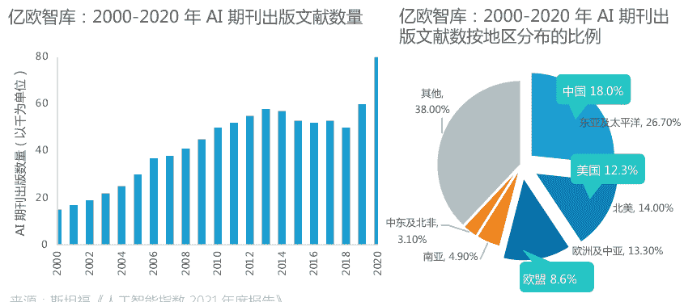

产业落地需配套成熟。以全球AI企业数量为代理指标，中国信通院监测：至2020年11月全球共5896家，美国2257家居首，中国1454家次之，英国430家、加拿大307家列前四。单城维度，**北京企业密度全球领跑**。

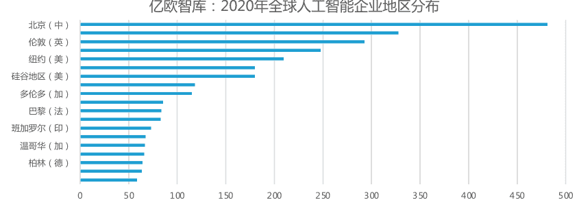

#### 维度三：行业成长势能

长周期看，以**公共教育投入占比**与**产业AI技能渗透率**为锚。

**公共教育财政投入**（经合组织2020数据+各国统计）：
经合组织均值10.7%，欧盟均值9.6%。**中国14.8%、美国12.1%显著高于均值**。印度2013年达14.1%，2020-21财年预算拟投9930亿卢比。

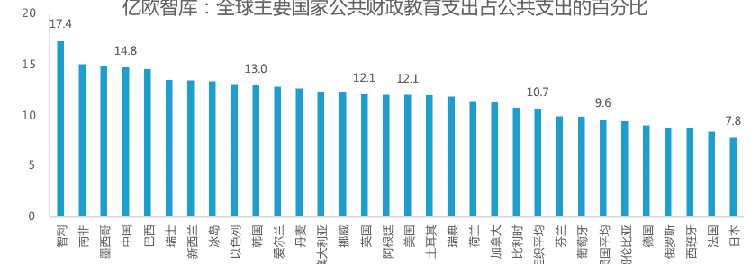

> 来源：经合组织、各国统计局、亿欧智库

**跨行业AI技能相对渗透率**（LinkedIn 2015-2020追踪）：
普及率=2即该国AI技能均值为全球同类职业2倍。教育、硬件网络、软件IT服务三大关联赛道中，**印、中、美、欧四大版图均呈显著领先优势**，预示人才供给与技术落地的强劲后劲。

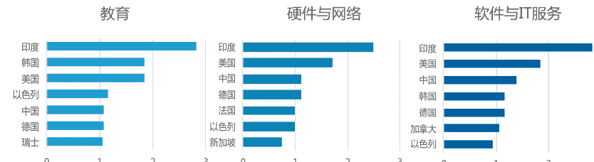

> 来源：LinkedIn、亿欧智库

## 二、 全球AI教育行业发展全景扫描

探讨应用前，先理清技术底座与教育业态的共生演进逻辑，并拆解场景创新三大演进方向。亿欧智库判断：**AI技术与AI教育互为因果、螺旋上升**，技术成熟度与对教育环节依赖度双双跃迁。

本章同步复盘中美欧印四大版图企业群像全貌。

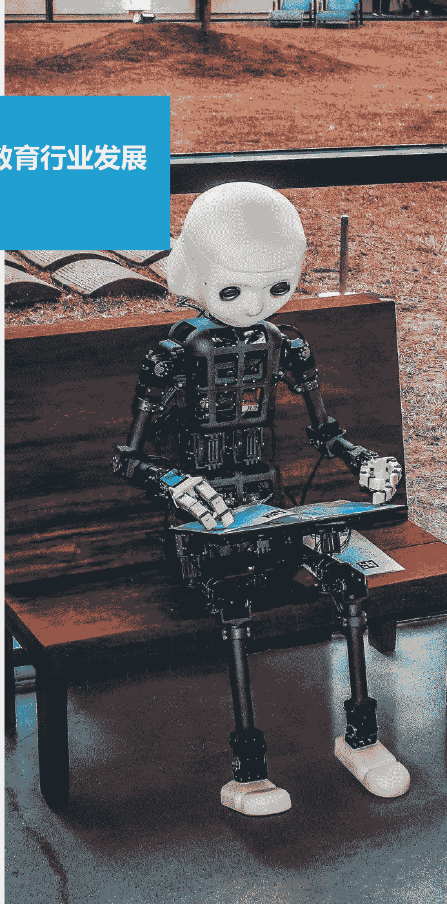

### 技术演进：身处“感知增强时代”窗口期

当前正处第三次浪潮中。AI技术是教育变革的必要基建，故从技术代际与场景渗透双轴复盘演进史。

**亿欧智库：AI发展三阶段对照表**

| 阶段特征 | 感知时代 | **感知增强时代（当前）** | 认知时代 |
| :--- | :--- | :--- | :--- |
| **核心范式** | 深度学习 有监督学习 | **迁移/对抗/多模态/深度强化学习** 多元并存、交叉融合 | 自监督学习 胶囊网络、类脑架构 范式颠覆性创新 |
| **数据依赖** | 强依赖海量标注数据 | **弱化标注依赖、减少人工干预** | 极低依赖、自进化 |

> 来源：中国信通院《AI核心技术产业白皮书》、亿欧智库

**关键洞见**：当前处于**感知向认知过渡的“增强期”**。数据质量规模双升，多元学习范式并行，**弱监督/自监督学习**成下一阶段关键变量，将为教育赋能注入强心剂。

落地教育场景侧，参考Gartner 2020 AI技术成熟度曲线，亿欧甄选高频应用技术方向，评估其成熟时间窗与市场空间。

# AI教育渗透率几何？亿欧智库深度复盘全球赛道现状

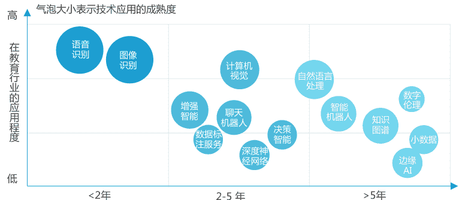

人工智能在教育领域的渗透深度，目前仍处于“蓄势待发”阶段，提升空间广阔。这背后有双重原因：教育行业的特殊属性决定了AI落地天然带有审慎基因，导致技术转化为产业化应用的周期被拉长；同时，AI赋能教育并非靠单一技术的极致突破，而是呈现出向**场景化、综合生态**演进的趋势。

技术对场景的深度渗透，正倒逼各类AI技术相互融合，推高了行业的技术壁垒；但与此同时，基础技术服务平台日趋成熟，头部企业开源开发框架生态建设完善，反而让AI教育赛道的**入场门槛呈现降低态势**。

## 同源共生：AI技术与教育科学的内在一致性

从本质上看，人工智能与教育科学探讨的竟是同一个命题——**“人如何认识世界”**。AI通过计算机模拟人类思维链路，教育科学则归纳人类教学活动的普适规律。亿欧智库指出，这种同构性奠定了二者深度融合的内在基础：AI教育的核心，在于借助技术手段拆解、重构教育活动的底层逻辑。

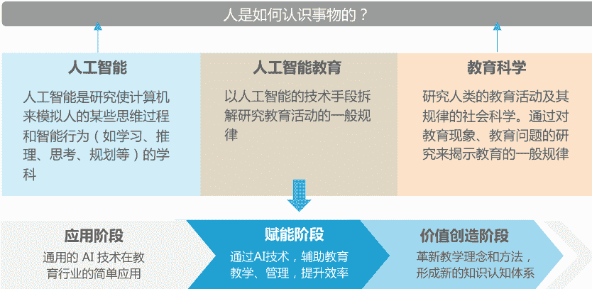

亿欧智库将AI教育的演进路径划分为三个阶梯：

*   **应用期（嫁接期）：** 成熟通用的AI技术“下沉”教育领域。因教育行业技术采纳滞后，语音识别、图像识别等现成技术迁移后迅速催生出口语测评、拍照搜题等首批产品。
*   **赋能期（增效期）：** 多技术融合（AI+大数据+云计算）产出虚拟教师、智能助教、互动课程、智能组卷阅卷等复合型产品，核心目标是剥离教师、学生、管理者身上的重复性劳动，实现效率跃升。
*   **价值创造期（变革期）：** 革新教学范式，重塑认知体系。自适应学习、情绪计算等产品开始触达“如何高效学习”的核心命题，但目前产品形态尚不成熟。

**判词：** 当前行业主力军仍集结在**赋能期**，正向价值创造期发起冲锋。

## 场景变革一：单点技术成熟度跃升，功能模块走向聚合

亿欧智库对比2019年基准数据，复盘拍照搜题、自适应学习、语音交互等存量场景发现：**技术成熟度显著提升，对“教育过程数据”的依赖度同步下降**。以拍照搜题为例，已突破教育App边界，夸克等搜索引擎凭借通用视觉能力即可实现同等功能，无需依赖垂直教育数据训练。

### 亿欧智库：核心AI教育场景功能成熟度雷达图

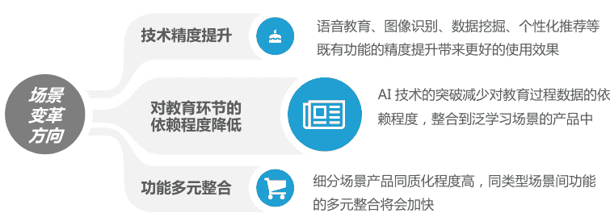

| 功能 | 核心技术栈 | 技术成熟度 | 对教育过程数据依赖度 | 场景落地成熟度 |
| :--- | :--- | :---: | :---: | :---: |
| 智慧课堂 | 计算机视觉、语音交互 | ★★★★ | ★★★☆ | ★★☆ |
| 智能学习硬件 | 指尖定位、OCR | ★★★☆ | ★☆ | ★★★★ |
| 拍照搜题 | 图像识别(OCR) | ★★★☆ | ☆ | ★★★☆ |
| 个性化组卷 | 数据挖掘 | ★★★☆ | ★★★☆ | ★★☆ |
| 学生综合素质评测 | 数据挖掘、NLP | ★★☆ | ★★★☆ | ★★☆ |
| 智能生涯规划 | 智能评测、个性化推荐 | ★★☆ | ★★★☆ | ★★☆ |
| 自适应学习 | NLP、数据挖掘 | ★★☆ | ★★★☆ | ★★★☆ |

*注：评级为相对值。依赖度指算法训练阶段对教育过程数据的必要程度。*

后疫情时代，智慧课堂与智能硬件成为**技术聚合的典型载体**，单一产品集成多项AI能力。随着细分赛道同质化加剧，未来产品形态必将向**“一体化AI教育终端”**收敛，以更便捷的形态触达学习者。亿欧智库预判，同一大场景下的竞争将聚焦三大维度：**技术精度深挖、教育数据依赖度降维、多元功能一体化聚合。**

## 场景变革二：渗透路径从“辅助外围”向“教学核心”纵深推进

将学习者全生命周期拆解为**教学、学习、考试、能力评测、人生规划**五环。亿欧智库研判：越靠近“教与学”核心环，技术攻关难度呈指数级上升；而在评测与规划领域，仍存在巨大的价值洼地待开发。

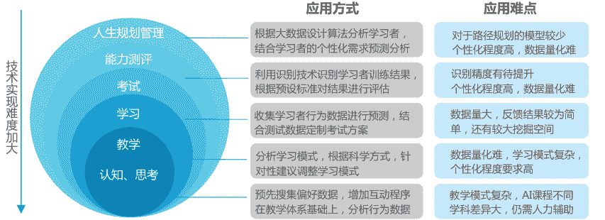

### 亿欧智库：AI教育产品应用模式与难点矩阵

深度复盘市场样本后发现三大痛点：
1.  **数据饥渴症：** 赋能深度高度依赖数据规模，高个性化场景下精准度仍是短板；
2.  **预测缺失：** 评测与规划类产品多停留在“历史复盘”，缺乏基于教育科学理论的前瞻性预测模型，亟待建立更客观的评价标准体系；
3.  **技术黑盒与容忍度博弈：** 消费者主要凭营销与试用决策，技术实力不透明。核心教学场景产品扎堆，用户因看重结果对技术瑕疵容忍度较高；非刚需场景则反之。

### 亿欧智库：细分功能消费者容忍度画像

| 场景 | 功能 | 产品聚集度 | 消费者容忍度 | 核心心理账户 |
| :--- | :--- | :---: | :---: | :--- |
| **教学** | 个性化教学 | ★★★☆☆ | ★★☆☆☆ | 需量化学情反馈 |
| | 虚拟教师 | ☆☆☆☆☆ | ★★☆☆☆ | 缺情感连接，依赖真人 |
| **学习** | 智能学习硬件 | ★★★☆☆ | ★★☆☆☆ | 效果转化链路长 |
| | 自适应学习 | ★★★★☆ | ☆☆☆☆☆ | 目标感强，容错率极低 |
| **考试** | 个性化组卷 | ☆☆☆☆☆ | ★★☆☆☆ | 难度控制不可控 |
| | 口语测评 | ☆☆☆☆☆ | ★★☆☆☆ | 缺专业判断力 |
| **能力评测** | 综合素质评测 | ★★☆☆☆ | ★★☆☆☆ | 非刚需 |
| **规划管理** | 智能升学/职业规划 | ★☆☆☆☆ | ★★★★☆ | 刚性指导需求强 |

## 场景变革三：物理空间边界消融，家庭成为创新主战场

2020年疫情黑天鹅事件，强制重构了教育空间拓扑。线下课堂受阻倒逼在线教育成为常态化补充，学习场景从学校单一向**家庭、户外**多点分布延伸。

过往家庭场景多寄生于智能音箱、穿戴设备等泛智能家居入口。如今，原本属于线下的智能终端、教学平台、资源库亟需在家庭端“原地重生”。**智能教育硬件**成为这一迁徙浪潮中迭代最烈、形态最新的品类。

### 亿欧智库：2020-2021 中国智能教育硬件新品发布图谱

| 发布节点 | 产品形态 | 玩家 |
| :--- | :--- | :--- |
| 2020.09 | 超级辞典 | 网易有道 |
| 2020.10 | 大力智能作业灯 | 大力智能 |
| 2021.03 | 小度智能学习平板 | 百度 |
| 2021.03 | AILA 智能作业灯 | 腾讯 & 暗物智能 |
| 2021.04 | 星际小方编程机器人 | 网易有道 |
| 2021.06 | 天猫精灵 E1 家庭学习智慧屏 | 天猫 |
| 2021.07 | 科大讯飞 AI学习机 T10 | 科大讯飞 |
| 2021.07 | 斑马逻辑思维学习机 | 猿辅导 |
| 2021.07 | 步步高家教机 S6 | 步步高 |

*数据来源：公开信息整理*

中国严格的防疫政策将家庭场景固化为常态，叠加供应链快速复工优势，使中国率先完成了家庭端AI教育硬件的**形态爆发与功能重构**：产品形态跨越传统词典/学习机，涌现作业灯、辅导机器人等新物种；功能逻辑从“工具型辅助”转向**“交互体验优先、去娱乐化、聚焦学习过程、任务分解科学化”**，得益于语音交互等底层技术的成熟红利。

---

# 全球AI教育赛道：资本版图与区域博弈

## 投融资史：政策周期共振，中国领跑全球

亿欧智库追踪中、美、欧、印四大板块362家样本企业，勾勒出全球融资演进曲线：
*   **2007年起步，近5年提速：** 2016年短暂回调后，2017年政策红利（中国《新一代AI规划》、美《AI与国家安全》等）引爆高速增长期。
*   **疫情加速器：** 中美印三国融资额疫情下逆势暴涨，**中国增速最猛，自2017年起融资总额与美国差距持续拉大**。
*   **欧印分化：** 欧洲增长平稳；印度起步晚但近两年在政策与资本双推下进入爆发前夜。

### 亿欧智库：全球AIED企业融资趋势与区域对比

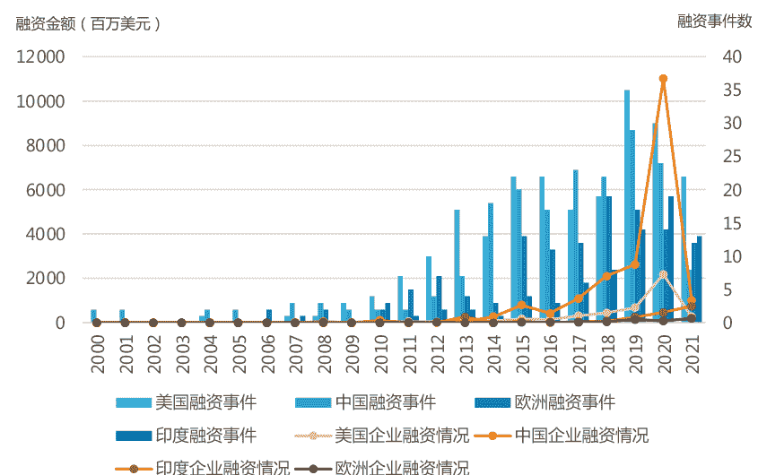

*统计口径说明：截至2021.6.30；未披露金额不计入；单位换算按区间中位数估算；中国样本含“互联网教育转型AI”企业，口径相对宽泛。*

## 独角兽分布：60家“亿元俱乐部”成员画像

截至2021年6月，四大区域融资超亿美元企业共**60家**。
*   **中国：** 资本关注度最高，大额融资最多；
*   **美国：** 存量基数大，分布极度集中于加州、纽约；
*   **欧洲：** 单笔融资体量普遍较小，聚英、德、法；
*   **印度：** 后起之秀，近两年涌现多家大型独角兽，核心区在卡纳塔克邦、新德里等地。

### 亿欧智库：亿元俱乐部成员数量与地理分布

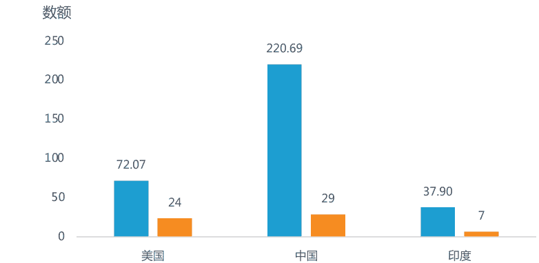 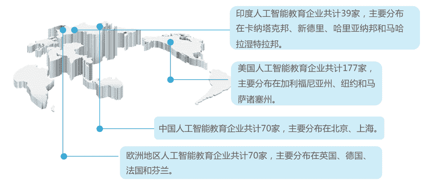

## 核心洞见三则

### 1. 教学是“基本盘”，挖掘潜在需求成“增量场”
四大区域业务版图高度重合——**教学场景占比均超40%**（中国高达60%），但细分赛道正从“替代重复劳动”向“精准触达潜在需求”进化。个性化教学、智慧课堂、自适应学习、智能职业规划等强数据依赖型应用正加速渗透。

### 亿欧智库：四大区域AI教育应用场景分布热力图

| 区域 | 教学 | 学习 | 人生规划 | 能力评测 | 考试 | 其他 |
| :--- | :---: | :---: | :---: | :---: | :---: | :---: |
| **印度** | 44% | 28% | **18%** | 8% | - | - |
| **欧洲** | 49% | 28% | 12% | 6% | 6% | - |
| **中国** | **60%** | 22% | 9% | 7% | - | - |
| **美国** | 45% | 28% | 9% | 9% | 8% | - |

*差异洞察：美印在评测/规划上权重显著高于中欧；中国极度聚焦教学主战场。*

### 亿欧智库：企业场景分布可视化

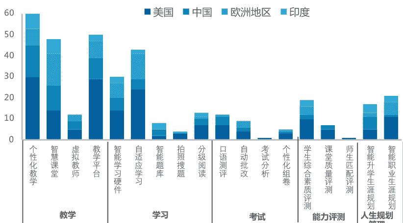

### 2. “慢行业”考验定力：百炼成钢需十年磨一剑
绝大多数头部企业成立于**2017年之前**，十年以上“老兵”比例不低。亿欧智库强调：AI教育需要**技术沉淀与场景洞察的双重时间复利**，注定是一场长跑，无捷径可走。

### 亿欧智库：全球AI教育企业存活周期分布

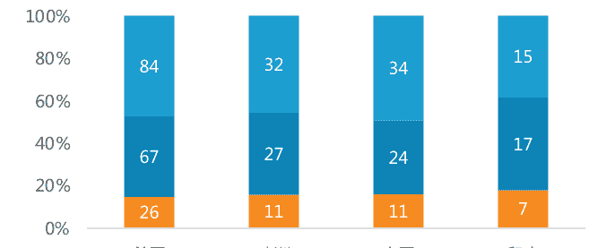

### 3. 资本偏好“各有所爱”，教学应用“吸金”最强
梳理四大区域投资频次TOP10机构画像：
*   **美国：** 布局泛泛，**多场景分散投**；
*   **中国：** 资源高度向**教学应用场景倾斜**；
*   **欧洲：** 核心机构多扎根**英国**；
*   **印度：** 独偏**职业生涯规划**赛道。

### 亿欧智库：全球AI教育核心投资机构图谱（截至2021.6）

| 中国阵营 | 美国阵营 | 欧洲阵营 | 印度阵营 |
| :--- | :--- | :--- | :--- |
| 腾讯、红杉中国、新东方、好未来、真格、贝塔斯曼亚洲、GGV、高瓴、IDG、君联 | GSV、Learn Capital、500 Startups、Insight Partners、Kapor、NEA、Bessemer、Felicis、Rethink、SJF | Nesta、Brighteye、Force Over Mass、Holtzbrinck、LocalGlobe、Seedcamp、Business Finland、Downing、Emerge、Pitch@Palace | Chiratae、Blume、Global Founders、InnoVen、Lightbox、Nexus、Sequoia India、Surge、Tiger Global、Trifecta |

---

# 区域深度剖析：美国篇

## 美国：成熟期玩家的全景式布局

#### 企业版图全景

 *注：素材原标记为，此处保留原标识*

# 2021年美国AI教育企业全景扫描：177家代表性玩家深度解析

亿欧智库以“AI技术直接赋能教学与管理环节”为筛选红线，从近2100家挂载“AI”“Education”“E-learning”标签的企业库中，精准锁定177家极具代表性的美国AI教育独角兽与潜力股，按产品功能重构全景图谱（仅展示部分典型样本）：

## 亿欧智库：2021 美国AI教育（AIED）企业全景版图

### 教学赛道

**虚拟教师 & 智慧课堂**
- Amplifire, Blue Canoe Learning, Querium
- Class Technologies, Tinybop

**个性化教学 & 教学平台**
- Laliio, Duolingo, Emtrain
- Wonder Workshop, FIRST
- Echo360, Encantos, Voxy
- CodeSpark, Galvanize, EVERFI, Codelicious

### 学习赛道

**自适应学习 & 智能硬件**
- Fishtree, Kidaptive, Trivie
- Merge Labs, Talespin
- Knewton, Matific, Area9
- Sylvan paper, RoboKind

**分级阅读 & 拍照搜题 & 智能题库**
- LightSail, Headsprout, Amira Learning
- Photomath, 101 Edu

### 考试赛道

**口语测评**
- AllRight.com, PlusOne, Orai, Elsa

**自动批改 & 个性化组卷 & 考试分析**
- Acelero Learning, BoomWriter Media, MasteryPrep, examPAL, ExamSoft

### 能力评测

**学生综合素质 & 课堂质量 & 师生匹配**
- Ellucian, BrightBytes, Formative, CodeHS, myEDmatch

### 人生规划管理

**智能升学 & 职业生涯规划**
- CollegeVine, Edmit, BetterUp, Fuel50, Coursera

---

### 业务版图分布

上述177家企业的业务分类分布详见下图：

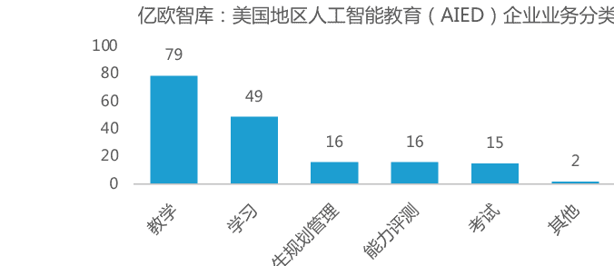

*数据源：Crunchbase & 亿欧数据整理，截止2021年6月*

**核心洞察：**
- **教学场景称霸**，占比45%，与中欧印三地比例高度趋同。亿欧判断，教学环节是AI教育的“主战场”，也是绝大多数入局者首选切入点——聚焦教学内容、课后作业、课中答疑、学习规划的精准定制与个性化触达。
- **考试应用最冷**，仅占8%，远低于其他三大区域。细分来看，口语测评是考试类唯一形成聚集效应的细分场景。

---

### 融资图谱：体量大、轮次多、周期长

美国不仅入选企业数最多（177家 vs 中国67/欧洲70/印度39），融资总额领跑，单均融资轮次达3.9次（欧3.6/中4.2/印数据缺失），企业平均成立时间更早，运营基本盘更稳。

177家样本企业的累计融资额与最近一轮融资时间间隔统计如下：

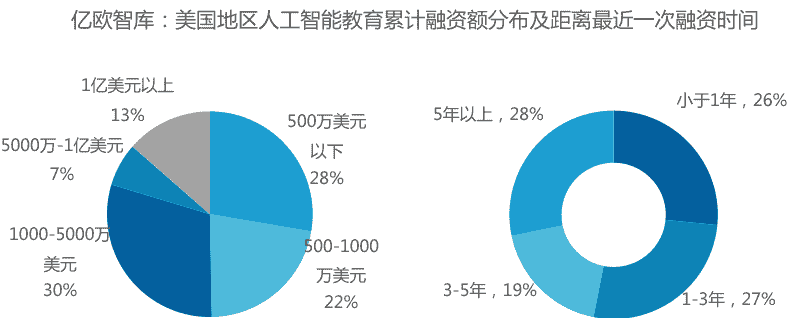

*数据源：Crunchbase & 亿欧数据整理，截止2021年6月*

**关键发现：**
- **“中腰部”最壮实**：累计融资1000万-5000万美元的企业数量最多（占比30%）。横向看，美企整体融资规模显著高于中欧印。亿欧研判，这得益于美方AI技术领先优势与企业成熟度。数据佐证：该融资区间企业中，91%成立于2015年前，标志着中型玩家已集体跨入成长期。
- **融资节奏“慢热”**：最近融资在1年以内、1-3年内的企业占比均为26%。对比欧洲<3年占比高达67%，美企融资间隔更长，但单笔金额更大。根因在于：AI技术回本周期长、重资产投入大；且美企细分赛道最密、多场景并行，需巨额资金与漫长周期夯实基建，方能收获回报。

**细分场景融资热力图：**

#### 亿欧智库：美国AIED细分应用与近期均值融资额对照

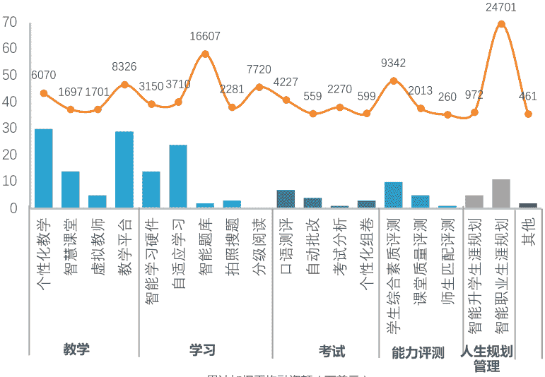

*数据源：Crunchbase & 亿欧数据整理，截止2021年6月*

**深度复盘：**
- **头部场景集中度高**：教学类“个性化教学”（30家）、“教学平台”（29家）领跑，学习类“自适应学习”（23家）紧随其后。这折射美国教育生态——重个性释放、课外多元、适应节奏、全维评价，与中式“严谨规矩”课堂形成鲜明反差。
- **单企加权均值**：美企7433万美元，远超欧洲1430万，略低于中国57316万、印度35172万。主因：美企总额大但轮次多，摊薄了单均值。
- **融资两极分化**：
  - **高地**：“智能职业规划”（2.47亿）与“智能题库”（1.66亿）领跑。技术壁垒高、数据沉淀深、资金饥渴度大，故单笔大、轮次少。
  - **洼地**：“自动批改”（559万）、“个性化组卷”（599万）、“师生匹配”（260万）垫底。技术门槛相对低、美区应用频次低、资金需求小。

---

### 经营实况：跨过生死线，集体迈入增长期

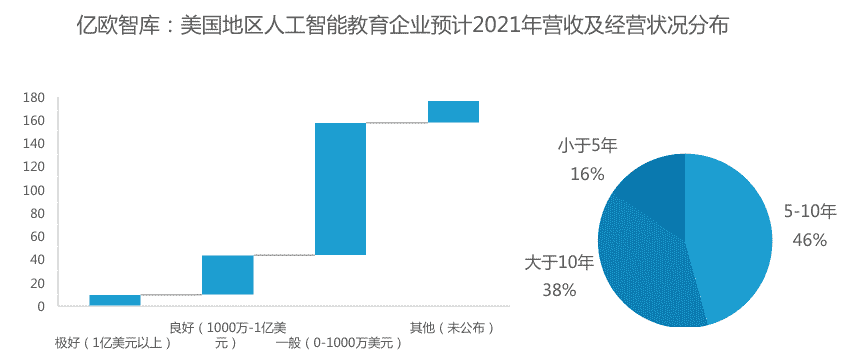

*数据源：Crunchbase & 亿欧数据整理*

**实况画像：**
- **营收结构呈“长尾分布”**：0-1000万美元区间塞进114家（64%）；但营收破亿俱乐部占比19%，体量优势碾压其他三地（欧洲仅17%）。预计2021年营收破千万企业占比达36%。
- **告别初创期，主力军集结5-15年窗口期**：70%样本企业成立于5-15年前，14%超15年。与欧洲节奏相似，美企普遍已跨越0-1生死谷，步入规模化增长通道。

---

## 标杆案例深度拆解

### Coursera：名校名企联盟的“终身大学”

**基因**：斯坦福两大牛教授创办，联袂斯坦福/普林斯顿/宾大等名校及谷歌/IBM等巨头，打造大规模公开在线课程（MOOC）平台。课程覆盖11大类，虽以AI/数据科学爆款著称，但商务、健康、社科、工科均有布局。

#### 亿欧视角：Coursera 四大差异化培养模式
- **全程在线化**：100%云端交付
- **双轨认证体系**：高校合作授学位，企业合作发专业证（业内高认可）
- **免费旁听+付费认证**：降低试错成本，精准转化付费用户

---

### BetterUp：用“全人模型”重塑企业人才发展

**定位**：教练网络 + AI评估开发平台，为企业员工匹配认证教练。四大解决方案——领导力、DEI、销售领导力、员工关怀，以可规模化、强个性化的方式破局。

**核心壁垒**：**心理学基因贯穿始终**。创始团队早期组建“心理学家+技术专家”科学梯队，构建“全人模型”，以“完整的人”视角切入市场，而非单一技能训练。

#### 亿欧视角：BetterUp AI驱动的闭环工作流
`数据采集 → AI评估 → 结果洞察 → 专家辅导 → 成果反馈`

---

### Duolingo：5亿下载量背后的“语言学习游戏机”

**基本盘**：2011年匹兹堡诞生，Luis von Ahn & Severin Hacker联合创办。覆盖40语种（含威尔士语、纳瓦霍语等濒危小语种），2021下半年新增粤语。

#### 亿欧视角：Duolingo 进化里程碑
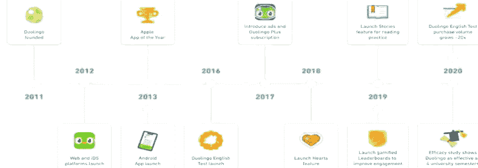

*来源：Duolingo S-1文件*

**核心逻辑**：**语言学习 × 众包翻译**。用户通关新语言后，可协助翻译网络文档，最终实现互联网内容多语言普惠。

#### 亿欧视角：六大产品设计第一性原理
1. **科学教学法支撑的多元体验**：内部学习科学专家团操刀，课程对齐CEFR国际标准，每门课结构独一无二。
2. **可量化的学习产出**：实证研究显示，Duolingo学习者半年达成西/法语四级水平，效率是大学生的2倍。
3. **极致美感与沉浸叙事**：从按钮微交互到猫头鹰Duo的IP化运营，将“学习后愉悦感”做成品牌资产。
4. **游戏化动力引擎**：深谙“持续动力最难”，用高粘性机制对抗遗忘曲线。
5. **零门槛交互**：以新用户首秀行为为镜，持续打磨丝滑体验。
6. **数据飞轮驱动AI优化**：日均5亿+练习数据喂养ML算法，**90% AI算力投向能力测试**。45分钟考试中密集采集身份、参与度、表现、评分、自适应数据，高频A/B测试持续打磨测题设计，抚平学习曲线。

---

### Knewton：自适应学习的“操作系统”先驱

**基本盘**：2008年纽约创立，累计融资超1亿美元。2011年与培生达成战略合作，伙伴网络覆盖麦克米伦、HMH等十余大教材巨头。

#### 亿欧视角：Knewton 自适应引擎三步走
1. **内容资源池**：聚合厂商海量模块（视频/图文/题目/活动/语音包），构建知识图谱关联语义网络。
2. **统计模型打分**：基于用户行为数据训练模型，对内容难度、质量、关联度评分排序。
3. **动态路径生成**：依据诊断结果，为不同进度学习者实时分发差异化内容，形成自适应路径。

**Alta——高等教育终极形态**：融合自适应技术与优质内容的一站式课件解决方案（数学/统计/经济/化学），主打“可负担、易获取、提分快”。

#### 亿欧视角：Alta 三大自适应核心技术
- **动态持续修复**：无需前置诊断，作业过程中实时感知熟练度，即时补漏。
- **教员全程跟踪**：内容严格对齐教学大纲，教师从Day 1即进入“跟进模式”，所见即所教。
- **学生智能响应**：AI秒级定位知识缺口，溯源前置概念精准补救，兼容不同底层能力学生同步达标。

> **Alta本质**：兑现自适应承诺的个性化学习系统——持续测量熟练度 → 即时反馈闭环 → 能力迁移提升。

---

# 欧洲AI教育图谱：隐私合规桎梏下的“早期生态”

### 企业版图：70家合规先锋

同标准筛选，从近800家候选中甄选70家欧洲总部AI教育企业，功能分类图谱如下（部分展示）：

## 亿欧智库：2021 欧洲AIED企业全景版图

### 教学赛道

**虚拟教师**
- Synthesia, MarcoPolo Learning, Wibbu

**个性化教学**
- Future Learn, WordDive, ABA English, Stellar labs

**智慧课堂**
- KANO, CENTURY Tech, lingumi, Howspace, Speexx, NEOBRAIN, ORama VR, Dreamshaper, New Nordic School

**教学平台**
- Tech Nation, Learning people, skill&you, Code Kingdoms

### 学习赛道

**自适应学习**
- bettermarks, Attensi, ProFinda, Adopte my, Lingvist, CogBooks

**智能学习硬件**
- pi-top, SKRIWARE, MEL Science, No isolation

### 考试赛道

**自动批改**
- StudySmarter, codio, Unsilo, sanako

**口语测评**  
*(样本缺失)*

**分级阅读**
- Lexplore

**学习辅助**  
*(样本缺失)*

### 能力评测

**学生综合素质评测**
- Arbor Education, Firefly Learning, Digital Asset, dugqa

### 人生规划管理

**智能升学规划**
- Learnosity, BridgeU

**智能职业规划**
- Multiverse, headstart, School for social entrepreneur, CoachHub, Filtered, PathMotion

---

### 业务版图分布

70家欧洲样本企业业务分类占比详见下图：

### 亿欧智库：欧洲AIED企业业务分类及占比

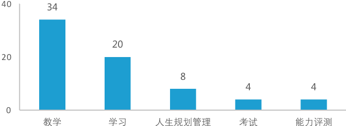

*数据源：Crunchbase & 亿欧数据整理*

**亿欧核心判断：**

# 欧印AI教育版图对决：合规深耕 vs 野蛮生长

## 欧洲篇：合规框下的“教学正统”与长周期熬法

### 教学独大，评测缺席
欧陆市场以“教学正统”著称，核心场景锁定在课堂内外。数据显示，教学类应用数量居首，占比接近五成，与其余三大板块比重相当。研判机构认为，这是智能教育的核心腹地，也是入局者的首选阵地。产品覆盖内容定制、作业辅导、即时答疑及学习规划，主打精准触达。反观能力评测，份额不足一成，且高度聚焦综合素质画像，缺乏多元探索。

### 融资画像：小额为主，长跑成常态
对70家样本复盘发现，“小而精”特征显著。募资总额不足500万美金的公司最多，占比四成。这既反映主体规模普遍不大，也印证当地教育产业成熟度高、扩张节奏缓。佐证：此类公司超七成年入不超千万美金，近四分之三创立于2015年前。
轮次呈“哑铃状”：早期(B轮前)与中后期(C-E轮)各占约四成，晚期(F轮+)占两成。区别于传统教培，智能教育需巨资堆算力、练模型，回报周期极长，逼得玩家靠多轮输血维持长跑。

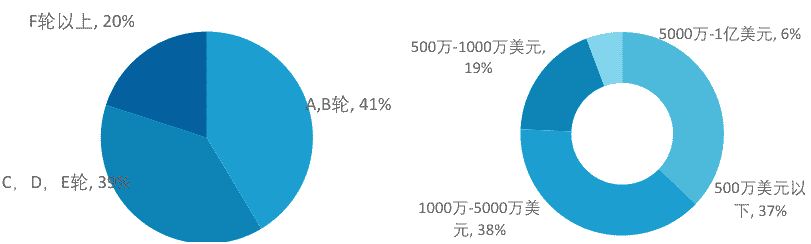

### 场景估值“剪刀差”：热门不贵，冷门溢价
场景热度与资金热度明显背离。智慧教学空间(15家)与自适应系统(12家)最拥挤，但分级阅读、自动改卷等成熟高频赛道，平均募资仅780万/756万美金。相比之下，升学规划(1208万)与职业规划(2518万)估值领跑。研判指出：技术门槛高、研发投入大、商业想象力广，推高了资本预期。

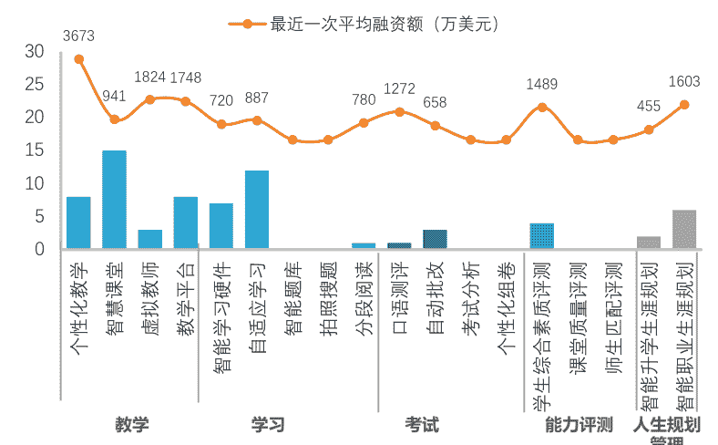

**理念与法规的双重“紧箍咒”**
为何题库、拍照搜题、自动组卷“水土不服”？
1. **教学哲学分野**：欧陆重能力、重情感、重师生共构与自主探究，轻刷题应试，与国内路径截然不同。
2. **数据合规红线**：GDPR等法规严苛，切断了依赖海量行为数据训练模型的路径。

### 经营实况：群雄逐鹿，仅一枝独秀
体量偏小是主基调：近七成年入不超千万美金。仅有一家年入破亿——主攻职业规划的CoachHub，侧印“终身学习”赛道的商业化突围潜力。

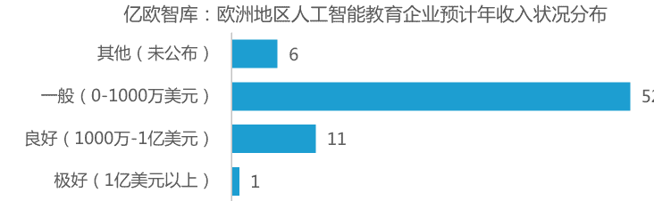

### 版图锚定技术高地
企业高度集中于英、德、法、芬四国，聚集七成(2019年头部阵营为英、西、德、爱，占六成)。版图迁徙印证铁律：AI技术高地必成智能教育高地。

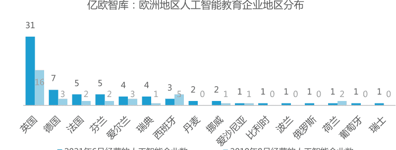

---

### 标杆案例

#### **Attensi：职场培训的“元宇宙”演练**
核心逻辑：沉浸式模拟 + 职场心理学。员工置身3D数字孪生工作场实战演练。年化经常性收入复合增速63%，直击传统LMS痛点。

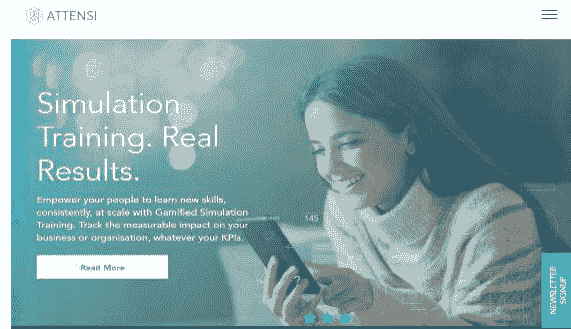

#### **Sana Labs：自适应引擎重塑组织学习**
定位：智能个性化平台服务商。用机器学习驱动技能图谱自适应，压缩掌握周期，提升粘性。
- **三大落地场**：医疗(抗疫护培/科学院合作)、教育(母校Viktor Rydberg高中定制)、金融(Becker Partners CPA备考)。
- **三大护城河**：AI私教级适配、拖拽式零代码编辑器、全链路数据可视化导出。

#### **Synthesia：文本秒变数字人视频**
UCL/斯坦福/慕尼黑/剑桥名校团队2017年创立。核心能力矩阵：
- **多语种语音合成**：40+语言零门槛切换
- **数字分身**：选库存演员或上传自拍生成AI Avatar
- **可编程视频**：文本/音频驱动，参数化控制布局背景，无需剪辑技能

---

## 印度篇：政策加持下的“独角兽竞技场”与结构性缺口

### 业务版图：教学称霸，考试缺位，规划异军突起
39家样本中，教学类独占近半(44%)，主打定制教学与智慧教学空间，覆盖预习-互动-作业全链路。考试类仅1家(3%)——归因繁琐考制导致标准化成本高企。人生规划占比18%(7家)，显著高于其他区域，折射复杂升学/就业路径下的刚需。

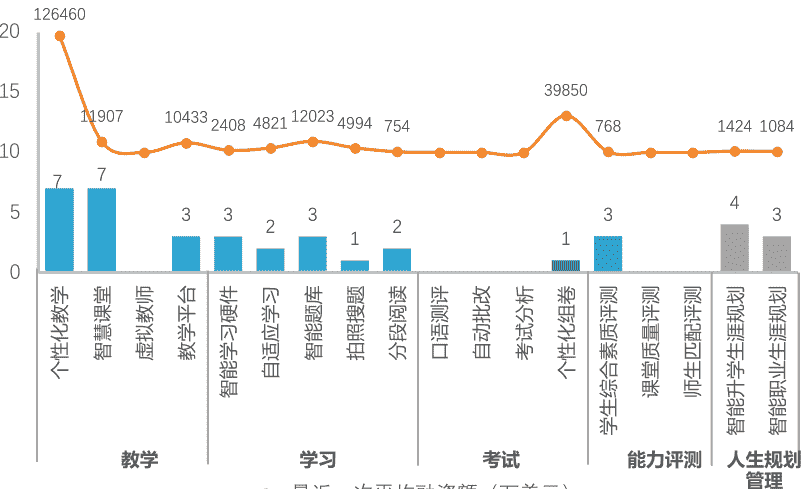

**细分洞察：语言空白、评测单薄、自动化难行**
- **语言学习(如口语测评)**：完全空白区。
- **素质评测为主，缺技能垂类**。
- **因升学考制复杂，自动阅卷/考情分析鲜有主攻**。

### 融资图谱：两极分化与“BYJU'S效应”
| 维度 | 关键数据 | 研判解读 |
| :--- | :--- | :--- |
| **轮次结构** | 近半处于A/B轮，F轮+不足一成 | 行业处早期扩张期，成熟巨头稀缺 |
| **金额分布** | 千万至五千万美金梯队最拥挤(14家)；破亿美金达7家 | 整体融资体量可观，但**头部极度集中** |
| **独角兽效应** | BYJU'S独揽27.45亿融资 | **一家独大**格局成型，并以并购扩版图 |

**资金涌入三大推手**：“数字印度”战略加持、资本对赛道高关注、疫情封锁催化全民在线需求爆发。

### 企业年龄谱：老树深根，新芽竞发
- **10年+老牌比例高于欧陆**：得益于90年代IT/ITES产业积淀，为AI落地奠基。
- **5年内新军最多**：“数字印度”政策红利+财政补贴，引发创业潮。

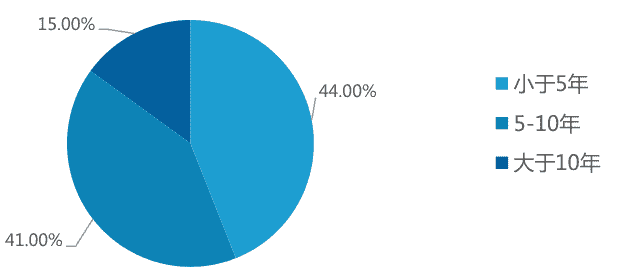

---

### 标杆深度拆解

#### **BYJU'S：K12赛道的“超级霸主”**
- **覆盖面**：6-12年级 + JEE/IAS/GRE/GMAT等高阶考试，理化生数全科。
- **核心杀手锏**：
  1. **双轨定制化**：按熟练度分级 + 按偏好派发(视频派 vs 真人导师派)。
  2. **黑科技内容**：真人讲师 + 3D动画融合，空中手绘图表、虚拟器材随意调用，重新定义“网课观感”。

#### **Unacademy：备考平台的“并购帝国”**
- 15年班加罗尔起家，4.7万+名师、14+语言、覆盖5000城。
- **商业模式**：Plus Subscription直播互动付费制。
- **2020年野蛮生长**：单年6连购(Kreatryx、NeoStencil、CodeChef、PrepLadder、Coursavy、Mastree)，从工具向平台进化，估值暴涨锁定头部独角兽地位。

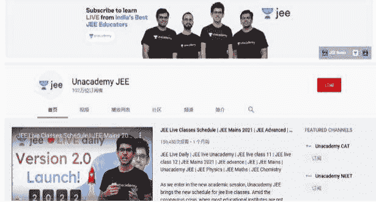

#### **Quizizz：让测验长上瘾的“闯关式引擎”**
- **定位**：教育趣味化SaaS，150+国家教师背书。
- **三大核心解法**：
  1. **闯关式造题/学**：自主改题、抽卡复盘、重考机制，学生自驱刷题。
  2. **零门槛触达**：链接分享、多端同步、异步自学，打破时空限制。
  3. **实时数据驾驶舱**：可视化进度看板，教师秒级掌握全班掌握度。
- **生态飞轮**：3000万+题库、2020年单年答题量超130亿、覆盖全学科(含职教/艺教)。

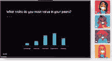
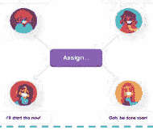

#### **Talentedge：企业数字化学习的“基建者”**
- **首创**：高教引入AI/ML、首推“现场互动”数字化直播。
- **痛点直击**：90%企业面临跨域合规混乱、资源利用率低、法规违规高风险。
- **360°解法**：技术平台+评估工具，构建“快速技能开发框架”，以流程管理、名师教学法、交互技术、数据分析四大优势降维打击传统培训。

[PRE*]

---

## 结语：两种范式的启示
**欧陆**走的是**“合规深耕、重教学本质、长周期熬成熟”**的稳健路径，受制于隐私与理念，应试工具难存活，职业规划成高地。
**南亚次大陆**跑的是**“政策加速、资本裹挟、头部垄断、补齐基建短板”**的冲刺路径，考试复杂度倒逼规划赛道爆发，但语言/评测等细分仍是处女地。

同一赛道，不同国情，截然不同的商业逻辑与生存法则。

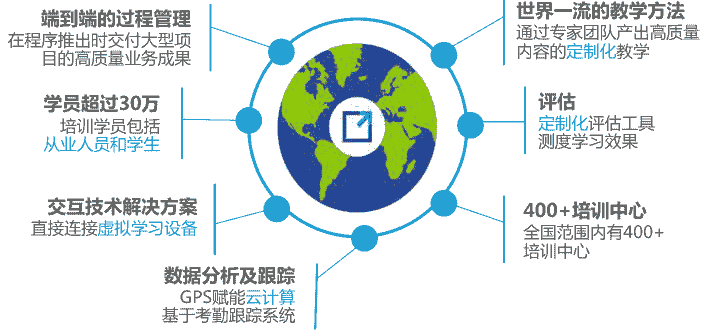

# SLIQ平台：重塑统一学习新生态

SLIQ平台打造了一个师生共享的统一学习空间，借力机器学习与AI技术，融合异步与同步教学模式，有效精简流程并还原真实课堂体验。

### 亿欧智库深度解析：SLIQ统一学习平台方案

#### 核心定位：连接师生的协作中枢
平台聚焦定制化学习体验，依托协作与通信引擎深化师生连接。引入智能聊天机器人强化通信模块，实现学员疑问即时响应，基础问题由AI分流，复杂情况无缝转人工介入。

#### 数智驱动：自适应学习导航
系统持续追踪学员出勤、课堂互动、社交参与等多维行为数据，构建自适应逻辑引擎，精准导航学习路径。

#### 双引擎赋能：学习推荐与教学辅助
智能AI引擎客观诊断薄弱知识点，从内容库精准推送学习模块；同时化身教师“备课助手”，调取库内资源辅助课程建设。

#### 数据资产化：大数据经验库构建
Talentedge沉淀学员信息形成数据资产，SLIQ接入并驱动AI引擎，将海量数据转化为系统的现成“经验库”，支撑智能决策。

---

## 三、全球人工智能教育行业深度透视

### 中国市场：存量博弈加剧，头部领跑格局成型

#### 企业版图拆解
亿欧智库以“AI技术直达教学/管理一线”为筛选门槛，从打标“AI”、“education”、“E-learning”的企业库中，遴选出76家总部设在中国的代表性AI教育企业，按产品功能绘制图谱（节选）：

### 教学
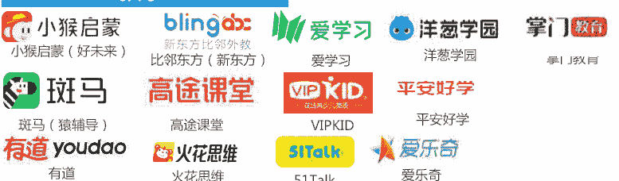

### 学习
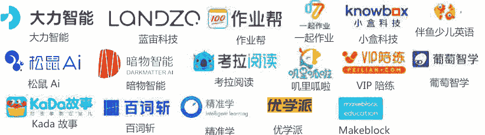

### 考试

### 人生规划管理

### 能力测评

#### 业务版图分布
76家样本企业业务分类占比见图：

### 亿欧智库：中国AI教育企业业务分类占比
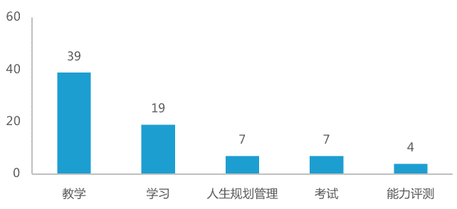

来源：Crunchbase、亿欧数据整理

**核心洞察：**
- **教学场景霸主地位稳固**：同全球趋势一致，教学仍是主战场，但中国占比高达58%，显著超越欧美、印度等市场。
- **细分赛道高度聚焦**：个性化教学与智慧课堂为双核心方向，符合全球共识。
- **口语测评异军突起**：相较海外，中国涌现大量口语评测企业，折射出家庭对国际教育的强烈刚需（2020年赴美留学生超38万为佐证）。

#### 融资图谱：成熟与新生并存
按融资轮次与累计金额分层：

### 亿欧智库：中国AI教育企业融资轮次及累计融资额分布
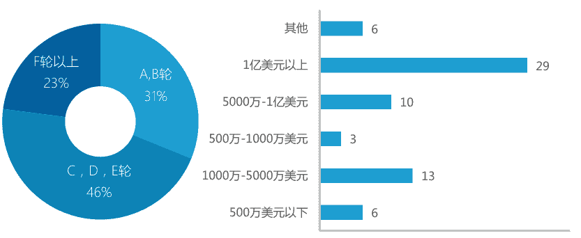

来源：Crunchbase、亿欧数据整理

**关键判读：**
- **头部成熟，护城河深**：C/D/E轮企业占比近半，F轮以上达25%，历经3轮+融资企业超四分之三，行业已进入成熟期，头部效应显著。
- **新势力涌入，竞争白热化**：A/B轮企业占比约29%，创业热情未减，赛道竞争依然激烈。
- **大额融资常态化**：超亿元美金融资企业达29家，好未来以38亿美金领跑。
- **资本热度与政策红利双驱动**：千万美金级起投远超海外，印证资本看好智能教育赛道，亦反映国家推进教育信息化的战略决心。

#### 企业成立时间轴：政策驱动下的爆发与回调

### 亿欧智库：中国AI教育企业成立时间分布
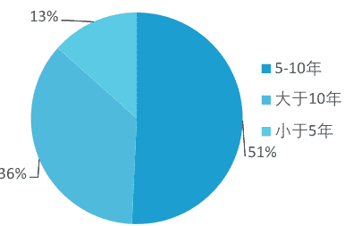

**演变逻辑：**
- **2014-2018年：政策红利期井喷**。14年信息技术入高考、15年《指导意见》落地、16-18年“十三五”规划与《行动计划》密集出台，催生企业占总量90%以上。
- **近年增速放缓**：市场饱和叠加监管趋严，新增企业数量明显回落。

---

## 标杆企业深度观察

### 大力智能：定义“智能桌面”，点亮自主学习

大力教育旗下硬件品牌，誓以科技赋能家庭教育，融合前沿技术与设计美学，攻克长期被忽视的家庭场景AI应用难题。针对“新时代家长”与“新时代孩子”的画像错位，精准破局：

### 亿欧智库：家庭教育场景“双新”人群需求画像
- **新时代家长**：信奉科学育儿、乐尝新品；重亲子互动与自我成长；痛点是“三缺”——缺时间、缺帮手、缺经验。
- **新时代孩子**：原生智能硬件用户；自主意识强、渴望表达与被尊重；内驱力是成长核心引擎。

**里程碑产品：大力智能学习灯（2020.10首发）**
开创“智能学习灯”品类，将台灯重构为智能中枢，融合护眼黑科技与自主学习工具，激发兴趣与自驱力。

### 亿欧智库：大力智能灯AI技术矩阵与产品护城河
- **动律光护眼算法**：每小时37次微调亮度，模拟自然光动态，缓解视疲劳。
- **智能调光**：匹配人眼舒适曲线，守护视力健康。
- **智能双摄系统**：前置+顶置布局，精准识别手势、生字、英语单词，即时解惑。
- **零门槛交互**：语音/手势自然交互，极速触达学习资源。
- **全科辅助工具箱**：查词、古诗、练字、点读、口语评测、翻译……融合语音语义、手势/图像识别、NLP、内容检索/CQA过滤等全栈技术。
- **场景深度定制**：按人群、内容、进度实现“千人千面”。
- **双端视频通话**：亲子平等对话窗口，及时反馈鼓励，科学陪伴。
- **绿色安全护盾**：严格内容过滤与隐私保护，筑牢安全防线。
- **专业口语评测**：句/词级发音诊断、评分反馈、个性化点评，支持自动判停、流式打分。

**品牌使命：** 以技术革新践行科学育儿，推动家庭学习数智化，重塑学习范式，培育“自主、自信、有爱”的披风少年。

### 自主 | 自信 | 有爱

大力智能致力于为中国家庭构建“智能化自主学习平台”，覆盖细分需求，点燃内驱力，助力家长高效陪伴。

---

### 蓝宙科技 LANDZOO：C端AI落地先锋，构建全龄段人才培养闭环

蓝宙以AI芯片、算法、大数据为核心三角，凭借软硬一体研发实力，构建起“系统+机器人+玩教具课程+智慧教育”四维业务生态，旗下五大品牌矩阵齐发：

### 亿欧智库：蓝宙科技五大品牌业务版图
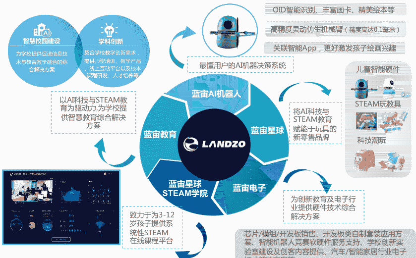

**蓝宙星球**：面向3-12岁的AI科技新零售品牌，“玩具+课程”模式交付系统化STEAM教育，早植科学思维与跨学科解难能力，孕育未来创新人才。

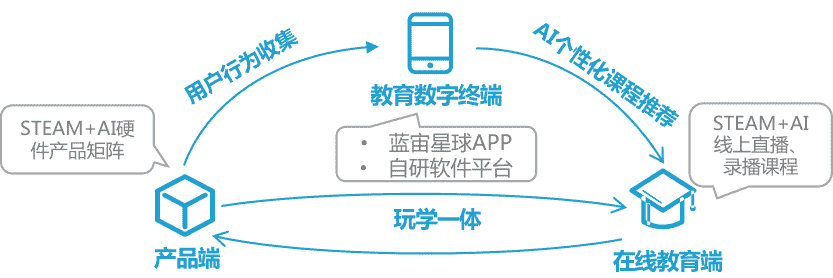

**战略纵深**：深耕AI人才培育、大数据研究与少儿教育应用，用数据精准画像实现个性化触达；打通家庭、校园、企业三端，构建全龄段AI人才培养闭环。

---

### 暗物智能：认知AI范式革新者，赋能产业数智化

2017年创立，主攻认知推理、常识学习、因果价值建模等新一代AI核心技术。首创“小数据、大任务”技术范式，构建面向通用AI的五层认知架构，打造多模态交互、个性化服务、情境理解为核心优势的人机智能融合网络。已在教育、商业、康养、能源等领域落地多个强认知AI规模化场景。

---

### AILA 爱拉智能：腾讯生态联手认知AI，重新定义“作业灯”

**AILA智能作业灯X1**由腾讯教育与暗物智能联合孵化，内置“作业君”软件的软硬一体AI教育终端。聚焦4-12岁作业场景，交付一站式作业服务，融合AI与大数据，集智能对话、指尖点读、自动批改、AI讲题、错题本自动生成功能于一体。

### 亿欧智库：AILA智能作业灯——场景化需求的精准回应
| 维度 | 对行业 | 对家庭 | 对学生 |
| :--- | :--- | :--- | :--- |
| **解决方案** | 先进AI技术深度适配场景硬件 | AI助教分担辅导重担 | 赋予智能学习新体验 |
| **市场痛点** | 现有产品难适配学习场景 | 家长能力/时间双重受限 | 伪AI产品智商不足 |

### 亿欧智库：AILA智能作业灯三大维度·十大核心功能
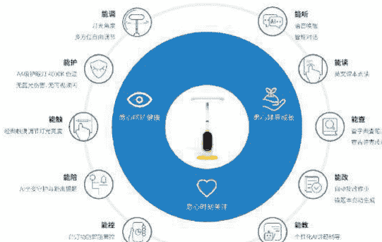

AILA以认知AI技术为骨、海量优质资源为肉，深耕家庭作业场景，从工业设计到功能逻辑全链路贴合用户。深度模拟真人教学过程，做孩子的“智慧学伴”，构建去商业化、去社交化、去游戏化的纯粹沉浸学习场。

**技术洞见：** 认知AI在人机交互、推理决策、因果逻辑场景具备不可替代价值。教育场景中，对学习个性、教法逻辑、知识图谱的深度理解，天然呼唤认知AI技术。

**产品矩阵延展：** 基于五层认知架构与认知AI操作系统，暗物智能构建覆盖学习全生命周期的产品矩阵，除作业灯X1外，还包括AILA萌宠外教、AILA智能学习本等。

---

## 四、全球AI教育产业人才供给体系：中美双强领跑

AI教育赛道高速演进，持续的人才输血是核心引擎。本章梳理全球重点国家政策与培养体系，对比发现中美优势显著，将重点剖析两国差异。

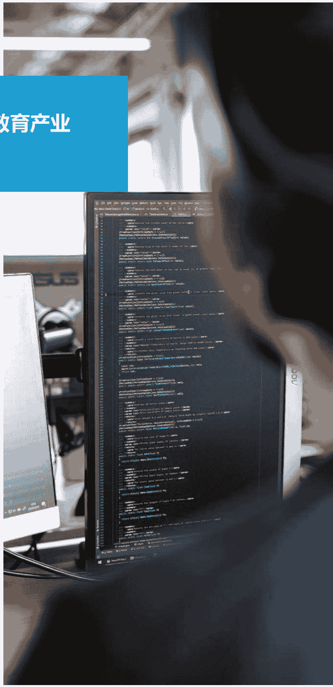

### 顶层设计：人才战略上升国家战略高度
全球主要经济体均将AI人才培养纳入顶层规划，产业政策普遍包含人才部署条款。

**中国：政策密集落地，体系化推进**
- 2018.4《教育信息化2.0行动计划》：修订课标，引入AI与编程课程。
- 2018.4《高等学校人工智能创新行动计划》：强化高校基础研究与人才培养，促产学融合。
- 2020.1《“双一流”高校AI研究生培养意见》：构建世界级培养体系，攻关高层次人才。
- 2020.10《十四五规划纲要》：实施战略科技计划，完善人才制度，聚集战略科学家与创新团队。

**美国：本土培养与全球引才双轮驱动**
- 2019.2《保持美国AI领导地位》：培训现有/未来劳动力，资助青年教师研发。
- 2019.6《国家AI研发战略计划更新》：强化AI研发队伍建设。
- 2019.8《未来20年AI研究路线图》：分层设课、设标准、优博士招留、扶教师、育高技能工程师。
- 2020.6《国家安全创新途径法案》：为AI等关键领域外籍高精尖人才开辟绿卡快车道。

**欧洲：产学研协同，改革教育供给侧**
- 英国系列报告与新政（2017-2018）：设立行业资助硕士/博士、奖学金、推进STEM、产学研育人、终身学习体系。
- 欧委会宣言（2018）：推动成员国教育改革适应劳动力转型，支持商教合作，社基金专项培训。

**印度：标准先行，平台赋能**
- 2018.6《国家AI战略》：增EdTech投入、引外脑、促交流、建在线课程与培训认证体系。
- 2020.7《国家教育政策2020》：响应技术融合需求，设立国家教育技术论坛（NETF）统筹落地。

### 人才分层：稀缺度决定价值金字塔
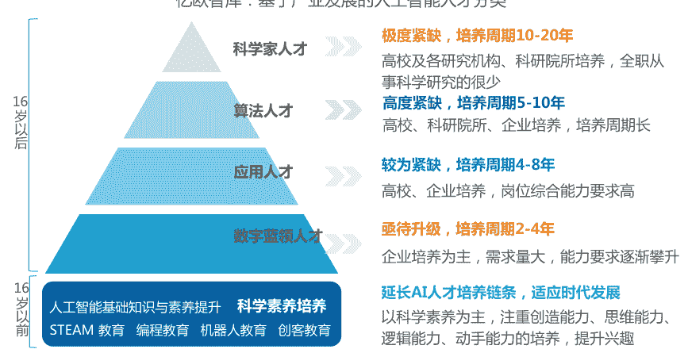

产业与人才双螺旋上升。按稀缺度分四层：
1. **科学家人才**（顶尖稀缺，创新源头，高校主导培养）；
2. **算法人才**（核心稀缺，高校企业共育）；
3. **应用型人才**（需求量大，高校企业共育）；
4. **数字蓝领人才**（基数大，分布外围，可转化培养）。

---

### 各国探索完整培养链条：科学素养从娃娃抓起

#### 中国：高校先行破局，体系逐步下延至基教
高校是主阵地。至2020年底，145所高校设立AI学术机构（含96所学院、66所研究院，19所双设）。

**基教渗透提速：**
- 2017.8《新一代AI发展规划》：部署全民智能教育，中小学开课推编程。
- 2018.1《普通高中信息技术新课标》：增“数据与计算”必修，增“数据结构、AI、开源硬件”选修。
- 现状：以信息技术/创客课或专门AI课程形式展开。

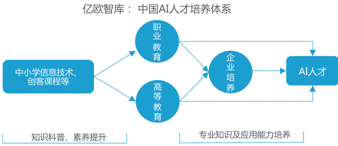

来源：亿欧智库

#### 美国：体系相对成熟，本土造血与全球引才并重

# 洞见全球AI人才版图：美德印培育范式与教育创业图谱

美国在人工智能赛道起步最早，产业端人才储备相对雄厚，高校培育体系优势尤为突出。参考QS世界大学学科排名数据，2020年全球纳入统计的计算机科学与信息系统专业院校达601所，美国独占212席，遥遥领先，这为计算机科班毕业生向AI领域转型提供了得天独厚的条件。此外，美国的AI人才培育体系植根于STEM教育。自2007至2011年间，美国家科学委员会连续发布三份专题报告，推动STEM教育国家行动计划落地，将教育覆盖面从本科阶段下沉至基础教育，并相继确立《K-12科学教育框架》与《新一代科学教育标准》，推动STEM教育在美国全面铺开。

在企业端，美企布局AI研究与人才培养的时间线同样领先于国内同行，谷歌、微软、IBM等巨头早在十年前便已深度卡位。美国AI人才生态还有一大亮点——高度依赖全球人才引进。通过为特定高精尖技术领域（含AI）人才提供移民签证通道，美国构建了全球最大的人才蓄水池，公开数据显示，其核心AI人才库中外籍人士占比过半。

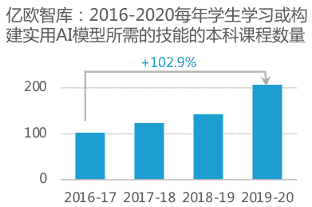
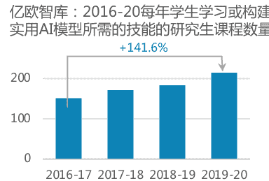
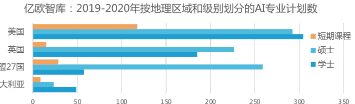

### 德国：职教筑基，人才适配性强，培育体系臻完善

德国素以职业教育闻名世界，其“双元制”体系全球领跑。同龄青年中仅两成入读大学，近八成接受职业教育，由此源源不断输送技术型人才，筑牢了工业强国的基石。随AI战略地位攀升，德国近年在教育端大幅加码AI人才培育。

2018年底，联邦政府首发《人工智能战略》，两年后更新迭代，锁定人才培育等五大核心举措。培育路径上，主攻高等教育与职业教育双轨并行。

#### 研究机构：《联邦政府人工智能战略》更新版人才培育八大举措

| 序号 | 核心内容 |
|---|---|
| 1 | 扩大青年科研资助规模与计划覆盖面 |
| 2 | 举办AI挑战赛，设立“德国AI奖” |
| 3 | 注资高校基于AI与大数据的数字化教学创新 |
| 4 | 将AI纳入课程体系，强化学术人才供给 |
| 5 | 搭建职业教育在线技能进阶平台 |
| 6 | 发起“职业教育数字平台”创新赛，构建数字化终身学习空间 |
| 7 | 协同各州提升AI教授薪酬竞争力 |
| 8 | 面向青年女性设立专项AI教育计划 |

来源：德国联邦政府官网

### 印度：IT产业掩盖培育短板，顶尖人才严重外流

印度人口基数世界第二，贫困人口亦居首位。学制上实行8年义教+2年初中+2年高中+3年本科，研究生多为2年硕+3年博。但辍学率惊人：2018年《国家AI战略》披露，小学辍学近五成，中学近三成。即便如此，印度IT产业却跻身世界前列，谷歌、微软掌舵人皆出自印度。

顶尖人才涌现得益于世界级高校——印度理工学院（IIT）体系，为硅谷及全球持续输送计算机精英。近年国家层面频发AI战略报告，规划教育应用场景，2015年即设立国家转型研究院，战略意图明显。据CSRankings近十年数据，印度七大IIT全部挤进AI领域世界前200强，排名集中在100-150名区间，本土硬实力不容小觑。

#### 研究机构：2021年CSRankings AI榜单前200印度高校

| 校名 | 排名 | 校名 | 排名 |
|---|---|---|---|
| IIT Bombay | 115 | IIT Kanpur | 139 |
| IIIT Delhi | 120 | IIT Kharagpur | 149 |
| IISc Bangalore | 123 | IIT Hyderabad | 153 |
| IIT Madras | 132 | | |

来源：CSRankings排名

## 解码AI人才培育三大核心维度

纵观各国实践，构建完备的AI人才培育体系非一日之功，需时间沉淀、资源统筹，更要适配本土教育理念。为便于横向观测，研究机构提炼三大核心维度：**高精尖、适应性、储备量**，以此为坐标剖析全球埲育现状。

### 高精尖：名校重金加码，课程谱系向纵深细分延伸

世界顶尖高校是高端AI人才的主战场。斯坦福大学2020年针对美、中、德、英、俄、加、瑞等国18所名校的追踪显示，过去四个学年，CS系在实用AI课程上投入巨资。本科实操课程数激增102.9%，研究生课程增幅达141.6%。

课程谱系上，欧美品类丰富多元，国内以学硕为主。随细分学科爆发，师资缺口随之放大，如何扩充教学队伍、留住人才，成为下一阶段必解之题。

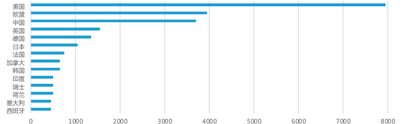
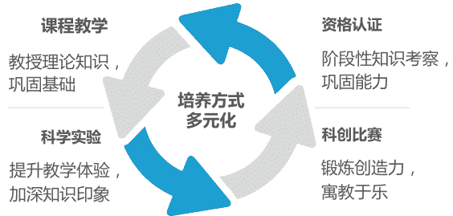

### 适应性：产学融合加速，企业成应用型人才供给“主引擎”

高精尖培育周期长，适应性关注点则在于短期内为产业批量输送可用之才。AI人才量质决定产业规模，应用层与数字蓝领需求基数大、岗位基础，单靠高校供给难以填补缺口。观察各国校内共建学科/实验室/创新平台，或校外职培/企业内训，企业在应用型人才埲育中均扮演关键角色——输送师资、技术、实战经验，实现技术突破与人才储备双赢。

#### 全球AI教育产业人才埲育图景

#### 研究机构：2015-19年主要区域产学合作合著同行评审AI论文总量

来源：斯坦福大学《人工智能指数报告》，研究机构整理

Elsevier Scopus数据印证，2015-2019年美、欧、中三极在产学合作论文产出上显著领跑。学研产融合日益紧密，联合中心激增，企业对高校研究贡献度攀升。基于应用实践的AI创新生态正在成型，未来产学界边界将进一步模糊，联合攻关的优化型、跨越式突破常态化，企业级AI研究院战略价值凸显。

### 储备量：科学素养普惠铺底，多元育人模式渐成闭环

储备量是规模化人才供给的地基。一端系于全民AI认知觉醒，需系统性科普与科学素养体系支撑；一端系于学习者主观意愿与兴趣激发。

当前，全球科学素养埲育体系趋完善。AI跨学科属性决定了素养埲育的综合性，各国正探索本土化路径。埲育手段多元化——课教、实验、赛事、认证等外化学习成效，知行合一。课程端，游戏化互动教学成主流趋势，显著提体验、强趣味。

#### 研究机构：多元埲育方式逐渐形成闭环

## 全球AI人才埲育教育企业全景扫描

全球AI人才缺口巨大，教培机构除高校、企业外，成第三大埲育力量：既向市场输送应用型人才，又通过青少年科学素养教育蓄水潜力股。研究机构从中美欧印筛选49家平台深度对比，获三大洞见：

1.  **数量分布**：美企数量断层第一，中、欧、印梯队次之。
2.  **业务侧重**：专业能力埲育（职教赛道）平台数 > 科学素养平台。前者服务在校高教与在职进阶人群，用户基数大、付费强，市场空间更广。
3.  **素养赛道玩法**：青少年编程培训为主，多融入游戏化、剧情化设计强粘性；机器人、创客、STEAM等课程内容质量显著跃升。

### 企业图谱速览

研究机构梳理全球AI教育企业图谱（节选）：

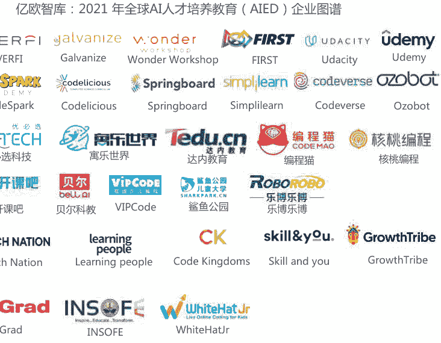

综合研判，中美在AI人才埲育领域优势最为显著，下文将聚焦两国典型案例深度复盘。

## 标杆案例深度复盘

### 奇幻工房：以“可玩机器人”点燃少儿编程启蒙火种

2012年创立，主打可编程机器人玩具及配套游戏App。创始初衷源于工程师父亲为低龄子女寻觅编程入门工具无果——孩子已有概念，却缺乏兴趣引导媒介。奇幻工房以互动游戏为载体，引导5-12岁儿童在玩中学逻辑、练编程。

#### 研究机构：奇幻工房四大育人目标

*   **想象与创造力**：模块化配件+可视化编程，赋予机器人多样行为，激发动手创造与脑洞。
*   **基础编程素养**：分级软件适配不同年龄，寓教于乐完成编程思维植入。
*   **解决问题能力**：从任务设定到代码调试，全程锻炼计算思维与抗挫力。
*   **学习兴趣激发**：游戏化体验唤醒对机械、工程、代码的原生好奇。

核心产品矩阵：Dot Creativity Kit（入门）、Dash（进阶）、Cue（高阶，11岁+），定价$79.99-$199.99。支持移动、语音交互、可编程，高阶款具备物体检测。配套系统化课程体系。

#### 研究机构：奇幻工房中国区课程体系

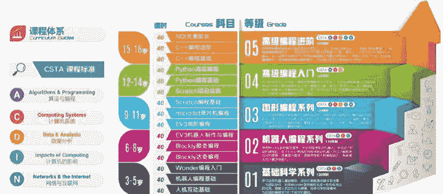

2013年众筹首秀斩获$144万，完成量产。历经三轮融资，单轮金额可观，累计近$7000万。虽诞生硅谷，却深获中资青睐：创新工场、TCL入局B轮，腾讯、好未来、华平投资跟进C轮。产品已销全球43+国家。

### Lambda School：重塑高教范式的“编程特训营”

定位编程培训服务商，主攻软件工程师在线培育，覆盖机器学习/AI课程。其开创的**“收益分享协议（ISA）”**模式震撼业界：学校投资学生，而非学生交费读书。本质上是“学校+投资基金”双重身份——挖掘被低估人才，以资助教育对冲就业风险，为全球CS岗位定向输血。

#### 研究机构：Lambda School 四大差异化基因

*   **纯线上交付**：全流程在线，仅个别阶段辅以线下。
*   **教育投资制**：入学免学费，年薪达$5万后按比例分期偿还，封顶$3万。
*   **严选严管**：入学测认知/背景，毕业设门槛，全周期规范化管理。
*   **企业直通车**：深度校企联动，精准匹配就业岗位。

课程四大支柱：数据科学、全栈Web、后端开发、免费HTML/CSS入门。周期半年左右。以数据科学为例：

#### 研究机构：Lambda School 数据科学课程全景表

| 阶段 | 核心模块 |
| :--- | :--- |
| 0周 | 启动营与预习 |
| 1-4周 | 统计基石：数据清洗、假设检验、线性代数 |
| 5-8周 | 线性建模、模型评估、应用建模 |
| 9-12周 | 数据工程化：软工规范、SQL/数据库、产品化落地与云部署 |
| 13-16周 | 机器学习核心：NLP、神经网络基础、前沿架构 |
| 17-20周 | CS硬核底子：Python/OOP、算法数据结构、图论、哈希、面试突击 |
| 21-24周 | 实战实验室：小组协作落地真实项目，衔接内部学徒制 |

来源：Lambda School 官网，研究机构整理

2017年4月成立至今，四轮融资，2019年1月B轮单笔$3000万，累计近$5000万。

### 优必选：产业龙头的“贯通式”AI教育版图

2012年3月创立，全球领先的AI与人形机器人全产业链独角兽。立足产业一线，针对大众科普、技能应用、研发尖兵三大人才梯队，打通K12至高校全链路，输出基础教育校内/校外、高职高教三大场景解决方案。

#### 研究机构：优必选AI人才埲育青少年阶段目标

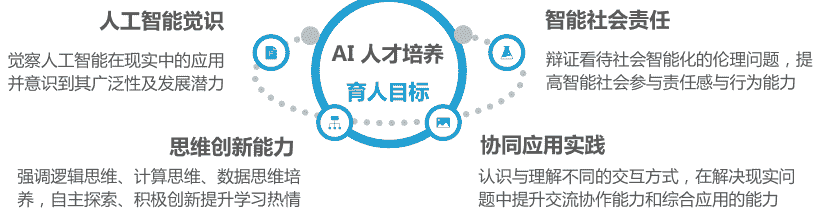

目标导向下，优必选构建广覆盖、分层级、重实战的埲育矩阵：核心课程+软硬件教具，联通真实世界，多场景、体系化交付。

#### 研究机构：优必选AI人才埲育体系架构与特色

聚焦师、生、管三端痛点，推出“课程+运营+服务”一体化方案，实现**师易教、生易学、校易管、果易显、师资易得**，推动专业级AI教育普惠化。

目前业务落地全球40+国家，国内进驻3000+中小学。

### 寓乐世界：“双引擎”驱动产教融合闭环

新东方孵化、华和资本/中文在线产业基金加持的双驱动集团。三大子品牌构建**“育人-就业-产服”全生命周期数字化生态闭环**：

*   **寓乐湾**：深耕校园科创空间，供给产品+课程。
*   **神经猿**：服务高职高教新工科数字化人才埲育全链路。
*   **科乐园**：赋能全球数字产业与人才就业。

实践中洞察到：AI时代来临，先进工具/平台/软件驱动跨学科教学，垂直教育科技与科创教育成刚需。寓乐世界由此延伸业务边界，从服务学校/机构进阶至服务企业/用人单位，完成向新一代智能科技企业的跃迁。

#### 研究机构：寓乐世界“双驱动”模式解构

成果斐然：服务7600+公立院校，为阿里/腾讯等头部企业提供大数据服务，获批清华/西南大/中石大产学研基地，承接教育部1+X、工信部/微软多项权威认证考培。2020年入选中国新经济500强。

## 研究结论与核心洞察

扫描全球近7000家相关企业，研究机构深度研习353家AI教育样本（美177、中67、欧70、印39），结合国别、业务、融资、经营等多维数据，提炼以下观察供参（欢迎指正）。基于2019、2020年报告积淀，本次从产业视角重构全球AI人才埲育体系与要素特征图谱。

### 人工智能教育行业八大核心洞察

#### 疫情重塑全球AI教育版图，中国企业融资领跑

研究表明，新冠疫情意外按下了全球AI教育发展的“加速键”。凭借优异的疫情管控成果，中国AI教育企业在资本市场上表现抢眼，融资总额跃居全球首位。回溯2000年至今的累计数据，中国在AI教育企业融资规模与数量上均保持领先；印度赛道近期增速明显，资本关注度大幅跃升。

##### 亿欧智库：全球人工智能教育（AIED）企业融资概览

来源：亿欧智库

截至2021年6月底，中、美、印、欧四大区域中，单体融资破亿美元的AI教育独角兽/准独角兽企业共60家。欧洲企业单笔融资额普遍偏小；中国企业最受资本青睐，大额融资案例最多；印度则在近两年涌现出多家大型AI教育头部公司。

##### 亿欧智库：融资超亿元AI教育企业数量与区域分布

来源：亿欧智库

## 全球AI教育产业八大深度洞察

#### 洞察一：东西方战略分野显著——东方重“体系构建”，西方重“交互体验”

在市场推广层面，中印等东方国家企业偏爱“人工智能学习”作为核心热词，强调技术硬标签；美加等北美国家则倾向于突显“虚拟教师”等具体应用场景，聚焦技术落地的交互感知。

##### 亿欧智库：全球AI教育核心热词搜索热度对比

■ “Virtual Teacher（虚拟教师）”搜索热度TOP5国家  
■ “AI learning（AI学习）”搜索热度TOP5国家

来源：Google Trends，亿欧智库整理

#### 洞察二：行业愈成熟，政策引导愈关键

观察全球AI教育发展较成熟的国家/地区可发现：产业发展水平越高，出台的政策法规越细致、垂直，政府引导对行业规范化发展的决定性作用越强。

##### 亿欧智库：主要国家/地区近年AI教育关键政策梳理

| 年份 | 美国 | 中国 | 印度 | 欧洲地区 |
|---|---|---|---|---|
| 2016 | 国家AI研发战略规划 | 教育信息化“十三五”规划 | “数字印度”战略 | 机器人技术和人工智能 |
| 2017 | AI与国家安全 | 新一代AI发展规划 | 成立AI经济转型工作组 | 人工智能战略 |
| 2018 | AI教学资源目录 | 教育信息化2.0行动计划 | 国家AI战略 | 产业战略：AI领域行动 |
| 2019 | 2019国家AI研发战略规划 | 2019教育信息化与网安要点 | 2019国家教育政策草案 | 欧洲AI协调计划 |
| 2020 | 美国AI行动：首份年度报告 | 加强“从0到1”基础研究方案 | 国家教育政策2020 | AI白皮书 |
| 2021 | AI/ML独立软件行动计划 | 2021 AI发展白皮书 | 印政府推动AI赋能教育转型举措 | 行动计划(2021-2027) |

来源：各国政府官网，亿欧智库整理

#### 洞察三：应用场景无边界延伸，科学评价待技术破局

**地域差异视角：** 全球AI教育应用虽聚焦教学主场景，但生态日益多元。美印企业在能力评测上投入较重；印度独树一帜关注个人生涯规划管理；中国企业深耕教学技术应用，对能力评测相对较弱。

**落地演进视角：** 产品形态已从单纯替代教师重复劳动，进化为基于海量数据洞察学习者隐性需求，主打“精准化、个性化”。自适应学习、智慧课堂、智能职业规划等强数据依赖场景全面开花。

##### 亿欧智库：四大区域AI教育应用场景分布图谱

来源：Crunchbase、亿欧智库整理，数据截至2021年6月

**后疫情新趋势：** 智慧课堂与智能学习硬件成为集大成者，整合多项AI技术于单一终端。随着细分场景产品同质化加剧，行业必然向“功能聚合、一体化”方向演进，以更便捷形态触达学习者。

亿欧智库预判，同类场景下的未来变革将聚焦三大维度：**技术精度跃升、对教育环节依赖度降低、多元功能深度聚合。**

##### 亿欧智库：AI教育场景演进三大核心矢量

来源：亿欧智库

#### 洞察四：场景化打破环节壁垒，技术落地成熟度稳步跃升

基于2019年研究基准，亿欧智库再次评估核心场景功能成熟度。结果显示，拍照搜题、自适应学习、语音交互等存量场景，技术成熟度普遍提升，且**对教育过程数据的依赖度显著下降**。以拍照搜题为例，已突破教育App边界，搜索引擎（如夸克）亦可在无教育过程数据支撑下独立构建同类能力。

##### 亿欧智库：核心AI教育场景功能应用成熟度评估矩阵

| 核心功能 | 关键技术栈 | 技术成熟度 | 对教育环节数据依赖度 | 场景落地成熟度 |
|---|---|---|---|---|
| 智慧课堂 | 计算机视觉、语音交互 | ★★★★ | ★★★★ | ★★☆ |
| 智能学习硬件 | 定位识别、OCR | ★★★ | ★★ | ★★★ |
| 拍照搜题 | 图像识别（OCR） | ★★★ | ☆ | ★★★☆ |
| 个性化组卷 | 数据挖掘 | ★★★☆ | ★★★☆ | ★★ |
| 学生综合素质评测 | 数据挖掘、NLP | ★★☆ | ★★★☆ | ★★☆ |
| 智能升学/生涯规划 | 智能评测、个性化推荐 | ★★☆ | ★★★☆ | ★★☆ |
| 自适应学习 | NLP、数据挖掘 | ★★☆ | ★★★★ | ★★★☆ |

来源：亿欧智库  
*注：评级为相对评价；“依赖度”指算法训练对教育过程数据的依赖程度。*

**全链路视角：** 将学习者全生命周期划分为教学、学习、考试、能力测评、人生规划五阶段。规律显现：**越贴近教学一线，技术攻关难度越大；能力测评与人生规划领域则蕴藏巨大蓝海。**

##### 亿欧智库：AI教育全链路应用模式与攻坚难点

| 生命周期阶段 | 典型应用模式 | 核心攻坚难点 |
|---|---|---|
| 人生规划管理 | 基于大数据算法画像，结合个性化需求预测路径 | 路径规划模型稀缺，个性化高、量化难 |
| 能力测评 | 识别技术验证训练成果，依预设标准评估 | 识别精度待提升，个性化高、量化难 |
| 考试 | 采集行为数据预测，融合测试数据定制方案 | 数据量大但反馈单一，挖掘空间大 |
| 学习 | 解析学习模式，依科学原理给针对性调整建议 | 数据量化难，模式复杂，个性化要求高 |
| 教学 | 预采偏好数据植入互动，基于教学体系分析行为 | 教学模式复杂，学科差异大，仍需人工兜底 |
| 认知、思考 | （探索期） | （探索期） |

#### 洞察五：竞争白热化，技术积淀成护城河

技术服务商涌入降低了中小企业研发门槛，单一场景产品扎堆，同质化竞争加剧，倒逼产品向“全功能智能教育终端”聚合。头部企业虽布局广泛（覆盖教、学、考、评、规五大领域及校、家、户外三大物理空间），但在新兴场景开拓上仍面临“技术成熟需长周期积累”与“存量场景已红海”的双重挑战。

亿欧智库判断：行业下半场将从“教学/学习辅助”向**“以学习者为中心的评价体系与标准构建”**战略转移。

#### 洞察六：人才缺口倒逼培养体系重构，产教融合迫在眉睫

**全球顶尖算力分布：** CS Ranking前30高校中，美国占15席，中国9席，新加坡2席，以色列、加拿大、瑞士、韩国各1席。中美双强格局奠定了全球AI人才供给基本盘。

**分层需求画像：** 随技术渗透，应用型人才与“数字蓝领”需求量最大，但门槛水涨船高。人才供给链条亟待延伸：从高校基础培养 -> 企业实战转化 -> 职业技能/认证培训 -> 人才后市场服务，全链条均存增量空间。

##### 亿欧智库：产业视角下的AI人才分层图谱

- **科学家/首席专家**：极度稀缺，周期10-20年，高校/科研院所全职科研产出
- **核心算法/架构师**：高度稀缺，周期5-10年，高校/院所/企业联合培养
- **高级应用/方案专家**：较为稀缺，周期4-8年，高校/企业培养，综合能力要求高
- **工程落地/运维执行**：亟待升级，周期2-4年，企业主导培养，需求量大、门槛攀升
- **科普/启蒙基础层**：延长培养链条，重科学素养、创造/逻辑/动手能力与兴趣激发

#### 洞察七：全球科学素养体系趋完善，理论实践双轮驱动

人才储备量是规模化产出的前提，取决于全民AI认知普及（需系统科普体系）与学习者主观意愿。当前，各国结合国情构建多元科学素养体系，**“课程教学+科学实验+科创竞赛+资格认证”**闭环初成，知行合一成常态。

教学层面，**游戏化互动课程**成标配，显著提升体验感与趣味性，降低入门门槛。

##### 亿欧智库：主要国家/地区将计算思维纳入国民教育战略举措

| 国家/地区 | 核心行动与目标 |
|---|---|
| 美国 | 投资40亿推普及编程，保障K12全覆盖STEAM教育 |
| 英国 | 覆盖学前至高中，分阶段设定明确能力标准 |
| 日本 | 新学习指导要领强制中小学开展STEAM，2020年起小学开设编程 |
| 欧盟 | 15+成员国将编程纳入校本课程体系 |
| 韩国 | 2018年起全面推广中学编程教育 |
| 阿根廷 | 数字化学习纳入各级义务教育 |
| 新加坡 | 160所幼儿园引入机器人，中小学考试加入编程科目 |

来源：公开资料整理

##### 亿欧智库：多元培养路径逐步形成闭环生态

来源：亿欧智库

---

### 报告后记

本报告《笃实前行，智胜未来——2021全球人工智能教育落地应用研究报告》承接亿欧智库2019、2020年系列研究，聚焦产业落地实况，梳理事实、预判场景变革、解析人才关键要素。未来将持续跟踪AI+教育深度融合演进，输出深度洞察，助力企业品牌建设与行业生态监督。

**致谢：**  
学术指导：上海开放远程教育工程技术研究中心、肖君副主任。  
信息支持企业（排名不分先后）：大力智能、暗物智能、寓乐世界、优必选、蓝宙科技、商汤科技、松鼠Ai、校宝在线、流利说、小鹅通。

*数来源于公开渠道及企业官网，如有遗漏欢迎联系作者补充。*

---

### 团队与作者信息

**亿欧智库简介**  
亿欧智库是亿欧旗下研究咨询机构，服务全球企业与政府决策，深耕科技、消费、大健康、汽车、产业互联网等领域。近百名名校毕业分析师，兼具中英文深度报告产出能力，洞察常被全球顶级媒体引用。依托亿欧网传播矩阵与万级高端专家库，研究成果兼具影响力与落地性。

**报告作者**  
 李万凌霄 亿欧智库分析师  
 崔策 亿欧智库实习分析师  
 兰壹凡 亿欧智库实习分析师  
 黄朝刚 亿欧智库实习分析师  

**报告审核**  
 李庆山 亿欧智库消费研究副总监  

**版权声明**  
本报告数据合规、逻辑自主、观点独立，仅供信息参考，不构成投资建议。版权归亿欧智库所有，引用需注明出处；侵权将究法律责任。

**关于亿欧**  
成立于2014年，总部北京，立足中国、影响全球，覆盖50+国家地区。旗下拥有亿欧网、亿欧国际站、亿欧智库、亿欧数据、亿欧大健康、亿欧汽车等矩阵。服务客户含华为、阿里、腾讯、Intel、美团、SAP、拼多多、京东健康、蔚来、上汽等头部机构。

**亿欧服务体系**  
- **创业公司**：品牌曝光、降低融资沟通成本、吸引合作伙伴与人才、纳入权威报告树立标杆。  
- **大型企业**：第三方视角提供行业/用户研究、投资分析、创新咨询，数据库与链接能力支撑落地生态。  
- **政府机构**：决策参考、产业规划、招商引资支持等定制化咨询服务。

# 赋能政府决策，亿欧EqualOcean四大核心服务矩阵

面向政府端客户，亿欧EqualOcean构建了覆盖全周期的四大服务模块：首项聚焦**产业情报输出**，紧贴政府重点关注赛道，系统梳理国内外产业动态与前沿趋势，充当领导决策的“外脑智库”；次项搭建**政企对接桥梁**，依据需求汇聚产业标杆企业与政府部门，深度探讨合作契机；三项提供**定制化赋能培训**，面向政府机构及下属园区，强化行业认知，实战提升招商引资与园区服务实效；四项深度参与**产业规划落地**，协助政府科学编制产业发展蓝图。

### 机构投资者

除拥有资深分析师梯队外，亿欧EqualOcean还沉淀了**超15000名领域专家资源库**。针对机构投资人，我们提供专家一对一咨询及标的深度调研服务，有效打破信息壁垒，助力投资决策精准落地。

---

**期待与您携手共进，开启合作新篇章**

📞 **咨询热线**：010-57293241  
📧 **合作邮箱**：hezuo@iyiou.com  
🌐 **官网入口**：https://www.yiyou.com/research  
📍 **公司地址**：北京市朝阳区霞光里9号中电发展大厦A座10层

