# 【亿欧智库】AI加速键：2021上海人工智能创新发展探索与实践案例集

## 序言
INTRODUCTION

近年来，得益于算法、算力、数据三大要素的支撑以及应用场景的牵引，人工智能已成功由技术理论阶段迈入产业应用阶段，不断向工业、农业、医疗、金融等各领域渗透，重塑传统行业模式，衍生新的业态，赋能产业转型升级，人类社会正由信息社会向以人工智能为关键支撑的智能社会加速迈进。

越来越多的国家已把人工智能作为引领未来、驱动新一轮科技和产业革命的战略性技术。我国也在2017年出台新一代人工智能发展规划，推动人工智能发展进入快车道。上海将发展人工智能作为三大先导产业之一，从技术创新、产业集聚、应用示范、政策供给、人才建设等方面进行布局，着力打造人工智能“上海高地”。在全面推进城市数字化转型的过程中，围绕上海超大型城市有序治理的需求，加快人工智能在产业经济、人民生活、城市治理等重点领域的深度应用，赋能城市迭代进化、加速创新。

2021年是“十四五”开局之年，为总结上海人工智能产业发展和赋能城市数字化转型的成果，展望“十四五”期间上海人工智能发展形势，在上海市经济和信息化委员会的指导下，上海市人工智能行业协会牵头编写了《AI加速键上海人工智能创新发展探索与实践案例集》，以案例介绍的形式为主，从基础创新、产业落地、应用场景等多个方面展现上海人工智能产业的发展情况。

在本书的编写过程中，上海市经济和信息化发展研究中心为素材征集提供了重要支持，上海人工智能研究院有限公司、上海智慧城市发展研究院、亿欧EqualOcean、今日人工智能编辑部等团队负责各板块的具体编撰，各个企业、机构为本书提供了宝贵的案例素材，在此一并致谢。

本电子版报告由上海交通大学出版社授权，节选了《AI加速键：上海人工智能创新发展探索与实践案例集》的部分章节与内容，并发布于亿欧EqualOcean，如需书籍全文，请通过上海交通大学出版社官方渠道获取。

## 第一章 国际人工智能发展概况及趋势

近年来，全球人工智能竞争加剧，技术不断取得突破性进展，逐步由实验室阶段转向产业化阶段，产业热度不断提升，人工智能技术越来越深刻地与各行各业的融合渗透，并助力传统行业实现跨越式升级。本章从技术、政策、企业、投资、学术等角度，进行阐述国际人工智能发展概况与趋势。

### 人工智能引领全球突破性技术，智能化社会进程加速

自2016年以来，随着人类对人工智能的感知不断增强，整个AI行业已经成功地由实验室阶段转向产业化生产阶段，不断向工业、农业、医疗、金融等各领域渗透，重塑传统行业模式，衍生新的业态，赋能产业转型升级，人类社会由信息社会逐步向以人工智能为关键支撑的智能社会加速迈进。

近年来，人工智能相关技术再次得到全面发展，各类深度学习新技术层出不穷，在云计算、大数据和芯片等新兴技术的支持下，逐渐从“智能”走向“智慧”，占领新一轮科技革命的制高点。在新型冠状病毒肺炎(以下简称“新冠肺炎”“COVID—19”)疫情肆虐的2020年，人工智能技术依旧蓬勃发展，从OpenAI发布GPT-3，到AlphaFold2破解蛋白质结构预测难题及深度势能分子动力学的创新突破，人工智能技术在算法、计算系统、科学、行业应用等领域再次取得突破性进展。未来，随着人工智能技术逐渐成熟，人工智能计算是智能时代发展的核心动力，人工智能计算中心将成为智能化时代的关键基础设施，多元化场景和全新数据正在产生，人工智能在算法模型、算力等领域的创新突破，将能更好地帮助人类应对后疫情时代的各种不确定性，创造更大的价值。

图：2020年“全球十大突破性技术”

- 2020年初 Google与Facebook团队分别提出全新无监督表征学习算法
- 2020.05 OpenAI发布预训练语言模型 GPT-3
- 2020.05 美国贝勒医学院通过动态颅内电刺激实现“视皮层打印机”功能
- 2020.07 康奈尔大学提出无偏公平排序模型可缓解检索排名的马太效应问题
- 2020.10 DeepMind用深度神经网络求解薛定谔方程促进量子化学发展
- 2020.10 清华大学首次提出类脑计算完备性概念及计算系统层次结构
- 2020.10 MIT仅用19个类脑神经元实现控制自动驾驶汽车
- 2020.11 AlphaFold2破解蛋白质结构预测难题
- 2020.11 深度势能分子动力学研究获得戈登·贝尔奖
- 2020.12 北京大学首次实现基于相变存储器的神经网络高速训练系统

资料来源：Ofweek人工智能网、亿欧智库

### 全球人工智能竞争加剧，产业布局各有侧重

随着深度学习技术在智能驾驶、智慧金融、智能制造、智慧农业、智慧医疗、智能家居等领域的逐步应用，人工智能越来越成为引领未来、驱动新一轮科技革命和产业革命的战略性技术；全球范围内人工智能竞争格局已凸显，中美“双雄并立”构成人工智能第一梯队，日本、英国、法国等发达国家紧随其后，构成第二梯队。

自2016年以来，美国、英国、德国、日本、韩国、俄罗斯以及欧盟成员国等密集出台一系列与人工智能相关的战略、规划或重大计划，在顶层设计上强化人工智能战略布局，为人工智能落地保驾护航，争夺全球科技竞争的主导权。

美国重视保持其在人工智能方面的技术领先地位，持续加大其在人工智能前沿技术领域的投入和布局，尤其是在算法和芯片脑科学等领域布局超前。欧盟注重探讨人工智能的社会伦理和标准，在技术监管方面谋求全球领导地位。俄罗斯注重人工智能等高新技术的研发和应用，谋求人工智能全球领先地位。英国不断加大政策、资金、人才和国际合作方面的布局力度，以支撑英国人工智能在社会不同领域的发展应用。德国用“AI+工业4.0”模式打造“人工智能德国造”品牌，推动人工智能在经济和生活领域的落地应用。日本政府积极发布国家层面的人工智能战略、产业化路线图，主张构建有效且安全应用的“AI-Ready社会”。韩国将人工智能战略上升为国家战略，提出提升领域竞争力，发展成为“人工智能强国”。

图：2016-2020年国外主要经济体人工智能政策发布

| 年份 | 政策发布 |
| :--- | :--- |
| 2016 | 美国《AI & Machine learning committee》《Artificial Intelligence, Automation, and the Economy》《国家人工智能研究和发展战略计划》；欧盟《人工智能立法动议》；英国《Robot and Artificial Intelligence》 |
| 2017 | 英国《人工智能：未来决策制定的影响和机遇》；法国《French Intelligence Artificielle》；美国《人工智能与国家安全》《人工智能未来法案》《人工智能政策原则》；日本《下一代人工智能推进战略》《人工智能研究开发目标与产业化路线图》《人工智能技术战略》；新加坡《新加坡人工智能战略》 |
| 2018 | 美国《人工智能与国家安全 AI 生态系统的重要性》；英国《人工智能行业新政》《英国人工智能发展的计划、能力与志向》；欧盟《欧盟人工智能》《人工智能道德准则》《人工智能通讯》；德国《联邦政府人工智能战略 要点》；法国《人工智能政策文件》 |
| 2019 | 美国《American AI Initiative》；欧盟《Ethics Guidelines for Trustworthy AI》；印度《人工智能国家战略》；西班牙《人工智能研究、发展与创新战略》；挪威《国家人工智能战略》；俄罗斯《人工智能国家战略》；芬兰《人工智能国家战略》；韩国《人工智能研发战略》 |
| 2020 | 美国《巩固美国人工智能领导地位：人工智能研究与开发》；欧盟《人工智能白皮书》；俄罗斯《多领域人工智能应用路线图》 |

资料来源：各国政府官网,德勤研究，亿欧智库整理

### 人工智能技术驱动规模化应用进程加速

近年来，全球人工智能产业热度不断提升，截至2020年底，全球人工智能产业规模达到1565亿美元，同比增长12.3%。从产业链格局分布来看，全球范围内人工智能企业主要集中在“AI+垂直领域”。其中“AI+企业”主要集中在商业(主要包含市场营销和客户管理领域)、医疗健康、金融领域。在全球人工智能产品领域，智能机器人占比较多，为8.06%，智能驾驶、智能硬件领域也越来越成为人工智能企业重点布局领域，落地产品不断取得突破;在全球人工智能企业核心技术领域，视觉技术更受欢迎，占比12.07%，其次是自然语言处理领域，占比8.94%。全球人工智能头部企业不断加快底层技术和产品应用实践布局，产业规模化发展的进程不断加速，规模经济有望形成。

图：全球人工智能企业技术产品领域分布

资料来源：中国信通院《2020年全球人工智能产业地图》、亿欧智库整理

AI加速键——上海人工智能创新发展探索与实践案例集

### 全球人工智能资本热度回归理性

2020年，全球人工智能初创公司募集资金达649.54亿美元，涉及超3625笔交易。在2017—2018年，迎来企业注册和资本热度的“爆发期”后，全球人工智能融资额次和新增企业数逐年缩减，2020年新增企业约为2019年全年数量的36%，创业热度明显降低，由此大致推断全球人工智能产业创业窗口期接近尾声，原始初创企业初步形成一定的行业技术、资本、产品等积累，全球人工智能行业整体加速迈进下一阶段。

从融资轮次层面来看，融资轮次后移趋势不断扩大。2020年，B轮及以上融资笔数占总笔数的62.3%，较上一年增长40%以上，种子、天使轮融资占比不断减小，初创公司获得种子轮融资或天使轮融资的难度越来越大，人工智能领域的主要投资正向具有一定规模的成熟企业倾斜。从技术基础理论突破到技术应用落地，有技术为产业发展奠定基础，虽然资本热度和创业热度降温，但是优质企业估值仍持续增长，资本热度趋于冷静和理性，倾向于寻找细分领域的“隐形冠军”，独角兽企业不断初现，产业呈现良性发展态势。

图：2015-2020年全球人工智能投融资规模及新成立企业数

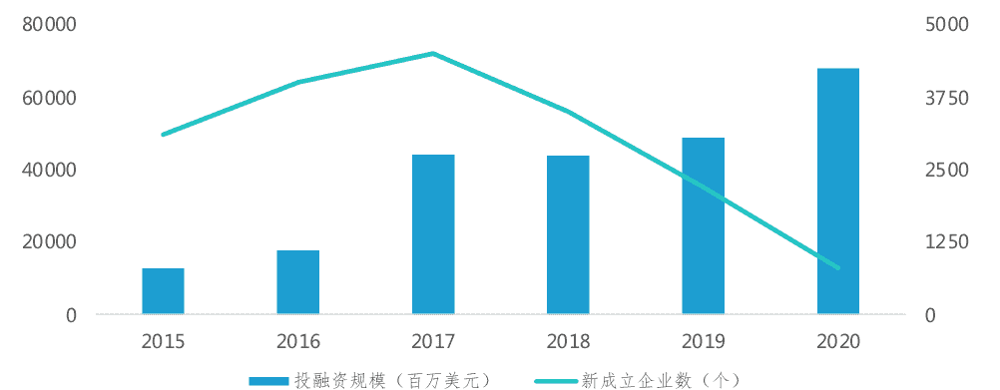

资料来源：斯坦福大学《Artificial Intelligence Index Report 2021》、亿欧智库整理

图：2015-2020年全球融资轮次数量分布

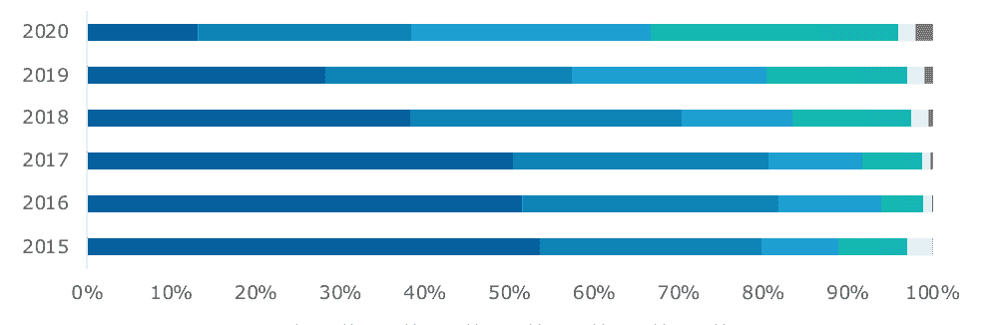

资料来源：中国信通院《2020年全球人工智能产业地图》、亿欧智库整理

### 全球人工智能竞争中美保持引领发展态势

中美人工智能企业数量在全球范围内占据绝对优势。2020年，美国人工智能企业数量为2257家，占比38.29%，居全球首位；中国人工智能企业数量为1454家，占比24.67%，位居全球第二；美、中、英、加等名列前10的国家的人工智能企业数量排名连续4年无明显变化。尽管俄罗斯2020年人工智能产业迎来发展热潮，但对人工智能产业整体格局并未产生决定性影响。中美两国人工智能企业数量占据全球半数以上，保持绝对竞争优势。

图：2020年全球人工智能国家企业数量占比

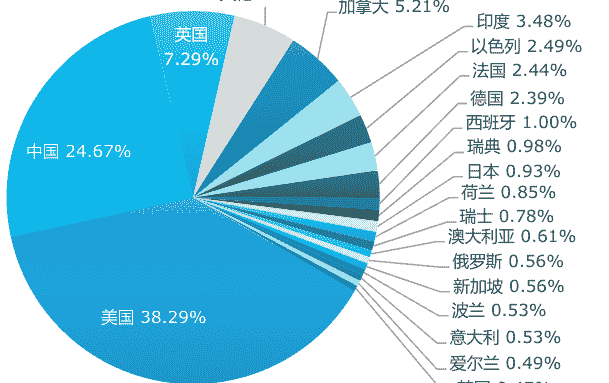

数据来源：中国信通院，《2020年全球人工智能产业地图》、亿欧智库整理

中美人工智能科研创新能力处于全球领先地位。从人工智能期刊论文发表情况来看，2020年全球发表的人工智能期刊论文数量同比增长34.5%。其中，中国的AI期刊论文发表占比18.0%，排名第一，其次是美国和欧洲占比分别为12.3%、8.6%。中国人工智能期刊论文被引用量占比20.7%，首次超过美国(19.8%)。从人工智能专利申请数量来看，全球人工智能专利申请集中在中美两国。截至2020年11月底，居全球首位，占全球总量的74.7%，是排名第二的美国的8.2倍。

图：2015-2020年全球人工智能领域期刊论文发表情况和专利申请数量统计

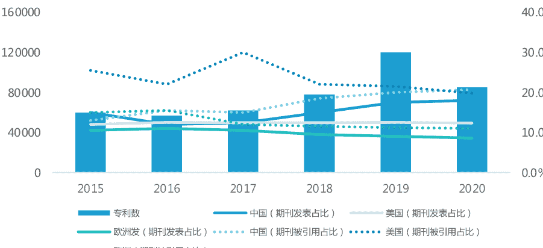

资料来源：斯坦福大学，《Artificial Intelligence Index Report 2021》、亿欧智库整理

## 第二章 中国人工智能发展概况及趋势

随着政府顶层设计的不断升级，我国的人工智能发展进入快车道，全方面布局，不断取得重大技术突破。中国企业经过多年发展，原始技术积累、落地场景和商业形态逐步成熟。人工智能技术与各行业的融合正在不断加速，赋能数字化转型，并引领中国加速向智能经济社会迈进。本章将从技术、政策、企业、投资、学术等角度，进行阐述中国人工智能发展概况与趋势。

### 顶层政策持续升级，各地加快AI布局

我国人工智能发展进入快车道，自2015年7月国务院出台的《国务院关于积极推进“互联网+”行动的指导意见》首次将人工智能纳入重点任务，至2017年7月国务院印发《新一代人工智能发展规划》将其上升至国家战略，2019—2020年，我国人工智能政策进入深度融合发展期，随着2020年人工智能被纳入“新基建”政策，人工智能逐渐成为新技术基础设施的主要支撑技术之一，助推中国人工智能发展迈向更高的台阶。截至2020年，党中央、国务院及各部门出台相关政策10余项，连续4年将人工智能写入政府工作报告。各地政策跟随国家政策纷纷出台相关政策，截至目前，20多个省(自治区、直辖市)相继出台了人工智能专项规划60余项。

上海将发展人工智能作为优先战略选择，从技术创新、产业集聚、应用示范、政策供给、人才建设等方面进行布局，努力打造上海人工智能产业高地。特别强调围绕智慧城市建设和上海超大型城市有序治理需求，加快人工智能在经济发展、城市治理和公共服务重点领域的深度应用，突出人工智能发展与城市紧密结合。

图：“十三五”期间国家人工智能相关政策

| 政策/文件 | 时间 | 相关内容 |
| :--- | :--- | :--- |
| 《中华人民共和国国民经济和社会发展第十三个五年规划纲要》《机器人发展规划2016-2020年》 | 2016.3 | 人工智能写入“十三五”规划纲要 |
| | 2016.4 | 到2020年，自主品牌工业机器人生产量达10万台六轴以上机器人年增长量达五万台 |
| 《“十三五”国家技术创新规划》 | 2016.7 | 重点发展大数据驱动的类人工智能技术 |
| 《智能硬件产业创新发展专项行动（2016-2018）》 | 2016.9 | 重点发展可穿戴设备、智能车载设备、医疗健康设备、智能服务机器人、工业级智能硬件设备等 |
| 《“十三五”国家战略性新兴产业发展规划》 | 2017.3 | 新增“人工智能2.0”，人工智能进一步上升为国家战略，人工智能首次被写入政府工作报告 |
| 《新一代人工智能发展规划的通知》 | 2017.7 | 构建包含智能学习、交互式学习的新型教育模式体系、推动人工智能在教学、管理、资源建设等全流程应用，中小学设立人工智能教程，让推广受教育、高校增加硕博培养形成“人工智能+X”模式和普及软文教育和研发平台。 |
| 十九大报告 | 2017.10 | 人工智能写入十九大报告，将推动互联网、大数据、人工智能和实体经济深度融合 |
| 《促进新一代人工智能产业发展三年行动计划（2018-2020）》 | 2017.12 | 落实和细化《新一代人工智能发展规划》，以新一代人工智能技术产业化和集成应用为重点，推动人工智能实体经济深度融合 |
| 政府工作报告 | 2018.3 | 强调“产业级的人工智能应用”，在医疗、养老、教育、文化、体育等多领域推进“互联网+”，发展智能产业，拓展智能生活 |
| 《高等学校人工智能创新行动计划》 | 2018.4 | 优化高校人工智能领域科技创新体系，完善人工智能领域人才培养体系，推动高校人工智能领域科技成果展示与示范应用，到2030年，高校成为世界主要建设人工智能创新中心的核心力量和引领新一代人工智能发展的人才高地 |
| 政府工作报告 | 2019.3 | 打造工业互联网平台，拓展“智能+”，为制造业转型升级赋能 |
| 《关于促进人工智能和实体经济深度融合的指导意见》 | 2019.3 | 强调市场导向与产业应用，打造智能经济形态 |
| 《国家新一代人工智能创新发展试验区建设工作指引》 | 2019.8 | 到2030年，布局建设20个左右人工智能试验区，创新一批切实有效的政策工具，形成一批人工智能与实体经济深度融合的典型模式，累计一批可复制推广的经验做法，打造一批重大引领带动作用的人工智能创新高地 |
| 两会工作报告 | 2020.5 | “智能”连续四年被写入政府工作报告。加强新型基础设施建设，发展新一代信息网络，拓展5G应用，建设数据中心，激发新消费需求，助力产业升级 |

### 关键技术不断突破，集成化创新发展加速

尽管新冠肺炎疫情暴发，我国人工智能技术创新却并未因此受阻，截至2020年10月，我国人工智能技术专利共计申请69.4万件，同比增长56.3%。其中，云计算作为人工智能的基础支撑技术，与计算机视觉专利占比一样最多，均达到18%；其次是深度学习和自主无人系统，占比分别为14%和12%。我国人工智能单点技术应用较为成熟，人工智能与相关技术的协同规模化和产业化应用尚在早期，但以交叉融合为特征的集成化创新渐成主流，通过智能技术产业化和传统产业智能化，多种新兴技术交叉集成的价值将使人工智能发挥更大的社会经济价值。

图：2020年国内AI技术专利申请占比

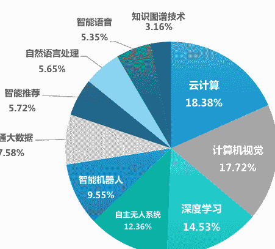

资料来源：中国通信院、亿欧智库整理

### 创业积累基本成形，规模化应用待落地

中国人工智能初创企业经过3年的快速增长，原始技术积累、落地场景和商业形态基本形成，发展路径逐渐清晰，在2017—2018年达到顶峰后创业热度逐步降温，人工智能创业机会窗口期逐步迈入尾声。多样化的场景和全新数据正在产生，在政策、资本、技术的加持下，人工智能将融合商业化场景进入新阶段，规模化商业应用落地阶段正加速形成。现阶段，我国人工智能技术与各行业的融合渗透不断加速，终端产品落地应用丰富，主要集中在智慧教育、智能硬件、智能家居、智慧金融、智慧医疗、智能驾驶、智能安防、智能机器人等领域，智能化新产品、新业态、新模式将不断涌现。未来，我国人工智能企业的发展将更加依赖落地场景的洞察以及解决行业实际需求的能力。

图：2015-2020年中国AI企业新增数量及垂直行业分布统计

### 中国人工智能相关企业垂直行业分布Top10

| 行业 | 数量 |
|---|---|
| 教育 | 50 |
| 基础元件 | 54 |
| 家居 | 58 |
| 金融 | 62 |
| 大健康 | 68 |
| 汽车 | 75 |
| 安防 | 113 |
| 通用型方案 | 160 |
| 机器人 | 255 |
| 企业服务 | 330 |

资料来源：亿欧智库

### 私募投资趋于饱和，资本青睐底层算法

中国人工智能私募投资热度在2017—2018年达到顶峰后，投资频次和投资额度开始逐年回落。一方面，由于宏观经济影响，资本市场整体遇冷；另一方面，由于早期中国人工智能行业竞争格局未明，各细分领域的多种商业模式均待市场验证，因此投资人对标的选择更加理性，开始投向具有一定规模且相对成熟的企业，注重寻找细分市场的“隐形冠军”。

相较于此前的资本投向侧重落地人工智能应用场景，人工智能企业底层算法能力逐渐得到投资市场更多的关注，由于天花板高，这类公司在市场上更加具有竞争力。随着人工智能在中国的进一步发展，底层技术的投资热度持续增长，在资本的驱动下持续发力，将改变国内基础研究和原创算法薄弱的局面，进一步推动国内人工智能产业生态的完善和升级，实现人工智能万亿级市场规模。

图：2015-2020年国内人工智能私募股权融资额次和规模情况

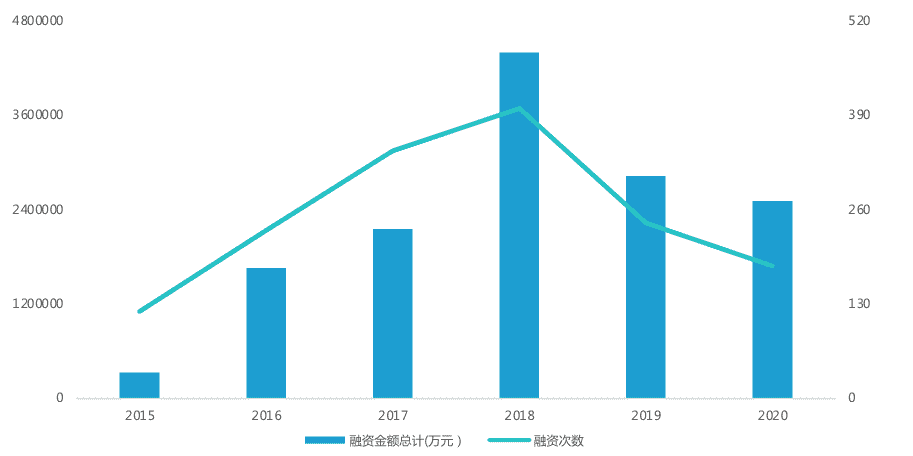

资料来源：亿欧智库

### AI赋能数字化转型，驱动底层支撑升级

新冠肺炎疫情的爆发，改变了全球的消费行为和数据模型，进一步释放了数字化转型的市场需求。一方面，人工智能融合大数据、云计算等新兴技术，使传统基础设施成为与各行业数字化转型、智能化升级为融合的基础设施，成为新一代新型基础设施的关键支撑技术之一，加速新型基础设施建设供应形成规模化的“普惠效应”，一定程度上降低企业综合应用新型基础设施建设投资技术的成本，助力更多中小企业投入更少成本完成企业数字化转型；另一方面，人工智能越来越深入地与三大产业融合渗透，驱动产业链上下游企业的数字化转型，衍生出智慧医疗、智慧金融、智能安防等新模式、新业态，带动智能硬件、智能机器人等智能产品的产生，逐步形成一种泛在智能社会，数字经济加速向智能经济迈进，对数字底层支撑技术供给的“质”和“量”提出了新的要求。未来，需要围绕底层算法、算力、数据等底层技术，形成新一代基础设施赋能产业的核心能力。

## 第三章 上海市人工智能发展回顾与展望

本章将分为两部分来阐述上海市人工智能发展回顾与展望。

在“十三五”期间，上海初步形成科技引领、应用驱动、产业协同、生态培育、人才集聚的新一代人工智能发展体系，成为中国人工智能发展最领先地区之一。

在“十四五”期间，上海市人工智能将进入深入应用、赋能百业的阶段，向着“建设具有世界影响力的国际数字之都”和“打造世界级人工智能产业集群”的发展目标迈进。

### 多层次创新平台启动建设

上海逐步形成“基础研究和前沿理论研究平台+应用创新平台+重大算力服务平台”的多层次、全链条覆盖的AI创新体系。上海人工智能实验室、上海脑科学与类脑研究中心、上海人工智能算法研究院、上海自主智能无人系统科学中心、上海启智研究院、上海人工智能研究院、中国科学院计算技术研究所智能处理器研究中心、微软亚洲研究院(上海)等研究机构落户发展，攻关重大基础理论，打造人工智能战略科技力量集群。上海白玉兰开源开放研究院、微软-仪电人工智能创新院等技术开发转化平台揭牌成立，连接理论算法与应用实践，加快关键共性技术转化落地。商汤、依图、明略等国家新一代人工智能开放创新平台授牌，商汤、依图、上汽、腾讯、深兰、寒武纪、优刻得等市级人工智能创新中心成立，亚马逊、IBM、阿里、百度、华为、科大讯飞等头部企业人工智能创新中心在沪布局，促进面向行业的技术应用研发，形成赋能示范效应。

### 图：上海市人工智能功能平台布局

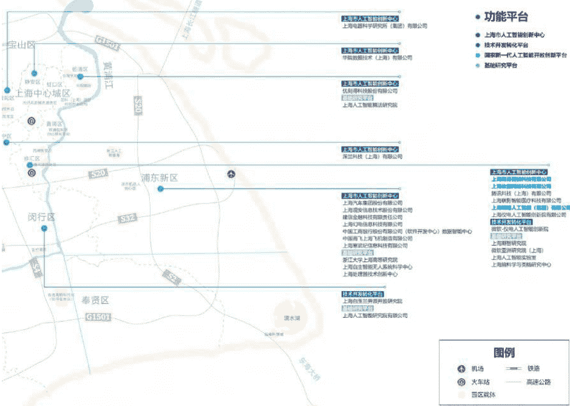

### 多领域创新成果持续亮相

依图科技“求索”系列云端芯片、天数智芯7nmGPGPU芯片、腾讯AI开放平台、华为全栈式AI战略和AI芯片、寒武纪云端和终端芯片、商汤重大算力平台等在上海首发，树立了行业发展标杆。西井视觉识别软件、“英语流利说”APP、新松虎伯特乒乓球机器人、诺亚医院物流机器人、禾赛光电机械式激光雷达等20余项创新产品入选上海市创新产品推荐目录，形成产业化示范能力。

### 全产业链体系初步成形

在“十三五”期间，上海在全国率先提出以应用驱动产业发展的理念，大力推进人工智能示范应用，牵引产业链上下游协同布局，打造标志性产业集群。微软、亚马逊、阿里、腾讯、百度、华为等头部企业纷纷在沪布局业务，打造产业生态；商汤、依图、深兰、云从等技术类企业不断取得突破性创新成果，加快技术落地步伐；寒武纪、平头哥、地平线、燧原、朝捷、禾赛光电等基础类企业致力于研发高端智能芯片、传感器，突破关键环节“卡脖子”问题；钛米、高仙、小蚁、快仓等产品类企业持续推出智能机器人、智能终端新产品，进一步拓展市场空间；联影智能、森亿、商米、明略、氪信、虎博、趣头条、极链、义学等应用类企业深耕医疗、金融、商贸、文娱、教育等垂直领域，提升人工智能赋能价值。

### 产业空间格局不断优化

围绕“东西集聚、多点联动”的布局，加快建设“4+X”融合创新载体。“东带”以浦东新区人工智能创新应用先导区建设为抓手，推动浦东张江智能产业+科创融合发展，人工智能岛已成为国内行业产业和应用标杆，并逐渐推动由岛扩区发展模式；临港新片区积极引进地平线等领军企业，智能网联汽车综合测试稳步开展。“西带”徐汇西岸国际人工智能中心正式启用，吸引国际顶尖企业和科研机构入驻。此外，市北高新、长阳创谷、虹桥智谷等特色园区加快建设，华东无人机基地等区域产业正集聚发展，杨浦、静安、普陀、长宁、宝山等各区域人工智能特色创新载体建设步伐加速推进。

### 应用赋能深入推进

上海在全国率先发布人工智能应用场景建设实施计划，累计开放3批58个应用场景，发布洋山深水港、申通地铁、华东无人机基地、张江科学城等综合性应用场景。推进全国人工智能“揭榜挂帅”赛道建设，围绕智能网联汽车、医疗影像辅助诊断、视觉图像身份识别、智能传感器等赛道，开展测评工作，梳理一批行业标准成果和政策瓶颈。推动人工智能赋能传统行业，在生产制造、安防、办公、医疗、交通、教育、金融、企业服务等领域，促进人工智能技术与企业业务对接融合，加快行业智能化转型。在2020年抗击疫情期间，建设市公共卫生临床中心、东方医院援鄂医疗队两个应用场景，一批智能产品投入防控一线，取得良好成效。

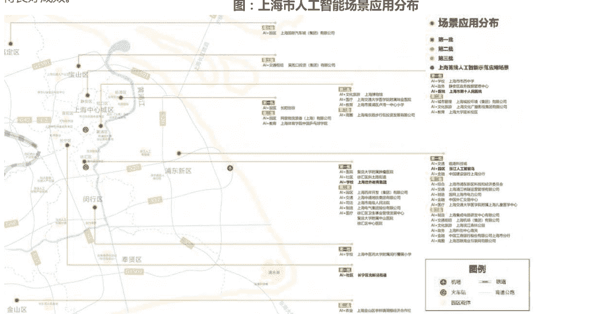

### 政策规划与时俱进

制订《关于支持上海市落实国家战略建设具有国际竞争力的人工智能创新发展高地行动计划》，先后出台《关于本市推动新一代人工智能发展的实施意见》《关于加快推进人工智能高质量发展的实施办法》《关于建设人工智能上海高地构建一流创新生态的行动方案(2019—2021年)》等引导政策和实施方案。成立上海市人工智能产业工作领导小组，由市主要领导联系推动人工智能产业发展。成立上海人工智能战略咨询专家委员会，为上海人工智能顶层规划提供智力支撑。建设全国首个人工智能创新应用先导区、国家新一代人工智能创新发展试验区，加快制度探索突破，为全国树立示范标杆。

### 图：上海市人工智能产业扶持政策

| 日期 | 政策文件 |
|---|---|
| 2020.12 | 《长宁区深入推进新一代人工智能产业融合创新发展的实施办法》 |
| 2020.10 | 《中国（上海）自由贸易试验区临港新片区集聚发展人工智能产业若干政策》 |
| 2019.10 | 《黄浦区关于加快推进新一代人工智能产业融合发展的政策意见》 |
| 2019.9 | 《关于建设人工智能上海高地 构建一流创新生态的行动方案（2019-2021年）》 |
| 2018.9 | 《加快推进上海人工智能高质量发展的实施办法》 |
| 2018.6 | 《长宁区关于加快推进新一代人工智能产业集聚发展的若干政策意见》 |
| 2017.12 | 《徐汇区关于建设人工智能产业集聚区的实施意见》 |
| 2017.12 | 《上海市人工智能创新发展专项支持实施细则》 |
| 2017.11 | 《杨浦区关于促进人工智能和大数据产业发展的若干意见》 |
| 2017.11 | 《关于本市推动新一代人工智能发展的实施意见》 |

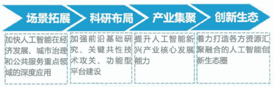

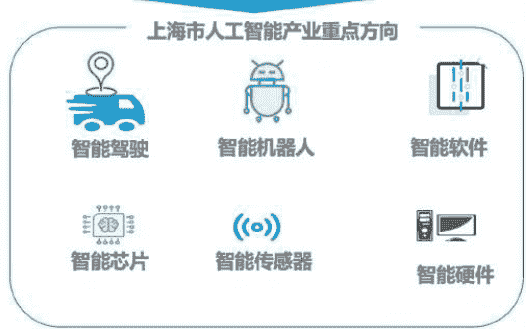

到2030年，上海人工智能总体发展水平进入国际先列；初步建成具有全球影响力的人工智能发展高地；为迈向卓越的全球城市奠定坚实基础。

### 行业资源汇聚融合

上海人工智能产业投资基金成立，完成首轮资金募集，致力于打造各类要素联通、对接、整合的“一站式”平台。澜起、优刻得等领军企业在科创板上市，市值超过千亿元，依图等潜力企业正加快上市进程。上海市人工智能行业协会、全球高校人工智能学术联盟、青年AI科学家联盟等行业组织成立，张江人工智能赋能中心、红杉数字智能产业孵化中心等正式启用，为行业发展凝聚合力，打造服务对接平台。人工智能产业统计体系初步建成，为研判行业发展现状和趋势提供科学支撑。

### 治理体系逐渐形成

成立上海国家新一代人工智能创新发展试验区专家咨询委员会治理工作组、上海市人工智能产业安全专家咨询委员会等，开展人工智能治理和安全政策体系、伦理规范和技术标准研究，积极参与国家标准制定。开展人工智能治理国际交流，借助世界人工智能大会的平台，持续举办法治、安全、治理等论坛，发布《人工智能安全发展上海倡议》《人工智能安全与法治导则》《世界人工智能法治蓝皮书》等报告，在国内外引起广泛关注。探索推进人工智能地方立法工作，瞄准数据安全问题开展人工智能数据安全立法调研，开展可信人工智能研究，探索各类主体协同治理的长效机制。

### 大会品牌初步打响

上海市会同国家有关部门，于2018—2020年成功举办三届世界人工智能大会，致力于打造人工智能的全球名片。习近平为首届世界人工智能大会发来贺信，为推动中国人工智能快速健康发展指明了方向。大会举办3年以来，共吸引1000余位国内外重要嘉宾到会演讲，500余家行业重点企业参与合作，40余万观众参会观展，4亿人次在线观看传播，成为国内人工智能领域最具影响力的专业化、国际化高端平台。大会同上海人工智能产业发展形成循环联动，成为引进产业项目的“会客厅”、展示产业成果的“大舞台”、优化创新生态的“百花园”，为上海构建一流创新生态打下重要基础。

图：世界人工智能大会

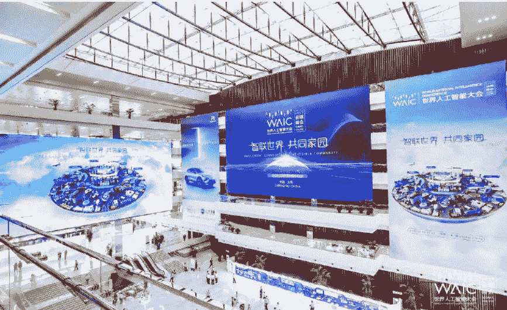

### 国际化高端人才集聚

多位国际知名人工智能人士被上海高校和企业聘为教授和顾问，图灵奖得主姚期智、微软亚洲研究院院长洪小文、商汤科技创始人汤晓鸥等国际顶级人工智能专家落户上海发展。上海人工智能Top100企业的创始人中，近半数获得过国际顶级技术奖项或有过海外学习工作经历，其中1/3为80、90后，形成一个年轻化、知识程度高、拥有创业精神和国际视野的企业家群体。

### 人才培养体系成型

上海11所高校成立人工智能研究院，9所高校设置本科人工智能专业，38所高校开设104个人工智能相关学科专业；2019年招生数为11490人、在校生数为35492人，为人工智能发展储备大量后备人才。加强人工智能领域专业技术人才培养，依托上海交通大学、同济大学建立人工智能平台基地，依托上海仪电控股集团公司、中国科学院计算技术研究所、上海电器科学研究所(集团)有限公司建设人工智能专业继续教育基地。推动高校人才培养，依托大型企业、集团公司、产业园区和行业协会，启动开展人工智能产业领域高技能人才培养基地建设工作。

### 人才政策优化完善

在国内人才引进方面，将上海市人工智能领域纳入人才引进重点支持领域范围，重点用人单位符合条件的核心业务骨干可直接落户。在海外留学人员引进方面，通过留学人员直接落户政策和“浦江人才计划”，对海归人才提供政策和资金支持。创新开展工程系列人工智能专业高级职称认定工作，2020年度共有70人获得正、副高级职称。

### 上海人工智能发展展望

从当前经济社会发展环境来看，人工智能发展面临重大挑战和机遇：一是，在以国内大循环为主体、国内国际双循环相互促进的新发展格局下，面对中美贸易环境持续恶化和高科技领域日趋激烈的竞争，构建以基础硬件和软件为核心的自主产业生态，是当前我国人工智能发展的重要方向。二是，当前人工智能已成为构建现代化数字经济体系，推动经济社会高质量发展的重要驱动力量。随着“十四五”新一轮数字经济发展规划出台，国家正在从智能基础设施打造、数据要素市场建设、数字经济协同治理、数字核心技术突破等领域发力，进一步夯实数字经济发展基础，推动人工智能在数字政府、实体经济转型发展的应用。人工智能发展基础将全面强化，创新深度应用将进一步深化。

在此背景下，《上海市国民经济和社会发展第十四个五年规划和二○三五年远景目标纲要》进一步明确了“建设具有世界影响力的国际数字之都”和“打造世界级人工智能产业集群”的发展目标。全力推动建设融合人工智能、5G、物联网等技术的新型智能基础设施，支撑推动数字产业化和产业数字化发展，大力培育发展在线新经济，全面推动人工智能等技术在城市治理、生活、经济领域的深化应用。重点推动智能芯片、关键算法等核心技术攻关，全面激发企业主体创新活力，构建自主产业生态；继续打造创新型应用场景，推动人工智能应用深化，满足城市经济、生活、治理深层次发展需求；持续扩大人工智能产业规模推进重点企业服务工作，营造一流营商环境，在资本、市场、人才等方面为企业做好协调服务，加快培育一批具有国际竞争力的龙头企业。

在“十四五”期间，上海市人工智能将从“十三五”期间技术突破、产业爆发的阶段，走向深入应用、赋能百业的阶段。人工智能创新体系完善，创新策源能力不断提升，产业核心技术不断突破，形成引领行业的先进技术和可持续创新发展能力；人工智能行业领军企业将不断集聚发展，人工智能自主产业生态将全面形成；城市全面数字化转型驱动人工智能应用深化；人工智能产业规模和影响力进一步提升；以在线智能新经济为代表的人工智能新兴产业，将成为经济社会持续发展的重要新动能。

## 第四章 创新案例集

企业是支撑一个行业的基础，是行业至关重要的组成部分，企业的兴衰成败决定着产业的未来。企业的发展离不开六个基本要素：政策支持、产业基金、人才资源、业务落地、产业氛围和活动宣传。上海人工智能六大要素齐全，全面支撑人工智能企业蓬勃发展。

近年来，上海是人工智能企业的沃土的优势愈发鲜明。众多人工智能企业在上海生根发芽，茁壮成长。上海不仅是人工智能企业的落户首选地之一，凭借着国际化最前沿的优势，全国乃至世界人工智能企业更有优先选择在上海开展业务的趋势。本章挑选了在上海开展人工智能业务的卓越企业案例代表，从基本情况、创新创造、创新动能、应用场景四个方面进行阐述，一展上海人工智能的风采。

### 爱数智慧:数据定义智能

#### 基本情况

北京爱数智慧科技有限公司（以下简称“爱数智慧”）是一家全球领先多模态数据服务提供商，爱数智慧致力于为智能世界提供充足的数据生产力。该公司总部设立在北京，并在香港地区和深圳设立全资子公司，在全国各个省市如上海、广东、四川、山西等地设有数据标注或众包团队。上海作为华东重要标注基地，辐射华东地域的方言数据采集和标注相关业务。

爱数智慧为从事语音识别(ASR)、语音合成(TTS)、自然语言理解(NLP)等AI领域研发与应用研究的企业、科研机构提供专业的数据服务。爱数智慧服务涵盖智慧出行、智能社交、智慧金融、智能家居、智能终端等五大行业，迄今服务了微软、阿里巴巴、腾讯等国内外上百家合作伙伴，业务涉及全球五大洲数十种语言。

#### 创新创造

#### 三大核心产品

##### 对话式AI训练数据集

- 超过150000小时AI训练数据集
  - 包括90000+小时对话式数据、50000+小时朗读式数据、10000+小时自发式数据
- 数据集覆盖超过60种语言
  - 中、英、日等常见语种
  - 泰语、马来语、印尼语等特色语种
  - 四川话、上海话、粤语等八大方言

##### MagicHub.io数据开源社区

- 为行业提供对话式AI训练数据；爱数智慧已在社区开源40多组超过1000小时数据集
  - 包括中英文客服文本语料库、发音词典、语音合成数据、语音识别数据等
  - 语种包括八大方言区数据集，以及意大利语、阿拉伯语等数十种语言
- 社区鼓励数据所有者在社区开源数据集，与开发者共享

##### Annotator® 5.0 智能化标注平台

- 多模态数据标注：平台可配置多模态数据标注任务，支持各类原始数据或部分已标注数据的标注作业，支持对多模态数据的同步或独立标注。
- 灵活配置工作流程：通过自定义的流程化模块，实现对复杂标注工作的灵活拆分及分配。一站式的数据标注和作业管理，实现各种业务类型对流程环节个性化设定。
- 可视化管理：具有丰富的数据管理功能，如可视化检视项目进程、人员管理、数据统计等。
- 辅助智能化标注与质检：平台支持多种标注数据类型的AI辅助标注预识别功能，AI辅助质检和验收功能。

图：Annotator® 5.0 智能化标注平台

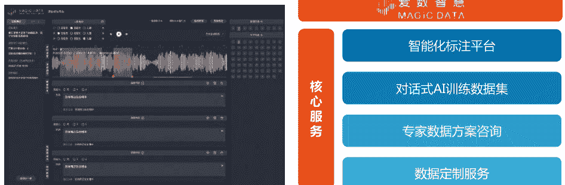

#### 创新动能

爱数智慧采用人机协同等方式开发数据集产品，在确保数据质量的同时，兼顾数据安全、数据多样化和全球化经验等优势：

##### 数据安全，合规性高：

- 平台对数据进行加密并监控整个数据生产流程；由国际四大会计师事务所提供数据安全保护合规服务。
- 数据处理过程遵循《通用数据保护条例》和网络安全法；服务和产品通过ISO27701、ISO9001、ISO27001、CMMI3认证。

##### 数据质量高：

- 该平台遵循严格的项目管理制度，准确率可达到99%；采用人机协同模式，提升标注效率。

##### 数据多元化：

- 爱数智慧提供多模态多场景数据服务；训练数据类型多样，包含对话式、朗读式、自发式，总时长超过150000小时；
- 数据应用场景包括虚拟助手、智能客服、智能驾驶等。

##### 拥有全球化经验：

- 爱数智慧提供60多种语言的数据服务；
- 拥有丰富的海外项目经验，已完成多个跨国项目。

爱数智慧的技术核心为数据结构化，即通过“数据采集—数据清洗—数据分类—数据标注—数据质检—数据筛选”流程后，形成模型可用的结构化数据，并在模型结构上采取2-8数据配比服务：

| 指标 | 100%定制+0%通用 | 20%定制+80%通用 |
|---|---|---|
| 有效时长 | 单个功能需求时长降低 | 单个功能需求时长增长 |
| 投入成本 | 高 | 低 |
| 完成时间 | 耗时长，推慢产品上新速度 | 耗时短，加快产品推陈出新 |
| 合规性 | 合规性差 | 合规性好 |
| 项目质量 | 效率降低，周期长拉低能效 | 效率高，提升能效 |

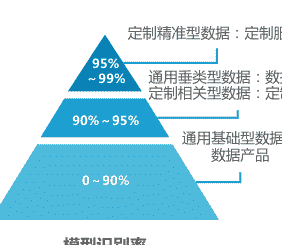

#### 应用场景

#### 爱数智慧 MAGIC DATA 五大行业应用

##### 智慧出行

提供智慧出行数据解决方案，为汽车导航及智能座舱等设备提供对话式AI解决方案；出行客服场景包括智能客服、电话营销、智能质检等；车内场景包括智能座舱和人机交互等

##### 智能社交

赋能短视频等社交智能化制作场景，提供短视频社交平台个性化营销服务、内容识别和过滤、视频营销解决方案等

##### 智慧金融

帮助金融业提升营销和客服的工作效率，实现“千人千面”的个性化客户服务，包括智能客服、智能营销、智能会议、网点多模态交互等场景

##### 智能家居

为智能家居等物联网设备提供语音识别、语义理解、人机交互等产品和技术服务；其具体应用场景包括唤醒模式、异常监控、声纹识别、方言识别等

##### 智能终端

爱数智慧为穿戴设备等智能终端提供智能对话解决方案，打造个性化的智能场景

### 数据库科技：一家引领产融数字化的数据科技公司

### 基本情况

数据库（上海）科技有限公司（以下简称：数据库科技）成立于2009年，长期致力于在金融及产业领域提供基于产业逻辑的智能数据产品及系统服务。数据库科技运用人工智能技术实现了结构化数据的自动化量产及高频实时资讯的快速精准解析，并通过独创的SAM产业链数据框架实现了数据基于产业逻辑的全面串联，形成了高度拟合实体经济运转规律的数据体系。以数据智能全面支撑智能风控、资产管理、投资研究、产业监控、优企追踪、精准营销、智能资讯、量化投资等多维度业务场景。

同时，数据库科技拥有SAM产业链、供应链、企业图谱、新闻舆情等全方位数据流服务，以及银行级对公业务营销、企业舆情监控及风险预警中心、政务级产业大脑、供应链舆情预警、金融机构级内部资讯头条及企业级智能资讯等场景化解决方案，全面赋能金融机构、政府部门及企业的数字化转型。

### 图：数据库科技多场景数据流服务

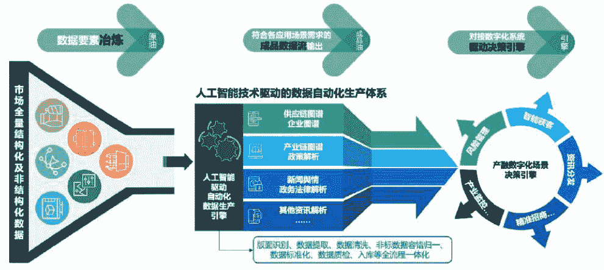

### 创新创造

### 智能文档与资讯分析技术服务平台

- 数据库科技NLP领域的旗舰级资讯标签产品：
  - 从文本中自动提取关键信息并转化为标准化标签，注入数据库规范数据体系
  - 允许客户通过机器自动读取非结构化文本的同时，将核心信息与数据库已有的数字化金融信息深度串联
- 五大技术优势：
  - 支持海量自定义词表的分词系统
  - 特征词消歧模块
  - 关系提取模块
  - 半监督文本分类系统
  - 实体舆情分析系统

### 产业大数据服务平台

- 平台四大内容：
  - 产业细分标准
  - 产业链关系定义
  - 产业节点关联公司
  - 产业资讯、产业政策、产业经济指标等数据关联
- 应用场景举例：
  - 资管领域的产业研究、量化投资
  - 风控领域的行业上下游风险预警
  - 银行对公数字化中的客户产业画像
  - 政务级产业大脑
  - 产业链金融业务的客户挖掘

### 创新动能

### SAM：产业链知识图谱构建技术

数库科技的SAM产业链数据体系将中国大陆、香港地区及美国市场全部上市公司业务分布及产品集披露进行标准化，确保上市公司在业务及产品维度实现高度可比

- 全量工商注册非上市公司累计超过5000万家，实现了全领域的企业覆盖
- SAM产业链每一条产品线与GICS直接对接，将GICS4层产品分布最深扩充至12层
- 拥有超过5000个标准化产品节点，超过70000个上下游产业关系，构成从广义行业到细分产品的动态产业生态网络体系

### SmarTag：智能文本分析算法

运用自然语言处理技术，结合知识图谱，分析实体、文本的舆情，从文本中提取标签、关系等信息并反馈到知识图谱中

- 算法建立以公司、人物、事件、行业、产品、地区等多维度标签体系
- 利用知识图谱，优化算法可控性、可解释性及在长尾数据上的表现
- 知识图谱形成闭环反馈，循环地扩充知识图谱并提升算法性能

### DAS：数据自动化处理系统

一款基于机器学习、深度技术的智能化数据工厂

- 旨在帮助数据部门以批量化形式高效、精准地生产数据
- 可以灵活处理各类文档中的表格与文本信息，并结合数库多年来积累的科目术语将提取的财务科目标准化
- 采用了先进的云原生微服务架构，可以根据处理数据的数据量，弹性的伸缩资源

### 图：DAS

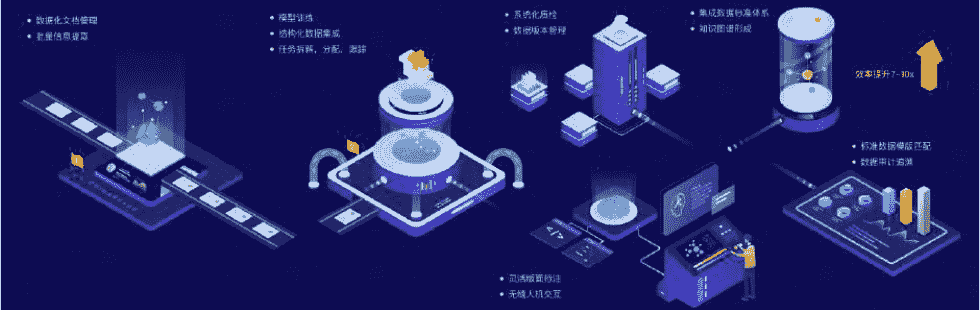

### 应用场景

### 银行对公数字化

### 智能营销中心

围绕区域支柱产业、新兴产业搭建产业全景图，系统呈现区域内企业分层、分类信息。为银行提供产业链、供应链、产业园三大营销获客场景。

### 行业分析中心

通过对行业发展前景、宏观环境、竞争格局、政策舆情、风险画像等进行分析，预判行业发展趋势和资金需求，帮助银行制定产业投放规划，实现精细化运营。

### 风险预警中心

通过捕捉企业舆情、监管处罚、司法诉讼等负面事件，刻画企业风险画像，结合定性定量标签，挖掘优质企业，辨识风险企业，全面提升银行风险防范能力。

### 政务级产业大脑

### 展示产业建设蓝图和建设成果

为监管部门提升产业链竞争力指明方向，作为地方产业建设蓝图和成果展示平台。

### 赋能监管部门数字化监管

借助产业链大脑，快速了解产业链全貌，发现产业链运行风险，为产业调节和服务提供支撑。

### 赋能地方企业服务供需匹配服务

利用人工智能算法，挖掘上下游供应链，为企业提供供需智能匹配服务。

### 精准产业招商

清晰产业招商方向、重点企业和项目，提高招商效率和精准度，完善产业链布局，增强区域产业协同效应，实现强链、补链、稳链建设目标。

### 汉王科技：新一代人工智能档案大数据处理平台

### 基本情况

汉王科技股份有限公司（以下简称“汉王科技”）作为国内AI产业的先行者，始终致力于多领域智能交互技术的研究与应用。自1998年成立以来，公司潜心深耕AI领域20余载，在手写识别、光学字符识别（OCR）、人脸识别、视频智能分析、NLP、人机交互等板块持续取得技术突破。汉王科技积极布局“人脸及生物特征识别”“OCR与大数据”“笔触控与轨迹”“智能终端产品”四大方向，全面开启智能交互时代的大门，有效实现AI技术在各领域的落地应用，以AI技术、产品及解决方案为行业赋能。

汉王科技注重技术的持续创新与应用，近几年来在仿生扑翼飞行器、机器人、嗅觉识别等领域实现从0到1的突破，不断创造技术新物种，实现产品创新主动权从国外到国内的转移。

汉王科技对全球营销网络进行布局与升级，通过主流跨境电商平台及15个独立站搭建全球营销网络，将企业产品在全球范围内进行销售推广。

### 创新创造

- 针对非结构化文本数据，进行实体抽取、关系抽取、属性抽取
- 针对自由书写的字体和老旧档案中的油印、铅印体的字符识别技术
- 复杂版式、复杂表格、复杂字体的识别技术
- 强噪声干扰下的字符识别技术
- 新一代人工智能档案大数据处理平台实现多重创新
- 复杂公章检测及字符识别技术
- 智能检测各类型公章，并识别公章内容
- 针对老旧档案中的各类型复杂签级章、归档章进行智能检测和内容识别
- 利用AI深度学习、模式识别及NLP向政企提供智能图文服务
- 基于云计算架构
- 向政企提供智能图文服务
- 平台集成五大核心，支撑纸质数据形态转换，赋能业务场景与数据价值挖掘
- 平台使用基于微服务的架构模式，支持内网快速私有化部署，为用户构建私有识别云平台
- 全文识别
- 表格识别
- 卡证识别
- 版式识别
- 图像识别
- 平台能力得到增强提升
- >95%手写体识别准确率
- >99%印刷体整体识别率
- 支持多种常见标准卡证票据识别及结构化提取
- 突出展现平台三大优势
- 强大的识别能力
- 先进的云架构
- 场景化的解决方案构建

### 创新动能

新一代人工智能档案大数据处理平台基于全卷积神经网络(FCN)提取特征序列，实现全局特征与局部特征联合，可以较好地解决版式复杂、噪声严重的档案图像的文字定位与检测。该平台采用长短时循环神经网络(LSTM)作为序列学习，嵌入时序特征，有效建模序列内部关系，解决版式复杂、噪声严重的档案图像的单字符切分与识别问题。基于以上技术构建的OCR，全文识别引擎对于任意扫描的档案图像都能够自动定位文字区域，并自动辨认文字类型（手写体或印刷体），然后准确识别文字，输出识别结果，能够在带背景噪声的情况下定位文字区域，综合大量样图实测，平均识别准确率可超过95%。汉王科技OCR技术同时在少民族语言中广泛应用，尤其在满文、藏文等识别方面最为突出，平均识别准确率在98%以上。

### 图：档案数据结构化抽取技术

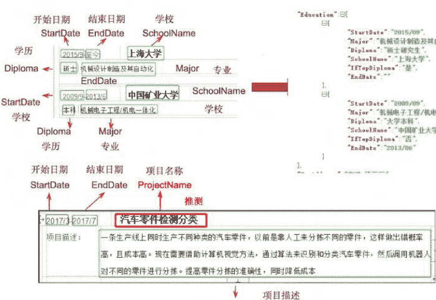

### 应用场景

### 上海市城市建设档案馆档案管理案例：

| 传统方式面临局限性 | 汉王科技对应策略 | 面向未来 |
|---|---|---|
| 千万量级的电子档案大多TIFF图像格式存储（难以识别） | 汉王科技相应推出“智能机器人解决方案” | 在全国档案行业进行方案推广 |
| 非文本化的数据无法适应国家大数据战略的需要 | 通过新一代OCR技术获取高精度的档案全文内容 | 重点涵盖城市建设档案、综合档案、医疗档案等细分领域 |
| 大量电子档案中混杂密级件，对外开放查询后存在严重的泄密隐患 | 利用NLP技术智能分析档案的涉密情况，自动挑选密级件 | 全国档案市场将会是千亿级的规模，前景广阔 |
| | 大幅度提升馆方的档案信息化利用水平，缩短了整个项目的进程，为国家节省大量资金 | |

### 闪马智能：人工智能城市空间智能管理专家

### 基本情况

上海闪马智能科技有限公司（以下简称“闪马智能”）是一家聚焦城市空间管理的人工智能数据中台公司，其以新一代的视频智能分析人工智能核心体系，化所见为所知，看见城市微小异常，预知潜在风险，构建安全、干净、有序、文明、美好的城市空间。

闪马智能通过接入城市摄像头、线上视频资源，结合人工智能视频智能分析算法，实时发现异常事件，实现监控设备利旧赋能、视频资源再利用，并结合多种数据源，把实时分析、历史统计、预测仿真相结合，全方位全维度深入理解城市。闪马智能的愿景为智建未来城市。

### 创新创造

闪马智能充分利用城市已有视频资源，打造城市智能空间管理人工智能中台体系。人工智能中台的三大组成部分即VisionMind、Atom、云边融合三大平台。在三大平台支持下，闪马智能得以完成对城市五大空间的管理应用，进而赋能百态百业。

### 图：平台互动保持算法效果持续稳定

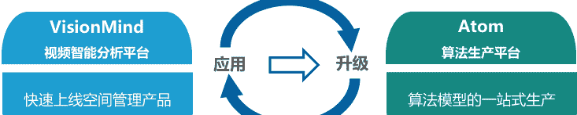

在硬件体系建设方面，闪马智能独创“星云”架构，将“云中心”与“星边缘”智能盒相结合。“云中心”根据全局策略分配边缘区域算力，保障区域效率最优化。“星边缘”负责即时分析，将后续结果汇总上传至“云中心”，使“云中心”得以获取全局数据进行场景长期规律的梳理。“云边一体”保障了即时问题处理和长远规划设计，实现了即时闭环和延时闭环的融合统一。

### 图：智慧出行云边一体管理平台

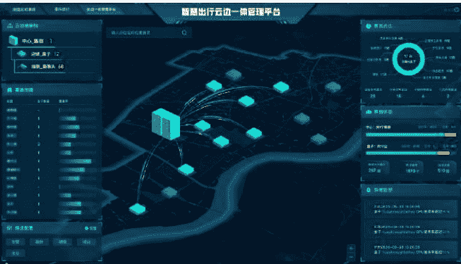

### 创新动能

截至目前闪马智能算法储备数量超过300，获得自主专利、软件著作权30余项，发表数10篇顶级国际人工智能会议论文，在ACM MM LSVC、CVPR、ActivityNet等国际顶级视频分析竞赛中稳居世界前三。

### 图：闪马智能针对城市智能空间管理开发了五线产品

| VisionMind 智慧交通平台 | VisionMind 城市环境治理系统 | VisionMind 大客流管理系统 | VisionMind 岗位管理系统 | VisionMind 互联网内容安全系统 |
|---|---|---|---|---|
| • 智能分析机动车、非机动车违法和交通运行态势等能力 • 视频智能分析与大数据分析相结合 • 针对城市交通、高速公路等不同场景提供对应服务 | • 对渣土车、洒水车、搅拌车、垃圾车、清扫车等特种车辆进行身份识别 • 并就其行为进行监管，将违章发现效率提升3倍以上 | • 对客流量统计、态势分析、翻越围栏、人群聚集等10余种异常行为进行识别和发现 • 系统支持10万级规模客流计数 | • 识别未穿制服、无人值守、打架抽烟等一系列破坏岗位纪律行为 • 改变被动管理模式，进行实时感知上报和服务，并在系统内给出证据源 | • 为网络监管部门、互联网内容平台提供内容审核服务 • 为内容企业提供媒资管理服务。内容审核主要针对图像及视频，通用于各类内容场景 |
| 帮助建立管理闭环体系，协助管理者进行道路运营。 | 帮助实现城市全路网场尘治理。 | 助力管理者掌握区域客流全貌。 | 提升管理效率，减少后续纠纷。 | 释放98%人力，节省下80%综合成本。 |

### 应用场景

- 交通管理

在某一线城市合作，于核心市辖区设置VisionMind智慧交通平台，通过视频资源利旧，将交通管理效率提升100%；通过高精准度的算法感知交通违法行为，提升道路安全水平；将人工视频巡查效率由20%提升至50%，人工成本节约至少50%，将人力应用于更需要的地方。

- 绕城高速公路

在某一线城市，闪马智能为其绕城高速公路提供了一套完整智能解决方案，有效解决路网的运营管理和收费稽核问题。通过及时发现突发交通事件，有效解除道路隐患，避免发生二次事故，并在后续积累长期时空数据，经大数据引擎分析获取准确的道路运行态势规律，为路网规划提供决策依据，保障高速关键路径的通行效率，实现路网信息的精准化服务。此外，在收费稽核方面，检查电子不停车收费系统流水数据，精准发现偷费漏费行为，将原90人日处理的业务量缩减到了3人日。

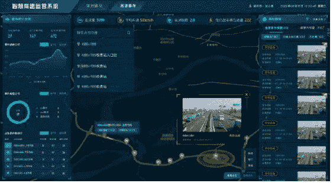

### 西井科技：封闭场景的自动驾驶新物种

### 基本情况

上海西井信息科技有限公司（“西井科技”），致力于以人工智能激活多产业潜能，做全球智能服务业的开疆辟者。

推动大物流和城运是西井科技的重要领域之一，将服务业与智造业的深度融合，从而构建一个高效、经济、安全并具备可拓展的智能化基础生态圈。西井科技采取“技术目标＋市场”双轮驱动的商业模式，已成为与“一带一路”倡议结合最紧密的人工智能企业之一。

- 2016年，进入港口场景，深度耦合场景并提供智慧港口人工智能全局化解决方案。
- 2018年，发布封闭场景的自动驾驶新物种：全时无人驾驶新能源卡车Q-Truck。
- 2021年，Q-Truck助力和记港口泰国的人工智能集卡混行码头项目全面投入运营。

### 创新创造

### 解决传统港口向智能化转型的痛点

- **低成本实现智能化转型**
  Q-Truck无须埋设磁钉或其他物理隔离，可直接与码头有人驾驶集卡一起进行混行作业。
- **车队连续实船作业40h +**
  Q-Truck应用范围更广，改造成本也要低许多，可实现超长时间作业，有效提高生产效率。

### 图：Q-Truck商业化落地车队

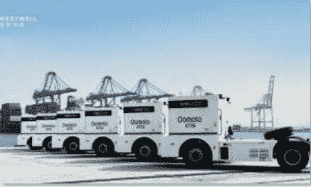

### 全新设计，抢占集装箱卡车“碳中和”新赛道

- **彻底取消了人类驾驶室**
  在车头安装电池和冷却系统，保护核心硬件系统免受于港口作业等复杂工况影响
- **助力港口领域优化能源结构**
  Q-Truck单车碳排放同比减少66%，更加节能高效，帮助港口领域优化能源结构，向绿色化、智能化、无人化迈进。

### 图：Q-Truck在泰国林查班港码头作业

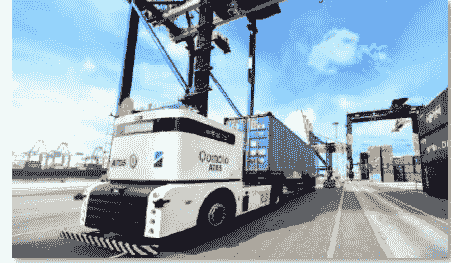

Q-Truck搭载了双目人工智能摄像头、激光雷达，毫米波雷达等多套工业级传感器，同时配备一整套全栈式系统，可输出超高精度的定位和识别功能，实现最高载重80t、续航高达200km。

### 与自动驾驶系统共同服务用户

- 智慧堆场
- 智慧闸口
- 智慧岸桥
- 港区人工智能安防监控系统

在全局化方案中，自动驾驶可以共享同一场景里其他产品所产生的数据。此外，产品还加载“V2X车路协同技术”，全面提升了车基一路基全天候全方位交通态势认知能力，输出精确目标级结果，打造“零碰撞”的优势，大幅提高港区的运输作业效率。

### 创新动能

### 全局化科技赋能，输出作业标准体系

### 按集装箱收费，重新定义港口物流场景

- **以全局化思维助力港口智慧升级**
  
  西井WellOcean（智慧港口解决方案）、WellSecurity（公共智慧安防解决方案）正在使全局化、多场景的AI应用组合创新成为可能。

- **系统始终在实践中不断优化完善**
  
  系统会不断将机器作出的决策与人类的实际操作进行比对和分析，在这种验证过程中不断完善系统和技术标准。

### 图：

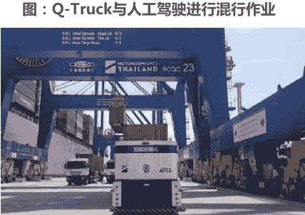

- **从“提供人工智能产品”向“提供人工智能产品服务”转变**
  
  自动驾驶技术的提升带来消费体验的升级，西井科技正是从“提供人工智能产品”向“提供人工智能产品服务”转变，重新优化产业链、创新链的布局，用技术反哺商业价值链。

2021年4月，Q-Truck车队正式入驻中远海运阿布扎比的哈利法港二期码头。西井科技首次开创一种新的商业模式，无人驾驶车辆商业化代运营，实际按集装箱量收费。

- 降低了用户前期的采购资金
- 推进自动驾驶产品实现迅速落地
- 帮助中资企业更好管理海外项目
- 降本增效，提升作业安全

### 应用场景

西井科技一直坚信精准的定位和商业落地，能使人工智能技术可以创造最大化效益。目前，西井科技全局化智慧港口方案已在国内外70余个码头上线。不论是在技术层面，还是业务拓展方面，西井科技一直走在全球港口自动驾驶的前列。

Q-Truck不仅实现了单车智能，更实现了自动驾驶车队的商业落地，并在码头全工况环境下得到验证。2020年4月，新冠肺炎疫情席卷全球，Q-Truck自动驾驶集卡车队也作为国内在疫情下首批出海项目，发运到泰国林查班港码头。经过一年的安全作业，岸边操作效率不断爬坡，成功趋近人工驾驶效率水平并实现稳定，已全面投入商业运营。

Q-Truck在林查班码头上岗以来，经历了东南亚的日晒和暴雨多工况，实施的是真正的无隔离混行车队作业管理，即不出港区，无需磁钉导引等基建改造，也无需划定限行区域，真正与有人驾驶车辆实现人机混行，协同提升整个场景的生产作业效率。2021年，又一批Q-Truck将在阿布扎比哈利法港二期码头和新疆国际陆港商业化运营。

西井科技正通过独特的应用场景理解能力，坚持以人工智能的商业量产运用带动技术自主创新，为终端用户创造更高效并可持续的生产力价值，取智于人，用智予人。

### 眼神科技：专注人工智能生物识别

### 基本情况

上海眼神信息服务有限公司是北京眼神科技有限公司（以下简称“眼神科技”）的子公司，是一家基于人工智能驱动的多模态生物识别原创技术解决方案提供商。眼神科技专注生物识别领域20余年，拥有人脸识别、虹膜识别、指纹识别、指静脉识别等多种自主知识产权核心技术及多模态生物识别融合原创技术，提供超高安全、超强隐私场景中、超大数据底库下快速精准、体验友好的强身份认证解决方案。

眼神科技在全球已有超过2000家客户，业务涵盖了金融、教育、社保、公安、政府、军队以及企事业单位等各个领域，已与全国80%以上的银行机构和超过100所高校达成合作。眼神科技上海子公司以市场为导向，面向华东区全量客户市场进行多行业、多领域布局。

### 创新创造

眼神科技是多模态生物识别融合技术的首倡者，创新性研发多模态生物识别融合算法，具备多模态生物识别能力，并成功打造全球首个多模态生物识别统一平台，实现多场景、多应用、多产品、多种识别技术统一管理，在行业内实现创新引领。

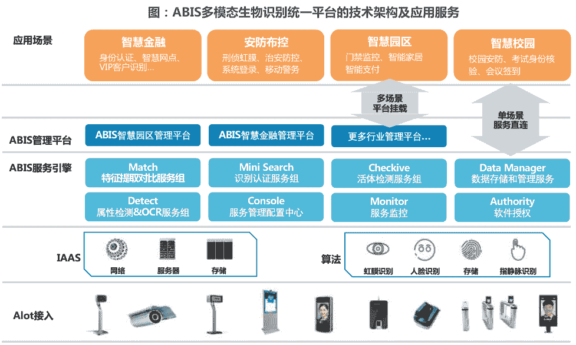

眼神科技自动生物识别系统（ABIS）多模态生物识别统一平台，将指纹、人脸、虹膜、指静脉等多种生物识别技术融合到一个统一、开放、可扩展的身份认证平台，可实现用户身份安全、便捷、精准的认证。该平台依托于眼神科技原创底层算法和数据统一管理，具有多模态数据感知、多维数据推算、智能反馈决策、数据安全共享等核心功能，为各业务场景提供基础服务支撑，实现安全便捷的统一认证和轻量化管理。

### 创新动能

眼神科技致力于研发创新和标准化建设，获得“国家技术发明奖二等奖”，拥有400多项专利技术，目前作为主要撰稿人完成了82项国家/行业/团体标准的制定和修订。眼神科技通过对多模态生物识别融合技术的应用，赋能各行业场景，提供高效、安全、先进的强身份认证安全管理手段。

> 图：面向多领域推出了整体智慧解决方案

### 应用场景

- 金融场景

利用眼神科技多模态生物识别融合技术和产品，依托眼神科技ABIS多模态生物识别统一认证平台，可实现金融客户生物信息的统一管理、数据同步、识别认证等，为多种金融业务场景，如自助银行、柜面业务授权、VIP识别等提供有力支撑，在确保客户信息和账户安全的同时，助力银行降本增效和数字化转型。

眼神科技将指纹、人脸、虹膜、指静脉等生物识别技术在工商银行实现落地，双方在智慧金库、智慧机房、数字园区等领域展开合作，从对内管理到对客业务实现全面创新升级。眼神科技携手民生银行打造了金融行业第一家人脸识别全行级应用，并为民生银行展开多模态生物识别统一认证平台布局，携手智慧网点和智慧园区建设，共同完成了银行智慧化转型的关键环节。

- 智慧公安

以侦查实战需求为引领，眼神科技为广东、广西、河南、海南等20多个省市提供刑侦虹膜系统或采集终端，辅助公安系统进行虹膜数据采集建库，为打击犯罪和社会治安管控提供有力的技术支撑。眼神科技智能识别综合实战平台，集监控、采集、识别、比对、预警和分析于一体，有效提升了贵州某市治安防控智能化水平，在破获各类刑事案件中发挥了重要作用。

> 图：眼神科技刑侦虹膜系统、采集终端

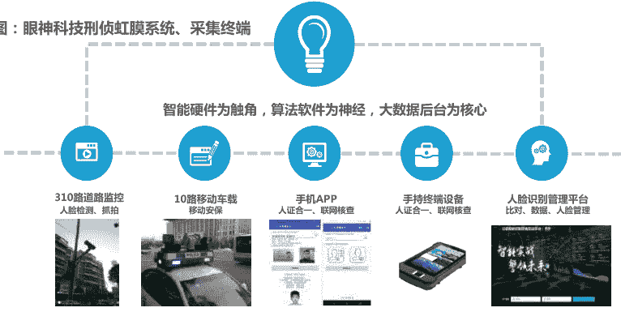

### 影创科技：用混合现实改变生活

### 基本情况

上海影创信息科技有限公司（以下简称“影创科技”）成立于2014年8月，是世界一流的混合现实行业领军企业，主要业务为混合现实、人工智能、半导体领域的基础科学应用技术及产品研发。公司总部位于上海，在青岛、北京、重庆、成都、南昌、南京、开封等多地设有产业基地，实现全产业链布局，构建闭环生态。影创科技致力于用科技提高人们的生产效率，改变人们的生活方式，成为世界第一的混合现实（MR）公司。

### 创新创造

影创科技在混合现实科学技术研究领域以及上、中、下游全产业链均有布局。

#### 半导体领域

在产业链上游，从光学电子设计自动化(EDA)软件设计、高端纳米压印光刻机设计制造到衍射光波导镜片研发生产，影创科技实现了混合现实领域的闭环生态。以纳米压印光刻机为例，该项目涉及光通信芯片、生物芯片、光谱检测、3D传感、生物医疗芯片、可穿戴柔性设备等领域，10年内达万亿级市场。影创科技将建成集成化量产线并提供一站式芯片解决方案，预计2029年营收将达到450亿元。

#### 内容平台建设

影创科技2020年实现VR/AR出货10万台，位居国内VR一体机出货量首位，并成功举办内容生态大会，统一国内VR内容生态开发SDK平台。此外，影创科技是第一批大力践行推广GSXR这一国内最规范、参与厂商最多的标准的企业之一。基于Tesseract SDK开发的应用将直接适配影创科技后续推出的所有MR产品，打破生态壁垒，将碎片化现状向着统一技术标准逐渐进行整合。

#### 智能眼镜

现有产品包括全球首款具备头手6个自由度功能的MR眼镜鸿鹄、全球最轻MR一体机即墨(JIMO)、Action One Pro等多款智能眼镜，得到了用户的充分认可和普遍赞誉。

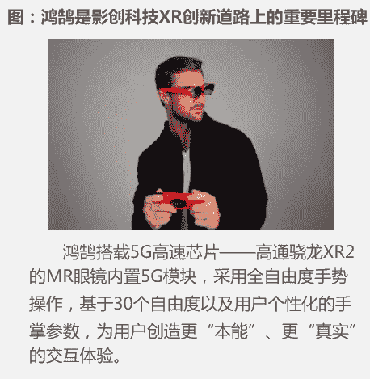

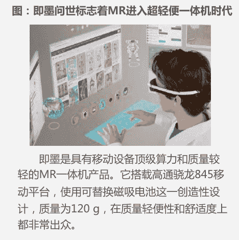

### 创新动能

截至2020年底，影创科技共计申请各项发明、实用新型等专利300余项，在衍射波导镜片、纳米压印设备、硅基液晶(LCoS)设计、人工智能算法等领域获得技术突破。

影创科技在2016年成立了量子机器学习实验室，主要从事人工智能技术的研究，2019年实验室被正式授牌“浦东新区企业博士后科研工作站”，在国际知名期刊发表论文3篇；与复旦大学微电子学院建立复旦—影创光芯片联合研究中心，强强联合共同开发国产光学芯片EDA软件；与上海第二工业大学建立数字孪生联合实验室。

> 图：影创科技在人工智能领域拥有多项领先成果

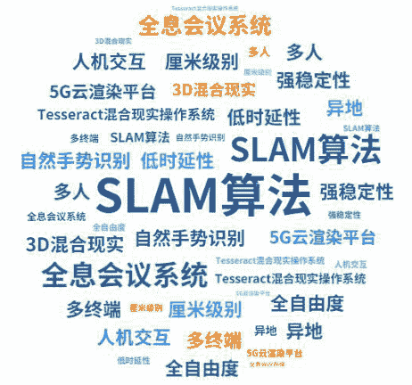

### 应用场景

#### 教育

- 与多所高校合作，进行虚拟/混合现实的研发落地。
- 携手合作伙伴为中国数百所重点中学和知名高校分别打造“5G+MR”全息教室和创新性实验室。
- 与近百所职业院校建立产学研基地，参与“1+X”专业教材的编写与制订。

#### 体育竞技

- 正式启动“元力崛起” MR 真人竞技馆项目。该项目响应国家号召的“全民健身”国策，通过混合现实、人工智能等高新技术手段，实现轻松娱乐中达到锻炼身体、提升反应力的效果。
- 得到各地体育、文旅等部门的大力支持。

#### 医疗

- 通过CT、核磁共振等原始数据三维重建、整合立体全息场景，高精度地还原患者真实的解剖和病变部位，为临床医生制定精准的治疗方案提供依据。
- 已在常州、昆明等地实施数十台 MR辅助手术，未来将进一步将 MR技术深入运用，助力智慧医疗长远建设与发展，并积极推进MR辅助诊疗进入医保目录。

#### 工业

- 长期与众多工业企业客户探索高端制造数字化升级，并针对远程协助和工业培训打造平台级产品。
- MR远程协助平台融合音视频通讯技术及MR技术，可实现多人异地的音视频通话，多终端共享视角；同时融合了MR技术，可实现3D全息内容辅助展示及空间标注等。
- 面向各类需要即时远程通讯的场景，包括但不限于操作指引、疑难处理、排障、巡检等传统的工业应用场景，以及专家会议、小型论坛、小型培训等广义的多领域应用场景。

#### 文旅

- 联合下游解决方案伙伴，在四川、山东、湖南、北京、上海、重庆等地落地项目，并与国家数字图书馆、国家文物局等单位开展长期战略合作，打造文旅平台。
- 面向普通游客和景区管理人员提供MR技术服务支持。可实现快速配置和辅助展示，满足不同客户需求。并为游客提供全息导航、虚拟导游、智能讲解、3D内容互动、全息演艺等新奇体验，同时间接打造超强 IP，带动区域经济活力。

### 氪信科技：让企业服务变得更聪明

### 基本情况

上海氪信信息技术有限公司（以下简称“氪信”）成立于2015年，通过将AI技术与行业经验相结合，致力于成为产业数字化转型过程中值得信任的智能合作伙伴。基于自主研发的行业数字化转型解决方案，氪信为企业打造端到端的智能决策系统，集成前沿AI算法的轻量级应用组件，从数据科学及应用层面助力金融、保险、物流等行业加速数字化转型。

### 创新创造

非或然引擎是氪信技术成果的核心体现，定位为企业级智能引擎系统平台。

> 图：非或然引擎组件

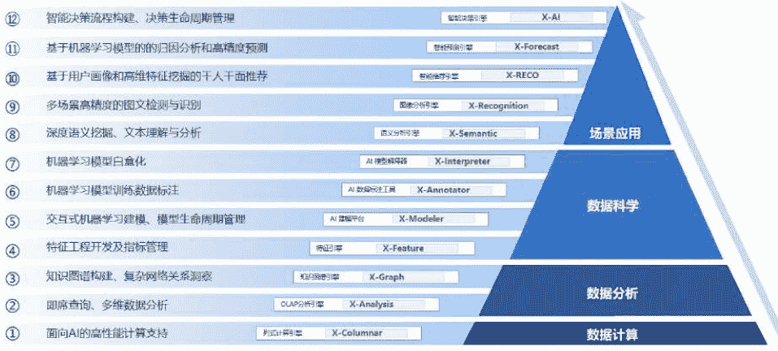

非或然引擎具备超大规模数据计算能力及亚毫秒级响应能力，300ms可处理8亿条行为数据。应用集群属性使得非或然引擎具有模块化、松耦合、轻量级、高性能等特点，可有效结合大规模图计算、时序数据分析及组合优化，高效处理异形结构数据。

> 图：提供系统承载级别的智能服务平台产品方案

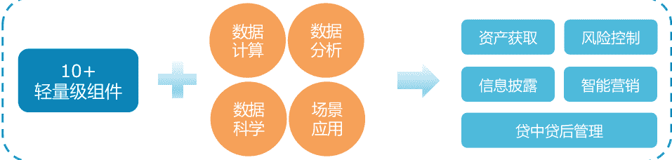

该引擎全面支持从特征管理、规则编辑、模型执行、决策流定义到服务封装的各个环节，具备强大的准实时监控和预警功能，帮助企业形成完整的业务生命周期管理闭环。

### 创新动能

图计算技术赋能行业数据洞悉能力。氪信大规模图计算技术被应用于各类数据关联性分析场景，为银行打开从“关系”角度去洞察问题的视角，并满足银行对于大规模数据量实时分析的需求。

成果获专利及权威学术机构认可。基于人工智能技术的非或然智能引擎系统为客户提供超越IBM统计产品与服务解决方案功能与服务的智能金融决策系统，学术成果发布于顶级学术会议并获专利。2020年，非或然引擎获得中国计算机学会颁发的“CCF科学技术奖科技进步杰出奖”，以及中国人工智能学会授予的“吴文俊人工智能科技进步奖”等奖项。

模块化程度高，适用场景灵活。非或然引擎以应用集群形态呈现，具有模块化、松耦合、轻量级、高性能等创新特点，既可单独部署、敏捷组合，又可实现统一的服务治理。

沉淀业务精华，拓宽应用边界。氪信将头部银行的创新探索经验沉淀于非或然引擎中，形成内置特征库，在“下沉”至垂直领域的应用中起到了领先实践推广作用。

### 应用场景

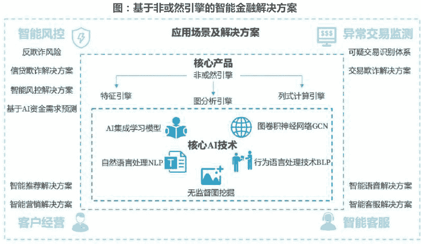

- 金融场景

助力金融机构数字化转型升级，以智能技术促成“开源节流”愿景实现。氪信为某头部城商行构建的自动化监控运营体系，具备规模化复制的能力；机器学习引擎可实现端到端毫秒级响应和风险模型全生命周期的管理优化，帮助银行构建智能化实时决策能力。

- 物流场景

与斑马来拓共同建设数字化智能物流中台，实现每日上万回单实时审核。氪信联合斑马来拓基于OCR和NLP等AI技术，建设数字化智能物流中台，打造自动审核回单、智能筛选最优运力模式，助力企业实现标准化运营，提高供应链效率和用户体验。

### 魔视智能：开启汽车的人工智能大脑

### 基本情况

魔视智能科技（上海）有限公司（以下简称“魔视智能”）是整合人工智能算法技术与先进芯片，提供汽车智能化产品和方案的创新科技公司。公司总部位于上海张江，并在澳大利亚设有人工智能研究中心，深圳设有研发和业务及客户支持中心，苏州设有研发及测试中心，南通设有制造基地。

魔视智能研发了领先的自动驾驶算法及其硬件系统，积累了“泊车 + 行车”“舱内 + 舱外”“前视 + 环视盲区”“标准 + 定制”的全栈式算法及跨芯片平台工程能力。魔视智能依照汽车工程标准，将优化的人工智能计算引擎高效运行在多种核心芯片平台，在精确的环境感知和车辆定位基础上，将视觉和多种传感器融合，整合路径规划和车辆控制，实现不同等级的自动驾驶。

魔视智能开发和制造包括自动泊车、代客泊车、自动紧急制动(AEB)/自适应巡航(ACC)/车道保持辅助(LKA)、交通拥堵辅助(TJA)及“L2.5 + 智能驾驶”在内的多种汽车智能系统。魔视智能持续致力于整合先进的人工智能技术和汽车电子系统成功经验，打通传统汽车智能化的技术鸿沟，开启汽车的人工智能大脑。

### 创新创造

魔视智能已经发展成为满足L1-L4级别的全栈式自动驾驶感知及决策量产产品供应商。

> 图：全栈式自动驾驶解决方案

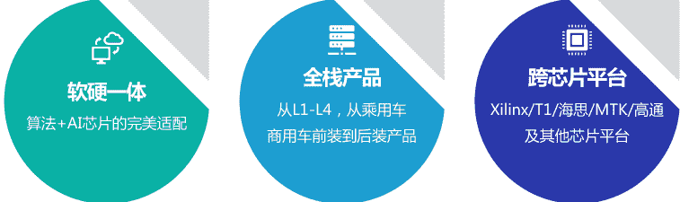

产品完整涵盖L1-L4级别自动驾驶，包括前视高级驾驶辅助系统（预警功能）、AEB等L2级产品、自动泊车、代客泊车、拥堵自动驾驶、港区园区L4级自动驾驶。未来产品将涉及L4级别Robo-Taxi及干线物流。魔视智能核心技术包括以视觉为主的车外交通和车内智能环境感知、多传感器融合（视觉/雷达/超声等）、高精度的车辆定位等技术和能力。

> 图：魔视智能三大核心支柱产品线

| 类型 | 前装商用车 | 前装乘用车 | 后装主动安全系统和车载人工智能边缘计算 |
|---|---|---|---|
| 主要产品 | ◆ 单目前视一体机及雷达融合系统 | ◆ 乘用车自主泊车/自动泊车/交通拥堵辅助 | ◆ 魔盾多路盲区主动安全系统 ◆ 全栈式人工智能算法 |

魔视智能已量产产品包括整机系统、主机核心板和算力芯片。

### 创新动能

#### 国际领先的自主知识产权的深度学习算法

- 视觉检测识别算法。魔视智能采用独立开发的拥有自主知识产权的深度学习算法，基于深度学习的实例分割技术实时分析视频中的不同语义信息，实时感知车辆周围环境信息，同时还可以精准获取每个目标的像素级轮廓等几何信息。
- 多视角场景下的目标识别与跟踪算法。在多视角场景下，利用算法先将不同的视频进行去畸变处理，并完成图像的拼接、图像对比度、画质调节，完成多个单视场角场景下的目标识别与跟踪的融合。
- 多传感器融合算法。将传感器信息与视觉信息进行融合，通过相互校验和冗余，使得感知系统具有更高鲁棒性和安全性。

#### 复杂算法低功耗嵌入式实现

- 深入研究芯片级的深度学习嵌入式实现技术，将复杂的人工智能算法利用车规级FPGA芯片实现，形成了自主的深度学习计算引擎。量产产品整体功耗低于7W，在-40 ~ 85°C环境下，可7×24h正常工作。

#### 深度优化的摄像机成像效果

- 在现有摄像机基础上，通过在FPGA内嵌单独的ISP模块，并对ISP进行大量优化工作，实现了夜间弱光条件下的目标识别，同时通过对多帧图像处理，实现强光、逆光环境下的目标准确识别。

#### 成熟的车规产品前装量产经验

- 前视高级驾驶辅助系统产品已成功实现乘用车及商用车的前装量产，为后续自动泊车产品的前装量产提供了成功的产品化、工程化经验。

### 应用场景

魔视智能开创的第5代自动泊车系统通过视觉与超声波雷达融合，不仅可以完美解决无障碍物参照无法判断车位位置的问题，同时通过国际领先的深度学习算法，还可以精确识别各类车位线及停车标识、地锁、障碍物等，实现对各类停车位及停车障碍物的智能判断。

> 图：自动泊车示意图

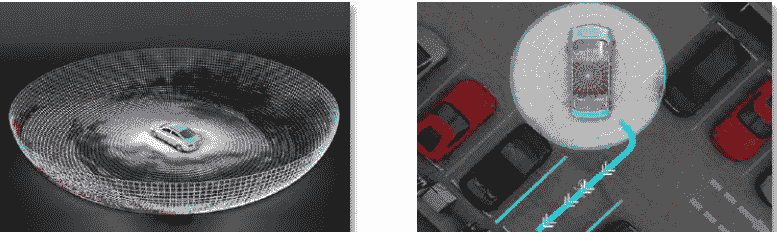

魔视智能的智能泊车系统自2019年10月推出后，迅速获得了一线乘用主机厂的关注和认可，2020年此方案已在吉利汽车、奇瑞汽车、广汽集团、北汽新能源等一线主机厂的车型上量产。

### 深擎科技：企业财经内容个性化服务提供商

### 基本情况

宁波深擎信息科技有限公司（以下简称“深擎科技”）成立于2018年，是一家聚焦企业财经内容及个性化服务的科技创业公司。公司通过提升内容价值密度、提高人与内容连接效率，为券商、银行等金融机构提供从内容生产、加工、分发到触达运营全流程解决方案；帮助其激活存量客户，提升用户体验，促进交易转化。

深擎科技在自然语言处理、个性化推荐、机器学习、知识图谱等领域具有卓越的研发能力。公司成立3年来，获得AAA企业资信等级评价、“上海市高新技术企业”称号、ISO9001质量管理体系及ISO27001信息安全管理体系认证，并成功通过中国证券监督管理委员会信息技术系统服务机构备案。

- 70% 与国内70%以上大中型券商达成合作
- 90% 客户复购率超90%
- 28 拥有28项软件著作权
- 16 申请16项发明专利

### 创新创造

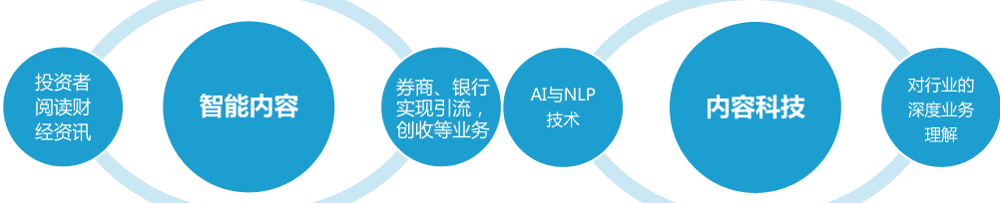

深擎科技围绕“智能内容”这条主线打造产品和服务矩阵。并将行业的深度业务理解与AI技术结合，运用咨询运营能力输出，帮助客户迅速拉齐与行业头部企业的认知差距。

> 图：深擎内内容科技服务能力矩阵

| 拉新 | 促活 | 转化 |
|---|---|---|
| 内容触达 | APP对接、API服务、H5开发、小程序开发、企业微信运营 | |

**内容矩阵**
- 官方媒体
- 自媒体
- 投教
- 专题
- 推送
- 基金
- 产业链
- 付费内容
- 定制内容

**内容引流**
- 企业获客
- KOL获客

**内容促活**
- 信息流推荐
- 热点推送
- 内容标签

**内容导流**
- 内容引导基金
- 内容引导功能

**内容创收**
- 付费产品
- 增值产品

**运营服务**
- 官方媒体
- 自媒体
- 投教
- 专题
- 推送
- 基金
- 产业链
- 付费内容
- 定制内容

**内容科技**
- 风火轮
- 白羽扇
- 孕云箭
- 七星刀

### 创新动能

| 技术创新 | 模式创新 |
|---|---|
| "AI+Teleservice+Online" 实现创新突破 - 自研DeepQ数据集成框架，完成数据特征的加工 - 利用深擎科技专业的算法能力和标注工具的智能化、运营标注人员的专业化以及组织协作管理的体系化，搭建了算法快速迭代优化的机制 - 积累大量的基于内容场景的算法模型和NLP能力 - 通过自研高性能缓存技术低延时高并发的响应 | "机器+人工" 双审核，提供更优质资讯和服务 - 市场痛点：中国财经资讯存在大量重复、过时、敏感甚至虚假内容，让普通股民难以辨析 - 高价值财经资讯解决方案：   - “机器+人工”双重审核   - 个性化推荐引擎   - 金融客户端APP精准推送 |

> 图："AI+T+O" 技术体系

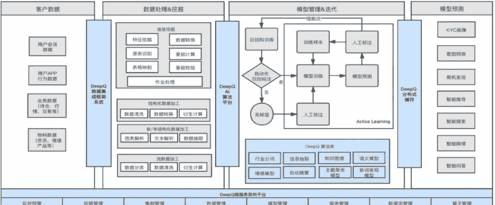

### 应用场景

#### "风火轮" 方案构成

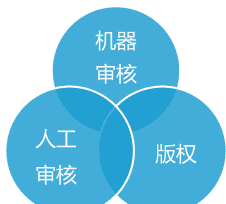

完整的媒体版权授权资质，灵活搭配版权组合包，确保新增版权可实时上线

#### "风火轮" 技术实现

专业的证审审核团队，完整的审核服务规范，有保障的端到端的审核效率和服务

卓越的数据时效性和技术可扩展性，在数据采集、智能标签、合规检测、数据分发等环节技术体系成熟

#### "风火轮" 业务实现

**3000**
高产量。每交易日为客户提供原创资讯3000余篇

**<3min**
高时效。资讯时效从小时级大幅提速到3min以内

**4倍**
广范围。资讯的个股覆盖范围迅速提高4倍

**3~10倍**
精准推送。热点消息推送打开率实现3~10倍显著提升

### 燧原科技:人工智能领域云端算力平台

### 基本情况

上海燧原科技有限公司（以下简称“燧原科技”）成立于2018年3月，总部设立在上海临港新片区，分别在上海和北京设有研发中心，同时在深圳设有技术支持团队。燧原科技专注人工智能领域云端算力平台，致力为人工智能产业发展提供普惠的基础设施解决方案，提供自主知识产权的高算力、高能效比以及可编程的通用人工智能训练和推理产品。

燧原科技坚持“做大芯片，拼硬科技”，聚焦互联网、垂直行业（金融、交通、医疗等）以及高性能计算(HPC)和公有云三大领域，持续技术创新和产品迭代，推出具有竞争力的产品，从而赢得客户和市场。

### 创新创造

伴随着人工智能应用和落地场景迅速扩大的发展趋势，燧原科技为市场提供了自主研发的云端人工智能训练和推理两款加速产品。

#### 云燧T10

- 云端数据中心人工智能训练解决方案对通用性和能耗比有很高的要求，必须具有高算力、低功耗、强互联，并支持多种训练算法。燧原科技基于自主研发的人工智能训练芯片澄思打造的云燧T10是一款面向云端数据中心的人工智能训练加速卡，双槽位标准卡，支持PCIe4.0。其独特的25GB双向背板互联方案有别于业内通用的无限带宽组网，在相同的网络带宽下，较大幅度降低组网的复杂度和成本。单卡单精度(FP32)算力达到20TFLOPS，支持单精度FP32和半精度BF16的混合精度计算。
- 燧原科技为云燧T10适配了计算及编程平台“驭算”，支持主流深度学习框架，提供完整的编译、调试、调优工具链，并在硬件层开放软件开发工具包，为深度开发者提供细粒度算力编程接口。针对复杂模型集群训练，如BERT等，提供分布式调度系统，并针对智能互联技术进行优化。

#### 云燧i10

- 云端人工智能推理解决方案既注重综合指标，包括算力、时延、成本等，也更为关注用户体验的优化。燧原科技首款人工智能推理产品云燧i10是一款面向云端数据中心的高性能推理加速卡，单槽位标准卡，支持PCIe4.0，FP32算力达到17.6TFLOPS，BF16/FP16算力达70.4TFLOPS。
- 针对云燧i10，燧原科技推出了高性能神经网络模型推理引擎“鉴算 TopInference”，通过计算图优化、算子融合、模型压缩、量化等优化技术，可以为深度学习应用提供低延迟、高吞吐率的推理性能。通过“鉴算 TopInference”的推理加速，配合云燧i10的高算力及虚拟化技术，数据中心可以高性价比地部署计算密集型深度学习工作负载。此外，“鉴算 TopInference”通过开发神经网络交换通用模型格式支持包括TensorFlow、PyTorch等模型，借助燧原通用计算单元和全域计算架构的可编程性，可以应对未来深度神经网络日益多样化、复杂的增长趋势。

### 燧原科技:人工智能领域云端算力平台

### 创新动能

#### 01. 完全自主研发的芯片架构，国内领先的云端人工智能算力方案。

完全自主研发的芯片架构，国内领先的云端人工智能算力方案。燧原科技坚持全流程自主研发的产品战略，在芯片架构、指令集、核心功能模块、软件栈与编程模型等关键技术领域积极进行全覆盖专利布局，已获批40余项国家发明专利，另有20余项正在申报过程中，持续夯实国际技术领先优势。区别于人工智能算力领域主流的GPU架构，燧原科技采用了全新完全自研的异构计算架构，具有灵活通用、高可编程性、高性能、高能效和高扩展性等特点，也规避了潜在的知识产权风险，为业界提供了低迁移成本的可行替代方案。在一些重点领域，如视频处理、物体识别、姿态识别等场景下提供了性能更优的方案。

#### 02. 契合人工智能发展趋势，为超大模型提供集群方案。

契合人工智能发展趋势，为超大模型提供集群方案。燧原科技云端系列加速卡的高速互联端口可提供算力扩展能力，并支持多类型的拓扑结构以面向不同的应用场景需求。燧原科技深度优化的聚合通信库ECCL和“弘算TopsMatrix”分布式软件平台，可支持千卡规模的异构算力集群，并达到业界领先的线性加速比。

#### 03. 可适配国内开发生态及国产框架，针对安全需求提供国产化方案。

可适配国内开发生态及国产框架，针对安全需求提供国产化方案。遵照系统芯片独立自主的软硬件架构，可以更好地适配国内开发生态和国产框架。针对安全需求高的行业和场景，燧原科技可结合产业链合作伙伴提供国产化方案，在高安全性、供应链稳定、易运维、持续竞争力升级等多方面提供优质方案。

#### 04. 灵活的商务合作模式，针对战略场景提供最优化方案。

灵活的商务合作模式，针对战略场景提供最优化方案。燧原科技提供灵活的商务合作模式，可为战略合作伙伴提供定制优化和联合开发产品，并联合产业链下游合作伙伴为行业客户提供一体化完整解决方案，切实降低行业客户的学习成本和运维成本，加速行业智能化、城市智能化的发展进程。

### 应用场景

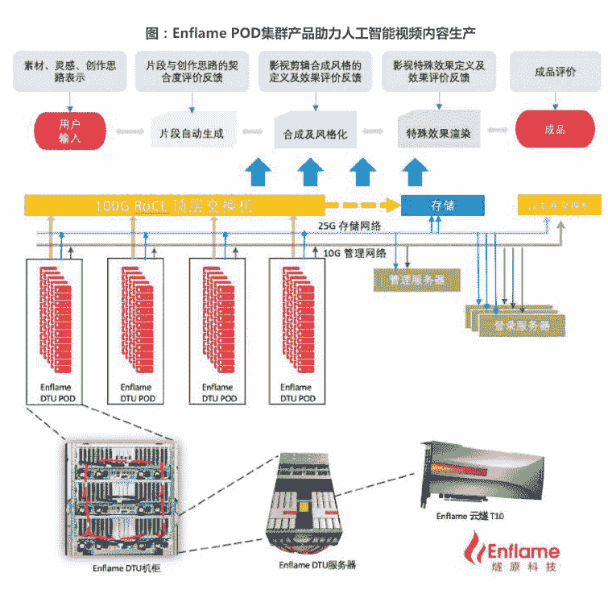

燧原科技可为客户构建国内最大规模的基于FP32高精度的自主创新算力集群，燧原科技独创的智能互联技术为集群实现高加速比提供了保障。例如，该技术使大规模集群具备处理海量多媒体素材生成高清视频的能力。人工智能将直接通过逻辑脚本，并自动创建视频，这将大大改变内容的生产方式，推动短视频行业、电影行业的创新，具备极大的经济价值。

该案例具有以下优点：

1. NLP相关技术积累可以应用到智能文本分类、文本信息抽取、商品评价解析、合同理解等场景，覆盖客服、零售、金融、保险、电商等行业。
2. 语音合成的积累可以应用到智能客服、有声阅读、新闻播报等场景，覆盖智能电器、互联网娱乐、客服等行业。
3. 基于图像或视频的内容生成，可以在短视频制作、游戏素材生产、广告素材生产等场景产生价值，在短视频、游戏、广播电视等行业有巨大的市场。

### 芯驰科技:视频数据治理赋能城市精细化管理

### 基本情况

上海芯型智能科技有限公司（以下简称“芯型科技”）针对视频数据治理和赋能管理的刚性需求，推出了视频全要素治理平台，面向公安、城运、企事业单位用户，满足视频数据全要素治理和统一赋能管理需求，是助力公共安全防范、企业安全生产以及城市精细化治理的一体化、智能化、专业化视觉中枢平台。

### 创新创造

三层能力贯彻芯型科技领域：视频治理打造数据闭环；视频人工智能分析提供不断丰富和进化的人工智能能力；行业解决方案则针对用户需求，为用户提供一站式服务：

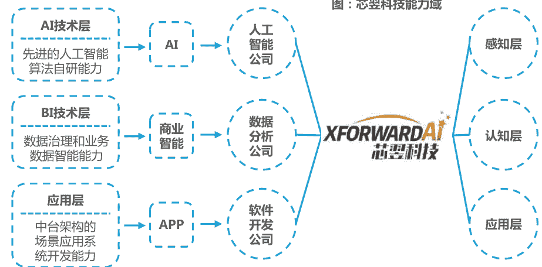

图：芯型科技能力域

图：视频全要素治理平台七大能力中心

七大能力中心构建芯型视频全要素治理平台

视频全要素治理平台

打造平台三大核心能力

- 01 全量视频汇聚
  构筑全业务体系视频支撑基础，实现视频精准查询和快速调阅

- 02 全域权限管理
  创建一体化全域视频权限体系，实现权限横向打通和纵向管理

- 03 算法生态构建
  打造可持续智能视觉计算生态，实现异构算法算力的融合发展

### 芯驰科技:视频数据治理赋能城市精细化管理

### 创新动能

#### 感知智能化和事件自动识别
以物联感知数据为基础，探索群体性事件和突发性事件的自动感知，以及根据事件发生影响范围和严重程度的自动研判，推荐处置预案，辅助决策

#### 事件处置闭环智能提速
打通事件处置流转环节，形成各部门对于事件的闭环（采集—确认—分派—处置—反馈—归档—分析）处置，自动推送到智能终端，全流程透明

#### 城市级态势感知和研判
对城市的实有人口、车辆、房屋、交通、治安事件等要素进行采集和态势分析，从宏观层面，理清各要素规模及潜在数据关联，进而辅助城市资源投放规划决策

### 应用场景

#### 智慧城市领域

- 视频全要素治理平台参与了上海市正在推进的“一网统管”建设，通过对视频数据的整合与调用：
  - ✓ 实现视频监控资源全网共享、全时可用、全程可控
  - ✓ 制定视频数据结构化应用场景和处理规则
  - ✓ 强化视频治理和数据智能，加速城市精细化管理视频数据底盘的建设
  - ✓ 为城市治理视频相关业务提供准确、实时的支撑以及更多赋能型视频技术支撑

#### 安全保障领域

- 芯驰科技承担了2020年第三届中国国际进口博览会现场安保指挥部的视频相关系统保障工作
  - ✓ 视频全要素治理平台也首次在进博会安保工作中应用，视频指挥智能应用体系、视频立体联动体系及人工智能生态体系为核心，聚焦视频的“看”和“算”，以其强大的精准调阅和计算调度能力，积极助力进博会安全保障工作

#### 工业互联网领域

- 视频全要素治理平台助力上港集团洋山港四期的自动化无人港口的建设
  - ✓ 视频全要素治理平台能够对港口全量视频资源进行整合，并结合港口实际业务需求，提供集装箱堆场通道人员安全管控、港口桥吊安全作业、港口安全生产的视频智能化应用赋能支撑

### 雪浪云:未来工厂大脑

### 基本情况

雪浪数刺（上海）科技有限公司(以下简称“雪浪云”)是无锡雪浪数刺科技有限公司子公司，致力于建设国家级工业互联网平台，打造“工厂大脑”，为工业企业提供跨行业、跨地域和全生命周期的数据智能服务。

雪浪云的信息技术(IT)、数据技术(DT)与操作技术(OT)国内领先，构建以“数据大脑为核心、软硬协同为框架、人机协同为模式”的新工业技术体系，打造雪浪OS数字制造中枢系统，为高端装备与制造、化工、煤炭等行业提供数字化转型咨询及工厂大脑解决方案。雪浪云服务了中铁工程装备集团有限公司、中国铁建重工集团股份有限公司、石化盛科信息技术有限责任公司等上百家龙头企业。

信息技术：数据大脑为核心；数据技术：软硬协同为框架；操作技术：人机协同为模式。
核心系统：打造雪浪OS数字制造中枢系统。
输出目标：为行业提供数字化转型咨询及工厂大脑解决方案。

### 创新创造

#### 雪浪云工业互联网平台的解决方案：“4+1+X”模式

##### 4：雪浪OS数字制造中枢系统

| 项目 | 描述 |
|---|---|
| 数据中枢—雪浪虎符 | 一站式“人机料法环”多态数据开发与资产化管理 |
| 计算中枢—雪浪算盘 | 统一的计算底层，联通工业机理组件、人工智能组件、边缘计算组件等 |
| 人工智能中枢—雪浪河图 | 工业人工智能工具与行业机理工具箱 |
| 总线中枢—雪浪共工 | 统一的工业数字总线 |

##### 1：雪浪数字驾驶舱

| 级别 | 描述 |
|---|---|
| 现场级/车间级/企业级 | 面向不同层级的运营管理诉求(现场级/车间级/企业级)，协同不同层级的软硬件系统，进行业务流智能编排，实现智能优化与调度总控。 |

##### X：不同场景下的数字化应用

| 场景 | 描述 |
|---|---|
| 现场级/车间级/企业级 | 所谓现场级是在生产现场层面，比如视觉、听觉领域的数字化能力以及视觉瑕疵检验应用;车间级则是以车间为单位，针对车间内各个环节协同提供解决方案;企业级是工厂整个生产制作过程能源管控和能效优化。 |

### 雪浪云:未来工厂大脑

### 创新动能

雪浪算盘采用雪浪云团队首创自研的全混合流计算技术，获得了2018年世界物联网博览会银奖。

### 雪浪算盘优势

- 通过可视化信息流编排和可交互节点操作实现数字孪生、智能化调度与决策
- 通过多语言软件开发工具包和跨平台虚拟化容器技术，实现多网络、多协议的异构组件接入
- 通过分布式资源调度，多队列异步优化和自动全局状态对齐实现海量数据的强一致性流计算
- 通过语言实现非因果建模、数据转换中间层、静态类型检查和有状态流计算

### 雪浪算盘打造数字孪生体系

- 装备制造数字孪生：以发动机为例，通过组件工具和算盘联合构建数字样机，接入实时数据计算，并且实时形成数据资产，伴随设备提供各类应用。
- 流程化工数字孪生：算盘实时优化框架能够在生产负荷、原料属性等发生变化时，在目标函数和操作约束的基础上寻优生产过程关键变量设定值，从而实现降本增效。
- 产线数字孪生：构建仿真三维生产场景，同时接入实时数据以推演、验证未来生产计划的可行性。提高仿真准确性，解决在实际生产中，由于工艺复杂而导致的排产计划无法实施的问题。
- 企业经营数字孪生：通过算盘重塑企业经营过程，解决传统流程孤立、分析片面、难以提前发现风险与规避损失的经营问题。

### 应用场景

实时优化RTO平台基于云平台引擎支撑系统，赋能我国流程制造业的高质量发展

**数据接口组件**
支持多种通信协议和数据类型接入，平台数据总线为各个功能组件提供准确数据

**稳态检测组件**
通过判断当前工况是否处于稳态区间，以用于后续优化计算

**优化引擎组件**
通过目标函数定制和优化算法参数配置，实现优化算法，通过模型和计算资源高效部署

**优化算法组件**
提供单/多目标即插即用优化算法组件，实现多样化的求解方法与高效求解效率

**模型管理组件**
支持机理模型和数据模型的接入与管理，支持模型并行计算，极大提高求解效率

**OPC服务组件**
为其他RTO系统提供数据，实现横向协同；与生产控制、经营管理类软件互联，实现纵向协同

图：双良智慧空冷管控平台

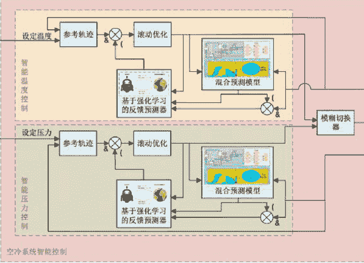

#### 电厂控制数字孪生（双良空冷案例）：

- 利用有限元数字孪生预测模型实现了高精度的稳定工况预测
- 基于传热机理的模型实现大范围工况突变精准预测
- 边缘计算端实现多执行器分布式实时同步控制输出
- 输出冷端最优的运行方案，节省燃煤，增大能效

### 容智信息：数字化生产力提供商

### 基本情况

上海容智信息技术有限公司（以下简称“容智信息”）成立于2016年，专注于利用AI Digital Workforce（人工智能数字生产力），通过数字生产力，重构商业价值，为政府级、企业级用户打造数字化孪生组织，提供变革性的智能自动化解决方案，提升组织生产力和效率，释放员工创造力。

历时5年的产品打磨和迭代，容智目前已发展成为一家国内领先的数字生产力综合服务商，并拥有国内唯一一个智能自动化全生命周期产品——“iDiscover+iBot”产品系列。系列打造了智能自动化全生命周期的产品矩阵，已为腾讯、宝洁、宜家、华泰证券、中粮、中国铁塔、飞利浦、欧姆龙、国家电网、中国电信、中国联通、一汽大众、海尔等等数百家世界500强、央企、政府单位提供了数字化员工解决方案，助力组织在财税、人力资源、采购、物流、供应链、营销等场景实现数字化智能化转型，从技术到方法论，构建数字化新生态。

2020年，容智信息步入商业落地高速成长期，获得数千万元A轮融资。容智信息总部位于上海，目前已建立覆盖主要省会、一线城市的销售和服务支持体系，直销覆盖上海，北京，广州，深圳，西安，无锡，武汉等城市，代理商和生态合作伙伴体系覆盖大陆、港澳台地区，并在无锡建立了全国最大的数字化生产力研发中心、培训中心和交付中心。

### 创新创造

#### 图：容智信息助力企业数字化转型

企业数字化转型面临多重挑战

容智信息基于人工智能数字生产力在企业级用户的应用

| 系统 | 数据 | 业务 |
|---|---|---|
| 降低用工成本 | 提升工作效率 | 减少重复操作的错误及合规安全问题 |

#### iBot——零代码，和搭乐高一样简单易用的RPA产品

#### iDiscover——如何开始自动化？先用流程挖掘做个“核磁共振”

**部署安全**  
以非侵入、弱耦合形式实现跨系统、跨平台本地化部署，完成重复性工作

**架构完善**  
iBot 核心流程引擎完全自主开发，自主可控，流程可视化，监控，运维和管理模块完善

**AI模块强大**  
包含了OCR、NLP及深度学习等技术，帮助企业的流程治理逐步实现智能化

**安全防护**  
拥有四层安全架构：身份验证、访问权限、会话管理、系统加密；以及支持从执行步骤、流程、机器人、服务器等四层安全夹层机制

**兼容性高**  
支持各种应用类型、各种企业级业务系统，包括Windows、Mac X、Linux/UOS、MobileHub

**简单灵活**  
“零”代码，可视化拖拽式，简单易用；外挂式部署可根据业务流程适时调整参数，适应业务变化

- **自动发现业务流程**
- **一致性检查**
- **绩效改善**
- **流程再造**
- **识别RPA机会**
- **流程发现与RPA平台一体化高**
- **处理KPI报告**
- **RPA流程优化**

### 容智信息：数字化生产力提供商

### 创新动能

作为国家高新技术企业，容智信息拥有30余项软件著作权及专利，核心团队来自微软、IBM、Intel、Dell、HP等世界500强企业。

伴随着智能自动化技术在国内高速发展，容智信息“iBot + iDiscover”数字员工在智能自动化技术的基础之上融合了自主开发的人工智能模块，使“iBot + iDiscover”数字员工能够处理更加复杂的业务场景，部署方式越来越灵活，服务越来越智能，促使人工智能数字生产力商业落地更为精准。

人工智能模块包含了OCR、NLP及深度学习等技术，帮助企业的流程治理逐步实现智能化、便捷化，对企业的降本增效起到越来越重要的作用，使人工智能技术创造更多效益。

### 应用场景

容智信息为长江存储科技有限公司（以下简称“长江存储”）提供了“iBot + iDiscover”数字员工解决方案。通过引进数字化生产力来缓解人员不足和工作负荷过重的问题，为企业财务部实现了七大业务流程的智能自动化：采购发票批量处理、费控发票识别、销项开票、进项认证、进口认证、出口退税、银企对账。

- 全年释放人力3600人
- 整体工作效率提升32倍
- 准确率100%

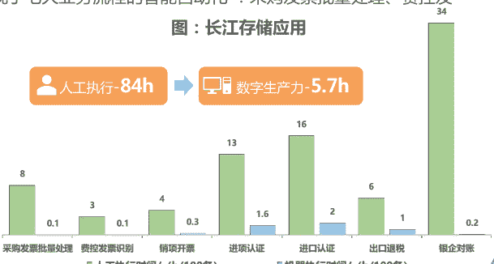

容智信息为华泰证券提供了金融领域数字员工解决方案，方案实现了文本上传打印、交易所保证金调整、分项资金处理、月结算单批量查询、银行回单下载与浪潮数据匹配核对、开票处理、开票信息维护、银企对账等业务流程的智能自动化。

- 全年释放人力4320人
- 整体工作效率提升36倍
- 准确率100%

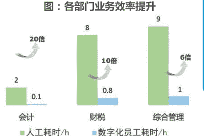

### 强联智创：全球领先的脑卒中智能诊疗平台

### 基本情况

近年来，随着脑血管病的患病率逐步攀升，全国目前有超5000万高危人群面临脑血管疾病问题，脑血管病的精准诊断和治疗决策的评估需求巨大。脑卒中是典型脑血管病，具有高发病率、高致残率、高死亡率和高复发率的特点。为了更好地预防脑卒中，由强医（上海）科技有限公司（以下简称“强联智创”）打造的U-Pixel™脑卒中智能诊疗平台，围绕脑卒中领域临床上的治疗痛点，打造全方位的智能诊疗平台，帮助医生解决临床痛点。强联智创作为中国首家从脑血管病治疗痛点切入的高科技公司，产品研发已经近5年的积累，全面领跑中国脑血管病智能诊疗的垂直领域。

### 创新创造

- UKnow®智能动脉瘤稳定性评估
  - 采用最新的图像处理及人工智能技术，精细还原脑血管三维结构，自动测量动脉瘤的10多个形态学参数
  - 更加精确，完美呈现动脉瘤形态
  - 个性化评估每位患者的动脉瘤当前的稳定性状态

图：智能动脉瘤稳定性评估

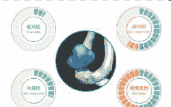

- UKnow®手术模拟分析（微导管栓塞手术）
  - 采用强联智创自主研发的智能微导管模拟算法，精确模拟微导管在血管内的螺旋行进路线，自动计算出最优的微导管三维头端形状
  - 自动计算出塑形针的三维形态学形状及相应的量化指标
  - 最大程度缩短手术时间，降低术者和患者的辐射风险

图：智能微导管模拟

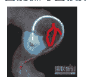

- UKnow®手术模拟分析（密网支架手术）
  - 采用强联智创自主研发的智能血流导向装置模拟算法，自动计算动脉瘤周边区域的各血管参数，匹配合适直径和长度的密网支架型号
  - 可全面分析血管各截面的形态，提前模拟支架在三维血管中的释放效果，为颅内动脉瘤介入手术提供精确的术前方案及手术效果模拟

- UKnow®动脉瘤动态监测
  - 采用最新的图像处理及人工智能技术，对随访前后的两期影像进行精确配准和三维血管还原，全方位精细分析动脉瘤和载瘤动脉的三维形态学变化
  - 灵敏捕捉动脉瘤的尺寸变化或生长方向变化，通过定量化分析随访前后的影像数据，辅助医生进一步判断动脉瘤的破裂风险，选择最佳手术时机

- U-Pixel™脑卒中智能诊疗平台
  - 囊括脑卒中出血、缺血两大模块，并同时覆盖了筛查、诊断、治疗、随访全诊疗流程。平台同时具备个人计算机端和移动端，方便使用者随时随地使用
  - 医生通过使用该平台可快速准确为患者进行临床决策，大大节省诊疗的时间，提升诊疗精确度

### 强联智创：全球领先的脑卒中智能诊疗平台

### 创新动能

图：强联智创深刻理解并熟知行业及临床需求

- 百余家三甲医院长期战略合作
- 北京宣武医院
- 北京天坛医院
- 上海华山医院
- 上海长海医院
- ......

强联智创的核心研发管理团队来自清华大学、美国弗吉尼亚大学等世界知名高校，深耕医疗影像技术和图像人工智能算法10余年，并在多项国际顶级医疗人工智能大赛中数次荣获一等奖。公司的研发团队拥有世界级的人工智能及算法科学家，以及成功的医疗产品开发及食品药品监督管理局认证经验。通过人工智能底层算法逻辑重建，将影像及临床信息结合，通过数据的综合训练，实现了临床辅助诊疗的多个功能模块，结合脑卒中患病的阶段特征，开发了两大系列的多个产品，为临床诊疗提供技术支持。

### 应用场景

U-Pixel™脑卒中智能诊疗平台从治疗的痛点切入，并向前延展到诊断和筛查端、向后延展到患者随访端，目前的产品线已经覆盖出血性和缺血性脑卒中多个病种的全诊疗流程的智能辅助。

图：强联智创提供覆盖脑卒中诊疗全流程的智能化解决方案

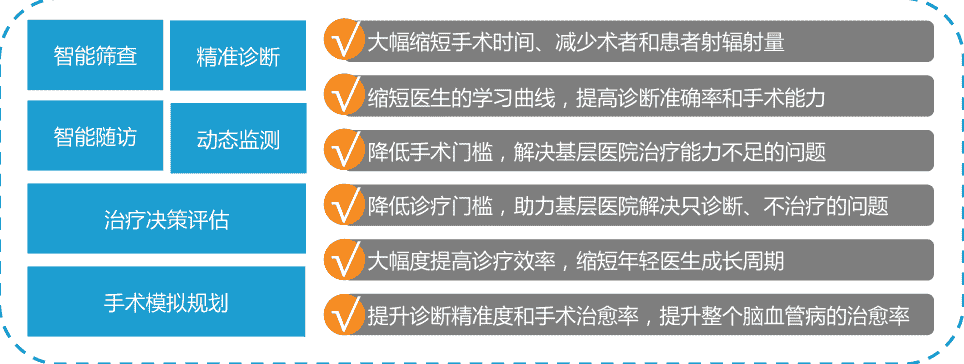

强联智创已与多家医院签订脑卒中智能诊疗服务协议，U-Pixel™脑卒中智能诊疗平台将为我国脑卒中领域的诊治能力的提升，发挥不可估量的社会效益和经济效益。

## 附录：案例单位名单

### 创新篇

- 上海交通大学
- 同济大学
- 复旦大学
- 百度（中国）有限公司
- 华院数据技术（上海）有限公司
- 上海电器科学研究所（集团）有限公司
- 上海观安信息技术股份有限公司
- 上海联影智能医疗科技有限公司
- 上海明晧人工智能（集团）有限公司
- 上海仪电人工智能创新院有限公司
- 上海数据交易中心有限公司
- 建信金融科技有限责任公司
- 上海幻电信息科技有限公司

### 特别篇

- 上海依图网络科技有限公司
- 上海皓彬科技股份有限公司
- 上海联影智能医疗科技有限公司
- 上海跃米机器人股份有限公司
- 竹间智能科技（上海）有限公司
- 上海智臻智能网络科技股份有限公司
- 上海云扩信息科技有限公司
- WAYZ维智科技
- 星环信息科技（上海）股份有限公司
- 松鼠课堂人工智能科技有限公司

### 产业篇

- 上海天数智芯半导体有限公司
- 上海复旦微电子集团股份有限公司
- 黑芝麻智能科技（上海）有限公司
- 上海奥视达智能科技有限公司
- 上海数迹智能科技有限公司
- 上海翰动浩翔航空科技有限公司
- 博雷顿科技有限公司
- 中交通信大数据（上海）科技有限公司
- 上海富数科技有限公司
- 虎博网络技术（上海）有限公司
- 上海建工四建集团有限公司
- 上海晶赞融宣科技有限公司
- 上海齐耀螺杆机械有限公司
- 上海画龙信息科技有限公司
- 达疆网络科技（上海）有限公司
- 复旦大学附属妇产科医院
- 上海龙慧医疗科技有限公司
- 上海森亿医疗科技有限公司
- 上海市影像医学研究所、复旦大学附属中山医院
- 上海宝藤生物医药科技股份有限公司
- 什维新智医疗科技（上海）有限公司
- 华为技术有限公司
- 深兰科技（上海）有限公司
- 上海智驾汽车科技有限公司
- 掌门教育
- 上海交通大学
- 上海同禾工程科技股份有限公司

### 场景篇

- 上海商汤智能科技有限公司
- 张江集团
- 上海百联商业互联网有限公司
- 上海南京路步行街投资发展有限公司
- 上海集成电路研发中心有限公司
- 中国工商银行
- 上海国际汽车城（集团）有限公司
- 上海市公共卫生临床中心
- 长宁区人民政府北新泾街道办事处
- 上海世外智慧教育科技有限公司
- 上海科创中心海关
- 视辰信息科技（上海）有限公司

### 企业篇

- 上海闪马智能科技有限公司
- 上海西井信息科技有限公司
- 上海眼神信息服务有限公司
- 上海影创信息科技有限公司
- 上海氪信信息技术有限公司
- 魔视智能科技（上海）有限公司
- 上海深擎信息科技有限公司
- 上海燧原科技有限公司
- 上海芯塑智能科技有限公司
- 雪浪数制（上海）科技有限公司
- 汉王科技股份有限公司
- 北京爱数智慧科技有限公司
- 上海容智信息技术有限公司
- 数库（上海）科技有限公司
- 强医（上海）科技有限公司

## 后记 APPENDIX

本案例集归纳总结了“十三五”期间上海如何立足国际视野、加强系统布局，着力发挥数据资源丰富、应用领域广泛、产业门类齐全的优势，将人工智能作为重点布局发展的三大产业之一，建设人工智能“上海高地”。本案例集旨在为人工智能相关从业者、关注者了解和把握上海人工智能发展态势、参与人工智能“上海高地”建设、推动我国新一代人工智能 健康发展提供有益参考。

在本书的编写过程中，上海市经济和信息化发展研究中心为素材征集提供了重要支持，上海人工智能研究院有限公司、上海智慧城市发展研究院、亿欧EqualOcean、今日人工智能编辑部等团队负责各版块的具体编撰，各个企业、机构为本书提供了宝贵的案例素材，在此一并致谢。

因篇幅有限，本电子版报告仅节选了出版物的部分章节，完整版出版物还包括高校创新平台、产业赋能中心、集成应用中心、核心智能硬件、智能机器人、无人系统、上海人工智能代表性应用场景等丰富案例。如需完整出版物，请通过上海交通大学出版社官方渠道获取。

## 版权声明

本报告所采用的数据均来自合规渠道，分析逻辑基于智库的专业理解，清晰准确地反映了作者的研究观点。本报告仅在相关法律许可的情况下发放，并仅为提供信息而发放，概不构成任何广告。在任何情况下，本报告中的信息或所表述的意见均不构成对任何人的投资建议。本报告的信息来源于已公开的资料，亿欧智库对该等信息的准确性、完整性或可靠性作尽可能的获取但不作任何保证。

本报告版权归亿欧智库所有，欢迎因研究需要引用本报告部分内容，引用时需注明出处为“亿欧智库”。对于未注明来源的引用、盗用、篡改以及其他侵犯亿欧智库著作权的商业行为，亿欧智库将保留追究其法律责任的权利。

## 关于亿欧

亿欧EqualOcean是一家专注科技+产业+投资的信息平台和智库；成立于2014年2月，总部位于北京，在上海、深圳、南京、纽约有分公司。亿欧EqualOcean立足中国、影响全球，用户/客户覆盖超过50个国家或地区。

亿欧EqualOcean旗下的产品和服务包括：信息平台亿欧网（iyiou.com）、亿欧国际站（EqualOcean.com），研究和咨询服务亿欧智库（EqualOcean Intelligence），产业和投融资数据产品亿欧数据（EqualOcean Data）；行业垂直子公司亿欧大健康（EqualOcean Healthcare）和亿欧汽车（EqualOcean Auto）等。

基于对中国科技、产业和投资的深刻理解，同时凭借国际化视角和高度，亿欧EqualOcean为中外客户提供行业研究、投资分析、创新咨询、数据产品、品牌公关、国际化落地等服务。已经服务过的客户包括华为、阿里集团、腾讯公司、Intel、美团、SAP、拼多多、京东健康、恒大集团、贝壳找房、GSK、富士康、上汽集团、蔚来汽车、一汽解放等。

## 亿欧服务

### 创业公司

亿欧EqualOcean旗下的亿欧网和亿欧国际站是创业创新领域的知名信息平台，是各类VC机构、产业基金、创业者和政府产业部门重点关注的平台。创业公司被亿欧网和亿欧国际站报道后，能获得巨大的品牌曝光，有利于降低融资过程中的解释成本；同时，对于吸引上下游合作伙伴及招募人才有积极作用。对于优质的创业公司，还可以作为案例纳入亿欧智库的相关报告，树立权威的行业地位。

### 大型企业

凭借对科技+产业+投资的深刻理解，亿欧EqualOcean除了为一些大型企业提供品牌服务外，更多地基于自身的研究能力和第三方视角，为大型企业提供行业研究、用户研究、投资分析和创新咨询等服务。同时，亿欧EqualOcean有实时更新的产业数据库和广泛的链接能力，能为大型企业进行产品落地和布局生态提供支持。

### 政府机构

针对政府类客户，亿欧EqualOcean提供四类服务：一是针对政府重点关注的领域提供产业情报，梳理特定产业在国内外的动态和前沿趋势，为相关政府领导提供智库外脑。二是根据政府的要求，组织相关产业的代表性企业和政府机构沟通交流，探讨合作机会；三是针对政府机构和旗下的产业园区，提供有针对性的产业培训，提升行业认知、提高招商和服务域内企业的水平；四是辅助政府机构做产业规划。

### 机构投资者

亿欧EqualOcean除了有强大的分析师团队外，另外有一个超过15000名专家的资源库；能为机构投资者提供专家咨询、和标的调研服务，减少投资过程中的信息不对称，做出正确的投资决策。

欢迎合作需求方联系我们，一起携手进步；电话 010-57293241，邮箱 hezuo@iyiou.com

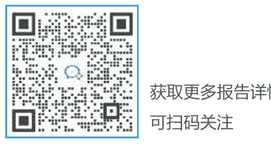

网址：https://www.yiyou.com/research
邮箱：hezuo@yiyou.com
电话：010-57293241
地址：北京市朝阳区霞光里9号中电发展大厦A座10层

