# 【亿欧智库深度】AI加速键：解码2021上海人工智能创新版图与实践样本

## 引言

INTRODUCTION

近几年来，算法、算力与数据三大核心要素协同发力，叠加应用场景的强力牵引，人工智能已成功跨越技术理论探索期，全面步入产业化落地阶段。它如同渗透剂般深入工业、农业、医疗、金融等各个毛细血管，重构传统行业范式，催生全新业态模式，成为推动产业转型升级的核心引擎，加速将人类社会从信息时代推向以智能技术为关键支撑的智能社会新纪元。

越来越多国家将AI视为引领未来、驱动新一轮科技与产业革命的“战略制高点”。中国于2017年发布《新一代人工智能发展规划》，按下发展快进键。上海更是将其列为三大先导产业之首，在基础研究、产业集聚、场景开放、政策供给、人才集育五大维度全方位发力，誓要打造人工智能“上海高地”。在推进城市数字化转型的宏大叙事中，上海紧扣超大城市治理现代化需求，推动AI深度嵌入产业经济、民生福祉、城市治理三大主战场，赋能城市能级跃迁。

2021年伊始“十四五”开局，为复盘上海AI产业发展成果与赋能城市数字化转型的实战经验，展望未来五年发展图景，在上海市经信委指导下，上海市人工智能行业协会牵头，联合上海市经信发展研究中心、上海人工智能研究院、上海智慧城市发展研究院、亿欧EqualOcean及今日人工智能编辑部等多方力量，汇聚企业一线案例，联合编撰《AI加速键：上海人工智能创新发展探索与实践案例集》。本书以翔实案例为骨架，从底层创新、产业落地、场景应用等多维度全景式呈现上海AI产业发展图谱。

本电子版经上海交通大学出版社授权，精选核心章节发布于亿欧平台，完整版请通过社官方渠道获取。

## 第一章 全球人工智能发展全景扫描与趋势研判

当下，全球AI竞争白热化，技术突破高频涌现，产业化进程大幅提速，技术与千行百业的融合渗透日益深度，助力传统产业实现跨越式跃升。本章将从技术迭代、政策博弈、企业版图、资本流向、学术产出五大维度，拆解国际AI发展脉络与未来走向。

### 技术突破引领变革，智能社会进程提速

自2016年以来，随着人类对AI认知的觉醒，行业完成了从实验室走向产线的关键跨越，渗透路径不断延伸，重塑行业逻辑、孵化新兴业态、赋能产业升级，智能社会进程按下加速键。

近年，AI核心技术迎来全谱系爆发，深度学习新范式层出不穷。在云计算、大数据、芯片等底座支撑下，技术正从“感知智能”向“认知智能”进阶，抢占新一轮科技革命制高点。即便在2020年疫情冲击下，创新步伐未曾停歇：OpenAI推出GPT-3震撼NLP界；AlphaFold2攻克蛋白质折叠难题；深度势能分子动力学斩获戈登·贝尔奖……算法、算力体系、科学研究、行业应用等多个战场均传捷报。展望未来，AI算力将成为智能时代核心动能，算力中心升级为关键新基建；多元场景与增量数据持续涌现，算法模型与算力的协同创新，将助力人类应对后疫情时代的不确定性，释放更大价值。

**图：2020全球十大突破性技术盘点**
- 年初 Google与Facebook双巨头同推无监督表征学习新算法
- 05月 OpenAI发布预训练语言模型GPT-3 / 美国贝勒医学院动态颅内电刺激实现“视皮层打印”
- 07月 康奈尔大学提出无偏公平排序模型缓解马太效应
- 10月 DeepMind深度神经网络求解薛定谔方程推进量子化学 / 清华首提类脑计算完备性体系 / MIT仅用19类脑神经元实现自动驾驶控制
- 11月 AlphaFold2破解蛋白预测 / 深度势能分子动力学摘戈登·贝尔奖
- 12月 北大首创基于相变存储器的神经网络高速训练系统
*来源：Ofweek人工智能网、亿欧智库*

### 全球布局各有侧重，竞争格局初定

随着深度学习在智能驾驶、智慧金融、智能制造等垂直领域落地生根，AI已成各国争夺科技主导权的战略性技术。全球竞争版图清晰：**中美“双强”领跑第一梯队，日本、英国、法国等发达国家组成第二梯队紧随其后。**

2016年以来，美、英、德、日、韩、俄及欧盟密集出台战略规划，顶层设计护航落地：
- **美国**：死守算法、芯片、脑科学等前沿高地，持续加码投入，巩固技术霸权。
- **欧盟**：聚焦伦理治理与标准制定，在技术监管赛道谋求话语权。
- **俄罗斯**：侧重高新技术研发与实战应用，剑指全球领先。
- **英国**：政策、资金、人才、国际合作四管齐下，支撑全域应用。
- **德国**：以“AI+工业4.0”铸就“德国造”品牌，推动经民生双落地。
- **日本**：国家战略+产业化路线图双轮驱动，倡导构建“AI-Ready社会”。
- **韩国**：上升为国家战略，誓要跻身“AI强国”行列。

**图：2016-2020主要经济体AI政策发布时间轴**
| 年份 | 关键政策节点 |
| :--- | :--- |
| 2016 | 美《国家AI研发战略》、欧《AI立法动议》、英《机器人与AI》 |
| 2017 | 英《AI：未来决策影响与机遇》、法《法国AI战略》、美《AI与国家安全》等、日《新一代AI推进战略/产业化路线图/技术战略》、新《国家AI战略》 |
| 2018 | 美《AI生态系统重要性》、英《AI行业新政/发展规划》、欧《欧盟AI/伦理准则/通讯》、德《联邦政府AI战略要点》、法《AI政策文件》 |
| 2019 | 美《美国AI倡议》、欧《可信AI伦理准则》、印/西/挪/俄/芬《国家AI战略》、韩《AI研发战略》 |
| 2020 | 美《巩固AI领导地位：研发规划》、欧《AI白皮书》、俄《多领域AI应用路线图》 |
*来源：各国政府官网、德勤研究、亿欧智库整理*

### 规模化应用提速，产业生态成型

全球AI产业热度持续攀升，2020年规模达1565亿美元，同比增12.3%。产业链视角下，企业聚焦“AI+垂直领域”，商业应用（营销/客户管理）、医疗健康、金融成三大主战场。产品端，智能机器人占比8.06%领跑，智能驾驶与硬件紧随其后；技术端，计算机视觉占比12.07%居首，NLP次之（8.94%）。头部企业加速底层技术与应用实践双重布局，规模经济效应显现。

**图：全球AI企业技术产品领域分布** *来源：中国信通院《2020全球AI产业地图》、亿欧智库*

### 资本回归理性，优质资产受青睐

2020年全球AI初创企业融资额约650亿美元，涉及3600+笔交易。经历2017-2018年“爆发期”后，融资笔数与新增企业数连年收缩，2020年新增企业仅为前年36%，创业窗口期基本关闭，行业进入技术、资本、产品积累深厚的成熟期。

**融资结构显著后移**：2020年B轮及以上占比62.3%，同比增超40%；种子/天使轮比重持续萎缩，早期融资难度加大，资本流向有规模、有验证的成熟玩家。虽热度降温，但优质标的估值坚挺，资本趋于冷静理性，猎捕细分领域“隐形冠军”，独角兽持续涌现，生态呈现良性循环。

**图：2015-2020全球AI投融资规模与新增企业数** 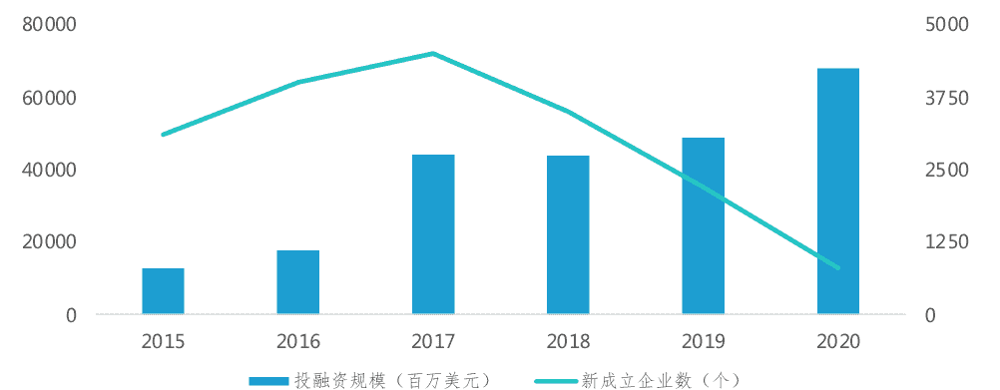 *来源：斯坦福《AI Index 2021》、亿欧智库*
**图：2015-2020全球融资轮次分布演变** 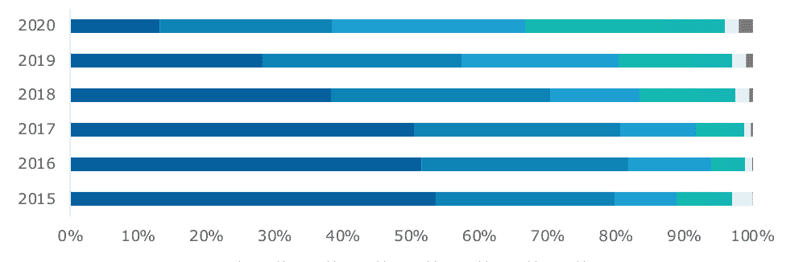 *来源：中国信通院《2020全球AI产业地图》、亿欧智库*

### 中美双强领跑，科研创新领衔全球

**企业量级碾压**：2020年美企2257家（38.29%）居首，中企1454家（24.67%）次席，两国合计超半数。前十国家排名四年不动如山，俄虽升温难撼大局。

**图：2020全球AI国家企业数量占比** 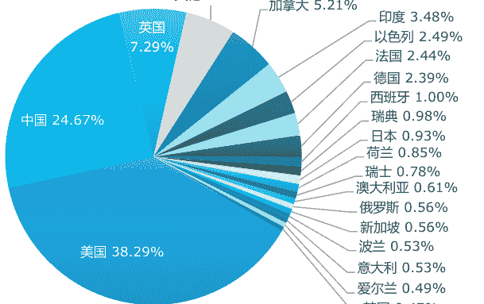 *来源：中国信通院、亿欧智库*

**科研产出称霸**：2020年全球AI期刊论文增34.5%。中国发文占比18%登顶，美（12.3%）、欧（8.6%）次之；被引占比20.7%首超美（19.8%）。专利端中美垄断格局更甚：中国申请量占全球74.7%，为美（第二位）的8.2倍。

**图：2015-2020全球AI期刊论文与专利统计** 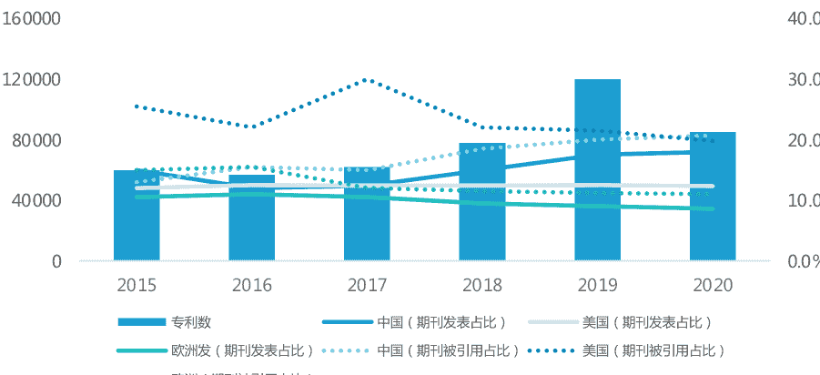 *来源：斯坦福《AI Index 2021》、亿欧智库*

## 第二章 中国人工智能发展脉络与前瞻洞察

顶层设计持续升级，中国AI驶入快车道，全要素布局下关键技术频传捷报。企业群体历经磨砺，技术积淀、场景落地、商业模式三位一体基本成型。AI与实体经济深度融合加速演进，赋能数字化转型，领跑智能经济社会新赛道。本章将沿用五大维度，解码中国AI发展图谱。

### 政策红利持续释放，地方布局遍地开花

从2015年《“互联网+”指导意见》首提AI，到2017年《新一代AI发展规划》上升国家战略；2019-2020年进入深度融合期，2020年纳入“新基建”成关键支撑技术，台阶跨越明显。截至2020年，中央层面出台10+政策，连续4年写入政府工作报告。地方响应迅速，20+省市推出60+专项规划。

上海更视AI为优先战略，五维发力建高地。特别聚焦超大城市治理刚需，在经济发展、城市治理、公共服务三大重点场景深度开放应用，实现AI发展与城市能级跃升深度绑定。

**图：“十三五”国家AI政策里程碑**
| 政策/文件 | 时间 | 核心看点 |
| :--- | :--- | :--- |
| 《“十三五”规划纲要》《机器人规划》 | 2016.3/4 | AI入纲要；工业机器人目标量化 |
| 《国家技术创新规划》 | 2016.7 | 重点攻关大数据驱动类脑智能 |
| 《智能硬件专项行动》 | 2016.9 | 定向可穿戴、车载、医疗、服务机器人等 |
| 《战略性新兴产业规划》 | 2017.3 | 新增“AI 2.0”，入政府工作报告、成国家战略 |
| 《新一代AI发展规划》 | 2017.7 | 构建智能教育体系、全流程应用、人才“AI+X”培养 |
| 十九大报告 | 2017.10 | 推动互联网/大数据/AI与实体经济深度融合 |
| 《三年行动计划》 | 2017.12 | 落地规划，聚焦技术产业化与集成应用 |
| 政府工作报告 | 2018.3 | 提“产业级AI应用”，多领域推“互联网+” |
| 《高校AI创新行动计划》 | 2018.4 | 2030年建成全球主要创新中心核心力量 |
| 政府工作报告 | 2019.3 | 打造工业互联网，拓展“智能+”赋能制造升级 |
| 《促进AI与实体经济深度融合指导意见》 | 2019.3 | 市场导向，打造智能经济新形态 |
| 《国家AI试验区建设工作指引》 | 2019.8 | 2030年建20个试验区，形成可复制模式与高地 |
| 两会工作报告 | 2020.5 | “智能”四连冠，强新基建/5G/数据中心/新消费 |

### 关键技术攻关克难，集成创成主流

疫情未阻创新步伐。至2020年10月，国内AI技术专利申请近69.4万件，同比激增56.3%。云计算与计算机视觉并列榜首（均18%），深度学习（14%）、自主无人系统（12%）次之。单点技术应用成熟，但协同规模化、产业化尚在早期。**“交叉融合”特征下的集成化创新正成主流**，通过“技术产业化+产业智能化”，多技术集成溢出价值将全面释放。

**图：2020国内AI技术专利申请结构** 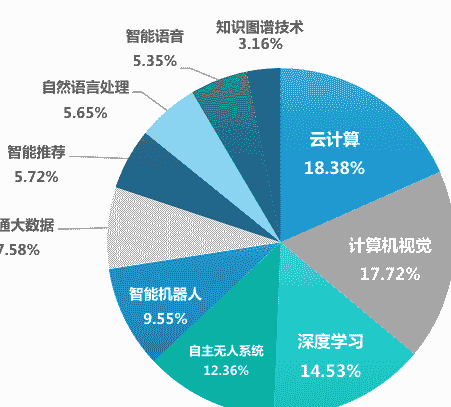 *来源：中国通信院、亿欧智库*

### 创业积淀成形，规模化落地待爆发

经历三年狂飙，中国AI初创群体技术底座、落地场景、商业闭环基本形成，路径清晰化。2017-2018年峰值过后热度回落，创业窗口期尾声确立。在政策、资本、技术三重加持下，多元场景与增量数据涌现，AI正加速融入商业化场景新阶段，**规模化商业落地进程加速成型**。

当前，终端落地丰富，聚焦智慧教育、智能硬件、智能家居、智慧金融/医疗/驾驶/安防、智能机器人等赛道，新产品、新业态、新模式层出不穷。未来，企业核心竞争力将完全取决于**对落地场景的洞察深度**与**解决行业真痛点的硬实力**。

**图：2015-2020中国AI企业新增数量与垂直分布统计**

**中国AI相关企业垂直行业分布Top10**
| 行业 | 企业数量 |
|---|---|
| 教育 | 50 |
| ... | ... |

| 核心组件 | 54 |
| 智能家居 | 58 |
| 智慧金融 | 62 |
| 泛健康 | 68 |
| 智能汽车 | 75 |
| 智慧安防 | 113 |
| 通用解决方案 | 160 |
| 机器人 | 255 |
| 企业级服务 | 330 |

数据源：亿欧智库

### 一级市场降温分化，资金押注核心算法

国内AI私募投资热潮于2017-2018年见顶回落，融资轮次与金额双双收窄。宏观周期下行导致资本市场整体降温，叠加早期赛道格局未明、商业模式待验证，投资人告别盲目跟投，转向锁定具备规模效应与成熟度的头部标的，精准捕猎细分赛道的“单项冠军”。

资金流向发生结构性迁移：从追逐应用层落地转向深耕底层算法。高技术壁垒筑起深护城河，此类标的抗周期能力更强。随产业演进，底层技术融资热度逆势走高，资本注入助力补齐基础研究与原创算法短板，重塑生态版图，冲刺万亿级赛道蓝海。

图：2015-2020年国内人工智能私募股权融资额次和规模情况

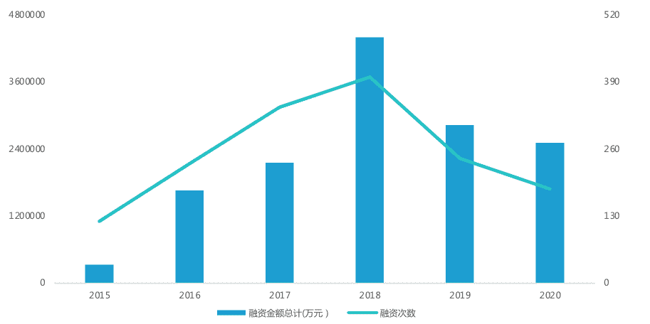

数据源：亿欧智库

### 疫情催化数实融合，智能技术重塑新基建基石

疫情冲击重塑全球消费与数据范式，催化数字化转型刚需全面爆发。一方面，AI融合大数据、云计算等新技术，重塑传统设施为新型基建核心支撑，规模化供给释放“普惠红利”，大幅压降中小企业转型门槛；另一方面，AI深度渗透三次产业，催生智慧医疗、金融、安防等新范式，推动智能硬件与机器人迭代，加速数字经济向智能经济跃迁，倒逼底层技术供给在“质”“量”双升级。未来须锚定算法、算力、数据三大基石，锻造新型基建赋能产业的核心引擎。

## 第三章 申城AI征程：回眸“十三五”，擘画“十四五”新篇

本章从“回顾”与“展望”两个维度，拆解上海AI发展脉络。“十三五”期，上海初步确立“科技引领、应用驱动、产业协同、生态培育、人才集聚”五位一体体系，跻身全国第一方阵；“十四五”期，将迈入深度应用、赋能百业新阶段，冲刺“国际数字之都”与“世界级产业集群”双目标。

### 创新平台矩阵：全链条覆盖，战略高地雏形

上海构建起“基础理论+应用创新+算力服务”三位一体创新体系。上海AI实验室、脑科学与类脑研究中心、算法研究院、自主智能无人系统科学中心、启智研究院、AI研究院、中科院计算所智能处理器中心、微软亚洲研究院(上海)等机构落户，联合攻关核心理论，汇聚战略科技力量。白玉兰开源开放研究院、微软-仪电AI创新院等转化平台揭牌，打通“理论-应用”最后一公里。商汤、依图、明略等国家级开放创新平台授牌，商汤、依图、上汽、腾讯、深兰、寒武纪、优刻得等市级创新中心成立，亚马逊、IBM、阿里、百度、华为、科大讯飞等巨头创新中心在沪布局，强化赋能示范效应。

图：上海市人工智能功能平台布局

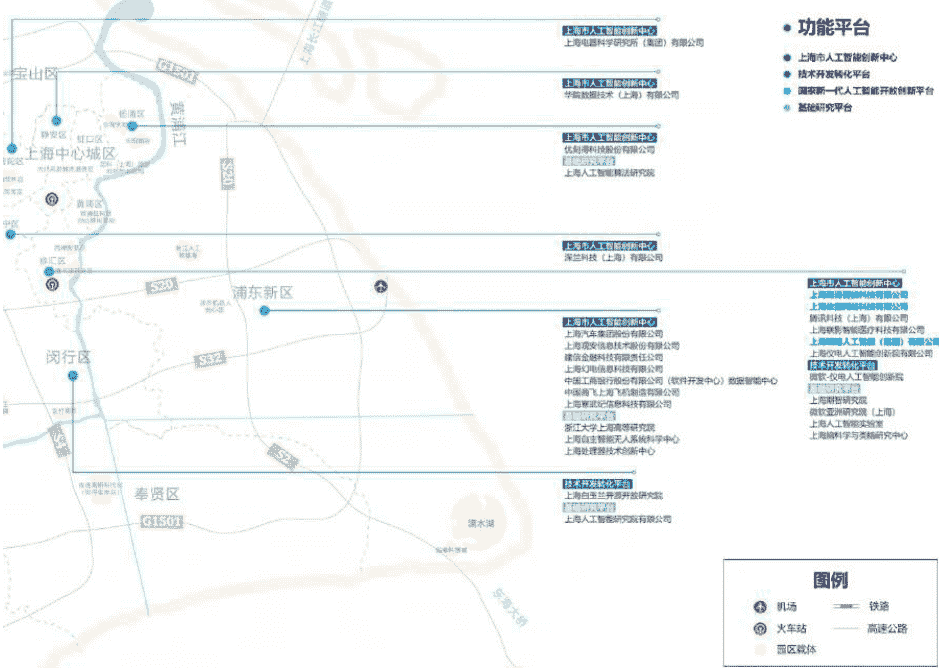

### 硬核成果竞相涌现，立起行业标杆

依图“求索”云端芯片、天数智芯7nm GPGPU芯片、腾讯AI开放平台、华为全栈AI战略及芯片、寒武纪云端终端芯片、商汤重大算力平台等在沪首发。西井视觉软件、“英语流利说”、新松虎伯特乒乓球机器人、诺亚医院物流机器人、禾赛机械式激光雷达等20余款产品入选市创新产品推荐目录，验证产业化落地能力。

### 产业生态全景拼图：六大阵营协同共进

“十三五”上海率倡“应用驱动产业”，大力推进示范应用，牵引上下游协同，打造标杆集群。微软、亚马逊、阿里、腾讯、百度、华为等巨头布局生态；商汤、依图、深兰、云从等技术派持续突破加速落地；寒武纪、平头哥、地平线、燧原、朝捷、禾赛等基础层攻坚高端芯片、传感器，破解“卡脖子”难题；钛米、高仙、小蚁、快仓等产品派推新拓市；联影智能、森亿、商米、明略、氪信、虎博、趣头条、极链、义学等应用派深耕医疗、金融、商贸、文娱、教育等垂直领域，放大赋能价值。

### 空间布局“双核驱动、多点联动”，载体矩阵成型

围绕“4+X”融合创新载体：“东带”以浦东先导区建设为抓手，推动张江智能产业与科创融合，AI岛成标杆并向“由岛扩区”延伸；临港引入地平线等领军企业，智能网联测试稳推进。“西带”徐汇西岸国际AI中心启用，吸引国际顶尖机构入驻。市北高新、长阳创谷、虹桥智谷等特色园区加速，华东无人机基地等区域集聚成势，杨浦、静安、普陀、长宁、宝山等区特色载体建设提速。

### 场景开放领跑全国，实战检验技术深度

上海全国首发场景建设实施计划，累计开放3批58个场景，涵盖洋山深水港、申通地铁、华东无人机基地、张江科学城等综合性场域。推进全国“揭榜挂帅”赛道建设，聚焦智能网联汽车、医疗影像辅助诊断、视觉识别、智能传感器等方向开展测评，梳理标准成果与政策堵点。推动AI赋能传统行业，覆盖生产制造、安防、办公、医疗、交通、教育、金融、企服等领域，促进技术与业务深度融合。2020年抗疫期，建设市公卫临床中心、东方医院援鄂医疗队两大场景，批量智能产品投入一线，成效显著。

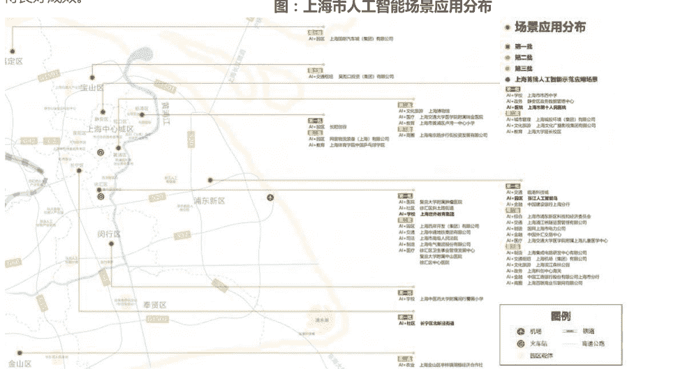

### 政策体系动态迭代，护航高地建设

先后印发《支持上海建设AI创新发展高地行动计划》《推动新一代AI发展实施意见》《加快推进AI高质量发展实施办法》《构建一流创新生态行动方案(2019—2021年)》等政策包。成立市AI产业工作领导小组，一把手联动推进；组建战略咨询专家委，智力支撑顶层设计。获批全国首个AI创新应用先导区、国家新一代AI创新发展试验区，率先突破制度瓶颈，树立全国标杆。

图：上海市人工智能产业扶持政策

| 日期 | 政策文件 |
|---|---|
| 2020.12 | 《长宁区深入推进新一代人工智能产业融合创新发展的实施办法》 |
| 2020.10 | 《中国（上海）自由贸易试验区临港新片区集聚发展人工智能产业若干政策》 |
| 2019.10 | 《黄浦区关于加快推进新一代人工智能产业融合发展的政策意见》 |
| 2019.9 | 《关于建设人工智能上海高地 构建一流创新生态的行动方案（2019-2021年）》 |
| 2018.9 | 《加快推进上海人工智能高质量发展的实施办法》 |
| 2018.6 | 《长宁区关于加快推进新一代人工智能产业集聚发展的若干政策意见》 |
| 2017.12 | 《徐汇区关于建设人工智能产业集聚区的实施意见》 |
| 2017.12 | 《上海市人工智能创新发展专项支持实施细则》 |
| 2017.11 | 《杨浦区关于促进人工智能和大数据产业发展的若干意见》 |
| 2017.11 | 《关于本市推动新一代人工智能发展的实施意见》 |

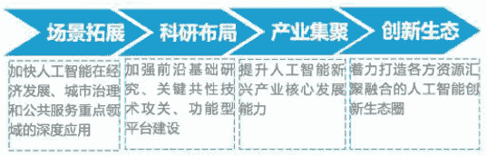

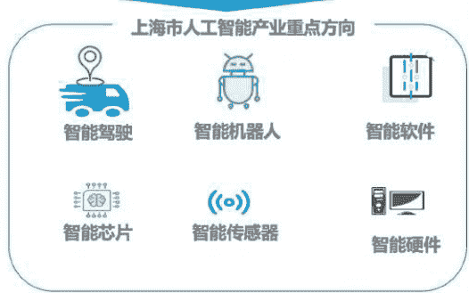

2030年愿景：上海AI总体水平跻身国际先列，初建全球影响力高地，为迈向卓越全球城市筑牢基石。

### 要素高效汇聚，构筑“一站式”服务生态

上海AI产业投资基金成立并完成首轮募集，致力打造要素联通、对接、整合的“一站式”平台。澜起、优刻得科创板上市，市值破千亿，依图等潜力股加速上市进程。市AI行业协会、全球高校AI学术联盟、青年AI科学家联盟等组织成立，张江赋能中心、红杉数字孵化中心等启用，凝聚合力搭建服务对接平台。产业统计体系初建，为研判趋势提供科学支撑。

### 治理体系渐成体系，树立安全发展标杆

成立试验区专家咨询委治理组、市AI产业安全专家咨询委，攻关政策体系、伦理规范、技术标准，参与国家标准制定。借WAIC平台持续举办法治、安全、治理论坛，发布《AI安全发展上海倡议》《AI安全与法治导则》《世界AI法治蓝皮书》等报告，引发国内外广泛关注。推进地方立法探索，聚焦数据安全开展调研，探索可信AI研究，构建多主体协同长效机制。

### WAIC：打造全球AI“金名片”

2018-2020年连办三届，习近平致贺信指明方向。三年累计吸引1000+重量级嘉宾演讲，500+头部企业参展，40万+观众到场，4亿+人次线上围观，成国内最具影响力的专业化、国际化高端平台。大会与产业发展形成循环联动，化身引进项目“会客厅”、展示成果“大舞台”、优化生态“百花园”，为构建一流创新生态奠基。

图：世界人工智能大会

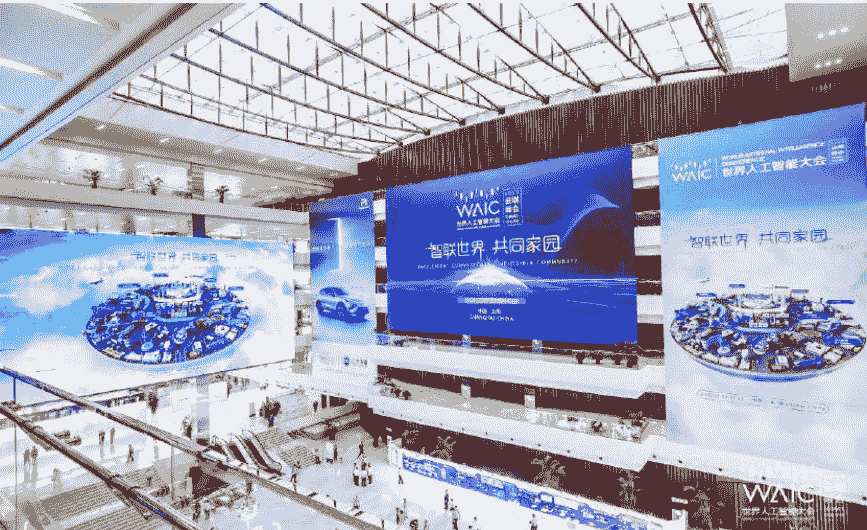

### 全球顶尖人才加速集聚

图灵奖得主姚期智、微软亚洲研究院院长洪小文、商汤创始人汤晓鸥等国际大咖落沪。上海AI Top100企业创始人中，近半数斩获国际顶级技术奖或拥有海外经历，其中1/3为80、90后，形成年轻化、高知化、具创业精神与国际视野的企业家群体。

### 人才梯队培养体系化、规模化

11所高校设AI研究院，9所开设本科专业，38所开设104个相关学科；2019年招生1.15万、在校3.55万，储备后备军。依托交大、同济建平台基地，依托仪电、中科院计算所、上海电科院建继续教育基地。联动大型企业、园区、协会，启动高技能人才培养基地建设。

### 人才政策精准滴灌，激活创新动能

引才端：将AI纳入重点支持领域，核心骨干可直接落户。揽才端：通过留学生直落户政策与“浦江人才计划”，给予政策资金双支持。评价端：创新开展工程系列AI专业高级职称认定，2020年70人获正、副高职称。

### “十四五”展望：从技术突破走向深度赋能

立足新发展格局，面临双重考验：一是中美博弈加剧，构建以基础软硬件为核心的自主生态成必然选择；二是AI成数字经济核心引擎，“十四五”规划将从智能基建、数据要素、数字治理、核心技术四维发力，夯实基础，推动AI在数字政府、实体经济转型中深度应用。

《上海“十四五”规划纲要》锚定“国际数字之都”与“世界级集群”目标：全力建设融合AI、5G、物联网的新型智能基建，支撑数字产业化与产业数字化，培育在线新经济，推动技术在城市治理、生活、经济深化应用。重点攻关智能芯片、核心算法，激发企业创新活力，构建自主生态；持续打造创新场景，满足城市深层需求；扩大产业规模，优化营商环境，在资本、市场、人才维度协同服务，加速培育国际竞争力龙头。

“十四五”期，上海AI将从“技术突破、产业爆发”转向“深度应用、赋能百业”：创新体系完善、策源能力跃升、核心技术突破，形成可持续创新力；龙头企业集聚、自主生态全面成型；城市数字化转型驱动应用深化；产业规模与影响力双提升；以在线智能新经济为代表的新兴产业，将成经济社会发展关键新动能。

## 第四章 标杆案例集锦：企业风采彰显城市能级

企业是产业基石，兴衰决定未来。发展离不开政策、基金、人才、落地、氛围、宣传六要素，上海六大要素齐备，全方位托举企业蓬勃生长。近年来，上海作为AI企业沃土优势愈发凸显，不仅成落户首选，更凭国际化优势吸引全球企业优先布局。本章甄选在沪深耕的卓越案例，从基本面、创新品、创新力、应用场四维呈现上海AI风采。

### 爱数智慧：数据赋能，定义智能边界

#### 企业概况

北京爱数智慧科技有限公司（以下简称“爱数智慧”）定位全球领先多模态数据服务商，致力为智能世界提供充足数据生产力。总部落地北京，香港、深圳设全资子公司，上海、广东、四川、山西等地布局标注或众包团队。上海作为华东核心标注基地，辐射区域方言采集标注业务。

爱数智慧面向ASR、TTS、NLP等AI研发机构提供专业数据服务，覆盖智慧出行、智能社交、智慧金融、智能家居、智能终端五大行业，服务微软、阿里、腾讯等百余家全球合作伙伴，业务触达五大洲数十语种。

#### 核心创新产品矩阵

##### 三大核心产品

**1. 对话式AI训练数据集**
- 规模超15万小时：含9万+小时对话式、5万+小时朗读式、1万+小时自发式数据。
- 语种超60种：涵盖中英日等通用语、泰语/马来语/印尼语等特色语、川/沪/粤等八大方言。

**2. MagicHub.io数据开源社区**
- 输出对话式AI训练数据，已开源40+组、超1000小时数据集。
- 类目丰富：中英文客服文本、发音词典、语音合成/识别数据等。
- 语种广泛：覆盖八大方言区及意大利语、阿拉伯语等数十语种。
- 生态共建：鼓励数据所有者开源共享，促进开发者协同。

**3. Annotator® 5.0 智能化标注平台**
- 多模态标注：支持多模态任务配置，兼容原始/半标注数据，支持同步或独立标注。
- 流程灵活：自定义流程模块，实现复杂任务拆分分配，一站式管理满足个性化需求。
- 可视化管控：提供进程检视、人员管理、数据统计等可视化功能。
- 智能辅助：集成AI预标注、AI辅助质检验收，提效增质。

图：Annotator® 5.0 智能化标注平台

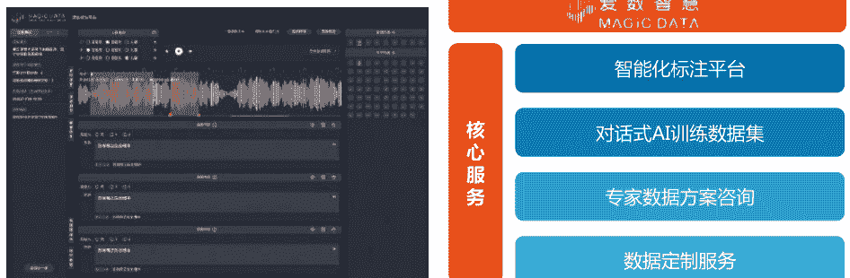

#### 创新驱动力：四大核心壁垒

爱数智慧采用人机协同模式开发数据产品，在保质的前提下兼顾安全、多元与全球化经验：

**数据安全，合规性高**：
- 全流程加密监控，四大国际会计师事务所护航合规。
- 遵循GDPR与网络安全法，通过ISO27701/9001/27001/CMMI3四重认证。

**数据质量高**：
- 严格项目管理体系，准确率达99%+；人机协同大幅提效。

**数据多元化**：
- 多模态多场景服务；训练类型覆盖对话/朗读/自发式，总量超15万小时。
- 场景落地虚拟助手、智能客服、智能驾驶等。

**全球化交付经验**：
- 支持60+语言服务；具备丰富跨国项目落地实战能力。

**技术内核：数据结构化与2-8配比法则**
核心技术路径为“采集→清洗→分类→标注→质检→筛选”全链路结构化处理，模型层面施行2-8数据配比策略（即20%核心数据+80%泛化数据），平衡精度与鲁棒性。

### 定制化与通用化的权衡：效率、成本与合规的博弈

| 维度 | 全定制模式 (100%) | 混合模式 (20%定制+80%通用) |
| :--- | :--- | :--- |
| **功能交付周期** | 单需求耗时缩短 | 单需求耗时延长 |
| **资金投入** | 成本高昂 | 成本可控 |
| **上市节奏** | 拖慢新品发布 | 加速迭代上新 |
| **合规表现** | 难以达标 | 合规性强 |
| **工程质效** | 周期长拖累能效 | 高效提升产出比 |

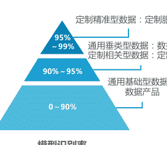

#### 典型落地场景

#### 爱数智慧 MAGIC DATA：深耕五大垂直领域

**智慧出行**
聚焦车载导航与智能座舱，输出对话式AI方案；覆盖智能客服、电销外呼、通话质检等客服全链路，同时赋能车内人机交互体验。

**智能社交**
助力短视频平台实现智能化生产，提供个性化营销、内容识别审核及视频营销解决方案。

**智慧金融**
以AI重塑营销与服务效能，打造“千人千面”专属体验，场景延伸至智能客服、精准营销、会议辅助、网点多模态交互等。

**智能家居**
为物联网终端注入语音识别、语义理解及交互能力，落地唤醒词、异常声监测、声纹/方言识别等细分功能。

**智能终端**
面向穿戴等边缘设备，提供定制化对话方案，构建专属智能场景。

---

### 数据库科技：以产融数字化引领数据科技新范式

#### 企业画像
2009年扎根上海，数据库科技长期深耕金融与产业赛道，核心在于以“产业逻辑”重构数据价值。凭借AI实现结构化数据自动化量产与高频资讯实时解析，独创SAM产业链框架打通数据孤岛，构建出高度拟合实体经济运行规律的数据体系。业务矩阵覆盖智能风控、资管投研、产业监测、优企发掘、精准获客、智能资讯、量化投资等全维度。

同时拥有产业链、供应链、企业图谱、舆情等全谱系数据流服务，并沉淀出银行对公营销、舆情风控中台、政务产业大脑、供应链预警、机构内参、企业级智能资讯等场景化方案，全方位赋能金融、政务、企业数字化转型。

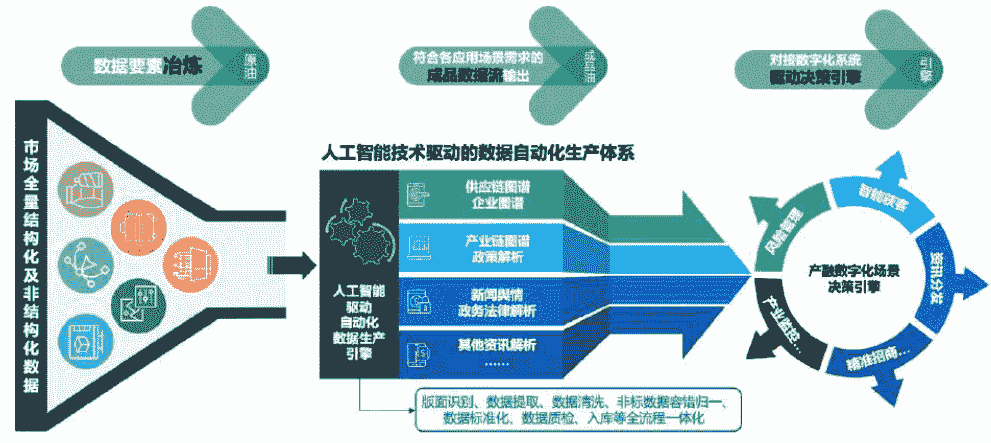

#### 核心创新产品

**智能文档与资讯分析技术服务平台**
*NLP旗舰级标签引擎*
- **核心能力**：自动萃取文本关键信息生成标准标签，无缝注入数据体系；支持机器读取非结构化文本并与结构化金融数据深度关联。
- **五大技术壁垒**：海量自定义词表分词、特征词消歧、关系抽取、半监督文本分类、实体舆情分析。

**产业大数据服务平台**
*四大核心内容层*：产业细分标准体系、产业链关系定义、节点企业关联、多维数据关联（资讯/政策/经济指标）。
*典型赋能场景*：资管端的产业研判与量化策略、风控端的上下游传导预警、银行对公的客户产业画像、政务产业大脑、产业链金融的精准招商。

#### 关键技术动能

**SAM：产业链知识图谱构建技术**
- **标准化覆盖**：将A股、港股、美股全上市公司业务产品标准化，实现跨市场高度可比。
- **全量企业库**：工商注册非上市企业超5000万，实现全领域覆盖。
- **层级穿透**：对接GICS体系，将4层分类深化至12层。
- **网络规模**：5000+标准产品节点、7万+上下游关系，织就动态产业生态网。

**SmarTag：智能文本分析算法**
融合NLP与知识图谱，实现实体/文本舆情分析、标签关系抽取及图谱反哺。
- **多维标签体系**：企业、人物、事件、行业、产品、地域六大维度。
- **图谱增强**：利用图谱提升算法可控性、可解释性及长尾表现。
- **闭环进化**：图谱与算法形成飞轮，持续迭代性能。

**DAS：数据自动化处理系统**
基于ML/DL的智能化数据工厂，采用云原生微服务架构，资源弹性伸缩。
- **使命**：助力数据部门批量化高效产出精准数据。
- **兼容性**：灵活解析文档表文/表格，结合术语库标准化财务科目。

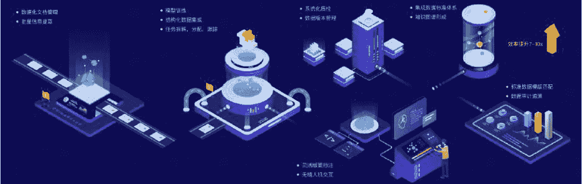

#### 场景化解决方案深度解析

**银行对公数字化转型**
- **智能营销中心**：构建区域产业全景图，输出产业链/供应链/产业园三大获客矩阵。
- **行业分析中心**：多维研判（前景/宏观/竞争/舆情/风险）预判趋势与资金需求，支撑投放规划与精细化运营。
- **风险预警中心**：捕捉舆情/处罚/诉讼负面，刻画风险画像，结合定性定量标签实现优劣企业精准分层，筑牢风控防线。

**政务级产业大脑**
- **蓝图与成果展示**：为监管决策导向、成果对外展示提供核心载体。
- **数字化监管赋能**：洞察产业全貌，识别运行风险，支撑调控决策。
- **供需智能匹配**：AI挖掘上下游链条，破解企业供需对接难题。
- **精准招商引资**：锁定方向/标的/项目，提效精准度，实现强链补链稳链目标。

---

### 汉王科技：新一代AI档案大数据处理平台领航者

#### 企业基因
作为国内AI先行者，汉王科技1998年创立至今深耕20余载，在手写/OCR/人脸/视频/NLP/交互等核心板块持续突破。战略聚焦“生物识别、OCR大数据、笔触轨迹、智能终端”四大方向，推动AI落地普惠。近年更在仿生扑翼飞行器、机器人、嗅觉识别等前沿实现0-1突破，夺回产品创新主导权。全球营销网络覆盖主流跨境电商及15个独立站，产品远销海外。

#### 创新矩阵
- **非结构化深度理解**：实体/关系/属性三元抽取。
- **疑难字符攻坚**：自由手写、老旧油印铅印、复杂版式表格、强噪声干扰、复杂公章/签章检测识别。
- **新一代平台五大核心引擎**：全文、表格、卡证、版式、图像识别，支撑纸质数据形态转化与价值挖掘。
- **架构优势**：云计算底座 + 微服务模式，支持内网私有化部署，构建专属识别云。
- **硬核指标**：手写>95%、印刷>99%准确率；全覆盖标准卡证结构化提取；少数民族语言（满/藏文）识别超98%。

#### 技术内核动能
平台基于**FCN(全卷积神经网络)**提取全局局部联合特征，解决复杂版式/强噪声下的文字定位检测；引入**LSTM(长短时记忆网络)**建模序列关系，攻克单字符切分识别难题。OCR引擎实现任意档案图像自动定位、字型自动判别、精准识别输出，抗背景噪声能力强。技术优势延伸至少数民族语言领域，满藏文识别领跑行业。

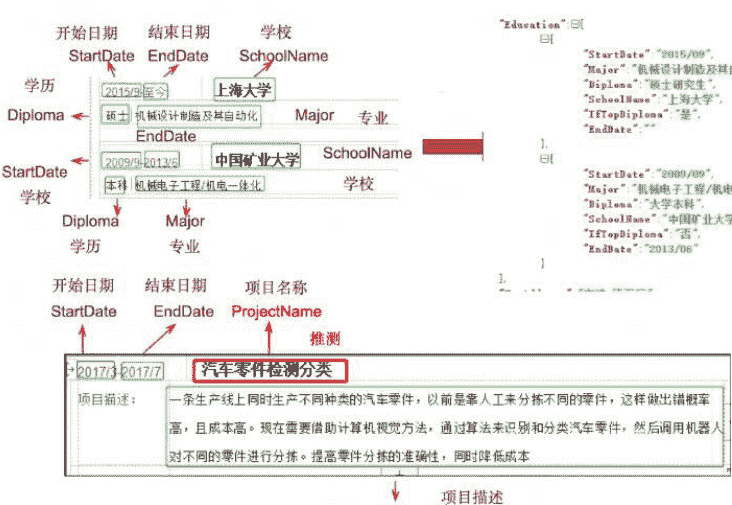

#### 标杆案例：上海市城市建设档案馆

| 传统痛点 | 汉王破局方案 | 战略价值 |
| :--- | :--- | :--- |
| 千万级TIFF图像难检索 | 推出“智能机器人解决方案” | 经验复制推广至全国档案行业 |
| 非文本数据不适配国家大数据战略 | 新一代OCR产出高精度全文 | 聚焦城建/综合/医疗等细分赛道 |
| 密级件混杂存泄密隐患 | NLP智能涉密分析自动分拣 | 抢占千亿级全国档案市场蓝海 |
| 人工效率低、周期长、成本高 | 大幅提升信息化利用率，缩短进程，节省巨额资金 | 验证模型可复制、可推广、高ROI |

---

### 闪马智能：城市空间智能管理的AI中台专家

#### 核心定位
聚焦城市空间治理，以新一代视频智能分析核心体系“化所见为所知”。接入存量摄像头与线上视频，结合多源数据，融合实时分析、历史统计、预测仿真，全维度深度理解城市，践行“智建未来城市”愿景。

#### 中台架构体系
**三大平台支撑**：VisionMind(业务中台)、Atom(算法中台)、云边融合平台 → 赋能**五大城市空间管理** → 辐射**百态百业**。

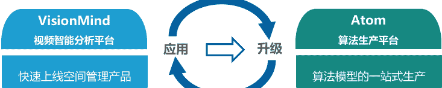

#### 独创“星云”云边协同架构
- **云中心**：全局策略下发，动态调度边缘算力，保障区域效能最优。
- **星边缘**：即时感知分析，结果上聚云端。
- **融合价值**：云边一体化打通“即时闭环”（应急处置）与“延时闭环”（长周期规划），实现战术执行与战略决策统一。

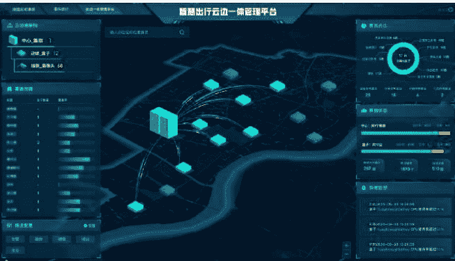

#### 算法与荣誉护城河
- 算法库存300+，自主知识产权30+，顶会论文10篇。
- ACM MM LSVC、CVPR、ActivityNet等国际顶级视频赛事长期稳居世界前三。

#### 五线产品矩阵与核心效能

| 产品线 | 核心功能亮点 | 管理增值 |
| :--- | :--- | :--- |
| **VisionMind 智慧交通** | 机非违法/运行态势智能分析，视频+大数据双引擎，覆盖城区/高速多场景 | 建立管理闭环，辅助路网运营决策 |
| **VisionMind 城市环境治理** | 渣土/洒水/搅拌/垃圾/清扫车身份核验与行为监管，**违章发现效率提升3倍+** | 实现全路网扬尘治理闭环 |
| **VisionMind 大客流管理** | 10+异常行为识别（统计/态势/翻越/聚集），支持**10万级**客流计数 | 掌握区域客流全貌，保障公共安全 |
| **VisionMind 岗位管理** | 未着装/离岗/打架/吸烟等违纪实时感知上报，固证留痕，扭转被动管理 | 提升管控效能，减少事后扯皮 |
| **VisionMind 互联网内容安全** | 图文/视频内容审核+媒资管理，全场景通用 | **释放98%人力，综合成本降80%** |

#### 实战成果速览

**核心城区交通治理**（某一线城市）
- 存量视频利旧，管理效能**翻倍**；
- 高精算法感知违法，护航道路安全；
- 人工巡查效率 **20%→50%**，人力成本**腰斩**，人力下沉高价值场景。

**绕城高速智慧运营**（某一线城市）
- 全链路解决运营管理与收费稽核难题；
- 突发事件秒级发现，消除隐患防二次事故，长周期数据支撑路网规划；
- **收费稽核质变**：原90人日工作量压缩至**3人日**，精准打击偷逃费。

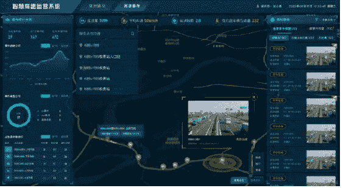

---

### 西井科技：封闭场景自动驾驶“新物种”缔造者

#### 战略坐标
以AI激活多产业潜能，志做全球智能服务开疆者。聚焦大物流与城运，融合服务业与智造，构建高效、经济、安全、可拓展的智能基础生态圈。“技术目标+市场”双轮驱动，成为结合“一带一路”最紧密的AI企业之一。
- 2016年 切入港口，交付智慧港口AI全局化方案。
- 2018年 发布封闭场景自动驾驶新物种——**Q-Truck全时无人驾驶新能源卡车**。
- 2021年 Q-Truck助力和记港口泰国林查班AI混行码头全面投运。

#### 破解港口智能化转型三大痛点

**1. 低成本混行落地**
免埋设磁钉/物理隔离，Q-Truck可直接与有人驾驶集卡混行作业，大幅降低改造成本与门槛。

**2. 超长续航产能**
应用场景更广、改造成本更低，支持**连续实船作业40小时+**，显著提升生产效率。

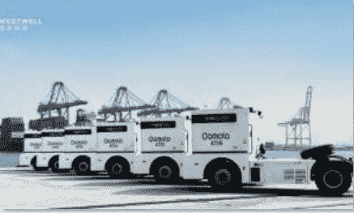

**3. 原生无人设计，抢占“碳中和”高地**
- **颠覆架构**：彻底移除驾驶室，车头布局电池与冷却系统，核心硬件获工业级防护，适应港口复杂工况。
- **绿色效能**：单车碳排同比**降66%**，助力港口能源结构优化，迈向绿色/智能/无人化新阶段。

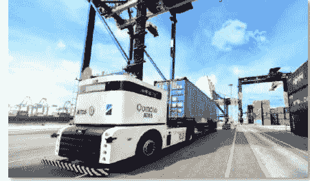

**感知与协同硬核实力**
搭载双目AI相机、激光雷达、毫米波雷达等工业级传感器矩阵 + 全栈自研系统，输出厘米级定位与高精识别，**最大载重80t、续航200km**。
**全局化协同**：自动驾驶与智慧堆场/闸口/岸桥/安防共享场景数据；加载**V2X车路协同**，实现车-路-基全天候全方位态势感知，精准目标级输出，构筑“零碰撞”优势，大幅跃升作业效率。

#### 商业模式创新与动能飞轮

**全局化赋能，重塑作业标准**
- WellOcean(港口) + WellSecurity(安防) 双引擎，驱动多场景AI组合创新。
- 系统持续以“机器决策vs人类操作”对标复盘，在实战验证中迭代技术标准体系。

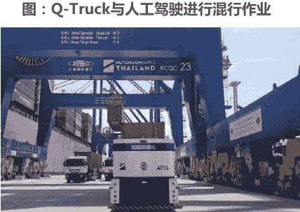

**从“卖产品”到“卖服务”的范式跃迁**
技术迭代驱动体验升级，西井主导产业链/创新链重构，技术反哺商业闭环。
**2021年4月 首创“无人驾驶商业化代运营”模式**——中远海运阿布扎比哈利法港二期，**按箱量计费**。
- **用户价值**：前期采购资金门槛清零，加速自动驾驶落地，解决海外项目管控难题，降本增效保安全。

---

# 硬核科技深度观察：六家AI先锋如何重塑产业版图

### 西井科技：让自动驾驶在港口“落地生根”

西井科技始终坚守一个核心信条：唯有精准定位与商业闭环，方能释放人工智能的最大效能。截至目前，其全局化智慧港口方案已攻克国内外70余座码头，无论是技术攻坚还是市场拓展，均稳居全球港口自动驾驶第一梯队。

旗下Q-Truck不止于单车智能，更实现了自动驾驶车队的规模化商用，并在码头全工况下经受住实战考验。2020年疫情暴发之际，Q-Truck车队作为国内首批出海抗疫项目奔赴泰国林查班港。历经一年零事故运营，岸桥作业效率持续攀升，最终逼近并稳定于人工驾驶水平，正式迈入全面商业化运营阶段。

在林查班，Q-Truck历经东南亚高温暴雨多重极端工况验证，落地的是真正的“无围栏混行”模式：无需封闭港区、铺设磁钉或划设禁行区，即可与有人驾驶车辆同场竞技、协同增效。2021年，新一批Q-Truck将陆续进驻阿布扎比哈利法港二期及新疆国际陆港。西井科技凭借独到的场景理解力，以商业量产反哺技术自研，践行“取智于人，用智予人”，为终端用户输出高效可持续的生产力价值。

### 眼神科技：深耕生物识别二十载，筑牢数字身份信任基石

#### 基本概况
上海眼神信息服务有限公司系北京眼神科技全资子公司，专注于多模态生物识别原创技术与解决方案。深耕领域20余载，眼神科技掌握人脸、虹膜、指纹、指静脉等多项核心自主知识产权，并攻克多模态融合原创技术，可在超高安全、强隐私保护、海量底库及友好体验等苛刻条件下，提供强身份认证方案。客户遍布全球2000余家，覆盖金融、教育、社保、公安、军政企等全领域，合作网络触达超80%银行机构及百余所高校。上海子公司立足华东，面向全量市场多维布局。

#### 创新突破：多模态融合“首倡者”
眼神科技首创多模态生物识别融合算法，打造全球首个统一平台，实现多场景、多应用、多产品、多技术的集中管控，确立行业标杆。

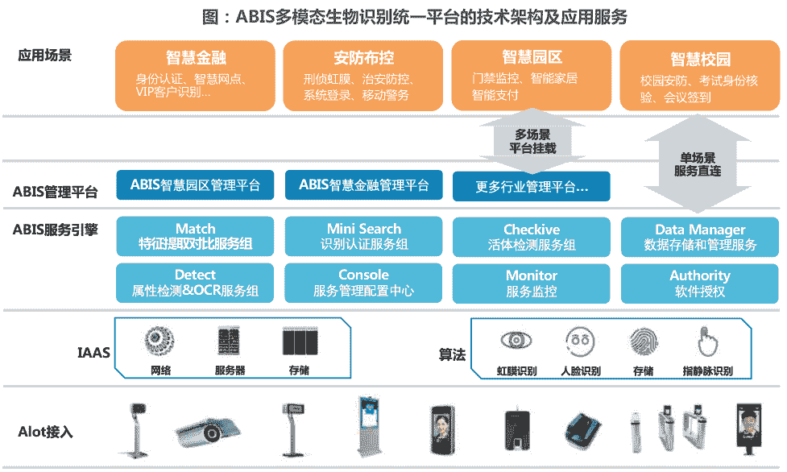

其自研ABIS多模态统一平台，将指纹、人脸、虹膜、指静脉等技术融合于一个开放、可扩展的认证体系，支撑身份的安全、便捷、精准核验。依托原创底层算法与统一数据管理，平台具备多模态感知、多维推演、智能决策、安全共享四大核心能力，为上层业务提供轻量化、标准化的基础服务支撑。

#### 创新动能：标准制定者与奖项收割机
眼神科技深耕研发与标准化建设，荣获国家技术发明奖二等奖，拥有专利400余项，主导或参与制定修订82项国家/行业/团体标准。通过多模态融合技术赋能垂直场景，为各行业注入高效、安全、先进的强身份认证管理手段。

> 图：面向多领域推出了整体智慧解决方案

#### 典型落地场景
**金融赛道**：依托ABIS平台，实现生物信息统管、数据同步与认证授权，赋能自助银行、柜面授权、VIP识别等场景，助力银行降本增效与数字化转型。与工行合作落地智慧金库、机房、园区，实现内外业务全面升级；携手民生银行打造行业首个行级人脸应用，并铺开多模态统一认证平台，共建智慧网点与园区。

**智慧公安**：聚焦侦查实战，为20余省市提供刑侦虹膜系统与采集终端，助力建库打击犯罪。智能识别综合实战平台集监控、采集、比对、预警、分析于一体，显著提升某市治安防控智能化水平，屡建侦破大案要案功勋。

> 图：眼神科技刑侦虹膜系统、采集终端

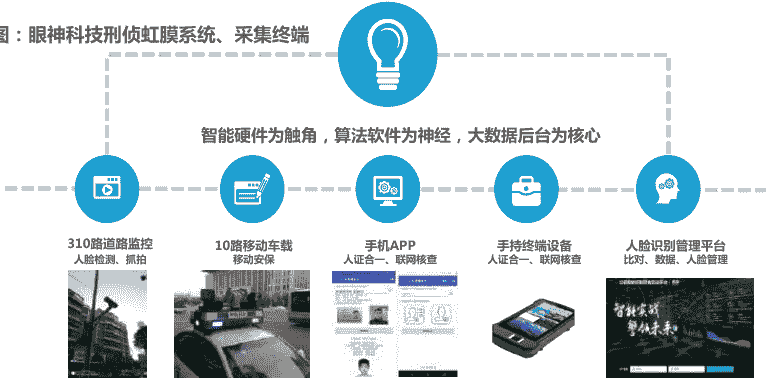

### 影创科技：以混合现实重塑生产生活新范式

#### 企业画像
成立于2014年的影创科技，是全球混合现实（MR）领军企业，聚焦MR、AI、半导体基础科学应用。总部落沪，产业基地遍布青岛、北京、重庆等七地，构建全产业链闭环生态，誓做世界第一MR公司。

#### 创新版图：上中下游全链路布局
**半导体上游**：从光学EDA设计、纳米压印光刻机到衍射光波导镜片量产，打通MR核心产业链。以纳米压印光刻机为例，覆盖光通信、生物芯片、3D传感等万亿级蓝海，影创将建成集成化量产线，提供一站式芯片方案，目标2029年营收破450亿。

**内容生态**：2020年VR/AR出货量国内一体机榜首，主导统一国内VR内容SDK标准（GSXR），基于Tesseract SDK开发的应用可无缝适配全系MR新品，打破生态壁垒，推动碎片化现状向统一标准演进。

**智能终端**：推出全球首款6DoF头手交互MR眼镜“鸿鹄”、全球最轻MR一体机“即墨”、Action One Pro等爆款，广获用户口碑。

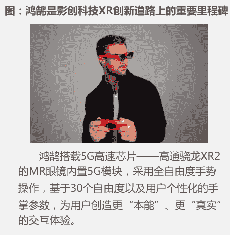

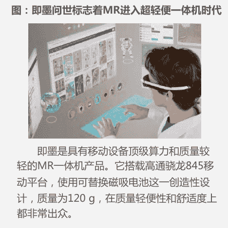

#### 创新引擎：专利护城河与产学研深度融合
截至2020年末，专利申请300余项，在衍射波导、纳米压印、LCoS设计、AI算法等硬核领域实现突破。2016年设立量子机器学习实验室，2019年获批浦东博士后工作站，国际顶刊发文3篇；联合复旦微电子院攻关国产光学EDA，携手上海二工大共建数字孪生联合实验室。

> 图：影创科技在人工智能领域拥有多项领先成果

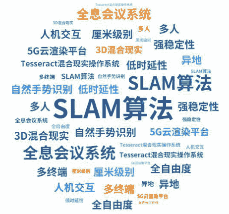

#### 场景落地：五大垂直领域深度渗透
- **教育**：与多所高校共研，为百余所重点中学及名校建“5G+MR”全息教室、创新实验室；与近百所职院共建产学研基地，参编“1+X”教材。
- **体育**：“元力崛起”MR真人竞技馆响应全民健身国策，融合MR/AI让娱乐健身两不误，获体育文旅部门力挺。
- **医疗**：基于CT/MRI数据三维重建还原解剖病变，辅助术前精准规划。常州、昆明等地已落地数十台MR辅助手术，推动技术纳入医保目录。
- **工业**：聚焦远程协助与培训打造平台级产品，融合音视频与MR实现多端视角共享、3D全息标注，覆盖运维、巡检、专家会议等泛工业场景。
- **文旅**：联合伙伴在川、鲁、湘、京、沪、渝落地项目，与国家图书馆、文物局战略合作，提供全息导航、虚拟导游、3D互动、全息演艺等新体验，打造超级IP带动区域经济。

### 氪信科技：以“非或然引擎”驱动企业服务智能化跃迁

#### 核心定位
2015年创立的氪信，致力于成为产业数字化转型的可信智能伙伴。基于自研行业解决方案，构建端到端智能决策系统，集成轻量级AI组件，从数据科学与应用层面加速金融、保险、物流等行业转型。

#### 核心技术底座：非或然引擎
作为技术皇冠上的明珠，非或然引擎定位为企业级智能引擎系统平台。

> 图：非或然引擎组件

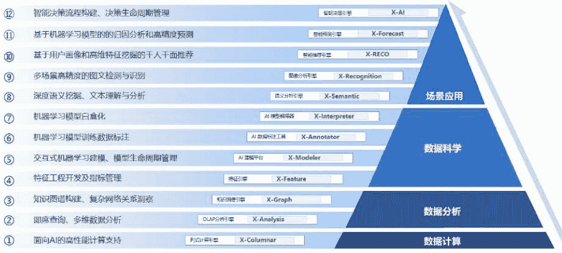

引擎具备超大规模计算与亚毫秒级响应能力（300ms处理8亿行为数据），应用集群架构赋予其模块化、松耦合、轻量级、高性能特质，高效融合图计算、时序分析、组合优化，攻克异构结构数据处理难题。

> 图：提供系统承载级别的智能服务平台产品方案

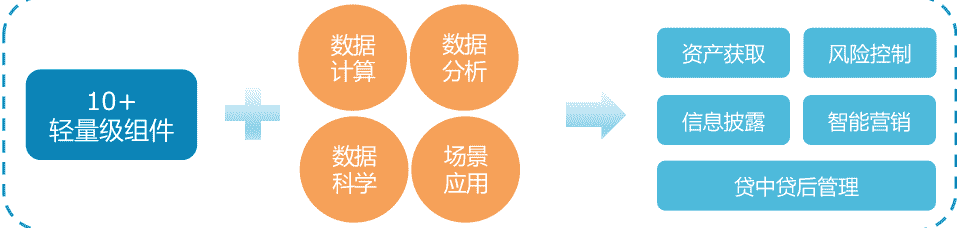

全链路覆盖特征管理、规则编辑、模型执行、决策流定义至服务封装，内置准实时监控预警，助力企业构建业务全生命周期管理闭环。

#### 创新动能：硬核实力获权威背书
- **图计算洞察力**：大规模图计算解锁关联分析新视角，满足银行海量数据实时洞察需求。
- **奖项与专利双丰收**：非或然智能引擎系统超越IBM同类方案，成果刊登顶会并获专利；2020年斩获CCF科技进步杰出奖、吴文俊人工智能科技进步奖。
- **架构灵活性**：应用集群形态支持单独部署、敏捷组合与统一治理。
- **经验沉淀与下沉**：将头部银行实战经验内化为内置特征库，在垂直领域应用中发挥标杆带动效应。

#### 场景实战
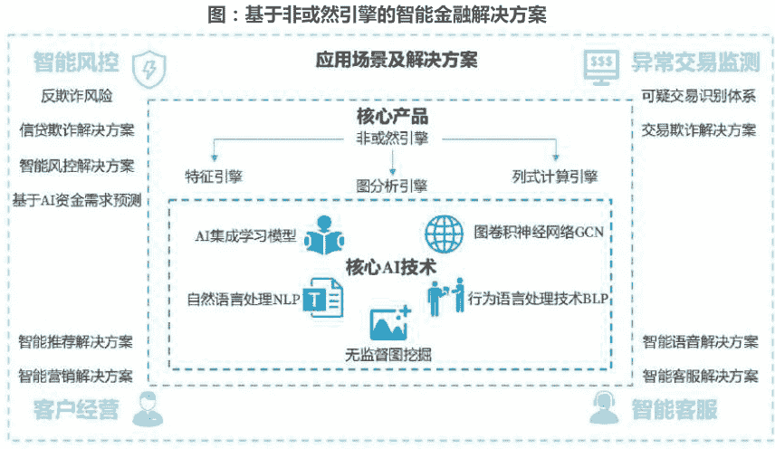

**金融场景**：助力城商行构建可复制的自动化监控运营体系；ML引擎实现毫秒级响应与模型全生命周期管理，赋能实时智能决策。
**物流场景**：联合斑马来拓建数字化智能物流中台，基于OCR/NLP实现日均万单回单自动审核、智能调度运力，推动标准化运营与供应链效能跃升。

### 魔视智能：点亮汽车“智能大脑”，推进全栈自动驾驶量产

#### 企业实力
魔视智能整合顶尖AI算法与先进芯片，提供汽车智能化全栈方案。总部设上海张江，澳洲设AI研究院，深圳/苏州/南通布局研发、测试、制造全链路。积累“泊行融合、舱内外协同、前视环视互补、标准定制并行”的全栈算法库及跨平台工程能力。遵循车规标准，将优化AI计算引擎部署于多元芯片，融合视觉多传感感知、高精定位、路径规划与车控，覆盖L1-L4全等级自动驾驶。产品线涵盖APA、AVP、AEB/ACC/LKA、TJA、L2.5+智驾及园区港口L4，持续打通传统车智能化鸿沟。

#### 产品矩阵：全栈式量产供应商
> 图：全栈式自动驾驶解决方案

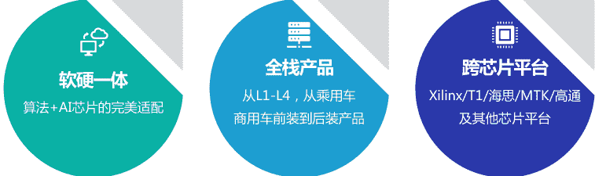

产品完整覆盖L1-L4：前视ADAS预警、AEB等L2级产品、自动/代客泊车、拥堵辅助、园区港口L4，未来延伸至Robotaxi与干线物流。核心技术壁垒在于视觉主导的内外环境感知、多传感器融合、高精定位。

> 图：魔视智能三大核心支柱产品线

| 维度 | 前装商用车 | 前装乘用车 | 后装主动安全与边缘计算 |
|---|---|---|---|
| 核心产品 | 单目/前视一体机及雷达融合系统 | 自主/自动泊车、拥堵辅助 | 魔盾多路盲区主动安全系统、全栈AI算法 |

已量产交付整机系统、域控核心板及算力芯片。

#### 技术护城河：四大核心硬实力
1.  **自主深度学习算法体系**：自研实例分割实现像素级几何感知；多视角去畸变拼接融合提升识别跟踪鲁棒性；多传感器融合互证冗余保障安全边界。
2.  **复杂算法低功耗嵌入式落地**：深度钻研芯片级嵌入式实现，车规级FPGA承载自主深度学习引擎，整车功耗<7W，满足-40℃~85℃全天候工况。
3.  **极致优化成像管线**：FPGA内嵌独立ISP深度调优，攻克夜间弱光、强光逆光下的目标识别难题。
4.  **成熟前装量产交付经验**：前视ADAS已规模上车乘用/商用车，为后续泊车产品量产积累工程化样板。

#### 量产里程碑：第5代自动泊车系统
融合视觉与超声波雷达，解决无参照物车位识别难题；深度学习算法精准识别车位线、地锁、障碍物，实现全场景智能泊入。

> 图：自动泊车示意图

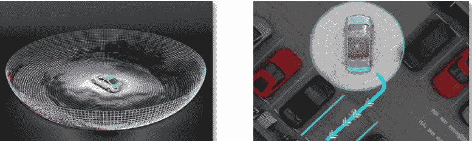

2019年10月发布即获一线主机厂青睐，2020年已搭载吉利、奇瑞、广汽、北汽新能源等头部车型量产上市。

### 深擎科技：以“智能内容”激活金融机构存量价值

#### 企业速写
2018年成立于宁波，聚焦企业财经内容个性化服务。凭借NLP、个性化推荐、机器学习、知识图谱等核心技术，为券商、银行提供内容生产、加工、分发、触达运营全链路方案，助力激活存量、优体验、促转化。三年获AAA资信、上海高企、双ISO认证及证监会备案。合作覆盖70%+中大型券商，客户复购率超90%，拥有软著28项、发明专利申请16项。

#### 产品架构：围绕“智能内容”构建服务矩阵
深擎将深度业务理解与AI技术融合，辅以咨询运营输出，助客户快速对标头部认知水平。

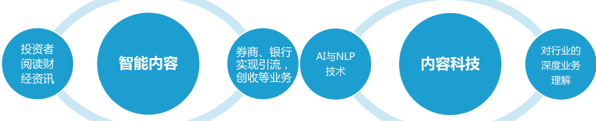

> 图：深擎内容科技服务能力矩阵

| 业务目标 | 拉新 | 促活 | 转化 |
|---|---|---|---|
| **触达渠道** | APP对接、API服务、H5/小程序开发、企微运营 | | |
| **内容矩阵** | 官媒、自媒体、投教、专题、推送、基金、产业链、付费/定制内容 | | |
| **内容引流** | 企业获客、KOL获客 | | |
| **内容促活** | | 信息流推荐、热点推送、内容标签 | |
| **内容导流** | | | 内容引导基金/功能 |
| **内容创收** | | | 付费/增值产品 |
| **运营服务** | 官媒、自媒体、投教、专题、推送、基金、产业链 | | |

### 产业布局：内容变现与定制化服务

**内容科技矩阵**

- 风火轮
- 白羽扇
- 孕云箭
- 七星刀

### 核心驱动力：双轮驱动创新

| 技术突破 | 模式革新 |
| :--- | :--- |
| **“AI+Teleservice+Online”架构落地** - 自研DeepQ框架，深度加工数据特征 - 依托深擎算法与智能标注、专业运营、体系化协作，构建算法极速迭代闭环 - 沉淀海量内容场景算法模型与NLP能力 - 自研高性能缓存，实现低延时、高并发响应 | **“机器+人工”双审核机制，重塑资讯品质** - **痛点直击**：财经资讯鱼龙混杂，重复、陈旧、敏感、虚假内容泛滥，投资者难辨真伪 - **高价值解决方案**：   - 双轨审核把关   - 个性化推荐引擎   - 金融客户端精准触达 |

> 图："AI+T+O" 技术体系架构

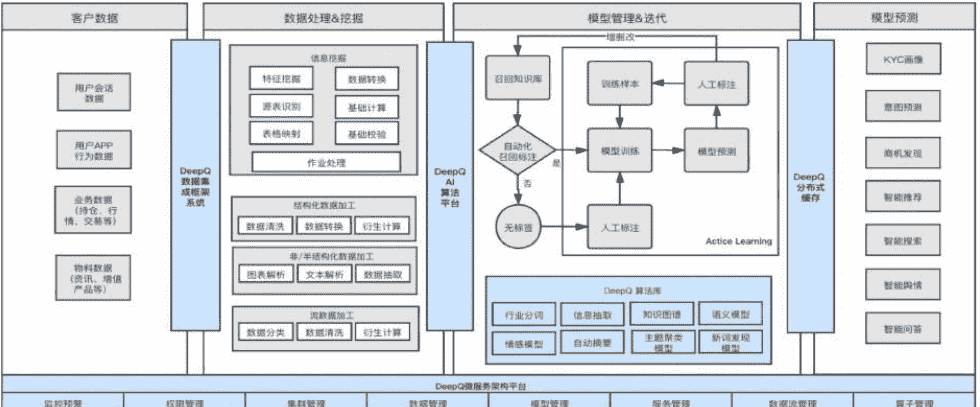

### 场景落地：以“风火轮”为例

#### 方案架构亮点

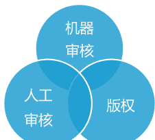

持有完整媒体版权授权，版权组合包灵活配置，保障新增版权实时上架。

#### 技术实现硬核支撑

专业证审团队配合完善服务规范，端到端保障审核效率与质量；数据采集、智能打标、合规检测至分发全链路技术体系成熟，时效性与扩展性俱佳。

#### 业务成果量化

| 核心指标 | 突破性表现 |
| :--- | :--- |
| **日产量** | 交易日原创资讯超 **3000 篇** |
| **时效性** | 从小时级跃升至 **3分钟内** |
| **覆盖面** | 个股覆盖范围扩大 **4 倍** |
| **触达率** | 热点推送打开率提升 **3-10 倍** |

---

### 燧原科技：云端AI算力基石

#### 企业画像

2018年3月扎根上海临港，双研发中心（沪/京）+ 深圳技术支撑。聚焦“通用AI训练推理”赛道，以自主知识产权的高算力、高能效比、可编程产品，服务互联网、金融/交通/医疗垂直行业及HPC/公有云领域。坚持“大芯片、硬科技”路线，持续迭代赢得市场认可。

#### 硬核产品矩阵

##### 云燧T10：训练场“主力军”

针对云端训练对通用性、能耗比、互联的严苛要求，T10基于自研“澄思”芯片打造，双槽PCIe 4.0标准卡。独创 **25GB双向背板互联**，非InfiniBand组网路径，同带宽下大幅降低复杂度与成本。单卡FP32算力 **20 TFLOPS**，支持FP32/BF16混合精度。

**软硬协同生态**：适配“驭算”平台，兼容主流框架，提供全链路工具链及底层SDK；针对BERT等大模型集群训练，提供分布式调度与智能互联深度优化。

##### 云燧i10：推理端“性价比之王”

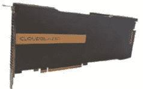

首款云端推理加速卡，单槽PCIe 4.0，FP32 **17.6 TFLOPS**，BF16/FP16 **70.4 TFLOPS**，兼顾算力、时延、成本与体验。

**推理引擎“鉴算 TopInference”**：图优化、算子融合、压缩量化多管齐下，低延迟高吞吐。配合虚拟化技术，助力数据中心低成本部署密集型负载。支持TF/PyTorch等模型格式，依托可编程架构应对未来网络多样化演进。

#### 创新护城河：四大核心壁垒

**01. 全栈自研架构，规避IP风险，提供替代选**
拒绝跟随GPU路线，采用异构计算新架构（灵活、可编程、高性能、高能效、高扩展）。关键技术全覆盖专利布局（授权40+，在审20+），在视频处理、目标/姿态识别等领域性能领先，提供低迁移成本替代方案。

**02. 直击大模型趋势，千卡集群线性加速**
高速互联端口支持多拓扑，自研ECCL通信库与“弘算TopsMatrix”平台，支撑千卡异构集群，实现业界领先线性加速比。

**03. 根植国产生态，筑牢安全底座**
自主软硬架构天然适配国产框架/生态。联合产业链伙伴，为高安全场景提供国产化全栈方案（供应链可控、易运维、持续进化）。

**04. 柔性商业模式，共建行业最优解**
提供定制联合开发，联动下游伙伴交付一体化方案，降低客户学习与运维门槛，加速行业/城市智能化进程。

#### 典型应用价值

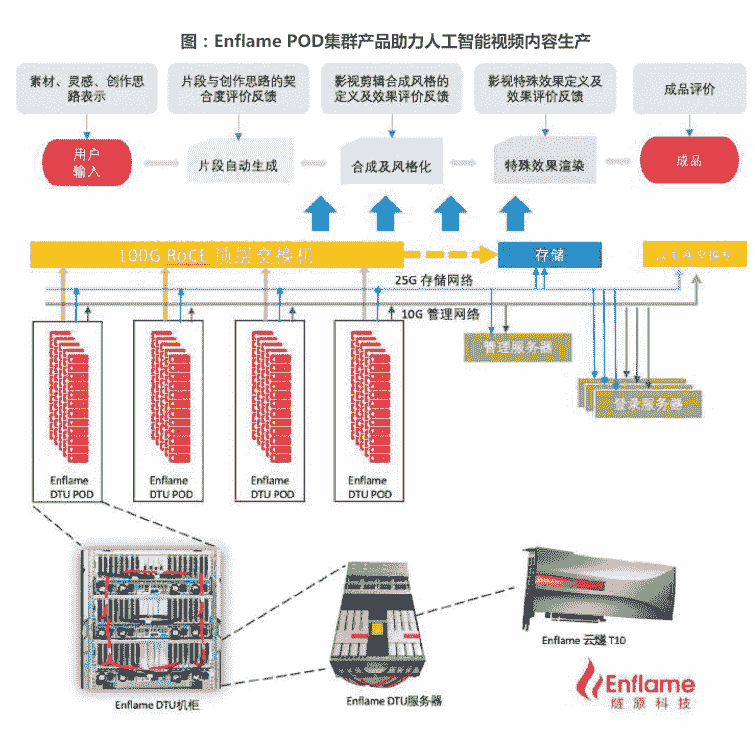

助力构建国内最大规模FP32高精度自主算力集群。智能互联技术保障高加速比，赋能海量多媒体素材自动生成高清视频——AI依逻辑脚本自动造视频，将重塑内容生产范式，引爆短视频/影视行业创新，释放巨大经济价值。

**技术溢出场景**：
1. **NLP能力** → 智能分类/抽取/评价解析/合同理解 → 覆盖客服、零售、金融、保险、电商。
2. **语音合成** → 智能客服/有声阅读/新闻播报 → 覆盖智能家电、泛娱乐、客服。
3. **图文/视频生成** → 短视频/游戏/广告素材生产 → 覆盖短视频、游戏、广电传媒。

---

### 芯驰科技：视觉中枢赋能城市精细化治理

> *注：素材中公司名为“上海芯型智能科技有限公司”，此处统一沿用素材标题“芯驰科技”*

#### 核心定位

针对视频数据治理与赋能刚需，推出**视频全要素治理平台**。面向公安、城运、企事业单位，打造一体化、智能化、专业化的**视觉中枢**，护航公共安全、安全生产与城市精细化治理。

#### 能力三层塔：数据闭环 → AI进化 → 场景交付

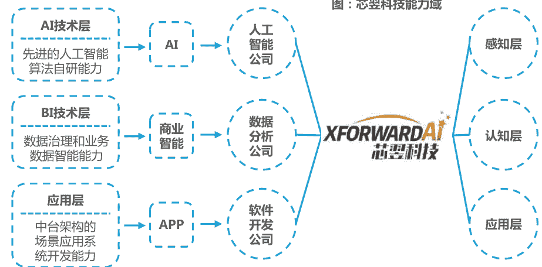

图：芯型科技能力域

图：视频全要素治理平台七大能力中心

**平台三大核心支柱**：

| 核心能力 | 关键价值 |
| :--- | :--- |
| **01 全量视频汇聚** | 覆盖全业务体系，实现精准查询与极速调阅 |
| **02 全域权限管理** | 构建一体化权限体系，横向打通、纵向管控 |
| **03 算法生态构建** | 打造可持续智能视觉生态，融合异构算法与算力 |

#### 创新动能：三大智能化跃升

**感知智能化 & 事件自动识别**
以物联感知为基，自动感知群体性/突发性事件，按影响范围与严重度自动研判，推荐预案辅助决策。

**处置闭环智能提速**
打通“采集-确认-分派-处置-反馈-归档-分析”全链路，自动推送至智能终端，全流程透明可控。

**城市级态势感知研判**
采集实有人口、车辆、房屋、交通、治安等要素，宏观梳理规模与关联，辅助城市资源投放规划决策。

#### 标杆场景验证

**智慧城市·一网统管**
- 视频资源全网共享、全时可用、全程可控
- 制定结构化场景与处理规范
- 强化治理与数据智能，筑牢城市精细化管理数据底座
- 提供精准实时支撑与赋能型技术输出

**重大安保·进博会实战**
- 平台首战告捷，核心“看”与“算”
- 视频指挥智能应用、立体联动、AI生态三大体系
- 强大精准调阅与计算调度能力，护航盛会安保

**工业互联·洋山港四期**
- 整合港口全量视频资源
- 定制化赋能：堆场通道人员管控、桥吊作业安全、生产安全智能化应用

---

### 雪浪云：缔造“未来工厂大脑”

#### 企业实力

国家级工业互联网平台建设主力，无锡雪浪全资子公司。IT/DT/OT三技融合国内领先，构建**“数据大脑核心、软硬协同框架、人机协同模式”**新工业技术体系。核心产品**雪浪OS数字制造中枢**，服务中铁装备、中铁重工、石化盛科等百余家龙头，输出转型咨询与工厂大脑方案。

#### 解决方案范式：“4+1+X”模型

**4 大中枢（雪浪OS核心）**

| 中枢 | 产品 | 定位 |
| :--- | :--- | :--- |
| **数据** | 雪浪虎符 | “人机料法环”多态数据一站式开发与资产化 |
| **计算** | 雪浪算盘 | 统一计算底座，联通机理/AI/边缘组件 |
| **AI** | 雪浪河图 | 工业AI工具箱与行业机理模型库 |
| **总线** | 雪浪共工 | 统一工业数字总线 |

**1 个驾驶舱（雪浪数字驾驶舱）**
面向现场/车间/企业三级，协同软硬件，智能编排业务流，实现优化调度总控。

**X 类场景应用**
- **现场级**：视觉/听觉数字化、瑕疵检验
- **车间级**：车间内环节协同方案
- **企业级**：全流程能源管控与能效优化

#### 创新引擎：雪浪算盘——全混合流计算先锋

团队首创自研技术，荣获2018世界物联网博览会银奖。

**四大技术优势**：
1. 可视化编排+交互节点 → 数字孪生、智能调度决策
2. 多语言SDK+跨平台容器 → 异构组件多网多协议接入
3. 分布式调度+多队列异步+全局状态对齐 → 海量数据强一致性流计算
4. 语言级非因果建模/转换中间层/静态检查/有状态计算

#### 数字孪生体系：四大维度落地

| 孪生维度 | 典型应用与价值 |
| :--- | :--- |
| **装备制造** | 以发动机为例，组件+算盘构建数字样机，实时数据接入计算，全生命周期资产沉淀 |
| **流程化工** | 实时优化框架（RTO），负荷/原料变动时自动寻优关键变量设定值，**降本增效** |
| **产线级** | 仿真三维场景+实时数据推演，验证排产可行性，解决工艺复杂导致计划落地难 |
| **企业经营** | 重塑经营流程，打破孤岛，预警风险、规避损失 |

#### 场景深度：实时优化RTO平台赋能流程制造

**平台六大功能组件**：
- **数据接口**：多协议/类型接入，总线供数
- **稳态检测**：判定工况稳态区间，为优化奠基
- **优化引擎**：目标函数定制+算法参数配置，模型算力高效部署
- **优化算法**：单/多目标即插即用，多样求解高效率
- **模型管理**：机理/数据模型并行计算，极致求解效率
- **OPC服务**：横向协同RTO系统，纵向联通控制/经营软件

> 图：双良智慧空冷管控平台

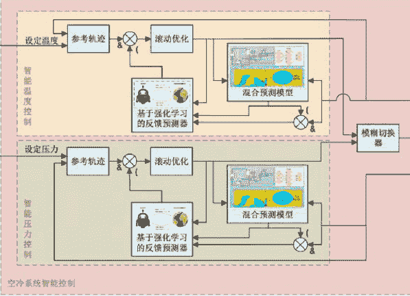

**电厂控制数字孪生·双良空冷案例**：
- 有限元孪生模型 → 高精度稳态预测
- 传热机理模型 → 大范围工况突变精准预测
- 边缘端多执行器分布式实时同步控制
- 输出冷端最优运行方案 → **省煤增效**

---

### 容智信息：数字化生产力提供商

#### 企业里程碑

2016年创立，深耕 **AI Digital Workforce（AI数字生产力）**。5年磨一剑，打造国内唯一 **智能自动化全生命周期产品矩阵——“iDiscover + iBot”**。已服务腾讯、宝洁、宜家、华泰证券、中粮、国家电网、三大运营商、一汽大众、海尔等数百家世界500强/央企/政府，覆盖财税、人力、采购、物流、供应链、营销等场景。2020年获数千万A轮融资，进入高速商业化期。总部上海，直销覆盖7大核心城市，生态伙伴辐射大陆港澳台，无锡建有全国最大研发/培训/交付中心。

#### 破局企业转型三大顽疾

| 挑战维度 | 痛点 | 容智方案价值 |
| :--- | :--- | :--- |
| **系统** | 孤岛林立，交互成本高 | **降低用工成本**，非侵入式跨系统打通 |
| **数据** | 碎片化，难资产化 | **提升工作效率**，数据自动流转沉淀 |
| **业务** | 重复低值，易错合规险 | **减少错误与合规风险**，释放人力创造力 |

#### 双子星产品：重新定义自动化门槛

**iBot —— 零代码RPA，搭积木般简单**
- **部署安全**：非侵入弱耦合，本地化跨系统跨平台，代劳重复作业
- **架构自主**：核心引擎100%自研，可视化流程+完善监控运维管理
- **AI内核强**：内置OCR/NLP/深度学习，驱动流程治理向智能化进阶

**iDiscover —— 流程挖掘“核磁共振”，精准定位自动化切入点**
*助力企业看清现状，科学规划自动化路线图。*

**安全防护**

# 解码AI落地标杆：数字员工与脑卒中诊疗的“硬核”实践

---

### 容智信息：重塑企业级智能自动化新范式

#### 核心架构：四重防护构筑安全基石
容智信息打造了一套立体化的安全防御体系。从身份认证、权限管控、会话监控到数据加密，四大核心层级层层设防；更创新性地引入“四层安全夹层机制”，深度覆盖执行步骤、业务流程、机器人个体及服务器集群，实现全链路的安全可控。

#### 兼容生态：全地形适应异构环境
平台展现出极强的环境适应力，无缝对接Windows、Mac OS、Linux/UOS及MobileHub等主流操作系统，全面兼容各类企业级业务系统与应用类型，打破了技术栈的壁垒。

#### 操作体验：零门槛赋能业务敏捷
“零代码、可视化、拖拽式”操作范式大幅降低了使用门槛。外挂式部署模式支持依据业务流变动实时调参，让自动化能力能随业务需求灵活伸缩，真正做到即用即改、所见即所得。

#### 智能引擎：从流程洞察到价值闭环
产品矩阵内置强大的智能分析模块，覆盖业务流程自动发现、合规一致性校验、绩效优化提升、流程重构再造、RPA机会精准识别、流程发现与RPA平台深度融合、KPI报告智能生成及RPA流程持续优化等全生命周期能力。

#### 企业基因：名企阵容铸就硬核实力
作为国家级高新技术企业，容智信息沉淀了30余项软著与专利。核心团队汇聚微软、IBM、英特尔、戴尔、惠普等世界500强资深专家，技术底蕴深厚。

#### 创新动能：AI赋能数字员工进化
依托“iBot + iDiscover”双引擎，融合自研OCR、NLP及深度学习模块，数字员工突破了规则僵化的瓶颈，具备处理复杂非结构化场景的认知能力。部署形态更灵活、服务交互更智能，推动AI数字生产力精准落地，成为企业降本增效的核心引擎。

#### 标杆案例：长江存储——财务智变释放惊人效能
为缓解人力短缺与高负荷痛点，长江存储引入数字员工方案，实现采购发票批量处理、费控识别、销项开票、进项认证、进口认证、出口退税、银企对账等七大财务核心流程全自动化。
> **战果：** 全年释放人力3600人次 | 整体效率跃升32倍 | 业务准确率100%  
> 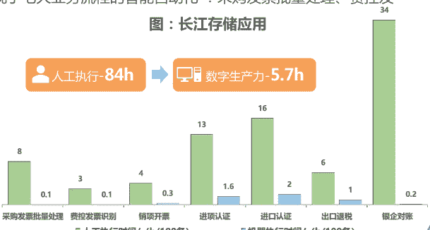

#### 标杆案例：华泰证券——金融场景深度渗透
方案覆盖文本上传打印、交易所保证金调整、分项资金处理、月结算单批量查询、银行回单下载核对、开票处理与维护、银企对账等券商高频作业环节。
> **战果：** 全年释放人力4320人次 | 整体效率跃升36倍 | 业务准确率100%  
> 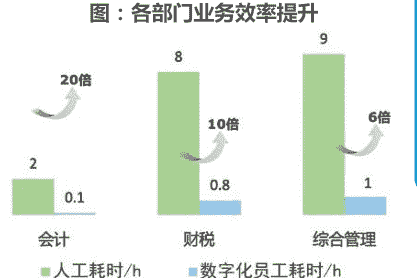

---

### 强联智创：定义脑卒中智能诊疗“中国标准”

#### 行业痛点：百万级高危人群呼唤精准方案
脑血管病患病率持续攀升，全国超5000万高危人群面临诊断决策难题。脑卒中以“四高”特征（高发病、高致残、高死亡、高复发）威胁国民健康。强医（上海）科技有限公司（强联智创）作为国内首家聚焦脑血管病治疗痛点的硬核科技企业，历经近五年深耕，推出U-Pixel™脑卒中智能诊疗平台，全方位赋能临床决策，引领垂直领域赛道。

#### 硬核产品矩阵：AI重塑临床决策链路

**UKnow® 智能动脉瘤稳定性评估**  
基于前沿图像处理与AI技术，精细重构脑血管三维解剖，自动量化10余项形态学指标。实现动脉瘤形态完美可视化与个性化稳定性评估，为临床决策提供量化依据。  
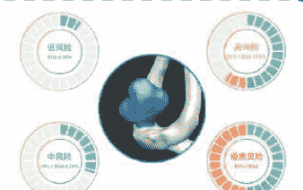

**UKnow® 手术模拟分析——微导管栓塞手术**  
自研智能微导管模拟算法，精准推演血管内螺旋行进轨迹，自动输出最优三维头端形状及塑形针量化参数。显著压缩手术时长，双重降低医患辐射风险。  
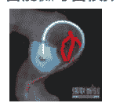

**UKnow® 手术模拟分析——密网支架手术**  
智能血流导向装置模拟算法自动匹配支架规格，全维度剖析血管截面形态，术前预演支架释放效果，为颅内动脉瘤介入手术提供精准“作战地图”。

**UKnow® 动脉瘤动态监测**  
跨时相影像精准配准与三维重建，全方位捕捉动脉瘤及载瘤动脉形态演变。定量化分析尺寸与生长趋势，敏锐预警破裂风险，助力锁定最佳手术时窗。

**U-Pixel™ 脑卒中智能诊疗平台**  
一体化覆盖出血/缺血双模块，贯穿筛查、诊断、治疗、随访全周期。双端（PC/移动）协同，打破时空限制。医生借此平台可高效完成精准决策，大幅提升诊疗时效与准度。

#### 创新引擎：顶尖智库支撑临床落地
核心团队源自清华、弗吉尼亚大学等名校，深耕医学影像与AI算法十余载，斩获多项国际顶级赛事桂冠。拥有世界级算法科学家阵容及NMPA注册认证实战经验。通过底层算法重构，融合影像与临床多模态数据，按疾病阶段特征开发双系列产品矩阵，构建起全流程技术护城河。  
> 战略合作百余家三甲名院：北京宣武、天坛，上海华山、长海等领衔。  
> 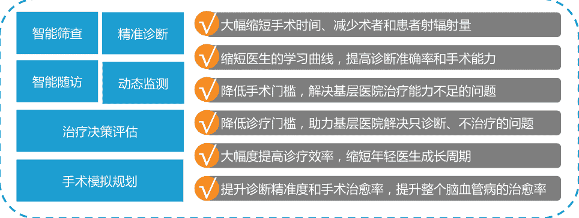

#### 落地价值：从痛点切入织就全流程网络
产品线前延至筛查诊断，后延至随访管理，已实现出血性与缺血性脑卒中多病种全诊疗链路的智能化覆盖。平台落地将为我国脑卒中诊疗水平跃升释放不可估量的社会与经济效益。

---

### 附录：案例企业名录（节选）

#### 创新篇
上海交通大学、同济大学、复旦大学、百度中国、华院数据、上海电科院、观安信息、联影智能、明晧AI、仪电AI创新院、上海数据交易所、建信金科、幻电信息等。

#### 特别篇
依图网络、皓彬科技、联影智能、跃米机器人、竹间智能、智臻网络、云扩科技、WAYZ维智、星环科技、松鼠课堂等。

#### 产业篇
天数智芯、复旦微电子、黑芝麻智能、奥视达、数迹智能、翰动浩翔、博雷顿、中交通信、富数科技、虎博网络、上海建工四建、晶赞融宣、齐耀机械、画龙信息、达疆网络、复旦妇产科医院、龙慧医疗、森亿医疗、上海影像所/中山医院、宝藤生物、什维新智、华为、深兰科技、智驾汽车、掌门教育、上海交大、同禾工程等。

#### 场景篇
商汤科技、张江集团、百联电商、南京路步行街、集成电路研发中心、工商银行、上海国际汽车城、市公卫临床中心、北新泾街道、世外智慧教育、科创中心海关、视辰信息等。

#### 企业篇
闪马智能、西井科技、眼神科技、影创信息、氪信技术、魔视智能、深擎信息、燧原科技、芯塑智能、雪浪数制、汉王科技、爱数智慧、**容智信息**、数库科技、**强医科技**等。

---

### 后记
本案例集系统复盘“十三五”时期上海立足国际视野、系统布局，发挥数据富集、场景丰富、门类齐全优势，将AI列为三大主导产业之一，建设“上海高地”的实践历程。旨在为从业者把握趋势、参与建设、推动新一代AI健康发展提供参考。

编撰过程中，上海市经信发展研究中心提供素材支持，上海AI研究院、智慧城市研究院、亿欧智库、今日AI编辑部分工协作，各企业机构贡献宝贵案例，致谢各方。受限篇幅，电子版仅节选部分章节，完整版涵盖高校创新平台、产业赋能中心、集成应用中心、核心智能硬件、智能机器人、无人系统、代表性应用场景等丰富内容，请通过上海交通大学出版社官方渠道获取。

---

### 版权声明
报告数据源合规、逻辑专业，仅反映作者研究观点。仅在法律许可下为信息提供发放，不构成投资建议或广告。信息源自公开资料，亿欧智库尽力甄别但不保证绝对准确完整。版权归亿欧智库所有，引用需注明“亿欧智库”，侵权将追究法律责任。

---

### 关于亿欧
亿欧EqualOcean成立于2014年，总部北京，分布上海、深圳、南京、纽约。聚焦“科技+产业+投资”，立足中国影响全球，服务覆盖50+国家地区。  
旗下矩阵：亿欧网/国际站、亿欧智库、亿欧数据、亿欧大健康、亿欧汽车。  
凭借深度产业洞察与国际视野，为华为、阿里、腾讯、英特尔、美团、SAP、拼多多、京东健康、上汽、蔚来、一汽等头部客户提供研究、投融、咨询、数据、品牌、出海等全链路服务。

---

### 亿欧服务版图

**创业企业**：亿欧网/国际站为VC/PE、创业者、政府重点关注平台，报道助力品牌曝光、降低融资沟通成本、吸引生态伙伴与人才，优质案例入库智库报告树立行业标杆。

**大型企业**：依托研究能力与第三方视角，提供行业/用户研究、投资分析、创新咨询；实时产业数据库与链接能力助力产品落地与生态布局。

**政府机构**：四大服务——产业情报支撑决策、搭建政企沟通桥梁、定制产业培训提升招商服务能级、协助产业规划落地。

**机构投资者**：百强分析师团队+15000+专家库，提供专家咨询与标的尽调，消解信息不对称，护航投资决策。

---

### 联系我们
📞 电话：010-57293241  
📧 邮箱：hezuo@iyiou.com  
🌐 官网：https://www.yiyou.com/research  
📍 地址：北京市朝阳区霞光里9号中电发展大厦A座10层  
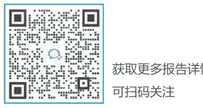  
