# 零基构建AI智能体：Manus、LangChain、Dify跨平台协作实战

## 作者简介

## 廖显东

上简科技创始人兼CEO，资深软件架构师、AI算法专家、全栈实践者、技术极客。长期聚焦前沿计算技术的研究与工程化，具备多年软件研发与团队管理经历，熟练使用Java、JavaScript、C/C++/C#、Python、PHP、Go、Rust等语言。对大型电商建设、高并发与分布式架构、微服务、大数据、人工智能算法、Web3.0、AIGC、ChatGPT、Midjourney、DeepSeek、Claude、元宇宙等方向有深入实践。

著有《AI全能助手：人人都能玩转Deepseek》《Rust Web编程从入门到实战》《Go语言高级开发与实战》《Go语言设计模式》等。

个人公众号：源码大数据。
抖音、小红书、视频号、知乎等自媒体统一署名：廖显东-ShirDon。

人工智能科学与技术丛书

## 从0到1搭建AI智能体
Manus+LangChain+Dify 多平台应用及多智能体协同

廖显东◎编著

机械工业出版社

CHINA MACHINE PRESS

本书以AI智能体为切入点，系统梳理其概念、主流平台的实操思路与底层原理。读完后可掌握从零搭建智能体的完整路径，既是一本实战手册，也是进入AI时代办公方式的路线图。全书分三篇：

第1篇先讲清智能体的基本概念与工作机理，并以可视化平台“扣子”为例，用零代码方式完成首个智能体的搭建；第2篇深入Manus、AgentScope、LangChain、Dify等主流平台与框架，结合旅游规划、数据分析、问答、五子棋等项目，掌握多智能体协作与办公场景技巧；第3篇先介绍OpenManus的实操方法，再用CrewAI搭建多角色智能体，最后解析RAG、MCP、A2A等关键技术与协议，讲解智能体间通信、本地部署与多模态融合。随书附案例源码、电子课件与重点难点微视频，获取方式见封底。

适合办公人员、开发者、编程爱好者、在校学生、科技创业者、设计师、科技爱好者、高校教师，以及希望快速掌握智能体使用方法的大众读者。

## 前言

人工智能正深度渗透工作与生活。搜索引擎能自动补全，AI客服可自然对话自动应答，图像生成工具可一键出图，甚至写作、编程、设计、排版等专业工作也被工具化。但真正推动效率跃迁的核心，已从分散的单点AI工具转向AI智能体这一新形态。

### 1. AI智能体如何改造工作方式

传统AI多为单任务驱动：提问→等待结果→再提问。无论对话机器人还是图像识别，本质都是输入输出结构。简单但难支撑复杂流程，比如完整项目管理涉及排期、文案、分析、跨工具协同，传统工具难以自动串联。

智能体的出现打破了限制。它具备自主思考、计划执行与目标导向行动能力，不再只是答疑工具，而是能主动思考并持续行动的数字角色。它可理解复杂指令、调用外部能力、在上下文中持续交流，甚至主动发起下一步。例如一个具备智能体能力的助手，不仅能写会议纪要，还能据内容自动安排后续会议、发通知、生成待办并同步到协作平台。

这意味着流程重塑与数字劳动自动化、协同能力的提升。未来办公可能由多组智能体组成“数字工厂”，各司其职、协同优化、持续提升效率。

### 2. 为什么需要AI智能体

技术演进推动工作模式变化，智能体应运而生，主要解决传统工具覆盖不到的复杂决策与任务协作难题。

1）实现连续高效的工作流
智能体可不间断自主执行，无需持续人工干预，适合数据分析、监控预警、跨系统协调等重复工作，显著提升业务运行效率。跨平台取数、生成报告、触发后续流程时，智能体能主动识别并调度执行。

2）支持实时判断与动态应对
与仅生成回答的大模型不同，智能体可感知环境、即时决策并执行，能接入外部接口或传感器数据，在环境变化时动态调整策略。市场条件变化、客户行为改变时，能快速识别并响应。

3）降低成本、提升可扩展性
任务量增长时，智能体无需像传统系统那样大幅增加人力，只需扩容部署。具备高度可扩展性和自我优化能力，随着执行次数增加效率提升，对资源有限的创业团队尤为关键。

4）带来决策支持与精准沟通体验
智能体不仅能执行，还能分析数据、提炼趋势并给出建议。例如在客服、销售、HR领域，可主动联系客户、生成备选方案并优化沟通流程，提升体验与响应质量。

5）打破系统孤岛，实现跨部门协作
多智能体协同时可自动共享上下文与状态，实现跨系统、跨角色配合完成任务，替代传统人工转接与手动协调，使系统无缝连接、信息顺畅流通。

6）从信息获取走向复杂任务执行
大模型与RAG在内容生成与知识检索上表现优异，但不足以承担真实世界的任务执行与决策。智能体弥补了这一缺口，提供从文本输入到主动规划、执行、反馈的完整能力，可将语言理解转化为行动指令，完成跨系统的任务流程。

### 3. 阅读本书能学到什么

本书帮助读者全面理解智能体理念、构建方法与实际应用，共分三篇：

“第1篇 零基础入门——开启你的AI智能体旅程”从概念出发，介绍智能体与传统AI的区别、运行机制与核心特征。通过可视化工具“扣子”平台，带领读者零代码完成首个智能体搭建，实现人人可搭建AI助手。

“第2篇 升级打怪——从AI玩家到AI编排师”进入中级阶段，聚焦Manus、AgentScope、LangChain、Dify等主流平台与框架。每章配实战项目，如旅游规划、数据分析、问答智能体、五子棋游戏等，帮助理解不同平台的应用场景与能力边界，掌握主流平台实战方法与技巧。

“第3篇 高级实战——深度挖掘AI智能体的潜力”面向有基础的开发者，先通过OpenManus实战打造进阶智能体，再通过CrewAI创建多角色智能体实战，剖析多角色智能体的实战方法，最后深入挖掘智能体背后的关键技术，包括RAG、MCP、A2A等协议，讲解智能体间通信与协作、本地部署、多模态融合，构建具备决策与交流能力的系统。

每章均含实战，力求读得懂、学得会、用得上。通过本书可掌握智能体的概念与架构，并亲手构建具备实际功能的智能系统，最终具备独立设计、组合、部署智能体的能力。

AI智能体时代已到来。从个人助手到多智能体协作平台，正在重新定义未来生产方式。办公、教学、软件开发、数字创作、企业运营等领域都将涌现更多由智能体驱动的工作流。掌握这一新范式既是技术升级的必由之路，也是把握数字时代主动权的重要起点。

愿本书成为变革之旅的起点，帮助立志科技、追求高效与创造的人绘制专属智能体蓝图。

### 4. 配套资源与勘误

阅读过程中如有疑问，关注“源码大数据”公众号留言，作者会尽快回复。关注后发送“ai agent learning”即可获取配套资料、视频教程、最新智能体相关研究资料等。

读者可通过抖音、小红书、B站、知乎、快手搜索自媒体账号“廖显东-ShirDon”，免费观看最新视频教程。

因作者水平有限难免疏漏，欢迎通过“源码大数据”公众号或QQ号823923263批评指正。

### 5. 致谢

特别感谢机械工业出版社李晓波编辑，推动本书出版，并在写作过程中提出许多宝贵意见与建议。

感谢女儿，给予更多写作动力与快乐，愿她健康快乐成长。

感谢妻子，在写作期间给予意见与坚定支持，使本书得以顺利完成。

编 者

## 第 1 篇

### 零基础入门——开启你的AI智能体旅程

## 第1章 AI智能体原来这么简单

### 1.1 为什么 AI 智能体如此强大

随着大语言模型如ChatGPT的出现，AI的理解与生成能力显著提升。然而大语言模型本身缺乏执行任务的能力。AI智能体通过将大语言模型与外部工具、接口结合，实现了从理解到行动的完整闭环。

智能体不仅是执行者，更是带有目标感的系统，能自主感知环境、分析信息、规划行为、做出决策并持续优化。例如在企业自动客服场景中，传统客服受限于固定流程，只能回答预设问题。而智能体能基于对话历史与语义上下文判断客户真实意图，甚至在无明确指令时主动反问，从而推进任务完成。

这一根本变化使智能体不再是“问什么答什么”的工具，而是可以“理解上下文并主动响应”的智能协作者。智能体不仅能“说”，还能“做”，极大扩展了应用场景。

#### 1.1.1 什么是 AI 智能体
**1. AI 智能体的定义**

AI智能体是利用AI实现目标并代替用户完成任务的软件系统。它具备推理、规划、记忆能力，并具有一定自主性，能够自主学习、适应并做出决定。智能体的功能范围远超自然语言处理，涵盖决策、问题求解、与外部环境交互与操作执行。

智能体的概念并不新颖。上世纪60年代美国斯坦福国际研究所开发的机器人Shakey是早期代表。Shakey在当时具有革命性：它是首个能感知周围环境、推理任务并自主行动的移动机器人。尽管受限于当时技术，Shakey引入的许多概念至今仍是智能体的重要支撑。美国计算机历史博物馆展示柜中的机器人Shakey如图1-1所示。


• 图 1-1
Shakey 于 1966 年诞生，是第一个能够推理周围环境的移动机器人。它可以执行需要规划、寻找路线和重新排列简单物体的任务。如今，AI 智能体的发展已远远超越了 Shakey，得益于机器学习（Machine Learning，ML）和 AI 的进步，如今的 AI 智能体能够做到：
- 1. 理解背景并根据细微的输入做出决策。
- 2. 通过涉及多个步骤和变量的复杂场景进行推理。
- 3. 不断从反馈中学习，以提高绩效。
- 4. 利用外部工具，例如查询数据库、连接 API 以及管理跨多个系统的工作流。
**2. AI 智能体的核心架构**

一个完整智能体系统通常由以下4个核心模块协同构成：

1）感知模块
负责采集外部环境信息，数据来源包括用户输入、传感器、API接口或系统日志。以交通控制智能体为例，感知模块相当于摄像头、雷达等。

2）推理模块
是智能体的“大脑”，负责理解当前状态、进行推理与决策，通常由一个或多个大语言模型组成。会结合规则、知识库与大语言模型，对环境做出综合判断。例如仓储管理智能体在感知到库存不足时，会基于供应周期、销售趋势等因素决定是否补货。

3）执行模块
会根据推理模块的决策结果执行具体操作，包括下发指令、调用API、控制机械设备，或向用户发出响应。例如物流智能体根据调度计划发出配送指令，或控制仓库中的机器人搬运货物。

4）学习模块
用于对系统行为结果进行反馈与优化。通过比较预期目标与实际结果，不断调整感知、推理与执行模块，从而提升未来任务表现。例如语音助手在多次误识特定词汇后，可通过学习模块优化语音识别模型，降低错误率。

**3. AI 智能体的工具调用机制**

过去的大语言模型只能进行“文字游戏”，生成回答或段落，无法与现实世界真正互动。而智能体的重要突破之一在于引入“工具调用”机制。

该机制使大语言模型可通过自然语言调用外部函数、接口或工具系统，实现从“说”到“做”的跃迁。例如：
- 智能体可调用日历API安排会议、通过邮件API发送总结。
- 调用Python代码解释器执行数据可视化任务。
- 访问企业内部数据库或通过互联网检索知识，增强回答能力。

工具调用使智能体摆脱语言生成的限制，成为真正可执行复杂任务的执行者，具备落地能力。

**4. AI 智能体的分类**

按对环境的理解深度与决策能力，可划分为以下3种典型类型：

1）反应型智能体
不具备内部状态，仅基于当前感知直接做出反应。例如家用空调中的温控系统，根据当前温度决定是否启动制冷或加热。

2）具备内部状态的智能体
拥有对历史信息或上下文的记忆，能在多轮交互或动态环境中保持更高稳定性。例如智能语音助手能记住当前对话主题，无需用户每句话都重新说明背景。

3）规划型智能体
不仅能处理当前状态，还具备前瞻性，能进行多步推理与策略规划。例如智能仓储调度系统在规划货物运输时，不仅考虑当前库存和路线，还会预测未来订单趋势、天气变化，从而优化整体配送计划。

**5. AI 智能体的典型应用场景**

智能体已在多个行业落地，典型场景如下：

1）智能客服
可理解用户意图，基于上下文主动推荐解决方案，不再局限于问题查询或规则匹配。

2）数据分析与报告生成
可自动分析业务数据，生成洞察报告，辅助决策者快速获取关键信息，提升决策效率。

3）业务流程自动化
通过自动化处理重复性工作流程，帮助企业简化操作流程，降低人为错误，提升运营效率。

4）知识管理与信息检索
整合企业知识库，支持高效信息检索，帮助员工快速获取所需资料，提升工作效率。

5）决策支持系统
基于数据分析提供数据驱动的决策建议，辅助管理层制定战略决策。

#### 1.1.2 AI 智能体的核心特性——自主性、交互性、决策能力

智能体不仅能执行任务，更具备对任务环境的理解与适应能力。要真正理解其价值与应用边界，需深入探讨其3个核心特性：自主性、交互性与决策能力。三者共同构成行为支柱，决定其在现实世界中的表现与任务适应性。

**1. 自主性**

自主性指智能体在无持续人工干预情况下，能主动感知环境、评估情境并制定行动策略。与传统软件依赖外部指令触发不同，智能体可根据内部机制或预设目标自主触发流程。

高自主性的智能体不仅响应当前输入，还会持续评估外部变化，根据目标与上下文偏差动态规划行动，常通过任务分解与计划执行实现。

例如某企业部署的智能数据分析智能体，用于跟踪市场舆情。不同于被动等待查询，它可定期访问社交媒体、自动提取关键舆情数据、分析话题热度，并在检测到异常波动后自动生成报告。这不仅节省人力成本，更将响应时间压缩至分钟级。

核心技术支撑包括：
- 任务规划器：负责将用户目标分解为可执行子任务并合理安排执行顺序。
- 状态追踪器：用于实时记录和更新执行过程中的状态信息，确保了解当前进展，避免重复执行或遗漏关键步骤。
- 事件驱动触发器：通过监听特定事件或条件变化触发相应任务或响应，使智能体能根据环境或用户行为做出及时反应。

自主性使智能体从“指令执行者”转变为“环境响应者”，具备独立运行与持续执行任务能力。

**2. 交互性**

智能体之所以拥有“智能”，很大程度上源于多维交互能力。这不仅指与人类的语言沟通，更涵盖与其他系统、工具、模型之间信息交换与协同执行。智能体往往具备以下交互方式：
- 自然语言交互：借助自然语言处理技术，能理解并回应人类提出的模糊、复杂或上下文依赖表达。
- 工具链协作：可调用外部工具如数据库、计算引擎、浏览器插件等完成复杂操作。
- 智能体互通：在多智能体系统中，具备与其他智能体交流任务状态、分工协作的能力。

智能体能力拆解：从交互到决策再到落地

以工程实战为例，开发同学让智能体帮忙“搭一个能直接部署的 Spring Boot 接口模块”。系统不仅读懂了背后的真实诉求，还会自动串起代码生成、单元测试以及部署脚本执行这几条链路，把完整项目骨架一次性搭出来。执行过程中它会不断向人通报进度，并在收到反馈后即时调整下一步动作。

这种顺畅的人机协作，离不开两项底座技术：

- 1) 自然语言理解 Natural Language Understanding，NLU：让系统能听懂人话，抓住表达背后的意图，判断用户到底在说啥、想要啥。
- 2) 对话状态追踪 Dialogue State Tracking，DST：负责保存对话上下文，保证交流不跑题、不掉线。

有了这两层支撑，智能体不再是单向吐信息的终端，而是逐步变成组织内部的智能协作枢纽，懂得拆解需求、调度资源并推动任务闭环。

**3. 决策能力**

决策能力反映的是系统对复杂问题的理解深度与行动精准度。既要摸清目标和环境，也要在多套备选方案里评估风险、测算收益、挑选最优路径。

这类能力依赖多步推理 Multi-step Reasoning、知识检索 Knowledge Retrieval 与策略优化 Policy Optimization 等算法组合。

比如某财务顾问智能体接到“为一家中型制造企业做季度预算”的指令。它不会直接甩一张表，而是先梳理企业过往开支，结合市场走势推演原材料成本变化，再评估设备折旧与人工成本的波动趋势，最后给出多套预算方案的对比并推荐性价比最高的版本。整体思路拆成三环：

- (1) 信息抽取
从结构化或非结构化数据源里把所需要素抠出来，例如用 SQL 查库或解析文档关键字段，为后续判断准备基础数据。
- (2) 情景建模
针对不同业务情境，把经济参数如市场波动、成本等与财务指标如利润、回报率等关联起来，形成可供推理的参考框架。
- (3) 策略挑选
基于已有信息与模型，选出风险最小、期望收益最大的策略，实现更个性化、更智能的决策行为。

支撑上述流程的技术机制主要有：

- 1) 强化学习 Reinforcement Learning：通过持续与环境互动试错，在反馈循环里不断提升策略，像个会积累经验的智能玩家。
- 2) 决策优化器 Decision Engine：相当于系统的大脑，根据当前情境和目标函数算出最优或近似最优行动路径，保证结果可行且有价值。
- 3) 多目标评估 Multi-objective Evaluation：在收益、成本、风险等多维度间做权衡，让输出更全面、更贴近现实。

依托这些机制，智能体从只能执行固定指令的“机械臂”进化为能在复杂问题面前自主权衡并做选择的“决策者”，实现从“能做”到“会选”的跃迁。

### 1.2 AI 智能体与传统 AI 应用的区别

厘清两者核心差异，有助于把握技术演进，也为下一代系统提供思维框架。

**1. 角色定位的本质差异**

传统 AI 更像工具，智能体更接近助手。前者擅长解决单一问题，后者致力于完成完整任务。技术源头相同，使用方式截然不同。

举例，OCR 模型能把图片文字转成可编辑文本，却不会主动判断文档类型，也不会决定下一步该提取哪些字段。OCR 就像一把精准却被动的剪刀。而智能体在收到“请解析这份发票”的指令后，会自行调用 OCR 识别内容、分析结构、推断字段含义，最终输出结构化财务数据表。

**2. 系统架构的不同维度**

传统 AI 多采用“输入—模型—输出”的封闭链路，聚焦为单一任务打造高度优化的模型。流程线性、目标单一、数据驱动强，但决策逻辑多由人工预设。

智能体则建立在多模块协同的体系之上，具备“感知—理解—规划—执行”的完整闭环。多数情况下它会接入大语言模型如 GPT-4、Claude、Gemini 等作为通用认知核心，同时挂载代码执行器、数据库接口、API 连接器等工具，形成可嵌套、可反馈的智能系统。

传统 AI 像高速公路上的快车，只能抵达预设终点；智能体则像导航系统，能根据环境变化重新规划路线，自主调度各类工具到达目的地。

**3. 任务类型的适用场景**

传统 AI 适合目标明确、上下文稳定的单点任务，如语音识别、图像分类、文本翻译、用户评分预测等。这类问题输入清晰、输出可衡量，适合建模训练部署。

智能体擅长处理开放式、多阶段、条件变化的复杂任务，包括自动撰写报告、搭建数据分析流程、依据用户反馈持续优化内容生成策略等。这类任务无法靠单一黑盒模型完成，需要多步思考、条件判断与策略组合。两者目标对比见表 1-1。

表 1-1

| 应用目标 | 传统 AI 处理方式 | AI 智能体处理方式 |
| :--- | :--- | :--- |
| 邮件处理 | 抓取关键词、做情绪判断 | 理解来意、归类并草拟回复 |
| 销售报表处理 | 自动标记数据走势 | 自动解读、推演销售走向并产出洞察报告 |
| 客户聊天界面 | 按规则或知识库应答常见问题 | 保留上下文、动态记忆意图、主动追问 |
| 代码生成 | 输出一段固定算法 | 拆解需求、设计结构、分步生成完整代码 |

**4. 能力边界的技术层级**

传统 AI 在特定领域表现突出，却很难脱离预设范畴工作，面对陌生任务常显无力。智能体通过链式思维 Chain-of-Thought、工具调用 Tool Use、规划执行 Planning and Execution 等机制，具备主动学习、目标追踪、自我纠错的能力。它们不仅能解释任务含义，还能拆解步骤、调用外部工具、依中间结果调整下一步。更先进的系统甚至支持多智能体协作，完成软件开发、学术研究、流程建模等高认知负荷任务。

**5. 生态接口与自适应能力**

传统 AI 更像一个插件，输入匹配就能给出高质量结果，输入不符则应对乏力。智能体拥有“连接与适配”机制，能主动检索资料、调用 API、与其他模型或数据源协同。以 LangChain 架构为例，智能体可按指令动态切换模块，从数据库读结构化数据、调用代码解释器执行逻辑、再由大语言模型撰写报告，实现真正的任务闭环。

**6. AI 智能体与传统自动化系统的本质区别**

核心在于是否具备自主适应能力。

(1) 传统自动化系统
依赖固定规则或流程，适合明确重复的任务。例如：“收到 A 指令，执行 B 操作。”典型场景有定时备份、数据迁移、格式化报表等。

(2) AI 智能体
以目标驱动，能随环境变化灵活调整策略。任务场景改变时，它会自主做出新决策，而非按预设脚本机械执行。

例如客户投诉过程中突然表示“问题已解决”，传统自动化脚本仍会继续走退货流程。而智能体会动态感知上下文变化，立即中止退货，转而结束投诉处理。这种上下文感知与目标驱动的能力，是智能体与传统自动化的根本分野。

### 1.3 AI 智能体是如何工作的

智能体的核心优势在于“感知—推理—执行—学习”的循环。通过不断感知环境、推理最优行动、执行任务并依据反馈学习调整，它能持续完善决策与执行效率。这种自我优化机制使其在电商推荐、营销自动化、机器人控制、智能制造等多个领域发挥巨大潜力。智能体工作流程如图 1-2 所示。

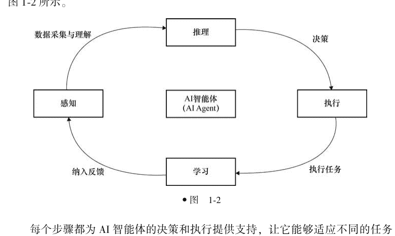

每个环节都为决策与执行提供支撑，使其能够适应不同任务与环境，逐步实现自主作业。整个过程像一条无形的思维链，从感知到推理再到执行与学习，不断迭代优化表现。运作细节如下。

**1. 感知——数据采集与理解**

感知系统相当于智能体的“眼睛”和“耳朵”，负责收集数据、理解外部环境。实际应用中，感知涵盖用户交互记录、历史交易数据、网络活动，以及来自其他智能体的反馈等。这一阶段为智能体理解世界提供基础。

例如电商网站用智能体做商品推荐，智能体先通过感知收集用户的浏览历史、购买记录和搜索习惯，用于初步判断兴趣与需求，如同我们通过观察喜好来了解一个人。

**2. 推理——分析数据并做出决策**

在明确目标后，智能体利用已有规则或模型对数据进行分析，判断最优行动路径。

延续电商推荐的例子，智能体通过分析用户行为，推断哪些商品更可能符合需求。它会权衡显示哪些商品最易被购买、哪些是用户尚未注意的热品、哪些能提升复购频率等多种可能性。

**3. 执行——执行任务**

推理完成后，智能体通过执行器采取实际行动。对物理机器人而言可能是电机控制移动或操作物体；对软件智能体而言可能是发送邮件、更新数据库或调整广告出价。

在电商场景中，智能体将个性化推荐实时展示给用户。用户登录时，系统动态更新推荐内容，推动互动与销售。

**4. 学习——基于反馈不断优化**

每一次行动都会产生反馈，这是智能体校验决策、为未来提供信息的重要依据。它会根据反馈自我学习，调整策略避免重复错误。

电商平台的智能体在推荐后会收到用户点击或购买等行为反馈。若发现某些推荐效果不佳，它会据此调整下一次推荐的商品。通过这种反馈与调整，智能体的决策与执行能力不断提升。

通过感知、推理、执行、学习的循环迭代，智能体的表现持续优化。

### 1.4 常见 AI 智能体简介

随着技术落地，AI 智能体已从概念变为可操作、可复用的开发平台与产品框架。本书聚焦产业界与开发者社区中备受关注的 6 个代表。

## 1. Coze——字节跳动生态中的 AI 智能体构建工具

Coze 来自字节跳动，面向零代码与轻量开发需求。它最大的特点是对微信、飞书、钉钉等国内主流通讯平台的深度整合，让非程序员也能快速部署具备问答、记忆、调用外部插件能力的轮对话智能体。Coze 官方网站如图 1-3 所示。

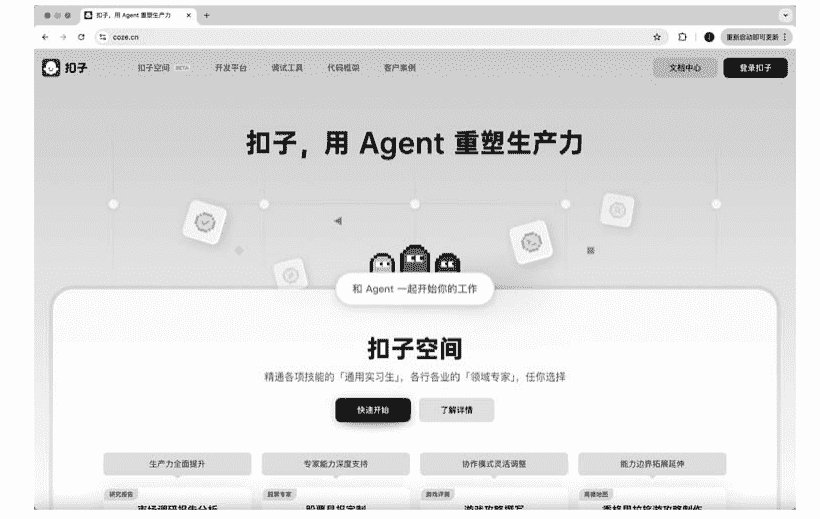

Coze 采用流程图形式管理 Agent 行为逻辑，开发者可通过节点配置调用 API、执行函数或接入知识库。在接口层面支持函数调用、工具多调度及 LangChain 集成，在保持低门槛的同时具备扩展性。常见场景包括电商客服、企业知识助理、教育答疑机器人等。

## 2. Manus——多智能体协同的企业级 AI 智能体中枢

Manus 强调多智能体协作与大模型调度，目标是构建类“AI 操作系统”的企业级底座。它支持接入通用语言模型、私有垂类模型、搜索智能体、代码执行器等，通过工作流编排与上下文管理实现链式执行与多智能体协同。Manus 官网如图 1-4 所示。

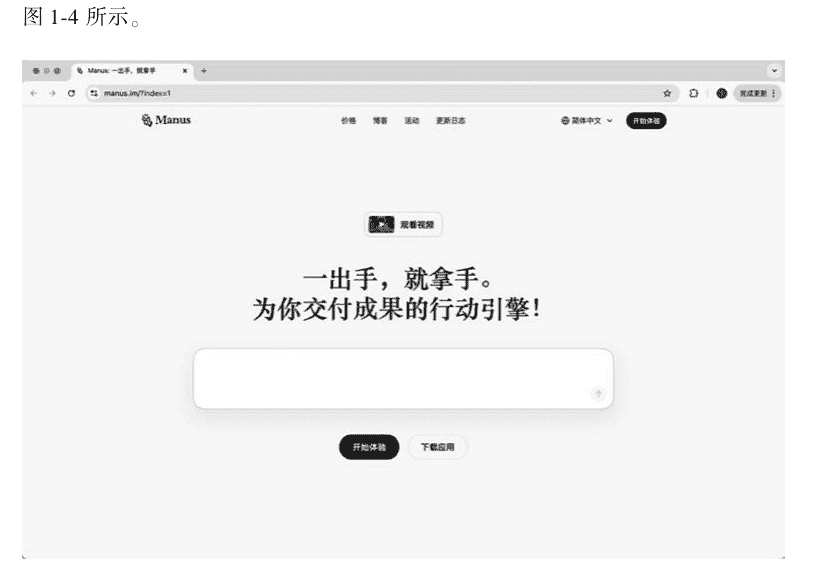

• 图 1-4

Manus 提供统一事件总线、缓存机制与知识记忆体系，使智能体间可共享任务状态与环境信息。例如在企业报告自动生成中，一个智能体负责数据分析，另一个负责文案撰写，最终输出结构化报告。其工程风格偏向中大型企业的 AI 中台，强调稳态执行与多任务容错。

## 3. AgentScope——阿里巴巴提出的 AI 智能体运行框架

AgentScope 由阿里巴巴开发，具备强大的可扩展性与执行控制能力。该框架从设计之初就面向多智能体系统，专注智能体调度、生命周期管理与资源隔离，适用于构建复杂智能体网络与任务协作系统。

其特色是“行为计划生成器” Plan Generator，支持根据自然语言任务目标动态拆解子任务，并智能分派给具备特定能力的子智能体。例如旅行规划智能体可调用地图搜索、航班查询、行程整理等子智能体协同完成任务，实现自动化智能分配。

AgentScope 适合构建可组合、可监控、可持久化的大型智能体网络，位于研究框架与工程平台之间，既有灵活性又有实用性，特别适用于原型开发与复杂任务建模。

## 4. LangChain——构建具备工具使用能力的智能体

LangChain 是 AI 智能体生态中最具影响力的开源框架之一，由 Harrison Chase 发起。核心在于提供清晰的“链式执行”逻辑，将大语言模型的输出作为下一个任务的输入，使智能体具备流程控制能力。LangChain 官网如图 1-5 所示。

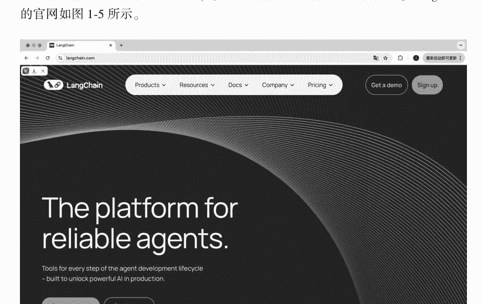

• 图 1-5

LangChain 允许开发者组合多种组件构建复杂任务链，包括工具调用如搜索、计算器、上下文记忆、外部数据库交互等。借助“AgentExecutor”模块，可在多种工具间灵活切换，使大语言模型不再局限于文本生成，而能完成目标导向的任务。适用场景涵盖自动摘要、多轮问答、编程助手、搜索聚合等。

## 5. Dify——面向私有化部署的智能体开发平台

Dify 强调可视化、即插即用与本地部署能力，适合中小型团队与创业者构建自有智能体系统。其开发体验类似 Notion AI，支持通过图形界面快速搭建聊天流程与智能体结构。Dify 官网如图 1-6 所示。

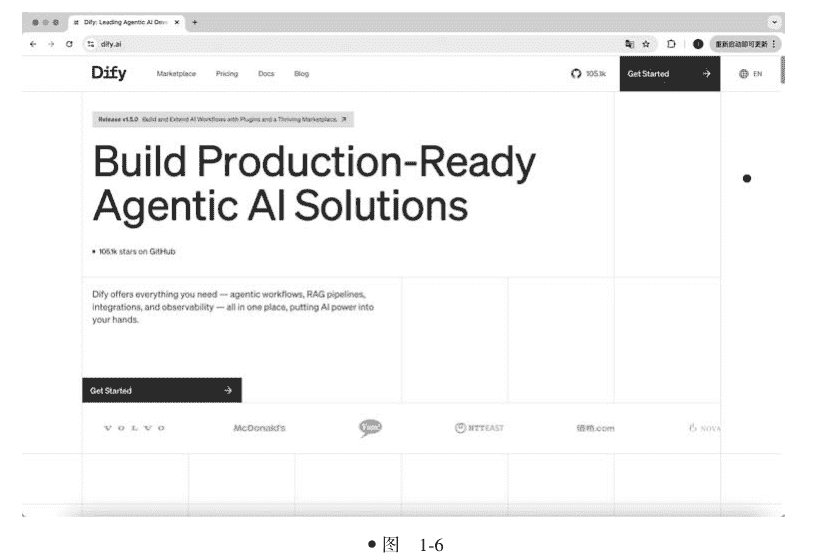

• 图 1-6

Dify 的亮点包括模型与知识库解耦设计、内置工作流引擎，原生支持 OpenAI、Azure、Claude 等主流模型 API，并开放插件机制便于扩展。在中文社区发展迅速，不少开发者基于其搭建客服助手、SaaS 平台助手、个性化搜索等原型。对中文语料与工具链的良好适配，使其在国内应用中具备优势。

## 6. OpenManus——面向开源社区的多智能体实验场

OpenManus 是 Manus 体系的开源实现，兼顾灵活性与实用性，适用于快速测试智能体交互机制与任务协作策略的开发者。OpenManus 官方网站如图 1-7 所示。

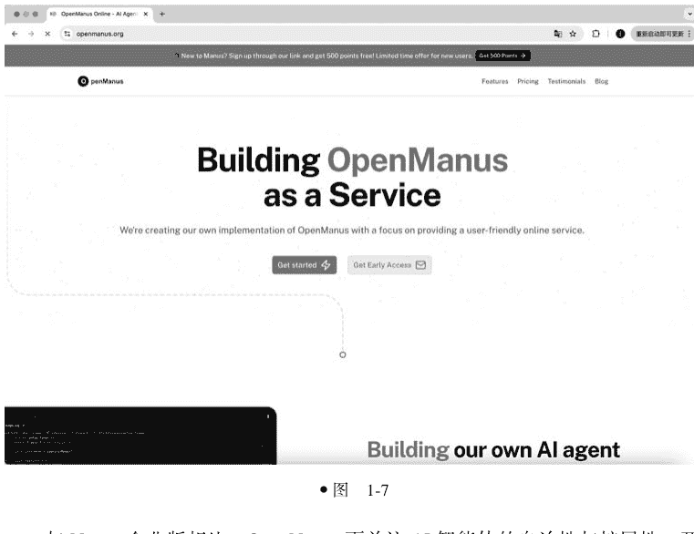

• 图 1-7

与企业版 Manus 相比，OpenManus 更关注自治性与扩展性。开发者可用 Python 快速定义智能体结构与行为模块，并接入自定义模型与任务引擎。开源设计支持多人协作、数据回放与任务追踪，适用于智能体竞赛、学术研究与教学演示等场景。

从低门槛对话机器人到企业级多智能体调度平台，从研究框架到商业化中台，这些平台共同构成当前智能体生态的关键支柱。它们都围绕同一核心：赋予 AI 目标导向与行动能力，使其从信息生成者成长为主任务执行者，为开发者提供通往更高智能系统的新路径，也为企业带来超越传统自动化的生产力跃迁。

### 1.5 快速构建 AI 智能体的通用方法

AI 智能体并非科研院所的专利，任何具备基础开发经验的团队都能迅速构建与部署。理解其核心结构、借助合适框架、明确任务目标、组织结构，再辅以少量工程手段，即可打造具备落地能力的原型。

### 1. 不是从零开始，而是模块化集成

构建智能体不意味着要从零搭建深度学习模型或重新设计算法。当前开发已进入“积木式”阶段。借助现成框架、接口、模型与插件，像拼装模块一样快速搭建完整能力体系。核心在于四步：

- 1) 明确任务目标。
- 2) 选择合适框架。
- 3) 组织 Agent 结构。
- 4) 接入工具与接口。

这四步构成思维骨架，建立后智能体即可迅速发挥作用。

### 2. 明确任务目标

先聚焦问题，再规划智能体

智能体并非万能，项目成败取决于是否把要解决的业务痛点先想清楚。是要为企业配备 24 小时在线的客服，还是让研究人员自动检索文献，或是帮产品经理输出竞品分析报告？目标越具体，搭建投入越小，落地效果也越可靠。

常见任务场景及其适配智能体类型见表 1-2。

表 1-2

| 任务场景 | 智能体类型 | 主要能力要求 |
| :--- | :--- | :--- |
| 企业自动化客服 | 对话型智能体 | 多轮对话、意图识别、数据库调用 |
| 代码生成与优化 | 辅助编程智能体 | 代码理解、函数调用、语义补全 |
| 数据可视化与分析 | 分析型智能体 | 表格处理、图表生成、逻辑推理 |
| 文档整理与摘要 | 文本处理智能体 | 长文理解、摘要压缩、格式统一 |
| 多任务流程执行 | 调度型多智能体系统 | 任务规划、子智能体协同、记忆管理 |

把目标收敛后，原型迭代更快，更容易产出可用的版本。

### 3. 选择开发框架

当前可用的智能体开发框架很多，各自有侧重点。选型时要综合任务类型、接口诉求和开发成本来判断。常见 AI 智能体开发框架优势描述及其适用场景见表 1-3。

表 1-3

| 开发框架名称 | 优势描述 | 适用场景 |
| :--- | :--- | :--- |
| 扣子 | 上手简单、支持流程式构建与企业微信无缝集成，官方托管省去部署成本 | 企业对话机器人、客户服务、轻量级助手、低代码定制 |
| Manus | 聚焦文档智能与企业知识管理，支持任务链编排和自动执行 | 智能报告生成、知识库问答、业务流程自动化 |
| AgentScope | 原生支持多智能体编排，具备环境模拟、策略执行与角色建模能力 | 智能体竞合仿真、策略研究、多主体博弈与科研实验场景 |
| LangChain | 文档丰富、模块齐全、支持多模态和工具调用 | 企业助理、RAG、文档问答等 |
| Dify | 提供可视化部署、支持私有化、前后端一体 | 快速上线 AI 助手、内嵌 SaaS 系统 |
| OpenManus | 强调文档驱动与流程自动化，可构建结构化决策链条与业务流程智能化 | 企业流程自动化、知识操作智能化、任务流水线管理 |
| CrewAI | 支持多智能体协同与角色扮演，具备任务分解、职责分工、行动同步等能力，适合构建复杂智能体团队 | 项目协作智能体、复杂任务智能体系统、研究型多智能体架构 |

做通用办公助手，用 LangChain 配合 Dify 成型很快；需要多项目协作的智能体，CrewAI 的扩展性更合适。

### 4. 组织智能体结构——思维链+工具箱+记忆体三位一体

一个好用的智能体通常由三部分构成。

#### (1) 思维链

思维链即任务拆解与多步推理机制，避免模型凭直觉猜测，而是按步骤推进。常见做法有提示词模板、动作规划、思维分解。例如用户要求“帮我查过去五年某公司的财报走势”，智能体应先规划“检索→解析→汇总→输出”。

#### (2) 工具箱

工具箱是智能体连接外部世界的桥梁，可接入 API、数据库、Python 脚本、检索系统、日历系统等。典型接入方式如下：

- 1) 调用自定义函数 Function Calling
- 2) 使用插件，如 Dify、LangChain 工具
- 3) 执行本地脚本，如用 Pandas 分析表格

#### (3) 记忆体 Memory

没有记忆的智能体每次对话都像初次见面。引入短期记忆与长期记忆，例如 Vector Store 后，就能记住用户偏好、复盘历史任务、沉淀专业知识。

### 5. 快速开发流程

下面这条路径适合个人开发者、中小团队和高校实践：

- 1) 选定平台或框架，如 LangChain + OpenAI/DeepSeek API 等
- 2) 搭建核心提示词模板，明确身份、目标与输出风格
- 3) 接入工具，如 Python REPL、文件系统、第三方 API 等
- 4) 接入记忆与检索系统，如 FAISS、Qdrant 等向量引擎
- 5) 封装前端或接口，如 Gradio 界面、FastAPI 服务等
- 6) 测试与优化，分析失败案例、微调提示词、扩展插件

# 第2章 零代码实战：用扣子搭建首个智能体

## 2.1 扣子平台入门指南——零代码创作工坊

在数字化浪潮下，AI 已从象牙塔走进日常。人们不满足于被动使用，更希望以直观便捷的方式亲手搭建自己的智能工具。Coze 扣子正是在这种需求下诞生的平台。

### 2.1.1 什么是扣子——可视化拖拽式智能体

#### 1. 扣子是什么？零代码创作工坊

过去搭建智能体需要工程师写代码、调 API、设计逻辑，门槛高周期长。扣子打破了这一壁垒，提供可视化拖拽式开发体验。用户只需拖动模块、配置参数、连接节点，就像搭积木一样搭建具备智能能力的系统，无需精通编程或算法，也能完成智能问答、数据分析、内容生成等任务。扣子官网示意图如图 2-1 所示。

借助扣子的可视化设计与编排工具，用户可用零代码或低代码方式快速搭建基于大模型的 AI 项目，满足个性化需求并实现商业价值。扣子平台主要包含两类应用：

- 1）智能体 Agent：基于对话的 AI 项目，通过对话接收用户输入，由大模型自动调用插件或工作流执行业务流程并生成回复。智能客服、虚拟伴侣、个人助理、英语外教等都是典型场景。

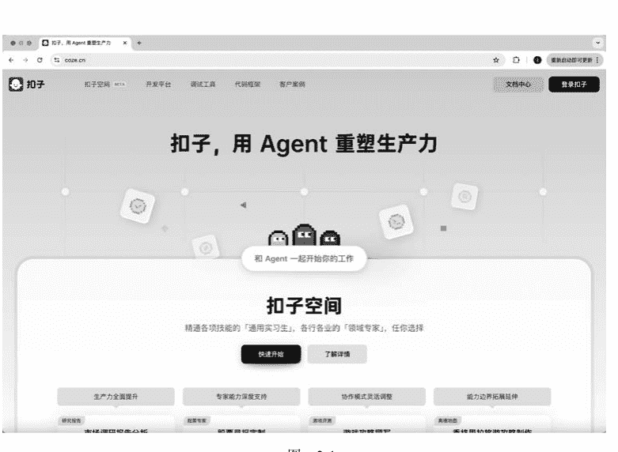

• 图 2-1

- 2）AI 应用：利用大模型技术开发的应用程序。扣子中搭建的 AI 应用拥有完整业务逻辑和可视化用户界面，是一个独立的 AI 项目。具备明确输入输出，可按既定流程完成简单或复杂任务，例如 AI 搜索、翻译工具、饮食记录等。

#### 2. 扣子的优势和特色

（1）灵活的工作流设计
扣子工作流专为复杂且稳定性要求高的任务流设计，提供大量可组合节点，包括大语言模型、自定义代码、判断逻辑等。无论编程水平如何，用户都能拖拽搭建符合需求的工作流。例如轻松创建一个撰写行业研究报告的工作流，让智能体生成一篇 20 页的研究报告。

（2）能力拓展空间大
扣子通过集成丰富的插件工具，极大扩展智能体能力边界。官方发布了多款功能强大的插件，用户可直接添加至智能体中。例如使用新闻插件，智能体就能成为实时播报时事的 AI 新闻主播。此外还支持创建自定义插件，通过简单参数配置把现有 API 能力快速转为插件供智能体调用。自定义插件还能发布到商店共享，促进社区共建。

（3）丰富的数据源
扣子提供直观易用的知识库功能，帮助用户管理和存储数据，并让智能体与之交互。本地文件或实时更新的网站信息都能轻松上传至知识库，上传后智能体即可基于知识库内容快速回答，实现精准检索与高效任务处理。

（4）持久化记忆能力
扣子为 AI 赋予持久记忆，可长期保存并理解用户交互中的关键信息与参数。借助数据库功能，用户可记录阅读笔记、书籍信息、阅读进度及个人注释等。智能体可查询数据库内容，为用户提供更精准个性化答案，提升交互质量与复杂任务处理能力。

#### 3. 典型应用场景

扣子的价值在于易用且实用，已广泛应用于多个领域，成为创业者、职场新人、大学生的新利器。

（1）智能客服系统
中小企业缺乏技术团队却想快速搭建在线客服，借助扣子一名运营人员即可完成。从客户提问、AI 识别、调用知识库到输出回复，全流程自动化，大幅降低人工成本。

（2）教学助理机器人
高校课堂上学生可用扣子构建自己的学习助理。例如制作“错题讲解助手”：上传错题图片，系统自动识别并生成解析，还能提供相似题训练，辅助学习高效且有趣。

（3）内容创作工具
自媒体创作者可用扣子搭建“多语种写作助手”，输入中文内容后自动翻译润色为英文、日文等，甚至配图配标题，实现一站式内容生产。

### 2.1.2 扣子技术架构剖析

扣子技术架构围绕高可扩展性和多场景支持设计。平台分为多层，包括外部系统接口、AI 智能体层和知识库管理层。该结构可支撑不同规模与复杂度的业务需求，并通过开放 API 与插件机制实现与其他系统无缝对接。

#### 1. 扣子技术架构概述

平台核心是智能体，可执行客户服务、数据处理、任务调度等自动化任务。扣子通过多个工作区管理智能体行为，同时支持定制化插件开发与功能扩展。架构基于高度模块化与可扩展原则，为各类企业提供灵活高效的 AI 解决方案，采用多层次结构确保功能可独立管理与集成。扣子技术架构简图如图 2-2 所示。

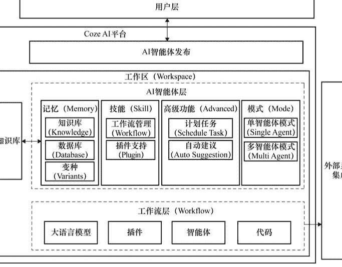

如图 2-2 所示，扣子涵盖多个模块与层次。用户层位于最上层，代表最终用户，通过 Web、数字工作空间、社交平台等接口与平台互动，使用扣子服务。扣子支持将智能体发布到 Slack、Discord 等消息平台，并通过开放 API 与其他系统集成。用户可在平台创建多个工作区管理不同智能体、知识库和工作流。

AI 智能体层是核心，包含记忆 Memory、技能 Skill、高级功能 Advanced、模式 Mode 等模块，用于管理任务、技能与工作流。工作流层负责智能体工作流设计与管理，支持大语言模型集成，并允许通过插件扩展能力。工作流设计支持任务自动化处理与智能体协作。外部系统与 AI 智能体层交换数据与协作，确保 AI 能与 CRM、数据存储等外部数据源有效交互。

#### 2. 扣子平台架构解析

为更好理解扣子如何通过平台与技术组件提升服务效率、推动企业智能化转型，下面深入解析其技术架构、核心组件及协同方式。

(1) 用户层
架构从用户层开始，用户通过多种方式与 AI 交互。该层级允许服务在各平台运行，包括：
- 1) 数字工作平台：如 Lark、Slack 等，集成后可处理工作流、团队沟通等请求
- 2) 网站接口：通过 Web 接口，PC 端或移动端均可灵活便捷使用

(2) AI 智能体发布
扣子支持将 AI 模型部署到 Slack、Discord 等多种平台，通过这些平台与用户互动提供服务。为实现高可扩展性，扣子还允许定制 AI 聊天渠道，如 Live chat、Zalo OA 等，企业可按需灵活部署。

(3) AI 智能体层
AI 智能体层是架构核心，负责用户输入处理、任务执行与智能响应生成。主要组件包括对用户输入处理、任务执行及响应生成等。

## 2.2 用扣子可视化界面创建首个智能体

### 2.2.1 创建扣子账号与智能体配置

创建智能体的起点并不复杂，进入扣子官网即可开启智能创作。作为领先的零代码 AI 应用开发平台，扣子把复杂的人工智能建模转化为人人可参与的创作活动。

1. 注册账户，开启创作工坊
进入官网首页后页面简洁直观，点击右上角“登录扣子”即可通过手机号快速注册。注册流程如图 2-3、图 2-4 所示。

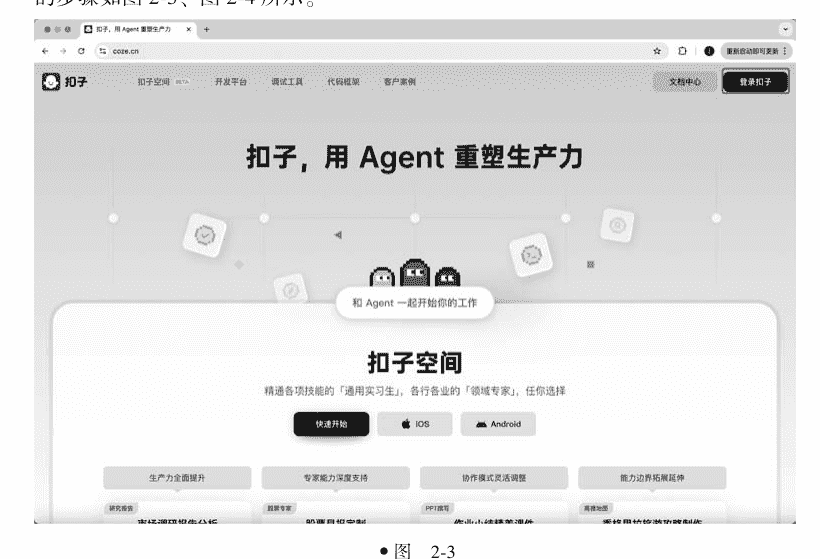

注册成功后即可进入在线开发环境，无需下载本地软件或配置开发工具，所有操作均在网页完成。

2. 新建智能体，从名字到性格一步到位
在控制台页面点击“Create Bot”或“创建智能体”进入配置界面。系统引导用户设定基础信息，包括名称、角色设定、头像形象、语言风格等。

这些设定构成智能体的表层个性。名称是对外标签，头像代表视觉形象，角色描述决定对话语气与服务领域。例如选择“客服型”角色，系统会预设礼貌专业的语言模板；选择“生活助理”，则更偏向轻松实用的交流方式。

3. 欢迎语与初始引导，建立第一印象
智能体的第一句话往往决定用户第一印象。扣子支持自定义欢迎语，对话启动时自动出现。无论是温暖问候、功能介绍或创意自我介绍，都可简单编辑完成。

例如：
> Hi，这里是每日新闻播报站，想了解哪方面资讯？
> 欢迎来到影迷 AI 空间，最近高分电影要不要了解一下？

平台也允许上传专属头像或选择内置卡通图像，提升交互亲切感与识别度。

4. 选择语言与平台生态，实现跨界互动
扣子支持中英文等主要语种，满足不同文化背景用户沟通需求。平台已开放与 Discord、微信公众号、飞书等多主流社交平台对接。构建完成后的智能体不仅可在扣子内部运行，还能一键部署到常用聊天平台，成为公众号客服、企业机器人、学习助手、社群管理工具等。

部署方式友好，只需绑定平台账号、授权接口调用即可上线，大幅缩短从开发到落地的周期。

5. 是否公开、是否可嵌入，由开发者自由决定
配置选项中可设置智能体可见性。若仅用于个人测试学习，可选择私有模式，系统不会对外展示；若作为产品服务发布，可设为公开模式，并生成访问链接或嵌入代码供他人调用或嵌入网页。

扣子提供标准 HTML 代码片段，可直接嵌入博客、网页、商城、校园网平台等，让每个网页瞬间拥有会思考的入口。

### 2.2.2 用扣子模板一键生成 AI 助手

AI 助手已不再是大企业专属，大学生、初级程序员、初创创始人都能轻松创建自己的智能体，借助扣子模板功能即可迅速完成。

1. 什么是模板
传统 AI 开发需要掌握编程语言、机器学习框架、数据训练与模型部署流程，门槛很高。模板出现改变了这一现状。扣子平台通过预封装的智能体与应用模板，把复杂编程逻辑、工作流设计与大模型接入变成可直接复用的功能模块。简单配置即可拥有功能完善的 AI 助手。

2. 模板的分类与功能定位
进入扣子模板市场，模板被清晰划分为多个应用类别：
- 1) 智能客服：适用于企业客户服务、用户咨询等场景
- 2) 营销创作：涵盖 SEO 文章生成、广告文案撰写等
- 3) 信息处理：包括 PPT 生成、文档改写、内容总结等
- 4) 学习辅导：提供作业批改、语言学习、口语训练等支持
- 5) 智能陪伴：如儿童聊天伙伴、心理辅助机器人等

每一类模板都围绕特定功能需求展开，并内置适配工作流与语言模型。

3. 从模板开始创建 AI 助手的完整流程
(1) 进入模板中心
在扣子主界面选择侧边栏“模板”入口。页面展示平台热门与推荐模板集合，每个卡片清楚标注用途类别、功能描述与复制使用次数。

以“智能客服助手”为例，该模板专为客服场景设计，可实现多轮对话、常见问题解答与用户引导。如图 2-5 所示，点击“模板”→“智能客服助手”，进入详情页。

(2) 选择模板并复制到个人空间
如图 2-6 所示，进入详情页后点击“复制”按钮，即可复制到个人空间。

(3) 预览与调试
如图 2-7 所示，复制到个人空间后进入“预览与调试”页面，按自身业务需求配置对话流。扣子调试环境支持多轮对话输入，验证工作流是否按预期运行。

(4) 发布与部署
点击预览与调试页面右上角“发布”按钮，进入发布页，选择合适的发布平台，如图 2-8 所示。


• 图 2-5

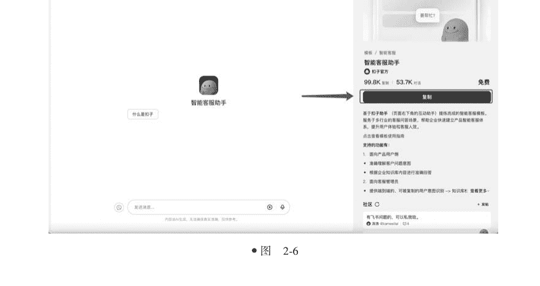

• 图 2-6

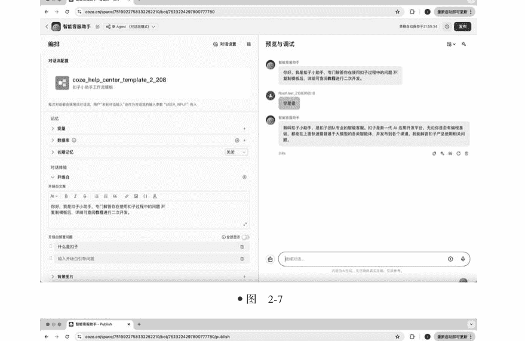

● 图 2-7

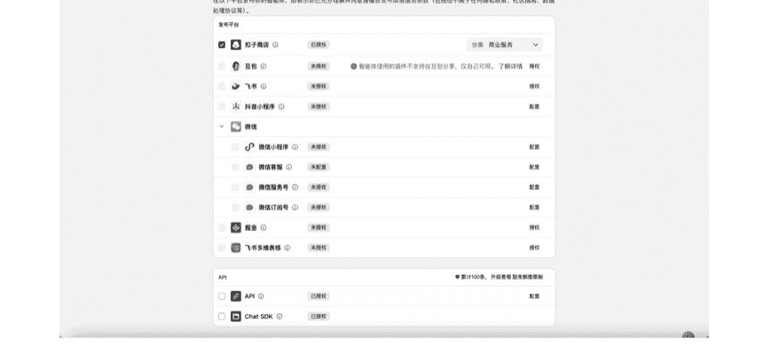

● 图 2-8

同时，扣子平台还提供数据分析面板，可追踪用户使用行为、查询意图分布、响应准确率等，为后续优化提供支持。

## 2.3 开发自定义扣子智能体实战

### 2.3.1 扣子平台变量的应用与操作指南

在扣子搭建智能体时，变量的设计直接决定了对话的灵活度和个性化程度。平台自带的参数会自动收集，开发者自定义的参数可以按需读写。将两者配合使用，就能把每次交互产生的动态信息沉淀下来，随时调用，让回复更快、体验更贴合个人。下面按实际使用场景展开说明。

1. 变量的基本定义

变量相当于智能体的可变记忆，让回答能够随着提问风格和对话进程实时调整。扣子目前提供两类参数：系统侧参数与用户侧参数。

1) 系统变量：由平台内置并自动维护的数据，多与用户基础属性或行为有关。比如实时定位、飞书群编号、视频通话截帧等。

2) 用户变量：在使用过程中产生的个性化信息，像语言偏好、昵称等。可读写，并在多轮对话中保持持久。

2. 系统变量

系统参数是平台为智能体预置的字段，交互时自动抓取，多为只读，能帮助快速获取用户侧或场景侧的关键信息。

(1) 用户信息类
常见字段如下：
1) sys_uuid：扣子账号的唯一编号，结合账号与智能体 ID，用于行为追踪。
2) sys_longitude 和 sys_latitude：用户的经度和纬度，常用于位置相关的推荐。
3) sys_lat_lon 和 sys_lon_lat：用户的地理坐标，只是经纬顺序不同。

(2) 飞书相关变量
常见字段如下：
1) sys_lark_chat_id：飞书群组的编号，智能体可据此读取群消息。
2) sys_lark_open_id：用户在飞书应用内的身份 ID，便于识别并提供定制服务。

(3) 音视频相关变量
常见字段如下：
1) sys_voiceprint_name：声纹识别中的人名，用于区分说话人并做差异化处理。
2) sys_images：在视频通话中抽取的图片，开发者可读取画面信息。

启用相关字段后，智能体能获得更精准的数据以调整个性化服务。

3. 用户变量

用户变量由开发者按业务需求创建，交互过程中可读可写，多用于保存个人信息或历史交互。

(1) 用户变量的创建与配置
在智能体编排页打开“记忆”→“变量”，点击“+”新建，如图 2-9 所示。

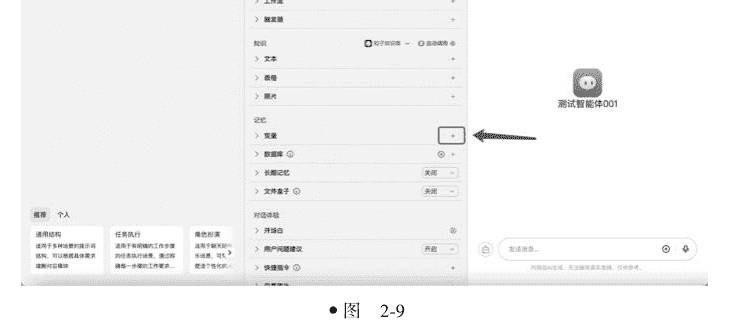

变量名需保持唯一，说明要准确描述用途。例如创建名为 username 的变量来记录昵称。填写名称后点“保存”即可，如图 2-10 所示。

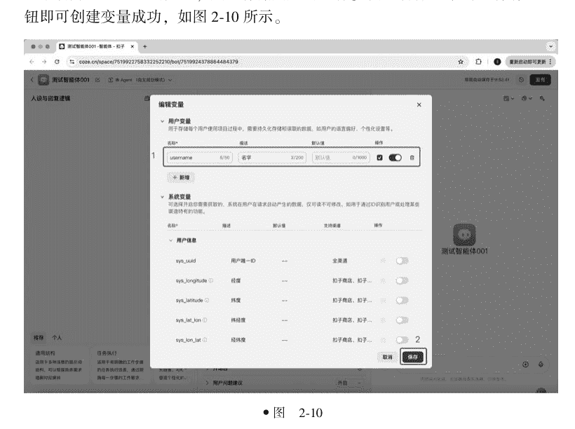

● 图 2-10

(2) 用户变量的使用
创建后可在工作流或插件中引用。例如在“人设与回复逻辑”中写提示词：“回复时称呼用户为{{username}}”。调用示例如图 2-11 所示。

对话中用户提供名字后会自动写入 username，后续会话都会沿用。

(3) 用户变量的生命周期管理
变量值会在会话结束时持久化，下次对话可继续使用。若用户更新信息，值会同步更新。例如昵称变更后，智能体会自动写入新值，保持称呼一致。

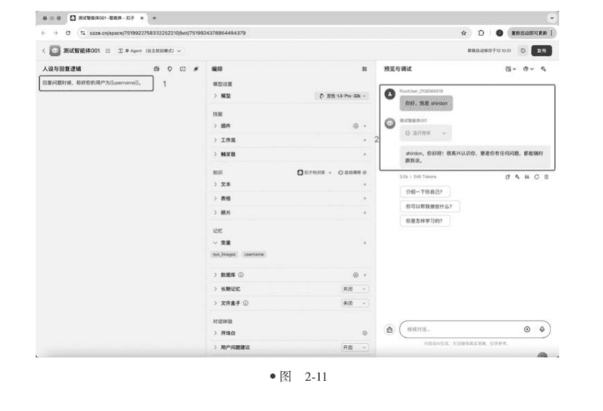

● 图 2-11

4. 系统变量与用户变量的协同使用
实际业务中两者配合能显著提升灵活性：
- 1) 情感陪伴型智能体：结合记录在用户变量中的情绪波动与系统变量提供的位置信息，给出实时鼓励与建议。
- 2) 客户支持型智能体：用 sys_lark_open_id 确认身份，并结合保存在用户变量中的历史记录，提供个性化建议。
- 3) 位置感知型智能体：借助 sys_lat_lon 获取实时坐标，配合用户变量中的偏好，实现位置与兴趣结合的推荐。

5. 开发与发布
设计时可根据场景挑选变量类型并配置流程。系统变量与用户变量有机结合后，智能体能实时响应并高效运行。发布后可分发至微信、飞书、抖音等渠道拓宽覆盖。

### 2.3.2 为扣子智能体添加数据库实战

智能体开发中数据的管理与操作至关重要。扣子提供结构化存储能力，可通过自然语言、工作流或插件完成数据的增删改查，实现按需更新与个性化输出。

1. 数据库概述
扣子数据库采用表格结构，适合存放客户信息、订单记录、商品列表等结构化内容。数据表支撑智能体与用户的交互。

数据表支持两种模式：
- 1) 单用户模式：可写入记录，但仅能读写自己创建且来自同一渠道的数据。
- 2) 多用户模式：可对同渠道内的数据进行读写修改，权限由业务逻辑控制，适合共享场景。

2. 系统支持的数据表操作
(1) 创建数据表
进入编排页，点击“记忆”→“数据库”，右侧“+”新建，如图 2-12 所示。

如图 2-13，先点“新建数据表”→“自定义表格”，再选“创建扣子数据库”，填写表名后确认。

(2) 字段配置与数据类型
每个字段可设置名称、类型及是否必填，系统按类型处理。字段名建议使用小写字母、数字或下划线，长度上限 64 字符。

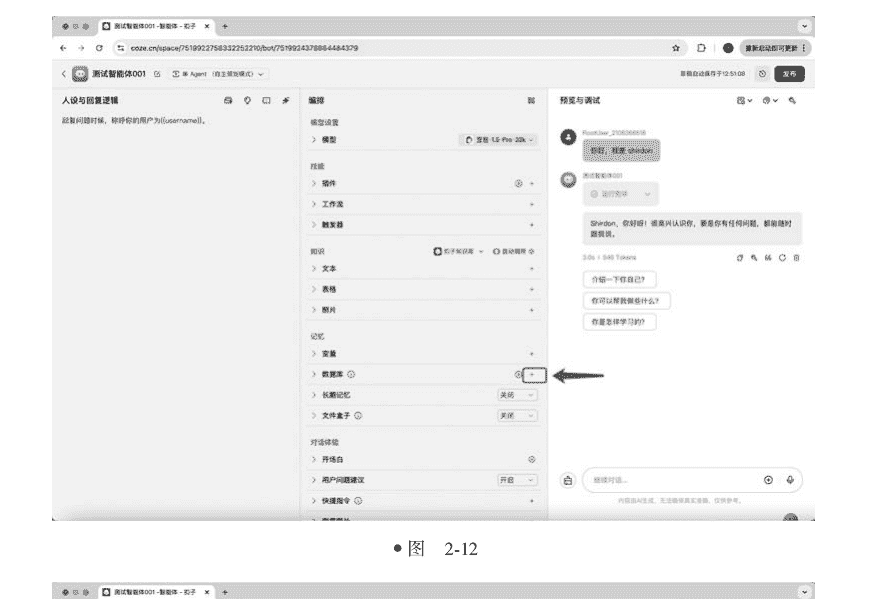

● 图 2-12

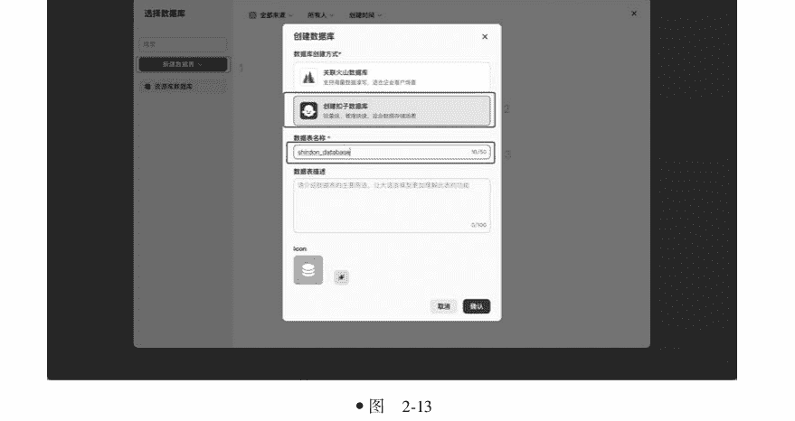

● 图 2-13

3. 数据表的操作与管理
(1) 数据操作
扣子支持类 SQL 的自然语言查询 NL2SQL，可用简洁语言或代码管理数据，降低传统数据库操作的复杂度。
(2) 调试与预览
建表后可在编排页实时测试，查看内容并及时发现输入或查询问题，保证管理准确。

### 2.3.3 为扣子智能体添加插件实战

插件是扩展智能体能力的核心手段。通过接入不同插件，可实现新闻查询、图像处理、办公自动化等功能。扣子提供丰富的插件类型，兼容多种 API 与多模态模型。

1. 插件的作用和使用场景
插件由一个或多个工具 API 构成，能显著扩展能力，并支持多模态与外部系统联动。典型场景：
- 1）新闻搜索插件：自动抓取最新资讯，适用资讯类智能体。
- 2）旅游出行插件：支持航班查询、酒店预订等。
- 3）效率办公插件：提供日程管理、邮件处理等。
- 4）图片理解插件：赋予图像识别与分析能力。

2. 如何在智能体中添加插件
进入工作空间，选择目标智能体并打开编排页。找到“技能”→“插件”，点击右侧“+”图标。

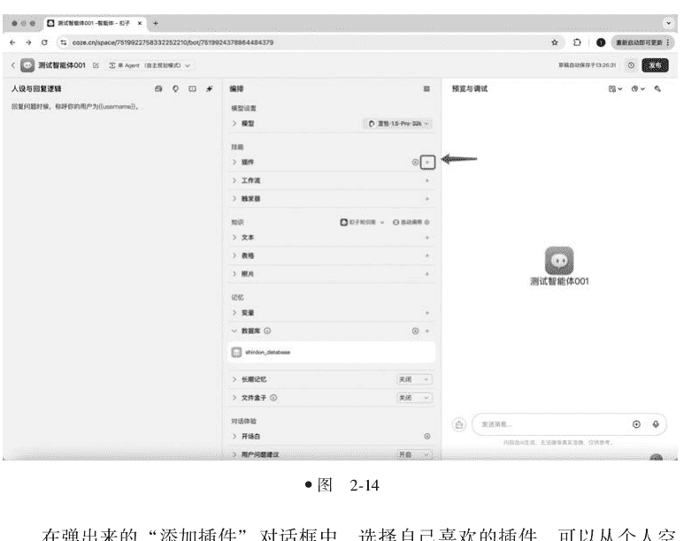

● 图 2-14

在“添加插件”弹窗中，可从个人空间、团队空间或插件商店挑选已发布插件，也可创建自定义插件。如图 2-15，本例选择“链接读取”插件，点击“添加”完成。

3. 插件的高级功能与扩展
(1) 绑定消息卡片
在豆包、飞书等客户端，智能体可返回消息卡片。绑定插件功能后，工作流结果能以卡片呈现，交互更丰富。如天气查询可同时展示图标、温度、风速等。
(2) 删除不必要的插件
开发测试阶段不再需要的插件可直接移除，不影响其他功能，按需调整即可。

## 4. 插件实际应用示例
（1）旅游智能助手
构建旅游助手时可接入航班查询、酒店预订、景点推荐等插件。用户对话即可获取实时航班或个性化景点建议，实现行程规划自动化。

（2）智能教育导师
教育导师可接入课程检索、题库练习、知识点讲解、学习进度分析等插件。学生提问“帮我制定两周英语单词计划”，智能体即可调用相关插件生成每日任务，或针对语法难点进行详细讲解。

### 2.3.4 为扣子智能体添加知识实战

知识库可有效缓解大模型幻觉和专业知识不足的问题，提升回复准确性。它将外部数据源导入智能体，并在需要时快速检索，为复杂问题提供专业解答。

### 1. 知识库的核心功能
扣子知识库具备数据管理存储与增强检索两大能力，可引入多源外部信息并智能调用。
- (1) 数据管理与存储能力
支持上传本地文件、在线数据、Notion、飞书文档等。上传后内容自动分片存储，便于管理和检索。可自定义分片规则，如按标识符或字符长度切分，保证检索精准。例如长文档可按章节拆分，每个片段具备独立查询价值。
- (2) 增强检索能力
内置全文检索，支持关键词快速定位相关片段。智能体据此提取信息生成准确回复，确保专业性。

### 2. 如何为智能体添加知识库
添加知识库能显著提升准确性与专业度。扣子支持结合扣子知识库与火山知识库。操作步骤：
进入工作空间，选择智能体并打开编排页。找到“知识”→“文本”，点击右侧“+”图标。

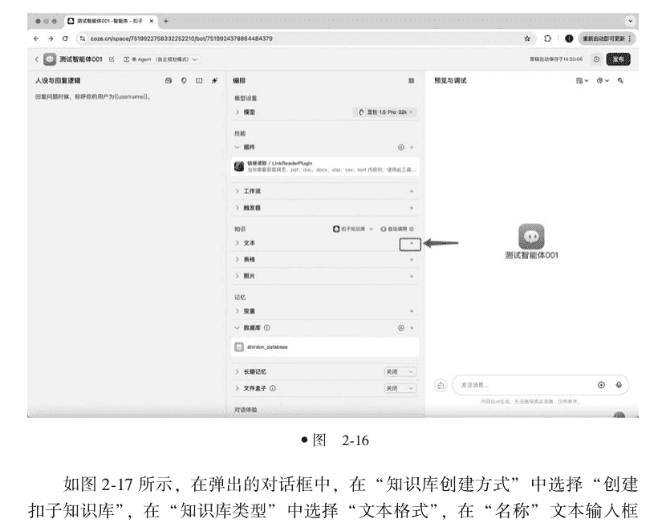

● 图 2-16

在弹窗中选择“创建扣子知识库”，类型选“文本格式”，填写名称，选择“本地文档”导入方式，点击“创建并导入”。
如图 2-17、2-18，上传文件并按系统提示完成配置即可。

### 3. 知识库的应用场景
（1）智能助手
为客服助手接入用户手册、FAQ、技术文档等，智能体可快速查询并解答用户问题，提升支持效率。

44 从 0 到 1 搭建 AI 智能体：Manus+LangChain+Dify 多平台应用及多智能体协同

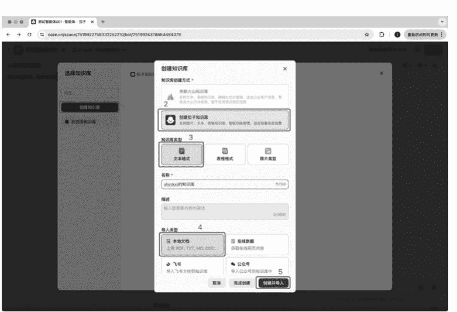

• 图 2-17

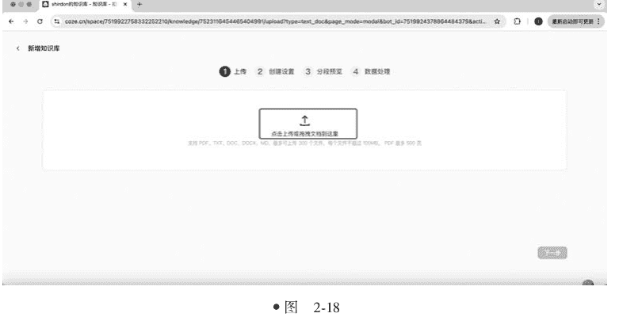

• 图 2-18

（2）专业领域智能体
法律、医学等领域可上传法规条文、医学文献等，让智能体准确回答专业问题，避免幻觉。
（3）知识库的扩展性
除文本表格外，还支持照片等多模态数据。上传含图像的数据集后，智能体可对图像内容进行解读与分析。

### 2.4 【实战】用扣子搭建 AI 工作流

在扣子平台可按以下流程搭建基于 DeepSeek 的工作流。

（1）创建智能体
登录账号，无账号会自动注册。进入首页，点击左上角加号，选择“创建智能体”，点“创建”。

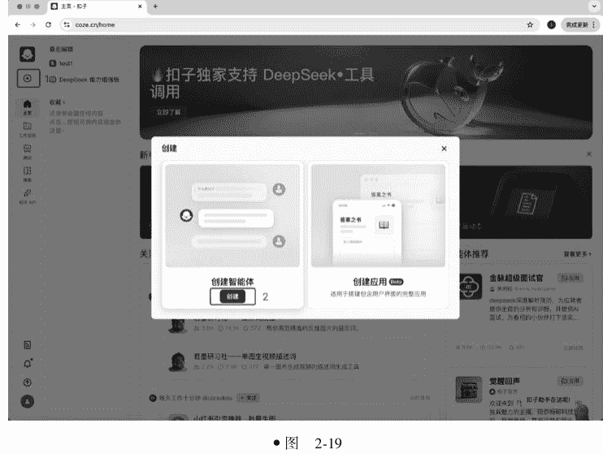

• 图 2-19

填写智能体名称和功能介绍，可不填，点击“确认”完成创建。

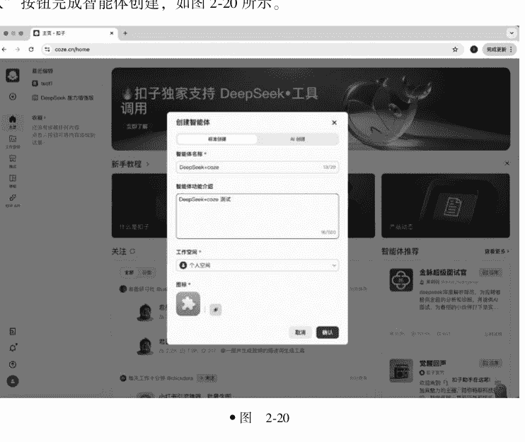

• 图 2-20

（2）创建新工作流
进入智能体详情页，找到“技能”→“工作流”，点击右侧“+”，弹出对话框。

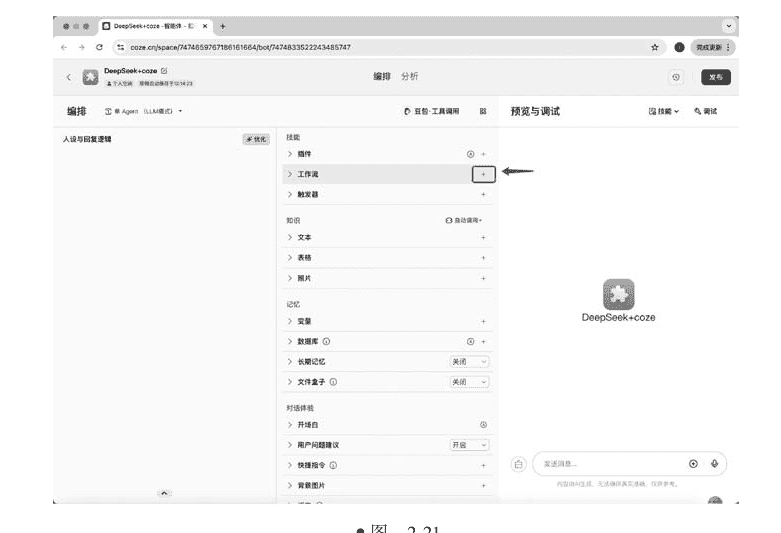

• 图 2-21

点击“创建工作流”，输入名称与描述。

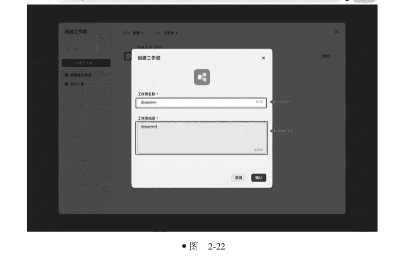

• 图 2-22

（3）添加节点
在工作流中添加节点，例如大模型节点。点击“添加节点”，选择“大模型”。

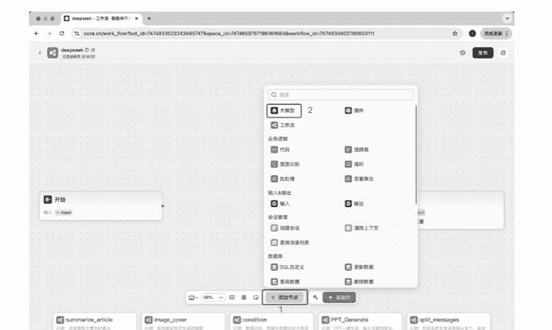

• 图 2-23

（4）配置节点模型为 DeepSeek-R1
双击大模型对话框，右侧弹出参数设置。在模型选项中选择“DeepSeek-R1”，完成配置。

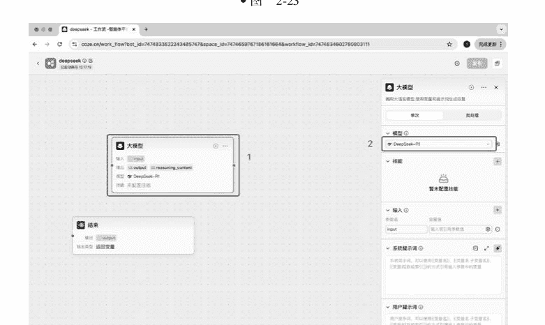

• 图 2-24

（5）连接节点
按流程将各节点连接成完整链路。

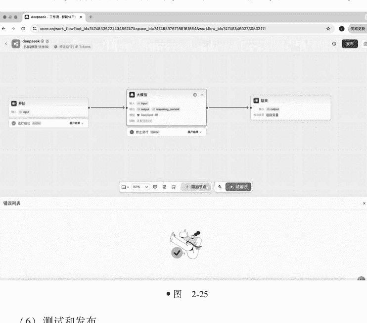

• 图 2-25

（6）测试和发布
搭建完成后点击“试运行”测试各环节。

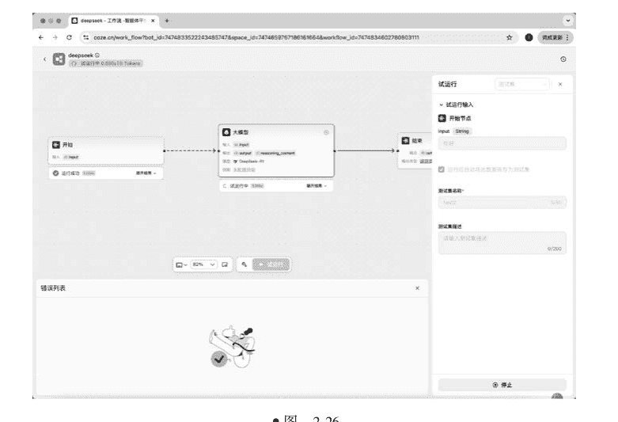

● 图 2-26

测试通过后，点击右上角“发布”，填写版本号与描述后发布，供实际使用。

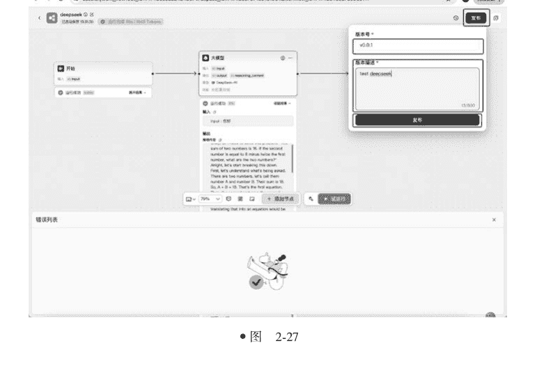

● 图 2-27


通过以上步骤，无编程基础用户也能在扣子平台创建功能强大的 AI 工作流，实现信息自动化处理。

# 第 2 章 零代码搭建属于你的第一个智能体（以扣子为例）

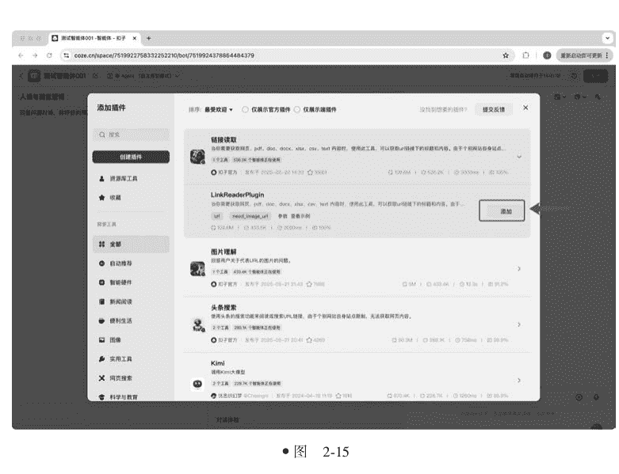

（2）删除不必要的插件
如果智能体在开发或测试过程中不再需要某个插件，开发者可以轻松地将其从智能体中删除。删除插件不会影响其他插件或功能的使用，开发者可以根据实际需求进行调整。

## 第 2 章 零代码搭建属于你的第一个智能体（以扣子为例）

# 第3章 Manus高效应用实战

## 3.1 什么是 Manus

AI 从被动答疑的对话助手向能够判断并交付成果的执行型智能体演进，Manus 正是这一趋势下出现的通用智能体新形态。它已超越单纯聊天的范畴，具备独立思考、主动行动并持续跟进复杂业务的能力。官网示意图见图 3-1。

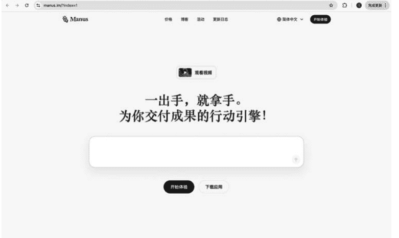

• 图 3-1

早期产品多被框在文本处理或简单回复上，Manus 呈现出截然不同的工作方式。准确来说，它是一个自驱动流程型的数字员工，会依据指令自动规划任务、调度工具、推进流程，并在运行中不断自我校准与优化。

名称 Manus 源自拉丁文“手”，也点明了定位。与只会聊天的语言模型不同，它更像数字执行官，既读懂意图也能亲手把事办完。目标明确后，它会自动设计流程、调用所需工具、完成操作并交付成果，全程无需人工盯屏或手动干预。

相较传统聊天机器人，它更像拥有自主思考与动手能力的云端数字劳模，能在后台独立运行，静默地把复杂事项层层拆解并落地。

### 1. 多智能体高效工坊

#### (1) 多代理协同分工
Manus 不依赖单一超脑，而是模拟高效分工的智能作坊。作坊里每个子智能体各司其职：有的擅长信息检索，有的擅长逻辑推演，有的负责代码编写或数据分析。主控智能体按任务内容派工，各模块紧密配合，从需求理解到最终交付环环相扣。

#### (2) 灵活模型调度
为保障交付质量，后台会按需弹性调用不同语言模型。撰写内容或处理复杂推理时，常优先选用 Claude 3.5/3.7；面对中文业务场景时，则可能切换至阿里巴巴 Qwen 系列。多元组合兼顾效率与准确，也避免了风格千篇一律。

#### (3) 云端异步运行
运行环境位于云端，不受本地页面状态制约。任务一旦触发，哪怕用户关闭网页或网络中断，后台仍持续推进。完成后系统会自动推送提醒，用户可随时查阅结果。该模式对长周期或批量作业尤为友好，能大幅节省等待成本。

#### (4) 多工具接入
平台可自动使用浏览器插件、读写 Excel、调用 API 接口、运行代码，甚至跨系统调度多个平台任务。对普通用户而言这些步骤繁琐，对它来说只是待办清单上的若干动作。

### 2. 一条指令把想法落地

(1) 智能招聘助手
在 HR 场景中，从数十份简历里筛选适配人选，传统方式依赖人工阅读、比对与表格记录。该平台可直接读取上传的简历文档，提取关键经历与技能，结合职位描述自动匹配打分，并输出一份结构清晰的 Excel 排名榜，将招聘周期从数小时压缩至数分钟。

(2) 自动化研究报告生成器
假设创业者想了解某新能源车企近期的市场走势，只需输入“分析特斯拉近半年股价变化并判断市场情绪”。系统会自动抓取权威财经网站的历史数据，结合新闻评论进行语义分析，产出包含图表、趋势曲线与文本解读的完整报告，无需数据分析师与文案编辑分工协作。

(3) 一站式建站助手
设计专业学生想拥有在线作品集却不懂编程。根据其提供的简介与图片素材，可自动生成页面排版、视觉风格与展示逻辑，撰写 HTML/CSS/JavaScript 文件，搭建服务器并部署上线，同时给出访问链接。全流程无需写一行代码。

### 3. 技术底层的本质

从技术结构看，并非大语言模型的简单封装，而是一个由多组件协同驱动的智能系统。核心由三部分构成：

- 1) 认知引擎：理解任务目标与意图，具备自然语言理解与上下文建模能力。
- 2) 规划与决策模块：依据需求动态生成多步工作流，可自动拆解任务、规划依赖顺序，并在执行中实时调整。
- 3) 执行智能体系统：与外部工具无缝集成，如网页浏览器、数据库管理系统、代码编辑器、API 接口等，具备多模态处理能力，可处理文本、图像、代码等多类数据。

这种架构使平台能承担类似人类助理或运营专员的职责。例如，企业想从 100 份简历中筛选最符合 Java 开发岗位的人才。传统做法需 HR 逐份阅读或借助基础关键词匹配。使用该系统，只需上传 PDF 或 docx 简历并描述筛选标准，如“5 年以上 Java 开发经验、熟悉 Spring 框架、参与过大型分布式系统开发”，即可自动完成任务链：
- 1) 从文档中抽取结构化信息，如教育背景、工作经历、技术栈。
- 2) 按招聘需求构建评分模型，进行多维度打分。
- 3) 自动生成候选人排名并附优劣分析。
- 4) 输出可直接用于面试的报告，甚至连面试提纲一并准备。

全程无需人工反复操作，意图理解准确且执行闭环完整。

### 4. Manus 能做什么

若把该平台比作办公室万能助手，其能力基本覆盖现代职场常见任务。

#### (1) 撰写文档与报告
例如教师需整理班级期末总结。过去要查阅成绩、提取课堂表现、总结优缺点并写成数十页文档。如今输入“请帮我撰写某班 30 名学生的学期表现分析报告，包含图表和改进建议”，系统会调用数据库、梳理结构、撰写内容并生成可视化图表，数分钟即可完成。

#### (2) 数据分析与结论生成
某销售部门收到上月销售数据，传统做法需用 Excel 制图、计算同比环比并撰写分析。该平台可读取表格，自动识别关键趋势，生成图表并撰写专业、条理清晰的分析内容，几乎可直接提交领导。

#### (3) 代码生成与调试脚本
对程序员而言，具备初级开发者技能。可按描述自动生成代码片段、调用 API、排查逻辑错误，甚至部署简单后端服务。例如“帮我用 Python 写一个图片压缩工具，支持批量处理并生成压缩比例图表”，它会逐步生成程序结构、编写代码、调试逻辑并给出使用说明。

### 5. Manus 注册方法

近期官方已开放直接注册通道，跳过排队阶段。用户可通过标准 OAuth 或邮箱注册，立即使用平台功能。

在首页点击“Sign up”后进入注册页，支持 Google、Apple 账号或邮箱注册，成功后可获得积分并使用 AI。详细流程如下。

（1）打开官网注册页面
在浏览器访问 Manus 注册页面，如图 3-2 所示。
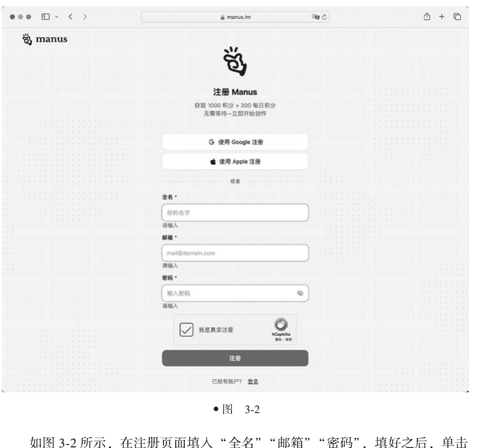
如图 3-2 所示，在注册页填入“全名”“邮箱”“密码”，完成后点击“注册”按钮。成功后系统会自动登录并跳转至欢迎界面。

（2）立即开始使用
登录后即可体验案例库、知识库等模块进行任务操作，无需额外等待或邀请码。登录后的界面如图 3-3 所示。

如图 3-3 所示，在输入框输入问题后点击右下角“↑”按钮，平台会执行并返回结果。执行过程如图 3-4 所示。

第 3 章 Manus 高效应用实战 57

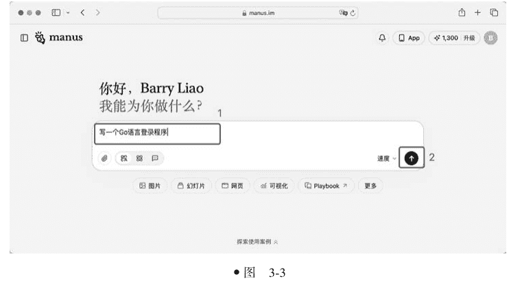

●图 3-3

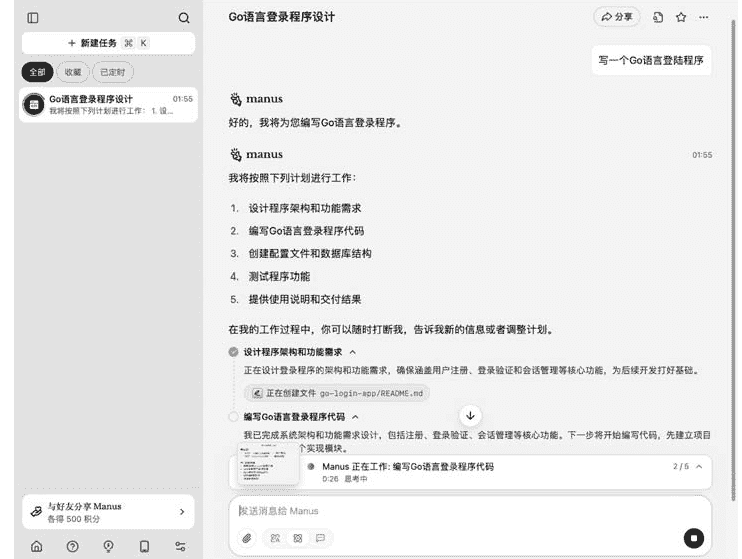

●图 3-4

## 3.2 Manus 常见应用场景示例

该助手能够高效处理复杂任务，应用范围覆盖数据分析到自动化工作。常见应用场景示例见图 3-5。


● 图 3-5

### 1. 供应商筛选
在供应商筛选领域应用广泛，尤其适合从大量供应商中挑选合作伙伴。例如寻找原材料供应商时，可访问多个在线数据库，自动搜索并筛选出符合价格、质量、交货期等条件的对象。使用它可减少人工筛选时间并提升结果的精准与全面。B2B 供应商筛选示例见图 3-6。

例如企业要寻找特殊材料供应商，系统会按需求标准在全球范围内搜索符合条件的对象，并依据产品质量、信誉评分等指标生成排名清单，大幅提升效率与准确性。生成结果见图 3-7。

第 3 章 Manus 高效应用实战

59

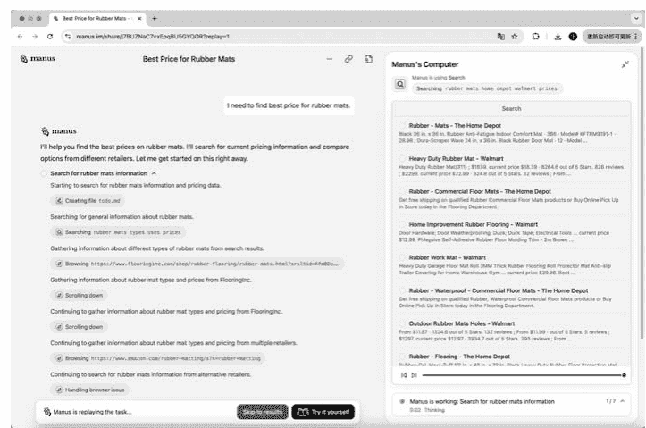

● 图 3-6

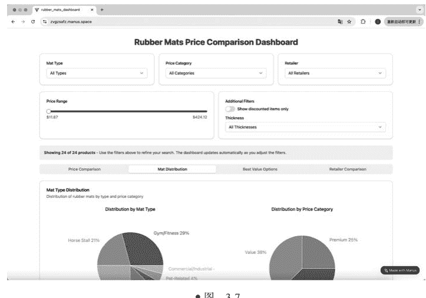

● 图 3-7

### 2. 创业公司信息的快速整理与分析
还可用于创业公司信息的快速整理与分析。例如通过访问 YC 创业孵化器数据库，能自动筛选出符合条件的公司，生成名单并进一步分析行业、融资情况、创始人背景等关键信息。用户由此可更清晰把握市场动态，制定针对性商业策略。YC 公司列表生成见图 3-8。

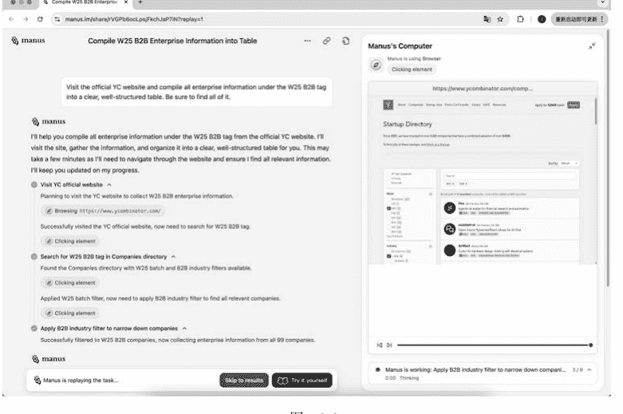

● 图 3-8

### 3. 客户关系管理公司调查
还能用于市场调研，尤其针对 CRM 软件市场。通过对 20 家 CRM 公司调研，可自动收集品牌故事、产品特性、客户群体等信息，并编成详细行业分析报告。相比人工调研，信息收集更快且偏差更少。

例如某公司想了解 CRM 市场竞争格局，可迅速获取主要厂商资料，包括客户案例、定价策略等，并以结构化报告呈现，帮助决策者进行战略调整。

## 4. 开源项目研究
对开发者和技术团队而言，在开源项目学习与研究中表现突出。可对 GitHub 等平台的开源项目进行深度研读，解析代码库，帮助理解架构、开发流程与关键模块。不仅提供代码解释，还能绘制系统架构图，使复杂项目更易上手与定制。

例如想使用某个开源机器学习框架，可分析其代码，阐明核心组件功能并生成架构图说明模块协作，帮助快速上手与定制开发。

## 5. 市场调研与产品评价
在电商领域广泛用于产品市场调研，尤其在分析客户评论时。通过自动化分析大量评价，可提取客户痛点与需求，帮助企业改进产品与服务。能识别评论关键词、判断优缺点，甚至自动归类不同意见，为优化提供数据支撑。

例如电子产品公司想了解新款智能手机市场反响，可从各大电商平台收集用户评论，分析情感倾向，识别用户对电池续航、屏幕质量等关注点，为产品改进提供方向。

## 6. 人工智能政策研究
在政策研究领域，尤其是 AI 相关政策分析，能力突出。例如研究美国过去十年 AI 相关政策时，可自动化检索政策文档、提取关键信息并生成分析报告，帮助政府机构、研究机构或企业把握政策演变趋势与未来影响。

例如政策分析员需了解 AI 政策演变，可自动抽取与分析文献，生成详细政策时间线与关键节点，帮助掌握走向以便后续规划。

## 7. 电商平台产品评论分析
电商平台上，产品评论是消费者决策重要依据。可自动化分析大量评论，提炼消费者评价，帮助卖家识别潜在问题并优化产品与服务。通过数据分析，可揭示消费者最关心的产品特征，并提供改进建议以提升竞争力。

例如对家电公司，可分析智能冰箱评论，提取用户关注的节能性能、噪声水平等特征，并基于反馈提出具体优化建议。

### 3.3 Manus 的系统架构与工作机制

并不依赖单一模型或算法，而是通过“协调层+多智能体”体系架构实现真正的数字化分工。智能体并非孤立存在，而是一个复杂且高效的协同网络。正是通过该架构，实现了从用户需求到最终输出的全链路自动化。内部工作流程见图 3-9。

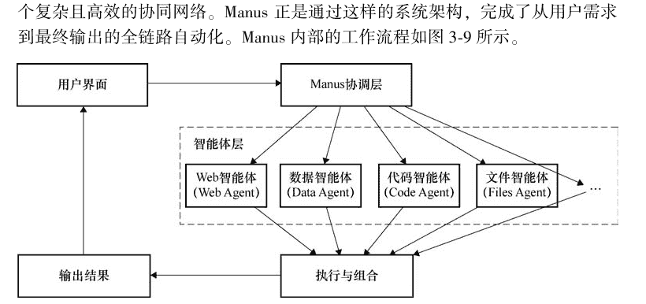

如图 3-9 所示，展示了系统的整体架构与工作流程。主要结构如下：

1. 用户界面：用户通过界面输入需求，如上传文件或提供任务描述。
2. Manus 协调层：接收输入后负责协调不同智能体并分配任务，是系统核心，管理各智能体间的数据流与任务分解。
3. 智能体层：多个智能体被分配特定任务。
4. 执行与组合：所有智能体在协调层控制下协作，最终生成报告、分析图表、文档等输出结果。

通过分层模块化设计，能够高效将任务交给合适智能体并协调协作，确保顺利完成。详细说明如下。

## 1. 用户界面
一切交互始于用户界面。无论是用文本对话提出需求，还是上传文件提供原始数据，该层承担人机桥梁作用。用户无需编程或了解底层技术，仅凭自然语言或文件输入即可激活整个智能链条。

## 2. Manus 协调层
协调层是系统中枢神经。它不直接执行任务，而是承担认知、规划与调度职责。可类比为经验丰富的项目经理，具备以下能力：
1. 记忆与知识管理：保存历史任务、用户偏好与领域知识，为后续任务提供上下文支持。
2. 任务分解：将用户提出的复杂目标拆解为可执行子任务。例如“帮我分析这批简历并生成报告”会被分解为文件处理、信息提取、数据分析、报告生成四步。
3. 智能编排：按需求动态分配合适的智能体，管理它们之间的数据流转与协作关系。

## 3. 智能体层
协调层规划后，具体任务交由不同类型智能体负责。智能体层负责具体执行，每个智能体像独立数字员工，专注某一类工作，职能边界清晰。例如：
1. Web 智能体：专注网页浏览与信息提取，可自动访问指定网站、抓取结构化或非结构化数据，像不知疲倦的网络研究员。
2. 数据智能体：擅长数据分析与 API 调用，无论结构化表格、数据库查询还是在线数据接口，都能高效处理并深度分析。
3. 代码智能体：具备 Python 等编程语言执行能力，支持自动化脚本编写与运行，可完成批处理、算法运算甚至自动部署微服务。
4. 文件智能体：用于管理处理各类文件，包括格式转换、文本提取、文档汇总等，例如可将一组 PDF 合同转为可分析的表格数据。

## 4. 执行与组合
智能体并非独立作战，而是通过共享数据流通平台协同。执行完毕后，中间结果在智能体间传递：
1. Web 智能体提取的网页数据直接传递给数据智能体分析。
2. 数据分析结果交由代码智能体生成预测模型。
3. 文件智能体最终汇总各环节成果为完整文档、图表或数据库。

该过程如高度自动化生产流水线，从原材料采集到半成品加工再到成品打包，层层递进、环环相扣。

## 5. 输出结果
经过协同执行，可输出常见类型：
1. 报告：商业计划、市场分析、人力资源报告等。
2. 图表：数据可视化、趋势分析、技能分布图等。
3. 网站：静态网站、产品原型、数据可视化平台。
4. 表格：结构化数据输出，便于后续处理。
5. 通知：自动推送任务完成状态、异常警告或关键结果。

这些输出既可供人工阅读，也可作为下一步自动化流程的输入，进一步触发新任务。

### 3.4 Manus 高效应用实战

#### 3.4.1 【实战】用 Manus 制定一个旅游规划

在 AI 渗透日常工作与生活后，旅行规划方式也在悄然改变。该平台不仅能完成文档整理、数据分析，还可协同多个智能体，为一次川藏跨线自驾之旅制定完整专业的行程方案。

## 1. 高效提示的核心策略
并非传统路线推荐工具，不依赖预设模板，而是依靠自然语言理解与智能体协同，自主拆解目标、制定任务链并交付结构化成果。

清晰准确的提示是激活系统智能的关键。针对成都到拉萨自驾的提示，不应仅罗列地名，还应融入旅行偏好、预算范围、风险规避、景点选择等要素。高效提示词示例如下：

想要一条成都往返拉萨的七日自驾方案，重点落在沿途的自然景观、藏族文化体验以及适合拍摄的机位，并明确要求避开危险路段。整体预算控制在 8000 元到 12000 元之间，须覆盖住宿、燃油、门票等开销。需要给出每日行驶区间、预计驾车时长、海拔变化、出行须知，并交付一份 HTML 旅行手册，内含地图、景点解读、应急建议与高反预防指南。

图 3-10 展示了借助 Manus 完成行程策划时的提问范例。

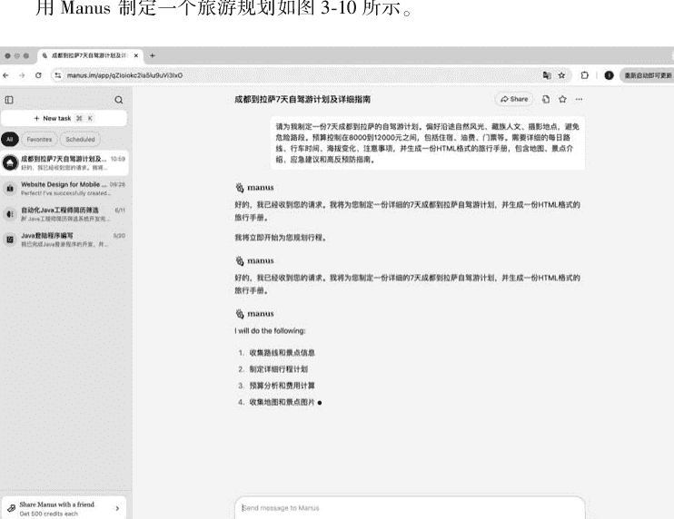

上述指令不仅标明了起点终点，还把天数、风景偏好、文化兴趣、摄影诉求、风险规避与费用区间等要点都细化了。信息越完整，Manus 在任务分解和路线推演上的准确性越高。由此得到的行程规划成果见图 3-11。

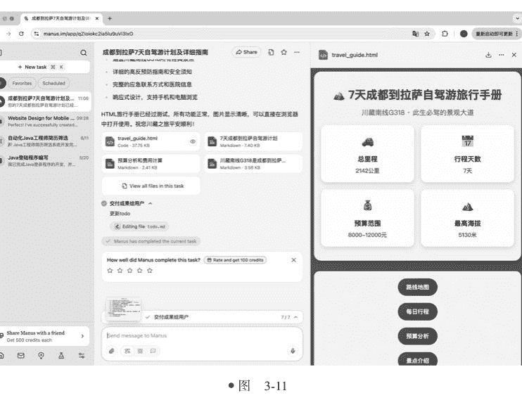

• 图 3-11

## 2. 旅游规划高效提示技巧

要让行程策划的提示更高效，主要可以从以下几方面入手：

1. 加入限制条件缩小搜索范围。例如 “避开川藏线 318 国道 102 公里附近的滑坡路段”，或 “优先挑选全程平均海拔不高于 4000 米的线路”。这类约束能让 Manus 先把高风险节点筛掉。
2. 以目标为导向而非步骤罗列。不要仅写 “帮我找沿途景点”，而要明确最终交付——“输出一份融合自然、人文与摄影的 7 天自驾计划，在安全感、舒适度与景观点密度间取得平衡”。目标驱动能让协调层更合理地安排多智能体协作。
3. 引入动态变量。提示里加入可变化条件，使 Manus 能随实际情况调整。例如：

> 若预报稻城亚丁将降雪，则跳过该地，把停留时间转至然乌湖。

4. 补充健康管理限制。高原自驾存在生理风险，可在排程中加入适应性安排：
    1. 首日先抵康定或新都桥，避免直冲高海拔。
    2. 每天上升幅度不超过 800 米。
    3. 适当安排低海拔休整日。

#### 3.4.2 【实战】用 Manus 进行专业数据分析的方法与技巧

## 1. 高效提示的核心策略

Manus 对任务的理解好坏，取决于输入提示的完整、清晰与结构化程度。优秀的提示不仅是提问，更是把任务背景、边界与期望交付一起传达。

参考示例如下：

> 请基于我提供的 2025 年 1 月销售数据做全面剖析。包括：
> 各天、各周的销售走势；
> 不同促销手段比如折扣、运费对业绩的影响；
> 客户行为剖析，客单量与转化率；
> 对主要趋势做可视化呈现。
> 最后给出增长建议，目标是次月销售额提升 10%。同时产出一份完整的 HTML 分析报告，包含图表、核心洞察与执行建议。

使用 Manus 做数据分析的提示示例如图 3-12 所示。

若执行成功，输出结果如图 3-13 所示。

## 2. 高效提示的五大技巧

1. 任务拆解思维。不要只写“帮我分析”，而要明确子目标。例如：
> 分析各折扣策略对利润的差异。
> 计算周末与工作日的客单价差距。
这种细化会让 Manus 在拆分任务时更精准。
2. 约束输出格式。直接在提示里说明交付形式。例如：
> 输出一份 HTML 分析手册。
> 提供 Excel 格式的趋势数据表。
> 生成适配 PPT 的 PNG 可视化图表。
格式约束能让结果更贴合需求。
3. 引导代码透明化。例如：
> 分析过程中展示所用 Python 代码，便于复核与二次修改。
Manus 会在侧边自动生成数据处理与可视化代码，提升可解释性与可修改性。
4. 数据敏感性提示。明确让 Manus 处理异常或稀疏数据。例如：
> 对于异常高峰的销售日，需深挖原因，判断是促销、季节性还是数据误差。
避免噪声被误判为趋势。
5. 增加动态应对机制。例如：
> 若分析中发现缺失或异常数据，自动生成缺失报告并给出修复建议。
加入动态机制可让 Manus 遇到问题时自主调整流程，而不是中断。

#### 3.4.3 【实战】用 Manus 高效生成面试排期的提示方法与技巧

候选人数量多时，Manus 能借助自然语言处理与智能体协同，自动生成较为合理的面试排期，节省人力并保证公平。

在 Manus 中生成排期的过程可通过清晰提示驱动。以下为步骤与提示结构。

1. 确定任务目标。提示开头应明确：
    1. 排期区间，例如 4 月 13 日至 15 日。
    2. 每日时段数，例如每天上午、下午两个时段。
    3. 平衡性要求，例如候选人均匀分布。
    4. 候选人需求，例如可用时间。
示例：
> 请依据候选人提供的可用时间 4 月 13-15 日生成排期。每天安排上午和下午各一时段，要求各时段候选人分布尽可能均匀，且安排需符合个人可用时间，最终偏差不超过 1 人。
2. 数据读取与处理。Manus 会从数据源提取时间偏好。数据多为 Excel 或 CSV。清晰提示有助于理解结构。
> 请读取 Excel 中候选人可用时间，按姓名、日期、上午/下午可用性进行排期。
格式复杂时，可在提示中明确列名。
3. 分配候选人到时段。根据可用时间尽量实现负载均衡。
> 请确保各面试时段候选人数尽量均衡，最大偏差不超过 1 人。若某时段不足，可调整其他时段填补。
4. 验证排期合理性。生成后自动校验。
> 请核查每位候选人是否安排在可用时段，并统计各时段人数偏差。偏差过大时请优化。
明确验证标准可帮助精确优化。
5. 输出排期结果。完成后可多格式交付。
> 请以文本 txt 与 Markdown md 形式输出最终排期，如需可另生成 HTML 页面，并附验证报告说明各时段分布。
清晰要求输出格式能满足不同使用场景。

#### 3.4.4 使用 Manus 将文件类型转换的方法和技巧

Manus 能自动化完成文件格式转换与数据处理等任务。关键在于提示设计与流程优化。

## 1. 文件格式转换的核心思想

格式转换的目标是将源文件内容迁移到目标格式，保持数据完整与结构，同时符合目标文档规范。对 Manus 而言，这不仅是复制，还涉及结构化、排版优化。例如 Excel 转 Word 时，需读取表格数据并对每个 API 文档做格式处理，确保 Word 中易读专业。

## 2. 高效使用 Manus 的提示技巧

1. 提示结构清晰。明确输入输出格式。例如：
> 请把 Excel 中的 API 文档转为 Word，包含封面、目录、各接口详细描述、JSON 示例、表格。要求标题居中加粗，正文用标准字体，JSON 用等宽字体。
2. 明确输出要求。说明目标格式。例如：
> 输出应为 docx，含封面、目录、API 描述，请求与响应参数以表格呈现。
3. 多格式输出。一次生成多种格式。例如：
> 请输出 Word、PDF，并附带包含 API 名称的 CSV 文件。
4. 错误处理与数据修正。预设异常策略。例如：
> 若 Excel 缺少某 API 描述，自动标注“待补充”，并在末尾列出所有缺失项。
5. 增强可读性与美观。例如：
> 表格内容居中，JSON 代码块等宽展示，正文常规字体，标题加粗。

# AgentScope实战——打造多智能体协作的AI“数字工厂” 第4章

## 4.1 什么是 AgentScope

### 4.1.1 AgentScope 简介

AgentScope 由阿里巴巴团队开源，是一款多智能体编排平台，具有灵活、透明、可扩展的特点，面向高效协作的智能体网络。具备 Python 基础的开发者即可上手。

## 1. AgentScope 核心理念

传统企业自动化中，AI 多为插件，仅用于问答或辅助决策。在 AgentScope 中，数据点、业务流程、角色均可封装为独立智能体。这些智能体具备感知、推理、执行能力，能主动协调、调度甚至重构业务逻辑。

例如客服场景，客服智能体可与订单智能体、物流智能体协同，查询订单、发起退货，并在后台优化服务策略。

## 2. 为什么需要 AgentScope

1. 多智能体协作痛点：角色分工复杂，谁负责、先后顺序、信息传递等若靠手工编码，易繁琐出错。

## 3. AgentScope 常见应用场景

- （1）客户服务智能体
处理账户查询、退款进度、技术支持，并通过协作自动调用工单与数据库系统。
- （2）企业知识搜索引擎
从 OneDrive、S3、Azure Blob 等平台语义检索文档，实现 AI 文档助理。
- （3）行业分析与预测 Agent
结合机器学习与大语言模型，实时分析市场信号、解读趋势并自动生成 PPT 供决策层使用。

## 4.1.2 【实战】快速本地安装 AgentScope

### 1. AgentScope 环境准备

AgentScope 基于 Python，推荐 3.9 及以上。实践中建议用虚拟环境如 venv 或 conda 避免冲突。例如：

```
$ python3 -m venv agentscope_env
$ source agentscope_env/bin/activate
```

环境就绪后进入安装。

### 2. 本地安装 AgentScope

AgentScope 已发布在 PyPI，使用 pip 安装。基础命令：

```
$ git clone https://github.com/modelscope/agentscope
$ cd agentscope
$ pip install -e .
```

安装成功后即可运行单个对话智能体如 DialogAgent。

### 3. 安装扩展包

如需接入 OpenAI、DeepSeek、通义千问等，或启用工具调用、分布式部署，可装可选依赖。

安装常用功能集合命令：

```
$ pip install "agentscope[all]"
```

大型工程推荐 agentscope[all]，覆盖多数需求。

### 4. 验证是否安装成功

创建 example1.py，写入：

```python
import agentscope

print(agentscope.__version__)
```

在目录下执行：

```
$ python example1.py
0.1.6
```

若输出智能体版本号，则安装成功。

## 4.2 AgentScope 的核心架构

AgentScope 采用模块化解耦的三层架构，包含智能体层、管理器与包装层、实用层三大支柱，将通信、模型调用、调度、数据交互与错误处理高度可控，如图 4-1 所示。

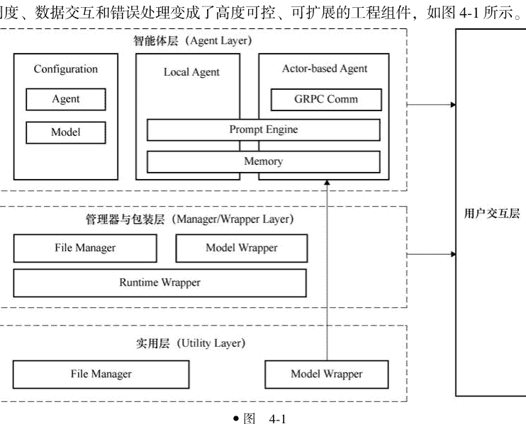

● 图 4-1

### 1. 智能体层

负责定义职责、消息传递方式、交互节奏与上下文演化。包含：

- 1) Configuration：定义 Agent 名称、角色、模型配置。
- 2) Local Agent：含 Prompt Engine 与 Memory 管理，用于构建单体智能体。
- 3) Actor-based Agent：实现 GRPC 通讯，支持分布式部署。

### 2. 管理器与包装层

负责资源调度与错误管理，是系统“中控台”。核心组件：

- 1) File Manager：管理多模态存储、文件上传、API 调用历史。
- 2) Model Wrapper：提供自动校正、重试与自定义 handler，提升与大模型及工具交互鲁棒性。

### 3. 实用层

支撑智能体运行的基础层，负责 I/O、系统指令、资源调度。可类比为操作系统驱动。提供文件读写、数据库查询、网页搜索、代码执行、知识库检索等。例如天气预报机器人中，实用层负责抓取天气 JSON，智能体负责解释与呈现。

### 4. 用户交互层

最外层桥梁，负责输入接收、输出呈现与多模态交互协调，让复杂协作以自然高效方式呈现给用户。

## 4.3 如何在 AgentScope 中使用 MCP

在多智能体系统中，语言模型擅长理解与规划，但推动行动需借助工具。模型上下文协议 MCP 正是模型通向行动世界的入口。借助 MCP，AgentScope 中的智能体不仅能思考，还能执行浏览器操作、抓取网页、跑代码、读写数据库等。本节介绍使用方法，底层原理见第 9 章。

### 1. MCP 的定位

可将 MCP 视为智能体服务标准，统一语言模型与外部工具的通信接口，使模型能安全标准化地请求工具完成操作。无论对象是网页、代码、数据库还是文件，模型通过统一协议发送结构化消息即可触发动作。MCP 为多智能体系统带来显著变化：

让 Agent 真正“上手”操作外部系统

要点一：Agent 的职责不再局限于文本推理，范围被显著拉开，可以直接触达真实业务系统。
要点二：开发者只要付出很小的成本，就能把现有的业务系统打包成 MCP 服务，顺滑接入 AgentScope 构成的多 Agent 协作网络。

举个例子，如果要做一个职位情报汇总 Agent，目标是跨多个招聘网站检索指定岗位、抓取页面内容并提炼要求。仅靠大语言模型无法直接打开网页，而借助 MCP 里的 Puppeteer 服务，在 AgentScope 下运行的 Agent 就能操控浏览器、模拟人工点击完成抽取。执行逻辑与人工高度一致：先理解意图→打开站点→模拟检索→取回内容→归纳作答。

### 2. 在 AgentScope 里启用 MCP 的流程
在该框架中使用 MCP，核心经历服务注册、工具调用、模型响应三个环节。具体步骤如下。

（1）准备 Python 客户端与 Node 运行环境
在终端执行：

```
$ pip install mcp
$ pip install "mcp[cli]"
```

建议 Node 版本在 20 及以上，具体安装方式请参照官方文档。

（2）注册服务
环境就绪后，需要定义 MCP 服务配置并完成注册。以本地 Puppeteer 浏览器 Agent 为例，可用下面代码启动 MCP 并接入 AgentScope：

```python
from agentscope.service import ServiceToolkit

toolkit = ServiceToolkit()

toolkit.add_mcp_servers(server_configs={
    "mcpServers": {
        "puppeteer": {
            "command": "npx",
            "args": ["-y", "@modelcontextprotocol/server-puppeteer"]
        }
    }
})
```

上述代码让 AgentScope 拉起一个 MCP 服务端，内部由 Node.js 驱动 Puppeteer 控制浏览器，并把工具能力对外暴露为 Agent 可用的服务。

也可以对接云端已部署的远程 MCP 服务，例如云上爬虫服务，通过 HTTP 接入，演示如下：

```python
toolkit.add_mcp_servers(server_configs={
    "mcpServers": {
        "puppeteer": {
            "url": "http://localhost:8000/sse"
        }
    }
})
```

远程接入适用于跨主机、分布式部署，有助于提升整体可扩展性。

（3）工具调用
服务启动后，系统会自动把提供的能力封装成 Agent 可调用的工具。这些工具自带标准说明与参数结构，可通过 `toolkit.tools_instruction` 查看调用方式与能力描述。演示代码如下：

```python
print(toolkit.tools_instruction)
```

输出会列出工具名称、输入参数格式、功能说明等，Agent 可通过自然语言发起请求触发系统调用。

（4）模型响应
任务执行时，Agent 只需在生成回复的过程中引用对应工具。例如：

```python
from agentscope.agents import ReActAgent

agent = ReActAgent(
    name="assistant",
    model_config_name=YOUR_MODEL_CONFIGURATION_NAME,
    verbose=True,
    service_toolkit=toolkit,
)
```

示例中使用了具备工具调用能力的 ReActAgent。当模型判断需要操作网页时，会自动向 MCP 工具发出指令，完成页面加载与元素提取，并把结果返回供后续推理。对外看来就像模型“长出了手”，能够观察网页、提取信息并继续对话。

### 3. 把 AgentScope 能力反向暴露为 MCP 服务
该框架不仅能消费 MCP 工具，还能反向输出，让自身能力变成外部可调用服务，这对平台化部署很关键。将一个讲笑话的 Agent 注册为 MCP 服务端的演示如下：

```python
from fastapi import FastAPI
from agentscope import init
from agentscope.agents import DialogAgent
from agentscope.message import Msg
from pydantic import Field
from mcp.server import FastMCP
import asyncio

# 初始化模型配置
init(
    model_configs={
        "config_name": "my-qwen-max",
        "model_type": "dashscope_chat",
        "model_name": "qwen-max",
    }
)

# 初始化 FastAPI 和 MCP
app = FastAPI()
mcp = FastMCP("中文笑话服务", app=app)

# 注册工具
@mcp.tool()
def tell_joke(
    topic: str = Field(description="笑话的主题")
) -> str:
    agent = DialogAgent(
        name="joke_bot",
        model_config_name="my-qwen-max",
        sys_prompt="你是一个中文喜剧助手,擅长根据主题讲笑话.",
    )
    return agent(Msg("user", topic, "user")).content

# 使用 asyncio 调用异步 list_tools 方法
asyncio.run(mcp.list_tools())
```

在命令行运行：

```
$ mcp run mcp_server_example.py -t sse

2025-05-06 00:23:15 | INFO     | agentscope.manager._model:load_model_configs:138 - Load configs for model wrapper: my-qwen-max
INFO:     Started server process [16346]
INFO:     Waiting for application startup.
INFO:     Application startup complete.
INFO:     Uvicorn running on http://127.0.0.1:8000 (Press CTRL+C to quit)
```

执行后，该服务会以标准 MCP 工具的形式对外开放，任何兼容 MCP 的大语言模型系统都能通过调用 `tell_joke` 获取模型生成的幽默内容。在此架构下，AgentScope 既是工具使用者，也是工具生产者。

## 4.4 AgentScope 里的 RAG 解析
在多 Agent 场景里，大语言模型推理生成能力很强，但知识覆盖面和时效性有限。为此引入检索增强生成 RAG，让 Agent 在作答时结合外部知识库，提供更准确、更实时的结果。

### 1. 什么是 RAG
RAG 将信息检索与生成模型结合，基本流程为：

1. 检索阶段：Agent 根据用户查询，从预建的知识库中找出相关文档或片段。
2. 生成阶段：把检索到的信息与用户查询一起输入到生成模型，产出融合外部知识的回答。

这样 Agent 无需内置海量知识，就能借助外部库给出精准信息。

### 2. 在 AgentScope 中落地 RAG
内置对 RAG 的支持，关键模块包括：

1. Knowledge：知识实例的基类。
2. KnowledgeBank：管理多个知识实例的容器。
3. LlamaIndexKnowledge：与 LlamaIndex 协同的知识类，支持本地存储与检索。

创建 LlamaIndexKnowledge 的演示：

```python
import os
import agentscope
from agentscope.rag.llama_index_knowledge import LlamaIndexKnowledge

# 初始化
agentscope.init(
    model_configs=[
        {
            "model_type": "dashscope_text_embedding",
            "config_name": "qwen_emb_config",
            "model_name": "text-embedding-v2",
            "api_key": "sk-beab2126cf784249b9f052920de57378",
        },
    ],
)

# 确保当前目录中有 intro.md 文件
local_knowledge = LlamaIndexKnowledge.build_knowledge_instance(
    knowledge_id="agentscope_qa",
    data_dirs_and_types={"./": [".md"]},
    emb_model_config_name="qwen_emb_config",
)

nodes = local_knowledge.retrieve("AgentScope 是什么?", similarity_top_k=1)

if nodes:
    print(f"\nThe retrieved content:\n{nodes[0].content}")
else:
    print("没有找到匹配内容")
```

其中 `init()` 用于初始化运行环境，`build_knowledge_instance()` 用来创建实例并指定知识 ID、数据目录和嵌入模型配置，通过 `retrieve()` 获取与查询相关的片段。

使用 KnowledgeBank 管理多实例的演示：

```python
from agentscope.rag import KnowledgeBank

# 创建知识库
knowledge_bank = KnowledgeBank(configs="configs/knowledge_config.json")

# 动态添加知识实例
knowledge_bank.add_data_as_knowledge(
    knowledge_id="agentscope_tutorial_rag",
    emb_model_config_name="qwen_emb_config",
    data_dirs_and_types={"../../docs/sphinx_doc/en/source/tutorial": [".md"]},
)
```

借助 KnowledgeBank，可从配置文件批量加载多个知识实例，也能动态添加新实例，管理与扩展都更灵活。

## 3. 组装可检索 Agent
构建 RAG Agent 的示例代码如下：

```python
from agentscope.agents import LlamaIndexAgent

# 构建 RAG 智能体
rag_agent = LlamaIndexAgent(
    name="rag_agent",
    model_config_name="qwen-max",
    knowledge_bank=knowledge_bank,
)

# 与智能体交互
msg = Msg(name="user", content="Tell me about AgentScope.", role="user")
response = rag_agent.reply(msg)
print(response.content)
```

代码创建了一个 LlamaIndexAgent 实例，指定模型配置名称和知识库；通过 `reply()` 方法发送消息并获取响应。

## 4.5 实战：用该框架搭建多模态 Agent
原生多模态支持让构建可生成与识别图像的 Agent 变得简单，为教育、设计、搜索、医疗等领域打开更多可能。

### 1. AgentScope 多模态图像生成实战
图像生成是多模态体系的重要一环。借助 DashScope 或其他模型提供商，系统能把描述性文字转为图像，生成绘图、示意图、设计草图等。

创建图片的演示：

```python
from agentscope.agents import DialogAgent
import agentscope
import matplotlib.pyplot as plt

agentscope.init(model_configs={
    "config_name": "qwen-vl",
    "model_type": "dashscope_multimodal",
    "model_name": "qwen-vl-max",
    "api_key": "sk-beab2126cf784249b9f052920de57378",
})

agent = DialogAgent(
    name="vision_helper",
    sys_prompt="你是一个可以看懂图像的智能体,擅长描述图像内容.",
    model_config_name="qwen-vl"
)

plt.figure(figsize=(6, 6))
plt.bar(range(3), [2.0, 1.0, 4.0])
plt.xticks(range(3), ["James", "Shirdon", "Barry"])
plt.title("Test Data")
plt.xlabel("Number of Mobile Phone")
plt.savefig("./test_bar.png")
plt.show()
```

命令行运行：

```
$ python image_generate_example.py
2025-05-06 14:45:03 | INFO     | agentscope.manager._model:load_model_configs:138 - Load configs for model wrapper: qwen-vl
```

运行成功后，代码目录下会生成一张图片，效果如图 4-2 所示。

### 2. AgentScope 图像识别实战
最基础的多模态场景是“看图识别”。在该框架中，图像作为消息的一种输入。开发者可向 Msg 对象添加图像路径或 URL，传递给支持视觉的 Agent。内部包装器会自动识别图像输入并转为视觉 Token 或二进制数据，以适配大模型接口。

构建“视觉理解助手”的演示：

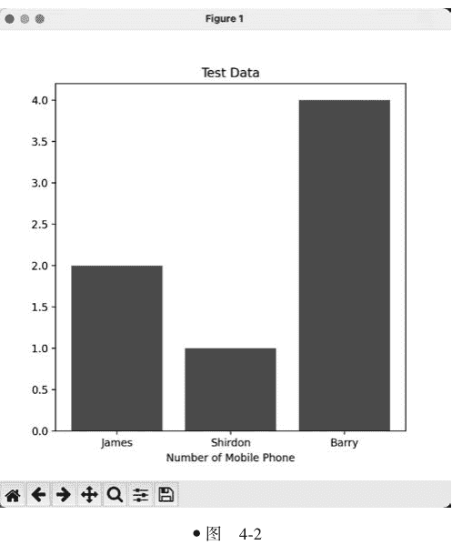

• 图 4-2

```python
from agentscope.agents import DialogAgent
import agentscope
from agentscope.message import Msg

agentscope.init(model_configs={
    "config_name": "qwen-vl",
    "model_type": "dashscope_multimodal",
    "model_name": "qwen-vl-max",
    "api_key": "sk-beab2126cf784249b9f052920de57378",
})

agent = DialogAgent(
    name="vision_helper",
    sys_prompt="你是一个可以看懂图像的智能体,擅长描述图像内容。",
    model_config_name="qwen-vl"
)

msg = Msg(
    name="用户",
    content="为我详细描述一下这个图片。",
    role="user",
    url="./test_bar.png",
)

response = agent(msg)
print(response)
```

在命令行输入如下命令运行代码：

```
$ python image_recognition_example.py
2025-07-06 14:48:00 | INFO     | agentscope.manager._model:load_model_configs:138 - Load configs for model wrapper: qwen-vl
2025-07-06 14:48:00 | ERROR    | agentscope.message.msg:__init__:112 - The url argument will be deprecated in the future. Consider using the ContentBlock instead to attach files to the message
vision_helper:这张图片是一个条形图,具体描述如下:
......
```

配置成功后，呈现的画面可参照图 4-3。

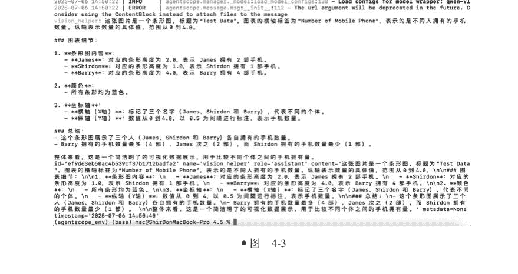

前述示例里，url 参数填入的是本地图片地址，框架会将其转换为多模态输入喂给模型。智能体读取画面信息后产出自然语言描述，完成一次基础的视觉理解。图像到文本的这一转换，正是 AgentScope 多模态功能的核心体现之一。

## 4.6 【实战】搭建 AgentScope 可视化面板

优秀的智能系统既要推理能力强，也要具备直观的交互窗口，以便观察者追踪运行轨迹。AgentScope 提供了两套主要的可视化方案：AgentScope Studio 与 Gradio Web UI，同时也允许开发者自建定制面板。

### 1. 安装并启动 AgentScope Studio

AgentScope Studio 基于 React 与 Node.js 技术栈构建的监控面板。以项目为维度展示智能体间的交流、API 调用情况及 Token 消耗，兼具调试与运行监控价值。

（1）部署 Node.js 环境（含 npm）

上线前需确认环境已装好 Node.js 及 npm，Ubuntu 下的安装参考如下：

```
$ sudo apt update
$ sudo apt install nodejs npm
```

（2）安装 AgentScope Studio 命令行工具

命令行客户端的安装指令如下：

```
$ npm install -g @agentscope/studio
```

（3）启动 AgentScope Studio

前后端启动命令如下：

```
$ as_studio
```

后端接入需通过 AgentScope 的 Python 程序，示例代码为：

```python
import os
import agentscope

# 初始化 AgentScope(连接本地 Studio 并配置模型)
agentscope.init(
    model_configs=[
        {
            "model_type": "dashscope_chat",  # 模型类型为 DashScope 聊天模型
            "config_name": "qwen_max_config",  # 自定义的模型配置名
            "model_name": "qwen-max",  # 模型名称(官方支持)
            "api_key": "sk-xxx",  # 替换成你的阿里云百炼 API 密钥
        }
    ],
    studio_url="http://localhost:3000"
)
```

借助上述实现，所有通过 speak() 输出的智能体对话会实时推送到 Studio。Studio 控制台呈现项目层级，每个智能体的输入输出都被完整记录，并支持单击输入框发起用户交互，方便会话流程排查。

运行成功后，用浏览器打开 http://localhost:3000，即可看到如图 4-4 的效果。

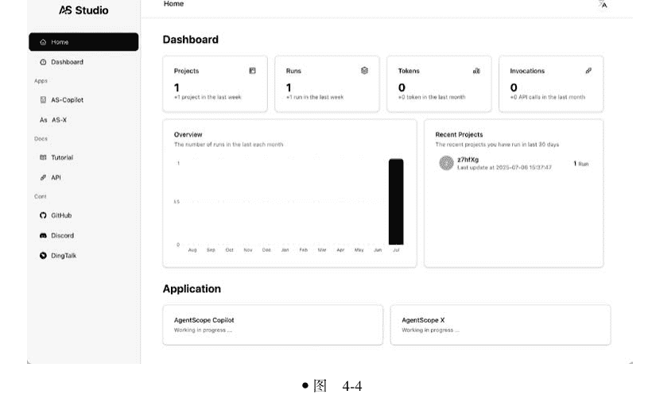

### 2. Gradio Web UI

若追求快速上线 Web 页面，Gradio 是便捷选择。安装含 Gradio 的 AgentScope 版本指令如下：

```
$ pip install agentscope[full]
```

请将智能体逻辑封装在 main() 函数内部，示范如下：

```python
def main():
    agentscope.init(...)
    agent = DialogAgent(...)
    user = UserAgent(agent)
    # 循环交互逻辑
```

随后通过命令行唤起界面，指令如下：

```
$ as_gradio {path_to_your_python_code}
```

执行后 Gradio 前端会自行解析代码中的智能体，并生成类聊天的交互页面。

## 4.7 【实战】基于 AgentScope 打造人机五子棋对战

本节演示如何借助 AgentScope 框架，结合智能体的编排与对弈逻辑，实现简易五子棋并支持人机轮流对弈，以体现智能体在复杂决策中的表现。

### 1. 项目目标与核心思路

我们将构建一个以 AgentScope 为底座的五子棋对弈系统，两端智能体交替落子，直至出现五子连成一线。主要目标包括：

- 1) 智能体设计：打造可维护棋盘状态、判断胜负并执行落子的智能体。
- 2) 对弈规则：落实五子棋基础规则，涵盖输赢判定与合法走法的校验。
- 3) 人机对弈：实现人与智能体交替下棋，直至分出胜负或盘面填满。

实现上采用 BoardAgent 担任棋盘管理角色，负责所有棋盘相关操作；GameAgent 则统筹整场对局流程。

### 2. 核心组件与架构

整体由游戏控制器与棋盘管理器两部分构成。

（1）创建游戏智能体来控制对弈流程

游戏智能体负责流程调度，包含接收用户输入、调用棋盘智能体完成操作、返回对局结果等。具体实现见下：

```python
class PlayerAgent(DialogAgent):
    def __init__(self, name: str, model_config_name: str, sys_prompt: str, **kwargs) -> None:
        super().__init__(name=name, model_config_name=model_config_name, sys_prompt=sys_prompt, **kwargs)

    def reply(self, x: Optional[Union[Msg, Sequence[Msg]]] = None) -> Msg:
        # 让 LLM 生成走法
        msg = super().reply(x)
        # 为简化起见，我们假设 LLM 直接输出 "row,col" 格式的走法
        # 在实际应用中，你可能需要添加更强的解析和验证
        return msg

def main():
    # 使用模型配置初始化 AgentScope
    # 请替换为实际的模型配置
    agentscope.init(
        model_configs=[
            {
                "config_name": "my_model",
                "model_type": "dashscope_chat",  # 或其他支持的模型类型
                "model_name": "qwen-max",  # 或其他模型名称
                "api_key": "sk-xxxxxx",
            }
        ]
    )

    # 创建智能体
    board_agent = BoardAgent("GomokuBoard")
    player_black = PlayerAgent(
        name=NAME_BLACK,
        model_config_name="my_model",
        sys_prompt=f"你是一个名为 {NAME_BLACK} 的五子棋玩家,棋盘大小为 {BOARD_SIZE}x{BOARD_SIZE}。你执黑子 X。原点 (0,0) 位于左上角。请输出你的走法,格式为 "row,col",并且只输出该格式."
    )

    player_white = PlayerAgent(
        name=NAME_WHITE,
        model_config_name="my_model",
        sys_prompt=f"你是一个名为 {NAME_WHITE} 的五子棋玩家,棋盘大小为 {BOARD_SIZE}x{BOARD_SIZE}。你执白子 O。原点 (0,0) 位于左上角。请输出你的走法,格式为 "row,col",并且只输出该格式."
    )

    # 游戏循环使用 msghub
    participants = [board_agent, player_black, player_white]
    game_round = 0
    # 从棋盘给黑方发送消息开始
    x = board_agent.reply()
    with msghub(participants=participants) as hub:
        while not board_agent.is_game_end():
            # 确定当前玩家
            current_player = player_black if game_round % 2 == 0 else player_white
            # 向所有参与者广播棋盘状态
            hub.broadcast(x)
            # 获取玩家的走法
            move_msg = current_player.reply(x)
            # 将走法发送给棋盘智能体
            x = board_agent.reply(move_msg)
            # 打印棋盘状态
            print(x.content)
            game_round += 1
    ......省略部分代码
```

（2）创建棋盘智能体显示棋盘

棋盘智能体负责画面呈现与状态维护，涵盖棋盘初始化、记录每步落子、校验合法性、判定胜负等。具体实现见下：

```python
from flask import Flask, request, jsonify, render_template
from gomoku_game import BoardAgent, NAME_BLACK, NAME_WHITE, BOARD_SIZE, EMPTY_PIECE, PlayerAgent
from agentscope import init, msghub
from agentscope.message import Msg

app = Flask(__name__, static_folder='static', template_folder='static')

# 初始化 AgentScope(只需初始化一次)
init(
    model_configs=[
        {
            "config_name": "my_model",
            "model_type": "dashscope_chat",
            "model_name": "qwen-max",
            "api_key": "sk-xxx",
        }
    ]
)

# 全局游戏状态(为了简化,实际应用中应使用会话或数据库。限于篇幅,部分代码在随书附赠资源中)
board_agent = BoardAgent("GomokuBoard")
player_black = PlayerAgent(
    name=NAME_BLACK,
    model_config_name="my_model",
    sys_prompt=f"你是一个名为 {NAME_BLACK} 的五子棋玩家,棋盘大小为 {BOARD_SIZE}x{BOARD_SIZE}。你执黑子 X。原点 (0,0) 位于左上角。请输出你的走法,格式为 "row,col",并且只输出该格式。"
)
player_white = PlayerAgent(
    name=NAME_WHITE,
    model_config_name="my_model",
    sys_prompt=f"你是一个名为 {NAME_WHITE} 的五子棋玩家,棋盘大小为 {BOARD_SIZE}x{BOARD_SIZE}。你执白子 O。原点 (0,0) 位于左上角。请输出你的走法,格式为 "row,col",并且只输出该格式。"
)

current_player_name = NAME_BLACK  # 黑方先行

@app.route('/')
def index():
    return render_template('index.html')
```

## 从 0 到 1 搭建 AI 智能体：Manus+LangChain+Dify 多平台应用及多智能体协同

```python
@app.route('/api/start_game', methods=['POST'])
def start_game():
    global board_agent, current_player_name
    board_agent.reset_game()
    current_player_name = NAME_BLACK
    initial_msg = board_agent.reply()
    return jsonify({
        'board': board_agent.board.tolist(),
        'message': initial_msg.content,
        'current_player': current_player_name,
        'game_end': board_agent.is_game_end()
    })
……省略部分代码
```

（3）创建五子棋棋盘显示和控制的前端页面

前端页面的关键实现如下：

```html
<!DOCTYPE html>
<html lang="zh">
<head>
<meta charset="UTF-8">
<meta name="viewport" content="width=device-width, initial-scale=1.0">
<title>五子棋游戏</title>
</head>
<body>
<h1>五子棋游戏</h1>
<div id="game-container">
<div id="board-grid"></div>
<p id="message"></p>
<button id="start-game-btn">开始新游戏</button>
<button id="ai-move-btn">AI 走棋</button>
</div>

<script>
    const BOARD_SIZE = 15;
    const boardGrid = document.getElementById("board-grid");
    const messageDisplay = document.getElementById("message");
    const startGameBtn = document.getElementById("start-game-btn");
    const aiMoveBtn = document.getElementById("ai-move-btn");

    let currentBoard = [];
    let currentPlayer = "";
    let gameEnded = false;

    function createBoard() {
        boardGrid.innerHTML = "";
        boardGrid.style.gridTemplateColumns = `repeat(${BOARD_SIZE}, 30px)`;
        for (let r = 0; r < BOARD_SIZE; r++) {
            for (let c = 0; c < BOARD_SIZE; c++) {
                const cell = document.createElement("div");
                cell.classList.add("cell");
                cell.dataset.row = r;
                cell.dataset.col = c;
                cell.addEventListener("click", handleCellClick);
                boardGrid.appendChild(cell);
            }
        }
    }
……省略部分代码
```

## 3. 游戏测试与运行

运行阶段，人类玩家与智能体按顺序轮流调用 BoardAgent 的 play() 接口，直到出现胜者。每轮由当前执棋方提交落子坐标，平台会自动渲染并呈现最新棋盘。

在命令行里执行对应的启动命令，输出如下：

```
$ python main.py
2025-07-08 15:12:04 | INFO     | agentscope.manager._model:load_model_configs:138 - Load configs for model wrapper: my_model
 * Serving Flask app 'main'
 * Debug mode: on
WARNING: This is a development server. Do not use it in a production deployment.
Use a production WSGI server instead.
 * Running on all addresses (0.0.0.0)
 * Running on http://127.0.0.1:5000
 * Running on http://192.168.31.205:5000
```

在浏览器中打开 http://127.0.0.1:5000，即可看到游戏运行界面，如图 4-5 所示。

按上述流程，即可用 AgentScope 搭建起人对智能体的五子棋对弈。

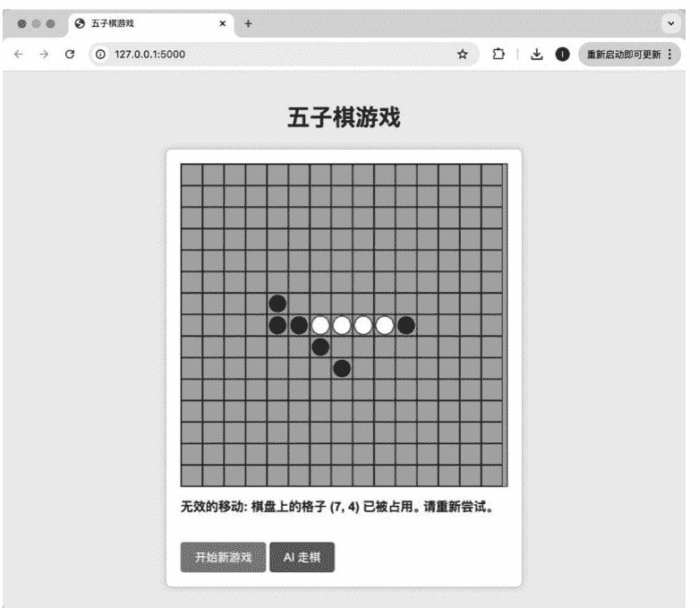

• 图 4-5

# LangChain 实战 第5章：构建智能对话与自动化代理

## 5.1 LangChain 概览：如何让代理更聪明

随着任务难度提升，对代理的处理能力要求也在提高。LangChain 这个开放源码的工具集，为开发者打造更智能、更高效的 AI 代理提供了支撑。

### 1. LangChain 是什么

LangChain 是面向大模型的智能体开发框架。它提供了一系列组件与工具，帮助开发者把大模型与外部数据、接口以及其它算力资源串联起来，从而构建更复杂、更聪明的代理应用。通俗讲，它就像搭建代理的积木盒，每块积木都能按需灵活拼装。官网示意图见图 5-1。

### 2. LangChain 工作机制

LangChain 的设计简洁而强力，通过模块化方式让开发者轻松搭建基于大模型的代理应用。主要流程包括：

- 1）大模型调用：框架内置了多家大模型的接入点，例如 OpenAI 的 GPT 家族、Anthropic 的 Claude 等。借助这些接入点，代理能够理解并生成自然语言，完成复杂任务。
- 2）链式任务 Chains：LangChain 用“链”的思路串联多步操作。每一步可以是轻量计算，也可以是复杂调用。多步串联后，可为代理提供更高阶的自动化能力。
- 3）代理 Agent：代理是 LangChain 的核心能力之一。它不仅能回应用户输入，还能基于输入做判断，挑选最合适的工具执行。例如在搜索类请求中，代理可选择合适的接口拉取数据，也可直接让模型生成答案。

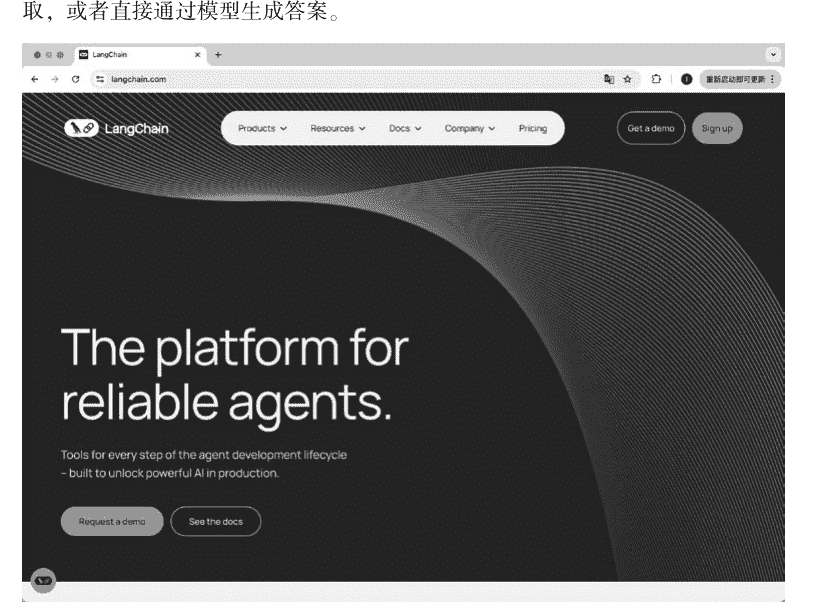

• 图 5-1

### 3. LangChain 为何能提升智能体

LangChain 从以下几个维度增强代理能力：

- 1) 多模态处理：传统大模型多局限于文本。LangChain 支持文本、图像、音频等多种模态，让代理应对复杂任务更灵活，比如依据图片生成文字说明，或依据音频输入实时转写。
- 2) 上下文记忆：传统对话系统往往只处理单轮。LangChain 支持多轮对话并保留上下文，使代理的回复更连贯自然，在客服和助手场景中尤其关键。
- 3）任务自适应：依托链与代理的配合，系统能根据不同任务自动调整处理方式。例如回答天气问题时会调用天气接口，处理复杂文档时会让大模型给出精准答案，自适应性使其在多场景下高效运行。
- 4）外部数据源接入：框架扩展性强，可对接外部数据库、接口与实时数据源。代理不再只能靠记忆的信息，而是能实时获取最新资料，提升回答的准确性与相关性。

### 4. LangChain 的典型用途

LangChain 的应用覆盖个人开发者、企业与科研团队，典型案例有：

- （1）智能客服
在客服场景中，LangChain 可帮助代理理解用户诉求并选择合适的响应方式。询问订单信息时可从数据库读取状态；需要技术支持时，可基于历史对话生成解决方案。
- （2）任务自动化
企业内部可利用 LangChain 自动化报告处理、邮件处理或数据分析。将不同数据源与工具结合，能大幅节省人力与时间，提升效率。
- （3）个性化推荐
基于用户历史行为，LangChain 能驱动代理给出个性化推荐。如在电商平台，根据购买记录与浏览习惯实时推送相关商品。
- （4）教育学习助手
在教育领域，LangChain 可作为学生的个性化学习助手。通过对话与链式任务组合，学生可获取定制化学习资料、解答疑问、甚至进行模拟考试。

### 5. 开始使用 LangChain

对初学者而言，上手并不复杂。先安装 LangChain 包，命令如下：

```
$ pip install langchain
```

安装完成后，可选择合适的大模型，例如 OpenAI 的 GPT，并按需创建链式任务。

## 5.2 构建首个 LangChain 代理

### 5.2.1 安装与配置 LangChain

安装配置过程相对简单，关键是做好环境准备。具体步骤如下。

#### 1. 安装 LangChain

本地使用 LangChain 前，需确认 Python 环境已就绪，支持 Python 3.7 及以上。建议使用虚拟环境隔离依赖，保持项目整洁。

(1) 创建并激活虚拟环境

使用 venv 或 conda 新建虚拟环境，可避免依赖冲突。本书以 venv 为例，在终端执行创建命令：

```
$ python -m venv langchain-env
```

在 Windows 上激活虚拟环境的命令如下：

```
$ langchain-env\Scripts\activate
```

在 macOS/Linux 上激活虚拟环境的命令如下：

```
$ source langchain-env/bin/activate
```

(2) 安装 LangChain

虚拟环境激活后，通过 pip 安装 LangChain，命令行输入：

```
$ pip install langchain
```

该命令会从 PyPI 下载并安装最新版本的 LangChain。

#### 2. 安装其它必要依赖

LangChain 的优势在于可与多种外部工具和接口集成，扩展代理能力。基础包安装后，可按需安装额外依赖。

(1) OpenAI 集成

若使用 OpenAI 的 GPT 模型，可安装集成包，命令如下：

```
$ pip install langchain-openai
```

(2) Anthropic 集成

若使用 Anthropic 的 Claude 模型，可安装对应集成包，命令如下：

```
$ pip install langchain-anthropic
```

(3) 其它集成

LangChain 还支持数据库查询、图像生成等多种接口集成，可按项目需求灵活安装，命令如下：

```
$ pip install langchain-community
```

langchain-community 包能帮助开发者把多种外部服务无缝接入代理工作流，实现更复杂的任务自动化。

#### 3. 验证安装与配置

安装完成后，可用少量代码验证是否配置成功。首先导入 LangChain 并查看版本信息，确认框架已正确安装：

```python
import langchain
print(langchain.__version__)
```

然后在命令行运行：

```
$ python langchain_example.py
0.3.26
```

若代码顺利运行，说明安装成功。

#### 4. 配置 LangChain

安装并依赖就绪后，需要配置环境以便调用不同大模型与工具。主要步骤如下：

(1) 选择大模型

LangChain 支持 OpenAI、Anthropic 等多种模型。使用前需选取并配置模型。以 OpenAI 为例，需配置 API Key。Key 可在 OpenAI 官网注册后获取，通常通过环境变量设置：

```
$ export OPENAI_API_KEY="xxx"
```

Python 代码中 LangChain 会自动读取该 Key 发起接口调用。

(2) 配置外部工具和接口

除大模型外，LangChain 还可连接外部接口、数据库或数据源。集成时需在代码中配置调用方式、响应格式与查询参数。例如集成天气接口的示例如下：

```python
from langchain.agents import initialize_agent
from langchain.agents import Tool

tools = [
    Tool(
        name="weather-api",
        func=weather_api_function,
        description="Get the current weather"
    )
]

agent = initialize_agent(tools, llm, agent_type="zero-shot-react-description")
```

这样 LangChain 即可访问实时外部数据用于代理决策。

(3) 使用内存管理

LangChain 的内存管理功能让代理在多轮对话中保留用户输入与上下文，使回复更合理。示例代码如下：

```python
from langchain.memory import ConversationBufferMemory

memory = ConversationBufferMemory(memory_key="chat_history")
```

内存模块可按任务复杂度定制扩展，实现长期记忆。

### 5.2.2 【实战】用 LangChain 搭建首个问答代理

借助 LangChain 这一强大的开放源码框架，可快速搭建基于大模型的智能应用。下面通过一个简单的问答代理演示使用流程。

#### 1. 准备工作

开始前请确认已安装 LangChain 及其依赖，使用命令安装：

```
$ pip install langchain-openai
```

还需配置 OpenAI 接口以访问 GPT 系列模型。需在 OpenAI 官网注册并获取 API Key。准备就绪后即可开始构建。

#### 2. 导入必需的模块

LangChain 提供了多个模块用于构建链式任务。构建问答代理时需导入大模型、提示模板和链式任务相关模块：

```python
import getpass
import os
from langchain.prompts import PromptTemplate
from langchain.chains import LLMChain
from langchain.chat_models import init_chat_model
```

以上代码导入了 OpenAI 模块用于与 GPT 交互，PromptTemplate 用于设计输入输出格式，LLMChain 用于把模型与链式任务结合。

#### 3. 创建提示模板

问答代理的核心在于设计与大模型的交互方式。LangChain 的 PromptTemplate 用于定义交互框架，即为模型提供问题描述的模板，模型据此生成回答。创建模板示例如下：

```
template = "回答以下问题：{question}"
prompt = PromptTemplate(input_variables=["question"], template=template)
```

其中 `input_variables` 指定模板所需输入变量，模板中的占位符 `{question}` 后续会被替换为用户真实问题。

## 4. 初始化大语言模型

接下来初始化 OpenAI 大模型。LangChain 通过 `OpenAI` 类调用接口，设置合适参数示例如下：

```
model = init_chat_model("gpt-4o-mini", model_provider="openai")
```

示例中选用 `gpt-4o-mini` 作为模型。

## 5. 创建任务链

将提示模板与大模型结合即可创建链式任务。Chains 使 LangChain 能处理多步骤复杂任务，实现自动化流程。在本例中，模型与模板结合形成简易问答系统，示例如下：

```
chain = LLMChain(prompt=prompt, llm=model)
```

通过 `LLMChain` 类，LangChain 会自动处理模板与模型间的转换，并将用户输入格式化后处理。

## 6. 执行任务链

完成上述准备后，代理即可回答问题。向链式任务传入问题即可获得模型生成的结果，例如提问“你好，你是谁？”示例代码如下：

```
result = chain.run({"question": "你好,你是谁?"})
print(result)
```

完整代码执行后，代理将基于输入问题生成回答。若配置正确，执行结果如下：

```
$ python langchain_example1.py
请输入 OpenAI 的 API 密钥：
result = chain.run({"question": "你好,你是谁?"})
你好！我是一个人工智能助手,旨在回答你的问题并提供帮助。请问有什么我可以为你做的?
```

## 5.3 LangChain 的核心功能与运行原理

LangChain 架构可视为一个完整的代理搭建工厂，从底层基础模块到中间组件，再到上层部署调试平台，各层分工协作。LangChain 架构如图 5-2 所示。

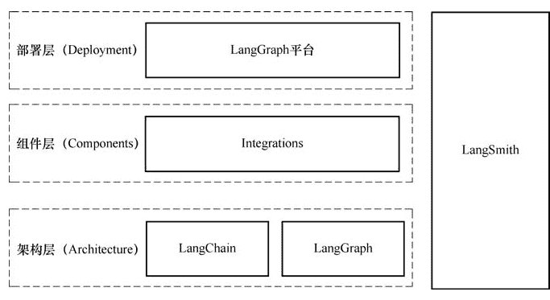

如图 5-2 所示，整体系统分为三层：架构层 Architecture、组件层 Components 与部署层 Deployment。下面对架构进行详细说明。

### 1. 架构层——LangChain 与 LangGraph 是代理的“骨架”

架构层是系统核心基础，负责定义代理的运行逻辑与结构组织。

#### (1) LangChain

LangChain 是最早诞生的模块，提供构建大模型驱动应用所需的核心逻辑，可视作“代理的神经系统”，用于连接提示词 Prompt、大模型 LLM、内存 Memory、工具 Tools 等关键元素。

例如构建问答机器人，只需通过 LangChain 将问题输入、模型调用与答案输出组织成一条“链”即可。LangChain 的特点如下：

### 框架核心亮点

- 封装更上层，写对话流就像在编剧本一样直观
- 可直接挂载 OpenAI、Anthropic、Cohere 等主流提供商的模型
- 链式结构支持嵌套，轻松应对多层推理与任务拆解

#### (2) LangGraph

LangGraph 是 LangChain 的图式延伸。摒弃线性链路，采用图结构来编排 Agent 的执行路径，从而实现条件分支、循环控制等能力。

比如一个 Agent 先要识别用户意图，意图是提问就去检索，意图是要写邮件就调用模板生成器。这类分叉逻辑在 LangGraph 里能用图谱一目了然地呈现。

LangGraph 的特性概括为：

- 1) 用流程图语法描述 Agent 逻辑
- 2) 适配需要多步、多分支的复杂应用
- 3) 内置状态追踪与异步运行机制

### 2. 组件层：Integrations 作为外部互联总线

Integrations 负责把 LangChain 接入外部资源，相当于一座接口中台，让 Agent 拥有真实执行力。典型场景包括：

- 1) 通过搜索引擎拿到实时信息
- 2) 连接数据库提取文档内容
- 3) 接入企业内部系统例如 ERP、CRM

### 3. 部署层：LangGraph 平台，面向生产的可视化流水线

部署层代表商业化落地能力，专为需要调试、监控、优化的企业级场景设计。LangGraph 平台为图式 Agent 提供托管服务，兼具可视化发布、弹性扩容、容错保障等特性，适合上生产环境。

作用点：

- 1) Agent 的云端托管环境
- 2) 并发与大规模任务的承载
- 3) 执行日志与图谱可视化

### 4. LangSmith：Agent 的工程化工作台

LangSmith 面向开发者的全流程调试平台，涵盖提示词管理、调试控制台、多模型横向对比、日志归档等。核心模块：

- 1) Playground：模拟运行并即时查看结果
- 2) Prompt 管理：统一维护提示模板
- 3) Annotation & Testing：标注输出并做对比验证
- 4) Monitoring：运行态监控与性能分析

目标是让 Agent 开发从实验玩具升级为可维护的工程产品。

## 5.4 提示模板实战：打造可复用高效的 AI 提示引擎

在构建 LLM 应用时，提示的设计和管理决定了性能与可维护性。LangChain 的 Prompt Templates 通过把提示逻辑模块化，实现复用、版本管理和动态组装，从而让 AI 应用更灵活。

### 1. 提示模板的核心概念

Prompt Template 负责把用户输入与参数转化为模型指令，通过占位符如 {variable} 把动态内容注入固定模板，最终生成完整提示。该框架支持多种语法，常见有：

- 1) 字符串 f-string：最常用，直观简洁
- 2) Mustache 语法：适合更复杂的逻辑
- 3) Jinja2 语法：功能强但要注意安全，避免执行恶意代码

按业务需要挑选合适的语法来搭建提示结构。

### 2. 模板类型与典型场景

该框架提供了多种模板类型对应不同场景：

#### （1）字符串提示模板

StringPromptTemplate 适合简单的文本生成任务。例如生成特定主题的代码示例：

```
from langchain_core.prompts import StringPromptTemplate

template = "Tell me a joke about {topic}"
prompt = StringPromptTemplate.from_template(template)
formatted_prompt = prompt.invoke({"topic": "cats"})
```

该模板会产出一个关于猫的笑话提示，供大模型使用。

#### （2）聊天提示模板

ChatPromptTemplate 适用于多轮对话，支持多角色消息格式。例如搭建一个翻译助手：

```
from langchain_core.prompts import ChatPromptTemplate

template = ChatPromptTemplate.from_messages([
    ("system", "You are a helpful assistant"),
    ("user", "Translate the following from English into {language}: {text}")
])
formatted_prompt = template.invoke({"language": "French", "text": "Hello, how are you?"})
```

此模板生成包含系统消息与用户消息的对话结构，适合多轮交互。

#### （3）图像提示模板

ImagePromptTemplate 面向多模态模型，用于图像生成或分析。例如描述场景与艺术风格的图像提示：

```
from langchain_core.prompts.image import ImagePromptTemplate

template = ImagePromptTemplate.from_template("A painting of a {scene} in the style of {artist}")
formatted_prompt = template.invoke({"scene": "sunset over the mountains", "artist": "VanGogh"})
```

该模板为多模态模型生成场景描述与风格指引。

### 3. 模板的高级技巧

#### （1）部分格式化

当某些变量暂时缺失时，该框架允许先填入已知的变量，待后续变量补充后再完成格式化。示例：

```
from langchain_core.prompts import PromptTemplate

template = PromptTemplate.from_template("Tell me a {adjective} joke about {topic}")

partial_template = template.partial(adjective="funny")
final_prompt = partial_template.format(topic="sports")
```

这种方式提升了模板的灵活性，适合动态生成场景。

#### （2）示例引导

Few-Shot Prompting 通过少量示例帮助模型理解任务要求。该框架支持把示例嵌入模板。示例：

```
from langchain_core.prompts import PromptTemplate

template = PromptTemplate.from_template("Q: {question}\nA: {answer}")
examples = [
    {"question": "What is the capital of France?", "answer": "The capital of France is Paris."},
    {"question": "What is 2 + 2?", "answer": "2 + 2 equals 4."}
]
formatted_prompt = template.invoke({"question": "What is the tallest mountain in the world?"})
```

借助示例引导，模型能学会回答模式，提升准确度。

#### （3）提示组合

Prompt Composition 把多个模板拼接成复杂结构，适用于多步骤处理。示例：

```
from langchain_core.prompts import PipelinePromptTemplate, PromptTemplate

final_template = PromptTemplate.from_template("{introduction}\n{example}\n{start}")
introduction_template = PromptTemplate.from_template("You are impersonating {person}.")
example_template = PromptTemplate.from_template("Here's an example of an interaction:\nQ: {example_q}\nA: {example_a}")
start_template = PromptTemplate.from_template("Now, do this for real! \nQ: {input}\nA:")

pipeline = PipelinePromptTemplate(
    final_prompt=final_template,
    pipeline_prompts=[
        ("introduction", introduction_template),
        ("example", example_template),
        ("start", start_template)
    ]
)

formatted_prompt = pipeline.invoke({"person": "Albert Einstein", "example_q": "What is relativity?", "example_a": "Relativity is the idea that space and time are linked."})
```

组合后结构更清晰，便于维护与扩展。

## 5.5 用 RAG 让 LangChain 问答更可靠

传统 LLM 在专业或时效性问题上容易出现幻觉，根源在于知识截止于训练数据。检索增强生成 RAG 为模型配备实时检索助手，先查后写，在表达灵活性和事实可靠性之间取得平衡。

该框架提供了完整的 RAG 工具链，从文档读取、分块、向量检索到问答接口，链路清晰且易扩展。

### 1. RAG 架构原理

RAG 可拆为索引与问答两阶段：

#### （1）索引阶段

把原始文本转为可检索格式，关键步骤：

- 1) 用 TextLoader、UnstructuredLoader 等读取文本、PDF 或网页
- 2) 用 TextSplitter 把长文切成逻辑完整的短段
- 3) 调用嵌入模型如 OpenAI Embeddings 或 HuggingFace 生成向量
- 4) 把向量存入 Chroma、FAISS、Pinecone 等向量库

相当于为图书馆的每一页编号并生成内容指纹，便于快速定位。

#### （2）问答阶段

- 1) 把用户问题编码为向量
- 2) 在向量库中检索最相关的片段
- 3) 把检索结果作为提示注入大模型
- 4) 生成基于事实的回答

RetrievalQA 链负责把检索与生成无缝衔接。

### 2. 【实战】构建法律文书问答系统

以城市法律法规实现本地化问答为例：

#### （1）文档加载与切片

示例片段：

```
from langchain.document_loaders import TextLoader
from langchain.text_splitter import RecursiveCharacterTextSplitter

loader = TextLoader("local_laws.txt", encoding="utf-8")
documents = loader.load()

splitter = RecursiveCharacterTextSplitter(chunk_size=500, chunk_overlap=100)
chunks = splitter.split_documents(documents)
```

#### （2）向量嵌入与库的建立

示例片段：

```
from langchain.embeddings import OpenAIEmbeddings
from langchain.vectorstores import Chroma

embeddings = OpenAIEmbeddings()
vector_db = Chroma.from_documents(chunks, embedding=embeddings)
```

#### （3）搭建 RAG 问答

示例片段：

```
from langchain.chat_models import ChatOpenAI
from langchain.chains import RetrievalQA

llm = ChatOpenAI(temperature=0.3)
qa_chain = RetrievalQA.from_chain_type(llm=llm, retriever=vector_db.as_retriever())

response = qa_chain.run("外地车在本市限行吗?")
print(response)
```

## 5.6 【实战】LangChain Agent 创建与使用

在该框架里，Agent 不仅负责生成回复，还能根据任务判断下一步行动并调用工具，执行结果再反馈给模型决定是否继续或结束，从而处理复杂的任务链。

### 1. 创建 Agent 的核心步骤

#### （1）环境配置

命令行执行安装命令：

```
$ pip install langchain langgraph openai langchain-tavily
```

#### （2）导入必要模块

新建 py 文件并编写：

```
import os
import uuid
from langchain.chat_models import init_chat_model
```

## （3）初始化记忆与模型

创建记忆模块 MemorySaver，代码：

```python
memory = MemorySaver()
```

MemorySaver 像 Agent 的笔记，能在对话中保留历史，保证上下文连贯。

模型相当于 Agent 的大脑，这里选用 OpenAI 的对话模型初始化：

```python
model = init_chat_model("gpt-4o-mini", model_provider="openai")
```

init_chat_model 用来实例化对话模型，相当于思考引擎。

## （4）接入工具

仅有模型不够，还需工具支持。例如使用 TavilySearch 实现实时网络检索：

```python
search = TavilySearch(max_results=2)
tools = [search]
```

TavilySearch(max_results=2) 表示每次最多返回两条搜索结果。

## （5）组装 Agent

把模型、工具、记忆整合，创建 ReAct Agent：

```python
agent = create_react_agent(model, tools, checkpointer=memory)
```

create_react_agent 组装出具备推理与行动能力的 Agent。再配置会话 ID 保存对话进度：

```python
thread_id = str(uuid.uuid4())
config = {
    "thread_id": thread_id,
    "checkpoint_ns": "default",
    "checkpoint_id": thread_id
}
```

## （6）运行 Agent

先搭一个轻量且易用的交互式命令行循环，核心代码如下：

```python
while True:
    user_input = input("You: ")
    if user_input.strip().lower() in ("exit", "quit"):
        print("再见!")
        break
```

程序运行后可在终端里直接提问，模型会即时返回结果；发送 exit 或 quit 即可结束当前会话。

## （7）对话流程

每一次输入都会先被封装成消息对象，再交给智能体执行：

```python
input_message = {"role": "user", "content": user_input}
```

为了提升交互的顺滑度，回复采用流式输出：

```python
for step in agent.stream({"messages": [input_message]}, config, stream_mode="values"):
    msg = step["messages"][-1]
    if hasattr(msg, "pretty_print"):
        msg.pretty_print()
    else:
        print(msg)
```

上述实现中 agent stream 会分段呈现模型思考与行动的进程，pretty_print 则把这些信息整理成更易读的格式打印出来。

## （8）错误处理

增加异常捕获，避免未处理的错误导致程序直接退出，示例代码如下：

```python
except Exception as e:
    print(f"交互出错: {e}")
```

## （9）运行与测试

将项目置于终端启动后，典型的运行效果如下所示：

```
$ python agent_example1.py
智能体已启动,输入 'exit' 或 'quit' 退出。
You:你是谁
============================== Human Message ==============================
你是谁
============================== Ai Message ==============================
我是一个人工智能助手,旨在提供信息、回答问题和帮助解决各种问题。如果你有什么需要了解的或帮助的,请随时告诉我!
You:爱因斯坦是谁
============================== Human Message ==============================
爱因斯坦是谁
============================== Ai Message ==============================
阿尔伯特·爱因斯坦(Albert Einstein)是20世纪最著名的理论物理学家之一,他以提出相对论而闻名于世。相对论包括狭义相对论和广义相对论,弯曲现象。
爱因斯坦于1879年出生在德国,后成为瑞士和美国公民。他在1905年被称为“奇迹年”的时候发表了多篇重要论文,包括质能方程E=mc²,这一公式表明了质量和能量的相互关系。
此外,爱因斯坦在统计物理、量子理论和宇宙学方面也做出了重要贡献。他于1921年获得诺贝尔物理学奖,以表彰他在光电效应方面的研究。爱因斯坦的一生致力于科学研究和社会事务,他的思想对现代物理学的发展产生了深远影响。爱因斯坦于1955年去世。
```

## 2. 内存管理与多轮对话

默认情况下 LangChain 构建的代理是无状态的，不会记忆之前的交流。若要支持连贯的多轮对话，可借助 MemorySaver 来管理记忆，让模型能够引用过往内容：

```python
memory = MemorySaver()
agent_executor = create_react_agent(model, tools, checkpointer=memory)
```

为不同会话分配各自的 thread_id，就能区分对话并恢复对应的记录：

```python
config = {"configurable": {"thread_id": "abc123"}}
```

## 5.7 实战：基于 LangChain 构建带记忆的中文聊天机器人

下面用一个完整案例演示如何利用 LangChain 生态，搭建一个具备多轮记忆能力的中文对话机器人。它既能完成单轮问答，也能在连续交流中保持上下文连贯，提供接近真人助教的体验。

## 1. 搭建开发基础环境

### (1) 核查开发资源与依赖

开始编码前请确认以下资源已就绪：

- 1) OpenAI 的调用凭证，用于接入大语言模型。
- 2) Python 运行环境，建议 3.9 及以上版本。
- 3) LangChain 与 LangGraph 组件，用于对话管理和图结构支持。
- 4) 可选：LangSmith 凭证，用于调试过程的追踪与可视化。

### (2) 安装核心包

借助 pip 完成核心依赖的部署：

```bash
$ pip install langchain langgraph openai
```

### (3) 环境变量配置

建议把密钥托管在环境变量中，提升安全性：

```bash
$ export OPENAI_API_KEY="你的 OpenAI 密钥"
```

提示：开发期间推荐使用 .env 文件或本地配置工具统一管理环境变量，避免凭证泄露。

## 2. 基础功能搭建

先实现一个最小可用版本，让机器人基于预设身份作答，这里模拟中文教师角色。示例代码如下：

```python
def basic_chat_demo(chat):
    print("\n===基本聊天演示 ===")
    messages = [
        SystemMessage(content="你是一位乐于助人的中文教师"),
        HumanMessage(content="请解释一下‘守株待兔’这个成语")
    ]
    response = chat.invoke(messages)
    print("模型回复:", response.content)
```

其中 SystemMessage 用于设定系统角色，为模型提供语境提示，例如“你是一位中文教师”。HumanMessage 承载用户提问。所有消息合并成一轮对话记录，通过 chat.invoke() 发送给模型，返回结果即为生成的回答。

## 3. 维护对话记录

若对话对象每次都“失忆”，交流质量会明显下降。保留历史记录能让机器人记住前文，使回应更自然连贯。通过显式保存历史对话模拟多轮问答，让模型依据上下文生成回答。示例代码如下：

```python
def manual_history_demo(chat):
    print("\n===手动管理历史信息示例 ===")
    history = [
        HumanMessage(content="你好!"),
        AIMessage(content="你好! 很高兴见到你。")
    ]
    messages = history + [HumanMessage(content="你能帮我翻译一下'我爱编程'吗?")]
    response = chat.invoke(messages)
    print("模型回复:", response.content)
```

此处 history 列表保存了之前的问答，包括用户问候与机器人回复。新请求会把历史信息与当前输入一起发送，模型以此为背景产出符合语境的答案。

## 4. 自动持久化多轮记忆

借助 LangGraph 提供的 MemorySaver 模块，可实现对话记录的自动管理，无需手动维护。示例代码如下：

```python
def automagic_memory_demo(chat):
    print("\n===LangGraph MemorySaver 自动持久化示例 ===")
    workflow = StateGraph(state_schema=MessagesState)

    def call_model(state: MessagesState):
        system_prompt = "你是一位乐于助人的中文教师"
        messages = [SystemMessage(content=system_prompt)] + state["messages"]
        response = chat.invoke(messages)
        return {"messages": response}

    workflow.add_node("model", call_model)
    workflow.add_edge(START, "model")
    memory = MemorySaver()
    app = workflow.compile(checkpointer=memory)

    input_message = {"role": "user", "content": "请解释一下'守株待兔'这个成语"}
    config = {
        "configurable": {
            "thread_id": "session-1",
            "checkpoint_ns": "default",
            "checkpoint_id": "session-1"
        }
    }
    result = app.invoke({"messages": [input_message]}, config=config)
    last = result["messages"][-1]
    print("模型(带记忆)回复:", last.content)
```

代码中 StateGraph 构建了一个有状态的对话流程，定义了模型的处理逻辑。call_model() 作为节点，接收历史状态、拼接提示并调用大语言模型。MemorySaver 会自动把每次交互写入内存，也可扩展到数据库或文件系统。每轮调用都基于线程 ID 与会话 ID，系统自动追踪记录，实现多轮记忆。

## 5. 添加 LangSmith 调试追踪

添加调试追踪的示例代码如下：

```python
def setup_langsmith():
    os.environ["LANGSMITH_TRACING"] = "true"
    key = getpass.getpass("Enter your LangSmith API key: ")
    os.environ["LANGSMITH_API_KEY"] = key
    print("LangSmith tracing enabled.")
```

LangSmith 是 LangChain 提供的调试与追踪平台，能够可视化展示模型每次推理的输入与输出。在开发和调试多轮对话系统时，它能显著提升效率与可解释性。

## 6. 编写 main() 函数

main 函数的实现如下：

```python
def main():
    if not os.getenv("OPENAI_API_KEY"):
        raise ValueError("请设置环境变量 OPENAI_API_KEY")
    setup_langsmith()  # 可选调试追踪
    chat = ChatOpenAI(model="gpt-4o-mini", temperature=0.5)
    basic_chat_demo(chat)
    manual_history_demo(chat)
    automagic_memory_demo(chat)
```

## 7. 运行代码

在命令行执行启动命令，输出效果示例如下：

```
$ python chatbot_example.py
Enter your LangSmith API key:
LangSmith tracing enabled.
===基本聊天演示 ===
模型回复：“守株待兔”是一个源自中国古代的成语，字面意思是守着树桩等待兔子。这个成语的由来是一个寓言故事：宋国有个农夫，他的田地中有一截树桩。一天，一只跑得飞快的兔子撞在了树桩上，折断了脖子死了。于是，他便放下农具，日日夜夜守在树桩旁边，希望能再得到一只兔子。然而兔子是不可能再次得到了，而他自己也被宋国人耻笑。
这个成语的寓意是形容一种不思进取、坐等好运的态度。它警示人们不要抱有侥幸心理，期望偶然的好运，而是要积极主动地去追求自己的目标和理想。
===手动管理历史信息示例 ===
模型回复：当然可以！“我爱编程”翻译成英文是“I love programming”。
===LangGraph MemorySaver 自动持久化示例 ===
模型(带记忆)回复：“守株待兔”是一个源自中国古代的成语，字面意思是守在树桩旁边等待兔子。这个成语的故事来源于《韩非子》，讲述了一个农夫在田间劳作时，看到一只兔子撞到树桩上死掉了。于是他决定不再耕作，而是守在树桩旁边，希望能再次得到兔子。
这个成语用来比喻希望不劳而获，或是抱着侥幸心理等待机会，而不去主动努力。它告诫人们要勤奋工作，而不是寄希望于偶然的好运。
```

## 第6章 实战：用 Dify 打造本地部署的智能体工作坊

## 6.1 什么是 Dify

Dify 是一个开源的 AI 应用开发与管理平台，核心理念是让智能体的搭建像制作网页一样简单。在平台上拖拽组件、设定提示词、挑选模型、接入外部数据，就能得到一个可用的智能体，全程无需繁琐编码或环境部署。Dify 官方首页如图 6-1 所示。

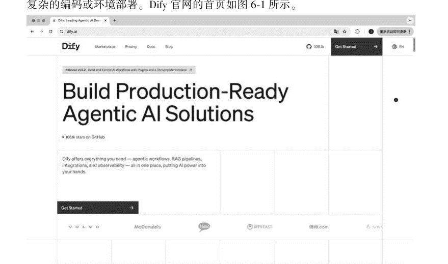

> 提示：可以把 Dify 看作一个“低代码 AI 工厂”，内置了对 OpenAI、Claude、DeepSeek 等主流模型原生的连接能力，并搭配清晰的图形界面与 API 管理工具，让开发与运营更高效直观。

## 1. Dify 的核心组成

Dify 让 AI 应用的开发与部署更灵活快速，核心可从以下几方面理解：

### (1) 提示词引擎

提示词引擎 Prompt Designer 是 Dify 的“语言大脑”，允许开发者定义 AI 应用的说话方式与行为逻辑。例如要求“回答简洁清晰”或“代码执行高效”，系统会严格遵循。非技术人员也能轻松管理应用行为。

### (2) 支持多个大模型接入

Dify 可接入 OpenAI、Anthropic、Azure、Moonshot 等多个顶级模型服务商。开发者可按需灵活切换，选择最合适的模型，提升场景适配度。

### (3) 集成外部数据

Dify 不仅能把外部数据作为记忆源，还支持上传文件、连接数据库、抓取网页内容。由此 AI 应用能“记住”更多信息，并在任务中灵活调用，实现类似人脑的深度反应能力。

### (4) 应用发布与权限管理

开发完成后，Dify 提供一键生成网页与 API 的功能，便于快速发布与集成。同时提供完善的权限管理，可设定访问对象、登录要求、调用频率限制等，保障安全可控。

## 2. 为什么选择 Dify

相较传统编程方式，Dify 在高效性、易用性和灵活性上更具优势，特别适合非技术背景的开发者与企业。

### (1) 上手快

Dify 通过图形化界面简化开发流程，让非专业人士或初级开发者也能轻松上手，无需大量代码即可完成智能体搭建。

## 3. Dify 的典型应用场景

Dify 作为多功能 AI 应用开发平台，可满足各行业需求：

（1）快速搭建智能问答助手。基于简单提示词生成理解上下文、自动答疑的系统，适用于客服机器人、在线教育辅导、智能技术支持等。

（2）自动化写作工具。输入提示词或设定场景，即可生成商品文案、社交媒体文章、新闻摘要等，助力自媒体、内容创作者与电商提效。

（3）定制化企业内部工具。帮助企业构建内部 AI 工具，如分析客户邮件、整理项目纪要、生成工作报告等，结合表单输入与后台逻辑快速落地。

（4）私人知识库问答机器人。将 PDF、Word 文档或网页内容转化为可查询的知识库，结合大模型提供智能问答，提升客服、售后与个人文档管理效率。

## 6.2 快速用 Dify 搭建一个会编程的智能体

本节通过实操示例，带你快速使用 Dify 搭建一个会编程的 AI 智能体。详细步骤如下。

### 1. 登录 Dify

在浏览器打开 Dify 官方站点，选择登录方式进入。登录页面如图 6-2 所示。

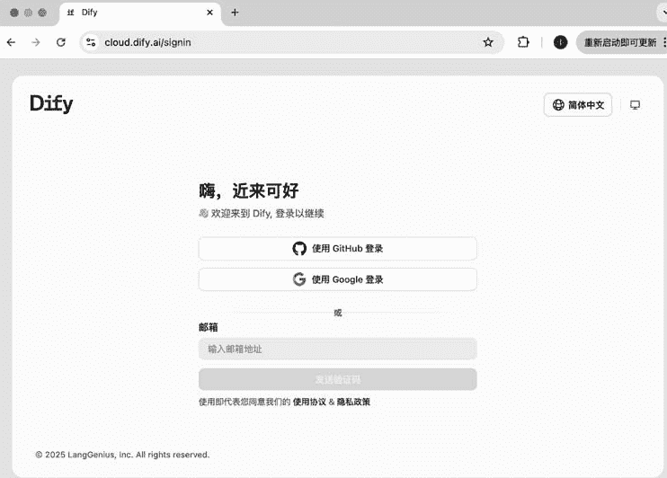

• 图 6-2

### 2. 初次登录与创建入口
账号验证通过后进入 Dify 主页，在顶部找到“创建空白应用”入口，点击即可跳转至下一步，示意见图 6-3。


• 图 6-3

### 3. 新建空应用向导
新建流程的完整界面参考图 6-4。

1）在创建页上方会展示若干常用模板。此时点选卡片“聊天助手”，该模板适配绝大多数基于大语言模型的问答、对话及脚本生成场景。
2）在“应用名称 & 图标”文本框里填写名称，示例可写“AI 编程助手”；“描述”一栏同样填入简要说明，也可留空或仅做功能概括。
3）核对信息无误后点按右下角“创建”，页面进入应用配置区。此时应用雏形已生成，后续可继续个性化调整。

### 4. 配置模型访问密钥
参考图 6-5 进入设置页，打开“模型供应商”模块，依据自身情况挑选供应商，本书示例选用“深度求索”模型，随后点选“安装”完成部署。


● 图 6-4


● 图 6-5

“深度求索”模型安装完成后，回到设置页进行 API Key 配置，位置参考图 6-6。


图 6-6 中密钥的获取流程如下。
打开 DeepSeek 官网首页右上角的“开放平台”入口，进入开放平台后使用已有账号登录或注册新账号，见图 6-7。
登录后在左侧菜单进入“API Keys”，点击“创建 API Key”并为其命名以便区分。系统会生成一条新密钥，请立即复制保存，因为该密钥仅在生成瞬间可见，后续无法再次查看，如图 6-8 所示。

### 5. 预览与调试操作
密钥配置完成后进入“编排”页面，如图 6-9。首次进入需指定模型，点击右上角按钮进入“模型设置”，从列表中挑选一个模型，这里选用“deepseek-coder”用于代码编写。


● 图 6-7


● 图 6-8

图 6-9 右侧为“调试与预览”区域，底部的输入框可填入提示词，例如：

> 请帮我写一个 Python 脚本，能够自动从网上获取实时天气数据，并打印出当前的温度和天气情况。


• 图 6-9

数秒后智能体即可输出完整的 Python 代码并附带说明，例如调用 requests 库通过 OpenWeatherMap 的 API 获取天气。运行效果见图 6-10。

按 Dify 的提示把代码复制到本地编辑器运行，若 OpenWeatherMap 的 API 配置正常且代码可正常执行，即可在浏览器中看到实时天气信息。


• 图 6-10

## 6.3 架构总览：蜂巢式设计
蜂巢是自然界典型的分布式形态，每个单元既能独立工作又能协同形成复杂功能。Dify 的设计思路即来源于此：各功能模块以“蜂巢单元”组织，通过统一接口通信，既保持独立又高效协作。Dify 采用蜂巢架构，在模块解耦、流程灵活的同时为 AI 生态注入弹性。整体架构图见图 6-11。

如图 6-11 所示，Dify 构建了一个高度集成、模块化、低门槛且能力强大的多 Agent + RAG 平台，各核心组件协同运转。详细说明如下。


• 图 6-11

### 1. 策略自定义
定制化策略负责数据处理与检索流程的个性化设定。可指定数据源，如上传的产品手册、FAQ 文档、PDF 说明书等；也可设定检索方式，如是否分段、是否语义匹配。类似新闻编辑在资料库中汇集背景资料，确保模型拥有充足精准的参考。

此外，可通过预处理钩子过滤敏感词，后处理钩子规范输出格式，例如强制回答结尾加上礼貌问候。这些机制为后续推理提供高质量输入。

### 2. RAG 处理链
RAG 处理链从知识库中检索与用户问题最相关的内容，并把检索结果与用户输入拼接后送入大模型生成最终答案。

例如用户问“iPhone 13 支持快充吗？”若仅靠记忆回答可能模糊。RAG 处理链会从苹果官网文档提取权威表述，如“支持 20W PD 快充”，使输出更准确。

### 3. 工作流编排
检索完成后，由编排工作室统一调度整体流程。该模块类似导演工作台，负责各组件的执行顺序与配合方式。

把流程比作剧场，RAG 是布景，模型运行是主演，编排就是导演，掌控全局并分配角色。通过图形界面可设置：先检索信息，再判断是否调用外部工具，最后由大模型生成结果。

### 4. 智能体与补全模式
Dify 提供两种核心执行方式：智能体模式和补全工具。补全工具类似普通大模型的文本补全，输入提示词生成连续文本，适用于文章写作、对话续写、文案生成等。

智能体模式具备更强的任务管理能力，支持逐步调用外部 API，如读取邮箱、更新日历、发送消息等，适合复杂业务流程。例如 AI 行政助理可完成：“阅读本周会议纪要→提取未完成事项→为负责人发送提醒邮件”。

### 5. 模型运行层
所有生成任务最终汇聚到模型运行层。该层提供统一接口，可接入 OpenAI GPT-4、Anthropic Claude、国内百川、智谱等，也可部署自有本地模型如 ChatGLM、LM Studio。

无论底层模型为何，前端调用方式保持一致，犹如为各类汽车统一加油口，操作无需重复学习。

### 6. 自定义模型源
出于成本、安全或响应速度考虑，许多团队不会全部依赖国外模型。Dify 提供自定义模型源模块，可灵活接入各类模型服务。

例如检索类任务交给本地轻量模型如 LiteLLM 处理，创作类任务交给 GPT-4；也可选用 Fireworks、阿里百炼等合规服务。这种灵活性降低了开发与运维门槛。

## 6.4 用对话驱动高效开发

### 6.4.1 摆脱语法负担的沟通技巧
Dify 的初衷是通过自然语言交互，让开发者用接近日常表达的方式操作工具，减少对繁琐语法的依赖。与 Dify 沟通时无需死记硬背代码语法，可更直观传达意图。

高效沟通需注意以下要点。

### 1. 需求描述要具体
明确的需求能大幅提升生成代码的准确度。

例如要生成用户登录代码，不要只说“给我写个登录模块”。

如图 6-12 所示，可表述为：“我需要一个用户登录函数，校验用户名和密码，验证通过后返回用户详细信息”，这样模型理解更精准。


### 2. 分步拆解表达
一次性给出复杂描述容易让模型困惑，也难自检结果。因此应拆解为小步骤逐步提问。例如构建完整注册功能可分为：

第一步，生成校验输入的函数。示例提问：

> 请生成一个函数，检查用户名和密码是否符合格式要求。

第二步，创建保存信息的函数。示例提问：

> 写一个函数，将用户名和密码写入数据库。

第三步，整合流程。示例提问：

> 把输入校验和数据保存合并为一个注册流程。

分步推进可快速验证每部分，最终形成高质量代码。

### 3. 用实例化语言表达
Dify 能理解多种自然语言，但提供实例化描述效果更好，即举例说明需求而非抽象描述，有助于模型推断真实意图。

例如要计算订单总金额，直接问“计算订单总金额的函数”可能不够清晰。给出具体示例后，模型生成的代码更贴合实际。

```
请参考如下 Python 函数生成一个 Go 语言函数,接收一个包含商品价格和数量的列表,返回订单的总金额：
def calculate_total(orders):
    total = 0
    for item in orders:
        total += item['price'] * item['quantity']
    return total
```

提供示例能帮助模型更好理解意图，输出更符合预期。

### 4. 利用交互反馈机制
与 Dify 的沟通是双向的。首次提问后模型给出初版代码，若不符预期可继续追问调整。

示例：

初次提问：请写一个函数从文件中读取数据。

若返回格式不对，可追问：能否修改代码，使读取的数据以 JSON 格式返回？

通过逐步调整，可引导模型不断接近最终需求。

> 提示：交互反馈让沟通更高效，也便于把控代码质量。

### 5. 灵活选用表达风格
自然语言能力允许使用不同风格描述需求。可采用简洁命令式：

生成一个检查邮箱格式的函数。

也可采用详细描述：

我想要一个函数验证用户输入邮箱是否有效，例如包含 @ 符号且后缀为常见邮箱域名。

只要意图清晰，Dify 均可理解。初学者不必追求专业术语，通俗表达往往更高效。

### 6.4.2 精准提问六原则
Dify 并非万能，提问方式决定成果。精准提问能节省时间，让智能体更准确理解需求并生成贴合的代码。

### 1. 分层提问，逐步细化
复杂问题可拆分为多层逐步细化。例如处理 JSON 文件并按规则排序，若直接问“如何处理 JSON 并排序”，结果可能太通用。更好做法是分层提问：

(1) 明确输入结构
提问示例：
我的 JSON 文件包含商品 ID、价格和库存，如何提取这些字段？
(2) 明确排序依据
提问示例：
如何按价格从高到低对商品排序？
(3) 明确输出形态
提问示例：
请给出示例代码，输出按价格排序后的商品 ID 列表。

分层提问让模型逐步清晰需求，生成符合预期的代码。

### 2. 提供充足上下文
回答质量高度依赖上下文。若只问“如何实现用户登录？”，结果会很通用。若补充技术栈：
我正在用 Flask 开发网站，如何实现用户登录并使用 JWT 管理会话？
模型就能结合 Flask 与 JWT 特性给出贴合的代码。越具体的上下文，输出越精准。

### 3. 用示例或期望输出引导
通过示例引导模型理解需求很有效。若要解析日志文件，可描述：
请写函数，输入日志字符串，输出包含日志级别、时间戳和消息的字典。
若再提供示例数据：
输入：'ERROR 2025-04-20 18:30:15 Application crashed.' 输出：{'level':'ERROR','timestamp':'2025-04-20 18:30:15','message':'Application crashed.'}
模型能更准确把握目标格式。

### 4. 简洁直白，避免修饰
过度修饰的语言会降低清晰度。例如“如何在代码中加入一种机制，该机制能通过特定时间戳找到事件并输出结果”不如直接问：“如何根据时间戳筛选事件并输出结果？”简洁问题更易抓住重点，避免多余代码。

### 5. 复核并调整提问
提问后应复核是否模糊。若生成代码不符预期，可调整描述。例如最初问：
> 如何将日志数据解析后按日期分组并统计每组错误数？
若结果偏差，可更明确输入输出：
输入为多行日志字符串，输出为每个日期的错误数量。
不断调整角度，回复会越来越精准。

## 6.5 实战：搭建一个 AI 工作流
本节以“调用大模型生成 Python 代码的工作流”为例讲解操作。

(1) 创建空白应用并选工作流模式
在 Dify 控制台首页点击“创建空白应用”，进入类型选择页，如图 6-13。选择“工作流”模块，填写应用名称与图标，再点击“创建”。

(2) 进入编辑器添加首个节点
创建成功后自动跳转到工作流编辑页，画布初始为空，左侧工具栏提供多种模块。

如图 6-14，点击左侧工具栏“节点”按钮打开节点面板，在列表中选择“LLM”。


● 图 6-13


● 图 6-14

(3) 配置 LLM 节点与提示词
如图 6-15，双击“LLM”节点，在右侧面板选择大语言模型，例如本例选用“deepseek-chat”。Dify 支持 OpenAI、Claude 等多种提供者，也可接入本地或云端模型。随后在提示词栏填写系统指令，例如：“编写一个 Python 函数和程序”，用于明确模型任务。


如图 6-15，将“开始”节点连接至“LLM”节点，再将“LLM”节点连接至“结束”节点，形成完整执行路径。Dify 工作流以流程图运行，每步结果传递至下一步，直至终点，结构清晰便于搭建逻辑闭环。

(4) 运行测试流程
如图 6-16，配置完成后点击右上角“运行”按钮。系统立即执行工作流并调用模型返回结果。右侧运行日志可查看状态、耗时、Token 用量及模型输出。若显示 SUCCESS，说明流程成功，例如返回一段计算斐波那契数列的 Python 函数。


按以上步骤即可完成一个基础的 Dify AI 工作流，读者可依据业务逻辑构建更复杂流程。

## 6.6 实战：本地部署前后端
当需要构建本地运行的大语言模型智能系统时，Dify 提供了完善的后端架构。Dify 支持对接各类模型，可处理异步任务、存储向量文档，并与数据库、消息队列等基础设施协同。自 v1.3.0 起，Dify 弃用较重的 poetry，改用更轻快的 UV 作为依赖管理。详细步骤如下。

### 1. 前端 Web 本地部署

Dify 快速上手与 OpenManus 进阶笔记

想尽早体验大模型工作流平台 Dify，最省事的做法不是自己编译源码，也不是逐个安装组件，而是借助 Docker Compose 把完整环境一次性拉起。相当于给机器装上一套即用型运行栈，几分钟内即可进入可用状态。

（1）启动前的检查清单
开工前先确认硬件与软件是否达标，要求不高，普通笔记本或台式机基本都能满足：

- 处理器建议双核心及以上
- 内存 4GB 可用，8GB 以上体验更流畅

软件层面需要 Docker 与 Docker Compose 两件套：

- Docker：创建并运行隔离的服务容器
- Docker Compose：一次性编排并启动多个协同服务

macOS、Windows 可用 Docker Desktop 一键安装，Compose 会自动集成；Linux 用户可通过发行版包管理器单独部署。

（2）拉起流程
先把 Dify 仓库拿到本地。

从 GitHub 下载官方代码或执行 git 克隆：

```
$ git clone https://github.com/langgenius/dify.git
$ cd dify
```

进入项目的 docker 配置文件夹：

```
$ cd docker
```

复制一份环境变量模板，以 env.example 为底生成可用的配置文件：

```
$ cp .env.example .env
```

模板里已预置 Redis、PostgreSQL、Weaviate 等服务的端口与参数，默认即可直接使用。

随后执行一条启动命令把全部容器跑起来：

```
$ docker compose up -d
```

该指令会拉取数据库、缓存、向量引擎等所需镜像，并在后台同时运行多个容器，把平台运转所需的一整套环境一次性配齐。

（3）打开面板完成首次配置
部署完成后在浏览器打开 http://localhost/install，即可看到引导页。


图 6-17 是 Dify 的初始化向导，会逐步引导创建管理员账号、设定默认模型、填写基础信息等，按提示填入邮箱、用户名、密码即可完成。

设置完毕后即可进入完整的 Web 控制台，开始搭建自己的 AI 应用。控制台示意如图 6-18。

### 2. 本地部署 Dify Web 和 Dify 后端 API

（1）底层支撑框架
部署后端前要先准备好三个基础服务：PostgreSQL 负责持久存储、Redis 负责缓存、Weaviate 负责向量检索。官方提供了一套打包的 docker compose 配置，使用门槛很低。操作顺序如下：

142 | 从 0 到 1 搭建 AI 智能体： Manus+LangChain+Dify 多平台应用及多智能体协同


• 图 6-18

```
$ cd ../docker
$ cp middleware.env.example middleware.env
$ docker compose -f docker-compose.middleware.yaml --profile weaviate -p dify up -d
$ cd ../api
```

命令里 profile weaviate 表示选用 Weaviate 作为向量服务。若偏好 Qdrant、Milvus 等，也可切换对应的配置。

（2）后端环境变量配置
进入 api 文件夹后，先复制一份 env 示例：

```
$ cp .env.example .env
```

再生成一串随机的加密密钥 SECRET_KEY。在 macOS 下可通过一条命令自动写入环境文件：

```
$ secret_key=$(openssl rand -base64 42)
$ sed -i " "/^SECRET_KEY=/c\n$ SECRET_KEY=${secret_key}" .env
```

该密钥用于对称加密，保障数据在传输与存储中的安全性。每次部署建议使用不同的密钥，降低泄露风险。

（3）安装 UV
UV 是比 pip 更现代、速度更快的 Python 依赖管理器。它能在数秒内解析并安装全部依赖，同时支持项目隔离、缓存、虚拟环境等特性，对 AI 项目构建很友好。安装方式如下：

```
$ pip install uv
```

（4）同步依赖
进入 api 文件夹后，只需一行命令：

```
$ uv sync --dev
```

命令会自动读取 pyproject.toml 与 uv.lock，下载开发模式下需要的所有依赖并完成环境配置。

（5）执行数据库迁移
Dify 后端基于 Flask + SQLAlchemy 构建，数据库初始化采用标准迁移机制。运行：

```
$ uv run flask db upgrade
```

执行后会把数据库结构升级到最新版本，包含用户表、模型配置表、应用数据表等。迁移成功即表示后端已就绪。

（6）启动后端服务
启动后端：

```
$ uv run flask run --host 0.0.0.0 --port=5001 --debug
```

此时可访问 http://localhost:5001/healthz 查看运行状态，返回 HTTP 200 说明服务正常。

（7）打开 Web 前端，完成图形界面部署
前端默认使用 3000 端口，建议使用官方编译版或在本地 Web 文件夹运行：

```
$ cd ../web
$ npm install
$ npm run build
```

访问 http://localhost:3000 即可看到 Dify 控制面板。首次打开会提示注册管理员账号，设置完成后就能开始构建智能应用。

## 6.7 【实战】用 Dify 开发一个趣味小游戏

下面用 Dify 走完一个趣味小游戏的完整开发流程，感受从 0 到 1 的实操。

### 1. 游戏简介与目标
要实现的是猜数字游戏：系统在 1~100 范围内随机抽取一个整数，玩家通过输入逐步逼近，每轮会得到“偏大”或“偏小”的提示，直至猜中。

目标如下：

- 1) 用 Dify 迅速搭建游戏的基础骨架
- 2) 持续打磨交互体验
- 3) 最后精简逻辑，让程序更高效

### 2. 用 Dify 生成游戏基础框架
先实现核心能力：

- 1) 系统生成随机数
- 2) 玩家输入进行猜测
- 3) 根据结果给出继续提示

提问示例：

> 请生成一个 Python 程序，随机生成一个 1~100 的整数，用户通过输入猜测数字。如果猜得太大，提示“更小”，如果猜得太小，提示“更大”。当猜中时，输出“恭喜你，猜对了！”。

Dify 可能给出的代码如下：

```
import random

def guess_number_game():
    number = random.randint(1, 100)
    print("猜一个 1~100 的整数")
    while True:
        try:
            guess = int(input("请输入你的猜测："))
            if guess < number:
                print("更大")
            elif guess > number:
                print("更小")
            else:
                print("恭喜你,猜对了!")
                break
        except ValueError:
            print("请输入一个有效的整数")

guess_number_game()
```

该代码实现了猜数字的主要流程，结构清晰，包含提示、输入处理、判断逻辑与循环控制，可直接运行。

命令行运行的效果如图 6-19 所示。


### 3. 优化用户交互体验
在基础功能之上，可进一步提升体验：

- 1) 开局增加游戏说明，告知规则与胜利条件
- 2) 提示“更大/更小”时加入更生动的表达，让游戏更有趣味
- 3）猜对时输出一个简单的庆祝框

提问示例：

> 在代码中添加开始游戏说明和规则。调整提示语句，让游戏更有趣味性。

在玩家猜对后，弹出一个简单的胜利框。

Dify 可能给出的代码如下：

```
import random

def guess_number_game():
    number = random.randint(1, 100)
    print("欢迎来到猜数字小游戏!")
    print("我已经随机生成了一个 1~100 的整数,快来挑战吧!")

    while True:
        try:
            guess = int(input("请输入你的猜测: "))
            if guess < number:
                print("太小了,再试试!")
            elif guess > number:
                print("太大了,继续加油!")
            else:
                print("***********************************")
                print("恭喜你,猜对了!")
                print("***********************************")
                break
        except ValueError:
            print("请确保输入的是一个整数哦!")

guess_number_game()
```

新增的说明文字让玩家一开始就明白玩法目标，而更丰富的提示语则增强了猜测过程中的互动感。

命令行运行效果如图 6-20 所示。

### 4. 进一步优化代码逻辑
有了趣味交互后，还可对代码做简化和优化：

- 1）把随机数生成与游戏主逻辑分离，便于后续扩展
- 2）把提示信息提取成独立函数，让主代码更简洁
- 3）为输入处理增加更详细的错误提示，提高稳定性

提问示例：

> 将随机数生成和游戏主逻辑分开。提取提示信息为函数。增加输入错误时的详细提示。

Dify 优化后的代码：

```
import random

def generate_random_number():
    return random.randint(1, 100)

def print_game_rules():
    print("欢迎来到猜数字小游戏!")
    print("我已经随机生成了一个1~100的整数,快来挑战吧!")

def get_user_guess():
    try:
        return int(input("请输入你的猜测："))
    except ValueError:
        print("请输入一个有效的整数,不能是字母或者其他字符!")
        return None

def main():
    number = generate_random_number()
    print_game_rules()

    while True:
        guess = get_user_guess()
        if guess is None:
            continue
        if guess < number:
            print("太小了,再试试!")
        elif guess > number:
            print("太大了,继续加油!")
        else:
            print("***********************************")
            print("恭喜你,猜对了!")
            print("***********************************")
            break

main()
```

结构更清晰，模块化设计便于后续加入分数计算、难度选择或多人模式等扩展。

命令行运行结果如图 6-21 所示。


经过以上分步提示，我们用 Dify 轻松完成了趣味小游戏的全过程。若想做更复杂的游戏，仍可沿用本章的分步提示方法持续迭代。

# 第3篇

高级实战——

深度挖掘AI智能体的潜力

# 第7章 【实战】用OpenManus打造进阶型智能体

## 7.1 什么是 OpenManus

OpenManus 是 MetaGPT 团队开源的智能体平台，是对 Manus 项目的复刻实现。与封闭的商业产品不同，它强调可视、可控、可扩展，通过模块化结构和高度自定义的 Agent 构建方式，实现从底层逻辑到上层应用的全链路透明，让开发者能按任务自由组合组件、定制交互并快速扩展新功能。OpenManus 的官网如图 7-1 所示。


● 图 7-1

OpenManus 的核心思想是把人工智能从“语言生成工具”提升为“计划执行器”，让语言模型在规划、分解、执行与反馈环节协同工作，构建能处理复杂任务的“数字员工”。AI 智能体特性维度及 OpenManus 的对应描述见表 7-1。

表 7-1

| AI 智能体特性维度 | OpenManus 描述 |
| :--- | :--- |
| 透明性 | 全链路可追溯，涵盖思考过程、工具调用与反馈结果，便于调试和教学 |
| 模块化设计 | Agent、Tool、Prompt、Flow 四大模块职责分明，易于扩展与复用 |
| 多 Agent 支撑 | 支持规划型 Agent 与执行型 Agent 配合，未来可实现多模型专业化协作 |
| 工具即能力 | 通过工具模块整合 Python、浏览器、自定义工具等，实现跨领域执行 |
| 部署灵活 | 可本地部署如 Ollama 本地模型，也可接入 GPT、Claude 等在线模型，兼顾效率与隐私 |
| 执行闭环 | 采用 Plan-Act-Review 机制，任务分解执行后可反馈修正，提升完成精度 |

OpenManus 目前已支持科研报告撰写、内容生成、数据分析、代码调试、网页自动化等多种任务，在可控、透明、安全的前提下，为教学、科研辅助、初创项目孵化提供强执行引擎。其特色包括：

- 1. 全面支持多模型调用，可同时使用 GPT-4o、DeepSeek、Qwen 等推理后端
- 2. 内置浏览器自动化框架，支持网页抓取与交互
- 3. 采用多智能体协作与流程编排，支持任务拆解与结果可视化，提升透明度与可控性
- 4. 引入强化学习模块“OpenManus-RL”，支持组相对策略优化 GRPO 等方法对 Agent 行为评估与微调
- 5. 完全开源，开发者可自由获取源码进行智能体定制开发

## 7.2 深入底层，掌握 Agent 的运行机制

### 7.2.1 OpenManus 的设计思路
智能体系统的演进是从早期的命令驱动程序，逐步走向具备“推理—执行—反馈”能力的泛化协作框架。OpenManus 正是这一趋势的代表。

## 7.2.1 OpenManus 的设计理念与核心结构
OpenManus 是一种多智能体协作的实践，并不依赖单一模型完成全部任务，而是把复杂目标拆分为多个子任务，通过协同执行形成群体的智能行为。这种机制既提升了任务成功率，也为系统的透明性与可控性奠定基础。

在设计理念上，OpenManus 主张“模块最小化、行为可解释、执行可调度”。如图 7-2 所示，其核心结构由四个互联模块构成：极简可插拔框架、工具驱动的 ReAct Agent、规划能力处理复杂任务、动态 Agent 分配与工具调度。这四个要素共同组成一套自治且高效的智能执行机制。


OpenManus 的设计思路具体展开如下。

### 1. 极简可插拔框架
OpenManus 的 Agent 框架以极简为核心理念，不像传统多智能体系统预设大量行为逻辑，而是通过 Prompt 与 Tool 的组合来定义智能体的能力边界。Prompt 决定“思考方式”，是模型接收任务后的内部自我提示系统。例如面对数据分析任务，Prompt 会引导模型先制定结构化计划并调用对应工具获取外部数据，而非直接生成答案。

Tool 则代表“行为能力”。它可以是 Python 脚本执行器，也可以是文件写入模块、搜索接口或浏览器控制器。Prompt 与 Tool 的协同就像思维与肌肉的配合，二者缺一不可。

OpenManus 选了模块化拼装的路线，不必从零搭建框架就能得到具备自主能力的系统。把现成模块组合起来，就能得到既会思考又能动手执行的完整体。对非专业用户来说门槛更低，对研发人员而言也能快速打出可用原型。

### 2. ReAct 模式下的工具化行动
OpenManus 的运行逻辑建立在 ReAct 思路上，把推理与行动绑定在同一循环里。相比一次性的问答调用，这种智能体会在每个任务节点上持续推演并采取行动，先做判断再挑选工具，直到目标闭环。

内部的统一调用模块负责对外工具的调度与结果回传，显著提升了工具管理的规范性和效率。比如在需要抓取网页并汇总分析的场景里，系统先在推理阶段拟定搜索关键词，再驱动浏览器组件完成抓取，最后进入复核阶段判断是否达标。

这种做法避免了“说得漂亮却做不了事”的尴尬，让智能体具备可复现、可验证的操作能力，也为任务失败时的容错与回溯提供了依据。

### 3. 分步规划让复杂任务可控
真实任务往往一次无法完成，尤其是需要跨阶段、跨工具协作的复杂问题，成败关键在于能否先制定清晰可执行的计划。

OpenManus 沿用了 Manus 的思路，引入独立的规划工具对用户指令做预处理，把模糊需求转成有序的任务序列。系统会先输出一份“执行清单”，标明各阶段目标与可能用到的工具，再按计划逐步推进。

例如让系统“自动生成一份公司季度报告”，会被拆成：1) 收集销售与运营数据；2) 解析核心业务指标；3) 撰写要点与建议；4) 导出为 PDF 或 Markdown 报告。这样的拆解既帮助智能体把握任务结构，也让执行路径更连贯、更具容错空间。研究显示，具备结构化分解能力的智能体在复杂任务成功率上明显优于单次调用模型。

### 4. 按需分配智能体与灵活调度工具
任务拆成子任务后进入调度阶段。各子任务的执行方式各异，有的适合检索，有的适合计算，有的需要长文本归纳。OpenManus 因此引入动态智能体分配与工具调度机制。

调度器会依据任务特征，把子任务指派给预先定义的智能体。每个智能体自带一组专属工具，并通过 Prompt 设定行为倾向。比如擅长 Python 与数据操作的技巧分析智能体，和偏向文案撰写与结构优化的内容编辑智能体。临时调度加资源匹配，既保证了高复用，也避免过多智能体同时激活带来的性能损耗。

执行中还支持工具的动态协同：当子任务需要额外能力时，智能体可申请加载新的工具集。这种“边做边调工具”的做法类似人类处理任务时中途打开新软件，让智能体具备一定的自适应能力。

## 7.2.2 OpenManus 执行全流程拆解
当前智能体系统已从一次性生成答案的静态问答，转向具备任务规划、行为调度与过程记忆的动态执行引擎。OpenManus 是典型代表，它围绕“规划—分配—执行—反馈”闭环，从接收自然语言需求到完成多阶段输出，形成完整的工作流。

这一机制提高了任务完成的可信度，也让系统能应对复杂多步问题。整体像一个思路清晰、行动有序的数字员工：接收指令、拆解目标、调用工具、校验结果并汇报进度。OpenManus 简要流程图如图 7-3 所示。


下文对执行路径做详细说明。

### 1. 自然语言发起指令
流程始于用户需求。指令可通过命令行界面或图形前端发出，用户用自然语言描述复杂任务，例如：
> 帮我写一个 Python 脚本，实现文件去重功能，并将代码部署到我的远程服务器上。
这条提示隐含多个子目标：编写代码、连接远程服务器、自动部署。传统大模型难以一次完成，OpenManus 则通过后续规划逐步拆解并规范执行。

### 2. 规划模块把需求拆成清单
需求进入后，系统先调用规划模块，把原始任务抽象成逻辑有序的子任务序列。每个子目标都有明确的执行目的与可调用工具集合。以“代码编写与部署”为例，可能拆成：1) 分析需求与环境限制；2) 编写初始功能代码；3) 测试并调试代码；4) 部署到服务器并验证结果。

每一步都是独立子任务，既包含推理环节，也可能涉及工具操作。分解提升了可解释性，也为后续执行提供结构化输入，避免全局盲打式生成的不确定性。

### 3. 任务分发与实际执行
规划完成后进入调度与执行阶段，由智能体调度模块与多工具系统共同驱动。

OpenManus 通常用正则匹配机制把每个子任务分配给最合适的智能体。各智能体具备不同能力：
- 1) 数据解读智能体擅长数据分析与解读；
- 2) 电脑使用智能体可操作文件系统、编辑代码或调用本地命令行；
- 3) 搜索智能体专用于外部信息检索。

接收到任务后，智能体进入 ReAct 循环：先思考需要哪些信息、如何使用工具，再执行具体操作。循环持续到任务完成或出现异常。

### 4. 结果归纳与记忆汇总
单轮执行结束后，系统会把输出摘要压缩后写入共享上下文记忆体。这一步对多轮连贯性至关重要，可避免上下文过长导致模型认知模糊。

若子任务成功，则按原计划进入下一步；若异常或失败，则可能触发重新规划、回退重试或切换备用路径。这种反馈体现了初级的自我调节能力，面对真实场景的不确定性不会因一次失败而崩溃，而是修正路径继续推进。

### 5. 最终产出整合
所有子任务完成后，系统进入汇总阶段，整合各部分结果形成最终产物：可执行代码、数据分析报告、网页内容或部署操作日志。结果可经终端、前端或 API 返回，也可直接触发后续操作，如自动提交代码、部署模型或生成文档。

OpenManus 在长链任务、跨模态任务、需要信息回溯与中间验证的场景中优势明显。对比传统模型的一次性回答，它能分步思考、分角色执行、分工具处理。

例如数据抓取与分析任务可能同时调用三类智能体：搜索智能体检索目标网页，电脑使用智能体抽取表格并清洗数据，数据解读智能体输出分析报告与可视化图表。

## 7.2.3 OpenManus 架构全景解析
在了解 7.2.1 与 7.2.2 的内容后，有必要深入其技术架构。把握模块划分、协作方式与工程设计思路，有助于理解实现原理，也为后续实战开发与二次集成提供依据。

### 1. 项目结构鸟瞰
OpenManus 项目结构紧凑，核心功能不到 30 个 Python 文件，体现高内聚、低耦合、易维护的工程哲学。核心目录结构如下：

```
├── app
│   ├── agent          # 多智能体模块
│   ├── flow           # 执行流程模块
│   ├── prompt         # 提示词模板模块
│   ├── tool           # 工具模块
......(省略其余部分)
```

四个顶级子模块对应四大核心能力：
1. agent 目录是智能体行为抽象与调度的核心；
2. tool 目录是系统可调用的具体功能组件；
3. flow 目录是流程引擎，负责多阶段任务分发与跟踪；
4. prompt 目录是提示词逻辑封装，用于系统与智能体的指令沟通。

模块化设计在提升任务复杂度的同时，保持了结构清晰与扩展灵活。

### 2. 核心架构图谱
OpenManus 核心架构图如图 7-4 所示。


如图所示，Prompt 提示词模块指导行为；智能体框架模块调用 Tools 工具模块并返回结果；Flow 执行流程模块规划使用 Tools 并编排智能体执行。其中 Manus 是系统默认智能体，具备规划与执行能力，可调用 Python 脚本、浏览器工具、文件保存、网络搜索等基础工具，并内嵌规划工具实现复杂任务拆解与追踪。

OpenManus 核心模块及其作用见表 7-2。

表 7-2

| OpenManus 核心模块 | 模块作用 |

| :--- | :--- |

| 智能体框架模块 | 定义智能体的行为模式 |

| Tools 工具模块 | 支撑智能体行为的执行能力 |

| Prompt 提示词模块 | 提供语言引导与上下文提示 |

| Flow 执行流程模块 | 协调执行路径与任务进度 |

核心模块详述如下。

#### （1）智能体框架模块
智能体是系统最核心的行为单元，负责接收需求、规划行动并执行工具调用。OpenManus 形成了逐级增强的继承体系：
- 1) BaseAgent 定义智能体基本形态与抽象接口；
- 2) ReActAgent 引入 ReAct 模式，每轮分为推理 think 与行动 act；
- 3) ToolCallAgent 在 ReAct 基础上增强，使推理阶段用于挑选合适工具，行动阶段具体执行；
- 4) Manus 继承自 ToolCallAgent，集成默认工具集与高级提示词。

#### （2）Tools 工具模块
Tools 是所有智能体执行操作的基础，提供现实世界接口的封装。例如：
- 1) PythonExecute 用于运行代码；
- 2) GoogleSearch 用于互联网搜索；
- 3) BrowserUseTool 用于浏览器自动化；
- 4) FileSaver 用于文件读写保存；
- 5) PlanningTool 用于计划制定与任务追踪。

所有工具继承自 BaseTool，接口统一。开发者只需实现新工具类并注册即可供智能体调用。工具还支持 ToolCollection 组合与 Prompt 控制的参数动态注入，形成智能体与工具间高度可控、低耦合的联动。

#### （3）Prompt 提示词模块
OpenManus 强调提示词不再是简单拼接，而是定义系统行为边界的控制器。主要包含：
- 1）System Prompt 定义身份、能力范围与行为风格；
- 2）Next Step Prompt 引导当前步骤的策略选择与操作焦点。

System Prompt 示例如下：

```
SYSTEM_PROMPT = "You are OpenManus, an all-capable AI assistant..."
```

提示词按角色分类组织，如 manus.py、planning.py、swe.py，使每类智能体或任务类型拥有专属模板，便于版本控制与行为调优。

#### （4）Flow 执行流程模块
Flow 模块是 OpenManus 的流程大脑，负责把复杂任务分解为可执行子任务并逐步调用智能体执行。核心类包括：
- 1）BaseFlow 表示流程控制的抽象父类；
- 2）PlanningFlow 支持任务规划与动态调整的增强流程。

执行逻辑：
- ① 调用规划工具创建完整任务计划；
- ② 逐条提取子任务 step；
- ③ 为每步生成上下文提示词，结合当前状态与环境；
- ④ 调用 Manus 执行当前 step；
- ⑤ 更新执行状态，调整下一步计划。

这种设计赋予系统任务追踪、失败重试、路径再规划等控制能力。

## 7.3 本地部署与模型接入实战
OpenManus 本地部署流程简洁，完整配置只需数步。

### 1. 搭建隔离运行环境
推荐用 conda 创建独立环境以避免依赖冲突。标准流程：

```
$ conda create -n open_manus python=3.12
$ conda activate open_manus
```

创建完成后克隆项目到本地：

```
$ git clone https://github.com/FoundationAgents/OpenManus.git
$ cd OpenManus
```

安装依赖：

```
$ pip install -r requirements.txt
```

至此环境已就绪，可运行 OpenManus。

### 2. 接入大模型
OpenManus 本身不内置大语言模型，以开放方式接入主流服务。配置文件为 TOML 格式，路径 config/config.example.toml，可通过命令快速生成：

```
$ cp config/config.example.toml config/config.toml
```

编辑后根据算力与网络选择本地模型或远程 API。

#### (1) 使用本地模型
若本地有充足硬件（建议至少 24GB 显存），可通过 Ollama 部署本地模型，在配置文件中指定本地端口：

```
[llm]
model = "qwen2.5:14b"
base_url = "http://localhost:11434/v1"
api_key = "ollama"
```

优点是响应快、隐私好，但需确认模型加载成功且资源占用较高。

#### (2) 使用在线模型接口
若偏好稳定与省资源，可接入 Claude、DeepSeek 等外部服务，本书以 DeepSeek 为例，配置示例如下：

```
[llm]
model = "deepseek-chat"
base_url = "https://api.deepseek.com/v1"
api_key = "sk-xxxxxx"
```

此方式适合开发初期、移动办公或资源受限场景，便于快速验证效果。

> 提示：OpenManus 支持 vision 模块（如 gpt-4o），处理图像任务时可单独配置 [llm vision]。

### 3. 启动交互式运行
配置完成后启动主程序：

```
$ python main.py
```

进入交互式命令行，可输入自然语言指令。例如：
> 请生成一段用于爬取豆瓣影评的 Python 脚本，并保存为 markdown 文档。

运行结果如图 7-5 所示。


配置成功后，系统会自动拆解任务、分发智能体并调用工具，最终返回完整产物文件：

```
# Douban Movie Reviews
## 十年 肖申克的救赎
距离斯蒂芬·金(Stephen King)和德拉邦特(Frank Darabont)缔造这部伟大的作品已经有十年了。我知道美好的东西想必大家都能感受到,但是很抱歉,我的聒噪仍将一如既往。在我眼里,《肖申克的救赎》与信念、自由和友谊有关。[1]信念 瑞德(Red)说,希望是危险的东西,是精……
## 终于找到了郁闷人生的原因——观《肖申克的救赎》有感
周末看了一部美国影片《肖申克的救赎》(The Shawshank Redemption) 讲的是一位因冤案入狱的年轻银行家在牢中如何追寻自由的故事。不同的人看同样的影片可能都有不同的感受。对于目前无力改变现状的我,看完这部影片后最深的感受就是:才华、毅力两样,是任何人在任何境……
……(省略部分文字)
```

执行过程中会按任务分工创建若干 Python 文件。以上述例子为例，系统会产出其中一个抓取脚本如下：

```python
import requests
from bs4 import BeautifulSoup
import time
import pandas as pd

url = "https://movie.douban.com/subject/1292052/reviews"
headers = {
    "User-Agent": "Mozilla/5.0 (Windows NT 10.0; Win64; x64) AppleWebKit/537.36 (KHTML, like Gecko) Chrome/91.0.4472.124 Safari/537.36"
}

def fetch_reviews(max_retries=3, delay=2):
    for attempt in range(max_retries):
        try:
            print(f"Attempt {attempt + 1}: Fetching reviews...")
            response = requests.get(url, headers=headers, timeout=10)
            response.raise_for_status()
            soup = BeautifulSoup(response.text, "html.parser")

            reviews = []
            for review in soup.find_all("div", class_="review-item"):
                title = review.find("h2").get_text(strip=True)
                content = review.find("div", class_="short-content").get_text(strip=True)
```

reviews.append({"Title": title, "Content": content})

return reviews

except Exception as e:

    print(f"Error: {e}. Retrying...")

    time.sleep(delay)

return None

reviews = fetch_reviews()

if reviews:

    df = pd.DataFrame(reviews)

    with open("douban_reviews.md", "w", encoding="utf-8") as f:

        f.write("# Douban Movie Reviews\n\n")

        for _, row in df.iterrows():

            f.write(f"## {row['Title']}\n\n{row['Content']}\n\n")

    print("Success: Reviews saved to 'douban_reviews.md'.")

else:

    print("Failed to fetch reviews after retries.")

## 4. 批量任务

在对话式交互之外，OpenManus 还能够依托流程文件来执行结构化的大批量操作。下方示例是一条可直接运行的完整批量指令：

```
$ python run_flow.py
```

运行后系统会进入交互式命令行，按提示逐步填写信息，平台将自动完成规划、搜索、分析到报告输出的完整闭环，适用于日报制作、市场调研、内容提炼等标准化工作流。

# 第8章 CrewAI 多智能体实战指南

## 8.1 CrewAI 平台核心概念

### 8.1.1 初识 CrewAI 框架与定位

CrewAI 是一个基于 Python 的开源多智能体协同平台，并未绑定 LangChain 等外部库，其设计目标是帮助开发者快速搭建智能协作小组，实现复杂任务的自动化处理。官方网站示意图见图 8-1。


### 1. CrewAI 核心理念

CrewAI 的基本假设是：一个 Crew 由若干 Agent 组成，每个智能体拥有明确的分工，例如调研员、分析师、文案撰写者等。团队借助任务拆分、协作配合和反馈迭代来完成复杂目标。各角色定义见表 8-1。

表 8-1

| 角色 | 定义与职责 |

| :--- | :--- |

| Crew | 负责调度团队成员和流程管理 |

| Agent | 执行具体任务并拥有独立背景、目标、工具接口 |

| Process | 协调任务顺序或并行执行 |

| Task | 最小单元任务，指定 Agent 与目标 |

该种架构把复杂职责拆解并行处理，降低单点压力，提升整体稳健性。

### 2. 架构构成与功能特色

CrewAI 的分层设计清晰，从基础框架到企业级能力都较为突出，特点如下：

- (1) 自主轻量
采用纯 Python 构建，去除了冗余依赖，追求轻量与执行效率。
- (2) 角色精细定义
Agent 的配置支持 YAML 和代码两种方式，可设定角色、目标、背景故事、大模型、工具集合，并支持长期记忆与上下文管理。
- (3) 编排灵活的流程控制
同时提供 Crew 与 Flow 两种编排方式，可实现顺序执行、并行、条件分支、循环等复杂结构。
- (4) 工具生态丰富且可观测
智能体能够接入网页搜索、数据库、API 调用、自定义工具。企业版支持监控与日志链路追踪，兼容 AgentOps、MLflow、Langfuse 等。

### 3. Crew 与智能体如何协作

CrewAI 借鉴现实组织架构：

- 1) 团队 Crew 负责整体任务调度和流程管理。
- 2) 智能体 Agent 各自承担特定角色，如研究员、撰稿人，并可调用专属工具。
- 3) 流程 Process 定义任务是顺序、并行还是条件分支的组合方式。
- 4) 任务 Task 是执行的最小单元，由指定 Agent 使用特定工具产生输出。

以撰写“医疗 AI 最新进展”报告为例，研究员智能体负责资料搜集，撰稿人智能体基于资料输出完整文章，分工清晰、过程可控。

### 4. 常见使用场景

CrewAI 在以下场景效率较高：

- 1) 内容生产：新闻报道、技术文章、教学材料自动撰写。
- 2) 商业流程：个性化简历投递、产品推荐、邮件营销等。
- 3) 决策支持：案件分析、市场调研、投资评估。
- 4) 对话客服：多轮上下文理解、分类回复与知识抽取自动化。

相比单一语言调用，多角色结构组织性与扩展性更强，适合模块化开发与复杂逻辑处理。

### 8.1.2 Crew 与 Flow 的区别与协作

在 CrewAI 中，Crew 强调多角色智能体的协作，Flow 侧重事件驱动的流程控制。明确二者差异有助于构建更灵活、可控、可维护的 AI 架构。

表 8-2 对比

| 核心特性 | Crew | Flow |

| :--- | :--- | :--- |

| 架构理念 | 模拟现实团队协作，多智能体分工协作完成复杂任务 | 以事件触发为核心，按顺序或条件驱动节点执行，形成清晰流程链条 |

| 执行机制 | 启动 Crew 后，多个 Agent 可并行或按顺序依次执行 | 使用装饰器如 @start()、@listen() 等定义执行条件与触发机制 |

| 状态管理 | 各 Agent 拥有独立上下文，可通过共享数据或工具通信 | 统一使用全局状态变量如 self state 维护流程数据，便于流转与溯源 |

| 应用场景 | 适合多角色、职责分明、协作密集的调研、生成、分析等 | 适合逻辑清晰、状态驱动、需条件判断或复杂控制的审批、分支决策 |

| 扩展能力 | 易于新增角色、模块化集成，组织灵活性高 | 流程结构清晰，支持条件判断、路由、可视化控制，适合流程建模 |

例如文本处理任务中，Crew 可模拟编辑小组，分类器、摘要器、格式器分别负责分析、提炼、排版；Flow 更像装配流水线，每步处理信息并决定下一步行动。

### 1. 何时选择 Crew，何时选择 Flow

任务本质决定选型。

(1) 任务分工明确，推荐 Crew
若任务可自然拆分为信息收集、分析、写作等专责模块，使用 Crew 更贴合。每个 Agent 专注自身职责，无需关心整体流程，这种并肩作战模式在内容生成、调研分析中高效。

(2) 流程结构复杂，推荐 Flow
当任务涉及多步操作、条件判断或状态路由时，Flow 更合适。借助装饰器定义节点、触发器串联流程，逻辑清晰易调试，适合审批、问答、对话等条件密集场景。

### 2. 在 Flow 中嵌入 Crew，实现协同增强

复杂系统中常需流程控制与多智能体协作结合。外部以 Flow 作为指挥系统，内部调用 Crew 团队处理子任务，是高效架构。

该设计兼顾流程灵活性与协作优势，适用于报告生成、自动化客服、多阶段文档生成。例如智能推荐系统：

- 1) Flow 启动任务，接收用户查询并预处理输入。
- 2) Flow 调用 Crew 负责分类，如新闻或产品。
- 3) 根据分类结果，Flow 进行分支判断。
- 4) 新闻类调用 CrewA 生成摘要，产品类调用 CrewB 整理推荐列表。
- 5) Flow 收集最终输出并整理为统一格式。

这种组合流程清晰、模块可复用、协作智能，是当前智能系统设计的重要方向。

## 8.2 CrewAI 安装与基础入门

### 8.2.1 安装 CrewAI 及相关依赖

正式使用前需完成环境准备与安装。

1. 环境准备
CrewAI 为 Python 项目，建议使用 3.10 及以上版本。为避免依赖冲突，推荐在独立虚拟环境中操作，例如使用 venv 或 virtualenv。用 pyenv 创建 Python 3.12 环境示例：

```
$ pyenv install 3.12.3

# 创建新的虚拟环境
$ pyenv virtualenv 3.12.3 crewai-env
$ pyenv activate crewai-env

# 然后重新安装项目依赖
$ pip install crewai
```

2. 安装 CrewAI 的正确方式
(1) 安装 UV 工具
CrewAI 推荐用 UV 管理 CLI 安装与依赖包。具体操作如下。

macOS/Linux 执行：

```
$ curl -LsSf https://astral.sh/uv/install.sh | sh
```

Windows PowerShell 执行：

```
$ irm https://astral.sh/uv/install.ps1 | iex
```

安装完成后后续工具安装更顺畅。

(2) 用 UV 安装 CrewAI
UV 安装后，执行如下命令安装 CrewAI：

```
$ uv tool install crewai
$ uv tool update-shell
```

检查安装情况：

```
$ uv tool list
crewai v0.148.0
-crewai
```

若输出包含 crewai v0.xxx.x，则 CLI 可用。

### (3) 常见问题的解决方法

安装中常见问题集中在 Rust 编译依赖，特别是 tiktoken 模块。若遇到 tiktoken 编译异常，建议将 Python 降至 3.12 或更早版本。

macOS 用户需预装 Rust，命令如下：

```
$ brew install rust
$ pip install tiktoken
```

Windows 用户若出现 float h 缺失错误，应安装 Visual Studio Build Tools 中的 C++ 编译器，参考社区建议可解决多数卡顿。

仅做基础试验可用 pip install crewai 快速开始。若需调用外部接口或处理嵌入式信息，推荐完整版安装：

```
$ uv add "crewai[tools]"
```

若仍无法安装 tiktoken，可尝试：

```
$ pip install tiktoken --prefer-binary
```

或先更新 pip 并单独安装 Rust。

### (4) 测试安装与创建项目

验证安装命令：

```
$ crewai --version
crewai, version 0.148.0
```

创建项目模板命令：

```
$ crewai create crew my_first_project
$ cd my_first_project
$ crewai install
$ crewai run
```

运行后控制台会展示 Agent 初始化、任务执行、输出路径，验证环境是否正常。

### 8.2.2 实战 创建第一个 CrewAI 智能体

借助 CrewAI 提供的模板生成器，可快速搭建多智能体项目骨架，无需编写大量脚本。

(1) 使用 CLI 命令生成项目模板
在终端执行以下命令，将 <your_project_name> 替换为实际项目名：

```
$ crewai create crew <your_project_name>
```

执行后会在当前目录生成完整项目结构，包含配置、代码、工具、数据等核心模块。结构如下：

```
my_first_project/
├── .gitignore                # Git 忽略配置
├── knowledge/                # 知识库目录(可选用于长文本输入等)
├── pyproject.toml            # 项目依赖配置文件
├── README.md                 # 项目说明文档
├── .env                      # 存放环境变量与 API 密钥
└── src/
    └── my_first_project/
        ├── __init__.py
        ├── main.py           # 项目入口文件
        ├── crew.py           # Crew 创建与调度逻辑
        ├── tools/            # 可扩展工具目录
        │   ├── custom_tool.py
        │   └── __init__.py
        └── config/
            ├── agents.yaml   # 定义智能体角色、目标等
            └── tasks.yaml    # 定义每个任务及其执行流程
```

CrewAI 项目结构借鉴现代软件工程分层思想，便于后续维护。

(2) 自定义智能体与任务流程
模板生成后，先编辑 agents.yaml 为每个角色指定名称、背景、目标、所用模型；再配置 tasks.yaml 指定任务流、执行顺序与负责人；最后在 main.py 中调用 kickoff() 启动项目。agents.yaml 示例代码如下：

```
- name: researcher
  role: Information Analyst
  goal: Collect and summarize web data on medical AI
  backstory: Expert in online research and factual extraction
```

(3) 安装依赖并运行项目
进入项目根目录执行：

```
$ crewai install
```

该命令会自动解析 pyproject.toml 并安装所需依赖，包括 tiktoken、requests、langchain-toolkit 等。

如需添加额外第三方包，可使用 UV 命令：

```
$ uv add pandas
$ uv add beautifulsoup4
```

依赖将自动写入项目配置。运行项目只需执行：

```
$ crewai run
```

配置正确时，控制台会实时输出智能体启动过程、任务执行顺序、交互信息与最终结果，宛如真实团队完成复杂工作。

## 8.3 理解与使用 CrewAI 框架中的 Crew

# Crew 机制：CrewAI 多智能体协作的核心

在 CrewAI 生态里，Crew 充当一组协同作业的智能体集群，用来驱动一系列任务的落地。每一个 Crew 都约定了任务推进的方式、成员间配合的规则以及整条流程的组织方式，可以视作搭建多智能体系统的核心单元，帮助提升任务处理效率与复杂度。架构示意图见图 8-2。


• 图 8-2

图 8-2 展示运行脉络：若干 Agent 在工具加持下承接不同任务片段，借助共享记忆保持上下文连贯，最终汇总成结构化结果。

### 1. Crew 的属性

Crew 实例拥有若干可调参数，影响调度策略、协作形态与运行时行为。关键参数汇总于表 8-3。

表 8-3

| 属性 | 参数 | 描述 |
| --- | --- | --- |
| Tasks | tasks | 交由该 Crew 负责的任务集合 |
| Agents | agents | 组成该协作单元的智能体清单 |
| Process（可选） | process | 任务推进模式，例如顺序或层级，默认按顺序 |
| Verbose（可选） | verbose | 是否输出详细运行日志，默认关闭 |
| Manager 大语言模型（可选） | manager_llm | 层级模式下统筹 Agent 所用模型，启用层级时必须指定 |
| Function Calling 大语言模型（可选） | function_calling_llm | 指定后 Agent 间的函数调用将借助该模型完成 |

### 2. 创建 Crew

CrewAI 提供两种组建路径：YAML 描述与直接编码。

(1) YAML 配置

用 YAML 描述结构更直观，也便于维护，实际项目里很常见。通常做法是自定义一个类承接 CrewBase，再通过装饰器注册 Agent、Task 及 Crew。下面给出装饰器风格的示例：

```python
from crewai import Agent, Crew, Task, Process
from crewai.project import CrewBase, agent, task, crew, before_kickoff, after_kickoff
from crewai.agents.agent_builder.base_agent import BaseAgent
from typing import List

@CrewBase
class CrewNameExample:
    """开发者团队示例"""

    agents: List[BaseAgent]
    tasks: List[Task]

    agents_config = 'config/agents.yaml'
    tasks_config = 'config/tasks.yaml'

    @before_kickoff
    def prepare_inputs(self, inputs):
        inputs['additional_data'] = "额外的信息"
        return inputs

    @after_kickoff
    def process_output(self, output):
        output.raw += "\n 处理完成后加入的内容。"
        return output

    @agent
    def agent_one(self) -> Agent:
        return Agent(
            config=self.agents_config['agent_one'],
```
verbose=True

)

@agent
def agent_two(self) -> Agent:
    return Agent(
        config=self.agents_config['agent_two'],
        verbose=True
    )

@task
def task_one(self) -> Task:
    return Task(
        config=self.tasks_config['task_one']
    )

@task
def task_two(self) -> Task:
    return Task(
        config=self.tasks_config['task_two']
    )

@crew
def crew(self) -> Crew:
    return Crew(
        agents=self.agents,
        tasks=self.tasks,
        process=Process.sequential,
        verbose=True,
    )
```

在上述代码中，装饰器 @CrewBase、@agent、@task 和 @crew 帮助简化了智能体和任务的管理，开发者无需手动列出每个智能体和任务。通过如下方法运行以上代码：

```
CrewNameExample().crew().kickoff(inputs={"any": "input here"})
若不想使用装饰器，就能直接手写 Agent 与 Task 的定义，示例如下：

```

任务将按照定义的顺序依次执行。通过装饰器，CrewBase 类自动收集智能体和任务，简化了管理工作。

## (2) 直接代码定义

如果开发者不想使用 YAML 配置，则也可以直接在代码中定义 Crew。以下是一个直接代码定义 Crew 的示例如下：

```
from crewai import Agent, Crew, Task, Process
from crewai_tools import YourCustomTool  # 引入自定义工具
# 定义一个团队类,包含两个智能体和两个任务
class CrewNameExample:
    # 智能体 1:数据分析师
    def agent_one(self) -> Agent:
        return Agent(
            role="数据分析师",  # 智能体角色
            goal="分析市场中的数据趋势",  # 智能体目标
            backstory="具有经济学背景的资深数据分析师",  # 背景设定
            verbose=True,  # 启用详细日志输出
            tools=[YourCustomTool()]  # 使用自定义分析工具
        )

    # 智能体 2:市场调研员
    def agent_two(self) -> Agent:
        return Agent(
            role="市场调研员",
            goal="收集市场动态相关信息",
            backstory="一位细致入微、擅长研究的调研专家",
            verbose=True
        )

    # 任务 1:数据收集与趋势分析
    def task_one(self) -> Task:
        return Task(
            description="收集近期市场数据并识别其中的趋势。",
            expected_output="一份总结市场关键趋势的报告。",
            agent=self.agent_one()
        )

    # 任务 2:影响市场的因素调研
    def task_two(self) -> Task:
        return Task(
            description="调研影响市场动态的主要因素。",
            expected_output="一份关于市场影响因素的分析报告。",
            agent=self.agent_two()
        )

    # 组建团队,串行执行任务
    def crew(self) -> Crew:
        return Crew(
            agents=[self.agent_one(), self.agent_two()],  # 两个智能体
            tasks=[self.task_one(), self.task_two()],      # 两个任务
            process=Process.sequential,                    # 串行执行(按顺序)
            verbose=True                                   # 打印执行过程日志
        )
运行 Crew 的典型写法如下：

```

通过如下方法运行以上代码：

```
CrewNameExample().crew().kickoff(inputs={})
```

以上方法允许开发者完全自定义并控制智能体和任务的管理方式，但对于大型项目来说可能会变得不太可维护。

## 3. Crew 输出

在 CrewAI 框架中，Crew 执行的输出通过 CrewOutput 类进行封装。该类提供了多种方式来访问 Crew 执行结果，包括原始字符串、JSON 格式和 Pydantic 模型格式。Crew 输出的常见属性见表 8-4。

表 8-4

| 属性 | 参数 | 类型 | 描述 |
| :--- | :--- | :--- | :--- |
| Raw | raw | str | Crew 的原始输出 |
| Pydantic | pydantic | Optional[BaseModel] | Crew 输出的 Pydantic 模型对象 |
| JSONDict | json_dict | Optional[Dict[str, Any]] | Crew 输出的 JSON 字典表示 |
| Tasks Output | tasks_output | List[TaskOutput] | 每个任务的输出，作为 TaskOutput 对象列表 |
| Token Usage | token_usage | Dict[str, Any] | 语言模型执行过程中的 token 使用情况 |

Crew 执行后，可以通过 CrewOutput 类的属性来访问结果，示例如下：

```
crew_output = crew.kickoff()
print(f"Raw Output: {crew_output.raw}")
```

## 4. 任务执行流程

Crew 支持两种任务执行流程：

- 1) 顺序流程（Sequential）：任务按定义顺序逐个执行，适合线性工作流。
- 2) 层次流程（Hierarchical）：由经理智能体协调 Crew，分配任务并在执行前验证结果。此流程需要指定 manager_llm 或 manager_agent。

## 5. Crew 执行启动

一旦 Crew 准备就绪，可以通过 kickoff() 方法启动工作流，示例如下：

```
result = my_crew.kickoff()
print(result)
借助 CLI 在 Flow 中新建并扩展 Crew 的命令示范：

```

CrewAI 提供多种启动方式：kickoff()、kickoff_for_each()、kickoff_async() 等，以适应不同的处理需求和异步场景。通过灵活选择启动方式，Crew 可以适应多种任务处理场景，帮助开发者实现不同的工作流控制需求。

## 8.4 使用 Flow 设计流程控制

在本节中，我们将展示如何创建一个结构化、事件驱动的工作流，精确控制每个执行步骤。通过创建一个生成代码编写指南的流程，我们将学习如何使用 CrewAI Flow 将常规代码、直接的大语言模型调用和基于 Crew 的处理结合起来，构建一个强大的工作流。CrewAI Flow 架构如图 8-3 所示。


• 图 8-3

如图 8-3 所示，CrewAI Flow 通过代码逻辑驱动多个 Crew 执行阶段性任务，并通过全局 State 实现跨阶段的数据共享与流程控制。

### (1) 创建 CrewAI Flow 项目

在终端中运行以下命令，创建一个新的 CrewAI Flow 项目。此命令将设置一个包含所有必要目录和模板文件的项目骨架。示例如下：

```
$ crewai create flow guide_creator_flow

Creating flow guide_creator_flow...

Flow guide_creator_flow created successfully!
```

执行后，项目将生成基本的结构，供开发者进一步开发和配置。
进入创建好的目录，命令如下：

```
$ cd guide_creator_flow
```

### (2) 添加内容创作 Crew

假设我们需要一个代码编写的 Crew 来处理编程过程，可以通过 CrewAI CLI 添加内容创作 Crew，示例如下：

```
$ crewai flow add-crew content-crew

Adding crew content-crew to the flow

Creating crew content_crew...

  - Created /Users/ai_agent/chapter8/8.4/guide_creator_flow/src/guide_creator_flow/crews/content_crew/config/agents.yaml

  - Created /Users/ai_agent/chapter8/8.4/guide_creator_flow/src/guide_creator_flow/crews/content_crew/config/tasks.yaml

  - Created /Users/ai_agent/chapter8/8.4/guide_creator_flow/src/guide_creator_flow/crews/content_crew/content_crew.py

Crew content-crew added to the flow successfully!

Crew content-crew added to the current flow successfully!
下面给出一段典型的 Agent 与 Task 的 YAML 配置片段：

```

以上命令会自动创建必要的目录和模板文件，用于配置和管理内容创作的过程。

### (3) 配置内容创作 Crew

接下来，我们将配置这个 Crew，添加两个专门的智能体——代码写作智能体和代码审阅智能体。编辑配置文件来定义这些角色。
定义 agents yaml 内容创作团队，代码如下：

```
code_writer:
  role: >
    程序员内容撰写者
  goal: >
    编写清晰、实用且具有教学价值的代码示例和技术说明，
    准确传达所指定主题的实现方法和编程思路
  backstory: >
    你是一位经验丰富的软件开发者，擅长将复杂的编程概念转化为
    易于理解的代码和解释。你热衷于编写高质量的技术文档和示例程序，
    并能够根据读者水平清晰展示解决方案的结构与逻辑。
  llm: provider/model-id

code_reviewer:
  role: >
    代码内容审阅与编辑者
  goal: >
    审核代码内容的正确性、可读性和规范性，
    并确保技术描述与代码逻辑一致、条理清晰
  backstory: >
    你是一位资深代码审阅专家，熟悉多种编程语言和开发规范。
    你善于发现潜在的逻辑错误、不规范的写法或表达不清的技术说明，
    能够在保留原始风格的同时提升代码质量、可维护性与文档一致性。
  llm: provider/model-id
```

编写 tasks yaml 代码，定义写作和审阅任务，代码如下：

```
write_section_task:
  description: >
    编写关于“{section_title}”主题的完整程序内容模块
    模块描述：{section_description}
    目标读者：{audience_level} 初学者水平程序员
    内容要求：
      1. 以简要说明模块或功能的背景与用途作为开头
      2. 提供清晰、结构良好的完整代码示例，配以必要注释
      3. 如适用，添加使用说明或简单输入输出演示
      4. 模块结尾总结关键实现思路或易错点
      5. 整体代码量与说明控制在适中篇幅内（如 50~100 行代码，辅以 300~500 字解释）
    请使用 Markdown 格式编写，包括标题、代码块、注释说明等。
    已完成的代码模块：
    {previous_chapters}
    请确保本模块在风格、技术路线、命名规范等方面与之前模块保持一致，
    并在已实现内容的基础上进行扩展或补充。
  expected_output: >
    一份结构清晰、逻辑完整的 Markdown 格式代码模块，
    具备良好的注释与解释，适合初学者学习与运行。
  agent: code_writer

review_section_task:
  description: >
    请审阅并优化以下“{section_title}”的代码模块内容：
    {draft_content}
    目标读者：{audience_level} 初学者水平程序员
    已完成的代码模块：

{previous_chapters}

## 本次校对要点

下面列出本次审校的关注项，目的是让最终输出更规范、易于维护：
1. 修正常见的拼写、语法及格式偏差
2. 提升阅读体验，采用语义清晰的命名、补充说明性注释、保持缩进一致
3. 复核业务逻辑是否正确，并补全边界情形的处理
4. 与前序模块保持风格、命名习惯统一
5. 调整整体结构，使执行流程更顺畅
6. 增补关键注释和使用说明，例如提供运行示例

请以 Markdown 格式输出优化后的模块，代码与注释需完整呈现。

  expected_output: >
    输出期望是一段经过语义和结构优化的 Markdown 代码模块，在保留原有功能与架构的前提下，提升可读性、准确性与一致性。

  agent: code_reviewer

  context:
    - write_section_task

```

通过上述的任务定义为我们的智能体提供了详细的操作指令，确保生成高质量的内容。

### (4) 创建 Flow

结合用户输入、大语言模型，调用和代码编写的 Crew，创建一个结构化的流程。编辑 main py 文件，其核心代码如下：

```
# ! /usr/bin/env python

import json

import os

import time

from typing import List, Dict

from pydantic import BaseModel, Field

from crewai import LLM

from crewai.flow.flow import Flow, listen, start

from guide_creator_flow.crews.content_crew.content_crew import ContentCrew

from dotenv import load_dotenv

load_dotenv()

# 定义结构化数据模型

class Section(BaseModel):

    title: str = Field(description="章节标题")

    description: str = Field(description="该章节应涵盖内容的简要描述")

class GuideOutline(BaseModel):

    title: str = Field(description="指南标题")

    introduction: str = Field(description="对主题的介绍")

    # target_audience: str = Field(description="目标受众的描述")

    chapters: List[Section] = Field(description="指南中的章节列表")

    conclusion: str = Field(description="指南的总结或结论")

# 定义流程状态

class GuideCreatorState(BaseModel):

    topic: str = ""

    audience_level: str = ""

    guide_outline: GuideOutline = None

    chapters_content: Dict[str, str] = {}

class GuideCreatorFlow(Flow[GuideCreatorState]):

    """用于创建任何主题的综合指南的流程"""

    @start()

    def get_user_input(self):

        """获取用户关于指南主题和受众的输入"""

        print("\n===创建你的综合指南 ===\n")

        # 获取用户输入

        self.state.topic = input("你想为哪个主题创建指南？")

        # 获取受众级别并进行验证

        while True:

            audience = input("你的目标受众是谁？(beginner/intermediate/advanced)").lower()

            if audience in ["beginner", "intermediate", "advanced"]:

                self.state.audience_level = audience

                break

            print("请输入 'beginner', 'intermediate' 或 'advanced'")

        print(f"\n正在为 {self.state.audience_level} 级别的学习者创建关于 {self.state.topic} 的指南......\n")

        return self.state

    @listen(get_user_input)

    def create_guide_outline(self, state):

        """使用 LLM 直接调用生成结构化的指南大纲"""

        print("正在创建指南大纲......")

        # 初始化 LLM

        llm = LLM(model="openai/gpt-4o-mini", response_format=GuideOutline)

        # 构造用于生成大纲的消息

        messages = [

            {"role": "system", "content": "你是一个旨在输出 JSON 的有用助手。"},

            {"role": "user", "content": f"""

请为“{state.topic}”这个主题为 {state.audience_level} 级别的学习者创建一份详细的综合指南大纲。

大纲应包括：

1. 一个引人注目的指南标题

2. 对主题的介绍

3. 4-6 个主要章节，涵盖该主题最重要的方面

4. 总结或结论"""}

        ]
```

对于每个章节，请提供清晰的标题和简要的内容描述。
"""

# 使用 JSON 格式响应调用 LLM
response = llm.call(messages=messages)

print(response)

# 解析 JSON 响应
outline_dict = json.loads(response)
self.state.guide_outline = GuideOutline(**outline_dict)

# 保存前确保输出目录存在
os.makedirs("output", exist_ok=True)

# 将大纲保存到文件
with open("output/guide_outline.json", "w") as f:
    json.dump(outline_dict, f, indent=2)

print(f"已创建包含 {len(self.state.guide_outline.chapters)} 个章节的指南大纲")
return self.state.guide_outline
```

(5) 配置环境变量
在项目根目录新建 .env 文件并写入 API Key，具体格式可参考下方示例：
```
$ OPENAI_API_KEY=sk-xxx
```

(6) 安装项目依赖
运行以下命令完成全部依赖的安装：
```
$ crewai install
```

(7) 启动流程
执行下面指令即可生成面向开发者的编码审查指南：
```
$ crewai flow kickoff
```

(8) 可视化流程
使用 CrewAI 自带的可视化功能查看流程结构：
```
$ crewai flow plot
Plotting the Flow
Plot saved as guide_creator_flow.html
Flow visualization saved to guide_creator_flow.html
```

执行成功后会生成一个 HTML 文件，通过浏览器打开即可查看，展示效果与图 8-4 相同。


## 8.5 实践：CrewAI 智能体的构建与管理

在 CrewAI 框架中，智能体是承担任务执行、决策判断与协同工作的核心单元。每个智能体都有明确的角色定位、目标导向和能力边界，既可独立运行，也能与其他智能体协作。无论是信息处理、数据分析还是内容创作，智能体都是推动项目进展的关键力量。

企业版的 CrewAI 提供了可视化构建工具，用户无需手写代码即可直观地创建和配置智能体，简化了配置过程并支持即时调试，有助于快速调整行为。

智能体在 CrewAI 中具备自主性，可完成以下工作：
- 1) 按照角色与目标完成指定任务
- 2) 依据角色和目标做出决策
- 3) 调用工具以达成既定目标
- 4) 与其他智能体沟通协作
- 5) 保留交互历史以优化后续判断
- 6) 在允许范围内将部分任务委托给其他智能体

智能体可视为拥有专业技能与明确职责的团队成员，例如擅长信息收集与分析的研究型智能体，或专注内容生成的写作型智能体。

### 1. 可视化智能体构建器

CrewAI 的可视化构建器让智能体的搭建更加直观：
- 1) 提供表单式配置界面，减少手写代码的复杂度
- 2) 支持即时测试与校验，确保行为符合预期
- 3) 内置模板库，包含多种预设类型供选择和定制

用户可以根据实际需求灵活调整各项参数和行为。

### 2. 智能体的属性

每个智能体都由必选和可选属性定义，用于描述角色、目标和行为。常见属性说明见表 8-5。

表 8-5

| 属性 | 参数 | 类型 | 描述 |
| :--- | :--- | :--- | :--- |
| 角色 | role | str | 定义智能体的功能和专业领域 |
| 目标 | goal | str | 智能体的任务目标，指引其决策过程 |
| 背景故事 | backstory | str | 为智能体提供上下文和个性，使其行为更加丰富 |
| 语言模型（LLM） | llm | Union[str, LLM, Any] | 智能体使用的语言模型，默认为 GPT-4 |
| 工具 | tools | List[BaseTool] | 智能体可以使用的工具，默认空列表 |

### 3. 创建智能体

在 CrewAI 中创建智能体主要有两种方式：YAML 配置或直接在代码中定义。

(1) 使用 YAML 配置
采用 YAML 配置可以使智能体定义更清晰且易于维护。首先在 src/agent_example/config/agents.yaml 中填写属性，再通过 CrewBase 读取使用。配置示例如下：
```
# src/agent_example/config/agents.yaml
researcher:
  role: "{topic}高级数据研究员"
  goal: "挖掘 {topic} 领域的前沿发展"
  backstory: "你是一位经验丰富的研究员,擅长挖掘 {topic} 领域的最新进展。你以能够找到最相关的信息并清晰表达而闻名。"

reporting_analyst:
  role: "{topic}报告分析师"
  goal: "根据 {topic} 的数据分析和研究成果撰写详细报告"
  backstory: "你是一位严谨的分析师,善于关注细节。擅长将复杂的数据转化为清晰、简洁的报告内容。"
```

其中 {topic} 为占位符，任务执行时会自动替换为具体主题，适用于结构化项目开发，实现智能体与配置的解耦。

在代码中使用 YAML 配置的示例：
```
from crewai import Agent, Crew, Process
from crewai.project import CrewBase, agent, crew
from crewai_tools import SerperDevTool  # 导入网页搜索工具

# 使用 CrewBase 装饰器定义一个项目团队类
@CrewBase
class AgentExample:
    """AgentExample 团队配置类"""

    # 指定智能体配置文件路径(YAML 格式)
    agents_config = "config/agents.yaml"

    # 定义研究员智能体
    @agent
    def researcher(self) -> Agent:
        return Agent(
            config=self.agents_config['researcher'],  # 从 agents.yaml 中读取 researcher 的配置
            verbose=True,  # 启用详细日志输出,方便调试
            tools=[SerperDevTool()]  # 使用 Serper 搜索工具,支持实时网页信息查询
        )

    # 定义报告分析员智能体
    @agent
    def reporting_analyst(self) -> Agent:
        return Agent(
            config=self.agents_config['reporting_analyst'],  # 从配置文件中读取分析员配置
            verbose=True  # 启用调试输出
        )
```

(2) 直接在代码中定义智能体
如果不使用 YAML 配置，也可以直接在代码中创建智能体。以下示例展示了如何为智能体定义全部可用属性：
```
from crewai import Agent
from crewai_tools import SerperDevTool  # 引入网页搜索工具

# 创建一个包含所有常用参数的高级数据科学家智能体
agent = Agent(
    role="高级数据科学家",  # 智能体的角色
    goal="分析并解读复杂数据集,提供可执行的洞察",  # 智能体的任务目标
    backstory="你拥有超过 10 年的数据科学与机器学习经验,擅长从复杂数据中发现规律。",  # 背景设定
    llm="gpt-4",  # 使用的语言模型,可为 OpenAI 的 "gpt-4" 或自定义模型名称
    verbose=False,  # 是否启用详细日志输出(默认 False)
    allow_delegation=False,  # 是否允许该智能体将任务委托给其他智能体(默认 False)
    max_iter=20,  # 最大任务迭代次数(默认值为 20)
    max_rpm=None,  # 可选;限制每分钟最大请求次数(Rate Per Minute)
    max_execution_time=None,  # 可选;设置最大执行时间(单位:秒)
    max_retry_limit=2,  # 执行失败时最大重试次数(默认 2 次)
    allow_code_execution=False,  # 是否允许执行代码(默认 False)
    tools=[SerperDevTool()]  # 使用网页搜索工具 SerperDevTool 作为辅助能力
)
```

### 4. 典型智能体使用示例

以下示例展示了不同场景下智能体的灵活配置方式。基础研究型智能体的示例如下：
```
from crewai import Agent
from crewai_tools import SerperDevTool  # 引入网页搜索工具

# 创建一个研究分析智能体(Research Agent)
research_agent = Agent(
    role="研究分析员",  # 角色名称
    goal="查找并总结特定主题的信息",  # 智能体的目标
    backstory="你是一位注重细节、经验丰富的研究员",  # 背景故事
    tools=[SerperDevTool()],  # 配备 Serper 搜索工具,用于实时信息检索
    verbose=True  # 启用详细日志,方便调试任务执行过程
)
```

代码开发型智能体的示例如下：
```
from crewai import Agent

# 创建一个高级 Python 开发智能体(支持代码执行)
dev_agent = Agent(
    role="高级 Python 开发者",  # 智能体角色
    goal="编写并调试 Python 代码",  # 智能体目标
    backstory="具有 10 年经验的 Python 编程专家",  # 背景设定
    allow_code_execution=True,  # 允许执行代码
    code_execution_mode="safe",  # 使用沙箱(如 Docker)进行安全执行
    max_execution_time=300,  # 代码执行最长允许时间 300 秒(5 分钟)
    max_retry_limit=3  # 最多重试 3 次(适用于复杂代码任务)
)
```

长时间分析型智能体的示例如下：

```
from crewai import Agent

# 创建一个数据分析智能体(具备记忆与上下文处理能力)
analysis_agent = Agent(
    role="数据分析师",  # 角色名称
    goal="对大型数据集进行深入分析",  # 目标设定
    backstory="专长于大数据分析与模式识别",  # 背景设定
    memory=True,  # 启用记忆机制(可在多轮对话中保留上下文)
    respect_context_window=True,  # 自动适配上下文窗口,避免超出模型限制
    max_rpm=10,  # 限制每分钟最多 10 次 API 调用,防止过载
    function_calling_llm="gpt-4o-mini"
)
```

## 8.6 CrewAI 智能体任务协作实战

在 CrewAI 体系里，Task 代表由 Agent 来完成的最小工作单元。每一项任务都会携带执行所需的关键信息，比如任务说明、承接的智能体、调用的工具等，并且能够承载较为复杂的业务逻辑。借助任务本身的属性设定以及 Crew 的调度机制，CrewAI 让多名智能体可以协同配合，共同推进一整个工作流，从而提升整体效率与协作体验。

在 CrewAI 企业版中，Crew Studio 提供了一套图形化的任务搭建环境，把繁琐的任务编排和链式处理变得更直观。用户无需手写代码，就能通过可视化方式设计流程，并在构建过程中实时调试。核心能力包括：

- 1) 可视化拖拽建模：通过拖放快速新建任务并定义依赖关系。
- 2) 依赖与流程图呈现：直观呈现任务间的先后与关联。
- 3) 构建期即时校验：任务在编辑阶段即可进行正确性验证。
- 4) 团队共享协作：借助可视化界面实现任务的分享与协同编辑。

### 1. 任务执行流程

任务的运行方式主要有两种：

- 1) 顺序执行：各任务严格按照预先定义的先后顺序依次运行。
- 2) 层级执行：依据智能体的角色定位和专业方向进行分派。

具体的执行策略在实例化 Crew 时就已确定，示例如下：

```
crew = Crew(
    agents=[agent1, agent2],
    tasks=[task1, task2],
    process=Process.sequential  # 或者 Process.hierarchical
)
```

### 2. 任务属性

在 CrewAI 中，一个 Task 可以配置多组属性，用来定义任务内容、指定执行主体以及关联工具。这些设定赋予任务可配置和上下文感知的能力，进而搭建出逻辑清晰的智能体协作链路。常见属性汇总见表 8-6。

表 8-6

| 属性 | 参数 | 类型 | 描述 |

| :--- | :--- | :--- | :--- |

| 描述 | description | str | 对任务进行简明扼要的说明 |

| 预期输出 | expected_output | str | 对任务完成后应交付成果的预期说明 |

| 名称（可选） | name | Optional[str] | 作为任务唯一标识的命名 |

| 智能体（可选） | agent | Optional[BaseAgent] | 负责承担该任务的具体智能体实例 |

| 工具（可选） | tools | List[BaseTool] | 智能体在执行过程中可调用的工具集合 |

| 上下文（可选） | context | Optional[List["Task"]] | 上游任务的输出作为当前任务输入的引用列表 |

### 3. 创建任务

CrewAI 提供两种任务定义方式：通过 YAML 文件配置，或直接在代码中声明。

(1) YAML 配置

使用 YAML 来描述任务是一种简洁且便于维护的做法，官方也更推荐这种方式。在项目初始化后，可前往 `src/agent_example/config/tasks.yaml` 修改模板。运行时，YAML 中的占位变量如 `{topic}` 会被实际输入值替换：

```
crew.kickoff(inputs={'topic': 'AI Agents'})
```

YAML 任务配置的示例如下：

```
research_task:
  description: >
    请围绕 {topic} 进行深入研究。
    请确保你找到的信息具有趣味性和相关性，当前年份为 {current_year}。
  expected_output: >
    一份包含 10 条要点的清单，展示关于 {topic} 的最重要信息。
  agent: researcher

reporting_task:
  description: >
    请根据你获得的上下文内容，将每个要点扩展为完整的报告章节。
    报告应详尽全面，涵盖所有相关信息。
  expected_output: >
    一份完整结构的报告，包含主要主题，每个主题为一节详细内容。
    输出格式为 markdown（不要加"""代码块标记）
  agent: reporting_analyst
```

随后在 `crew.py` 中加载该配置，实例化一个继承自 CrewBase 的 Crew 类：

```
# src/agent_example/crew.py

from crewai import Agent, Crew, Process, Task
from crewai.project import CrewBase, agent, crew, task
from crewai_tools import SerperDevTool

# 使用 CrewBase 装饰器定义一个 Crew 类
@CrewBase
class AgentExample:
    """AgentExample crew"""

    # 定义一个研究型智能体,启用搜索工具
    @agent
    def researcher(self) -> Agent:
        return Agent(
            config=self.agents_config['researcher'],
            verbose=True,
            tools=[SerperDevTool()]
        )

    # 定义一个报告分析智能体
    @agent
    def reporting_analyst(self) -> Agent:
        return Agent(
            config=self.agents_config['reporting_analyst'],
            verbose=True
        )

    # 定义研究任务
    @task
    def research_task(self) -> Task:
        return Task(
            config=self.tasks_config['research_task']
        )

    # 定义报告撰写任务
    @task
    def reporting_task(self) -> Task:
        return Task(
            config=self.tasks_config['reporting_task']
        )

    # 定义团队,将两个智能体和两个任务组织起来,并指定执行顺序
    @crew
    def crew(self) -> Crew:
        return Crew(
            agents=[self.researcher(), self.reporting_analyst()],
            tasks=[self.research_task(), self.reporting_task()],
            process=Process.sequential  # 顺序执行任务
        )
```

(2) 直接在代码中定义

若不采用 YAML，也可以直接在代码里创建 Task 对象进行定义。

## 1. 快速实战入门示例

使用文件型知识源时，请把相关文件统一放在项目根目录下的 `knowledge` 文件夹，并在创建知识源时引用相对路径。

### (1) 基本字符串知识实战示例

假设手头已有一些用户的基础信息，下面演示如何将这类信息作为字符串形式的知识源注入智能体：

```python
import os
from crewai import Agent, Task, Crew, Process, LLM
from crewai.knowledge.source.string_knowledge_source import StringKnowledgeSource

def main():
    # 设置 OpenAI API 密钥（可改为使用环境变量）
    os.environ["OPENAI_API_KEY"] = "sk-xxx"  # 请替换为你自己的 API 密钥

    # 创建知识源
    content = "用户的名字是 John,年龄 30 岁,住在旧金山。"
    string_source = StringKnowledgeSource(content=content)

    # 创建语言模型(LLM)
    llm = LLM(model="gpt-4o-mini", temperature=0)

    # 创建 Agent（智能体）
    agent = Agent(
        role="了解用户",
        goal="开发者知道关于用户的一切。",
        backstory="开发者擅长了解人的偏好和背景。",
        verbose=True,
        allow_delegation=False,
        llm=llm,
    )

    # 创建任务
    task = Task(
        description="回答以下问题关于用户:{question}",
        expected_output="问题的答案.",
        agent=agent,
    )

    # 创建 Crew(智能体小组)
    crew = Crew(
        agents=[agent],
        tasks=[task],
        verbose=True,
        process=Process.sequential,
        knowledge_sources=[string_source],
    )

    # 执行任务
    result = crew.kickoff(inputs={"question": "John 住在哪个城市,年龄多大?"})
    print("\n 最终结果:", result)

if __name__ == "__main__":
    main()
```

### (2) Web 内容知识实战示例

若要从网页内容构建知识源，可使用 CrewAI 提供的 `CrewDoclingSource`，需先安装 `docling` 包，执行命令：

```bash
$ uv add docling
```

安装完成后，用如下代码处理网络内容：

```python
import os
from crewai import LLM, Agent, Crew, Process, Task
from crewai.knowledge.source.crew_docling_source import CrewDoclingSource

def main():
    # 设置 OpenAI API 密钥(根据需要修改为自己的密钥)
    os.environ["OPENAI_API_KEY"] = "sk-xx"  # 请替换为你自己的 API 密钥

    # 创建来自 Web 的知识源
    content_source = CrewDoclingSource(
        file_paths=[
            "https://shirdonl.github.io/",
            "https://www.shirdon.com/?p=539",
        ],
    )

    # 创建大语言模型
    llm = LLM(model="gpt-4o-mini", temperature=0)

    # 创建 Agent(智能体)
    agent = Agent(
        role="了解文章",
        goal="开发者知道所有关于这些文章的内容。",
        backstory="开发者擅长理解学术文章及其内容。",
        verbose=True,
        allow_delegation=False,
        llm=llm,
    )

    # 创建 Task(任务)
    task = Task(
        description="回答以下问题关于文章:{question}",
        expected_output="问题的答案。",
        agent=agent,
    )

    # 创建 Crew(智能体团队)
    crew = Crew(
        agents=[agent],
        tasks=[task],
        verbose=True,
        process=Process.sequential,
        knowledge_sources=[content_source],
    )

    # 启动并传入问题
    result = crew.kickoff(
        inputs={"question": "《Go Web 编程》文章讲了什么？请提供相关来源。"}
    )

    # 输出结果
    print("\n 最终结果:", result)

if __name__ == "__main__":
    main()
```

## 2. 支持的知识源类型

CrewAI 对知识源的支持比较灵活，可根据场景选择不同格式和存储方式。常见文本类包括文本文件、PDF 文档；结构化数据类包括 CSV、JSON 等。

文本文件知识源的示例如下：

```python
from crewai.knowledge.source.text_file_knowledge_source import TextFileKnowledgeSource

text_source = TextFileKnowledgeSource(
    file_paths=["document.txt", "another.txt"]
)
```

PDF 文档知识源的示例如下：

```python
from crewai.knowledge.source.pdf_knowledge_source import PDFKnowledgeSource

pdf_source = PDFKnowledgeSource(
    file_paths=["document.pdf", "another.pdf"]
)
```

CSV 知识源的示例如下：

```python
from crewai.knowledge.source.csv_knowledge_source import CSVKnowledgeSource

csv_source = CSVKnowledgeSource(
    file_paths=["data.csv"]
)
```

JSON 知识源的示例如下：

```python
from crewai.knowledge.source.json_knowledge_source import JSONKnowledgeSource

json_source = JSONKnowledgeSource(
    file_paths=["data.json"]
)
```

建议将所有知识文件统一存放于 `/knowledge` 目录下，如 “txt”“pdf”“xlsx” 等，便于集中管理。

## 3. 智能体与 Crew 知识管理

### (1) 智能体级别知识

智能体可以单独绑定专属知识源，无需依赖 Crew 层级的共享知识。以下代码展示了仅使用智能体级知识的场景：

```python
from crewai import Agent, Task, Crew
from crewai.knowledge.source.string_knowledge_source import StringKnowledgeSource

# 智能体特有的知识
specialist_knowledge = StringKnowledgeSource(
    content="只有这个智能体需要的专业技术信息"
)

specialist_agent = Agent(
    role="技术专家",
    goal="提供技术专长",
    backstory="在特定领域具有深厚技术积累",
    knowledge_sources=[specialist_knowledge]  # 智能体级别的知识
)

task = Task(
    description="回答技术问题",
    agent=specialist_agent,
    expected_output="技术答案"
)

crew = Crew(
    agents=[specialist_agent],
    tasks=[task]
)

result = crew.kickoff()  # 智能体的知识独立于 Crew 工作
```

### (2) Crew 级别知识

CrewAI 同样支持在 Crew 层面配置知识，该知识会供 Crew 内所有智能体共享。例如：

```python
# Crew级别的知识
crew_knowledge = StringKnowledgeSource(
    content="公司政策和所有智能体通用的信息"
)

# 智能体特有的知识
specialist_knowledge = StringKnowledgeSource(
    content="只有技术专家需要的技术规格"
)

specialist = Agent(
    role="技术专家",
    goal="提供技术专长",
    backstory="技术专家",
    knowledge_sources=[specialist_knowledge]  # 智能体级别的知识
)

generalist = Agent(
    role="通用助手",
    goal="提供一般帮助",
    backstory="通用助手"
    # 无智能体级别知识
)

crew = Crew(
    agents=[specialist, generalist],
    tasks=[...],
    knowledge_sources=[crew_knowledge]  # Crew级别的知识
)

# 结果：
# -技术专家获取:crew_knowledge + specialist_knowledge
# -通用助手获取:crew_knowledge
```

## 4. 知识库存储与配置实践

CrewAI 将 ChromaDB 作为外部知识的承载层，对数据存放位置与嵌入模型的选择都提供了细粒度的调节能力。默认情况下，系统会调用 OpenAI 的嵌入模型完成向量化，但开发者可以根据项目需求自由替换。举例来说，如果推理侧采用的是 Anthropic 的 Claude，就可以按照下面的方式把嵌入提供者同步调整：

```python
crew = Crew(
    agents=[agent],
    tasks=[...],
    knowledge_sources=[knowledge_source],
    embedder={
        "provider": "voyageai",  # 推荐 Claude 用户使用
        "config": {
            "api_key": "your-voyage-api-key",
            "model": "voyage-3"
        }
    }
)
```

除此之外，也可以为不同 Agent 单独指定嵌入提供者，让每项任务匹配更合适的向量化策略。

## 8.8 CrewAI 提示定制化详解

在 CrewAI 里，提示的定制化是一套灵活且强力的调节手段，能够让智能体在不同模型、不同语言场景下更精准地执行。默认提示足以覆盖很多通用情形，但当任务变得复杂时，底层层面的定制能显著提升执行效率。

### 1. 提示定制化的价值

即便默认提示在标准场景下够用，低层级的自定义仍能带来更大的行为掌控空间。定制化提示主要帮助开发者实现：

1. 针对特定大语言模型的优化：GPT-4、Claude、Llama 等模型在不同提示格式下表现差异明显，定制后能更好地释放潜力。
2. 多语言环境的适配：尤其在处理非英语文本时，定制提示可以捕捉更细微的语言特征。
3. 垂直领域的聚焦：医疗、金融、法律等专业场景下，定制提示有助于智能体理解行业术语与专业知识。
4. 语气与风格的调控：可设定更正式、轻松、创意或分析性的表达，匹配不同的沟通需求。
5. 高度个性化用例的支持：借助复杂提示结构与格式化手段，满足项目特有的场景要求。

### 2. CrewAI 提示系统的工作原理

CrewAI 内部采用模块化的提示体系，支持广泛的自定义。该体系主要包含：

1. 智能体模板：定义每个智能体的角色与工作方式。
2. 提示切片：控制任务执行、工具使用和输出结构等专属行为。
3. 错误处理：决定面对失败、异常或超时的响应策略。
4. 工具专属提示：明确工具的调用方式与参数。

开发者可以在 CrewAI 仓库查看原始提示模板，进而覆盖或调整以实现更复杂的行为。在生产环境中，CrewAI 会自动注入若干默认指令，这些指令往往不显眼却对行为有重要影响。了解这些默认指令有助于获得完全的控制权。

要实现完全掌控，主要有以下几种做法。

#### (1) 自定义模板

通过自行定义模板，可以移除默认指令并完全接管提示内容，示例如下：

```python
from crewai import Agent, Task, Crew

# 自定义模板
custom_system_template = """开发者是 {role},{backstory}
开发者的目标是:{goal}

请自然地、对话式地回答，专注于提供有用且准确的信息。"""

custom_prompt_template = """任务:{input}

请认真思考并完成此任务。"""

# 创建 Agent
agent = Agent(
    role="Research Assistant",
    goal="Help users find accurate information",
    backstory="You are a helpful research assistant.",
    system_template=custom_system_template,
    prompt_template=custom_prompt_template,
    use_system_prompt=True
)

# 创建 Task
task = Task(
    description="什么是量子计算？它与传统计算有何不同？",
    expected_output="一个清晰、简明的解释",
    agent=agent
)

# 创建 Crew 来运行任务
crew = Crew(
    agents=[agent],
    tasks=[task],
    verbose=True  # 可选，用于打印详细信息
)
```

#### (2) 自定义提示文件

新建一个 `custom_prompts.json` 文件即可覆盖指定的提示切片，示例如下：

```json
{
    "slices": {
        "no_tools": "\n 以自然、对话的方式提供最佳答案。",
        "tools": "\n 开发者可以使用以下工具:{tools}\n\n 在有帮助时使用它们,但保持自然的回答方式.",
        "formatted_task_instructions": "请按以下格式组织开发者的回答:{output_format}"
    }
}
```

随后在 Crew 中加载该文件，示例如下：

```python
crew = Crew(
    agents=[agent],
    tasks=[task],
    prompt_file="custom_prompts.json",
    verbose=True
)
```

#### (3) 禁用系统提示 (仅适用于 o1 模型)

若不想使用系统提示，可在智能体配置里关闭它，示例如下：

```python
from crewai import Agent

# 创建一个智能体(Agent), 禁用系统提示分离(use_system_prompt=False)
agent = Agent(
    role="分析师",                # 角色名称
    goal="分析数据",              # 智能体的目标
    backstory="经验丰富的分析专家", # 背景设定
    use_system_prompt=False
)
```

为保证生产环境的透明性，建议将 CrewAI 接入监控平台，实时查看所有提示与大模型交互。常用的集成方案包括 Langfuse、MLflow、Weights & Biases 等。

## 8.9 CrewAI 指纹机制解析

在 CrewAI 中，指纹提供了一种对组件在整个生命周期内进行唯一标识与状态追踪的手段。每个智能体、团队与任务都会关联一个指纹。

## 1. 引入指纹的意义

指纹不仅能保证组件身份的完整性，还可附加额外元数据，帮助构建可追溯的操作链条。具体体现在：

- 1) 审计与使用追踪：为每个组件提供唯一标识，便于详细审计。
- 2) 身份完整性保障：确保组件身份不被篡改。
- 3) 元数据扩展：为组件补充丰富的上下文信息。
- 4) 可追溯的操作链：追踪组件生命周期及与其他组件的关系，清晰呈现操作来源。

## 2. 指纹的工作方式

CrewAI 的指纹是来自 `crewai security` 模块的 Fingerprint 类实例。每个指纹包含：

- 1) UUID 字符串：自动生成且不可手动修改的唯一标识。
- 2) 创建时间戳：生成时刻自动记录且不可更改。
- 3) 元数据：可自定义的字典，用于存放额外信息。

指纹在组件创建时自动生成并分配，通过只读属性暴露给使用者，保证访问安全与一致。

## 3. 指纹的结构

每个指纹包含基础标识信息与时间信息，同时支持自定义元数据以记录更多上下文：

```
from crewai.security import Fingerprint
fingerprint = agent.fingerprint
# UUID 字符串
uuid_str = fingerprint.uuid_str  # 例如："123e4567-e89b-12d3-a456-426614174000"
# 创建时间戳(自动生成)
created_at = fingerprint.created_at  # 一个 datetime 对象
# 元数据
metadata = fingerprint.metadata  # 一个字典,默认为空 {}
```

## 4. 访问指纹

所有创建的智能体、团队和任务都会自动获得指纹，可通过以下方式访问：

```
from crewai import Agent, Crew, Task

def main():
    # 创建智能体(Agent)
    agent = Agent(
        role="数据科学家",
        goal="分析数据",
        backstory="精通数据分析的专家"
    )

    # 创建任务(Task)
    task = Task(
        description="分析客户数据",
        expected_output="输出数据分析中的关键洞察",
        agent=agent
    )

    # 创建团队(Crew)
    crew = Crew(
        agents=[agent],
        tasks=[task]
    )

    # 获取指纹(Fingerprint)信息
    agent_fingerprint = agent.fingerprint
    crew_fingerprint = crew.fingerprint
    task_fingerprint = task.fingerprint

    # 打印唯一标识符 UUID
    print(f"智能体指纹 UUID:{agent_fingerprint.uuid_str}")
    print(f"团队指纹 UUID:{crew_fingerprint.uuid_str}")
    print(f"任务指纹 UUID:{task_fingerprint.uuid_str}")

    # 打印创建时间与元数据
    print(f"智能体创建时间:{agent_fingerprint.created_at}")
    print(f"团队元数据:{crew_fingerprint.metadata}")

if __name__ == "__main__":
    main()
```

## 5. 操作指纹元数据

指纹允许为组件附加元数据，进一步丰富上下文，示例如下：

```
from crewai import Agent

# 创建智能体
agent = Agent(
    role="数据科学家",
    goal="分析客户数据",
    backstory="你是一位精通数据分析的专家"
)

# 保存原始指纹 UUID 字符串
original_fingerprint = agent.fingerprint.uuid_str

# 修改智能体的目标(goal)
agent.goal = "用于市场分析的新目标"

# 指纹保持不变
assert agent.fingerprint.uuid_str == original_fingerprint
print("修改智能体后,指纹未改变.")
print(f"指纹 UUID:{agent.fingerprint.uuid_str}")
```

## 6. 指纹持久化

指纹在组件生命周期内保持不变，即使组件内容被修改，指纹也不会变化：

```
# 获取智能体的原始指纹 UUID 字符串
original_fingerprint = agent.fingerprint.uuid_str

# 修改智能体的目标(goal)
agent.goal = "用于分析的新目标"

# 确保指纹 UUID 没有发生变化
assert agent.fingerprint.uuid_str == original_fingerprint
```

## 7. 确定性指纹

虽然 UUID 与创建时间戳不可直接设定，但可使用 `generate` 方法配合种子生成确定性指纹，即相同种子总是得到相同指纹：

```
from crewai.security import Fingerprint

# 使用种子创建确定性指纹
deterministic_fingerprint = Fingerprint.generate(seed="my-agent-id")

# 使用相同的种子生成相同的指纹
same_fingerprint = Fingerprint.generate(seed="my-agent-id")
assert deterministic_fingerprint.uuid_str == same_fingerprint.uuid_str

# 开发者还可以为指纹设置元数据
custom_fingerprint = Fingerprint.generate(
    seed="my-agent-id",
    metadata={"version": "1.0"}
)
```

# 第9章 AI智能体底层协议深度解析

## 9.1 RAG 视角下的知识边界重塑

自 2022 年起，大语言模型迅速成为人工智能的主角。依托海量预训练，模型掌握了广泛的语言规律，文本生成与理解能力大幅提升。但能力并非无限。

### 1. 大模型的局限性

主要体现在以下四个方面。

(1) 知识的时效断层
无论是 GPT、Claude，还是 Gemini、DeepSeek，模型知识都截止于训练数据的时点。以 2023 年训练的模型为例，它无法自知 2024 年发生的事件。缺乏实时更新，限制了在动态环境中的应用。

(2) 专业长尾知识易产生幻觉
所谓幻觉，是指模型依据语言模式生成看似合理却失实的答案。询问冷门法律条款时，可能编造出听起来可信但并不存在的条文。

(3) 训练成本随规模指数上升
一次大规模预训练的开销常以数千万美元计，周期长达数周到数月。这对研发投入要求极高，也导致模型更新远慢于现实变化。

(4) 知识以参数形式固化
大模型看似能“记住一切”，实则记忆是非结构化的隐式表达，缺乏可解释性与可控性。无法像数据库那样精确查询与实时修改，是工程落地的短板。

### 2. 外部知识协同的必要性

面对上述困境，仅靠内部记忆难以满足需求，从而催生了知识增强智能范式。与其让模型背负全部知识，不如让它在需要时主动查阅外部信息，这更接近人类的工作方式。

外部知识协同的核心优势包括：

- 1）实时更新。知识库可持续迭代，无需重训模型。
- 2）专业可信。接入结构化数据库、文档检索、知识图谱等，可明显降低幻觉率。
- 3）成本可控。知识更新无需全量训练，算力消耗大幅下降。
- 4）可解释性强。检索来源可直接展示，提升透明度与信任感。

该理念已成为问答系统、搜索引擎、企业知识管理、智能客服与决策支持的关键路径。

### 3. RAG 架构的提出与行业变革

RAG 的诞生：从记忆到检索

2020 年，Meta AI 在 Facebook 时期推出 RAG，即检索增强生成，把外部检索与大语言模型做了第一次系统性整合，开创了检索驱动生成的新方向。

思路很直接：在生成前先检索。用户提问后，系统先在外部知识库里找相关资料，把检索结果拼进 Prompt，再一起送入生成模型。模型依托这些新鲜上下文给出回答。

这种做法带来三点根本转变：
- 知识不再锁在参数里，而是放到可更新的外部库。库一更新，输出即时跟上，不必重训。
- 大语言模型从纯概率预测，变成有记忆参照的认知主体。
- 工程门槛下降。过去做专业对话机器人要大量标注和微调，RAG 只要接入内部文档、手册、案例就能几乎免调上线。

发布后 RAG 迅速被行业吸收。OpenAI、Anthropic、Google DeepMind 等都推出相关产品。企业里也用在智能客服、合规审查、个性化推荐、智能助手等场景。

### 4. RAG 的内部工作机制

大模型知识来自训练文本，训练结束后就不再更新。
> 提示：面对新问题或专业领域，模型容易产生看似合理实则错误的回答，这就是幻觉。

RAG 正是为了对抗幻觉，给语言模型接上实时知识源，如数据库、网页、文档、问答库。模型不再只靠记忆，而是先查后答。

类比一下：学生写历史报告去图书馆，管理员不直接给答案，而是快速找到相关馆藏、标出重点章节，再用通俗语言总结。这就是检索增强生成的现实映射。

通俗说，RAG 让 AI 回答更有依据、更准。它把查资料和写答案结合，像搜索又像写作，环环相扣。

RAG 的基本工作流如图 9-1 所示。

图 9-1 显示，用户输入提示后系统去文档库查询；检索结果作为补充信息喂给大语言模型，增强理解与生成，最终返回更准确、更有依据的响应。检索与生成结合，提升了问答质量和事实性。

核心思想是把检索与生成融为一体，大致分三步。
- （1）理解问题并转成检索查询
模型收到提问后提炼成提示词或查询向量，作为搜索指令发出。
- （2）在知识库中找相关信息
指令送入已建好的知识库，如百科、政策文件、企业资料。系统返回若干高度相关片段，像搜索引擎结果，但不直接给用户，而是交给下一步。
- （3）基于检索结果生成答案
大语言模型读取找到的材料，据此生成连贯有逻辑的回答。内容有出处，是归纳转述而非凭空想象。

## 9.2 MCP 协议深度剖析——智能体的超级数据总线

随着大模型发展，工程师更关注模型与数据如何高效互动。如何管理模型、让不同模型协同，成为紧迫课题。模型上下文协议 Model Context Protocol，MCP 应运而生，成为传递信息、实现协作的标准。

### 1. 什么是模型上下文协议
模型上下文协议用来定义和管理机器学习模型或大语言模型间信息传递的规范。它帮助模型理解和共享相关上下文，保证在不同应用中互通、协同。
> 提示：简单说，MCP 就像一种通用语言或桥梁，让不同模型能读懂彼此输入输出，从而有效配合。

比如在 NLP 系统里，一个模型做语音识别，另一个做语义理解，MCP 确保两者结果无缝衔接，更好服务用户。

### 2. 为什么需要模型上下文协议
AI 系统越来越多由多个模型协作构成。自动驾驶是典型，视觉识别、路径规划、决策系统各司其职。它们如何高效沟通、共享同一份理解？
MCP 让每个模型感知对方状态和需求，处理数据时反应更精准。比如图像识别中，一个模型可通过 MCP 获取当前图像的上下文信息，从而分类更准。

### 3. MCP 的工作原理
关键在如何管理上下文。
> 提示：此处上下文指模型运行时环境信息，可能包括输入数据类型、格式、来源等。

MCP 通过以下步骤保证上下文共享与更新。
- 1) 上下文创建与传递：在多模型系统中，每个模型收到数据时按规则生成上下文，通过 MCP 传给其他模型。
- 2) 上下文更新与同步：某个模型完成任务后，把新上下文发给相关模型，确保大家看到最新进展。
- 3) 上下文共享：借助 MCP，不同模型不仅共享各自输出，还能共同访问彼此的理解，在复杂场景里深度协作。

例如智能客服，一个模型识别用户文本，另一个理解意图。MCP 确保两者共享相同上下文，如过往对话和问题背景，提升效率和准确率。

### 4. MCP 的常见应用领域
MCP 适用面很广。
- 1) 自然语言处理：多轮对话中保持上下文，让系统能依据前文作出恰当回复，智能助手也能据此给出更精准答案。
- 2) 多模态 AI：同时处理文本、图像、语音等，MCP 让不同类型模型互通有无，综合输出更全面智能。
- 3) 自动驾驶系统：多传感器多模型协同，MCP 保证上下文共享，车辆决策更精准。

### 5. MCP 的架构与核心原理
MCP 架构像一座桥梁，把不同大模型连起来，实现高效数据传输与互动。核心是借助 MCP 在客户端和服务器间建立沟通纽带。

下面拆解架构里各组件的作用。MCP 的架构如图 9-2 所示。

图 9-2 呈现了一个基于 MCP 的分布式客户端服务器架构。MCP 客户端通过 MCP 与多个 MCP 服务器 A、B、C 通信，各服务器分别对接不同数据源：服务器 A 接本地数据源 A，服务器 B 接本地数据源 B，服务器 C 通过 Web API 访问远程服务 C 的数据。整个系统在封闭环境内协同，实现多源数据的统一访问与集成。

## 9.3 AI 智能体底层协议——A2A、ACP、ANP 深度解读

### 9.3.1 智能体互联网正在到来

#### 1. 什么是智能体互联网
从人机交互到人机共生，互联网形态在不断进化。大模型时代，一个新形态悄然出现——智能体互联网 Internet of Agents，IoA。
它不是传统意义上的网络升级，而是一种以 AI 智能体为核心节点的新型网络结构。在这个体系里，每个智能体都能独立感知、思考、决策，还能自主发现、动态协作、共享知识。它们通过标准化通信协议连接，形成去中心化或半中心化的智能协同网络。
过去是人连信息，现在是智能体连智能体，通过持续任务协作和知识共享，推动自动化向自驱动智能演进。
这并非遥远设想，已在发生。Google、OpenAI、Anthropic、Meta 以及众多开源社区都在加速这一新型网络的成形。

#### 2. 从单智能体到群体智能的进化
早期 AI 系统多以单体智能为主，聚焦单一功能，如文本生成、图像识别、语音识别或推荐。能力来自内部参数和有限工具调用，行为封闭孤立，难以深度协同。
现实业务远比单一任务复杂，往往需要检索、推理、分析、执行、反馈等多步协同。单一智能体难以覆盖。
于是出现群体智能 Collective Intelligence。群体智能不是简单堆砌，而是具备高度协作能力的分布式智能系统。每个智能体按专长承担不同角色，例如：
- 1) 数据检索智能体负责从数据库或互联网抓取最新信息。
- 2) 文本分析智能体对数据做语义拆解和信息提炼。
- 3) 决策规划智能体基于规则和目标制定下一步行动。
- 4) 执行型智能体触发 API、写入数据、控制设备或输出报告。
它们通过任务分配、状态同步、信息共享协作，完成远超单体的复杂目标。企业市场调研场景下，检索智能体搜集行业数据，分析智能体提取关键趋势，预测智能体建模市场走向，文档生成智能体汇总成报告，全程无需人工干预。
群体智能的核心特征包括：
- 1）动态组队。依任务需求即时组建最优协作团队。
- 2）去中心化协同。不依赖中央服务器，智能体直接通信，更灵活容错。
- 3）能力互补。按能力矩阵分工，形成协同优势。
- 4）持续学习优化。通过反馈机制不断自我进化。
从单体走向群体，标志着 AI 进入自组织、自协作的新阶段。

## 3. 协议如何塑造 AI 的协同能力
群体智能的实现不只靠模型能力，关键在于底层通信协议的标准化与结构化设计。这些协议为智能体的发现、对话、任务协同、知识共享提供框架。
传统互联网靠 HTTP、TCP/IP 定义数据传输。在智能体互联网里，A2A、ACP、ANP 等协议扮演同样角色。它们传递的不仅是数据，还有意图、任务和状态。以 A2A 为例，它内置身份验证、能力描述、任务生命周期管理。一个检索智能体可通过标准协议向分析智能体发任务请求，明确输入需求、期望输出和时限。
协议带来三大变革：
- 1）智能体互操作成为现实。不同厂商、语言、部署环境的智能体，只要遵循统一标准就能无缝协作，正如 HTTP 让网站互联，A2A 让智能体互联。
- 2）任务协同结构化。通过 Speech Act 理论，通信不再是无意义的数据传递，而是带明确语义的对话，如请求、确认、拒绝、完成等操作被协议原生支持。
- 3）去中心化可信协作。ANP 协议中的去中心化身份 DID 与加密验证，让智能体无需中央平台即可自主发现、建立基于信任的协作关系，提升安全性和扩展性。
协议不仅是技术工具，更是智能体协作的社会契约。它让智能体互联网具备自治性、扩展性和可靠性，使 AI 从单点智能走向群体智能，再迈向自治的超级智能网络。

### 9.3.2 A2A 协议——智能体之间的共识语言

单一智能体的能力已难以满足复杂需求。随着智能体在企业、科研、工业和消费级场景普及，如何让异构智能体高效协作成为核心难题。

#### 1. 从孤立智能体到协同智能体
传统软件靠 API 做服务间标准接口。但面对具有认知、推理和自主决策能力的智能体，简单 API 调用不够。智能体需要交换意图、任务状态、能力描述和实时反馈。这种深度协作更接近人类式的多轮对话和任务协商。
Google 推出的 A2A 协议 Agent-to-Agent Protocol 就是为此而生。它不仅是通信标准，更是面向智能体协作的共识语言。

#### 2. A2A 协议的本质
本质上，A2A 是一种 AI 智能体通信协议，可视作标准化通用语言。任何智能体都可以用它与任何其他智能体通信，无论构建者或运行框架如何。
今日智能体构建工具繁多，LangGraph、CrewAI、Google ADK、微软 Autogen 等，形成“框架丛林”。没有 A2A，LangGraph 智能体要和 CrewAI 智能体对话，就得做定制集成。A2A 像一座桥梁，让不同智能体共享信息、互相求助、协调任务，无需自定义代码。
A2A 协议在智能体通信中的结构如图 9-3 所示。

如图 9-3 所示，用户与客户端智能体交互，客户端智能体通过 A2A 协议与若干远程智能体建立通信。
A2A 是一套专为 AI 智能体设计的开放互操作协议。目标是让不同厂商、框架、部署环境的智能体，像 Web 服务依赖 HTTP 一样，通过统一协议实现协作、任务分发和状态同步。
与传统 RPC 或 REST API 不同，A2A 关注的不是单纯数据传输，而是任务驱动的协作语义。协议下，智能体不仅可互相请求功能，还能明确表达任务生命周期、期望交付结果、执行状态、错误处理和中止机制。A2A 更像智能体间的“工作合同”语言，而非简单命令系统。

#### 3. A2A协议内部工作机制
A2A 并未发明晦涩新语言，而是站在 Web 通信肩上，用成熟方式定义交流规范。它像一条通用高速公路，把孤立智能体连成高效动态协作的智能网络。
A2A 核心通信机制如图 9-4 所示。

如图 9-4 所示，A2A 通过 JSON-RPC 2.0 实现智能体间双向通信，并支持 SSE 推送机制，实现实时协作。具体内容：
- 1. 智能体 A 与智能体 B 通过 A2A 协议通信。
- 2. 协议核心基于 JSON-RPC 2.0，通信通道是 HTTP/S。
- 3. 消息为 JSON 格式，包含请求和响应。
- 4. 除常规请求响应外，Agent B 可通过 SSE 服务器推送事件向 Agent A 实时推送消息。

#### 4. 协议的价值远超通信
A2A 不仅解决如何交流，更回答如何协作。
- 1) A2A 让智能体具备自治协同能力，无需中心服务器，每个智能体可按自身目标主动寻找合作伙伴。
- 2) A2A 打破平台、厂商、模型壁垒，让开源与商业、云端与本地智能体无缝组合。
- 3) A2A 推动 AI 应用从孤立系统进化为复杂智能生态，为智能体互联网奠定基础。

### 9.3.3 ACP 协议——AI 智能体的 HTTP

本节深入剖析 ACP 协议的概念、底层原理，以及开发者如何借助它构建可组合、高效运行的多智能体系统。

#### 1. 什么是 ACP 协议
智能体通信协议 Agent Communication Protocol，ACP 由 BeeAI 和 IBM 提出，是一个开放标准，旨在实现在共享本地或边缘环境中运行的 AI 智能体之间的结构化、低延迟通信。
与 A2A 等云原生协议或 MCP 等上下文路由层不同，ACP 着重本地优先与实时协同，适用于对速度、确定性和资源利用效率要求极高的运行环境。
ACP 核心是 RESTful 接口，支持同步、异步和流式交互。智能体通过交换多模态消息、文本、控制信号和向量嵌入通信，无需了解彼此内部逻辑。这种接口级抽象让不同语言或框架编写的智能体无缝互操作。
ACP 旨在成为“AI 智能体的 HTTP”，即构建可组合、可互操作智能体系统的基础层。借助 ACP，智能体可相互发现、共享上下文、委派任务，并在跨环境和组织间组建动态团队。通过标准化交互方式，ACP 为可扩展、模块化的人工智能生态铺路，在该生态中智能体协作是默认情况而非特例。

#### 2. 为什么选择 ACP 协议

打破孤岛，夯实Agent互联底座

当下Agent生态呈现明显的割裂态势。LangChain、CrewAI、BeeAI 与众多自研运行时各自演进，每套栈都自带消息交互、任务编排与生命周期假设。分散带来的损耗清晰可见：

- 同一业务逻辑在多套框架里重复实现。
- 集成一旦固化就变得脆弱，改动易引发连锁断裂。
- 封闭式接口制约规模化扩张速度。
- 开发、运维全链路体验缺乏一致性。

ACP协议的思路是向上提供统一的通信基准，将框架内部差异封装。无论Agent如何构建、部署在何处，都可借助同一套共享约定完成交互，无需重写核心行为，也无需强制迁移到单一平台。

借助ACP，开发者得到一个模块化、可复用的搭建基线，组件可独立替换或扩充，无须推倒重构。微服务的可组合思想被引入Agent架构，同时原生具备本地化运行、低时延交互与多模态消息交换能力。

### 3. ACP 协议的核心能力

(1) REST 风格通信
ACP采用简洁的RESTful接口，贴合HTTP通用约定，GET、POST、状态码、请求头等均遵循Web规范，上手成本低。相较JSON RPC这类结构较重的方案，ACP更易理解，也更利于组合。

(2) SDK 可选
整体设计偏轻量。可直接用curl、Postman甚至浏览器与兼容的Agent交互，无须强制引入专用SDK。团队若需要更高层抽象，官方提供完整支持的SDK供选用。

(3) 离线可发现
元数据写入分发包，Agent即便未启动也能对外宣告自身能力。在安全隔离、零在线或受限网络场景下仍可完成发现，无须依赖外部注册中心或实时探活。

(4) 异步优先，同步也友好
协议面向异步场景优化，适配长时或分布式任务。同时同步调用可直接使用，不改动协议即可实现快速迭代、调试或简单交互。

### 4. ACP 协议的架构设计

ACP提供一致的通信层，既能支撑轻量单体，也能承载复杂编排。思路是模块化，从本地验证到分布式调度均可覆盖。

(1) 单智能体形态
最基础情形下，ACP客户端经RESTful接口与单个Agent交互。ACP协议的单智能体架构如图 9-5 所示。


图 9-5 展示，ACP Client 通过REST与ACP Server通信，Server再向下连接底层Agent。结构呈分层，客户端借助服务端间接操控Agent。

(2) 多智能体形态
借助路由Agent模式，ACP可延伸至更复杂拓扑。此时路由同时扮演ACP服务端与客户端。基于ACP协议的多智能体架构如图 9-6 所示。


图 9-6 中，ACP Client 先把请求送达路由智能体；路由按内容分发至目标Agent A或B；目标Agent再通过REST把结果回传给路由。分发机制让客户端与多个Agent的组织管理更清晰。

## 9.3.4 ANP 协议——去中心化智能体网络

### 1. 什么是 ANP 协议
ANP协议即Agent Network Protocol，目标是搭建去中心化Agent网络。不同于传统中心化API调用，ANP引入分布式身份、点对点加密通信与动态协议协商，使Agent在无可信中介情形下仍能安全高效协作。

ANP不仅定义连接方式，更规范Agent如何理解彼此意图、如何协商流程、如何同步状态，甚至如何在全球范围内自发组建临时或持久的协作网络。

### 2. ANP 协议三大核心设计理念

#### (1) 去中心化身份
每个Agent在ANP网络中拥有遵循W3C DID标准的去中心化身份。身份全球唯一，不依赖中心机构，密码学保证不可伪造，同时兼顾匿名协作与隐私保护。

例如企业内部多個Agent不再依赖内部认证服务器，而是通过DID体系相互验明身份、确认能力后直接协作。即便分布于不同云厂商或边缘节点，也能无中介通信。

#### (2) 自组织与协议协商
ANP不止提供固定协议，还内置元协议层。会话开始时，Agent可动态协商任务协议、数据结构与加密标准。

比如数据采集Agent需与机器学习Agent合作时，先交换Agent Profile，列出能力、接口描述与数据格式，随后基于共同元协议挑选双方均可理解的协作方式，无需预先硬编码。

#### (3) 点对点加密与状态同步
ANP默认端到端加密，通信全程受保护。协议还内置状态同步能力，让长时间任务保持一致。

在国际物流场景中，各国节点上的Agent可直接同步货物位置、关税状态、天气变化等信息，无需经过中心服务器，信息更实时准确。

### 3. ANP 协议技术架构
ANP通过三层架构实现开放、自治、安全与高效的网络通信。ANP协议技术架构如图 9-7 所示。


图 9-7 显示整体分为三层：

- 1) 身份与加密通信层基于W3C DID标准，实现去中心化身份认证与验证。建立在Web安全体系之上，支持端到端加密，用于跨平台Agent的安全私密通信，不依赖中心服务器。
- 2) 元协议层负责通信协议的动态协商和网络拓扑的自动组织，为Agent网络的自组织、自协商与自演化提供支撑，是自治系统的核心。
- 3) 应用协议层基于语义网规范，标准化描述Agent能力，管理多样化的应用协议集合，简化交互接口，为各类Agent提供统一可扩展的通信方式，提升协作效率。

该分层使ANP既能做简单消息传递，也能支撑大规模多Agent协同。

### 4. ANP 协议带来的范式转变
ANP不仅是技术，更是AI协作的新范式：

- 从平台依赖转向网络自治。Agent摆脱中心化调度，自发形成协作网络。
- 从静态对接转向动态协商。对接接口不再硬编码，按需实时协商。
- 从数据孤岛转向知识互联。在加密保护下高效共享知识，打破信息壁垒。
- 从单点智能转向生态智能。个体有限，群体协作产生指数级复合能力。
- 从信任中介转向加密信任。去中心化身份与端到端加密构建无需第三方信任的体系。

## 9.4 【实战】用 A2A SDK 搭建多智能体对话
要让Agent之间真正对话协作，需要一套统一的语言工具包。在A2A体系里，这就是官方的A2A SDK。它封装了协议规范、通信流程、任务结构和消息格式，开发者只需专注行为定义，无需重复造轮子。

下面从零开始引入A2A SDK并运行Hello World级示例，快速建立工程体感。

### 1. 准备工作
A2A SDK可通过pip或UV引入，推荐UV，依赖与虚拟环境管理更顺畅。要求如下：

- Python 3.10及以上。
- UV可选，推荐。
- 或使用传统pip。

(1) 借助UV引入
基础版本引入指令如下：

```
$ uv add a2a-sdk
```

需要数据库支持时，按需选择类型，指令如下：

```
$ uv add "a2a-sdk[postgresql]"    # 支持 PostgreSQL
$ uv add "a2a-sdk[mysql]"         # 支持 MySQL
$ uv add "a2a-sdk[sqlite]"        # 支持 SQLite
$ uv add "a2a-sdk[sql]"           # 安装所有数据库驱动
```

(2) 借助pip引入
pip引入指令如下：

```
$ pip install a2a-sdk
```

带数据库驱动的版本引入指令如下：

```
$ pip install "a2a-sdk[postgresql]"
$ pip install "a2a-sdk[mysql]"
$ pip install "a2a-sdk[sqlite]"
$ pip install "a2a-sdk[sql]"
```

执行完成后即可在本地项目中调用A2A通信、任务调度与AgentCard等核心模块。

### 2. 构建多智能体对话
官方提供精简示例，演示如何搭一个HelloWorld Agent并由客户端远程调用。

(1) 克隆示例工程
克隆指令如下：

```
$ git clone https://github.com/a2aproject/a2a-samples.git
$ cd a2a-samples/samples/python/agents/helloworld
```

工程结构如下：

```
helloworld/
├── agent.py          # 智能体主程序
├── test_client.py    # 测试客户端
└── agent_card.json   # 智能体名片(AgentCard)
```

（2）启动智能体
使用UV启动：

```
$ uv run .
```

系统会自动加载配置并监听来自客户端或其他Agent的调用。

（3）启动客户端并发送请求
另开终端执行：

```
$ cd a2a-samples/samples/python/agents/helloworld
$ uv run test_client.py
```

运行成功后输出如下：

```
$ [Client] Sending message to HelloWorld agent...
$ [Agent] Response received: "Hello from A2A Agent!"
```

至此，一条完整的Agent通信链路就建立起来：客户端经A2A协议发任务，Agent接收并返回应答。

## 9.5 【实战】用 AgentConnect 框架连接去中心化多智能体
本节通过两个关键模块实操ANP设计思想：去中心化身份认证与协议协商与代码生成，帮助建立对未来Agent网络的真实感知。

（1）引入AgentConnect
确保Python 3.10+环境，推荐虚拟环境。通过pip引入官方SDK：

```
$ pip install agent-connect
```

想看源码或运行完整示例，可克隆仓库：

```
$ git clone https://github.com/agent-network-protocol/AgentConnect.git
$ cd AgentConnect
```

（2）Web DID认证流程
传统网络身份依赖OAuth2、API Key等中心化方案，而Agent互联网需要去中心化、自主且跨平台可验证的身份。AgentConnect引入did_wba。操作步骤如下。

进入示例目录：

```
$ cd examples/did_wba_examples
```

创建与测试DID：

```
$ python basic.py
```

示例会执行：

- 本地生成DID身份文档与私钥。
- 上传到模拟的DID认证服务器。
- 发起验证请求，完成认证测试。

增加令牌验证与文档校验：

```
$ python full.py
```

测试远程服务器兼容性：

```
$ python client.py
```

程序使用预置的DID文档与私钥，验证远程端是否正确支持did:wba协议。也可以通过浏览器打开DID WBA演示页，在平台A创建身份、在平台B验证，体验跨域认证。

（3）协议协商与代码生成
强大的Agent必须能与他人协商协议。AgentConnect的元协议机制允许Agent主动协商通信方式，并借助大语言模型动态生成代码。

1）进入协商模式目录：

```
$ cd examples/negotiation_mode
```

2）启动Bob节点。
Bob是监听端，等待连接：

```
$ python negotiation_bob.py
```

日志会显示Bob已在监听。

3）启动Alice节点。
Alice主动连接Bob并协商协议、交换数据：

```
$ python negotiation_alice.py
```

连接成功后依次出现：

- 建立连接；
- 由大模型驱动生成协商协议；
- 动态生成处理逻辑代码；
- 完成数据通信与任务交付。

这不再是死板的预设API调用，而是两个Agent理解意图后共同制定规则并协同执行。

（4）运行前配置提示
元协议协商依赖AzureOpenAI做代码生成，需提前配置环境变量。编辑项目根目录env文件，填入：

```
AZURE_OPENAI_API_KEY=你的 API 密钥
AZURE_OPENAI_ENDPOINT=你的 API 地址
AZURE_OPENAI_DEPLOYMENT=部署名称
AZURE_OPENAI_MODEL_NAME=使用的模型名
```

未配置则协商无法完成。

（5）附加工具——DID文档生成器
AgentConnect提供命令行工具快速创建DID文档：

```
$ python generate_did_doc.py did:example:alice --agent-description-url https://example.com/agent-card.json
```

可选参数--verbose显示详细日志，--agent-description-url指定Agent描述文件地址。

## 9.6 AI智能体相关多技术融合带来的新机遇
单一技术只能解决局部问题，真正推动智能时代的是多项核心技术的深度耦合。如今LLM、RAG、MCP与A2A等正协同演进，形成完整的Agent工作流体系。

深度融合后，Agent的工作流会更高效智能：

- 大模型负责认知、理解与推理。
- RAG提供实时知识增强。
- MCP打通工具调用与外部操作。
- A2A连接其他Agent，构成复杂协同网络。

这样的Agent不仅会思考，还能感知世界、行动于世界，并与同伴无缝协作，形成云、边、端协同的多Agent网络。

### 1. 云、边、端的智能体协同模式
Agent计算分布在云、边缘和终端之间，各司其职。

（1）云端智能体——全局认知与资源密集型任务
云端具备强算力和海量数据，擅长复杂推理、大规模模型运行和多Agent全局协调。比如智慧城市交通优化、全球供应链风险预测、企业知识图谱实时更新等。云端Agent通过A2A与边缘、端侧保持实时同步，为网络提供认知支撑和决策引擎。

（2）边缘智能体——实时感知与近场协同

部署在物理现场附近的边缘智能体，常见于工厂控制室、社区能源调度终端以及5G基站等位置。它们以低时延计算著称，能就地处理实时感知数据，直接操控物理设备，完成本地化优化并快速处置异常。作为云端与终端之间的枢纽，边缘层既承接上游的全局策略，也能依据现场变化做出即时修正。

（3）端侧智能体：以隐私为核心的自主执行
端侧智能体驻留在手机、服务机器人、智能座舱、家庭设备等个人终端之上，核心诉求是隐私保护、信息安全和高度定制化。它能在本地保存并管理个人数据，离线完成任务，与周边设备深度联动。借助MCP协议调用本地工具，利用A2A协议与邻近智能体互联，最终形成小范围的自治协作网络。

### 2. 智能体连接物理世界的闭环路径
传统AI基本困在数字世界里，进出都是文本图音这类数据。智能体出现后，AI才真正大规模触达物理世界，从感知到干预都落地在现实里。

（1）感知物理世界
举例来说，物联网传感器持续回传温湿度、能耗等环境态势；视觉类智能体借助摄像头解析空间布局与物体位置；声学和力学类智能体则采集声波、振动、压力等物理量。

（2）理解物理世界
感知只是起点，智能体还会融合知识图谱、物理规律模型与机器学习，对现实进行实时建模与推演。典型场景包括工厂设备的数字孪生镜像、城市路网的动态流转仿真、以及建筑用电的即时预测。

（3）行动于物理世界
通过执行模块，智能体可以直接操作现实中的机械与系统：
- 1) 工业机械臂在智能体指令下完成装配与搬运作业。
- 2) 无人机依据任务规划自主起降、航拍或执行末端配送。
- 3) 智能家居系统依用户习惯自动调节照明、空调温度与安防策略。
这一整套动作背后，MCP协议负责调用本地工具和物理接口，A2A协议实现多体协同，云边端一体架构则提供持续的认知与决策支撑。

（4）数据闭环与智能进化
现实的反馈会实时回流到智能体，成为长期记忆与优化的依据。感知、决策、执行每一次循环都被记录进持续学习流程，推动模型、知识库和策略不断自我进化。

大模型、RAG、MCP、A2A等技术深度耦合，让智能体从单纯的感知推理单元，升级为兼具认知、协作与执行能力的综合系统。

### 3. 智能体商业化机会全景
（1）构建通用智能体平台与操作系统
AWS Bedrock、Google Vertex AI、Deloitte AI Hub等头部平台已率先推出智能体开发框架，让构建、测试、部署效率大幅提升，也在推动智能系统的标准化和规模化应用。

（2）聚焦行业垂直领域的专业智能体
医疗、教育、法务、艺术等垂直赛道里，专业化智能体发展加速。它们把行业知识与AI能力结合，提供高定制、高专业度的服务，商业前景可观。

（3）打造智能体协作的开放协议与生态
多体协作离不开统一标准，MCP、A2A等通信协议已成为底层基建。创业机会集中在协议优化、Agent SDK、跨平台兼容、治理与安全等环节。

（4）算力基础设施与调度优化
推理成本攀升推高了对算效的要求，智能体需要更精细的调度与资源分配。基于推理编排、弹性算力共享打造的新型基础设施，正成为新兴赛道。

（5）安全合规与信任机制建设
企业落地智能体时，权限管控、决策可解释性、安全审计等痛点突出。面向“可信智能体”的安全工具链、审计平台和模型评测体系，将是关键突破方向。

技术融合不断深化，催生出多元商业模式与创新生态。随着标准完善、算力优化、安全强化，智能体有望成为下一代智能基础设施的核心支柱，成为开发者、创业者和企业家关注的黄金赛道。

## 阅读推荐


策划编辑◎李晓波

封面设计◎MX DESIGN STUDIO 13810435945

# # 从零到一掌握AI智能体
搭建智能体实战指南
Manus + LangChain + Dify 全流程
多平台应用与多智能体协同

本书系统梳理AI智能体的核心概念、主流平台实战方法与底层原理，帮助读者完整掌握从零搭建智能体的路径。既是一份实操指南，也是通往AI时代工作方式的路线图。全书共三篇：

第1篇先讲解智能体的基本概念与工作机制，随后以图形化平台“扣子”为例，用零代码方式带读者完成首个智能体的搭建，快速入门；第2篇深入Manus、AgentScope、LangChain、Dify等主流平台，通过项目实战掌握多智能体协作与高效办公场景的应用技巧；第3篇先介绍OpenManus的实战方法，随后讲解用CrewAI搭建多角色智能体，最后聚焦RAG、MCP、A2A等关键技术与协议，帮助读者理解系统运行逻辑与未来趋势。随书附赠案例源码与电子课件，重点难点配有操作微视频，扫码即可观看。

适合办公人员、程序员、编程爱好者、大学生与科技创业者、设计师、科技爱好者、高校教师等，以及希望在AI时代快速学会智能体使用技巧的广大读者。


扫描关注机械工业出版社计算机分社官方微信公众号——IT有得聊，回复79810即可获取本书配套资源下载链接，并可获得更多增值服务和最新资讯。

上架指导：计算机/人工智能

ISBN 978-7-111-79810-1


定价：79.00元