# 从对话到创造：生成式内容改写产业规则

# 内容简介

自2023年起，ChatGPT在网上迅速走红，其颠覆性的交互体验让外界对智能产品的认知发生偏移。支撑这款产品的生成式内容技术AIGC也随之进入公众视野，为各行各业拓展了应用想象。本书以ChatGPT为入口，以AIGC为主线，对生成式内容的原理脉络、落地场景与演进走向进行系统梳理。

前半部分从概念界定、技术架构、生态构成与市场走向入手，帮助读者建立完整清晰的认知框架。中部集中呈现传媒、电商、影视、娱乐、教育、工业等赛道的实践案例，说明生成式内容如何创造价值并对各领域进行赋能。后半部分拆解创业投资机会与远景图景，便于把握行业动向。

除了体系化的理论与应用阐述，书中还汇集大量实操案例，介绍了国内外领先企业的布局动向，并对文字生成、图像生成、视频生成、音频生成等方向的进展进行了详述，信息密度较高。 EXr6287u6NNVz+GYLY+7SOTgAK1+TNUORQE7GX8xSB479Pn8E1vqKi5t6nJdqBpJ6IyF0duTAxsSOPrvpBEvPg==

# 推荐语

想实现跃式发展，企业必须顺势而为捕捉周期拐点。在生成式内容升温的当下，了解其技术机理、形态特征与潜在机会，有助于开辟新赛道加速成长。本书提供了可落地的参考。

清华大学经济管理学院教授、副院长　李纪珍

生成式内容代表了内容生产的新范式，能显著提升效率并降低成本，成为全新的生产力工具。它还能释放巨大经济价值，推动数字经济扩张。未来在传媒、电商等数字化程度较高的领域有望率先突破，掌握算法与数据优势的企业可能成为赛道领军者。

清华大学长聘教授、国家 CIMS 工程技术研究中心副主任　范玉顺

ChatGPT与生成式内容为何备受关注？既因为体验革新，也因为它能催生新商业模式、指引企业方向。生成式内容将深刻重塑传媒、电商等多个行业，谁先拿到入场资格，谁就更有机会实现更好发展。

北大汇丰商学院教授、“中国商业模式理论”创始人　魏炜

ChatGPT在算法层面的突破让生成式内容进入爆发期。新技术、新需求与新产品的叠加激活了这一潜力巨大的市场。以生成式内容为核心的新一轮智能竞争已经拉开。目前的火热只是冰山一角，更丰富更智能的应用将持续出现，全新时代正在到来。

中国科学院大学中国企业研究中心主任、中国科学院大学教育基金会副理事长　赵红

2023年对话产品热度攀升，生成式内容产业随之崛起。微软、百度等中外互联网巨头纷纷入局，抢占未来先机。企业要抓住窗口期主动拥抱新时代。

上海交通大学产业发展与技术研究创新研究院副院长、教授、博士生导师　史占中

生成式内容赛道商机庞大，已成为企业抢跑未来的方向。本书以ChatGPT为热点切入，多角度拆解潜在机遇并提示切入口。只有进入契合自身的细分领域，企业才有望分享时代红利，走向更远未来。

东南大学首席教授、经济管理学院院长　赵林度

生成式内容孕育着丰富的创业与投资机会，无论创业者、企业家还是投资人均可参与。对其背后的投融资机会进行梳理，有助于分享爆发期的时代红利。

长江商学院教授、长江教育发展基金会理事长　周春生

人工智能应用正从碎片化走向多元化，为各行各业赋能，服务数字经济发展。ChatGPT的出现让生成式内容应用更丰富。本书以通俗语言介绍了技术、生态构成、市场现状、主要应用场景、投融资机遇与未来图景，有助于技术与应用的普及推广。

江苏省互联网协会副理事长兼秘书长　刘湘生

ChatGPT刷屏社交媒体，掀起新一轮人工智能革命，其背后的生成式内容也展现出巨大机遇，为企业提供新赛道。本书聚焦ChatGPT与生成式内容，细致拆解理论与案例，指出对各行业的变革与新机会，为企业把握机遇提供方向。

浩鲸科技执行董事兼首席运营官　杨名

市场竞争激烈时，想象力更强的生成式内容为企业发展提供新选择。率先进入者将获得更多红利。企业需抓住时机积极布局，实现快速发展。

阿里巴巴钉钉副总裁、阿里巴巴钉钉政府事务总经理　马力骏

2023年ChatGPT爆火，生成式内容成为科技圈与投资圈共同关注的焦点。赛道蕴含大量创业与投资机会，是值得探索的新蓝海。本书以ChatGPT为切口，详述生成式内容的发展现状及赋能效应，帮助读者全面了解并找到适合自己的发展路径。

国家级软件基地江苏软件园总经理　葛志超 EXr6287u6NNVz+GYLY+7SOTgAK1+TNUORQE7GX8xSB479Pn8E1vqKi5t6nJdqBpJ6IyF0duTAxsSOPrvpBEvPg==

# 序

2022年11月，美国OpenAI推出聊天机器人ChatGPT。依托人工智能驱动的产品上线后即获得大量用户青睐，2023年1月月活已达1亿，成为历史上增长最快的消费级应用。马斯克称其强大到可怕，人类正接近危险的强大智能；比尔·盖茨认为其历史意义可比肩互联网与个人电脑诞生。

两位行业领袖的高度评价，体现了他们对智能技术的看好。ChatGPT引发的浪潮推动国内外科技巨头加码投资。

国外方面，微软2023年初加大投入，对OpenAI进行第三轮投资，计划借助ChatGPT提升产品竞争力；谷歌向ChatGPT竞品Anthropic投入3亿美元，助力生成式智能发展等。

国内方面，阿里巴巴一方面由达摩院全力推进生成式大模型，旗下多模态模型M6参数从万亿级跃升至10万亿级，成为全球最大预训练模型之一；另一方面为市场提供算力支撑。百度2023年1月10日宣布提升搜索的生成式能力，用以智能解答用户问题，同时推进ChatGPT类产品的研发并推出中国版文心一言。

很多人觉得ChatGPT是偶然爆红，其实是多年积累的结果。2018至2022年间，GPT-1、GPT-2、GPT-3直至InstructGPT的迭代，让模型拥有更庞大的语料、更高准确率、更强算力与适应性、更通用的预训练以及更强的自学习能力，从而革新了生成式内容。

种种迹象表明，以ChatGPT为代表的生成式内容将推动第三次技术革命到来，未来世界将由数据、算力与算法驱动，未来十年各行业都将以数智化方式重构。“工欲善其事，必先利其器”，我们要用先进工具率先完成数智化转型，享受时代红利。

数智化转型不是简单堆IT系统，也不是布满红绿灯的拥堵道路，而是构建高效数智化高速公路，以数智技术驱动商业模式重构与核心竞争力再造，持续提升客户体验与运营效率的过程。

数智转型中的“数”指全链路、全要素、全场景、全触点、全网全渠道、全生命周期的持续数字化与在线化。

“智”包含：
AI即人工智能，算法加持，玩法与方法都在更新，无行业不AI、无场景不AI、无数据不AI。ChatGPT最大的突破在于通用性，打破了行业与场景限制，从过去的垂直炼模转向通用大模型的时代。
BI即商业智能，经验规则加持，要敬畏规律，不仅看结果指标也要看过程指标如流量、蓄水、点击等。
DI即数据智能，知识图谱、机器学习、深度学习加持，用数据辨优劣、找问题、找机会，把好的放大、把坏的持续改善，不断提升上限与底线。
MI即心智智能，形成指名购买，让客户清楚为何选择你而非他人。

因此，数智化转型是战略转型、业务重构、组织升级、IT/DT建设与数智化运营在全链路、全要素、全场景、全触点、全网全渠道、全生命周期中的解构、重构与持续优化。

基于此，我创立浙江智行合一科技有限公司，秉持“咨询+软件+运营”一体化服务，为大服饰、大快消、美家、3C消费电子、汽车、产业带、乡村振兴等领域的企业提供从战略转型到数智化运营的一站式服务，助力客户提升增长动能、沉淀端到端全产业链数智资产，实现开源、节流、提效、创新，让客户赚钱、省钱、值钱，持续打造新的增长曲线。

数智转型正不断迭代深化，随着技术与环境变化，越来越多企业尝试踏上转型之路，却面临直播成本高、主播门槛高、行业失衡；用户需求变化快难以精准捕捉；新品研发周期长、命中率低、同质化严重、毛利下滑；内容生产慢、创意不足等一系列堵点卡点。

得益于数智技术突破，生成式内容技术爆发后被快速应用于各场景，帮助解决上述问题。

电商直播方面，生成式内容跨模态能力打破单一模态限制。我们研发的直播宝可自动生成话术模板、自动语音讲解、智能抠图生成虚拟背景，全方位覆盖直播的人、货、场，降门槛提质量。

内容生产方面，应用更广。以服装为例，我们研发的新品宝可在面料、辅料、版型等环节实现图生图、文转图，紧跟潮流；后期推广则借助ChatGPT抓关键词撰写爆款文案、生成海报与视频，用数据持续优化内容并搭建内容资产平台。

用户体验方面，我们研发的营销宝通过算法革新、算力支撑与数据共振，智能生成用户标签、自动匹配关键信息，清晰洞察偏好，实现精准营销，避免无效轰炸，同时提升转化率与体验。

在不经意间，我们已成为一家名副其实的生成式内容科技公司，是生成式内容的建设者与参与者，将继续以生成式内容开发更多实用的宝系列产品与方案，助力各行业全链路数智化转型。

除上述领域，生成式内容还将为娱乐、影视、传媒等提供丰富场景，技术与场景的结合正成为新兴生产力，创造更多生产价值。

如今正是科技爆发的寒武纪，生成式内容正在加速演进，一方面应用呈指数级增长，另一方面产生溢出效应，众多创新成果指向生成式内容。产品多样化、场景多元化、关键能力突出、生态日益完善，这些都是必然趋势，人工智能正推动人类社会迈向数智化时代。

本书将详解生成式内容如何加速渗透各行各业，并从理论、方法到案例说明企业如何进行数智化转型，值得决策者与管理者阅读。

智行合一创始人、CEO　肖利华

2023年3月 EXr6287u6NNVz+GYLY+7SOTgAK1+TNUORQE7GX8xSB479Pn8E1vqKi5t6nJdqBpJ6IyF0duTAxsSOPrvpBEvPg==

# 前言

2023年3月14日，OpenAI发布多模态大模型GPT-4，引发行业关注。相较前代，GPT-4在视觉输入、创造力与推理理解上均有提升。借此热点，此前推出的AI聊天机器人ChatGPT也获得更多关注。

自2023年起，ChatGPT高频出现在互联网上，相关话题多次登上热搜。ChatGPT的突破性在于其智能程度，能理解人类语言进行自然对话与互动，甚至可完成文案撰写、邮件起草、代码编写等任务。

上线后市场关注度显著提升，微软与OpenAI关系迅速升温。微软宣布追加巨额投资，并将ChatGPT引入旗下搜索引擎Bing，为用户提供更智能的搜索服务。

不少企业并未直接对接ChatGPT，而是瞄准其背后的生成式内容技术，自研大模型、打造类似应用。例如谷歌正在测试AI聊天机器人Apprentice Bard，能根据提问给出详细解答；百度依托自研文心大模型推出文心一言，逐步开放给用户；阿里巴巴推出可智能对话、智能创作文案的大语言模型通义千问。

ChatGPT及同类智能应用的爆发推高了生成式内容热度，在科技巨头入局、资本涌入、创业公司兴起的共同作用下，市场进一步升温。

本书聚焦这一热点展开全面讲解。

内容安排上，首先以ChatGPT为切入点引出生成式内容概念，并介绍其发展历程、特点、关键技术、上中下游产业生态与市场现状，让读者把握当下态势。

其次拆解生成式内容的落地应用，覆盖传媒、电商、影视、娱乐、教育、工业等多个细分领域，详解生成式内容如何赋能、带来何种变化以及具体落地案例。

最后分析投融资机会与未来图景。生成式内容发展离不开技术推动，企业可从人工智能芯片、大模型等技术端切入，也可推出文字生成、绘画生成等多种形态产品。此外，赛道蕴含巨大投资机会，上游技术提供商与下游应用研发企业均受到资本青睐。

展望未来，随着技术迭代，参与主体将从B端向C端扩散，让更多人进入赛道。行业应用也将进一步下沉，为金属、机械等更多行业赋能。应用规模化后，生成式内容将逐渐覆盖生活各方面，提供全方位智能服务。 EXr6287u6NNVz+GYLY+7SOTgAK1+TNUORQE7GX8xSB479Pn8E1vqKi5t6nJdqBpJ6IyF0duTAxsSOPrvpBEvPg==

# 第一章
AIGC：重塑内容生产效率

AIGC指利用人工智能技术生成内容，是近年人工智能领域的重要研究成果。它不仅代表了人工智能发展的新方向，更在大幅提升内容创作生产力的同时赋能元宇宙，成为其核心驱动力。 EXr6287u6NNVz+GYLY+7SOTgAK1+TNUORQE7GX8xSB479Pn8E1vqKi5t6nJdqBpJ6IyF0duTAxsSOPrvpBEvPg==

## 1.1　ChatGPT：智能新纪元开启

随着深度学习与自然语言处理技术的深入发展，ChatGPT横空出世并在各领域得到应用。它为大量企业打造了更便捷高效的服务方式，助力降本增效。如今人类已进入人工智能发展的新纪元。

### 1.1.1　对话式应用点燃生成式内容升温

2022年11月30日，OpenAI推出了新一代聊天机器人ChatGPT。这一智能应用是人工智能文本处理方式的新突破，点燃了生成式内容热潮，推动众多大型企业加快布局智能内容生成。

ChatGPT基于GPT-3.5规模与底层数据，在数据规模与模型能力上均实现升级，让人类知识与计算机数据的结合取得突破。通过自然对话交互，它可自动生成文本、自动回答复杂语言问题。上线后用户迅速增长，成为当下最火的消费级应用之一。

腾讯、亚马逊、字节跳动等巨头努力将ChatGPT融入自身业务，加深人工智能渗透、实现降本增效。例如字节跳动借助ChatGPT加快人工智能+内容布局，实现自动辅助写作、短视频自动生成等。阿里巴巴利用人工智能技术自动生成高质量商品介绍文案，大幅提升效率与质量。腾讯将人工智能融入广告制作，实现广告视频与文案自动生成，显著降低制作成本。

ChatGPT助力众多企业加速生成式内容应用布局，在文本设计与生成方面提供强力支持，推动内容生成的降本增效。

2023年3月14日，OpenAI发布新一代大型多模态模型GPT-4。与ChatGPT所用模型相比，GPT-4的优势更为明显。

多模态大模型与生成内容产业观察

新一代大模型的突破在于打破了纯文字处理的限制，实现了图文联动的理解与产出。用户可以同时提交文字说明和图片素材，系统就能据此返回语言描述、代码片段等结果。在官方演示中，该模型大约用了两秒就完成了一张网页截图的解析、前端代码的撰写并直接呈现出可用的站点。除了普通生活照片，还能应对论文截图、漫画页面等信息密度高的画面，快速归纳出核心要点。

语言能力也得到明显强化。评测试验显示，多语种任务的整体水平全面超过前代大模型，英文准确率约85.5%，中文准确率约80.1%，较过去有大幅提升。

使用策略上与ChatGPT有别，当前版本仅向付费用户开放，同时以API形式供企业接入，便于各方应用内嵌能力。随着落地规模扩大，其对企业业务创新的助推作用有望进一步显现。

### 1.1.2　应用场景：ChatGPT 多域实践图谱
伴随生成式人工智能加速演进，AIGC正分担大量原本依赖人工的文本设计与创作工作。ChatGPT在多个行业已形成可识别的使用形态，如图1-1所示。

###### 1.传媒
对媒体机构而言，模型可支撑新闻的智能化撰写，压缩发布周期。借助算法框架能够实现选题策划、稿件撰写及采编流程自动化，帮助媒体更快、更准地产出内容。

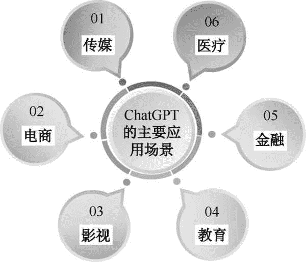

图1-1　ChatGPT 的主要应用场景

###### 2.电商
在电商场景中可搭建全天候虚拟客服，弥补人工客服休息时段的服务空档。虚拟客服能实时理解用户诉求，响应更全面、迅速。话术层面受严格约束，提升了服务可控性。

###### 3.影视
模型能够梳理海量剧本库，从统计结果中提炼符合观众偏好的创作方向。还能依据预设风格自动生成剧本初稿，创作者在筛选加工后优化完善，有助于缩短作品制作周期。

###### 4.教育
能够即时产出学习资料并解答疑问。学生通过在线问答与虚拟语音助手互动，提升学习的自主性。同时可为学校和教师批量生成课件、试卷、试题等教学资源。

###### 5.金融
助力金融机构提供更及时、更具人情味的服务。自动生成产品介绍和咨询文本，提升咨询效率；构建虚拟客服实现客户在线实时交互，提升服务效率与温度。

###### 6.医疗
可自动生成医患对话文本，辅助医院录入电子病历，在一定程度上减轻医生工作负担，提升工作效率。

多场景落地推动各领域交互与服务的质量升级，也加速了行业智能化进程。

### 1.1.3　关注要点：安全、版权与伦理
2023年初ChatGPT连续占据热搜，两月内活跃用户突破2亿。在认可其智能的同时，社会各界对潜在风险高度关注。

###### 1.安全性
强大的智能意味着显著的商业价值，也带来滥用风险。

其一，黑客可能利用模型编写攻击代码，发起规模化网络攻击，提高攻击频次，并使目标从大型企业扩展至中小企业。

其二，不法分子可借助信息生成能力批量制造钓鱼程序，智能诈骗信息辨识难度加大，受害者或增多。

其三，模型缺乏事实核查机制，易产生虚假信息，该类风险在社交媒体上被放大，用户难以甄别，加大舆情治理压力。

应对上，我国已出台《中华人民共和国网络安全法》《网络信息内容生态治理规定》《互联网信息服务算法推荐管理规定》等法规，建立相对完善的监管体系，可应对短期风险。各平台需升级监管技术，加大审查力度，推动智能生成内容审核产品的研发与应用。

###### 2.版权保护
模型可生成文案、论文、新闻等多类内容，版权归属成为争议焦点。《中华人民共和国著作权法》第三条明确作品须为文学艺术科学领域具有独创性并能以一定形式表现的智力成果，而模型产出基于海量数据训练与算法运算。

人类创作耗费精力，能体现创作者情感，属复杂智力劳动，值得法律保护。模型生成内容虽具表面相似性，但生成路径与人类智力创作不同，不属于著作权法意义上的作品，故不受著作权法保护。

不受保护并不等于可以随意使用。其与作品市场利益密切相关，未来可能纳入法律关注。学界已有建议通过邻接权制度予以保护，邻接权如版式设计权、表演者权等，该构想或将在未来落地。

###### 3.道德问题
道德风险同样值得警惕。若缺乏输出管控，模型易被用于生成不当言论、垃圾邮件等。训练数据中可能嵌入偏见与错误观点，需警惕其被复现。

OpenAI已为ChatGPT安装过滤器，但现有防护效果并不理想。未来需持续技术迭代，加强对伦理相关内容的管控。

### 1.1.4　类ChatGPT产品出现：阿里巴巴推出“通义千问”
2023年4月11日阿里云峰会上，阿里巴巴正式发布类ChatGPT产品“通义千问”。其本质是一个AI驱动的大语言模型，具备智能对话、文案创作、多模态理解、多语言支持等能力，基于知识理解可续写小说、撰写邮件等。

多家阿里旗下产品已接入通义千问，功能更智能。以钉钉为例，加入新群聊时可自动生成群内历史聊天摘要，帮助新成员快速掌握概况；还能根据用户在钉钉文档中的需求创作内容并生成创意图片。

峰会上阿里巴巴集团董事会主席兼CEO张勇表示：“面对AI时代，所有产品都值得用大模型重做一次。”阿里正将通义千问接入高德、闲鱼、淘宝等旗下产品，提升整体智能水准。

此外，阿里还面向企业提供普惠大模型能力，助力企业结合行业知识与应用场景训练专属大模型，进而拥有专属智能客服、智能语音助手、AI设计师等能力。 EXr6287u6NNVz+GYLY+7SOTgAK1+TNUORQE7GX8xSB479Pn8E1vqKi5t6nJdqBpJ6IyF0duTAxsSOPrvpBEvPg==

## 1.2　发展梳理：从PGC到UGC再到AIGC
互联网演进中，内容生产经历了PGC、UGC、AIGC三个阶段。

### 1.2.1　PGC：企业和平台是内容创作的主体
Web1.0时代，内容创作与发布以专家为主体。专家整合信息，内容质量与专业度较高，此种方式即PGC。浏览器、搜索引擎、门户网站是典型载体，如亚马逊的互联网电影资料库、雅虎综合指南等。

PGC概念真正普及，得益于内容平台、知识付费公司与互联网媒体的共同推动。创作主体是平台与企业，能保障专业性与生产能力，围绕用户需求加工内容，并通过版权作品、在线课程等实现变现，高价值内容带来流量与商业化。

当下PGC仍广泛存在，如腾讯视频、优酷、爱奇艺的影视内容，虎嗅、36氪的新闻资讯，网易云课堂、得到的音视频课程等。

PGC优势在于针对性强、质量高、易变现，但创作门槛高、周期长、产量不足、多样性欠缺，难以完全满足用户多元需求，也催生了新的生产方式。

### 1.2.2　UGC：用户成为内容创作主体
随着用户规模扩大，对个性化、多样化内容的需求提升。大量用户不再满足于单向接收，更希望参与创作。社交媒体的兴起满足了这一诉求。

Web2.0时代用户从消费者转为创作者，UGC爆发式增长，成为主流趋势。专业门槛降低，非专业人士也能产出大众喜爱的作品。

在微博、微信上用户以图文记录生活；在豆瓣、贴吧、知乎上用户自由讨论书籍影视；在快手、抖音等平台上用户以短视频获取关注并实现变现。内容生产逐步从PGC转向UGC，用户成为主体。

UGC虽解决供给问题，但也带来新挑战：用户素质参差、平台需投入大量成本培养创作者、审核内容、把控版权。内容质量、版权、更新频率等问题依然突出。相较PGC的团队协作，UGC创作者多为单打独斗，原创度、质量、发布频率难以保证，生态易受污染，效率提升受限，进而催生AIGC。

### 1.2.3　AIGC：AI成为内容创作主体
为解决内容生产痛点，AIGC这一基于AI生成内容的模式诞生。它不仅能识别语义信息，还能大幅提升生产力。

Web3.0时代虚拟空间发展需要高效生产方式，AIGC承载了这一期待，能提供高效高质量内容。

AI创作并非易事。早期被称作生成式AI，研究智能文本、图像、视频等多模态创作。初期小模型依赖标准数据训练，仅能解决特定场景，通用性差、迁移难。

随后被强算法加大数据的大模型取代。大模型无需或只需少量人工调参，可迁移至多任务，其中GAN是早期重要尝试。GAN利用判别器与生成器的对抗关系生成内容，基于大模型的AIGC应用逐步落地，直至ChatGPT实现商业化。

AIGC本质是生产力变革，提升主要体现在三方面：
（1）减少重复性工作，提升效率与质量。
（2）将创作与创意分离，帮助创作者在AI产出中寻找灵感。
（3）整合大量训练数据与模型，拓展创新边界，产出更独特内容。

AIGC发展态势不可逆，智能创作时代开启，它将成为智能化生产的重要力量。 EXr6287u6NNVz+GYLY+7SOTgAK1+TNUORQE7GX8xSB479Pn8E1vqKi5t6nJdqBpJ6IyF0duTAxsSOPrvpBEvPg==

## 1.3　内容生成：AIGC涵盖多样的内容模态
AIGC整合了图像处理、自然语言处理、声音处理等多项AI技术，可在不同模态下实现数据协同生成与处理，提升预测与决策精度，在多领域具有应用价值。

### 1.3.1　人工智能绘图：创作趋于大众化
自2022年起，人工智能绘图成为艺术领域热点。以Midjourney、Disco Diffusion为代表的软件广受欢迎。

使用时无需手绘，只需选择视角与风格、输入关键词，软件即可自动生成高水准画作，逐渐成为主流创作形式。

从生产力看，AI绘画是图像生产的技术飞跃，显著提升效率与质量。人工智能图像是AIGC在图像领域的重要分支。目前成熟工具主要有图像编辑与自主生成两类。编辑类用于加滤镜、提升分辨率、去水印等；自主生成类用于海报、模特图、品牌Logo等功能性制作；还有创意生成类，用于随机或按属性生成画作。

许多用户在朋友圈与短视频平台分享AI画作。从使用方式看，人工智能绘画可分为基于已有图像生成新图、基于文字描述生成新图及二者结合。

AI绘图是AI图像生成技术的具象体现。技术场景可划分为图像属性编辑、图像局部生成与修改、端到端图像生成三种，如表1-1所示。

AI图像生成技术正走向商业化，市场空间广阔，未来将为艺术创作提供更多可能。

表1-1　AI图像生成技术的应用场景

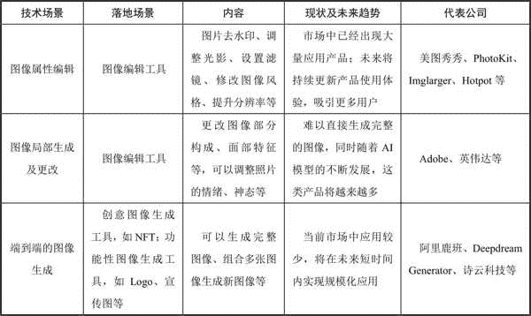

### 1.3.2　智能文本生成：方案、广告、小说均可自动化
AI文本生成技术日趋成熟，应用落地加速。主要方式分为交互式生成与非交互式生成。交互式多用于心理咨询、文本交互游戏、虚拟交友；非交互式多用于辅助写作、结构化写作与非结构化写作。

辅助写作包括关联推荐与润色，从严格意义上不完全属于AIGC。结构化写作常见于新闻资讯与标题撰写，非结构化写作常见于营销文案与剧情续写。

结构化写作早期已得到应用。四川绵阳4.3级地震时，中国地震台网AI机器人6秒内撰写约500字报道；阿坝九寨沟7级地震时，机器人不仅写出震源地地貌、天气、人口密度等信息，还自动配5张现场图片，耗时约20秒；余震资讯撰写与发布仅需约5秒。

AI结构化写作规律性强，基于高度结构化数据生成文章，行文客观严谨，在地震播报、股市资讯、体育资讯、企业年报等领域优势明显。第一财经“DT稿王”、新华社“快笔小新”、腾讯财经“Dreamwriter”、今日头条“Xiaomingbot”、封面新闻“小封”、南方都市报“小南”等均为代表。

非结构化写作难度更高，需独特创意，常用于诗歌、小说。微软小冰曾出版诗集《阳光失了玻璃窗》，诗歌富有逻辑、情感、韵律，并带有朦胧意象与美感。

AI在交互式文本中优势突出。如游戏开发者尼克·沃尔顿推出的《AI地下城2》，玩家可通过AI生成角色设定，以祈使句输入行动，AI据此生成对应故事。

AI生成文本替代了大量重复性文字劳动，促进人机更高效互动。未来AI很可能成为文本内容创作主体，节省大量时间与精力。

### 1.3.3　AI音乐：MusicLM 打破创作边界

2023年1月27日，Google 推出全新内容生成模型 MusicLM。在此前发布 Imagen Video 与 Wordcraft 之后，这款新模型将目标锁定在音乐创作上。

对普通人来说，用 AI 写歌并不简单。音乐的形成牵涉音色、音高、节奏、响度等多重信号交织，形成高度复杂的体系。早期自动作曲工具生成的作品合成感明显，听感很不自然。

Dance Diffusion、Riffusion 等可视化工具以及 OpenAI 的 Jukebox 都尝试过自动作曲，但受数据与技术的限制，只能产出简易曲目，难以保证复杂音乐的质量与保真度。要实现真正意义的自动生成，模型必须依托海量数据的模拟与训练，这是保障音质的关键基础。

MusicLM 能在更复杂的场景下融合图像与文字指令自动生成音乐，风格覆盖面广。它既能响应多元需求，又最大限度保证了输出的高保真。

更突破的是，MusicLM 支持以图像驱动作曲，《星空》《格尔尼卡》《呐喊》等名作皆可作为素材输入。模型还能识别乐器并融合不同流派，根据抽象概念生成曲目。比如输入“养成类游戏主配乐，轻快有活力”，系统即可按需自动生成。

模型拥有庞大的训练语料，为理解复杂音乐场景打下根基。针对音乐生成评估数据不足的难题，团队另建 MusicCaps 数据集，用以提升评测质量。

### 1.3.4　AI编程：智能代码助手重塑开发

AI 编程向来是业界的长期期待，如今正逐步落地。它的核心价值主要集中在三方面，如图 1-2 所示。

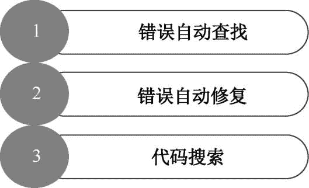

图 1-2　AI 编程的主要优势

###### 1.错误自动查找
AI 编程借助机器学习与深度学习自动揪出代码缺陷，避免人工排查的偏差。先以代码语料库生成训练样本并向量化，再用训练好的文本分类器预测新代码里潜在的错误。

###### 2.错误自动修复
发现问题后如何修复同样关键。AI 编程可构建编解码模型，将错误代码输入后由解码器输出修复版本。在原始数据集上能修复部分错误，在合成数据集上修复率则更高。

###### 3.代码搜索
编写特定功能代码时，AI 编程可提供规范的信息检索。它会返回一组候选结果，搜索过程围绕代码描述、代码片段和错误描述三要素展开，从而更精准捕捉语义相似度。

AI 编程发展迅猛，未来有望承接大量编程任务，从简单到复杂均可辅助，并推动 AIGC 持续演进。 EXr6287u6NNVz+GYLY+7SOTgAK1+TNUORQE7GX8xSB479Pn8E1vqKi5t6nJdqBpJ6IyF0duTAxsSOPrvpBEvPg==

## 1.4　核心引擎：AIGC 驱动元宇宙

随着应用范围与价值不断扩大，AIGC 与元宇宙正走向深度融合，成为元宇宙的基础设施与核心动力。技术日趋成熟后，其价值也从降本增效转向价值创造。

### 1.4.1　AIGC 成为元宇宙的生产工具

AIGC 在 PGC、UGC 之后成为新一代内容生产方式，也是元宇宙落地的关键生产力，主要体现在文生图、功能性图像生成和创意图像生成等场景。

AIGC 与 VR、NFT 并列为元宇宙三大基石。它强化了 PGC、UGC 的优势，技术迭代与模型优化是其发展的动力，核心技术正由 NLP、GAN 逐步转向 Diffusion。

GAN 作为较早的图像生成范式，适用于文生图、图像修复等，但存在样本重复与训练不稳的问题。Diffusion 在此基础上流行开来，图像质量更高且多为开源，掀起 AIGC 图像生成浪潮。

元宇宙的最终形态尚不明确，但其扩充人类生活空间是大势所趋。虚拟空间需要海量数字内容支撑，单靠人工难以实现，AIGC 能提供有效助力。

在元宇宙里，游戏是核心沉浸场景。开发周期长、成本高，传统人工方式耗时耗力，而 AIGC 工具可大幅提速。借助 AIGC，用户能自主构建游戏场景与内容，主程序、角色、剧情、场景、道具、配音、特效、动作等均可自动生成。目前来看，AIGC 在游戏设计上的能力已逼近职业设计师与开发者水平。

除游戏外，虚拟人也是重要方向。AIGC 可用于塑造虚拟人的形象、性格、动作、声音与活动场景，提升其功能与表现力，让虚拟人在元宇宙中更具生命力。

### 1.4.2　从降本到创造，AIGC 价值升级

伴随元宇宙概念升温，AIGC 成为内容生成新方案，也成发展方向之一。其价值日益凸显，赋能方式正从降本增效转向创造价值。

作为元宇宙的关键基础技术，AIGC 将打开更广阔的场景，带来更丰富的人与人、人与物的交互体验。无论工业还是娱乐，其价值已初见端倪，AI 持续演进也将推动元宇宙生态更成熟。

AIGC 赋能内容生产，为用户带来创作灵感，降低门槛，让参与更主动，用户的内容需求也能得到更大程度满足。

AIGC 也在重塑创作形态，进一步凸显内容价值。未来升级后，将助力元宇宙创造更多元的价值。 EXr6287u6NNVz+GYLY+7SOTgAK1+TNUORQE7GX8xSB479Pn8E1vqKi5t6nJdqBpJ6IyF0duTAxsSOPrvpBEvPg==

# 第二章

技术解构：AIGC 背后的核心能力

AIGC 概念全面爆发，发展速度加快，产出类型丰富且质量提升。其繁荣离不开关键技术支撑：自然语言处理让 AI 具备理解与生成力，生成算法提升创作能力，深度学习提供模型基础，多模态交互实现全方位人机沟通。 EXr6287u6NNVz+GYLY+7SOTgAK1+TNUORQE7GX8xSB479Pn8E1vqKi5t6nJdqBpJ6IyF0duTAxsSOPrvpBEvPg==

## 2.1　自然语言处理：让 AI 真正读懂人话

自然语言处理通过算法让计算机理解、分析和生成人类语言。它包含理解与生成两大分支，前者赋予读懂能力，后者赋予表达能力，共同构成 AI 的语言基础。

### 2.1.1　核心能力一：NLU 解读人类语言

NLU 是让计算机读懂文本的技术，赋予 AI 理解人类语言并完成特定任务的能力。

NLU 的应用范围十分广泛，如图 2-1 所示。

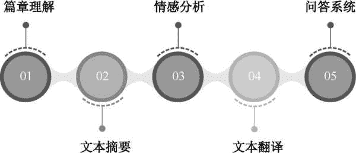

图 2-1　NLU 的应用范围

###### 1.篇章理解
借助 NLU，AI 可处理整篇文章，抓住核心并按主题归类。篇章理解多采用有监督学习，通过标注训练集和测试集训练，使模型具备信息抽取与内容把握能力，用于分类任务。

###### 2.文本摘要
文本摘要即让 AI 从大量文本中提炼核心观点生成精简内容。主要有提取式和生成式：提取式直接抽取原文关键词重组；生成式则在理解基础上用新句式表达。生成式更复杂，也更贴近人类阅读后用自己的话总结的习惯。

###### 3.情感分析
情感分析通过 NLU 识别语句中的情感词，判断整体倾向，如判断评论是否友好。可借助情感词典加权计算，也可通过有监督学习在标注数据上训练分类模型。

###### 4.文本翻译
文本翻译是 NLU 最常用的场景之一，将一种语言转成另一种语言本质上是序列映射，依赖标注数据集训练。难点在于不能逐字直译，需结合语法与语用情境调整。

以礼来公司为例，过去长期依赖第三方翻译培训资料与技术交流内容。后来自研“Lilly Translate”，融合 NLU 与深度学习，实现多办公软件实时翻译并持续自学提升准确度，节省成本并提高效率。

###### 5.问答系统
传统搜索引擎按关键词相关度排序结果，用户需自行筛选。问答系统借助 NLU 直接给出精准答案，提升检索效率。

语言承载思维，AI 通过理解语言来学习其指代的真实世界与符号背后的认知逻辑。NLU 是 AI 洞察人类社会的关键技术。

### 2.1.2　核心能力二：NLG 让 AI 流畅表达

NLG 的作用是提升人机沟通效率，把机器数据转为人类可读的语言。例如用户问智能音箱时间，系统先用 NLU 理解，再用 NLG 回复。

NLG 主要分 text-to-text 与 data-to-text 两类，流程共六步：
（1）内容选择，决定哪些信息值得保留并传达。
（2）结构组织，对信息排序，如先时间地点参与者再议题结果。
（3）语句合并，使表达更简洁流畅。
（4）语法润色，添加连词确保句子完整。
（5）领域表达识别文本所属领域并选用专业词汇。
（6）语言输出，将词句组合成最终文本。

自然语言生成的潜力巨大，可以运用到多个场景中。

###### 1.相似问生成
在新业务缺少标注数据时，NLG 可用于扩充。相似问生成即输入一句话，模型产出多条语义相近的问句，通常结合生成与相似度匹配训练。例如输入“QQ音乐和网易云音乐哪个更好用？”，系统会按相关度降序生成多条变体，相关度最高者含义最贴近，最低者偏离原意，阈值可灵活调节。

###### 2.可控文本生成
可控生成是在输出中加入控制条件，使文本符合特定要求，如情感、风格等。比如输入彩妆广告标题并指定广告类别，模型即可生成符合语境的标题。

NLG 持续成熟，为 NLP 带来更多可能，也将赋能 AIGC 创作出更优质作品。 EXr6287u6NNVz+GYLY+7SOTgAK1+TNUORQE7GX8xSB479Pn8E1vqKi5t6nJdqBpJ6IyF0duTAxsSOPrvpBEvPg==

## 2.2　生成算法：点燃 AI 创作潜能

随着 AI 进步，生成式 AI 兴起，提升创作力，推动数字内容生产进入爆发阶段。

### 2.2.1　生成式 AI 与分析式 AI 各擅胜场

AI 模型大致分为生成式与分析式。生成式通过学习已有数据创造全新内容；分析式则对海量数据进行洞察、判断与预测，辅助决策。二者各有优劣，应用场景不同。

###### 1.生成式 AI

生成式 AI 应用广泛，既满足内容创作需求，也提升垂直行业生产力。

（1）娱乐媒体领域。具备文本校对、文本转语音、语音转文本、智能修图、智能剪辑等能力，能替代重复劳动并提供创意。随着算力与数据提升，有望达到专业水准甚至替代部分创作者。2022年8月，一位参赛者凭借 AIGC 作品《太空歌剧院》在数字艺术大赛夺冠，显示其绘画能力已具超越人类之势。

图 2-2　AIGC 绘画作品《太空歌剧院》

（2）垂直领域。能实现代码生成，把自然语言转为代码，推动编程智能化，提升效率。ChatGPT 不仅可把自然语言转代码，还能审校并提出修改建议，体验优于传统搜索引擎。

但风险也存在。生成式 AI 易卷入抄袭争议，其输出本质是基于训练数据的拼接重组。溯源困难，且原创性不足，创新突破有限。

###### 2.分析式 AI

分析式 AI 主要用于推荐、图像识别等场景。
在电商中，推荐系统挖掘用户-商品关系，精准推送，提升转化率并节省检索时间。
在音视频娱乐领域，通过分析观看数据推送相关内容，提高观看率与粘性。
在自动驾驶领域，图像识别帮助判断路况、识别障碍物，降低事故率。
局限在于判断不一定精准，不适合高精度安全场景，也依赖大量数据与优化，难以在未知领域发挥。分析式 AI 通过不断试错 refine 参数来提升准确度；生成式 AI 则更多基于已有知识模仿生成，原理和使用场景均不同。

### 2.2.2　算法成熟，AI 创作进入爆发期

如今 ChatGPT 深受用户欢迎，对话交互流畅，回复质量高。它的火热也印证 AI 算法日趋成熟，创作能力正迎来爆发。

生成式浪潮的拐点

在智能化手段的推动下，市场上涌现出形态各异的新品。Gartner 在2021年和2022年连续两年把生成式AI纳入《人工智能技术成熟度曲线》，将其视作未来关键走向。除ChatGPT之外，MusicLM同样引人关注，能够根据文字或图像输入合成音乐，且风格覆盖面很广。这说明AI的触角已经伸向艺术创作环节。

2022年，扩散式架构 Diffusion 成为热议焦点，研究者投入明显增多。该架构是一种高性能深度学习范式，能够依据文字提示生成精美图像，提升合成效率与精度。使用者只需在终端里输入关键词，就能获得高质量合成图。

生成式热潮促使厂商加快布局。百度自研的“文心 ERNIE 3.0”里输入一道题目，即可产出体裁与风格迥异的内容；华为云发布面向虚拟直播与虚拟视频制作的数字内容生产线MetaStudio；图片生成应用Midjourney在Discord上积累百万粉丝；ChatGPT上线一周，用户量便逼近百万。

有用户在论坛上贴出与ChatGPT的对话记录。他询问如何用JavaScript在控制台打印一只犬的轮廓，ChatGPT即时给出回应，并用代码在屏幕上拼出犬形。这段互动体现出其强大能力，用户仅用一段文字就能获得解法。基于此，不少人认为它未来可能取代搜索引擎，甚至取代教学场景中的助教角色。

前景虽好，当前仍有明显短板。生成式系统在文本产出上的可控性与稳定性不足，例如在回答论文类问题时可能引用不当示例；编写代码时可能输出错误片段。

在图像合成方面，面临画质参差、版权争议风险。AI作画会参考关键词关联的其他作品，导致结果与参考源相似度较高，引发争议。为表达不满，部分艺术展示平台发起“NO TO AI GENERATED IMAGES”倡议，并上线过滤机制屏蔽AI作品。

在人工智能与深度学习的共同驱动下，生成式系统的创作素材持续进化，部分成果完成度很高。除版权风险外，面部替换、声音伪造等合成内容也可能加速虚假信息传播，增加监管难度。

目前发展虽快，但在压缩模型训练开销、形成差异化优势、优化用户获取路径等方面仍需持续投入，才能逐步建立可持续的商业模式，助力用户以更低成本、更高效率完成创作。 EXr6287u6NNVz+GYLY+7SOTgAK1+TNUORQE7GX8xSB479Pn8E1vqKi5t6nJdqBpJ6IyF0duTAxsSOPrvpBEvPg==

## 2.3 大规模预训练模型崛起，为深度学习赋能

当前正处数字化阶段，得益于数据挖掘、数据分析与大数据技术的加速，预训练大模型实现快速兴起。它是深度学习的重要革新，可降低人工智能研发与落地的门槛。它属于“强算力+强算法”的产物，能够为深度学习提供支撑，推动人工智能持续进步。

### 2.3.1 预训练大模型发展，破解深度学习难题

随着数据体量、算法水平与算力的共同提升，预训练大模型获得更多关注。人工智能发展需要海量数据训练，效果取决于数据规模与质量。预训练大模型是在大量数据上先行完成训练的模型，可进入规模化落地阶段，帮助用户减少模型创建与训练的成本。

预训练大模型融合多种技术，既依赖深度学习算法，也需要海量数据、超强算力与自监督学习能力，同时要在多任务、多场景下实现迁移学习，确保模型可用于多个行业。

深度学习弥补了传统机器学习的不足，能从数据中学习，而预训练大模型则依托大规模训练数据。深度学习的优势在于能处理图像、文本等机器难以处理的多种数据类型。预训练大模型在数据类型覆盖上更广，处理层级也更高。

此外，深度学习无需借助大量模型挖掘特征关联，而预训练大模型需要，这就对算力提出更高要求。预训练大模型在训练中消耗大量数据，深度学习也同样依赖数据，预训练大模型能为深度学习赋能，推动人工智能持续进步。

###### 1. 预训练大模型可推动人工智能产业化，形成转型动能

人工智能虽热，却仍处于商业落地的起步阶段，面临场景碎片化、人力成本高、场景数据缺乏等问题。预训练大模型能有效解决模型通用性与研发成本问题，加速落地。

人工智能模型使用深度学习技术时，往往只针对特定场景训练，采用传统定制化开发，流程漫长，覆盖研发到应用全链路，对研发人员专业性与协作能力要求很高。

预训练大模型利用庞大多样的数据训练出适配不同场景与业务的通用能力，使其能够匹配全新业务。通用能力解决了人工智能多样化需求，降低了应用落地的门槛。

###### 2. 预训练大模型借助自监督学习降低研发支出

传统模型训练需要人工调参调优，并依赖大规模标注数据，对数据要求严格。许多行业原始数据获取困难且成本高，如医疗行业受隐私限制难以大规模采集。

预训练大模型的自监督学习无需或少需人工标注，能够自动学习区分原始数据并构建学习任务，解决了人工标注成本高的问题。与传统开发模式相比，预训练大模型通用性更强，可在多个场景广泛使用，自监督学习有效降低了研发成本，为产业化提供助力。

预训练大模型作为深度学习的一种形态，具有处理海量数据、提升模型准确性等特点，还能为深度学习提供支持，提高训练效率。

### 2.3.2 破解通用性难题，应用全面突破

深度学习是构建和训练人工智能的基础，为发展提供了核心技术，但人工智能模型仍面临诸多挑战，其中之一就是通用性差，A类模型只能用于A领域，无法适配B领域。预训练大模型为此提供了方案，能够让人工智能模型具备泛化能力，从而实现通用与实用。

传统人工智能模型多用已知数据训练，已知数据与实际数据存在误差，拟合度不高。即使在测试环境可调整，实际应用中重新调整成本高、效果有限。碎片化、适配差、成本高的问题阻碍了规模化落地。

预训练大模型可以通过大规模数据训练适应下游任务，即采用“大规模训练+微调”的方式破解通用性难题，实现全方位突破。

例如2022年12月，百度与鹏城实验室共同研发了知识增强千亿级大模型——鹏城-百度·文心。该模型通用性强，能够完成阅读理解、文本生成、跨模态语义理解等60多项任务，同时具备泛化能力，在30多项小样本任务上刷新基准。其目标是解决泛化能力弱、落地成本高的问题，赋能各行各业。目前文心大模型已开放，在工业、金融等多个领域得到应用。

预训练大模型的出现解决了通用性难题，未来将朝着便捷化、高效化方向发展。 EXr6287u6NNVz+GYLY+7SOTgAK1+TNUORQE7GX8xSB479Pn8E1vqKi5t6nJdqBpJ6IyF0duTAxsSOPrvpBEvPg==

## 2.4 多模态交互技术：实现全方位的人机交互

多模态交互技术是一种感官融合技术，用户可通过文字、语言、视觉、动作与计算机进行交互。借助该技术，人工智能能够更好地模拟人与人之间的交互，实现全方位人机交互，提升体验。

### 2.4.1 多模态交互：文字+语音+视觉+动作

近年来，多模态交互技术应用广泛，将文字、语音、视觉、动作四个感官结合，使人机交互从单模态走向多模态，为AIGC智能创作赋能。

日常生活中最常见的模态是文字与视觉。视觉模型为人工智能提供环境感知能力，文字模型赋予认知能力。若AIGC只能生成单模态内容，将限制应用拓展与内容生产方式创新。因此多模态应运而生，它能够处理多种数据，为人机交互提供动力。

多模态大模型具备两种能力：一是寻找不同模态数据间的内在联系，如将文字与图像关联；二是实现数据在不同模态间的相互转换，如根据动作生成对应图像。其原理是将不同模态数据映射到相似或相同的语义空间，通过理解寻找对应关系。例如在网页中用文字搜索图片。

多模态交互在人机交互中得到广泛应用。人工智能发展使服务机器人逐渐走进用户，在商场、餐厅、酒店等场景常见。但多数服务机器人智能不足，只能在用户提出需求后被动响应，无法主动服务。

为推动智能化与人性化，百度率先对小度机器人进行技术升级。借助多模态交互技术，小度机器人能够快速理解场景、读懂用户意图并主动互动。虽然主动互动并非全新创举，但相比以往，互动能力提升明显。百度自主研发人机主动交互系统，设计上千个模态动作，在观察服务场景后，小度机器人可提供主动迎宾、引导讲解、问答咨询、互动娱乐等服务，推动了机器人与人工智能行业的发展。

多模态大模型有助于人工智能实现多种交互，是迈向通用人工智能的重要一步。未来人工智能将借助多模态大模型获得更多认知能力，解决更多难题。

### 2.4.2 多模态人机交互让虚拟数字人更加鲜活

手机厂商纷纷推出虚拟数字人智能助手，京东、阿里巴巴等互联网企业推出自家数字人，美妆品牌邀请虚拟数字人代言……各行业布局加速，虚拟数字人成为热门应用并逐步进入生活。

虚拟数字人的火爆源于用户对人机交互的深层需求。用户不再满足单模态单向输出，而是渴望听觉、视觉、动作与语言融合的多模态体验。多模态人机交互技术的出现满足了这一需求，使虚拟数字人更生动。

例如百度推出的可交互数字人度晓晓。度晓晓具备丰富聊天功能：基于人设与用户互动，体现个性；支持表情包、语音、视频等多种形式；拥有讲故事、唱歌等多种玩法。

度晓晓如同活在电子世界的真人，为用户带来真实交互体验，这离不开百度的技术支撑。度晓晓运用多模态交互技术，在学习大量数据后，能够理解语言、图片和视频，不仅可与用户持续交流，还能在长期互动中成长。

目前多模态交互技术已在多个领域落地，未来将进入多场景应用新阶段，赋能各行各业，催生更鲜活的虚拟数字人。 EXr6287u6NNVz+GYLY+7SOTgAK1+TNUORQE7GX8xSB479Pn8E1vqKi5t6nJdqBpJ6IyF0duTAxsSOPrvpBEvPg==

# 第三章
产业生态初现雏形

自2022年以来，从出圈的AI绘画到在社交网络爆火的聊天机器人ChatGPT，AIGC相关应用持续引发热议。其强大的内容生产能力让众多企业看到机遇，加速布局。在大量企业拥抱AIGC的态势下，AIGC产业生态已初具规模。 EXr6287u6NNVz+GYLY+7SOTgAK1+TNUORQE7GX8xSB479Pn8E1vqKi5t6nJdqBpJ6IyF0duTAxsSOPrvpBEvPg==

## 3.1 产业生态拆解：上中下游产业链逐步搭建

AIGC产业生态呈现三层架构：上游为AIGC提供技术基础与基础设施；中游提供各类算法模型，为应用提供工具；下游是多领域应用，聚集众多尝试落地的企业。

### 3.1.1 产业上游：提供核心数据服务

在AIGC产业发展中，人工智能的分析、决策、创作都离不开海量数据支持。上游供应商主要提供各类数据服务。整体而言，AIGC产业上游生态如表3-1所示。

表3-1 AIGC产业上游生态

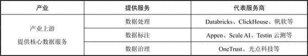

AIGC产业上游提供的数据服务包括数据处理、数据标注、数据治理等。

###### 1. 数据处理

总体来看，数据库分为两类：一类汇集各类数据但不做区分，另一类分门别类存储。随着技术发展，供应商常将两者结合打造完善数据库，使其兼具易用性与规范性，为用户提供多元化服务。从时效性看，提供数据处理服务的供应商包括异步处理型企业和实时处理型企业。数据处理涵盖提取、加载、转换、集成等环节。根据处理方式不同，供应商可分为本地部署型企业和云原生型企业。

###### 2. 数据标注

无论何种机器学习模型，都需要对数据进行标注、管理、训练以形成算法模型。当前市场上，谷歌推出AI系统LaMDA，与一家美国数据标注服务商合作；Meta推出对话机器人BlenderBot 3，与数据标注平台亚马逊MTurk合作。不难看出，众多大模型背后都有数据标注平台支撑。在技术与需求驱动下，数据标注公司借助AI辅助标注、模拟仿真等技术不断提升标注质量与效率，为用户提供更优质服务。

###### 3. 数据治理

在数字经济时代，数据是重要生产资料。数据资产管理需要明确规范，数据访问与调取需合规。数据合规服务供应商可为企业提供多样化数据治理工具与定制化方案，为AIGC探索提供数据支撑。

### 3.1.2 产业中游：搭建算法模型

AIGC产业中游提供各类算法模型，是最终落地应用的关键环节。从整体看，AIGC产业中游生态如表3-2所示。

表3-2 AIGC产业中游生态

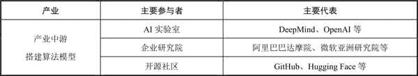

AIGC产业中游主要包括三类参与者。

###### 1. AI实验室

算法模型是AI系统实现智能决策的关键，也是完成任务的基础。为更好研究算法、推动商业化落地，许多企业打造专业AI实验室。例如谷歌收购AI实验室DeepMind，将机器学习、系统神经科学等先进技术结合，构建强大算法模型。

除企业附属实验室外，还有独立实验室。OpenAI就是一个典型的独立实验室，致力于AI技术开发。其推出的大型语言模型经过海量数据训练，能够准确生成文本、完成各类任务。

###### 2. 企业研究院

一些大型企业会设立专注前沿科技研发的研究院，以加强顶层设计、构建创新主体，推动新一轮变革。

例如阿里巴巴达摩院就是典型企业研究院，旗下的M6团队专注认知智能方向，发布了大规模图神经网络平台AIiGraph、AI预训练模型M6等。其中AI预训练模型M6功能强大，可完成设计、对答、写作等任务，在电商、工业制造、艺术创作等领域均有应用。

###### 3. 开源社区

开源社区对AIGC发展至关重要。它提供代码共创平台，支持多人协作，推动技术进步。

例如GitHub是知名开源社区，可通过不同编程语言托管用户源代码项目。其功能主要包括四方面。

（1）实现代码项目的社区审核。用户发布代码项目后，社区其他用户可下载评估并指出问题。
（2）实现代码项目的存储与曝光。GitHub作为存储型数据库，能让代码项目获得广泛曝光，吸引关注与使用。
（3）追踪代码更改。用户编辑代码时，GitHub可保存历史版本，便于查看。
（4）支持多人协作。用户可在GitHub寻找不同技能、经验的程序员协作，推动项目发展。

AIGC产业中游产出各类算法模型，提供开源共创平台，为相关应用研发赋能。

### 3.1.3 产业下游：多领域应用拓展

AIGC产业下游聚集各类可落地的应用。整体而言，AIGC产业下游生态如表3-3所示。

表3-3 AIGC产业下游生态

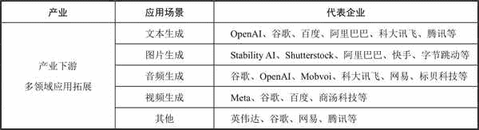

AIGC产业下游涉及的应用场景主要有文本生成、图片生成、音频生成、视频生成及其他。

###### 1. 文本生成

文本生成是AIGC应用较为普遍的场景。许多企业通过AIGC文字生成技术提供营销文案创作、智能问答、新闻稿智能生成等服务，赋能其他企业业务拓展。

长期深耕AI领域的科大讯飞推出智能语音转文字产品讯飞听见M1S，可满足高质量录音需求，并通过智能转写将音频文件转为文本，满足会议、采访、培训等多场景要求。

在艺术创作方向上，科大讯飞部署了一套书法机械臂。设备外形类似机械臂，可自行操持毛笔。使用者确定书写内容后，系统会自动完成上墨、下笔等流程。得益于生成式智能，装置可应对多种书法题材，出笔有力，笔画规范，字距控制精准。

###### 2. 图像生成
相较于文字，图像创作门槛更高、信息传递更直观，商业化潜力更强。AIGC 在图像侧可完成图生图、视觉设计、图编辑等任务，在广告、设计等场景带来新机会。目前市场上已出现多款绘画模型，用户脑中的设想可快速转为画面。以“梦幻 AI 画家”为例，操作者输入画面描述、选择风格、设定尺寸，即可得到个性化作品。

###### 3. 声音生成
声音合成主要依托生成式语音技术，应用可归为音乐创作、语言创作、音频定制三类。行业内多家厂商正展开探索，推出各类智能语音生成服务。

标贝科技  深耕智能语音合成多年，发布了多样化音频生成产品。2022 年公司升级方言 TTS 定制方案，并上线东北口音新音色。通过大量东北口音语料的持续训练，实现了较高质量的合成效果。应用层面，其智能语音服务可用于智能客服、语音播报等场景，提升用户体验。

###### 4. 影像生成
影像生成同样是 AIGC 的重要分支，细分包括视频剪辑、视频二次创作、虚拟数字人视频生成等，吸引不少科技公司入局。

以商汤科技的一款智能视频生成产品为例，产品基于深度学习算法，能对视频的声音与画面进行多维度理解，实现自动化视频生成，同时可对已有素材进行二次创作，输出画质高、风格鲜明的成果。

###### 5. 其他方向
除上述四类外，生成式技术在游戏、代码、3D 生成等领域前景广阔。游戏方面可助力策略生成、NPC 互动内容生成、游戏资产生成等；代码方面，生成式编程能替代人工大量重复劳动；3D 生成方面，英伟达、谷歌等巨头已布局，推出英伟达 Magic3D、谷歌 DreamFusion 等产品。

随着技术迭代和企业的持续探索，生成式内容的应用形态将更丰富，并在传媒、电商、金融等多行业实现落地。 EXr6287u6NNVz+GYLY+7SOTgAK1+TNUORQE7GX8xSB479Pn8E1vqKi5t6nJdqBpJ6IyF0duTAxsSOPrvpBEvPg==

## 3.2 价值全景：面向用户、企业与社会
当前生成式内容已在电商、娱乐等多个行业产生创新效应，其在消费端、产业端、社会端的价值正逐步显现。

### 3.2.1 消费侧：数字内容迎来新一轮变革
在消费端，生成式技术对数字内容领域的改变主要体现在以下四个方面。

（1）生成式技术正成长为新型数字内容生产的基础设施，重塑生产与交互的新范式。人工智能在内容生产中渗透不断加深，不仅在文字、图像生成上展现类人表现，也依托大模型训练呈现出强劲创作潜力。借助生成式赋能，创作者可摆脱技法限制，更轻松呈现创意。

生成式技术契合消费者对多元化数字内容的需求。随着数字内容消费结构升级，视频类市场规模持续扩大，短视频与直播更受欢迎。面向消费者的视频内容正演变为持续产出的快消品，创作需要更智能高效的方式，生成式技术有望成为未来数字内容生产的基础设施。

（2）生成式技术在内容生成上优势明显，有助于内容消费市场更繁荣。一方面能自动产出海量高质量内容；另一方面能丰富数字内容的多样性。模型不仅可生成文字、图像、视频等多种形态，还能衍生不同风格。例如既可创作写实、抽象画作，也能创作现实或超现实风格的视频。

（3）生成式技术将成为 3D 互联网建设的重要工具。随着技术升级，互联网正从平面走向立体，生成式技术将加速 3D 互联网实现，并为 3D 创作赋能，提升虚拟场景搭建、3D 形象创作效率。

已有企业在生成式 3D 内容方面探索。例如谷歌于 2022 年发布文字转 3D 的模型，但效果仍有提升空间，3D 内容生成仍待发展。

（4）智能聊天机器人与虚拟数字人打造了新交互形式，给用户带来全新体验。自 ChatGPT 走红后，不少企业尝试基于 OpenAI 语言模型推出自有聊天机器人。例如社交媒体 Snapchat 基于 OpenAI 语言模型，于 2023 年 2 月上线聊天机器人“My AI”，提供智能对话服务。

生成式技术降低了虚拟数字人的制作门槛，用户可借助其生成超写实虚拟数字人。同时还能提升虚拟数字人的感知、决策能力，使神情动作更接近真人。

### 3.2.2 产业侧：合成数据指引发展方向
合成数据是指由计算机模拟或算法生成的数据，而非从现实环境采集的原始数据。合成数据随机器学习发展而来。为保证模型训练精准，训练数据需覆盖多应用场景。若某场景数据缺失，机器对该场景理解也会受限，而合成数据可弥补缺口。合成数据能构建类别丰富的合成集，生成覆盖更广的模型。在产业端，合成数据将指引发展方向。

一方面，合成数据为模型训练提供数据基础。人工智能发展离不开数据，但数据质量参差、标准不统一等问题普遍。计算机算法生成的合成数据可为模型训练提供基础，解决训练中的数据难题。

（1）解决数据匮乏、质量问题，提升基准测试数据质量。
（2）解决数据安全问题，避免隐私泄露。
（3）保证数据多样性，更真实反映现实场景。
（4）提高模型训练速度与效果。

总体看，合成数据能高效生产用于模型训练的各类数据，拓展应用可能。

另一方面，合成数据拓展应用场景。早期合成数据主要用于自动驾驶、安防等领域。这些场景训练模型并不容易，需要海量标注数据，而真实数据获取困难。例如自动驾驶领域，道路场景多样，系统难以在现实中覆盖全部场景训练，需借助合成数据获取更多场景数据。

部分企业尝试通过仿真引擎获取海量训练数据。例如腾讯推出的自动驾驶仿真系统可生成多样交通场景数据，为自动驾驶系统训练提供支持。

除自动驾驶外，合成数据在金融、医疗等领域也有应用。金融领域，生成式 AI 可低成本提供规模化数据，同时保障隐私；生成对抗网络广泛用于欺诈检测、交易预测等场景。医疗领域，合成数据可推动医疗 AI 发展。医疗机构可利用合成基因数据、医疗数据等开展研究，推动医学研究进展。未来在数据合成技术支撑下，AI 应用场景将进一步蔓延，落地更多领域。

合成数据对 AI 发展具有重要价值，使其成为企业争相布局的新赛道。英伟达  是典型代表，其推出的虚拟协作开放平台 Omniverse 具备数据合成能力，可为算法训练提供技术引擎。

在 Omniverse 平台中，用户可创建虚拟环境并在其中进行机器人训练，虚拟世界中的训练结果可同步到现实机器人，实现快速应用。平台同时提供多种模拟场景，支持自动驾驶系统训练。

不仅科技巨头纷纷布局，一些创业者也把合成数据赛道作为创业新阵地。据统计，截至 2023 年 2 月，全球合成数据创业公司已超 100 家。这些公司获得资本追捧，不少已完成融资。未来在创业公司与资本共同推动下，合成数据服务将更趋多样化、专业化。

### 3.2.3 社会侧：释放人力激发创造力
在社会层面，生成式内容的价值体现在释放人力、提升创造力。它能以高效率、低成本的智能化内容生产满足用户个性化需求，完成基础性创作工作，释放人力。随着在各领域的深入，生成式内容将与各行业结合催生新业态，形成“生成式+”社会效应。

生成式内容强大的生成能力使其能高效高质创造海量内容。以绘画为例，画家耗时数天完成的作品，绘画模型几分钟即可生成。这能释放人力，让人们把时间投入到更具创造性的工作上。

目前生成式技术可智能创造内容，如智能作画、智能生成视频，但其不具备真正创造力，只是基于深度学习进行模仿式创新。生成式技术背后的创作者是人类，但它仍有意义，可作为辅助手段提升人类创造力。其价值在于完成基础性创造工作，解放人力。

生成式技术为人们提供新创作工具，也变革了内容创作模式。画师可先把关键词输入绘画程序，得到方案后再继续创作；作家也可基于模型生成内容框架，再进一步优化。这体现了生成式技术对内容生产方式带来的变革。

例如基于生成式技术应用，文物修复方式得以变革，可实现数字化重塑与再造。腾讯借助 360°沉浸式展示技术、AI 技术等，实现文物的数字化诊疗。在敦煌壁画修复方面，壁画种类多、损坏原因多样，难以设计统一修复方案，人工修复成本也高。生成式技术为壁画修复提供新思路。

腾讯通过深度学习壁画损坏数据，打造了先进的 AI 壁画病害识别工具，并在其基础上提供系统化解决方案。修复环节，腾讯还推出沉浸式远程会诊系统，全方位展示文物细节，让异地专家可清晰查看文物情况，实现远程文物会诊。

未来随着应用场景拓展，将推动更多行业生产方式变革，给人们生活带来便利，加速社会发展。 EXr6287u6NNVz+GYLY+7SOTgAK1+TNUORQE7GX8xSB479Pn8E1vqKi5t6nJdqBpJ6IyF0duTAxsSOPrvpBEvPg==

## 3.3 发展挑战
生成式内容浪潮带来机遇的同时，也带来知识产权、安全等新挑战。

### 3.3.1 知识产权：数字内容版权风险
随着生成式内容走红，相关应用强势出圈。这一过程中可能引发风险。例如在知识产权保护方面，数字内容的版权风险是产业利益相关者必须思考的问题。

2023 年 1 月，美国 3 名漫画家对 3 家生成式商业应用公司提起诉讼，指控其内容生成工具存在侵权问题；2023 年 3 月，一家生成式公司遭到报社记者指责，记者称该公司大量使用其原创文章进行模型训练却未支付版权费用。这些案例表明发展面临知识产权挑战。

开发与应用涉及知识产权问题，因为模型打造依赖海量数据训练，而这些数据内容往往受版权法保护。若相关公司擅自收集、使用这些数据，就会构成侵权。

视频合成、视频创作的内容若未获得原始视频作者许可，也会侵权。例如部分应用可通过换脸生成新视频，若未获得人物肖像授权、视频内容授权等，就存在侵权风险。

在知识产权保护上，传统作品多采用授权使用模式，但该模式在生成式数字内容创作中并不完全适用。一方面，该模式会使应用研发公司承担高昂的内容授权成本。在此情况下，公司只能用免费数据训练模型，或直接放弃该领域，不利于长期发展。

另一方面，授权使用模式难以落地。模型训练需要海量数据，来源与归属各不相同。要获得授权，公司需先将需授权数据与免费数据分离，再逐一找到对应著作权人协商版权并支付费用。由于需授权数据众多，执行难度极大。

那么发展中的版权风险如何规避？一方面，可补充完善版权内容合理使用的情形。例如公司对作品的使用不损害著作权人权益，就可自由使用该作品。若著作权人明确了作品使用群体，公司需遵守其规定。

另一方面，可搭建完善的作品退出机制。例如公司在将作品加入训练数据库前，可给予著作权人一定期限，允许其选择是否将作品从数据库中删除。若著作权人反对，公司需删除相关作品；若不反对，公司可将其用于模型训练。

总体而言，以上两种方法只是未来可行路径之一，生成式内容知识产权问题仍在讨论中。只有解决这一问题，产业才能进一步繁荣发展。

### 3.3.2 安全挑战：多方面风险并存
安全挑战是生成式内容发展中不可回避的重要问题，主要体现在以下三个方面，如图 3-1 所示。

###### 1. 内容真实性隐患
互联网中部分内容本身虚假，随着生成式内容爆发，虚假问题会更明显。例如当前部分应用虽能智能生成内容，但会出现明显错误。因为内容源于模型的随机联想，模型可预测用户输入的下一个关联内容并生成看似合理实则不正确的输出。风险在于，除非用户知道正确答案，否则难以判断内容正确性。

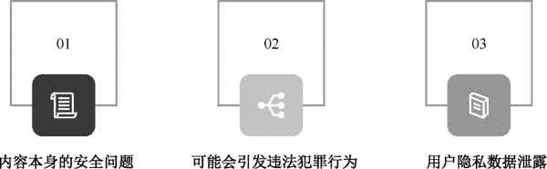
图 3-1 生成式发展中存在的安全挑战

###### 2. 可能诱发违法犯罪
生成式内容的恶意使用可能引发诈骗、诽谤等违法犯罪行为。不法分子借助应用，可更高效率地发布视频、音频、图像等难以辨真伪的虚假信息，开展各类违法犯罪活动。例如当前部分不法分子通过换脸、合成声音进行诈骗。

###### 3. 用户隐私泄露风险
模型训练数据来源于互联网，其中包含大量用户隐私数据，导致隐私泄露风险。当应用遭受攻击或出现“数据中毒”问题时，用户数据存在泄露风险。即便用户主动将数据交给模型服务提供商，如何用现有技术保护这些数据，也是服务提供商面临的大安全挑战。

针对上述安全挑战，许多科技企业推出多样治理措施。例如在内容安全方面，OpenAI 制定训练策略，让开发人员向模型提出各类问题，对错误答案进行惩罚、对正确答案进行奖励，从而控制模型回答。

针对视频、声音伪造等问题，部分企业推出检测工具。腾讯推出的甄别技术 AntiFakes，可辨别技术合成的“假脸”，并对真实人脸进行分析，判断视频是否借用公众人物形象，以此评估视频风险等级。

目前一些应对安全挑战的策略与技术已实现应用。未来随着策略升级与技术迭代，企业有望将安全风险扼杀在摇篮中。 EXr6287u6NNVz+GYLY+7SOTgAK1+TNUORQE7GX8xSB479Pn8E1vqKi5t6nJdqBpJ6IyF0duTAxsSOPrvpBEvPg==

# 第四章
市场轮廓：巨头抢占新蓝海
互联网市场逐渐趋于饱和，生成式内容的火热发展开辟了全新市场。《中国 AI 数字商业产业展望 2021—2025》报告预测，到 2025 年，AI 数字商业内容的市场规模将达到 495 亿元。这吸引众多企业纷纷入局，布局动作不断，企图抢占市场新蓝海。 EXr6287u6NNVz+GYLY+7SOTgAK1+TNUORQE7GX8xSB479Pn8E1vqKi5t6nJdqBpJ6IyF0duTAxsSOPrvpBEvPg==

## 4.1 赛道崛起：风口已然点燃
生成式内容蕴藏巨大发展潜力，有助于提升内容创作效率，重塑内容生产方式。许多企业抓住风口迎接挑战，试图开辟全新发展方向，获得市场竞争力。

### 4.1.1 资本涌入 初创企业爆发式增长
ChatGPT 一夜爆火，生成式内容成为投资热门领域，大量资本涌入，初创公司呈现爆发式增长。创业者争相在该领域创业，试图抢占新赛道，获取流量红利。下面梳理了 3 家具有发展潜力的初创公司。

###### 1. Hugging Face
Hugging Face 是一家创立于 2016 年的人工智能初创企业。起初公司规模不大，创业者目标是打造面向年轻人的聊天机器人。

2018 年，谷歌推出预训练模型 BERT，激发了许多用户对机器学习的兴趣。不久后，Hugging Face 发布了基于 Pytorch 的 pytorch-pretrained-bert BERT 预训练模型。因该模型上手简单、易用，受到众多用户喜爱，Hugging Face 也由此获得进一步发展。

截至 2023 年 2 月，Hugging Face 拥有近 13.5 万个预训练模型，每天有超过 5 万人下载预训练模型。公司获得多次融资，截至 2022 年 5 月完成 C 轮融资，融资金额为 1 亿美元，显示资本对其未来发展十分看好。

###### 2. Jasper
Jasper 是一家创立于 2021 年的人工智能公司，其主要产品为 Jasper AI，一款内容创作工具。用户可使用 Jasper AI 进行智能创作。Jasper AI 能满足用户的任意需求，无论是吸睛的标题，还是流畅优美的文字，都能为用户呈现。

Jasper AI 除了文案生成能力之外，还具备把文字直接变成画面的艺术创作功能。用户只要输入一段描述，系统就能据此“作画”。比如输入“红色的桌子”，平台就会输出一张对应的红色桌子图像。

这家公司成立时间很短，却发展很快。成立仅一年左右，用户规模就突破 7 万，2021 年的营业额达到 4000 万美元。融资方面，截至 2022 年 10 月累计获得 1.25 亿美元，主要用于完善核心产品、优化使用体验以及让产品与更多第三方应用联动。

###### 3.Synthesia：代码代替摄像头的视频工厂
Synthesia 于 2017 年启动，主攻 AI 视频生成赛道。创始团队来自名校，希望用代码取代传统拍摄流程，因而打造出简洁直观的操作界面。

使用门槛很低，基本三步即可完成：选模板、选主持人、输入文案，就能产出高质量视频。同时提供丰富的自定义空间。平台拥有 25 个以上场景模板，可切换多种语言和不同外貌的主持人。

最具辨识度的功能是形象定制。用户可以上传个人特征生成专属数字形象，随后用自己的形象制作各类视频。这项能力大幅降低了视频制作门槛，也节省了制作成本。

市场反响不错，吸引了多轮投资。2021 年底完成 B 轮融资，融资总额累计达到 5000 万美元，主要投入人脸合成技术与产品研发。

AIGC 的爆发催生了大量创业机会，新产品不断涌现，也为技术生态注入新动能。

### 4.1.2 资本追捧，多只AIGC概念股封板
AIGC 的热度体现在创企涌入、机构加码和股价异动等多个层面。AI 板块持续走强，不少公司公开宣布进入 AIGC 领域，多只相关概念股涨停。

以 2023 年 2 月 2 日为例，当日 AI 板块活跃，同花顺数据显示 AIGC 概念指数上涨 0.58%，AI 概念指数上涨 0.49%。截至当天，AI 与 AIGC 相关概念股已连涨超半个月，同为股份、视觉中国等个股持续大幅上涨，动能强劲。

巨大增量空间吸引企业集体加码。昆仑万维在 StarX MusicX Lab 上线 AI 创作歌曲；中文在线深耕 AIGC 应用，推出 AI 主播、AI 绘画、AI 辅助创作等功能；微软宣布深化与 OpenAI 的合作并追加超 10 亿美元投资，推动工具商业化；谷歌在 AI 方向全面部署；百度计划推出类 ChatGPT 的 AI 工具。

资本市场同样乐观。东吴证券预计 AIGC 渗透率将逐步提升，2030 年市场规模有望突破万亿元；赛迪顾问认为到 2030 年 NLP 市场规模将超 2000 亿元；太平洋证券指出 AIGC 将在各行业落地，成为数字内容新引擎。

浙商证券表示头部企业加入有助于加速行业融合；开源证券认为技术进步与头部入局将拓展 AI 场景，促进商业化落地；方正证券强调 AI 技术发展将利好技术提供商。目前 AIGC 已率先在传媒、电商等数字化程度高的领域应用，未来有望全面开花，重塑数字内容生产与交互模式。

## 4.2 巨头扎堆入局，AIGC 布局成大势
AIGC 打开了 AI 的新空间，经济价值巨大。各科技巨头纷纷出手：阿里巴巴自研大模型并探索应用；百度以虚拟数字人发力并全栈布局 AI；字节跳动聚焦 AI 视频生成；微软靠投资积蓄实力；谷歌推出多款产品抢占份额。

### 4.2.1 阿里巴巴：自研大模型驱动应用落地
2023 年初，阿里巴巴达摩院内测中的类 ChatGPT 产品被提前曝光。该产品不仅处理纯文本，还具备多模态能力，支持智能问答、文案生成、代码生成、AI 绘画等，功能完整，背后是通义大模型的支撑。

通义大模型具备“一统”能力，主要体现在三点：架构统一，采用 Transformer 预训练应对多种任务，无需额外模型层；模态统一，自然语言、计算机视觉及图文多模态均用同一架构思路；任务统一，通过序列到序列生成统一表达单模态与多模态任务。

目前通义大模型已落地 AI 辅助设计、医疗文本理解、人机对话等 200 多个场景，大幅提升效率。

在应用侧，阿里妈妈的实践值得关注。电商广告投放中，创意图是触达消费者的关键，但商家设计成本高、周期长。阿里妈妈推出智能图文创意制作系统，将创意图拆解为底图、创意布局、文案渲染等要素，由 AI 自动生成，并可根据底图生成多种布局与文案样式。商家只需上传商品素材，即可批量获得美观多样的创意图。

同时，阿里妈妈推出 ACE 智能剪辑系统赋能淘宝直播。该系统可分析直播数据，提炼各行业高转化内容标签并智能优化剧本；能从视频内容提取吸引消费者的标签展示在直播间，便于高效决策；还能基于投放数据与标签效果持续优化剧本。珀莱雅、森马等商家借助该系统提升直播效果，转化率显著提高。

在达摩院与阿里妈妈等平台持续探索下，阿里在 AIGC 领域有望保持稳定发展，赋能更多客户。

### 4.2.2 百度：全栈技术布局，虚拟数字人深耕
百度作为国内 AI 领先企业，很早就All in AIGC，不仅实现全栈布局，还在虚拟数字人领域持续深耕。

AI 时代来临后，百度将传统芯片-操作系统-应用三层技术栈升级为芯片-框架-模型-应用四层结构，是少见的全栈自研公司。配合端到端反馈机制，百度推出国内首个全栈自研 AI 基础设施“AI 大底座”，为各行业提供算力支撑。

虚拟数字人平台曦灵可为不同行业定制 AI 数字人。截至 2023 年 2 月，已打造数十位虚拟数字人，覆盖金融、传媒、影视等。

金融方面，曦灵为浦发银行打造数字员工“小浦”，担任理财专员，每月服务超 46 万用户，降低人工成本、提升服务效率。

传媒方面，为央视新闻打造 AI 手语主播，服务超 2000 万听障人士；与《中国日报》合作推出数字员工“元曦”，助力中国文化传播。

文博方面，云曦联合中国文物交流中心推出文博虚拟宣推官“文夭夭”（如图 4-1 所示）；与国家大剧院合作打造虚拟员工“Art 鹅”。它们提供讲解、导览等服务，传播传统文化同时提升运营效率。

影视方面，为综艺《元音大冒险》提供全套数字人技术支持，运用虚实结合与实时驱动增强节目看点，提升制作效率并降低成本。

未来百度将持续深耕 AI，推动虚拟数字人广泛落地，为 AIGC 发展贡献力量。

图 4-1　文博虚拟宣推官“文夭夭”

### 4.2.3 字节跳动：深耕AI视频生成
随着 AI 应用逐渐落地，字节跳动聚焦视频赛道，利用 AI 生成视频。

在剪映 App 中集成 AI 视频生成系统，具备三大能力：视频自动剪辑，主要用于直播切片；视频属性编辑，可调整分辨率、帧率等；文字生成视频，输入关键词或语句即可自动生成对应视频并匹配素材，节省查找时间。

字节跳动 2016 年成立人工智能实验室，致力于为内容平台研发创新技术。ChatGPT 爆火后，实验室转向类 ChatGPT 与 AIGC 相关应用研发。

公司还展开广泛合作：与吉宏股份双向合作，将自研 AIGC 技术应用于跨境电商全链路；与天龙集团合作，授权其代理旗下 App 的互联网广告销售。

字节跳动以擅长领域为抓手持续发力 AI 视频生成，带来更多新体验。

### 4.2.4 微软：以投资布局积蓄AIGC实力
微软凭借战略眼光提前布局 AI，对 OpenAI 长期投资，积累 AIGC 实力。

OpenAI 成立于 2015 年，最初为非营利研究机构。2018 年发布 GPT-1，2019 年转为营利机构并发布 GPT-2，2022 年 2 月发布 InstructGPT，同年 11 月发布 ChatGPT。ChatGPT 发布仅 5 天用户破百万。尽管 OpenAI 真正爆发在 2022 年末，早在 2019 年微软就与其合作，实现资源互补。微软是 OpenAI 重要早期战略投资者，双方协同发展。

资金层面，微软 2019 年投资 10 亿美元，2021 年追加投资，2023 年宣布深化合作并进行巨额投入。算力层面，微软提供超算系统助力研发，OpenAI 反哺 AI 能力。应用层面，微软宣布将 ChatGPT 全面整合至旗下产品。

一系列布局使微软在 AIGC 领域实力显著，利于其在下一轮科技竞争中占据先机。

### 4.2.5 谷歌：多条产品线全面覆盖
与专注单一赛道不同，谷歌在 AIGC 领域多线并进，推出多款产品满足不同需求，如 AI 写作助手 LaMDA Wordcraft、文本转图像模型 Imagen、AI 音乐生成工具 MusicLM。

LaMDA Wordcraft 实现技术突破，可帮助用户续写小说。遇瓶颈时可调用系统续写，原理是基于给定词汇按语言逻辑补全后续内容。经海量数据训练后，系统能使用更高级词汇提升文采，比如描述“高兴”，系统会提供多种优美表达供选择。

Imagen 可根据文字生成图像，先对输入文本分析编码，再转化为图像并利用扩散模型采样生长。借助 Transformer 与图像扩散模型，生成图像真实感强，但因训练数据来自网络，也可能产生争议内容。

MusicLM 是音乐领域的探索，用户输入文字或图像即可生成多样曲风音乐。相比早期 AI 音乐工具，MusicLM 能创作出复杂曲目并支持图像生成音乐。AI 音乐创作受多种因素干扰，需海量数据训练才逼真，MusicLM 正是依托大规模数据训练实现深度音乐场景理解。

凭借写作、绘图、作曲三条线，谷歌为 AIGC 生态奠定基础。

## 4.3 商业化提速，AIGC 服务已现
AIGC 在多个领域的应用为商业化提供动能，AI 写作、绘画、视频、图像生成等服务已出现，AI 技术变现成为现实。

### 4.3.1 云算力方案支撑多样创作
AIGC 助力内容生产效率提升。2022 年行业迎来爆发，AIGC 时代到来。用户对内容需求持续上升，AI 不仅用于推荐，还可用于批量创作提升竞争力，企业需借助云计算与 AI 解决痛点。

首都在线  提出云算力解决方案，可应用于多个业务场景，为 AIGC 提供云端算力基础设施，提升生成效率与体验。

AIGC 应用有两大特点：一是体验型服务，内容生成依赖云端而非终端；二是效率是核心体验指标，其他指标高度依赖模型与算力。首都在线基于应用特征与用户需求，自主研发管理芯片及配套系统提升边缘云节点效率，并搭建面向 AIGC 的公有云平台提供算力与算法支持。该方案可广泛应用于 AIGC 场景，助力商业化落地。

### 4.3.2 算法开源推动创作普惠
AIGC 是 AI 快速发展的产物，重塑生产方式。行业火热，多家互联网企业进入赛道。昆仑万维  推出全系列 AIGC 算法与模型“昆仑天工”并宣布开源。

昆仑万维成立于 2008 年，从游戏公司发展为综合互联网公司，业务覆盖社交、娱乐等信息化服务。截至 2022 年上半年，全球平均月活用户近 4 亿。

公司在 AIGC 领域的布局历程如图 4-2 所示。

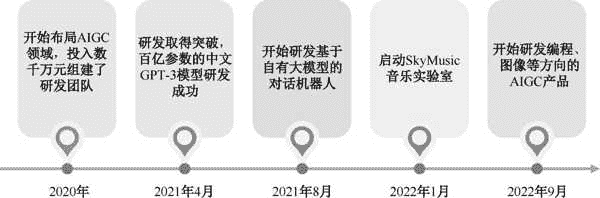
图 4-2　昆仑万维 AIGC 布局历程

2022 年底，昆仑万维推出 AIGC 算法平台“昆仑天工”。该平台下辖四款产品：负责绘画的天工巧绘 SkyPaint、负责音乐的天工乐府 SkyMusic、负责文本的天工妙笔 SkyText，以及面向编程的天工智码 SkyCode。整体覆盖图像、音频、文字、代码等多模态，生成能力突出。比如 SkyPaint 创作的《在太空骑马的宇航员》这幅画作即为代表。昆仑万维在 AIGC 上的布局相当完整，也是国内首家明确推动 AIGC 算法与模型开源的企业。

依托昆仑天工，昆仑万维能实现业务版块的多元拓展，提升各条线的生成能力，把内部动能转化为增长势能。平台的定位也很宏大，一方面要强化自身定制化 AI 内容生产的水平，另一方面也想提升用户活跃度，为企业带来降本提效的价值。

图 4-3　《在太空骑马的宇航员》

开源被视作 AIGC 发展的必然趋势，但市场上仍有不少厂商选择 API 收费模式，未能做到像昆仑万维那样的全盘开放。部分公司担心，早期开源可能会削弱盈利空间。

昆仑万维解释，开源的考量在于能优化 AIGC 生态，激发模型与算法的持续创新，同时拉低技术使用和学习的门槛，让 AIGC 得到更广泛的应用。开源本就是行业发展的大方向，开放的代码更利于快速迭代和安全保障。借此，昆仑万维有望打开全球市场，加速用户积累，推动 AI 应用生态更加繁荣。

当前 AIGC 仍在成长期，行业标准尚未完善，这也给了企业提前卡位、通过开放算法与模型抢占先机的机会。

### 4.3.3　3D 视频 AIGC 引擎融资与产品落地

2023 年，专注 3D 视频 AIGC 引擎的深氧科技  公布完成千万元级天使轮融资，资金主要投向产品升级、市场开拓和技术团队扩充。

深氧科技创立于 2022 年，目标是通过手机端和网页端，让没有基础的用户也能借助 AI 驱动的云原生 3D 创作工具便捷制作内容，并一键导出视频发布到主流平台。

2023 年 2 月，公司对外推出了 O3.xyz 引擎 1.0 版，并明确了产品的最终形态：用户输入文字即可生成想要的视频。该引擎内置 Director GPT 模型，支持调用和编辑 3D 资源，最终输出 3D 视频。

深氧科技认为，AI 进入 3D 视频创作能大幅降低工具门槛，让普通用户也能自由创作。市场上多数生成工具只能产出 3D 模型，而 O3.xyz 能直接产出成片的 3D 原生视频，直达交付形态。

创始团队成员多出自知名高校与头部企业，具备扎实的技术背景、行业经验和市场嗅觉。核心人物曾参与多项产品研发与头部 IP 制作，擅长把前沿技术与商业化落地结合。

技术选型上，深氧科技更倾向轻量化场景。公司为 O3.xyz 设计了三套后端训练模型，砍掉了繁复的编辑与定制功能，并引入自动建模和自动交互算法，让视频制作流程更简洁，便于更广泛用户上手。

深氧科技强调聚焦短视频，是看中该赛道成熟的商业化路径。O3.xyz 能简化创作步骤，为用户创造效率，提升内容产出空间，并在多平台实现较快变现。

目前 AI 生成 3D 视频的商业化案例仍少，O3.xyz 通过优化算力资源分配，为规模化商业化提供支撑。公司认为算法与数据的积累会形成飞轮：数据越多模型越精准，精准度提升带来用户增长，用户增长又产生更多数据。

O3.xyz 上线后获得不少关注。有抖音创作者反馈，使用后效率明显提升，以前一周只能产出一支视频，现在一分钟可出一版样片，一周可产出数十版。样片增多扩大了选择余地，有助于筛选出更优质内容，同时节省了场景搭建时间，让创作者更专注创意本身。

生成式 AI 正席卷全球，AI 绘图、AI 视频等应用不断拓展使用场景。AIGC 让 AI 大规模落地成为可能，降低创作门槛，帮助用户产出更丰富优质的内容。 EXr6287u6NNVz+GYLY+7SOTgAK1+TNUORQE7GX8xSB479Pn8E1vqKi5t6nJdqBpJ6IyF0duTAxsSOPrvpBEvPg==

# 第五章
AIGC 赋能传媒：人机协作重塑内容生产

随着应用场景不断扩散，AIGC 在传媒行业的价值愈发凸显。它有助于优化内容供给链路，激发创意灵感，为新一代受众提供更具新鲜感的阅读体验，同时推动数字营销模式的重塑，大幅提升媒体的创作质量与效率。 EXr6287u6NNVz+GYLY+7SOTgAK1+TNUORQE7GX8xSB479Pn8E1vqKi5t6nJdqBpJ6IyF0duTAxsSOPrvpBEvPg==

## 5.1　AIGC 贯穿传媒采编传互动全流程

当前 AIGC 已渗入采编、传播、互动等多个环节，实现新闻自动生成、虚拟主播播报、机器人实时互动等功能，彰显出人工智能的核心优势，推动媒体向智能化、自动化迈进。

### 5.1.1　采编环节：转写、写稿与剪辑工具的智能化

在采编一线，语音转写、自动写稿、智能剪辑等工具已被广泛采用，成为记者编辑的标配。

###### 1.语音识别转文字工具

采访产生大量音频视频素材后，记者常需反复回听核查，从中提炼线索与灵感。语音转文字工具正是为提升筛选与写作效率而生，其实时转写可自动将录音或视频中的语音转为文字，并一键导入采编系统。

采访现场，一部带转写功能的手机就能充当 AI 录音笔和智能笔记本，提升写稿效率。该类工具还能在数秒内完成大文件转写，并提供口语过滤、字幕分离、SRT 导出、角色分离等功能，显著提高素材收集与整理效率。

###### 2.新闻内容生成工具

为加速资讯分发，今日头条上线了“自动生成原创软件”，可依据用户输入的要点与关键词自动产出原创稿件，兼具语音识别、标题生成、正文生成、标签定位、关键词匹配及图片批量上传等能力。

软件还拥有强大的数据采集与分析模块，可基于地区、行业及浏览偏好进行定向分析与预测，帮助编辑快速、精准地采集整理信息，让内容更完整系统。其操作简便，能大幅节约采编人力，提升效率与质量。

###### 3.视频剪辑工具

短视频兴起带来剪辑需求激增，也催生了一批工具。剪映即为代表，支持裁剪、叠化、运镜、文字编辑，以及特效、边框、贴纸等素材库，还能自动识别语音一键配字幕。无专业基础的用户也能做出大片质感的作品。

另一款热门工具喵影工厂提供 PC 与移动端，支持倒放、百轨剪辑、多比例缩放、无级变速、降噪等功能，其转场与画中画特效可增强创意。输出格式涵盖 GIF 与 4K，能满足不同创作需求。

AIGC 有效压缩了新闻采集与编辑的时间成本，提升了效率与质量，推动采编向智能化快速演进。

### 5.1.2　传播环节：虚拟主播实现自动播报

AIGC 让传播端实现自动化播报，拓宽覆盖面、丰富场景与形式。

传播场景中，虚拟主播是核心应用。它开创了新闻领域的人物动画与实时语音合成，编辑只需输入文本，系统即可自动生成虚拟主播播报视频，并保证表情、口型与音频同步，效果媲美真人主持。虚拟主播在新闻传播中的主要价值见图 5-1。

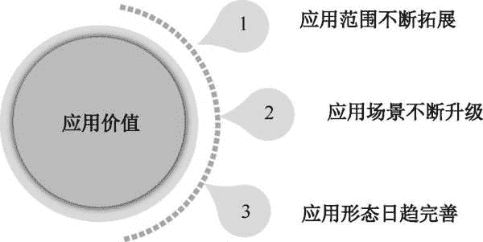

图 5-1　虚拟主播在新闻传播环节的主要应用价值

###### 1.应用范围不断拓展

以新华社、东方卫视等为代表的主流媒体正探索虚拟主播的应用，并逐步延伸至天气预报、现场采访、晚会主持等场景。

###### 2.应用场景不断升级

在常规播报之外，虚拟主播已支持多语种和手语播报。2022 年北京冬奥会期间，腾讯、百度等多家企业推出手语虚拟主播，为听障观众提供无障碍赛事解说。

###### 3.应用形态日趋完善

虚拟主播形态持续进化，形象由 2D 向 3D 发展，驱动维度从口型扩展到表情、动作和背景，制作方式从 SaaS 工具向智能化生产转变。例如腾讯的 3D 手语主播“聆语”已用于多场直播，手语讲解、唇动、眨眼、微笑等细节可被生成，并配有可视化动作编辑平台供人工微调，使手语更规范、解说更自然。

虚拟主播丰富了播报形式，带来更生动新颖的视觉体验，为观众呈现不一样的新闻观感。

### 5.1.3　互动环节：AI 赋能观众实时参与

网络视频长期以来以内容为核心吸引与留存用户，而如何借助技术构建新的产品生态，对视频平台而言既是挑战也是机遇。

随着内容繁荣，观众需求日益多元，已不满足于趣味与完整，更渴望与内容实时互动。为此爱奇艺推出“AI+视频”战略，落地“奇观”AI 识别功能。

“奇观”诞生于对弹幕需求的观察。爱奇艺发现观众常在弹幕提问演员身份、片段 BGM 等问题，于是推出“奇观”AI 识别，相较传统弹幕互动，它能主动识别视频信息并给出精准答案，省去观众在海量弹幕中找线索的时间成本。

“奇观”在模型训练阶段整合信息，由算法在不同场景中选择关键模态，通过标签关联与多模态融合实现精准识别。顶层设计上，多模态技术可贯穿多功能模块，如人脸识别中不仅能解析妆容细节，还能检测服饰信息。

“奇观”采用无标签数据人脸识别模型，使积累的数据集分类更清晰、有效性更高，正是这些高质量数据支撑了功能的稳定运行。其具体能力见图 5-2。

图 5-2　“奇观”AI 识别的具体功能

###### 1.人物信息识别

人物信息识别方面，若画面人脸信息充足，系统可直接检测识别；若人脸不全，则通过服饰、发型、神情、姿态等外貌特征推断身份；当视觉信息不足时，还可借助声纹进行识别。

针对动画人物，系统需进行大量数据清洗与标注，并对模型做针对性优化，以解决类间类内分布问题，提升识别准确率。

借助“奇观”，观众可实时获取画面演员的基础信息，如简介、履历、关联人物与作品，若平台有片源，可一键跳转观看。

观看时观众还能进入“泡泡圈”参与话题交流，发现志同道合者，同时系统可识别人物服饰配饰等商品信息并提供购买链接，实现从内容到电商的跳转。

###### 2.剧情信息识别

剧情层面，“奇观”可呈现角色关系网，帮助观众快速掌握人物关键信息与关联脉络，追剧时还能实时解析台词暗线与关键点。

系统还能识别片中配乐，提供歌曲名、演唱者及相关视频，点击后可自动跳转至酷狗、网易云等音乐平台。

###### 3.物品信息识别

当画面出现服饰、配饰或妆容等可能引发兴趣的内容时，系统会自动推送同款或相似商品链接，并标注相似度。跳转至电商页面时会有广告标识。

“奇观”是 AIGC 在在线视频领域的典型实践，依托爱奇艺的 AI 技术与算法，提供了新颖的交互体验，并强化了观众、平台、内容与广告之间的联动，在提升个性化服务的同时也提高了站点运营效率。 EXr6287u6NNVz+GYLY+7SOTgAK1+TNUORQE7GX8xSB479Pn8E1vqKi5t6nJdqBpJ6IyF0duTAxsSOPrvpBEvPg==

## 5.2　AIGC 赋予传媒三大核心优势

从效率到美感，AIGC 都展现出更强的生成能力，已覆盖媒体内容生成的多个领域，有效满足多样化需求。

### 5.2.1　三大前沿能力驱动创作升级

作为新一轮生产力变革的起点，AIGC 不仅优化工作流程，还实现高品质内容的持续供给，成为传媒发展的重要加速器。

随着技术演进，AI 在传媒中的角色愈发关键。文生图、热点新闻一键生成、情感饱满的虚拟主播等，是其典型应用。随着深度学习模型持续升级，应用价值不断扩大。

AIGC 拉低创作门槛，释放创作潜力。其主要通过三大前沿能力赋能，详见图 5-3。

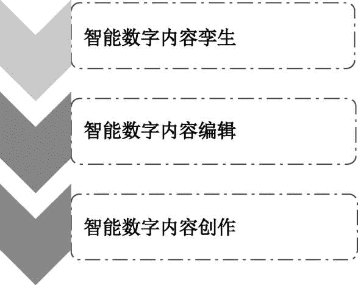

图 5-3　AIGC 的三大前沿能力

###### 1.智能数字内容孪生

与传统生成相比，智能数字内容孪生能更深入挖掘数据可用信息，在理解分析基础上完成精准高效的孪生任务，可分为智能转译和智能增强两类。

###### 2.智能数字内容编辑

在孪生基础上，智能数字内容编辑借助属性控制与语义理解实现内容修改与操控，构建起现实与虚拟世界的交互通道，数字人即为典型应用。

###### 3.智能数字内容创作

智能数字内容创作可将现实内容快速精准投射至虚拟世界，并通过仿真与控制为现实提供正向反馈。按应用形态可分为概念驱动创作与模仿驱动创作两类。

未来随着持续迭代，三大能力将不断强化，传媒创作模式也将从“辅助生成”转向“自主生成”。

### 5.2.2　媒介形态演进，感官体验再升级

在 AIGC 助力下，传媒媒介形态正从文字、图片向短视频迁移，感官体验大幅提升，为创作带来颠覆性变化。

AIGC 具备多样、可控、可组合、更真实的特质，为传媒提供更丰富动态的交互内容。它能把平面抽象的文章转化为立体具象表达，通过虚拟记者与主播提升采编与主持的趣味与互动，还可结合 VR、AR 构建虚拟采编场景，实现多感官沉浸式体验。

作为新型生产方式，AIGC 全面赋能内容创作，采访虚拟助手、写稿机器人、智能主播、自动字幕、智能集锦等应用不断涌现，渗透采编传播各环节，重塑视觉观感，让内容更丰富更具吸引力。

以影谱科技  为例，其利用智能视觉生成重塑传统流程，实现视觉内容的智能化、规模化与标准化生产。该公司的 AIGC 引擎可在短时间内产出特色视频，也能对已拍素材进行编辑再造，例如自动捕捉关键帧并据此生成匹配内容，最终输出 AI 视觉成品。

数字孪生ADT：为内容注入空间感

影谱科技近期上线 AI 数字孪生引擎 ADT，这款引擎以生成式 AI 在 AIGC 浪潮下的多模态演进为基础，依托成熟的 AI 算法、3D 建模重建、数字仿生交互等技术与工程能力，构建具备空间感的高维度信息，打通元宇宙与现实世界的虚实通道。ADT 加速了内容的可视化互动，让视觉观感更强烈。通过多模态复杂场景搭建，内容创作与多场景实现融合，媒体视觉效果得到显著丰富，已发展成为传媒提升视觉质感的重要 AI 基建。

5.3　AIGC 驱动传媒营销转型

生成式 AI 的持续演进正在改写内容生产逻辑。随着数字经济加速推进，AIGC 与营销流程的结合愈发紧密，为传媒行业带来更精准的数字营销可能。

5.3.1　创意加码：AIGC 为内容注入灵感

AIGC 为传媒创作提供源源不断的灵感加持，推动数字营销转型提速，显著放大了内容价值与产出效益。

万兴科技  上线 AIGC 绘图工具万兴爱画，内置 AI 简笔画、AI 文字转画、AI 以图生图三类模式，其中 AI 简笔画功能率先落地，使其成为国内首款可交互的图生图 AI 绘画应用。另据介绍，万兴科技还基于 AIGC 推出面向真人短视频营销的工具，帮助传媒机构以更低成本、更简便流程、高效产出营销短片。

视频赛道上，万兴科技集中力量投入 AIGC。公司组建百人研发团队，重磅押注文生图、文生视频、虚拟人、视频 AR 等前沿方向，逐步搭建起数字创意产品生态。万兴喵影、万兴录演、Wondershare Filmora 均是其在 AIGC 视频创作方向的代表产品。

万兴录演集成了 AI 美颜、AI 变声、人像识别、智能降噪、虚拟人视频及自动字幕生成等多项能力。使用时无需专业动作捕捉设备，仅凭电脑摄像头即可实时生成虚拟形象并录制视频。

创意绘图方面，亿图脑图协同版也已推出。用户输入营销策划关键词后，软件可一键产出营销大纲、SWOT 分析、头脑风暴图、生活规划及活动方案等脑图，既省去专业设备和策划的人力成本，又明显强化视频创意，提升数字营销价值。

作为全球领先的数字内容创意赋能方，万兴科技正将搭载 AIGC 的创作软件推向海外，为传媒企业的数字营销内容生产提供强力支撑。

5.3.2　方案提速：AIGC 让营销部署更高效

一份科学合理的营销方案通常消耗大量时间与人力，如何以低成本高效产出方案一直是传媒企业的痛点。对此，奇魂 AI 打造了一站式 AIGC 营销解决方案。

该方案聚焦 AIGC 在企业数字营销中的落地，覆盖网络广告制作、社交媒体运营、搜索引擎优化等场景，提供一套高效智营方法，可匹配不同阶段的内容需求，覆盖面广、操作简便，帮助企业轻松启动数字营销。

使用时，用户在奇魂 AI 文案生成系统中输入期望达成的营销目标，并设定规则与模板，系统依托语义分析与理解自动解析输入文本，快速生成对应方案。

奇魂 AI 融合自然语言处理、深度学习等技术整合营销资源，将业务、数据、系统与方案打通，明显提升数字营销效率与质量，输出科学精准的方案。其还支持自动翻译，可按需求转换语言，更好捕捉全球化信息，提升使用便利性。

奇魂 AI 具备强推理与学习能力，能精准把握市场趋势与用户需求。它在多维表达、多模态感知、自主定义、情感贯穿等方面持续升级，模拟人类思维输出逻辑性强的方案，为传媒企业制定高质量营销方案提供助力。正因如此，奇魂 AI 在营销内容生成与方案策划中被广泛采用，帮助企业更懂用户、提高满意度。

该方案可快速锁定企业营销目标，提供专业定制工具，结合科学数据分析为企业量身打造方案。当前已被广泛用于网站设计、邮件编辑、广告投放等环节，推动 AIGC 与数字营销深度融合，助力传媒实现降本增效。

5.3.3　蓝色光标推出 AIGC 创策图文营销套件

销博特隶属蓝色光标集团，是一款融合机器学习与大数据处理的智能营销决策平台。2022年12月，销博特发布 AIGC“创策图文”营销套件。套件依托内容营销业务 Know-How，从创意、文案到策划全链路提供智能一体化内容生产方案，是一种新型 AIGC 内容营销工具，推动 Web3.0 时代内容营销向在线化、精准化、个性化演进。具体模块如下：

1.AI 创意生成
创意风暴：借助 NLP 激发启发性短语，捕捉灵感火花并关联相关元素，基于关联度推荐创意概念。
创意罗盘：依据用户画像与产品卖点，为企业提供内容创意启发。

2.AI 策略生成
用户画像：融合行为心理学，基于调研与社群数据一键生成画像。
智能策划：用户输入任务指令，系统可在15分钟内自动产出营销策划案。

3.AI 图片生成
创意画廊：“康定斯基”抽象画平台，输入关键词或上传图片即可一键生成抽象画作。
一键海报：输入关键词或语句，结合营销热点快速生成海报。

4.AI 文本生成
品牌主张：依据品牌调性与名称，一键生成定制 Slogan。
AI 易稿：基于稿件模板辅助写作。
国风文案：结合品牌调性与核心句撰写品牌文案。

销博特在文案与创意自动化领域已获多项软件著作权，涵盖品牌主张、国风文案、创意机等。策划案生成方面，公司结合 NLP 与向量运算推动品牌定位标准化，并将品牌心智定位转化为数学模型，申请了支持向量机相关专利。

该套件将 AI 广泛部署于内容生产侧，先以辅助生成激发灵感，逐步转向驱动型创作，提升内容自主生成能力。它在表现力、传播力、个性化与创意层面充分释放 AI 优势，显著优化内容交互体验，并能模拟人类思维，在稿件撰写、海报制作、视频剪辑、创意自动化生产等环节保持较强逻辑性。

套件是传媒企业策划营销内容的有力助手，为数字营销创造更多机会，助力实现更精准、更个性化的内容营销。

# 第六章
AIGC 赋能电商：虚实融合带来沉浸购物体验

随着技术演进与消费需求升级，电商卖家纷纷瞄准沉浸式购物体验。AIGC 在内容生产、营销推广、场景搭建等多环节发挥作用，AIGC+电商正形成一种全新发展模式，为消费者带来沉浸式体验。

6.1　内容智能化：AIGC 重塑电商内容生产

AIGC 可赋能内容创作，实现文本、图片、视频的自动化生成，使电商内容生产摆脱对人工的依赖，提升创作效率，改写生产模式。

6.1.1　文本自动化：从命名到邮件一键生成

传统电商文本多靠人工撰写，质量波动、效率偏低，且门槛较高，卖家需投入大量时间打磨。AIGC 因而备受青睐。它基于海量数据分析，在保持高效的同时输出高质量内容，有效解决产品命名、描述撰写及营销邮件制作的难题。

以阿里妈妈推出的“AI 智能文案”为例，该工具通过分析淘宝、天猫的海量数据生成高质量商品文案，注重属性多元化，可依据卖家输入的关键词输出差异化文案。如输入“短款、连衣裙、仙女风”会得到轻盈风格文案；输入“长款、端庄、连衣裙”则会生成另一套差异化文案，满足不同需求。

该工具采用“What+Why”生成逻辑提升多样性。前半部分“What”基于关键词展开功能描述与产品介绍，后半部分“Why”在逻辑上承接前文，阐述产品优势与购买理由，二者组合形成差异化明显的文案。

营销邮件撰写是电商推广中的常见痛点，重复内容、转化不佳、模板陈旧等问题普遍存在。为提升沟通效率，卖家可借助 AIGC 创作邮件。

网易外贸通的 AI 写信功能即可实现邮件自动创建，也能对已有邮件进行 AI 润色。

该功能支持多种场景邮件创作，如产品介绍、节日祝福等。卖家输入店铺、商品信息或关键词后，AI 即可智能生成一封邮件；不满意可点“重新生成”获取新版本，确认后一键填入并发送。

AI 润色功能可对自写邮件进行一键优化。用户输入内容后可按用途、场景选择润色风格，如委婉、亲切或商务等，操作便捷。

AIGC+电商模式显著提升内容生产效率与质量，为卖家的内容创作开辟新空间。

6.1.2　图片自动生成：AI 绘画降低拍摄成本

电商上新往往需要大量拍摄，耗费人力物力时间，AIGC 现可自动生成所需图片，有效降低制作成本。

成立于2020年的 ZMO.AI 是面向电商的 AI 绘画平台，提供 AI 模特图片方案。据介绍，卖家只需上传服装图与模特参数，即可合成所需人物。平台研发的 AI 模特生成软件支持自定义面孔、身高、肤色、体型等，生成符合需求的模特。

相较传统拍摄，AI 自动生成可大幅节省成本与时间。精美图片需要摄影与后期，耗时费力，而合成图片可省去这部分投入。官方数据显示，其中文平台“YUAN 初”可帮助卖家降低90%运营成本，提升10%制作效率，并提高50%客户转化率。

平台操作也十分便捷，卖家只需描述创意，AI 即可批量生成图片供挑选。

为进一步便利用户，ZMO.AI 计划搭建线上社区，卖家可在社区分享作品互相启发，也能在此基础上融合自身元素衍生新图。

AI 图片生成为电商开辟新空间，其长期价值取决于能否持续为卖家创造收益。

6.1.3　视频生成：AI 助力短视频创作

短视频正成为电商获客重要渠道，但创作门槛较高，AIGC 视频生成正为大量卖家提供助力。

如 Pictory 这款 AI 视频生成应用，无需专业经验即可编辑创作。卖家提供脚本后，系统即可输出成片，可直接发布至短视频账号吸引流量。平台还支持文本编辑视频、生成精彩片段、自动添加字幕等功能，进一步降低门槛。

InVideo 同样具备此能力。该平台成立于2017年，面向大众提供视频编辑工具，其 AI 驱动的编辑器让零经验卖家也能在数分钟内完成视频创作。

使用中，卖家可自定义字体、动画、配色及音乐，平台提供超300万影片素材、100万视频资源及1500套模板。若遇到字幕对齐问题，可借助 Intelligent Video Assistant 智能视频助手快速修正。

借助这些 AI 编辑工具，卖家可拓展新销售场景，触达更多潜在客户，实现增收。

6.2　场景升级：三维建模打造沉浸式购物

传统购物场景已难以吸引眼球，打造沉浸式体验成为新方向。AIGC 融合 AI、VR 等技术实现三维建模，推动购物场景升级，为消费者带来沉浸式体验。

6.2.1　3D 模型：让商品展示更立体可试用

品牌普遍注重营销，希望以新鲜感吸引注意力。电商平台借助 3D 建模实现商品展示与试用，让消费者获得身临其境感，促进交易。

相比 2D，3D 可全方位呈现产品外观，帮助消费者深入了解、改善线上体验，也能缩短选购时间。应用场景广泛，如在线试衣，让购物更真实有趣。

3D 建模让消费者在家也能感受实体逛街。例如天猫打造的“天猫 3D 家装城”，用户打开淘宝 App 搜索即可进入 3D 世界，在虚拟房间内自由漫游，体验全屋搭配，停留观察商品细节。

该城内拥有超1万套3D房间，从北京高端家居店到上海复古小店，多家线下实体卖场均被复刻，消费者可按需选购。

项目带来沉浸式购物体验，对依赖线下体验的家装行业形成颠覆。家装单价高、退换成本高，消费者决策谨慎，而线上所见即所得大幅提升体验感，并打通线上线下融合通道。

天猫之外，多品牌也在探索虚拟展示与试用，如优衣库虚拟试衣间、阿迪达斯虚拟试鞋 AR 功能、宜家虚拟家具选购方案。尽管3D建模仍在发展，AIGC 的推动将诞生更多易用工具，降低门槛，推动虚拟展示与试用规模化商业化。

6.2.2　虚拟商城：构建全景沉浸式购物空间

为多渠道吸引客流，众多品牌尝试搭建虚拟商城，打造全景虚拟购物场景，提供线上线下融合的新消费体验。

如 Nike 与 Roblox 合作推出的虚拟旗舰店 Nikeland，不仅支持常规购物，还可操控虚拟分身参与蹦床、捉迷藏、跑酷等小游戏，带来深度沉浸体验。

阿里巴巴“Buy+”计划让消费者在虚拟商城购物，带来开放式体验；IMM 商场与 Shopee 在新加坡共建虚拟购物中心，通过线上服务反哺线下零售。

沉浸式营销需要搭建虚拟购物场景，众趣科技可提供支撑。作为 VR 数字孪生云服务商，公司拥有自主空间扫描设备，并结合数字孪生 AI、3D 视觉算法与互联网三维渲染技术，既能构建虚拟购物场景，也能对线下场景进行三维立体重建，将其完整真实地复刻到虚拟世界。

众趣科技  打造的虚拟场景还支持购物标签设置，品牌可藉此展示产品详情与购买链接，并提供快速导航，方便消费者迅速定位店铺，进一步优化购物体验。

其合作客户涵盖阿里巴巴、华为、红星美凯龙等。众趣科技以技术赋能企业构建虚拟空间，助力品牌提供更高品质服务，让消费者足不出户即可享受近似线下的沉浸购物体验。

虚拟场景的搭建正在重塑品牌触达消费者的方式。借助沉浸式的数字空间，品牌能够摆脱线下门店的物理限制，把商品搬进充满科技感的虚拟商场里，让用户随时随地逛逛、试试、买买，转化效率自然被拉满。

6.3　24小时不打烊的直播新力量

在电商直播里，虚拟主播可以全年无休地做产品讲解、答疑和导购，大幅降低开播成本、提升带货效率。于是越来越多品牌把虚拟主播当成营销标配。

### 6.3.1　真人+虚拟组合 打造不间断直播间

电商直播赛道越发火热，品牌在直播形态上持续试水。不少头部品牌选择了“真人主播+虚拟主播”混搭，实现了真正意义上的全天候营业。

之所以流行这种组合，主要有三点好处：
（1）虚拟主播可以接手真人休息的空档，让直播间从早到晚都有人。消费者任何时间点进来都能获得服务，体验更好，成交率也随之提升。
（2）虚拟主播有助于品牌年轻化。完美日记就引入虚拟主播 Stella 带货，精准贴近年轻人群的审美偏好。
（3）虚拟人物的人设完全由品牌主导，形象和言行稳定，不用担心塌房风险。

洛天依就是个典型案例。她是由上海禾念  推出的一位二次元虚拟偶像，初登场就圈粉无数。B 站收购上海禾念后，洛天依成为平台“当家花旦”，多次举办全息演唱会、上电视节目，影响力持续发酵。

商业价值随之爆发，演唱会一票难求，代言产品也常被粉丝追捧。在电商领域，洛天依同样表现亮眼。曾进驻淘宝直播，以虚拟主播身份推销美的、欧舒丹等品牌，直播间峰值观看人数一度冲破270万，约200万人参与打赏互动。

除了洛天依，快手推出的虚拟主播“关小芳”、京东孵化的“小美”等也在直播间站稳脚跟，各自拥有圈层粉丝，丰富了内容形式，也打开了带货新玩法。

与此同时，品牌自建虚拟主播的趋势也在升温。自然堂打造的“堂小美”就是代表，她能流畅介绍产品、自然互动，迎接新进用户、根据评论关键词即时回应，还会贴心提醒优惠券、购物津贴等福利，全程像一位专业的导购助手。

虚拟+真人的直播模式既带来新鲜感，又补齐了时间空白，保证消费者随时都有人服务。未来，随着能力不断升级，虚拟主播有望提供更细致的陪伴式购物体验，推动营销进化。

### 6.3.2　用虚拟数字人搭建与Z世代的情感桥梁

当下消费主力是Z世代，他们追求个性、热爱新鲜。虚拟数字人正好契合这一偏好，成为品牌沟通的重要桥梁。

在数字经济语境下，虚拟数字人具备独特的营销价值。花西子就打造了同名虚拟形象“花西子”，承载品牌文化。制作团队深入研究传统面相美学，在建模时为其眉间点上一颗“美人痣”，更显灵气；形象手持并蒂莲，传达“同心同德，如意吉祥”的愿景。

基于精准人群定位，花西子把这个形象贯穿到全渠道推广中，与目标用户产生情感共鸣，建立信任，最终转化为购买。

虚拟IP还能潜移默化传递品牌理念，让品牌更年轻。百事推出的虚拟偶像组合 TEAM PEPSI 就是例证。该组合以百事可乐、百事无糖、美年达、七喜四款产品为原型，塑造了四位性格迥异的数字人。

其中 MIRINDA 担任鼓手，一身黄衣活泼可爱；PEPSI 是唱跳全能选手，风格明朗率真；PEPSI NO SUGAR 是 DJ，黑衣造型彰显劲爽无畏；7UP 是电吉他手，绿衣尽显生机。TEAM PEPSI 象征百事的未来生命力，搭建起了与Z世代的沟通渠道，成为年轻消费者的伙伴。

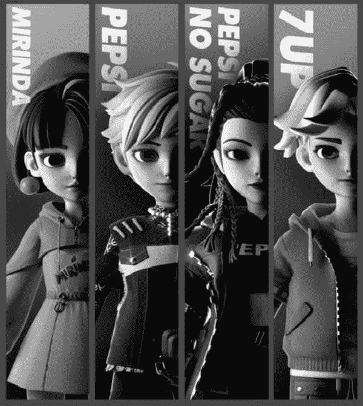
图 6-1　百事虚拟偶像组合 TEAM PEPSI

在年轻消费群体崛起的背景下，虚拟数字人正成为品牌获取流量的新锚点，帮助品牌加深与消费者的连接。

6.4　虚拟IP营销的两条路径：邀约代言与自建IP

数字经济催热了虚拟IP，品牌要么邀请成熟的虚拟代言人，要么自己孵化IP，用虚拟形象引爆关注和销量。

### 6.4.1　AI虚拟偶像成品牌代言新宠

AI、AR、VR技术让虚拟数字人愈发逼真，AI虚拟偶像逐渐成为代言首选。相较娱乐圈明星易“翻车”的风险，AI偶像提供了更可控、创新的选择。

数据显示，国内AI虚拟偶像市场增长迅速。2020年市场规模已超645.6亿元，预计2023年有望突破3334.7亿元。它们具备强大的创意能力，像真人一样拥有形象、性格，能拍视频、录综艺、直播互动，对话自然，且行为可根据品牌需求灵活调控，带来新奇体验。

这也让品牌摆脱对传统明星的依赖。AI偶像依托品牌而生，人设不会崩塌，深受品牌青睐。

2022年4月，鲜花品牌“花点时间”官宣与AI虚拟偶像“阿喜 Angie”合作，聘为年度虚拟代言人，如图 6-2 所示。阿喜 Angie 由元熹科技推出，常以白衣出镜，气质自然闲适。

双方联名推出的春季限定香水“芍药吹吹风”，意在探索东方意境。阿喜邻家女孩的形象与产品的天然感高度契合，通过生活化场景引发共鸣，吸引追求自然清新的女性用户。

图 6-2　“花点时间”虚拟代言人阿喜 Angie

AI虚拟偶像代言已成大势，成本高、变现不明显等问题仍在逐步被产业发展解决。

### 6.4.2　自建虚拟IP：屈臣氏的AI代言人屈晨曦

为触达年轻人，屈臣氏在年轻化战略中自建虚拟IP，推出AI代言人“屈晨曦”。

屈晨曦外表帅气、性格温柔，多才多艺，能跳舞、能主持，还能与用户实时互动。品牌让其在营销活动中全方位发挥价值。

在小程序里，屈晨曦担任品牌顾问，根据用户需求推荐产品，还能玩游戏、语音聊天，提供个性化专业服务；直播间里他也能当主播带货；社交平台上定期更新动态，持续经营用户关系，成为品牌与消费者沟通的桥梁。

2020年9月，屈晨曦以屈臣氏AI代言人身份登上《嘉人NOW》封面，业务从美妆护肤延展到美丽生活一站式服务，形象更立体，用户粘性也随之提升。对线下实体店而言，这是缓解竞争压力、强化年轻态的重要一步。

# 第七章
AIGC重塑影视创作流程

AIGC时代到来，影视行业全面进入智能化生产。剧本创作借助AI实现更高效、更贴合受众的生成，成为行业标配。

## 7.1　AIGC助力剧本创作点亮灵感

AIGC打破了传统剧本创作高成本、低效率的困局，帮助影视公司在剧本、角色、场景和后期环节提速增效。

### 7.1.1　数据分析+智能生成 快速产出初稿

AI可以对海量剧本进行整理、归纳、分析，按预设风格快速生成内容，缩短创作周期，并更贴合观众口味。

企业还能批量生成多版剧本后二次筛选、加工。早在2016年，美国纽约大学就用AIGC写出电影剧本《Sunspring》，并在伦敦科幻电影48小时挑战赛中获好评。

2020年，加州查普曼大学一名学生借助OpenAI大模型GPT-3创作剧本《律师》并拍摄成短片。2022年，DeepMind推出剧本创作模型Dramatron，能理解剧本大纲和关键词并生成基础剧本，以更低成本产出专业化内容。

2023年2月，“有米有数”结合ChatGPT推出AI剧本工具，创作者输入主题和关键词即可一键生成创意脚本，为规模化生产提供新思路。

### 7.1.2　海马轻帆：小说到剧本的一键转换

小说改编剧本传统上耗时耗力，海马轻帆用AI改变了这一流程。

用户在官网进入“智能写作”后，把小说粘贴到“小说转剧本”框中，即可一键生成符合格式的剧本。系统自动拆解语言，重组为对白、场景、动作等视听元素，大幅提升改编效率。

平台还提供角色戏量统计、一键切换格式、剧本智能评估、短剧分场导出、海量灵感素材库等功能。评估模块能生成剧情曲线、分析冲突起伏、判断场次布局合理性，并基于角色互动生成关系网，分析成长性，广泛应用于评测、筛选和改编。

在网络电影评估方面，海马轻帆提供多稿比对功能，通过与同类优秀剧本对比分析竞争优势，帮助企业在初期快速筛选。

由其AI撰写的微短剧《契约夫妇离婚吧》在快手播放量已破亿。服务过的作品包括电影《流浪地球》《拆弹专家2》《你好，李焕英》《误杀》《除暴》，电视剧《在远方》《我才不要和你做朋友呢》《传闻中的陈芊芊》《冰糖炖雪梨》《月上重火》等，合作机构涵盖中影、优酷、阿里影业等，推动剧本改编进入高效高质量新阶段。

## 7.2　AIGC实现角色与场景的智能创作

除了剧本，AI换脸、AI虚拟演员、AI虚拟场景已成为AIGC在影视中的常见应用。

### 7.2.1　AI换脸与AI换声

AI换脸技术流程如下：

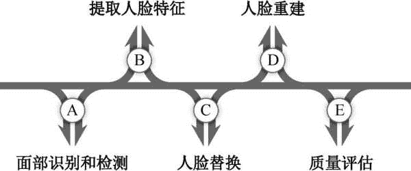
图 7-1　一套完整的 AI 换脸技术应用逻辑

面部识别与检测：AI分别识别原图和目标图人脸，捕捉关键点与头部动作细节。
提取人脸特征：通过深度学习提取两张人脸的特征向量。
人脸替换：将特征向量对齐融合，绘制更精细的轮廓。
人脸重建：用网络变形和关键点插值保持动作和表情连贯。
质量评估：判断最终效果是否自然清晰。

AI换声同样成熟，能捕捉声情、情绪、口吻，减少机械感，接近真人发声。

有从业者用微软TTS录制《红楼梦》林黛玉与贾宝玉对话，通过语音转换把林黛玉的声音替换为自己，TTS精准模拟语气语速并植入委屈、生气等情绪，惟妙惟肖。

在一次纪录片制作中，配音师突发离世，节目组尝试换人效果不佳。最终借助AI模拟原配音师声纹、语气和情感色彩，成功完成播出，避免了观众排斥。

无论换脸还是换声，AIGC都在帮助影视企业规避创作风险，提供强大助力。

### 7.2.2　AIGC实现虚拟演员打造

AIGC 越来越深入影视生产链，角色塑造的思路也在悄悄转向——真人参演不再是唯一选择，虚拟演员的打造成了越来越多影视公司的重点。相比真人，AI 生成的演员永远在线、颜值与形象稳定，也避开了艺人因绯闻或丑闻导致人设崩塌的风险。制作团队还能依据观众反馈和剧情推进，对虚拟角色的外形、性格进行精准个性化定制，让人物更贴合影片需求。

虚拟演员还能突破真人表演的技能天花板。企业可以根据创作意图，自主设定角色的外貌、气质和肢体语言，再搭配虚拟特效场景，让人物在特定情境下更立体、生动，观感也更强。

以“白小宇”为例，这个超写实的虚拟面孔就是天工异彩  依托 AI 数据生成的。天工异彩通过 AI 深度学习、文本驱动以及动作捕捉系统实时梳理并生成表情动作，让白小宇的形象更真实饱满；同时借助 Unreal Engine 虚拟引擎对拍摄背景进行实时渲染，显著提升了场景感染力。结合多年影视视效和人物形象把控经验，天工异彩打造出了这个极具写实感的虚拟演员，白小宇也因此成为虚拟演员发展的一个新标杆。

虚拟演员让角色创作门槛降低、形象选择更丰富。随着优势持续显现，越来越多的影视企业加入 AIGC 虚拟演员的赛道，这条路径正变成生产高价值作品的新方式。

### 7.2.3 AI 造景降本增效的秘密
搭建精细场景一直是影视拍摄的重头戏，成本往往很高。不少公司开始引入 AIGC 虚拟场景合成，用数字手段压缩造景开销。

这种技术既用在动画场景，也用在影视剧场景。动画制作时，AI 能把虚拟场景和数字人结合，实现多人实时互动，营造沉浸式零距离社交感，在角色互动、场景互动和虚拟分身等方面为动画赋能，观看临场感明显增强。比如实验动画短片《犬与少年》的部分画面就是 AI 搭建的，给场景搭建带来了新做法。

用 AIGC 辅助动画造景通常经历四步：先由动画师手工绘制场景初稿，再经过一次 AI 合成、二次 AI 合成，最后由动画师在 AI 生成结果上进行修改优化。整个流程中，人工主要集中在创意起点和交付收尾。

在影视剧里，AI 可以合成物理级虚拟场景，轻易搭出成本高昂或难以实拍的空间，大幅拓宽作品想象力。AI 虚拟合成并不新鲜，2017 年热播剧《热血长安》就大量采用了 AI 虚拟生成的场景。

为了让虚拟场景自然协调，剧组在拍摄前大量采集实地素材，用虚拟特效建模，再让 AI 把虚拟环境与真实环境融合。拍摄时演员对着绿幕演出，后期借助 AI 实时抠像把虚拟场景与演员动作融合，贴合度更高。

AIGC 已成为虚拟场景搭建的核心工具，在 3D 建模和特效制作上的作用越发关键。例如英伟达推出的 AIGC 模型 GET3D，拥有生成带空间纹理 3D 网格的能力，可依据深度学习和训练模型实时合成高保真纹理的复杂场景。

GET3D 能自动学习、测算虚拟空间的特征元素，按制片需求自动生成仿真环境，常被用于影视剧虚拟场景搭建。AIGC 依指令就能产出不同风格、形态和面积的虚拟空间，制片方只需做少量人工干预和优化即可投入使用。

这样一来，造景效率明显提升，场景在交互和视觉上更逼真。AIGC 正在以更快速度、更低成本创造更丰富的场景，为影视创作开辟新路径。

### 7.3 后期剪辑被 AI 全面提速
后期制作向来复杂精细，AIGC 现在已成了剪辑环节的得力助手，帮助企业提高效率和成片质量。

### 7.3.1 AI 自动识别，一键智能剪辑
AIGC 能在无需人工干预的情况下独立完成剪辑工作，效率大幅提升，同时还节约成本、提升清晰度。越来越多的影视公司把 AIGC 用在视频创作和后期剪辑中，剪辑师的工作模式因此发生变化，AI 成了推动剪辑高效开展的关键力量。

摄影师靠抓拍捕捉精彩瞬间，剪辑师过去需要逐帧筛选获取关键镜头，工作量巨大。AI 的加入让摄影和剪辑环节的工作负担明显减轻，后期效率得到提升。

在后期流程里，AIGC 基于图像识别自动解析视频内容，抓取符合主题的片段，省去大量素材收集整理时间。比如能识别出视频里是谁、由哪位演员出演、出现长城镜头的位置、人物对话在哪一段等。

AI 还能读懂镜头语言，学习剪辑规范，按文本指令剪辑。例如输入“这是一个由远及近的镜头，节奏偏慢，色调偏暗；主角 5 秒入画、30 秒出画，推着自行车在巷子里缓慢前行，神情落寞、情绪低沉，眼角不断有泪水”。系统在理解语义后，按预设剪辑规则完成精剪、拼接和合成，输出衔接完整的片段。

筛选素材的效率也得到提升。一档综艺常动用上百个机位，素材与成片比例可达 1000:1。人工筛选耗时费力，AI 能把这个环节简化。

Magisto 是款主流的 AIGC 剪辑工具，内置 AI 情绪感知技术，可自动剪出情绪饱满的成片，引发共鸣。使用者只需上传素材、设定风格和配乐，系统就能生成带有情绪导向的视频。

Premiere Pro 同样受欢迎，具备精准色彩匹配功能，能自动识别素材色彩差异并统一调整适配，同时可自动分类整合片段，提升剪辑效率。

AI 剪辑的技术优势和实用价值日益凸显，随着技术进步，后期剪辑将向更高水准迈进。

### 7.3.2 老电影焕新，AI 修复成经典
西安电子科技大学的一个创业团队专注老旧影片修复，用 AI 让老片焕然一新。截至 2021 年 4 月，他们已完成 30 余部老片的色彩与画质修复。

老电影是时代记忆，文化价值高，但因画质色彩问题被年轻观众疏远。团队用 AI 给历史影像“美颜”，让老片重返大众视野，帮助年轻人认识文化传承，挖掘其价值。

团队 2019 年成立，由 10 名网络信息、人工智能等专业学生组成，建立了 AI 数据模型库。他们让 AI 同时学习大量老旧胶片和现代彩色影片，根据当前呈现推断原始色彩，完成色彩修复。

胶片老化磨损严重，团队用 AI 算法做局部光线平衡和防抖，再用上色算法重新上色，提升画质。通过不断迭代，他们修复了《城市之光》《摩登时代》《罗马假日》《小兵张嘎》《渔光曲》《永不消逝的电波》等作品，并与西安电影制片厂等单位开展校企合作。

负责人表示，团队将继续深耕 AI 修复，打造技术优势，推动 AI 在影片修复领域更广泛应用。

### 7.3.3 2D 直变 3D，AIGC 让转换提速
3D 影片凭借立体感广受欢迎，戴上眼镜就能获得沉浸体验，相比 2D 更能立体呈现空间，画面质感也更强。但传统 3D 制作耗时耗力，是行业痛点。AIGC 在一定程度上解决了这个问题，让 3D 制作更简便高效。以聚力维度  为例，它是国内将 2D 转 3D 的领跑者，也是首个能在一周内完成院线级影片 3D 转换的制作方。创始人赵天奇的目标是让 3D 影片占据市场主流，成为行业独角兽。

赵天奇早年就聚焦此方向，博士期间主攻三维显示，借助计算机视觉技术研发自动补图功能，降低 2D 转 3D 的难度与成本。他按 3D 制作流程开发 AI 算法，从底层理解 AI 在影片制作中的价值，总结出核心逻辑：先分析影像空间关系与分布，再生成不同精度的视差图，最后检验优化生成效果。

聚力维度研发了对抗认知、时空融合、多级认知等算法，并于 2015 年底推出达到生产级别的标准化模型“峥嵘一号”。随后不断提升性能，并把业务重心转向电视直播，致力于实现直播节目的 2D 转 3D，基于 AIGC 衍生出更多 3D 新技术与产品。

没有 AI 时，一支团队做一部 3D 影片约需 24 年；用“峥嵘一号”，聚力维度一周左右就能完成，甚至更快。它正为影视企业提供智能化 2D 转 3D 服务，开启 3D 制作新变革，大幅提升效率。

公司还与视频平台联合建设 3D 影视数据库，丰富资源，为产业爆发提供支撑。为拓展业务，聚力维度持续升级转换能力，提供广告与影片的 3D 转制付费服务，与内容运营平台共建 3D 资源库并共享版权收益。同时推出“峥嵘一号”云平台，直接面向 C 端提供 3D 内容转制。

在 AIGC 深入渗透的背景下，市场竞争激烈，但多年积累的专业数据成为天然护城河。聚力维度持续深耕 AI 在 2D 转 3D 领域的应用，计划把 AI 引入更多 3D 制作环节，在细分领域推动行业革新，助力更多多元作品诞生。

# 第八章
AIGC+娱乐：边界扩展，带来多重新奇体验

娱乐覆盖游戏、音乐等生活各面。在数字经济时代，借助 AIGC，娱乐行业快速拓展边界，催生多样玩法，为用户带来更多新奇体验。

## 8.1 用 AI 玩出新花样，用户更爱参与
持续产出丰富有趣的内容是娱乐行业发展的关键。AIGC 在娱乐中的应用为创作者提供了更多手段，生成大量趣味内容，激发用户参与热情。

### 8.1.1 一键动漫脸，刷屏的破圈神器
输入关键词或上传一张照片，就能一键生成二次元风格图像。背后是 AI 图片生成技术。2023 年以来 AI 绘画在社交媒体持续刷屏，不少平台纷纷上线 AI 创作功能。

2022 年 11 月，快手推出“AI 动漫脸”风格特效，写实照片瞬间变成二次元动漫头像，还配音乐和动态花瓣，氛围感十足。上线第三天相关话题登上热榜，仅 11 月 24 日一天，相关作品就超过 30 万条，播放量突破 4000 万次，成为爆款特效。

用户可一键预览自己的“动漫脸”，也用它记录生活瞬间，如家庭聚会、朋友相见等。众多明星也加入尝试，变身元气少女或英气王子。

这项功能体现了 AI 绘图的进步，但当前 AI 对图像理解仍有偏差，出现把少女生成为狼人、性别识别错误等情况。用户在快手发起“无所谓我会出手驯服 AI”话题分享搞笑成果，意外的转换反而成了新的社交梗。

AI 绘画热度带动大量小程序涌现，并入驻快手。以“意间 AI 绘画”为例，上线后用户持续增长，到 2022 年 11 月 22 日注册用户突破 1000 万。入驻快手后，它为平台用户解锁更多玩法。2022 年 12 月，意间还发起 AI 绘画创作师大赛，用现金分成、无门槛流量、热榜权益等激励用户参与，进一步激发创作热情。

未来 AIGC 将在内容生成领域持续下沉，这个新兴市场会吸引更多企业入局，更多细分赛道将落地生成更多趣味内容。

### 8.1.2 虚拟偶像+AI，粉丝创作热情炸裂
2023 年伊始，虚拟偶像洛天依在 B 站元旦跨年晚会、央视元宵晚会等多个舞台亮相，在挑剔的娱乐市场里凭借独特玩法收获大量粉丝。

洛天依是拥有动漫形象和声库的虚拟歌手，歌曲多由粉丝创作，作词、作曲、混音、视频制作常由多人协作完成。协作规模扩大后形成创作者社团，持续输出内容。

粉丝创作也完善了人设。灰发绿瞳、碧玉发饰的少女形象符合大众审美，而呆萌、温柔、“吃货”等标签也是在粉丝创作中逐渐成型的。洛天依是什么样的偶像，答案更多来自粉丝而非官方。

2023 年初 AIGC 热度攀升，创作门槛降低。AI 开始应用于虚拟偶像的二次创作，比如粉丝用 AI 绘图工具为偶像绘制插画，产出大量图片。

AI 驱动的声音转换技术流行起来，多个开源方案落地应用。基于深度学习，这些工具能根据人声生成 AI 模型并转换声音，模拟出与虚拟偶像相似的声音，制作多样音频。技术进步推动了相关创作，视频网站上已出现不少基于虚拟偶像声音的 AI 作品，让粉丝兴奋不已，也指明了创作方向。

AIGC 不仅让音频创作更简单，也让声音更真实。只要有成熟模型，粉丝就能为偶像制作新歌，让偶像唱出更多作品。

官方也在拥抱 AIGC。2022 年 7 月，米哈游旗下虚拟偶像鹿鸣在 B 站开启首场直播，半小时吸引超过 66 万人观看，录屏播放量破百万。直播中的声音由米哈游旗下 AI 声音生成应用“逆熵”提供。

从发展来看，围绕高人气虚拟偶像推出个性化 AIGC 工具，赋能粉丝创作，是经纪公司破局的有效路径。个性化工具能提升作品丰富度和质量，也有助于规范创作、防范侵权。

### 8.1.3 短视频创作，AI 当创意军师
2023 年 3 月，第四季“好看 CLUB·寻迹古城”活动在太原启动，上百位百度短视频创作者齐聚，参加沉浸式创作大赛。

活动邀请创作者以寻迹古城为主题创作，在古城感受传统文化、探寻历史脉络，用镜头传递古城魅力，把文化知识带给观众。

AIGC 在活动中发挥明显作用。百家号平台推出的基于自然语言处理的 TTV 技术，能把图文内容自动转为视频，降低图文转视频的成本。

AIGC 工具还能提供创意辅助。比如创作者有了视频素材却想不出标题时，可用 AI 生成多个匹配标题再挑选优化；想尝试不同风格时，也可用 AI 生成多种风格视频，从中选出心仪版本。

依托自家预训练大模型的基础，百度正为各领域的创作者构建一套覆盖面广、功能扎实的生成式工具体系。公司正把主流的内容制作业务逐步接入自研的对话式生成产品文心一言，借此重塑生产路径，提升创作效率并放大内容价值。EXr6287u6NNVz+GYLY+7SOTgAK1+TNUORQE7GX8xSB479Pn8E1vqKi5t6nJdqBpJ6IyF0duTAxsSOPrvpBEvPg==

## 8.2 虚实互通的数字分身
社交、游戏等线上场景里，人们通常借助数字替身展开互动。可以说，这类替身正是连通网络世界与现实生活的桥梁。生成式技术能让用户迅速得到各具特色的专属人设。

### 8.2.1 智能造像带来更顺滑的体验
2022 年底，图片视频编辑应用 Lensa 因“魔法头像”功能冲上谷歌应用商店榜首，并在社媒广泛传播。Lensa 此前一直是小众的修图工具，上述功能上线后装量激增。“魔法头像”会把用户上传的底图交给模型生成风格迥异的头像，如图 8-1 所示。照片提交后，模型会按科幻、动漫、油画等多种画风自动产出头像。

图 8-1　Lensa 生成的头像

除单一头像工具外，部分社交平台与游戏已把自动生成数字分身的能力内嵌其中。

###### 1.社交平台
Soul 自研的 NAWA Engine 已上线。该引擎融合人工智能与渲染技术，为用户塑造数字分身提供支撑。形象调性延续平台可爱立体的风格，帮助用户打造专属人设。NAWA Engine 在表情捕捉上维度丰富，可识别嘴形、眼部等多个关键点，合成上百万种表情状态；同时能识别眼球转动、吐舌、鼓腮等细微动作，让分身更生动逼真。渲染层面，材质与光照更细腻，经算法优化后高质量渲染速度更快，观感提升明显。

###### 2.游戏
捏脸是大型在线角色扮演游戏的标配。《逆水寒》较早引入智能捏脸，用户可通过文字描述配合照片上传实现自动捏脸。比如输入“深色肤、黑瞳杏眼、斯文儒雅”等关键词，模型会自动生成对应角色。目前模型对艺术化容貌描述的理解有限，例如《红楼梦》中“粉面含春威不露，丹唇未启笑先闻”这类表达仍难识别。因此《逆水寒》正引入网易伏羲实验室研发的大规模预训练模型来提升理解力。

随着生成式技术场景扩散，自动生成数字分身的应用将从社交、游戏延伸至更多领域，为用户带来便利。

### 8.2.2 Ready Player Me 携手 VRChat 打造定制分身
2023 年初，3D 分身平台 Ready Player Me 上线基于生成式 AI 的虚拟服装创作功能。用户可用文本描述服饰特征，模型便会产出对应道具。平台表示未来会推出更多生成式功能，支持按性别、年龄等要素创建分身。截至 2023 年 2 月，平台已与众多应用、游戏、虚拟世界开发者达成合作。

例如与虚拟现实游戏 VRChat 的合作，让 VRChat 用户可通过 Ready Player Me 制作分身。作为深受喜爱的 VR 游戏，VRChat 支持用户以虚拟身份在丰富世界中唱歌、跳舞、社交、玩游戏，分身制作的便捷度直接提升体验。用户无需安装开发工具包，只需登录 Ready Player Me 网站并上传个人形象照，即可完成自动生成；生成后还能通过自定义功能继续微调，完成后导入 VRChat 即可使用。

即使没有照片，用户也可以基于约 200 项服装、配饰自定义属性，打造专属的虚拟人设。

### 8.2.3 数字衣装与潮玩推动时尚新潮
2022 年底，深耕 AI 生成 3D 内容的数码品牌 AVAR 完成新一轮融资，本轮投资方包括奇绩创坛、华创资本、唯猎资本等，远识资本担任独家财务顾问。至此 AVAR 已完成三轮融资。

AVAR 主营 AI 生成 3D 内容，面向年轻用户推出数码服装、数字潮玩等商品。用户可自由搭配商品，也能把创意输入系统，由模型生成独一无二的数码商品。平台支持数字分身创建，已购数码商品可“穿戴”于分身之上。

应用场景十分广泛，曾助力明星打造专辑、杂志封面，与中国国际时装周合作，并携手特步、361° 等品牌推出联名数码服装；同时与舒克贝塔、植物大战僵尸等 IP 合作设计数码潮玩。

业务背后是技术支撑。设计端，模型批量替代原画师反复改稿，快速产出设计稿；建模端，把建模操作转化为三维编程指令，用 AI 编程批量生成 3D 模型；材质端，训练多种风格的贴图网络，为模型赋予独特质感；渲染端，可输出多种艺术风格效果。

AVAR 拥有专业的研发团队与深厚的 AI、3D 积累，未来将继续深耕数码时尚，保持持续发展。EXr6287u6NNVz+GYLY+7SOTgAK1+TNUORQE7GX8xSB479Pn8E1vqKi5t6nJdqBpJ6IyF0duTAxsSOPrvpBEvPg==

## 8.3 游戏内容生产：生成式技术激活活力
游戏作为大众娱乐备受青睐。开发商与玩家是内容生产的两大主体，但要持续满足玩家升级的需求并不容易。生成式技术释放了游戏活力，让内容生产走向智能化。

### 8.3.1 ChatGPT 为游戏生成式创作模式提供参考
ChatGPT 的出现为游戏行业带来新想象，剧情设计、模拟对话、海报润色等工作均可借助其完成。

总体来看，ChatGPT 在游戏中的作用有两层：一是帮助开发商快速生成文本类内容，如角色对话、任务描述等；二是借学习文本数据模拟角色间的关联与情感，让游戏内容更丰富。总体能提升质量与丰富度。

这种应用为游戏行业引入生成式创作模式提供了指引。剧本创作、社交系统搭建、测试等都能交给模型。NPC 方面，融入人工智能后的人设会更真实。

过去 NPC 的行为都是预设触发，模型则能自动生成人设，并设计更自然、更丰富的对话，让交流更顺畅。同时，模型能基于对战数据积累模拟专业级的战斗状态，让玩家与 NPC 的对战更真实。

生成式内容技术与游戏的结合催生更多机会，已有公司布局。例如完美世界  将人工智能用在 NPC 打造、场景建模、游戏绘图等多环节；网易计划在《逆水寒》中上线融合场景与机制的智能 NPC，可自由对话并随机生成任务与关卡。

随着布局加深，生成式内容技术将重塑游戏创作模式并获得更好发展。

### 8.3.2 生成式游戏创作平台成新趋势
在游戏领域，人工智能主要在自然语言处理、计算机视觉等方向发力。经模型训练后，能够规模化生成内容模块，例如通过文字输入生成剧情、合成动画资源等。

很多公司正把生成式内容技术融入制作流程。对游戏公司而言，打造生成式游戏创作平台是一个有前景、能长期深耕的方向。

2022 年 1 月，理想爱豆深圳科技有限公司 HyperNET 成立，聚焦生成式内容+游戏，主攻创作平台研发运营。

在研产品 HyperNET 平台可实现智能创作与基于用户画像的个性化推荐，丰富体验。平台包含三大核心功能，如图 8-2 所示。

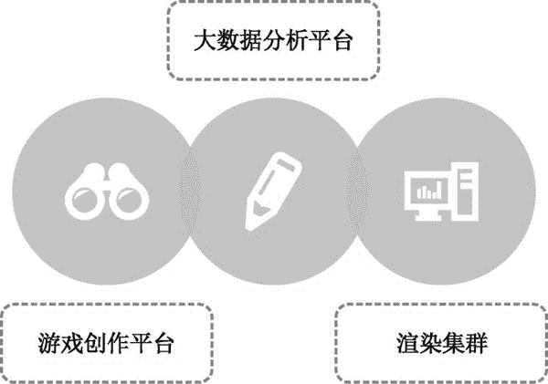
图 8-2　HyperNET 平台的核心功能

###### 1.游戏创作平台
平台支持语音或文字生成个性化游戏内容。NPC 具备人工智能，能在游戏中学习进化并与用户进行情感互动；关卡由模型生成，模型可分析热门关卡并产出用户喜爱的关卡内容。

###### 2.大数据分析平台
该平台为创作平台提供海量数据，并根据用户行为评估内容健康度，给出评分指标。分析结果为模型持续训练提供支撑，进而产出更优质内容。

###### 3.渲染集群
渲染集群对生成式内容生成的内容做二次润色，提升渲染效果与流畅度。

尽管平台仍在研发，但这种探索已引领行业发展新潮流。集结游戏开发与人工智能专家打造生成式创作平台，或将成为未来趋势。

### 8.3.3 布局路径：自研模型与接入第三方并行
自 2023 年起，多家公司宣布入局生成式内容，其中不乏游戏公司。不少研发经验丰富的公司正把生成式内容技术融入产品，以提升质量与体验。

目前主要有两种路径：一是自研模型与技术，二是接入第三方模型，如百度基于文心大模型的生成式对话产品文心一言。

选择自研的代表有腾讯、网易。腾讯在生成式内容领域已有布局，依托人工智能大模型与机器学习算法积累持续探索。推出的混元人工智能大模型覆盖自然语言处理、计算机视觉等基础模型及众多行业模型，为微信、腾讯广告、腾讯游戏提供支撑。

网易虽未公布模型名称，但明确 2018 年起就启动生成式预训练模型研究，未来将加大投入。应用上，网易有道已接入生成式内容技术，用于人工智能口语老师、作文批改等。

接入第三方的公司也不少。百度发布文心一言后，多家游戏公司表示将接入并成为合作伙伴；也有公司测试接入 ChatGPT API。具体公司如表 8-1 所示。

表 8-1　接入第三方模型的公司

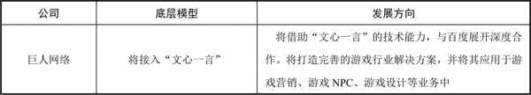
续表

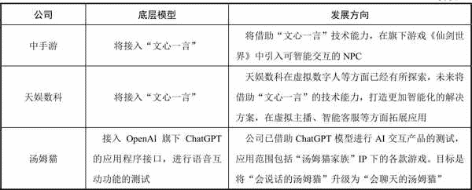

无论自研还是接入，都体现了对生成式内容技术的重视。仍有部分公司保持观望，但随着技术普及，布局生成式内容的游戏厂商将越来越多。EXr6287u6NNVz+GYLY+7SOTgAK1+TNUORQE7GX8xSB479Pn8E1vqKi5t6nJdqBpJ6IyF0duTAxsSOPrvpBEvPg==

## 8.4 音乐制作：革新听感体验
在音乐领域，人工智能生成背景音乐、创作歌曲将成为现实，生成式内容技术将改变创作方式，也助力元宇宙音乐会的打造，为观众带来全新视听感受。

### 8.4.1 微软模型：多源音频自动生成
2022 年底，微软申请了一项用于写谱的人工智能模型专利。该技术可为游戏、电视节目等制作音乐、音效及其他音乐元素。

落地后，人工智能为游戏配乐将成为现实。游戏中场景与玩家表现不同，背景音乐和音效也应变化，而当前多为人工提前编辑的固定音频，触发后播放。该模型可把视觉、音频等作为调控参数，生成更丰富的音乐，能根据玩家表现创作出个性化音效，同一款游戏不同玩家体验也不同。

微软介绍称，模型可分析情绪、表情、环境等，并结合图文信息生成与画面匹配的音频文件。可按场景制作不同背景音乐，如角色登场时生成磅礴管弦、死亡时生成悲伤旋律；音效层面，可让爆炸、打斗声更真实。

技术尚未正式投入使用，但从描述可见，生成式内容技术在音乐制作上的发展空间很大。

### 8.4.2 生成式内容助力人工智能歌曲创作落地
2023 年 3 月，QQ 音乐上线生成式内容黑胶播放器，可根据用户输入的文字或图片生成不同风格的播放器，推动设计创新。歌曲播放方面，生成式内容不仅能生成封面，还可实现智能创作。

昆仑万维打造的 StarX MusicX Lab 音乐实验室依托专业制作与海外发行能力，向全球输出人工智能音乐，已在 Spotify、网易云音乐等平台发行近 20 首模型生成的歌曲。

其作曲业务已商业化，与时尚、游戏等行业的多家公司合作。例如与人工智能数字人神经渲染引擎“倒映有声”合作，推动动漫 IP“魔鬼猫”数字分身以虚拟艺人身份推出人工智能歌曲《橘子果酱》，上线后获歌迷好评。

实验室还关注文旅领域，为“故宫以东”文旅项目提供技术支持。将大量民族音乐数据用于模型训练并进行风格校验，打造具有中国风的作品。

随着技术成熟，生成式内容技术将成为音乐创作主流。StarX MusicX Lab 的尝试为创作打开想象，未来人工智能音乐落地场景将更丰富，助力虚拟 IP 运营与品牌数字营销。

### 8.4.3 百度元宇宙歌会：生成式内容的创新实践
虚拟数字人、生成式内容技术、沉浸式互动的融合能碰撞出怎样的火花？2022 年 9 月，百度元宇宙歌会以直播形式在百度 App、爱奇艺、微博、B 站同步播出。歌会由百度人工智能数字人“度晓晓”担任制作人，节目包括演唱模型创作歌曲、模型修复画作《富春山居图·合卷》等，获众多网友点赞。

成功离不开生成式内容技术的应用与创新。百度把人工智能融入作曲、编舞、舞台设计等环节，度晓晓与真人明星同台实现虚实互动。作为典型生成式内容形态，度晓晓现场展现强劲的唱跳与沟通互动能力，全程主持并实时回复观众评论。

节目由模型创作，例如歌曲《最伟大的人工智能作品》是在文心大模型支持下，学习众多说唱歌曲后生成。百度持续升级度晓晓形象与能力，用户可在百度 App 中实时聊天并获语音回复，未来更多数字人交互方式将被解锁。

除歌会外，百度还推出多项应用，例如数字人技术结合生成式内容视频生成、语音合成提供智能数字人服务；通过文心大模型提供人工智能视频创作、人工智能音乐创作助手，推动人工智能内容创作繁荣。EXr6287u6NNVz+GYLY+7SOTgAK1+TNUORQE7GX8xSB479Pn8E1vqKi5t6nJdqBpJ6IyF0duTAxsSOPrvpBEvPg==

# 第九章
AIGC+教育：双管齐下，推动教育“数智”转型

随着人工智能应用范围持续扩大，教育领域正被逐步渗透。人工智能的进入将颠覆传统教学模式，推动教育向数字化、智能化演进。在生成式内容技术助力下，教学主体、工具与场景走向虚拟化，为学生带来全新体验。EXr6287u6NNVz+GYLY+7SOTgAK1+TNUORQE7GX8xSB479Pn8E1vqKi5t6nJdqBpJ6IyF0duTAxsSOPrvpBEvPg==

## 9.1 生成式内容推动教育数字化转型
生成式内容技术为教育数字化转型提供强大动力，从教学模式到教学环境都发生重大变化。教师的教与学生的学变得更数字化、更智能、更个性化。

### 9.1.1 工具赋能 课堂共探

技术迭代催生了大量数字化教学产品，教学形态随之发生变化。教师淡化传统讲评式授课，转向与学生共同探索知识，学习过程中产生的疑惑能够借助数字工具展开自助探究，从而养成独立解决问题的习惯。

以阅读为例，为保证阅读量，学生可使用智能伴读服务。伴读系统上手门槛低，通过手机App配合支架即可启动。功能亮点体现在四方面：
（1）使用便捷。手机扫描图书封面即可收听对应朗读音频，翻页同步，离线也能独立进行阅读。
（2）发音规范。系统支持对手指停留的知识点进行识别并调取对应音频，英语配音标准，可在听力引导下学习。
（3）报告生成。伴读系统会统计阅读行为并输出专属学习报告，便于教师和家长掌握进展。
（4）护眼设计。以纸质书为载体，音频由手机播放，避免长时间盯屏造成的视觉疲劳。

联想发布的未来黑板 HoloBoard 能把课堂拉入虚拟空间，集成了沉浸式投影与高精度动作捕捉等技术，较传统黑板优势明显：
（1）裸眼全息互动。教学中无需佩戴头显，裸眼即可获得沉浸感受，完成虚实融合的任务。例如在微观原子三维建模环节，手按压屏幕即可生成三维原子模型，按压力度影响模型尺寸，结合弹性触觉反馈获得真实操作感。
（2）全息网真实现远端教学。偏远地区资源有限，HoloBoard 可借助屏幕把授课教师投送到千里之外，全息教师外形逼真，可实现面对面授课，消弭地域差异，促进教育公平。
（3）虚拟场景沉浸。学生可化身宇航员在太空中遨游，与教师在虚拟空间内互动，直观感知环境变化。

HoloBoard 以先进技术提升课堂趣味性，激发学习主动性，同时重塑师生关系，从单向知识传递转向共同探索知识的过程。

### 9.1.2 打造智慧化教学空间

教学环境对教学成效影响显著，教育数字化转型正推动环境向智慧化演进。智慧教学环境的搭建成为重点，多家企业聚焦技术赋能。

例如，锐捷网络  提出“1+N”智慧教学环境解决方案，目标是环境易用且场景融合，如图 9-1 所示。“1”为智慧教学交互系统，“N”为场景化方案子系统，二者协同构建新形态智慧教学环境。

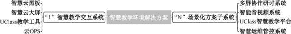

图 9-1　智慧教学环境解决方案

###### 1.交互系统让教学更顺手
智慧教学交互系统由智慧云黑板、智慧云大屏、UClass 教学工具与云 OPS 运维组成，为师生产生便利。
学生端，智慧云大屏可提供清晰视听体验，莱茵低蓝光与零频闪设计兼顾护眼。
教师端，智慧云黑板支持全屏粉笔书写，书写手感自然；智慧云大屏配合 UClass 教学工具可实现多端协同，随时调取课件。UClass 还提供扫码考勤功能，便于掌握出勤。
运维端，设备出现故障时可通过批量镜像下发实现远程运维，无需现场到场，提升处置效率。

###### 2.场景化子系统推动教学创新
锐捷网络构建以学生为中心的智慧教室，并搭载多屏协作研讨系统。教室内部设由小组屏与可移动桌椅构成的小组信息岛，便于协作讨论。每块大屏配教学智能终端，支持大屏与小组屏灵活切换，教师可一键切换，也可开放权限让学生自主讨论。课堂从教师主导的讲授转向学生主导的研讨，实现个性化、小班化教学，提升知识内化效率。
教室还集成智能音视频系统，兼顾线上线下模式，可满足同步教学、直播课、录播课、巡课、督导五类需求。教师可一键发起多方音视频互动，打破时空限制，实现跨班级、跨校区、跨网络授课。
同时具备教学信息辅助能力，满足在线巡课、活动实时播报等需求。AI 可精准分析师生行为模式与参与度，帮助学校及时了解班级状况。

###### 3.UClass 平台打通教学全流程
UClass 智慧教学平台覆盖教学全过程，课前可协助教师设计教学活动，课后可批改与管理测验作业，提升效率。
平台支持按角色呈现数据：教师获得学情全景，教务人员获得整体教学态势，管理者获得全校运行数据，满足差异化需求。

###### 4.AI 运维守住最后一道关
锐捷网络提供 AI 智能巡检，可检测常见设备故障并定位，15 分钟内完成超 300 间教室巡检，解决人工效率瓶颈。巡检后自动分析运维数据，降低教学事故风险。

总体来看，锐捷的智慧教学环境方案打破传统教与学模式，为师生提供更智慧的空间。未来将持续深耕，推动教育向数字化、智能化迈进。

### 9.1.3 智慧校园 安全防护升级

校园安全事故会影响人身安全与教学秩序，学校需多维度提升保障。AI、大数据、物联网等技术的发展催生了智慧校园解决方案，为安全建设提供支撑。

智慧校园借助 AI、云计算、大数据等技术实现校园工作、学习、生活智能化。系统由智能宿舍、智能食堂、智能人脸门禁、智能实验室、智能考勤、智能访客六大管理系统构成，依托 AI 人脸核验、访客管理、智慧校区安全管理体系共筑安全屏障。

###### 1.AI 人脸核验技术
通过抓拍与人脸识别闸机对学生面部进行校验，实现快速刷脸通行。家长与教师可收到通行记录，及时了解学生动态。
在校门口、宿舍门口等关键通道部署动态预警系统，提供全方位守护。

###### 2.访客管理功能
智慧校园对访客实行严格管控。家长探访或校外人员来访均需用身份证核验身份并完成注册，经授权后方可刷脸进入。

###### 3.智慧校区安全管理体系
体系以人脸识别为基础，对校外人员实时监控，并将抓拍人像转为标签数据。AI 摄像机可识别人员聚集情况，一旦出现聚集或可疑人员，系统即时通知值班人员。体系还具备检索、查询功能，可对校园周边人员进行追溯，打造平安校园。
同时引入 AI 智能视频分析，安保人员可实时查看围墙内外、宿舍、餐厅等区域状况，及时感知环境变化。

在智慧校园方案支撑下，学校可在降低安保人力投入的同时实现全域监控，保障学生安全。未来 AIGC 将在更多环节赋能校园安全，促进从平安校园向智慧校园转变。 EXr6287u6NNVz+GYLY+7SOTgAK1+TNUORQE7GX8xSB479Pn8E1vqKi5t6nJdqBpJ6IyF0duTAxsSOPrvpBEvPg==

## 9.2 AIGC 助力教育智能转型

AIGC 为教育赋能，推动智能化变革。它可自动生成三维场景带来沉浸式体验，教师借助 AI 分析实现精准个性化教学，教学模式得以创新，学习成效与体验同步提升。

### 9.2.1 三维场景 虚实交互

三维虚拟现实技术可用于教学，自动生成三维场景实现虚实交互。该技术具备沉浸性与交互性，能构建逼真虚拟环境，让学生产生身临其境感，更好理解知识。

主要优势有两点：
一是营造真实感学习环境，提升效率。学生在具象环境中完成完整学习体验，立体内容更易吸引注意力，保持专注并体会乐趣。
二是增强课堂参与，学生由被动变主动，更好融入课堂，与教师交流讨论。参与度提升有助于成绩进步。

此技术将冲击传统教学模式，促进方法创新，培养复合型人才，主要应用于虚拟校园、虚拟实验室、网络教育虚拟教室。

###### 1.虚拟校园
借助三维虚拟现实与三维建模技术，生成与真实校园一致的虚拟学习空间。围墙、门窗、走廊、灯光等均整合进网络。虚拟校园内部署电子书籍等资源，经扫描数字化后存入虚拟图书馆。学生进入后可浏览全部电子书，如同现实阅读。还可拥有个人虚拟图书馆，将感兴趣书籍借阅至个人库中自由阅读。

###### 2.虚拟实验室
现实中部分实验因设备昂贵或安全风险难以让学生亲手操作，只能由教师理论讲解。虚拟实验室打破限制，学生不受时间地域约束，只要设备安装即可操作，学习自由度提升。虚拟环境规避安全风险，学生无需顾虑现实制约，可尽情开展实验，加深理解并培养兴趣。

###### 3.网络教育虚拟教室
网络教育虽突破时空成本限制，但常被质疑缺乏真实氛围。三维虚拟现实技术可解决此问题，教师可借助技术出现在虚拟教室授课，学生体验真实学习氛围，获得传统网络教育难以实现的效果。

三维虚拟现实为教学提供新工具与活力。随着应用深化，更多虚实交互场景将出现，更好满足教育需求。

### 9.2.2 个性化教学 精准触达

班级授课存在效率低、顾及不全、参与不足等问题。AI 在教育中广泛应用后，这些问题得到缓解。AI 可精准分析学生数据与课堂表现并生成测评报告，帮助教师了解每位学生，实现个性化精准教学。

例如某初中教师使用坚知果 AI 智慧课堂实现精准教学。授课前利用“一键组卷”功能进行课前测验，了解预习情况，据此调整教学目标与重难点，实现精准授课。讲解测验题目时可把握易错点，精准讲解并针对性提问检验薄弱知识点掌握情况。
知识点讲解后，用试卷检验吸收程度。学生纸质作答，教师扫描即可获取成绩。依据成绩布置作业：全对者完成必做作业，错误较多者需在必做基础上完成巩固作业。

许多教师对 AI 应用表示认可。过去教学依赖经验，需手工筛选高错率题目，如今 AI 分析可呈现班级共性问题与个体问题，再做针对性调整，不再大水漫灌，精准讲解提升效率与学习效果。
有教师认为数字化更易实现因材施教。班级学生众多难以兼顾，AI 记录成长轨迹，教师可依学情数据有针对性指导与布置作业，真正做到因材施教。

AI 在教育领域持续深化，越来越多教师课堂使用 AI 助手。在其支撑下，教师可在有限时间内开展多样化个性化教学，发挥更大价值。

### 9.2.3 网易有道 探索 AIGC 教育落地

ChatGPT 成为热点话题，社交平台热议，相关概念股攀升。国内外企业看好其潜力，积极布局 AIGC，推动与各领域融合。

ChatGPT 具有天然教育基因，与教育融合自然。作为聊天机器人可解答各种问题，教学中教师也需解答学生疑问，因此可作为教学辅导工具，提升效率。

作为教育行业领先企业之一，网易  率先发力，尝试由子公司网易有道将 AIGC 落地教育场景。该决策并非偶然，网易早在 2018 年就开展 GPT 模型研究，研发数十个预训练模型，覆盖多个领域。

在游戏领域，网易推动 AIGC 与游戏结合，成立网易伏羲与网易互娱 AI LAB，并实现应用落地。截至 2023 年 2 月，两大实验室拥有 400 多项发明专利，持续用技术赋能内容开发。
在音乐领域，依托网易云音乐打造 AI 创作工具，持续研发 AI 词曲编唱、AI 歌声评价、AI 乐谱识别等，其中歌声评价与乐谱识别技术达到国际先进水平。
在教育领域，网易有道长期布局 AI 产业，在计算机视觉、智能语音等关键技术取得进展。网易有道词典提供免费优质翻译；词典笔、AI 学习机等产品配备教育知识问答平台，助力答疑。问答机器人还可为用户提供个性化信息服务，在动漫、教育等垂直领域实现精准问答。

探索未止步。2023 年 2 月 8 日媒体报道，网易有道 AI 研发团队已投入与 ChatGPT 同源的 AIGC 技术研发，尝试在教育场景落地。该团队正将技术应用于 AI 口语教师、中文作业批改等场景，有望推出 Demo 版。

网易有道表示，AIGC 在教育场景的应用将是颠覆性创新，有助于团队更深入理解 ChatGPT。随着新一轮技术革命开启，拥抱新技术已成教育发展的必然趋势。具备研发实力的教育企业将以自主能力赋能行业，创造更大价值。 EXr6287u6NNVz+GYLY+7SOTgAK1+TNUORQE7GX8xSB479Pn8E1vqKi5t6nJdqBpJ6IyF0duTAxsSOPrvpBEvPg==

## 9.3 教与学体验同步升级

“AIGC+教育”使教学与学习体验双重更新。对教师而言，AI 可辅助备课、教学与作业批改；对学生而言，AI 虚拟教师带来全新体验。

### 9.3.1 AIGC 减轻教师负担

教师工作涵盖课堂教学、课前备课、课后批改，任务繁重。AIGC 的出现可辅助备课、教学与批改，提升工作效率。

好未来基于先进 AI 技术提出“GodEye 课堂质量守护解决方案”，赋能教师培训、备课与教学。
好未来是 AI 赋能在线教育的代表，借助 AI 实现教师培训。过去教师需独自在空教室反复说课，很难明确提升方向。GodEye 可分析授课状态，从互动、举例、肢体动作等维度测评，提升授课能力。
例如，GodEye 通过人体姿势识别系统识别讲课手势动作，肢体丰富者得分高，僵硬者会被提醒改进。口语指标检测表达中重复或冗余词汇，帮助教师注意表达。AI 助力下教学能力得以提高。

课堂中 AI 也能实时监控并分析学情。在线上课堂，GodEye 从师生问答、讲题、错题纠正、思维导图、课堂笔记、学生练习 6 个维度分析行为并形成学习报告。如师生问答环节，AI 会依据问答质量评分，对话越充分深入评分越高。
学习报告帮助学生了解自身情况与薄弱点，也帮助教师优化教学策略，提升教学质量。

拿到试卷后立刻批改立刻讲，学生的记忆正处于高温区，题目细节还在脑中，听评讲的共鸣最强，效果也最扎实。如果把批改和讲评推迟到一周甚至半个月，题目印象早已淡化，评讲容易变成空转，效率明显下滑。

作业批改是教师日常的核心工作，直接关乎知识掌握情况的判断。面对大量作业单，如何快速完成且保证质量，是教学管理中的痛点，这正是智能技术可以分担的空间。

OK 智慧学习作业平台内置了智能评改引擎，能够对客观题实现自动判分并形成统计报表，大幅缩短批改耗时。在使用该平台时，老师的反馈形式也更丰富：可以用语音对学生的作业进行点评，听感更生动直观；也可以录制试题讲解短视频，针对薄弱环节做指导，提升学习主动性。平台还能呈现学情画像，为分层辅导和定制化支持提供依据。

总体看，生成式技术能在多维度上支撑教学。但使用智能工具时要明确，技术只是辅助，教师自身的专业能力仍是教学提升的关键。

### 9.3.2 虚拟导师：生成式技术重塑课堂体验
生成式技术可以塑造虚拟智慧导师，为学习带来更沉浸的互动感，从而赋能学生。课上虚拟导师能与学生实时交流并讲解知识点；课后还能提供一对一的定制化辅导。

虚拟智慧导师在实践中已有落地。威尔是全球首个进入课堂的虚拟导师，在新西兰奥克兰一所学校授课，主题围绕可再生能源展开。

课堂里威尔讲解风力涡旋机、太阳能等内容，学生可在讲解过程中即时互动。威尔内置人工神经系统，能对学生的作答和肢体表现作出反应，还可判断学生对知识点的理解程度并据此调整教学规划。威尔与常规智能系统不同，能实现双向交流，使用体验接近真人，教学价值突出。

国内研发也在加速。2022 年 2 月，河南开放大学上线首个虚拟智慧导师“河开开”。其形象由该校多位女教师素材采集，经人脸识别、数字建模等技术合成，主要承担答疑、助教及协同教学的角色，减轻真人教师负担。

行业普遍采用“虚拟智慧导师＋本地教师配合”的模式，课堂中穿插互动小游戏以提升参与感。例如小熊美术  将视觉识别、语音识别、机器学习等技术融入课程，把课程与游戏结合，激发学习热情。

对比传统授课，配备虚拟导师的互动课优势明显：一是课堂可嵌入互动，增强参与感；二是闯关式设计能持续抓住注意力，培养坚持力；三是虚拟导师标准化程度高，有助于保证教学质量，缓解师资紧张；四是可依据学生掌握情况即时调整进度，以理解为核心。

总的来看，虚拟智慧导师具备真人难以企及的智能化与定制化特质。未来将大规模落地教学实践，推动教育数字化发展。

# 第十章
AIGC 驱动工业设计变革与商业重塑
生成式技术已逐步渗透工业设计领域，推动工具升级和设计模式迭代，同时拓宽设计场景与维度，帮助设计师重塑工业设计的商业化路径。

## 10.1 生成式技术为工业设计注入智能手段
生成式技术为设计师提供更完备的智能化手段，助力制定更科学的工业设计方案。生成式技术拓展了工业设计的想象边界，提升了设计价值。

### 10.1.1 生成式技术助力设计师提升创作效率
灯光设计属于室内设计的一部分，体现设计师的品位与水准。需兼顾空间结构适配、美学效果、家居风格匹配，往往需要经验丰富的专业人士完成，也给设计企业带来较大成本。

2023 年 2 月，群核科技  公布成立 AIGC 实验室并推出多款产业应用，其中包括 AI 智能打光功能。该功能由群核科技 KooLab 实验室联合光线云科技  与浙江大学 CAD＆CG 实验室共同研发，支持将任意家居设计图中的打光方案一键迁移至自身设计方案，帮助设计师节省大量时间精力。

此前面向 AI 自动生成室内三维光照已有所尝试。此次推出的智能打光可在海量三维场景数据上学习灯光设计规律并模拟，自动生成的光照效果可与专业设计师手笔相媲美。

数据是智能系统的驱动力，灯光设计训练需要大量数据支撑。为此群核科技搭建了融合大量灯光方案数据的灯光数据集，收录上千个专业灯光设计的三维场景，在不侵犯知识产权的前提下供室内设计企业学习访问，提供智能高效的数据服务。

灯光数据集不仅缓解了数据匮乏、质量偏低的问题，还助力企业建立高效的 AI 训练模型。该模型能够对虚拟室内场景进行多元化仿真与高性能渲染，使 AI 在虚拟仿真空间中自我学习，更好地将智能打光与虚拟室内环境结合。

群核科技是室内设计全空间领域的开拓者，一直把生成式技术视作核心研究方向。除数据集外，还推出文本自动生成室内场景、图片自动生成三维模型等功能，目前这些功能已成为生成式技术在室内设计领域的代表性体现。

生成式技术正在改变传统室内设计方式，未来还将构建更丰富多元的工业设计生态，帮助企业产出更系统精细的设计方案。

### 10.1.2 建筑图纸设计的维度拓展
在建筑设计领域，生成式技术使图纸设计更智能更精细，为设计师提供更丰富独特的灵感，优化设计流程。以下是在建筑图纸设计中常见的 4 种应用模式，如图 10-1 所示。

###### 1.高信息量的生成
设计师可借助生成式图像工具把控图纸细节。初步方案信息有限，AI 能自主补足信息，帮助搭建完整的基础框架，从而深化方案。例如在 SketchUp 中先建立简易建筑体块，再借助 AI 驱动生成具体细节，AI 可从不同视角测算体块并生成多样化方案。

在 Rhino 中，设计师可输入由多个体块构成的基础形态并嵌入 AI 程序填充细节，通过提示词指定风格，为同一体块生成不同风格的设计方案。

实体模型也是 AI 生成的目标。倾向手绘模型的从业者可把体块模型照片作为输入指导 AI 生成细节，也可用手绘草图驱动方案。随着手绘信息增多，AI 生成结果越稳定。

相较传统方式，AI 生成图的风格可控。通过提示词及其权重控制输入输出相似度，权重升高时草图会逐渐演变为相对完整的设计图，最后挑选理想结果。

高信息量生成模式最接近设计师原有工作流程。AI 以设计师提供的精准信息为主控要素，在可控范围内不断丰富细节，使图纸更精细化。

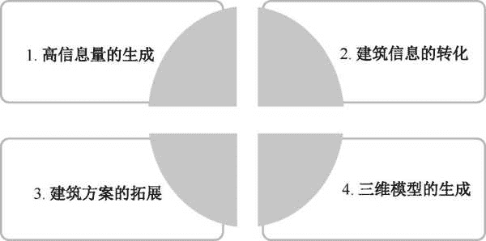

图 10-1　AIGC 在建筑图纸设计中常见的 4 种应用模式

###### 2.建筑信息的转化
此模式下 AI 更像设计师的翻译官，把非直观的建筑信息转为直观表达，常用于各类建筑形态研究。

例如设计师随手取一件物品摆放在桌面，拍摄上传至 AI 图片生成系统，AI 会自动提取照片中与建筑相关联的要素并整合，最终形成完整的建筑图纸。

###### 3.建筑方案的拓展
设计师可利用生成式图像系统中隐空间参数的连续性，自动生成多种风格的方案。在隐空间拓展中可自主设定提示词权重，最终选取最贴合理想的生成结果。

例如输入一张柯布西耶作品草图，提示词设为“未来建筑”和“传统建筑”，隐空间参数决定两者的权重，生成图纸随权重变化而变化。

###### 4.三维模型的生成
在三维模型生成领域，Stable Diffusion 核心组件 CLIP 是常用工具。CLIP 融入结构设计算法——图解静力学，可以图形量化方式设计非标准桁架结构，并参照提示词为算法提供优化方向。

CLIP 能自动评估提示词相似度及生成结果准确性，结合生成式 AI 使结果更贴合描述。例如在城市建设设计图中，设计师把不同设施作为元素融入方案，CLIP 根据相似度评估建筑摆放的合理性并优化位置，不同提示词会得到不同图纸。

传统工具主要依赖设计师创造力，生成式技术以自身创造力拓展建筑图纸设计维度，使设计更高效智能。

### 10.1.3 人机协同：数字人与设计师共创
在工业设计领域，生成式机器人已成为设计师的得力助手。随着数字人不断深入设计，人机共创时代已到来。

2023 年 1 月 10 日，百度举办 Create AI 开发者大会。这是百度主导的首个“人机共创大会”，大会场景、歌曲、演讲脑图均由设计师与数字人共同创作。其中机器人独立完成开场演讲和大会彩蛋创作，生成式技术赋能人机共创新模式贯穿全场。

生成式技术正从抽象概念进入大众熟知场景。作为中国最早布局人工智能技术且技术基因深厚的互联网企业，百度在大会上展示生成式技术成果，体现其深刻理解与全面布局。

百度数字人成为技术呈现窗口。大大会强化度晓晓、希加加、叶悠悠、林开开等数字人的贯通，使人机共创主题更直观，生成式技术堪称大会幕后重要创作者。

开场视频中，数字人希加加以跑酷形式穿梭于不同维度的虚拟世界。视频采用全 UE 动态场景制作，提供清晰画质和电影级运镜。希加加的服装、发型、动作均由 AI 生成，还掌握 AI 作画、AI 作曲、AI 剪辑等能力。

讲解量子计算“乾”战略时，讲解人与其数字人分身同框。数字人分身技术应用于“猜猜真假数字人”环节，其奇妙效果由 AI 高拟人声音合成技术和百度 2D 仿真数字人技术支撑。

百度数字人乐队演绎《技术有答案》。希加加担任主唱和吉他手，度晓晓担任鼓手，叶悠悠担任贝斯手，林开开担任键盘手。为获得更好演绎效果，百度自研 AI 口型合成算法使演唱准确率达 98.5%。数字人还绑定智能控制系统，动作实时驱动，形成自然灵动效果。

大会结尾彩蛋中，度晓晓、希加加、林开开、叶悠悠共同讨论幕后创作感受。对话流畅近乎真人，依托柔体解算技术、AI 变声技术、PLATO 开放域对话系统、TTS 语音合成技术、ASR 自动语音识别技术等关键人工智能技术。大会议程由百度智能云“曦灵”平台进行实时物理模拟和场景渲染，结合 AI 算法生成更生动的虚拟画面。百度数字人的多元化应用将“人机共创”主题贯穿始终。

大会播放的设计师与 AI 共创画作视频是人机共创的最佳体现。视频中数字人提问“未来是什么样子”时，生成式技术与设计师共同创作的海报同屏呈现。大会议展示大量共创作品，生成式技术与设计师共同诠释创作精神，向设计师致敬。AI 给予设计师更多灵感，携手展现更顽强的创造精神与坚定力量。

## 10.2 英伟达深耕生成式赛道持续布局
近几年英伟达在 AI 市场优势显著，逐渐成为 AI 计算领域的领先者。随着人工智能技术升级，英伟达在生成式技术赛道持续布局积蓄实力。

### 10.2.1 Omniverse 平台助力内容生产
Omniverse 平台由英伟达基于 USD 通用场景描述 和 RTX 打造的图形和仿真模拟平台，可加快内容创作从概念到交付的速度，并以突破性方式对内容创作进行仿真和编码。平台将 AI 计算和光线追踪等先进技术融入内容生产，塑造强大优势。

Omniverse 平台帮助工程师、创作者和设计师构建设计工具、项目和资产间的连接，在共享空间实现内容协作生产。用户覆盖广泛，从工程师到可使用 Blender 开源 3D 软件的用户均可在平台上生产内容。平台已拥有百万用户，主要应用如下图 10-2 所示。

###### 1.Omniverse Avatar
Omniverse Avatar 采用自然语言理解、计算机视觉、语音人工智能和推荐引擎模拟等技术，可生成交互式人工智能化身。平台创建的 AI 虚拟形象具备光线追踪的 3D 图像效果，是具象化的交互式角色，可创建敏捷 AI 助手。

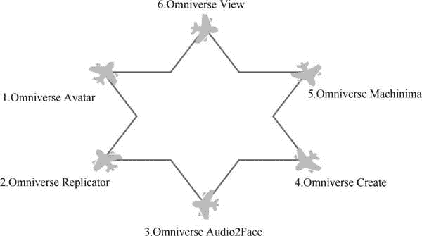

图 10-2　Omniverse 平台的主要应用

按企业需求设计的 AI 助手可帮助企业处理数十亿次客户互动服务，如个人预约、餐厅订单、银行交易，为企业创造更多商机。

###### 2.Omniverse Replicator
Omniverse Replicator 是合成数据生成引擎，主要用于生成训练深度神经网络的物理模拟合成数据。平台引入两个生成合成数据应用，分别是自动驾驶数字孪生虚拟世界—NVIDIA Drive Sim 和可操纵机器人数字孪生虚拟世界—NVIDIA Isaac Sim，这两个应用也是引擎取得的首批成果。使用时创作者能以突破性方式引导 AI 模型填补现实世界数据空白并生成真值数据。Replicator 可按机器人开发者需求生成精确物理数据和真实数据。

###### 3.Omniverse Audio2Face
Omniverse Audio2Face 是由 AI 支持的应用，仅需一个音频来源即可生成面部表情动画。

它可根据提供的音轨自动生成 3D 角色动画，角色类型包括电影角色、游戏角色和虚拟数字助手等。可作为传统面部动画创作工具，也可作为交互式应用角色创建工具。

Omniverse Audio2Face 预装 Digital Mark 支持音轨动画处理，创作者只需将音轨素材上传至 Digital Mark 系统，系统便可即刻生成音频输入反馈并传输至深度训练的神经网络。随后 Digital Mark 根据音轨特征自动调整角色网格的 3D 顶点，创建生动面部动画。生成后还可通过修改后期音轨处理参数优化动画效果。

Audio2Face 赋予已完成建模的角色高度可换脸能力，即便成品角色也能随时替换面部外观。创作者可对细微的面部微表情进行手工精修，并借助多源音频批量产出差异化的动画文件，场景内同时登场的角色数量也可自行设定，以便安排各自的分工与运转节奏。

该方案还能为角色匹配合适的情绪基调，并据此生成对应的表情和动作。它会同步驱动头部、眼部、口部及舌部的运动，使其与所选情绪保持一致，同时呈现恰当的情绪强度。依托这一平台，创作者能更轻松快速地获得可信度较高的面部表现，提升角色在场景中的沉浸感。

###### 4.Omniverse Create
Omniverse Create 聚焦高端合成场景，以 USD 工作流为基础构建大规模场景。通过简易的合成应用联动，可打破传统建模流程的瓶颈，因而受工程师、设计师与艺术家青睐。该工具可实时搭建复杂三维场景，并对场景属性做精确仿真，以交互方式完成装配、模拟与渲染。

平台可汇总各类设计文件并即时刷新数据，便于追踪修改记录，帮助创作者实现即时更新与快速迭代。渲染结果可合成高保真图像，画面抓取稳定精准，保障输出质量。

内置的高级布局工具助力虚拟世界搭建。搭建时可调用自带素材库的填充资源，如道路、树木、建筑等，也可导入自有资源，再配合由 NVIDIA PhysX 5 驱动的 Zero Gravity Mode 合成虚拟场景。此外，还支持从 SideFX Houdini 或 Epic Games 虚幻引擎导入地貌。

Omniverse Create 集成 RTX 渲染器，支持多 GPU 高级路径追踪，可在虚拟场景中同步渲染数十亿个多边形，使全局反射与折射更细腻，呈现更逼真的可视化效果。

功能覆盖骨骼动画制作、混合形状搭建、动画剪辑与缓存，并具备高级仿真能力，可对虚拟场景进行立体重塑，使其更接近真实。

系统整合 Flow、Blast 与 NVIDIA PhysX 5，用以呈现可变形的物理动画。借助 Movie Maker 工具，仿真场景可导出为序列图或 MP4，也可结合 NVIDIA CloudXR 与 Omniverse 流媒体客户端，将高保真增强现实内容推送至移动端。

平台还内置生成式人工智能工具，让三维虚拟世界搭建更简便，可在较短时间内快速生成多样化的空间方案，为创作提供更多选择。

###### 5.Omniverse Machinima
Omniverse Machinima 专注动画电影创作，可将虚拟世界中的角色与场景自然融合，形成更生动逼真的动画画面。工具提供高保真渲染器与便捷的动画制作手段。

为提升画面真实度，系统内置 NVIDIA MDL 材质库，确保材质表面与纹理的真实性。启用 Omniverse RTX 渲染器后，可在参考级路径追踪与实时光线追踪模式间自由切换，打造更逼真的场景效果。

借助 Audio2Gesture 与 Audio2Face 技术，音频可转化为动画。设计师只需在音频转动画系统中输入主题与台词，即可生成生动的动画角色。配合 Blast、Flow 与 NVIDIA PhysX 5，能为角色赋予真实物理特性，让呼吸与动作更自然，角色与环境融合更紧密。系统还可利用移动或网络摄像头精准捕捉人体动作，帮助三维角色更好地模仿人类表演。

动画节点编辑支持角色行为的细化，使角色表现更灵动。动画定向工具可为角色系统添加多套预设动画，从而实现更逼真的动画效果。

###### 6.Omniverse View
Omniverse View 是一款便捷且功能强大的可视化应用，提供丰富的场景预设素材。例如需要表现天气时，可调用预设的多种太阳形态与动态云层素材。用户还能对预设内容进行微调并加入细节，以获得更震撼、更沉浸的可视化效果。

在平台上，创作者可在动态虚拟环境中查看全保真模型并与之交互。Omniverse View 可串联多端移动设备，连接供应商、项目经理与创作团队，加速方案的评审、创新与迭代。

Omniverse 平台是英伟达在生成式内容赛道的重要布局，通过整合与优化创作素材，为创作者提供强力的创作环境，帮助产出更完善的作品。

### 10.2.2　Magic3D：3D 模型智能生成应用
Magic3D 是英伟达推出的基于文本描述生成三维模型的应用。使用者只需输入目标模型的特征描述，例如树上伏着的绿色毒蜥蜴，系统便可在约 40 分钟内生成符合提示的三维网格并填充纹理。

与 DreamFusion 将低分辨率简易模型转为高分辨率精细模型的方式相近，Magic3D 的生成速度更快、质量更高。实际使用中，输入的文本通常从粗略到精细逐步细化，这样系统才更有能力产出高分辨率的三维结果。

平台可利用着色器创建逼真图形，着色器通过对多个图形元素的重复计算与组合实现快速渲染，优化着色像素。图像生成分为两个阶段。第一阶段以 eDiff-I 作为文本-图像扩散先验，结合 Instant NGP 优化生成初始三维模型；随后计算 Score Distillation Sampling 损失，从 Instant NGP 中提取粗模型；最后借助稀疏加速结构与哈希网络加速结构生成，并在图像渲染损失的引导下从低分辨率图像中建模。

第二阶段采用高分辨率潜在扩散模型 LDM，对第一阶段的粗模型不断采样与渲染，并以交互式渲染器优化图像，以得到高分辨率渲染结果。Magic3D 还支持基于提示的实时编辑，修改文字描述即可生成新模型，同时保持主题一致并将二维图像风格与三维模型融合，降低运算负担。

模型运行时间与 LDM 编码器的梯度以及高分辨率渲染图像密切相关，增强了运算强度的可控性。渲染框架主要基于可微分插值的 DIB-R 或渲染器构建，可应用于三维图像设计与机器人设计等领域，数秒内完成渲染。其中 DIB-R 可从二维图像预测纹理、光照、形状与颜色，再生成多边形球体，最终得到符合二维特征的三维模型。

系统使用 Instant NGP 的哈希特征编码，降低高分辨率图像特征的计算成本。每个生成的三维模型均提供无纹理渲染，生成过程中通常会自动剔除背景，使模型更聚焦，因此纹理通常十分清晰。

当前生成式内容已逐步进入规模化与商业化阶段，Magic3D 有助于推动三维合成技术普及，并在三维内容创作中释放更丰富的创造力。 EXr6287u6NNVz+GYLY+7SOTgAK1+TNUORQE7GX8xSB479Pn8E1vqKi5t6nJdqBpJ6IyF0duTAxsSOPrvpBEvPg==

# 第十一章

创投机遇：找准方向，抓住时代机遇

2022 年 9 月，红杉资本  发布文章《生成式 AI：一个创造性的新世界》。文章指出，未来两三年，生成式内容创业公司及商业落地方案将持续增多，预计产生数万亿美元经济价值。生成式内容在发展过程中不仅带来难得创业机会，也蕴含丰富投资机会。创业公司与科技巨头均可借此实现跨越式发展。 EXr6287u6NNVz+GYLY+7SOTgAK1+TNUORQE7GX8xSB479Pn8E1vqKi5t6nJdqBpJ6IyF0duTAxsSOPrvpBEvPg==

## 11.1　以技术入局：瞄准 AI 顶层技术
技术是生成式内容发展的基石。随着行业演进，核心技术如人工智能芯片、大型模型迎来发展窗口，为企业切入赛道指明方向。除了科技巨头加大研发投入，部分专注人工智能芯片与大型模型的创业公司也在快速崛起。

### 11.1.1　芯片研发：应对爆发式算力需求
许多 ChatGPT 用户会遇到卡顿，体验不佳，根本原因在于算力不足。随着用户规模持续扩大，算力瓶颈已成为制约其进一步发展的关键。

芯片是数据处理的核心，提供系统算力支撑。若要提升算力，需加大芯片投入，采用性能更强的智能算力芯片。不只是 ChatGPT，所有生成式内容相关应用都离不开算力支持，这意味着智能算力芯片将在未来迎来井喷。

需求端爆发下，供给端的芯片厂商迎来新机遇。英特尔、AMD、高通等皆为重要玩家。以英特尔  为例，2022 年 5 月发布了算力芯片 Gaudi2，由旗下 Habana Labs 研发的第二代产品，运算速度约为前代的 2 倍。同年还推出名为 Greco 的芯片，可基于人工智能算法预测并识别目标对象。依托这两款芯片，处理器性能显著提升。

英特尔数据中心与人工智能部门负责人表示，智能算力芯片市场将持续增长，英特尔将以投资与创新引领市场。

除国外巨头外，国内厂商如深圳市海思半导体有限公司等也借生成式内容东风实现发展。以往因行业竞争激烈、落地困难，芯片企业发展受阻。生成式内容的兴起为其提供了新研发方向，不少厂商把可应用于机器人的智能算力芯片作为重点。

随着生成式内容应用迭代，智能算力芯片销售额有望持续突破，参与其中的供应商也有机会分享红利，实现更好发展。

### 11.1.2　大型模型研发：通过海量数据对模型进行训练
ChatGPT 爆火后，支撑生成式内容的大型模型成为企业研发的新焦点。众多公司以技术入局，通过研发大型模型抢占先机。人工智能大模型生态图谱如表 11-1 所示。

表 11-1　人工智能大模型生态图谱

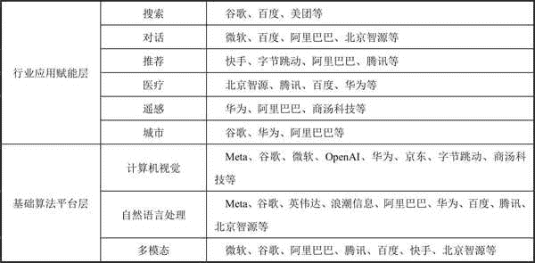

续表

表中，谷歌、微软、百度、阿里巴巴等科技巨头均在多层面布局大型模型，并将其应用于对话、推荐、医疗等多个场景。除巨头外，深耕云计算与大数据领域的科技企业也在积极布局，争夺市场先机。

浪潮信息  是国内知名算力供应商。在市场趋势推动下，公司积极进入生成式内容领域，开展超大规模人工智能大模型研发，已取得初步成果。与淮海智算中心合作的超大规模模型训练性能测试已出初步数据。

测试显示，该大型模型在淮海智算中心的训练算力效率达 53.5%，处于行业领先水平。这意味着可为其他创新团队提供高性能的大模型训练算力服务。

生成式人工智能需基于海量数据对超大规模模型进行训练，对算力提出极高要求。浪潮信息可为超大规模模型训练提供算力支撑。超大规模训练依赖多加速卡的 AI 服务器集群，训练效率直接影响时长与成本。

依托自家人工智能模型“源 1.0”的训练经验，浪潮信息优化了分布式训练策略，通过流水并行、数据并行以及调整模型结构与训练参数，将训练算力效率提升至 53.5%。公开资料显示，OpenAI 的 GPT-3 训练算力效率为 21.3%，对比之下浪潮信息的优势明显。

在研发领域，除成熟科技公司外，还聚集一批创业公司。它们凭借技术优势推动大型模型研发。

例如成立于 2021 年的创业公司 MiniMax 将大型模型作为核心业务，积极研发多模态大型模型，已搭建文本到文本、文本到视觉、文本到语音三个模态。

MiniMax 兼顾 To C 与 To B。To C 端，大模型驱动的产品已在应用商店上线；To B 端，计划未来开放 API，让更多用户基于大型模型打造自身应用。 EXr6287u6NNVz+GYLY+7SOTgAK1+TNUORQE7GX8xSB479Pn8E1vqKi5t6nJdqBpJ6IyF0duTAxsSOPrvpBEvPg==

## 11.2　以产品入局：多角度打造生成式内容产品
随着生成式内容不断深入发展，相关产品数量持续增加，从文字、绘画、视频到音频等多个维度助力内容生成。企业可通过产品切入，打造自身的生成式内容产品。

### 11.2.1　文字生成：腾讯推出自动化新闻撰稿机器人 Dreamwriter
Dreamwriter 是腾讯推出的自动化新闻撰写机器人，能借助人工智能算法在第一时间生成稿件，并对资讯进行实时分析，将重要信息迅速传递给用户。

其写作流程大致包括建立数据库、机器学习、写作、审核、分发五步。腾讯先创建或购买数据库，让 Dreamwriter 分析数据并学习新闻写作手法。学习完成后，系统即可从数据库中检索相关信息进行撰写，稿件经审核后再通过腾讯的内容发布平台推送。以下对各环节进行说明。

###### 1.建立数据库
Dreamwriter 写作的前提是具备数据库。没有数据支撑，难以产出生动文章。腾讯采购了大量国内外数据库，例如买断 NBA 在中国市场的 5 年网络独播权并购入全套比赛数据。NBA 数据可实时传输每阶段赛况，信息更为详实，数据越详实越利于分析与生成。除了外部采购，腾讯自身也有丰富资源，如自选股 App 包含大量股市信息。

###### 2.机器学习
机器学习是培养写作能力的关键环节。在可提取数据库就绪后，Dreamwriter 进入学习阶段，通过数据分析与算法设计主动理解数据库。它不仅要理解数据本身，还要掌握对应的写作模板，技术人员需持续填充模板。

例如生成体育赛事报道时，系统需重新组合赛事精彩节点。若报道奥运会跳水赛，需分析起跳、空中姿态、水花效果等，并在数据库中抓取相关数据，结合规则整合成完整报道。此外，系统拥有完整的连接词库，使语言更连贯、表述更清晰，接近人工撰写效果。

学习过程循序渐进，完善永无止境，项目规模影响学习时长。以 NBA 报道为例，机器学习约需一个月。

###### 3.写作
Dreamwriter 针对体育与财经报道开发双写作系统。体育系统偏向赛事报道与深度表达，财经系统拥有独立计算模型与表达方式。生成清晰新闻内容的同时，可根据用户兴趣生成研判版、民生版、精简版等多种版本，更好满足不同需求。

###### 4.审核

稿件产出后必须进入审核环节，不同平台的审核标准差异较大。Dreamwriter 并未建立自有的审核闭环，事实核查、合规判断以及政治导向的把关全部交由腾讯风控团队执行，该团队负责腾讯信息生态中各类内容的真实、合法与政治安全。

###### 5.分发
现阶段 Dreamwriter 暂不支持自主投放，报道与资讯的分发仍依赖腾讯专业分发团队完成。

随着在新闻写作赛道的持续演进，Dreamwriter 的技术栈会不断迭代，为内容生产创造更多可能。可探索的应用形态包括：

（1）基于互联网的 UGC 新闻信息服务。写作机器人可在微信、微博等用户原创平台采集素材并自动组稿，帮助编辑更快挖掘热点。

（2）利用语音技术实现新闻信息播报。

（3）创新性写作。未来新闻写作机器人或能把 AI 生成的资讯与编辑人工撰写的稿件融合，让读者难以分辨内容来源。

（4）读者细分管理。系统可追踪点击与阅读习惯，对用户爱好与需求进行精准画像，提供更个性化的服务；同时不断完善平台的智能对话系统，提升交互体验与满意度。

Dreamwriter 是机器写稿领域的重大突破，随着 AIGC 产品不断创新升级，以其为代表的文字生成类机器人将持续出现，拓展 AIGC 应用范围。

### 11.2.2 文心·一格：百度文本生图平台
文心·一格是百度基于文心大模型推出的新型 AI 绘画产品，定位产业级应用。

图 11-1　文心·一格登录页面

在官网中，创作者输入想要的画作主题和风格即可获得 AI 生成的作品。平台支持油画、水彩、动漫、写实、国风等高清画作的在线生成，也支持定制多种画面尺寸。

用户群体十分广泛，既可为设计师、艺术家、插画师等专业视觉创作者提供创意灵感，辅助产品设计与艺术创作，也能帮助自媒体、记者等内容创作者生成高质量文本配图。对非专业创作者而言，它提供了零门槛的 AI 绘画入口，让艺术创作的乐趣得以体现。

文心·一格上线了二次元、中国风等艺术风格，丰富了 AI 绘画风格的多样性；还更新了图生图、图片二次编辑等功能，进一步升级细节刻画。此外上线了全新创作平台并增添智能推荐功能，用户在平台输入简单的画作描述即可得到精美优质的画作，大幅提升了便捷性和实用性，帮助创作者轻松完成艺术创作。

2023 年 3 月，全新改版的新官网正式发布。设计上采用模块化风格，在个人中心、主页视觉、批量操作、资讯轮播等方面做多项提升，以全面优化 AIGC 内容创作体验。

支撑应用的文心大模型在数据采集、风格设计、输入理解等多层面持续探索，在中国文化理解与相关应用生成方面具有强大优势，也使文心·一格更深入地理解用户输入文本的语义，加快了在中国文化生成领域的落地。

文心·一格联合新华社发布 AIGC 音乐作品《驶向春天》，由袁树雄和凤凰传奇共同演绎，以轻快说唱表达年轻一代的热情。MV 部分由文心·一格 AI 绘画功能提供技术支持，呈现靓丽多彩的国风画面，展现对过往的感慨与对未来的向往。

作品 MV 上线同期，文心·一格发起以“画出你心中的美好生活”为主题的创作活动，鼓励创作者借助平台绘制所向往的美好生活。

随着文心大模型不断迭代，多元化 AI 绘画作品将在平台不断涌现，应用场景将持续拓展，艺术价值也将更高。文心大模型将成为推动 AIGC 发展的强大动力，助力内容生成创新。

### 11.2.3 Make-A-Video：Meta 文字成片系统
2022 年 9 月 29 日，Meta 宣布推出内部研发的人工智能系统 Make-A-Video。该系统可根据用户输入的文字或词语生成短视频，例如输入“穿着蓝色卫衣的小猫在天空中飞翔”，即可生成约 5 秒的视频。虽然成片质量尚不够精良，但已是文字生成短视频领域的重要进展。

Meta 认为文字生成短视频比生成图片难度更大，需要大量算力支撑。Make-A-Video 需用数百万张图像训练才能拼凑出短视频，这意味着只有资源充足的大型公司才可能研发。

训练使用了 3 个开源图像和视频数据集的数据。系统通过在文本转图像数据集中标记静态图的方式学习物体名称与外形及运动规律，从而依据文本生成视频。

Meta 认为系统能为创作者带来全新机会，但也存在被用于传播有害内容和伪造信息的弊端。研究人员已尽力过滤不当文字与图片，但无法从上百万图片中彻底清除所有有害信息，未来将探索完善方案以规避潜在风险。

### 11.2.4 喜韵音坊：喜马拉雅 AI 配音方案
AIGC 正在改变传统生产结构与商业模式，喜马拉雅在音频创作领域积极探索。

喜马拉雅成立于 2012 年的在线音频分享平台，形成了优质创作者生产优质内容—内容吸引粉丝—粉丝互动宣传的商业闭环。平台打造了“喜韵音坊”，帮助用户进行音频创作，实现配音梦想。

###### 1.TTS 音色难以演绎小说
TTS 将文本转换为语音，广泛应用于电话客服、机器人等场景，但合成声音偏机械，不适合录制音频节目。听众希望听到有情绪变化、有温度的声音。讲述童话应天真可爱，武侠应激昂顿挫，历史应深沉厚重。

因此 AI 需学会语境理解与音色转换。喜马拉雅曾尝试复原评书艺术家单田芳先生的声音，其特色为韵律起伏大、发音独特，仅用 TTS 合成语调平淡，失去跌宕起伏。对此设计了韵律提取模块合成起伏韵律，并针对其发音设计口音模块标注特殊发音，使 AI 合成时能还原讲评书的“味道”。

基于技术创新，TTS 合成的 AIGC 音频已可“以假乱真”。如今 TTS 已能输出多种情感、风格的音频，广泛应用于新闻、小说、财经等音频内容创作。

###### 2.跨语言合成
跨语言合成指用一种声音说两种语言，例如 A 的声音既能讲普通话也能讲客家话。难点在于 A 本人只会普通话，需让 AI 模仿其声音说客家话。喜马拉雅研发了一套跨语言语音合成训练方法解决该问题。

###### 3.语音转文字技术
许多音频节目未匹配字幕，听众难以听清。为解决痛点，喜马拉雅将语音转文字技术 ASR 与超长音频与文本对齐算法结合，推出 AI 文稿功能。

该功能可识别无文稿音频并自动生成文稿，方便理解；对已有文稿的音频，可实现声音与文稿时间戳对轨，播放时文字同步高亮，便于收听。

新技术研发为音频行业生产方式与内容结构带来变化，推动行业不断发展。喜马拉雅生产模式以 PGC 和 UGC 为主，AIGC 探索带来优势：

（1）真人接单朗读成本过高，AIGC 可降本增效。平台形成“PGC+PUGC+UGC”结构，其中 UGC 消费最多。采用收入分成导致内容成本高，借助 AIGC 生成有声书可产生海量音频并降低成本。

（2）AIGC 生成速度快。新闻、时事热点等时效性内容，真人模式需等待数小时，AIGC 可能只需数分钟。例如新京报、环球时报等主流媒体借助 TTS 每日平均生产 500 条音频，此前难以实现。

（3）帮助创作者提升效率。喜马拉雅希望提供 AI 工具以提升效率、降低门槛。大多数创作者无专业团队，只能选择单播作品，限制变现力。“喜韵音坊”上线 AIGC 多播功能后，主播可与 AI 合作实现单人演绎多播作品。

主播反馈音色类型多样，有“公子”音、“御姐”音、青年音等，AI 还能展现人物不同情绪，无论悲伤、愤怒、钦佩、喜欢均可自如切换，满足多样需求。

喜马拉雅利用 AI 技术重构音频行业内容生产方式，也改变商业逻辑。未来 AIGC 将进一步赋能音频行业，生成更逼真的音色，让更多创作者爱上配音。 EXr6287u6NNVz+GYLY+7SOTgAK1+TNUORQE7GX8xSB479Pn8E1vqKi5t6nJdqBpJ6IyF0duTAxsSOPrvpBEvPg==

## 11.3 AIGC 领域投资机会
AIGC 领域蕴含巨大投资机会，企业可关注上游厂商和下游聚焦 AIGC 应用的企业两大方向。

### 11.3.1 上游基建：算力与数据赛道
AIGC 发展离不开上游技术厂商支持，相关厂商蕴含不小投资潜力。可关注算力基础设施领域的商汤科技  和数据服务领域的海天瑞声  。

###### 1.商汤科技
商汤科技是 AIGC 模型训练算力提供商，打造了集智能算力、通用算法、开发平台为一体的新型基础设施 SenseCore。SenseCore 支持 AI 应用模型规模化量产，降低生产成本，让 AI 赋能更多领域。

依托计算机视觉积累，商汤在智能生成内容方面具备多种核心技术，如表 11-2 所示。

表 11-2　商汤科技在智能生成内容方面具备的核心技术

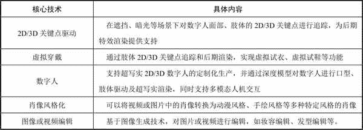

商汤通过 AIGC 技术打造 AI 创意视频生产平台商汤智影，可实现视频换背景、视频分析、视频批量生产等功能。

###### 2.海天瑞声
数据对 AI 大模型训练十分重要。海天瑞声从数据入手，提供专业数据服务，拥有近千个数据成品库，包含近 200 种语言，覆盖虚拟主播、智能搜索等业务场景。

AI 数据服务涉及数据采集、标注、评测、方案设计，可应用于自然语言处理、计算机视觉、语音识别等多场景，如表 11-3 所示。

表 11-3　海天瑞声 AI 数据服务

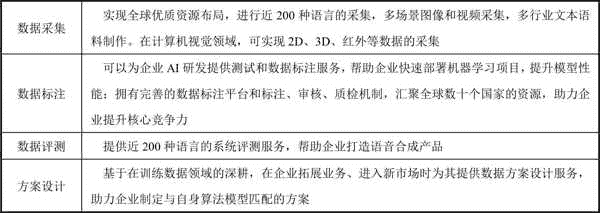

企业可关注商汤科技、海天瑞声等在 AIGC 基础设施方面有所建树、拥有技术与业务优势的上游厂商，寻找投资机会。

### 11.3.2 下游应用：多家玩家发力
随着投资机会增多和商业模式重构，众多下游应用企业崭露头角。

1.科大讯飞 
科大讯飞在 AIGC 领域早有布局。2022 年年初推出“讯飞超脑 2030 计划”，加深多模态感知、多模态表达融合，为 AIGC 业务拓展奠基。

计划进一步拓展智能机器人业务，面向元宇宙、数字世界和物理世界推出以多模态交互、模型训练、智能运动、软硬件接入、资产生成和 AI 能力星云为核心的机器人开发平台，为开发者提供善学习、懂知识、能进化的虚拟数字人产品和实体机器人产品，使机器人更快融入各行业。

2.金山办公 
WPS 智能写作是金山办公在 AIGC 时代推出的智能办公产品，以自然语言处理技术为核心，提供辅助成稿、句子智能补写、文本智能校对、文本自动生成等多项功能，颠覆传统写作模式，开启 AI 智能写作新时代。

3.同花顺 
同花顺是业内领先的金融信息服务提供商，在 AI 方面持续研发投入，2018—2022 年投入情况如图 11-2 所示。

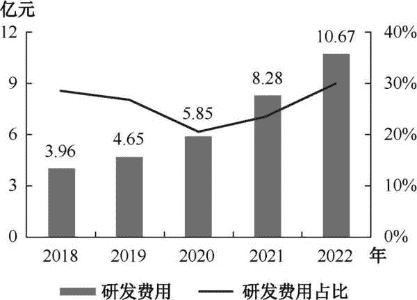

图 11-2　2018—2022 年同花顺在 AI 方面的研发投入

过去几年研发费用逐年增加，2022 年研发费用达 10.67 亿元，占比 30%，在机器学习、自然语言处理、图像识别等领域形成深厚积累。

在金融领域，同花顺较早布局 AIGC 产品与服务。围绕金融打造智能投资顾问和智能金融问答产品。智能投资顾问推出智能机器人顾问，熟练掌握财经知识，为用户提供个性化财经知识普及与讲解，开启 AIGC 在金融领域发展新纪元。

同花顺还采用人机结合服务模式打造系统全面的投资顾问辅助系统，并推出资产配置智能服务，结合产品特征、用户画像和风险测评为用户提供个性化理财方案并持续跟踪需求。在智能金融问答领域，借助自然语言处理技术不断记录、分析金融市场信息，为用户打造及时、精准、专业的问答服务。

4.拓尔思 
拓尔思借助 AI 信息检索、知识推理和自然语言处理推出小思智能问答机器人系统，通过问题分类、解析、信息搜索、提取备选答案、搜寻答案证据、计算证据强度等流程实现人机交互，已广泛应用于行业知识问答、企业智能客服、政府智能问答等多领域。

5.云从科技 
云从科技不断布局 AIGC 内容创作和虚拟互动领域。在内容创作上不断与第三方企业合作，凭借自然语言处理、知识计算和大数据优势对海量视频内容进行分析、提炼和再创作，以低成本、高效率满足客户个性化需求。

公司在光学字符识别、自然语言处理、语音识别和机器视觉等多领域应用预训练大模型，提升核心算法性能与算法生产效率。预训练大模型已在金融、智能制造、城市治理等多领域广泛应用，体现巨大价值。

此外云从科技不断深入人机协同领域，搭建具备思考和工作能力的人机协同操作系统（如图 11-3 所示），推动语音、视觉、自然语言处理等多领域大模型整合。

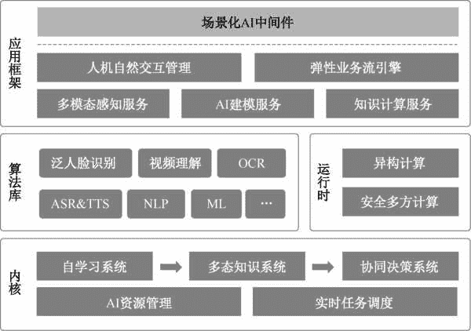

图 11-3　人机协同操作系统

6.格灵深瞳 
格灵深瞳依托计算机视觉技术在图像收集与处理领域具备独特优势。其视觉计算平台具备精细化大数据识别与分析能力，可实现多场景智能识别、多种属性数据提取与分析。数据智能平台融合智能数据输入、智能数据分析与智能数据治理，可实现视频结构化、人脸识别、人脸布控、视频图像解析，推动数据向更智能化方向发展。

深瞳大脑由格灵深瞳构建，是其人工智能能力的技术中枢。体系里包含训练侧平台和数据侧平台，进而细化为标注、训练、管理等多个功能模块，为企业级 AI 产品的迭代和解决方案的优化提供底座支撑。

7.汉王科技 

汉王科技在生成式 AI 方向已形成初步成果。推出的智能专家问答系统聚焦图书馆场景，为现场读者提供全流程咨询服务。系统具备较强的开放性和良好的交互体验，能够把读者提问与知识库进行智能对齐，并提供后台权限管控与绩效统计，同时支持角色化流程，推动图书馆服务与业务改进。

同期发布的汉王智能建档方案，依托公司在人工智能领域的长期实践，融合人脸识别、自然语言处理、OCR 与区块链等技术，推动档案建设向数据化、智慧化、数字化、知识化演进，使档案价值得到更深层次挖掘。

随着更多厂商在生成式内容下游场景加码，下游应用的体量将持续放大，AIGC 的应用价值也将进一步释放，为产业发展注入新动能。 EXr6287u6NNVz+GYLY+7SOTgAK1+TNUORQE7GX8xSB479Pn8E1vqKi5t6nJdqBpJ6IyF0duTAxsSOPrvpBEvPg==

# 第十二章 AI 进化新篇章

目前 AIGC 已演变为内容生产的底层设施。进入高创意、高需求期，生成式技术会不断迭代升级，令内容生产更智慧、高效；相关产品也会更完整，覆盖更广的创作用例，带来更多商业回报。 EXr6287u6NNVz+GYLY+7SOTgAK1+TNUORQE7GX8xSB479Pn8E1vqKi5t6nJdqBpJ6IyF0duTAxsSOPrvpBEvPg==

## 12.1 技术演进推动生成式内容深化

AIGC 契合了当下内容生产的诉求。随着使用需求升级，人工智能技术将持续强化，开拓更广阔的市场空间，放大生成式内容在生产环节的价值。

### 12.1.1 学习范式跃迁提升生成智能

深度学习持续演进，是 AIGC 成长的关键推手。从生产视角看，大致经历三个阶段：依赖规则或模板的前深度学习阶段、基于深度神经网络的深度学习阶段，以及由大模型与多模态驱动的超级深度学习阶段。

###### 1.规则模板主导的早期阶段
早期生成式应用主要由预设规则或模板产出简易内容。该模式下产出缺乏对客观世界的感知，也难以准确理解语言表达，因而常出现呆板、空洞、文本紊乱的问题。

###### 2.深度神经网络主导阶段
网络结构与学习范式的优化大幅提升了算法的学习能力。AlexNet 以强大的卷积架构在 ImageNet 竞赛中夺冠，开启深度学习时代。博弈学习范式的出现亦是标志性事件，其从识别准确性出发，明显提升了生成的准确性与可信度。强化学习、扩散模型、流模型等范式的涌现进一步推动演进。

###### 3.大模型与多模态主导阶段
超级深度学习体现为人工智能在大型模型和多模态上的突破，为生产提供更稳固支撑。该阶段主要依赖两类大型模型：视觉型大模型与语言型大模型。

（1）视觉型大模型强化感知
以视频、图像为代表的视觉数据是数字信息的重要载体，感知与理解海量视觉信息的能力是生成数字内容与实现数字孪生的基础。代表视觉 Transformer 的新一代神经网络凭借易拓展、高并行、性能优异的特性，正成为视觉内容生成的主流框架。基于视觉 Transformer 的多任务联合感知也成为研究热点。

（2）语言型大模型增强认知
文字与语言记录着科技、文化与历史演变，利用人工智能解析海量文本是 AIGC 的关键环节。当前任务类型繁多、数据质量参差，传统 NLP 存在数据复用难、模型部署难等问题。基于语言的大模型可利用非标注文本进行预训练，在冷启动与小样本场景下实现更稳健的理解与生成能力。

科大讯飞的工作拉开了语言大模型的序幕。在智慧教育领域，实现了因材施教与智能批改，能对雅思作文与高考语文作文给出精准评分并生成薄弱点分析与改进建议，达成多场景的智能化生成与解析。在智能医疗领域，自主研发的智医助理系统已通过职业医师资格考试，可作为医生助手辅助诊断千余种疾病并生成科学的辅诊建议。

在人机交互层面，科大讯飞智能语音开放平台日均调用量超 50 亿次，已覆盖机器翻译、语音识别、图文识别、语音合成等领域，支持六十多个语种，有力支撑进出口沟通。其机器翻译技术曾夺得国际机器翻译挑战赛冠军。

大模型与多模态的发展为 AIGC 融合创新带来更多可能，拓宽应用边界，也是算法走向通用的核心动力。

### 12.1.2 多模态演进增强模型泛化

多模态技术进步让生成式应用更丰富，泛化能力更强。预训练模型正从单一的 CV 或 NLP 模型，演进为涵盖图文、音视频、文字语言的跨模态体系。

在这一趋势下，大型预训练模型的研究重点转向图像、语音、视频与跨文本通用模型。提升效果的关键在于深度学习框架、数据调用策略与计算策略。代表性研究包括 OpenAI 的 DALL·E、微软与北大联合的 NVWA 女娲、NVIDIA 的 POE GAN、DeepMind 的 Gato 与 CLI、NVIDIA 的 GauGAN 2 等。

以安防为例，“AI+安防”已进入精细化阶段，人工智能正向长尾细分领域渗透，发展模式从粗放上量转向精细化升级。但行业仍存在深度应用不足、算法适用场景受限等问题。

监控系统产生的数据体量庞大，包含结构化、半结构化与非结构化数据。当前主要痛点有两方面：一是非卡口场景下视频分析成本高、稳定性差、识别率低，存量视频难以有效利用；二是结构化视频数据激增，但以其为核心的预测预警、技战法训练、模式挖掘、时空分析等深度应用仍处探索期，易产生无效投入与资源浪费。

跨模态预训练模型的成熟推动内容高质量产出，具备优异的落地能力，可加速人工智能在安防领域的实践。同时视频识别算法的提升将进一步提高识别准确率，拓宽应用广度。基于多模态的预训练模型不仅助力安防，也推动生成式内容在更多领域深入发展。

### 12.1.3 MaaS 形态加速普及

MaaS，即模型即服务，其产业路径是从模型到单点工具再到应用场景，大模型是主要基座。以魔搭社区 ModelScope 为例，该平台聚焦开源 MaaS，打造了大量实用的预训练基础模型。

合作机构包括深势科技、澜舟科技、中国科学技术大学、哈工大讯飞联合实验室、智谱 AI 等。首批开源模型覆盖多模态、语音、视觉、自然语言处理等方向，包含数十个大型模型与上百个业界领先模型，并向以 AI for Science 为代表的新领域延伸，覆盖众多主流任务。所有模型均经严格筛选验证并对外开放。

社区鼓励中文 AI 模型的开发，已上线百余个中文模型，占比超三分之一，其中包括阿里通义系列、澜舟科技孟子系列、智谱 AI 中英双语千亿参数模型等前沿成果。

平台使用门槛低，传统模型从下载到验证往往需数日，魔搭社区数小时甚至数分钟即可完成。统一配置文件与全新调用接口提供环境安装、模型探索、训练调优、推理验证等一站式服务，支持零代码在线体验。通过一行代码完成推理，十行代码完成定制调优，并提供在线开发与算力支持，无需部署即可网页开发。模型兼容主流人工智能框架，支持多种服务部署与训练，面向全体开发者开放，以推动大规模应用为目标。

开源模型是技术发展的强动力，魔搭社区作为新一代开源社区，正广泛推动模型落地，助力我国在开源模型领域占据引领地位。随着预训练模型兴起，以魔搭社区为代表的模型社区将成为 AIGC 时代的重要基础设施，让人工智能惠及全社会。 EXr6287u6NNVz+GYLY+7SOTgAK1+TNUORQE7GX8xSB479Pn8E1vqKi5t6nJdqBpJ6IyF0duTAxsSOPrvpBEvPg==

## 12.2 参与主体扩散：从 B 端向 C 端蔓延

AIGC 能为企业带来明显的降本增效，是主要消费群体。但随着使用门槛降低，C 端用户兴趣提升，参与主体正从企业端向个人端扩散。

### 12.2.1 面向企业端的产品持续丰富
算力提升使面向企业的 AIGC 产品加速丰富。2023 年 3 月，AI 视觉平台皮卡智能推出生成式应用神采 PromeAI。与 2022 年上线的 AI 艺术创作不同，神采 PromeAI 拥有更宽泛可控的 C-AIGC 模型库与人工智能驱动设计助手，让创作者更轻松制作图形、动画与视频。在绘制人物姿态与图形边缘时，线稿控制可避免手指缺失等问题，减少手工误差。

系统可将照片或涂鸦转为插画，自动识别人物姿势并生成完整架构；为线稿提供多种配色方案生成上色稿；识别景深信息生成同结构图像；识别建筑与室内线性特征生成全新设计方案，并通过法线信息辅助建模；借助 AI 语义分割识别结构相同风格不同的素材。

在建筑行业，设计师上传 CAD 草图或照片即可获取效果图。传统住宅方案需 3-5 天，PromeAI 约 1 天可完成初步方案，且能提供设计师难以推敲的新颖方案，提升效率与品质。系统支持室外室内双类型效果图，实现从宏观到微观的逐层突破，覆盖构件生成、单体设计、建筑规划等需求，并支持方案分析到审查的协同输出。

输入支持边缘、姿态、分割、草图等多种方式，可完成照片生成插画、线稿上色、插画翻新等工作，并优化深度贴图、法线贴图、角色动作等细节。

在电商场景，系统为网站设计师提供海量素材库，打破素材搜集局限；可按产品精细分分类生成电商产品图，直接进入商业化流程，实现低投入高产出。在海报设计中，提供大量风格选项，设计师绘制草图确定形态后，AI 生成图像并可在不满意时进行文案添加、细节修改等轻量调整。

总体看，神采 PromeAI 对建筑设计与电商网站设计产生深远影响，既提升效率与质量，也带来更多创意灵感。

### 12.2.2 面向个人端的工具日益多样
为抢占市场，多家人工智能企业正从企业端向个人端转型。2021 年底，腾讯推出云小微数智人平台，定位数字服务助手，面向个人端，通过数字人与智能交通、智能家居、智能车载等设备连接贯通，提供智能便捷服务。

2022 年 7 月，科大讯飞表示将拓展个人端市场，在全国多地开设线下零售店，提升用户体验与服务。2022 年 8 月，商汤科技推出家庭 AI 游戏 SenseRobot 元萝卜，成为其进入个人端市场的标志。

未来 AIGC 不应仅聚焦企业端，个人端是重要方向。随着技术成熟，个人端产业链不断完善，人工智能商业模式向多元化拓展，AIGC 持续助力产业升级。虽然数字人商业化仍在探索，但应用场景正向虚实结合演进。人工智能不断拓展内容创作商业价值，更多 AIGC 应用将在个人端落地，为产业发展注入强劲动能。 EXr6287u6NNVz+GYLY+7SOTgAK1+TNUORQE7GX8xSB479Pn8E1vqKi5t6nJdqBpJ6IyF0duTAxsSOPrvpBEvPg==

## 12.3 应用渗透加深：赛道持续拓宽

生成式人工智能算法突破，AIGC 进入应用爆发期，赛道不断拓宽，正向金属、机械、银行等行业延伸，打开全新成长空间。

### 12.3.1 金属行业：全流程管理优化
AIGC 可应用于金属行业，优化管理全流程。以 ChatGPT 在金属行业的应用为例，其赋能体现在四方面。

###### 1.缓解矿产采选痛点
矿山建设从探矿到规划开发均需丰富经验与精准计算。ChatGPT 解决了多项痛点并提升效率。

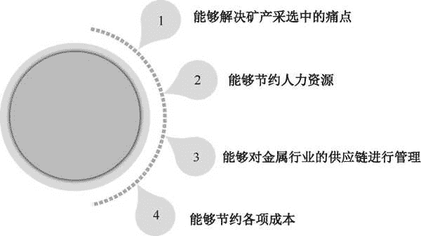
图 12-1 ChatGPT 对金属行业的助力

运作流程分三步：前端互动输入需求；AI 比对数据库进行分析；输出答案供用户结合实际调整。
在采矿中，搜索分析引擎可将当前项目与历史项目对比，利用数据分析快速完成资源核算，弥补供应链管理短板。AI 协作功能可自动进行项目规划、撰写可研报告等复杂文件，减轻人员压力。

###### 2.节约人力资源
金属行业劳动分工包括体力劳动与脑力劳动。体力劳动门槛低、可被机器人或大型机械替代。简单脑力劳动如数据收集、处理、分析与信息汇总，可由 ChatGPT 等人工智能工具完成，释放人力去从事更复杂的决策工作。

###### 3.管理供应链全环节
金属行业供应链包括计划、物流管理、生产管理、产品回收、资产管理。在计划环节，ChatGPT 可基于历史数据与模型制订计划；物流管理中提升运力、降低成本；生产管理中智能汇总产量、即时反馈效率；产品回收中制订回收计划降低成本；资产管理中快速总结资产并分析结果。

###### 4.降低各项成本
ChatGPT 可降低原材料、折旧、能耗、人工工资等成本构成，提升行业整体效益。

在金属制造环节，ChatGPT 正发挥越来越实用的作用。采购端，它能结合供应链管理与价格预测模型来优化原材料进货策略，压缩损耗与成本。折旧管理上，通过搭建财务折旧模型对设备运行状态做动态跟踪，能更真实地反映设备使用价值。能耗控制上，它可对生产过程进行实时监测并输出动态报表，一旦发现某个部门存在浪费，就能给出优化建议帮助降耗。人工费用上，基础文件的起草、整理等重复性工作也能交由它完成，释放人力、降低用工开支。

展望未来，AIGC 将持续为金属行业赋能，以更成熟的应用推动行业提质增效、降本增收。

### 12.3.2　机械行业智能升级提速
AI 进入加速期，正在重塑机械行业格局，驱动设备向智能化跃迁。ChatGPT 等工具的引入，正推动机械行业加速数智化转型。

###### 1.大模型重塑生产力工具
大模型基于海量非结构化数据训练，提炼出可复用的规律，具备强算力与强算法支撑。应用场景丰富，只需在开发时做少量微调，就能迁移到不同业务线。机械领域的人形机器人就是典型落地方向，智能水平因此得到明显提升。

大模型的优势突出：一是泛化能力强，适配场景更广；二是自监督学习机制降低了训练成本；三是海量训练让模型精度不断提升。

###### 2.ChatGPT API 开放，商业落地可期
2023 年 3 月 1 日，OpenAI 正式发布基于 GPT-3.5-turbo 的 ChatGPT API 接口与 Whisper 语音转文字 API。

依托这两套接口，机械行业中的服务机器人和人形机器人发展步伐加快。人机交互是人形机器人的核心，而语音语义解析正是机器人听懂用户意图、实现交流的关键路径。ChatGPT API 的成熟应用将推动交互技术更上一层楼，对行业形成颠覆式影响。

AI 成为机械智能化升级的有力抓手，设备智能化水平持续提升，加工效率显著提高。

### 12.3.3　银行业务流程智能重塑
ChatGPT 的出现是生产工具的一次重大升级，虽然部分岗位可能被替代，但对多数人、多数行业而言，它意味着新机会。以银行为例，业务流程的优化主要体现在三个层面，如图 12-2 所示。

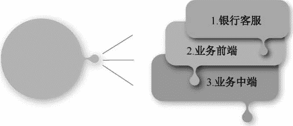
图 12-2　ChatGPT 助力银行流程优化的三大方向

###### 1.智能客服
银行客服与 ChatGPT 契合度最高，因为客服对话具备很强的可预期性、重复性和规律性。

AIGC 已在多家银行落地。工商银行推行机器换人，在客服与运营岗位部署数字员工，规模超过 600 人；2022 年上半年，平安银行在 AI 平台新增 1080 个模型，客服机器人日均对话量达 60 万次，问题解决率达到 90%。招商银行同年上半年启用 AI 做智能客服、语音质检、智能审录等工作。

AI 客服的应用指明了未来方向，银行客服将走向更智能、更高效。

###### 2.前端业务
前端业务标准化程度高，ChatGPT 的分析能力可用于细化客户标签，提升产品推荐的匹配精准度。

2022 年上半年，平安银行的 AI 客户经理已覆盖 1400 多个场景，月均服务客户量较 2021 年大幅增长。2021 年，招商银行推出智能财富助理 AI 小招，提供收益查询、涨跌分析、产品推荐、市场热点解读等综合服务。

借助大数据分析，ChatGPT 未来能把用户群进一步细分，深挖需求，实现更精准的产品匹配。

###### 3.中端业务
对公销售、授信审批等岗位大量时间消耗在格式化的报告撰写上，挤占了营销、调研等核心工作。ChatGPT 与这类强格式文本高度适配，能完成授信报告、审批报告等撰写，提升业务运转效率。

ChatGPT 与银行业正形成深度融合，为金融数字化打开新窗口。未来将为用户提供更智能的数字化金融服务。 EXr6287u6NNVz+GYLY+7SOTgAK1+TNUORQE7GX8xSB479Pn8E1vqKi5t6nJdqBpJ6IyF0duTAxsSOPrvpBEvPg==

## 12.4　AIGC 场景全面渗透生活
2023 年被视为 AIGC 全面启动的元年，应用形态快速涌现。在技术驱动下，AI 落地场景不断扩展，正逐步渗入生活的各个角落。服务型数字员工增多，AIGC 在视频、文本、图像等领域实现自动生成，生活方式被持续重塑。

### 12.4.1　数字员工多场景落地
数字经济加速发展，AI 催生出数字员工这一新形态。它能够承接机械重复的工作，帮人类摆脱繁重枯燥的劳动，转向更高价值事务。目前，AI 数字员工已在多个行业落地，金融是重点之一。

银行是与 AI 融合较快的机构。AIGC 持续赋能数字员工，提升其数智化水平，在内外沟通中发挥作用。线下网点，数字员工提升大堂服务质量与效率；线上则塑造银行形象，推动客户转化。

内部层面，数字员工可担任智慧助手，解答员工疑问、提醒注意事项、处理日常业务、制定个性化培训计划、给出职业发展建议，整合分析工作数据、进行能力评估，辅助 HR 优化配置。外部层面，它能与网点客户交流、提供金融服务、充当专属顾问并根据客户特征定制理财方案，在客户不满意时推荐替代产品。

随着 AIGC 进步，数字员工在风险管控、经营态势分析等方面的作用将进一步拓展。

国内数字员工主要集中在服务业，承担交流互动类工作，如文档审核数字员工替代人工审核、数字客服替代真人客服。

尽管热度高，数字员工仍处起步期。产业链上，百度、腾讯、阿里巴巴等互联网企业已率先布局；应用端，市场仍在探索，虚拟主播等成为热点。

例如虚拟主播“古堡龙姬”与上海反诈中心合作担任反诈宣传员。运营方完美世界利用其影响力开展反电信网络诈骗宣传。2022 年 6 月，“古堡龙姬”发布还原游戏账号买卖诈骗场景的视频，起到正面教育作用。视频被多家媒体转发，截至 2022 年 6 月 23 日播放量超千万。未来服务型数字人与身份型数字人将稳步增长，释放更大潜力。

数字员工成为重要劳动力后，真人需要学会协同。对此，企业可从三方面着手。

（1）合理分工提升质效。真人与数字员工各有所长，分工协作可提高效率与业绩。浦发银行数字员工“小浦”承担十余种角色，包括智能客服、智能外呼、AI 培训讲师、AI 营销专员、AI 大堂经理等，覆盖客户服务、运营管理、内部管理。服务覆盖面扩大，客户选品时间缩短，服务效率与质量同步提升。

（2）推进人机协同与数字化转型。AI 发展使计算机可在无指令情况下自主工作，成为人类的得力助手。人机互动能放大人类潜能。科大讯飞的数字员工可与真人协作完成招聘、财务、行政等工作。文档翻译中，人工译 1 万字需 4 小时，人机协同仅需 24 分钟，效率大幅提升。

（3）构建人机混合团队。人机搭配将成为人力资源主流。调研显示，人机协同利于企业高效运营，单一人力或单一计算机都难以支撑未来数十年的发展。

目前数字员工已在多领域落地，未来将与人类共同迈向更高智慧水平和文明阶段。

### 12.4.2　AIGC 营销与视频自动生成
ChatGPT 的智能表现让大众对 AIGC 产生强烈兴趣，试用后评价普遍较高。ChatGPT 所属的 AIGC 赛道潜力巨大，未来内容生成行业或将迎来洗牌，营销行业面临颠覆式变化。

除了文本生成，ChatGPT 也能参与图片、音频、视频的自动生成。以视频为例，它可胜任脚本撰写。有用户询问能否写一段 30 秒内易传播的视频脚本，ChatGPT 迅速给出以“梦想”为主题的方案，并提供音乐、标签、时长等要点，显示出替代视频文案编辑的潜力。

视频制作涉及插画、配音、剪辑等多工种。ChatGPT 负责文案，DALL-E 生成图片，剪映完成合成，技术串联即可实现自动化制作。QuickVid 就是融合文本生成、语音合成、素材库等功能的典型应用，用户可微调文案与图片，最终成片质量尚可。

当用户还在惊讶时，TikTok 已开始招募 AI 工程师推动 AIGC 在视频领域落地。平台内容具备强复制性，热门视频的音乐、妆容、舞蹈会被快速模仿形成话题。借助 AI 生成内容快速、稳定的优势，TikTok 计划助力广告主批量生成创意视频，推动广告业务增长。凭借高日活用户，TikTok 已成为热门营销阵地，AIGC 融入后将进一步放大其价值。

除 TikTok 外，多家企业正布局 AIGC 营销，具体如表 12-1 所示。

表 12-1　布局 AIGC 营销的企业一览

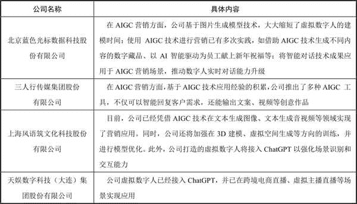
AIGC 在营销领域落地同时也给创作者带来压力，生成能力提升会不断抬高创作门槛，如何与 AI 共存将成为创作者未来必须思考的问题。 EXr6287u6NNVz+GYLY+7SOTgAK1+TNUORQE7GX8xSB479Pn8E1vqKi5t6nJdqBpJ6IyF0duTAxsSOPrvpBEvPg==