# 从0到1搭建AI智能体：Manus+LangChain+Dify多平台应用及多智能体协同

廖显东◎编著

涵盖从AI智能体入门到多智能体协同的核心知识、方法和技巧

配套资源：源代码 + PPT + 案例实战视频

机械工业出版社
CHINA MACHINE PRESS

## 作者简介

## 廖显东

上简科技创始人兼CEO，高级软件架构师，AI算法专家，全栈开发者，技术极客。专注于计算机前沿技术的研究和实践。多年软件开发与团队管理经验，精通Java、JavaScript、C/C++/C#、Python、PHP、Go、Rust等开发语言。对大型电子商务系统开发、高并发架构、分布式架构、微服务、大数据、人工智能算法、Web3.0、AIGC、ChatGPT、Midjourney、DeepSeek、Claude、元宇宙等计算机前沿技术领域有深入实践和研究。

著有畅销书《AI全能助手：人人都能玩转Deepseek》《Rust Web编程从入门到实战》《Go语言高级开发与实战》《Go语言设计模式》等。

个人公众号：源码大数据。

抖音、小红书、视频号、知乎等自媒体名：廖显东-ShirDon。

人工智能科学与技术丛书

## 从0到1搭建AI智能体

Manus+LangChain+Dify 多平台应用及多智能体协同

廖显东◎编著

机械工业出版社
CHINA MACHINE PRESS

本书围绕“AI 智能体”系统介绍其基本概念、主流 AI 智能体平台实战方法和技巧、AI 智能体底层原理等。通过阅读本书，读者可系统掌握从零开始搭建 AI 智能体的完整路径。本书不仅是一份 AI 智能体的实战应用指南，更是一份通向 AI 时代工作方式的路线图。全书分 3 篇：

第 1 篇先介绍 AI 智能体的基本概念及工作原理，随后以图形化平台“扣子”为例，通过零代码方式带领读者搭建第一个智能体，轻松迈出入门第一步；第 2 篇则深入介绍 Manus、AgentScope、LangChain、Dify 等主流平台，通过实战项目掌握多智能体协作与高效办公场景下的智能体实战技巧；第 3 篇先讲解 OpenManus 实战方法及技巧，随后深入讲解用 CrewAI 创建多角色智能体，最后聚焦智能体背后的关键技术与协议，如 RAG、MCP、A2A 等协议，带领读者理解智能体系统的运行逻辑与未来趋势。随书附赠案例源码及电子课件（获取方式见封底），以及重点、难点的操作微视频，获取方式见封底。

本书适合办公室文员、程序员、编程爱好者、大学生与科技创业者、设计师、科技爱好者、高校教师等广泛群体，以及希望在 AI 时代下快速掌握 AI 智能体使用方法和技巧的大众读者。

## 图书在版编目（CIP）数据

从 0 到 1 搭建 AI 智能体：Manus+LangChain+Dify 多平台应用及多智能体协同 / 廖显东编著 北京：机械工业出版社，2025 12 （人工智能科学与技术丛书）
ISBN 978 7 111 79810 1
Ⅰ TP18
中国国家版本馆 CIP 数据核字第 2025S4L128 号

机械工业出版社（北京市百万庄大街 22 号 邮政编码 100037）
策划编辑：李晓波 责任编辑：李晓波 曹新宇
责任校对：王 捷 杨 霞 景 飞 责任印制：任维东
北京华宇信诺印刷有限公司印刷
2026 年 1 月第 1 版第 1 次印刷
165mm×225mm·15 印张·267 千字
标准书号：ISBN 978 7 111 79810 1
定价：79.00 元

电话服务 网络服务
客服电话：010-88361066 机 工 官 网：www.cmpbook.com
010-88379833 机 工 官 博：weibo.com/cmp1952
010-68326294 金 书 网：www.golden-book.com
封底无防伪标均为盗版 机工教育服务网：www.cmpedu.com

## 前言

在人工智能迅猛发展的今天，AI 已经广泛应用于我们的工作生活中。搜索引擎可以自动补全关键词，AI 客服系统可以通过自然语言理解自动回复问题，AI 图像生成工具可以一键创作海报，甚至连写作、编程、设计、排版这样的专业工作也逐渐被 AI 工具所“接管”。但在这一切背后，真正推动效率跃迁的核心技术，正在从“单点式 AI 工具”迈向“AI 智能体（AI Agent）”这一全新形态。

### 1. AI 智能体如何改变工作方式？

传统的 AI 应用，大多是“单一任务驱动”——提问，等待结果，然后再次提问。无论是对话机器人还是 AI 图像识别模型，基本都是“输入-输出”结构。这种方式虽然简单，却难以胜任复杂任务。比如，要完成一套完整的项目管理流程，就可能涉及日程安排、文档处理、数据分析、跨工具通信等多个步骤，而传统 AI 工具几乎无法自动完成这一系列连贯操作。

AI 智能体的出现打破了这一限制。AI 智能体具备自主性、交互性与目标导向的行动能力，不再只是回答问题的“工具”，而是能够主动思考、计划、执行的“数字角色”。智能体可以理解复杂指令、调用外部工具、分析上下文并持续与人进行交流，甚至能自主发起下一步任务。举例来说，一个具备智能体能力的 AI 助理不仅能帮忙写一份会议纪要，还能根据内容自动安排后续会议、发送通知、生成任务清单并同步到团队协作平台。

这意味着，AI 智能体在重塑工作流程的同时，大幅度提升数字劳动的“自动化程度”和“协同能力”。未来的办公环境中，一个人或一个团队所使用的，可能将是一套由多个智能体组成的“数字工厂”，它们各司其职，协同配合，持续优化效率。

### 2. 为什么需要 AI 智能体？

随着技术演进，工作模式正在发生深刻改变，AI 智能体应运而生并迅速普及。实际上，AI 智能体所解决的，是传统 AI 工具和流程所无法覆盖的“复杂决策与任务协作”难题。

(1) 实现连续高效的工作流程
智能体具备自主性，能够全天候、不间断地执行任务，无须人工干预。这种“永不打烊”的特质，特别适合处理数据分析、监控预警、跨系统协调等重复性工作，显著提升业务运行效率。举例来说，需要跨平台获取信息、生成报告、触发后续流程时，智能体可以主动识别任务、调度执行，而不依赖人工逐步启动。

(2) 支持实时判断与动态应对
与只负责生成应答的大语言模型不同，AI 智能体拥有感知环境、及时决策和执行行动的能力。AI 智能体可以接入外部接口或传感器数据，在面对环境变化时动态调整策略。这种实时交互让它们能在多变场景中快速响应、减少错误并输出更贴合实际的结果。例如市场条件变化、客户行为调整等，智能体都能快速识别并响应。

(3) 降低成本、提升可扩展性
AI 智能体不需要像传统系统那样在任务量大幅增长时大量新增人力，只需扩展部署，而不会导致成本急剧上升。AI 智能体具备高度的可扩展性和自我优化能力，可随着执行次数增加而提升效率。这一点对创业团队尤为重要，在资源有限的情况下，也可以借助智能体实现自动化部署和规模化运营。

(4) 带来决策支持与精准沟通体验
智能体不仅能执行任务，还能分析数据、提炼趋势，并提出建议以支持决策。例如在客户服务、销售、HR 等职能领域，智能体能主动联系客户、生成候选方案，并优化沟通流程，从而提升体验与响应质量。

(5) 打破系统孤岛，实现跨部门协作
多个智能体协同工作时能够自动共享上下文与状态，实现跨系统、跨角色配合完成任务。这种协作方式正逐渐替代传统的“人工转接”“手动协调”，使各系统无缝连接、信息流通无阻。

(6) 从信息获取走向复杂任务执行
虽然大语言模型（Large Language Model，LLM）和 RAG 技术在内容生成和知识检索上表现出色，但它们不足以承担真实世界的任务执行与决策工作。AI 智能体则弥补了这一缺陷，提供从“输入文本”到“主动规划、执行、反馈”的完整能力模块系统。智能体能够将语言理解转化为行动指令，真正完成跨系统的任务流程。

### 3. 阅读本书能学到什么？

本书旨在帮助读者全面理解 AI 智能体的理念、构建方法与实际应用。本书共分 3 篇：

“第 1 篇 零基础入门——开启你的 AI 智能体旅程”从概念出发，介绍 AI 智能体与传统 AI 的区别、运行机制与核心特性。通过可视化工具“扣子”平台，带领读者零代码地完成第一个智能体构建任务，真正实现“人人可搭建 AI 助手”。

“第 2 篇 升级打怪——从 AI 玩家到 AI 编排师”进入中级阶段，聚焦 Manus、AgentScope、LangChain、Dify 等主流智能体平台与框架。每一章都配有实战项目，例如旅游规划、数据分析、问答智能体、五子棋游戏等，帮助读者理解不同平台的应用场景与能力边界，以及主流智能体平台与框架的实战方法和技巧。

“第 3 篇 高级实战——深度挖掘 AI 智能体的潜力”面向有一定基础的开发者，先通过 OpenManus 实战，打造进阶型智能体，再通过 CrewAI 创建多角色智能体实战，解剖多角色智能体的实战方法和技巧，最后深入挖掘 AI 智能体的潜力，进一步剖析 AI 智能体背后的关键技术，包括 RAG、MCP、A2A 等协议，讲解智能体之间如何进行通信与协作、如何部署本地系统、如何融合多模态信息，构建真正具备“决策”与“交流”能力的系统。

每一章都包含实战部分，力求让读者“读得懂、学得会、用得上”。通过本书的学习，你不仅可以掌握 AI 智能体的概念和架构，更能亲手构建出具备实际功能的智能系统，最终具备独立设计、组合、部署智能体的能力。

AI 智能体的时代已经悄然来临。从初级的个人助手，到多智能体协作的系统平台，AI 智能体正重新定义未来的生产方式。不久的将来，在日常办公、教育教学、软件开发、数字创作、企业运营等领域，都将逐步涌现出越来越多由 AI 智能体驱动的工作流。掌握这一新范式，既是技术升级的必由之路，也是抢占未来数字时代主动权的重要起点。

愿本书成为这场变革之旅的起点，帮助每一位立志于科技、渴望高效、追求创造的人，拼出属于自己的 AI 智能体蓝图。

### 4. 配套资源与勘误

如果读者在阅读本书的过程中有任何疑问，请关注“源码大数据”公众号，输入遇到的问题，作者会尽快与读者进行交流及回复。

关注“源码大数据”公众号后输入“ai agent learning”，即可获得本书配套资料、视频教程、最新 AI 智能体相关研究资料等。

读者可以通过抖音、小红书、B 站、知乎、快手等搜索作者的自媒体账号“廖显东-ShirDon”，免费观看最新视频教程。

由于作者水平有限，难免有纰漏之处，欢迎读者通过“源码大数据”公众号或者 QQ 号 823923263 批评指正。

### 5. 致谢

特别感谢机械工业出版社李晓波编辑，是他推动了这本书的出版，并在我写书过程中提出了许多宝贵的意见和建议。

感谢我的女儿，她给了我更多写作的动力和快乐，希望她能够健康快乐地成长。

感谢我的妻子，在我写作期间，她给予了我许多意见和建议，并坚定地支持我，才使得我更加专注。没有她的支持，这本书就不会这么快完稿。

编 者

## 目录

前 言

## 第 1 篇 零基础入门——开启你的 AI 智能体旅程

### 01 AI 智能体原来这么简单

第 1 章

- 1.1 为什么 AI 智能体如此强大
  - 1.1.1 什么是 AI 智能体
  - 1.1.2 AI 智能体的核心特性——自主性、交互性、决策能力
- 1.2 AI 智能体与传统 AI 应用的区别
- 1.3 AI 智能体是如何工作的
- 1.4 常见 AI 智能体简介
- 1.5 快速构建 AI 智能体的通用方法

### 02 零代码搭建属于你的第一个智能体（以扣子为例）

第 2 章

- 2.1 扣子平台入门指南——零代码创造力工坊
  - 2.1.1 什么是扣子——可视化拖拽式智能体
  - 2.1.2 扣子技术架构剖析
- 2.2 用扣子可视化界面创建你的第一个智能体
  - 2.2.1 创建扣子账户与智能体配置
  - 2.2.2 用扣子模板一键生成 AI 助手
- 2.3 开发自定义扣子智能体实战
  - 2.3.1 扣子平台变量的应用与操作指南
  - 2.3.2 为扣子智能体添加数据库实战
  - 2.3.3 为扣子智能体添加插件实战
  - 2.3.4 为扣子智能体添加知识实战
- 2.4 【实战】用扣子搭建 AI 工作流

## 第 2 篇 升级打怪——从 AI 玩家到 AI 编排师

### 03 Manus 高效应用实战

- 3.1 什么是 Manus
- 3.2 Manus 常见应用场景应用示例
- 3.3 Manus 的系统架构与工作机制
- 3.4 Manus 高效应用实战
  - 3.4.1 【实战】用 Manus 制定一个旅游规划
  - 3.4.2 【实战】用 Manus 进行专业数据分析的方法与技巧
  - 3.4.3 【实战】用 Manus 高效生成面试排期的提示方法与技巧
  - 3.4.4 使用 Manus 将文件类型转换的方法和技巧

### 04 AgentScope 实战——打造多智能体协作的 AI “数字工厂”

- 4.1 什么是 AgentScope
  - 4.1.1 AgentScope 简介
  - 4.1.2 【实战】快速本地安装 AgentScope
- 4.2 AgentScope 的核心架构
- 4.3 如何在 AgentScope 中使用 MCP
- 4.4 AgentScope 中的 RAG 解析
- 4.5 【实战】用 AgentScope 创建多模态智能体
- 4.6 【实战】创建 AgentScope 可视化界面
- 4.7 【实战】用 AgentScope 开发人与智能体对弈的五子棋游戏

### 05 LangChain 实战——打造智能对话与自动化智能体

- 5.1 什么是 LangChain——让 AI 智能体更聪明
- 5.2 构建第一个 LangChain 智能体
  - 5.2.1 如何安装与配置 LangChain
  - 5.2.2 【实战】使用 LangChain 构建你的第一个问答智能体
- 5.3 LangChain 的核心功能与工作原理
- 5.4 LangChain 提示模板实战——构建高效、可重用的 AI 提示引擎
- 5.5 在 LangChain 中使用 RAG 让问答系统更“聪明”
- 5.6 【实战】LangChain Agent 创建与使用
- 5.7 【实战】用 LangChain 搭建一个聊天机器人

### 06 第6章 【实战】用 Dify 打造可本地部署的智能体工坊

- 6.1 什么是 Dify
- 6.2 快速用 Dify 搭建一个会编程的智能体
- 6.3 Dify 技术架构解析
- 6.4 对话即可以完成高效工作——Dify 高效使用方法
  - 6.4.1 告别复杂语法——如何与 Dify 高效沟通
  - 6.4.2 精准提问的六大法则
- 6.5 【实战】在 Dify 中创建一个 AI 工作流
- 6.6 【实战】本地部署 Dify Web 和 Dify 后端 API 详解
- 6.7 【实战】用 Dify 开发一个趣味小游戏

## 第 3 篇 高级实战——深度挖掘 AI 智能体的潜力

### 07 第7章 【实战】用 OpenManus 打造进阶型智能体

- 7.1 什么是 OpenManus
- 7.2 深入底层，掌握 Agent 的运行机制
  - 7.2.1 OpenManus 的设计思路
  - 7.2.2 OpenManus 的工作流程与执行路径

### 08 【实战】用 CrewAI 创建多角色智能体

- 8.1 CrewAI 平台核心概念
  - 8.1.1 初识 CrewAI 框架与定位
  - 8.1.2 Crew 与 Flow 的区别与协作
- 8.2 CrewAI 安装与基础入门
  - 8.2.1 安装 CrewAI 及相关依赖
  - 8.2.2 【实战】创建第一个 CrewAI 智能体
- 8.3 理解与使用 CrewAI 框架中的 Crew
- 8.4 使用 Flow 设计流程控制
- 8.5 【实战】创建和管理 CrewAI 中的智能体
- 8.6 【实战】用 CrewAI 进行智能体任务管理
- 8.7 【实战】怎么用 CrewAI 进行知识管理
- 8.8 深入了解 CrewAI 定制化提示
- 8.9 深入了解 CrewAI 的指纹系统

### 09 AI 智能体底层协议深度解析

- 9.1 重构知识的边界——RAG 全景解读
- 9.2 MCP 协议深度剖析——智能体的超级数据总线
- 9.3 AI 智能体底层协议——A2A、ACP、ANP 深度解读
  - 9.3.1 智能体互联网正在到来
  - 9.3.2 A2A 协议——智能体之间的共识语言
  - 9.3.3 ACP 协议——AI 智能体的 HTTP
  - 9.3.4 ANP 协议——去中心化智能体网络
- 9.4 【实战】用 A2A SDK 搭建一个多智能体对话
- 9.5 【实战】用 AgentConnect 框架连接去中心化的多智能体
- 9.6 AI 智能体相关的多技术融合带来的新机遇

## 第 1 篇
### 零基础入门——开启你的AI智能体旅程

## 第1章 AI智能体原来这么简单

### 1.1 为什么 AI 智能体如此强大

随着大语言模型（Large Language Model，LLM）如 ChatGPT 的出现，AI 的理解和生成能力得到了显著提升。然而，大语言模型本身缺乏执行任务的能力。AI 智能体（AI Agent）通过将大语言模型与外部工具和接口结合，实现了从理解到行动的完整闭环。

AI 智能体不仅仅是执行者，更是具有“目标感”的系统，能自主感知环境、分析信息、规划行为、做出决策，并持续优化。例如，在企业自动客服场景中，传统客服系统依赖固定流程，只能回答预设问题。而 AI 智能体能根据对话历史、语义上下文，判断客户真正的意图，甚至在没有明确指令的情况下发起反向提问，从而主动推进任务完成。

这一根本变化，使得 AI 智能体不再是“问什么答什么”的工具，而是可以“理解上下文并主动响应”的智能协作者。AI 智能体不仅能“说”，还可以“做”，极大地扩展了其应用场景。

#### 1.1.1 什么是 AI 智能体

**1. AI 智能体的定义**

AI 智能体是使用 AI 来实现目标并代替用户完成任务的软件系统。它具有推理、规划和记忆能力，并且具有一定的自主性，能够自主学习、适应和做出决定。AI 智能体可以包含除自然语言处理之外的广泛功能，包括决策、解决问题、与外部环境交互和执行操作。

AI 智能体的概念并不新鲜，最早的例子之一是美国斯坦福国际研究所于 20 世纪 60 年代开发的机器人 Shakey。Shakey 在当时具有革命性：它是第一个能够感知周围环境、推理任务并自主采取行动的移动机器人。尽管受限于当时的技术条件，Shakey 所引入的许多概念至今仍是 AI 智能体的重要支撑。美国计算机历史博物馆展示柜中的机器人 Shakey 如图 1-1 所示。


• 图 1-1

Shakey 于 1966 年诞生，是第一个能够推理周围环境的移动机器人。它可以执行需要规划、寻找路线和重新排列简单物体的任务。如今，AI 智能体的发展已远远超越了 Shakey，得益于机器学习（Machine Learning，ML）和 AI 的进步，如今的 AI 智能体能够做到：

- 1. 理解背景并根据细微的输入做出决策。
- 2. 通过涉及多个步骤和变量的复杂场景进行推理。
- 3. 不断从反馈中学习，以提高绩效。
- 4. 利用外部工具，例如查询数据库、连接 API 以及管理跨多个系统的工作流。

**2. AI 智能体的核心架构**

一个完整的 AI 智能体系统，通常由以下 4 个核心模块协同组成：

(1) 感知模块
感知模块（Perception Module）负责采集外部环境信息，数据来源包括用户输入、传感器、API 接口或系统日志。以交通控制智能体为例，感知模块相当于摄像头、雷达等。

(2) 推理模块
推理模块（Reasoning Module）是智能体的“大脑”，负责理解当前状态，进行推理和决策，通常由一个或者多个大语言模型组成。推理模块会结合规则、知识库以及大语言模型，对环境做出综合判断。例如，仓储管理智能体在感知到库存不足时，会基于供应周期、销售趋势等因素做出是否补货的决策。

(3) 执行模块
执行模块（Action Module）会根据推理模块的决策结果，执行具体操作。具体操作包括下发指令、调用 API、控制机械设备，或向用户发出响应等。例如，物流智能体根据调度计划发出配送指令，或控制仓库中的机器人搬运货物。

(4) 学习模块
学习模块（Learning Module）用于对整个系统的行为结果进行反馈和优化。学习模块通过比较预期目标与实际结果，不断调整感知、推理与执行模块，从而提升未来的任务表现。例如，语音助手在多次错误识别某个特定词汇后，能够通过学习模块优化语音识别模型，降低错误率。

**3. AI 智能体的工具调用机制**

过去的大语言模型，只能进行“文字游戏”，生成回答或段落，无法与现实世界真正互动。而 AI 智能体的重要突破之一，在于引入“工具调用”机制（Tool Use）。
这一机制使得大语言模型能够通过自然语言调用外部函数、接口或工具系统，实现从“说”到“做”的跃迁。例如：

- 智能体能调用日历 API 安排会议、通过邮件 API 发送总结。
- 调用 Python 代码解释器执行数据可视化任务。
- 访问企业内部数据库或通过互联网检索知识，增强回答能力。

工具调用使得 AI 智能体摆脱语言生成的限制，成为真正可以执行复杂任务的执行者，具备落地能力。

**4. AI 智能体的分类**

根据智能体对环境的理解深度和决策能力，可以将其划分为以下 3 种典型类型：

(1) 反应型智能体
反应型智能体（Reactive Agent）不具备内部状态，仅基于当前感知直接做出反应。例如，家用空调中的温控系统，根据当前温度决定是否启动制冷或加热。
(2) 具备内部状态的智能体
具备内部状态的智能体（State-based Agent）拥有对历史信息或上下文的记忆，能够在多轮交互或动态环境中表现出更高的稳定性。例如，智能语音助手能够记住当前对话的主题，而不需要用户每句话都重新说明背景。
(3) 规划型智能体
规划型智能体（Planning Agent）不仅能够处理当前状态，还具备前瞻性，能够进行多步推理和策略规划。例如，智能仓储调度系统在规划货物运输时，不仅考虑当前库存和路线，还会预测未来几天的订单趋势、天气变化，从而优化整体配送计划。

**5. AI 智能体的典型应用场景**

AI 智能体已经在多个行业落地，典型应用场景如下：

(1) 智能客服
智能客服能够理解用户意图，基于上下文主动推荐解决方案，不再局限于问题查询或规则匹配。
(2) 数据分析与报告生成
AI 智能体可自动分析业务数据，生成洞察报告，辅助决策者快速获取关键信息，提升决策效率。
(3) 业务流程自动化
通过自动化处理重复性工作流程，AI 智能体帮助企业简化和优化操作流程，降低人为错误，提升运营效率。
(4) 知识管理与信息检索
AI 智能体整合企业知识库，支持高效的信息检索，帮助员工快速获取所需资料，提升工作效率。
(5) 决策支持系统
AI 智能体基于数据分析，提供数据驱动的决策建议，辅助管理层制定战略决策。

#### 1.1.2 AI 智能体的核心特性——自主性、交互性、决策能力

AI 智能体不仅能执行任务，更具备对任务环境的理解与适应能力。要真正理解 AI 智能体的价值与应用边界，必须深入探讨其 3 个核心特性：自主性、交互性与决策能力。这三者并非孤立存在，而是构成 AI 智能体行为模式的基本支柱，决定了其在现实世界中的表现能力与任务适应性。

**1. 自主性**

自主性指的是 AI 智能体在没有人类持续干预的情况下，能够主动感知环境、评估情境并制定行动策略。与传统软件依赖外部指令触发不同，AI 智能体能够根据内部机制或预设目标，自主触发行流程。

一个高自主性的 AI 智能体并不局限于响应当前输入，它会持续评估外部变化，根据目标与上下文之间的偏差，动态地规划行动。这种能力常通过任务分解（Task Decomposition）与计划执行（Planning and Execution）机制实现。

例如，某企业部署了一套智能数据分析智能体，用于跟踪市场舆情。不同于被动等待查询，它能够定期访问社交媒体、自动提取关键舆情数据、分析话题热度，并在检测到异常波动后自动生成报告。这不仅节省了人力成本，更将响应时间压缩至分钟级别，极大提升了业务敏感度。

AI 智能体自主性的核心技术支撑包括以下 3 个部分：

- 1) 任务规划器（Task Planner）：负责将用户提出的目标分解为一系列可执行的子任务，并合理安排它们的执行顺序，就像制订一个清晰的行动计划。
- 2) 状态追踪器（State Tracker）：用于实时记录和更新 AI 智能体在执行过程中的状态信息，确保它了解当前任务进展，避免重复执行或遗漏关键步骤。
- 3) 触发器机制（Event-Driven Trigger）：通过监听特定事件或条件变化来触发相应的任务或响应，让 AI 智能体能够根据环境或用户行为做出及时反应。

自主性使 AI 智能体从“指令执行者”转变为“环境响应者”，具备独立运行和持续执行任务能力。

**2. 交互性**

AI 智能体之所以拥有“智能”，很大程度源于其具备多维交互能力。这不仅指与人类的语言沟通，更涵盖了与其他系统、工具、模型之间的信息交换与协同执行。AI 智能体往往具备以下几种交互方式：

- 1) 自然语言交互：借助自然语言处理技术，能够理解并回应人类提出的模糊、复杂或上下文依赖的表达。
- 2) 工具链协作：可以调用外部工具（如数据库、计算引擎、浏览器插件等）完成复杂操作。
- 3) 智能体互通：在多智能体系统中，具备与其他智能体交流任务状态、分工协作的能力。

例如，在软件开发场景中，开发者向 AI 智能体发出“请生成一个可部署的 Spring Boot 接口模块”的请求。AI 智能体不仅能理解需求，还能自动调用代码生成器、单元测试工具与部署脚本执行器，最终生成完整项目框架。过程中，它持续向开发者反馈进度，并根据反馈实时调整行为。

AI 智能体具备良好交互性的关键在于以下几项核心技术：

- 1) 自然语言理解（Natural Language Understanding，NLU）：帮助 AI 智能体“听懂”用户的意图和语言表达，就像让机器具备了基本的语言理解能力，能够准确领会用户在说什么、想要什么。
- 2) 对话状态追踪（Dialogue State Tracking，DST）：用于记录和跟踪用户与 AI 智能体之间对话的上下文信息，确保对话连贯，避免“答非所问”或“记性不好”的情况发生。

通过这些交互技术的支撑，AI 智能体不再只是被动提供信息的“终端”，而逐渐成为组织内部的智能协作枢纽，能够理解需求、协调资源，并主动推进任务的执行。

**3. 决策能力**

决策能力体现了 AI 智能体对复杂问题的“理解深度”与“行动精准度”。它不仅要掌握任务目标和环境状态，更要在多个可能选项中，评估风险、计算收益、选择最优路径。

AI 智能体的决策能力依赖于多步推理（Multi-step Reasoning）、知识检索（Knowledge Retrieval）与策略优化（Policy Optimization）等核心算法。

例如，某智能财务顾问智能体接到指令“为一家中型制造企业规划季度预算”。它不会直接生成一张表格，而是首先分析公司历史开支数据，结合当前市场走势预测原材料成本变化，然后评估设备折旧与人工成本的变动趋势，最后生成不同预算方案的对比分析，并推荐最具成本效益的版本。整个决策过程通常包括以下几个关键步骤：

- (1) 信息提取
从结构化或非结构化数据中获取所需信息，例如通过 SQL 查询数据库，或解析文档中的关键字段，构建决策所需的基础数据。
- (2) 情景建模
根据不同业务场景，建立经济参数（如市场波动、成本等）与财务指标（如利润、回报率等）之间的关系模型，为后续推理和判断提供参考框架。
- (3) 策略选择
在已有信息和模型基础上，选择最优策略，目标通常是最小化风险、最大化期望收益，实现更智能、更个性化的决策行为。

支撑上述流程的核心技术机制包括：

- 1) 强化学习（Reinforcement Learning）：通过与环境的持续交互，AI 智能体能够“试错学习”，在不断反馈中提升决策策略，就像一个不断积累经验的智能玩家。
- 2) 决策优化器（Decision Engine）：作为 AI 智能体的“大脑”，根据当前情境和目标函数，计算出最优或近似最优的行动路径，确保选择结果具备可行性与效益。
- 3) 多目标评估（Multi-objective Evaluation）：支持在多个评价维度之间进行权衡，如同时考虑收益、成本、风险等，让 AI 智能体做出的决策更加全面和现实。

借助上述机制，AI 智能体不再只是执行固定指令的“机械手”，而是具备了面向复杂问题自主权衡与选择能力的“决策者”，实现从“能做”到“会选”的智能跃迁。

### 1.2 AI 智能体与传统 AI 应用的区别

理解 AI 智能体与传统 AI 的核心区别，不仅有助于厘清当前技术演进的脉络，也能为开发下一代智能系统提供结构化的思维模型。

**1. 角色定位的本质差异**
传统 AI 更像是工具，而 AI 智能体更接近于助手。前者专注于“解决一个问题”，后者则致力于“完成一个任务”。两者虽然都源于人工智能技术，但服务方式截然不同。

例如，一个 OCR 识别模型，能够将图片中的文字转换为可编辑文本，但它不会主动识别文档类型，也不会判断下一步应该提取什么字段。OCR 像一把高效的剪刀，精准却被动。而一个 AI 智能体能够在接收到“请解析这份发票”的指令后，自主调用 OCR 工具识别内容、分析结构、判断字段含义，最终输出一份格式化的财务数据表格。

**2. 系统架构的不同维度**

传统 AI 应用通常采用“输入—模型—输出”的封闭链路，核心在于构建一个针对特定任务高度优化的模型。其流程线性、目标单一、数据驱动程度强，但决策逻辑通常依赖人类设定。

AI 智能体则构建在多模块协同的系统架构上。AI 智能体不仅处理信息，还拥有“感知—理解—规划—执行”的完整闭环能力。在多数情况下，它们还会集成大语言模型（如 GPT-4、Claude、Gemini 等）作为“通用认知核心”，同时接入代码执行器、数据库接口、API 连接器等工具，形成可嵌套、可反馈的智能系统。

传统 AI 像是一条公路上的快车，每次只能到达一个预定的终点；AI 智能体则是一个导航系统，能根据环境变化重新规划路径，自主调度不同工具抵达目的地。

**3. 任务类型的适用场景**

传统 AI 适用于目标清晰、上下文稳定的单点任务。语音识别、图片分类、文本翻译、用户打分预测等均属此列。这类问题具有“输入明确”“输出可测”的特征，适合建模、训练、部署。

AI 智能体适合处理开放式、多阶段、条件变化的复杂任务，包括自动撰写报告、构建数据分析流程、根据用户反馈持续优化内容生成策略等。这些任务无法用一个“黑盒模型”处理完成，而需要通过多步思考、条件判断和策略组合来完成。传统 AI 与 AI 智能体应用目标对比见表 1-1。

表 1-1

| 应用目标 | 传统 AI 处理方式 | AI 智能体处理方式 |
| :--- | :--- | :--- |
| 阅读一封邮件 | 提取关键词、判断情感倾向 | 理解意图、分类、生成回复草稿 |
| 处理一份销售报表 | 自动识别数据趋势 | 自动解读、预测销售走向并生成洞察报告 |
| 面向客户的聊天界面 | 根据规则或知识库回答常见问题 | 理解上下文、动态记忆用户意图、主动提问 |
| 代码生成 | 生成一段固定算法 | 分解用户需求、设计结构、逐步生成完整代码 |

**4. 能力边界的技术层级**

传统 AI 虽然在特定维度表现卓越，但大多难以脱离预设范畴运行。面对陌生任务，传统 AI 常常一筹莫展。AI 智能体通过引入链式思维（Chain-of-Thought）、工具调用（Tool Use）、规划执行（Planning and Execution）等机制，具备“主动学习”“目标追踪”“自我纠错”的能力。这类系统不仅能解释任务含义，还能分解任务步骤、调用外部工具、根据中间结果调整下一步动作。更先进的 AI 智能体甚至支持多智能体协作，实现如软件开发、学术研究、流程建模等高认知负荷任务。

**5. 生态接口与自适应能力**

传统 AI 更像一个插件，只要输入匹配，就能得到高质量结果。但一旦输入不符，应对策略几乎为零。AI 智能体则具备“连接与适配”的机制，可以主动查询资料、调用 API 接口、与其他模型或数据源进行协同。例如在 LangChain 架构中，AI 智能体可以根据指令动态切换模块，从数据库读取结构化数据、调用代码解释器执行逻辑、再通过大语言模型撰写报告，实现真正意义上的任务闭环。

**6. AI 智能体与传统自动化系统的本质区别**

AI 智能体与传统自动化系统的核心区别在于是否具备自主适应能力。

(1) 传统自动化系统
依赖固定的规则或流程，适用于明确、重复的任务。例如：“收到 A 指令，执行 B 操作。”典型应用包括定时备份、数据迁移、格式化报表等。
(2) AI 智能体
以目标驱动，能够根据环境动态变化灵活调整策略。当任务场景发生变化时，AI 智能体能够自主做出新的决策，而非简单地按照预设脚本执行。

举例来说，当一个客户在投诉过程中突然表示“问题已解决”，传统的自动化脚本仍会继续执行退货流程。而 AI 智能体会动态识别上下文变化，立即中止退货流程，转而结束投诉处理。这种上下文感知与目标驱动的能力，是 AI 智能体区别于传统自动化系统的根本。

### 1.3 AI 智能体是如何工作的

AI 智能体的核心优势在于其“感知—推理—执行—学习”的循环过程。通过不断感知环境、推理最佳行动、执行任务，并根据反馈学习和调整，AI 智能体能够逐步完善自己的决策过程和执行效率。这种自我优化的能力使得 AI 智能体在各领域都能发挥巨大的作用，从电商推荐到营销自动化，再到机器人控制和智能制造等应用，都体现了这一工作原理的强大潜力。AI 智能体工作流程如图 1-2 所示。

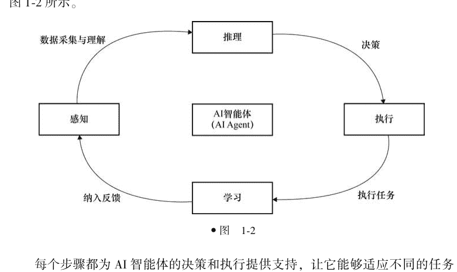

每个步骤都为 AI 智能体的决策和执行提供支持，让它能够适应不同的任务和环境，逐步实现自主工作。这个过程像一条无形的“思维”链条，从感知、推理到执行，再到学习，不断循环迭代，优化 AI 智能体的表现。AI 智能体的运作过程的详细讲解如下。

**1. 感知——数据采集与理解**

感知系统可以看作是 AI 智能体的“眼睛”和“耳朵”，AI 智能体通过感知来收集数据，理解周围环境。在实际应用中，感知包括从不同来源获取信息，例如用户交互记录、历史交易数据、网络活动，甚至来自其他 AI 智能体的反馈等。这一步骤为 AI 智能体提供了它理解世界的基础。

例如，一个电商网站使用 AI 智能体来推荐商品。AI 智能体首先通过感知收集关于用户的浏览历史、购买记录和搜索习惯等信息。这些数据帮助它对用户的兴趣和需求进行初步的判断，就像我们通过观察一个人的喜好来了解他的兴趣一样。

**2. 推理——分析数据并做出决策**

分析，判断最佳的行动路径。这一阶段，AI 智能体会根据既定的目标，利用已有的规则或模型来进行推理，计算出应该采取的最佳决策。

例如，在上述电商推荐场景中，AI 智能体通过对用户行为的分析，推理出某些商品可能会更符合用户的需求。它会权衡各种可能性，例如显示哪些商品最有可能被购买，哪些商品是用户尚未注意到的热门商品，或者哪些商品可以帮助增加用户购买频率。

**3. 执行——执行任务**

推理阶段完成后，AI 智能体决定了最佳的行动方案。接下来，它就会通过执行器（Actuator）采取实际的行动。对于物理机器人来说，这可能意味着通过电机控制来移动或操作物体；而对于软件 AI 智能体来说，它可能是执行某个操作，例如发送电子邮件、更新数据库，或是调整广告出价等。

延续电商推荐的例子，AI 智能体执行的任务是将个性化的商品推荐展示给用户。当用户登录网站时，系统会实时更新显示内容，让用户看到那些最相关的商品推荐。通过这种方式，AI 智能体在执行决策的同时，推动了用户的互动和产品销售。

**4. 学习——基于反馈不断优化**

每一个行动都会产生一定的反馈，这些反馈对于 AI 智能体来说至关重要。它们不仅能帮助 AI 智能体验证自己的决策是否正确，还能为未来的决策提供重要的信息。在这一环节，AI 智能体会根据反馈进行自我学习，不断调整和优化其策略，避免重复犯错。

例如，电商平台的智能体在执行推荐任务时，会收到用户的反馈。用户购买了推荐商品，或者单击了某个推荐链接，AI 智能体便会记录这些结果。这些行为告诉 AI 智能体它的推荐是否成功。如果智能体发现某些推荐没有带来预期的效果，它会根据这些数据进行调整，优化下次推荐的商品。通过这种自我反馈和调整，AI 智能体逐步提升了自己的决策能力和执行效果。

通过以上 4 步的循环过程，从感知到推理，再到执行、学习，不断循环迭代，优化 AI 智能体的表现。

### 1.4 常见 AI 智能体简介

在 AI 技术不断发展的今天，AI 智能体已逐步从技术概念落地为可操作、可复用的开发平台和产品框架。本书将重点聚焦 6 个在产业界与开发者社区中备

## 1. Coze——字节跳动生态中的 AI 智能体构建工具

Coze 由字节跳动推出，是一款面向零代码和轻量开发需求的 AI 智能体构建工具。它最大的特点在于对微信、飞书、钉钉等国内主流通信平台的深度整合，使得非程序员也能快速部署一个具备问答、记忆、调用外部插件能力的多轮对话智能体。Coze 官方网站如图 1-3 所示。

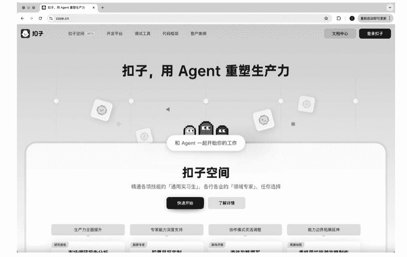

Coze 采用流程图形式管理智能体（Agent）行为逻辑，开发者可通过节点配置调用 API、执行函数或接入知识库。在接口能力上，支持函数调用（Function Call）、多工具调度，以及 LangChain 集成，使其在保持低门槛的同时也具备扩展能力。Coze 常见应用场景包括电商客服、企业知识助理、教育答疑机器人等。

## 2. Manus——多智能体协同的企业级 AI 智能体中枢

Manus 强调“多智能体协作”与“大模型调度”的能力，其目标是构建一个类“AI操作系统”的企业级AI智能体底座。它支持接入多个不同类型的模型，包括通用语言模型、私有垂类模型、搜索智能体、代码执行器等，通过工作流编排与上下文管理，实现任务的链式执行与多智能体协同。Manus官网如图1-4所示。

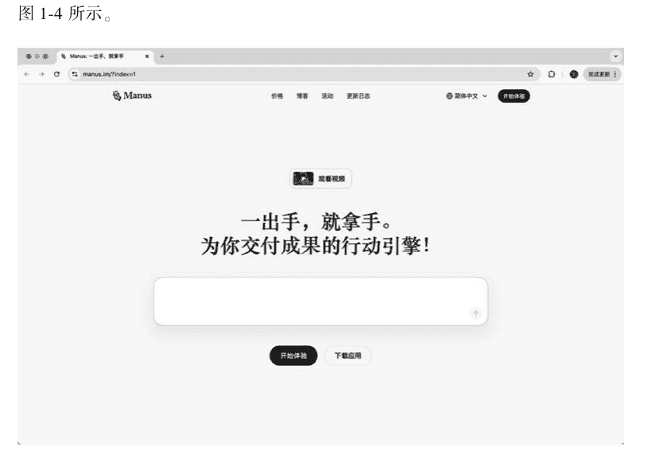

• 图 1-4

Manus提供了统一的事件总线、缓存机制与知识记忆体系系统，使得AI智能体之间可以共享任务状态与环境信息。例如在企业报告自动生成中，一个AI智能体负责数据分析，另一个负责文案撰写，最终输出结构化报告。其工程风格更偏向中大型企业的AI中台方案，强调稳态执行与多任务容错。

## 3. AgentScope——阿里巴巴提出的AI智能体运行框架

AgentScope是由阿里巴巴开发的一个智能体运行框架，具有强大的可扩展性和执行控制能力。该框架设计之初即面向多智能体系统（Multi-Agent Systems），专注于智能体的调度、生命周期管理与资源隔离等关键能力，适用于构建复杂的智能体网络和任务协作系统。

AgentScope的一大特色是其“行为计划生成器”（Plan Generator），支持根据自然语言任务目标动态拆解子任务，并智能分派给具备特定能力的子智能体。例如，旅行规划智能体可以调用地图搜索智能体、航班查询智能体和行程整理智能体等子智能体协同完成任务，实现任务的自动化与智能化分配。

AgentScope 适合开发者用于构建可组合、可监控、可持久化的大型智能体网络。AgentScope 位于研究型框架与工程化平台之间，既具备灵活性和实用性，又能满足实际应用中的高可用性与可扩展性，特别适用于智能体系统的原型开发与复杂任务建模。

## 4. LangChain——构建具备工具使用能力的智能体

LangChain 是 AI 智能体生态中最具影响力的开源框架之一，由 Harrison Chase 发起。它的核心在于提供了一套清晰的“链式执行”逻辑，即将大语言模型的输出作为下一个任务的输入，使得 AI 智能体具备流程控制能力。LangChain 的官网如图 1-5 所示。


• 图 1-5

LangChain 允许开发者将多个组件组合成复杂任务链，包括工具调用（如搜索、计算器等）、上下文记忆、外部数据库交互等。借助其“AgentExecutor”模块，可以实现在多种工具间灵活切换，使大语言模型不再局限于文本生成，而能主动完成具有目标导向性的任务。LangChain 适合场景涵盖自动摘要、多轮问答、编程助手、搜索聚合等。

## 5. Dify——面向私有化部署的智能体开发平台

Dify 强调可视化、即插即用与本地部署能力，适合希望构建自有智能体系统的中小型团队与创业者。其开发体验与 Notion AI 等协作工具相似，支持通过图形界面快速搭建聊天流程与智能体结构。Dify 的官网如图 1-6 所示。

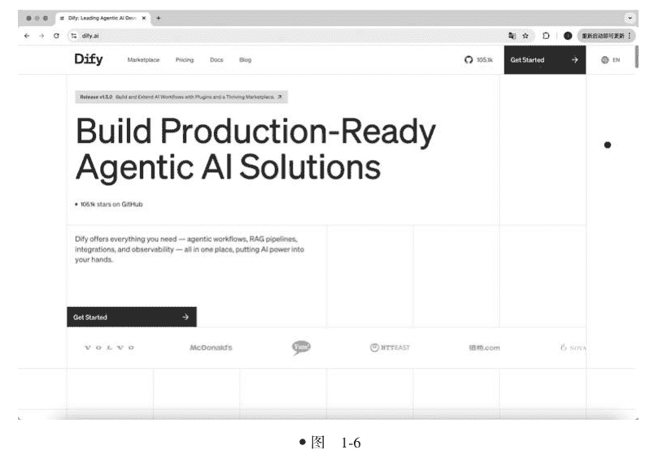

• 图 1-6

Dify 的核心亮点包括：支持模型与知识库的解耦设计，内置工作流引擎，原生支持 OpenAI、Azure、Claude 等主流模型 API，同时开放插件机制便于扩展。Dify 在中文社区发展迅速，不少开发者已基于其搭建客服助手、SaaS 平台助手、个性化搜索等原型系统。其对中文语料和工具链的良好适配，也使其在国内应用中具备实际优势。

## 6. OpenManus——面向开源社区的多智能体实验场

OpenManus 是 Manus 体系的开源实现版本，兼顾灵活性与实用性，适用于需要快速测试 AI 智能体交互机制与任务协作策略的开发者群体。OpenManus 的官方网站如图 1-7 所示。

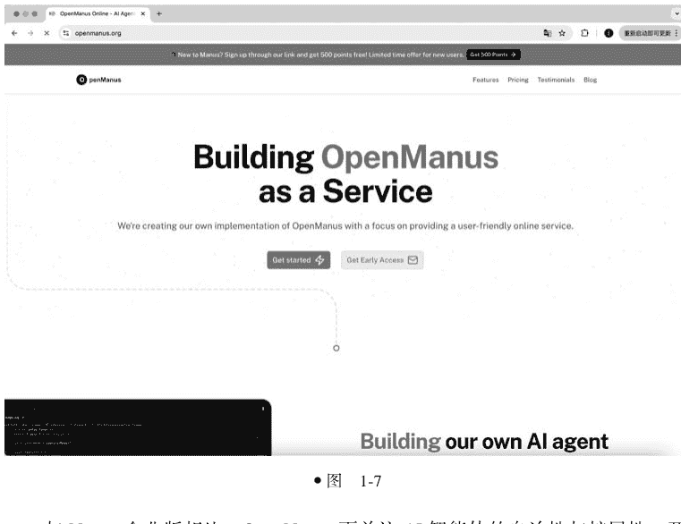

• 图 1-7

与 Manus 企业版相比，OpenManus 更关注 AI 智能体的自治性与扩展性。开发者可以使用 Python 快速定义 AI 智能体结构与行为模块，也可以接入自定义模型与任务引擎。其开源设计支持多人协作、数据回放与任务追踪等能力，适用于 AI 智能体竞赛、学术研究与教学演示等场景。

从低门槛的对话机器人构建工具到企业级的多智能体调度平台，从研究实验框架到商业化中台解决方案，这些 AI 智能体平台共同构成了当下 AI 智能体生态的关键支柱。

虽然以上列举的几个 AI 智能体平台的设计目标各不相同，但都围绕一个共同核心：赋予 AI 以“目标导向”和“行动能力”，使其从信息生成者成长为主任务执行者。这些平台的不断演进，正为开发者提供了一条通向更高智能系统构建的新路径，也为企业带来了超越传统自动化的生产力跃迁。

### 1.5 快速构建 AI 智能体的通用方法

AI 智能体不再是科研院所的专利，而是可由任何有基础开发经验的团队迅速构建与部署的智能系统。只需理解其核心结构，借助合适框架，明确任务目标，组织智能体结构，再通过少量工程手段包装，便能快速打造出在现实场景中具备落地能力的 AI 智能体原型。

### 1. 不是从零开始，而是模块化集成

构建一个 AI 智能体，并不意味着必须从零搭建复杂的深度学习模型或重新设计算法架构。当前 AI 智能体开发已经进入了“积木式”构建阶段。借助现成的框架、接口、模型和插件，可以像拼装工厂模块一样快速搭建出具备完整能力的 AI 智能体体系。整个过程并不神秘，核心在于以下 4 步：

- 1) 明确任务目标。
- 2) 选择合适框架。
- 3) 组织 Agent 结构。
- 4) 接入工具与接口。

这 4 步如同“思维骨架”，一旦建立，AI 智能体便能迅速发挥作用。

### 2. 明确任务目标

AI 智能体虽然强大，但不是万能的。成功的第一步，在于明确它要解决什么问题。例如，是为企业客户提供智能客服、为科研人员自动搜索文献？还是为产品经理自动撰写竞品分析？任务越清晰，构建成本越低，效果也越好。
常见任务场景及其适配智能体类型见表 1-2。

表 1-2

| 任务场景 | 智能体类型 | 主要能力要求 |
| :--- | :--- | :--- |
| 企业自动化客服 | 对话型智能体 | 多轮对话、意图识别、数据库调用 |
| 代码生成与优化 | 辅助编程智能体 | 代码理解、函数调用、语义补全 |
| 数据可视化与分析 | 分析型智能体 | 表格处理、图表生成、逻辑推理 |
| 文档整理与摘要 | 文本处理智能体 | 长文理解、摘要压缩、格式统一 |
| 多任务流程执行 | 调度型多智能体系统 | 任务规划、子智能体协同、记忆管理 |

通过明确目标，让开发者用更短时间搭建出可落地、可应用的原型。

### 3. 选择开发框架

当前流行的 AI 智能体开发框架众多，各有侧重。选择时应根据任务类型、接口需求、开发成本等综合考量。常见 AI 智能体开发框架优势描述及其适用场景见表 1-3。

表 1-3

| 开发框架名称 | 优势描述 | 适用场景 |
| :--- | :--- | :--- |
| 扣子 | 上手简单、支持流程式构建与企业微信无缝集成，官方托管省去部署成本 | 企业对话机器人、客户服务、轻量级助手、低代码定制 |
| Manus | 聚焦文档智能与企业知识管理，支持任务链编排和自动执行 | 智能报告生成、知识库问答、业务流程自动化 |
| AgentScope | 原生支持多智能体编排，具备环境模拟、策略执行与角色建模能力 | 智能体竞合仿真、策略研究、多主体博弈与科研实验场景 |
| LangChain | 文档丰富、模块齐全、支持多模态和工具调用 | 企业助理、RAG、文档问答等 |
| Dify | 提供可视化部署、支持私有化、前后端一体 | 快速上线 AI 助手、内嵌 SaaS 系统 |
| OpenManus | 强调文档驱动与流程自动化，可构建结构化决策链条与业务流程智能化 | 企业流程自动化、知识操作智能化、任务流水线管理 |
| CrewAI | 支持多智能体协同与角色扮演，具备任务分解、职责分工、行动同步等能力，适合构建复杂智能体团队 | 项目协作智能体、复杂任务智能体系统、研究型多智能体架构 |

如需构建一个通用办公助手，可选择 LangChain 结合 Dify 框架快速开发；如需多项目协作类型的智能体，可选择 CrewAI 加以扩展。

### 4. 组织智能体结构——思维链+工具箱+记忆体三位一体

一个真正实用的 AI 智能体，通常由以下 3 个关键结构组成。

#### (1) 思维链

思维链（Chain of Thought）即任务拆解与多步推理机制，确保 AI 不会“凭直觉瞎猜”，而是按步骤推进，构建方法包括提示词模板（Prompt Template）、动作计划（Planner）、思维分解（Decomposition）。例如，若用户输入“帮我查一下过去五年某公司的财报趋势”，AI 智能体应先规划步骤为“检索 → 解析 → 汇总 → 输出”。

#### (2) 工具箱

工具箱是 AI 智能体与外部世界互动的桥梁，可包含 API、数据库、Python 脚本、检索系统、日历系统等。常见集成方式如下：

- 1) 调用自定义函数（Function Calling）。
- 2) 使用插件（如 Dify、LangChain 工具）。
- 3) 执行本地脚本（如 Pandas 分析表格）。

#### (3) 记忆体（Memory）

AI 智能体若没有记忆，每次对话都会如初识。引入短期记忆与长期记忆（例如 Vector Store 等）后，AI 智能体可“记得住使用者习惯”“回忆过去任务”“积累领域知识”。

### 5. 快速开发流程

以下是通用的快速开发路径，适合个人开发者、中小团队甚至高校项目实践使用。

- 1) 选择平台或框架，如 LangChain + OpenAI/DeepSeek API 等。
- 2) 构建核心提示词模板，明确智能体身份、目标、输出风格等。
- 3) 接入工具，如 Python REPL、文件系统、第三方 API 等。
- 4) 接入记忆与检索系统，如 FAISS、Qdrant 等向量引擎。
- 5) 封装前端或接口，如 Gradio 界面、FastAPI 服务等。
- 6) 测试与优化，如分析失败案例、微调提示词、扩展插件等。

# 第2章 零代码搭建属于你的第一个智能体（以扣子为例）

## 2.1 扣子平台入门指南——零代码创造力工坊

在数字化浪潮日益澎湃的今天，AI 已经悄然走下高冷的象牙塔，融入寻常百姓的生活。人们不再满足于被动使用，而是渴望以更便捷、更直观的方式，亲手打造属于自己的智能工具。扣子（Coze）正是在这一背景下应运而生。

### 2.1.1 什么是扣子——可视化拖拽式智能体

#### 1. 扣子是什么？零代码创造力工坊

传统的智能体构建，需要工程师手动编写代码，通过调用 API、设计逻辑流程，才能实现语音识别、智能问答、智能推荐等功能。这一过程不仅专业门槛高，而且开发周期长。而扣子则打破了这一壁垒，提供了一种“可视化拖拽式”的开发体验。用户只需通过拖动模块、配置参数、连接节点，就可以像搭建积木一样，完成一个具备智能能力的系统搭建。用户无需精通编程，也不必掌握深奥的算法原理，便能完成智能问答、数据分析、内容生成等任务。扣子的官网如图 2-1 所示。
借助扣子提供的可视化设计与编排工具，用户可以通过零代码或低代码的方式，快速搭建出基于大模型的各类 AI 项目，满足个性化需求、实现商业价值。扣子平台主要分为如下两个应用：

- 1）智能体（Agent）：智能体是基于对话的 AI 项目，通过对话方式接收用户的输入，由大模型自动调用插件或工作流等方式执行用户指定的业务流程，并生成最终的回复。智能客服、虚拟伴侣、个人助理、英语外教等都是智能体的典型应用场景。

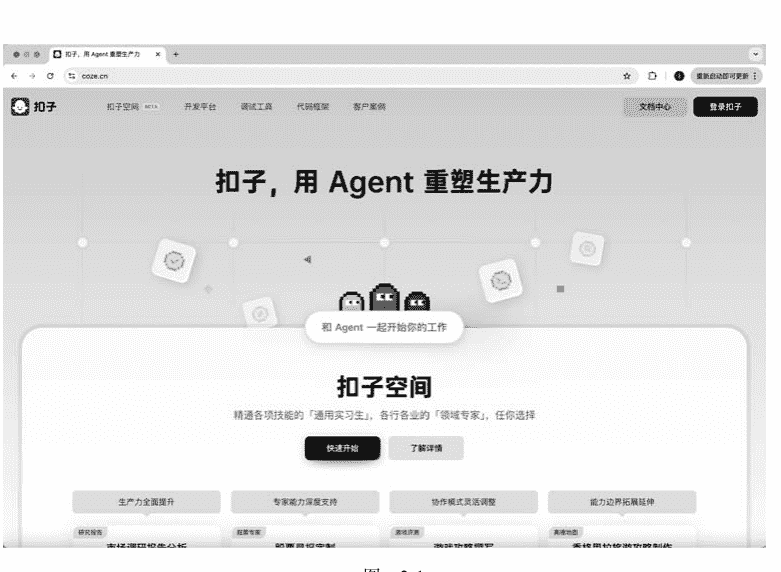

• 图 2-1

- 2）AI 应用：AI 应用是利用大模型技术开发的应用程序。扣子中搭建的 AI 应用具备完整业务逻辑和可视化用户界面，是一个独立的 AI 项目。通过扣子开发的 AI 应用有明确的输入和输出，可以根据既定的业务逻辑和流程完成一系列简单或复杂的任务，例如，AI 搜索、翻译工具、饮食记录等。

#### 2. 扣子的优势和特色

（1）扣子灵活的工作流设计
扣子的工作流功能专为处理复杂且对稳定性要求高的任务流而设计。提供了大量灵活且可组合的节点，包括大语言模型、自定义代码、判断逻辑等。无论编程水平如何，用户都可以通过拖拽的方式，轻松搭建出符合需求的工作流。例如，可以轻松创建一个撰写行业研究报告的工作流，让智能体生成一篇 20 页的研究报告。

（2）无限拓展的能力集
扣子通过集成丰富的插件工具，极大地扩展了智能体的能力边界。平台官方发布了多款功能强大的插件，用户可以直接将这些插件添加至智能体中。例如，通过使用新闻插件，智能体能够成为一个实时播报最新时事新闻的 AI 新闻播音员。此外，扣子还支持创建自定义插件，用户可以通过简单的参数配置将现有的 API 能力快速转换为插件供智能体调用。自定义插件还可以发布到商店，与其他用户共享，进一步推动社区的共同进步。

（3）丰富的数据源
扣子提供了直观且易于使用的知识库功能，帮助用户管理和存储数据，并允许智能体与这些数据进行交互。无论是庞大的本地文件还是实时更新的网站信息，都可以轻松上传至知识库。上传后，智能体便可使用知识库中的内容快速回答用户提问，从而实现精准的信息检索和高效的任务处理。

（4）持久化的记忆能力
扣子为 AI 赋予了持久化的记忆能力，使其能够长期保存并理解用户交互中的关键信息与参数。借助数据库功能，用户可以记录阅读笔记、书籍信息、阅读进度及个人注释等数据。通过这种方式，智能体可以查询数据库中的内容，为用户提供更精确、个性化的答案。这种持久化的记忆能力，不仅提升了扣子与用户的互动质量，还增强了智能体对复杂任务的处理能力。

#### 3. 典型应用场景

扣子的价值，不仅在于“易用”，更在于“实用”。扣子已经被广泛应用于多个领域，成为创业者、职场新人、大学生的新利器。

（1）智能客服系统
许多中小企业既苦于缺乏技术团队，又希望快速搭建一个在线客服。借助扣子，只需一名运营人员即可完成。从客户发问、AI 识别、调用知识库，到输出回复，全流程自动化处理，极大地降低了人工成本。

（2）教学助理机器人
在高校课堂上，学生可利用扣子构建属于自己的“学习助理”。例如制作一个“错题讲解助手”：学生上传错题图片，系统自动识别题目并生成解析，还能提供相似题训练。这种辅助学习方式，既高效又具趣味性。

（3）内容创作工具
自媒体创作者可以利用扣子搭建一个“多语种写作助手”，输入一段中文内容，系统可自动翻译并润色为英文、日文等，甚至为其配图、配标题，实现一站式内容生产。

### 2.1.2 扣子技术架构剖析

扣子的技术架构设计主要围绕两个核心目标：高可扩展性和多场景应用支持。平台架构分为多个层次，包括外部系统接口、AI智能体层和知识库管理层。这一结构能够支持不同规模和复杂度的业务需求，并且通过开放的API和插件机制，实现与其他系统的无缝对接。

#### 1. 扣子技术架构概述

平台的核心是其智能体，这些智能体可以执行各种自动化任务，如客户服务、数据处理、任务调度等。扣子通过多个工作区（Workspace）管理智能体的行为，同时支持定制化的插件开发和功能扩展。

扣子技术架构的设计是基于高度模块化和可扩展的原则，旨在为各类企业提供灵活且高效的人工智能解决方案。它采用了多层次的架构，以确保各项功能可以根据需求独立管理和集成。扣子技术架构简图如图2-2所示。

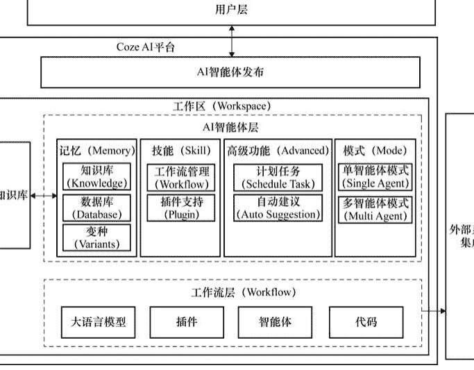

如图 2-2 所示，扣子涵盖了多个模块和层次。用户层位于架构的最上层，代表平台的最终用户。用户通过各种接口（如 Web、数字工作空间、社交平台等）与平台进行互动，使用扣子提供的服务。扣子支持将智能体发布到不同的消息平台（如 Slack、Discord 等），以及通过开放 API 与其他系统集成。用户可以在扣子平台创建多个工作区来管理不同的智能体、知识库和工作流。

AI 智能体层是核心部分，包含了多个模块，如记忆（Memory）、技能（Skill）、高级功能（Advanced）和模式（Mode）等，用于管理 AI 机器人的任务、技能和工作流。工作流层（Workflow）负责 AI 智能体的工作流设计和管理，支持大语言模型的集成，并允许通过插件来扩展 AI 的能力。工作流的设计支持任务的自动化处理和智能体的协作。外部系统与 AI 智能体层进行数据交换和协作，确保 AI 能够与外部数据源（如 CRM、数据存储等）进行有效的交互。

#### 2. 扣子平台架构解析

为了更好地理解扣子如何通过其平台及各项技术组件，提升服务效率，推动企业的智能化转型。接下来将深入解析扣子平台的技术架构、核心组件及其如何协同工作。

(1) 用户层
扣子的架构首先从用户层开始，用户通过多种方式与 AI 进行交互。这个层级允许扣子的服务在各种平台上运行，包括：

- 1) 数字工作平台：如 Lark、Slack 等，扣子与这些平台的集成使得它能够处理来自工作流、团队沟通等方面的请求。
- 2) 网站接口：通过 Web 接口，用户可以直接与扣子交互，无论是通过 PC 端还是移动端，提供了灵活便捷的使用方式。

(2) AI 智能体发布
扣子支持将 AI 模型部署到多种平台，包括 Slack 和 Discord 等。通过这些平台，扣子能够与用户进行互动，提供服务。为了实现高可扩展性，扣子还允许定制自己的 AI 聊天渠道，如 Live chat 和 Zalo OA 等。这些自定义渠道使得企业可以根据自己的需求进行更为灵活的 AI 部署。

(3) AI 智能体层
AI 智能体层是扣子架构的核心，负责执行所有与智能任务相关的操作。该层包含了对用户输入的处理、任务的执行以及智能响应的生成。该层的主要组件包括：

## 2.2 用扣子可视化界面创建你的第一个智能体

### 2.2.1 创建扣子账户与智能体配置

创建一个智能体的过程，起点并不复杂。只需进入扣子官网，就能开启一场智能创作的旅程。作为当前领先的“零代码”AI应用开发平台，扣子致力于将复杂的人工智能建模转化为一种人人可参与的创作活动。

1. 注册账户，开启创作工坊
进入官网首页后，可以看到简洁直观的页面设计。只需单击右上角的“登录扣子”按钮，便可通过手机号快速注册新账户。使用手机号快速注册新账户的步骤如图2-3、图2-4所示。


注册成功后，即可进入扣子的在线开发环境，无需下载任何本地软件，也不必配置烦琐的开发工具，所有操作均在网页中完成。

2. 新建智能体，从“名字”到“性格”一步到位
在扣子的控制台页面，单击“Create Bot”或“创建智能体”按钮，将进入智能体的配置界面。系统会引导用户设定一系列基础信息，包括智能体的名称、角色设定、头像形象以及语言风格等。

这些设定共同构成了智能体的“表层个性”。名称是其对外展示的标签，头像则代表了视觉形象，而角色描述决定了其对话语气和服务领域。例如，选择“客服型”角色，系统将预设出一套礼貌、专业的语言模板；选择“生活助理”，则更偏向轻松、实用的交流方式。

3. 欢迎语和初始引导，建立用户第一印象
智能体的第一句话，往往决定了用户的第一印象。扣子支持自定义欢迎语，这些欢迎语可以在每次用户启动对话时自动出现。无论是温暖的问候语、简明的功能介绍，还是充满创意的自我介绍，皆可通过简单编辑完成。

例如：

> Hi，这里是每日新闻播报站，想了解哪方面资讯？
> 欢迎来到影迷 AI 空间，最近的高分电影要不要了解一下？

同时，平台也允许用户上传专属头像，或选择内置的卡通图像，进一步提升交互的亲切感和识别度。

4. 选择语言与平台生态，实现跨界互动
扣子支持多语言环境，包括中文、英文在内的主要语种，满足不同文化背景用户的沟通需求。更重要的是，平台已开放与多个主流社交平台的对接，包括 Discord、微信公众号、飞书等。这意味着，构建完成的智能体不仅可以在扣子内部运行，还能“一键部署”到常用聊天平台中，成为公众号客服、企业机器人、学习助手、社群管理工具等多种角色。

部署方式十分友好，只需绑定平台账号、授权接口调用，即可完成“上线”流程。对于希望将智能体用于实际应用场景的用户而言，这种一站式的部署机制，大大缩短了从“开发”到“落地”的时间。

5. 是否公开、是否可嵌入，由开发者自由决定
在配置选项中，还可以设置智能体的可见性。若仅用于个人测试与学习，可选择“私有模式”，系统不会向他人展示该智能体；而若希望将其作为产品服务发布，则可设为“公开模式”，并生成访问链接或嵌入代码，供他人调用或嵌入网页中使用。

扣子提供标准 HTML 代码片段，可直接嵌入博客、网页、商城、校园网平台等场景中，让每一个网页都瞬间拥有“会思考”的入口。

### 2.2.2 用扣子模板一键生成 AI 助手

在人工智能日益普及的今天，AI 助手已经不仅仅是大企业的专属工具。无论是大学生、初级程序员，还是初创企业的创始人，都可以轻松创建属于自己的智能体。而这一切，只需要借助扣子提供的模板功能，便能迅速完成。

1. 什么是模板
传统意义上的 AI 开发，往往需要掌握大量的编程语言、机器学习框架、数据训练技巧以及熟悉模型部署的流程。对于缺乏技术背景的用户而言，这无疑是一个高门槛的挑战。

模板的出现，彻底改变了这一现状。扣子平台通过预先封装好的智能体和应用模板，将复杂的编程逻辑、工作流设计以及大模型接入，变成了一个个可以直接复用的功能模块。只需简单配置，便能快速拥有一个功能完善的 AI 助手。

2. 模板的分类与功能定位
进入扣子的模板市场，可以发现平台将模板清晰地划分为多个应用类别：

- 1) 智能客服：适用于企业客户服务、用户咨询等场景。
- 2) 营销创作：涵盖 SEO 文章生成、广告文案撰写等。
- 3) 信息处理：包括 PPT 生成、文档改写、内容总结等。
- 4) 学习辅导：提供作业批改、语言学习、口语训练等支持。
- 5) 智能陪伴：如儿童聊天伙伴、心理辅助机器人等。

每一类模板都围绕特定的功能需求展开，并内置了适配的工作流与语言模型。

3. 从模板开始——创建 AI 助手的完整流程
(1) 进入模板中心
在扣子平台主界面，选择侧边栏中的“模板”入口。页面展示了当前平台内热门与推荐的模板集合。每个模板卡片上都清楚地标明了用途类别、功能描述以及被复制和使用的次数。

以“智能客服助手”为例，该模板专为客服场景设计，能够实现多轮对话、常见问题解答以及用户引导功能。如图 2-5 所示，单击“模板”→“智能客服助手”，进入“智能客服助手”详情页面。

(2) 选择模板并复制到个人空间
如图 2-6 所示，进入“智能客服助手”详情页面，单击“复制”按钮，即可复制到个人空间。

(3) 预览与调试
如图 2-7 所示，复制到个人空间后，进入“预览与调试”页面，按照自身业务实际需求进行对话流配置。扣子提供的调试环境支持输入多轮对话，以验证工作流是否按照预期运行。

(4) 发布与部署
单击图 2-7 中的“预览与调试”页面右上角的“发布”按钮，进入“发布”页面，选择合适的发布平台，如图 2-8 所示。


• 图 2-5

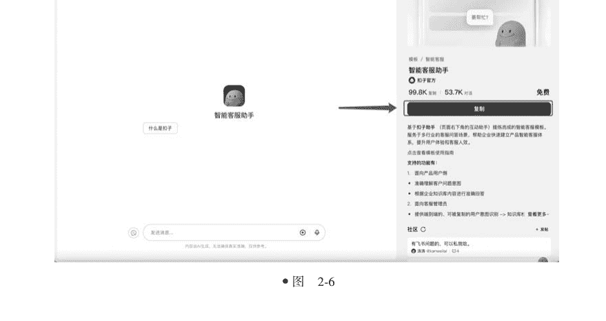

• 图 2-6

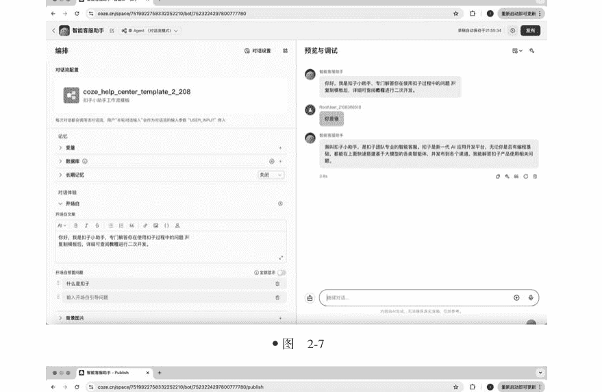

● 图 2-7

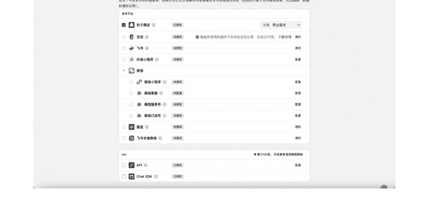

● 图 2-8

同时，扣子平台还提供了详细的数据分析面板，跟踪用户使用行为、查询意图分布、响应准确率等，为后续的优化提供支持。

## 2.3 开发自定义扣子智能体实战

### 2.3.1 扣子平台变量的应用与操作指南

在扣子开发平台中，变量的设计和使用是智能体开发中的核心部分。通过灵活运用系统变量和用户变量，开发者能够有效存储和管理智能体与用户交互中的动态数据，从而提高智能体的响应能力和个性化服务水平。以下内容将详细讲解如何利用这些变量类型来满足不同的业务需求。

1. 变量的基本定义
变量在智能体中扮演关键的角色。它们使得智能体能够根据用户的需求和互动情况灵活调整回答的内容，提供个性化的体验。扣子平台支持两种类型的变量：系统变量和用户变量。
1) 系统变量：由平台预设并自动管理的数据类型，通常与用户的基本信息和行为相关。例如，用户的实时位置、飞书群组 ID、视频通话的图像数据等。
2) 用户变量：用户在使用智能体过程中产生的个性化数据，如用户的语言偏好、昵称等。这些变量是可读可写的，并且支持在不同会话中持久化存储。

2. 系统变量
系统变量是扣子平台为智能体预设的数据项，它们在用户与智能体的互动过程中自动获取，并且通常具有只读属性。系统变量可以帮助开发者快速获取关于用户或使用场景的关键信息。
(1) 用户信息类
用户信息类的常见变量如下：
1) sys_uuid：扣子账号的唯一标识符，结合用户的账户和智能体的 ID，用于追踪用户的行为。
2) sys_longitude 和 sys_latitude：用户的实时经度和纬度，常用于基于位置的服务（如基于地理位置的推荐等）。
3) sys_lat_lon 和 sys_lon_lat：用户的地理位置信息，纬度和经度的不同排序。
(2) 飞书相关变量
飞书相关的常见变量如下：
1) sys_lark_chat_id：飞书群组的 ID，智能体可以基于此获取群组的消息。
2) sys_lark_open_id：飞书用户在应用内的身份 ID，帮助智能体识别用户身份并提供定制化服务。
(3) 音视频相关变量
音视频相关的常见变量如下：
1) sys_voiceprint_name：声纹识别中的名字，用于标识说话人的身份。例如，通过此变量，智能体可以根据不同的身份提供差异化服务。
2) sys_images：在视频通话中抽取的图片，通过此变量，开发者可以访问和使用视频画面中的关键信息。

通过启用相关的系统变量，智能体能够获得更加精准的用户数据，并根据这些数据进行个性化的服务调整。

3. 用户变量
与系统变量不同，用户变量由开发者根据业务需求进行配置，且在用户每次与智能体交互时都可读取和修改。这些变量通常用于存储用户的个人信息或特定的交互历史，帮助智能体提供更加符合用户需求的服务。

(1) 用户变量的创建与配置
创建用户变量非常简单。在智能体的编排页面，找到“记忆”→“变量”，单击“+”按钮即可创建新的变量，如图 2-9 所示。

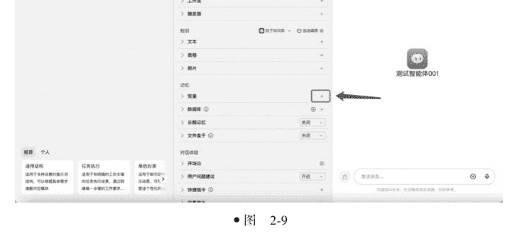

需要注意，变量名必须唯一，且描述应准确反映其用途。例如，可以创建一个名为 username 的变量，用于存储用户的昵称。填写名称后单击“保存”按钮即可创建变量成功，如图 2-10 所示。

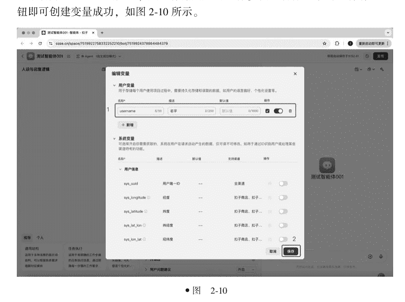

● 图 2-10

(2) 用户变量的使用
一旦创建了用户变量，在工作流或插件配置中即可引用。例如，如果需要智能体根据用户提供的名字进行个性化称呼，可以在“人设与回复逻辑”设置提示词为“回复问题时候，称呼你的用户为{{username}}”。用户变量的使用方式如图 2-11 所示。
在与智能体的对话过程中，用户输入的名字将被自动存储到 username 变量中，后续每次交互时，智能体都会使用该名字进行称呼。

(3) 用户变量的生命周期管理
用户变量的值在每个会话结束时持久化存储，并可以在下次对话中被使用。如果用户更新了信息，变量值也会被更新。例如，当用户在对话中更新了其昵称，智能体会自动将新的昵称存储在 username 变量中，以保证后续交互中的一致性。

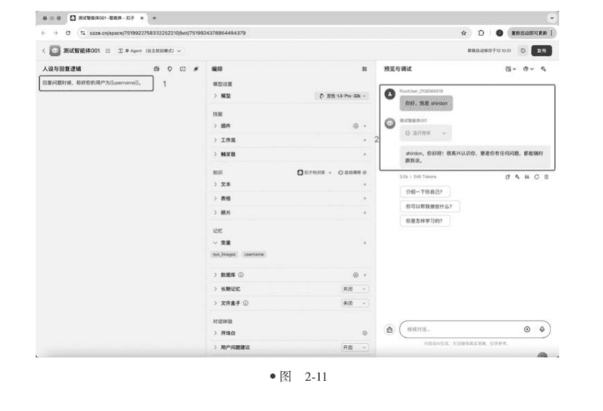

● 图 2-11

4. 系统变量与用户变量的协同使用
在实际应用中，系统变量和用户变量的配合使用能进一步提升智能体的灵活性。例如，开发者可以结合系统变量和用户变量来处理更加复杂的业务逻辑：

- 1) 情感陪伴型智能体：根据用户的情绪波动（通过用户变量记录）和位置（通过系统变量获取）来提供实时的鼓励和建议。
- 2) 客户支持型智能体：通过 sys_lark_open_id 识别用户身份，并结合用户历史交互记录（保存在用户变量中），为每位客户提供个性化的服务建议。
- 3) 位置感知型智能体：结合 sys_lat_lon 获取用户实时位置，同时利用用户变量存储用户的偏好设置，提供基于位置和偏好的推荐。

5. 开发与发布
在创建和配置智能体的过程中，用户可以根据具体的业务场景，选择合适的变量类型和工作流配置。通过将系统变量与用户变量巧妙结合，智能体可以实时响应用户需求，提供更加精准和高效的服务。在智能体的发布过程中，开发者可以选择将其发布到不同的渠道，如微信、飞书、抖音等，进一步扩大其应用范围。

### 2.3.2 为扣子智能体添加数据库实战

在智能体开发中，数据的管理和操作至关重要。扣子平台提供了一种高效的方式来管理和处理结构化数据，开发者可以通过自然语言、工作流、插件等方式方便地插入、查询、修改或删除数据库中的数据。通过灵活的数据库功能，智能体能够根据用户的需求和偏好，实时更新数据并提供个性化的服务。

1. 数据库概述
扣子平台的数据库功能类似于传统软件开发中的数据库。它采用表格结构存储数据，适合存储和管理如客户信息、订单记录、产品列表等结构化数据。开发者和用户都可以根据需求与数据库进行交互，而数据表则支撑着智能体与用户的交互。

数据表支持两种查询模式：

- 1) 单用户模式：此模式下，开发者和用户都可以向数据表中添加记录，但只能读、修改、删除自己创建的记录，且这些记录只能来自同一渠道。
- 2) 多用户模式：此模式下，开发者和用户都可读、写、修改、删除表中来自同渠道的任何数据，数据访问权限由业务逻辑控制。这种模式非常适合需要共享数据的场景。

2. 系统支持的数据表操作

(1) 创建数据表
创建数据表是使用扣子数据库的基础步骤。在智能体的编排页面，找到“记忆”→“数据库”，单击右边的“+”按钮即可创建新的变量，如图 2-12 所示。

如图 2-13 所示，在弹出的新窗口中，分别单击“新建数据表”→“自定义表格”按钮创建数据表，在弹出的新窗口中，选择“创建扣子数据库”，填写“数据表名称”，然后单击“确认”按钮。

(2) 字段配置与数据类型
每个字段都可以根据实际需求设置名称、数据类型及是否为必填字段。系统会根据选择的数据类型处理和保存数据。字段名称需符合特定规则，通常由小写字母、数字或下画线组成，且最大长度为 64 字符。

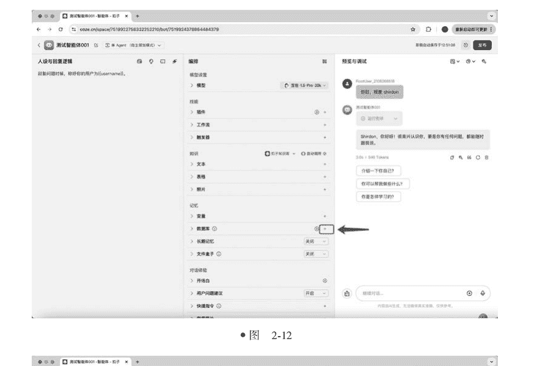

● 图 2-12

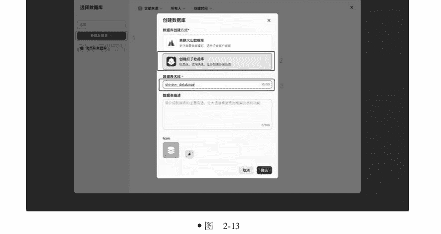

● 图 2-13

3. 数据表的操作与管理
(1) 数据操作
在扣子平台中，开发者可以使用类似于 SQL 的自然语言查询（NL2SQL）操作数据表。这使得开发者能够通过简洁的语言或代码来管理数据。通过这种方式，开发者可以高效地查询和更新数据表中的内容，简化了传统数据库管理的复杂度。

(2) 调试与预览
数据表创建完成后，开发者可以在智能体的编排页面进行测试，实时查看数据表中的内容。这样可以及时发现数据输入或查询中的问题，确保数据管理的高效性和准确性。

### 2.3.3 为扣子智能体添加插件实战

在智能体的构建过程中，插件作为一种功能扩展工具，极大地增强了智能体的能力。通过添加各种插件，开发者可以为智能体赋予处理特定任务的能力，无论是查询新闻、处理图像，还是进行高效的办公任务。扣子平台为开发者提供了丰富的插件类型，支持多种 API 和多模态模型，帮助开发者灵活应对各种应用需求。

1. 插件的作用和使用场景
插件是扣子平台的重要组成部分，它们是由一个或多个工具（API）构成的，可以显著扩展智能体的功能。通过这些插件，智能体不仅能够处理文本信息，还可以进行多模态处理（如图片、视频等），甚至支持与外部系统交互。插件非常适用于以下应用场景：

- 1）新闻搜索插件：让智能体能够自动搜索并汇报最新新闻，适用于资讯类智能体。
- 2）旅游出行插件：为智能体添加出行安排功能，如航班查询、酒店预订等。
- 3）效率办公插件：增加智能体的工作效率功能，如日程管理、邮件处理等。
- 4）图片理解插件：为智能体赋能图像识别和理解能力，能够分析并处理图像数据。

通过将这些插件集成到智能体中，开发者能够快速赋予智能体强大的能力。

2. 如何在智能体中添加插件
为了使智能体能够更好地处理复杂任务，开发者可以按照以下步骤将插件添加到智能体中。进入工作空间，选择目标工作空间。如图 2-14 所示，在项目开发页面中选择智能体，进入编排页面。找到“技能”→“插件”，单击插件区域右侧的“+”图标。

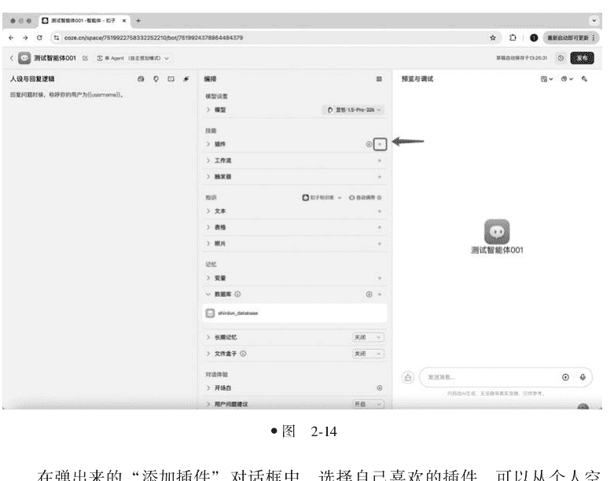

● 图 2-14

在弹出来的“添加插件”对话框中，选择自己喜欢的插件，可以从个人空间、团队空间或插件商店中挑选已发布的插件。如果现有插件不符合需求，还可以创建自定义插件。如图 2-15 所示，本书选择“链接读取”插件，单击“添加”按钮即可添加成功。

3. 插件的高级功能与扩展
(1) 绑定消息卡片
在某些客户端（如豆包、飞书等）中，智能体不仅仅是返回简单的文本信息，还可以以消息卡片的形式展示内容。开发者可以通过绑定插件功能，将工作流的结果转化为消息卡片，提供更丰富的交互体验。例如，智能体可以在查询天气时，不仅返回天气文本，还可以展示天气图标、温度、风速等信息，以卡片的形式呈现给用户。

## 第 2 章 零代码搭建属于你的第一个智能体（以扣子为例）

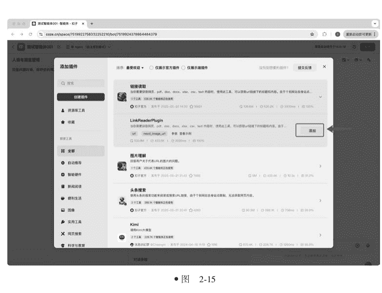

（2）删除不必要的插件
如果智能体在开发或测试过程中不再需要某个插件，开发者可以轻松地将其从智能体中删除。删除插件不会影响其他插件或功能的使用，开发者可以根据实际需求进行调整。

## 4. 插件实际应用示例

（1）旅游智能助手
在创建一个旅游智能助手时，开发者可以为智能体添加旅行出行相关的插件，如航班查询、酒店预订、景点推荐等。通过调用这些插件，智能体能够帮助用户规划旅行行程。例如，用户可以通过与智能体对话，获取最新的航班信息，或根据兴趣推荐旅游景点。

（2）智能教育导师
在构建一个智能教育导师时，开发者可以为智能体添加多种学习辅助类插件，如课程检索、题库练习、知识点讲解和学习进度分析等。通过调用这些插件，智能体能够根据学生的学习水平和目标，提供个性化的学习方案。例如，学生可以直接向智能体提问“帮我制订一份两周的英语单词学习计划”，智能体即可自动调用课程与题库插件，生成每日学习任务；或通过知识点讲解插件，对学生不理解的语法难点进行详细解释。

### 2.3.4 为扣子智能体添加知识实战

扣子平台的知识库为智能体提供了强大的知识管理和检索能力，能够有效解决大语言模型“幻觉”和专业领域知识匮乏的问题，显著提升智能体回复的准确性。通过知识库，智能体能够将外部数据源的内容进行存储，并在需要时进行高效的检索，为复杂查询提供专业的解答。

### 1. 知识库的核心功能

扣子的知识库具有两个主要能力：数据管理与存储能力，以及增强检索能力。通过这两个能力，开发者可以在智能体中引入来自多个外部数据源的信息，并通过智能化的检索方式获取相关数据。

- (1) 数据管理与存储能力
扣子的知识库允许开发者上传多种格式的数据，如本地文件、在线数据、Notion、飞书文档等。这些外部数据在上传后，平台会将内容自动切分为多个片段进行存储。这些内容片段不仅便于存储与管理，还能够提高检索效率。
开发者可以根据实际需求设置自定义的分片规则。可以通过分段标识符、字符长度等方式将内容切割为更小的片段，确保信息在后续检索时的高效性与精确度。例如，若有一份包含大量文章的文档，可以按章节或者段落划分内容，使得每个片段都具有独立的查询价值。

- (2) 增强检索能力
为了提升对存储数据的检索效率和精准度，扣子知识库引入了全文检索功能，用户可通过关键词快速定位相关内容片段。通过这种方式，智能体可以高效地从大量存储的数据中提取相关信息，生成准确的回复内容。
例如，当用户询问某个特定话题时，智能体能够通过检索知识库中存储的片段，回溯出与问题相关的资料，确保给出的答复具有高度的专业性和准确性。

### 2. 如何为智能体添加知识库

为智能体添加知识库能够显著提高其回答的准确性和专业性。在扣子平台上，开发者可以将扣子知识库和火山知识库结合使用，为智能体提供全面的知识支持。添加知识库的操作步骤如下：

进入工作空间，选择目标工作空间。如图 2-16 所示，在项目开发页面中选择智能体，进入编排页面。找到“知识”→“文本”，单击插件区域右侧的“+”图标。

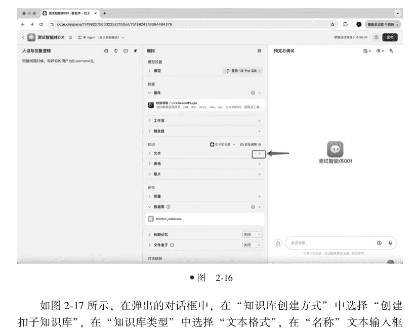

● 图 2-16

如图 2-17 所示，在弹出的对话框中，在“知识库创建方式”中选择“创建扣子知识库”，在“知识库类型”中选择“文本格式”，在“名称”文本输入框填写合适的名称，在“导入类型”中选择“本地文档”，最后单击“创建并导入”按钮。

如图 2-18 所示，在新跳出的页面中，上传自己的文件，按照系统默认的提示完成配置，即可完成添加知识库的步骤。

### 3. 知识库的应用场景

（1）智能助手

假设为一个智能助手创建知识库，管理员可以上传用户手册、常见问题解答、技术文档等。这些内容上传到知识库后，智能助手能够高效查询并回答用户提问，极大提高客户支持效率。

44 从 0 到 1 搭建 AI 智能体：Manus+LangChain+Dify 多平台应用及多智能体协同

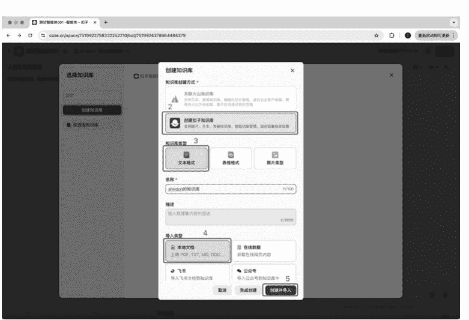

• 图 2-17

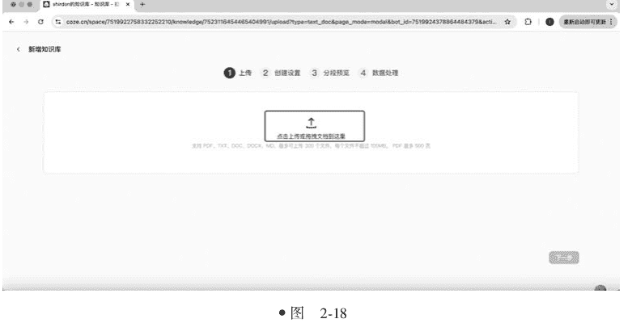

• 图 2-18

（2）专业领域智能体
在法律、医学等专业领域，智能体需要获取行业相关的专业知识。通过将大量法律条文或医学文献上传到知识库，智能体可以快速准确地回答涉及复杂法律或医疗问题的查询，避免大模型回答出现“幻觉”现象。

（3）知识库的扩展性

扣子知识库不仅支持文本和表格数据，还支持照片和其他多模态数据。通过知识库，智能体能够更好地理解和处理图像、表格等非文本数据。例如，开发一个带有图片分析能力的智能体，上传包含图像的数据集后，智能体可以根据图像内容提供智能解读或分析。

### 2.4 【实战】用扣子搭建 AI 工作流

在扣子平台中，用户可以通过以下步骤创建基于 DeepSeek 的工作流。

（1）创建智能体

登录账号，如果没有注册账号，则会自动注册，进入扣子首页。单击左上角的加号，位于图 2-19 中的方框 1 位置，再选择“创建智能体”选项，单击“创建”按钮，如图 2-19 所示。

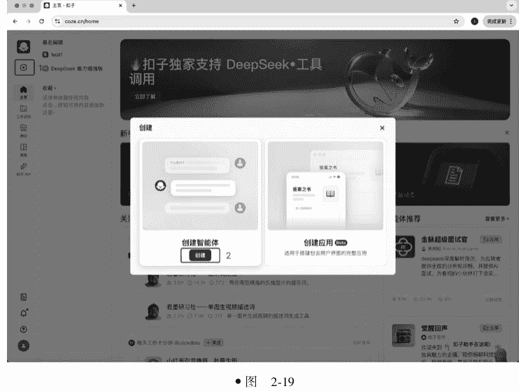

• 图 2-19

再填写“智能体名称”和“智能体功能介绍”（可以不填），然后单击“确认”按钮完成智能体创建，如图 2-20 所示。

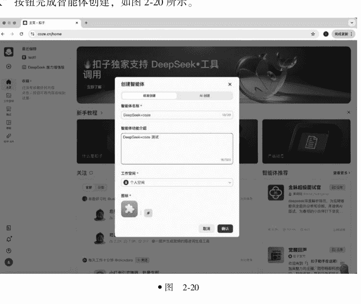

• 图 2-20

（2）创建新工作流
进入智能体详情页面，找到位于页面中间的“技能”→“工作流”选项，单击右边的加号“+”图标，弹出对话框，如图 2-21 所示。
单击对话框左上角的“创建工作流”，在弹出的对话框中输入工作流名称和工作流描述，如图 2-22 所示。

（3）添加节点
在工作流中添加不同的节点，例如，如果想添加大模型节点，则单击“添加节点”按钮，选择“大模型”选项，如图 2-23 所示。

（4）配置节点模型为 DeepSeek-R1
双击中间的大模型对话框，右边则会弹出“大模型”节点的参数设置对话框。在“大模型”节点的“模型”选项中，选择“DeepSeek-R1”，完成大模型配置，如图 2-24 所示。

## 第 2 章 零代码搭建属于你的第一个智能体（以扣子为例）

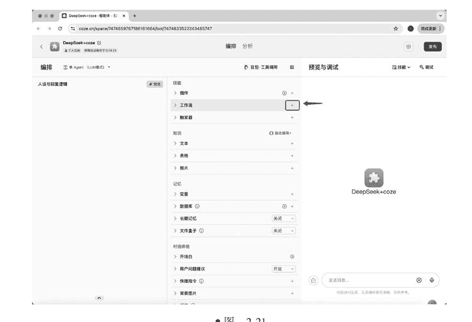

• 图 2-21

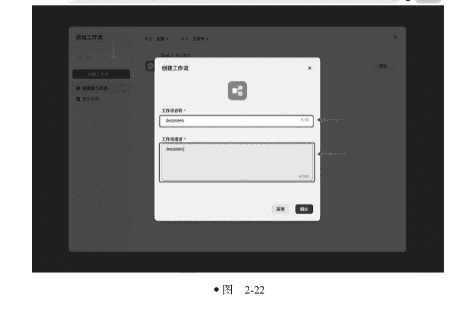

• 图 2-22

48 从 0 到 1 搭建 AI 智能体：Manus+LangChain+Dify 多平台应用及多智能体协同

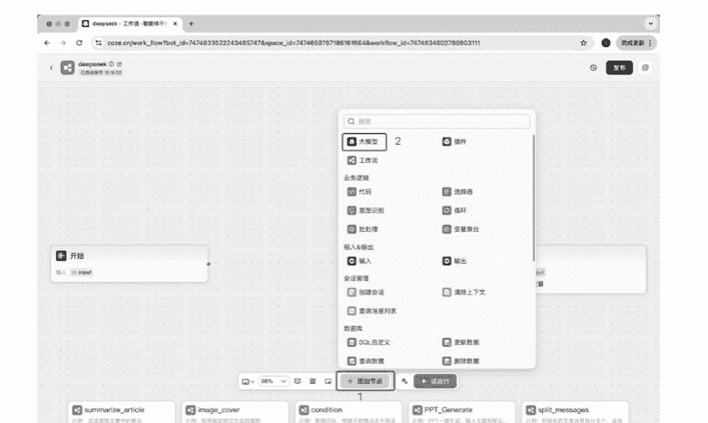

• 图 2-23

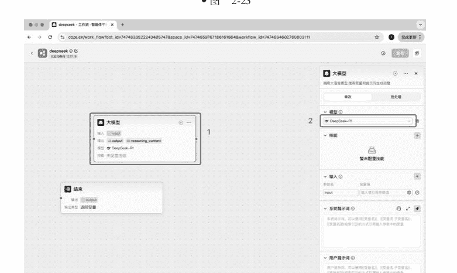

• 图 2-24

（5）连接节点
按照流程，将各个节点连接起来，形成完整的工作流，如图 2-25 所示。

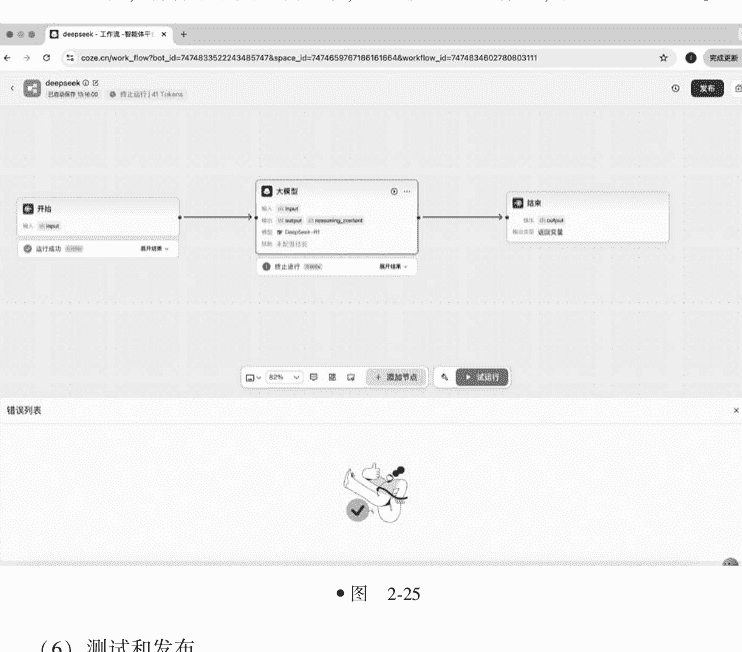

• 图 2-25

（6）测试和发布
工作流搭建完毕后，可以单击“试运行”按钮进行测试，确保每个环节工作正常，如图 2-26 所示。
测试通过后，即可单击右上角的“发布”按钮，在弹出的对话框中填写版本号和版本描述，再单击对话框中的“发布”按钮将工作流发布，供实际使用，如图 2-27 所示。
通过以上步骤，即使没有编程基础的用户，也能在扣子平台上创建出功能强大的 AI 工作流，实现信息的自动化处理和输出。

50 从 0 到 1 搭建 AI 智能体： Manus+LangChain+Dify 多平台应用及多智能体协同

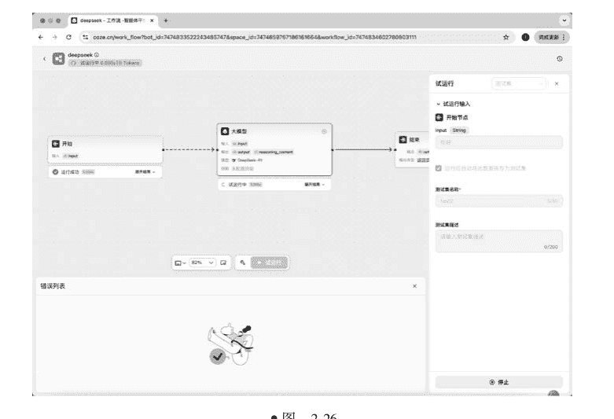

● 图 2-26

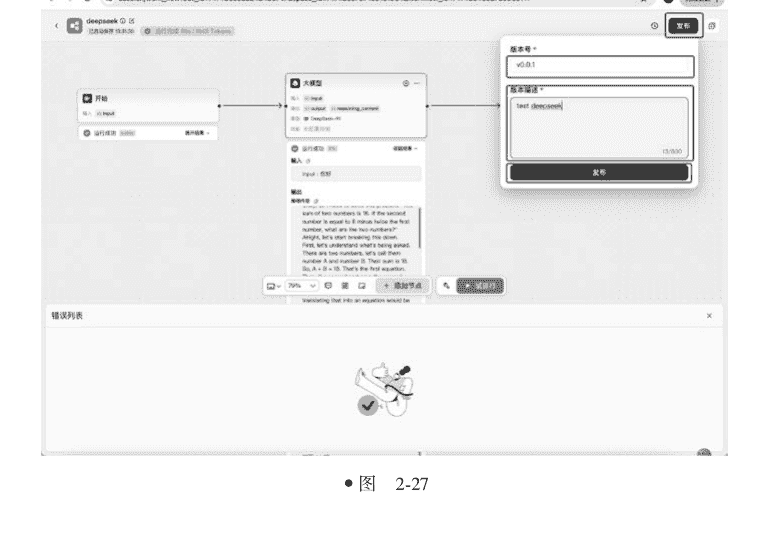

● 图 2-27


# 第3章 Manus高效应用实战

## 3.1 什么是 Manus

人工智能的发展从最初的对话式助手，逐渐演变为具备更高自主性和任务执行力的智能体。Manus，正是这一技术浪潮中涌现出来的新一代通用 AI 智能体。Manus 不仅仅是一个会聊天的工具，更是能够独立思考、自主行动、持续执行复杂任务的数字智能体。Manus 的官方网站如图 3-1 所示。

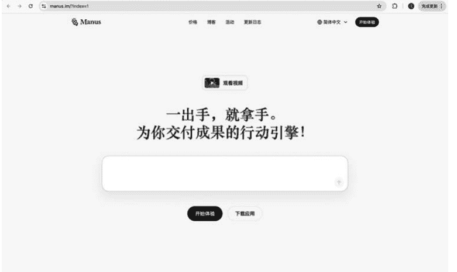

• 图 3-1

与传统的 AI 产品相比，Manus 不再局限于单一的文本处理或简单的自动回复。Manus 代表了一种全新的工作模式。更准确地说，它是一种具备自驱动工作流能力的数字员工，能够根据指令自动规划任务、协调工具、执行流程，并在完成任务的过程中持续进行自我调整和优化。

Manus，这个名字源自拉丁文，意为“手”。这并非偶然，而是它的使命写照。与只能聊天的语言模型不同，Manus 更像是一位“数字执行官”——它不仅理解指令，还能亲自完成任务。只要目标明确，它会自动规划流程、调用工具、执行操作，并最终产出成果，无需人工手动干预或盯着屏幕等待。

比起传统的聊天机器人，它更像一个具备自主思维和动手能力的“数字劳模”，能够独立在云端运行，静悄悄地把复杂事务逐步拆解并落地完成。

### 1. 多智能体的高效工坊

#### (1) 多智能体协作

Manus 并不是一个“超级大脑”独自运转，它的设计理念更接近一个高效分工的智能工坊。在这个工坊中，每个子智能体都有自己的职责：有的擅长信息检索，有的擅长逻辑推理，有的则负责代码编写或数据分析。主控智能体会根据任务的内容进行分派，各个模块协同配合，从理解需求到最终执行，每个环节都紧密衔接。

#### (2) 弹性语言模型调用

为了提升任务的完成质量，Manus 后台会根据实际需求灵活调用不同的语言模型。例如，在撰写内容或处理复杂推理任务时，Manus 会优先使用 Claude 3.5/3.7；处理中文业务场景时，则可能调用阿里巴巴的 Qwen 系列模型。这样的组合，确保了效率与准确率并重，避免“千篇一律”的输出风格。

#### (3) 云端异步执行

Manus 的执行环境设在云端，不受本地网页状态限制。一旦任务启动，即便用户关闭网页或中断网络，它也会在后台默默工作。当任务完成后，系统会自动发送通知，用户可随时查看结果。这种模式特别适合长周期任务或批量处理，节省时间成本。

#### (4) 多工具接入能力

Manus 能自动使用浏览器插件、读取或生成 Excel 文件、操作 API 接口、运行代码，甚至可以跨系统调度多个平台任务。对普通用户而言，这些操作往往需要复杂的手动流程，而在 Manus 看来，只是计划清单上的几个“动作”。

### 2. 把想法变成产品，只需一条指令

(1) 智能招聘助手
在一个 HR 场景中，如果要从几十份求职简历中筛选出匹配岗位的人才，传统方式往往依赖人工阅读、比较和表格记录。Manus 可以直接读取上传的简历文档，提取关键经历与技能信息，结合职位描述自动匹配打分，并输出一份结构清晰的 Excel 排行榜。这种效率，让招聘流程从“几小时”缩短为“几分钟”。

(2) 自动化研究报告生成器
设想有创业者想了解某家新能源车企近期的市场走势。他只需输入一个任务，例如“分析特斯拉近半年股价变化并判断市场情绪”，Manus 会自动抓取权威财经网站的历史数据，结合新闻评论进行语义分析，生成带图表、趋势曲线、文本解释的完整报告。这一过程不再依赖数据分析师和文案编辑的分工，而是由一个智能体打包完成。

(3) 一站式建站助手
一位设计专业的学生希望拥有一个在线作品集网站，但对编程一窍不通。Manus 可根据她提供的简介和图片素材，自动生成页面排版、样式风格和展示逻辑，撰写 HTML/CSS/JavaScript 文件，搭建服务器，部署上线，并给出访问链接。从输入到上线，全流程无需写一行代码。

### 3. 技术底层的本质

从技术结构来看，Manus 并非只是一个大语言模型的简单包装，而是一个由多组件协同驱动的智能系统。它的核心由三个主要部分构成：

- 1) 认知引擎：理解任务的目标和意图，具备自然语言理解（NLU）和上下文建模能力。
- 2) 规划与决策模块：根据任务需求，动态生成多步工作流，能够自动拆解任务，规划依赖顺序，并在执行过程中进行调整。
- 3) 执行智能体系统：与各种外部工具无缝集成，例如网页浏览器、数据库管理系统、代码编辑器、API 接口等。具备多模态处理能力，能够处理文本、图像、代码等多种数据。

这种结构，使得 Manus 不仅能够完成一次性的对话任务，更能够承担类似人类助理或运营专员的工作职责。例如，假设一家公司希望筛选出 100 份简历中最符合 Java 开发岗位的人才。传统的做法，往往需要 HR 人工逐份阅读，或者借助一些基础的关键词匹配工具。而使用 Manus，只需上传所有 PDF 或者 docx 格式的简历，并简单描述筛选标准，比如“5年以上Java开发经验，熟悉Spring框架，参与过大型分布式系统开发”，它就能自动完成以下任务链：

- 1) 从文档中提取结构化信息，如教育背景、工作经历、技术栈。
- 2) 根据招聘需求构建评分模型，进行多维度打分。
- 3) 自动生成候选人排名列表，并附带每个人的优劣分析。
- 4) 输出一份可直接用于面试的报告，甚至连面试提纲都一并准备好。

整个过程无需人工反复操作，Manus不仅在理解意图层面做到准确，还能在执行层面完成端到端的任务闭环。

### 4. Manus能做什么

如果将Manus比作一位“办公室万能助手”，那么它的本领几乎囊括了现代职场中常见的任务。

#### (1) 写文档和报告

例如，一位教师需要整理学生的期末总结材料。过去可能要查阅学生成绩、提取课堂表现、总结优缺点，写成几十页文档。现在，只需输入一句话：“请帮我撰写某班30名学生的学期表现分析报告，包含图表和改进建议。”Manus会自动调用数据库、整理结构、撰写内容，并生成可视化图表，几分钟就能完成。

#### (2) 分析数据与生成结论

比如某销售部门刚收到上个月的销售数据，传统做法需要使用Excel制图、计算同比和环比、写分析报告。而Manus则可以读取数据表格，自动识别关键趋势，生成图表并撰写分析内容，语言专业、结构清晰，几乎可以直接提交领导。

#### (3) 生成代码和调试脚本

对程序员来说，Manus也具备初级开发者的技能。可以根据描述自动生成代码片段、调用API接口、测试逻辑错误，甚至部署简单的后端服务。例如：“帮我用Python写一个图片压缩工具，支持批量处理并生成压缩比例图表。”Manus会一步步生成程序结构、编写代码、调试逻辑，并给出使用说明。

### 5. Manus注册方法

近期Manus官方宣布已开放直接注册通道，跳过Waitlist阶段，用户可以通过标准OAuth或邮箱注册并立即使用平台功能。

在首页直接单击“Sign up”后，进入Manus注册页面，注册方式包括Google、Apple账号或邮箱注册，注册成功即可获得积分并使用AI功能。详细的注册方法如下。

（1）打开官网注册页面
在浏览器中访问 Manus 注册页面，如图 3-2 所示。

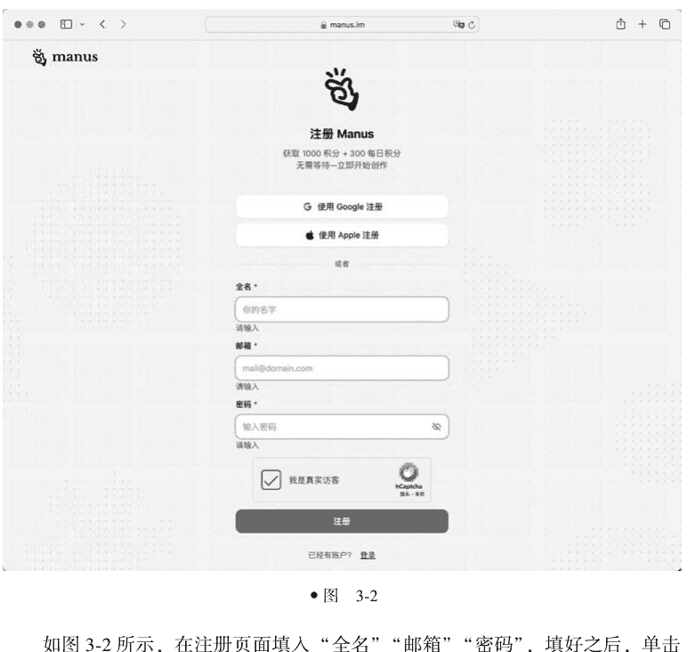

如图 3-2 所示，在注册页面填入“全名”“邮箱”“密码”，填好之后，单击“注册”按钮，如果注册成功，则 Manus 系统会自动登录并跳转至欢迎界面。

（2）立即开始使用
登录成功后可立即体验案例库、知识库等模块，进行任务操作，无需额外等待或邀请码。登录成功后的 Manus 页面如图 3-3 所示。

如图 3-3 所示，在输入框中输入自己的问题，然后单击输入框右下角的“↑”按钮，Manus 会执行并返回执行结果。执行过程如图 3-4 所示。

第 3 章 Manus 高效应用实战 57

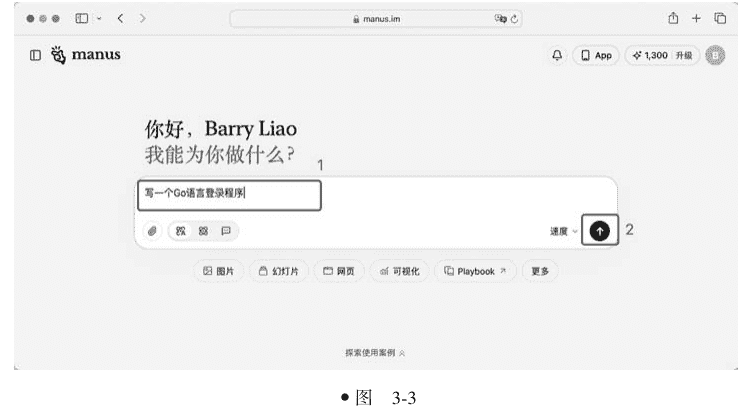

●图 3-3

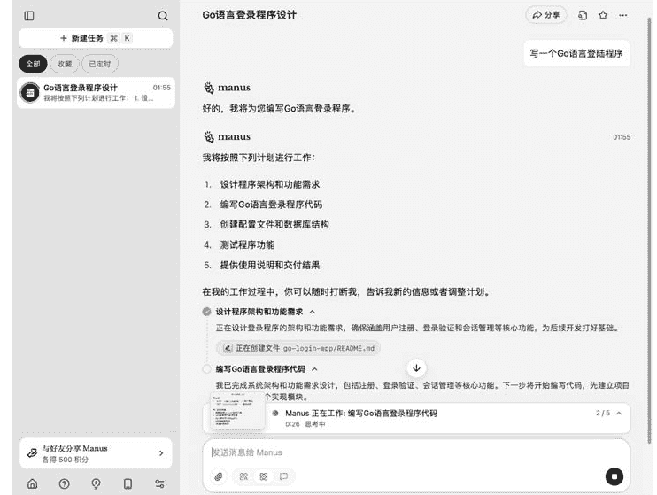

●图 3-4

## 3.2 Manus 常见应用场景应用示例

Manus 是一个强大的人工智能助手，能够高效地处理各种复杂任务，其应用场景涵盖了从数据分析到自动化工作的方方面面。Manus 常见应用场景示例如图 3-5 所示。


● 图 3-5

### 1. 供应商筛选

Manus 在供应商筛选领域的应用非常广泛，尤其适用于需要从大量供应商中筛选最合适的合作伙伴的场景。例如，在寻找某种原材料供应商时，Manus 可以通过访问多个在线数据库，自动化搜索并筛选出符合特定条件的供应商，如价格、质量、交货期等。使用 Manus，不仅可以减少人工筛选时间，还能确保筛选结果更加精准和全面。Manus B2B 供应商筛选示例如图 3-6 所示。

例如，假设某企业正在寻找一家提供特殊材料的供应商，Manus 会根据企业的需求标准，从全球范围内搜索符合条件的供应商，并按照评估标准（如产品质量、信誉评分等）生成一个排名清单，极大提升了供应商筛选的效率和准确性。Manus 生成的结果如图 3-7 所示。

第 3 章 Manus 高效应用实战

59

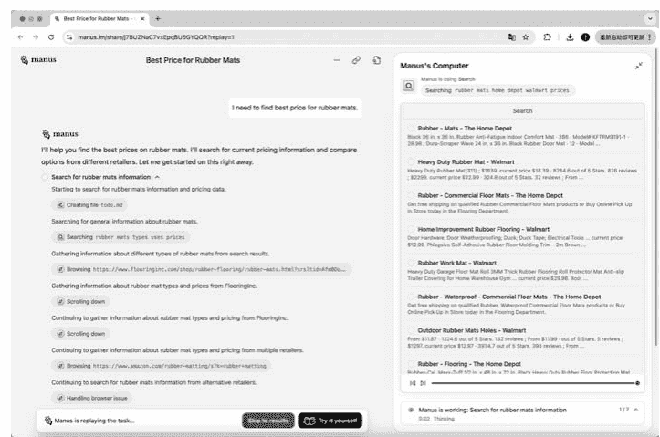

● 图 3-6

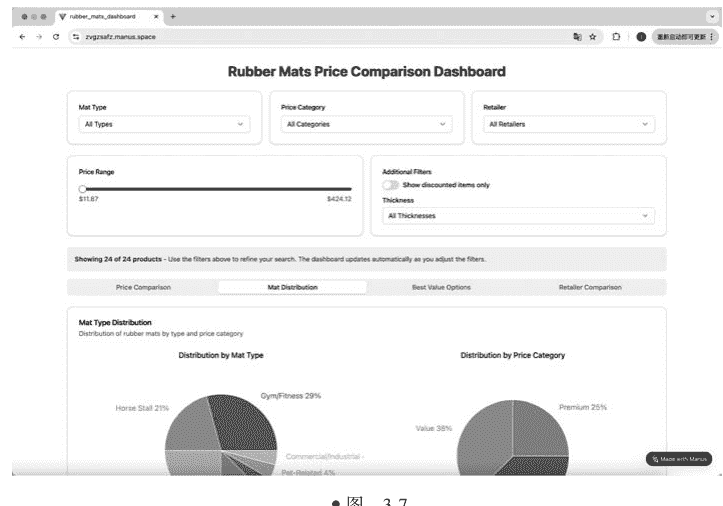

● 图 3-7

### 2. 创业公司信息的快速整理与分析

Manus 还可以用于创业公司信息的快速整理与分析。例如，通过访问 YC（YCombinator）创业孵化器的数据库，Manus 能够自动筛选出符合条件的创业公司，生成公司名单，并进一步分析这些公司涉及的行业、融资情况、创始人背景等关键信息。这样一来，用户可以通过这些数据更好地了解市场动态，制定出针对性的商业策略。Manus YC 公司列表生成如图 3-8 所示。

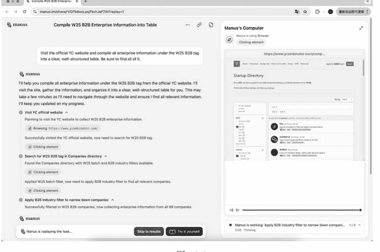

● 图 3-8

### 3. 客户关系管理公司调查

Manus 还能用于各类市场调研，尤其是针对客户关系管理（CRM）软件市场的调查。通过对 20 家 CRM 公司进行调研，Manus 能够自动收集各公司的品牌故事、产品特性、客户群体等信息，并将其编制成详细的行业分析报告。这样的数据处理方式，不仅提高了信息收集的速度，还避免了人工调查带来的偏差。

比如，某公司希望了解 CRM 市场的竞争格局，Manus 可以迅速获取市场上的主要 CRM 厂商的资料，包括他们的客户案例、定价策略等，并以结构化的报告形式呈现，帮助决策者做出战略调整。

## 4. 开源项目研究

对于开发者和技术团队，Manus 在开源项目的学习和研究中表现尤为突出。Manus 可以通过对 GitHub 等平台上的开源项目进行深入研究，解析项目代码库，帮助用户理解项目架构、开发流程以及关键代码模块。Manus 不仅能够提供代码解释，还能帮助开发者绘制系统架构图，使得复杂的开源项目变得更加易于理解和操作。

开发者想要使用一个开源的机器学习框架，Manus 可以分析该项目的代码，帮助开发者理解其核心组件的功能，并生成一张系统架构图，说明各模块如何协作，从而帮助开发者快速上手和定制开发。

## 5. 市场调研与产品评价

在电商领域，Manus 被广泛应用于产品市场调研，尤其是在分析客户评论和反馈时。通过自动化分析大量产品评价，Manus 可以从中提取出客户的痛点和需求，帮助企业改进产品和服务。Manus 能够识别出评论中的关键词，判断产品的优缺点，甚至可以自动归类不同的用户意见，为产品优化提供数据支持。

例如，一家电子产品公司希望了解其最新发布的智能手机的市场反响，Manus 可以从各大电商平台收集用户评论，分析评论中的情感倾向，识别出用户对电池续航、屏幕质量等方面的关注，从而为产品改进提供方向。

## 6. 人工智能政策研究

在政策研究领域，尤其是与人工智能相关的政策分析，Manus 表现出了卓越的能力。例如，在研究美国过去十年人工智能相关政策时，Manus 能够自动化地检索政策文档，提取关键信息，并生成分析报告，帮助政府机构、研究机构或企业了解政策的变化趋势以及未来可能的影响。

例如，政策分析员需要了解人工智能政策的演变，Manus 通过自动化提取和分析文献，生成详细的政策时间线和关键政策点，帮助分析员掌握政策走向，便于后续的战略规划。

## 7. 电商平台产品评论分析

在电商平台上，产品评论是消费者做出购买决策的重要依据。Manus 能够自动化地分析大量产品评论，提炼出消费者对产品的评价，帮助卖家识别潜在问题，并优化产品和服务。通过数据分析，Manus 能够揭示出消费者最关心的产品特点，甚至可以提供改进建议，以提升产品的市场竞争力。

例如，对于一家家电公司，Manus 可以分析客户对一款智能冰箱的评论，提取出用户最关注的特性，如节能性能、噪声水平等，并基于这些反馈提供优化产品的具体建议。

### 3.3 Manus 的系统架构与工作机制

Manus 并不依赖单一的模型或算法，而是通过“协调层+多智能体”的体系架构，实现了真正意义上的数字化分工。智能体并非一个孤立的存在，而是一个复杂且高效的协同网络。Manus 正是通过这样的系统架构，完成了从用户需求到最终输出的全链路自动化。Manus 内部的工作流程如图 3-9 所示。

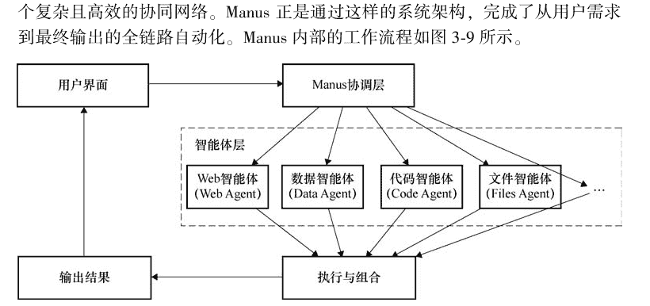

如图 3-9 所示，展示了 Manus 系统的整体架构和工作流程。Manus 的主要结构和工作流程如下：

1.  用户界面：用户通过界面输入需求，例如上传文件或提供任务描述。
2.  Manus 协调层：接收到用户输入后，Manus 协调层负责协调不同的智能体并进行任务分配。这个层次是 Manus 的核心，负责管理各个智能体之间的数据流和任务分解。
3.  智能体层：在 Manus 系统中，有多个智能体被分配特定的任务。
4.  执行与组合：所有的智能体在 Manus 协调层的控制下进行协作，最终生成输出结果。这些结果可以是报告、分析图表、生成的文档等。

通过这种分层和模块化的设计，Manus 能够高效地将不同的任务交给合适的智能体处理，同时协调各个智能体之间的协作，确保任务能够顺利完成。Manus 系统的整体架构和工作流程的详细讲解如下。

## 1. 用户界面

一切交互的入口都始于用户界面（User Interface）。无论是通过文本对话（Chat）提出需求，还是直接上传文件（File Upload）提供原始数据，这一层承担了人机之间的桥梁作用。用户无需编写代码，也不需要了解底层技术，仅凭自然语言或文件输入，便能激活整个系统的智能链条。

## 2. Manus 协调层

协调层（Manus Coordination Layer）是 Manus 系统的中枢神经。它并不直接执行任务，而是承担了认知、规划和调度的职责。可以将其类比为一个经验丰富的项目经理，具备以下核心能力：

1.  记忆与知识管理：负责保存历史任务、用户偏好以及领域知识，为后续任务提供上下文支持。
2.  任务分解：将用户提出的复杂目标，拆解成若干可执行的子任务。例如，“帮我分析这批简历并生成报告”会被分解为文件处理、信息提取、数据分析和报告生成四个步骤。
3.  智能编排：根据任务的需求，动态分配合适的智能体（Agent），并管理它们之间的数据流转和协作关系。

## 3. 智能体层

协调层完成规划之后，具体的任务交由不同类型的智能体负责。智能体层（Agent Layer）则负责具体的某项任务的执行，每一个智能体都像是一个独立的数字员工，专注于某一类工作，具有清晰的职能边界。例如，常见的智能体如下。

1.  Web 智能体：Web 智能体（Web Agent）专注于网页浏览和信息提取。它可以自动访问指定网站，爬取结构化或非结构化数据，类似于一个不知疲倦的网络研究员。
2.  数据智能体：数据智能体（Data Agent）擅长数据分析与 API 接口调用。无论是结构化表格、数据库查询，还是在线数据接口，它都能高效处理，并进行深度分析。
3.  代码智能体：代码智能体（Code Agent）拥有 Python 等编程语言的执行能力。支持自动化脚本的编写与运行，能够完成批处理任务、算法运算，甚至自动部署微服务。
4.  文件智能体：文件智能体（Files Agent）用于管理和处理各类文件，包括格式转换、文本提取、文档汇总等。比如，可以将一组 PDF 合同转化为可供分析的表格数据。

## 4. 执行与组合

智能体并非独立作战，而是通过一个共享的数据流通平台进行协同。智能体层执行完毕后，某些任务需要多个智能体互相传递中间结果：

1.  Web 智能体提取的网页数据，直接传递给数据智能体进行分析。
2.  数据分析的结果，交由代码智能体生成预测模型。
3.  文件智能体最终将各个环节的成果汇总为一份完整的文档、图表或数据库。

这一过程就像一条高度自动化的生产流水线，从原材料的采集，到半成品的加工，再到最终成品的打包，层层递进，环环相扣。

## 5. 输出结果

经过智能体协同执行，Manus 能够输出的常见类型如下：

1.  报告：商业计划、市场分析、人力资源报告等。
2.  图表：数据可视化、趋势分析、技能分布图等。
3.  网站：静态网站、产品原型、数据可视化平台。
4.  表格：结构化数据输出，便于后续处理。
5.  通知：自动推送任务完成状态、异常警告或关键结果。

以上这些输出结果不仅可以供人直接阅读，也可以作为下一步自动化流程的输入，进一步触发新任务。

### 3.4 Manus 高效应用实战

#### 3.4.1 【实战】用 Manus 制定一个旅游规划

在人工智能走入日常工作与生活的时代，旅行规划的方式也在悄然改变。Manus 不仅能帮用户完成文档整理、数据分析，甚至可以协同多个智能体，为一次跨越川藏的自驾之旅制定一套完整、专业的行程方案。

## 1. 高效提示的核心策略

Manus 并非传统的路线推荐工具，它并不依赖预设的模板，而是依靠自然语言理解和智能体协同，自主拆解目标，制定任务链条，并最终交付结构化成果。

一个清晰、准确的提示（Prompt），是激活 Manus 系统智能的关键。针对成都到拉萨自驾的提示，不应仅仅罗列地名，更应融入旅行偏好、预算范围、风险规避、景点选择等要素。高效的提示词示例如下：

> 请为我制定一份 7 天成都到拉萨的自驾游计划。偏好沿途自然风光、藏族人文、摄影地点，避免危险路段。预算控制在 8000 到 12000 元之间，包括住宿、油费、门票等。需要详细的每日路线、行车时间、海拔变化、注意事项，并生成一份 HTML 格式的旅行手册，包含地图、景点介绍、应急建议和高反预防指南。

用 Manus 制定一个旅游规划如图 3-10 所示。

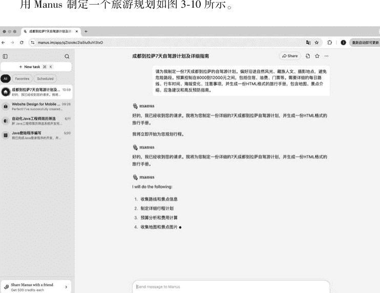

以上提示不仅传达了出发地与目的地，还明确了旅行时间、偏好类型（自然、人文、摄影）、风险约束（避免危险路段）等核心信息。通过这样精确的输入，能够极大提升 Manus 在任务拆解和路径规划时的精确度。用 Manus 制定一个旅游规划的结果如图 3-11 所示。

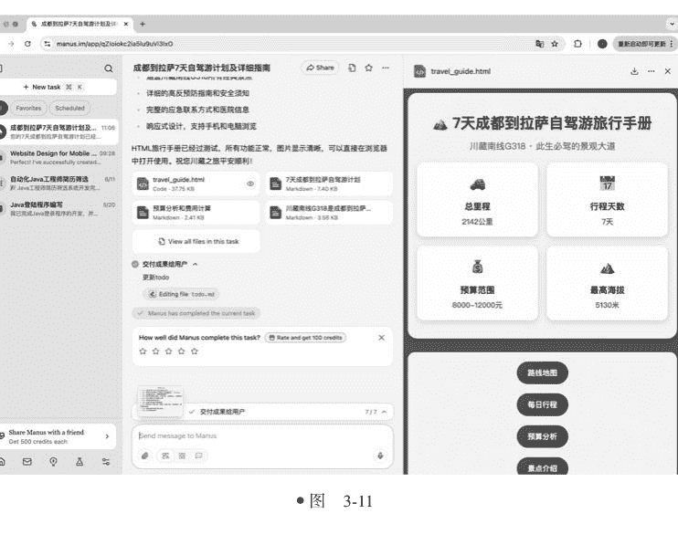

• 图 3-11

## 2. 旅游规划高效提示技巧

旅游规划常见高效提示技巧如下：

1.  加入限制条件，约束路线生成：例如，“避免国道 318 的 102 滑坡段” 或者 “优先选择沿线平均海拔不超过 4000 米的路线”。这种约束，能够让 Manus 在路径搜索算法中，优先过滤掉高风险节点。
2.  目标导向而非步骤导向：与其描述 “帮我查沿途景点”，不如直接设定终局目标—— “制定包含自然、人文与摄影元素的 7 天自驾路线，平衡安全、舒适与景观密度。” 目标驱动能促使协调层更好地进行多智能体调度。
3.  动态变量插入：通过在提示中增加变量，可以让 Manus 根据实时情况自适应。示例如下：

> 如果天气预报显示稻城亚丁出现降雪，建议跳过该地，增加在然乌湖的停留时间。

4.  加入健康管理约束：高原自驾涉及严重的生理风险。Manus 能够在行程规划中，加入一些高原反应适应策略：
    1.  首日抵达康定或新都桥，避免直接冲高。
    2.  每天控制上升海拔不超过 800 米。
    3.  安排适当的低海拔休息日。

#### 3.4.2 【实战】用 Manus 进行专业数据分析的方法与技巧

## 1. 高效提示的核心策略

Manus 的任务理解能力，依赖于输入提示（Prompt）的完整性、清晰度和结构化。一个高效的提示不仅是提出问题，更是在传递任务的上下文、边界与期望输出。

高效提示示例如下：

> 请根据我提供的 2025 年 1 月的销售数据，进行全面的数据分析。包括：
> 销售趋势分析（按天、按周）；
> 不同促销策略（折扣、运费）的影响分析；
> 顾客行为分析（客单量、转化率）；
> 可视化主要趋势与发现。
> 最终请输出具体的增长策略，目标是下个月销售额提升 10%。同时生成一份完整的 HTML 分析报告，包含图表、关键洞察与实施建议。

用 Manus 进行数据分析的提示示例如图 3-12 所示。

如果 Manus 执行成功，则生成的结果如图 3-13 所示。

## 2. 高效提示的五大技巧

1.  任务拆解思维：不要只写“帮我分析”，而是明确每一个子目标。示例如下：

> 请分析不同折扣策略对利润的影响。
> 计算周末与工作日的客单价差异。

以上这种细分目标会促使 Manus 在任务拆解时更精准。

2.  约束输出格式：直接在提示中写明约束输出格式，示例如下：

> 输出一份 HTML 分析手册。
> 提供一份 Excel 格式的趋势数据表。
> 生成 PNG 格式的可视化图表，适配 PPT 使用。

以上这种格式约束，能让结果更符合实际需求。

3.  引导代码透明化：引导代码透明化，示例如下：

> 在分析过程中，展示所使用的 Python 代码块，便于验证和二次修改。

Manus 会在侧边自动生成 Python 代码，包含数据处理、可视化等过程，增强了可解释性和可修改性。

4.  数据敏感性提示：明确提示 Manus 处理异常值或稀疏数据。示例如下：

> 对于出现异常高峰的销售日，请深入分析原因，判断是否为促销、季节性还是数据异常。

以上示例能避免模型简单地将噪声误判为趋势。

5.  加上动态应对机制：可以在提示中加上动态应对机制，示例如下：

> 如果在分析过程中发现数据缺失或异常，请自动生成缺失数据报告，并提出修复建议。

通过加上动态应对机制，能够让 Manus 在遇到问题时，自主调整工作流，而不是中断。

#### 3.4.3 【实战】用 Manus 高效生成面试排期的提示方法与技巧

当候选人数量众多时，Manus 作为一个智能任务管理工具，能够利用自然语言处理和智能体协同，自动化生成最优的面试排期，不仅节省了大量人力，还能确保排期的公平性和合理性。

在 Manus 中，生成面试排期的过程可以通过清晰的提示来驱动。以下是生成高效面试排期的步骤和提示结构，结合案例说明如何设计提示。

1.  确定任务目标：在提示的开头，清晰明确任务目标是至关重要的。目标应包括：
    1.  排期的时间段（例如：4 月 13 日至 15 日）。
    2.  每天的面试时段数量（例如：每天两个时段：上午和下午）。
    3.  排期时需要满足的平衡性要求（例如：候选人数量均匀分布）。
    4.  对候选人需求的描述（例如：候选人的可用时间）。
    示例例如下：

> 请根据候选人提供的可用时间（4 月 13 日至 15 日），生成面试排期。每一天安排两个时段：一个上午，另一个下午。要求候选人在每个时段的分布尽可能均匀，每个候选人的面试时段需满足其可用时间。最终排期的候选人分布应尽可能平衡，偏差不超过 1 人。

2.  数据读取与处理：Manus 会从给定的数据源中提取候选人的面试时间偏好。在实际应用中，数据通常为 Excel 或 CSV 格式。清晰的提示可以帮助 Manus 更好地理解数据的结构和预期目标。示例如下：

> 请读取 Excel 文件中的候选人可用时间，并根据每位候选人的可用时段进行排期。数据结构包括：姓名、日期、上午/下午可用性。

如果数据格式较为复杂，可以在提示中明确文件的具体列和格式，确保 Manus 能准确提取数据。

3.  分配候选人到面试时段：根据候选人提供的可用时间，Manus 会尽力确保每个时段的人数平衡。为了达到这一目标，可以指定 Manus 进行负载均衡，使得每个时段的候选人数量尽可能接近。示例如下：

> 请确保每个面试时段的候选人数量尽可能均衡，候选人数量的最大偏差不超过 1 人。如果某个时段的候选人数量不足，调整其他时段以填补空缺。

4.  验证排期合理性：生成排期后，Manus 会自动验证排期是否符合预定目标。这通常包括验证候选人是否被安排在他们可用的时段，并检查分布是否合理。示例如下：

> 请检查每个候选人的面试时间，确保其被安排在自己的可用时段内，并计算各时段候选人数量的偏差。如果偏差过大，请优化分配。

在提示中加入具体的验证标准（例如：最大偏差不超过 1 人），能帮助 Manus 执行精确的排期优化。

5.  输出排期结果：在排期生成完成并验证无误后，Manus 将输出最终的排期结果。为了便于查看和分享，输出可以采取多种格式（如文本、Markdown、HTML 等）。示例如下：

> 请输出最终的排期结果为：文本格式（txt），以及 Markdown 格式（md）。如果有需要，也请生成 HTML 格式的排期页面，并附上一个验证报告，说明每个时段的候选人分布情况。

清晰要求 Manus 生成不同格式的输出文件，这样可以确保不同的用户需求得到满足。

#### 3.4.4 使用 Manus 将文件类型转换的方法和技巧

Manus 是一个高效的智能工具，能够自动化完成从文件格式转换到数据处理的多种任务。无论是将 Excel 文件转换为 Word 文档，还是将 API 文档转换为专业格式，Manus 都能为我们提供强大的支持。这些任务的关键在于如何设计有效的提示（Prompt），以及如何优化 Manus 的执行流程来保证任务高效、准确地完成。

## 1. 文件格式转换的核心思想

文件格式转换是一种常见的自动化任务，其基本目标是将源文件的数据和内容转化为另一个所需格式的文档，保留原始数据的完整性与结构，同时使得输出文件符合目标格式的需求。

对于 Manus 而言，文件格式转换并非仅仅是数据的复制，它还涉及对内容的结构化、优化排版，以及确保转换后的文件能够高效呈现给用户。例如，从 Excel 表格生成 Word 文档时，Manus 不仅需要读取 Excel 中的数据，还要自动化处理每个 API 文档的格式，确保其在 Word 中以易读、专业的方式展示。

## 2. 高效使用 Manus 的提示技巧

1.  提示结构清晰：对于每一个文件转换任务，都需要确保输入与输出格式明确。示例如下：

> 请将 Excel 中的 API 文档转换为 Word 格式，文档包含：封面、目录、每个 API 接口的详细描述、JSON 示例、表格格式。格式要求：标题居中加粗，段落采用标准字体，JSON 格式使用等宽字体。

2.  明确输出要求：在转换过程中，明确输出格式（如 Word、PDF、Markdown 等）可以帮助 Manus 更好地理解转换需求。示例如下：

> 输出文件应为 Word 格式（docx），包含封面、目录、详细 API 描述，每个接口的请求和响应参数以表格形式呈现。

3.  多格式输出：Manus 不仅支持单一格式输出，也可以一次性生成多种格式。示例如下：

> 请将文档输出为：Word 格式（docx）、PDF 格式，并附加一个包含 API 名称的 CSV 文件。

4.  错误处理与数据修正：对于可能出现的数据缺失或格式问题，提前设定错误处理策略。示例如下：

> 如果 Excel 表格中缺少某个 API 的描述信息，请自动标记为“待补充”，并在最终文档中列出所有缺失项。

5.  增强可读性与美观性：通过对排版和格式的要求，确保最终文档清晰、易读。示例如下：

> 所有表格内容必须居中，JSON 代码块必须使用等宽字体展示，正文采用常规字体，标题加粗。

# AgentScope实战——打造多智能体协作的AI“数字工厂” 第4章

## 4.1 什么是 AgentScope

### 4.1.1 AgentScope 简介

AgentScope 是由阿里巴巴旗下团队打造的一套开源、多智能体编排平台，具备灵活、透明、可扩展的特点，专为构建高效协作的智能体网络而设计。任何掌握 Python 语言和基本编程概念的开发者都可以轻松上手。

## 1. AgentScope 核心理念

在传统的企业自动化体系中，AI 只是一个插件，往往局限于回答问题或辅助决策。但在 AgentScope 中，每一个数据点、每一段业务流程，甚至每一个角色都可以被封装为独立的智能体（Agent）。这些智能体不再是被动响应的程序组件，而是具备感知、推理、执行能力的自驱体，可以主动协调、调度乃至重构整个业务逻辑。

例如，在客户服务场景中，一个“客服智能体”不仅能回答问题，还可以与“订单智能体”“物流智能体”协同工作，查找订单状态、发起退货流程，甚至在后台优化服务策略。

## 2. 为什么需要 AgentScope

1.  多智能体协作的痛点：多智能体协作的常见痛点如下：
    1.  角色分工复杂：多个智能体要各司其职，谁负责什么？谁先动？谁后做？信息如何传递？这些流程如果手动写代码定义，既烦琐又容易出错。

## 3. AgentScope 常见应用场景

AgentScope 几个典型的智能体应用场景如下：

- （1）客户服务智能体
代替人工客服处理的常规问题，如账户查询、退款进度、技术支持，并通过 Agent 协作自动调用工单系统和数据库系统。
- （2）企业知识搜索引擎
通过语义检索从 OneDrive、S3、Azure Blob 等平台提取文档内容，智能体对员工查询实现精准应答，实现“AI 文档助理”。
- （3）行业分析与预测 Agent
结合机器学习与大语言模型，搭建用于宏观预测的 AI 系统。该系统可实时分析市场信号、解读趋势并自动生成 PPT 报告，供决策层使用。

## 4.1.2 【实战】快速本地安装 AgentScope

要想快速学习 AgentScope，最好的方法便是亲自动手实践。以下是快速本地安装 AgentScope 的详细步骤。

### 1. AgentScope 环境准备

AgentScope 基于 Python 构建，因此确保系统中已安装 Python 是基本前提。推荐使用 Python 3.9 或更高版本，以获得更好的兼容性和功能支持。实践中，使用虚拟环境（如 venv 或 conda）可以有效避免包冲突问题，并使项目结构更加清晰。例如，使用以下命令可以快速创建一个独立环境：

```
$ python3 -m venv agentscope_env
$ source agentscope_env/bin/activate
```

建立好环境之后，便可进入正式的安装流程。

### 2. 本地安装 AgentScope

AgentScope 已在 Python 官方 PyPI 源上发布，因此使用 pip 安装是一种高效且稳定的方式。最基础的安装命令如下：

```
$ git clone https://github.com/modelscope/agentscope
$ cd agentscope
$ pip install -e .
```

以上命令将下载 AgentScope 的核心功能包，包括消息通信模块、智能体调度引擎以及常用的内建智能体类型等。如果安装成功，则系统便已具备运行单个对话智能体（如 DialogAgent）的能力。

### 3. 安装扩展包

对于希望接入更多模型服务（如 OpenAI、DeepSeek、通义千问等），或者启用工具调用、分布式部署等高级功能的用户，可通过安装“可选依赖”进行扩展。

安装 AgentScope 所有常用功能（包括模型、分布式、工具链等）的命令如下：

```
$ pip install "agentscope[all]"
```

在大型工程项目中，推荐使用 `agentscope[all]` 这一整合版本。它涵盖了大多数实际需求，省去了逐一添加依赖的烦琐。

### 4. 验证是否安装成功

创建一个名为 `example1.py` 的文件，编写代码如下：

```python
import agentscope

print(agentscope.__version__)
```

在文件所在目录打开命令行，运行如下命令：

```
$ python example1.py
0.1.6
```

如果执行以上代码后，屏幕上将出现智能体的版本号，则标志着安装成功。

## 4.2 AgentScope 的核心架构

AgentScope 采用清晰、模块化且高度解耦的三层架构。AgentScope 通过“智能体层（Agent Layer）”“管理器与包装层（Manager/Wrapper Layer）”以及“实用层（Utility Layer）”三大核心支柱，将原本复杂的通信、模型调用、任务调度、数据交互和错误处理变成了高度可控、可扩展的工程组件，如图 4-1 所示。

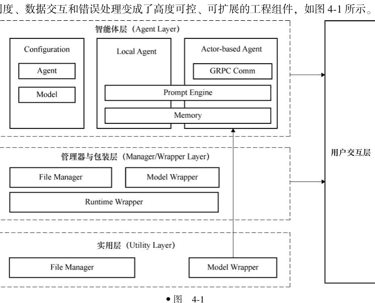

● 图 4-1

### 1. 智能体层

智能体层（Agent Layer）不仅负责定义每个智能体的职责，还掌控它们之间的消息传递方式、交互节奏和上下文演化。智能体层包含 3 大关键模块：

- 1) Configuration：用于定义 Agent 名称、角色、所使用模型的配置。
- 2) Local Agent：用于包含 Prompt Engine + Memory 管理，用于构建单个智能体。
- 3) Actor-based Agent：用于实现 GRPC Comm，可支持分布式部署。

### 2. 管理器与包装层

在多智能体协作中，资源调度与错误管理是系统稳定运行的保障。AgentScope 通过管理器与包装层（Manager/Wrapper Layer）完成对模型接口、文件系统、历史日志和运行态的全面管理。管理器与包装层可被理解为系统的“中控台”，调节各模块之间的调用节奏，并在出错时介入“兜底处理”。其核心组件包括：

- 1) File Manager：管理多模态存储（图片、音频、视频）、辅助文件上传、API 调用历史。
- 2) Model Wrapper：提供自动校正、重试机制和用户自定义 handler，提高与大语言模型及工具的交互鲁棒性。

### 3. 实用层

架构的最底层，是支撑所有智能体运行的实用层（Utility Layer）。实用层的职责并不在于推理，而是承担数据的输入输出、系统级指令的处理、底层资源的调度。

在软件工程中，实用层可类比为操作系统的设备驱动部分。实用层并不决定上层应用逻辑，却直接影响整个系统的流畅程度与弹性。实用层提供基础服务函数：文件读写、数据库查询（SQLite、MySQL、MongoDB）、网页搜索、代码执行、知识库检索等。举例来说，在一个天气预报机器人中，实用层会负责完成“通过 HTTP 请求获取实时天气 JSON 数据”，而智能体本身则专注于解释数据、决定如何呈现。

### 4. 用户交互层

用户交互层位于 AgentScope 架构的最外层，是连接系统内部智能体与最终用户之间的桥梁。

这一层负责输入的接收、输出的呈现以及多模态交互的协调，其核心目标是让复杂的智能体协作过程以自然、高效的方式呈现给用户。

## 4.3 如何在 AgentScope 中使用 MCP

在多智能体系统中，语言模型擅长理解、规划和生成自然语言，但真正能够推动世界变化的往往是行动。模型上下文协议（Model Context Protocol，MCP）正是语言模型通往行动世界的一扇门。借助模型上下文协议，AgentScope 中的智能体不仅能“思考”，还能“动手”。AgentScope 可以调用浏览器模拟单击、抓取网页信息、执行代码、读取数据库，甚至将自身服务变为外部可调用接口。本小节重点介绍如何在 AgentScope 中使用 MCP，关于 MCP 的底层原理会在本书第 9 章进行详细讲解。

### 1. MCP 的定位

理解 MCP 的最佳方式是将其视为一种“智能体服务标准”。MCP 统一了语言模型与外部工具的通信接口，使模型能够安全、标准化地请求工具完成特定操作。无论操作对象是网页、代码、数据库还是文件，模型只需通过一个统一协议发送结构化消息，即可触发实际动作。MCP 为多智能体系统带来了两个显著变化：

- 1) 智能体的能力边界大幅扩展，能够跨越语言处理的范畴，接入真实系统。
- 2) 开发者可以低成本地将已有系统封装为 MCP 服务，使其轻松接入 AgentScope 的多智能体网络。

例如，如果我们想开发一个“招聘信息分析智能体”，其任务是在多个招聘网站上搜索特定职位，抓取页面内容，并总结职位要求。单靠语言模型难以直接访问网页数据，但借助 MCP 中的 Puppeteer 服务，AgentScope 的智能体便可以控制浏览器，模拟人类单击行为，实现数据提取。这一过程完全符合人类任务智能体的逻辑：理解任务意图→打开网页→模拟搜索→获取内容→总结并回答。

### 2. AgentScope 中使用 MCP 的步骤

在 AgentScope 中使用 MCP，需要遵循三个关键步骤：服务注册、工具调用、模型响应。在 AgentScope 中使用 MCP 的步骤如下。

（1）安装 Python MCP 安装包和 node 环境
在命令行中运行以下命令：

```
$ pip install mcp
$ pip install "mcp[cli]"
```

确保已经安装好 node 20 或更高的版本，node 20 的具体安装方法请读者自行参照官方文档。

（2）服务注册

安装 Python MCP 安装包和 node 环境后，需要定义 MCP 服务配置并进行服务注册。以本地 Puppeteer 浏览器智能体为例，可使用以下代码启动 MCP 服务并注册到 AgentScope：

```python
from agentscope.service import ServiceToolkit

toolkit = ServiceToolkit()

toolkit.add_mcp_servers(server_configs={
    "mcpServers": {
        "puppeteer": {
            "command": "npx",
            "args": ["-y", "@modelcontextprotocol/server-puppeteer"]
        }
    }
})
```

在以上代码中，AgentScope 启动了一个 MCP 服务端，内部由 Node.js 驱动 Puppeteer 实现浏览器控制，并将其工具能力注册为可被智能体调用的“服务”。

此外，开发者还可以连接远程已部署的 MCP 服务，例如部署在云端的爬虫服务，使用 HTTP 协议接入，示例如下：

```python
toolkit.add_mcp_servers(server_configs={
    "mcpServers": {
        "puppeteer": {
            "url": "http://localhost:8000/sse"
        }
    }
})
```

连接远程已部署的 MCP 服务的方式适用于跨主机、分布式部署，提升了系统的可扩展性。

（3）工具调用

MCP 服务启动后，系统会自动将其中提供的能力封装为智能体可调用的工具。这些工具具备标准的说明文档与参数结构，可通过 `toolkit.tools_instruction` 查询注册工具的调用方式与能力描述。示例代码如下：

```python
print(toolkit.tools_instruction)
```

输出将展示 MCP 工具的名称、输入参数格式、功能说明等，智能体可通过自然语言“请求”系统调用这些工具。

（4）模型响应

当智能体需要执行任务时，只需在其响应生成过程中引用对应工具。例如：

```python
from agentscope.agents import ReActAgent

agent = ReActAgent(
    name="assistant",
    model_config_name=YOUR_MODEL_CONFIGURATION_NAME,
    verbose=True,
    service_toolkit=toolkit,
)
```

以上代码的 ReActAgent 具备工具调用能力。当模型判断需要操作网页时，会自动向 MCP 工具发出调用指令，完成网页加载与元素提取，并将结果返回用于后续推理。整个过程在外人看来就像模型“拥有了双手”，能够观察网页、提取信息并继续对话。

### 3. 将 AgentScope 服务注册为 MCP 工具

AgentScope 不仅可以使用 MCP 工具，也可以反向操作，让 AgentScope 自身的功能变为外部可调用服务，这一特性对平台化部署尤为重要。将一个讲笑话的智能体注册为 MCP 服务器端的示例如下：

```python
from fastapi import FastAPI
from agentscope import init
from agentscope.agents import DialogAgent
from agentscope.message import Msg
from pydantic import Field
from mcp.server import FastMCP
import asyncio

# 初始化模型配置
init(
    model_configs={
        "config_name": "my-qwen-max",
        "model_type": "dashscope_chat",
        "model_name": "qwen-max",
    }
)

# 初始化 FastAPI 和 MCP
app = FastAPI()
mcp = FastMCP("中文笑话服务", app=app)

# 注册工具
@mcp.tool()
def tell_joke(
    topic: str = Field(description="笑话的主题")
) -> str:
    agent = DialogAgent(
        name="joke_bot",
        model_config_name="my-qwen-max",
        sys_prompt="你是一个中文喜剧助手,擅长根据主题讲笑话.",
    )
    return agent(Msg("user", topic, "user")).content

# 使用 asyncio 调用异步 list_tools 方法
asyncio.run(mcp.list_tools())
```

在命令行运行如下命令启动服务：

```
$ mcp run mcp_server_example.py -t sse

2025-05-06 00:23:15 | INFO     | agentscope.manager._model:load_model_configs:138 - Load configs for model wrapper: my-qwen-max
INFO:     Started server process [16346]
INFO:     Waiting for application startup.
INFO:     Application startup complete.
INFO:     Uvicorn running on http://127.0.0.1:8000 (Press CTRL+C to quit)
```

执行以上命令后，该服务将以标准 MCP 工具的形式暴露，任何支持 MCP 的大语言模型系统都可以通过调用 `tell_joke` 工具获得模型生成的幽默内容。在这种架构下，AgentScope 不仅是“工具的使用者”，也可以成为“工具的生产者”。

## 4.4 AgentScope 中的 RAG 解析

在多智能体系统中，大语言模型虽然具备强大的推理和生成能力，但其知识面和实时性有限。为了解决这一问题，AgentScope 引入了检索增强生成（Retrieval Augmented Generation，RAG）机制，使智能体能够在生成回答时，结合外部知识库的信息，从而提供更准确和实时的回答。

### 1. 什么是 RAG

RAG 是一种结合信息检索与生成模型的机制。其基本流程如下：

1. 检索阶段：智能体根据用户输入的查询，从预先构建的知识库中检索出相关文档或片段。
2. 生成阶段：将检索到的信息与用户查询一起输入到生成模型中，生成包含外部知识的回答。

RAG 的这种方式使得智能体能够在不直接存储大量知识的情况下，利用外部知识库提供准确的信息。

### 2. 在 AgentScope 中实现 RAG

AgentScope 提供了对 RAG 的内置支持，关键模块如下：

1. Knowledge：知识实例的基类。
2. KnowledgeBank：用于管理多个知识实例的容器。
3. LlamaIndexKnowledge：与 LlamaIndex 库协同工作的知识类，支持本地知识存储和检索。

创建 LlamaIndexKnowledge 的示例如下：

```python
import os
import agentscope
from agentscope.rag.llama_index_knowledge import LlamaIndexKnowledge

# 初始化
agentscope.init(
    model_configs=[
        {
            "model_type": "dashscope_text_embedding",
            "config_name": "qwen_emb_config",
            "model_name": "text-embedding-v2",
            "api_key": "sk-beab2126cf784249b9f052920de57378",
        },
    ],
)

# 确保当前目录中有 intro.md 文件
local_knowledge = LlamaIndexKnowledge.build_knowledge_instance(
    knowledge_id="agentscope_qa",
    data_dirs_and_types={"./": [".md"]},
    emb_model_config_name="qwen_emb_config",
)

nodes = local_knowledge.retrieve("AgentScope 是什么?", similarity_top_k=1)

if nodes:
    print(f"\nThe retrieved content:\n{nodes[0].content}")
else:
    print("没有找到匹配内容")
```

在以上代码中，`init()` 方法用于初始化 AgentScope 环境。`build_knowledge_instance()` 方法用于创建一个 LlamaIndexKnowledge 实例，指定知识 ID、数据目录和嵌入模型配置。使用 `retrieve()` 方法检索与查询相关的知识片段。

使用 KnowledgeBank 管理多个知识实例的示例如下：

```python
from agentscope.rag import KnowledgeBank

# 创建知识库
knowledge_bank = KnowledgeBank(configs="configs/knowledge_config.json")

# 动态添加知识实例
knowledge_bank.add_data_as_knowledge(
    knowledge_id="agentscope_tutorial_rag",
    emb_model_config_name="qwen_emb_config",
    data_dirs_and_types={"../../docs/sphinx_doc/en/source/tutorial": [".md"]},
)
```

通过 KnowledgeBank，可以从配置文件中批量加载多个知识实例，也可以动态添加新的知识实例，方便管理和扩展。

## 3. 构建 RAG 智能体

在 AgentScope 构建 RAG 智能体的示例代码如下：

```python
from agentscope.agents import LlamaIndexAgent

# 构建 RAG 智能体
rag_agent = LlamaIndexAgent(
    name="rag_agent",
    model_config_name="qwen-max",
    knowledge_bank=knowledge_bank,
)

# 与智能体交互
msg = Msg(name="user", content="Tell me about AgentScope.", role="user")
response = rag_agent.reply(msg)
print(response.content)
```

在以上代码中，创建了一个 LlamaIndexAgent 实例，指定了模型配置名称和知识库；通过 reply() 方法向智能体发送消息，并获取响应。

## 4.5 【实战】用 AgentScope 创建多模态智能体

AgentScope 提供了原生的多模态支持机制，使得构建一个可以生成和识别图像的智能体变得不再复杂。这不仅意味着更强大的感知与生成能力，也为教育、设计、搜索、医疗等领域带来了丰富的应用可能。

### 1. AgentScope 多模态图像生成实战

图像生成能力是 AgentScope 多模态体系中的另一个重要部分。借助 DashScope 或其他模型提供商，系统可以将描述性文字转换为图像，生成绘图、示意图、设计草图等内容。

使用 AgentScope 创建一个图片示例如下：

```python
from agentscope.agents import DialogAgent
import agentscope
import matplotlib.pyplot as plt

agentscope.init(model_configs={
    "config_name": "qwen-vl",
    "model_type": "dashscope_multimodal",
    "model_name": "qwen-vl-max",
    "api_key": "sk-beab2126cf784249b9f052920de57378",
})

agent = DialogAgent(
    name="vision_helper",
    sys_prompt="你是一个可以看懂图像的智能体,擅长描述图像内容.",
    model_config_name="qwen-vl"
)

plt.figure(figsize=(6, 6))
plt.bar(range(3), [2.0, 1.0, 4.0])
plt.xticks(range(3), ["James", "Shirdon", "Barry"])
plt.title("Test Data")
plt.xlabel("Number of Mobile Phone")
plt.savefig("./test_bar.png")
plt.show()
```

在命令行输入如下命令运行代码：

```
$ python image_generate_example.py
2025-05-06 14:45:03 | INFO     | agentscope.manager._model:load_model_configs:138 - Load configs for model wrapper: qwen-vl
```

如果以上代码运行成功，则会在代码所在目录生成一张图片，生成的图片如图 4-2 所示。

### 2. AgentScope 图像识别实战

最基础的多模态场景，就是“看图识别”。在 AgentScope 中，图像被视为消息中的一种输入内容。开发者可以通过向 Msg 消息对象添加图像路径或 URL，传递图像数据给支持视觉模型的智能体。模型内部的包装器将自动识别图像输入，并将其转化为对应的视觉 Token 或二进制数据，以适配所使用的大模型接口。

用于构建一个“视觉理解助手”的示例如下：

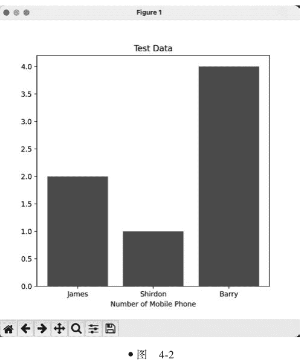

• 图 4-2

```python
from agentscope.agents import DialogAgent
import agentscope
from agentscope.message import Msg

agentscope.init(model_configs={
    "config_name": "qwen-vl",
    "model_type": "dashscope_multimodal",
    "model_name": "qwen-vl-max",
    "api_key": "sk-beab2126cf784249b9f052920de57378",
})

agent = DialogAgent(
    name="vision_helper",
    sys_prompt="你是一个可以看懂图像的智能体,擅长描述图像内容。",
    model_config_name="qwen-vl"
)

msg = Msg(
    name="用户",
    content="为我详细描述一下这个图片。",
    role="user",
    url="./test_bar.png",
)

response = agent(msg)
print(response)
```

在命令行输入如下命令运行代码：

```
$ python image_recognition_example.py
2025-07-06 14:48:00 | INFO     | agentscope.manager._model:load_model_configs:138 - Load configs for model wrapper: qwen-vl
2025-07-06 14:48:00 | ERROR    | agentscope.message.msg:__init__:112 - The url argument will be deprecated in the future. Consider using the ContentBlock instead to attach files to the message
vision_helper:这张图片是一个条形图,具体描述如下:
......
```

如果代码配置并执行成功，则返回的结果如图 4-3 所示。

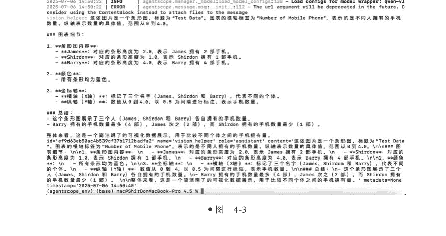

在以上代码中，url 字段传入的是本地图像路径，系统会将其包装成多模态输入交由模型处理。智能体基于图像内容生成自然语言描述，实现基本的视觉理解任务。这种“从图像到语言”的映射，是 AgentScope 多模态技术的基本能力之一。

## 4.6 【实战】创建 AgentScope 可视化界面

一个优秀的智能模型不仅需要强大的逻辑推理，更需要直观的交互界面，让观察者可以清晰地理解系统的运行轨迹。AgentScope 提供了两个主要的可视化选项：AgentScope Studio 和 Gradio Web UI，并支持开发者打造自定义界面平台。

### 1. 安装并启动 AgentScope Studio

AgentScope Studio 是一个基于 React+Node.js 技术栈开发的可视化监控工具。AgentScope Studio 以项目为单位，将智能体间的对话、API 调用、Tokens 使用情况等信息直观呈现给开发者，非常适合调试与运行状态监控。

（1）安装 Node.js（包括 npm）

在安装前请先确认系统中已安装 Node.js（包括 npm），在 Ubuntu 中安装 Node.js（包括 npm）的示例如下：

```
$ sudo apt update
$ sudo apt install nodejs npm
```

（2）安装 AgentScope Studio 命令行工具

安装 AgentScope Studio 命令行工具的命令如下：

```
$ npm install -g @agentscope/studio
```

（3）启动 AgentScope Studio

启动 AgentScope Studio 后端和前端界面的命令如下：

```
$ as_studio
```

启动后端需通过 AgentScope Python 程序进行连接，代码如下：

```python
import os
import agentscope

# 初始化 AgentScope(连接本地 Studio 并配置模型)
agentscope.init(
    model_configs=[
        {
            "model_type": "dashscope_chat",  # 模型类型为 DashScope 聊天模型
            "config_name": "qwen_max_config",  # 自定义的模型配置名
            "model_name": "qwen-max",  # 模型名称(官方支持)
            "api_key": "sk-xxx",  # 替换成你的阿里云百炼 API 密钥
        }
    ],
    studio_url="http://localhost:3000"
)
```

通过以上代码，所有智能体的对话内容（通过 speak() 方法打印）会实时同步到 Studio。在 Studio 的控制台中，可以看到项目层级划分，每个智能体的输入与输出都清晰记录，还支持输入按钮触发用户交互，便于调试会话流程。

成功运行以上代码后，在浏览器打开 URL 地址 http://localhost:3000，运行结果如图 4-4 所示。

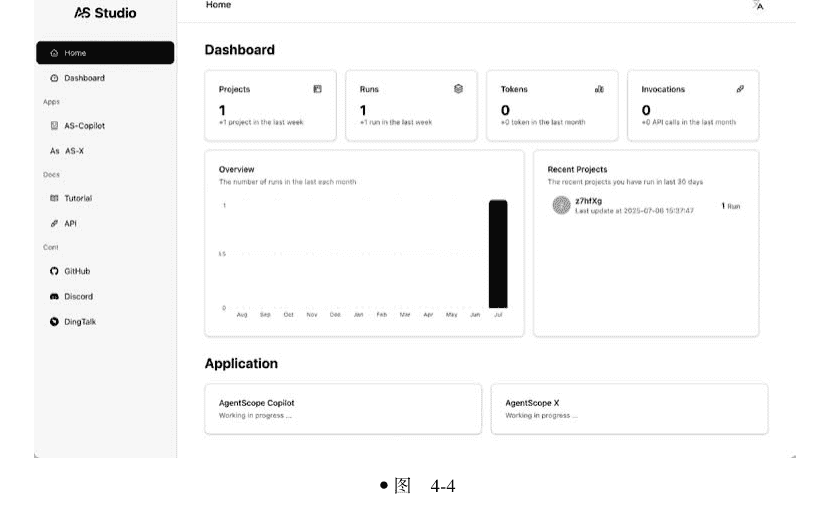

### 2. Gradio Web UI

如需快速构建 Web 界面，Gradio 是个高效选择。安装带 Gradio 的 AgentScope 版本的命令如下：

```
$ pip install agentscope[full]
```

确保智能体程序封装在 main() 函数中，示例如下：

```python
def main():
    agentscope.init(...)
    agent = DialogAgent(...)
    user = UserAgent(agent)
    # 循环交互逻辑
```

然后通过命令行启动界面，命令如下：

```
$ as_gradio {path_to_your_python_code}
```

运行以上命令后，Gradio 前端会自动解析代码中的智能体，实现聊天式交互界面。

## 4.7 【实战】用 AgentScope 开发人与智能体对弈的五子棋游戏

在本节中，我们将使用 AgentScope 框架，结合智能体的编程和对弈，通过代码实现一个简单的五子棋游戏，并让人和智能体互相对弈，最终展示智能体在复杂决策中的表现。

### 1. 项目目标与核心思路

我们将构建一个基于 AgentScope 的五子棋对弈游戏，其中两个智能体将轮流落子，直至一方在棋盘上完成五子连线。项目的核心目标如下：

- 1) 智能体设计：构建一个能够管理棋盘状态、判断胜负、执行棋步的智能体。
- 2) 对弈规则：实现五子棋的基础规则，包括判断输赢、判断棋盘合法性等。
- 3) 智能体对弈：让人与智能体轮流下棋，直到一方获胜或棋盘填满。

在这个过程中，我们将使用 BoardAgent 作为棋盘管理智能体，负责所有与棋盘相关的操作，并通过 GameAgent 来管理游戏流程。

### 2. 核心组件与架构

本项目的架构主要由两部分组成：游戏智能体和棋盘智能体。

（1）创建游戏智能体来控制对弈流程

游戏智能体控制对弈的流程，包括接收用户输入、调用棋盘智能体执行操作、输出游戏结果等。其核心代码如下：

```python
class PlayerAgent(DialogAgent):
    def __init__(self, name: str, model_config_name: str, sys_prompt: str, **kwargs) -> None:
        super().__init__(name=name, model_config_name=model_config_name, sys_prompt=sys_prompt, **kwargs)

    def reply(self, x: Optional[Union[Msg, Sequence[Msg]]] = None) -> Msg:
        # 让 LLM 生成走法
        msg = super().reply(x)
        # 为简化起见，我们假设 LLM 直接输出 "row,col" 格式的走法
        # 在实际应用中，你可能需要添加更强的解析和验证
        return msg

def main():
    # 使用模型配置初始化 AgentScope
    # 请替换为实际的模型配置
    agentscope.init(
        model_configs=[
            {
                "config_name": "my_model",
                "model_type": "dashscope_chat",  # 或其他支持的模型类型
                "model_name": "qwen-max",  # 或其他模型名称
                "api_key": "sk-xxxxxx",
            }
        ]
    )

    # 创建智能体
    board_agent = BoardAgent("GomokuBoard")
    player_black = PlayerAgent(
        name=NAME_BLACK,
        model_config_name="my_model",
        sys_prompt=f"你是一个名为 {NAME_BLACK} 的五子棋玩家,棋盘大小为 {BOARD_SIZE}x{BOARD_SIZE}。你执黑子 X。原点 (0,0) 位于左上角。请输出你的走法,格式为 "row,col",并且只输出该格式."
    )

    player_white = PlayerAgent(
        name=NAME_WHITE,
        model_config_name="my_model",
        sys_prompt=f"你是一个名为 {NAME_WHITE} 的五子棋玩家,棋盘大小为 {BOARD_SIZE}x{BOARD_SIZE}。你执白子 O。原点 (0,0) 位于左上角。请输出你的走法,格式为 "row,col",并且只输出该格式."
    )

    # 游戏循环使用 msghub
    participants = [board_agent, player_black, player_white]
    game_round = 0
    # 从棋盘给黑方发送消息开始
    x = board_agent.reply()
    with msghub(participants=participants) as hub:
        while not board_agent.is_game_end():
            # 确定当前玩家
            current_player = player_black if game_round % 2 == 0 else player_white
            # 向所有参与者广播棋盘状态
            hub.broadcast(x)
            # 获取玩家的走法
            move_msg = current_player.reply(x)
            # 将走法发送给棋盘智能体
            x = board_agent.reply(move_msg)
            # 打印棋盘状态
            print(x.content)
            game_round += 1
    ......省略部分代码
```

（2）创建棋盘智能体显示棋盘

棋盘智能体负责显示游戏画面和管理棋盘的状态，包括初始化棋盘、记录每一步的棋子、验证每步棋的合法性、判断胜负等。其核心代码如下：

```python
from flask import Flask, request, jsonify, render_template
from gomoku_game import BoardAgent, NAME_BLACK, NAME_WHITE, BOARD_SIZE, EMPTY_PIECE, PlayerAgent
from agentscope import init, msghub
from agentscope.message import Msg

app = Flask(__name__, static_folder='static', template_folder='static')

# 初始化 AgentScope(只需初始化一次)
init(
    model_configs=[
        {
            "config_name": "my_model",
            "model_type": "dashscope_chat",
            "model_name": "qwen-max",
            "api_key": "sk-xxx",
        }
    ]
)

# 全局游戏状态(为了简化,实际应用中应使用会话或数据库。限于篇幅,部分代码在随书附赠资源中)
board_agent = BoardAgent("GomokuBoard")
player_black = PlayerAgent(
    name=NAME_BLACK,
    model_config_name="my_model",
    sys_prompt=f"你是一个名为 {NAME_BLACK} 的五子棋玩家,棋盘大小为 {BOARD_SIZE}x{BOARD_SIZE}。你执黑子 X。原点 (0,0) 位于左上角。请输出你的走法,格式为 "row,col",并且只输出该格式。"
)
player_white = PlayerAgent(
    name=NAME_WHITE,
    model_config_name="my_model",
    sys_prompt=f"你是一个名为 {NAME_WHITE} 的五子棋玩家,棋盘大小为 {BOARD_SIZE}x{BOARD_SIZE}。你执白子 O。原点 (0,0) 位于左上角。请输出你的走法,格式为 "row,col",并且只输出该格式。"
)

current_player_name = NAME_BLACK  # 黑方先行

@app.route('/')
def index():
    return render_template('index.html')
```

## 从 0 到 1 搭建 AI 智能体：Manus+LangChain+Dify 多平台应用及多智能体协同

```python
@app.route('/api/start_game', methods=['POST'])
def start_game():
    global board_agent, current_player_name
    board_agent.reset_game()
    current_player_name = NAME_BLACK
    initial_msg = board_agent.reply()
    return jsonify({
        'board': board_agent.board.tolist(),
        'message': initial_msg.content,
        'current_player': current_player_name,
        'game_end': board_agent.is_game_end()
    })
……省略部分代码
```

（3）创建五子棋棋盘显示和控制的前端页面
创建五子棋棋盘显示和控制的前端页面的核心代码如下：

```html
<!DOCTYPE html>
<html lang="zh">
<head>
<meta charset="UTF-8">
<meta name="viewport" content="width=device-width, initial-scale=1.0">
<title>五子棋游戏</title>
</head>
<body>
<h1>五子棋游戏</h1>
<div id="game-container">
<div id="board-grid"></div>
<p id="message"></p>
<button id="start-game-btn">开始新游戏</button>
<button id="ai-move-btn">AI 走棋</button>
</div>

<script>
    const BOARD_SIZE = 15;
    const boardGrid = document.getElementById("board-grid");
    const messageDisplay = document.getElementById("message");
    const startGameBtn = document.getElementById("start-game-btn");
    const aiMoveBtn = document.getElementById("ai-move-btn");

    let currentBoard = [];
    let currentPlayer = "";
    let gameEnded = false;

    function createBoard() {
        boardGrid.innerHTML = "";
        boardGrid.style.gridTemplateColumns = `repeat(${BOARD_SIZE}, 30px)`;
        for (let r = 0; r < BOARD_SIZE; r++) {
            for (let c = 0; c < BOARD_SIZE; c++) {
                const cell = document.createElement("div");
                cell.classList.add("cell");
                cell.dataset.row = r;
                cell.dataset.col = c;
                cell.addEventListener("click", handleCellClick);
                boardGrid.appendChild(cell);
            }
        }
    }
……省略部分代码
```

## 3. 游戏测试与运行

在运行时，智能体和游戏玩家会按照先后顺序调用 BoardAgent 的 play() 方法，直到某一方获胜。每个玩家轮流输入其落子位置，并且系统会自动输出当前棋盘的状态。

在命令行输入如下命令运行代码，输出的结果如下：

```
$ python main.py
2025-07-08 15:12:04 | INFO     | agentscope.manager._model:load_model_configs:138 - Load configs for model wrapper: my_model
 * Serving Flask app 'main'
 * Debug mode: on
WARNING: This is a development server. Do not use it in a production deployment.
Use a production WSGI server instead.
 * Running on all addresses (0.0.0.0)
 * Running on http://127.0.0.1:5000
 * Running on http://192.168.31.205:5000
```

在浏览器输入 http://127.0.0.1:5000，游戏运行的界面如图 4-5 所示。

通过以上步骤，我们就成功地用 AgentScope 开发一个人与智能体对弈的五子棋游戏。

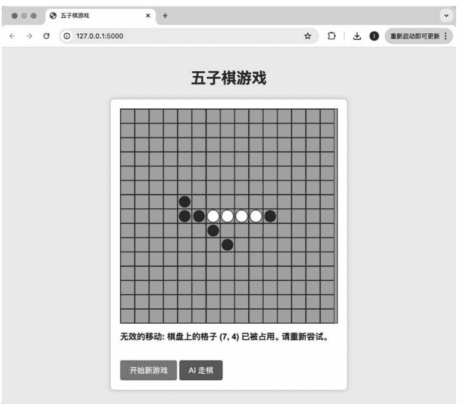

• 图 4-5

# LangChain实战——打造智能对话与自动化智能体 第5章

## 5.1 什么是 LangChain——让 AI 智能体更聪明

智能体往往需要更复杂的处理能力，尤其是当我们需要它理解和处理更复杂的任务时。LangChain 作为一种开源框架，正在为开发者构建更智能、更高效的 AI 智能体提供帮助。

### 1. LangChain 是什么
LangChain 是一个用于构建基于大语言模型的智能体的开源框架。LangChain 不仅提供了一系列的工具和模块，帮助开发者将大语言模型与外部数据源、API 以及其他计算资源整合起来，从而开发出更复杂、更智能的智能体应用。简而言之，LangChain 就像是搭建智能体的积木，每个模块都可以根据需求进行灵活的拼接与组合。LangChain 的官网如图 5-1 所示。

### 2. LangChain 的工作原理
LangChain 的工作方式简单而强大。LangChain 通过模块化的设计，让开发者能够轻松地创建基于大语言模型的智能体应用。在 LangChain 的框架中，主要的工作过程包括：

- 1）大语言模型的调用：LangChain 集成了多个大语言模型的接口，比如 OpenAI 的 GPT 系列、Anthropic 的 Claude 等。通过这些接口，智能体能够理解并生成自然语言，执行复杂的任务。
- 2）任务链（Chains）：LangChain 使用“链”的概念来串联多个任务。每个任务既可以是一个简单的计算，也可以是一个复杂的操作。通过将多个任务连接起来，LangChain 能够为智能体提供更高层次的自动化功能。
- 3）智能体（Agent）：智能体是 LangChain 的一项独特功能。智能体不仅是响应用户的输入，还能够根据输入的信息做出决策，选择最合适的工具来执行任务。例如，在处理一个搜索请求时，智能体可以选择合适的 API 进行数据获取，或者直接通过模型生成答案。

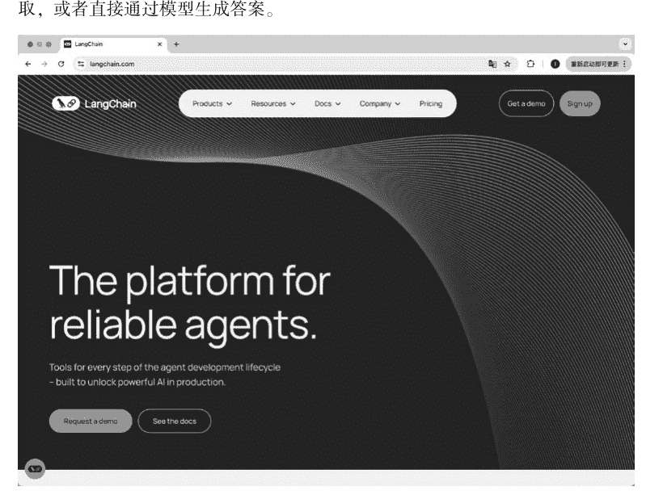

• 图 5-1

### 3. 为什么 LangChain 能让 AI 智能体更聪明

LangChain 通过以下几个方面，让 AI 智能体变得更聪明：

- 1) 多模态处理能力：传统的大语言模型通常只能处理单一类型的数据。而 LangChain 支持多模态的数据处理，包括文本、图像、音频等。这种多模态能力让智能体能够更加灵活地应对复杂任务。例如，可以通过图片描述生成相关的文字内容，或者根据音频输入生成实时的文本反馈。
- 2) 上下文感知：传统的对话系统通常只能处理单一问题，而无法记住之前的对话内容。LangChain 则能够实现多轮对话，并且可以记住上下文，从而让智能体能够处理更复杂的对话，提供更加连贯和自然的回答。这种上下文感知能力在客服系统和智能助手中尤为重要。
- 3）任务自适应性：通过“链”与“智能体”的组合，LangChain 的智能体能够根据不同的任务自动调整处理方式。例如，在回答一个关于天气的问题时，LangChain 会自动调用天气 API 获取实时信息；而在需要处理复杂文档时，智能体则会利用大语言模型生成精确的答案。任务自适应性使得 LangChain 在各种应用场景下都能高效工作。
- 4）集成外部数据源：LangChain 的另一个亮点是其强大的扩展性。通过与外部数据库、API 以及实时数据源的集成，智能体能够访问并利用大量的外部数据。这种能力使得智能体不仅仅局限于“死记硬背”的信息，而是能够实时获取并处理最新的数据，提升回答的准确性和相关性。

### 4. LangChain 的实际应用

LangChain 的应用场景非常广泛，无论是个人开发者、企业还是科研人员，都可以利用这个框架来开发各种智能体应用。以下是几个典型的应用案例：

- （1）智能客服系统
在一个典型的智能客服系统中，LangChain 能够帮助智能体理解客户的问题，并根据问题的内容选择最合适的响应方式。如果客户询问关于订单的信息，则智能体可以从数据库中获取订单状态；如果客户需要技术支持，则智能体可以根据历史对话生成解决方案。
- （2）任务自动化
LangChain 可以在企业内部用于任务自动化，例如自动处理报告、邮件或数据分析。通过将不同的数据源和工具结合，LangChain 能够帮助公司节省大量时间和人力资源，提高工作效率。
- （3）个性化推荐系统
基于用户历史行为，LangChain 可以帮助智能体提供个性化推荐。例如，在电商平台中，智能体可以根据用户的购买记录和浏览习惯，实时推荐与其最相关的商品。
- （4）教育与学习助手
LangChain 还可以应用于教育领域，成为学生的个性化学习助手。通过对话和任务链的组合，学生可以与智能体进行互动，获得定制化的学习资料、解答疑问，甚至模拟考试。

### 5. 如何开始使用 LangChain

对于刚接触 LangChain 的开发者来说，开始使用并不复杂。需要先安装 LangChain 库，安装命令如下：

```
$ pip install langchain
```

LangChain 库安装好后，选择一个合适的大语言模型（如 OpenAI 的 GPT），并根据需求创建任务链。

## 5.2 构建第一个 LangChain 智能体

### 5.2.1 如何安装与配置 LangChain

安装和配置 LangChain 的过程相对简单，首先是正确设置环境。详细的步骤如下。

#### 1. 安装 LangChain
为了在本地环境中使用 LangChain，首先需要确保 Python 环境已经配置好。LangChain 支持 Python 3.7 及以上版本。推荐使用虚拟环境来隔离项目依赖，避免与其他项目的冲突。

(1) 创建并激活虚拟环境
使用 venv 或 conda 来创建一个新的虚拟环境。这不仅能确保项目所需的依赖与其他项目分开，还能保持工作空间的整洁和可管理。本书使用 venv 来创建并激活虚拟环境。在终端执行以下命令来创建虚拟环境：

```
$ python -m venv langchain-env
```

在 Windows 上激活虚拟环境的命令如下：

```
$ langchain-env\Scripts\activate
```

在 macOS/Linux 上激活虚拟环境的命令如下：

```
$ source langchain-env/bin/activate
```

(2) 安装 LangChain
一旦虚拟环境被激活，可以通过 pip 安装 LangChain。在命令行中输入以下命令：

```
$ pip install langchain
```

以上命令从 Python 包管理器 PyPI 中下载并安装 LangChain 框架的最新版本。

#### 2. 安装其他必需的依赖

LangChain 的强大之处在于其支持与多个外部工具和 API 的集成，这些集成能够扩展智能体的功能，处理各种复杂任务。安装基础的 LangChain 包之后，可能还需要根据项目的需求，安装一些额外的依赖。

(1) OpenAI 集成

如果使用 OpenAI 的 GPT 模型，则可以安装 OpenAI 的集成包，命令如下：

```
$ pip install langchain-openai
```

(2) Anthropic 集成

如果使用 Anthropic 的 Claude 模型，则可以安装 Anthropic 的集成包，命令如下：

```
$ pip install langchain-anthropic
```

(3) 其他集成

LangChain 还支持与其他 API 的集成，例如数据库查询、图像生成等功能。这些可以根据项目的需求灵活安装，命令如下：

```
$ pip install langchain-community
```

langchain-community 包能够帮助开发者将多种外部服务或工具无缝结合到智能体的工作流中，从而实现更复杂的任务自动化。

#### 3. 验证安装与配置

安装和配置完成后，可以通过简单的 Python 代码来验证 LangChain 是否配置成功。首先，导入 LangChain 并检查版本信息，确认框架已正确安装：

```python
import langchain
print(langchain.__version__)
```

然后在命令行运行如下命令：

```
$ python langchain_example.py
0.3.26
```

如果以上代码成功运行，则说明安装成功。

#### 4. 配置 LangChain

安装完 LangChain 和相关依赖后，接下来是配置环境，以便能够灵活地使用不同的大语言模型和工具。LangChain 的配置过程包括以下几个关键步骤：

(1) 选择大语言模型

LangChain 支持多种大语言模型，例如 OpenAI、Anthropic 等。为了使系统正常工作，需要选择并配置一个大语言模型。对于 OpenAI，可以按照以下方式配置 API 密钥。

例如，LangChain 使用 OpenAI 模型时，需要配置 API 密钥。API 密钥可以在 OpenAI 官网创建账户后获得。将密钥配置到代码中，通常通过环境变量来实现。

```
$ export OPENAI_API_KEY="xxx"
```

在 Python 代码中，LangChain 会自动读取这个密钥进行 API 调用。

(2) 配置外部工具和 API

除了大语言模型，LangChain 允许与外部 API、数据库或数据源进行交互。对于任何外部工具的集成，都需要在代码中进行配置。例如，如果需要集成天气 API，配置代码可能会包含 API 的调用方式、响应格式和所需的查询参数。示例如下：

```python
from langchain.agents import initialize_agent
from langchain.agents import Tool

tools = [
    Tool(
        name="weather-api",
        func=weather_api_function,
        description="Get the current weather"
    )
]

agent = initialize_agent(tools, llm, agent_type="zero-shot-react-description")
```

通过这种方式，LangChain 能够访问实时的外部数据并将其用于智能体的决策过程。

(3) 使用内存管理

LangChain 的另一个重要功能是内存管理，它允许智能体在多轮对话中记住用户的输入和上下文。这意味着在与用户的互动中，智能体不仅仅处理单一的问题，而是能够根据对话的历史记录做出更为合理的响应。内存管理的示例如下：

```python
from langchain.memory import ConversationBufferMemory

memory = ConversationBufferMemory(memory_key="chat_history")
```

内存模块可以根据任务的复杂性进行定制和扩展，帮助智能体实现长期记忆。

### 5.2.2 【实战】使用 LangChain 构建你的第一个问答智能体

借助 LangChain 这一强大的开源框架，开发者可以轻松地构建基于大语言模型（LLM）的智能应用。本文将通过构建一个简单的问答智能体，带领大家逐步了解如何使用 LangChain。

#### 1. 准备工作

在开始之前，确保你的开发环境中已经安装了 LangChain 及其依赖。使用以下命令即可安装：

```
$ pip install langchain-openai
```

OpenAI 的 API 也需要配置，以便访问 GPT 系列的语言模型。你需要在 OpenAI 官网注册并获取 API 密钥。安装完成后，可以开始构建问答智能体。

#### 2. 导入必需的模块

LangChain 为我们提供了多个模块，用于构建和处理任务链。另外还要导入所需的模块，我们需要使用 OpenAI 的大语言模型、提示模板和任务链：

```python
import getpass
import os
from langchain.prompts import PromptTemplate
from langchain.chains import LLMChain
from langchain.chat_models import init_chat_model
```

在以上代码中，导入了 OpenAI 模块，用于与 GPT 模型进行交互，PromptTemplate 用来设计输入输出的格式，LLMChain 则用来将模型与任务链结合。

#### 3. 创建提示模板

问答智能体的核心在于如何设计与大语言模型的交互。在 LangChain 中，提示模板（PromptTemplate）用于定义如何与大语言模型交互。简单来说，提示模模板就是给大语言模型提供一个“问题描述”的框架，模型根据这个框架生成回答。创建一个简单的模板，将输入问题传递给模型的示例如下：

```
template = "回答以下问题：{question}"
prompt = PromptTemplate(input_variables=["question"], template=template)
```

在以上代码中，`input_variables` 指定了模板中需要的输入变量。我们在模板中定义了一个占位符 `{question}`，该占位符将在后续使用中被替换为用户的实际问题。

## 4. 初始化大语言模型

接下来，初始化一个 OpenAI 大语言模型。LangChain 通过 `OpenAI` 类来调用 API。为了实现问答功能，需要设置合适的模型参数，示例如下：

```
model = init_chat_model("gpt-4o-mini", model_provider="openai")
```

在以上示例中，我们选择了 `gpt-4o-mini` 作为大语言模型。

## 5. 创建任务链

通过将提示模板和大语言模型结合，我们可以创建一个任务链。任务链（Chains）使得 LangChain 能够处理更加复杂的任务，自动化地执行多步骤操作。在这个例子中，我们将大语言模型与提示模板结合，形成一个简易的问答系统。示例如下：

```
chain = LLMChain(prompt=prompt, llm=model)
```

通过 `LLMChain` 类，LangChain 会自动处理模板和模型之间的关系，并且将用户输入的内容转换成适当的格式进行处理。

## 6. 执行任务链

通过以上步骤，智能体已经准备好回答问题。通过向任务链传入问题，我们就能获得模型生成的回答。我们让智能体回答一个简单的问题：“你好，你是谁？”示例代码如下：

```
result = chain.run({"question": "你好,你是谁?"})
print(result)
```

执行以上步骤的完整代码，智能体将会生成一个基于输入问题的回答。如果配置正确，则执行结果如下：

```
$ python langchain_example1.py
请输入 OpenAI 的 API 密钥：
result = chain.run({"question": "你好,你是谁?"})
你好！我是一个人工智能助手,旨在回答你的问题并提供帮助。请问有什么我可以为你做的?
```

## 5.3 LangChain 的核心功能与工作原理

LangChain 的架构可以理解为一个功能完备的“智能体搭建工厂”，将从最底层的基础模块，到中间的功能组件，再到高层的部署与调试平台，层层分工、环环相扣。LangChain 架构如图 5-2 所示。

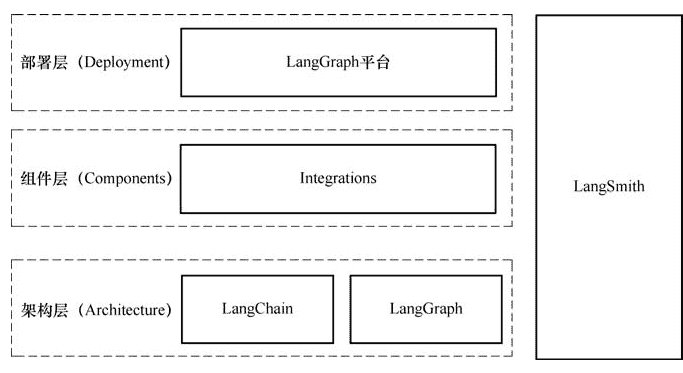

如图 5-2 所示，LangChain 整个系统分为三个主要层级：架构层（Architecture）、组件层（Components）和部署层（Deployment）。LangChain 架构的详细讲解如下。

### 1. 架构层——LangChain 与 LangGraph 是智能体的“骨架”

架构层是整个系统的核心基础，负责定义智能体的运行逻辑和结构组织方式。

#### (1) LangChain

LangChain 是最早诞生的模块，提供了构建大语言模型驱动应用所需的核心逻辑。可以看作“智能体的神经系统”，用于连接提示词（Prompt）、大语言模型（LLM）、内存（Memory）、工具（Tools）等关键元素。

例如，构建一个问答机器人，只需通过 LangChain 将问题输入、模型调用与答案输出组织成一条“链”即可。LangChain 的特点如下：

- 1) 提供高阶封装，开发者可以像写故事脚本一样设计智能体的对话流程。
- 2) 支持与 OpenAI、Anthropic、Cohere 等主流模型集成。
- 3) 可嵌套链条，支持复杂推理与任务分解。

#### (2) LangGraph

LangGraph 是 LangChain 的结构化拓展。它通过图结构（而非线性链）来组织智能体的执行逻辑，支持条件判断、分支流程、循环控制等功能。

想象一个智能体需要先分析用户意图，如果用户意图是提问，就搜索资料；如果用户意图是写邮件，就调用模板生成器。类似的这些逻辑在 LangGraph 中就能用“图”清晰地表示。

LangGraph 的特点如下：

- 1) 类似于用“流程图”的方式表达智能体逻辑。
- 2) 适合多步骤、多分支的智能体应用。
- 3) 支持状态管理和异步处理。

### 2. 组件层——Integrations 是连接世界的“插件总线”

Integrations 层负责将 LangChain 与外部世界连接起来。Integrations 层就像一个“接口库”，让智能体具备实际的行动能力。包括但不限于：

- 1) 调用搜索引擎获取实时信息。
- 2) 操作数据库检索文档内容。
- 3) 与企业内部系统进行集成（如 ERP、CRM）。

### 3. 部署层——LangGraph 平台是工业级的“生产线”

部署层是商业化能力的体现，适用于需要调试、监控、优化的企业级应用。LangGraph 平台为 LangGraph 构建的图式智能体提供托管服务，具备可视化部署、可扩展性、容错机制等功能，适合生产环境中使用。LangGraph 平台的作用如下：

- 1) 智能体的云部署平台。
- 2) 支持并发处理、大规模运行。
- 3) 提供任务执行日志与可视化图谱。

### 4. LangSmith

LangSmith 是智能体的开发与调试工作台，专为开发者设计。提供全流程调试工具，包括提示词管理、调试控制台、多模型测试、日志记录等。LangSmith 的功能板块如下：

- 1) Playground：模拟运行智能体逻辑，实时查看响应。
- 2) Prompt 管理：集中管理提示词模板。
- 3) Annotation & Testing：对输出结果进行标注、比对。
- 4) Monitoring：运行状态监控与性能分析。

LangSmith 的目标是让智能体开发进入“工程化时代”，从试验性质的小工具升级为可靠、可维护的产品系统。

## 5.4 LangChain 提示模板实战——构建高效、可重用的 AI 提示引擎

在构建基于大语言模型的应用时，如何高效地设计和管理提示（Prompt）是提升系统性能和可维护性的关键。LangChain 提供的提示模板（Prompt Templates）功能，正是解决这一问题的重要工具。通过将提示逻辑模块化，开发者可以实现提示的重用、版本控制和动态构建，从而构建出更加灵活和高效的 AI 应用。

### 1. 提示模板的核心概念

提示模板是将用户输入和参数转换为语言模型指令的工具。提示模板通过占位符（如 `{variable}`）将动态内容插入到静态模板中，生成最终的提示文本。LangChain 支持多种模板格式，常见的模板格式包括如下：

- 1) 字符串格式（f-string）：最常用的格式，简单直观。
- 2) Mustache 格式：适用于需要更复杂逻辑的场景。
- 3) Jinja2 格式：功能强大，但需注意安全性问题，避免执行恶意代码。

通过这些模板格式，开发者可以根据需求灵活选择，构建出符合业务逻辑的提示结构。

### 2. 提示模板的类型与应用场景

LangChain 提供了多种类型的提示模板，适应不同的应用场景：

#### （1）字符串提示模板

字符串提示模板（StringPromptTemplate）适用于简单的文本生成任务。例如，生成一个关于特定主题的示例代码如下：

```
from langchain_core.prompts import StringPromptTemplate

template = "Tell me a joke about {topic}"
prompt = StringPromptTemplate.from_template(template)
formatted_prompt = prompt.invoke({"topic": "cats"})
```

以上模板将生成一个关于猫的笑话提示，供大语言模型使用。

#### （2）聊天提示模板

聊天提示模板（ChatPromptTemplate）用于多轮对话场景，支持多种角色的消息格式。例如，构建一个翻译助手的示例代码如下：

```
from langchain_core.prompts import ChatPromptTemplate

template = ChatPromptTemplate.from_messages([
    ("system", "You are a helpful assistant"),
    ("user", "Translate the following from English into {language}: {text}")
])
formatted_prompt = template.invoke({"language": "French", "text": "Hello, how are you?"})
```

以上模板生成一个包含系统消息和用户消息的对话结构，适用于多轮交互的应用。

#### （3）图像提示模板

图像提示模板（ImagePromptTemplate）针对多模态模型，构建图像生成或分析任务的提示模板。例如，生成描述特定场景的图像的示例代码如下：

```
from langchain_core.prompts.image import ImagePromptTemplate

template = ImagePromptTemplate.from_template("A painting of a {scene} in the style of {artist}")
formatted_prompt = template.invoke({"scene": "sunset over the mountains", "artist": "VanGogh"})
```

以上模板生成一个描述特定场景和艺术风格的图像提示，供多模态模型使用。

### 3. 提示模板的高级功能

#### （1）部分格式化

在某些情况下，可能只知道部分变量的值。LangChain 允许对提示模板进行部分格式化（Partial Formatting），先填充已知的变量，待获取其他变量后再完成格式化。示例代码如下：

```
from langchain_core.prompts import PromptTemplate

template = PromptTemplate.from_template("Tell me a {adjective} joke about {topic}")

partial_template = template.partial(adjective="funny")
final_prompt = partial_template.format(topic="sports")
```

部分格式化这种方式提高了模板的灵活性，适用于动态生成提示的场景。

#### （2）示例引导

示例引导（Few-Shot Prompting）通过提供一组示例，帮助大语言模型更好地理解任务要求。LangChain 支持将示例集成到提示模板中，实现少量示例引导。示例代码如下：

```
from langchain_core.prompts import PromptTemplate

template = PromptTemplate.from_template("Q: {question}\nA: {answer}")
examples = [
    {"question": "What is the capital of France?", "answer": "The capital of France is Paris."},
    {"question": "What is 2 + 2?", "answer": "2 + 2 equals 4."}
]
formatted_prompt = template.invoke({"question": "What is the tallest mountain in the world?"})
```

通过示例引导这种方式，大语言模型可以学习到如何回答类似的问题，提高回答的准确性。

#### （3）提示组合

提示组合（Prompt Composition）是指将多个提示模板组合成一个复杂的提示结构，适用于需要多步骤处理的任务。示例代码如下：

```
from langchain_core.prompts import PipelinePromptTemplate, PromptTemplate

final_template = PromptTemplate.from_template("{introduction}\n{example}\n{start}")
introduction_template = PromptTemplate.from_template("You are impersonating {person}.")
example_template = PromptTemplate.from_template("Here's an example of an interaction:\nQ: {example_q}\nA: {example_a}")
start_template = PromptTemplate.from_template("Now, do this for real! \nQ: {input}\nA:")

pipeline = PipelinePromptTemplate(
    final_prompt=final_template,
    pipeline_prompts=[
        ("introduction", introduction_template),
        ("example", example_template),
        ("start", start_template)
    ]
)

formatted_prompt = pipeline.invoke({"person": "Albert Einstein", "example_q": "What is relativity?", "example_a": "Relativity is the idea that space and time are linked."})
```

通过以上几种组合方式使得 LangChain 的提示模板结构更加清晰，易于维护和扩展。

## 5.5 在 LangChain 中使用 RAG 让问答系统更“聪明”

传统的大语言模型，在面对领域中专业或最新信息的提问时，常会出现“胡编乱造”的现象。这不是模型不够聪明，而是它的知识被封闭在训练数据的时间点上。为了解决上述问题，一种叫作检索增强生成（Retrieval Augmented Generation，RAG）的架构逐渐流行起来。

RAG 就像给大语言模型配备了一位“实时知识检索助手”。当接收到问题时，它不再闭门造车，而是主动查询相关资料，再据此生成回答。通过这种“先检索，后生成”的流程，系统能够在语言表达的灵活性与事实准确性之间找到平衡。

LangChain 提供了构建 RAG 系统的完整工具链，从文档加载、文本分块，到向量检索、问答接口，一应俱全，且逻辑清晰、易于扩展。

### 1. LangChain 中的 RAG 架构原理

RAG 的核心可拆解为两个阶段：

#### （1）索引阶段

在这个阶段，需要将原始文本数据（如产品说明、政策文件、技术手册等）转化为可被检索的格式。主要流程如下：

- 1) 使用 TextLoader、UnstructuredLoader 等来读取文本、PDF 或网页。
- 2) 用 TextSplitter 将长文分解为逻辑完整的短段，便于模型理解。
- 3) 调用嵌入模型（如 OpenAI Embeddings 或 HuggingFace）将文本转化为向量。
- 4) 将所有向量存入一个向量数据库，例如 Chroma、FAISS、Pinecone 等。

这一过程好比将图书馆中图书的每一页内容，都编号归档，并生成“内容指纹”，以便快速定位。

#### （2）问答阶段

问答阶段的主要流程如下：

- 1) 接收到用户问题后，先将问题编码为向量。
- 2) 在向量数据库中查找与其最相关的内容块。
- 3) 将这些内容作为提示词嵌入，传给大语言模型。
- 4) 生成贴近真实、基于事实的回答。

LangChain 的 RetrievalQA 链正是完成这个任务的工具，RetrievalQA 链负责将检索与生成过程无缝衔接。

### 2. 【实战】构建一个法律文书问答系统

以下是使用 LangChain 构建 RAG 系统的实际流程，假设需求是：基于某城市法律法规，实现本地化问答。

#### （1）文档加载与切片

文档加载与切片的示例代码如下：

```
from langchain.document_loaders import TextLoader
from langchain.text_splitter import RecursiveCharacterTextSplitter

loader = TextLoader("local_laws.txt", encoding="utf-8")
documents = loader.load()

splitter = RecursiveCharacterTextSplitter(chunk_size=500, chunk_overlap=100)
chunks = splitter.split_documents(documents)
```

#### （2）向量嵌入与数据库建立

向量嵌入与数据库建立的示例代码如下：

```
from langchain.embeddings import OpenAIEmbeddings
from langchain.vectorstores import Chroma

embeddings = OpenAIEmbeddings()
vector_db = Chroma.from_documents(chunks, embedding=embeddings)
```

#### （3）构建 RAG 问答系统

构建 RAG 问答系统的示例代码如下：

```
from langchain.chat_models import ChatOpenAI
from langchain.chains import RetrievalQA

llm = ChatOpenAI(temperature=0.3)
qa_chain = RetrievalQA.from_chain_type(llm=llm, retriever=vector_db.as_retriever())

response = qa_chain.run("外地车在本市限行吗?")
print(response)
```

## 5.6 【实战】LangChain Agent 创建与使用

在 LangChain 框架中，智能体（Agent）不仅仅是简单的响应生成，还能根据输入任务来判断应采取的行动，并使用合适的工具执行任务。智能体在执行操作后会将结果反馈给模型，帮助它决定是否需要继续执行更多操作，或是完成当前任务。这种工具调用方式使得智能体能够处理复杂的任务链，并灵活地应对动态变化。

### 1. 创建 Agent 的核心步骤

#### （1）环境配置

在命令行输入如下命令安装必要的库：

```
$ pip install langchain langgraph openai langchain-tavily
```

#### （2）导入必要的库

创建一个 py 文件，编写代码如下：

```
import os
import uuid
from langchain.chat_models import init_chat_model
```

## （3）初始化记忆和模型

创建智能体的记忆模块（MemorySaver），代码如下：

```python
memory = MemorySaver()
```

MemorySaver() 像智能体的“记事本”，帮助它在对话过程中记住历史内容，以便上下文的流畅衔接。

智能体需要一个大脑，这里我们使用 OpenAI 的最新模型（如 gpt-4o-mini）来进行初始化，代码如下：

```python
model = init_chat_model("gpt-4o-mini", model_provider="openai")
```

init_chat_model 初始化一个对话模型，这个模型就像智能体的“思考引擎”，负责理解问题并给出回应。

## （4）加入工具

智能体要强大，光靠大脑不够，还得配备好工具！我们使用 TavilySearch 工具，让智能体能实时搜索网络信息：

```python
search = TavilySearch(max_results=2)
tools = [search]
```

在以上代码中，TavilySearch(max_results=2) 用于告诉智能体使用 Tavily 搜索引擎，每次最多返回 2 个搜索结果。

## （5）创建智能体

将上面准备好的模型、工具和记忆整合，创建一个 ReAct 智能体：

```python
agent = create_react_agent(model, tools, checkpointer=memory)
```

create_react_agent 用于组装一个智能体，这种智能体具有推理（Reasoning）和行动（Action）的能力。我们再配置唯一的会话 ID，用于保存对话进度：

```python
thread_id = str(uuid.uuid4())
config = {
    "thread_id": thread_id,
    "checkpoint_ns": "default",
    "checkpoint_id": thread_id
}
```

## （6）运行智能体

我们设计一个简单易用的 REPL（交互式）循环，代码如下：

```python
while True:
    user_input = input("You: ")
    if user_input.strip().lower() in ("exit", "quit"):
        print("再见!")
        break
```

通过以上代码，用户输入问题，智能体会实时响应，用户输入 exit 或 quit 退出。

## （7）对话流程

用户输入会被包装成消息对象，传给智能体执行：

```python
input_message = {"role": "user", "content": user_input}
```

智能体以流式方式回复，提供更好的互动体验：

```python
for step in agent.stream({"messages": [input_message]}, config, stream_mode="values"):
    msg = step["messages"][-1]
    if hasattr(msg, "pretty_print"):
        msg.pretty_print()
    else:
        print(msg)
```

在以上代码中，agent stream 以流的形式逐步输出智能体思考与行动过程。pretty_print() 会将消息格式化后打印，更加美观。

## （8）错误处理

加入异常捕获机制，防止智能体突然“死机”，代码如下：

```python
except Exception as e:
    print(f"交互出错: {e}")
```

## （9）运行与测试

在终端运行程序，输出的结果示例如下：

```
$ python agent_example1.py
智能体已启动,输入 'exit' 或 'quit' 退出。
You:你是谁
============================== Human Message ==============================
你是谁
============================== Ai Message ==============================
我是一个人工智能助手,旨在提供信息、回答问题和帮助解决各种问题。如果你有什么需要了解的或帮助的,请随时告诉我!
You:爱因斯坦是谁
============================== Human Message ==============================
爱因斯坦是谁
============================== Ai Message ==============================
阿尔伯特·爱因斯坦(Albert Einstein)是20世纪最著名的理论物理学家之一,他以提出相对论而闻名于世。相对论包括狭义相对论和广义相对论,弯曲现象。
爱因斯坦于1879年出生在德国,后成为瑞士和美国公民。他在1905年被称为“奇迹年”的时候发表了多篇重要论文,包括质能方程E=mc²,这一公式表明了质量和能量的相互关系。
此外,爱因斯坦在统计物理、量子理论和宇宙学方面也做出了重要贡献。他于1921年获得诺贝尔物理学奖,以表彰他在光电效应方面的研究。爱因斯坦的一生致力于科学研究和社会事务,他的思想对现代物理学的发展产生了深远影响。爱因斯坦于1955年去世。
```

## 2. 内存管理与多轮对话

默认情况下,LangChain 的智能体是无状态的,这意味着它不会记住之前的对话内容。为了支持多轮对话,可以通过 MemorySaver 进行内存管理,允许智能体在对话过程中保留和使用之前的对话信息。

```python
memory = MemorySaver()
agent_executor = create_react_agent(model, tools, checkpointer=memory)
```

通过配置不同的 thread_id,可以实现多会话的跟踪和回忆:

```python
config = {"configurable": {"thread_id": "abc123"}}
```

## 5.7 【实战】用 LangChain 搭建一个聊天机器人

本节将通过一个完整的实战示例,演示如何基于 LangChain 框架,构建一个具备多轮对话记忆能力的中文聊天机器人。该机器人不仅能够处理单轮问答,还能够在多轮对话中保持上下文连贯，模拟出类似人类助教的交互体验。

## 1. 搭建开发基础环境

### (1) 检查核实开发资源与依赖

在开始编码之前，我们需要确保以下开发资源与依赖已经配置完毕：

- 1) OpenAI API Key（用于调用大语言模型）。
- 2) Python 环境（推荐 Python 3.9 及以上版本）。
- 3) LangChain 与 LangGraph 库（对话管理与图结构支持）。
- 4) 可选：LangSmith API Key（用于调试过程的追踪和可视化分析）。

### (2) 安装核心依赖

使用 pip 安装核心依赖：

```bash
$ pip install langchain langgraph openai
```

### (3) 配置环境变量

建议通过环境变量管理 API 密钥，确保安全性：

```bash
$ export OPENAI_API_KEY="你的 OpenAI 密钥"
```

提示：开发过程中建议使用 env 文件或本地配置工具集中管理环境变量，避免密钥泄露。

## 2. 基础功能实现

实现一个最简版本的对话机器人，能够基于预设身份回答用户提问，模拟一名“中文教师”的角色。示例代码如下：

```python
def basic_chat_demo(chat):
    print("\n===基本聊天演示 ===")
    messages = [
        SystemMessage(content="你是一位乐于助人的中文教师"),
        HumanMessage(content="请解释一下‘守株待兔’这个成语")
    ]
    response = chat.invoke(messages)
    print("模型回复:", response.content)
```

在以上代码中，SystemMessage 用于设定系统角色，为聊天模型提供语境提示（例如：“你是一位中文教师”）。HumanMessage 表示用户输入，即提问内容。所有消息会组合成一轮对话历史，通过 chat.invoke() 方法发送给模型。返回结果即为模型生成的回答内容。

## 3. 维护对话历史

想象一下，当你与朋友进行连续聊天，如果你的朋友每次都“失忆”，则显然会影响交流质量。通过维护对话历史，机器人可以“记住”前文内容，使得回答更加自然连贯。通过显式保存历史对话内容，模拟多轮问答过程，使模型能够根据上下文生成更连贯的回应。示例代码如下：

```python
def manual_history_demo(chat):
    print("\n===手动管理历史信息示例 ===")
    history = [
        HumanMessage(content="你好!"),
        AIMessage(content="你好! 很高兴见到你。")
    ]
    messages = history + [HumanMessage(content="你能帮我翻译一下'我爱编程'吗?")]
    response = chat.invoke(messages)
    print("模型回复:", response.content)
```

在以上代码中，history 列表记录了先前的对话，包括用户问候与机器人回复。在新的请求中，将历史信息与当前输入一同发送至模型。模型会将这些信息作为上下文，生成符合语境的答案。

## 4. 自动持久化多轮记忆（MemorySaver）

利用 LangGraph 提供的自动持久化多轮记忆（MemorySaver）模块，实现对话历史的自动管理。开发者无须手动维护历史信息，系统将自动记录每一轮交流。示例代码如下：

```python
def automagic_memory_demo(chat):
    print("\n===LangGraph MemorySaver 自动持久化示例 ===")
    workflow = StateGraph(state_schema=MessagesState)

    def call_model(state: MessagesState):
        system_prompt = "你是一位乐于助人的中文教师"
        messages = [SystemMessage(content=system_prompt)] + state["messages"]
        response = chat.invoke(messages)
        return {"messages": response}

    workflow.add_node("model", call_model)
    workflow.add_edge(START, "model")
    memory = MemorySaver()
    app = workflow.compile(checkpointer=memory)

    input_message = {"role": "user", "content": "请解释一下'守株待兔'这个成语"}
    config = {
        "configurable": {
            "thread_id": "session-1",
            "checkpoint_ns": "default",
            "checkpoint_id": "session-1"
        }
    }
    result = app.invoke({"messages": [input_message]}, config=config)
    last = result["messages"][-1]
    print("模型(带记忆)回复:", last.content)
```

在以上代码中，StateGraph 构建一个有状态的对话流程图，定义模型处理逻辑。call_model() 函数作为节点逻辑，接收历史状态、拼接提示信息并调用大语言模型。MemorySaver 自动将每次交互记录到内存中（也支持扩展为数据库或文件系统）。每轮调用都基于线程 ID 与会话 ID，系统自动追踪对话历史，实现“多轮记忆”。

## 5. 添加 LangSmith 调试追踪

添加 LangSmith 调试追踪的示例代码如下：

```python
def setup_langsmith():
    os.environ["LANGSMITH_TRACING"] = "true"
    key = getpass.getpass("Enter your LangSmith API key: ")
    os.environ["LANGSMITH_API_KEY"] = key
    print("LangSmith tracing enabled.")
```

LangSmith 是 LangChain 提供的调试与追踪平台，能够可视化展示模型每次推理过程的输入与输出。在开发和调试多轮对话系统时，LangSmith 能显著提升开发效率与系统可解释性。

## 6. 编写 main() 函数

main() 函数的代码如下：

```python
def main():
    if not os.getenv("OPENAI_API_KEY"):
        raise ValueError("请设置环境变量 OPENAI_API_KEY")
    setup_langsmith()  # 可选调试追踪
    chat = ChatOpenAI(model="gpt-4o-mini", temperature=0.5)
    basic_chat_demo(chat)
    manual_history_demo(chat)
    automagic_memory_demo(chat)
```

## 7. 运行代码

在命令行输入如下命令运行代码，输出的结果示例如下：

```
$ python chatbot_example.py
Enter your LangSmith API key:
LangSmith tracing enabled.
===基本聊天演示 ===
模型回复：“守株待兔”是一个源自中国古代的成语，字面意思是守着树桩等待兔子。这个成语的由来是一个寓言故事：宋国有个农夫，他的田地中有一截树桩。一天，一只跑得飞快的兔子撞在了树桩上，折断了脖子死了。于是，他便放下农具，日日夜夜守在树桩旁边，希望能再得到一只兔子。然而兔子是不可能再次得到了，而他自己也被宋国人耻笑。
这个成语的寓意是形容一种不思进取、坐等好运的态度。它警示人们不要抱有侥幸心理，期望偶然的好运，而是要积极主动地去追求自己的目标和理想。
===手动管理历史信息示例 ===
模型回复：当然可以！“我爱编程”翻译成英文是“I love programming”。
===LangGraph MemorySaver 自动持久化示例 ===
模型(带记忆)回复：“守株待兔”是一个源自中国古代的成语，字面意思是守在树桩旁边等待兔子。这个成语的故事来源于《韩非子》，讲述了一个农夫在田间劳作时，看到一只兔子撞到树桩上死掉了。于是他决定不再耕作，而是守在树桩旁边，希望能再次得到兔子。
这个成语用来比喻希望不劳而获，或是抱着侥幸心理等待机会，而不去主动努力。它告诫人们要勤奋工作，而不是寄希望于偶然的好运。
```

## 第6章 【实战】用Dify打造可本地部署的智能体工坊

## 6.1 什么是 Dify

Dify 是一个开源的 “AI 应用开发与管理平台”，Dify 的核心目标就是：让 AI 智能体开发像搭建网页一样简单。在 Dify 平台上，可以拖拽组件、设置提示词、选择模型、连接外部数据，即可生成一个可用的 AI 智能体，整个过程无需复杂的编码或环境部署。Dify 官网的首页如图 6-1 所示。

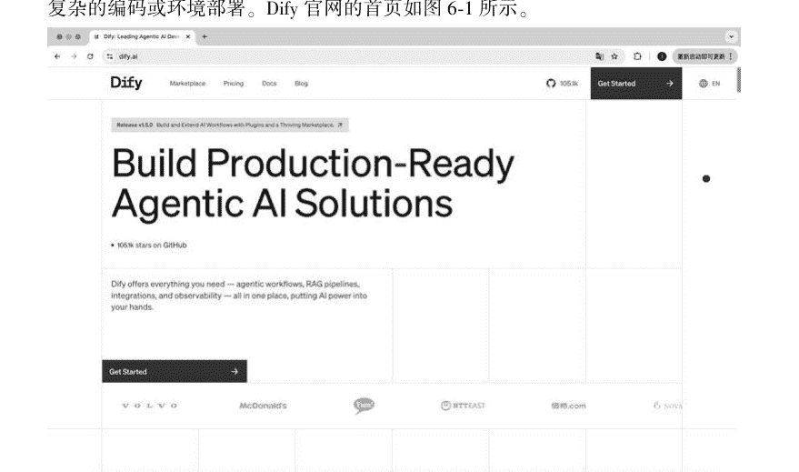

> 提示：可以将 Dify 想象成一个“低代码的 AI 工厂”，它内置了连接 OpenAI、Claude、DeepSeek 等主流模型的能力，并配合了清晰的图形化界面和 API 管理工具，可以让开发和运营更高效，也更直观。

## 1. Dify 的核心组成

Dify 的设计使得 AI 应用的开发和部署变得更加灵活、快速且高效，核心组成可以从以下几方面理解：

### (1) 提示词引擎

提示词引擎（Prompt Designer）是 Dify 的“语言大脑”，它允许开发者设定 AI 应用的“说话方式”和“行为逻辑”。比如，你可以指示 Dify“回答要简洁清晰”或“程序执行效率要高”，Dify 将严格遵循这些指令，确保 AI 应用的输出符合预期。通过简单的界面设置，非技术人员也可以轻松管理 AI 应用的行为。

### (2) 支持多个大模型接入

Dify 允许接入多个顶级大模型服务提供商，例如 OpenAI、Anthropic、Azure 以及 Moonshot 等。开发者可以根据不同需求，灵活切换服务提供商，选择最适合的模型。这种灵活性让开发者可以根据场景优化 AI 应用的表现，提升开发效率。

### (3) 集成外部数据

Dify 不仅支持将外部数据作为“记忆源”，还允许上传文件、连接数据库，甚至抓取网页内容。通过这些数据源，Dify 的 AI 应用能够“记住”更多信息，并在处理任务时灵活调用，这使得 AI 应用能像人脑一样进行深度学习和反应。这种“补充大脑”的方式，让 AI 能够更好地应对复杂且多变的需求。

### (4) 应用发布与权限管理

一旦 AI 应用开发完成，Dify 提供了一键生成网页和 API 的功能，便于快速发布和集成到其他系统中。此外，Dify 还提供了强大的权限管理功能，你可以设定谁能访问应用、是否需要登录、调用频率限制等，确保应用的安全性与可控性。

## 2. 为什么选择 Dify

与传统的 AI 编程方式相比，Dify 的优势在于其高效性、易用性和灵活性，特别适合那些没有技术背景的开发者和企业。以下是 Dify 的主要优势：

### (1) 上手快

Dify 通过图形化界面，简化了开发过程，让非专业人士或初级开发者也能

## 3. Dify 的典型应用场景

Dify 作为一个多功能的 AI 应用开发平台，能够满足各行各业的不同需求。以下是一些典型的应用场景：

（1）快速搭建智能问答助手
Dify 能够根据简单的提示词快速生成一个能理解上下文、自动回答问题的智能问答系统。无论是用于客服机器人、在线教育辅导，还是智能技术支持，Dify 都能提供精准、高效的解决方案。

（2）自动化写作工具
通过输入提示词或设定场景，Dify 能够生成商品文案、社交媒体文章或新闻摘要等。自媒体、内容创作者和电商平台可以利用 Dify 快速生成符合需求的内容，节省大量时间，提高创作效率。

（3）定制化企业内部工具
对于企业来说，Dify 可以帮助他们定制化开发内部 AI 应用工具。例如，企业可以使用 Dify 来分析客户邮件、整理项目纪要或生成工作报告。通过结合表单输入、后台逻辑和输出功能，Dify 能够快速构建出符合企业需求的智能工具。

（4）私人知识库问答机器人
Dify 能够将私人 PDF、Word 文档或网页内容转化为 AI 应用可查询的知识库，通过结合大模型，提供智能问答。这种功能对于企业的客服、售后支持，或者个人文档管理系统非常有用，可以极大提升信息管理的效率。

## 6.2 快速用 Dify 搭建一个会编程的智能体

本节将通过一个实操示例，带领读者快速使用 Dify 搭建一个会编程的 AI 智能体。详细步骤如下。

### 1. 登录 Dify

在浏览器中访问 Dify 官网，选择一个登录方式进行登录。Dify 的登录页面如图 6-2 所示。

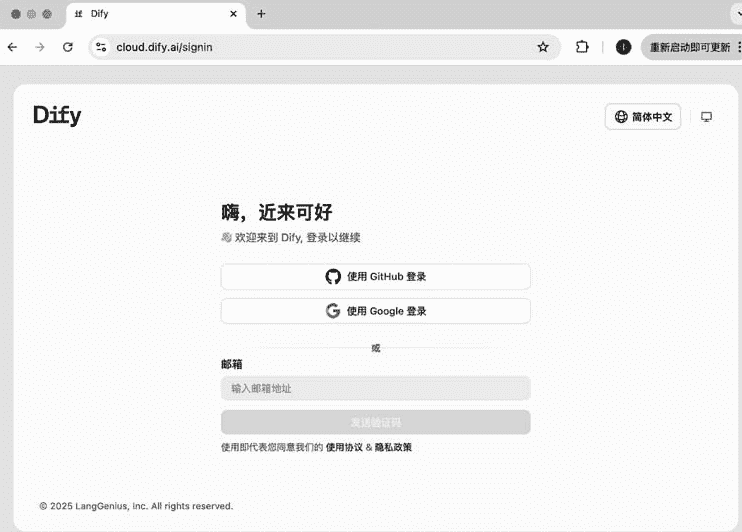

• 图 6-2

### 2. 开始创建

登录成功后，进入 Dify 首页，单击页面上方的“创建空白应用”按钮，如图 6-3 所示。

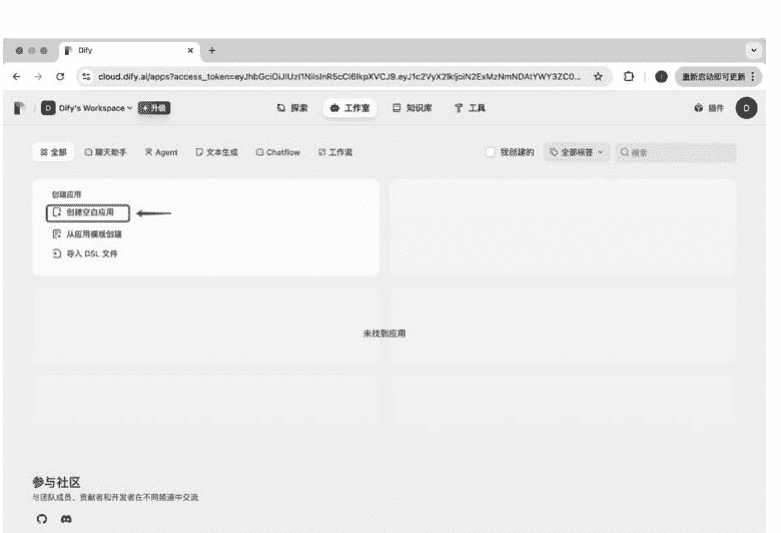

• 图 6-3

### 3. 创建空白应用

“创建空白应用”的详细步骤如图 6-4 所示。

1）在“创建空白应用”的界面中，上方展示了几种常见的应用类型。此时单击卡片“聊天助手”模块，这个模块适用于大多数基于语言模型的问答、对话或脚本生成场景。
2）在“应用名称 & 图标”文本框中输入应用名称，例如“AI 编程助手”；在“描述”文本框中也填写相关描述，例如“AI 编程助手”（这部分可留空，也可简要说明功能）。
3）确认信息无误后，单击右下角“创建”按钮，则进入应用配置界面。这时，就已经生成了应用的雏形，接下来进行个性化设定。

### 4. 设置大模型的密钥

如图 6-5 所示，进入设置页面后，单击“模型供应商”模块，根据自身实际选择“模型供应商”，例如，本书选择“深度求索”模型，然后单击“安装”按钮进行安装。

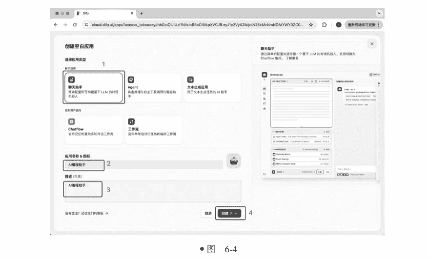

● 图 6-4


● 图 6-5

安装好“深度求索”大语言模型后，进入设置页面，设置 API Key，如图 6-6 所示。


图 6-6 中的 API Key 获取方法如下。

单击深度求索（DeepSeek）官网首页右上角的“开放平台”访问 DeepSeek 开放平台，使用你的账号登录或注册新账号，如图 6-7 所示。

登录后，单击左侧边栏的“API Keys”选项。单击“创建 API Key”按钮，为其命名以便区分不同的密钥。系统会生成一个新的 API Key，请务必将复制并妥善保存，因为此密钥只在创建时显示一次，之后无法再次查看，如图 6-8 所示。

### 5. 进行预览与调试

设置好 API Key 后，进入“编排”页面，如图 6-9 所示。首次进入后，需要设置模型：单击右上角的按钮，单击“模型设置”，选择其中一个模型，笔者选择的是“deepseek-coder”（用于编写代码）。


● 图 6-7


● 图 6-8

图 6-9 右侧是“调试与预览”窗口。在右下方的输入框中可以输入提示词，示例如下：

> 请帮我写一个 Python 脚本，能够自动从网上获取实时天气数据，并打印出当前的温度和天气情况。


• 图 6-9

几秒后，AI 智能体就会生成一段完整的 Python 代码，并附带说明。例如，它调用了 requests 库，通过 OpenWeatherMap 的 API 获取天气信息。运行结果如图 6-10 所示。

按照 Dify 的提示，将代码复制到自己的编程工具中运行，如果 OpenWeatherMap 的 API 配置正常，且代码正常运行，则可以在浏览器中显示出实时天气信息。


• 图 6-10

## 6.3 Dify 技术架构解析

蜂巢是自然界最经典的分布式结构，每一个蜂巢单元既能独立运行，又能协作形成复杂功能。Dify 的架构设计正是借鉴了这一灵感：不同功能模块以“蜂巢单元”形式组织，各模块间通过统一接口通信，互不干扰又协同高效。Dify 采用“蜂巢架构”（Beehive Architecture），不仅在功能上能实现模块独立、流程灵活，还为整个 AI 开发生态注入前所未有的弹性与生机。Dify 技术架构简图如图 6-11 所示。

如图 6-11 所示，Dify 构建了一个高度集成、模块化、低门槛但功能强大的多 Agent + RAG 应用平台，各核心组件协同工作。Dify 技术架构的详细讲解如下。


• 图 6-11

### 1. 自定义策略

自定义策略（Custom Strategies）负责数据处理和检索流程的定制化设置。可以设定数据来源，比如上传的产品手册、FAQ 文档、PDF 说明书等；同时还可以配置检索方式，比如是否分段、是否语义匹配。像新闻编辑在资料库中搜集背景资料一样，这一过程确保 AI 拥有丰富且精准的“参考答案”。

此外，还可以通过预处理钩子（Pre-hooks）过滤掉敏感词，通过后处理钩子（Post-hooks）规范输出格式，比如确保回答结尾总是礼貌性问候。这些策略为后续推理提供了高质量的输入环境。

### 2. RAG 流水线

RAG 流水线（RAG Pipeline）的任务是从知识库中找出与用户问题最相关的内容，再把这些内容与用户输入拼接起来送入大模型，生成最终回答。

举个例子，有人问“iPhone 13 支持快充吗？”如果模型只是凭记忆回答，可能模糊不清。而 RAG 流水线会从苹果官网文档中抓取到权威描述，比如“支持 20W PD 快充”，这样模型输出的内容就更加准确。

### 3. 编排工作室

信息检索完毕后，将由“编排工作室（Orchestration Studio）”统一协调整体流程。这一模块类似于导演的工作台，负责安排各组件的先后顺序和配合方式。

如果把整个流程比作剧场演出，RAG 是舞台布景，模型运行是主角表演，而编排工作室则是导演——掌控全局、分配角色、调度流程。通过图形界面可以轻松设置：先做信息检索，再判断是否调用外部工具，最后才由大模型生成答复。

### 4. 智能体模式和补全工具

Dify 提供两种核心执行方式：智能体模式（Agents Mode）和补全工具（Completions）。补全工具更像是普通的大语言模型文本补全：给出提示词，生成一段连续文本。适用于新闻撰写、对话续写、产品文案生成等任务。而智能体模式则具备更强的任务管理能力。它支持一步步调用外部 API，比如读取邮箱、更新日历、发送消息等，适用于更复杂的业务流程。比方说，一名 AI 行政助理可通过 Agents 模式完成如下任务：“阅读本周会议纪要→提取未完成事项→自动为责任人添加提醒邮件”。

### 5. 模型运行时

所有生成任务最终都汇聚至“模型运行时（Model Runtime）”模块。这个模块提供一个统一的接口，可以接入不同模型提供者，比如 OpenAI 的 GPT-4、Anthropic 的 Claude、国内的百川、智谱，甚至可以部署自家的本地模型（如 ChatGLM、LM Studio）。

无论背后是哪个模型，前端的调用方式都保持一致。这就像是为各种汽车配置统一的加油枪口，让加油工不需要根据车型重新学习每一套流程。

### 6. 自定义提供者

很多创业团队出于成本、安全或响应速度考虑，不会将所有任务都交给国外模型完成。因此，Dify 设计了“自定义提供者（Custom Providers）”模块，可以灵活接入各种模型服务。

例如，信息检索类任务交给本地部署的轻量模型处理（如 LiteLLM），而复杂创作型任务则交给 GPT 4 执行；或者选用 Fireworks、阿里百炼等合规服务。Dify 的这种灵活架构大大降低了开发门槛和运维成本。

## 6.4 对话即可以完成高效工作——Dify 高效使用方法

### 6.4.1 告别复杂语法——如何与 Dify 高效沟通

Dify 的设计初衷是通过自然语言处理技术，让程序员能够用接近自然语言的方式与工具交流，从而减少对烦琐语法的依赖。即在与 Dify 沟通时，程序员不需要死记硬背一长串代码语法，可以用更直观的方式表达自己的意图。

与 Dify 高效沟通需要注意以下几点。

### 1. 描述清晰需求

在向 Dify 提出请求时，描述清晰需求可以大幅提高 Dify 生成代码的准确性。
比如，你想让 Dify 生成一个用于处理用户登录的代码，不要只是说“给我写个登录模块”。

如图 6-12 所示，你可以描述：“我需要一个用户登录的函数，验证用户名和密码，并在验证成功后返回用户的详细信息”，这样 Dify 就能更精准地理解你的需求。


### 2. 化繁为简，分步表达

如果我们一次给出一长串复杂的描述，则不仅容易让 AI 困惑，也容易让自己难以检查结果是否符合预期。因此，将需求拆解为简单的小步骤，逐步与 Dify 沟通。举个例子，如果我们需要一个完整的用户注册功能，则可以分成几个简单的步骤向 Dify 提问：

第一步，生成一个验证用户输入的函数。提问示例：

> 请生成一个函数，检查用户名和密码是否符合格式要求。

第二步，创建一个保存用户信息的函数。提问示例：

> 写一个函数，将用户名和密码保存到数据库中。

第三步，结合前两步的功能，形成一个完整的注册逻辑。提问示例：

> 把输入验证和数据保存整合到一个注册流程中。

通过分步描述，每一部分的结果都可以快速测试和验证，逐步完善，最终得到一段高质量的代码。

### 3. 使用实例化的语言

Dify 的强项之一是能够理解各种自然语言表述，但更理想的方式是提供实例化的描述。换句话说，可以举例说明自己的需求，而不是只停留在抽象层面。这样做的好处是，Dify 可以根据实例推测出你真正需要的结果。

例如，假设你需要一个函数计算订单的总金额，直接提问“计算订单总金额的函数”可能会让 Dify 摸不着头脑。换成如下：

```
请参考如下 Python 函数生成一个 Go 语言函数,接收一个包含商品价格和数量的列表,返回订单的总金额：
def calculate_total(orders):
    total = 0
    for item in orders:
        total += item['price'] * item['quantity']
    return total
```

通过提供具体的例子，可以让 Dify 更好地理解你的意图，生成的代码也更贴近实际需求。

### 4. 使用 Dify 的交互反馈机制

与 Dify 的沟通是双向的。当你第一次提问后，Dify 会给出初步的代码，但这并不代表结束。如果生成的代码与预期不符，可以进一步提问来调整。示例如下。

初次提问的示例如下：

请写一个函数从文件中读取数据。

Dify 生成代码后，发现数据格式不对。这时可以再次提问：

能否修改代码，让读取的数据返回时为 JSON 格式？

通过这种逐步调整，你可以引导 Dify 不断接近你的最终需求。

> 提示：这种交互反馈机制，让整个沟通过程更加高效，也让你能够更好地掌控生成代码的质量。

### 5. 灵活使用语言表达风格

Dify 的自然语言处理能力使得你可以选择不同的表达方式，甚至使用不同的语言风格来描述需求。比如你可以采用简洁的命令式语言：

生成一个检查邮箱格式的函数。

也可以采用更详细的描述：

我想要一个函数，它可以验证用户输入的邮箱是否有效，比如检查是否包含@符号，以及后缀是不是常见的邮箱域名。

不管哪种风格，只要能准确表达需求，Dify 都可以理解并生成代码。初学者不需要担心自己使用的语言不够专业，通俗直白地描述往往更加高效。

### 6.4.2 精准提问的六大法则

Dify 并不是万能的，想从中获得高效的帮助，关键在于提问方式。精准提问不仅能为你节省时间，还能让 AI 智能体更准确地理解你的需求，生成更贴合实际的代码和解决方案。

### 1. 问题分层，逐步明确细节

当问题比较复杂时，可以将其分成几个层次逐步细化。例如，小明需要写一个数据处理程序，输入的是 JSON 文件，输出的是按某种规则排序后的数据列表。如果直接提问：“如何处理 JSON 文件并输出排序结果？”则 AI 可能会生成一个通用的代码，但不符合具体需求。更好的方法是将问题分为几个部分。

(1) 描述清楚输入的结构是什么

提问示例：

我的 JSON 文件包含每个商品的 ID、价格和库存量，如何提取这些字段？

(2) 描述清楚排序的依据是什么
提问示例：

如何根据价格从高到低对这些商品排序？

(3) 描述清楚最终的输出是什么
提问示例：

请提供一个代码示例，输出一个按照价格排序后的商品 ID 列表。

通过分层提问，AI 智能体能够逐步清晰地理解需求，一步步生成符合预期的代码。

### 2. 提供具体的上下文

有时，Dify 的回答质量取决于问题的上下文信息是否充足。小明希望 Dify 帮忙处理一个用户登录的功能，如果他提问：

如何实现用户登录？

则 Dify 可能会给出一个非常通用的答案。
如果提供更多上下文信息，比如：

我正在用 Flask 框架开发一个网站，如何实现一个用户登录的功能，使用 JWT 来管理会话？

那么 Dify 就可以结合 Flask 和 JWT 的特性，提供更贴合实际的代码。更具体的上下文，能够让 Dify 能够根据实际的技术栈、开发环境及目标需求，生成精准的代码。

### 3. 通过示例或期望的输出进行引导

通过示例或期望的输出来引导 Dify 理解需求，是一个很好的技巧。如果开发者需要一个函数来解析日志文件，可以向 Dify 描述：

请写一个函数，输入是一段日志字符串，输出是包含日志级别、时间戳和消息内容的字典。

如果进一步提供示例数据，比如：

请写一个函数,输入是一段日志字符串,输出是包含日志级别、时间戳和消息内容的字典。输入数据示例如下：
'ERROR 2025-04-20 18:30:15 Application crashed.'输出:{'level':'ERROR','timestamp':'2025-04-20 18:30:15','message':'Application crashed.'}

则 AI 智能体可以更好地理解目标格式。

### 4. 简洁直白，避免过多修饰

与 Dify 的互动中，过于复杂或修饰的语言可能会让问题显得不清晰。例如，“如何在我的代码中加入一种机制，这种机制能够通过特定的时间戳找到某些特定事件并输出结果。”不如直接问：“如何根据时间戳筛选事件并输出结果？”简洁直白的问题更容易让 Dify 迅速抓住关键点，避免生成多余的代码或偏离主题的内容。

### 5. 复核与调整问题

提出问题后，尽量复核问题，看看是否有过多的模糊点。如果发现 Dify 生成的代码与期望不符，则可以调整提问。

例如，最初是如下这样提问：

> 如何将日志数据解析后按日期分组，并统计每组中的错误数量？

如果代码与预期完全不同，则可以尝试更明确地描述输入和输出；

> 输入是一个包含多行日志的字符串，输出是每个日期的错误数量。

通过这种方式不断调整提问角度，Dify 的回复会越来越精准。

## 6.5 【实战】在 Dify 中创建一个 AI 工作流

本节将以“构建一个调用大模型生成 Python 代码的工作流”为例，详细讲解操作步骤。

(1) 创建空白应用，选择“工作流”模式
在 Dify 的控制台首页，单击“创建空白应用”模块，进入应用类型选择界面，如图 6-13 所示。选中“工作流”模块，“应用名称 & 图标”填写自己的应用名称，再单击“创建”按钮。

(2) 进入工作流编辑器，添加第一个节点
创建成功后，系统会自动跳转到工作流编辑界面。这时整个画布是空白的，左侧工具栏提供了各种模块。

如图 6-14 所示，单击左侧工具栏中的“节点”按钮，弹出节点选择面板。在弹出的列表中，单击“LLM”。


● 图 6-13


● 图 6-14

（3）配置 LLM 节点，绑定模型并设置提示词
如图 6-15 所示，双击 “LLM” 节点，在右侧弹出的对话框中选择一个大语言模型，例如本书选择 “deepseek-chat 模型”。Dify 支持多个模型提供者，包括 OpenAI、Claude 等，用户可根据需求接入本地或云端模型。然后，在提示词（Prompt）栏填写模型的系统指令。例如输入：“编写一个 Python 函数和程序”。这就是告诉模型它的任务是什么。


如图 6-15 所示，将 “开始” 节点与 “LLM” 节点连接，再将 “LLM” 节点与 “结束” 节点相连，形成完整的执行路径。在 Dify 中，工作流采用流程图的形式运行，每一步处理结果将被传递到下一步，直到到达终点。这样的结构既清晰又可视化，适合快速搭建逻辑闭环。

（4）单击 “运行” 按钮，测试流程是否生效
如图 6-16 所示，配置完成后，单击页面右上角的 “运行” 按钮。系统会立即执行这条工作流，调用模型并返回结果。在右侧的运行日志中可以看到运行状态、耗时、Token 使用量，以及模型的实际输出。如果提示 SUCCESS，则说明流程成功执行，模型已经完成了任务。例如，它可能会返回一段 Python 代码，如一个求斐波那契数列的函数。


通过以上步骤，我们就简单地创建完成了一个 Dify 的 AI 智能体工作流，读者可以根据自身的业务逻辑创建更加复杂的 AI 智能体工作流。

## 6.6 【实战】本地部署 Dify Web 和 Dify 后端 API 详解

当需要构建一个可以本地运行的大语言模型智能系统时，Dify 提供了极其完善的后端结构。Dify 不仅支持对接各类模型，还能灵活处理异步任务、存储文档向量，并与数据库、消息队列等基础设施高效协同。从 v1.3.0 版本开始，Dify 放弃了笨重的 poetry，改为采用更轻量、速度更快的 UV 工具作为依赖管理方案。详细的步骤如下。

### 1. 本地部署 Dify Web

对于希望以最快速度体验大模型工作流平台 Dify 的开发者来说，最推荐的方式不是源码构建，也不是逐个组件安装，而是直接通过 Docker Compose 一键启动。这种方式如同为系统插上“即插即用”的引擎，整个环境在几分钟内就能运行。

（1）部署前的准备条件
在正式部署之前，需要确保计算机系统符合最低配置要求。这些条件并不高，基本可以在一台主流笔记本或台式机上完成：

- 1) CPU 至少为双核处理器。
- 2) 内存至少为 4GB（推荐 8GB 或更高）。

此外，需要确保本机安装了：

- 1) Docker：容器引擎，用于构建和运行独立服务。
- 2) Docker Compose：容器编排工具，负责一次性启动多个服务。

在 macOS 或 Windows 上，可通过 Docker Desktop 一键安装并自动集成 Compose 功能；Linux 用户可使用系统包管理器单独安装。

（2）快速启动步骤
下载 Dify 项目源码。
首先，从 GitHub 下载官方仓库或通过 Git 克隆：

```
$ git clone https://github.com/langgenius/dify.git
$ cd dify
```

进入 Docker 配置目录，切换到 docker/ 子目录：

```
$ cd docker
```

复制环境变量配置文件，使用 env example 作为基础模板，创建正式配置文件：

```
$ cp .env.example .env
```

文件中包含 Redis、PostgreSQL、Weaviate 等服务的端口与参数设置，默认配置已经可以直接使用。
启动所有服务容器，执行一条命令即可完成部署：

```
$ docker compose up -d
```

它将拉取所有所需镜像（包括数据库、缓存、向量引擎等），并在后台启动多个容器，完成平台运行所需的全套环境配置。

（3）访问控制面板，完成初始化设置

部署成功后，打开浏览器，访问地址 http://localhost/install，浏览器页面显示如图 6-17 所示。


图 6-17 页面为 Dify 的初始化向导，会引导设置管理员账户、默认模型配置、基础信息等内容，按照要求填入邮箱、用户名、密码即可完成设置。

完成后即可进入完整的 Web 控制台，开始构建自己的 AI 应用。Dify Web 控制台如图 6-18 所示。

### 2. 本地部署 Dify Web 和 Dify 后端 API

（1）构建环境的基本框架

在部署 Dify 后端之前，需要先准备好它运行所依赖的 3 个“基础设施伙伴”：PostgreSQL（数据库）、Redis（缓存）和 Weaviate（向量数据库）。官方提供了打包在一起的 docker compose 脚本，操作极为方便。操作流程如下：

142 | 从 0 到 1 搭建 AI 智能体： Manus+LangChain+Dify 多平台应用及多智能体协同


• 图 6-18

```
$ cd ../docker
$ cp middleware.env.example middleware.env
$ docker compose -f docker-compose.middleware.yaml --profile weaviate -p dify up -d
$ cd ../api
```

在以上命令中， profile weaviate 表示选择使用 Weaviate 向量服务。如果更喜欢 Qdrant、Milvus 等，也可自行切换配置文件。

（2）配置后端服务的环境变量
切换到 api 目录后，首先复制 env 环境文件示例：

```
$ cp .env.example .env
```

然后生成一串随机加密密钥 SECRET_KEY。在 macOS 下，可以使用如下命令自动写入 env：

```
$ secret_key=$(openssl rand -base64 42)
$ sed -i " "/^SECRET_KEY=/c\n$ SECRET_KEY=${secret_key}" .env
```

以上这串密钥用于对称加密，确保传输和存储数据的安全性。每次部署应生成不同的密钥，避免泄露风险。

（3）安装 UV

UV 是一个比 pip 更快、更现代的 Python 包管理工具。UV 能在几秒钟内解析并安装所有依赖，同时还支持项目隔离、缓存、虚拟环境等特性，非常适合现代 AI 项目的快速构建。安装方式如下：

```
$ pip install uv
```

（4）同步项目依赖

进入 api 目录后，仅需一行指令：

```
$ uv sync --dev
```

以上命令会自动读取 pyproject toml 和 uv lock 文件，下载开发模式下所需的全部依赖项，并配置环境。

（5）执行数据库迁移

Dify 使用 Flask + SQLAlchemy 构建 ORM，数据库初始化使用标准迁移机制。运行以下命令：

```
$ uv run flask db upgrade
```

此操作会将数据库结构更新为最新版本，包括用户信息表、模型配置表、应用数据表等。一旦迁移成功，整个后端就准备好了。

（6）启动后端服务

运行后端：

```
$ uv run flask run --host 0.0.0.0 --port=5001 --debug
```

现在可以访问 http://localhost:5001/healthz 查看运行状态。如果返回 HTTP 200，则说明服务正常。

（7）打开 Web 前端，完成图形界面部署

前端默认运行在 3000 端口，推荐使用官方编译版本或在本地 Web 目录中运行：

```
$ cd ../web
$ npm install
$ npm run build
```

之后访问 http://localhost:3000，即可看到 Dify 的控制面板。首次打开会提示注册管理员账号，设置后便可开始构建自己的智能应用。

## 6.7 【实战】用 Dify 开发一个趣味小游戏

下面通过 Dify 开发一个趣味小游戏，享受一次完整的项目开发体验。

### 1. 游戏简介与目标

要实现的小游戏是一个猜数字游戏：程序随机生成一个 1~100 的数字，玩家需要通过输入来猜测数字。每次猜测后，程序会提示“更大”或“更小”，直到玩家猜中为止。

我们的目标如下：

- 1) 利用 Dify 快速搭建游戏的基本框架。
- 2) 不断完善用户交互体验。
- 3) 最终优化代码逻辑，使程序更简洁高效。

### 2. 用 Dify 生成游戏基础框架

首先需要一段基础代码实现以下核心功能：

- 1) 程序生成一个随机数。
- 2) 玩家输入数字进行猜测。
- 3) 根据猜测结果提示玩家继续猜。

提问示例：

> 请生成一个 Python 程序，随机生成一个 1~100 的整数，用户通过输入猜测数字。如果猜得太大，提示“更小”，如果猜得太小，提示“更大”。当猜中时，输出“恭喜你，猜对了！”。

Dify 可能生成的代码如下：

```
import random

def guess_number_game():
    number = random.randint(1, 100)
    print("猜一个 1~100 的整数")
    while True:
        try:
            guess = int(input("请输入你的猜测："))
            if guess < number:
                print("更大")
            elif guess > number:
                print("更小")
            else:
                print("恭喜你,猜对了!")
                break
        except ValueError:
            print("请输入一个有效的整数")

guess_number_game()
```

在以上代码中，Dify 生成了一段完整的代码，实现了猜数字的主要功能。代码结构清晰，包含用户提示、输入处理、判断逻辑及循环控制，提供了一个可以直接运行的基础框架。
在命令行运行以上代码，运行结果如图 6-19 所示。


### 3. 优化用户交互体验

在基础功能完成后，可以进一步优化玩家的体验。例如：

- 1) 在游戏开始时增加游戏说明，告诉玩家规则和胜利条件。
- 2) 在每次提示“更大”或“更小”时，加入一些动态语言，让游戏更有趣味性。
- 3）当玩家猜对时，提供一种庆祝效果，比如打印一个简单的“胜利框”。

提问示例：

> 在代码中添加开始游戏说明和规则。调整提示语句，让游戏更有趣味性。
在玩家猜对后，弹出一个简单的胜利框。

Dify 可能生成的代码如下：

```
import random

def guess_number_game():
    number = random.randint(1, 100)
    print("欢迎来到猜数字小游戏!")
    print("我已经随机生成了一个 1~100 的整数,快来挑战吧!")

    while True:
        try:
            guess = int(input("请输入你的猜测: "))
            if guess < number:
                print("太小了,再试试!")
            elif guess > number:
                print("太大了,继续加油!")
            else:
                print("***********************************")
                print("恭喜你,猜对了!")
                print("***********************************")
                break
        except ValueError:
            print("请确保输入的是一个整数哦!")

guess_number_game()
```

在以上示例中，增加的说明文字让玩家一开始就明确了游戏的玩法和目标，而更加丰富的提示语使玩家在猜测过程中感受到更强的互动感。
在命令行运行以上代码，运行结果如图 6-20 所示。

### 4. 进一步优化代码逻辑

在有了趣味性的交互后，还可以对代码进行简化和优化：

- 1）将随机数生成和游戏主逻辑分开，方便后续扩展。
- 2）将提示信息提取成独立函数，使主代码看起来更加简洁。
- 3）为输入处理增加更加详细的错误提示，让程序更稳定。

提问示例：

> 将随机数生成和游戏主逻辑分开。提取提示信息为函数。增加输入错误时的详细提示。

Dify 优化后的代码：

```
import random

def generate_random_number():
    return random.randint(1, 100)

def print_game_rules():
    print("欢迎来到猜数字小游戏!")
    print("我已经随机生成了一个1~100的整数,快来挑战吧!")

def get_user_guess():
    try:
        return int(input("请输入你的猜测："))
    except ValueError:
        print("请输入一个有效的整数,不能是字母或者其他字符!")
        return None

def main():
    number = generate_random_number()
    print_game_rules()

    while True:
        guess = get_user_guess()
        if guess is None:
            continue
        if guess < number:
            print("太小了,再试试!")
        elif guess > number:
            print("太大了,继续加油!")
        else:
            print("***********************************")
            print("恭喜你,猜对了!")
            print("***********************************")
            break

main()
```

以上代码结构更加清晰，模块化的设计便于后续功能的扩展，比如加入分数计算、难度选择或多人玩家模式。
在命令行运行以上代码，结果如图 6-21 所示。


通过以上步骤，我们通过 Dify 轻松地完成了用 Dify 开发一个趣味小游戏的全过程。如果开发者想继续开发更复杂的游戏，则可以继续采用本章介绍的方法多次分步提示。

# 第3篇
高级实战——
深度挖掘AI智能体的潜力

# 第7章 【实战】用OpenManus打造进阶型智能体

## 7.1 什么是 OpenManus

OpenManus 是由 MetaGPT 团队发布的开源智能体平台，OpenManus 是基于 Manus 项目的复刻版本。不同于封闭商业产品，OpenManus 强调可见性、可控性与可扩展性，通过模块化结构和高度自定义的 Agent 构建方式。实现了从底层逻辑到上层应用的全链路透明化，使开发者能够根据具体任务自由组合组件、定制交互逻辑，并快速扩展新的功能模块。OpenManus 的官网如图 7-1 所示。


● 图 7-1

OpenManus 的核心理念是将人工智能从“语言生成工具”提升为“计划执行器”，实现语言模型在规划、分解、执行与反馈环节中的协同运作，构建真正能够处理复杂任务的“数字员工”。AI 智能体特性维度及 OpenManus 描述见表 7-1。

表 7-1

| AI 智能体特性维度 | OpenManus 描述 |
| :--- | :--- |
| 透明性 | 全链路可追踪，包括思考过程、工具调用与反馈结果，方便调试及教学 |
| 模块化设计 | Agent、Tool、Prompt、Flow 四大模块分工明确，便于扩展与重用 |
| 多 Agent 支撑 | 支持规划型 Agent 与执行型 Agent 并用，未来可实现多模型、专业化协作 |
| 工具即能力 | 通过工具模块整合 Python、浏览器、自定义工具等，实现跨领域执行力 |
| 部署灵活 | 支持本地部署（如 Ollama 本地模型）或接入在线模型（GPT、Claude 等），兼顾效率与隐私 |
| 执行闭环 | 采用 Plan-Act-Review 机制，确保任务链条分解执行后可反馈修正，提升任务完成精度 |

OpenManus 目前已成功支持科研报告撰写、内容生成、数据分析、代码调试、网页自动化等多种任务。在可控、透明、安全的前提下，为高校教学、科研辅助、初创项目孵化等提供了强大的执行引擎。OpenManus 的特色如下：

- 1. 全面支持多模型调用，可同时使用 GPT-4o、DeepSeek、Qwen 等多种推理后端。
- 2. 内置浏览器自动化框架，支持网页抓取与交互。
- 3. 采用多智能体协作与流程编排方式，支持任务拆解与结果可视化，提升任务执行的透明度与可控性。
- 4. 引入强化学习模块“OpenManus-RL”，支持组相对策略优化（Group Relative Policy Optimization，GRPO）等方法对 Agent 行为进行评估与微调。
- 5. 完全开源，开发者可以自由获取源代码进行智能体定制开发。

## 7.2 深入底层，掌握 Agent 的运行机制

### 7.2.1 OpenManus 的设计思路

智能体系统的演进路径，从早期的命令驱动程序，逐步走向具备“推理—执行—反馈”能力的多模态智能协作框架。OpenManus 正是这一趋势下的代表。

## 7.2.1 OpenManus 的设计理念与核心结构

OpenManus 是一种多智能体协作的实践，它并不依赖单一模型完成全部任务，而是将复杂目标拆分为多个子任务，通过协同执行形成智能体的“群体行为”。这一机制不仅提升了任务成功率，也为模型系统的透明性与可控性奠定了基础。

在设计理念上，OpenManus 倡导“模块最小化、行为可解释、执行可调度”。如图 7-2 所示，OpenManus 核心结构由四个互联模块构成：极简可插拔框架、工具驱动的 ReAct Agent、规划能力处理复杂任务、动态 Agent 分配与工具调度。这四个要素共同组成了一套自治且高效的智能执行机制。


OpenManus 详细设计思路详细讲解如下。

### 1. 极简可插拔框架

OpenManus 的 Agent 框架以极简为核心，它不像传统多智能体系统那样预设大量行为逻辑，而是通过 Prompt 与 Tool 的组合方式定义智能体的能力边界。Prompt 决定“思考方式”，是大语言模型接收任务后的内部自我提示系统。例如，面对一项需要数据分析的任务，Prompt 会引导模型优先制定结构化计划，并使用对应工具获取外部数据，而不是直接尝试生成答案。

而 Tool 则代表“行为能力”。它可以是 Python 脚本执行器，也可以是文件写入模块、搜索接口或浏览器控制器。Prompt 与 Tool 的协同，就像思维与肌肉的配合，缺一不可。

OpenManus 的这种设计方式使得智能体的开发与定制不再依赖复杂框架，仅需组合现有模块，即可构建出一个有“脑”也有“手脚”的自主体。这既为非专业用户降低了入门门槛，也让工程人员能够快速构建原型系统。

### 2. 工具驱动的 ReAct Agent

OpenManus 构建在 ReAct 模式之上，即 Reason + Act 的协同推理模型。与单轮问答式调用不同，ReAct Agent 会持续地思考并行动，在每一个任务节点中进行推理判断，再选择工具执行，直至完成目标。

在系统内部，ToolCall Agent 模块负责统一调用外部工具并返回结果，提升了工具管理的效率与执行的规范性。例如，在一项涉及网页数据抓取与汇总分析的任务中，系统会先通过 Reason 阶段生成合理的搜索关键词，再调用浏览器组件执行页面爬取，最后进入回顾阶段判断是否满足条件。

OpenManus 的这种设计避免了“模型话术好看但行为无效”的困境，使得智能体具备了可重复、可验证的操作能力，也为任务失败后的容错处理提供了依据。

### 3. 规划能力处理复杂任务

现实任务往往并非一次性就能完成，尤其是需要跨阶段、跨工具协作的复杂问题。在这类场景中，任务的成功与否往往取决于能否制定出一套清晰可执行的计划。

OpenManus 延续 Manus 系统的优势，使用独立的 PlanningTool 对用户指令进行预处理，将模糊目标转化为清晰任务序列。系统会先生成一份“任务清单”，列出各阶段目标与可能使用的工具，再根据计划逐步执行。

例如，在“自动生成一份公司季度报告”的任务中，系统可能会将流程分解为以下步骤：

- 1) 收集销售与运营数据。
- 2) 分析关键业务指标。
- 3) 撰写摘要与建议。
- 4) 输出为 PDF 或 Markdown 报告格式。

这样的分解不仅帮助智能体理解任务结构，也使得执行路径具备连贯性与容错空间。研究表明，拥有结构性任务分解能力的智能体，在复杂任务成功率上显著优于单次调用模型。

### 4. 动态 Agent 分配与工具调度

一旦任务被分解为多个子任务，系统便进入“调度阶段”。不同子任务需要不同的执行方式，有的适合搜索，有的适合计算，有的则需要长文本总结。因此，OpenManus 引入了动态 Agent 分配与工具调度机制。

调度系统会依据任务特征，将任务分配给预先定义的 Agent。每个 Agent 装备有一组专属工具，并通过 Prompt 设定行为倾向。例如，技术分析 Agent 擅长 Python 与数据操作，而内容编辑 Agent 更倾向于文案撰写与结构优化。这种“临时调度 + 资源匹配”机制，极大提升了执行效率与任务的灵活性。它既保证了高复用率，又避免了冗余 Agent 同时激活所带来的性能开销。

在执行过程中，系统还支持工具动态协同——如在执行中发现某个子任务需要额外工具时，Agent 可申请加载新的工具集。这种行为类似于人类在处理任务时“中途调出新软件”的能力，使得智能体具有一定程度的自适应能力。

## 7.2.2 OpenManus 的工作流程与执行路径

现代智能体系统不再满足于一次性生成答案的“静态问答”模型，而是逐渐转向具备任务规划、行为调度与过程记忆能力的动态执行引擎。OpenManus 正是其中的典型代表。它通过设计一套完整的任务执行流程，从接收自然语言需求开始，直至完成多阶段任务输出，全程构建在“规划—分配—执行—反馈”的闭环结构之上。

这一机制不仅提高了任务完成的可靠性，也让智能体系统具备了应对复杂、多步骤问题的能力。整套流程如同一个思维清晰、行动有序的数字员工，能够接收命令、拆解目标、调用工具、判断结果并汇报工作进度。OpenManus 简要流程图如图 7-3 所示。


OpenManus 的工作流程与执行路径详细讲解如下。

### 1. 用户输入提示词

流程的起点始于用户需求的提示词。这一步通常通过命令行界面（CLI）或图形化前端界面完成。用户可以用自然语言提出复杂任务，例如：

> 帮我写一个 Python 脚本，实现文件去重功能，并将代码部署到我的远程服务器上。

以上提示包含多个隐含子目标，例如“编写代码”“连接远程服务器”“自动部署”等。传统大模型难以一次性完整解析与执行，而 OpenManus 通过后续的规划机制将其逐步拆解并规范执行。

### 2. PlanningTool 任务规划

需求输入后，系统首先调用 PlanningTool 模块。该模块的职责是将原始任务抽象转化为一个具有逻辑顺序的任务序列。每个任务被定义为一个子目标，具备明确执行目标与可能调用的工具集合。以“代码编写与部署”为例，系统可能将任务分解为以下四个阶段：

- 1) 分析需求与环境限制。
- 2) 编写初始功能代码。
- 3) 测试并调试代码。
- 4) 部署代码至服务器并验证结果。

每一个步骤都是独立的子任务，既包含推理环节，也可能涉及工具操作。这种分解不仅提升了执行的可解释性，也为后续执行模块提供了结构化输入，避免了“全局盲打式”生成的不确定性。

### 3. 任务分配与执行

规划完成后，系统开始逐步调度与执行子任务。这一阶段是系统执行的核心，由智能体调度模块（Agent Dispatcher）和多工具系统共同组成。

OpenManus 通常采用“正则表达式匹配机制”将每个子任务分配给最合适的智能体。不同智能体装备不同能力与工具模块，例如：

- 1) Data Interpreter Agent 擅长数据分析与解释。
- 2) ComputerUse Agent 可操作文件系统、编辑代码或调用本地命令行。
- 3) Search Agent 专用于外部信息检索。

每个智能体在接收到任务后，将通过 ReAct 模式（Reason + Act）进入推理与执行循环：先“思考”当前任务需要哪些信息、该如何使用工具，然后再执行具体操作。这个循环将持续进行，直到任务完成或系统检测到异常。

### 4. 结果更新与上下文汇总

执行结束后，系统会将本轮任务的输出进行摘要、压缩，并写入共享上下文记忆体。这一步至关重要，它保障了系统在多轮任务中的连贯性，防止上下文冗长导致的模型认知模糊。

如果子任务成功执行，则系统将根据原计划进入下一阶段任务；如果结果异常或执行失败，则可能触发重新规划流程，回退至前一步重试，或调用备用执行路径。这种反馈机制体现了智能体“自我调节”的初级能力，使其在面对真实场景的不确定性时，不会因一次失败而崩溃，而是尝试修正路径，继续向目标推进。

### 5. 整体产出汇总

当所有任务成功执行后，系统将进入最终汇总阶段。此时将整合所有子任务结果，构建最终产品，可能是一段可执行代码、一份数据分析报告、一组网页内容，或一次实际部署操作的成功日志。这些结果将通过终端、前端或 API 接口返回给用户，也可以直接执行后续操作，如自动提交代码、部署模型或生成文档。

OpenManus 的这一流程在处理长链任务、跨模态任务、需要信息回溯与中间验证的复杂任务时，具备天然优势。与传统大模型一次性回答相比，它不仅能“分步思考”，还能“分人执行”“分工具处理”。

例如，在一个典型的数据抓取与分析任务中，系统可能同时调用三类 Agent：

- 1) Search Agent 检索目标网页。
- 2) ComputerUse Agent 抽取表格并清洗数据。
- 3) Data Interpreter Agent 输出分析报告与可视化图表。

## 7.2.3 深入剖析 OpenManus 技术架构

通过 7.2.1 和 7.2.2 两节的介绍之后，我们有必要深入了解 OpenManus 背后的技术架构。理解其模块划分、内部协作机制及工程设计思路，不仅有助于掌握其实现原理，也为后续实战开发与二次集成提供理论依据。

### 1. 工程结构概览

OpenManus 的整个项目结构极其紧凑，其核心功能模块不到 30 个 Python 文件，体现了“高内聚、低耦合、强可维护性”的工程哲学。OpenManus 核心目录结构（省略配置文件和资源文件）如下：

```
├── app
│   ├── agent          # 多智能体模块
│   ├── flow           # 执行流程模块
│   ├── prompt         # 提示词模板模块
│   ├── tool           # 工具模块
......(省略其余部分)
```

四个顶级子模块清晰对应了系统四大核心能力如下：

1. agent 目录是智能体行为抽象与调度核心。
2. tool 目录是系统可调用的具体功能组件。
3. flow 目录是流程引擎，负责多阶段任务分发与跟踪。
4. prompt 目录是提示词逻辑封装，用于系统与智能体的指令沟通。

OpenManus 通过这样的模块化设计，使得系统在支持任务复杂性的同时，依然保持了结构上的清晰与扩展上的灵活性。

### 2. 系统技术架构图解

OpenManus 的核心架构图如图 7-4 所示。


如图 7-4 所示，Prompt 提示词模块用于指导行为；Agent 框架模块调用 Tools 工具模块并返回结果；Flow 执行流程模块用于规划使用 Tools 工具模块，并编排执行相应的 Agent 框架模块。其中，Manus 是系统内的默认智能体，具备规划与执行能力，能够调用 Python 脚本、浏览器工具、文件保存、网络搜索等基础工具，并内嵌了 PlanningTool 以实现复杂任务的拆解与追踪。

OpenManus 核心模块及其作用见表 7-2。

表 7-2

| OpenManus 核心模块 | 模块作用 |
| :--- | :--- |
| Agent 框架模块 | 定义智能体的行为模式 |
| Tools 工具模块 | 支撑 Agent 行为的执行能力 |
| Prompt 提示词模块 | 提供语言引导与上下文提示 |
| Flow 执行流程模块 | 协调执行路径与任务进度 |

OpenManus 核心模块的详细讲解如下。

#### （1）Agent 框架模块

Agent 是系统最核心的行为单元，负责接收需求、规划行动并执行工具调用。OpenManus 在 Agent 框架模块中形成了逐级增强的继承体系：

- 1) BaseAgent 定义了智能体的基本形态与抽象接口。
- 2) ReActAgent 引入 ReAct 模式，将每轮执行分为推理（think）+ 行动（act）两个阶段。
- 3) ToolCallAgent 增强 ReActAgent 功能，使推理阶段用于选取合适工具，行动阶段具体执行。
- 4) Manus 继承自 ToolCallAgent，集成了系统默认工具集和高级提示词。

#### （2）Tools 工具模块

Tools 工具模块是所有 Agent 执行操作的基础，它提供了现实世界接口的封装能力。例如：

- 1) PythonExecute 用于运行代码。
- 2) GoogleSearch 用于互联网搜索。
- 3) BrowserUseTool 用于浏览器自动操作。
- 4) FileSaver 用于文件读写保存。
- 5) PlanningTool 用于计划制定、任务追踪。

所有工具均继承自 BaseTool，具备统一接口标准。这种设计极大降低了工具扩展的门槛，开发者仅需实现一个新工具类并注册即可供智能体调用。此外，工具还支持工具集组合（ToolCollection）与参数动态注入（通过 Prompt 控制），形成了“Agent—工具”之间高度可控、低耦合的联动模式。

#### （3）Prompt 提示词模块

OpenManus 强调提示词在智能体系统中的角色，不再是简单的文本拼接，而是系统行为边界的定义器。提示词模块主要包括两类：

- 1）System Prompt 用于定义智能体身份、能力范围和行为风格。
- 2）Next Step Prompt 用于引导当前执行步骤的策略选择与操作焦点。

System Prompt 的示例如下：

```
SYSTEM_PROMPT = "You are OpenManus, an all-capable AI assistant..."
```

Prompt 提示词模块采用按角色分类组织，例如 manus.py，planning.py，swe.py 等，使得每类智能体或任务类型都具备专属的提示词模板，便于版本控制与行为调优。

#### （4）Flow 执行流程模块

Flow 执行流程模块是 OpenManus 的流程大脑，负责将复杂任务分解为一系列可执行的子任务，并逐步调用 Agent 执行。Flow 执行流程模块的核心类包括：

- 1）BaseFlow 表示流程控制的抽象父类。
- 2）PlanningFlow 是指支持任务规划与动态调整的增强流程。

其执行逻辑如下：

- ① 调用 PlanningTool 创建完整任务计划。
- ② 逐步提取每一个子任务（step）。
- ③ 为每步生成上下文提示词（结合当前执行状态与环境）。
- ④ 调用 Manus 执行当前 step。
- ⑤ 更新任务执行状态，调整下一步计划。

OpenManus 的这种设计使得系统具备了任务追踪、失败重试、路径再规划等智能体必备的控制能力。

## 7.3 【实战】OpenManus 本地部署与模型配置

OpenManus 本地部署十分简单，完整配置仅需几个步骤。OpenManus 本地部署与模型配置实战步骤如下。

### 1. 环境准备

推荐使用 conda 创建独立环境，以避免依赖冲突和版本不一致的问题。以下为标准流程：

```
$ conda create -n open_manus python=3.12
$ conda activate open_manus
```

创建完成后，将 OpenManus 项目克隆到本地：

```
$ git clone https://github.com/FoundationAgents/OpenManus.git
$ cd OpenManus
```

安装项目依赖：

```
$ pip install -r requirements.txt
```

至此，环境已搭建完成，具备运行 OpenManus 的基本能力。

### 2. 模型配置

OpenManus 自身并不包含大语言模型，而是以高度开放的方式接入主流模型服务。配置文件采用 TOML 格式，路径为 config/config.example.toml。可通过如下命令快速创建配置文件：

```
$ cp config/config.example.toml config/config.toml
```

然后编辑该文件，根据可用算力和网络环境，选择本地模型或远程 API 接口。

#### (1) 使用本地模型

当具备较强硬件条件（如至少 24GB 显存）的本地机器时，推荐通过 Ollama 部署本地模型。在配置文件中指定本地端口即可：

```
[llm]
model = "qwen2.5:14b"
base_url = "http://localhost:11434/v1"
api_key = "ollama"
```

其优点在于速度快、隐私安全，但需确保模型加载成功，资源占用较高。

#### (2) 使用在线模型接口

若更倾向于稳定和节省资源的方式，可接入 Claude、DeepSeek 等外部模型服务，本书选择 DeepSeek 模型，配置代码示例如下：

```
[llm]
model = "deepseek-chat"
base_url = "https://api.deepseek.com/v1"
api_key = "sk-xxxxxx"
```

以上这种配置适合开发早期、移动办公或资源受限的场景，便于快速测试效果。

> 提示：OpenManus 支持 vision 模块（如 gpt-4o），在需要处理图像任务时也可以单独配置 [llm vision]。

### 3. 启动运行

完成配置后，即可启动主程序：

```
$ python main.py
```

该模式将进入一个交互式命令行界面，可输入自然语言进行指令式交流。例如：

> 请生成一段用于爬取豆瓣影评的 Python 脚本，并保存为 markdown 文档。

运行结果如图 7-5 所示。


如图 7-5 所示，如果配置成功，则系统会自动进行任务拆解、智能体分配和工具调用，最终返回完整产出文件如下：

```
# Douban Movie Reviews
## 十年 肖申克的救赎
距离斯蒂芬·金(Stephen King)和德拉邦特(Frank Darabont)缔造这部伟大的作品已经有十年了。我知道美好的东西想必大家都能感受到,但是很抱歉,我的聒噪仍将一如既往。在我眼里,《肖申克的救赎》与信念、自由和友谊有关。[1]信念 瑞德(Red)说,希望是危险的东西,是精……
## 终于找到了郁闷人生的原因——观《肖申克的救赎》有感
周末看了一部美国影片《肖申克的救赎》(The Shawshank Redemption) 讲的是一位因冤案入狱的年轻银行家在牢中如何追寻自由的故事。不同的人看同样的影片可能都有不同的感受。对于目前无力改变现状的我,看完这部影片后最深的感受就是:才华、毅力两样,是任何人在任何境……
……(省略部分文字)
```

执行的过程中，会根据具体的任务分工，创建若干个 Python 文件。例如，运行以上代码，生成的其中一个 Python 文件的代码如下：

```python
import requests
from bs4 import BeautifulSoup
import time
import pandas as pd

url = "https://movie.douban.com/subject/1292052/reviews"
headers = {
    "User-Agent": "Mozilla/5.0 (Windows NT 10.0; Win64; x64) AppleWebKit/537.36 (KHTML, like Gecko) Chrome/91.0.4472.124 Safari/537.36"
}

def fetch_reviews(max_retries=3, delay=2):
    for attempt in range(max_retries):
        try:
            print(f"Attempt {attempt + 1}: Fetching reviews...")
            response = requests.get(url, headers=headers, timeout=10)
            response.raise_for_status()
            soup = BeautifulSoup(response.text, "html.parser")

            reviews = []
            for review in soup.find_all("div", class_="review-item"):
                title = review.find("h2").get_text(strip=True)
                content = review.find("div", class_="short-content").get_text(strip=True)
```

reviews.append({"Title": title, "Content": content})

return reviews
except Exception as e:
    print(f"Error: {e}. Retrying...")
    time.sleep(delay)
return None

reviews = fetch_reviews()
if reviews:
    df = pd.DataFrame(reviews)
    with open("douban_reviews.md", "w", encoding="utf-8") as f:
        f.write("# Douban Movie Reviews\n\n")
        for _, row in df.iterrows():
            f.write(f"## {row['Title']}\n\n{row['Content']}\n\n")
    print("Success: Reviews saved to 'douban_reviews.md'.")
else:
    print("Failed to fetch reviews after retries.")

## 4. 批量任务

除了对话模式外，OpenManus 还支持通过流程文件直接执行结构化任务。一条完整的批量执行指令如下：

```
$ python run_flow.py
```

运行以上命令进入交互式命令行界面，根据命令行的提示，输入提示词，系统会自动完成规划、搜索、分析与报告生成等多个步骤，适合用于日报生成、市场调研、内容摘要等工作流。

# 第8章 【实战】用CrewAI 创建多角色智能体

## 8.1 CrewAI 平台核心概念

### 8.1.1 初识 CrewAI 框架与定位

CrewAI 是一款开源的多智能体协作框架，使用 Python 开发，独立于 LangChain 一类第三方库。目标在于让开发者轻松构建“智能小组”，赋能复杂任务的自动化处理。CrewAI 的官方网站如图 8-1 所示。


### 1. CrewAI 核心理念

CrewAI 假设一个“Crew”（团队）由多个“Agent”（智能体）组成，每个智能体拥有明确定位：如研究者、分析师、文案撰写者等。团队通过分工、协同、反馈机制，共同完成复杂任务。角色及其定义与职责见表 8-1。

表 8-1

| 角色 | 定义与职责 |
| :--- | :--- |
| Crew | 负责调度团队成员和流程管理 |
| Agent | 执行具体任务并拥有独立背景、目标、工具接口 |
| Process | 协调任务顺序或并行执行 |
| Task | 最小单元任务，指定 Agent 与目标 |

CrewAI 的这种架构使复杂职责被拆分、并行执行，降低单体负担，提高系统稳健性。

### 2. 架构构成与功能特色

CrewAI 表现出清晰分层设计，从框架到企业级功能都独具魅力，其特色如下：

- (1) 独立快速
CrewAI 采用纯 Python 构建，无冗余依赖，追求轻量与执行效率。

- (2) 角色精细定义
Agent 配置支持 YAML 和代码双方式定义。角色（role）、目标（goal）、背景（backstory）、大语言模型、工具集合一应俱全，支持长期记忆与上下文管理。

- (3) 编排灵活的流程控制
CrewAI 提供 Crew 与 Flow 两种并存方式。可以指定顺序执行，也可以并行、条件或循环等复杂结构。

- (4) 丰富的工具包与可观测性
CrewAI 的智能体可集成 Web 搜索、数据库、API 调用、自定义工具。企业版 CrewAI 支持监控、日志链路追踪（如 AgentOps、MLflow、Langfuse 等）。

### 3. Crew 与智能体如何协作

CrewAI 模仿现实组织架构：

- 1) 团队（Crew）：负责整体任务调度和流程管理。
- 2) 智能体（Agent）：每个负责特定角色，例如“研究员”“撰稿人”，并可调用专用工具。
- 3）流程（Process）：定义任务是顺序执行、并行还是条件分支等组合方式。
- 4）任务（Task）：执行的最小单元，指定由特定 Agent 使用某些工具产生具体输出。

例如，如果团队目标是撰写一篇关于“医疗 AI 最新进展”的报告，则研究员智能体负责搜集资料，撰稿人智能体基于资料输出完整文章，过程清晰、分工明确。

### 4. 常见使用场景

CrewAI 在以下场景中尤为高效：

- 1）内容生产类：新闻报道、技术文章或教学材料自动撰写。
- 2）商业流程类：个性化履历投递、产品推荐、邮件营销等。
- 3）决策支持：案件分析、市场调研、投资评估。
- 4）对话客服：多轮上下文理解、分类回复与知识提取自动化。

相比一体化语言调用机制，这种多角色结构具备更强的组织与扩展能力，适合模块化开发与复杂逻辑处理。

### 8.1.2 Crew 与 Flow 的区别与协作

在 CrewAI 中，Crew 与 Flow 分别代表两种不同的任务执行机制，前者强调“多角色智能体的协作”，后者注重“事件驱动的流程控制”。理解它们的定位差异，有助于构建更灵活、可控且具可维护性的 AI 系统架构。

Crew 与 Flow 在架构理念、执行机制与应用场景等方面的主要对比见表 8-2。

表 8-2

| 核心特性 | Crew | Flow |
| :--- | :--- | :--- |
| 架构理念 | 模拟现实中的团队协作机制，多个智能体分工协作，共同完成复杂任务 | 以事件触发为核心，按顺序或条件驱动任务节点的执行，构成清晰流程链条 |
| 执行机制 | 启动 Crew 后，多个 Agent 可并行执行，或按流程顺序依次执行 | 使用装饰器如 @start()、@listen() 等定义任务执行条件与相应触发机制 |
| 状态管理 | 每个 Agent 拥有独立上下文，可通过共享数据或工具进行协作通信 | 统一使用全局状态变量（如 self state）维护流程中数据，便于流转与溯源 |
| 应用场景 | 适用于多角色、职责分明、协作密集的业务任务，如调研、生成、分析等 | 适用于逻辑清晰、状态驱动、需要条件判断或复杂控制流的业务，如审批、分支决策 |
| 扩展能力 | 易于新增角色、模块化集成，具备较高的组织灵活性 | 流程结构清晰，支持条件判断、路由逻辑、可视化控制，适合系统流程建模 |

例如，在一个文本处理任务中，Crew 可模拟“编辑小组”，其中分类器、摘要器和格式器分别承担分析、提炼与排版职责；而 Flow 更像是一条装配流水线，每一步精确处理信息并决定下一步行动。

### 1. 何时选择 Crew，何时选择 Flow

在实际系统设计中，任务的本质特征决定了采用哪种机制更为合适。

（1）任务分工明确，推荐使用 Crew
如果一个任务可以自然拆分为多个专责模块，比如一篇报告由“信息收集者”“分析人员”和“写作助手”分别完成，则使用 Crew 的结构会更加贴合实际逻辑。每个 Agent 聚焦在其职责内，不需要关心整体流程，这种“并肩作战”的模式在内容生成、调研分析等任务中尤为高效。

（2）流程结构复杂，推荐使用 Flow
当任务涉及多步操作、条件判断或状态路由时，使用 Flow 更为合适。Flow 使用装饰器定义节点，并通过触发器连接流程，逻辑清晰、易于调试。此外，Flow 能够灵活构造事件图谱，适合用于审批流程、用户问答、机器人对话等条件密集型场景。

### 2. 在 Flow 中嵌入 Crew，实现协同增强

在复杂系统中，常常需要将流程控制与多智能体协作结合起来。此时，使用 Flow 作为外部指挥系统，调用内部的 Crew 团队处理具体子任务，是一种高效架构模式。
这种设计既具备流程灵活性，也保留了智能体协作的优势，适用于报告生成、自动化客服、多阶段文档生成等典型场景。例如，设计一个“智能推荐系统”，可以结合两者优势：

- 1）Flow 启动任务，接收用户查询并预处理输入。
- 2）Flow 调用 Crew 负责分类（例如“新闻”或“产品”）。
- 3）根据分类结果，Flow 判断分支逻辑。
- 4）若类别为“新闻”，调用 CrewA 生成文章摘要。
- 5）若类别为“产品”，调用 CrewB 整理推荐列表。
- 6）Flow 收集最终输出并整理为统一格式。

CrewAI 的这种架构不仅流程清晰，而且具备模块复用与智能协作能力，是当前智能系统设计的重要方向。

## 8.2 CrewAI 安装与基础入门

### 8.2.1 安装 CrewAI 及相关依赖

在正式使用 CrewAI 之前，需要安装 CrewAI 及相关依赖，完成 Python 环境的准备工作。

1. 环境准备
CrewAI 是用 Python 编写的，因此建议使用 Python 3.10 或更高版本。为避免依赖冲突，推荐在独立的虚拟环境中进行安装，例如使用 venv 或 virtualenv 工具创建隔离空间。用 pyenv 创建 Python 3.12 环境的示例如下：

```
$ pyenv install 3.12.3

# 创建新的虚拟环境
$ pyenv virtualenv 3.12.3 crewai-env
$ pyenv activate crewai-env

# 然后重新安装项目依赖
$ pip install crewai
```

2. 安装 CrewAI 的正确方式
(1) 安装 UV 工具
CrewAI 使用 UV 工具管理 CLI 安装与依赖包。具体操作如下。
macOS/Linux 下执行如下命令安装 UV 工具：

```
$ curl -LsSf https://astral.sh/uv/install.sh | sh
```

Windows 下使用 PowerShell 执行如下命令安装 UV 工具：

```
$ irm https://astral.sh/uv/install.ps1 | iex
```

UV 工具安装完成后，后续工具安装将更加顺畅。
(2) 用 UV 安装 CrewAI
UV 工具安装后，输入如下命令安装 CrewAI：

```
$ uv tool install crewai
$ uv tool update-shell
```

检查 CrewAI 安装情况的命令如下：

```
$ uv tool list
crewai v0.148.0
-crewai
```

如果输出包含类似 crewai v0.xxx.x，则说明 CrewAI 已安装并可使用 CLI 工具。

### （3）常见问题的解决方法

CrewAI 安装中常见的问题集中在 Rust 编译依赖，特别是 tiktoken 模块。如果遇到 tiktoken 编译异常，则建议降低 Python 至 3.12 或更早版本。

macOS 用户要确保预安装 Rust 环境，安装命令如下：

```
$ brew install rust
$ pip install tiktoken
```

Windows 用户若出现 float h 缺失错误，应安装 Visual Studio Build Tools 中的 C++ 编译器，多参考社区建议，可解决大多数安装卡顿问题。

若项目中只需试验基础功能，执行 pip install crewai 即可快速开始。若任务需要调用外部接口或处理嵌入式信息，推荐安装完整版本，安装命令如下：

```
$ uv add "crewai[tools]"
```

如果仍遇 tiktoken 安装失败，则可尝试如下命令：

```
$ pip install tiktoken --prefer-binary
```

或先独立安装 Rust 和 pip 更新到最新。

### （4）测试安装与创建项目

验证安装的命令如下：

```
$ crewai --version
crewai, version 0.148.0
```

创建项目模板的命令如下：

```
$ crewai create crew my_first_project
$ cd my_first_project
$ crewai install
$ crewai run
```

运行后控制台将展示 Agent 初始化、任务执行、输出路径的全过程，验证环境是否正常运行。

### 8.2.2 【实战】创建第一个 CrewAI 智能体

通过 CrewAI 提供的模板生成器，可以快速搭建起一个 CrewAI 多智能体项目骨架。整个过程无需编写复杂脚本，几条命令即可完成初始化与配置。

（1）使用 CLI 命令生成项目模板
在终端中执行以下命令（将 <your_project_name> 替换为实际项目名称）：

```
$ crewai create crew <your_project_name>
```

命令执行后，会在当前目录下创建一个完整的项目文件结构，包含配置、代码、工具、数据等核心模块。项目结构如下：

```
my_first_project/
├── .gitignore                # Git 忽略配置
├── knowledge/                # 知识库目录(可选用于长文本输入等)
├── pyproject.toml            # 项目依赖配置文件
├── README.md                 # 项目说明文档
├── .env                      # 存放环境变量与 API 密钥
└── src/
    └── my_first_project/
        ├── __init__.py
        ├── main.py           # 项目入口文件
        ├── crew.py           # Crew 创建与调度逻辑
        ├── tools/            # 可扩展工具目录
        │   ├── custom_tool.py
        │   └── __init__.py
        └── config/
            ├── agents.yaml   # 定义智能体角色、目标等
            └── tasks.yaml    # 定义每个任务及其执行流程
```

CrewAI 的项目结构在设计上借鉴了现代软件工程项目的分层思想，便于后续开发与维护。

（2）自定义智能体与任务流程

模板生成后，先编辑 agents.yaml，为每个角色指定名称、背景、目标、所用模型；再配置 tasks.yaml，指定任务流、执行顺序与负责人；最后在 main.py 中调用 kickoff() 启动项目。agents.yaml 的示例代码如下：

```
- name: researcher
  role: Information Analyst
  goal: Collect and summarize web data on medical AI
  backstory: Expert in online research and factual extraction
```

（3）安装依赖并运行项目

生成项目后，还需安装其依赖库。在项目根目录下运行：

```
$ crewai install
```

以上命令会自动解析 pyproject.toml 文件并安装所需依赖，包括 tiktoken（用于 token 计算）、requests（用于网络请求）、langchain-toolkit（如安装了扩展工具）等。

如需添加额外第三方包，则可以使用 UV 命令：

```
$ uv add pandas
$ uv add beautifulsoup4
```

通过上述命令，相关依赖将自动写入项目配置中，无需手动维护。运行项目只需运行如下命令：

```
$ crewai run
```

如果以上命令执行成功，则控制台将实时输出智能体启动过程、任务执行顺序、交互信息与最终结果。如果配置无误，则将看到各个智能体按流程执行任务，类似真实“团队”完成一项复杂工作。

## 8.3 理解与使用 CrewAI 框架中的 Crew

在 CrewAI 框架中，Crew 代表了一组协同工作的智能体（Agent），共同完成一系列任务。每个 Crew 定义了任务执行的策略、智能体之间的协作方式以及整体的工作流。Crew 是构建多智能体协作系统的核心组件，可以大大提高任务执行的效率和复杂度。CrewAI 中 Crew 的架构原理如图 8-2 所示。


• 图 8-2

如图 8-2 所示，CrewAI 中一个 Crew 的核心架构是由多个 Agent 利用工具完成一系列任务，通过记忆共享上下文，最终形成有组织的输出。

### 1. Crew 的属性

在 CrewAI 中，Crew 对象有许多重要的属性，可以影响任务的执行、智能体的协作方式，以及其他运行时的行为。Crew 的关键属性见表 8-3。

表 8-3

| 属性 | 参数 | 描述 |
| --- | --- | --- |
| Tasks | tasks | 一组分配给 Crew 的任务 |
| Agents | agents | Crew 中包含的智能体列表 |
| Process（可选） | process | Crew 执行任务的流程（例如，顺序执行、层次执行）。默认为顺序执行 |
| Verbose（可选） | verbose | 任务执行过程中的日志详细程度。默认为 False |
| Manager 大语言模型（可选） | manager_llm | 在层次化流程中，管理智能体使用的语言模型。使用层次化流程时需要提供 |
| Function Calling 大语言模型（可选） | function_calling_llm | 如果提供 Function Calling 大语言模型属性，则 Crew 将使用此大语言模型来执行智能体间的函数调用 |

### 2. 创建 Crew

在 CrewAI 中，有两种方法可以创建 Crew：使用 YAML 配置或直接在代码中定义。

(1) YAML 配置

使用 YAML 配置可以更清晰、可维护地定义 Crew，这是 CrewAI 项目中常见的做法。开发者可以在项目中创建一个类，继承自 CrewBase 类，并通过装饰器来定义智能体、任务和 Crew 本身。使用装饰器的 Crew 类的示例如下：

```python
from crewai import Agent, Crew, Task, Process
from crewai.project import CrewBase, agent, task, crew, before_kickoff, after_kickoff
from crewai.agents.agent_builder.base_agent import BaseAgent
from typing import List

@CrewBase
class CrewNameExample:
    """开发者团队示例"""

    agents: List[BaseAgent]
    tasks: List[Task]

    agents_config = 'config/agents.yaml'
    tasks_config = 'config/tasks.yaml'

    @before_kickoff
    def prepare_inputs(self, inputs):
        inputs['additional_data'] = "额外的信息"
        return inputs

    @after_kickoff
    def process_output(self, output):
        output.raw += "\n 处理完成后加入的内容。"
        return output

    @agent
    def agent_one(self) -> Agent:
        return Agent(
            config=self.agents_config['agent_one'],
```

verbose=True
)

@agent
def agent_two(self) -> Agent:
    return Agent(
        config=self.agents_config['agent_two'],
        verbose=True
    )

@task
def task_one(self) -> Task:
    return Task(
        config=self.tasks_config['task_one']
    )

@task
def task_two(self) -> Task:
    return Task(
        config=self.tasks_config['task_two']
    )

@crew
def crew(self) -> Crew:
    return Crew(
        agents=self.agents,
        tasks=self.tasks,
        process=Process.sequential,
        verbose=True,
    )
```

在上述代码中，装饰器 @CrewBase、@agent、@task 和 @crew 帮助简化了智能体和任务的管理，开发者无需手动列出每个智能体和任务。通过如下方法运行以上代码：

```
CrewNameExample().crew().kickoff(inputs={"any": "input here"})
```

任务将按照定义的顺序依次执行。通过装饰器，CrewBase 类自动收集智能体和任务，简化了管理工作。

## (2) 直接代码定义

如果开发者不想使用 YAML 配置，则也可以直接在代码中定义 Crew。以下是一个直接代码定义 Crew 的示例如下：

```
from crewai import Agent, Crew, Task, Process
from crewai_tools import YourCustomTool  # 引入自定义工具

# 定义一个团队类,包含两个智能体和两个任务
class CrewNameExample:
    # 智能体 1:数据分析师
    def agent_one(self) -> Agent:
        return Agent(
            role="数据分析师",  # 智能体角色
            goal="分析市场中的数据趋势",  # 智能体目标
            backstory="具有经济学背景的资深数据分析师",  # 背景设定
            verbose=True,  # 启用详细日志输出
            tools=[YourCustomTool()]  # 使用自定义分析工具
        )

    # 智能体 2:市场调研员
    def agent_two(self) -> Agent:
        return Agent(
            role="市场调研员",
            goal="收集市场动态相关信息",
            backstory="一位细致入微、擅长研究的调研专家",
            verbose=True
        )

    # 任务 1:数据收集与趋势分析
    def task_one(self) -> Task:
        return Task(
            description="收集近期市场数据并识别其中的趋势。",
            expected_output="一份总结市场关键趋势的报告。",
            agent=self.agent_one()
        )

    # 任务 2:影响市场的因素调研
    def task_two(self) -> Task:
        return Task(
            description="调研影响市场动态的主要因素。",
            expected_output="一份关于市场影响因素的分析报告。",
            agent=self.agent_two()
        )

    # 组建团队,串行执行任务
    def crew(self) -> Crew:
        return Crew(
            agents=[self.agent_one(), self.agent_two()],  # 两个智能体
            tasks=[self.task_one(), self.task_two()],      # 两个任务
            process=Process.sequential,                    # 串行执行(按顺序)
            verbose=True                                   # 打印执行过程日志
        )
```

通过如下方法运行以上代码：

```
CrewNameExample().crew().kickoff(inputs={})
```

以上方法允许开发者完全自定义并控制智能体和任务的管理方式，但对于大型项目来说可能会变得不太可维护。

## 3. Crew 输出

在 CrewAI 框架中，Crew 执行的输出通过 CrewOutput 类进行封装。该类提供了多种方式来访问 Crew 执行结果，包括原始字符串、JSON 格式和 Pydantic 模型格式。Crew 输出的常见属性见表 8-4。

表 8-4

| 属性 | 参数 | 类型 | 描述 |
| :--- | :--- | :--- | :--- |
| Raw | raw | str | Crew 的原始输出 |
| Pydantic | pydantic | Optional[BaseModel] | Crew 输出的 Pydantic 模型对象 |
| JSONDict | json_dict | Optional[Dict[str, Any]] | Crew 输出的 JSON 字典表示 |
| Tasks Output | tasks_output | List[TaskOutput] | 每个任务的输出，作为 TaskOutput 对象列表 |
| Token Usage | token_usage | Dict[str, Any] | 语言模型执行过程中的 token 使用情况 |

Crew 执行后，可以通过 CrewOutput 类的属性来访问结果，示例如下：

```
crew_output = crew.kickoff()
print(f"Raw Output: {crew_output.raw}")
```

## 4. 任务执行流程

Crew 支持两种任务执行流程：

- 1) 顺序流程（Sequential）：任务按定义顺序逐个执行，适合线性工作流。
- 2) 层次流程（Hierarchical）：由经理智能体协调 Crew，分配任务并在执行前验证结果。此流程需要指定 manager_llm 或 manager_agent。

## 5. Crew 执行启动

一旦 Crew 准备就绪，可以通过 kickoff() 方法启动工作流，示例如下：

```
result = my_crew.kickoff()
print(result)
```

CrewAI 提供多种启动方式：kickoff()、kickoff_for_each()、kickoff_async() 等，以适应不同的处理需求和异步场景。通过灵活选择启动方式，Crew 可以适应多种任务处理场景，帮助开发者实现不同的工作流控制需求。

## 8.4 使用 Flow 设计流程控制

在本节中，我们将展示如何创建一个结构化、事件驱动的工作流，精确控制每个执行步骤。通过创建一个生成代码编写指南的流程，我们将学习如何使用 CrewAI Flow 将常规代码、直接的大语言模型调用和基于 Crew 的处理结合起来，构建一个强大的工作流。CrewAI Flow 架构如图 8-3 所示。


• 图 8-3

如图 8-3 所示，CrewAI Flow 通过代码逻辑驱动多个 Crew 执行阶段性任务，并通过全局 State 实现跨阶段的数据共享与流程控制。

### (1) 创建 CrewAI Flow 项目

在终端中运行以下命令，创建一个新的 CrewAI Flow 项目。此命令将设置一个包含所有必要目录和模板文件的项目骨架。示例如下：

```
$ crewai create flow guide_creator_flow
Creating flow guide_creator_flow...
Flow guide_creator_flow created successfully!
```

执行后，项目将生成基本的结构，供开发者进一步开发和配置。
进入创建好的目录，命令如下：

```
$ cd guide_creator_flow
```

### (2) 添加内容创作 Crew

假设我们需要一个代码编写的 Crew 来处理编程过程，可以通过 CrewAI CLI 添加内容创作 Crew，示例如下：

```
$ crewai flow add-crew content-crew
Adding crew content-crew to the flow
Creating crew content_crew...
  - Created /Users/ai_agent/chapter8/8.4/guide_creator_flow/src/guide_creator_flow/crews/content_crew/config/agents.yaml
  - Created /Users/ai_agent/chapter8/8.4/guide_creator_flow/src/guide_creator_flow/crews/content_crew/config/tasks.yaml
  - Created /Users/ai_agent/chapter8/8.4/guide_creator_flow/src/guide_creator_flow/crews/content_crew/content_crew.py
Crew content-crew added to the flow successfully!
Crew content-crew added to the current flow successfully!
```

以上命令会自动创建必要的目录和模板文件，用于配置和管理内容创作的过程。

### (3) 配置内容创作 Crew

接下来，我们将配置这个 Crew，添加两个专门的智能体——代码写作智能体和代码审阅智能体。编辑配置文件来定义这些角色。
定义 agents yaml 内容创作团队，代码如下：

```
code_writer:
  role: >
    程序员内容撰写者
  goal: >
    编写清晰、实用且具有教学价值的代码示例和技术说明，
    准确传达所指定主题的实现方法和编程思路
  backstory: >
    你是一位经验丰富的软件开发者，擅长将复杂的编程概念转化为
    易于理解的代码和解释。你热衷于编写高质量的技术文档和示例程序，
    并能够根据读者水平清晰展示解决方案的结构与逻辑。
  llm: provider/model-id

code_reviewer:
  role: >
    代码内容审阅与编辑者
  goal: >
    审核代码内容的正确性、可读性和规范性，
    并确保技术描述与代码逻辑一致、条理清晰
  backstory: >
    你是一位资深代码审阅专家，熟悉多种编程语言和开发规范。
    你善于发现潜在的逻辑错误、不规范的写法或表达不清的技术说明，
    能够在保留原始风格的同时提升代码质量、可维护性与文档一致性。
  llm: provider/model-id
```

编写 tasks yaml 代码，定义写作和审阅任务，代码如下：

```
write_section_task:
  description: >
    编写关于“{section_title}”主题的完整程序内容模块

    模块描述：{section_description}
    目标读者：{audience_level} 初学者水平程序员

    内容要求：
      1. 以简要说明模块或功能的背景与用途作为开头
      2. 提供清晰、结构良好的完整代码示例，配以必要注释
      3. 如适用，添加使用说明或简单输入输出演示
      4. 模块结尾总结关键实现思路或易错点
      5. 整体代码量与说明控制在适中篇幅内（如 50~100 行代码，辅以 300~500 字解释）

    请使用 Markdown 格式编写，包括标题、代码块、注释说明等。

    已完成的代码模块：
    {previous_chapters}

    请确保本模块在风格、技术路线、命名规范等方面与之前模块保持一致，
    并在已实现内容的基础上进行扩展或补充。
  expected_output: >
    一份结构清晰、逻辑完整的 Markdown 格式代码模块，
    具备良好的注释与解释，适合初学者学习与运行。
  agent: code_writer

review_section_task:
  description: >
    请审阅并优化以下“{section_title}”的代码模块内容：

    {draft_content}

    目标读者：{audience_level} 初学者水平程序员

    已完成的代码模块：
    {previous_chapters}

    审阅要求：
      1. 修正语法错误、拼写问题或格式不规范
      2. 提高代码可读性（如变量命名、注释清晰度、缩进）
      3. 检查并优化逻辑正确性与边界情况处理
      4. 保持风格、命名与之前模块一致
      5. 优化结构与代码逻辑的流畅性
      6. 补充遗漏的关键注释或使用说明（如运行示例）

    请输出优化后的代码模块，使用 Markdown 格式，包括代码与注释。
  expected_output: >
    一份经过结构和语义优化的 Markdown 格式代码模块，
    保持原始功能和结构，提升可读性、准确性与一致性。
  agent: code_reviewer
  context:
    - write_section_task
```

通过上述的任务定义为我们的智能体提供了详细的操作指令，确保生成高质量的内容。

### (4) 创建 Flow

结合用户输入、大语言模型，调用和代码编写的 Crew，创建一个结构化的流程。编辑 main py 文件，其核心代码如下：

```
# ! /usr/bin/env python
import json
import os
import time
from typing import List, Dict
from pydantic import BaseModel, Field
from crewai import LLM
from crewai.flow.flow import Flow, listen, start
from guide_creator_flow.crews.content_crew.content_crew import ContentCrew
from dotenv import load_dotenv
load_dotenv()

# 定义结构化数据模型
class Section(BaseModel):
    title: str = Field(description="章节标题")
    description: str = Field(description="该章节应涵盖内容的简要描述")

class GuideOutline(BaseModel):
    title: str = Field(description="指南标题")
    introduction: str = Field(description="对主题的介绍")
    # target_audience: str = Field(description="目标受众的描述")
    chapters: List[Section] = Field(description="指南中的章节列表")
    conclusion: str = Field(description="指南的总结或结论")

# 定义流程状态
class GuideCreatorState(BaseModel):
    topic: str = ""
    audience_level: str = ""
    guide_outline: GuideOutline = None
    chapters_content: Dict[str, str] = {}

class GuideCreatorFlow(Flow[GuideCreatorState]):
    """用于创建任何主题的综合指南的流程"""

    @start()
    def get_user_input(self):
        """获取用户关于指南主题和受众的输入"""
        print("\n===创建你的综合指南 ===\n")

        # 获取用户输入
        self.state.topic = input("你想为哪个主题创建指南？")

        # 获取受众级别并进行验证
        while True:
            audience = input("你的目标受众是谁？(beginner/intermediate/advanced)").lower()
            if audience in ["beginner", "intermediate", "advanced"]:
                self.state.audience_level = audience
                break
            print("请输入 'beginner', 'intermediate' 或 'advanced'")

        print(f"\n正在为 {self.state.audience_level} 级别的学习者创建关于 {self.state.topic} 的指南......\n")
        return self.state

    @listen(get_user_input)
    def create_guide_outline(self, state):
        """使用 LLM 直接调用生成结构化的指南大纲"""
        print("正在创建指南大纲......")

        # 初始化 LLM
        llm = LLM(model="openai/gpt-4o-mini", response_format=GuideOutline)

        # 构造用于生成大纲的消息
        messages = [
            {"role": "system", "content": "你是一个旨在输出 JSON 的有用助手。"},
            {"role": "user", "content": f"""
请为“{state.topic}”这个主题为 {state.audience_level} 级别的学习者创建一份详细的综合指南大纲。

大纲应包括：
1. 一个引人注目的指南标题
2. 对主题的介绍
3. 4-6 个主要章节，涵盖该主题最重要的方面
4. 总结或结论"""}
        ]
```

对于每个章节，请提供清晰的标题和简要的内容描述。
"""

# 使用 JSON 格式响应调用 LLM
response = llm.call(messages=messages)

print(response)

# 解析 JSON 响应
outline_dict = json.loads(response)
self.state.guide_outline = GuideOutline(**outline_dict)

# 保存前确保输出目录存在
os.makedirs("output", exist_ok=True)

# 将大纲保存到文件
with open("output/guide_outline.json", "w") as f:
    json.dump(outline_dict, f, indent=2)

print(f"已创建包含 {len(self.state.guide_outline.chapters)} 个章节的指南大纲")
return self.state.guide_outline
```

(5) 设置环境变量
在项目的根目录的 env 文件添加 API 密钥，示例如下：

```
$ OPENAI_API_KEY=sk-xxx
```

(6) 安装依赖
使用以下命令安装所需的依赖：

```
$ crewai install
```

(7) 运行 Flow
运行 Flow，生成开发者的代码编写和审核指南：

```
$ crewai flow kickoff
```

(8) 可视化 Flow
使用 CrewAI 提供的可视化工具查看开发者的 Flow：

```
$ crewai flow plot
Plotting the Flow
Plot saved as guide_creator_flow.html
Flow visualization saved to guide_creator_flow.html
```

以上命令执行成功后，会生成一个 html 格式的文件，在浏览器中打开文件，输出的结果如图 8-4 所示。


## 8.5 【实战】创建和管理 CrewAI 中的智能体

在 CrewAI 框架中，智能体（Agent）是执行特定任务、进行决策并协同工作的重要单元。每个智能体都有其独特的角色、目标和能力，能够独立完成任务或与其他智能体合作。无论是处理信息、进行数据分析，还是创建内容，智能体都是推动项目进展的核心力量。

CrewAI 企业版还提供了可视化智能体构建器，用户无需编写代码即可直观地创建和配置智能体。这不仅简化了智能体的配置过程，还支持实时测试，帮助开发者更快速地调整和优化智能体的行为。

智能体在 CrewAI 中是自主的个体，能够执行以下任务：

- 1) 执行特定任务：智能体根据其角色和目标完成任务。
- 2) 基于角色和目标做决策：智能体的决策过程受其设定的目标引导。
- 3) 使用工具达成目标：智能体可以使用特定工具来帮助完成任务。
- 4) 与其他智能体协作：智能体能够与其他智能体沟通并协作，提升整体工作效率。
- 5) 保持互动历史：智能体能记住与其他智能体的互动，帮助它们做出更好的决策。
- 6) 委派任务：当允许时，智能体能够将部分任务委派给其他智能体。

可以将智能体视作一个有专业技能、特定职责和目标的团队成员。例如，研究员智能体擅长信息收集和分析，而写作智能体则专注于生成内容。

### 1. 可视化智能体构建器

CrewAI 提供了一个可视化智能体构建器，使智能体的创建和配置变得更加直观：

- 1) 基于表单的界面：用户可以通过表单式的界面来配置智能体的属性，避免了直接编码的复杂性。
- 2) 实时测试和验证：可以即时测试智能体的行为，确保其按预期工作。
- 3) 模板库：提供多种预配置的智能体类型模板，用户可以根据需求进行选择和定制。

轻松自定义智能体的属性和行为：用户可以根据实际需求灵活调整智能体的各项参数和行为。

### 2. 智能体的属性

每个智能体都有一些必需和可选的属性，用来定义其角色、目标和行为。智能体常见的属性及其描述见表 8-5。

表 8-5

| 属性 | 参数 | 类型 | 描述 |
| :--- | :--- | :--- | :--- |
| 角色 | role | str | 定义智能体的功能和专业领域 |
| 目标 | goal | str | 智能体的任务目标，指引其决策过程 |
| 背景故事 | backstory | str | 为智能体提供上下文和个性，使其行为更加丰富 |
| 语言模型（LLM） | llm | Union[str, LLM, Any] | 智能体使用的语言模型，默认为 GPT-4 |
| 工具 | tools | List[BaseTool] | 智能体可以使用的工具，默认空列表 |

### 3. 创建智能体

在 CrewAI 中，可以通过两种方式创建智能体：使用 YAML 配置或直接在代码中定义。

(1) 使用 YAML 配置
通过 YAML 配置，智能体的定义能变得更加清晰且易于维护。先在 src/agent_example/config/agents.yaml 文件中配置智能体的属性，然后通过 CrewBase 类来读取和使用配置。agents.yaml 配置示例如下：

```
# src/agent_example/config/agents.yaml
researcher:
  role: "{topic}高级数据研究员"
  goal: "挖掘 {topic} 领域的前沿发展"
  backstory: "你是一位经验丰富的研究员,擅长挖掘 {topic} 领域的最新进展。你以能够找到最相关的信息并清晰表达而闻名。"

reporting_analyst:
  role: "{topic}报告分析师"
  goal: "根据 {topic} 的数据分析和研究成果撰写详细报告"
  backstory: "你是一位严谨的分析师,善于关注细节。擅长将复杂的数据转化为清晰、简洁的报告内容。"
```

在以上代码中，{topic} 是占位符，在任务执行时会被自动替换为具体主题。适合用于结构化、可维护的项目开发中，实现智能体与配置解耦。
在代码中使用 YAML 配置的示例如下：

```
from crewai import Agent, Crew, Process
from crewai.project import CrewBase, agent, crew
from crewai_tools import SerperDevTool  # 导入网页搜索工具

# 使用 CrewBase 装饰器定义一个项目团队类
@CrewBase
class AgentExample:
    """AgentExample 团队配置类"""

    # 指定智能体配置文件路径(YAML 格式)
    agents_config = "config/agents.yaml"

    # 定义研究员智能体
    @agent
    def researcher(self) -> Agent:
        return Agent(
            config=self.agents_config['researcher'],  # 从 agents.yaml 中读取 researcher 的配置
            verbose=True,  # 启用详细日志输出,方便调试
            tools=[SerperDevTool()]  # 使用 Serper 搜索工具,支持实时网页信息查询
        )

    # 定义报告分析员智能体
    @agent
    def reporting_analyst(self) -> Agent:
        return Agent(
            config=self.agents_config['reporting_analyst'],  # 从配置文件中读取分析员配置
            verbose=True  # 启用调试输出
        )
```

(2) 直接在代码中定义智能体
如果不使用 YAML 配置，开发者也可以直接在代码中创建智能体。以下是一个完整的代码示例，展示了如何为智能体定义所有可用的属性：

```
from crewai import Agent
from crewai_tools import SerperDevTool  # 引入网页搜索工具

# 创建一个包含所有常用参数的高级数据科学家智能体
agent = Agent(
    role="高级数据科学家",  # 智能体的角色
    goal="分析并解读复杂数据集,提供可执行的洞察",  # 智能体的任务目标
    backstory="你拥有超过 10 年的数据科学与机器学习经验,擅长从复杂数据中发现规律。",  # 背景设定
    llm="gpt-4",  # 使用的语言模型,可为 OpenAI 的 "gpt-4" 或自定义模型名称
    verbose=False,  # 是否启用详细日志输出(默认 False)
    allow_delegation=False,  # 是否允许该智能体将任务委托给其他智能体(默认 False)
    max_iter=20,  # 最大任务迭代次数(默认值为 20)
    max_rpm=None,  # 可选;限制每分钟最大请求次数(Rate Per Minute)
    max_execution_time=None,  # 可选;设置最大执行时间(单位:秒)
    max_retry_limit=2,  # 执行失败时最大重试次数(默认 2 次)
    allow_code_execution=False,  # 是否允许执行代码(默认 False)
    tools=[SerperDevTool()]  # 使用网页搜索工具 SerperDevTool 作为辅助能力
)
```

### 4. 典型智能体使用示例

以下是一些典型的智能体使用示例，它们展示了不同场景下如何灵活配置智能体。基础研究智能体的示例如下：

```
from crewai import Agent
from crewai_tools import SerperDevTool  # 引入网页搜索工具

# 创建一个研究分析智能体(Research Agent)
research_agent = Agent(
    role="研究分析员",  # 角色名称
    goal="查找并总结特定主题的信息",  # 智能体的目标
    backstory="你是一位注重细节、经验丰富的研究员",  # 背景故事
    tools=[SerperDevTool()],  # 配备 Serper 搜索工具,用于实时信息检索
    verbose=True  # 启用详细日志,方便调试任务执行过程
)
```

代码开发智能体的示例如下：

```
from crewai import Agent

# 创建一个高级 Python 开发智能体(支持代码执行)
dev_agent = Agent(
    role="高级 Python 开发者",  # 智能体角色
    goal="编写并调试 Python 代码",  # 智能体目标
    backstory="具有 10 年经验的 Python 编程专家",  # 背景设定
    allow_code_execution=True,  # 允许执行代码
    code_execution_mode="safe",  # 使用沙箱(如 Docker)进行安全执行
    max_execution_time=300,  # 代码执行最长允许时间 300 秒(5 分钟)
    max_retry_limit=3  # 最多重试 3 次(适用于复杂代码任务)
)
```

长时间分析智能体的示例如下：

```
from crewai import Agent

# 创建一个数据分析智能体(具备记忆与上下文处理能力)
analysis_agent = Agent(
    role="数据分析师",  # 角色名称
    goal="对大型数据集进行深入分析",  # 目标设定
    backstory="专长于大数据分析与模式识别",  # 背景设定
    memory=True,  # 启用记忆机制(可在多轮对话中保留上下文)
    respect_context_window=True,  # 自动适配上下文窗口,避免超出模型限制
    max_rpm=10,  # 限制每分钟最多 10 次 API 调用,防止过载
    function_calling_llm="gpt-4o-mini"
)
```

## 8.6 【实战】用 CrewAI 进行智能体任务管理

在 CrewAI 框架中，任务（Task）是由智能体（Agent）完成的具体工作项。每个任务都包含执行所需的详细信息，例如任务描述、负责的智能体、所需的工具等，这些任务支持各种复杂的操作逻辑。通过任务的属性和 Crew 的执行流程，CrewAI 实现了任务的协作性，让多个智能体可以共同完成任务，从而提高了效率和团队合作。

在 CrewAI 企业版中，Crew Studio 提供了一个直观的可视化任务构建器，简化了复杂任务的创建和链式处理。用户可以通过可视化设计任务流程，并在实时测试中调试任务，而无需编写代码。任务构建器的特点如下：

- 1) 拖放式任务创建：简单直观地创建任务和依赖关系。
- 2) 任务依赖和流程可视化：轻松管理任务之间的依赖关系。
- 3) 实时测试和验证：在构建过程中立即验证任务的正确性。
- 4) 便捷的共享和协作：通过可视化界面，团队成员可以轻松共享和协作。

### 1. 任务执行流程

任务可以有两种执行方式：

- 1) 顺序执行：任务按定义的顺序依次执行。
- 2) 层级执行：任务根据智能体的角色和专业领域进行分配。

执行流程在创建 Crew 时确定，示例如下：

```
crew = Crew(
    agents=[agent1, agent2],
    tasks=[task1, task2],
    process=Process.sequential  # 或者 Process.hierarchical
)
```

### 2. 任务属性

CrewAI 中每个任务（Task）都可以配置多个属性，用于描述任务内容、指定执行者和使用的工具。这些属性让任务具备可配置性和上下文感知能力，能够灵活构建智能体之间有逻辑顺序的协作流程。CrewAI 中任务的常见属性见表 8-6。

表 8-6

| 属性 | 参数 | 类型 | 描述 |
| :--- | :--- | :--- | :--- |
| 描述 | description | str | 清晰简洁的任务描述，说明任务的内容 |
| 预期输出 | expected_output | str | 任务完成后的预期结果描述 |
| 名称（可选） | name | Optional[str] | 任务的名称标识符 |
| 智能体（可选） | agent | Optional[BaseAgent] | 执行任务的智能体 |
| 工具（可选） | tools | List[BaseTool] | 智能体执行任务时可使用的工具或资源 |
| 上下文（可选） | context | Optional[List["Task"]] | 任务的上下文，其他任务的输出将作为当前任务的输入 |

### 3. 创建任务

在 CrewAI 中，有两种方法来创建任务：通过 YAML 配置或直接在代码中定义。

(1) YAML 配置

使用 YAML 配置是定义任务的一种简洁且易于维护的方式。我们强烈推荐这种方式来定义 CrewAI 项目中的任务。在创建完 CrewAI 项目后，导航到 src/agent_example/config/tasks.yaml 文件，并根据开发者的需求修改模板。当开发者运行 Crew 时，YAML 文件中的变量（如 {topic}）会被替换为运行时输入的值：

```
crew.kickoff(inputs={'topic': 'AI Agents'})
```

使用 YAML 配置任务的示例如下：

```
research_task:
  description: >
    请围绕 {topic} 进行深入研究。
    请确保你找到的信息具有趣味性和相关性，当前年份为 {current_year}。
  expected_output: >
    一份包含 10 条要点的清单，展示关于 {topic} 的最重要信息。
  agent: researcher

reporting_task:
  description: >
    请根据你获得的上下文内容，将每个要点扩展为完整的报告章节。
    报告应详尽全面，涵盖所有相关信息。
  expected_output: >
    一份完整结构的报告，包含主要主题，每个主题为一节详细内容。
    输出格式为 markdown（不要加"""代码块标记）
  agent: reporting_analyst
```

在 crew.py 文件的代码中使用这个 YAML 配置，创建一个继承自 CrewBase 的 Crew 类：

```
# src/agent_example/crew.py

from crewai import Agent, Crew, Process, Task
from crewai.project import CrewBase, agent, crew, task
from crewai_tools import SerperDevTool

# 使用 CrewBase 装饰器定义一个 Crew 类
@CrewBase
class AgentExample:
    """AgentExample crew"""

    # 定义一个研究型智能体,启用搜索工具
    @agent
    def researcher(self) -> Agent:
        return Agent(
            config=self.agents_config['researcher'],
            verbose=True,
            tools=[SerperDevTool()]
        )

    # 定义一个报告分析智能体
    @agent
    def reporting_analyst(self) -> Agent:
        return Agent(
            config=self.agents_config['reporting_analyst'],
            verbose=True
        )

    # 定义研究任务
    @task
    def research_task(self) -> Task:
        return Task(
            config=self.tasks_config['research_task']
        )

    # 定义报告撰写任务
    @task
    def reporting_task(self) -> Task:
        return Task(
            config=self.tasks_config['reporting_task']
        )

    # 定义团队,将两个智能体和两个任务组织起来,并指定执行顺序
    @crew
    def crew(self) -> Crew:
        return Crew(
            agents=[self.researcher(), self.reporting_analyst()],
            tasks=[self.research_task(), self.reporting_task()],
            process=Process.sequential  # 顺序执行任务
        )
```

(2) 直接在代码中定义
如果不使用 YAML 配置，则开发者可以直接在代码中定义任务。

## 1. 快速实战入门示例

对于基于文件的知识源，请确保将文件放置在项目根目录下的 `knowledge` 目录中，并在创建知识源时使用相对路径。

### (1) 基本字符串知识实战示例

假设开发者有一些关于用户的基本信息，下面是如何将这些信息作为字符串知识源提供给智能体的示例：

```python
import os
from crewai import Agent, Task, Crew, Process, LLM
from crewai.knowledge.source.string_knowledge_source import StringKnowledgeSource

def main():
    # 设置 OpenAI API 密钥（可改为使用环境变量）
    os.environ["OPENAI_API_KEY"] = "sk-xxx"  # 请替换为你自己的 API 密钥

    # 创建知识源
    content = "用户的名字是 John,年龄 30 岁,住在旧金山。"
    string_source = StringKnowledgeSource(content=content)

    # 创建语言模型(LLM)
    llm = LLM(model="gpt-4o-mini", temperature=0)

    # 创建 Agent（智能体）
    agent = Agent(
        role="了解用户",
        goal="开发者知道关于用户的一切。",
        backstory="开发者擅长了解人的偏好和背景。",
        verbose=True,
        allow_delegation=False,
        llm=llm,
    )

    # 创建任务
    task = Task(
        description="回答以下问题关于用户:{question}",
        expected_output="问题的答案.",
        agent=agent,
    )

    # 创建 Crew(智能体小组)
    crew = Crew(
        agents=[agent],
        tasks=[task],
        verbose=True,
        process=Process.sequential,
        knowledge_sources=[string_source],
    )

    # 执行任务
    result = crew.kickoff(inputs={"question": "John 住在哪个城市,年龄多大?"})
    print("\n 最终结果:", result)

if __name__ == "__main__":
    main()
```

### (2) Web 内容知识实战示例

为了从 Web 内容中创建知识源，开发者可以使用 CrewAI 的 `CrewDoclingSource`，需要安装 `docling` 包，在命令行输入如下命令：

```bash
$ uv add docling
```

然后，使用以下代码来处理 Web 内容：

```python
import os
from crewai import LLM, Agent, Crew, Process, Task
from crewai.knowledge.source.crew_docling_source import CrewDoclingSource

def main():
    # 设置 OpenAI API 密钥(根据需要修改为自己的密钥)
    os.environ["OPENAI_API_KEY"] = "sk-xx"  # 请替换为你自己的 API 密钥

    # 创建来自 Web 的知识源
    content_source = CrewDoclingSource(
        file_paths=[
            "https://shirdonl.github.io/",
            "https://www.shirdon.com/?p=539",
        ],
    )

    # 创建大语言模型
    llm = LLM(model="gpt-4o-mini", temperature=0)

    # 创建 Agent(智能体)
    agent = Agent(
        role="了解文章",
        goal="开发者知道所有关于这些文章的内容。",
        backstory="开发者擅长理解学术文章及其内容。",
        verbose=True,
        allow_delegation=False,
        llm=llm,
    )

    # 创建 Task(任务)
    task = Task(
        description="回答以下问题关于文章:{question}",
        expected_output="问题的答案。",
        agent=agent,
    )

    # 创建 Crew(智能体团队)
    crew = Crew(
        agents=[agent],
        tasks=[task],
        verbose=True,
        process=Process.sequential,
        knowledge_sources=[content_source],
    )

    # 启动并传入问题
    result = crew.kickoff(
        inputs={"question": "《Go Web 编程》文章讲了什么？请提供相关来源。"}
    )

    # 输出结果
    print("\n 最终结果:", result)

if __name__ == "__main__":
    main()
```

## 2. 支持的知识源类型

CrewAI 支持多种知识源类型，用户可以根据需求选择不同的数据格式和存储方式，常见的数据格式包括文本文件、PDF 文档等文本源格式和 CSV、JSON 等结构化数据源格式。

文本文件知识源的示例如下：

```python
from crewai.knowledge.source.text_file_knowledge_source import TextFileKnowledgeSource

text_source = TextFileKnowledgeSource(
    file_paths=["document.txt", "another.txt"]
)
```

PDF 文档知识源的示例如下：

```python
from crewai.knowledge.source.pdf_knowledge_source import PDFKnowledgeSource

pdf_source = PDFKnowledgeSource(
    file_paths=["document.pdf", "another.pdf"]
)
```

CSV 知识源的示例如下：

```python
from crewai.knowledge.source.csv_knowledge_source import CSVKnowledgeSource

csv_source = CSVKnowledgeSource(
    file_paths=["data.csv"]
)
```

JSON 知识源的示例如下：

```python
from crewai.knowledge.source.json_knowledge_source import JSONKnowledgeSource

json_source = JSONKnowledgeSource(
    file_paths=["data.json"]
)
```

确保在 `/knowledge` 目录下存放所有知识文件（例如 “txt” “pdf” “xlsx” 等），这样可以方便地集中管理。

## 3. 智能体与 Crew 知识管理

### (1) 智能体级别知识

智能体可以拥有自己的知识源，无需 Crew 级别的知识。例如，下面的代码展示了一个只有智能体级别知识的场景：

```python
from crewai import Agent, Task, Crew
from crewai.knowledge.source.string_knowledge_source import StringKnowledgeSource

# 智能体特有的知识
specialist_knowledge = StringKnowledgeSource(
    content="只有这个智能体需要的专业技术信息"
)

specialist_agent = Agent(
    role="技术专家",
    goal="提供技术专长",
    backstory="在特定领域具有深厚技术积累",
    knowledge_sources=[specialist_knowledge]  # 智能体级别的知识
)

task = Task(
    description="回答技术问题",
    agent=specialist_agent,
    expected_output="技术答案"
)

crew = Crew(
    agents=[specialist_agent],
    tasks=[task]
)

result = crew.kickoff()  # 智能体的知识独立于 Crew 工作
```

### (2) Crew 级别知识

CrewAI 还支持 Crew 级别的知识，这种知识会被 Crew 中的所有智能体共享。例如：

```python
# Crew级别的知识
crew_knowledge = StringKnowledgeSource(
    content="公司政策和所有智能体通用的信息"
)

# 智能体特有的知识
specialist_knowledge = StringKnowledgeSource(
    content="只有技术专家需要的技术规格"
)

specialist = Agent(
    role="技术专家",
    goal="提供技术专长",
    backstory="技术专家",
    knowledge_sources=[specialist_knowledge]  # 智能体级别的知识
)

generalist = Agent(
    role="通用助手",
    goal="提供一般帮助",
    backstory="通用助手"
    # 无智能体级别知识
)

crew = Crew(
    agents=[specialist, generalist],
    tasks=[...],
    knowledge_sources=[crew_knowledge]  # Crew级别的知识
)

# 结果：
# -技术专家获取:crew_knowledge + specialist_knowledge
# -通用助手获取:crew_knowledge
```

## 4. 知识配置与存储

CrewAI 使用 ChromaDB 进行知识存储，提供了对存储位置和嵌入提供者的详细控制。默认情况下，CrewAI 会使用 OpenAI 的嵌入模型进行知识存储，但开发者可以根据需要进行自定义配置。例如，假设开发者使用的是 Anthropic 的 Claude 模型，可以按以下方式配置嵌入提供者：

```python
crew = Crew(
    agents=[agent],
    tasks=[...],
    knowledge_sources=[knowledge_source],
    embedder={
        "provider": "voyageai",  # 推荐 Claude 用户使用
        "config": {
            "api_key": "your-voyage-api-key",
            "model": "voyage-3"
        }
    }
)
```

除了以上方式之外，开发者也可以为不同的智能体配置特定的嵌入提供者，以适应不同的任务需求。

## 8.8 深入了解 CrewAI 定制化提示

在 CrewAI 中，提示定制化提供了一个灵活且强大的方式，帮助用户根据不同的模型和语言需求精确调整智能体行为。虽然 CrewAI 的默认提示在许多常见场景下都能有效工作，但低级别的定制化可以大幅提升智能体的执行效率，适应更加复杂且多样化的使用情况。

### 1. 为什么要定制提示

尽管 CrewAI 的默认提示适用于许多标准情况，但低级别的定制化为智能体行为提供了更大的灵活性和控制力。定制化的提示可以帮助开发者：

1. 为特定的大语言模型优化：不同的语言模型（例如 GPT-4、Claude 或 Llama）在特定的提示格式下表现最佳，通过定制提示，可以更好地发挥它们的潜力。
2. 支持多语言环境：定制提示能够帮助智能体在多语言环境中更好地工作，尤其是在处理非英语语言时，能够更准确地捕捉语言的细微差别。
3. 专注于特定领域：对于医疗、金融、法律等专业领域，定制提示可以帮助智能体更好地理解行业术语和专业知识。
4. 调整语气和风格：开发者可以为智能体设定更加正式、轻松、创意或分析性的语气，使其适应不同的沟通需求。
5. 支持高度定制的用例：利用复杂的提示结构和格式化方法，满足项目特定的需求和场景。

### 2. 理解 CrewAI 的提示系统

在 CrewAI 背后，存在一个模块化的提示系统，允许开发者进行广泛的定制。这个系统包括了几个关键部分：

1. 智能体模板：管理每个智能体的角色和工作方式。
2. 提示切片：控制智能体的专门行为，如任务执行、工具使用和输出结构。
3. 错误处理：决定智能体如何响应失败、异常或超时情况。
4. 工具特定的提示：定义工具的使用方式和调用参数。

开发者可以访问 CrewAI 仓库中的原始提示模板，了解如何组织这些元素。根据需求，开发者可以覆盖或调整这些模板，以实现更加复杂的行为。

在生产环境中，CrewAI 会自动将一些默认的指令注入提示中，这些指令可能开发者并不直接注意到，但它们对智能体的行为有着重要影响。本节将解释这些默认指令，并帮助开发者全面理解如何获得完全的控制权。

如果开发者希望获得对提示的完全控制，则有如下几种方法可以帮助开发者实现这一点。

#### (1) 自定义模板

通过定义自定义模板，开发者可以去除默认的指令，并完全控制提示内容，示例如下：

```python
from crewai import Agent, Task, Crew

# 自定义模板
custom_system_template = """开发者是 {role},{backstory}
开发者的目标是:{goal}

请自然地、对话式地回答，专注于提供有用且准确的信息。"""

custom_prompt_template = """任务:{input}

请认真思考并完成此任务。"""

# 创建 Agent
agent = Agent(
    role="Research Assistant",
    goal="Help users find accurate information",
    backstory="You are a helpful research assistant.",
    system_template=custom_system_template,
    prompt_template=custom_prompt_template,
    use_system_prompt=True
)

# 创建 Task
task = Task(
    description="什么是量子计算？它与传统计算有何不同？",
    expected_output="一个清晰、简明的解释",
    agent=agent
)

# 创建 Crew 来运行任务
crew = Crew(
    agents=[agent],
    tasks=[task],
    verbose=True  # 可选，用于打印详细信息
)
```

#### (2) 自定义提示文件

通过创建一个 `custom_prompts.json` 文件，开发者可以覆盖特定的提示切片，示例如下：

```json
{
    "slices": {
        "no_tools": "\n 以自然、对话的方式提供最佳答案。",
        "tools": "\n 开发者可以使用以下工具:{tools}\n\n 在有帮助时使用它们,但保持自然的回答方式.",
        "formatted_task_instructions": "请按以下格式组织开发者的回答:{output_format}"
    }
}
```

然后在 Crew 中使用该文件, 示例如下:

```python
crew = Crew(
    agents=[agent],
    tasks=[task],
    prompt_file="custom_prompts.json",
    verbose=True
)
```

#### (3) 禁用系统提示 (仅适用于 o1 模型)

如果开发者不希望使用系统提示, 则可以在智能体配置中禁用它, 示例如下:

```python
from crewai import Agent

# 创建一个智能体(Agent), 禁用系统提示分离(use_system_prompt=False)
agent = Agent(
    role="分析师",                # 角色名称
    goal="分析数据",              # 智能体的目标
    backstory="经验丰富的分析专家", # 背景设定
    use_system_prompt=False
)
```

为了确保生产环境的透明性, 建议将 CrewAI 集成到监控平台中, 以便实时查看所有提示和大语言模型交互。通过集成开发者可以清楚地看到系统自动生成的提示以及任何默认指令。推荐的集成平台包括 Langfuse、MLflow、Weights & Biases 等。

## 8.9 深入了解 CrewAI 的指纹系统

在 CrewAI 中, 指纹 (Fingerprint) 提供了一种方法, 用于唯一标识并追踪组件在整个生命周期中的状态。每个智能体 (Agent)、团队 (Crew) 和任务

## 1. 为什么要使用指纹

指纹不仅可以帮助开发者确保组件身份的完整性，还能为组件附加额外的元数据，进而帮助开发者创建可追溯的操作链条。具体来说，指纹能够实现以下目标：

- 1) 审计和追踪组件使用情况：指纹能够提供每个组件的唯一标识，帮助进行详细的审计。
- 2) 确保组件身份的完整性：通过指纹系统，开发者能够确保每个组件的身份不被篡改。
- 3) 附加元数据：为组件添加元数据，提供更丰富的上下文信息。
- 4) 创建可追溯的操作链：利用指纹，可以追踪组件的生命周期和与其他组件的关系，确保每个操作的来源都清晰可见。

## 2. 指纹如何工作

在 CrewAI 中，指纹是 Fingerprint 类的实例，来自 crewai security 模块。每个指纹包含以下信息：

- 1) UUID 字符串：每个组件都会生成一个唯一的标识符，该标识符是自动生成的，并且无法手动设置。
- 2) 创建时间戳：指纹生成时的时间，自动设置且无法修改。
- 3) 元数据：一个字典，用于存储额外的、可以自定义的信息。

指纹在组件创建时会自动生成并分配。每个组件都通过只读属性暴露其指纹，确保访问的安全性和一致性。

## 3. 指纹结构

每个指纹包含以下结构信息：

```
from crewai.security import Fingerprint
fingerprint = agent.fingerprint
# UUID 字符串
uuid_str = fingerprint.uuid_str  # 例如："123e4567-e89b-12d3-a456-426614174000"
# 创建时间戳(自动生成)
created_at = fingerprint.created_at  # 一个 datetime 对象
# 元数据
metadata = fingerprint.metadata  # 一个字典,默认为空 {}
```

指纹结构包括了基本的标识信息（UUID）和与指纹相关的时间戳，同时也支持自定义元数据，用于记录更多的上下文数据。

## 4. 访问指纹

在 CrewAI 中，创建的每个智能体、团队和任务都会自动获得指纹。以下是如何访问这些指纹的代码示例：

```
from crewai import Agent, Crew, Task

def main():
    # 创建智能体(Agent)
    agent = Agent(
        role="数据科学家",
        goal="分析数据",
        backstory="精通数据分析的专家"
    )

    # 创建任务(Task)
    task = Task(
        description="分析客户数据",
        expected_output="输出数据分析中的关键洞察",
        agent=agent
    )

    # 创建团队(Crew)
    crew = Crew(
        agents=[agent],
        tasks=[task]
    )

    # 获取指纹(Fingerprint)信息
    agent_fingerprint = agent.fingerprint
    crew_fingerprint = crew.fingerprint
    task_fingerprint = task.fingerprint

    # 打印唯一标识符 UUID
    print(f"智能体指纹 UUID:{agent_fingerprint.uuid_str}")
    print(f"团队指纹 UUID:{crew_fingerprint.uuid_str}")
    print(f"任务指纹 UUID:{task_fingerprint.uuid_str}")

    # 打印创建时间与元数据
    print(f"智能体创建时间:{agent_fingerprint.created_at}")
    print(f"团队元数据:{crew_fingerprint.metadata}")

if __name__ == "__main__":
    main()
```

## 5. 操作指纹元数据

指纹还允许开发者为组件添加元数据，进一步增加上下文信息。以下是如何为智能体指纹添加元数据的示例：

```
from crewai import Agent

# 创建智能体
agent = Agent(
    role="数据科学家",
    goal="分析客户数据",
    backstory="你是一位精通数据分析的专家"
)

# 保存原始指纹 UUID 字符串
original_fingerprint = agent.fingerprint.uuid_str

# 修改智能体的目标(goal)
agent.goal = "用于市场分析的新目标"

# 指纹保持不变
assert agent.fingerprint.uuid_str == original_fingerprint
print("修改智能体后,指纹未改变.")
print(f"指纹 UUID:{agent.fingerprint.uuid_str}")
```

## 6. 指纹持久化

指纹在组件的生命周期内始终保持不变，即使组件发生修改，指纹也不会改变：

```
# 获取智能体的原始指纹 UUID 字符串
original_fingerprint = agent.fingerprint.uuid_str

# 修改智能体的目标(goal)
agent.goal = "用于分析的新目标"

# 确保指纹 UUID 没有发生变化
assert agent.fingerprint.uuid_str == original_fingerprint
```

## 7. 确定性指纹

虽然开发者不能直接设置 UUID 和创建时间戳，但可以使用 generate 方法和种子来生成确定性指纹，这意味着相同的种子总是会生成相同的指纹：

```
from crewai.security import Fingerprint

# 使用种子创建确定性指纹
deterministic_fingerprint = Fingerprint.generate(seed="my-agent-id")

# 使用相同的种子生成相同的指纹
same_fingerprint = Fingerprint.generate(seed="my-agent-id")
assert deterministic_fingerprint.uuid_str == same_fingerprint.uuid_str

# 开发者还可以为指纹设置元数据
custom_fingerprint = Fingerprint.generate(
    seed="my-agent-id",
    metadata={"version": "1.0"}
)
```

# 第9章 AI智能体底层协议深度解析

## 9.1 重构知识的边界——RAG 全景解读

自 2022 年以来，大语言模型（Large Language Model，LLM）迅速成为人工智能领域的主角。通过预训练，模型能够掌握海量的语言模式，具备强大的文本生成与理解能力。然而，尽管这些模型在公开数据上表现惊艳，但其能力并非无限。

### 1. 大模型的局限性

大模型的局限性主要体现在如下几个方面。

(1) 大模型的知识存在时效性断层
无论 GPT、Claude，还是 Gemini 和 DeepSeek 等，这些模型的知识都止步于训练数据的时间节点。一个 2023 年训练完成的模型，无法直接了解 2024 年发生的任何新事件。缺乏实时更新，限制了它在动态环境下的应用。

(2) 模型在面对专业、长尾、稀有知识时容易出现幻觉
所谓“幻觉”，指的是模型基于语言模式生成似是而非的内容，而非事实推理。例如，当被问及某个冷门法律条款时，模型可能会根据语言惯性编造一套听起来合理但并不存在的答案。

(3) 随着模型规模的扩大，训练成本呈指数级上升
单次大规模预训练的开销动辄数千万美元，且训练周期长达数周乃至数月。这不仅对研发投入提出极高要求，也导致模型更新周期变长，远远滞后于现实世界的变化速度。

(4) 模型内部的知识以参数形式固化
虽然大模型看似能够“记住一切”，但这种记忆是非结构化的、隐式的，缺乏可解释性与可控性。无法像数据库一样精确查询和实时修改知识，成为工程实践中的一大短板。

### 2. 为什么需要外部知识协同

面对以上困境，单纯依赖模型内部的记忆显然无法满足现实需求。这就催生了一个新的范式——知识增强智能（Knowledge-Augmented AI）。

与其让模型背负全部知识，不如让它学会在需要时主动查阅外部信息，这种设计思想，正如人类的工作方式。没有人能凭记忆回答所有问题，遇到不确定的领域，最常见的做法是查询数据库、翻阅文档，或者向专业人士请教。

在 AI 系统中，外部知识协同的核心优势如下：

- 1）实时更新。外部知识库可以持续更新，无需重新训练模型。
- 2）专业可信。将结构化数据库、文档检索、知识图谱等系统接入，可以显著降低幻觉率。
- 3）成本可控。无需每次知识更新都进行全量训练，大幅降低算力消耗。
- 4）可解释性强。检索到的来源可以直接展示给用户，提升透明度与信任感。

这一理念不仅适用于问答系统、搜索引擎，同样成为企业知识管理、智能客服、决策支持系统的关键技术路径。

### 3. RAG 架构的提出与行业变革

为了将检索与生成高效结合，Meta（前 Facebook）AI 于 2020 年提出了 RAG（Retrieval-Augmented Generation，检索增强生成）框架。这一架构首次系统性地将信息检索系统与大语言模型深度耦合，开创了检索增强生成（RAG）的全新范式。

RAG 的设计思想非常直接。它在模型输入前插入一个检索模块，当用户发出请求时，系统会首先在外部知识库中查找相关文档。检索到的文本随后被拼接到提示词（Prompt）中，一并送入生成模型。模型基于这些最新的上下文信息，输出答案或文本。

RAG 的这种设计带来了三个根本性变革：

- 1）知识不再固化于参数内，而是动态外部化。只要知识库更新，模型输出自然具备时效性，无需重新训练。
- 2）大语言模型从单一的概率模型，进化为具备记忆力的认知智能体。
- 3）工程实践发生深刻变化。过去构建一个具备专业知识的对话机器人，需要海量标注与微调。RAG 框架则允许快速接入企业内部文档、产品手册或客户案例，几乎零微调即可上线应用。

Meta 的 RAG 发布后，迅速引发业界关注。OpenAI、Anthropic、Google DeepMind 等陆续推出基于 RAG 理念的产品与工具。企业端也纷纷将 RAG 应用于智能客服、合规审查、个性化推荐、智能助理等场景。

### 4. RAG 的内部工作机制

大语言模型虽然知识储备庞大，但它的“知识”来自训练时读过的文本，而这些文本通常在模型训练完成后就不再更新。

> 提示：面对一些新的问题或特定领域的专业内容，大模型可能会“编”出看起来合理但其实错误的回答，这种现象被称为“幻觉”。

RAG 的出现，就是为了解决“幻觉”问题。它为语言模型“外接”了一个实时的知识来源，比如数据库、网页、文档、问答库等。模型不再仅靠记忆回答问题，而是可以先“查”，然后再“答”。

想象一个场景：一个学生正在准备历史课的报告，需要了解某个历史事件。他走进图书馆，找到图书管理员。管理员并不直接告诉他答案，而是迅速翻阅馆藏，找到几本相关的图书，并将关键章节标记出来，然后再用通俗的语言总结给他听。以上这个过程，就是“检索增强生成”在现实中的一种形象比喻。

“检索增强生成”是一种让 AI 在回答问题时更有根据、更准确的技术方法。简单来说，它结合了两个步骤：先查资料，再生成答案。这个过程既像是在搜索引擎里找信息，又像是在用大语言模型写文章，但二者紧密配合、环环相扣。

RAG 的基本工作流程如图 9-1 所示。


如图 9-1 所示，用户输入提示词后，系统会将其用于查询文档数据库；检索到的文档作为补充信息提供给大语言模型，增强其理解和生成能力，最终生成更准确、有依据的响应。RAG 将知识检索与大语言生成相结合，有效提升了问答质量与事实性。

RAG 的核心思想是，将知识检索与大语言生成这两个任务融合在一起。整个流程大致分为三个步骤。

- （1）理解问题并转化为检索查询
模型接收到一个提问，它会将这个提问提炼成提示词或查询向量，作为“搜索指令”。

- （2）在知识库中检索相关信息
这些搜索指令会被送往一个已经建立好的知识库，比如百科条目、政策文件、公司文档等。系统返回几段与问题高度相关的资料，就像搜索引擎返回了几条结果，但这些结果不直接展示给人看，而是交由下一步使用。

- （3）结合检索结果生成答案
大语言模型读入这些找到的资料，并基于它们生成连贯、有逻辑的回答。生成的内容不是凭空想象，而是有“出处”的总结、归纳和转述。

## 9.2 MCP 协议深度剖析——智能体的超级数据总线

随着大语言模型的发展，工程师们逐渐意识到，“模型”和“数据”之间的互动变得尤为重要。如何高效且智能地管理这些模型，并使得不同模型能够协同工作，是一个日益紧迫的课题。模型上下文协议（Model Context Protocol，MCP）应运而生，作为一个新的标准，它在不同模型之间传递信息、协同工作上扮演着至关重要的角色。

### 1. 什么是模型上下文协议

模型上下文协议是一个用于定义和管理多种机器学习模型或大语言模型之间信息传递的协议。它可以帮助模型之间理解和共享相关的“上下文”，确保它们能够在各种应用中互通有无，协同工作。

> 提示：简单来说，模型上下文协议就像是一个“语言”或“桥梁”，使得不同的模型能够理解彼此的输入和输出，并依此进行有效合作。

例如，在一个自然语言处理（Natural Language Processing，NLP）系统中，一个模型负责语音识别，另一个模型负责语义理解，MCP 确保它们的结果能够无缝对接，从而更好地为用户服务。

### 2. 为什么需要模型上下文协议

随着 AI 技术的日益发展，越来越多的 AI 系统开始由多个模型协作组成。例如，一个自动驾驶系统可能由多个模型共同工作，从视觉识别到路径规划再到决策系统，每个模型都在处理不同的信息。而这些模型之间如何高效沟通？如何确保它们共享同样的“理解”和上下文？

MCP 能够让每个模型都能知道对方的“状态”和“需求”，从而在处理数据时能够做出更为精准的反应。例如，在图像识别系统中，一个模型可能需要通过 MCP 获取当前图像的上下文信息，以便进行更为精准的分类或识别。

### 3. MCP 的工作原理

要了解 MCP 的工作原理，首先要理解它是如何管理“上下文”的。

> 提示：上下文在此是指每个模型在运行时的环境信息，可能包括输入数据的类型、格式、来源等。

MCP 通过以下步骤确保上下文的共享和更新。

- 1) 上下文的创建与传递：在多模型系统中，每个模型在收到数据时，都会根据已有的规则创建一个上下文。这些上下文会通过 MCP 传递给其他模型。
- 2) 上下文的更新与同步：当某个模型完成任务并得出结果后，它会将新的上下文数据发送给其他相关模型。这个过程确保了各个模型能“看到”对方的最新进展，从而做出适当反应。
- 3) 上下文的共享：通过 MCP，不同的模型不仅能共享各自的输出，还能共同访问所有模型的“理解”，从而在复杂场景中进行深度协作。

例如，在智能客服系统中，一个模型负责识别用户的文本输入，另一个模型负责理解用户的意图。MCP 会确保这两个模型能够共享相同的上下文数据，如用户先前的对话内容或问题的背景信息，从而提高客服系统的效率和准确性。

### 4. MCP 的常见应用领域

MCP 并不仅局限于某个领域，它的应用场景非常广泛，尤其是在以下几项技术中表现突出。

- 1) 自然语言处理：MCP 帮助 NLP 模型在处理多轮对话时保持对话的上下文，确保系统能根据前文做出恰当的回复。例如，智能助手在和用户互动时，MCP 帮助它们理解用户的历史问题，从而提供更精准的答案。
- 2) 多模态 AI：模型需要同时处理文本、图像、语音等多种数据。MCP 使得这些不同类型的模型能够互通有无，将各自处理的部分综合起来，从而提供更全面、更智能的服务。
- 3) 自动驾驶系统：自动驾驶车辆依赖多个传感器和模型共同工作，MCP 确保这些模型之间的上下文得以共享，从而使得车辆能够做出更加精准的决策。

### 5. MCP 的架构与核心原理

MCP 架构像一座桥梁，将不同的大模型连接在一起，帮助系统之间进行高效的数据传输与互动。这个系统的核心是通过 MCP 在客户端和服务器之间搭建起沟通的“纽带”。

下面让我们揭开 MCP 架构的面纱，看看每个组件是如何在这座桥梁上发挥作用的。MCP 的架构如图 9-2 所示。


图 9-2 展示了一个基于 MCP 的分布式客户端—服务器架构。MCP 客户端通过 MCP 与多个 MCP 服务器（A、B、C）通信，各服务器分别对接不同的数据源：MCP 服务器 A 连接本地数据源 A，MCP 服务器 B 连接本地数据源 B，MCP 服务器 C 通过 Web API 访问远程服务 C 的数据。整个系统在一个封闭环境内协同工作，实现多源数据的统一访问与集成。

## 9.3 AI 智能体底层协议——A2A、ACP、ANP 深度解读

### 9.3.1 智能体互联网正在到来

#### 1. 什么是智能体互联网

在互联网的发展史上，从最初的人机交互到如今的人机共生，每一次技术变革都深刻地改变了世界。而当人工智能进入大模型时代，新的互联网形态正悄然出现——智能体互联网（Internet of Agents，IoA）。

所谓智能体互联网，并不是指传统意义上的网络升级，而是一种以 AI 智能体为核心节点的新型网络结构。在这一体系中，每一个 AI 智能体不仅能够完成独立的感知、思考与决策，还具备自主发现、动态协作与共享知识的能力。它们彼此之间通过标准化的通信协议建立连接，形成去中心化或半中心化的智能协同网络。

简单来说，过去的互联网是“人连接信息”，而智能体互联网则是“智能体连接智能体”，并通过持续的任务协作和知识共享，推动自动化向自驱动智能进化。

这种形态并非概念化的未来想象，而是正在发生的现实变革。Google、OpenAI、Anthropic、Meta，以及无数开源社区，正在共同推动这一新型互联网结构的快速成形。

#### 2. 从单智能体到群体智能的进化

在智能体发展的早期阶段，大多数 AI 系统都以单体智能为核心。这类智能体通常围绕单一功能展开，例如文本生成、图像识别、语音识别或推荐系统。它们的能力源于内部的模型参数与有限的外部工具调用，行为是封闭的、孤立的，缺乏与其他智能体的深度协同。

然而，现实世界远比单一任务复杂。一个完整的业务流程，往往需要信息检索、逻辑推理、数据分析、自动执行、结果反馈等多步骤的协同。单一智能体很难胜任这样复杂、多维度的任务链。

为了突破这一限制，智能体开始走向群体智能（Collective Intelligence）。群体智能并不是简单地把多个智能体堆叠在一起，而是一种具备高度协作能力的分布式智能系统。每个智能体根据自身的专业能力承担不同角色，例如：

- 1) 数据检索智能体负责从数据库或互联网中提取最新的信息。
- 2) 文本分析智能体对数据进行语义解构与信息提炼。
- 3) 决策规划智能体基于规则和目标制定下一步行动。
- 4) 执行型智能体触发 API、完成数据写入、控制物理设备或输出报告。

这些智能体并不是孤立运作，而是通过任务分配、状态同步与信息共享，相互协作，完成远超单体智能的复杂目标。以一个企业级场景为例，当接到一个关于市场调研的请求，检索智能体会搜集最新的行业数据，分析智能体负责提取关键趋势，预测智能体结合历史数据建模市场走向，最后文档生成智能体自动汇总并撰写完整的分析报告。整个流程无需人工干预，完全由智能体群体自主完成。

这种协作模式的核心特征包括：

- 1）动态组队。根据任务需要，智能体可以即时发现并组建最优协作团队。
- 2）去中心化协同。不依赖中央服务器，智能体彼此直接通信，提升灵活性与容错能力。
- 3）能力互补。不同智能体根据能力矩阵分工，形成协同优势。
- 4）持续学习与优化。通过反馈机制，群体智能不断自我进化。

从单一智能走向群体智能，正标志着 AI 迈入自组织、自协作的新时代。

## 3. 协议如何塑造 AI 的协同能力

群体智能的实现，绝不仅仅依赖于模型能力本身。真正的突破，源自底层通信协议的标准化与结构化设计。这些协议为智能体之间的发现、对话、任务协同和知识共享提供了基础框架。

在传统互联网中，HTTP、TCP/IP 等协议定义了数据如何在设备之间传输。而在智能体互联网中，A2A（Agent-to-Agent）、ACP（Agent Communication Protocol）、ANP（Agent Network Protocol）等协议，扮演着同样重要的角色。

这些协议不仅传递数据，更传递意图、任务与状态。以 A2A 协议为例，它不仅支持简单的信息交换，更内置了智能体身份验证、能力描述、任务生命周期管理等机制。这意味着，一个检索智能体可以通过标准协议向另一个分析智能体发出任务请求，明确说明输入需求、期望输出以及时间约束。

协议的存在带来了三个关键变革：

- 1）智能体互操作性成为现实。不同厂商、不同开发语言、不同部署环境下的智能体，只要遵循统一的协议标准，便可以无缝协作。正如 HTTP 让全球网站互联，A2A 协议正让全球智能体互联。
- 2）任务协同具有结构化意义。通过 Speech Act 理论，智能体的通信不再是无意义的数据传递，而是具有明确语义的对话。例如，“请求”“确认”“拒绝”“完成”这些操作，都是协议层的原生支持。
- 3）去中心化的可信协作。借助 ANP 协议中的去中心化身份（DID）与加密验证，智能体可以在无需中央平台的情况下，自主发现彼此，建立基于信任的协同关系。这一机制大大提升了系统的安全性与扩展性。

协议不仅是技术实现的工具，更是智能体协同的社会契约。正是这些协议的存在，让智能体互联网具备了自治性、扩展性与可靠性，使 AI 真正从单点智能走向群体智能，再迈向自治的超级智能网络。

## 9.3.2 A2A 协议——智能体之间的共识语言

在人工智能的快速演进中，单一智能体的能力已经无法满足复杂、多变的现实需求。随着智能体在企业、科研、工业和消费级应用中的广泛部署，如何让多个异构智能体实现高效协作，成为 AI 产业亟须解决的核心问题。

### 1. 从孤立智能体到协同智能体

在传统软件系统中，API 提供了不同服务之间的标准接口。然而，当面对具有认知、推理和自主决策能力的智能体，简单的 API 调用远远不够。智能体不仅需要交换数据，更需要交换意图、任务状态、能力描述以及实时反馈。这种深度协作，依赖的不再是单向的请求响应，而是一种更接近人类协作模式的多轮对话和任务协商。

Google 推出的 A2A 协议（Agent-to-Agent Protocol），正是为了解决这一需求而诞生的。A2A 协议不仅是一套通信标准，更是一种面向智能体协作的共识语言。

### 2. A2A 协议的本质

从本质上讲，A2A 协议是一种 AI 智能体的通信协议。可以将其视为一种标准化的通用语言，任何 AI 智能体都可以使用它来与任何其他智能体通信，无论它是谁构建的，也无论它运行在什么框架上。如今，智能体构建工具种类繁多，如同“框架丛林”——LangGraph、CrewAI、谷歌的 ADK、微软的 Autogen，等等。如果没有 A2A 协议，当我们试图让 LangGraph 智能体直接与 CrewAI 智能体聊天时，将面临自定义集成的困难。A2A 协议应运而生；A2A 协议像是一座桥梁，让不同的智能体共享信息、互相寻求帮助，并协调任务，而无需自定义代码。

A2A 协议在智能体通信中的结构如图 9-3 所示。


如图9-3所示，用户（User）与客户端智能体（Client Agent）进行交互。客户端智能体通过A2A协议与若干个远程智能体（Remote Agent）建立通信。

A2A协议是一套专为AI智能体设计的开放互操作协议。A2A协议的核心目标是让不同厂商、不同开发框架、不同部署环境下的智能体，可以像Web服务依赖HTTP一样，通过统一的协议实现彼此协作、任务分发和状态同步。

与传统的远程过程调用（Remote Procedure Call，RPC）或REST API不同，A2A协议关注的并不是单纯的数据传输，而是任务驱动的协作语义。在这一协议框架下，智能体之间不仅可以互相请求执行某个功能，更能够明确表达任务的生命周期、期望的交付结果、执行状态，以及错误处理和中止机制。A2A协议更像是智能体之间的“工作合同”语言，而不仅仅是一个命令系统。

### 3. A2A协议内部工作机制

A2A协议并没有发明一套晦涩的新语言，而是站在Web通信的肩膀上，用现成、成熟的方式，定义了智能体之间的交流规范。它像是一条通用的高速公路，把孤立的智能体连接成一张强大、高效、动态协作的智能网络。

A2A协议的核心通信机制如图9-4所示。


如图9-4所示，A2A协议通过JSON-RPC 2.0进行智能体之间的双向通信，并支持SSE推送机制，实现实时协作。具体内容如下：

- 1. 智能体A（Agent A）与智能体B（Agent B）之间通过A2A协议进行通信。
- 2. 协议的核心基于JSON-RPC 2.0，通信通道是HTTP（S）。
- 3. 传递的消息是JSON格式（包括请求和响应）。
- 4. 除了常规的请求响应外，Agent B可以通过SSE（服务器推送事件）向Agent A 实时推送消息。

### 4. 协议的价值远超通信

A2A 协议不仅解决了“如何交流”的问题，更深层次地回答了“如何协作”的难题。

- 1) A2A 协议让智能体具备了自治协同的能力。无需依赖中心服务器，每个智能体都能根据自身目标主动寻找合作伙伴。
- 2) A2A 协议打破了平台、厂商与模型之间的壁垒，让开源与商业智能体、云端与本地智能体能够无缝组合。
- 3) A2A 协议推动了 AI 应用从孤立系统进化为复杂智能生态，为未来的智能体互联网打下坚实基础。

## 9.3.3 ACP 协议——AI 智能体的 HTTP

本节将深入剖析 ACP 协议的概念及其底层工作原理，以及开发者如何利用它构建可组合、高效运行的多智能体系统。

### 1. 什么是 ACP 协议

智能体通信协议（Agent Communication Protocol，ACP）是由 BeeAI 和 IBM 提出的开放标准，旨在实现在共享本地或边缘环境中运行的 AI 智能体之间的结构化、低延迟通信。

与 A2A 协议等云原生协议或 MCP 协议等上下文路由层不同，ACP 协议针对本地优先与实时协同进行了优化，特别适用于对速度、确定性和资源利用效率要求极高的智能体运行环境。

ACP 的核心是 RESTful 接口，支持同步、异步和流式交互。智能体通过交换多模态消息、文本、控制信号和向量嵌入进行通信，而无需了解彼此的内部逻辑。这种接口级抽象允许使用不同语言或框架编写的智能体无缝地互操作。

ACP 协议旨在成为“AI 智能体的 HTTP”，即构建可组合、可互操作的智能体系统的基础层。借助 ACP 协议，智能体可以相互发现、共享上下文、委派任务，并跨环境和组织组建动态团队。

通过标准化智能体的交互方式，智能体通信协议为可扩展、模块化的人工智能生态系统铺平了道路，在这种生态系统中，智能体之间的合作不是特殊情况，而是默认情况。

### 2. 为什么选择 ACP 协议

如今的 AI 智能体分散在互不兼容的框架中，例如 LangChain、CrewAI、BeeAI 以及自定义运行时，每个框架都有各自的消息传递、编排和生命周期假设。这种碎片化带来了实际成本：

- 1) 智能体实现中的重复逻辑。
- 2) 紧密耦合的脆弱集成。
- 3) 专有 API 导致的可扩展性瓶颈。
- 4) 整个堆栈的开发人员体验不一致。

ACP 协议通过定义一个统一的通信层来解决这个问题，该层抽象了框架中特定的细节。它使智能体能够通过共享协议进行交互，无论其构建方式和构建位置如何，而无需重写核心行为或强制迁移。

借助 ACP 协议，开发人员可以获得一个模块化、可互操作的基础来构建智能体系统，其中的组件可以重复使用、扩展或替换，而无需重构整个流程。它将微服务的可组合性引入智能体架构，并提供对本地化、低延迟和多模式消息交换的原生支持。

### 3. ACP 协议的主要功能

(1) 基于 REST 的通信
ACP 协议定义了一个精简的 RESTful 接口，该接口与标准 HTTP 约定（GET、POST、状态码、标头）紧密结合，使其易于理解且易于生产。与 JSON RPC 等复杂协议不同，ACP 协议通过广泛采用的 Web 标准，实现了简单性和可组合性。

(2) 无需 SDK（但可用）
ACP 协议采用轻量化设计。开发者可以使用标准工具（例如 curl、Postman 甚至浏览器）与兼容 ACP 协议的智能体进行交互，无需自定义 SDK 或框架。对于偏好更高级别抽象的团队，我们提供完全支持的 SDK。

(3) 离线发现
由于元数据直接嵌入在分发包中，智能体即使在未运行时也能发布其功能。这使得在安全、隔离或规模为零的环境中实现发现，而无需依赖外部注册中心或实时服务调用。

(4) 异步优先，同步友好
ACP 协议针对异步通信进行了优化，非常适合处理长时间运行或分布式任务的智能体。它还完全支持同步交互，无需重新配置协议即可实现快速迭代、调试和简单的用例。

### 4. ACP 协议的架构

ACP 协议定义了一个一致的通信层，支持简单和复杂的基于智能体的系统设计。其架构采用模块化设计，适用于从本地测试到分布式多智能体编排的各种应用。

(1) 单智能体架构
在最基本的形式下，ACP 协议允许 ACP 客户端（ACP Client）通过 RESTful 接口与单个智能体进行交互。ACP 协议的单智能体架构如图 9-5 所示。


如图 9-5 所示，ACP 客户端（ACP Client）通过 REST 接口与 ACP 服务器端（ACP Server）通信；ACP 服务器端进一步与底层的智能体（Agent）进行交互；所有通信流程采用分层方式，客户端通过服务端间接控制或访问智能体。

(2) 多智能体架构
ACP 协议使用路由器智能体设计模式，可以扩展到更复杂的拓扑。在多智能体架构中，路由器智能体既充当 ACP 服务器端，又充当 ACP 客户端。基于 ACP 协议的多智能体架构如图 9-6 所示。


如图 9-6 所示，ACP 客户端（ACP Client）通过 REST 接口将请求发送给路由智能体（Router Agent）；路由智能体根据请求内容将其转发至目标智能体（例如智能体 A 或智能体 B）；目标智能体（例如智能体 A 或智能体 B）通过 REST 接口与路由智能体通信，响应处理请求。

通过路由智能体实现客户端与多个智能体之间的请求分发机制，增强了智能体之间的组织与管理能力。

## 9.3.4 ANP 协议——去中心化智能体网络

### 1. 什么是 ANP 协议

ANP 协议（Agent Network Protocol）是一个旨在构建一个由智能体组成的去中心化网络。与传统的中心化 API 通信不同，ANP 协议引入了分布式身份认证、点对点加密通信和动态协议协商机制，让智能体之间可以在无需信任中介的前提下，完成安全、高效的协同工作。

ANP 协议不仅定义了智能体如何相互连接，更重要的是，它规范了智能体如何理解彼此的意图、如何协商工作流程、如何同步状态，甚至如何在全球范围内组建临时或持久的协作网络。

### 2. ANP 协议三大核心设计理念

#### (1) 去中心化身份

每一个智能体在 ANP 网络中都有一个去中心化的身份，遵循 W3C 的 DID 标准。这个身份是全球唯一的，不依赖任何中心化机构。通过密码学技术，DID 保证了身份的不可伪造，同时支持匿名协作与隐私保护。

在实际应用中，假设一个企业部署了多个智能体，这些智能体不再依赖企业的内部认证服务器，而是通过 DID 系统，彼此验证身份，确认能力，并开始协作。即使这些智能体分别部署在不同的云厂商或边缘节点上，也能在没有中介的情况下相互通信。

#### (2) 自组织与协议协商

ANP 协议不仅提供固定的通信协议，还内置了元协议层。智能体可以在会话开始时，动态协商使用哪一套任务协议、数据结构以及加密标准。

例如，当一个数据采集智能体需要与一个机器学习智能体协作时，它们首先交换自身的 Agent Profile，包括支持的功能、接口描述和数据格式。随后，双方基于共享的元协议，选择一种彼此都能理解的协作方式，无需事先硬编码对方的接口。这种灵活性极大地提升了智能体的适应性与扩展性。

#### (3) 点对点加密与状态同步

ANP 协议采用端到端加密，所有通信过程默认加密，保障数据传输的安全。同时，协议内置状态同步机制，允许智能体在长时间运行的任务中保持状态一致。

例如，假设有一个国际物流智能体网络，涉及多个国家的供应链节点。每个节点上的智能体都可以实时同步货物位置、关税状态、天气变化等信息，无需经过中心服务器，确保了信息传递的实时性和准确性。

### 3. ANP 协议技术架构

ANP 协议通过三层架构构建了一个开放、自治、安全、高效的智能体网络通信体系。ANP 协议技术架构如图 9-7 所示。


如图 9-7 所示，ANP 协议的架构分为三个主要层级：

- 1) 身份与加密通信层（Identity and Encrypted Communication Layer）的核心技术基于 W3C 的 DID（去中心化身份）标准，主要功能是提供去中心化身份认证与验证。身份与加密通信层构建在现有 Web 安全架构之上，支持端到端加密通信。用于实现跨平台智能体之间的安全认证与私密通信，无需依赖中心化服务器。
- 2) 元协议层（Meta-Protocol Layer）的核心作用是实现智能体之间通信协议的动态协商，主要功能是协议协商与网络拓扑的自动组织。元协议层用于为智能体网络的自组织、自协商与自演化提供技术支撑，是构建自治智能体系统的核心。
- 3) 应用协议层（Application Protocol Layer）的技术基础采用语义网技术规范设计，主要功能是标准化描述智能体能力，用于管理多样化的应用协议集合，简化智能体之间的交互接口。同时为各类智能体提供一致、可扩展的应用层通信协议，提升跨智能体协作效率。

ANP 协议通过这种模块化的分层设计，使得 ANP 协议不仅可以支撑简单的消息传递，也可以扩展到支持多智能体的大规模协同。

### 4. ANP 协议带来的范式转变

ANP 协议不仅是一个技术协议，更代表了一种 AI 协作的新范式。ANP 协议带来了如下几个深远的变化：

- 1) 从平台依赖到网络自治。智能体不再依赖云平台的中心化调度，而是形成自组织的协作网络。
- 2) 从静态对接到动态协商。无需提前硬编码对接接口，智能体可以根据任务需求动态协商能力与通信协议。
- 3) 从数据孤岛到知识互联。在加密保护下，智能体能够高效共享知识与数据，打破信息孤岛。
- 4) 从单点智能到生态智能。单个智能体的能力有限，多个智能体的协作释放出指数级的智能复合能力。
- 5) 从信任中介到加密信任。去中心化身份与端到端加密，构建了无需第三方信任的协作体系。

## 9.4 【实战】用 A2A SDK 搭建一个多智能体对话

为了让智能体之间能够“对话协作”，必须给它们配备一套统一的“语言工具包”。在 A2A 协议体系中，这套工具包就是官方提供的 A2A SDK。A2A SDK 封装了协议规范、通信流程、任务结构和消息格式等核心内容，使开发者能专注于定义智能体行为，而不必重复造轮子。

本节将带领读者从零开始，安装 A2A SDK 并运行一个“Hello World”级智能体示例，建立起对该协议的工程感知。

### 1. 安装准备

A2A SDK 支持通过 pip 或现代 Python 包管理器 UV 安装。两者任选其一，推荐使用 UV，它在处理依赖关系、虚拟环境方面更高效。系统要求如下：

- 1) Python 版本需为 3.10 及以上。
- 2) UV 可选（推荐）。
- 3) 或者使用传统 pip 工具。

(1) 使用 UV 安装
使用 UV 安装基础版本的命令如下：

```
$ uv add a2a-sdk
```

如果需要数据库支持，则请选择所需类型，参考命令如下：

```
$ uv add "a2a-sdk[postgresql]"    # 支持 PostgreSQL
$ uv add "a2a-sdk[mysql]"         # 支持 MySQL
$ uv add "a2a-sdk[sqlite]"        # 支持 SQLite
$ uv add "a2a-sdk[sql]"           # 安装所有数据库驱动
```

(2) 使用 pip 安装
使用 pip 安装的命令如下：

```
$ pip install a2a-sdk
```

带数据库驱动支持的版本安装命令如下：

```
$ pip install "a2a-sdk[postgresql]"
$ pip install "a2a-sdk[mysql]"
$ pip install "a2a-sdk[sqlite]"
$ pip install "a2a-sdk[sql]"
```

以上命令执行完成后，即可在本地项目中调用 A2A 通信、任务调度与 AgentCard 等核心功能模块。

### 2. 创建多智能体对话

A2A 协议团队提供了一个精简而典型的示例，展示如何搭建一个 “HelloWorld” 智能体，并通过客户端远程调用它的功能。

(1) 克隆示例项目
克隆示例项目，命令如下：

```
$ git clone https://github.com/a2aproject/a2a-samples.git
$ cd a2a-samples/samples/python/agents/helloworld
```

项目结构如下：

```
helloworld/
├── agent.py          # 智能体主程序
├── test_client.py    # 测试客户端
└── agent_card.json   # 智能体名片(AgentCard)
```

（2）启动智能体
使用 UV 启动：

```
$ uv run .
```

系统会自动加载智能体配置，监听来自其他智能体或客户端的调用。

（3）启动客户端并发送请求
另开一个终端窗口，输入如下命令：

```
$ cd a2a-samples/samples/python/agents/helloworld
$ uv run test_client.py
```

如果运行成功，则输出的内容如下：

```
$ [Client] Sending message to HelloWorld agent...
$ [Agent] Response received: "Hello from A2A Agent!"
```

通过以上步骤，一个完整的智能体通信链路就搭建成功了：客户端通过 A2A 协议发送任务，智能体接收请求并返回应答。

## 9.5 【实战】用 AgentConnect 框架连接去中心化的多智能体

本节将通过简单清晰的步骤，安装并运行 AgentConnect 框架中的两个关键能力模块：去中心化身份认证（基于 Web DID）和协议协商与代码生成。
通过如下这两个实战示例，将构建起我们对 ANP 协议设计理念的实际感知，从而更好地理解其在未来智能体网络中的价值。

（1）安装 AgentConnect
首先确保已安装 Python 3.10+ 环境（推荐使用虚拟环境）。然后通过 pip 安装官方 SDK：

```
$ pip install agent-connect
```

如需查看源码或运行完整示例，可克隆 GitHub 仓库：

```
$ git clone https://github.com/agent-network-protocol/AgentConnect.git
$ cd AgentConnect
```

（2）使用 Web DID 认证流程

传统网络身份通常依赖中心服务器（如 OAuth2、API Key），而在智能体互联网中，身份必须具备去中心化、自主性和跨平台可验证性。因此，AgentConnect 引入了基于 Web 的去中心化标识符——did_wba。使用 Web DID 认证流程的详细步骤如下。

进入示例目录，命令如下：

```
$ cd examples/did_wba_examples
```

DID 创建与认证测试，命令如下：

```
$ python basic.py
```

以上示例将执行如下步骤：

- 1) 创建一个本地 DID 身份（文档 + 私钥）。
- 2) 上传到 DID 认证服务器（模拟生产环境）。
- 3) 发起身份验证请求，完成认证测试。

执行如下命令，增加令牌验证与 DID 文档校验：

```
$ python full.py
```

执行如下命令，测试远程服务器的兼容性：

```
$ python client.py
```

该程序通过预创建的 DID 文档与私钥，测试远程服务器是否正确支持 did:wba 协议。

可以通过浏览器访问 DID WBA 认证演示页面，在平台 A 上创建 DID 身份，在平台 B 上进行验证，完整体验“跨域认证”的流程。

（3）使用协议协商与代码生成

一个真正强大的智能体，不能只是被动接受预定义协议，它必须具备与他人协商通信协议的能力。AgentConnect 引入“元协议（Meta-Protocol）”机制，允许智能体之间主动发起通信协商，并使用大语言模型动态生成代码，共同执行自定义任务。使用协议协商与代码生成的详细步骤如下。

1）进入协商模式目录：

```
$ cd examples/negotiation_mode
```

2）启动 Bob 节点。

Bob 是一个监听端智能体，等待别人联系：

```
$ python negotiation_bob.py
```

日志中将显示 Bob 正在监听中。

3）启动 Alice 节点。

Alice 主动连接 Bob，协商通信协议并交换数据：

```
$ python negotiation_alice.py
```

一旦连接成功，我们将看到如下步骤：

- ① 成功建立连接；
- ② 生成协商协议（由大语言模型驱动）；
- ③ 动态生成处理逻辑代码；
- ④ 完成数据通信与任务交付。

通过 Meta-Protocol 协议，不再是预设 API 的死板调用，而是两个智能体“理解彼此意图”后共同制定规则，并协同执行的过程。

（4）运行前配置提示

Meta-Protocol 协议协商部分使用 AzureOpenAI 进行语言模型驱动代码生成，因此需要配置环境变量。编辑项目根目录下的 env 文件，填入：

```
AZURE_OPENAI_API_KEY=你的 API 密钥
AZURE_OPENAI_ENDPOINT=你的 API 地址
AZURE_OPENAI_DEPLOYMENT=部署名称
AZURE_OPENAI_MODEL_NAME=使用的模型名
```

如未配置，协商过程将无法正常完成。

（5）附加工具——DID 文档生成器

AgentConnect 还提供了一个命令行工具，便于用户快速创建自己的 DID 身份文档：

```
$ python generate_did_doc.py did:example:alice --agent-description-url https://example.com/agent-card.json
```

在以上命令中，可选参数--verbose 用户与显示详细日志，--agent-description-url 用于指定关联的智能体描述文件地址。

## 9.6 AI 智能体相关的多技术融合带来的新机遇

单一的技术突破，往往只能解决孤立的问题。而真正驱动智能时代变革的，是多种核心技术的深度耦合。当前，人工智能的技术栈正在进入一个全新的整合周期，大语言模型（LLM）、检索增强生成（RAG）、模型上下文协议（MCP）以及智能体互操作协议（A2A）等正在协同演化，形成一套完整的智能体工作流体系。

当大模型、RAG、MCP 与 A2A 协议等深度整合，一个智能体的工作流会变得前所未有的高效与智能：

- 1) 大模型负责认知、理解和推理。
- 2) RAG 提供实时的知识增强。
- 3) MCP 打通工具调用与外部操作。
- 4) A2A 连接其他智能体，形成复杂的协同网络。

这样的智能体不仅能思考，还能感知世界、行动于世界，并与其他智能体无缝协作，形成强大的云、边、端协同工作的多智能体网络。

### 1. 云、边、端的智能体协同模式

智能体的计算并非局限于某一个节点，而是在云、边缘和终端设备之间动态分布。不同的计算位置，承担着不同的智能职责。

（1）云端智能体——全局认知与资源密集型任务
云端智能体具备强大的算力和数据资源，擅长复杂的认知任务、大规模模型推理、多智能体全局协调。例如智慧城市的交通优化、全球供应链的风险预测、企业级知识图谱的实时更新等。云端智能体通过 A2A 协议与边缘和端侧智能体保持实时同步，为整个智能网络提供认知支撑和决策引擎。

（2）边缘智能体——实时感知与近场协同
边缘智能体部署在靠近物理世界的节点，如工厂的控制中心、社区的能源管理终端或 5G 基站。它们具备较强的实时计算能力，能够处理低延迟的感知数据、实时控制物理设备、执行本地优化与异常响应等。边缘智能体是云端智能体与端侧智能体之间的中枢，既能继承云端的全局策略，也能根据本地环境进行快速调整。

（3）端侧智能体——个性化与自主行动
端侧智能体运行在个人设备、机器人、车辆、智能家居等终端上。它们强调隐私、安全与个性化，能够管理用户的个人数据、执行本地离线任务与本地设备深度集成等。端侧智能体通过 MCP 协议连接本地工具，通过 A2A 协议协同附近的其他智能体，构建微型自治网络。

### 2. 智能体与物理世界的无缝连接

过去的 AI 主要存在于数字世界，面对的输入是文本、图像、音频，而输出的也是数据或信息。而智能体的崛起，让 AI 第一次大规模地直接作用于物理世界。

（1）感知物理世界

例如，IoT 传感器实时提供环境数据；视觉智能体通过摄像头理解空间结构；声学与力学智能体捕捉声音、振动、压力等物理信号。

（2）理解物理世界

智能体不再只是感知，而是能够结合知识图谱、物理模型和机器学习，对现实世界进行动态建模。例如：工厂设备的数字孪生、城市交通的实时流动模拟、建筑能耗的动态预测等。

（3）行动于物理世界

通过执行模块，智能体可以直接操作现实中的机械与系统：

- 1) 工业机器人根据智能体指令进行组装、搬运。
- 2) 无人机根据任务规划自主飞行、拍摄、配送。
- 3) 智能家居根据用户的习惯动态调整灯光、空调与安防系统。

这一过程，由 MCP 协议驱动对本地工具与物理接口的调用，A2A 协议支持与其他智能体的协同执行，云一边一端体系提供持续的认知支撑。

（4）数据闭环与智能进化

物理世界的变化，实时反馈给智能体，成为它的长期记忆和优化依据。每一次感知、每一次决策、每一次行动，都会被纳入智能体的持续学习机制中，驱动模型、知识与策略的自我演化。

大模型、RAG、MCP 协议与 A2A 协议等多技术的深度融合，正推动智能体从单一感知与推理系统，跃迁为具备认知、协同与行动能力的综合体。

### 3. 智能体商业机遇分析

（1）构建通用智能体平台与操作系统

大型平台如 AWS Bedrock、Google Vertex AI、Deloitte AI Hub 等已推出智能体框架，帮助开发者快速构建、测试、部署智能体，推动智能系统标准化和规模化落地。

（2）聚焦行业垂直领域的专业智能体
医疗、教育、法律、艺术等领域的专业智能体正快速兴起。这些智能体结合行业知识与 AI 能力，能为用户提供高度个性化与专业化的服务，商业化潜力巨大。

（3）打造智能体协作的开放协议与生态
多智能体协作对标准协议需求迫切，如 MCP、A2A 等通信协议成为关键基础。创业者可以从协议设计、Agent SDK 开发、跨平台适配、治理与安全等维度切入市场。

（4）算力基础设施与调度优化
随着推理成本不断上升，智能体对高效算力的需求也在迅速提升。围绕推理调度、资源分配、算力共享平台构建的新基础设施正成为一条全新赛道。

（5）安全合规与信任机制建设
企业部署智能体面临权限管理、可解释性、安全审计等关键挑战。围绕“可信智能体”的安全工具链、审计平台与模型评估体系，将成为重要技术突破口。

随着智能体与多种技术的深入融合，催生出各种新的商业模式与创新生态。随着技术标准逐渐成熟、算力供给优化、安全机制强化，智能体很可能成为下一代智能化基础设施的核心力量，是程序员、创业者与企业家等值得关注的黄金赛道。

## 阅读推荐


策划编辑◎李晓波
封面设计◎MX DESIGN STUDIO 13810435945

# # 从0到1
搭建AI智能体
Manus+LangChain+Dify
多平台应用及多智能体协同

本书围绕“AI智能体”系统介绍其基本概念、主流AI智能体平台实战方法和技巧、AI智能体底层原理等。通过阅读本书，读者可系统掌握从零开始搭建AI智能体的完整路径。本书不仅是一份AI智能体的实战应用指南，更是一份通向AI时代工作方式的路线图。全书分3篇：

第1篇先介绍AI智能体的基本概念及工作原理，随后以图形化平台“扣子”为例，通过零代码方式带领读者搭建第一个智能体，轻松迈出门第一步；第2篇则深入介绍Manus、AgentScope、LangChain、Dify等主流平台，通过实战项目掌握多智能体协作与高效办公场景下的智能体实战技巧；第3篇先讲解OpenManus实战方法及技巧，随后深入讲解用CrewAI创建多角色智能体，最后聚焦智能体背后的关键技术与协议，如RAG、MCP、A2A等协议，带领读者理解智能体系统的运行逻辑与未来趋势。随书附赠案例源码及电子课件(获取方式见下方)，以及重点、难点的操作微视频，扫描书中二维码即可观看。

本书适合办公室文员、程序员、编程爱好者、大学生与科技创业者、设计师、科技爱好者、高校教师等广泛群体，以及希望在AI时代下快速掌握AI智能体使用方法和技巧的大众读者。


扫描关注机械工业出版社计算机分社官方微信公众号——IT有得聊，回复79810即可获取本书配套资源下载链接，并可获得更多增值服务和最新资讯。

上架指导：计算机/人工智能
ISBN 978-7-111-79810-1


定价：79.00元