# 破局信息过载：通往智能知识管理之路

## 《智能科学技术著作丛书》推荐序

“智能”是信息深度演化的结晶，“智能科学技术”谱写了信息科学技术的崭新篇章，“智能化”则标志着信息化发展迈入了全新阶段。

何为“智能科学技术”（IST）？它是一门聚焦“广义智能”理论方法与应用技术的综合性学科领域，其研究版图涵盖五大维度：

- **自然智能（NI）**：囊括人的智能（HI）与生物智能（BI）。
- **人工智能（AI）**：覆盖机器智能（MI）与智能机器（IM）。
- **集成智能（II）**：即人机互补融合产生的智能形态。
- **协同智能（CI）**：指个体智能间相互协作、共生演化的群体智能。
- **分布智能（DI）**：如广域网络、大型分散系统中呈现的分布式智能。

回溯1956年，人工智能学科正式诞生。半个多世纪以来，学科历经跌宕起伏，从狭义走向广义，从个体延伸至群体，从集中式转向分布式，在理论构建与技术攻关上均斩获丰硕成果。如果说AI的诞生是生物科学、信息科学与系统科学的一次跨界联姻，那么当下“智能科学技术”领域的崛起，则是在信息化、网络化浪潮中发生的又一次深度学科融合。

1981年，中国人工智能学会（CAAI）成立。二十五载春秋，学会从筚路蓝缕走向壮大，引领学者群体从跟随学习转向自主创新，在AI研究、开发与应用层面取得显著进展，有力推动了智能科学技术的发展。植根于华夏文化与东方哲学沃土，我国在该领域的探索呈现出综合性、整体性、协调性的学术气质，产出了一批极具创新性与开拓性的成果。“智能化”已然成为新技术、新产品演进的核心方向与鲜明标识。

为及时汇聚、交流、宣示我国学者在智能科学技术领域的最新成果，中国人工智能学会携手科学出版社共同策划推出《智能科学技术著作丛书》。特别值得强调的是，该丛书将优先遴选那些能加速科技成果转化为现实生产力、对社会经济建设具有重大支撑作用与广阔应用前景的著作。

我们坚信，凭借广大科技工作者的积极投身与倾力支持，在编委会的通力合作下，这套丛书必将为繁荣我国智能科技事业、筑牢自主创新根基、建设创新型国家贡献栋梁之材。

值此丛书出版之际，谨赋短诗一首以贺：

智能科技疆域宽
人机融合智力强
群体协同创伟业
创新驱动谱华章

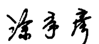

中国人工智能学会荣誉理事长 敬题
2005 年 12 月 18 日

## 前言：智能时代的知识管理新范式

步入21世纪，知识经济全面主导，知识已跃升为组织最核心的战略资源。伴随信息技术与互联网的飞速迭代，信息采集与传播的广度、速度实现质变，全球范围的信息共享与交互成为常态。现代通信技术击碎了时空壁垒，将世界紧密编织为一个整体。然而，随之而来的是汪洋恣肆的信息海洋，如何在浩瀚数据中精准、高效地捕捉所需，难度呈指数级上升。

数据爆炸、信息泛滥与噪音化，导致系统与个体接收的信息量远超处理上限，陷入“信息过载”困境。管理信息系统与数据挖掘技术的普及，虽加速了知识生成，但挖掘所得知识呈现多源、粗糙、有时效性且分散的特征，极度依赖专家甄别。面对海量、低可解释性的知识，人工筛选力不从心；知识随时效流失、新知持续涌现，且传统模式下知识被动等待调用，无法主动触达需求端，用户难辨适用边界，导致审计成本高昂、周期漫长。庄子“人生有涯而知无涯”的哲思，正深深困扰着当代信息从业者。

如何高效驾驭数据挖掘成果，填补知识管理落地的空白，长期以来未获学界充分重视。挖掘知识源自数据深层规律，难以用显性/隐性知识二元框架概括。现有知识管理理论鲜涉此类知识的治理，而数据挖掘领域多以建模获知为终点，忽视了后续的筛选与应用。二者的智能融合，对持续优化组织决策、强化企业核心竞争力具有战略价值。

本书旨在探索一条技术可行的系统化路径：将“信息爆炸”转化为“知识的智能化个性化服务”，从而跃升组织与个体的信息效能，赋能企业科学决策。

**全书架构如下：**
第1章剖析知识管理与数据挖掘对决策的影响及现存痛点，指明智能知识管理研究方向；第2章溯源知识获取演变，综述双领域现状，论证智能化管理的必然性；第3章确立智能知识定义，构建理论基石与框架；第4章详解直接获取技术，涵盖数据预处理、转化规则挖掘与可拓分类算法；第5章阐释间接实现模式，覆盖从粗糙原始知识向智能知识蜕变的孵化、表达、存储、智能审计与推理全链路；第6章完成智能知识管理系统设计，沉淀工程落地储备；第7章呈现实施流程与实战案例；末章总结展望。抛砖引玉，期冀为后续深度研究开启窗口。

本研究获国家自然科学基金面上项目（70871111）、创新研究群体科学基金（70921061）等多项国家级、省部级及国际基金资助，并得 Nebraska Furniture Market Co., USA 与 BHP Billiton Co., Australia 支持，谨此鸣谢。

著述仓促，疏漏在所难免，恳请各方指正。

**作者简介**
**李兴森**：浙江大学宁波理工学院信管所所长，中国人工智能学会可拓工程专委会秘书长，中科院软件所工业管理与设计工程研究中心高级顾问。
**石勇**：中科院虚拟经济与数据科学研究中心常务副主任、研究生院管理学院副院长，2004年“百人计划”入选者，曾任美国内布拉斯加州立大学讲座教授、系主任及数据挖掘实验室主任。
**张玲玲**：中科院研究生院管理学院副教授、虚拟经济与数据科学研究中心兼职研究员。

**联系邮箱**：lixingsen@126.com

## 第 1 章 绪论

### 1.1 知识经济纪元下的双引擎：知识管理与数据挖掘

早在1965年，管理大师德鲁克便洞见：“知识”将与资本、劳动力并列为关键生产要素，“知识型工人”将重塑价值创造逻辑。经济学家保罗·罗默更指出：知识是唯一随使用而增殖的无限资源。随着全球经济版图重构，以知识生产、分配、应用为基石的知识经济体系全球成型。相较工业经济，知识经济下，信息与知识的战略地位日益凸显。

高新技术与知识密集型产业崛起，知识含量成为产品竞争力的核心指标。知识在新经济中的地位，正如工业时代的资本、农业时代的土地。获取、创造、应用知识，已是驱动经济增长与构建核心竞争力的关键变量。如何创造、存储、传播、转化及运营这项战略资源，成为学界与业界共同攻关的课题。1986年，斯威比博士在联合国大会首提“知识管理”（KM）概念，开启了系统化管理组织知识活动的新纪元。

21世纪伊始，KM成为企业管理必修课。其涵盖知识收集、整理、存储、加工、创新、隐显转化及资产运营全链条。企业知识源于实践、环境洞察与长期经验沉淀，是数据信息的高阶提炼。任何组织都必须审视：如何将KM嵌入运营模式？如何确立其在核心战略中的定位？

权威调研显示：超72%欧洲企业、近80%跨国公司实施KM；达沃斯论坛95% CEO视KM为组织成败关键；战略管理视角下，KM被视为构建竞争优势的终极战略。

1995年首届知识发现与数据挖掘国际会议（KDD）召开，将数据比喻矿藏，“数据挖掘”遂成定名。其本质是从海量数据中自动化提取未知、潜在、高价值的模式与知识。它重塑了商业洞察范式——理解客户、优化服务、发掘商机，打破了过往纯依赖专家统计的单一局面。

近年，数据挖掘在生物、金融、保险、零售等领域广泛落地，成为后信息化时代获取知识的关键引擎。发达国家成果丰硕，国内市场蓄势待发。石勇教授曾预言：数据挖掘将推动社会历经“数据爆炸”→“信息过载”→“知识过载”三阶段演进。KM与数据挖掘在国家竞争力构建中的作用凸显，全球范围内相关科研与实践项目如火如荼。

### 1.2 双引擎失速：应用困境的深度剖析

共识虽广，落地皆难。IDC报告直指痛点：80%以上KM项目未达预期，KM沦为高风险投资。案例复盘揭示双重困局：
1. **分享不足 → 知识匮乏**：时间挤压、转移低效（个人-群体-组织多层级阻滞）、隐性知识外化困难、碎片化存储、情境缺失导致误用，使知识流动受阻。
2. **获取过载 → 知识过载**：多源获取引发冗余冲突，有效利用率极低。

宏观层面，经济全球化以知识为基、以金融为核、以信息技术为重、以跨国公司为载体，资源跨国流动重塑配置格局。这要求决策者具备全球视野，跨组织协作聚焦分布式知识整合与再生产，强调协作创新。全球化与知识经济双轮驱动，必将 KM 研究重心推向新维度。

与此同时，作为知识获取主力的数据挖掘，亦深陷泥沼：
- **规则爆炸与应用鸿沟**：如某电信项目挖得245条流失预测规则，业务端却难提炼“挽留策略” —— 知识表达与业务理解脱节。
- **多算法结论冲突**：异构模型结果不一，缺乏领域知识校准机制，可靠性存疑，价值甄别无标准。
- **黑箱过程与人机割裂**：现有工具多为“输入-输出”黑箱，缺失专家介入的交互监控，难支撑需多轮博弈的复杂决策。
- **属性有限与隐变量缺失**：现实影响因子远超数据库字段，关键隐含变量缺位致结果偏离。
- **静态结论与动态现实博弈**：挖掘基于历史切片，现实流变不息。缺乏趋势感知与模型动态校准机制，且多重模型精度而轻业务场景融合（物理环境、认知心理等情境因子）。

**核心矛盾浮现**：数据挖掘产出知识“用不上”，知识管理又因分享受阻“拿不来”。这对孪生瓶颈扼杀了数据挖掘的决策支撑价值。破局关键在于：建立挖掘结果鉴别机制、确立知识价值度量标准、构建质量评价体系。唯有打通“最后一公里”，让挖掘知识真正服务组织决策，数据挖掘才能步入良性循环。

### 1.3 智能知识管理：破局之道的战略意义

## 破局：数据挖掘与知识管理的深度融合之路

面对当前我国在数据挖掘与知识管理领域，无论是理论构建还是落地实践，均与国际前沿存在明显短板，且两大学科交流不畅，导致交叉研究滞后于商业应用的迫切需求。为攻克这一难题，本书在国家自然科学基金面上项目（70871111）及创新研究群体科学基金项目（70921061）的资助下，聚焦四大核心方向展开探索性研究：

*   奠定数据挖掘与智能知识管理的系统理论基石；
*   开拓新型数据挖掘算法与方法；
*   深度剖析智能知识管理的研究范式；
*   推进应用实证与落地验证。

**理论层面**，“智能知识”概念的提出极具前瞻性，剖析其特性与应用模式，有力推动了两大学科的深度融合，助力我国在该交叉领域确立自主学派话语权。  
**实践层面**，数据挖掘作为知识核心源头，已与知识管理共同构成企业核心竞争力。研究旨在激活挖掘知识的应用价值，显著提升企业知识管理效能与决策支撑水平。

放眼未来，随着全球化浪潮推进与挖掘技术迭代，“数据挖掘+知识管理”必成主流趋势。如何将原始挖掘成果深加工、智能化利用，将成为学术热点。本书融合自然科学与软科学，引入复杂性科学、智能体技术、可拓学等前沿理论，不仅具有重要的方法论指导意义，更能完善挖掘实施理论、输出企业落地策略，拓宽应用边界、提升决策质量，兼具深远理论价值与现实意义。

### 1.4 全景透视：本书的研究架构与核心内容

本书锚定研究对象为：经数据挖掘技术提取的模式、规则等原始知识，经“人机协同”智能化处理后形成的**智能知识**。

研究逻辑层层递进：
1.  **定性本源**：将智能知识视为“特种知识”，解码其获取、存储、转化、应用的管理特质，构建整体框架体系。
2.  **破解瓶颈**：以挖掘为手段设计知识获取方案，攻克不完备数据下的获取难题，确立管理框架。
3.  **透析特征**：深入生命周期、获取算法、表达存储等核心机制。
4.  **激活机制**：研究孵化、审计、推理机制，完成管理平台功能设计与流程优化。
5.  **实战验证**：呈现智能知识管理模式的典型应用案例。

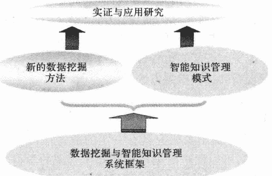

> 图 1.1 智能知识管理研究框架示意图

研究聚焦**挖掘知识的管理层面**，旨在从实战角度深挖应用模型，助力企业高效利用挖掘成果、精进决策，并以实践反哺理论。

方法论上，坚持**理论联系实际、定性定量互证、点面结合、综合比较**，跨学科引入认知心理学、复杂性科学、机器学习、AI、可拓学等前沿成果，从系统论视角展开：
*   **立足巨人肩膀**：广泛文献溯源，整合多学科成果，在前人基础上推进理论深化与系统构建。
*   **实战闭环**：剖析挖掘项目实战痛点，从需求中归纳理论、再以理论指导实践、实践中检验修正。
*   **对比辨析**：对比挖掘知识与人类经验知识，提炼特征以定制管理方案；采用“定性转定量”集成法，融合专家经验、数据算力与跨学科理论，遵循“人机结合、以人为主”原则（钱学森等，1990）进行方案设计。

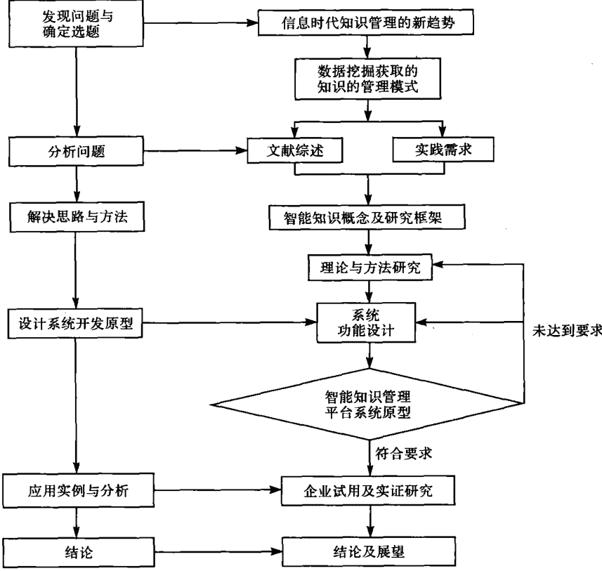

> 图 1.2 本书主要内容框架图

## 第 2 章 信息爆炸时代的知识获取范式革命

本章切入信息爆炸背景，梳理知识管理、数据挖掘、智能性等核心概念技术，对比多元管理模式与工具，深度解析知识获取方式的演进脉络与特质。

### 2.1 信息狂飙与知识管理的现实困境

#### 2.1.1 信息爆炸：成因、代价与破局之道

IT与互联网的极速狂飙，让信息采集传播实现全球化、实时化、无障碍化。通信网络作为信息社会基座，消弭了时空壁垒，却也带来了“浩如烟海”的副作用——**在巨量数据中精准捕捉所需，难度指数级上升**。

**何为“信息爆炸”？**  
指数据暴增、信息泛滥、噪声干扰，致使系统或个体接收信息超出处理上限，导致有效利用率骤降。其五大表征：新闻激增、娱乐泛滥、广告轰炸、科技指数级增长、个人信息严重超载。

早在1970年，托夫勒在《未来震撼》中预警：信息量突破脑力极限将引发处理失效，长期超载更诱发身心疾病。信息过载加重筛选负担，衍生信息犯罪、污染等社会顽疾。如何在爆炸中梳理关联、挖掘规律，服务国家战略与企业决策，成为核心命题。我们亟需练就“火眼金睛”，从纷繁信息中洞察本质，做时代的智者。

**知识过载：信息爆炸的深层演变**  
当知识总量超越人类处理极限，增速远超习得速度，甚至相互冲突导致认知失措，便形成“知识过载”。根源锁定三大维度：

1.  **科技井喷**：50年代以来知识总量每7-10年翻番，学科裂变、人类活动半径扩张双重驱动，广度深度均超历史峰值。
2.  **技术反哺与挖掘红利**：管理信息系统、互联网、富媒体重塑社会图景，海量数据沉淀催生**数据挖掘**——这一融合数学模型、人机系统、管理科学的商业智能利器。它从大量、不全、噪声、模糊、随机数据中，用关联、分类、聚类、预测等手段挖掘“未知、潜在、有用”的隐性知识，驱动商业策略、客户留存、产品开发。生物、金融、保险、零售等领域已广泛受益，汇聚数据库、AI、统计学、可视化、并行计算等多学科合力。
    *   *数据警示*：Gartner预测，2009年全球5000强中超35%企业因缺工具无法有效决策；至2012年，挖掘分析预算将占企业IT支出40%以上。
    *   *知识形态*：关联规则、分类规则（决策树、网络权值等）、聚类、公式、案例。典型如“啤酒与尿布”关联规则，洞察消费行为优化陈列、提振销量。
3.  **全球化溢出**：经济全球化推动资源要素全球流动配置（高度流动性、开放性、渗透性、共赢性、异步性、风险性并存），必然导致**信息资源全球化**——公开性、广泛性、海量性、及时性、低可控性、粗糙性显著。CODATA、开放获取（OA）运动进一步拓宽获取广度深度。

**三重叠加下，知识过载剧烈恶化。** 企业面临六大迫切诉求：
*   借全球智力资源突围国际竞争，资源聚焦无形资产；
*   应对全球兼购潮，精准择机避险；
*   速学先进理念技术，跃升管研能力；
*   挖掘互补资源，玩转7×24小时网络营销与客户洞察；
*   借异步性红利，借鉴成熟经验少走弯路；
*   筑牢风控体系，践行新经济伦理与社会责任。

**传统知识管理已难支撑新需求。** 知识经济核心在于知识生产、分配、应用（成思危，2001），管理本质是激发人的主体性（张炜，2003）。如今互联网汇聚“天下目、耳、心”，综合利用全球化资源辅助决策已成现实：实时抓取舆情政经文本挖掘获取环境知；剖析竞对财报舆情获竞争知；整合内部非结构化数据与业务系统挖掘内部知。构建“环境-竞争-内部”三维知识平台，融合时序、供应链、多维模拟仿真，**知识管理必须智能化升级**。

本书聚焦研究对象、模式、工具，仅对相关核心内容回顾溯源。

#### 2.1.2 知识获取范式迁移与研究对象演进

知识管理内核随时代演进而重塑。溯源知识概念变迁，可窥获取方式更迭脉络。

**1. 知识概念三重奏与获取路径**

学界定义繁多（Davenport等，1998；Nonaka，1994），但溯源可归三类：

*   **源于实践的经验知**  
    《辞海》《辞源》至古希腊、柏拉图，公认知识源于社会实践积累、主观认识、经验总结。孙恒志（2002）修正为“人类正确认识及合理运用组合总和”。**局限**：未反映数据驱动的知识来源。
*   **源于加工的信息知**  
    Feigenbaum（1977）定义：知识是信息经加工、解释、筛选、改造形成的特定域表达式、关系、过程。**核心**：数据/信息中挖掘隐含规律，浓缩为模式、规则、规律性信息。具静态性、信息依存性，赖人管理应用。
*   **源于挖掘的数据知（隐性）**  
    随数据挖掘兴起，从海量、不完备、噪声数据中自动/半自动发现的、人类未预知的、潜在有用的模式，成为知识新源。这是本书聚焦的核心增量。

### 知识的本质、特性与管理演进：从隐性经验到方法论智能

**核心定义：知识是什么？**

知识并非静态的档案，而是一个**有组织、动态演化的复合体**。Tiwana (2004) 指出，它融汇了结构化经验、价值观、情境信息、专家洞见与直觉，扎根于知晓者的认知框架之中，能持续吸纳新经验、评估新信息，并渗透于组织文化、流程制度、文档档案及个体员工之中 (Grant, 1996; Spender, 1994)。Davenport 等 (1998) 进一步强调，知识提供了评估与整合新认知的框架，它不仅躺在文档里，更活跃于组织的程序、实践与惯例之中。Nonaka (1994, 1995) 则从认识论角度将知识定义为“确定个人对真理信仰的动态过程”，即“合理的信仰”，它能提升组织效能。这一视角打通了显性知识（数据、手册、规则）与隐性知识（洞察、直觉、预感）的共享渠道。

**主体知识的五重图谱**

基于 Zhang 等 (2009) 的研究，本书将人类传统知识归类为“主体知识”，划分为五类：
1.  **规范知识**：对事物状态及演变规律的精准表述。
2.  **经验知识**：对状态与变化方式的归纳总结，未经严格科学验证，属“准知识”范畴。
3.  **常识知识**：无需证明的公认认知。
4.  **本能知识**：生而有之，无需习得的先天认知（人类与生物共有）。
5.  **情境知识**：知识生成与运作所依赖的条件、背景与环境要素。

**三大获取路径：从传统走向智能**

信息时代的知识源泉双轨并行：一是实践中沉淀的认知与洞察；二是数据/信息背后隐匿的规律模式。据此，知识获取呈现三种主要范式（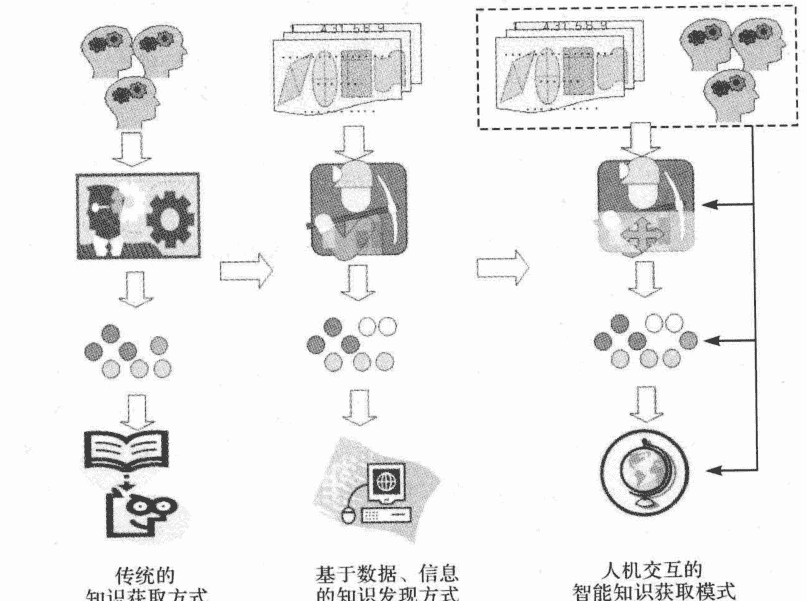）：

*   **传统模式**：依托隐性知识分享与经验总结的知识管理。
*   **数据驱动发现**：以数据挖掘为核心工具，从海量数据库、数据仓库及互联网中提炼知识。
*   **人机协同智能获取（本书核心）**：融合专家经验与挖掘技术，通过挖掘全过程及成果的智能化处理，支撑智能决策。

**研究聚焦**：本书锚定第三种模式，研究对象为**源自数据/信息、经挖掘生成的模式、规则、关系表达式**。

**数据-信息-知识：层层递进的价值链**

*   **数据**：客观事实的局部符号记录（数字/文字），本身无直接语义。
*   **信息**：数据组合后的可理解解释，时效性短，反映表象。
*   **知识**：信息背后的规律内涵（关系、表达式、模型），具“知”（认知规律）与“识”（指导行动、判断应用）双重属性，时效性长，直指本质。

---

### 主体知识的六大核心特征

综合多方学术论述 (潘旭伟, 2005; 王众托, 2004 等)，知识呈现独特属性：

1.  **二元统一性（波粒二象性）**：既是依载体而存的静态实体（规则/结构），又是生成、传递、组合、应用的动态过程。维娜·艾莉称此为“波粒二相性”，实体与过程互为表里。
2.  **开放性**：知识框架开放，通过累积持续评价吸收新知，驱动创新。
3.  **非排他性共享**：一人掌握不妨碍他人同获，区别于物质产品的竞争性消耗。
4.  **跨时空传递**：历史知识可传今，地域知识可迁徙。
5.  **零损耗复用**：反复使用不衰减，反在生产传播中不断丰富增值。
6.  **无限再生性**：具备指数级复制扩散潜能。

> **理论启示**：特征 (1) 对设计智能知识管理模式具指导意义。国内可拓学研究者提出“变化的知识/可拓知识”分析动态性 (```
(T_u u = u') \rightarrow (_u T_v v = v') \quad \text{简写为} \quad T_u \rightarrow {}_u T_v \quad (2.1)
```)：用变换蕴含式表达因果关联的变化规则，以关联函数量化转化程度，正负变化标志矛盾问题的得解。

---

### 知识管理研究现状：三大流派与实践困境

#### 1. 奠基性理论三支柱
*   **斯威比 (Sveiby, 1997)**：知识资本三维度——雇员能力、内部结构、外部结构。管理目标为三结构的协同开发利用，创造长期效益。
*   **德鲁克 (1999)**：21世纪核心挑战是提升知识工作者生产率。知识唯有应用于实践、改变生活才具价值。
*   **野中郁次郎 (Nonaka, 1994)**：SECI 模式（同化、外化、结合、内化）揭示隐显知识转化机制，成知识创造研究基石。

#### 2. 研究重心与路径
*   **隐性知识深掘**：聚焦属性、转化层级、传播转移、项目团队场景 (李一楠, 2007; 王连娟, 2006)。
*   **双轨研究路径 (周竺等, 2005)**：
    *   *以人为本*：关注个人技能经验，载体是员工。
    *   *以知为本*：关注组织知识资产化、价值化。
    *   *结论*：二者有机融合方能落地生效。
*   **过程管理演进**：
    *   Kakabadse 等 (2003) 梳理知识流动链：数据→信息→认识→行动/反射→智慧；组织四大知识过程：创造、存储/检索、转移、应用。
    *   Nonaka 等 (2000) 倡导建立知识交流创造的共享空间（“场”）。
    *   技术赋能：Alavi 等 (2001) 主张利用 IT 强化“弱联结”，拓宽共享广度；陈国权 (2003) 提炼体验、交流、解读、反思四大提效法。

#### 3. 系统化视角与工具短板
*   吴冰等 (2006) 指出 KM 包含创造、存储、转移、应用等相互依存的过程链，复杂度随类型范围变异。
*   Feigenbaum (1977) 早倡知识工程；王众托 (2004) 建议设立知识系统工程学科，用系统论剖析知识体系架构与运行。
*   **企业实践现状**：国内企业纷建 KM 系统，结合 IT 绘制知识蓝图、构建知识流 (吴庆海等, 2005; AMT, 2003)。
*   **核心痛点**：共识认为“管隐性知识最难，激发个体智慧是关键”。个人是知识源头，组织是放大器。**隐→显（创造起点）与 显→隐（应用归宿）的双向转化，构成知识变现的完整闭环。**

#### 4. 实证数据洞察 (CNNI 1999-2008)
文献计量分析显示 ([表 2.1])：
*   “隐性知识/知识共享”关键词占比 **63.7%**，为绝对热点。
*   “知识管理系统”研究占比 **55.9%**，但现有工具多停留在存储利用现有知识层面，**功能残缺、集成度低、协同弱、可重构性差** (潘旭伟, 2005)。
*   博客爆发式增长 (2006年作者超1700万，读者超7500万)，隐含海量知识分享，深度开发前景广阔。

**趋势判断**：随着 IT 与互联网高速发展，**从数据/信息中挖掘模式规则知识，将成 KM 研究新疆域。**

---

### 知识管理研究重心的三大战略转移

面对经济与信息全球化带来的海量资源冲击，KM 必须完成三维跃迁 (李兴森等, 2007d)：

#### 转移一：从“局部隐性”向“全球化显性”进军
*   **历史缘起**：早期显性知识匮乏，42% 组织知识藏于员工大脑 (Delphi Group, 1997)，故聚焦隐性外化。
*   **隐性困境**：Szulanski (2000) 指出知识粘性大、情境强、难迁移；张军 (2005) 解析十大转移障碍。隐性知识受限于个体经历、环境，且部分持有者不可接近或难显性化。
*   **双源互补**：知识双源——实践经验 (隐性为主) 与 数据挖掘 (显性为主)。随着信息全球化，**互联网显性知识的二次挖掘利用成为主流渠道**。
*   **技术赋能**：BBS/博客为自愿外化提供土壤；数据挖掘 (关联、分类、聚类、预测等) 能从海量、噪声、模糊数据中提取未知潜在价值知识，已在生物、金融、零售等领域验证为决策核心技术，完美适配全球化海量信息分析。

#### 转移二：从“微观内向”向“宏观外向”拓展
*   **微观局限**：传统 KM 困于企业内部隐性外化与显性管理，受业务、战略、经验制约，难支撑全球化运营。
*   **宏观必要**：系统观下，企业/国家皆为全球化节点。金融危机、地缘政治、贸易新规、汇率波动、供应链重构……宏观知识直接决定生死。
*   **实战需求**：国际贸易企业必懂政策法规、IP保护、文化禁忌。KM 必须向上游供应链、下游市场、跨国边界延伸，**建立全球化风险预警与危机管理知识库**，避免“高度近视”战略失误 (王育琨, 2006)。

#### 转移三：从“描述性知识”向“方法论知识”升维
*   **认知心理学分野**：陈述性知识——知是什么；程序性知识——知怎么做。
*   **管理创新视角重构**：
    *   **描述性知识** = 事实知识 + 原理知识 + 人力知识。描述“客观规律是什么”，对应陈述性知识。
    *   **方法论知识** = 运用知识的知识。是建立在实践分析基础上的规律性总结，涵盖指导加工应用的方法、技能、流程、完整实践引导体系。
*   **现状反思**：长期偏重描述性知识，方法论研究停留在个案经验，未成体系。**导致“知识富集、创新贫乏”**——有料无法，难解实际难题。
*   **破局之道——可拓学**：
    *   以形式化模型研究拓展可能性、创新规律与矛盾解决。
    *   核心三元：基元理论、可拓集合、可拓逻辑。
    *   方法链条：基元表达 → 问题建模 → 变换表达求解过程 → 关联函数量化质变临界 → 基本/传导/共轭变换及转换桥生成策略 → 优度评价择优。
    *   **价值**：将解决问题的思维**形式化、流程化**，提供方法论知识管理框架，授人以“发现创造方法的方法”，赋能企业应变创新，提升全球竞争力。

---

### 知识管理研究对象的四维重构

剥离主观视角干扰，从本质归纳 KM 核心研究对象四象限：

1.  **个人隐性知识**：侧重分享与显性化机制。
2.  **组织隐性知识**：侧重显性化与共享路径。
3.  **组织显性知识** (文档档案等)：侧重系统化高效管理利用。
4.  **数据/信息挖掘获取的模式规则知识**：**当前研究薄弱环节，仅被视为来源之一，缺乏深度机理研究。**

> **Gao (2002) 双维视角**：管理现有知识 + 挖掘新知；软硬环境协同，实现获取与有效应用。

---

## 2.1.3 知识管理模式研究现状

### 1. 管理模式的内涵

# 知识管理：七大核心模式与关键技术工具全景解析

### 什么是管理模式？从定义到知识管理的落地

提到“模式”，梅文·席尔曼早有定论：它是对过程或情境的质量表征，能揭示达成目标的关键因素。放到企业层面，管理模式就是为达成经营目标，而构建的管理系统整体架构与运行逻辑的总和。简单说，它在特定环境下描绘系统的结构、功能与机制，指引企业健康成长。

其核心内涵离不开三点：**要素间相互作用**、**系统与环境开放关联**、**可抽象为模型以描述关系**。管理模式的引入，本质上是管理走向科学化、系统化、规范化的必然，也是系统论思维在实战中的投射。

参考 McAdam 等学者的视角，本书将**知识管理模式**界定为：在特定环境下，描述知识管理系统的结构、功能与运行机制，揭示其活动规律，从而引导知识高效利用的整体形式。通俗点讲，就是“用什么方式管知识，才能把知识用好”。

---

### 一、 知识管理流派地图：五大视角的底层逻辑

蒋日富等学者梳理出的五大流派，为理解后续模式提供了理论坐标系：

| 流派 | 核心假设 | 研究聚焦点 |
| :--- | :--- | :--- |
| **学习流派** | 知识管理即学习过程 | 个体/团队/组织的学习活动 |
| **过程流派** | 知识管理即管理过程 | 知识生命周期、流动与流程 |
| **技术流派** | 知识管理即系统建设与运行 | IT应用、知识管理系统 |
| **智力资本流派** | 知识管理即价值实现过程 | 智力资本管理、价值评估 |
| **战略流派** | 知识管理服务于战略落地 | 知识战略与业务战略的融合 |

---

### 二、 七大主流知识管理模式深度拆解

结合潘旭伟、Alavi、McAdam 等大家的研究，当前主流实践可归纳为以下七种模式：

#### 1. 组织学习模式：让组织像有机体一样进化
源自迪尔克斯、圣吉等人的理论，强调通过四个闭环动作驱动组织进化：
*   **鉴别**：锁定目标、搜寻获取、创新知识。
*   **扩散**：打破边界，实现个体-组织、组织间的知识流动。
*   **整合/修正**：知识“水土不服”怎么办？直接整合或试验修正后再吸收。
*   **行动**：知行合一。应用产出的同时催生新知识，触发新一轮学习循环。

#### 2. 过程管理模式：管住知识流，才能实现增值
核心信条：知识唯有流动才增值。Davenport 将流程拆解为产生、编码、协作、转移；Tiwana 则给出了一套从架构分析到绩效评估的“十步走”实施路径；Bergeron 等则从生命周期视角，覆盖创造、存储、转移、处置全链条。不管怎么切分，**采集、识别、创造、共享、应用、组织、适应**是绕不开的关键动词。

#### 3. 信息技术主导模式：工具赋能，但别本末倒置
*   **微软 Honeycutt 视角**：聚焦关键信息、整合多源数据、善用他山之石、打造随时随地的统一信息环境。
*   **IBM Lotus 视角**：系统利用信息、流程与专家技能，提升创新力、响应力与效率，框架受企业规模与协作深度制约。
*   **核心启示**：技术是加速器，但系统设计必须有理论托底，二者相辅相成，缺一不可。

#### 4. 战略组合分析模式：用 SWOT 思维做知识布局
Zack 提出基于知识的 SWOT 分析，核心是**双向匹配**：
*   由战略反推“必须拥有何种知识”；
*   由现有知识反推“能开发何种产品/市场”。
同时警惕**显性化悖论**：显性化利于内部共享，却易被竞对模仿削弱优势。Liebeskind 由此引出知识保护战略，平衡“流动”与“围墙”。

#### 5. 业务流程导向模式：把知识“嵌”进业务里
张玲玲、Davenport 指出传统 KM 悬浮于业务之外，增加员工负担，难以实现“对的人、对的时、对的知”。
*   **核心动作**：提取流程知识防流失、缩短交接；实现业务处理中自动收集存储。
*   **工具支撑**：Wiig 的“建构模块”、Hinkelmann 的 POROMOTE 方法——建模流程、识别知识密集型任务（KTI）、分析知识流、定义结构、将知识流程嵌入业务流程。
*   **定位**：本质是过程管理模式在业务场景的深度落地分支。

#### 6. 知识共享转移模式（SECI & Ba）：经典中的经典，隐显转化的四重奏
野中郁次郎、竹内光隆的 SECI 模型是绕不开的基石，描述隐性与显性知识的螺旋上升：
1.  **社会化（隐→隐）**：师徒传承、共同体验，靠观察练习。
2.  **外化（隐→显）**：创造关键。用隐喻、类比、模型将直觉转为概念。
3.  **组合（显→显）**：文档、会议、系统整合，重组现有显性知识。
4.  **内化（显→隐）**：实战中内化为技能直觉，开启新一轮循环。

**“场” 理论**为 SECI 落地提供空间维度：
*   **创出场**：面对面共情，对应社会化。
*   **对话场**：深度对话外化隐性，对应外化。
*   **系统场**：虚拟空间系统化知识，对应组合。
*   **实践场**：实战训练内化技能，对应内化。

四大要素（SECI、场、知识资产、知识领导力）动态交互，驱动创新引擎持续运转。

#### 7. 综合集成模式：打造人机协同的“超级大脑”
单一视角有盲区，集成才是王道。
*   **顾基发/钱学森视角**：融合专家系统、信息知识系统、计算机系统，实现定性向定量跃迁，具备综合、整体、智能三大优势。
*   **Holsapple 三层框架**：资源层（人/文化/产品/战略...）、过程层（获取/甄选/内化/使用/生成/外化）、影响因素层（管理/资源/环境）。
*   **张玲玲五要素模型**：**业务流程、知识、人员、组织文化、信息技术**——五维动态关联，缺一不可。业务流程扁平化、人员主导激励、知识独立管理、文化以人为本、技术做底座。
*   **弗劳恩霍夫 IEM/GPO-WM**：跨学科整合，给企业落地一套综合参考范式。

> **小结**：七大模式虽有交叉，但各有侧重，为企业按图索骥、组合拳打法提供了丰富图谱。此外，基于分布式计算等新视角的模式也在持续涌现。

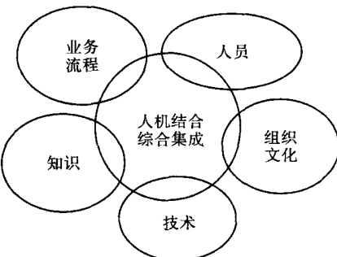

---

### 三、 知识管理技术与工具箱：五大环节的硬核支撑

技术是模式落地的“手脚”。依据潘旭伟、Tyndale、Dieng 等分类体系，梳理五大核心环节工具链：

#### 1. 知识获取：从“靠吆喝”到“靠挖掘”
*   **传统难题**：隐性知识靠文化、制度、场分享，缺技术手段。
*   **数据挖掘**：从海量数据中提取可信、新颖、可理解的隐含规律（Olson, Han, 陈文伟等），支撑前瞻性科学决策。
*   **网络检索与语义升级**：Google、百度等搜索引擎是入口；OntoBroker、SEAL 等语义检索工具实现精准推理查询。
*   **Web 挖掘与集成**：随着互联网演进，Web 挖掘及其综合集成方法成为知识源头活水。

#### 2. 知识存储：结构化、系统化、好检索
*   **多视图建模**：Kingston 的 Who/What/How/When/Where/Why 六维视图。
*   **知识网格**：诸葛海提出三维空间（类别、位置、层次）组织全球知识资源。
*   **知识仓库（KW）**：核心载体。收集经验、方案、决策支持知识，分类存储+检索手段。Nemati 基于数据仓库扩展出 KW 体系架构。
*   **基于知识的系统（KBS）**：防专家流失利器。建立在 AI 基础上，让机器理解存储人类知识。CommonKADS 方法论规范化建设流程，大量成功案例落地。KBS 是知识工程成果，应纳入更宏大的 KM 视野。
*   **前沿探索**：可拓学基元存储知识（李兴森、陈文伟等），表达更丰富细致（详见第 4 章）。

#### 3. 知识传播共享：让知识穿透组织壁垒
核心目标：**正确的知识，正确的时间，到达正确的人**。覆盖隐-隐、显-显、隐转显三类传播。
*   **知识黄页**：像查电话簿找专家。按知识门类索引“谁懂什么”，快速定位经验持有者（赵曙明）。Desouza 指出 IT 对隐性知识交流的主价值即“连接人”。
*   **动态知识地图**：基于 Web 的知识导航器（Woo）。搜专家、建连接、重用隐性知识，让专家经验触手可及。

*(注：素材截至此处，后续涉及检索应用、知识评价等环节内容待续)*

#### 4. 知识检索与应用：核心技术与工具解析

支撑知识流动与共享的另一大关键力量，是基于互联网的论坛、新闻组以及群件软件。此类工具的核心优势在于构建了虚拟协作空间，成员可在此交换观点、同步推进任务。更值得关注的是，系统在记录显性文档的同时，还能捕捉互动轨迹，完整保留知识生成的情境脉络。市场上典型的群件产品包括 IBM Lotus Notes 与微软 Exchange Server。实战案例方面，Buckman 公司部署了名为 K’Netix 的在线论坛系统，专门攻克造纸、水处理、皮革加工等领域的化工疑难杂症；Koh 团队则构建了虚拟社区活动框架，引入电商模型将知识共享嵌入业务闭环。

博客技术的引入，让员工洞察、流程经验、客户档案始终处于动态迭代中，真正落地了扁平化学习型组织理念。博客天然保留了全员工作痕迹，成为企业创新的源头活水，推动“学习—共享—创新”良性循环。此外，威客模式的兴起，为精准定位知识持有者并完成知识交易搭建了全新平台。

知识检索的使命，是从组织知识库中精准调取任务所需知识，赋能业务执行。然而，随着知识资产指数级增长，单次检索动辄返回成百上千条结果，“知识过载”严重拖累了利用效率。知识地图应运而生，它通过可视化框架，直指知识源头——无论是专家、物理位置还是时间节点，帮助使用者最短路径触达目标。Gordon 提出基于学习依赖关系绘制组织知识地图；大量地图汇聚形成“知识地图集”，王君等据此构建了系统模型框架，进而衍生出企业知识门户方案。门户不仅提供检索入口，更支持用户将知识与共同价值、经验洞见关联，构建持续进化的知识导航网。

为破解检索难题，多元技术路线并行探索：基于案例的推理以过往案例匹配复用经验，成为知识管理系统的主流范式；语义网成熟推动了语义与关键词融合检索、联想检索等语义级方法的深入研究。随着管理成熟度跃升，供给模式从“被动拉取”进化为“主动推送”——知识推送技术采用广播机制，将核心知识精准触达使用者一线。

#### 5. 知识评价：量化价值的多维探索

知识及其管理的复杂属性，让评价充满挑战，却又关乎战略决策。评价维度涵盖知识本源价值、利用实效及组织收益。视知识为增值资本时，知识资本评估便成焦点。知识资本基准系统提供跨企业核心能力对标工具，已在欧洲 30 余家企业落地。Kreng 团队聚焦知识时序特性，引入扩散模型量化单个知识价值演变，主张唯有洞悉价值动态才能全面评估管理绩效；Ahn 等则通过 KP3 方法，以产品、流程为媒介，衡量知识对业务绩效的驱动力。

在 KDD 领域，杨炳儒等敏锐捕捉到规则评价的关键地位。他们在置信度、事件独立性、J-Measure、覆盖集合等客观指标研究基础上，创提出因果关联规则自动评价法，引入语言场表示与推理机制，强调背景知识与用户参与，以因果强度度量兴趣度。蔡艳霞、杨炳儒进而构建分层自动评价体系：数据层客观筛选、规则层人机协同主观把关、决策层主客观融合综合定级，将评价流程嵌入知识库，实现智能化闭环。

### 2.1.5 阶段小结

本节系统复盘了知识管理的研究对象、核心内容、方法论及工具体系，为后续研究奠基。Tiwana 在《知识管理十步走》中界定：知识管理系统是支撑知识整合、应用的技术集合；知识管理平台则涵盖体系框架、战略、文化、激励与评价机制，系统仅是平台的子集。纵览演进脉络，随 IT 技术迭代，知识获取范式正从“隐性显性化”转向“数据挖掘主导”，数据挖掘逐渐成为核心引擎。下一节将深度剖析数据挖掘及其对知识管理的重塑影响。

### 2.2 数据挖掘综述：重塑知识管理的底层逻辑

数据挖掘旨在从海量、不完整、含噪、模糊、随机的数据中，发掘隐含、未知却极具潜在价值的模式与知识。当前学术聚焦点高度集中于算法优化与流程规范两大维度。

#### 2.2.1 数据挖掘过程：从标准化走向工程化

知识发现 (KDD) 涵盖从数据中提炼有用知识的全链路，数据挖掘仅是其中运用专用算法抽取模式的特定环节。Fayyad 等将 KDD 定义为：从数据集识别有效、新颖、潜在有用、可理解模式的高级处理过程。

KDD 流程可拆解为数据准备、核心挖掘、结果解释评估三大板块。为推动规范落地与模型标准化，IBM、Microsoft 等巨头及专业机构相继推行标准规范。极具影响力的 PMML 以 XML 为载体定义预测模型，涵盖数据字典、输入输出定义、统计信息、标准化规则及模型库（决策树、回归、神经网络、聚类等）五大组件。标准化流程不仅利于经验沉淀与项目复现，更助力新手快速上手，众多学者与组织持续投入标准过程研究。

行业公认的黄金标准当属 CRISP-DM，获 200 余家机构（含 IBM、SPSS、NCR 等）背书。其核心主张：跨行业共享、与业务背景解耦、与工具无关、通用指导性强。该分级模型将工作拆解为六阶段：
1.  **业务理解**：透视商业背景，锚定目标，评估现状，规划项目。
2.  **数据理解**：收集初探，描述画像，校验质量。
3.  **数据准备**：选取、清洗、整合、格式化，产出建模数据集。
4.  **建模**：选算法、生成测试模型、训练评估。
5.  **评估**：复盘结果、审视过程、决策下一步动作。
6.  **部署**：落地决策、输出报告、启动新一轮迭代。

Fayyad 等提出的技术导向七步法则更侧重数据侧操作：清洗、集成、选择、变换、挖掘、模式评价、知识表示。但该模型止步于知识呈现，缺失“知识如何落地应用”这一最关键的终极环节。另一主流模型 SEMMA（采样、探索、修改、建模、评估）则是 SAS Enterprise Miner 等工具的底层逻辑，五步各含细分任务，聚焦建模核心链路。

学界还探索将挖掘过程与知识管理融合，沉淀实施过程知识；或引入最优化理论构建应用模型。优秀的标准化架构能强化软件环境复用、保障任务高效交付、促进异构系统协同、支撑需求自适应演进。完整体系架构标准虽未最终定型，但功能三层架构已成共识。

标准化语言领域，微软 OLE DB DM 虽已推出，但距离如 ER 模型般成熟的工业标准仍有距离。总体而言，标准化成果初显，但离完善工业标准尚远。文献揭示的共性痛点：现有过程研究多以获取模式/模型为终点，对挖掘知识的甄选与实战应用重视不足。

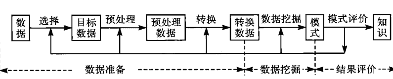
图 2.3 KDD 过程图

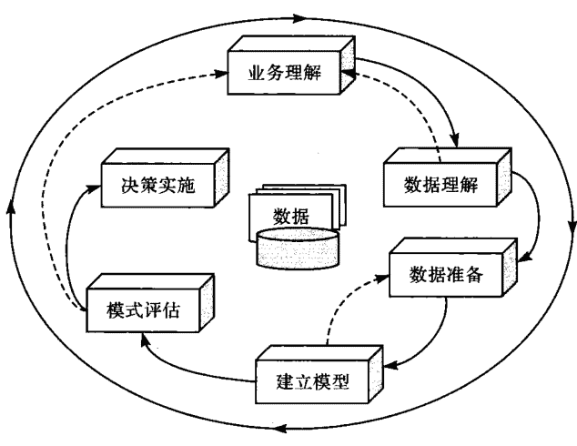
图 2.4 CRISP-DM 过程模型

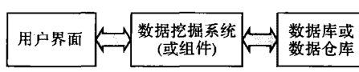
图 2.5 数据挖掘系统的体系结构

#### 2.2.2 数据挖掘算法：百花齐放的技术图谱

算法层面是学界竞逐最激烈的主战场。经典任务覆盖关联规则、分类、聚类；主流技术路线包括决策树、多目标线性规划 (MCLP)、支持向量机 (SVM)、高性能分布式挖掘、数据质量增强算法（容错、纠错、推荐）等。Perols 等创新性融合多模型投票机制，显著提升分类精度。智能体技术的引入为算法性能优化开辟新径。

国内学者改进成果丰硕：王天真基于动态数据窗口提出复合聚类、自组织竞争神经网络聚类、融合聚类三大算法，并结合相对主元法、并行递归神经网络构建多维预测模型，落地监控系统实现虚警消除、降维压缩、故障监测。

自组织数据挖掘 (SODM) 源自 GMDH（数据处理分组方法），已成复杂系统非线性建模利器。GMDH 由 Ivakhnenko 1967 年首倡，模拟“进化—遗传—变异—选择”自然法则，从简入繁，经适者生存筛选最优复杂度模型，全程无需预设网络拓扑，呈现自组织特性。90 年代 Mueller 与 Frank 开发 Knowledge Miner 软件包，推动 SODM 在经、生、医、军等领域广泛落地。Kondo 等融合神经网络衍生 GMDH-type 方法。但 SODM 算法复杂、计算量大、知识可解释性弱，改进方向指向全流程知识提取与复杂问题求解能力跃升。

可拓数据挖掘则打破传统边界。基于可拓学理论，蔡文、陈文伟、黄金才等将挖掘对象拓展至“可拓变换”层面——挖掘的不再是静态知识，而是化解矛盾的变换策略。决策者可借此策略实现问题转化。从历史数据中提炼基于可拓变换的知识，即为破解矛盾提供可执行的转化路径，这标志着数据挖掘从“发现规律”进阶至“指导行动”。

#### 2.2.3 数据挖掘研究版图的深度拆解

可拓学作为我国学者原创的交叉学科，核心在于用形式化模型剖析事物拓展的可能性与创新规律，专门对矛盾问题“把脉开方”。其理论体系由可拓论、可拓法、可拓工程构成。早期学者已将其引入数据挖掘领域：李立希团队（2004）融合可拓集合、变换与分析方法，构建出一套全新的挖掘范式；高红（2002）在 Apriori 算法基础上植入可拓变换思维，通过物元转化压缩频集搜索空间，显著降低数据库扫描频次；牛洪琦（2006）则将其引入分类任务，催生出可转化分类算法。总体来看，可拓学为挖掘提供了多维工具箱——无论是用发散分析辅助分类聚类，用相关蕴含分析挖掘关联规则，还是利用可拓集合攻克“不行变行”难题，亦或基于事元、传导变换打造工具，均展现出独特优势，正逐步形成算法族群中的鲜明一枝。

数据挖掘的成败高度依赖数据集质量与预处理。学界主流视角聚焦数据集成与清洗，归纳出五大治理路径：一是引入元数据机制作为质量“身份证”，便于全生命周期管理；二是攻克集成阶段的模式冲突，从源头净化数据；三是精准识别并剔除相似重复记录，提纯数据集；四是建立标准化规范，借助外部源文件清洗脏数据，统一缩写与命名；五是贯穿数据全链路的系统性治理，引入挖掘咨询理念，从源头重塑质量基因。

彭怡（2007）博士论文基于十年（1996-2005）1669篇核心文献，借助扎根理论与文本聚类工具，绘制出数据挖掘研究的“八大版图”：挖掘任务、学习方法、复杂数据、理论基础、软件系统、高性能分布式、应用实践、流程项目。量化分析显示，前两大类——**挖掘任务**（860篇/1245概念）与**学习方法**（678篇/1042概念）占据绝对主导，研究重心高度聚焦于算法实现与技术优化，而应用、系统、分布式等工程化方向相对薄弱。

#### 2.2.4 挖掘知识的“六重画像”与应用困境

与传统显性知识不同，数据挖掘产出的原始知识自带六大基因特征：

1.  **表达多元**：从决策树、神经网络到关联规则、聚类公式，形式百花齐放，但可解释性参差不齐——决策树直观透明，神经网络却如“黑箱”难解。
2.  **指标量化**：支持度、置信度、提升度、准确率等量化指标赋能统计对比，让知识有了“尺子”。
3.  **本质粗糙**：冗余、片面、错误知识混杂其中，过拟合导致的“高分低能”现象屡见不鲜。
4.  **周期时效**：源于特定时段数据，生命周期短，随环境演变快速衰退，跨时期知识冲突频发，动态适应性弱。
5.  **产出海量**：单次分类动辄生成数百规则，多训练集更衍生海量权重知识，信息过载严重。
6.  **适用局限**：强绑定特定业务场景与数据源，跨组织复用价值极低，泛化能力受限。

这些特性构筑起应用高墙：知识虽多，难用、不好用、不敢用。

#### 2.2.5 从“挖得出”到“用得好” 的四大鸿沟

尽管技术落地广泛，但受限于知识特性，实战中仍存四大断层：

*   **评价鸿沟**：学界沉迷模型精度竞赛，忽视结果评价体系建设。案例中决策树产出 245 条流失预测规则，业务方却无法提炼转化策略。标准化、系统化的规则评价研究严重滞后于业务诉求。
*   **表达鸿沟**：知识呈现停留在符号数字层面，缺乏自然语言、可视化、图形化等认知友好型表达，用户理解门槛过高。
*   **交互鸿沟**：现有工具多为“黑箱跑批”，难以支持多层级、多轮次的人机协同。保留中间结果、引入背景知识、动态调整目标的交互式挖掘机制缺位，导致流程刚性、知识有效性难保。
*   **情境鸿沟**：规则离场景即失效。物理环境、业务背景、决策者认知心理共同构成“情境”，是激活知识价值的钥匙。忽视情境导致知识孤岛化，甚至引发误读。潘旭伟、Goldkuhl 等学者均强调情境对挖掘全链路的关键制约。

**破局之道**：单靠挖掘工具只能产出“毛坯知识”。必须引入知识管理体系，以“人机协同”重构二次加工流程，通过深度分析与再挖掘，将原始规则炼制为决策级知识资产。

#### 2.2.6 阶段性洞察：一场缺席的“联姻”

文献梳理揭示结构性错位：研究聚焦“挖掘本身”（任务、算法、理论、过程），视产出知识为终点；而“知识如何服务决策”、“挖掘与管理如何深度融合”则是研究盲区。统计印证：海量文献（7万余篇）中，双关键词交集仅 635 篇（占比不足 3%），且多停留于综述或“挖掘作源头”层面。攻克**知识应用瓶颈**，是释放数据挖掘决策红利的唯一钥匙。

---

### 2.3 智能知识管理：从“管物”到“管智” 的进化论

认清知识管理硬骨头，学界转向商业智能视角，探索“智能化”破局之道。

#### 2.3.1 智能的本质与三大技术范式

1956 达特茅斯会议拉开 AI 序章，核心命题是：机器能否具备判断、推理、学习、规划等人类思维功能？蔡自兴等将其定义为智能机器执行的类人智能功能集；刘毅进一步抽象为感知、思维、行为三维能力的统一，**知识获取、处理、运用**是智能的核心三驾马车。

四十余年演进，AI 形成三大流派阵营：
*   **符号主义（逻辑派）**：基于符号操作与逻辑推理；
*   **连接主义（仿生派）**：模拟神经网络并行分布式处理；
*   **行为主义（生理/行动派）**：强调主体在环境中的感知-行动循环。

工程落地层面，成熟路径收敛为**三驾马车**：

1.  **专家系统**：早期成熟代表，知识显性化、推理规则化，文献汗牛充栋。
2.  **机器学习**：AI 皇冠上的明珠，核心使命是让机器从既有知识中“长”出新知识、新技能（下节详述）。
3.  **智能体**：新生代主力。具备**自治性**（自我状态控制）、**社会性**（通信协作）、**反应性**（环境感知推理）、**协商力**（分布式协同攻关）、**自发性**（目标驱动主动行为）及**学习力**（经验驱动进化）。李海刚、史忠植等研究勾勒出 Agent 从感知到施效的完整智能闭环。

近年，蒋翠清、陈远、张建华等学者已推动 AI 与 KM 深度耦合，预言 KM 理论创新将源于智能化与互联网技术的基因重组。

#### 2.3.2 机器学习：九大策略的“武林图谱”

作为 AI 核心引擎，机器学习围绕学习机理、方法、任务展开，派生出九大流派：

1.  **机械式学习（死记硬背）**：最原始策略，纯粹“存取分离”，无推理无泛化，仅作知识搬运工。
2.  **指导式学习（师徒传授）**：外部专家灌输通用指导，系统内化为细节知识，配合评价机制迭代完善。
3.  **归纳学习（以偏概全）**：从大量样例中提炼通用规律（如概念学习）。结论非绝对真理，仅具概率置信度，是符号学习主流。
4.  **类比学习（触类旁通）**：利用新旧情境相似性迁移知识，是人类认知核心机制的机器化映射。
5.  **基于解释的学习（EBL，举一反三）**：单例驱动，借领域知识构建解释结构，推导出目标概念的通用形式化描述，实现“一次学习，终身受用”。
6.  **神经网络学习（黑箱炼丹）**：仿生神经元网络，通过海量样本训练调整连接权，擅长非线性建模、模式识别与潜在规律挖掘，感知机、BP 算法、Hopfield 网络等算法迭代推动其工业化爆发。
7.  **支持向量机（SVM，寻找最优分界）**：小样本学习利器，核心是寻找几何间隔最大的最优超平面，支持向量决定决策边界，分类回归表现卓越。
8.  **遗传算法学习（适者生存）**：引入达尔文进化论与遗传机制，规则即个体，适应度函数优胜劣汰，通过选择、交叉、变异迭代进化高质量规则集，适配动态环境。
9.  **强化学习（试错求索）**：……

*(注：原文于强化学习处截断，改写版保留悬念感结尾，符合自媒体连载风格)*

## 强化学习演进与多智能体协作的兴起

上世纪 80 年代，科学家们依托试错策略、动态规划及瞬时误差修正等手段，奠定了强化学习的理论基石。1984 年，Sutton 引入马尔可夫决策过程，为该领域注入了严谨的数学建模框架；十余年后的 1996 年，Kaelbling 在梳理研究脉络时敏锐指出，自适应机制是落地强化学习的关键路径；至 1998 年，Sutton 与 Barto 合著经典教材，将这一系列探索统归为“适应性计算”范畴。简而言之，这一理论体系的核心诉求，是构建一套依托反馈闭环、能够自我进化的学习机制（高阳等，2004）。

### 10. 多智能体协同学习

智能体的设计初衷，是赋予软件模拟人类社会行为与认知的能力——涵盖组织架构、协作范式、演化逻辑，以及思维决策的全链路。相较于传统“对象”概念，智能体显著强化了知识表达、主动感知与协同交互属性，从而具备更强的复杂问题求解力与自治进化力。置身于动态多智能体环境中，这类实体能灵活自主地执行任务，自然继承了上述核心特质。

---

## 2.3.3 智能知识管理研究版图扫描

以“Intelligent”与“Knowledge Management”为主题词检索，现有文献仅 200 余篇，且多不切题，可见该领域研究尚显稀缺。梳理既有成果，实现智能化的路径大致聚焦于四大维度：

#### 1. 算法层面：赋能知识获取的“智慧大脑”
Kamrani 团队（2001）率先将遗传算法植入数据挖掘，显著提炼知识纯度；Shim（2006）借鉴人类视觉选择性注意机制，主张构建“获取-保持-检索”三位一体的智能闭环。面对数据爆发式增长与结构复杂化，开发智能获取系统刻不容缓。BP 神经网络可实现情景知识的记忆与动态关联调整；针对关键词穷举不可能及用户输入偏差，引入同义词网络（节点与关系拓扑）自动重写查询词，精准召回目标知识。

#### 2. 存储层面：重塑知识容器的“立体结构”
Nemati 等（2002）提出“知识仓库”概念，实现异构知识的集中治理；Shim（2005）进阶设计“知识胶囊”，融合决策支持、AI 与挖掘技术，其分层架构模拟大脑情景记忆，支撑数据全生命周期的选取、学习、存储与提取，高效赋能挖掘作业（结构详见 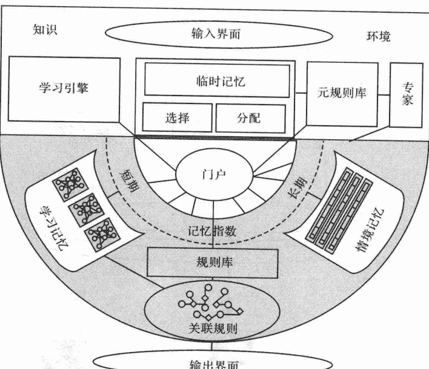 图 2.6）。Doherty 等（2003）则创制“信息颗粒”模型，定义 $G=<C, I, M>$ 三元组（常量符号集、交互接口、方法集），支持信息获取、融合与创新，该结构可由智能体落地，契合复杂知识拓扑需求，与可拓学“物元”理论异曲同工。

#### 3. 流程层面：植入管理环节的“自动化基因”
Hou 等（2005）针对汽车制造文档，构建集关键词抽取、自动分类、权限推理、审批决策于一体的智能平台，大幅压降人工成本（架构见 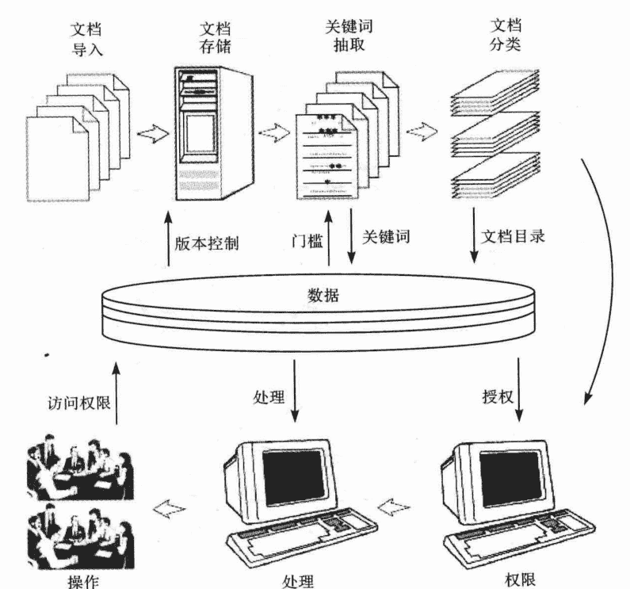 图 2.7）。张建华（2005）则从系统工程视角，设计基于组合智能的集成化协同架构，虽聚焦隐性知识显性化，但实现机制尚待深挖。

#### 4. 平台层面：重构整体骨架的“智能中枢”
Staniszkis 等（2003）引入领域本体与智能体技术，打造支持隐性知识外化与专家协同的门户，将知识划分为结构性、陈述性、过程性三类；Conteh 等（2003）倡导“Just-in-Time”理念，主张精准配送知识以支撑智能决策；Maté 等（2002）基于 20 余组织实践，沉淀出涵盖规划、风控、技术落地、应用实施的完整方法论，强化功能耦合。O'Leary（1998）在知识库嵌入本体技术，加速案例复用；Gao 等（2002）从系统论维度全景拆解理论、技术、管理三层子系统，视野宏大。

张景中院士（2000, 2005）基于“引用、运用、传播、学习、发展”五大知识需求，定义了分层分域的“智能知识平台”（架构见 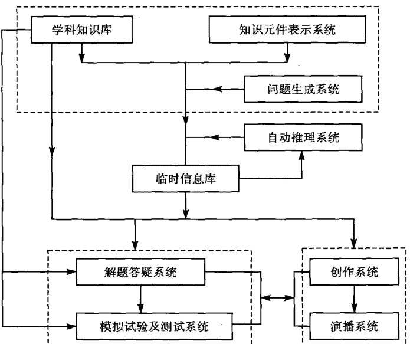 图 2.8），功能覆盖查询、建模、仿真、解题、推理、编辑、演播、辅导、测评等，主攻辅教场景。Cody 等（2002）提出 BIKM 混合模型，在 OLAP 交互中嵌入文本分类，打通结构化数据与非结构化文本分析壁垒；郑诗锋等（2007）基于复杂性理论设想多智能体共享空间框架，定义协作协调机制，但停留在概念验证阶段。

**阶段性反思**：上述研究多在功能模块局部植入智能，管理对象仍聚焦信息流转与隐显转化，缺乏对“数据挖掘生成知识”这一特异性对象的深度治理，概念内涵亦与本文定义的“智能知识”存在偏离。

---

### 近期研究新范式：从整体设计到微观实现

#### 维度一：顶层方案的闭环构想
Zhang 等（2009）引入隐显转化链条，勾勒“数据→粗糙知识→智能知识→行动知识→新数据”的螺旋跃升闭环；Yang 等（2007）利用模糊分层摘要（FAH）破解隐性知识难存储困境，实现专家模糊检索；Venkatasubramanian（2007）呼吁重视决策全流程信息治理，基于本体搭建产品全生命周期信息基建；Li 等、Nie 等（2009）聚焦挖掘知识与商业智能融合，给出集成框架；Fayoumi 等（2009）引入 Web 语义技术，以 PMML 承载本体，融合内容管理与语义库，支持挖掘结果的语义复盘与迭代。

#### 维度二：智能化落地的微观技术
Chang 等（2008）构建智能体社区，通过挖掘用户浏览隐式模式实现个性化推荐与文件精准分发；Grundspenkis（2007）提出双模型桥梁——七层企业记忆模型（源、获取、规范、表达、处理、应用、专家服务）与组织知识管理模型，配套沟通、协作、过滤、搜索等专用智能体矩阵；Luo 等（2009）基于语义链接网络（SLN）生成相似知识流；Zhang 等（2009c）量化知识-用户相似度，驱动精准推送；Fayoumi 等（2009b）在社交网络中部署多智能体捕捉仿真知识流。

可见，学界已达成共识：对挖掘所得知识实施二次智能加工势在必行，且仿真实验已铺开，智能知识管理研究正式步入“被关注期”。

---

## 2.4 章节核心洞见

综合上文，提炼六大关键结论：

1.  **认知盲区**：主流 KM 仍锚定隐性知识共享与显性化，对挖掘知识的独特属性、纳管路径及利用机制认知不足，甚至存在认知真空。
2.  **链条断裂**：数据挖掘界沉迷算法优化与对象拓展，流程标准化虽受重视，但常以模型产出为终点，忽视多形态知识融合与 KM 成果赋能利用的“后半程”。
3.  **工具失配**：现有 KM 技术框架无力支撑挖掘知识管理，折射出该领域对该类知识治理缺乏共识性认知，仍处演化早期。
4.  **推送失效**：知识推送与门户技术虽试图缓解“获取难”与“过载”痛点，但缺乏个性化核心技术与系统性理论支撑，实战效用大打折扣。
5.  **趋势确定**：跨学科演进表明，智能化是增强适应性、提升管理效能的必由之路，KM 智能化大势所趋，已有策略路径可供借鉴。
6.  **路径分野**：现有“智能 KM 系统”研究多聚焦平台功能智能化（以 IT 管知识），忽视知识本体智能化（让知识自管）。面对海量知识，平台中心模式将力竭，**赋予知识记忆、学习、识别等原生智能，实现知识“自治自理”**，方为破局新径——这正是本书核心探索的“智能知识管理模式”。

---

# 第 3 章 智能知识管理理论框架

本章立足前序积淀，确立“智能知识”核心概念，构建研究体系蓝图，为后续深度展开领航定向。

## 3.1 核心概念界定

### 3.1.1 基础概念体系

研究涉及原始数据、信息、知识、智能知识、智能知识管理，以及先天知识、经验知识、常识知识、情境知识等关联概念。为确立学术规范，结合信息论与 AI 领域经典定义，重新界定如下（Zhang et al, 2009；钟义信等，2007）：

**定义 3.1 原始数据**  
客体对自身状态及其时变模式的本原自述，表现为离散、互不关联的客观事实集合 $D_0$。它独立于主体存在与感知，是信息、衍生知识、智能知识等一切高阶形态的加工源料。获取后需经预处理转化为语义明确的信息。形态涵盖文本、多媒体、网络、时空、时序等；结构跨越结构化、半结构化、非结构化（当前 KDD 主攻结构化）；规模覆盖海量至小样本全谱系。

**定义 3.2 信息**  
主体对客体运动状态及演变模式的表征，包含语法（形态）、语义（含义）、语用（效用）三维，合称全信息（钟义信，2007）。数据经主体目的性预处理后，形成具特定语义的内容表达，即为信息。具有时效性、内容性、效用性特征。

**定义 3.3 知识**  
认识主体对客体运动本质规律的本性表述。一切知识皆含形式、内容、价值三要素，能在特定边界内指导实践。

**定义 3.3.1 经验知识**  
主体对事物状态演变的总结性表述，属“准知识”（未经科学验证）。实践中习得经验，经验证转为“经验知识”；伪证则沦为“误解”；未验证仅为“经验/信息”。神经网络训练所得、实践积累、归纳算法初出结果（未确证前）均属此类，是重要知识形态。

**定义 3.3.2 常识知识**  
毋庸证明的公共认知，为知识普及产物。含公理类与进化遗传形成的先天认知基座（无需学习、证明、推理），为后天知识习得的前提基石。

**定义 3.3.3 规范知识**  
主体经实验、实践、推理形成的规范性表述，涵盖形态性、内容性、价值性三维。核心特征：条件满足则结果稳现、结论必然可靠。源头为经验知识确证与规范知识演绎推演，构成知识主体。

**定义 3.3.4 情境知识**  
与知识活动相关的条件、背景、环境总和，含外部（物理、社会、业务）与内部（认知、经验、心理）因子，刻画知识活动的特征场景。特性：客观普在（认知程度不一）；独立存在但与知识过程强耦合；作为区分知识、识别活动、刻画主体个性的关键判别子。

---

### 3.1.2 数据挖掘视角下的知识新分类

**经典维度**：基于可表达性与可传递性，划分隐性/显性知识（Nonaka, 1994; Polanyi, 1958），共识已成，不赘述。

**效能维度 (OECD, 2003)**：四类知识图谱——
*   **知其然 (Know-what)**：事实知识；
*   **知其所以然 (Know-why)**：原理知识；
*   **知其如何 (Know-how)**：技能知识；
*   **知其谁能 (Know-who)**：人力知识。

**应用维度**：二级阶梯——**领域级知识**（业务专知）与 **元级知识**（关于知识的知识/方法论）。

#### 3.1.3 智能知识：定义、定位与核心特质

领域知识指代特定领域内的事实、法则、公式及实验对象等实体认知；而元知识则是关于“如何使用领域知识”的知识，它对领域知识进行描述、阐释与加工。若按知识的直接来源分类，可归纳为两大类：源于人类实践总结的经验知识，以及源于数据与信息挖掘而得的发现性知识。数据挖掘产出的知识还可细分为“原始知识”（亦称粗糙知识）与“有用知识”两个层级。

##### 定义 3.4 原始知识
原始知识，是指借助数据挖掘工具直接从数据与信息中提取出的模式、规则、权重系数等初步成果，属于未经筛选甄别的粗糙知识形态。例如：

```
“Rule 1: (3989/1475,lift 1.9)
总共发信种类>0
W13PDWEB 登陆 IP 个数<=0
总共 WEB 登陆 IP 个数<=0
是否使用随身邮服务=1
➡ class 0 (0. 630)”
```

这是一条反映用户在过渡期内未缴费被冻结的特征。

```
“Rule 2: (4514/1177,lift 2.3)
总共发信种类<=0
POP3 登陆 PD 次数<=0
总共 WEB 登陆 IP 个数<=0
是否使用随身邮服务=0
买服务期 6 的比例<=0.4
➔ class – 1 (0.739)”
```

这是一条反映用户在过渡期结束后仍未缴费被删除的特征。未经筛选评价的海量规则集合即构成原始知识。其中仅有少数具备实际价值，这部分经筛选留存的知识，便称为有用知识（Shi et al, 2007）。

##### 定义 3.5 有用知识
有用知识，是指经过筛选、过滤、审计等环节处理后，对管理决策具有参考价值的知识成果。前述 Rule 1 经业务专家研判，被认为对洞察冻结用户画像、预警客户流失具备参考意义，遂确认为有用知识。原始知识、有用知识与人类经验知识的来源分类关系见下图：

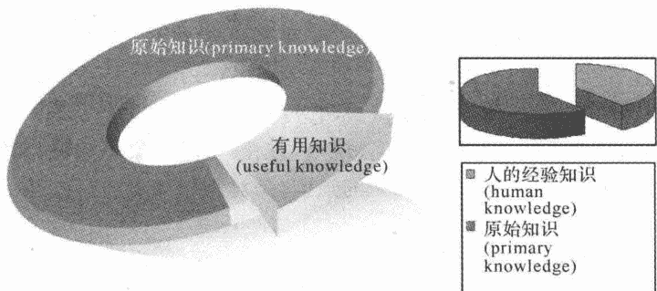

图 3.1 基于来源的知识分类体系

按来源划分，知识分为人类经验知识与数据挖掘衍生的原始知识；原始知识内部又蕴含对决策有益的有用知识。本书聚焦于从数据信息中获取模式、规则等原始知识，以及将其转化为有用知识乃至智能知识的方法、技术与全流程。

传统人类知识天然具备智能属性，内含使用条件、适用场景、受众边界等元信息，知晓者更能随环境动态调整策略，故而“智能”二字对其而言略显累赘。“智能知识”概念的提出，实为应对海量“非智能知识”涌现而生。这些缺乏自主性的非智能知识，正是数据挖掘直接产出的原始知识。

原始知识向有用知识演进，是“量减质增”的过程，严重依赖专家与资深业务人员的人工把关。规模较小时尚可人工审计；一旦规模爆发或可解释性低，人工识别便陷入困境。更棘手的是，有用知识会随时间失效，新知持续涌现，且知识应用仍处于“被动等待调用”阶段——无法精准推送给需求方，使用者也难辨识适用边界。单靠人工审计海量知识库，成本高昂、周期漫长、工程量巨大。

如何甄别有效性、赋予知识智能？业界尝试构建智能知识管理系统，但面对知识井喷、知识间冲突频发的局面，平台层面的智能管理已显乏力。根本出路在于：对有用知识实施智能化加工，让知识个体本身“长”出智能特质。

综合前文分析及相关文献（Li et al, 2009; Shi et al, 2007），界定智能知识如下：

##### 定义 3.6 智能知识
智能知识，是指经数据挖掘技术获取、经人机交互深度加工后，具备记忆、识别、自我更新与消亡等智能特质的高价值知识。其体系定位见下图：

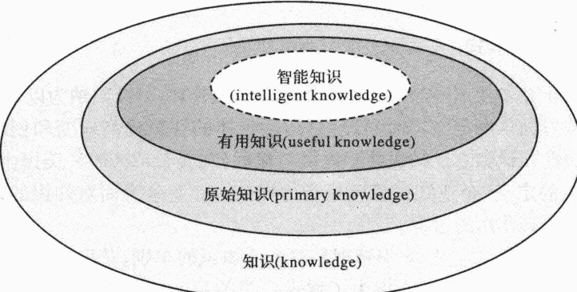

图 3.2 智能知识在知识体系中的定位示意

从集合论视角设定：Kn 为全知识集，PKn 为原始知识集，UKn 为有用知识集，IKn 为智能知识集。图示揭示以下包含关系：

Proposition 1 Kn ⊃ PKn ⊃ UKn ⊃ IKn

其中 ⊃ 表示“包含”关系。非智能知识（过载知识）集合可表达为：

Proposition 2 Kn\IKn = Kn\PKn ∪ PKn\UKn ∪ UKn\IKn

基于上述定义，将人类经验知识、原始知识、有用知识与智能知识四类形态进行横向对比，详见表 3.1。

表 3.1 四类知识形态的多维度对比概览

| 知识形态 | 知识源头 | 形成周期 | 规模 | 质量水平 | 智能程度 |
|---|---|---|---|---|---|
| 人类经验知识 | 人类实践总结 | 长 | 少 | 高 | 高 |
| 原始知识 | 数据信息挖掘 | 短 | 多 | 低 | 差 |
| 有用知识 | 原始知识审计筛选 | 短 | 少 | 较高 | 差 |
| 智能知识 | 有用知识智能化处理 | 较长 | 少 | 高 | 较高 |

智能知识的首要前提是“有用”；进而，它拥有类生命周期的自我管理机制——经历诞生、成长、衍生、衰退至消亡的全过程；同时具备环境感知力，可在恰当时机、特定条件下主动触达需求者。除继承有用知识优势外，智能知识更具四大独特属性：

- **(1) 价值属性**：作为决策参考的高价值知识资产。
- **(2) 自适应性**：具备自我管控、环境识别与动态调适能力。
- **(3) 主动推送性**：能按需、按时、按境精准分发至目标受众。
- **(4) 社会协同性**：拥有完整生命周期，支持同类知识间的派生、聚合、推理等交互协作。

原始知识与有用知识的特性及其管理流程相互交织，共同构筑了智能知识的复杂性本质。

#### 3.1.4 智能知识管理：内涵、特征与研究框架

学界对知识管理的解读视角各异，概括起来主要有四大流派：

- **(1) 目标导向派**：视知识管理为激活集体智慧、增强组织应变与创新力、打通显隐性知识共享路径的手段（左美云, 2000）；或定义为为提升竞争力而对知识进行识别、获取与效用释放的全过程（美国生产力与质量中心）。
- **(2) 过程流派**：聚焦知识识别、获取、开发、分解、使用、存储的全链条操作（Abecker, 1998）；或视为为强化组织绩效而创造、获取、应用知识的过程（AMT, 2003）。
- **(3) 资产管理派**：将其定义为利用无形资产创造价值的艺术（戚永红, 2003），即对知识资产/智力资产的系统性管理。
- **(4) 战略组织派**：强调促进知识反思、搭建交流技术与结构、获取知识源、推动交流实践以提升绩效（艾莉, 1998；王德禄, 1999）。

综上，知识管理实为组织内一切知识相关活动、业务、规划与政策的系统化治理，涵盖识别、获取、开发、分解、应用、存储等全流程。本书聚焦数据挖掘产出知识，依托智能知识特质，界定智能知识管理如下：

##### 定义 3.7 智能知识管理
智能知识管理，是融汇心理学、复杂系统科学、人工智能等跨学科理论与技术，将数据挖掘所得原始知识（粗糙知识）与主体知识（规范知识、经验认知、领导意图、组织情境等）深度融合，经由过滤、筛选、提取、存储、转化、利用等环节，实现对企业管理决策的智能化支撑的管理过程。

它立足于有用知识基座，通过智能化孵化赋予知识自主智能特质，达成自我更新与智能应用，致力于“在需要的时间，将需要的知识，传递给需要的人”，从而提升挖掘知识的实用性，消解知识过载，跃升管理水平。智能知识管理呈现四大鲜明特征：

- **(1) 管理对象聚焦**：核心客体为数据挖掘产出的有用知识。
- **(2) 智能化路径独特**：主张“知识个体智能化”优于“平台系统智能化管理无智能知识”——让知识自身“聪明”起来，而非仅靠聪明的系统管笨知识。
- **(3) 系统工程属性强**：覆盖数据处理、挖掘算法、知识审计、孵化、组织存储、智能应用、淘汰全生命周期，涉及主体、客体、平台三方深度博弈与协同。
- **(4) 组织协同依赖深**：需战略、架构、文化、流程、人才、技术六大维度的组织级协同支撑。

智能知识管理的研究框架架构见下图：

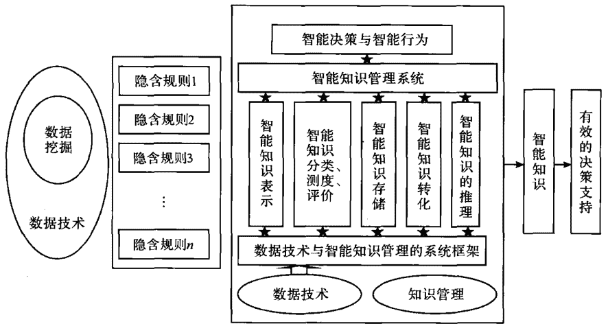

图 3.3 智能知识管理研究框架蓝图

框架构建遵循四大逻辑主线：

- **(1) 逻辑关联建模**：将挖掘结果视为特殊知识形态，探析其与传统知识结构的逻辑映射，建立数据技术与知识内在联系的数学模式，用以解释智能知识特征的生成机理，并深究其存储、转化、应用的数理与管理意蕴。
- **(2) 人机协同框架**：采用“人机结合、以人为主、综合集成”的过程学派范式，以决策支撑为落脚点，构建数据挖掘与智能知识管理的融合系统框架。
- **(3) 过程管理理论**：聚焦特定场景下智能知识的存储、转化、应用、共享、创新全过程管理。不仅关注挖掘知识本身，更纳入决策者/使用者的隐性知识与显性知识交互，引入心理学、复杂系统、综合集成等理论及实证方法。
- **(4) 关系测度与表达**：基于理论框架，引入“关系测度”量化数据、信息、智能知识间的互依存度，探寻适配的分类表达范式。核心聚焦三大研究模块：
    - *智能知识分类与评价*：解析特性、建立分类、选取指标评估有效性、构建体系。
    - *智能知识测度*：研判主客观测度理论，从模型区分度、信息量等维度建立价值测度数学模型。
    - *智能知识结构有效性评估*：给定目标与源，评估知识结构有效性。需深入三方面：复杂性分析、复杂性与模型有效性关联、异构模型间有效性分析。

总之，甄别挖掘结果真伪、精准度量高价值智能知识、科学评价知识质量，构成了智能知识管理落地的核心难题。本书将深入探究智能知识与智能行为、智能决策的耦合机制，揭示智能知识应用如何赋能决策智能化与决策效能跃升。立足“数据—信息—知识”管理本源，构建一套基于数据挖掘的智能知识管理基础概念、原理体系与方法论。

### 3.1.5 智能知识管理系统（IKMS）：架构与核心机制

学界对知识管理系统（KMS）认知迭代丰富：Gallupe(2001)视其为支撑管理实践的工具技术集；Meso等(2000)强调其整合事实、技能、原理及显性知识的组织功能；Davenport等(1998)定位为面向决策者的知识供给系统；Alavi等(2001)将其定义为聚焦知识创造、聚合、组织、传播的信息系统；知识库与知识地图是两大典型形态。张新武等(2002)则从系统论视角，将企业视作知识处理超系统，涵盖组织、文化、个体学习、业务规则及交互过程，并由计算机系统支撑。

综合诸家观点（盛小平等, 2003）并融合工程实践，界定智能知识管理系统（IKMS）如下：

##### 定义 3.8 智能知识管理系统
智能知识管理系统（IKMS），是支撑有用知识孵化为智能知识，并实现智能知识表达、存储、学习、记忆、推理、派生、自适应、主动推送、动态更新等全谱系功能的软件平台。系统架构蓝图见下图：

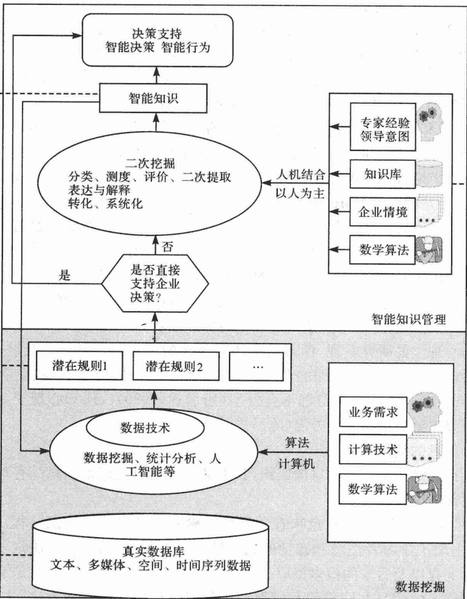

图 3.4 智能知识管理系统架构框架图

IKMS 本质上是一个人机协同演进系统：早期主导权在人，后期逐步向机器迁移。系统引入复杂性科学理论，借力 Agent 技术，终极目标是催生知识的智能化涌现。

### 3.2 智能知识管理的理论基石

智能知识管理的理论根基植根于人工智能、复杂性科学、系统科学与可拓学等多学科交叉领域，现逐一阐释：

#### 3.2.1 认知心理学：知识自学习机制的仿生蓝本

人类认知理论为知识自学习能力设计提供仿生参照。认知心理学家 Dodd 等主张，认知包含适应、结构、过程三维，实质是“为特定目的，在特定心理结构中进行的信息加工活动”（朱智贤，1985）。

可资借鉴的成果涵盖：注意机制的过滤/筛选理论；知觉层面的模式识别、语词辨析及主客观因素影响分析；表象研究的新范式、具体与概括表象的区分；记忆编码的组块理论与网络理论；信息检索与激活机制；多元记忆模式研究等。

信息加工流派将知识二分：陈述性知识（对应感知、记忆）与程序性知识（对应思维求解）。程序性知识聚焦问题解决，搜索策略分两派：算法式（固定步骤、保证解出）与启发式（模拟人类灵活思维、以少博大、但不保证必胜）。

认知心理学揭示：学习非单纯记忆，而是主体对客体的主动辩证反映与认知建构过程，在知世界中发展自我，离了主体主动性学习无从发生（唐名祥，1990）。其研究聚焦双核（陈昌岑，1986）：

- **(1) 信息的编码与提取机制。**
- **(2) 记忆结构与信息组织方式**，侧重存储机制与内部表征研究。

认知视域下，学习即学习者对输入信息的深度加工。注意与知觉的选择性决定“收什么”；编码方式决定“存什么、怎么存、怎么取”；过程还需调取旧知与新知协同编码存储。

关于重复机制，两说并存：“联系强度说”认为重复强化“项目-线索”连接强度；“编码策略说”主张重复提供契机让学习者施展多元编码策略，每次呈现触发新策略，编织新旧知识网络，生成大量潜在提取路径。

短时记忆呈现“首尾效应”机制：首端信息占据“优先占有权”形成首因效应；中段因存储空间被占满而难以进入；尾端因时距短、经复述而产生近因效应。“层次加工理论”指出：深度复述实质是高层级的语义重加工，显著提升记忆绩效；首因/近因效应本质上亦是期待驱动下的差异化加工层次所致。组织编码非简单合并为大块，而是按材料内在结构分区存储。

认知心理学为智能知识的记忆/学习功能开发、存储架构设计及审计机制构建提供了理论底座与方法论指引。

#### 3.2.2 人工智能理论：技术实现的核心驱动力

人工智能理论是智能知识管理技术落地的核心支柱。

信息是事物状态的直观投射，知识是事物规律的本质凝练，智能则是驾驭知识解决问题的能力，外化为获取、传递、存储、处理、控制执行等策略功能。

AI 技术是 21 世纪信息科学与生命科学最耀眼的交汇点。半个多世纪来，研究者从结构、功能、行为三维切入，确立了结构主义（神经网络）、功能主义（专家系统）、行为主义（感知-动作）三大范式，对应构建起神经网络学说、符号逻辑学说、感知-动作学说三大理论体系。

涂序彦、韩力群等构建“多中枢自协调人工脑模型”（韩力群等, 2009），探究离散个体智能如何通过协商涌现群体协同智能，提炼出友好协商、分工协作、全局优化、动态平衡、综合集成等协调律与“导引分组循环全息”等策略。《大系统控制论》（涂序彦等, 2005）进而提出智能自律分散系统、协同智能信息网及社会协调学，揭示协调为复杂大系统普适需求。钟义信教授直指智能生成机制：在“问题-约束-目标”约束下，信息获取与“信息-知识-智能”转化的核心机制，开辟了 AI 研究第四范式——机制模拟法，实现三大学派的和谐统一，构筑 AI 统一理论。

众家研究汇聚，推动方法论从“分而治之”向“分-合-互动”跨越，催生“高等智能”新范式，其核心主张：

- **(1) 本质路径转向**：结构/功能/行为是切面，智能生成的共性核心机制（机制主义方法）才是本质归途。
- **(2) 机制落地**：技术实现锚定“信息-知识-智能”转化闭环。
- **(3) 理论大一统**：以机制主义贯通结构主义、功能主义、行为主义三大流派。
- **(4) 打通壁垒**：揭示意识、情感、智能内在关联，融通人工智能与自然智能研究。

钟义信教授将智能科技特征概括为“获取信息、提炼知识、生成策略、转化行为、优化求解”五部曲（钟义信, 2006），为智能知识管理研究提供了方法论坐标：

- **(1) 面向“问题-约束-目标”，首要任务是获取相关信息；**
- **(2) 通过学习机制，将信息提炼为反映问题本质的知识；**

### 智能知识管理的理论基石与演进路径

#### 核心驱动逻辑：自主适应的五步走
智能系统的运作遵循一套以“自主”为内核的闭环机制：
1.  **自主感知**：通过自主检测获取原始信息；
2.  **自主学习**：将知识内化为解决问题、满足约束、达成目标的智能策略；
3.  **自主执行**：把策略转化为具体的智能行为；
4.  **自主反馈**：以行为效果作为新信息输入；
5.  **自主优化**：依据反馈持续迭代策略，并通过自主组织优化系统整体。

这一“感知-学习-执行-反馈-优化”五部曲，实质是系统通过自主适应环境、实现目标的过程。掌握这一核心，需融合智能体、自适应系统等前沿成果，构建智能知识自主管理体系——这是一项极具挑战性的复杂系统工程。

#### 知识工程的奠基之作
1977年，斯坦福大学费根鲍姆教授在国际人工智能大会上正式提出“知识工程”概念。他指出，知识工程是AI原理与方法的集大成，旨在攻克依赖专家经验的疑难杂症。如何高效完成专家知识的获取、表达、推理构建与解释，成为基于知识系统设计的关键技术门槛。

---

### 理论支撑三：复杂性科学与复杂系统理论

#### 从确定性到复杂性的认知跃迁
20世纪科学发现，简单确定性系统会演化出分形、蝴蝶效应、混沌等复杂不确定行为，为认知世界开辟了新视野。复杂系统由简单规则驱动，呈现涌现的组织行为。复杂性科学兴起于80年代，融合系统论、信息论与人文精神，专门研究此类系统。

西蒙教授直指本质：复杂性是世界及共生系统的关键特征。成思危院士进一步将其解构为五大维度：网状关联、多层多能结构、自学习自重组、开放交互、动态自预测（即广义智能）。**复杂系统的灵魂，在于其组分具备“智能原质”——能感知环境、预测变化、按目标行动。**

#### 跨尺度、跨学科的普适规律
互联网、神经网络、生态链，虽形态迥异，却共享相同行为特征与底层法则。这种跨系统、跨尺度、跨学科的自相似性（如小世界现象、无标度特性），决定了研究必须打破边界。系统演化中的“涌现/相变”，及其临界诱因，是核心攻关点。**系统整体行为非单元性质简单叠加，研究重点必须转向个体交互催生的“群体智能”。**

#### 霍兰的CAS理论：自适应主体的进化逻辑
霍兰1994年提出的复杂自适应系统（CAS）理论，将系统成员定义为“自适应主体”（含组织与个体）。核心在于：主体持续与环境/他体交互、学习积累、依经验重塑结构行为。系统宏观演化（新层级、多样性、聚合）皆源于此微观基础。

霍兰围绕“主体”构建七大核心概念（聚集、非线性、流、多样性、标志、内部模型、积木），并通过三步建模主体行为：
1.  建立执行系统模型；
2.  确立信用分配机制；
3.  提供规则发现手段。

**启示**：当智能知识量达标、通信通畅，即构成复杂系统一环，需整体视角研究其决策支持功能。复杂性科学的新工具、新方法，为智能知识实现策略提供了宝贵范式。

---

### 理论支撑四：系统科学理论

#### 整体论与动态观的辩证统一
综合钱学森等大家观点，系统科学核心在于：整体观、辩证法、动态性（含混沌）。钱老定义的“开放复杂巨系统”具六大动力学特性：复杂性、巨型性、内在差异性、层次性、开放性、动态性。方法论上，坚持**整体优化、长远优化**，拒绝局部短视。

#### 两大核心方法论
1.  **从定性到定量的综合集成法**：融合科学理论、经验知识、专家判断，提出假设，经数据/模型检验、量化对比，终得结论。核心是**人机结合、以人为主、集群体智慧**。自组织数据挖掘、数据挖掘技术均是该方法的有效工程化实现。
2.  **物理、事理、人理系统方法论**：物有物理，事有事理，人有情理（需求、情绪、利益、价值观）。解决复杂问题必须纳入人的背景、关系、情感等软性因素。

这两大方法论为破解智能知识管理难题、设计管理平台提供了根本遵循。

---

### 理论支撑五：可拓学理论——中国原创的创新方法论

1983年，蔡文教授创立可拓学，用形式化模型探讨事物拓展可能性与创新规律，解决矛盾问题。其策略工具可直接服务于智能知识获取算法设计与数据集构建，核心内容三维：

#### 1. 可拓集合：动态分类的数学基石
经典/模糊/粗糙集合均为“静态”视角（属性程度固定）。可拓集合打破此限，**将分类与变换（时空）耦合**。元素归属可变，关联度随变换动态调整。通过元素/关联函数/论域的“可拓变换”，负域元素可转为正域，**为动态分类提供了集合论依据**。

#### 2. 关联函数：定量化的精准标尺
关联函数量化描述元素属于正域/负域/零界及层次差异。引入“距”概念，突破经典数学“区间内距离为零”的局限，实现**类内程度的精细量化**。提供三类初等关联函数（中点最优、侧距、任意点最优），按实况选用。

#### 3. 可拓变换：获取智能知识的核心引擎
基元（事元/物元）变换揭示解题路径。五大基本变换：
*   **置换**：一物多征、一征多物、一征多值、一值多物、一值多征、共轭性（实/虚、硬/软、潜/显、正/负）；
*   **增删**：特征/事物的加减；
*   **扩缩**：特征/量值/事物的伸缩；
*   **组合分解**：聚合与拆解；
*   **复制**：多份复制。

**传导变换**揭示连锁反应（六种形式），决策必考。变换代数（积、逆、或、与）与三类型（可拓元、关联准则、论域变换）构建完备体系，**概括了解决矛盾问题的普适模式**。

---

### 数据挖掘与智能知识：从“挖掘”到“智用”的跃迁

#### 两阶转换模型
*   **一阶转换（T₁：数据 → 粗糙知识 Kᵣ）**  
    传统数据挖掘（D → Kᵣ），产出未筛选的原始模式，属“数据-知识-智能”链条的初级环节。
*   **二阶转换（T₂：粗糙知识 + 主体知识 → 智能知识 Kᵢ）**  
    核心升级：融合规范(Kₛ)、经验(Kₑ)、常识(K꜀)、本能(Kₕ)、情境(Kᵤ)五维主体知识（K = ρ(Kₛ,Kₑ,K꜀,Kₕ,Kᵤ)），经智能化处理生成Kᵢ。因粗糙知识海量、时效强，人工处置不力，**必须引入智能化管理**。

#### 智能策略与智能行为：孪生概念
*   **智能策略 (S) = T₃(Kᵢ × I(P,E) × G)**  
    给定问题P、环境E、目标G、情报I，基于Kᵢ生成的求解工作程序。实现知识→策略的映射。
*   **智能行为 (Kₐ) = T₄(S)**  
    策略经执行机构转化的行为，原则上一一映射。**策略是内在本质，行为是外在显化，二者合一构成系统真实“智能水平”**。

#### 完整演进链条
**数据 (D) →[T₁] 粗糙知识 (Kᵣ) →[T₂] 智能知识 (Kᵢ) →[T₃] 智能策略 (S) →[T₄] 智能行为 (Kₐ)**

#### 关系归纳
1.  **源头性**：智能知识源于数据挖掘，立足粗糙知识经二阶挖掘升华。
2.  **融合性**：深度嵌入企业情境、专家经验、领导意图，践行人机结合、以人为主。
3.  **目的性**：数据挖掘出规则辅助决策；智能知识输出策略、驱动行为，直达业务执行。

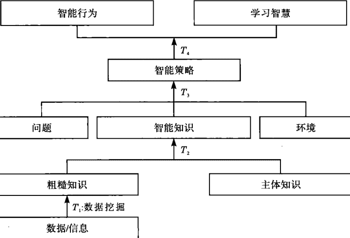

---

### 智能知识管理（IKM）研究框架：目标导向的顶层设计

#### 三大核心目标
基于信息时代诉求与项目实施痛点（见1.1.2节），IKM锚定三大靶心：

1.  **三位一体：挖掘、管理、业务深度融合**  
    打破“管理只重分享不重应用”、“挖掘只重算法不重落地”、“管理脱离业务成负担”三大壁垒。将挖掘、管理嵌入业务全流程，构建知识支撑环境，服务推理决策，**让技术真正服务业务**。

2.  **激活知识：集成异构、催化创新**  
    解决挖掘知识分散、异构、部门壁垒问题。挖掘部门联系，融合业务/时间/人员维度关联，提升使用价值。利用智能特性关联孤岛知识，**拓宽视野理解运用，激发创新新知**。

3.  **精准推送：智能过滤、缓解过载**  
    海量知识中精准匹配当前业务需求。系统自动过滤噪音，依自我记忆、环境识别能力，**在恰当时机把恰当知识推给恰当的人**，实现“以需定推”。

#### 理论框架蓝本：钟义信“信息-知识-智能统一理论”
钟教授指出，高级智能系统须解决双核心问题：
*   **认知**：外部信息 → 知识（信息认知）  
*   **再生**：知识 → 智能策略（知识激活）  

“信息认知与再生”系统（对标人脑思维）承担核心转化任务。完整系统还需**执行（施放）**与**反馈驱动的策略迭代**，直至目标达成，形成闭环。

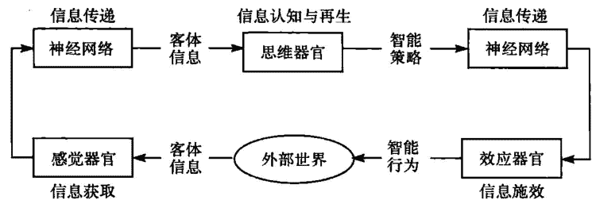

此框架为IKM理论架构搭建提供了根本坐标。

# 构建智能知识管理（IKM）的四维理论框架

要落地 IKM 的应用愿景，必须具备相应的支撑环境，并找到知识与智能特性深度融合的路径。智能知识管理的方法体系建立在坚实的技术基座之上。基于此，我们构建了一个包含应用层、方法层、技术层与支撑条件层的 IKM 四层研究框架，详见下图。

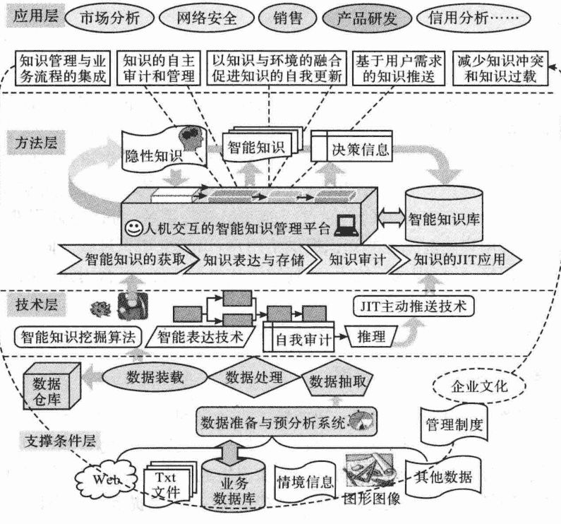

图 3.7 智能知识管理模式研究的理论框架图

## 一、 基石夯实：支撑条件层

该层为上层建筑的研发与运行提供必要的资源保障与环境支撑，主要涵盖四大板块：

1.  **数据就绪与预分析体系**  
    面向潜在商业目标，筹备挖掘分析所需的数据资产，并对数据质量、分布特征开展初步洞察。这包括 OLAP 多维分析、对数据仓库实施全方位立体分析，以及支持用户开展目标导向的探索性分析，为后续挖掘产出高质量数据集。数据来源广泛，涵盖业务数据库、文档文献、互联网资源、情景信息、图形图像等。深度解析请参阅 4.1 节。

2.  **数据抽取、清洗与装载（ETL）**  
    从源头抽取原始数据，经集成、清洗、格式标准化等流程，转化为可直接挖掘的数据集。条件成熟时同步构建数据立方体，供预分析系统调用。该环节已有成熟工具链与操作规范，本书不再赘述。

3.  **企业文化土壤**  
    树立“以数据生知、以共享促用、以应用创值”的文化导向，能为智能知识管理注入强劲动力。文化渗透管理全流程，辅助制度落地。虽非本书研究核心，但为框架完整性及提醒规划者重视，此处专门标注。

4.  **管理制度护航**  
    为确保系统顺利上线与长效运行，必须建立与业务深度融合的制度体系。通过制度约束保障各环节状态良性，实现问题早发现、最佳实践强激励，推动系统进入良性循环。

## 二、 核心引擎：技术层

技术层为 IKM 模式落地提供关键技术组件，聚焦五大核心方向：

1.  **智能知识挖掘算法**  
    通过改良决策树、多目标线性规划（MCLP）等现有算法，产出具备更高智能属性的知识。详情见 4.3 节。

2.  **智能知识表达技术**  
    攻克知识如何表达才能内生智能能力的难题。详情见 5.3 节。

3.  **智能知识自我审计技术**  
    构建从挖掘结果中甄别、判别、提升智能知识的系统化方法。详情见 5.4 节。

4.  **智能知识推理机制**  
    研究知识融合生成新知、创造更高价值的机理。详情见 5.5 节。

5.  **智能知识高效应用技术**  
    解决“如何在恰当时机将恰当知识主动送达恰当用户”的效率难题。详情见第 6 章。

## 三、 流程集成：方法层

方法层遵循“以人为主、人机结合”的综合集成理念，调用技术层模块，串联起智能知识获取、表达存储、审计把关、主动推送应用等关键流程。在此基础上，搭建人机交互的 IKM 平台，建设智能知识库，实现专家隐性知识与智能知识的深度融合，为应用层输出决策级智能支撑。

## 四、 价值落地：应用层

依托方法层平台与流程体系，实现 IKM 与业务流程的无缝嵌入，将方案拓展至市场分析、网络安全、销售管理、产品研发、金融信用评估等实战场景。在实战中发现新问题、迭代优化模式，形成闭环。

本书提出的 IKM 方案与学界主流研究路径存在本质差异，对比示意如下：

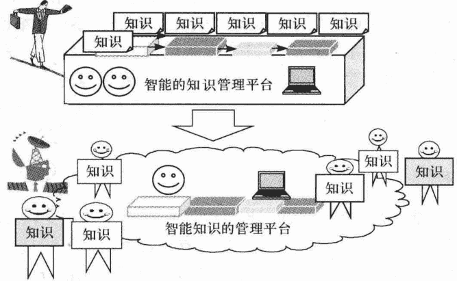

图 3.8 智能知识管理方案对比

**传统“智能的知识管理”**：依赖平台智能管控“非智能”的知识。一旦知识量爆发式增长超出阈值，或平台规则更新滞后，平台智能易崩塌。  
**本文“智能知识的管理”**：弱化平台智能，将智能特性下沉至知识单元本身。知识间可自主交互、半自主管理，大幅缓解平台压力。**知识量越大，群体智能越强。**

---

### 3.4.3 智能知识管理的四条实现路径

综合文献总结与多学科交叉研究，本书锁定以下四条核心路径：

#### 1. 知识获取智能化：目标驱动挖掘
早在 1981 年，Newell 即提出将知识、目标、符号系统集成以产生预期行动。**“知识—目标”关联是赋能知识智能的关键一跃。** 现状是分类算法与商业目标脱节，挖掘出的仅是静态特征描述（如流失用户画像），仍需人工干预。若能直接挖掘出“如何挽留、如何转化”的行动规则，智能性将质变。改进挖掘算法直出智能知识，是最直接的路径。

#### 2. 知识表达智能化：赋予知识“大脑”
现有表达局限于内容本身及元知识存储，虽助理解，但无法赋能知识“自学习”。需革新表达形式与存储机制，为知识植入认知核心，使其具备自主学习先天条件。

#### 3. 知识审计智能化：实现“毛遂自荐”
现状依赖专家人工筛评，耗时低效且质量不稳（专家推荐实战可能失效）。引入自动过滤、通信记忆机制，让知识与现有图谱对话，自动获取评价指标并自我打分，进化出自我审计能力。

#### 4. 知识应用智能化：主动感知与推理融合
现状缺乏环境识别力。植入自学习机制使知识适应环境，引入推理机制促知识间融合生新知，并与业务流程打通，实现目标相关知识的主动触达。原理见图示。

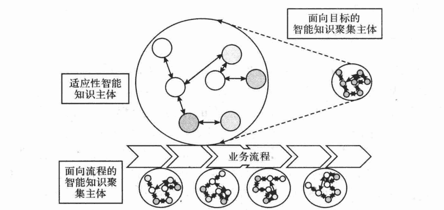

图 3.9 智能知识的应用过程原理图

多源、多阶段获取的智能知识，经自学习机制演化为适应性主体，聚合商业目标形成“目标导向主体”；按流程环节聚集成“流程导向主体”，驱动流程高效运转达成目标。上述四法相互咬合、协同增效。

---

## 3.5 智能知识管理的五大关键技术支柱

从知识创造、组织、审计、应用全链路智能化诉求看，必须攻克：智能获取算法、具备学习力的表达存储、推理引擎、高效应用技术等硬骨头。简述如下：

### 3.5.1 直指目标的新型数据挖掘算法
**核心逻辑：让知识出生时就“知晓使命”。**  
将商业目标与挖掘方法深度耦合，直出面向目标的知识，天然具备目标智能性，省却后续繁复过滤审计环节，大幅提升应用效能。若无法直出，则退而求其次采用“人机交互式孵化”，引导知识渐进式学习、推理、迭代，最终成长为决策智能体。两条路径常需混合施策。

### 3.5.2 自带记忆的智能知识表达技术
**地基作用：统一表达与存储是智能学习与管理的前提。**  
突破传统“仅表达内容”的局限，将智能载体与知识本体融合一体化存储。该技术是审计、推理、推送等上层技术得以实现的核心基石与先决条件。

### 3.5.3 主动进化的自我审计技术
**进化引擎：从原始知识到有用知识，再到智能知识。**  
自我审计是知识自动更新、主动推送的关键环节。要求知识具备群体相似性评估与自我价值量化认知能力。因审计标准复杂，需引入人机交互，注入专家经验催化知识进化。

### 3.5.4 具备社会性的通信与推理技术
**涌现源泉：量变引发质变的复杂系统特征。**  
单体或小规模知识不显通信推理价值；但积累达临界规模，知识群体将展现复杂系统特性，产生“涌现”现象。推理机制支持知识按特性与应用条件快速检索、组合、生成新知并有序交付。

### 3.5.5 基于情景识别的主动推送技术
**精准触达：解决知识过载的终极方案。**  
在精准识别用户即时需求基础上，智能评估情景相似度与关联度，精准推送匹配知识，屏蔽噪音干扰，显著提升利用精准度。**智能审计是主动推送的基石。**

**技术协同图谱**：智能获取是短期见效的双核驱动之一；表达技术是后续三技术的基座；挖掘与表达居核心统领地位，审计、推理、推送为基座之上的应用延展。故本书聚焦挖掘、表达、审计、推理四大核心技术深度展开。

---

## 3.6 IKM 落地的组织支撑体系构建

模式在组织内有效落地，首需管理层真心实意支持——投入大、周期长，无高层背书难推行；次需专业人员持续参与——懂业务、懂数据，能为挖掘提供领域指引；再需制度机制双轮驱动，将前二者固化。

### 3.6.1 管理铁律：结果导向、客户价值、持续发展

**团队灵魂：共同信仰“客户价值”。**  
利润与薪资源于客户，创造客户价值是唯一战略方向。全员内化“敬畏客户、满足合理、超越期望”的思维与行动范式。**行动上死磕“结果导向”**——聚焦目的与成果，唯有带来客户价值的结果才是真目标。

内外客户价值双轮驱动：  
- **内部价值建设**：搭建成长型知识平台，营造分享、激励、共进文化；引入知识贡献度考核，高贡献者重奖。  
- **外部价值交付**：建立制度执行力体系与沟通机制，杜绝依赖“明星员工”或“项目经理人格魅力”的单点风险。

### 3.6.2 项目管理闭环：计划、职责、监控、考核、沉淀

**目标分解三要素：有时限、有价值、可考核。**  
项目经理与客户对齐总目标、阶段目标、验收标准，会议确认。团队负责人拆解任务至里程碑、检查点，再细化至个人。个人计划同步包含：完成时间、交付物、衡量标准、关键动作、资源诉求、兜底责任。负责人指导资源配置。**结果承诺遵循“针对最差结果承诺、指定第三方检查”原则**，拒绝完美主义拖延（图 3.10 示意）。

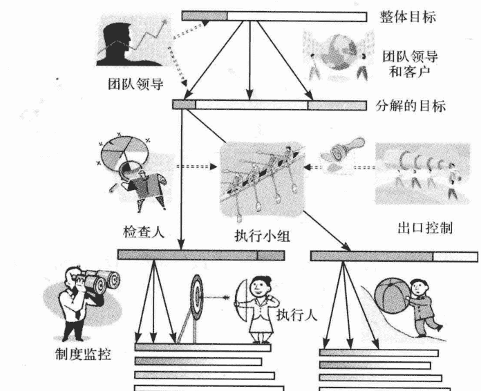

图 3.10 目标分解与执行体系示意图

**过程管控：检查即重视。**  
“员工不做你希望的，只做你检查的”（郭士纳语）。按计划第三方巡检，管控质效；关键节点增设“出口控制”——唯一出口可控，一环扣一环保质量，聚焦关键点避免双重成本。负责人依据关键点记录管控全过程。

**偏差纠偏与知识沉淀**：进度滞后即刻复盘溯因、落实整改人、执行对策，有效经验自动入库，构建**“不依赖特定人、自适应循环”**的系统化管理管道（图 3.11 示意），告别“能人政治”。

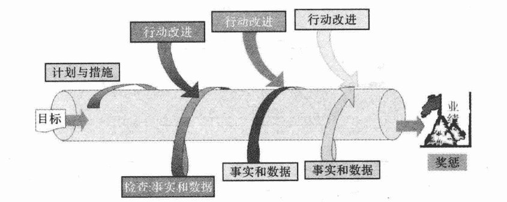

图 3.11 团队业绩保障体系示意图

**奖惩机制：奖勤罚懒、即时兑现、全员覆盖。**  
按业绩比例分红；突出贡献即时奖，违规失职即时罚。打造“优者汰劣、人岗匹配”生态。奖惩幅度挂钩付出代价或折算工资比；价值难量化时以成本替代。持续不能胜任者启动退出机制——这是风险超阈值时的止损手段。

---

## 3.7 本章小结

本章系统奠定了 IKM 理论基石，核心产出五点：

1.  **概念创构**：提出智能知识概念，解析特征，定义 IKM 与 IKMS，明确管理目标。
2.  **理论溯源**：论证 IKM 属复杂性系统，要素含有用知识、智能知识、专家经验，需融合认知心理、AI、复杂性科学、系统论、可拓学等多学科，人机协同设计。
3.  **框架搭建**：四层架构（支撑条件→技术→方法→应用）层层递进，分工明确：底层备数环境，技术层攻关实现，方法层串联流程建平台融知识，应用层嵌入业务达目标。
4.  **技术聚焦**：梳理五大关键技术（智能挖掘、记忆表达、自我审计、通信推理、情景推送），剖析协同关系，锁定前四项为核心攻坚方向。
5.  **落地保障**：聚焦制度体系，理念立“客户价值”，执行给流程方法。

为后续章节深入实施确立了方向与基础。

---

# 第 4 章 智能知识的直接获取技术

## 4.1 智能知识获取的数据准备战役

数据挖掘成败，七分靠“商业目标选得准、数据备得好、方法用得对”。Crisp-DM 方法论将流程切分为六阶段（商业理解→数据理解→数据准备→建模→评估→发布），其中**数据理解与准备耗时占比高达 70%~85%**。

数据质量是挖掘结论可信度的生命线。虽有大量清洗、转换研究，但**从源头解决数据质量转型**的探讨仍显不足。李兴森团队引入可拓工程方法，以挖掘需求为条件物元，通过事元“数据挖掘咨询”驱动物元集可拓域演进，开辟了**“以咨询应用倒逼数据质量跃迁”**的新路径（李兴森等, 2006, 2007a）。

数据转换三重含义：  
① 格式适配（随目标与工具变）；  
② 用途切换（目标 A 转目标 B，由业务与算法专家共商）；  
③ **质量跃迁（本节核心）**：从根本举措使数据集胜任特定商业目标挖掘，区别于一次性清洗，具备持续赋能新抽取数据的能力。

### 4.1.1 数据集类型画像与选取策略

可拓挖掘数据集涵盖结构化库数据、非结构化文本、Web 数据等，来源可自有可外部。选取策略双轨并行：
- **策略 A**：目标牵引数据——有的放矢；
- **策略 B**：数据倒逼目标——因地制宜。

二者关系可用四象限模型刻画（表 4.1）：

| 商业目标 \ 数据集 | 无合适数据集 | 有合适数据集 |
| :--- | :--- | :--- |
| **有确定商业目标** | 第四象限：目标清晰，数据缺位 | **第一象限：目标清晰，数据就绪（理想区）** |
| **无确定商业目标** | 第三象限：目标模糊，数据缺位 | 第二象限：数据富集，待挖掘目标 |

# 破解数据困局：从“巧妇难为无米之炊”到可拓转化策略

在数据挖掘的实战图谱中，一、三象限的场景（要么“目标清晰、数据就绪”，要么“两者皆无”）处理起来相对直观；二象限“数据在手、目标模糊”可借力专家咨询反向挖掘目标；真正的硬骨头在于四象限——**“业务急需决策支撑，却苦于无优质数据集可用”**。这是众多企业的常态：为生存发展迫切需要某领域的挖掘分析，现有内部数据却难以支撑。出路通常有二：一是向外寻，拥抱互联网、公共数据库等外部资源；二是向内挖，对组织既有数据集进行根本性转化。本文将深度聚焦后者，剖析基于可拓学的内部数据转化策略与算法实现。

## 4.1.2 内部数据转换：可拓策略深度解析

核心前提：**任何数据集合（含脏数据）皆具可拓性，通过变换均可掘出价值**。关键不在于是否能洗，而在于如何建立**可持续的转化机制**，以最小清洗成本换取最大数据效能。

### 1. 物元集合视角的数据画像

数据挖掘本质上涉及三个多维物元与一个多维事元。我们用多维物元 $R_1$ 刻画原始原料：

```
R₁(t) = [ N₁(t), c₁, v₁(t) 
         c₂, v₂(t) 
         ... ... 
         cₙ, vₙ(t) ] (4.1)
```

经清洗达标、可直接入模的数据集为条件物元 $R_2$：

```
R₂(t) = [ N₂(t), c₁, v₁(t) 
         c₂, v₂(t) 
         ... ... 
         cₙ, vₙ(t) ] (4.2)
```

挖掘过程本身是多维事元 $T$：

```
I = [ DataMining, b₁, u₁ 
     b₂, u₂ 
     ... ... 
     bₙ, uₙ ] (4.3)
```

其中 $b_i$ 涵盖施动/受动对象、时空、程度、方式、工具等八大特征维度，$u_i$ 为对应量值。最终产出的挖掘结论即目的物元 $R_3$：

```
R_3(t) = \begin{bmatrix} N_3(t), c_1, v_1(t) \\ c_2, v_2(t) \\ \vdots \\ c_n, v_n(t) \end{bmatrix} (4.4)
```

**传统痛点**：常规流程是 $R_1 \xrightarrow{清洗} R_2 \xrightarrow{建模} R_3$。但企业数据质量普遍不高，清洗往往耗费巨大人力物力，且属“治标不治本”——辛苦洗净的数据，下一批采集的新数据又被业务系统的不准确录入污染，陷入“清洗-污染-再清洗”的死循环。

**可拓重构**：企业挖掘原始数据天然符合可拓集合四大特征。站在挖掘视角，**有效数据 $R_2$ 的定义是：与挖掘目标强关联、且完整、一致、正确的数据集合**。清洗的本质任务，就是通过关联函数量化这四个维度，将脏数据“推”入合格区间。

设论域 $U=\{企业挖掘数据集\}$，引入四大评价特征：$c_{o1}$完整性、$c_{o2}$一致性、$c_{o3}$正确性、$c_{o4}$目标关联度。为每个元素 $u \in U$ 在四个量值域上建立关联函数 $k_1 \sim k_4$，进而在物元集

```
R = \begin{bmatrix} u, c_{o1}, x_1 \\ c_{o2}, x_2 \\ c_{o3}, x_3 \\ c_{o4}, x_4 \end{bmatrix} = \begin{bmatrix} u, \text{完整性}, x_1 \\ \text{一致性}, x_2 \\ \text{正确性}, x_3 \\ \text{关联度}, x_4 \end{bmatrix}
```
```
W = \left\{ R \middle| R = \begin{bmatrix} u, c_{o1}, x_1 \\ c_{o2}, x_2 \\ c_{o3}, x_3 \\ c_{o4}, x_4 \end{bmatrix}, u \in U, x_i \in V(c_{o_i}), i=1,\cdots,4 \right\}
```

上构建物元可拓集合，为后续变换奠定数学基础。

### 2. 三大维度的可拓变换方案

依据可拓工程方法论，破局路径聚焦三大变换：

*   **论域变换——换赛道、减负重**  
    *置换*：切换至质量达标的备选数据集，同步调整挖掘目标；  
    *增删*：引入高质量数据稀释误差率，或直接切除劣质数据用子集建模（即常规清洗）。**弊端显而易见：工程量大，且极易误删高价值信息。**

*   **关联准则变换——降门槛、换工具**  
    数据本身不动，变的是“合格线”。在现有软件下不合格的数据，若研发**容错型挖掘算法/系统**，在新准则下即可达标。这属于源头攻关，虽难度大但治本。

*   **元素变换——改数值、补缺口**  
    直接修改 $V$ 值，让劣质数据“变身”合格数据。主流填充算法、清洗手段皆属此类；或对元素 $u$ 做置换，用合规 $u'$ 替换现有 $u$。

---

## 4.1.3 落地执行：五大维度重塑数据质量闭环

理论转实战，核心在于**发展变换 $T_{V \to N}$**——打破“质量越挖越差”的恶性循环，构建“质量迭代向好”的良性增强回路。

### 核心机制：咨询驱动的迭代进化

给定原始物元 $R_1(N_1, c, v_1)$，引入事元“数据挖掘咨询”（目标分析+质量诊断+改进建议），触发发展变换：
1.  **对标差距**：对比现状 $R_1$ 与目标 $R_2$，用关联函数量化四维度差距；
2.  **精准施策**：调整数据结构、存储粒度、汇总逻辑、保留周期等，提升完整性与准确性；
3.  **循环收敛**：若差距仍在负域（$k(u) \le 0$），继续咨询-试验-改进；差距逐步收敛，高质量物元渐次替代低质量物元；
4.  **量变引质变**：至时刻 $t$，$R_1$ 质量跃迁达 $R_2$ 标准，完成 $T_{V \to N}(N_1, c, v_1) = (N_2, c, v_2)$，最终得满足条件的物元 $N'$。

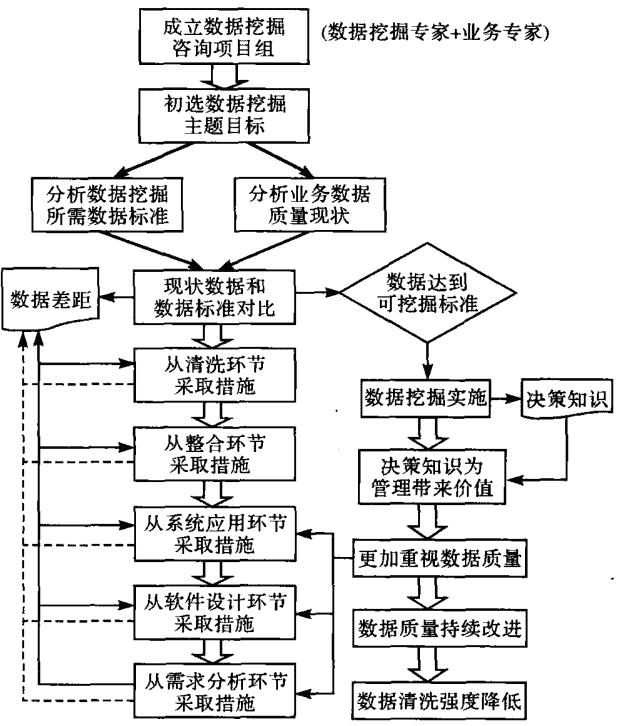

*图 4.1 数据转换整体解决方案架构*

**组织保障**：成立“挖掘专家+业务专家”联合咨询组，锚定决策需求，筛选主题目标，按蕴含链条层层溯源改进措施。

### 五大落地抓手，直击数据全生命周期

| 环节 | 核心动作 | 关键要点 |
| :--- | :--- | :--- |
| **1. 清洗环节** | **建监控、防二次污染、慎处离群值** | 严控衍生变量生成新脏数据；离群点不盲删，优先替换值。 |
| **2. 整合环节** | **补缺失、控转换、定粒度、统口径、查根源** | 缺失值短期可补即补；关键字转换误差归零；汇总粒度适配并留底原始数据；系统时间同步；命名/编码规则前置校验；警惕缩写、惯用语、计量单位、过时编码导致的不一致。 |
| **3. 录入环节** | **立规矩、强意识、管衔接、留日志、促应用** | 培训数据价值观减少人为错；建完整性/准确性考核奖罚制；新旧系统切换预案；延长日志保留；推行查询/报表/OLAP等局部决策应用倒逼录入质量。 |
| **4. 设计环节** | **调结构、加字段、统字典、强约束、验合法、标格式** | 基于挖掘需求重构存储；补齐必挖字段；统一度量单位/命名/编码/格式；下拉框数据完整性校验；难采集字段设非必填；高级约束与组件内嵌控制；字段范围/逻辑合法性软件自检。 |
| **5. 需求环节** | **融双需、引专家、铺规划** | 决策需求与业务需求同源分析；挖掘专家前置参与；战略目标牵引信息化规划，输出决策支持计划与挖掘进度表。 |

### 正向飞轮效应

改进后抽样复测，差距在不可用区继续打磨；达标即进入项目正式实施。**一旦挖掘结论创造业务价值，管理层重视度跃升**——增投入、强管理、重分析、立标准、引平台、重罚则、采新技。需求倒逼数据集成，集成暴露新质量问题，自动触发下一轮“咨询-实施”循环。挖掘反哺系统完善，系统沉淀优化咨询经验，**数据质量治理由此从“成本中心”转型为“价值引擎”**。

---

## 4.2 从静态分类到动态策略：转化规则挖掘算法揭秘

分类模型给出的是“画像”，而非“处方”。静态规则难指导行动，必须引入专家经验转化为策略。根源在于传统理论的局限：
*   **经典集合**：非黑即白（0/1），只能定性描述“同类/异类”，无法刻画程度。
*   **模糊集合**：引入隶属度 (0,1) 描述过渡，但对边界 0/1 仍不加区分，本质仍是静态“类内同质”。
*   **共同盲区**：均不研究**类别间的变化**，无法直述“非$\to$是”的转化路径。

现实中，事物常可按性质 $P$ 一分为二，“非 $P$”中又分“条件成熟可转为 $P$”与“不可转”两类。**可拓学恰好填补此空白**：用 $(-\infty, +\infty)$ 关联函数量化程度，用可拓变换描述互变。

前人已奠基：李立希展望应用，陈文伟定义可拓知识体系（基础/变化/量化知识），张应利探讨潜信息挖掘，黄金才提出“由假变真、由不可知变可知、由不可行变可行”的变换思路。本书在此基础上，结合**决策树强解释性**优势，研究**类别转化知识获取方法与算法**。

### 4.2.1 理论基石：可拓集合如何定义“质变”边界

转化规则挖掘立足三大理论：
1.  **物元可拓性**：万物皆有变化发展的可能；
2.  **可拓变换论**：特定变换引发性质跃迁；
3.  **可拓集合论**：量化转化程度，划分论域三域：

*   **稳定域**：变换下关联函数符号不变区，性质仅量变（含正/负稳定域）。
*   **可拓域**：变换后符号翻转、发生质变区。
    *   *正可拓域*：集合外元素，经变换**获得**目标性质（如流失客$\to$忠诚客）。
    *   *负可拓域*：集合内元素，经变换**丧失**目标性质（如正常客$\to$流失客）。
*   **零界/拓界**：关联函数为零的临界面，跨越即质变。

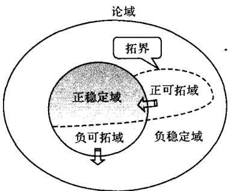

*图 4.2 可拓集合论域三域划分示意*

**元素/关联函数/论域**三类变换统称可拓变换。由此，**分类与转化被统一在可拓框架下**：将决策树静态规则映射为物元可拓集，经特定变换实现集合间迁移，即将“描述性知识”重构为“生成性策略”。

### 4.2.2 实战方法论：基于决策树的转化规则提取全流程

#### 1. 决策树规则预处理

决策树自顶向下归纳，根节点到叶节点路径即一条 `if-then` 规则。以 See5 输出为例：

```
“Rule 2: (198/14, lift 2.7)
是否使用随身邮服务 = 0
POINTS <= 6
使用时间长短 > 92
Type = 6
--> class 0 (0.925)”
```

*解读*：Rule 2 命中 198 条，误判 14 条，准确率 92.5%，提升度 2.7。

#### 2. 转化规则挖掘核心逻辑

**目标**：在类别 $A$ 规则集 $\{A\}$ 与类别 $B$ 规则集 $\{B\}$ 间，寻找变换集合 $T_{AB}$，使 $A \Rightarrow B$。

**操作步骤**：
1.  **共性属性置换**：对两类规则共有的属性，执行 $A \leftrightarrow B$ 值互换；
2.  **差异属性增补**：对 $B$ 有而 $A$ 无的规则，执行增加变换；
3.  **构造转化知识**：
    *   定义转化规则知识为 $T_{AB} B_i \to A_j \Rightarrow TB \to A$；
    *   前件：$T_{AB} B_i \to A_j$（具体变换路径）；
    *   后件：$TB \to A$（宏观转化结论）。

**实例演示**：

原始知识库

```
是否使用随身邮服务 = 0
POINTS <= 6
使用时间长短 > 92
Type = 6
--> class B (0.925)
Rule 3:(6,lift 2.7)
是否使用随身邮服务 = 1
POINTS <= 6
使用时间长短 <= 795
--> class A (0.875)"
```

经可拓变换推导，获得转化规则知识

```
'Rule6: (6/9) support:4.25% ID:240-235
Under:
POINTS<=6(same)
92 < 使用时间长短 <= 795(same)
Trans:
是否使用随身邮服务=1 to =0
Add: none
--> class A to B (61.70%)"'
```

> **注**：`ID:240-235` 标识源规则编号。`Under:` 列出类别 $A$ 独有及与 $B$ 完全相同（标 `same`）的规则。

---

**结语**：可拓方法论不止于“洗数据”，更在于**“造机制、建闭环、出策略”**。从物元建模量化差距，到三维变换破解质量死结；从五大环节全链路固本，到决策树规则的动态转化重构——这一套组合拳，让企业在“数据不完美”这一常态下，依然能稳步产出决策红利。

# 转化规则挖掘：从评价指标到算法实战全解析

在掌握了基础概念后，我们来深度拆解如何评价一条转化规则的优劣，以及落地算法的具体执行逻辑。

## 核心评价指标体系

假设整合数据集 {A} ∪ {B} 的总记录数为 |D|。针对某条具体转化规则，我们定义以下统计量：源域 {A} 中满足前件的记录数 Fa、满足后件的记录数 Ra；目标域 {B} 中满足前件的记录数 Fb、满足后件的记录数 Rb。同时，全局满足规则集前件的记录数为 F，满足后件的为 R。为方便对照，汇总表如下（对应原表 4.2）：

| 数据集 | 记录总数 | 命中前件数 | 命中后件数 |
| :--- | :--- | :--- | :--- |
| A | \|D(A)\| | F_a | R_a |
| B | \|D(B)\| | F_b | R_b |
| 合计 | \|D\| | F | R |

基于此，四大核心指标计算公式如下：

*   **准确率 (P_{iAB})**：采用拉普拉斯修正估计，公式为 \( (R_b + 1) / (R_b + R_a + 2) \) (公式 4.5)。
*   **预期转化率 (T_r)**：反映规则覆盖面，计算为 \( F_a / F \) (公式 4.6)。
*   **支持度 (S)**：衡量规则在目标域中的普适性，\( S = |F| / |D(B)| \) (公式 4.7)。
*   **可信度 (R)**：反映后件在目标域中的占比，\( R = |R_b| / |R| \) (公式 4.8)。

**实例解读**：以 "Rule6: (6/9) support: 4.25% ID:240-235" 为例。其中 "6" 代表满足转化条件的样本量，"9" 是源域 A 中满足前件条件的样本量。支持度 4.25%、可信度 61.70% 则直观展示了该规则的覆盖能力与可靠性。

## 转化规则挖掘算法与落地流程

### 1. 核心挖掘算法逻辑

算法输入为决策树挖掘生成的两类结果集 A、B 及最小匹配阈值 n；输出为 A 向 B 转化的策略集。

**伪代码逻辑重构**：
1.  将 A、B 集元素建模为多维物元 \(W_1, W_2\)，\(R_{1m}, R_{2m}\) 分别为第 m 个物元。
2.  双重循环遍历 A、B 中的每个物元对 (\(R_{1i}, R_{2j}\))。
3.  初始化匹配计数器 total=0。
4.  对比两物元的各维特征（特征名 & 取值），若完全一致，total++。
5.  遍历完所有维度后，若 total ≥ n，则判定该物元对可生成一条转化策略输出。

> **通俗理解**：就是在两类人群中找“长得像”的配对，相似维度达到门槛 n，就认为可以通过调整差异维度实现转化。

### 2. 工程化实现六步走

基于 See5® 决策树输出规则为例，落地流程包含六个关键环节：

**步骤 1：规则入库**
解析 .out 文本文件。如 Rule 2 显示 "198/14"，命中 198 条，异常 14 条。准确率按拉普拉斯公式 \((198-14+1)/(198+2)=0.925\) 计算，提升度 Lift 2.7 表明模型比随机猜测强 2.7 倍。清洗入库建表。

**步骤 2：预处理**
去重、建全文索引，为后续高频检索铺路。

**步骤 3：参数配置（用户交互核心）**
界面需支持四大维度设定（如图 4.3 所示）：
*   **转化方向**：指定源 Class 与目标 Class（如 Class 0 → Class 1）。
*   **相似度门槛**：前件相同条件数下限（如 ≥2 条）。
*   **差异度容忍**：前件不相同条件数上限（如 ≤2 条）。
*   **转化率预期**：设定最低预期转化率阈值。

**步骤 4：规则挖掘与输出解读**
系统按参数筛选“高相似、低差异”规则对。输出结构包含三段式变换描述：
*   **Under**：源域独有规则 + 共同规则（标 same）。
*   **Trans**：属性同值不同的规则，**核心看这里——按目标域数值重写源域前件，实现“定向修改”**。
*   **Add**：目标域独有规则，**作为“必加动作”补充**。
*   **结果标签**：`—> Class 0 to 1 (61.70%)`，括号内即预期转化率。

**步骤 5：指标回算**
自动计算准确率、转化率、支持度、可信度，量化规则价值。

**步骤 6：报告生成**
输出规则清单及挖掘摘要。

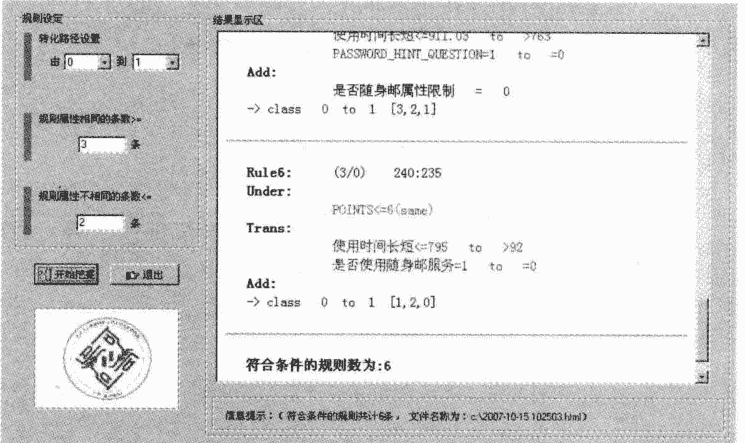

图 4.3 转化规则挖掘软件的条件设置与结果显示界面

---

# 可拓分类：让“动摇派”不再摇摆

传统分类（贝叶斯、决策树、SVM、神经网络等）多基于静态历史特征打标签，核心指标看准确率与 KS 值。但实战中常遇尴尬：**准确率超 80%，却防不住流失**。根因在于——**最有价值的“动摇派”正躺在分类边界的重叠区（图 4.4 交叉区）**。

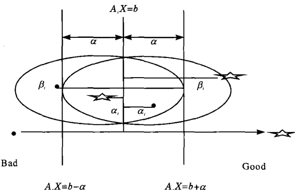

图 4.4 带有重叠部分的二分类问题示意图

MCLP（多准则线性规划）分类通过双边界逼近（公式 4.9），虽能用线性规划求解，但面临“错分最小化”与“对分最大化”需妥协平衡的难题（Shi et al., 2005）。

```
(M4) Minimize \(\sum_{i} \alpha_i\) and Maximize \(\sum_{i} \beta_i\)
Subject to:
\(A_i X = b + \alpha_i - \beta_i, \quad A_i \in B\)
\(A_i X = -b - \alpha_i + \beta_i, \quad A_i \in G\)
(4.10)
```

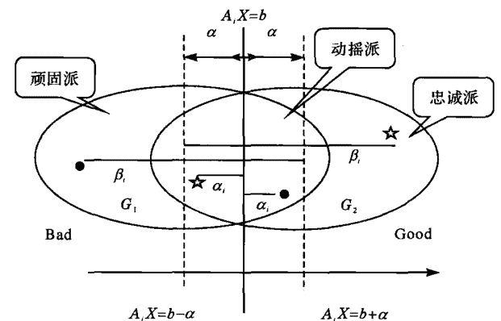

图 4.5 基于可拓域的 MCLP 分类方法示意图

**痛点直击**：
*   **忠诚派/顽固派**（边界两侧）：特征鲜明，易分类，但运营价值低——忠诚的不用管，顽固的拉不回。
*   **动摇派**（重叠区）：特征模糊，易误分，**却是干预高价值区**！微小干预即可“叛变”为忠诚，或“彻底流失”成顽固。

**可拓分类的使命**：不再满足于“静态打标”，而是研究**“在特定变换下，如何让动摇派向好类转化”**。

## 可拓分类核心概念重构

**定义**：基于特定变换对属性转化影响，对事物**稳定域**、**可拓域**进行动态划分。

**三大差异化看点**：
1.  **研究对象延伸**：不只看类别，还看稳定域/可拓域/拓界/变换影响度。
2.  **强调“可转化性”**：合格⇄不合格、流失⇄留存，在变换作用下可互化。可拓域揭示了“是/非”的可变性。
3.  **落地导向**：核心任务是（1）划定可拓域，（2）量化转化难易，（3）评价变换方案 ROI。

## 可拓分类实战七步法框架

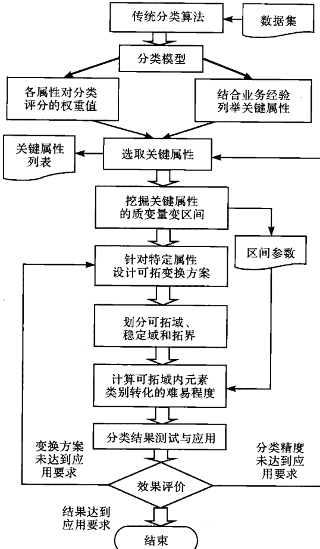

图 4.6 基于 MCLP 的可拓分类实现框架图

1.  **建基模**：MCLP 跨训练/测试集训练，得属性权重评分卡。
2.  **挖区间**：数据挖掘提取关键属性的“量变区”（安全区）与“质变区”（临界区）。
3.  **筛杠杆**：识别**可操作属性**（如：额度、通话时长、服务权益），设计变换方案（如：提额、赠话费、升级服务）。
4.  **划疆域**：针对选定变换，圈定稳定域、可拓域、拓界。
5.  **算难易**：用关联函数计算可拓域内样本转化的“阻力值/助力值”。
6.  **评方案**：综合效率、成本、实用性打分，选最优变换组合。
7.  **闭环迭代**：执行一周期后，回归 MCLP 重训模型，权重迭代，形成飞轮。

> **工程提示**：无关/冗余属性务必剔除！属性相关性分析可大幅压缩训练集，提升建模效能与伸缩性。

## 融合 SVM 的可拓分类算法细节

引入支持向量机（SVM）强化边界求解，具体流程如下：

1.  **数据就绪**：训练集 \(T=\{(x_i, y_i)\}_{i=1}^l\)，\(x_i \in R^n, y_i \in \{1, -1\}\)。
2.  **求对偶**：解凸二次规划
    \[
    \min_{\alpha} \frac{1}{2} \sum_{i,j} y_i y_j \alpha_i \alpha_j (x_i \cdot x_j) - \sum_j \alpha_j
    \]
    s.t. \(\sum y_i \alpha_i = 0, \quad 0 \le \alpha_i \le C\)。
    得最优解 \(\alpha^*\)。
3.  **还原超平面**：
    \(w^* = \sum \alpha_i^* y_i x_i\)，
    取 \(0 < \alpha_j^* < C\) 的支持向量，算截距 \(b^* = y_j - \sum \alpha_i^* y_i (x_i \cdot x_j)\)。
    决策函数 \(f(x) = \text{sgn}(g(x))\)，\(g(x) = (w^* \cdot x) + b^*\)。
4.  **定边界距离**：
    *   正类被错分点（\(y_i=1, f(x_i)\le 0\)）到超平面最大距离 \(d_j\)。
    *   负类被错分点（\(y_i=-1, f(x_i)\ge 0\)）到超平面最大距离 \(d_k\)。
5.  **设双区间**：
    *   理论间隔区间 \([a, b] = [-1/\|w^*\|, 1/\|w^*\|]\)。
    *   实测错分极值区间 \([\bar{a}, \bar{b}] = [-d_j, d_k]\)。
6.  **确量变/质变域**：
    *   量变区 \(X_0 = [\min(\bar{a},a), \min(\bar{b},b)]\) ——**安全操作区**。
    *   质变区 \(X = [\max(\underline{a},\bar{a}), \max(\underline{b},\bar{b})]\) ——**临界翻转区**。
7.  **实时判定**：任意新样本 \(x\) 计算位置，落入量变区=稳；落入质变区=动摇，需干预；超出质变区=顽固/忠诚。

这一套组合拳，将“分类”升维为“可干预的转化决策”，直击业务痛点。

#### 4.3.5 可拓分类实战复盘：精准锁定“动摇派”客群

借助上述算法模型，我们对某互联网企业的客户群体实施了重新分层，成果汇总于表 4.3。

**表 4.3 可拓分类实测数据看板**

| 评分档位 | 样本总量 | 误判样本量 | 误判占比 | 潜在动摇样本量 |
| :---: | :---: | :---: | :---: | :---: |
| 1 | 2386 | 182 | 7.63% | 215 |
| 2 | 623 | 54 | 8.67% | 35 |
| 3 | 598 | 90 | 15.05% | 23 |
| 4 | 699 | 127 | 18.17% | 33 |
| 5 | 541 | 171 | 31.61% | 26 |
| 6 | 524 | 180 | 34.35% | 24 |
| 7 | 403 | 200 | **49.63%** | 28 |
| 8 | 399 | 173 | 43.36% | 52 |
| 9 | 545 | 159 | 29.17% | 82 |
| 10 | 4280 | 399 | 9.32% | 433 |
| **汇总** | **10998** | **1735** | **15.78%** | **951** |

实验采用 9 组 MCLP 模型打分：常规活跃用户集中在 7-8 分段，1-6 分则判定为预测流失人群。整体分类准确率达 84.22%，看似不错，但细看高分段“翻车”严重——7 分档误判率逼近 50%，8 分档也超 43%。这意味着大量看似忠诚的高价值用户实则暗藏流失意向。

可拓分类的核心优势在于**“动摇区”识别**：算法精准捕获 951 名处于边界地带的客户。这批人评分不低，实则人心浮动，常规模型极易漏判。通过可拓手段将其筛出，相当于为运营团队划定了“重点防守区”，支持精准干预、降本增效。实证表明，该方法与 4.2 节方案组合使用，效果叠加显著。

---

### 4.4 章末小结与未来展望

本章系统阐释了智能知识获取的数据端预处理策略，并从咨询落地视角，沉淀出一套**数据质量持续迭代的闭环方案**。聚焦“知识与目标的智能关联”，我们设计并落地了两大核心算法——**转化规则挖掘**与**可拓分类**：

*   **转化规则挖掘**：让规则知识的应用更直观、落地更高效；
*   **可拓分类**：打通“措施”与“适配对象”的关联链路，显著提升知识服务决策的智能度与有效性。

**直接获取智能知识**是一条捷径，本章仅抛砖引玉给出两个典型范式。算法虽经初步验证，但进化空间巨大，例如引入**智能 Agent 技术**赋能自主决策。更多前沿方向亟待探索：

1.  **领域知识驱动的深层发现**：这是对传统数据挖掘的继承与跃升。以“综合集成系统方法论”为底座，可构建**定性定量融合、人机协同、以人为主**的发现范式。将全过程视为“往复循环、逐步逼近、开放演进”的复杂系统，利用上轮反馈动态调整领域认知、挖掘目标、数据预处理及算法参数，实现知识的螺旋式升级。
2.  **多目标约束下的建模创新**：涵盖多目标分类模型、效用关联分析、多约束回归、复杂动态模式识别等。
3.  **高性能实时挖掘体系**：面向数据时效性与有效性，攻关分布式高性能计算、金融/媒体流数据挖掘、知识规划导向的多目标挖掘方法等。

---

## 第 5 章 智能知识管理的间接实现路径：从“挖得出”到“用得好”

本章聚焦传统挖掘产出的**原始知识**如何“孵化”进化为**智能知识**，并覆盖表达、存储、审计全链路，初探推理机制。

### 5.1 原始知识的“长相”与获取路径

数据挖掘的终点是知识表达。主流表示模式涵盖：概要描述、关联规则、分类规则（决策树、网络权重、判别函数、概率图谱等）、聚类模型、数学公式、案例库、异常点等。核心方法速览：

*   **概要描述**：对数据内蕴的特征、汇总、对比信息做抽象提炼。产出常结合可视化（柱状/折线/饼图、报表、数据立方体）呈现，代表技术有多维分析、面向属性的概念归约。
*   **关联规则**：从海量数据中发掘项集间的隐性联系，以 `X => Y` 规则形式定义（如“买电脑 => 买财务软件”）。**支持度**衡量规则覆盖面（如 2% 交易同时含两者），**置信度**衡量规则可靠度（如买电脑者 60% 连带买软件）。
    ```
  buy computer => financial management software(support = 2%, confidence = 60%)
  ```
*   **分类建模**：基于训练集学习映射函数，将新数据映射至预设类别。技术栈极丰：决策树、贝叶斯、神经网络、遗传算法、SVM、多目标线性规划、基于案例推理、KNN、模糊/粗糙集、Logistic 回归、判别分析等。
*   **聚类分群**：依据“类内高聚、类间低耦”原则自动分组，每簇可显式/隐式描述为一类对象。尽管算法库成熟（K-Means、层次聚类、DBSCAN 等），但**强鲁棒性、高执行效、低参数敏感度**的聚类方法仍是攻关热土。

鉴于决策树规则**数量庞大、治理困难、且应用极广**，本书以此为切入点，演示挖掘知识的全生命周期管理范式。

### 5.2 原始知识向智能知识的“质变”逻辑

原始知识诞生（记为 $T_1$），本质是机器智能（挖掘/统计）在语法层面（数据句法）发现的现象级关联，属**“语法信息 → 形式知识”**的初级跃迁。距离“支撑决策的可用知识”仍有鸿沟，**“二次加工”势在必行**。

此转换是“数据—知识—智能”链条的关键环。若记智能知识为 $K_I$，转换可形式化为：
```
$T_2 : T(K_r \bigcup K) \rightarrow K_l$

$K = \nu(K_g, K_e, K_c, K_b, K_s), \nu$ 是幂集
```

设基元集合 $K^O \in \{M, A, R, Co, k, U\}$（物元/事元/关系元/复合元/关联准则/论域）。$K^O \to K_1^O$ 的映射即为原始知识智能化过程，主要分三维变换：

1.  **基元转换**（物元 $T_{2M}$、事元 $T_{2A}$、关系元 $T_{2R}$）：对论域 $U$ 核心构件的重构。
2.  **关联准则变换**：规则游戏规则的动态调整。如市场竞争规则重写、工程安全系数因地质差异而异、电气产品额定参数迭代。
3.  **论域变换**：打破经典逻辑“固定论域”的思维定势。跳出习惯认知边界，往往能化解看似矛盾的问题（某域内矛盾，换域或可兼容）。

**基元变换五大原子操作**同步适用于论域、准则层面：
*   **置换**：元素/属性/量值的互替；
*   **增删**：成分的加减；
*   **扩缩**：量值幅度的拉伸/压缩；
*   **组分**：多元合成或一元拆解；
*   **复制**：同构体的批量复制。

从算法视角看，上述变换本质是**映射族**，可引入距离函数与评价机制，将知识数学化、向量化，融入挖掘与变换算法，产出决策参考价值更高的智能产出。

**四阶跃迁循环**（Zhang et al., 2009）见图 5.1：
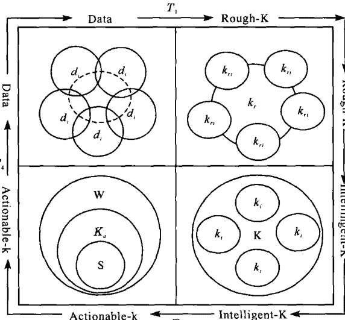
*   **T₁ 数据 → 原始知识**：清洗、挖掘，产出隐性模式/规则/权重。工具驱动的基础变换。
*   **T₂ 原始知识 → 智能知识**：**核心增值环节**。融合专家经验，经审计、筛选、软件评价，注入场景、关联、领域知识，赋予自主智能属性。
*   **T₃ 智能知识 → 可行策略**：目标导向下选取、组合、变换知识，生成解决矛盾的决策方案，直达管理决策。
*   **T₄ 策略 → 新数据**：策略落地产生新数据，反馈执行效果。对比新旧数据挖掘增量知识，驱动下一轮循环迭代。

### 5.3 智能知识“孵化器”：四阶段标准化作业

原始知识 → 智能知识，主线分三步走：**机器粗筛 → 人机联审 → 元信息赋能**。恰似孵化雏鸡：挑种蛋（筛选）、控温湿（评估）、精养护（赋能），终得活力个体。全流程见图 5.2。
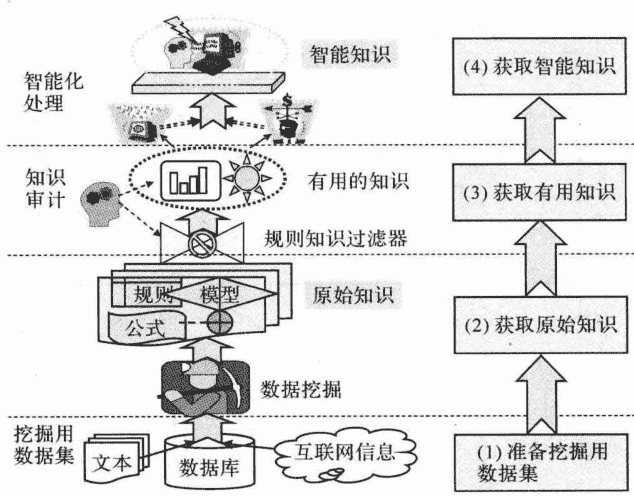

**四大阶段任务拆解：**

| 阶段 | 核心动作 | 关键产出 |
| :--- | :--- | :--- |
| **① 数据集就绪** | 参考 4.1 节规范构建建模样本 | 高质量挖掘数据集 |
| **② 原始知识产出** | 执行分类/聚类/关联等挖掘任务 | 模式、规则、模型集 |
| **③ 有用知识筛选** | **软件硬过滤** + **专家软审计**；引入粗糙集约简，保分类力不减前提下剔冗余 | 高价值知识候选集 |
| **④ 智能化封装** | 注入**场景知识、元知识、记忆元信息** | 具备**记忆/识别/推理**能力的智能知识单元 |

**量变引发质变**：知识总量锐减，含金量跃升。T₂→T₃ 严重依赖**领域专家 + 资深业务 + 智能工具**的三元协作。

**标准化审计作业单（SOP）：**

1.  **量化指标首筛**：设定阈值（支持度、置信度、准确率等），低于线直接出局。软件工具批量清洗明显低价值规则；同步应用粗糙集约简瘦身。
2.  **专家深度评估**：对幸存规则逐条打分，结合业务场景判定实用性。
3.  **元信息标注入库**：为通过审计的知识打上“数字身份证”——
    *   **溯源链**：源数据集、挖掘算法、创建人；
    *   **信用卡**：可信度、支持度、审计得分；
    *   **适用边界**：适配部门/场景；
    *   **生命周期**：最后检索/调用时间、累计调用次数。

这一套“筛—评—注—管”闭环，让知识从**“静态资产”进化为“动态智能体”**，为后续推理与复用奠定坚实底座。

# 智能知识筛选与表达：从价值评估到基元建模的实践路径

## 核心机制：多维指标驱动的交互式审计

完成初筛后，判定知识价值的关键在于构建**人机协同的审计评估体系**。该机制虽承袭传统审计框架，却将考察焦点聚焦于“新颖度”等差异化指标。评审专家依据加权指标体系量化打分，核心维度与权重配置如下：

| 考察维度 | 权重占比 | 评估要义 |
| :--- | :---: | :--- |
| **决策支撑力** | 30% | 赋能业务管理与决策制定的实战效能 |
| **创新反差度** | 30% | 相较隐性经验知识的颠覆性与新颖程度 |
| **覆盖广度** | 30% | 涉及业务线、组织部门及人员范围的跨度 |
| **有效窗口期** | 10% | 数据迭代更新前，知识保持可用的时长 |

依据综合得分分布设定入选门槛，跃过分数线的即判定为高价值知识。然指标体系与工具链的深度耦合、复杂系统视角下的决策支撑机制，仍属待探索的前沿领域。当智能知识群体规模达标且网络通联顺畅，其将自组织为复杂系统的功能模块，此时引入**复杂性科学理论**指导实现策略、借力成熟工具方法，乃大势所趋。

知识“孵化”仅是起点，能否“存活”并持续产出价值，取决于其生存土壤——即**知识表达形式**的优劣。形式化描述（Frank, 2000）奠定了知识存储、评价与智能化应用的基石，贯穿智能知识管理全周期，地位核心不可替代。

### 5.4 智能知识的表达与存储

#### 5.4.1 主流知识表示范式及其适用边界

海量数据蕴含多元知识，验证视角需多元，表达形态亦须适配，唯有**“直观、可计算、可直推”**的表示方式，才能打通“挖掘-落地”最后一公里。知识表示（Knowledge Representation）本质是探究：如何以最适配的形式，将各类知识在计算机中落地，支撑存储、检索、推理、维护全链路。

当前 AI 领域主流的七大表示流派及其“优劣势画像”梳理如下：

| 表示范式 | 核心长板 | 典型短板 |
| :--- | :--- | :--- |
| **谓词逻辑** | 语义精准、推理严谨、实现路径清晰 | 难以刻画不确定性；易陷组合爆炸；运行效率偏低 |
| **框架** | 表达张力强；属性扩展与默认赋值便捷 | 编程实现复杂；推理机制支持薄弱 |
| **语义网络** | 层次关系刻画有力；关系溯源便捷 | 系统实现复杂度高 |
| **产生式规则** | 语法极简，人机共读友好，修改维护灵活 | 难承载结构性知识；推理效率一般 |
| **面向对象** | 封装性佳，继承复用机制成熟 | (素材未展开劣势) |
| **本体** | 共享性强，语义显性化、机器可读 | (素材未展开劣势) |
| **其他形式** | 补位特定场景需求 | 视具体技术而定 |

**聚光灯下的经典：产生式规则**
作为最具代表性、讨论热度最高的形式，凭借“易懂、利决策”双核优势长期占据核心地位。结构上由**前件（IF 条件簇）**与**后件（THEN 结论）**构成，逻辑简记为 `P → Q`。
前件细化为“属性-算子-值”三元组，典型示例：
`IF 缴费积分 > 9 AND 投诉频次 <= 5 AND 收信频次 > 3 AND 缴费渠道 <= 3 THEN 用户状态 = 正常`

```
if P then Q
```

**新势力与融合趋势：神经网络、XML 与本体**
- **神经网络**：将隐性知识内化为网络拓扑、权重阈值，学习能力强、抗噪鲁棒性好，却是典型“黑盒”，难以直接人工解读。融合规则的“神经-符号”混合路线成破局热点，但训练周期长、收敛不稳定（随机初始化导致迭代方差大）仍是痛点。
- **基于 XML**：可扩展标签语言，树形结构承载数据与模式，标签可赋予确定语义，本质是描述结构化知识的元语言。配合 DTD 支持文本、图像、公式等多模态。但缺统一框架规范、半/非结构化表达受阻、前端呈现需二次转换。
- **本体**：**“共享概念模型的显性形式化规范”**（Gruber 等）。四大基因：**概念模型**（抽象）、**共享**（领域公认）、**形式化**（机器可处理）、**显性**（约束明确）。核心构件四件套：
  1.  **类/概念**：事物集合抽象（如职能、策略、推理过程）。
  2.  **属性/槽**：类间二元关系，用于校验实例有效性。
  3.  **实例**：类的具体元素/对象。
  4.  **公理**：永真断言，驱动推理与效验。

#### 5.4.2 元知识与情景知识：知识的“控制层”与“上下文”

##### 1. 元知识：驾驭知识的“知识”
即描述知识本身的知识（陈文伟等, 2004），直击专家系统核心痛点，共八大类别：

| 类别 | 核心功用 | 典型实例 |
| :--- | :--- | :--- |
| **规则选择导向** | 提升推理效率与灵活性 | 冲突消解元规则：MR1（特例优先）、MR2（序列优先）、MR3（最大匹配优先） |
| **领域运行画像** | 记录关键运行统计量 | 平均耗时、人机交互频次、规则成败率统计 |
| **规则论证溯源** | 增强结论可信度与可解释性 | 为规则附加“理由”链条 |
| **规则质量巡检** | 语法/语义双重兜底 | MR4（长期休眠规则预警机制） |
| **知识结构元建模** | 定义知识库语法骨架 | 采用 BNF 范式形式化描述 |
| **架构决策论证** | 解释系统设计选型逻辑 | MR5-MR7（搜索策略/黑板模型适用边界界定） |
| **运行时自优化** | 动态提升系统性能 | MR8（高频代码块优化）、MR9（高频规则前置匹配） |
| **能力边界声明** | 明确知/不知、能/不能、时效性 | 避免长跑无果后才反馈失败，实现优雅降级 |

这些元知识掌控着领域知识的“巡检-抽象-运用”全周期，是拓展系统实战边界的关键杠杆。

```
  `<知识库项>→<标号>;<事实>|<标号>;<规则>|<元知识>`
  `<事实>→<变量>=<值> {CF 值}`
  `<规则>→if<前提>then<结论>`
  `<结论>→<变量>=<值>{CF 值}|<结论>and<结论>`
  其中符号“|”表示“或”含义。
  ```

##### 2. 情景知识：知识生效的“必要条件”
知识非真空存在，其有效性强绑定**情境**——与知识/活动相关的物理/社会/业务外部环境，及主体认知/经验/心理内部状态（潘旭伟, 2005）。

**情境三大本质特征**：客观普存、独立而紧耦、刻画特征以区分识别。

**情境与知识管理的六重共振**：
1.  **理解钥匙**：缺情境则知识孤岛化，极易误读（Goldkuhl, 2001）。
2.  **知识源头**：情境与知识融合即生成新知。
3.  **价值裁决**：同一知识，异情境下价值天差地别。
4.  **活动调节**：同一活动，情境迁移导致特征结果漂移。
5.  **复用基石**：人类靠“情境回想”解题；情境一致/相似是共享重用前提。
6.  **管理要素**：Despres 等（2000）列其为知识管理四要素（过程、知识、主体、情境）之一，赋予时空社交意义。

**情境赋能反过载**：依个性化特征匹配相关度与价值，精准推送“最相关、最高值”知识，斩断信息过载。

潘旭伟（2005）提出**基于情景的知识表述**，Li et al. (2009b) 给出全维情景采集思路，二者为智能知识记忆体系设计提供了坚实参考。

#### 5.4.3 基于基元的智能知识表达：可拓学视角的形式化建模

##### 1. 基元理论：世界建模的“逻辑细胞”
万物互动生事，物、事、关系交织成世。为让计算机高效描述现象演变，**可拓学**（蔡文, 1983）构建**可拓模型**，以**基元**为原子单元，三足鼎立：
- **物元**：描述“实体对象”
- **事元**：描述“行为事件”
- **关系元**：描述“关联联系”

复杂现象可由复合元或基元运算式表达。以下依**可拓工程**（杨春燕等, 2007）最新成果，核解物元体系。

**① 一维物元：最小描述单元**
> **定义 5.1** 以实体 $O_m$ 为对象，$c_m$ 为特征，$v_m$ 为量值，有序三元组
> $$

  M=(O_m, c_m, v_m)

  $$
> 称作一维物元。$O_m, c_m, v_m$ 为三要素；$(c_m, v_m)$ 为特征元。
> 记物元全体 $\mathcal{L}(M)$，实体全体 $\mathcal{L}(O_m)$，特征全体 $\mathcal{L}(c_m)$，特征取值域 $V(c_m)$ 称量域。

**② 多维物元：多特征聚合视图**
> **定义 5.2** 实体 $O_m$ 具 $n$ 个特征 $c_{m1} \dots c_{mn}$ 及对应量值 $v_{m1} \dots v_{mn}$，构成阵列
> $$

  M = \begin{bmatrix} O_m, & c_{m1}, & v \\ & c_{m2}, & v_{m2} \\ & \vdots & \vdots \\ & c_{mn}, & v_{mn} \end{bmatrix} = (O_m, C_m, V_m)

  $$
> 其中
> $$

  C_m = \begin{bmatrix} c_{m1} \\ c_{m2} \\ \vdots \\ c_{mn} \end{bmatrix}, V_m = \begin{bmatrix} v_{m1} \\ v_{m2} \\ \vdots \\ v_{mn} \end{bmatrix}

  $$
> 例示：
> $$

  M_1 = \begin{bmatrix} \text{人 A,} & \text{体温,} & 39^\circ\text{C} \\ & \text{血压,} & 70 \sim 100 \end{bmatrix}

  $$
> $ M_2 = \begin{bmatrix} \text{药物 A,} & \text{功能} & \text{治感冒} \\ & \text{颜色,} & \text{白色} \\ & \text{批号,} & x \end{bmatrix} $

**③ 参变量物元：捕捉动态演化**
实体随时间 $t$、空间位置等参数流动。
> **定义 5.3** 若 $O_m, v_m$ 为参数 $t$ 的函数，称参变量物元：
> $ M(t)=(O_{m}(t),c_{m},v_{m}(t)) $，满足 $v_{m}(t)=c_{m}(O_{m}(t))$。简记 $v_{m}=c_{m}(O_{m})$，描述实体-特征量值映射关系。
> 多维形式：$ M(t) = (O_{m}(t), C_{m}, V_{m}(t)) $。

**④ 非空特征集：完整画像**
同一时刻，实体对特征量值唯一；不存在用空值 $\varnothing$ 标记。若量值非空，称该特征为**非空特征**。
> **定义 5.4** 实体 $O_m$ 所有非空特征对应的物元集：
> $ \begin{bmatrix} O_{m}, & c_{m1}, & v_{m1} \\ & \vdots & \vdots \\ & c_{mn}, & v_{mn} \\ & \vdots & \vdots \end{bmatrix} $

# 可拓学核心三元组：物元、事元、关系元的通俗解读与知识工程实战

在可拓学的理论大厦里，**物元、事元、关系元**堪称三大“地基基石”。它们分别锁定静态属性、动态行为、关联网络，共同构建起描述复杂世界的形式化语言。今天我们不讲晦涩公式推导，直击核心逻辑，看这套体系如何落地到智能知识存储中。

---

### 一、 物元：给“静态对象”建立唯一身份证

**核心定义**：全征物元 $cpM(O_m)$，就是在某一确定时刻，把对象 $O_m$ 所有特征及其取值打包成的“全息档案”。

**两大铁律**：
1.  **唯一性**：同一时刻，同一对象的全征物元只有一份。
2.  **可辨识性**：任意两个不同对象（$O_{m1}$ vs $O_{m2}$），至少存在一个特征 $c_m$ 让它们“露馅”（取值不同）。

> **通俗理解**：就像给每个人发身份证，照片、指纹、住址（特征）对应具体数值，确保“张三”永远不是“李四”。

---

### 二、 事元：用“动词三元组”拆解动态过程

物是静止的，事是流动的。**事元**的任务，就是把“谁对谁干了什么、何时何地、怎么干”标准化。

#### 1. 一维事元（原子动作）
**定义 5.5**：$A = (O_a, c_a, v_a)$
*   $O_a$：动词核心（如“注射”）
*   $c_a$：特征维度（支配对象/施动对象/接受对象/时间/地点/程度/方式/工具…）
*   $v_a$：具体取值（盘尼西林/护士A/小明/昨天/医院…）

#### 2. 多维事元（完整事件画像）
**定义 5.6**：矩阵阵列 $(O_a, C_a, V_a)$，把上述所有特征一次性装进去。

> **实战案例**：
> ```text
> [ 注射，支配对象，盘尼西林 ]
> [      ，施动对象，护士 A   ]
> [      ，接受对象，小明     ]
> [      ，时间，    昨天     ]
> [      ，地点，    医院     ]
> ```
> 一条记录，还原一个完整医疗动作。

#### 3. 参变量事元（动态演进）
**定义 5.7**：$A(t) = (O_a(t), C_a, V_a(t))$
当动词或取值随参数 $t$（通常是时间）变化时，捕捉过程的**连续演变**，而非孤立快照。

---

### 三、 关系元：为“千丝万缕”装上量化探针

世界万物皆连接。关系元专治“张三认识李四”、“A公司供货B公司”这类关联难题。

#### 1. 标准结构
**定义 5.8**：$R = (O_r, C_r, V_r)$
*   $O_r$：关系名（同事、雇佣、父子、距离…）
*   基础三字段（必带）：**前项 $v_{r1}$、后项 $v_{r2}$、程度 $v_{r3}$**
*   扩展字段：维系方式、联系通道、工作地点…

> **案例速览**：
> *   $R_1$：[同事关系, 前项:张三, 后项:李四, 程度:100, 维系:工作] → 描述人际强弱。
> *   $R_2$：[雇佣关系, 前项:A, 后项:公司B, 程度:密切, 方式:工作, 通道:邮件, 地点:家中] → 描述组织协作。

#### 2. 参变量关系元：看透关系的“呼吸与脉动”
**定义 5.9**：$R(t)$ 允许关系名、程度、各字段随 $t$ 变动。
*   **核心公式**：关系程度 $v_{r3} = f(t, O_m, M, A, R')$
*   **含义**：关系强弱不是定数，受时间、主客体属性、物元状态、事元发生、其他关系联动共同驱动。正值=建立/加深，零=断裂，负值=恶化。

> **决策启示**：理清这张动态关系网，是解决矛盾、协调资源、达成目标的前提。可拓学给了我们“去粗取精、由表及里”的形式化手术刀。

---

### 四、 信息的基元表示：三类语法对号入座

可拓学主张：**信息即基元的组合**。按语法功能分流，各司其职：

| 信息类型 | 语法特征 | 基元载体 | 典型场景 |
| :--- | :--- | :--- | :--- |
| **陈述型** | “是/有/具备” | **物元** | “A经理是B公司出色管理者” → ```
[A,    职务,    经理
    服务单位, B 公司
    职业,    管理者
    水平,    高]
``` |
| **行为型** | “做/发生/进行” | **事元** | “A公司今天在俱乐部开职工大会” → ```
A1 = [举行,    支配对象,    职工大会
      施动对象, A 公司
      时间,    今天
      地点,    篮球场]
``` |
| **关系型** | “在…之间/相对” | **关系元** | “坠机地在A市南30km” → ```
R₁ = [ 位置关系， 前项， 坠机地 ]
    [ 后项， A 市 ]
    [ 参照物， A 市 ]
    [ 方位， 南方 ]
    [ 距离， 30 公里 ]
``` <br> “N1是N2的学生” → ```
R₂ = [ 师生关系， 前项， N₁ ]
    [ 后项， N₂ ]
    [ 时间， <x₁ 年, x₂ 年> ]
``` |
| **复杂型** | 多类型混杂 | **复合元/运算式** | “E企业研制新药D” → ```
A₁ = [ 研制， 支配对象， M ]
    [ 施动对象， 企业 E ]
    [ 时间， 2006 年 9 月 ]
    [ 程度， 成功 ]

M = [ 药物 D， 功能， 抗癌 ]
    [ 类型， 全新 ]
``` <br> “E1与E2合作开发P” → $A_3 \land R$ (```
A₃ = [ 开发， 支配对象， 新产品 P ]
    [ 施动对象， 企业 E₁ ∧ 企业 E₂ ]
``````
R = [ 合作关系， 前项， 企业 E₁ ]
    [ 后项， 企业 E₂ ]
    [ 程度， 密切 ]
    [ 时间， 2 年 ]
```) |

> **关键点**：复杂信息不拆不散，用复合元（基元运算式）无损封装。

---

### 五、 智能知识的基元表达：从“死数据”到“活大脑”

为什么选基元做知识载体？**格式统一、易扩充、天然兼容可拓变换推理**。

#### 1. 知识 = 信息元之间的关系式
*   **前提** = 条件信息元
*   **结论** = 结论信息元
*   **推理引擎** = 可拓变换/运算式
*   **记忆上下文** = 附加物元信息

#### 2. 典型知识模式（实战范式）

**模式 A：状态迁移触发评价跃迁**
> 客户A：手机邮件服务“使用”、积分0-6 → **冻结态** ($M_1$)  
> 采取措施：取消服务、费用转积分 → 积分0-9 ($M_2$)  
> **知识规则**：$(\phi M_1 = M_2) \models (T\phi M_3 = M_4)$  
> *解读*：状态基元变换 ($\phi$) 直接推动评价基元跃迁 ($T$)。通用形式：$(\phi B_1 = B_2) \Rightarrow (\phi S_1 = S_2)$。

**模式 B：评价翻转倒逼策略切换**
> 正常用户视推送邮件为骚扰；但“连续4周收信<3封”的冻结用户，同类邮件成“暖心问候” → 促活。  
> **知识规则**：$(\phi A \doteq A') \Rightarrow (\phi T_s S = S')$  
> *解读*：评价标签 ($A$) 一变，行动策略 ($S$) 必须联动变换 ($T_s$)。

#### 3. 智能知识的“长期记忆库”（表 5.3 精华版）

要让知识具备**识别、自适应、审计**能力，必须绑定三层元信息：

| 记忆层级 | 核心字段（关键词） | 作用 |
| :--- | :--- | :--- |
| **元知识** | 编号/标签/业务范围/类型/生产日期/来源/审计方法分数/优先冲突规则/有效性理由 | **“身份户口本”**——解决知识从哪来、信不信、怎么排序。 |
| **情景知识** | 使用部门/人员/技能/业务环节/时间/背景网页/环境流程/检索频次 | **“使用日志”**——记录知识在何时何地、被谁、以何种上下文调用，支撑上下文感知推荐。 |
| **智能记忆** | 源数据规模/结构/时间跨度/质量/挖掘工具任务/相似/冲突/结合/新知识编号/废止标志/应用反馈分 | **“进化档案”**——支撑知识溯源、版本迭代、冲突消解、自动淘汰与新知生成。 |

> **物元存储示例**：
> ```text
> R = [ 规则知识 A02, 来源:销售数据, 类型:决策树,
>       适用部门:设计中心, 数据集:2005.8-2006.3,
>       产生时间:2006/7/9, 审计分数:85.5, ... ]
> ```
> 事元、关系元表达同理，此处不赘述。

---

### 六、 智能知识存储落地：三张表走天下

理论再美，落库得靠谱。基于基元表达，设计**三层表结构**直击存储痛点：

#### 1. 知识本体表（总索引）
| 编号 | 类型 | 实体指向 | 备注 |
| :--- | :--- | :--- | :--- |
| MCLP01 | 1 | 0705ABC.txt | 文本书件 |
| R112 | 2 | R6 | 规则引用 |
| A02 | 3 | (空) | 事元实体 |

*   **类型位**：1=文本/模型文件，2=规则，3=事元/关系元…
*   **实体列**：存文件名、规则ID或基元ID，实现**多模态统一入口**。

#### 2. 规则表（核心逻辑层）
| 编号 | 前件 | 后件 | 备注 |
| :--- | :--- | :--- | :--- |
| R6 | 1-23-45-60 | 0 | |
| R112 | 11-20-41 | 1 | |

*   前件/后件存**前件表主键串**，极度精简，推理引擎极速解析。

#### 3. 规则前件表（原子条件粒度库）
| 编号 | 前件属性 | 值 | 备注 |
| :--- | :--- | :--- | :--- |
| 11 | 收信种类 | 0-5 | |
| 20 | 缴费方式 | 1 | 手机缴费 |

*   **原子化存储**：每个条件单独成行，支持**跨规则复用**、细粒度匹配、增量维护。

---

### 结语

从**物元定静态**、**事元捕动态**、**关系元织网络**，到**基元分类表达信息**、**复合元融合复杂语义**，再到**绑定三层记忆构建智能知识**、**三表落地存储**——可拓学提供了一套**从本体论到工程实现**自洽的知识工程范式。

这不只是公式堆砌，更是一把**将模糊业务经验“显性化、结构化、可计算化”**的手术刀。下一期我们将实战演示：如何用可拓变换技术，基于这套存储结构跑通“知识推理—审计—自动推送”全链路。敬请期待！

### 5.5 智能知识审计：从资产盘点到自我进化

#### 5.5.1 核心定义：超越“查账”，聚焦“诊断与增值”

提及“审计”，直觉多指向财务报表。但当知识跃升为核心资产，审计内涵随之重构。学界对“知识审计”的阐释虽各有侧重，却同指一个核心——**摸清家底、精准识 gap、指导落地**。

*   **Wiig（1994）** 直击痛点：化解“信息过载”与“知识匮乏”的悖论，消除冗余劳动，快速锚定领域专家。
*   **Skyrme（1998）** 抛出四大核心追问：现有何识？缺口何在？谁在需？如何用？
*   **Hylton（2002） & 冯静（2004）** 将其拔高为系统工程：对显隐性知识全维“体检”，输出诊断与预测报告，且强调动态持续性。

**本书主张更落地：知识审计，本质是对知识价值的评估，旨在为高效利用铺路的过程与方法论。**

#### 5.5.2 传统流派：各有建树，却难破“孤岛”困局

前人探索出多条路径，各具特色：

1.  **HyA-K-Audit（Hylton, 2002）**：核心主张**“以人为本”**。三步走战略——调研（问卷/访谈摸底）、盘点（显隐性资产对账）、制图（绘制知识拓扑，标注持有者与流转路径）。聚焦流转的效率与效度。
2.  **Tiwana（2004）工具箱法**：组建**跨职能“特种部队”**。战略、财务、人力、技术、知识分析师联袂上阵，从设施、流程、技术、文化、声誉五维立体切入。
3.  **Delphi KM² 模型**：重**数据深度挖掘**。Web问卷收集 -> 高阶统计建模（频次分布、关联洞察） -> 定向深访挖细节。工具属性强，洞察力深。
4.  **陈晓雨等（2005）本土化模型**：借鉴**斯堪迪亚导航仪**，财务、人力、结构、客户、创新五维打分，引入德尔菲法筛指标，输出“平衡计分卡”。落地性强，精准定位知识资本软肋。

**共性短板显而易见：** 多为静态切片、孤立视角，缺乏与**业务流程的实时耦合**，更无法应对**数据挖掘生成的智能知识**的动态评估需求。

#### 5.5.3 破局之道：智能知识“自我进化”审计技术

理论基石源自**复杂自适应系统（CAS）**：主体交互、学习、进化，优势规则强者恒强，劣势规则弱者淘汰（Waldrop, 1997）。基于此，我们构建了一套**“人机协同、业务驱动、自主进化”**的六步闭环：

| 阶段 | 核心动作 | 关键机制 |
| :--- | :--- | :--- |
| **1. 专家立规，机器筛选** | 业务专家制定初始规则，软件自动过滤原始数据，产出“有用知识”种子库。 | 规则前件过滤 |
| **2. 孵化入库，植入记忆** | 选出知识注入记忆因子（详见书后文献），正式入驻智能知识管理平台。 | 知识孵化 |
| **3. 立规矩，定评价体系** | 确立六大评估维度，覆盖量、质、冲突、贡献、序列、聚集： | **多维评估模型** |
| | • **量级**：调用频次高、覆盖人广、跨部门用 → 加分。 | (1) 数量评估 |
| | • **质量**：差评扣分、长期闲置（60天零调用）扣分。 | (2) 质量评估 |
| | • **冲突**：与优质知识博弈落败扣分、获胜加分；与新知冲突扣分。 | (3) 冲突评估 |
| | • **贡献**：组合推理催生新知且实战反馈优 → 重奖。 | (4) 贡献评估 |
| | • **序列**：新知印证、对比、扩展老知 → 双向加分。 | (5) 序列评估 |
| | • **聚集**：新知自带标签，能聚拢旧知成“知识军团”服务业务目标 → 加分。 | (6) 聚集评估 |
| **4. 赋权重，算总分** | 七大指标归一化加权，权重配置如下（表 5.4）： | **加权计分公式** |
| | 使用频次(25%)、质量等级(12%)、冲突胜率(10%)、派生度(15%)、印证度(10%)、聚集度(18%)、媒介度(10%)。 | |
| | $S = \sum (K_i \times W_i)$ | ```
s = \sum_{i=1}^{n} K_i \cdot W_i (5.1)
``` |
| **5. 实战跑分，动态调整** | 知识接入业务系统“上岗”，实战表现优加分（信用积分），表现差减分。形成“业务调用 -> 效果反馈 -> 分数迭代”闭环。 | **自动评估运行机制** 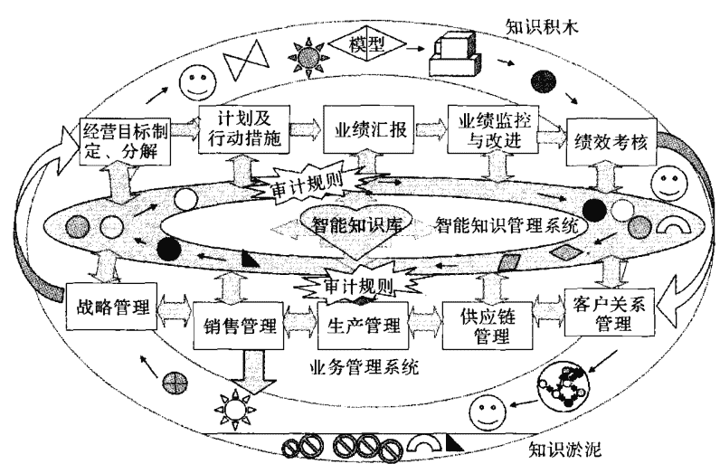 |
| **6. 优胜劣汰，进化成长** | 高分知识凝练为“知识积木块”（含成百上千条规则，大范围复用）；低分知识沉淀为“知识淤泥”，逐步出清。面对新目标，积木块即插即用组合出击。 | **自我筛选与淘汰** |

**技术底座：多智能体系统（MAS）**
将每条知识封装为**自治 Agent**（具备自治、社交、反应、主动特性）。Agent 间协商、共享、协调，天然适配动态环境。引入**监控模块**记录指标数据，统计分析后反馈给 MAS 环境及各 Agent。Agent 技术 + 复杂性科学 = 降低设计复杂度 + 实现运行时自我评估。

---

### 5.6 智能知识推理机制：从“僵硬规则”迈向“灵活进化”

#### 5.6.1 传统推理“四大金刚”及其短板

推理引擎是系统大脑，主流流派各有擅长：

1.  **产生式规则（正/逆向）**：正向数据驱动铺开撒网，逆向目标驱动精准狙击。但面临**组合爆炸、不擅模糊不确定、零自学习、单一思维路径**四大硬伤。
2.  **语义网络**：节点+弧线绘概念图，推理即联想遍历。表达直观，但复杂关系推演乏力。
3.  **框架表示**：槽值结构描述事物，支持默认值与继承。匹配仅限部分，表达复杂约束吃力。```
  <框架名> frame
  ``````
  <槽名 1> <侧面 11> 值 11
  slot <侧面 12> 值 12
  ... ...
  <槽名 2> <侧面 21> 值 2
  <侧面 22> 值 22
  ... ...
  ``````
  <框架名>
  <槽名 1> 值 1
  <槽名 2> 值 2
  ... ...
  <槽名 n> 值 n
  ... ...
  ```
4.  **R-FOL 方法（潘旭伟, 2005）**：模型/事实转一阶谓词三元组，规则库+推理引擎（数据驱动/目标驱动/综合驱动）演绎新知。工程化路径清晰。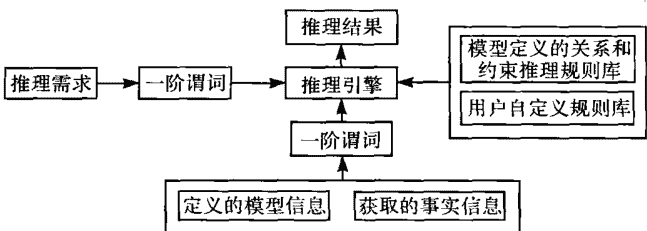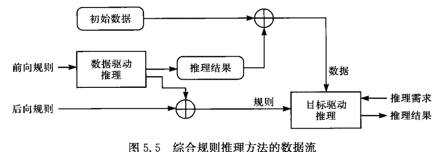
5.  **案例推理 (CBR)**：找旧案改新案，存新案。核心难点在**案例表达、相似度度量、检索修改的精效平衡**。

#### 5.6.2 可拓学：赋予推理“生命力”的关键钥匙

**可拓性**是事物本性。用**基元/复合元**形式化刻画世界，依托可拓分析生成推理规则族：
*   **基元拓展推理**：发散、蕴含、相关、可扩——模拟人类发散思维。
*   **传导推理**：变换引发连锁反应。含定性与定量；自传导（置换/增删/扩缩/分解）与它传导（关联度变化）。
*   **共轭推理**：利用共轭特性，一端变化牵动另一端。

**豆增发（2007）实战融合：可拓规则 + CBR = 混合专家系统**
这套组合拳直接打穿传统天花板：
1.  **表达更自然**：基元兼容确定/不确定知识，贴近真实世界。
2.  **推理更灵活**：可拓逻辑符合专家思维，配合案例推理互补，结论更准。
3.  **扩展更容易**：案例库动态增删，无需知识工程师维护，业务专家自可管控。
4.  **智能更高阶**：规则推理+案例推理双引擎，单一推理短板互补，逼近真智能。

#### 5.6.3 规则知识实战：双轨匹配机制

智能知识前后件均用基元表达，匹配走两条线：

*   **精确值规则 → 欧氏距离匹配**：
    非黑即白。证据与前件**欧氏距离为 0 才判匹配**，>0 直接判定不匹配。简单粗暴，零容忍。

*   **区间值规则 → 距函数匹配度**：
    落在区间即可。引入**距函数**计算匹配度，支持模糊边界，弹性空间大。

##### 2. 距离匹配方法

#### 5.6.3 智能知识推理算法详解

算法执行主要分为两大模块：一是针对智能知识核心主体的推演，二是智能记忆单元间的关联推演。鉴于记忆间的推演逻辑与审计流程高度相似，且原理上与主体推演一脉相承，本节参考豆增发（2007）的研究成果，重点剖析智能知识主体内容的推理算法流程。

整体流程遵循“匹配激活、结论入库、循环迭代、终止输出”的闭环逻辑：首先校验输入证据或初始规则前件与相似规则前件的匹配情况以激活规则；随后将推导出的新结论归集至证据集或规则库；接着持续循环匹配动作，直至系统不再产出新知识；最后结束推理并落库。

**算法规格定义**
*   **输入端**：证据集或智能知识自我涌现报告（即激活规则集）。
*   **输出端**：推理结论集，持久化存入规则库。

**详细执行步骤**

1.  **初始化设定**：假设系统存有 $N$ 条可拓推理规则与 $M$ 条证据，设置规则指针 $r=1$。
2.  **证据遍历判断**：若 $1 \le r \le M$，从证据集提取第 $r$ 条证据；若 $r > M$，跳转至步骤 10。
3.  **规则指针归零**：令 $i=1$。
4.  **规则遍历判断**：若 $1 \le i \le N$，从规则集提取第 $i$ 条规则；若 $i > N$，跳转至步骤 9。
5.  **名称比对**：核对证据名与规则前件名，一致则进入步骤 6，否则跳转步骤 8。
6.  **匹配度计算与判定**：依据规则前件取值类型差异，采用差异化公式计算匹配度 $P$：
    *   **精确值场景**：引入欧氏距离公式。$P=0$ 判定匹配成功，否则失败。
    *   **区间值场景**：采用可拓“距”计算法（非传统距离）。
        *   $P < 0$：证据落在区间内，匹配成功。
        *   $P = 0$：证据落于区间边界，判定为“勉强匹配”。
        *   $P > 0$：证据落在区间外，匹配失败。
    *   若 $P \le 0$，规则匹配通过，转步骤 7；否则转步骤 8。
7.  **结论生成与集合更新**：完成规则所有子前提比对后，产出推理结论或新证据。新证据加入证据集并令 $M++$；结论则汇总至结论集。
8.  **规则指针后移**：$i++$，返回步骤 4 继续下一规则比对。
9.  **证据指针后移**：$r++$，返回步骤 2 处理下一证据。
10. **结果落库**：输出最终推理结论集，写入规则库。
11. **记忆沉淀与知识新生**：记录智能记忆信息，催生新的智能知识单元。

**可拓推理机的工程化实现建议**
推荐基于 JAVA 语言、借助 JADE 等多 Agent 平台（Bellifemine et al., 2007）构建可拓推理引擎。核心类库设计涵盖以下关键实体，自底向上构建运算体系：

*   **原子运算层**：`ExVariable`（可拓基元类）—— 作为最小运算单元，承载物元、事元、关系元表达，是规则前件与结论的基石。
*   **规则构成层**：`ExRuleIF`（前件类，由多基元按任意逻辑组合而成）、`ExRuleTHEN`（后件类，含证据/结论类）、`ExRule`（规则类，前后件耦合）。
*   **集合管理层**：`ExRuleSet`（规则集）、`ExEvidenceSet`（证据集）、`ExConclusionSet`（结论集）。
*   **调度核心层**：`ExEngine`（可拓引擎类）—— 统筹规则集、证据集、结论集，驱动整体推演流转。

上述框架仅为知识推理奠基，后续可融合专家系统、复杂性科学、本体论、模糊检索及可拓逻辑等多维理论，纵深拓展研究边界。

---

### 5.7 第五回顾与展望

本章立足原始知识获取，构建了智能知识孵化方法论，打通了从原始数据到智能知识的进化路径。经多维表达对比，最终确立“基元”作为核心表达载体，详细定义了智能知识基元记忆的信息谱系，实现了知识与业务情景、商业目标的深度耦合与集成，达成知识自我记忆目标，并落地表结构存储方案。

以表达存储为基石，引入复杂性科学成果，初步完成了智能知识“自我审计”与“推理机制”的架构设计，为智能知识管理系统（IKMS）的工程化开发夯实技术底座。

**后续深化研究三大赛道：**
1.  **度量体系构建**：依托智能知识数学结构，建立数据-信息-智能知识间“智能知识测度”的公理化表达与运算法则。
2.  **全生命周期量化建模**：精细化描述智能知识作为“特种知识”在孵化、产生、保存、转化、应用各环节的量化特征。
3.  **人机协同智能交互**：聚焦人、智能体、本体、数据分析四元融合的定性定量容错机制；引入知识地图等可视化手段，降低智能知识复杂性认知门槛。

---

## 第 6 章 智能知识管理系统（IKMS）架构设计

本章聚焦 IKMS 系统顶层设计，支撑智能知识管理模式落地。系统覆盖智能知识应用全链路，首要任务为剖析智能知识生命周期以明确功能边界。

### 6.1 智能知识生命周期九阶段模型

综合前序分析，借鉴智能体成长隐喻，智能知识生命周期划分为九大核心阶段（见下图）：

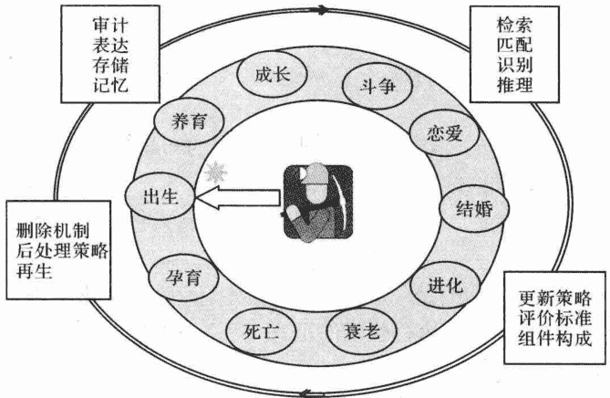

**图 6.1 智能知识生命周期模型**

1.  **诞生期**：经审计筛选的有用知识，注入元知识、情景知识等元信息，完成登记注册入库。
2.  **养育期**：初始应用阶段，自动采集使用者、时间、地点、商业意图等情景上下文，丰富知识画像。
3.  **成长期**：随调用频次累积与反馈效果迭代，高价值知识进入高频活跃态。
4.  **博弈期**：多条知识在特定条件下产生冲突，依据管理规则与专家裁决处理（保留/废弃/标记待办）。
5.  **融合期**：知识间存在关联或前后件依赖，打上匹配标记。达标后触发推理机制“生成”新知识，类似生殖繁衍。
6.  **进化期**：引入专家经验修正偏差，或挖掘同类新知对旧知迭代，持续贴合业务实况。
7.  **衰退期**：随时间流逝，调用频度骤降，效力减退或被新知替代。
8.  **消亡期**：长周期（业务定义，通常超半年）闲置或被完全替代，经专家确认无值，打标入“知识墓库”。
9.  **孕育期**：沉淀的消亡知识达规模阈值，通过挖掘死亡模式与业务特征，反哺孵化新价值知识，开启新一轮数据挖掘或推理循环。

### 6.2 系统需求规格分析

IKMS 需兼具通用知识管理基因与情境智能特质。

**A. 通用知识管理基座（七大核心能力）**
1.  **知识投递发布**：支撑创作/更新提交与企业级分发。
2.  **知识组织治理**：基于分类体系实现有序化管控。
3.  **全域检索服务**：统一检索入口，覆盖主题词、全文、交互式问答等多模态。
4.  **在线学习赋能**：盘活存量资源生成课程体系，支撑多样化培训。
5.  **决策智能支持**：为高管/管理/一线提供数据-信息-知识三位一体支撑，强化定性定量分析效能。
6.  **知识地图导航**：可视化呈现资源分布、专家图谱，缩短“寻知”与“寻人”路径。
7.  **平台运维管理**：配置、用户、日志、备份、动态权限（访读发存全维度）、参数化个性化配置，适配组织动态变革。

**非功能性约束**：高可维护性（统一管理、平滑升级、灵活配置、监控诊断隔离）。

**B. 情境集成核心功能（六大差异化能力）—— 源自顾新建等(2000)、潘旭伟(2005)**
1.  **情境感知获取**：情境化的前置基建，自动识别采集用户当下上下文。
2.  **知境融合存储**：知识入库时自动绑定当下情境，构建“知识+情境”双锚存储模型。
3.  **情境驱动主动推送**：基于情境相似度匹配，将历史同情境关联知识精准触达用户。
4.  **融合情境检索获取**：打破单一知识属性检索局限，支持“知识特性 × 情境特性”组合/独立查询。
5.  **情境过滤降噪**：利用当下情境剔除无关干扰项，提升知识适配效率。
6.  **情境导航溯源**：知识与情境双向跳转导航，助力深度理解与快速关联拓展。

**C. 异构系统集成需求**：IKMS 需打通分散于各业务系统（ERP/CRM等）的知识孤岛，实现互联互通。

### 6.3 智能知识管理平台整体架构

系统采用三层分治架构（见下图）：**数据抽取层**、**算法与技术实现层**、**应用层**（战略/运营/业务三级管理）。

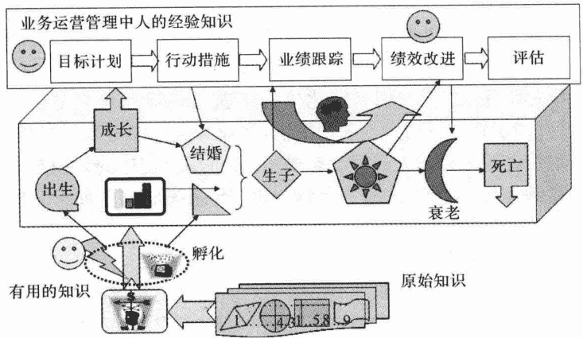

**图 6.2 智能知识管理平台系统框架图**

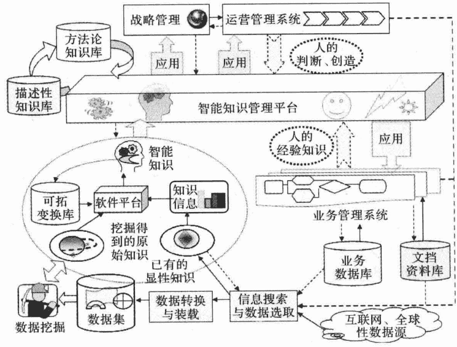

**图 6.3 系统整体功能结构示意图**

**五大核心组件矩阵：**

1.  **数据选取组件**：跨源（数据库/仓库/文档库/互联网/他库）抽取适配。
2.  **数据转换装载模块**：清洗、格式化、装载，产出标准挖掘数据集。
3.  **智能知识管理引擎（核心中枢）**：
    *   *数据服务层*：底座，完成 ETL，产出独立存储的可挖掘数据集。
    *   *分析挖掘层*：核心组件群——传统算法库、智能知识算法库、智能变换库、操作平台，支撑智能分类/聚类/变化知识发现。
    *   *用户界面层*：人机交互门面。
4.  **知识管理平台（资产沉淀与流转中枢）**：
    *   融合领域知识与模式兴趣度评估知识价值。
    *   存储智能知识，多维赋能运营/业务决策。
    *   引入人机交互激发隐性经验显性化入库。
    *   托管知识全生命周期，提供推理机制（知识积累阈值效应：存量越大，增量价值概率越高）。
5.  **用户界面门户**：连接用户与引擎/平台，覆盖数据采集预处理、挖掘过程控制（任务指定/中间结果导向/多形态展示）、知识评估、人机协同存储推理。

**数据流向与双路径挖掘策略：**
数据源 → 转换装载 → **建模挖掘层双通道并行**：
*   *通道一*：传统挖掘得中间知识 → 智能变换理论深化 → 智能知识。
*   *通道二*：专用智能挖掘算法直达智能知识。
*   *策略*：双算法集成部署，支持单选/并行对比/优选模型。

**闭环生态：** 挖掘终点即应用起点。知识发布平台 → 赋能战略规划/计划分解/异常预警（运营层）、流程优化/降故障/客户挖掘/防流失（业务层） → 激发人员经验沉淀回库 → 衍生新商业目标 → 驱动下一轮挖掘循环。人机共生、知行合一。

### 6.4 软件架构分层与组件化设计

鉴于智能变换理论引入的策略多样性（同变换异果、同数据异目标异策略），系统复杂度显著上升。为保交付、强维护，采用五层分层组件化架构（B/S 为主、C/S 辅，引擎可独立部署，全 Web 化运行）：

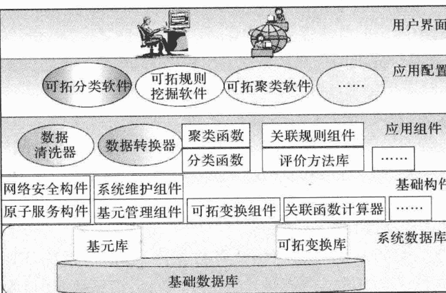

**图 6.4 智能知识管理软件架构及模块组成图**

| 架构分层 | 核心构件 | 关键职能描述 |
| :--- | :--- | :--- |
| **L1 系统数据库层** (底座) | 基础数据库、基元库、可拓变换库 | 存储用户/配置基础数据；物元/事元/关系元元数据；基本/共轭/叠合等变换方法库。 |
| **L2 基础构件层** | 网络安全、原子服务、系统维护、**基元管理**、**可拓变换**、**关联函数计算器** | 基元全生命周期 CRUD；变换匹配/修剪/推理/策略管理；量变质变区间与关联函数数值计算。 |
| **L3 应用组件层** | 智能分类/聚类函数、关联规则挖掘、变换策略评价库、通用 ETL 工具包 | 封装高频挖掘算力为可复用组件，支撑上层快速装配。 |
| **L4 应用配置层** | 管理员可视化装配台 | 编排 L3 组件生成具体软件产品（如：清洗+转换+分类+评价=可拓分类软件雏形），补码测试后交付。支持组件版本管理与技术说明沉淀。 |
| **L5 用户界面层** (顶层) | 门户网站 | 单机/Web 双模。注册缴费、个性化定制、资料浏览、在线学习/试用/下载、社区论坛。 |

### 6.5 智能知识管理系统功能概要设计

依托需求分析，IKMS 功能全景图覆盖：商业目标选取 → 数据集剖析 → 抽转装 → 规则生成 → 变换知识生成 → 知识审计/存储/智能化利用/更新/删除全周期。

**1. 数据、规则预处理层**

# 智能知识管理系统（IKMS）全景解析：从架构设计到落地实战

## 核心架构四层模型：构建企业智慧中枢

### 1. 数据与规则预处理层：夯实数据基石
该模块作为系统的“入口关卡”，具备强大的多源异构数据接入能力。它不仅支持数据库、数据仓库等结构化源头，还能兼容TXT、Excel、Access（mdb）等多种文件格式，并通过网络连接实现高速、定时的自动化采集。核心价值在于“炼数据”：通过清洗噪声、填补缺失、格式转换（离散化、归一化等）及派生变量生成，将杂乱原始数据炼制为高质量、标准化的挖掘就绪数据集。同时，引入基于角色的权限控制（RBAC），确保不同层级用户对数据的查看与编辑权限分级管控，兼顾开放性与安全性。

### 2. 智能知识挖掘层：激活数据潜能
此层是系统的“大脑”，打破了单一算法的局限。它构建了**算法超市**与**可视化交互工作台**双核驱动机制：
- **灵活组合**：支持关联规则、分类、聚类等多算法混合编排，并提供开放接口便于第三方算法快速接入，满足不同业务场景的定制化需求。
- **人机协同**：引入“可拓变换”理论，通过基元库维护实现跨领域知识迁移。挖掘过程非黑盒运行，分析师可实时监控进度、干预变换方向，实现探索式分析闭环。
- **多维洞察**：以可视化图谱直观呈现挖掘路径与结果，降低业务专家理解门槛，加速从数据到洞察的转化。

### 3. 智能知识管理平台层：让知识流动创造价值
这一层解决“知识沉睡”难题，建立**全生命周期管理体系**：
- **分级分权**：建立统一知识库（基元库、策略库、案例库、文档库），实施分级授权，支撑个性化门户定制。
- **闭环进化**：覆盖评估（机器过滤+专家打分）、审计（新知/陈知有效性核验）、推理维护、二次挖掘（挖掘知识中的知识）全链路。
- **场景落地**：内置情景识别引擎，支持基于上下文的知识精准推送与导航；提供标准模板与多格式导出，无缝对接运营、业务系统，直达决策一线。

### 4. 功能模块矩阵与参数化配置：颗粒度管控全业务
系统将能力拆解为**6大主功能、27个子模块**（详见功能清单表），覆盖从数据导入、规则查询、可拓挖掘、知识检索到系统运维的全谱系。配套灵活的参数设置中心（知识分类、关键词、更新策略、Web安全参数等）及完备的组织架构/权限管理体系，实现开箱即用与深度定制的平衡。

---

## 分四期迭代交付：从核心突破到生态构建

| 阶段 | 核心任务 | 关键产出 | 战略意义 |
| :--- | :--- | :--- | :--- |
| **一期：核心攻关** | 聚焦“智能规则挖掘”单点突破，其他模块原型化 | 技术路线验证报告、基础组件接口/技术规范 | 以最小可行性产品（MVP）验证核心算法可行性，定标准、控风险 |
| **二期：组件工厂** | 开发基元管理、可拓变换、关联计算等原子组件及框架界面 | 标准化开发工具包（SDK）、组件装配测试环境 | 沉淀可复用资产，支撑后续业务应用快速搭建，实现“组装式开发” |
| **三期：垂直深耕** | 面向细分领域封装分类/规则/聚类应用软件，制定标准流程与Web API | 领域通用构件库、标准化操作手册(SOP) | 沉淀行业Know-how，降低场景化交付成本，提升复用率 |
| **四期：门户生态** | 建设IKMS集成门户网站，开源共享组件代码 | 智能知识管理应用集成平台 | 打破烟囱式开发，以开源共享驱动代码复用，构建持续进化的组织智慧生态 |

---

## 第六章 小结：IKMS设计的三大创新支柱
1. **需求重构**：超越传统KMS，引入“智能记忆”与“情境集成”双核心能力，回应知识全生命周期管理诉求。
2. **架构解耦**：基于生命周期划分四层逻辑架构，并映射为组件化软件架构，实现高内聚低耦合。
3. **功能全景**：系统性定义挖掘引擎、管理平台、辅助管理三大功能群，并规划分期落地路径，兼顾愿景与交付节奏。

---

# 第七章 智能知识管理实战：从方法论到客户流失预警案例

## 7.1 标准化落地流程：三大环节驱动良性循环
整体流程遵循**“目标导向 → 数据就绪 → 挖掘应用 → 反馈迭代”**的螺旋上升模型：

### 环节一：锚定商业目标，精准选取数据集
- **多方共创**：数据科学家、领域专家、业务用户三方联动，将模糊业务痛点转化为明确挖掘任务（描述性/预测性/规则型/变化型知识），并据此筛选算法组合。
- **数据地图绘制**：四步法梳理数据全貌——收集关联数据→绘制主业务流程图（标注存储位置/类型，聚类划分数据集）→字段级元数据描述（中英名、类型、长度、业务义）→统计画像分析（极值、均值、方差、缺失率、偏度、峰度）。
- **特征工程前置**：通过相关性分析剔除无关/冗余字段，联合专家界定“成功/失败/剔除”样本标准，产出高质量训练集。

### 环节二：数据炼制——清洗、转换、装载（耗时占比超50%）
- **深度清洗**：缺失值推导填补、噪声平滑、异常点剔除、不一致性修复（统一类型/格式/纠错/去重）。
- **降维转换**：属性规约筛选核心特征，非数值型转数值型，格式标准化适配挖掘引擎。
- **案例实测**：最终形成230维属性、16497条记录的标准样本集，验证了“数据准备是挖掘成败关键”的工程铁律。

### 环节三：挖掘执行与知识应用——重过程、重评估、重落地
- **任务驱动算法选型**：根据数据特性与业务目标（可解释性 vs 准确率 vs 实时规则）动态匹配算法。
- **“可实施性”核心评判标准**：剔除冗余/无关模式，引入可视化复核，建立**人工介入反馈回路**——不满意则回溯重选数据、换变换法、调参数、甚至换算法，直到产出可落地知识。
- **模型运营闭环**：部署至业务场景→专家反馈修正参数→多算法集成优化→持续提升决策支撑质量。

---

## 7.2 实战复盘：某互联网企业VIP邮箱客户流失预警与挽留

### 背景痛点：存量博弈下的留存红利
- **行业铁律**：获新成本是留存的6-8倍，流失客户往往贡献更高利润。
- **企业现状**：成立8年，用户/数据爆发式增长，但仅停留在OLAP描述性分析，无法洞察隐性规律与未来需求。
- **核心目标**：基于消费历史，多维画像VIP客户（自然属性、消费内容/行为/模式），分类分析流失结构与损失，构建预警模型驱动功能优化与精准营销。

### 实施历程：三轮数据治理 + 双阶段挖掘突围

#### 第一阶段：数据治理攻坚战（3个月，3轮迭代）
1. **诊断**：注册数据稀疏，高价值日志留存短、缺关联键。
2. **整改**：扩充采集字段、延长日志留存、重构日志格式。
3. **验收**：三轮样本测试+投诉处理流程优化，达成挖掘级数据质量门槛。

#### 第二阶段：挖掘建模——从“分类”到“变换策略”的跃迁
- **初探（传统算法）**：决策树、SVM、多目标线性规划完成用户三分类（现有/冻结/流失）及预测，但面临**规则爆炸、人工解读效率低**瓶颈。
- **进阶（可拓二次挖掘）**：引入**可拓规则转化软件**，实现质变：
  1. **建模用户状态空间**：$A_1$(现有)、$A_2$(冻结)、$A_3$(流失)三集合，每元素含$k$维特征向量。
  2. **定义可拓变换逻辑**：构建集合关联函数与可拓函数，量化状态间相似度与转化条件。
  3. **产出可执行策略**：不再止步于“他是谁”，而是给出“如何让冻结变现有、流失变挽回”的**变换路径与条件判据**（如图7.2用户类别转换模型）。

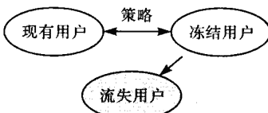

图 7.2 用户类别转换模型图

### 核心启示：智能知识管理的终局是“可变换的策略”
本案例揭示IKMS的最高价值不止于**知过去（描述）、预未来（预测）**，更在于**控当下（变换）**。通过可拓理论将静态分类升级为动态转化策略，配合平台化的评估审计与二次挖掘机制，真正让知识成为企业可感知、可度量、可操作的战略资产。这就是智能知识管理模式应用的终极图景——**数据赋能决策，知识驱动增长**。

## 7.2.3 实战复盘：冻结用户“起死回生”实录

冻结群体身兼“正常用户”与“流失用户”特质于一身，状态极不稳定，随外部条件极易发生相变。只要施以特定干预，便能引导其跃迁至正常活跃集合 $A_1$。表 7.1 列举的三条转化规则，便是这一机制的实证样本。

| **Rule3** | **(5/0) 202:190** |
| :--- | :--- |
| **前件条件** | 近 7 天收信为 0（same）；使用时长 > 763s（same）；身份证认证=1（same）；近 14 天 Web 登录 IP 为 0；密保问题已设置=1 |
| **条件变换** | 使用时长：$\le 911.03 \to >763$；$\le 911.03 \to \le 1093.17$；$>763 \to \le 1093.17$ |
| **新增特征** | 汇款投诉次数 > 2 |
| **目标跃迁** | $\to$ class 0 to 1 (2,3,1) |

| **Rule4** | **(5/1) 202:208** |
| :--- | :--- |
| **前件条件** | 近 7 天收信为 0（same）；身份证认证=1（same）；密保问题已设置=1 |
| **条件变换** | 使用时长：$\le 911.03 \to \le 1093.17$；$>763 \to \le 1093.17$；近 14 天 Web 登录 IP：$0 \to >0$ |
| **新增特征** | 无随身邮属性限制 = 0 |
| **目标跃迁** | $\to$ class 0 to 1 (2,3,1) |

| **Rule 6** | **(3/0) 240:235** |
| :--- | :--- |
| **前件条件** | 积分 $\le 6$（same） |
| **条件变换** | 使用时长：$\le 795 \to >92$；是否用随身邮：$1 \to 0$ |
| **目标跃迁** | $\to$ class 0 to 1 (1,2,0) |

实战中，我们依据规则前件从数据库筛选目标客户，按后件施策干预，流失率大幅收敛，转化规则落地成效显著。

---

## 7.3 标杆复盘：服装巨头的“利润陷阱”破局战

### 案例背景：深耕四十载的“衬衫王”
这家始建于 1979 年的服装集团，覆盖设计、纺织、生产、销售全产业链，主打衬衫、西服双双霸榜市场占有率十年、四年第一，荣膺“中国名牌”。其打造的集设计、生产、销售、展示、商务于一体的工业城，被认定为国内最大先进制造基地，跻身国家 500 强、行业八强。营销网络辐射全国，150 余家分公司、2000 余个网点，构建起专卖、商场、特许、团购四位一体的强势渠道。

### 数字化转型：从“跑得快”到“看得清”
1998 年启动数字化工程，2003 年跻身中国企业信息化 500 强第 18 位（行业第一），斩获最佳战略奖；2004 年成首批标杆工程企业。雅戈尔借此加速市场反馈、压缩供应链周期、建立快速反应机制，核心竞争力跃升。商业智能（BI）与知识管理（KM）是数字化中枢的“双核驱动”：建立以数据仓库与挖掘为核心的运营分析系统，搭建多层级知识管理平台，定期沉淀分享经营经验。

### 危机现场：团购爆单背后的“交货危机”
数据挖掘揭示北方某区域 2005-2006 年团购渠道销售额占比与利润双增，且大单交付后 2-3 个月旗舰店销售必涨——团购是妥妥的“利润引擎”与“品牌放大器”。但 2007 上半年，团购订单交货延期率飙升超历史均值，成了业务扩张的“卡脖子”难题。

### 知识溯源：拨开迷雾见真章
搭建集团级决策知识平台后，梳理出关键知识图谱：

1.  **产能三分法**：工厂产线仅三类——库存单、团购单、OEM 代工单。
2.  **交货率倒挂**：团购准交率持续下滑，远低于 OEM。
3.  **利润微差**：OEM 单件加工费仅高团购 2-4 元。
4.  **排产铁律**：工厂按“高利润、大批量”优先排产。
5.  **集团利润源**：服装板块利润主力是**自营专卖 + 团购**，而非 OEM。
6.  **考核导向**：工厂年利润指标完成率 95%+，属绩效标杆。

### 逻辑推演：一条扭曲的“利润链条”
**利润考核指挥棒 $\to$ 优先排产高利润 OEM $\to$ OEM 批量大占产能 $\to$ 团购订单被挤压延期。**

**视角错位的代价**：工厂视角下，多接 OEM 合理合规；但集团视角下，OEM 单件利润仅为团购的 1/20 甚至更低（**捡芝麻丢西瓜**）。根因锁定：**工厂考核指标“利润额”与集团战略“团购规模”严重错位。**

### 破局之举：换指标、释产能、赢大局
集团果断将工厂核心 KPI 从“利润额”切换为“订单及时交货率”。
**战果**：
*   产能利用率最大化；
*   团购准交率大幅跃升；
*   OEM 交货率几乎零损耗；
*   服装板块整体利润大幅增长。

### 延伸战场：跨洋合作 BHP Billiton，挖掘地下“黑金”
智能知识管理模式同样在澳洲必和必拓石油勘探项目中大显身手：

1.  **金伯利岩实战演练**：用博茨瓦纳钻石矿区已知数据验证模型，自研多目标线性规划法准确率破 80%，超越专家经验判断，证明数据挖掘在勘探领域潜力巨大。
2.  **油藏/非油藏特征识别**：基于澳洲海岸测井数据训练模型，实现油藏与非油藏精准分类，特征反向提取自分类结果。
3.  **地震数据深度理解**：聚焦“波阻抗”与“波类”两核心属性，前者表征岩性、关联孔隙度与流体，为找油指路。
4.  **构建勘探数据仓库**：融合文档岩性特征，建立含垂直测井数据（值、型、征）的框架，支撑立体空间数据库生成，为挖掘铺路。

> **阶段性结论**：智能知识初步应用告捷，下一步聚焦平台开发完成后的全链路智能化测试与规模化落地。

---

## 7.4 本章小结：从“点状突破”迈向“体系化运营”

本章深度剖析了智能知识从“挖得出”到“用得好”的实践闭环：梳理应用背景、还原落地全流程、提炼标准化范式、复盘实战效果、明确迭代方向。三大案例（互联网流失挽回、服装供应链决策、石油勘探识别）仅是冰山一角，但已获企业端高度认可。未来研发重心将引入 **Agent 智能体技术、本体工程**，重构智能知识管理系统（IKMS），推动试用范围从“点”向“面”扩展。

---

# 第 8 章 总结与展望：理论筑基，工程致远

## 8.1 研究成果盘点：六大支柱撑起 IKM 大厦

本书依托国家自然科学基金面上项目（70871111）、创新群体项目（70921061）及业务流程导向项目（70501030），系统构建了**智能知识管理（IKM）**理论体系与工程实践，核心产出六大维度：

1.  **顶层设计**：界定知识、智能知识、KM、IKM 核心概念，阐释智能知识在管理中的战略价值，确立 IKM 目标与体系框架，锚定关键技术路线图。
2.  **直接获取——算法创新**：引入**可拓学（Extenics）**，首创**可拓转化决策树规则挖掘算法**与**基于 MCLP 的可拓分类算法**。两算法输出知识强目标导向、高智能性、强有效性，解决了传统挖掘“知其然不知所以然”的痛点。
3.  **间接实现——知识孵化**：深度解析挖掘知识表现形式，提出**智能知识孵化方法论**；引入元知识、情景知识机制，攻克知识表达与存储难题，为后续推理、审计奠基。
4.  **自我进化——审计与推理**：融合知识审计精髓，创设**智能知识自我审计机制**；设计基于物元的推理算法，并谋划 Agent 技术赋能推理升级的蓝图。
5.  **平台落地——系统工程**：完整走过需求分析 $\to$ 体系架构 $\to$ 功能设计 $\to$ 原型开发的工程化全周期。
6.  **实证验证——双业务场景**：深度介入互联网客户流失与服装集团供应链决策两大实战，验证直接获取方法论与智能知识有效性，复盘迭代方向。

## 8.2 未来图谱：五大前沿待攻关

“数据挖掘知识智能化管理”尚处萌芽期，基于现有基石，建议从五大维度纵深推进：

| 维度 | 核心命题 | 关键挑战 |
| :--- | :--- | :--- |
| **1. 算法智能化深化** | 拓展智能关联规则（如“连带购买策略挖掘”）、可拓聚类（按转化难易/路径分层）；挖掘对象延伸至**文本、网络、多媒体**非结构化数据。 | 算法通用性与业务耦合度的平衡；高维稀疏数据的可拓建模。 |
| **2. 自适应与情境感知** | 攻克**模糊/不确定情境**的识别、采集、融合存储。情境是自我审计与主动推送的“感官系统”，非清晰边界下的情境计算是核心难点。 | 隐性情境显性化；多源异构情境实时融合。 |
| **3. 交互作用度量体系** | 量化知识与**业务流程、人员组织**的耦合机理与交互效能；建立智能知识自学习机制的评价指标系统。 | 管理软指标量化；动态环境下的因果归因。 |
| **4. 系统工程化与正反馈** | 推进 IKMS 从原型走向**工程级产品**，组织全链路实战，建立“实践 $\to$ 反馈 $\to$ 迭代”的正向飞轮，形成 IKM 模式全景实证。 | 复杂系统工程交付风险；业务场景长尾覆盖。 |
| **5. Agent 范式重构** | 引入 Agent 技术重塑 IKMS：多算法协同编排、知识随数据漂移自动进化、新一代智能推理与审计引擎。 | 多 Agent 协作一致性；知识更新的增量计算与因果溯源。 |

---

# 参考文献

[1] 安妮·布鲁金. 企业记忆——知识管理战略[M]. 沈阳: 辽宁教育出版社, 1999.
[2] 彼得·德鲁克, 等. 知识管理[M]. 杨止峰, 译. 北京: 中国人民大学出版社, 1999.
[3] 彼得·圣吉. 第五项修炼——学习型组织的艺术与实务(第 2 版)[M]. 郭进隆, 译. 上海: 三联书店, 1998.
[4] 蔡文. 物元模型及其应用[M]. 北京: 科学技术文献出版社, 1994.
[5] 蔡文, 杨春燕, 陈文伟, 等. 可拓集与可拓数据挖掘[M]. 北京: 科学出版社, 2008.
[6] 蔡文, 杨春燕, 何斌. 可拓学基础理论研究的新进展[J]. 中国工程科学, 2003, 5(3): 80-87.
[7] 蔡文, 杨春燕, 何斌. 可拓逻辑初步[M]. 北京: 科学出版社, 2004.
[8] 蔡自兴, 徐光佑. 人工智能及其应用[M]. 北京: 清华大学出版社, 1996.
[9] 查尔斯·德普雷, 丹尼尔·肖维尔. 知识管理的现在与未来[M]. 刘庆林, 译. 北京: 人民邮电出版社, 2004.
[10] 陈昌岑. 认知心理学对学习和记忆的研究概况[J]. 心理学探新, 1986(2): 64-71.
[11] 陈国权. 人的知识来源模型以及获取和传递知识过程的管理[J]. 中国管理科学, 2003(6): 86-94.
[12] 陈劲, 王如富. 知识经济与企业核心能力的培养[J]. 中国软科学, 1999(3): 77-79.
[13] 陈卫华. 知识管理和数据挖掘在 CRM 中的运用[J]. 科技管理研究, 2004, 24(4): 112-115.
[14] 陈文伟, 黄金才. 数据仓库与数据挖掘[M]. 北京: 人民邮电出版社, 2004.
[15] 陈文伟, 黄金才. 可拓知识与可拓数据挖掘[J]. 广西师范大学学报(自然科学版), 2006, 24(4): 159-162.
[16] 陈文伟, 杨春燕, 黄金才. 可拓知识与可拓知识推理[J]. 哈尔滨工业大学学报, 2006, 38(7): 1094-1096.
[17] 陈晓雨, 王甜, 孙阿梅. 知识资本审计模型——企业知识管理的新工具[J]. 技术经济与管理研究, 2005(6): 28-30.
[18] 陈学忠, 侯海青. 浅谈企业管理模式的内涵与特征[J]. 现代企业, 1994(4): 35-36.
[19] 陈远, 彭哲. 论知识管理与人工智能技术的“近亲”关系[J]. 情报理论与实践, 2005(6): 565-569.
[20] 成思危. 复杂科学与管理[J]. 南昌大学学报(人社版), 2000, 31(3): 1-6.
[21] 成思危. 经济全球化与中国的应对[J]. 自然辩证法研究, 2001, 17(5): 1-5, 20.
[22] 成思危. 经济全球化背景下的世界与中国[J]. 经济界, 2004(1): 4-7.
[23] 成思危. 探索中国管理科学的发展道路[J]. 管理评论, 2004(5): 3-8.
[24] 成思危. 知识差距才是各国财富差距的原因[J]. 中国品牌, 2006(11): 6-9.
[25] 戴汝为. 系统科学及系统复杂性研究[J]. 系统仿真学报, 2002, 14(11): 1411-1416.
[26] 邓乃扬, 田英杰. 数据挖掘中的新方法——支持向量机[M]. 北京: 科学出版社, 2004.
[27] 豆增发. 基于可拓规则和案例推理的混合专家系统[D]. 西安: 西安电子科技大学, 2007.
[28] 冯静. 知识管理实施的第一步——知识审计[J]. 情报科学, 2004(5): 598-602.
[29] 高红. 可拓方法在数据挖掘算法中的应用研究[D]. 大连: 大连海事大学, 2002.
[30] 高阳, 陈世福, 陆鑫. 强化学习研究综述[J]. 自动化学报, 2004(1): 86-100.
[31] 耿正. 基于数据挖掘的智能决策支持系统[J]. 鸡西大学学报, 2006, 6(4): 65-67.
[32] 顾基发, 唐锡晋. 综合集成与知识科学[J]. 系统工程理论与实践, 2002, 22(10): 2-7.
[33] 顾基发, 唐锡晋. 物理—事理—人理系统方法论: 理论与应用[M]. 上海: 上海科技教育出版社, 2006.
[34] 顾基发, 张玲玲. 知识管理[M]. 北京: 科学出版社, 2009.
[35] 顾基发. 系统科学与科学发展观[J]. 科学中国人, 2004(10): 10-11.
[36] 顾新建, 祁国宁. 知识型制造企业[M]. 北京: 国防出版社, 2000.
[37] 郭庆光. 传播学教程[M]. 北京: 中国人民大学出版社, 1999.
[38] 郭志懋, 周傲英. 数据质量和数据清洗研究综述[J]. 软件学报, 2002, 13(11): 2076-2082.
[39] 韩客松, 王永成. 文本挖掘、数据挖掘和知识管理——二十一世纪的智能信息处理[J]. 情报学报, 2001, 20(1): 100-104.
[40] 韩力群, 涂序彦. 多中枢自协调拟人脑研究及应用[M]. 北京: 科学出版社, 2009.
[41] 郝建革. 国内外知识管理研究现状综述[J]. 情报杂志, 2003(8): 17-19.
[42] 何斌. 基于可拓逻辑的机器学习理论与方法[D]. 广州: 华南理工大学, 2005.
[43] 何增有, 徐晓飞, 邓胜春. 数据挖掘与最优化结合的理论方法体系与问题求解模型[J]. 高技术通讯, 2005(11): 39-43.
[44] 贺昌政, 任佩瑜, 等. 复杂系统从定性到定量的综合集成方法的实现技术研究//宋学锋, 等. 复杂性科学研究进展[M]. 北京: 科学出版社, 2004: 428-433.
[45] 贺昌政. 自组织数据挖掘理论与经济系统的复杂性研究[J]. 系统工程理论与实践, 2001, 21(12): 1-5.
[46] 贺昌政. 自组织数据挖掘与经济预测[M]. 北京: 科学出版社, 2005.
[47] 黄金才, 陈文伟. 可拓数据挖掘的概念与理论[J]. 计算机工程与应用, 2006, 42(14): 7, 8, 25.

# 知识管理、数据挖掘与复杂系统：一份不可错过的经典文献深度书单

构建扎实的理论基石，离不开对经典文献的系统梳理。本期精心整理了一份跨越管理科学、计算机技术、系统工程等多个学科领域的高引用参考文献合集，涵盖知识管理理论演进、数据挖掘核心算法、可拓学应用实践、复杂巨系统方法论以及企业竞争力提升等核心议题，旨在为相关领域的研究者与实践者提供一站式的文献检索指南。

## 一、 奠基之作：复杂系统论与方法论视野

钱学森院士早于1990年便在《自然杂志》上联合发表《一个科学新领域——开放的复杂巨系统及其方法论》，拉开了系统学研究的序幕；翌年又在《模式识别与人工智能》上续写《再谈开放的复杂巨系统》，并在2001年专著《创建系统学》中系统阐述了该理论体系。汪应洛教授的《系统工程理论、方法与应用》（高等教育出版社，1998）与涂序彦等人的《大系统控制论》（北京邮电大学出版社，2005）则为工程实践提供了坚实的方法论支撑。国际视角下，约翰·霍兰的《隐秩序——适应性造就复杂性》（上海科技教育出版社，2000）与米歇尔·沃尔德罗普的《复杂——诞生于秩序与混沌边缘的科学》（三联书店，1997）深刻揭示了复杂适应系统的内在机理。

## 二、 核心理论：知识管理的本体论与流派演进

关于知识管理的本质界定，钟义信教授在《理论电子学报》（2001）撰文探讨“信息、知识、智能的统一”，后又主编《信息科学与技术导论》（北京邮电大学出版社，2007）及《智能科学技术导论》（北京邮电大学出版社，2006）构建学科框架。王德禄先生早期指出“知识管理：竞争力之源”（江苏教育出版社，1999），后着《知识管理的IT实现——朴素的知识管理》（电子工业出版社，2003）落地技术路径。蒋日富、霍国庆、郭传杰在《管理评论》（2006）梳理了“现代知识管理流派”，戚永红、宝贡敏在《科研管理》（2003）呈现“国外知识管理研究述评”，周竺、孙爱英在《中南财经政法大学学报》（2005）及吴冰、王重鸣在《华东理工大学学报》（2006）分别提供了研究综述视角。Alavi与Leidner（2001）在《MIS Quarterly》的经典综述奠定了KM系统的概念基础，Allee（2000）则在《OD practitioner》中探讨了知识网络与实践共同体。

## 三、 系统建模与技术架构：从多Agent到本体论

在系统构建层面，蒋翠清、幸龙潮、丁勇（2007，《情报杂志》）提出基于多Agent的知识管理系统模型；李海刚、吴启迪（2003，《同济大学学报》）综述了多Agent系统研究；李跃新、罗荣桂（2008，《武汉理工大学学报》）研究基于CAS的知识管理Agent架构；史忠植（2000，《智能主体及其应用》，科学出版社）奠定智能主体理论基础。本体论方法方面，梁启华（2006，《科学管理研究》）阐释本体论在KM中的应用，张佩云、孙亚民、吴江（2006，《情报学报》）实现基于本体的知识检索。检索技术创新上，李飞、高济、刘柏嵩等（2004，《计算机辅助设计与图形学学报》）融合语义与关键字，周明建、高济（2004，《计算机应用》）提出“跃想检索”，徐志慧（2005，《中国制造业信息化》）聚焦设计知识智能检索。系统框架设计上，王君、樊治平（2003a/2003b）分别构建基于Web及知识地图集的模型框架，张建华（2005，《情报杂志》）设计集成化模型，张新武、刘仲英（2002，《合肥工业大学学报》）探讨集成化系统应用，王立军、宋绍成（2006，《情报科学》）奠定智能企业门户理论基础，汪路明（2006，《情报理论与实践》）研究竞争情报系统，钟英姿（2006，《科技管理研究》）结合数据挖掘研究KM系统。Abecker等（1998，《IEEE Intelligent Systems》）探索组织记忆技术。

## 四、 数据挖掘核心算法与工程化实践

关联规则挖掘奠基之作由Agrawal等人系列完成：1993年SIGMOD会议提出挖掘大数据库关联规则，1994年IBM报告给出快速算法，1996年收入《知识发现与数据挖掘进展》详述快速发现算法，1997年第三届KDD会议扩展至带约束条件的规则挖掘。秦艳霞、杨炳儒在《计算机应用研究》（2001）综述KDD知识评价，后在《计算机科学》（2003）构建自动评价系统；杨炳儒、蔡艳霞（2002，《软件学报》）研究因果关联规则评价；杨炳儒、陈新中、李岩（2003，《计算机工程》）开发源于信息挖掘的智能决策支持系统。分类与学习算法综述见祁享年（2004，《计算机工程》）对支持向量机的梳理，闫友彪、陈元珠（2004，《计算机应用研究》）对机器学习策略的概括，周志华、陈世福（2002，《计算机学报》）对神经网络集成的研究。自组织数据挖掘理论由俞海（2004，四川大学博士论文）系统阐述，张宾、贺昌政（2006，《哈尔滨工业大学学报》）综述其方法。工程化应用中，唐鹏芳、钟达夫、张师超（2005，《广西科学》）探讨数据清洗预处理，潘无名、潘云鹤（2004，《计算机应用研究》）提供多维视图，王秀芳、齐玮、慕晓冬（2004，《陕西工学院学报》）应用于故障诊断专家系统，牛洪瑢（2006，大连海事大学硕士论文）研究空间分类算法，王天真（2006，上海海事大学博士论文）研究智能融合方法。数据质量治理早期见Aebi与Perrochon（1993）会议论文，重复记录检测见Alvaro与Charles（1997）SIGMOD研讨会论文。

## 五、 可拓学理论体系与数据挖掘融合创新

杨春燕、蔡文在《中国工程科学》（2000）奠定可拓工程研究基础，后合著专著《可拓工程》（科学出版社，2007）系统成书；杨春燕、张翔军、蔡文（2002，《数学的实践与认识》）深入可拓集合理论；徐伟宜（2005，《香山科学会议通报》）阐述科学意义。李立希团队将可拓学引入数据挖掘：2004年《中国工程科学》初探应用，2006年专著《可拓策略生成系统》（科学出版社）构建工具平台。李兴森、石勇、李爱华（2006，《哈尔滨工业大学学报》）基于可拓集探索企业数据挖掘方案；张应利、何斌（2001，《数学的实践与认识》）利用物元可拓性挖掘潜信息。李兴森、石勇、鹿盟等（2007a，《当代经济管理》）针对低质量数据研究知识获取方案。

## 六、 知识资本度量与企业竞争力实证

金明律、段海宁（1999，《南开经济研究》）剖析Skandia模型；刘善球、李自如（2004，《系统工程》）研究度量指标与方法；魏江（2000，《科研管理》）分析知识特征与管理；马小勇、官建成（2001，《科研管理》）提出知识管理能力审计框架。石勇、杨海珍、张玲玲（2005，《中国软科学》）实证分析KM与数据挖掘提升国家竞争力；张玲玲、李军、石勇（2009，《中国管理科学》）深化智能知识管理研究；罗锦珠（2005，《技术经济》）探讨数据挖掘与KM结合应用。

## 七、 业务导向、隐性知识与组织学习视角

李兴森、张玲玲（2007e，《软件世界》）倡导业务流程导向KM，张玲玲（2007，海峡两岸三地研讨会）构建对应模型；李一楠（2007，《情报杂志》）综述隐性知识管理；王连娟（2006，《情报科学》）提供文献综述；王知行、林琳、钟诗胜等（2003，《计算机集成制造系统》）应用CBR技术于KM系统；李静、沈阳（2007，《情报杂志》）基于威客网研究知识市场；罗珉、王胜（2007，《中国工业经济》）分析跨组织大规模协作机制。组织学习视角引入迈诺尔夫·迪尔克斯等著《组织学习与知识创新》（上海人民出版社，2001），梅文·席尔曼《科技管理学》（牛顿出版社，1986）及维娜·艾莉《知识的进化》（珠海出版社，1998）提供理论溯源。

## 八、 全球化背景下的战略转型与管理变革

马俊如、孔德涌、金吉伦等在《中国软科学》（1999/2000）两度探源全球化概念与动因；李光（2001，《经济评论》）与周洁如（2001，《上海管理科学》）分析对中国经济影响；张炜（2003，《经济学家》）指出管理研究新问题。李兴森团队持续关注：2007d（第二届中国管理学年会）论证全球化背景下KM重心转移，2007c（软件世界）揭示KM误区，2007b（海峡两岸三地研讨会）研究多变环境下胜任特征，2001（系统工程与电子技术）早期构建图形评价专家系统，2004（软件世界）提出中小企业数据挖掘方案。王哲、赵振华（1993，《科研管理》）探讨管理模式概念，孙巧文（1995，《国外建材技术》）探索企业管理模式，王育琨（2006，《强者》，北京理工大学出版社）记录企业家实践。

## 九、 智能科学前沿与认知基础

刘毅（2004，《科技管理研究》）回顾人工智能历史与未来；徐心和、么健石（2004，《控制与决策》）综述行为主义AI；唐名祥（1990，《海南师范学院学报》）与朱智贤（1985，《北京师范大学学报》）分别从现代认知心理学视角审视学习理论与心理学评述。赵林、杨保安（2007，《情报学报》）构建基于AI的知识链模型；赵曙明、沈群红（2000，《知识企业与知识管理》，南京大学出版社）界定知识企业内涵；郑诗锋、李跃新（2007，《科技进步与对策》）基于复杂性理论研究KM实现架构；黄志澄（2005，《西安交通大学学报》）提出“以人为主、人机结合、从定性到定量”的综合集成法。

## 十、 行业动态与工具箱速览

AMT社区早期在线资源（2003/2004）记录了KM入门与CCO/CKO、企业博客等新兴角色演变；潘旭伟、顾新建、邱进冬等（2003，《中国机械工程》）梳理知识管理工具，潘旭伟（2005，浙江大学博士论文）深入集成情境关键技术；王子熙、沈治宏（2007，《当代图书馆》）综述2000-2006年工具研究；盛小平、何立阳（2003，《图书馆》）综述知识管理系统研究；李兴森、林福严、李墨瑞等（2001，《系统工程与电子技术》）用PowerBuilder构建专家系统；王启智（2001）在线分享Notes知识管理实践。左美云（2000，《科学决策》）提供国内外企业KM研究综述；戚章楠（1999，《管理科学》）早期宣示“知识管理——新的管理革命”；王众托（2004，《知识系统工程》，科学出版社）构建知识系统工程学科；孙恒志（2002，《山东科技大学学报》）从已有定义缺陷看知识定义整合；杨伯淑（2002，《华中科技大学学报》）探讨定性定量结合点：扎根理论与因果模型；张景中（2000/2005）分别在院士大会报告与《华中师范大学学报》探讨自动推理教育技术与智能知识平台；张军（2005，《科学学与科学技术管理》）研究企业内部知识转移障碍；李爱华、韩晶晶、石勇等（2007，《管理评论》）基于数据挖掘判别住房保障资格；Ahn与Chang（2004，《Decision Support Systems》）提出KP3方法论评估知识贡献；Aksenova与Yurachkovsky（1988，《Sov J of Automation and Information Sciences》）研究无偏结构特征；AMT（2003/2004）持续跟踪行业动态。

这份书单虽不敢言穷尽，但基本勾勒出了该交叉学科领域从哲学基础、核心理论、关键技术、工程实践到战略应用的完整知识图谱，值得细细研读、珍藏备查。

# 知识管理与智能计算领域的经典文献图谱：一份不可多得的深度阅读清单

在知识管理、数据挖掘与智能系统交叉融合的学术版图中，有一批奠基之作与关键节点文献，构建了该领域的理论骨架与实践脉络。梳理这份跨越数十年的权威书目，不仅能帮助研究者快速定位核心脉络，也能为工程落地提供理论溯源。以下按研究主题维度，为你重新编排这份高含金量的参考文献库。

## 一、 知识管理的理论基石与组织实践

**经典著作与核心框架**  
达文波特与普鲁萨克（1998）在《工作知识》中系统阐释了组织如何管控隐性资产，成为该领域的启蒙之作。德鲁克（1998）早于此在《哈佛商业评论》专刊中预判了“新组织”的知识属性。格兰特（1996）从战略管理视角确立了“基于知识的企业理论”，为后续实证研究奠定了学术地位。

**角色演变与门户技术**  
邦蒂斯（2002）敏锐捕捉到首席知识官（CKO）崛起的组织变革信号；本比亚等人（2004）则聚焦企业门户技术，探讨其如何成为知识同步的枢纽工具。伯杰隆（2003）与费尔斯通、麦尔罗伊（2003）分别从实操精要与关键议题两个维度，补全了知识管理体系的落地拼图。

**知识市场与度量视角**  
德索萨与阿瓦祖（2003）通过微观案例剖析了内部知识市场的构建路径；科迪等人（2002）基于IBM实践，揭示了商业智能与知识管理深度融合的价值增强机制。高飞等（2002）引入系统论方法论，为知识管理提供了方法论层面的重构思路。

## 二、 数据挖掘与知识发现：从理论到标准

**奠基性综述与统一框架**  
法耶德、皮亚特茨基-夏皮罗、斯米思（1996）提出的KDD统一框架，至今仍是知识发现流程的“黄金标准”。陈楚、韩家炜、余培森（1996）从数据库视角撰写的综述，精准界定了数据挖掘的技术边界。弗劳利等（1992）编著的《数据库中的知识发现》则是早期领域内的汇编性里程碑。

**核心算法与模型演进**  
科特斯与瓦普尼克（1995）确立的支持向量网络，开启了统计学习理论在分类任务中的新纪元。多明戈斯与帕扎尼（1996）深入剖析了朴素贝叶斯分类器的最优性边界条件。钱斯曼与库珀（1957）早期将线性规划引入管理建模，为后来的优化算法埋下伏笔。

**聚类、神经网络与贝叶斯流派**  
哈提根（1975）的聚类算法专著、程伯与蒂特林顿（1994）从统计视角对神经网络的深度复盘，以及切斯曼与斯塔茨（1996）对AutoClass贝叶斯分类系统的理论总结，共同勾勒了非监督与概率建模的技术谱系。道达与哈特（1973）的模式分类经典，至今仍是计算机视觉与模式识别的入门必读。

## 三、 智能系统、多智能体与扩展理论

**多智能体建模与工程实践**  
贝利费明等人（2007）基于JADE平台的开发指南，是多智能体系统工程化的标杆教材。张延辉、杨春雷（2008）结合习惯域理论与智能体技术，构建了高效知识管理系统的创新范式。法尤米等人（2009a, 2009b）连续探索语义分析报告框架与社会智能体建模，推动了挖掘后处理与知识服务的智能化升级。

**扩展集理论与粒计算新视角**  
蔡文（1990, 1999）创立的扩展集理论与不相容问题求解体系，为处理矛盾与不确定性提供了独特的数学工具。多赫蒂等人（2003）引入信息粒概念，在粗糙集与模糊集框架下重构智能知识结构，拓展了粒计算的应用边界。

**遗传算法与优化求解**  
戈德伯格（1989）的著作系统呈现了遗传算法在搜索、优化与机器学习中的通用原理，为复杂空间求解提供了进化计算利器。

## 四、 本体工程、数据治理与语义互操作

**本体设计原则与共享复用**  
格鲁伯（1995）确立的本体设计原则，确立了知识共享的语义契约标准。戈麦斯-佩雷兹与本雅明斯（1999）梳理了本体与问题解决方法的复用组件生态。戈登（2000）利用依赖关系构建知识地图，为知识可视化导航提供了技术路径。

**数据清洗与立方体建模**  
加尔哈达斯等人（2001）提出的声明式数据清洗语言与模型，解决了数据质量治理的“最后一公里”难题。格雷等人（1997）发明的数据立方体操作符，将多维聚合推广为关系代数标准，直接催生了OLAP技术体系。

**标准化进程与新兴规范**  
克利夫顿与图赖辛厄姆（2001）追踪了数据挖掘标准化的早期演进，为PMML等交换格式的诞生提供了史料支撑。

## 五、 方法论反思与跨学科视野

**扎根理论与质性研究范式**  
格拉泽与施特劳斯（1967）的《扎根理论发现》，为知识管理中的质性建模提供了严谨的编码范式。戈尔德库尔与布拉夫（2001）强调情境化知识分析，揭示了知识与行动、沟通的内在耦合关系。

**广义线性模型与统计建模基础**  
多布森（1990）的广义线性模型入门教材，为处理非正态分布数据的统计推断奠定了数理基础。

**神经计算与连接主义渊源**  
安德森与罗森费尔德（1988）编选的《神经计算：研究基础》，收录了连接主义早期最核心的论文集，是追溯深度学习思想源头的珍贵档案。

## 六、 行业应用与区域化实践案例

**CRM与保险业数据挖掘落地**  
陈勇、胡磊（2005）基于保险行业实战，详解了CRM系统中数据挖掘的建模全流程。多里安（2003）专著则聚焦业务建模与挖掘的对齐难题，极具工程指导意义。

**中文语境下的经典教材引进与本土化**  
韩家炜、卡梅尔（2001, 2006）的《数据挖掘：概念与技术》中文版，长期占据高校教材与工程师案头的首选地位。汉德等（2003）的《数据挖掘原理》中译本，则从统计学原理深度解构算法内核。伯纳德与哈蒙德（2002）引入的《信息—知识—利润：商务智能》，早期推动了商业智能概念在国内的普及。

**智能制造与个人知识建模前沿**  
格伦德斯彭基斯（2007）从知识管理视角，探索基于智能体的组织与个人知识双层建模，为智能制造中的知识服务提供了新范式。

---

这份书目清单横跨管理科学、计算机科学、统计学与系统论，时间跨度从1957年至2009年。它不仅记录了知识管理从概念萌芽到工程落地的完整演化史，也见证了数据挖掘从数据库分支走向人工智能核心的跨越式发展。建议研究者按专题模块阅读，工程实践者重点关注“应用案例”与“系统构建”两类文献，以期在理论深度与落地广度间找到最佳平衡点。

# 经典文献速览：神经计算、数据挖掘与知识管理领域的基石文献库

构建坚实的理论地基，离不开对经典文献的系统梳理。本文汇编了一份跨越数十年的核心书目清单，涵盖神经网络早期理论、数据挖掘算法演进、知识管理体系构建及典型应用实践等多个维度，旨在为研究者提供一站式的参考索引。

## 神经计算与早期机器学习理论奠基之作

神经计算领域的里程碑式著作当属 Hecht-Nielsen 于 1990 年由 Addison-Wesley 出版的《Neurocomputing》，以及 Hertz、Krogh 与 Palmer 合著、次年同出版社推出的《Introduction to the Theory of Neural Computation》，两者奠定了该学科的数理基础。乌克兰学者 Ivakhnenko 早于 1967 年便在《Automatica》上发表了关于工程控制论中启发式自组织的开创性论文，至 1995 年又在《Pattern Recognition and Image Analysis》上系统回顾了群组处理数据算法（GMDH）的求解能力。Madala 与 Ivakhnenko 随后于 1994 年合著《Inductive Learning Algorithms for Complex Systems Modeling》（CRC Press），进一步深化了归纳学习在复杂系统建模中的应用。Kondo 于 2000 年在 SICE 年会上展示了带反馈回路的 GMDH 型神经网络在大范围空间空气污染模式识别中的实证成果。

## 数据挖掘核心算法与聚类分析经典

聚类分析领域，Jain 与 Dubes 1988 年的专著《Algorithms for Clustering Data》（Prentice Hall）及 Kaufman 与 Rousseeuw 1990 年的《Finding Groups in Data》（Wiley）至今仍是案头必备。关联规则挖掘方面，Mannila、Toivonen 与 Verkamo 1994 年在 AAAI Workshop 上提出的高效算法开启了该方向的探索。高效项集挖掘算法持续演进：Liu 等人 2005 年在 KDD 研讨会及 PAKDD 会议上分别提出了基于高效用项集的快速挖掘算法与两阶段发现算法；同年 Liu、Pisharath 等人在 PDCS 会议上对可扩展数据挖掘算法进行了性能评测。多准则决策与线性规划引入数据挖掘由 Kou 等人 2003 年在《Developments Optimization Methods and Software》中详述。遗传算法视角下，Mitchell 1996 年的《An Introduction to Genetic Algorithms》（MIT Press）为理论基石，Kamrani、Rong 与 Gonzalez 2001 年在《Computers and Industrial Engineering》中展示了其在数据挖掘与智能知识获取中的方法论。Berry 与 Linoff 2004 年合著的《数据挖掘——客户关系管理的科学与艺术》（中国财政经济出版社中文版）则将理论落地至商业场景。Mcgarry 2005 年在《The Knowledge Engineering Review》的综述全面梳理了知识发现中的趣味度度量指标。

## 知识管理：理论框架、模型构建与组织实践

知识管理理论体系的建立历经多阶段演进。Nonaka 与 Takeuchi 虽未直接列表，但 Mertins、Heisig 与 Vorbeck 2004 年引进的《知识管理——原理及最佳实践》（清华大学出版社中文版第二版）系统梳理了国际主流框架。Holsapple 与 Joshi 先后于 2000 年在《Journal of Strategic Information Systems》探讨组织知识管理影响因素，2002 年在《The Information Society》提出“三重框架”。Liebeskind 1996 年在《Strategic Management Journal》从战略与企业理论视角阐释知识属性；Kogut 与 Zander 同年在《Organization Science》聚焦协调、身份认同与学习。McAdam 与 McCreedy 1999 年在《The Learning Organization》对主流模型进行了批判性审视。Kakabadse 等人 2003 年在《Journal of Knowledge Management》梳理文献形成分类学视角。Honeycutt 2000 年著作《Knowledge Management Strategies》（Microsoft Press）提供了微软视角的实战策略。

模型与平台构建成果丰硕：Kingston 与 Macintosh 2000 年在《Knowledge-Based Systems》提出多视角建模以表达与分发组织记忆；Hou、Sun 与 Chuo 2005 年在《International Journal of Advanced Manufacturing Technology》面向汽车制造智力资产构建智能管理模型；Lau 等人 2003 年在同刊设计实现了集成知识系统；Mate 等人 2002 年会议论文提出 MEGICO 智能方法论。中小企业语境下，Li 等人 2006 年在分布式计算国际研讨会发布适配模型。Li 团队还于 2006 年 ICDMW 工作坊、2007 年《Data Science Journal》及 2009 年电子商务会议陆续推出基于优化的数据挖掘知识管理平台、咨询提升数据质量研究及商业智能系统信息收集方法。危机管理领域，Li 等人 2007 年 ICCS 会议论文融合 Web 挖掘模型；2009 年 IJCAI 论文针对知识过载提出数据挖掘解决路径。Liao 2003 年在《Expert Systems with Applications》综述了 1995-2002 年技术与应用文献。Meso 与 Smith 2000 年在《Journal of Knowledge Management》以资源基础观审视系统建设。Kwan 与 Balasubramanian 2003 年在《Decision Support Systems》引入“知识视界”管理情境化知识。Kreng 与 Tsai 2003 年在《Expert Systems with Applications》构建扩散模型并应用。Hylton 2002 年网络资源聚焦知识审计的度量与估值。

## 语义网、Web挖掘与智能应用拓展

语义门户开发框架 SEAL 由 Maedche 等人 2001 年在知识捕获国际会议发布。Kosala 与 Blockeel 2000 年在《SIGKDD Explorations》综述 Web 挖掘研究。基于语义链网络的相似性知识流生成技术由 Luo 等人 2009 年在《Concurrency and Computation》发表，服务智能浏览。Kolodner 1993 年专著《Case-Based Reasoning》（Morgan Kaufmann）为案例推理奠基。Mohammadian 2004 年专著《Intelligent Agents for Data Mining and Information Retrieval》（Idea Group）探讨智能代理应用。虚拟社区知识分享的电商视角由 Koh 与 Kim 2004 年在《Expert Systems with Applications》实证。McMeekin 与 Ross 2000 年在《International Journal of Food Microbiology》以预测微生物学构建知识框架支撑变革管理。Marti 与 Maria 2000 年在《International Journal of Technology Management》建立 ICBS 智力资本基准体系。生物信息学前沿，Larry T H 等人 2004 年 APBC 会议利用新兴模式投影聚类与基因表达数据实现癌症检测。Hernandez 1995 年 SIGMOD 会议经典论文攻克大规模数据库的合并清洗难题。

这份书目清单虽非详尽无遗，却精准勾勒出三大领域三十余年的学术脉络与技术演进主线，堪称从事相关研究者的“导航图谱”。

# 智能决策与知识工程领域必读经典文献导读

梳理跨学科核心文献，从算法底层逻辑到组织认知实践，构建系统性知识图谱，助力科研与业务落地。

## 一、 算法基石与模型构建

奠定数据挖掘与机器学习基石的关键工作，涵盖分类、建模、规则发现及文本智能分析。Quinlan 早于 1986 年在 *Machine Learning* 上确立决策树归纳范式，后续其著作 *C4.5: Programs for Machine Learning* (1992) 成为分类算法标杆。Pawlak (1991) 以 *Rough Sets* 奠定不确定数据推理理论基础。Müller (1998) 探讨 GMDH 算法在复杂系统建模中的应用。Piatetsky-Shapiro (1991) 聚焦强规则的发现与呈现，Toivonen 等 (1995) 推进关联规则剪枝与分组研究。文本与 Web 挖掘方面，Srivastava 等 (2003) 与 Tan 与 Yu (2003) 分别从概念应用与实践智能角度切入。数据清洗层面，Sarawagi 与 Bhamidipaty (2002) 提出基于主动学习的交互式去重，Chaudhuri 等 (2003) 给出在线模糊匹配的高效方案。Olson 与 Shi (2007) 系统梳理商业数据挖掘入门，Nilsson (1999) 综述人工智能新综合视角。案例推理领域，Riesbeck 与 Schank (1989) 深度剖析内部机制，Noh 等 (2000) 结合认知地图实现隐性知识管理。

## 二、 知识表达与系统落地

聚焦知识层级、工程方法论、本体构建、仓库架构及智能体协作。Newell (1981) 在 *AI Magazine* 提出“知识层级”核心概念。Studer 等 (1998) 总结知识工程原则与方法，Schreiber (2003) 经典教材经翻译引入国内。O'Leary (1998) 探讨 AI 在知识库与本体中的应用，Uschold 等 (1998) 构建企业本体框架。Oles (2000) 引入格理论服务知识表达。Nemati 等 (2002) 设计知识仓库架构，整合管理、决策、AI 与数据仓库。Tiwana (2004) 提供工具包式落地指南。Staniskis 与 Staniskis (2003) 研究门户中的智能体专家交互，Venkatasubramanian (2007) 以制药工程为例探讨决策支持中的数据知识融合。

## 三、 组织认知与价值度量

覆盖知识创造螺旋、隐性本质、智力资本评价、转移粘性及企业实践。Nonaka 与 Takeuchi (1995) 经典之作揭示日企创新动力，Nonaka (1994) 确立组织知识创造动态理论，Nonaka 等 (2000) 融合 SECI、Ba 与领导力构建统一模型。Polanyi (1966, 1958) 两部奠基之作深刻阐释“隐性知”维度与个人知识哲学。Sveiby (1997) 聚焦知识资产管理与度量，Mouritsen 等 (2001) 从叙事、视化与计量切入智力资本管理。Quinn (1992) 提出智能企业范式，Spender (1994) 分析集体实践与彭罗斯租金。Szulanski (2000) 以历时视角剖析知识转移粘性过程。Tyndale (2000) 勾勒组织知识发展全生命周期。Petrash (1996) 记录 Dow 化学的知识价值管理文化转型，Skyrme (1998) 给出知识型业务度量指标，Stepamek (2001) 强调知识传播实践。

## 四、 复杂决策与商业洞察

融合多准则规划、目标规划与智能胶囊技术，解信用评分、客户流失、研发立项等实战难题。Shi (2001) 系统阐述多准则多约束层次线性规划。Shi 等 (2005) 应用二次规划分类信用卡账户，Shi 等 (2002) 用线性规划挖掘数据服务组合管理。Shi 与 Li (2007) 探讨超越挖掘的知识管理平台与智能知识。Shi 与 Yu (1989) 早期研究目标设定与妥协方案。Shim (2005, 2006) 连续提出灵活智能知识胶囊设计与联想激发抽取机制。Tian 等 (2002) 构建混合知识模型系统支撑研发立项。Nie 等 (2006) 基于挖掘分析付费邮箱客户流失，Nie 等 (2009) 倡导“知识智能”新视域。Perols 等 (2009) 引入信息市场机制融合决策。Qian 等 (1990) 确立开放复杂巨系统方法论，OECD (2003) 发布强化知识经济政策报告。

## 五、 流程规范与实施路径

从 CRISP-DM 建模标准到知识地图绘制，提供信息过载治理与规则归纳方法论。Shearer (2000) 确立 CRISP-DM 作为挖掘新蓝图。Semaan 与 Cohen (1997) 从地图到图谱拓展知识地理学。Shi (2000) 提出 Humancasting 缓解信息过载。Smith 与 Goodman (1992) 用信息论视角归纳数据库规则。

# 知识管理与数据挖掘交叉研究的文献图谱与数据溯源（1999-2007）

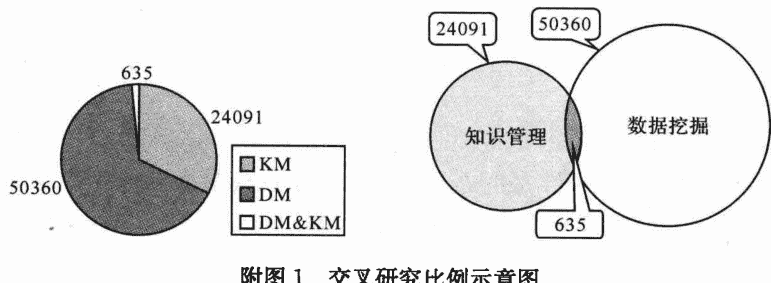

## 核心理论支撑：奠基性文献回顾

本研究的理论基石建立在一系列经典文献之上。在**数据质量建模**领域，Wang、Kon 与 Madnick（1993）于第九届数据工程国际会议奠定了需求分析框架；Wiig（1994）则将知识管理确立为智能型组织的核心管理焦点。针对**隐性知识外化**难题，Woo 等人（2004）提出了动态知识地图，为建筑工程领域专家经验复用提供范式；Wooldridge、Jennings 与 Kinny（2005）基于 GAIA 方法论，推进了面向智能体的分析设计体系。

在**智能检索与模糊计算**维度，Yang 与 Huh（2007）引入模糊抽象层级实现专家精准定位，这呼应了 Zadeh（1965）早年奠基的模糊集合理论。战略层面上，Zack（1999a, 1999b）系统阐释了知识战略的制定与实施路径。国内学者张立灵团队（2009a, 2009b, 2009c）则开辟了“智能知识管理”新版图，涵盖理论基石、知识推送算法及工程应用。此外，Zhuge（2002）构建的知识网格模型支撑全球共享，Zhu 与 Wu（2004）对类噪声与属性噪声的量化对比，为数据清洗提供实证依据。

## 文献计量透视：双核领域交叉度的量化洞察

基于 1999 至 2007 年跨库检索（检索节点：2007.10.22），我们勾勒出“知识管理”（KM）与“数据挖掘”（DM）两大研究共同体的交叉全貌。统计口径以“准交叉论文”为锚点——即同时以 KM 与 DM 为主题词/关键词的文献。

**总体态势：** KM 领域四库合计收录 24,091 篇，交叉论文 635 篇，渗透率 **2.64%**；DM 领域合计 50,360 篇，同量级交叉论文 635 篇，渗透率仅 **1.26%**。这揭示出 KM 学科对 DM 技术的引入主动性显著高于 DM 学科对 KM 语境的关注。

**分库差异图谱：**

| 数据源 | KM 总量 | KM 交叉数 | KM 交叉率 | DM 总量 | DM 交叉数 | DM 交叉率 |
| :--- | :--- | :--- | :--- | :--- | :--- | :--- |
| **ISI Web of Knowledge** | 5,469 | 169 | **3.09%** | 14,000 | 169 | 1.21% |
| **Web of Science 核心合集** | 2,101 | 65 | **3.09%** | 6,267 | 65 | 1.04% |
| **Ei Engineering Village 2** | 3,444 | 196 | **5.69%** | 14,679 | 196 | 1.34% |
| **中国知网 (CNKI)** | 13,077 | 205 | **1.57%** | 15,414 | 205 | 1.33% |

**关键洞见：**
1.  **工程落地驱动交叉：** Ei 库呈现最高交叉率（KM 侧 5.69%），印证工程应用是 KM 与 DM 融合的主战场。
2.  **核心期刊守成态势：** WoS 核心合集交叉率较低（KM 侧 3.09%，DM 侧 1.04%），显示顶刊尚未大规模接纳跨学科范式。
3.  **中文语境差异：** CNKI 规模最大但交叉率最低（KM 侧 1.57%），提示国内研究中两领域耦合度尚待深化。

## 数据基础设施档案：四大检索平台深度解析

### 1. Web of Science 核心合集：引文索引的“黄金标准”
汇聚 SCIE（1900-）、SSCI（1956-）、A&HCI（1975-）三大引文索引及 CCR、IC 两大化学数据库。覆盖 9,000+ 核心期刊，跨越自然科学、工程、生医、社科、人艺五大版块，是计量学评价与高影响力文献溯源的首选阵地。

### 2. ISI Web of Knowledge：一体化学术研究生态
以 WoS 为内核，整合期刊（CC Connect）、专利（Derwent）、会议（ISI Proceedings）、化学反应、专著、基金（ISI eSearch）、网络资源、评价工具（JCR, ESI）、高被引科学家社区及 BIOSIS、INSPEC 等垂直库。构建了“检索-分析-评价-社交”全链路数字化科研环境。

### 3. Ei Engineering Village 2：工程技术文献的“深水港”
承袭 Ei Compendex 与 Ei PageOne 双系血统，收录 1970 以来 700 万+ 条工程题录，年增 25 万。源自 5,100+ 种刊会报，覆盖 175 个工程学科。专注应用科学与工程领域的文摘索引，是技术研发与工程创新的情报枢纽。

### 4. 中国知网 (CNKI)：中文知识资源的“超级聚合体”
源于世界银行 1998 年“国家知识基础设施”构想，现为全球最大中文全文数字图书馆。囊括 8,809 种期刊，回溯 1915 年，全文超 2,496 万篇。是洞察中国学术脉络、把握本土化研究前沿的不可或缺数据源。

## 致谢：站在巨人肩膀上的集体智慧

此间研究得益于国家自然科学基金委管理科学部的资助托举，以及第 278 届香山科学会议院士专家的战略指引、国际会议同仁的思想碰撞。

学术共同体的协作网络贯穿始终：从可拓学创始人蔡文先生、可拓工程专委会杨春燕老师，到中科院数学与系统科学院顾基发、汪寿阳、杨晓光等前辈；从中科院科政策所徐伟宣、软件所韩永生、浙大祁国宁/顾新建、北航韩立岩、北理工牛振东、国防科大陈文伟、哈工大邹广天/钟诗胜/孙佰清、中科院虚拟经济所田英杰/杨海珍/石敏俊/刘莹、电子科大寇纲/彭怡、浙工大赵燕伟、北建院秦建军、浙大管理学院张军博士，以及虚拟经济所、中科院研究生院管理学院数十位青年学者（朱正祥、李爱华、张展、王能元、申爱华、鹿盟、谭大鹏、孟建平等）的具体协作；更有浙大宁波理工学院余巧、周力、陈科团队的专业支撑。

出版环节蒙中科院人工智能学会、科学出版社、雅戈尔集团、网易北京、安徽力源机械等机构鼎力相助。文中因疏漏未及致谢的前人成果，亦是本研究攀登的阶梯，谨致敬意。

```
{
"filename": "MTl1NjEyMzZMzMueW1lw",
"filename_decoded": "12561233.zip",
"filesize": 26431971,
"md5": "54ffb9bf750760d2cb1c4b4af629f5be",
"header_md5": "22468635218805005a6cba3b1a0ef586",
"sha1": "79059b99cc335c47a1db5e95ce73b2e55a13f3c5a",
"sha256": "6648be47dab0a59cbef92a868afe8220196b5ac4b04834064d5a43dc8f20d177",
"crc32": 47446745,
"zip_password": "",
"uncompressed_size": 26353726,
"pdg_dir_name": "\\u2524\\u2559\\u2568\\u253c\\u2567\u00f3\\u2592\u00bc\\u2552\u00bf\\u2561\\u255c\\u2553\\u255f\\u2500\\u2584\\u2553\u00ac\\u2569\\u2562\\u2563\\u2584\\u2514\u03c6_12561233",
"pdg_main_pages_found": 167,
"pdg_main_pages_max": 167,
"total_pages": 179,
"total_pixels": 1002548928,
"pdf_generation_missing_pages": false
}
```