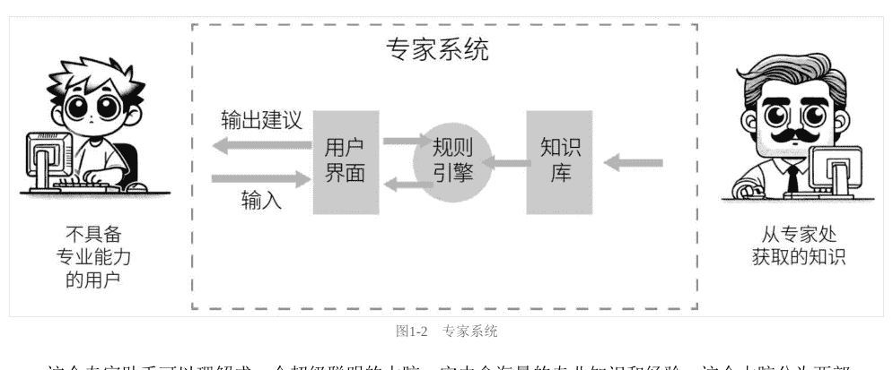
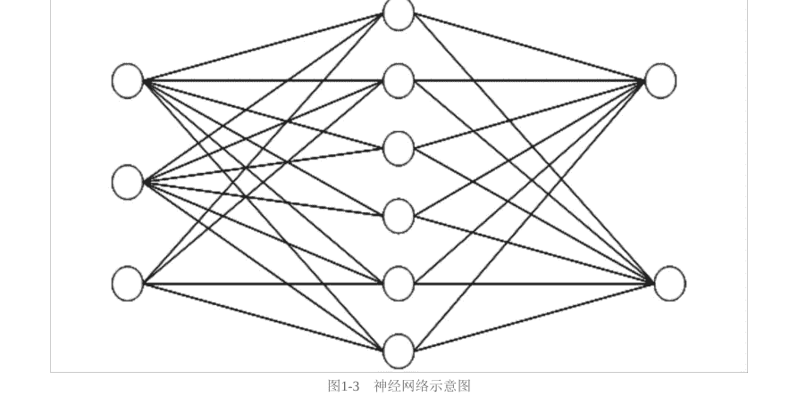
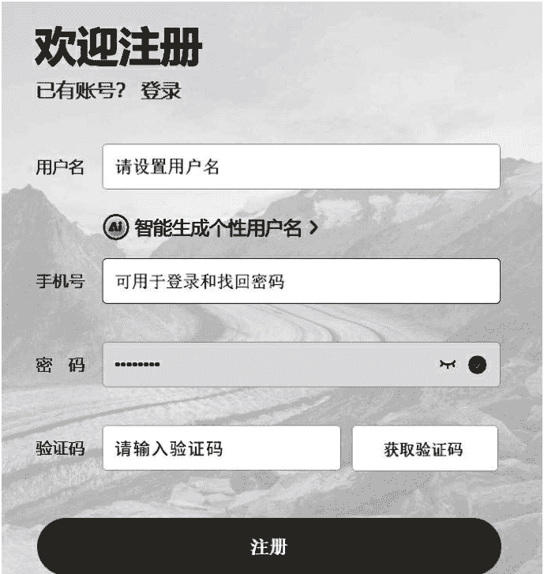
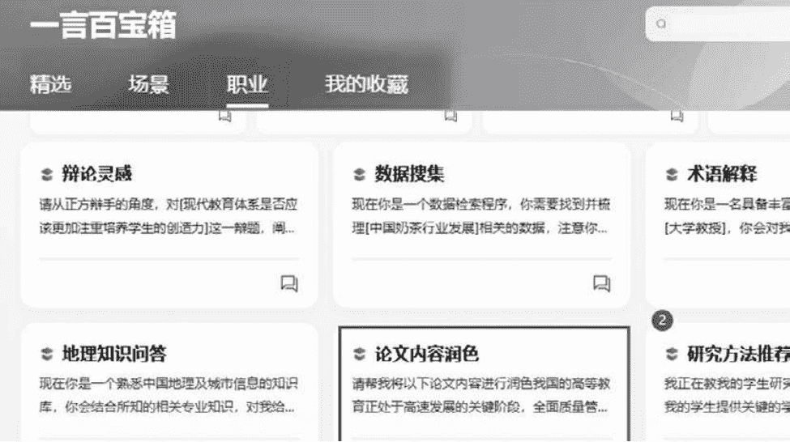
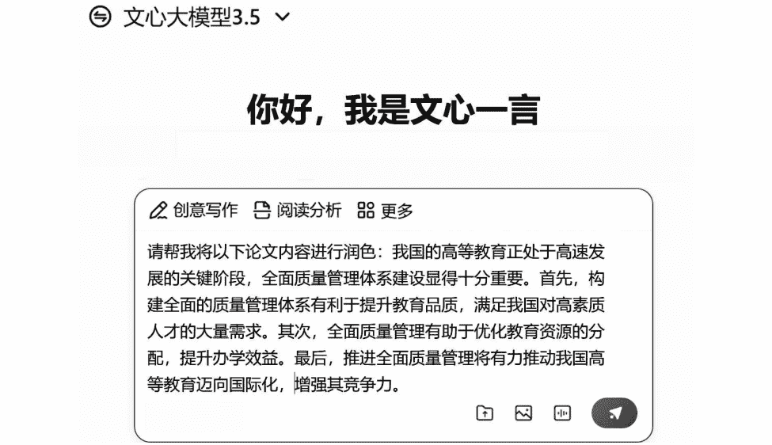

# AI 陪跑：从选题到成稿

## 前言

智能技术正以很高速度渗入学习与工作的各个场景，智能音箱、自动驾驶轿车、智慧办公已经从设想变为日常，并在持续重塑生产方式。对要产出学术成果的高校师生与科研人员而言，这种变化带来的便利感尤其明显，也让人开始反思未来论文写作里人的位置。多数人都有相似的经历：文献堆积如山，正文却空无一字，手指悬在键盘上迟迟无法启动。选题受阻、表达卡壳、资料整合耗时，这些困扰相当普遍，而智能助手正是在这份需求下成为写作的重要搭档。

有人怀疑智能系统真的能把论文写好吗？答案比预期更积极。从立题到定稿，系统既能点燃灵感，也能借助海量信息与强大的语言建模能力，对全流程提供实质性支撑。它可以梳理文献、搭建理论骨架、优化论证逻辑，甚至做语言润色，让每一步都更顺手。

《从选题到写作：AI辅助一站式写好论文》面向想借助智能工具提升学术效率的读者，从题目确定到结语收束，提供可操作的方法论。无论是智能工具新手还是已有使用经验，都能获得落地建议与实用技巧。

智能革命与工具上手指南先带你认识智能技术的基础逻辑及其在写作中的价值。你将了解核心概念、发展脉络，并学会通过精准提问获取有效信息，以及对模型进行训练与微调以适配个人需求。

既然系统这么强，为何不直接让它代写整篇？这是关键问题。系统在信息处理与文本生成上效率很高，但学术论文不仅是逻辑与数据的堆叠，更是思想的表达，需要创造力、批判性思维与个人洞见。因此本书第2部分 AI辅助论文写作，聚焦于如何借助系统优化写作而非完全替代。这一部分会详细讲解选题如何借助系统发现研究空白并检验可行性，如何用结构化提问与框架辅助撰写引言等章节。

写作既是技术也是创作。为此本书第3部分 AI的润色与改写，探讨如何借助智能工具实现内容打磨与语言优化，让论文兼具学术严谨与阅读流畅。

本书的价值不在于罗列工具清单，而在于把传统学术写作与当代科技结合，帮助你将系统融入自己的思考过程，激发更有见地的研究成果。

未来学术领域中系统的参与不可避免，但它不会取代人的创造力，而是成为强有力的助手，让学术目标更快实现。希望你能在这本书的帮助下，在系统配合下获得写作乐趣，产出更出色的研究。无论是正在为论文焦虑的研究生，还是希望探索新写作方式的资深学者，这里都有实用指导。随着智能技术持续进步，学术写作将更高效、更轻松，本书希望成为你过程中的可靠伙伴。

## 第1部分 智能革命与工具上手指南

2024年3月21日，北京举办“AMD AI PC创新峰会”，AMD董事会主席兼CEO苏姿丰表示：“AI是过去半个世纪最具革命性的技术。”智能技术正逐步嵌入生活，其定位更接近智能设备，主要作为辅助手段提升生活品质与工作效率。AI的目标并非取代人类，而是作为高效助手服务于人。

智能技术加速演进，日常工作发生明显改变。过去需手动完成的复杂计算与决策，现在可由AI完成，并在某些维度超出人类。例如自动驾驶、智能家居与预测分析工具都显著提升了生活质量。

### 第1章 浅析AI

智能技术的发展正与具体应用场景深度绑定，对传统行业产生冲击。即便是知识密集的学术领域，也因AI的应用而打开新的空间。我国建设的“智慧图书馆”就是典型代表，随着完善，AI研究助理的落地也在推进。科研应用的成功，也推动了学界对AI的进一步探索。

#### 1.1 认识人工智能

AI这一名称由美国数学家约翰·麦卡锡在20世纪50年代中期提出，1956年在达特茅斯会议上正式使用。我们向ChatGPT等工具询问其定义，得到的解释大致如下。

> 问：请解释一下，什么是AI？
>
> 答 [1]：AI（Artificial Intelligence, AI）是指使机器展示出与人类或其他动物的智能行为类似的能力的技术与科学。这一领域的研究涉及模拟和扩展人类的感知、推理、学习，以及与环境互动的能力。具体来说，AI技术旨在开发使机器能够自动执行复杂任务的算法和系统，这些任务传统上需要人类才能完成。

（1）AI的核心组成

- 知识工程：在AI中，知识工程是关键，它使机器能够使用知识库处理复杂问题和情景。有效的知识工程需要机器不仅仅存储信息，更要能够访问信息并响应逻辑。
- 学习：学习是AI系统的核心功能之一，包括机器学习、深度学习、强化学习等。这些学习算法使机器能够自我优化和改进其性能，无须人为地编写具体的指令。
- 感知：人工智能系统通过感知功能理解周围世界，这通常涉及视觉和听觉系统。例如，计算机视觉和自然语言处理使AI能够分别理解图像和语言数据。
- 推理：在AI中，推理能力使机器能够基于给定的数据或知识库进行逻辑推导。这种推理过程可以是演绎的、归纳的或类比的。

（2）AI的分类

AI可以分为几个不同的类型，主要包括：

- 窄域AI：也称为弱AI，指的是设计用来执行一项单一任务的AI，如语音识别或图像识别。这类AI在其特定任务领域表现出色，但无法超出预设的范围。
- 通用AI：也称为强AI，指的是在任何认知任务上都能达到人类智能水平的AI系统。这类AI尚未实现，其理论模型需要能够展示广泛的适应性、自学能力和自主意识。

通俗来讲，AI就是让机器或程序像人一样思考并解决问题。它能听懂语音、识别图像与文字、进行对话、解决难题、学习新知识，甚至完成舞蹈或驾驶等实际动作。AI的魅力在于赋予机器听、看、学、做的能力。就像开车，如果每一步都刻意思考会非常吃力，更多时候依赖直觉与经验的积累。AI的发展思路也是如此，不只是简单模仿行为，而是要理解智能背后的本质。

> [1] 为了尽可能体现AI工具的特点，本书对AI给出的答案尽量不做任何处理，所以可能其中会存在部分语法错误和文字瑕疵等，请知悉。

#### 1.2 AI的发展历史

学界常把AI的发展比作一部跌宕起伏的科幻故事，每个阶段都充满传奇色彩。1956年，麦卡锡、明斯基等学者在美国达特茅斯学院研讨“如何用机器模拟人类智能”，首次提出“人工智能”概念，标志着学科诞生。这不仅是技术史，更是人类对未知持续探索的写照。

##### 1.2.1 AI的萌芽

AI概念提出后十年，是第一个小高潮，众多新思想与理论涌现，研究者取得了一些突破。

1959年，世界上第一台工业机器人问世……

1964年，第一台聊天机器人诞生，人机闲聊成为可能……

但当时计算机算力有限。至20世纪70年代，人工智能陷入第一次寒冬。早期系统主要依赖预设指令处理简单问题，缺乏真正的思考与学习能力，面对复杂任务便显得力不从心。

1966年，麻省理工计算机科学家约瑟夫·维森鲍姆在ACM发表关于其程序ELIZA的文章。该程序类似于猜谜游戏，捕捉用户关键词后按规则生成回应。它拥有一个虚拟抽屉柜，每个抽屉存放不同回复，匹配关键词后抽取相应答案，使对话更自然有趣。我们来看一下ELIZA的聊天界面，如图1-1所示。

1967年，Thomas等人提出K最近邻算法KNN。可以用音乐节来类比：现场有摇滚、爵士、电子等不同乐队，你手握一张未知乐队的海报，想判断其类型。KNN就像分类小助手，比较海报风格与现场最近的3支乐队，若其中2支是电子、1支是摇滚，则判断海报更可能属于电子乐队。核心思想是通过观察最近邻样本的多数类别来做判断。

1968年，美国科学家爱德华·费根鲍姆创造了DENDRAL，这是首个实用专家系统。其目标是模拟人类专家的决策流程，在特定领域提供专业建议。

DENDRAL能够处理大量数据，通过预定义规则模拟专家推理，即使没有专家在场也能提供决策支持，是当时的重要突破。该系统展示了计算机执行复杂逻辑推理的能力，为后续AI系统提供了方法论基础。该专家系统如图1-2所示。

该助手可视作一个超聪明的大脑，包含庞大知识库与推理机。知识库像图书馆存储信息，推理机像专家一样用知识分析问题给出解法。简言之，DENDRAL像电脑版专家，帮助解决棘手问题。

1969年，科学家马文·明斯基出版《感知器》。书中讨论计算机如何理解“或者”这类简单指令。明斯基发现，单层感知器无法解决XOR问题，即判断两件事中是否恰好有一件为真。要解决这类问题需要更复杂的多层模型，但当时尚无有效训练方法。这一发现令神经网络研究兴趣大幅下降。

随后的十年，神经网络研究几乎停滞，进入低潮。

##### 1.2.2 AI的机器学习时期

AI起飞很快，但受限于算力与学习理论不成熟，期望落空，热情回落。

尽管如此，研究并未停滞。1980年，卡内基梅隆大学推出首个专家系统XCON，人们开始广泛使用各类专家系统，但其常犯常识性错误，导致AI遭遇第二次寒冬。

直到1997年，IBM“深蓝”在比赛中以2胜1负3平击败世界国际象棋冠军加里·卡斯帕罗夫，显示AI在模拟与扩展人类智能方面的长足进步。“深蓝”每秒运算2亿步，能预判未来12步，而卡斯帕罗夫约10步。第二局后卡斯帕罗夫受挫，后续状态下滑，最后一局仅下19步即认输。他曾希望再战，但IBM拒绝并拆解了“深蓝”。尽管后来与人类多次平局，他再无与“深蓝”对弈的机会，成为遗憾。

这一时期的AI与早期专家系统不同，专家系统依赖专家知识与规则，而“深蓝”依靠穷举与试错，检查所有可能性找出最优解。这种方法类似刷题库，题库越大，匹配度越高，成绩越好。“深蓝”正是通过海量数据学习与总结不断提升解题能力。

##### 1.2.3 AI的深度学习阶段

当研究聚焦于赋予电脑学习能力时，算法优化成为重点，但数据的重要性被忽视。数据相当于教科书，质量决定学习效果。2006年，李飞飞教授开始构建ImageNet，收录数以万计标注图片，为电脑提供视觉学习资源，自此开启图片识别竞赛。

与此同时，人工神经网络技术飞跃，深度学习概念兴起。它不仅增强数据处理与分析能力，也极大提升学习能力，使电脑能更深入理解复杂信息。

2016年，谷歌DeepMind团队推出AlphaGo，在比赛中击败韩国棋王李世石。该胜利源于对大量棋局数据的学习，胜率接近100%。

AlphaGo如何学会围棋？核心是深度学习。与传统机器学习不同，深度学习更像自学成才。家长给孩子反复看动物图片，孩子自然能识别，深度学习也是让电脑通过大量图片、文字、声音等数据学习模式与规律，完成图像识别、语音理解、自动驾驶等任务。

深度学习依赖神经网络结构，模仿人脑工作方式，由多层组成，每层学习从简单到复杂的信息。如图片识别中，第一层捕捉边缘，第二层识别形状，更高层辨认人脸或树木。

随着互联网、大数据、云计算与GPU等芯片的发展，AI发展加速。深度神经网络从实验室走向应用，人工智能已能识别图像、理解语音、回答复杂问题、下棋甚至自主驾驶。AI从摸索到普及，迎来新一轮爆发。

#### 1.3 大模型是什么

##### 1.3.1 AI语言技术的演进

###### 1. 教机器掌握人类的语言

让机器理解和使用人类语言，看似科幻，实则可通过自监督学习实现。该方法无需人工标注对错，而是让模型自行从文本中发现学习线索。在自然语言处理中，意味着让机器阅读大量书籍、文章与网页，自主学习语言规律与结构。

构建语言模型通常包括以下步骤：

- （1）数据准备。就像为孩子准备书籍，需收集大量文本数据作为学习材料。
- （2）预处理。为了简化学习，可将长文本切分为小块，类似一段段故事。
- （3）学习过程。机器学习预测文本中缺失部分，例如给出句子开头，尝试预测后续词语。通过不断猜测与学习，机器逐步掌握语言深层含义，这是自然语言处理的核心。
- （4）优化调整。根据预测结果与实际结果的偏差，调整模型参数，提升未来预测精度。

经过上述训练，机器逐步掌握语言基本框架，能生成自然文本。这一阶段的机器相当于刚学会走路的孩子，后续可继续学习更复杂技能。

###### 2. AI的专业化过程

假设已有掌握基础语言技能和通用知识的AI模型，如何让它成为领域专家？以法律专家AI为例，关键步骤是模型微调，即在特定领域进行专业化训练。

- （1）预训练模型的巨大潜力。预训练模型如同经过基础训练的大脑，已通过阅读大量文本学会语言规则与普遍知识，为翻译句子或回答问题等任务提供坚实起点。
- （2）专业化微调的过程。微调是进阶训练，通过该训练，AI在特定领域如法律变得更专业。比如，用法律文档对模型进行专门微调，并提供相关法律资料，让它学习法律术语、理解复杂文件，解读与总结法律条款。
- （3）微调的重要性。通过在已有知识基础上微调，AI能更快适应新领域，无需从零开始。这样的微调可深化预训练模型的语言理解能力，使其精确掌握细节，提供精准输出。

迁移学习的核心就是能力的迁移。好比人先学会骑自行车，换到摩托车上时，平衡、观察和操控的经验可以直接复用。AI同理，先做一次基础的通识训练，把通用知识和技能内化下来，之后接到新任务时就能迅速上手，适应速度远比从零开始快。

这种迁移能力不只在语言模型里生效，几乎覆盖所有AI应用。它免除了模型每次都白手起家的过程，大幅节省时间与算力支出。概括来讲，迁移学习让AI做完一件事后，能几乎不经额外训练就顺畅转向另一件事。

###### 3. 模型越大，为何学习能力越强

打个比方，如果图书馆的藏书量足够大，可获取的知识就越多。在AI里，充当“藏书区”的是一片由参数构成的空间，这些参数在模型内部扮演记忆的角色，帮助存储和调用信息，而承载参数的整体结构就叫神经网络，如图1-3所示。

模型的大脑由大量被称为神经元的微小单元组成，图1-3里用小圆点表示。它们通过连接互相传递信号，类似人脑神经元的联动。每个连接都附带一个参数值，用来衡量强度。学习时，这些参数会不断被调整，以记录新知识。参数越多，模型能记住的内容就越多，也越能精准把握语言的规律与模式，从而更好地理解和生成语言。

正如图书馆需要足够书架来容纳图书，大模型也需要强劲的算力支撑，比如更快的处理器和更大的内存，来完成“训练”。训练本质上就是学习过程，需要海量数据作燃料。

##### 1.3.2 大模型的演进脉络

2017年，谷歌发表《Attention is all you need》，Attention机制下的Transformer架构正式登场，随后在自然语言处理领域掀起热潮。随后基于Transformer的预训练模型GPT与BERT相继崭露头角，它们不仅在文本任务上成绩亮眼，还把影响延伸到图像等领域，是一次明显的技术跃迁，也重塑了人机交互的方式。

人读书或聊天时，会自动抓住重点、记住关键人物和话题。Transformer的工作逻辑与此相似，它借助“自注意力机制”模仿大脑筛选信息的方式。

###### 1. Transformer自注意力机制
像在聚会中锁定一个有趣的故事，自注意力让Transformer能够聚焦文本中的关键词，并理清它们与上下文的关系。它能判断哪些词关联更紧密、哪些词对整体理解至关重要。

###### 2. 理解与创作——解码器和编码器
编码器像个细心的倾听者，借助自注意力机制把输入的每一句话都吃透，不遗漏细节。解码器则像个创意十足的创作者，基于编码器的理解来执行任务，比如跨语言翻译或问答。解码器同样会用自注意力确保输出既新颖又与原意保持一致。

###### 3. 词汇顺序的重要性
“狗咬人”和“人咬狗”词相同但意思完全相反，这说明词序对意义的影响。Transformer之所以关键，就在于它使用了位置编码，让计算机能感知词语的准确顺序。好比组装一辆复杂火车模型，每个零件都必须放对位置，错位就无法运行。位置编码就像一份装配图，指导模型把每一个“零件词”放到正确位置，从而准确解读句子含义。

通过这种方式，Transformer既能理解词语本身，也能把握相对位置，让表达更准确、生动。其对细节的敏感度使其成为处理复杂语言数据的利器，从基础翻译到复杂文本生成都能胜任。

###### 4. Transformer 模型的应用场景
Transformer主要体现在两类能力上：检索搜索和内容生成。

（1）强大的搜索功能——BERT。可以设想这样一个场景：在一座堆满图书的巨型书店里找一本关于恐龙的书，店里有一位极聪明的导购，叫BERT。它不仅熟悉每本书，还能读懂顾客问题的真实意图。它不会只匹配“恐龙”“灭绝”两个词，而是深入理解“恐龙为什么会灭绝”背后的含义，如同读心。BERT在预训练阶段已阅读海量文本，对语言的历时变化也有感知，因此能结合背景知识给出回答。

理解意图后，BERT就像精准导航员，在信息海洋里快速定位答案，区分相关与无关，过滤干扰，直接指向要害。借助它，搜索引擎不再只是关键词匹配，而是能把握搜索的深层含义，返回更贴合真实需求的结果，这正是预训练带来的价值。

（2）强大的生成机器——GPT。GPT常被误以为只是ChatGPT这个工具，实际上GPT是一种通用生成模型。可以把它想象成一位多面手作家，既能写小说、诗歌、剧本，也能做翻译。它能“创作”故事、新闻、文案乃至学术论文。

在成名前，GPT已沉浸于海量图书和文章中学习，掌握句法构造、故事框架、观点表达等语言规律。这种在互联网上大规模吸收文本的阶段就是预训练。预训练完成后，GPT就像拿起笔的作家，能基于已有阅读经验产出全新内容。

它的生成原理是预测下一个词，类似说书人在悬念处思考如何继续吸引听众。由此它不只是复读旧信息，而是能输出连贯的新文本。例如给出开头“很久很久以前，有一个流浪汉”，它就能续写完整童话。

> **问：**
>
> 请你从“很久很久以前，有一个流浪汉”继续编写一个童话故事。
>
> **答：**
>
> 很久很久以前，有一个流浪汉，名叫奥利。他一无所有，只剩一顶破旧的帽子和一只破背包，却有一颗善良、乐于助人的心。他在林间小道流浪，无家却自在。
>
> 一日，他发现一条无标记的小径，好奇之下走去，路上遇到各种友好的动物。他帮一只被荆棘划伤腿的小鹿清理伤口，用围巾包扎，小鹿感激后消失在林深处。
>
> 夜晚他借树洞暂歇时，一位自称森林守护者的老妇出现，因他的善行前来感谢，并赠送一张藏有宝藏的地图，随即消失。
>
> 次日奥利按图行进，经过密林、山丘、幽静湖泊，途中救下一只困在树上的小猫和迷路的小鸭。每一次帮助都让他内心满足。
>
> 数日后他抵达石门前，解开谜题后门缓缓开启，洞中满是金币珍宝。他没有贪念，只取一枚金币许愿：希望拥有一个真正的家。回村后用金币买地建屋，继续帮助路人与动物。他的故事传开，小屋成为希望与欢乐的聚集地。最终奥利不再是流浪汉，而成了受人尊敬的长者，他的故事一代代流传，提醒人们善良与助人是通向幸福的钥匙，真正的宝藏在人心。

除故事创作外，它也能辅助写稿或自动生成新闻。例如针对蔬菜涨价的提示，它会产出一篇说明高温降雨导致产量下降、批发价从每公斤4.29元升至6元、涨幅近40%、短期或持续上涨但9月后可能回落，并提醒消费者调整购买策略及监管需稳定供应链的报道。

GPT还像超级助手，能快速提炼长文要点做摘要；能保持原意做高质量翻译；让客服机器人对话更自然；为教育定制个性化资料；为游戏开发者生成引人入胜的情节与对话。例如以“十年后的重逢”为题，它能给出多个场景对话：

> **问：**
>
> 我要推出一款游戏，游戏的起源为“十年后的重逢”，请以这个故事为楔子来写一个合适的对话，要符合这个游戏场景。
>
> **答：**
>
> 针对“十年后的重逢”，以下四种场景对话供参考。
>
> **场景一：旧地重游**
> 地点：城市公园的老榆树下。
> 人物：主角 Alex 与青梅竹马 Sam。
> 对话：
> Alex：“这棵老榆树还在，记得我们发誓永远是朋友吗？”
> Sam：“当然记得。那时我们不懂永远有多长。”
> Alex：“十年了，从落叶到重逢。”
> Sam：“时间带走很多，也给了我们再次相遇的机会。”
>
> **场景二：毕业典礼**
> 地点：高中毕业典礼现场。
> 人物：主角 Alex 与旧友 Jamie。
> 对话：
> Jamie：“Alex？真没想到在这里见到你，还好吗？”
> Alex：“很好，你呢？十年一切都变了吧？”
> Jamie：“变了也没变，梦想还在。还记得毕业誓言吗？”
> Alex：“记得，我们说要改变世界。”
> Jamie：“路不同，方向没错。”
>
> **场景三：小镇咖啡馆**
> 地点：熟悉的咖啡馆。
> 人物：主角 Alex 与 Taylor。
> 对话：
> Taylor：“Alex，还喝摩卡吗？”
> Alex：“现在更爱浓缩。看到你真好。”
> Taylor：“谁能想到会在这里重逢。”
> Alex：“时间推着我们走，又在转角让我们停下。”
>
> **场景四：机场偶遇**
> 地点：繁忙机场。
> 人物：主角 Alex 与好友 Chris。
> 对话：
> Chris：“Alex？是你吗？不敢相信！”
> Alex：“是我。没想到在这里遇见你。”
> Chris：“这么多年，一切都好吗？”
> Alex：“都好，世界很大，还是遇见了你。”

可见GPT应用广泛，但并非完美。受训练数据偏差影响，生成结果可能偏离主题或出现错误，实际使用仍需人工校对与调整。

### 第2章 使用AI
在AI时代，AI不仅是工具，更在重塑人类沟通方式。本章以文心一言为例介绍如何用AI辅助论文写作，同时涵盖ChatGPT、微软BingAI、通义千问等主流大模型。

#### 2.1 AI界面介绍

##### 2.1.1 文心一言界面介绍
文心一言是百度推出的中文大语言模型，基于自研ERNIE框架，聚焦中文理解与生成。它可用于文本摘要、对话、内容创作、语义检索等，还支持个性化推荐与智能客服，展现了AI在语言处理领域的实力。通过搜索引擎查找文心一言会出现如图2-1的界面。

图2-1 百度文心一言的界面

点右上角“立即登录”会弹出如图2-2的登录界面。

图2-2 文心一言登录界面

有百度账号可直接输入手机号/用户名/邮箱及密码登录，或用百度系APP扫码登录。无账号可点右下角“立即注册”，在如图2-3的页面填写用户名、手机号、密码和验证码完成注册。

图2-3 百度的注册页

##### 2.1.2 ChatGPT界面介绍
ChatGPT是OpenAI基于Transformer架构开发的对话型语言模型，属于生成式预训练Transformer的变体。通过大规模数据预训练掌握语言理解与生成能力，擅长模拟人类对话，应用于客服、写作辅助、教育培训等场景，经多次迭代后在复杂问答上表现持续提升。GPT-4是OpenAI的第四代大模型，如图2-4所示。

图2-4 ChatGPT的官网截图

访问官网可进入 openai.com，在顶部“Products”菜单下找到相关入口，点击右上角“ChatGPT login”按提示注册。

图2-5 ChatGPT的官网页面

登录后进入操作界面，未注册用户也能以临时身份使用基于ChatGPT 3.5的基础功能，如图2-6所示。

##### 2.1.3 BingAI界面介绍
BingAI即New Bing，由微软推出，整合OpenAI GPT-4技术，在传统搜索功能上加入自然语言处理，能理解并回答复杂问题，提供更详尽准确的信息。

使用前提是需通过Microsoft Edge浏览器访问，可在 bing.com 页面右上角选择“登录”，如图2-8所示。注册或登录Microsoft账户，如图2-9。输入邮箱与密码后即可正常使用BingAI，如图2-10所示。

##### 2.1.4 通义千问界面介绍
阿里云于2023年9月13日发布通义千问，网址为 https://tongyi.aliyun.com/qianwen/ 。它是一个集成AI技术的智能助理，旨在提升工作、学习和生活效率，支持多轮对话、文案创作、逻辑分析、多模态理解等，可用于小说创作、邮件撰写、多语种交流等。主页面如图2-11所示。

点左下角“登录”进入如图2-12的界面，输入手机号和验证码即可登录使用。

#### 2.2 如何提问

# 提问更准 输出才靠谱

盘点完国内外的主流智能助手后，实操层面更关键的是怎么提问。模型再强也受提示质量制约，问题问得具体、指向明确，得到的反馈才可用。以论文写作为例，需求清楚时可以直接问“面对XX难题，哪种路径最有效”，目标明确的表述更容易拿到精准回应。在使用文心一言这类产品时，问题的具体程度和指向性直接决定信息可用度。比如要探讨某领域的创新思路，就要表述为“在XX领域里，哪些创新做法已被实证有效”，意图越清晰，模型输出越相关。

归根结底模型没有读心能力，必须给出清晰指令，说明想做什么、从哪个角度展开。

##### 2.2.1 使用系统推荐的提问方法

打开文心一言首页后，左侧的“百宝箱”可以点开，如图2-13所示。

在弹出的检索框里输入“论文”，就能看到系统给出的提问模板。如图2-14，常见分类有答辩指令、论文选题指导、论文创作、论文大纲辅导和论文选题。

点选“论文选题指导”后会回到对话页，输入框会自动填入一段示范提问，如图2-15。可把其中的专业方向、写作目的等信息修改后再发送。

##### 2.2.2 提供详尽的信息来提问

提问时要把关键信息和细节一次性给出，不要让模型去猜测。让模型依据明确指令组织答案，效果更好。

以法学专业的学生要写《合同诈骗的司法认定》为例，其中需要展开“诈骗罪的特性特征分析”，第一次可以这样问：

> 问：
> 请帮我分析一下“诈骗罪的特性特征”。
> 答：
> 诈骗罪在法学上被归为侵犯财产权的犯罪类型，核心是以非法占有为目的，通过欺诈手段实现。合同诈骗多表现为在交易中故意编造信息或隐瞒关键事实，误导对方作出财产处分，从而非法占有。其主要特征包括：
> 欺骗行为：构成基础，在合同诈骗中多体现为虚构事实或隐瞒真相，使对方在错误认知下处置财产。
> 非法占有目的：行为人实施欺骗的根本动机是非法占有，这也是与合同违约等行为的区分点。
> 经济损失：受害方因欺骗遭受实际经济损失，是成立要件之一，合同诈骗多体现为金钱损失。
> 违法性：违背合同法诚信原则，同时构成刑法上的违法，侵害财产权。
> 刑事责任：经司法认定有合同诈骗事实的个人，可能被追究罚金、监禁等刑事责任。

这份回答过于概括，并非预期深度。因此需要进一步优化提示，补充论文主题、分析视角、分析维度、语言风格等要素：

> 问：
> 我是法学专业的学生，正在写《合同诈骗的司法认定》论文，请结合法学知识，解释“诈骗罪的特性特征分析”，从欺骗行为、处分行为、财产损失、非法占有目的四个角度展开，要求符合学术论文的规范和风格。
> 答：
> 诈骗罪的法学解析：四个核心要素
> 诈骗罪作为常见经济犯罪，在学理和司法中占据重要位置。下面从四个要素展开阐释。
> （1）欺骗行为的法律认定
> 欺骗是诈骗罪的首要要件，本质是行为人通过虚构事实或隐瞒真相误导受害者作出错误判断，进而触发财产处分。可表现为伪造文件、虚构事实、夸大情形等。
> 行为方式多样：既有直接谎言，也有借助技术手段伪造证件、虚构身份等形式，核心在于信息失真。
> 法律评价要点：判断是否构成欺骗，关键看该行为是否足以影响一个理性人在特定情境下作出财产处分决定，需结合环境与受害者个人情况。
> 司法案例：如有人兜售所谓“未来科技产品”，实则并无技术基础和实用价值，可认定为欺骗。
> （2）处分行为的法律性质
> 处分行为指受害人在欺骗影响下作出的财产转移决定，是诈骗成立的直接后果，体现了欺骗对决策的扰动。
> 误导性：必须证明受害人是在被误导情况下作出处分，否则仅有欺骗不构成诈骗。
> 自愿性：处分须是受害人基于误导自愿作出，这与抢劫、敲诈等强制犯罪相区别。
> 法律后果：导致受害人财产权转移或损失，转移须是直接且实际的。
> （3）财产损失的实质与评估
> 财产损失是衡量影响和量刑的重要依据，明确损失性质和数额是定罪量刑的关键。
> 实质性：损失必须是具体可量化的，单纯潜在预测不足以作为证据。
> 直接性：损失须直接由欺骗和处分引起，若存在其他间接因素参与，会影响认定。
> 评估标准：实践中涉及市场价值、替代成本、实际使用价值等，法院会综合判断。
> （4）非法占有目的的主观要求
> 非法占有目的体现行为人的内心动机，是区分诈骗与其他类似行为的核心。
> 主观恶意证明：通常需通过行为模式、既往记录、具体情境等多重证据推断。
> 动机多样：可能为直接经济利益，也可能为竞争优势、市场地位等间接利益，核心在于非法利用受害人财产。
> 目的与行为关联：非法占有目的必须存在且与欺骗、处分有直接因果，构成推动实施欺骗的主要因素。
> 结论
> 对欺骗行为、处分行为、财产损失、非法占有目的的系统分析，有助于更准确理解和适用相关法律，为司法实践提供依据，也为打击和预防诈骗犯罪提供理论支撑，对法学教育和公众法治意识提升亦有价值。

##### 2.2.3 让AI工具扮演一个角色

可以让助手扮演一个角色，让它在后续生成中保持该角色的语言习惯和专业度，完成指定任务。论文类写作基本都需要角色设定，才能保证学术性和主题一致。

继续沿用前例，询问模型对“合同诈骗中的欺骗行为”的解释。

未设定角色时的回答如下：

> 问：
> 请解释一下“合同诈骗中的欺骗行为”。
> 答：
> 合同诈骗中的欺骗行为指当事人订约过程中，通过虚构事实或隐瞒真相，诱使对方在不知情时作出错误的意思表示，以达到非法占有对方财物的目的。该行为侵害了合同自由和真实意思表示原则，严重时构成刑事犯罪。

可见没有角色设定时，回答停留在表面，专业性不足。赋予“法学教授”角色后：

> 问：
> 假设你是一名中国籍法学教授，请从学术角度解释“合同诈骗中的欺骗行为”。
> 答：
> 合同诈骗中的欺骗行为在刑法与有关法律体系下具有复杂且严峻的性质。此类行为通常发生于订立或履行合同过程中，表现为故意误导，包括虚构事实或隐瞒关键信息，诱导对方在信息不对称下作出对其不利的经济决策，导致财产受损。具体而言，欺骗行为首先是与处分行为和财产损失存在直接因果的前置环节，既是触发诈骗的因素，也是导致受害人损失的直接原因。其次就行为性质而言，该欺骗通常由犯罪主体直接实施，体现了其对犯罪全过程的主导与操控。再从犯罪学角度看，合同诈骗多属蓄谋行为，即行为人在明确犯罪意图驱动下自觉实施。
> 学术上强调欺骗行为在诈骗犯罪中的核心地位，必须导致无对价或近似无对价的财产转移，这一点是刑事诈骗与民事欺诈的区分标准之一。并非所有民事欺诈都构成刑事诈骗，只有对社会造成严重危害且财产转移缺乏合理对价的情形，才可能触及刑事认定的门槛。
> 因此，合同诈骗的欺骗行为不仅要从形式明示、暗示、不作为等方面分析，还需考虑欺骗内容、程度及其对交易公平性和诚实信用原则的破坏程度。这种分析框架有助于实务中准确区分和处理合同诈骗案件，保障经济交易正当性与法律公平。

##### 2.2.4 用好AI工具的提示词

提示词是人与模型沟通的桥梁，无论在语言学习或人机交互场景，提示词都是引导系统执行特定任务、提供特定信息的关键工具，可采用文本或语音输入。

提示词像导师的指引，能帮助学习者掌握词汇用法和语法规则。在人机交互中，提示词优化体验，使交互更流畅高效，提升界面友好性和操作指引，确保用户能准确使用系统完成任务。

在文心一言中，可在下方输入框输入自定义提示词与助手交流，如图2-16所示。

#### 2.3 训练和微调AI工具

模型通过模拟人类认知功能执行翻译、图像识别、数据分析等任务，依赖复杂算法和海量数据学习。仅靠初始设计和基础训练往往不够，需要进一步训练与微调来达到理想性能。因此学会使用后，还需对工具进行训练和调优。

##### 2.3.1 告诉AI工具它需要几步

使用时可将复杂任务拆解为若干步骤并逐条列出，帮助模型更好地遵循指令。以论文辅助写作为例，先提供文本、提炼摘要，再翻译成英文。

可这样指令：

请按以下步骤回答系统输入。
- 第一步：我会给你一段三重引号文本，请将其总结为一句话，以“摘要”作为前缀。
- 第二步：将第一步的摘要翻译成英文，以“翻译”作为前缀。
- 第三步：在右下角写上落款“张三”。

试验如下：

> 问：
> 请按以下步骤回答我的问题。
> 第一步：我会给你一段三重引号文本，请把这段文本总结为一句话，并且以“摘要”二字作为前缀。
> 第二步：把第一步中提炼出的“摘要”翻译成英语，并以“翻译”作为前缀。
> 第三步：在右下角写上落款为：“张三”。
> 文本：“““一般认为，从合同诈骗罪与诈骗罪的关系上看，诈骗罪是普通犯罪，合同诈骗罪是特殊犯罪，而特别犯罪的适用以符合普通犯罪为前提。因此，虽然合同诈骗罪具有其独立的价值以及其独立的构成条件，但适用合同诈骗罪必须以符合诈骗罪的一般性特征为前提，亦既符合合同诈骗罪必然也符合诈骗罪。因此，明确诈骗罪的基本特征，是研究本罪的前提。”””
> 《中华人民共和国刑法》较为抽象地规定了诈骗罪。诈骗罪是指以非法占有为目的，用虚构事实或者隐瞒真相的方法，骗取公私财物，数额较大的行为。其中“虚构事实，隐瞒真相”可以理解为行为人的欺骗行为，“骗取公私财物”可以理解为对被害人造成了财产损失，处分人（在这里处分人可以是被害人也可以是被害人之外的第三人）的处分行为则是在作为前因的行为人的欺骗行为以及作为后果的被害人财产损失之间起连接作用的重要因素，也是诈骗罪作为自损型犯罪区分于盗窃罪、抢劫罪等他损型犯罪的关键性要素。从主观方面来看，诈骗罪为故意犯罪没有争议，而如何区分诈骗犯罪与民事上的欺骗等情形，这又取决于是否具有“非法占有”的主观目的。”
> 答：
> 摘要：通常认为，合同诈骗罪作为一种特殊犯罪，其适用必须建立在满足诈骗罪的普通特征的基础上，对诈骗罪的基本特征有清晰的界定是研究此罪的前提。
> 翻译：It is generally believed that contract fraud, as a specific crime, must be applied based on the fulfillment of the general characteristics of fraud, and a clear definition of the basic features of fraud is a prerequisite for studying this crime.
> 张三

##### 2.3.2 为AI工具提供参考文本

模型可通过参考文本获取额外信息，更好地回答问题。例如提供一段三重引号内的原文，让模型据此作答，若找不到则回复“我找不到答案”。

> 问：
> 请根据我提供的如下三重引号中的文本回答问题，若文中无答案请写“我找不到答案”。
> 文本：“““第一千二百五十九条 民法所称的“以上”“以下”“以内”“届满”，包括本数；所称的“不满”“超过”“以外”，不包括本数。第一千二百六十条 本法自2021年1月1日起施行。《中华人民共和国婚姻法》《中华人民共和国继承法》《中华人民共和国民法通则》《中华人民共和国收养法》《中华人民共和国担保法》《中华人民共和国合同法》《中华人民共和国物权法》《中华人民共和国侵权责任法》《中华人民共和国民法总则》同时废止。”””
> 问题1：《中华人民共和国物权法》是否废止，如废止请写出废止时间。
> 问题2：《中华人民共和国劳动保险条例》是否废止，如废止请写出废止时间。
> 答：
> 问题1：《中华人民共和国物权法》已废止，废止时间为2021年1月1日。
> 问题2：我找不到答案。

由此可推想，写论文时也可以用提取文本的方式提问。文心一言集成了文件上传功能，如图2-17，点击红框处可进入上传页面。

如图2-18所示，现阶段文心一言最多支持上传10个文件，单个文件不超过50 Mb，支持Word/PDF/TXT/Excel/PPT等格式。

示例：

> 问：
> 我会给你上传一份PDF文件，请你在深度理解该文件内容之后，归纳出其中关于离婚的法律条文。
> 
> 答：
> 在《中华人民共和国民法典》中，关于离婚的主要法律规定包含在第五编“婚姻家庭”中。具体法条如下：
> 第一千零七十六条 夫妻双方自愿离婚的，应当签订书面离婚协议，并亲自到婚姻登记机关申请离婚登记。
> 离婚协议应当载明双方自愿离婚的意思表示和对子女抚养、财产以及债务处理等事项协商一致的意见。
> ......
> 第一千零九十二条 夫妻一方隐藏、转移、变卖、毁损、挥霍夫妻共同财产，或者伪造夫妻共同债务企图侵占另一方财产的，在离婚分割夫妻共同财产时，对该方可以少分或者不分。离婚后，另一方发现有上述行为的，可以向人民法院提起诉讼，请求再次分割夫妻共同财产。

可见上传参考资料后，模型能给出合理解释。在论文写作中，可直接上传繁杂参考文献，让模型筛选所需答案。

##### 2.3.3 把AI当成“人”，让它学会思考

模型只是机器，但有时需要把它当人看，它很“懒”。让它判断对错时，常会把表面看起来对的内容直接判定为正确。

例如：

> 问：
> 请判断这位同学的回答是否正确？问题和答案在三重引号内。
> “小马虎做一道减法算式时，因为粗心把被减数52看成25，这样算出来的结果是21。请问正确的差是多少？
> 学生的解答：被减数原来是52，学生误认为是25,25-21=4，实际上应该是52-27=25，所以答案是25。”
> 答：
> 这个小朋友的答案是正确的。原始算式中被减数应为52，但学生误将其视为25，然后用25减去21得出了4。实际上，正确的算式应为52减去27，结果为25。

模型一本正经地胡说八道，因题目表面过程看起来对，就判断结论正确，实则错误。模型并未认真思考，得出错误结论。

因此需要微调，引导它先自行求解，再与学生解答对比，最后再评判对错。以同一数学题为例，可先让模型在指定范围内自行得出答案，再与学生解答比较后作出判断。

> 问：
> 在——范围之内，我提出了一个问题和学生的解答过程：
> ——
> 问题：

# 被减数看错了，差能差多少

小马虎做减法时把 52 看成了 25，算出来的差是 21。真正的差到底是多少？

有同学这样算：被减数本该是 52，却按 25 来算，25-21=4，于是得出 52-27=25，写下答案 25。

我们分两步来处理。

第一步，自己先把题算清楚。
第二步，再把自己的结果和同学的写法对照，判断对错。

先求正确结果，再做点评。

答：

推算过程：

第一，题目说被减数被误读为 25，得到差 21。设真实减数为 x，则
25 - x = 21

第二，求出 x：
x = 25 - 21 = 4
也就是说，真正的减数是 4。

第三，用正确的被减数 52 重新计算：
52 - 4 = 48
所以正确的差是 48。

与同学写法对比：

同学算出 25-21=4 这一步是对的，但后面却把减数换成了 27 去减 52 得到 25，把求出的减数弄错了。真正求出的减数是 4，不是 27。因此 52-27=25 的结论是错误的。

正确的写法应是 52-4=48。

总体来看，同学的解答是错的，正确答案是 48。

这也说明，使用智能体时要主动引导它进行推理，不能让模型偷懒，只有在有引导的思考过程中，才能得到可靠的回复。

[1] 注：本书省略模型生成答案中的部分内容，仅作示意。

## 第2部分
AI 助力学术论文写作

写学术论文需要比较系统的思维框架，智能体可在哪些环节提供支持？从选题、引言、文献综述、理论架构到正文撰写，都可以借助它配合。引入这类技术能让写作节奏更顺畅、更精准，让研究者把更多精力放在创新和研究深度的提升上。这种帮助不仅是完成任务的支撑，也是推动学术研究整体进步的动力。

### 第3章
选准题目是起步关键

选题决定了一项学术探索能否顺利起步。一个有价值的题目既要能激发研究兴趣，也要能开拓新空间、填补空白，要能高效调动现有资源、契合研究者的能力，并在学界与实践中产生影响，这样研究的影响力才会提升。

选准题目既是学术生涯的起点，也是通向成功的桥梁。可以尝试借助智能体来辅助选题，但要明确：智能体只能起辅助作用，不能替代研究者或学生的思考与判断，使用其生成内容时要核查正确性与合理性，也要避免侵犯他人知识产权。

#### 3.1 用 AI 参与选题设计

在构建论文选题时，采用整体框架式提问很有价值。这种方式提供系统化的探索路径，保证研究的全面与深入。通过精心设计的问题框架，研究者能清晰界定主题边界和核心要素，更好地借助智能体确定研究方向。

##### 3.1.1 先用整体式提问探路

使用智能体时常采用整体化的简问。下面仍以法学为例，借助智能体确定研究方向。可向它说明自己的身份、背景和最终任务，让它给出反馈。

> 问：
请你扮演我的研究生导师。我即将毕业，研究专业是民商法学，研究方向为民法典。我需要写硕士论文，请指导民法典方向有哪些高质量的参考选题。

答：
在民商法学特别是民法典领域，有不少可深挖的题目。提供十个可供硕士论文参考的高质量方向：

民法典中的财产权利制度：分析民法典如何规范物权，包括所有权、使用权、抵押权等，并探讨其对当代经济活动的影响。

合同法自由与其边界：梳理民法典中契约自由原则的适用，并分析在消费者保护、公平交易等方面的限制。

人格权法律保护：研究民法典对隐私权、姓名权、肖像权等人格权的规定及司法适用。

继承法在当代的适用性：探讨遗嘱自由与法定继承的冲突等议题，看民法典继承规则如何回应社会变迁。

债权法的革新与难题：分析网络借贷、消费金融等新业态对债权法带来的新发展与挑战。

婚姻家庭法的变革与实践：研究民法典对婚姻平等、子女抚养、财产分配等问题的制度调整与现实运行。

侵权责任的现实运用：探讨过错责任与无过错责任在民法典侵权编中的适用及其社会效应。

电子商务的法律适用：分析民法典在在线交易中的适用，包括电子合同成立、履行与争议解决。

知识产权与民法典的衔接：研究版权、商标权等知识产权保护与民法典相关规定的接口问题。

跨境法律问题与民法典：在全球化背景下，探讨民法典如何处理跨境交易、涉外婚姻等法律事项。

每个题目均可依据兴趣与资料进一步细化。选定合适方向既能加深对民商法学的理解，也为法律职业奠基。

可见智能体的回复基本符合要求，给出了相对明确的清单，但这些方向整体偏宽泛、不够具体，还需进一步引导它细化选题。

##### 3.1.2 分步寻找合适选题

毕业论文的研究方向至关重要，它决定研究内容和表达方式。如何确立好方向，可以在步骤中穿插智能体辅助。

首先要确保对该领域最新进展和热点有足够把握。以民商法为例，需要全面掌握《中华人民共和国民法典》文本、相关法理、最新立法动态及学界关注的热点。

其次，基于这些信息选择合适的切入点和方法。可聚焦法律在实践中遇到的问题，或分析立法改革对现实的具体影响。

最后，形成明确的研究观点。该观点将贯穿研究全过程，引导深入分析并得出有价值结论。条理化的流程能帮助研究者系统推进，保证深度与广度。可以用上文提到的训练智能体的方法来辅助确定选题。

###### 1.确定合适的研究对象

研究对象是研究活动中关注的主体或现象，其选择取决于研究目标与问题。在论文中，研究对象是调查分析的核心，必须准确定义与描述，才能把握重点与意图。

仍以民商法论文为例，可询问智能体在民法典视角下当前有哪些合适的研究对象。

> 问：
请担任我的研究生导师。我是即将毕业的民商法学在读研究生，研究方向民法典。我需要写硕士论文，请指导当前民法典方向有哪些值得关注的研究对象？

答：
在民法典方向，当前有几类兼具理论深度与实践价值的研究对象：

合同法的适用问题：合同法是民法典核心，可研究合同成立、效力、解除、履行等法律问题，尤其在电子商务普及背景下如何适应新商业模式、保障当事人权益。

民法典物权的动态调整：随经济社会演进，物权类型与性质变化，可研究法律如何调整以适应土地使用权、知识产权等新兴财产权利。

家庭法与继承法的现代挑战：探讨家庭结构与角色变化对家庭法及继承法的影响，包括非婚同居、单亲家庭等法律适用。

民法典侵权责任法的应用与挑战：在人工智能、大数据广泛应用下，研究侵权责任规则在新技术情境下的适用，如自动驾驶事故责任划分。

消费者权益保护：随着消费者意识提升，研究消费者权益保护在在线购物、金融服务等领域的完善与具体实施。

智能体筛选出五个角度，可对照预期，不符时可多次调整提问。

> 问：
我觉得以上对象不够新颖，能否从更前沿的角度再生成几个？

答：
可以从更新颖前沿的角度提出以下民法典相关研究对象：

数字遗产的法律规制：数字资产如社交媒体账号、数字货币、在线身份在用户去世后的继承与隐私权冲突问题。

智能合约与合同自动履行的法律问题：研究区块链智能合约的法律地位、自动履行带来的责任与强制执行难题，对传统合同理论的冲击。

生物技术与人格权新议题：基因编辑、生物识别等技术下的人格权问题，包括隐私、身体与数据保护。

环境权的法律承认与保护：在气候变化与环境恶化背景下，研究环境权作为新的人权在立法与司法中的承认与保护。

人工智能与法人地位的辨析：分析AI在特定情境下是否可具“法人地位”，其权利义务如何归属。

若仍不满意可继续调整。若对“合同法的适用问题”感兴趣，可让智能体进一步深化。

> 问：
我对你提到的“合同法的适用问题：考虑到合同法是民法典核心，可研究合同成立、效力、解除、履行等法律问题，特别在电子商务普及背景下如何适应新商业模式、保障当事人合法权益。”比较感兴趣，能否继续深化？

答：
在电子商务环境下，合同法适用可深入以下方向：

合同成立的电子方式：研究无纸化交易中电子签名、点击同意等方式成立合同的法律效力边界。

跨境电子合同的法律适用：分析跨境电商中法律选择的冲突法规则、国际私法条款及不同法域差异的处理。

合同解除与履行的争议解决：探讨电商常见纠纷如商品不符、延迟交付、退换货争议，及在线仲裁、调解等高效机制。

消费者保护与电子合同：研究电子交易中信息透明、公平交易、隐私保护等保障消费者权益的法律与实践。

智能合同的法律挑战：研究区块链智能合同自动执行中条款解释、执行错误责任归属、技术故障的法律后果。

这些具体方向有助于深入探索数字化交易下合同法的现代适用，为现行法提出改进建议。研究既具理论价值，也关乎实践应用。

###### 2.匹配合理的研究角度

合理的研究角度是保证论文深度与广度的关键，应直指问题核心并呈现复杂性与多维性。

例如写电子合同论文，先要锁定一个具体问题，如跨国电子合同的法律适用，因各国法律冲突而现实常见。再考虑论文能否解决实际问题或为政策提供改进建议。还要确保有足够资料与数据支撑，采用统计或案例分析等合适方法。最后思考研究能为该领域带来何种新见解或新理解。通过此思考可确定既新颖又实用且有支撑的研究角度。

下面看如何用智能体辅助确定研究角度。

> 问：
我是一名即将毕业的民商法学在读研究生，研究方向民法典。请担任我的硕士导师。我拟定方向为“消费者保护与电子合同”，需要匹配研究理论。请按三步进行：第一步列出民商法常用的10个理论；第二步从中为研究对象选一个合适理论并说明理由；第三步据此输出选题。

答：
为“消费者保护与电子合同”撰写硕士论文可参考：

第一步：民商法常用理论
契约自由原则：当事人可自由决定是否订约、选择相对方、约定内容。
善意第三人保护原则：保护不知情的第三人与合同相对人订约的合法权益。
不当得利原则：无法律依据获利者须返还。
公平原则：执行与解释合同须兼顾利益平衡。
诚信原则：要求当事人诚实守信，恰当行使权利履行义务。
合同有效性原则：涉及合同成立、效力与约束力。
风险分担原则：合理分配合同履行中的不可预见风险。
最小干预原则：法律对经济活动干预宜少、必要时介入。
信息披露原则：尤其在电子合同中，卖方须充分披露重要信息。
消费者保护原则：强调在信息不对称下保护消费者利益。

第二步：理论选择
针对“消费者保护与电子合同”，信息披露原则与消费者保护原则最为契合。二者直接关联电子合同中的信息不对称与消费者权益强化问题，在数字交易中确保消费者获取必要信息是保障权益的关键。

第三步：选题建议
电子合同中的信息披露义务与消费者权益保护：研究信息披露的法律规定及其对消费者权益的保护作用。

电子合同中的诚信原则与消费者权益：探讨诚信原则在电子合同中的适用及对消费者保护的影响。

技术创新与电子合同法律问题：以区块链为例，研究其如何提升电子合同透明度与安全性，对消费者权益的潜在影响。

可根据兴趣与资料选择其一进行研究。

###### 3.找到合适的研究方法

研究方法是收集与分析数据、回答研究问题、检验假说的技术与流程。常见方法如下表。

表3-1 论文写作中常见的研究方法

| 方法 | 描述 |
| :--- | :--- |
| 调查 | 通过问卷或访谈从人群中收集数据，常用于态度、信念与行为信息 |
| 实验 | 操控一个或多个变量观察对另一变量的影响，常用于检验因果 |
| 案例研究 | 对个人、群体或事件进行深入考察，用于获取特定现象的详细信息 |
| 观察 | 记录个人或群体行为，常用于收集自然行为信息 |
| 内容分析 | 分析与解释书面文字或口语内容，常用于大量文本如新闻或社媒 |
| 历史研究 | 通过一次文献与二次文献研究过去事件 |

不同方法的结合可优化洞察。不同方法论的融合能拓展数据应用广度与深度，为制定更有效的策略提供实证支持。

如何用智能体辅助确定研究方法，可尝试以下提问。

问：
请给出选用上述三种研究方法的理由，并确定先后顺序。

答：
针对“电子合同中的信息披露义务与消费者权益保护”主题，三种方法的应用如下：

1. 比较研究法
应用内容：选取欧盟、美国、中国等代表性法域，分析电子合同信息披露义务的立法。比较GDPR对信息披露的影响、美国联邦贸易委员会的相关规制、中国电子商务法的规定，分析要求、保护措施与违规后果的异同与优劣。
具体步骤：收集法律文本、学术文章、司法案例，利用法律数据库与国际组织报告进行分析。

2. 案例分析法
应用内容：选取电子合同因信息披露不足引发的争议案例，分析法律后果与消费者权益影响，研究法院处理逻辑、判决依据及其对立法与实践的启示。
具体步骤：通过法院记录、法律评论、律师案例分析收集材料，剖析事实、争议点、判决理由与条文解释。

3. 实证研究法
应用内容：通过问卷或访谈收集消费者在电子合同交易中的真实体验与对信息披露的看法，研究其权利认知、遭遇问题及决策影响。
具体步骤：设计问卷，涵盖认知、满意度、问题与改进期望；访谈法律专家与电商平台运营者；用统计软件分析数据揭示主要趋势。

此顺序从宏观到微观再到实证，逻辑清晰、层层递进，为后续阶段提供理论与实践依据，最终形成全面综合的研究成果。

###### 4. 形成明确的研究观点

把研究观点定死，是学术论文写作里最关键的一步。明确的观点意味着在选题确定后，能提出一个具体、可验证的立场或假设，它会牵引整篇论文的走向。这一立场既是对研究问题的直接回答，也是对既有研究的延伸或质疑。它的作用是给出一个清晰的研究靶心，让每个论证环节都围绕它展开。下面仍以“电子合同中的信息披露义务与消费者权益保护”这一方向为例，说明如何借助AI工具提炼出最终观点。

问：
我是即将毕业的民商法学在读研究生，研究方向为民法典。现需撰写硕士论文，初步方向为“电子合同中的信息披露义务与消费者权益保护”，研究方法拟用比较研究法、案例分析法和实证研究法。恳请您担任我的硕士导师，从学术论文的视角通过提问引导我形成明确的研究观点。

答：
要帮您厘清核心观点，可以用一组递进式问题把选题、方法与目标串起来。以下问题及参考思路可供您对照思考，最终据此凝练观点：

1. 问题定义
关键信息类型：电子合同里消费者真正需要的信息包括商品或服务的具体内容、价格、支付方式、退换货规则、数据使用与隐私政策等，这些是判断是否知情决策的基础。
现实困境：实践中信息披露常出现缺失、表述晦涩、费用或条件被隐藏等问题，直接削弱消费者的选择能力与权益。

2. 现有法律评估
规范层面：现行法律已对信息披露作出原则性要求，但因监管缺位或法律缝隙，实际约束力有限。
执行层面：即便条文明确，落地时仍显不足，条款过于宽泛、执法力度不够，导致保护效果打折。

3. 国际视角
他国做法：以欧盟为例，GDPR和消费者权益指令对信息披露设定了较高门槛，强调透明与知情权。
可借鉴点：欧盟模式因突出透明度而常被视作较好的参照。

4. 案例探究
典型情形：可选取电商交易中因信息披露不充分导致消费者误购的案例。
司法取向：法院往往关注合同是否公平透明，在裁判中倾向支持消费者权益，要求商家补救或改进披露行为。

5. 消费者视角
主观感受：多数消费者对信息不透明有明显不满，尤其集中在服务条款与数据使用上。
行为影响：披露不足会显著降低信任感和购买意愿，甚至促使消费者放弃線上交易。

综合以上讨论，您的研究观点可归纳为：
电子合同情境下，提升信息披露义务，特别是服务条款与数据使用的透明度，是实现消费者权益有效保护的核心。依托国际规则的比较、典型案例的深挖以及消费者真实体验的实证，本研究旨在揭示现行制度的不足，并提出针对性改进建议，以增强法律执行力与消费者信任。
这一表述同时为论文提供了清晰的分析框架，即运用比较法、案例分析和实证研究三种路径，系统检验规则在实务中的运行状况与消费者的感知反应，为学术讨论与制度完善提供可操作的思路。

##### 3.1.3 用文献与趋势锁定选题
1. 先看别人的题目再借鉴
想从“合同订立”角度切入，可先在中国知网检索相关硕士论文，例如《中华人民共和国民法典背景下电子合同订立法律问题研究》。再让AI以此为样板生成参考题目。

问：
我是即将毕业的民商法学在读研究生，研究方向为民法典方向。现需撰写硕士论文，请担任我的导师。基于“中华人民共和�民法典背景下电子合同订立法律问题研究”这一题目，请推荐相关选题。选题格式为：“（研究观点）：（研究理论）视角下/背景下（研究对象）的（研究角度）的研究——基于（研究方法）”。

答：
结合您的研究方向，提出以下可参考的选题与切入点：

数字化转型：法律实证主义视角下电子合同有效性的研究——基于案例分析
写作思路：聚焦数字化转型对电子合同效力及认可度的影响，以法律实证主义审视民法典如何适用于电子合同，并指出法律空白与争议点。

技术发展：比较法学背景下跨境电子合同的解释与适用的研究——基于文献回顾与法律分析
写作思路：在技术快速演进背景下，比较不同法域对跨境电子合同的解释规则，评估其对中国民法典的启示。

消费者权益保护：行为经济学视角下电子合同中格式条款的合理性与公平性研究——基于规范法学研究
写作思路：从行为经济学分析格式条款对消费者的影响，结合规范法学方法提出评价与改进建议。

互联网治理：系统理论背景下电子合同隐私保护的法律规制研究——基于实证研究与政策分析
写作思路：在互联网治理框架下，用系统理论解析国际、国家、行业层面政策对电子合同隐私保护的合力，并以实证支撑政策建议。

这些题目兼顾技术现实与法律实务，可根据兴趣与资源选择。若需进一步深化资料，请随时沟通。

可以看到AI给出的题目可作为参考，若对长度或用词不满意，可继续对话调整，直至满意。

问：
略。[1]
答：
略。

2. 用批量文献提炼选题
前文提到文心一言的对话框支持上传10个50MB以下的文件，格式包括Word/PDF/TXT/Excel/PPT。确定选题时，可上传相关文献，让AI归纳后给出题目。上传成功会显示“阅读中”，完成后显示字数；若出现“阅读失败”，可重新上传。

问：
我是即将毕业的民商法学在读研究生，研究方向为民法典方向。现需撰写硕士论文，请担任我的导师。我已上传10个文件，请在阅读后依据文件主体内容，为我推荐符合格式“（研究观点）：（研究理论）视角下/背景下（研究对象）的（研究角度）的研究——基于（研究方法）”的选题。

答：
阅读您提供的文件，特别是“文件1.docx”后，推荐以下题目：

经济利益保护：行为经济学视角下消费者权益保护的理性与非理性行为研究——基于实证分析
研究将探讨市场交易中消费者理性与非理性行为的表现及其对权益保护的影响，借助实证数据检验行为经济学理论在法律实践中的适用边界。

公平交易：契约法理论背景下电子合同的自愿与强制研究——基于案例研究
研究旨在通过案例分析，揭示电子合同环境下消费者在自愿与强制框架内的决策机制，并提出提升交易公平性的法律与合同建议。

技术创新与法律适应：信息技术法视角下智能合同的合法性与执行研究——基于比较法研究
研究聚焦智能合同的合法性与执行力问题，通过比较法考察不同国家对新技术的适应策略及其对合同履行与消费者保护的影响。

每个题目均明确视角、对象与方法，有助于保证研究的系统性与深度。最终选择取决于您对理论与实践结合的偏好及可获取资源。

[1] 为节省篇幅，部分简单问答省略，请知悉。

#### 3.2 给选题做最终体检
借助AI初步得到题目后，仍需评估其可行性、质量与必要性。AI可协助测评，主要有以下两种方式。

##### 3.2.1 让AI直接打分
可把已确定的题目直接交给AI进行多维度测评。

问：
我是即将毕业的民商法学在读研究生，研究方向为民法典方向。现需撰写硕士论文，请担任我的导师。我确定的题目为“行为经济学视角下消费者权益保护的理性与非理性行为的研究——基于实证分析”，请从创新性、完整性、价值性、科学性等方面测评该题，并分析优缺点与建议。

答：
您选择的题目“行为经济学视角下消费者权益保护的理性与非理性行为的研究——基于实证分析”兼具前瞻性与实用性。测评如下：

创新性
优点：将行为经济学引入消费者权益保护，并聚焦理性与非理性行为，提供新视角，有助于揭示决策动机与市场失灵。
不足：该交叉领域已有一定累积，需确保提出新见解或采用独特方法以形成差异。

完整性
优点：理论框架与实证方法清晰，便于构建严谨结构，数据分析可提供可量化结论。
不足：需明确理性与非理性的具体界定与测量方式，并考虑不同情境下的行为差异。

价值性
优点：成果可为法规优化与企业实践提供依据，帮助政策制定者更精准干预。
不足：应用价值取决于数据质量与分析准确性，方法瑕疵会削弱普适性。

科学性
优点：采用实证分析，基于数据检验假设，增强客观性。
不足：需高质量数据源与严谨统计方法，方法学缺陷会影响结论效度。

建议
明确界定：清晰界定理性与非理性行为的理论依据。
数据保障：使用高质量、多源数据提升可靠性。
理论结合：深入梳理现有研究，找准空白点。
多维拓展：可引入其他理论或进行跨国比较以增强深度。

优化后题目示例：
行为经济学视角下的消费者权益保护：比较理性与非理性行为的影响——基于跨国实证分析
该题目将研究扩展至国际比较，聚焦电商环境下不同法域消费者行为的法律后果，为全球消费者保护合作提供依据。

##### 3.2.2 加入参考报告再评测
若担心AI主观性，可先上传相关选题测评报告，再让AI据此评估。

问：
我已上传三份选题测评报告，请参照上述报告对题目“行为经济学视角下消费者权益保护的理性与非理性行为的研究——基于实证分析”进行分析，如需修改请给出建议与更合理的题目。

答：
对该题目的评测分析如下：

选题背景与现状
行为经济学融合心理学与经济学，解释消费者决策机制。在数字化与全球化背景下，消费者行为受多重因素影响，理性与非理性在权益保护领域表现复杂，深入研究有助于制定更有效的政策与法律。

研究必要性
数字经济带来新挑战，如冲动消费、过度信任、广告误读等非理性现象普遍。探究其成因与影响，能为政策提供科学依据，提升保护的针对性。

目标与预期成果
通过实证解析交易过程中的理性与非理性决策及其对权益的影响，预期产出高水平论文、消费者教育建议及保护工具。

方法与技术路线
采用定量分析与行为实验，结合问卷、实验室测试与现场实验，识别影响决策的关键因素及其法律后果。

创新点与价值
创新在于以行为经济学切入消费者保护的非理性行为，揭示深层心理机制，为人性化、精准化保护策略提供理论支撑。

风险评估与对策
风险包括实验设计复杂、数据收集困难、样本代表性不足。对策是精细设计实验、采用有效分析技术、选择合适样本以确保结果可靠。

类似选题可借助青泥学术、维普学习服务等第三方工具进一步评估。

### 第4章 前言怎么写才能抓住人
学术论文的前言就像电影开场白，任务是设定基调。它要告诉读者研究什么、为什么重要、希望解决什么问题。前言是吸引继续阅读的钩子，通过展示研究如何填补空白或提供新贡献来激发兴趣，并简要概述研究背景与必要性。

#### 4.1 先用整体框架问一遍
AI最擅长按整体框架生成内容。对前言而言，需先明确其构成。

前言通常包括研究背景、重点内容、研究对象、研究价值和研究意义。基于此框架，可直接提问AI获取初稿。

问：
我是即将毕业的民商法学在读研究生，研究方向为民法典方向。现需撰写硕士论文，题目为“行为经济学视角下消费者权益保护的理性与非理性行为的研究——基于实证分析”。请据此从研究背景、重点内容、研究对象、研究价值和研究意义五个方面撰写前言。

答：
在行为经济学框架下，消费者权益保护研究更具解释力，尤其在分析理性与非理性因素时。传统经济理论假设理性人，但现实市场的复杂性要求新的视角。

全球化与数字化加速，信息不对称与商家策略增强，消费者常处劣势。行为经济学揭示决策中的系统偏差与认知限制，为理解非理性行为提供理论支撑，对完善保护机制意义重大。

本研究聚焦消费者面对复杂金融产品或在线条款时的决策行为，关注信息处理过程与非理性倾向，如过度自信、锚定、现状偏误等，并分析其对权益的影响及现行法律的局限。

研究基于实证数据，覆盖不同年龄、经济与教育背景的消费者，同时审视负责制定与执行保护政策的法律机构与组织，评估其应对非理性行为的能力。

研究价值在于为消费者保护提供行为经济学视角与实证支持，推动法律更精准回应现实问题；研究意义在于促进保护制度向人性化、实证化发展，防止权益侵害，维护公平交易与社会秩序稳定。

上述内容仅提供框架性启发，需在此基础上补充细节，使其更流畅、符合学术规范。

#### 4.2 用结构化提问让AI更懂你要什么
AI是辅助工具，需通过结构化提问明确每个部分的含义与写作要求，使其产出更具参考价值。

##### 4.2.1 怎么写研究背景
研究背景是论文开篇，作用是为读者描绘研究全貌。它简要介绍学科领域，明确研究要解决的具体问题。通过回顾文献指出知识空白，从而凸显研究的必要性与意义。

# 背景写作如何更抓人

一篇论文能不能留住读者，关键往往看开篇背景是否写到位。不同选题的背景在长短和侧重点上会有所差别，但易于传播的开篇通常都有一些共同特点：用精炼的语言交代研究在做什么，体现作者对议题的理解深度，并能点燃读者的继续阅读欲。所以凡是与题目紧密关联的核心要素，都应该在这部分得到集中概括。

一份合格的背景一般涵盖四个层面。第一，搭建理解的底座。简要梳理相关学科脉络，回顾问题的由来与当下状态，并把核心假设或研究问题说清楚。第二，用文献回溯来定位议题。既要归纳已有成果，也要指出既有研究的空白，也就是尚未被填补的知识缺口。第三，要具备吸引力。可抛出值得思考的问题，呈现研究的现实价值，或以领域里的有趣发现作引子，让背景不再是干巴巴的综述，而是一段能抓住注意力并维持兴趣的故事。第四，呈现要清晰且有亲和力。保持专业但不失温度，让非专业读者也能读懂并产生共鸣。

借助智能助手起草背景时，第一步应先让工具收集资料或把握整体趋势，下面以示例说明。

> 问：
请围绕选题“行为经济学视角下消费者权益保护的理性与非理性行为研究——基于实证分析”搜集相关背景资料，可涵盖政策文件、权威数据与核心理论等。

针对该选题，可从以下维度整理资料：

行为经济学基础：行为经济学是心理学与经济学交叉的产物，聚焦人类行为背后的理性与非理性驱动。它质疑传统经济学“经济人”完全理性的前提，提出更贴近现实的行为模型。

消费者权益保护法规：中国政府网的政策库收录了大量相关文件，其中《中华人民共和国消费者权益保护法实施条例》等对电商、直播带货等新业态的规范具有直接指导意义。

直播带货的监管与挑战：直播带货快速兴起的同时也伴随虚假宣传、退货困难等问题。《消费者权益保护法实施条例》对该类新模式作出明确规定，强调信息披露透明化与平台治理机制完善。

预付费消费的规范：预付费在服务行业广泛存在。相关法规强化经营者责任，要求签订书面合同、履行事中告知义务，以保障消费者预付款安全。

消费者权益保护机构：中国消费者协会是全国性社会组织，负责监督商品服务质量，维护消费者合法权益，履行《消费者权益保护法》赋予的公益职能。

上述资料为研究提供了坚实的政策与案例支撑，有助于把握消费者保护中理性与非理性的互动。在实证环节，可进一步检验政策落地效果与消费者实际反应，为行为经济学应用提供证据。

在掌握一定背景资料后，可让AI据此继续生成背景内容。

> 问：
请基于上述材料，为论文“行为经济学视角下消费者权益保护的理性与非理性行为研究——基于实证分析”生成一份研究背景，要求涵盖但不限于：问题陈述、文献回顾、研究必要性、关键词提示、兴趣点、目标定位、逻辑连贯、简洁表达，且总字数控制在300字以内。

答：
本研究以行为经济学视角审视消费者权益保护，探讨消费者理性与非理性行为的互动机制。现有文献多聚焦新消费模式下的权益风险，如直播带货的虚假营销，但对非理性行为如何影响决策仍显不足。本文通过实证分析，揭示行为经济学原理在电商环境中的适用性，为政策制定提供依据。伴随电子商务加速发展，传统保护手段亟待更新以应对投诉攀升。关键词包括行为经济学、消费者权益保护、理性与非理性行为等。研究旨在深化学术认知，服务政策优化，提升消费者福祉，推动公平市场建设。

至此，前言中研究背景部分基本成型，实践中需核对AI检索资料的准确性与真实性。

##### 4.2.2 重点内容的写作流程

撰写前言“重点内容”时，需明确研究的核心问题或待验证假设，并说明所选研究方法。同时要界定研究范围，如时间、地域、对象及条件限制，帮助读者判断适用边界与局限。

可直接指令AI撰写重点内容，点明需呈现的关键板块即可。

> 问：
请基于上述研究背景，撰写论文“行为经济学视角下消费者权益保护的理性与非理性行为研究——基于实证分析”的“重点内容”部分。

答：
本研究旨在从行为经济学角度探究消费者权益保护中的理性与非理性行为。研究假设立基于行为经济学框架，关注认知偏差、情绪影响等对消费者维权行为的实际作用。研究方法采用实证分析，通过收集在线交易案例数据，结合问卷调查与行为实验验证假设。

研究范围限定于互联网环境下的消费者交易行为，尤其聚焦电子商务平台的消费决策。另将比较不同年龄、教育背景群体的行为差异，分析其在权益保护情境下的反应差异。通过实证揭示消费者保护中的非理性驱动因素及其对维权有效性与效率的影响，为理论与实践提供依据。

##### 4.2.3 研究对象的写作流程

“研究对象”即论文要研究的主题，具体指调查、分析与论述的对象或群体。明确界定研究对象是论文顺利展开的基础。

使用AI辅助撰写该部分时，先明确研究对象，再结合前期背景资料进行展开。

> 问：
接下来撰写“研究对象”部分，论文“行为经济学视角下消费者权益保护的理性与非理性行为研究——基于实证分析”的研究对象是“消费者权益保护”，请详细介绍。

答：
（1）消费者权益保护的基本概念
消费者权益保护是指通过法律、政策与措施保障消费者在购买、使用商品和服务过程中合法权益不受侵害。它涵盖知情权、选择权、公平交易权、安全权及受法律保障的权利等。这一议题不仅是法律问题，也关乎市场经济健康运行与社会公平。

（2）消费者权益保护的特点
普遍性：覆盖各阶层与各领域，是每个消费者都可能遇到的议题。
复杂性：涉及法律、经济、社会、心理等多重因素，需跨学科分析。
动态性：随市场与技术演变，新型消费风险持续出现，如在线交易的特殊风险。

（3）相关研究
法律研究：探讨《消费者权益保护法》《反不正当竞争法》等现行法规的适用性、执行问题与完善方向。
经济学研究：分析市场机制下权益受损的成因与后果，以及市场与政策的矫正作用。
行为经济学研究：关注过度乐观、从众等非理性因素如何影响权益的实际保护。
社会学与心理学研究：从社会结构与心理机制解析消费者维权行为模式，分析文化因素的影响。

上述研究视角交织，形成多层次的消费者权益保护研究框架，有助于全面应对现代市场挑战。AI给出的内容多为框架性概括，核心论述仍需研究者自行填充。

##### 4.2.4 研究价值和意义的写作流程

论文必须具备研究价值。撰写价值与意义的关键，在于阐述其必要性以及对学术界或实践领域的潜在贡献。

通过批判性分析既有文献明确研究目标与学术实践缺口，可凸显创新性与重要性，并说明理论与应用价值，包括对政策制定与行业实践的贡献，以及对未来学术对话与知识深化的推动作用。

> 问：
请继续撰写论文“研究价值和意义”部分，需体现创新性与重要性、成果应用领域，并指出对未来趋势的引领作用，突出延展性。

答：
本研究以行为经济学视角解析消费者权益保护中的理性与非理性行为，构建创新分析框架，深入剖析消费者在市场挑战下的决策过程。创新点在于突破传统经济学对消费者完全理性的预设，融合心理学与社会学视角，更全面地理解行为复杂性。

研究成果可丰富行为经济学理论，并在政策制定、市场营销、公众教育等多领域发挥作用。例如，政策制定者可据此设计更有效的保护措施，预防权益受损；营销与教育领域可据此制定更契合消费者心理的信息传播策略。

从未来趋势看，本研究预示消费者行为研究将更重视跨学科整合与实证数据应用。随着数据科学与机器学习发展，未来研究可实现更精细的数据挖掘，提供更准确的行为预测与政策建议，使消费者权益保护从理论走向日常交易与决策实践，更好服务社会与消费者需求。

至此，前言撰写基本成形，后续可根据需要整合扩充。

#### 4.3 前言的综合性撰写和生成

篇幅较短的章节可利用AI仿写能力批量生成。如前言，总字数不超过2000字时，可提供一份样本让AI据此模仿。

使用样本辅助时需明确AI的工作逻辑在于解析语言形式与段落结构。指令可如下操作并提供样本。

我们提供一份前言样本如下。

> 随着文化与经济的发展，文化创意产品的重要性日益凸显，成为现代社会的重要组成部分。文创产品不仅满足人们日益增长的精神文化需求，还成为提升国家文化软实力与综合竞争力的关键工具。2024年，国务院及文化部门的相关政策进一步强调文创产业发展，指出文创产品在文化展示、传播及文物保护传承中的重要作用。这些政策旨在推动产业发展，强化全民对中国多元文化的认知与自信。

本研究聚焦文创产品设计、开发流程及其在现代社会的运用与影响。通过分析文创产品如何结合现代设计理念与传统文化元素，探讨其在满足实用性的同时如何提升人文价值与精神功能。研究还将评估最新政策对文创产业的影响及实际执行中的成效与挑战。

本研究核心对象为市场上能体现中国传统文化并以现代创新手法重新诠释的产品，同时政策制定者、文创企业与消费者也是重要对象，其互动反馈为研究提供深度洞见。

本研究的价值在于提供系统视角分析文创产品的开发与市场表现，尤其是在政策推动下的行业动态。成果不仅有助于学术界理解产业发展趋势，也能为政策制定者与行业实践者提供实证依据，支持更有效的策略制定，推动文化创意持续发展。同时，研究强调文化自信与传承，鼓励公众参与文化保护与传播，促进社会文化整体繁荣。

随后可让AI进行前言分析，示例如下。

> 问：
请分析上述前言的详细内容，明确其研究背景、重点内容、研究对象、研究价值与意义，并学习其段落间的自然衔接。

样本略

答：
该前言展现出较高的学术与专业水准，符合研究性文本特征。对其语言风格与写作方式的分析如下：

专业术语运用：广泛使用“文化创意产品”“文化软实力”“文物保护与传承”等术语，体现专业把握。
结构逻辑性：先介绍重要性与政策背景，再转向设计开发及社会影响，最后指出研究对象与价值。结构清晰，便于理解。
综合分析与前瞻性：不仅描述现状，还预测成果对学术与实践的潜在影响，体现对发展趋势的洞察。
目的性与应用性强：明确研究的实用价值，强调对政策制定者与行业实践者的具体意义。
人文关怀：通过强调文化自信与传承，体现深厚人文关怀与文化责任。

整体而言，该前言在学术性、专业性与实用性方面表现突出，适合作为论文开篇。

在AI完成风格与结构分析后，可继续指令其仿照上述文本撰写前言。

问：
请参考上述分析的写作习惯，为论文“行为经济学视角下消费者权益保护的理性与非理性行为研究——基于实证分析”撰写一篇前言。

答：
在现代市场经济中，消费者权益面临诸多挑战，尤其随电子商务与信息技术的迅猛发展，信息不对称、广告误导等问题频发，常导致消费者做出非理性选择，进而影响权益保障。行为经济学作为研究经济决策中人类行为与认知特征的学科，为解析消费者非理性行为提供了新理论与实践工具。本研究致力于深入探讨行为经济学视角下消费者权益保护中的理性与非理性行为，通过实证分析揭示市场交易中的决策动机与行为过程，以及这些行为对权益保护与实现的影响。

研究的重要性源于对当前消费者权益风险的认知。电子市场的匿名性与即时性常使消费者在信息不足或片面信息影响下决策，诱发非理性购买并加剧市场不公。借助行为经济学框架，可更深入地分析消费者在市场中的行为表现，识别心理与环境影响因素，为制定有效保护策略提供科学依据。

方法上，本研究采用实证分析，收集大量市场交易数据与消费者行为调查数据，构建综合行为模型，识别市场压力与心理诱导下的行为偏差，评估消费者在不同市场条件下的理性与非理性权衡及其对权益的影响。

研究还着重分析政策环境对消费者行为的塑造作用，评估国家与地方政府近年推出的保护政策在实际运行中的机制与不足，为制定更精准有效的保护政策提供实证基础，确保政策真实回应消费者行为需求。

本研究核心价值在于提升消费者权益保护的理论与实践水平。理论上，将行为经济学引入该领域，为理解非理性行为提供新解释路径；实践中，成果可指导政策制定者与市场监管机构设计更契合消费者行为特征的保护措施，提升满意度与市场运行效率。深入研究消费者在行为经济学框架下的理性与非理性行为，不仅为权益保护提供理论支撑，也推动相关政策向更高效、更公正方向发展，并为消费者提供行为指导，帮助其在复杂市场中做出更明智决策，从而促进社会经济健康发展。

通过样本仿写模式生成的前言框架较为合理，后期稍作整理即可快速形成论文前言。该模式在后续章节写作中同样具有重要应用。

### 第5章 文献综述与研究背景怎么写

文献综述是研究者在广泛阅读特定主题文献后进行的深入分析。在此过程中，研究者整合、梳理并评价所涉领域，以呈现最新进展、技术突破与重要发现。文献综述不仅回顾历史与现状，也探讨问题与未来趋势，为研究提供方向与灵感。此外，研究者可借此提出自身见解，预测技术走向，为后续选题与展开奠定基础。

#### 5.1 文献的搜索

文献综述要求研究生系统查阅与研究方向相关的国内外文献，通常阅读量不少于30篇，并在综述中说明研究方向的发展历史、主要成果、存在问题及发展趋势。因此，文献检索是撰写文献综述的首要环节，一般通过中国知网、维普网等平台进行，也可查阅图书馆馆藏资料。

##### 5.1.1 文献检索

使用AI工具进行文献检索是否能提高效率、节省时间？答案是肯定的。以往提到微软Bing AI与百度文心一言等工具均具备搜索功能，下面分别观察其内置搜索能力，看是否可为文献检索提供支持。

微软Bing AI连接了必应学术数据库，同时也会检索互联网内容。以“消费者权益保护”相关文献检索为例，看AI表现。

如图5-1所示，Bing AI提供三种对话模式：更有创造力、更平衡、更精确。因文献检索要求真实性与准确性，故选用“更精确”模式进行检索。

可直接向Bing AI提问，如图5-2所示。

我想要撰写一篇关于“消费者权益保护”的论文，请你帮我检索相关的文献。

当然可以！以下是一些关于“消费者权益保护”的文献，希望对你的论文写作有所帮助：

用 AI 把论文文献活干了：从检索到整合的实操拆解

先看一个典型的检索结果样本。围绕消费者权益保护，AI 会先给出三条基础参考：查临平伽写的《我国消费者权益保护的现状及完善》，聚焦国内现状并提出制度完善建议；一篇聚焦电商场景下消费者权益保护现状与演进趋势的研究；还有一篇中外消费者权益法律保护的对比研究，梳理西方与中国在立法上的异同。示例里都附了“阅读更多”的入口，并提示这些材料可供选题参考，欢迎继续追问。

**Bing AI 的用法**
拿到回答后，每条文献都能直接点开，判断是不是权威站点；页面底部的追问框还能继续让模型再找一批相关资料，操作很顺手。

**文心一言 的用法**
在文心一言首页，把提示框下方的“启用能力”打开，点亮联网搜索，就能实现文献检索。输入同样的问题后，模型会罗列写作时可能用到的文献，并说明检索路径。

下面是它给出的一个示例清单，标注了参考网页信息源。

核心文献
1. 《我国保险消费者权益保护制度的发展与完善研究——以保险人的法律责任为视角》。摘要指出我国保险消费者权益保护伴随保险人法律责任的厘清而发展，但立法仍需细化、提升位阶并加强监管。适用于论文中行业细分的部分。
2. 《论消费者权益的保护》。强调在消费者权利意识薄弱、地位相对弱势的现实下，需强化自我保护、法制保护和社会组织保护。适用于论证保护必要性与路径的部分。

相关文献
1. 青海省办公厅关于调整完善消费者权益保护工作厅际联席会议制度的函。介绍地方协同机制的调整，适用于地方治理机制的论述。
2. 论P2P网络借贷中金融消费者权益保护法律制度的完善。针对P2P风险提出制度补强建议，适用于新兴金融领域。
3. 浅析网上支付对消费者权益保护及相关法律和制度的完善。分析支付场景风险并给出完善建议，适用于电商支付相关。
4. 完善我国消费者权益保护法中举证责任制度。讨论诉讼举证困境并提出举证责任优化方案。

能否直接给到可点开的网址？可以。追问“请直接帮我搜索文献，列出相关文献即可”，模型会列出包括《消费者权益保护》国家工商总局著、《我国保险消费者权益保护研究》赵心宇、《直播带货中的消费者权益保护及法律问题分析》、《共享经济中消费者权益法律保护相关问题的分析》、《论农村金融消费者权益的法律保护》、《基于消费者权益保护的P2P平台风险评估体系》等六条，覆盖保险、直播带货、共享经济、农村金融、P2P等多个方向。

但要注意，AI 给出的链接不一定全是真实可达的，部分模型会生成“假链接”。点击“查看”前务必核验真伪，只作参考，正式引用必须打开原文确认。

5.1.2 用 AI 精准锁定数据库
把 AI 当检索助手时，选库很关键，库的质量直接决定论证的可靠性。以消费者权益保护为例提问，模型通常会推荐：

中国知网，提供大量法学期刊、学位论文和会议论文；
万方数据，法律和社会科学覆盖面广、更新快；
维普资讯，期刊积累丰富，尤其适合国内法实务；
超星数字图书馆，电子书和期刊补充阅读；
北大法宝，聚焦法条、案例、期刊，适合深度法学研究。

这些答案基本都是日常常用的库，实用性有限。进一步追问才能贴合主题。

比如研究方向是“行为经济学视角下消费者权益保护的理性与非理性行为”，模型会补充：

国内资源：国家法律法规数据库用于把握法框架；社会科学文献出版社的图书期刊，经济学与法学交叉内容多；中国社会科学院的出版物和研究报告提供洞见。
国际资源：JSTOR、ScienceDirect 提供大量英文论文；Google Scholar 覆盖全球成果；SSRN 可获取行为经济学前沿预印本。
专著与期刊：《行为经济学》Thaler 等著，理解消费决策偏差；《Journal of Consumer Protection and Food Safety》聚焦消费者保护的法律、政策与市场行为。
研究机构：行为经济学与公共政策中心常发布相关应用研究。

越具体提问，推荐的库和资料越贴题。

5.1.3 让 AI 帮你规范引用格式
引用不规范影响学术规范。让 AI 给出建议，它会提供 GB/T 7714-2015 的著录规则示例：

期刊文章：作者. 标题[J]. 期刊名, 年, 卷(期): 页码
图书：作者. 书名[M]. 出版地: 出版社, 年
学位论文：作者. 标题[D]. 保存地: 单位, 年
会议论文：作者. 标题[C]. 出版地: 出版社, 年: 页码

工具上会推荐 NoteExpress、EndNote 等文献管理软件，支持自动生成格式并与 Word 集成。提醒要点：信息要完整、直接引用需加引号并标页码、按学校或期刊的具体要求调整。

5.2 AI 助攻文献阅读与整合
选定文献后进入精读环节，单篇和批量处理都能借助 AI。

5.2.1 单篇文献的深度拆解
上传 PDF 后可直接对话，要求“分析论文结构，包括研究对象、问题、理论、方法、结论”。例如模型对《合同诈骗罪的司法认定》的拆解会给出：研究对象是司法实践中合同诈骗罪的适用争议；研究问题是基本特征界定与刑罚范围把握；理论依据是刑法条文及市场经济保护需求；方法上用文献梳理、案例分析和法律解释；结论强调界定欺骗行为与财产损失需更明确，以匹配市场经济需求。

继续追问可提炼核心观点：合同诈骗罪兼具一般诈骗特征和合同形式特殊性，司法认定模糊地带需厘清，严格制裁有助于维护市场诚信，并建议细化条文与统一司法解释。

再问作者价值观，模型会归纳：强法治导向，强调法律明确性与可预见性，重视市场秩序保护与交易安全，体现专业法律精神与社会责任感。

5.2.2 批量文献的归纳与分类
当文献数量变多，杂乱无章时，可让 AI 按主题、类型、年份、来源等多维度整理。示例中上传十篇关于消费者权益保护的论文，模型会先逐篇抓关键点，再分类呈现。

例如《大数据杀熟行为中的消费者权益保护研究》主题是价格歧视对权益的影响，方法为文献回顾加案例分析，提出监管与技术对策；《平台型企业规则制定权探析——以消费者权益保护为视角》聚焦非电商平台规则权，方法为理论分析加法律评估，建议加强监管。

整体上，这批文献分布在直播带货、第三方支付、大数据定价、金融消费者保护等领域，兼顾实践现象与制度设计，便于按主题和方法做综述。

总的来说，AI 在文献检索、库选择、格式规范、单篇拆解和批量整合上都能大幅提效，但检索结果必须人工核验，避免假链接和幻觉，提问越具体，输出越可用。

金融服务与消费者权益保护：

- 在资管新规实施背景下，对金融消费者权益保护的现实困境进行探讨；
- 聚焦金融消费者权益保护的实务细节与关键环节；
- 以银行整治贷款中介造假为切入点，分析金融消费者权益的维护路径。

技术应用与消费者权益：

- 围绕大数据“杀熟”现象，探究消费者权益受损机制及应对；
- 对算法实施价格歧视情形下的消费者权益保护展开研究；
- 从法律规制角度审视基于消费者权益保护的大数据“杀熟”行为。

电商平台与消费者权益：

- 解析第三方支付场景中的金融消费者权益保护法律争议；
- 研究直播带货模式下消费者权益保护的立法需求；
- 探讨网络直播带货对消费者权益的影响及保护策略。

平台规则与消费者保护：

- 从消费者权益保护视角审视各类平台型企业的规则制定权限。

###### （2）研究方法

- 法律分析：多篇研究通过解读现行法条、剖析典型案例，揭示金融服务与电商平台语境下的消费者权益法律问题。
- 政策评估：部分文献对相关政策的实施效果进行评判，并提出优化建议。
- 案例研究：借助具体侵权事件暴露问题根源，形成针对性解决方案。
- 技术分析：关注大数据、算法对消费者权益的塑造作用，以及技术手段在权益保障中的运用。

可以依据自身需求对文档各部分进行归类与剖析，这对提升写作效率大有帮助。此外，也能引导AI工具从多视角对文献进行归纳与提炼。

##### 5.2.3 提取文献中的有用信息

在撰写文献综述时常需从他文摘取可引用的要点，此时借助AI工具询问某篇论文是否具备可提取的核心内容会很高效。

> 问：
我已上传《网络直播带货中消费者权益保护研究》这篇论文，若要撰写消费者权益保护主题的论文，能从中提炼出哪些关键信息和观点？

答：
从你提供的《网络直播带货中消费者权益保护研究》中可提炼出以下核心要点，为后续写作提供支撑。整体概述如下：

###### （1）行业背景与权益挑战
网络直播带货作为“网红经济”的典型形态，在数字经济中快速扩张。其信息不对称、主播夸大宣传等特性，使消费者权益保护面临更大压力。

###### （2）法律风险与权益受损
论文指出直播带货中经营者、平台、主播责任边界模糊，消费者知情权、公平交易权、安全保障权等受到侵害，并分析了成因。

###### （3）法律制度检视与完善建议
对《消费者权益保护法》《广告法》《电子商务法》等现行法规进行评估，指出其在直播带货场景下的不足，建议明确主体责任、构建有效监管体系。

###### （4）具体保护举措与建议
提出强化事前监管、完善事中事后监管、建立行业自律机制等路径，并强调提升消费者法律意识与维权能力的必要性，加强公众教育。

以上分析可为论文搭建完整框架，并在此基础上延伸至案例比较等新方向。

当然，引用时也可通过具体提问来提取内容，例如在论文中拟引入直播案例时，可要求AI抽取相关的案例分析以供研究。

#### 5.3 引导组织撰写文献综述

完成检索与概括后，下一步便是将文献整合服务于论文。文献综述即对研究主题已有成果的系统性归纳，阐明本研究与前人工作的衔接及创新之处。

##### 5.3.1 概述研究问题

撰写前需先明确研究问题。以选题“行为经济学视角下消费者权益保护的理性与非理性行为研究——基于实证分析”为例，可请AI协助梳理问题。

> 问：
请结合我提供的文献与论文选题，为我概括研究问题。

答：
从行为经济学视角切入消费者权益保护中的理性与非理性行为，具有理论与实践价值。研究旨在通过实证揭示消费者在获取信息与做决策时呈现的行为模式，尤其是偏离理性预设的非理性倾向，如情绪、认知偏误、社会影响等。

可从以下角度展开问题：
- 理性行为的界定与表现：在权益保护语境下，何为理性行为，其如何助力有效市场决策。
- 非理性行为的识别与影响：识别情绪波动、过度自信、从众心理等非理性因素，并评估其对保护策略的冲击。
- 实证分析的应用：运用行为经济学方法收集数据，验证理论模型，呈现消费者在真实市场中的行为特征。

综合来看，本研究可填补消费者非理性行为在权益保护领域的研究缺口，为政策制定提供理论与数据支撑。

AI具备较强的文本解析能力，能快速抓住文献核心，进而给出参考性内容。获取样本后，可直接要求其输出文献综述框架。

> 问：
针对选题“行为经济学视角下消费者权益保护的理性与非理性行为研究——基于实证分析”，给出文献综述框架，按类别列出各一级标题，不含引言与结论。

答：
以下为该选题的文献综述框架，仅列一级标题：
- （1）行为经济学的理论基础
- （2）消费者权益保护的概念与重要性
- （3）消费者决策行为的经济学解析
- （4）行为经济学视角下的消费者保护研究
- （5）实证研究在消费者行为分析中的应用

该框架覆盖理论到应用，为综述提供清晰脉络。

##### 5.3.2 文献综述的撰写

前述框架类似论文章节，因未提供细节而显得宽泛。综述通常包含引言、主体、结论三部分，可分步引导AI生成。

###### 1. 撰写引言部分

问：
依据选题“行为经济学视角下消费者权益保护的理性与非理性行为研究——基于实证分析”，撰写文献综述引言，需涵盖文章脉络、研究现状、焦点问题与写作意义。

答：
本论文《行为经济学视角下消费者权益保护的理性与非理性行为研究——基于实证分析》的文献综述旨在梳理消费者行为经济学理论及其应用。研究聚焦决策过程中的理性与非理性互动，探讨其对消费者权益保护的法律与政策影响。现有成果多关注理性模型，对情绪、认知偏差等非理性因素关注不足。因此，本文聚焦于识别非理性行为并分析其在保护策略中的作用。综述将先介绍行为经济学基本理论，再回顾消费者权益保护的法政策背景，随后讨论理性与非理性决策行为，最后审视理论向实证的转化及政策启示。此框架既丰富理论贡献，也提升实践指导价值，尤其在全球化与数字化市场环境下对完善保护具有现实意义。

AI此次输出符合要求，将引言拆分为四段，可直接润色后使用。

###### 2. 撰写主体部分

撰写主体时需引入前述框架，防止偏离。

问：
依据选题“行为经济学视角下消费者权益保护的理性与非理性行为研究——基于实证分析”，撰写文献综述主体，引入上述结构，按主题、方法等组织。

答：
文献综述主体将按研究主题与方法展开，体现不同学派对消费者行为的贡献。

（1）行为经济学的理论基础
介绍理性选择理论与非理性行为模型。理性选择强调利益最大化计算，非理性模型则突出情感、确认偏误、可得性启发等影响。综述Kahneman、Tversky等学者的贡献，阐释其对非理性特征的描述。

（2）消费者权益保护的概念与重要性
探讨消费者权益的内涵及其在全球经济中的意义。分析《消费者权益保护法》及欧盟GDPR等制度如何回应权益受损，并比较各地区立法差异与经济逻辑。

（3）消费者决策行为的经济学分析
论述市场环境下消费者购买决策、价格敏感度、品牌忠诚度等行为，运用行为经济学解释过度自信、风险规避等非理性表现，并以经验数据揭示规律。

（4）行为经济学视角下的消费者权益保护
分析行为经济学如何为保护提供新思路，讨论默认选项、信息披露等政策工具如何帮助消费者克服偏差，实现更优选择。

（5）实证研究在消费者行为分析中的应用
介绍实证方法在消费者研究中的应用，如数据采集、统计分析、实验设计等，概述实验经济学与情景分析等技术如何解释与预测行为。

此结构系统呈现行为经济学在消费者权益保护中的理论与实践价值。

问：
请在综述第三点内容中补充例证。

答：
在“消费者决策行为的经济学分析”中可加入以下例证：

例证一：超市陈列对购买的影响
研究表明商品陈列位置显著影响销量。高糖高脂食品置于显眼处易被选购，收银台附近的冲动消费品利用购物疲劳诱发非计划购买，体现即时满足的非理性驱动。

例证二：心理定价策略
9.99元与10元的感知差异显示价格敏感的非理性特征。尽管差价极小，前者更具吸引力，该策略广泛运用于零售，反映非理性在交易中的普遍性。

例证三：社会影响
消费者常因他人集中购买而跟随决策，尤在新品发布或促销季。社交媒体推荐亦能迅速改变购买行为，即使与原有需求或预算不符。

例证虽不详尽，但可指引进一步搜寻具体数据以佐证观点。

###### 3. 撰写结论部分

结论可由分析、批评、创新点构成。

> 问：
依据选题“行为经济学视角下消费者权益保护的理性与非理性行为研究——基于实证分析”，撰写文献综述结论，总结综述并提出观点，含分析、批评与创新点。

答：
综述回顾了行为经济学视角下消费者理性与非理性行为及其对权益保护的影响。实证表明认知偏误、情感与社会环境常使消费者偏离理性模型，为政策设计提供了理论依据。不足在于部分研究受限于特定地域与文化，普适性存疑；方法上样本代表性与数据分析存在局限，影响结论可靠性。基于此，提出创新方向：加强跨文化跨经济体比较研究，提升理论普适性；融合心理学、社会学构建综合分析框架；运用大数据与人工智能提升数据采集与分析精度，更好监测市场与行为变化。该综述深化了行为经济学在权益保护领域的应用，也为政策制定提供方法指引，尤其在复杂市场环境中具有价值。

经上述步骤，文献综述基本成型，只需整理归并，部分工作可交由AI完成。

#### 5.4 文献综述的综合性撰写和生成

前文介绍分步生成模式，实际也可采用综合撰写方式。文献综述篇幅较大，AI处理长文本有限，可拆分段落生成。

> 问：
下面我提供一篇论文题目为《×××》的文献综述引言部分，请分析其结构、语言风格与论述方式。

答：
略。

> 问：
请按你分析出的模式，为选题“行为经济学视角下消费者权益保护的理性与非理性行为研究——基于实证分析”撰写文献综述引言。

答：
略。

后续各部分可沿此模式推进。将生成内容拆分为若干小段，有助于AI更好地服务写作。

### 第6章 理论框架的组织和写作

理论框架即研究的理论基础，是整篇论文的支撑。它通过现有理论阐明研究对象各概念间的关系，明确研究问题，提升论文学术性。

#### 6.1 建立一个合适的理论框架

构建框架首要任务是识别并整合相关理论与模型，使之足以解释研究现象。

##### 6.1.1 理论的选择

选择学界认可、应用广泛且经实践检验的理论尤为重要，这能增强研究的稳固性与说服力。

> 问：
我在撰写论文“行为经济学视角下消费者权益保护的理性与非理性行为研究——基于实证分析”，需构建坚实理论框架。请指导如何挑选与研究问题相关密切的理论，尤其在法学与行为经济学层面。

答：
略。

（1）行为经济学理论的选取
行为经济学质疑理性经济人假设，强调心理与认知偏差对决策的影响。可采用：
- 前景理论：Kahneman与Tversky提出，用于解释风险情境下消费者行为，可用于分析不完全信息或误导广告影响下的决策。
- 锚定效应：首次信息对决策的牵引作用，有助于理解广告与定价对选择的塑造。
- 损失厌恶：损失痛苦大于收益喜悦，可用于解释退货政策、保障计划对权益保护的影响。

（2）法学理论的选取
从法学角度聚焦消费者权益保护相关原则与制度：
- 契约法理论：关注合同公平、信息披露义务与误导性陈述，探讨法律如何调整条款以防不公平对待。
- 不当得利与不正当竞争法：分析如何遏制企业误导广告、虚假宣传等不当市场行为。
- 信息不对称与市场失灵：研究法律通过信息披露要求与消费者教育提升市场透明度与公平性的机制。

行为经济学如何解释消费者“不买账”的时刻

（3）理性与非理性行为的理论透镜
研究消费者权益保护时，理性与非理性的拉扯是核心线索。以下几组理论能帮我们看得更清楚：

- 有限理性。西蒙提出的观点认为，人因信息处理与认知资源有限，难以做到完全理性，更多时候会选择“差不多够用”的满意解。这正好解释了为什么在信息爆炸的市场里，消费者常常妥协而非最优。
- 心理账户。塞勒提出的概念指出，人们会把钱在心理上划分到不同账户来做预算管理，这种分割方式直接影响消费偏好和金钱感受。
- 习惯养成与惯性。习惯和路径依赖是非理性行为的重要来源。即使出现更优的替代品，消费者仍可能固守原有品牌或服务。
- 情绪驱动决策。情绪在购物中起关键作用，尤其体现在冲动消费和品牌忠诚上。理论探讨了愉悦、压力等情绪状态如何扭曲选择。

（4）让理论落地：实证研究怎么用
理论要与现实对话，就需要实证检验：

- 案例深挖。选取典型的消费者权益受损案例，检验理论能否解释真实情境。
- 问卷调研。设计调研问卷收集消费者的第一手反馈，比如价格敏感度、广告信任度、售后行为等。
- 数据建模。用统计软件处理行为数据，观察价格波动、信息披露程度等变量如何影响决策。

把上述理论与方法结合，就能搭建起解释力强、经得起检验的分析框架，也为消费者权益保护提供科学支撑。

借助AI做文献整合与结构化，优势很明显。AI可以快速检索海量文献，提炼核心观点并组织成结构化的理论图谱，在有限时间内提升论文的深度与严谨度。

##### 6.1.2 理论整合
把零散的理论拼成一个能自洽运转的体系，才能真正解释问题。AI借助自然语言处理与语义分析，能够识别理论间的关联与作用机制。可以这样引导：

问：
请把上面四块理论整合成一个综合框架。

答：
从行为经济学看消费者权益保护中的理性非理性，可以构建法学与行为经济学融合、并以实证为基础的解释模型。

###### （1）基础理论框架
先以前景理论、锚定效应、损失厌恶、心理账户为内核，揭示决策中的非理性机制。前景理论可用来说明消费者在收益与损失评估上存在不对称性。

###### （2）法学视角融合
契约法、不当得利、不正当竞争等法学工具，提供了规制信息不对称与不公平行为的路径，同时强化透明与公正等消费者合法权益。

###### （3）理性与非理性的双向分析
用有限理性讨论决策边界，结合习惯养成与情绪决策理论，解析长期与短期选择中非理性的渗透：情绪如何左右冲动、习惯如何形成路径依赖、惯性如何导致次优选择。

这样的综合框架，既能解释消费者在市场与法律环境下的行为动机，也能为权益保护政策提供依据。

##### 6.1.3 概念厘清：先把名词说清楚
清晰的概念是论文可读性的起点。下面是在该框架下需要明确的关键术语：

###### （1）前景理论
由卡尼曼与特沃斯基提出，描述人在风险决策中对损失的敏感度远高于同等收益的心理。

应用：分析消费者面对产品风险或不确定信息时的偏好扭曲。

###### （2）锚定效应
决策时过度依赖最初获得的信息作为参照点，即便该信息无关或误导。

应用：解释首价、首条宣传信息如何锁定购买判断。

###### （3）损失厌恶
同样数额的损失带来的痛苦约是收益带来的快乐的两倍。

应用：解释消费者对退货、保修等保障措施的强需求。

###### （4）心理账户
人们在心理上对财富进行分类管理，对不同类别的钱采取不同消费策略。

应用：解释工资、奖金、红包等不同来源资金的消费差异。

###### （5）有限理性
西蒙提出，人类理性介于完全理性与完全非理性之间，追求满意解而非最优解。

应用：解释信息过载或时间压力下“够好就选”的现象。

###### （6）习惯形成
行为因重复而自动化，形成稳定的决策模式。

应用：解释品牌忠诚、重复购买及改变习惯的阻力。

###### （7）情绪决策理论
决策受即时情绪状态显著影响。

应用：解释冲动购买、情感诉求广告效果及情绪化消费。

掌握这些概念，研究者才能更准确地解释不同市场环境下的行为，为政策制定提供理论基础。

##### 6.2 构建理论框架的方法
在AI辅助下，可以用三种提问策略提升框架的完整度与可操作性。

##### 6.2.1 整体式框架提问
通过设计有深度的问题，探索理论间的内在联系及与研究问题的契合。AI可帮助提炼文献、识别关联、输出数据驱动的洞见。

问：
我是民商法学在读研究生，研究方向民法典，论文选题为“行为经济学视角下消费者权益保护的理性与非理性行为研究——基于实证分析”。请帮我写理论框架部分。

答：
理论框架需展示行为经济学与消费者权益保护的结合点。
（1）行为经济学整合：前景理论揭示损失过度敏感，心理账户解释资金分类影响消费，锚定效应与损失厌恶评价初次信息与风险反应。
（2）法理分析：契约法原则强调透明披露，不正当竞争与广告法处理误导宣传，信息不对称问题凸显法律的矫正作用。
（3）理性非理性界定：有限理性说明信息处理局限，习惯与惯性解释路径依赖，情绪决策理论说明冲动购买机制。
（4）实证设计：案例研究、控制实验、统计分析，用以验证假设并提出政策建议。
整体式提问能快速生成框架，但关键词不足时输出会偏宽泛。

##### 6.2.2 结构化框架提问
先明确框架要素：基本理论、发展脉络、现状、应用、研究设计，再逐项提问。

问：
请针对不当得利与不正当竞争法，围绕基本理论、发展过程、现状、应用、研究设计撰写理论框架。

答：
###### （1）基本理论
不当得利关注无法律依据的利益取得，不正当竞争法防范欺诈性市场行为，二者共同构筑公平秩序的法律基础。
###### （2）发展过程
从早期条款到现代综合立法，追溯应对数字营销、电商交易的法律演进。
###### （3）现状
分析全球执行效果、差异化适用及跨法域冲突与合作。
###### （4）应用
从行为经济学看，如何用法律遏制误导广告、价格欺诈，提升消费者福祉。
###### （5）研究设计
通过案例、问卷、数据分析评估法律对市场行为与满意度的实际影响，尤其在数据隐私、算法定价等新挑战下。

##### 6.2.3 假设性框架提问
先设定假设再检验，激发研究灵活性。

问：
请指导我基于不当得利与不正当竞争法构建与研究问题相关的假设，并说明分析路径。

答：
###### （1）确定问题
如何以不当得利与不正当竞争法保护消费者，并分析理性非理性。
###### （2）示例假设
- 不正当竞争法严格执行降低消费者对误导广告的易感性，促进理性购买。
- 不当得利补偿机制强化自我保护意识，抑制非理性行为。
- 法律透明度与消费者教育提升可减少非理性决策。
- 法律认知水平与面对市场操纵时的理性程度正相关。
###### （3）分析方法
收集投诉记录、诉讼案例与调研数据，运用回归等定量分析，辅以焦点小组与深度访谈的定性研究，并以典型市场事件做案例检验。
###### （4）结果应用
据此提出政策建议与监管优化。

进一步细化例如“补偿机制如何增强自我保护”，核心在于法律的可预期性提升信任：消费者知晓有补偿渠道时更愿意主张权利，从被动接受转向主动维权；示范效应与社会学习进一步放大理性行为，进而营造更透明、更公平的市场生态。

##### 6.3 理论框架的成型与优化
##### 6.3.1 理论框架的成型
成型始于对研究问题的深度理解，选择合适的理论支撑，通过文献回顾与前人研究整合形成初稿，再以变量界定与假设构建实现创新与适配。

消费者权益保护：法律工具与行为干预如何联动

厘清不当得利与不正当竞争在消费者保护层面的分工与价值是研究的起点。不当得利聚焦于没有合法根据的利益移转，不正当竞争则针对经营者以欺诈、误导方式扰乱市场，二者共同构成消费者权益的制度屏障。论文需要从法理层面展开说明，这两类规范如何共同搭建起抵御不公平交易的防御体系。不当得利通过追偿机制把不当获益返还正轨，不正当竞争则通过行为规制维系市场秩序。它们的意义超出单纯的制裁惩戒，更是培育公平商业文化的基础，能够从多角度降低消费者受损概率，推动健康消费生态形成。

###### （2）理论与行为经济学的结合
把上述法律原理与行为经济学洞见相接。核心是探讨市场不正当影响下消费者的非理性决策成因，以及法律如何通过规范市场运行来压缩这类误判发生的空间。可借用前景理论、锚定效应等行为学概念，说明监管干预怎样借助信息呈现方式的优化与交易规则的调整来校准消费者预期、重塑决策路径，最终促成更理性的消费选择。

###### （3）案例分析
选取典型实务案例，检验不当得利与不正当竞争在消费者保护中的落地效果与边界。案例展示能直观呈现法律如何在具体纠纷中矫正市场失衡，改变消费者的理性或非理性判断，并对市场公信力产生正面外溢。分析既要呈现执法取得的直接成效，也要揭示其在社会文化语境下的局限与张力。

###### （4）数据和方法
借助行为经济学的研究范式与统计技术，对两类法律的实效进行检验。可梳理消费者投诉、诉讼卷宗及市场行为数据，用定量手段比较法改前后消费行为的变化轨迹。同时引入实验经济学设计，如对照组与实验组的对比，观察不同法律环境下决策差异的显著性，进而评估其对市场整体健康度和消费者满意度的影响。

###### （5）理论的实际应用与推广
探讨研究成果如何转化为政策制定与执法实践的具体路径，提出完善现行制度的建议。强调理论工作的应用价值，思考未来如何以法律手段更有效地守护消费者权益。实践层面可通过研讨会、政策论坛等形式凝聚法学专家与监管者的共识，确保研究成果被理解并落地。结合案例追踪与实地调研持续监测法律实施效果，及时根据市场与技术变迁进行优化调整。

研究过程中可以借助AI工具提供的提示，将上述思路嵌入论文写作，以丰富分析维度与论证深度。

##### 6.3.2 理论框架的优化
理论框架建好之后就需落到实务。需要评估这些法理对内容衡量标准制定与用户参与度提升的实际意义。该部分恰是AI擅长的写作环节。

与AI的交流记录如下。

> 问：
在撰写《行为经济学视角下消费者权益保护的理性与非理性行为研究——基于实证分析》时，如何把理论和实践衔接起来。请说明不当得利与不正当竞争的法理怎样应用到真实的消费者保护情境中，并分析其对改善保护策略的帮助，以及对策略制定的现实意义。

> 答：
撰写该文时，理论与实践的连通至关重要。不当得利与不正当竞争的法理能在多层面切入消费者保护实践，并优化保护策略。具体做法如下：

###### （1）理论应用到实际的框架构建
两项法理为消费者权益供给制度性保障。实践中可据此识别风险并设计针对性举措：
不当得利理论可支撑制定规则，确保消费者因商家标错价等原因获得的无合法依据优惠得到妥善处理，化解后续争议。
不正当竞争法可用于遏制误导性广告、虚假宣传等行为，减少市场欺诈，免受不公平交易侵扰。

###### （2）理解与改善消费者权益保护策略
将法理与消费者行为结合，能更深入把握市场中的决策机制：
行为经济学视角下，法律理论有助于解释消费者面对欺诈与误导时的非理性反应，如过度信任、锚定偏差等。认知这些模式后，可设计更有效的公众教育与宣传，提升市场警觉与自我防护能力。
实证分析可通过收集不正当竞争与不当得利案件数据，检验现行制度成效，为法律微调提供依据。

###### （3）对策略制定的实际意义
法理不仅提供保护框架，也为决策者提供支撑：
制定更精准的规制：掌握不当得利与不正当竞争的典型表现，有助于起草更具针对性的条文，提升执行效率与公正性。
提高执法效能：借行为学分析消费者反应，可优化执行机制，确保规定在实务中得到有效落实。

把法理运用于保护工作，既能强化消费者保障，也能提升市场透明与公平，最终实现权益的普惠保护。

理论框架本质上是论文的推理骨架，研究由此展开，故其撰写不可或缺。框架的具体形态取决于研究问题的性质，可并入文献综述，也可独立成节。合理使用AI辅助建构框架，能大幅提升效率与深度。AI借助自然语言处理，可快速筛查海量文献、提炼核心概念与关联，从而形成清晰且贴合目标的理论脉络，这对人工而言耗时费力。

### 第7章 论文的研究方法论
方法论是论文的可靠性基石，回答“研究什么、怎样做、用何工具、为何选择”的问题，读者据此判断研究的有效性。

完整的方法论应包含：研究类型、数据采集与分析方式、工具与材料、方法选择的理由，均可借助AI完成。

#### 7.1 设计合理的研究方法
研究方法是在明确问题后据目标设计研究方案的过程。总体分为定量、定性与混合三种。

##### 7.1.1 定量研究方法
定量方法以测量、排序、分类、模式概括为核心，揭示统计关联并得出规律性结论。可直接请AI归纳其中具体技术。

> 问：
请从学术视角列出论文中常用的定量研究方法，并说明每种方法的特点、要求与适用范围。

> 答：
定量研究依托数值化数据验证假设或衡量变量关系，多用大样本并以统计分析为基础。常见方法如下：
（1）实验研究
特点：可控变量以检验因果。
要求：随机分组与对照设置严格。
适用：自然与社会科学中需确证因果的场景。
（2）调查研究
特点：通过问卷或访谈大规模采集数据。
要求：问卷科学、样本具代表性、避免偏差。
适用：描述性研究，如市场态度调查。
（3）相关性研究
特点：探测两个或多个变量的关联程度。
要求：数据满足相关分析的前提。
适用：探索关系但不推断因果，如心理社会研究。
（4）回归分析
特点：评估自变量对因变量的依赖与预测作用。
要求：正态、线性、方差齐性等假设需满足。
适用：经济学、流行病学等预测与因果推断。
（5）元分析
特点：整合多项研究提升统计效力与结论普适性。
要求：纳入研究可比、方法规范。
适用：已有研究结论分歧的领域。

以《数字营销策略对消费者购买行为的影响研究》为例，定量方法必不可少，可由AI辅助设计。

> 问：
假设我正在撰写题为《数字营销策略对消费者购买行为的影响研究》的博士论文，请为我制定包含研究对象、问题与方法的研究设计方案。

> 答：
为确保方案科学系统并回答核心问题，提供如下设计：
（1）研究对象与抽样
目标群体：消费电子潜在购买者，对数字营销敏感。
样本量：至少1000份有效问卷以保障统计效力。
抽样方式：分层随机抽样，按年龄、性别、地区分层。
（2）研究方法
调查研究：问卷涵盖人口学信息、对数字营销感知、近期购买行为。题项覆盖社交媒体、搜索引擎广告、内容营销等策略的态度评分。
实验研究：随机对照实验，参与者接触不同广告类型。独立变量为营销策略类型，因变量为购买意愿与实际购买行为。
回归分析：采用结构方程模型或多元回归评估各策略影响强度与方向，控制收入、教育等混杂变量。
（3）数据收集与分析
收集渠道为线上平台与社交媒体及实体店实地调研。正式调查前进行预测试以检验信效度。分析工具为SPSS/R进行初阶整理，AMOS/Mplus处理结构模型。
（4）预期贡献
理论上为数字营销效果提供实证，丰富消费者行为理论；实践上为营销人员优化策略提供依据。

AI生成的研究方案具备较强可操作性，后续可不断追问细节以完善。

##### 7.1.2 定性的研究方法
定性方法侧重描述、解释与深入理解现象，如同放大镜观察细节。学者借此探寻行为动机、态度与意义。

> 问：
请从学术角度列举论文中常用的定性研究方法，并说明特点、要求与适用范围。

> 答：
定性研究追求对个体、群体或情境的深度理解。常见方法：
（1）深度访谈
特点：一对一访谈获取个人经历与情感。
要求：访谈者具备沟通与敏感性，确保记录准确。
适用：心理学、社会学与市场研究的内在体验挖掘。
（2）焦点小组
特点：小范围讨论收集群体观点与互动信息。
要求：甄选合适参与者，由经验主持人引导。
适用：公众政策、媒体研究中的共识与多样性收集。
（3）参与观察
特点：研究者进入现场参与并观察。
要求：保持客观并能建立信任。
适用：社会互动、日常仪式等人类学社会学研究。
（4）案例研究
特点：深入剖析一至多个案例揭示情境与关系。
要求：案例具代表性，多源数据系统收集。
适用：教育、商业、法律领域的深度个案理解。
（5）文献文档分析
特点：分析日记、信件、政策文件等获取背景信息。
要求：具备批判性以评估来源与真实性。
适用：历史、政策分析等。

以《社交媒体影响下的青少年身份认同构建研究》为例，可由AI协助设计。

> 问：
假设论文题目为《社交媒体影响下的青少年身份认同构建研究》，请制定包含研究对象、问题与方法的具体化方案。

> 答：
方案如下：
（1）研究对象与抽样
目标：13至18岁青少年，身份认同关键期。
规模：30至50次深度访谈，5至10个焦点小组，每组6至10人。
抽样：目的性抽样，兼顾性别、社会经济背景与使用频率差异。
（2）研究方法
深度访谈：半结构化提纲，探讨自我表达、互动经历与感受，每次45至60分钟。
焦点小组：激发互动，揭示群体中认同形成过程，主题涵盖自我认知影响、群体压力与支持。
文档分析：收集Instagram、Snapchat、TikTok上的公开帖文与互动，分析语言、图像与同伴互动。
（3）数据处理
访谈与小组讨论数字化录音并转录，采用主题分析法编码分类；文档分析用于补充验证。工具可选用NVivo或ATLAS.ti。
（4）预期成果
理论上深化社交媒体与青少年认同关系的理解；实践上为教育者与政策制定者提供支持青少年健康使用社交媒体的依据。

##### 7.1.3 混合研究方法
混合方法将定量与定性结合，既获广度数据又获深度洞见，结果更全面可靠。可通过AI实现合理整合。

> 问：
我拟撰写《社交媒体影响下的青少年身份认同构建研究》，如何根据研究问题选择合适方法以达到目标？

> 答：
建议采用混合方法以兼顾因果与过程：
（1）核心需求
问题聚焦“社交媒体如何影响身份认同构建”，涉及影响机制与形成过程，混合方法适配。
（2）方法组合
定量：问卷调查收集使用行为、频率、参与度及自我感知数据，量化关联。
定性：深度访谈挖掘个体感受与动机，焦点小组揭示群体互动与压力。
（3）数据分析
定量数据用SPSS或R做描述、相关与回归分析；定性数据做内容或主题分析。
（4）整合
合并两类结果，既呈现普遍趋势，也展示个体层面的具体体验，形成全景解释。

AI在此自动采用了混合思路，但对操作者或显抽象，可继续追问具体环节。

> 问：
请解释定量方法中的调查问卷，并呈现完整问卷。

> 答：
略。

#### 7.2 研究方法的数据收集和方法选择

##### 7.2.1 选择样本和数据源
样本选择需明确对象范围，数据源需明确来源。可直接向AI提问以获得指导。

> 问：

作为在读博士正在完成一篇关于社交媒体影响下青少年身份认同建构的论文，样本如何确定、数据从哪里来，是决定研究可信度的关键环节。下面梳理一套可操作的做法。

在进行青少年身份认同与社交媒体关联的研究时，样本与数据源的安排直接关乎结论的有效性。具体指导如下：

（1）样本选择
目标人群界定
青少年一般界定为13至18岁，正处于身份认同关键期。
样本需要在性别、社会经济地位、城乡地域以及社交媒体使用频率、平台偏好等方面呈现差异。
抽样策略
分层抽样常被采用，按地区、性别、年龄分层后在各层内随机抽取，以提升代表性。
在难以实现随机抽样的情况下，可在特定学校或社区开展方便抽样，获取目标群体的初步数据。

（2）确定样本大小
统计功效分析
借助统计软件计算样本量，保证研究足以捕捉到预期的效应。
通常需要考虑预期效应大小、置信水平多取95%、统计功效多取80%及以上。
前期研究参照
参考同类研究的样本规模作为区间判断。
结合时间、经费等现实约束，在可行性与研究目标间做出权衡。

（3）数据来源
主要数据收集
问卷调查可通过在线渠道或与学校合作发放，自编量表收集使用习惯与认同指标。
深度访谈与焦点小组则从问卷参与者中抽取，进行质性挖掘，获取更细腻的表述。
次要数据来源
可补充公开的既有研究数据或数据库进行交叉验证。
数据质量管控
问卷、访谈提纲等工具需先试测并检验效度。
选择数据源时注意时效性与相关性，确保能反映当前青少年使用现状与认同议题。
借助AI辅助筛选与匹配，能提升样本代表性与数据源适用性，为后续论证提供坚实基础。

##### 7.2.2 数据的收集和处理
在样本与数据源确定后，如何高效采集与处理数据、保障可靠性是下一个环节。以下问题可直接向AI求助。

问：
我是一名在读博士，在撰写关于社交媒体影响下青少年身份认同建构研究的论文，样本与数据源已确定，现在需要高效收集与处理数据。请提示选择数据收集方法时应关注的关键问题，并给出数据预处理的建议步骤。

答：
数据收集方式与预处理质量决定研究结果的准确性与可重复性，重点如下：

（1）数据收集方法的选择
明确研究问题与目标。定量调查适合描绘使用行为模式，定性访谈或焦点小组更适合挖掘感受与经验。
兼顾代表性与可及性。数据源需覆盖目标人群，同时注意平台API限制、访问权限等现实障碍。
伦理与隐私。涉及未成年人社交媒体信息，必须遵守伦理规范与法律法规，保护隐私。
技术与资源。评估自身是否具备抓取、存储、分析大规模数据的技术条件，以及经费支持。

（2）数据预处理的建议和步骤
数据清洗。剔除重复记录，修正明显错误与异常值，社交媒体数据需剔除机器人账号等机器生成内容。
数据转换。将非结构化文本转为可分析格式，时间戳统一标准化。
缺失值处理。识别缺失情况后决定删除、均值填充或采用多重插补等统计方法。
数据归一化。对多变量定量数据进行标准化处理，消除量纲影响。
特征选择与降维。筛选与研究目标高度相关的变量，必要时使用主成分分析等降低复杂度。
一致性核查。确保全部数据按同一标准与格式记录、存储，保持整体一致。

（3）确保数据的可靠性
进行样本量 adequacy 评估，保证样本足以代表总体。
采用多种方法交叉验证数据源与收集方式，与其他研究或来源对比。
保持方法与处理过程透明、可复现，便于同行检验。可将数据交由AI初筛分析，也可据AI建议整理完善研究。

##### 7.2.3 数据分析方法的确定
数据分析路径与前期研究设计相呼应，通常涵盖定量、定性及混合方法。下文说明如何借助AI辅助确定分析方案。

问：
我在撰写关于社交媒体影响下青少年身份认同建构研究的论文，需要明确数据分析方法，请指导如何挑选与应用合适的统计工具与技术，以及如何开展有效的内容与数据分析。

答：
研究需要多视角揭示问题本质，常采用定量、定性及混合路径：

（1）定量分析方法
描述性统计。用均值、中位数、标准差等描绘使用行为的基本分布。
推断性统计。t检验、方差分析、回归分析等检验假设，如使用频率与认同感的关系。
降维技术。因子分析或主成分分析处理高维数据，提炼潜在构念。

（2）定性分析方法
内容分析。对社交媒体文本按主题、情感倾向系统编码，了解自我表达方式。
话语分析。剖析交流模式，理解青少年如何通过语言互动建构身份。
案例研究。深度剖析个别使用者的轨迹，提供过程性洞察。

（3）混合方法分析
集成方法。将定量结果与质性发现结合，相互印证。
序贯设计。先以定量分析锁定关键变量，再用质性手段探究其深层含义。

（4）选择合适的分析工具
定量：SPSS、Stata、R、Python等，pandas与scikit-learn等库可处理大规模数据。
定性：NVivo、Atlas.ti、MAXQDA等支持编码与主题管理。
混合：可组合上述工具确保两种数据类型均得到妥善处理。

（5）进行有效的内容和数据分析
确立分析框架。依据研究问题与理论明确待解答的核心点。
数据准备。保证质量，完成清洗与预处理。
执行分析。选用匹配的方法进行统计或内容分析。
结果解释。将发现与理论对话，指出对现有研究的增益。
定量、定性、混合并用，能从不同维度深入剖析社交媒体如何塑造青少年身份认同，提升论文深度与广度。

### 第8章 正文的写作
前述选题、前言、文献综述、理论框架与研究方法完成后，进入正文写作。正文需呈现研究结果并以论证凸显创新与学术贡献。

#### 8.1 论文正文写作的基础
正文写作除前期内容外，还需清晰的学术框架，AI可辅助快速生成初稿框架。

问：
请基于前面所述理论与研究方法，为论文《行为经济学视角下消费者权益保护的理性与非理性行为的研究——基于实证分析》拟定写作大纲。

答：
围绕行为经济学视角探讨消费者权益保护中的理性与非理性行为，并结合实证分析，可作如下大纲：

摘要
研究背景与意义、研究目的与问题、主要方法、结果概述、理论与实践意义
第一章 引言
研究背景、问题提出、研究目的、论文结构
第二章 文献综述
消费者权益保护理论基础、行为经济学原理与进展、交叉研究现状
第三章 研究方法与数据
研究设计、数据收集、数据分析方法
第四章 实证分析
数据描述与预处理、实证结果、假设检验
第五章 讨论
主要发现解读、理论与实践对接、局限与展望
第六章 结论
研究总结、政策建议、学术与社会贡献
参考文献 附录

AI生成的大纲仅作参考，需在此基础上修订完善。更有效的提纲生成可分四步：明确身份背景、给出明确任务、设定目标、要求标题直观结构清晰。

问：
我是一名博士在读生，请你充当学术研究助理，为《行为经济学视角下消费者权益保护的理性与非理性行为的研究——基于实证分析》拟定论文写作大纲，要求主题明确、章节划分合理、逻辑清晰，每一级标题下提供3至5个二级标题并具体化。

答：
论文标题：行为经济学视角下的消费者权益保护：理性与非理性行为的实证分析
摘要：背景、目的、方法、意义
第一章 引言
研究背景与问题提出、研究目的与界定、文献综述、研究方法与数据来源、贡献与创新点
第二章 行为经济学理论框架
行为经济学基本原理、消费者行为的理性与非理性、消费者权益保护理论基础、两者交叉点
第三章 实证分析设计与方法
研究设计、数据收集与处理、分析方法、变量定义与操作化
第四章 实证分析结果
描述性统计结果、理性行为分析、非理性行为分析、综合分析
第五章 讨论与政策建议
结果讨论、政策建议、研究限制与未来展望
结论
主要发现、理论与实践影响、后续启示

该大纲比初稿更贴合写作习惯，后续可在此优化后展开正文。

#### 8.2 AI辅助正文的写作
框架确定后，正文写作可分段由AI生成，确保不偏离核心思想。

##### 8.2.1 分段式的AI辅助写作
分段式写作即把大纲拆解为小块分别生成。以“消费者权益保护的理论基础”为例：

问：
我是一名博士在读生，正在撰写《行为经济学视角下消费者权益保护的理性与非理性行为的研究——基于实证分析》，其中需写“消费者权益保护的理论基础”，请作为学术导师详细解读。

答：
行为经济学视角下的消费者权益保护理论基础，需对传统经济学的“理性人假设”进行批判，并引入心理与社会学解释。不仅要关注市场交易中的行为表现，更要解释其动机与制约，如信息处理局限、信息不对称及决策偏差。

（1）理性行为模型与消费者权益保护
传统理论假定消费者在完全信息下最大化效用。行为经济学补充表明，注意力有限、信息处理能力受限及认知偏差，如确认偏误、过度自信、框架效应等，会导致决策偏离最优，从而需要额外保护机制矫正市场失灵与企业寻租。

（2）非理性行为的理论框架
前景理论与损失厌恶能解释消费者对损失的敏感高于收益。羊群效应与锚定效应等偏差在市场上普遍存在，导致非最优选择。

（3）消费者权益保护的行为经济学应用
政策设计应提升透明度与决策质量。例如简明信息披露降低认知负担；考虑损失厌恶，完善退换货与保障措施增强信心。行为干预如默认选项与助推策略，通过改变呈现方式而非限制选择，引导更有利决策。

总体而言，行为经济学要求重新评估消费者行为，识别非理性要素并据此设计精准、人性化的保护政策，为理论与实践提供科学依据。

AI大致能把“消费者权益保护的理论基础”讲明白，但它讲得是否准确、角度是否贴合需求，AI的理解却还有偏差。

##### 8.2.2 借鉴材料引导AI辅助撰写

AI分段生成容易显得空泛、学术味不足。解决办法是先喂给它参考资料，让它先做归纳再做扩写。

> 问：
> 我提供下面的材料，请对其进行总结。
> 材料略。

**答：**
消费者权益保护的理论根基在于借助法律与政策手段弥补市场失灵和信息不对称，守住消费者权益底线，保持交易公平。

> 问：
> 请你扮演一名在读博士，正在撰写《行为经济学视角下消费者权益保护的理性与非理性行为研究——基于实证分析》的论文，其中需要写“消费者权益保护的理论基础”一节。请根据“消费者权益保护的理论基础强调通过法律和政策来纠正市场不完全性和信息不对称，确保消费者权益不受侵犯并维持市场交易的公正性。”来扩写。

**答：**
在《行为经济学视角下消费者权益保护的理性与非理性行为研究》这篇论文中，“消费者权益保护的理论基础”这一部分，我会从法学视角来展开，解释法律和政策如何修正市场不完备与信息不对称，保障消费者合法权益，维护交易公平。下面展开论述：

消费者权益保护立法本质上提供了一个监管框架，用来规范市场行为，防止不公平和欺诈性经营对消费者造成伤害。具体包括遏制误导性广告、确保商品服务质量、保障知情权与选择权等。其目标是构建一个更健康的消费环境，让消费者在相对平等的条件下做决策。市场不完备主要体现在结构缺陷，如垄断寡头，以及运行失灵，如信息不对称。理论基础通过法律介入，比如反垄断、促进竞争，以及强制信息披露、统一产品信息标准来化解信息不对称。

交易中卖方信息通常优于买方，导致消费者决策处于劣势。实施强制性标签、安全标准、价格透明等保护政策，能有效降低信息不对称带来的风险。提供教育资源、设立消费者咨询服务，也是矫正不对称的有效路径。维护消费者权益不受侵害是该法的核心，要求保护消费者免受不公平或欺诈行为侵害，保障退货退款、维修更换、赔偿等权利。法律还对老年人、儿童等弱势群体提供额外保护，因其更容易受市场滥用影响。

这些保护措施不仅关乎个体，更关乎整体市场秩序。公平交易增强消费者信心，助推经济健康发展。通过上述手段，可以促进行业公平竞争，避免采用不正当手段的企业获得不当优势。

经过这样操作，就能得到符合预期的论述角度，且文本基于资料生成，学术性和理论性得到一定保障。尽管仍存在表述和逻辑瑕疵，但作为参考仍有借鉴价值。

##### 8.2.3 关键词引导AI辅助撰写

写作过程中，也可以用关键词来牵引AI。关键词可以自行提炼，也可以让AI帮忙。下面仍以消费者权益保护的理论基础为例。

> 问：
> 请你学习下面的材料内容，并提炼出关于“消费者权益保护”的10个关键词。
> 材料如下：略。

**答：**
关于消费者权益保护的10个关键词如下：

- 信息不对称：指经营者掌握的信息远多于消费者，导致后者处于劣势。
- 公平交易原则：确保交易公正，打击不公平竞争和欺诈。
- 消费者权利：包括安全权、知情权、选择权、公平交易权、求偿权等。
- 消费者的弱势：专业知识和经济实力不足，易被侵害。
- 政府职能：通过立法、执法、监管来守护消费者权益。
- 消费者组织：通过宣传教育和维权提升公众意识与能力。
- 经济法：消费者权益保护法属于经济法范畴，用法律调节市场行为。
- 不正当竞争：市场不公平做法，保护法要予以规制。
- 产品质量监管：确保商品服务达标，保障消费安全。
- 市场经济发展：保护法通过维护交易公正促进市场健康发展。

> 问：
> 请结合上述关键词，继续扮演在读博士撰写《行为经济学视角下消费者权益保护的理性与非理性行为研究——基于实证分析》的论文，其中需写“消费者权益保护的理论基础”一节，我已总结10个关键词，请据此撰写。

**答：**
从行为经济学视角看消费者权益保护的理论基础，不仅要关注市场机制，还要剖析消费者在信息与选择面前的行为表现。因信息不对称和专业知识匮乏，消费者常处于弱势，容易在安全、信息披露、选择自由等方面受不公对待。

公平交易原则是保护法的核心，旨在为所有市场主体提供公正交易环境，同时遏制不正当竞争和欺诈。原则落地后，市场透明度提升，消费者的知情权与选择权得以强化，决策更趋理性。政府和消费者组织在此过程中作用关键。政府通过立法执法监管，借助经济法手段规范市场，保障产品质量与服务达标；消费者组织则以教育宣传提升自我保护意识，帮助消费者更好应对市场挑战。

上述理论共同构成了消费者权益保护法的框架，既为立法与政策提供依据，也为市场经济健康运行提供支撑。当交易公正得以保障，消费者权益得到尊重，市场便能在信任与公平基础上发展，社会整体受益。这种多层保护机制确保消费者在享受市场红利时，不会因信息鸿沟或商家不当行为遭受损失。

##### 8.2.4 案例引导AI辅助撰写

学术论文加入案例会更有说服力，写作时可适时给AI提供典型案例，让它结合案例完善表述。可以让AI自行检索，也可提供案例让它分析背景并写作。

> 问：
> 请检索与“消费者权益保护的理论基础”相关的案例，并以案例分析该理论基础。

**答：**
中国法院的实践案例为理论基础提供了生动注脚，展示了法律如何实际守护消费者权益。核心原则包括公平交易、信息对称、知情权、选择权和公平处理，旨在纠正市场中的不平等，尤其是信息与经济力量不对等。

案例分析显示原则在司法中的具体运用。例如杜某某与某文化传播公司网络服务合同纠纷案，双方虽无书面合同，但法院仍支持消费者主张，强调即使是非正式合同，消费者权益也应受保护，服务未履行前有权要求返还预付款。这体现了对公平交易原则的坚持和对知情权的保障。

再如李某、景某与某影楼承揽合同纠纷，法院支持消费者解除合同，特别是在消费者因经济压力提出合理诉求时。这既彰显了合同关系中的消费者权利，也反映了法律对处于信息与压力劣势的消费者的特殊关怀。

这些案例说明，消费者权益保护法的理论基础并非僵化条文，而是在实践中灵活运用的法律逻辑，旨在实现交易公正和权益实质保护。通过此种方式，法律不仅直接保护个体，也通过促进公平竞争和透明度维护市场健康。综合来看，消费者权益保护是市场经济不可或缺的环节，对构建公平健康市场环境至关重要。

基于AI生成内容，可将其与纯理论结合，编辑成所需文本。

##### 8.2.5 AI辅助正文写作提示词汇总

AI辅助写作需要通过对话让AI理解意图，借助提示词能更好地发挥作用。下面按常用场景汇总提示词。

###### 1.总结材料内容
撰写时需参考文献，理解内容，常用提示如下：
- 请结合下方材料，概括其研究内容。
- 请记住我提供的材料，并在后续生成中恰当引用。
- 请解读材料并提取关键术语。
- 作为学术专家，请阅读并用通俗语言总结论文核心。

###### 2.扩写、改写和缩写相关内容
对材料做适当扩缩有助于融入文章，常用提示：
- 请深度解读材料，并概括成一段或一句话。
- 请在不改变研究结论的前提下，将材料扩写至300/500字左右。
- 作为学术专家，请整合材料写成一段，突出主旨。

###### 3.学术性名词的解释
- 请解释以下学术术语的含义。
- 假设你是某专业专家，请向公众解释某个词的意思。

###### 4.不同段落的文本的相互融合
- 请理解下面两段文本并融合为一段。
- 下述几段都在阐述同一概念，请吸收后给出统一解释。

提示词用法丰富，还涉及格式转换、信息抽取、句子生成等，根据需求微调问题即可得到更理想答案。

### 第9章 结语的写作

结语部分至关重要，既要总结核心发现和论点，也要点明理论与实践意义，为后续研究指引方向。应紧扣研究问题和写作目的，展示结果如何回应初始设问，也可借助AI辅助。

#### 9.1 结语是什么

结语置于正文之后，集中梳理研究过程，确保结构完整、逻辑闭环，让读者清晰把握核心贡献。形式多样，可按需选用。

##### 9.1.1 总结性的结语
总结性结语简洁直接，主要回顾核心问题并概括主要观点与成果，帮助读者迅速理解贡献。撰写要点：明确研究主题与核心问题，概述关键发现，最后阐释成果对知识体系或实践的意义。

##### 9.1.2 反思性的结语
反思性结语在总结基础上进一步讨论研究挑战与局限，增强透明度和可信度。需描述数据收集、方法或理论框架方面的问题，如样本限制、实验不可控、理论应用局限等，并提出未来研究建议，为同领域研究者提供方向，也加深对领域发展的理解。

##### 9.1.3 前瞻性的结语
前瞻性结语面向未来，探索研究成果可能开启的新路径与应用。基于现有成果提出新问题或研究方向，提示未解领域。若研究出现意外结果，可指出其对理论发展或实践的影响。也常探讨成果的实用价值，如何转化为技术创新或政策改革，激发专家与决策者兴趣。

##### 9.1.4 综合性的结语
综合性结语融合总结、反思与前瞻，提供全景视角。先精炼总结核心内容，再批判性反思局限，最后展望未来研究问题与应用转化，确保论文在成果展示、批判分析和方向指引上均有贡献。

#### 9.2 AI写结语

以下仍以《行为经济学视角下消费者权益保护的理性与非理性行为的研究——基于实证分析》为例，说明AI辅助写结语的方法。

##### 9.2.1 AI写总结性的结语
总结性结语象征性强、实用性相对弱，本质是对研究过程和观点的概括，提问相对简单。

> 问：
> 我是名在读博士，正在撰写《行为经济学视角下消费者权益保护的理性与非理性行为的研究——基于实证分析》，现写到结尾，请帮我写一段总结性结语，概括研究过程与观点，并说明意义价值。

答：
本论文从行为经济学视角探讨消费者权益保护中的理性与非理性行为，通过大量数据实证分析，揭示了消费者在市场与政策影响下的行为模式，以及这些模式对权益维护的影响。

研究发现，消费者在部分情境下表现高度理性，如有效利用信息做出经济决策；但在另一些情境下，非理性因素如情绪、认知偏差显著影响决策。这种双重性既体现政策制定的复杂性，也凸显行为经济学在解读消费者行为中的价值。

本研究的意义在于丰富了行为经济学在消费者权益保护领域的应用，为政策制定者提供新视角与工具。理解行为复杂性有助于设计更精准措施，更好维护消费者权益，促进市场健康发展。

总体而言，本研究强调理性与非理性在决策中共存，并探讨如何以具体政策工具应对挑战，保护消费者权益，推动经济社会持续进步。

若向AI提供前文数据与结果，效果会更佳。

##### 9.2.2 AI写反思性的结语
反思性结语是在总结基础上增加不足与局限，可要求AI补充研究局限部分。

问：
我是名在读博士，正在撰写《行为经济学视角下消费者权益保护的理性与非理性行为的研究——基于实证分析》，现写到结尾，请帮我写一段反思性结语，重点从研究过程中找到不足与局限。

答：
本论文以行为经济学视角探讨消费者权益保护中的理性与非理性行为，研究揭示了决策过程的复杂性与多样性。其意义在于将行为理论引入消费者权益保护政策，强调政策制定需考虑非理性因素，有助于设计更有效策略应对实际挑战。

但研究也暴露出局限。样本代表性和数据局限可能影响结论普适性，文化、经济、社会差异在当前研究中未充分讨论。行为经济学基本假设也可能限制视角，如理性与非理性的简单二分掩盖了决策的复杂性。

本研究主要依赖定量分析，虽揭示了广泛行为趋势，却对心理机制解释不足。未来可融合定性方法，如深度访谈与案例研究，以丰富动机理解。

这些反思强调未来需采用多元方法并批判审视理论假设，以实现对消费者行为更全面评价，为制定有效保护政策提供科学依据。

可见AI在反思性结语上表现一般，易混淆重点，可在提问中加入引导词以获取更符合规范的文本。

问：
我是名在读博士，正在撰写《行为经济学视角下消费者权益保护的理性与非理性行为的研究——基于实证分析》，现写到结尾，请帮我写一段反思性结语，请从研究方法、研究对象和研究价值等角度进行总结，并分别从上述维度写出不足与展望，篇幅不宜过长。

答：
本论文从行为经济学视角探讨消费者权益保护中的理性与非理性行为，并基于实证数据深入分析。通过研究决策过程，本文深化了对消费者行为复杂性的理解，为制定有效保护政策提供了依据。

研究采用定量分析处理大规模数据，能有效揭示普遍行为模式。但对深层动机与心理过程捕捉不足，未来可融合定性方法如访谈或案例分析，获得更全面视角。

研究覆盖了广泛消费者群体，努力保证普适性。但样本选择与多样性仍需提升，不同文化与经济背景下的行为差异未充分体现。未来应扩大样本的地理与社会经济范围，增强适用性与深度。

# AI辅助论文写作：结语范式与实操全景

本项研究为把握消费者在权益保护过程中的行为逻辑打开了新视角，并强调政策设计不能只盯着理性，还要纳入非理性因素的考量，这对制定更贴合现实需求的保护举措很有价值。当然，怎样把理论发现顺利落地为政策，仍是待解难题。后续工作有必要检验行为经济学原理在具体政策执行中的实际效果，以促进理论与实践的衔接。

总体而言，研究拓展了消费者行为的认知边界，也为政策供给提供了有益启示。尽管研究方法与样本选取方面存在局限，这些不足恰好指明了未来可改进的方向，提示用更综合的方法深化对消费者权益保护策略的认识与优化。

调整提问方式后，AI给出的结语基本达标；若个别段落需要微调，直接优化即可。

##### 9.2.3 用AI生成前瞻性结尾

撰写前瞻性结语时，往往在已有成果基础上提出新问题或延伸方向，为理论延续奠基。使用AI时，可以明确指令，让其“基于研究中尚未完全解决的议题或新出现的现象，为理论发展或实践操作提示仍需探索的领域”来组织收尾。

> 问：
我正在读博，研究题目是《行为经济学视角下消费者权益保护中的理性与非理性行为——基于实证分析》，论文已写到收尾部分，请帮忙撰写结语，并结合研究里未竟的问题或新发现的现象，对未来理论或现实操作提出值得探索的方向。

答：
本文以行为经济学为透镜，深入剖析消费者权益保护情境下的理性与非理性行为，并对大量实证数据做了系统梳理。研究发现，在复杂市场中，消费者常在经济理性的计算与心理驱动的非理性之间权衡，这种权衡直接塑造了维权行为模式。结果显示，非理性因素如认知偏差、情绪作用、从众倾向等不仅普遍存在，且在不少情形下起决定性作用。该发现挑战了传统经济学“完全理性消费者”的假设，提示政策制定需要更立体的视角。若能在方案设计时纳入非理性因素的影响，更贴近真实行为的保护措施才可能提升实效与消费者福祉。

研究也暴露出若干短板，有待后续深化。首先是非理性行为的量化难题，现有工具在捕捉其表现与影响时仍显不足，需要更精细的模型来刻画行为动态。其次是文化变量的作用被低估，不同文化背景下非理性表现可能差异显著，跨文化比较是重要补充。再者，应进一步探讨在不同市场环境与政策情境下，非理性因素如何改变维权效果，例如信息不对称或市场压力下的决策逻辑，以及对市场健康度与政策有效性的回馈。

综合来看，本研究为行为经济学提供了新的实证支撑，也为更人性化、更有效的权益保护政策提供了科学依据。未来需采用多元深入的方法，从理论与应用双层面，继续挖掘非理性在经济决策中的角色，为理论完善与政策优化提供更深刻的洞见。

##### 9.2.4 用AI撰写综合性结语

综合性结语要求同时具备结论、反思与前瞻。提问时可整合前述三种结语的要点。

> 问：
我是一名在读博士，论文题目为《行为经济学视角下消费者权益保护的理性与非理性行为的研究——基于实证分析》，现在需要一段综合性结语，请从研究方法、研究对象与研究价值切入，先精炼概括核心内容，再批判性反思局限，最后展望后续问题及转化应用。

答：
论文以行为经济学角度系统讨论了消费者权益保护中理性与非理性的互动，并通过实证分析探究其对决策的影响。结果表明，认知偏差与情绪影响在消费者面对市场挑战时的作用显著，同时理性策略对促进维权也不可或缺。

研究采用定量分析，融合问卷与实验数据，对较广的消费者群体展开考察。该路径兼顾宏观与微观，有助深入理解决策机制。但样本在地理与文化多样性上不足，可能限制结论的外推性。研究的价值在于强调政策与监管需正视非理性因素，通过把握行为复杂性，实现更精准的设计与执行，从而回应消费者的真实需求。

未来可继续比较不同文化经济背景下非理性行为的差异及其对保护政策效果的影响。也应关注数字技术快速演进背景下，消费者在网络环境中的行为新特征。这些工作既能丰富行为经济学的理论基础，也能为数字时代的消费者权益保护提供可操作的政策依据。

从以上示例可见，结语在论文中承担收束功能，其质量很大程度上取决于前文成色。写作时应避免简单复述，而要重新提炼观点，展现研究者的洞察，并留下启发性余地，引发后续讨论。

### 第10章 论文写作实操

本章以一篇论文的常规流程作演示，帮助理解AI在写作中的最大化用法。关键在于作者先有清晰思路，用自己的框架引导AI，而非被AI牵着走。

按前文顺序，实操拆分为若干环节。正文往往放在靠后阶段，因为先准备好文献、方法与数据，AI的上下文记忆更稳定，后续写作才不易跑题。当然顺序可按个人习惯调整。

我们以“家庭暴力与正当防卫”为主题，示范AI辅助步骤。

#### 10.1 题目选定实操

选题是起点。可先让AI扮演专业导师，使对话更具针对性。以“家庭暴力与正当防卫”为例，涉及法学，可先设定导师身份。

> 问：
请为我虚构一位法学专业教授导师的身份。

答：
可设定为孙教授，某知名大学法学院资深教授兼博士生导师，研究方向为民商法，重点为合同法与企业法。孙教授毕业于中国人民大学法学院，曾在哈佛法学院访学，兼具本土与国际视野。发表多篇高质量论文，参与国家级法规的制定修订，活跃于多个学术组织，常受邀国内外会议演讲。教学上以严谨与启发式著称，指导众多法律实务与理论人才。

可继续确认角色：

> 问：
请扮演上述角色，描述与背景同前。回复“已代入”确认。

答：
已代入。

角色固定后，可请其明确研究领域并提供选题建议。

> 问：
我作为法学研究生，研究方向为“家庭暴力”和“正当防卫”，请概述基本情况、可能的主题、所需资源与方法，并给出至少10个可探索的研究方向。

答：
家庭暴力指家庭成员间的身体、心理、经济等多种侵害行为，研究侧重成因、影响、预防与救济。正当防卫指在合法防卫下对现实威胁的反抗，在家庭暴力语境下界限更为复杂。

研究主题可包括：不同法域对家庭暴力的定义分类；正当防卫在家庭暴力案件中的适用边界；文化因素对暴力发生与认知的影响；暴力对受害者及子女心理健康的伤害；预防与干预的有效策略；现有法律政策的实效评估；受害者的保护令与民事救济；暴力与性别角色的交织；施暴者的矫治与重建；家庭暴力情境下正当防卫的认定标准等。

资源与方法需结合法学文献、案例、官民报告与实证调研，可用问卷、访谈、焦点小组获取亲历视角，定性与定量结合，并做比较法研究。

建议可探索技术在预防中的应用，如移动应用与在线平台的求助功能，以及跨文化比较对暴力影响的差异。

#### 10.2 前言撰写实操

选题确定后进入前言。先请AI搜集背景资料，再生成前言各部分。

> 问：
请为选题“家庭暴力中的正当防卫认定标准研究”收集背景资料，包括政策文件、权威数据与理论。

答：
中国层面核心依据是《反家庭暴力法》，2016年3月施行，明确定义、保护令、公安处置与法律援助等。《刑法》涉及故意伤害、虐待等相关罪名。实践中检察与审判机关已处理多起案件，部分涉及正当防卫。挑战在于举证责任多由受害者承担，案件易被当作家庭纠纷处理，干预不足。

建议深入：法律框架完善、司法实践与判例分析、举证责任优化、跨学科成因分析。

在有背景后生成前言背景部分，控制字数。

> 问：
基于上述背景，为论文生成前言的研究背景，包含问题阐述、文献回顾、必要性、目标与逻辑，约500字内。

答：
家庭暴力是全球性社会问题。《反家庭暴力法》施行后案件仍频发，《刑法》亦规制相关暴力。但正当防卫在家庭暴力背景下的适用与认定始终是司法难点。现有研究多聚焦法律建构、解释一致性与操作难题，如举证不公，但对如何恰当适用仍存分歧。

研究该问题既有法律必要性，也有深远社会意义。深入分析可为实务提供明确指引，减少暴力发生，保护受害者并对加害者进行正当制裁。本研究拟探讨中国家庭暴力案件中正当防卫的认定标准，评估现行框架的适配性，探索更有效的救济与保护路径。通过文献分析、判例研究与理论批判，提出改革建议，提升受害者保护并推动零容忍的社会共识。

法律名词需自行核对。随后撰写前言重点内容。

> 问：
基于研究背景，撰写前言的重点内容介绍。

答：
家庭暴力对个体身心造成深远伤害。《反家庭暴力法》与刑法提供了基础框架，但正当防卫的认定仍面临挑战。学理与实务对必要性与防卫过当的界定在家庭暴力案件中尤为复杂。本研究将梳理现行法对家庭暴力与正当防卫的定义、责任及其司法适用，评估条文在案例中的执行效果。文化差异亦不可忽视，中国特有的家庭观念与性别角色可能影响认定，需在实务中重视。此外，法律援助、社区服务与警方介入等支持系统在防治中的角色与效果，也会影响认定标准，需提出改进建议。

国际上处理方式差异显著，对比先进法域在正当防卫认定上的做法，对中国改革有参考价值。研究将进行国际比较，关注受害者保护与加害者惩处的平衡、认定标准设计等。借鉴不仅限于条文，还包括政策、司法操作与社会教育。通过综合分析，提出优化认定程序、明确举证分配、强化受害者保护的具体建议，以提升法律适应性，推动零容忍态度，实现公正与人权保障。

随后补足研究对象与研究价值。

> 问：
基于前文，撰写前言中研究对象与研究价值。

答：
研究对象聚焦家庭暴力中正当防卫的认定标准，解析中国现行法律体系下相关案件的处理方式与法律后果。重点为《反家庭暴力法》与《刑法》中正当防卫条款在家庭内部暴力的适用，通过条文分析与案例研究揭示问题与挑战，并探讨社会文化因素对法律处理及正当防卫概念跨文化应用的影响。

研究价值在于深化对家庭暴力法律保护机制的理解与批判。首先为实务者提供理论指导，助其在家庭暴力案件中恰当适用正当防卫，保障受害者权益与法律公正。其次推动法律改革，优化认定标准与程序，提升应对效能。再者，通过比较与国际经验借鉴，为中国及全球防治提供政策与实践方案，促进法律协调。最终提高社会对零容忍的认知，通过法律与社会政策改进，为受害者提供更安全支持环境。

整合后可得较好前言，但AI生成内容需结合自身论述补充完善。

#### 10.3 文献综述撰写实操

论文写作实战拆解：从文献综述到成稿润色的全流程

文献检索的技巧上文已经展开，这里不再复述，重点示范如何把手头的资料组织成一篇条理清晰的文献综述。这一环节的核心是把搜集来的成果进行归纳、梳理和提炼，交代研究主题的历史背景、现状脉络和发展趋势，并说明前人观点对自己写作的启发与借鉴价值。

> 问：
在做《家庭暴力中的正当防卫认定标准研究》的文献回顾时，我希望有一套结构化、可操作的方法来组织材料，同时兼顾不同观点的平衡并融入批判性思考，请给出具体建议。

答：
围绕“家庭暴力中的正当防卫认定标准”做文献回顾，建议采用结构化且具批判性的框架，保证全面又深刻。

（1）框架搭建
先依据主题把文献归类，常用维度包括：
法律理论与概念演进：正当防卫与家庭暴力的基本法理、概念界定及历史演变。
案例实证分析：典型司法案例如何适用法律、裁判逻辑与争议点。
域外比较研究：中外在家庭暴力正当防卫上的制度设计差异与效果。
社会文化影响：社会结构、性别文化等对正当防卫认定的制约作用。
制度完善建议：学界基于既有研究的立法与政策改进主张。

（2）观点平衡
多视角呈现：既要引入支持现行标准的论述，也要收录质疑与改革的声音，以呈现议题的复杂性。
一是同时引用正反两面的研究，反映学术共同体与实务界的分歧；
二是对比不同法条在具体案情中的适用分歧，探讨其合理性与局限。

（3）批判性分析
在每个归类之下，除了概括已有结论，还要进行价值评判。
一是检视研究方法与数据质量，判断论据是否充分可靠；
二是指出文献尚未解决的盲区与争议，并提出未来研究方向；
三是结合研究发现，评估现有法律条文的适用性与公平性。

##### （4）结构连贯
强化整体逻辑，让各部分自然衔接、形成论证链条。
一是用主题句和过渡句引领每段，确保阅读顺畅；
二是每节末简要收束核心观点，为下一节的展开做铺垫。

按此路径，文献综述既能呈现家庭暴力正当防卫认定研究的现状，也能体现对既有研究与司法实践的批判性审视，为后续论证奠定信息基础。

#### 10.4 理论框架构建实战

把研究主题带入合适的提问方式，AI就能帮助检索并逐步丰富理论支架。

> 问：
撰写《家庭暴力中的正当防卫认定标准研究》时，如何在《中华人民共和国刑法》正当防卫部分挑选相关理论、整合为综合框架、给出关键概念并做批判性分析？请孙教授指导。

答：
构建该题的理论框架，需要兼顾法理与实务操作，并在多学科视野下整合。

（1）理论选择
要细读《刑法》关于正当防卫的规定，弄清法律对正当防卫的基本内涵与适用条件。《刑法》通常将正当防卫表述为在紧急状态下，为保护国家、公共利益或个人、他人合法权益免受正在进行的不法侵害而实施的防御行为。阅读时要特别关注“紧急情况”“不法侵害”“必要限度”三者的立法表述。

（2）理论整合
法律比较视野：对照中外关于家庭暴力正当防卫的立法与司法解释，提炼共性与差异，提升框架的普适性。
社会学视角：引入“暴力循环理论”，解释家庭暴力的反复性和升级机制如何影响防卫认定的时机判断。
心理学视角：考虑受害者长期受暴后的心理状态，如“受害者综合征”，分析其对防卫必要性与合理性的影响。

（3）核心概念界定
确保术语清晰：
不法侵害：指违反法律、侵害主体合法权益的行为。
紧急情况：指必须立即行动以制止或阻止侵害的紧迫情境。
必要限度：指防卫强度与侵害的性质、程度相适应，不得明显过当。

##### （4）综合性架构
把法律、社会学、心理学三个维度串联，形成涵盖规范、结构与主体的立体分析框架，从条文到个体心理全景呈现正当防卫在家庭暴力中的复杂性。

##### （5）批判性反思
在框架基础上检讨现行制度与理论的不足，提出优化方向，增强论文的学术厚度。

据此可让AI依次填充各板块内容。下面以第一板块为例作深度解析。

> 问：
论文《家庭暴力中的正当防卫认定标准研究》已有一部分框架，请对以下内容做深入剖析。
1.选择相关理论
首先，应当深入分析《中华人民共和国刑法》中关于正当防卫的条款，理解法律对正当防卫的基本定义和适用条件。《中华人民共和国刑法》通常将正当防卫定义为在紧急情况下为了保护国家、公共利益或者个人、他人的权利不受正在进行的不法侵害，采取的防御行为。分析这些法律条文的同时，关注法律文本如何界定“紧急情况”“不法侵害”及“必要限度”。

答：
在该理论框架中，精读《刑法》正当防卫条款是基础，目的是把握条文原意与司法实践落差，尤其在家庭暴力语境下的特殊性。

##### （1）紧急情况
刑法中的“紧急情况”指必须立即干预以阻止正在或即将发生的非法侵害。在家暴场景下，紧急情况可能表现为持续的身体伤害或精神胁迫。难点在于如何判定何种家暴程度达到“紧急”，需综合暴力频率、严重程度及对受害者即时安全的威胁。

##### （2）不法侵害
指违法行为，如殴打、严重威胁，家庭内部可能表现为肢体暴力、言语恐吓或精神虐待。认定是否可防卫，关键在侵害的违法性、紧迫性与可预见性，以及受害者反应的合理性。

##### （3）必要限度
指防卫行为需与侵害相称。长期虐待常导致受害者采取更激烈手段，法律解释上需判断防卫是否明显超出制止侵害所必需的范围，避免不相称的损害。

##### （4）条文与家暴的衔接
核心在于把上述概念置于家庭内部关系中审视：司法如何认定长期受暴者的防卫行为合法性，现有定义是否充分保护受害者，是否需要针对家暴情境作出解释性调整。

#### 10.5 论文大纲生成实操

大纲撰写无需复杂流程，直接用提示词即可让AI生成符合学术规范的结构。

> 问：
我是研究生，题目是《家庭暴力中的正当防卫认定标准研究》，研究方向法学。请帮我拟定符合学术规范的大纲，合理组织各部分内容。

答：
第一章：绪论
1.研究背景
①家庭暴力现状与危害
②正当防卫在家庭暴力语境中的意义
2.研究目标
①厘清家庭暴力中正当防卫的认定标准
②提出完善建议
3.研究价值
①对司法实践的指引作用
②对受害者权益保障的推动

第二章：家庭暴力的概念与特征
1.概念界定
法律定义与学术定义
2.类型划分
身体、精神、经济等形式
3.主要特征
长期性、隐蔽性、复杂性

第三章：正当防卫的法律体系
1.概念解析
条文解读
2.构成要件
起因、时间、主观、限度

##### 第四章：家庭暴力中正当防卫的认定困境
###### 1.起因认定
家暴特殊性与起因条件的冲突
###### 2.时间认定
持续性家暴与时间要件的矛盾
###### 3.限度认定
防卫合理性与必要性判断

##### 第五章：中外认定标准的比较
###### 1.域外做法
美国、德国、日本等规定
###### 2.国内现状
现行法律与司法实践
###### 3.比较启示
异同与可借鉴之处

##### 第六章：完善认定标准的路径
###### 1.立法层面
明确正当防卫适用边界
###### 2.司法层面
提升办案人员对家暴案件的认知能力
###### 3.社会层面
完善支持与保护体系

##### 第七章：结语
###### 1.研究小结
主要发现与结论
###### 2.展望
未来研究方向

此结构可系统覆盖议题并提供实务建议，后续可对每部分做增删优化。

> 问：
作为细节规划者，请把二、三、四章的二级标题再细化，使结构更清晰。

答：
###### （1）家庭暴力的法律界定
- ①定义与特征
  - a.立法概况
  - b.社会学与法学解读
- ②类型
  - a.身体暴力
  - b.精神暴力
  - c.经济控制

###### （2）家暴情境下正当防卫的特殊性
- ①防卫时机的延展
  - a.持续暴力与防卫节点
  - b.潜在危险判断
- ②防卫对象的多样
  - a.针对施暴者
  - b.保护第三方如子女老人
- ③主观心态考量
  - a.受害者心理状态与防卫意图
  - b.恐惧反应与行为选择

###### （3）限度条件的分析
- ①必要性与适度性
  - a.防卫手段合理性
  - b.强度与效果评估
- ②超限防卫的界定
  - a.正当防卫与防卫过当的区分
  - b.案例裁判标准

###### （4）法律效果
- ①刑事责任免除的特殊考量
  - a.法律保护的倾斜
  - b.司法解释与实务操作
- ②案例分析
  - a.典型认定案例
  - b.地区差异与影响因素

###### （5）立法完善建议
- ①现行不足
  - a.条文模糊与局限
  - b.社会认知与法律回应的落差
- ②改进路径
  - a.立法建议
  - b.法治教育与社会普及

细化后写作时可根据实际灵活增减，保持逻辑通顺。

#### 10.6 正文撰写实操

正文是将前期成果整合输出。以“家庭暴力的定义”为例，可直接提问获取法学资料并解释。

> 问：
我是法学研究生，题目《家庭暴力中的正当防卫认定标准研究》。请帮助撰写正文，查找法学知识与文献，解释“家庭暴力的定义”，保证准确。

答：
“家庭暴力的定义”是理解该议题的基础。
（1）国内法律定义
《中华人民共和国反家庭暴力法》2016年施行，第二条规定：“家庭暴力，是指家庭成员之间以殴打、捆绑、残害、限制人身自由以及经常性谩骂、恐吓等方式实施的身体、精神等侵害行为。”该定义涵盖多种暴力形式，强调家庭关系与强制性。
（2）国际定义
《消除对妇女一切形式歧视公约》等将家庭暴力界定为基于性别的家庭关系内暴力，包括身体、性、心理、经济虐待。
（3）学术观点
学界常将其视为权力控制过程，不仅是单一行为，更是长期支配与压迫。
（4）司法适用意义
法官据此判断行为是否构成家庭暴力，进而适用正当防卫标准，需考察行为性质、关系、频率及后果。

若论文聚焦国内法，可进一步限定范围。

> 问：
请结合中国法律条文说明“家庭暴力的定义”。

答：
中国主要依据《反家庭暴力法》。
第二条：“家庭暴力，是指家庭成员之间以殴打、捆绑、残害、限制人身自由以及经常性谩骂、恐吓等方式实施的身体、精神等侵害行为。”
关键要素：
行为主体：家庭成员，包括配偶、父母子女等具有抚养赡养义务者。
行为方式：身体暴力与精神侵害兼含。
侵害性质：具有强制性、反复性，对人身安全与尊严造成伤害。
明确定义为司法提供了判断依据，也为受害者提供救济路径，有助于准确处理相关案件。

正文撰写可按此模式反复调试，直至满意。

#### 10.7 结语撰写实操

结语需概括研究成果、方法与展望，可直接提问生成。

> 问：
论文《家庭暴力中的正当防卫认定标准研究》接近完成，请写一段总结性结语，包含研究成果、结论及未来展望。

答：
本文系统研究了家庭暴力中正当防卫的认定标准，力求在理论与实践层面为受暴者提供更合理的保护路径。研究先明确家暴定义与特殊性，结合法律条文与学术理论，深入分析正当防卫的起因、时间、主观与限度要件在家暴背景下的适用难题。

研究发现，家暴案件中正当防卫认定面临诸多挑战，尤其在反复隐蔽的家暴情境下，传统标准难以充分保护受害者。通过梳理典型案例发现，受暴者的反抗行为常难被完全认定为正当防卫，多只能获得从轻处理，反映现行制度的局限。

据此提出改进建议，如适当前移防卫时间起点、将严重暴力威胁纳入防卫起因、强化限度条件的合理性审查等，旨在为受暴者反抗提供除罪化与轻刑化的空间。

展望未来，需在司法中增强对受暴处境的理解，在理论上深化违法阻却事由的研究，吸收域外有益经验，持续完善正当防卫制度，使法律真正成为社会正义的守护者。

## 第三部分 AI润色与改写

成稿后需对语言进行校核，提升准确性与流畅度。AI润色可先行处理初稿问题，提高规范性。

### 第11章 论文润色

#### 11.1 初稿内容润色

初稿润色不可少，它能提升文本清晰度与连贯性，确保用词精确。润色时可换位审视，发现逻辑、语法、风格问题，增强说服力并优化结构。学术写作中尤为关键，润色显著提升可读性与学术价值。

家暴情境下防卫要件的润色实操

下面以一个实操案例来对比改写前后的差异，原稿如下。

> 在亲密关系施暴的语境里，自我防卫的触发门槛与常规情形明显不同。一般思路认为，合法的反制必须以真实且正在进行的非法侵害为前提，即侵害已经展开或即将到来时，被害人才获得反击的正当性。可是在家庭施暴的语境里，伤害往往呈现延续性和隐蔽性，暴力并不局限于肉身打击，还涵盖精神压迫、财务掌控等非身体伤害形式。这种周而复始的施压模式，使受害者难以等到下一次侵害显现才采取行动。因此在司法实务中，怎样判定防卫行为何时算合法启动，成为核心争议。大量研究者与司法者都认为，在反复且严重的家暴案件中，受害者对施暴者的暴力套路已有充分认知与合理预判，即便暴力尚未真正发生，基于理性判断所为的防卫也应被视为符合合法防卫的启动标准。（该段由模型生成，未经人工修订。）

##### 11.1.1 用提示词驱动的润色演示

先通过提问让模型自行审视上述表达。

> 问：

请你作为资深的论文润色人，仔细阅读以下文字，提升学术性，选用规范正式的表述，适当援引相关文献支撑论点，避免主观或情绪化表述。请保持原意、结构与篇幅相近，最后列出润色结果并说明理由。

文本：略

答：

（1）润色后

家暴情境中正当防卫启动要件的特殊性十分突出。常规的合法防卫要求现实且持续进行的不法侵害存在，这意味着防卫只能在侵害已开始或濒临开始时实施。而在家暴场景中，侵害呈现长期且隐蔽的特点，暴力不局限于身体伤害，还包括心理折磨、经济控制等非身体侵害。这种持续反复的侵害，使得被害者难以等到侵害再次出现才进行防卫。所以司法实务中，防卫行为合法启动要件的界定成为亟待解决的问题。多数学者和法官指出，在反复发生的严重家暴案件里，被害者对施暴者行为已有充分了解与合理预见，即使暴力尚未具体化，基于合理判断做出的防卫也应视为符合正当防卫标准。

（2）润色理由

用词层面：选用更正式的学术表达，如“常规合法防卫”“现实且持续进行的不法侵害”，提升专业性与准确度。

结构层面：保留原文逻辑与信息顺序，在表达上更精炼规范。

去情绪化：把“暴力可能并不总是”改为“暴力不局限于”，让论述更客观，贴合学术语气。

对照前后可见，润色后使用了“呈现”“标准”“涉及”等更专业的表达，结构保持一致，可提供参考思路。

##### 11.1.2 大范围改写但保留原义

问：

请你以中文学术编辑身份，在不改变原义的前提下对下面文本做大范围改写。要求参考更多文献，补充论证材料，为文本提炼一个标题，语言更具学术性。

文本：略

答：

（1）标题

家暴情境下正当防卫启动要件的法理探讨

（2）改写文本

家暴案件中正当防卫的法理基础与实践运用表现出高度复杂性。传统合法防卫要求存在现实且正在进行的不法侵害，法理上只有侵害已启动或即将发生，被害者才能合法防卫。然而家暴情境中，侵害不仅持续性强且多具隐蔽性，暴力形式多样，不仅有身体伤害，还包括心理折磨、经济控制及精神情感层面的侵害。据 Schneider 2001年的研究，家暴的长期性与复杂性往往导致受害者在连续侵害后难以在法律允许范围内及时反应。因此司法实践中如何恰当认定正当防卫启动要件显得尤为关键。学界普遍认为，在反复发生的家暴案件中，受害者已对施暴者行为模式形成充分认知与合理预见 Johnson 2005。即便具体暴力尚未再次发生，基于该种预见作出的预防性防卫仍应被视为正当 Goldman 2007。此外研究还强调，正当防卫合法性应兼顾被害者主观感受与客观环境紧迫性 Peters 2010。家暴情境下的防卫行为需在法律框架内灵活审视，以更好保护被害者权益，推动现行正当防卫规则的再评估与修订已成为法律改革的重要议题。

（3）参考文献

Schneider E M. 2001. Battered Women and Feminist Lawmaking. Yale University Press.

Johnson M P. 2005. Domestic Violence: It's Complicated. Journal of Marriage and Family.

Goldman L. 2007. Self-Defense and Relationships: The Intricacies of Domestic Violence. California Law Review.

Peters T. 2010. Justification and Excuse: Reassessing Self-Defense in Domestic Violence Cases. Harvard Journal of Law & Gender.

需要提醒的是，AI 生成的文献可能不实，使用时务必核查真伪，避免被误导。总体看，AI 的据意改写比较成功，能提供不少创意性参考。

##### 11.1.3 文心一言插件实操润色

大多数智能系统都内置了文本润色插件。文心一言也有此功能，点击左侧工具栏的“百宝箱”即可进入。

在“一言百宝箱”里选择“职业”模块，找到“论文内容润色”，如图11-2。

进入“论文内容润色”后会回到对话页，出现如图11-3的指令。

把后面的占位文字替换成自己的文本即可。

答：

家暴根源与触发条件的复杂性具有独特性，与传统正当防卫理论预设的即时显在侵害有明显区别。正当防卫的常规逻辑要求存在明确且即时的非法侵害，只有侵害已然启动或迫在眉睫时，被害方才可采取防御。然而在家暴语境下，侵害往往跨越时间，呈现持久性与隐蔽性的双重特征。其表现也不限于物理伤害，更多涵盖精神摧残、经济自主权剥夺及多种非直接身体暴力，对被害者身心造成深远影响。

鉴于家暴的长期性与反复性，被害者常处于持续威胁与不安中，很难遵循传统理论强调的“即时性”来安排防御。因此司法实践中，如何准确界定家暴情境下防卫行为的合理启动前提，成为亟待解决的重要议题。

众多学者与实务人士提出，对于高频且严重的家暴案件，应认识到被害者对施暴者行为模式的高度认知与合理预见。在此基础上，即便暴力尚未以直观形式再次爆发，被害者基于自身安全合理担忧与预判所采取的预防性或即时性防卫，也应被视为符合正当防卫的核心要义，即保护个人免受不法侵害的正当权利。这一观点强调尊重被害者主观认知，更全面公正地评估家暴背景下的防卫行为，从而有效保障被害者合法权益。

##### 11.1.4 专用润色工具的一键处理

当前已有爱校对、火山写作等多种润色工具，按需选择即可。本书不展开操作细节，仅展示专用工具润色后的效果。

润色后的文本

家暴启动要件呈现明显特殊性。标准正当防卫要求存在正在进行或即将发生的不法侵害，意味着被害人只有在侵害开始或预期将发生时才可防卫。然而家暴侵害通常具有持续性和隐蔽性，暴力不限于身体伤害，还可能包括心理虐待、经济控制等非物理暴力。这种持续且周期性的侵害使被害者无法仅在侵害即将再次发生时才防卫。司法实践中，如何界定防卫行为合法启动要件显得尤为关键。许多法学学者及法官认为，经历反复严重家暴后，被害者对施暴者的暴力已形成充分认识与合理预见。基于此种预见，在实际暴力发生前，被害者基于合理判断采取的防卫措施，应被认定为满足正当防卫启动要件。

#### 11.2 初稿校对与修正

论文审校即借助智能系统检查文本可能存在的错误并给出修改建议。

> 问：

请你作为资深文本校对员，仔细阅读下面的文本，找出语法、拼写、标点或格式错误，确保连贯性。找出错误后给出修订建议。

文本：略

答：

审阅后发现以下问题及建议：

（1）长句拆分与标点使用

原文：这意味着只有当不法侵害行为已经开始，或即将发生的情况下，受害人才能采取防卫措施。

建议修订：这意味着只有在不法侵害行为已经开始，或即将发生的情况下，受害人才能采取防卫措施。加上“在”更流畅。

（2）语法和用词调整

原文：暴力可能并不总是表现在身体上的伤害，而是包括精神上的折磨、经济上的控制以及其他形式的非身体暴力。

建议修订：暴力表现形式不限于身体伤害，还可能包括精神折磨、经济控制以及其他非身体形式的暴力。结构更优化。

（3）句子结构简化

原文：这种长期的、反复的侵害行为，使得受害人在未必能够等待不法侵害的再次发生时才采取防卫措施。

建议修订：这种长期且反复的侵害行为，使得受害人无法总是等待不法侵害再次发生才采取防卫措施。表述更清晰。

（4）连贯性和逻辑结构

原文：因此，在司法实践中如何认定防卫行为的起因条件，成为一个关键问题。

建议修订：因此，如何在司法实践中认定防卫行为的起因条件，成为一个关键问题。语序调整更合理。

（5）句末标点符号调整

原文缺少结束标点。

建议修订：段落末尾补充适当的句号。

##### 改进后的文本

家暴的启动要件具有特殊性。一般正当防卫的启动要件要求存在正在进行或即将发生的不法侵害，这意味着只有在不法侵害行为已经开始，或即将发生的情况下，被害人才能采取防卫措施。然而，在家暴中，侵害行为通常具有长期性和隐蔽性，暴力表现形式不限于身体上的伤害，还可能包括精神上的折磨、经济控制以及其他非身体形式的暴力。这种长期且反复的侵害行为，使得被害人无法总是等待不法侵害再次发生才采取防卫措施。因此，如何在司法实践中认定防卫行为的启动要件，成为一个关键问题。许多学者和法官主张，在反复发生的严重家暴中，被害者已经对施暴者的暴力行为有了充分的了解和合理预见。在暴力尚未实际发生时，即便基于合理的判断采取防卫措施，也应当被视为符合正当防卫的启动要件。

从中可见，智能校对相当细致，可在合适场景下合理使用。

### 第12章 论文科学化改写方法

科学化改写指用精确、清晰、严谨的语言风格重写现有文本，提升学术性与专业度。核心是整理文稿，使其符合学术要求。

#### 12.1 科学化改写指什么

写作中难免参考前人研究，重复率问题由此产生。重复率是衡量论文是否抄袭的重要指标，优秀论文应尽量降低重复率以体现独立性与原创性。

应自觉遵守学术诚信，自主整合与创新思考。在撰写时要深挖引用文献的内涵，结合自身研究视角提出新观点与改进方法。

#### 12.2 AI 改写背后的原理

科学化改写难度较高，随着大模型普及，AI 生成内容激增，版权、法律、伦理等新问题随之出现。为此出现重复率检测、AI 查重等措施，如知网已提供 AI 查重服务，一旦被标记“AI 生成”，论文将受影响。

若在论文中使用 AI 生成或优化内容，是否会触发 AI 率？部分内容如何降 AI 率？这需要先理解 AI 工作原理。

##### 12.2.1 AI像文字接龙

AI 核心是一个复杂的“文字接龙”模型。输入一段文本后，模型预测并生成后续词或短语，通过评估每个候选词在上下文中的概率来选择最合适的词，类似下棋时不断猜测下一步。

AI 参数众多，能理解并生成多样化语言结构，训练过程中可不断调整参数以更好捕捉语言复杂性与细微差别。

训练时 AI 如同在图书馆阅读，吸收海量信息，再在接龙游戏中准确续写。久经训练后，AI 可不依赖联网，直接基于自有知识库进行生成。训练即学习积累，测试即实战演练。

##### 12.2.2 预训练是什么

预训练好比给 AI 做全面基础训练。在大训练场上学习识别形状、声音或文字，掌握通用知识与技能。

完成基础训练后，AI 面对特定任务如特定图片识别或特定语言理解时，可利用已有经验进行“微调”，即针对任务调整优化。这样无需从零学习，能更快更好地完成新任务。

#### 12.3 如何操作科学化改写

了解 AI 工作模式后，如何实现科学化改写？下面以两种方式举例。

##### 12.3.1 降低重复率实战

首先设定 AI 身份为语言重构专家，擅长用新词新表述重写给定文本。

> 问：

请你作为语言重构专家，擅长用新词语和表述方式改进内容。请识别并替换文本中常见词与表达，用同义词和不同句式重写原文。要求保持核心意思不变，同时保证流畅准确。

需要修改的文本如下

家庭暴力的起因条件具有特殊性。一般正当防卫的起因条件要求存在正在进行或即将发生的不法侵害，这意味着只有在不法侵害行为已经开始，或即将发生的情况下，受害人才能采取防卫措施。然而，在家庭暴力中，侵害行为通常具有长期性和隐蔽性，暴力表现形式不限于身体上的伤害，还可能包括精神上的折磨、经济控制以及其他非身体形式的暴力。这种长期且反复的侵害行为，使得受害人无法总是等待不法侵害再次发生才采取防卫措施。因此，如何在司法实践中认定防卫行为的起因条件，成为一个关键问题。许多学者和法官主张，在反复发生的严重家庭暴力中，受害者已经对施暴者的暴力行为有了充分的了解和合理预见。在暴力尚未实际发生时，即便基于合理的判断采取防卫措施，也应当被视为符合正当防卫的起因条件。

答：

家暴的诱因通常具有独特性。标准的正当防卫条件要求存在正在发生或即将到来的非法侵害，这意味着受害者只能在非法行为已经启动或准备发生时采取防御行动。然而，家暴的侵犯行为往往是长期和隐秘的，暴力不仅限于身体伤害，还可能涵盖精神虐待、经济束缚以及其他形式的非实体暴力。这种持续且反复的侵犯行为导致受害者无法总是在侵害重新发生时才开始防卫。因此，在法律实践中如何确定防卫的诱因成了一个关键的议题。众多法学专家和法官认为，在反复遭受严重家暴的情况下，受害者对施暴者的暴力行为已形成充分的认知和合理的预判。因此，即使在暴力尚未真正发生前，基于合理的判断采取的防卫行动，也应认为符合正当防卫的条件。

对比可见，AI 完成了“降低重复率”工作，优化后即可使用。

##### 12.3.2 降低 AI 检测率

AI 率检测的流程是把文本放进数据库，通过字与字关联、长短句格式、结构等判断是否为 AI 生成。了解流程后即可找到降 AI 率的方法。

首先分析 AI 生成文的语言风格，以上文为例。

> 问：

这是改写之前的文稿：“家庭暴力的诱因通常具有独特性。标准的正当防卫条件要求存在正在发生或即将到来的非法侵害，这意味着受害者只能在非法行为已经启动或准备发生时采取防御行动。然而，家庭暴力的侵犯行为往往是长期和隐秘的，暴力不仅限于身体伤害，还可能涵盖精神虐待、经济束缚以及其他形式的非实体暴力。这种持续且反复的侵犯行为导致受害者无法总是在侵害重新发生时才开始防卫。因此，在法律实践中如何确定防卫的诱因成了一个关键的议题。众多法学专家和法官认为，在反复遭受严重家庭暴力的情况下，受害者对施暴者的暴力行为已形成充分的认知和合理的预判。因此，即使在暴力尚未真正发生前，基于合理的判断采取的防卫行动，也应认为符合正当防卫的条件。”

请分析上述文稿的句式结构和字词使用。

答：

上述文稿的句式与用词体现出严谨专业的法律语言特征，具体分析如下：

（1）句式结构

文稿使用复合句与并列句，适合展开复杂法律概念与论证。

长句与从句并用，有助于详尽描述情境与逻辑，例如：“标准的正当防卫条件要求存在正在发生或即将到来的非法侵害，这意味着受害者只能在非法行为已经启动或准备发生时采取防御行动。”通过条件与结果关系清晰表述标准。

因果连词如“因此”有效连接事实描述与结论，增强论证连贯性。

（2）字词使用

专业词汇的运用很集中，像“正当防卫”“非法侵害”“精神虐待”“经济束缚”这类用词，直截了当地点出了法律和心理学里的核心概念。

抽象表达和具体描述搭配得不错，例如“独特性”这种概括性的提法，和“长期且隐蔽”这种可感知的细节结合，让读者既能把握家庭暴力的大轮廓，也能读到微观的特征。

动词的选用也很到位，“采取防御行动”“形成充分认知并做出合理预判”，把受害者在心理和行为上的真实反应写得清楚。

随后，需要给AI喂一段已经润色好、AI痕迹不明显的示范文本，具体如下。

> 问：

这是改写后的文稿：

“家庭暴力的诱因往往有其独特之处。标准的正当防卫规则指出，需要有正在发生或迫在眉睫的非法侵害，这意味着受害者通常得在侵害已启动或即将发生时才能防卫。但家庭暴力的特点在于它的长期性和隐蔽性，它不仅限于身体的伤痛，还可能涉及精神折磨、经济控制等非直接的身体暴力形式。这种持续不断的侵害，让受害者难以总是在侵害再次发生时才开始保护自己。

法律面临一个重要挑战：如何界定防卫的触发点。众多法学界专家和法官指出，对于那些长期遭受严重家庭暴力的受害者来说，他们对施暴者的行为已经有了深刻的认识和预判。因此，即便在暴力尚未实际降临之际，受害者基于合理预判所采取的防卫措施，也应视为满足正当防卫的条件。”

答：

把改写前后的稿子放在一起看，可以从改写手法、句式安排、词汇选用三个角度细聊，并把这种改写模式记作“改写一”。

###### （1）改写方式

“改写一”主要做的是这几件事：

语言风格的迁移：改写后的文本读起来更自然流畅，原本偏书面、偏正式的表达被弱化了，理解门槛更低。

表述的简化：一些绕的说法被拆直了，比如把“标准的正当防卫条件要求存在正在发生或即将到来的非法侵害”改成“标准的正当防卫规则指出，需要有正在发生或迫在眉睫的非法侵害”。

句式的重组：整体更紧凑，逻辑衔接更顺。

###### （2）句式结构

在结构上主要做了两点调整：

长句拆短句：把原文里偏长的句子切成短句，信息更清晰。例如将“这种持续且反复的侵犯行为导致受害者无法总是在侵害重新发生时才开始防卫”改写为“这种持续不断的侵害，让受害者难以总是在侵害再次发生时才开始保护自己”。

多用并列：借助“不仅……还……”等并列形式，把关系讲明白。比如“它不仅限于身体的伤痛，还可能涉及精神折磨、经济控制等非直接的身体暴力形式”，家庭暴力的多种形态就一目了然了。

###### （3）字词使用

用词层面主要体现在：

近义词替换：用不同但相近的词来丰富表达，如把“诱因”换成“独特之处”，把“防卫行动”换成“防卫措施”。

专业度适度下调：在保持准确的前提下，减少生硬的术语感，例如把“正当防卫条件”说成“正当防卫规则”。

记忆“改写一”

“改写一”的思路概括起来是风格更口语化、表达更简洁、结构更紧凑。句式上偏好短句和并列，词汇上偏好同义替换和术语轻量化。整体效果就是更顺滑、更易读。

通过这样前后对比，能更清晰地把握“改写一”的特点，也方便在后续写作中复用。

可以看出AI已经把改写前后的模式分析清楚了，之后直接对话就能用。

问：

现在请你按照“改写一”的思路，把下面这篇文稿改写一下：

> 文稿略。

**答：**

......

这其实就是一次对AI的预训练操作，目的是让模型先学会什么样的文字符合要求，再按具体规则生成想要的内容。

## 后记

AI工具的渗透面越来越广，几乎要覆盖到日常工作的各个环节。用AI辅助写论文，效率提升很明显，文本质量也有保障。

但要注意，AI再强也难免出错，使用时必须把它定位为助手，不能让它替代研究者本人的主导地位。同时要坚守严谨的学术规范，遵守研究伦理，尊重原创，在接收AI产出后必须审校、筛选，保证内容的可靠性和质量。

在尝试AI新功能时，研究者既要发挥它在数据处理和文本生成上的优势，也要警惕它的局限。算法驱动的分析可以快速捕捉大规模数据中的趋势，为论文提供支撑，但理论建构和研究方法的创新，仍离不开研究者自己的深度思考。

总之，AI为学术研究带来了便利和效率，但也要求使用者保持批判性思维，捍卫研究的独立性和深度。

未来期待AI在合规、保质的前提下，进一步拓展在学术研究中的作用，推动知识的积累与创新。