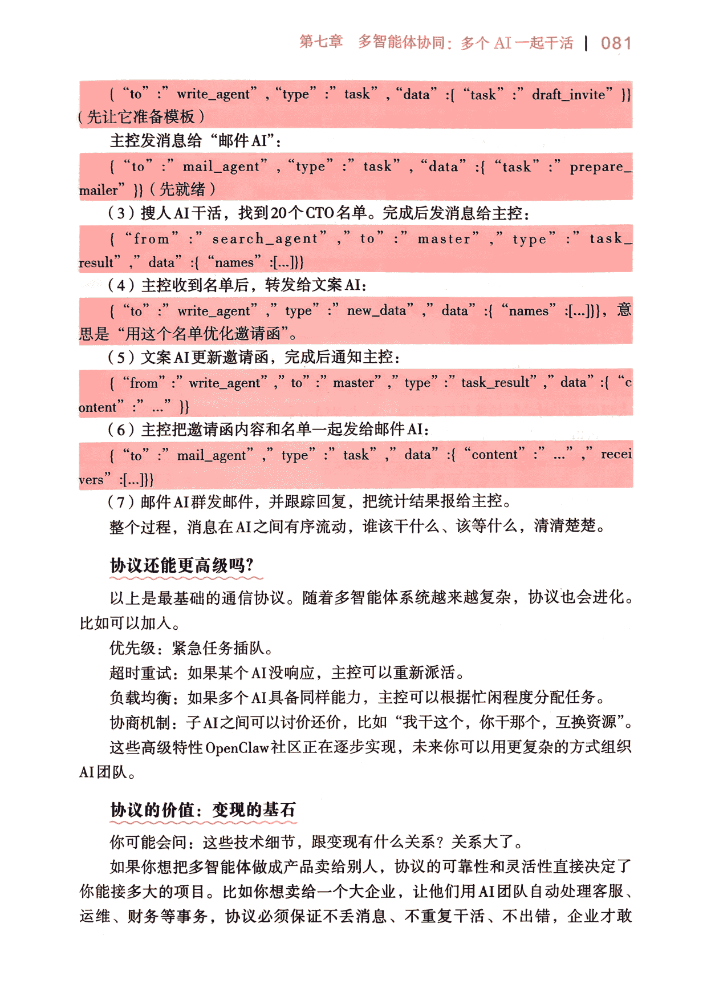

# 从零到一养龙虾openclaw入门实操变现

# 前言

## 开启养“龙虾”之旅，让AI为你赚钱

想象一下：你每天要花好几个小时做的那些重复工作——回邮件、整理表格、发通知、找资料……如果这些事，能完全交给一个24小时在线、还不要工资的“数字员工”去做，会怎样？

这个想象，已经不再是未来。

欢迎来到养“龙虾”的世界。这里的“龙虾”，不是餐桌上的美味，而是一只名为 OpenClaw 的、真正能替你干活的AI智能体。它像一个全能的数字助手，坐镇在你的电脑或云端，拥有理解你意图的“大脑”（Agent），调用各种软件的“手脚”（Skill），记住你所有需求和偏好的“记忆”（Memory），并通过一个聪明的“门卫”（Gateway）与你顺畅沟通。

本书所要讲述的核心，就是如何“驯养”这只“龙虾”，让它从听懂指令，到自主工作，最终，为你创造真金白银的价值。

你可能已经在社交媒体上看过它的神奇案例：有人让它自动研究并挑选性价比最高的二手车，有人指挥它将一个庞大的代码库从GitLab完整迁移到GitHub，还有人训练它每天自动扫描行业报告，生成简洁的每日简报。2025年底，当它的开发者彼得·斯坦伯格公开展示这些能力时，整个技术社区都为之兴奋。紧接着，全球主流的云服务商，从腾讯云、阿里云到火山引擎，都迅速提供了“一键部署”服务，让每个人都能在几分钟内拥有自己的“龙虾”。

这意味着，一个强大的、具备系统级操作能力的AI生产力工具，其门槛已经前所未有地降低了。它不再是大型企业或顶尖程序员的专属玩具。无论你是一个想提高效率的自由职业者，一个希望自动化工作流的小团队负责人，一个寻找新机会的开发者，还是一个对技术趋势敏感的创业者，养“龙虾”都可能成为你职业生涯中的一个转折点。

这正是我们写作本书的初衷。我们发现，网络上关于OpenClaw的讨论很多，但大多是零散的代码片段或炫酷的演示视频。一个普通用户，该如何从零开始，


# 第一部分 入门：认识你的“龙虾”——OpenClaw 快速入门

# 第一章 认识这只“龙虾”：它能帮你赚哪些钱？

## 1.1 OpenClaw是什么？一个真正会干活的AI“龙虾”

你有没有遇到过这样的场景：老板让你整理一百份合同，把关键信息填进Excel；客户要你每天监控竞品动态，写一份周报；你自己想买辆车，却要在十几个网站上比价、填表单等销售电话……这些事情做起来不难，但就是费时间、费精力、毫无成就感。你想找个实习生帮你干，可实习生要发工资、要培训，还要担心他离职。

现在，有了OpenClaw，你相当于有了一个24小时在线的数字实习生。它不是那种只会聊天的AI——你问它“明天天气怎么样”，它告诉你答案，然后你就得自己去查天气App、安排行程。OpenClaw不一样，你告诉它“明天北京要是下雨，就提醒我带伞，顺便帮我查一下从家到公司那条路有没有封路”，它会真的去查天气、查交通信息，然后给你一个完整的建议。它不只是“动口”，而是真的“动手”。

### 这只“龙虾”到底是什么？

OpenClaw是一个开源的AI代理框架，你可以把它理解成一个能直接操作你电脑的AI。它由奥地利程序员彼得·施泰因贝格尔在2025年底开发，不到三个月就成为GitHub上增长最快的开源项目，收获了超过26万颗星标。在中国，大家叫它“龙虾”（因为它的logo是一只红色的龙虾）。在国外，它的口号是“The AI that actually does things”——真正做事的AI。

简单说，OpenClaw就是你的私人数字员工。你可以通过微信、WhatsApp、Slack或者命令行告诉它：“帮我整理桌面上的文件”“给张三发一封邮件，告诉他合同我收到了”“每天凌晨两点检查服务器日志，有异常就发短信通知我”。它会立刻执行，并且把结果告诉你。

### 它和ChatGPT、Claude有什么区别？

你肯定用过ChatGPT或者Claude。它们非常聪明，能写诗、能编程、能回答各种问题，但有个致命的缺陷：它们只能说话，不能动手。

比如你让ChatGPT“把桌面上所有PDF文件按日期整理好”，它只能回复你“你可以这样做：打开文件夹，选中文件，右键排序……”——最后还是得你自己干。OpenClaw不一样，它可以直接在你的电脑上执行操作：读取文件、移动文件、创建文件夹，甚至打开浏览器帮你填表单。它不需要你一步步教，你只要告诉它目标，它自己想办法完成。

这个区别，就像你请了一个咨询顾问和一个全职助理一样。顾问给你出主意，你得自己干；助理直接帮你把事情办了。OpenClaw就是那个助理。

### 它能干什么活？

OpenClaw能干的事情，取决于你给它装了什么“技能”（Skill）。每个技能就像一个新工具，让AI多一项能力。目前社区已经开发了600多项技能，覆盖了你能想到的大部分场景：

- （1）文件处理：整理桌面、分类文档、提取PDF表格等。
- （2）网络操作：发邮件、查天气、刷微博、抓取网页数据等。
- （3）办公自动化：操作Excel、写周报、管理日历、发送会议邀请等。
- （4）开发运维：部署代码、监控服务器、备份数据库、迁移仓库等。
- （5）生活助手：比价购物、订机票、提醒吃药、记录饮食等。

你可以把这些技能组合起来，完成更复杂的任务。比如前面说的买车案例：OpenClaw可以同时打开十几个网站，填写询价表单，等邮件回复，最后把所有报价整理成一张表格发给你——全程不用你动手。

### 为什么它能“真正做事”？

OpenClaw的秘密在于它的架构。它不像传统AI那样运行在云端服务器里，而是直接跑在你的电脑上（也可以跑在云服务器上）。这意味着它有权限访问你的文件系统、调用你的命令行、操作你的浏览器。同时，它有一套完整的“大脑”（Agent）和“手脚”（Skills）：大脑负责理解你的意图、规划任务步骤；手脚负责执行具体操作。两者配合，就能完成从“思考”到“执行”的全过程。

更重要的是，它有记忆。你告诉过它你的名字、你的偏好、你的工作习惯，它都会记住。下次你再找它办事，它会根据对你的了解，给出更贴心的服务。用久了，它会越来越懂你。

综上所述，OpenClaw不是一个只会聊天的AI智能体，它是一个能直接操作你电脑、帮你干活的数字员工。它让你从重复劳动中解放出来，把时间花在更有价值的事情上，比如思考怎么用它赚钱。接下来的章节，我会带你一步步上手，从安装部署到开发技能，再到真正变现。

## 1.2 OpenClaw如何帮人赚钱：从买车到搬代码的真实案例

很多人第一次听说OpenClaw时，都会问一个问题：它能帮我赚钱？答案是肯定的。但OpenClaw不是印钞机，它不能直接变出钱来。它赚钱的逻辑很简单：用AI帮你省时间，省下来的时间你可以去做更有价值的事；或者把AI的能力打包成服务，直接卖给需要的人。

下面，给你讲几个真实发生过的案例。这些案例来自OpenClaw社区、创始人的演示，以及早期用户的分享。看完你就会明白，为什么那么多人把这只龙虾当成自己的“数字员工”。

### 案例一：买车省下两万块，还赚了一笔服务费

2026年1月，彼得·施泰因贝格尔在X平台上发了一段视频，他用Clawdbot（OpenClaw的前身）给自己买了一辆车。视频里，他在WhatsApp上对AI说：“帮我找一辆混动SUV，预算40万左右，对比一下附近经销商的报价。”然后AI就开始干活：打开浏览器，访问十几家汽车网站，填写询价表单，等邮件回复，最后把所有报价整理成一张对比表格发给他。整个过程不到两小时，而以前他自己干至少需要两天。

这个视频火了，因为大家第一次看到AI真的能“动手”干活。但更精彩的故事在后面。有个网友看完视频后私信施泰因贝格尔：“你能不能也帮我买一辆？我给你1000块钱跑腿费。”施泰因贝格尔当然没时间，但他把这个需求抛到了社区。一个叫Mike的开发者接了这个单——他用自己的OpenClaw跑了同样的流程，帮那位网友拿到三家经销商的报价，最后网友选了一辆最便宜的，比他自己去谈便宜了大概两万块。Mike收了1000元跑腿费，网友也高兴，双赢。

Mike后来把这个流程做成了一个叫“AutoBuy”的技能，挂到ClawHub上，每个月收5块钱订阅费。现在有300多个人订阅，他每个月躺着赚1500多块。而最初那个帮他赚到第一桶金的需求，只是朋友的一句玩笑话。

这个案例告诉我们：帮人省时间、省钱，就是赚钱的生意。你可以用OpenClaw替别人干那些他们不想干、没时间干的重复劳动——比价、填表、跑腿问价，然后按次收费或者订阅收费。

### 案例二：代码迁移，三天活变成三小时

2026年2月，Kubernetes官方宣布Ingress NGINX即将退役，全球无数运维工程师开始焦虑。因为这意味着他们需要在两个月内，把公司所有的 Ingress 配置从 NGINX 迁移到新的 Ingress Controller。一个中型公司可能有上百个 Ingress 资源，手动迁移至少需要一周，加班加点也得三天。

有个叫 Sarah 的运维工程师在 Discord 上抱怨：“这活太恶心了，全是重复劳动，但不敢出错。” 另一个开发者回复她：“试试用 OpenClaw，我写了个迁移脚本，半小时跑完。”

Sarah 半信半疑地装了 OpenClaw，按照那个开发者分享的技能配置跑了一遍。结果真的不到一小时，所有 Ingress 配置就被自动分析、转换、验证，最后生成了一份迁移报告和操作手册。她只需要在周末的低峰期照着手册执行几条命令，就完成了原本需要三天的手工操作。

Sarah 后来把这个经验写成了一篇博客，发在技术社区。没想到，有十几家公司私信她，问她能不能帮忙迁移。她试着接了两单，每单报价 5000 块，用 OpenClaw 半天干完，净赚一万。现在她专门接这种“技术迁移”的外包，用 OpenClaw 批量处理，一个月能接三四单，收入比工资还高。

这个案例告诉我们：技术活儿也能用 AI 外包。你不是在卖自己的时间，而是在卖 AI 的能力。你把流程自动化，然后按项目收费，边际成本极低。

### 案例三：自动盯盘写研报，分析师变“甩手掌柜”

2026 年 3 月，国内好几家券商的金融工程团队不约而同地发布了 OpenClaw 的使用教程。为啥？因为他们发现，OpenClaw 能替分析师干那些最枯燥的活：每天盯公告、整理数据、写日报。

某证券公司的一个分析师在报告里写了一个案例：他们让 OpenClaw 每天早上 8 点自动抓取前一天的 A 股公告，分类整理，提取关键信息（比如业绩预告、并购重组），然后生成一份几百字的简报，直接推送到研究员的微信。以前这些活需要实习生干两个小时，现在 AI 两分钟搞定。

更狠的是，有人用 OpenClaw 实现了“自动化研报复现”。你把一篇研报扔给它，它自动解析逻辑，去数据库拉数据，写代码回测，最后输出一份带图表的复现结果。以前研究员自己复现一篇研报至少需要半天，现在 AI 跑一趟只要十分钟。

有个叫 Leo 的分析师离职后，自己开了个小工作室，专门给私募基金提供“定制化研报”服务。他雇不起全职研究员，就买了台服务器跑 OpenClaw，用 AI 批量生成各行业的周报。每个私募每月收 3000 块，他做了 20 个客户，月入 6 万，大部分工作都是 AI 干的。

这个案例告诉我们：把专业能力产品化，用 AI 放大你的产出。你不是在卖时间，而是在卖一个自动化系统。前期花点时间搭建，后期躺着收钱。

### 案例四：帮小老板做竞品监控，每月收2000元服务费

有个叫小林的自由职业者，专门帮淘宝店主做运营。他发现很多小老板根本没时间天天盯着竞争对手：今天谁降价了，谁上了新品，谁搞了活动。但这些东西又很重要，直接影响自己的定价和促销策略。

小林用OpenClaw搭建了一个“竞品监控”流程：每天定时爬取竞争对手的店铺页面，提取价格、销量、评价，然后生成一份对比报告，用邮件发给老板。他找了五个淘宝店主推销这个服务，每个店每月收2000元。有两个老板当场就签了，一个月四千块，够他房租了。

后来他又把这个流程优化了一下，加了自动预警功能：如果竞争对手降价超过5%，就立刻发短信提醒老板。这个功能让他又多收了一笔钱。

这个案例告诉我们：小老板的痛点就是你的商机。他们没技术、没时间，但愿意花钱买省心。你用OpenClaw把他们的痛点自动化，就能收钱。

### 案例五：自动比价，卖给返利网站赚分成

有个技术宅叫阿杰，平时喜欢研究各种购物省钱技巧。他发现很多返利网站其实需要大量的比价数据——某商品在京东多少钱、淘宝多少钱、拼多多多少钱，返利网站根据这些信息计算返利比例。但人工比价太慢了，而且不实时。

阿杰用OpenClaw写了一个“全网比价”功能，可以同时查询十几个电商平台的价格。他把这个技能包装成一个API，然后去找返利网站谈合作：你们调用我的API，每查一次给我一分钱。有一家小网站同意试试，结果发现确实好用，每个月能省下一个人力。现在阿杰的API每天被调用上万次，躺赚。

这个案例告诉我们：把技能做成基础设施，按调用量收费。你不需要直接面对终端用户，而是卖给那些需要这种能力的企业，赚的是规模化服务的钱。

这些案例的共同点是什么？它们都不是靠“卖软件”赚钱，而是靠“卖结果”赚钱。OpenClaw本身是开源的，免费，但你能用它创造的价值，却是可以定价的。你可以帮别人省时间、省钱、省力，然后从中分一杯羹。

## 1.3 哪些人适合养“龙虾”？开发者、运营者、自由职业者、小老板

上一节我们看了好几个用OpenClaw赚钱的真实案例，你可能会想：这些人是不是都是技术大神？我没什么编程基础，是不是就跟这只龙虾无缘了？完全不是。

OpenClaw的赚钱机会，不是少数人的专利。不同背景的人，都能找到适合自己的玩法。开发者可以开发技能卖给全世界，运营可以用它批量干活接外包，自

## 008 | 从零到一养“龙虾”：OpenClaw入门实操变现攻略

比如你是翻译，以前翻译一本手册要一周。现在你可以用OpenClaw先做一遍机器翻译，然后你只负责校对和专业术语润色，效率提升50%以上。省下来的时间可以多接几单。

自由职业者往往是多面手，但时间有限。OpenClaw可以帮你把那些重复、耗时的部分自动化，让你专注于高价值的创意和决策，接单能力直接提升。

### 小老板：降本增效、开辟新业务

小老板最关心的就两件事：怎么省钱，怎么赚钱。OpenClaw能帮你做到这两点。

先说省钱。你可以用OpenClaw代替一部分人力。比如你开淘宝店，每天要处理几十个客服咨询。雇一个客服每月要四五千，用OpenClaw自动回复常见问题，人工只需要处理复杂客诉，一年能省几万块。再比如你做跨境电商，每天要上架几十个商品，用OpenClaw自动抓取供应商数据、填写表格、上传平台，一个人能干三个人的活。

再说赚钱。你可以把OpenClaw的能力变成新服务，卖给你的同行或上下游。比如你是做房产中介的，可以帮其他中介开发一套“自动发房源到58同城、贝壳”的工具，每个月收几百元服务费。你是做电商培训的，可以开一门课，教小老板用OpenClaw自动运营店铺，每人收几百块，来几十个学员就是一笔收入。

小老板的优势是懂行业、有客户。你不需要自己开发复杂技能，只要能把OpenClaw用起来，就能在现有业务上砍成本、加收入。

看到这里你应该明白了：OpenClaw的赚钱机会，不是看你会不会写代码，而是看你有没有“用AI解决重复劳动”的意识。开发者可以卖技能，运营可以批量干活，自由职业者可以提效接单，小老板可以降本增收。不同背景的人，都能在这只龙虾身上找到适合自己的玩法。

## 1.4 四种“龙虾”变现模式：卖服务、卖技能、卖自动化流程、接外包

上一节我们聊了不同背景的人怎么用OpenClaw赚钱。你可能已经对号入座，找到了自己的方向。但方向归方向，真正落地的时候，你会发现赚钱的方式其实就那么几类。把这几类摸透了，你就知道自己该往哪使劲。

我总结了一下，用OpenClaw变现主要有四种模式：卖服务、卖技能、卖自动化流程、接外包。这四种模式不是互相排斥的，你可以从一种开始，慢慢扩展到其他几种。下面我们一个一个来看。

### 卖服务：用自己的时间帮别人省时间

卖服务是最直接、门槛最低的模式。简单说，就是你操刀，用OpenClaw帮客户完成那些重复、耗时的任务。客户付你钱，你把结果给他。

比如，你帮一个小老板每周出一份竞品分析报告。你自己用OpenClaw梳理好爬虫、分析、报告的流程，每周自动跑一遍，然后把报告发给他。每月收2000元。这2000元买的是你的“手艺”——你会用OpenClaw，而客户不会。

卖服务的好处是：不需要开发复杂的技能，只要你自己会用OpenClaw就行。客户的需求五花八门，你可以灵活接单，积累经验。坏处是：你的时间和精力有限，干一单赚一单，很难规模化。

适合人群：运营、自由职业者、刚入门的小白等。你可以先从身边的朋友、小老板开始，帮他们解决具体问题，比如自动整理发票、自动发朋友圈、自动回复客服消息。慢慢积累口碑，单子就会多起来。

### 卖技能：把能力封装起来，卖给无数人

卖技能是上一级的玩法。你不是亲自去干活，而是把你会的某个能力做成一个“技能包”（Skill），挂到ClawHub上，让全世界的人都能下载使用。你可以设置一次付费下载，或者每月收几块钱订阅费。

比如你开发了一个“自动生成周报”的技能。用户安装后，只需要输入本周的工作内容，技能就能自动生成一份漂亮的周报，还能根据用户的历史记录调整风格。这个技能可能只需要你写几百行代码，但一旦上架，就有可能被成千上万的人使用。假设每月收3块钱，有1000个人订阅，你每个月就是3000块被动收入。

卖技能的核心是找到普适的痛点。你不需要为每个客户定制，只需要解决一类人的共同问题。技能上架后，基本不需要你再花时间维护（除非有bug）。这是典型的“一次开发，长期收益”。

适合人群：开发者，或者有一定编程能力的爱好者。技能既可以是简单的（比如天气查询），也可以是复杂的（比如浏览器自动化）。关键是能不能满足用户的需求。

### 卖自动化流程：把解决方案产品化

卖自动化流程介于服务和技能之间。它不是单个的技能，而是一整套的自动化解决方案，通常面向特定的垂直领域。你可以把这套方案打包成一个“产品”，卖给多个客户。

比如你发现很多做跨境电商的小老板都需要“自动上架商品”的功能。你开发了一套完整的流程：从1688抓取商品信息、翻译成英文、生成商品描述、上传到Shopify。这个流程可能涉及多个技能的组合，但你把它做成一个“一键部署”的包，客户买回去就能用。你可以按年收费，比如每年收1999元。

卖自动化流程的好处是：产品化程度高，边际成本低，而且客户黏性大。一旦客户用上了你的流程，就很难换掉。缺点是：你需要对某个行业有比较深的理解，知道他们的痛点是什么，而且流程的稳定性、兼容性都要考虑周全。

适合人群：有行业经验的产品经理、技术负责人、小老板等。你可以从自己熟悉的领域切入，比如房产中介、教育培训、电商运营等，把那些重复的工作流程化、自动化。

### 接外包：在平台上赚快钱

接外包是最传统的模式，但在OpenClaw的加持下，你的效率和竞争力会大大提升。你可以去猪八戒、淘宝、程序员客栈这些平台接单，帮客户做数据处理、爬虫、系统迁移之类的项目。

比如客户需要把一万张图片按规则重命名，手动做可能要三天，你用OpenClaw写个脚本，半小时跑完，收他500块。客户觉得值，你赚得也轻松。因为你有OpenClaw这个“数字员工”，你可以同时接好几个单，效率比别人高，报价就可以更有竞争力。

接外包的好处是：现金来得快。坏处是：竞争激烈，需要花时间找单子、沟通需求、应对售后。而且每个单子都不一样，很难积累可复用的资产。

适合人群：自由职业者、刚起步的个人开发者。你可以先通过接外包积累经验和案例，等有了一定的积累，再往卖服务或卖技能的方向转。

### 该如何做选择？

这四种模式不是非此即彼，你可以根据自己的情况选择，甚至可以同时进行。

如果你刚开始接触OpenClaw，可以先从接外包或卖服务入手。找一些小单子练手，熟悉OpenClaw的操作，同时也赚点零花钱。

如果你有一定的开发能力，可以尝试卖技能。找到一个细分痛点，开发一个高质量的Skill，让它帮你赚钱。

如果你对某个行业很了解，可以试试卖自动化流程。把行业经验转化为产品，服务更多客户。

记住，所有的变现模式最终都要回到一个核心：你能帮别人解决什么问题。OpenClaw只是工具，真正值钱的是你对问题的理解和解决方案的落地能力。

# 第二章

## 10 分钟上手：让“龙虾”跑起来

## 2.1 Windows/Mac/Linux一键安装，小白也能养“龙虾”

我第一次给别人推荐 OpenClaw 的时候，对方第一反应通常是：“听起来挺牛的，但安装会不会很复杂？我电脑不太行，怕搞砸了。”
如果你也有这个担心，放心，你不是一个人。我刚开始也怕，毕竟听到“命令行”“Node.js”“环境变量”这些词就头大。但真装过一次就知道，OpenClaw 的安装已经简单到不能再简单了——不管你用 Windows、Mac 还是 Linux，基本上就是“打开终端，敲一行命令，回车，等几分钟”的事。
这一节，我就手把手带你走完整个过程。你不需要懂任何编程知识，只需要会复制粘贴就行。

### 安装前的准备：一分钟检查

在正式开始之前，有两件事需要确认一下。
第一，你的电脑能联网。这好像是废话，但确实需要——安装过程中要从网上下载文件。
第二，你的电脑系统是 Windows 10 以上、macOS 11 以上，或者任何主流的 Linux 发行版（比如 Ubuntu 20.04 以上）。基本上只要不是你十年前的老古董，都没问题。
如果你的电脑比较老，或者配置比较低，也别担心，OpenClaw 本身对硬件要求不高，2G 内存、10G 硬盘就够跑起来了。

### Windows 用户：最简单的一键安装

如果你是 Windows 用户，恭喜你，你是最省心的。OpenClaw 官方给 Windows 做了专门的安装包，就像装微信、QQ 一样，双击就行。
打开浏览器，访问 OpenClaw 的官方网站（openclaw.com），首页就有大大的“下载 Windows 版”按钮。点击下载，得到一个 .exe 文件。
找到这个文件，双击运行。如果弹出安全警告，别怕，点“更多信息”，然后点击“仍要运行”就行。接下来就是一路“下一步”——选择安装位置、创建桌面快捷方式，跟装其他软件一模一样。
装完之后，桌面上会出现一个叫“OpenClaw”的图标。双击打开，你会看到一个黑色的窗口（这是命令行界面），里面有一行字：openclaw >。
到这里，安装就完成了。是不是跟装个游戏一样简单？
如果你更喜欢用命令行安装（有些技术控喜欢这种方式），也可以打开“命令提示符”或“PowerShell”，输入下面这行命令：

```
winget install openclaw
```

回车之后，系统会自动下载安装，全程不用你管。

### Mac 用户：Homebrew 一招搞定

Mac 用户稍微麻烦一点点，但也就是多打一行命令的事。
Mac 上最流行的安装方式是用 Homebrew——你可以把它理解成 Mac 的应用商店，只不过是在命令行里用的。如果你还没装 Homebrew，先打开“终端”（在“启动台”的“其他”文件夹里能找到），输入这行命令：

```
/bin/bash -c "$(curl -fsSL https://raw.githubusercontent.com/Homebrew/install/HEAD/install.sh)"
```

回车之后，系统会让你输密码（就是你的 Mac 登录密码），然后等几分钟，Homebrew 就装好了。
有了 Homebrew，装 OpenClaw 就是一句话的事：

```
brew install openclaw
```

系统会自动下载、安装，大概一分钟。装完之后，你在终端里输入 openclaw --version，如果看到类似 0.9.0 这样的版本号，就说明装成功了。
如果你不想装 Homebrew，也可以直接下载安装包。去官网点“下载 Mac 版”，得到一个 .dmg 文件，双击打开，把 OpenClaw 拖到“应用程序”文件夹里就行。之后每次用的时候，打开“终端”，输入 /Applications/OpenClaw/bin/openclaw 就能运行。不过这个方式稍微麻烦点，建议还是用 Homebrew。

### Linux 用户：一行命令的事

Linux 用户通常都习惯命令行，安装就更简单了。打开终端，输入：

```
curl -fsSL https://get.openclaw.com | bash
```

或者如果你更喜欢用包管理器，Ubuntu/Debian 用户可以用：

```
sudo apt update
sudo apt install openclaw
```

Fedora 用户用：

```
sudo dnf install openclaw
```

装完之后，在终端里输入 openclaw --version 验证一下，看到版本号就说明成功了。

### 安装后第一件事：初始化

不管你是哪个系统，装完之后还有一步：初始化。这一步其实就是让 OpenClaw 在你电脑上创建一个工作目录，放一些配置文件。

打开终端（Windows 上如果你用的一键安装，打开那个叫 “OpenClaw” 的快捷方式也会自动打开终端），输入：

```
openclaw init
```

系统会问你要不要设置一些东西，比如 API 密钥什么的。第一次用，直接一路回车，用默认设置就行。

初始化完成之后，你会看到类似这样的提示：

```
✅ OpenClaw 初始化成功！
配置文件位置：/Users/你的用户名/.openclaw/config.yaml
```

这就说明，你的 OpenClaw 已经准备好干活了。

### 验证一下：真的装好了吗？

为了确保一切正常，我们来跑一个最简单的命令。在终端里输入：

```
openclaw exec “你好”
```

如果看到类似这样的回复：

```
你好！我是 OpenClaw，有什么可以帮你的？
```

那就恭喜你，OpenClaw 已经在你电脑上跑起来了！
如果没看到，也别急。检查一下前面的步骤有没有漏掉，或者看看附录 C 的常见问题，里面列出了各种安装问题的解决办法。

你看，从打开终端到跑起来，最多也就 10 分钟。不管你用 Windows、Mac 还是 Linux，都有对应的傻瓜式安装方法。
现在，你的电脑里已经有了一只随时待命的“龙虾”。

## 2.2 不想占本地资源？腾讯云/阿里云一键部署你的“龙虾”

上一节我们把OpenClaw装在了自己的电脑上，现在你可以随时指挥它干活了。但有个问题：你的电脑不可能24小时开机。晚上睡觉、出门办事、电脑没电的时候，OpenClaw就歇菜了。那些需要定时执行的任务——比如凌晨两点备份数据库、每天早上八点发日报——它就干不了。
另外，如果你电脑配置一般，跑着OpenClaw再开个浏览器、PS、微信，可能会卡。毕竟OpenClaw虽然不重，但也是个常驻后台的服务。
这时候，把OpenClaw部署到云服务器上就是最好的选择。云服务器7×24小时在线，配置高、网络稳定，而且不占用你本地一丁点资源。更重要的是，部署完之后，你可以随时随地通过手机微信、WhatsApp给它发指令，就像你的私人助理永远在线一样。
你可能觉得“云服务器”听起来挺高级，怕搞不定。别担心，现在国内主流云厂商——腾讯云、阿里云——都推出了OpenClaw的一键部署服务，比装个QQ还简单。这一节，我就带你走一遍流程。

### 为什么要用云服务器？

在动手之前，先明确一下：把OpenClaw放云端，到底图啥？
第一，永不关机。云服务器一年365天、每天24小时在线。你睡觉它不睡，你旅游它还在干活。那些需要定时执行的任务，交给它最放心。
第二，随时随地用。OpenClaw在云上，你在任何地方、用任何设备（手机、平板、别人家的电脑）都能通过微信或网页访问它，不用带着自己的电脑到处跑。
第三，不占本地资源。你的电脑只管发指令，跑任务全在云端。电脑再老也不怕。
第四，方便团队共享。如果你想让同事一起用这个AI，放云上大家都连得上，不用每个人的电脑都装一遍。
当然也有代价：云服务器要花点钱，但也不贵，最便宜的配置一个月几十块，少喝几杯奶茶就省出来了。而且很多平台有免费试用，你可以先薅羊毛。

### 准备工作：注册账号、实名认证

不管用哪家云厂商，第一步都一样：注册账号，完成实名认证。
腾讯云：访问cloud.tencent.com，点右上角“注册”。用微信扫码或者手机号注册。注册完之后，在“账号中心”里找到“实名认证”，按要求上传身份证或者扫脸，几分钟就能过。
阿里云：访问 aliyun.com，同样需要注册+实名。
这一步没什么技术含量，跟着页面提示走就行。如果卡住了，说明你可能很久没注册过网站了，多试几次。

### 腾讯云：轻量应用服务器一键部署

腾讯云是我用得比较多的，它的“轻量应用服务器”对新手特别友好。部署 OpenClaw 只需要三步。

**第一步：进入 OpenClaw 专属页面。**
登录腾讯云之后，在顶部的搜索框输入“OpenClaw”，回车。你会看到“OpenClaw极速部署”的活动页面，点进去。
如果搜不到，也可以直接点产品菜单里的“轻量应用服务器”，然后在“应用镜像”里选择“OpenClaw官方镜像”。现在腾讯云已经把 OpenClaw 做成了一键镜像，选它就相当于买了个预装好 OpenClaw 的电脑。

**第二步：选配置。**
这一步是唯一需要你动脑子选的，但选项也不多。
地域：选离你最近的城市。你在北京就选“北京”，在上海就选“上海”，离得近网速快。
套餐：最便宜的入门版就行（一般是 2核4G内存，60G硬盘），几十块钱一个月。OpenClaw 自己不吃配置，这配置跑它绰绰有余。
镜像：确认选的是“OpenClaw官方镜像”，别选成别的。
其他选项保持默认，不用动。

**第三步：点购买。**
确认一下费用（新用户通常有免费试用），然后点“立即购买”。系统会自动创建一台云服务器，并把 OpenClaw 装好。这个过程只需两三分钟。
买完之后，你会看到一个页面，上面有这台服务器的“公网IP地址”——一串数字，比如 124.123.45.67。记下这个 IP，后面要用。

### 阿里云：镜像市场一键部署

阿里云的流程稍微绕一点点，但也很简单。

**第一步：进入镜像市场。**
登录阿里云，在控制台首页找到“云服务器 ECS”。如果没有，可以在搜索框搜一下。
进到 ECS 页面后，左边菜单找“镜像”，点进去，再点“镜像市场”。在搜索框里搜“OpenClaw”，会出现“OpenClaw官方镜像”，点“使用”。

**第二步：创建实例。**
点完“使用”之后，会自动跳转到创建云服务器的页面。系统已经帮你选好了镜像，你只需要：
选地域：一样，离你越近越好。
选实例规格：推荐“共享型s6”，2核4G内存。第一次用，按量付费就行，用几个小时花几块钱。
设置密码：这是你登录服务器要用的密码，设个自己能记住的（比如OpenClaw2026），但别太简单。
确认订单：检查一下费用，然后点“创建”。
创建成功之后，你会得到一个公网IP，记下来。

### 连接你的云端OpenClaw

服务器创建好了，OpenClaw也在里面了。怎么用呢？
最简单的方式：直接用浏览器访问。在浏览器地址栏输入http://你的公网IP:8080（注意是http不是https）。如果看到OpenClaw的欢迎页面，就说明它已经活得好好的。
第一次访问需要几分钟初始化，等一等。
如果你想用命令行操作，可以用SSH登录（Windows用户可以用PowerShell或者装个Putty）：

```
ssh root@你的公网IP
```

输入刚才设置的密码，就连进去了。然后在服务器里，你可以像在本地一样敲openclaw命令。

### 初始化配置

云上的OpenClaw虽然装好了，但还需要简单初始化一下，输入：

```
openclaw init
```

一路回车，用默认设置就行。之后启动Gateway：

```
openclaw gateway start
```

看到Gateway started就说明跑起来了。

### 让OpenClaw永久运行

云服务器有个特点：你退出SSH连接后，刚才启动的OpenClaw可能就停了。为了让它在后台一直运行，需要把它注册成系统服务。腾讯云的镜像已经帮你做了这一步，阿里云的可能需要手动配一下。
最省事的办法：用screen命令。登录服务器后，先敲screen，然后启动OpenClaw。

### 费用提醒

云服务器是按小时收费的，如果你只是测试，记得用完把服务器“关机”或者“释放”，不然会一直扣钱。腾讯云和阿里云都有“费用预警”功能，建议设置一下，万一忘关了也有短信提醒。

## 2.3 Gateway 是什么？为什么它是“龙虾”的“门卫”

前两节我们把 OpenClaw 装到了电脑上，也启动了它。但你可能有个疑问：我给它发消息，它到底是怎么收到的？如果我想通过微信、WhatsApp 跟它聊天，它又是怎么接进来的？

这些问题，都跟一个叫 Gateway 的组件有关。你可以把它理解成 OpenClaw 的“门卫”——所有进入系统的消息，都必须先经过它。

### 一个有门卫的小区

想象一下你住在一个小区里，每天有快递员、外卖员、朋友来访。如果没有门卫，这些人直接冲进你家，你会不会疯掉？门卫的作用就是：拦下所有人，问清楚找谁、有什么事，登记一下，然后告诉你去哪栋楼哪个房间。

Gateway 在 OpenClaw 里干的正是这个活。所有想跟你的 AI 说话的人——不管是从命令行敲命令的你，还是从微信发消息的客户，都得先到 Gateway 这儿“登记”。Gateway 确认了身份，再告诉 AI：“有人找你，他说了这些。”

没有 Gateway，你的 AI 就得自己应付所有这些乱七八糟的请求：微信消息怎么收？命令行输入怎么解析？万一有人发恶意消息怎么办？那 AI 就没法专心干活了。

### Gateway 到底干什么

具体来说，Gateway 做了四件大事：

第一，接收四面八方的消息。你的 AI 可能接入多个渠道：命令行、微信、Slack、WhatsApp，甚至你自己写的网页。这些渠道的消息格式五花八门。Gateway 就像一个翻译官，把各种“方言”都翻译成 AI 能听懂的“普通话”，然后递进去。

第二，找到对的“人”。你可能有多个 AI 会话在同时进行——比如你一个人在用，你同事也在用。Gateway 会根据消息里的用户标识，找到正确的那个会话，把消息送过去。不会把你的消息错发给同事的 AI。

第三，维持对话上下文。你跟 AI 聊天，说了上句，下句 AI 得记得上句说了什么。Gateway 会管理这些会话状态，保证你每次发消息，AI 都知道这是接着刚才的话说的。

第四，把门看好。坏人想给 AI 发恶意指令怎么办？Gateway 可以配置身份验证，只有你授权的人才能跟 AI 对话。它还负责控制流量，防止有人刷屏把系统搞崩。

### 你其实已经见过它了

前两节我们执行过 `openclaw gateway start`，这就是在启动门卫。启动之后，它会一直在后台等着，你发消息它就忙活，没消息它就安静待着。

你可以在终端里输入：

```
openclaw gateway status
```

如果看到类似 “Gateway is running” 的字样，就说明门卫正在值班。

### 没有 Gateway 会怎样？

你可以试试：关掉 Gateway，然后执行 `openclaw exec “你好”`。你会发现，命令报错了——因为没人接收你的消息了。这就像一个小区门卫下班了，快递员进不来，你的快递就卡在门口。

这就是 Gateway 存在的意义：它是整个系统的入口，所有外部通信都必须经过它。

理解了 Gateway，下一节我们就能用它来跟 AI 对话了。再往后，你想接入微信、Slack，都得在 Gateway 里配置对应的“频道”（channel）。它就像门卫手里的访客登记本，每接入一个新渠道，就在本子上加一条记录。

现在，我们的门卫已经上岗，是时候去敲它的门，给 AI 发第一条指令了。

## 2.4 第一个命令：在命令行里跟你的“龙虾”对话

安装好了，Gateway 也跑起来了，现在该让这只龙虾真正干活了。这一节，我们通过命令行向 OpenClaw 发送第一条指令，感受一下“真正做事的 AI”是什么体验。

### 先确认 Gateway 在值班

在发命令之前，先看一眼 Gateway 是不是还活着。打开终端，输入：

```
openclaw gateway status
```

如果看到 “Gateway is running”，说明门卫正在站岗，可以放心喊话。如果没跑起来，记得先执行 `openclaw gateway start` 启动它。

### 第一句话：打个招呼

在终端里敲下这行命令：

```
openclaw exec “你好”
```

回车，等几秒钟。如果一切正常，你会看到类似这样的回复：

```
你好！我是OpenClaw，有什么可以帮你的？
```

就这么简单——你的第一条AI指令成功送达，并且得到了回复。

### 如果没收到回复

如果你看到的是一段红色的错误信息，别慌，常见情况就两种。

情况一：没有配置模型。
错误信息里可能包含 “No model configured” 或 “请配置模型API”。这是因为OpenClaw默认需要用一个大语言模型来理解你的自然语言指令。如果你还没配置，它会报错。
解决办法：暂时绕过去，或者快速配一个。最简单的方式是先用“技能调用”模式，跳过自然语言理解：

```
openclaw exec “system: date”
```

这条命令会直接让AI执行系统的date命令，返回当前时间。这里的`system:`就是直接调用系统命令技能，不需要模型理解。

情况二：Gateway没跑起来。
如果报错说连接不上Gateway，那就回到上一节，确保Gateway已经启动。

### 来点实在的：让AI干点活

光打招呼没意思，真的让它干活。比如，让它列出当前目录下的文件：

```
openclaw exec “列出当前目录下的文件”
```

如果你的模型配好了，它会理解你的意思，调用filesystem技能，然后返回文件列表。如果没配模型，也可以用显式技能调用：

```
openclaw exec “filesystem:list”
```

```
openclaw exec “现在几点”
```

它会调用系统时间技能，给你一个准确的时间。

### 如果 AI 理解错了

有时候模型可能会误解你的意思。比如你说“帮我打开浏览器”，它可能回你一段“要打开浏览器，你可以点击图标”之类的建议，而不是真的打开浏览器。这是因为有些操作需要额外授权，或者模型没搞懂你要它执行而不是教你怎么做。
这时候可以试试更明确的指令，比如：

```
openclaw exec “用浏览器打开 https://openclaw.com”
```

或者直接调用技能：

```
openclaw exec “browser:open --url https://openclaw.com”
```

### 两种对话模式：单次执行 vs 交互式

上面我们用的都是 `openclaw exec`，它是一次性的：发一条指令，得到回复，结束。适合测试和脚本调用。
还有一种模式叫 `openclaw repl`，它会进入一个交互式会话，你可以连续对话，AI 会记住上下文。在终端输入：

```
openclaw repl
```

你会看到提示符变成 `You:`，然后就可以像聊天一样输入了。想退出就输入 `exit` 或按 `Ctrl+C`。
不过本节我们先专注在 `exec` 上，等后面章节再深入 `repl`。

### 第一条命令，你学会了什么

通过这一节，你已经：

1. 确认了 Gateway 在运行；
2. 发送了第一条自然语言指令；
3. 学会了用显式技能调用绕过模型；
4. 体验了让 AI 执行实际任务；
5. 了解了单次执行和交互式模式的区别。

现在，OpenClaw 已经可以在命令行里为你服务了。但命令行毕竟不够方便——谁能天天开着终端敲命令呢？下一节，我们就要让它干一件最实用的活：帮你把乱七八糟的桌面文件收拾干净。

## 2.5 练习：让“龙虾”帮你把桌面文件收拾干净

前面几节，我们已经把OpenClaw装好了，也跟它聊了几句。但你买这只“龙虾”不是为了聊天，是为了让它干活。这一节，我们就来干一件最实在的事：让你那个乱糟糟的电脑桌面变得井井有条。
如果你跟我一样，桌面永远堆满了截图、PDF、各种“新建文件夹”，那这一节就是为你准备的。

### 先看一眼你现在的桌面

打开你的电脑桌面，看一眼，是不是这样：
十几个文件散落各处，有图片、有文档、有压缩包。
文件名乱七八糟，“新建文本文档(5).txt”“截图(3).png”
想找个文件得用眼睛扫半分钟，
没关系，我们让OpenClaw来收拾。

第一步：确认 Gateway 在跑着。
老规矩，先确认门卫在值班，输入：

```
openclaw gateway status
```

如果没跑，记得 `openclaw gateway start` 启动。

第二步：给 AI 下指令。
在终端输入这条命令（或者直接复制粘贴）：

```
openclaw exec “把桌面上的文件按类型分类，图片放到 Images 文件夹，文档放到 Documents 文件夹，压缩包放到 Archives 文件夹，其他文件放到 Others 文件夹。如果文件夹不存在就创建”。
```

回车，然后看着屏幕。

第三步：看 AI 怎么干活。
如果你的模型配好了，OpenClaw会开始“思考”——你可能会在屏幕上看到类似这样的输出：

```
[思考中……] 用户想要整理桌面文件，需要按扩展名分类……
[行动] 调用 filesystem.list 查看桌面文件
[结果] 找到 23 个文件
[行动] 调用 filesystem.create 创建文件夹 Images
[行动] 调用 filesystem.create 创建文件夹 Documents
[行动] 调用 filesystem.create 创建文件夹 Archives
[行动] 调用 filesystem.create 创建文件夹 Others
[行动] 移动 screenshot.png → Images/screenshot.png
[行动] 移动 report.pdf → Documents/report.pdf
[行动] 移动 project.zip → Archives/project.zip
......
```

✅ 整理完成！共移动23个文件

整个过程可能几秒钟到几十秒，取决于你桌面上的文件数量。

第四步：去看看成果。

打开你的桌面，是不是变样了？原来的文件没了，多了几个文件夹：Images、Documents、Archives、Others。点进去看看，文件都乖乖待在里面。

如果一切顺利，恭喜你——你已经让AI替你干了第一件实事。

### 如果没成功怎么办？

有时候AI可能没理解你的意思，或者执行到一半就卡住了。别急，看看这几种情况：

情况一：AI说“我没有权限”。

OpenClaw默认只能操作它自己目录下的文件，不能随便动你的桌面。这是安全设计。解决办法：在指令里加上桌面路径，比如：

```
openclaw exec “把 /Users/你的用户名/Desktop 下的文件按类型分类...”
```

Windows用户路径类似：`C:\Users\你的用户名\Desktop`

情况二：AI说“我不明白你要我做什么”。

可能你的指令太模糊，或者模型没理解。试试用更直白的话，或者直接用技能调用模式：

```
openclaw exec “filesystem:organize --path ~/Desktop --by type”
```

（注：organize这个动作可能不是所有版本都有，如果报错可以用上一节的显式技能调用组合来实现）

情况三：AI半天没反应。

可能是模型调用卡住了。按`Ctrl+C`取消，重新试一次。如果经常卡，考虑换一个更快的模型（后面章节会讲）。

### 如果害怕AI搞乱桌面

有些人可能担心：万一AI把我重要文件搞丢了怎么办？这个担心很合理。第一次练手，建议你先备份一下，或者创建一个测试文件夹：

```
mkdir ~/Desktop_test
cp ~/Desktop/ ~/Desktop_test/
```

然后把指令里的路径换成`~/Desktop_test`。确认没问题了，再操作真正的桌面。

### 让AI做得更细致

刚才的指令是按文件类型分类的，比较简单。如果你想让AI做得更细致，可以试试这些：

按时间分类：

```
openclaw exec “把桌面上的文件按修改时间分类，每个月一个文件夹，比如2026-03这样的文件夹”
```

按项目分类（需要AI理解文件名）：

```
openclaw exec “把桌面上的文件按项目分类，文件名包含‘报告’的放Report文件夹，包含‘合同’的放Contract文件夹”
```

整理完生成报告：

```
openclaw exec “整理桌面文件，按类型分类，完成后告诉我每个文件夹里有多少文件，总大小多少”
```

通过这一节，你亲手让OpenClaw完成了一个真实有用的任务。你学会了：

1. 用自然语言指挥AI干活；
2. 让AI操作你的文件系统；
3. 处理可能遇到的问题；
4. 用测试文件夹保护真实数据；

更重要的是，你亲身体验了什么叫“真正做事的AI”——它不是只给你建议，而是真的帮你把事情办了。

至此，你已经跨过了最难的入门阶段。现在你的“龙虾”能跑起来了，也能干活了。

# 第三章 摸透“龙虾”的四块基石：Gateway、Agent、Skill、Memory

## 3.1 Gateway：“龙虾”的消息枢纽，所有信息都从这里过

在2.3节里，我们把Gateway比作小区的门卫——所有想进小区的人都要先经过它登记。这个比喻能帮你快速理解Gateway的角色，但真要上手用，还得把门卫到底干了哪些活搞清楚。这一节，我们就来拆解Gateway的核心职责，让你明白它为什么是OpenClaw的“总枢纽”。

### 门卫的职责清单

一个合格的门卫至少要干这几件事：
认出来的是谁：是业主、快递员还是陌生人？
问清楚来干吗：送快递、找朋友还是抄水表？
指路：告诉访客去几号楼几单元。
登记：谁几点来的，几点走的。
把门：不让人随便进，也不让坏人混进来。

Gateway干的活，跟门卫一模一样。只不过它面对的不是人，而是各种消息。具体来说，Gateway有四大职责：协议适配、消息路由、会话管理、安全与限流。

### 职责一：协议适配——把各种方言翻译成普通话。

你的OpenClaw可能接入多个渠道：命令行、微信、Slack、WhatsApp，甚至你自己写的网页程序。这些渠道发消息的方式千奇百怪：

1. 命令行发的是简单的字符串；
2. 微信发的是JSON格式的HTTP请求；
3. Slack发的是带有签名验证的HTTPS回调；
4. 网页程序可能用的是 WebSocket 长连接。

如果让 AI 直接处理这些五花八门的格式，AI 就别干别的了，光写解析代码就够了。Gateway 的作用就是把这些“方言”统一翻译成 OpenClaw 内部能听懂的“普通话”——一个标准化的消息对象，包含发送者、内容、时间、渠道等字段。翻译完之后，再把这个标准化消息交给后面的 Agent 去处理。

等 AI 处理完要回复了，Gateway 再负责把 AI 的“普通话”翻译回对应渠道的“方言”，保证对方能看懂。

这就是协议适配。Gateway 里内置了十几种常用渠道的适配器，你想接新的渠道，只要配一下就能用。后面第四章会详细讲怎么接微信、Slack，到时候你会更清楚这个设计有多方便。

### 职责二：消息路由——把消息送到正确的“人”手里。

你有 10 个客户同时在跟你聊天，每个人都有自己的会话。这些消息混在一起发给 Gateway，Gateway 得知道哪条消息该给哪个 AI 实例去处理。

这个“找对的人”的过程就叫消息路由。Gateway 会根据消息里的用户标识（比如微信 ID、手机号等）去查一下，这个用户当前有没有活跃的会话。如果有，就把消息交给那个会话对应的 Agent；如果没有，就先创建一个新会话，再交给新的 Agent。

这样就能保证：张三跟 AI 聊天的内容，不会跟李四的混在一起；而且 AI 能记住张三刚才说过什么，因为同一个会话的上下文是连贯的。

### 职责三：会话管理——记住你们聊到哪了。

你跟 AI 聊天不是一次性买卖，可能聊好几轮。AI 得记得你刚才说过什么，才能理解你现在说的“那个文件”指的是哪个。这个“记住”的功能，靠的就是会话管理。

Gateway 会为每个用户会话维护一份“短期记忆”，里面存着最近几轮的对话内容、当前任务的进度、一些临时变量。会话期间，这些数据跟着消息走；会话结束后（比如你半小时没说话），Gateway 会把会话关掉，释放资源。

如果你想把会话数据存得更久（比如跨天、跨周），那是后面要讲的 Memory 模块的事。Gateway 只管当前这一会儿。

### 职责四：安全与限流——把门看好了。

最后一个职责，也是最关键的一个——安全。

Gateway 是 OpenClaw 对外的唯一入口，所有请求都得从它这儿过。这就给了它一个绝佳的位置来实施安全策略：

身份验证：只有持有正确 API 密钥的人才能访问。你可以在配置文件里设置密钥，然后每个请求都得带上 Authorization 头。

签名验证：对于微信、Slack这类平台发来的消息，Gateway会验证签名，确保消息真的是平台发的，不是黑客伪造的。
限流：为了防止有人恶意刷请求导致系统崩溃，你可以配置每分钟允许的最大请求次数，超出次数的请求将被直接拒绝。
IP白名单：只允许特定IP地址访问，比如只让你公司的服务器连接进来。
这些安全措施都在Gateway这一层统一处理，AI不需要操心，专心干活就行。

### Gateway的配置长什么样

说了这么多，我们来看看Gateway在配置文件里长什么样。打开你的`~/.openclaw/config.yaml`，找到gateway部分：

```yaml
gateway:
  host: "0.0.0.0"
  port: 8080
  auth:
    enabled: true
    api_keys:
      - key: "sk_live_xxxxx"
        name: "admin"
  channels:
    http:
      enabled: true
    whatsapp:
      enabled: false
  rate_limit:
    enabled: true
    window: 60
    max: 100
```

解释一下：
`host`和`port`：Gateway监听哪个IP和端口。`0.0.0.0`表示接受所有网络连接，如果你只想本机访问，可以改成`127.0.0.1`。
`auth`：认证开关。开启后，所有请求必须带有效的API密钥。
`channels`：你要开启哪些渠道。比如你想接微信，就把微信的配置写在这里。
`rate_limit`：限流配置。`window: 60`表示60秒内，`max: 100`表示最多允许100个请求。

你可以按需修改。改完之后要重启 Gateway 才能生效：

```
openclaw gateway restart
```

### 怎么看 Gateway 的状态和日志

想知道 Gateway 跑没跑，用：

```
openclaw gateway status
```

想看它最近干了什么，用：

```
openclaw gateway logs --tail 50
```

这会把最近 50 行日志打印出来。如果哪个消息没收到，或者哪个技能报错，日志里通常都有线索。

### Gateway 能扛多大压力？

如果你只自己用，单机单 Gateway 完全够。但如果你想拿 OpenClaw 赚钱，比如同时服务几十个客户，就需要考虑 Gateway 的性能了。

好消息是 Gateway 是“无状态”的——它自己不存数据，所有会话信息都存在 Redis 里。这意味着你可以启动多个 Gateway 实例，前面用 Nginx 负载均衡，后面共享同一个 Redis，轻松实现水平扩展。具体的性能调优我们会在 10.1 节详细讲。

Gateway 是 OpenClaw 的“总门卫”，所有消息进出都要经过它。它负责把不同渠道的消息翻译成统一格式、路由给正确的 Agent、维护会话上下文、保障系统安全。理解 Gateway，你就能明白为什么 OpenClaw 能同时接入那么多渠道，也能在遇到问题时第一时间去日志里找线索。

## 3.2 Agent：“龙虾”的大脑，事关怎么思考问题

Agent 就是 OpenClaw 的大脑。你给 AI 发一条指令，比如“帮我整理桌面文件”，Agent 收到之后，会自己琢磨：用户想干什么？这件事要分几步做？每一步需要调用什么工具？做完之后怎么告诉用户？这一整套“琢磨”的过程，就是 Agent 的思考方式。

### Agent就像一个实习生

你可以把 Agent 想象成一个刚入职的实习生。这个实习生很聪明，但没经验，需要你告诉他目标，他自己琢磨怎么干。他的工作流程大概是这样的。

听清楚任务：老板说“把桌面文件整理一下”，他得先理解“桌面”是哪儿，“整理”是什么意思。

想好步骤：他会在脑子里列个清单：先看看桌面上有哪些文件，然后想想要分成几类，再想想每类文件放哪个文件夹，最后动手搬。

动手干：打开文件夹，新建几个分类目录，把文件一个个拖进去。

回来汇报：干完之后，跟老板说一声“弄好了，一共整理了 23 个文件，分成了图片、文档、压缩包三类”。

Agent 的工作流程，跟这个实习生一模一样，只不过它的“动手”不是真的用手，而是调用各种技能（Skill）。

### 四步工作法

具体来说，Agent 处理一条消息要经历四个阶段：任务接收、规划、执行、反馈。

**第一阶段：任务接收。**

Gateway 把经过翻译的标准化消息交给 Agent，Agent 先把消息收下。但它不是马上就开始想怎么干活，而是先做两件事。

第一，看看这个用户之前有没有聊过。如果有，就从 Memory 里调出之前的对话记录，看看刚才聊到哪了。这叫加载会话上下文。

第二，看看用户有没有什么偏好。比如用户之前说过“我喜欢简洁的回答”，那这次回复的时候就要记得简短点。这些信息也存储在 Memory 里。

做完这两件事，Agent 才算真正准备好开始思考。

**第二阶段：规划。**

这是最核心的一步。Agent 要琢磨：用户到底想让我干什么？

比如用户说“把桌面文件整理一下”，这句话很模糊。Agent 得自己补全细节：“整理”是按类型分类，还是按时间归档？桌面指的是哪个文件夹？分类要分哪几类？

步骤1：调用filesystem.list，看看桌面上有哪些文件；
步骤2：分析每个文件的类型（图片、文档、压缩包还是其他）；
步骤3：调用filesystem.create，创建需要的文件夹；
步骤4：调用filesystem.move，把每个文件移到对应的文件夹里；
步骤5：统计移动了多少文件，准备汇报。
这个步骤清单，就是Agent的“执行计划”。

**第三阶段：执行。**
有了计划，Agent就开始动手。它会按照清单，一步一步调用对应的技能。
调用技能的时候，Agent自己并不干活，它只是把指令发给Skill模块，然后等结果回来。比如调用filesystem.list，Skill模块就去读磁盘上的文件列表，然后把结果返回给Agent。Agent拿到结果，再决定下一步。
如果某一步出了问题，比如要创建的文件夹已经存在，Agent会根据情况决定：是跳过这一步，还是报错让用户处理。

**第四阶段：反馈。**
所有步骤执行完之后，Agent要把结果告诉用户。它会根据执行情况生成一段回复，比如：“整理完成！我把桌面的23个文件分成了图片、文档、压缩包三类，分别放到了对应的文件夹里。”
如果中间有错误，比如某个文件没权限移动，Agent也会在反馈里说明。
最后，Agent会把这次对话的内容（用户说了什么，自己回了什么，干了哪些活）存到Memory里，供下次参考。然后，把回复消息交给Gateway，由Gateway发回给用户。

### 一个完整的例子

现在，我们用整理桌面那个例子，把四个阶段串起来看一遍。
（1）任务接收：Agent收到消息“把桌面文件整理一下”，从Memory里调出对话记录（如果是第一次聊，就是空的），发现没有特殊偏好。
（2）规划：调用大模型理解意图，得出“按文件类型分类”的计划，分成5个步骤。
（3）执行：
调用filesystem.list，拿到桌面文件列表，一共23个文件。
分析类型：screenshot.png是图片，report.pdf是文档，project.zip是压缩包……
调用filesystem.create，创建Images、Documents、Archives、Others四个文件夹。
调用filesystem.move，把每个文件移到对应文件夹。
统计：移动了20个文件，3个是原来就有的文件夹没动。
(4) 反馈：生成回复“整理完成！移动了20个文件，现在桌面有4个分类文件夹”，并把这个对话存到Memory里。

### Agent 的思考模式可以调

Agent 的思考方式不是写死的，你可以调整。在配置文件里，有个 planning_strategy 选项：

```yaml
agent:
  planning_strategy: "react" # 可选 react、plan_execute、simple
```

三种模式的区别。

simple：最简单，不规划，直接执行。适合那些一句话就能说清楚的任务，比如“现在几点”。

plan_execute：先生成完整计划，再按计划执行。适合步骤固定的任务，比如整理文件。

react：边想边干，每一步都重新规划。适合那些需要根据中间结果调整的复杂任务，比如“帮我查一下这周末北京有什么活动，然后订一张票”。

默认是 react，因为它最灵活。但如果你发现 AI 干活太慢，或者总是想太多，可以试试改成 plan_execute。

### 怎么看到 Agent 的思考过程

有时候 AI 干的事跟你想的不一样，你想知道它是怎么做的。可以在指令后面加个 --debug：

```
openclaw exec --debug "把桌面文件整理一下"
```

这时候你会看到类似这样的输出：

```
[DEBUG] 收到消息: 把桌面文件整理一下
[DEBUG] 加载会话记忆: 空
[DEBUG] 调用大模型会话理解意图……
[DEBUG] 大模型返回: 用户想整理桌面文件，按类型分类
[DEBUG] 生成执行计划:
  - filesystem.list path=~/Desktop
  - filesystem.create Images
  - filesystem.create Documents
  - filesystem.create Archives
  - filesystem.create Others
  - filesystem.move 根据类型
[DEBUG] 执行步骤 1: filesystem.list...
...
```

这样你就能看到AI每一步在想什么，干了什么。调试模式是理解AI行为的最好工具。

Agent是OpenClaw的大脑，负责理解你的意图、规划任务步骤、调用技能执行、最后反馈结果。它像一个人一样，听任务、想步骤、动手干、做汇报。理解了这个过程，你就能更好地指挥AI，也能在AI干错事的时候知道问题出在哪里。

## 3.3 Skill：“龙虾”的手脚，能调用各种工具

前面两节我们讲了Gateway（门卫）和Agent（大脑）。门卫负责把消息送进来，大脑负责想怎么干活。但大脑想好了计划，总得有人去执行——比如真的去读文件、发邮件、打开浏览器等。这个“执行”的活，就是Skill干的。
你可以把Skill理解成AI的手脚。没有手脚，大脑再聪明也只能动嘴；有了手脚，大脑才能真的动手干活。OpenClaw之所以敢叫“真正做事的AI”，就是因为有这一大堆手脚可用。

### 一个Skill就是一个工具

Skill本质上就是一个封装好的功能模块，负责完成某一类具体的操作。比如：
filesystem技能：读写文件、创建文件夹、移动文件
http技能：发送网络请求、抓取网页
browser技能：打开浏览器、自动填表、截图
email技能：发邮件、查收件箱
weather技能：查天气
每个Skill只干一件事，但把它干到最好。你需要什么功能，就给AI装上对应的Skill。装得越多，AI能干的活就越多。

### 大脑和手脚怎么配合

Agent和Skill的分工很明确。
Agent负责“想”：理解你的意图，规划任务步骤，决定什么时候调用哪个Skill
Skill负责“干”：接到Agent的指令，执行具体操作，把结果返回给Agent。
还是用整理桌面的例子：

1. Agent想：要先看看桌面上有哪些文件 → 调用 filesystem.list
2. filesystem.list去读磁盘，把文件列表返回给Agent
3. Agent想：需要创建几个分类文件夹 → 调用 filesystem.create
4. filesystem.create去建文件夹，返回结果
5. Agent想：要把文件移动过去 → 调用 filesystem.move
6. filesystem.move去搬文件，返回结果
7. Agent拿到所有结果，生成回复

整个过程，Agent只动脑，动手全是Skill的事。

### 怎么调用Skill

调用Skill有两种方式：自然语言调用和显式调用。
自然语言调用就是你直接跟AI说人话，让AI自己决定调哪个Skill。比如：

```
Openclaw exec "北京今天天气怎么样"
```

Agent会理解“天气”这个词，然后去调用weather技能（如果装了的话）。这是最方便的方式，但前提是AI得理解对。

显式调用就是你自己指定用哪个技能，不经过AI理解。格式是技能名:动作参数。比如：

```
Openclaw exec "weather:current --city 北京"
```

这种方式更精确，适合你明确知道要用什么技能的时候。在脚本里或者测试某个技能好不好用时，显式调用特别好使。

### 内置了哪些常用技能

OpenClaw装好之后，默认已经带了一批核心技能。你可以用这个命令查看：

```
Openclaw skill list
```

大概会看到这些，如下图所示：

| 技能名 | 能干什么 |
|---|---|
| system | 执行系统命令（比如 ls、date） |
| filesystem | 读写文件、操作目录 |
| http | 发送 HTTP 请求 |
| knowledge | 访问长期记忆 |
| cron | 管理定时任务 |
| browser | 浏览器自动化（需要额外装） |
| email | 收发邮件 |
| calendar | 日历操作 |

每个技能下面还有具体的动作。比如 filesystem 技能，有 list（列出文件）、read（读文件）、write（写文件）、move（移动）、copy（复制）、delete（删除）等。
想知道某个技能有哪些动作，可以用：

```
openclaw exec "filesystem:help"
```

### 技能从哪来：ClawHub

内置技能只是一小部分。OpenClaw 有一个官方的技能市场，叫 ClawHub，里面已经有 600 多个第三方技能，都是社区开发者贡献的。
想找技能，可以搜索：

```
openclaw skill search 天气
```

会列出所有名字或描述里带“天气”的技能。看到合适的，直接安装：

```
openclaw skill install weather
```

装完之后，就能用了。如果你不想用某个技能了，也可以卸载：

```
openclaw skill uninstall weather
```

### 技能要授权才能用

Skill 是要干实事的，可能涉及你的文件、网络甚至钱。所以 OpenClaw 对技能有严格的权限控制。每个技能在安装的时候，都会告诉你它需要哪些权限：

```
技能 weather 请求以下权限：
- network:connect (需要联网)
是否授予？(yes/no)
```

如果你不给权限，技能就用不了；给了，它才能在权限范围内干活。后面10.3节会详细讲权限管理，这里你先知道有这回事就行。

### 一个技能能赚多少钱

既然聊到变现，你可能关心：写个技能到底能赚多少？
答案是：看你的技能解决的是什么问题。一个简单的“查天气”技能，可能没人付费，因为免费的太多了。但一个“自动生成周报”的技能，如果能帮打工人省下每周一小时的时间，就有人愿意掏钱。
ClawHub上，最热门的技能一个月有几千人订阅，假设每人每月5块钱，那就是几万块的被动收入。当然，这是头部水平。但即使只是几百人订阅，每个月多个零花钱也够了。
关于怎么开发、定价、推广技能，后续章节会专门讲。这里你先记住：Skill是OpenClaw变现的核心资产。你写一个技能，挂上去，全世界的人都能用，你躺着收钱。

### 组合技能干大事

单个技能能力有限，但把几个技能组合起来，就能干大事。比如：
自动监控竞品：cron定时触发 + browser抓取网页 + filesystem存数据 + email发报告
自动处理发票：filesystem监控文件夹 + pdf提取文字 + llm理解内容 + excel写入表格
Agent的规划能力，就是负责把这些技能串起来，像搭积木一样完成任务。

Skill是OpenClaw的手脚，负责执行具体的操作。你可以给AI装上各种技能，让它会读文件、发邮件、查天气、开浏览器。技能可以从ClawHub下载，也可以自己写。多个技能组合起来，就能完成复杂的自动化任务。

## 3.4 Memory：“龙虾”的记忆，怎么记住你说过的话

你有没有遇到过这种情况：刚跟AI说完“我叫张三”，过一会儿再问它“我叫什么”，它居然忘了，又得重新说一遍。这种感觉就像跟一个健忘症患者聊天，特别心累。

OpenClaw不想做这种健忘的AI。它设计了Memory模块，专门负责记住该记住的东西。有了记忆，AI才能越用越懂你，成为真正的个人助理。

### 记忆分两种：短期记忆和长期记忆

人的记忆分两种：短期记忆和长期记忆。短期记忆就像你的工作台，只放当下正在处理的东西；长期记忆就像你的书架，存着各种知识和回忆，可以随时翻出来用。

OpenClaw的记忆也是这么分的。

短期记忆负责当前会话。你正在跟AI聊天，它得记住你刚才说了什么，才能理解你现在说的“那个文件”指的是哪个。短期记忆存在内存里，会话结束（或者半小时没说话）就清空。

长期记忆负责跨会话存储。你今天告诉AI“我叫张三”，明天再问它，它还记得。长期记忆存在硬盘上的数据库里，关掉电脑再开机也不会丢。

有了这两层记忆，AI既能保持对话连贯，又能长期积累对你的了解。

### 长期记忆是怎么工作的？

长期记忆的核心技术叫“向量数据库”和“语义检索”。听起来很高深，但原理其实不复杂。

当你说“我叫张三”时，OpenClaw不会只把这四个字存起来。它会把这四个字转换成一个“向量”——你可以想象成一个数学上的坐标点。这个坐标点代表了这句话的“意思”。然后，这个坐标点和原始文本一起存到数据库里。

下次你问“我叫什么名字”，OpenClaw也把你的问题转换成另一个向量，然后去数据库里找跟这个向量最接近的那些记忆。因为“我叫什么名字”和“我叫张三”意思相近，它们的向量距离也很近，所以很快就能找到。

这就是语义检索——不是靠关键词匹配，而是靠意思匹配。你即使说“你还记得我的姓名吗”，它也能找到“我叫张三”，因为意思是一样的。

### 记忆能记住什么？

OpenClaw的长期记忆主要存三类东西。

第一类是用户偏好。比如你告诉它“我喜欢简洁的回答”“我的邮箱是zhang@example.com”，它都会记住。以后每次回复，它会尽量简短，给你发邮件时也知道用哪个邮箱。

第二类是任务历史。你上周让它整理过桌面，它会记得这件事。下次你问“我上次整理的桌面文件在哪”，它能告诉你。

第三类是知识库。你可以主动给它喂资料，比如把公司的产品手册扔给它，然后就能随时问“咱们产品的定价是多少”。这就是个人知识库问答。

### 怎么查看和管理记忆

你可以随时看看AI记住了什么。在终端里输入：

```
openclaw memory list
```

会列出所有长期记忆，每条有个ID和内容。如果发现有什么不该记的，可以删掉：

```
openclaw memory delete 记忆ID
```

想清空所有记忆：

```
openclaw memory clear
```

在对话里也可以直接说“忘记我叫什么名字”，AI会自己去找对应的记忆删掉。

### 记忆的隐私和安全

记忆存着你的个人信息，隐私当然重要。OpenClaw在这方面做了几层防护。
第一，所有记忆默认存在本地，不会上传到任何云端。数据在你自己的电脑里，谁也拿不走。
第二，可以开启加密。在配置文件里把encryption.enabled设为true，记忆数据库就会被AES-256加密，即使硬盘被人偷了也读不出来。
第三，你可以随时查看、删除记忆，完全掌控自己的数据。

### 记忆跟变现有什么关系？

记忆不只是让AI更懂你，它本身也能变成钱。比如：
你可以用OpenClaw搭建一个“个人知识库问答系统”，把某个领域的专业知识（比如法律条款、医疗常识）存进去，然后把这个系统卖给需要的人，按年收费。
你可以帮企业做“客户记忆库”，把每个客户的历史聊天记录、偏好存起来，下次客服接待时AI自动调出这些信息，提升服务质量——这种服务企业愿意花钱买。
你开发的技能如果用到记忆，可以做成更个性化的功能，比如“记住用户的生日并提前提醒”，用户更愿意付费。
关于怎么用记忆赚钱，后续实战部分会详细讲。

Memory是OpenClaw的“记忆库”，让AI能记住你说过的话、你的偏好、你的知识。有了记忆，AI不再是每次见面都重新认识的陌生人，而是越来越懂你的老朋友。短期记忆保证对话连贯，长期记忆实现跨时间积累，两者配合，让AI越用越顺手。

## 3.5 定制你的“龙虾”：用YAML文件改配置，就像填菜单

OpenClaw装好之后，默认配置就能用。但每个人的需求不一样——你可能希望AI用更快的模型，可能想把默认端口改掉避免冲突，可能想关闭某些功能省资源。这时候就需要定制你的AI，就像调教一个新员工，让它按照你的习惯来工作。

OpenClaw的定制方式特别简单：改一个叫config.yaml的配置文件。这文件用的是YAML格式，你不需要懂编程，把它当成填菜单就行。

### 配置文件在哪？

打开终端，输入：

```
openclaw config path
```

它会告诉你配置文件的具体位置。一般在你的用户主目录下的.openclaw文件夹里：

Windows：C:\Users\你的用户名\.openclaw\config.yaml
Mac/Linux：/Users/你的用户名/.openclaw/config.yaml

用任何文本编辑器（记事本、VS Code、Sublime都可以）打开这个文件，就能看到里面的内容。

### YAML长什么样？

YAML是一种人类友好的数据格式，核心就是“键值对”。比如：

```yaml
name: 张三
age: 30
```

缩进表示层级关系。比如gateway下面有port，就写成：

```yaml
gateway:
  port: 8080
```

是不是特别像填表？左边是项目名，右边是值，缩进表示这个项目属于哪个大类。

### 你能改什么？

OpenClaw 的配置文件分成几大块，每一块对应一个核心组件。我们挑几个常用的说说。

1.  **改 Gateway 的端口和认证。**

    Gateway 默认监听 8080 端口。如果这个端口被别的程序占了，或者你想用别的端口，可以改：

    ```yaml
    gateway:
      port: 9090  # 改成9090
    ```

    如果你想把 OpenClaw 暴露到公网上用，一定要开启认证，不然谁都能访问：

    ```yaml
    gateway:
      auth:
        enabled: true
        api_keys:
          - key: "sk_你的密钥"  # 自己设一个复杂的密钥
            name: "admin"
    ```

    改完记得重启 Gateway。

2.  **改 AI 用的模型。**

    OpenClaw 默认可能用某个云端模型（比如 GPT-4o），你可以换成别的，比如本地跑的 Llama 3，或者更便宜的 GPT-3.5：

    ```yaml
    agent:
      default_model: "llama3"  # 换成你喜欢的模型
    ```

    如果你用本地模型，还要配一下 Ollama 的地址：

    ```yaml
    models:
      ollama:
        base_url: "http://localhost:11434"
    ```

3.  **改 AI 的思考方式。**

    前面讲过 Agent 有几种思考策略（simple、plan_execute、react）。你可以在这改：

    ```yaml
    agent:
      planning_strategy: "plan_execute"  # 改成先生成计划再执行
    ```

4.  **开关记忆功能。**

    如果你不想让AI记住任何东西（比如处理敏感数据时），可以把长期记忆关掉：

    ```yaml
    memory:
      long_term:
        enabled: false
    ```

    或者把记忆存到别的地方，比如用Redis：

    ```yaml
    memory:
      long_term:
        type: "redis"
        redis_url: "redis://localhost:6379"
    ```

5.  **限制技能的权限。**

    有些技能权限太大，你可以限制它们只能访问特定目录：

    ```yaml
    security:
      skill_rules:
        - name: "filesystem"
          allow:
            - "filesystem:read:~/Documents"  # 只能读 Documents
          deny:
            - "filesystem:write:/etc"        # 不能写系统目录
    ```

### 改完之后怎么生效？

配置文件改完后保存，然后重启Gateway：

```
openclaw gateway restart
```

重启之后，新配置就生效了。你可以用`openclaw config view`看一眼当前配置，确认改对了。

### 万一改错了怎么办？

别怕，OpenClaw留了一手。每次修改配置前，最好备份一下原文件：

```
cp ~/.openclaw/config.yaml ~/.openclaw/config.yaml.bak
```

如果改得启动不了，就把备份覆盖回去。另外，你也可以用`openclaw config validate`检查配置文件有没有语法错误。

### 举个例子：我想让AI更听话

假设我觉得默认的AI太啰唆，希望它每次回复都简短一点。我可以改系统提示词：

```yaml
agent:
  system_prompt: “你是一个简洁的助手，回答尽量简短，不要废话。”
```

再比如我想让AI用本地模型跑，省点API费用：

```yaml
agent:
  default_model: “llama3”
models:
  ollama:
    base_url: “http://localhost:11434”
```

改完重启后，再问AI“今天天气怎么样”，它就会用本地模型回答，而且尽量简短。

配置文件就像AI的“性格调教菜单”。你可以改端口、改模型、改记忆方式、改思考策略，甚至限制技能的权限。不需要编程，只要会填表格就行。花几分钟调一调，你的AI就会更顺手、更省钱、更安全。

到这里，OpenClaw的四块基石——Gateway、Agent、Skill、Memory——就全讲完了。你知道了消息怎么进门、大脑怎么思考、手脚怎么干活、记忆怎么储存。

# 第四章 用你喜欢的方式跟“龙虾”交流

## 4.1 命令行：最快、最直接的方式

你可能已经习惯了用微信、Slack这些聊天软件跟人沟通。但如果你是开发者，或者经常需要快速测试、批量处理任务，你一定会明白：命令行永远是最快、最直接的方式。没有花哨的界面，没有多余的点按，双手不离开键盘，一条指令下去，结果直接返回。

OpenClaw的命令行工具就是这么设计的。它不是为了取代聊天界面，而是为了给你一个“超级驾驶舱”——当你需要精准控制、深入调试、批量自动化的时候，命令行就是你的首选。

### 为什么命令行最快？

第一，零鼠标操作。打开终端，敲命令，回车，完事。不需要打开浏览器，不需要拿起手机，不需要在各种窗口间切换。你的手一直在键盘上，思路不会被打断。

第二，适合批量。你可以写一个循环，一次性让AI执行几十个任务；也可以把指令存在文件里，用脚本批量跑。这在聊天界面里几乎不可能。

第三，延迟最低。命令行直接跟本地的Gateway通信，没有网络延迟（除非你调用云端模型）。对于测试技能、快速验证想法，这种即时反馈特别重要。

第四，调试利器。命令行可以输出详细的调试信息，让你看到AI每一步在想什么、调用了什么技能、花了多长时间。这在图形界面里很难做到。

### 两个核心命令：exec 和 repl

你已经见过这两个命令了：

```
openclaw exec “指令”：执行单次指令，立即返回结果，适合一次性的任务。
openclaw repl：进入交互式模式，可以连续对话，AI会记住上下文。
```

exec 就像发一条短信，发完就结束；repl 就像打开一个聊天窗口，可以一直聊。在调试的时候，我经常先用 exec 快速测试某个技能是否正常工作，再用 repl 模拟多轮对话的场景。

### 调试三件套：--debug、--dry-run、--output

真正让命令行强大的，是它提供的几个调试选项。

-   `--debug`：让你看到AI的思考过程。比如：

    ```
    openclaw exec --debug "把桌面文件按类型整理"
    ```

    你会看到类似这样的输出：

    ```
    [DEBUG] 收到消息: 把桌面文件按类型整理
    [DEBUG] 加载会话记忆: 空
    [DEBUG] 调用大模型理解意图 ...
    [DEBUG] 大模型返回: 用户想整理桌面文件，按类型分类
    [DEBUG] 生成执行计划：
      - filesystem.list path=/Users/你的用户名/Desktop
      - filesystem.create Images
      - filesystem.create Documents
      - filesystem.create Archives
      - filesystem.create Others
      - filesystem.move 根据类型
    [DEBUG] 执行步骤 1: filesystem.list...
    ...
    ```

    这样你就能清楚地看到AI是怎么理解你的指令、怎么规划步骤的。如果AI干了蠢事，从这里就能找到原因。

-   `--dry-run`：模拟执行，不真的动手。比如你想让AI删除一些文件，但又怕误删，可以先试运行：

    ```
    openclaw exec --dry-run "删除桌面上所有 .tmp 文件"
    ```

    它会告诉你“如果执行，我会做这些操作”，但不会真的删。确认没问题了，再去掉`--dry-run`真正执行。

-   `--output json`：让结果以JSON格式输出，方便被其他程序解析。比如：

    ```
    openclaw exec --output json "列出当前目录的文件"
    ```

    输出可能是：

    ```json
    {
        "success" : true,
        "data" : [ "file1.txt" , "file2.jpg" ],
        "message" : "当前目录有2个文件"
    }
    ```

    这样你就可以在脚本里用 jq 等工具提取信息，做进一步处理。

### 高级玩法：把命令行用出花来

1.  **从文件中读取指令。**

    假设你有一个 commands.txt，里面每行是一条指令：

    ```
    整理桌面文件
    给我讲个笑话
    现在几点
    ```

    你可以用循环批量执行：

    ```bash
    while read cmd; do
        openclaw exec "$cmd"
    done < commands.txt
    ```

2.  **结合管道。**

    把其他命令的输出作为输入：

    ```bash
    echo "总结一下这个日志" | openclaw exec
    ```

3.  **结合 jq 处理 JSON。**

    ```bash
    openclaw exec --output json "获取北京天气" | jq '.data.temperature'
    ```

4.  **在脚本中判断执行结果。**

    `openclaw exec` 会返回退出码，0表示成功，非0表示失败。你可以在脚本里检查：

    ```bash
    if openclaw exec "备份数据库" ; then
        echo "备份成功"
    else
        echo "备份失败" >&2
        exit 1
    fi
    ```

5.  **用cron定时执行。**

    这是命令行的一大杀器。你可以在cron里配置定时任务，让OpenClaw每天自动干活。比如每天早上9点，让AI生成一份日报：

    ```
    09 /usr/local/bin/openclaw exec "生成昨天的销售日报，发邮件到 boss@company.com"
    ```

    这样，你的AI就成了一个7×24小时在线的数字员工，而你完全不用管它。

6.  **在Git钩子里调用。**

    比如你想在每次提交代码前，让AI自动检查代码风格。可以在 .git/hooks/pre-commit 里写：

    ```bash
    #!/bin/sh
    openclaw exec "检查当前目录的代码风格，如果有问题就报错"
    ```

    如果AI发现问题，返回非0退出码，Git就会阻止这次提交。

命令行是OpenClaw最高效的交互方式。它不只是为了极客，更是为了那些需要批量处理、定时执行、深度调试的场景。学会用好命令行，你就能把AI变成一个真正的自动化工具，而不是一个只能聊天的玩具。

## 4.2 微信/Slack：像朋友一样跟“龙虾”聊天

这一节，就为了解决两件事：把OpenClaw接入Slack（国外团队最爱）和微信（国人必备）。虽然微信接入稍微麻烦点，但我会告诉你几种可行的方法。

**为什么要接入聊天软件？**

先想想你每天花时间最多的地方在哪？不是终端，而是微信、Slack这些聊天工具。把AI放到这里，有三大好处。

第一，随时随地。你在地铁上想到一件事，掏出手机发条消息，AI立刻帮你办。不需要登录服务器，不需要开电脑。

第二，自然顺手。跟 AI 聊天就像跟朋友聊天，不用学新东西，打字、发语音、发图片都行。

第三，方便共享。在 Slack 里把 AI 拉进群，整个团队都能用，每个人都能 @ 它帮忙。这简直就是给团队配了个数字实习生。

### 先搞定 Slack：最简单、最开放

Slack 是国外最流行的团队协作工具，也是 OpenClaw 官方支持得最好的聊天渠道之一。它的配置非常开放，只要你有个 Slack 工作区，十分钟就能搞定。

**第一步：创建 Slack 应用程序。**

打开 api.slack.com/apps，点 “Create New App”。选 “From scratch”，起个名字（比如 “OpenClaw Bot”），选你的工作区。创建完成后会进入应用配置页面。

**第二步：设置 Bot Token 权限。**

左边点 “OAuth & Permissions”，往下找到 “Scopes”，添加这些权限：

-   `chat:write`（让机器人能发消息）
-   `app_mentions:read`（让机器人能收到 @ 它的消息）
-   `channels:history`（如果想让它看频道里的消息，可选）
-   `im:history`（如果想让它看私聊，可选）

加完之后，点上面的 “Install to Workspace”，授权后会得到一个 Bot User OAuth Token（以 xoxb- 开头）。把这个 token 记下来，后面要用。

**第三步：开启事件订阅。**

左边点 “Event Subscriptions”，打开开关。在 “Request URL” 里填你的 OpenClaw 公网地址，比如：

```
https://你的域名:端口/slack/events
```

如果你没有公网 IP，可以用 ngrok 临时暴露本地端口。填完点 “Verify”，Slack 会发一个测试请求，OpenClaw 会自动响应，显示 “Verified” 就对了。

然后在 “Subscribe to bot events” 里添加两个事件：

-   `app_mention`（当机器人被 @ 时触发）
-   `message.im`（当用户私聊机器人时触发）

点 “Save Changes”。

**第四步：配置 OpenClaw。**

打开 OpenClaw 的配置文件 ~/.openclaw/config.yaml，找到 gateway.channels.slack 部分，改成这样：

```yaml
gateway:
  channels:
    slack:
      enabled: true
      bot_token: "xoxb-你的bot-token"  # 刚才记下的那个
      signing_secret: "你的signing-secret" # 在应用Basic Information页面可以找到
      webhook_path: "/slack/events"    # 必须和上面填的一致
```

保存，重启 Gateway：

```bash
openclaw gateway restart
```

**第五步：邀请机器人进频道。**

在 Slack 里，打开你想让 AI 在的频道，输入 `/invite @OpenClaw Bot`，把机器人拉进来。然后你可以 @ 它试试：

```
@OpenClaw 你好
```

它应该会回复你。如果没反应，检查一下 Gateway 日志看看有没有错误。

### 微信接入：虽然麻烦，但有路可走

微信官方对机器人非常不友好，个人微信没法直接接入。但如果你真的需要让 OpenClaw 在微信里干活，有这么几条可行的路子。

**方法一：企业微信（推荐）。**

企业微信允许创建机器人，而且官方提供 API。如果你有企业微信账号（免费版就行），可以这样：

1.  在企业微信里创建一个应用，获取 Secret 和 AgentId。
2.  配置 OpenClaw 的企业微信频道（社区有对应的技能或适配器）。
3.  把这个应用添加到企业微信的通信录中，员工就可以在微信里通过企业微信的“微工作台”跟机器人对话。

这个方法最稳定、最合法，适合团队内部使用。

**方法二：个人微信 + 第三方框架。**

市面上有一些开源项目（如 WeChatFerry、itchat）可以模拟微信客户端登录，接收和发送消息。你可以写一个简单的中间件，把这些消息转发给 OpenClaw 的 API。

**方法三：公众号（订阅号/服务号）。**

微信公众平台开放API，你可以注册一个公众号（个人能注册订阅号），然后配置开发者服务器，把用户发的消息转发给OpenClaw。这是最正规的微信接入方式，适合做客服、自动回复之类的场景。

不过公众号有诸多限制：订阅号每天只能发一条群发消息，服务号需要企业资质。但作为自动回复工具，够用了。

具体配置步骤（以订阅号为例）：

1.  注册一个订阅号，完成开发者认证。
2.  在公众号后台启用开发者模式，配置服务器地址为你的OpenClaw公网地址+微信回调路径（比如/wechat/callback）。
3.  在OpenClaw配置中启用微信频道（如果官方有）或写一个简单的Flask/Express应用转发消息。

社区里有人封装了微信适配器，可以去ClawHub搜一下“wechat”关键词。

### 多用户怎么区分？

当你把AI接入聊天软件后，可能会有多个用户同时跟它聊天。OpenClaw会自动根据用户ID（比如Slack的用户ID、微信的OpenID）来区分会话。这意味着：

-   张三跟AI的聊天，李四看不见。
-   AI记得张三刚才说过什么，但不会跟李四的对话混淆。
-   你可以在群里@AI，它会看到整个群聊的上下文，但只回复@它的那部分。

### 变现机会：把AI做成付费服务

把AI接入聊天软件后，变现的路子一下子就打开了。

-   **团队助理**：帮小公司搭建一个Slack机器人，自动处理日常事务（查日历、填周报、回答常见问题），每个团队每月收几百元服务费。
-   **客服机器人**：帮淘宝店主把AI接入微信，自动回复常见客户问题，节省人力成本，按咨询量收费。
-   **社群助手**：在微信群里放一个AI，自动回答群友问题、维护秩序、发布公告，社群主愿意为这个付费。
-   **私人助理**：把AI做成个人微信好友，替用户查资料、提醒事项、代写文案，按月订阅。

这些都是真实有人在做的生意，而且因为OpenClaw是免费的，你的成本几乎为零，赚的都是纯利润。

## 048 | 从零到一养“龙虾”：OpenClaw 入门实操变现攻略

把 OpenClaw 接入聊天软件，等于给你的 AI 配了一个“手机”。Slack 配置简单，功能强大，适合团队；微信虽然麻烦点，但通过企业微信或公众号也能走通。不管用哪种，目的都是让你能用最自然的方式指挥 AI 干活。

## 4.3 把“龙虾”接到你公司的系统里（Webhook/API）

微信和 Slack 让人跟 AI 聊天变得很自然，但在公司里，AI 要干的活往往不只是聊天——它可能需要跟你的 CRM 系统对接，自动读取工单；可能需要监听 GitHub 的代码推送，自动触发构建；还可能需要在订单创建时自动生成发货单。这时候，光靠聊天界面就不够用了，你需要的是让 OpenClaw 变成公司系统的一个“零件”，跟其他软件无缝联动。

这就是 Webhook 和 API 的用武之地。它们能让 OpenClaw 从一个“对话窗口”变成一个“自动化引擎”，嵌入你公司的业务流程中。

### 两种通信方式：API 和 Webhook

先厘清两个概念：

API：别人主动来问 OpenClaw。你的其他系统（比如一个网页后台）可以调用 OpenClaw 的 API，发一条消息过去，然后等回复。这是一种“拉”的模式——调用方主动发起，拿到结果。

Webhook：OpenClaw 主动告诉别人。当某个事件发生时（比如 AI 完成了一个任务），OpenClaw 会向一个事先配置好的 URL 发送一个 HTTP 请求，把结果推送给那个系统。这是一种“推”的模式——OpenClaw 主动往外发消息。

打个比方：API 就像你给朋友打电话，问他“现在几点”，他告诉你；Webhook 就像你定了个闹钟，到点了闹钟自己响，你不用一直问。

在实际工作中，这两种方式经常配合使用。比如：

- 你的电商系统在订单创建时，通过 API 告诉 OpenClaw：“新订单来了，帮我检查库存，算出发货时间。”
- OpenClaw 算完之后，通过 Webhook 把结果推回给电商系统，让它更新订单备注。

### OpenClaw 的 API 长什么样

OpenClaw 的 Gateway 默认开启了 HTTP API，地址是 http://你的服务器IP:8080/api。你可以用任何编程语言或工具（curl、Python、JavaScript）来调用它。

这是你最常用的接口，用来让AI执行任务。用curl调用示例：

```bash
curl -X POST http://localhost:8080/api/messages \
  -H "Content-Type: application/json" \
  -H "Authorization: Bearer 你的API密钥" \
  -d '{
    "user_id": "erp_system",
    "message": "检查订单 #12345 的库存，如果不足就发预警邮件"
  }'
```

返回的JSON会包含AI的回复。如果你不想同步等结果，可以用异步版本：

```bash
curl -X POST http://localhost:8080/api/messages/async \
  -H "Content-Type: application/json" \
  -H "Authorization: Bearer 你的API密钥" \
  -d '{
    "user_id": "erp_system",
    "message": "生成一份昨天的销售报表，用邮件发给我",
    "webhook_url": "https://myapp.com/openclaw-callback"
  }'
```

这个请求会立刻返回一个任务ID，等AI处理完了，它会自动把结果POST到你指定的webhook_url上。

### 其他有用API

除了发消息，OpenClaw还提供了一堆管理API：

- GET /skills：列出已安装的技能；
- POST /skills/install：安装新技能；
- GET /memory：查看AI记住了什么；
- DELETE /memory/123：删除某条记忆；
- GET /health：健康检查，监控用。

完整的API列表可以看附录A，或者你直接访问http://localhost:8080/api/swagger，那里有自动生成的交互式文档。

### 怎么用Webhook接收其他系统的消息

有时候，是别的系统主动告诉OpenClaw“有事干了”。比如GitHub上有人提了issue，你想让AI自动回复。这时候GitHub会发送一个HTTP请求（Webhook）到你指定的URL。

OpenClaw本身没有内置“万能Webhook接收器”，因为每个系统的Webhook格式都不一样。但你可以用一个简单的中间件来接收，再转给OpenClaw的API。

### 实战：GitHub Webhook自动处理issue

假设你想实现：每当GitHub仓库有新issue创建，AI就自动分析内容，加上合适的标签，并回复一条感谢评论。

步骤1：在GitHub仓库设置里，添加一个Webhook，Payload URL指向你的中间件服务器，比如https://your-server.com/github-webhook。

步骤2：写一个简单的中间件（用Node.js、Python都行），接收GitHub的请求，解析出issue信息，然后调用OpenClaw的API。用Python的Flask举个例子：

```python
from flask import Flask, request
import requests
import hmac
import hashlib

app = Flask(__name__)
GITHUB_SECRET = b'your_github_webhook_secret'
OPENCLAW_API = 'http://localhost:8080/api/messages'
OPENCLAW_KEY = 'sk_your_openclaw_key'

def verify_signature(req):
    signature = req.headers.get('X-Hub-Signature-256', '').split('=')[-1]
    mac = hmac.new(GITHUB_SECRET, msg=req.data, digestmod=hashlib.sha256)
    return hmac.compare_digest(mac.hexdigest(), signature)

@app.route('/github-webhook', methods=['POST'])
def github_webhook():
    if not verify_signature(request):
        return 'Unauthorized', 401
    event = request.headers.get('X-GitHub-Event')
    if event == 'issues' and request.json['action'] == 'opened':
        issue = request.json['issue']
        instruction = f"""
有一个新issue在仓库 {request.json['repository']['full_name']}:
标题: {issue['title']}
内容: {issue['body']}
创建者：{issue['user']['login']}
请分析这个 issue，添加合适的标签，并回复一条感谢评论。
"""
        # 调用 OpenClaw API
        requests.post(OPENCLAW_API, json={
            'user_id': 'github_bot',
            'message': instruction
        }, headers={'Authorization': f'Bearer {OPENCLAW_KEY}'})
        return 'OK', 200
```

这个中间件接收 GitHub 的 Webhook，验证签名，然后构造一条指令发给 OpenClaw。OpenClaw 收到后，会用 github 技能（需要提前安装）去调用 GitHub API，添加标签、发表评论。整个过程全自动，每次有人提 issue，AI 都会自动响应。

### 在企业系统里能干什么

把 OpenClaw 用 API/Webhook 接入公司系统后，能干的活就太多了。举几个真实例子。

- （1）ERP系统自动发货：某电商公司把 OpenClaw 接入了他们的 ERP 系统。每当新订单创建时，ERP 通过 API 告诉 OpenClaw：“订单#12345，商品 A × 2，商品 B × 1。” OpenClaw 自动检查库存，计算预计发货时间，然后通过 Webhook 把结果写回 ERP 的备注字段。整个过程虽无人参与，但客户感觉像是有个客服在实时响应。
- （2）Jira工单自动分类：一家软件公司把 OpenClaw 接入了 Jira。每当有新工单创建，Jira 的 Webhook 触发，OpenClaw 分析工单内容，判断是 Bug、需求还是咨询，自动给工单打上对应标签，并根据优先级分配给对应的开发人员。原来需要专人干的活，现在 AI 一秒搞定。
- （3）数据库定时报表：有个财务总监每天早上 9 点需要一份前一天的销售报表，他们用 cron 定时调用 OpenClaw 的 API，让 AI 从数据库拉数据、生成图表、写分析，最后用邮件技能发给总监。总监收到的不再是枯燥的数字，而是一份带趋势解读的报告。

### 变现思路：把集成能力卖给企业

对个人开发者来说，帮企业做系统集成是一个很好的变现切入点。很多中小企业有自动化需求，但自己没技术能力。你可以：

- 提供定制集成服务：帮他们把 OpenClaw 接到现有的 CRM、ERP、客服系统里，按项目收费，一个集成项目几千到几万不等。
- 开发预置集成包：针对常见系统（比如钉钉、飞书、企业微信、Jira、Shopify），开发一套现成的集成方案，打包卖给多个客户，边际成本极低。
- 做成 SaaS 平台：把集成能力包装成一个在线服务，客户只需在网页上点几下配置，就能把 OpenClaw 跟他们公司的各种系统连起来。按月订阅收费。

### 安全注意事项

把 OpenClaw 暴露给其他系统，安全是第一位的：

- 永远开启 API 认证：在配置文件里把 gateway.auth.enabled 设为 true，设置复杂的 API 密钥，不要用默认的。
- 验证 Webhook 签名：接收外部 Webhook 时，一定要验证签名，确保请求是真的从对方系统发来的，不是伪造的。
- 使用 HTTPS：生产环境一定要用 HTTPS，防止中间人窃听。可以用 Nginx 做 SSL termination，或者在 Gateway 配置里直接启用 TLS。
- 最小权限原则：给调用 API 的每个系统分配独立的 API 密钥，并限制它只能访问必要的接口（比如只能发消息，不能删记忆）。

通过 API 和 Webhook，OpenClaw 从一个“聊天机器人”进化为一个“企业自动化中枢”。它可以被任何系统调用，也可以主动把结果推给任何系统。这种集成能力，正是 OpenClaw 从“玩具”变成“生产工具”的关键。

# 第五章 给“龙虾”装配新工具：开发 Skill 技能

## 5.1 开发环境怎么搭，用TypeScript还是Python？

你可能已经装了不少现成的技能，天气、邮件、浏览器自动化……用得挺顺手。但总有一些需求是现成技能满足不了的——比如你们公司内部有一套老旧的CRM系统，你想让AI能直接查里面的数据；或者你想做一个特别小众的功能，市面上根本没人做。这时候，就需要你自己动手给AI造一个新技能。

开发技能的第一步，是打造环境，选对语言。OpenClaw的技能可以用多种语言编写，但最主流的是TypeScript和Python。这一节，我们就来聊聊这两种语言怎么选，以及环境到底怎么打造。

### TypeScript还是Python？先看你的背景

如果你去翻OpenClaw的官方文档，会发现大部分示例和SDK都是用TypeScript写的。这很正常，因为OpenClaw核心就是TypeScript写的，用TypeScript开发技能，集成度最高，调用内部API最方便。

但Python是数据科学和自动化领域的老大哥，生态极其丰富，如果你要处理大量数据、调用机器学习模型，Python可能是更好的选择。

我们用一个表格来对比一下：

| 对比项 | TypeScript | Python |
| :--- | :--- | :--- |
| 与OpenClaw核心集成 | 原生支持，可直接调用内部模块 | 需通过IPC或HTTP调用，略重 |
| 生态 | npm上有大量工具包，适合网络、前端相关 | PyPI上应有尽有，尤其是数据、AI领域 |
| 学习曲线 | 如果你懂JavaScript，上手极快 | 如果你懂Python，也很快 |
| 执行效率 | Node.js异步I/O强，适合网络密集型 | 适合计算密集型，但多线程稍弱 |
| 技能部署 | 直接放到技能目录即可 | 需要安装Python环境和依赖 |
| 社区示例 | 官方示例多，ClawHub上TypeScript技能占多数 | 相对少一些，但正在增长 |

简单来说：
- 如果你是前端/Node.js开发者，或者想跟OpenClaw核心深度集成，直接选TypeScript，最省事。
- 如果你是数据工程师、Python老手，或者技能需要用到Pandas、PyTorch这类库，选Python。
- 如果你是新手，只是想练练手，可以从TypeScript开始，因为环境简单（只要Node.js），出错概率低。

其实两种语言都能写出优秀的技能，而且OpenClaw社区对两者都支持。我们后面几节的案例会分别用两种语言演示，你可以对比感受一下。

### 环境搭建：基础都一样

不管你选哪种语言，第一步都是先装好OpenClaw本身（第二章已经讲过）。然后需要准备开发环境。

（1）安装 Node.js（必须）
因为OpenClaw的CLI工具和Gateway都是Node.js写的，所以即使你打算用Python写技能，也得先装Node.js。去nodejs.org下载最新的LTS版本，一路下一步就行。装完后在终端检查：

```bash
node --version
npm --version
```

（2）安装 TypeScript（如果选TypeScript）
如果你决定用TypeScript，全局装一下TypeScript编译器和Node的类型定义：

```bash
npm install -g typescript ts-node @types/node
```

然后找个地方建一个文件夹，比如my-ts-skill，在里面初始化项目：

```bash
mkdir my-ts-skill
cd my-ts-skill
npm init -y
npm install --save-dev @types/node typescript
npx tsc --init
```

这样 TypeScript 环境就打造好了。后面我们会用 ts-node 直接运行，或者编译成 JS 再运行。

（3）安装 Python（如果选 Python）

如果你选 Python，需要装 Python 3.8 以上版本。可以去 python.org 下载，或者用包管理器（Mac 用 brew，Linux 用 apt）。装完后检查：

```bash
python3 --version
pip3 --version
```

然后建一个文件夹，比如 my-py-skill，在里面创建虚拟环境（推荐）：

```bash
python3 -m venv venv
source venv/bin/activate # Mac/Linux
# 或者 Windows: venv\Scripts\activate
```

之后安装技能需要的基础包（后面会讲具体需要什么）。

### 用模板快速开始

每次手动建项目有点麻烦，OpenClaw 社区有人做了脚手架工具，可以一键生成技能模板。比如用 create-openclaw-skill 这个 npm 包：

```bash
npm init openclaw-skill my-skill
```

它会问你用 TypeScript 还是 Python，然后生成一个完整的项目结构，包括 skill.yaml 配置文件、主文件、依赖管理文件等，非常方便。

你也可以去 ClawHub 上找一个类似的开源技能，直接克隆下来改。

### 技能项目长什么样

一个典型的 TypeScript 技能项目结构如下：

```
my-weather-skill/
├── skill.yaml    # 技能元数据：名字、版本、权限、参数说明
├── package.json    # Node依赖（如果是Python就是requirements.txt）
├── tsconfig.json   # TypeScript配置（如果用TS）
├── src/
│   └── index.ts    # 主代码，导出技能处理函数
└── README.md       # 说明文档
```

Python版类似，只是没有package.json和tsconfig.json，换成requirements.txt和.py文件。

### 验证环境

不管用什么语言，你可以先创建一个最简单的技能，什么都不干，只返回“hello world”。然后把它放到OpenClaw的技能目录（一般是~/.openclaw/skills/），再运行openclaw skill list看看能不能看到它。如果能，说明环境搭好了，可以开始写真正的技能了。

开发技能前，先想好用TypeScript还是Python。如果你熟悉JavaScript生态，或者想让技能更“原生”，选TypeScript；如果你依赖Python的数据处理库，或者已经有很多Python代码，选Python。环境搭建其实很简单：装Node.js是必需的，然后按需装TypeScript或Python，再用模板初始化项目。

## 5.2 一个技能长什么样：输入、处理、输出

环境搭好了，语言也选好了，现在可以真正开始写技能了。但在动手敲代码之前，你得先搞清楚一个问题：一个技能到底长什么样？它由哪些部分组成？怎么接收指令？怎么返回结果？这就像盖房子之前先看图纸，心里有数了再动工。

一个标准的OpenClaw技能，由三大部分组成：元数据文件、主代码文件，以及可选的依赖文件。下面我们一个个拆开看。

### （1）元数据文件：skill.yaml

每个技能都必须有一个skill.yaml文件，放在技能目录的根目录中。这个文件就像技能的身份证，告诉OpenClaw这个技能叫什么、是谁写的、需要什么权限、接收什么参数。举个例子：

```yaml
name: weather
version: 1.0.0
description: 查询实时天气，支持城市名称
```

## 060 | 从零到一养“龙虾”：OpenClaw 入门实操变现攻略

```javascript
// 1. 从 params 里拿到输入参数
const city = params.city;
const unit = params.unit || 'celsius';
try {
    // 2. 核心处理逻辑：调用外部 API
    const weatherData = await fetch(`https://api.weather.com?city=${city}&unit=${unit}`);
    const data = await weatherData.json();
    // 3. 返回成功结果
    return {
        success: true,
        data: {
            temperature: data.temp,
            condition: data.condition,
            humidity: data.humidity
        },
        message: `查询成功，${city} 当前温度 ${data.temp} 度`
    };
} catch (error) {
    // 4. 返回错误结果
    return {
        success: false,
        error: error.message,
        message: '天气查询失败'
    };
}
```

如果用 Python 写，结构类似：

```python
# main.py
import requests

def run(params, context):
    city = params.get('city')
    unit = params.get('unit', 'celsius')
    try:
        response = requests.get(f'https://api.weather.com?city={city}&unit={unit}')
        data = response.json()
        return {
            'success': True,
            'data': {
                'temperature': data['temp'],
                'condition': data['condition'],
                'humidity': data['humidity']
            },
            'message': f'查询成功，{city}当前温度{data["temp"]}度'
        }
    except Exception as e:
        return {
            'success': False,
            'error': str(e),
            'message': '天气查询失败'
        }
```

不管用什么语言，核心就是接收参数、执行逻辑、返回结果。参数从params对象里取，上下文信息（比如当前用户、会话ID）从context里拿。返回结果是一个包含success字段的对象，成功时带data，失败时带error。

### （3）输入：参数怎么来

技能的输入来自两个地方。

用户直接调用时：比如用户在命令行输入`weather:current --city 北京`，`city=北京`就会作为参数传进来。

Agent调用时：Agent根据用户的自然语言指令，从对话中提取出城市名，然后生成一个参数对象，传给技能。

你的技能不需要关心参数是怎么来的，只需要在`run`函数里从`params`里取就行。但为了Agent能正确提取参数，你需要在`skill.yaml`里把参数定义写清楚，包括类型、描述、是否必填。这样Agent在规划时就能根据描述生成正确的参数。

### （4）处理：核心逻辑怎么写

处理部分是技能的灵魂。这里你可以做任何事：

- 调用外部API（天气、股票、翻译等）；
- 执行本地命令（读取文件、启动程序）；
- 操作数据库；
- 调用其他Python/Node库。

你可以用任何你熟悉的第三方库，只要在技能目录的依赖文件里声明就行（Node用`package.json`，Python用`requirements.txt`）。比如上面的例子用了`requests`库，就需要在`requirements.txt`里写上`requests==2.28.1`。

需要注意的是，技能运行在OpenClaw的主进程之外，所以不用担心把主进程搞崩。但也要注意资源消耗，不要写死循环，不要占太多内存。

### （5）输出：必须返回什么

技能的返回值必须是一个对象，至少包含`success`字段。推荐格式：
成功时：`{ success: true, data: 任何你想返回的数据, message: “可选的描述信息” }`
失败时：`{ success: false, error: “错误信息”, message: “用户友好的提示” }`
这个返回值会被Agent拿到，Agent可能会把它原样返回给用户，也可能再经过大模型加工成自然语言。所以你的`data`里最好放结构化数据，方便Agent理解。

### （6）一个完整的技能项目长什么样

把所有文件放到一个文件夹里，比如叫`my-weather-skill`，结构如下：

```
my-weather-skill/
├── skill.yaml
├── package.json (或 requirements.txt)
├── index.ts (或 main.py)
└── README.md
```

把这个文件夹放到OpenClaw的技能目录（一般是`~/.openclaw/skills/`），然后运行`openclaw skill list`，就能看到你的技能了。如果看到，说明技能加载成功；如果报错，检查一下yaml格式对不对，代码有没有语法错误。

一个技能的核心就是三样东西：元数据告诉别人你是谁、输入参数让你接收指令、处理逻辑让你干活、输出结果让你交差。搞明白这三样，你就能写出任何你想要的技能。

## 5.3 把多个技能串起来：让“龙虾”一步步完成复杂任务

单个技能能做的事有限：查天气、发邮件、读文件……但现实中的任务往往更复杂。比如“每天早上9点，检查股市行情，如果某只股票跌超过5%，就发邮件提醒我，顺便把最近三天的走势图存到桌面”。这个任务至少需要四个技能：定时触发、查股票、发邮件、存文件。如果每个技能都是独立的，你难道要分四次下指令？

不需要。OpenClaw最牛的地方，就是能让Agent把这些技能串起来，像搭积木一样，一步步完成复杂任务。你只需要给它一个目标，它自己会想需要哪些技能、按什么顺序调用、中间结果怎么传递。

下面，我们就来聊聊“技能组合”这件事，以及怎么让你的技能们配合得更默契。

### 为什么要串技能？

先看一个例子。假设你想每天自动生成一份竞品分析报告，内容包括：

- 了解竞争对手网站的最新动态；
- 用大模型分析这些动态，提炼要点；
- 把要点整理成表格；
- 通过邮件发给团队。

如果没有技能组合，你每天得手动做四件事：先跑爬虫脚本，再把结果贴给ChatGPT，然后把回复复制到Excel，最后打开邮箱发信。每个步骤都要人盯着，跟自动化没什么关系。

有了OpenClaw，你可以把每一步都封装成一个技能。

- `browser`技能：抓取网页内容；
- `llm`技能：分析文本、提炼要点；
- `excel`技能：生成表格；
- `email`技能：发送邮件。

然后，你只需要给AI一句话：“每天上午9点，生成竞品分析报告并发给团队。” Agent就会自己规划：先调用`cron`设置定时任务，到点调用`browser`抓数据，再调用`llm`分析，接着调用`excel`写表格，最后调用`email`发信。全程不用人管。

这就是技能组合的价值：把复杂流程封装成一句话。

### Agent怎么决定调用顺序？

你可能好奇：Agent怎么知道先调哪个、后调哪个？答案藏在两个地方。

第一，技能的元数据。你在写技能时，`skill.yaml`里的`description`字段很重要。Agent会读这段描述，理解这个技能是干什么的。比如：

```yaml
name: stock
description: 查询股票实时价格和历史数据，参数symbol为股票代码
```

Agent看到用户说“查一下特斯拉股票”，就知道应该调`stock`技能，参数`symbol=TSLA`。

第二，Agent的规划能力。Agent拿到用户指令后，会在大模型里思考：要完成这个任务，需要几步？每一步需要什么技能？中间结果怎么存？然后生成一个步骤列表，再一步步执行。这个过程就是我们在3.2节讲的“规划”。

你可以用`--debug`看到它的思考过程：

```bash
openclaw exec --debug "每天早上9点，检查特斯拉股价，如果跌超5%就发邮件提醒我"
```

输出可能是：

```
[DEBUG] 理解意图：需要定时任务+股票查询+条件判断+邮件发送
[DEBUG] 规划步骤：
    step1: 调用 cron 技能，设置定时任务每天早上9点
    step2: 到点后调用 stock 技能，查询 TSLA 当前价
    step3: 比较跌幅是否超过5%
    step4: 如果是，调用 email 技能发送提醒
[DEBUG] 开始执行 step1……
```

你看，Agent把“定时”“查股”“判断”“发信”拆得清清楚楚。

### 技能之间怎么传数据？

一个技能的输出，经常是另一个技能的输入。比如上面的例子，`stock`技能返回的股价数据，要传给后面的判断逻辑和邮件内容。这个数据怎么传？

OpenClaw的Agent会自动处理。它会记住每个技能的返回结果，存在一个临时的“工作区”里，后面需要时再取出来。比如：

- 调用 `stock`，返回 `{ price: 180.5, change: -6.2% }`
- Agent判断 `change` 小于-5%，条件成立
- 调用`email`时，把 `price` 和 `change` 塞进邮件正文模板

你在写技能时，不需要操心这些。只要确保你的技能返回结构化的数据（比如JSON），Agent就能理解。

为了让Agent更好地用你的技能，返回格式最好固定一些。比如成功的返回：

```json
{
    "success": true,
    "data": {
        "price": 180.5,
        "change": -6.2
    }
}
```

失败的返回：

```json
{
    "success": false,
    "error": "网络连接失败"
}
```

这样 Agent 就能根据 `success` 字段判断是否继续。

### 如果AI串错了怎么办？

有时候，Agent可能误解了你的意思，调了错误的技能，或者顺序不对。怎么办？
方法一：显式指定流程。
你可以用更结构化的方式告诉AI怎么做，比如：

```text
openclaw exec “按顺序执行：1. 用 stock 查 TSLA 股价；2. 如果跌超5%，用 email 发邮件到 me@me.com”
```

Agent 会尽量按你指定的顺序来，减少自由发挥。
方法二：优化技能描述。
如果你的技能经常被错误调用，可能是 `skill.yaml` 里的 `description` 写得太模糊。
比如“查询股票”和“查询基金”用词太接近，AI可能搞混。把描述写得更精确一些，能帮助 AI 选对。
方法三：限制可用技能。
在配置里，你可以限制某个会话只能用哪些技能：

```yaml
agent:
  allowed_skills: [ "stock", "email", "cron" ]
```

这样 AI 就不会突然调个不相干的 `browser` 技能去干别的。

### 实战案例：自动生成竞品报告

我们回到开头的例子，看看怎么用现有技能拼出一个“竞品报告生成器”。
假设你已经有了这些技能：
`browser`：抓取指定网页内容；
`llm`：文本分析、摘要；
`excel`：写表格；
`email`：发邮件；
`cron`：定时任务。
你要做的，就是给AI一句话：

```text
openclaw exec “每天早上9点，抓取竞争对手网站 https://competitor.com 的最新动态，用AI分析后生成一份Excel表格，用邮件发给 sales@mycompany.com”
```

Agent会自己规划：
调用`cron`设置每天早上9点执行；
到点调用`browser`抓取网页；
调用`llm`分析内容，提取“新功能”“价格调整”“促销活动”等要点；
调用`excel`把要点写入表格，存到桌面；
调用`email`把表格作为附件发送。
你唯一要做的，就是确保这几个技能都装好了、配置对了。之后每天的报告，AI自动给你生成。

### 变现思路：把流程变成产品

这种“技能组合”的能力，是OpenClaw变现的核心。你可以把一个行业的典型工作流（比如电商运营的日报、房产中介的房源发布、律所的卷宗整理）用多个技能拼出来，然后打包成一个“自动化方案”，卖给行业客户。他们不需要懂技术，只需要付钱，就能得到一个每天自动干活的AI员工。

比如：
电商日报：每天早上自动抓取店铺数据，生成销量报表，发到老板微信；
房产自动发帖：每有新房源，自动生成描述，发到58同城、贝壳、朋友圈；
投标监控：每天扫描政府采购网，发现匹配的标就自动下载文件并通知。
这些方案都可以用几个现成技能组合出来，不需要从头开发。

把多个技能串起来，是OpenClaw从“小工具”升级为“自动化系统”的关键。你不需要写复杂的调度代码，只要把功能拆成一个个技能，AI自己会组合。描述写得越清楚，AI串得越准。当你能把日常工作流用技能拼出来时，你就真正拥有了一个24小时干活的数字员工。

# 第六章 记忆管理：让“龙虾”记住该记的

## 6.1 如何让“龙虾”记住你是谁？向量数据库是个啥？

你有没有遇到过这种情况：刚告诉AI“我叫张三，在腾讯做产品经理”，聊了半小时后，你问它“你觉得我这个职业适合学编程吗”，它回答得头头是道，但就是不记得你刚才说过自己是产品经理。你只好又重复一遍：“我是产品经理啊。”这种健忘症，放谁身上都得急。

OpenClaw不想做这种健忘的AI。它希望跟你聊得越久，越了解你——你喜欢简洁还是详细，你的项目叫什么名字，你的生日是哪天，甚至你讨厌哪种回复风格。这些信息不是一次性对话能记住的，得靠记忆。

但问题来了：记忆该怎么存？怎么才能让AI在需要的时候，又快又准地把这些信息找出来？如果只是简单地把你说过的话存成一个文本文件，那下次你问“我叫什么”，AI得把所有文件都翻一遍，看看哪个文件里有“名字”这个词。这太笨了，而且根本不管用——因为你问的是“我叫什么”，但文件里存的是“我叫张三”，关键词匹配可能找不到。

OpenClaw用的是一种更聪明的办法：向量数据库。

### 先忘掉技术，想象一个场景

假设你有个特别靠谱的秘书，他有一本厚厚的笔记本，记着关于你的所有事。但这本笔记本不是按时间顺序写的，而是按“意思”分类的——你每次说“我叫张三”，他会把“张三”这个信息，跟“姓名”“身份”“称呼”这些概念放在一起。下次你问“怎么称呼我”，他立马就能联想到“姓名”那个抽屉，找到“张三”。

向量数据库干的，就是这么一件事。它不是用关键词匹配，而是用“意思”来检索。

### 把文字变成数学坐标

要让电脑理解“意思”，得先把文字变成它能算的东西——向量。你可以把向量想象成高维空间里的一个点坐标。比如在二维空间里，一个点可以用(x, y)表示；在三维空间里是(x, y, z)。向量数据库里的向量通常有几百甚至几千维，每个维度代表某种语义特征。

把文字变成向量的过程，叫嵌入（embedding）。OpenClaw里有一个叫“嵌入模型”的东西，专门干这个活。你给它一句话，它给你一个由几百个数字组成的数组。而且它有神奇的魔法：意思相近的句子，它们的向量在高维空间里也靠得很近。

比如：
“我叫张三”和“我的名字是张三”这两个句子，虽然字面不一样，但意思一样，它们的向量距离就很近。
“我叫张三”和“今天天气真好”这两句，意思毫不相关，向量距离就很远。
有了这个性质，计算机就可以通过计算向量之间的距离，来判断两句话是不是一个意思。

### 向量数据库：专门存向量的仓库

向量数据库就是一个专门用来存向量、并且能快速找到“相近向量”的数据库。它不像传统数据库那样按ID查，而是给你一个向量，找出库里跟它最像的那几个。

OpenClaw的长期记忆，就是建在向量数据库上的。当你告诉它“我叫张三”时，它会说：
把这句话送给嵌入模型，得到一个向量。
把这个向量，连同样本来的文字“我叫张三”，一起存进向量数据库。
顺便记下一些元数据，比如这是“姓名”类信息，存的时间是今天。
下次你问“我叫什么名字”，流程是这样的：
同样把你的问题“我叫什么名字”也送给嵌入模型，得到一个向量。
去向量数据库里找，哪个已有的向量跟这个新向量最接近。
找到最接近的那个，取出它对应的原始文字——“我叫张三”。
AI就知道答案了，回复你：“你叫张三。”
整个过程不到一秒钟，而且你不管怎么问：“我的名字是啥？”“你还记得我叫啥吗？”“我是谁来着？”它都能找到“张三”，因为这些问法跟“我叫张三”的意思都很近。

### 为什么不用传统数据库？

你可能会想：我用传统SQL数据库，建个表叫`user_info`，里面放`name='张三'`，查询的时候直接`SELECT name FROM user_info`，不是更简单吗？

对啊，对于“姓名”这种有明确字段的信息，确实可以用传统数据库。但AI记住的东西可不止姓名，它可能记住你喜欢的电影、你讨厌的说话方式、你上次提过的项目细节、你公司的内部术语……这些东西没法用固定的字段来存，而且你提问的方式千变万化：“上次那部电影叫啥来着？”“我不喜欢哪种回复？”“我们那个项目用的是什么框架？”

向量数据库的语义检索能力，正好能应对这种不确定的、模糊的查询。它不要求问题跟记忆一模一样，只要意思差不多，就能找出来。

### OpenClaw用的向量数据库

OpenClaw支持好几种向量数据库后端，你可以根据场景选：

- SQLite + sqlite-vss：单机轻量级，适合个人用。数据就存一个文件，备份和迁移都很方便。
- Chroma：嵌入式向量数据库，适合开发测试。
- Qdrant：高性能的专用向量数据库，适合企业级大规模应用。
- Redis Stack：如果你已经有Redis，可以用它自带的向量搜索功能。

默认情况下，OpenClaw用SQLite+sqlite-vss，开箱即用，不用额外配置。等你用户多了、数据量大了，再考虑迁移到Qdrant。

向量数据库是OpenClaw实现“长期记忆”的秘密武器。它把文字变成向量，用语义相似度来检索，让AI能记住你说过的各种事，并且在你换着方式提问时也能找到。下次你告诉AI“我叫张三”，它就真的记住了，而且永远不会忘。

## 6.2 短期记忆：对话别说着说着就忘了

你有没有跟人聊着聊着，对方突然来一句“你刚才说什么？”的感觉？那种体验特别扫兴。换成AI，如果聊了五轮之后，它不记得你第一轮说过什么，那你后面的“那个文件”它就理解不了，整个对话就崩了。

这就是短期记忆要做的事——保证在当前这场对话里，AI不会犯迷糊。

### 短期记忆是啥？

短期记忆就是AI在跟你聊天过程中，临时记住的东西。包括：

### 为什么不能全靠长期记忆？

你可能想：既然6.1讲的长期记忆那么厉害，为啥不把所有对话都存进去，需要的时候再查？
因为慢。
长期记忆是用向量数据库查的，需要把当前问题转成向量，去库里找相似，再返回结果。这个过程再快也要几十到几百毫秒。而短期记忆是直接放在内存里的，取出来就是零延迟。而且长期记忆适合存那些“值得长期保留”的信息，比如你的名字、你的偏好；不适合存“刚才聊了什么”这种过一会儿就没用的东西。
打个比方：短期记忆就像你手里的便利贴，随手记随手撕；长期记忆就像你的笔记本，写完还要归档。便利贴当然不能当笔记本用，但笔记本也代替不了便利贴的方便。

### OpenClaw的短期记忆怎么工作？

每次你发一条消息，OpenClaw的Agent会把之前几轮的对话历史（你说了什么、AI回了什么）加载进来，连同最新的消息一起，打包成大模型的提示词。模型看到完整的对话历史，就能理解上下文。
举个例子：

```
text
你：我叫张三
AI：你好张三！
你：我是一名产品经理
AI：好的，产品经理。
你：刚才我说我叫什么来着？
```

如果短期记忆够长，AI记得前两轮，就会回答“你叫张三”。如果短期记忆太短，只记得最近一轮（“我是一名产品经理”），那它就答不上来，只能问“你刚才没说你叫什么呀”，这就尴尬了。

### 短期记忆存多久？存多少？

OpenClaw的短期记忆有两个关键参数：

max_turns：最多记住多少轮对话。默认一般是20轮，也就是你最近的20句话加AI的20句回复。超过的就会被遗忘。

ttl：会话超时时间。默认1800秒（半小时）。如果你半小时没说话，会话自动结束，短期记忆清空。下次再聊就是新会话。

这些参数可以在配置文件里调。比如你觉得20轮太少，想增加到50轮：

```yaml
memory:
  short_term:
    max_turns: 50
    ttl: 1800
```

但要注意，每轮对话都会增加模型输入的token数，调得越大，成本越高、响应越慢。所以不是越大越好，够用就行。

### 如果记忆太长，AI变慢了怎么办？

对于超长对话，比如你连续聊了一两个小时，历史消息可能已经几百轮。全塞给模型不仅慢，还可能超出模型的上下文窗口限制。OpenClaw有几种应对策略。

策略一：滑动窗口。只保留最近N轮，前面的直接丢掉。这是最简单也最常用的办法，适合大多数场景。

策略二：摘要压缩。如果N轮之前的内容确实重要，可以定期让模型把前面的对话总结成一段话，然后用这段话代替原始对话。这样既保留了关键信息，又压缩了长度。这个功能需要配置开启，不是默认的。

策略三：重要性评分。不是所有对话都同等重要。比如你告诉AI“我叫张三”这种信息，比闲聊重要得多。OpenClaw可以给每轮对话打分，分数高的保留，分数低的优先丢弃。但这个功能比较复杂，目前社区还在探索。

多个Gateway实例可以共享会话数据。

配置方式：

```yaml
memory:
  short_term:
    type: redis
    redis_url: "redis://localhost:6379/0"
    ttl: 1800
    max_turns: 20
```

### 实战：看看短期记忆的效果

我们来做个实验，看看短期记忆到底怎么影响对话。

先启动REPL：

```bash
openclaw repl
```

然后聊几句：

```
text
You: 我叫李雷
AI: 你好李雷！
You: 我在北京工作。
AI: 北京是个好城市。
You: 我喜欢打篮球。
AI: 篮球运动很不错。
You: 我刚才第一句说的什么？
```

如果配置正常，AI应该能答出“你叫李雷”。因为前三轮历史都在。

现在假设我们把max_turns改成1（只记得最近一轮），重启Gateway，再试一次：

```
text
You: 我叫李雷。
AI: 你好李雷！
You: 我在北京工作。
AI: 北京是个好城市。
You: 我喜欢打篮球。
AI: 篮球运动很不错。
You: 我刚才第一句说的什么？
```

这次AI可能回答：“你刚才说喜欢打篮球。”——它只记得最近一轮，把第一轮忘了。
这就是短期记忆的作用。调大max_turns就能解决。

### 短期记忆跟长期记忆怎么配合？

短期记忆管当下，长期记忆管长远。它俩不是竞争关系，而是配合关系。
比如你告诉AI“我叫李雷”。这句话会：
进入短期记忆，让AI在这一场对话里知道怎么称呼你。
同时（如果配置了自动提取）也会存入长期记忆，下次你再跟它聊，哪怕隔了一个月，它还能记得你叫李雷。
但如果你只是闲聊“今天天气不错”，这句话一般不会存进长期记忆，只会留在短期记忆里，过半小时就忘了。

### 变现思路：短期记忆的价值

你可能觉得短期记忆就是个技术细节，跟赚钱有什么关系？关系大了。
如果你做的是付费的AI客服服务，短期记忆直接决定了用户体验。一个记不住上下文的客服，客户会骂“什么破AI”，然后退款。而一个能记住客户刚才说了什么的客服，会让客户觉得“这家技术真牛”。
所以，调好短期记忆参数，对提升留存率、续费率至关重要。你可以把“记忆能力强”作为卖点，吸引那些对体验要求高的客户。

短期记忆是AI在单场对话中的“便利贴”，保证它能记住刚才说过的话、正在做的事。通过调整窗口大小、超时时间，你可以平衡性能和体验。跟长期记忆配合，就能让AI既能在当下聊明白，又能在未来记住你。

## 6.3 长期记忆：“龙虾”怎么越用越懂你？

你有没有这样的感觉：一个新来的同事，刚开始跟你合作时总是小心翼翼，问东问西；相处半年后，他不用你开口就知道你喜欢怎么沟通、讨厌什么、项目习惯是什么。这就是“越用越顺手”的感觉。
OpenClaw也想做这样的同事。它不是每次见面都重新认识你，而是随着相处时间变长，越来越懂你。这个“懂”字，靠的就是长期记忆。

### 长期记忆到底存什么？

长期记忆不是把你所有聊天记录都存下来，那样存不了几天就爆了。它存的是三类有价值的信息。

**第一类：你的偏好。**
你喜欢简洁的回答还是详细的？你习惯用摄氏温度还是华氏温度？你讨厌哪种回复风格？你通常什么时间在线上？这些信息你很少专门告诉AI，但它可以从你的行为里推断出来。比如你每次问天气都要求用摄氏度，AI就会记住“这个用户喜欢摄氏度”。以后你再问天气，它直接给摄氏度，不用你每次都强调。
偏好也可以是你明确告诉AI的：
你：以后提到我的项目时，统一用“猎鹰”这个代号。
AI：好的，已记住。

**第二类：你做过的事。**
你上周让它整理过桌面文件，它会记得。下次你问“上次整理的那个报表放哪了”，它能告诉你“在Documents/报表/2026-03-20.xlsx”。
你让它监控的竞品，它会记得。下次你问“咱们监控那几家最近有啥动静”，它能直接调出数据。
你写过的代码、发过的邮件、开过的会……只要是你授权让它记住的，它都能帮你追溯。

**第三类：你的知识库。**
这是最值钱的一类。你可以把自己的资料喂给它——公司内部文档、行业报告、个人笔记、专业术语表。然后它就成了你的私人知识库，随时可以问：

> 你：咱们的产品定价策略是什么？
AI：根据你之前给我的产品文档，我们的定价策略是“高性价比渗透”，核心竞品是××，目标客群是中小型企业。
你：上次客户王总提到的那个技术方案，用的是哪家服务商？
AI：你3月15日的会议纪要里提到，王总推荐的方案用的是阿里云+自研中间件。

你不需要自己翻文件、记笔记，AI替你记着。

### 长期记忆怎么“越用越懂你”？

长期记忆不是一次性塞进去就完了，它有一个持续积累、持续优化的过程。
第一次用：你告诉AI“我叫张三，在腾讯做产品经理”。它存进长期记忆。
第二天：你问“你觉得产品经理适合学编程吗”。它从长期记忆里知道你叫张三、是做产品的，所以回答时会带上这些信息：“张三你好，作为产品经理，学编程可以帮你……”
一周后：你问“我上次说的那个竞品分析模板还在吗”。它记得你说过“竞品分析模板”这个词，但具体内容不记得了。它会反问：“你是在哪次对话里提到的？大概什么时候？”你告诉它“上周三的例会讨论”。它就去查上周三的对话记录（如果那些记录也存进了长期记忆），找到模板，发给你。
一个月后：你已经跟它聊了几十次，长期记忆里存了你几十条偏好、上百条任务记录、几十份文档。现在你问任何问题，它都能结合这些背景给你最贴切的答案。比如你问“帮我写封邮件给王总”，它知道你跟王总的关系（重要客户）、你们最近在谈什么（某项目报价）、你的沟通风格（简洁直接），写出来的邮件几乎不用改。
这就是“越用越懂你”——每一次交互，都在让它变得更了解你。

### 怎么让AI记住该记的？

长期记忆不是被动接收一切，它有几种存储方式：
方式一：你主动告诉它。
这是最直接的。你说“记住……”，它就会存。

> 记住我的邮箱是 zhang@example.com
记住我每周五下午需要一份销售周报

方式二：它主动问你要不要记。
有时候AI觉得某条信息可能值得记，但不确定，它会问你：

> 你：我不喜欢那种带表情符号的回复。
AI：好的，我记住了你的偏好：回复时不使用表情符号。是这样吗？

你确认后，它才存。
方式三：它自动推断并存储。
有些信息不需要你告诉，它自己观察就能发现。比如你每次让它整理文件，都喜欢按日期分类而不是按类型。多几次之后，它会自动把“按日期分类”记成你的偏好，下次直接照做。
这个功能可以配置开关。如果你不想让AI猜你心思，可以关掉自动提取。

### 怎么查看和管理长期记忆？

你可以随时看看AI记住了你哪些东西：

```bash
openclaw memory list
```

会列出所有长期记忆，每条有个ID和内容。如果发现有什么不该记的，可以删掉：

```bash
openclaw memory delete 记忆ID
```

想清空所有记忆：

```bash
openclaw memory clear
```

在对话里也可以直接说“忘记我上次说的那个项目”，AI会自己去找对应的记忆删掉。

### 长期记忆跟变现有什么关系？

长期记忆是OpenClaw变现的一大金矿。为什么？

第一，个性化服务可以卖钱。用户愿意为“懂我”的AI付钱。你可以做付费版，提供更强的记忆能力、更长的记忆保留时间。普通版只存30天，付费版存永久。

第二，知识库产品。你可以帮客户搭建专属知识库，把他们的文档、资料喂给AI，然后卖知识库服务。比如给律师团队做一个“法规知识库”，给医生做一个“病例知识库”，按年收费。

第三，客户忠诚度。用得越久的用户越离不开你，因为AI已经记住了他太多东西，换别的AI要重新调教。这种黏性就是续费率的保证。

长期记忆让OpenClaw从“一次性工具”进化为“终身伴侣”。它记住你的偏好、你做过的事、你的知识库，每一次交互都在变得更懂你。对用户来说，这是体验的升级；对想做变现的人来说，这是收费的理由。

# 第七章 多智能体协同：多个 AI 一起干活

## 7.1 一个 AI 不够？让几个 AI 分工合作

前面几章我们一直在讲一个 AI 能干什么。装个技能，它就学会一项本领；配上记忆，它就越用越懂你。听起来已经很厉害了，对吧？但现实中的复杂任务，往往不是一个 AI 能搞定的。

比如，你想筹备一场行业交流会。需要做的事情包括：调研参会嘉宾背景、筛选合适的场地、起草邀请函、统计报名人数、安排现场流程、会后整理纪要……如果只派一个 AI 去干，它可能要忙好几天，而且容易出错——边查资料一边写文档，还得盯着邮箱，脑袋再大也容易乱。

但在 OpenClaw 里，你可以同时叫上好几个 AI，让它们分工合作。一个专门查资料，一个专门写文案，一个专门管邮件，一个专门做统计分析。你只需要告诉它们目标，剩下的它们自己协调。这就是多智能体协同。

### 为什么需要多个 AI？

你可能会想：单个 AI 不是也能一步步干完吗？是的，但有几个问题。

第一，速度。一个 AI 只能串行工作，干完一件事再干下一件。如果任务可以并行，比如同时查十家酒店的信息，一个 AI 就得一家一家查，十个 AI 可以一起查，速度差十倍。

第二，专业分工。一个 AI 很难在所有领域都精通。有的 AI 擅长写文案，有的擅长数据分析，有的擅长社交沟通。让它们各干各的擅长的事，质量更高。

第三，容错性。一个 AI 挂了，整个任务就挂了。多个 AI 可以互相备份，一个出问题，其他的顶上。

第四，复杂度管理。有些任务天然需要多人协作，比如一个做市场调研，一个做技术评估，最后把结果合并成报告。这种流程用多个 AI 模拟灵活得多。

### 多智能体怎么分工？

在 OpenClaw 里，多智能体的协作通常由一个主控 Agent 来协调。主控 Agent 接到你的任务后，会做几件事。

拆解任务：把一个大任务拆成若干子任务。比如“筹备交流会”拆成“查嘉宾”“选场地”“发邀请函”等。

分配任务：根据每个子任务的特点，分配给不同的子 Agent。子 Agent 可以是专门的（比如“文案 Agent”），也可以是通用的（让它们临时领任务）。

监控进度：跟踪每个子 Agent 的完成情况，遇到问题协调解决。

汇总结果：把所有子任务的输出合并起来，给你一个完整的成果。

举个例子，你给主控 Agent 发了一条指令：

> 帮我组织一场关于 AI 行业趋势的线上交流会，邀请 20 位 CTO，下周五下午 3 点，主题是“AI 在企业的落地实践”。

主控 Agent 可能会这样规划：

- 子任务 1：列出潜在 CTO 名单（调用“领英搜索 Agent”）
- 子任务 2：起草邀请函（调用“文案 Agent”）
- 子任务 3：发送邀请并跟踪回复（调用“邮件 Agent”）
- 子任务 4：根据回复人数调整流程（调用“数据分析 Agent”）
- 子任务 5：会前准备议程和资料（调用“文档 Agent”）

这些子 Agent 可以同时开工。领英搜索 Agent 在找人，文案 Agent 在写邮件，邮件 Agent 在发信……互不干扰，效率极高。

### 多个 AI 之间怎么沟通？

要让它们协作，必须有个沟通机制。OpenClaw 里，子 Agent 之间的通信有两种方式。

通过主控 Agent 中转：子 Agent 把结果报告给主控，主控决定下一步给谁。这种方式集中控制，简单可靠。

直接通信：子 Agent 之间可以互相发消息，比如文案 Agent 写完后直接发给邮件 Agent。这种方式更灵活，但需要定义好协议。

目前 OpenClaw 主要用第一种方式，因为对大多数场景来说够用，也容易管理。第二种方式正在发展中，未来会更强大。

### 实战场景：一个AI不够的例子

假设你是一个自由职业者，接了一个大单：帮某公司做一份《2026年新能源汽车市场分析报告》。以前你一个人干，至少得两周：第一周查资料、整理数据，第二周写报告、做图表。现在你用OpenClaw的多智能体，流程可以变成：

- （1）主控Agent接到任务，拆解成：
  - 数据采集子任务：抓取近一年新能源汽车销量、政策、竞品动态
  - 数据分析子任务：计算增长率、市场份额、趋势预测
  - 报告撰写子任务：根据分析结果生成报告初稿
  - 图表制作子任务：把数据可视化
  - 最终审校子任务：合并所有内容，检查一致性

- （2）五个子Agent同时开工：
  - 数据采集Agent开多个浏览器，同时抓取不同网站的数据。
  - 数据分析Agent一边接收数据一边做统计分析。
  - 报告撰写Agent根据模板写文字。
  - 图表制作Agent用数据画图。
  - 主控Agent随时监控，如果数据采集慢了，就调配更多资源。

原来两周的活，两天干完。你交了报告，客户满意，你赚了同样的钱但时间成本少了。或者你可以接更多的单，收入翻倍。

### 多智能体对变现的价值

多智能体协同不是炫技，它能直接帮你赚钱。

- 接更大的项目：以前一个人干不了的大单，现在可以接了。因为你可以用多个AI来分摊工作量。
- 提高交付速度：客户都希望越快越好。多智能体能让你在同样时间内完成更多任务，从而在竞争中胜出。
- 提升服务质量：专业分工让每个环节质量更高，最终成果更好，客户愿意付更高的价格。
- 规模化运营：你可以把一套多智能体流程复制给多个客户，比如同时为十家公司做市场报告，每个客户都有自己的一组AI在干活。你只需要监控主控Agent，收钱就行。

一个AI是单兵作战，多个AI就是一支军队。OpenClaw的多智能体协同，让你能组织起自己的AI团队，去完成更复杂的任务、赚更多的钱。

## 7.2 AI之间怎么传话：协议与协作

要让多个AI分工合作，这群AI聚在一起，总得有个沟通方式吧？就像人类团队需要开会、发邮件、写文档一样，AI之间也需要一套规矩来传话。这套规矩，就叫协议。

### 没有协议会怎样？

想象一下这个场景：你让主控AI组织一场交流会，它拆出三个子任务：找人、写邀请函、发邮件。于是它叫来三个AI，分别说：
“你去领英上搜一下CTO名单。”
“你根据名单起草邀请函。”
“你把邀请函发给这些人。”
然后呢？这三个AI大眼瞪小眼——搜名单的那个不知道名单要给谁，写邀请函的那个不知道名单啥时候来，发邮件的那个更不知道邀请函在哪。如果它们之间没有商量好的“暗号”，就只能傻等着主控一步步指挥，效率还是低。
所以，AI之间必须有一套共同的“语言”和“规矩”，让它们能自动传递信息、协调进度。

### 两种传话模式：集中派活 vs 自由沟通

在OpenClaw里，多智能体通信主要有两种模式：中心化协调和去中心化通信。
中心化协调：所有子AI都只跟主控AI说话。子AI干完活，把结果报给主控；主控根据情况，再派下一个活给别的AI。这种模式的好处是简单、不乱，主控掌控全局。缺点就是主控可能成为瓶颈，如果它挂了，整个团队就瘫痪。
去中心化通信：子AI之间可以直接说话。比如搜名单的AI找到名单后，可以直接发给写邀请函的AI，同时抄送给主控一份。这样效率更高，主控只需要关注异常情况。缺点是需要定义好谁可以跟谁说话，容易乱套。
目前OpenClaw主要支持中心化协调，因为对大多数应用来说已经足够，而且容易实现。去中心化模式正在社区探索中，未来会更强大。

### 传话的内容长什么样？

不管哪种模式，AI之间传话的内容都要遵循一定的消息格式。OpenClaw里，消息通常是一个JSON对象，包含几个关键字段：

```json
{
    "from": "data_collector_1",
    "to": "writer_1",
    "type": "task_result",
    "content": {
        "task_id": "task_001",
        "result": "CTO名单已找到"
    }
}
```

{
    "to": "writer_agent",
    "type": "task_result",
    "task_id": "search_cto_001",
    "data": {
        "names": ["张三", "李四", "王五"],
        "urls": ["...", "...", "..."]
    },
    "timestamp": "2026-03-10T10:30:00Z"
}

解释一下：
from：谁发的消息。
to：发给谁（可以是某个AI，也可以是“all”广播）。
type：消息类型，比如“任务结果”“进度更新”“错误报告”“请求帮助”等。
task_id：关联的任务ID，方便跟踪。
data：实际内容，可以是任何结构化数据。
timestamp：时间戳，用于排序和去重。
有了这个统一的格式，AI就能解析消息、理解对方的意思。

### 同步还是异步？

AI干活的时候，可能是同步等结果，也可能是异步不等待。比如主控让搜名单的AI去干活，它可以一直等着结果回来再派下一个活（同步），也可以继续做别的事，等搜名单的AI完成后通知它（异步）。
OpenClaw支持两种模式，但推荐使用异步。因为AI团队要发挥并行优势，就必须异步。比如主控同时派了三个活，它们同时干，干完一个通知一次，主控再派新的，这样效率最高。

### 举个例子：交流会筹备的通信流程

我们还是用筹备交流会的例子，看看AI之间怎么传话。
（1）你给主控AI发指令：“组织一场CTO交流会，邀请20人。”
（2）主控拆出子任务，派给三个子AI：
主控发消息给“搜人AI”：

```json
{"to": "search_agent", "type": "task", "data": {"task": "find_ctos", "count": 20}}
```

主控发消息给“文案AI”：



# 082 | 从零到一养“龙虾”：OpenClaw入门实操变现攻略

付钱。

另外，如果你自己接外包，一套成熟的协议能让你同时管理多个项目，每个项目有一组AI在跑，你只需要监控主控。边际成本极低，利润就高了。

AI之间传话，靠的是协议——消息格式、传递规则、同步和异步模式。有了协议，多个AI才能像一个真正的团队一样协同工作，效率倍增。

## 7.3 把大任务拆成小块，让AI们并行干

上一节我们聊了AI之间怎么传话，有了通信协议，它们就能组成团队。但团队要高效干活，光会传话还不够，还得会分工——把一个巨大的任务拆成一块块能并行处理的小任务。

这就像做一桌子菜。一个人做，得先切菜、炒菜，再煲汤，一样一样来，客人得等两小时。但如果是后厨团队，有人专门切菜，有人专门炒菜，有人专门煲汤，可以同时开工，半小时就能上齐。拆得好不好，直接决定了上菜速度。

OpenClaw的多智能体系统也是一样的道理。

### 为什么要拆？

你可能会说：不拆不行吗？就让一个AI从头干到尾，虽然慢点，但也能干完啊。

对，能干完。但有三个问题绕不开。

第一，速度。一个AI只能串行工作，干完A才能干B。如果任务里有很多可以同时做的事，比如同时查十家酒店的信息，串行就要花十倍的时间。而拆成小块分给十个AI，就能十倍速。

第二，专业化。一个AI很难在所有领域都精通。有的AI擅长数据分析，有的擅长文案写作，有的擅长社交沟通。拆开分给最擅长的人干，质量更高。

第三，容错性。一个AI从头干到尾，中间一旦出错，后面全废。拆开后，某个小块出问题，只需要重做那一块，不影响其他。

所以，拆任务不是炫技，是实实在在的效率、质量和稳定性保障。

### 怎么拆？主控Agent的任务

在OpenClaw里，拆任务的活通常由主控Agent来干。主控接到你的指令后，会做三件事。

理解目标：搞清楚你到底想要什么结果。
识别可拆分的环节：把大任务分成若干相对独立的子任务。
定义依赖关系：哪些子任务可以并行，哪些必须等前面的结果。
我们用一个例子来看。假设你给主控发了一条指令：

> 帮我写一份《2026年新能源汽车市场分析报告》，要有数据、有图表、有竞品分析。

主控会怎么拆？它可能会这样想：

> 这个报告要三部分：数据、图表、竞品分析。
数据部分需要采集近一年的销量、政策、融资等信息。
图表部分需要根据数据生成可视化图表。
竞品分析需要研究主要对手的动态。
数据采集和竞品分析可以同时做，因为它们互不依赖。
图表必须等数据出来才能做。
最后还要有人把所有内容合并成一份报告。

于是它拆出这些子任务，如下图所示：

| 子任务 | 内容 | 依赖 | 适合谁干 |
| :--- | :--- | :--- | :--- |
| T1 | 采集销量数据 | 无 | 数据采集 AI |
| T2 | 采集政策信息 | 无 | 数据采集 AI（可以另开一个） |
| T3 | 采集融资事件 | 无 | 数据采集 AI（再开一个） |
| T4 | 研究比亚迪动态 | 无 | 竞品分析 AI1 |
| T5 | 研究特斯拉动态 | 无 | 竞品分析 AI2 |
| T6 | 研究蔚小理动态 | 无 | 竞品分析 AI3 |
| T7 | 生成数据图表 | 依赖 T1、T2、T3 完成 | 图表 AI |
| T8 | 撰写报告初稿 | 依赖 T4、T5、T6、T7 完成 | 文案 AI |

你看，T1 到 T6 这六个任务完全没有依赖关系，可以同时并行。这就是十倍速的来源。

### 拆得好不好，看几个原则

拆任务不是瞎拆，有几个原则可以参考。
原则一：粒度适中，别太碎也别太粗。
如果拆得太碎，比如把“采集销量数据”再拆成“采集一月”“采集二月”……管理成本会太高，光协调就要花很多时间。如果拆得太粗，比如把“竞品分析”整个扔给一个AI，它又变成了串行干。适中就好，一般让每个子任务能在几分钟到几十分钟内完成为宜。

原则二：依赖越少越好。
子任务之间的依赖越少，并行度越高。理想情况下，每个子任务都是独立的，可以随便并发。但现实中总有依赖，比如图表必须等数据。设计时要尽量把依赖放在后面，让前面的尽量并行。

原则三：能专业化的尽量专业化。
如果一个任务可以拆成不同类型的工作，比如有的偏数据、有的偏文字、有的偏社交，尽量拆开让专门的AI去干。专业AI比通用AI干得快、干得好。

### 并行干：调度与资源管理

任务拆好了，怎么让它们真的并行干起来？这需要主控做好调度。
OpenClaw里，主控会维护一个任务队列和资源池。任务队列里是所有待执行的子任务，资源池里是可用的AI实例。主控不断地从队列里拿出可执行的任务（依赖已满足的），分配给空闲的AI，然后监控它们的执行情况。
如果某个AI执行失败，主控可以重新派发给另一个AI，或者标记任务失败需要人工干预。
如果某些AI特别慢，而其他AI空闲，主控还可以动态调整，把慢的任务再拆细一点，或者多派几个AI一起干（如果任务可以并行拆得更细）。
这套调度机制，让整个AI团队像一台精密的机器一样运转。

### 实战：交流会筹备的并行拆解

回到前面的交流会例子，看看怎么拆任务能让效率最高。
你的指令：组织一场CTO交流会，邀请20人，下周五下午3点，主题是“AI在企业的落地实践”。
主控可以这样拆，如下图所示：

| 子任务 | 内容 | 依赖 | 并行与否 |
| :--- | :--- | :--- | :--- |
| T1 | 从领英搜索CTO名单 | 无 | 可并行 |
| T2 | 起草邀请函模板 | 无 | 可并行 |
| T3 | 预定线上会议平台（腾讯会议等） | 无 | 可并行 |
| T4 | 制作宣传海报 | 无 | 可并行 |
| T5 | 根据名单个性化邀请函 | 依赖T1、T2完成 | 需等待 |
| T6 | 发送邀请并跟踪回复 | 依赖T5完成 | 需等待 |
| T7 | 根据回复人数调整流程 | 依赖T6完成 | 需等待 |
| T8 | 准备会议议程和资料 | 可提前做，但最终版依赖T7 | 部分并行 |
| T9 | 会前提醒 | 依赖T7完成 | 需等待 |

T1到T4这四件事可以同时开工。领英AI在搜人，文案AI在写邀请函，预订AI在找平台，设计AI在做海报。互不干扰，效率拉满。
等到T1和T2完成，T5开始干，同时T8可以提前准备基础议程（但最终版要等人数确定）。这样层层推进，整个流程井井有条。

### 并行干对变现的价值

把大任务拆成小块并行干，对赚钱有什么好处？
第一，能接更大的单。以前一个人干不了的大项目，现在可以接了。因为你有一群AI帮你分着干，你的产能变大了。
第二，交付更快。客户都希望越快越好。并行能让原来需要一周的活压缩到一两天，你就能在竞争中胜出，甚至可以因为“快”而收更高的价格。
第三，成本更低。虽然用了多个AI，但每个AI只干一小块，总的计算时间可能反而更短（因为并行）。而且你可以根据需要动态调配资源，忙时多开几个AI，闲时关掉以省钱。
第四，可以规模化。你可以把一套成熟的拆任务流程复制给多个客户，同时为他们服务。比如同时为十家公司做竞品报告，每个客户都有自己的一组AI在并行干活。你只需要监控主控，收钱就行。

把大任务拆成小块，让AI们并行干，是充分发挥多智能体团队潜力的关键。

# 086 | 从零到一养“龙虾”：OpenClaw入门实操变现攻略

主控Agent负责拆解、调度、监控，子AI们各司其职、同时开工。效率提升十倍不是梦。

## 7.4 意见不合怎么办？AI的共识机制

人多了就会吵架，AI多了也一样。
你可能觉得AI都是冷冰冰的机器，给同样的指令就会得出同样的结果，哪来的意见不合？现实没那么简单。不同的AI可能用不同的数据源、不同的算法、不同的模型版本，面对同一个问题，完全可能得出不同的结论。
比如你让两个AI同时分析一家公司的财报，一个说“建议买入”，另一个说“建议卖出”。你信谁？或者你让三个AI分别给活动方案打分，一个给8分，一个给5分，一个给9分，最终该采纳哪个？
这时候就需要一套共识机制——让AI们能解决分歧、达成一致，或者至少告诉你分歧在哪里，由你来拍板。

### 为什么AI会意见不合？

先看看分歧是怎么产生的。常见原因有这么几种。
数据源不同。一个AI抓了A网站的数据，另一个抓了B网站的，两个网站的数据可能不一样。比如股价，有的更新快，有的延迟几分钟。
算法模型不同。有的AI用GPT-4，有的用Claude，有的用本地小模型，理解能力和风格都不一样。
视角不同。一个AI从成本角度分析，一个从用户体验角度分析，结论可能完全相反。
随机性。有些AI的生成结果带有随机性（比如温度参数调高了），同样的问题可能给出不同的答案。
这些分歧不是bug，而是正常现象。就像人类团队里，不同背景的人对同一件事看法不同一样。

### 常见的共识机制

在OpenClaw的多智能体系统里，可以设计几种共识机制来解决分歧。下面介绍几种常用的。
（1）投票制。
最简单的办法：少数服从多数。让多个AI对同一个问题给出答案或打分，然后统计哪个答案得票最多，就采纳哪个。
比如你让5个AI给一份营销文案打分，结果分别是：8、7、9、6、8。平均分7.6，众数8分。你可以取平均分，也可以直接采纳8分（得票最多）。
投票制适合答案明确、可以量化的场景。但有个问题：如果多数AI都是错的，投票也没用。所以投票制通常假设每个AI有独立判断，且大部分是靠谱的。

（2）加权投票。
有些AI可能更权威，比如专门训练过的财务分析AI，它的意见应该比通用AI权重更高。加权投票就是给每个AI分配一个权重，根据历史准确率、专业性等因素决定。投票时不是算人头，而是算加权分。
比如财务AI权重0.6，通用AI权重0.2。财务AI说“买入”（分值+1），通用AI说“卖出”（分值-1），加权总分=0.6*1 + 0.2*(-1) = 0.4，偏向买入。

（3）仲裁机制。
引入一个更高级的AI作为仲裁者。当几个AI意见不一致时，把各自的观点和依据交给仲裁AI，由它综合分析后做出最终裁决。
比如A说“买入”，理由是目前估值低；B说“卖出”，理由是行业政策收紧。仲裁AI看了双方论据，再结合自己的知识，最后得出结论：短期有风险，长期看好，建议“持有”。
仲裁机制适合需要深度分析的场景，仲裁AI通常要能力更强、上下文更长。

（4）辩论协商。
让持不同意见的AI互相辩论，轮流陈述理由，甚至可以引用证据反驳对方。经过几轮辩论后，看谁能说服谁，或者达成折中方案。
这种机制最接近人类团队开会。但实现起来也最复杂，需要AI有较强的逻辑和辩论能力。目前还在探索阶段，未来可能成为高阶共识机制。

（5）人类拍板。
如果分歧无法自动解决，或者涉及重大决策，最稳妥的办法是把分歧呈现给用户，让用户来做最终决定。
比如AI们给出三种方案，分别列出优缺点，最后由你拍板选哪个。这样既利用了AI的分析能力，又保留了人的最终判断权，适合高风险场景。

### OpenClaw里的共识机制

目前OpenClaw还没有内置复杂的共识机制，但你可以通过自定义流程来实现。比如：
用主控Agent收集多个子Agent的输出，然后根据预设规则（投票、加权、仲裁）生成最终结果。
如果分歧太大，主控可以调用一个专门的“仲裁Agent”（可能是更强的大模型）来做决定。
或者干脆停止执行，向用户报告分歧，请求指示。
社区里已经有人在尝试这些做法，比如用多个AI做投资分析，最后用GPT-4仲裁。未来OpenClaw可能会把共识机制做成标准模块，方便大家使用。

### 实战案例：用共识机制选活动方案

假设你让三个AI帮你设计一场线下活动的主题方案。
AI1提出“AI未来趋势峰会”，理由是热点话题，容易吸引眼球。
AI2提出“AI实战应用工作坊”，理由是实操性强，能留住客户。
AI3提出“AI与人性化设计论坛”，理由是差异化竞争。
三个方案各有道理，你无法决定。于是你让它们展开辩论：
AI1：趋势峰会可以请到行业大咖，媒体曝光度高。
AI2：但参会者更想学干货，工作坊的转化率更高。
AI3：人性化设计是蓝海，容易形成品牌特色。
辩论几轮后，AI2和AI3各不相让，AI1则提出折中方案：上午趋势峰会，下午工作坊，最后圆桌讨论人性化设计。这个方案综合了三方优点。
你作为最终拍板人，觉得这个折中方案不错，就采纳了。
这就是辩论协商+人类拍板的组合机制。

### 共识机制对变现的价值

共识机制听起来很技术，但它能直接帮你赚钱：
提高决策质量：在投资分析、商业决策等场景，多AI共识能降低错误率，客户更愿意为高质量决策付费。
增强可信度：如果你卖的是AI分析报告，告诉客户“这是经过5个AI交叉验证的结论”，客户会更信任。
处理高风险任务：在医疗、金融等敏感领域，共识机制是合规的必要条件，没有它根本没法用。
差异化卖点：你可以把“多AI共识”作为你的服务特色，比如“我们不是用单一AI，而是用AI团队集体决策”。

AI多了就会吵架，这是好事，说明它们有独立思考的能力。共识机制就是让这些争吵变成建设性的讨论，最终得出更靠谱的结论。投票、加权、仲裁、辩论、人类拍板，各有适用场景。未来随着多智能体系统的发展，共识机制会越来越重要。

# 第八章
## 把“龙虾”和你所有软件连起来

## 8.1 控制浏览器：自动填表、抓取数据

你有没有遇到过这种情况：需要每天登录十几个网站，填一堆表单，或者从几十个网页里复制粘贴数据到Excel？这种活干一天，眼睛都要瞎了。关键是，它毫无技术含量，就是个体力活。

OpenClaw最擅长的就是干这种体力活。装上browser技能，它就能像真人一样操作浏览器——打开网页、点击按钮、填写表单、抓取数据，一气呵成。而且它不会累，不会手抖，不会复制错行。

下面，我们就来聊聊怎么让AI控制浏览器。

### 为什么需要浏览器自动化？

你可能想：我用http技能也能抓数据啊，为啥还要开浏览器？

因为现在的网站越来越复杂。很多页面是用JavaScript动态渲染的，你用http请求只能拿到一个空壳子，真正的数据藏在后面的异步加载里。还有一些网站有反爬虫机制，看到不是真人访问就拒绝。这时候，用一个真实的浏览器去操作，就是最简单粗暴的解决办法。

browser技能就是干这个的。它会在后台启动一个浏览器（默认是无头模式，你看不到界面，但它确实在跑），然后按照你的指令去操作页面。

### 装个browser技能

首先，你得先装上这个技能：

```bash
openclaw skill install browser
```

装完之后，可以用openclaw skill list确认一下。如果看到browser在列表里，就说明好了。

### 浏览器能干什么？

browser技能能干的事，基本上就是你在浏览器里能干的所有事：
打开网页：browser:open --url https://example.com
点击元素：browser:click --selector "#submit-button"
输入文本：browser:type --selector "#username" --text "zhangsan"
选择下拉框：browser:select --selector "#country" --value "CN"
截屏：browser:screenshot --path "/tmp/page.png"
获取页面内容：browser:get-text --selector ".article-content"
执行任意JavaScript：browser:evaluate --script "return document.title"
你可以把这些命令组合起来，完成复杂的操作流程。

### 实战 1：自动填写表单

假设你每天要登录公司的后台系统，填一份日报。页面有三个字段：日期、工作内容、明日计划。天天填一样的东西，烦不烦？
让AI替你干。写一个简单的技能调用：

```bash
openclaw exec "打开浏览器，登录公司后台，在日报表单里填上今天的日期，工作内容写‘处理客户咨询’，明日计划写‘跟进项目进度’，然后提交"
```

如果页面比较复杂，可能需要更精确的指令。你可以先手动跑一次，把每一步的选择器都记下来，然后写成固定的调用：

```bash
openclaw exec "browser:open --url https://company.com/daily"
openclaw exec "browser:type --selector '#username' --text 'zhangsan'"
openclaw exec "browser:type --selector '#password' --text 'mypassword'"
openclaw exec "browser:click --selector '#login-btn'"
openclaw exec "browser:type --selector '#date' --text '2026-03-10'"
openclaw exec "browser:type --selector '#content' --text '处理客户咨询'"
openclaw exec "browser:type --selector '#plan' --text '跟进项目进度'"
openclaw exec "browser:click --selector '#submit'"
```

把这些命令写成一个脚本，用cron定时执行，每天自动填日报。你连电脑都不用开。

### 实战 2：抓取数据

再看一个例子。假设你想研究竞争对手的商品价格，每天都要去对方网站上把价格抄下来。人工抄又慢又容易错。
让AI去抄。指令可以这样写：

### 高级玩法：处理验证码和登录

有些网站需要登录，或者有验证码。browser技能也能处理。
对于登录，你可以在指令里包含填用户名密码的步骤，就像上面那样。如果担心密码暴露，可以把密码存在OpenClaw的记忆里，或者从环境变量读取。
对于验证码，有两种办法。
如果验证码比较简单，可以用ocr技能识别（需要单独安装）。
如果验证码太复杂，可以配置让AI在遇到验证码时暂停，等你人工输入。用browser:screenshot把验证码截图发给你，你输入后AI继续。

### 安全提醒

让AI控制浏览器，相当于给了它一把打开你数字世界的钥匙。有几个原则要记住。
不要存明文密码。用环境变量或者OpenClaw的加密记忆存储。
限制权限。只给AI访问必要的网站，别让它去不该去的地方。
监控日志。定期看看AI都干了什么，防止被滥用。

### 怎么用这个赚钱？

浏览器自动化能直接变成钱的地方太多了。

# 092 | 从零到一养“龙虾”：OpenClaw入门实操变现攻略

1. 数据采集服务。
2. 自动化测试服务。
3. 自动化运营。
4. 特殊需求解决。

browser技能让OpenClaw有了“眼睛”和“手指”，能像真人一样操作网页。自动填表、抓数据、做测试，样样都行。配上定时任务，它就能7×24小时替你干那些枯燥的网页操作，而你只需要躺着收钱。

## 8.2 操控本地软件：让AI帮你操作Excel、发邮件

除了网页，你的电脑里还装着Excel、Outlook、微信客户端、各种办公软件。如果AI只能动浏览器，动不了这些本地软件，那它就是个“半残”的数字员工。
下面，我们就来解决这个问题：让AI直接操作你电脑上的本地软件，像真人一样打开Excel填数据、启动邮件客户端发信，甚至控制PPT做演示。

### 为什么需要操作本地软件？

你可能会说：网页版Excel也能用啊，为啥非要操作本地软件？
有几个原因：
第一，有些数据就在本地。你的客户名单、财务报表、项目文档，可能都存在本地Excel文件里，不方便传到网上。
第二，本地软件功能更强。网页版Excel能做的有限，复杂的宏、图表、数据透视表，还是桌面版。
第三，隐私和安全。敏感数据最好别上网，让AI在本地操作，数据始终不离开你的电脑。
第四，很多软件没有网页版。比如微信客户端、某些企业内部系统，只能通过本地软件访问。

因此，让AI操作本地软件，是打通自动化“最后一公里”的关键。

### 怎么操作本地软件？

操作本地软件，本质上就是模拟人的操作——移动鼠标、点击按钮、键盘输入。OpenClaw里有一套专门的技能来做这件事。

- desktop技能：控制鼠标、键盘、窗口，可以操作任何有界面的软件。
- excel技能：专门读写Excel文件（不依赖界面，直接操作文件内容）。
- email技能：专门收发邮件（通过IMAP/SMTP协议，不依赖邮件客户端界面）。

我们先讲excel和email这两个最常用的，desktop技能后面再展开来讲。

### 操作Excel：直接读写文件

excel技能不需要打开Excel软件，它直接读写Excel文件内容。这意味着你可以让AI在后台批量处理几百个Excel文件，而你的屏幕上一闪而过，完全不打扰你工作。

先安装excel技能：

```bash
openclaw skill install excel
```

然后就可以用了。

### 读取 Excel 数据

比如你有一个销售报表sales.xlsx，想提取所有订单金额：

```bash
openclaw exec "excel:read --file /path/to/sales.xlsx --sheet Sheet1 --range A1:D100"
```

返回的数据可以是JSON格式，方便后续处理。

### 写入 Excel

比如你想把今天的新客户名单追加到表格里：

```bash
openclaw exec "excel:write --file /path/to/customers.xlsx --sheet Sheet1 --data '[["张三","13800138000","北京"],["李四","13900139000","上海"]]"
```

### 修改 Excel

你还可以修改已有的单元格、添加公式、设置格式。比如把销售额列的数字格式改成货币：

```bash
openclaw exec "excel:format --file sales.xlsx --range C2:C100 --format currency"
```

# 094 | 从零到一养“龙虾”：OpenClaw入门实操变现攻略

### 实战场景：自动生成日报

假设你每天需要从销售系统导出数据，然后整理成日报发给老板。以前你要：导出CSV -> 打开Excel -> 复制粘贴 -> 做图表 -> 保存 -> 发邮件。现在让AI干：

- 用filesystem技能监控销售系统导出的文件夹，发现新文件就触发。
- 用excel技能读取CSV，生成汇总报表，加上图表。
- 用email技能把报表发给老板。
- 全程自动化，你只需要坐等老板夸你。

### 收发邮件：email技能

邮件可能是最古老但也最常用的办公工具。email技能让你完全用AI处理邮件——收信、读信、回信、发信，统统不用打开邮箱客户端。

安装：

```bash
openclaw skill install email
```

配置邮箱信息（在~/.openclaw/config.yaml里）：

```yaml
skills:
  email:
    enabled: true
    imap_server: "imap.gmail.com"
    imap_port: 993
    smtp_server: "smtp.gmail.com"
    smtp_port: 587
    email: "your-email@gmail.com"
    password: "${EMAIL_PASSWORD}" # 用环境变量存密码
```

读取邮件

```bash
openclaw exec "email:list-unread --limit 10"
```

会列出最近10封未读邮件的发件人、主题、时间。

读取邮件内容

```bash
openclaw exec "email:read --uid 12345"
```

返回邮件的正文和附件信息。

发送邮件

```bash
openclaw exec "email:send --to boss@company.com --subject '今日销售日报' --body '请查收附件' --attach /path/to/report.xlsx"
```

### 实战场景：自动处理客户咨询

你可以让AI每小时检查一次客服邮箱，把新邮件分类，常见问题自动回复，复杂问题转发给人工。配上llm技能分析邮件内容，简直完美。

### 更通用的desktop技能

excel和email是针对特定软件的优化方案。但如果你需要操作一个没有专用技能的软件，比如微信客户端、某个老旧的内网系统，就需要desktop技能了。
desktop技能通过计算机视觉和UI自动化来操作界面。它会像人一样“看”屏幕，找到按钮位置，然后模拟点击。目前还在开发中，但已经能做一些基础操作。比如：

- 打开微信，给指定联系人发消息；
- 打开某个软件，点击菜单项；
- 在对话框里输入文字。

安装：

```bash
openclaw skill install desktop
```

使用示例：

```bash
openclaw exec "打开微信，搜索联系人'张三'，发送消息'你好，这是自动发送的消息'"
```

或者更精确地指定坐标和图像：

```bash
openclaw exec "desktop:click --image wechat_send_button.png"
```

这种方式的优点是通用，缺点是容易受屏幕变化影响（比如按钮位置变了）。未来随着技术发展，会越来越稳定。

### 怎么用这些技能赚钱？

本地软件自动化能变现的场景太多了。

1. 财务自动化
很多小公司还用Excel做账。你可以帮他们写一套自动化流程：从银行导出的流水自动整理成记账表格，自动生成报表，甚至自动发邮件给会计。每月收几百块维护费，客户省了人工费，你赚了服务费。
2. 邮件营销外包
有些公司需要定期给客户发邮件，但不想用第三方营销工具（怕进垃圾箱）。

# 096 | 从零到一养“龙虾”：OpenClaw 入门实操变现攻略

你可以用email技能帮他们发，按发送数量收费。因为是自己搭建的服务器，送达率高，客户愿意付钱。

3. 办公自动化定制
每个公司都有一些“祖传”的办公流程，比如每天打印某个报表、每周整理某个文件夹。你可以上门诊断，用OpenClaw帮他们自动化，按项目收费。一个流程收几千元，一天就能搞定。

4. 数据录入外包
有些公司有大量纸质单据需要录入电脑。你不需要雇人打字，用OCR+excel技能自动识别录入，按页收费，利润极高。

### 安全提醒

操作本地软件比操作网页更敏感，因为AI能接触你电脑里的各种文件和数据。几个原则要记住。

- 最小权限：只给AI必要的文件和软件访问权限。
- 本地处理：敏感数据尽量在本地处理，不要上传到云端。
- 加密存储：如果必须存密码，用OpenClaw的加密记忆功能。
- 审计日志：开启日志记录，定期检查AI都干了什么。

excel技能让你能批量处理表格，email技能让你能自动收发邮件，desktop技能让你能控制任何软件。这三板斧下来，你的电脑里几乎所有软件都能被AI调动起来。现在，你的数字员工不仅能上网，还能干你平时在电脑上做的所有事。

## 8.3 对接云服务：自动调用AWS、GitHub

浏览器能控制了，本地软件也能操作了，你的数字员工现在可以在你的电脑里横着走。但这个世界不只有你的电脑——还有云。你的代码可能放在GitHub上，你的服务器可能跑在AWS上，你的数据库可能托管在阿里云。如果AI只能动本地，动不了云，那它就是个“局域网员工”。

下面，我们就让AI走出本地，去云端干活——自动调用AWS、GitHub这些云服务的API，实现真正的全栈自动化。

### 为什么要让AI调用云服务？

想象几个场景：

1. 你每天晚上需要把数据库备份到S3，然后关闭一些非必要的EC2实例以节省成本。以前你要手动登录AWS控制台，点来点去。现在让AI定时干。
2. 你的团队用GitHub，每次发布新版本都要创建Release、更新Changelog、发通知。以前要手动操作，现在让AI一条指令搞定。
3. 你在阿里云上有几台服务器，需要定期检查磁盘空间，满了就自动扩容。以前要写脚本，现在让AI用云API实现。

这些事的共同点是：它们都发生在云端，但指令可以从你这里发出。OpenClaw就是你发号施令的中枢。

### 云服务API的本质

大多数云服务都提供API，本质上就是HTTP请求，加上特定的认证方式（比如AWS的签名、GitHub的Token）。OpenClaw的http技能本来就能发HTTP请求，理论上你可以直接用http技能调用任何云API。但每次都要手动构造请求、处理签名，太麻烦。

更好的办法是用专门的云服务技能。社区里已经有很多现成的：aws、github、aliyun、tencent-cloud等。它们把复杂的API封装成简单的命令，你只要说人话就行。

### 先搞定GitHub

GitHub可能是最常用的云服务之一。装个github技能，就能让AI帮你干GitHub上的各种事。

安装：

```bash
openclaw skill install github
```

配置Token（在GitHub Settings里生成一个Personal Access Token），可以用环境变量注入：

```bash
export GITHUB_TOKEN="ghp_xxxxxx"
```

然后就可以用了。

### 创建issue

比如你发现项目里有个bug，想让AI帮你创建issue：

```bash
openclaw exec "在仓库 openclaw/openclaw 里创建一个issue，标题是‘文档错别字’，内容是‘在README.md里发现一个错别字，should be fixed’"
```

AI会自动调用GitHub API，创建issue，返回链接给你。

### 合并PR

# 098 | 从零到一养“龙虾”：OpenClaw 入门实操变现攻略

```bash
openclaw exec “合并 openclaw/openclaw 的 PR #42，使用 squash 方式”
```

### 备份仓库

想定期备份所有仓库到本地：

```bash
openclaw exec “克隆 openclaw 组织的所有仓库到 ~/backups 目录”
```

配合 cron 技能，就能实现每日自动备份。

### 再战 AWS

AWS 的 API 复杂一些，因为有特殊的签名机制。但装了 aws 技能后，一切变得简单。

安装：

```bash
openclaw skill install aws
```

配置密钥（可以用环境变量或配置文件）：

```bash
export AWS_ACCESS_KEY_ID=” AKIA...”
export AWS_SECRET_ACCESS_KEY=” ...”
export AWS_DEFAULT_REGION=” us-east-1”
```

### 启动 / 停止 EC2 实例

晚上下班了，想让非生产环境的机器关掉省点钱：

```bash
openclaw exec “停止所有带有标签 Environment=dev 的 EC2 实例”
```

早上上班再启动：

```bash
openclaw exec “启动所有带有标签 Environment=dev 的 EC2 实例”
```

### 上传文件到 S3

备份文件到云存储：

```bash
openclaw exec “上传 ~/backups/db.sql 到 s3://mycompany-backups/db/2026-03-10.sql”
```

### 查询 EC2 账单

想看看这个月花了多少钱：

```bash
openclaw exec "查询这个月的AWS账单总额"
```

### 其他云服务

阿里云、腾讯云、Google Cloud 等都有对应的社区技能，用法类似。比如：

```bash
openclaw skill install aliyun
openclaw exec "在阿里云上创建一个ECS实例，规格 ecs.t5-lc2m1.nano，镜像 Ubuntu 20.04"
```

或者：

```bash
openclaw skill install tencent-cloud
openclaw exec "查询腾讯云CDN的流量使用情况"
```

### 组合起来：一个完整的自动化场景

假设你是一个小公司的技术负责人，每天要干这些事：
早上9点：启动开发环境的EC2实例（让开发人员上班就能用）；
上午10点：从GitHub拉取最新代码，在测试服务器上自动部署；
下午3点：备份数据库到S3；
晚上8点：关闭开发环境的EC2实例（省电费）；
每周五下午：生成一份GitHub活跃报告，发给团队。
以前你可能要记一堆cron任务，写一堆脚本。现在，你可以用OpenClaw把这些全串起来：

1. 用cron技能设置定时任务。
2. 每个任务里用aws、github、database等技能执行具体操作。
3. 用email或slack技能把结果通知给你。

整个流程，你只需要在最初配一次，之后AI自动运行，你只管收结果。

### 安全提醒

调用云服务API，涉及密钥管理，必须小心：
不要硬编码密钥。用环境变量或OpenClaw的加密记忆存储。
最小权限原则。给AI用的Token只授予必要的权限，比如只读、只操作特定资源。
定期轮换。每隔一段时间换一次密钥，降低泄露风险。
审计日志。开启云服务的API日志，随时可以查AI都干了什么。

# 100 | 从零到一养“龙虾”：OpenClaw 入门实操变现攻略

### 怎么用这个赚钱？

云服务自动化的变现场景太多了。

1. 云成本优化服务。
很多公司云账单越来越高，但又懒得手动关机器。你可以用 OpenClaw 帮他们做定时开关机、自动清理过期快照、根据负载自动扩缩容。按节省下来的成本比例收费，或者收固定服务费。

2. DevOps 自动化外包。
小公司没有专职运维人员，你可以帮他们搭建一套自动化 CI/CD 流程：代码推送后自动构建、测试、部署，全部用 OpenClaw 调度。按项目收费，几万元一个。

3. 数据备份服务。
帮客户把重要数据定时备份到云存储，支持一键恢复。按月订阅收费，客户省心你赚钱。

4. GitHub 自动化工具。
开发一套 GitHub 自动化工具，比如自动给 PR 打标签、自动分配 Reviewer、自动发布 Release，打包成 SaaS 卖给开源项目维护者。每个项目每月收点小钱，积少成多。

对接云服务后，你的 OpenClaw 就真正成了“云端数字员工”。它能调用 AWS、GitHub、阿里云等所有主流云平台，帮你自动运维、自动部署、自动备份。配合前面学的浏览器自动化、本地软件自动化，你的 AI 已经能触及你工作、生活的每一个角落。

## 8.4 定时任务：让“龙虾”每天自动帮你干活

通过前面的学习，你让 AI 学会了控制浏览器、操作 Excel、调用云服务。你现在已经可以随时指挥它干各种活——但有个问题：你得亲自下指令。你发一条，它干一件；你不发，它闲着。

这不行啊。真正的数字员工，应该像扫地机器人一样，设定好程序后，它自己每天定时启动，默默干活，你完全不用管。你需要的是定时任务——让 AI 在每天固定的时间，自动执行你安排好的工作。

这一节，我们就来谈谈这件事。

### 为什么要定时？

先想想你每天有多少重复性工作：

早上 9 点，打开公司电脑，登录各种系统；
上午 10 点，查一下昨天的销售数据，发邮件给老板；

中午12点，定时备份数据库；
下午3点，抓取竞品网站的价格，更新Excel；
晚上8点，关闭开发环境的云服务器以省电。
这些事如果每件都要你手动触发AI，那你还是得记着时间、打开电脑、发指令，跟亲自干也没差多少。
定时任务的意义就在于此：把“记得做”这件事也从你身上剥离。你只需要配置一次，之后AI每天自动执行，你连打开电脑都不用。

### OpenClaw里的定时任务：cron技能

OpenClaw里专门有个技能叫cron，用来管理定时任务。它跟Linux系统的cron类似，但更简单——你可以直接用自然语言设置。
先安装：

```bash
openclaw skill install cron
```

然后就可以用了。

### 设置一个最简单的定时任务

比如你想每天早上9点让AI问候你一声：

```bash
openclaw exec "cron:add --schedule '0 9 * * *' --task '发送微信消息给我说早安'"
```

这个`0 9 * * *`就是cron表达式，意思是“每天上午9点”。如果你记不住这种格式，也可以用自然语言：

```bash
openclaw exec "cron:add --schedule '每天上午9点' --task '发送微信消息给我说早安'"
```

OpenClaw会自动把自然语言转成cron表达式。

### 查看已设置的任务

```bash
openclaw exec "cron:list"
```

会列出所有定时任务，包括任务ID、执行时间、状态。

### 删除任务

```bash
openclaw exec "cron:delete --id 123"
```

### 暂停/恢复

```bash
openclaw exec "cron:pause --id 123"
openclaw exec "cron:resume --id 123"
```

### 任务里能干些什么？

定时任务的`--task`参数里，可以写任何你平时在命令行里下的指令。比如：
- 发邮件：发送邮件到 boss@company.com，主题‘日报’，正文‘这是自动生成的日报’
- 抓数据：打开浏览器，抓取竞品网站的价格，保存到 Excel
- 云操作：关闭所有开发环境的 EC2 实例
- 文件整理：把下载文件夹里超过7天的文件自动删除
- 组合拳：先备份数据库，然后上传到 S3，最后发通知给我

你可以把多个指令用分号隔开，或者干脆写成一个复杂的自然语言指令，让AI自己规划。

### 实战 1：每日销售日报自动发送

假设你每天需要把前一天的销售数据整理成报表，9点发给老板。
以前你要：登录后台 -> 导出数据 -> 打开 Excel -> 做图表 -> 写邮件 -> 发送。现在让AI干：
先写一个技能调用，测试一下能不能跑通：

```bash
openclaw exec "从数据库查询昨天的销售数据，生成图表，保存到 /reports/昨日销售.png，然后发邮件给 boss@company.com，标题‘昨日销售日报’，正文‘请查收附件’"
```

跑通之后，把这个指令设成定时任务：

```bash
openclaw exec "cron:add --schedule '每天上午9点' --task '从数据库查询昨天的销售数据，生成图表，保存到 /reports/昨日销售.png，然后发邮件给 boss@company.com，标题‘昨日销售日报’，正文‘请查收附件’'"
```

设置完就不用管了。以后每天9点，AI自动干活，老板每天准时收到邮件。你甚至不用起床。

### 实战 2：自动备份 + 云成本优化

假设你在AWS上有几台开发服务器，晚上不用的时候想关掉省钱，早上再开。
设置两个定时任务：

```bash
### 晚上8点关
openclaw exec "cron:add --schedule '每天20:00' --task '关闭所有带有标签Environment=dev 的EC2实例'"

### 早上8点开
openclaw exec "cron:add --schedule '每天08:00' --task '启动所有带有标签Environment=dev 的EC2实例'"
```

再配合一个数据库备份任务：

```bash
### 凌晨3点备份
openclaw exec "cron:add --schedule '每天03:00' --task '备份生产数据库到S3://my-backups/db/，保留最近30天'"
```

这三个任务加起来，每个月能帮你省下几百上千元的云费用，而且数据更安全。

### 实战3：自动清理下载文件夹

你的下载文件夹是不是常年乱糟糟？让AI每周帮你收拾一次：

```bash
openclaw exec "cron:add --schedule '每周一上午10点' --task '整理下载文件夹，图片放Images，文档放Documents，超过30天的文件自动删除'"
```

### 怎么查看任务执行结果？

任务执行了，你怎么知道成没成功？有没有报错？
cron技能会自动记录每次任务的执行日志。你可以用：

```bash
openclaw exec "cron:logs --id 123"
```

查看最近几次执行的结果。如果任务失败，日志里会有错误信息，方便排查。
你也可以让任务执行后主动通知你：

```bash
openclaw exec "cron:add --schedule '每天9点' --task '备份数据库，完成后发微信给我说结果'"
```

这样每次执行完，你都会收到一条消息，知道情况。

### 高级玩法：条件触发

定时任务还可以加上条件判断。比如“只在工作日执行”“只在服务器负载低的时候执行”。虽然cron技能本身不支持复杂的条件，但你可以把条件写在任务指令里，让AI自己判断。
例如：

```bash
openclaw exec "cron:add --schedule '每天9点' --task '检查今天是工作日吗，如果是，就生成销售日报发邮件'"
```

AI会先判断今天是不是周末，再做后续操作。

### 怎么用这个赚钱？

定时任务是变现的“放大器”——你设置一次，长期收钱。

1.  **托管式自动化服务**
    帮客户配置一套定时任务：每天自动发日报、每周自动备份、每月自动生成报表。你收年费，客户省心。你只需要在最初花一两天配置调试，之后躺着收钱。

2.  **自动化产品化**
    把你配置好的定时任务打包成一个“产品”，比如“电商运营自动化包”“AWS成本优化包”“个人文件整理包”，卖给多个客户。每个客户稍微改改参数就能用，边际成本极低。

3.  **故障监控服务**
    帮客户设置定时任务，定期检查服务器状态、网站可用性，发现问题自动发警报。按年收费，比人工巡检便宜得多。

4.  **内容定时发布**
    帮自媒体运营设置定时任务：每天自动抓取热点、生成文案、发布到各大平台。客户不用每天手动发，你按月收服务费。

### 注意事项

- 时间同步：确保运行OpenClaw的服务器时间准确，不然定时任务会跑偏。
- 时区设置：在配置文件里设置好时区，比如`timezone: Asia/Shanghai`，避免时间错乱。
- 任务冲突：如果两个任务同时执行，可能会抢资源。可以错开时间，或者确保任务本身是轻量的。
- 错误处理：任务可能因为各种原因失败（网络、权限、数据问题）。设计时要考虑重试机制，或者失败时通知你人工介入。

有了定时任务，你的AI真正变成了“7×24小时全年无休”的数字员工。你只需要花几分钟设置一次，它就能每天自动帮你干活——发邮件、备份数据、整理文件、优化云成本。你从“执行者”变成了“管理者”，躺着收钱。

# 第三部分 变现：让“龙虾”下金蛋，赚到真金白银

# 第九章

## 赚钱模式一：开发并售卖 Skill

## 9.1 什么技能好卖？找痛点、找刚需

你学会了开发技能，也知道了 ClawHub 这个市场。现在问题来了：到底开发什么技能才能卖得出去？万一花一个月写了个技能，挂上去没人买，岂不是白干？

这个问题，是每个想靠卖技能赚钱的人最先遇到的坎。答案其实不复杂：好卖的技能，要么戳中用户的痛点，要么满足用户的刚需。痛点让人难受，刚需让人不得不买。你只要找到一个足够多人难受，或者足够多人必须做的事，把它做成技能，就有人付钱。

这一节，我们就来聊聊怎么找到这样的点子。

### 什么是痛点？

痛点就是那些让人“不爽”的事。重复、枯燥、浪费时间、容易出错、但又不得不做。比如：

- 每天要填日报，烦死了；
- 每周要整理发票，眼睛都花了；
- 每次发邮件都要写一遍“尊敬的客户您好”；
- 每次开会都要手动记纪要，漏了好多。

这些事不做不行，做起来又没意思。如果有人能替我做，我宁愿花点钱。这就是痛点。

### 什么是刚需？

刚需就是那些“必须做、不做就出事”的事。比如：
- 每天必须备份数据库，不然数据丢了公司就完了；
- 每周必须检查服务器日志，不然被黑了都不知道；
- 每月必须生成财务报表，不然老板要骂；
- 每年必须报税，不然会被税务罚款。

这些事不做后果严重，但做起来又烦又复杂。如果有人能帮我自动化，确保不出错，我肯定愿意付钱。这就是刚需。

### 怎么找到这些点子？

找点子的方法有很多，我总结了几条最实用的路子。

### 方法一：从自己身上找。

你每天上班、干活，肯定有很多让你烦的事。拿出一张纸，把你一周内做过的所有重复性工作列出来。

- 周一早上：登录后台，导出昨天的数据；
- 周二下午：整理报销单据；
- 周三上午：给客户发合同；
- 周四晚上：备份项目文件；
- 周五下班前：写周报。

看看哪些事是每周都干的，哪些是每天都要干的。这些就是你的候选技能点子。因为你的痛点，很可能也是成千上万人的痛点。

### 方法二：去论坛、社群里蹲着。

去知乎、小红书、B站、微信群、Discord、Reddit，看大家都在问什么、吐槽什么。

- 知乎上有人问：“有什么方法能自动填日报？”
- 小红书上有人吐槽：“每天整理发票快疯了。”
- 微信群里有老板说：“谁能帮我自动备份网站？”

这些问题和吐槽背后，都是真实的需求。你甚至可以直接回复：“我正在做这样一个工具，做好了告诉你。”先收集潜在客户，再做产品。

### 方法三：盯着小老板和个体户。

小老板和个体户是付费意愿最强的群体。他们有钱，但没时间。他们通常有几个特点：
- 手动回复客户消息；
- 手动整理发货单；
- 手动记账。

每一个都是技能的点子。

### 方法四：从现有软件里找“缺的那块”。

你每天用的软件，有没有什么功能是你特别想要的，但软件就是没有？比如：
- 微信没有自动回复功能；
- Excel没有自动整理发票的功能；
- 浏览器没有自动截长图的功能；
- 邮箱没有自动分类的功能。

这些“缺失的功能”，就是你的机会。你可以用OpenClaw做一个技能，把这些缺失的功能补上。用户本来就在用这些软件，你让他们用得更爽，他们就愿意付钱。

### 方法五：复制别人的成功点子。

这不是让你抄袭，而是让你去研究已经卖得好的技能，看它们解决了什么问题。去ClawHub上翻翻，看哪些技能下载量高、评价好。然后问自己：
- 这个技能解决了什么痛点？
- 还有没有类似的痛点没被解决？
- 这个技能能不能做得更好？
- 能不能做个针对不同人群的版本？

比如有人做了个“自动生成周报”的技能卖得好，你可以做个“自动生成日报”的，或者做个“自动生成会议纪要”的。

### 好技能的几个特征

找到一堆点子之后，怎么筛选？好技能通常有这几个特征。

1.  **频率高**。用户每天或每周都要用。比如“每日日报”就比“年度总结”好卖，因为使用频率高，用户更容易记住你，也更容易续费。
2.  **操作简单**。用户不需要学习就能用。装好之后，说一句话就能干活。越简单，付费转化率越高。
3.  **结果清晰**。用户一看就知道有没有用。比如“自动备份”比“智能优化”好卖，因为备份成功了就是成功了，结果一目了然。
4.  **边际成本低**。你开发完，卖给1个人和卖给1000个人，成本差不多。这样才有规模效应。
5.  **能解决真问题**。别制造伪需求。你可以先问问自己：“如果我不用这个技能，会死吗？”如果答案是不会，那可能不是刚需。再问：“如果我不用这个技能，会烦死吗？”如果答案是不会，那可能也不是痛点。

### 几个真实的好技能点子

我随便举几个例子，都是真实在 ClawHub 上卖得不错的。

- 自动生成周报：读取你的项目记录、邮件、聊天记录，自动生成周报。每个月收5块钱，有几百人订阅。
- 发票整理：把一堆发票照片自动识别、分类、汇总，生成报销单。按次收费，每次2块钱，有财务人员天天用。
- 比价监控：每天自动扫一遍竞争对手网站，价格变了就发提醒。按月订阅，小老板们很爱用。
- 定时发朋友圈：写好文案，设置好时间，自动发朋友圈。微商和自媒体运营的最爱。
- 会议纪要：把录音转成文字，自动提炼要点，生成待办事项。每个职场人都有这个需求。

你看，这些都不是什么高大上的 AI，都是解决日常小麻烦的。但就是这些“小麻烦”，让用户愿意掏钱。

### 怎么验证你的点子？

有了点子，别急着写代码。先验证一下有没有人愿意付钱。

最简单的验证方法：去你发现的那些渠道（知乎、微信群、论坛）发个帖子，说“我正在做一个 ×× 工具，可以帮你解决 ×× 问题，有人感兴趣吗？愿意付多少钱？”

如果有很多人回复“想要”，你就知道方向对了。如果没人理，可能需求不够痛，或者表达有问题，调整一下再试。

进阶方法：做个简单的落地页，放上功能介绍和价格，看有多少人点击购买按钮。甚至可以做个假的“立即购买”，用户点击后跳到一个“敬请期待”页面，记录有多少人点了。这个方法能帮你快速验证付费意愿。

好卖的技能，不是凭空想出来的，是从真实生活里挖出来的。盯着自己的烦心事，盯着别人的吐槽，盯着小老板的刚需，盯着软件的缺口。找到一个足够痛的点，把它做成简单的解决方案，就有人愿意付钱。

## 9.2 如何定价：订阅制还是买断制

技能做出来了，功能也打磨得差不多了，现在要面对一个灵魂拷问：到底定多少钱？定高了怕没人买，定低了觉得自己亏，定得不好还可能影响后续收入。
定价这事没有标准答案，但有规律可循。这一节，我们就来拆解两种主流定价模式——订阅制和买断制，帮你找到最适合你的技能的那个价格点。

### 先理解两种模式的本质

- **买断制**：用户付一次钱，永久使用。比如你的技能卖99元，用户付了这99元，就能一直用下去，以后你更新了新版，他也能免费升级（或者收取升级费）。
- **订阅制**：用户按周期付费，比如每月10元、每年100元。周期到了不续费，技能就停用（或者降级到免费版）。

两种模式各有优劣，适合不同类型的技能。我们先看它们分别好在哪、坏在哪。

### 买断制的优缺点

**优点：**
- 用户心理门槛低。一次性付几十上百块，觉得“买了就是我的”，容易下决心。
- 简单粗暴，没有后续催款、管理订阅的麻烦。
- 适合那种“一次安装，永久使用”的技能，比如文件整理、格式转换之类的工具型技能。

**缺点：**
- 收入是一次性的。你卖了1000份，收入就是1000份的钱，下个月就没了。想继续赚钱，要么卖更多，要么出新品。
- 没有持续的服务动力。用户付完钱，你就没有动力再更新维护了（除非你良心发现）。时间长了，技能可能过时，用户口碑变差。
- 很难区分用户群体。不管轻度用户还是重度用户，都付一样的钱，可能损失一部分收入。

**适合买断制的技能：**
- 一次性解决问题的工具，比如“批量重命名文件”“PDF转Word”。
- 功能稳定，不需要频繁更新的技能。
- 用户群体广泛，但每个用户使用频率不高的技能。

### 订阅制的优缺点

**优点：**
- 收入稳定可预期。只要用户持续用，你就有持续的钱进账。今天卖10个，下个月这10个还在，下下个月还在，慢慢积累。
- 有动力持续优化。用户按月付钱，你就得持续更新、加功能、修bug，不然用户下个月就跑了。这种压力也是动力。
- 可以分层收费。基础版便宜，专业版贵，满足不同需求。还能设置年付优惠，提前锁定收入。
- 用户黏性高。用得越久，越离不开，因为数据、习惯都在里面。

**缺点：**
- 用户心理门槛高。一听要每月付钱，很多人就犹豫了。尤其是不确定会不会长期用的东西。
- 管理成本高。要处理订阅、续费、过期、退款，还得防止用户跑了。
- 需要持续投入。你不能卖了就不管了，得一直维护，否则用户流失很快。

**适合订阅制的技能：**
- 需要持续服务的，比如“每日竞品监控”“自动备份”。
- 用户依赖度高的，比如“会议纪要助手”“邮件分类神器”。
- 功能不断迭代，需要持续更新的技能。

### 那到底怎么选？

选哪种模式，取决于你的技能类型、目标用户和竞争环境。我给你列了几个判断标准。

1.  **看使用频率**。
    - 如果你的技能用户每天都要用，比如日报生成、邮件分类，订阅制更合适。因为用户每天都在享受价值，每月付点钱觉得值。
    - 如果用户只是偶尔用一次，比如一年才做一次年度总结，买断制更合理。用户不想为一年用一次的东西月月付钱。
2.  **看是否需要持续服务**。
    - 如果你的技能需要调用外部API（比如天气、股票），这些API本身就要持续付费，那你必须用订阅制，不然你的成本兜不住。
    - 如果你的技能只是本地运行，不依赖外部服务，买断制成本更低。
3.  **看你的竞争环境**。
    - 如果同类技能大多是买断，你可以用订阅制做差异化，强调“持续更新”“永久服务”。如果同类大多是订阅，你可以用买断制做低价切入，吸引那些不想月月付钱的用户。
4.  **看用户群体**。
    - 如果用户是个人打工人，他们对价格敏感，买断制更容易成交。如果用户是小老板、企业，他们更看重服务稳定，订阅制反而让他们觉得“有保障”。

### 折中方案：两种模式结合

如果你纠结，可以两种模式都上，给用户选择。比如：

- 买断版：99元，永久使用，不包含后续大版本更新。
- 订阅版：5元/月或50元/年，包含所有更新和优先支持。

或者：

- 免费版：基础功能免费，每天限制使用次数。
- 专业版：30元/月，无限使用，高级功能。
- 企业版：300元/月，多用户、专属支持。

这种分层定价，既能吸引白嫖用户，又能从重度用户身上赚到钱，而且免费版本身就是一种引流手段。

### 具体定多少钱？

定具体价格，有几个参考方法。

**方法一：成本定价法。**

算算你开发这个技能花了多少时间，你希望多少个月回本。比如你花了100小时，你希望3个月回本，每小时值50元，那么总预期收入就是5000元。如果估计能卖100份，每份就是50元。这是最朴素的算法。

**方法二：价值定价法。**

想想你的技能能为用户省多少时间、赚多少钱。比如你的技能每周能为用户省2小时，每小时值50元，一个月就是省400元。那你收40元/月，用户觉得划算。这叫“价值定价”，比成本定价利润高得多。

**方法三：对比定价法。**

去看看同类技能卖多少钱。不要跟免费的比，跟收费的比。如果你的功能比同类强，可以定得高一点；如果弱一点，就定得低一点。先模仿，再超越。

**方法四：测试定价法。**

定一个你觉得合适的价，挂上去卖。如果卖得好，说明可能定低了，下次可以涨价。如果卖不动，说明可能定高了，降价试试。价格是可以调的，新用户用新价，老用户维持原价就行。

### 几个定价陷阱

陷阱一：定得太低。
很多新手怕没人买，定个9块9。结果卖了一百份也才几百元，还不够电费。关键是，用户觉得便宜没好货，买了也不珍惜，用完就扔，根本不会复购。

陷阱二：定得太高。
反过来，定几百元，可能一年也卖不出几份。除非你的技能真的值那个价，不然用户会想“我找个人手动干都比你便宜”。

陷阱三：免费版太强大。
如果你有免费版，免费版的功能不能太强，不然没人付费。免费版要能引流，但核心功能要收费。比如免费版每天只能用3次，付费版无限用。

陷阱四：忽略汇率。
如果你的技能面向全球，要考虑不同国家的购买力。美元区和人民币区不是一个价。ClawHub支持按地区定价，你可以设置不同价格。

### 案例参考

我看了几个ClawHub上卖得不错的技能，他们的定价大概是这样的：
自动生成周报：免费版每月10次，专业版5元/月或50元/年。约70%的用户用免费版，30%付费，年收入十几万元。
竞品监控：19元/月，包含5个监控目标。没有免费版，但提供7天免费试用。转化率不错。
发票整理：买断制99元，永久使用。因为用户都是财务人员，他们习惯买断，不愿月月报销。
定时发朋友圈：9.9元/月，或者99元/年。用户是微商，他们愿意持续付费，因为能赚钱。
你看，不同的技能、不同的用户，选择了完全不同的模式。

### 怎么验证你的定价？

定好了价，怎么知道合不合适？很简单：挂上去卖。
如果一周内没人买，可能是价格高了，或者宣传不够。可以先打个折，比如首月1元，吸引第一批用户。有了用户反馈，再慢慢调整。
也可以做个简单的调查：在你的社群里问“如果这个技能卖××元，你会买吗？”虽然嘴上说的和实际买的不一定一致，但能给你参考。

定价没有标准答案，但有几个原则：高频用订阅，低频用买断；有持续成本用订阅，一次性工具用买断；能分层就分层，能试用就试用。最重要的是，别怕定价——只要你解决了真问题，用户就愿意付钱。定低了，自己亏；定高了，可以调。先卖起来，再优化。

## 9.3 上架 ClawHub：让你的技能被全世界看到

技能写好了，测试也跑通了，定价也想清楚了，下一步就是把它放上货架，让用户能找到你、安装你、付钱给你。这个货架就是 ClawHub——OpenClaw 官方的技能市场，类似手机里的 App Store。

上架 ClawHub，你的技能就能被全球几十万 OpenClaw 用户看到、搜索到、一键安装。这是从“自己用”到“卖给别人用”最关键的一步。具体做法是：

### 上架前的最后检查

别急着提交，先花十分钟检查你的技能，确保它符合上架标准。不然被审核打回来，一来一回又耽误好几天。

1.  技能能正常运行吗？
这是最基本的。在你自己电脑上多测几次，各种参数组合都试试，确保没有明显的 bug。最好找个朋友帮你测一下，新手往往发现不了自己的问题。

2.  skill.yaml 写清楚了吗？
这个文件是技能的门面，审核员和用户都会仔细看。检查这几个地方。
name：技能名字，要唯一且好记。建议用英文，因为 ClawHub 是全球平台。
description：描述要简洁有力，一句话说明你的技能是干什么的。不要写废话，比如“这是一个很棒的技能”，要写“自动生成每日销售报表并邮件发送”。
parameters：每个参数都要有清晰的描述和类型，这样用户用的时候才知道怎么填，Agent 也能正确调用。
permissions：权限列表一定要最小化。如果你只需要读文件，就不要申请写文件权限。权限过大会让用户不敢安装。

3.  有 README 文档吗？
虽然 ClawHub 会自动展示技能信息，但一个详细的 README 文件能大大提升用户的好感度。README 应该包括：
技能简介（跟 description 差不多但更详细）；
安装方法（其实就是一行命令，但也要写）；
使用示例：几个典型用法，最好带输入输出的例子；
参数说明：如果参数多，列个表格；
注意事项：比如需要哪些外部依赖、API密钥怎么配置；
更新日志：方便用户了解新版本变化。
README用Markdown格式，放在技能根目录，取名README.md。

4.  代码风格整洁吗？
用户可能会查看你的源码（因为是开源的）。代码乱糟糟的，会让人觉得你不够专业，技能也不可靠。花点时间格式化一下，加些注释。

### 注册 ClawHub 账号

要上架技能，首先得有个ClawHub账号。最简单的方式是用GitHub账号登录。
打开 ClawHub官网。
点击右上角的 “Sign in with GitHub”。
授权ClawHub访问你的GitHub基本信息。
登录成功后，你就有了一个ClawHub开发者账号。可以补充一些个人信息，比如头像、简介，让用户更信任你。

### 打包你的技能

ClawHub上的技能不是随便上传一个zip文件就行，它需要符合特定的结构。
其实你开发时的项目结构就已经符合要求了。只需要确保技能根目录下有这几个文件：

- skill.yaml（必须）
- 主代码文件（比如index.ts或main.py，以及编译后的JS文件或Python脚本）
- README.md（强烈推荐）
- 依赖文件（package.json或requirements.txt）

如果你的技能是用TypeScript写的，记得先编译成JS。ClawHub执行技能时不会重新编译，所以你要提供可直接运行的代码。

### 提交技能到 ClawHub

有两种提交方式：命令行提交和网页提交。
方式一：命令行提交（推荐）。
如果你已经安装了OpenClaw CLI，可以用一条命令直接发布。
首先，确保你已经在CLI中登录了ClawHub账号（只需要一次）：

```bash
openclaw login
```

会弹出一个浏览器窗口让你授权。
然后，进入你的技能目录，执行：

```bash
openclaw skill publish
```

这个命令会做几件事：
检查技能目录的完整性
验证skill.yaml的格式
打包技能文件
上传到ClawHub
返回一个预览链接，让你确认
确认无误后，再次执行 `openclaw skill publish --confirm`，技能就正式提交了。

方式二：网页提交。
如果你不习惯命令行，也可以直接在ClawHub网站上提交。
登录ClawHub，点击右上角的头像，选择“Submit a Skill”。
填写技能的基本信息：名字、描述、分类等。
上传技能文件（可以是zip包）。
提交。
网页提交适合不太懂命令行的朋友，但后续更新不如命令行方便。

### 填写上架信息

提交过程中，你需要填写一些信息，这些会直接展示在技能详情页，影响用户的下载决策。

技能名称：简短好记，一眼能看出是干什么的。比如“Weekly Report Generator”比“WRG”好。

图标：一张正方形的图片，建议128 × 128像素。可以是简单的logo，也可以用AI生成一个。有图标的技能看起来更专业。

分类：选择你的技能属于哪一类，比如“Productivity”“Development”“Finance”等。分类准确能帮用户更快找到你。

截图/演示视频：强烈建议加几张使用截图，或者录一个十几秒的演示GIF。用户看到实际效果，安装意愿会大幅提升。

价格：设置你的定价模式——免费、买断还是订阅。如果是付费技能，需要设置价格（美元）。ClawHub支持多币种，会自动换算。

版本说明：如果是首次提交，版本号就是1.0.0。如果以后更新，要填写更新内容。

### 审核流程

提交之后，技能会进入审核队列。ClawHub团队会人工审核，主要检查：
技能是否能正常运行（他们会安装测试）
是否有恶意代码（比如偷偷上传用户数据）
权限是否合理
描述是否真实，没有虚假宣传
审核通常需要1—3个工作日。如果通过，你的技能就会出现在ClawHub上，用户就能搜索到了。如果被拒，你会收到邮件说明原因，按照意见修改后重新提交就行。

常见被拒原因：
技能无法运行（比如缺少依赖、代码报错）；
权限过大（比如一个查天气的技能居然要读写文件）；
描述不清，用户不知道这技能是干嘛的；
抄袭他人技能（ClawHub会查重）；
包含恶意代码（这是红线，千万别碰）。

### 上架后的维护

技能上架只是开始，不是结束。你要对它负责。

1.  关注用户反馈。
ClawHub上有用户评论功能，也会显示安装量。经常看看用户说了什么，有没有遇到问题，有没有提建议。及时回复评论，会让用户觉得你靠谱。
2.  处理issues。
如果用户提了bug，尽快修复。小问题几天内解决，大问题也要有个回应。你的技能和口碑就是靠这些细节积累的。
3.  定期更新。
随着OpenClaw版本升级，你的技能可能需要调整，也要关注依赖库的安全更新。隔几个月发个小版本，加些小功能，让用户觉得你在持续维护。
4.  查看数据。
ClawHub后台会显示安装量、卸载量、收入等数据。通过这些数据，你可以判断用户是否喜欢你的技能，定价是否合理，有没有需要改进的地方。

### 如何让你的技能脱颖而出

ClawHub上技能越来越多，怎么让用户一眼相中你的？

1.  起个好名字。
名字要包含关键词，方便搜索。比如“Auto Email Responder”比“MailBot”更容易被搜到。
2.  写好描述。
第一句话就要抓住用户：“每天手动发邮件累吗？这个技能能自动回复客户邮件，支持自定义模板。”直接说出痛点+解决方案。
3.  图标和截图。
人都是视觉动物。一个好看的图标，几张清晰的截图，比文字更有说服力。
4.  提供免费试用服务。
如果是付费技能，建议提供7天免费试用，或者免费版（功能受限）。用户试用后觉得好，付费转化率更高。
5.  积极推广。
不要只等着ClawHub的流量。去相关论坛、社群、知乎发帖，告诉大家你做了个好东西，欢迎试用，甚至可以在视频平台发教程，引流到你的技能页面。
6.  争取推荐位。
ClawHub会有编辑推荐、热门技能等板块。如果你的技能质量高、评价好，有机会被推荐，流量会暴涨。所以前期口碑很重要。

上架ClawHub，是你技能变现的起点。流程不难：检查、打包、提交、维护。但要真正让技能受欢迎，需要你用心打磨每一个细节——名字、描述、图标、反馈响应。一个技能从无人问津到月入几千，靠的就是这些点点滴滴。

## 第十章

## 赚钱模式二：接外包服务

## 10.1 怎么找到第一单？猪八戒、淘宝、朋友圈

技能开发是个好路子，但需要时间积累用户，不是今天上架明天就能收钱的。如果你想更快见到现金，接外包服务可能是更好的切入点：帮客户定制自动化流程，做完就收钱，一单一结。但问题来了：你技术有了，工具也熟了，客户在哪儿？怎么找到第一个愿意付钱的人？下面，我就给你盘点三个最实在的找单渠道，这三个渠道门槛低、见效快，而且可以互相配合，让你从零到一跑通接单流程。

**渠道一：猪八戒——最直接的接单平台**

猪八戒网是国内最大的威客平台，每天有成千上万的需求发布。虽然鱼龙混杂，但也是新手练手的好地方。

**怎么入手？**

注册并完善简历。在猪八戒上注册一个服务商账号，把自己包装成“自动化流程专家”或“AI效率顾问”。头像用真人照片，简介写清楚你能干什么——比如“用AI帮你自动整理数据、发邮件、爬网页，省时省力”。

搜索关键词。在需求大厅里搜这些关键词：“自动化”“爬虫”“数据整理”“邮件群发”“Excel处理”，这些都是OpenClaw擅长的领域。

筛选靠谱需求。看需求发布的时间、预算、描述详细程度。刚发布的、预算几百到几千的、描述清晰的，优先考虑。那种预算几十元还要求一堆的，直接跳过，不要浪费时间。

写竞标话术。别复制粘贴通用模板，要针对需求写。比如客户说“需要每天手动整理销售数据太烦了”，你可以回：“我能用AI帮你自动抓取数据、生成报表，每天定时发到你邮箱。你什么都不用管。”然后附上你做过的一两个案例（哪怕是自己练手的），增加可信度。

报价技巧。第一次可以报低一点，比如300—500块，先拿一单积累案例。但别低得太离谱，不然客户觉得你不专业。做完后要个好评，以后报价就能慢慢涨。

**猪八戒的坑：**
骗子不少。没付定金坚决不干活，不点“开始工作”就不给源码。
有些客户预算极低还要求极高，学会果断拒绝。
平台抽成20%，报价时要算进去。

**渠道二：淘宝——把服务变成商品**

淘宝不只是卖衣服的，也是卖服务的。很多人遇到技术问题，第一反应就是上淘宝搜“找人帮忙”。你可以在淘宝开个小店，把OpenClaw能干的活包装成商品。

**怎么入手？**
开店。开个人店门槛很低，几百元保证金就行。店名可以起“××自动化工作室”之类的。

上架商品。把你能干的事做成几个商品链接：
“自动整理Excel数据，按需定制”。
“自动发送邮件/微信消息”。
“定时抓取网站信息，监控价格变动”。
“代写自动化脚本，解放你的双手”。

每个商品都要有详细的描述，告诉客户你能解决什么问题，大概多少钱，需要客户提供什么。

定价策略。淘宝客户喜欢明码标价。可以设个基础价，比如99元“简单脚本定制”，复杂的再议价。也可以设个“咨询价”，让客户先跟你聊。

优化标题和主图。标题要包含关键词，比如“自动整理数据”“自动发邮件”。主图要醒目，写上你的核心卖点。可以参考同行怎么做的，但别照抄。

刷点基础销量。新店没销量没人敢买。可以找朋友帮忙下一单（然后退款），或者用低价服务先积累几个真实评价。有了几个好评，转化率就会高很多。

**淘宝的坑：**
竞争激烈，很多同行在卖类似服务，你得有差异化。
客户可能不懂技术，沟通成本高，要有耐心。
淘宝规则复杂，别碰灰色地带（比如自动加好友、自动群发广告）。

**渠道三：朋友圈——离你最近的金矿**

很多人忽略了这个最直接的渠道。你的微信好友里，可能就藏着你的第一个客户。

**怎么入手？**
发一条朋友圈。别硬广，要软。比如：“最近用OpenClaw帮朋友做了个自动整理报销单的脚本，省了不少时间。如果你也有类似需求，可以找我聊聊，免费帮你看看能不能自动化。”

私聊精准好友。翻翻你的好友列表，看看谁可能有需求。比如做销售的，可能需要自动整理客户数据；做财务的，可能需要自动对账。私聊他们，用帮忙的口吻：“我看你经常加班整理数据，我最近在研究自动化，要不要试试？”

提供免费试用。第一单可以免费做，或者只收个成本价。目的是拿到案例和口碑。你帮朋友解决了问题，他一高兴，可能就发朋友圈帮你宣传了。

**朋友圈的坑：**
别刷屏，一天最多发一条，多了别人会屏蔽你。
别群发，要一对一私聊，显得真诚。
别承诺太多，做不到的别说。

**真实案例：第一单怎么来的**

我有个朋友，做财务的，每周都要手动整理几十份发票，烦得要死。我在朋友圈看到他吐槽，就私聊他：“我最近在学OpenClaw，能不能帮你做个自动整理发票的脚本？免费帮你做，就当练手。”

他半信半疑地同意了。我花了一个下午，写了个脚本，能自动识别发票信息、分类、生成汇总表。他用了之后，每周省了大半天时间，高兴坏了，发朋友圈夸我。然后他同事看到了，也来找我，我就收了300块。第二单、第三单就这么来了。

你看，第一单就这么来了。

### 第一单之后

第一单做完，你不只是赚了几百块钱，更重要的收获是：
有了一个真实案例，可以展示给下一个客户。
有了一个客户见证，可以截图发朋友圈。
熟悉了接单流程，下次更有信心。
可能收获一个长期客户，或者客户转介绍。
第一单之后，你就可以慢慢涨价，筛选优质客户，甚至发展成长期合作。从0到1最难，一旦迈过去，后面就容易了。

找第一单，别想着一步登天。从最熟悉的渠道开始——朋友圈先试试水，猪八戒练练手，淘宝做个长期阵地。关键是：先动起来，哪怕免费做一单，也比停留在想法里强。有了第一单，就有第二单、第N单。你离靠OpenClaw赚钱，就差这一个开始。

## 10.2 交付标准：怎么让客户满意

单子接到了，价格也谈好了，接下来最关键的一步就是交付。很多新手外包开发者容易犯一个错误：觉得自己把代码写完了、功能跑通了，就算交差了。结果客户一看，说“这不是我想要的”，然后扯皮、退款、差评，白忙活一场。
问题的根源在于：你和客户对“完成”的理解不一样。你觉得技术上线了就算完，客户觉得要能解决他的实际问题才算完。要让客户满意，就得在交付这件事上建立一套清晰的标准。
下面，就把这套标准拆开来讲，让你做完一单，客户不仅付钱，还愿意给你介绍下一单。

### 满意的前提：对齐预期

客户不满意，十有八九是因为预期没对齐。你觉得自己在做A，客户以为你在做A+B+C，最后你交了A，客户觉得你偷工减料。

所以，在动手之前，一定要花时间对齐预期。具体怎么做？

1.  写一份需求确认书
别光口头聊，聊完一定要写下来。哪怕是用微信发一段文字，也要把你要做的事情一条一条列清楚：
输入是什么？（比如客户每天要提供一个Excel文件）
输出是什么？（比如每天自动生成一份PDF报表，发到指定邮箱）
功能边界是什么？（比如只处理标准格式的数据，异常格式需要人工干预）
不做什么？（比如不负责数据的准确性，只负责自动化流程）
把“不做什么”也写清楚，能避免很多扯皮。

2.  给客户看原型或示例
如果你不确定客户想要什么，可以先做个最简单的版本，或者找个类似案例截图给他看：“是不是这样？”客户一看，就能给出反馈。比你闷头做完了才发现不对要好得多。

3.  设定验收标准。
在开始前就跟客户说好：怎么算做完？怎么算合格？比如：
连续运行7天不出错；
处理100条数据准确率100%；
每次执行时间不超过1分钟。
这些标准写进合同或聊天记录，后期验收就有依据。

### 交付的过程：透明可控

客户最怕的是什么？是付了钱之后，你人没了，消息不回，进度不知。因此交付过程中，保持透明很重要。

1.  定期同步进度。
不用天天汇报，但关键节点要告诉客户。比如：
“需求确认完了，我开始写代码了。”
“第一个版本跑通了，我发个截图你看看。”
“今天遇到个小问题，需要延后一天，跟你同步一下。”
客户知道你在干活，就会安心很多。哪怕延期了，只要提前说，客户通常也能接受。

2.  主动问反馈。
交付后一周左右，主动问一句：“用下来怎么样？有没有遇到问题？”客户会觉得你负责，下次有需求还会找你。

3.  帮客户优化。
如果客户用了一段时间，你可以主动提一些优化建议：“我看你这个数据量越来越大了，要不要加个自动备份功能？”客户一听，又有新需求，又是一单。

4.  要个好评或推荐。
如果客户很满意，可以委婉地请他帮忙：“如果你觉得我这服务还行，方便在朋友圈或者你们同行群里推荐一下吗？”客户一句推荐，可能给你带来好几单。

### 真实案例：第一次交付踩过的坑

我认识一个做自动化外包的朋友，第一次接单时犯了三个错误，你可以引以为戒。
第一个错误：需求没对齐。客户说“帮我自动整理销售数据”，他理解成每天发个Excel就行，结果客户想要的是自动生成图表并发到老板微信。最后扯皮了半天，他免费加功能才完事。
第二个错误：没管理变更。做到一半，客户说“能不能再加个自动发送给分销商的功能”，他觉得简单就顺手做了。结果后面客户又加了几个“顺手”的功能，他硬着头皮全做，最后花了两倍时间，钱却没多收。
第三个错误：交付太草率。他把代码发过去，说“搞定了”，结果客户不会配置，又问了一堆问题，他花了三天远程指导，累得半死。
后来他学聪明了：先写需求确认书，变更一律谈价，交付时附上详细文档和视频。现在他接单，客户满意度高，回头客也多，价格还能越报越高。

### 交付清单：照着做就能让客户满意

我给你列个交付清单，每次做完一单，对着打钩：
- 需求确认书（或聊天记录）已保存，双方确认过；
- 代码/脚本已测试，连续运行24小时无报错；
- 异常情况已处理（比如网络中断怎么恢复）；
- 交付文档已写好（安装、使用、常见问题）；
- 演示视频已录制（如果客户需要）；
- 已远程教会客户使用；
- 保质期和售后范围已说清；
- 客户已确认验收。

这个清单走一遍，客户基本挑不出毛病。

交付是外包服务的最后一环，也是最容易被忽视的一环。需求对齐、过程透明、交付清晰、售后跟进，每一步都做到位，客户就会从“一次性客户”变成“长期客户”，还会给你介绍新客户。你的口碑就是这样一点一点积累起来的。

## 10.3 实操案例：代运营抖音账号，用OpenClaw自动发视频

小张是个体户，开了家小吃店，想通过抖音吸引周边顾客。他听说做短视频能引流，于是自己拍了几条，发了几次，发现太耗时间——每天要剪辑、配乐、写文案、定时发布，忙完店里的事根本没精力。坚持了一周就放弃了。

后来他在朋友圈看到有人做“AI自动化代运营”，就抱着试试看的心态联系了我。他的需求很简单：“我就想每天能自动发一条视频，内容就是拍店里的菜品，不需要多精美，但要坚持发。”

这个需求，用OpenClaw来做，简直是小菜一碟。我接下了这单，最终帮他实现了一个月只花1小时准备素材，剩下29天全自动发布的系统，他每月付我2000元，还介绍了三个同行过来。

本节内容，我就把这个案例拆开，讲讲从接单、配置、交付到长期维护的全过程。

### 第一步：了解客户真实需求

第一次沟通，小张说了一堆：想涨粉、想卖货、想成为网红。但我没被这些带偏，而是追问具体动作：

- 你现在每天发几条？想几点发？
- 视频素材谁拍？谁剪辑？
- 文案谁写？有没有固定格式？
- 发了之后要回复评论吗？

聊下来发现，他其实只需要解决“每天发一条”这个重复劳动问题。视频他自己拍（用手机拍菜品），剪辑也用手机剪好（他用剪映，很简单），但就是“上传+写标题+定时发布”这一步他总忘，也懒得每天操作。

他的核心痛点就是：能不能我准备好视频，你帮我按时发出去？

### 第二步：设计自动化方案

这个需求不复杂，核心就是让AI在指定时间自动登录抖音创作者平台，上传视频，填写标题，点击发布。

用到的OpenClaw技能：

- cron：设置定时任务，每天固定时间触发。
- browser：控制浏览器，模拟人工操作。
- filesystem：读取本地准备好的视频文件和文案。
- llm（可选）：如果客户想自动生成标题，可以用大模型写，但他自己有固定格式，所以没用。

流程设计：

1. 客户每周一给我发一个文件夹，里面有7个视频（命名为2026-03-09.mp4、2026-03-10.mp4……）和一个titles.txt，每行对应日期的标题文案。
2. 我把文件夹放到服务器指定目录。
3. OpenClaw每天凌晨7点启动browser技能：
   - 打开抖音创作者平台登录页（第一次手动登录时保存Cookie，之后自动复用）。
   - 进入“发布视频”页面。
   - 上传对应日期的视频文件。
   - 从titles.txt读取对应日期的标题，填入标题框。
   - 点击发布。
4. 发布成功后，把结果（成功或失败）记录到日志，并可以发个通知给我（比如微信消息），如果有异常我人工处理。

### 第三步：开发与测试

因为抖音网页经常变动，直接写死选择器可能不稳定。我用了browser技能更灵活的方式：通过图像识别定位按钮（用desktop技能），但后来发现抖音创作者平台相对稳定，用CSS选择器就够了。

我写了一个简单的TypeScript脚本，封装成自定义技能diyin-poster。核心代码片段（简化）：

```typescript
// 伪代码，仅为示意
async function postVideo(date: string) {
    const videoPath = `/data/videos/${date}.mp4`;
    const title = await readTitleFromFile(date);
    await browser.open('https://creator.douyin.com');
    await browser.waitForSelector(`input[type="file"]`);
    await browser.uploadFile(`input[type="file"]`, videoPath);
    await browser.waitForSelector(`.title-input`);
    await browser.type(`.title-input`, title);
    await browser.click(`.publish-button`);
    await browser.waitForNavigation();
    return `success`;
}
```

然后配置 cron 任务：

```bash
openclaw exec "cron:add --schedule '每天7:00' --task 'diyin-poster:post --date today'"
```

测试时，我先用自己的测试账号跑了三天，确认稳定后，才上客户的号。

### 第四步：交付给客户

交付不只是把代码给他，而是一整套服务。

1. 环境配置。
   我告诉他需要一台云服务器（最便宜的就行），我帮他装好 OpenClaw，安装好所有依赖包。他完全不用碰服务器。

2. 登录凭证。
   第一次登录抖音需要手动扫码，我让他远程桌面连一下服务器，扫一次码，之后 Cookie 自动保存，以后就不用管了。

3. 使用流程。
   我给他写了个简单的文档：
   - 每周一，把7个视频打包发给我（或者上传到指定网盘）。
   - 我会放到服务器上，你什么都不用管。
   - 如果哪天视频没发出去，我会收到通知，及时处理。

4. 试用期。
   我主动说：先免费试运行一周，你觉得没问题再付钱。一周后，他每天看到视频准时发出，粉丝还涨了几百，非常满意，主动转了 2000 块（我报的是“首月 2000，后续每月 1500”）。

### 第五步：长期维护与升级

第一个月运行很顺利，只有一次因为抖音改版导致上传按钮位置变了，我花了半小时修复脚本，之后加了更健壮的选择器。

第二个月，小张又提了新需求：“能不能自动回复评论？有人问价格我想自动回。”

我评估了一下，这是个新功能，需要额外收费。我报价1000元，帮他实现自动回复（用关键词匹配+预设回复）。他同意了，我又赚了一笔。

现在他已经用了半年，每月按时付1500元，还介绍了三个做餐饮的朋友过来，我都按“老客户介绍打九折”成交了。

### 为什么客户愿意付这个钱？

我们来算笔账：小张自己发视频，每天花10分钟，一个月就是5小时。按他店里的时薪（他做厨师一小时也能赚100），5小时就是500块。而我收1500元，看起来贵，但实际他省了时间，而且坚持发带来的流量收益远大于这点钱。更重要的是，他不需要自己记着操作，不会断更。

这就是典型的“帮客户省钱+省心”模式，客户愿意长期付费。

### 给你的建议

如果你想复制这个案例，有几个关键点。

- 客户画像：小老板、个体户，有内容但没时间，愿意为省时间付钱。
- 服务打包：不要只卖脚本，要卖“稳定运行”的服务。你帮他们托管，他们省心。
- 定价策略：按月收费，比一次性买断更合理，因为你要持续维护。
- 扩展性：一个客户一套脚本，但多个客户可以共用一套基础设施（服务器、流程），边际成本极低。收10个客户，月入过万不是梦。

代运营抖音账号，只是OpenClaw外包服务的一个例子。类似的需求遍地都是——自动发小红书、自动发公众号、自动发微博……每一个背后都有一群没时间、没技术的小老板。你不需要多高深的技术，只需要会用OpenClaw搭好流水线，就能帮他们解决问题，然后按月收钱。

# 第十一章

## 赚钱模式三：做垂直领域的自动化工具

## 11.1 找细分市场：电商、房产、招聘、教育

什么叫垂直领域的自动化工具？就是针对某个特定行业、特定人群，解决他们特定问题的成套解决方案。比如“电商卖家自动上架工具”“房产中介自动发房源工具”“招聘HR自动筛选简历工具”。它不是单个技能，而是多个技能组合成的产品，卖给这个行业里的很多人。

这种模式的好处是：比卖技能更值钱（一套工具能卖几千甚至几万），比接外包更省心（卖一次可以卖很多次），而且一旦做起来，就有持续的收入。

现在，我们就来聊聊怎么找到这样的细分市场。

### 为什么要找细分市场？

很多人做产品容易犯一个错误：想做一个人人都能用的东西。结果做出来，人人都能用，但人人都觉得不够好用。因为太泛了，没有针对特定人群的特定场景。

细分市场就不一样。当你只盯着一个行业、一类人，你会发现他们的需求特别具体、特别痛。你只要解决了这个痛，他们就愿意付钱。

比如：
- 电商卖家：每天要上架几十件商品，手动填信息太烦了。
- 房产中介：每天要把房源发到十几个平台，复制粘贴到手软。
- 招聘HR：每天要筛几百份简历，眼睛都花了。
- 教育机构：每天要给家长发上课提醒，发漏了还被投诉。

这些痛点，每个行业的人都懂，但行业外的人不知道。你钻进去，就成了这个行业的专家。

### 怎么找到这些细分市场？

找细分市场有几种方法，我一个一个来讲。

**方法一：从自己的经历出发。**

你曾经在哪个行业干过？或者现在就在哪个行业？你每天被什么破事烦得要死？这些破事就是机会。

比如你做过电商运营，知道每天要手动上架商品有多麻烦。你做过房产中介，知道每天要发房源到58、贝壳、安居客有多累。你做过HR，知道每天筛简历有多累。

从自己的经历出发，你已经比别人更懂这个行业。你知道行话，知道流程，知道痛点在哪儿，也知道他们愿意为什么付钱。

**方法二：从身边的朋友出发。**

你不一定在每个行业都待过，但你一定有做电商的朋友、做房产的朋友、做HR的朋友、做教育的朋友。找他们聊聊，问问他们每天最烦的重复性工作是什么。

你会发现，他们烦的事你很可能用OpenClaw解决。比如：

- 做电商的朋友说：“每天要手动回复客户‘亲，在的’，烦死了。” → 自动回复机器人。
- 做房产的朋友说：“每天要把房源信息复制到十几个平台，手都麻了。” → 自动群发工具。
- 做HR的朋友说：“每天要筛几百份简历，关键词匹配都做不了。” → 自动筛选工具。
- 做教育的朋友说：“每天要手动发上课提醒给家长，发漏了被投诉。” → 自动提醒工具。

他们愿意为这个工具付钱吗？你问一下就知道。甚至可以直接说：“我帮你做一个，免费试用，好用你再给我介绍别人。”然后你就有了第一个种子用户。

**方法三：从行业论坛、社群里找。**

去知乎、小红书、B站、行业论坛、微信群、QQ群，看大家都在问什么、吐槽什么。

比如在电商论坛，你经常看到这样的帖子：“有没有什么软件能自动上架？”“自动回复怎么设置？”“有没有自动比价的工具？”

在房产中介群，你经常看到：“求一个能一键发房源的软件”“每天发58和贝壳要累死了”。

在HR群，你经常看到：“简历太多，有没有自动筛选的？”“有没有自动发面试通知的工具？”

这些帖子就是活生生的例子。你甚至可以回复：“我正在做这样一个工具，做好了告诉你。”先收集潜在客户，再做产品。

**方法四：从现有的工具里找“缺的那块”。**

每个行业都已经有一些工具了，但它们往往不够好，或者缺了某个关键功能。你只要补上那块，就能切进去。

比如：

- 电商卖家已经有千牛、店小蜜，但它们自动回复太死板，不够智能。你可以用OpenClaw的LLM技能做个更聪明的自动回复。
- 房产中介已经有58、贝壳的发布工具，但它们只能一个一个平台发。你可以做个一键发所有平台的工具。
- HR已经有招聘网站的筛选功能，但它们只能按关键词筛选。你可以做个用AI理解简历内容的筛选工具。

这些“缺的那块”，就是你的机会。

### 几个典型的细分市场

我列几个常见的细分市场，给你一些灵感。你可以从这些入手，也可以举一反三。

1. 电商。
   1）目标用户：淘宝、拼多多、京东卖家，尤其是小卖家、个体户。
   2）常见痛点：
      - 上架商品太慢：要填标题、描述、价格、库存，几十个商品要半天。
      - 回复客服太累：每天“亲在的”要回几百遍。
      - 比价太烦：要盯着竞争对手的价格变化。
      - 订单处理太乱：要手动打印快递单、更新物流状态。
   3）可能的工具：
      - 自动上架工具：从Excel批量导入商品信息，自动生成标题、描述，一键上架。
      - 自动回复工具：根据客户提问自动回复，常见问题秒回，复杂问题转人工。
      - 自动比价工具：每天监控竞争对手价格，有变动就提醒。
      - 自动订单处理工具：自动打印快递单、更新物流、发送发货通知。

2. 房产中介。
   1）目标用户：房产中介、二手房经纪人、租房中介。
   2）常见痛点：
      - 房源发布太累：要把同一套房源发到58、安居客、贝壳、朋友圈、微信群，每次都要复制粘贴。
      - 客户跟进太烦：每天要回无数条“这房还在吗”“能便宜点吗”。
      - 房源更新太慢：房子卖出去了，还要手动去各个平台下架。
   3）可能的工具：
      - 一键发房源工具：一次录入，自动发布到多个平台，还能定时发布。
      - 自动回复工具：自动回复常见问题，比如“还在吗”“多少钱”“能看房吗”。
      - 自动下架工具：房源成交后，自动从所有平台下架。

3. 招聘 HR。
   1）目标用户：企业HR、猎头、招聘专员。
   2）常见痛点：
      - 简历筛选太累：一份简历要看几分钟，几百份要看一天。
      - 面试通知太烦：要手动发邮件、短信通知候选人。
      - 招聘流程太乱：要记每个候选人的进度、反馈。
   3）可能的工具：
      - 自动筛选工具：用AI理解简历内容，自动匹配职位要求，打分排序。
      - 自动通知工具：根据流程自动发面试通知、拒信、录用通知。
      - 招聘流程管理工具：自动记录每个候选人的进度，生成报表。

4. 教育培训。
   1）目标用户：培训机构老师、课程顾问、校长。
   2）常见痛点：
      - 上课提醒太烦：每天要手动给家长发“明天上课别忘了”。
      - 课程咨询太累：每天要回复“课程多少钱”“什么时候开班”。
      - 学员跟进太乱：要记每个学员的进度、续费情况。
   3）可能的工具：
      - 自动提醒工具：根据课程表自动发上课提醒、作业提醒、续费提醒。
      - 自动咨询工具：自动回复常见课程咨询问题，筛选意向客户。
      - 学员管理工具：自动记录学员出勤、作业、续费，生成报表。

5. 更多行业。
   - 餐饮：自动回复外卖评论、自动处理订单、自动发优惠券。
   - 医疗：自动预约提醒、自动发检查报告、自动回访。
   - 法律：自动整理案卷、自动生成合同、自动提醒开庭。
   - 财务：自动整理发票、自动生成报表、自动报税。

每个行业都有大量的重复性工作，每个重复性工作都可能变成一个工具。

### 怎么判断一个细分市场值不值得做？

找到几个候选市场后，怎么选？有几个判断标准。

标准一：人群够不够大。
你的工具是卖给100个人，还是卖给1万个人？人群越大，潜在收入越高。当然，人口众多也意味着竞争可能更激烈，因此要平衡。

标准二：痛点够不够痛。
他们愿意为这个工具付多少钱？如果只是“有点烦”，可能只愿意付几十块。如果是“不做就死”，可能愿意付几千块。痛得越深，价格越高。

标准三：解决方案够不够简单。
你能不能用一个相对简单的OpenClaw组合解决？如果太复杂，要开发几个月，可能不值得先做。先从简单切入，再慢慢迭代。

标准四：竞争够不够少。
如果已经有几十个同类工具，你进去就很难。如果几乎没人做，或者做得都很烂，就是好机会。

标准五：你懂不懂这个行业。
你懂这个行业的行话、流程、潜规则吗？如果不懂，可能要花很长时间学习，容易踩坑。最好选你熟悉的，或者有朋友带的。

### 怎么验证你的想法？

有了想法，别急着写代码。先验证一下。

最简单的验证方式：去你找到的那些渠道（行业论坛、微信群），发个帖子或消息，说“我正在做一个××工具，可以帮你解决××问题，有人感兴趣吗？”
如果有人回复“我想要”“多少钱”，你就知道方向对了。如果没人理，可能需求不够痛，或者表达有问题，调整一下再试。

进阶验证：做一个简单的落地页，放上功能介绍，留个“立即购买”按钮（可以点完跳转到“敬请期待”），看有多少人点。这个方法能帮你快速验证付费意愿。

最高级验证：先手动帮几个人做（就当接外包），做熟了，再做成工具。这样你不仅验证了需求，还积累了客户和案例。

做垂直领域的自动化工具，是从“帮一个人干”升级到“卖给一群人”的关键一步。关键是找到那个“人群足够大、痛点足够痛、竞争足够少、你又足够懂”的细分市场。电商、房产、招聘、教育只是几个例子，每个行业都有机会。找到它，钻进去，做成产品，然后卖给成千上万的人。

## 11.2 产品化：把自动化流程包装成SaaS

找到细分市场，现在你已经知道要盯着哪个行业、解决什么问题了。但光有想法不够，下一步是怎么把这个想法变成一个能卖的产品。
很多人会犯一个错误：帮第一个客户做完一个自动化流程，就以为有了产品。其实那只是一个“定制项目”。真正的产品，是能卖给第二个、第三个客户，而且不需要你每次都动手改代码的东西。这个过程，就叫产品化。
接下来，我就带你一步步把自动化流程包装成SaaS产品。

先从“项目”到“产品”。你帮第一个客户做了一个自动上架商品的工具，收了他3000元。这个工具跑在他的服务器上，代码是你专门为他写的，数据格式、登录方式、发布平台都是按他的情况定制的。
现在第二个客户来了，需求类似但不完全一样——他用的电商平台不一样，商品格式不一样，登录方式也不一样。你怎么办？
如果你把这个当成新项目，从头改一遍，那就还是“项目”，不是“产品”。真正的产品，是第二个客户来了，你只需要让他填几个配置，就能直接用，代码几乎不用动。
从项目到产品，关键是抽象和配置化。具体做法如下。

### 第一步：抽象核心功能

回顾一下你帮第一个客户做的工具，它的核心功能是什么？不要被具体细节带偏，要抓住本质。
比如自动上架工具，核心功能其实是：
- 从某个数据源（Excel、数据库、API）读取商品信息；
- 对信息做一些转换（比如生成标题、格式化价格）；
- 登录目标平台；
- 把信息填到发布表单里；
- 点击发布。
至于数据源是Excel还是数据库，目标平台是淘宝还是拼多多，这些是“变量”，不是“核心”。你要做的，就是把核心功能固定下来，把变量变成可配置的选项。

### 第二步：设计配置化

配置化就是让用户（或者你自己）可以通过改配置来适应不同情况，而不是改代码。

常见的配置化手段有几种。

1. 配置文件
   用YAML或JSON文件让用户填自己的信息。比如：

```yaml
### config.yaml
data_source:
  type: excel
  path: /data/products.xlsx
  sheet: Sheet1
target_platform:
  name: taobao
  username: zhangsan
  password: ${TAOBAO_PASSWORD}  # 从环境变量读取
  schedule: "0 9 * * *"  # 每天早上9点发布
```

用户只需要改这个文件，就能适配自己的情况。

2. 环境变量。
   敏感信息（密码、API密钥）不适合放配置文件，可以用环境变量。比如：

```bash
export TAOBAO_USERNAME=zhangsan
export TAOBAO_PASSWORD=123456
```

程序运行时从环境变量中读取。

3. 数据库配置表。
   如果你要做成多租户SaaS，可以让用户通过网页填配置，存到数据库里。每个用户有自己的配置记录，程序运行时动态读取。

4. 插件机制。
   如果不同平台的差异太大，可以做成插件。核心框架不动，每个平台写一个插件。用户用哪个平台，就加载哪个插件。

### 第三步：设计用户界面

真正的SaaS产品，得有用户界面。命令行工具只有开发者会用，你的目标用户（电商卖家、房产中介、HR）可不懂命令行。所以你要给他们一个网页，点一点就能用。

怎么做？你有几个选择。

### 选择一：用现成的低代码工具

比如用Retool、Appsmith、Budibase这类工具，可以快速搭建后台管理界面，连接数据库和API。你只需要拖拖拽拽，就能做出登录、配置、查看日志的页面。适合不想写前端的人。

### 选择二：自己写简单的前端

如果你会一点点HTML/JavaScript，可以用Next.js、Vue.js写个简单的管理后台。不复杂，就几个表单、几个表格。后端用OpenClaw的API就行。

### 选择三：直接用现成的 SaaS 模板

网上有很多现成的SaaS模板，买了就能用。你只需要把OpenClaw的API接进去。

### 选择四：先不做界面，只做配置

如果用户不多，你可以先不做界面，让他们通过配置文件使用。你帮他们配置好，收年费。等用户多了再开发界面。这也是可以的，先跑起来再说。

### 第四步：多租户设计

当你开始卖给多个客户时，就涉及“多租户”——多个客户共用你的一套系统，但数据互相隔离。

多租户有几种实现方式。

### 方式一：独立实例

每个客户都有一套独立的OpenClaw+你的工具，跑在不同的服务器或容器里。好处是隔离性好，一个客户出问题不影响别人。缺点是资源浪费，管理麻烦。

### 方式二：共享实例+数据隔离

一套OpenClaw，但每个客户有自己的配置、自己的任务队列。你的工具根据用户ID来区分是谁的任务。这种方式效率高，但需要你在代码里处理好数据隔离，别让客户A看到客户B的数据。

### 方式三：混合模式

普通用户用共享实例，大客户用独立实例。灵活处理。

一开始用户不多，可以用独立实例，每个客户一台小服务器。等用户多了，再考虑共享。

### 第五步：计费与支付

你的SaaS产品怎么收钱？需要接入支付系统。

最简单的是用第三方支付网关，比如Stripe（国际）、支付宝/微信支付（国内）。你需要：

- 用户注册后，引导他进入支付页面；
- 支付成功后，你的系统开通他的账号；
- 每个月（或每年）自动扣费，扣费失败暂停服务。

如果不想搞这么复杂，初期也可以走“人工收款”：用户微信转账给你，你手动给他开通。虽然麻烦，但能让你先跑通流程。

### 第六步：部署与交付

你的SaaS产品怎么部署到用户那里？有两种模式。

### 模式一：托管SaaS

你自己买服务器，部署一套系统，用户通过网页访问。你负责维护、升级、备份。用户每月付钱，什么都不用管。这是最省心的模式，也是真正的SaaS。

### 模式二：自托管

你把产品打包好，让用户部署到自己的服务器上。用户自己维护，你只提供软件。这种方式适合对数据安全要求高的客户（比如大企业），但对你来说维护成本低。

初期建议做托管SaaS，方便迭代和收钱。

### 实战案例：把抖音自动发视频工具SaaS化

回到上一节的案例——帮小张做抖音自动发视频。一开始这是定制项目，他每月付1500元，我帮他维护一台服务器。后来又有几个做餐饮的朋友也想用这个服务。我不想给每个人单独配服务器，于是开始产品化服务。

**第一步：抽象核心功能。**
核心功能就是：定时上传视频到抖音，填写标题，发布。变量包括：登录账号、视频文件夹、标题列表、发布时间。

**第二步：配置化。**
我设计了一个简单的配置文件：

```yaml
### config.yaml
douyin_account:
  cookie_file: /data/cookies.json  # 登录cookie
  video_source:
    path: /data/videos
    naming: date  # 按日期命名
  titles:
    source: file  # 从文件读取
    path: /data/titles.txt
  schedule: "0 7,12,18 * * *"  # 每天7点、12点、18点发布
```

每个客户都有一个配置文件，放在自己的目录里。

**第三步：多租户设计。**
我用一个主OpenClaw实例，但为每个客户创建独立的cron任务，用不同的工作目录。代码里根据user_id区分。

**第四步：简单界面。**
我用Appsmith搭建了个简单的管理后台，客户可以登录后查看任务状态、修改配置。虽然简陋，但够用。

**第五步：定价与支付。**
我定了三档价格：
- 基础版：199元/月，每天1条
- 专业版：399元/月，每天3条
- 企业版：999元/月，不限条数+专属支持

支付先用微信转账，以后准备接入支付宝。

**第六步：部署。**
我买了几台云服务器，用Docker把整个系统打包，每个客户一个容器。这样隔离性好，也方便迁移。

现在这个服务有十几个客户，每月稳定收入几千元。虽然不多，但完全是躺赚——我基本不用管，偶尔看看日志就行。

从项目到产品，核心是抽象和配置化。抓住核心功能，把变量变成配置，让不同客户可以共用一套代码。再加上界面、多租户、支付、部署，你就把一个自动化流程变成了真正的SaaS产品。

## 11.3 实操案例：做个自动比价的工具，卖给购物返利网站

有个叫阿杰的年轻人发现一个现象：很多人买东西前会去返利网站查一下，看看哪个平台返利多。但返利网站本身也有个难题——它们需要知道各个电商平台的价格，才能算出返利比例。这个“比价”的工作，要么人工做，要么买第三方的数据服务，都很贵。

阿杰想：能不能用技术自动比价？当时他手动写爬虫代码，一家一家网站爬，维护起来很累。现在有了OpenClaw，这类事情变得极其简单。他做了一个自动比价工具，卖给了几家返利网站，每个月躺赚几万块。

这个案例，完美诠释了什么叫“垂直领域的自动化工具”——不是帮一个人干活，而是把一个行业需要的功能做成产品，卖给这个行业里的很多家企业。

### 第一步：发现需求

阿杰有个朋友在返利网站上班，聊天时抱怨：“我们每天要手动查京东、淘宝、拼多多的价格，几百个商品，眼睛都花了。买第三方的数据又太贵，小公司用不起。”

阿杰问：“如果有个工具能自动查，你们愿意付多少钱？”
朋友说：“一个月两千元以内应该可以，只要能保证准确。”
阿杰心里一盘算：两千元一个月，找十个客户就是两万，而且完全是自动化跑，成本几乎为零。这事能搞。

### 第二步：设计产品

自动比价工具的核心需求很明确：给一批商品链接，返回这些商品在各个平台的最新价格。

阿杰用OpenClaw设计了这个流程。

1. 输入：客户提供一个商品链接列表（可以是Excel上传，也可以是API调用）。
2. 处理：
   - 用browser技能打开每个商品页面（如果是京东、淘宝这类动态网站）。
   - 用http技能请求一些有公开API的平台。
   - 提取页面中的价格信息（用CSS选择器或正则表达式）。
   - 如果页面有反爬，用browser模拟真实用户行为（随机延迟、滚动页面）。
3. 输出：返回一个价格列表，格式可以是JSON，也可以是Excel。
4. 定时：客户可以设置每天几点自动跑，或者实时调用。

他先做了个最简单的版本：输入一个商品URL，返回一个价格。跑通后，再做成批量版。

### 第三步：技术实现

阿杰用的是TypeScript + OpenClaw的browser技能。核心代码简化如下：

```typescript
// 伪代码，仅为示意
async function getPrice(url: string): Promise<number> {
    await browser.open(url);
    await browser.waitForSelector('.price', { timeout: 10000 });
    const priceText = await browser.getText('.price');
    return parseFloat(priceText.replace('¥', ''));
}

async function batchGetPrice(urls: string[]): Promise<Record<string, number>> {
    const results = {};
    for (const url of urls) {
        try {
            results[url] = await getPrice(url);
        } catch (e) {
            results[url] = null; // 失败标记
        }
        await browser.sleep(2000); // 随机延迟，防反爬
    }
    return results;
}
```

然后包装成一个 HTTP API，方便客户调用：

```bash
curl -X POST https://api.ajie.com/batch-price \
    -H "Authorization: Bearer 客户密钥" \
    -d '{ "urls": [ "https://item.jd.com/123.html", "https://detail.tmall.com/item.htm?id=456" ]}'
```

返回：

```json
{
    "success": true,
    "data": {
        "https://item.jd.com/123.html": 1999,
        "https://detail.tmall.com/item.htm?id=456": 2099
    }
}
```

### 第四步：找第一个客户

阿杰没有上来就做 SaaS，而是先找他那个朋友。他说：“我做了个工具，可以自动比价。你们公司要不要试用一个月？免费。”

朋友公司试用后很满意，因为他们原来每天要花一个人半天时间查价格，现在全自动，而且准确率还不错。试用期结束，阿杰报价：每月 1500 元。朋友公司直接签了半年。

有了第一个客户，阿杰就有了案例。他把这个案例写成文章，发到一些电商运营的群里，又来了几个咨询的。

### 第五步：产品化与定价

随着客户增多，阿杰发现每个客户的需求都有些差异：
- 有的客户只查京东；
- 有的客户要查淘宝+拼多多；
- 有的客户要查历史价格；
- 有的客户要查库存状态。

他做了几个版本的套餐：
- 基础版：999元/月，支持京东、淘宝，每天更新一次，1000个商品以内。
- 专业版：1999元/月，支持京东、淘宝、拼多多，每天更新两次，5000个商品以内。
- 企业版：4999元/月，支持所有平台，实时调用，商品数不限，并提供API优先通道。

客户按需选择，用多少付多少。

### 第六步：技术难点与应对

做比价工具，最大的挑战是反爬虫。有些平台会封IP、要登录、有验证码。
阿杰用了几个策略。
- IP池：买了一批代理IP，每次请求随机换IP。
- 浏览器指纹：用browser技能模拟真实浏览器，带上正常的User-Agent、Cookies。
- 登录态：有些平台需要登录，他让客户自己提供账号，用browser保存登录态，之后自动复用。
- 验证码：偶尔遇到验证码，他用第三方打码服务，或者让客户手动过一下（反正频率不高）。

这些策略让他的工具比普通爬虫稳定得多，客户也很少抱怨数据抓不到。

### 第七步：规模化的挑战

客户越来越多，阿杰发现一台服务器不够用了。他做了几件事。
- 任务队列：用Redis做任务队列，多个worker同时跑。
- 分布式部署：买了多台服务器，每台负责不同平台（京东一组、淘宝一组）。
- 缓存：同一商品短时间内多次查询，直接返回缓存结果，减少对目标网站的请求。

这样，他就能同时服务几十个客户，每月的收入也从几千元涨到了几万元。

### 第八步：卖给返利网站的核心逻辑

为什么返利网站愿意付这个钱？我们来算笔账。

一个返利网站如果有10万个商品，手动查价格，一个人一天最多查几百个，需要雇几十个人。按每个人月薪5000元算，一个月就是几十万。而用阿杰的工具，一个月几千块，成本直接降到原来的十分之一。

这就是垂直领域工具的价值——不是帮客户省一点时间，而是帮客户省掉一个部门。

### 给你的启发

这个案例能给你什么启发？

1. 找“数据依赖型”行业。
   返利网站依赖比价信息，电商依赖商品信息，房产中介依赖房源信息，招聘网站依赖职位信息。凡是需要大量外部数据的行业，都有可能成为你的客户。
2. 从熟人开始。
   阿杰的第一个客户是朋友介绍的，免费试用，建立信任。有了案例，再往外推就容易了。
3. 先做最小可行产品。
   他一开始只做了单商品查询，验证可行性后才做批量版、API版。不要一上来就想做个大而全的系统。
4. 定价要分层。
   不同客户需求不同，付费能力也不同。分层定价能让你赚到更多钱。
5. 技术不是壁垒，稳定才是。
   爬虫谁都会写，但稳定运行、不出错、能应对反爬，才是客户愿意付费的原因。

自动比价工具只是垂直领域工具的一个例子。类似的场景还有：自动监控招聘网站职位、自动抓取房产信息、自动收集行业报告……每一个背后都是一个可以规模化的生意。

# 第十二章

## 养“龙虾”避坑指南：变现路上的坑与应对策略

## 12.1 技术翻车：怎么应对突发故障

认识一个做自动化外包的朋友，接了个单子：帮一家淘宝店自动上架商品，每天跑一次，一个月收800元。前两个月一切顺利，第三个月某天早上，老板突然打电话过来：“今天怎么没上架？我等着卖货呢！”

他赶紧登录服务器一看，日志里一堆报错——淘宝改版了，原来的选择器失效，脚本卡在半路。等他修好重新跑完，已经下午两点了，损失了半天的销量。老板虽然没让他赔钱，但下个月就换人了。

这就是“技术翻车”。你做自动化服务，最怕的就是这种突发故障。网站改版、API限流、服务器宕机、第三方服务挂了……任何一个环节出问题，你的客户就会受影响，你的收入就会受损。

下面，我就聊聊怎么应对这些突发故障，把损失降到最低。

### 翻车是必然的，不是偶然的

首先你要认清一个现实：技术翻车是必然的，不是偶然的。只要你服务的时间足够长，一定会遇到各种问题。这不是你技术不行，而是外部环境一直在变。

常见的翻车原因有这么几类。

1. 目标网站改版。
   这是最频繁的。你做爬虫、做自动化填表，依赖的是网页的结构。某天对方网站一改版，CSS选择器变了，按钮位置变了，登录流程变了，你的脚本就废了。
2. API 限流或封禁。
   你调用某个平台的API，可能突然遇到限流，或者对方发现你的调用异常，直接封了你的IP或账号。尤其是做比价、爬虫这类业务，很容易被盯上。
3. 服务器宕机。
   你部署 OpenClaw 的服务器可能因为各种原因挂掉：内存泄露、磁盘写满、被攻击、云服务商出问题。服务器一挂，所有客户的自动化都停摆。
4. 第三方依赖失效。
   你的技能可能依赖某个第三方库、某个免费的天气 API、某个 OCR 服务。这些服务可能突然关闭、收费、变更接口，你的脚本也就跟着废了。
5. 数据格式变化。
   你从某个网站抓取的数据，原来一直是 JSON 格式，某天突然变成了 HTML，或者字段名改了，你的解析逻辑就全错。

因此，不要想着“我的代码写得很完美，不会出问题”。要想着“出了问题我怎么尽快恢复”。

### 翻车时刻：先止损，再排查

当客户找你反馈问题时，你该怎么做？

第一步：道歉要快，态度要诚恳。
不管是不是你的错，先道歉。可以说：张总，不好意思，确实出问题了。我正在紧急排查，预计一小时内修复。修好后我会把原因和解决方案同步给你。
道歉不是为了认错，是为了安抚客户情绪。客户最怕的是你装死、不回消息。你及时回应，他就安心一半。

第二步：紧急止损。
如果问题是你的脚本报错，先看看能不能手动补救。比如今天的日报没发，你手动跑一遍；今天的商品没上架，你手动上一批。先让业务恢复，再慢慢查原因。
如果问题严重，比如服务器挂了，先重启。如果重启解决不了，考虑回滚到上一个稳定版本。

第三步：排查原因。
止损之后，再静下心来查原因。看日志、看监控、复现问题。找到原因后，评估修复需要多长时间。如果需要很久，及时同步给客户。

第四步：修复并测试。
修复完之后，不要直接上线。先在测试环境跑一遍，确保真的修好了，而且没有引入新问题。

第五步：同步客户。
修复完成后，主动告诉客户：
张总，问题已经修复了。原因是淘宝改版导致选择器失效，我已经更新了脚本，现在恢复正常了。为了表示歉意，下个月的服务费我给你打个八折。这样既交代了原因，又给了补偿，客户的气就消了大半。

### 翻车之后：复盘与改进

问题解决了，不代表就完了。你要复盘，找到根本原因，改进流程，防止下次再犯。

复盘要问这几个问题：
- 为什么会出问题？（是外部变化，还是代码bug，还是监控缺失？）
- 为什么没能提前发现？（有没有监控？告警配置了吗？）
- 为什么修复花了那么久？（有没有预案？文档全不全？）

### 怎么避免下次同样的问题？

改进措施可能包括：
- 增加监控：比如每天定时检查任务是否成功执行，失败就发告警声。
- 增加熔断机制：如果连续失败几次，自动停止任务并通知你，避免重复失败。
- 增加备份方案：比如主要爬虫挂了，切到备用爬虫。
- 更新文档：把这次的问题和解决方案记下来，下次遇到类似问题可以直接查。

### 建立监控体系

很多新手外包，都是等客户找上门才知道出问题了。这很被动。你应该主动监控，在客户发现之前就发现问题。

OpenClaw本身有日志和监控功能，你可以用起来：
- 设置日志级别为info，定期查看。
- 用openclaw metrics查看系统状态。
- 配置告警，比如任务失败时发邮件或微信通知你。

如果你做的是多客户的SaaS服务，可以考虑用Prometheus+Grafana搭一套监控大盘，实时看每个客户的任务状态。

### 建立应急预案

每个自动化项目，都应该有一个简单的应急预案。比如：
1. 问题类型：网站改版
   预案：先手动跑一天的业务，然后快速更新脚本，测试通过后上线。
2. 问题类型：API被封
   预案：切到备用账号（提前准备几个小号），同时联系平台申诉。
3. 问题类型：服务器宕机
   预案：尝试重启，如果不行，切到备用服务器（提前做好镜像）。
4. 问题类型：数据解析失败
   预案：保存原始数据，人工处理，同时更新解析逻辑。

预案不用很复杂，但要有。真出事的时候，你不会慌。

### 怎么跟客户沟通补偿

出了问题，客户肯定不爽。适当的补偿能缓和关系。补偿的方式有几种。
- 折扣：下个月打八折、九折。
- 延长服务期：送一周、一个月服务。
- 免费加功能：送一个他想要的小功能。

补偿的力度要看问题的严重程度。小问题，打个折就行；大问题，比如导致客户直接损失，可能得赔钱。但赔钱的事要谨慎，最好在合同里提前约定责任上限。

技术翻车是变现路上一定会遇到的坑。但翻车不可怕，关键是你怎么应对。先止损，再排查，后复盘，每一步都要快、要稳、要坦诚。同时，建立监控和预案，让翻车从“意外”变成“可管理的风险”。客户看的不是你不出错，而是你出错了怎么处理。处理得好，反而能增加信任。

## 12.2 法律风险：数据隐私、合同纠纷怎么规避

做OpenClaw变现，你以为最大的风险是技术翻车、客户跑了？其实还有一个更大的坑，你可能根本没想到——法律风险。
我在圈子里见过不少案例：有人帮客户爬数据，结果被对方网站起诉，赔了几万块；有人和客户没签合同，活干完了客户不认账，一分钱没收到；有人不小心泄露了客户的隐私数据，被索赔几十万。
这些事听起来离普通人很远，但只要你开始变现，就随时可能遇到。这一节，我就来聊聊数据隐私和合同纠纷这两大法律风险，以及怎么规避它们。

### 数据隐私：你不是不在乎，是客户在乎

你做OpenClaw服务，免不了要接触客户的数据。可能是他们公司的销售报表，可能是客户的客户名单，可能是员工的个人信息。这些数据一旦泄露，后果有多严重？

## 148 | 从零到一养“龙虾”：OpenClaw 入门实操变现攻略

客户信任崩塌：客户再也不敢找你，还会在圈子里说你坏话。
法律责任：根据《个人信息保护法》，泄露个人信息可能面临最高 5000 万或上一年度营业额 5% 的罚款。
刑事责任：如果情节严重，还可能涉及侵犯公民个人信息罪。
所以，数据隐私不是小事。你必须从一开始就重视起来。

### 怎么规避？

1. 数据最小化原则。
只收集你真正需要的数据，不多拿。比如你帮客户做销售报表，只需要订单金额、日期、商品名称，不需要客户的手机号、地址。那就只处理必要字段，其他的直接忽略。

2. 数据加密存储。
如果必须存储敏感数据（比如客户的账号密码），一定要加密。OpenClaw 支持 AES-256 加密，你可以在配置里开启。即使服务器被黑，数据也拿不到。

3. 数据传输加密。
所有涉及敏感数据的传输，都要用 HTTPS。OpenClaw 的 Gateway 可以配置 TLS 证书，你在部署时一定要配好。

4. 定期清理。
不需要长期保留的数据，用完就删。比如临时抓取的数据，生成报表后就可以删除，避免积累风险。

5. 签署保密协议。
正式合作前，可以和客户签一份简单的保密协议（NDA），约定双方都有保密义务，泄露要赔偿。这既是保护客户，也是保护你自己。

6. 不要爬取违禁数据。
有些数据是不能爬的，比如个人隐私、商业秘密、受版权保护的内容。你帮客户爬竞争对手的价格，如果只是参考还好，但如果大量爬取并商用，可能涉嫌不正当竞争甚至侵权。要评估风险，必要时咨询律师。

### 合同纠纷：没有合同，你就输了

很多人做外包，觉得熟人就口头约定，几百块的小单懒得写合同。结果呢？活干完了客户说“不满意”，不付钱；或者干的过程中客户一直改需求，你加了无数班，最后还按原价收；或者你按时交付了，客户拖着不验收，一直不回消息。
这些都是合同纠纷的常见场景。没有合同，你就没有证据，只能吃哑巴亏。

### 怎么规避？

1. 再小的单，也要有书面约定。
不一定需要正式的律师合同，但至少要有微信聊天记录，把这几件事说清楚。
服务范围：你要做什么，交付什么，什么时间完成。
价格和支付方式：总价多少，分几期，什么时候付。
验收标准：怎么算做完，客户验收的期限。
违约责任：如果延期怎么办，如果客户不配合怎么办。
把这些文字留下来，就是证据。

2. 用正式合同模板。
如果你长期做服务，最好准备一份正式的合同模板。附录E里有一个参考，你可以修改后使用。合同要包含：
双方信息：姓名、身份证号/公司名、联系方式。
项目详情：具体需求、交付物、时间表。
费用与支付：金额、支付节点、支付方式。
验收与交付：验收流程、默认验收条款（比如客户收到后3天无反馈视为验收）。
知识产权：交付后代码归谁，有没有使用权。
保密条款：双方都有保密义务。
违约责任：延期、不付款、不配合的处理方式。
争议解决：约定管辖法院（最好是你所在地）。

3. 分阶段收款。
永远不要等到全部干完再收钱。分阶段收款有几个好处。
减少风险：万一客户中途跑路，你至少拿到部分钱。
增加信任：客户每付一次款，就觉得你进度可控。
及时发现问题：每阶段验收，能尽早发现需求偏差。
一般可以分三阶段：预付30%—50%，中期交付30%，最终验收后付尾款。
具体比例根据项目大小和信任程度调整。

4. 明确验收标准。
很多纠纷都出在“客户不满意”。所以一开始就要说清楚，怎么算满意。比如：
功能清单：列出哪些功能要做，哪些不用做。
测试用例：客户可以用哪些方式测试。
修改次数：免费修改几次，超出的怎么收费。
这样客户后期想改需求，你也有据可依。

## 150 | 从零到一养“龙虾”：OpenClaw入门实操变现攻略

5. 保留沟通记录。
所有重要的沟通，尽量在微信、邮件里留痕。口头聊的，事后用文字确认一遍。比如：
王总，刚电话里确认了，这次新增一个自动提醒功能，需要额外加800块，工期延长两天。你看没问题吧？
客户回复“好的”或“可以”，就是证据。

### 遇到纠纷怎么办？

如果真遇到客户不给钱、或者扯皮的情况，别慌，按这几步走。

**第一步：友好沟通。**
先别撕破脸，也许只是误会。发个消息，心平气和地沟通：
王总，项目交付已经一周了，一直没收到尾款。你看是不是有什么问题需要我配合调整？

**第二步：出示证据。**
把合同、聊天记录、交付记录整理好，发给客户。告诉他：
按照我们约定的合同，项目验收后3天内应支付尾款。现在已逾期，麻烦你尽快处理一下。

**第三步：发正式函件。**
如果客户还是不回，可以发一封正式的催款函（微信文字即可），说明逾期后果，比如：
根据合同约定，逾期付款每天加收1%违约金。如果你一直不处理，我可能不得不通过法律途径解决。

**第四步：寻求法律帮助。**
如果金额大，可以考虑起诉。现在有互联网法院，小额诉讼流程简单，甚至可以在线立案。如果你觉得麻烦，也可以找律师发律师函，成本几百元，效果往往不错。

**第五步：接受教训，优化流程。**
无论结果如何，都要复盘：为什么会出现纠纷？是合同没写清楚？是沟通不及时？下次怎么避免？把这些经验用到以后的项目里。

法律风险看起来遥远，但一旦遇到，可能就是致命打击。数据隐私方面，要做到最小化收集、加密存储、安全传输、定期清理。合同纠纷方面，再小的单也要有书面约定，分阶段收款，明确验收标准。遇到纠纷，先沟通，再发函，最后走法律途径。把这些规则刻在脑子里，你的变现之路才能走得稳、走得远。

# 附录 OpenClaw API 速查手册

## 1. 概述

OpenClaw 的 Gateway 提供了一套 HTTP API，用于与智能体交互、调用工具、管理技能和记忆。默认基础路径为 /api，端口通常为 18789。

```
基础地址：http://<gateway-host>:18789/api
```

认证方式：

```
Bearer Token：请求头添加 Authorization: Bearer <token>，其中 token 通过 gateway.auth.token 配置或 openclaw token generate 生成。
HTTP Basic Auth：部分部署环境支持，由环境变量 AUTH_USERNAME 和 AUTH_PASSWORD 控制。
```

响应格式：所有响应均为 JSON，包含 ok 或 success 字段表示成功与否。

## 2. Gateway 核心 API

### 2.1 健康检查

```
端点：GET /health
```

说明：检查 Gateway 运行状态。

```
示例响应：{ "status" : "ok" , "version" : "0.9.0" }
```

### 2.2 服务状态

```
端点：GET /status
```

说明：获取 Gateway 详细状态，包括运行时间、会话数、技能数量等。

### 2.3 列出可用工具（技能）

端点：GET /tools

说明：返回当前可调用的所有工具（技能）列表。

端点：POST /tools/invoke
请求头：Content-Type: application/json，Authorization: Bearer <token>
请求体：

```json
{
    "tool": "工具名称",
    "action": "动作名称（可选）",
    "args": {"参数名": "参数值"},
    "sessionKey": "会话标识（可选）",
    "dryRun": false
}
```

示例：列出所有会话

```bash
curl -X POST http://127.0.0.1:18789/tools/invoke \
    -H 'Authorization: Bearer YOUR_TOKEN' \
    -H 'Content-Type: application/json' \
    -d '{"tool": "sessions_list", "action": "json", "args": {}}'
```

响应：

```
200: {"ok": true, "result": {...}}
400: {"ok": false, "error": {"type": "...", "message": "..."}}
401: 未授权
404: 工具不存在或不可用
```

## 4. 技能管理 API

### 4.1 列出已安装技能

端点：GET /skills
说明：返回所有已安装技能的元数据。

### 4.2 安装技能

```
端点：POST /skills/install
请求体：{"name": "技能名称", "source": "clawhub", "version": "latest"}
```

### 4.3 卸载技能

```
端点：POST /skills/uninstall
请求体：{"name": "技能名称"}
```

### 4.4 查看技能详情

端点：GET /skills/{skill_name}

## 5. 记忆管理 API

### 5.1 列出记忆

```
端点：GET /memory
查询参数：type（fact/preference/knowledge）、limit、offset
```

### 5.2 添加记忆

```
端点：POST /memory
请求体：{"text": "记忆内容", "type": "fact", "confidence": 0.95, "tags": ["personal"]}
```

### 5.3 删除记忆

```
端点：DELETE /memory/{id}
```

### 5.4 清空记忆

```
端点：POST /memory/clear
请求体：{"type": "preference"}（可选）
```

### 5.5 语义搜索记忆

```
端点：POST /memory/search
请求体：{"query": "查询内容", "top_k": 5, "min_score": 0.6}
```

## 6. 会话管理 API

### 6.1 列出活跃会话

```
端点：GET /sessions
查询参数：limit、offset
```

### 6.2 结束会话

```
端点：DELETE /sessions/{session_id}
```

## 7. 系统管理 API

### 7.1 查看配置

```
端点：GET /system/config
```

### 7.2 重新加载配置

```
端点：POST /system/reload
```

### 7.3 获取日志

```
端点：GET /system/logs
查询参数：lines（返回行数，默认100）、level（过滤级别）
```

## 8. 模型管理 API

### 8.1 列出可用模型

```
端点：GET /models
```

### 8.2 设置默认模型

```
端点：POST /models/default
请求体：{ "model" : "模型名称" }
```

### 8.3 模型提供商登录

```
命令：openclaw models auth login --provider <provider>
```

说明：用于 Claude、OpenAI 等订阅账户的 OAuth 登录。

## 9. 常用环境变量

| 环境变量 | 说明 |
| :--- | :--- |
| `OPENCLAW_GATEWAY_TOKEN` | Gateway API 访问令牌 |
| `OPENCLAW_PRIMARY_MODEL` | 默认模型名称 |
| `OPENAI_API_KEY` / `ANTHROPIC_API_KEY` | 模型提供商 API 密钥 |
| `OLLAMA_BASE_URL` | 本地 Ollama 服务地址 |
| `BROWSER_DEFAULT_PROFILE` | 浏览器自动化默认配置 |
| `OPENCLAW_ENCRYPTION_KEY` | 记忆加密密钥 |

## 10. 错误码速查

| 状态码 | 错误类型 | 说明 |
| :--- | :--- | :--- |
| 400 | `INVALID_PARAMETER` | 请求参数错误 |
| 401 | `UNAUTHORIZED` | 认证失败或缺少令牌 |
| 403 | `FORBIDDEN` | 权限不足（如技能未授权） |
| 404 | `NOT_FOUND` | 资源不存在 |
| 429 | `RATE_LIMITED` | 请求过于频繁 |
| 500 | `INTERNAL_ERROR` | 服务器内部错误 |
| 503 | `PROVIDER_UNAVAILABLE` | 模型提供商服务不可用 |

## 作者简介

余江，专注于商业效率提升与变现逻辑的资深作者，长期深耕职场赋能、资源整合等领域，以实战化内容创作为读者提供可落地的效率升级方案。著有《AI全脑开发》《豆包：从入门到精通》《整合为王》《圈子对了，事就成了》《别把问题上交给老板》《和谁在一起你就赢了》《从零到一》等图书。

姜雅文，就读于天津理工大学软件工程专业。长期深耕人工智能领域，具备扎实的技术理论基础与丰富的实践经验，曾发表多篇计算机与AI方向学术文章，专注于OpenClaw技术应用与开源项目实践。在AI时代始终保持敢于探索、勇于创新的学术精神，注重理论与实践结合，致力于将前沿技术和知识，以清晰、实用的方式分享给广大读者。

责任编辑：刘树民
封面设计：木 子

## 从部署到上手 打造超级AI助手

完整体系，从入门到精通一步到位
全平台接入，让AI触及每个角落
以实战为导向，即学即用

勘误码 528420280402

民主与建设出版社
微信公众号

ISBN 978-7-5139-5284-2

定价：68.00元