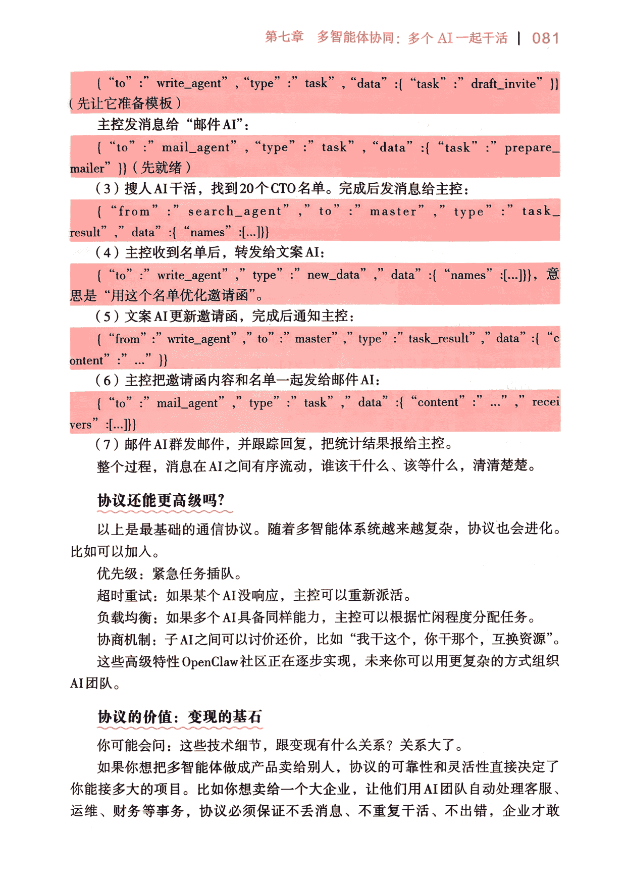

# OpenClaw实战笔记：养一只会赚钱的AI龙虾

# 前言
## 启动龙虾养成计划，让AI替你创收

邮件要回、表格要整理、通知要群发、资料要翻找，这类重复工作一天下来能耗掉好几个小时。如果有一台永不打烊、不用发工资的数字帮手，帮你把这些琐事全部承包，会怎样？这个设想现在已经可以落地。

欢迎进入养龙虾的圈子。这里的龙虾不是食材，而是指 OpenClaw 这样能真正替人干活的AI智能体。它常驻在电脑或云端，有理解意图的大脑 Agent，能调用各种工具的手脚 Skill，会记住偏好的记忆 Memory，再通过 Gateway 这个智能门卫与你顺畅互动。

本书要讲的核心，就是怎么驯服这只龙虾，从听懂指令，到独立作业，最后转化为可观的收益。

你在社媒上可能刷到过它的演示：有人让它横向对比性价比最高的两厢车，有人让它把庞大代码库从 GitLab 整搬到 GitHub，还有人让它每日自动扫行业报告出简报。2025 年底，创始人彼得·斯坦伯格公开演示这些能力后，技术圈炸锅。随后腾讯云、阿里云、火山引擎等主流云厂商都上线了一键部署，让普通人几分钟就能拥有自己的龙虾。

门槛被拉到历史低位，它不再是巨头或顶尖程序员的玩具。自由职业者、想提效的小团队、想开拓机会的开发者、关注技术趋势的创业者，都能从中分到一杯羹。这也是写这本书的初衷，网络上零散的代码片段和演示太多，普通用户如何从零起步、落地变现，需要一条清晰的实操路径。

# 第一部分 入门认知：先认识你的龙虾
# 第一章 这只龙虾能为你带来哪些收入
## 1.1 OpenClaw是什么 会动手做事的AI伙伴
### 它究竟是什么
你是否常遇到这种事：老板让整理百份合同并填入 Excel，客户要求每日盯竞品做周报，自己想买车却要在十几个网站比价填表。事情不难，难在费时费力毫无成就感。招个实习生要付薪资要培训，还可能流失。

OpenClaw 相当于一个 24 小时在线的数字实习生。它不是只会聊天的模型，你问天气它只会回答案。OpenClaw 会真的去查、去执行。比如你说“明天北京若下雨，提醒我带伞，并查一下家到公司的路段是否封路”，它会去查天气、查路况，给出完整建议。它不只动嘴，还会动手。

OpenClaw 是一个开源的 AI 代理框架，可理解为能直接操作你电脑的 AI。它由奥地利开发者彼得·施泰因贝格尔在 2025 年底发布，不到三个月即成为 GitHub 增长最快的开源项目，获得超 26 万星标。国内因 logo 是红色龙虾而被叫做龙虾，海外口号是 The AI that actually does things。

简单说，它就是你的私人数字员工。你可通过微信、WhatsApp、Slack 或命令行下指令：“帮我整理桌面文件”“给张三发邮件确认合同收到”“每天凌晨两点检查服务器日志，异常就短信我”。它会立即执行并汇报结果。

### 和通义类对话模型有何不同
ChatGPT、Claude 很聪明，能写诗编程回答问题，但致命缺陷是只能说话不能动手。你让它“把桌面 PDF 按日期整理好”，它会回“你打开文件夹、选中文件、右键排序”，最后还是你干。

OpenClaw 能直接在本地执行：读文件、搬文件、建文件夹、甚至打开浏览器填表单。你只需说目标，它自行规划完成。这好比顾问只给建议，助理直接把事办了。OpenClaw 就是助理。

### 能接哪些活
能做什么取决于你装了哪些 Skill，每个 Skill 就像新工具。社区已有 600 多个 Skill，覆盖大部分场景：

- 文件处理：桌面整理、文档分类、PDF 表格提取；
- 网路操作：发邮件、查天气、抓网页数据；
- 办公自动化：操作 Excel、写周报、管理日历、发会议邀请；
- 开发运维：部署代码、监控服务器、备份数据库、迁移仓库；
- 生活助手：比价购物、订机票、服药提醒、饮食记录。

技能可组合完成复杂流程，比如买车案例：同时打开十几家车商网站填询价表，等邮件回复，最后汇总成报价表推送给你，全程无需手动。

### 为何能做到执行落地
它不像传统云端模型跑在远端服务器，而是可以直接运行在你的电脑或自有云上，有权限访问文件系统、调用命令行、操控浏览器。架构上大脑负责理解意图和拆解步骤，手脚负责具体操作，配合 Memory 记住你的习惯和偏好，使用越久越懂你。

OpenClaw 不是聊天玩具，而是能直接操作电脑的数字员工。它帮你摆脱重复劳动，把时间留给更有价值的事，比如想怎么用它赚钱。后续章节会带你从部署到做技能再到变现。

## 1.2 真实案例：从买车到搬代码怎么赚钱
很多人问 OpenClaw 能不能赚钱。答案是可以，它不能印钞，但能帮你省时间，省下的时间可做高价值事，或把能力打包成服务出售。

### 案例一 用龙虾砍车价还能收跑腿费
2026 年 1 月，彼得在 X 上发视频演示用 Clawdbot 给自己买车。他在 WhatsApp 说“找一辆混动 SUV，预算 40 万，对比附近经销商报价”。AI 开始上网、填表单、等回邮，最后生成对比表，耗时不到两小时，自己做至少两天。

视频火后，有网友私信愿付 1000 元请人帮忙买。创始人没空，社区开发者 Mike 接单，用自己的 OpenClaw 跑同流程，帮客户拿到三家报价，最终比自谈便宜约两万。Mike 收 1000 元跑腿费。

后来 Mike 把流程做成 AutoBuy 技能上架 ClawHub，按月收 5 元订阅，300 多人订阅，每月被动收入 1500 元。核心是帮人省时间省钱，按次或订阅收费。

### 案例二 代码迁移三天工作变三小时
2026 年 2 月 Kubernetes 宣布 Ingress NGINX 退役，无数运维需在两个月内迁移配置。中型公司上百个资源，手工可能要一周。

运维 Sarah 在 Discord 抱怨重复且怕出错，有人推荐 OpenClaw 迁移技能。安装后不到一小时，配置被自动分析、转换、校验并生成报告和手册。周末低峰期按手册执行几条命令，完成原本三天工作。

Sarah 写博客后收到十几家公司私询，她接两单每单 5000 元，半天完成。之后专做技术迁移外包，每月三四单，收入超过工资。卖的不是时间，是自动化能力，边际成本极低。

### 案例三 自动盯盘写研报 分析师变甩手掌柜
2026 年 3 月多家券商发布 OpenClaw 教程，因它能干分析师最枯燥的活：每日抓公告、整理数据、写日报。

某券商让 OpenClaw 每天 8 点抓取 A 股公告，分类提取业绩预告、并购等信息，生成简报推微信。原来实习生两小时的工作，AI 两分钟完成。

更进一步，可实现研报复现：把研报丢给它，自动解析逻辑拉数据写代码回测并出带图表结果，半天变十分钟。

分析师 Leo 离职后开工作室，用服务器跑 OpenClaw 批量生成行业周报，给私募每月收 3000 元，20 个客户月入 6 万，大部分工作由 AI 完成。把专业能力产品化，前期搭建后期躺收。

### 案例四 为小店主做竞品监控 月收服务费
自由职业者小林发现淘宝店主没时间盯对手降价、上新、活动。用 OpenClaw 搭建监控流程：定时爬取竞品店铺，提取价格销量评价，生成对比报告邮件推送。找了五家店主，每月 2000 元，两家即签。

优化后加入自动预警，降价超 5% 立刻短信。把老板痛点自动化，收的是省心钱。

### 案例五 全网比价 API 卖给返利站
技术宅阿杰发现返利网站需要实时比价数据。OpenClaw 写了全网比价功能，可同时查十几个电商平台价格。他包装成 API 按调用量收费，某返利站试用后每天调用上万次。核心是把技能做成基础设施，卖给需要能力的企业。

共同点是卖结果不是卖软件。OpenClaw 开源免费，但创造的价值可定价：省时间、省钱、省力，从中抽成。

## 1.3 谁适合养龙虾 程序员运营自由职业者小老板各有玩法
养龙虾不只给技术大神，不同背景都能找到切入口。

开发者可开发 Skill 上架变现，或用它自动化开发运维流程提高效率。运营可批量处理整理、报表、客服等重复工作，接外包。自由职业者时间宝贵，用龙虾先做机器初稿再人工润色，效率提升 50%，能多接单。

小老板重在降本增效。用龙虾替代部分人力，例如自动回复常见客服问题，或自动抓取供应商数据上架，一人顶多人。也能开辟新业务，把自动化流程卖给同行。懂行业有客户，只要会用就能降成本加收入。

关键是“用 AI 解决重复劳动”的意识，而非代码能力。

## 1.4 四种变现路径 服务、技能、自动化、接单
落地时变现方式主要分四类，可叠加使用。

卖服务是最直接门槛最低。自己上手用 OpenClaw 帮客户完成任务，按项目收费，如每周出一份竞品报告月收 2000 元。优点是灵活，缺点是受个人时间限制，难规模化。

卖技能是做一次长期收。把常用能力封装成 Skill 上架 ClawHub，设置付费下载或订阅。比如自动生成周报技能，月收 3 元，1000 人订阅即 3000 元被动收入。核心是解决共性痛点。

卖自动化流程是产品化方案。面向垂直行业打包整套流程，如跨境电商自动上架：抓取 1688 信息、翻译、生成描述、上传 Shopify。按年收费，客户黏性高，但需对行业有理解。

接外包是项目制变现。像代码迁移、数据清洗等短期高价值需求，用龙虾快速交付。适合积累案例后走量。

从服务起步积累经验，再走向技能和自动化产品，是多数人可行的路径。

适合对象是具备行业实战经验的产品经理、技术负责人或小老板。你可以从自己最熟悉的赛道切入，比如房产中介、教育培训、电商运营等，把那些每天重复的手工活梳理成标准流程并做自动化。

### 接外包：快速拿到现金流
接外包是比较传统的变现方式，但有了 OpenClaw 加持后，执行效率和竞争力都会明显提升。你可以在猪八戒、淘宝、程序员客栈这类平台上接单，帮客户做数据处理、爬虫开发、系统迁移之类的业务。

举个例子，客户要把一万张图片按规则批量重命名，手工弄至少要三天。用 OpenClaw 写个脚本，半小时跑完，收 500 元，客户觉得合理你也轻松。因为你相当于多了个“数字员工”，可以同时推进多个项目，效率拉开差距后议价也会更有底气。

优点很直观，钱回笼快。缺点是竞争激烈，需要花不少时间找单、沟通需求和处理售后，而且每个单子需求差异大，很难沉淀出可复用的资产。

适合人群是自由职业者或刚起步的个人开发者。先通过接单积累经验和案例，攒到一定量后再向卖服务或卖能力的方向迁移。

### 该怎么选一条路
这四种做法并非只能二选一，可以根据自身情况组合使用。

刚接触 OpenClaw 的建议先从接外包或卖服务开始，找些小单子练手，熟悉工具的同时赚点零花钱。

有一定开发能力的可以尝试卖技能，找到一个细分痛点做一个高质量的 Skill，让它持续帮你变现。

对某个行业特别了解的，可以做自动化流程的生意，把行业经验产品化，服务更多客户。

核心始终没变：你能帮别人解决什么具体问题。OpenClaw 只是工具，真正值钱的是你对问题的理解和落地的能力。

# 第二章

## 10 分钟上手：唤醒你的龙虾

## 2.1 跨平台一键安装，新手也能养龙虾
第一次向别人推荐 OpenClaw，很多人第一反应是：听起来很强，装起来会不会很麻烦？我电脑一般，怕搞坏。

如果你也有类似担心，你不是一个人。我刚开始也怕，命令行、Node.js、环境变量这些词一上来就头大。实际装过才发现，现在的安装已经简单到极致了，不管 Windows、Mac 还是 Linux，基本就是打开终端敲一行命令，回车，等几分钟。

这一节手把手带你走完全流程，不需要编程基础，会复制粘贴就行。

### 安装前先做 1 分钟自检
正式开始前确认两件事。

第一，电脑能联网。安装时需要从网上拉取文件。

第二，系统满足要求：Windows 10 及以上、macOS 11 及以上，或主流 Linux 发行版如 Ubuntu 20.04 以上。基本上十年内的机器都够用。

硬件要求也不高，2G 内存、10G 硬盘就能跑起来，配置一般的机器也不用担心。

### Windows 用户：最省心的一键包
Windows 用户最方便，官方提供安装包，像装微信 QQ 一样双击就行。

打开浏览器访问 openclaw.com，首页就有明显的“下载 Windows 版”按钮。下载得到 .exe 文件，双击运行，出现安全提示点“更多信息”再点“仍要运行”，之后一路“下一步”选安装位置、建桌面快捷方式即可。

装完后桌面会出现 OpenClaw 图标，双击打开会弹出黑色命令窗口，里面显示 openclaw >，就说明装好了。

喜欢命令行也可以打开命令提示符或 PowerShell，输入：

```
winget install openclaw
```

回车后自动下载安装，全程无需干预。

### Mac 用户：用 Homebrew 一行搞定
Mac 稍微多一步命令，但也很顺手。

先确认是否装了 Homebrew，打开“终端”，输入：

```
/bin/bash -c "$(curl -fsSL https://raw.githubusercontent.com/Homebrew/install/HEAD/install.sh)"
```

回车后输入 Mac 登录密码，等几分钟完成安装。

装好 Homebrew 后安装 OpenClaw：

```
brew install openclaw
```

大概一分钟，完成后在终端执行 openclaw --version，看到类似 0.9.0 的版本号即为成功。

不想用 Homebrew 也可以去官网下载 .dmg，打开后把 OpenClaw 拖到应用程序文件夹。之后每次运行需在终端输入 /Applications/OpenClaw/bin/openclaw，相对麻烦，推荐 Homebrew 方式。

### Linux 用户：终端一行解决
Linux 用户最习惯命令行。打开终端输入：

```
curl -fsSL https://get.openclaw.com | bash
```

或使用包管理器，Ubuntu/Debian 用：

```
sudo apt update
sudo apt install openclaw
```

Fedora 用：

```
sudo dnf install openclaw
```

安装完成后执行 openclaw --version 看到版本号即成功。

### 安装后第一件事：初始化
无论哪个系统，装完后都要初始化，生成工作目录和配置文件。

打开终端，输入：

```
openclaw init
```

首次使用一路回车采用默认设置即可。完成后会看到类似提示：

```
✅ OpenClaw 初始化成功！
配置文件位置：/Users/你的用户名/.openclaw/config.yaml
```

这就表示 OpenClaw 已就绪。

### 验证是否真正装好
输入：

```
openclaw exec “你好”
```

若看到类似回复：

```
你好！我是 OpenClaw，有什么可以帮你的？
```

恭喜你，OpenClaw 已在本地跑起来了。

若未成功，检查前面步骤是否遗漏，或参考附录 C 的常见问题。

从打开终端到跑起来，基本 10 分钟内搞定。现在你的电脑里已经有一只待命的“龙虾”。

## 2.2 不想占本地资源？把龙虾放到云上 7x24 在线
本地安装后你能随时指挥它，但电脑不可能 24 小时开机。睡觉、出门、断电时任务就停了，像凌晨备份、早间发日报这类定时任务就做不了。

而且本地开浏览器、PS、微信同时跑，可能会卡顿。把 OpenClaw 部署到云服务器上，机器全年在线、配置稳定、不占本地资源，还能随时随地用手机微信或 WhatsApp 发指令，像私人助理一样永不离线。

你可能担心云服务器复杂，国内主流厂商腾讯云、阿里云都提供 OpenClaw 一键镜像，比装 QQ 还简单。

### 为什么要上云
第一，永不掉线。云服务器 365 天在线，你休息它仍在工作，定时任务更可靠。

第二，跨设备访问。云端部署后，任何设备都能通过网页或微信访问，无需带电脑。

第三，不占用本地性能。指令在本地发，任务在云端跑，老电脑也能用。

第四，便于团队共享。放云上后同事都能连，不必每台电脑都装。

成本也不高，最低配每月几十元，多数平台还有试用。

### 准备工作：注册并实名
先注册账号并完成实名认证。

腾讯云访问 cloud.tencent.com，微信扫码或手机号注册后在账号中心完成实名。

阿里云同理注册并实名。

### 腾讯云：轻量应用服务器一键部署
**第一步：进入专属页面。**
登录后在顶部搜索框输入“OpenClaw”，进入“OpenClaw 极速部署”活动页。找不到就去轻量应用服务器，在应用镜像里选 OpenClaw 官方镜像。

**第二步：选配置。**
地域选离自己近的城市，套餐选入门版 2核4G、60G 硬盘即可，镜像确认是 OpenClaw 官方镜像，其余默认。

**第三步：点购买。**
确认费用后立即购买，系统两三分钟自动创建并部署好。完成后记录页面上的公网 IP，例如 124.123.45.67。

### 阿里云：镜像市场一键部署
登录阿里云控制台，进入云服务器 ECS，或搜索后进入镜像市场，搜索“OpenClaw”，选择官方镜像点使用。

随后自动跳转创建实例页，镜像已选好，只需选地域、选实例规格推荐共享型 s6 2核4G、设置登录密码，确认订单后创建。记录分配的公网 IP。

### 连接云端 OpenClaw
最简单是用浏览器访问 http://你的公网IP:8080，首次访问需等几分钟初始化，看到欢迎页即正常。

想用命令行，通过 SSH 登录：

```
ssh root@你的公网IP
```

输入密码后即可像本地一样使用 openclaw 命令。

### 云端初始化与启动
登录后执行：

```
openclaw init
```

一路回车使用默认配置。启动网关：

```
openclaw gateway start
```

看到 Gateway started 即表示运行中。

### 让它一直跑
退出 SSH 后进程可能停止，建议用 screen 或系统服务保活。腾讯云镜像已内置服务，阿里云可自行配置 screen 启动即可。

### 费用提醒
云服务器按小时计费，测试完记得关机或释放，避免持续扣费。可设置费用预警，遗忘时也会短信提醒。

## 2.3 Gateway 是什么？它是龙虾的门卫
装好 OpenClaw、启动后，你可能会问：我发消息它怎么收到的？微信、WhatsApp 怎么接入？

这都靠 Gateway。它相当于 OpenClaw 的门卫，所有外部消息必须先经过它。

### 小区门卫的比喻
想象你住在小区，快递、外卖、朋友来访如果没有门卫直接冲进家会很乱。门卫负责登记、确认身份、指引到对应房间。

Gateway 就是这样的工作：拦截所有想和 AI 对话的请求，先登记、翻译、校验，再交给 AI。它让你不用自己处理微信格式、命令行解析或恶意请求，AI 能专注干活。

### Gateway 具体做什么
第一，接收多渠道消息。命令行、微信、Slack、WhatsApp 等格式各异，Gateway 统一翻译成 AI 能懂的语言。

第二，路由到正确会话。你和同事可能同时使用，Gateway 根据用户标识把消息送到对应的会话，避免串台。

第三，维护上下文。对话中前后关联由 Gateway 管理，保证 AI 知道上一句说了什么。

第四，安全管控。通过身份验证防止未授权访问，并限流防刷。

### 你已见过它
之前执行的 openclaw gateway start 就是启动门卫。检查状态：

```
openclaw gateway status
```

看到 Gateway is running 即表示值班中。

### 没有 Gateway 会怎样
关闭后执行 openclaw exec “你好” 会报错，因为没有接收入口。就像门卫下班，快递无法投递。

理解了 Gateway，后续接入微信、Slack 都在它里配置频道。它就是访客登记本，渠道越多本子上记录越多。

## 2.4 第一个命令：在命令行里对话
安装完成、门卫就位，现在让龙虾干活。

### 先确认门卫在岗
执行：

```
openclaw gateway status
```

返回 Gateway is running 就能发指令。若未运行，先执行 openclaw gateway start。

### 第一句话打招呼
在终端输入：

```
openclaw exec “你好”
```

回车等待数秒，正常会得到类似回复：

```
你好！我是OpenClaw，有什么可以帮你的？
```

到此，第一条 AI 指令成功送达。

### 如果没收到回复
看到红色错误通常两种情况：...

场景一：模型未配置

错误提示里出现 “No model configured” 或 “请配置模型API”，通常是因为 OpenClaw 默认依赖一个大语言模型来解析你的自然语言指令。若还没完成模型配置，系统就会直接报错。

处理方式有两种，要么先绕开，要么快速配一个。最省事的做法是切换到技能直调模式，跳过自然语言理解环节：

```
openclaw exec “system: date”
```

执行后 AI 会直接调用系统的 date 命令并返回当前时间。注意这里的 `system:` 前缀代表直接调用系统命令类技能，不需要模型参与解析。

场景二：Gateway 未启动

如果提示连不上 Gateway，先回到前面的章节确认服务是否正在运行。

### 让 AI 真正动手做点事

单纯打招呼没意思，真正让它执行任务。比如列出当前目录下的所有文件：

```
openclaw exec “列出当前目录下的文件”
```

模型已配置的情况下，OpenClaw 会自行理解意图、调用 filesystem 技能并返回文件清单。若模型未配置，也可以走显式技能调用：

```
openclaw exec “filesystem:list”
```

```
openclaw exec “现在几点”
```

这会调用系统时间技能，给出精确的时间。

### 当 AI 理解偏差时怎么办

有时候模型会把执行指令当成给出建议。比如你说“帮我打开浏览器”，它可能回你“你可以在桌面点击图标打开”，而不是真的去打开。因为部分操作需要额外授权，或模型误把“教你怎么做”和“帮你做”混淆了。

这时可以把指令写得更明确：

```
openclaw exec “用浏览器打开 https://openclaw.com”
```

或者直接用技能直调：

```
openclaw exec “browser:open --url https://openclaw.com”
```

### 两种交互形态：单次执行与持续对话

前面演示的都是 `openclaw exec`，属于一次性调用：发一条指令，得到结果即结束，很适合做测试或脚本调用。

另一种是 `openclaw repl`，进入交互式会话，可以连续聊天，上下文会被保留。终端输入：

```
openclaw repl
```

提示符会变成 `You:`，之后就像日常聊天一样输入。想退出输入 `exit` 或按 `Ctrl+C` 即可。本节先聚焦 `exec`，`repl` 的深入用法放在后续章节。

### 到这里你掌握了什么

这一节下来你已经做到：

1. 确认 Gateway 正常运行；
2. 发出第一条自然语言指令；
3. 学会用显式技能调用绕过模型；
4. 体验 AI 真正执行任务；
5. 了解单次执行和交互式模式的区别。

OpenClaw 已能在命令行为你服务。命令行虽好，却不够高效，下一节我们就让它完成一个更实用的活：把杂乱的桌面文件收拾干净。

## 2.5 实战练习：用“龙虾”整理桌面

前几节已经完成安装并简单对话了。你买这只“龙虾”不是为了聊天，而是让它干活。下面这个任务最实在：把凌乱的电脑桌面整理成井井有条的样子。

如果你和我一样，桌面常年堆满截图、PDF、各种“新建文件夹”，那这节就是为你准备的。

### 先看看桌面有多乱

打开桌面，大致是这样：

十几个文件散落各处，有图片有文档有压缩包；

文件名混乱，“新建文本文档(5).txt”“截图(3).png”；

找一个文件得用眼睛扫半分钟。

没关系，把收拾工作交给 OpenClaw。

第一步：确认 Gateway 在运行。

老规矩，先确认门卫在岗，执行：

```
openclaw gateway status
```

若未启动，运行 `openclaw gateway start` 启动即可。

第二步：下达整理指令。

在终端输入或复制粘贴下面命令：

```
openclaw exec “把桌面上的文件按类型分类，图片放到 Images 文件夹，文档放到 Documents 文件夹，压缩包放到 Archives 文件夹，其他文件放到 Others 文件夹。如果文件夹不存在就创建”。
```

回车后观察输出。

第三步：观察执行过程。

模型已配置时，OpenClaw 会进入“思考”状态，屏幕上可能出现类似：

```
[思考中……] 用户想要整理桌面文件，需要按扩展名分类……
[行动] 调用 filesystem.list 查看桌面文件
[结果] 找到 23 个文件
[行动] 调用 filesystem.create 创建文件夹 Images
[行动] 调用 filesystem.create 创建文件夹 Documents
[行动] 调用 filesystem.create 创建文件夹 Archives
[行动] 调用 filesystem.create 创建文件夹 Others
[行动] 移动 screenshot.png → Images/screenshot.png
[行动] 移动 report.pdf → Documents/report.pdf
[行动] 移动 project.zip → Archives/project.zip
......
```

✅ 整理完成！共移动23个文件

耗时取决于桌面文件数量，通常几秒到数十秒。

第四步：查看整理结果。

打开桌面，原文件消失，取而代之的是 Images、Documents、Archives、Others 等文件夹，文件已归位。成功的话，恭喜你让 AI 完成了第一件实事。

### 执行失败如何排查

遇到问题很正常，常见几种情况：

问题一：提示“我没有权限”。

默认情况下 OpenClaw 只能操作自身目录，无法随意修改桌面，这是安全限制。解决办法是在指令中明确桌面路径，例如：

```
openclaw exec “把 /Users/你的用户名/Desktop 下的文件按类型分类...”
```

Windows 用户可使用类似 `C:\Users\你的用户名\Desktop`。

问题二：提示“我不明白你要我做什么”。

指令过于模糊或模型未理解。尝试用更直白的表达，或改用技能直调模式：

```
openclaw exec “filesystem:organize --path ~/Desktop --by type”
```

注：`organize` 动作在部分版本中可能不存在，若报错可用上一节的显式技能组合实现同等效果。

问题三：长时间无响应。

多半是模型调用卡住。按 `Ctrl+C` 中断后重试。若频繁卡顿，可考虑更换响应更快的模型，后续章节会介绍。

### 担心误操作？先做备份

怕 AI 把重要文件弄丢很正常。首次练习建议先备份，或新建一个测试文件夹：

```
mkdir ~/Desktop_test
cp ~/Desktop/ ~/Desktop_test/
```

然后把指令中的路径换成 `~/Desktop_test`，验证无误后再操作真实桌面。

### 让整理更精细

按类型分类只是基础玩法，还能做得更细：

按时间归档：

```
openclaw exec “把桌面上的文件按修改时间分类，每个月一个文件夹，比如2026-03这样的文件夹”
```

按项目归类，需 AI 理解文件名语义：

```
openclaw exec “把桌面上的文件按项目分类，文件名包含‘报告’的放Report文件夹，包含‘合同’的放Contract文件夹”
```

整理后生成报告：

```
openclaw exec “整理桌面文件，按类型分类，完成后告诉我每个文件夹里有多少文件，总大小多少”
```

通过本节，你学会了：

1. 用自然语言指挥 AI 完成任务；
2. 让 AI 操作文件系统；
3. 应对执行中常见问题；
4. 用测试目录保护真实数据；

最关键的是，你亲身体验了“会干活的 AI”——它不是只给建议，而是真的把事情办成。

入门最难的坎已经迈过，你的“龙虾”既能跑起来也能干活了。

# 第三章 OpenClaw 四大核心组件全解析

## 3.1 Gateway：统一的消息中枢

第 2.3 节里我们把 Gateway 比作小区门卫，所有访客都要先登记。这个比喻有助于快速理解角色，但要真正用起来，还得清楚门卫具体做了哪些事。本节拆解 Gateway 的核心职责，明白它为何是 OpenClaw 的总枢纽。

### 工作职责一览

合格的门卫要做到：

认出访客身份，是业主、快递还是陌生人；

问清来意，是送货、拜访还是抄表；

指明路线，去几号楼几单元；

做好登记，进出时间记录；

把好大门，防止随意进入。

Gateway 的工作逻辑与此完全一致，只是面对的是消息流。具体而言，Gateway 有四大核心职责：协议适配、消息路由、会话管理、安全与限流。

### 职责一：协议适配，把多源格式统一

OpenClaw 可能接入命令行、微信、Slack、WhatsApp，甚至自研网页。各类渠道的消息格式差异很大：

命令行是纯文本字符串；

微信是 JSON 格式的 HTTP 请求；

Slack 是带签名验证的 HTTPS 回调；

网页可能使用 WebSocket 长连接。

若让 AI 直接处理这些格式，会被解析工作拖垮。Gateway 的作用就是把这些“方言”翻译成 OpenClaw 内部通用的“普通话”——一个包含发送者、内容、时间、渠道等字段的标准消息对象。处理完后，再把 AI 的回复翻译回对应渠道的格式，保证对方可读。

Gateway 内置十余种常用适配器，后续第四章会详细讲解微信、Slack 的接入。

### 职责二：消息路由，精准分发

当十个客户同时聊天，消息会混在一起。Gateway 需要判断每条消息该交给哪个 AI 实例。

它会根据消息中的用户标识，如微信 ID、手机号，查询是否存在活跃会话。有则交给对应会话的 Agent，无则先创建新会话再分配。这样确保张三的对话不会与李四混淆，且上下文保持连续。

### 职责三：会话管理，记住上下文

对话往往是多轮的，AI 需要记得之前的内容才能理解“那个文件”指的是什么。Gateway 为每个用户会话维护短期记忆，保存最近几轮对话、任务进度、临时变量。会话期间数据随消息传递，会话超时如半小时无操作则关闭并释放资源。

跨天跨周的长期记忆则由后续的 Memory 模块负责，Gateway 只负责当前会话的短期上下文。

### 职责四：安全与限流，把门守好

Gateway 是对外唯一入口，所有请求必经此层，因此安全策略集中于此：

身份验证：开启后必须携带有效 API 密钥，Authorization 头验证；

签名验证：对微信、Slack 等平台消息校验签名，防止伪造；

限流：配置单位时间内最大请求次数，超出直接拒绝；

IP 白名单：仅允许指定 IP 访问。

这些措施在 Gateway 层统一处理，Agent 可专注业务逻辑。

### 配置文件长什么样

打开 `~/.openclaw/config.yaml`，找到 gateway 部分：

```yaml
gateway:
  host: "0.0.0.0"
  port: 8080
  auth:
    enabled: true
    api_keys:
      - key: "sk_live_xxxxx"
        name: "admin"
  channels:
    http:
      enabled: true
    whatsapp:
      enabled: false
  rate_limit:
    enabled: true
    window: 60
    max: 100
```

说明：

`host` 与 `port` 决定监听地址，`0.0.0.0` 表示接受所有网络连接，本机访问可改为 `127.0.0.1`；

`auth` 开启后请求必须带有效密钥；

`channels` 列出要启用的渠道，如微信；

`rate_limit` 设定 60 秒窗口内最多 100 次请求。

修改后需重启 Gateway 生效：

```
openclaw gateway restart
```

### 如何查看状态和日志

检查运行状态：

```
openclaw gateway status
```

查看近期日志：

```
openclaw gateway logs --tail 50
```

会输出最近 50 行日志，消息丢失或技能报错的线索通常都在这里。

### 性能与扩展能力

单机 Gateway 足够个人使用。若要服务数十个客户，需考虑扩展。好在 Gateway 是无状态设计，自身不存数据，会话信息保存在 Redis。因此可启动多个 Gateway 实例，前置 Nginx 负载均衡，后端共享同一 Redis，实现水平扩展。具体调优在 10.1 节展开。

Gateway 是 OpenClaw 的总门卫，负责翻译统一格式、路由到正确 Agent、维护会话上下文、保障安全。理解它，就能明白 OpenClaw 如何同时接入多种渠道，也能在出问题时快速定位。

## 3.2 Agent：系统的思考引擎

Agent 是 OpenClaw 的大脑。你下达“帮我整理桌面文件”这样的指令后，Agent 会自行判断：用户想要什么？需要分几步？每步调用什么工具？完成后如何反馈？这一整套推理过程即为 Agent 的工作方式。

### 用实习生理解 Agent

可把 Agent 想象成一位刚入职的实习生。他很聪明但缺乏经验，需要明确目标后自行规划：

听清任务：老板说“整理桌面”，他要理解“桌面”位置和“整理”含义；

列出步骤：先查看文件，再决定分类，再创建目录，最后搬运；

动手执行：打开文件夹、新建分类、移动文件；

汇报结果：告知整理了多少文件，分成哪几类。

Agent 的流程与之相似，只不过“动手”是通过调用技能实现。

### 四阶段工作流程

Agent 处理消息分为任务接收、规划、执行、反馈四个阶段。

**第一阶段：任务接收。**

Gateway 将标准化消息交给 Agent。Agent 接收后先做两件事：从 Memory 加载历史对话，恢复会话上下文；读取用户偏好设置，如“喜欢简洁回答”。准备就绪后才开始思考。

**第二阶段：规划。**

这是核心环节。Agent 需要把模糊指令具体化。例如“把桌面文件整理一下”，需补全：按类型还是按时间？桌面具体路径？分几类？

典型计划可能为：

步骤1 调用 filesystem.list 查看桌面文件；

步骤2 分析文件类型；

步骤3 调用 filesystem.create 创建目录；

步骤4 调用 filesystem.move 移动文件；

步骤5 统计数量并准备汇报。

该清单即为执行计划。

**第三阶段：执行。**

根据计划，Agent 按序调用对应技能，完成实际操作。

当 Agent 需要借助外部能力时，它自己不会直接操作，而是把任务指令转发给对应的 Skill 模块，等待 Skill 把结果返回再做下一步判断。以 filesystem.list 为例，Skill 会去读取磁盘上的文件清单并回传，Agent 拿到清单后才会决定如何继续。

如果执行中出现异常，比如目标文件夹已存在，Agent 会根据上下文自行抉择：跳过该步骤或把错误抛给用户处理。

**第四阶段：反馈。**

所有步骤跑完后，Agent 需要向用户汇报结果。它会根据实际执行情况生成一段总结，比如：“整理完成！我把桌面的23个文件分成了图片、文档、压缩包三类，分别放到了对应的文件夹里。”

若中途有错误，例如某个文件因权限不足无法移动，也会在反馈里明确说明。

最后，Agent 会把本次对话的完整记录——用户说了什么、自己回复了什么、执行了哪些操作——写入 Memory 供下次参考，然后把回复消息交给 Gateway，由 Gateway 发回给用户。

### 一个完整的示例
用整理桌面的任务把四个阶段串起来。

（1）任务接收：Agent 收到“把桌面文件整理一下”的指令，从 Memory 中调取历史记录。初次对话时记录为空，未发现特殊偏好。

（2）规划：调用大模型解析用户意图，形成“按文件类型分类”的执行方案，共 5 步。

（3）执行：
调用 filesystem.list 获取桌面文件列表，共 23 个。
分析类型：screenshot.png 属于图片，report.pdf 属于文档，project.zip 属于压缩包……
调用 filesystem.create 新建 Images、Documents、Archives、Others 四个目录。
调用 filesystem.move 将每个文件搬到对应目录。
汇总：共移动 20 个文件，3 个是原有文件夹未处理。

(4) 反馈：生成回复“整理完成！移动了20个文件，现在桌面有4个分类文件夹”，并把本次对话存入 Memory。

### 思考策略可以自行调整
Agent 的工作方式并非固定，配置文件里的 planning_strategy 可以修改：

```yaml
agent:
  planning_strategy: "react" # 可选 react、plan_execute、simple
```

三种模式的区别。

simple：不做规划，直接执行。适合“一句话就能说清”的简单请求，例如“现在几点”。

plan_execute：先输出完整计划，再按顺序执行。适合步骤固定的任务，例如整理文件。

react：边执行边思考，每一步都重新规划。适合需要根据中间结果动态调整的复杂任务，例如“帮我查这周末北京的活动，然后订一张票”。

默认是 react，灵活性最高。若发现 AI 反应过慢或思考过头，可改成 plan_execute。

### 如何查看 Agent 的思考过程
当 AI 的行为与预期不符时，可以在指令后加上 --debug：

```
openclaw exec --debug "把桌面文件整理一下"
```

这时可以看到类似如下的输出：

```
[DEBUG] 收到消息: 把桌面文件整理一下
[DEBUG] 加载会话记忆: 空
[DEBUG] 调用大模型会话理解意图……
[DEBUG] 大模型返回: 用户想整理桌面文件，按类型分类
[DEBUG] 生成执行计划:
  - filesystem.list path=~/Desktop
  - filesystem.create Images
  - filesystem.create Documents
  - filesystem.create Archives
  - filesystem.create Others
  - filesystem.move 根据类型
[DEBUG] 执行步骤 1: filesystem.list...
...
```

调试模式是理解 AI 行为的最佳手段。

Agent 是 OpenClaw 的大脑，负责理解意图、制定步骤、调用 Skill 执行并给出反馈。它像一个人一样，先听任务、再想步骤、动手执行、最后做汇报。掌握这个流程，就能更有效地指挥 AI，也能在出错时快速定位问题。

## 3.3 Skill：AI 的执行层，装上就能干活
前面提到 Gateway 负责收发消息，Agent 负责思考。但光有大脑还不够，真正去读文件、发邮件、操作浏览器等实操工作，需要 Skill 来完成。

可以把 Skill 理解为 AI 的手脚。没有手脚，大脑只能空谈；有了手脚，AI 才能落地执行。OpenClaw 之所以强调“真正做事的 AI”，正是依赖这套执行层。

### 每个 Skill 都是一个专项工具
Skill 本质上是封装好的功能模块，专注于一类操作。例如：

filesystem 技能：读写文件、创建目录、移动文件
http 技能：发起网络请求、抓取网页
browser 技能：打开浏览器、自动填表、截图
email 技能：收发邮件
weather 技能：查询天气

每个 Skill 只做一件事，但做到极致。需要什么能力，就给 AI 安装对应的 Skill，安装越多，能做的事越多。

### 大脑与手脚的分工
Agent 负责思考：理解用户意图、规划步骤、决定何时调用哪个 Skill。
Skill 负责执行：接收指令、完成操作、把结果返回给 Agent。

仍以整理桌面为例：
1. Agent 判断先查看桌面文件 → 调用 filesystem.list
2. filesystem.list 读取磁盘并返回文件列表
3. Agent 判断需要创建分类目录 → 调用 filesystem.create
4. filesystem.create 建好目录后返回结果
5. Agent 判断需要搬移文件 → 调用 filesystem.move
6. filesystem.move 完成搬移并返回结果
7. Agent 汇总结果并生成回复

整个过程中 Agent 只负责决策，具体操作全部由 Skill 完成。

### Skill 的两种调用方式
自然语言调用：用户用口语描述需求，AI 自行决定调用哪个 Skill。例如：

```
Openclaw exec "北京今天天气怎么样"
```

Agent 会识别“天气”并调用 weather 技能，前提是该技能已安装。

显式调用：用户直接指定技能和动作，格式为 技能名:动作 参数。例如：

```
Openclaw exec "weather:current --city 北京"
```

这种方式更精确，常用于脚本或测试技能效果。

### 内置的常用 Skill
安装完成后可通过以下命令查看当前可用的 Skill：

```
Openclaw skill list
```

通常会看到如下列表：

| 技能名 | 主要功能 |
|---|---|
| system | 执行系统命令，如 ls、date |
| filesystem | 文件读写与目录操作 |
| http | 发送 HTTP 请求 |
| knowledge | 访问长期记忆 |
| cron | 管理定时任务 |
| browser | 浏览器自动化，需额外安装 |
| email | 邮件收发 |
| calendar | 日历操作 |

每个 Skill 下还有具体动作，例如 filesystem 包含 list、read、write、move、copy、delete 等。想查看某个 Skill 的动作列表，可用：

```
openclaw exec "filesystem:help"
```

### Skill 的来源：ClawHub
内置 Skill 只是基础。OpenClaw 官方的技能市场 ClawHub 已收录 600 多个社区贡献的第三方 Skill。

搜索技能：

```
openclaw skill search 天气
```

找到合适后直接安装：

```
openclaw skill install weather
```

不再需要时也可以卸载：

```
openclaw skill uninstall weather
```

### Skill 需要授权
Skill 会涉及文件、网络甚至费用，因此 OpenClaw 对权限有严格控制。安装时系统会提示需要哪些权限：

```
技能 weather 请求以下权限：
- network:connect (需要联网)
是否授予？(yes/no)
```

未授权则无法使用，授权后仅在权限范围内运行。

### Skill 的变现潜力
写一个 Skill 能赚多少，取决于它解决的问题价值。简单的查天气可能无人付费，但能为打工人每周节省一小时的“自动生成周报” Skill，就具备付费价值。

ClawHub 上热门 Skill 月订阅数可达数千，按每人每月 5 元计算，月收入可达数万元。即使只有几百用户，也能带来稳定零花。Skill 是 OpenClaw 变现的核心资产。

### 组合 Skill 完成复杂自动化
单个 Skill 能力有限，组合后威力倍增。例如：
自动监控竞品：cron 定时触发 + browser 抓取网页 + filesystem 保存数据 + email 发送报告
自动处理发票：filesystem 监控文件夹 + PDF 文字提取 + LLM 内容理解 + Excel 写入表格

Agent 的规划能力负责把多个 Skill 像搭积木一样串联起来。

Skill 是 OpenClaw 的执行层，负责具体操作。你可以安装各种 Skill，让 AI 会读文件、发邮件、查天气、操作浏览器。Skill 可从 ClawHub 获取，也可自行开发，组合使用即可实现复杂的自动化流程。

## 3.4 Memory：让 AI 记住你说过的话
是否遇到过刚告诉 AI“我叫张三”，过一会儿再问它名字时却忘了的情况？这种健忘体验很糟。

OpenClaw 通过 Memory 模块解决这个问题，让 AI 越用越懂你，成为真正的个人助理。

### 短期记忆与长期记忆
短期记忆类似工作台，只保存当前会话的信息，保证对话连贯。会话结束或 30 分钟无操作后会自动清空。

长期记忆类似书架，跨会话保存用户偏好、历史任务和知识库，数据存储在硬盘数据库中，断电也不会丢失。

### 长期记忆的工作原理
核心是向量数据库和语义检索。当你说“我叫张三”时，系统会将其转换为向量——代表语义的数学坐标，并与原文一起存入数据库。

下次你问“我叫什么名字”，问题同样被转为向量，系统会检索语义最相近的记忆。因为两者意思相近，向量距离也近，很快就能找到“我叫张三”。即使表述为“你还记得我的姓名吗”，也能匹配成功。

### 记忆存储的内容
主要分为三类：
用户偏好：如“喜欢简洁回答”“常用邮箱 zhang@example.com”；
任务历史：如上周的桌面整理记录，下次可被调取；
知识库：可主动导入公司手册等资料，实现个性化问答。

### 查看与管理记忆
终端中输入：

```
openclaw memory list
```

即可列出所有长期记忆，每条带 ID 和内容。若需删除：

```
openclaw memory delete 记忆ID
```

清空全部记忆：

```
openclaw memory clear
```

在对话中直接说“忘记我叫什么名字”，AI 也会自动删除对应记录。

### 隐私与安全
所有记忆默认本地存储，不上传云端。可在配置中开启 encryption.enabled，数据库将使用 AES-256 加密。用户可随时查看、删除数据，完全掌控。

### 记忆的商业价值
记忆本身也能变现。例如搭建个人知识库问答系统，按年收费；为企业构建客户记忆库，提升客服效率；开发基于记忆的个性化 Skill，如生日提醒，提升付费意愿。

Memory 是 OpenClaw 的记忆库，让 AI 记住你的话、偏好和知识。短期记忆保证连贯，长期记忆实现累积，使用越久越顺手。

## 3.5 定制你的“龙虾”：通过 YAML 配置文件个性化
默认配置即可使用，但不同需求需要不同设定，例如更换模型、修改端口、关闭功能。可通过编辑 config.yaml 来定制。

### 配置文件位置
执行：

```
openclaw config path
```

通常位于用户主目录下的 .openclaw 文件夹：
Windows：C:\Users\你的用户名\.openclaw\config.yaml
Mac/Linux：/Users/你的用户名/.openclaw/config.yaml
用任意文本编辑器打开即可。

### YAML 格式简介
YAML 采用键值对结构，例如：

```yaml
name: 张三
age: 30
```

缩进表示层级，例如：

```yaml
gateway:
  port: 8080
```

类似填表，左边是项目名，右边是取值。

### 常用可修改项
1. Gateway 端口与认证
默认监听 8080，若被占用可修改：

```yaml
    gateway:
      port: 9090  # 改成9090
    ```

对外暴露时务必开启认证：

```yaml
    gateway:
      auth:
        enabled: true
        api_keys:
          - key: "sk_你的密钥"  # 自己设一个复杂的密钥
            name: "admin"
    ```

修改后需重启 Gateway。

2. AI 模型选择
可更换为本地 Llama 3 或更经济的 GPT-3.5：

```yaml
    agent:
      default_model: "llama3"  # 换成你喜欢的模型
    ```

使用本地模型时需配置 Ollama 地址：

```yaml
    models:
      ollama:
        base_url: "http://localhost:11434"
    ```

3. 思考策略调整
前面提到的 simple、plan_execute、react 可在此设置：

```yaml
    agent:
      planning_strategy: "plan_execute"  # 改成先生成计划再执行
    ```

4. **记忆开关可灵活掌控**

处理敏感信息不想留下痕迹时，可以把长期记忆直接关掉：

```yaml
    memory:
      long_term:
        enabled: false
    ```

也可以把记忆挪到别处，比如接上 Redis：

```yaml
    memory:
      long_term:
        type: "redis"
        redis_url: "redis://localhost:6379"
    ```

5. **给技能划定访问边界**

部分技能默认权限过大，你可以限制它只能读特定目录：

```yaml
    security:
      skill_rules:
        - name: "filesystem"
          allow:
            - "filesystem:read:~/Documents"  # 只能读 Documents
          deny:
            - "filesystem:write:/etc"        # 不能写系统目录
    ```

### 改完怎么让配置生效

配置文件保存后，需要重启 Gateway：

```
openclaw gateway restart
```

重启完成新参数才会起作用。可以用 `openclaw config view` 看一下当前实际加载的配置，确认是否正确。

### 万一改崩了怎么办

不用慌，OpenClaw 预留了退路。动手前最好先备份原文件：

```
cp ~/.openclaw/config.yaml ~/.openclaw/config.yaml.bak
```

如果改完起不来，就用备份覆盖回去。也可以先用 `openclaw config validate` 检查语法有没有问题。

### 举个例子：让 AI 更好使

觉得默认回复太啰嗦，想让它每次都简短点，可以改系统提示词：

```yaml
agent:
  system_prompt: “你是一个简洁的助手，回答尽量简短，不要废话。”
```

再比如想省 API 费用，让它跑本地模型：

```yaml
agent:
  default_model: “llama3”
models:
  ollama:
    base_url: “http://localhost:11434”
```

重启后问一句“今天天气怎么样”，它就会用本地模型给出精简回答。

配置文件相当于 AI 的个性调节面板，端口、模型、记忆方式、思考策略乃至技能权限都能填表调整，不用写代码。花几分钟调一下，AI 就更顺手、更省钱、更安全。

到此，OpenClaw 的四大基石——Gateway、Agent、Skill、Memory——已全部讲完。你清楚了消息如何进入、如何思考、如何执行、如何记忆。

# 第四章 用你习惯的方式唤醒龙虾

## 4.1 命令行：零界面极速操作

很多人习惯用微信、Slack 跟人沟通，但如果你是开发者或需要频繁测试、批量跑任务，一定明白命令行才是最高效的入口。没有多余界面，没有鼠标点来点去，双手留在键盘上，一条指令下去立刻有结果。

OpenClaw 的命令行不是要取代会话界面，而是一个精准的驾驶舱。需要细粒度控制、深度排查或批量自动化时，它是首选。

### 命令行为何更快

第一，免鼠标。打开终端敲命令回车即完成，不用切浏览器或手机，手感连贯思路不断。

第二，擅长批量。可以写循环让 AI 一次处理几十个任务，也能把指令写进文件脚本跑批，聊天界面做不到。

第三，延迟更低。直连本地 Gateway，调用云模型除外基本无网络等待，适合快速验证想法。

第四，调试友好。能够打印详细执行日志，看见 AI 每一步的推理、调用了哪项技能、耗时多久，图形界面很难呈现。

### 核心双命令 exec 与 repl

你已经接触过这两个命令：

```
openclaw exec “指令”：执行单次指令，立即返回结果，适合一次性的任务。
openclaw repl：进入交互式模式，可以连续对话，AI会记住上下文。
```

exec 发一条指令做完就结束，像发短信；repl 打开持续会话，像拉开聊天窗口。实测时我常先用 exec 快速验技能，再用 repl 模拟多轮对话。

### 调试三大利器 --debug --dry-run --output

命令行强就强在这些选项。

- `--debug`：展示思考过程。例如：

```
    openclaw exec --debug "把桌面文件按类型整理"
    ```

输出大致如下：

```
    [DEBUG] 收到消息: 把桌面文件按类型整理
    [DEBUG] 加载会话记忆: 空
    [DEBUG] 调用大模型理解意图 ...
    [DEBUG] 大模型返回: 用户想整理桌面文件，按类型分类
    [DEBUG] 生成执行计划：
      - filesystem.list path=/Users/你的用户名/Desktop
      - filesystem.create Images
      - filesystem.create Documents
      - filesystem.create Archives
      - filesystem.create Others
      - filesystem.move 根据类型
    [DEBUG] 执行步骤 1: filesystem.list...
    ...
    ```

能清楚看到理解和计划路径，AI 做错事时可追溯原因。

- `--dry-run`：试运行不执行。比如担心误删文件，先预演：

```
    openclaw exec --dry-run "删除桌面上所有 .tmp 文件"
    ```

它会说明会做什么但不真删，确认无误后再去掉参数正式执行。

- `--output json`：结果以 JSON 输出，便于程序解析。例如：

```
    openclaw exec --output json "列出当前目录的文件"
    ```

得到类似：

```json
    {
        "success" : true,
        "data" : [ "file1.txt" , "file2.jpg" ],
        "message" : "当前目录有2个文件"
    }
    ```

脚本里用 jq 等工具即可提取字段继续处理。

### 进阶玩法让命令行更强大

1. **从文件读取指令**

假设 commands.txt 每行一条指令：

```
    整理桌面文件
    给我讲个笑话
    现在几点
    ```

可用循环批量执行：

```bash
    while read cmd; do
        openclaw exec "$cmd"
    done < commands.txt
    ```

2. **结合管道**

把其他命令输出作为输入：

```bash
    echo "总结一下这个日志" | openclaw exec
    ```

3. **结合 jq 处理 JSON**

```bash
    openclaw exec --output json "获取北京天气" | jq '.data.temperature'
    ```

4. **脚本里判断结果**

`openclaw exec` 会返回退出码，0 成功非 0 失败，脚本可据此分支：

```bash
    if openclaw exec "备份数据库" ; then
        echo "备份成功"
    else
        echo "备份失败" >&2
        exit 1
    fi
    ```

5. **用 cron 定时执行**

把 AI 变成长跑员工，每天固定时间自动干活。例如每天 9 点生成日报：

```
    09 /usr/local/bin/openclaw exec "生成昨天的销售日报，发邮件到 boss@company.com"
    ```

这样就有了 7×24 在线的数字员工。

6. **嵌入 Git 钩子**

如每次提交前让 AI 检查代码风格，可在 .git/hooks/pre-commit 写：

```bash
    #!/bin/sh
    openclaw exec "检查当前目录的代码风格，如果有问题就报错"
    ```

发现问题返回非 0，Git 会阻断提交。

命令行是 OpenClaw 最高效的交互方式，不只是极客玩具，更是批量、定时、深度调试的自动化工具。

## 4.2 微信/Slack：像聊天一样指挥龙虾

这一节解决两件事：接入 Slack 和微信。前者国外团队爱用，后者国内必备。微信稍麻烦，但有多条可行路径。

**为什么要接入聊天工具？**

你每天花时间最多的地方不是终端，而是微信、Slack。把 AI 放进去有三点好处。

第一，随时随地。地铁上想到事，手机发条消息 AI 立刻处理，不用登录服务器。

第二，操作自然。像跟朋友聊天，支持文字、语音、图片，无需学习成本。

第三，便于协作。Slack 里把 AI 拉进群，团队共用，谁都能 @ 它帮忙，相当于配了个数字实习生。

### 先搞定 Slack：最开放的方案

Slack 是主流协作工具，也是 OpenClaw 官方支持最好的渠道，十分钟即可完成。

**第一步：新建 Slack 应用**

打开 api.slack.com/apps 点 Create New App，选 From scratch，命名如 OpenClaw Bot，选工作区。创建后进入配置页。

**第二步：配置 Bot 权限**

左侧 OAuth & Permissions 下找到 Scopes，添加：

- `chat:write` 让机器人发消息
- `app_mentions:read` 收到 @ 消息
- `channels:history` 可选，查看频道历史
- `im:history` 可选，查看私聊

添加后点 Install to Workspace，授权后获得 Bot User OAuth Token 以 xoxb- 开头，保存好。

**第三步：开启事件订阅**

左侧 Event Subscriptions 打开开关，Request URL 填 OpenClaw 公网地址，例如：

```
https://你的域名:端口/slack/events
```

无公网可临时用 ngrok。点 Verify 后 Slack 发测试请求，显示 Verified 即成功。

在 Subscribe to bot events 添加：

- `app_mention` 被 @ 时触发
- `message.im` 私聊触发

保存。

**第四步：配置 OpenClaw**

编辑 ~/.openclaw/config.yaml，找到 gateway.channels.slack 部分改为：

```yaml
gateway:
  channels:
    slack:
      enabled: true
      bot_token: "xoxb-你的bot-token"  # 刚才记下的那个
      signing_secret: "你的signing-secret" # 在应用Basic Information页面可以找到
      webhook_path: "/slack/events"    # 必须和上面填的一致
```

保存后重启 Gateway：

```bash
openclaw gateway restart
```

**第五步：邀请机器人**

在 Slack 频道输入 `/invite @OpenClaw Bot` 拉入。随后 @ 它测试：

```
@OpenClaw 你好
```

若无回复，查看 Gateway 日志排查。

### 微信接入：有门路但需绕路

微信官方对机器人封得紧，个人号无法直连。有三条可走的路。

**方法一：企业微信 推荐**

企业微信支持创建应用并开放 API。免费版即可：

1. 在企业微信创建应用，获取 Secret 和 AgentId。
2. 配置 OpenClaw 企业微信频道，社区有适配器。
3. 将应用加入通讯录，员工可在微工作台对话。

最稳定合规，适合团队。

**方法二：个人微信 + 第三方框架**

市面上有 WeChatFerry、itchat 等可模拟登录的开源项目，自建中间件把消息转发给 OpenClaw API。

**方法三：公众号**

注册订阅号或服务号，开启开发者模式，将服务器地址设为 OpenClaw 公网回调如 /wechat/callback。消息经公众号转发给 OpenClaw。

订阅号群发受限，服务号需资质，但做自动回复足够。ClawHub 可搜 wechat 关键词找到社区适配器。

### 多用户如何区分

接入后多用户并发也没问题。OpenClaw 按用户 ID 如 Slack user ID、微信 OpenID 区分会话。

- 张三的对话李四看不到
- AI 记住张三上下文，不会混到李四
- 群聊里 @ AI 会读上下文，只回复被 @ 的部分

### 变现思路：把 AI 做成付费服务

接入聊天软件后商业化路径打开：

- 团队助理：为小公司搭建 Slack 机器人处理日历、周报、常见问题，按团队月收服务费
- 客服机器人：帮店家接入微信自动回复，按咨询量收费
- 社群助手：在微信群自动答疑、维护秩序、发公告，社群主愿意付费
- 私人助理：做成个人微信好友查资料、提醒、代写，按月订阅

OpenClaw 免费，边际成本几乎为零，利润空间很大。

## 048 | 从零到一养“龙虾”：OpenClaw 入门实操变现攻略

把 OpenClaw 接入聊天软件等于给 AI 配了手机。Slack 上手快适合团队，微信虽麻烦但靠企业微信或公众号也能通。核心都是让你用最自然的方式指挥 AI 干活。

## 4.3 把龙虾接到公司系统里 Webhook/API

微信和 Slack 让人聊天更顺手，但企业里 AI 要做的远不止聊天。它可能要对接 CRM 自动读工单，监听 GitHub 推送自动构建，或在订单创建时自动生成发货单。这时需要让 OpenClaw 成为系统的一个零件，与其他软件无缝联动。

Webhook 和 API 正是这层连接。它们能把 OpenClaw 从对话窗口变成自动化引擎，嵌入业务流程。

### 两种通信方式 API 和 Webhook

先厘清概念：

OpenClaw 外部联动核心：API 调用与 Webhook 推送

OpenClaw 并不是只能自用的聊天面板，它可以通过两种方式和其他系统互通。一种是你的系统主动去问 OpenClaw 要结果，另一种是 OpenClaw 完成任务后主动把结果送出去。

API：外部系统拉取数据。像你自家的网页后台、ERP、CRM 等都可以调用 OpenClaw 的接口，发一条指令过去，等 AI 回复再拿来用。这属于典型的拉模式，调用方是发起者。

Webhook：OpenClaw 主动推送事件。当 AI 完成某个任务时，OpenClaw 会向提前配置好的目标地址发起一次 HTTP 请求，把结论、日志或数据推给对方。这是推模式，消息由 OpenClaw 发出。

拿生活里的事来类比会更直观。API 就像你给朋友打电话问时间，对方接到电话后才告诉你；Webhook 就像设定的闹钟，时间一到它自己响，你不需要一直去问。

在真实业务里两者经常组合使用。

- 电商后台在生成新订单的瞬间，通过 API 告诉 OpenClaw：新订单到了，帮我核查库存并给出预计发货时间。
- OpenClaw 算完之后，用 Webhook 把库存状态和发货预估写回电商系统，订单备注自动更新。

### OpenClaw 的 API 到底长什么样

OpenClaw 的网关默认就带有 HTTP API，地址通常是 http://你的服务器IP:8080/api。用 curl、Python、JavaScript 都能直接调用。

最常用的就是让 AI 执行任务的接口。同步调用的示例写法如下：

```bash
curl -X POST http://localhost:8080/api/messages \
  -H "Content-Type: application/json" \
  -H "Authorization: Bearer 你的API密钥" \
  -d '{
    "user_id": "erp_system",
    "message": "检查订单 #12345 的库存，如果不足就发预警邮件"
  }'
```

返回的 JSON 里会包含 AI 的完整回复。如果不想阻塞等待，可以用异步版本：

```bash
curl -X POST http://localhost:8080/api/messages/async \
  -H "Content-Type: application/json" \
  -H "Authorization: Bearer 你的API密钥" \
  -d '{
    "user_id": "erp_system",
    "message": "生成一份昨天的销售报表，用邮件发给我",
    "webhook_url": "https://myapp.com/openclaw-callback"
  }'
```

这种调用会立刻返回一个任务编号，等 AI 处理完毕，系统会把结果自动 POST 到你传进来的 webhook_url 上。

### 除了对话，还有哪些管理接口

OpenClaw 还暴露了一批管理用的接口：

- GET /skills：查看已安装的技能列表；
- POST /skills/install：在线安装新技能；
- GET /memory：查询 AI 目前记住的内容；
- DELETE /memory/123：删除指定记忆条目；
- GET /health：做健康探测，方便监控。

完整清单可以看附录 A，也能直接打开 http://localhost:8080/api/swagger 查看自动生成的交互式文档。

### 接收外部系统的 Webhook 怎么处理

有时候需求反过来，是 GitHub、钉钉这类外部系统要通知 OpenClaw“有活了”。例如 GitHub 上有人开 issue，你希望 AI 自动回复。

OpenClaw 本身没有内置一个通用的 Webhook 接收端，因为不同平台的 payload 格式差异很大。做法是先用一个轻量中间件去接收外部推送，解析后转成 OpenClaw 能懂的 API 调用。

### 实战：GitHub 新 Issue 自动响应

目标是仓库出现新 issue 时，AI 自动分析内容、打上标签并回复感谢。

步骤1：在 GitHub 仓库设置里新建一个 Webhook，Payload URL 填到你的中间件，比如 https://your-server.com/github-webhook。

步骤2：写一个中间件接收请求并转发给 OpenClaw。Python Flask 的示例：

```python
from flask import Flask, request
import requests
import hmac
import hashlib

app = Flask(__name__)
GITHUB_SECRET = b'your_github_webhook_secret'
OPENCLAW_API = 'http://localhost:8080/api/messages'
OPENCLAW_KEY = 'sk_your_openclaw_key'

def verify_signature(req):
    signature = req.headers.get('X-Hub-Signature-256', '').split('=')[-1]
    mac = hmac.new(GITHUB_SECRET, msg=req.data, digestmod=hashlib.sha256)
    return hmac.compare_digest(mac.hexdigest(), signature)

@app.route('/github-webhook', methods=['POST'])
def github_webhook():
    if not verify_signature(request):
        return 'Unauthorized', 401
    event = request.headers.get('X-GitHub-Event')
    if event == 'issues' and request.json['action'] == 'opened':
        issue = request.json['issue']
        instruction = f"""
有一个新issue在仓库 {request.json['repository']['full_name']}:
标题: {issue['title']}
内容: {issue['body']}
创建者：{issue['user']['login']}
请分析这个 issue，添加合适的标签，并回复一条感谢评论。
"""
        # 调用 OpenClaw API
        requests.post(OPENCLAW_API, json={
            'user_id': 'github_bot',
            'message': instruction
        }, headers={'Authorization': f'Bearer {OPENCLAW_KEY}'})
        return 'OK', 200
```

中间件先校验 GitHub 签名，取出 issue 信息，再构造指令发给 OpenClaw。OpenClaw 收到后调用已安装的 github 技能，去执行加标签、发评论等操作，整个流程全自动。

### 接入企业系统能做什么

把 OpenClaw 用 API/Webhook 接入内部系统后，自动化场景非常多。

- ERP 自动发货。某电商把 OpenClaw 接入 ERP，每来一单就通过 API 让 AI 检查库存并计算发货时效，计算完通过 Webhook 回写 ERP 备注。客户感知像是实时在线客服在跟进。
- Jira 工单自动分类。软件公司把 OpenClaw 接入 Jira，新工单创建时 Webhook 触发，AI 分析描述判断是 Bug、需求还是咨询，自动打标并按优先级派给对应开发，省去人工初筛。
- 财务日报自动化。财务总监每天 9 点要前一天销售报表，通过 cron 定时调 OpenClaw API，让 AI 从数据库取数、生成图表、写趋势解读，再用邮件技能发送。总监收到的是带分析的报告，而不是裸数据。

### 把集成能力变成生意

对独立开发者来说，系统集成是很好的变现点。

- 定制集成服务：帮中小企业把 OpenClaw 接到 CRM、ERP、客服系统，按项目收费，通常几千到几万不等。
- 预置集成包：针对钉钉、飞书、企业微信、Jira、Shopify 等常见平台，做成即用型方案，批量售卖，边际成本很低。
- SaaS 化平台：把集成能力做成在线配置后台，客户点几下就能连通自家系统，按月订阅收费。

### 安全要点必须注意

对外开放 OpenClaw 时，安全排第一。

- 一定要开启 API 鉴权：配置文件里把 gateway.auth.enabled 设为 true，使用足够复杂的 API Key，不要用默认。
- 校验 Webhook 签名：接收外部推送时必须验证签名，防止伪造请求。
- 生产环境全程 HTTPS：防止中间人窃听，可用 Nginx 做 SSL 终止，也可在 Gateway 配置 TLS。
- 最小权限原则：为每个调用方创建独立 Key，限制只能访问必要接口，例如只允许发消息，不允许删记忆。

通过 API 和 Webhook，OpenClaw 从一个对话工具升级为企业自动化中枢，既能被任意系统调用，也能主动推送结果，这正是它从玩具变成生产工具的关键。

# 第五章 为龙虾定制新技能：从零开发 Skill

## 5.1 环境准备与语言选择：TypeScript 还是 Python？

现成技能用起来很爽，但总有业务场景找不到现货。比如内部的老 CRM 想让 AI 直接查询，或者想做一个非常小众的功能。这时就得自己造一个 Skill。

第一步是搭环境、选语言。OpenClaw 的 Skill 支持多种语言，社区里最主流的是 TypeScript 和 Python。

### 选 TypeScript 还是 Python，先看背景

官方文档和 SDK 示例以 TypeScript 为主，因为 OpenClaw 核心就是 TypeScript，技能用同语言集成最深，调用内部模块最顺。

Python 在数据处理、自动化领域生态更强，适合要大量算数据、调模型的情况。

简要对比：

| 维度 | TypeScript | Python |
| :--- | :--- | :--- |
| 核心集成 | 原生支持，可直接调用内部模块 | 需经 IPC 或 HTTP 间接调用 |
| 生态 | npm 工具多，适合网络和前端相关 | PyPI 资源丰富，数据与 AI 更强 |
| 上手难度 | 懂 JavaScript 就很快 | 懂 Python 就很快 |
| 性能特点 | Node.js 异步 I/O 适合网络密集 | 计算密集友好，多线程稍弱 |
| 部署方式 | 放到技能目录即可 | 需配 Python 运行环境与依赖 |
| 社区示例 | 官方示例多，ClawHub 上占比高 | 数量在增长但相对少些 |

总结：

- 前端、Node.js 背景或想深度集成 OpenClaw，选 TypeScript 更省事。
- 数据工程师、Python 资深，或要用到 Pandas、PyTorch，选 Python。
- 新手练手，建议从 TypeScript 开始，环境简单，出错少。

两种语言都能写出好技能，后续案例会分别演示。

### 基础环境搭建

无论选哪种语言，先保证 OpenClaw 本身已装好。

1. 安装 Node.js
即使用 Python 写技能，OpenClaw 的 CLI 与 Gateway 都是 Node.js，所以必装。装完检查：

```bash
node --version
npm --version
```

2. 安装 TypeScript
若选 TypeScript，全局安装编译器与类型：

```bash
npm install -g typescript ts-node @types/node
```

新建目录 my-ts-skill 并初始化：

```bash
mkdir my-ts-skill
cd my-ts-skill
npm init -y
npm install --save-dev @types/node typescript
npx tsc --init
```

随后可用 ts-node 直接跑，或编译成 JS 再运行。

3. 安装 Python
选 Python 需要 3.8 以上。装好后检查：

```bash
python3 --version
pip3 --version
```

建目录 my-py-skill 并创建虚拟环境：

```bash
python3 -m venv venv
source venv/bin/activate # Mac/Linux
# 或者 Windows: venv\Scripts\activate
```

之后再按需安装依赖。

### 用脚手架加速

手动搭骨架费时，社区有 create-openclaw-skill 脚手架，一条命令生成模板：

```bash
npm init openclaw-skill my-skill
```

它会询问语言并生成 skill.yaml、入口文件、依赖清单等结构。也可直接在 ClawHub 找开源 Skill 克隆改写。

### 一个 Skill 的目录长什么样

典型的 TypeScript Skill：

```
my-weather-skill/
├── skill.yaml    # 技能元数据：名字、版本、权限、参数说明
├── package.json    # Node依赖（如果是Python就是requirements.txt）
├── tsconfig.json   # TypeScript配置（如果用TS）
├── src/
│   └── index.ts    # 主代码，导出技能处理函数
└── README.md       # 说明文档
```

Python 版结构类似，只是把 package.json、tsconfig.json 换成 requirements.txt 和 .py 文件。

### 验证环境是否可用

先写一个只返回 hello world 的最小 Skill，放到 ~/.openclaw/skills/，执行 openclaw skill list 能看到即说明环境正常，可以开始正式开发。

开发前先想清楚语言取舍。想更原生、集成更深选 TypeScript，依赖 Python 数据生态选 Python。环境搭建并不复杂：Node.js 必备，再按需装 TypeScript 或 Python，用模板初始化即可开工。

## 5.2 一个 Skill 的构成：输入、处理、输出

环境就绪后，动手前先弄清 Skill 的骨架。标准的 OpenClaw Skill 由三部分组成：元数据文件、主代码文件和可选依赖。

### 1. 元数据文件 skill.yaml

每个 Skill 根目录必须有 skill.yaml，它相当于身份证，声明名称、作者、权限、参数等。

```yaml
name: weather
version: 1.0.0
description: 查询实时天气，支持城市名称
```

## 060 | 从零到一养“龙虾”：OpenClaw 入门实操变现攻略

```javascript
// 1. 从 params 里拿到输入参数
const city = params.city;
const unit = params.unit || 'celsius';
try {
    // 2. 核心处理逻辑：调用外部 API
    const weatherData = await fetch(`https://api.weather.com?city=${city}&unit=${unit}`);
    const data = await weatherData.json();
    // 3. 返回成功结果
    return {
        success: true,
        data: {
            temperature: data.temp,
            condition: data.condition,
            humidity: data.humidity
        },
        message: `查询成功，${city} 当前温度 ${data.temp} 度`
    };
} catch (error) {
    // 4. 返回错误结果
    return {
        success: false,
        error: error.message,
        message: '天气查询失败'
    };
}
```

用 Python 实现时，整体轮廓大致如下：

```python
# main.py
import requests

def run(params, context):
    city = params.get('city')
    unit = params.get('unit', 'celsius')
    try:
        response = requests.get(f'https://api.weather.com?city={city}&unit={unit}')
        data = response.json()
        return {
            'success': True,
            'data': {
                'temperature': data['temp'],
                'condition': data['condition'],
                'humidity': data['humidity']
            },
            'message': f'查询成功，{city}当前温度{data["temp"]}度'
        }
    except Exception as e:
        return {
            'success': False,
            'error': str(e),
            'message': '天气查询失败'
        }
```

无论采用哪种语言，技能的运转逻辑都离不开三件事：接收参数、执行任务、返回结果。参数从 `params` 取出，运行时的上下文诸如当前用户、会话 ID 等信息则从 `context` 获取。最后必须返回一个对象，核心字段是 `success`，成功时附带 `data`，失败时附带 `error`。

### （3）输入：参数从何而来

技能的输入只有两类来源。

用户直接调用：例如在终端输入 `weather:current --city 北京`，`city=北京` 就会被封装成参数传入。

Agent 调用：Agent 根据用户的自然语言，从对话中抽取出城市名，构造参数对象后传给技能。

技能本身无需关心参数的来源，在 `run` 函数里直接读取 `params` 即可。为了让 Agent 能准确提取参数，需要在 `skill.yaml` 中把参数定义写清楚：数据类型、说明文字、是否必填。描述越清晰，Agent 在规划阶段生成参数就越准确。

### （4）处理：核心逻辑怎么写

处理部分是技能的核心价值所在，可以做的事情很多：

- 调用第三方 API，如天气、股票、翻译；
- 执行本地命令，如读取文件、启动程序；
- 操作数据库；
- 调用熟悉的 Python / Node 生态库。

只要在技能目录的依赖清单里声明即可，Node 用 `package.json`，Python 用 `requirements.txt`。例如示例中使用了 `requests`，就需要在 `requirements.txt` 中写入 `requests==2.28.1`。

需要注意的是，技能运行在 OpenClaw 主进程之外，不会拖垮主进程，但仍要控制资源消耗，避免死循环和长时间占用大量内存。

### （5）输出：必须返回什么

技能的返回值必须是对象，至少包含 `success` 字段。推荐格式：

成功时：`{ success: true, data: 结构化数据, message: “可选说明” }`

失败时：`{ success: false, error: “错误原因”, message: “用户友好的提示” }`

该返回值会被 Agent 拿到，Agent 可能原样返回给用户，也可能借助大模型润色成自然语言。因此 `data` 建议保持结构化，方便 Agent 理解和使用。

### （6）一个完整技能项目长什么样

把所有文件放在一个文件夹，例如 `my-weather-skill`，结构如下：

```
my-weather-skill/
├── skill.yaml
├── package.json (或 requirements.txt)
├── index.ts (或 main.py)
└── README.md
```

将此文件夹放入 OpenClaw 的技能目录，通常为 `~/.openclaw/skills/`，然后执行 `openclaw skill list`，若能看到则表示加载成功；若报错则检查 yaml 格式和代码语法。

一个技能本质上由三要素构成：元数据说明身份、参数定义决定如何接收指令、处理逻辑负责执行、输出结果负责交付。掌握这三点即可构建任意技能。

## 5.3 技能串联：让 Agent 自动走完复杂流程

单个技能能力有限：查天气、发邮件、读文件……真实场景的任务往往更复杂。比如“每天 9 点检查股市，若某只股票跌超 5%，就发邮件提醒，同时把近三天走势图保存到桌面”，至少需要定时、查股、发信、存文件四个技能。若每项都单独下指令显然低效。

OpenClaw 的优势在于可让 Agent 将技能像搭积木一样串联起来，只需给出目标，Agent 即可自行决定使用哪些技能、调用顺序、数据如何传递。

### 为什么要组合技能

举例：每天自动生成竞品分析报告，需要

- 爬取竞争对手网站最新动态；
- 用大模型提炼要点；
-整理成表格；
- 通过邮件发送给团队。

若不组合，每天需手动跑爬虫、复制到 ChatGPT、粘贴到 Excel、再发邮件，自动化痕迹几乎为零。

有了 OpenClaw，可将每一步封装成技能：

- `browser` 抓取网页内容；
- `llm` 文本分析提炼；
- `excel` 生成表格；
- `email` 发送邮件。

随后只需一句指令：“每天上午 9 点生成竞品报告并发给团队。” Agent 会自动规划：先用 `cron` 建立定时，到点用 `browser` 抓取，再用 `llm` 分析，用 `excel` 写入表格，最后用 `email` 发送。全程无需人工干预。

这就是组合的价值：把复杂流程压缩成一句话。

### Agent 如何决定调用顺序

Agent 判断先调谁后调谁，主要依赖两点。

第一，技能的元数据。你在 `skill.yaml` 的 `description` 写得越清楚，Agent 越能理解其功能。例如：

```yaml
name: stock
description: 查询股票实时价格和历史数据，参数symbol为股票代码
```

Agent 看到用户说“查一下特斯拉股票”，会匹配到 `stock` 技能，并带上参数 `symbol=TSLA`。

第二，Agent 的规划能力。收到指令后，Agent 会在模型中推演所需步骤、各步用何技能、中间结果如何保存，随后生成执行清单。你可通过 `--debug` 查看思考过程：

```bash
openclaw exec --debug "每天早上9点，检查特斯拉股价，如果跌超5%就发邮件提醒我"
```

输出可能是：

```
[DEBUG] 理解意图：需要定时任务+股票查询+条件判断+邮件发送
[DEBUG] 规划步骤：
    step1: 调用 cron 技能，设置定时任务每天早上9点
    step2: 到点后调用 stock 技能，查询 TSLA 当前价
    step3: 比较跌幅是否超过5%
    step4: 如果是，调用 email 技能发送提醒
[DEBUG] 开始执行 step1……
```

可见“定时、查股、判断、发信”被拆解得很清晰。

### 技能之间如何传递数据

一个技能的输出往往是下一个技能的输入。OpenClaw 的 Agent 会自动维护一个临时工作区，记录各技能的返回结果，后续需要时再取出。例如：

- 调用 `stock`，返回 `{ price: 180.5, change: -6.2% }`
- Agent 判断 `change` 小于 -5%，条件成立
- 调用 `email` 时，将 `price` 和 `change` 填入邮件模板

编写技能时无需关心传递细节，只需保证返回结构化数据。为便于判断，建议格式统一。成功返回：

```json
{
    "success": true,
    "data": {
        "price": 180.5,
        "change": -6.2
    }
}
```

失败返回：

```json
{
    "success": false,
    "error": "网络连接失败"
}
```

Agent 可据 `success` 字段判断是否继续。

### 若串联出错怎么办

偶尔 Agent 会误解指令，调用错误技能或顺序不当，可通过以下方式优化。

方法一：显式指定流程。用更结构化的描述告知 AI 执行方式，例如：

```text
openclaw exec “按顺序执行：1. 用 stock 查 TSLA 股价；2. 如果跌超5%，用 email 发邮件到 me@me.com”
```

Agent 会尽量按指定顺序执行，减少自由发挥。

方法二：优化技能描述。若技能经常被误用，可能是 `skill.yaml` 中的 `description` 过于模糊。例如“查询股票”和“查询基金”表述相近，易混淆。描述写得更精确，命中率会提升。

方法三：限制可用技能。在配置中可限定某个会话仅能使用部分技能：

```yaml
agent:
  allowed_skills: [ "stock", "email", "cron" ]
```

这样 AI 就不会调用不相关的 `browser` 去执行无关任务。

### 实战案例：自动生成竞品报告

回到开头场景，假设已有 `browser`、`llm`、`excel`、`email`、`cron` 五个技能，只需对 AI 说：

```text
openclaw exec “每天早上9点，抓取竞争对手网站 https://competitor.com 的最新动态，用AI分析后生成一份Excel表格，用邮件发给 sales@mycompany.com”
```

Agent 会自动规划：用 `cron` 设置每天 9 点执行，到点用 `browser` 抓取网页，用 `llm` 提取“新功能、价格调整、促销活动”等要点，用 `excel` 写入表格保存到桌面，最后用 `email` 附件发送。你只需确保各技能已安装、配置正确，后续报告将自动生成。

### 变现思路：把流程变成产品

技能组合是 OpenClaw 变现的核心。可将某一行业的典型工作流拆解为多个技能，打包成自动化方案售卖给客户，他们无需懂技术即可使用。

例如：

电商日报：自动抓取店铺数据，生成销量报表发送给老板微信；
房产自动发帖：新房源自动生成描述并发至 58、同城、朋友圈；
投标监控：每日扫描政府采购网，匹配标的自动下载并通知。

这些均无需从零开发，只需串联现有技能。

将多个技能串联，是 OpenClaw 从工具升级为自动化系统的关键。功能拆分越细、描述越清晰，AI 组合越准确。当日常工作流都能用技能拼装出来时，你就拥有了一个 24 小时工作的数字员工。

# 第六章 记忆管理：让“龙虾”记住该记的

## 6.1 龙虾如何记住你？向量数据库是什么

是否遇到过这种状况：刚告诉 AI“我叫张三，在腾讯做产品经理”，聊了半小时后问它职业是否适合学编程，它滔滔不绝却忘了你是产品经理，又得重复一遍。这种健忘令人沮丧。

OpenClaw 希望实现的不是健忘的 AI，而是越聊越懂你的 AI——你偏好简洁还是详细、项目名称、生日日期、讨厌的回复风格等信息，靠单次对话无法保留，需要长期记忆。

问题在于，记忆如何存储、如何在需要时快速准确地检索？若只存成文本文件，问“我叫什么”时 AI 需遍历所有文件，关键词匹配也未必命中。

OpenClaw 采用更聪明的方案：向量数据库。

### 先抛开技术，设想一个画面

想象你有一位极靠谱的秘书，笔记本不是按时间排序，而是按“意义”归类。你说“我叫张三”，他会把这条信息归入“姓名、身份、称呼”抽屉。下次你问“怎么称呼我”，他立刻联想到“姓名”抽屉，取出“张三”。

向量数据库做的正是这件事，它用“语义”而非关键词检索。

### 文字如何变成数学坐标

让电脑理解语义，需将文字转为可计算形式——向量。可把向量视作高维空间中的一点。文字转向量称为嵌入。OpenClaw 的嵌入模型接收一句话，输出一个数百维的数字数组。关键特性是：语义相近的句子，其向量距离也近。

例如：

“我叫张三”与“我的名字是张三”，字面不同但意思相同，向量很近。

“我叫张三”与“今天天气真好”，意思无关，向量很远。

凭借此特性，计算机可通过距离判断两句话是否相关。

### 向量数据库：专门存储向量的仓库

向量数据库专用于存储向量并快速找到最相似的若干个。它不按 ID 查询，而是给出一个向量，返回库中最接近的向量。

OpenClaw 的长期记忆建立于此。你说“我叫张三”时，系统会：

用嵌入模型生成向量；
将向量连同原文“我叫张三”及元数据如“姓名类、今天”一并存入库。

下次你问“我叫什么名字”时：

同样把问题转为向量；
在库中寻找最接近的向量；
取出对应的原文“张三”。

于是 AI 可回复：“你叫张三。”无论你如何问——“我的名字是啥”“你还记得我叫啥吗”，只要语义接近即可命中。

### 为何不用传统数据库

传统 SQL 很适合存储 `user_info(name='张三')` 这类固定字段。但 AI 需要记住的内容千变万化：喜欢的电影、讨厌的语气、上次提及的项目细节、内部术语……难以用固定字段容纳，也无法预知提问方式。向量数据库的语义检索能力，正好应对这种模糊、不确定的查询，只要意思相近就能找到。

OpenClaw 采用的向量数据库

OpenClaw 在向量存储层提供了多套可选后端，可以根据使用场景灵活切换。

- SQLite + sqlite-vss：单机轻量方案，适合个人使用。所有数据保存在一个文件中，迁移和备份都很方便。
- Chroma：嵌入式的向量库，开发调试时上手快。
- Qdrant：性能强的专业向量库，面向企业级大规模部署。
- Redis Stack：如果已有 Redis 集群，可直接使用其自带的向量搜索能力。

默认情况下 OpenClaw 采用 SQLite + sqlite-vss，开箱即用无需额外配置。等用户规模和数据量上去之后，再评估迁移到 Qdrant。

向量数据库是 OpenClaw 实现长期记忆的核心支撑。它把自然语言转成向量，用语义相似度来检索，让模型能够记住你之前说过的内容，并在你换一种问法时依然能找回来。你对它说一句“我叫张三”，它就会真正记住，并且长期保留。

## 6.2 短期记忆：让对话不掉链子

和人聊天时最让人扫兴的就是对方突然问“你刚才说什么”。AI 也一样，如果聊了几轮后就忘了第一轮的内容，后面提到“那个文件”就会完全对不上号，上下文就断了。要避免这种情况，就需要短期记忆来兜底。

### 什么是短期记忆

短期记忆指的是 AI 在一次会话中临时保存的信息。包含你在当前对话里说过的内容，以及 AI 之前的回复，目的是保证整场交流保持连贯。

### 为何不能完全依赖长期记忆

有人会想，既然长期记忆很强，为何不把所有对话都丢进去检索？关键是效率和用途。

长期记忆基于向量库检索，需要把当前问题向量化、去库里匹配相似内容，耗时通常在几十到几百毫秒。短期记忆则常驻内存，读取几乎是零延迟。另外，长期记忆适合存放值得长期保留的事实，比如姓名、偏好；短期记忆更适合保存“刚才说了什么”这种稍纵即逝的内容。

打个比方，短期记忆像手边便利贴，随手写随手撕；长期记忆像笔记本，适合归档。两者功能不同，不能互相替代。

### OpenClaw 的短期记忆如何运行

每次你发送新消息，Agent 就会把最近几轮的对话历史，连同最新消息一起拼成完整提示词喂给大模型。模型看到完整的上下文，才能准确理解来龙去脉。

举个例子：

```
text
你：我叫张三
AI：你好张三！
你：我是一名产品经理
AI：好的，产品经理。
你：刚才我说我叫什么来着？
```

如果窗口足够长，AI 会记得前面两轮，直接回答“你叫张三”。如果窗口太短，只保留最近一轮“我是产品经理”，它就会答不上来，反而要问“你刚才没提名字吧”，体验就会尴尬。

### 短期记忆保留多久、多少

OpenClaw 有两个主要参数控制短期记忆：

max_turns：最多保留多少轮对话。默认一般是 20 轮，即最近 20 条用户消息加 20 条模型回复，超出部分会被丢弃。

ttl：会话超时时间。默认 1800 秒，约半小时。若半小时内无互动，会话结束，短期记忆清空，下次开始新会话。

这两个值可以在配置文件里修改，比如想把窗口扩大到 50 轮：

```yaml
memory:
  short_term:
    max_turns: 50
    ttl: 1800
```

需要注意的是，窗口越大，模型输入的 token 越多，成本和响应延迟都会上升，所以要按需取舍。

### 记忆过长导致变慢怎么办

连续聊一两个小时，历史可能已达数百轮，全量喂给模型会很慢，甚至超出上下文限制。OpenClaw 提供了几种应对方式。

策略一：滑动窗口。只保留最近 N 轮，前面直接舍弃。实现简单，适用大多数场景。

策略二：摘要压缩。对窗口外的内容定期生成摘要，用摘要替代原文，保留要点同时压缩长度。该功能需要手动开启，不是默认行为。

策略三：重要性评分。并非每轮信息价值相同，比如“我叫张三”比闲聊更重要。OpenClaw 可为每轮打分，优先保留高分内容。这个方案实现较复杂，目前仍在社区探索中。

多个 Gateway 实例也可以共享会话数据。配置方式如下：

```yaml
memory:
  short_term:
    type: redis
    redis_url: "redis://localhost:6379/0"
    ttl: 1800
    max_turns: 20
```

### 实战：短期记忆的效果验证

先启动 REPL：

```bash
openclaw repl
```

随后进行几轮对话：

```
text
You: 我叫李雷
AI: 你好李雷！
You: 我在北京工作。
AI: 北京是个好城市。
You: 我喜欢打篮球。
AI: 篮球运动很不错。
You: 我刚才第一句说的什么？
```

配置正常时，AI 应该能回答出“你叫李雷”，因为前面的历史都在窗口内。

现在把 max_turns 改为 1，仅保留最近一轮，重启 Gateway 再试：

```
text
You: 我叫李雷。
AI: 你好李雷！
You: 我在北京工作。
AI: 北京是个好城市。
You: 我喜欢打篮球。
AI: 篮球运动很不错。
You: 我刚才第一句说的什么？
```

此时 AI 可能会说“你刚才说喜欢打篮球”，它只记得最后一轮，第一轮的信息丢失了。这就体现了短期记忆窗口的作用。

### 短期记忆与长期记忆如何配合

短期记忆负责当下，长期记忆负责长远，两者是协作关系。

例如你说“我叫李雷”，短期记忆会在本场对话中使用，长期记忆若开启自动提取，也会把这个事实持久化。下次你隔一个月再来聊，它仍能认出你。

而“今天天气不错”这类闲聊，通常只留在短期记忆里，半小时后就消失，不会进入长期存储。

### 短期记忆的变现价值

短期记忆看似技术细节，却直接影响用户体验。如果提供付费 AI 客服服务，上下文丢失会让客户产生“什么破 AI” 的负面感受，导致流失。记忆能力强、能记住上下文的服务，则会让客户觉得技术可靠，提升留存和续费。将“强记忆”作为卖点，有助于吸引对体验要求高的付费用户。

总体来说，短期记忆是单场对话的便利贴，通过窗口大小和超时时间平衡性能与体验，与长期记忆配合，才能既聊得明白又记得住。

## 6.3 长期记忆：越用越懂你的逻辑

新同事刚来时总爱问东问西，半年后就能预判你的偏好和习惯。OpenClaw 也希望做到类似的“越用越顺手”，这正是长期记忆在发挥作用。

### 长期记忆保存哪些内容

长期记忆并不是把所有聊天记录原封不动存下，那样很快会撑爆。它只保留三类有价值的信息。

第一类是偏好。你喜欢简洁还是详细、习惯摄氏度还是华氏度、讨厌什么表达风格、通常在线时间等。这些信息可通过行为推断，也可由你明确告知。比如你说“以后提到我的项目都用‘猎鹰’做代号”，AI 会记住。

第二类是行动记录。你上周让它整理的报表放哪里、监控的竞品有哪些、下单过的需求、写过的代码等，只要经你授权，它都能帮你追溯。

第三类是知识库。这是价值最高的部分。你可以把公司文档、行业报告、个人笔记、术语表导入进去，AI 就变成你的私人知识库，随时可问产品策略、过往会议纪要等内容，无需你手动翻找。

### 长期记忆如何越用越懂你

长期记忆是持续积累和优化的过程。

初次使用，你告诉它“我叫张三，在腾讯做产品”。它存入长期记忆。

第二天你问“产品经理适合学编程吗”，它会结合姓名和职业给出更贴合的回答。

一周后你问“我上次提的竞品分析模板还在吗”，它可能记得你提过这个词但不记得细节，会请你补充时间线索，再去检索相关记录。

一个月后，你已经积累几十条偏好、上百条任务记录，AI 回答问题时会自然融入这些背景，感觉越来越“懂你”。

### 如何让 AI 记住该记的内容

存储方式有三种。

方式一：主动告知。你直接说“记住我的邮箱是 zhang@example.com”，它就写入。

方式二：确认式存储。AI 觉得某条信息可能重要，会先询问：“我把‘回复时不用表情符号’记成你的偏好，可以吗？”经你确认后才保存。

方式三：自动推断。AI 观察你的使用模式，比如你多次要求按日期分类整理文件，就会自动把“按日期分类”作为偏好记录。该功能可开关，避免过度揣测。

### 查看与管理长期记忆

随时可以查看当前已记住的内容：

```bash
openclaw memory list
```

会列出每条记忆的 ID 和内容。若发现不该保留，可单独删除：

```bash
openclaw memory delete 记忆ID
```

要清空全部记忆：

```bash
openclaw memory clear
```

在对话中直接说“忘记我上次说的那个项目”，AI 也会尝试定位并删除相关记录。

### 长期记忆与商业价值

长期记忆是变现的重要抓手。

个性化服务可收费，用户愿意为“懂我”的 AI 付费。可提供不同记忆时长套餐，免费版短期保留，付费版永久保存。

知识库产品能按年售卖，为律所、医院等机构搭建专属知识库，提供持续服务。

用户使用越久，迁移成本越高，形成强粘性，这直接转化为续费率提升。长期记忆让 OpenClaw 从一次性工具进化为长期伙伴，既提升体验，也提供收费理由。

# 第七章 多智能体协同：组建 AI 团队

## 7.1 单个 AI 不够？让 AI 团队分工协作

前面讲了一个 AI 能做什么，加技能、加记忆后已经很强。但现实任务往往更复杂，比如筹备一场行业交流会，要调研嘉宾、选场地、写邀请函、统计报名、安排流程、整理纪要。让一个 AI 全包，效率低且容易出错。用 OpenClaw 的多智能体方案，可以让多个 AI 分工：一个查资料、一个写文案、一个管邮件、一个做分析。你只需下目标，它们自行协调。

### 为什么需要多个 AI

单 AI 存在几个瓶颈。

速度上，单 AI 只能串行处理，并行任务比如同时查十家酒店就会很慢，多 AI 可并行加速。

专业性上，不同 AI 擅长不同领域，分工能提升质量。

容错性上，单点故障会导致任务中断，多 AI 可互相备份。

复杂度管理上，复杂流程天然适合拆解成多个子任务协同完成。

### 多智能体如何分工

通常由一个主控 Agent 负责协调。它会拆解大任务、分配子任务、监控进度、汇总结果。

比如指令“帮我组织 AI 行业趋势线上会，邀请 20 位 CTO，下周五下午 3 点，主题是企业落地实践”，主控可能拆解为：

- 名单收集：领英搜索 Agent 找潜在 CTO
- 邀请函撰写：文案 Agent 起草
- 邮件发送与跟进：邮件 Agent 执行
- 数据统计：分析 Agent 根据回复调整流程
- 资料准备：文档 Agent 整理议程

各子 Agent 可同时开工，提升效率。

### 多个 AI 如何沟通

通信主要有两种模式。

主控中转：子 Agent 将结果上报给主控，由主控决定下一步分配。控制集中，管理简单，目前是主流做法。

直接通信：子 Agent 之间可直接交互，如文案完成后直接传给邮件 Agent。更灵活但需定义协议，目前仍在发展中。

### 实战场景：多 AI 完成市场报告

自由职业者接单做一份《2026 年新能源汽车市场分析报告》，单人需两周。用多智能体可拆解为数据采集、数据分析、报告撰写、图表制作、最终审校。五个子 Agent 同时工作，数据采集边抓取边供给分析，撰写与制图并行，主控实时监控资源分配。原本两周的工作可压缩到两天交付，提升收入或接更多单。

### 多智能体对变现的价值

多智能体能接更大型项目、加快交付、提升质量、实现规模化运营。同一套流程可复制给多个客户，同时运行多组 AI 团队，你只需监控主控，效率和收入同步提升。

## 7.2 AI 协作的底座：通信协议

要让多个 AI 有效分工，必须有一套统一的沟通规则，这就是协议，相当于团队的会议和文档规范。

### 没有协议会怎样

假设主控让三个子 Agent 分别找人、写邀请函、发邮件。若没有约定好的信息传递方式，找人的不知道名单给谁，写邀请函的不知道名单何时到，发邮件的不知道邀请函在哪。大家只能被动等待主控逐个下指令，效率大幅下降。

要让多个 AI 像一个团队一样运转，必须先定好一套共通的沟通语言和协作规则，这样信息才能自动流转、进度才能自动对齐。

### 两种沟通范式：集中管控 vs 自由互联
OpenClaw 的多智能体协作主要走两条路：集中式协调和分布式通信。

集中式协调：所有子智能体只跟主控节点对话。子智能体完成任务后把结果上报给主控，主控再根据情况下发下一个任务给其他智能体。这种方式简单清晰，主控对全局有掌控感。代价是主控容易成为瓶颈，一旦主控宕机，整个协作链就断了。

分布式通信：子智能体之间可以直接互通。比如负责检索名单的智能体找到结果后，可以直接推送给负责写邀请函的智能体，同时给主控抄送一份。这样响应更快，主控只需关注异常。缺点是需要提前约定好谁能跟谁通信，否则容易混乱。

目前 OpenClaw 更偏向集中式协调，因为对大多数场景已足够好且实现简单。分布式通信正在社区里探索，未来会更灵活。

### 消息体长什么样
无论采用哪种模式，智能体之间的传递内容都要遵循统一的消息结构。OpenClaw 里一条消息通常是 JSON 对象，包含几个核心字段：

```json
{
    "from": "data_collector_1",
    "to": "writer_1",
    "type": "task_result",
    "content": {
        "task_id": "task_001",
        "result": "CTO名单已找到"
    }
}
```

{

    "to": "writer_agent",

    "type": "task_result",

    "task_id": "search_cto_001",

    "data": {

        "names": ["张三", "李四", "王五"],

        "urls": ["...", "...", "..."]

    },

    "timestamp": "2026-03-10T10:30:00Z"

}

说明如下：

from 表示消息的发出方。

to 表示接收方，可以是某个具体智能体，也可以是 all 广播。

type 表示消息类别，例如任务结果、进度更新、错误上报、求助请求等。

task_id 用于关联具体任务，便于追踪。

data 承载实际的业务内容，可以是任意结构化数据。

timestamp 提供时间戳，用来排序和去重。

有了统一格式，智能体就能自动解析并理解彼此意图。

### 等不等？同步还是异步
智能体执行时可以阻塞等待结果，也可以先放手让它异步跑完再通知。比如主控派检索名单的任务，可以一直等到结果回来再派下一项，这就是同步；也可以继续处理别的事，等检索完成后由对方主动推送，这就是异步。

OpenClaw 同时支持两种方式，但更推荐异步。因为多智能体的价值在于并行，主控同时下发多个任务，各自完成后逐次回调，主控再安排后续，效率最高。

### 实战拆解：筹备 CTO 交流会的通信
继续用筹备交流会的例子，看传话如何发生。

1）你给主控下指令：“组织一场 CTO 交流会，邀请 20 人。”

2）主控拆解后分配给三个子智能体：
主控给“搜人智能体”的消息：
```json
{"to": "search_agent", "type": "task", "data": {"task": "find_ctos", "count": 20}}
```
主控给“文案智能体”的消息：

# 082 | OpenClaw 实战：养龙虾从零到一变现指南

付费。

另外，自己接外包时，一套成熟的协作协议能让你同时管多个项目，每个项目背后都有一组 AI 在跑，你只需看主控。边际成本很低，利润自然就高了。

AI 间的协作靠的就是协议——消息格式、传递规则、同步异步模式。有了协议，多个 AI 才能像真团队一样协同，效率倍增。

## 7.3 把大任务拆成可并行的子任务
上一节讲了 AI 如何传话，有了通信协议就能组队。但光会聊天不够，还得会分工——把庞大任务拆成能并行的小块。

就像后厨，一人做全套要等很久，有人切菜、有人炒菜、有人煲汤就能同时开工，上菜速度直接取决于拆分质量。OpenClaw 的多智能体也是同理。

### 为什么必须拆
有人会问：不拆行不行，让一个 AI 从头到尾做完？能做完，但有三个硬伤。

第一，速度。单智能体只能串行，先做 A 再做 B。任务里若有多项可同时进行，串行会浪费十倍时间，分给多个智能体就能并行加速。

第二，专业度。智能体各有所长，数据采集、文案写作、社交沟通各不相同。拆开后交给最擅长的，质量更高。

第三，容错。单点执行中途出错，后面全废。拆开后只重跑出错的小块，不影响其它分支。

拆任务是效率、质量和稳定性的基础。

### 怎么拆？主控的职责
在 OpenClaw 里，拆任务通常由主控智能体完成。它会做三件事：

弄清目标：你要的最终结果是什么。

识别可拆环节：把大任务拆成相互独立的子任务。

定义依赖关系：哪些可以并行，哪些必须等前置结果。

举例：指令是“写一份《2026 年新能源汽车市场分析报告》，要有数据、有图表、有竞品分析”。

主控会判断：报告包含数据、图表、竞品三部分。数据采集、竞品研究可同时进行，图表必须等数据，初稿汇总最后完成。

拆出的子任务如下：

| 子任务 | 内容 | 依赖 | 适合谁 |
| :--- | :--- | :--- | :--- |
| T1 | 采集销量数据 | 无 | 数据采集 AI |
| T2 | 采集政策信息 | 无 | 数据采集 AI |
| T3 | 采集融资事件 | 无 | 数据采集 AI |
| T4 | 研究比亚迪动态 | 无 | 竞品分析 AI1 |
| T5 | 研究特斯拉动态 | 无 | 竞品分析 AI2 |
| T6 | 研究蔚小理动态 | 无 | 竞品分析 AI3 |
| T7 | 生成数据图表 | 依赖 T1、T2、T3 | 图表 AI |
| T8 | 撰写报告初稿 | 依赖 T4、T5、T6、T7 | 文案 AI |

T1 到 T6 互不依赖，可同时启动，这就是并行带来的加速。

### 拆分好坏看什么原则
原则一：粒度适中。太细会增加协调成本，太粗会退回串行。让每个子任务在几分钟到几十分钟内完成比较合适。

原则二：依赖越少越好。独立的子任务越多，并行度越高。尽量把依赖后置，前置尽可能解耦。

原则三：专业化优先。不同类型的子任务交给对应的专业智能体，比通用智能体做全套更快更好。

### 并行调度与资源管理
任务拆完后，主控维护任务队列和智能体资源池。队列里放待执行的子任务，资源池里放空闲实例。主控不断取出依赖已满足的任务分配给空闲智能体，并监控执行状态。

失败时可重派给另一个智能体或标记需人工介入。若某智能体过慢，主控可动态拆细或增加实例并发。这套调度让团队像精密机器一样运转。

### 实战：交流会筹备的并行拆解
指令：组织一场 CTO 交流会，邀请 20 人，下周五下午 3 点，主题“AI 在企业的落地实践”。

拆分如下：

| 子任务 | 内容 | 依赖 | 是否并行 |
| :--- | :--- | :--- | :--- |
| T1 | 领英搜索 CTO 名单 | 无 | 可并行 |
| T2 | 起草邀请函模板 | 无 | 可并行 |
| T3 | 预定线上会议平台 | 无 | 可并行 |
| T4 | 制作宣传海报 | 无 | 可并行 |
| T5 | 个性化邀请函 | 依赖 T1、T2 | 需等待 |
| T6 | 发送邀请并追踪回复 | 依赖 T5 | 需等待 |
| T7 | 根据回复人数调整流程 | 依赖 T6 | 需等待 |
| T8 | 准备会议议程和资料 | 可提前，部分依赖 T7 | 部分并行 |
| T9 | 会前提醒 | 依赖 T7 | 需等待 |

T1 到 T4 能同时开工，T5 等前面结果，议程可先做基础版再根据人数定稿。流程清晰，效率最大化。

### 并行对变现的意义
第一，能接更大单。以往一个人做不了的大项目，现在可用 AI 团队分摊，产能提升。

第二，交付更快。客户看重速度，并行可把一周的工作压缩到一两天，甚至可溢价。

第三，成本更低。多个智能体分摊小任务，总计算时间往往更短，且可按需弹性扩缩。

第四，可规模化。成熟的拆分流程可复制到多个客户，同时运行多组智能体，你只需监控主控收钱即可。

拆分并行是释放多智能体潜力的关键。

# 086 | OpenClaw 变现：从零养龙虾实操攻略
主控负责拆解调度监控，子智能体各司其职同时开工。十倍效率提升完全可能。

## 7.4 分歧怎么解？AI 的共识机制
人多会吵架，AI 多了也会出现分歧。因为数据源、模型、视角、随机性不同，对同一问题可能给出不同结论。

比如两个 AI 分析财报，一个建议买入，一个建议卖出；三个 AI 给活动方案打分分别是 8、5、9，最终该采纳哪个？这时就需要共识机制来收敛分歧或明确分歧点。

### 分歧从何而来
常见原因有：数据源差异、模型算法差异、分析视角不同、生成随机性。分歧并非错误，而是多视角的正常表现。

### 常用共识方式
1）投票制。让多个智能体独立给出答案或分数，取多数或平均值。适合结果明确可量化的场景，但若多数都错则无效。

2）加权投票。给不同智能体赋权，权重依据历史准确率或专业性。投票时按权重计分，更权威的意见影响更大。

3）仲裁机制。把各方观点交给一个更强的能力模型做综合裁决，输出最终结论。适合需要深度推理的场景。

4）辩论协商。持不同意见的智能体轮流陈述、反驳，经过数轮迭代后趋向折中。更像人类开会，目前还在探索。

5）人工拍板。若分歧重大或无法自动收敛，交由用户最终决定，既利用 AI 分析又保留人控。

### OpenClaw 里的实践
OpenClaw 尚未内置复杂共识模块，但可通过流程自定义实现：主控收集子智能体输出，按预设规则投票、加权或仲裁；分歧过大时调用专属仲裁智能体或直接向用户汇报请求指示。社区已有投资分析多模型投票后由 GPT-4 仲裁的案例，未来或成标准组件。

### 案例：选活动主题
AI1 提议“AI 未来趋势峰会”，AI2 提议“AI 实战应用工作坊”，AI3 提议“AI 与人性化设计论坛”。经辩论，AI1 提出上午峰会下午工作坊再加圆桌讨论，综合各方优点。用户最终拍板采纳折中方案。

### 共识对商业的价值
提升决策质量，降低错误率；增强可信度，可宣传“多模型交叉验证”；满足金融、医疗等高风险场景合规需求；形成差异化卖点。

AI 的分歧是独立思考的体现，共识机制能把争论转化为更可靠的结论，投票、加权、仲裁、辩论、人工各有适用场景，会越来越重要。

# 第八章
## 将“龙虾”接入你现有的软件生态
## 8.1 浏览器自动化：自动填表与数据抓取
每天登录十几个网站填表、复制粘贴到 Excel 是典型的人力体力活。OpenClaw 装上 browser 技能后，就能像真人一样操作浏览器：打开页面、点按钮、填表单、抓数据，全自动且不犯错。

### 为什么要用浏览器自动化
http 技能也能抓数据，但现代网站多为 JS 动态渲染，且有反爬机制。真实浏览器能完整执行脚本、绕过简单校验，是处理复杂页面的最稳妥方式。browser 技能会在后台启动浏览器并按指令操作。

### 安装 browser 技能
先安装该技能：
```bash
openclaw skill install browser
```
安装后用 openclaw skill list 确认列表中出现 browser 即表示就绪。

### 浏览器能做什么
基本操作覆盖日常浏览行为：
打开网页：browser:open --url https://example.com
点击元素：browser:click --selector "#submit-button"
输入文本：browser:type --selector "#username" --text "zhangsan"

# 用指令驱动浏览器 · OpenClaw 网页自动化入门

常用操作样例：

下拉菜单设定：browser:select --selector "#country" --value "CN"

页面截图：browser:screenshot --path "/tmp/page.png"

抽取正文：browser:get-text --selector ".article-content"

执行脚本：browser:evaluate --script "return document.title"

把上述几条串联，就能搭建出更复杂的处理链路。

### 实战一：表单自动填写
不少职场人每天都要登录后台手工填报日报，页面只有日期、事项、次日计划三项，重复度高且易出错。
让模型代填即可，先写一个基础调用：

```bash
openclaw exec "打开浏览器，登录公司后台，在日报表单里填上今天的日期，工作内容写‘处理客户咨询’，明日计划写‘跟进项目进度’，然后提交"
```

若页面结构较复杂，需要更精细的定位。建议先手动走一遍，把每一步的选择器记录下来，再固化为固定调用：

```bash
openclaw exec "browser:open --url https://company.com/daily"
openclaw exec "browser:type --selector '#username' --text 'zhangsan'"
openclaw exec "browser:type --selector '#password' --text 'mypassword'"
openclaw exec "browser:click --selector '#login-btn'"
openclaw exec "browser:type --selector '#date' --text '2026-03-10'"
openclaw exec "browser:type --selector '#content' --text '处理客户咨询'"
openclaw exec "browser:type --selector '#plan' --text '跟进项目进度'"
openclaw exec "browser:click --selector '#submit'"
```

把调用整理成脚本后，配合 cron 定时执行，每天自动提交无需开机。

### 实战二：数据抓取
比如要跟进竞品商品价格，日更人工抄录耗时且易错。
交由模型采集，指令可这样组织：

### 进阶用法：验证码与登录
部分站点需先登录或会出现验证码，browser 能力同样可覆盖。
登录时可在指令中加入账号密码的填写步骤，与表单逻辑一致。若担心明文泄露，可将凭证存入 OpenClaw 的加密记忆，或从环境变量读取。
验证码大致两类处理思路。
验证码较简单时，可联动 ocr 技能识别，需另行安装。
验证码较复杂时，可让模型在遇到时暂停，用 browser:screenshot 把图发给你，人工输入后模型继续。

### 安全要点
让模型操控浏览器，相当于把数字世界的钥匙交给它，要守住几条底线。
切勿明文保存密码，优先用环境变量或 OpenClaw 加密记忆。
限定访问范围，只允许进入必要的网站。
定期检查执行日志，防止被滥用。

### 变现路径
浏览器自动化能直接落地的变现点很多。
1. 数据采集服务。
2. 自动化测试服务。
3. 自动化运营。
4. 特殊需求解决。
browser 功能让 OpenClaw 拥有“眼睛”和“手指”，能像真人一样操作网页，完成填表、抓数、测试等任务。配合定时任务，可实现 7×24 小时无人值守，你只需坐等收益。

# 092 | OpenClaw 浏览器自动化变现手册
1. 数据采集服务。
2. 自动化测试服务。
3. 自动化运营。
4. 特殊需求解决。
浏览器控制能力让 OpenClaw 能操控网页，自动填表、抓数据、做测试。配合定时任务，可 7×24 小时完成枯燥的网页操作。

## 8.2 本地软件自动化：打通 Excel 与邮件
除了网页，电脑里还有 Excel、Outlook、微信客户端等本地程序。若 AI 只能动浏览器，就只能算半残的数字员工。
下面介绍如何让 AI 直接操作本地软件，像真人一样打开 Excel 填表、启动邮件客户端发信，甚至控制 PPT 演示。

### 为什么要触达本地程序
网页版 Excel 也能用，为什么还要本地操作。
第一，部分数据就在本地，客户名单、财务报表、项目文档常存于本地 Excel，不便上传。
第二，桌面版功能更强，复杂宏、图表、数据透视表网页版难以实现。
第三，隐私与安全，敏感数据留在本地不联网更安全。
第四，很多软件没有网页版，比如微信客户端、某些企业内网系统，只能本地访问。
因此操控本地软件是自动化最后一公里的关键。

### 操作手段概览
本质上就是模拟人的操作：移动鼠标、点击按钮、键盘输入。OpenClaw 提供专门技能。
- desktop 技能：控制鼠标键盘窗口，可操作任何带界面的软件。
- excel 技能：直接读写 Excel 文件，不依赖界面。
- email 技能：通过 IMAP/SMTP 收发邮件，不依赖客户端界面。
先讲最常用的 excel 和 email，desktop 后面展开。

### Excel 直连读写
excel 技能无需打开 Excel 软件，直接对文件内容操作。可在后台批量处理上百个文件，屏幕几乎无干扰。
先安装 excel 技能：

```bash
openclaw skill install excel
```

随后即可使用。

### 读取表格数据
例如销售报表 sales.xlsx，想提取所有订单金额：

```bash
openclaw exec "excel:read --file /path/to/sales.xlsx --sheet Sheet1 --range A1:D100"
```

返回结果可用 JSON 格式，便于后续处理。

### 写入表格数据
例如把今日新客户名单追加到表格：

```bash
openclaw exec "excel:write --file /path/to/customers.xlsx --sheet Sheet1 --data '[["张三","13800138000","北京"],["李四","13900139000","上海"]]"
```

### 修改表格数据
还能修改单元格、添加公式、设置格式，比如把销售额列改成货币格式：

```bash
openclaw exec "excel:format --file sales.xlsx --range C2:C100 --format currency"
```

# 094 | OpenClaw 本地办公自动化实操

### 场景：自动生成并发送日报
每天需从销售系统导出数据整理成日报发老板。以前流程是导出 CSV→打开 Excel→复制粘贴→做图表→保存→发邮件。现在交给 AI：
- 用 filesystem 技能监控导出文件夹，发现新文件即触发。
- 用 excel 技能读取 CSV，生成汇总报表并添加图表。
- 用 email 技能把报表发送给老板。
全程自动，你只需等表扬。

### 邮件自动化：email 技能详解
邮件工具老但常用，email 技能可让 AI 完全处理邮件：收信、读信、回信、发信，无需打开客户端。
安装：

```bash
openclaw skill install email
```

配置邮箱信息，写入 ~/.openclaw/config.yaml：

```yaml
skills:
  email:
    enabled: true
    imap_server: "imap.gmail.com"
    imap_port: 993
    smtp_server: "smtp.gmail.com"
    smtp_port: 587
    email: "your-email@gmail.com"
    password: "${EMAIL_PASSWORD}" # 用环境变量存密码
```

读取邮件

```bash
openclaw exec "email:list-unread --limit 10"
```

会列出最近 10 封未读邮件的发件人、主题、时间。

读取邮件内容

```bash
openclaw exec "email:read --uid 12345"
```

返回正文和附件信息。

发送邮件

```bash
openclaw exec "email:send --to boss@company.com --subject '今日销售日报' --body '请查收附件' --attach /path/to/report.xlsx"
```

### 场景：自动分类回复客服邮件
可设置每小时检查一次客服邮箱，新邮件自动分类，常见问题由 AI 回复，复杂问题转发人工。配合 llm 技能分析内容，效果更好。

### 通用桌面控制：desktop 技能
excel 和 email 是针对特定软件的优化方案。若要操作微信客户端、老旧内网系统等无专用技能的软件，就需要 desktop 技能。
它通过计算机视觉和 UI 自动化操作界面，会像人一样“看”屏幕找按钮再模拟点击。还在完善中，但基础操作已经可用，比如打开微信给指定联系人发消息、打开软件点菜单、在对话框输入文字。
安装：

```bash
openclaw skill install desktop
```

使用示例：

```bash
openclaw exec "打开微信，搜索联系人'张三'，发送消息'你好，这是自动发送的消息'"
```

或更精确指定坐标和图像：

```bash
openclaw exec "desktop:click --image wechat_send_button.png"
```

优点是通用性强，缺点是易受屏幕变化影响，如按钮位置变动。技术成熟后会更稳定。

### 本地自动化变现方向
本地软件自动化变现场景很多。
1. 财务自动化
很多小公司仍用 Excel 记账。可帮他们搭建自动化流程：银行流水自动整理成记账表、自动生成报表、自动邮件发送给会计。每月收维护费，客户省人工。
2. 邮件营销外包
部分公司需定期群发邮件，但不想用第三方工具怕进垃圾箱。用 email 技能自建发送，按数量收费，送达率高，客户愿意付费。
3. 办公自动化定制
各公司都有“祖传”流程，如每日打印报表、每周整理文件夹。可上门诊断并自动化，按项目收费，一个流程几千元，一天搞定。
4. 数据录入外包
大量纸质单据需录入电脑。OCR+excel 技能可自动识别录入，按页收费，利润高。

### 安全须知
操作本地软件比网页更敏感，AI 能接触电脑文件和数据，注意原则。
- 最小权限：只给必要文件和软件访问权。
- 本地处理：敏感数据尽量本地处理，不要上传云端。
- 加密存储：必须存密码时用 OpenClaw 加密记忆。
- 审计日志：开启日志，定期检查 AI 操作记录。
excel 技能可批量处理表格，email 技能可自动收发邮件，desktop 技能可控制任意软件。三者结合，电脑上几乎所有软件都能被 AI 调动。

## 8.3 云端联动：调用 AWS 与 GitHub
浏览器和本地软件都可控了，数字员工能在电脑里横向移动。但世界不止本地电脑，还有云。代码在 GitHub，服务器在 AWS，数据库在阿里云。若 AI 动不了云，就只是局域网员工。
下面让 AI 走出本地，去云端执行操作。

### 为何需要云端调用
几个典型场景：
1. 每天夜间把数据库备份到 S3，关闭非必要 EC2 实例省成本。过去需手动登录控制台操作，现在 AI 定时完成。
2. 团队用 GitHub，发布版本需创建 Release、更新 Changelog、发通知。过去手工，现在一条指令搞定。
3. 阿里云服务器需定期检查磁盘，满了自动扩容。过去写脚本，现在用云 API 实现。
共同点是操作在云端，指令从你这里发出。OpenClaw 就是指挥中枢。

### 云服务 API 工作原理
大多数云服务都提供 API，本质是 HTTP 请求加特定认证，如 AWS 签名、GitHub Token。OpenClaw 的 http 技能理论上可直接调用，但手工构造请求、处理签名麻烦。
更好的做法是用社区现成的专用技能：aws、github、aliyun、tencent-cloud 等，把复杂 API 封装成简单命令，说人话即可。

### 先从 GitHub 技能入手
GitHub 是常用云服务之一。装上 github 技能即可让 AI 处理各种操作。
安装：

```bash
openclaw skill install github
```

配置 Token，在 GitHub Settings 生成 Personal Access Token，可用环境变量注入：

```bash
export GITHUB_TOKEN="ghp_xxxxxx"
```

随后即可使用。

### 创建 Issue 示例
发现项目 bug，想让 AI 创建 issue：

```bash
openclaw exec "在仓库 openclaw/openclaw 里创建一个issue，标题是‘文档错别字’，内容是‘在README.md里发现一个错别字，should be fixed’"
```

AI 会自动调用 GitHub API 创建 issue 并返回链接。

### 合并 PR 示例
# 098 | OpenClaw 云端自动化实战指南

```bash
openclaw exec “合并 openclaw/openclaw 的 PR #42，使用 squash 方式”
```

### 定期备份代码仓库
想定时备份所有仓库到本地：

```bash
openclaw exec “克隆 openclaw 组织的所有仓库到 ~/backups 目录”
```

配合 cron 技能可实现每日自动备份。

### AWS 技能实战
AWS API 因签名机制较复杂，但装了 aws 技能后操作简化。
安装：

```bash
openclaw skill install aws
```

配置密钥，可用环境变量或配置文件：

```bash
export AWS_ACCESS_KEY_ID=” AKIA...”
export AWS_SECRET_ACCESS_KEY=” ...”
export AWS_DEFAULT_REGION=” us-east-1”
```

### 自动启停 EC2 实例
下班后关闭非生产环境机器省钱：

```bash
openclaw exec “停止所有带有标签 Environment=dev 的 EC2 实例”
```

早上上班再启动：

```bash
openclaw exec “启动所有带有标签 Environment=dev 的 EC2 实例”
```

### 上传文件到 S3 存储
备份文件到云存储：

```bash
openclaw exec “上传 ~/backups/db.sql 到 s3://mycompany-backups/db/2026-03-10.sql”
```

### 查询云费用账单
查看本月花费：

```bash
openclaw exec "查询这个月的AWS账单总额"
```

### 其他云平台支持
阿里云、腾讯云、Google Cloud 等都有对应社区技能，用法类似。比如：

```bash
openclaw skill install aliyun
openclaw exec "在阿里云上创建一个ECS实例，规格 ecs.t5-lc2m1.nano，镜像 Ubuntu 20.04"
```

或者：

```bash
openclaw skill install tencent-cloud
openclaw exec "查询腾讯云CDN的流量使用情况"
```

### 整合场景：全流程自动化示例
假设你是小公司技术负责人，每天需：
早上 9 点启动开发环境 EC2；
上午 10 点从 GitHub 拉取代码到测试服务器自动部署；
下午 3 点备份数据库到 S3；
晚上 8 点关闭开发环境 EC2 省电费；
每周五下午生成 GitHub 活跃报告发团队。
过去要记多条 cron 和脚本。现在用 OpenClaw 串联：
1. 用 cron 技能设定时任务。
2. 每个任务里用 aws、github、database 等技能执行具体操作。
3. 用 email 或 slack 技能把结果通知你。
一次性配置后 AI 自动运行，你只接收结果。

### 密钥安全提醒
调用云服务 API 涉及密钥管理，必须小心：

密钥不要硬编码到源码里，推荐用环境变量或 OpenClaw 自带的加密记忆来保管。

给 AI 使用的 Token 要遵循最小授权，只开放完成当前任务刚好够用的权限，例如只读或限定在特定资源上。

密钥不宜长期沿用，按固定周期更换可以显著降低一旦泄漏的损失。

务必打开云服务方的 API 审计日志，让 AI 的每次调用都有记录可追溯。

# 100 | OpenClaw 龙虾养成：入门到变现实操

### 变现玩法

云端自动化场景非常多。

1. 云费用管控服务
不少公司账单持续抬升，却懒得手动关机。你可以借助 OpenClaw 实现定时启停、自动清除过期快照、按负载弹性伸缩，按节省金额抽成或收取固定服务费。

2. DevOps 自动化外包
中小企业普遍缺少专职运维，可为其搭一套全自动 CI/CD 流水线：代码推送后自动构建、测试、上线，全部由 OpenClaw 调度。按项目收费，基本以万元起步。

3. 数据备份订阅
为客户配置定时把核心数据同步到云存储，并提供一键恢复能力。采用月度订阅，客户省心你有持续收入。

4. GitHub 自动化工具
为开源维护者做一套自动化方案，比如自动为 PR 打标签、指派 Reviewer、自动发布 Release，打包成 SaaS，按仓库数量每月收费，量大后收益可观。

对接主流云平台后，OpenClaw 就真正成了云端数字员工。它可调用 AWS、GitHub、阿里云等平台，负责自动运维、部署、备份。配合此前学习的浏览器自动化和本地软件自动化，AI 已能触达工作生活的各个角落。

## 8.4 定时任务：让龙虾自己上班

学到这里，AI 已会操作浏览器、处理表格、调用云服务。你可以随时下指令，但前提是你得记得发指令。发一条它才动一次，不发就闲置。

真正的数字员工应像扫地机器人，设定好程序后每天自行启动，默默完成工作，无需人工干预。这就需要定时任务，让 AI 在固定时间自动执行既定工作。

### 为什么需要定时

回想日常的重复事项：

早上 9 点开机登录各系统；
上午 10 点查前一日销售并邮件汇报老板；
中午 12 点执行数据库备份；
下午 3 点抓取竞品价格并刷新表格；
晚上 8 点关闭开发环境的云主机省电。

若每件事都要人工触发 AI，你仍需记时间、开电脑、发指令，和亲手做区别不大。定时任务的价值在于把“记得做”也剥离出去，配置一次后自动运行，连开机都不需要。

### OpenClaw 里的 cron 技能

OpenClaw 提供 cron 技能来管理定时任务，思路接近 Linux cron，但更直观，支持自然语言设置。

先安装：
```bash
openclaw skill install cron
```

安装后即可使用。

### 建立一个最小示例

例如希望每天早上 9 点让 AI 打声招呼：
```bash
openclaw exec "cron:add --schedule '0 9 * * *' --task '发送微信消息给我说早安'"
```

这里的 `0 9 * * *` 是 cron 表达式，含义为每天上午 9 点。若记不住语法，也可用自然语言：
```bash
openclaw exec "cron:add --schedule '每天上午9点' --task '发送微信消息给我说早安'"
```

系统会自动把自然语言转为对应的表达式。

### 查看任务列表
```bash
openclaw exec "cron:list"
```
会列出全部定时任务，包含任务 ID、执行时间、状态等。

### 移除任务
```bash
openclaw exec "cron:delete --id 123"
```

### 暂停与恢复
```bash
openclaw exec "cron:pause --id 123"
openclaw exec "cron:resume --id 123"
```

### 任务可以做什么

`--task` 参数里可以写入平时命令行可执行的任意指令，例如：

- 发邮件：给 boss@company.com 发送主题为‘日报’的邮件，正文为自动生成的内容
- 抓数据：打开浏览器抓取竞品价格并保存到表格
- 云操作：关闭所有开发环境的 EC2 实例
- 文件整理：删除下载文件夹里超过 7 天的文件
- 组合流程：先备份数据库，再上传到 S3，最后通知我

多个指令可用分号连接，也可以用一段自然语言让 AI 自行规划顺序。

### 实战一：销售日报自动推送老板

过去需登录后台导出数据、打开表格做图表、写邮件发送。现在交给 AI：

先用技能调用测试是否通顺：
```bash
openclaw exec "从数据库查询昨天的销售数据，生成图表，保存到 /reports/昨日销售.png，然后发邮件给 boss@company.com，标题‘昨日销售日报’，正文‘请查收附件’"
```

测试通过后设为定时任务：
```bash
openclaw exec "cron:add --schedule '每天上午9点' --task '从数据库查询昨天的销售数据，生成图表，保存到 /reports/昨日销售.png，然后发邮件给 boss@company.com，标题‘昨日销售日报’，正文‘请查收附件’'"
```

设置完毕后每天 9 点自动执行，老板准时收到邮件，你无需起床。

### 实战二：自动备份与云成本降本

例如 AWS 上有几台开发机，夜间不用时关闭以省钱，早上再开机。

设置两个定时任务：
```bash
### 晚上8点关
openclaw exec "cron:add --schedule '每天20:00' --task '关闭所有带有标签Environment=dev 的EC2实例'"

### 早上8点开
openclaw exec "cron:add --schedule '每天08:00' --task '启动所有带有标签Environment=dev 的EC2实例'"
```

再配一个数据库备份任务：
```bash
### 凌晨3点备份
openclaw exec "cron:add --schedule '每天03:00' --task '备份生产数据库到S3://my-backups/db/，保留最近30天'"
```

三项配合下来，每月可省数百到上千元云费，同时数据更安全。

### 实战三：定期清理下载目录

下载文件夹长期混乱，可让 AI 每周收拾一次：
```bash
openclaw exec "cron:add --schedule '每周一上午10点' --task '整理下载文件夹，图片放Images，文档放Documents，超过30天的文件自动删除'"
```

### 如何确认执行结果

cron 技能会记录每次执行的日志，可通过：
```bash
openclaw exec "cron:logs --id 123"
```
查看最近几次运行结果，失败时会显示错误信息便于排错。

也可以让任务完成后主动通知你：
```bash
openclaw exec "cron:add --schedule '每天9点' --task '备份数据库，完成后发微信给我说结果'"
```
每次执行完你都会收到一条消息，实时掌握状态。

### 进阶玩法：条件触发

定时任务还能内嵌条件判断，比如只在工作日执行、仅在负载低时执行。虽然 cron 技能本身不支持复杂条件，但可以把判断写进任务指令，让 AI 自行决定是否继续。

例如：
```bash
openclaw exec "cron:add --schedule '每天9点' --task '检查今天是工作日吗，如果是，就生成销售日报发邮件'"
```
AI 会先判断是否周末，再决定是否执行后续操作。

### 定时任务的变现方式

定时任务是变现的放大器，一次配置，长期收钱。

1. 托管式自动化服务
为客户配置定时发日报、每周备份、每月生成报表等，收取年费。初期花一两天调试，后续坐收收益。

2. 自动化产品化
把配置好的定时任务打包成产品，如电商运营自动化包、AWS 成本优化包、个人文件整理包，稍作参数调整即可卖给多个客户，边际成本极低。

3. 故障监控服务
为客户设置定时检查服务器状态、网站可用性，发现异常自动报警。按年收费，比人工巡检更便宜。

4. 内容定时发布
为自媒体配置定时抓取热点、生成文案并发布到各平台，按月收取服务费。

### 使用注意事项

- 时间同步：运行 OpenClaw 的服务器时间必须准确，否则任务会错位。
- 时区设置：在配置文件中设置好时区，如 `timezone: Asia/Shanghai`，避免时间混乱。
- 任务冲突：同时执行的任务可能抢资源，建议错开时间或保持任务轻量。
- 错误处理：任务可能因网络、权限、数据问题失败，需考虑重试机制或失败时通知人工介入。

有了定时任务，AI 成为真正 7×24 小时在线的数字员工。你只需花几分钟配置一次，它就能每天自动发邮件、备份数据、整理文件、优化云成本。你从执行者变为管理者，坐享其成。

# 第三部分 变现：让龙虾持续产金

# 第九章

## 赚钱模式一：开发技能并售卖

## 9.1 好卖的技能怎么找：痛点与刚需

技能开发方法与 ClawHub 市场都已了解。关键问题是做什么技能才有人买。好卖的核心就两点：戳中痛点，或满足刚需。痛点让人难受，刚需让人非买不可。找到大家普遍觉得烦或必须做的事做成技能，就能产生付费。

### 什么是痛点

痛点是那些让人不爽却不得不做的事：重复、枯燥、耗时、易错。比如：

- 每天填日报很烦；
- 每周整理发票眼睛都花了；
- 发邮件每次都要重写“尊敬的客户您好”；
- 会议后手动记纪要，经常漏重点。

这些不做不行，做起来很折磨。有人代劳，用户愿意付费。

### 什么是刚需

刚需是不做就会出事的事项。比如：

- 每天必须备份数据库，否则丢数据公司完蛋；
- 每周必须检查服务器日志，否则被入侵都不知道；
- 每月必须生成财务报表，否则老板追责；
- 每年必须报税，否则被罚款。

这类事后果严重，自动化且不出错，用户会买单。

### 找点子的方法

方法一：从自己身上找。把一周内重复的工作列出来：周一早上导出数据、周二整理报销单、周三发合同、周四备份文件、周五写周报。重复出现的工作就是候选。

方法二：在论坛社群蹲点。去知乎、小红书、B站、微信群、Discord、Reddit 看大家在问什么、吐槽什么。如“怎么自动填日报”“每天整理发票快疯了”“谁能帮我自动备份网站”。这些吐槽背后就是需求。

方法三：盯准小老板和个体户。他们付费意愿强，有钱没时间，常需手动回复客户、整理发货单、记账，都是技能切入点。

方法四：从现有软件找缺口。微信没有自动回复、Excel 没有自动整理发票、浏览器没有自动截长图、邮箱没有自动分类。用 OpenClaw 把这些缺失补上。

方法五：借鉴已有的成功案例。去 ClawHub 看下载量高、评价好的技能，研究它们解决了什么问题，再思考有没有类似未被满足的痛点、能否做得更好或做成不同人群版本。

### 好技能的特征

1. 频率高。每天或每周都要用，比如日报比年报好卖，使用越频繁留存越高。
2. 操作简单。装好后一句话就能用，零学习成本转化率高。
3. 结果清晰。用户一眼能判断是否有效，比如备份成功就是成功。
4. 边际成本低。卖 1 个和卖 1000 个成本接近，才有规模效应。
5. 解决真问题。问自己不用它会不会死、会不会烦死。两项都是否定的，就不是好方向。

### 可行的点子示例

- 自动生成周报：读取项目记录、邮件、聊天记录自动汇总成周报，按月订阅。
- 发票整理：识别照片发票、分类汇总生成报销单，按次收费。
- 比价监控：每日扫描竞品网站价格变化并提醒，适合小商家订阅。
- 定时发朋友圈：文案写好后定时发布，微商和自媒体很需要。
- 会议纪要：录音转文字并提炼要点和待办事项，职场人刚需。

这些都不是高大上的 AI，而是解决日常小麻烦，恰恰最容易变现。

### 如何验证点子

别急着写代码，先验证付费意愿。在发现需求的渠道发帖：“我正在做一个能解决 XX 问题的工具，有人需要吗？愿意付多少钱？”有大量回应说明方向对。

进阶做法是做个简单落地页，展示功能和价格，放一个“立即购买”按钮，统计点击量。哪怕跳转到“敬请期待”，也能快速判断付费意愿。

好技能源于真实生活，盯着自己的烦心事、别人的吐槽、小老板的刚需、软件的功能缺口，找到足够痛的点做成简单方案，就有人买单。

## 9.2 定价策略：订阅还是买断

技能做出来后要定价，定高怕没人买，定低怕吃亏，定得不好影响长期收入。两种主流模式各有逻辑。

### 两种模式的本质

- 买断制：一次性付费，永久使用。后续更新可能免费或另收费。
- 订阅制：按月或按年付费，到期不续费则停用或降级。

### 买断制的优缺点

优点：用户心理门槛低，一次付几十上百块觉得“买了就归我”，下单更快；流程简单，无需管理续费；适合一次安装长期使用的工具型技能。

缺点：收入一次性，卖完就结束；缺乏持续更新动力，易过时；无法区分轻重度用户，可能损失收入。

适合买断的技能：批量重命名文件、PDF 转 Word 等一次性解决问题、功能稳定、用户使用频率不高的工具。

### 订阅制的优缺点

优点：收入稳定可积累，用户持续使用就能持续进账；有压力持续优化，服务不断升级；可做分层定价和年付优惠，提前锁定现金流。

使用时长越长，用户的迁移意愿就越低，因为数据沉淀和操作习惯已经深度绑定在产品里。

**订阅模式的不足**
- 付费心理阻力大。一听到要按月付费，很多用户会立刻犹豫，特别是对使用周期不确定的工具。
- 运营负担较重。需要管理订阅生效、续费提醒、过期处理、退款纠纷，还要投入精力做留存。
- 不能一锤子买卖。卖完后必须持续投入维护，停更就会导致用户快速流失。

**更适合订阅的技能类型**
- 需要持续运行的服务型功能，例如每日竞品监控、自动备份。
- 用户依赖度高的场景，例如会议纪要助手、邮件分类神器。
- 功能迭代快的产品，需要不断更新保持竞争力。

### 如何选择合适的收费模式
选型要结合技能属性、目标人群和竞争态势，下面四个判断维度很实用。

1.  **看使用频次**
    - 若技能是用户日常刚需，比如日报生成、邮件分类，订阅模式更契合。用户每天都能感受到价值，分摊到每月就觉得划算。
    - 若是低频一次性需求，比如年终总结，买断更合理。用户不愿为一年用一次的工具反复付费。
2.  **看是否产生持续成本**
    - 技能依赖外部 API，如天气、股票接口，这些本身就要持续付费，只能走订阅来覆盖成本。
    - 如果只是本地运行、无外部依赖，成本可控，买断的压力更小。
3.  **看竞争格局**
    - 同类多为买断时，可用订阅做差异化，强调持续更新和长期服务。
    - 同类普遍订阅时，可用买断做价格切入，吸引反感月付的用户。
4.  **看用户画像**
    - 个人职场用户价格敏感，买断成交更快。
    - 小老板、企业客户更看重稳定性，订阅反而传递“持续保障”的信号。

### 折中做法：双轨并行
犹豫时可以同时提供两种选择。
- 买断版：99 元，永久使用，不含大版本更新。
- 订阅版：5 元/月或 50 元/年，包含全部更新和优先支持。
或
- 免费版：基础功能免费，每日使用次数受限。
- 专业版：30 元/月，无限使用并开放高级功能。
- 企业版：300 元/月，支持多用户和专属服务。
分层既能吸引用户尝鲜，也能从重度用户获取稳定收入，免费版本身也是引流入口。

### 价格怎么定
**方法一：成本倒推法**
先算开发投入，确定回本周期。例如投入 100 小时，希望 3 个月回本，时薪定 50 元，总预期收入 5000 元。若预计卖 100 份，每份 50 元。这是基础算法。

**方法二：价值锚定法**
计算用户能省多少时间或赚多少收益。比如每周为用户节省 2 小时，时薪 50 元，每月价值 400 元。定价 40 元/月，用户仍觉得赚到，利润空间更大。

**方法三：对标法**
调研同类收费技能的价格区间。功能更强可略高，偏弱则先低后调。先模仿再超越。

**方法四：试探法**
先挂一个心理价位试水。卖得好说明定低了可提价，卖不动就降价测试。价格可迭代，新用户按新价，老用户维持原价。

### 常见定价误区
陷阱一：定价过低
比如 9.9 元，看似好卖，卖 100 份也只有几百元。用户还因太便宜而不珍惜，用完即弃，缺乏复购。

陷阱二：定价过高
几百元起步，若价值撑不住，一年都卖不掉几份。用户会觉得请人手动做更划算。

陷阱三：免费版过强
免费功能若接近付费核心，就没人升级。免费版应负责引流，核心能力必须付费。

陷阱四：忽视汇率差异
面向全球时，美元区和人民币区购买力不同。ClawHub 支持分区域定价，需做相应设置。

### 市场参考案例
自动生成周报：免费版每月 10 次，专业版 5 元/月或 50 元/年。约 70% 用免费，30% 付费，年收入十几万元。
竞品监控：19 元/月，含 5 个监控目标，无免费版但提供 7 天试用，转化不错。
发票整理：买断 99 元永久使用。用户多为财务人员，偏好一次付费。
定时发朋友圈：9.9 元/月或 99 元/年。微商群体愿意为赚钱工具持续付费。
不同技能、不同人群，模式完全不同。

### 如何验证定价是否合理
最直接的是上架后观察。一周内无人下单，可能价格偏高或宣传不足，可先用首月 1 元引流，收集反馈后再调整。
也可以在社群做轻调研：“如果这个技能卖 X 元，你会考虑吗？”口头意愿≠实际购买，但能提供参考。
核心原则是高频走订阅、低频走买断、有持续成本走订阅、一次性工具走买断。能分层就分层，能试用就试用。别怕定价，解决真问题用户就会买单。定低了自己亏，定高了可以调，先卖起来再优化。

## 9.3 将技能发布到 ClawHub：触达全球 OpenClaw 用户
技能开发完成、测试通过、价格确定后，就要放到货架上。ClawHub 就是 OpenClaw 官方的技能市场，相当于技能界的 App Store。发布成功后，全球几十万 OpenClaw 用户都能搜索、安装、付费。

### 上架前的最后检查
提交前花十分钟自检，避免被打回。

1.  功能是否稳定？
在本地多场景测试，参数组合都要跑通，最好让朋友代测，避开自己的盲区。
2.  skill.yaml 是否写清楚？
这是门面文件，审核员和用户都会看。
name：建议英文，唯一且易记。
description：一句话说清用途，避免空话，例如“自动生成每日销售报表并邮件发送”。
parameters：每个参数要有清晰说明和类型，方便调用。
permissions：权限要最小化，只读文件就不要申请写权限。
3.  是否有 README 文档？
README 能大幅提升好感度，应包含简介、安装方式、使用示例、参数说明、注意事项、更新日志。用 Markdown 放在根目录，命名为 README.md。
4.  代码是否整洁？
源码公开，混乱的代码会让人质疑专业度。格式化、加注释很有必要。

### 注册 ClawHub 账号
用 GitHub 登录最方便。
打开官网 → 右上角 Sign in with GitHub → 授权 → 登录成功后完善头像和简介，提升信任。

### 打包你的技能
项目结构保持标准即可，根目录需包含：
- skill.yaml（必填）
- 主代码文件
- README.md（强烈建议）
- 依赖清单 package.json / requirements.txt
TypeScript 项目需先编译成 JS，ClawHub 不会现场编译。

### 提交技能到 ClawHub
方式一：命令行提交（推荐）
先在 CLI 登录一次：
```bash
openclaw login
```
授权后进入技能目录执行：
```bash
openclaw skill publish
```
会校验完整性、格式、打包上传并返回预览链接。确认无误后再执行 `openclaw skill publish --confirm` 正式提交。

方式二：网页提交
登录后点击头像 → Submit a Skill，填写信息并上传 zip 包。适合不熟悉命令行的人，后续更新不如 CLI 方便。

### 填写上架信息
名称要简短、关键词明确。图标建议 128x128 正方形，截图或演示 GIF 能显著提升安装意愿。选择准确分类如 Productivity、Development。设置价格模式：免费、买断或订阅。填写版本号，首次为 1.0.0。

### 审核流程
提交后进入人工审核，1-3 个工作日。主要检查运行正常、无恶意代码、权限合理、描述真实。
常见拒因：无法运行、权限过大、描述不清、抄袭、恶意代码。

### 上架后的维护
持续关注评论和安装数据，及时回复用户问题并修复 bug。关注 OpenClaw 版本变动和依赖安全更新，定期发布小版本。数据能帮助判断留存、定价和改进方向。

### 如何让技能脱颖而出
名字里带关键词便于搜索。描述第一句点出痛点和方案。视觉物料要精致。提供试用或功能受限的免费版。主动在论坛、社群、知乎分享，制作教程引流。若口碑好，有机会获得编辑推荐，流量会大幅增长。

上架只是起点，持续打磨细节才能从无人问津到稳定变现。

## 第十章

## 赚钱模式二：承接外包服务

## 10.1 首单从何而来？猪八戒、淘宝、朋友圈实战
技能变现需要积累，不是当天上线第二天就有收入。想更快见到现金，可先接外包定制，交付即收款。下面三个渠道门槛低、见效快。

**渠道一：猪八戒网**
国内最大的威客平台，需求量大，适合练手。
操作要点：完善服务商资料，定位“自动化流程专家”或“AI 效率顾问”。搜索“自动化”“数据整理”“邮件群发”“Excel 处理”等关键词，优先跟进近期发布、预算几百到几千、描述清晰的需求。竞标时针对性回复，附上练手案例。首单可适当低价 300-500 元拿案例，后续再提价。注意平台抽成 20%，未确认开始工作不交付源码。

**渠道二：淘宝服务**
把自动化能力产品化成商品。
开个人店，上架“自动整理 Excel”“自动群发邮件”“网站监控”“脚本定制”等商品，写清能解决什么问题、交付标准。基础价可设 99 元起，复杂需求再议价。标题包含关键词，主图突出卖点。先积累几单评价，转化率会提升。

**渠道三：朋友圈**
最近的客户往往在身边。
发一条软性动态，举例近期为朋友做的自动化节省时间，邀请有同类需求的人私聊。重点私聊销售、财务等高频手工人群，提供免费评估。首单可免费或成本价换案例和口碑。

**真实案例**
朋友每周手动整理几十份发票，抱怨耗时。我在朋友圈看到后私聊，提供免费脚本试做，半天完成自动识别、分类、汇总。他每周省下大半天，并在朋友圈感谢。随后他的同事付费 300 元找我定制，第二单、第三单自然跟进。

第一单的价值不止几百元，更是案例、好评和信任的起点。有了真实成果，后续报价和转化都会顺畅很多。

走通一遍接单，信心会不一样，后续的复购和转介绍也更容易沉淀下来。第一笔订单的价值不在于赚了多少，而在于它能成为后续议价和筛选合作方的标杆。标杆立住后，价格可以逐步上调，客户群也能慢慢聚焦到优质的长期伙伴。从零到一最难，迈过那道坎之后，复制就顺畅很多。

找开门单别想一步到位。先从自己最熟的渠道试水：朋友圈小范围抛砖引玉、猪八戒练手、淘宝挂个长期摊位都可以。核心是先动起来，哪怕先做一单练熟手、甚至低价体验，也比一直卡在想法里强。有了第一个案例，后续的第二单、N单会自然跟上来，用 OpenClaw 实现变现就差这一次启动。

## 10.2 让交付闭环，客户才愿意复购

单子谈妥、费用敲定之后，最容易翻车的环节是交付。很多新手自认为代码能跑、功能能用就算完成，结果甲方一看就说“这不是我要的效果”，接着就是扯皮、退款、差评。

根源是双方对“算完成”的定义不一致。你觉得上线就合格，甲方要的是真正解决实际问题。想让甲方既付钱又主动推荐，就得先给交付立规则。

### 先把预期拧成一股绳

不满意的案例里，十有八九是预期没对齐。你以为在做A，甲方默认是A+B+C，最后交出A，会被认为偷工减料。

动手前，把对齐的工作做扎实。

1. 写一份需求对齐纪要
别只靠口头。沟通结束把要点落文字，哪怕是微信里的清单也行。要明确：
输入是什么？例如每天会提供一份Excel。
输出是什么？例如每天自动生成PDF报表并发到指定邮箱。
功能边界在哪？例如只处理标准格式，异常数据需人工处理。
不包含什么？例如不负责数据本身的准确性，只负责自动化流程。
把“不做”也写清楚，能避免大量扯皮。

2. 让甲方先看原型或样例
不确定对方想要什么就别闷头做大。先做个极简版，或找个相似案例截图确认：“你理解的是这个方向吗？”提前收集反馈，比做完返工划算。

3. 约定验收口径
开工前就说清楚什么叫合格、什么叫完工，比如：
连续稳定运行七天无报错；
处理一百条数据准确率百分百；
单次执行耗时不超过一分钟。
把这些写进合同或聊天记录，验收时才有依据。

### 交付过程保持透明可控

甲方最怕付了钱人就消失。过程越透明，信任感越强。

1. 阶段性汇报
不必每天更新，里程碑要主动告知。例如：
“需求已确认，我开始编码了。”
“首版跑通了，我发截图给你看看。”
“遇到一个小阻塞，可能要顺延一天，先跟你说一声。”
提前沟通的延期，通常能被接受。

2. 主动征求回馈
交付一周左右主动问一句：“使用体验如何？有没有卡点？”显得负责，也为续单埋伏笔。

3. 主动给升级建议
使用一段时间后，可以提优化思路：“我看你数据量在增长，要不要加个自动备份？”需求自然延展。

4. 委婉索要推荐
体验不错时可以请对方帮忙：“如果服务还行，方便在朋友圈或同行群里介绍一下吗？”一次推荐往往带来几单。

### 一次真实的踩坑经历

我认识一位做自动化外包的朋友，首单犯了三个典型错误。

第一个是需求没对齐。甲方说“帮我自动整理销售数据”，他理解成每天发个Excel就行，甲方实际想要的是自动出图并推送到老板微信。最后只能免费补功能收尾。

第二个是变更失控。做到一半甲方说“顺便加个自动推送给分销商的功能”，他觉得简单就做了，后面又叠加几个“顺手”的需求，花了双倍时间却没多收一分钱。

第三个是收尾太草率。把代码丢过去说“搞定了”，甲方不会部署，反复提问，他花了三天远程教学，累到崩溃。

后来他改了套路：先出需求对齐纪要，任何变更先谈价，交付时附带文档和演示视频。现在回头客多，报价也能逐年抬升。

### 交付自检清单

每单结束对照勾选：
- 需求纪要或聊天记录已存档，双方已确认；
- 脚本已实测，连续运行24小时无报错；
- 异常场景已处理，例如网络中断的恢复逻辑；
- 交接文档已准备，含安装、使用、常见问题；
- 演示视频已录制，如甲方需要；
- 已远程指导甲方上手；
- 保修期与售后范围已说明；
- 甲方已正式确认验收。

交付是外包的最后一公里，也是最容易被忽略的一环。对齐预期、透明推进、清晰交接、跟进售后，四步做全了，甲方会从一次性买家变成长期伙伴，还会帮你带新客户。口碑就是这样一单单积累起来的。

## 10.3 实战拆解：用OpenClaw帮小吃店把抖音发片全自动

小张是个体户，经营一家小吃店，想靠抖音引流。他自己拍了几条尝试过，发现剪辑、配乐、写文案、定时发布太费时间，忙完店铺根本坚持不下来，一周就放弃了。

后来在朋友圈看到“AI自动化代运营”，抱着试试的心态找上我。诉求很简单：“我只要每天能自动发一条视频，内容是我店里的菜品，不用多精美，但要能坚持。”

这个需求用OpenClaw来实现非常合适。最终帮他实现每月只需一小时准备素材，其余时间全自动发布，每月收费两千，还介绍了三位同行过来。

### 第一步：摸清甲方的真实痛点

初次沟通小张说了很多：想涨粉、想卖货、想做网红。我没有被带跑，反复追问细节：
- 现在每天发几条？想几点发？
- 素材谁拍？谁剪？
- 文案谁写？有没有固定格式？
- 发布后需要回复评论吗？
聊下来才发现，他真正要解决的是“每天发一条”这个重复劳动。视频他自己能拍，能用剪映简单剪，但上传、填标题、定时发布这一步最容易忘。
核心诉求就一句话：我准备好素材，你帮我按时发出去。

### 第二步：设计自动化流程

逻辑很清晰，让AI在固定时间自动登录抖音创作者平台，上传视频、填写标题、点击发布。
用到的能力：
- cron：设置定时任务，每天固定时间触发。
- browser：控制浏览器，模拟人工操作。
- filesystem：读取本地视频文件和文案。
- llm（可选）：如果需要自动写标题可用大模型，他已有固定格式，所以没用。
流程：
1. 客户每周一提供一个文件夹，里面有7个视频，按日期命名如2026-03-09.mp4，和一个titles.txt，每行对应当天的标题。
2. 文件夹放到服务器指定目录。
3. OpenClaw每天凌晨七点启动browser：
   - 打开抖音创作者平台登录页，首次手动扫码保存Cookie，后续自动复用；
   - 进入发布页，上传对应日期的视频；
   - 从titles.txt读取对应日期的标题填入；
   - 点击发布。
4. 发布结果写入日志，异常时微信通知我人工处理。

### 第三步：开发与测试

抖音网页经常变动，直接写死选择器不稳定。我先尝试图像识别定位按钮，后发现创作者平台相对稳定，CSS选择器即可。
写了一个TypeScript脚本封装成自定义技能diyin-poster。核心片段（简化）：
```typescript
// 伪代码，仅为示意
async function postVideo(date: string) {
    const videoPath = `/data/videos/${date}.mp4`;
    const title = await readTitleFromFile(date);
    await browser.open('https://creator.douyin.com');
    await browser.waitForSelector(`input[type="file"]`);
    await browser.uploadFile(`input[type="file"]`, videoPath);
    await browser.waitForSelector(`.title-input`);
    await browser.type(`.title-input`, title);
    await browser.click(`.publish-button`);
    await browser.waitForNavigation();
    return `success`;
}
```
cron配置如下：
```bash
openclaw exec "cron:add --schedule '每天7:00' --task 'diyin-poster:post --date today'"
```
先用自己的测试账号跑三天，确认稳定后再切到甲方账号。

### 第四步：交接给甲方

交付不是丢代码，而是一整套服务。
1. 环境：他准备一台便宜的云服务器，我负责安装OpenClaw和依赖，他不用接触服务器。
2. 登录：首次需要手动扫码，我远程指导扫一次，后续Cookie自动保存。
3. 使用说明：写了简易文档，每周一打包7个视频发我或上传网盘，其余不用管；若某天没发，我会收到通知处理。
4. 试用期：先免费试运行一周。一周后视频准时发出，粉丝涨了几百，他主动转了两千元。我报的是首月两千，后续每月一千五。

### 第五步：长期维护与升级

首月运行平稳，只因一次抖音改版导致上传按钮位置变化，花半小时修复并加了更稳健的选择器。
第二个月他提出新需求：“能不能自动回复评论？有人问价格我想自动回。”评估后报价一千元做关键词匹配加预设回复，他同意了又多一笔收入。
现在已合作半年，每月稳定一千五，还介绍了三位餐饮朋友过来，按老客户介绍打九折成交。

### 为什么甲方愿意持续付费

算笔账：他自己发每天花十分钟，一个月约五小时。按厨师时薪一百算，价值五百。我收一千五，看似贵，但省了时间成本，保证了持续更新带来的流量收益。更关键的是，他不用记着操作，不会断更。
这就是典型的省时省心模式，甲方愿意长期买单。

### 给你的复制要点

- 画像要准：小老板、个体户，有内容无时间，愿为省时间付费。
- 卖服务不卖脚本：托管运行，甲方零负担。
- 按月收费：持续维护比一次性买断更合理。
- 边际成本低：一套基础设施可服务多客户，收十个客户月入过万很现实。

抖音代运营只是OpenClaw外包的一个样本。自动发小红书、公众号、微博的需求到处都是，背后都是一群没空没技术的小老板。用OpenClaw搭好流水线，解决他们的痛点，按月收钱即可。

# 第十一章

## 赚钱模式三：做垂直领域的自动化工具

## 11.1 切入垂直市场：电商、房产、招聘、教育

垂直领域的自动化工具，指针对某个特定行业、特定人群解决特定问题的成套方案。比如电商卖家自动上架工具、房产中介自动发房源工具、招聘HR自动筛选简历工具。它不是单一技能，而是多个技能组合成的产品，能批量卖给同行业很多人。
优势很明显：单价高于卖技能、比接外包更省心、可重复销售，一旦跑通就有持续收入。

### 为什么要聚焦细分

很多人想做人人都能用的产品，结果做出来人人都觉得不够好用。因为太泛了。聚焦细分市场后，你面对的是一个行业里高度相似的痛点，只要解决得了，他们就愿意付钱。
电商卖家每天要上架几十件商品，手工填信息太烦；房产中介要把房源发到十几个平台，复制粘贴到手酸；招聘HR每天筛几百份简历，眼睛都花了；教育机构要给家长发上课提醒，发漏了就被投诉。这些痛点只有业内人懂，钻进去你就是专家。

### 怎么找到这些细分市场

**方法一：从自己的经历出发。**
你曾在哪个行业干过？现在在哪待着？每天被什么重复性破事烦到想砸电脑？那些破事就是机会。你懂行话、懂流程、懂付费意愿，比外人更有优势。

**方法二：从身边朋友出发。**
电商朋友说“每天手动回亲在的烦死了”，可以做自动回复机器人；房产朋友说“房源要复制到十几个平台”，可以做自动群发工具；HR朋友说“简历太多关键词匹配做不了”，可以做自动筛选工具；教育朋友说“上课提醒发漏被投诉”，可以做自动提醒工具。先免费试用，验证需求再推广。

**方法三：在行业论坛社群里搜吐槽。**
知乎、小红书、B站、行业论坛、微信群、QQ群里，经常能看到“有没有自动上架软件”“自动回复怎么设置”“简历自动筛选有没有”。这些帖子就是需求清单。你可以先回复“我正在做，好了通知你”，先收潜在客户。

**方法四：补现有工具的缺口。**
每个行业都有工具，但总有做不好的地方。电商已有千牛、店小蜜，但自动回复死板，可用LLM做更智能回复；房产已有各平台发布工具，但不能一键多发，可做统一分发；HR已有简历筛选，但只能关键词匹配，可做AI理解内容打分。这些空白就是切入点。

### 几个典型的细分方向

1. 电商
目标用户：淘宝、拼多多、京东卖家，尤其是小卖家和个体户。
常见痛点：上架慢、客服回复累、比价烦、订单处理乱。
可能工具：从Excel批量导入自动上架、智能客服自动回复、竞争对手价格监控、自动打印快递单并更新物流。

2. 房产中介
目标用户：二手房经纪人、租房中介。
常见痛点：同一房源需反复复制到58、安居客、贝壳、朋友圈；客户反复问“还在吗”；成交后需手动各平台下架。
可能工具：一键多平台发布、定时发布、常见问题自动回复、成交自动下架。

3. 招聘HR
目标用户：企业HR、猎头、招聘专员。
常见痛点：简历筛选耗时、面试通知手工发、流程追踪混乱。
可能工具：AI理解简历并匹配岗位打分排序、自动发送面试通知与拒信、候选人进度管理与报表生成。

4. 教育培训

先锁定谁在使用、谁在痛。

1）目标群体：教育培训机构里的老师、课程顾问、校长。
2）典型的麻烦：
   - 上课提醒手工发：每天得一条条告诉家长“明天别迟到”。
   - 课程咨询疲于应付：反复回答“多少钱”“哪天开班”。
   - 学员进展一团乱：出勤、作业、续费全靠记。
3）对应的自动化方向：
   - 自动提醒类：按课程表自动推送上课、作业、续费提醒。
   - 自动咨询类：自动应答高频课程问题，筛出高意向客户。
   - 学员管理类：自动记录出勤、作业、续费并生成报表。
5. 更多可复制的行业场景。
   - 餐饮：自动回复点评、自动处理到店订单、自动发放优惠券。
   - 医疗：自动发送到号提醒、自动推送检查报告、自动回访跟进。
   - 法律：自动归纳案卷、自动起草合同、自动提醒开庭时间。
   - 财务：自动归集发票、自动生成报表、自动完成报税。
每个行业里都堆着大量重复动作，而每一个重复动作都能被做成一个工具。

### 细分市场怎么评估是否值得进入
锁定几个候选方向后，需要用一套标准去筛。

标准一：人群规模够不够
工具最终要卖给谁？是100个人还是1万人？基数越大收入潜力越大，但人多往往竞争也更激烈，要权衡好。

标准二：痛点是否足够尖锐
客户愿意掏多少钱取决于痛的程度。“有点烦”可能只值几十块；“不解决就完蛋”才可能付几千块。越痛，客单价越能上去。

标准三：方案是否足够轻
能不能用相对简单的OpenClaw组合搞定？如果一上来就要开发几个月再上线，就不适合先试水。先从能快速跑通的切口进入，再逐步迭代。

标准四：竞争是否拥挤
市面上已经有几十款同类产品就很难突围；如果几乎空白，或现有产品体验糟糕，就是机会窗口。

标准五：你是否熟悉行业
懂行话、懂流程、懂潜规则吗？不懂就要花大量时间踩坑，最好选自己熟悉的赛道，或有熟人带路的领域。

### 怎么快速验证想法
有了方向不要立刻写代码，先做轻验证。

最简单的是去行业论坛、微信群里发一条消息：“我正在做一个××工具，能帮你解决××问题，有兴趣聊聊吗？” 有人回“我要”“多少钱”，说明方向靠谱；没人理，就要反思需求不够痛或表达不清。

进阶做法是搭一个极简落地页，把功能说清楚，放一个“立即购买”按钮，点进去是“敬请期待”。看点击量就能判断付费意愿。

最高阶的是先手工服务几个人，相当于接外包。做出效果、积累案例后再产品化。这样既验证了需求，也有了种子用户。

把垂直领域的自动化从“帮一个人干”升级到“卖给一群人”，关键在于找到人群够大、痛点够痛、竞争够少、自己又够懂的细分市场。电商、房产、招聘、教育只是例子，每个赛道都有空间。找到它，沉下去做成产品，再规模化卖给成千上万的从业者。

## 11.2 产品化：把自动化流程包装成SaaS
方向确定后，下一步是把一次性的自动化项目变成可复卖的产品。很多人帮第一个客户把流程跑通就以为有了产品，其实那只是定制交付。真正的产品是要能卖给第二、第三个客户，且无需每次都改代码。

从项目到产品的核心是抽象和配置化。举例：为客户做的自动上架工具，收了3000元，代码按他的服务器、数据格式、登录方式定制。第二个客户平台不同、格式不同，如果再从头改，就是项目；如果让他填几个配置就能直接用，就是产品。

### 第一步：抽象核心功能
回顾第一版工具的本质是什么，别被细节带偏。以自动上架为例，核心是：
- 从数据源读取商品信息；
- 做信息转换，比如生成标题、格式化价格；
- 登录目标平台；
- 填表并发布。
数据源是Excel还是数据库、目标是淘宝还是拼多多，这些是变量，不是核心。要把核心固化，变量变成可配置项。

### 第二步：设计配置化
让用户改配置而不是改代码。常见做法有：
1. 配置文件
   用YAML或JSON让用户填写自己的信息。比如：
```yaml
### config.yaml
data_source:
  type: excel
  path: /data/products.xlsx
  sheet: Sheet1
target_platform:
  name: taobao
  username: zhangsan
  password: ${TAOBAO_PASSWORD}  # 从环境变量读取
  schedule: "0 9 * * *"  # 每天早上9点发布
```
用户只需要改这个文件，就能适配自己的情况。
2. 环境变量
   密码、API密钥等敏感信息放环境变量。比如：
```bash
export TAOBAO_USERNAME=zhangsan
export TAOBAO_PASSWORD=123456
```
程序运行时从环境变量中读取。
3. 数据库配置表
   做多租户SaaS时，让用户在网页填写配置，存入数据库。程序按用户ID动态读取。
4. 插件机制
   平台差异大时用插件。核心框架不变，各平台写独立插件，用户按需加载。

### 第三步：设计用户界面
命令行只有开发者用，目标用户需要网页操作。可选方案：
选择一：低代码工具
Retool、Appsmith、Budibase等拖拽生成后台，快速实现登录、配置、日志查看。
选择二：自建简易前端
用Next.js、Vue写几个表单和表格，后端接OpenClaw API即可。
选择三：买现成SaaS模板
直接接入OpenClaw API，减少开发量。
选择四：先不做界面
用户少时只用配置文件交付，收年费，等体量上来再做界面。

### 第四步：多租户设计
卖给多人需要数据隔离。常见模式：
方式一：独立实例
每个客户一套OpenClaw+工具，跑在不同容器。隔离好但资源浪费。
方式二：共享实例+数据隔离
一套系统，任务队列和配置按用户ID区分。效率高，需做好隔离。
方式三：混合模式
普通用户共享，大客户独立部署。
起步阶段可用独立实例，后期再迁移到共享。

### 第五步：计费与支付
接入支付网关如Stripe、支付宝/微信支付。流程：注册→支付→开通→自动续费，失败则暂停。初期也可以人工收款，微信转账后手动开通，先跑通闭环。

### 第六步：部署与交付
模式一：托管SaaS
你负责服务器、维护、升级，用户网页使用，按月付费。
模式二：自托管
打包给用户部署到自有服务器，适合对数据安全要求高的企业。
建议初期做托管，利于迭代和收费。

实战案例：抖音自动发视频工具的SaaS化
最初为小张定制，1500元/月维护一台服务器。后来餐饮客户也想要，于是产品化。
第一步抽象：核心是定时上传视频、填标题、发布。变量是账号、视频目录、标题、发布时间。
第二步配置化：设计配置文件：
```yaml
### config.yaml
douyin_account:
  cookie_file: /data/cookies.json  # 登录cookie
  video_source:
    path: /data/videos
    naming: date  # 按日期命名
  titles:
    source: file  # 从文件读取
    path: /data/titles.txt
  schedule: "0 7,12,18 * * *"  # 每天7点、12点、18点发布
```
每个客户维护自己的目录和配置。
第三步多租户：一个主OpenClaw实例，为每个客户建独立cron任务，用不同工作目录，代码按user_id区分。
第四步界面：用Appsmith搭简易后台，可看任务状态、改配置。
第五步定价：
- 基础版：199元/月，每天1条
- 专业版：399元/月，每天3条
- 企业版：999元/月，不限条数+专属支持
支付先用微信转账。
第六步部署：云服务器+Docker，每个客户一个容器，隔离好且易迁移。
现在十几个客户，每月稳定收入几千，基本免维护。

从项目到产品的关键是把核心功能抽象出来，把差异变成配置，再配上界面、多租户、计费、部署，就能把一次性的自动化变成可复制的SaaS。

## 11.3 实操案例：做个自动比价的工具，卖给购物返利网站
阿杰发现返利网站需要实时知道各平台价格才能算返利比例。人工查太慢，买第三方数据又贵。他用OpenClaw做了自动比价工具，卖给几家返利站，每月躺赚数万。

### 第一步：发现需求
朋友在返利站抱怨：几百个商品每天手动查京东、淘宝、拼多多，眼睛都花了。阿杰问是否愿意付费，朋友说两千以内可以接受。算下来十个客户就是两万，成本几乎为零。

### 第二步：设计产品
核心需求：输入商品链接列表，返回各平台最新价格。
流程：
1. 输入：Excel上传或API调用。
2. 处理：browser打开动态页面，http请求有API的平台，用选择器或正则提取价格，遇反爬则模拟人类行为加随机延迟。
3. 输出：JSON或Excel。
4. 定时：可设每日定时或实时调用。

### 第三步：技术实现
TypeScript+OpenClaw browser技能核心片段：
```typescript
// 伪代码，仅为示意
async function getPrice(url: string): Promise<number> {
    await browser.open(url);
    await browser.waitForSelector('.price', { timeout: 10000 });
    const priceText = await browser.getText('.price');
    return parseFloat(priceText.replace('¥', ''));
}

async function batchGetPrice(urls: string[]): Promise<Record<string, number>> {
    const results = {};
    for (const url of urls) {
        try {
            results[url] = await getPrice(url);
        } catch (e) {
            results[url] = null; // 失败标记
        }
        await browser.sleep(2000); // 随机延迟，防反爬
    }
    return results;
}
```
封装成HTTP API：
```bash
curl -X POST https://api.ajie.com/batch-price \
    -H "Authorization: Bearer 客户密钥" \
    -d '{ "urls": [ "https://item.jd.com/123.html", "https://detail.tmall.com/item.htm?id=456" ]}'
```
返回：
```json
{
    "success": true,
    "data": {
        "https://item.jd.com/123.html": 1999,
        "https://detail.tmall.com/item.htm?id=456": 2099
    }
}
```

### 第四步：找第一个客户
先免费试用一个月给朋友公司，验证准确率。试用后每月1500元签半年。有了案例后发到电商运营群，陆续带来咨询。

### 第五步：产品化与定价
客户需求差异化，做套餐：
- 基础版：999元/月，京东淘宝，日更一次，≤1000个商品
- 专业版：1999元/月，京东淘宝拼多多，日更两次，≤5000个
- 企业版：4999元/月，全平台实时，商品不限，API优先

### 第六步：技术难点与应对
反爬问题用IP池、浏览器指纹、登录态复用、偶发验证码走第三方打码或人工处理，稳定性大幅提升。

### 第七步：规模化
客户增多后引入Redis任务队列，多worker并行，平台分组部署，同一商品短时缓存。服务几十家客户，月收入从几千到几万。

为什么返利站愿意买单？10万个商品手动查需几十人，月薪5000就是几十万成本。用工具几千块就搞定，成本降一个数量级。这就是垂直工具的价值：不是省时间，而是省掉一个部门。

给你的启发是去找数据依赖型行业，把重复查询、比价、监控等工作自动化，做成可复制的产品卖给同行。

凡是业务运转依赖外部数据持续流入的垂类，都具备孵化付费客户的条件。比价返利类网站需要实时价格流来保持竞争力，电商平台需要商品目录持续同步，房产中介的交易机会取决于房源更新的时效，招聘平台的价值则建立在职位信息保持鲜活之上。数据规模越大、变动频率越高，相关团队对自动化采集和监控的刚需就越强。

2. 从熟人圈切入。

阿杰的首个客户来自朋友介绍，先以免费试用建立信任。案例跑通后，后续拓展的阻力会明显下降。

3. 先做最小可用版本。

起步时他只做了单品查询功能，先验证商业模式是否成立，再逐步推出批量查询及接口版。不要一上来就想搭建大而全的平台。

4. 定价采用梯度。

不同客户的需求强度和付费意愿差异很大，分层报价既能覆盖价格敏感人群，也能满足重度使用者，总体收益更高。

5. 技术不是护城河，稳定才是。

会写采集脚本的人很多，真正让客户持续付费的是系统能长期稳定运行、抗干扰强、异常时恢复快。

自动比价工具只是垂直工具的一个样本。类似的机会还有：定时监测招聘平台职位变动、持续抓取房产信息、定期收集行业报告，每一类背后都可能形成可复制的规模化生意。

# 第十二章

## 养“龙虾”避坑指南：变现路上的坑与应对策略

## 12.1 技术翻车：怎么应对突发故障

认识一位做自动化外包的朋友，接了个单子：为一家电商店铺每日自动刊登商品，月付八百。前两个月都很平稳，第三个月某天清晨，负责人来电说当天商品没刊登，正等着成交。

他登入服务器查看，日志全是异常——平台改版了，原有定位规则失效，脚本卡在流程中。修好并重新跑完已是午后两点，半天的销售窗口白白错过。负责人没有追究损失，但下月就更换了供应商。

这就是典型的技术事故。做自动化服务，最怕的就是突发中断。界面改版、接口限流、服务器中断、第三方服务不可用，任何一环出问题，客户业务受影响，收入也随之受损。下面聊聊如何把影响降到最低。

### 翻车是必然的，不是偶然的

务必接受一个现实：只要服务周期拉长，事故几乎不可避免。这不是能力不足，而是外部环境持续变化的结果。

常见诱因大致可归为几类。

1. 目标网站改版。

   爬虫、自动填表都依赖页面结构。对方一旦调整，CSS选择器、按钮位置、登录流程变动，脚本就会失灵。

2. API 限流或封禁。

   调用平台接口时可能遭遇限流，或被判定为异常调用而封IP、封账号。比价、采集类业务尤其容易被关注。

3. 服务器宕机。

   部署 OpenClaw 的服务器可能因内存泄漏、磁盘写满、遭受攻击或云厂商故障而中断，一次中断会导致所有自动化停摆。

4. 第三方依赖失效。

   脚本可能依赖某个第三方库、免费天气接口、OCR服务等，这些服务随时可能下线、收费或变更接口，导致脚本失效。

5. 数据格式变化。

   原本抓取的是 JSON，某天变成 HTML，或字段名被修改，解析逻辑就会全部出错。

因此，与其幻想代码完美不出错，不如做好出错后的快速恢复准备。

### 翻车时刻：先止损，再排查

客户反馈异常时，建议按以下顺序处理。

第一步：回应要快，态度要诚恳。

无论责任归属，先表达歉意。可表述为：张总，抱歉出现了问题，我已在紧急排查，预计一小时内修复，完成后会同步原因与方案。道歉的核心是安抚情绪，及时响应能让客户安心一半。

第二步：紧急止损。

脚本报错时，先看能否人工补救。例如日报未发出就手动执行一次，商品未刊登就先人工补一批，先恢复业务再查根因。服务器挂掉可先尝试重启，不行则回滚到上一个稳定版本。

第三步：定位原因。

止损后查看日志、监控，复现问题。确定原因后评估修复所需时长，若耗时较长需提前告知客户。

第四步：修复并验证。

修复后不要直接上线，先在测试环境跑通，确认有效且未引入新问题。

第五步：主动告知客户。

修复完成后通知客户：张总，问题已恢复，原因是平台改版导致定位规则失效，已更新脚本。为表歉意，下月服务费按八折收取。交代清楚原因并给出补偿，客户情绪会缓解很多。

### 翻车之后：复盘与改进

问题解决不等于结束，需要复盘。

可自问：

- 根因是什么？外部变化、代码缺陷还是监控缺失？
- 为何没提前发现？监控是否到位，告警是否生效？
- 修复为何耗时？是否缺乏预案，文档是否完整？

### 怎么避免下次同样的问题？

改进方向通常包括：

- 增强监控：例如每日定时检查任务是否成功，失败即告警。
- 增加熔断：连续失败多次后自动停止任务并通知负责人，避免无效重试。
- 准备备份方案：主采集通道失效时可切换备用通道。
- 完善文档：把问题现象与解决方案记录下来，形成知识库。

### 建立监控体系

很多新手都是等客户来投诉才知道出问题。应主动监控，在客户察觉前自行发现。

OpenClaw 自带日志与监控能力，可充分利用：

- 将日志级别设为 info，定期巡检；
- 使用 openclaw metrics 查看系统状态；
- 配置告警，任务失败时通过邮件或微信通知。

多客户 SaaS 场景可考虑用 Prometheus+Grafana 搭建大盘，实时查看各客户任务状态。

### 建立应急预案

每个自动化项目都应有简易预案。例如：

1. 问题类型：网站改版
   预案：先人工完成当日业务，快速更新脚本，测试通过后再上线。
2. 问题类型：API 被封
   预案：切换至提前准备的备用账号，同时向平台申诉。
3. 问题类型：服务器宕机
   预案：尝试重启，失败则切换至备用服务器，需提前做好镜像。
4. 问题类型：数据解析失败
   预案：保存原始数据，人工处理的同时更新解析逻辑。

预案不必复杂，但要成文，出事时才能不慌。

### 怎么跟客户沟通补偿

事故后客户情绪难免不佳，合理补偿有助于维系关系。常见方式有折扣、延长服务期、赠送小功能等。补偿力度应与影响程度匹配，重大损失需谨慎处理，最好在合同中提前约定责任上限。

技术事故在变现路上几乎必定会遇到，可怕的不是事故本身，而是应对方式。先控制损失、再定位原因、后复盘改进，每一步都要迅速、稳健、坦诚。配合监控与预案，可把突发事件从不可控风险变为可管理风险。客户更在意的是出错后你如何处理，处理得当反而能增加信任。

## 12.2 法律风险：数据隐私、合同纠纷怎么规避

做 OpenClaw 变现，很多人担心技术翻车或客户流失，其实更隐蔽的坑是法律风险。

圈内常见案例：有人受托爬取数据被网站起诉赔偿数万元；有人未签合同，交付后客户否认；有人泄露客户隐私数据被索赔数十万。一旦开始变现，这些风险随时可能触发。本节聚焦数据隐私与合同纠纷的规避方法。

### 数据隐私：你不是不在乎，是客户在乎

做 OpenClaw 服务难免接触客户数据：销售报表、客户名单、员工个人信息。一旦泄露后果严重。

客户信任崩塌，会在圈内传播负面评价。

法律责任：依据《个人信息保护法》，泄露个人信息最高可处5000万元或上年营业额5%的罚款。

刑事责任：情节严重可能构成侵犯公民个人信息罪。

因此数据隐私必须从项目启动就重视。

### 怎么规避？

1. 数据最小化原则。

   只采集实现功能所必需的字段。例如做销售报表只需订单金额、日期、商品名，无需手机号、地址等敏感信息。

2. 数据加密存储。

   如需存储账号密码等敏感数据，必须加密。OpenClaw 支持 AES-256 加密，可在配置中开启，即使服务器被入侵也难以读取。

3. 数据传输加密。

   涉及敏感数据的传输必须使用 HTTPS。OpenClaw 的 Gateway 可配置 TLS 证书，部署时务必配置。

4. 定期清理。

   临时数据用完即删。例如抓取后生成的报表数据，导出后即删除原始数据，降低留存风险。

5. 签署保密协议。

   正式合作前可签署简易 NDA，明确保密义务与违约赔偿，既保护客户也保护自身。

6. 避免采集违禁数据。

   个人隐私、商业秘密、受版权保护内容不应采集。帮客户爬取竞品价格用于参考风险较低，大量抓取并商用可能涉及不正当竞争或侵权，必要时咨询律师。

### 合同纠纷：没有合同，你就输了

很多人做外包觉得熟人可口头约定，小单懒得写合同。结果交付后客户以“不满意”为由拒付，或需求不断变更却仍按原价收取。没有书面依据，只能吃亏。

### 怎么规避？

1. 再小的单也要有文字约定。

   不一定是正式律师合同，微信聊天记录即可。需明确服务范围与交付物、完成时间、价格支付方式、验收标准、违约责任。文字留存即为证据。

2. 使用正式合同模板。

   长期服务建议准备合同模板。附录 E 有参考，可据此修改。合同应包含双方信息、项目详情、费用与支付、验收与交付、知识产权、保密条款、违约责任、争议解决管辖法院。

3. 分阶段收款。

   切勿等全部完工再收款。分阶段收款可降低跑路风险、增强客户信任、及早发现需求偏差。常见做法为预付30%-50%、中期交付30%、验收后付尾款。

4. 明确验收标准。

   很多纠纷源于“不满意”。前期需明确功能清单、测试用例、免费修改次数及超出后的收费方式，后期有据可依。

## 148 | 从零到一养“龙虾”：OpenClaw 入门实操变现攻略

5. 保留沟通记录。

   重要沟通尽量在微信、邮件留痕。口头确认后用文字复述。例如：王总，刚电话确认新增自动提醒功能，需额外800元，工期延长两天，您看可以吗？客户回复“好的”即构成证据。

### 遇到纠纷怎么办？

第一步：友好沟通。

先假设为误会，心平气和询问：王总，项目交付一周尚未收到尾款，是否遇到问题需要配合调整？

第二步：出示证据。

整理合同、聊天记录、交付凭证发送给客户，说明按约定验收后3日内应付款，现已逾期，请尽快处理。

第三步：发送正式函件。

若客户仍不回应，可发催款函，说明逾期后果，如按合同每日加收1%违约金，否则将通过法律途径解决。

第四步：寻求法律帮助。

金额较大可考虑起诉，互联网法院支持小额在线立案。也可委托律师发函，成本不高且效果明显。

第五步：复盘优化流程。

无论结果如何，都要复盘：纠纷为何发生？合同是否不清？沟通是否及时？将经验沉淀到后续项目。

法律风险看似遥远，一旦发生就是致命打击。数据隐私需做到最小化采集、加密存储、安全传输、定期清理。合同纠纷需做到再小也有书面约定、分阶段收款、明确验收标准。遇到纠纷先沟通、再发函、最后走法律。把这些规则内化，变现之路才能走稳走远。

# 附录 OpenClaw API 速查手册

## 1. 概述

OpenClaw 的 Gateway 提供了一套 HTTP API，用于与智能体交互、调用工具、管理技能和记忆。默认基础路径为 /api，端口通常为 18789。

```
基础地址：http://<gateway-host>:18789/api
```

认证方式：

```
Bearer Token：请求头添加 Authorization: Bearer <token>，其中 token 通过 gateway.auth.token 配置或 openclaw token generate 生成。
HTTP Basic Auth：部分部署环境支持，由环境变量 AUTH_USERNAME 和 AUTH_PASSWORD 控制。
```

响应格式：所有响应均为 JSON，包含 ok 或 success 字段表示成功与否。

## 2. Gateway 核心 API

### 2.1 健康检查

```
端点：GET /health
```

说明：检查 Gateway 运行状态。

```
示例响应：{ "status" : "ok" , "version" : "0.9.0" }
```

### 2.2 服务状态

```
端点：GET /status
```

说明：获取 Gateway 详细状态，包括运行时间、会话数、技能数量等。

### 2.3 列出可用工具（技能）

端点：GET /tools

说明：返回当前可调用的所有工具（技能）列表。

端点：POST /tools/invoke

请求头：Content-Type: application/json，Authorization: Bearer <token>

请求体：

```json
{
    "tool": "工具名称",
    "action": "动作名称（可选）",
    "args": {"参数名": "参数值"},
    "sessionKey": "会话标识（可选）",
    "dryRun": false
}
```

示例：列出所有会话

```bash
curl -X POST http://127.0.0.1:18789/tools/invoke \
    -H 'Authorization: Bearer YOUR_TOKEN' \
    -H 'Content-Type: application/json' \
    -d '{"tool": "sessions_list", "action": "json", "args": {}}'
```

响应：

```
200: {"ok": true, "result": {...}}
400: {"ok": false, "error": {"type": "...", "message": "..."}}
401: 未授权
404: 工具不存在或不可用
```

## 4. 技能管理 API

### 4.1 列出已安装技能

端点：GET /skills

说明：返回所有已安装技能的元数据。

### 4.2 安装技能

```
端点：POST /skills/install
请求体：{"name": "技能名称", "source": "clawhub", "version": "latest"}
```

### 4.3 卸载技能

```
端点：POST /skills/uninstall
请求体：{"name": "技能名称"}
```

### 4.4 查看技能详情

端点：GET /skills/{skill_name}

## 5. 记忆管理 API

### 5.1 列出记忆

```
端点：GET /memory
查询参数：type（fact/preference/knowledge）、limit、offset
```

### 5.2 添加记忆

```
端点：POST /memory
请求体：{"text": "记忆内容", "type": "fact", "confidence": 0.95, "tags": ["personal"]}
```

### 5.3 删除记忆

```
端点：DELETE /memory/{id}
```

### 5.4 清空记忆

```
端点：POST /memory/clear
请求体：{"type": "preference"}（可选）
```

### 5.5 语义搜索记忆

```
端点：POST /memory/search
请求体：{"query": "查询内容", "top_k": 5, "min_score": 0.6}
```

## 6. 会话管理 API

### 6.1 列出活跃会话

```
端点：GET /sessions
查询参数：limit、offset
```

### 6.2 结束会话

```
端点：DELETE /sessions/{session_id}
```

## 7. 系统管理 API

### 7.1 查看配置

```
端点：GET /system/config
```

### 7.2 重新加载配置

```
端点：POST /system/reload
```

### 7.3 获取日志

```
端点：GET /system/logs
查询参数：lines（返回行数，默认100）、level（过滤级别）
```

## 8. 模型管理 API

### 8.1 模型目录
```
端点：GET /models
```

### 8.2 默认模型配置
```
端点：POST /models/default
请求体：{ "model" : "模型名称" }
```

### 8.3 供应商授权登录
```
命令：openclaw models auth login --provider <provider>
```
注：该功能面向 Claude、OpenAI 等付费订阅账号的 OAuth 授权接入。

## 9. 常用环境变量配置

| 环境变量 | 说明 |
| :--- | :--- |
| `OPENCLAW_GATEWAY_TOKEN` | 访问网关服务的身份令牌，用于鉴权调用 |
| `OPENCLAW_PRIMARY_MODEL` | 系统默认调用的模型标识 |
| `OPENAI_API_KEY` / `ANTHROPIC_API_KEY` | OpenAI、Anthropic 等服务商的接口密钥 |
| `OLLAMA_BASE_URL` | 本地 Ollama 实例的 URL 地址 |
| `BROWSER_DEFAULT_PROFILE` | 浏览器自动化模块使用的默认配置轮廓 |
| `OPENCLAW_ENCRYPTION_KEY` | 用于对记忆数据进行加密的密钥 |

## 10. 错误状态参考

| 状态码 | 错误类型 | 说明 |
| :--- | :--- | :--- |
| 400 | `INVALID_PARAMETER` | 参数格式或内容不符合要求 |
| 401 | `UNAUTHORIZED` | 未通过身份验证或缺少有效凭证 |
| 403 | `FORBIDDEN` | 当前账号无操作权限，例如技能未被授权 |
| 404 | `NOT_FOUND` | 目标资源未找到 |
| 429 | `RATE_LIMITED` | 调用频率超出限制，建议稍后再试 |
| 500 | `INTERNAL_ERROR` | 服务端出现异常 |
| 503 | `PROVIDER_UNAVAILABLE` | 上游模型服务暂时无法连接 |

## 作者简介

余江长期聚焦企业效率优化与商业变现路径的研究，写作集中于职场能力提升和资源整合的实践层面，输出注重可操作性，帮助读者实现效率改进。代表作有《AI全脑开发》《豆包：从入门到精通》《整合为王》《圈子对了，事就成了》《别把问题上交给老板》《和谁在一起你就赢了》《从零到一》。

姜雅文就读于天津理工大学软件工程专业，对人工智能保持持续关注，具备扎实的理论基础和丰富的项目实践，曾在计算机与人工智能方向发表多篇论文，研究集中于 OpenClaw 技术应用及开源项目实践。她坚持理论结合实践，致力于以清晰易懂的方式向读者传递前沿技术和实用知识。

责任编辑：刘树民
封面设计：木 子

## 完整部署到实战应用，打造个人智能助手

体系覆盖从基础到进阶，学习路径一站式贯通
多平台联动，实现各场景的智能覆盖
以实操为核心，掌握后即可投入使用

勘误码 528420280402
民主与建设出版社
微信公众号
ISBN 978-7-5139-5284-2
定价：68.00元