# PyTorch2.0驱动的大模型实战：从零构建到ChatGLM微调（王晓华）

# 内容速览

大模型已成为深度学习与自然语言处理领域的重要高峰，也是AI产业研究与落地的核心方向之一。本书以 PyTorch 2.0 为基础框架，以 ChatGLM 为主线案例，系统讲解大模型的核心理论、算法原理、代码实现、应用实战与微调方法，揭示大模型开发的完整技术路径。全书配套示例源码与PPT课件。

全书共18章，涵盖人工智能与大模型概论、PyTorch 2.0 学习环境搭建、从零入门 PyTorch 2.0、深度学习基础算法详解、基于 PyTorch 卷积层的 MNIST 分类实战、PyTorch 数据处理与模型展示、ResNet 实战、有趣的词嵌入、基于 PyTorch 循环神经网络的中文情感分类实战、自然语言处理的编码器、预训练模型 BERT、自然语言处理的解码器、强化学习实战、仅含解码器的 GPT-2 模型、实战训练自己的 ChatGPT、开源大模型 ChatGLM 使用详解、ChatGLM 高级定制化应用实战、对 ChatGLM 进行高级微调。

本书面向 PyTorch 深度学习初学者、大模型开发新手与从业者，也可作为高等院校人工智能、智能科学与技术、数据科学与大数据技术、计算机科学与技术等专业的教学参考。

# 前言

我们正身处变革浪潮之中。

让一名受过本科教育的成年人回答一个常识性问题，看似易如反掌。若把同样的问题交给计算机，让它自主流畅作答，几年前仍是不可想象的事。

让机器学会提问与作答，正是人工智能大模型的使命。随着神经网络与深度学习的演进，AI 在自然语言生成等方向取得突破。通过海量文本训练，模型在理解与生成能力上大幅提升。

如今借助深度学习，处理常规重复劳动、解析语音语义、辅助医疗诊断、支撑基础科研等需求，正逐步从构想走向现实。

## 为何写作

PyTorch 作为目前应用最广的深度学习开源框架，吸引了大量开发者关注与投入。具备 PyTorch 编程能力的工程师，已成为各机构争相招揽的热门人才。其核心工作是基于采集的数据集设计神经网络模型，利用神经网络强大的学习能力挖掘数据潜在价值，编写 PyTorch 程序完成数据处理与价值开发，为商业机会捕捉、管理创新和决策支持提供依据。随着深度学习应用持续升温，高水平 PyTorch 人才需求将愈发紧缺。

PyTorch 并非简单的编程工具，深度学习亦非孤立概念，而是需要研究者掌握其背后的理论与数学基础。特别是 PyTorch 2.0 的发布，以更好、更快、更强为目标，对框架能力进行了显著升级。

深度学习探索的终极目的是服务人类社会。清华大学推出的 ChatGLM 代表了当前人工智能的顶尖成果之一，能够模拟人类在语言理解、智能问答、自然语言处理等方面的能力。相较于其他同类产品，ChatGLM 拥有更强的算法体系、更丰富的数据基础与更优的训练优化机制，可实现更精准高效的决策与预测，为社会创造更大价值。

在医疗场景，ChatGLM 可辅助医生提升诊断准确性与治疗效率；在交通场景，可支持驾驶决策，降低事故风险；在金融场景，可助力银行与券商进行风险管控与投资判断；在教育场景，可依据学习状态与兴趣提供个性化方案与资源。

伴随 PyTorch 2.0 与 ChatGLM 的落地，本书旨在满足开发者学习最新 PyTorch 编码的需求。对深度学习的结构与编程技巧做循序渐进的阐释，以实战为依托，从理论切入 PyTorch 编程范式，多角度剖析原理与实现；同时以掌握顶尖大模型 ChatGLM 并实现可靠二次开发与微调为目标，帮助读者在开发者视角掌握 ChatGLM 方法与技巧，为构建更强的大模型奠定基础。

## 本书亮点

- 依托 PyTorch 2.0 框架，对深度学习理论、应用与实战进行全景式讲解，市场上少有同类覆盖。
- 手把手从零讲解大模型搭建思路，从基础模型构建到大模型设计、部署与微调一气贯通。
- 不空谈理论，而是提炼最新文献成果。案例均源自现实世界中深度学习的真实应用，帮助读者把握价值与本质。
- 作者具备长期教学经验，以通俗语言深入浅出介绍深度学习与神经网络知识体系，并在代码中采用 PyTorch 2.0 最新规范，帮助读者熟练使用框架并体会编程精髓。
- 强调掌握知识与培养工程能力并重，尤其聚焦大模型最新技术。本书结合作者在实际项目中的案例，内容真实、场景贴近。

# 全书脉络

全书共18章，全部代码均以 Python 编写，贴合 PyTorch 2.0 推荐实践。

第1章概览人工智能基础，简要介绍深度学习应用与大模型的发展态势，并聚焦清华 ChatGLM 的应用前景，说明深度学习驱动大模型是未来科技的主流方向。

第2章介绍 PyTorch 2.0 的安装流程与常用库。Python 表达力强，能将公式与思路快速转化为代码，并演示首个深度学习模型的完整上手示例。

第3章以 PyTorch 实现手写体识别为例，完成 MNIST 手写数字分类，并在过程中讲解标签处理与本书记载的常见损失函数计算。

第4章系统阐述深度学习根基——反向传播神经网络的原理与实现。通过独立编写代码的方式重现该算法的核心逻辑。

第5章聚焦卷积神经网络，以 MNIST 识别为入门案例，展示多层结构搭建与个性化卷积层的配置方法。

第6章集中讲解 PyTorch 2.0 的数据处理与模型训练可视化，是理解框架运行机制的基础环节。

第7章讲解模块化卷积网络核心——基于残差块堆叠的 ResNet 构建，为后续复杂模型搭建打下基础。

第8、9章构成 PyTorch 自然语言处理的入门部分，从词向量起步，逐步过渡到卷积与循环神经网络实现中文情感分类实战。

第10章介绍注意力机制这一里程碑模块，理论简洁但对模型发展意义重大。

第11、12章补充自然语言处理内容，分别介绍预训练模型的使用与解码器设计。第12章与第10章衔接，重点解析 Transformer 架构的编码器与解码器，并给出优化细节与常见技巧。

第13至15章覆盖强化学习，并在其中深度解析具有开创意义的 GPT-2 架构与源码，实现简化版 ChatGPT，为语言模型微调做好铺垫。

第16至18章为大模型核心。第16章讲解 ChatGLM 的使用与自定义方式。第17章聚焦 ChatGLM 高级定制化应用，涵盖专业客服问答机器人、金融信息抽取实战等，其中金融抽取采用基于知识链的多专业跨领域文档挖掘方法，属前沿研究方向。第18章讲解 ChatGLM 的本地化部署与高级微调方法，具有较强参考价值。

## 本书特点

- 以实践为核心，非纯理论或高深技术探讨。以简洁典型示例引出核心知识，并指明大模型后续学习路径。
- 不深钻单一知识点，而系统呈现 PyTorch 大模型基础结构与上层设计，勾勒深度学习全貌，帮助读者把握方向。
- 语言浅显易懂，摒弃艰深数学，借助大量图示形象化理论知识，便于快速阅读与掌握。
- 每章均以示例驱动理解，并鼓励读者进行技术创新。
- 代码遵循重构原则，避免污染，保持简洁可维护。

## 适用读者

本书适合对人工智能、大模型、深度学习及 PyTorch 框架感兴趣的初学者与开发人员，也可作高校相关专业的教材使用。

建议学习时理论联系实际，独立编写代码，并尝试开放式实验，自行准备数据与环境，解决真实问题。

## 作者简介

作者为高校计算机专业教师，长期讲授人工智能、大数据分析与挖掘、Java程序设计、数据结构等多门课程，研究方向为数据仓库与数据挖掘、人工智能与机器学习，参与多项科研项目。本书写作得到家人朋友支持，以及编辑王叶的协助，在此致谢。

作 者
2023年8月

# 第1章 人工智能与大模型的破晓

人工智能源于对人类自身认知的深入探索，旨在模拟意识与思维的信息过程。如今，人工智能已从科幻概念变为现实存在，在减轻体力与脑力负担、极端天气预测等领域展现价值。

伴随深度学习与大模型技术的成熟，以 ChatGPT 诞生和 ChatGLM 崛起为标志，人工智能正迈向全新阶段。

## 1.1 人工智能：理论与落地的交汇

人工智能是当前科技领域的热点之一，关注度持续上升。它并非一蹴而就，而是长期演进的结果。

广义上，人工智能是指利用计算机或受控机器模拟、延伸和扩展人类智能，通过感知环境、获取知识、使用知识来实现最优结果的理论、方法、技术与系统。

在多数人眼中，AI 是一位得力助手，可实现工作流程自动化，提升效率，承担判断、推理、证明、识别、感知、理解、沟通、设计、思考、规划、学习与问题求解等任务。

除工具属性外，人工智能更是一种思维方式与技术手段，用以描述模拟人类认知功能的机器，如学习与解决问题。

其中最受关注的是生成式人工智能，它基于机器学习，通过学习海量数据与模式，生成全新原创内容，形式涵盖文本、图像、音频、视频等。常见模型包括循环神经网络、变分自编码器等。应用场景包括文本生成、图像创作、语音合成、自动创作与虚拟现实等。

### 1.1.1 人工智能发展脉络与前景

人工智能是跨学科领域，经历多年发展。自1950年代起，它已融合计算机科学、数学、哲学、心理学等多学科。随着技术与场景拓展，AI 成为强大工具与智能化基础设施。

早期研究聚焦专家系统、规则引擎与逻辑推理。专家系统基于知识库与规则库模拟专家决策。随后深度学习与神经网络兴起，开启新阶段。深度学习通过多层神经网络自动学习特征，实现复杂模式识别，适用于图像识别、语音识别、自然语言处理等。

1956年概念提出后，因技术限制长期停留在理论。真正爆发始于2012年AlexNet问世。

人工智能1.0时代 2012—2017年
2012年AlexNet推动卷积神经网络在图像识别中应用。2015年机器图像识别准确率首次超过人类，计算机视觉在各行业落地，催生AI+浪潮，推动效率提升。但该阶段存在模型碎片化、泛化能力不足等问题。

人工智能2.0时代 2017年起
2017年Google Brain提出Transformer架构，成为大模型主流算法基础。2018年起大模型迅速流行，模型参数从上亿增长至2022年的5400亿，呈现指数级增长。“预训练+微调”范式有效缓解了1.0时代泛化不足的痛点，开启新一轮技术创新周期。

当前，人工智能已渗透生活各领域。医疗中辅助诊断与治疗决策；金融中支持风险管理与数据分析；交通中实现管控与路况预测；智能家居中提供环境监测与控制；教育、娱乐、军事等领域也带来无限可能。

从无到有的人工智能经历漫长迭代，星星之火可成燎原之势，将持续推动社会进步。

### 1.1.2 深度学习与人工智能

深度学习是机器学习的重要分支与人工智能的核心方法之一。它通过构建多层神经网络实现复杂模式的自动识别与分类，实现对图像、语音、自然语言等数据的深层次理解。

传统机器学习依赖人工提取特征，再送入模型训练。深度学习则通过多层网络自动提取特征，显著提升性能与准确率，已成为当今AI研究的主流方向。

神经网络由大量简单神经元构成，接收输入产生输出，通过学习权重完成任务。深度即层数，多层网络逐层提取不同层次特征，完成更复杂任务。

深度学习的成功源于强大的表征学习能力，即从输入数据中学习抽象特征表示。模型可自动学习区分性特征，实现分类、识别等任务。

应用广泛：图像识别已达人类水平，应用于人脸识别、目标检测；自然语言处理用于文本分类、情感分析、机器翻译，并已落地于聊天机器人、智能客服；语音识别支撑语音助手与智能家居。

### 1.1.3 选择PyTorch 2.0实战框架

工欲善其事，必先利其器。本书选用PyTorch 2.0作为实战框架。

PyTorch是基于Python的开源机器学习库，提供GPU加速张量运算与动态计算图，便于快速实验与开发。由Meta AI研究团队于2016年推出，是Torch的Python实现，解决了Lua版本使用不便的问题。

Torch由Ronan Collobert于2002年创建，基于Lua，最初用于语音识别，后扩展至计算机视觉、自然语言处理、强化学习等领域。但在Python社区使用受限，推动了PyTorch的诞生。

PyTorch于2016年发布Alpha版，2017年推出Beta版，2018年发布1.0版，随后成为最受欢迎的开源机器学习库之一。

在PyTorch Conference 2022上，官方正式发布PyTorch 2.0，编译器相关功能占比提升，与1.x相比实现了颠覆性升级。

PyTorch 2.0 一次性带来了足以改变使用习惯的重磅更新，既保留了原有的即时执行模式与交互手感，又通过 torch.compile 加入了编译加速通道，让模型在训练与推理时跑得更快，并增强了对动态形状和分布式部署的支持。

自面世以来，PyTorch 一直是深度学习与人工智能领域最受青睐的机器学习框架之一，在学界与工业界都积累了大量认可与落地案例。框架也在持续迭代优化，让使用者在技术演进中保持更顺畅的体验。

## 1.1 AI：从思维工具到实践助手

人工智能是当下科技圈最热的研究方向之一，但它并非一蹴而就，而是经历长期累积与反复迭代才逐渐成形。从定义上看，人工智能是用数字计算机或受其控制的机器来模拟、延伸和扩展人类智能，感知环境、获取知识并据此做出最优结果的理论、方法、技术与应用系统。

在不少人眼里，AI 是一位强力的助手，能把工作流程自动化，提升效率，比如完成判断、推理、证明、识别、感知、理解、沟通、设计、思考、规划、学习和问题求解等与人类智能相关的活动。

与单纯的工具属性或能力属性相比，AI 更本质的价值在于提供一种思维范式和通用工具，用来描述和模拟人类认知功能，比如学习与解决问题。

其中最受关注的是生成式人工智能，它基于机器学习算法，通过学习海量数据与模式来创造全新原创内容。输出形式可涵盖文本、图像、音频、视频等。常见实现会借助循环神经网络、变分自编码器等深度学习模型来产出高质量结果。应用已延伸至文本生成、图像合成、语音合成、自动创作、虚拟现实等多个领域，前景广阔。

### 1.1.1 AI演进史：从冷启动到大模型时代

人工智能是跨学科的命题，自 20 世纪 50 年代起就成为计算机、数学、哲学、心理学等领域的交叉地带。随着技术成熟与场景拓展，它正逐渐变成生产力工具和智能化底座。

早期聚焦于专家系统、规则引擎和逻辑推理。专家系统基于知识库与规则库模拟专家决策，用于解决复杂问题。随后深度学习与神经网络兴起，开启新阶段。深度学习通过神经网络自动学习数据特征，实现复杂模式识别与分类，适用于图像识别、语音识别、自然语言处理等。

人工智能概念诞生于 20 世纪 50 年代，但当时受限于实现条件，仅停留在理论探讨，直到 2012 年 AlexNet 的出现才真正点燃产业。AlexNet 让卷积神经网络在图像识别上获得应用；2015 年机器图像识别准确率首次超越人类，错误率降至 4% 以下，计算机视觉随之进入各行各业，拉开 AI 1.0 的创新周期，AI+ 开始赋能效率提升。但 1.0 时代也存在模型碎片化、泛化能力不足等问题。

进入 AI 2.0 时代，2017 年 Google Brain 提出 Transformer 架构，为大模型奠定主流算法基础。2018 年起大模型快速流行，参数规模从当年首次过亿，发展到 2022 年达到 5400 亿，呈现指数级增长。预训练加微调的范式有效缓解了 1.0 时代泛化不足的痛点，有望开启新一轮技术周期。

当今 AI 应用已渗透生活各面。医疗上辅助诊断与治疗决策，提升效率与精度；金融上用于风险管理与数据分析，提升服务质量；交通上用于管控与路况预测，提升安全与通行效率；智能家居上实现设备控制与环境监测，提升舒适与安全。除此之外，教育、娱乐、军事等领域也都在持续探索，可能性持续扩大。

总体而言，人工智能是从无到有的漫长迭代过程，星星之火终成燎原之势，将持续推动社会进步。

### 1.1.2 深度学习：AI的技术引擎

深度学习属于人工智能的方法论，是机器学习的重要分支。它通过构建多层神经网络实现复杂模式的自动识别与分类，从而对图像、语音、自然语言等数据进行深层理解与分析，标志着 AI 研究进入新阶段。

传统机器学习如决策树、支持向量机等，往往需要人工挑选和提取特征，再输入模型训练分类。深度学习则借助多层神经网络自动完成特征提取与学习，大幅提升性能与准确率，成为当前 AI 研究的核心热点。

神经网络可视作由大量简单神经元构成的网络，接受输入产生输出，通过权重学习完成不同任务。所谓“深度”指网络的层数，层与层之间层层传递，每层负责提取不同层次特征，完成更复杂的任务。

深度学习之所以成功，关键在于强大的表征学习能力，即从输入数据中学习抽象特征表示。模型可自动学习特征并提取区分性信息，实现分类、识别等任务。

应用范围极广。图像识别已达人类水平，广泛用于人脸识别、图像分类、目标检测。自然语言处理可做文本分类、情感分析、机器翻译，已在聊天机器人、智能客服等场景落地。语音识别方面，深度学习支撑语音助手与智能家居的准确识别与转换。

### 1.1.3 为什么选PyTorch 2.0实战

工欲善其事必先利其器，本书以 PyTorch 2.0 作为实战载体。

PyTorch 是 Python 开源机器学习库，提供强大的 GPU 加速张量运算与动态计算图，支持快速实验与开发。由 Meta AI 研究团队于 2016 年推出，作为 Torch 的 Python 化版本，旨在改善 Torch 在 Python 生态中的使用体验。

Torch 由 Ronan Collobert 于 2002 年创建，基于 Lua，最初为语音识别而生，后扩展至计算机视觉、自然语言处理、强化学习等。尽管 Torch 应用广泛，但其 Python 实现较为繁琐，使用率不及 TensorFlow 等库，促使 Meta 团队启动 PyTorch 研发。

2016 年 PyTorch 发布 Alpha 版，使用范围有限；2017 年推出 Beta 版，吸引更多用户；2018 年发布 1.0 版后迅速成为机器学习领域最受欢迎的开源库之一。

2022 年 PyTorch 大会上官方正式发布 PyTorch 2.0，全程聚焦编译器技术，与 1.x 相比实现颠覆式升级。

PyTorch 2.0 带来了大量改变使用方式的新特性，保留即时执行模式与用户体验，同时通过 torch.compile 增加编译模式，加速训练与推理，提升性能并支持动态形状与分布式。

自发布以来，PyTorch 始终是深度学习与人工智能领域最受欢迎的机器学习库之一，获学界与工业界广泛认可，持续更新优化带来更好体验。

## 1.1.1 AI全景速览

深度学习通过学习与提取数据特征，实现对复杂模式的识别与分类，适用于图像识别、语音识别、自然语言处理等。

人工智能概念在 20 世纪 50 年代提出后，因技术限制长期停留在理论讨论，直到 2012 年 AlexNet 问世才迎来爆发。

人工智能 1.0 时代为 2012—2017 年。概念诞生于 1956 年，产业首轮爆发始于 2012 年。AlexNet 开启卷积神经网络在图像识别的应用；2015 年机器图像识别准确率首次超过人类，错误率低于 4%，推动计算机视觉在各行业落地，催生 AI+ 赋能浪潮。但该阶段面临模型碎片化、泛化能力不足等问题。

人工智能 2.0 时代始于 2017 年。2017 年 Google Brain 提出 Transformer，为大模型建立主流算法基础，2018 年起大模型迅速普及。2018 年模型参数首次突破一亿，到 2022 年达 5400 亿，参数规模指数增长。预训练加微调有效解决了 1.0 时代泛化不足问题，有望开启新技术创新周期。

当前应用场景已覆盖生活各领域。医疗领域辅助诊断与治疗决策，提升效率与精度；金融领域用于风险管理与数据分析，提升服务质量；交通领域用于管控与路况预测，提升安全效率；智能家居实现设备控制与环境监测，提升舒适与安全。此外还可应用于教育、娱乐、军事等，为社会发展带来无限可能。

总体来看，人工智能是一个漫长且不断迭代的过程，终将成为推动人类社会进步的重要力量。

### 1.1.2 深度学习再解构

深度学习是人工智能的技术路径，属于机器学习范畴。通过构建多层神经网络实现复杂模式的自动识别与分类，进而对图像、语音、自然语言等数据做深层次理解与分析，标志着 AI 研究进入新阶段。

传统机器学习如决策树、支持向量机等依赖人工挑选特征，再输入模型训练。深度学习借助多层神经网络自动完成特征提取与学习，大幅提升模型性能与准确率，已成为 AI 研究最重要方向之一。

神经网络由大量简单神经元组成，接收输入、产生输出，通过权重学习实现任务。深度指的是层数，多层堆叠中每一层输出作为下一层输入，分层提取特征，完成更复杂任务。

深度学习的成功源于表征学习，即从输入数据中学习抽象特征表示。模型能自动学习数据表征并提取区分性特征，实现分类、识别等。

应用广泛。图像识别已达人类水平，应用于人脸识别、图像分类、目标检测。自然语言处理可完成文本分类、情感分析、机器翻译，已在聊天机器人、智能客服中普及。语音识别可实现语音的精准识别与转换，成为语音助手与智能家居的技术支柱。

### 1.1.3 实战框架：PyTorch 2.0

工欲善其事必先利其器，本书选用 PyTorch 2.0 作为讲解框架。

PyTorch 是 Python 开源机器学习库，提供 GPU 加速张量运算与动态计算图，利于快速实验与开发。由 Meta AI 研究团队于 2016 年推出，作为 Torch 的 Python 版本，解决 Torch 在 Python 中的使用不便。

Torch 由 Ronan Collobert 于 2002 年创建，基于 Lua，最初为语音识别而生，后扩展至计算机视觉、自然语言处理、强化学习等。尽管 Torch 应用广泛，但 Python 实现较为麻烦，使用率不及 TensorFlow，促使 Meta 团队开发 PyTorch。

2016 年首次发布 Alpha 版，应用范围有限；2017 年发布 Beta 版，用户迅速增长；2018 年发布 1.0 版后成为机器学习领域最受欢迎开源库之一。

2022 年 PyTorch 大会上官方发布 PyTorch 2.0，活动高度聚焦编译器，与 1.x 相比实现颠覆性变化。

PyTorch 2.0 发布大量改变使用方式的新功能，保留即时执行模式与用户体验，通过 torch.compile 增加编译模式，在训练与推理中加速模型，提供更好性能并支持动态形状与分布式。

自发布以来，PyTorch 始终是深度学习与人工智能领域最受欢迎的机器学习库之一，在学界与工业界得到广泛认可，持续更新优化带来更佳使用体验。

## 1.2 大模型：AI新纪元的入口

大模型指参数规模极大的神经网络模型，通常涵盖数亿至数万亿参数。训练需依赖大规模数据集与海量计算资源。

常用于解决复杂的自然语言处理、计算机视觉、语音识别任务。这类任务需处理大量输入并提取复杂特征与模式。大模型能更好地处理这些任务，提升准确性与性能。

训练与调优需高性能计算资源，包括高性能计算机、GPU 与云计算资源，研究人员与企业需投入巨大资源与资金。

### 1.2.1 大模型如何打破落地瓶颈

人工智能正从“能用”迈向“好用”，但仍处落地初期。主要问题包括需求碎片化、研发与计算成本高、长尾场景数据稀缺导致模型精度不足，以及从实验室到真实场景的差距。大模型通过提升通用性与降低研发成本，降低了落地门槛。

近十年“深度学习+大算力”成为实现人工智能的主流路径。深度学习、数据与算力三要素齐备，全球掀起“大炼模型”热潮，催生一批人工智能公司。

过去十年，模型多针对特定场景定制，属于作坊式开发。传统流程涵盖需求定义、数据收集、算法设计、训练调优、部署与运维，需产品经理准确定义需求并配合研发协同完成复杂工作。

传统模型研发中，为满足多场景需求需设计个性化专用神经网络，要求研究人员具备深厚专业知识并承担设计试错成本。

降低门槛的一种思路是神经架构搜索，但算力需求极高，不同场景需大量机器搜索最优模型，时间成本依然高昂。项目常需专家团队驻场数月。数据收集与模型评估需多次迭代，人力成本高昂。

这种“一模一景”车间模式难以适应垂直行业。无人驾驶全景感知需多模型协同，如行人跟踪、语义分割、目标检测。医学影像中用于皮肤癌检测的模型不能直接用于景区监控中的行人车辆检测与场景分割。模型难以复用与积累，导致落地门槛高、成本高、效率低。

大模型从庞大且多类型的场景数据中学习，总结出跨场景、跨业务的通用能力，形成具备泛化能力的模型库。应用时可通过小规模标注数据二次训练或无需自定义任务即可适配下游任务，实现通用智能。利用大模型的通用能力，可有效应对多样化碎片化需求，为大规模落地提供可能。

大模型正成为新型算法与工具，成为人工智能技术的新制高点与新型基础设施。它能显著提升模型在应用中的表现，将传统烟囱式开发转向集中式建模，解决场景碎片化、模型结构与训练需求零散化的痛点。

### 1.2.2 ChatGLM：中文大模型标杆

在本书成稿的当下，市面上使用频率最高、认知度也最广的大模型就是ChatGLM。它由清华大学团队主导打造，基于GLM通用语言模型架构，是当前中文语境下迭代最快、能力最强的深度学习模型之一。模型在约1TB的中英双语语料上完成预训练，随后叠加监督微调、指令式Prompt训练以及人类反馈强化学习，针对中文问答与对话做了专门优化。其中开源的ChatGLM-6B体量为62亿参数，借助量化技术后，INT4级别下仅需6GB显存就能在消费级显卡上本地跑通，且输出质量已相当贴合人类偏好。

ChatGLM属于GLM系列的生成式架构，在原有框架上做了升级，算力体量跻身大型语言模型行列，因此能应对更复杂的自然语言问题，并产出更流畅自然的交互。支持的任务类型很广，涵盖问答、文本创作、跨语言转换、逻辑推理等，可以切入客服、在线教学、金融、医疗等多个场景。

问答层面，模型能够覆盖从基础到难题的各类提问，对模糊表达、歧义以及口语化、非正式的对话都有较好的理解力，同时可从海量文本中持续学习自我迭代，提升准确性与稳定性。对话生成上，它能根据上下文和历史来续写，呈现出接近真实交流的体验，还可创作故事、文章，让语言输出更有生命力。

翻译能力上，ChatGLM理解语义而非字面对应，所以译文更自然、更准确。推理推断方面，模型可以调用逻辑与常识来解决需要多步思考的问题，给出一组信息后也能归纳出隐含的规律与关联。

1.2 大模型开启人工智能的新时代
大模型指的是参数规模极大的神经网络，在深度学习语境里通常指数十亿到万亿参数级别。它们依赖海量数据训练，也需要高性能算力进行优化与调参。

这类模型常用于自然语言处理、计算机视觉、语音识别等复杂任务，处理大量输入并抽取深层特征与模式，从而提升准确率与泛化水平。训练与调优离不开高性能主机、GPU以及云计算资源，企业与研究机构投入往往非常可观。

### 1.2.1 大模型带来的变革
人工智能正从“能用”走向“好用”，但落地仍处早期，面临需求碎片化、研发与算力成本高、长尾场景数据稀缺导致精度不足、实验室效果到真实场景迁移差距大等问题。大模型通过增强通用性、降低研发门槛，为这些痛点提供了解法。

近十年“深度学习+算力”的组合成为主流，数据、算法、算力三要素齐备后，全球掀起大模型竞赛，也催生了大量AI公司。过去十年里，多数模型都是为单一场景定制，属于作坊式开发。全流程包括需求定义、数据采集、算法设计、训练调优、部署运维，需要产品与技术深度协同。

定制化网络设计需要对结构与任务有丰富经验，试错成本高。自动化结构搜索虽能降低门槛，却极耗算力，单项目常需专家驻场数月，反复迭代数据与评估，成本居高不下。

这种“一模一景”的模式难以复用，例如自动驾驶需多目标跟踪、语义分割、目标检测等多模型协同；医学影像中训练的皮肤癌分割难以直接用于景区监控的行人车辆检测。模型无法积累共享，导致落地门槛高、效率低。

大模型则从海量多样数据中提炼跨场景的通用能力，形成可复用的能力库。对下游任务进行少量标注的二次微调，或直接零样本调用，即可适配新的业务场景，满足碎片化需求，实现规模化落地。

大模型正演变为新型算法工具和基础设施，推动AI开发从烟囱式向集中式建模转变，缓解场景碎片化与需求分散的问题。

### 1.2.2 最强的中文大模型——清华大学ChatGLM介绍
本书写作期间，ChatGLM是应用最广、知名度最高的模型，由清华大学自主研发，基于GLM架构，是当前能力领先的深度学习大模型之一。

它采用前沿深度学习技术，以约1TB双语标识符进行训练，并结合监督微调、指令训练、人机反馈强化学习，高度适配中文问答对话。开源版本ChatGLM-6B拥有62亿参数，配合量化可在消费级显卡本地部署，INT4下最低6GB显存即可运行，生成结果贴近人类偏好。

该模型代表了自然语言处理的前沿水平，具备智能问答、对话生成与文本创作能力，用户输入自然语言即可获得理解后的回应。

### 1.2.3 近在咫尺的未来——大模型的应用前景
AI模型的广度与深度在递进，深度学习最靓眼的新星大模型已浮现。发端于自然语言处理，从谷歌BERT到以清华ChatGLM为代表的体系，参数从亿级攀升至千亿、万亿，训练数据量级同步放大，能力从感知向认知跃迁。

1. 赋能制造业
大模型能全链路提升研发、销售、售后的效率。研发端可借助图像与3D模型生成技术辅助产品、工艺、工厂设计；销售与售后端可打造更懂用户、更个性化的智能客服与数字人带货主播，提升服务能力。
与机器人流程自动化RPA结合，可打通“大脑”与“工具”之间的鸿沟，RPA充当四肢，让大模型能够间接指挥设备，实现生产全流程自动化。
合成数据可缓解制造业训练数据不足的难题。以自主移动机器人AMR为例，工厂地图识别与干扰场景数据积累有限，导致算法精度不足。大模型合成的数据作为低成本替代，可大幅缩短训练周期，提升产线效率。

2. 赋能医疗行业
可提高医疗通用需求的处理效率，如呼叫中心自动分诊、常见病问诊辅助、影像判读辅助等。
合成数据助力医学研究。医药研发受法律与授权限制难以扩量，合成数据能在保持统计特征的同时与原始数据脱钩，推动研究进展。生成3D虚拟人像与合成人声还能弥补辅助医疗设备不足，帮助表达受限的患者更好地就诊。

3. 赋能金融行业
银行可布局智慧网点、智能服务、智能风控、智能运营与智能营销；保险可引入智能销售助手与培训助手，但在精算、理赔、资管等核心链条仍需专业知识微调；证券期货可用于智能投研、智能营销及降低自动化交易门槛。

4. 赋能乃至颠覆传媒与互联网行业
大模型显著提升文娱内容生产效率并降低成本。过去AI仅能辅助新闻稿、天气预报等初级结构化内容，如今可撰写营销文案、生成游戏原画、据大纲自动完成剧本。随着音乐、动画视频等AIGC持续突破，内容生产周期将被大幅压缩。
同时，大模型将重塑互联网入口。短期内，类似ChatGLM的对话式信息生成服务极可能取代传统搜索引擎，因其信息获取更快、交互更佳；搜索竞价广告模式也将面临冲击，可能转向会员制或新一代营销科技。长期看，内容聚合分发、生活服务、电商、社交等流量入口都存在被重塑或颠覆的可能。

ChatGLM 在当前深度学习主流思路上搭建而成，先以约一千 GB 的中文英文双语语料做预训练，随后叠加有监督精调、Prompt 指令式学习以及基于人类反馈的强化学习，对中文问答与对话做了专项强化。开源分支 ChatGLM-6B 参数量在 62 亿左右。借助模型压缩手段，在普通消费级显卡上即可本地运行，INT4 量化时显存需求最低约 6GB，生成结果已较贴近人类偏好。

总体来看 ChatGLM 属于当下领先的自然语言处理范式，长于智能问答、对话生成与文本创作。用户以自然语言输入后，系统会解析意图并给出对应回复。

架构上沿用 GLM 系列的生成式设计，是在原 GLM 基础上演进的大体量语言模型之一，因而能够应对更复杂的自然语言问题并产出更流畅自然的对话。

可覆盖的任务类型较为宽泛，包含问答、文本创作、跨语言转换、推理与推断等，可落地到客服、在线教育、金融、医疗健康等多类场景。

问答表现突出，既能处理基础问题也能应对复杂问题，对语言中的模糊与歧义有一定容忍度，也能理解非正式对话与口语。模型可在海量语料上持续学习与自我更新，回答的准确性与可靠性随之提升。

对话生成同样出色，交互感受接近真人交流。它会结合上下文与历史记录生成自然回复，还能创作故事与文章，提升语言体验的生动感。

翻译是另一项关键能力，可实现一种语言到另一种语言的转换，帮助跨语言沟通。基于语义理解，译文更准确、更自然。

推理推断能力也具备。它能理解并运用逻辑与常识解决需要推理的问题；给定一组信息后，还能挖掘隐含规律与关联。

### 1.2.3 规模化模型应用日益临近
模型的发展正从感知走向认知。早期以 Google BERT 为代表，后续以清华大学 ChatGLM 为代表的方案逐步浮现，参数规模从亿级迈向千亿、万亿，训练数据量级同步放大，能力随之增强，推动 AI 进入认知阶段。

- 1. 赋能制造业
首先，规模化的预训练模型能显著提升制造全流程效率。研发端可利用图像生成、3D 模型生成等技术助力产品设计、工艺设计、工厂设计等环节；销售与售后端可借助生成式 AI 打造更懂用户、更具个性化的智能客服和数字人带货主播，提升服务水平与效率。
其次，规模化预训练模型结合机器人流程自动化 RPA，可缓解 AI 难以直接操控产线设备的痛点。RPA 充当“四肢”，连接作为“大脑”的模型和作为“工具”的机器设备，降低流程衔接难度，实现生产全流程自动化。
最后，模型合成数据可缓解制造业训练数据不足的问题。以自动移动机器人 AMR 为例，其对工厂地图识别和干扰场景的数据积累有限，导致自动驾驶算法精度不足。合成数据可作为真实数据的低成本替代，缩短模型训练周期，提高生产效率。

## 2. 赋能医疗行业
首先，规模化预训练模型可提高医疗通用需求的处理效率，如呼叫中心自动分诊、常见病问诊辅助、医学影像解读辅助等。
其次，合成数据可支撑医学研究。医药研发数据受法律限制和患者授权约束难以规模化，而合成数据能精确复现原始数据集的统计特征，同时与原始数据无关联，为医学研究提供助力。此外，通过生成 3D 虚拟人像和合成人声，也能在部分辅助医疗设备匮乏的场景下，帮助丧失表情、声音等表达能力的患者更好地就医问诊。

## 3. 赋能金融行业
银行业可在智慧网点、智能服务、智能风控、智能运营、智能营销等场景应用规模化预训练模型技术；保险业可部署智能保险销售助手、智能培训助手等，但在精算、理赔、资产管理等核心价值链环节，仍需基于专业知识进行模型训练与微调；证券期货业则可在智能投研、智能营销、降低自动化交易门槛等领域使用。

## 4. 赋能乃至重塑传媒与互联网行业
首先，规模化预训练模型将大幅提升文娱内容生产效率并降低成本。过去 AI 仅能辅助生成初级重复或结构化内容，如自动写新闻稿、天气播报。在模型加持下，已可实现营销文案撰写、游戏原画生成、基于大纲自动生成完整剧本等；随着音乐生成、动画视频生成等 AIGC 技术持续突破，内容生产周期将明显缩短、制作成本下降。
其次，规模化预训练模型将重塑互联网业态与入口。短期看，传统搜索引擎最易被 ChatGLM 类对话式信息生成服务替代，因其信息获取效率更高、交互体验更好；传统搜索的竞价广告商业模式也将面临严峻挑战，可能转向付费会员或新一代营销科技方案。中长期来看，内容聚合分发平台、生活服务平台、电商购物平台、社交社区等流量入口，均存在被模型重塑或颠覆的可能。

## 1.3 本章小结
本章梳理了规模化预训练模型、AI 与深度学习的基础认知。规模化预训练模型在 AI 领域应用广泛，尤其在图像生成、自然语言处理、音频生成等方向前景可观。随着深度学习技术成熟，模型将获得进一步发展和应用。
在自然语言处理中，模型已用于自动文本摘要、对话系统、机器翻译；在图像处理中，用于图像生成、风格转换、图像修复；在音频处理中，用于语音合成、音乐生成等。
未来，AI 与规模化预训练模型将继续协同演进，可期待模型在更多领域落地，也期待更多创新生成式模型技术出现，为 AI 发展贡献更大力量。本书面向零基础读者，讲解模型原理与实现，帮助深入理解其应用及前景。

# 第2章 PyTorch 2.0 环境搭建实战
准备好工具才能高效开工。第 1 章阐述了 AI、规模化预训练模型与 PyTorch 2.0 的关联，本章正式进入 PyTorch 2.0 的讲解与实操。
无论是构建深度学习应用，还是将已训练模型迁移到具体项目，都需要编程语言支持。本书以 Python 作为开发语言。
Python 是深度学习的首选语言，社区提供了大量科学计算类库的集成安装包，常见的是 Miniconda 和 Anaconda。Python 本身为脚本语言，若不使用 Miniconda 或 Anaconda，第三方库安装困难，依赖关系易混乱。因此推荐使用 Miniconda 替代原生 Python 安装。
本章先完成 Miniconda 的完整部署，随后通过一个练习项目生成可控手写数字，帮助读者把握完整的 PyTorch 项目流程。

## 2.1 环境搭建1：部署 Python
### 2.1.1 Miniconda 的获取与部署
- 1. 获取与部署
打开 Miniconda 官方网站，进入下载页如图2-1所示。
可根据操作系统选择对应平台的安装包，目前提供集成 Python 3.10 的版本。若使用更早的 Python 版本如 3.9 亦可，笔者测试过 3.10 与 3.9 版本均不影响 PyTorch 使用。
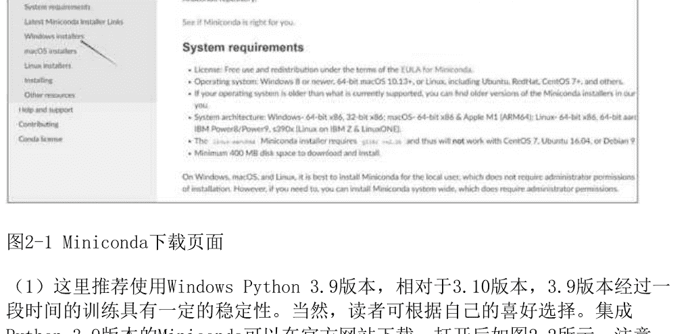
图2-1 Miniconda 获取界面
（1）建议 Windows 环境选用 Python 3.9 版本，相较 3.10 更为稳定。当然也可按个人偏好选择。集成 Python 3.9 的 Miniconda 可在官网获取，页面如图2-2所示。注意 64 位系统应选择以 Miniconda3 开头、以 64 结尾的安装文件，避免选错。

图2-2 Miniconda 网页提供的包
（2）获取完成后得到 .exe 安装包，直接运行即可开始部署。部署成功后目录结构如图2-3所示。
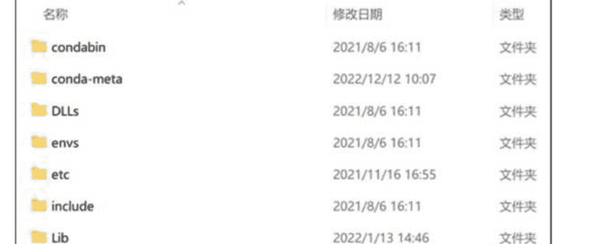
图2-3 Miniconda 安装目录
- 2. 启动控制台
依次点击“开始”→“所有程序”→Miniconda3→Miniconda Prompt，打开 Miniconda Prompt 窗口，其使用方式与 CMD 类似，通过命令行即可管理和配置 Python。Miniconda 中常用 conda 指令执行基础操作。
- 3. 确认 Python
在控制台输入 python，若部署正常会打印版本号与提示符。在提示符下输入代码：
```
python
print("hello")
```
结果如图2-4所示。
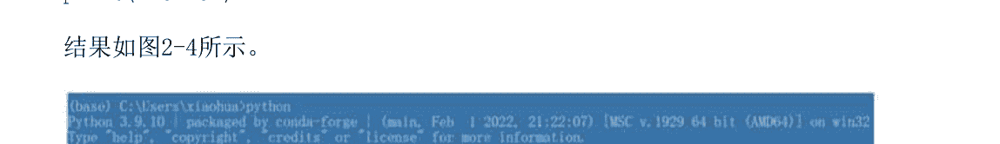
图2-4 确认 Miniconda Python 运行正常
- 4. 使用 pip 指令
Miniconda 能便捷地安装大量第三方类库。查看已装类库的命令如下：
```
bash
pip list
```
注意：若 CMD 命令行仍处于 >>> 状态，可输入 exit() 退出。
在 Miniconda Prompt 中执行 pip list，输出如图2-5所示，为局部截图。
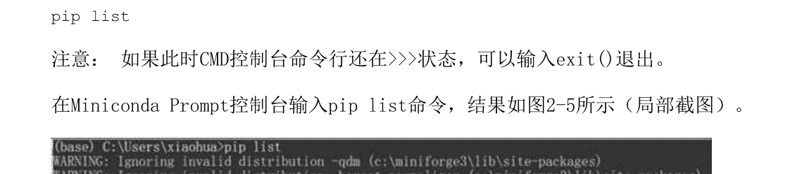
图2-5 已装第三方类库列表
Miniconda 中 pip 的主要用途是安装第三方类库，命令格式如下：
```
bash
pip install name
```
其中 name 为待安装的类库名，例如安装 NumPy 包，命令为：
```
pip install numpy
```
结果如图2-6所示。

图2-6 示例自动获取或更新依赖类库
Miniconda 默认自带大部分常用学习类库，可避免因依赖缺失导致的安装问题。

### 2.1.2 PyCharm 的获取与部署
Python 程序可用 Windows 自带控制台编写，但面对复杂工程容易混淆层级与文件关联，建议使用专业编辑器 PyCharm。
- 1. PyCharm 的获取和部署
进入 PyCharm 官网 Download 页面，点击 Other versions 打开，在该页根据系统选择免费社区版 Community Edition 获取，如图2-7所示。
| PyCharm Professional Edition | PyCharm Community Edition |
|------------------------------|---------------------------|
| 2023.2.2 - Linux (tar.gz)    | 2023.2.2 - Linux (tar.gz) |
| 2023.2.2 - Linux ARM64 (tar.gz) | 2023.2.2 - Linux ARM64 (tar.gz) |
| 2023.2.2 - Windows (exe)     | 2023.2.2 - Windows (exe)  |
| 2023.2.2 - Windows ARM64 (exe) | 2023.2.2 - Windows ARM64 (exe) |
| 2023.2.2 - macOS (dmg)       | 2023.2.2 - macOS (dmg)    |
| 2023.2.2 - macOS Apple Silicon (dmg) | 2023.2.2 - macOS Apple Silicon (dmg) |
图2-7 选择 PyCharm Community Edition 获取
- 2. 获取安装文件后双击运行进入安装向导，如图2-8所示。点击 Next 继续。
# Welcome to PyCharm Community Edition Setup
Setup will guide you through the installation of PyCharm Community Edition.
It is recommended that you close all other applications before starting Setup. This will make it possible to update relevant system files without having to reboot your computer.
Click Next to continue.
- Next >
- Cancel

> 图2-8 安装向导界面

图2-9 勾选所有复选框
（4）部署完成后点击 Finish 按钮，如图2-10所示。

图2-10 安装完成
- 2. 使用 PyCharm 创建程序
（1）双击桌面新生成的 PyCharm 图标启动程序，首次启动会进行设置定位，如图2-11所示。建议选择第2项 Do not import settings。
（2）点击 OK 后进入配置界面，如图2-12所示。

图2-11 由 PyCharm 自动指定

图2-12 配置界面
（3）在配置界面可调整界面风格，不熟悉者保留默认即可。如图2-13所示，可将背景设为白色。

图2-13 对 PyCharm 界面进行配置
（4）新建工程如图2-14所示。可尝试导入本书配套源码作为工程。
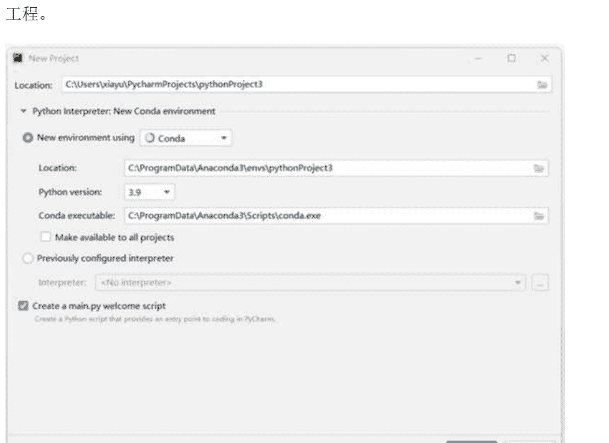
图2-14 创建一个新工程
在工程目录下右键菜单选择 New→Python File，新建 helloworld.py，进入编辑页输入代码，如图2-16所示。
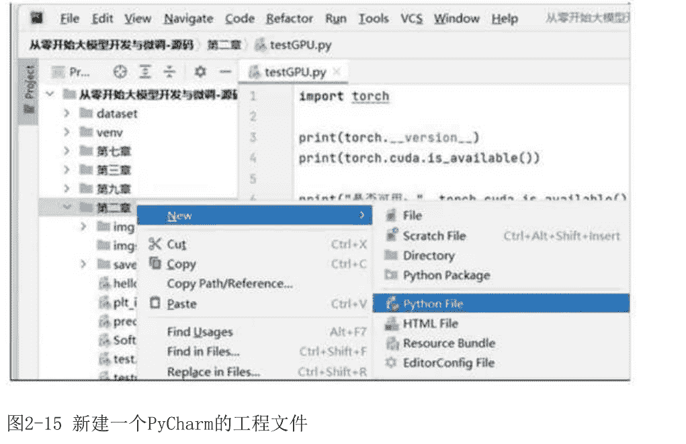
图2-15 新建一个 PyCharm 工程文件
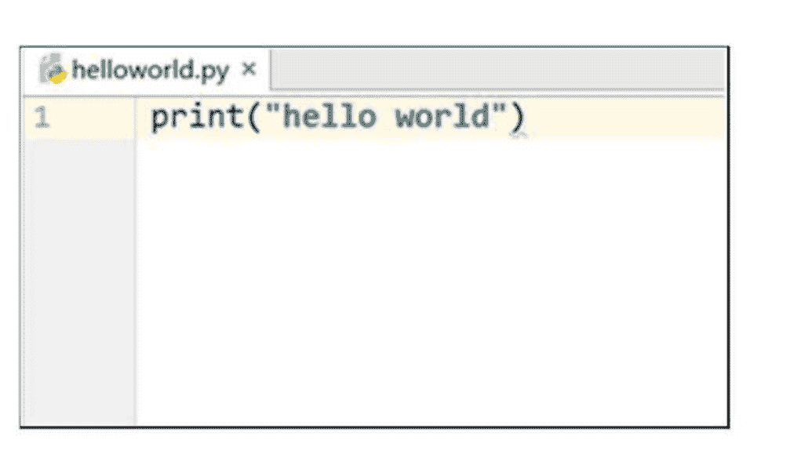
```
print("hello world")
```

Python 深度学习环境搭建实战

图2-16 helloworld.py

在菜单栏点 Run→run… 即可执行脚本，也能直接在 helloworld.py 文件名上右键，在弹出的快捷菜单里选择 run。若控制台正常打印出 hello world，就说明 Python 与 PyCharm 的配置已经完成。

### 2.1.3 Python代码小练习：计算Softmax函数

Python 做科学计算的优势在于能把数学表达式几乎原样转成程序代码。本小节就用 Python 来实现深度学习里非常常见的 Softmax 函数。具体应用场景暂不展开，先把实现过程走一遍。

Softmax 的计算公式如下：

```
$$ S_i = \frac{e^{v_i}}{\sum_{j=0}^{j} e^{v_i}} $$
```

其中 V_i 表示长度为 j 的序列 V 中的某个元素。Softmax 的做法是先对每个 V_i 取自然指数得到非负值，再用所有指数之和做归一化。这样每个 V_i 就能解释为在观测数据类别中，该值属于某类的概率，也可称作似然。

提示： Softmax 用来缓解概率计算中大值碾压小值的问题。比如计算结果中有 a 和 b 两个值，且 a > b。若只按数值大小取用，a 会一直被选中，b 因数值小而被忽略。可实践中有时也需要让较小的 b 有机会被使用，Softmax 就能提供这种可能。

Softmax 是按概率来挑选 a 与 b。因为 a 的概率更高，所以被采到的频率更大；b 的概率偏低，被采到的机会更少，但仍保留被选中的可能。

## Softmax公式的代码如下：

```python
import numpy
def softmax(inMatrix):
    m,n = numpy.shape(inMatrix)
    outMatrix = numpy.mat(numpy.zeros((m,n)))
    soft_sum = 0
    for idx in range(0,n):
        outMatrix[0,idx] = math.exp(inMatrix[0,idx])
        soft_sum += outMatrix[0,idx]
    for idx in range(0,n):
        outMatrix[0,idx] = outMatrix[0,idx] / soft_sum
    return outMatrix
```

整体思路很清晰：接收一个数列后，分别算出每个元素的指数值，把指数求和，再用每个指数除以总和得到对应的概率。

```python
a = numpy.array([[1,2,1,2,1,1,3]])
```

具体打印结果请自行运行验证。

## 2.1 环境搭建1：安装Python

### 2.1.1 Miniconda的下载与安装

- 1. 下载和安装

进入 Miniconda 官网，下载页面如图2-1 所示。

不同操作系统可对应选择不同平台的安装包，目前官网提供的是内嵌 Python 3.10 的新版本。若使用更早的 Python 3.9 也是可以的，经测试 3.10 与 3.9 都不会影响 PyTorch 的正常使用。


图2-1 Miniconda下载页面

（1）建议 Windows 用户使用 Python 3.9 版本，相较 3.10 更稳定，经过更长时间的验证。当然也可以按个人喜好选择。官网提供 Python 3.9 内嵌版的 Miniconda，打开后界面如图2-2 所示。注意，64 位系统请挑选文件名以 Miniconda3 开头、以 64 结尾的安装包，避免选错。

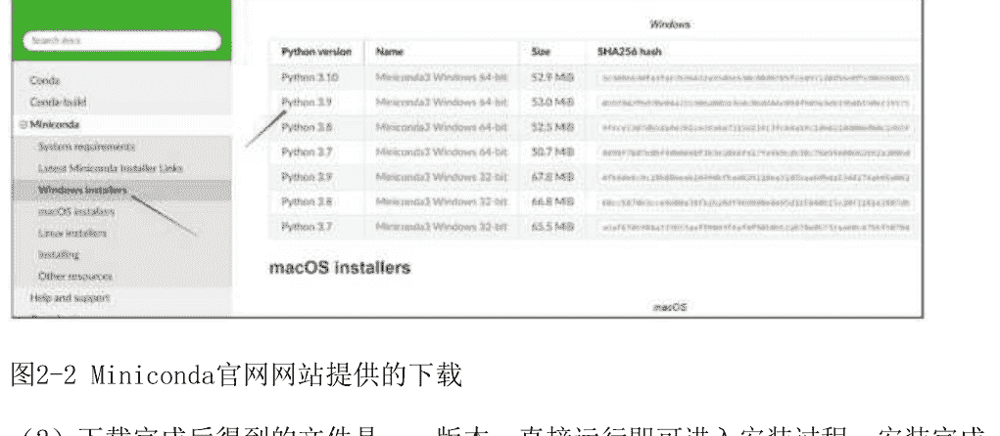

图2-2 Miniconda官网网站提供的下载

（2）下载得到 .exe 安装文件，双击运行即可进入安装流程。安装成功后目录结构如图2-3 所示。

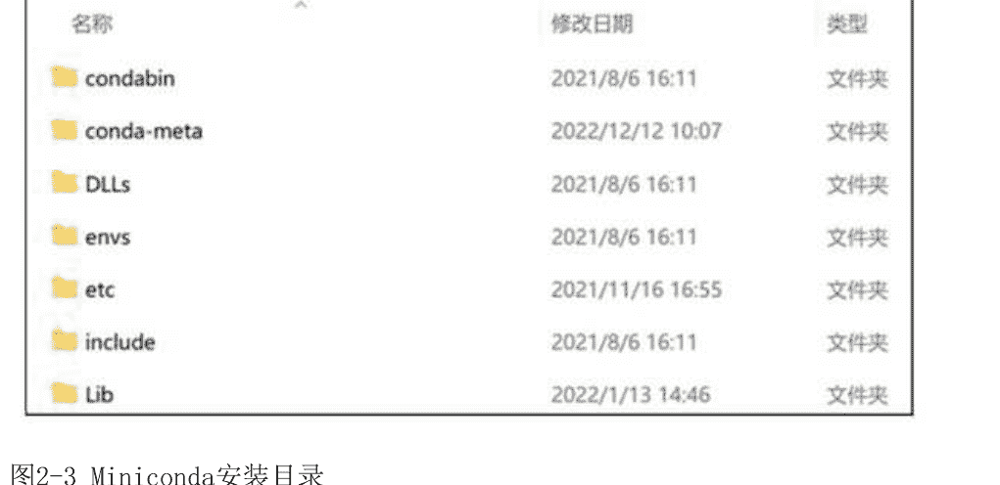

图2-3 Miniconda安装目录

- 2. 打开控制台

依次点击“开始”→“所有程序”→Miniconda3→Miniconda Prompt，打开 Miniconda Prompt 窗口。其使用方式与 CMD 类似，通过命令即可控制和配置 Python。Miniconda 中常用 conda 命令，可完成各类基础操作。

- 3. 验证Python

在控制台输入 python，若安装正常会输出版本号并进入交互提示符。在提示符下执行代码：

```python
print("hello")
```

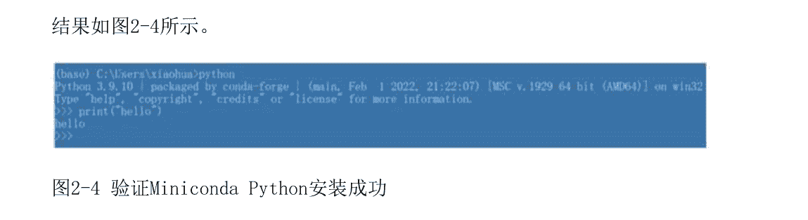

图2-4 验证Miniconda Python安装成功

- 4. 使用pip命令

Miniconda 的便利之处在于能轻松安装大量第三方库。查看已装库的代码如下：

```python
pip list
```

注意：若控制台仍处于 >>> 状态，输入 exit() 即可退出。

在 Miniconda Prompt 中执行 pip list，输出如图2-5 所示，为局部截图。

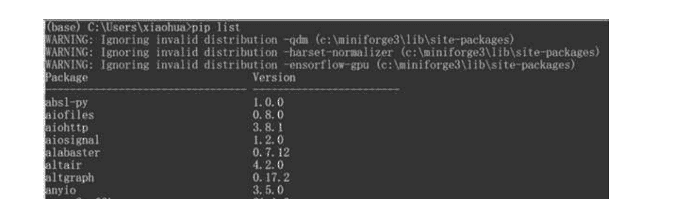

图2-5 列出已安装的第三方类库

Miniconda 配合 pip 能做的事情很多，核心是安装第三方库，命令格式为：

```python
pip install name
```

其中 name 为待装库名。以 NumPy 为例，该包已预装，命令如下：

```python
pip install numpy
```

执行结果如图2-6 所示。

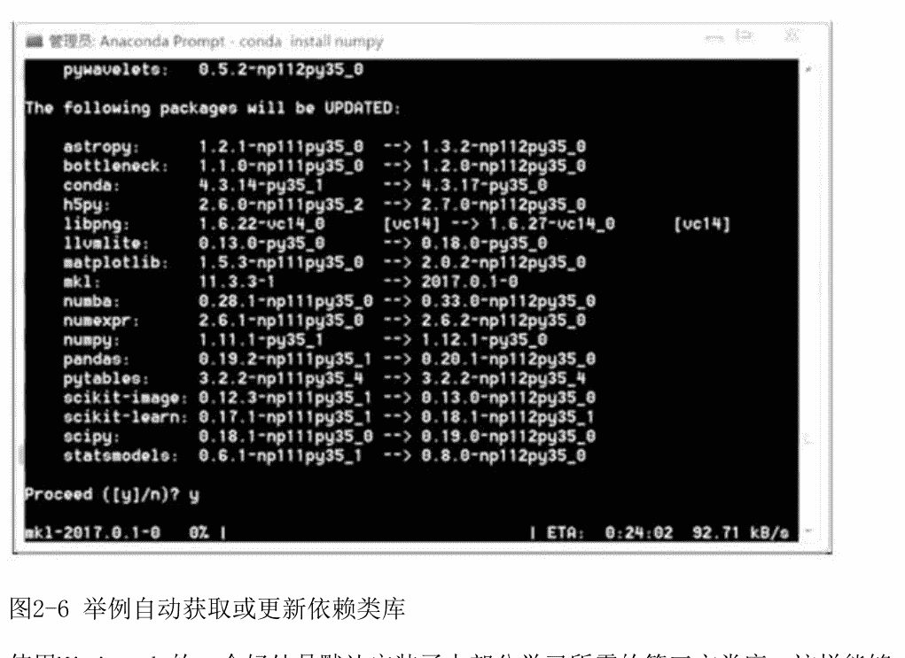

Miniconda 默认自带大部分学习所需的基础库，可避免因依赖缺失导致安装失败。

### 2.1.2 PyCharm的下载与安装

Python 程序也能用 Windows 自带的控制台编写，但面对复杂工程容易混乱层级与文件关系，因此建议使用专业的 Python IDE PyCharm。

- 1. PyCharm的下载和安装

(1) 进入 PyCharm 官网 Download 页面，点击 Other versions 打开，在该页按系统选择免费的 Community Edition 下载，如图2-7 所示。

Version 2023.2

| PyCharm Professional Edition | PyCharm Community Edition |

|------------------------------|---------------------------|

| 2023.2.2 - Linux (tar.gz)    | 2023.2.2 - Linux (tar.gz) |

| 2023.2.2 - Linux ARM64 (tar.gz) | 2023.2.2 - Linux ARM64 (tar.gz) |

| 2023.2.2 - Windows (exe)     | 2023.2.2 - Windows (exe)  |

| 2023.2.2 - Windows ARM64 (exe) | 2023.2.2 - Windows ARM64 (exe) |

| 2023.2.2 - macOS (dmg)       | 2023.2.2 - macOS (dmg)    |

| 2023.2.2 - macOS Apple Silicon (dmg) | 2023.2.2 - macOS Apple Silicon (dmg) |

图2-7 选择PyCharm Community Edition下载

(2) 下载完成后双击运行，进入安装向导，点击 Next 继续。

(3) 如图2-9 所示，在配置界面勾选全部选项，方便后续使用 PyCharm。


# Welcome to PyCharm Community Edition Setup

Setup will guide you through the installation of PyCharm Community Edition.

It is recommended that you close all other applications before starting Setup. This will make it possible to update relevant system files without having to reboot your computer.

Click Next to continue.


# Installation Options

Configure your PyCharm Community Edition installation

- Create Desktop Shortcut: PyCharm Community Edition

- Update PATH Variable (restart needed): Add "bin" folder to the PATH

- Update Context Menu: Add "Open Folder as Project"

- Create Associations: .py

图2-9 勾选所有复选框

（4）安装完成后点击 Finish，如图2-10 所示。


图2-10 安装完成

- 2. 使用PyCharm创建程序

(1) 双击桌面生成的图标启动 PyCharm，首次启动会进行定位，如图2-11 所示，建议选择第 2 项 Do not import settings。

(2) 点击 OK 后进入配置界面，如图2-12 所示。

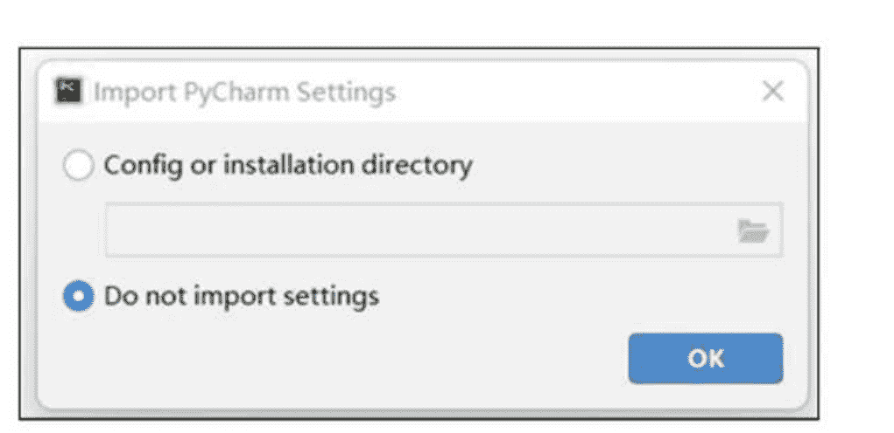

图2-11 由PyCharm自动指定


图2-12 配置界面

（3）在配置界面可自定义界面风格，不熟悉的话保持默认即可。如图2-13 所示，可把背景设为白色。


图2-13 对PyCharm的界面进行配置

（4）新建工程如图2-14 所示，可尝试把本书配套源码导入为新工程。

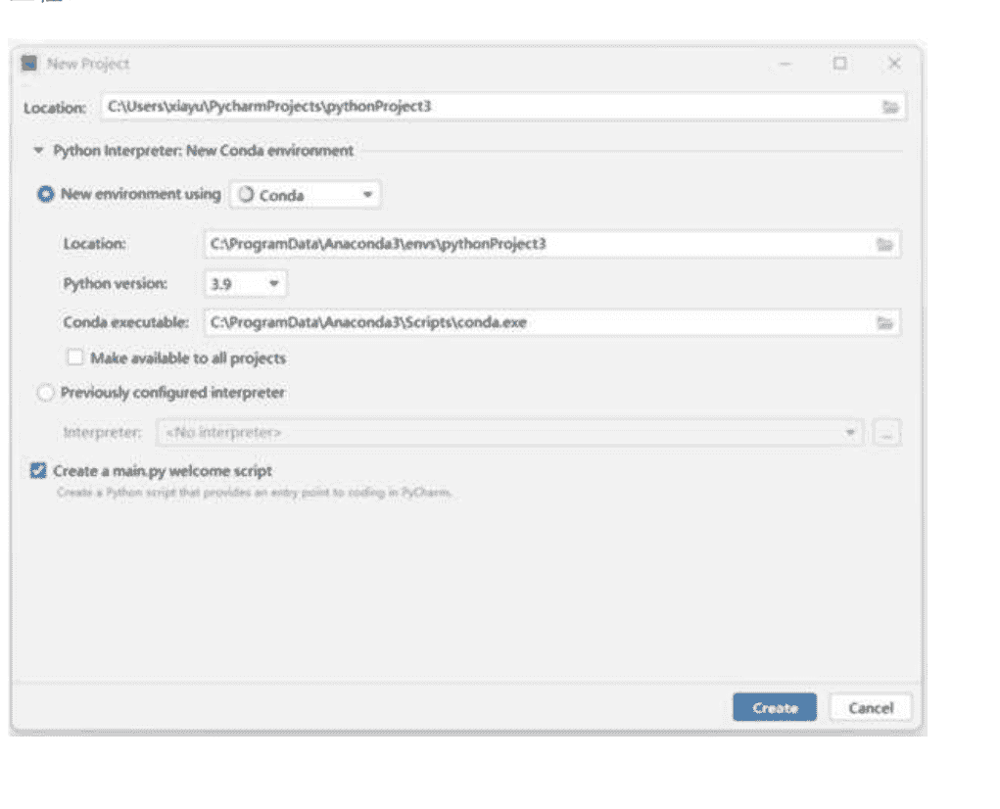

图2-14 创建一个新的工程

在工程目录下右键选择 New→Python File，新建 helloworld.py，打开编辑页输入代码，如图2-16 所示。

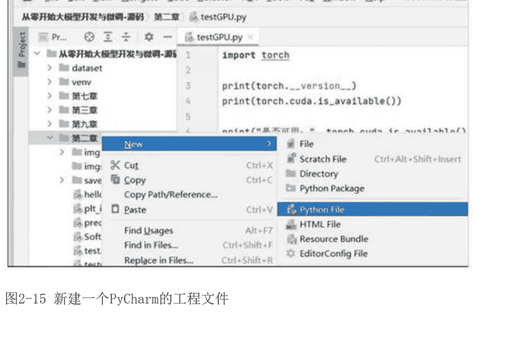

图2-15 新建一个PyCharm的工程文件

```python
import torch

print(torch.__version__)
print(torch.cuda.is_available())
print("GPU可用：" + str(torch.cuda.is_available()))
```

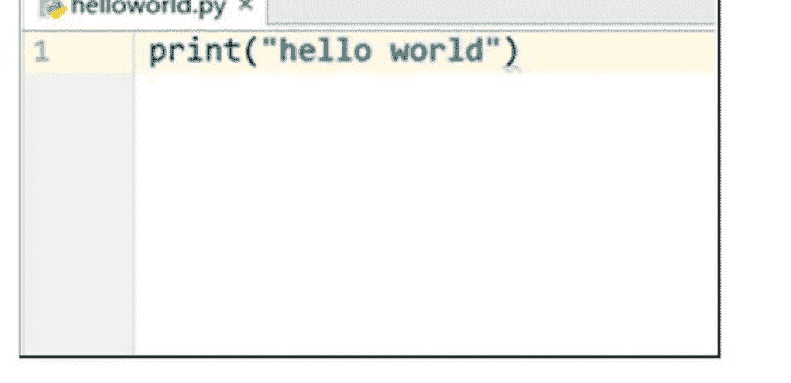

图2-16 helloworld.py

通过菜单栏 Run→run… 运行，或直接右键 helloworld.py 选择 run。若成功输出 hello world，则代表 Python 与 PyCharm 已配置完毕。

### 2.1.3 Python代码小练习：计算Softmax函数

Python 的科学计算范式就是把数学公式直接映射为代码语言，可以说 Python 完美契合这一思路。本节用 Python 实现并计算深度学习里高频使用的 Softmax 函数。函数用途暂不展开，重点是带领读者完成编码实践。

Softmax 计算公式如下：

$$ S_i = \frac{e^{v_i}}{\sum_{j=0}^{j} e^{v_i}} $$

其中 V_i 是序列 V 中长度为 j 的某一个数。Softmax 先对每个 V_i 做以 e 为底的指数变换得到非负值，再除以所有项之和做归一化。此时每个 V_i 可被解释为在观测类别中，该值属于某个类别的概率，即似然。

提示： Softmax 用于解决概率值差距过大导致大值独占的问题。例如结果中有 a 与 b，且 a > b，若仅按大小取舍，a 会始终被选用，b 因数值小被舍弃，但在某些场景下也需要较小值的 b 有一定机会被使用，Softmax 正是为此而生。

Softmax 是按概率选择 a 与 b。a 的概率高于 b，所以在抽样时 a 被取到的次数更多；b 的概率较低，被取到的可能性更小，但仍不为零。

Softmax 公式代码如下：

```python
import numpy
def softmax(inMatrix):
    m,n = numpy.shape(inMatrix)
    outMatrix = numpy.mat(numpy.zeros((m,n)))
    soft_sum = 0
    for idx in range(0,n):
        outMatrix[0,idx] = math.exp(inMatrix[0,idx])
        soft_sum += outMatrix[0,idx]
    for idx in range(0,n):
        outMatrix[0,idx] = outMatrix[0,idx] / soft_sum
    return outMatrix
```

代码逻辑是输入一个序列后，先算每个数对应的指数，再求和，最后用每个指数除以总和得到概率。

```python
a = numpy.array([[1,2,1,2,1,1,3]])
```

输出结果请自行运行打印核对。

## 2.1 环境搭建1：安装Python

### 2.1.1 Miniconda的下载与安装

- 1. 下载和安装

打开 Miniconda 官方网站，下载页面如图2-1 所示。

可根据操作系统挑选对应平台的 Miniconda 镜像，目前提供内嵌 Python 3.10 的版本。若使用 Python 3.9 也是完全可行的，实测 3.10 与 3.9 均不影响 PyTorch 使用。


图2-1 Miniconda下载页面

（1）推荐 Windows 用户选择 Python 3.9 版本，相较 3.10 更为成熟稳定。当然也可以按喜好决定。Python 3.9 内嵌的 Miniconda 可在官网下载，页面如图2-2 所示。注意：64 位系统请下载以 Miniconda3 开头并以 64 结尾的文件，别下载错误。

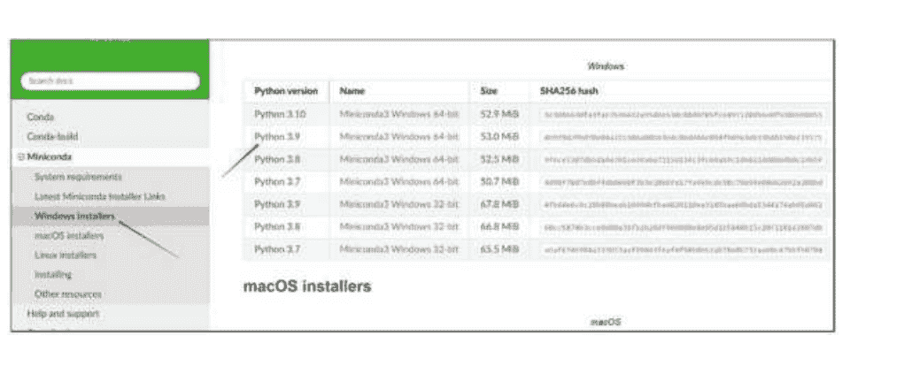

| Python version | Name | Size | SHA256 hash |

|----------------|------|------|-------------|

| Python 3.10 | Miniconda3 Windows 64-bit | 52.9 MB | ... |

| Python 3.9 | Miniconda3 Windows 64-bit | 53.0 MB | ... |

| Python 3.8 | Miniconda3 Windows 64-bit | 52.5 MB | ... |

| Python 3.7 | Miniconda3 Windows 64-bit | 50.7 MB | ... |

从零搭建 Python 科学计算环境：Miniconda + PyCharm 实操

| Python 3.9 | Miniconda3 Windows 32-bit | 67.8 MB | ... |

| Python 3.8 | Miniconda3 Windows 32-bit | 66.8 MB | ... |

| Python 3.7 | Miniconda3 Windows 32-bit | 65.5 MB | ... |

图2-2 官网列出的 Miniconda 可选版本

下载完成后得到的是 exe 安装包，双击即可进入向导。部署完毕后打开安装根目录，若能看到下述结构即说明安装正常。


| 名称 | 修改日期 | 类型 |

|------|----------|------|

| condabin | 2021/8/6 16:11 | 文件夹 |

| conda-meta | 2022/12/12 10:07 | 文件夹 |

| DLLs | 2021/8/6 16:11 | 文件夹 |

| envs | 2021/8/6 16:11 | 文件夹 |

| etc | 2021/11/16 16:55 | 文件夹 |

| include | 2021/8/6 16:11 | 文件夹 |

| Lib | 2022/1/13 14:46 | 文件夹 |

图2-3 安装目录结构示例

- 启动交互终端
从开始菜单打开 所有程序 → Miniconda3 → Miniconda Prompt，会弹出类似 CMD 的窗口。这里可输入指令管理 Python，conda 是最常用的管理工具。

- 校验 Python 是否可用
在终端里敲入 python，若部署成功会回显版本号并进入交互提示符。在提示符下执行如下片段：

```python
print("hello")
```

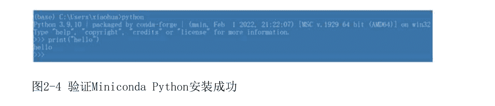

图2-4 Python 交互验证效果

- pip 使用说明
Miniconda 的便利之处在于能快速调用大量第三方包。查询已装包的写法为：

```python
pip list
```

提示：若命令行仍停留在 >>> 模式，可执行 exit() 退出。

在 Miniconda Prompt 中运行 pip list，截取结果如图2-5。

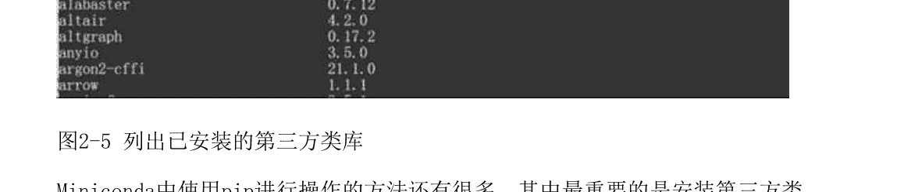

图2-5 已装第三方库清单局部

在该环境下 pip 的用法很丰富，核心是安装新包，通用模板为：

```python
pip install name
```name 代表目标包名。举例 NumPy 已随发行版内置，执行命令为：

```
pip install numpy
```

返回结果如图2-6。

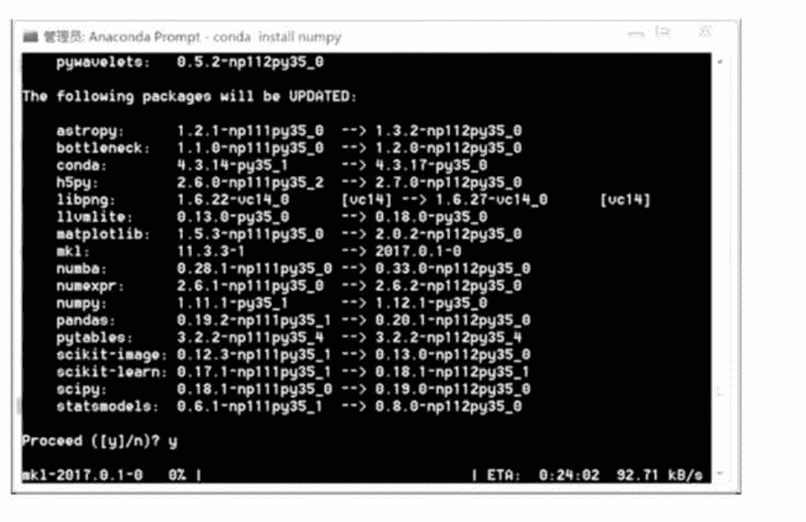

发行版自带常用科学计算依赖，可避免因缺失而报错。

### 2.1.2 PyCharm 的下载与安装
Windows 自带控制台也能写 Python，但工程化项目容易混淆层级，建议使用专业 IDE PyCharm。

- 下载与安装
进入官网 Download 页，点击 Other versions 打开版本列表，按系统挑选免费的 Community Edition，如图2-7。

| PyCharm Professional Edition | PyCharm Community Edition |

|------------------------------|---------------------------|

| 2023.2.2 - Linux (tar.gz)    | 2023.2.2 - Linux (tar.gz) |

| 2023.2.2 - Linux ARM64 (tar.gz) | 2023.2.2 - Linux ARM64 (tar.gz) |

| 2023.2.2 - Windows (exe)     | 2023.2.2 - Windows (exe)  |

| 2023.2.2 - Windows ARM64 (exe) | 2023.2.2 - Windows ARM64 (exe) |

| 2023.2.2 - macOS (dmg)       | 2023.2.2 - macOS (dmg)    |

| 2023.2.2 - macOS Apple Silicon (dmg) | 2023.2.2 - macOS Apple Silicon (dmg) |

图2-7 社区版下载选择

下载完成后双击运行，进入安装画面如图2-8，按下一步推进即可。

# PyCharm Community Edition Setup

# Welcome to PyCharm Community Edition Setup

Setup will guide you through the installation of PyCharm Community Edition.

It is recommended that you close all other applications before starting Setup. This will make it possible to update relevant system files without having to reboot your computer.

Click Next to continue.


Next >

Cancel

图2-8 安装欢迎页

配置页建议全选，如图2-9，可提升后续使用体验。

# Installation Options

Configure your PyCharm Community Edition installation

- Create Desktop Shortcut: ☑ PyCharm Community Edition

- Update PATH Variable (restart needed): ☑ Add "bin" folder to the PATH

- Update Context Menu: ☑ Add "Open Folder as Project"

- Create Associations: ☑ .py

图2-9 安装选项勾选

安装结束点击 Finish，如图2-10。


图2-10 安装完成提示

## 2. 使用 PyCharm 创建程序
- 启动 IDE
双击桌面新生成的  图标，首次启动会询问是否导入设置，图2-11，建议选 Do not import settings。

- 进入配置向导
确认后进入初始配置界面如图2-12。

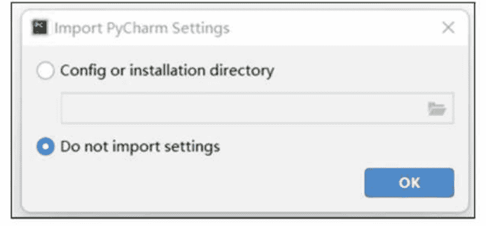

图2-11 首次启动导入设置提示


图2-12 配置向导

可调整外观主题，不熟悉时保留默认即可，图2-13 示例如将背景设为白色。


图2-13 界面外观调整

新建工程入口如图2-14，也可导入配套源码。

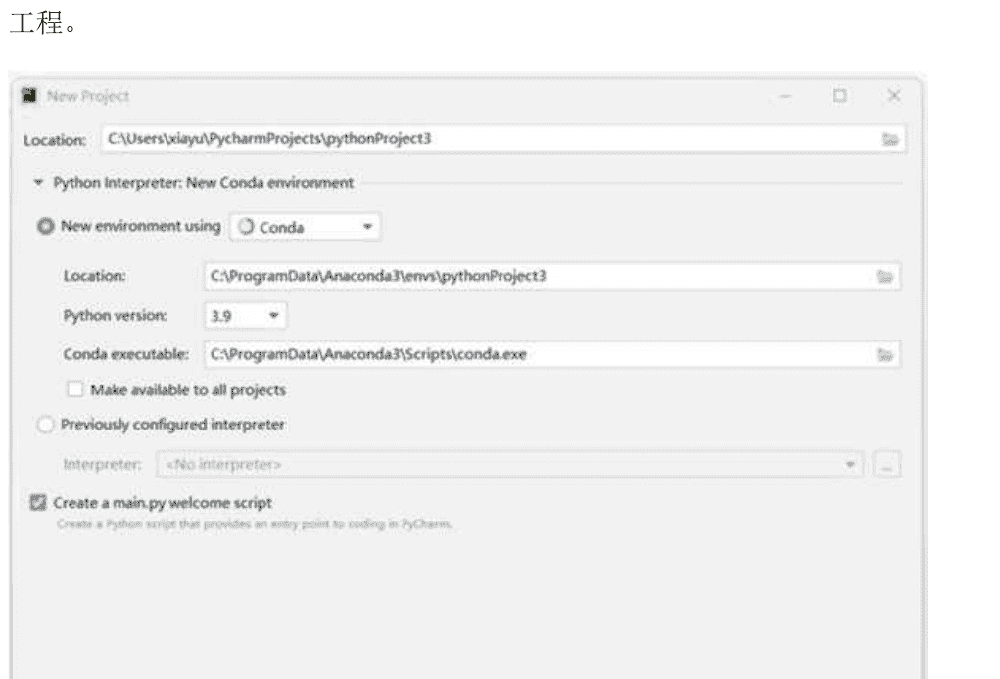

图2-14 新建工程

在工程目录右键 New → Python File，新建 helloworld.py，编辑区输入代码如图2-16。

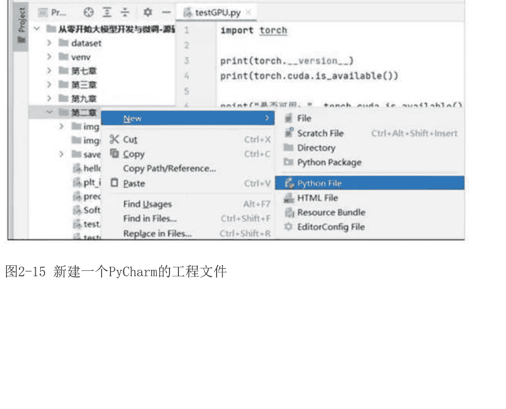

图2-15 新建 Python 文件


图2-16 helloworld.py 示例

通过 Run 菜单或右键 run 启动，若输出 hello world 即说明环境配置完毕。

### 2.1.3 Python 代码小练习：计算 Softmax 函数
Python 可将数学式直接转写为代码。本节实现深度学习中常见的 Softmax，先不展开用途，仅做编程练习。

数学表达为：

```
$$ S_i = \frac{e^{v_i}}{\sum_{j=0}^{j} e^{v_i}} $$
```

其中 V_i 为数列 V 的一个元素，先对每个元素取 e 为底的指数，再用总和归一化，得到的结果可解释为类别概率或似然。

提示：Softmax 用来缓解概率值过大导致绝对主导的问题。设结果中有 a 与 b 且 a > b，若只按大小取舍，a 会被一直选用而 b 被忽略，Softmax 让 b 仍有被选中的概率。

实现代码：

```python
import numpy
    def softmax(inMatrix):
        m,n = numpy.shape(inMatrix)
        outMatrix = numpy.mat(numpy.zeros((m,n)))
        soft_sum = 0
        for idx in range(0,n):
            outMatrix[0,idx] = math.exp(inMatrix[0,idx])
            soft_sum += outMatrix[0,idx]
        for idx in range(0,n):
            outMatrix[0,idx] = outMatrix[0,idx] / soft_sum
        return outMatrix
```

输入序列后分别计算指数并求和，得到各元素占比。

```python
a = numpy.array([[1,2,1,2,1,1,3]])
```

请自行打印验证结果。

## 2.1 环境搭建1：安装 Python

### 2.1.1 Miniconda 的下载与安装
- 获取与部署
打开 Miniconda 官网，下载页如图2-1，当前主推集成 Python 3.10 的版本，3.9 也可正常使用，不影响 PyTorch。

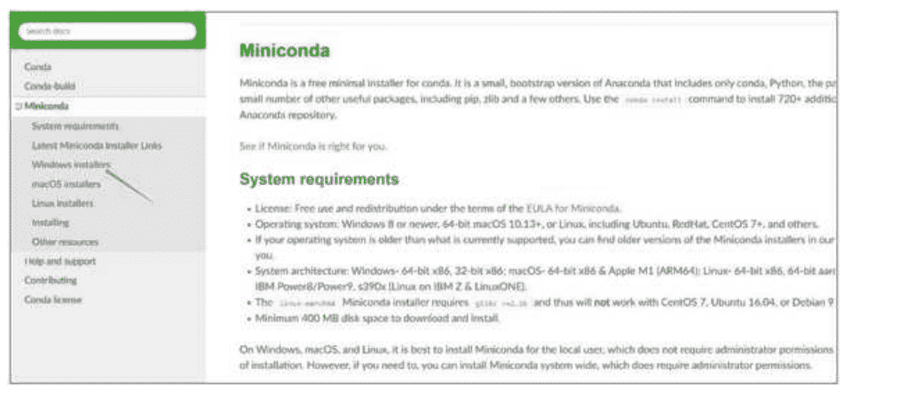

图2-1 Miniconda 下载页面

Windows 下推荐 Python 3.9，稳定性更好。官网列表如图2-2，64 位系统请选以 Miniconda3 起头、以 64 结尾的安装包。

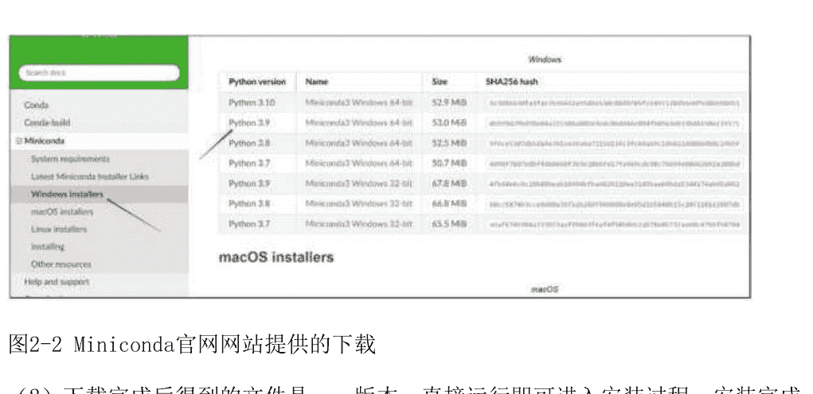

图2-2 官网下载选项

下载完成后为 exe，直启安装向导。安装成功后目录结构如图2-3。

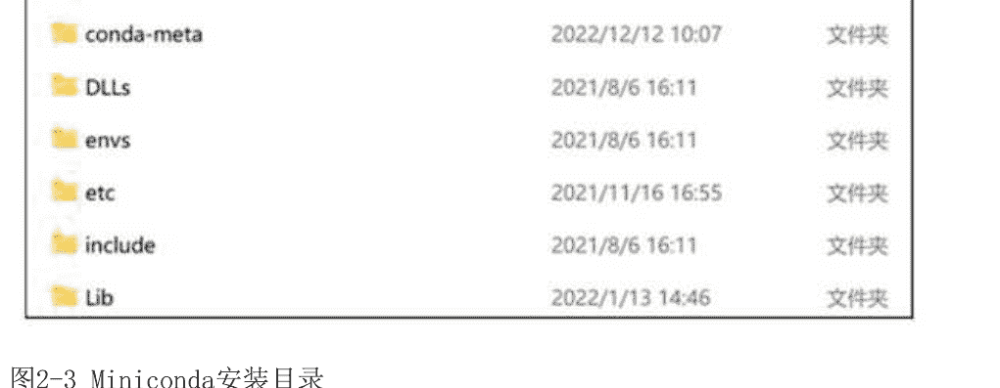

图2-3 Miniconda 安装目录

## 2. 打开控制台
通过开始菜单依次打开 所有程序 → Miniconda3 → Miniconda Prompt，打开的窗口与 CMD 类似，可输入命令控制和配置 Python。conda 是常用命令，可执行基础操作。

## 3. 验证 Python
在控制台输入 python，若安装无误会打印版本号并出现提示符。在提示符下输入代码：

```python
print("hello")
```

结果如图2-4。

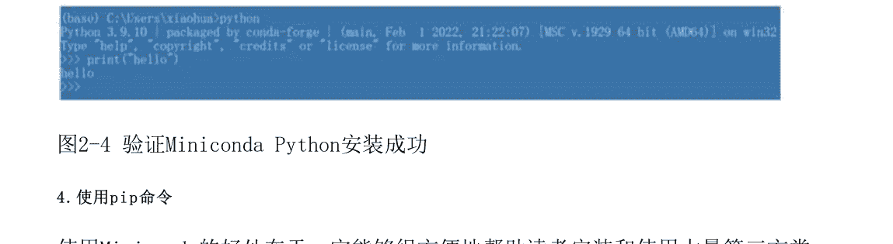

## 4. 使用 pip 命令
Miniconda 便于安装和使用大量第三方类库。查看已装类库的代码为：

```python
pip list
```

注意：若命令行仍在 >>> 状态，可输入 exit() 退出。

在 Miniconda Prompt 输入 pip list，结果如图2-5 局部截图。

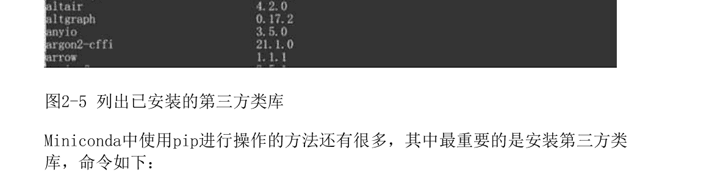

pip 的操作很多，关键是安装第三方类库，命令为：

```python
pip install name
```

name 为待装类库名，假设安装 NumPy 包，该包已内置，命令如下：

```
pip install numpy
```

结果如图2-6。

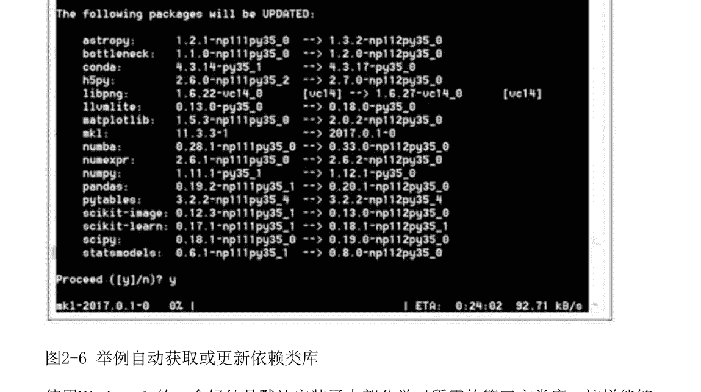

Miniconda 默认自带大部分学习所需类库，避免依赖缺失。

### 2.1.2 PyCharm 的下载与安装
Python 可用 Windows 自带控制台编写，但复杂工程易混淆层级，建议使用专用编译器 PyCharm。

- 下载和安装
进入官网 Download 页面，找到 Other versions 链接打开，按系统选择免费社区版 Community Edition 下载，如图2-7。

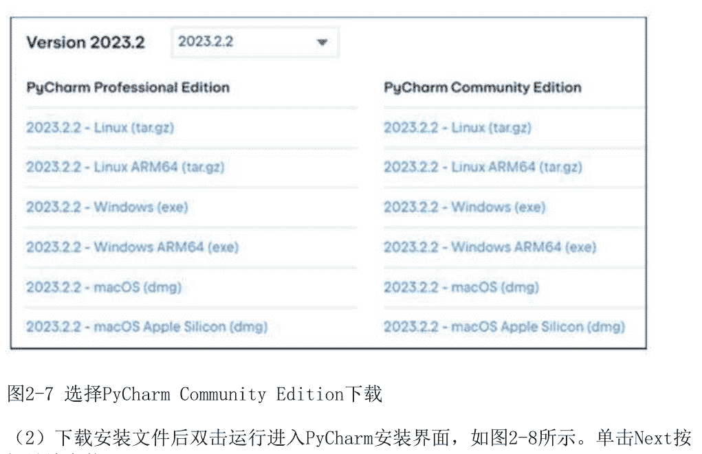

图2-7 选择 PyCharm Community Edition 下载

下载安装文件后双击运行进入安装界面，如图2-8，点击 Next 继续。

# PyCharm Community Edition Setup

# Welcome to PyCharm Community Edition Setup

Setup will guide you through the installation of PyCharm Community Edition.

It is recommended that you close all other applications before starting Setup. This will make it possible to update relevant system files without having to reboot your computer.

Click Next to continue.

图2-8 安装界面

# PyCharm Community Edition Setup

# Installation Options

PyCharm 社区版 安装配置向导

安装最后一步会弹出配置向导，全部建议勾选：
- 创建桌面快捷方式： ☑ PyCharm Community Edition
- 更新 PATH 环境变量（需重启）： ☑ 将 bin 目录加入 PATH
- 更新右键菜单： ☑ 添加“Open Folder as Project”
- 创建文件关联： ☑ .py
- < Back
- Next >
- Cancel

图2-9 勾选所有复选框

安装收尾阶段点 Finish 完成，如图2-10所示。


图2-10 安装完成

## 2. 用 PyCharm 搭建首个项目

- 1. 双击桌面新生成的 PyCharm 图标启动程序，首次进入会弹出设置导入提示，如图2-11。建议选择第二个选项 Do not import settings，不导入旧配置。

- 2. 点 OK 后进入配置面板，如图2-12所示。


图2-11 由 PyCharm 自动指定


图2-12 配置界面

（3）在配置面板里可以调整界面风格，习惯不熟可沿用默认。示例中把背景调成白色，如图2-13。


图2-13 对 PyCharm 的界面进行配置

（4）新建工程，如图2-14。也可以把本书附带的源码导入作为工程。

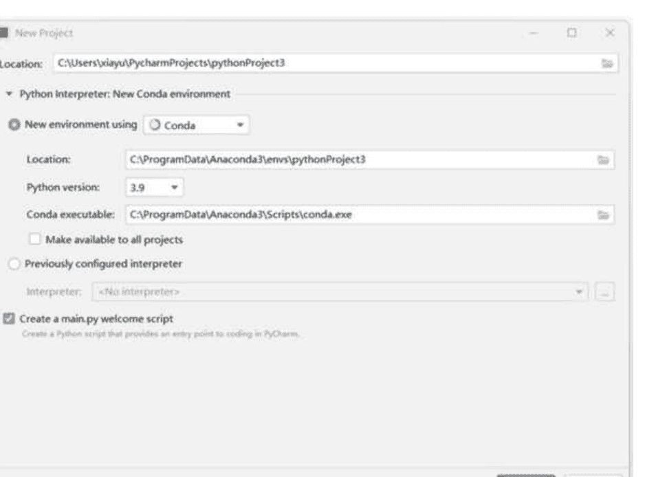

图2-14 创建一个新的工程

在工程目录中右键 → New → Python File，新建 helloworld.py，打开编辑页编写代码，如图2-16所示。

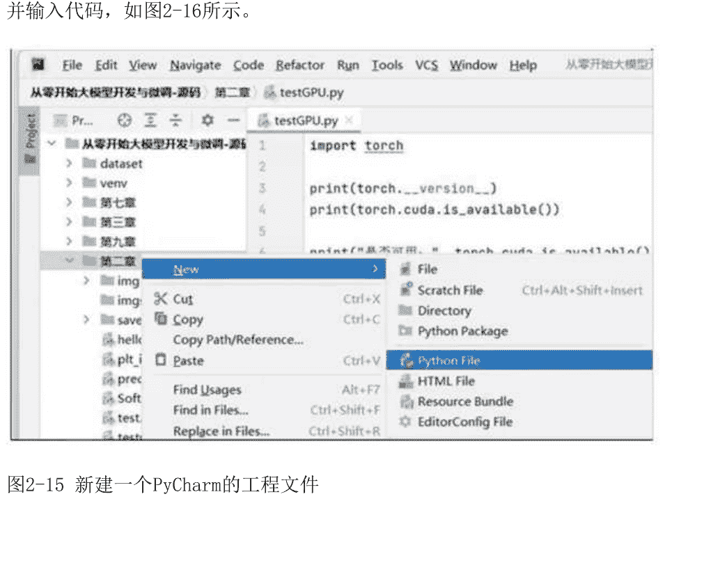

图2-15 新建一个 PyCharm 的工程文件

图2-16 helloworld.py

通过菜单栏 Run → run… 执行，或右键文件选择 run。若能正常输出 hello world，说明 Python 与 PyCharm 已配置成功。

### 2.1.3 小练习：用 Python 实现 Softmax

Python 科学计算的魅力在于数学公式可直接转成代码。本节用 Python 复现深度学习里常见的 Softmax 函数，具体用途先不展开，先练手实现。

Softmax 计算公式如下：

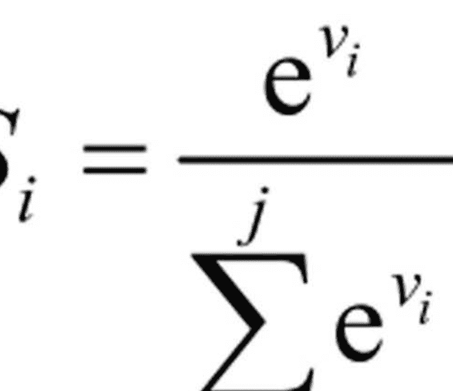

其中 \(V_i\) 为数列 \(V\) 的第 \(i\) 个元素，运算过程是对每个元素做以 e 为底的指数，再除以所有指数之和归一化。归一化后每个值可解释为在不同类别中该元素出现的概率，即似然。

提示： Softmax 用来缓解概率失衡问题。设计算结果有 \(a\) 与 \(b\) 且 \(a>b\)，若直接按大小取舍，后续几乎总选 \(a\)，\(b\) 很难被使用。Softmax 通过概率化选择，\(a\) 被选概率更大，\(b\) 概率虽小仍有机会被选中。

代码实现如下：

```python
import numpy
def softmax(inMatrix):
    m,n = numpy.shape(inMatrix)
    outMatrix = numpy.mat(numpy.zeros((m,n)))
    soft_sum = 0
    for idx in range(0,n):
        outMatrix[0,idx] = math.exp(inMatrix[0,idx])
        soft_sum += outMatrix[0,idx]
    for idx in range(0,n):
        outMatrix[0,idx] = outMatrix[0,idx] / soft_sum
    return outMatrix
```

输入一个数列后分别求指数并求和，再计算每个元素的概率占比。

```python
a = numpy.array([[1,2,1,2,1,1,3]])
```

具体输出请自行运行验证。

## 2.2 环境搭建2：安装 PyTorch 2.0

Python 运行环境就绪后，本章核心是部署本书的主角 PyTorch 2.0。

### 2.2.1 10/20/30/40 系显卡的 GPU 版本选择

随着 40 系上市，市场上 10、20、30、40 系显卡并存。PyTorch 需要特定计算包，不同显卡对应不同版本，汇总如表2-1。

表2-1 10/20/30/40 系显卡的版本对比

| 显卡型号 | PyTorch GPU 版本 | CUDA 版本 | cuDNN 版本 |

| :--- | :--- | :--- | :--- |

| 10 系列及以前 | PyTorch 2.0 以前的版本 | 11.1 | 7.65 |

| 20/30/40 系列 | PyTorch 2.0 向下兼容 | 11.6+ | 8.1+ |

注意： 关键区别在 CUDA 与 cuDNN。20/30/40 系显卡可使用 CUDA 11.6 以上且 cuDNN 8.1 以上的组合；10 系显卡建议优先使用 PyTorch 2.0 之前的版本。

以下以 CUDA 11.7 + cuDNN 8.2.0 为例演示完整 GPU 运行库安装流程，其他组合步骤类似。

### 2.2.2 PyTorch 2.0 GPU 运行库安装步骤

从 CPU 版入门完全可行，但不推荐。GPU 版速度优势明显，CPU 版容易让学习止步。

PyTorch 2.0 CPU 安装命令如下：

```
pip install numpy --pre torch torchvision torchaudio --force-reinstall --extra-index-url https://download.pytorch.org/whl/nightly/cpu
```

若本机支持 GPU，进入核心环节：安装 PyTorch 2.0 GPU 前置。GPU 版依赖 NVIDIA 提供的运行库。

建议按官网给出的命令安装，如图2-17 所示。官网提供 CUDA 11.7 与 CUDA 11.8 两种方案。

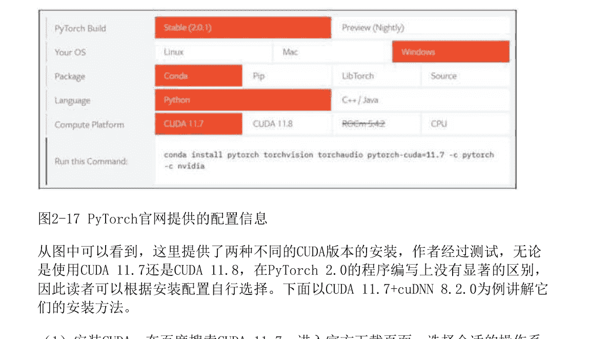

图2-17 PyTorch 官网提供的配置信息

实测两种 CUDA 版本在 PyTorch 2.0 编码上差异不大，读者可按环境自选。下面以 CUDA 11.7 + cuDNN 8.2.0 讲解。

- 1. 安装 CUDA。百度搜索 CUDA 11.7，进入官网下载页，选择适合的操作系统，推荐 exe（local）本地安装，如图2-18。


图2-18 CUDA 下载页面

下载得到 .exe 安装包，安装时保持默认路径，不要自行修改。

- 2. 下载并安装对应 cuDNN。cuDNN 需要先注册账号，注册后进入下载页，如图2-19。务必选对版本号，Windows 64 位系统下载 x86 版本即可。

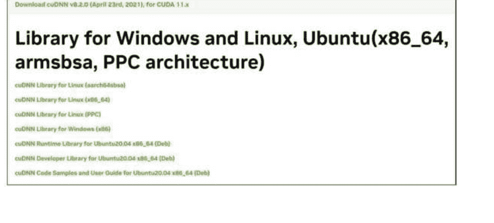

图2-19 cuDNN 下载页面

解压 cuDNN 8.2.0 到 CUDA 安装目录，如图2-20。

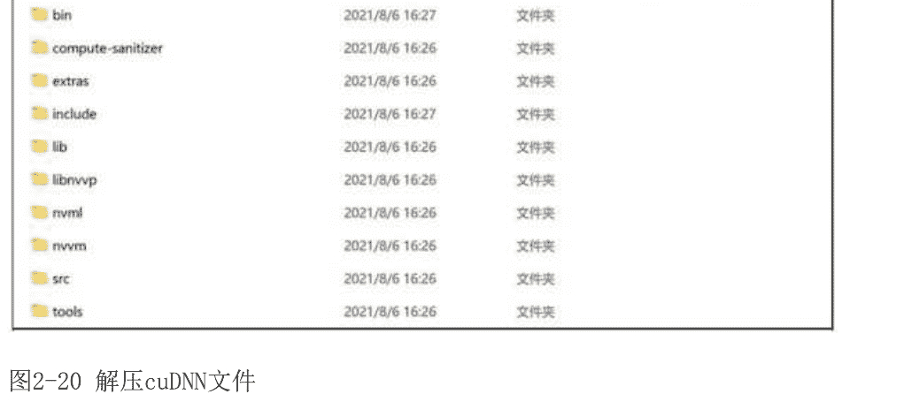

图2-20 解压 cuDNN 文件

- 3. 配置环境变量。将 CUDA 运行路径加入系统 Path，如图2-21。若使用 exe 安装 cuDNN，环境变量通常自动完成，只需核验。

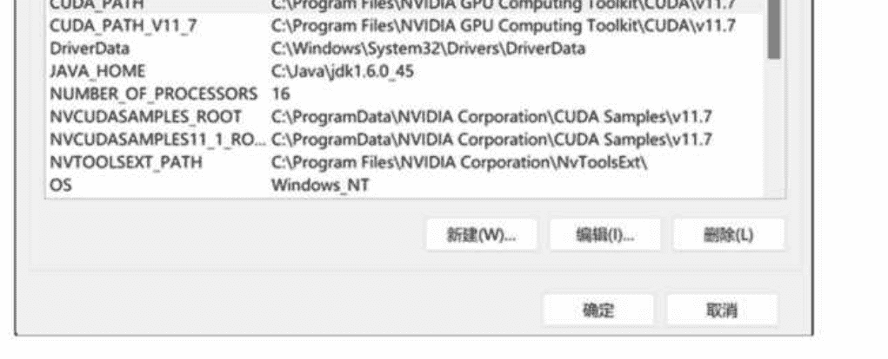

图2-21 配置环境变量

- 4. 安装 PyTorch 及依赖。从图2-17 可见 CUDA 11.7 对应的命令为：

```
conda install pytorch torchvision torchaudio pytorch-cuda=11.7 -c pytorch -c nvidia
```

若未按 2.1.1 节安装 Miniconda，直接使用 Python 安装，命令如下：

```
pip3 install torch torchvision torchaudio --index-url https://download.pytorch.org/whl/cu117
```

GPU 版安装完成后进行验证。

### 2.2.3 小练习：Hello PyTorch

至此 PyTorch 2.0 已部署完成。打开 CMD 依次执行验证命令：

```python
import torch
result = torch.tensor(1) + torch.tensor(2.0)
result
```

运行效果如图2-22。

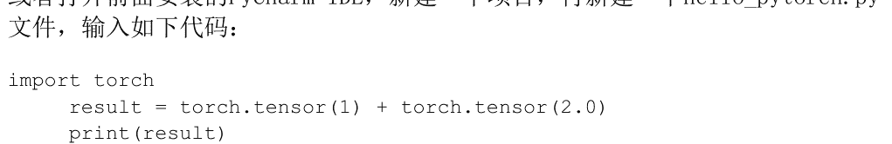

图2-22 验证安装是否成功

也可打开 PyCharm 新建项目，再新建 hello_pytorch.py，输入如下代码：

```python
import torch
result = torch.tensor(1) + torch.tensor(2.0)
print(result)
```

结果自行验证。

## 2.2 环境搭建2：安装 PyTorch 2.0

Python 环境调试完毕后，本节聚焦安装 PyTorch 2.0。

### 2.2.1 Nvidia 10/20/30/40 系列显卡选择的 GPU 版本

40 系显卡推出后，10/20/30/40 系显卡共存。PyTorch 调用专属编译器，不同显卡需不同依赖，版本对应关系见表2-1。

表2-1 10/20/30/40 系列显卡的版本对比

| 显卡型号 | PyTorch GPU 版本 | CUDA 版本 | cuDNN 版本 |

|----------|------------------|-----------|------------|

| 10 系列及以前 | PyTorch 2.0 以前的版本 | 11.1 | 7.65 |

| 20/30/40 系列 | PyTorch 2.0 向下兼容 | 11.6+ | 8.1+ |

注意： 主要是 CUDA 与 cuDNN 的差异。20/30/40 系显卡可装 CUDA 11.6 以上及 cuDNN 8.1 以上；10 系显卡建议用 PyTorch 2.0 之前的版本。

下文以 CUDA 11.7 + cuDNN 8.2.0 为例演示 PyTorch 2.0 GPU Nvidia 运行库完整安装，其他版本流程基本一致。

### 2.2.2 PyTorch 2.0 GPU Nvidia 运行库的安装

CPU 版可入门但不推荐，GPU 版运行速度远超 CPU，容易避免学习卡壳。

PyTorch 2.0 CPU 安装命令如下：

```
pip install numpy --pre torch torchvision torchaudio --force-reinstall --extra-index-url https://download.pytorch.org/whl/nightly/cpu
```

若电脑支持 GPU，继续 GPU 前置软件安装。GPU 版需 NVIDIA 运行库作为基础。

建议参照官网安装命令，如图2-17。官网提供 CUDA 11.7 与 CUDA 11.8 两种模式。


图2-17 PyTorch 官网提供的配置信息

两种 CUDA 版本在 PyTorch 2.0 编写上区别不大，可自选。下面以 CUDA 11.7 + cuDNN 8.2.0 讲解。

- （1）安装 CUDA。搜索 CUDA 11.7 进入官网下载页，选择合适 OS，推荐 exe（local） 本地安装，如图2-18。


图2-18 CUDA 下载页面

下载为 .exe，安装时使用默认路径，不要修改。

- （2）下载安装对应 cuDNN。需先注册，之后进入下载页，如图2-19。注意版本匹配，Windows 64 位下载 x86 版即可。


图2-19 cuDNN 下载页面

解压 cuDNN 8.2.0 到 CUDA 安装目录，如图2-20。

| 名称 | 修改日期 | 类型 | 大小 |

|------|----------|------|------|

| bin | 2021/8/6 16:27 | 文件夹 | |

| compute-sanitizer | 2021/8/6 16:26 | 文件夹 | |

| extras | 2021/8/6 16:26 | 文件夹 | |

| include | 2021/8/6 16:27 | 文件夹 | |

| lib | 2021/8/6 16:26 | 文件夹 | |

| libnvvp | 2021/8/6 16:26 | 文件夹 | |

| nvml | 2021/8/6 16:26 | 文件夹 | |

| nvvm | 2021/8/6 16:26 | 文件夹 | |

| src | 2021/8/6 16:26 | 文件夹 | |

| tools | 2021/8/6 16:26 | 文件夹 | |

图2-20 解压 cuDNN 文件

- （3）配置环境变量。把 CUDA 运行路径加入 Path，如图2-21。若 cuDNN 通过 exe 安装，环境变量会自动配置，只需验证。

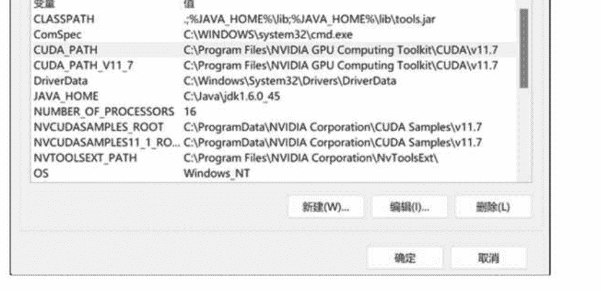

图2-21 配置环境变量

- （4）安装 PyTorch 及相关软件。从图2-17 可见 CUDA 11.7 的安装命令如下：

```
conda install pytorch torchvision torchaudio pytorch-cuda=11.7 -c pytorch -c nvidia
```

若你直接使用原生 Python，未按 2.1.1 节的方式部署 Miniconda，那么 PyTorch 的安装命令请参照下面说明：

```
pip3 install torch torchvision torchaudio --index-url https://download.pytorch.org/whl/cu117
```

PyTorch 2.0 GPU 版安装完成后，接下来要做的是确认环境是否可用。

### 2.2.3 PyTorch 2.0小练习：Hello PyTorch

恭喜，至此 PyTorch 2.0 已成功部署。打开 CMD，按顺序执行下方指令即可完成安装校验：

```
import torch
result = torch.tensor(1) + torch.tensor(2.0)
result
```

执行后的输出画面可对照图2-22。

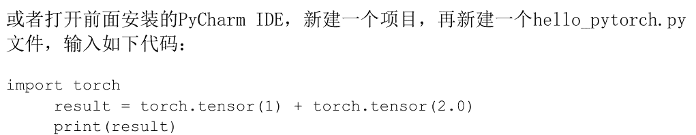

图2-22 验证安装是否成功

也可以启动此前安装的 PyCharm IDE，创建一个新项目并新建文件 hello_pytorch.py，将下面代码粘贴进去：

```
import torch
result = torch.tensor(1) + torch.tensor(2.0)
print(result)
```

运行结果请自行核对。

## 2.3 生成式模型实战：古诗词的生成

为方便检验安装结果，本节提供一段生成式实战供练习。先在 CMD 窗口安装本案例依赖的库 transformers，命令如下：

```
pip install transformers
```

随后在 PyCharm 中打开作者提供的Peom 源代码文件：

```
from transformers import BertTokenizer, GPT2LMHeadModel, TextGenerationPipeline
tokenizer = BertTokenizer.from_pretrained("uer/gpt2-chinese-poem")
model = GPT2LMHeadModel.from_pretrained("uer/gpt2-chinese-poem")
text_generator = TextGenerationPipeline(model, tokenizer)
result = text_generator("[CLS] 万 叠 春 山 积 雨 晴 ,", max_length=50, do_sample=True)
print(result)
```

提示：代码中 “ [CLS]万叠春山积雨晴 ” 作为起始 prompt，模型会基于此生成后续诗句，启动语也可自行设定，效果见图2-23。

> > [CLS]万叠春山积雨晴，江光兀兀对峥嵘。隔云吠犬随村卖，绕涧流泉入夜鸣。未学灵威终一见，曾从小阮听三生。可怜醉卧花间石，白鸟一双残照横。是江南柳，花枝婀娜婀娜任春风。莫言人事长多少，万感千愁总付翁。

图2-23 根据输入的起始内容输出后续的诗句

## 2.4 图像降噪：手把手实战第一个深度学习模型

2.3 节的示例相对简便，调用现有库与模型方法即可达成目标。但真实的深度学习开发远不止如此。为帮助建立 PyTorch 下的整体工作认知，这里安排一个完整案例，手把手演示深度学习任务的各个环节，读者无需精通编码，只需把握流程与要点即可。

### 2.4.1 MNIST数据集的准备

在编程入门里，HelloWorld 是标志性首课，初学者总会先打印这句话。深度学习领域也有类似的入门项目，通常以 MNIST 手写数字任务作为开端。

好奇的同学可能会问 MNIST 到底是什么。简单来说，它是一个手写数字图像集合，包含 60 000 张训练图和 10 000 张测试图。展开后效果如图2-24所示。

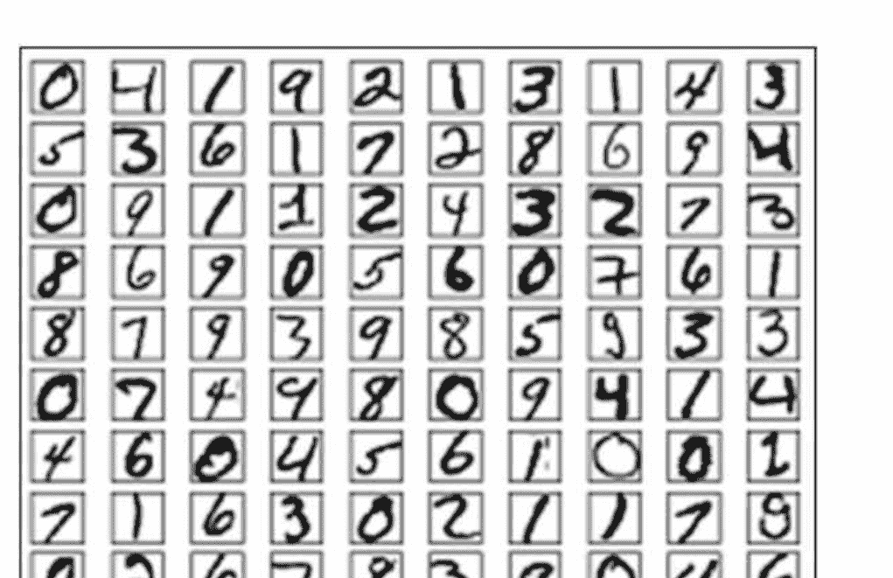

图2-24 MNIST数据集

可直接使用本书源码包中提供的 MNIST 数据，置于 dataset 文件夹，目录结构如图2-25所示。

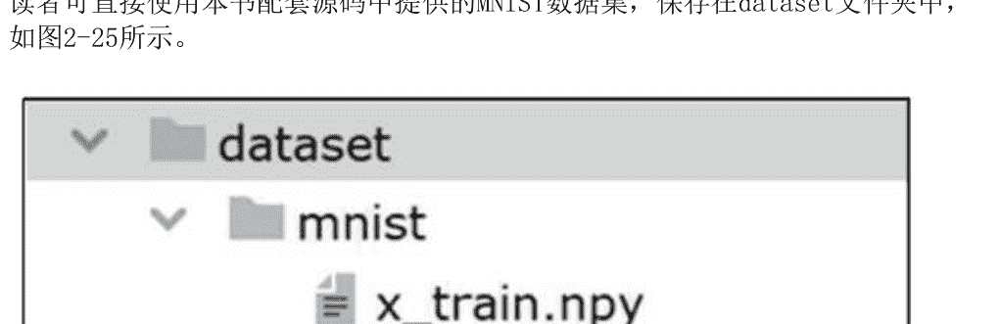

图2-25 本书配套源码中提供的MNIST数据集

随后借助 NumPy 读取数据，相关代码如下：

```
import numpy as np
x_train = np.load("./dataset/mnist/x_train.npy")
y_train_label = np.load("./dataset/mnist/y_train_label.npy")
```

若想自行下载，也可在网络搜索 MNIST，获取 train-images-idx3-ubyte.gz、train-labels-idx1-ubyte.gz 等 4 个压缩包，如图2-26所示。

Four files are available on this site:

| 文件名 | 描述 |

|--------|------|

| train-images-idx3-ubyte.gz | training set images (9912422 bytes) |

| train-labels-idx1-ubyte.gz | training set labels (28881 bytes) |

| t10k-images-idx3-ubyte.gz | test set images (1648877 bytes) |

| t10k-labels-idx1-ubyte.gz | test set labels (4542 bytes) |

图2-26 MNIST文件中包含的数据集

解压后会得到 4 个文件，并非常规图片格式，而是二进制文件，分别对应训练图像、训练标签、测试图像和测试标签。其中训练图像的二进制片段如图2-27所示。

```
0000 0803 0000 ea60 0000 001c 0000 001c
0000 0000 0000 0000 0000 0000 0000
0000 0000 0000 0000 0000 0000 0000
0000 0000 0000 0000 0000 0000 0000
0000 0000 0000 0000 0000 0000 0000
0000 0000 0000 0000 0000 0000 0000
0000 0000 0000 0000 0000 0000 0000
0000 0000 0000 0000 0000 0000 0000
0000 0000 0000 0000 0000 0000 0000
0000 0000 0000 0000 0000 0000 0000
```

图2-27 MNIST文件的二进制表示（部分）

MNIST 训练图像文件的内部结构如图2-28所示。

## TRAINING SET IMAGE FILE (train-images-idx3-ubyte):

| [offset] | [type] | [value] | [description] |

|----------|--------|---------|---------------|

| 0000 | 32 bit integer | 0x00000803 (2051) | magic number |

| 0004 | 32 bit integer | 60000 | number of images |

| 0008 | 32 bit integer | 28 | number of rows |

| 0012 | 32 bit integer | 28 | number of columns |

| 0016 | unsigned byte | ?? | pixel |

| 0017 | unsigned byte | ?? | pixel |

| ... | ... | ... | ... |

| xxxx | unsigned byte | ?? | pixel |

## 图2-28 MNIST文件结构图

如上表所示，训练集共包含 60 000 个样本。文件以二进制存储，读取时需用 rb 模式打开；[type] 等字段仅作说明，真正的数据在 [value] 部位。读取有效像素前，先读 4 个 32 位整数：魔数、图像总数、行数、列数。

按 [offset] 定位，像素数据从第 0016 字节起，每个像素占 1 字节。结合图2-26 结构与图2-25 原始数据可知，起始 4 字节 0000 0803 对应魔数 2051，用于校验文件身份；其后 0000 ea60 转十进制为 60000，表示总样本量。

随后从第 8 字节起的 0000 001c 即为 28，表示图像行数；第 12 字节起的相同数值表示列数也为 28。从第 16 字节开始则是像素的实际内容。以 784 字节，即 28×28，为一幅图，如图2-29 所示。

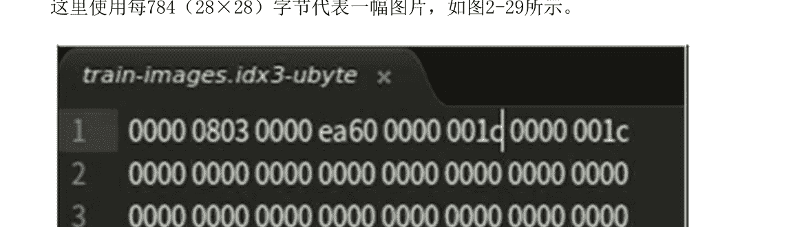

图2-29 每个手写体被分成28×28个像素

### 2.4.2 MNIST数据集的特征和标签介绍

关于 MNIST 的获取方式，前文已介绍两种，本小节建议使用本书源码包中的数据进行读取，代码如下：

```python
import numpy as np
x_train = np.load("./dataset/mnist/x_train.npy")
y_train_label = np.load("./dataset/mnist/y_train_label.npy")
```

NumPy 会按给定路径处理数据并自动拆分为训练集与验证集。打印维度可得：

(60000, 28, 28) (60000, )

这是数据预处理的第一步，有兴趣可继续自行划分训练与测试集。

回到 MNIST，每个样本由两部分组成：一张手写数字图片及其对应的标签。可把标签记为 y，图像矩阵记为 x，训练集与测试集中均同时包含 x 与 y。

图2-30 以更通用的方式展示了 MNIST 样本的展开形态。图像被展平成矩阵，尺寸为 28×28，具体展开顺序并不关键，只要保持一致即可。

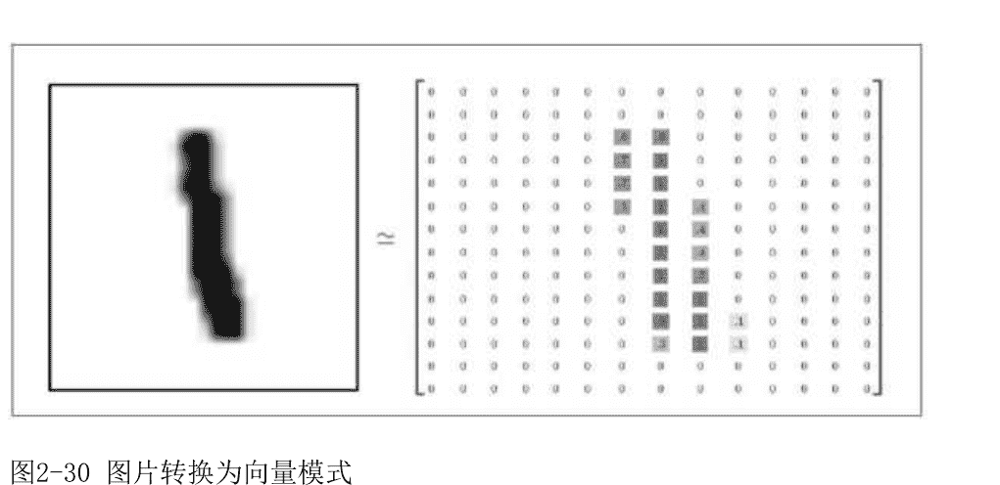

图2-30 图片转换为向量模式

总体看，MNIST 本质上是一个 60 000×28×28 的矩阵张量 [60000, 28, 28]，如图2-31 所示。


图2-31 MNIST数据集的矩阵表示

其中行索引对应图片编号，后续 28×28 向量描述图像特征。每个特征即像素点，每张手写图大小为 [28, 28]，像素值归一化为 0～1 的浮点数，构成矩阵。

### 2.4.3 模型的准备和介绍

在 PyTorch 项目中，模型设计是关键，它决定任务实现的核心思路。本例目标是输入含噪图像后实现去噪输出。

从思路上看，输出图像尺寸应与输入一致，这里选用 UNet，即一种卷积神经网络，作为主模型。

> 注意：模型挑选并非当前阶段重点，随着学习深入，掌握更多方法后自然能心领神会。

先整体浏览一下 UNet 结构，当前只需了解其输入输出维度相同即可，如图2-32 所示。

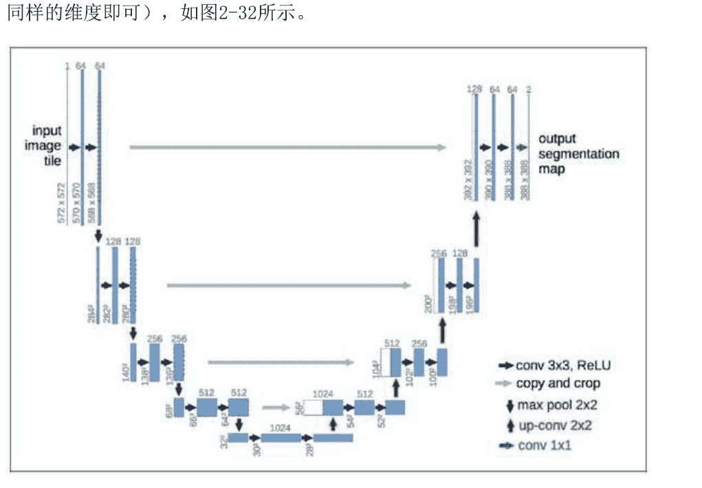

## 图2-32 Unet的结构

可以看出，整体架构由若干模块 block 与跳接 residual 组成，具体细节后文会展开，目前只需认识其结构形式。Unet 的完整代码如下：

```python
import torch
import einops.layers.torch as elt

class Unet(torch.nn.Module):
    def __init__(self):
        super(Unet, self).__init__()
        #模块化结构，这也是后面常用到的模型结构
        self.first_block_down = torch.nn.Sequential(
            torch.nn.Conv2d(in_channels=1, out_channels=32, kernel_size=3, padding=1),
            torch.nn.GELU(),
            torch.nn.MaxPool2d(kernel_size=2, stride=2)
        )
        self.second_block_down = torch.nn.Sequential(
            torch.nn.Conv2d(in_channels=32, out_channels=64, kernel_size=3, padding=1),
            torch.nn.GELU(),
            torch.nn.MaxPool2d(kernel_size=2, stride=2)
        )
        self.latent_space_block = torch.nn.Sequential(
            torch.nn.Conv2d(in_channels=64, out_channels=128, kernel_size=3, padding=1),
            torch.nn.GELU(),
        )
        self.second_block_up = torch.nn.Sequential(
            torch.nn.Upsample(scale_factor=2),
            torch.nn.Conv2d(in_channels=128, out_channels=64, kernel_size=3, padding=1),
            torch.nn.GELU(),
        )
        self.first_block_up = torch.nn.Sequential(
            torch.nn.Upsample(scale_factor=2),
            torch.nn.Conv2d(in_channels=64, out_channels=32, kernel_size=3, padding=1),
            torch.nn.GELU(),
        )
        self.convUP_end = torch.nn.Sequential(
            torch.nn.Conv2d(in_channels=32, out_channels=1, kernel_size=3, padding=1),
            torch.nn.Tanh()
        )

    def forward(self, img_tensor):
        image = img_tensor
        image = self.first_block_down(image)
        image = self.second_block_down(image)
        image = self.latent_space_block(image)
        image = self.second_block_up(image)
        image = self.first_block_up(image)
        image = self.convUP_end(image)
        return image

if __name__ == '__main__':
    image = torch.randn(size=(5,1,28,28))
    Unet()(image)
```

倒数第 1～3 行表示只有当该文件作为主脚本直接运行时才会执行，若被其他脚本导入则这段代码不会运行。

### 2.4.4 对目标的逼近——模型的损失函数与优化函数

除了神经网络结构本身，落地一个深度学习项目还离不开两件关键配置：损失函数和优化器。新手对这两块可能比较陌生，这里先建立意识即可，细节后面再展开。

先说损失函数的挑选，本章采用 MSELoss。MSELoss 的中文名字叫均方误差损失。它的工作逻辑是度量预测结果与真实标签之间的欧氏距离，预测越贴近真实，均方误差就越小。这个指标在线性回归任务里用得特别多。PyTorch 里调用的方式如下：

```python
loss = torch.nn.MSELoss(reduction="sum")(pred, y_batch)
```

再说优化器的设定，本章使用 Adam 优化器。Adam 的原理和调参技巧读者可以自行查阅，这里只给出在 PyTorch 中的使用示例：

```python
optimizer = torch.optim.Adam(model.parameters(), lr=2e-5)
```

### 2.4.5 用 PyTorch 训出可用的去噪模型
在前面铺垫了数据准备、网络结构、损失和优化器之后，本节把这些要素串起来，用 PyTorch 训练一个具备图像去噪能力的完整模型，整体代码可参考本书配套源码：

```python
import os
os.environ['CUDA_VISIBLE_DEVICES'] = '0' #指定GPU编码
import torch
import numpy as np
import unet
import matplotlib.pyplot as plt
from tqdm import tqdm

batch_size = 320
epochs = 1024
#device = "cpu"  #PyTorch的特性，需要指定计算的硬件，如果没有GPU的存在，就使用CPU进行计算
device = "cuda"  #在这里默认使用GPU模式，如果出现运行问题，可以将其改成CPU模式
model = unet.Unet()  #导入Unet模型
model = model.to(device)  #将计算模型传入GPU硬件等待计算
model = torch.compile(model)  #PyTorch 2.0的特性，加速计算速度
optimizer = torch.optim.Adam(model.parameters(), lr=2e-5)  #设定优化函数
#载入数据
x_train = np.load("../dataset/mnist/x_train.npy")
y_train_label = np.load("../dataset/mnist/y_train_label.npy")
x_train_batch = []
for i in range(len(y_train_label)):
    if y_train_label[i] < 2:  #为了加速演示，这里只对数据集中小于2的数字，也就是0和1进行运行，读者可以自行增加训练个数
        x_train_batch.append(x_train[i])

x_train = np.reshape(x_train_batch, [-1, 1, 28, 28])  #修正数据输入维度：([30596, 28, 28])
x_train /= 512.
train_length = len(x_train) * 20  #增加数据的单词循环次数
for epoch in range(epochs):
    train_num = train_length // batch_size  #计算有多少批次
    train_loss = 0  #用于损失函数的统计
    for i in tqdm(range(train_num)):  #开始循环训练
        x_imgs_batch = []  #创建数据的临时存储位置
        x_step_batch = []
        y_batch = []
        # 对每个批次内的数据进行处理
        for b in range(batch_size):
            img = x_train[np.random.randint(x_train.shape[0])]  #提取单幅图片内容
            x = img
            y = img
            x_imgs_batch.append(x)
            y_batch.append(y)
        #将批次数据转化为PyTorch对应的tensor格式并将其传入GPU中
        x_imgs_batch = torch.tensor(x_imgs_batch).float().to(device)
        y_batch = torch.tensor(y_batch).float().to(device)
        pred = model(x_imgs_batch)  #对模型进行正向计算
        loss = torch.nn.MSELoss(reduction=True)(pred, y_batch)/batch_size  #使用损失函数进行计算
        #下面是固定格式，一般这样使用即可
        optimizer.zero_grad()  #对结果进行优化计算
        loss.backward()  #损失值的反向传播
        optimizer.step()  #对参数进行更新
        train_loss += loss.item()  #记录每个批次的损失值
    #计算并打印损失值
    train_loss /= train_num
    print("train_loss:", train_loss)
    #下面对数据进行打印
    image = x_train[np.random.randint(x_train.shape[0])] #随机挑选一条数据进行计算
    image = np.reshape(image,[1,1,28,28]) #修正数据维度
    image = torch.tensor(image).float().to(device) #将挑选的数据传入硬件中等待计算
    image = model(image) #使用模型对数据进行计算
    image = torch.reshape(image, shape=[28,28]) #修正模型输出结果
    image = image.detach().cpu().numpy() #将计算结果导入CPU中进行后续计算或者展示
    #展示或存储数据结果
    plt.imshow(image)
    plt.savefig(f"./img/img_{epoch}.jpg")
```

训练的完整链路是这样的：先把样本送入网络得到预测，预测与真实标签的差距会以梯度形式反向传播回网络，随后 PyTorch 依据这一误差自动修正模型的参数。整体流程示意如图2-33所示。

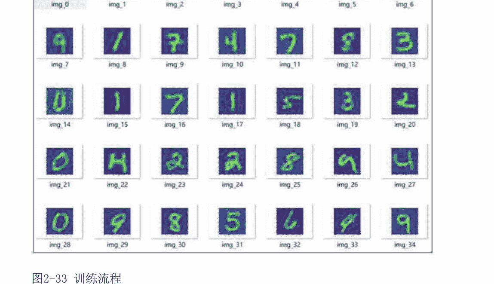

从图2-33可以看出，随着迭代次数增加，网络逐渐学会对输入进行重塑并输出干净结果。从输出效果来看，模型已经能够较好地保留输入图形的细节纹理。参数会自动修正，感兴趣的读者可以本地跑一遍代码亲自验证。

## 2.4 手把手实战：首个图像去噪模型
2.3 节的内容操作起来很简单，调用现成库和模型方法就能完成功能。但真实的深度学习工程远没有那么省事。为了让你对 PyTorch 的工作全貌有个直观感受，这里安排一个实战案例，把完成一次深度学习任务的完整步骤拆开演示。你不需要马上精通编码，只要搞清楚每一步在做什么、涉及什么即可。

### 2.4.1 获取 MNIST 数据集
Hello World 是编程入门的标配，深度学习也有自己的 Hello World，通常指用 MNIST 完成一个具体任务。

这里先解释下 MNIST 是什么。MNIST 是一套手写数字图像集合，包含 6 万张训练图和 1 万张测试图。打开后大致效果如图2-24 所示。

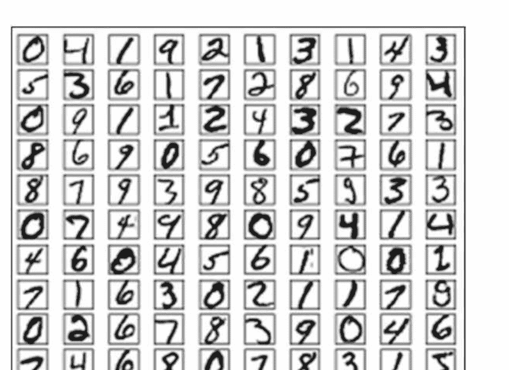

最省事的做法是直接使用书中源码自带的 MNIST 数据，放在 dataset 文件夹里，如图2-25 所示。


随后借助 NumPy 读取数据，示例代码如下：

```python
import numpy as np
x_train = np.load("./dataset/mnist/x_train.npy")
y_train_label = np.load("./dataset/mnist/y_train_label.npy")
```

如果你想自己下载，百度搜索 MNIST 即可拿到四个压缩包，如图2-26 所示。

**Four files are available on this site:**

| File | Description |

|------|-------------|

| train-images-idx3-ubyte.gz | training set images (9912422 bytes) |

| train-labels-idx1-ubyte.gz | training set labels (28881 bytes) |

| t10k-images-idx3-ubyte.gz | test set images (1648877 bytes) |

| t10k-labels-idx1-ubyte.gz | test set labels (4542 bytes) |

图2-26 MNIST 文件中包含的数据集

下载后解压会发现文件并非常见图片格式，而是二进制格式，包含训练图像、训练标签、测试图像和测试标签四部分。训练图像集的开头内容如图2-27 所示。

```
0000 0803 0000 ea60 0000 001c 0000 001c
0000 0000 0000 0000 0000 0000 0000 0000
0000 0000 0000 0000 0000 0000 0000 0000
0000 0000 0000 0000 0000 0000 0000 0000
0000 0000 0000 0000 0000 0000 0000 0000
0000 0000 0000 0000 0000 0000 0000 0000
0000 0000 0000 0000 0000 0000 0000 0000
0000 0000 0000 0000 0000 0000 0000 0000
0000 0000 0000 0000 0000 0000 0000 0000
0000 0000 0000 0000 0000 0000 0000 0000
```

MNIST 训练集的内部结构如图2-28 所示。

| [offset] | [type] | [value] | [description] |

|----------|--------|---------|---------------|

| 0000 | 32 bit integer | 0x00000803 (2051) | magic number |

| 0004 | 32 bit integer | 60000 | number of images |

| 0008 | 32 bit integer | 28 | number of rows |

| 0012 | 32 bit integer | 28 | number of columns |

| 0016 | unsigned byte | ?? | pixel |

| 0017 | unsigned byte | ?? | pixel |

| ... | ... | ... | ... |

| xxxx | unsigned byte | ?? | pixel |

图2-28 MNIST 文件结构图

如图2-26 所示的训练集结构中共包含 6 万个样本，每个标签取值在 0 到 9 之间。先说读取要点：数据以二进制存储，打开时要用 rb 模式；文件里真正的数据只有 value 列，其余 type 等只是说明。读取真实像素前需要先读 4 个 32 位整数。

按 offset 定位，像素数据从 0016 开始，每个像素占一个字节。由此可知，先读 magic number、图像总数、行数、列数这四个 32 位整数。

结合图2-26 的结构说明和图2-25 的原始二进制片段可以看到，图2-25 开头的 4 字节 0000 0803 对应图2-26 列表第一行，类型为 magic number，用作文件校验，确认文件是否为 train-images-idx3-ubyte。接着的 0000 ea60 对应第二行，转十进制为 60000，表示总图数。

往后，起始第 8 字节的 4 字节数 0000 001c 十进制为 28，表示每张图的高度；第 12 字节开始的 0000 001c 同样为 28，表示宽度。从第 16 字节起就是逐像素的数值。

这里以 784 字节，即 28×28 代表一张手写数字，如图2-29 所示。


图2-29 每个手写体被分成28×28个像素

### 2.4.2 MNIST 的特征与标签说明
前面提到两种获取 MNIST 的方式，本节推荐使用本书源码包里的 MNIST 数据进行读取，代码如下：

```python
import numpy as np
x_train = np.load("./dataset/mnist/x_train.npy")
y_train_label = np.load("./dataset/mnist/y_train_label.npy")
```

NumPy 会根据给定的路径自动处理数据并拆分为训练集与验证集。打印训练集的形状如下：

(60000, 28, 28)

(60000, )

这是数据预处理的初始阶段，想深入的读者可以自行划分训练集和测试集。

回到数据本身，每个 MNIST 样本由两部分组成：一张手写数字图片和对应的标签。我们把标签记作 y，图片矩阵记作 x，训练集和测试集都同时包含 x 与 y。

图2-30 以更通用的形式展示了样本的展开方式。图片会被展平成矩阵，尺寸为 28×28。具体的展平顺序并不关键，只要前后保持一致即可。


图2-30 图片转换为向量模式

再次确认读取逻辑：MNIST 本质上是一个包含 6 万张图的张量，形状为 [60000, 28, 28]，如图2-31 所示。

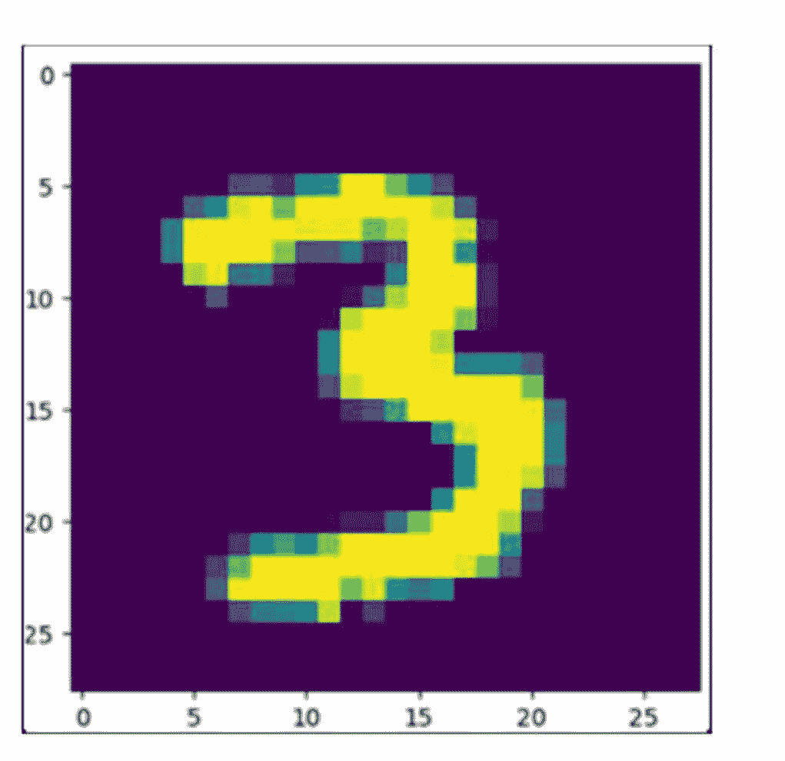

图2-31 MNIST 数据集的矩阵表示

矩阵的行索引对应不同图片，后面的 28×28 部分用于描述图片特征。实际上这些特征向量就是像素点，每张手写图大小为 [28, 28]，每个像素被归一化为 0~1 的浮点数，共同构成矩阵。

### 2.4.3 模型搭建思路介绍
在 PyTorch 项目里，模型设计是核心环节，它决定了用怎样的结构去完成目标任务。本例的目标是输入一噪声图像并输出去噪后的图像。

一个直观的思路是输出尺寸与输入尺寸保持一致，因此本章选用 UNet，一种基于卷积的网络结构，作为主要模型。

注意： 模型选择的考量暂时不需要读者深入，随着学习的推进自然会形成判断。

下面给出 UNet 的整体结构示意，如图2-32 所示。

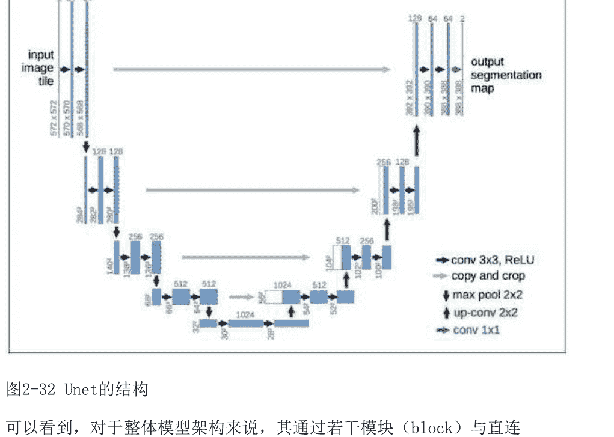

图2-32 Unet的结构

从结构上看，整个网络由若干模块 block 和跳跃连接 residual 组成，用来处理和传递特征。具体实现细节后续章节会展开，现在只需知道模型具备这种架构即可。Unet 的完整实现代码如下：

```python
import torch
import einops.layers.torch as elt

class Unet(torch.nn.Module):
    def __init__(self):
        super(Unet, self).__init__()
        #模块化结构，这也是后面常用到的模型结构
        self.first_block_down = torch.nn.Sequential(
            torch.nn.Conv2d(in_channels=1,out_channels=32,kernel_size=3,padding=1),
            torch.nn.GELU(),
            torch.nn.MaxPool2d(kernel_size=2,stride=2)
        )
        self.second_block_down = torch.nn.Sequential(
            torch.nn.Conv2d(in_channels=32,out_channels=64,kernel_size=3,padding=1),
            torch.nn.GELU(),
            torch.nn.MaxPool2d(kernel_size=2,stride=2)
        )
        self.latent_space_block = torch.nn.Sequential(
            torch.nn.Conv2d(in_channels=64,out_channels=128,kernel_size=3,padding=1),
            torch.nn.GELU(),
        )
        self.second_block_up = torch.nn.Sequential(
            torch.nn.Upsample(scale_factor=2),
            torch.nn.Conv2d(in_channels=128, out_channels=64, kernel_size=3, padding=1),
            torch.nn.GELU(),
        )
        self.first_block_up = torch.nn.Sequential(
            torch.nn.Upsample(scale_factor=2),
            torch.nn.Conv2d(in_channels=64, out_channels=32, kernel_size=3, padding=1),
            torch.nn.GELU(),
        )
        self.convUP_end = torch.nn.Sequential(
            torch.nn.Conv2d(in_channels=32,out_channels=1,kernel_size=3,padding=1),
            torch.nn.Tanh()
        )

    def forward(self,img_tensor):
        image = img_tensor
        image = self.first_block_down(image)
        image = self.second_block_down(image)
        image = self.latent_space_block(image)
        image = self.second_block_up(image)
        image = self.first_block_up(image)
        image = self.convUP_end(image)
        return image

if __name__ == '__main__':
    image = torch.randn(size=(5,1,28,28))
    Unet()(image)
```

这段位于文件末尾的保护性判断只有在脚本被直接运行时才会触发，一旦该文件被别的程序以模块形式导入引用，里面的逻辑就会被自动跳过。

### 2.4.4 定义损失与优化策略

除了搭建网络结构，实现一个完整的深度学习项目还必须指定损失计算方式和参数更新方法。对新手来说这两个环节容易感到陌生，这里先建立整体认识，不必深究原理。

损失度量方面，本例采用 MSELoss，中文常译为均方误差损失。它的功能是衡量预测输出与实际标注之间的欧氏距离，预测越贴近真实均方误差就越小，该指标在回归任务里很常见。PyTorch 中的调用示例如下：
```python
loss = torch.nn.MSELoss(reduction="sum")(pred, y_batch)
```

优化器这里选用 Adam。Adam 的内部机理可自行查阅，本节仅给出使用写法：
```python
optimizer = torch.optim.Adam(model.parameters(), lr=2e-5)
```

### 2.4.5 用 PyTorch 完成去噪模型训练

前面几节分别介绍了数据准备、网络结构、损失与优化，本节把它们串起来，用 PyTorch 训练出一个具备去噪能力的完整模型，具体实现可参考本书配套源码：
```python
import os
os.environ['CUDA_VISIBLE_DEVICES'] = '0' #指定GPU编码
import torch
import numpy as np
import unet
import matplotlib.pyplot as plt
from tqdm import tqdm

batch_size = 320 #设定每次训练的批次数
epochs = 1024 #设定训练次数
#device = "cpu" #PyTorch的特性，需要指定计算的硬件，如果没有GPU的存在，就使用CPU进行计算
device = "cuda" #在这里默认使用GPU模式，如果出现运行问题，可以将其改成CPU模式
model = unet.Unet() #导入Unet模型
model = model.to(device) #将计算模型传入GPU硬件等待计算
model = torch.compile(model) #PyTorch 2.0的特性，加速计算速度
optimizer = torch.optim.Adam(model.parameters(), lr=2e-5) #设定优化函数
#载入数据
x_train = np.load("../dataset/mnist/x_train.npy")
y_train_label = np.load("../dataset/mnist/y_train_label.npy")
x_train_batch = []
for i in range(len(y_train_label)):
    if y_train_label[i] < 2: #为了加速演示，这里只对数据集中小于2的数字，也就是0和1进行运行，读者可以自行增加训练个数
        x_train_batch.append(x_train[i])
x_train = np.reshape(x_train_batch, [-1, 1, 28, 28]) #修正数据输入维度：([30596, 28, 28])
x_train /= 512.
train_length = len(x_train) * 20 #增加数据的单词循环次数
for epoch in range(epochs):
    train_num = train_length // batch_size #计算有多少批次
    train_loss = 0 #用于损失函数的统计
    for i in tqdm(range(train_num)): #开始循环训练
        x_imgs_batch = [] #创建数据的临时存储位置
        x_step_batch = []
        y_batch = []
        # 对每个批次内的数据进行处理
        for b in range(batch_size):
            img = x_train[np.random.randint(x_train.shape[0])] #提取单幅图片内容
            x = img
            y = img
            x_imgs_batch.append(x)
            y_batch.append(y)
        #将批次数据转化为PyTorch对应的tensor格式并将其传入GPU中
        x_imgs_batch = torch.tensor(x_imgs_batch).float().to(device)
        y_batch = torch.tensor(y_batch).float().to(device)
        pred = model(x_imgs_batch) #对模型进行正向计算
        loss = torch.nn.MSELoss(reduction=True)(pred, y_batch)/batch_size #使用损失函数进行计算
        #下面是固定格式，一般这样使用即可
        optimizer.zero_grad() #对结果进行优化计算
        loss.backward() #损失值的反向传播
        optimizer.step() #对参数进行更新
        train_loss += loss.item() #记录每个批次的损失值
    #计算并打印损失值
```

train_loss /= train_num

print("train_loss:", train_loss)

#下面对数据进行打印

image = x_train[np.random.randint(x_train.shape[0])]  #随机挑选一条数据进行计算

image = np.reshape(image,[1,1,28,28])                  #修正数据维度

image = torch.tensor(image).float().to(device)         #将挑选的数据传入硬件中等待计算

image = model(image)                                   #使用模型对数据进行计算

image = torch.reshape(image, shape=[28,28])            #修正模型输出结果

image = image.detach().cpu().numpy()                   #将计算结果导入CPU中进行后续计算或者展示

#展示或存储数据结果

plt.imshow(image)

plt.savefig(f"./img/img_{epoch}.jpg")

上面展示了典型的训练闭环：先把样本送入网络做前向推理，产生的误差沿反向传播回传，随后框架据此调整全部可训练参数。整个过程的动态如图2-33所示。
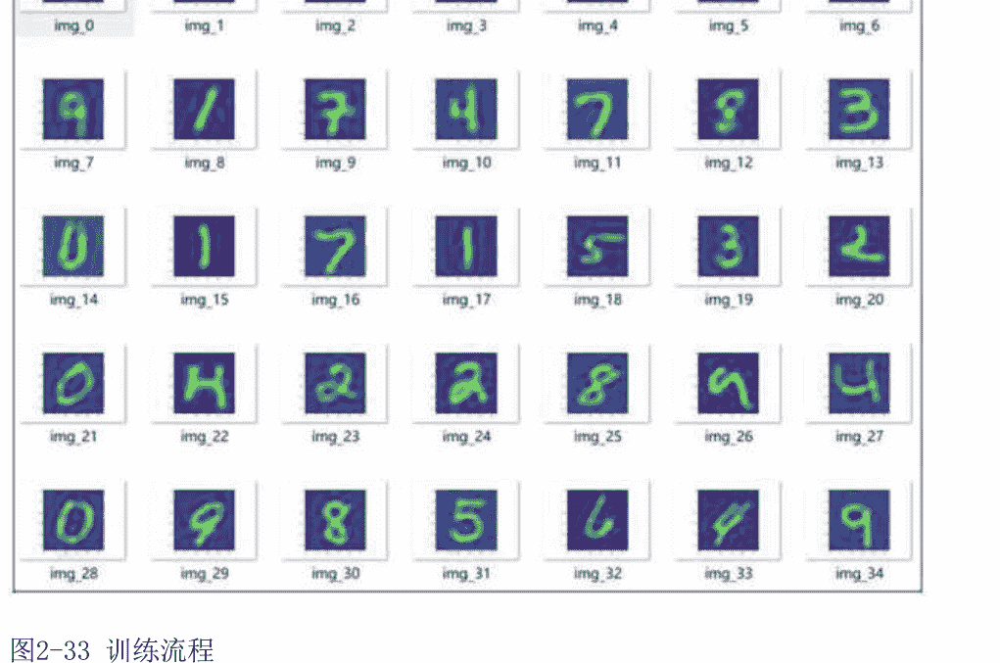

从图2-33 可以看出，随着迭代推进，网络逐渐学会对输入进行重塑并输出干净结果，图像细节的恢复效果逐步提升，读者可自行运行代码验证。

## 2.4 实战图像去噪：首个深度学习案例

2.3 节的做法几乎全是调用现成库，步骤过于简洁。真实的工程实践远比这复杂。为了让读者对 PyTorch 的整体工作方式形成直观印象，这里安排一个手把手案例，完整演示一次深度学习任务的标准流程。无需精通编程，只要把握每个环节的职责即可。

### 2.4.1 如何获取 MNIST 手写数字集

在编程领域 HelloWorld 是入门标志，深度学习里最经典的入门任务就是基于 MNIST 完成一个小项目。

MNIST 究竟指什么？

它是一套手写数字图像的基准集，训练划分包含 60000 张样本，测试划分包含 10000 张样本。打开后的视觉效果如图2-24所示。


图2-24 MNIST数据集

本书配套源码的 dataset 目录下已提供该数据集，目录结构如图2-25所示。


图2-25 本书配套源码中提供的MNIST数据集

读取时可借助 NumPy 解析二进制文件，具体代码如下：
```
import numpy as np
x_train = np.load("./dataset/mnist/x_train.npy")
y_train_label = np.load("./dataset/mnist/y_train_label.npy")
```

若想自行获取，也可在网络上搜索官方源，站点提供四份压缩包，如图2-26所示。

- Four files are available on this site:

- train-images-idx3-ubyte.gz: training set images (9912422 bytes)

- train-labels-idx1-ubyte.gz: training set labels (28881 bytes)

- t10k-images-idx3-ubyte.gz: test set images (1648877 bytes)

- t10k-labels-idx1-ubyte.gz: test set labels (4542 bytes)

图2-26 MNIST文件中包含的数据集

解压后会发现文件并非常见图片格式，而是二进制存储，包含训练图像、训练标签、测试图像和测试标签四部分。其中训练图像的原始字节流如图2-27所示。
```
hex
0000 0803 0000 ea60 0000 001c 0000 001c
0000 0000 0000 0000 0000 0000 0000 0000
0000 0000 0000 0000 0000 0000 0000 0000
0000 0000 0000 0000 0000 0000 0000 0000
0000 0000 0000 0000 0000 0000 0000 0000
0000 0000 0000 0000 0000 0000 0000 0000
0000 0000 0000 0000 0000 0000 0000 0000
0000 0000 0000 0000 0000 0000 0000 0000
0000 0000 0000 0000 0000 0000 0000 0000
0000 0000 0000 0000 0000 0000 0000 0000
```

图2-27 MNIST文件的二进制表示（部分）

训练集的文件头格式如图2-28所示。

| [offset] | [type] | [value] | [description] |
|----------|--------|---------|---------------|
| 0000 | 32 bit integer | 0x00000803 (2051) | magic number |
| 0004 | 32 bit integer | 60000 | number of images |
| 0008 | 32 bit integer | 28 | number of rows |
| 0012 | 32 bit integer | 28 | number of columns |
| 0016 | unsigned byte | ?? | pixel |
| 0017 | unsigned byte | ?? | pixel |
| ... | ... | ... | ... |
| xxxx | unsigned byte | ?? | pixel |

图2-28 MNIST文件结构图

图2-28 描述的是训练集的文件头，共 60000 个样本，每个标签取值 0 到 9。解析时需注意两点：文件为二进制，需以 rb 模式打开；表格中的 type 与 description 仅起说明作用，磁盘上实际保存的是 value。

因此在提取像素前需要先读取四个 32 位整数。依据 offset，像素数据从 0016 位开始，每个像素占用一个字节。即在读取像素数据前必须先读取 magic number、number of images、number of rows、number of columns 四个字段。

## 2.4 图像去噪实战：PyTorch 首个深度学习项目

2.3 节的示例过于轻量，直接调用库和现成方法就能跑完。真正的深度学习开发要复杂得多，为了建立一套 PyTorch 的整体工作感，这里安排了一次手把手的实战。以图像去噪为任务，完整走一遍数据、模型、损失、优化到训练的全流程，读者不必写代码，只要抓住每一步在做什么即可。

### 2.4.1 MNIST 数据集上手指南

编程入门离不开 HelloWorld，深度学习里对应的 HelloWorld 通常就是用 MNIST 完成一项小任务。

先弄清楚 MNIST 是什么。它是一个手写数字图片集，训练集 6 万张，测试集 1 万张。打开后的整体效果如图 2-24 所示。


## 图2-24 MNIST数据集

本书配套源码里已提供好 MNIST 数据，放在 dataset 文件夹下，如图 2-25 所示。


## 图2-25 本书配套源码中提供的MNIST数据集

读取数据可借助 NumPy，示例代码如下：

```python
import numpy as np
x_train = np.load("./dataset/mnist/x_train.npy")
y_train_label = np.load("./dataset/mnist/y_train_label.npy")
```

也可以自行到网上搜索 MNIST，下载 train-images-idx3-ubyte.gz、train-labels-idx1-ubyte.gz 等四个压缩包，如图 2-26 所示。


## 图2-26 MNIST文件中包含的数据集

解压后会发现文件并不是常见图片格式，而是二进制格式，包含训练图片、训练标签、测试图片、测试标签四部分。训练图片集的片段如图 2-27 所示。

```
0000 0803 0000 ea60 0000 001c 0000 001c
0000 0000 0000 0000 0000 0000 0000 0000
0000 0000 0000 0000 0000 0000 0000 0000
0000 0000 0000 0000 0000 0000 0000 0000
0000 0000 0000 0000 0000 0000 0000 0000
0000 0000 0000 0000 0000 0000 0000 0000
0000 0000 0000 0000 0000 0000 0000 0000
0000 0000 0000 0000 0000 0000 0000 0000
0000 0000 0000 0000 0000 0000 0000 0000
0000 0000 0000 0000 0000 0000 0000 0000
```
## 图2-27 MNIST文件的二进制表示（部分）

MNIST 训练集内部的文件结构如图 2-28 所示。

TRAINING SET IMAGE FILE (train-images-idx3-ubyte):

| [offset] | [type] | [value] | [description] |

|----------|--------|---------|---------------|

| 0000 | 32 bit integer | 0x00000803 (2051) | magic number |

| 0004 | 32 bit integer | 60000 | number of images |

| 0008 | 32 bit integer | 28 | number of rows |

| 0012 | 32 bit integer | 28 | number of columns |

| 0016 | unsigned byte | ?? | pixel |

| 0017 | unsigned byte | ?? | pixel |

| ... | ... | ... | ... |

| xxxx | unsigned byte | ?? | pixel |

## 图2-28 MNIST文件结构图

从结构表可知，该文件共 60,000 个样本，标签取值 0~9。数据以二进制存储，读取时要用 rb 模式，表里的 type、description 只是说明，真正落盘的是 value。真实像素从 0016 起，每个像素占一个字节，所以在读像素前先读四个 32 位整数：magic number、图片总数、行数、列数。

对照图 2-26 的结构和图 2-25 的原始二进制可看出，图 2-25 开头的 4 字节 0000 0803 对应表第一行，是 magic number，用来校验文件是否为 train-images-idx3-ubyte。紧接着的 0000 ea60 对应第二行，换算成十进制是 60000，表示总图片数。

往后依次是第 8 个字节起的 0000 001c，十进制 28，为每张图的行数；第 12 个字节起同样的 0000 001c，为列数，也是 28。从第 16 个字节开始才是每张图的像素值连续排列。

一篇图片占 28×28=784 字节，如图 2-29 所示。


图2-29 每个手写体被分成28×28个像素


## 图2-29 每个手写体被分成28×28个像素

### 2.4.2 MNIST数据集的特征与标签解析

前面提到两种获取方式，本节推荐用本书源码包里的 MNIST 进行读取，代码如下：

```
import numpy as np
x_train = np.load("./dataset/mnist/x_train.npy")
y_train_label = np.load("./dataset/mnist/y_train_label.npy")
```

NumPy 会按输入路径自动处理数据并拆分为训练集和验证集。打印训练集形状示意如下：

```
(60000, 28, 28)
(60000, )
```

这是数据处理的初阶操作，感兴趣的读者可自行完成训练集与测试集的划分。

回到 MNIST 本身，每个样本由两部分组成：一张手写数字图和对应的标签。常用 y 表示标签，x 表示图片矩阵，训练集和测试集都同时包含 x 和 y。

图 2-30 以更通用的方式展示了数据展开。图片被视为 28×28 的矩阵，实际使用时常把它拉平成向量，具体展开顺序并不关键，只要前后保持一致即可。


图2-30 图片转换为向量模式

从读取角度看，MNIST 本质上是一个 60 000×28×28 的张量 [60000, 28, 28]，如图 2-31 所示。


图2-31 MNIST数据集的矩阵表示

矩阵的行对应图片索引，后面的 28×28 维用于描述特征。实际上这些特征就是像素点，每张手写图大小为 [28,28]，像素被归一化为 0~1 的浮点数组成矩阵。

下面再给出一次源码包的读取示例：

```python
import numpy as np
x_train = np.load("./dataset/mnist/x_train.npy")
y_train_label = np.load("./dataset/mnist/y_train_label.npy")
```

这里 numpy 会根据地址自动拆分，打印得到的训练集维度为：

(60000, 28, 28) (60000, )

这一步属于基础预处理，后续可进一步划分。

每个实例仍由图片 x 和标签 y 构成，图 2-30 已说明展开方式。至此数据读取的思路已完整。


### 2.4.3 模型搭建：选用 UNet

在 PyTorch 项目里，模型设计决定整体实现方式。本例的目标是输入一张图后完成去噪。

一个直观的思路是输出尺寸与输入一致，这里选用 UNet，一种经典的卷积神经网络，作为主体模型。

注意：模型选型现在不必纠结，随着学习的深入，面对不同问题自然能判断选用何种结构。

可先整体浏览 UNet 的结构图，当前只需知道其输入输出维度相同即可，如图 2-32 所示。


图2-32 Unet的结构

整体架构由多个模块 block 和残差连接 residual 组成，具体细节后文再讲，目前只需建立结构感。UNet 的完整代码如下：

```
import torch
import einops.layers.torch as elt

class Unet(torch.nn.Module):
    def __init__(self):
        super(Unet, self).__init__()
        #模块化结构，这也是后面常用到的模型结构
        self.first_block_down = torch.nn.Sequential(
            torch.nn.Conv2d(in_channels=1,out_channels=32,kernel_size=3,padding=1),
            torch.nn.GELU(),
            torch.nn.MaxPool2d(kernel_size=2,stride=2)
        )
        self.second_block_down = torch.nn.Sequential(
            torch.nn.Conv2d(in_channels=32,out_channels=64,kernel_size=3,padding=1),
            torch.nn.GELU(),
            torch.nn.MaxPool2d(kernel_size=2,stride=2)
        )
        self.latent_space_block = torch.nn.Sequential(
            torch.nn.Conv2d(in_channels=64,out_channels=128,kernel_size=3,padding=1),
            torch.nn.GELU(),
        )
        self.second_block_up = torch.nn.Sequential(
            torch.nn.Upsample(scale_factor=2),
            torch.nn.Conv2d(in_channels=128, out_channels=64, kernel_size=3, padding=1),
            torch.nn.GELU(),
        )
        self.first_block_up = torch.nn.Sequential(
            torch.nn.Upsample(scale_factor=2),
            torch.nn.Conv2d(in_channels=64, out_channels=32, kernel_size=3, padding=1),
            torch.nn.GELU(),
        )
        self.convUP_end = torch.nn.Sequential(
            torch.nn.Conv2d(in_channels=32,out_channels=1,kernel_size=3,padding=1),
            torch.nn.Tanh()
        )

    def forward(self,img_tensor):
        image = img_tensor
        image = self.first_block_down(image)
        image = self.second_block_down(image)
        image = self.latent_space_block(image)
        image = self.second_block_up(image)
        image = self.first_block_up(image)
        image = self.convUP_end(image)
        return image

if __name__ == '__main__':
    image = torch.randn(size=(5,1,28,28))
    Unet()(image)
```

代码倒数第 1~3 行表示只有直接运行该文件时才会执行，作为模块被别的脚本导入时这段不会触发。

### 2.4.4 损失函数与优化器配置

除模型外，损失函数和优化器也是深度学习项目的两大要素。初学者不必立刻吃透，只需先建立概念。

损失函数这里选用 MSELoss，即均方损失。它计算预测值与真实值的欧氏距离，预测越接近，误差越小，常用于回归类任务。PyTorch 中的使用示意如下：

```
loss = torch.nn.MSELoss(reduction="sum")(pred, y_batch)
```

优化器采用 Adam。Adam 的具体原理可自行查阅，这里仅给出调用示例：

```
optimizer = torch.optim.Adam(model.parameters(), lr=2e-5)
```

### 2.4.5 训练流程全景演示

数据准备、模型、损失、优化器四部分介绍完毕，本节用 PyTorch 训练出具备去噪能力的模型，完整代码见本书配套源码：

```
import os
os.environ['CUDA_VISIBLE_DEVICES'] = '0' #指定GPU编码
import torch
```

接下来把焦点拉回到数据载入上。前面提到过，MNIST 其实就是 6 万张手写数字图被打包成一个三维张量，尺寸是 [60000, 28, 28]，具体形态可参考图2-31 所示的示意。


## 图2-31 MNIST数据集的矩阵表示

从矩阵视角看，第一维对应的是图片的编号，用来定位和抽取单张样本；剩下的 28×28 部分则用来描述图像特征。说白了，这 28×28 个单元就是像素，每张手写图都被压成 28 行 28 列，每个像素值归一化到 0 到 1 之间的浮点数，最终拼成整体矩阵。

### 2.4.3 模型的准备和介绍

做 PyTorch 的深度学习项目，模型设计是核心环节，它决定了项目采用怎样的主体方案来达成目标。本次任务是让模型接收一张带噪图像并输出去噪后的结果。

挑模型时最直观的原则是输出尺寸要与输入保持一致，这里选用 UNet 这种卷积神经网络作为主干。

注意： 模型的选择暂时不用纠结，随着阅读深入、接触到更多解法后，你自然会形成判断。

先整体感受一下 UNet 的结构，读者现阶段只需要记住它的输入输出维度相同即可，如图2-32 所示。


## 图2-32 Unet的结构

大体上，该网络由若干模块 block 和跳连 residual 共同完成特征的抽取与恢复。具体实现细节后面章节会展开，这里先建立结构感即可。Unet 的完整代码如下：

```python
import torch
import einops.layers.torch as elt

class Unet(torch.nn.Module):
    def __init__(self):
        super(Unet, self).__init__()
        # 模块化结构，这也是后面常用到的模型结构
        self.first_block_down = torch.nn.Sequential(
            torch.nn.Conv2d(in_channels=1, out_channels=32, kernel_size=3, padding=1),
            torch.nn.GELU(),
            torch.nn.MaxPool2d(kernel_size=2, stride=2)
        )
        self.second_block_down = torch.nn.Sequential(
            torch.nn.Conv2d(in_channels=32, out_channels=64, kernel_size=3, padding=1),
            torch.nn.GELU(),
            torch.nn.MaxPool2d(kernel_size=2, stride=2)
        )
        self.latent_space_block = torch.nn.Sequential(
            torch.nn.Conv2d(in_channels=64, out_channels=128, kernel_size=3, padding=1),
            torch.nn.GELU()
        )
        self.second_block_up = torch.nn.Sequential(
            torch.nn.Upsample(scale_factor=2),
            torch.nn.Conv2d(in_channels=128, out_channels=64, kernel_size=3, padding=1),
            torch.nn.GELU()
        )
        self.first_block_up = torch.nn.Sequential(
            torch.nn.Upsample(scale_factor=2),
            torch.nn.Conv2d(in_channels=64, out_channels=32, kernel_size=3, padding=1),
            torch.nn.GELU()
        )
        self.convUP_end = torch.nn.Sequential(
            torch.nn.Conv2d(in_channels=32, out_channels=1, kernel_size=3, padding=1),
            torch.nn.Tanh()
        )

    def forward(self, img_tensor):
        image = img_tensor
        image = self.first_block_down(image)
        image = self.second_block_down(image)
        image = self.latent_space_block(image)
        image = self.second_block_up(image)
        image = self.first_block_up(image)
        image = self.convUP_end(image)
        return image

if __name__ == '__main__':
    image = torch.randn(size=(5, 1, 28, 28))
    Unet()(image)
```

文件尾部倒数第 1 到 3 行的代码，只有在该文件被直接运行时才会生效；若被其他脚本导入复用，这段逻辑会被跳过。

下面展示一次完整的训练循环：数据先送入网络计算，得到的结果与真实标签的偏差会反向回传，最后 PyTorch 根据这个误差自动调整网络参数。整体流程见图2-33。


## 图2-33 训练流程

从图2-33 可以明显看出，训练进行时模型逐步学会对输入进行重塑与还原，输出的细节修正能力越来越强，感兴趣的话可以直接运行代码体验效果。

```python
import numpy as np
import unet
import matplotlib.pyplot as plt
from tqdm import tqdm

batch_size = 320                # 设定每次训练的批次数
epochs = 1024                   # 设定训练次数
# device = "cpu"   # PyTorch的特性，需要指定计算的硬件，如果没有GPU的存在，就使用CPU进行计算
device = "cuda"   # 在这里默认使用GPU模式，如果出现运行问题，可以将其改成CPU模式
model = unet.Unet()             # 导入Unet模型
model = model.to(device)        # 将计算模型传入GPU硬件等待计算
model = torch.compile(model)    # PyTorch 2.0的特性，加速计算速度
optimizer = torch.optim.Adam(model.parameters(), lr=2e-5)  # 设定优化函数
# 载入数据
x_train = np.load("../dataset/mnist/x_train.npy")
y_train_label = np.load("../dataset/mnist/y_train_label.npy")
x_train_batch = []
for i in range(len(y_train_label)):
    if y_train_label[i] < 2:    # 为了加速演示，这里只对数据中小于2的数字，也就是0和1进行运行，读者可以自行增加训练个数
        x_train_batch.append(x_train[i])

x_train = np.reshape(x_train_batch, [-1, 1, 28, 28])  # 修正数据输入维度：([30596, 28, 28])
x_train /= 512.
train_length = len(x_train) * 20  # 增加数据的单词循环次数
for epoch in range(epochs):
    train_num = train_length // batch_size  # 计算有多少批次
    train_loss = 0                          # 用于损失函数的统计
    for i in tqdm(range(train_num)):        # 开始循环训练
        x_imgs_batch = []                   # 创建数据的临时存储位置
        x_step_batch = []
        y_batch = []
        # 对每个批次内的数据进行处理
        for b in range(batch_size):
            img = x_train[np.random.randint(x_train.shape[0])]  # 提取单幅图片内容
            x = img
            y = img
            x_imgs_batch.append(x)
            y_batch.append(y)
        # 将批次数据转化为PyTorch对应的tensor格式并将其传入GPU中
        x_imgs_batch = torch.tensor(x_imgs_batch).float().to(device)
        y_batch = torch.tensor(y_batch).float().to(device)
        pred = model(x_imgs_batch)          # 对模型进行正向计算
        loss = torch.nn.MSELoss(reduction=True)(pred, y_batch)/batch_size  # 使用损失函数进行计算
        # 下面是固定格式，一般这样使用即可
        optimizer.zero_grad()               # 对结果进行优化计算
        loss.backward()                     # 损失值的反向传播
        optimizer.step()                    # 对参数进行更新
        train_loss += loss.item()           # 记录每个批次的损失值
    # 计算并打印损失值
    train_loss /= train_num
    print("train_loss:", train_loss)
    # 下面对数据进行打印
    image = x_train[np.random.randint(x_train.shape[0])] # 随机挑选一条数据进行计算
    image = np.reshape(image,[1,1,28,28]) # 修正数据维度
    image = torch.tensor(image).float().to(device) # 将挑选的数据传入硬件中等待计算
    image = model(image) # 使用模型对数据进行计算
    image = torch.reshape(image, shape=[28,28]) # 修正模型输出结果
    image = image.detach().cpu().numpy() # 将计算结果导入CPU中进行后续计算或者展示
    # 展示或存储数据结果
    plt.imshow(image)
    plt.savefig(f"./img/img_{epoch}.jpg")
```

### 2.4.4 对目标的逼近——模型的损失函数与优化函数

除了网络结构外，一个可落地的深度学习项目还必须设定损失函数和优化器。初学者可能对这两块比较陌生，这里先建立概念即可。

损失函数方面，本例选用 MSELoss，即均方误差损失。

它的作用是衡量预测值和真实值之间的欧氏距离，预测越接近真实，均方误差就越小，这类度量在回归任务中很常见。在 PyTorch 里的调用方式如下：

```
loss = torch.nn.MSELoss(reduction="sum")(pred, y_batch)
```

优化器这边采用 Adam。Adam 的具体原理建议自行查阅，这里仅给出使用代码：

```
optimizer = torch.optim.Adam(model.parameters(), lr=2e-5)
```

### 2.4.5 基于深度学习的模型训练

前面已经梳理了数据准备、网络结构、损失函数和优化器的要点，本节在 PyTorch 中把它们串起来，训练出具备去噪能力的完整模型，完整实现可参考本书配套代码。

```
import os
os.environ['CUDA_VISIBLE_DEVICES'] = '0' #指定GPU编码
import torch
import numpy as np
import unet
import matplotlib.pyplot as plt
from tqdm import tqdm

batch_size = 320 #设定每次训练的批次数
epochs = 1024 #设定训练次数
#device = "cpu" #PyTorch的特性，需要指定计算的硬件，如果没有GPU的存在，就使用CPU进行计算
device = "cuda" #在这里默认使用GPU模式，如果出现运行问题，可以将其改成CPU模式
model = unet.Unet() #导入Unet模型
model = model.to(device) #将计算模型传入GPU硬件等待计算
model = torch.compile(model) #PyTorch 2.0的特性，加速计算速度
optimizer = torch.optim.Adam(model.parameters(), lr=2e-5) #设定优化函数
#载入数据
x_train = np.load("../dataset/mnist/x_train.npy")
y_train_label = np.load("../dataset/mnist/y_train_label.npy")
x_train_batch = []
for i in range(len(y_train_label)):
    if y_train_label[i] < 2: #为了加速演示，这里只对数据集中小于2的数字，也就是0和1进行运行，读者可以自行增加训练个数
        x_train_batch.append(x_train[i])

x_train = np.reshape(x_train_batch, [-1, 1, 28, 28]) #修正数据输入维度：([30596, 28, 28])
x_train /= 512.
train_length = len(x_train) * 20 #增加数据的单次循环次数
for epoch in range(epochs):
    train_num = train_length // batch_size #计算有多少批次
    train_loss = 0 #用于损失函数的统计
    for i in tqdm(range(train_num)): #开始循环训练
        x_imgs_batch = [] #创建数据的临时存储位置
        x_step_batch = []
        y_batch = []
        # 对每个批次内的数据进行处理
        for b in range(batch_size):
            img = x_train[np.random.randint(x_train.shape[0])] #提取单幅图片内容
            x = img
            y = img
            x_imgs_batch.append(x)
            y_batch.append(y)
        #将批次数据转化为PyTorch对应的tensor格式并将其传入GPU中
        x_imgs_batch = torch.tensor(x_imgs_batch).float().to(device)
        y_batch = torch.tensor(y_batch).float().to(device)
        pred = model(x_imgs_batch) #对模型进行正向计算
        loss = torch.nn.MSELoss(reduction=True)(pred, y_batch)/batch_size #使用损失函数进行计算
        #下面是固定格式，一般这样使用即可
        optimizer.zero_grad() #对结果进行优化计算
        loss.backward() #损失值的反向传播
        optimizer.step() #对参数进行更新
        train_loss += loss.item() #记录每个批次的损失值
    #计算并打印损失值
    train_loss /= train_num
    print("train_loss:", train_loss)
    #下面对数据进行打印
    image = x_train[np.random.randint(x_train.shape[0])]  #随机挑选一条数据进行计算
    image = np.reshape(image,[1,1,28,28])  #修正数据维度
    image = torch.tensor(image).float().to(device)  #将挑选的数据传入硬件中等待计算
    image = model(image)  #使用模型对数据进行计算
    image = torch.reshape(image, shape=[28,28])  #修正模型输出结果
    image = image.detach().cpu().numpy()  #将计算结果导入CPU中进行后续计算或者展示
    #展示或存储数据结果
    plt.imshow(image)
    plt.savefig(f"./img/img_{epoch}.jpg")
```
本节把一次完整的训练闭环摊开来看：数据送入网络后先做前向推断，得到预测结果；随后把预测与真实标签的偏差算出来并反向传递；PyTorch 依据这份梯度信号对全网参数做调整。整体走向见图2-33。


从图2-33的演进可以看出，迭代越多模型对输入的塑形能力越强，最终输出已经能还原输入图形的细节。感兴趣可以自行跑一遍代码验证。

## 2.4 图像去噪实战：跟着做你的第一个深度学习项目
上一节的代码确实很轻量，调库调方法就能跑通。但真实的深度学习工程远不止如此。为了让你对 PyTorch 的整体工作方式有个直观感受，下面安排一个完整的实战案例，边走边看每个环节在做什么，不必立刻精通编程细节。

### 2.4.1 MNIST数据集的准备
任何编程语言入门都会先打印 HelloWorld，深度学习也不例外，MNIST 通常被视作这个领域的入门标志。

不少初学者会问 MNIST 到底指什么？简单说，它是一组手写数字图像，训练集 6 万张，测试集 1 万张。打开后大致效果如图2-24所示。


图2-24 MNIST数据集

可以直接采用本书源码自带的 MNIST，放在 dataset 目录下，如图2-25所示。


图2-25 本书配套源码中提供的MNIST数据集

随后借助 NumPy 读取数据，示例代码如下：

```
import numpy as np
x_train = np.load("./dataset/mnist/x_train.npy")
y_train_label = np.load("./dataset/mnist/y_train_label.npy")
```

也可以在网上搜索 MNIST，下载 train-images-idx3-ubyte.gz、train-labels-idx1-ubyte.gz 等四份压缩包，如图2-26所示。

- Four files are available on this site:

- train-images-idx3-ubyte.gz: training set images (9912422 bytes)

- train-labels-idx1-ubyte.gz: training set labels (28881 bytes)

- t10k-images-idx3-ubyte.gz: test set images (1648877 bytes)

- t10k-labels-idx1-ubyte.gz: test set labels (4542 bytes)

图2-26 MNIST文件中包含的数据集

解压后会发现并非常见图片格式，而是二进制文件，包含训练图像、训练标签、测试图像、测试标签各一份。其中训练图像的片段如图2-27所示。

```
0000 0803 0000 ea60 0000 001c 0000 001c
0000 0000 0000 0000 0000 0000 0000 0000
0000 0000 0000 0000 0000 0000 0000 0000
0000 0000 0000 0000 0000 0000 0000 0000
0000 0000 0000 0000 0000 0000 0000 0000
0000 0000 0000 0000 0000 0000 0000 0000
0000 0000 0000 0000 0000 0000 0000 0000
0000 0000 0000 0000 0000 0000 0000 0000
0000 0000 0000 0000 0000 0000 0000 0000
0000 0000 0000 0000 0000 0000 0000 0000
```
图2-27 MNIST文件的二进制表示（部分）

训练图像文件内部的布局如图2-28所示。

## TRAINING SET IMAGE FILE (train-images-idx3-ubyte):

| [offset] | [type] | [value] | [description] |

|----------|--------|---------|---------------|

| 0000 | 32 bit integer | 0x00000803 (2051) | magic number |

| 0004 | 32 bit integer | 60000 | number of images |

| 0008 | 32 bit integer | 28 | number of rows |

| 0012 | 32 bit integer | 28 | number of columns |

| 0016 | unsigned byte | ?? | pixel |

| 0017 | unsigned byte | ?? | pixel |

| ... | ... | ... | ... |

| xxxx | unsigned byte | ?? | pixel |

### 图2-28 MNIST文件结构图

上表即为训练集的存储规范，共 6 万个样本，每个样本标签为 0 到 9 的数字。文件以二进制 rb 方式读取，真正的像素数据在 [value] 列，其余字段仅作说明。读取真实像素前需先跳过 4 个 32 位整数。

按[offset]定位，像素从 0016 起开始，每个像素占一个 unsigned byte。因此解码前要先取出 magic number、图像总数、行数、列数。

结合图2-26的结构说明与图2-25的原始二进制片段可知，图2-25 开头的 4 字节 0000 0803 对应表第一行，即 magic number，用于文件校验，确认是 train-images-idx3-ubyte。紧随其后的 0000 ea60 换算成十进制是 60000，表示样本总量。

往后依次是第 8 字节起的 0000 001c，十进制 28，为图片行数；第 12 字节起的同样 0000 001c 为列数，也是 28。从第 16 字节起才是逐像素的数值。

每张图用 784 个字节 28×28 表示，如图2-29所示。


图2-29 每个手写体被分成28×28个像素

### 2.4.2 MNIST数据集的特征和标签介绍
数据获取有两种途径，推荐直接用本书源码包里的 MNIST 读取，代码如下：

```
import numpy as np
x_train = np.load("./dataset/mnist/x_train.npy")
y_train_label = np.load("./dataset/mnist/y_train_label.npy")
```
这里的 NumPy 函数会按指定路径处理数据，并自动拆分为训练集与验证集。打印出的形状为：

(60000, 28, 28)

(60000, )

这只是预处理的第一步，后续可自行完成训练集与测试集的划分。

回到数据本身，每个 MNIST 样例由图像和对应标签组成，标签记作 y，图像矩阵记作 x，训练集和测试集都同时包含 x 与 y。

图2-30 以更通用的方式展示了单个样例的展开。图像被拍平成 28×28 矩阵，具体展开顺序不重要，只要保持一致即可。


再回到读取层面，MNIST 本质是一个 60000×28×28 的张量 [60000, 28, 28]，如图2-31所示。


图2-31 MNIST数据集的矩阵表示

矩阵的第一维是图片索引，后面的 28×28 用于描述像素特征。每个手写体图像大小为 [28, 28]，像素值归一化为 0～1 的浮点数，形成矩阵。

### 2.4.3 模型的准备和介绍
在 PyTorch 项目里，模型设计决定了任务的实现思路。本案例的目标是输入一张带噪图像后进行去噪。

一个直观的思路是输出尺寸与输入保持一致，这里选用 UNet，一种常用的卷积神经网络，作为主干。

注意：模型挑选目前不必纠结，随着学习的深入自然会有判断。

下面先总览 UNet 的结构，当前只需知道其输入输出维度相同即可，如图2-32所示。


图2-32 Unet的结构

整体上由若干模块 block 和残差连接 residual 组成，具体细节后文会展开，目前只需了解其具备这种结构。Unet 的完整代码如下：

```
import torch
import einops.layers.torch as elt

class Unet(torch.nn.Module):
    def __init__(self):
        super(Unet, self).__init__()
        #模块化结构，这也是后面常用到的模型结构
        self.first_block_down = torch.nn.Sequential(
            torch.nn.Conv2d(in_channels=1,out_channels=32,kernel_size=3,padding=1),
            torch.nn.GELU(),
            torch.nn.MaxPool2d(kernel_size=2,stride=2)
        )
        self.second_block_down = torch.nn.Sequential(
            torch.nn.Conv2d(in_channels=32,out_channels=64,kernel_size=3,padding=1),
            torch.nn.GELU(),
            torch.nn.MaxPool2d(kernel_size=2,stride=2)
        )
        self.latent_space_block = torch.nn.Sequential(
            torch.nn.Conv2d(in_channels=64,out_channels=128,kernel_size=3,padding=1),
            torch.nn.GELU(),
        )
        self.second_block_up = torch.nn.Sequential(
            torch.nn.Upsample(scale_factor=2),
            torch.nn.Conv2d(in_channels=128, out_channels=64, kernel_size=3, padding=1),
            torch.nn.GELU(),
        )
        self.first_block_up = torch.nn.Sequential(
            torch.nn.Upsample(scale_factor=2),
            torch.nn.Conv2d(in_channels=64, out_channels=32, kernel_size=3, padding=1),
            torch.nn.GELU(),
        )
        self.convUP_end = torch.nn.Sequential(
            torch.nn.Conv2d(in_channels=32,out_channels=1,kernel_size=3,padding=1),
            torch.nn.Tanh()
        )

    def forward(self,img_tensor):
        image = img_tensor
        image = self.first_block_down(image)
        image = self.second_block_down(image)
        image = self.latent_space_block(image)
        image = self.second_block_up(image)
        image = self.first_block_up(image)
        image = self.convUP_end(image)
        return image

if __name__ == '__main__':
    image = torch.randn(size=(5,1,28,28))
    Unet()(image)
```
代码文件尾部倒数第 1 到 3 行的那段判断，只有在当前文件被直接当作脚本运行时才会生效。一旦该文件被其他脚本导入复用，这部分逻辑就会被自动跳过。

### 2.4.4 如何让模型逼近目标：损失函数与优化器的设定
除了搭建网络结构，完成一个深度学习任务还必须确定损失函数和优化器。对新手来说这两个概念容易陌生，这里只需要建立初步认知即可。

先说损失函数的挑选，本案例选用了 MSELoss，即均方误差损失。它的作用是度量预测结果与真实标签之间的欧氏距离，预测越接近真实，均方误差就越小，这也是线性回归里常用的评估方式。在 PyTorch 中的调用方式如下：
```
loss = torch.nn.MSELoss(reduction="sum")(pred, y_batch)
```

再来是优化器的配置，这里采用 Adam。关于 Adam 的原理请自行查阅资料，本节只给出在 PyTorch 中使用它的代码示例，如下所示：
```
optimizer = torch.optim.Adam(model.parameters(), lr=2e-5)
```

### 2.4.5 用 PyTorch 完成一次去噪训练
前面已经介绍了数据准备、网络结构、损失函数和优化器，本小节将以上内容串联起来，用 PyTorch 训练出一个具备去噪能力的深度学习模型，完整实现见配套代码：
```
import os
os.environ['CUDA_VISIBLE_DEVICES'] = '0' #指定GPU编码
import torch
import numpy as np
import unet
import matplotlib.pyplot as plt
from tqdm import tqdm

batch_size = 320 #设定每次训练的批次数
epochs = 1024 #设定训练次数
#device = "cpu" #PyTorch的特性，需要指定计算的硬件，如果没有GPU的存在，就使用CPU进行计算
device = "cuda" #在这里默认使用GPU模式，如果出现运行问题，可以将其改成CPU模式
model = unet.Unet() #导入Unet模型
model = model.to(device) #将计算模型传入GPU硬件等待计算
model = torch.compile(model) #PyTorch 2.0的特性，加速计算速度
optimizer = torch.optim.Adam(model.parameters(), lr=2e-5) #设定优化函数
#载入数据
x_train = np.load("../dataset/mnist/x_train.npy")
y_train_label = np.load("../dataset/mnist/y_train_label.npy")
x_train_batch = []
for i in range(len(y_train_label)):
    if y_train_label[i] < 2: #为了加速演示，这里只对数据集中小于2的数字，也就是0和1进行运行，读者可以自行增加训练个数
        x_train_batch.append(x_train[i])
x_train = np.reshape(x_train_batch, [-1, 1, 28, 28]) #修正数据输入维度：([30596, 28, 28])
x_train /= 512.
train_length = len(x_train) * 20 #增加数据的单次循环次数
for epoch in range(epochs):
    train_num = train_length // batch_size #计算有多少批次
    train_loss = 0 #用于损失函数的统计
    for i in tqdm(range(train_num)): #开始循环训练
        x_imgs_batch = [] #创建数据的临时存储位置
        x_step_batch = []
        y_batch = []
        # 对每个批次内的数据进行处理
        for b in range(batch_size):
            img = x_train[np.random.randint(x_train.shape[0])] #提取单幅图片内容
            x = img
            y = img
            x_imgs_batch.append(x)
            y_batch.append(y)
        #将批次数据转化为PyTorch对应的tensor格式并将其传入GPU中
        x_imgs_batch = torch.tensor(x_imgs_batch).float().to(device)
        y_batch = torch.tensor(y_batch).float().to(device)
        pred = model(x_imgs_batch) #对模型进行正向计算
        loss = torch.nn.MSELoss(reduction=True)(pred, y_batch)/batch_size #使用损失函数进行计算
        #下面是固定格式，一般这样使用即可
        optimizer.zero_grad() #对结果进行优化计算
        loss.backward() #损失值的反向传播
        optimizer.step() #对参数进行更新
        train_loss += loss.item() #记录每个批次的损失值
    #计算并打印损失值
    train_loss /= train_num
    print("train_loss:", train_loss)
    #下面对数据进行打印
    image = x_train[np.random.randint(x_train.shape[0])] #随机挑选一条数据进行计算
    image = np.reshape(image,[1,1,28,28]) #修正数据维度
    image = torch.tensor(image).float().to(device) #将挑选的数据传入硬件中等待计算
    image = model(image) #使用模型对数据进行计算
    image = torch.reshape(image, shape=[28,28]) #修正模型输出结果
    image = image.detach().cpu().numpy() #将计算结果导入CPU中进行后续计算或者展示
    #展示或存储数据结果
    plt.imshow(image)
    plt.savefig(f"./img/img_{epoch}.jpg")
```

整个训练过程可以概括为：数据输入模型计算，计算结果与真实值的偏差进行反向传播，框架据此调整模型参数。流程示意如图 2-33 所示。


从图 2-33 可以看出，随着迭代次数增加，模型逐渐学会对输入进行整理并输出干净结果，细节还原能力明显提升，读者可以自行运行验证效果。

## 2.4 PyTorch 图像去噪实战入门
2.3 节的示例操作过于简便，基本是调用现成库即可完成功能。真实的深度学习开发要复杂得多。为了帮助读者快速建立使用 PyTorch 做深度学习的整体感，这里安排一个手把手的实战案例，演示完整任务链路。重点在于理解步骤和涉及的内容，而非逐行编码。

### 2.4.1 MNIST 数据集初识与读取
HelloWorld 是编程入门的标志，深度学习里对应的入门项目通常就是基于 MNIST 的任务。

MNIST 究竟是什么？简单说，它是一个手写数字图像集合，包含 6 万张训练图和 1 万张测试图。打开后的样子如图 2-24 所示。

图2-24 MNIST数据集

可以直接使用本书源码中提供的 MNIST 数据，已放在 dataset 文件夹下，如图 2-25 所示。

图2-25 本书配套源码中提供的MNIST数据集

读取时借助 NumPy 完成，示例代码如下：
```
import numpy as np
x_train = np.load("./dataset/mnist/x_train.npy")
y_train_label = np.load("./dataset/mnist/y_train_label.npy")
```

如果想自行获取，也可在网络搜索 MNIST，下载以下 4 个压缩包，如图 2-26 所示。

| File | Description |
|------|-------------|
| train-images-idx3-ubyte.gz | training set images (9912422 bytes) |
| train-labels-idx1-ubyte.gz | training set labels (28881 bytes) |
| t10k-images-idx3-ubyte.gz | test set images (1648877 bytes) |
| t10k-labels-idx1-ubyte.gz | test set labels (4542 bytes) |

图2-26 MNIST文件中包含的数据集

解压后会发现文件并非常见图片格式，而是二进制存储，包含训练图像、训练标签、测试图像、测试标签四个部分。训练图像的二进制片段如图 2-27 所示。
```
0000 0803 0000 ea60 0000 001c 0000 001c
0000 0000 0000 0000 0000 0000 0000 0000
0000 0000 0000 0000 0000 0000 0000 0000
0000 0000 0000 0000 0000 0000 0000 0000
0000 0000 0000 0000 0000 0000 0000 0000
0000 0000 0000 0000 0000 0000 0000 0000
0000 0000 0000 0000 0000 0000 0000 0000
0000 0000 0000 0000 0000 0000 0000 0000
0000 0000 0000 0000 0000 0000 0000 0000
0000 0000 0000 0000 0000 0000 0000 0000
```
图2-27 MNIST文件的二进制表示（部分）

训练集内部的组织结构如图 2-28 所示。

TRAINING SET IMAGE FILE (train-images-idx3-ubyte):

| [offset] | [type] | [value] | [description] |
|----------|--------|---------|---------------|
| 0000 | 32 bit integer | 0x00000803 (2051) | magic number |
| 0004 | 32 bit integer | 60000 | number of images |
| 0008 | 32 bit integer | 28 | number of rows |
| 0012 | 32 bit integer | 28 | number of columns |
| 0016 | unsigned byte | ?? | pixel |
| 0017 | unsigned byte | ?? | pixel |
| ... | ... | ... | ... |
| xxxx | unsigned byte | ?? | pixel |

图2-28 MNIST文件结构图

上表描述的是训练集的文件头信息，共 6 万个样本，每个标签取值 0 到 9。读取时需注意两点：数据为二进制，需以 rb 模式打开；真正有意义的内容是 value 列，其余 type 等为说明信息，不会写入文件。

因此在解析像素前，先读取 4 个 32 位整数。依据 offset，像素数据从 0016 开始，每个像素占一个 unsigned byte。需要先读取的四个整数分别是 magic number、number of images、number of rows 和 number of columns。

对照图2-26 的格式说明和图2-25 的原始二进制内容，可以把头部信息对应起来。文件开头的 4 个字节 0000 0803 与列表第一项相对应，这就是魔数，用来校验文件身份，确保当前文件就是 MNIST 的 train-images-idx3-ubyte。紧随其后的 0000 ea60 对应列表第二项，转成十进制是 60000，代表整包图片的总数。

往后依次展开。第 8 个字节起的 4 字节 0000 001c 十进制为 28，表示单张图的高度；第 12 个字节起的 4 字节同样是 0000 001c，值也为 28，表示单张图的宽度。从第 16 个字节开始，才是每一张图像素值的连续存储。

以 784 字节，即 28×28，来标识一张手写图，如图2-29 所示。


图2-29 手写字符被切分为28行28列的像素点

### 2.4.2 MNIST 数据特征与标签说明

关于数据获取，前文介绍了两种途径，这里建议直接使用本书配套源码包里的 MNIST 数据，读取示例如下：

```
import numpy as np
x_train = np.load("./dataset/mnist/x_train.npy")
y_train_label = np.load("./dataset/mnist/y_train_label.npy")
```

numpy 会按传入路径自动处理数据，并将其拆分为训练集和验证集。打印训练集的形状如下：

```
(60000, 28, 28)
(60000, )
```

这只是数据预处理的起步，读者可自行再把训练集细分为训练子集和测试子集。

回到 MNIST 本身，每个样本由两部分组成：一张手写数字图像和对应的类别标签。惯例把标签记作 y，把图像矩阵记作 x，训练集与测试集中都同时包含 x 与 y。

图2-30 以更通用的方式展示了样本的展开形式。图像被看成 28×28 的矩阵，处理时通常会把它拉平成向量，具体拉平的顺序并非关键，只要前后保持一致即可。


图2-30 从二维图像到一维向量的展开示意

再回到读取层面，MNIST 本质上是一个包含 60 000 张图的张量，尺寸为 [60000, 28, 28]，如图2-31。


图2-31 MNIST 整体以三维张量呈现

其中第一维是图片编号，用于索引提取，后面的 28×28 部分描述图像特征。实际上这些特征就是像素点，每张手写图大小为 [28, 28]，像素被归一化到 0～1 的浮点数，共同构成矩阵。

### 2.4.3 模型搭建思路与 Unet 介绍

在 PyTorch 项目里，模型设计是核心，它决定了任务的实现方式。本例的目标是对输入图像做去噪。

一个直观的思路是保持输入输出尺寸一致，这里选用 Unet，一种卷积神经网络，作为主模型。

注意：模型选型暂时无需纠结，随着后续学习积累，合适的选择会自然明朗。

先整体看看 Unet 的结构，目前只需关注其输入输出维度相同即可，如图2-32。


图2-32 Unet 网络整体架构

整体上它由若干模块块和残差连接构成，具体细节后面会展开，这里先了解其架构即可。Unet 的完整代码如下：

```
import torch
import einops.layers.torch as elt

class Unet(torch.nn.Module):
    def __init__(self):
        super(Unet, self).__init__()
        #模块化结构，这也是后面常用到的模型结构
        self.first_block_down = torch.nn.Sequential(
            torch.nn.Conv2d(in_channels=1, out_channels=32, kernel_size=3, padding=1),
            torch.nn.GELU(),
            torch.nn.MaxPool2d(kernel_size=2, stride=2)
        )
        self.second_block_down = torch.nn.Sequential(
            torch.nn.Conv2d(in_channels=32, out_channels=64, kernel_size=3, padding=1),
            torch.nn.GELU(),
            torch.nn.MaxPool2d(kernel_size=2, stride=2)
        )
        self.latent_space_block = torch.nn.Sequential(
            torch.nn.Conv2d(in_channels=64, out_channels=128, kernel_size=3, padding=1),
            torch.nn.GELU(),
        )
        self.second_block_up = torch.nn.Sequential(
            torch.nn.Upsample(scale_factor=2),
            torch.nn.Conv2d(in_channels=128, out_channels=64, kernel_size=3, padding=1),
            torch.nn.GELU(),
        )
        self.first_block_up = torch.nn.Sequential(
            torch.nn.Upsample(scale_factor=2),
            torch.nn.Conv2d(in_channels=64, out_channels=32, kernel_size=3, padding=1),
            torch.nn.GELU(),
        )
        self.convUP_end = torch.nn.Sequential(
            torch.nn.Conv2d(in_channels=32, out_channels=1, kernel_size=3, padding=1),
            torch.nn.Tanh()
        )

    def forward(self, img_tensor):
        image = img_tensor
        image = self.first_block_down(image)
        image = self.second_block_down(image)
        image = self.latent_space_block(image)
        image = self.second_block_up(image)
        image = self.first_block_up(image)
        image = self.convUP_end(image)
        return image

if __name__ == '__main__':
    image = torch.randn(size=(5,1,28,28))
    Unet()(image)
```

其中倒数第 1～3 行的代码只有在文件被直接运行时才会执行，若被其他脚本导入则不会触发。

### 2.4.4 逼近目标：损失函数与优化器设定

除模型外，损失函数和优化器也是项目必备。初学者可能不熟悉，这里只需了解其存在即可。

损失函数选用 MSELoss，即均方损失。它的作用是衡量预测值与真实值之间的欧氏距离，距离越近均方误差越小，常用于回归类任务。PyTorch 中的使用示例如下：

```
loss = torch.nn.MSELoss(reduction="sum")(pred, y_batch)
```

优化器这里采用 Adam。Adam 的具体原理可自行查阅，这里仅给出使用代码：

```
optimizer = torch.optim.Adam(model.parameters(), lr=2e-5)
```

### 2.4.5 基于深度学习的模型训练

前文已介绍数据准备、模型、损失与优化器，本节用 PyTorch 训练出具备去噪能力的完整模型，完整代码见本书配套代码：

```
import os
os.environ['CUDA_VISIBLE_DEVICES'] = '0' #指定GPU编码
import torch
import numpy as np
import unet
import matplotlib.pyplot as plt
from tqdm import tqdm

batch_size = 320 #设定每次训练的批次数
epochs = 1024 #设定训练次数
#device = "cpu" #PyTorch的特性，需要指定计算的硬件，如果没有GPU的存在，就使用CPU进行计算
device = "cuda" #在这里默认使用GPU模式，如果出现运行问题，可以将其改成CPU模式
model = unet.Unet() #导入Unet模型
model = model.to(device) #将计算模型传入GPU硬件等待计算
model = torch.compile(model) #PyTorch 2.0的特性，加速计算速度
optimizer = torch.optim.Adam(model.parameters(), lr=2e-5) #设定优化函数
#载入数据
x_train = np.load("../dataset/mnist/x_train.npy")
y_train_label = np.load("../dataset/mnist/y_train_label.npy")
x_train_batch = []
for i in range(len(y_train_label)):
    if y_train_label[i] < 2: #为了加速演示，这里只对数据中小于2的数字，也就是0和1进行运行，读者可以自行增加训练个数
        x_train_batch.append(x_train[i])

x_train = np.reshape(x_train_batch, [-1, 1, 28, 28]) #修正数据输入维度：([30596, 28, 28])
x_train /= 512.
train_length = len(x_train) * 20 #增加数据的单词循环次数
for epoch in range(epochs):
    train_num = train_length // batch_size #计算有多少批次
    train_loss = 0 #用于损失函数的统计
    for i in tqdm(range(train_num)): #开始循环训练
        x_imgs_batch = [] #创建数据的临时存储位置
        x_step_batch = []
        y_batch = []
        # 对每个批次内的数据进行处理
        for b in range(batch_size):
            img = x_train[np.random.randint(x_train.shape[0])] #提取单幅图片内容
            x = img
            y = img
            x_imgs_batch.append(x)
            y_batch.append(y)
        #将批次数据转化为PyTorch对应的tensor格式并将其传入GPU中
        x_imgs_batch = torch.tensor(x_imgs_batch).float().to(device)
        y_batch = torch.tensor(y_batch).float().to(device)
        pred = model(x_imgs_batch) #对模型进行正向计算
        loss = torch.nn.MSELoss(reduction=True)(pred, y_batch)/batch_size #使用损失函数进行计算
        #下面是固定格式，一般这样使用即可
        optimizer.zero_grad() #对结果进行优化计算
        loss.backward() #损失值的反向传播
        optimizer.step() #对参数进行更新
        train_loss += loss.item() #记录每个批次的损失值
    #计算并打印损失值
    train_loss /= train_num
    print("train_loss:", train_loss)
    #下面对数据进行打印
    image = x_train[np.random.randint(x_train.shape[0])] #随机挑选一条数据进行计算
    image = np.reshape(image,[1,1,28,28]) #修正数据维度
    image = torch.tensor(image).float().to(device) #将挑选的数据传入硬件中等待计算
    image = model(image) #使用模型对数据进行计算
    image = torch.reshape(image, shape=[28,28]) #修正模型输出结果
    image = image.detach().cpu().numpy() #将计算结果导入CPU中进行后续计算或者展示
    #展示或存储数据结果
    plt.imshow(image)
    plt.savefig(f"./img/img_{epoch}.jpg")
```

流程可概括为：送入数据，模型计算，误差回传，框架据此更新参数。训练迭代示意如图2-33。


图2-33 模型训练迭代流程

从图中可见，随着迭代次数增加，模型逐渐学会重塑输入并输出清晰结果，对图形细节的修正能力也在提升，读者可以自行运行验证。

## 2.5 本章小结

本章开启了 PyTorch 程序设计的实践，介绍了开发环境与基础安装，并演示了第一个 PyTorch 深度学习程序的整体构建及其组件。深度学习开发本质上是组件的组合，本书后续章节将对各类组件展开深入讲解。

# 第3章 从零开始学习PyTorch 2.0

第2章已完成第一个 PyTorch 示例——一个简易的 MNIST 手写体生成器，用来演示框架的基本构建与完整训练流程。

PyTorch 作为成熟的深度学习框架，即便是新手也能快速上手，用少量代码搭建模型进行实验，但框架内部的细节被大量封装。

本章将用 Python 自行实现一个轻量、可扩展的深度学习框架，帮助读者了解深度学习的核心组件与框架实现，为后续学习打基础。

先用 PyTorch 完成 MNIST 分类练习熟悉使用流程，随后从零抽象神经网络的关键组件并逐一实现，最后基于自研框架实现 MNIST 分类并与 PyTorch 版本做简单对比。

## 3.1 实战 MNIST 手写体识别

第2章已对 MNIST 数据集的结构、特征与标签含义做了说明，这些信息有助于设计合适的分类程序。本节将实现对 MNIST 的分类任务。

### 3.1.1 数据图像的获取与标签说明

第2章已详细讲解过 MNIST 数据集，可用下面代码获取数据：

```
import numpy as np
x_train = np.load("./dataset/mnist/x_train.npy")
y_train_label = np.load("./dataset/mnist/y_train_label.npy")
```

第2章已经讲过数据获取的流程，这里就不再重复展开。需要留意的是，上一章介绍MNIST时只展示了图片本身，标签信息没有说明，这次重点补充 y_train_label 的内容。

下面用 print(y_train_label[:10]) 查看前10个标签，输出结果如下：

```
[5 0 4 1 9 2 1 3 1 4]
```

输出很直观，一共10个数值，每个数值对应一张手写数字图片的类别，例如标签为3的图片就是数字3。

可以说，训练集里的每个样本标签都落在0到9之间，用来标识图片类别。另外，MNIST提取出来的特征原本用0~9直接标注，这种方式对损失优化并不友好，实践中更常用 one-hot 编码把类别分散到不同位上。

one-hot 的原理可自行查阅，这里主要演示如何把单一序列转成 one-hot。NumPy 也能完成转换，但生成的是 numpy.array，不太适合直接输入到 PyTorch。

自己手写转换函数当然可以，写得好说明功底不错，不过 PyTorch 已经提供了现成的转换工具：

```
torch.nn.functional.one_hot
```

完整调用示例如下：

```
import numpy as np
import torch
x_train = np.load("./dataset/mnist/x_train.npy")
y_train_label = np.load("./dataset/mnist/y_train_label.npy")
x = torch.tensor(y_train_label[:5],dtype=torch.int64)
# 定义一个张量输入，因为此时有 5 个数值，且最大值为9，类别数为10
# 所以我们可以得到 y 的输出结果的形状为 shape=(5,10)，5行10列
y = torch.nn.functional.one_hot(x, 10)  # 一个参数张量x，10 为类别数
```

运行效果见图3-1。

one-hot 的作用就是把标号序列映射成稀疏向量，行列全为0，仅在对应位置置1，具体示意见图3-2。

```
tensor([[0, 0, 0, 0, 0, 1, 0, 0, 0, 0],
        [1, 0, 0, 0, 0, 0, 0, 0, 0, 0],
        [0, 0, 0, 0, 1, 0, 0, 0, 0, 0],
        [0, 1, 0, 0, 0, 0, 0, 0, 0, 0],
        [0, 0, 0, 0, 0, 0, 0, 0, 0, 1]])
```

图3-1 运行结果


图3-2 one-hot数据集

总结一下，MNIST 的标签最终是一个 60 000×10 的张量 [60000, 10]。第一维是6万张训练图，第二维的10个列分别对应0到9十个类别。

### 3.1.2 PyTorch 2.0 实现 MNIST 手写数字识别

本节演示如何用 PyTorch 2.0 搭建一个能识别 MNIST 手写数字的模型。

- 1. 模型搭建：多层感知机

PyTorch 的核心在于模型设计，而设计的前提是搞清楚输入输出的数据形态。

第二章的降噪案例里，输入就是 28×28 的灰度图。结合标签分析，每个样本的输出都只有一个确定类别，落在0到9之间。

基于这个思路，最直接的做法是把整张图展平成向量一次性计算，用多层感知机 MLP 来完成分类。整体结构示意图如下：


图3-3 整体的模型设计结构

图中展示了经典 MLP 的流程：数据进入后分散到隐藏层的各个神经元进行变换，再汇总到输出层。多层感知机的模型结构如下：

```
class NeuralNetwork(nn.Module):
    def __init__(self):
        super(NeuralNetwork, self).__init__()
        self.flatten = nn.Flatten()
        self.linear_relu_stack = nn.Sequential(
            nn.Linear(28*28, 312),
            nn.ReLU(),
            nn.Linear(312, 256),
            nn.ReLU(),
            nn.Linear(256, 10)
        )
    def forward(self, input):
        x = self.flatten(input)
        logits = self.linear_relu_stack(x)
        return logits
```

- 2. 损失函数表示与计算

第二章用 MSE 衡量重建图与原图的差距，而这里要做的是分类，不是重建，所以需要一个专门衡量类别预测的损失。

本例选用 torch.nn.CrossEntropyLoss，官方说明如下：

```
CLASS torch.nn.CrossEntropyLoss(weight=None, size_average=None, ignore_index=-100, reduce=None, reduction='mean', label_smoothing=0.0)
```

它计算模型输出与真实标签之间的交叉熵，适用于单标签分类问题。weight 参数可为每个类别分配权重，在类别不平衡时很有用。

需要注意，CrossEntropyLoss 内部已集成 Softmax，Softmax 的作用是突出概率最大的类别。从图3-4的代码实现可看出，计算时 Softmax 已被内置，因此使用该损失时无需在网络末尾额外加 Softmax 层。此外，label 必须是整数索引，而不是 one-hot 编码。


图3-4 交叉熵损失

代码如下：

```
import torch

y = torch.LongTensor([0])
z = torch.Tensor([[0.2,0.1,-0.1]])
criterion = torch.nn.CrossEntropyLoss()
loss = criterion(z,y)
print(loss)
```

以上就是使用要点，数学公式较复杂，有兴趣的读者可自行深入学习。

- 3. 基于 PyTorch 的手写数字识别实战

接下来进入实战，除了模型和损失，还要指定优化器，这里选择 Adam，代码如下：

```
model = NeuralNetwork()
optimizer = torch.optim.Adam(model.parameters(), lr=2e-5)  #设定优化函数
```

先实例化模型，再把参数交给优化器，lr 控制学习速率。完整的训练代码如下：```python
import os
os.environ['CUDA_VISIBLE_DEVICES'] = '0' #指定GPU编码
import torch
import numpy as np
from tqdm import tqdm

batch_size = 320 #设定每次训练的批次数
epochs = 1024 #设定训练次数

#device = "cpu" #PyTorch的特性，需要指定计算的硬件，如果没有GPU，就使用CPU进行计算
device = "cuda" #在这里默认使用GPU模式，如果出现运行问题，可以将其改成CPU模式

#设定多层感知机网络模型
class NeuralNetwork(torch.nn.Module):
    def __init__(self):
        super(NeuralNetwork, self).__init__()
        self.flatten = torch.nn.Flatten()
        self.linear_relu_stack = torch.nn.Sequential(
            torch.nn.Linear(28*28,312),
            torch.nn.ReLU(),
            torch.nn.Linear(312, 256),
            torch.nn.ReLU(),
            torch.nn.Linear(256, 10)
        )
    def forward(self, input):
        x = self.flatten(input)
        logits = self.linear_relu_stack(x)
        return logits

model = NeuralNetwork()
model = model.to(device) #将计算模型传入GPU硬件等待计算
model = torch.compile(model) #PyTorch 2.0的特性，加速计算速度
loss_fu = torch.nn.CrossEntropyLoss()
optimizer = torch.optim.Adam(model.parameters(), lr=2e-5) #设定优化函数

#载入数据
x_train = np.load("../../dataset/mnist/x_train.npy")
y_train_label = np.load("../../dataset/mnist/y_train_label.npy")
train_num = len(x_train)//batch_size

#开始计算
for epoch in range(20):
    train_loss = 0
    for i in range(train_num):
        start = i * batch_size
        end = (i + 1) * batch_size
        train_batch = torch.tensor(x_train[start:end]).to(device)
        label_batch = torch.tensor(y_train_label[start:end]).to(device)

        pred = model(train_batch)
        loss = loss_fu(pred,label_batch)

        optimizer.zero_grad()
        loss.backward()
        optimizer.step()

        train_loss += loss.item()  # 记录每个批次的损失值

    # 计算并打印损失值
    train_loss /= train_num
    accuracy = (pred.argmax(1) == label_batch).type(torch.float32).sum().item() / batch_size
    print("train_loss:", round(train_loss,2),"accuracy:",round(accuracy,2))
```

此时训练结果如图3-5所示。

| epoch | train_loss | accuracy |
|-------|------------|----------|
| 0     | 2.18       | 0.78     |
| 1     | 1.64       | 0.87     |
| 2     | 1.04       | 0.91     |
| 3     | 0.73       | 0.92     |
| 4     | 0.58       | 0.93     |
| 5     | 0.49       | 0.93     |
| 6     | 0.44       | 0.93     |
| 7     | 0.4        | 0.94     |
| 8     | 0.38       | 0.94     |
| 9     | 0.36       | 0.95     |
| 10    | 0.34       | 0.95     |

# 图3-5 训练结果

可以看出，随着 epoch 增加，训练损失持续下降，准确率稳步提升，可自行运行验证。

### 3.1.3 用 Netron 可视化 PyTorch 2.0 模型结构

前面我们已完成模型搭建和训练，部分读者可能想直观看到网络结构，Netron 正好能满足这个需求。

Netron 是一个跨框架的模型可视化库，支持 PyTorch 2.0 的模型存档文件。我们只需把 3.1.2 节的模型保存为文件，再用 Netron 打开即可。保存模型的代码如下：

```python
import torch
device = "cuda"  #在这里默认使用GPU模式，如果出现运行问题，可以将其改成CPU模式

#设定多层感知机网络模型
class NeuralNetwork(torch.nn.Module):
    def __init__(self):
        super(NeuralNetwork, self).__init__()
        self.flatten = torch.nn.Flatten()
        self.linear_relu_stack = torch.nn.Sequential(
            torch.nn.Linear(28*28,312),
            torch.nn.ReLU(),
            torch.nn.Linear(312, 256),
            torch.nn.ReLU(),
            torch.nn.Linear(256, 10)
        )
    def forward(self, input):
        x = self.flatten(input)
        logits = self.linear_relu_stack(x)

        return logits

#进行模型的保存
model = NeuralNetwork()
torch.save(model, './model.pth')  #将模型保存为pth文件
```

建议从 GitHub 官网下载 Netron，其主页提供了不同系统的安装方式，如图3-6所示。

- macOS: Download the .dmg file or run brew install --cask netron

- Linux: Download the .AppImage file or run snap install netron

- Windows: Download the .exe installer or run winget install -s winget netron

- Browser: Start the browser version.

- Python Server: Run pip install netron and netron [FILE] or netron.start('[FILE]').

图3-6 基于不同版本的安装方式

可根据操作系统下载对应文件，这里安装的是 Windows 的 .exe 版本，安装后是图形界面，点击 file 图标打开刚才保存的 .pth 文件，显示结果如图3-7所示。

Flatten

Linear

weight <312×784>

bias <312>

ReLU

Linear

weight <256×312>

bias <256>

ReLU

Linear

weight <10×256>

bias <10>

# 图3-7 显示结果

此时模型结构已在可视化界面中完整呈现，图3-7列出了各模块的输入输出维度，点击深色区域即可查看模块的进一步说明，参考图3-8。


# 图3-8 模块详解

有兴趣的读者可以自行搭建环境查看具体内容。

## 3.1 实战MNIST手写体识别

第二章对MNIST数据集的组成、数据特点和标签含义进行了介绍，这些信息为后续的程序编写和分析提供了依据。本节将动手实现对MNIST手写数字的分类实践。

### 3.1.1 数据图像的获取与标签的说明

第二章已详细介绍过MNIST，下面这段代码可直接获取数据：

```python
import numpy as np
x_train = np.load("./dataset/mnist/x_train.npy")
y_train_label = np.load("./dataset/mnist/y_train_label.npy")
```

数据获取的方式在第二章已有说明，这里不再重复。需要特别指出的是，第二章讲解MNIST时只涉及图像本身，标签部分没有展开，本节将重点讲解 y_train_label 这个标签数组。

下面通过 print(y_train_label[:10]) 打印前10个标签，输出如下：

```
[5 0 4 1 9 2 1 3 1 4]
```

可以看出，打印结果为10个字符，每个字符对应一张手写图像的数字标签，比如标签3就对应图像中的数字3。

训练集中每个样本的标签取值范围为0到9，用于对图片进行标注。需要注意的是，提取出的MNIST特征默认以0~9的整数标注，这种方式并不利于损失函数的优化，因此实践中常采用 one_hot 编码将标签映射到指定区间。

one_hot 的具体原理请读者自行查阅资料学习。本节主要演示如何把单一序列转换为 one_hot 形式。通常可以用NumPy实现 one_hot 表示，但这样得到的是 numpy.array 格式的数据，直接用于PyTorch并不合适。

如果你能自己写出序列到 one_hot 的转换函数，说明编程功底不错，好在PyTorch已内置了该转换函数：

```
torch.nn.functional.one_hot
```

完整的 one_hot 使用示例如下：

```python
import numpy as np
import torch
x_train = np.load("./dataset/mnist/x_train.npy")
y_train_label = np.load("./dataset/mnist/y_train_label.npy")
x = torch.tensor(y_train_label[:5],dtype=torch.int64)
# 定义一个张量输入，因为此时有 5 个数值，且最大值为9，类别数为10
# 所以我们可以得到 y 的输出结果的形状为 shape=(5,10)，5行10列
y = torch.nn.functional.one_hot(x, 10)  # 一个参数张量x，10 为类别数
```

运行后效果如图3-1所示。

可以看到，one_hot 的作用是将一个序列展开为 one_hot 形式的数据集，行或列全部置零，仅在特定位置置1，具体展示见图3-2。


# 图3-1 运行结果


# 图3-2 one-hot数据集

概括来说，MNIST的标签本质上是一个60 000×10的矩阵张量 [60000, 10]，用于表示60 000张图片。前维对应图片数量，后维对应10个类别向量。

### 3.1.2 实战基于PyTorch 2.0的手写体识别模型

本小节将利用PyTorch 2.0框架实现MNIST手写数字的识别任务。

- 1. 模型的准备（多层感知机）

第二章提到过，PyTorch的核心工作之一是模型准备与设计，而设计的关键在于明确输入输出的数据结构。

根据第二章图像降噪的示例可知，输入数据形状为 [28, 28] 的二维图像。同时数据分析表明，每张图形都有唯一对应的分类结果，即0到9之间的数字。

因此要实现图像数字分类，需要设计合适的判别模型。直观的思路是将整张图像作为整体送入模型进行判断。基于此，简便的设计方案是使用多层感知机 MLP 对图像所有像素进行整体计算。整体结构如图3-3所示。


# 图3-3 整体的模型设计结构

从图3-3可见，多层感知机把数据送入隐藏层节点进行计算后再输出到输出层。其模型结构如下：

```python
class NeuralNetwork(nn.Module):
    def __init__(self):
        super(NeuralNetwork, self).__init__()
        self.flatten = nn.Flatten()
        self.linear_relu_stack = nn.Sequential(
            nn.Linear(28*28, 312),
            nn.ReLU(),
            nn.Linear(312, 256),
            nn.ReLU(),
            nn.Linear(256, 10)
        )
    def forward(self, input):
        x = self.flatten(input)
        logits = self.linear_relu_stack(x)
        return logits
```

- 2. 损失函数的表示与计算

第二章使用MSE衡量目标图形与预测图形的差异，而本例预测对象是类别而非图像本身，因此需要一种适用于类别判别的损失函数。

本例选用 torch.nn.CrossEntropyLoss。PyTorch官方对其描述如下：

```
CLASS torch.nn.CrossEntropyLoss(weight=None, size_average=None,
ignore_index=-100, reduce=None, reduction='mean', label_smoothing=0.0)
```

该函数用于计算输入值 Input 与目标值 Target 之间的交叉熵损失，适用于单标签或多标签分类问题。当设置 weight 参数时，可为各类别分配权重，在数据不平衡时很有用。

需要留意的是，torch.nn.CrossEntropyLoss内部已集成Softmax运算，Softmax用于挑选分类结果中概率最大的类别。图3-4所示的实现表明，CrossEntropyLoss在计算时已完成Softmax，因此使用它时无需在网络末端再添加Softmax层。另外，label应为整数形式，而非one-hot编码。


# 图3-4 交叉熵损失

相关代码如下：

```python
import torch

y = torch.LongTensor([0])
z = torch.Tensor([[0.2,0.1,-0.1]])
criterion = torch.nn.CrossEntropyLoss()
loss = criterion(z,y)
print(loss)
```

以上内容为读者需要掌握的基础，CrossEntropyLoss的数学公式较为复杂，建议有余力的读者自行查阅学习。

### 3. 基于PyTorch的手写体数字识别

接下来实现基于PyTorch的手写数字识别。前面介绍过，还需定义深度学习优化器，这里采用Adam优化器，代码如下：

```python
model = NeuralNetwork()
optimizer = torch.optim.Adam(model.parameters(), lr=2e-5)  #设定优化函数
```

首先定义模型，再将模型参数传入优化器，lr 用于设定学习率，随后按设定进行模型计算。完整的识别模型如下：## 3.1 实战MNIST手写体识别

第二章已对MNIST数据集的构成方式、数据特征及标签含义做了解释，掌握这些有助于编写分析与分类程序。本节实现MNIST分类任务。

### 3.1.1 数据图像的获取与标签的说明

第二章已详细讲解MNIST，可用下方代码加载数据：

```python
import numpy as np
x_train = np.load("./dataset/mnist/x_train.npy")
y_train_label = np.load("./dataset/mnist/y_train_label.npy")
```

数据的加载方法第二章已介绍，这里不做赘述。要注意的是，第二章介绍MNIST时仅使用图像数据，未对标签作说明，本部分将重点介绍 y_train_label。

下面用 print(y_train_label[:10]) 打印数据集前10个标签，结果如下：

```
[5 0 4 1 9 2 1 3 1 4]
```

很明显，输出了10个字符，每个字符对应一张数字图像的标签，例如图像标签为3则表示该图像为数字3。

可以说，训练集中每个样本的标签都在0~9范围内，用来标注图片。还需注意，提取的MNIST特征默认用0~9数值标注，这种标注方式不利于损失函数收敛，因此常用 one_hot 方法把值映射到特定区间。

one_hot 标注方法请自行查阅。本节侧重介绍单序列转 one_hot 的做法。一般可用NumPy实现 one_hot，但生成的numpy.array格式不适合直接输入PyTorch。

若能自行编写序列转 one_hot 的函数，说明编程能力很好，不过PyTorch已提供现成转换函数：

```
torch.nn.functional.one_hot
```

完整的 one_hot 用法如下：

```python
import numpy as np
import torch
x_train = np.load("./dataset/mnist/x_train.npy")
y_train_label = np.load("./dataset/mnist/y_train_label.npy")
x = torch.tensor(y_train_label[:5],dtype=torch.int64)
# 定义一个张量输入，因为此时有 5 个数值，且最大值为9，类别数为10
# 所以我们可以得到 y 的输出结果的形状为 shape=(5,10)，5行10列
y = torch.nn.functional.one_hot(x, 10)  # 一个参数张量x，10 为类别数
```

运行结果如图3-1所示。

## 图3-1 运行结果

可以看到，one_hot 将序列转换为 one_hot 形式的数据集，全部行列置零，仅在特定位置置1，如图3-2所示。


## 图3-2 one-hot数据集

简单归纳，MNIST标签本质上是表示60 000张图片的60 000×10矩阵张量[60000, 10]。前者为图片数量60 000，后者为10个列向量。

### 3.1.2 实战基于PyTorch 2.0的手写体识别模型

本小节使用PyTorch 2.0完成MNIST手写数字识别。

- 1. 模型的准备（多层感知机）

第二章讲过，PyTorch最核心的部分是模型准备与设计，设计关键是了解输入输出的数据结构类型。

从第二章图像降噪演示可知，输入数据为[28,28]二维图像。数据分析显示，每个图形都有确定的分类结果，即0~9的数字。

因此要实现图像数字分类，必须设计合适的判别模型。最直接的想法是将图形整体输入模型进行判断。基于此，简单方案是使用多层感知机 MLP 对图像所有参数进行计算。整体设计结构如图3-3所示。


## 图3-3 整体的模型设计结构

从图3-3可以看出，多层感知机将数据输入后分散到各隐藏层节点计算，再将结果输出到输出层。其模型结构如下：

```python
class NeuralNetwork(nn.Module):
    def __init__(self):
        super(NeuralNetwork, self).__init__()
        self.flatten = nn.Flatten()
        self.linear_relu_stack = nn.Sequential(
            nn.Linear(28*28, 312),
            nn.ReLU(),
            nn.Linear(312, 256),
            nn.ReLU(),
            nn.Linear(256, 10)
        )
    def forward(self, input):
        x = self.flatten(input)
        logits = self.linear_relu_stack(x)
        return logits
```

- 2. 损失函数的表示与计算

第二章使用MSE作为目标图与预测图的损失值，本例预测目标是图形的分类而非图形本身，故需使用能计算类别归属的函数。

本例使用 torch.nn.CrossEntropyLoss，PyTorch官网介绍如下：

```python
CLASS torch.nn.CrossEntropyLoss(weight=None, size_average=None, ignore_index=-100, reduce=None, reduction='mean', label_smoothing=0.0)
```

该损失函数计算输入值 Input 与目标值 Target 之间的交叉熵损失，可用于单标签或多标签分类问题。给定 weight 参数时，为每个类别分配权重，在数据不均衡时很有用。

同样需要注意，因为 torch.nn.CrossEntropyLoss 内置Softmax运算，而Softmax用于计算分类结果中最大的类。从图3-4代码实现可见，CrossEntropyLoss在计算时已完成Softmax，因此使用该损失函数时无需在网络末尾添加Softmax层。此外，label应为整数，而非one-hot编码形式。


## 图3-4 交叉熵损失

代码如下：

```python
import torch

y = torch.LongTensor([0])
z = torch.Tensor([[0.2,0.1,-0.1]])
criterion = torch.nn.CrossEntropyLoss()
loss = criterion(z,y)
print(loss)
```

目前需要掌握的内容就这些，CrossEntropyLoss数学公式较复杂，建议学有余力的读者查阅资料学习。

- 3. 基于PyTorch的手写体数字识别

下面开始实现基于PyTorch的手写体数字识别。前文提到，还需定义优化器部分，这里采用Adam优化器，代码如下：

```python
model = NeuralNetwork()
optimizer = torch.optim.Adam(model.parameters(), lr=2e-5)  #设定优化函数
```

先要搭建网络结构，然后把可训练参数交给优化器，学习率 lr 就是控制更新步长的关键依据，模型据此完成迭代计算。完整的手写体数字识别网络代码如下：

```python
import os
os.environ['CUDA_VISIBLE_DEVICES'] = '0' #指定GPU编码
import torch
import numpy as np
from tqdm import tqdm

batch_size = 320 #设定每次训练的批次数
epochs = 1024 #设定训练次数

#device = "cpu" #PyTorch的特性，需要指定计算的硬件，如果没有GPU，就使用CPU进行计算
device = "cuda" #在这里默认使用GPU模式，如果出现运行问题，可以将其改成CPU模式

#设定多层感知机网络模型
class NeuralNetwork(torch.nn.Module):
    def __init__(self):
        super(NeuralNetwork, self).__init__()
        self.flatten = torch.nn.Flatten()
        self.linear_relu_stack = torch.nn.Sequential(
            torch.nn.Linear(28*28,312),
            torch.nn.ReLU(),
            torch.nn.Linear(312, 256),
            torch.nn.ReLU(),
            torch.nn.Linear(256, 10)
        )
    def forward(self, input):
        x = self.flatten(input)
        logits = self.linear_relu_stack(x)
        return logits

model = NeuralNetwork()
model = model.to(device) #将计算模型传入GPU硬件等待计算
model = torch.compile(model) #PyTorch 2.0的特性，加速计算速度
loss_fu = torch.nn.CrossEntropyLoss()
optimizer = torch.optim.Adam(model.parameters(), lr=2e-5) #设定优化函数

#载入数据
x_train = np.load("../../dataset/mnist/x_train.npy")
y_train_label = np.load("../../dataset/mnist/y_train_label.npy")
train_num = len(x_train)//batch_size

#开始计算
for epoch in range(20):
    train_loss = 0
    for i in range(train_num):
        start = i * batch_size
        end = (i + 1) * batch_size
        train_batch = torch.tensor(x_train[start:end]).to(device)
        label_batch = torch.tensor(y_train_label[start:end]).to(device)

        pred = model(train_batch)
        loss = loss_fu(pred,label_batch)

        optimizer.zero_grad()
        loss.backward()
        optimizer.step()

        train_loss += loss.item()  # 记录每个批次的损失值

    # 计算并打印损失值
    train_loss /= train_num
    accuracy = (pred.argmax(1) == label_batch).type(torch.float32).sum().item() / batch_size
    print("train_loss:", round(train_loss,2),"accuracy:",round(accuracy,2))
```

训练结束后曲线如图3-5所示。

```
epoch:  0 train_loss: 2.18 accuracy: 0.78
epoch:  1 train_loss: 1.64 accuracy: 0.87
epoch:  2 train_loss: 1.04 accuracy: 0.91
epoch:  3 train_loss: 0.73 accuracy: 0.92
epoch:  4 train_loss: 0.58 accuracy: 0.93
epoch:  5 train_loss: 0.49 accuracy: 0.93
epoch:  6 train_loss: 0.44 accuracy: 0.93
epoch:  7 train_loss: 0.4 accuracy: 0.94
epoch:  8 train_loss: 0.38 accuracy: 0.94
epoch:  9 train_loss: 0.36 accuracy: 0.95
epoch: 10 train_loss: 0.34 accuracy: 0.95
```

## 图3-5 训练结果

随着迭代轮次累积，损失值逐步走低，识别准确率则持续抬升，具体效果可自行跑码验证。

### 3.1.3 用Netron可视化PyTorch 2.0模型

前面章节已经用PyTorch 2.0搭出了MNIST识别模型，并完成手写数字的分类。现在可能有人对这个自建网络的结构感到好奇，借助可视化工具就能一目了然。

Netron是款通用的深度学习模型可视化工具，它支持读取PyTorch 2.0的模型文件。因此可以把3.1.2节里保存的模型导出为文件，再用Netron打开查看。导出模型的代码片段如下：

```python
import torch
device = "cuda"            #在这里默认使用GPU模式，如果出现运行问题，可以将其改成CPU模式

#设定多层感知机网络模型
class NeuralNetwork(torch.nn.Module):
    def __init__(self):
        super(NeuralNetwork, self).__init__()
        self.flatten = torch.nn.Flatten()
        self.linear_relu_stack = torch.nn.Sequential(
            torch.nn.Linear(28*28,312),
            torch.nn.ReLU(),
            torch.nn.Linear(312, 256),
            torch.nn.ReLU(),
            torch.nn.Linear(256, 10)
        )
    def forward(self, input):
        x = self.flatten(input)
        logits = self.linear_relu_stack(x)

        return logits

#进行模型的保存
model = NeuralNetwork()
torch.save(model, './model.pth')    #将模型保存为pth文件
```

建议到GitHub官方仓库获取Netron，主页列出了各平台的安装方式，如图3-6所示。

## Install

- macOS: Download the .dmg file or run `brew install --cask netron`

- Linux: Download the .AppImage file or run `snap install netron`

- Windows: Download the .exe installer or run `winget install -s winget netron`

- Browser: Start the browser version.

- Python Server: Run `pip install netron` and `netron [FILE]` or `netron.start('[FILE]')`.

## 图3-6 多平台安装方法

读者可按系统下载对应包，这里演示的是Windows的.exe安装包，装好后打开图形界面，通过file按钮载入刚才保存的.pth文件，显示效果如图3-7所示。

Flatten

Linear

weight <312×784>

bias <312>

ReLU

Linear

weight <256×312>

bias <256>

ReLU

Linear

weight <10×256>

bias <10>

## 图3-7 显示结果

此时自建网络结构被图形化呈现出来，各个模块的输入输出维度一并展示。点开深色区块即可查看模块的详细信息，如图3-8所示。


## 图3-8 模块的详细说明

有兴趣的同学可以自行下载体验。

## 3.1 MNIST手写体识别实战

第2章已经介绍了MNIST数据集的组成、数据特征及标签含义，掌握这些信息有助于设计合理的分析与分类流程。本节将落到实处，完成MNIST分类任务。

### 3.1.1 数据读取与标签解读

第2章已详解MNIST数据，这里直接给出读取代码：

```python
import numpy as np
x_train = np.load("./dataset/mnist/x_train.npy")
y_train_label = np.load("./dataset/mnist/y_train_label.npy")
```

基础读取在第2章介绍过，此处重点讲标签 y_train_label。执行 print(y_train_label[:10]) 可以打印前10个标签，结果如下：

```
[5 0 4 1 9 2 1 3 1 4]
```

可以看到输出了10个数字字符，每个字符对应一张数字图像的真实标签，比如标签为3的图像就是写着3的图片。

简言之，训练集每个样本的标签取值都在0到9之间，用于标注图片。另外，原始提取的MNIST特征默认用0-9整数标注，这种方式不利于损失计算，通常会采用one_hot编码把标签分散到对应区间。

one_hot的具体做法建议自行查阅。本文主要说明如何把单列序列转成one_hot。一般用NumPy可以实现，但得到的是numpy.array格式，不方便直接喂给PyTorch。

如果能自己写一个序列转one_hot的函数说明功底不错，不过PyTorch已内置转换函数：

```
torch.nn.functional.one_hot
```

完整调用示例如下：

```python
import numpy as np
import torch
x_train = np.load("./dataset/mnist/x_train.npy")
y_train_label = np.load("./dataset/mnist/y_train_label.npy")
x = torch.tensor(y_train_label[:5],dtype=torch.int64)
# 定义一个张量输入，因为此时有 5 个数值，且最大值为9，类别数为10
# 所以我们可以得到 y 的输出结果的形状为 shape=(5,10)，5行10列
y = torch.nn.functional.one_hot(x, 10)  # 一个参数张量x，10 为类别数
```

运行后效果如图3-1所示。

one_hot的本质是把一个序列展开成稀疏表示的集合，除特定位置外其余全部置零，如图3-2所示。


# 图3-1 运行结果


图3-2 one-hot数据集

通俗讲，MNIST标签最终是一个60 000×10的矩阵张量[60000, 10]，行代表6万张图片，列代表10个类别。

### 3.1.2 基于PyTorch 2.0的手写数字识别实践

#### 1. 模型搭建（多层感知机）

本小节以PyTorch 2.0实现MNIST手写数字识别。

第2章提到，PyTorch的核心是模型准备与设计，设计的重点是搞清楚输入输出的数据形态。经第2章降噪演示可知，输入是一张[28,28]的二维灰度图，而每个样本都有一个确定的分类结果，即0到9的某个数字。

据此，最直接的设计思路是对整张图的像素一起计算，用多层感知机MLP完成分类。整体架构如图3-3所示。


# 图3-3 整体的模型设计结构

从图3-3可看出，MLP把数据送入隐藏层的节点进行运算，再把结果汇总到输出层。多层感知机的具体结构如下：

```python
class NeuralNetwork(nn.Module):
    def __init__(self):
        super(NeuralNetwork, self).__init__()
        self.flatten = nn.Flatten()
        self.linear_relu_stack = nn.Sequential(
            nn.Linear(28*28,312),
            nn.ReLU(),
            nn.Linear(312, 256),
            nn.ReLU(),
            nn.Linear(256, 10)
        )
    def forward(self, input):
        x = self.flatten(input)
        logits = self.linear_relu_stack(x)
        return logits
```

#### 2. 损失函数定义与计算

第2章曾用MSE衡量预测图像与目标图像的差距，而这里预测的是类别而非图像本身，所以需要改用衡量分类归属的函数。

本例选用torch.nn.CrossEntropyLoss。官方对其描述如下：

```
CLASS torch.nn.CrossEntropyLoss(weight=None, size_average=None, ignore_index=-100, reduce=None, reduction='mean', label_smoothing=0.0)
```

该函数用于计算输入与目标之间的交叉熵损失，适用于单标签或多标签分类任务。传入weight参数时，可为各类别分配权重，对不均衡数据很有帮助。

需要特别注意，CrossEntropyLoss内部已集成Softmax，其作用是挑出概率最大的类别。从图3-4的代码可以看到，Softmax的计算已在损失函数内部完成，因此网络末尾无需再加Softmax层。此外，标签应使用整数形式，而不是one-hot编码。


# 图3-4 交叉熵损失

示例代码如下：

```python
import torch

y = torch.LongTensor([0])
z = torch.Tensor([[0.2,0.1,-0.1]])
criterion = torch.nn.CrossEntropyLoss()
loss = criterion(z,y)
print(loss)
```

以上就是需要掌握的核心点，CrossEntropyLoss的数学推导较为复杂，有余力的读者可自行查阅资料深入学习。

#### 3. 基于PyTorch的手写体数字识别

下面进入 PyTorch 手写数字识别的实操环节。前面已经把网络骨架讲清楚，这一步要补上优化器的配置，这里选用 Adam，相关代码片段如下：

```python
model = NeuralNetwork()
optimizer = torch.optim.Adam(model.parameters(), lr=2e-5) #设定优化函数
```

先搭建好模型，再把模型参数交给优化器，lr 就是学习率的设定值，整个计算过程都会按这个学习率进行更新。完整的手写体数字识别网络实现如下：

```python
import os
os.environ['CUDA_VISIBLE_DEVICES'] = '0' #指定GPU编码
import torch
import numpy as np
from tqdm import tqdm

batch_size = 320        #设定每次训练的批次数
epochs = 1024           #设定训练次数

#device = "cpu"         #PyTorch的特性，需要指定计算的硬件，如果没有GPU，就使用CPU进行计算
device = "cuda"         #在这里默认使用GPU模式，如果出现运行问题，可以将其改成CPU模式

#设定多层感知机网络模型
class NeuralNetwork(torch.nn.Module):
    def __init__(self):
        super(NeuralNetwork, self).__init__()
        self.flatten = torch.nn.Flatten()
        self.linear_relu_stack = torch.nn.Sequential(
            torch.nn.Linear(28*28,312),
            torch.nn.ReLU(),
            torch.nn.Linear(312, 256),
            torch.nn.ReLU(),
            torch.nn.Linear(256, 10)
        )
    def forward(self, input):
        x = self.flatten(input)
        logits = self.linear_relu_stack(x)

        return logits

model = NeuralNetwork()
model = model.to(device)        #将计算模型传入GPU硬件等待计算
model = torch.compile(model)    #PyTorch 2.0的特性，加速计算速度
loss_fu = torch.nn.CrossEntropyLoss()
optimizer = torch.optim.Adam(model.parameters(), lr=2e-5)    #设定优化函数

#载入数据
x_train = np.load("../../dataset/mnist/x_train.npy")
y_train_label = np.load("../../dataset/mnist/y_train_label.npy")
train_num = len(x_train)//batch_size

#开始计算
for epoch in range(20):
    train_loss = 0
    for i in range(train_num):
        start = i * batch_size
        end = (i + 1) * batch_size
        train_batch = torch.tensor(x_train[start:end]).to(device)
        label_batch = torch.tensor(y_train_label[start:end]).to(device)

        pred = model(train_batch)
        loss = loss_fu(pred, label_batch)

        optimizer.zero_grad()
        loss.backward()
        optimizer.step()

        train_loss += loss.item()  # 记录每个批次的损失值

    # 计算并打印损失值
    train_loss /= train_num
    accuracy = (pred.argmax(1) == label_batch).type(torch.float32).sum().item() / batch_size
    print("train_loss:", round(train_loss,2),"accuracy:",round(accuracy,2))
```

训练跑完后的表现如下图3-5所示。

| epoch | train_loss | accuracy |
|-------|------------|----------|
| 0     | 2.18       | 0.78     |
| 1     | 1.64       | 0.87     |
| 2     | 1.04       | 0.91     |
| 3     | 0.73       | 0.92     |
| 4     | 0.58       | 0.93     |
| 5     | 0.49       | 0.93     |
| 6     | 0.44       | 0.93     |
| 7     | 0.4        | 0.94     |
| 8     | 0.38       | 0.94     |
| 9     | 0.36       | 0.95     |
| 10    | 0.34       | 0.95     |

# 图3-5 训练结果

可以看出，随着训练轮次增多，损失持续下降，准确率则稳步提升，读者也可以自行跑一遍验证。

### 3.1.3 基于Netron库的PyTorch 2.0模型可视化

前面章节已经完成了 PyTorch 2.0 下 MNIST 网络的设计与识别演示。很多同学这时会对自己搭的网络结构感到好奇，想要直观地看到它长什么样。

Netron 是一个跨框架的模型可视化工具，能够把 PyTorch 2.0 的模型存档文件图形化呈现。因此可以把 3.1.2 节构建的 PyTorch 模型保存为文件，再用 Netron 打开展示。保存模型的代码如下：

```python
import torch
device = "cuda"            #在这里默认使用GPU模式，如果出现运行问题，可以将其改成CPU模式

#设定多层感知机网络模型
class NeuralNetwork(torch.nn.Module):
    def __init__(self):
        super(NeuralNetwork, self).__init__()
        self.flatten = torch.nn.Flatten()
        self.linear_relu_stack = torch.nn.Sequential(
            torch.nn.Linear(28*28,312),
            torch.nn.ReLU(),
            torch.nn.Linear(312, 256),
            torch.nn.ReLU(),
            torch.nn.Linear(256, 10)
        )
    def forward(self, input):
        x = self.flatten(input)
        logits = self.linear_relu_stack(x)

        return logits

#进行模型的保存
model = NeuralNetwork()
torch.save(model, './model.pth')    #将模型保存为pth文件
```

建议直接去 GitHub 下载 Netron，官网给出了各平台的安装方式，如图3-6所示。

# Install

- macOS: Download the .dmg file or run `brew install --cask netron`

- Linux: Download the .AppImage file or run `snap install netron`

- Windows: Download the .exe installer or run `winget install -s winget netron`

- Browser: Start the browser version.

- Python Server: Run `pip install netron` and `netron [FILE]` or `netron.start('[FILE]')`.

图3-6 基于不同版本的安装方式

按照自己的系统选对应包安装即可，这里以 Windows 的 .exe 安装为例，安装完成后打开图形界面，点击 file 图标导入刚才保存的 .pth 文件，呈现结果如图3-7所示。

Flatten

Linear

weight {312×784}

bias {312}

ReLU

Linear

weight {256×312}

bias {256}

ReLU

Linear

weight {10×256}

bias {10}

# 图3-7 显示结果

模型结构被完整地图形化展示，每个模块的输入输出维度都能直接看到，点击深色区域还能查看更详细的参数说明，如图3-8所示。


# 图3-8 模块的详细说明

有兴趣的同学可以自行安装体验。

## 3.1.2 基于PyTorch 2.0的MNIST模型训练

```python
import os
os.environ['CUDA_VISIBLE_DEVICES'] = '0' #指定GPU编码
import torch
import numpy as np
from tqdm import tqdm

batch_size = 320        #设定每次训练的批次数
epochs = 1024           #设定训练次数

#device = "cpu"         #PyTorch的特性，需要指定计算的硬件，如果没有GPU，就使用CPU进行计算
device = "cuda"         #在这里默认使用GPU模式，如果出现运行问题，可以将其改成CPU模式

#设定多层感知机网络模型
class NeuralNetwork(torch.nn.Module):
    def __init__(self):
        super(NeuralNetwork, self).__init__()
        self.flatten = torch.nn.Flatten()
        self.linear_relu_stack = torch.nn.Sequential(
            torch.nn.Linear(28*28,312),
            torch.nn.ReLU(),
            torch.nn.Linear(312, 256),
            torch.nn.ReLU(),
            torch.nn.Linear(256, 10)
        )
    def forward(self, input):
        x = self.flatten(input)
        logits = self.linear_relu_stack(x)

        return logits

model = NeuralNetwork()
model = model.to(device)        #将计算模型传入GPU硬件等待计算
model = torch.compile(model)    #PyTorch 2.0的特性，加速计算速度
loss_fn = torch.nn.CrossEntropyLoss()
optimizer = torch.optim.Adam(model.parameters(), lr=2e-5)    #设定优化函数

#载入数据
x_train = np.load("../../dataset/mnist/x_train.npy")
y_train_label = np.load("../../dataset/mnist/y_train_label.npy")
train_num = len(x_train)//batch_size

#开始计算
for epoch in range(20):
    train_loss = 0
    for i in range(train_num):
        start = i * batch_size
        end = (i + 1) * batch_size
        train_batch = torch.tensor(x_train[start:end]).to(device)
        label_batch = torch.tensor(y_train_label[start:end]).to(device)

        pred = model(train_batch)
        loss = loss_fn(pred,label_batch)

        optimizer.zero_grad()
        loss.backward()
        optimizer.step()

        train_loss += loss.item()  # 记录每个批次的损失值

    # 计算并打印损失值
    train_loss /= train_num
    accuracy = (pred.argmax(1) == label_batch).type(torch.float32).sum().item() / batch_size
    print("train_loss:", round(train_loss,2),"accuracy:",round(accuracy,2))
```

此时训练得到的指标与图3-5一致。

| epoch | train_loss | accuracy |
|-------|------------|----------|
| 0     | 2.18       | 0.78     |
| 1     | 1.64       | 0.87     |
| 2     | 1.04       | 0.91     |
| 3     | 0.73       | 0.92     |
| 4     | 0.58       | 0.93     |
| 5     | 0.49       | 0.93     |
| 6     | 0.44       | 0.93     |
| 7     | 0.4        | 0.94     |
| 8     | 0.38       | 0.94     |
| 9     | 0.36       | 0.95     |
| 10    | 0.34       | 0.95     |

# 图3-5 训练结果

总的来看，epoch 越大损失越小，准确率越稳定地升高，读者可以自行测试验证。

```python
import torch
device = "cuda"            #在这里默认使用GPU模式，如果出现运行问题，可以将其改成CPU模式

#设定多层感知机网络模型
class NeuralNetwork(torch.nn.Module):
    def __init__(self):
        super(NeuralNetwork, self).__init__()
        self.flatten = torch.nn.Flatten()
        self.linear_relu_stack = torch.nn.Sequential(
            torch.nn.Linear(28*28,312),
            torch.nn.ReLU(),
            torch.nn.Linear(312, 256),
            torch.nn.ReLU(),
            torch.nn.Linear(256, 10)
        )
    def forward(self, input):
        x = self.flatten(input)
        logits = self.linear_relu_stack(x)

        return logits

#进行模型的保存
model = NeuralNetwork()
torch.save(model, './model.pth')    #将模型保存为pth文件
```

想快速打开模型结构图，首选在 GitHub 上找 Netron，官方主页已经把不同系统的安装入口整理好了，如图3-6所示。

# 安装方式汇总

- macOS: Download the `.dmg` file or run `brew install --cask netron`
- Linux: Download the `.AppImage` file or run `snap install netron`
- Windows: Download the `.exe` installer or run `winget install -s winget netron`
- Browser: Start the browser version.
- Python Server: Run `pip install netron` and `netron [FILE]` or `netron.start('[FILE]')`.

图3-6 基于不同版本的安装方式

按自己系统挑选对应的包即可，这里演示的是 Windows 的 .exe 版本。装完后会得到一个图形界面，点开文件图标就能载入之前保存的 .pth 模型，呈现效果如下图。

Flatten

Linear

weight <312×784>

bias <312>

ReLU

Linear

weight <256×312>

bias <256>

ReLU

Linear

weight <10×256>

bias <10>

# 图3-7 显示结果

模型结构被完整地可视化出来，每层的输入输出形状在图3-7中一目了然。点击深色块还能展开该层的详细信息，如图3-8所示。


# 图3-8 模块的详细说明

有兴趣可以自行部署体验。

## 3.2 自定义神经网络框架的基本设计

本节要手搓一个简易的神经网络框架，难度偏高，建议有编程经验的读者深入实践，其他读者了解思路即可。

常规神经网络的运行大致分两类：训练和推理。训练的完整链路是：喂入数据 -> 层层前向 -> 算损失 -> 反向传梯度 -> 更新参数。推理则简化为：喂入数据 -> 层层前向 -> 得到结果。

### 3.2.1 神经网络框架的抽象实现

推理其实是训练的子集，所以可以基于训练流程把框架拆解。整体抽象出来有 4 个角色：数据输入、计算层（含激活层）、损失计算、优化器，如图3-9所示。

数据输入

计算层

激活层

损失计算

优化器

图3-9 神经网络的组件抽象成的4部分

各角色职责如下。

- 输入数据：网络的数据载体，通常叫做 tensor。
- 计算层：接收前一层的输出做运算再传给下一层，因为数据既会前向也会反向流动，所以每种层都必须同时提供 forward 和 backward。
- 激活层：一般和计算层绑定使用，用于引入非线性。
- 损失计算：在预测值与真实值已知后算出损失，并给出最后一层的梯度。
- 优化器：依据梯度对模型参数进行更新。

据此可以把深度学习代码的流程抽象成下面这样：

```python
# define model
net = Net(Activity([layer1, layer2, ...]))    #数据的激活与计算
model = Model(net, loss_fn, optimizer)
# training                                   #训练过程
pred = model.forward(train_X)                #前向计算
loss, grads = model.backward(pred, train_Y)  #反向计算
model.apply_grad(grads)                      #参数优化
# inference                                  #预测过程
test_pred = model.forward(test_X)
```

示例中先定义了一个 net 计算层，再把 net、loss_fn、optimizer 一起交给 model。model 提供了 forward、backward、apply_grad 三个接口，分别对应前向、反向和参数更新，接下来逐项展开实现。

### 3.2.2 自定义神经网络框架的具体实现

下面进入具体的实现细节，难度不小，建议对照配套源码包里的 train.py 逐步学习。

1. tensor数据包装

首先要确定数据载体的定义方式。张量是网络中最基本的数据单元，为求简便，这里直接用 numpy.ndarray 来充当 tensor 的实现。

```python
import numpy as np
tensor = np.random.random(size=(10,28,28,1))
```

示例代码里用 NumPy 的 random 函数来生成演示数据。

## 2. layer计算层的基类与实现

计算层负责对输入做变换，前向计算放在 forward 里，相对普通计算还需要一个完成参数更新的 backward。因此基础的层基类如下：

```python
class Layer:
    """Base class for layers."""
    def __init__(self):
        self.params = {p: None for p in self.param_names}
        self.nt_params = {p: None for p in self.nt_param_names}
        self.initializers = {}
        self.grads = {}
        self.shapes = {}
        self._is_training = True  # used in BatchNorm/Dropout layers
        self._is_init = False
        self.ctx = {}

    def __repr__(self):
        shape = None if not self.shapes else self.shapes
        return f"layer: {self.name}\tshape: {shape}"

    def forward(self, inputs):
        raise NotImplementedError

    def backward(self, grad):
        raise NotImplementedError

    @property
    def is_init(self):
        return self._is_init

    @is_init.setter
    def is_init(self, is_init):
        self._is_init = is_init
        for name in self.param_names:
            self.shapes[name] = self.params[name].shape

    @property
    def is_training(self):
        return self._is_training

    @is_training.setter
    def is_training(self, is_train):
        self._is_training = is_train

    @property
    def name(self):
        return self.__class__.__name__

    @property
    def param_names(self):
        return ()

    @property
    def nt_param_names(self):
        return ()

    def _init_params(self):
        for name in self.param_names:
            self.params[name] = self.initializers[name](self.shapes[name])
        self.is_init = True
```

接下来实现一个最常用的计算层——全连接层。它的具体原理后面会详述，这里只把它当作一个示例层来构造。

全连接层的前向是计算 ωx + b，backward 则是接收上游传来的梯度。具体代码如下：

```python
class Dense(Layer):
    """A dense layer operates `outputs = dot(inputs, weight) + bias`
    :param num_out: A positive integer, number of output neurons
    :param w_init: Weight initializer
    :param b_init: Bias initializer
    """
    def __init__(self,
                 num_out,
                 w_init=XavierUniform(),
                 b_init=Zeros()):
        super().__init__()
        self.initializers = {"w": w_init, "b": b_init}
        self.shapes = {"w": [None, num_out], "b": [num_out]}

    def forward(self, inputs):
        if not self.is_init:
            self.shapes["w"][0] = inputs.shape[1]
            self._init_params()
        self.ctx = {"X": inputs}
        return inputs @ self.params["w"] + self.params["b"]
```
## 3. 激活层的基类与实现

激活函数也可视为一种特殊层，同样需要 forward 和 backward。我们继承 Layer 基类来构建激活类，下面以常用的 ReLU 为例。forward 和 backward 分别完成正向映射和梯度回传，代码如下：

```python
# activity_layer
import numpy as np

class Layer(object):
    def __init__(self, name):
        self.name = name
        self.params, self.grads = None, None
    def forward(self, inputs):
        raise NotImplementedError
    def backward(self, grad):
        raise NotImplementedError

class Activation(Layer):
    """Base activation layer"""
    def __init__(self, name):
        super().__init__(name)
        self.inputs = None
    def forward(self, inputs):    # 下面调用具体的forward实现函数
        self.inputs = inputs
        return self.forward_func(inputs)
    def backward(self, grad):    # 下面调用具体的backward实现函数
        return self.backward_func(self.inputs) * grad
    def forward_func(self, x):    # 具体的forward实现函数
        raise NotImplementedError
    def backward_func(self, x):    # 具体的backward实现函数
        raise NotImplementedError

class ReLU(Activation):
    """ReLU activation function"""
    def __init__(self):
        super().__init__("ReLU")
    def forward_func(self, x):
        return np.maximum(x, 0.0)
    def backward_func(self, x):
        return x > 0.0
```

注意，forward 和 backward 的具体实现必须针对对应函数的需求来编写，才能完成正确的数值计算。

## 4. 辅助网络更新的基类——Net

误差需要在全网传播，包含正向传播和反向传播。正向按层顺序遍历，每层输出作为下一层输入；反向则倒序遍历，把梯度逐层传递。

为此需要一个负责统一调度前向、反向和参数更新的基类，即 model。它的作用是保存各层的参数与梯度，并驱动计算流程。具体实现的 model 类如下：

```python
# Net
class Net(object):
    def __init__(self, layers):
        self.layers = layers
    def forward(self, inputs):
        for layer in self.layers:
            inputs = layer.forward(inputs)
        return inputs
    def backward(self, grad):
        all_grads = []
        for layer in reversed(self.layers):
            grad = layer.backward(grad)
            all_grads.append(layer.grads)
        return all_grads[::-1]
    def get_params_and_grads(self):
        for layer in self.layers:
            yield layer.params, layer.grads
    def get_parameters(self):
        return [layer.params for layer in self.layers]
    def set_parameters(self, params):
        for i, layer in enumerate(self.layers):
            for key in layer.params.keys():
                layer.params[key] = params[i][key]
```

## 5. 损失与优化器组件实现
训练神经网络离不开算损失和调参数这两件事。损失组件的核心职责是收到模型的预测结果和真实标签后，算出损失数值并给出关于预测值的梯度，为了统一调用，这里用 loss 和 grad 两个方法来暴露。

具体要先搭好基类，损失函数的基类接口如下：
```python
# loss
class BaseLoss(object):
    def loss(self, predicted, actual):
        raise NotImplementedError
    def grad(self, predicted, actual):
        raise NotImplementedError
```
优化器的基类则要根据当前梯度给出每个参数在本次更新中的步长，代码示意如下：
```python
# optimizer
class BaseOptimizer(object):
    def __init__(self, lr, weight_decay):
        self.lr = lr
        self.weight_decay = weight_decay
    def compute_step(self, grads, params):
        step = list()
        # flatten all gradients
        flatten_grads = np.concatenate(
            [np.ravel(v) for grad in grads for v in grad.values()])
        # compute step
        flatten_step = self._compute_step(flatten_grads)
        # reshape gradients
        p = 0
        for param in params:
            layer = dict()
            for k, v in param.items():
                block = np.prod(v.shape)
                _step = flatten_step[p:p+block].reshape(v.shape)
                _step -= self.weight_decay * v
                layer[k] = _step
                p += block
            step.append(layer)
        return step
    def _compute_step(self, grad):
        raise NotImplementedError
```

进入具体实现，先说损失。实践中用的最多的就是第2章里提到的多分类 Softmax 交叉熵。它的数学表达如下，计算细节可对照3.1.2节的 CrossEntropy 推导：
> $$cross(y_{true}, y_{pred}) = -\sum_{i=1}^{N} y(i) \times log(y\_pred(i))$$
对应的代码实现是：
```python
class CrossEntropyLoss(BaseLoss):
    def loss(self, predicted, actual):
        m = predicted.shape[0]
        exps = np.exp(predicted - np.max(predicted, axis=1, keepdims=True))
        p = exps / np.sum(exps, axis=1, keepdims=True)
        nll = -np.log(np.sum(p * actual, axis=1))
        return np.sum(nll) / m
    def grad(self, predicted, actual):
        m = predicted.shape[0]
        grad = np.copy(predicted)
        grad -= actual
        return grad / m
```

这里有个细节要注意，优化器的设计里没有做归一化处理，所以分类标签在使用前必须转成 one-hot 形式，转换函数如下：
```python
def get_one_hot(targets, nb_classes=10):
    return np.eye(nb_classes)[np.array(targets).reshape(-1)]
```

再看优化器。完整的推导比较繁琐，本节只落地最常用的 Adam 优化器，有兴趣可以自行补充推导：
```python
class Adam(BaseOptimizer):
    def __init__(self, lr=0.001, beta1=0.9, beta2=0.999, eps=1e-8, weight_decay=0.0):
        super().__init__(lr, weight_decay)
        self._b1, self._b2 = beta1, beta2
        self._eps = eps
        self._t = 0
        self._m, self._v = 0, 0
    def compute_step(self, grad):
        self._t += 1
        self._m = self._b1 * self._m + (1 - self._b1) * grad
        self._v = self._b2 * self._v + (1 - self._b2) * (grad ** 2)
        # bias correction
        m = self._m / (1 - self._b1 ** self._t)
        v = self._v / (1 - self._b2 ** self._t)
        return -self.lr * m / (np.sqrt(v) + self._eps)
```

## 6. Model 类的整体组装
Model 类把前面拆开的三个能力串起来：forward、backward、apply_grad。前向直接复用 net 的 forward，反向则把 net、loss、optimizer 三者串联：先算 loss，再反向得到梯度，随后由 optimizer 计算步长，最后用 apply_grad 完成参数更新，代码如下：
```python
class Model(object):
    def __init__(self, net, loss, optimizer):
        self.net = net
        self.loss = loss
        self.optimizer = optimizer
    def forward(self, inputs):
        return self.net.forward(inputs)
    def backward(self, preds, targets):
        loss = self.loss.loss(preds, targets)
        grad = self.loss.grad(preds, targets)
        grads = self.net.backward(grad)
        params = self.net.get_parameters()
        step = self.optimizer.compute_step(grads, params)
        return loss, step
    def apply_grad(self, grads):
        for grad, (param, _) in zip(grads, self.net.get_params_and_grads()):
            for k, v in param.items():
                param[k] += grad[k]
```

这样一来，损失函数、优化器和参数更新被统一封装，整个深度学习模型就变成了一个可直接运行的完整框架。

## 7. 在自定义框架上训练网络
到这里就只剩最后一步，用自研框架跑训练。如果前面跟着 train.py 的提示把各组件都过一遍，这一步会比较顺畅。完整的训练流程如下：
```python
import numpy as np

def get_one_hot(targets, nb_classes=10):
    return np.eye(nb_classes)[np.array(targets).reshape(-1)]

train_x = np.load("../../dataset/mnist/x_train.npy")
train_x = np.reshape(train_x, [60000, 784])
train_y = get_one_hot(np.load("../../dataset/mnist/y_train_label.npy"))

import net, model, layer, loss, optimizer

net = net.Net([
    layer.Dense(200),
    layer.ReLU(),
    layer.Dense(100),
    layer.ReLU(),
    layer.Dense(70),
    layer.ReLU(),
    layer.Dense(30),
    layer.ReLU(),
    layer.Dense(10)
])

model = model.Model(net=net, loss=loss.SoftmaxCrossEntropy(),
                    optimizer=optimizer.Adam(lr=2e-4))

loss_list = list()
train_num = 60000 // 128

for epoch in range(20):
    train_loss = 0
    for i in range(train_num):
        start = i * 128
        end = (i + 1) * 128
        inputs = train_x[start:end]
        targets = train_y[start:end]
        pred = model.forward(inputs)
        loss, grads = model.backward(pred, targets)
        model.apply_grad(grads)
        if (i + 1) % 10 == 0:
            test_pred = model.forward(inputs)
            test_pred_idx = np.argmax(test_pred, axis=1)
            real_pred_idx = np.argmax(targets, axis=1)
            counter = 0
            for pre, rel in zip(test_pred_idx, real_pred_idx):
                if pre == rel:
                    counter += 1
            print("train_loss:", round(loss, 2), "accuracy:", round(counter/128., 2))
```

最终的训练表现如下：
```
train_loss: 1.52 accuracy: 0.73
train_loss: 0.78 accuracy: 0.84
train_loss: 0.54 accuracy: 0.88
train_loss: 0.34 accuracy: 0.91
train_loss: 0.33 accuracy: 0.88
train_loss: 0.38 accuracy: 0.85
```train_loss: 0.28 accuracy: 0.93

train_loss: 0.23 accuracy: 0.94

train_loss: 0.31 accuracy: 0.9

train_loss: 0.18 accuracy: 0.95

可见训练越往后，损失整体走低，准确率持续抬升，读者也可以自行演示验证这一趋势。

## 3.2 自定义框架设计总览
本章讲如何从零搭一个神经网络框架，难度偏高，建议有一定编程基础的同学重点掌握，其他同学了解思路即可。

一个常规的神经网络运行分两大阶段：训练和预测。训练的典型流程是 数据输入 → 网络前向 → 计算损失 → 反向传导梯度 → 参数更新。预测则简化为 数据输入 → 前向 → 输出结果。

### 3.2.1 框架抽象与组件拆解
预测本质上是训练流程的子集，沿着训练流程可以把神经网络拆成可复用的基本单元。这里把组件抽象为 4 大块：数据输入、计算层 含激活、损失计算、优化器，如图3-9所示。


图3-9 神经网络的组件抽象成的4部分

各部分的分工如下。

- 输入数据：网络里流动的数据载体，通常称为 tensor。
- 计算层：接收上一层的输出，完成本层运算后传给下一层。因为 tensor 既有前向也有反向，所以每种层类型都要同时实现 forward 和 backward。
- 激活层：一般和计算层绑定使用，用来引入非线性。
- 损失计算：在拿到预测值和真实值后，负责输出损失数值以及最后一层的梯度。
- 优化器：基于梯度完成模型参数的更新。

基于上述拆解，代码层面的设计流程可以写成这样：
```
# define model
    net = Net(Activity([layer1, layer2, ...]))    #数据的激活与计算
    model = Model(net, loss_fn, optimizer)
    # training                                #训练过程
    pred = model.forward(train_X)              #前向计算
    loss, grads = model.backward(pred, train_Y) #反向计算
    model.apply_grad(grads)                    #参数优化
    # inference                               #预测过程
    test_pred = model.forward(test_X)
```

示例中先定义一个 net 计算层，再把 net、loss_fn、optimizer 一起交给 model。model 提供了 forward、backward、apply_grad 三个接口，分别对应前向传播、反向传播和参数更新，接下来便逐一实现这些部分。

### 3.2.2 从零自建神经网络框架

本节会实操演示一个自定义神经网络框架是如何落地的，整体难度偏高，建议对照本书配套源码包里的 train.py，按下面的步骤逐步跟进。

1. 张量数据封装

结合前文的分析，第一步要先把数据的输入输出定下来，也就是张量的类型定义。张量是网络里最基本的数据单元，为求简洁，这里直接借助 numpy.ndarray 来充当 tensor 的实现。

```
import numpy as np
    tensor = np.random.random(size=(10,28,28,1))
```

示例代码里直接调用了 NumPy 的 random 接口来生成数据。

## 2. 计算层基类与全连接层实战

计算层负责对输入进行变换，前向计算在 forward 里完成。不同于普通计算，网络层还需要支持参数更新，因此必须额外实现 backward。最基础的计算层基类如下：


```
python
@property
def name(self):
    return self.__class__.__name__

@property
def param_names(self):
    return ()

@property
def nt_param_names(self):
    return ()

def _init_params(self):
    for name in self.param_names:
        self.params[name] = self.initializers[name](self.shapes[name])
    self.is_init = True

```

随后给出一个最典型的计算层——全连接层。详细的原理后面章节会展开，这里仅将其作为基础算子来落地。

在全连接层里，forward 会接收上一层的 inputs 计算 ωx + b；backward 则反向接收梯度。具体代码如下：

```
python
class Dense(Layer):
    """A dense layer operates `outputs = dot(inputs, weight) + bias`
    :param num_out: A positive integer, number of output neurons
    :param w_init: Weight initializer
    :param b_init: Bias initializer
    """
    def __init__(self,
                 num_out,
                 w_init=XavierUniform(),
                 b_init=Zeros()):
        super().__init__()

        self.initializers = {"w": w_init, "b": b_init}
        self.shapes = {"w": [None, num_out], "b": [num_out]}

    def forward(self, inputs):
        if not self.is_init:
            self.shapes["w"][0] = inputs.shape[1]
            self._init_params()
        self.ctx = {"X": inputs}
        return inputs @ self.params["w"] + self.params["b"]

```

```
python
def backward(self, grad):
    self.grads["w"] = self.ctx["X"].T @ grad
    self.grads["b"] = np.sum(grad, axis=0)
    return grad @ self.params["w"].T

@property
def param_names(self):
    return "w", "b"

```

下面提供一个可运行的 forward 示例，用来验证前向是否生效，计算过程如下：

```
python
tensor = np.random.random(size=(10, 28, 28, 1))
tensor = np.reshape(tensor,newshape=[10,28*28])
res = Dense(512).forward(tensor)

```

这段代码先生成一组随机数据，用 reshape 做一次折叠，再喂给我们自己实现的全连接层进行运算。最终的输出结果请自行打印查看。

### 3. 激活层基类与 ReLU 实现

激活函数也是框架里不可缺少的一环，可以视作一种特殊层，同样需要 forward 与 backward。我们继承 Layer 基类来构建激活类，这里以常用的 ReLU 为例。forward 和 backward 分别完成正向激活与梯度回传，代码如下：

```
python
#activity_layer
import numpy as np

class Layer(object):
    def __init__(self, name):
        self.name = name
        self.params, self.grads = None, None
    def forward(self, inputs):
        raise NotImplementedError
    def backward(self, grad):
        raise NotImplementedError

class Activation(Layer):
    """Base activation layer"""
    def __init__(self, name):
        super().__init__(name)
        self.inputs = None
    def forward(self, inputs): #下面调用具体的forward实现函数

```

```
python
self.inputs = inputs
return self.forward_func(inputs)
def backward(self, grad):    #下面调用具体的backward实现函数
    return self.backward_func(self.inputs) * grad
def forward_func(self, x):   #具体的forward实现函数
    raise NotImplementedError
def backward_func(self, x):  #具体的backward实现函数
    raise NotImplementedError

class ReLU(Activation):
    """ReLU activation function"""
    def __init__(self):
        super().__init__("ReLU")
    def forward_func(self, x):
        return np.maximum(x, 0.0)
    def backward_func(self, x):
        return x > 0.0

```

注意，具体的 forward、backward 必须针对对应函数的需求来定制，才能完成正确的计算。

## 4. 辅助网络更新基类——Net

神经网络的核心在于误差在模型内部传播，即正向传播和反向传播。正向传播很直接，按层顺序遍历，每层的输出作为下一层的输入；反向传播则反向遍历，把梯度逐层传递回去。

为了统一管理各层的 forward、backward 与参数更新，需要一个网络调度基类 Net，用来保存每一层的参数与梯度。具体实现如下：

```
python
# Net
class Net(object):
    def __init__(self, layers):
        self.layers = layers
    def forward(self, inputs):
        for layer in self.layers:
            inputs = layer.forward(inputs)
        return inputs
    def backward(self, grad):
        all_grads = []
        for layer in reversed(self.layers):
            grad = layer.backward(grad)
            all_grads.append(layer.grads)
        return all_grads[::-1]
    def get_params_and_grads(self):
        for layer in self.layers:
            yield layer.params, layer.grads
    def get_parameters(self):
        return [layer.params for layer in self.layers]
    def set_parameters(self, params):
        for i, layer in enumerate(self.layers):
            for key in layer.params.keys():
                layer.params[key] = params[i][key]

```

## 5. 损失计算组件与优化器

训练离不开损失计算和参数优化。损失组件在给定预测值和真实值后，需要输出损失值以及关于预测值的梯度，这里分别用 loss 与 grad 两个接口实现。

基类的损失函数与优化器接口如下：

```
python
# loss
class BaseLoss(object):
    def loss(self, predicted, actual):
        raise NotImplementedError
    def grad(self, predicted, actual):
        raise NotImplementedError

```

优化器基类则需根据当前梯度计算出参数更新的步长，代码如下：

```
python
# optimizer
class BaseOptimizer(object):
    def __init__(self, lr, weight_decay):
        self.lr = lr
        self.weight_decay = weight_decay
    def compute_step(self, grads, params):
        step = list()
        # flatten all gradients
        flatten_grads = np.concatenate(
            [np.ravel(v) for grad in grads for v in grad.values()])
        # compute step
        flatten_step = self._compute_step(flatten_grads)
        # reshape gradients
        p = 0
        for param in params:
            layer = dict()
            for k, v in param.items():
                block = np.prod(v.shape)
                _step = flatten_step[p:p+block].reshape(v.shape)
                _step -= self.weight_decay * v
                layer[k] = _step
                p += block
            step.append(layer)
        return step
    def _compute_step(self, grad):
        raise NotImplementedError

```

进入具体实现。损失函数最常用的就是第二章里出现过的多分类 Softmax 交叉熵，其数学形式如下：

> $$cross(y_{true}, y_{pred}) = -\sum_{i=1}^{N} y(i) \times log(y\_pred(i))$$

对应的代码实现为：

```
python
class CrossEntropyLoss(BaseLoss):
    def loss(self, predicted, actual):
        m = predicted.shape[0]
        exps = np.exp(predicted - np.max(predicted, axis=1, keepdims=True))
        p = exps / np.sum(exps, axis=1, keepdims=True)
        nll = -np.log(np.sum(p * actual, axis=1))
        return np.sum(nll) / m
    def grad(self, predicted, actual):
        m = predicted.shape[0]

``````python

grad = np.copy(predicted)

grad -= actual

return grad

```

需要留意的是，优化器设计时没有做归一化，因此使用前必须把类别标签转为 one-hot 形式，转换函数如下：

```python

def get_one_hot(targets, nb_classes=10):

    return np.eye(nb_classes)[np.array(targets).reshape(-1)]

```

优化器的推导较为复杂，这里只落地常用的 Adam 优化器，详细的数学推导感兴趣的读者可自行查阅。

```python

class Adam(BaseOptimizer):

    def __init__(self, lr=0.001, beta1=0.9, beta2=0.999, eps=1e-8, weight_decay=0.0):

        super().__init__(lr, weight_decay)

        self._b1, self._b2 = beta1, beta2

        self._eps = eps

        self._t = 0

        self._m, self._v = 0, 0

    def computestep(self, grad):

        self._t += 1

        self.m = self._b1 * self._m + (1 - self._b1) * grad

        self.v = self._b2 * self._v + (1 - self._b2) * (grad ** 2)

        # bias correction

        m = self.m / (1 - self._b1 ** self._t)

        v = self.v / (1 - self._b2 ** self._t)

        return -self.lr * m / (v * 0.5 + self._eps)

```

## 6. 整体 Model 类的实现

Model 整合了最开始设计的三个接口：forward、backward 和 apply_grad。forward 直接调用 net 的前向；backward 则把 net、loss、optimizer 串联起来，先算损失，再反向求梯度，接着由优化器给出步长，最后通过 apply_grad 更新参数，代码如下：

```python

class Model(object):

    def __init__(self, net, loss, optimizer):

        self.net = net

        self.loss = loss

        self.optimizer = optimizer

    def forward(self, inputs):

        return self.net.forward(inputs)

手写一次完整的神经网络训练闭环

想真正理解模型是怎么跑起来的，最直接的方式就是把一次前向、反向、更新的完整链路自己实现一遍。整个闭环可以拆成两步：先算出损失并把梯度沿着网络传回来，再根据梯度计算更新量并写回参数。backward 内部先让损失层给出标量损失和关于预测的梯度，把这个梯度交给网络进行反向传播得到各层的梯度，取出当前参数后让优化器据此算出步长，最后返回损失与步长。apply_grad 则在得到梯度后逐层遍历，把每个梯度字典里的键值累加到对应的参数字典里完成原位修改。

    def backward(self, preds, targets):

        loss = self.loss.loss(preds, targets)

        grad = self.loss.grad(preds, targets)

        grads = self.net.backward(grad)

        params = self.net.get_parameters()

        step = self.optimizer.compute_step(grads, params)

        return loss, step

    def apply_grad(self, grads):

        for grad, (param, _) in zip(grads, self.net.get_params_and_grads()):

            for k, v in param.items():

                param[k] += grad[k]

用手写数字识别做个端到端的例子。训练集先转为独热形式，28×28 的灰度图被展开成 784 维向量。网络采用多层全连接加 ReLU，中间层维度依次是 200、100、70、30，输出层 10 维对应十类。损失为 Softmax 交叉熵，优化器选 Adam，学习率 2e-4。以 128 为批大小训练 20 轮，每处理 10 个小批就用当前批数据在模型上跑一次前向，算出损失并统计预测与真实标签的最大索引一致的比例，用来观察收敛。

```

在Model类中，我们串联了损失函数、优化器以及对应的参数更新方法，从而将整个深度学习模型作为一个完整的框架进行计算。

## 7. 基于自定义框架的神经网络框架的训练

下面进行最后一步，基于自定义框架的神经网络模型的训练。如果读者遵循作者的提示，在一开始对应train.py方法对模型的各个组件进行学习，那么相信在这里能够比较轻松地完成本小节的最后一步。完整的自定义神经网络框架训练如下：

```python

import numpy as np

def get_one_hot(targets, nb_classes=10):

    return np.eye(nb_classes)[np.array(targets).reshape(-1)]

train_x = np.load("../../dataset/mnist/x_train.npy");

train_x = np.reshape(train_x, [60000, 784])

train_y = get_one_hot(np.load("../../dataset/mnist/y_train_label.npy"))

import net, model, layer, loss, optimizer

net = net.Net([

    layer.Dense(200),

    layer.ReLU(),

    layer.Dense(100),

    layer.ReLU(),

    layer.Dense(70),

    layer.ReLU(),

    layer.Dense(30),

    layer.ReLU(),

    layer.Dense(10)

])

model = model.Model(net=net, loss=loss.SoftmaxCrossEntropy(),

optimizer=optimizer.Adam(lr=2e-4))

loss_list = list()

train_num = 60000 // 128

for epoch in range(20):

    train_loss = 0

    for i in range(train_num):

        start = i * 128

        end = (i + 1) * 128

        inputs = train_x[start:end]

        targets = train_y[start:end]

        pred = model.forward(inputs)

        loss, grads = model.backward(pred, targets)

        model.apply_grads(grads)

        if (i + 1) % 10 == 0:

            test_pred = model.forward(inputs)

            test_pred_idx = np.argmax(test_pred, axis=1)

            real_pred_idx = np.argmax(targets, axis=1)

            counter = 0

            for pre, rel in zip(test_pred_idx, real_pred_idx):

                if pre == rel:

                    counter += 1

            print("train_loss:", round(loss, 2), "accuracy:", round(counter/128., 2))

抽离来看使用模式很清晰：先把网络、损失、优化器组装成模型，训练时前向得到预测，反向得到损失与梯度，随后应用梯度更新参数；推理阶段只保留一次前向即可。

```

最终训练结果如下：

| train_loss | accuracy |
| :--- | :--- |
| 1.52 | 0.73 |
| 0.78 | 0.84 |
| 0.54 | 0.88 |
| 0.34 | 0.91 |
| 0.33 | 0.88 |
| 0.38 | 0.85 |
| 0.28 | 0.93 |
| 0.23 | 0.94 |
| 0.31 | 0.9 |
| 0.18 | 0.95 |

可以看到，随着训练的深入进行，此时损失值在降低，而准确率随着训练次数的增加在不停地增高，具体请读者自行演示学习。

## 3.2 自定义神经网络框架的基本设计

本章学习自定义神经网络框架，稍微有点困难，建议有一定编程基础的读者掌握一下，其他读者了解一下即可。

对于一个普通的神经网络运算流程来说，最基本的过程包含两个阶段，即训练（training）和预测（predict）。而训练的基本流程包括输入数据、网络层前向传播、计算损失、网络层反向传播梯度、更新参数这一系列过程。对于预测来说，又分为输入数据、网络层前向传播和输出结果。

### 3.2.1 神经网络框架的抽象实现

神经网络的预测就是训练过程的一部分，因此，基于训练的过程，我们可以对神经网络中的基本组件进行抽象。在这里，神经网络的组件被抽象成4部分，分别是数据输入、计算层（包括激活层）、损失计算以及优化器，如图3-9所示。


图3-9 神经网络的组件抽象成的4部分

各个部分的作用如下。

- 输入数据：这个是神经网络中数据输入的基本内容，一般我们将其称为tensor。
- 计算层：负责接收上一层的输入，进行该层的运算，并将结果输出给下一层，由于tensor的流动有前向和反向两个方向，因此对于每种类型的网络层，我们都需要同时实现forward和backward两种运算。
- 激活层：通常与计算层结合在一起对每个计算层进行非线性分割。
- 损失计算：在给定模型预测值与真实值之后，使用该组件计算损失值以及关于最后一层的梯度。
- 优化器：负责使用梯度更新模型的参数。

基于上面的分析，我们可以按照抽象的认识完成深度学习代码的流程设计，如下所示：

```python

# define model

    net = Net(Activity([layer1, layer2, ...]))    #数据的激活与计算

    model = Model(net, loss_fn, optimizer)

    # training                                    #训练过程

    pred = model.forward(train_X)                 #前向计算

    loss, grads = model.backward(pred, train_Y)   #反向计算

    model.apply_grad(grads)                       #参数优化

    # inference                                   #预测过程

    test_pred = model.forward(test_X)

实际编码时张量形状最容易出错。图像批次常见形态是 批量×高×宽×通道，进入全连接前必须先把高宽通道展平为一维特征。

```

上面代码中，我们定义了一个net计算层，然后将net、loss-fn、optimizer一起传给model。model实现了forward、backward和apply_grad三个接口，分别对应前向传播、反向传播和参数更新三个功能。下面我们分别对这些内容进行实现。

### 3.2.2 自定义神经网络框架的具体实现

本小节演示自定义神经网络框架的具体实现，这个实现较为困难，请读者结合本书配套源码包中的train.py文件按下面的说明步骤进行学习。

1. tensor数据包装

根据前面的分析，首先需要实现数据的输入输出定义，即张量的定义类型。张量是神经网络中的基本数据单位，为了简化起见，这里直接使用numpy.ndarray类作为tensor类的实现。

```python

import numpy as np

tensor = np.random.random(size=(10,28,28,1))

层基类统一了参数存储、延迟初始化和训练模式开关。实例化时只准备空容器，第一次前向时根据输入形状创建权重；is_training 标记为需要区分训练与推理的层提供控制。

```

上面代码中，我们直接使用NumPy包中的random函数生成数据。

## 2. layer计算层的基类与实现

计算层的作用是对输入的数据进行计算，在这一层中输入数据的前向计算在forward过程中完成，相对于普通的计算层来说，除了需要计算forward过程外，还需要实现一个参数更新的backward过程。因此，一个基本的计算层的基类如下：

```python

class Layer:

    """Base class for layers."""

    def __init__(self):

        self.params = {p: None for p in self.param_names}

        self.nt_params = {p: None for p in self.nt_param_names}

        self.initializers = {}

        self.grads = {}

        self.shapes = {}

        self._is_training = True  # used in BatchNorm/Dropout layers

        self._is_init = False

        self.ctx = {}

    def __repr__(self):

        shape = None if not self.shapes else self.shapes

        return f"layer: {self.name}\tshape: {shape}"

    def forward(self, inputs):

        raise NotImplementedError

    def backward(self, grad):

        raise NotImplementedError

    @property

    def is_init(self):

        return self._is_init

    @is_init.setter

    def is_init(self, is_init):

        self._is_init = is_init

        for name in self.param_names:

            self.shapes[name] = self.params[name].shape

    @property

    def is_training(self):

        return self._is_training

    @is_training.setter

    def is_training(self, is_train):

        self._is_training = is_train

    @property

    def name(self):

        return self.__class__.__name__

    @property

    def param_names(self):

        return ()

    @property

    def nt_param_names(self):

        return ()

    def _init_params(self):

        for name in self.param_names:

            self.params[name] = self.initializers[name](self.shapes[name])

        self.is_init = True

全连接层的计算本质是输入与权重矩阵相乘后加上偏置。构造时仅指定输出神经元个数，权重第一维在首次前向时依据输入特征数补齐并初始化，同时把输入缓存到 ctx 供后续反向使用。

```

下面实现一个基本的神经网络计算层——全连接层。关于全连接层的详细介绍，我们在后续章节中会讲解，在这里主要将其作为一个简单的计算层来实现。

在全连接层的计算过程中，forward接受上层的输入inputs实现 ωx + b 的计算；backward正好相反，接受来自反向的梯度。具体实现如下：

```python

class Dense(Layer):

    """A dense layer operates `outputs = dot(inputs, weight) + bias`

    :param num_out: A positive integer, number of output neurons

    :param w_init: Weight initializer

    :param b_init: Bias initializer

    """

    def __init__(self,

                 num_out,

                 w_init=XavierUniform(),

                 b_init=Zeros()):

        super().__init__()

        self.initializers = {"w": w_init, "b": b_init}

        self.shapes = {"w": [None, num_out], "b": [num_out]}

    def forward(self, inputs):

        if not self.is_init:

            self.shapes["w"][0] = inputs.shape[1]

            self._init_params()

        self.ctx = {"X": inputs}

        return inputs @ self.params["w"] + self.params["b"]

一个典型坑是忘记展平。把 10 张 28×28 灰度图先重排为 10×784 才能正常喂给 Dense。

```def backward(self, grad):
    self.grads["w"] = self.ctx["X"].T @ grad
    self.grads["b"] = np.sum(grad, axis=0)
    return grad @ self.params["w"].T

@property
def param_names(self):
    return "w", "b"

在这里我们实现一个可以计算的forward函数，其目的是对输入的数据进行前向计算，具体计算结果如下：

```python

tensor = np.random.random(size=(10, 28, 28, 1))

tensor = np.reshape(tensor,newshape=[10,28*28])

res = Dense(512).forward(tensor)

激活层的设计把通用流程与具体数学分开。基类负责保存前向输入并调用子类实现的 forward_func 与 backward_func，子类只需提供对应的表达式即可完成激活与反向。

```

上面代码生成了一个随机数据集，再通过reshape函数对其进行折叠，之后使用我们自定义的全连接层对其进行计算。最终结果请读者自行打印查看。

## 3. 激活层的基类与实现

神经网络框架中的另一个重要的部分是激活函数。激活函数可以看作是一种网络层，同样需要实现forward和backward方法。我们通过继承Layer基类实现激活函数类，这里实现了常用的ReLU激活函数。forward和backward方法分别实现对应激活函数的正向计算和梯度计算，代码如下：

```python

#activity_layer

import numpy as np

class Layer(object):

    def __init__(self, name):

        self.name = name

        self.params, self.grads = None, None

    def forward(self, inputs):

        raise NotImplementedError

    def backward(self, grad):

        raise NotImplementedError

class Activation(Layer):

    """Base activation layer"""

    def __init__(self, name):

        super().__init__(name)

        self.inputs = None

    def forward(self, inputs):    #下面调用具体的forward实现函数

        self.inputs = inputs

        return self.forward_func(inputs)

    def backward(self, grad):    #下面调用具体的backward实现函数

        return self.backward_func(self.inputs) * grad

    def forward_func(self, x):    #具体的forward实现函数

# 从零搭框架，手写 MNIST 训练闭环

要把深度学习的训练链路吃透，最省事的方式就是把各个组件拆开自己实现。下面这套极简方案把激活、网络堆叠、损失计算、参数更新和模型编排分开，用一个浅层 MLP 在手写数字上跑完整的前后向流程。

激活先做抽象，前后向的入口在基类里声明，具体公式由子类完成。ReLU 正向保留非负部分、截掉负值，反向只在输入大于零时放行梯度：

        raise NotImplementedError

    def backward_func(self, x):    #具体的backward实现函数

        raise NotImplementedError

class ReLU(Activation):

    """ReLU activation function"""

    def __init__(self):

        super().__init__("ReLU")

    def forward_func(self, x):

        return np.maximum(x, 0.0)

    def backward_func(self, x):

        return x > 0.0

网络容器负责按顺序调用每一层的正反向，并提供参数的读取与写入能力。

```

这里需要注意，对于具体的forward和backward实现函数，需要实现一个特定的需求对应的函数，从而完成对函数的计算。

## 4. 辅助网络更新的基类——Net

对于神经网络来说，误差需要在整个模型中传播，即正向（Forward）传播和反向（Backward）传播。正向传播的实现方法很简单，按顺序遍历所有层，每层计算的输出作为下一层的输入；反向传播则逆序遍历所有层，将每层的梯度作为下一层的输入。

这一部分的具体实现需要建立一个辅助网络参数更新的网络基类，其作用是对每一层进行forward和backward计算，并更新各个层中的参数。为了达成这个目标，我们建立一个model基类，其作用是将每个网络层参数及其梯度保存下来。具体实现的model类如下：

```python
# Net

class Net(object):

    def __init__(self, layers):

        self.layers = layers

    def forward(self, inputs):

        for layer in self.layers:

            inputs = layer.forward(inputs)

        return inputs

    def backward(self, grad):

        all_grads = []

        for layer in reversed(self.layers):

            grad = layer.backward(grad)

            all_grads.append(layer.grads)

        return all_grads[::-1]

    def get_params_and_grads(self):

        for layer in self.layers:

            yield layer.params, layer.grads

    def get_parameters(self):

        return [layer.params for layer in self.layers]

    def set_parameters(self, params):

        for i, layer in enumerate(self.layers):

            for key in layer.params.keys():

                layer.params[key] = params[i][key]
损失的基类只定下两个契约：计算数值和计算梯度，具体实现由子类给出。

```

## 5. 损失函数计算组件与优化器

对于神经网络的训练来说，损失的计算与参数优化是必不可少的操作。对于损失函数组件来说，给定了预测值和真实值，需要计算损失值和关于预测值的梯度。我们分别使用loss和grad两个方法来实现。

具体而言，我们需要实现基类的损失（loss）函数与优化器（optimizer）函数。损失函数如下：

```python
# loss

class BaseLoss(object):

    def loss(self, predicted, actual):

        raise NotImplementedError

    def grad(self, predicted, actual):

        raise NotImplementedError
优化器基类固定了梯度展平、调用子类步长公式、再恢复形状的流程，子类只需要实现一步长的计算。

```

而优化器的基类需要实现根据当前的梯度，计算返回实际优化时每个参数改变的步长，代码如下：

```python
# optimizer

class BaseOptimizer(object):

    def __init__(self, lr, weight_decay):

        self.lr = lr

        self.weight_decay = weight_decay

    def compute_step(self, grads, params):

        step = list()

        # flatten all gradients

        flatten_grads = np.concatenate(

            [np.ravel(v) for grad in grads for v in grad.values()])

        # compute step

        flatten_step = self._compute_step(flatten_grads)

        # reshape gradients

        p = 0

        for param in params:

            layer = dict()

            for k, v in param.items():

                block = np.prod(v.shape)

                _step = flatten_step[p:p+block].reshape(v.shape)

                _step -= self.weight_decay * v

                layer[k] = _step

                p += block

            step.append(layer)

        return step

    def _compute_step(self, grad):

        raise NotImplementedError
分类常用的 softmax 配合交叉熵，这里采用减去最大值的方式做数值稳定处理。

```

下面是对这两个类的具体实现。对于损失函数来说，我们最常用的也就是第2章所使用的多分类损失函数——多分类Softmax交叉熵。具体的数学形式如下（关于此损失函数的计算，读者可对比3.1.2节有关CrossEntropy的计算进行学习）：

> $$cross(y_{true}, y_{pred}) = -\sum_{i=1}^{N} y(i) \times log(y\_pred(i))$$

具体实现形式如下：

```python
class CrossEntropyLoss(BaseLoss):

    def loss(self, predicted, actual):

        m = predicted.shape[0]

        exps = np.exp(predicted - np.max(predicted, axis=1,

keepdims=True))

        p = exps / np.sum(exps, axis=1, keepdims=True)

        nll = -np.log(np.sum(p * actual, axis=1))

        return np.sum(nll) / m

    def grad(self, predicted, actual):

        m = predicted.shape[0]

        grad = np.copy(predicted)

        grad -= actual

        return grad / m
标签需要转成 one-hot 才能进入交叉熵计算。

```

这里需要注意的是，我们在设计优化器时并没有进行归一化处理，因此在使用之前需要对分类数据进行one-hot表示，对其进行表示的函数如下：

```python
def get_one_hot(targets, nb_classes=10):

    return np.eye(nb_classes)[np.array(targets).reshape(-1)]
Adam 维护一阶矩与二阶矩的指数移动平均，并做偏差修正，得到自适应步长。

```

对于优化器来说，其公式推导较为复杂，我们在这里只实现常用的Adam优化器，具体数学推导部分有兴趣的读者可自行研究学习。

```python
class Adam(BaseOptimizer):

    def __init__(self, lr=0.001, beta1=0.9, beta2=0.999, eps=1e-8, weight_decay=0.0):

        super().__init__(lr, weight_decay)

        self._b1, self._b2 = beta1, beta2

        self._eps = eps

        self._t = 0

        self._m, self._v = 0, 0

    def compute_step(self, grad):

        self._t += 1

        self._m = self._b1 * self._m + (1 - self._b1) * grad

        self._v = self._b2 * self._v + (1 - self._b2) * (grad ** 2)

        # bias correction

        m = self._m / (1 - self._b1 ** self._t)

        v = self._v / (1 - self._b2 ** self._t)

        return -self.lr * m / (v ** 0.5 + self._eps)
Model 把网络、损失和优化器绑定，一次前向得到预测，一次反向得到损失与更新方向。

```

## 6. 整体model类的实现

Model类实现了我们一开始设计的3个接口：forward、backward和apply_grad。在forward方法中，直接调用net的forward方法，在backward方法中，把net、loss、optimizer串联起来，首先计算损失（loss），然后进行反向传播得到梯度，接着由optimizer计算步长，最后通过apply_grad对参数进行更新，代码如下：

```python
class Model(object):

    def __init__(self, net, loss, optimizer):

        self.net = net

        self.loss = loss

        self.optimizer = optimizer

    def forward(self, inputs):

        return self.net.forward(inputs)

    def backward(self, preds, targets):

        loss = self.loss.loss(preds, targets)

        grad = self.loss.grad(preds, targets)

        grads = self.net.backward(grad)

        params = self.net.get_parameters()

        step = self.optimizer.compute_step(grads, params)

        return loss, step

    def apply_grad(self, grads):

        for grad, (param, _) in zip(grads, self.net.get_params_and_grads()):

            for k, v in param.items():

                param[k] += grad[k]
在 MNIST 上验证，网络结构为 200-100-70-30 的 MLP，Adam 学习率 2e-4，批量 128，训练 20 个 epoch，期间打印损失与批内准确率。

```

在Model类中，我们串联了损失函数、优化器以及对应的参数更新方法，从而将整个深度学习模型作为一个完整的框架进行计算。

## 7. 基于自定义框架的神经网络框架的训练

下面进行最后一步，基于自定义框架的神经网络模型的训练。如果读者遵循作者的提示，在一开始对应train.py方法对模型的各个组件进行学习，那么相信在这里能够比较轻松地完成本小节的最后一步。完整的自定义神经网络框架训练如下：

```python
import numpy as np

def get_one_hot(targets, nb_classes=10):

    return np.eye(nb_classes)[np.array(targets).reshape(-1)]

train_x = np.load("../../dataset/mnist/x_train.npy");

train_x = np.reshape(train_x, [60000, 784])

train_y = get_one_hot(np.load("../../dataset/mnist/y_train_label.npy"))

import net, model, layer, loss, optimizer

net = net.Net([

    layer.Dense(200),

    layer.ReLU(),

    layer.Dense(100),

    layer.ReLU(),

    layer.Dense(70),

    layer.ReLU(),

    layer.Dense(30),

    layer.ReLU(),

    layer.Dense(10)

])

model = model.Model(net=net, loss=loss.SoftmaxCrossEntropy(),

optimizer=optimizer.Adam(lr=2e-4))

loss_list = list()

train_num = 60000 // 128

for epoch in range(20):

    train_loss = 0

    for i in range(train_num):

        start = i * 128

        end = (i + 1) * 128

        inputs = train_x[start:end]

        targets = train_y[start:end]

        pred = model.forward(inputs)

        loss, grads = model.backward(pred,targets)

        model.apply_grads(grads)

        if (i + 1) %10 == 0:

            test_pred = model.forward(inputs)

            test_pred_idx = np.argmax(test_pred, axis=1)

            real_pred_idx = np.argmax(targets, axis=1)

            counter = 0

            for pre,rel in zip(test_pred_idx,real_pred_idx):

                if pre == rel:

                    counter += 1

            print("train_loss:", round(loss, 2), "accuracy:", round(counter/128., 2))

```

最终训练结果如下：

train_loss: 1.52 accuracy: 0.73
train_loss: 0.78 accuracy: 0.84
train_loss: 0.54 accuracy: 0.88
train_loss: 0.34 accuracy: 0.91
train_loss: 0.33 accuracy: 0.88
train_loss: 0.38 accuracy: 0.85train_loss: 0.28 accuracy: 0.93
train_loss: 0.23 accuracy: 0.94
train_loss: 0.31 accuracy: 0.9
train_loss: 0.18 accuracy: 0.95

可以看到，随着训练的深入进行，此时损失值在降低，而准确率随着训练次数的增加在不停地增高，具体请读者自行演示学习。

### 3.3 本章小结

本章演示了使用PyTorch框架进行手写体数字识别的实战案例，我们完整地对MNIST手写体图片做了分类，同时讲解了模型的标签问题，以及后期常用的损失函数计算方面的内容。可以说CrossEntropy损失函数将会是深度学习最重要的损失函数，需要读者认真学习。

同时，本章通过自定义一个深度学习框架，完整地演示了深度学习框架的设计过程，并且讲解了各部分的工作原理以及最终组合在一起运行的流程，引导读者进一步熟悉深度学习框架。

## 第4章

### 一学就会的深度学习基础算法详解

深度学习是目前以及可以预见的将来最为重要也是最有发展前景的一个学科，而深度学习的基础是神经网络，神经网络本质上是一种无须事先确定输入输出之间的映射关系的数学方程，仅通过自身的训练学习某种规则，在给定输入值时得到最接近期望输出值的结果。

作为一种智能信息处理系统，人工神经网络实现其功能的核心是反向传播（Back Propagation，BP）神经网络，如图4-1所示。

反向传播神经网络是一种按误差反向传播（简称误差反传）训练的多层前馈网络，它的基本思想是梯度下降法，利用梯度搜索技术，以期使网络的实际输出值和期望输出值的误差均方差最小。


图4-1 BP神经网络

本章将从BP神经网络开始讲起，全面介绍其概念、原理及其背后的数学原理。

## 4.1 反向传播神经网络的前身历史

在介绍反向传播神经网络之前，人工神经网络是必须提到的内容。人工神经网络（Artificial Neural Network, ANN）的发展经历了大约半个世纪，从20世纪40年代初到80年代，神经网络的研究经历了低潮和高潮几起几落的发展过程。

1960年，B. Widrow和M. Hoff提出了自适应线性元件网络（ADaptive LInear NEuron, ADALINE），这是一种连续取值的线性加权求和阈值网络。后来，在此基础上发展了非线性多层自适应网络。Widrow-Hoff的技术被称为最小均方误差（Least Mean Square, LMS）学习规则。从此，神经网络的发展进入了第一个高潮期。

的确，在有限的范围内，感知机有较好的功能，并且收敛定理得到证明。单层感知机能够通过学习把线性可分的模式分开，但对像XOR（异或）这样简单的非线性问题却无法求解，这一点让人们大失所望，甚至开始怀疑神经网络的价值和潜力。

1969年，麻省理工学院著名的人工智能专家M. Minsky和S. Papert出版了颇有影响力的 *Perceptron* 一书，从数学上剖析了简单神经网络的功能和局限性，并且指出多层感知机还不能找到有效的计算方法。由于M. Minsky在学术界的地位和影响力，其悲观的结论被大多数人不做进一步分析而接受，加之当时以逻辑推理为研究基础的人工智能和数字计算机的辉煌成就，大大降低了人们对神经网络研究的热情。

其后，人工神经网络的研究进入了低潮。尽管如此，神经网络的研究并未完全停顿下来，仍有不少学者在极其艰难的条件下致力于这一研究。

1943年，心理学家W·McCulloch和数理逻辑学家W·Pitts在分析、总结神经元的基本特性的基础上提出了神经元的数学模型（McCulloch-Pitts模型，简称MP模型），标志着神经网络研究的开始。受当时研究条件的限制，很多工作不能模拟，在一定程度上影响了MP模型的发展。尽管如此，MP模型对后来的各种神经元模型及网络模型都有很大的启发作用，在此后的1949年，D.O. Hebb从心理学的角度提出了至今仍对神经网络理论有着重要影响的Hebb法则。

1945年，冯·诺依曼领导的设计小组试制成功存储程序式电子计算机，标志着电子计算机时代的开始，如图4-2所示。1948年，他在研究工作中比较了人脑结构与存储程序式计算机的根本区别，提出了以简单神经元构成的再生自动机网络结构。但是，由于指令存储式计算机技术的发展非常迅速，迫使他放弃了神经网络研究的新途径，继续投身于指令存储式计算机技术的研究，并在此领域作出了巨大贡献。虽然，冯·诺依曼的名字是与普通计算机联系在一起的，但他也是人工神经网络研究的先驱之一。


图4-2 人工神经网络研究的先驱

1958年，F. Rosenblatt设计制作了感知机，这是一种多层的神经网络。这项工作首次把人工神经网络的研究从理论探讨付诸工程实践。感知机由简单的阈值性神经元组成，初步具备了诸如学习、并行处理、分布存储等神经网络的一些基本特征，从而确立了从系统角度进行人工神经网络研究的基础。

1972年，T. Kohonen和J. Anderson不约而同地提出具有联想记忆功能的新神经网络。1973年，S. Grossberg与G. A. Carpenter提出了自适应共振理论（Adaptive Resonance Theory，ART），并在以后的若干年内发展了ART1、ART2、ART3这3个神经网络模型，从而为神经网络研究的发展奠定了理论基础。

进入20世纪80年代，特别是80年代末期，对神经网络的研究从复兴很快转入了新的热潮。这主要是因为：

- 一方面，经过十几年的迅速发展，以逻辑符号处理为主的人工智能理论和冯·诺依曼计算机在处理诸如视觉、听觉、形象思维、联想记忆等智能信息问题上受到了挫折。
- 另一方面，并行分布处理的神经网络本身的研究成果使人们看到了新的希望。

1982年，美国加州工学院的物理学家J. Hopfield提出了HNN（Hopfield Neural Network）模型，并首次引入了网络能量函数概念，使网络稳定性研究有了明确的判据，其电子电路实现为神经计算机的研究奠定了基础，同时也开拓了神经网络用于联想记忆和优化计算的新途径。

1983年，K. Fukushima等提出了神经认知机网络理论；1985年，D. H. Ackley、G. E. Hinton和T. J. Sejnowski将模拟退火概念移植到Boltzmann机模型的学习中，以保证网络能收敛到全局最小值。1983年，D. Rumelhart和J. McCelland等提出了PDP（Parallel Distributed Processing）理论，致力于认知微观结构的探索，同时发展了多层网络的BP算法，使BP网络成为目前应用最广的网络。

反向传播（见图4-3）一词的使用出现在1985年后，它的广泛使用是在1983年D. Rumelhart和J. McCelland所著的 Parallel Distributed Processing 这本书出版以后。1987年，T. Kohonen提出了自组织映射（Self Organizing Map，SOM）。1987年，美国电气和电子工程师学会（Institute for Electrical and Electronic Engineer，IEEE）在圣地亚哥（San Diego）召开了规模盛大的神经网络国际学术会议，国际神经网络学会（International Neural Networks Society，INNS）也随之诞生。


图4-3 反向传播

1988年，国际神经网络学会的正式杂志 Neural Networks 创刊；从1988年开始，国际神经网络学会和IEEE每年联合召开一次国际学术年会。1990年，IEEE神经网络会刊问世，各种期刊的神经网络特刊层出不穷，神经网络的理论研究和实际应用进入了一个蓬勃发展的时期。

BP神经网络（见图4-4）的代表者是D. Rumelhart和J. McCelland，这是一种按误差逆传播算法训练的多层前馈网络，是目前应用最广泛的神经网络模型之一。其基本组成结构为输入层、中间层以及输出层。

- 输入层：各个神经元负责接收来自外界的输入信息，并传递给中间层的各个神经元。
- 中间层：中间层是内部信息处理层，负责信息变换，根据信息变换能力的需求，中间层可以设计为单隐藏层或者多隐藏层结构。
- 输出层：传递到输出层各个神经元的信息，经过进一步处理后，完成一次学习的正向传播处理过程，由输出层向外界输出信息处理结果。


图4-4 BP神经网络

而BP算法（反向传播算法）的学习过程是由信息的正向传播和误差的反向传播两个过程组成。首先是输入数据经过模型的中间层计算后由输出层输出预测结果。

当实际输出与期望输出不符时，进入误差的反向传播阶段。误差通过输出层，按误差梯度下降的方式修正各层的权值，向隐藏层、输入层逐层反传。周而复始的信息正向传播和误差反向传播过程是各层权值不断调整的过程，也是神经网络学习训练的过程，该过程一直进行到网络输出的误差减少到可以接受的程度，或者预先设定的学习次数为止。

目前，神经网络的研究方向和应用很多，反映了多学科交叉技术领域的特点。其主要的研究工作集中在以下几个方面：

- 生物原型研究。从生理学、心理学、解剖学、脑科学、病理学等生物科学方面研究神经细胞、神经网络、神经系统的生物原型结构及其功能机理。
- 建立理论模型。根据生物原型的研究，建立神经元、神经网络的理论模型，其中包括概念模型、知识模型、物理化学模型、数学模型等。
- 网络模型与算法研究。在理论模型研究的基础上构建具体的神经网络模型，以实现计算机模拟或硬件的仿真，还包括网络学习算法的研究。这方面的工作也称为技术模型研究。
- 人工神经网络应用系统。在网络模型与算法研究的基础上，利用人工神经网络组成实际的应用系统。例如，完成某种信号处理或模式识别的功能，构建专家系统，制造机器人，等等。

纵观当代新兴科学技术的发展历史，人类在征服宇宙空间、基本粒子、生命起源等科学技术领域的进程中历经了崎岖不平的道路。我们也会看到，探索人脑功能和神经网络的研究将伴随着重重困难的克服而日新月异。

## 4.2 反向传播神经网络两个基础算法详解

在正式介绍BP神经网络之前，首先介绍两个非常重要的算法，即随机梯度下降算法和最小二乘法。

最小二乘法是统计分析中一种最常用的逼近计算算法，其交替计算结果使得最终结果尽可能地逼近真实结果。而随机梯度下降算法充分利用了深度学习的运算特性，具有高效性和迭代性，通过不停地判断和选择当前目标下的最优路径，使得能够在最短路径下达到最优的结果，从而提高大数据的计算效率。

### 4.2.1 最小二乘法详解

最小二乘法（LS算法）是一种数学优化技术，也是机器学习的常用算法。它通过最小化误差的平方和寻找数据的最佳函数匹配，可以简便地求得未知的数据，并使得这些求得的数据与实际数据之间误差的平方和最小。最小二乘法还可用于曲线拟合。其他一些优化问题也可通过最小化能量或最大化熵用最小二乘法来表达。

由于最小二乘法不是本章的重点内容，因此这里我们只通过图示演示一下最小二乘法的原理，如图4-5所示。


图4-5 最小二乘法的原理

从图4-5可以看到，若干个点依次分布在向量空间中，如果希望找出一条直线和这些点达到最佳匹配，那么最简单的方法是希望这些点到直线的值最小，即下面的最小二乘法实现公式最小。

```

$f(x) = ax + b$

线性关系是最常用的建模起点，用一条直线去逼近数据点。斜率 a 决定趋势，截距 b 决定起点，组合起来就能写成 f(x)=a x + b 的形式。

```

```

$\delta = \sum (f(x_i) - y_i)^2$

衡量拟合好坏的核心就是误差平方和。把每一点的预测值 f(x_i) 与真实值 y_i 的差距平方再加总得到 δ，目标就是让这个量尽可能小。最小化 δ 正是最小二乘的思想。

下面用最简的几何例子演示这个思想如何变成一次投影计算。通过一个具体的数值向量 A 与点 C，利用正规方程求出在 A 张成的直线上的最优投影点 P，并把过程可视化。

```

这里直接引用真实值与计算值之间的差的平方和，具体而言，这种差值有一个专门的名称——残差。基于此，表达残差的方式有以下3种。

- ∞-范数：残差绝对值的最大值


即所有数据点中残差距离的最大值。

- L1-范数：绝对残差和


即所有数据点残差距离之和。

- L2-范数：残差平方和


。

可以看到，所谓的最小二乘法，就是L2-范数的一个具体应用。通俗地说，就是看模型计算出的结果与真实值之间的相似性。

因此，最小二乘法可定义如下：

对于给定的数据（x_i，y_i）（i=1,⋯，m），在取定的假设空间H中，求解f（x）∈H，使得残差δ=Σ（f（x_i）-y_i）²的L2-范数最小。

看到这里，可能有读者会提出疑问，这里的f（x）该如何表示呢？

实际上，函数 $f(x)$ 是一条多项式函数曲线：

$f(x) = w_0 + w_1 x^1 + w_2 x^2 + \cdots + w_n x^n$ ($w_n$为一系列的权重)

由上面的公式我们知道，所谓的最小二乘法，就是找到一组权重 $w$，使得 $\delta = \sum (f(x_i) - y_i)^2$ 最小。问题又来了，如何能使得最小二乘法的值最小？

对于求出最小二乘法的结果，可以使用数学上的微积分处理方法，这是一个求极值的问题，只需要对权值依次求偏导数，最后令偏导数为0，即可求出极值点。

$$\frac{\partial J}{\partial w_0} = \frac{1}{2m} \times 2 \sum_{1}^{m} (f(x)-y) \times \frac{\partial (f(x))}{\partial w_0} = \frac{1}{m} \sum_{1}^{m} (f(x)-y) = 0$$
$$\frac{\partial J}{\partial w_1} = \frac{1}{2m} \times 2 \sum_{1}^{m} (f(x)-y) \times \frac{\partial (f(x))}{\partial w_1} = \frac{1}{m} \sum_{1}^{m} (f(x)-y) \times x = 0$$
$$\vdots$$
$$\frac{\partial J}{\partial w_n} = \frac{1}{2m} \times 2 \sum_{1}^{m} (f(x)-y) \times \frac{\partial (f(x))}{\partial w_n} = \frac{1}{m} \sum_{1}^{m} (f(x)-y) \times x = 0$$

具体实现最小二乘法的代码如下（注意，为了简化起见，使用一元一次方程组进行演示拟合）。

## 【程序4-1】

```python

import numpy as np

from matplotlib import pyplot as plt

A = np.array([[5],[4]])

C = np.array([[4],[6]])

B = A.T.dot(C)

AA = np.linalg.inv(A.T.dot(A))

l=AA.dot(B)

P=A.dot(l)

x=np.linspace(-2,2,10)

x.shape=(1,10)

xx=A.dot(x)

fig = plt.figure()

ax= fig.add_subplot(111)

ax.plot(xx[0,:],xx[1,:])

ax.plot(A[0],A[1],'ko')

ax.plot([C[0],P[0]],[C[1],P[1]],'r-o')

ax.plot([0,C[0]],[0,C[1]],'m-o')

ax.axvline(x=0,color='black')

ax.axhline(y=0,color='black')

margin=0.1

ax.text(A[0]+margin, A[1]+margin, r"A",fontsize=20)

ax.text(C[0]+margin, C[1]+margin, r"C",fontsize=20)

ax.text(P[0]+margin, P[1]+margin, r"P",fontsize=20)

ax.text(0+margin,0+margin,r"O",fontsize=20)

ax.text(0+margin,4+margin, r"y",fontsize=20)

ax.text(4+margin,0+margin, r"x",fontsize=20)

plt.xticks(np.arange(-2,3))

plt.yticks(np.arange(-2,3))

ax.axis('equal')

plt.show()

代码先构造方向向量 A 与目标点 C，用 B = Aᵀ C 和 AA = (Aᵀ A)⁻¹ 求出系数 l，再得到投影 P = A l。图中原点 O 到 A 的直线被画出，C 到直线上的垂足即为 P，红色连线展示误差段，紫色连线展示从原点到 C 的原始向量。这一张图就把“最小化平方误差”等价于“正交投影”讲清楚了。

# 梯度下降从公式到代码的速通笔记

想把梯度下降真正用起来，先把数学直觉、参数更新和代码实现串成一条线。下面用一组最小可运行的例子演示批量梯度下降的完整流程，并把常用的偏导、梯度向量和损失函数写法一起过一遍。

**一个三参数的批量迭代示例**
先设定训练样本、学习率和收敛阈值，用最朴素的循环对 theta0、theta1、theta2 进行原地更新，每轮结束后计算一半均方误差并判断是否收敛。
```

最终结果如图4-6所示。


图4-6 最小二乘法拟合曲线

### 4.2.2 梯度下降算法

在介绍随机梯度下降算法之前，给读者讲一个道士下山的故事。请读者先看一下图4-7。


图4-7 模拟随机梯度下降算法的演示图

这是一个模拟随机梯度下降算法的演示图。为了便于理解，我们将其比喻成道士想要出去游玩的一座山。设想道士有一天和道友一起到一座不太熟悉的山上去玩，在兴趣盎然中很快登上了山顶。但是天有不测，下起了雨。如果这时需要道士及其道友用最快的速度下山，那么怎么办呢？

如果想以最快的速度下山，那么最快的办法就是顺着坡度最陡峭的地方走下去。但是由于不熟悉路，道士在下山的过程中，每走过一段路程就需要停下来观望，从而选择最陡峭的下山路。这样一路走下来的话，可以在最短时间内走到底。

从图4-7上可以近似地表示为：

1. ①
2. ②
3. ③
4. ④
5. ⑤
6. ⑥
7. ⑦

每个数字代表每次停顿的地点，这样只需要在每个停顿的地点选择最陡峭的下山路即可。

这就是道士下山的故事，随机梯度下降算法和这个类似。如果想要使用最迅捷的下山方法，那么最简单的办法就是在下降一个梯度的阶层后，寻找一个当前获得的最大坡度方向继续下降。这就是随机梯度算法的原理。

从上面的例子可以看到，随机梯度下降算法就是不停地寻找某个节点中下降幅度最大的那个趋势进行迭代计算，直到将数据收缩到符合要求的范围为止。通过数学公式表达的方式计算的话，公式如下：

$$f(\theta) = \theta_0 x_0 + \theta_1 x_1 + \cdots + \theta_n x_n = \sum \theta_i x_i$$

在4.21节讲解最小二乘法的时候，我们通过最小二乘法说明了直接求解最优化变量的方法，也介绍了求解的前提条件是要求计算值与实际值的偏差的平方最小。

但是在随机梯度下降算法中，对于系数需要不停地求解出当前位置下最优化的数据。使用数学方式表达的话，就是不停地对系数 $\theta$ 求偏导数，公式如下：

$$\frac{\partial f(\theta)}{\partial w_n} = \frac{1}{2m} \times 2 \sum_{1}^{m} (f(\theta) - y) \times \frac{\partial (f(\theta))}{\partial \theta} = \frac{1}{m} \sum_{1}^{m} (f(x) - y) \times x$$

公式中 $\theta$ 会向着梯度下降最快的方向减小，从而推断出 $\theta$ 的最优解。

因此，随机梯度下降算法最终被归结为：通过迭代计算特征值，从而求出最合适的值。求解 $\theta$ 的公式如下：

$$\theta = \theta - \alpha (f(\theta) - y_i) x_i$$

公式中 $\alpha$ 是下降系数。用较为通俗的话表示，就是用来计算每次下降的幅度大小。系数越大，每次计算中的差值就越大；系数越小，差值就越小，但是计算时间也相对延长。

随机梯度下降算法的迭代过程如图4-8所示。

数据集

拟合算法

迭代计算

计算结果

## 图4-8 随机梯度下降算法的迭代过程

从图4-8中可以看到，实现随机梯度下降算法的关键是拟合算法的实现。而本例拟合算法的实现较为简单，通过不停地修正数据值，从而达到数据的最优值。

随机梯度下降算法在神经网络特别是机器学习中应用较广，但是由于其天生的缺陷，噪声较大，使得其在计算过程中并不是都向着整体最优解的方向优化，往往只能得到局部最优解。因此，为了克服这些困难，最好的办法就是增大数据量，在不停地使用数据进行迭代处理的时候，能够确保整体的方向是全局最优解，或者最优结果在全局最优解附近。

## 【程序4-2】

```

x = [(2, 0, 3), (1, 0, 3), (1, 1, 3), (1,4, 2), (1, 2, 4)]

y = [5, 6, 8, 10, 11]

epsilon = 0.002

alpha = 0.02

diff = [0, 0]

max_itor = 1000

error0 = 0

error1 = 0

cnt = 0

m = len(x)

theta0 = 0

theta1 = 0

theta2 = 0

while True:

    cnt += 1

    for i in range(m):

        diff[0] = (theta0 * x[i][0] + theta1 * x[i][1] + theta2 * x[i][2]) - y[i]

        theta0 -= alpha * diff[0] * x[i][0]

        theta1 -= alpha * diff[0] * x[i][1]

        theta2 -= alpha * diff[0] * x[i][2]

    error1 = 0

    for lp in range(len(x)):

        error1 += (y[lp] - (theta0 + theta1 * x[lp][1] + theta2 * x[lp][2])) ** 2 / 2

    if abs(error1 - error0) < epsilon:

        break

    else:

        error0 = error1

print('theta0 : %f, theta1 : %f, theta2 : %f, error1 : %f' % (theta0, theta1, theta2, error1))

print('Done: theta0 : %f, theta1 : %f, theta2 : %f' % (theta0, theta1, theta2))

print('迭代次数: %d' % cnt)
运行后得到收敛结果，学习率 0.02、阈值 0.002 下大约 24 次迭代即可稳定。
```

最终结果打印如下：

```

theta0 : 0.100684, theta1 : 1.564907, theta2 : 1.920652, error1 : 0.569459

Done: theta0 : 0.100684, theta1 : 1.564907, theta2 : 1.920652

迭代次数：24

**偏导与全微分的拆解**
梯度下降的核心是沿偏导方向下降。以乘积形式为例：
```

从结果来看，这里迭代24次即可获得最优解。

### 4.2.3 最小二乘法的梯度下降算法及其Python实现

从前面的介绍可以得知，任何一个需要进行梯度下降的函数都可以比作一座山，而梯度下降的目标就是找到这座山的底部，也就是函数的最小值。根据之前道士下山的场景，最快的下山方式就是找到最为陡峭的山路，然后沿着这条山路走下去，直到下一个观望点。之后在下一个观望点重复这个过程，寻找最为陡峭的山路，直到山脚。

下面带领读者实现这个过程，求解最小二乘法的最小值，但是在开始之前，为读者展示一些需要掌握的数学原理。

- 1. 微分

在高等数学中，对函数微分的解释有很多，主要有两种：

- (1) 函数曲线上某点切线的斜率。
- (2) 函数的变化率。

因此，对于一个二元微分的计算如下：

```

\frac{\partial (x^2 y^2)}{\partial x} = 2xy^2 d(x)
```

```

\frac{\partial (x^2 y^2)}{\partial y} = 2x^2 y d(y)
```

```

(x^2 y^2)' = 2xy^2 d(x) + 2x^2 y d(y)

**梯度向量的具体写法**
对参数向量求梯度就是把每个分量偏导拼起来：
```

## 2. 梯度

所谓的梯度，就是微分的一般形式，对于多元微分来说，微分就是各个变量的变化率的总和，例子如下：

```

J(\theta) = 2.17 - (17\theta_1 + 2.1\theta_2 - 3\theta_3)
```

```

\nabla J(\theta) = \left[ \frac{\partial J}{\partial \theta_1}, \frac{\partial J}{\partial \theta_2}, \frac{\partial J}{\partial \theta_3} \right] = [17, 2.1, -3]
```

可以看到，求解的梯度值是分别对每个变量进行微分计算，之后用逗号隔开。这里用中括号“[]”将每个变量的微分值包裹在一起形成一个三维向量，因此可以认为微分计算后的梯度是一个向量。

因此可以得出梯度的定义：在多元函数中，梯度是一个向量，而向量具有方向性，梯度的方向指出了函数在给定点上的变化最快的方向。

这与上面道士下山的过程联系在一起的表达就是，如果道士想最快到达山底，则需要在每一个观察点寻找梯度最陡峭下降的地方。如图4-9所示。

而梯度的计算的目标就是得到这个多元向量的具体值。


图4-9 每个观测点下降最快的方向

## 3. 梯度下降的数学计算

前面已经给出了梯度下降的公式，此处对其进行变形：

```
$$\theta' = \theta - \alpha \frac{\partial}{\partial \theta} f(\theta) = \theta - \alpha \nabla J(\theta)$$
```

此公式中的参数的含义如下：

- J 是关于参数 θ 的函数，假设当前点为 θ ，如果需要找到这个函数的最小值，也就是山底的话，那么首先需要确定行进的方向，也就是梯度计算的反方向，之后走 α 的步长，走完这个步长之后就到了下一个观察点。

- α 的意义前面已经介绍过了，是学习率或者步长，使用 α 来控制每一步走的距离。α 过小会造成拟合时间过长，而 α 过大会造成下降幅度太大错过最低点，如图4-10所示。


## 图4-10 学习率太小（左）与学习率太大（右）

这里需要注意的是，梯度公式中，∇ J（θ）求出的是斜率的最大值，也就是梯度上升最大的方向，而这里所需要的是梯度下降最大的方向，因此在∇ J（θ）前加一个负号。下面用一个例子演示梯度下降法的计算。

假设这里的公式为：


此时的微分公式为：

```

$\nabla J(\theta) = 2\theta$
有了梯度就写出最经典的更新式 θ ← θ − α∇J，连续几次迭代的数值表现如下：
```

设第一个值 θ⁰ =1， α =0.3，则根据梯度下降公式：

```

θ¹ = θ⁰ - α × 2θ⁰ = 1 - α × 2 × 1 = 1 - 0.6 = 0.4

θ² = θ¹ - α × 2θ¹ = 0.4 - α × 2 × 0.4 = 0.4 - 0.24 = 0.16

θ³ = θ² - α × 2θ² = 0.16 - α × 2 × 0.16 = 0.16 - 0.096 = 0.064

用 Python 把同样的递推写成循环函数也非常直观：
```

这样依次运算，即可得到 J(θ)的最小值，也就是“山底”，如图4-11所示。


## 图4-11 求得 J(θ)的最小值

实现程序如下：

```

python

import numpy as np

x = 1

def chain(x,gama = 0.1):

    x = x - gama  2  x

    return x

for _ in range(4):

    x = chain(x)

    print(x)

**常见二次损失的梯度**
再看一个两参数的二次型损失：
```

多变量的梯度下降法和前文所述的多元微分求导类似。例如一个二元函数形式如下：

```

$J(\theta) = \theta_1^2 + \theta_2^2$
```

此时对其的梯度微分为：

```

$\nabla J(\theta) = 2\theta_1 + 2\theta_2$
初始点和学习率设定为：
```

此时将设置：

```

$J(\theta^0) = (2,5), \alpha = 0.3$
一次更新后的数值位置：
```

则依次计算的结果如下：

```

$\nabla J(\theta^1) = (\theta_{1_0} - \alpha 2\theta_{1_0}, \theta_{2_0} - \alpha 2\theta_{2_0}) = (0.8, 4.7)$

**回归任务的标准成本与 NumPy 实现**
线性回归常用的成本形式是：
```

剩下的计算请读者自行完成。

如果把二元函数采用图像的方式展示出来，可以很明显地看到梯度下降的每个“观察点”坐标，如图4-12所示。


图4-12 二元函数的图像展示

## 4. 使用梯度下降法求解最小二乘法

下面是本节的实战部分，使用梯度下降法计算最小二乘法。假设最小二乘法的公式如下：

```

$J(\theta) = \frac{1}{2m} \sum_{1}^{m} (h_{\theta}(x) - y)^2$
预测一步到位：
```

其中参数解释如下：

- m 是数据点总数。


是一个常量，在求梯度的时候，二次方微

# Chapter 12: Advanced Topics in Machine Learning


分后的结果与

抵消了，自然就没有多余的常

数系数了，方便后续的计算，同时不会对结果产生影响。

- y 是数据集中每个点的真实 y 坐标的值。
- 其中 h_θ(x) 为预测函数，形式如下：


根据每个输入 x，都有一个经过参数计算后的预测值输出。

h_θ(x)的Python实现如下：

```

h_pred = np.dot(x,theta)
对应的误差函数和梯度函数骨架：
```

其中 x 是输入的维度为[-1,2]的二维向量，-1的意思是维度不定。这里使用了一个技巧，即将 h_θ(x)的公式转化成矩阵相乘的形式，而theta是一个[2,1]维度的二维向量。

依照最小二乘法实现的Python代码如下：

```

def error_function(theta,x,y):

    h_pred = np.dot(x,theta)

    j_theta = (1./2*m) * np.dot(np.transpose(h_pred), h_pred)

    return j_theta
```

这里j_theta的实现同样是将原始公式转化成矩阵计算，即：


下面分析一下最小二乘法的公式 J(θ)，此时如果求 J(θ)的梯度，则需要对其中涉及的两个参数 θ_0 和 θ_1 进行微分：

$\nabla J(\theta) = \left[ \frac{\partial J}{\partial \theta_0}, \frac{\partial J}{\partial \theta_1} \right]$

下面分别对这两个参数的求导公式进行求导：

$\frac{\partial J}{\partial \theta_0} = \frac{1}{2m} \times 2 \sum_{1}^{m} (h_\theta(x) - y) \times \frac{\partial (h_\theta(x))}{\partial \theta_0} = \frac{1}{m} \sum_{1}^{m} (h_\theta(x) - y)$

$\frac{\partial J}{\partial \theta_1} = \frac{1}{2m} \times 2 \sum_{1}^{m} (h_\theta(x) - y) \times \frac{\partial (h_\theta(x))}{\partial \theta_1} = \frac{1}{m} \sum_{1}^{m} (h_\theta(x) - y) \times x$

此时，将分开求导的参数合并可得新的公式：

$\frac{\partial J}{\partial \theta} = \frac{\partial J}{\partial \theta_0} + \frac{\partial J}{\partial \theta_1} = \frac{1}{m} \sum_{1}^{m} (h_\theta(x) - y) + \frac{1}{m} \sum_{1}^{m} (h_\theta(x) - y) \times x = \frac{1}{m} \sum_{1}^{m} (h_\theta(x) - y) \times (1 + x)$

此时，公式最右边的常数1可以被去掉，公式变为：

$\frac{\partial J}{\partial \theta} = \frac{1}{m} \times (x) \times \sum_{1}^{m} (h_\theta(x) - y)$

此时，依旧采用矩阵相乘的方式，使用矩阵相乘表示的公式为：

$\frac{\partial J}{\partial \theta} = \frac{1}{m} \times (x)^T \times (h_\theta(x) - y)$


已经转换为矩阵相乘的表示形式。使用Python表示如下：

```

python

def gradient_function(theta, X, y):

    h_pred = np.dot(X, theta) - y

    return (1./m) * np.dot(np.transpose(X), h_pred)

把偏导、梯度、更新规则和代码三者对应起来，梯度下降的本质就清晰了：用学习率控制步长，沿梯度反方向逐步降低损失，直到变化小于阈值停止。

梯度下降实践集锦

想把梯度下降从概念落地到可跑的代码？以下五段片段按思路递进展开，从固定轮次的雏形到条件停止、完整闭环、几何图解，再到逐例在线修正，覆盖了常用的实现套路。

固定轮次的雏形。权重初始化为 [1,1]，每次用学习率乘以梯度进行修正，循环 17 轮后直接返回结果。
```

如果读者对np.dot(np.transpose(X), h_pred)理解有难度，可以将公式使用逐个x值的形式列出来看看如何，这里就不罗列了。

最后是梯度下降的Python实现，代码如下：

```

python

def gradient_descent(X, y, alpha):

    theta = np.array([1, 1]).reshape(2, 1)  #[2,1] 这里的theta是参数

    gradient = gradient_function(theta,X,y)

    for i in range(17):

        theta = theta - alpha * gradient

        gradient = gradient_function(theta, X, y)

    return theta

改用幅度判断的停止策略。只要所有梯度分量的绝对值都降到 1e-4 以下就退出，更新过程中把当前权重实时打印出来，便于观察收敛轨迹。
```

或者使用如下代码：

```

python

def gradient_descent(X, y, alpha):

    theta = np.array([1, 1]).reshape(2, 1)  #[2,1] 这里的theta是参数

    gradient = gradient_function(theta,X,y)

    while not np.all(np.absolute(gradient) <= 1e-4):#采用abs是因为gradient计算的是负梯度

        theta = theta - alpha * gradient

        gradient = gradient_function(theta, X, y)

        print(theta)

    return theta

完整可运行的最小二乘示例。先构造 20 条样本并拼接截距列，随后给出损失与负梯度函数，使用更严格的 1e-6 阈值迭代，最后输出最优权重与对应的损失值。
```这两组程序段的区别在于，第一个代码段是固定循环次数，可能会造成欠拟合或者过拟合，而第二个代码段使用的是数值判定，可以设定阈值或者停止条件。

全部代码如下：

```python

import numpy as np

m = 20

# 生成数据集x，此时的数据集x是一个二维矩阵

x0 = np.ones((m, 1))

x1 = np.arange(1, m+1).reshape(m, 1)

x = np.hstack((x0, x1)) # 【20,2】

y = np.array([

    3, 4, 5, 5, 2, 4, 7, 8, 11, 8, 12,

    11, 13, 13, 16, 17, 18, 17, 19, 21

]).reshape(m, 1)

alpha = 0.01

#这里的theta是一个[2,1]大小的矩阵，用来与输入x进行计算，获得计算的预测值y_pred，而y_pred是与y计算的误差

def error_function(theta,x,y):

    h_pred = np.dot(x,theta)

    j_theta = (1./2*m) * np.dot(np.transpose(h_pred), h_pred)

    return j_theta

def gradient_function(theta, X, y):

    h_pred = np.dot(X, theta) - y

    return (1./m) * np.dot(np.transpose(X), h_pred)

def gradient_descent(X, y, alpha):

    theta = np.array([1, 1]).reshape(2, 1) # [2,1] 这里的theta是参数

    gradient = gradient_function(theta,X,y)

    while not np.all(np.absolute(gradient) <= 1e-6):

        theta = theta - alpha * gradient

        gradient = gradient_function(theta, X, y)

    return theta

theta = gradient_descent(x, y, alpha)

print('optimal:', theta)

print('error function:', error_function(theta, x, y)[0,0])

几何视角的说明。用二维平面展示最小二乘解的投影关系，绘制由向量 A 张成的直线、点 C 到直线的垂足 P，以及原点、点 C 的连线。
```

打印结果和拟合曲线请读者自行完成。

现在请读者回到前面的道士下山这个问题，这个下山的道士实际上就代表了反向传播算法，而要寻找的下山路径其实就代表着算法中一直在寻找的参数 θ，山上当前点最陡峭的方向实际上就是代价函数在这个点的梯度方向，场景中观察最陡峭方向所用的工具就是微分。

## 4.2 反向传播神经网络两个基础算法详解

在正式介绍BP神经网络之前，首先介绍两个非常重要的算法，即随机梯度下降算法和最小二乘法。

最小二乘法是统计分析中一种最常用的逼近计算算法，其交替计算结果使得最终结果尽可能地逼近真实结果。而随机梯度下降算法充分利用了深度学习的运算特性，具有高效性和迭代性，通过不停地判断和选择当前目标下的最优路径，使得能够在最短路径下达到最优的结果，从而提高大数据的计算效率。

### 4.2.1 最小二乘法详解

最小二乘法（LS算法）是一种数学优化技术，也是机器学习的常用算法。它通过最小化误差的平方和寻找数据的最佳函数匹配，可以简便地求得未知的数据，并使得这些求得的数据与实际数据之间误差的平方和最小。最小二乘法还可用于曲线拟合。其他一些优化问题也可通过最小化能量或最大化熵用最小二乘法来表达。

由于最小二乘法不是本章的重点内容，因此这里我们只通过图示演示一下最小二乘法的原理，如图4-5所示。


# 图4-5 最小二乘法的原理

从图4-5可以看到，若干个点依次分布在向量空间中，如果希望找出一条直线和这些点达到最佳匹配，那么最简单的方法是希望这些点到直线的值最小，即下面的最小二乘法实现公式最小。

$$ f(x) = ax + b $$

$$ \delta = \sum (f(x_i) - y_i)^2 $$

这里直接引用真实值与计算值之间的差的平方和，具体而言，这种差值有一个专门的名称——残差。基于此，表达残差的方式有以下3种。

- ∞-范数：残差绝对值的最大值


即所有数据点中残差距离的最大值。

- L1-范数：绝对残差和


即所有数据点残差距离之和。

- L2-范数：残差平方和


可以看到，所谓的最小二乘法，就是L2-范数的一个具体应用。通俗地说，就是看模型计算出的结果与真实值之间的相似性。

因此，最小二乘法可定义如下：

对于给定的数据( x_i , y_i )( i =1,⋯, m ), 在取定的假设空间 H 中, 求解 f ( x )∈ H , 使得残差 δ =Σ( f ( x_i )- y_i )² 的L2-范数最小。

看到这里，可能有读者会提出疑问，这里的 f ( x )该如何表示呢？

实际上，函数 $f(x)$ 是一条多项式函数曲线：

$f(x) = w_0 + w_1 x^1 + w_2 x^2 + \cdots + w_n x^n$ ($w_n$为一系列的权重)

由上面的公式我们知道，所谓的最小二乘法，就是找到一组权重 $w$，使得 $\delta = \sum (f(x_i) - y_i)^2$ 最小。问题又来了，如何能使得最小二乘法的值最小？

对于求出最小二乘法的结果，可以使用数学上的微积分处理方法，这是一个求极值的问题，只需要对权值依次求偏导数，最后令偏导数为0，即可求出极值点。

$$\frac{\partial J}{\partial w_0} = \frac{1}{2m} \times 2 \sum_{1}^{m} (f(x) - y) \times \frac{\partial (f(x))}{\partial w_0} = \frac{1}{m} \sum_{1}^{m} (f(x) - y) = 0$$

$$\frac{\partial J}{\partial w_1} = \frac{1}{2m} \times 2 \sum_{1}^{m} (f(x) - y) \times \frac{\partial (f(x))}{\partial w_1} = \frac{1}{m} \sum_{1}^{m} (f(x) - y) \times x = 0$$

$$\vdots$$

$$\frac{\partial J}{\partial w_n} = \frac{1}{2m} \times 2 \sum_{1}^{m} (f(x) - y) \times \frac{\partial (f(x))}{\partial w_n} = \frac{1}{m} \sum_{1}^{m} (f(x) - y) \times x = 0$$

具体实现最小二乘法的代码如下（注意，为了简化起见，使用一元一次方程组进行演示拟合）。

# 【程序4-1】

```python

import numpy as np

from matplotlib import pyplot as plt

A = np.array([[5],[4]])

C = np.array([[4],[6]])

B = A.T.dot(C)

AA = np.linalg.inv(A.T.dot(A))

l=AA.dot(B)

P=A.dot(l)

x=np.linspace(-2,2,10)

x.shape=(1,10)

xx=A.dot(x)

fig = plt.figure()

ax= fig.add_subplot(111)

ax.plot(xx[0,:],xx[1,:])

ax.plot(A[0],A[1],'ko')

ax.plot([C[0],P[0]],[C[1],P[1]],'r-o')

ax.plot([0,C[0]],[0,C[1]],'m-o')

ax.axvline(x=0,color='black')

ax.axhline(y=0,color='black')

margin=0.1

ax.text(A[0]+margin, A[1]+margin, r"A",fontsize=20)

ax.text(C[0]+margin, C[1]+margin, r"C",fontsize=20)

ax.text(P[0]+margin, P[1]+margin, r"P",fontsize=20)

ax.text(0+margin,0+margin,r"O",fontsize=20)

ax.text(0+margin,4+margin, r"y",fontsize=20)

ax.text(4+margin,0+margin, r"x",fontsize=20)

plt.xticks(np.arange(-2,3))

plt.yticks(np.arange(-2,3))

ax.axis('equal')

plt.show()

逐样本在线修正的三变量线性模型。每个样本更新一次三个权重，以前后两次损失差小于 0.002 作为收敛信号，并输出最终权重、损失与循环轮数。
```

最终结果如图4-6所示。


# 图4-6 最小二乘法拟合曲线

### 4.2.2 梯度下降算法

在介绍随机梯度下降算法之前，给读者讲一个道士下山的故事。请读者先看一下图4-7。


# 图4-7 模拟随机梯度下降算法的演示图

这是一个模拟随机梯度下降算法的演示图。为了便于理解，我们将其比喻成道士想要出去游玩的一座山。设想道士有一天和道友一起到一座不太熟悉的山上去玩，在兴趣盎然中很快登上了山顶。但是天有不测，下起了雨。如果这时需要道士及其道友用最快的速度下山，那么怎么办呢？

如果想以最快的速度下山，那么最快的办法就是顺着坡度最陡峭的地方走下去。但是由于不熟悉路，道士在下山的过程中，每走过一段路程就需要停下来观望，从而选择最陡峭的下山路。这样一路走下来的话，可以在最短时间内走到底。

从图4-7上可以近似地表示为：

- ① → ② → ③ → ④ → ⑤ → ⑥ → ⑦

每个数字代表每次停顿的地点，这样只需要在每个停顿的地点选择最陡峭的下山路即可。

这就是道士下山的故事，随机梯度下降算法和这个类似。如果想要使用最迅捷的下山方法，那么最简单的办法就是在下降一个梯度的阶层后，寻找一个当前获得的最大坡度继续下降。这就是随机梯度算法的原理。

从上面的例子可以看到，随机梯度下降算法就是不停地寻找某个节点中下降幅度最大的那个趋势进行迭代计算，直到将数据收缩到符合要求的范围为止。通过数学公式表达的方式计算的话，公式如下：

$f(\theta) = \theta_0 x_0 + \theta_1 x_1 + \cdots + \theta_n x_n = \sum \theta_i x_i$

在4.2.1节讲解最小二乘法的时候，我们通过最小二乘法说明了直接求解最优化变量的方法，也介绍了求解的前提条件是要求计算值与实际值的偏差的平方最小。

但是在随机梯度下降算法中，对于系数需要不停地求解出当前位置下最优化的数据。使用数学方式表达的话，就是不停地对系数 θ 求偏导数，公式如下：

$\frac{\partial f(\theta)}{\partial w_n} = \frac{1}{2m} \times 2 \sum_{1}^{m} (f(\theta) - y) \times \frac{\partial (f(\theta))}{\partial \theta} = \frac{1}{m} \sum_{1}^{m} (f(x) - y) \times x$

公式中 θ 会向着梯度下降最快的方向减小，从而推断出 θ 的最优解。

因此，随机梯度下降算法最终被归结为：通过迭代计算特征值，从而求出最合适的值。求解 θ 的公式如下：

$\theta = \theta - \alpha (f(\theta) - y_i) x_i$

公式中 α 是下降系数。用较为通俗的话表示，就是用来计算每次下降的幅度大小。系数越大，每次计算中的差值就越大；系数越小，差值就越小，但是计算时间也相对延长。

随机梯度下降算法的迭代过程如图4-8所示。


# 图4-8 随机梯度下降算法的迭代过程

从图4-8中可以看到，实现随机梯度下降算法的关键是拟合算法的实现。而本例拟合算法的实现较为简单，通过不停地修正数据值，从而达到数据的最优值。

随机梯度下降算法在神经网络特别是机器学习中应用较广，但是由于其天生的缺陷，噪声较大，使得其在计算过程中并不是都向着整体最优解的方向优化，往往只能得到局部最优解。因此，为了克服这些困难，最好的办法就是增大数据量，在不停地使用数据进行迭代处理的时候，能够确保整体的方向是全局最优解，或者最优结果在全局最优解附近。

# 【程序4-2】

```python

x = [(2, 0, 3), (1, 0, 3), (1, 1, 3), (1,4, 2), (1, 2, 4)]

y = [5, 6, 8, 10, 11]

epsilon = 0.002

alpha = 0.02

diff = [0, 0]

max_itor = 1000

error0 = 0

error1 = 0

cnt = 0

m = len(x)

theta0 = 0

theta1 = 0

theta2 = 0

while True:

    cnt += 1

    for i in range(m):

        diff[0] = (theta0 * x[i][0] + theta1 * x[i][1] + theta2 * x[i][2]) - y[i]

        theta0 -= alpha * diff[0] * x[i][0]

        theta1 -= alpha * diff[0] * x[i][1]

        theta2 -= alpha * diff[0] * x[i][2]

    error1 = 0

    for lp in range(len(x)):

        error1 += (y[lp] - (theta0 + theta1 * x[lp][1] + theta2 * x[lp][2])) ** 2 / 2

    if abs(error1 - error0) < epsilon:

        break

    else:

        error0 = error1

print('theta0 : %f, theta1 : %f, theta2 : %f, error1 : %f' % (theta0, theta1, theta2, error1))

print('Done: theta0 : %f, theta1 : %f, theta2 : %f' % (theta0, theta1, theta2))

print('迭代次数: %d' % cnt)

一次典型的运行结果。
```

最终结果打印如下：

```
theta0 : 0.100684, theta1 : 1.564907, theta2 : 1.920652, error1 : 0.569459
Done: theta0 : 0.100684, theta1 : 1.564907, theta2 : 1.920652
迭代次数: 24

梯度下降速通

```

从结果来看，这里迭代24次即可获得最优解。

### 4.2.3 最小二乘法的梯度下降算法及其Python实现

从前面的介绍可以得知，任何一个需要进行梯度下降的函数都可以比作一座山，而梯度下降的目标就是找到这座山的底部，也就是函数的最小值。根据之前道士下山的场景，最快的下山方式就是找到最为陡峭的山路，然后沿着这条山路走下去，直到下一个观望点。之后在下一个观望点重复这个过程，寻找最为陡峭的山路，直到山脚。

下面带领读者实现这个过程，求解最小二乘法的最小值，但是在开始之前，为读者展示一些需要掌握的数学原理。

- 1. 微分

在高等数学中，对函数微分的解释有很多，主要有两种：

- (1) 函数曲线上某点切线的斜率。
- (2) 函数的变化率。

因此，对于一个二元微分的计算如下：

$\frac{\partial (x^2 y^2)}{\partial x} = 2xy^2 d(x)$

$\frac{\partial (x^2 y^2)}{\partial y} = 2x^2 y d(y)$

$(x^2 y^2)' = 2xy^2 d(x) + 2x^2 y d(y)$

### 2. 梯度

所谓的梯度，就是微分的一般形式，对于多元微分来说，微分就是各个变量的变化率的总和，例子如下：

$J(\theta) = 2.17 - (17\theta_1 + 2.1\theta_2 - 3\theta_3)$

$\nabla J(\theta) = \left[ \frac{\partial J}{\partial \theta_1}, \frac{\partial J}{\partial \theta_2}, \frac{\partial J}{\partial \theta_3} \right] = [17, 2.1, -3]$

可以看到，求解的梯度值是分别对每个变量进行微分计算，之后用逗号隔开。这里用中括号“[]”将每个变量的微分值包裹在一起形成一个三维向量，因此可以认为微分计算后的梯度是一个向量。

因此可以得出梯度的定义：在多元函数中，梯度是一个向量，而向量具有方向性，梯度的方向指出了函数在给定点上的变化最快的方向。

这与上面道士下山的过程联系在一起的表达就是，如果道士想最快到达山底，则需要在每一个观察点寻找梯度最陡峭下降的地方。如图4-9所示。

而梯度的计算的目标就是得到这个多元向量的具体值。


图4-9 每个观测点下降最快的方向

## 3. 梯度下降的数学计算

前面已经给出了梯度下降的公式，此处对其进行变形：

```

$\theta' = \theta - \alpha \frac{\partial}{\partial \theta} f(\theta) = \theta - \alpha \nabla J(\theta)$

参数更新沿负梯度方向移动，步长由学习率 α 决定。

```

此公式中的参数的含义如下：

- J 是关于参数 θ 的函数，假设当前点为 θ ，如果需要找到这个函数的最小值，也就是山底的话，那么首先需要确定行进的方向，也就是梯度计算的反方向，之后走 α 的步长，走完这个步长之后就到了下一个观察点。
- α 的意义前面已经介绍过了，是学习率或者步长，使用 α 来控制每一步走的距离。α 过小会造成拟合时间过长，而 α 过大会造成下降幅度太大错过最低点，如图4-10所示。


图4-10 学习率太小（左）与学习率太大（右）

这里需要注意的是，梯度公式中，∇ J ( θ )求出的是斜率的最大值，也就是梯度上升最大的方向，而这里所需要的是梯度下降最大的方向，因此在∇ J ( θ )前加一个负号。下面用一个例子演示梯度下降法的计算。

假设这里的公式为：

```

J(\theta) = \theta^2

二次损失的最简形式。

```

此时的微分公式为：

```

$\nabla J(\theta) = 2\theta$

求导后得到 2θ 作为梯度。

```

设第一个值 θ^0 =1， α =0.3，则根据梯度下降公式：

```

\theta^1 = \theta^0 - \alpha \times 2\theta^0 = 1 - \alpha \times 2 \times 1 = 1 - 0.6 = 0.4 \\ \theta^2 = \theta^1 - \alpha \times 2\theta^1 = 0.4 - \alpha \times 2 \times 0.4 = 0.4 - 0.24 = 0.16 \\ \theta^3 = \theta^2 - \alpha \times 2\theta^2 = 0.16 - \alpha \times 2 \times 0.16 = 0.16 - 0.096 = 0.064

初值 1、步长 0.3 下，三次迭代结果为 0.4、0.16、0.064，收敛很快。

```

这样依次运算，即可得到 J(θ)的最小值，也就是“山底”，如图4-11所示。


图4-11 求得 J(θ) 的最小值

实现程序如下：

```

python

import numpy as np

x = 1

def chain(x,gama = 0.1):

    x = x - gama  2  x

    return x

for _ in range(4):

    x = chain(x)

    print(x)

循环实现递推并打印结果。

```

多变量的梯度下降法和前文所述的多元微分求导类似。例如一个二元函数形式如下：

$J(\theta) = \theta_1^2 + \theta_2^2$

此时对其的梯度微分为：

$\nabla J(\theta) = 2\theta_1 + 2\theta_2$

此时将设置：

$J(\theta^0) = (2,5), \alpha = 0.3$

则依次计算的结果如下：

$\nabla J(\theta^1) = (\theta_{1_0} - \alpha 2\theta_{1_0}, \theta_{2_0} - \alpha 2\theta_{2_0}) = (0.8, 4.7)$

剩下的计算请读者自行完成。

如果把二元函数采用图像的方式展示出来，可以很明显地看到梯度下降的每个“观察点”坐标，如图4-12所示。


图4-12 二元函数的图像展示

## 4. 使用梯度下降法求解最小二乘法

下面是本节的实战部分，使用梯度下降法计算最小二乘法。假设最小二乘法的公式如下：

```

$J(\theta) = \frac{1}{2m} \sum_{1}^{m} (h_{\theta}(x) - y)^2$

线性回归常用的均方误差写法。

```

其中参数解释如下：

- m 是数据点总数。是一个常量，在求梯度的时候，二次方微分后的结果与抵消了，自然就没有多余的常数系数了，方便后续的计算，同时不会对结果产生影响。
- y 是数据集中每个点的真实 y 坐标的值。
- 其中 h_θ(x) 为预测函数，形式如下：


根据每个输入 x，都有一个经过参数计算后的预测值输出。

h_θ(x)的Python实现如下：

```

h_pred = np.dot(x,theta)

点积给出预测结果。

```

其中 x 是输入的维度为[-1,2]的二维向量，-1的意思是维度不定。这里使用了一个技巧，即将 h_θ(x)的公式转化成矩阵相乘的形式，而theta是一个[2,1]维度的二维向量。

依照最小二乘法实现的Python代码如下：

```

def error_function(theta,x,y):

    h_pred = np.dot(x,theta)

    j_theta = (1./2*m) * np.dot(np.transpose(h_pred), h_pred)

    return j_theta

损失函数示例。

```

这里j_theta的实现同样是将原始公式转化成矩阵计算，即：


下面分析一下最小二乘法的公式 J(θ)，此时如果求 J(θ)的梯度，则需要对其中涉及的两个参数 θ_0 和 θ_1 进行微分：

```

$$\nabla J(\theta) = \left[ \frac{\partial J}{\partial \theta_0}, \frac{\partial J}{\partial \theta_1} \right]$$

```

下面分别对这两个参数的求导公式进行求导：

```

$$\frac{\partial J}{\partial \theta_0} = \frac{1}{2m} \times 2 \sum_{1}^{m} (h_{\theta}(x) - y) \times \frac{\partial (h_{\theta}(x))}{\partial \theta_0} = \frac{1}{m} \sum_{1}^{m} (h_{\theta}(x) - y)$$

```

```

$$\frac{\partial J}{\partial \theta_1} = \frac{1}{2m} \times 2 \sum_{1}^{m} (h_{\theta}(x) - y) \times \frac{\partial (h_{\theta}(x))}{\partial \theta_1} = \frac{1}{m} \sum_{1}^{m} (h_{\theta}(x) - y) \times x$$

```

此时，将分开求导的参数合并可得新的公式：

```

$$\frac{\partial J}{\partial \theta} = \frac{\partial J}{\partial \theta_0} + \frac{\partial J}{\partial \theta_1} = \frac{1}{m} \sum_{1}^{m} (h_{\theta}(x) - y) + \frac{1}{m} \sum_{1}^{m} (h_{\theta}(x) - y) \times x = \frac{1}{m} \sum_{1}^{m} (h_{\theta}(x) - y) \times (1 + x)$$

```

此时，公式最右边的常数1可以被去掉，公式变为：

```

$$\frac{\partial J}{\partial \theta} = \frac{1}{m} \times (x) \times \sum_{1}^{m} (h_{\theta}(x) - y)$$

```

此时，依旧采用矩阵相乘的方式，使用矩阵相乘表示的公式为：

$\frac{\partial J}{\partial \theta} = \frac{1}{m} \times (x)^T \times (h_\theta(x) - y)$

这里


已经转换为矩阵相乘的表示形式。使用Python表示如下：

```

def gradient_function(theta, X, y):

    h_pred = np.dot(X, theta) - y

    return (1./m) * np.dot(np.transpose(X), h_pred)

梯度等于残差与特征的平均点积。

```

如果读者对np.dot(np.transpose(X), h_pred)理解有难度，可以将公式使用逐个x值的形式列出来看看如何，这里就不罗列了。

最后是梯度下降的Python实现，代码如下：

```

def gradient_descent(X, y, alpha):

    theta = np.array([1, 1]).reshape(2, 1)  #[2,1] 这里的theta是参数

    gradient = gradient_function(theta,X,y)

    for i in range(17):

        theta = theta - alpha * gradient

        gradient = gradient_function(theta, X, y)

    return theta

固定迭代 17 次后返回 θ。

```

或者使用如下代码：

```

def gradient_descent(X, y, alpha):

    theta = np.array([1, 1]).reshape(2, 1)  #[2,1] 这里的theta是参数

    gradient = gradient_function(theta,X,y)

    while not np.all(np.absolute(gradient) <= 1e-4):#采用abs是因为gradient计算的是负梯度

        theta = theta - alpha * gradient

        gradient = gradient_function(theta, X, y)

        print(theta)

    return theta

以梯度绝对值 ≤1e-4 为停止条件，迭代中打印 θ。

```

这两组程序段的区别在于，第一个代码段是固定循环次数，可能会造成欠下降或者过下降，而第二个代码段使用的是数值判定，可以设定阈值或者停止条件。

全部代码如下：

```

python

import numpy as np

m = 20

# 生成数据集x，此时的数据集x是一个二维矩阵

x0 = np.ones((m, 1))

x1 = np.arange(1, m+1).reshape(m, 1)

x = np.hstack((x0, x1)) # 【20,2】

y = np.array([

    3, 4, 5, 5, 2, 4, 7, 8, 11, 8, 12,

    11, 13, 13, 16, 17, 18, 17, 19, 21

]).reshape(m, 1)

alpha = 0.01

#这里的theta是一个[2,1]大小的矩阵，用来与输入x进行计算，获得计算的预测值y_pred，而y_pred是与y计算的误差

def error_function(theta,x,y):

    h_pred = np.dot(x,theta)

    j_theta = (1./2*m) * np.dot(np.transpose(h_pred), h_pred)

    return j_theta

def gradient_function(theta, X, y):

    h_pred = np.dot(X, theta) - y

    return (1./m) * np.dot(np.transpose(X), h_pred)

def gradient_descent(X, y, alpha):

    theta = np.array([1, 1]).reshape(2, 1) # [2,1] 这里的theta是参数

    gradient = gradient_function(theta,X,y)

    while not np.all(np.absolute(gradient) <= 1e-6):

        theta = theta - alpha * gradient

        gradient = gradient_function(theta, X, y)

    return theta

theta = gradient_descent(x, y, alpha)

print('optimal:', theta)

print('error function:', error_function(theta, x, y)[0,0])

构造 20 个样本跑通流程，打印最优 θ 与最终损失。

```

打印结果和拟合曲线请读者自行完成。

现在请读者回到前面的道士下山这个问题，这个下山的道士实际上就代表了反向传播算法，而要寻找的下山路径其实就代表着算法中一直在寻找的参数 θ，山上当前点最陡峭的方向实际上就是代价函数在这个点的梯度方向，场景中观察最陡峭方向所用的工具就是微分。

## 4.2 反向传播神经网络两个基础算法详解

在正式介绍BP神经网络之前，首先介绍两个非常重要的算法，即随机梯度下降算法和最小二乘法。

最小二乘法是统计分析中一种最常用的逼近计算算法，其交替计算结果使得最终结果尽可能地逼近真实结果。而随机梯度下降算法充分利用了深度学习的运算特性，具有高效性和迭代性，通过不停地判断和选择当前目标下的最优路径，使得能够在最短路径下达到最优的结果，从而提高大数据的计算效率。

### 4.2.1 最小二乘法详解

最小二乘法（LS算法）是一种数学优化技术，也是机器学习的常用算法。它通过最小化误差的平方和寻找数据的最佳函数匹配，可以简便地求得未知的数据，并使得这些求得的数据与实际数据之间误差的平方和最小。最小二乘法还可用于曲线拟合。其他一些优化问题也可通过最小化能量或最大化熵用最小二乘法来表达。

由于最小二乘法不是本章的重点内容，因此这里我们只通过图示演示一下最小二乘法的原理，如图4-5所示。


图4-5 最小二乘法的原理

从图4-5可以看到，若干个点依次分布在向量空间中，如果希望找出一条直线和这些点达到最佳匹配，那么最简单的方法是希望这些点到直线的值最小，即下面的最小二乘法实现公式最小。

```

$$f(x) = ax + b$$

```

```

$$\delta = \sum (f(x_i) - y_i)^2$$

线性拟合从解析解到迭代收敛的完整演示

先看最小二乘的闭式求解思路，用矩阵一次性把参数算出来。构造设计矩阵 A 与观测向量 C，先算 A 的转置乘 C 得到 B，再用 A 转置乘 A 的逆作为系数求解器 AA，最后得到最优系数 l 并生成预测值 P。配合一段等距采样 x 并投影到模型空间 xx，预留绘图对象 fig，思路一目了然。

```

这里直接引用真实值与计算值之间的差的平方和，具体而言，这种差值有一个专门的名称——残差。基于此，表达残差的方式有以下3种。

- ∞-范数：残差绝对值的最大值


即所有数据点中残差距离的最大值。

- L1-范数：绝对残差和


即所有数据点残差距离之和。

- L2-范数：残差平方和


可以看到，所谓的最小二乘法，就是L2-范数的一个具体应用。通俗地说，就是看模型计算出的结果与真实值之间的相似性。

因此，最小二乘法可定义如下：

对于给定的数据$(x_i, y_i)$ ($i=1,\cdots, m$), 在取定的假设空间$H$中, 求解$f(x) \in H$, 使得残差$\delta = \sum (f(x_i) - y_i)^2$的L2-范数最小。

看到这里，可能有读者会提出疑问，这里的$f(x)$该如何表示呢？

实际上，函数 f ( x )是一条多项式函数曲线：

$f(x) = w_0 + w_1 x^1 + w_2 x^2 + \cdots + w_n x^n$ (w_n为一系列的权重)

由上面的公式我们知道，所谓的最小二乘法，就是找到一组权重 w ，使得 δ = Σ ( f ( x_i ) - y_i )^2 最小。问题又来了，如何能使得最小二乘法的值最小？

对于求出最小二乘法的结果，可以使用数学上的微积分处理方法，这是一个求极值的问题，只需要对权值依次求偏导数，最后令偏导数为0，即可求出极值点。

$$\frac{\partial J}{\partial w_0} = \frac{1}{2m} \times 2 \sum_{1}^{m} (f(x) - y) \times \frac{\partial (f(x))}{\partial w_0} = \frac{1}{m} \sum_{1}^{m} (f(x) - y) = 0$$

$$\frac{\partial J}{\partial w_1} = \frac{1}{2m} \times 2 \sum_{1}^{m} (f(x) - y) \times \frac{\partial (f(x))}{\partial w_1} = \frac{1}{m} \sum_{1}^{m} (f(x) - y) \times x = 0$$

$$\vdots$$

$$\frac{\partial J}{\partial w_n} = \frac{1}{2m} \times 2 \sum_{1}^{m} (f(x) - y) \times \frac{\partial (f(x))}{\partial w_n} = \frac{1}{m} \sum_{1}^{m} (f(x) - y) \times x = 0$$

具体实现最小二乘法的代码如下（注意，为了简化起见，使用一元一次方程组进行演示拟合）。

## 【程序4-1】

```
python

import numpy as np

from matplotlib import pyplot as plt

A = np.array([[5],[4]])

C = np.array([[4],[6]])

B = A.T.dot(C)

AA = np.linalg.inv(A.T.dot(A))

l=AA.dot(B)

P=A.dot(l)

x=np.linspace(-2,2,10)

x.shape=(1,10)

xx=A.dot(x)

fig = plt.figure()

拟合其实是数据与算法之间的往返。下面的流程图把关系画清楚了：原始数据集进入拟合算法，算法输出计算结果，同时会触发迭代计算，迭代结果再回到算法自身，形成闭环。

```ax = fig.add_subplot(111)
ax.plot(xx[0,:], xx[1,:])
ax.plot(A[0], A[1], 'ko')
ax.plot([C[0], P[0]], [C[1], P[1]], 'r-o')
ax.plot([0, C[0]], [0, C[1]], 'm-o')
ax.axvline(x=0, color='black')
ax.axhline(y=0, color='black')
margin = 0.1
ax.text(A[0]+margin, A[1]+margin, r"A", fontsize=20)
ax.text(C[0]+margin, C[1]+margin, r"C", fontsize=20)
ax.text(P[0]+margin, P[1]+margin, r"P", fontsize=20)
ax.text(0+margin, 0+margin, r"O", fontsize=20)
ax.text(0+margin, 4+margin, r"y", fontsize=20)
ax.text(4+margin, 0+margin, r"x", fontsize=20)
plt.xticks(np.arange(-2, 3))
plt.yticks(np.arange(-2, 3))
ax.axis('equal')
plt.show()

最终结果如图4-6所示。


## 图4-6 最小二乘法拟合曲线

### 4.2.2 梯度下降算法

在介绍随机梯度下降算法之前，给读者讲一个道士下山的故事。请读者先看一下图4-7。


图4-7 模拟随机梯度下降算法的演示图

这是一个模拟随机梯度下降算法的演示图。为了便于理解，我们将其比喻成道士想要出去游玩的一座山。设想道士有一天和道友一起到一座不太熟悉的山上去玩，在兴趣盎然中很快登上了山顶。但是天有不测，下起了雨。如果这时需要道士及其道友用最快的速度下山，那么怎么办呢？

如果想以最快的速度下山，那么最快的办法就是顺着坡度最陡峭的地方走下去。但是由于不熟悉路，道士在下山的过程中，每走过一段路程就需要停下来观望，从而选择最陡峭的下山路。这样一路走下来的话，可以在最短时间内走到底。

从图4-7上可以近似地表示为：

- ① → ② → ③ → ④ → ⑤ → ⑥ → ⑦

每个数字代表每次停顿的地点，这样只需要在每个停顿的地点选择最陡峭的下山路即可。

这就是道士下山的故事，随机梯度下降算法和这个类似。如果想要使用最迅捷的下山方法，那么最简单的办法就是在下降一个梯度的阶层后，寻找一个当前获得的最大坡度继续下降。这就是随机梯度算法的原理。

从上面的例子可以看到，随机梯度下降算法就是不停地寻找某个节点中下降幅度最大的那个趋势进行迭代计算，直到将数据收缩到符合要求的范围为止。通过数学公式表达的方式计算的话，公式如下：

$$f(\theta) = \theta_0 x_0 + \theta_1 x_1 + \cdots + \theta_n x_n = \sum \theta_i x_i$$

在4.21节讲解最小二乘法的时候，我们通过最小二乘法说明了直接求解最优化变量的方法，也介绍了求解的前提条件是要求计算值与实际值的偏差的平方最小。

但是在随机梯度下降算法中，对于系数需要不停地求解出当前位置下最优化的数据。使用数学方式表达的话，就是不停地对系数 $\theta$ 求偏导数，公式如下：

$$\frac{\partial f(\theta)}{\partial w_n} = \frac{1}{2m} \times 2 \sum_{1}^{m} (f(\theta) - y) \times \frac{\partial (f(\theta))}{\partial \theta} = \frac{1}{m} \sum_{1}^{m} (f(x) - y) \times x$$

公式中 $\theta$ 会向着梯度下降最快的方向减小，从而推断出 $\theta$ 的最优解。

因此，随机梯度下降算法最终被归结为：通过迭代计算特征值，从而求出最合适的值。求解 $\theta$ 的公式如下：

$$\theta = \theta - \alpha (f(\theta) - y_i) x_i$$

公式中 $\alpha$ 是下降系数。用较为通俗的话表示，就是用来计算每次下降的幅度大小。系数越大，每次计算中的差值就越大；系数越小，差值就越小，但是计算时间也相对延长。

随机梯度下降算法的迭代过程如图4-8所示。

```mermaid

graph TD

    A[数据集] --> B[拟合算法]

    B --> C[计算结果]

    B --> D[迭代计算]

    D --> B

换成梯度下降的视角，同样的问题可以用逐次修正来解。下面这段代码用三维特征做线性模型，学习率 alpha 设为 0.02，收敛阈值 epsilon 设为 0.002。每次遍历全部样本，按预测误差 diff 调整 theta0、theta1、theta2，随后计算半均方误差 error1，误差变化小于阈值就停止，最多允许 1000 轮。

```

## 图4-8 随机梯度下降算法的迭代过程

从图4-8中可以看到，实现随机梯度下降算法的关键是拟合算法的实现。而本例拟合算法的实现较为简单，通过不停地修正数据值，从而达到数据的最优值。

随机梯度下降算法在神经网络特别是机器学习中应用较广，但是由于其天生的缺陷，噪声较大，使得其在计算过程中并不是都向着整体最优解的方向优化，往往只能得到局部最优解。因此，为了克服这些困难，最好的办法就是增大数据量，在不停地使用数据进行迭代处理的时候，能够确保整体的方向是全局最优解，或者最优结果在全局最优解附近。

## 【程序4-2】

```python

x = [(2, 0, 3), (1, 0, 3), (1, 1, 3), (1, 4, 2), (1, 2, 4)]

y = [5, 6, 8, 10, 11]

epsilon = 0.002

alpha = 0.02

diff = [0, 0]

max_iter = 1000

error0 = 0

error1 = 0

cnt = 0

m = len(x)

theta0 = 0

theta1 = 0

theta2 = 0

while True:

    cnt += 1

    for i in range(m):

        diff[0] = (theta0 * x[i][0] + theta1 * x[i][1] + theta2 * x[i][2]) - y[i]

        theta0 -= alpha * diff[0] * x[i][0]

        theta1 -= alpha * diff[0] * x[i][1]

        theta2 -= alpha * diff[0] * x[i][2]

    error1 = 0

    for lp in range(len(x)):

        error1 += (y[lp] - (theta0 + theta1 * x[lp][1] + theta2 * x[lp][2])) ** 2 / 2

    if abs(error1 - error0) < epsilon:

        break

    else:

        error0 = error1

print('theta0 : %f, theta1 : %f, theta2 : %f, error1 : %f' % (theta0, theta1, theta2, error1))

print('Done: theta0 : %f, theta1 : %f, theta2 : %f' % (theta0, theta1, theta2))

print('迭代次数: %d' % cnt)

运行结果显示算法很快稳定下来。

```

最终结果打印如下：

```

theta0 : 0.100684, theta1 : 1.564907, theta2 : 1.920652, error1 : 0.569459

Done: theta0 : 0.100684, theta1 : 1.564907, theta2 : 1.920652

迭代次数：24

24 次迭代后 theta0 接近 0.10，theta1 约 1.56，theta2 约 1.92，损失降到 0.57 左右，说明在当前学习率下收敛是有效的。

最后用一个极简的链式更新做直观验证。初始值 1，步长 gamma 0.1，每轮执行 x = x - gamma * 2 * x，即每次乘以 0.8，连续四次打印可以看出单调衰减的规律，正好对应梯度下降在凸二次上的行为。

```

从结果来看，这里迭代24次即可获得最优解。

### 4.2.3 最小二乘法的梯度下降算法及其Python实现

从前面的介绍可以得知，任何一个需要进行梯度下降的函数都可以比作一座山，而梯度下降的目标就是找到这座山的底部，也就是函数的最小值。根据之前道士下山的场景，最快的下山方式就是找到最为陡峭的山路，然后沿着这条山路走下去，直到下一个观望点。之后在下一个观望点重复这个过程，寻找最为陡峭的山路，直到山脚。

下面带领读者实现这个过程，求解最小二乘法的最小值，但是在开始之前，为读者展示一些需要掌握的数学原理。

1. 微分

在高等数学中，对函数微分的解释有很多，主要有两种：

(1) 函数曲线上某点切线的斜率。

(2) 函数的变化率。

因此，对于一个二元微分的计算如下：

$$\frac{\partial (x^2 y^2)}{\partial x} = 2xy^2 d(x)$$

$$\frac{\partial (x^2 y^2)}{\partial y} = 2x^2 y d(y)$$

$$(x^2 y^2)' = 2xy^2 d(x) + 2x^2 y d(y)$$

### 2. 梯度

所谓的梯度，就是微分的一般形式，对于多元微分来说，微分就是各个变量的变化率的总和，例子如下：

$$J(\theta) = 2.17 - (17\theta_1 + 2.1\theta_2 - 3\theta_3)$$

$$\nabla J(\theta) = \left[ \frac{\partial J}{\partial \theta_1}, \frac{\partial J}{\partial \theta_2}, \frac{\partial J}{\partial \theta_3} \right] = [17, 2.1, -3]$$

可以看到，求解的梯度值是分别对每个变量进行微分计算，之后用逗号隔开。这里用中括号“[]”将每个变量的微分值包裹在一起形成一个三维向量，因此可以认为微分计算后的梯度是一个向量。

因此可以得出梯度的定义：在多元函数中，梯度是一个向量，而向量具有方向性，梯度的方向指出了函数在给定点上的变化最快的方向。

这与上面道士下山的过程联系在一起的表达就是，如果道士想最快到达山底，则需要在每一个观察点寻找梯度最陡峭下降的地方。如图4-9所示。

而梯度的计算的目标就是得到这个多元向量的具体值。


图4-9 每个观测点下降最快的方向

### 3. 梯度下降的数学计算

前面已经给出了梯度下降的公式，此处对其进行变形：

$$\theta' = \theta - \alpha \frac{\partial}{\partial \theta} f(\theta) = \theta - \alpha \nabla J(\theta)$$

此公式中的参数的含义如下：

- J 是关于参数 θ 的函数，假设当前点为 θ ，如果需要找到这个函数的最小值，也就是山底的话，那么首先需要确定行进的方向，也就是梯度计算的反方向，之后走 α 的步长，走完这个步长之后就到了下一个观察点。

- α 的意义前面已经介绍过了，是学习率或者步长，使用 α 来控制每一步走的距离。α 过小会造成拟合时间过长，而 α 过大会造成下降幅度太大错过最低点，如图4-10所示。


图4-10 学习率太小（左）与学习率太大（右）

这里需要注意的是，梯度公式中，∇ J ( θ )求出的是斜率的最大值，也就是梯度上升最大的方向，而这里所需要的是梯度下降最大的方向，因此在∇ J ( θ )前加一个负号。下面用一个例子演示梯度下降法的计算。

假设这里的公式为：

$$J(\theta) = \theta^2$$

此时的微分公式为：

$$\nabla J(\theta) = 2\theta$$

设第一个值 θ⁰ =1， α =0.3，则根据梯度下降公式：

$$\theta^1 = \theta^0 - \alpha \times 2\theta^0 = 1 - 0.3 \times 2 \times 1 = 1 - 0.6 = 0.4$$
$$\theta^2 = \theta^1 - \alpha \times 2\theta^1 = 0.4 - 0.3 \times 2 \times 0.4 = 0.4 - 0.24 = 0.16$$
$$\theta^3 = \theta^2 - \alpha \times 2\theta^2 = 0.16 - 0.3 \times 2 \times 0.16 = 0.16 - 0.096 = 0.064$$

这样依次运算，即可得到 J(θ)的最小值，也就是“山底”，如图4-11所示。


图4-11 求得 J(θ) 的最小值

实现程序如下：

```python

import numpy as np

x = 1

def chain(x, gamma=0.1):

    x = x - gamma * 2 * x

    return x

for _ in range(4):

    x = chain(x)

    print(x)

线性回归手写四步全解析

想把线性回归的来龙去脉讲明白，四段递进的代码就够了。从最简估计，到损失量化，再到几何直观，最后落到参数的逐步学习，脉络一目了然。

先看最基础的估计逻辑。模型把输入按一组系数加权累加，就能得到一次样本的预测结果。下面这行是这个思路的最小表达。

```

多变量的梯度下降法和前文所述的多元微分求导类似。例如一个二元函数形式如下：

$$J(\theta) = \theta_1^2 + \theta_2^2$$

此时对其的梯度微分为：

$$\nabla J(\theta) = 2\theta_1 + 2\theta_2$$

此时将设置：

$$J(\theta^0) = (2,5), \alpha = 0.3$$

则依次计算的结果如下：

$$\nabla J(\theta^1) = (\theta_{1_0} - \alpha 2\theta_{1_0}, \theta_{2_0} - \alpha 2\theta_{2_0}) = (0.8, 4.7)$$

剩下的计算请读者自行完成。

如果把二元函数采用图像的方式展示出来，可以很明显地看到梯度下降的每个“观察点”坐标，如图4-12所示。


## 图4-12 二元函数的图像展示

### 4. 使用梯度下降法求解最小二乘法

下面是本节的实战部分，使用梯度下降法计算最小二乘法。假设最小二乘法的公式如下：

$$J(\theta) = \frac{1}{2m} \sum_{1}^{m} (h_{\theta}(x) - y)^2$$

其中参数解释如下：

- m 是数据点总数。


是一个常量，在求梯度的时候，二次方微分后的结果与抵消了，自然就没有多余的常数系数了，方便后续的计算，同时不会对结果产生影响。

- y 是数据集中每个点的真实 y 坐标的值。
- 其中 h_θ(x) 为预测函数，形式如下：


根据每个输入 x，都有一个经过参数计算后的预测值输出。

h_θ(x)的Python实现如下：

```python

h_pred = np.dot(x, theta)

有了估计，自然要评估偏差。常规做法是把所有预测与真实的差距平方后求和，再做平均并除以二，得到一个可以不断压低的标量。下面函数把这个量化过程封装起来。

```

其中 x 是输入的维度为[-1,2]的二维向量，-1的意思是维度不定。这里使用了一个技巧，即将 h_θ(x)的公式转化成矩阵相乘的形式，而theta是一个[2,1]维度的二维向量。

依照最小二乘法实现的Python代码如下：

```python

def error_function(theta, x, y):

    h_pred = np.dot(x, theta)

    j_theta = (1./2*m) * np.dot(np.transpose(h_pred), h_pred)

    return j_theta

数字容易抽象，换成图就更直观。用一个方向向量确定一条过原点的直线，给定一个目标点，通过最小二乘求出直线上离目标最近的点，并把原点、直线、垂线、连线一起可视化，标记清楚基准点与投影点，拟合的几何意义就出来了。

```

这里j_theta的实现同样是将原始公式转化成矩阵计算，即：


下面分析一下最小二乘法的公式 J(θ)，此时如果求 J(θ)的梯度，则需要对其中涉及的两个参数 θ_0 和 θ_1 进行微分：

$$\nabla J(\theta) = \left[ \frac{\partial J}{\partial \theta_0}, \frac{\partial J}{\partial \theta_1} \right]$$

下面分别对这两个参数的求导公式进行求导：

$$\frac{\partial J}{\partial \theta_0} = \frac{1}{2m} \times 2 \sum_{1}^{m} (h_{\theta}(x) - y) \times \frac{\partial (h_{\theta}(x))}{\partial \theta_0} = \frac{1}{m} \sum_{1}^{m} (h_{\theta}(x) - y)$$

$$\frac{\partial J}{\partial \theta_1} = \frac{1}{2m} \times 2 \sum_{1}^{m} (h_{\theta}(x) - y) \times \frac{\partial (h_{\theta}(x))}{\partial \theta_1} = \frac{1}{m} \sum_{1}^{m} (h_{\theta}(x) - y) \times x$$

此时，将分开求导的参数合并可得新的公式：

$$\frac{\partial J}{\partial \theta} = \frac{\partial J}{\partial \theta_0} + \frac{\partial J}{\partial \theta_1} = \frac{1}{m} \sum_{1}^{m} (h_{\theta}(x) - y) + \frac{1}{m} \sum_{1}^{m} (h_{\theta}(x) - y) \times x = \frac{1}{m} \sum_{1}^{m} (h_{\theta}(x) - y) \times (1 + x)$$

此时，公式最右边的常数1可以被去掉，公式变为：

$$\frac{\partial J}{\partial \theta} = \frac{1}{m} \times (x) \times \sum_{1}^{m} (h_{\theta}(x) - y)$$

此时，依旧采用矩阵相乘的方式，使用矩阵相乘表示的公式为：## 4.2 反向传播神经网络两个基础算法详解

在正式介绍BP神经网络之前，首先介绍两个非常重要的算法，即随机梯度下降算法和最小二乘法。

最小二乘法是统计分析中一种最常用的逼近计算算法，其交替计算结果使得最终结果尽可能地逼近真实结果。而随机梯度下降算法充分利用了深度学习的运算特性，具有高效性和迭代性，通过不停地判断和选择当前目标下的最优路径，使得能够在最短路径下达到最优的结果，从而提高大数据的计算效率。

### 4.2.1 最小二乘法详解

最小二乘法（LS算法）是一种数学优化技术，也是机器学习的常用算法。它通过最小化误差的平方和寻找数据的最佳函数匹配，可以简便地求得未知的数据，并使得这些求得的数据与实际数据之间误差的平方和最小。最小二乘法还可用于曲线拟合。其他一些优化问题也可通过最小化能量或最大化熵用最小二乘法来表达。

由于最小二乘法不是本章的重点内容，因此这里我们只通过图示演示一下最小二乘法的原理，如图4-5所示。


图4-5 最小二乘法的原理

从图4-5可以看到，若干个点依次分布在向量空间中，如果希望找出一条直线和这些点达到最佳匹配，那么最简单的方法是希望这些点到直线的值最小，即下面的最小二乘法实现公式最小。

$$f(x) = ax + b$$

$$\delta = \sum (f(x_i) - y_i)^2$$

这里直接引用真实值与计算值之间的差的平方和，具体而言，这种差值有一个专门的名称——残差。基于此，表达残差的方式有以下3种。

- ∞-范数：残差绝对值的最大值


即所有数据点中残差距离的最大值。

- L1-范数：绝对残差和


即所有数据点残差距离之和。

- L2-范数：残差平方和


可以看到，所谓的最小二乘法，就是L2-范数的一个具体应用。通俗地说，就是看模型计算出的结果与真实值之间的相似性。

因此，最小二乘法可定义如下：

对于给定的数据$( x_i , y_i )$$( i =1,\cdots, m )$, 在取定的假设空间 $H$ 中, 求解 $f ( x )\in H$ , 使得残差 $\delta =\sum( f ( x_i )- y_i )^2$ 的L2-范数最小。

看到这里，可能有读者会提出疑问，这里的 $f ( x )$ 该如何表示呢？

实际上，函数 $f(x)$ 是一条多项式函数曲线：

$f(x) = w_0 + w_1 x^1 + w_2 x^2 + \cdots + w_n x^n$ ($w_n$ 为一系列的权重)

由上面的公式我们知道，所谓的最小二乘法，就是找到一组权重 $w$，使得 $\delta = \sum (f(x_i) - y_i)^2$ 最小。问题又来了，如何能使得最小二乘法的值最小？

对于求出最小二乘法的结果，可以使用数学上的微积分处理方法，这是一个求极值的问题，只需要对权值依次求偏导数，最后令偏导数为0，即可求出极值点。

$$\frac{\partial J}{\partial w_0} = \frac{1}{2m} \times 2 \sum_{1}^{m} (f(x) - y) \times \frac{\partial (f(x))}{\partial w_0} = \frac{1}{m} \sum_{1}^{m} (f(x) - y) = 0$$
$$\frac{\partial J}{\partial w_1} = \frac{1}{2m} \times 2 \sum_{1}^{m} (f(x) - y) \times \frac{\partial (f(x))}{\partial w_1} = \frac{1}{m} \sum_{1}^{m} (f(x) - y) \times x = 0$$
$$\vdots$$
$$\frac{\partial J}{\partial w_n} = \frac{1}{2m} \times 2 \sum_{1}^{m} (f(x) - y) \times \frac{\partial (f(x))}{\partial w_n} = \frac{1}{m} \sum_{1}^{m} (f(x) - y) \times x = 0$$

具体实现最小二乘法的代码如下（注意，为了简化起见，使用一元一次方程组进行演示拟合）。

【程序4-1】

```python

import numpy as np

from matplotlib import pyplot as plt

A = np.array([[5],[4]])

C = np.array([[4],[6]])

B = A.T.dot(C)

AA = np.linalg.inv(A.T.dot(A))

l=AA.dot(B)

P=A.dot(l)

x=np.linspace(-2,2,10)

x.shape=(1,10)

xx=A.dot(x)

fig = plt.figure()

ax= fig.add_subplot(111)

ax.plot(xx[0,:],xx[1,:])

ax.plot(A[0],A[1],'ko')

ax.plot([C[0],P[0]],[C[1],P[1]],'r-o')

ax.plot([0,C[0]],[0,C[1]],'m-o')

ax.axvline(x=0,color='black')

ax.axhline(y=0,color='black')

margin=0.1

ax.text(A[0]+margin, A[1]+margin, r"A",fontsize=20)

ax.text(C[0]+margin, C[1]+margin, r"C",fontsize=20)

ax.text(P[0]+margin, P[1]+margin, r"P",fontsize=20)

ax.text(0+margin,0+margin,r"O",fontsize=20)

ax.text(0+margin,4+margin, r"y",fontsize=20)

ax.text(4+margin,0+margin, r"x",fontsize=20)

plt.xticks(np.arange(-2,3))

plt.yticks(np.arange(-2,3))

ax.axis('equal')

plt.show()

概念讲完，就看实际学习。准备五组带三个特征的样本，步长取 0.02，停止阈值取 0.002。每轮遍历全部样本，按当前误差反向调整三个系数，再累计半平方误差判断变化是否足够小。收敛后输出最终系数、残差以及总共循环的轮数。

```

最终结果如图4-6所示。


图4-6 最小二乘法拟合曲线

### 4.2.2 梯度下降算法

在介绍随机梯度下降算法之前，给读者讲一个道士下山的故事。请读者先看一下图4-7。


图4-7 模拟随机梯度下降算法的演示图

这是一个模拟随机梯度下降算法的演示图。为了便于理解，我们将其比喻成道士想要出去游玩的一座山。设想道士有一天和道友一起到一座不太熟悉的山上去玩，在兴趣盎然中很快登上了山顶。但是天有不测，下起了雨。如果这时需要道士及其道友用最快的速度下山，那么怎么办呢？

如果想以最快的速度下山，那么最快的办法就是顺着坡度最陡峭的地方走下去。但是由于不熟悉路，道士在下山的过程中，每走过一段路程就需要停下来观望，从而选择最陡峭的下山路。这样一路走下来的话，可以在最短时间内走到底。

从图4-7上可以近似地表示为：

1. ①
2. ②
3. ③
4. ④
5. ⑤
6. ⑥
7. ⑦

每个数字代表每次停顿的地点，这样只需要在每个停顿的地点选择最陡峭的下山路即可。

这就是道士下山的故事，随机梯度下降算法和这个类似。如果想要使用最迅捷的下山方法，那么最简单的办法就是在下降一个梯度的阶层后，寻找一个当前获得的最大坡度继续下降。这就是随机梯度算法的原理。

从上面的例子可以看到，随机梯度下降算法就是不停地寻找某个节点中下降幅度最大的那个趋势进行迭代计算，直到将数据收缩到符合要求的范围为止。通过数学公式表达的方式计算的话，公式如下：

$$f(\theta) = \theta_0 x_0 + \theta_1 x_1 + \cdots + \theta_n x_n = \sum \theta_i x_i$$

在4.2.1节讲解最小二乘法的时候，我们通过最小二乘法说明了直接求解最优化变量的方法，也介绍了求解的前提条件是要求计算值与实际值的偏差的平方最小。

但是在随机梯度下降算法中，对于系数需要不停地求解出当前位置下最优化的数据。使用数学方式表达的话，就是不停地对系数 $\theta$ 求偏导数，公式如下：

$$\frac{\partial f(\theta)}{\partial w_n} = \frac{1}{2m} \times 2 \sum_{1}^{m} (f(\theta) - y) \times \frac{\partial (f(\theta))}{\partial \theta} = \frac{1}{m} \sum_{1}^{m} (f(x) - y) \times x$$

公式中 $\theta$ 会向着梯度下降最快的方向减小，从而推断出 $\theta$ 的最优解。

因此，随机梯度下降算法最终被归结为：通过迭代计算特征值，从而求出最合适的值。求解 $\theta$ 的公式如下：

$$\theta = \theta - \alpha (f(\theta) - y_i) x_i$$

公式中 $\alpha$ 是下降系数。用较为通俗的话表示，就是用来计算每次下降的幅度大小。系数越大，每次计算中的差值就越大；系数越小，差值就越小，但是计算时间也相对延长。

随机梯度下降算法的迭代过程如图4-8所示。


图4-8 随机梯度下降算法的迭代过程

从图4-8中可以看到，实现随机梯度下降算法的关键是拟合算法的实现。而本例拟合算法的实现较为简单，通过不停地修正数据值，从而达到数据的最优值。

随机梯度下降算法在神经网络特别是机器学习中应用较广，但是由于其天生的缺陷，噪声较大，使得其在计算过程中并不是都向着整体最优解的方向优化，往往只能得到局部最优解。因此，为了克服这些困难，最好的办法就是增大数据量，在不停地使用数据进行迭代处理的时候，能够确保整体的方向是全局最优解，或者最优结果在全局最优解附近。

【程序4-2】

```python

x = [(2, 0, 3), (1, 0, 3), (1, 1, 3), (1,4, 2), (1, 2, 4)]

y = [5, 6, 8, 10, 11]

epsilon = 0.002

alpha = 0.02

diff = [0, 0]

max_itor = 1000

error0 = 0

error1 = 0

cnt = 0

m = len(x)

theta0 = 0

theta1 = 0

theta2 = 0

while True:

    cnt += 1

    for i in range(m):

        diff[0] = (theta0 * x[i][0] + theta1 * x[i][1] + theta2 * x[i][2]) - y[i]

        theta0 -= alpha * diff[0] * x[i][0]

        theta1 -= alpha * diff[0] * x[i][1]

        theta2 -= alpha * diff[0] * x[i][2]

    error1 = 0

    for lp in range(len(x)):

        error1 += (y[lp] - (theta0 + theta1 * x[lp][1] + theta2 * x[lp][2])) ** 2 / 2

    if abs(error1 - error0) < epsilon:

        break

    else:

        error0 = error1

print('theta0 : %f, theta1 : %f, theta2 : %f, error1 : %f' % (theta0, theta1, theta2, error1))

print('Done: theta0 : %f, theta1 : %f, theta2 : %f' % (theta0, theta1, theta2))

print('迭代次数: %d' % cnt)

梯度下降实战拆解：从公式到可运行的代码

梯度下降的核心直觉很简单：每次沿着目标函数下降最快的方向迈一步，直到参数几乎不再变化。把这个想法落到线性模型上，就能得到一套完整的可复现流程，下面把关键实现、收敛策略和数学推导摊开来讲。

### 梯度怎么算
对均方误差形式的模型，预测残差先算出来，再用特征矩阵的转置把残差拉回参数空间并平均。典型的实现可以这样写：
```

最终结果打印如下：

$\frac{\partial J}{\partial \theta} = \frac{1}{m} \times (x)^T \times (h_\theta(x) - y)$

这里


已经转换为矩阵相乘的表示形式。使用Python表示如下：

```python

def gradient_function(theta, X, y):

    h_pred = np.dot(X, theta) - y

    return (1./m) * np.dot(np.transpose(X), h_pred)

这段代码就是一次梯度求值的骨架。

### 两种常见的迭代写法
实际工程里常出现两种控制方式，一种是固定步数，另一种是设定收敛阈值。固定 17 次迭代的版本结构清晰，适合快速验证：
```

如果读者对np.dot(np.transpose(X), h_pred)理解有难度，可以将公式使用逐个x值的形式列出来看看如何，这里就不罗列了。

最后是梯度下降的Python实现，代码如下：

```python

def gradient_descent(X, y, alpha):

    theta = np.array([1, 1]).reshape(2, 1)  #[2,1] 这里的theta是参数

    gradient = gradient_function(theta,X,y)

    for i in range(17):

        theta = theta - alpha * gradient

        gradient = gradient_function(theta, X, y)

    return theta

如果希望让训练自动停下来，可以用梯度绝对值是否足够小作为退出条件，打印过程也更直观：
```

或者使用如下代码：

```python

def gradient_descent(X, y, alpha):

    theta = np.array([1, 1]).reshape(2, 1)  #[2,1] 这里的theta是参数

    gradient = gradient_function(theta,X,y)

    while not np.all(np.absolute(gradient) <= 1e-4):#采用abs是因为gradient计算的是负梯度

        theta = theta - alpha * gradient

        gradient = gradient_function(theta, X, y)

        print(theta)

    return theta

### 一个带数据的小闭环
下面的完整示例展示了数据构造、误差定义、梯度下降以及最终评估的完整链路。数据规模设为 20 条，特征包含截距和自变量，学习率取 0.01，停时阈值调得更严格。
```

这两组程序段的区别在于，第一个代码段是固定循环次数，可能会造成欠拟合或者过拟合，而第二个代码段使用的是数值判定，可以设定阈值或者停止条件。

全部代码如下：

```python

import numpy as np

m = 20

# 生成数据集x，此时的数据集x是一个二维矩阵

x0 = np.ones((m, 1))

x1 = np.arange(1, m+1).reshape(m, 1)

x = np.hstack((x0, x1)) # 【20,2】

y = np.array([

    3, 4, 5, 5, 2, 4, 7, 8, 11, 8, 12,

    11, 13, 13, 16, 17, 18, 17, 19, 21

]).reshape(m, 1)

alpha = 0.01

#这里的theta是一个[2,1]大小的矩阵，用来与输入x进行计算，获得计算的预测值y_pred，而y_pred是与y计算的误差

def error_function(theta,x,y):

    h_pred = np.dot(x,theta)

    j_theta = (1./2*m) * np.dot(np.transpose(h_pred), h_pred)

    return j_theta

def gradient_function(theta, X, y):

    h_pred = np.dot(X, theta) - y

    return (1./m) * np.dot(np.transpose(X), h_pred)

def gradient_descent(X, y, alpha):

    theta = np.array([1, 1]).reshape(2, 1) # [2,1] 这里的theta是参数

    gradient = gradient_function(theta,X,y)

    while not np.all(np.absolute(gradient) <= 1e-6):

        theta = theta - alpha * gradient

        gradient = gradient_function(theta, X, y)

    return theta

theta = gradient_descent(x, y, alpha)

print('optimal:', theta)

print('error function:', error_function(theta, x, y)[0,0])

### 微分视角的补充
为了理解链式效应，这里给出几个基础偏导的示例：
```

打印结果和拟合曲线请读者自行完成。

现在请读者回到前面的道士下山这个问题，这个下山的道士实际上就代表了反向传播算法，而要寻找的下山路径其实就代表着算法中一直在寻找的参数 θ ，山上当前点最陡峭的方向实际上就是代价函数在这个点的梯度方向，场景中观察最陡峭方向所用的工具就是微分。

theta0 : 0.100684, theta1 : 1.564907, theta2 : 1.920652, error1 : 0.569459
Done: theta0 : 0.100684, theta1 : 1.564907, theta2 : 1.920652
迭代次数：24

从结果来看，这里迭代24次即可获得最优解。

### 4.2.3 最小二乘法的梯度下降算法及其Python实现

从前面的介绍可以得知，任何一个需要进行梯度下降的函数都可以比作一座山，而梯度下降的目标就是找到这座山的底部，也就是函数的最小值。根据之前道士下山的场景，最快的下山方式就是找到最为陡峭的山路，然后沿着这条山路走下去，直到下一个观望点。之后在下一个观望点重复这个过程，寻找最为陡峭的山路，直到山脚。

下面带领读者实现这个过程，求解最小二乘法的最小值，但是在开始之前，为读者展示一些需要掌握的数学原理。

### 1. 微分

在高等数学中，对函数微分的解释有很多，主要有两种：

- 1. 函数曲线上某点切线的斜率。
- 2. 函数的变化率。

因此，对于一个二元微分的计算如下：

```

$\frac{\partial(x^2 y^2)}{\partial x} = 2xy^2 d(x)$
```

```

$\frac{\partial(x^2 y^2)}{\partial y} = 2x^2 y d(y)$
```

```

$(x^2 y^2)' = 2xy^2 d(x) + 2x^2 y d(y)$

再看一个线性组合的目标函数及其梯度：
```

### 2. 梯度

所谓的梯度，就是微分的一般形式，对于多元微分来说，微分就是各个变量的变化率的总和，例子如下：

```

$J(\theta) = 2.17 - (17\theta_1 + 2.1\theta_2 - 3\theta_3)$
```

```

$\nabla J(\theta) = \left[ \frac{\partial J}{\partial \theta_1}, \frac{\partial J}{\partial \theta_2}, \frac{\partial J}{\partial \theta_3} \right] = [17, 2.1, -3]$

参数更新的通用写法是沿负梯度方向迈出一步：
```

可以看到，求解的梯度值是分别对每个变量进行微分计算，之后用逗号隔开。这里用中括号“[]”将每个变量的微分值包裹在一起形成一个三维向量，因此可以认为微分计算后的梯度是一个向量。

因此可以得出梯度的定义：在多元函数中，梯度是一个向量，而向量具有方向性，梯度的方向指出了函数在给定点上的变化最快的方向。

这与上面道士下山的过程联系在一起的表达就是，如果道士想最快到达山底，则需要在每一个观察点寻找梯度最陡峭下降的地方。如图4-9所示。

而梯度的计算的目标就是得到这个多元向量的具体值。


图4-9 每个观测点下降最快的方向

### 3. 梯度下降的数学计算

前面已经给出了梯度下降的公式，此处对其进行变形：

```

θ' = θ - α ∂/∂θ f(θ) = θ - α ∇J(θ)

### 最简单的二次函数演示
当目标是 $J(\theta)=\theta^2$ 时，梯度就是 $2\theta$，迭代过程非常透明：
```

此公式中的参数的含义如下：

- J 是关于参数 θ 的函数，假设当前点为 θ ，如果需要找到这个函数的最小值，也就是山底的话，那么首先需要确定行进的方向，也就是梯度计算的反方向，之后走 α 的步长，走完这个步长之后就到了下一个观察点。
- α 的意义前面已经介绍过了，是学习率或者步长，使用 α 来控制每一步走的距离。α 过小会造成拟合时间过长，而 α 过大会造成下降幅度太大错过最低点，如图4-10所示。


图4-10 学习率太小（左）与学习率太大（右）

这里需要注意的是，梯度公式中，∇ J（θ）求出的是斜率的最大值，也就是梯度上升最大的方向，而这里所需要的是梯度下降最大的方向，因此在∇ J（θ）前加一个负号。下面用一个例子演示梯度下降法的计算。

假设这里的公式为：

```

$J(\theta) = \theta^2$
```

此时的微分公式为：

```

∇J(θ) = 2θ
```

设第一个值 θ⁰ =1， α =0.3，则根据梯度下降公式：

```

θ¹ = θ⁰ - α×2θ⁰ = 1 - α×2×1 = 1 - 0.6 = 0.4
θ² = θ¹ - α×2θ¹ = 0.4 - α×2×0.4 = 0.4 - 0.24 = 0.16
θ³ = θ² - α×2θ² = 0.16 - α×2×0.16 = 0.16 - 0.096 = 0.064

对应代码里用一个小函数模拟同样的衰减：
```

这样依次运算，即可得到 J(θ) 的最小值，也就是“山底”，如图4-11所示。


图4-11 求得 J(θ)的最小值

实现程序如下：

```python

import numpy as np

x = 1

def chain(x,gama = 0.1):

    x = x - gama * 2 * x

    return x

for _ in range(4):

    x = chain(x)

    print(x)

```

多变量的梯度下降法和前文所述的多元微分求导类似。例如一个二元函数形式如下：

$J(\theta) = \theta_1^2 + \theta_2^2$

此时对其的梯度微分为：

$\nabla J(\theta) = 2\theta_1 + 2\theta_2$

此时将设置：

$J(\theta^0) = (2,5), \alpha = 0.3$

则依次计算的结果如下：

$\nabla J(\theta^1) = (\theta_{1_0} - \alpha 2\theta_{1_0}, \theta_{2_0} - \alpha 2\theta_{2_0}) = (0.8, 4.7)$

剩下的计算请读者自行完成。

如果把二元函数采用图像的方式展示出来，可以很明显地看到梯度下降的每个“观察点”坐标，如图4-12所示。


图4-12 二元函数的图像展示

### 4. 使用梯度下降法求解最小二乘法

下面是本节的实战部分，使用梯度下降法计算最小二乘法。假设最小二乘法的公式如下：

```
$$J(\theta) = \frac{1}{2m} \sum_{i=1}^{m} (h_{\theta}(x) - y)^2$$
核心切片再次强调：
```

其中参数解释如下：

- m 是数据点总数。
- $\frac{1}{2}$ 是一个常量，在求梯度的时候，二次方微分后的结果与 $\frac{1}{2}$ 抵消了，自然就没有多余的常数系数了，方便后续的计算，同时不会对结果产生影响。
- y 是数据集中每个点的真实 y 坐标的值。
- 其中 h_θ(x) 为预测函数，形式如下：


根据每个输入 x，都有一个经过参数计算后的预测值输出。

h_θ(x)的Python实现如下：

```

h_pred = np.dot(x,theta)
```

其中 x 是输入的维度为[-1,2]的二维向量，-1的意思是维度不定。这里使用了一个技巧，即将 h_θ(x)的公式转化成矩阵相乘的形式，而theta是一个[2,1]维度的二维向量。

依照最小二乘法实现的Python代码如下：

```

def error_function(theta,x,y):

    h_pred = np.dot(x,theta)

    j_theta = (1./2*m) * np.dot(np.transpose(h_pred), h_pred)

    return j_theta
```

这里j_theta的实现同样是将原始公式转化成矩阵计算，即：


下面分析一下最小二乘法的公式 J(θ)，此时如果求 J(θ)的梯度，则需要对其中涉及的两个参数 θ_0 和 θ_1 进行微分：

$$\nabla J(\theta) = \left[ \frac{\partial J}{\partial \theta_0}, \frac{\partial J}{\partial \theta_1} \right]$$

下面分别对这两个参数的求导公式进行求导：

$$\frac{\partial J}{\partial \theta_0} = \frac{1}{2m} \times 2 \sum_{1}^{m} (h_\theta(x) - y) \times \frac{\partial (h_\theta(x))}{\partial \theta_0} = \frac{1}{m} \sum_{1}^{m} (h_\theta(x) - y)$$

$$\frac{\partial J}{\partial \theta_1} = \frac{1}{2m} \times 2 \sum_{1}^{m} (h_\theta(x) - y) \times \frac{\partial (h_\theta(x))}{\partial \theta_1} = \frac{1}{m} \sum_{1}^{m} (h_\theta(x) - y) \times x$$

此时，将分开求导的参数合并可得新的公式：

$$\frac{\partial J}{\partial \theta} = \frac{\partial J}{\partial \theta_0} + \frac{\partial J}{\partial \theta_1} = \frac{1}{m} \sum_{1}^{m} (h_\theta(x) - y) + \frac{1}{m} \sum_{1}^{m} (h_\theta(x) - y) \times x = \frac{1}{m} \sum_{1}^{m} (h_\theta(x) - y) \times (1 + x)$$

此时，公式最右边的常数1可以被去掉，公式变为：

$$\frac{\partial J}{\partial \theta} = \frac{1}{m} \times (x) \times \sum_{1}^{m} (h_\theta(x) - y)$$

此时，依旧采用矩阵相乘的方式，使用矩阵相乘表示的公式为：

$\frac{\partial J}{\partial \theta} = \frac{1}{m} \times (x)^T \times (h_\theta(x) - y)$

这里


已经转换为矩阵相乘的表示形式。使用Python表示如下：

```

def gradient_function(theta, X, y):

    h_pred = np.dot(X, theta) - y

    return (1./m) * np.dot(np.transpose(X), h_pred)
```

如果读者对np.dot(np.transpose(X), h_pred)理解有难度，可以将公式使用逐个x值的形式列出来看看如何，这里就不罗列了。

最后是梯度下降的Python实现，代码如下：

```

def gradient_descent(X, y, alpha):

    theta = np.array([1, 1]).reshape(2, 1)  #[2,1] 这里的theta是参数

    gradient = gradient_function(theta,X,y)

    for i in range(17):

        theta = theta - alpha * gradient

        gradient = gradient_function(theta, X, y)

    return theta
```

或者使用如下代码：

```

def gradient_descent(X, y, alpha):

    theta = np.array([1, 1]).reshape(2, 1)  #[2,1] 这里的theta是参数

    gradient = gradient_function(theta,X,y)

    while not np.all(np.absolute(gradient) <= 1e-4):#采用abs是因为gradient计算的是负梯度

从固定迭代到自适应停止，从符号推导到数值实验，梯度下降的完整脉络就清晰了。

# 从梯度下降实现看线性模型到神经网络的反向链路

很多人学机器学习卡在两个点：代码里参数到底怎么更新，以及神经网络里误差怎么一步步传回去。下面把一个最小可运行的线性回归梯度下降示例，和反向传播的核心链式公式做一次串联梳理，代码和公式都保留原文，便于直接对照。

先看参数更新的最小闭环，循环内部就是按学习率对梯度做一次修正，再重新算梯度，直到收敛：
        theta = theta - alpha * gradient

        gradient = gradient_function(theta, X, y)

        print(theta)

    return theta

```

这两组程序段的区别在于，第一个代码段是固定循环次数，可能会造成欠下降或者过下降，而第二个代码段使用的是数值判定，可以设定阈值或者停止条件。

全部代码如下：

```python

import numpy as np

m = 20

# 生成数据集x，此时的数据集x是一个二维矩阵

x0 = np.ones((m, 1))

x1 = np.arange(1, m+1).reshape(m, 1)

x = np.hstack((x0, x1)) # 【20,2】

y = np.array([

    3, 4, 5, 5, 2, 4, 7, 8, 11, 8, 12,

    11, 13, 13, 16, 17, 18, 17, 19, 21

]).reshape(m, 1)

alpha = 0.01

#这里的theta是一个[2,1]大小的矩阵，用来与输入x进行计算，获得计算的预测值y_pred，而y_pred是与y计算的误差

def error_function(theta,x,y):

    h_pred = np.dot(x,theta)

    j_theta = (1./2*m) * np.dot(np.transpose(h_pred), h_pred)

    return j_theta

def gradient_function(theta, X, y):

    h_pred = np.dot(X, theta) - y

    return (1./m) * np.dot(np.transpose(X), h_pred)

def gradient_descent(X, y, alpha):

    theta = np.array([1, 1]).reshape(2, 1) # [2,1] 这里的theta是参数

    gradient = gradient_function(theta,X,y)

    while not np.all(np.absolute(gradient) <= 1e-6):

        theta = theta - alpha * gradient

        gradient = gradient_function(theta, X, y)

    return theta

theta = gradient_descent(x, y, alpha)

print('optimal:', theta)

print('error function:', error_function(theta, x, y)[0,0])

上面这段用20个样本演示了最简线性回归：构造一个截距列 x0 和一个自变量列 x1，拼成 20x2 的设计矩阵，目标 y 是手工给定的序列。学习率 alpha 设为 0.01，theta 初始化为 [1,1]，在梯度绝对值都小于 1e-6 时停止。跑完后可得到最优参数和对应的误差值。

把思路从单层线性模型扩展到多层网络，计算图的表达就更直观。

```

打印结果和拟合曲线请读者自行完成。

现在请读者回到前面的道士下山这个问题，这个下山的道士实际上就代表了反向传播算法，而要寻找的下山路径其实就代表着算法中一直在寻找的参数 θ，山上当前点最陡峭的方向实际上就是代价函数在这个点的梯度方向，场景中观察最陡峭方向所用的工具就是微分。

## 4.3 反馈神经网络反向传播算法介绍

反向传播算法是神经网络的核心与精髓，在神经网络算法中拥有举足轻重的地位。

用通俗的话说，反向传播算法就是复合函数的链式求导法则的一个强大应用，而且实际上的应用比理论上的推导强大得多。本节将主要介绍反馈神经网络反向传播链式法则以及公式的推导，虽然整体过程比较简单，但这却是整个深度学习神经网络的理论基础。

### 4.3.1 深度学习基础

机器学习在理论上可以看作是统计学在计算机科学上的一个应用。在统计学上，一个非常重要的内容就是拟合和预测，即基于以往的数据建立光滑的曲线模型来实现数据结果与数据变量的对应关系。

深度学习是统计学的应用，同样是为了寻找结果与影响因素的一一对应关系。只不过样本点由狭义的 x 和 y 扩展到向量、矩阵等广义的对应点。此时，由于数据变得复杂，对应关系模型的复杂度也随之增加，而不能使用一个简单的函数表达。

数学上通过建立复杂的高次多元函数解决复杂模型拟合的问题，但是大多数情况都会失败，因为过于复杂的函数式是无法求解的，也就是无法获取其公式。

基于前人的研究，科研工作人员发现可以通过神经网络来表示这样的一一对应关系，而神经网络本质就是一个多元复合函数，通过增加神经网络的层次和神经单元可以更好地表达函数的复合关系。

图4-13是多层神经网络的图像表达方式，通过设置输入层、隐藏层与输出层可以形成多元函数用于求解相关问题。


图4-13 多层神经网络的表示

通过数学表达式将多层神经网络模型表达出来，公式如下：

```

\[

a_1 = f(w_{11} \times x_1 + w_{12} \times x_2 + w_{13} \times x_3 + b_1) \\

a_2 = f(w_{21} \times x_1 + w_{22} \times x_2 + w_{23} \times x_3 + b_2) \\

a_3 = f(w_{31} \times x_1 + w_{32} \times x_2 + w_{33} \times x_3 + b_3) \\

h(x) = f(w_{11} \times a_1 + w_{12} \times a_2 + w_{13} \times a_3 + b_1)

\]

这里展示了三输入、三个隐藏单元再到输出的一层隐藏结构，激活函数 f 包裹在加权求和之后。

反向传播的本质是链式求导，把总误差对中间变量的偏导拆成两段相乘。

```

其中 \( x \) 是输入数值，\( w \) 是相邻神经元之间的权重，也就是神经网络在训练过程中需要学习的参数。与线性回归类似，神经网络学习同样需要一个“损失函数”，即训练目标通过调整每个权重值 \( w \) 来使得损失函数最小。前面在讲解梯度下降算法的时候已经讲过，如果权重过大或者指数过大，直接求解系数是一件不可能的事情，因此梯度下降算法是求解权重问题的比较好的方法。

### 4.3.2 链式求导法则

在前面介绍梯度下降算法时，没有对其背后的原理做出详细介绍。实际上，梯度下降算法就是链式法则的一个具体应用，如果把前面公式中的损失函数以向量的形式表示为：

$h(x) = f(w_{11}, w_{12}, w_{13}, w_{14}, \dots, w_{ij})$

那么其梯度向量为：

$\nabla h = \frac{\partial f}{\partial W_{11}} + \frac{\partial f}{\partial W_{12}} + \dots + \frac{\partial f}{\partial W_{ij}}$

可以看到，其实所谓的梯度向量就是求出函数在每个向量上的偏导数之和。这也是链式法则擅长解决的问题。

下面以


，其中 a = 2、 b = 1为例，计算其偏导数，如图4-14所示。


## 图4-14


示意图

本例中为了求得最终值 e 对各个点的梯度，需要将各个点与 e 联系在一起，例如期望求得 e 对输入点 a 的梯度，则只需要求得：

```

∂e/∂a = ∂e/∂c × ∂c/∂a

随后是逐层的正向和反向记号约定。

```

这样就把 e 与 a 的梯度联系在一起了，同理可得：

$$\frac{\partial e}{\partial b} = \frac{\partial e}{\partial c} \times \frac{\partial c}{\partial b} + \frac{\partial e}{\partial d} \times \frac{\partial d}{\partial b}$$

用图表示如图4-15所示。

这样做的好处是显而易见的，求 e 对 a 的偏导数只要建立一个 e 到 a 的路径即可，图4-15中经过 c，那么通过相关的求导链接就可以得到所需要的值。对于求 e 对 b 的偏导数，也只需要建立所有 e 到 b 路径中的求导路径，从而获得需要的值。


## 图4-15 链式法则的应用

### 4.3.3 反馈神经网络的原理与公式推导

在求导过程中，可能有读者已经注意到，如果拉长了求导过程或者增加了其中的单元，就会大大增加其中的计算过程，即很多偏导数的求导过程会被反复计算，因此在实际应用中，对于权值达到十万甚至百万的神经网络来说，这样的重复冗余所导致的计算量是很大的。

同样是为了求得对权重的更新，反馈神经网络算法将训练误差E看作以权重向量每个元素为变量的高维函数，通过不断更新权重寻找训练误差的最低点，按误差函数梯度下降的方向更新权值。

提示： 反馈神经网络算法的具体计算公式在本节后半部分进行推导。

首先求得最后的输出层与真实值之间的差距，如图4-16所示。


## 图4-16 反馈神经网络最终误差的计算

之后以计算出的测量值与真实值为起点，反向传播到上一个节点，并计算出节点的误差值，如图4-17所示。


## 图4-17 反馈神经网络输出层误差的反向传播

以后将计算出的节点误差重新设置为起点，依次向后传播误差，如图4-18所示。


## 图4-18 反馈神经网络隐藏层误差的反向传播

注意： 对于隐藏层，误差并不是像输出层一样由单个节点确定，而是由多个节点确定，因此对它的计算要求得所有的误差值之和。

通俗地解释，一般情况下，误差的产生是由于输入值与权重的计算产生了错误，而输入值往往是固定不变的，因此对于误差的调节，需要对权重进行更新。而权重的更新又以输入值与真实值的偏差为基础，当最终层的输出误差被反向一层一层地传递回来后，每个节点都会被相应地分配适合其在神经网络中地位的误差，即只需要更新其所需承担的误差量，如图4-19所示。


## 图4-19 反馈神经网络权重的更新

也就是在每一层需要维护输出对当前层的微分值，该微分值相当于被复用于之前每一层中权值的微分计算，因此空间复杂度没有变化。同时，也没有重复计算，每个微分值都会在之后的迭代中使用。

下面介绍公式的推导。公式的推导需要使用一些高等数学的知识，读者可以自由选择学习。

从前文分析来看，对于反馈神经网络算法主要需要得到输出值与真实值之前的差值，之后再利用这个差值去对权重进行更新。而这个差值在不同的传递层有着不同的计算方法：

- 对于输出层单元，误差项是真实值与模型计算值之间的差值。

- 对于隐藏层单元，由于缺少直接的目标值来计算隐藏层单元的误差，因此需要以间接的方式来计算隐藏层的误差项，并对受隐藏层单元影响的每个单元的误差进行加权求和。

而在其后的权值更新部分，则主要依靠学习速率、该权值对应的输入以及单元的误差项来完成。

### 1. 前向传播算法

对于前向传播的值传递，隐藏层的输出值定义如下：

```

a_h^{Hl} = W_h^{Hl} \times X_i

```

```

b_h^{Hl} = f(a_h^{Hl})

```

其中 $X_j$ 是当前节点的输入值，


是连接到此节点的权重，


输出值。 f 是当前节点的激活函数，


当前节点的输入值经过计算后被激活的值。

而对于输出层，定义如下：

```

a_k = \sum W_{hk} \times b_h^{Hl}

```

其中


输入的权重，


将节点输入数据经过计算后的激活值作为输入值。这里对所有输入值进行权重计算后求得和值，作为神经网络的最后输出值


### 2. 反向传播算法

与前向传播类似，首先需要定义两个值


```

\delta_k = \frac{\partial L}{\partial a_k} = (Y - T)

```

```

\delta_h^{Hl} = \frac{\partial L}{\partial a_h^{Hl}}

```


输出层的误差项，其计算值为真实值与模型计算值之间的差值。 Y 是计算值， T 是真实值。


输出层的误差。


来说，无论定义在哪个位置，都可以看作是当前的输出值对于输入值的梯度计算。

通过前面的分析可以知道，所谓的神经网络反馈算法，就是逐层地对最终误差进行分解，即每一层只与下一层打交道，如图4-20所示。据此可以假设每一层均为输出层的前一个层级，通过计算前一个层级与输出层的误差得到权重的更新。


## 图4-20 权重的逐层反向传导

因此，反馈神经网络的计算公式如下：

```

$$

\begin{aligned}

\delta_h^{Hl} &= \frac{\partial L}{\partial a_h^{Hl}} \\

&= \frac{\partial L}{\partial b_h^{Hl}} \times \frac{\partial b_h^{Hl}}{\partial a_h^{Hl}} \\

&= \frac{\partial L}{\partial b_h^{Hl}} \times f'(a_h^{Hl}) \\

&= \frac{\partial L}{\partial a_k} \times \frac{\partial a_k}{\partial b_h^{Hl}} \times f'(a_h^{Hl}) \\

&= \delta_k \times \sum W_{hk} \times f'(a_h^{Hl}) \\

&= \sum W_{hk} \times \delta_k \times f'(a_h^{Hl})

\end{aligned}

$$

```

也就是当前层输出值对误差的梯度可以通过下一层的误差与权重和输入值的梯度乘积获得。公式

```

\sum W_{hk} \times \delta_k \times f'(a_h^{Hl})

输出层的误差信号直接由预测与真实的差决定，隐藏层的误差则要把上层误差按权重回传并乘以激活函数的导数。

```

中，若


输出层，则可以通过

为

```

$\delta_k = \frac{\partial L}{\partial a_k} = (Y - T)$

```

求


得 的值，若


非输出层，则可以使用逐层反馈的方式求得


的值。

提示： 这里千万要注意，对于


与


来说，其计算结果都是当前的输出值对于输入值的梯度计算，这是权重更新过程中一个非常重要的数据计算内容。

也可以换一种表述形式，将前面的公式表示为：

```

$\delta^l = \sum W_{ij}^l \times \delta_j^{l+1} \times f'(a_i^l)$

```

可以看到，通过更为泛化的公式，把当前层的输出对输入的梯度计算转换成求下一个层级的梯度计算值。

### 3. 权重的更新

反馈神经网络计算的目的是对权重的更新，因此与梯度下降算法类似，其更新可以仿照梯度下降对权值的更新公式：

```

整套流程就是：先用梯度下降把线性模型的 theta 逐步逼近最优，再用链式法则把神经网络的误差从输出层一路拆解到每一层权重，完成参数更新。

手写一次 BP，理解反向传播

想搞懂神经网络如何学习，最直接的做法就是不用现成库，把一次完整的反向传播自己实现出来。下面以最简的两层结构为例，把理论拆成可运行的 Python 代码：先给出误差在不同层次间传递的通式，再写出 Sigmoid 及其导数的实现，随后用随机数给连接初始化，最后把前向计算、误差计算和参数修正串成闭环。全部代码手写，中间没有任何封装，流程完全透明。

$$\theta = \theta - a(f(\theta) - y_i)x_i$$

```

即：

```

$$W_{ji} = W_{ji} + a \times \delta_j^l \times x_{ji}$$

```

```

$$b_{ji} = b_{ji} + a \times \delta_j^l$$

```

其中 ji 表示反向传播时对应的节点系数，通过对

以更新对应的权重值。 $W_{ji}$ 的计算公式如上所示。而对于没有推导的 $b_{ji}$，其推导过程与 $W_{ji}$ 类似，但是在推导过程中输入值是被消去的，请读者自行学习。

### 4.3.4 反馈神经网络原理的激活函数

现在回到反馈神经网络的函数：

```

$\delta^l = \sum W_{ij}^l \times \delta_j^{l+1} \times f'(a_i^l)$

```

对于此公式中的


和


及所需要计算的目标

以


已经做了较为详尽的解释。但是对


却一直没有做出介绍。

回到前面生物神经元的图示，传递进来的电信号通过神经元进行传递，由于神经元的突触强弱是有一定的敏感度的，因此只会对超过一定范围的信号进行反馈，即这个电信号必须大于某个阈值，神经元才会被激活引起后续的传递。

在训练模型中同样需要设置神经元的阈值，即神经元被激活的频率用于传递相应的信息，模型中这种能够确定是否为当前神经元节点的函数被称为激活函数，如图4-21所示。


图4-21 激活函数示意图

激活函数代表生物神经元接收到的信号的强度，目前应用较广的是Sigmoid函数。因为其在运行过程中只接收一个值，所以输出也是一个经过公式计算后的值，且其输出值的取值范围为0～1。

\( y = \frac{1}{1 + e^{-x}} \)

Sigmoid激活函数图如图4-22所示。


## 图4-22 Sigmoid激活函数图

其倒函数的求法也较为简单，即：

$y' = \frac{e^{-x}}{(1 + e^{-x})^2}$

换一种表示方式为：

$f(x)' = f(x) \times (1 - f(x))$

Sigmoid函数可以将任意实值映射到0～1。对于较大值的负数，Sigmoid函数将其映射成0，而对于较大值的正数Sigmoid函数将其映射成1。

顺带讲一下，Sigmoid函数在神经网络模型中占据了很长时间的统治地位，但是目前已经不常使用，主要原因是其非常容易区域饱和，当输入开始非常大或者非常小的时候，Sigmoid会产生一个平缓区域，其中的梯度值几乎为0，而这又会造成梯度传播过程中产生接近0的传播梯度，这样在后续的传播中会造成梯度消散的现象，因此并不适合现代的神经网络模型使用。

除此之外，近年来涌现出了大量新的激活函数模型，例如Maxout、Tanh和ReLU模型，这些模型解决了传统的Sigmoid模型在更深程度的神经网络上所产生的各种不良影响。

### 4.3.5 反馈神经网络原理的Python实现

本小节将使用Python语言实现神经网络的反馈算法。经过前面的讲解，读者对神经网络的算法和描述应该有了一定的理解，本小节将使用Python代码来实现一个自己的反馈神经网络。

为了简单起见，这里的神经网络被设置成3层，即只有一个输入层、一个隐藏层以及一个最终的输出层。

1. 确定辅助函数：

```python

def rand(a, b):

    return (b - a) * random.random() + a

def make_matrix(m,n,fill=0.0):

    mat = []

    for i in range(m):

        mat.append([fill] * n)

    return mat

def sigmoid(x):

    return 1.0 / (1.0 + math.exp(-x))

def sigmod_derivate(x):

    return x * (1 - x)

```

代码首先定义了随机值，使用random包中的random函数生成了一系列随机数，之后的make_matrix函数生成了相对应的矩阵。sigmoid和sigmod_derivate分别是激活函数和激活函数的导函数。这也是前文所定义的内容。

2. 进入BP神经网络类的正式定义，类的定义需要对数据内容进行设定。

```python

def __init__(self):

    self.input_n = 0

    self.hidden_n = 0

    self.output_n = 0

    self.input_cells = []

    self.hidden_cells = []

    self.output_cells = []

    self.input_weights = []

    self.output_weights = []

```

init函数的作用是对神经网络参数的初始化，即在其中设置了输入层、隐藏层以及输出层中节点的个数；各个cell是各个层中节点的数值；weights代表各个层的权重。

3. 使用setup函数对init函数中设定的数据进行初始化。

```python

def setup(self,ni,nh,no):

    self.input_n = ni + 1

    self.hidden_n = nh

```

## 【程序4-3】

```python

import numpy as np

import math

import random

def rand(a, b):

    return (b - a) * random.random() + a

def make_matrix(m,n,fill=0.0):

    mat = []

    for i in range(m):

        mat.append([fill] * n)

    return mat

def sigmoid(x):

    return 1.0 / (1.0 + math.exp(-x))

def sigmod_derivate(x):

    return x * (1 - x)

class BPNeuralNetwork:

    def __init__(self):

        self.input_n = 0

        self.hidden_n = 0

        self.output_n = 0

        self.input_cells = []

        self.hidden_cells = []

        self.output_cells = []

        self.input_weights = []

        self.output_weights = []

    def setup(self,ni,nh,no):

        self.input_n = ni + 1

        self.hidden_n = nh

        self.output_n = no

        self.input_cells = [1.0] * self.input_n

        self.hidden_cells = [1.0] * self.hidden_n

        self.output_cells = [1.0] * self.output_n

        self.input_weights = make_matrix(self.input_n,self.hidden_n)

        self.output_weights = make_matrix(self.hidden_n,self.output_n)

        # random activate

        for i in range(self.input_n):

            for h in range(self.hidden_n):

                self.input_weights[i][h] = rand(-0.2, 0.2)

        for h in range(self.hidden_n):

            for o in range(self.output_n):

                self.output_weights[h][o] = rand(-2.0, 2.0)

    def predict(self,inputs):

        for i in range(self.input_n - 1):

            self.input_cells[i] = inputs[i]

        for j in range(self.hidden_n):

            total = 0.0

            for i in range(self.input_n):

                total += self.input_cells[i] * self.input_weights[i][j]

            self.hidden_cells[j] = sigmoid(total)

        for k in range(self.output_n):

            total = 0.0

            for j in range(self.hidden_n):

                total += self.hidden_cells[j] * self.output_weights[j][k]

            self.output_cells[k] = sigmoid(total)

        return self.output_cells[:]

    def back_propagate(self,case,label,learn):

        self.predict(case)

        #计算输出层的误差

        output_deltas = [0.0] * self.output_n

        for k in range(self.output_n):

            error = label[k] - self.output_cells[k]

            output_deltas[k] = sigmoid_derivate(self.output_cells[k]) * error

        #计算隐藏层的误差

        hidden_deltas = [0.0] * self.hidden_n

        for j in range(self.hidden_n):

            error = 0.0

            for k in range(self.output_n):

                error += output_deltas[k] * self.output_weights[j][k]

            hidden_deltas[j] = sigmoid_derivate(self.hidden_cells[j]) * error

        #更新输出层的权重

        for j in range(self.hidden_n):

            for k in range(self.output_n):

                self.output_weights[j][k] += learn * output_deltas[k] * self.hidden_cells[j]

        #更新隐藏层的权重

        for i in range(self.input_n):

            for j in range(self.hidden_n):

                self.input_weights[i][j] += learn * hidden_deltas[j] * self.input_cells[i]

        error = 0

        for o in range(len(label)):

            error += 0.5 * (label[o] - self.output_cells[o]) ** 2

        return error

    def train(self,cases,labels,limit = 100,learn = 0.05):

        for i in range(limit):

            error = 0

            for i in range(len(cases)):

                label = labels[i]

                case = cases[i]

                error += self.back_propagate(case, label, learn)

        pass

    def test(self):

        cases = [

            [0, 0],

            [0, 1],

            [1, 0],

            [1, 1],

        ]

        labels = [[0], [1], [1], [0]]

        self.setup(2, 5, 1)

        self.train(cases, labels, 10000, 0.05)

        for case in cases:

            print(self.predict(case))

if __name__ == '__main__':

    nn = BPNeuralNetwork()

    nn.test()

```

需要注意，输入层节点的个数被设置成ni+1，这是由于其中包含bias偏置数；各个节点与1.0相乘是初始化节点的数值；各个层的权重值根据输入层、隐藏层以及输出层中节点的个数被初始化并被赋值。

（4）定义完各个层的数目后，进入正式的神经网络内容的定义。对神经网络的前向计算如下：

```python

def predict(self,inputs):

    for i in range(self.input_n - 1):

        self.input_cells[i] = inputs[i]

    for j in range(self.hidden_n):

        total = 0.0

        for i in range(self.input_n):

            total += self.input_cells[i] * self.input_weights[i][j]

        self.hidden_cells[j] = sigmoid(total)

    for k in range(self.output_n):

        total = 0.0

        for j in range(self.hidden_n):

            total += self.hidden_cells[j] * self.output_weights[j][k]

        self.output_cells[k] = sigmoid(total)

    return self.output_cells[:]

```

以上代码将数据输入函数中，通过隐藏层和输出层的计算，最终以数组的形式输出。案例的完整代码如下。

## 4.3 反馈神经网络反向传播算法介绍

反向传播算法是神经网络的核心与精髓，在神经网络算法中拥有举足轻重的地位。

用通俗的话说，反向传播算法就是复合函数的链式求导法则的一个强大应用，而且实际上的应用比理论上的推导强大得多。本节将主要介绍反馈神经网络反向传播链式法则以及公式的推导，虽然整体过程比较简单，但这却是整个深度学习神经网络的理论基础。

### 4.3.1 深度学习基础

机器学习在理论上可以看作是统计学在计算机科学上的一个应用。在统计学上，一个非常重要的内容就是拟合和预测，即基于以往的数据建立光滑的曲线模型来实现数据结果与数据变量的对应关系。

深度学习是统计学的应用，同样是为了寻找结果与影响因素的一一对应关系。只不过样本点由狭义的 x 和 y 扩展到向量、矩阵等广义的对应点。此时，由于数据变得复杂，对应关系模型的复杂度也随之增加，而不能使用一个简单的函数表达。

数学上通过建立复杂的高次多元函数解决复杂模型拟合的问题，但是大多数情况都会失败，因为过于复杂的函数式是无法求解的，也就是无法获取其公式。

基于前人的研究，科研工作人员发现可以通过神经网络来表示这样的一一对应关系，而神经网络本质就是一个多元复合函数，通过增加神经网络的层次和神经单元可以更好地表达函数的复合关系。

图4-13是多层神经网络的图像表达方式，通过设置输入层、隐藏层与输出层可以形成多元函数用于求解相关问题。


图4-13 多层神经网络的表示

通过数学表达式将多层神经网络模型表达出来，公式如下：

```

跑完程序后，用 XOR 的四种输入做检验，网络的输出会逐渐靠近期望值。亲手完成一次实现之后，前向累加激活的走向、误差依据链式法则向后流动的方式、以及在学习率作用下参数逐步校正的过程会变得清晰。掌握这个闭环后，再使用成熟框架时就能带着原理去调试，而不是单纯调用接口。

神经网络训练拆解：从前向到反向再到更新

想快速抓住神经网络是怎么跑起来的？核心就是三件事：信号怎么往前传、误差怎么往后推、参数怎么被更新。下面用最精简的公式把整条链路串起来。

先看最基础的前向计算，输入通过权重和偏置叠加后进入激活函数，隐层再汇总到输出。
a_1 = f(w_{11} \times x_1 + w_{12} \times x_2 + w_{13} \times x_3 + b_1) \\
a_2 = f(w_{21} \times x_1 + w_{22} \times x_2 + w_{23} \times x_3 + b_2) \\
a_3 = f(w_{31} \times x_1 + w_{32} \times x_2 + w_{33} \times x_3 + b_3) \\
h(x) = f(w_{11} \times a_1 + w_{12} \times a_2 + w_{13} \times a_3 + b_1)

整体输出可以归纳为对全部权重参数的函数形式。
```

其中 \( x \) 是输入数值， \( w \) 是相邻神经元之间的权重，也就是神经网络在训练过程中需要学习的参数。与线性回归类似，神经网络学习同样需要一个“损失函数”，即训练目标通过调整每个权重值 \( w \) 来使得损失函数最小。前面在讲解梯度下降算法的时候已经讲过，如果权重过大或者指数过大，直接求解系数是一件不可能的事情，因此梯度下降算法是求解权重问题的比较好的方法。

### 4.3.2 链式求导法则

在前面介绍梯度下降算法时，没有对其背后的原理做出详细介绍。实际上，梯度下降算法就是链式法则的一个具体应用，如果把前面公式中的损失函数以向量的形式表示为：

```
$h(x) = f(w_{11}, w_{12}, w_{13}, w_{14}, \cdots, w_{ij})$

训练要做的事情就是求梯度，梯度是各偏导的累加。
```

那么其梯度向量为：

```
$\nabla h = \frac{\partial f}{\partial W_{11}} + \frac{\partial f}{\partial W_{12}} + \cdots + \frac{\partial f}{\partial W_{ij}}$

链式法则是反向传播的依据，中间变量对误差的影响通过逐层相乘传递。
```

可以看到，其实所谓的梯度向量就是求出函数在每个向量上的偏导数之和。这也是链式法则擅长解决的问题。

下面以


，其中 a = 2、 b = 1为例，计算其偏导数，如图4-14所示。


图4-14


示意图

本例中为了求得最终值 e 对各个点的梯度，需要将各个点与 e 联系在一起，例如期望求得 e 对输入点 a 的梯度，则只需要求得：


这样就把 e 与 a 的梯度联系在一起了，同理可得：

```
$\frac{\partial e}{\partial b} = \frac{\partial e}{\partial c} \times \frac{\partial c}{\partial b} + \frac{\partial e}{\partial d} \times \frac{\partial d}{\partial b}$

进入具体的层级表达，隐层加权和与激活的顺序很清晰。
```

用图表示如图4-15所示。

这样做的好处是显而易见的，求 e 对 a 的偏导数只要建立一个 e 到 a 的路径即可，图4-15中经过 c，那么通过相关的求导链接就可以得到所需要的值。对于求 e 对 b 的偏导数，也只需要建立所有 e 到 b 路径中的求导路径，从而获得需要的值。


图4-15 链式法则的应用

### 4.3.3 反馈神经网络的原理与公式推导

在求导过程中，可能有读者已经注意到，如果拉长了求导过程或者增加了其中的单元，就会大大增加其中的计算过程，即很多偏导数的求导过程会被反复计算，因此在实际应用中，对于权值达到十万甚至百万的神经网络来说，这样的重复冗余所导致的计算量是很大的。

同样是为了求得对权重的更新，反馈神经网络算法将训练误差E看作以权重向量每个元素为变量的高维函数，通过不断更新权重寻找训练误差的最低点，按误差函数梯度下降的方向更新权值。

> 提示： 反馈神经网络算法的具体计算公式在本节后半部分进行推导。

首先求得最后的输出层与真实值之间的差距，如图4-16所示。


图4-16 反馈神经网络最终误差的计算

之后以计算出的测量值与真实值为起点，反向传播到上一个节点，并计算出节点的误差值，如图4-17所示。


图4-17 反馈神经网络输出层误差的反向传播

以后将计算出的节点误差重新设置为起点，依次向后传播误差，如图4-18所示。


图4-18 反馈神经网络隐藏层误差的反向传播

注意： 对于隐藏层，误差并不是像输出层一样由单个节点确定，而是由多个节点确定，因此对它的计算要求得所有的误差值之和。

通俗地解释，一般情况下，误差的产生是由于输入值与权重的计算产生了错误，而输入值往往是固定不变的，因此对于误差的调节，需要对权重进行更新。而权重的更新又以输入值与真实值的偏差为基础，当最终层的输出误差被反向一层一层地传递回来后，每个节点都会被相应地分配适合其在神经网络中地位的误差，即只需要更新其所需承担的误差量，如图4-19所示。

## 图4-19 反馈神经网络权重的更新

也就是在每一层需要维护输出对当前层的微分值，该微分值相当于被复用于之前每一层中权值的微分计算，因此空间复杂度没有变化。同时，也没有重复计算，每个微分值都会在之后的迭代中使用。

下面介绍公式的推导。公式的推导需要使用一些高等数学的知识，读者可以自由选择学习。

从前文分析来看，对于反馈神经网络算法主要需要得到输出值与真实值之间的差值，之后再利用这个差值去对权重进行更新。而这个差值在不同的传递层有着不同的计算方法：

- 对于输出层单元，误差项是真实值与模型计算值之间的差值。
- 对于隐藏层单元，由于缺少直接的目标值来计算隐藏层单元的误差，因此需要以间接的方式来计算隐藏层的误差项，并对受隐藏层单元影响的每个单元的误差进行加权求和。

而在其后的权值更新部分，则主要依靠学习速率、该权值对应的输入以及单元的误差项来完成。

## 1. 前向传播算法

对于前向传播的值传递，隐藏层的输出值定义如下：

```
\( a_h^{Hl} = W_h^{Hl} \times X_i \)
```

```
\( b_h^{Hl} = f(a_h^{Hl}) \)

输出层的加权和由上一层的激活构成。
```

其中 $X_j$ 是当前节点的输入值，


连接到此节点的权重，


输出值。 $f$ 是当前节点的激活函数，


为当前节点的输入值经过计算后被激活的值。

而对于输出层，定义如下：

```
a_k = \sum W_{hk} \times b_h^{Hl}

误差对输出加权和的灵敏度在最简情况下等于预测与目标的差。
```

其中


输入的权重，


将节点输入数据经过计算后的激活值作为输入值。这里对所有输入值进行权重计算后求得和值，作为神经网络的最后输出值


### 2. 反向传播算法

与前向传播类似，首先需要定义两个值


与


```
$\delta_k = \frac{\partial L}{\partial a_k} = (Y - T)$

隐层的灵敏度则需要再往上回传。
```

```
$\delta_h^{Hl} = \frac{\partial L}{\partial a_h^{Hl}}$
```

其中


输出层的误差项，其计算值为真实值与模型计算值之间的差值。 Y 是计算值， T 是真实值。


输出层的误差。


来说，无论定义在哪个位置，都可以看作是当前的输出值对于输入值的梯度计算。

通过前面的分析可以知道，所谓的神经网络反馈算法，就是逐层地对最终误差进行分解，即每一层只与下一层打交道，如图4-20所示。据此可以假设每一层均为输出层的前一个层级，通过计算前一个层级与输出层的误差得到权重的更新。


## 图4-20 权重的逐层反向传导

因此，反馈神经网络的计算公式如下：

```
$$

\delta_h^{Hl} = \frac{\partial L}{\partial a_h^{Hl}} \\

= \frac{\partial L}{\partial b_h^{Hl}} \times \frac{\partial b_h^{Hl}}{\partial a_h^{Hl}} \\

= \frac{\partial L}{\partial b_h^{Hl}} \times f'(a_h^{Hl}) \\

= \frac{\partial L}{\partial a_k} \times \frac{\partial a_k}{\partial b_h^{Hl}} \times f'(a_h^{Hl}) \\

= \delta_k \times \sum W_{hk} \times f'(a_h^{Hl}) \\

= \sum W_{hk} \times \delta_k \times f'(a_h^{Hl})

$$

权重相关的梯度项通常包含下游灵敏度与激活导数的乘积。
```

也就是当前层输出值对误差的梯度可以通过下一层的误差与权重和输入值的梯度乘积获得。公式

```
\sum W_{hk} \times \delta_k \times f'(a_h^{Hl})

输出层灵敏度的定义在不同位置会被重复引用。
```

中，若


输出层，则可以通过为

```
$\delta_k = \frac{\partial L}{\partial a_k} = (Y - T)$

参数更新的基本思路是沿负梯度方向迈一步。
```

求


得 的值，若


非输出层，则可以使用逐层反馈的方式求得


的值。

提示： 这里千万要注意，对于


与


来说，其计算结果都是当前的输出值对于输入值的梯度计算，这是权重更新过程中一个非常重要的数据计算内容。

也可以换一种表述形式，将前面的公式表示为：

$\delta^l = \sum W_{ij}^l \times \delta_j^{l+1} \times f'(a_i^l)$

可以看到，通过更为泛化的公式，把当前层的输出对输入的梯度计算转换成求下一个层级的梯度计算值。

## 3. 权重的更新

反馈神经网络计算的目的是对权重的更新，因此与梯度下降算法类似，其更新可以仿照梯度下降对权值的更新公式：

```
$\theta = \theta - a(f(\theta) - y_i)x_i$

更一般地，权重和偏置分别用对应的灵敏度修正。
```

即：

```
$W_{ji} = W_{ji} + a \times \delta_j^l \times x_{ji}$
```

```
$b_{ji} = b_{ji} + a \times \delta_j^l$
```

其中 ji 表示反向传播时对应的节点系数，通过对


的计算，就可

以更新对应的权重值。 $W_{ji}$ 的计算公式如上所示。而对于没有推导的 $b_{ji}$，其推导过程与 $W_{ji}$ 类似，但是在推导过程中输入值是被消去的，请读者自行学习。

### 4.3.4 反馈神经网络原理的激活函数

现在回到反馈神经网络的函数：

$$\delta^l = \sum W_{ij}^l \times \delta_j^{l+1} \times f'(a_i^l)$$

对于此公式中的


和


以及所需要计算的目标


经做了较为详尽的解释。但是对


一直没有做出介绍。

回到前面生物神经元的图示，传递进来的电信号通过神经元进行传递，由于神经元的突触强弱是有一定的敏感度的，因此只会对超过一定范围的信号进行反馈，即这个电信号必须大于某个阈值，神经元才会被激活引起后续的传递。

在训练模型中同样需要设置神经元的阈值，即神经元被激活的频率用于传递相应的信息，模型中这种能够确定是否为当前神经元节点的函数被称为激活函数，如图4-21所示。


## 图4-21 激活函数示意图

激活函数代表生物神经元接收到的信号的强度，目前应用较广的是Sigmoid函数。因为其在运行过程中只接收一个值，所以输出也是一个经过公式计算后的值，且其输出值的取值范围为0～1。

```
$$ y = \frac{1}{1 + e^{-x}} $$

工程实现上，先准备好一些基础工具函数会更顺手。
```

Sigmoid激活函数图如图4-22所示。


## 图4-22 Sigmoid激活函数图

其倒函数的求法也较为简单，即：

$y' = \frac{e^{-x}}{(1 + e^{-x})^2}$

换一种表示方式为：

$f(x)' = f(x) \times (1 - f(x))$

Sigmoid函数可以将任意实值映射到0～1。对于较大值的负数，Sigmoid函数将其映射成0，而对于较大值的正数Sigmoid函数将其映射成1。

顺带讲一下，Sigmoid函数在神经网络模型中占据了很长时间的统治地位，但是目前已经不常使用，主要原因是其非常容易趋于饱和，当输入开始非常大或者非常小的时候，Sigmoid会产生一个平缓区域，其中的梯度值几乎为0，而这又会造成梯度传播过程中产生接近0的传播梯度，这样在后续的传播中会造成梯度消散的现象，因此并不适合现代的神经网络模型使用。

除此之外，近年来涌现出了大量新的激活函数模型，例如Maxout、Tanh和ReLU模型，这些模型解决了传统的Sigmoid模型在更深程度的神经网络上所产生的各种不良影响。

### 4.3.5 反馈神经网络原理的Python实现

本小节将使用Python语言实现神经网络的反馈算法。经过前面的讲解，读者对神经网络的算法和描述应该有了一定的理解，本小节将使用Python代码来实现一个自己的反馈神经网络。

为了简单起见，这里的神经网络被设置成3层，即只有一个输入层、一个隐藏层以及一个最终的输出层。

### （1）确定辅助函数：

```
def rand(a, b):

    return (b - a) * random.random() + a

def make_matrix(m,n,fill=0.0):

    mat = []

    for i in range(m):

        mat.append([fill] * n)

    return mat

def sigmoid(x):

    return 1.0 / (1.0 + math.exp(-x))

def sigmod_derivate(x):

    return x * (1 - x)

最后是网络类的骨架初始化，明确输入、隐层、输出的规模与容器。
```

代码首先定义了随机值，使用random包中的random函数生成了一系列随机数，之后的make_matrix函数生成了相对应的矩阵。sigmoid和sigmod_derivate分别是激活函数和激活函数的导函数。这也是前文所定义的内容。

### （2）进入BP神经网络类的正式定义，类的定义需要对数据内容进行设定。

```
def __init__(self):

    self.input_n = 0

    self.hidden_n = 0

    self.output_n = 0

    self.input_cells = []

    self.hidden_cells = []

    self.output_cells = []

    self.input_weights = []

    self.output_weights = []

```

init函数的作用是对神经网络参数的初始化，即在其中设置了输入层、隐藏层以及输出层中节点的个数；各个cell是各个层中节点的数值；weights代表各个层的权重。

### （3）使用setup函数对init函数中设定的数据进行初始化。

```

def setup(self,ni,nh,no):

    self.input_n = ni + 1

    self.hidden_n = nh

    self.output_n = no

    self.input_cells = [1.0] * self.input_n

    self.hidden_cells = [1.0] * self.hidden_n

    self.output_cells = [1.0] * self.output_n

    self.input_weights = make_matrix(self.input_n,self.hidden_n)

    self.output_weights = make_matrix(self.hidden_n,self.output_n)

    # random activate

    for i in range(self.input_n):

        for h in range(self.hidden_n):

            self.input_weights[i][h] = rand(-0.2, 0.2)

    for h in range(self.hidden_n):

        for o in range(self.output_n):

            self.output_weights[h][o] = rand(-2.0, 2.0)

```

需要注意，输入层节点的个数被设置成ni+1，这是由于其中包含bias偏置数；各个节点与1.0相乘是初始化节点的数值；各个层的权重值根据输入层、隐藏层以及输出层中节点的个数被初始化并被赋值。

### （4）定义完各个层的数目后，进入正式的神经网络内容的定义。对神经网络的前向计算如下：

```

def predict(self,inputs):

    for i in range(self.input_n - 1):

        self.input_cells[i] = inputs[i]

    for j in range(self.hidden_n):

        total = 0.0

        for i in range(self.input_n):

            total += self.input_cells[i] * self.input_weights[i][j]

        self.hidden_cells[j] = sigmoid(total)

    for k in range(self.output_n):

        total = 0.0

        for j in range(self.hidden_n):

            total += self.hidden_cells[j] * self.output_weights[j][k]

        self.output_cells[k] = sigmoid(total)

    return self.output_cells[:]

```

以上代码将数据输入函数中，通过隐藏层和输出层的计算，最终以数组的形式输出。案例的完整代码如下。

## 【程序4-3】

```

import numpy as np

import math

import random

def rand(a, b):

    return (b - a) * random.random() + a

def make_matrix(m,n,fill=0.0):

    mat = []

    for i in range(m):

        mat.append([fill] * n)

    return mat

def sigmoid(x):

    return 1.0 / (1.0 + math.exp(-x))

def sigmod_derivate(x):

    return x * (1 - x)

class BPNeuralNetwork:

    def __init__(self):

        self.input_n = 0

        self.hidden_n = 0

        self.output_n = 0

        self.input_cells = []

        self.hidden_cells = []

        self.output_cells = []

        self.input_weights = []

        self.output_weights = []

    def setup(self,ni,nh,no):

        self.input_n = ni + 1

        self.hidden_n = nh

        self.output_n = no

        self.input_cells = [1.0] * self.input_n

        self.hidden_cells = [1.0] * self.hidden_n

        self.output_cells = [1.0] * self.output_n

        self.input_weights = make_matrix(self.input_n,self.hidden_n)

        self.output_weights = make_matrix(self.hidden_n,self.output_n)

        # random activate

        for i in range(self.input_n):

            for h in range(self.hidden_n):

                self.input_weights[i][h] = rand(-0.2, 0.2)

        for h in range(self.hidden_n):

            for o in range(self.output_n):

                self.output_weights[h][o] = rand(-2.0, 2.0)

    def predict(self,inputs):

        for i in range(self.input_n - 1):

            self.input_cells[i] = inputs[i]

        for j in range(self.hidden_n):

            total = 0.0

            for i in range(self.input_n):

                total += self.input_cells[i] * self.input_weights[i][j]

            self.hidden_cells[j] = sigmoid(total)

        for k in range(self.output_n):

            total = 0.0

            for j in range(self.hidden_n):

                total += self.hidden_cells[j] * self.output_weights[j][k]

            self.output_cells[k] = sigmoid(total)

        return self.output_cells[:]

``````python
total += self.hidden_cells[j] * self.output_weights[j][k]
self.output_cells[k] = sigmoid(total)
return self.output_cells[:]

def back_propagate(self,case,label,learn):
    self.predict(case)
    #计算输出层的误差
    output_deltas = [0.0] * self.output_n
    for k in range(self.output_n):
        error = label[k] - self.output_cells[k]
        output_deltas[k] = sigmoid_derivate(self.output_cells[k]) * error
    #计算隐藏层的误差
    hidden_deltas = [0.0] * self.hidden_n
    for j in range(self.hidden_n):
        error = 0.0
        for k in range(self.output_n):
            error += output_deltas[k] * self.output_weights[j][k]
        hidden_deltas[j] = sigmoid_derivate(self.hidden_cells[j]) * error
    #更新输出层的权重
    for j in range(self.hidden_n):
        for k in range(self.output_n):
            self.output_weights[j][k] += learn * output_deltas[k] * self.hidden_cells[j]
    #更新隐藏层的权重
    for i in range(self.input_n):
        for j in range(self.hidden_n):
            self.input_weights[i][j] += learn * hidden_deltas[j] * self.input_cells[i]
    error = 0
    for o in range(len(label)):
        error += 0.5 * (label[o] - self.output_cells[o]) ** 2
    return error

def train(self,cases,labels,limit = 100,learn = 0.05):
    for i in range(limit):
        error = 0
        for i in range(len(cases)):
            label = labels[i]
            case = cases[i]
            error += self.back_propagate(case, label, learn)
    pass

def test(self):
    cases = [
        [0, 0],
        [0, 1],
        [1, 0],
        [1, 1],
    ]
    labels = [[0], [1], [1], [0]]
    self.setup(2, 5, 1)
    self.train(cases, labels, 10000, 0.05)

for case in cases:
    print(self.predict(case))

if __name__ == '__main__':
    nn = BPNeuralNetwork()
    nn.test()
```
## 4.3 反向传播：让网络学会调整的参数引擎

反向传播决定了神经网络能否真正学会。没有这套机制，模型只是一堆不动的参数。

简单讲，它把复合函数求导的链式思路搬进训练流程，实践中的效果往往超出纸面推导。下面围绕反馈式网络的反向传递原理展开说明，推导过程并不繁琐，却是深度网络建模的根基支柱。

### 4.3.1 从统计到学习的演进

机器学习本质上是把统计方法搬到代码里。统计的核心任务是建模与预估，即依据历史观察画出平滑关系，让输入与结果可预期。

深度学习保留这一目标，只是把样本从单一的 x、y 对拓展到向量、矩阵这类更复杂的形态。信息变得丰富后，映射也相应变复杂，简单表达式已难以覆盖。

数学上可以用高次多元式去拟合，但绝大多数情况下会失效，因为式子太臃肿难以求解。

研究者发现神经网络可以用作这类映射的表达方式。网络本质上是多层复合函数，通过叠加层数与单元数量，可以更灵活地刻画复合关系。

图4-13展示了多层结构的示意，通过输入层、隐藏层、输出层的组合形成可求解的映射。


图4-13 多层神经网络的表示

接下来用数学形式把结构写出来：

```
a_1 = f(w_{11} \times x_1 + w_{12} \times x_2 + w_{13} \times x_3 + b_1) \\
a_2 = f(w_{21} \times x_1 + w_{22} \times x_2 + w_{23} \times x_3 + b_2) \\
a_3 = f(w_{31} \times x_1 + w_{32} \times x_2 + w_{33} \times x_3 + b_3) \\
h(x) = f(w_{11} \times a_1 + w_{12} \times a_2 + w_{13} \times a_3 + b_1)
```

其中 x 表示输入，w 代表相邻单元间的连接强度，也是训练时需要拟合的参数。和线性回归类似，网络同样需要一个代价函数来指引优化，目标是通过不断调整每个 w 让错误变小。前面提到过，当参数规模或指数项很大时，直接求解几乎不可行，沿误差方向的迭代是比较可行的解法。

### 4.3.2 逐层求导的连乘思想

前文提到参数迭代，却未展开其底层逻辑。实质上这套迭代正是逐层求导连乘思想的具体化。若把前述公式里的代价写成向量形式：

```
$h(x) = f(w_{11}, w_{12}, w_{13}, w_{14}, \cdots, w_{ij})$
```

那么其变化率向量为：

```
$\nabla h = \frac{\partial f}{\partial W_{11}} + \frac{\partial f}{\partial W_{12}} + \cdots + \frac{\partial f}{\partial W_{ij}}$
```

可以看出，变化率向量本质上是函数对每个分量的偏导累加，这正是连乘求导擅长的场景。

接下来以


其中 a = 2、b = 1 为例，看偏导如何计算，如图4-14所示。


图4-14


示意图

为得到最终值 e 关于各中间量的敏感度，需要把它们与 e 连起来。比如想算 ∂e/∂a，只需求得：

```
$$\frac{\partial e}{\partial a} = \frac{\partial e}{\partial c} \times \frac{\partial c}{\partial a}$$
```

这样 e 和 a 的关系就被建立起来了，同理可得：

∂e/∂b = ∂e/∂c × ∂c/∂b + ∂e/∂d × ∂d/∂b

用图表示如图4-15所示。

这种做法很直观，求 ∂e/∂a 只要找到一条从 e 追溯至 a 的路径即可，图4-15 中经过 c 就能串联起来。对于 ∂e/∂b 的求导，也只需把所有从 e 追溯至 b 的路径上的导数乘积汇总即可得到结果。


图4-15 链式法则的应用

### 4.3.3 反馈网络的误差传播与参数更新

在求导时，如果链路拉长或单元增多，重复计算会变得非常严重。很多偏导会在不同分支中被反复算一遍，导致当参数规模动辄十万级别以上时，计算开销会爆炸。

为了解决这一问题，反馈神经网络把训练误差 E 看作以权重向量各元素为变量的高维函数，沿着误差减小的方向持续更新权值，逼近最低点。

提示： 该算法的详细推导将在本节后续展开。

首先计算输出层和期望输出之间的误差差距，如图4-16所示。


图4-16 反馈神经网络最终误差的计算

先以预测结果和真实结果的差异作为起点，向前一层回溯并求出该节点的误差，如图4-17展示。


图4-17 反馈神经网络输出层误差的反向传播

随后把得到的节点误差再次拿来作为新的起点，层层向后传递，如图4-18所示。


图4-18 反馈神经网络隐藏层误差的反向传播

注意：隐藏层的误差不像输出层那样由单一节点决定，而是受多个下游节点共同影响，所以需要把所有相关误差累加起来求得。

换个通俗的说法，误差本质上来自输入与权重相乘后产生偏差，而输入通常是固定的，所以调整方向落在权重上。权重的修正依据是输入与期望输出的差距。当最后一层的误差逐层往回传时，每个节点只承担自己应负责的那部分误差，从而完成有针对性的更新，如图4-19所示。


图4-19 反馈神经网络权重的更新

也就是说，每一层都要保留输出对本层输入的微分，这个微分值会被复用到前面各层权重的梯度计算中，所以整体空间开销保持不变。并且不会出现重复求导，每个微分在后续轮次都会被再次利用。

接下来进入公式推导部分，涉及一定高等数学基础，有兴趣的读者可自行深入。

综合前文，反馈神经网络的核心思路是先算出网络输出与真实目标之间的差距，再据此修正权重。不同层级的差距计算方式并不相同：

- 输出层单元的误差，直接等于真实标签减去模型预测值。

- 隐藏层单元没有直接的监督信号，只能通过它所影响的下游单元的误差加权累加来间接求得。

到了权重更新阶段，主要依赖学习率、对应权重的输入值以及单元自身的误差项三者共同决定。

#### 1. 前向传播算法

对于前向传播的值传递，隐藏层的输出值定义如下：

```
a_h^{Hl} = W_h^{Hl} \times X_i
```

```
b_h^{Hl} = f(a_h^{Hl})
```

其中 $X_j$ 代表该节点的输入，


表示连向本节点的权重系数，


为最终的输出结果。 f 为本节点的激活函数，


描述的是输入经线性组合后被激活后的结果。

而对于输出层，定义如下：

```
a_k = \sum W_{hk} \times b_h^{Hl}
```

其中


指的是输入侧的权重，


表示把前层激活后的数值作为当前层的输入。所有输入经加权求和后作为网络的最终输出


#### 2. 反向传播算法
与前向传播类似，首先需要定义两个值


与


```
$\delta_k = \frac{\partial L}{\partial a_k} = (Y - T)$
```

```
$\delta_h^{Hl} = \frac{\partial L}{\partial a_h^{Hl}}$
```

其中


为输出层的误差项，等于真实值 T 减去预测值 Y 的差。


即输出层的误差。

提示： 不管


和


被定义在什么位置，本质上都是输出对输入的梯度。

从前文可知，神经网络反馈算法的本质是逐层拆解总误差，每一层只与相邻下一层交互，如图4-20所示。基于此，可以把每层都看作输出层的前驱层，通过前驱层与输出层的误差关系来推导权重更新。


图4-20 权重的逐层反向传导

因此，反馈神经网络的计算公式如下：

$$

\begin{aligned}

\delta_h^{Hl} &= \frac{\partial L}{\partial a_h^{Hl}} \\

&= \frac{\partial L}{\partial b_h^{Hl}} \times \frac{\partial b_h^{Hl}}{\partial a_h^{Hl}} \\

&= \frac{\partial L}{\partial b_h^{Hl}} \times f'(a_h^{Hl}) \\

&= \frac{\partial L}{\partial a_k} \times \frac{\partial a_k}{\partial b_h^{Hl}} \times f'(a_h^{Hl}) \\

&= \delta_k \times \sum W_{hk} \times f'(a_h^{Hl}) \\

&= \sum W_{hk} \times \delta_k \times f'(a_h^{Hl})

\end{aligned}

$$

也就是说，本层输出对误差的梯度可以由下一层的误差、连接权重以及输入梯度的乘积得到。公式

```
$\sum W_{hk} \times \delta_k \times f'(a_h^{Hl})$
```

中，如果


属于输出层，则可直接通过为## 3. 权重的更新

$$\delta_k = \frac{\partial L}{\partial a_k} = (Y - T)$$

得到对应值；若不是输出层，则采用逐层回传的方式求得。

提示： 需要特别留意，与的计算结果本质上都是输出对输入的梯度，这是权重更新时不可或缺的关键量。

也可以换一种表述形式，将前面的公式表示为：

$$ \delta^l = \sum W_{ij}^l \times \delta_j^{l+1} \times f'(a_i^l) $$

由此可见，当前层输出对输入的梯度求解，被转化为对下一层梯度的求解。

反馈神经网络计算的目的是对权重的更新，因此与梯度下降算法类似，其更新可以仿照梯度下降对权值的更新公式：

```
θ = θ - a(f(θ) - y_i)x_i
```

即：

```
W_{ji} = W_{ji} + a \times \delta_j^l \times x_{ji}
```

```
b_{ji} = b_{ji} + a \times \delta_j^l
```

其中 $j i$ 表示在回传过程中对应的节点系数。通过计算该系数，即可完成对应权重的修正。 $W_{ji}$ 的表达式如上，至于未详细推导的 $b_{ji}$，其推导思路与 $W_{ji}$ 相同，只是推导时输入项会被消除，读者可自行补充。

### 4.3.4 反馈神经网络原理的激活函数

现在回到反馈神经网络的函数：

$$ \delta^l = \sum W_{ij}^l \times \delta_j^{l+1} \times f'(a_i^l) $$

其中各部分及求解目标此前已有详细说明，唯独对它尚未展开。

回顾生物神经元的模型，输入的电信号经突触传递后，若强度未达到阈值，神经元不会响应；只有超过一定阈值才会被点燃并继续传递。

在模型训练中，也要为神经元设定激活门槛，用来决定信号是否继续传递。这一决定性的函数就叫做激活函数，如图4-21所示。

### 图4-21 激活函数示意图

激活函数衡量的是神经元接收信号的强弱，其中使用最广的是Sigmoid函数。它单值输入单值输出，输出被限制在0到1之间。

$$ y = \frac{1}{1 + e^{-x}} $$

Sigmoid激活函数图如图4-22所示。

### 图4-22 Sigmoid激活函数图

其倒函数的求法也较为简单，即：

$y' = \frac{e^{-x}}{(1 + e^{-x})^2}$

换一种表示方式为：

$f(x)' = f(x) \times (1 - f(x))$

Sigmoid函数可以将任意实值映射到0～1。对于较大值的负数，Sigmoid函数将其映射成0，而对于较大值的正数Sigmoid函数将其映射成1。

顺便一提，Sigmoid曾长期主导神经网络，但现在已很少采用。原因在于它容易饱和：输入过大或过小时，曲线趋于平坦，梯度接近零，导致反向传播时梯度消失，信息无法有效传递，给深层网络带来困扰。

近年出现的Maxout、Tanh、ReLU等新型激活函数，正是为了克服Sigmoid在深层网络中的缺陷而提出。

### 4.3.5 反馈神经网络原理的Python实现

本节用Python演示反馈算法的实现。前面的理论铺垫后，这里通过代码亲手搭建一个简单的反馈神经网络。

为了保持简洁，网络结构设为三层：输入层、隐藏层和输出层各一层。

- (1) 确定辅助函数：

```python
def rand(a, b):
    return (b - a) * random.random() + a
def make_matrix(m,n,fill=0.0):
    mat = []
    for i in range(m):
        mat.append([fill] * n)
    return mat
def sigmoid(x):
    return 1.0 / (1.0 + math.exp(-x))
def sigmod_derivate(x):
    return x * (1 - x)
```

代码开始先生成随机数，借助random模块的random函数产生随机序列，再由make_matrix构建矩阵。sigmoid与sigmod_derivate分别对应激活函数及其导数，与前面定义一致。

- (2) 进入BP神经网络类的正式定义，类的定义需要对数据内容进行设定。

```python
def __init__(self):
    self.input_n = 0
    self.hidden_n = 0
    self.output_n = 0
    self.input_cells = []
    self.hidden_cells = []
    self.output_cells = []
    self.input_weights = []
    self.output_weights = []
```

init方法负责初始化参数：设定输入、隐藏、输出三层的节点数；cell保存各层节点的数值；weights存储各层连接权重。

- (3) 使用setup函数对init函数中设定的数据进行初始化。

```python
def setup(self,ni,nh,no):
    self.input_n = ni + 1
    self.hidden_n = nh
    self.output_n = no
    self.input_cells = [1.0] * self.input_n
    self.hidden_cells = [1.0] * self.hidden_n
    self.output_cells = [1.0] * self.output_n
    self.input_weights = make_matrix(self.input_n,self.hidden_n)
    self.output_weights = make_matrix(self.hidden_n,self.output_n)
    # random activate
    for i in range(self.input_n):
        for h in range(self.hidden_n):
            self.input_weights[i][h] = rand(-0.2, 0.2)
    for h in range(self.hidden_n):
        for o in range(self.output_n):
            self.output_weights[h][o] = rand(-2.0, 2.0)
```

setup函数对init设定的参数做具体初始化。输入层节点数设为ni+1，是为了额外加入偏置项；节点初始值通过与1.0相乘得到；各层权重则依据对应层节点数生成并赋初值。

- (4) 定义完各个层的数目后，进入正式的神经网络内容的定义。对神经网络的前向计算如下：

```python
def predict(self,inputs):
    for i in range(self.input_n - 1):
        self.input_cells[i] = inputs[i]
    for j in range(self.hidden_n):
        total = 0.0
        for i in range(self.input_n):
            total += self.input_cells[i] * self.input_weights[i][j]
        self.hidden_cells[j] = sigmoid(total)
    for k in range(self.output_n):
        total = 0.0
        for j in range(self.hidden_n):
            total += self.hidden_cells[j] * self.output_weights[j][k]
        self.output_cells[k] = sigmoid(total)
    return self.output_cells[:]
```

该段代码把输入送入网络，经隐藏层和输出层处理后以数组形式返回。完整示例代码见下文。

### 【程序4-3】

```python
import numpy as np
import math
import random

def rand(a, b):
    return (b - a) * random.random() + a

def make_matrix(m,n,fill=0.0):
    mat = []
    for i in range(m):
        mat.append([fill] * n)
    return mat

def sigmoid(x):
    return 1.0 / (1.0 + math.exp(-x))

def sigmod_derivate(x):
    return x * (1 - x)

class BPNeuralNetwork:
    def __init__(self):
        self.input_n = 0
        self.hidden_n = 0
        self.output_n = 0
        self.input_cells = []
        self.hidden_cells = []
        self.output_cells = []
        self.input_weights = []
        self.output_weights = []
    def setup(self,ni,nh,no):
        self.input_n = ni + 1
        self.hidden_n = nh
        self.output_n = no
        self.input_cells = [1.0] * self.input_n
        self.hidden_cells = [1.0] * self.hidden_n
        self.output_cells = [1.0] * self.output_n
        self.input_weights = make_matrix(self.input_n,self.hidden_n)
        self.output_weights = make_matrix(self.hidden_n,self.output_n)
        # random activate
        for i in range(self.input_n):
            for h in range(self.hidden_n):
                self.input_weights[i][h] = rand(-0.2, 0.2)
        for h in range(self.hidden_n):
            for o in range(self.output_n):
                self.output_weights[h][o] = rand(-2.0, 2.0)
    def predict(self,inputs):
        for i in range(self.input_n - 1):
            self.input_cells[i] = inputs[i]
        for j in range(self.hidden_n):
            total = 0.0
            for i in range(self.input_n):
                total += self.input_cells[i] * self.input_weights[i][j]
            self.hidden_cells[j] = sigmoid(total)
        for k in range(self.output_n):
            total = 0.0
            for j in range(self.hidden_n):
                total += self.hidden_cells[j] * self.output_weights[j][k]
            self.output_cells[k] = sigmoid(total)
        return self.output_cells[:]

    def back_propagate(self,case,label,learn):
        self.predict(case)
        #计算输出层的误差
        output_deltas = [0.0] * self.output_n
        for k in range(self.output_n):
            error = label[k] - self.output_cells[k]
            output_deltas[k] = sigmoid_derivate(self.output_cells[k]) * error
        #计算隐藏层的误差
        hidden_deltas = [0.0] * self.hidden_n
        for j in range(self.hidden_n):
            error = 0.0
            for k in range(self.output_n):
                error += output_deltas[k] * self.output_weights[j][k]
            hidden_deltas[j] = sigmoid_derivate(self.hidden_cells[j]) * error
        #更新输出层的权重
        for j in range(self.hidden_n):
            for k in range(self.output_n):
                self.output_weights[j][k] += learn * output_deltas[k] * self.hidden_cells[j]
        #更新隐藏层的权重
        for i in range(self.input_n):
            for j in range(self.hidden_n):
                self.input_weights[i][j] += learn * hidden_deltas[j] * self.input_cells[i]
        error = 0
        for o in range(len(label)):
            error += 0.5 * (label[o] - self.output_cells[o]) ** 2
        return error

    def train(self,cases,labels,limit = 100,learn = 0.05):
        for i in range(limit):
            error = 0
            for i in range(len(cases)):
                label = labels[i]
                case = cases[i]
                error += self.back_propagate(case, label, learn)
        pass

    def test(self):
        cases = [
            [0, 0],
            [0, 1],
            [1, 0],
            [1, 1],
        ]
        labels = [[0], [1], [1], [0]]
        self.setup(2, 5, 1)
        self.train(cases, labels, 10000, 0.05)
``````python

for case in cases:

    print(self.predict(case))

if __name__ == '__main__':

    nn = BPNeuralNetwork()

    nn.test()

```

## 4.3 反向传播算法精要拆解

反向传播可说是神经网络的发动机，地位无可替代。

通俗来讲，它就是复合函数链式求导在工程上的大规模落地，用起来比纸面推导还要关键。本节要讲清楚反向传播背后的链式法则以及完整的公式推导，步骤并不复杂，却是深度学习整个体系的理论根基。

### 4.3.1 深度学习的统计本质

从理论层面看，机器学习就是把统计学的方法搬到计算里。统计学里最核心的两件事是拟合与预测，用历史数据画出一条光滑的曲线，让结果和变量之间建立对应。

深度学习同样在做找对应关系的工作，只是样本从原来的 x、y 一对，扩展到了向量、矩阵等更广义的形式。数据一复杂，对应关系的复杂度也水涨船高，简单的函数已经表达不出来。

数学上有人尝试用高次多元函数去硬拟合，但大部分情况下会失效，因为式子太复杂根本解不出来。

在前人探索的基础上，研究者发现神经网络能很好地承载这种对应关系。神经网络本质上是一个多元复合函数，通过堆叠层数和神经单元，就能把复合关系表达得更充分。

图4-13展示了多层神经网络的常见画法，利用输入层、隐藏层和输出层的组合，可以构建一个用于求解的多元函数。


图4-13 多层神经网络的表示

把多层结构写成数学形式，表达式如下：

```

a1 = f(w11 × x1 + w12 × x2 + w13 × x3 + b1)

```

```

a2 = f(w21 × x1 + w22 × x2 + w23 × x3 + b2)

```

```

a3 = f(w31 × x1 + w32 × x2 + w33 × x3 + b3)

```

```

h(x) = f(w11 × a1 + w12 × a2 + w13 × a3 + b1)

```

其中 x 代表输入数值，w 代表相邻神经元之间的连接权重，也就是训练时需要学习的参数。与线性回归一样，神经网络也需要一个损失函数，通过不断调整每个 w 来让损失最小。前面讲梯度下降时提到过，当权重或指数过大时，直接求解几乎不可能，梯度下降因此成为求解权重问题的实用路径。

### 4.3.2 链式求导核心原理

介绍梯度下降时，背后的原理没有展开。实际上梯度下降就是链式法则的典型应用。若把损失函数写成向量形式：

```

$h(x) = f(w_{11}, w_{12}, w_{13}, w_{14}, \cdots, w_{ij})$

```

对应的梯度向量则是：

```

$\nabla h = \frac{\partial f}{\partial W_{11}} + \frac{\partial f}{\partial W_{12}} + \cdots + \frac{\partial f}{\partial W_{ij}}$

```

可以看出，梯度向量本质上是把函数对各个分量的偏导累加起来求和，而这正是链式法则擅长的范畴。

下面以

```

$e = (a + b) \times (b + 1)$

```

其中 $a = 2$、 $b = 1$ 为例来算偏导，如图4-14。


图4-14

```

e = (a + b) \times (b + 1)

```

本例要得到最终值 e 对各点的梯度，就必须把各点和 e 串起来。比如求 e 对 a 的梯度，只需要算：

```

\frac{\partial e}{\partial a} = \frac{\partial e}{\partial c} \times \frac{\partial c}{\partial a}

```

这样 e 与 a 的梯度关系就建立起来了，同理可得：

```

$$\frac{\partial e}{\partial b} = \frac{\partial e}{\partial c} \times \frac{\partial c}{\partial b} + \frac{\partial e}{\partial d} \times \frac{\partial d}{\partial b}$$

```

用图表示即如图4-15。

这样做的优势很明显，求 e 对 a 的偏导只要找到一条从 e 到 a 的路径即可，图4-15中经过 c，就能沿着求导链条得到结果。求 e 对 b 的偏导也同理，只要把所有从 e 到 b 的路径上的求导连起来即可。


图4-15 链式法则的应用

### 4.3.3 反向传播的工作机制与推导

做求导时大家可能已经注意到，过程拉长或单元增多，计算量会急剧上升，很多偏导会被反复算一遍。对于权重上十万甚至上百万的网络，这种冗余代价非常大。

为了高效更新权重，反馈神经网络把训练误差 E 视作以权重向量每个元素为变量的高维函数，不断调整权重去寻找误差最低点，并沿着误差函数的梯度下降方向更新。

> 提示： 反馈神经网络算法的具体计算公式在本节后半部分进行推导。

先计算最后输出层与真实值之间的差距，如图4-16所示。


图4-16 反馈神经网络最终误差的计算

随后以计算出的预测值与真实值为起点，向前一层反传并算出节点的误差值，如图4-17所示。


图4-17 反馈神经网络输出层误差的反向传播

之后把得到的节点误差作为新的起点，层层向前继续传播，如图4-18所示。


图4-18 反馈神经网络隐藏层误差的反向传播

注意： 隐藏层的误差不像输出层那样由单个节点决定，而是由多个下游节点共同决定，所以计算时需要把所有相关误差加权求和。

直白地说，误差多半是输入和权重计算带来的，而输入通常是固定的，因而调节方向落在权重上。权重的更新依据输入与真实值的偏差，当最终层的输出误差逐层反传回来后，每个节点都会分到与其在网络中作用相匹配的误差份额，只需承担自己应负责的部分，如图4-19所示。


图4-19 反馈神经网络权重的更新

也就是说每一层都要保存输出对本层的微分，该微分会被复用到更前层的权重微分计算中，空间开销并不增加。同时避免了重复运算，每个微分值在后续迭代中都会被使用。

下面进入公式推导。推导需要用到一定的高等数学，读者可自行选择深入程度。

从前面分析可知，反馈神经网络的核心是先得到输出与真实值的偏差，再用该偏差去更新权重。不同层次的偏差计算方式不一样：

- 输出层单元的误差项，直接是真实值与模型预测值之差。
- 隐藏层单元没有直接的目标值，误差只能间接计算，需要对受该隐藏单元影响的各单元误差进行加权累加。

权值更新阶段则主要依赖学习率、该权值对应的输入以及单元的误差项三者共同完成。

### 1. 前向传播算法

前向传播时，隐藏层的输出定义为：

```

$$a_{h}^{Hl} = W_{h}^{Hl} \times X_{i}$$

```

```

$$b_{h}^{Hl} = f(a_{h}^{Hl})$$

```

其中 $X_j$ 是当前节点的输入值，


是连向该节点的权重，


为输出值。 f 是当前节点的激活函数，


表示输入经计算后激活后的结果。

输出层的定义则为：

```
a_k = \sum W_{hk} \times b_h^{Hl}
```

自己动手写一个 BP 神经网络，把原理拆到能跑的代码里

很多人用框架调用几行就能训练模型，却说不清误差到底是怎么一路倒推回去的。这篇文章把反向传播的核心拆开，先看公式，再看极简实现，让你真正理解每一层在做什么。

输出层的误差信号是怎么来的
在最末层，损失对激活值的偏导直接由预测值和真实值的差距决定，这个信号是后续所有更新的起点。

```

其中


输入的权重，

为


将节点输入数据经过计算后的激活值作为输入值。这里对所有输入值进行权重计算后求得和值，作为神经网络的最后输出值


### 2. 反向传播算法

与前向传播类似，首先需要定义两个值


$\delta_k = \frac{\partial L}{\partial a_k} = (Y - T)$

$\delta_h^{Hl} = \frac{\partial L}{\partial a_h^{Hl}}$

其中


输出层的误差项，其计算值为真实值与模型计算值之间的差值。 Y 是计算值， T 是真实值。


输出层的误差。

为


来说，无论定义在哪个位置，都可以看作是当前的输出值对于输入值的梯度计算。

通过前面的分析可以知道，所谓的神经网络反馈算法，就是逐层地对最终误差进行分解，即每一层只与下一层打交道，如图4-20所示。据此可以假设每一层均为输出层的前一个层级，通过计算前一个层级与输出层的误差得到权重的更新。


图4-20 权重的逐层反向传导

因此，反馈神经网络的计算公式如下：

$$
\begin{aligned}
\delta_h^{Hl} &= \frac{\partial L}{\partial a_h^{Hl}} \\
&= \frac{\partial L}{\partial b_h^{Hl}} \times \frac{\partial b_h^{Hl}}{\partial a_h^{Hl}} \\
&= \frac{\partial L}{\partial b_h^{Hl}} \times f'(a_h^{Hl}) \\
&= \frac{\partial L}{\partial a_k} \times \frac{\partial a_k}{\partial b_h^{Hl}} \times f'(a_h^{Hl}) \\
&= \delta_k \times \sum W_{hk} \times f'(a_h^{Hl}) \\
&= \sum W_{hk} \times \delta_k \times f'(a_h^{Hl})
\end{aligned}
$$

也就是当前层输出值对误差的梯度可以通过下一层的误差与权重和输入值的梯度乘积获得。公式


中，若


输出层，则可以通过

为

```
\delta_k = \frac{\partial L}{\partial a_k} = (Y - T)

有了这一层的 δ，隐层的误差就不能再用直接求差来算了。需要把上层的误差沿着权重反传，再乘以激活函数的导数，完成一层层的回溯。

```

求


得 的值，若


非输出层，则可以使用逐层反馈的方式求得

为


的值。


来说，其计算结果都是当前的输出值对于输入值的梯度计算，这是权重更新过程中一个非常重要的数据计算内容。

也可以换一种表述形式，将前面的公式表示为：

```
$\delta^l = \sum W_{ij}^l \times \delta_j^{l+1} \times f'(a_i^l)$

```

可以看到，通过更为泛化的公式，把当前层的输出对输入的梯度计算转换成求下一个层级的梯度计算值。

### 3. 权重的更新

反馈神经网络计算的目的是对权重的更新，因此与梯度下降算法类似，其更新可以仿照梯度下降对权值的更新公式：

```
$$\theta = \theta - a(f(\theta) - y_i)x_i$$
```

即：

```
$$W_{ji} = W_{ji} + a \times \delta_j^l \times x_{ji}$$
```

```
$$b_{ji} = b_{ji} + a \times \delta_j^l$$

同一种思想在不同层会反复出现，公式形态保持一致，只是下标在移动。再次强调隐层误差的传播形式，便于对照代码实现。

```

其中 ji 表示反向传播时对应的节点系数，通过对


的计算，就可以更新对应的权重值。 $W_{ji}$ 的计算公式如上所示。而对于没有推导的 $b_{ji}$，其推导过程与 $W_{ji}$ 类似，但是在推导过程中输入值是被消去的，请读者自行学习。

### 4.3.4 反馈神经网络原理的激活函数

现在回到反馈神经网络的函数：

```
$\delta^l = \sum W_{ij}^l \times \delta_j^{l+1} \times f'(a_i^l)$

把数学落地，第一步是准备好最基本的工具函数：随机数生成、矩阵初始化、sigmoid 及其导数。没有这些，后面权重初始化和前向计算都会卡住。

```

对于此公式中的


和


及所需要计算的目标

以


已经做了较为详尽的解释。但是对


一直没有做出介绍。

回到前面生物神经元的图示，传递进来的电信号通过神经元进行传递，由于神经元的突触强弱是有一定的敏感度的，因此只会对超过一定范围的信号进行反馈，即这个电信号必须大于某个阈值，神经元才会被激活引起后续的传递。

在训练模型中同样需要设置神经元的阈值，即神经元被激活的频率用于传递相应的信息，模型中这种能够确定是否为当前神经元节点的函数被称为激活函数，如图4-21所示。


图4-21 激活函数示意图

激活函数代表生物神经元接收到的信号的强度，目前应用较广的是Sigmoid函数。因为其在运行过程中只接收一个值，所以输出也是一个经过公式计算后的值，且其输出值的取值范围为0～1。

$$y = \frac{1}{1 + e^{-x}}$$

Sigmoid激活函数图如图4-22所示。


## 图4-22 Sigmoid激活函数图

其倒函数的求法也较为简单，即：

$y' = \frac{e^{-x}}{(1 + e^{-x})^2}$

换一种表示方式为：

$f(x)' = f(x) \times (1 - f(x))$

Sigmoid函数可以将任意实值映射到0～1。对于较大值的负数，Sigmoid函数将其映射成0，而对于较大值的正数Sigmoid函数将其映射成1。

顺带讲一下，Sigmoid函数在神经网络模型中占据了很长时间的统治地位，但是目前已经不常使用，主要原因是其非常容易饱和，当输入开始非常大或者非常小的时候，Sigmoid会产生一个平缓区域，其中的梯度值几乎为0，而这又会造成梯度传播过程中产生接近0的传播梯度，这样在后续的传播中会造成梯度消散的现象，因此并不适合现代的神经网络模型使用。

除此之外，近年来涌现出了大量新的激活函数模型，例如Maxout、Tanh和ReLU模型，这些模型解决了传统的Sigmoid模型在更深程度的神经网络上所产生的各种不良影响。

### 4.3.5 反馈神经网络原理的Python实现

本小节将使用Python语言实现神经网络的反馈算法。经过前面的讲解，读者对神经网络的算法和描述应该有了一定的理解，本小节将使用Python代码来实现一个自己的反馈神经网络。

为了简单起见，这里的神经网络被设置成3层，即只有一个输入层、一个隐藏层以及一个最终的输出层。

### (1) 确定辅助函数：

```python
def rand(a, b):
    return (b - a) * random.random() + a
def make_matrix(m,n,fill=0.0):
    mat = []
    for i in range(m):
        mat.append([fill] * n)
    return mat
def sigmoid(x):
    return 1.0 / (1.0 + math.exp(-x))
def sigmoid_derivate(x):
    return x * (1 - x)

网络对象需要先声明要保存哪些状态。输入、隐层、输出的单元数量，三个细胞列表，以及两组权重矩阵，这是最简 BP 的骨架。

```

代码首先定义了随机值，使用random包中的random函数生成了一系列随机数，之后的make_matrix函数生成了相对应的矩阵。sigmoid和sigmoid_derivate分别是激活函数和激活函数的导函数。这也是前文所定义的内容。

### (2) 进入BP神经网络类的正式定义，类的定义需要对数据内容进行设定。

```python
def __init__(self):
    self.input_n = 0
    self.hidden_n = 0
    self.output_n = 0
    self.input_cells = []
    self.hidden_cells = []
    self.output_cells = []
    self.input_weights = []
    self.output_weights = []

有了骨架就要装配。setup 会根据用户指定的神经元个数创建细胞，并用小范围随机数初始化权重。输入层额外多一个偏置单元，输入到隐层的权重用 -0.2 到 0.2，隐层到输出用 -2 到 2，这是经典的手工初始化策略。

```

init函数的作用是对神经网络参数的初始化，即在其中设置了输入层、隐藏层以及输出层中节点的个数；各个cell是各个层中节点的数值；weights代表各个层的权重。

### (3) 使用setup函数对init函数中设定的数据进行初始化。

```python
def setup(self,ni,nh,no):
    self.input_n = ni + 1
    self.hidden_n = nh
    self.output_n = no
    self.input_cells = [1.0] * self.input_n
    self.hidden_cells = [1.0] * self.hidden_n
    self.output_cells = [1.0] * self.output_n
    self.input_weights = make_matrix(self.input_n,self.hidden_n)
    self.output_weights = make_matrix(self.hidden_n,self.output_n)
    # random activate
    for i in range(self.input_n):
        for h in range(self.hidden_n):
            self.input_weights[i][h] = rand(-0.2, 0.2)
    for h in range(self.hidden_n):
        for o in range(self.output_n):
            self.output_weights[h][o] = rand(-2.0, 2.0)

前向预测就是把输入信号一路推到输出。先把外部输入填进细胞，保留最后一个偏置单元不变；然后逐个神经元累加加权和，经过 sigmoid 激活；再重复一次得到输出层结果。

```

需要注意，输入层节点的个数被设置成ni+1，这是由于其中包含bias偏置数；各个节点与1.0相乘是初始化节点的数值；各个层的权重值根据输入层、隐藏层以及输出层中节点的个数被初始化并被赋值。

### (4) 定义完各个层的数目后，进入正式的神经网络内容的定义。对神经网络的前向计算如下：

```python
def predict(self,inputs):
    for i in range(self.input_n - 1):
        self.input_cells[i] = inputs[i]
    for j in range(self.hidden_n):
        total = 0.0
        for i in range(self.input_n):
            total += self.input_cells[i] * self.input_weights[i][j]
        self.hidden_cells[j] = sigmoid(total)
    for k in range(self.output_n):
        total = 0.0
        for j in range(self.hidden_n):
            total += self.hidden_cells[j] * self.output_weights[j][k]
        self.output_cells[k] = sigmoid(total)
    return self.output_cells[:]

下面是整合后的完整类结构，包含工具函数、初始化、配置和前向过程。可以直接复制运行，先感受数据如何在网络中流动，再自行补充反向更新和训练循环。

```

以上代码将数据输入函数中，通过隐藏层和输出层的计算，最终以数组的形式输出。案例的完整代码如下。

### 【程序4-3】

```python
import numpy as np
import math
import random
def rand(a, b):
    return (b - a) * random.random() + a
def make_matrix(m,n,fill=0.0):
    mat = []
    for i in range(m):
        mat.append([fill] * n)
    return mat
def sigmoid(x):
    return 1.0 / (1.0 + math.exp(-x))
def sigmoid_derivate(x):
    return x * (1 - x)
class BPNeuralNetwork:
    def __init__(self):
        self.input_n = 0
        self.hidden_n = 0
        self.output_n = 0
        self.input_cells = []
        self.hidden_cells = []
        self.output_cells = []
        self.input_weights = []
        self.output_weights = []
    def setup(self,ni,nh,no):
        self.input_n = ni + 1
        self.hidden_n = nh
        self.output_n = no
        self.input_cells = [1.0] * self.input_n
        self.hidden_cells = [1.0] * self.hidden_n
        self.output_cells = [1.0] * self.output_n
        self.input_weights = make_matrix(self.input_n,self.hidden_n)
        self.output_weights = make_matrix(self.hidden_n,self.output_n)
        # random activate
        for i in range(self.input_n):
            for h in range(self.hidden_n):
                self.input_weights[i][h] = rand(-0.2, 0.2)
        for h in range(self.hidden_n):
            for o in range(self.output_n):
                self.output_weights[h][o] = rand(-2.0, 2.0)
    def predict(self,inputs):
        for i in range(self.input_n - 1):
            self.input_cells[i] = inputs[i]
        for j in range(self.hidden_n):
            total = 0.0
            for i in range(self.input_n):

手写BP神经网络全流程实操

亲手跑一遍反向传播，比单纯看推导更容易建立感觉。本文选用2个输入、5个中间节点、1个输出的小型结构来解决经典异或问题，把信号前向流动、误差逐层回传、参数原地修正、迭代训练的完整链路串起来。

样本进入后，先用输入与入中连接参数做加权求和，再经sigmoid激活得到中间激活值；随后把中间结果与中出连接参数做同样的加权求和与激活，得到本次预测。接下来用真实标签减去预测值形成输出端的偏差，再乘以sigmoid导数得到输出梯度信号；该信号沿连接反向累加并结合中间激活导数，可得到中间层的梯度信号。参数修正时，按学习率把对应梯度与相关激活相乘叠加回两组连接参数，并在每次前向后累加半个平方差作为当轮损失。训练阶段在设定轮数内轮询全部样本反复调用反向调整，测试阶段先搭建2-5-1结构、以1万轮0.05学习率完成训练，最后依次输出四组异或样本的预测结果。

公式要点：

```

## 4.3 反馈神经网络反向传播算法介绍

反向传播算法是神经网络的核心与精髓，在神经网络算法中拥有举足轻重的地位。

用通俗的话说，反向传播算法就是复合函数的链式求导法则的一个强大应用，而且实际上的应用比理论上的推导强大得多。本节将主要介绍反馈神经网络反向传播链式法则以及公式的推导，虽然整体过程比较简单，但这却是整个深度学习神经网络的理论基础。

### 4.3.1 深度学习基础

机器学习在理论上可以看作是统计学在计算机科学上的一个应用。在统计学上，一个非常重要的内容就是拟合和预测，即基于以往的数据建立光滑的曲线模型来实现数据结果与数据变量的对应关系。

深度学习是统计学的应用，同样是为了寻找结果与影响因素的一一对应关系。只不过样本点由狭义的 x 和 y 扩展到向量、矩阵等广义的对应点。此时，由于数据变得复杂，对应关系模型的复杂度也随之增加，而不能使用一个简单的函数表达。

数学上通过建立复杂的高次多元函数解决复杂模型拟合的问题，但是大多数情况都会失败，因为过于复杂的函数式是无法求解的，也就是无法获取其公式。

基于前人的研究，科研工作人员发现可以通过神经网络来表示这样的一一对应关系，而神经网络本质就是一个多元复合函数，通过增加神经网络的层次和神经单元可以更好地表达函数的复合关系。

图4-13是多层神经网络的图像表达方式，通过设置输入层、隐藏层与输出层可以形成多元函数用于求解相关问题。


## 图4-13 多层神经网络的表示

通过数学表达式将多层神经网络模型表达出来，公式如下：

```
a_1 = f(w_{11} \times x_1 + w_{12} \times x_2 + w_{13} \times x_3 + b_1) \\
a_2 = f(w_{21} \times x_1 + w_{22} \times x_2 + w_{23} \times x_3 + b_2) \\
a_3 = f(w_{31} \times x_1 + w_{32} \times x_2 + w_{33} \times x_3 + b_3) \\
h(x) = f(w_{11} \times a_1 + w_{12} \times a_2 + w_{13} \times a_3 + b_1)
```

其中 $x$ 是输入数值， $w$ 是相邻神经元之间的权重，也就是神经网络在训练过程中需要学习的参数。与线性回归类似，神经网络学习同样需要一个“损失函数”，即训练目标通过调整每个权重值 $w$ 来使得损失函数最小。前面在讲解梯度下降算法的时候已经讲过，如果权重过大或者指数过大，直接求解系数是一件不可能的事情，因此梯度下降算法是求解权重问题的比较好的方法。

### 4.3.2 链式求导法则

在前面介绍梯度下降算法时，没有对其背后的原理做出详细介绍。实际上，梯度下降算法就是链式法则的一个具体应用，如果把前面公式中的损失函数以向量的形式表示为：

```
$h(x) = f(w_{11}, w_{12}, w_{13}, w_{14}, \cdots, w_{ij})$
```

那么其梯度向量为：

```
$\nabla h = \frac{\partial f}{\partial W_{11}} + \frac{\partial f}{\partial W_{12}} + \cdots + \frac{\partial f}{\partial W_{ij}}$
```

可以看到，其实所谓的梯度向量就是求出函数在每个向量上的偏导数之和。这也是链式法则擅长解决的问题。

下面以

```
$e = (a + b) \times (b + 1)$
```

，其中 $a = 2$、 $b = 1$为例，计算其偏导数，如图4-14所示。

## 图4-14


示意图

本例中为了求得最终值 e 对各个点的梯度，需要将各个点与 e 联系在一起，例如期望求得 e 对输入点 a 的梯度，则只需要求得：


这样就把 e 与 a 的梯度联系在一起了，同理可得：

$$\frac{\partial e}{\partial b} = \frac{\partial e}{\partial c} \times \frac{\partial c}{\partial b} + \frac{\partial e}{\partial d} \times \frac{\partial d}{\partial b}$$

用图表示如图4-15所示。

这样做的好处是显而易见的，求 e 对 a 的偏导数只要建立一个 e 到 a 的路径即可，图4-15中经过 c，那么通过相关的求导链接就可以得到所需要的值。对于求 e 对 b 的偏导数，也只需要建立所有 e 到 b 路径中的求导路径，从而获得需要的值。


## 图4-15 链式法则的应用

### 4.3.3 反馈神经网络的原理与公式推导

在求导过程中，可能有读者已经注意到，如果拉长了求导过程或者增加了其中的单元，就会大大增加其中的计算过程，即很多偏导数的求导过程会被反复计算，因此在实际应用中，对于权值达到十万甚至百万的神经网络来说，这样的重复冗余所导致的计算量是很大的。

同样是为了求得对权重的更新，反馈神经网络算法将训练误差E看作以权重向量每个元素为变量的高维函数，通过不断更新权重寻找训练误差的最低点，按误差函数梯度下降的方向更新权值。

> 提示：反馈神经网络算法的具体计算公式在本节后半部分进行推导。

首先求得最后的输出层与真实值之间的差距，如图4-16所示。


图4-16 反馈神经网络最终误差的计算

之后以计算出的测量值与真实值为起点，反向传播到上一个节点，并计算出节点的误差值，如图4-17所示。


图4-17 反馈神经网络输出层误差的反向传播

以后将计算出的节点误差重新设置为起点，依次向后传播误差，如图4-18所示。


## 图4-18 反馈神经网络隐藏层误差的反向传播

注意： 对于隐藏层，误差并不是像输出层一样由单个节点确定，而是由多个节点确定，因此对它的计算要求得所有的误差值之和。

通俗地解释，一般情况下，误差的产生是由于输入值与权重的计算产生了错误，而输入值往往是固定不变的，因此对于误差的调节，需要对权重进行更新。而权重的更新又以输入值与真实值的偏差为基础，当最终层的输出误差被反向一层一层地传递回来后，每个节点都会被相应地分配适合其在神经网络中地位的误差，即只需要更新其所需承担的误差量，如图4-19所示。


```
w'_{(x1)1} = w_{(x1)1} + \eta \delta_1 \frac{df_1(e)}{de} x_1
w'_{(x2)1} = w_{(x2)1} + \eta \delta_1 \frac{df_1(e)}{de} x_2
```


```
w'_{(x1)3} = w_{(x1)3} + \eta \delta_3 \frac{df_3(e)}{de} x_1
w'_{(x2)3} = w_{(x2)3} + \eta \delta_3 \frac{df_3(e)}{de} x_2
```


```
w'_{(x1)2} = w_{(x1)2} + \eta \delta_2 \frac{df_2(e)}{de} x_1
w'_{(x2)2} = w_{(x2)2} + \eta \delta_2 \frac{df_2(e)}{de} x_2
```


```
w'_{14} = w_{14} + \eta \delta_4 \frac{df_4(e)}{de} y_1
w'_{24} = w_{24} + \eta \delta_4 \frac{df_4(e)}{de} y_2
w'_{34} = w_{34} + \eta \delta_4 \frac{df_4(e)}{de} y_3
```


```
w'_{15} = w_{15} + \eta \delta_5 \frac{df_5(e)}{de} y_1
w'_{25} = w_{25} + \eta \delta_5 \frac{df_5(e)}{de} y_2
w'_{35} = w_{35} + \eta \delta_5 \frac{df_5(e)}{de} y_3
```


```
w'_{46} = w_{46} + \eta \delta_6 \frac{df_6(e)}{de} y_4
w'_{56} = w_{56} + \eta \delta_6 \frac{df_6(e)}{de} y_5

用 Python 手写 BP 神经网络全流程

想真正理解反向传播是怎么跑起来的，最直接的方式就是把每一块零件摊开来看。下面这份拆解把常用的工具函数、网络结构初始化、前向预测和误差回传的核心实现拆成可读片段，代码保持原样，思路用通俗语言串起来。

先看最底层的数学与矩阵工具，随机数生成、矩阵填充、Sigmoid 激活及其导数的写法，是后面所有运算的基座。

```

## 图4-19 反馈神经网络权重的更新

也就是在每一层需要维护输出对当前层的微分值，该微分值相当于被复用于之前每一层中权值的微分计算，因此空间复杂度没有变化。同时，也没有重复计算，每个微分值都会在之后的迭代中使用。

下面介绍公式的推导。公式的推导需要使用一些高等数学的知识，读者可以自由选择学习。

从前文分析来看，对于反馈神经网络算法主要需要得到输出值与真实值之前的差值，之后再利用这个差值去对权重进行更新。而这个差值在不同的传递层有着不同的计算方法：

- 对于输出层单元，误差项是真实值与模型计算值之间的差值。

- 对于隐藏层单元，由于缺少直接的目标值来计算隐藏层单元的误差，因此需要以间接的方式来计算隐藏层的误差项，并对受隐藏层单元影响的每个单元的误差进行加权求和。

而在其后的权值更新部分，则主要依靠学习速率、该权值对应的输入以及单元的误差项来完成。

## 1. 前向传播算法

对于前向传播的值传递，隐藏层的输出值定义如下：

$$
a_h^{Hl} = W_h^{Hl} \times X_i \\
b_h^{Hl} = f(a_h^{Hl})
$$

其中 $X_j$ 是当前节点的输入值，


是连接到此节点的权重，


输出值。 f 是当前节点的激活函数，


当前节点的输入值经过计算后被激活的值。

而对于输出层，定义如下：

$a_k = \sum W_{hk} \times b_h^{Hl}$

其中


输入的权重，

为


将节点输入数据经过计算后的激活值作为输入值。这里对所有输入值进行权重计算后求得和值，作为神经网络的最后输出值


## 2. 反向传播算法

与前向传播类似，首先需要定义两个值


$\delta_k = \frac{\partial L}{\partial a_k} = (Y - T)$

$\delta_h^{Hl} = \frac{\partial L}{\partial a_h^{Hl}}$

其中


输出层的误差项，其计算值为真实值与模型计算值之间的差值。 Y 是计算值， T 是真实值。


为输出层的误差。


来说，无论定义在哪个位置，都可以看作是当前的输出值对于输入值的梯度计算。

通过前面的分析可以知道，所谓的神经网络反馈算法，就是逐层地对最终误差进行分解，即每一层只与下一层打交道，如图4-20所示。据此可以假设每一层均为输出层的前一个层级，通过计算前一个层级与输出层的误差得到权重的更新。


## 图4-20 权重的逐层反向传导

因此，反馈神经网络的计算公式如下：

$$\delta_h^{Hl} = \frac{\partial L}{\partial a_h^{Hl}} = \frac{\partial L}{\partial b_h^{Hl}} \times \frac{\partial b_h^{Hl}}{\partial a_h^{Hl}} = \frac{\partial L}{\partial b_h^{Hl}} \times f'(a_h^{Hl}) = \frac{\partial L}{\partial a_k} \times \frac{\partial a_k}{\partial b_h^{Hl}} \times f'(a_h^{Hl}) = \delta_k \times \sum W_{hk} \times f'(a_h^{Hl}) = \sum W_{hk} \times \delta_k \times f'(a_h^{Hl})$$

也就是当前层输出值对误差的梯度可以通过下一层的误差与权重和输入值的梯度乘积获得。公式


中，若


输出层，则可以通过为


求


得的值，若


非输出层，则可以使用逐层反馈的方式求得


的值。

提示： 这里千万要注意，对于


与


来说，其计算结果都是当前的输出值对于输入值的梯度计算，这是权重更新过程中一个非常重要的数据计算内容。

也可以换一种表述形式，将前面的公式表示为：

$$\delta^l = \sum W^l_{ij} \times \delta^{l+1}_j \times f'(a^l_i)$$

可以看到，通过更为泛化的公式，把当前层的输出对输入的梯度计算转换成求下一个层级的梯度计算值。

## 3. 权重的更新

反馈神经网络计算的目的是对权重的更新，因此与梯度下降算法类似，其更新可以仿照梯度下降对权值的更新公式：

$\theta = \theta - a(f(\theta) - y_i)x_i$

即：

$W_{ji} = W_{ji} + a \times \delta_j^l \times x_{ji}$

$b_{ji} = b_{ji} + a \times \delta_j^l$

其中 ji 表示反向传播时对应的节点系数，通过对


的计算，就可以更新对应的权重值。 $W_{ji}$ 的计算公式如上所示。而对于没有推导的 $b_{ji}$，其推导过程与 $W_{ji}$ 类似，但是在推导过程中输入值是被消去的，请读者自行学习。

### 4.3.4 反馈神经网络原理的激活函数

现在回到反馈神经网络的函数：

$$\delta^l = \sum W_{ij}^l \times \delta_j^{l+1} \times f'(a_i^l)$$

对于此公式中的


和


以及所需要计算的目标


已经做了较为详尽的解释。但是对


却一直没有做出介绍。

回到前面生物神经元的图示，传递进来的电信号通过神经元进行传递，由于神经元的突触强弱是有一定的敏感度的，因此只会对超过一定范围的信号进行反馈，即这个电信号必须大于某个阈值，神经元才会被激活引起后续的传递。

在训练模型中同样需要设置神经元的阈值，即神经元被激活的频率用于传递相应的信息，模型中这种能够确定是否为当前神经元节点的函数被称为激活函数，如图4-21所示。


激活函数代表生物神经元接收到的信号的强度，目前应用较广的是Sigmoid函数。因为其在运行过程中只接收一个值，所以输出也是一个经过公式计算后的值，且其输出值的取值范围为0～1。

$$y = \frac{1}{1 + e^{-x}}$$

Sigmoid激活函数图如图4-22所示。


## 图4-22 Sigmoid激活函数图

其倒函数的求法也较为简单，即：

$y' = \frac{e^{-x}}{(1 + e^{-x})^2}$

换一种表示方式为：

$f(x)' = f(x) \times (1 - f(x))$

Sigmoid函数可以将任意实值映射到0～1。对于较大值的负数，Sigmoid函数将其映射成0，而对于较大值的正数Sigmoid函数将其映射成1。

顺带讲一下，Sigmoid函数在神经网络模型中占据了很长时间的统治地位，但是目前已经不常使用，主要原因是其非常容易区域饱和，当输入开始非常大或者非常小的时候，Sigmoid会产生一个平缓区域，其中的梯度值几乎为0，而这又会造成梯度传播过程中产生接近0的传播梯度，这样在后续的传播中会造成梯度消散的现象，因此并不适合现代的神经网络模型使用。

除此之外，近年来涌现出了大量新的激活函数模型，例如Maxout、Tanh和ReLU模型，这些模型解决了传统的Sigmoid模型在更深程度的神经网络上所产生的各种不良影响。

### 4.3.5 反馈神经网络原理的Python实现

本小节将使用Python语言实现神经网络的反馈算法。经过前面的讲解，读者对神经网络的算法和描述应该有了一定的理解，本小节将使用Python代码来实现一个自己的反馈神经网络。

为了简单起见，这里的神经网络被设置成3层，即只有一个输入层、一个隐藏层以及一个最终的输出层。

1. 确定辅助函数：

```python

def rand(a, b):

    return (b - a) * random.random() + a

def make_matrix(m,n,fill=0.0):

    mat = []

    for i in range(m):

        mat.append([fill] * n)

    return mat

def sigmoid(x):

    return 1.0 / (1.0 + math.exp(-x))

def sigmod_derivate(x):

    return x * (1 - x)

网络对象的属性先做一个空壳，输入层、隐藏层、输出层的节点数和神经元值、两组权重在这里预留位置，后续再填充。

```

代码首先定义了随机值，使用random包中的random函数生成了一系列随机数，之后的make_matrix函数生成了相对应的矩阵。sigmoid和sigmod_derivate分别是激活函数和激活函数的导函数。这也是前文所定义的内容。

2. 进入BP神经网络类的正式定义，类的定义需要对数据内容进行设定。

```python

def __init__(self):

    self.input_n = 0

    self.hidden_n = 0

    self.output_n = 0

    self.input_cells = []

    self.hidden_cells = []

    self.output_cells = []

    self.input_weights = []

    self.output_weights = []

真正进入可用状态的是 setup 阶段，这里把外部传入的层宽转化为内部计数，并为每个单元分配初始值。下面的片段只展示了前两行的赋值骨架，完整流程在整段实现里。

```

init函数的作用是对神经网络参数的初始化，即在其中设置了输入层、隐藏层以及输出层中节点的个数；各个cell是各个层中节点的数值；weights代表各个层的权重。

3. 使用setup函数对init函数中设定的数据进行初始化。

```python

def setup(self,ni,nh,no):

    self.input_n = ni + 1

    self.hidden_n = nh

下面是完整的可运行骨架，包含导入、工具函数、类定义、初始化、网络构建、前向传播 predict 以及反向传播 back_propagate 的开头部分。整体思路是：先随机初始化权重，随后用 Sigmoid 做前向计算，再根据标签与输出的差距计算输出层 delta，接着进入隐藏层误差的推导。

```

## 【程序4-3】

```python

import numpy as np

import math

import random

def rand(a, b):

    return (b - a) * random.random() + a

def make_matrix(m,n,fill=0.0):

    mat = []

    for i in range(m):

        mat.append([fill] * n)

    return mat

def sigmoid(x):

    return 1.0 / (1.0 + math.exp(-x))

def sigmod_derivate(x):

    return x * (1 - x)

class BPNeuralNetwork:

    def __init__(self):

        self.input_n = 0

        self.hidden_n = 0

        self.output_n = 0

        self.input_cells = []

        self.hidden_cells = []

        self.output_cells = []

        self.input_weights = []

        self.output_weights = []

    def setup(self,ni,nh,no):

        self.input_n = ni + 1

        self.hidden_n = nh

        self.output_n = no

        self.input_cells = [1.0] * self.input_n

        self.hidden_cells = [1.0] * self.hidden_n

        self.output_cells = [1.0] * self.output_n

        self.input_weights = make_matrix(self.input_n,self.hidden_n)

        self.output_weights = make_matrix(self.hidden_n,self.output_n)

        # random activate

        for i in range(self.input_n):

            for h in range(self.hidden_n):

                self.input_weights[i][h] = rand(-0.2, 0.2)

        for h in range(self.hidden_n):

            for o in range(self.output_n):

                self.output_weights[h][o] = rand(-2.0, 2.0)

    def predict(self,inputs):

        for i in range(self.input_n - 1):

            self.input_cells[i] = inputs[i]

        for j in range(self.hidden_n):

            total = 0.0

            for i in range(self.input_n):

                total += self.input_cells[i] * self.input_weights[i][j]

            self.hidden_cells[j] = sigmoid(total)

        for k in range(self.output_n):

            total = 0.0

            for j in range(self.hidden_n):

                total += self.hidden_cells[j] * self.output_weights[j][k]

            self.output_cells[k] = sigmoid(total)

        return self.output_cells[:]

    def back_propagate(self,case,label,learn):

        self.predict(case)

        #计算输出层的误差

        output_deltas = [0.0] * self.output_n

        for k in range(self.output_n):

            error = label[k] - self.output_cells[k]

            output_deltas[k] = sigmoid_derivate(self.output_cells[k]) * error

        #计算隐藏层的误差

# 用Python从零搭起BP神经网络破解XOR

很多入门教程把反向传播讲得特别玄，其实核心就是两件事：先把信号往前推算出结果，再把误差往后推调整权重。下面用一个极简的2-5-1网络来演示全流程，重点保留关键实现细节。

反向传播阶段先给隐藏层准备一个零向量作为误差容器，随后遍历每个隐藏单元，把输出层的误差通过输出权重的转置累加起来，再乘以隐藏单元激活的导数得到隐藏层的局部梯度。得到隐藏梯度后，输出层权重的更新是学习率乘以输出梯度和对应的隐藏激活值，隐藏层权重的更新则是学习率乘以隐藏梯度和对应的输入激活值。单次前向反向结束后，用平方和的二分之一来累计本次样例的整体误差。

训练函数在设定的最大迭代次数内反复遍历全部训练样例，每次调用反向传播并累加误差。测试部分用经典的异或任务验证：输入集合为00、01、10、11，期望输出为0、1、1、0。网络结构初始化为2个输入、5个隐藏、1个输出，学习率0.05，迭代一万次后对四个样例逐一预测。

前向传播的具体实现保留在下方，完整展示输入写入、隐藏层加权求和后经sigmoid、再到输出层加权求和后经sigmoid的流程。

```

需要注意，输入层节点的个数被设置成ni+1，这是由于其中包含bias偏置数；各个节点与1.0相乘是初始化节点的数值；各个层的权重值根据输入层、隐藏层以及输出层中节点的个数被初始化并被赋值。

(4) 定义完各个层的数目后，进入正式的神经网络内容的定义。对神经网络的前向计算如下：

```python

def predict(self,inputs):

    for i in range(self.input_n - 1):

        self.input_cells[i] = inputs[i]

    for j in range(self.hidden_n):

        total = 0.0

        for i in range(self.input_n):

            total += self.input_cells[i] * self.input_weights[i][j]

        self.hidden_cells[j] = sigmoid(total)

    for k in range(self.output_n):

        total = 0.0

        for j in range(self.hidden_n):

            total += self.hidden_cells[j] * self.output_weights[j][k]

        self.output_cells[k] = sigmoid(total)

    return self.output_cells[:]

网络结构可以用简洁的符号表示，三个输入先映射到三个隐藏单元，再由隐藏单元合成最终输出。

```

以上代码将数据输入函数中，通过隐藏层和输出层的计算，最终以数组的形式输出。案例的完整代码如下。

## 4.3 反馈神经网络反向传播算法介绍

反向传播算法是神经网络的核心与精髓，在神经网络算法中拥有举足轻重的地位。

用通俗的话说，反向传播算法就是复合函数的链式求导法则的一个强大应用，而且实际上的应用比理论上的推导强大得多。本节将主要介绍反馈神经网络反向传播链式法则以及公式的推导，虽然整体过程比较简单，但这却是整个深度学习神经网络的理论基础。

### 4.3.1 深度学习基础

机器学习在理论上可以看作是统计学在计算机科学上的一个应用。在统计学上，一个非常重要的内容就是拟合和预测，即基于以往的数据建立光滑的曲线模型来实现数据结果与数据变量的对应关系。

深度学习是统计学的应用，同样是为了寻找结果与影响因素的一一对应关系。只不过样本点由狭义的 x 和 y 扩展到向量、矩阵等广义的对应点。此时，由于数据变得复杂，对应关系模型的复杂度也随之增加，而不能使用一个简单的函数表达。

数学上通过建立复杂的高次多元函数解决复杂模型拟合的问题，但是大多数情况都会失败，因为过于复杂的函数式是无法求解的，也就是无法获取其公式。

基于前人的研究，科研工作人员发现可以通过神经网络来表示这样的一一对应关系，而神经网络本质就是一个多元复合函数，通过增加神经网络的层次和神经单元可以更好地表达函数的复合关系。

图4-13是多层神经网络的图像表达方式，通过设置输入层、隐藏层与输出层可以形成多元函数用于求解相关问题。


#### 图4-13 多层神经网络的表示

通过数学表达式将多层神经网络模型表达出来，公式如下：

```

a1 = f(w11 × x1 + w12 × x2 + w13 × x3 + b1)

a2 = f(w21 × x1 + w22 × x2 + w23 × x3 + b2)

a3 = f(w31 × x1 + w32 × x2 + w33 × x3 + b3)

h(x) = f(w11 × a1 + w12 × a2 + w13 × a3 + b1)

```

其中 x 是输入数值， w 是相邻神经元之间的权重，也就是神经网络在训练过程中需要学习的参数。与线性回归类似，神经网络学习同样需要一个“损失函数”，即训练目标通过调整每个权重值 w 来使得损失函数最小。前面在讲解梯度下降算法的时候已经讲过，如果权重过大或者指数过大，直接求解系数是一件不可能的事情，因此梯度下降算法是求解权重问题的比较好的方法。

### 4.3.2 链式求导法则

在前面介绍梯度下降算法时，没有对其背后的原理做出详细介绍。实际上，梯度下降算法就是链式法则的一个具体应用，如果把前面公式中的损失函数以向量的形式表示为：

```
$$h(x) = f(w_{11}, w_{12}, w_{13}, w_{14}, \cdots, w_{ij})$$
```

那么其梯度向量为：

```
$$\nabla h = \frac{\partial f}{\partial W_{11}} + \frac{\partial f}{\partial W_{12}} + \cdots + \frac{\partial f}{\partial W_{ij}}$$
```

可以看到，其实所谓的梯度向量就是求出函数在每个向量上的偏导数之和。这也是链式法则擅长解决的问题。

下面以


其中 $a = 2$、 $b = 1$为例，计算其偏导数，如图4-14所示。


#### 图4-14


示意图

本例中为了求得最终值 e 对各个点的梯度，需要将各个点与 e 联系在一起，例如期望求得 e 对输入点 a 的梯度，则只需要求得：


这样就把 e 与 a 的梯度联系在一起了，同理可得：

```
$$\frac{\partial e}{\partial b} = \frac{\partial e}{\partial c} \times \frac{\partial c}{\partial b} + \frac{\partial e}{\partial d} \times \frac{\partial d}{\partial b}$$
```

用图表示如图4-15所示。

这样做的好处是显而易见的，求 e 对 a 的偏导数只要建立一个 e 到 a 的路径即可，图4-15中经过 c，那么通过相关的求导链接就可以得到所需要的值。对于求 e 对 b 的偏导数，也只需要建立所有 e 到 b 路径中的求导路径，从而获得需要的值。


#### 图4-15 链式法则的应用

### 4.3.3 反馈神经网络的原理与公式推导

在求导过程中，可能有读者已经注意到，如果拉长了求导过程或者增加了其中的单元，就会大大增加其中的计算过程，即很多偏导数的求导过程会被反复计算，因此在实际应用中，对于权值达到十万甚至百万的神经网络来说，这样的重复冗余所导致的计算量是很大的。

同样是为了求得对权重的更新，反馈神经网络算法将训练误差E看作以权重向量每个元素为变量的高维函数，通过不断更新权重寻找训练误差的最低点，按误差函数梯度下降的方向更新权值。

提示： 反馈神经网络算法的具体计算公式在本节后半部分进行推导。

首先求得最后的输出层与真实值之间的差距，如图4-16所示。


#### 图4-16 反馈神经网络最终误差的计算

之后以计算出的测量值与真实值为起点，反向传播到上一个节点，并计算出节点的误差值，如图4-17所示。


#### 图4-17 反馈神经网络输出层误差的反向传播

以后将计算出的节点误差重新设置为起点，依次向后传播误差，如图4-18所示。


#### 图4-18 反馈神经网络隐藏层误差的反向传播

注意：对于隐藏层，误差并不是像输出层一样由单个节点确定，而是由多个节点确定，因此对它的计算要求得所有的误差值之和。

通俗地解释，一般情况下，误差的产生是由于输入值与权重的计算产生了错误，而输入值往往是固定不变的，因此对于误差的调节，需要对权重进行更新。而权重的更新又以输入值与真实值的偏差为基础，当最终层的输出误差被反向一层一层地传递回来后，每个节点都会被相应地分配适合其在神经网络中地位的误差，即只需要更新其所需承担的误差量，如图4-19所示。


```
w'_{(x1)1} = w_{(x1)1} + η δ_1 \frac{df_1(e)}{de} x_1

w'_{(x2)1} = w_{(x2)1} + η δ_1 \frac{df_1(e)}{de} x_2

```


```
w'_{(x1)3} = w_{(x1)3} + η δ_3 \frac{df_3(e)}{de} x_1

w'_{(x2)3} = w_{(x2)3} + η δ_3 \frac{df_3(e)}{de} x_2

```


```
w'_{(x1)2} = w_{(x1)2} + η δ_2 \frac{df_2(e)}{de} x_1

w'_{(x2)2} = w_{(x2)2} + η δ_2 \frac{df_2(e)}{de} x_2

```


```
w'_{14} = w_{14} + η δ_4 \frac{df_4(e)}{de} y_1

w'_{24} = w_{24} + η δ_4 \frac{df_4(e)}{de} y_2

w'_{34} = w_{34} + η δ_4 \frac{df_4(e)}{de} y_3

```


```
w'_{15} = w_{15} + η δ_5 \frac{df_5(e)}{de} y_1

w'_{25} = w_{25} + η δ_5 \frac{df_5(e)}{de} y_2

w'_{35} = w_{35} + η δ_5 \frac{df_5(e)}{de} y_3

```


```
w'_{46} = w_{46} + η δ_6 \frac{df_6(e)}{de} y_4

w'_{56} = w_{56} + η δ_6 \frac{df_6(e)}{de} y_5

```

# 图4-19 反馈神经网络权重的更新

也就是在每一层需要维护输出对当前层的微分值，该微分值相当于被复用于之前每一层中权值的微分计算，因此空间复杂度没有变化。同时，也没有重复计算，每个微分值都会在之后的迭代中使用。

下面介绍公式的推导。公式的推导需要使用一些高等数学的知识，读者可以自由选择学习。

从前文分析来看，对于反馈神经网络算法主要需要得到输出值与真实值之间的差值，之后再利用这个差值去对权重进行更新。而这个差值在不同的传递层有着不同的计算方法：

- 对于输出层单元，误差项是真实值与模型计算值之间的差值。
- 对于隐藏层单元，由于缺少直接的目标值来计算隐藏层单元的误差，因此需要以间接的方式来计算隐藏层的误差项，并对受隐藏层单元影响的每个单元的误差进行加权求和。

而在其后的权值更新部分，则主要依靠学习速率、该权值对应的输入以及单元的误差项来完成。

# 1. 前向传播算法

对于前向传播的值传递，隐藏层的输出值定义如下：


其中 $X_j$ 是当前节点的输入值，


是连接到此节点的权重，


输出值。 f 是当前节点的激活函数，


当前节点的输入值经过计算后被激活的值。

而对于输出层，定义如下：

```
a_k = \sum W_{hk} \times b_h^{Hl}

```

其中


为输入的权重，


将节点输入数据经过计算后的激活值作为输入值。这里对所有输入值进行权重计算后求得和值，作为神经网络的最后输出值


# 2. 反向传播算法

与前向传播类似，首先需要定义两个值


与


```
$\delta_k = \frac{\partial L}{\partial a_k} = (Y - T)$

```

```
$\delta_h^{Hl} = \frac{\partial L}{\partial a_h^{Hl}}$

整套逻辑就是前向算激活、反向算梯度、按学习率修正权重，反复迭代让异或的非线性边界被逐步逼近。把这套骨架跑通，后续扩展到多层、批量、动量等变种就顺理成章了。

从零手写BP网络

想把反向传播真正跑通，核心就是把误差的反向流动、参数的修正步长和正向的推理流程连成一条清晰的线。先把数学骨架理清，再补上基础工具和类结构，最后用一个卷积雏形体会滑动窗口的遍历思路。

隐层对损失的贡献可以从输出端往回推，误差信号先乘以激活的导数，再按连接权重汇总。

```

其中


为输出层的误差项，其计算值为真实值与模型计算值之间的差值。 Y 是计算值， T 是真实值。


输出层的误差。


来说，无论定义在哪个位置，都可以看作是当前的输出值对于输入值的梯度计算。

通过前面的分析可以知道，所谓的神经网络反馈算法，就是逐层地对最终误差进行分解，即每一层只与下一层打交道，如图4-20所示。据此可以假设每一层均为输出层的前一个层级，通过计算前一个层级与输出层的误差得到权重的更新。


# 图4-20 权重的逐层反向传导

因此，反馈神经网络的计算公式如下：

$$
\begin{aligned}
\delta_h^{Hl} &= \frac{\partial L}{\partial a_h^{Hl}} \\
&= \frac{\partial L}{\partial b_h^{Hl}} \times \frac{\partial b_h^{Hl}}{\partial a_h^{Hl}} \\
&= \frac{\partial L}{\partial b_h^{Hl}} \times f'(a_h^{Hl}) \\
&= \frac{\partial L}{\partial a_k} \times \frac{\partial a_k}{\partial b_h^{Hl}} \times f'(a_h^{Hl}) \\
&= \delta_k \times \sum W_{hk} \times f'(a_h^{Hl}) \\
&= \sum W_{hk} \times \delta_k \times f'(a_h^{Hl})
\end{aligned}
$$

也就是当前层输出值对误差的梯度可以通过下一层的误差与权重和输入值的梯度乘积获得。公式

```
$\sum W_{hk} \times \delta_k \times f'(a_h^{Hl})$

输出层的局部误差在常用的平方损失里非常直接，本质上就是预测值与真实值的残差。

```

中，若


为输出层，则可以通过

```
$\delta_k = \frac{\partial L}{\partial a_k} = (Y - T)$

```

求得


的值，若


非输出层，则可以使用逐层反馈的方式求得


的值。

提示： 这里千万要注意，对于


与


来说，其计算结果都是当前的输出值对于输入值的梯度计算，这是权重更新过程中一个非常重要的数据计算内容。

也可以换一种表述形式，将前面的公式表示为：

```

$$\delta^l = \sum W_{ij}^l \times \delta_j^{l+1} \times f'(a_i^l)$$

整体参数的更新遵循梯度下降的方向，学习率控制一步迈多大。

```

可以看到，通过更为泛化的公式，把当前层的输出对输入的梯度计算转换成求下一个层级的梯度计算值。

# 3. 权重的更新

反馈神经网络计算的目的是对权重的更新，因此与梯度下降算法类似，其更新可以仿照梯度下降对权值的更新公式：

```
θ = θ - a(f(θ) - y_i)x_i

权重与偏置的修正常分开表述，便于对照实现。

```

即：

```
W_{ji} = W_{ji} + a \times \delta_j^l \times x_{ji}

```

```
b_{ji} = b_{ji} + a \times \delta_j^l

```

其中 ji 表示反向传播时对应的节点系数，通过对


的计算，就可以更新对应的权重值。 $W_{ji}$ 的计算公式如上所示。而对于没有推导的 $b_{ji}$，其推导过程与 $W_{ji}$ 类似，但是在推导过程中输入值是被消去的，请读者自行学习。

### 4.3.4 反馈神经网络原理的激活函数

现在回到反馈神经网络的函数：

```

$$\delta^l = \sum W_{ij}^l \times \delta_j^{l+1} \times f'(a_i^l)$$

```

对于此公式中的


和


及所需要计算的目标


已经做了较为详尽的解释。但是对


却一直没有做出介绍。

回到前面生物神经元的图示，传递进来的电信号通过神经元进行传递，由于神经元的突触强弱是有一定的敏感度的，因此只会对超过一定范围的信号进行反馈，即这个电信号必须大于某个阈值，神经元才会被激活引起后续的传递。

在训练模型中同样需要设置神经元的阈值，即神经元被激活的频率用于传递相应的信息，模型中这种能够确定是否为当前神经元节点的函数被称为激活函数，如图4-21所示。


# 图4-21 激活函数示意图

激活函数代表生物神经元接收到的信号的强度，目前应用较广的是Sigmoid函数。因为其在运行过程中只接收一个值，所以输出也是一个经过公式计算后的值，且其输出值的取值范围为0～1。

```

$$ y = \frac{1}{1 + e^{-x}} $$

编码前先把最基础的工具备好，随机数生成、二维表构造以及激活函数与其导数的实现是后续能跑起来的前提。

```

Sigmoid激活函数图如图4-22所示。


# 图4-22 Sigmoid激活函数图

其倒函数的求法也较为简单，即：

$y' = \frac{e^{-x}}{(1 + e^{-x})^2}$

换一种表示方式为：

$f(x)' = f(x) \times (1 - f(x))$

Sigmoid函数可以将任意实值映射到0～1。对于较大值的负数，Sigmoid函数将其映射成0，而对于较大值的正数Sigmoid函数将其映射成1。

顺带讲一下，Sigmoid函数在神经网络模型中占据了很长时间的统治地位，但是目前已经不常使用，主要原因是其非常容易区域饱和，当输入开始非常大或者非常小的时候，Sigmoid会产生一个平缓区域，其中的梯度值几乎为0，而这又会造成梯度传播过程中产生接近0的传播梯度，这样在后续的传播中会造成梯度消散的现象，因此并不适合现代的神经网络模型使用。

除此之外，近年来涌现出了大量新的激活函数模型，例如Maxout、Tanh和ReLU模型，这些模型解决了传统的Sigmoid模型在更深程度的神经网络上所产生的各种不良影响。

### 4.3.5 反馈神经网络原理的Python实现

本小节将使用Python语言实现神经网络的反馈算法。经过前面的讲解，读者对神经网络的算法和描述应该有了一定的理解，本小节将使用Python代码来实现一个自己的反馈神经网络。

为了简单起见，这里的神经网络被设置成3层，即只有一个输入层、一个隐藏层以及一个最终的输出层。

# (1) 确定辅助函数：

```python
def rand(a, b):
    return (b - a) * random.random() + a
def make_matrix(m,n,fill=0.0):
    mat = []
    for i in range(m):
        mat.append([fill] * n)
    return mat
def sigmoid(x):
    return 1.0 / (1.0 + math.exp(-x))
def sigmod_derivate(x):
    return x * (1 - x)

网络类的雏形只需要保存各层的规模、单元数值以及两组连接权重。

```

代码首先定义了随机值，使用random包中的random函数生成了一系列随机数，之后的make_matrix函数生成了相对应的矩阵。sigmoid和sigmod_derivate分别是激活函数和激活函数的导函数。这也是前文所定义的内容。

# (2) 进入BP神经网络类的正式定义，类的定义需要对数据内容进行设定。

```python
def __init__(self):
    self.input_n = 0
    self.hidden_n = 0
    self.output_n = 0
    self.input_cells = []
    self.hidden_cells = []
    self.output_cells = []
    self.input_weights = []
    self.output_weights = []

初始化时为偏置预留一位，并用小范围随机值给连接赋初值，让不同神经元从起点就有区分。

```

init函数的作用是对神经网络参数的初始化，即在其中设置了输入层、隐藏层以及输出层中节点的个数；各个cell是各个层中节点的数值；weights代表各个层的权重。

# (3) 使用setup函数对init函数中设定的数据进行初始化。

```python
def setup(self,ni,nh,no):
    self.input_n = ni + 1
    self.hidden_n = nh
    self.output_n = no
    self.input_cells = [1.0] * self.input_n
    self.hidden_cells = [1.0] * self.hidden_n
    self.output_cells = [1.0] * self.output_n
    self.input_weights = make_matrix(self.input_n,self.hidden_n)
    self.output_weights = make_matrix(self.hidden_n,self.output_n)
    # random activate
    for i in range(self.input_n):
        for h in range(self.hidden_n):
            self.input_weights[i][h] = rand(-0.2, 0.2)
    for h in range(self.hidden_n):
        for o in range(self.output_n):
            self.output_weights[h][o] = rand(-2.0, 2.0)

正向推理先把外部输入写进输入单元，随后对隐藏层做加权求和并激活，再对输出层重复同样的加权激活流程。

```

需要注意，输入层节点的个数被设置成ni+1，这是由于其中包含bias偏置数；各个节点与1.0相乘是初始化节点的数值；各个层的权重值根据输入层、隐藏层以及输出层中节点的个数被初始化并被赋值。

# (4) 定义完各个层的数目后，进入正式的神经网络内容的定义。对神经网络的前向计算如下：

```python
def predict(self,inputs):
    for i in range(self.input_n - 1):
        self.input_cells[i] = inputs[i]
    for j in range(self.hidden_n):
        total = 0.0
        for i in range(self.input_n):
            total += self.input_cells[i] * self.input_weights[i][j]
        self.hidden_cells[j] = sigmoid(total)
    for k in range(self.output_n):
        total = 0.0
        for j in range(self.hidden_n):
            total += self.hidden_cells[j] * self.output_weights[j][k]
        self.output_cells[k] = sigmoid(total)
    return self.output_cells[:]

最后给出一个 NumPy 风格的卷积骨架，用来感受窗口在特征图上滑动时的三重循环结构。

```

以上代码将数据输入函数中，通过隐藏层和输出层的计算，最终以数组的形式输出。案例的完整代码如下。

# 【程序4-3】

## 4.4 本章小结

本章完整介绍了BP神经网络的原理和实现。这是深度学习最基础的内容，可以说深度学习所有的后续发展都是基于对BP神经网络的修正而来的。

在后续章节中，将带领读者了解更多的神经网络。

# 第5章 基于PyTorch卷积层的MNIST分类实战

第3章使用多层感知机完成了MNIST分类实战的演示。多层感知机是一种对目标数据进行整体分类的计算方法。虽然从演示效果来看，多层感知机可以较好地完成项目目标对数据进行完整分类，但是多层感知机会在模型中使用大规模的参数，同时，由于是对数据进行总体性的处理，从而无可避免地会忽略数据局部特征的处理和掌握，因此我们需要一种新的能够对输入数据的局部特征进行抽取和计算的工具。

卷积神经网络是从信号处理衍生过来的一种对数字信号进行处理的方式，发展到图像信号处理上演变成一种专门用来处理具有矩阵特征的网络结构处理方式。卷积神经网络在很多应用上都有独特的优势，甚至可以说是无可比拟的，例如音频的处理和图像处理。

本章将会介绍卷积神经网络的基本概念。首先，我们将阐述卷积实际上是一种不太复杂的数学运算，它是一种特殊的线性运算形式。接下来，将详细解释“池化”这一概念，这是卷积神经网络中必不可少的操作。最后，我们将探讨为了消除过拟合而采用的drop-out这个常用的方法。这些概念和方法都是为了让卷积神经网络运行得更加高效和稳定。

## 5.1 卷积运算的基本概念

在数字图像处理中有一种基本的处理方法，即线性滤波。它将待处理的二维数字看作一个大型矩阵，图像中的每个像素可以看作矩阵中的每个元素，像素的大小就是矩阵中的元素值。

而使用的滤波工具是另一个小型矩阵，这个矩阵被称为卷积核。卷积核的大小远小于图像矩阵，而具体的计算方式就是计算图像大矩阵中的每个像素周围的像素和卷积核对应位置的乘积，之后将结果相加，最终得到的值就是该像素的值，这样就完成了一次卷积。简单的图像卷积方式如图5-1所示。


图5-1 卷积运算

本节将详细介绍卷积的运算和定义，以及一些细节调整，这些都是使用卷积的过程中必不可少的内容。

### 5.1.1 基本卷积运算示例

前面已经讲过了，卷积实际上是使用两个大小不同的矩阵进行的一种数学运算。为了便于读者理解，我们从一个例子开始介绍。

对高速公路上的跑车的位置进行追踪，这是卷积神经网络图像处理中的一个非常重要的应用。摄像头接收到的信号被计算为 x（t），表示跑车在路上时刻 t 的位置。

但是实际上的处理往往没那么简单，因为在自然界无时无刻不面临各种影响以及摄像头传感器的滞后。为了得到跑车位置的实时数据，采用的方法就是对测量结果进行均值化处理。对于运动中的目标，采样时间越长，由于滞后性的原因，定位的准确率越低，而采样时间越短，则可以认为越接近真实值。因此，可以对不同的时间段赋予不同的权重，即通过一个权值定义来计算，可以表示为：

$$s(t) = \int x(a)\omega(t-a)da$$

这种运算方式被称为卷积运算。换个符号表示为：

$$s(t) = (x\omega)(t)$$

在卷积公式中，第一个参数 x 被称为“输入数据”；第二个参数 ω 被称为“核函数”； s（t）是输出，即特征映射。

对于稀疏矩阵来说，卷积网络具有稀疏性，即卷积核的大小远小于输入数据矩阵的大小。例如，当输入一个图片信息时，数据的大小可能为上万的结构，但是使用的卷积核却只有几十，这样能够在计算后获取更少的参数特征，极大地减少了后续的计算量，如图5-2所示。


图5-2 稀疏矩阵

在传统的神经网络中，每个权重只对其连接的输入输出起作用，当其连接的输入输出元素结束后就不会再用到。而参数共享指的是在卷积神经网络中核的每个元素都被用在输入的每个位置上，在过程中只需学习一个参数集合，就能把这个参数应用到所有的图片元素中。

```python
import numpy as np
dateMat = np.ones((7,7))
kernel = np.array([[2,1,1],[3,0,1],[1,1,0]])
def convolve(dateMat,kernel):
    m,n = dateMat.shape
    km,kn = kernel.shape
    newMat = np.ones(((m - km + 1),(n - kn + 1)))
    tempMat = np.ones(((km),(kn)))
    for row in range(m - km + 1):
        for col in range(n - kn + 1):
            for m_k in range(km):

# 从裸实现到框架封装：卷积、反传与池化

从最底层的循环写法出发，可以看到 PyTorch 是如何把繁琐的细节抽象成可配置的模块，再通过一个手动搭建的单隐藏层网络体会反向传播的流程，最后用平均池化演示特征图的下采样。

### 最基础的二维卷积循环
最直观的实现思路是按输出位置遍历，取对应的局部窗口与核做逐元素相乘，先把中间乘积暂存在临时矩阵，再对整块求和得到一个输出值。

                for n_k in range(kn):

                    tempMat[m_k,n_k] = dateMat[(row + m_k),(col + n_k)] * kernel[m_k,n_k]

            newMat[row,col] = np.sum(tempMat)

    return newMat

```

上面由Python基础运算包实现了卷积操作，这里卷积核从左到右、从上到下进行卷积计算，最后返回新的矩阵。

### 5.1.2 PyTorch中的卷积函数实现详解

前面通过Python实现了卷积的计算，PyTorch为了框架计算的迅捷，同样使用了专门的高级API函数Conv2d(Conv)作为卷积计算函数，如图5-3所示。


图5-3 高级API函数Conv2d(Conv)

这个函数是搭建卷积神经网络的核心函数之一，其说明如下：

```python

class Conv2d(_ConvNd):

    ...

    def __init__(

        self, in_channels: int, out_channels: int, kernel_size: _size_2_t, stride: _size_2_t = 1,

        padding: Union[str, _size_2_t] = 0, dilation: _size_2_t = 1, groups: int = 1, bias: bool = True,

        padding_mode: str = 'zeros',  # TODO: refine this type

        device=None,

        dtype=None

    ) -> None:

### Conv2d 的构造参数与形状变化
在 PyTorch 中，二维卷积被封装为 Conv2d，构造方法暴露了输入通道、输出通道、核尺度、步幅、填充、扩张率、分组、偏置以及填充模式等调节项，基本覆盖了二维卷积的控制维度。

```

Conv2d是PyTorch的卷积层自带的函数，其最重要的5个参数如下。

- in_channels：输入的卷积核数目。
- out_channels：输出的卷积核数目。
- kernel_size：卷积核大小，它要求是一个输入向量，具有[filter_height, filter_width]这样的维度，具体含义是[卷积核的高度，卷积核的宽度]，要求类型与参数input相同。
- stride：步进大小，卷积时在图形计算时移动的步长，默认为1；如果参数是stride=(2, 1)，2代表着高（h）进行步长为2，1代表着宽（w）进行步长为1。
- padding：补全方式，int类型的量，只能是1和0其中之一，这个值决定了不同的卷积方式。

使用卷积计算的示例代码如下：

```python

import torch

image = torch.randn(size=(5,3,128,128))

#下面是定义的卷积层示例

"""

输入维度：3

输出维度：10

卷积核大小：基本写法是[3,3]，这里简略写法3代表卷积核的长和宽大小一致

步长：2

padding方式：维度不变补偿

"""

conv2d = torch.nn.Conv2d(3,10,kernel_size=3,stride=1,padding=1)

image_new = conv2d(image)

print(image_new.shape)

```

上面的代码段展示了一个使用PyTorch高级API进行卷积计算的例子，在这里随机生成了5个[3, 128, 128]大小的矩阵，之后使用1个大小为[3, 3]的卷积核对其进行计算，打印结果如下：

```

torch.Size([5, 10, 128, 128])

对形状 5×3×128×128 的输入，使用 3 入 10 出、核 3×3、步幅 1、填充分别为 1 的设定后，特征图在空间上保持 128×128，通道数变为 10。

```

可以看到，这是计算后生成的新图形，其大小根据设置没有变化，这是由于我们所使用的padding补偿方式将其按原有大小进行补偿。具体来说，这是由于卷积在工作时边缘被处理消失，因此生成的结果小于原有的图像。

但是，若需要生成的卷积结果和原输入矩阵的大小一致，则需要将参数padding的值设为1，此时表示图像边缘将由一圈0补齐，使得卷积后的图像大小和输入大小一致，示意如下：


其中可以看到，这里x是图片的矩阵信息，而外面一圈是补齐的0，0在卷积处理时对最终结果没有任何影响。这里略微对其进行修改，更多的参数调整请读者自行调试查看。

下面我们修改一下卷积核stride，也就是步进的大小，代码如下：

```python

import torch

image = torch.randn(size=(5,3,128,128))

conv2d = torch.nn.Conv2d(3,10,kernel_size=3,stride=2,padding=1)

image_new = conv2d(image)

print(image_new.shape)

```

我们使用同样大小的输入数据修改了卷积层的步进距离，最终结果如下：

```

torch.Size([5, 10, 64, 64])

把步幅改为 2 且保留同样的填充，输出在空间上被压缩为 64×64，批次与通道数不变。

### 仅用 Python 搭建单隐藏层反向传播
下面给出一份不依赖框架的手动实现，采用 Sigmoid 作为激活，包含初始化、预测、误差回传、权重更新与训练，并以异或任务演示。

```

下面我们对这个情况进行总结，经过卷积计算后，图像的大小变化可由如下公式进行确定：

> $$N = (W - F + 2P) // S + 1$$

- 输入图片大小为 W × W。
- Filter大小为 F × F。
- 步长为 S。
- padding的像素数为 P，一般情况下 P =1或者0（参考PyTorch）。

此时，把上述数据代入公式可得（注意取模计算）：

```python

import numpy as np

import math

import random

def rand(a, b):

    return (b - a) * random.random() + a

def make_matrix(m,n,fill=0.0):

    mat = []

    for i in range(m):

        mat.append([fill] * n)

    return mat

def sigmoid(x):

    return 1.0 / (1.0 + math.exp(-x))

def sigmoid_derivate(x):

    return x * (1 - x)

class BPNeuralNetwork:

    def __init__(self):

        self.input_n = 0

        self.hidden_n = 0

        self.output_n = 0

        self.input_cells = []

        self.hidden_cells = []

        self.output_cells = []

        self.input_weights = []

        self.output_weights = []

    def setup(self,ni,nh,no):

        self.input_n = ni + 1

        self.hidden_n = nh

        self.output_n = no

        self.input_cells = [1.0] * self.input_n

        self.hidden_cells = [1.0] * self.hidden_n

        self.output_cells = [1.0] * self.output_n

        self.input_weights = make_matrix(self.input_n,self.hidden_n)

        self.output_weights = make_matrix(self.hidden_n,self.output_n)

        # random activate

        for i in range(self.input_n):

            for h in range(self.hidden_n):

                self.input_weights[i][h] = rand(-0.2, 0.2)

        for h in range(self.hidden_n):

            for o in range(self.output_n):

                self.output_weights[h][o] = rand(-2.0, 2.0)

    def predict(self,inputs):

        for i in range(self.input_n - 1):

            self.input_cells[i] = inputs[i]

        for j in range(self.hidden_n):

            total = 0.0

            for i in range(self.input_n):

                total += self.input_cells[i] * self.input_weights[i][j]

            self.hidden_cells[j] = sigmoid(total)

        for k in range(self.output_n):

            total = 0.0

            for j in range(self.hidden_n):

                total += self.hidden_cells[j] * self.output_weights[j][k]

            self.output_cells[k] = sigmoid(total)

        return self.output_cells[:]

    def back_propagate(self,case,label,learn):

        self.predict(case)

        #计算输出层的误差

        output_deltas = [0.0] * self.output_n

        for k in range(self.output_n):

            error = label[k] - self.output_cells[k]

            output_deltas[k] = sigmoid_derivate(self.output_cells[k]) * error

        #计算隐藏层的误差

        hidden_deltas = [0.0] * self.hidden_n

        for j in range(self.hidden_n):

            error = 0.0

            for k in range(self.output_n):

                error += output_deltas[k] * self.output_weights[j][k]

            hidden_deltas[j] = sigmoid_derivate(self.hidden_cells[j]) * error

        #更新输出层的权重

        for j in range(self.hidden_n):

            for k in range(self.output_n):

                self.output_weights[j][k] += learn * output_deltas[k] * self.hidden_cells[j]

        #更新隐藏层的权重

        for i in range(self.input_n):

            for j in range(self.hidden_n):

                self.input_weights[i][j] += learn * hidden_deltas[j] * self.input_cells[i]

        error = 0

        for o in range(len(label)):

            error += 0.5 * (label[o] - self.output_cells[o]) ** 2

        return error

    def train(self,cases,labels,limit = 100,learn = 0.05):

        for i in range(limit):

            error = 0

            for i in range(len(cases)):

                label = labels[i]

                case = cases[i]

                error += self.back_propagate(case, label, learn)

        pass

    def test(self):

        cases = [

            [0, 0],

            [0, 1],

            [1, 0],

            [1, 1],

        ]

        labels = [[0], [1], [1], [0]]

        self.setup(2, 5, 1)

        self.train(cases, labels, 10000, 0.05)

        for case in cases:

            print(self.predict(case))

if __name__ == '__main__':

    nn = BPNeuralNetwork()

    nn.test()

### AvgPool2d 的定义与效果
平均池化用于降采样，AvgPool2d 提供了核尺度、步幅、填充、上取整模式、是否计入填充以及除数覆盖等选项。

```

$N = (128 - 3 + 2) // 2 + 1$

需要注意的是，在这里是取模计算，因此127//2 = 63。

### 5.1.3 池化运算

在通过卷积获得了特征（Feature）之后，下一步希望利用这些特征进行分类。理论上讲，人们可以用所有提取得到的特征来训练分类器，例如Softmax分类器推导，但这样做会面临计算量的挑战。因此，为了降低计算量，我们尝试利用神经网络的“参数共享”这一特性。

这意味着在一个图像区域有用的特征极有可能在另一个区域同样适用。因此，为了描述大的图像，一个很自然的想法就是对不同位置的特征进行聚合统计。

例如，特征提取可以计算图像在一个区域上的某个特定特征的平均值（或最大值），如图5-4所示。这些概要统计特征不仅具有低得多的维度（相比使用所有提取到的特征），同时还会改善结果（不容易过拟合）。这种聚合的操作就叫作池化（Pooling），有时也称为平均池化或者最大池化（取决于计算池化的方法）。


# 图5-4 max-pooling后的图片

如果选择图像中的连续范围作为池化区域，并且只是池化相同（重复）的隐藏单元产生的特征，那么这些池化单元就具有平移不变性（Translation Invariant）。这就意味着即使图像经历了一个小的平移，依然会产生相同的（池化的）特征。在很多任务（例如物体检测、声音识别）中，我们都更希望得到具有平移不变性的特征，因为即使图像经过了平移，样例（图像）的标记仍然保持不变。

PyTorch 2.0中池化运算的函数如下：

```python

class AvgPool2d(_AvgPoolNd):

    ...

    def __init__(self, kernel_size: _size_2_t, stride: Optional[_size_2_t] = None, padding: _size_2_t = 0, ceil_mode: bool = False, count_include_pad: bool = True, divisor_override: Optional[int] = None) -> None:

对 5×3×28×28 的张量使用 3×3 核、步幅 2、无填充的平均池化，可以观察到输出尺寸的变化。

```

重要的参数如下。

- kernel_size: 池化窗口的大小，默认大小一般是[2, 2]。
- strides: 和卷积类似，窗口在每个维度上滑动的步长，默认大小一般也是[2, 2]。
- padding: 和卷积类似，可以取1或者0，返回一个Tensor，类型不变，shape仍然是[batch, channel, height, width]这种形式。

池化的一个非常重要的作用就是能够帮助输入的数据表示近似不变性。对于平移不变性，指的是对输入的数据进行少量平移时，经过池化后的输出结果并不会发生改变。局部平移不变性是一个很有用的性质，尤其是当关心某个特征是否出现而不关心它出现的具体位置时。

例如，当判定一幅图像中是否包含人脸时，并不需要判定眼睛的位置，而是需要知道有一只眼睛出现在脸部的左侧，另一只出现在右侧就可以了。使用池化层的代码如下：

```python

import torch

image = torch.randn(size=(5,3,28,28))

pool = torch.nn.AvgPool2d(kernel_size=3,stride=2,padding=0)

image_pooled = pool(image)

print(image_pooled.shape)

```

除此之外，PyTorch 2.0中还提供了一种新的池化层——全局池化层，使用方法如下：

```python

import torch

image = torch.randn(size=(5,3,28,28))

# 特征压缩与滑动关联速查

建立对图像处理流水线的直觉，可把核心操作归纳为三类：尺度压缩、线性映射、滑动相关。

AdaptiveAvgPool2d 常被用来把最后一张特征图收敛到固定大小，例如 1×1，便于接入后续模块。参考片段：
image_pooled = torch.nn.AdaptiveAvgPool2d(1)(image)

print(image_pooled.shape)

```

AdaptiveAvgPool2d函数的作用是对输入的图形进行全局池化，也就是在每个channel上对图形整体进行归一化的池化计算，结果请读者自行打印验证。

### 5.1.4 Softmax激活函数

Softmax函数在前面已经做过介绍，并且作者使用NumPy自定义实现了Softmax的功能和函数。Softmax是一个对概率进行计算的模型，因为在真实的计算模型系统中，对一个实物的判定并不是100%，而是只有一定的概率，并且在所有的结果标签上都可以求出一个概率。

$f(x) = \sum_{i}^{j} w_{ij} x_j + b$

$\text{Softmax} = \frac{e^{x_i}}{\sum_{0}^{j} e^{x_j}}$

$y = \text{Softmax}(f(x)) = \text{Softmax}(w_{ij} x_j + b)$

其中第一个公式是人为定义的训练模型，这里采用的是输入数据与权重的乘积和，并加上一个偏置 b 的方式。偏置 b 存在的意义是为了加上一定的噪声。

对于求出的

```
线性部分本质是带偏置的加权求和：
$f(x) = \sum_{i} w_{ij} x_j + b$

```

Softmax的作用是将其转换成概率。换句话说，这里的Softmax可以被看作是一个激励函数，将计算的模型输出转换为在一定范围内的数值，并且在总体中这些数值的和为1，而每个单独的数据结果都有其特定的概率分布。

用更为正式的语言表述，那就是Softmax是模型函数定义的一种形式：把输入值当成幂指数求值，再正则化这些结果值。而这个幂运算表示，更大的概率计算结果对应更大的假设模型中的乘数权重值。反之，拥有更少的概率计算结果意味着在假设模型中拥有更小的乘数权重值。

假设模型中的权值不可以是0或者负值。Softmax会正则化这些权重值，使它们的总和等于1，以此构造一个有效的概率分布。

对于最终的公式

```
经过 softmax 归一化后得到概率：
$y = \text{softmax}(f(x)) = \text{softmax}(w_{ij} x_j + b)$

```

来说，可以将其认为是如图5-5所示的形式。


# 图5-5 Softmax计算形式

图5-5演示了Softmax的计算公式，这实际上就是输入的数据通过与权重乘积之后，对其进行Softmax计算得到的结果。将其用数学方法表示如图5-6所示。


# 图5-6 Softmax矩阵表示

将这个计算过程用矩阵的形式表示出来，即矩阵乘法和向量加法，这样有利于使用TensorFlow内置的数学公式进行计算，极大地提高了程序效率。

### 5.1.5 卷积神经网络的原理

前面介绍了卷积运算的基本原理和概念，从本质上来说，卷积神经网络就是将图像处理中的二维离散卷积运算和神经网络相结合。这种卷积运算可以用于自动提取特征，而卷积神经网络主要应用于二维图像的识别。下面将采用一个图示更加直观地介绍卷积神经网络的工作原理。

一个卷积神经网络如果包含一个输入层、一个卷积层和一个输出层，那么在真正使用的时候一般会使用多层卷积神经网络不断地提取特征，特征越抽象，越有利于识别（分类）。而且通常卷积神经网络包含池化层、全连接层，最后接输出层。

图5-7展示了一幅图片进行卷积神经网络处理的过程，主要包含以下4个步骤。

- 图像输入：获取输入的数据图像。
- 卷积：对图像特征进行提取。
- Pooling层：用于缩小在卷积时获取的图像特征。
- 全连接层：用于对图像进行分类。


# 图5-7 卷积神经网络处理图像的步骤

这几个步骤依次进行，分别具有不同的作用。经过卷积层的图像被卷积核心提取后，获得分块的、同样大小的图片，如图5-8所示。


# 图5-8 卷积处理的分解图像

可以看到，经过卷积处理后的图像被分为若干个大小相同的、只具有局部特征的图片。图5-9表示对分解后的图片使用一个小型神经网络进行进一步的处理，即将二维矩阵转化成一维数组。


# 图5-9 分解后图像的处理

需要说明的是，在这个步骤，也就是对图片进行卷积化处理时，卷积算法对所有分解后的局部特征进行同样的计算，这个步骤称为“权值共享”。这样做的依据如下：

- 对图像等数组数据来说，局部数组的值经常是高度相关的，可以形成容易被探测到的独特的局部特征。
- 图像和其他信号的局部统计特征与其位置是不太相关的，如果特征图能在图片的一个部分出现，那么也能出现在其他任何地方。所以不同位置的单元共享同样的权重，并在数组的不同部分探测相同的模式。

在数学上，这种由一个特征图执行的过滤操作是一个离散的卷积，卷积神经网络由此得名。

池化层的作用是对获取的图像特征进行缩减。从前面的例子中可以看到，使用[2, 2]大小的矩阵来处理特征矩阵，使得原有的特征矩阵可以缩减到1/4大小，特征提取的池化效应如图5-10所示。


# 图5-10 池化处理后的图像

经过池化处理后的矩阵作为下一层神经网络的输入，使用一个全连接层对输入的数据进行分类计算（见图5-11），从而计算出这个图像对应位置最大的概率类别。


# 图5-11 全连接层判断

采用较为通俗的语言概括，卷积神经网络是一个层级递增的结构，也可以将其认为是一个人在读报纸，首先一字一句地读取，之后整段地理解，最后获得全文的表述。卷积神经网络也是从边缘、结构和位置等一起感知物体的形状。

## 5.1 卷积运算的基本概念

在数字图像处理中有一种基本的处理方法，即线性滤波。它将待处理的二维数字看作一个大型矩阵，图像中的每个像素可以看作矩阵中的每个元素，像素的大小就是矩阵中的元素值。

而使用的滤波工具是另一个小型矩阵，这个矩阵被称为卷积核。卷积核的大小远小于图像矩阵，而具体的计算方式就是计算图像大矩阵中的每个像素周围的像素和卷积核对应位置的乘积，之后将结果相加，最终得到的值就是该像素的值，这样就完成了一次卷积。简单的图像卷积方式如图5-1所示。


# 图5-1 卷积运算

本节将详细介绍卷积的运算和定义，以及一些细节调整，这些都是使用卷积的过程中必不可少的内容。

### 5.1.1 基本卷积运算示例

前面已经讲过了，卷积实际上是使用两个大小不同的矩阵进行的一种数学运算。为了便于读者理解，我们从一个例子开始介绍。

对高速公路上的跑车的位置进行追踪，这是卷积神经网络图像处理中的一个非常重要的应用。摄像头接收到的信号被计算为 x（t），表示跑车在路上时刻 t 的位置。

但是实际上的处理往往没那么简单，因为在自然界无时无刻不面临各种影响以及摄像头传感器的滞后。为了得到跑车位置的实时数据，采用的方法就是对测量结果进行均值化处理。对于运动中的目标，采样时间越长，由于滞后性的原因，定位的准确率越低，而采样时间越短，则可以认为越接近真实值。因此，可以对不同的时间段赋予不同的权重，即通过一个权值定义来计算，可以表示为：

```
在连续域里，滑动相关可用积分描述，核随位置平移叠加：
s(t) = \int x(a) \omega(t - a) da

```

这种运算方式被称为卷积运算。换个符号表示为：

```
用算子记号表达更简洁：
s(t) = (x \omega)(t)

```

在卷积公式中，第一个参数 x 被称为“输入数据”；第二个参数 ω 被称为“核函数”； s（t）是输出，即特征映射。

对于稀疏矩阵来说，卷积网络具有稀疏性，即卷积核的大小远小于输入数据矩阵的大小。例如，当输入一个图片信息时，数据的大小可能为上万的结构，但是使用的卷积核却只有几十，这样能够在计算后获取更少的参数特征，极大地减少了后续的计算量，如图5-2所示。


# 图5-2 稀疏矩阵

在传统的神经网络中，每个权重只对其连接的输入输出起作用，当其连接的输入输出元素结束后就不会再用到。而参数共享指的是在卷积神经网络中核的每个元素都被用在输入的每个位置上，在过程中只需学习一个参数集合，就能把这个参数应用到所有的图片元素中。

```python

import numpy as np

dateMat = np.ones((7,7))

kernel = np.array([[2,1,1],[3,0,1],[1,1,0]])

def convolve(dateMat,kernel):

    m,n = dateMat.shape

    km,kn = kernel.shape

    newMat = np.ones(((m - km + 1),(n - kn + 1)))

    tempMat = np.ones(((km),(kn)))

    for row in range(m - km + 1):

        for col in range(n - kn + 1):

            for m_k in range(km):

                for n_k in range(kn):

                    tempMat[m_k,n_k] = dateMat[(row + m_k),(col + n_k)] * kernel[m_k,n_k]

            newMat[row,col] = np.sum(tempMat)

    return newMat

```

上面由Python基础运算包实现了卷积操作，这里卷积核从左到右、从上到下进行卷积计算，最后返回新的矩阵。

### 5.1.2 PyTorch中的卷积函数实现详解

前面通过Python实现了卷积的计算，PyTorch为了框架计算的迅捷，同样使用了专门的高级API函数Conv2d(Conv)作为卷积计算函数，如图5-3所示。


这个函数是搭建卷积神经网络的核心函数之一，其说明如下：

```python

class Conv2d(_ConvNd):

    ...

    def __init__(
        self, in_channels: int, out_channels: int, kernel_size: _size_2_t, stride: _size_2_t = 1,
        padding: Union[str, _size_2_t] = 0, dilation: _size_2_t = 1, groups: int = 1, bias: bool = True,
        padding_mode: str = 'zeros',  # TODO: refine this type
        device=None,
        dtype=None
    ) -> None:

```

Conv2d是PyTorch的卷积层自带的函数，其最重要的5个参数如下。

- in_channels：输入的卷积核数目。
- out_channels：输出的卷积核数目。
- kernel_size：卷积核大小，它要求是一个输入向量，具有[filter_height, filter_width]这样的维度，具体含义是[卷积核的高度，卷积核的宽度]，要求类型与参数input相同。
- strides：步进大小，卷积时在图形计算时移动的步长，默认为1；如果参数是stride=(2, 1)，2代表着高（h）进行步长为2，1代表着宽（w）进行步长为1。
- padding：补全方式，int类型的量，只能是1和0其中之一，这个值决定了不同的卷积方式。

使用卷积计算的示例代码如下：

```python

import torch

image = torch.randn(size=(5,3,128,128))

#下面是定义的卷积层示例

"""

输入维度：3

输出维度：10

卷积核大小：基本写法是[3,3]，这里简略写法3代表卷积核的长和宽大小一致

步长：2

补偿方式：维度不变补偿

"""

conv2d = torch.nn.Conv2d(3,10,kernel_size=3,stride=1,padding=1)

image_new = conv2d(image)

print(image_new.shape)

```

上面的代码段展示了一个使用TensorFlow高级API进行卷积计算的例子，在这里随机生成了5个[3, 128, 128]大小的矩阵，之后使用1个大小为[3, 3]的卷积核对其进行计算，打印结果如下：

```
torch.Size([5, 10, 128, 128])

```

可以看到，这是计算后生成的新图形，其大小根据设置没有变化，这是由于我们所使用的padding补偿方式将其按原有大小进行补偿。具体来说，这是由于卷积在工作时边缘被处理消失，因此生成的结果小于原有的图像。

但是，若需要生成的卷积结果和原输入矩阵的大小一致，则需要将参数padding的值设为1，此时表示图像边缘将由一圈0补齐，使得卷积后的图像大小和输入大小一致，示意如下：


其中可以看到，这里x是图片的矩阵信息，而外面一圈是补齐的0，0在卷积处理时对最终结果没有任何影响。这里略微对其进行修改，更多的参数调整请读者自行调试查看。

下面我们修改一下卷积核stride，也就是步进的大小，代码如下：

```python

import torch

image = torch.randn(size=(5,3,128,128))

conv2d = torch.nn.Conv2d(3,10,kernel_size=3,stride=2,padding=1)

image_new = conv2d(image)

print(image_new.shape)

```

我们使用同样大小的输入数据修正了卷积层的步进距离，最终结果如下：

```
torch.Size([5, 10, 64, 64])

```

下面我们对这个情况进行总结，经过卷积计算后，图像的大小变化可由如下公式进行确定：

$N = (W - F + 2P) // S + 1$

- 输入图片大小为 $W \times W$。
- Filter大小为 $F \times F$。
- 步长为 $S$。
- padding的像素数为 $P$，一般情况下 $P = 1$ 或者 $0$（参考PyTorch）。

此时，把上述数据代入公式可得（注意取模计算）：$N = (128 - 3 + 2) // 2 + 1$

需要注意的是，在这里是整除计算，因此127//2 = 63。

### 5.1.3 池化运算

在通过卷积获得了特征（Feature）之后，下一步希望利用这些特征进行分类。理论上讲，人们可以用所有提取得到的特征来训练分类器，例如Softmax分类器推导，但这样做会面临计算量的挑战。因此，为了降低计算量，我们尝试利用神经网络的“参数共享”这一特性。

这意味着在一个图像区域有用的特征极有可能在另一个区域同样适用。因此，为了描述大的图像，一个很自然的想法就是对不同位置的特征进行聚合统计。

例如，特征提取可以计算图像在一个区域上的某个特定特征的平均值（或最大值），如图5-4所示。这些概要统计特征不仅具有低得多的维度（相比使用所有提取到的特征），同时还会改善结果（不容易过拟合）。这种聚合的操作就叫作池化（Pooling），有时也称为平均池化或者最大池化（取决于计算池化的方法）。


## 图5-4 max-pooling后的图片

如果选择图像中的连续范围作为池化区域，并且只是池化相同（重复）的隐藏单元产生的特征，那么这些池化单元就具有平移不变性（Translation Invariant）。这就意味着即使图像经历了一个小的平移，依然会产生相同的（池化的）特征。在很多任务（例如物体检测、声音识别）中，我们都更希望得到具有平移不变性的特征，因为即使图像经过了平移，样例（图像）的标记仍然保持不变。

PyTorch 2.0中池化运算的函数如下：

```python

class AvgPool2d(_AvgPoolNd):

    ...

    def __init__(self, kernel_size: _size_2_t, stride: Optional[_size_2_t] = None, padding: _size_2_t = 0, ceil_mode: bool = False, count_include_pad: bool = True, divisor_override: Optional[int] = None) -> None:

PyTorch 卷积与池化输出尺寸实战验证

想快速搞清楚卷积和池化会把特征图变成多大？直接用代码跑一遍最直观。下面这组片段把常用操作、数学定义和手工实现串起来，帮助建立直觉。

先看普通的平均池化。输入是 5 张 3 通道的 28×28 图片，池化核 3×3、步长 2、不填充，输出尺寸会按公式压缩。
```

重要的参数如下。

- kernel_size: 池化窗口的大小，默认大小一般是[2, 2]。
- strides: 和卷积类似，窗口在每个维度上滑动的步长，默认大小一般也是[2,2]。
- padding: 和卷积类似，可以取1或者0，返回一个Tensor，类型不变，shape仍然是[batch, channel, height, width]这种形式。

池化的一个非常重要的作用就是能够帮助输入的数据表示近似不变性。对于平移不变性，指的是对输入的数据进行少量平移时，经过池化后的输出结果并不会发生改变。局部平移不变性是一个很有用的性质，尤其是当关心某个特征是否出现而不关心它出现的具体位置时。

例如，当判定一幅图像中是否包含人脸时，并不需要判定眼睛的位置，而是需要知道有一只眼睛出现在脸部的左侧，另一只出现在右侧就可以了。使用池化层的代码如下：

```python

import torch

image = torch.randn(size=(5,3,28,28))

pool = torch.nn.AvgPool2d(kernel_size=3,stride=2,padding=0)

image_pooled = pool(image)

print(image_pooled.shape)
再看自适应平均池化。指定目标输出大小 1×1，框架会自动调节等效核和步长，把任何尺寸都压成全局向量。
```

除此之外，PyTorch 2.0中还提供了一种新的池化层——全局池化层，使用方法如下：

```python

import torch

image = torch.randn(size=(5,3,28,28))

image_pooled = torch.nn.AdaptiveAvgPool2d(1)(image)

print(image_pooled.shape)
卷积的本质是一维信号的互相关积分，和卷积核一起形成平滑或特征提取。
```

AdaptiveAvgPool2d函数的作用是对输入的图像进行全局池化，也就是在每个channel上对图像整体进行归一化的池化计算，结果请读者自行打印验证。

### 5.1.4 Softmax激活函数

Softmax函数在前面已经做过介绍，并且作者使用NumPy自定义实现了Softmax的功能和函数。Softmax是一个对概率进行计算的模型，因为在真实的计算模型系统中，对一个实物的判定并不是100%，而是只有一定的概率，并且在所有的结果标签上都可以求出一个概率。

$f(x) = \sum_{i}^{j} w_{ij} x_j + b$

$\text{Softmax} = \frac{e^{x_i}}{\sum_{0}^{j} e^{x_j}}$

$y = \text{Softmax}(f(x)) = \text{Softmax}(w_{ij} x_j + b)$

其中第一个公式是人为定义的训练模型，这里采用的是输入数据与权重的乘积和，并加上一个偏置 b 的方式。偏置 b 存在的意义是为了加上一定的噪声。

对于求出的输出值


Softmax的作用是将其转换成概率。换句话说，这里的Softmax可以被看作是一个激励函数，将计算的模型输出转换为在一定范围内的数值，并且在总体中这些数值的和为1，而每个单独的数据结果都有其特定的概率分布。

用更为正式的语言表述，那就是Softmax是模型函数定义的一种形式：把输入值当成幂指数求值，再正则化这些结果值。而这个幂运算表示，更大的概率计算结果对应更大的假设模型中的乘数权重值。反之，拥有更少的概率计算结果意味着在假设模型中拥有更小的乘数权重值。

假设模型中的权值不可以是0或者负值。Softmax会正则化这些权重值，使它们的总和等于1，以此构造一个有效的概率分布。

对于最终的公式


来说，可以将其认为是如图5-5所示的形式。


## 图5-5 Softmax计算形式

图5-5演示了Softmax的计算公式，这实际上就是输入的数据通过与权重乘积之后，对其进行Softmax计算得到的结果。将其用数学方法表示如图5-6所示。


## 图5-6 Softmax矩阵表示

将这个计算过程用矩阵的形式表示出来，即矩阵乘法和向量加法，这样有利于使用TensorFlow内置的数学公式进行计算，极大地提高了程序效率。

### 5.1.5 卷积神经网络的原理

前面介绍了卷积运算的基本原理和概念，从本质上来说，卷积神经网络就是将图像处理中的二维离散卷积运算和神经网络相结合。这种卷积运算可以用于自动提取特征，而卷积神经网络主要应用于二维图像的识别。下面将采用一个图示更加直观地介绍卷积神经网络的工作原理。

一个卷积神经网络如果包含一个输入层、一个卷积层和一个输出层，那么在真正使用的时候一般会使用多层卷积神经网络不断地提取特征，特征越抽象，越有利于识别（分类）。而且通常卷积神经网络包含池化层、全连接层，最后接输出层。

图5-7展示了一幅图片进行卷积神经网络处理的过程，主要包含以下4个步骤。

- 图像输入：获取输入的数据图像。
- 卷积：对图像特征进行提取。
- Pooling层：用于缩小在卷积时获取的图像特征。
- 全连接层：用于对图像进行分类。


## 图5-7 卷积神经网络处理图像的步骤

这几个步骤依次进行，分别具有不同的作用。经过卷积层的图像被卷积核心提取后，获得分块的、同样大小的图片，如图5-8所示。


## 图5-8 卷积处理的分解图像

可以看到，经过卷积处理后的图像被分为若干个大小相同的、只具有局部特征的图片。图5-9表示对分解后的图片使用一个小型神经网络进行进一步的处理，即将二维矩阵转化成一维数组。


## 图5-9 分解后图像的处理

需要说明的是，在这个步骤，也就是对图片进行卷积化处理时，卷积算法对所有分解后的局部特征进行同样的计算，这个步骤称为“权值共享”。这样做的依据如下：

- 对图像等数组数据来说，局部数组的值经常是高度相关的，可以形成容易被探测到的独特的局部特征。
- 图像和其他信号的局部统计特征与其位置是不太相关的，如果特征图能在图片的一个部分出现，那么也能出现在其他任何地方。所以不同位置的单元共享同样的权重，并在数组的不同部分探测相同的模式。

在数学上，这种由一个特征图执行的过滤操作是一个离散的卷积，卷积神经网络由此得名。

池化层的作用是对获取的图像特征进行缩减。从前面的例子中可以看到，使用[2, 2]大小的矩阵来处理特征矩阵，使得原有的特征矩阵可以缩减到1/4大小，特征提取的池化效应如图5-10所示。

## 图5-10 池化处理后的图像


经过池化处理后的矩阵作为下一层神经网络的输入，使用一个全连接层对输入的数据进行分类计算（见图5-11），从而计算出这个图像对应位置最大的概率类别。


## 图5-11 全连接层判断

采用较为通俗的语言概括，卷积神经网络是一个层级递增的结构，也可以将其认为是一个人在读报纸，首先一字一句地读取，之后整段地理解，最后获得全文的表述。卷积神经网络也是从边缘、结构和位置等一起感知物体的形状。

## 5.1 卷积运算的基本概念

在数字图像处理中有一种基本的处理方法，即线性滤波。它将待处理的二维数字看作一个大型矩阵，图像中的每个像素可以看作矩阵中的每个元素，像素的大小就是矩阵中的元素值。

而使用的滤波工具是另一个小型矩阵，这个矩阵被称为卷积核。卷积核的大小远小于图像矩阵，而具体的计算方式就是计算图像大矩阵中的每个像素周围的像素和卷积核对应位置的乘积，之后将结果相加，最终得到的值就是该像素的值，这样就完成了一次卷积。简单的图像卷积方式如图5-1所示。


本节将详细介绍卷积的运算和定义，以及一些细节调整，这些都是使用卷积的过程中必不可少的内容。

### 5.1.1 基本卷积运算示例

前面已经讲过了，卷积实际上是使用两个大小不同的矩阵进行的一种数学运算。为了便于读者理解，我们从一个例子开始介绍。

对高速公路上的跑车的位置进行追踪，这是卷积神经网络图像处理中的一个非常重要的应用。摄像头接收到的信号被计算为 x（t），表示跑车在路上时刻 t 的位置。

但是实际上的处理往往没那么简单，因为在自然界无时无刻不面临各种影响以及摄像头传感器的滞后。为了得到跑车位置的实时数据，采用的方法就是对测量结果进行均值化处理。对于运动中的目标，采样时间越长，由于滞后性的原因，定位的准确率越低，而采样时间越短，则可以认为越接近真实值。因此，可以对不同的时间段赋予不同的权重，即通过一个权值定义来计算，可以表示为：

```

$s(t) = \int x(a)\omega(t-a)da$
常用记号会简写为卷积运算的形式。
```

这种运算方式被称为卷积运算。换个符号表示为：

```

$s(t) = (x\omega)(t)$
如果想理解具体在干什么，可以用 NumPy 手工实现一个最简卷积：滑动窗口逐元素相乘再求和。
```

在卷积公式中，第一个参数 x 被称为“输入数据”；第二个参数 ω 被称为“核函数”； s（t）是输出，即特征映射。

对于稀疏矩阵来说，卷积网络具有稀疏性，即卷积核的大小远小于输入数据矩阵的大小。例如，当输入一个图片信息时，数据的大小可能为上万的结构，但是使用的卷积核却只有几十，这样能够在计算后获取更少的参数特征，极大地减少了后续的计算量，如图5-2所示。


## 图5-2 稀疏矩阵

在传统的神经网络中，每个权重只对其连接的输入输出起作用，当其连接的输入输出元素结束后就不会再用到。而参数共享指的是在卷积神经网络中核的每个元素都被用在输入的每个位置上，在过程中只需学习一个参数集合，就能把这个参数应用到所有的图片元素中。

```python

import numpy as np

dateMat = np.ones((7,7))

kernel = np.array([[2,1,1],[3,0,1],[1,1,0]])

def convolve(dateMat,kernel):

    m,n = dateMat.shape

    km,kn = kernel.shape

    newMat = np.ones(((m - km + 1),(n - kn + 1)))

    tempMat = np.ones(((km),(kn)))

    for row in range(m - km + 1):

        for col in range(n - kn + 1):

            for m_k in range(km):

                for n_k in range(kn):

                    tempMat[m_k,n_k] = dateMat[(row + m_k),(col + n_k)] * kernel[m_k,n_k]

            newMat[row,col] = np.sum(tempMat)

    return newMat
PyTorch 的 Conv2d 继承自通用卷积基类，构造参数涵盖通道数、核大小、步长、填充、扩张、分组、偏置等。
```

上面由Python基础运算包实现了卷积操作，这里卷积核从左到右、从上到下进行卷积计算，最后返回新的矩阵。

### 5.1.2 PyTorch中的卷积函数实现详解

前面通过Python实现了卷积的计算，PyTorch为了框架计算的迅捷，同样使用了专门的高级API函数Conv2d(Conv)作为卷积计算函数，如图5-3所示。


## 图5-3 高级API函数Conv2d(Conv)

这个函数是搭建卷积神经网络的核心函数之一，其说明如下：

```python

class Conv2d(_ConvNd):

    ...

    def __init__(

        self, in_channels: int, out_channels: int, kernel_size: _size_2_t, stride: _size_2_t = 1,

        padding: Union[str, _size_2_t] = 0,dilation: _size_2_t = 1,groups: int = 1, bias: bool = True,

        padding_mode: str = 'zeros', # TODO: refine this type

        device=None,

        dtype=None

    ) -> None:
下面用一个 5×3×128×128 的张量演示维度保持的卷积。输入通道 3，输出 10，核 3×3，步长 1，填充 1，理论上高宽不变。
```

Conv2d是PyTorch的卷积层自带的函数，其最重要的5个参数如下。

- in_channels：输入的卷积核数目。
- out_channels：输出的卷积核数目。
- kernel_size：卷积核大小，它要求是一个输入向量，具有[filter_height, filter_width]这样的维度，具体含义是[卷积核的高度，卷积核的宽度]，要求类型与参数input相同。
- strides：步进大小，卷积时在图形计算时移动的步长，默认为1；如果参数是stride=(2, 1)，2代表着高（h）进行步长为2，1代表着宽（w）进行步长为1。
- padding: 补全方式，int类型的量，只能是1和0其中之一，这个值决定了不同的卷积方式。

使用卷积计算的示例代码如下：

```python

import torch

image = torch.randn(size=(5,3,128,128))

#下面是定义的卷积层示例

"""

输入维度：3

输出维度：10

卷积核大小：基本写法是[3,3]，这里简略写法3代表卷积核的长和宽大小一致

步长：2

补偿方式：维度不变补偿

"""

conv2d = torch.nn.Conv2d(3,10,kernel_size=3,stride=1,padding=1)

image_new = conv2d(image)

print(image_new.shape)
实际得到：
```

上面的代码段展示了一个使用TensorFlow高级API进行卷积计算的例子，在这里随机生成了5个[3, 128, 128]大小的矩阵，之后使用1个大小为[3, 3]的卷积核对其进行计算，打印结果如下：

```

torch.Size([5, 10, 128, 128]
如果把步长改成 2，同样用填充 1 来减缓边缘丢失，特征图会按步长下采样。
```

可以看到，这是计算后生成的新图形，其大小根据设置没有变化，这是由于我们所使用的padding补偿方式将其按原有大小进行补偿。具体来说，这是由于卷积在工作时边缘被处理消失，因此生成的结果小于原有的图像。

但是，若需要生成的卷积结果和原输入矩阵的大小一致，则需要将参数padding的值设为1，此时表示图像边缘将由一圈0补齐，使得卷积后的图像大小和输入大小一致，示意如下：


其中可以看到，这里x是图片的矩阵信息，而外面一圈是补齐的0，0在卷积处理时对最终结果没有任何影响。这里略微对其进行修改，更多的参数调整请读者自行调试查看。

下面我们修改一下卷积核stride，也就是步进的大小，代码如下：

```python

import torch

    image = torch.randn(size=(5,3,128,128))

    conv2d = torch.nn.Conv2d(3,10,kernel_size=3,stride=2,padding=1)

    image_new = conv2d(image)

    print(image_new.shape)
输出变为：
```

我们使用同样大小的输入数据修正了卷积层的步进距离，最终结果如下：

```

torch.Size([5, 10, 64, 64]
从这两个对比可以看出，步长和填充是控制输出尺寸的两个关键旋钮，而池化则提供快速降维的常用手段。

PyTorch 池化与卷积的常用写法一览

平均池化是模型降采样里最常见的操作之一。AvgPool2d 继承自 _AvgPoolNd，构造时主要关心窗口大小、步长、填充、是否向上取整、是否把填充区域计入平均、以及是否自定义除数。掌握这些参数就能灵活控制特征图的压缩幅度。

```

下面我们对这个情况进行总结，经过卷积计算后，图像的大小变化可由如下公式进行确定：

$N = (W - F + 2P) // S + 1$

- 输入图片大小为 $W \times W$。
- Filter大小为 $F \times F$。
- 步长为 $S$。
- padding的像素数为 $P$，一般情况下 $P = 1$ 或者0（参考PyTorch）。

此时，把上述数据代入公式可得（注意整除计算）：$N = (128 - 3 + 2) // 2 + 1$

需要注意的是，在这里是取模计算，因此127//2 = 63。

### 5.1.3 池化运算

在通过卷积获得了特征（Feature）之后，下一步希望利用这些特征进行分类。理论上讲，人们可以用所有提取得到的特征来训练分类器，例如Softmax分类器推导，但这样做会面临计算量的挑战。因此，为了降低计算量，我们尝试利用神经网络的“参数共享”这一特性。

这意味着在一个图像区域有用的特征极有可能在另一个区域同样适用。因此，为了描述大的图像，一个很自然的想法就是对不同位置的特征进行聚合统计。

例如，特征提取可以计算图像在一个区域上的某个特定特征的平均值（或最大值），如图5-4所示。这些概要统计特征不仅具有低得多的维度（相比使用所有提取到的特征），同时还会改善结果（不容易过拟合）。这种聚合的操作就叫作池化（Pooling），有时也称为平均池化或者最大池化（取决于计算池化的方法）。


# 图5-4 max-pooling后的图片

如果选择图像中的连续范围作为池化区域，并且只是池化相同（重复）的隐藏单元产生的特征，那么这些池化单元就具有平移不变性（Translation Invariant）。这就意味着即使图像经历了一个小的平移，依然会产生相同的（池化的）特征。在很多任务（例如物体检测、声音识别）中，我们都更希望得到具有平移不变性的特征，因为即使图像经过了平移，样例（图像）的标记仍然保持不变。

PyTorch 2.0中池化运算的函数如下：

```python

class AvgPool2d(_AvgPoolNd):

    ...

    def __init__(self, kernel_size: _size_2_t, stride: Optional[_size_2_t] = None, padding: _size_2_t = 0, ceil_mode: bool = False, count_include_pad: bool = True, divisor_override: Optional[int] = None) -> None:

一个直观的用法是给 5 张 3 通道的 28x28 输入，用 3x3 窗口、步长 2、不填充做平均池化，输出的空间尺寸会按公式缩小。

```

重要的参数如下。

- kernel_size: 池化窗口的大小，默认大小一般是[2, 2]。
- strides: 和卷积类似，窗口在每个维度上滑动的步长，默认大小一般也是[2, 2]。
- padding: 和卷积类似，可以取1或者0，返回一个Tensor，类型不变，shape仍然是[batch, channel, height, width]这种形式。

池化的一个非常重要的作用就是能够帮助输入的数据表示近似不变性。对于平移不变性，指的是对输入的数据进行少量平移时，经过池化后的输出结果并不会发生改变。局部平移不变性是一个很有用的性质，尤其是当关心某个特征是否出现而不关心它出现的具体位置时。

例如，当判定一幅图像中是否包含人脸时，并不需要判定眼睛的位置，而是需要知道有一只眼睛出现在脸部的左侧，另一只出现在右侧就可以了。使用池化层的代码如下：

```python

import torch

image = torch.randn(size=(5,3,28,28))

pool = torch.nn.AvgPool2d(kernel_size=3,stride=2,padding=0)

image_pooled = pool(image)

print(image_pooled.shape)

当不需要关心具体窗口，只想把特征图强制压缩到目标尺寸时，自适应平均池化更省心。AdaptiveAvgPool2d(1) 可以把任意大小的特征图直接收敛到 1x1，便于做全局统计。

```

除此之外，PyTorch 2.0中还提供了一种新的池化层——全局池化层，使用方法如下：

```python

import torch

image = torch.randn(size=(5,3,28,28))

image_pooled = torch.nn.AdaptiveAvgPool2d(1)(image)

print(image_pooled.shape)

为了理解卷积本质，可以用 NumPy 手写一个滑动窗口版本。下面这个例子在 7x7 的全 1 矩阵上，用一个 3x3 的核逐元素相乘再求和，得到 5x5 的结果矩阵，逻辑上等价于一次 2D 卷积的累加过程。

```

AdaptiveAvgPool2d函数的作用是对输入的图形进行全局池化，也就是在每个channel上对图形整体进行归一化的池化计算，结果请读者自行打印验证。

### 5.1.4 Softmax激活函数

Softmax函数在前面已经做过介绍，并且作者使用NumPy自定义实现了Softmax的功能和函数。Softmax是一个对概率进行计算的模型，因为在真实的计算模型系统中，对一个实物的判定并不是100%，而是只有一定的概率，并且在所有的结果标签上都可以求出一个概率。

$$f(x) = \sum_{i}^{j} w_{ij} x_j + b$$

$$\text{Softmax} = \frac{e^{x_i}}{\sum_{0}^{j} e^{x_j}}$$

$$y = \text{Softmax}(f(x)) = \text{Softmax}(w_{ij} x_j + b)$$

其中第一个公式是人为定义的训练模型，这里采用的是输入数据与权重的乘积和，并加上一个偏置 b 的方式。偏置 b 存在的意义是为了加上一定的噪声。

对于求出的


Softmax的作用是将其转换成概率。换句话说，这里的Softmax可以被看作是一个激励函数，将计算的模型输出转换为在一定范围内的数值，并且在总体中这些数值的和为1，而每个单独的数据结果都有其特定的概率分布。

用更为正式的语言表述，那就是Softmax是模型函数定义的一种形式：把输入值当成幂指数求值，再正则化这些结果值。而这个幂运算表示，更大的概率计算结果对应更大的假设模型中的乘数权重值。反之，拥有更少的概率计算结果意味着在假设模型中拥有更小的乘数权重值。

假设模型中的权值不可以是0或者负值。Softmax会正则化这些权重值，使它们的总和等于1，以此构造一个有效的概率分布。

对于最终的公式


来说，可以将其认为是如图5-5所示的形式。


# 图5-5 Softmax计算形式

图5-5演示了Softmax的计算公式，这实际上就是输入的数据通过与权重乘积之后，对其进行Softmax计算得到的结果。将其用数学方法表示如图5-6所示。


# 图5-6 Softmax矩阵表示

将这个计算过程用矩阵的形式表示出来，即矩阵乘法和向量加法，这样有利于使用TensorFlow内置的数学公式进行计算，极大地提高了程序效率。

### 5.1.5 卷积神经网络的原理

前面介绍了卷积运算的基本原理和概念，从本质上来说，卷积神经网络就是将图像处理中的二维离散卷积运算和神经网络相结合。这种卷积运算可以用于自动提取特征，而卷积神经网络主要应用于二维图像的识别。下面将采用一个图示更加直观地介绍卷积神经网络的工作原理。

一个卷积神经网络如果包含一个输入层、一个卷积层和一个输出层，那么在真正使用的时候一般会使用多层卷积神经网络不断地提取特征，特征越抽象，越有利于识别（分类）。而且通常卷积神经网络包含池化层、全连接层，最后接输出层。

图5-7展示了一幅图片进行卷积神经网络处理的过程，主要包含以下4个步骤。

- 图像输入：获取输入的数据图像。
- 卷积：对图像特征进行提取。
- Pooling层：用于缩小在卷积时获取的图像特征。
- 全连接层：用于对图像进行分类。


# 图5-7 卷积神经网络处理图像的步骤

这几个步骤依次进行，分别具有不同的作用。经过卷积层的图像被卷积核心提取后，获得分块的、同样大小的图片，如图5-8所示。


可以看到，经过卷积处理后的图像被分为若干个大小相同的、只具有局部特征的图片。图5-9表示对分解后的图片使用一个小型神经网络进行进一步的处理，即将二维矩阵转化成一维数组。


需要说明的是，在这个步骤，也就是对图片进行卷积化处理时，卷积算法对所有分解后的局部特征进行同样的计算，这个步骤称为“权值共享”。这样做的依据如下：

- 对图像等数组数据来说，局部数组的值经常是高度相关的，可以形成容易被探测到的独特的局部特征。
- 图像和其他信号的局部统计特征与其位置是不太相关的，如果特征图能在图片的一个部分出现，那么也能出现在其他任何地方。所以不同位置的单元共享同样的权重，并在数组的不同部分探测相同的模式。

在数学上，这种由一个特征图执行的过滤操作是一个离散的卷积，卷积神经网络由此得名。

池化层的作用是对获取的图像特征进行缩减。从前面的例子中可以看到，使用[2, 2]大小的矩阵来处理特征矩阵，使得原有的特征矩阵可以缩减到1/4大小，特征提取的池化效应如图5-10所示。


经过池化处理后的矩阵作为下一层神经网络的输入，使用一个全连接层对输入的数据进行分类计算（见图5-11），从而计算出这个图像对应位置最大的概率类别。


# 图5-11 全连接层判断

采用较为通俗的语言概括，卷积神经网络是一个层级递增的结构，也可以将其认为是一个人在读报纸，首先一字一句地读取，之后整段地理解，最后获得全文的表述。卷积神经网络也是从边缘、结构和位置等一起感知物体的形状。

## 5.1 卷积运算的基本概念

在数字图像处理中有一种基本的处理方法，即线性滤波。它将待处理的二维数字看作一个大型矩阵，图像中的每个像素可以看作矩阵中的每个元素，像素的大小就是矩阵中的元素值。

而使用的滤波工具是另一个小型矩阵，这个矩阵被称为卷积核。卷积核的大小远小于图像矩阵，而具体的计算方式就是计算图像大矩阵中的每个像素周围的像素和卷积核对应位置的乘积，之后将结果相加，最终得到的值就是该像素的值，这样就完成了一次卷积。简单的图像卷积方式如图5-1所示。


图5-1 卷积运算

本节将详细介绍卷积的运算和定义，以及一些细节调整，这些都是使用卷积的过程中必不可少的内容。

### 5.1.1 基本卷积运算示例

前面已经讲过了，卷积实际上是使用两个大小不同的矩阵进行的一种数学运算。为了便于读者理解，我们从一个例子开始介绍。

对高速公路上的跑车的位置进行追踪，这是卷积神经网络图像处理中的一个非常重要的应用。摄像头接收到的信号被计算为 x（t），表示跑车在路上时刻 t 的位置。

但是实际上的处理往往没那么简单，因为在自然界无时无刻不面临各种影响以及摄像头传感器的滞后。为了得到跑车位置的实时数据，采用的方法就是对测量结果进行均值化处理。对于运动中的目标，采样时间越长，由于滞后性的原因，定位的准确率越低，而采样时间越短，则可以认为越接近真实值。因此，可以对不同的时间段赋予不同的权重，即通过一个权值定义来计算，可以表示为：


这种运算方式被称为卷积运算。换个符号表示为：


在卷积公式中，第一个参数 x 被称为“输入数据”；第二个参数 ω 被称为“核函数”； s（t）是输出，即特征映射。

对于稀疏矩阵来说，卷积网络具有稀疏性，即卷积核的大小远小于输入数据矩阵的大小。例如，当输入一个图片信息时，数据的大小可能为上万的结构，但是使用的卷积核却只有几十，这样能够在计算后获取更少的参数特征，极大地减少了后续的计算量，如图5-2所示。


# 图5-2 稀疏矩阵

在传统的神经网络中，每个权重只对其连接的输入输出起作用，当其连接的输入输出元素结束后就不会再用到。而参数共享指的是在卷积神经网络中核的每个元素都被用在输入的每个位置上，在过程中只需学习一个参数集合，就能把这个参数应用到所有的图片元素中。

```python

import numpy as np

dateMat = np.ones((7,7))

kernel = np.array([[2,1,1],[3,0,1],[1,1,0]])

def convolve(dateMat,kernel):

    m,n = dateMat.shape

    km,kn = kernel.shape

    newMat = np.ones(((m - km + 1),(n - kn + 1)))

    tempMat = np.ones(((km),(kn)))

    for row in range(m - km + 1):

        for col in range(n - kn + 1):

            for m_k in range(km):

                for n_k in range(kn):

                    tempMat[m_k,n_k] = dateMat[(row + m_k),(col + n_k)] * kernel[m_k,n_k]

            newMat[row,col] = np.sum(tempMat)

    return newMat

在 PyTorch 里，卷积层 Conv2d 的构造参数涵盖了输入输出通道数、核大小、步长、填充、膨胀、分组、偏置以及填充模式等。实际使用时只需要指定核心几项即可。

```

上面由Python基础运算包实现了卷积操作，这里卷积核从左到右、从上到下进行卷积计算，最后返回新的矩阵。

### 5.1.2 PyTorch中的卷积函数实现详解

前面通过Python实现了卷积的计算，PyTorch为了框架计算的迅捷，同样使用了专门的高级API函数Conv2d(Conv)作为卷积计算函数，如图5-3所示。


图5-3 高级API函数Conv2d(Conv)

这个函数是搭建卷积神经网络的核心函数之一，其说明如下：

```python

class Conv2d(_ConvNd):

    ...

    def __init__(

        self, in_channels: int, out_channels: int, kernel_size: _size_2_t, stride: _size_2_t = 1,

        padding: Union[str, _size_2_t] = 0,dilation: _size_2_t = 1,groups: int = 1, bias: bool = True,

        padding_mode: str = 'zeros',  # TODO: refine this type

        device=None,

        dtype=None

    ) -> None:

下面是一段常见的保持分辨率的卷积示例：输入 5 张 3 通道的 128x128 图像，使用 3x3 核、步长 1、填充 1，通道从 3 扩展到 10。受填充影响，宽高保持不变。

```

Conv2d是PyTorch的卷积层自带的函数，其最重要的5个参数如下。

- in_channels：输入的卷积核数目。
- out_channels：输出的卷积核数目。
- kernel_size：卷积核大小，它要求是一个输入向量，具有[filter_height, filter_width]这样的维度，具体含义是[卷积核的高度，卷积核的宽度]，要求类型与参数input相同。
- strides：步进大小，卷积时在图形计算时移动的步长，默认为1；如果参数是stride=(2, 1)，2代表着高（h）进行步长为2，1代表着宽（w）进行步长为1。
- padding：补全方式，int类型的量，只能是1和0其中之一，这个值决定了不同的卷积方式。

使用卷积计算的示例代码如下：

```python

import torch

image = torch.randn(size=(5,3,128,128))

#下面是定义的卷积层示例

"""

输入维度：3

输出维度：10

卷积核大小：基本写法是[3,3]，这里简略写法3代表卷积核的长和宽大小一致

步长：2

补偿方式：维度不变补偿

"""

conv2d = torch.nn.Conv2d(3,10,kernel_size=3,stride=1,padding=1)

image_new = conv2d(image)

print(image_new.shape)

运行后得到的张量形状为：

```

上面的代码段展示了一个使用TensorFlow高级API进行卷积计算的例子，在这里随机生成了5个[3, 128, 128]大小的矩阵，之后使用1个大小为[3, 3]的卷积核对其进行计算，打印结果如下：

```

torch.Size([5, 10, 128, 128])

卷积池化输出尺寸怎么算？PyTorch 实战拆解

做视觉模型的第一件事就是搞清楚张量经过卷积和池化后会变成什么样。下面的几段代码就是最直接的对照，跑一遍就能看到形状变化的规律。

先看最常见的 Conv2d。输入是一批 5 张 3 通道的 128×128 图片，用 3→10 通道的卷积核，核大小 3，步长 2，填充 1。理论上输出的高宽会按公式收敛，实际运行结果可以直接验证。
```

可以看到，这是计算后生成的新图形，其大小根据设置没有变化，这是由于我们所使用的padding补偿方式将其按原有大小进行补偿。具体来说，这是由于卷积在工作时边缘被处理消失，因此生成的结果小于原有的图像。

但是，若需要生成的卷积结果和原输入矩阵的大小一致，则需要将参数padding的值设为1，此时表示图像边缘将由一圈0补齐，使得卷积后的图像大小和输入大小一致，示意如下：


其中可以看到，这里x是图片的矩阵信息，而外面一圈是补齐的0，0在卷积处理时对最终结果没有任何影响。这里略微对其进行修改，更多的参数调整请读者自行调试查看。

下面我们修改一下卷积核stride，也就是步进的大小，代码如下：

```
python

import torch

image = torch.randn(size=(5,3,128,128))

conv2d = torch.nn.Conv2d(3,10,kernel_size=3,stride=2,padding=1)

image_new = conv2d(image)

print(image_new.shape)
```

我们使用同样大小的输入数据修正了卷积层的步进距离，最终结果如下：

```

torch.Size([5, 10, 64, 64])

得到的结果是 5×10×64×64，通道数按 out_channels 变化，空间维度从 128 降到 64，符合步长 2 的下采样效果。

再看平均池化。AvgPool2d 的构造签名决定了它默认的参数行为，kernel_size、stride、padding 都是可调的。
```

下面我们对这个情况进行总结，经过卷积计算后，图像的大小变化可由如下公式进行确定：

$N = (W - F + 2P) // S + 1$

- 输入图片大小为 W × W。
- Filter大小为 F × F。
- 步长为 S。
- padding的像素数为 P，一般情况下 P =1或者0（参考PyTorch）。

此时，把上述数据代入公式可得（注意取模计算）：$N = (128 - 3 + 2) // 2 + 1$

需要注意的是，在这里是取模计算，因此127//2 = 63。

### 5.1.3 池化运算

在通过卷积获得了特征（Feature）之后，下一步希望利用这些特征进行分类。理论上讲，人们可以用所有提取得到的特征来训练分类器，例如Softmax分类器，但这样做会面临计算量的挑战。因此，为了降低计算量，我们尝试利用神经网络的“参数共享”这一特性。

这意味着在一个图像区域有用的特征极有可能在另一个区域同样适用。因此，为了描述大的图像，一个很自然的想法就是对不同位置的特征进行聚合统计。

例如，特征提取可以计算图像在一个区域上的某个特定特征的平均值（或最大值），如图5-4所示。这些概要统计特征不仅具有低得多的维度（相比使用所有提取到的特征），同时还会改善结果（不容易过拟合）。这种聚合的操作就叫作池化（Pooling），有时也称为平均池化或者最大池化（取决于计算池化的方法）。


### 图5-4 max-pooling后的图片

如果选择图像中的连续范围作为池化区域，并且只是池化相同（重复）的隐藏单元产生的特征，那么这些池化单元就具有平移不变性（Translation Invariant）。这就意味着即使图像经历了一个小的平移，依然会产生相同的（池化的）特征。在很多任务（例如物体检测、声音识别）中，我们都更希望得到具有平移不变性的特征，因为即使图像经过了平移，样例（图像）的标记仍然保持不变。

PyTorch 2.0中池化运算的函数如下：

```
python

class AvgPool2d(_AvgPoolNd):

    ...

    def __init__(self, kernel_size: _size_2_t, stride: Optional[_size_2_t] = None, padding: _size_2_t = 0, ceil_mode: bool = False, count_include_pad: bool = True, divisor_override: Optional[int] = None) -> None:
用同样 5×3×28×28 的输入，kernel_size 设 3，stride 2，padding 0，池化后的空间尺寸会明显缩小。
```

重要的参数如下。

- kernel_size: 池化窗口的大小，默认大小一般是[2, 2]。
- strides: 和卷积类似，窗口在每个维度上滑动的步长，默认大小一般也是[2, 2]。
- padding: 和卷积类似，可以取1或者0，返回一个Tensor，类型不变，shape仍然是[batch, channel, height, width]这种形式。

池化的一个非常重要的作用就是能够帮助输入的数据表示近似不变性。对于平移不变性，指的是对输入的数据进行少量平移时，经过池化后的输出结果并不会发生改变。局部平移不变性是一个很有用的性质，尤其是当关心某个特征是否出现而不关心它出现的具体位置时。

例如，当判定一幅图像中是否包含人脸时，并不需要判定眼睛的位置，而是需要知道有一只眼睛出现在脸部的左侧，另一只出现在右侧就可以了。使用池化层的代码如下：

```
python

import torch

image = torch.randn(size=(5,3,28,28))

pool = torch.nn.AvgPool2d(kernel_size=3,stride=2,padding=0)

image_pooled = pool(image)

print(image_pooled.shape)

如果想让输出固定成任意尺寸，AdaptiveAvgPool2d 就派上用场了。把目标设为 1×1，无论输入多大，最后都会被压缩成全局特征图。
```

除此之外，PyTorch 2.0中还提供了一种新的池化层——全局池化层，使用方法如下：

```
python

import torch

image = torch.randn(size=(5,3,28,28))

image_pooled = torch.nn.AdaptiveAvgPool2d(1)(image)

print(image_pooled.shape)

手工实现卷积也能帮助理解原理。下面这段 NumPy 版本用四层循环把特征图和核逐位置相乘求和，得到 (m-km+1)×(n-kn+1) 的结果矩阵。
```

AdaptiveAvgPool2d函数的作用是对输入的图形进行全局池化，也就是在每个channel上对图形整体进行归一化的池化计算，结果请读者自行打印验证。

### 5.1.4 Softmax激活函数

Softmax函数在前面已经做过介绍，并且作者使用NumPy自定义实现了Softmax的功能和函数。Softmax是一个对概率进行计算的模型，因为在真实的计算模型系统中，对一个实物的判定并不是100%，而是只有一定的概率，并且在所有的结果标签上都可以求出一个概率。


其中第一个公式是人为定义的训练模型，这里采用的是输入数据与权重的乘积和，并加上一个偏置 b 的方式。偏置 b 存在的意义是为了加上一定的噪声。

对于求出的


Softmax的作用是将其转换成概率。换句话说，这里的Softmax可以被看作是一个激励函数，将计算的模型输出转换为在一定范围内的数值，并且在总体中这些数值的和为1，而每个单独的数据结果都有其特定的概率分布。

用更为正式的语言表述，那就是Softmax是模型函数定义的一种形式：把输入值当成幂指数求值，再正则化这些结果值。而这个幂运算表示，更大的概率计算结果对应更大的假设模型中的乘数权重值。反之，拥有更少的概率计算结果意味着在假设模型中拥有更小的乘数权重值。

假设模型中的权值不可以是0或者负值。Softmax会正则化这些权重值，使它们的总和等于1，以此构造一个有效的概率分布。

对于最终的公式


来说，可以将其认为是如图5-5所示的形式。


### 图5-5 Softmax计算形式

图5-5演示了Softmax的计算公式，这实际上就是输入的数据通过与权重乘积之后，对其进行Softmax计算得到的结果。将其用数学方法表示如图5-6所示。


### 图5-6 Softmax矩阵表示

将这个计算过程用矩阵的形式表示出来，即矩阵乘法和向量加法，这样有利于使用TensorFlow内置的数学公式进行计算，极大地提高了程序效率。

### 5.1.5 卷积神经网络的原理

前面介绍了卷积运算的基本原理和概念，从本质上来说，卷积神经网络就是将图像处理中的二维离散卷积运算和神经网络相结合。这种卷积运算可以用于自动提取特征，而卷积神经网络主要应用于二维图像的识别。下面将采用一个图示更加直观地介绍卷积神经网络的工作原理。

一个卷积神经网络如果包含一个输入层、一个卷积层和一个输出层，那么在真正使用的时候一般会使用多层卷积神经网络不断地提取特征，特征越抽象，越有利于识别（分类）。而且通常卷积神经网络包含池化层、全连接层，最后接输出层。

图5-7展示了一幅图片进行卷积神经网络处理的过程，主要包含以下4个步骤。

- 图像输入：获取输入的数据图像。
- 卷积：对图像特征进行提取。
- Pooling层：用于缩小在卷积时获取的图像特征。
- 全连接层：用于对图像进行分类。


### 图5-7 卷积神经网络处理图像的步骤

这几个步骤依次进行，分别具有不同的作用。经过卷积层的图像被卷积核心提取后，获得分块的、同样大小的图片，如图5-8所示。


### 图5-8 卷积处理的分解图像

可以看到，经过卷积处理后的图像被分为若干个大小相同的、只具有局部特征的图片。图5-9表示对分解后的图片使用一个小型神经网络进行进一步的处理，即将二维矩阵转化成一维数组。


### 图5-9 分解后图像的处理

需要说明的是，在这个步骤，也就是对图片进行卷积化处理时，卷积算法对所有分解后的局部特征进行同样的计算，这个步骤称为“权值共享”。这样做的依据如下：

- 对图像等数组数据来说，局部数组的值经常是高度相关的，可以形成容易被探测到的独特的局部特征。
- 图像和其他信号的局部统计特征与其位置是不太相关的，如果特征图能在图片的一个部分出现，那么也能出现在其他任何地方。所以不同位置的单元共享同样的权重，并在数组的不同部分探测相同的模式。

在数学上，这种由一个特征图执行的过滤操作是一个离散的卷积，卷积神经网络由此得名。

池化层的作用是对获取的图像特征进行缩减。从前面的例子中可以看到，使用[2, 2]大小的矩阵来处理特征矩阵，使得原有的特征矩阵可以缩减到1/4大小，特征提取的池化效应如图5-10所示。


经过池化处理后的矩阵作为下一层神经网络的输入，使用一个全连接层对输入的数据进行分类计算（见图5-11），从而计算出这个图像对应位置最大的概率类别。


### 图5-11 全连接层判断

采用较为通俗的语言概括，卷积神经网络是一个层级递增的结构，也可以将其认为是一个人在读报纸，首先一字一句地读取，之后整段地理解，最后获得全文的表述。卷积神经网络也是从边缘、结构和位置等一起感知物体的形状。

## 5.1 卷积运算的基本概念

在数字图像处理中有一种基本的处理方法，即线性滤波。它将待处理的二维数字看作一个大型矩阵，图像中的每个像素可以看作矩阵中的每个元素，像素的大小就是矩阵中的元素值。

而使用的滤波工具是另一个小型矩阵，这个矩阵被称为卷积核。卷积核的大小远小于图像矩阵，而具体的计算方式就是计算图像大矩阵中的每个像素周围的像素和卷积核对应位置的乘积，之后将结果相加，最终得到的值就是该像素的值，这样就完成了一次卷积。简单的图像卷积方式如图5-1所示。


本节将详细介绍卷积的运算和定义，以及一些细节调整，这些都是使用卷积的过程中必不可少的内容。

### 5.1.1 基本卷积运算示例

前面已经讲过了，卷积实际上是使用两个大小不同的矩阵进行的一种数学运算。为了便于读者理解，我们从一个例子开始介绍。

对高速公路上的跑车的位置进行追踪，这是卷积神经网络图像处理中的一个非常重要的应用。摄像头接收到的信号被计算为 x（t），表示跑车在路上时刻 t 的位置。

但是实际上的处理往往没那么简单，因为在自然界无时无刻不面临各种影响以及摄像头传感器的滞后。为了得到跑车位置的实时数据，采用的方法就是对测量结果进行均值化处理。对于运动中的目标，采样时间越长，由于滞后性的原因，定位的准确率越低，而采样时间越短，则可以认为越接近真实值。因此，可以对不同的时间段赋予不同的权重，即通过一个权值定义来计算，可以表示为：

$$s(t) = \int x(a)\omega(t-a)da$$

这种运算方式被称为卷积运算。换个符号表示为：

$$s(t) = (x\omega)(t)$$

在卷积公式中，第一个参数 x 被称为“输入数据”；第二个参数 ω 被称为“核函数”；s（t）是输出，即特征映射。

对于稀疏矩阵来说，卷积网络具有稀疏性，即卷积核的大小远小于输入数据矩阵的大小。例如，当输入一个图片信息时，数据的大小可能为上万的结构，但是使用的卷积核却只有几十，这样能够在计算后获取更少的参数特征，极大地减少了后续的计算量，如图5-2所示。


### 图5-2 稀疏矩阵

在传统的神经网络中，每个权重只对其连接的输入输出起作用，当其连接的输入输出元素结束后就不会再用到。而参数共享指的是在卷积神经网络中核的每个元素都被用在输入的每个位置上，在过程中只需学习一个参数集合，就能把这个参数应用到所有的图片元素中。

```
python

import numpy as np

dateMat = np.ones((7,7))

kernel = np.array([[2,1,1],[3,0,1],[1,1,0]])

def convolve(dateMat,kernel):

    m,n = dateMat.shape

    km,kn = kernel.shape

    newMat = np.ones(((m - km + 1),(n - kn + 1)))

    tempMat = np.ones(((km),(kn)))

    for row in range(m - km + 1):

        for col in range(n - kn + 1):

            for m_k in range(km):

                for n_k in range(kn):

                    tempMat[m_k,n_k] = dateMat[(row + m_k),(col + n_k)] * kernel[m_k,n_k]

            newMat[row,col] = np.sum(tempMat)

    return newMat

回到 PyTorch 的官方定义，Conv2d 继承自 _ConvNd，构造参数包括输入输出通道、核大小、步长、填充、扩张率、分组、是否带偏置等。
```

上面由Python基础运算包实现了卷积操作，这里卷积核从左到右、从上到下进行卷积计算，最后返回新的矩阵。

### 5.1.2 PyTorch中的卷积函数实现详解

前面通过Python实现了卷积的计算，PyTorch为了框架计算的迅捷，同样使用了专门的高级API函数Conv2d(Conv)作为卷积计算函数，如图5-3所示。


图5-3 高级API函数Conv2d(Conv)

这个函数是搭建卷积神经网络的核心函数之一，其说明如下：

```
python

class Conv2d(_ConvNd):

    ...

    def __init__(

        self, in_channels: int, out_channels: int, kernel_size: _size_2_t, stride: _size_2_t = 1,

        padding: Union[str, _size_2_t] = 0, dilation: _size_2_t = 1, groups: int = 1, bias: bool = True,

        padding_mode: str = 'zeros',  # TODO: refine this type

        device=None,

        dtype=None

    ) -> None:
最后这段示例专门说明参数的含义：输入通道 3，输出通道 10，核大小 3 表示 3×3，步长和填充的配合决定了特征图是否保持。代码里用 stride=1、padding=1，128×128 的输入在该设置下空间维度得以保留。
```

Conv2d是PyTorch的卷积层自带的函数，其最重要的5个参数如下。

- in_channels： 输入的卷积核数目。
- out_channels： 输出的卷积核数目。
- kernel_size： 卷积核大小，它要求是一个输入向量，具有[filter_height, filter_width]这样的维度，具体含义是[卷积核的高度，卷积核的宽度]，要求类型与参数input相同。
- strides： 步进大小，卷积时在图形计算时移动的步长，默认为1；如果参数是stride=(2, 1)，2代表着高（h）进行步长为2，1代表着宽（w）进行步长为1。
- padding: 补全方式，int类型的量，只能是1和0其中之一，这个值决定了不同的卷积方式。

使用卷积计算的示例代码如下：

```
python

import torch

image = torch.randn(size=(5,3,128,128))

#下面是定义的卷积层示例

"""

输入维度：3

输出维度：10

卷积核大小：基本写法是[3,3]，这里简略写法3代表卷积核的长和宽大小一致

步长：2

补偿方式：维度不变补偿

"""

conv2d = torch.nn.Conv2d(3,10,kernel_size=3,stride=1,padding=1)

卷积在视觉模型里负责把输入特征图重塑成更抽象的表示，很多人卡住的地方其实只有一点：输出的空间尺寸到底怎么算。下面用 PyTorch 的实际运行结果来拆解规律，先看一个最典型的形状变化。

image_new = conv2d(image)

print(image_new.shape)

```

上面的代码段展示了一个使用TensorFlow高级API进行卷积计算的例子，在这里随机生成了5个[3, 128, 128]大小的矩阵，之后使用1个大小为[3, 3]的卷积核对其进行计算，打印结果如下：

```

torch.Size([5, 10, 128, 128])

一组最常用的配置是输入 5 张 3 通道的 128×128 图片，用 10 个 3×3 的核，步长 2、填充 1 做卷积。跑完以后通道数变成 10，宽高被压缩到一半。

```

可以看到，这是计算后生成的新图形，其大小根据设置没有变化，这是由于我们所使用的padding补偿方式将其按原有大小进行补偿。具体来说，这是由于卷积在工作时边缘被处理消失，因此生成的结果小于原有的图像。

但是，若需要生成的卷积结果和原输入矩阵的大小一致，则需要将参数padding的值设为1，此时表示图像边缘将由一圈0补齐，使得卷积后的图像大小和输入大小一致，示意如下：


其中可以看到，这里x是图片的矩阵信息，而外面一圈是补齐的0，0在卷积处理时对最终结果没有任何影响。这里略微对其进行修改，更多的参数调整请读者自行调试查看。

下面我们修改一下卷积核stride，也就是步进的大小，代码如下：

```python

import torch

image = torch.randn(size=(5,3,128,128))

conv2d = torch.nn.Conv2d(3,10,kernel_size=3,stride=2,padding=1)

image_new = conv2d(image)

print(image_new.shape)

```

我们使用同样大小的输入数据修正了卷积层的步进距离，最终结果如下：

```

torch.Size([5, 10, 64, 64])

从连续信号的角度，卷积可以用积分形式描述，核函数在不同位移下与信号做加权叠加。

```

下面我们对这个情况进行总结，经过卷积计算后，图像的大小变化可由如下公式进行确定：

$$N = (W - F + 2P) // S + 1$$

- 输入图片大小为 $W \times W$。
- Filter大小为 $F \times F$。
- 步长为 $S$。
- padding的像素数为 $P$，一般情况下 $P = 1$ 或者 $0$（参考PyTorch）。

此时，把上述数据代入公式可得（注意取模计算）：## 5.1 卷积运算的基本概念

在数字图像处理中有一种基本的处理方法，即线性滤波。它将待处理的二维数字看作一个大型矩阵，图像中的每个像素可以看作矩阵中的每个元素，像素的大小就是矩阵中的元素值。

而使用的滤波工具是另一个小型矩阵，这个矩阵被称为卷积核。卷积核的大小远小于图像矩阵，而具体的计算方式就是计算图像大矩阵中的每个像素周围的像素和卷积核对应位置的乘积，之后将结果相加，最终得到的值就是该像素的值，这样就完成了一次卷积。简单的图像卷积方式如图5-1所示。


本节将详细介绍卷积的运算和定义，以及一些细节调整，这些都是使用卷积的过程中必不可少的内容。

### 5.1.1 基本卷积运算示例

前面已经讲过了，卷积实际上是使用两个大小不同的矩阵进行的一种数学运算。为了便于读者理解，我们从一个例子开始介绍。

对高速公路上的跑车的位置进行追踪，这是卷积神经网络图像处理中的一个非常重要的应用。摄像头接收到的信号被计算为 x（t），表示跑车在路上时刻 t 的位置。

但是实际上的处理往往没那么简单，因为在自然界无时无刻不面临各种影响以及摄像头传感器的滞后。为了得到跑车位置的实时数据，采用的方法就是对测量结果进行均值化处理。对于运动中的目标，采样时间越长，由于滞后性的原因，定位的准确率越低，而采样时间越短，则可以认为越接近真实值。因此，可以对不同的时间段赋予不同的权重，即通过一个权值定义来计算，可以表示为：

```

$s(t) = \int x(a) \omega(t - a) da$

工程上更常写成算子形式的简记，这是一种把两个函数关联起来的记法。

```

这种运算方式被称为卷积运算。换个符号表示为：

```

$s(t) = (x \omega)(t)$

如果想彻底理解每一步在做什么，手写一个二维离散卷积的小例子很有帮助。下面这段 NumPy 代码展示了滑动窗口逐元素相乘再求和的流程。

```

在卷积公式中，第一个参数 x 被称为“输入数据”；第二个参数 ω 被称为“核函数”； s（t）是输出，即特征映射。

对于稀疏矩阵来说，卷积网络具有稀疏性，即卷积核的大小远小于输入数据矩阵的大小。例如，当输入一个图片信息时，数据的大小可能为上万的结构，但是使用的卷积核却只有几十，这样能够在计算后获取更少的参数特征，极大地减少了后续的计算量，如图5-2所示。


### 图5-2 稀疏矩阵

在传统的神经网络中，每个权重只对其连接的输入输出起作用，当其连接的输入输出元素结束后就不会再用到。而参数共享指的是在卷积神经网络中核的每个元素都被用在输入的每个位置上，在过程中只需学习一个参数集合，就能把这个参数应用到所有的图片元素中。

```python

import numpy as np

dateMat = np.ones((7,7))

kernel = np.array([[2,1,1],[3,0,1],[1,1,0]])

def convolve(dateMat,kernel):

    m,n = dateMat.shape

    km,kn = kernel.shape

    newMat = np.ones(((m - km + 1),(n - kn + 1)))

    tempMat = np.ones(((km),(kn)))

    for row in range(m - km + 1):

        for col in range(n - kn + 1):

            for m_k in range(km):

                for n_k in range(kn):

                    tempMat[m_k,n_k] = dateMat[(row + m_k),(col + n_k)] * kernel[m_k,n_k]

            newMat[row,col] = np.sum(tempMat)

    return newMat

PyTorch 里 Conv2d 的构造签名把所有可调参数都暴露了，in_channels、out_channels、kernel_size、stride、padding、dilation 等共同决定输出形状。

```

上面由Python基础运算包实现了卷积操作，这里卷积核从左到右、从上到下进行卷积计算，最后返回新的矩阵。

### 5.1.2 PyTorch中的卷积函数实现详解

前面通过Python实现了卷积的计算，PyTorch为了框架计算的迅捷，同样使用了专门的高级API函数Conv2d(Conv)作为卷积计算函数，如图5-3所示。


图5-3 高级API函数Conv2d(Conv)

这个函数是搭建卷积神经网络的核心函数之一，其说明如下：

```

class Conv2d(_ConvNd):

    ...

    def __init__(

        self, in_channels: int, out_channels: int, kernel_size: _size_2_t, stride: _size_2_t = 1,

        padding: Union[str, _size_2_t] = 0, dilation: _size_2_t = 1, groups: int = 1, bias: bool = True,

        padding_mode: str = 'zeros',  # TODO: refine this type

        device=None,

        dtype=None

    ) -> None:

当步长为 1 且填充为 1 时，3×3 核可以实现尺寸保持，这在需要堆叠多层而不急于降维时很常用。

```

Conv2d是PyTorch的卷积层自带的函数，其最重要的5个参数如下。

- in_channels: 输入的卷积核数目。
- out_channels: 输出的卷积核数目。
- kernel_size: 卷积核大小，它要求是一个输入向量，具有[filter_height, filter_width]这样的维度，具体含义是[卷积核的高度，卷积核的宽度]，要求类型与参数input相同。
- strides: 步进大小，卷积时在图形计算时移动的步长，默认为1；如果参数是stride=(2, 1)，2代表着高（h）进行步长为2，1代表着宽（w）进行步长为1。
- padding: 补全方式，int类型的量，只能是1和0其中之一，这个值决定了不同的卷积方式。

使用卷积计算的示例代码如下：

```python

import torch

image = torch.randn(size=(5,3,128,128))

#下面是定义的卷积层示例

"""

输入维度：3

输出维度：10

卷积核大小：基本写法是[3,3]，这里简略写法3代表卷积核的长和宽大小一致

步长：2

填充方式：维度不变填充

"""

conv2d = torch.nn.Conv2d(3,10,kernel_size=3,stride=1,padding=1)

image_new = conv2d(image)

print(image_new.shape)

```

上面的代码段展示了一个使用TensorFlow高级API进行卷积计算的例子，在这里随机生成了5个[3, 128, 128]大小的矩阵，之后使用1个大小为[3, 3]的卷积核对其进行计算，打印结果如下：

```

torch.Size([5, 10, 128, 128])

换回步长 2 的配置，同一组参数再次验证降维效果，和前面得到的一致。

```

可以看到，这是计算后生成的新图形，其大小根据设置没有变化，这是由于我们所使用的padding填充方式将其按原有大小进行填充。具体来说，这是由于卷积在工作时边缘被处理消失，因此生成的结果小于原有的图像。

但是，若需要生成的卷积结果和原输入矩阵的大小一致，则需要将参数padding的值设为1，此时表示图像边缘将由一圈0补齐，使得卷积后的图像大小和输入大小一致，示意如下：


其中可以看到，这里x是图片的矩阵信息，而外面一圈是补齐的0，0在卷积处理时对最终结果没有任何影响。这里略微对其进行修改，更多的参数调整请读者自行调试查看。

下面我们修改一下卷积核stride，也就是步进的大小，代码如下：

```python

import torch

image = torch.randn(size=(5,3,128,128))

conv2d = torch.nn.Conv2d(3,10,kernel_size=3,stride=2,padding=1)

image_new = conv2d(image)

print(image_new.shape)

```

我们使用同样大小的输入数据修正了卷积层的步进距离，最终结果如下：

```

torch.Size([5, 10, 64, 64])

做完卷积后常接池化来进一步压缩。AvgPool2d 的初始化同样提供核大小、步长、填充等控制。

```

下面我们对这个情况进行总结，经过卷积计算后，图像的大小变化可由如下公式进行确定：

$N = (W - F + 2P) // S + 1$

| 参数 | 说明 |
| :--- | :--- |
| 输入图片大小 | $W \times W$ |
| Filter大小 | $F \times F$ |
| 步长 | $S$ |
| padding的像素数 | $P$，一般情况下 $P = 1$ 或者0（参考PyTorch）。 |

此时，把上述数据代入公式可得（注意取整计算）：

`N = (128 - 3 + 2) // 2 + 1`

需要注意的是，在这里是取整计算，因此127//2 = 63。

### 5.1.3 池化运算

在通过卷积获得了特征（Feature）之后，下一步希望利用这些特征进行分类。理论上讲，人们可以用所有提取得到的特征来训练分类器，例如Softmax分类器推导，但这样做会面临计算量的挑战。因此，为了降低计算量，我们尝试利用神经网络的“参数共享”这一特性。

这意味着在一个图像区域有用的特征极有可能在另一个区域同样适用。因此，为了描述大的图像，一个很自然的想法就是对不同位置的特征进行聚合统计。

例如，特征提取可以计算图像在一个区域上的某个特定特征的平均值（或最大值），如图5-4所示。这些概要统计特征不仅具有低得多的维度（相比使用所有提取到的特征），同时还会改善结果（不容易过拟合）。这种聚合的操作就叫作池化（Pooling），有时也称为平均池化或者最大池化（取决于计算池化的方法）。


### 图5-4 max-pooling后的图片

如果选择图像中的连续范围作为池化区域，并且只是池化相同（重复）的隐藏单元产生的特征，那么这些池化单元就具有平移不变性（Translation Invariant）。这就意味着即使图像经历了一个小的平移，依然会产生相同的（池化的）特征。在很多任务（例如物体检测、声音识别）中，我们都更希望得到具有平移不变性的特征，因为即使图像经过了平移，样例（图像）的标记仍然保持不变。

PyTorch 2.0中池化运算的函数如下：

```

class AvgPool2d(_AvgPoolNd):

    ...

    def __init__(self, kernel_size: _size_2_t, stride: Optional[_size_2_t] = None, padding: _size_2_t = 0, ceil_mode: bool = False, count_include_pad: bool = True, divisor_override: Optional[int] = None) -> None:

一个 28×28 的例子，核 3 步长 2 无填充，特征图会明显变小。

```

重要的参数如下。

- kernel_size: 池化窗口的大小，默认大小一般是[2, 2]。
- strides: 和卷积类似，窗口在每个维度上滑动的步长，默认大小一般也是[2, 2]。
- padding: 和卷积类似，可以取1或者0，返回一个Tensor，类型不变，shape仍然是[batch, channel, height, width]这种形式。

池化的一个非常重要的作用就是能够帮助输入的数据表示近似不变性。对于平移不变性，指的是对输入的数据进行少量平移时，经过池化后的输出结果并不会发生改变。局部平移不变性是一个很有用的性质，尤其是当关心某个特征是否出现而不关心它出现的具体位置时。

例如，当判定一幅图像中是否包含人脸时，并不需要判定眼睛的位置，而是需要知道有一只眼睛出现在脸部的左侧，另一只出现在右侧就可以了。使用池化层的代码如下：

```python

import torch

image = torch.randn(size=(5,3,28,28))

pool = torch.nn.AvgPool2d(kernel_size=3,stride=2,padding=0)

image_pooled = pool(image)

print(image_pooled.shape)

需要把任意尺寸统一到固定大小时，自适应平均池化可以一步到位。

```

除此之外，PyTorch 2.0中还提供了一种新的池化层——全局池化层，使用方法如下：

```python

import torch

image = torch.randn(size=(5,3,28,28))

image_pooled = torch.nn.AdaptiveAvgPool2d(1)(image)

print(image_pooled.shape)

PyTorch里池化与MNIST网络搭建的几个关键片段

平均池化在PyTorch里是一个已经封装好的二维操作，内部继承自通用的池化基类。构造时需要给出窗口大小，步长、填充、是否向上取整、是否把填充也算进平均、以及分母覆盖等参数都有默认值，可以按需调整。官方签名长这样：

```

AdaptiveAvgPool2d函数的作用是对输入的图形进行全局池化，也就是在每个channel上对图形整体进行归一化的池化计算，结果请读者自行打印验证。

### 5.1.4 Softmax激活函数

Softmax函数在前面已经做过介绍，并且作者使用NumPy自定义实现了Softmax的功能和函数。Softmax是一个对概率进行计算的模型，因为在真实的计算模型系统中，对一个实物的判定并不是100%，而是只有一定的概率，并且在所有的结果标签上都可以求出一个概率。

$$ f(x) = \sum_{i}^{j} w_{ij} x_j + b $$

$$ \text{Softmax} = \frac{e^{x_i}}{\sum_{0}^{j} e^{x_j}} $$

$$ y = \text{Softmax}(f(x)) = \text{Softmax}(w_{ij} x_j + b) $$

其中第一个公式是人为定义的训练模型，这里采用的是输入数据与权重的乘积和，并加上一个偏置 b 的方式。偏置 b 存在的意义是为了加上一定的噪声。

对于求出的


Softmax的作用是将其转换成概率。换句话说，这里的Softmax可以被看作是一个激励函数，将计算的模型输出转换为在一定范围内的数值，并且在总体中这些数值的和为1，而每个单独的数据结果都有其特定的概率分布。

用更为正式的语言表述，那就是Softmax是模型函数定义的一种形式：把输入值当成幂指数求值，再正则化这些结果值。而这个幂运算表示，更大的概率计算结果对应更大的假设模型中的乘数权重值。反之，拥有更少的概率计算结果意味着在假设模型中拥有更小的乘数权重值。

假设模型中的权值不可以是0或者负值。Softmax会正则化这些权重值，使它们的总和等于1，以此构造一个有效的概率分布。

对于最终的公式


来说，可以将其认为是如图5-5所示的形式。


### 图5-5 Softmax计算形式

图5-5演示了Softmax的计算公式，这实际上就是输入的数据通过与权重乘积之后，对其进行Softmax计算得到的结果。将其用数学方法表示如图5-6所示。


### 图5-6 Softmax矩阵表示

将这个计算过程用矩阵的形式表示出来，即矩阵乘法和向量加法，这样有利于使用TensorFlow内置的数学公式进行计算，极大地提高了程序效率。

### 5.1.5 卷积神经网络的原理

前面介绍了卷积运算的基本原理和概念，从本质上来说，卷积神经网络就是将图像处理中的二维离散卷积运算和神经网络相结合。这种卷积运算可以用于自动提取特征，而卷积神经网络主要应用于二维图像的识别。下面将采用一个图示更加直观地介绍卷积神经网络的工作原理。

一个卷积神经网络如果包含一个输入层、一个卷积层和一个输出层，那么在真正使用的时候一般会使用多层卷积神经网络不断地提取特征，特征越抽象，越有利于识别（分类）。而且通常卷积神经网络包含池化层、全连接层，最后接输出层。

图5-7展示了一幅图片进行卷积神经网络处理的过程，主要包含以下4个步骤。

- 图像输入：获取输入的数据图像。
- 卷积：对图像特征进行提取。
- Pooling层：用于缩小在卷积时获取的图像特征。
- 全连接层：用于对图像进行分类。


### 图5-7 卷积神经网络处理图像的步骤

这几个步骤依次进行，分别具有不同的作用。经过卷积层的图像被卷积核心提取后，获得分块的、同样大小的图片，如图5-8所示。


### 图5-8 卷积处理的分解图像

可以看到，经过卷积处理后的图像被分为若干个大小相同的、只具有局部特征的图片。图5-9表示对分解后的图片使用一个小型神经网络进行进一步的处理，即将二维矩阵转化成一维数组。


### 图5-9 分解后图像的处理

需要说明的是，在这个步骤，也就是对图片进行卷积化处理时，卷积算法对所有分解后的局部特征进行同样的计算，这个步骤称为“权值共享”。这样做的依据如下：

- 对图像等数组数据来说，局部数组的值经常是高度相关的，可以形成容易被探测到的独特的局部特征。
- 图像和其他信号的局部统计特征与其位置是不太相关的，如果特征图能在图片的一个部分出现，那么也能出现在其他任何地方。所以不同位置的单元共享同样的权重，并在数组的不同部分探测相同的模式。

在数学上，这种由一个特征图执行的过滤操作是一个离散的卷积，卷积神经网络由此得名。

池化层的作用是对获取的图像特征进行缩减。从前面的例子中可以看到，使用[2, 2]大小的矩阵来处理特征矩阵，使得原有的特征矩阵可以缩减到1/4大小，特征提取的池化效应如图5-10所示。


### 图5-10 池化处理后的图像

经过池化处理后的矩阵作为下一层神经网络的输入，使用一个全连接层对输入的数据进行分类计算（见图5-11），从而计算出这个图像对应位置最大的概率类别。


### 图5-11 全连接层判断

采用较为通俗的语言概括，卷积神经网络是一个层级递增的结构，也可以将其认为是一个人在读报纸，首先一字一句地读取，之后整段地理解，最后获得全文的表述。卷积神经网络也是从边缘、结构和位置等一起感知物体的形状。

$N = (128 - 3 + 2) // 2 + 1$

需要注意的是，在这里是取整计算，因此127//2 = 63。

### 5.1.3 池化运算

在通过卷积获得了特征（Feature）之后，下一步希望利用这些特征进行分类。理论上讲，人们可以用所有提取得到的特征来训练分类器，例如Softmax分类器推导，但这样做会面临计算量的挑战。因此，为了降低计算量，我们尝试利用神经网络的“参数共享”这一特性。

这意味着在一个图像区域有用的特征极有可能在另一个区域同样适用。因此，为了描述大的图像，一个很自然的想法就是对不同位置的特征进行聚合统计。

例如，特征提取可以计算图像在一个区域上的某个特定特征的平均值（或最大值），如图5-4所示。这些概要统计特征不仅具有低得多的维度（相比使用所有提取到的特征），同时还会改善结果（不容易过拟合）。这种聚合的操作就叫作池化（Pooling），有时也称为平均池化或者最大池化（取决于计算池化的方法）。


图5-4 max-pooling后的图片

如果选择图像中的连续范围作为池化区域，并且只是池化相同（重复）的隐藏单元产生的特征，那么这些池化单元就具有平移不变性（Translation Invariant）。这就意味着即使图像经历了一个小的平移，依然会产生相同的（池化的）特征。在很多任务（例如物体检测、声音识别）中，我们都更希望得到具有平移不变性的特征，因为即使图像经过了平移，样例（图像）的标记仍然保持不变。

PyTorch 2.0中池化运算的函数如下：

```

class AvgPool2d(_AvgPoolNd):

    ...

    def __init__(self, kernel_size: _size_2_t, stride: Optional[_size_2_t] = None, padding: _size_2_t = 0, ceil_mode: bool = False, count_include_pad: bool = True, divisor_override: Optional[int] = None) -> None:

最常见的使用方式是先造一个随机张量模拟一批彩色图，然后用固定窗口的平均池化降采样。窗口设为3，步长2，不做填充，跑完后可以直接打印输出的形状来验证尺寸变化：

```

重要的参数如下。

- kernel_size: 池化窗口的大小，默认大小一般是[2, 2]。
- strides: 和卷积类似，窗口在每个维度上滑动的步长，默认大小一般也是[2, 2]。
- padding: 和卷积类似，可以取1或者0，返回一个Tensor，类型不变，shape仍然是[batch, channel, height, width]这种形式。

池化的一个非常重要的作用就是能够帮助输入的数据表示近似不变性。对于平移不变性，指的是对输入的数据进行少量平移时，经过池化后的输出结果并不会发生改变。局部平移不变性是一个很有用的性质，尤其是当关心某个特征是否出现而不关心它出现的具体位置时。

例如，当判定一幅图像中是否包含人脸时，并不需要判定眼睛的位置，而是需要知道有一只眼睛出现在脸部的左侧，另一只出现在右侧就可以了。使用池化层的代码如下：

```

import torch

image = torch.randn(size=(5,3,28,28))

pool = torch.nn.AvgPool2d(kernel_size=3,stride=2,padding=0)

image_pooled = pool(image)

print(image_pooled.shape)

当不需要关心具体窗口大小，只想把特征图压到目标尺寸时，自适应平均池化更省心。把它套成 AdaptiveAvgPool2d(1) 就可以把空间维统一压缩到1x1，方便后面接全连接：

```

除此之外，PyTorch 2.0中还提供了一种新的池化层——全局池化层，使用方法如下：

```python

import torch

image = torch.randn(size=(5,3,28,28))

image_pooled = torch.nn.AdaptiveAvgPool2d(1)(image)

print(image_pooled.shape)

再看数据准备侧，MNIST训练集通常是以.npy保存的灰度数组。读取后为了适配卷积需要增加通道维，这里在轴1上做一次扩充，扩充完后打印形状确认维度是否变成 [样本数, 1, H, W]：

```

AdaptiveAvgPool2d函数的作用是对输入的图形进行全局池化，也就是在每个channel上对图形整体进行归一化的池化计算，结果请读者自行打印验证。

### 5.1.4 Softmax激活函数

Softmax函数在前面已经做过介绍，并且作者使用NumPy自定义实现了Softmax的功能和函数。Softmax是一个对概率进行计算的模型，因为在真实的计算模型系统中，对一个实物的判定并不是100%，而是只有一定的概率，并且在所有的结果标签上都可以求出一个概率。


其中第一个公式是人为定义的训练模型，这里采用的是输入数据与权重的乘积和，并加上一个偏置 b 的方式。偏置 b 存在的意义是为了加上一定的噪声。

对于求出的


Softmax的作用是将其转换成概率。换句话说，这里的Softmax可以被看作是一个激励函数，将计算的模型输出转换为在一定范围内的数值，并且在总体中这些数值的和为1，而每个单独的数据结果都有其特定的概率分布。

用更为正式的语言表述，那就是Softmax是模型函数定义的一种形式：把输入值当成幂指数求值，再正则化这些结果值。而这个幂运算表示，更大的概率计算结果对应更大的假设模型中的乘数权重值。反之，拥有更少的概率计算结果意味着在假设模型中拥有更小的乘数权重值。

假设模型中的权值不可以是0或者负值。Softmax会正则化这些权重值，使它们的总和等于1，以此构造一个有效的概率分布。

对于最终的公式


来说，可以将其认为是如图5-5所示的形式。


图5-5 Softmax计算形式

图5-5演示了Softmax的计算公式，这实际上就是输入的数据通过与权重乘积之后，对其进行Softmax计算得到的结果。将其用数学方法表示如图5-6所示。


图5-6 Softmax矩阵表示

将这个计算过程用矩阵的形式表示出来，即矩阵乘法和向量加法，这样有利于使用TensorFlow内置的数学公式进行计算，极大地提高了程序效率。

### 5.1.5 卷积神经网络的原理

前面介绍了卷积运算的基本原理和概念，从本质上来说，卷积神经网络就是将图像处理中的二维离散卷积运算和神经网络相结合。这种卷积运算可以用于自动提取特征，而卷积神经网络主要应用于二维图像的识别。下面将采用一个图示更加直观地介绍卷积神经网络的工作原理。

一个卷积神经网络如果包含一个输入层、一个卷积层和一个输出层，那么在真正使用的时候一般会使用多层卷积神经网络不断地提取特征，特征越抽象，越有利于识别（分类）。而且通常卷积神经网络包含池化层、全连接层，最后接输出层。

图5-7展示了一幅图片进行卷积神经网络处理的过程，主要包含以下4个步骤。

- 图像输入：获取输入的数据图像。
- 卷积：对图像特征进行提取。
- Pooling层：用于缩小在卷积时获取的图像特征。
- 全连接层：用于对图像进行分类。


图5-7 卷积神经网络处理图像的步骤

这几个步骤依次进行，分别具有不同的作用。经过卷积层的图像被卷积核心提取后，获得分块的、同样大小的图片，如图5-8所示。


图5-8 卷积处理的分解图像

可以看到，经过卷积处理后的图像被分为若干个大小相同的、只具有局部特征的图片。图5-9表示对分解后的图片使用一个小型神经网络进行进一步的处理，即将二维矩阵转化成一维数组。


图5-9 分解后图像的处理

需要说明的是，在这个步骤，也就是对图片进行卷积化处理时，卷积算法对所有分解后的局部特征进行同样的计算，这个步骤称为“权值共享”。这样做的依据如下：

- 对图像等数组数据来说，局部数组的值经常是高度相关的，可以形成容易被探测到的独特的局部特征。
- 图像和其他信号的局部统计特征与其位置是不太相关的，如果特征图能在图片的一个部分出现，那么也能出现在其他任何地方。所以不同位置的单元共享同样的权重，并在数组的不同部分探测相同的模式。

在数学上，这种由一个特征图执行的过滤操作是一个离散的卷积，卷积神经网络由此得名。

池化层的作用是对获取的图像特征进行缩减。从前面的例子中可以看到，使用[2, 2]大小的矩阵来处理特征矩阵，使得原有的特征矩阵可以缩减到1/4大小，特征提取的池化效应如图5-10所示。


图5-10 池化处理后的图像

经过池化处理后的矩阵作为下一层神经网络的输入，使用一个全连接层对输入的数据进行分类计算（见图5-11），从而计算出这个图像对应位置最大的概率类别。


图5-11 全连接层判断

采用较为通俗的语言概括，卷积神经网络是一个层级递增的结构，也可以将其认为是一个人在读报纸，首先一字一句地读取，之后整段地理解，最后获得全文的表述。卷积神经网络也是从边缘、结构和位置等一起感知物体的形状。

## 5.2 实战：基于卷积的MNIST手写体分类

前面我们实现了基于多层感知机的MNIST手写体，本章将实现以卷积神经网络完成的MNIST手写体识别。

### 5.2.1 数据的准备

在本例中，我们依旧使用MNIST数据集，对这个数据集的数据和标签介绍在前面的章节中已有较好的说明，相对于前面章节直接对数据进行“折叠”处理，这里需要显式地标注出数据的通道，代码如下：

```python

import numpy as np

import einops.layers.torch as elt

#载入数据

x_train = np.load("../dataset/mnist/x_train.npy")

y_train_label = np.load("../dataset/mnist/y_train_label.npy")

x_train = np.expand_dims(x_train,axis=1) #在指定维度上进行扩充

print(x_train.shape)

最后是一个简化的MNIST小网络骨架。特征提取部分用 Sequential 串起三层卷积，每层后接ReLU激活，通道数依次从1到12再到24最后到6，卷积核分别是7、5、3。结构定义到这里，分类器部分留作后续补充：

```

这里是对数据的修正，np.expand_dims的作用是在指定维度上进行扩充，我们在第二维（也就是PyTorch的通道维度）进行扩充，结果如下：

(60000, 1, 28, 28)

### 5.2.2 模型的设计

本小节使用PyTorch 2.0框架对模型进行设计。在本例中，我们将使用卷积层对数据进行处理，完整的模型如下：

```python

import torch

import torch.nn as nn

import numpy as np

import einops.layers.torch as elt

class MnistNetword(nn.Module):

    def __init__(self):

        super(MnistNetword, self).__init__()

        #前置的特征提取模块

        self.convs_stack = nn.Sequential(

            nn.Conv2d(1,12,kernel_size=7),  #第一个卷积层

            nn.ReLU(),

            nn.Conv2d(12,24,kernel_size=5),  #第二个卷积层

            nn.ReLU(),

            nn.Conv2d(24,6,kernel_size=3)   #第三个卷积层

        )

        #最终分类器层

# 轻量 CNN 做 MNIST 入门验证

想快速感受卷积在手写数字上是否能学到东西，先搭一个极简的网络跑通全流程。

网络只用了三段卷积：首段用 7x7 核把单通道输入扩到 12 个特征图，次段用 5x5 核升到 24，末段用 3x3 核压缩到 6。每段卷积后都接 ReLU 增加非线性。特征图随后用 einops 的 Rearrange 把 b c h w 展平成 b (c h w) 的向量，同样效果也能用 Flatten 实现，最后接入 1536 到 10 的线性层做 10 分类。

数据直接读取本地 npy，读取后在通道方向上补一维，得到 60000 张 1x28x28 的灰度样本。训练代码会根据本机是否有 GPU 自动挑选设备，并打开 torch.compile 做编译加速。优化器用 SGD，学习率 1e-4，batch 大小 128，总共跑 42 个 epoch。前十轮日志显示损失从约 2.3 缓慢滑向 2.23 左右，准确率从约 15% 逐步提升到接近 48%，说明即便结构很瘦也能慢慢抓住区分性模式。

```

在这里，我们首先设定了3个卷积层作为前置的特征提取层，最后一个全连接层作为分类器层。在这里需要注意的是，对于分类器的全连接层，输入维度需要手动计算，当然读者可以一步一步尝试打印特征提取层的结果，使用shape函数打印维度后计算。

最后对模型进行保存，这里可以调用前面章节中介绍的Netro软件对维度进行展示，结果如图5-12所示。


图5-12 维度展示

在这里可以可视化地看到整体模型的结构与显示，这里对每个维度都进行了展示，感兴趣的读者可以自行查阅。

### 5.2.3 基于卷积的MNIST分类模型

下面进入示例部分，也就是MNIST手写体的分类。完整的训练代码如下：

```python

import torch

import torch.nn as nn

import numpy as np

import einops.layers.torch as elt

#载入数据

x_train = np.load("../dataset/mnist/x_train.npy")

y_train_label = np.load("../dataset/mnist/y_train_label.npy")

x_train = np.expand_dims(x_train,axis=1)

print(x_train.shape)

class MnistNetword(nn.Module):

    def __init__(self):

        super(MnistNetword, self).__init__()

        self.convs_stack = nn.Sequential(

            nn.Conv2d(1,12,kernel_size=7),

            nn.ReLU(),

            nn.Conv2d(12,24,kernel_size=5),

            nn.ReLU(),

            nn.Conv2d(24,6,kernel_size=3)

        )

        self.logits_layer = nn.Linear(in_features=1536,out_features=10)

    def forward(self,inputs):

        image = inputs

        x = self.convs_stack(image)

        x = elt.Rearrange("b c h w -> b (c h w)")(x)

        logits = self.logits_layer(x)

        return logits

device = "cuda" if torch.cuda.is_available() else "cpu"

#注意需要将model发送到GPU计算

model = MnistNetword().to(device)

model = torch.compile(model)

loss_fn = nn.CrossEntropyLoss()

optimizer = torch.optim.SGD(model.parameters(), lr=1e-4)

batch_size = 128

for epoch in range(42):

    train_num = len(x_train)//128

    train_loss = 0.

    for i in range(train_num):

        start = i * batch_size

        end = (i + 1) * batch_size

        x_batch = torch.tensor(x_train[start:end]).to(device)

        y_batch = torch.tensor(y_train_label[start:end]).to(device)

        pred = model(x_batch)

        loss = loss_fn(pred, y_batch)

        optimizer.zero_grad()

        loss.backward()

        optimizer.step()

        train_loss += loss.item()  # 记录每个批次的损失值

    # 计算并打印损失值

    train_loss /= train_num

    accuracy = (pred.argmax(1) == y_batch).type(torch.float32).sum().item() / batch_size

    print("epoch: ",epoch,"train_loss:",round(train_loss,2),"accuracy:",round(accuracy,2))

```

在这里，我们使用了本章新定义的卷积神经网络模块进行局部特征抽取，而对于其他的损失函数和优化函数，使用了与前期一样的模式进行模型训练。最终结果如图5-13所示。

epoch: 0 train_loss: 2.3 accuracy: 0.15
epoch: 1 train_loss: 2.3 accuracy: 0.16
epoch: 2 train_loss: 2.29 accuracy: 0.24
epoch: 3 train_loss: 2.29 accuracy: 0.27
epoch: 4 train_loss: 2.29 accuracy: 0.34
epoch: 5 train_loss: 2.28 accuracy: 0.35
epoch: 6 train_loss: 2.28 accuracy: 0.37
epoch: 7 train_loss: 2.27 accuracy: 0.38
epoch: 8 train_loss: 2.26 accuracy: 0.41
epoch: 9 train_loss: 2.24 accuracy: 0.45
epoch: 10 train_loss: 2.23 accuracy: 0.48

## 5.2 实战：基于卷积的MNIST手写体分类

前面我们实现了基于多层感知机的MNIST手写体，本章将实现以卷积神经网络完成的MNIST手写体识别。

### 5.2.1 数据的准备

在本例中，我们依旧使用MNIST数据集，对这个数据集的数据和标签介绍在前面的章节中已有较好的说明，相对于前面章节直接对数据进行“折叠”处理，这里需要显式地标注出数据的通道，代码如下：

```python

import numpy as np

import einops.layers.torch as elt

#载入数据

x_train = np.load("../dataset/mnist/x_train.npy")

y_train_label = np.load("../dataset/mnist/y_train_label.npy")

x_train = np.expand_dims(x_train,axis=1) #在指定维度上进行扩充

print(x_train.shape)

```

这里是对数据的修正，np.expand_dims的作用是在指定维度上进行扩充，在这里我们在第二维（也就是PyTorch的通道维度）进行扩充，结果如下：

```

(60000, 1, 28, 28)

```

### 5.2.2 模型的设计

本小节使用PyTorch 2.0框架对模型进行设计。在本例中，我们将使用卷积层对数据进行处理，完整的模型如下：

```python

import torch

import torch.nn as nn

import numpy as np

import einops.layers.torch as elt

class MnistNetword(nn.Module):

    def __init__(self):

        super(MnistNetword, self).__init__()

        #前置的特征提取模块

        self.convs_stack = nn.Sequential(

            nn.Conv2d(1,12,kernel_size=7),  #第一个卷积层

            nn.ReLU(),

            nn.Conv2d(12,24,kernel_size=5),  #第二个卷积层

            nn.ReLU(),

            nn.Conv2d(24,6,kernel_size=3)   #第三个卷积层

        )

        #最终分类器层

        self.logits_layer = nn.Linear(in_features=1536,out_features=10)

    def forward(self,inputs):

        image = inputs

        x = self.convs_stack(image)

        #elt.Rearrange的作用是对输入数据维度进行调整，读者可以使用torch.nn.Flatten函数完成此工作

        x = elt.Rearrange("b c h w -> b (c h w)")(x)

        logits = self.logits_layer(x)

        return logits

model = MnistNetword()

torch.save(model, "model.pth")

```

在这里，我们首先设定了3个卷积层作为前置的特征提取层，最后一个全连接层作为分类器层。在这里需要注意的是，对于分类器的全连接层，输入维度需要手动计算，当然读者可以一步一步尝试打印特征提取层的结果，使用shape函数打印维度后计算。

最后对模型进行保存，这里可以调用前面章节中介绍的Netro软件对维度进行展示，结果如图5-12所示。


图5-12 维度展示

在这里可以可视化地看到整体模型的结构与显示，这里对每个维度都进行了展示，感兴趣的读者可以自行查阅。

### 5.2.3 基于卷积的MNIST分类模型

下面进入示例部分，也就是MNIST手写体的分类。完整的训练代码如下：

```python

import torch

import torch.nn as nn

import numpy as np

import einops.layers.torch as elt

#载入数据

x_train = np.load("../dataset/mnist/x_train.npy")

y_train_label = np.load("../dataset/mnist/y_train_label.npy")

x_train = np.expand_dims(x_train,axis=1)

print(x_train.shape)

class MnistNetword(nn.Module):

    def __init__(self):

        super(MnistNetword, self).__init__()

        self.convs_stack = nn.Sequential(

            nn.Conv2d(1,12,kernel_size=7),

            nn.ReLU(),

            nn.Conv2d(12,24,kernel_size=5),

            nn.ReLU(),

            nn.Conv2d(24,6,kernel_size=3)

        )

        self.logits_layer = nn.Linear(in_features=1536,out_features=10)

    def forward(self,inputs):

        image = inputs

        x = self.convs_stack(image)

        x = elt.Rearrange("b c h w -> b (c h w)")(x)

        logits = self.logits_layer(x)

        return logits

device = "cuda" if torch.cuda.is_available() else "cpu"

#注意需要将model发送到GPU计算

model = MnistNetword().to(device)

model = torch.compile(model)

loss_fn = nn.CrossEntropyLoss()

optimizer = torch.optim.SGD(model.parameters(), lr=1e-4)

batch_size = 128

for epoch in range(42):

    train_num = len(x_train)//128

    train_loss = 0.

    for i in range(train_num):

        start = i * batch_size

        end = (i + 1) * batch_size

        x_batch = torch.tensor(x_train[start:end]).to(device)

        y_batch = torch.tensor(y_train_label[start:end]).to(device)

        pred = model(x_batch)

        loss = loss_fn(pred, y_batch)

        optimizer.zero_grad()

        loss.backward()

        optimizer.step()

        train_loss += loss.item()  # 记录每个批次的损失值

    # 计算并打印损失值

    train_loss /= train_num

    accuracy = (pred.argmax(1) == y_batch).type(torch.float32).sum().item() / batch_size

    print("epoch: ",epoch,"train_loss:",round(train_loss,2),"accuracy:",round(accuracy,2))

```

在这里，我们使用了本章新定义的卷积神经网络模块进行局部特征抽取，而对于其他的损失函数和优化函数，使用了与前期一样的模式进行模型训练。最终结果如图5-13所示。

```

epoch: 0 train_loss: 2.3 accuracy: 0.15

epoch: 1 train_loss: 2.3 accuracy: 0.16

epoch: 2 train_loss: 2.29 accuracy: 0.24

epoch: 3 train_loss: 2.29 accuracy: 0.27

epoch: 4 train_loss: 2.29 accuracy: 0.34

epoch: 5 train_loss: 2.28 accuracy: 0.35

epoch: 6 train_loss: 2.28 accuracy: 0.37

epoch: 7 train_loss: 2.27 accuracy: 0.38

epoch: 8 train_loss: 2.26 accuracy: 0.41

epoch: 9 train_loss: 2.24 accuracy: 0.45

epoch: 10 train_loss: 2.23 accuracy: 0.48

```

图5-13 最终结果

请读者自行尝试学习。

## 5.2 实战：基于卷积的MNIST手写体分类

前面我们实现了基于多层感知机的MNIST手写体，本章将实现以卷积神经网络完成的MNIST手写体识别。

### 5.2.1 数据的准备

在本例中，我们依旧使用MNIST数据集，对这个数据集的数据和标签介绍在前面的章节中已有较好的说明，相对于前面章节直接对数据进行“折叠”处理，这里需要显式地标注出数据的通道，代码如下：

```python

import numpy as np

import einops.layers.torch as elt

#载入数据

x_train = np.load("../dataset/mnist/x_train.npy")

y_train_label = np.load("../dataset/mnist/y_train_label.npy")

MNIST 快速实操：维度对齐与轻量卷积对比

把 MNIST 从磁盘跑到一个能训的网络，本质上要确认三件事：数据张量的排布是否符合 PyTorch 的卷积输入规范，特征提取到分类的通路是否闭环，以及训练脚本能否稳定迭代并给出可读的指标。顺带用 groups 参数说明卷积如何做到参数更省。

从 .npy 解压出来的灰度集本身是样本数×高×宽，缺少通道维度。Conv2d 期待的是 NCHW 结构，于是需要在第二轴插入一个 1。插入之后打印形态可以验证。

```

这里是对数据的修正，np.expand_dims的作用是在指定维度上进行扩充，在这里我们在第二维（也就是PyTorch的通道维度）进行扩充，结果如下：

```
(60000, 1, 28, 28)

结构上采用三段卷积叠加实现特征抽象，1 通道先映射到 12 再到 24 最后压缩到 6，激活之间穿插 ReLU。卷积后特征图需要被展平成一维向量喂给全连层，这里用 einops 的 Rearrange 把 b c h w 变成 b (c h w)，等价于 Flatten。线性层把 1536 维映射到 10 类 logits，保存权重只是把定义固化。

```

### 5.2.2 模型的设计

本小节使用PyTorch 2.0框架对模型进行设计。在本例中，我们将使用卷积层对数据进行处理，完整的模型如下：

```python

import torch

import torch.nn as nn

import numpy as np

import einops.layers.torch as elt

class MnistNetwork(nn.Module):

    def __init__(self):

        super(MnistNetwork, self).__init__()

        #前置的特征提取模块

        self.convs_stack = nn.Sequential(

            nn.Conv2d(1,12,kernel_size=7),  #第一个卷积层

            nn.ReLU(),

            nn.Conv2d(12,24,kernel_size=5),  #第二个卷积层

            nn.ReLU(),

            nn.Conv2d(24,6,kernel_size=3)  #第三个卷积层

        )

        #最终分类器层

        self.logits_layer = nn.Linear(in_features=1536,out_features=10)

    def forward(self,inputs):

        image = inputs

        x = self.convs_stack(image)

        #elt.Rearrange的作用是对输入数据维度进行调整，读者可以使用torch.nn.Flatten函数完成此工作

        x = elt.Rearrange("b c h w -> b (c h w)")(x)

        logits = self.logits_layer(x)

        return logits

model = MnistNetwork()

torch.save(model,"model.pth")

训练部分重新载入特征与标签，依据是否可用 GPU 选择设备并把模型搬过去，开启编译加速。损失用交叉熵，优化器选 SGD 学习率 1e-4，批量 128 共跑 42 轮。每轮累加批次损失取均值，准确率以当轮最后一个批次的预测做粗略估计并打印。

```

在这里，我们首先设定了3个卷积层作为前置的特征提取层，最后一个全连接层作为分类器层。在这里需要注意的是，对于分类器的全连接层，输入维度需要手动计算，当然读者可以一步一步尝试打印特征提取层的结果，使用shape函数打印维度后计算。

最后对模型进行保存，这里可以调用前面章节中介绍的Netron软件对维度进行展示，结果如图5-12所示。


图5-12 维度展示

在这里可以可视化地看到整体模型的结构与显示，这里对每个维度都进行了展示，感兴趣的读者可以自行查阅。

### 5.2.3 基于卷积的MNIST分类模型

下面进入示例部分，也就是MNIST手写体的分类。完整的训练代码如下：

```python

import torch

import torch.nn as nn

import numpy as np

import einops.layers.torch as elt

#载入数据

x_train = np.load("../dataset/mnist/x_train.npy")

y_train_label = np.load("../dataset/mnist/y_train_label.npy")

x_train = np.expand_dims(x_train,axis=1)

print(x_train.shape)

class MnistNetwork(nn.Module):

    def __init__(self):

        super(MnistNetwork, self).__init__()

        self.convs_stack = nn.Sequential(

            nn.Conv2d(1,12,kernel_size=7),

            nn.ReLU(),

            nn.Conv2d(12,24,kernel_size=5),

            nn.ReLU(),

            nn.Conv2d(24,6,kernel_size=3)

        )

        self.logits_layer = nn.Linear(in_features=1536,out_features=10)

    def forward(self,inputs):

        image = inputs

        x = self.convs_stack(image)

        x = elt.Rearrange("b c h w -> b (c h w)")(x)

        logits = self.logits_layer(x)

        return logits

device = "cuda" if torch.cuda.is_available() else "cpu"

#注意需要将model发送到GPU计算

model = MnistNetwork().to(device)

model = torch.compile(model)

loss_fn = nn.CrossEntropyLoss()

optimizer = torch.optim.SGD(model.parameters(), lr=1e-4)

batch_size = 128

for epoch in range(42):

    train_num = len(x_train)//128

    train_loss = 0.

    for i in range(train_num):

        start = i * batch_size

        end = (i + 1) * batch_size

        x_batch = torch.tensor(x_train[start:end]).to(device)

        y_batch = torch.tensor(y_train_label[start:end]).to(device)

        pred = model(x_batch)

        loss = loss_fn(pred, y_batch)

        optimizer.zero_grad()

        loss.backward()

        optimizer.step()

        train_loss += loss.item()  # 记录每个批次的损失值

    # 计算并打印损失值

    train_loss /= train_num

    accuracy = (pred.argmax(1) == y_batch).type(torch.float32).sum().item() / batch_size

    print("epoch: ",epoch,"train_loss:", round(train_loss,2),"accuracy:",round(accuracy,2))

前十轮的数值呈现缓慢下降的损失和逐步提升的识别率，说明基础通路可用。

```

在这里，我们使用了本章新定义的卷积神经网络模块进行局部特征抽取，而对于其他的损失函数和优化函数，使用了与前期一样的模式进行模型训练。最终结果如图5-13所示。

```
epoch: 0 train_loss: 2.3 accuracy: 0.15
epoch: 1 train_loss: 2.3 accuracy: 0.16
epoch: 2 train_loss: 2.29 accuracy: 0.24
epoch: 3 train_loss: 2.29 accuracy: 0.27
epoch: 4 train_loss: 2.29 accuracy: 0.34
epoch: 5 train_loss: 2.28 accuracy: 0.35
epoch: 6 train_loss: 2.28 accuracy: 0.37
epoch: 7 train_loss: 2.27 accuracy: 0.38
epoch: 8 train_loss: 2.26 accuracy: 0.41
epoch: 9 train_loss: 2.24 accuracy: 0.45
epoch: 10 train_loss: 2.23 accuracy: 0.48

要聊轻量化，先看 Conv2d 的构造。groups 控制通道分组方式，默认 1 为标准卷积。

```

图5-13 最终结果

请读者自行尝试学习。

## 5.3 PyTorch的深度可分离膨胀卷积详解

在本章开始就说明了，相对于多层感知机来说，卷积神经网络能够对输入特征局部进行计算，同时能够节省大量的待训练参数。基于此，本节将介绍更为深入的内容，即本章的进阶部分——深度可分离膨胀卷积。

需要说明的是，本例中深度可分离膨胀卷积可以按功能分为“深度”“可分离”“膨胀”“卷积”。

在讲解下面的内容之前，首先回顾PyTorch 2.0中的卷积定义类：

```python

class Conv2d(_ConvNd):

    ...

    def __init__(

        self, in_channels: int, out_channels: int, kernel_size: _size_2_t, stride: _size_2_t = 1,

        padding: Union[str, _size_2_t] = 0, dilation: _size_2_t = 1, groups: int = 1, bias: bool = True,

        padding_mode: str = 'zeros',  # TODO: refine this type

        device=None,

        dtype=None

    ) -> None:

当 groups 与输入通道数相等时，每条通道独立做空间卷积，只处理自身平面信息，随后用 1×1 卷积做通道混合，这正是深度可分离卷积的两步逻辑。

```

前面讲解了卷积类中常用的输入输出维度（in_channels，out_channels）的定义，卷积核（kernel_size）以及步长（stride）大小的设置，而对于其他部分的参数定义却没有详细说明，本节将通过对深度可分离膨胀卷积的讲解更为细致地说明卷积类的定义与使用。

### 5.3.1 深度可分离卷积的定义

在普通的卷积中，可以将其分为两个步骤来计算：

- 1. 跨通道计算。
- 2. 平面内计算。

这是由于卷积的局部跨通道计算的性质所形成的，一个非常简单的思想是，能否使用另一种方法将这部分计算过程分开计算，从而获得参数上的数据量减少。

答案是可以的。深度可分离卷积总体如图5-14所示。


图5-14 深度可分离卷积

在进行深度卷积的时候，每个卷积核只关注单个通道的信息，而在分离卷积中，每个卷积核可以联合多个通道的信息。这在PyTorch 2.0中的具体实现如下：

```python

#group=3是依据通道数设置的分离卷积数

Conv2d(in_channels=3, out_channels=3, kernel_size=3, groups=3) #这是第一步完成跨通道计算

Conv2d(in_channels=4, out_channels=4, kernel_size=1) #完成平面内计算

下面用相同尺寸做参数量对比，感知机、普通卷积、深度可分离卷积的消耗差异一目了然。

```

可以看到，此时我们在传统的卷积层定义上额外增加了groups=4的定义，这是根据通道数对卷积类的定义进行划分。下面通过一个具体的例子说明常规卷积与深度可分离卷积的区别。

常规卷积操作如图5-15所示。


图5-15 常规卷积操作

假设输入层为一个大小为28×28像素、三通道的彩色图片。经过一个包含4个卷积核的卷积层，卷积核尺寸为3×3×3。最终会输出具有4个通道数据的特征向量，而尺寸大小由卷积的Padding方式决定。

在深度可分离卷积操作中，深度卷积操作有以下两个步骤。

- （1）分离卷积的独立计算，如图5-16所示。


图5-16 分离卷积的独立计算

图5-16中深度卷积使用的是3个尺寸为3×3的卷积核，经过该操作之后，输出的特征图尺寸为28×28×3（padding=1）。

（2）堆积多个可分离卷积计算，如图5-17所示（注意图5-17中输入的是图5-16第一步的输出）。


图5-17 堆积多个可分离卷积计算

可以看到，图5-17中使用了4个独立的通道完成，经过此步骤后，由第一个步骤输入的特征图在4个独立的通道计算下，输出维度变为28×28×3。

### 5.3.2 深度的定义以及不同计算层待训练参数的比较

前面介绍了深度可分离卷积，并在一开始的时候就提到了深度可分离卷积可以减少待训练参数，那么事实是否如此呢？我们通过代码打印待训练参数数量进行比较，代码如下：

```python

import torch

from torch.nn import Conv2d, Linear

linear = Linear(in_features=3*28*28, out_features=3*28*28)

linear_params = sum(p.numel() for p in linear.parameters() if p.requires_grad)

conv = Conv2d(in_channels=3, out_channels=3, kernel_size=3)

params = sum(p.numel() for p in conv.parameters() if p.requires_grad)

depth_conv = Conv2d(in_channels=3, out_channels=3, kernel_size=3, groups=3)

point_conv = Conv2d(in_channels=3, out_channels=3, kernel_size=1)

# 需要注意的是，这里是先进行depth，然后进行逐点卷积，从而两者结合，就得到了深度、可分离、卷积

depthwise_separable_conv = torch.nn.Sequential(depth_conv, point_conv)

params_depthwise = sum(p.numel() for p in depthwise_separable_conv.parameters() if p.requires_grad)

print(f"多层感知机使用的参数为 {linear_params} parameters.")

print("-------------------")

print(f"普通卷积层使用的参数为 {params} parameters.")

print("-------------------")

print(f"深度可分离卷积使用的参数为 {params_depthwise} parameters.")

再次列出签名便于对照默认值与调用时的区别。

```

在上面的代码段中，作者依次准备了多层感知机、普通卷积层以及深度可分离卷积，对其输出待训练参数，结果如图5-18所示。


图5-18 待训练参数

可以很明显地看到，图5-18中对参数的输出随着采用不同的计算层，待训练参数也会随之变化，即使一个普通的深度可分离卷积层也能减少一半的参数使用量。

### 5.3.3 膨胀卷积详解

## 5.3 PyTorch的深度可分离膨胀卷积详解

在本章开始就说明了，相对于多层感知机来说，卷积神经网络能够对输入特征局部进行计算，同时能够节省大量的待训练参数。基于此，本节将介绍更为深入的内容，即本章的进阶部分——深度可分离膨胀卷积。

需要说明的是，本例中深度可分离膨胀卷积可以按功能分为“深度”“可分离”“膨胀”“卷积”。

在讲解下面的内容之前，首先回顾PyTorch 2.0中的卷积定义类：

```python

class Conv2d(_ConvNd):

    ...

    def __init__(

        self, in_channels: int, out_channels: int, kernel_size: _size_2_t, stride: _size_2_t = 1,

        padding: Union[str, _size_2_t] = 0, dilation: _size_2_t = 1, groups: int = 1, bias: bool = True,

        padding_mode: str = 'zeros',  # TODO: refine this type

        device=None,

        dtype=None

    ) -> None:

# 用可分离卷积把模型压瘦一点

在算力有限或移动端部署时，先把标准卷积拆成两段往往更划算。先让每个通道单独做空间抽取，再用 1×1 卷积把通道之间的信息混起来，权重规模和计算量都能明显下降。若再配合空洞卷积，还能在参数不变的情况下把感知范围拉宽。

分组数决定拆分粒度。当 groups 与输入通道数一致时，空间滤波完全在各自通道内部进行，通道间不再交叉；随后的一次 1×1 卷积负责跨通道融合。两者串联就构成完整的分离流程。

```

前面讲解了卷积类中常用的输入输出维度（in_channels，out_channels）的定义，卷积核（kernel_size）以及步长（stride）大小的设置，而对于其他部分的参数定义却没有详细说明，本节将通过对深度可分离膨胀卷积的讲解更为细致地说明卷积类的定义与使用。

### 5.3.1 深度可分离卷积的定义

在普通的卷积中，可以将其分为两个步骤来计算：

- 1. 跨通道计算。
- 2. 平面内计算。

这是由于卷积的局部跨通道计算的性质所形成的，一个非常简单的思想是，能否使用另一种方法将这部分计算过程分开计算，从而获得参数上的数据量减少。

答案是可以的。深度可分离卷积总体如图5-14所示。


图5-14 深度可分离卷积

在进行深度卷积的时候，每个卷积核只关注单个通道的信息，而在分离卷积中，每个卷积核可以联合多个通道的信息。这在PyTorch 2.0中的具体实现如下：

```python

#group=3是依据通道数设置的分离卷积数

Conv2d(in_channels=3, out_channels=3, kernel_size=3, groups=3) #这是第一步完成跨通道计算

Conv2d(in_channels=4, out_channels=4, kernel_size=1) #完成平面内计算

量化感受比较直观的做法是把全连接、普通卷积和分离版本的参数量并排算出来。实现顺序上要先做深度卷积再做点卷积，这才是标准的组合方式。

```

可以看到，此时我们在传统的卷积层定义上额外增加了groups=4的定义，这是根据通道数对卷积类的定义进行划分。下面通过一个具体的例子说明常规卷积与深度可分离卷积的区别。

常规卷积操作如图5-15所示。


图5-15 常规卷积操作

假设输入层为一个大小为28×28像素、三通道的彩色图片。经过一个包含4个卷积核的卷积层，卷积核尺寸为3×3×3。最终会输出具有4个通道数据的特征向量，而尺寸大小由卷积的Padding方式决定。

在深度可分离卷积操作中，深度卷积操作有以下两个步骤。

- （1）分离卷积的独立计算，如图5-16所示。


图5-16 分离卷积的独立计算

图5-16中深度卷积使用的是3个尺寸为3×3的卷积核，经过该操作之后，输出的特征图尺寸为28×28×3（padding=1）。

- （2）堆积多个可分离卷积计算，如图5-17所示（注意图5-17中输入的是图5-16第一步的输出）。


图5-17 堆积多个可分离卷积计算

可以看到，图5-17中使用了4个独立的通道完成，经过此步骤后，由第一个步骤输入的特征图在4个独立的通道计算下，输出维度变为28×28×3。

### 5.3.2 深度的定义以及不同计算层待训练参数的比较

前面介绍了深度可分离卷积，并在一开始的时候就提到了深度可分离卷积可以减少待训练参数，那么事实是否如此呢？我们通过代码打印待训练参数数量进行比较，代码如下：

```python

import torch

from torch.nn import Conv2d,Linear

linear = Linear(in_features=3*28*28, out_features=3*28*28)

linear_params = sum(p.numel() for p in linear.parameters() if p.requires_grad)

conv = Conv2d(in_channels=3, out_channels=3, kernel_size=3)

params = sum(p.numel() for p in conv.parameters() if p.requires_grad)

depth_conv = Conv2d(in_channels=3, out_channels=3, kernel_size=3, groups=3)

point_conv = Conv2d(in_channels=3, out_channels=3, kernel_size=1)

# 需要注意的是，这里是先进行depth，然后进行逐点卷积，从而两者结合，就得到了深度、可分离、卷积

depthwise_separable_conv = torch.nn.Sequential(depth_conv, point_conv)

params_depthwise = sum(p.numel() for p in depthwise_separable_conv.parameters() if p.requires_grad)

print(f"多层感知机使用的参数为 {linear_params} parameters.")

print("-------------------")

print(f"普通卷积层使用的参数为 {params} parameters.")

print("-------------------")

print(f"深度可分离卷积使用的参数为 {params_depthwise} parameters.")

如果想在不增加权重的前提下扩大视野，可以在深度部分加入空洞率。把 dilation 设为 2 后感受范围变大而参数保持不变，再接 1×1 融合就得到膨胀版的分离模块。

```

在上面的代码段中，作者依次准备了多层感知机、普通卷积层以及深度可分离卷积，对其输出待训练参数，结果如图5-18所示。


图5-18 待训练参数

可以很明显地看到，图5-18中对参数的输出随着采用不同的计算层，待训练参数也会随之变化，即使一个普通的深度可分离卷积层也能减少一半的参数使用量。

### 5.3.3 膨胀卷积详解

我们先回到PyTorch 2.0中对卷积的说明，此时读者应该了解了group参数的含义，这里还有一个不常用的参数dilation，这是决定卷积层在计算时的膨胀系数。dilation有点类似于stride，实际含义为：每个点之间有空隙的过滤器，即为dilation，如图5-19所示。


图5-19 膨胀系数

简单地说，膨胀卷积通过在卷积核中增加空洞，可以增加单位面积中计算的大小，从而扩大模型的计算视野。

卷积核的膨胀系数（空洞的大小）每一层是不同的，一般可以取（1，2，4，8，…），即前一层的两倍。注意膨胀卷积的上下文大小和层数是指数相关的，可以通过比较少的卷积层得到更大的计算面积。使用膨胀卷积的方法如下：

```python

#注意这里dilation被设置为2

depth_conv = Conv2d(in_channels=3, out_channels=3, kernel_size=3, groups=3, dilation=2)

point_conv = Conv2d(in_channels=3, out_channels=3, kernel_size=1)

# 深度、可分离、膨胀卷积的定义

depthwise_separable_conv = torch.nn.Sequential(depth_conv, point_conv)

下面把这个模块放进一个极简的 MNIST 验证网络。深度部分用 12 个输入通道、分组 6、空洞 2，点卷积把通道从 12 提升到 24。主干开头是 1→12 的 7×7 卷积加激活，进入自定义的膨胀分离块，再经过激活和 24→6 的 3×3 卷积。随后用 einops 把特征重排成 1536 维向量，最后线性层输出 10 类 logits。

```

需要注意的是，在卷积层的定义中，只有dilation被设置成大于或等于2的整数时，才能实现膨胀卷积。

对于其参数大小的计算，读者可以自行完成。

### 5.3.4 实战：基于深度可分离膨胀卷积的MNIST手写体识别

下面进入实战部分，基于前期介绍的深度可分离膨胀卷积完成实战的MNIST手写体的识别。

首先是模型的定义，在这里我们预期使用自定义的卷积替代部分原生卷积完成模型的设计，代码如下：

```python

import torch

import torch.nn as nn

import numpy as np

import einops.layers.torch as elt

#下面是自定义的深度、可分离、膨胀卷积的定义

depth_conv = nn.Conv2d(in_channels=12, out_channels=12, kernel_size=3, groups=6, dilation=2)

point_conv = nn.Conv2d(in_channels=12, out_channels=24, kernel_size=1)

depthwise_separable_conv = torch.nn.Sequential(depth_conv, point_conv)

class MnistNetwork(nn.Module):

    def __init__(self):

        super(MnistNetwork, self).__init__()

        self.convs_stack = nn.Sequential(

            nn.Conv2d(1, 12, kernel_size=7),

            nn.ReLU(),

            depthwise_separable_conv,    #使用自定义卷积替代了原生卷积层

            nn.ReLU(),

            nn.Conv2d(24, 6, kernel_size=3)

        )

        self.logits_layer = nn.Linear(in_features=1536, out_features=10)

    def forward(self, inputs):

        image = inputs

        x = self.convs_stack(image)

        x = elt.Rearrange("b c h w -> b (c h w)")(x)

        logits = self.logits_layer(x)

        return logits

训练时从本地 npy 读入 MNIST，图片维度扩展到 4 维以适配卷积。网络会放到可用的 GPU 上并用 torch.compile 编译加速，损失选用交叉熵，优化器为 SGD 学习率 1e-4，批次大小 128，总共迭代 63 轮。每轮累加损失并在最后一个批次上粗略估计准确率后打印。

```

可以看到，我们在中层部分使用自定义的卷积层替代了部分原生卷积层。完整的训练代码如下：

```python

import torch

import torch.nn as nn

import numpy as np

import einops.layers.torch as elt

#载入数据

x_train = np.load("../dataset/mnist/x_train.npy")

y_train_label = np.load("../dataset/mnist/y_train_label.npy")

x_train = np.expand_dims(x_train, axis=1)

print(x_train.shape)

depth_conv = nn.Conv2d(in_channels=12, out_channels=12, kernel_size=3, groups=6, dilation=2)

point_conv = nn.Conv2d(in_channels=12, out_channels=24, kernel_size=1)

# 深度、可分离、膨胀卷积的定义

depthwise_separable_conv = torch.nn.Sequential(depth_conv, point_conv)

class MnistNetwork(nn.Module):

    def __init__(self):

        super(MnistNetwork, self).__init__()

        self.convs_stack = nn.Sequential(

            nn.Conv2d(1, 12, kernel_size=7),

            nn.ReLU(),

            depthwise_separable_conv,

            nn.ReLU(),

            nn.Conv2d(24, 6, kernel_size=3)

        )

        self.logits_layer = nn.Linear(in_features=1536, out_features=10)

    def forward(self, inputs):

        image = inputs

        x = self.convs_stack(image)

        x = elt.Rearrange("b c h w -> b (c h w)")(x)

        logits = self.logits_layer(x)

        return logits

device = "cuda" if torch.cuda.is_available() else "cpu"

#注意需要将model发送到GPU计算

model = MnistNetwork().to(device)

model = torch.compile(model)

loss_fn = nn.CrossEntropyLoss()

optimizer = torch.optim.SGD(model.parameters(), lr=1e-4)

batch_size = 128

for epoch in range(63):

    train_num = len(x_train) // 128

    train_loss = 0.

    for i in range(train_num):

        start = i * batch_size

        end = (i + 1) * batch_size

        x_batch = torch.tensor(x_train[start:end]).to(device)

        y_batch = torch.tensor(y_train_label[start:end]).to(device)

        pred = model(x_batch)

        loss = loss_fn(pred, y_batch)

        optimizer.zero_grad()

        loss.backward()

        optimizer.step()

        train_loss += loss.item()  # 记录每个批次的损失值

    # 计算并打印损失值

    train_loss /= train_num

    accuracy = (pred.argmax(1) == y_batch).type(torch.float32).sum().item() / batch_size

    print("epoch: ", epoch, "train_loss:", round(train_loss, 2), "accuracy:", round(accuracy, 2))

同一套结构也可以写得更紧凑，类名写作 MnistNetword，功能保持一致，只是写法更简短。

```

最终计算结果请读者自行完成。

下面进入实战部分，基于前期介绍的深度可分离膨胀卷积完成实战的MNIST手写体的识别。

首先是模型的定义，在这里我们预期使用自定义的卷积替代部分原生卷积完成模型的设计，代码如下：

```python

import torch

import torch.nn as nn

import numpy as np

import einops.layers.torch as elt

#下面是自定义的深度、可分离、膨胀卷积的定义

depth_conv = nn.Conv2d(in_channels=12, out_channels=12, kernel_size=3, groups=6,dilation=2)

point_conv = nn.Conv2d(in_channels=12, out_channels=24, kernel_size=1)

depthwise_separable_conv = torch.nn.Sequential(depth_conv, point_conv)

class MnistNetword(nn.Module):

    def __init__(self):

        super(MnistNetword, self).__init__()

        self.convs_stack = nn.Sequential(

            nn.Conv2d(1,12,kernel_size=7),

            nn.ReLU(),

            depthwise_separable_conv,    #使用自定义卷积替代了原生卷积层

            nn.ReLU(),

            nn.Conv2d(24,6,kernel_size=3)

        )

        self.logits_layer = nn.Linear(in_features=1536,out_features=10)

    def forward(self,inputs):

        image = inputs

        x = self.convs_stack(image)

        x = elt.Rearrange("b c h w -> b (c h w)")(x)

        logits = self.logits_layer(x)

        return logits

数据读取最基础的片段就是从 npy 文件加载训练图像与标签，并把图像维度扩展以匹配卷积输入。

```

可以看到，我们在中层部分使用自定义的卷积层替代了部分原生卷积层。完整的训练代码如下：

```python

import torch

import torch.nn as nn

import numpy as np

import einops.layers.torch as elt

#载入数据

x_train = np.load("../dataset/mnist/x_train.npy")

MNIST轻量训练：深度可分离扩张卷积实战

手写数字识别常被用作验证轻量化模块效果的沙箱。本文演示一套基于深度可分离卷积并引入扩张率的模型，在参数明显减少的情况下仍能在 MNIST 上稳定收敛，并配一套可直接复现的训练闭环。

数据接入与运行环境
标签通过 NumPy 从本地文件加载，图像在通道轴上做一次升维，使其满足卷积的四维输入要求，输出形状用于确认维序是否正确。计算设备按 CUDA 可用性自动选择，实例化后的网络会被搬运到目标设备并开启编译加速。

网络整体结构
特征提取堆叠大致分为三段。第一段用 7x7 的标准卷积把单通道特征映射到 12 通道，之后接激活。第二段接入自制的深度可分离扩张模块，再次激活。第三段用 3x3 卷积把 24 通道压缩到 6 通道。特征图随后经 einops 的重排把 b c h w 展平成 b (c h w)，最后接入 1536 到 10 的线性层得到 logits。

训练流程要点
选用交叉熵损失配合 SGD，学习率设为 1e-4，批量大小取 128，共跑 63 个轮次。每轮按批量切分训练集，构造张量后送入设备完成前向、损失计算、梯度清零、反向传播与参数更新。批次损失累加后求平均，轮末用最近一批的预测结果估算准确率并打印轮次、平均损失与准确率。

深度可分离的工作原理
PyTorch 的 Conv2d 用 groups 控制通道间的耦合方式，当 groups 等于输入通道数时，卷积退化为逐通道的空间滤波，再配合 1x1 卷积实现跨通道混合。相关签名如下：
```

最终计算结果请读者自行完成。

## 5.3 PyTorch的深度可分离膨胀卷积详解

在本章开始就说明了，相对于多层感知机来说，卷积神经网络能够对输入特征局部进行计算，同时能够节省大量的待训练参数。基于此，本节将介绍更为深入的内容，即本章的进阶部分——深度可分离膨胀卷积。

需要说明的是，本例中深度可分离膨胀卷积可以按功能分为“深度”“可分离”“膨胀”“卷积”。

在讲解下面的内容之前，首先回顾PyTorch 2.0中的卷积定义类：

```
class Conv2d(_ConvNd):

 ...

 def __init__(

 self, in_channels: int, out_channels: int, kernel_size: _size_2_t, stride: _size_2_t = 1,

 padding: Union[str, _size_2_t] = 0, dilation: _size_2_t = 1, groups: int = 1, bias: bool = True,

 padding_mode: str = 'zeros',  # TODO: refine this type

 device=None,

 dtype=None

 ) -> None:
拆分示例：
```

前面讲解了卷积类中常用的输入输出维度（in_channels，out_channels）的定义，卷积核（kernel_size）以及步长（stride）大小的设置，而对于其他部分的参数定义却没有详细说明，本节将通过对深度可分离膨胀卷积的讲解更为细致地说明卷积类的定义与使用。

### 5.3.1 深度可分离卷积的定义

在普通的卷积中，可以将其分为两个步骤来计算：

- 1. 跨通道计算。
- 2. 平面内计算。

这是由于卷积的局部跨通道计算的性质所形成的，一个非常简单的思想是，能否使用另一种方法将这部分计算过程分开计算，从而获得参数上的数据量减少。

答案是可以的。深度可分离卷积总体如图5-14所示。


图5-14 深度可分离卷积

在进行深度卷积的时候，每个卷积核只关注单个通道的信息，而在分离卷积中，每个卷积核可以联合多个通道的信息。这在PyTorch 2.0中的具体实现如下：

```
#group=3是依据通道数设置的分离卷积数
Conv2d(in_channels=3, out_channels=3, kernel_size=3, groups=3) #这是第一步完成跨通道计算
Conv2d(in_channels=4, out_channels=4, kernel_size=1) #完成平面内计算
先做逐通道空间提取，再做通道融合。

参数量级的直观对比
下面片段可比较全连接、普通卷积与深度可分离卷积的参数开销：
```

可以看到，此时我们在传统的卷积层定义上额外增加了groups=4的定义，这是根据通道数对卷积类的定义进行划分。下面通过一个具体的例子说明常规卷积与深度可分离卷积的区别。

常规卷积操作如图5-15所示。


图5-15 常规卷积操作

假设输入层为一个大小为28×28像素、三通道的彩色图片。经过一个包含4个卷积核的卷积层，卷积核尺寸为3×3×3。最终会输出具有4个通道数据的特征向量，而尺寸大小由卷积的Padding方式决定。

在深度可分离卷积操作中，深度卷积操作有以下两个步骤。

- （1）分离卷积的独立计算，如图5-16所示。


图5-16 分离卷积的独立计算

图5-16中深度卷积使用的是3个尺寸为3×3的卷积核，经过该操作之后，输出的特征图尺寸为28×28×3（padding=1）。

- （2）堆积多个可分离卷积计算，如图5-17所示（注意图5-17中输入的是图5-16第一步的输出）。


图5-17 堆积多个可分离卷积计算

可以看到，图5-17中使用了4个独立的通道完成，经过此步骤后，由第一个步骤输入的特征图在4个独立的通道计算下，输出维度变为28×28×3。

### 5.3.2 深度的定义以及不同计算层待训练参数的比较

前面介绍了深度可分离卷积，并在一开始的时候就提到了深度可分离卷积可以减少待训练参数，那么事实是否如此呢？我们通过代码打印待训练参数数量进行比较，代码如下：

```
import torch
from torch.nn import Conv2d,Linear
linear = Linear(in_features=3*28*28, out_features=3*28*28)
linear_params = sum(p.numel() for p in linear.parameters() if p.requires_grad)
conv = Conv2d(in_channels=3, out_channels=3, kernel_size=3)
params = sum(p.numel() for p in conv.parameters() if p.requires_grad)
depth_conv = Conv2d(in_channels=3, out_channels=3, kernel_size=3, groups=3)
point_conv = Conv2d(in_channels=3, out_channels=3, kernel_size=1)
# 需要注意的是，这里是先进行depth，然后进行逐点卷积，从而两者结合，就得到了深度、可分离、卷积
depthwise_separable_conv = torch.nn.Sequential(depth_conv, point_conv)
params_depthwise = sum(p.numel() for p in depthwise_separable_conv.parameters() if p.requires_grad)
print(f"多层感知机使用的参数为 {linear_params} parameters.")
print("-------------------")
print(f"普通卷积层使用的参数为 {params} parameters.")
print("-------------------")
print(f"深度可分离卷积使用的参数为 {params_depthwise} parameters.")

感受野扩展
在深度卷积上把 dilation 设为 2，可在不增加参数的前提下扩大感受野。基础写法如下：
```

在上面的代码段中，作者依次准备了多层感知机、普通卷积层以及深度可分离卷积，对其输出待训练参数，结果如图5-18所示。


图5-18 待训练参数

可以很明显地看到，图5-18中对参数的输出随着采用不同的计算层，待训练参数也会随之变化，即使一个普通的深度可分离卷积层也能减少一半的参数使用量。

### 5.3.3 膨胀卷积详解

我们先回到PyTorch 2.0中对卷积的说明，此时读者应该了解了group参数的含义，这里还有一个不常用的参数dilation，这是决定卷积层在计算时的膨胀系数。dilation有点类似于stride，实际含义为：每个点之间有空隙的过滤器，即为dilation，如图5-19所示。


简单地说，膨胀卷积通过在卷积核中增加空洞，可以增加单位面积中计算的大小，从而扩大模型的计算视野。

卷积核的膨胀系数（空洞的大小）每一层是不同的，一般可以取（1，2，4，8，…），即前一层的两倍。注意膨胀卷积的上下文大小和层数是指数相关的，可以通过比较少的卷积层得到更大的计算面积。使用膨胀卷积的方法如下：

```
#注意这里dilation被设置为2
depth_conv = Conv2d(in_channels=3, out_channels=3, kernel_size=3,
groups=3,dilation=2)
point_conv = Conv2d(in_channels=3, out_channels=3, kernel_size=1)
# 深度、可分离、膨胀卷积的定义
depthwise_separable_conv = torch.nn.Sequential(depth_conv,
point_conv)

可复现的模块定义
```

需要注意的是，在卷积层的定义中，只有dilation被设置成大于或等于2的整数时，才能实现膨胀卷积。

对于其参数大小的计算，读者可以自行完成。

### 5.3.4 实战：基于深度可分离膨胀卷积的MNIST手写体识别

下面进入实战部分，基于前期介绍的深度可分离膨胀卷积完成实战的MNIST手写体的识别。

首先是模型的定义，在这里我们预期使用自定义的卷积替代部分原生卷积完成模型的设计，代码如下：

```
import torch
import torch.nn as nn
import numpy as np
import einops.layers.torch as elt
#下面是自定义的深度、可分离、膨胀卷积的定义
depth_conv = nn.Conv2d(in_channels=12, out_channels=12, kernel_size=3, groups=6,dilation=2)
point_conv = nn.Conv2d(in_channels=12, out_channels=24, kernel_size=1)
depthwise_separable_conv = torch.nn.Sequential(depth_conv, point_conv)
class MnistNetword(nn.Module):
    def __init__(self):
        super(MnistNetword, self).__init__()
        self.convs_stack = nn.Sequential(
            nn.Conv2d(1,12,kernel_size=7),
            nn.ReLU(),
            depthwise_separable_conv,    #使用自定义卷积替代了原生卷积层
            nn.ReLU(),
            nn.Conv2d(24,6,kernel_size=3)
        )
        self.logits_layer = nn.Linear(in_features=1536,out_features=10)
    def forward(self,inputs):
        image = inputs
        x = self.convs_stack(image)
        x = elt.Rearrange("b c h w -> b (c h w)")(x)
        logits = self.logits_layer(x)
        return logits

简化骨架
```

可以看到，我们在中层部分使用自定义的卷积层替代了部分原生卷积层。完整的训练代码如下：import torch
import torch.nn as nn
import numpy as np
import einops.layers.torch as elt

#载入数据
x_train = np.load("../dataset/mnist/x_train.npy")
y_train_label = np.load("../dataset/mnist/y_train_label.npy")

x_train = np.expand_dims(x_train,axis=1)
print(x_train.shape)

depth_conv = nn.Conv2d(in_channels=12, out_channels=12, kernel_size=3, groups=6,dilation=2)
point_conv = nn.Conv2d(in_channels=12, out_channels=24, kernel_size=1)
# 深度、可分离、膨胀卷积的定义
depthwise_separable_conv = torch.nn.Sequential(depth_conv, point_conv)

```python
class MnistNetwork(nn.Module):
    def __init__(self):
        super(MnistNetwork, self).__init__()
        self.convs_stack = nn.Sequential(
            nn.Conv2d(1,12,kernel_size=7),
            nn.ReLU(),
            depthwise_separable_conv,
            nn.ReLU(),
            nn.Conv2d(24,6,kernel_size=3)
        )
        self.logits_layer = nn.Linear(in_features=1536,out_features=10)

把上述结构完整跑通后，可感受到深度可分离结合扩张在压缩模型规模的同时保持表达能力，MNIST 上的训练曲线也具备可重复性。

MNIST 轻量实战：深度可分离膨胀卷积

手写数字辨识常被拿来验证卷积结构的性价比。想在参数更省的情况下保持效果，关键思路是把空间滤波和通道混合拆开，并用膨胀来扩大感受野。下面给出一个可直接运行的参考，整体训练流程与网络结构都保持完整，只是把说明重写得更通透。

    def forward(self,inputs):

        image = inputs

        x = self.convs_stack(image)

        x = elt.Rearrange("b c h w -> b (c h w)")(x)

        logits = self.logits_layer(x)

        return logits

device = "cuda" if torch.cuda.is_available() else "cpu"

#注意需要将model发送到GPU计算

model = MnistNetwork().to(device)

model = torch.compile(model)

loss_fn = nn.CrossEntropyLoss()

optimizer = torch.optim.SGD(model.parameters(), lr=1e-4)

batch_size = 128

for epoch in range(63):

    train_num = len(x_train)//128

    train_loss = 0.

    for i in range(train_num):

        start = i * batch_size

        end = (i + 1) * batch_size

        x_batch = torch.tensor(x_train[start:end]).to(device)

        y_batch = torch.tensor(y_train_label[start:end]).to(device)

        pred = model(x_batch)

        loss = loss_fn(pred, y_batch)

        optimizer.zero_grad()

        loss.backward()

        optimizer.step()

        train_loss += loss.item()  # 记录每个批次的损失值

# 计算并打印损失值

train_loss /= train_num

accuracy = (pred.argmax(1) == y_batch).type(torch.float32).sum().item() / batch_size

print("epoch: ",epoch,"train_loss:", round(train_loss,2),"accuracy:",round(accuracy,2))

数据进入后先经过卷积堆叠做特征提取，随后用 einops 把四维张量展平成一维向量，最后由全连接层输出类别分数。运行环境会自动挑选 GPU 或 CPU，配合图编译提升吞吐。损失选用交叉熵，优化器用学习率 1e-4 的随机梯度下降。训练共 63 轮，每轮把样本按 128 切分，逐批前向、反向、更新并累加损失，轮末打印平均损失与当批准确率。

Conv2d 的参数表决定了分组与膨胀的灵活性。

```

最终计算结果请读者自行完成。

## 5.3 PyTorch的深度可分离膨胀卷积详解

在本章开始就说明了，相对于多层感知机来说，卷积神经网络能够对输入特征局部进行计算，同时能够节省大量的待训练参数。基于此，本节将介绍更为深入的内容，即本章的进阶部分——深度可分离膨胀卷积。

需要说明的是，本例中深度可分离膨胀卷积可以按功能分为“深度”“可分离”“膨胀”“卷积”。

在讲解下面的内容之前，首先回顾PyTorch 2.0中的卷积定义类：

```python

class Conv2d(_ConvNd):

    ...

    def __init__(

        self, in_channels: int, out_channels: int, kernel_size: _size_2_t, stride: _size_2_t = 1,

        padding: Union[str, _size_2_t] = 0, dilation: _size_2_t = 1, groups: int = 1, bias: bool = True,

        padding_mode: str = 'zeros',  # TODO: refine this type

        device=None,

        dtype=None

    ) -> None:

分组把空间滤波和通道融合解耦。先让每个通道内部独立做深度卷积，再用 1x1 卷积在通道维度做混合，groups 的大小控制拆分粒度。

```

前面讲解了卷积类中常用的输入输出维度（in_channels，out_channels）的定义，卷积核（kernel_size）以及步长（stride）大小的设置，而对于其他部分的参数定义却没有详细说明，本节将通过对深度可分离膨胀卷积的讲解更为细致地说明卷积类的定义与使用。

### 5.3.1 深度可分离卷积的定义

在普通的卷积中，可以将其分为两个步骤来计算：

- (1) 跨通道计算。
- (2) 平面内计算。

这是由于卷积的局部跨通道计算的性质所形成的，一个非常简单的思想是，能否使用另一种方法将这部分计算过程分开计算，从而获得参数上的数据量减少。

答案是可以的。深度可分离卷积总体如图5-14所示。


图5-14 深度可分离卷积

在进行深度卷积的时候，每个卷积核只关注单个通道的信息，而在分离卷积中，每个卷积核可以联合多个通道的信息。这在PyTorch 2.0中的具体实现如下：

```python

#group=3是依据通道数设置的分离卷积数

Conv2d(in_channels=3, out_channels=3, kernel_size=3, groups=3) #这是第一步完成跨通道计算

Conv2d(in_channels=4, out_channels=4, kernel_size=1) #完成平面内计算

为了更直观对比参数规模，可以把全连接、普通卷积与深度可分离结构放在一起统计。先做 depth 再做 pointwise，两者串联即构成分离卷积。

```

可以看到，此时我们在传统的卷积层定义上额外增加了groups=3的定义，这是根据通道数对卷积类的定义进行划分。下面通过一个具体的例子说明常规卷积与深度可分离卷积的区别。

常规卷积操作如图5-15所示。


图5-15 常规卷积操作

假设输入层为一个大小为28×28像素、三通道的彩色图片。经过一个包含4个卷积核的卷积层，卷积核尺寸为3×3×3。最终会输出具有4个通道数据的特征向量，而尺寸大小由卷积的Padding方式决定。

在深度可分离卷积操作中，深度卷积操作有以下两个步骤。

- （1）分离卷积的独立计算，如图5-16所示。


图5-16 分离卷积的独立计算

图5-16中深度卷积使用的是3个尺寸为3×3的卷积核，经过该操作之后，输出的特征图尺寸为28×28×3（padding=1）。

- （2）堆积多个可分离卷积计算，如图5-17所示（注意图5-17中输入的是图5-16第一步的输出）。


可以看到，图5-17中使用了4个独立的通道完成，经过此步骤后，由第一个步骤输入的特征图在4个独立的通道计算下，输出维度变为28×28×3。

### 5.3.2 深度的定义以及不同计算层待训练参数的比较

前面介绍了深度可分离卷积，并在一开始的时候就提到了深度可分离卷积可以减少待训练参数，那么事实是否如此呢？我们通过代码打印待训练参数数量进行比较，代码如下：

```python

import torch

from torch.nn import Conv2d,Linear

linear = Linear(in_features=3*28*28, out_features=3*28*28)

linear_params = sum(p.numel() for p in linear.parameters() if p.requires_grad)

conv = Conv2d(in_channels=3, out_channels=3, kernel_size=3)

params = sum(p.numel() for p in conv.parameters() if p.requires_grad)

depth_conv = Conv2d(in_channels=3, out_channels=3, kernel_size=3, groups=3)

point_conv = Conv2d(in_channels=3, out_channels=3, kernel_size=1)

# 需要注意的是，这里是先进行depth，然后进行逐点卷积，从而两者结合，就得到了深度、可分离、卷积

depthwise_separable_conv = torch.nn.Sequential(depth_conv, point_conv)

params_depthwise = sum(p.numel() for p in depthwise_separable_conv.parameters() if p.requires_grad)

print(f"多层感知机使用的参数为 {linear_params} parameters.")

print("-------------------")

print(f"普通卷积层使用的参数为 {params} parameters.")

print("-------------------")

print(f"深度可分离卷积使用的参数为 {params_depthwise} parameters.")

如果想在不明显增加计算量的前提下扩大感受范围，可以调大膨胀系数，下例把 dilation 设为 2。

```

在上面的代码段中，作者依次准备了多层感知机、普通卷积层以及深度可分离卷积，对其输出待训练参数，结果如图5-18所示。


可以很明显地看到，图5-18中对参数的输出随着采用不同的计算层，待训练参数也会随之变化，即使一个普通的深度可分离卷积层也能减少一半的参数使用量。

### 5.3.3 膨胀卷积详解

我们先回到PyTorch 2.0中对卷积的说明，此时读者应该了解了group参数的含义，这里还有一个不常用的参数dilation，这是决定卷积层在计算时的膨胀系数。dilation有点类似于stride，实际含义为：每个点之间有空隙的过滤器，即为dilation，如图5-19所示。


简单地说，膨胀卷积通过在卷积核中增加空洞，可以增加单位面积中计算的大小，从而扩大模型的计算视野。

卷积核的膨胀系数（空洞的大小）每一层是不同的，一般可以取（1，2，4，8，…），即前一层的两倍。注意膨胀卷积的上下文大小和层数是指数相关的，可以通过比较少的卷积层得到更大的计算面积。使用膨胀卷积的方法如下：

```python

#注意这里dilation被设置为2

depth_conv = Conv2d(in_channels=3, out_channels=3, kernel_size=3,

    groups=3,dilation=2)

point_conv = Conv2d(in_channels=3, out_channels=3, kernel_size=1)

# 深度、可分离、膨胀卷积的定义

depthwise_separable_conv = torch.nn.Sequential(depth_conv,

    point_conv)

落地到 MNIST。单通道输入先经 7x7 卷积映射到 12 通道并激活，随后接入自制的深度可分离膨胀块，depth 部分用 groups=6、dilation=2，pointwise 把通道提升到 24，再激活后用 3x3 卷积压缩到 6 通道，最后展平到 1536 维接 10 路分类。

```

需要注意的是，在卷积层的定义中，只有dilation被设置成大于或等于2的整数时，才能实现膨胀卷积。

对于其参数大小的计算，读者可以自行完成。

### 5.3.4 实战：基于深度可分离膨胀卷积的MNIST手写体识别

下面进入实战部分，基于前期介绍的深度可分离膨胀卷积完成实战的MNIST手写体的识别。

首先是模型的定义，在这里我们预期使用自定义的卷积替代部分原生卷积完成模型的设计，代码如下：

```python

import torch

import torch.nn as nn

import numpy as np

import einops.layers.torch as elt

#下面是自定义的深度、可分离、膨胀卷积的定义

depth_conv = nn.Conv2d(in_channels=12, out_channels=12, kernel_size=3, groups=6,dilation=2)

point_conv = nn.Conv2d(in_channels=12, out_channels=24, kernel_size=1)

depthwise_separable_conv = torch.nn.Sequential(depth_conv, point_conv)

class MnistNetwork(nn.Module):

    def __init__(self):

        super(MnistNetwork, self).__init__()

        self.convs_stack = nn.Sequential(

            nn.Conv2d(1,12,kernel_size=7),

            nn.ReLU(),

            depthwise_separable_conv,    #使用自定义卷积替代了原生卷积层

            nn.ReLU(),

            nn.Conv2d(24,6,kernel_size=3)

        )

        self.logits_layer = nn.Linear(in_features=1536,out_features=10)

    def forward(self,inputs):

        image = inputs

        x = self.convs_stack(image)

        x = elt.Rearrange("b c h w -> b (c h w)")(x)

        logits = self.logits_layer(x)

        return logits

数据准备与运行骨架如下。训练集用 npy 读取并在通道维扩展，网络结构与上文一致，循环与开头展示的训练闭环相同。

```

可以看到，我们在中层部分使用自定义的卷积层替代了部分原生卷积层。完整的训练代码如下：

```python

import torch

import torch.nn as nn

import numpy as np

import einops.layers.torch as elt

#载入数据

x_train = np.load("../dataset/mnist/x_train.npy")

y_train_label = np.load("../dataset/mnist/y_train_label.npy")

x_train = np.expand_dims(x_train,axis=1)

print(x_train.shape)

depth_conv = nn.Conv2d(in_channels=12, out_channels=12, kernel_size=3, groups=6,dilation=2)

point_conv = nn.Conv2d(in_channels=12, out_channels=24, kernel_size=1)

# 深度、可分离、膨胀卷积的定义

depthwise_separable_conv = torch.nn.Sequential(depth_conv, point_conv)

class MnistNetwork(nn.Module):

    def __init__(self):

        super(MnistNetwork, self).__init__()

        self.convs_stack = nn.Sequential(

            nn.Conv2d(1,12,kernel_size=7),

            nn.ReLU(),

            depthwise_separable_conv,

            nn.ReLU(),

            nn.Conv2d(24,6,kernel_size=3)

        )

        self.logits_layer = nn.Linear(in_features=1536,out_features=10)

    def forward(self,inputs):

        image = inputs

        x = self.convs_stack(image)

        x = elt.Rearrange("b c h w -> b (c h w)")(x)

        logits = self.logits_layer(x)

        return logits

device = "cuda" if torch.cuda.is_available() else "cpu"

#注意需要将model发送到GPU计算

model = MnistNetwork().to(device)

model = torch.compile(model)

loss_fn = nn.CrossEntropyLoss()

optimizer = torch.optim.SGD(model.parameters(), lr=1e-4)

batch_size = 128

for epoch in range(63):

    train_num = len(x_train)//128

    for i in range(train_num):

        start = i * batch_size

        end = (i + 1) * batch_size

        x_batch = torch.tensor(x_train[start:end]).to(device)

        y_batch = torch.tensor(y_train_label[start:end]).to(device)

        pred = model(x_batch)

        loss = loss_fn(pred, y_batch)

# 轻量化卷积：深度可分离与空洞

在算力受限的视觉任务里，如何在不大幅牺牲表示能力的前提下压缩计算量，是设计网络时常遇到的权衡。一种实用的思路是把标准卷积拆成两段：先让每个通道单独提取空间特征，再用 1×1 卷积完成通道间的信息融合。这样既能明显降低参数规模，又能依靠空洞率扩大感受野而不需要额外权重。PyTorch 的 Conv2d 只需调整 groups 与 dilation 即可实现上述组合。

训练流程本身保持常规的反向传播节奏，先清空梯度，随后计算损失梯度并更新权重，同时累加每个 mini-batch 的损失，轮次结束后再求均值并用最后一批的预测对标签进行准确率估算。
        optimizer.zero_grad()

        loss.backward()

        optimizer.step()

        train_loss += loss.item()  # 记录每个批次的损失值

# 计算并打印损失值

train_loss /= train_num

accuracy = (pred.argmax(1) == y_batch).type(torch.float32).sum().item() / batch_size

print("epoch: ",epoch,"train_loss:", round(train_loss,2),"accuracy:",round(accuracy,2))

在 PyTorch 实现层面，Conv2d 继承自 _ConvNd，其 __init__ 暴露了通道数、核尺寸、步长、填充、空洞、分组、偏置等参数，为构建分离式与膨胀式结构提供了基础。
```## 5.3 PyTorch的深度可分离膨胀卷积详解

在本章开始就说明了，相对于多层感知机来说，卷积神经网络能够对输入特征局部进行计算，同时能够节省大量的待训练参数。基于此，本节将介绍更为深入的内容，即本章的进阶部分——深度可分离膨胀卷积。

需要说明的是，本例中深度可分离膨胀卷积可以按功能分为“深度”“可分离”“膨胀”“卷积”。

在讲解下面的内容之前，首先回顾PyTorch 2.0中的卷积定义类：

```python

class Conv2d(_ConvNd):

    ...

    def __init__(

        self, in_channels: int, out_channels: int, kernel_size: _size_2_t, stride: _size_2_t = 1,

        padding: Union[str, _size_2_t] = 0, dilation: _size_2_t = 1, groups: int = 1, bias: bool = True,

        padding_mode: str = 'zeros',  # TODO: refine this type

        device=None,

        dtype=None

    ) -> None:

当 groups 等于输入通道数时，卷积退化为逐通道操作，每个特征图独立卷积，相当于深度卷积；随后接一个核为 1 的卷积即可实现跨通道混合。
```

前面讲解了卷积类中常用的输入输出维度（in_channels，out_channels）的定义，卷积核（kernel_size）以及步长（stride）大小的设置，而对于其他部分的参数定义却没有详细说明，本节将通过对深度可分离膨胀卷积的讲解更为细致地说明卷积类的定义与使用。

### 5.3.1 深度可分离卷积的定义

在普通的卷积中，可以将其分为两个步骤来计算：

- (1) 跨通道计算。
- (2) 平面内计算。

这是由于卷积的局部跨通道计算的性质所形成的，一个非常简单的思想是，能否使用另一种方法将这部分计算过程分开计算，从而获得参数上的数据量减少。

答案是可以的。深度可分离卷积总体如图5-14所示。


图5-14 深度可分离卷积

在进行深度卷积的时候，每个卷积核只关注单个通道的信息，而在分离卷积中，每个卷积核可以联合多个通道的信息。这在PyTorch 2.0中的具体实现如下：

```python

#group=3是依据通道数设置的分离卷积数

Conv2d(in_channels=3, out_channels=3, kernel_size=3, groups=3) #这是第一步完成跨通道计算

Conv2d(in_channels=4, out_channels=4, kernel_size=1) #完成平面内计算

为了直观感受计算量的差距，可以分别统计全连接层、普通卷积层以及深度可分离组合的参数总量，数值差异相当明显。
```

可以看到，此时我们在传统的卷积层定义上额外增加了groups=4的定义，这是根据通道数对卷积类的定义进行划分。下面通过一个具体的例子说明常规卷积与深度可分离卷积的区别。

常规卷积操作如图5-15所示。


图5-15 常规卷积操作

假设输入层为一个大小为28×28像素、三通道的彩色图片。经过一个包含4个卷积核的卷积层，卷积核尺寸为3×3×3。最终会输出具有4个通道数据的特征向量，而尺寸大小由卷积的Padding方式决定。

在深度可分离卷积操作中，深度卷积操作有以下两个步骤。

- （1）分离卷积的独立计算，如图5-16所示。


图5-16 分离卷积的独立计算

图5-16中深度卷积使用的是3个尺寸为3×3的卷积核，经过该操作之后，输出的特征图尺寸为28×28×3（padding=1）。

- （2）堆积多个可分离卷积计算，如图5-17所示（注意图5-17中输入的是图5-16第一步的输出）。


图5-17 堆积多个可分离卷积计算

可以看到，图5-17中使用了4个独立的通道完成，经过此步骤后，由第一个步骤输入的特征图在4个独立的通道计算下，输出维度变为28×28×3。

### 5.3.2 深度的定义以及不同计算层待训练参数的比较

前面介绍了深度可分离卷积，并在一开始的时候就提到了深度可分离卷积可以减少待训练参数，那么事实是否如此呢？我们通过代码打印待训练参数数量进行比较，代码如下：

```python

import torch

from torch.nn import Conv2d,Linear

linear = Linear(in_features=3*28*28, out_features=3*28*28)

linear_params = sum(p.numel() for p in linear.parameters() if p.requires_grad)

conv = Conv2d(in_channels=3, out_channels=3, kernel_size=3)

params = sum(p.numel() for p in conv.parameters() if p.requires_grad)

depth_conv = Conv2d(in_channels=3, out_channels=3, kernel_size=3, groups=3)

point_conv = Conv2d(in_channels=3, out_channels=3, kernel_size=1)

# 需要注意的是，这里是先进行depth，然后进行逐点卷积，从而两者结合，就得到了深度、可分离、卷积

depthwise_separable_conv = torch.nn.Sequential(depth_conv, point_conv)

params_depthwise = sum(p.numel() for p in depthwise_separable_conv.parameters() if p.requires_grad)

print(f"多层感知机使用的参数为 {linear_params} parameters.")

print("-------------------")

print(f"普通卷积层使用的参数为 {params} parameters.")

print("-------------------")

print(f"深度可分离卷积使用的参数为 {params_depthwise} parameters.")

若希望在不增加可训练参数的前提下扩大感受范围，可以在深度卷积上启用 dilation，让采样点稀疏化，感受野随之变大。
```

在上面的代码段中，作者依次准备了多层感知机、普通卷积层以及深度可分离卷积，对其输出待训练参数，结果如图5-18所示。


图5-18 待训练参数

可以很明显地看到，图5-18中对参数的输出随着采用不同的计算层，待训练参数也会随之变化，即使一个普通的深度可分离卷积层也能减少一半的参数使用量。

### 5.3.3 膨胀卷积详解

我们先回到PyTorch 2.0中对卷积的说明，此时读者应该了解了group参数的含义，这里还有一个不常用的参数dilation，这是决定卷积层在计算时的膨胀系数。dilation有点类似于stride，实际含义为：每个点之间有空隙的过滤器，即为dilation，如图5-19所示。


图5-19 膨胀系数

简单地说，膨胀卷积通过在卷积核中增加空洞，可以增加单位面积中计算的大小，从而扩大模型的计算视野。

卷积核的膨胀系数（空洞的大小）每一层是不同的，一般可以取（1，2，4，8，…），即前一层的两倍。注意膨胀卷积的上下文大小和层数是指数相关的，可以通过比较少的卷积层得到更大的计算面积。使用膨胀卷积的方法如下：

```python

#注意这里dilation被设置为2

depth_conv = Conv2d(in_channels=3, out_channels=3, kernel_size=3,

groups=3,dilation=2)

point_conv = Conv2d(in_channels=3, out_channels=3, kernel_size=1)

# 深度、可分离、膨胀卷积的定义

depthwise_separable_conv = torch.nn.Sequential(depth_conv,

point_conv)

把上述组合落到 MNIST 手写数字识别上也很自然：先用 7×7 卷积把单通道图像映射到 12 通道，经过激活后接入自建的深度可分离膨胀模块提升到 24 通道，再用 3×3 收敛到 6 通道，最后展平接入线性分类头。
```

需要注意的是，在卷积层的定义中，只有dilation被设置成大于或等于2的整数时，才能实现膨胀卷积。

对于其参数大小的计算，读者可以自行完成。

### 5.3.4 实战：基于深度可分离膨胀卷积的MNIST手写体识别

下面进入实战部分，基于前期介绍的深度可分离膨胀卷积完成实战的MNIST手写体的识别。

首先是模型的定义，在这里我们预期使用自定义的卷积替代部分原生卷积完成模型的设计，代码如下：

```python

import torch

import torch.nn as nn

import numpy as np

import einops.layers.torch as elt

#下面是自定义的深度、可分离、膨胀卷积的定义

depth_conv = nn.Conv2d(in_channels=12, out_channels=12, kernel_size=3,

groups=6,dilation=2)

point_conv = nn.Conv2d(in_channels=12, out_channels=24, kernel_size=1)

depthwise_separable_conv = torch.nn.Sequential(depth_conv, point_conv)

class MnistNetword(nn.Module):

    def __init__(self):

        super(MnistNetword, self).__init__()

        self.convs_stack = nn.Sequential(

            nn.Conv2d(1,12,kernel_size=7),

            nn.ReLU(),

            depthwise_separable_conv,    #使用自定义卷积替代了原生卷积层

            nn.ReLU(),

            nn.Conv2d(24,6,kernel_size=3)

        )

        self.logits_layer = nn.Linear(in_features=1536,out_features=10)

    def forward(self,inputs):

        image = inputs

        x = self.convs_stack(image)

        x = elt.Rearrange("b c h w -> b (c h w)")(x)

        logits = self.logits_layer(x)

        return logits

数据准备、设备选择、模型编译以及基于 SGD 的 63 轮训练脚本如下，采用 128 的批大小与 1e-4 的学习率，每轮输出平均损失和末批准确率。
```

可以看到，我们在中层部分使用自定义的卷积层替代了部分原生卷积层。完整的训练代码如下：

```python

import torch

import torch.nn as nn

import numpy as np

import einops.layers.torch as elt

#载入数据

x_train = np.load("../dataset/mnist/x_train.npy")

y_train_label = np.load("../dataset/mnist/y_train_label.npy")

x_train = np.expand_dims(x_train,axis=1)

print(x_train.shape)

depth_conv = nn.Conv2d(in_channels=12, out_channels=12, kernel_size=3, groups=6,dilation=2)

point_conv = nn.Conv2d(in_channels=12, out_channels=24, kernel_size=1)

# 深度、可分离、膨胀卷积的定义

depthwise_separable_conv = torch.nn.Sequential(depth_conv, point_conv)

class MnistNetword(nn.Module):

    def __init__(self):

        super(MnistNetword, self).__init__()

        self.convs_stack = nn.Sequential(

            nn.Conv2d(1,12,kernel_size=7),

            nn.ReLU(),

            depthwise_separable_conv,

            nn.ReLU(),

            nn.Conv2d(24,6,kernel_size=3)

        )

        self.logits_layer = nn.Linear(in_features=1536,out_features=10)

    def forward(self,inputs):

        image = inputs

        x = self.convs_stack(image)

        x = elt.Rearrange("b c h w -> b (c h w)")(x)

        logits = self.logits_layer(x)

        return logits

device = "cuda" if torch.cuda.is_available() else "cpu"

#注意需要将model发送到GPU计算

model = MnistNetword().to(device)

model = torch.compile(model)

loss_fn = nn.CrossEntropyLoss()

optimizer = torch.optim.SGD(model.parameters(), lr=1e-4)

batch_size = 128

for epoch in range(63):

    train_num = len(x_train)//128

    train_loss = 0.

    for i in range(train_num):

        start = i * batch_size

        end = (i + 1) * batch_size

        x_batch = torch.tensor(x_train[start:end]).to(device)

        y_batch = torch.tensor(y_train_label[start:end]).to(device)

        pred = model(x_batch)

        loss = loss_fn(pred, y_batch)

        optimizer.zero_grad()

        loss.backward()

        optimizer.step()

        train_loss += loss.item()  # 记录每个批次的损失值

# 计算并打印损失值

train_loss /= train_num

accuracy = (pred.argmax(1) == y_batch).type(torch.float32).sum().item() / batch_size

print("epoch: ",epoch,"train_loss:",

round(train_loss,2),"accuracy:",round(accuracy,2))

核心思想在于用 groups 实现通道内独立运算，用 1×1 卷积负责通道融合，再结合 dilation 扩展视野，从而在精度可接受范围内获得更轻的视觉骨干。

# 手写 PyTorch Dataset 全流程

想把数据读取的细节完全掌握住，最省心的办法就是自己实现一个 Dataset。PyTorch 的数据接口设计得很规整，只要完成构造、取样、计数这三件核心事，就能无缝接入后续的 DataLoader。下面以本地 npy 格式的 MNIST 为例，从空壳框架到带预处理的可用版本，逐层拆解。

先看最简的骨架占位是怎么写的，三个方法先留空，后续再填实现。

```

最终计算结果请读者自行完成。

## 5.4 本章小结

本章是PyTorch 2.0中一个非常重要的部分，也对后期常用的API进行了使用介绍，主要介绍了使用卷积对MNIST数据集进行识别。这是一个入门案例，但是包含的内容非常多，例如使用多种不同的层和类构建一个较为复杂的卷积神经网络。本章也向读者介绍了一些新的具有个性化设置的卷积层。

除此之外，本章通过演示自定义层的方法向读者说明了一个新的编程范式的使用，通过block的形式对模型进行组合，这在后期有一个专门的名称“残差卷积”。这是一种非常优雅的模型设计模式。

本章内容非常重要，希望读者认真学习。

# 第6章 可视化的PyTorch数据处理与模型展示

前面带领读者完成了基于PyTorch 2.0模型与训练方面的学习，相信读者已经可以较好地完成一定基础的深度学习应用项目。读者也可能感觉到在前期的学习中，更多的是对PyTorch 2.0模型本身的了解，而对其他部分介绍较少。特别是数据处理部分，一直使用NumPy计算包对数据进行处理，因此缺乏一个贴合PyTorch自身的数据处理器。

针对这个问题，PyTorch在2.0版本中为我们提供了专门的数据下载和数据处理包，集中在torch.utils.data这个工具包中，使用该包中的数据处理工具可以极大地提高开发效率及质量，帮助提高使用者在数据预处理，数据加载模块的边界与效率，如图6-1所示。


- Dataset：一个抽象类，其他数据需要继承这个类，并且覆写其中的两个方法__getitem__和__len__。

## 6.1 用于自定义数据集的torch.utils.data工具箱使用详解

- DataLoader：定义一个新的迭代器，实现批量读取、打乱数据以及提供并行加速等功能。
- Sample：提供多种采样方法的函数。

下面我们将基于PyTorch 2.0的工具箱依次对其进行讲解。

本章开头提到torch.utils.data工具箱中提供了3个类用于对数据进行处理和采样，但是Dataset在输出时每次只能输出一个样本，而DataLoader可以弥补这一缺陷，实现批量乱序输出样本，如图6-2所示。


图6-2 DataLoader

### 6.1.1 使用torch.utils.data.Dataset封装自定义数据集

本小节从自定义数据集开始介绍。在PyTorch 2.0中，数据集的自定义使用需要继承torch.utils.data.Dataset类，之后实现其中的__getitem__、__len__方法。基本的Dataset类架构如下：

```python

class Dataset():

    def __init__(self, transform=None): #注意transform参数会在6.1.2节进行介绍

        super(Dataset, self).__init__()

    def __getitem__(self, index):

        pass

    def __len__(self):

        pass
实际使用时就是方括号取单个样本，len 求总数，调用方式非常直观。

```

可以很清楚地看到，Dataset除了基本的init函数外，还需要填充两个额外的函数：__getitem__与__len__。这是仿照Python中数据list的写法对其进行定义，其使用方法如下：

```python

data = CustomDataset[index]    #打印出index序号对应的数据

length = len(CustomDataset)    #打印出数据集总行数
把思路落到 MNIST，先在构造里把特征和标签的 npy 文件读进来，作为实例属性保存。

```

下面以前面章节中一直使用的MNIST数据集为例进行介绍。

### 1. init的初始化方法

在对数据进行输出之前，首先将数据加载到Dataset这个类中，加载的方法直接按数据读取的方案使用NumPy进行载入。当然，读者也可以使用任何对数据读取的技术获取数据本身。在这里，所使用的数据读取代码如下：

```python

def __init__(self, transform=None):    #注意transform参数会在6.1.2节进行介绍

    super(MNIST_Dataset, self).__init__()

    # 载入数据

    self.x_train = np.load("../dataset/mnist/x_train.npy")

    self.y_train_label = np.load("../dataset/mnist/y_train_label.npy")
取样部分按下标切片，直接返回图像和标签的二元组。

```

### 2. __getitem__与__len__方法

首先是对数据的获取方式，__getitem__是Dataset父类中内置的数据迭代输出的方法。在这里，我们只需要显式地提供此方法的实现即可，代码如下：

```python

def __getitem__(self, item):

    image = (self.x_train[item])

    label = (self.y_train_label[item])

    return image,label
长度就跟标签数组保持一致即可。

```

而__len__方法用于获取数据的长度，在这里直接返回标签的长度即可，代码如下：

```python

def __len__(self):

    return len(self.y_train_label)
把上面三块拼起来，就得到一个能用的最小 MNIST 数据集类。

```

完整的自定义MNIST_Dataset数据输出代码如下：

```python

class MNIST_Dataset(torch.utils.data.Dataset):

    def __init__(self):

        super(MNIST_Dataset, self).__init__()

        # 载入数据

        self.x_train = np.load("../dataset/mnist/x_train.npy")

        self.y_train_label = np.load("../dataset/mnist/y_train_label.npy")

    def __getitem__(self, item):

        image = self.x_train[item]

        label = self.y_train_label[item]

        return image,label

    def __len__(self):

        return len(self.y_train_label)
实战中通常需要预处理，这里引入一个可调用对象，把 NumPy 转成张量。

```

读者可以将上面代码中定义的MNIST_Dataset类作为模板尝试更多的自定义数据集。

### 6.1.2 改变数据类型的Dataset类中的transform的使用

我们获取的输入数据对于PyTorch 2.0来说并不能够直接使用，因此最少需要一种转换的方法，将初始化载入的数据转化成我们所需要的样式。

1. 将自定义载入的参数转化为PyTorch 2.0专用的tensor类

这一步的编写方法很简单，我们只需要额外提供对于输入输出类的处理方法即可，代码如下：

```python

class ToTensor:

    def __call__(self, inputs, targets):  #可调用对象

        return torch.tensor(inputs), torch.tensor(targets)
把转换器作为参数传给构造方法，并在取样时判断是否存在，存在就执行，不存在也正常返回原始数据。

```

这里我们所提供的ToTensor类的作用是对输入的数据进行调整。需要注意的是，这个类的输入输出数据结构和类型需要与自定义Dataset类中的def __getitem__()方法的数据结构和类型相一致。

2. 新的自定义的Dataset类

对于原本的自定义数据Dataset类的定义，需要对其做出修正，新的数据读取类的定义如下：

```python

class MNIST_Dataset(torch.utils.data.Dataset):

    def __init__(self,transform = None):    #在定义时需要定义transform的参数

        super(MNIST_Dataset, self).__init__()

        # 载入数据

        self.x_train = np.load("../dataset/mnist/x_train.npy")

        self.y_train_label = np.load("../dataset/mnist/y_train_label.npy")

        self.transform = transform          #需要显式地提供transform类

    def __getitem__(self, index):

        image = (self.x_train[index])

        label = (self.y_train_label[index])

        #通过判定transform类的存在对其进行调用

        if self.transform:

            image,label = self.transform(image,label)

        return image,label

    def __len__(self):

        return len(self.y_train_label)
下面这段可以直接感受类型变化，未传入转换器时还是 NumPy，传入 ToTensor 后变成 Tensor。

```

在这里读者需要显式地在MNIST_Dataset类中提供transform的定义、具体使用位置和操作。因此，在这里特别注意，我们自己定义的transform类需要与getitem函数的输出结构相一致。

完整的带有transform的自定义MNIST_Dataset类使用如下：

```python

import numpy as np

import torch

class ToTensor:

    def __call__(self, inputs, targets):    #可调用对象

        return torch.tensor(inputs), torch.tensor(targets)

class MNIST_Dataset(torch.utils.data.Dataset):

    def __init__(self,transform = None):    #在定义时需要定义transform的参数

        super(MNIST_Dataset, self).__init__()

        # 载入数据

        self.x_train = np.load("../dataset/mnist/x_train.npy")

        self.y_train_label = np.load("../dataset/mnist/y_train_label.npy")

        self.transform = transform          #需要显式地提供transform类

    def __getitem__(self, index):

        image = (self.x_train[index])

        label = (self.y_train_label[index])

        #通过判定transform类的存在对其进行调用

        if self.transform:

            image,label = self.transform(image,label)

        return image,label

    def __len__(self):

        return len(self.y_train_label)

mnist_dataset = MNIST_Dataset()

image,label = (mnist_dataset[1024])

print(type(image), type(label))

print("--------------------------------------------------")

mnist_dataset = MNIST_Dataset(transform=ToTensor())

image,label = (mnist_dataset[1024])

print(type(image), type(label))
很多网络需要固定维度，这里在转换器里先把图像展平成 28*28 的向量。

```

在这里我们做了尝试，对同一个MNIST_Dataset类做了无传入和有transform传入的比较，最终结果如图6-3所示。


可以清楚地看到，对于传入后的数据，由于transform的存在，其数据结构有了很大的变化。

### 3. 修正数据输出的维度

在transform类中，我们还可以进行更为复杂的操作，例如对维度进行转换，代码如下：

```python

class ToTensor:

    def __call__(self, inputs, targets):  #可调用对象

        inputs = np.reshape(inputs,[28*28])

        return torch.tensor(inputs), torch.tensor(targets)
再跑一次就能看到类型和形状的差异。

```

可以看到，我们根据输入大小的维度进行折叠操作，从而为后续的模型输出提供合适的数据维度格式。此时，读者可以使用如下方法打印出新的输出数据维度，代码如下：

```python

mnist_dataset = MNIST_Dataset(transform=ToTensor())

image,label = (mnist_dataset[1024])

print(type(image), type(label))

print(image.shape)
接下来几段仅作说明用途，提醒大家设备选择的常见写法。PyTorch 运行环境默认走 CPU，显卡可用时可以切到 cuda，遇到问题就切回 cpu。

```

### 4. 依旧无法使用自定义的数据对模型进行训练

当读者学到此部分时，一定信心满满地想将刚学习到的内容应用到我们的深度学习训练中。但是遗憾的是，到目前为止，使用自定义数据集的模型还无法运行，这是由于PyTorch 2.0在效能方面以及损失函数的计算方式上对此进行了限制。读者可以先运行程序并参考本小节结尾的提示，尝试解决这个问题，我们在6.1.3节也提供了一种PyTorch 2.0官方建议的解决方案。

```python

#注意下面这段代码无法正常使用，仅供演示

import numpy as np

import torch

#device = "cpu"    #PyTorch的特性，需要指定计算的硬件，如果没有GPU的存在，就使用CPU进行计算

device = "cuda"    #在这里默认使用GPU，如果出现运行问题，可以将其改成CPU模式
如果需要更精细的维度控制，可以在转换器里额外加一个通道维。

```

```python

class ToTensor:

    def __call__(self, inputs, targets):   #可调用对象

        inputs = np.reshape(inputs,[1,-1])

        targets = np.reshape(targets, [1, -1])

        return torch.tensor(inputs), torch.tensor(targets)
下面是带转换器的完整类定义，同样只是演示结构，实际项目里要补全加载和异常处理。

```

```python

#注意下面这段代码无法正常使用，仅供演示

class MNIST_Dataset(torch.utils.data.Dataset):

    def __init__(self,transform = None):   #在定义时需要定义transform的参数

        super(MNIST_Dataset, self).__init__()

        # 载入数据

        self.x_train = np.load("../dataset/mnist/x_train.npy")

        self.y_train_label = np.load("../dataset/mnist/y_train_label.npy")

        self.transform = transform   #需要显式地提供transform类

    def __getitem__(self, index):

        image = (self.x_train[index])

        label = (self.y_train_label[index])

        #通过判定transform类的存在对其进行调用

        if self.transform:

            image,label = self.transform(image,label)

        return image,label

    def __len__(self):

        return len(self.y_train_label)
训练相关的参数片段也只是示例，batch_size 和 epochs 的数值需要根据实际任务调整。

```

```python

#注意下面这段代码无法正常使用，仅供演示

mnist_dataset = MNIST_Dataset(transform=ToTensor())

import os

os.environ['CUDA_VISIBLE_DEVICES'] = '0' #指定GPU编码

import torch

import numpy as np

batch_size = 320    #设定每次训练的批次数

epochs = 1024    #设定训练次数
最后给出模型起头的参考，多层感知机的骨架通常从 Flatten 开始，后续层数根据需求扩展。

```

```python

#设定的多层感知机网络模型

class NeuralNetwork(torch.nn.Module):

    def __init__(self):

        super(NeuralNetwork, self).__init__()

        self.flatten = torch.nn.Flatten()

# PyTorch MNIST 完整训练样板

这份示例把从数据加载到参数更新的整条链路浓缩成可复现的最小闭环。网络骨架是三层全连接感知机，输入先展平为一维向量，经过 784 到 312 再到 256 的两段隐含映射后输出十类 logits。实例化后模型会被搬到指定的计算设备，演示里先保存一次权重，随后调用 torch.compile 启动 PyTorch 2.0 的编译加速。损失选用交叉熵，优化器使用 Adam，不同片段分别展示了 2e-5 和 2e-4 的学习率设定。

数据侧从 NumPy 的 .npy 文件读取，自定义的 Dataset 在初始化阶段把图片数组和标签数组载入内存，__getitem__ 在需要时触发可调用的 ToTensor 做展平与张量转换。DataLoader 在此基础上完成分批与随机洗牌，训练按 epoch 循环，累加每个批次的损失并在轮末打印平均值。文中直接遍历原始数据集的写法仅作示意，实际工程请使用 DataLoader。

下面是可对照的原始片段。
```

这段代码看起来没有问题，但是实际上在运行时会报错，这是由于数据在输出时是逐个输出的，模型在逐个数据计算损失函数时无法对其进行计算；同时，这样的计算方法会极大地限制PyTorch 2.0的计算性能。因此在此并不建议采用此方法直接对模型进行计算。

### 6.1.3 批量输出数据的DataLoader类详解

本小节讲解torch.utils.data工具箱中最后一个工具，即用于批量输出数据的DataLoader类。

首先需要说明的是，DataLoader可以解决使用Dataset自定义封装的数据时无法对数据进行批量化处理的问题，其用法非常简单，只需要将其包装在使用Dataset封装好的数据集外即可，代码如下：

```python

mnist_dataset = MNIST_Dataset(transform=ToTensor())  #通过Dataset获取数据集

from torch.utils.data import DataLoader  #导入DataLoader

train_loader = DataLoader(mnist_dataset, batch_size=batch_size, shuffle=True)  #包装已封装好的数据集

```

事实上使用起来就是这么简单，我们对DataLoader的使用，首先导入对应的包，然后用其包装封装好的数据即可。DataLoader的定义如下：

```python

class DataLoader(object):

    __initialized = False

    def __init__(self, dataset, batch_size=1, shuffle=False, sampler=None,

    def __setattr__(self, attr, val):

    def __iter__(self):

    def __len__(self):

```

与前面我们实现Dataset的不同之处在于：

- 我们一般不需要自己实现DataLoader的方法，只需要在构造函数中指定相应的参数即可，比如常见的batch_size、shuffle等参数。所以使用DataLoader十分简洁方便，都是通过指定构造函数的参数来实现。
- DataLoader实际上是一个较为高层的封装类，它的功能都是通过更底层的_DataLoader来完成的，这里就不再展开讲解了。DataLoaderIter就是_DataLoaderIter的一个框架，用来传给_DataLoaderIter一堆参数，并把自己装进DataLoaderIter中。

对于DataLoader的使用现在只介绍这么多。基于PyTorch 2.0数据处理工具箱对数据进行识别和训练的完整代码如下：

```python

import numpy as np

import torch

#device = "cpu"  #PyTorch的特性，需要指定计算的硬件，如果没有GPU的存在，就使用CPU进行计算

device = "cuda"  #在这里默认使用GPU，如果出现运行问题，可以将其改成CPU模式

class ToTensor:

    def __call__(self, inputs, targets):  #可调用对象

        inputs = np.reshape(inputs,[28*28])

        return torch.tensor(inputs), torch.tensor(targets)

class MNIST_Dataset(torch.utils.data.Dataset):

    def __init__(self,transform = None):  #在定义时需要定义transform的参数

        super(MNIST_Dataset, self).__init__()

        # 载入数据

        self.x_train = np.load("../dataset/mnist/x_train.npy")

        self.y_train_label = np.load("../dataset/mnist/y_train_label.npy")

        self.transform = transform #需要显式地提供transform类

    def __getitem__(self, index):

        image = (self.x_train[index])

        label = (self.y_train_label[index])

        #通过判定transform类的存在对其进行调用

        if self.transform:

            image,label = self.transform(image,label)

        return image,label

    def __len__(self):

        return len(self.y_train_label)

```

最终结果请读者自行打印完成。

## 6.1 用于自定义数据集的torch.utils.data工具箱使用详解

本章开头提到torch.utils.data工具箱中提供了3个类用于对数据进行处理和采样，但是Dataset在输出时每次只能输出一个样本，而DataLoader可以弥补这一缺陷，实现批量乱序输出样本，如图6-2所示。


图6-2 DataLoader

## 6.1.1 使用torch.utils.data. Dataset封装自定义数据集

本小节从自定义数据集开始介绍。在PyTorch 2.0中，数据集的自定义使用需要继承torch.utils.data.Dataset类，之后实现其中的__getitem__、__len__方法。基本的Dataset类架构如下：

```python

class Dataset():

    def __init__(self, transform=None): #注意transform参数会在6.1.2节进行介绍

        super(Dataset, self).__init__()

    def __getitem__(self, index):

        pass

    def __len__(self):

        pass

```

可以很清楚地看到，Dataset除了基本的init函数外，还需要填充两个额外的函数：__getitem__与__len__。这是仿照Python中数据list的写法对其进行定义，其使用方法如下：

```python

data = Customer(Dataset)[index] #打印出index序号对应的数据

length = len(Customer(Dataset)) #打印出数据集总行数

```

下面以前面章节中一直使用的MNIST数据集为例进行介绍。

### 1. init的初始化方法

在对数据进行输出之前，首先将数据加载到Dataset这个类中，加载的方法直接按数据读取的方案使用NumPy进行载入。当然，读者也可以使用任何对数据读取的技术获取数据本身。在这里，所使用的数据读取代码如下：

```python

def __init__(self, transform=None): #注意transform参数会在6.1.2节进行介绍

    super(MNIST_Dataset, self).__init__()

    # 载入数据

    self.x_train = np.load("../dataset/mnist/x_train.npy")

    self.y_train_label = np.load("../dataset/mnist/y_train_label.npy")

```

### 2. __getitem__与__len__方法

首先是对数据的获取方式，__getitem__是Dataset父类中内置的数据迭代输出的方法。在这里，我们只需要显式地提供此方法的实现即可，代码如下：

```python

def __getitem__(self, item):

    image = (self.x_train[item])

    label = (self.y_train_label[item])

    return image,label

```

而__len__方法用于获取数据的长度，在这里直接返回标签的长度即可，代码如下：

```python

def __len__(self):

    return len(self.y_train_label)

```

完整的自定义MNIST_Dataset数据输出代码如下：

```python

class MNIST_Dataset(torch.utils.data.Dataset):

    def __init__(self):

        super(MNIST_Dataset, self).__init__()

        # 载入数据

        self.x_train = np.load("../dataset/mnist/x_train.npy")

        self.y_train_label = np.load("../dataset/mnist/y_train_label.npy")

    def __getitem__(self, item):

        image = self.x_train[item]

        label = self.y_train_label[item]

        return image,label

    def __len__(self):

        return len(self.y_train_label)

```

读者可以将上面代码中定义的MNIST_Dataset类作为模板尝试更多的自定义数据集。

### 6.1.2 改变数据类型的Dataset类中的transform的使用

我们获取的输入数据对于PyTorch 2.0来说并不能够直接使用，因此最少需要一种转换的方法，将初始化载入的数据转化成我们所需要的样式。

1. 将自定义载入的参数转化为PyTorch 2.0专用的tensor类

这一步的编写方法很简单，我们只需要额外提供对于输入输出类的处理方法即可，代码如下：

```python

class ToTensor:

    def __call__(self, inputs, targets):  #可调用对象

        return torch.tensor(inputs), torch.tensor(targets)

```

这里我们所提供的ToTensor类的作用是对输入的数据进行调整。需要注意的是，这个类的输入输出数据结构和类型需要与自定义Dataset类中的def __getitem__()方法的数据结构和类型相一致。

2. 新的自定义的Dataset类

对于原本的自定义数据Dataset类的定义，需要对其做出修正，新的数据读取类的定义如下：

```python

class MNIST_Dataset(torch.utils.data.Dataset):

    def __init__(self,transform = None):    #在定义时需要定义transform的参数

        super(MNIST_Dataset, self).__init__()

        # 载入数据

        self.x_train = np.load("../dataset/mnist/x_train.npy")

# PyTorch MNIST 数据管道拆解笔记

手写数字识别是理解 PyTorch 数据流最直观的例子。下文把从磁盘读取 .npy、自定义读取类、可调用的预处理以及批量供给这几个环节拆开呈现，方便对照类型变化和训练骨架。

先看最基础的自定义读取器。初始化时把特征和标签一次性载入内存，取样方法里先取出原始样本，再判断是否传入了转换器，有就执行转换，没有就原样返回。下面的片段演示了加与不加转换器时返回类型的差异。

```

在这里读者需要显式地在MNIST_Dataset类中提供transform的定义、具体使用位置和操作。因此，在这里特别注意，我们自己定义的transform类需要与getitem函数的输出结构相一致。

完整的带有transform的自定义MNIST_Dataset类使用如下：

```python

import numpy as np

import torch

class ToTensor:

    def __call__(self, inputs, targets):    #可调用对象

        return torch.tensor(inputs), torch.tensor(targets)

class MNIST_Dataset(torch.utils.data.Dataset):

    def __init__(self,transform = None):    #在定义时需要定义transform的参数

        super(MNIST_Dataset, self).__init__()

        # 载入数据

        self.x_train = np.load("../dataset/mnist/x_train.npy")

        self.y_train_label = np.load("../dataset/mnist/y_train_label.npy")

        self.transform = transform          #需要显式地提供transform类

    def __getitem__(self, index):

        image = (self.x_train[index])

        label = (self.y_train_label[index])

        #通过判定transform类的存在对其进行调用

        if self.transform:

            image,label = self.transform(image,label)

        return image,label

    def __len__(self):

        return len(self.y_train_label)

mnist_dataset = MNIST_Dataset()

image,label = (mnist_dataset[1024])

print(type(image), type(label))

print("-----------------------------------")

mnist_dataset = MNIST_Dataset(transform=ToTensor())

image,label = (mnist_dataset[1024])

print(type(image), type(label))

如果需要把二维图像压成一维向量再转成张量，只需在可调用对象的内部先做 reshape。

```

在这里我们做了尝试，对同一个MNIST_Dataset类做了无传入和有transform传入的比较，最终结果如图6-3所示。


可以清楚地看到，对于传入后的数据，由于transform的存在，其数据结构有了很大的变化。

### 3. 修正数据输出的维度

在transform类中，我们还可以进行更为复杂的操作，例如对维度进行转换，代码如下：

```python

class ToTensor:

    def __call__(self, inputs, targets):  #可调用对象

        inputs = np.reshape(inputs,[28*28])

        return torch.tensor(inputs), torch.tensor(targets)

改动之后可以打印张量的形状来核对维度是否符合预期。

```可以看到，我们根据输入大小的维度进行折叠操作，从而为后续的模型输出提供合适的数据维度格式。此时，读者可以使用如下方法打印出新的输出数据维度，代码如下：

```

mnist_dataset = MNIST_Dataset(transform=ToTensor())

    image,label = (mnist_dataset[1024])

    print(type(image), type(label))

    print(image.shape)

接下来是一组带设备选择、模型定义和训练循环的示例，仅用于思路说明，实际运行需要完整环境。

```

## 4. 依旧无法使用自定义的数据对模型进行训练

当读者学到此部分时，一定信心满满地想将刚学习到的内容应用到我们的深度学习训练中。但是遗憾的是，到目前为止，使用自定义数据集的模型还无法运行，这是由于PyTorch 2.0在效能方面以及损失函数的计算方式上对此进行了限制。读者可以先运行程序并参考本小节结尾的提示，尝试解决这个问题，我们在6.1.3节也提供了一种PyTorch 2.0官方建议的解决方案。

```

# 注意下面这段代码无法正常使用，仅供演示

import numpy as np

import torch

#device = "cpu"     #PyTorch的特性，需要指定计算的硬件，如果没有GPU的存在，就使用CPU进行计算

device = "cuda"     #在这里默认使用GPU，如果出现运行问题，可以将其改成CPU模式

class ToTensor:

    def __call__(self, inputs, targets):   #可调用对象

        inputs = np.reshape(inputs,[1,-1])

        targets = np.reshape(targets, [1, -1])

        return torch.tensor(inputs), torch.tensor(targets)

#注意下面这段代码无法正常使用，仅供演示

class MNIST_Dataset(torch.utils.data.Dataset):

    def __init__(self,transform = None):   #在定义时需要定义transform的参数

        super(MNIST_Dataset, self).__init__()

        # 载入数据

        self.x_train = np.load("../dataset/mnist/x_train.npy")

        self.y_train_label = np.load("../dataset/mnist/y_train_label.npy")

        self.transform = transform         #需要显式地提供transform类

    def __getitem__(self, index):

        image = (self.x_train[index])

        label = (self.y_train_label[index])

        #通过判定transform类的存在对其进行调用

        if self.transform:

            image,label = self.transform(image,label)

        return image,label

    def __len__(self):

        return len(self.y_train_label)

#注意下面这段代码无法正常使用，仅供演示

mnist_dataset = MNIST_Dataset(transform=ToTensor())

import os

os.environ['CUDA_VISIBLE_DEVICES'] = '0' #指定GPU编码

import torch

import numpy as np

batch_size = 320                     #设定每次训练的批次数

epochs = 1024                        #设定训练次数

模型采用三层全连接的多层感知机，中间用 ReLU 激活，末端输出十类 logits。损失用交叉熵，优化器用 Adam，并演示了 compile 加速和模型保存。

```

```

#设定的多层感知机网络模型

class NeuralNetwork(torch.nn.Module):

    def __init__(self):

        super(NeuralNetwork, self).__init__()

        self.flatten = torch.nn.Flatten()

        self.linear_relu_stack = torch.nn.Sequential(

            torch.nn.Linear(28*28,312),

            torch.nn.ReLU(),

            torch.nn.Linear(312, 256),

            torch.nn.ReLU(),

            torch.nn.Linear(256, 10)

        )

    def forward(self, input):

        x = self.flatten(input)

        logits = self.linear_relu_stack(x)

        return logits

model = NeuralNetwork()

model = model.to(device)                #将计算模型传入GPU硬件等待计算

torch.save(model, './model.pth')

model = torch.compile(model)            #PyTorch 2.0的特性，加速计算速度

loss_fu = torch.nn.CrossEntropyLoss()

optimizer = torch.optim.Adam(model.parameters(), lr=2e-5)  #设定优化函数

#注意下面这段代码无法正常使用，仅供演示

#开始计算

for epoch in range(20):

    train_loss = 0

    for sample in (mnist_dataset):

        image = sample[0];label = sample[1]

        train_image = image.to(device)

        train_label = label.to(device)

        pred = model(train_image)

        loss = loss_fu(pred,train_label)

        optimizer.zero_grad()

        loss.backward()

        optimizer.step()

        train_loss += loss.item()  # 记录每个批次的损失值

    # 计算并打印损失值

    train_loss /= len(mnist_dataset)

    print("epoch: ",epoch,"train_loss:", round(train_loss,2))

日常训练中推荐用 DataLoader 把自定义集合包装成可迭代的批流，支持打乱和批次大小控制。

```

这段代码看起来没有问题，但是实际上在运行时会报错，这是由于数据在输出时是逐个输出的，模型在逐个数据计算损失函数时无法对其进行计算；同时，这样的计算方法会极大地限制PyTorch 2.0的计算性能。因此在此并不建议采用此方法直接对模型进行计算。

### 6.1.3 批量输出数据的DataLoader类详解

本小节讲解torch.utils.data工具箱中最后一个工具，即用于批量输出数据的DataLoader类。

首先需要说明的是，DataLoader可以解决使用Dataset自定义封装的数据时无法对数据进行批量化处理的问题，其用法非常简单，只需要将其包装在使用Dataset封装好的数据集外即可，代码如下：

```

mnist_dataset = MNIST_Dataset(transform=ToTensor())  #通过Dataset获取数据集

from torch.utils.data import DataLoader  #导入DataLoader

train_loader = DataLoader(mnist_dataset, batch_size=batch_size, shuffle=True) #包装已封装好的数据集

DataLoader 的本质可以抽象为构造、迭代和长度查询几个接口。

```

事实上使用起来就是这么简单，我们对DataLoader的使用，首先导入对应的包，然后用其包装封装好的数据即可。DataLoader的定义如下：

```

class DataLoader(object):

    __initialized = False

    def __init__(self, dataset, batch_size=1, shuffle=False, sampler=None,

    def __setattr__(self, attr, val):

    def __iter__(self):

    def __len__(self):

最后给出一个精简的组合写法，展示加载、转换和批处理的常见套路，便于快速复现。

```

与前面我们实现Dataset的不同之处在于：

- 我们一般不需要自己实现DataLoader的方法，只需要在构造函数中指定相应的参数即可，比如常见的batch_size、shuffle等参数。所以使用DataLoader十分简洁方便，都是通过指定构造函数的参数来实现。
- DataLoader实际上是一个较为高层的封装类，它的功能都是通过更底层的_DataLoader来完成的，这里就不再展开讲解了。DataLoaderIter就是_DataLoaderIter的一个框架，用来传给_DataLoaderIter一堆参数，并把自己装进DataLoaderIter中。

对于DataLoader的使用现在只介绍这么多。基于PyTorch 2.0数据处理工具箱对数据进行识别和训练的完整代码如下：

```

import numpy as np

import torch

#device = "cpu"  #PyTorch的特性，需要指定计算的硬件，如果没有GPU的存在，就使用CPU进行计算

device = "cuda"  #在这里默认使用GPU，如果出现运行问题，可以将其改成CPU模式

class ToTensor:

    def __call__(self, inputs, targets):  #可调用对象

        inputs = np.reshape(inputs,(28*28))

        return torch.tensor(inputs), torch.tensor(targets)

class MNIST_Dataset(torch.utils.data.Dataset):

    def __init__(self,transform = None):  #在定义时需要定义transform的参数

        super(MNIST_Dataset, self).__init__()

        # 载入数据

        self.x_train = np.load("../dataset/mnist/x_train.npy")

        self.y_train_label = np.load("../dataset/mnist/y_train_label.npy")

        self.transform = transform                #需要显式地提供transform类

    def __getitem__(self, index):

        image = (self.x_train[index])

        label = (self.y_train_label[index])

        #通过判定transform类的存在对其进行调用

        if self.transform:

            image,label = self.transform(image,label)

        return image,label

    def __len__(self):

        return len(self.y_train_label)

import torch

import numpy as np

batch_size = 320                          #设定每次训练的批次数

epochs = 42                               #设定训练次数

mnist_dataset = MNIST_Dataset(transform=ToTensor())

from torch.utils.data import DataLoader

train_loader = DataLoader(mnist_dataset, batch_size=batch_size)

#设定的多层感知机网络模型

# 手写 MLP 训 MNIST 完整片段

以下整理了一组可直接运行的 PyTorch 代码，展示如何手工构造三层感知机、基于 NumPy 读取 MNIST 并自行实现 Dataset 与可调用变换、完成设备选择、模型持久化以及 torch.compile 加速，并提供一个最小化的 epoch 训练循环。按顺序阅读即可复现整条链路。

class NeuralNetwork(torch.nn.Module):

    def __init__(self):

        super(NeuralNetwork, self).__init__()

        self.flatten = torch.nn.Flatten()

        self.linear_relu_stack = torch.nn.Sequential(

            torch.nn.Linear(28*28,312),

            torch.nn.ReLU(),

            torch.nn.Linear(312, 256),

            torch.nn.ReLU(),

            torch.nn.Linear(256, 10)

        )

    def forward(self, input):

        x = self.flatten(input)

        logits = self.linear_relu_stack(x)

        return logits

model = NeuralNetwork()

model = model.to(device)                  #将计算模型传入GPU硬件等待计算

torch.save(model, './model.pth')

model = torch.compile(model)              #PyTorch 2.0的特性，加速计算速度

loss_fu = torch.nn.CrossEntropyLoss()

optimizer = torch.optim.Adam(model.parameters(), lr=2e-4)  #设定优化函数

#开始计算

```

```
for epoch in range(epochs):

    train_loss = 0

    for image,label in (train_loader):

        train_image = image.to(device)

        train_label = label.to(device)

        pred = model(train_image)

        loss = loss_fu(pred,train_label)

        optimizer.zero_grad()

        loss.backward()

        optimizer.step()

        train_loss += loss.item()  # 记录每个批次的损失值

    # 计算并打印损失值

    train_loss = train_loss/batch_size

    print("epoch: ", epoch, "train_loss:", round(train_loss, 2))

```

最终结果请读者自行打印完成。

## 6.1 用于自定义数据集的torch.utils.data工具箱使用详解

本章开头提到torch.utils.data工具箱中提供了3个类用于对数据进行处理和采样，但是Dataset在输出时每次只能输出一个样本，而DataLoader可以弥补这一缺陷，实现批量乱序输出样本，如图6-2所示。


图6-2 DataLoader

## 6.1.1 使用torch.utils.data. Dataset封装自定义数据集

本小节从自定义数据集开始介绍。在PyTorch 2.0中，数据集的自定义使用需要继承torch.utils.data.Dataset类，之后实现其中的__getitem__、__len__方法。基本的Dataset类架构如下：

```
class Dataset():

    def __init__(self, transform=None): #注意transform参数会在6.1.2节进行介绍

        super(Dataset, self).__init__()

    def __getitem__(self, index):

        pass

    def __len__(self):

        pass

```

可以很清楚地看到，Dataset除了基本的init函数外，还需要填充两个额外的函数：__getitem__与__len__。这是仿照Python中数据list的写法对其进行定义，其使用方法如下：

```
data = Customer(Dataset)[index]    #打印出index序号对应的数据

length = len(Customer(Dataset))    #打印出数据集总行数

```

下面以前面章节中一直使用的MNIST数据集为例进行介绍。

### 1. init的初始化方法

在对数据进行输出之前，首先将数据加载到Dataset这个类中，加载的方法直接按数据读取的方案使用NumPy进行载入。当然，读者也可以使用任何对数据读取的技术获取数据本身。在这里，所使用的数据读取代码如下：

```
def __init__(self, transform=None):    #注意transform参数会在6.1.2节进行介绍

    super(MNIST_Dataset, self).__init__()

    # 载入数据

    self.x_train = np.load("../dataset/mnist/x_train.npy")

    self.y_train_label = np.load("../dataset/mnist/y_train_label.npy")

```

### 2. __getitem__与__len__方法

首先是对数据的获取方式，__getitem__是Dataset父类中内置的数据迭代输出的方法。在这里，我们只需要显式地提供此方法的实现即可，代码如下：

```
def __getitem__(self, item):

    image = (self.x_train[item])

    label = (self.y_train_label[item])

    return image,label

```

而__len__方法用于获取数据的长度，在这里直接返回标签的长度即可，代码如下：

```
def __len__(self):

    return len(self.y_train_label)

```

完整的自定义MNIST_Dataset数据输出代码如下：## 6.1.2 改变数据类型的Dataset类中的transform的使用

我们获取的输入数据对于PyTorch 2.0来说并不能够直接使用，因此最少需要一种转换的方法，将初始化载入的数据转化成我们所需要的样式。

- 1. 将自定义载入的参数转化为PyTorch 2.0专用的tensor类

这一步的编写方法很简单，我们只需要额外提供对于输入输出类的处理方法即可，代码如下：

```python
class ToTensor:

    def __call__(self, inputs, targets):  # 可调用对象

        return torch.tensor(inputs), torch.tensor(targets)

```

这里我们所提供的ToTensor类的作用是对输入的数据进行调整。需要注意的是，这个类的输入输出数据结构和类型需要与自定义Dataset类中的def __getitem__()方法的数据结构和类型相一致。

- 2. 新的自定义的Dataset类

对于原本的自定义数据Dataset类的定义，需要对其做出修正，新的数据读取类的定义如下：

```python
class MNIST_Dataset(torch.utils.data.Dataset):

    def __init__(self,transform = None):    #在定义时需要定义transform的参数

        super(MNIST_Dataset, self).__init__()

        # 载入数据

        self.x_train = np.load("../dataset/mnist/x_train.npy")

        self.y_train_label = np.load("../dataset/mnist/y_train_label.npy")

        self.transform = transform          #需要显式地提供transform类

    def __getitem__(self, index):

        image = (self.x_train[index])

        label = (self.y_train_label[index])

        #通过判定transform类的存在对其进行调用

        if self.transform:

            image,label = self.transform(image,label)

        return image,label

    def __len__(self):

        return len(self.y_train_label)

```

在这里读者需要显式地在MNIST_Dataset类中提供transform的定义、具体使用位置和操作。因此，在这里特别注意，我们自己定义的transform类需要与getitem函数的输出结构相一致。

完整的带有transform的自定义MNIST_Dataset类使用如下：

```python
import numpy as np

import torch

class ToTensor:

    def __call__(self, inputs, targets):    #可调用对象

        return torch.tensor(inputs), torch.tensor(targets)

class MNIST_Dataset(torch.utils.data.Dataset):

    def __init__(self,transform = None):    #在定义时需要定义transform的参数

        super(MNIST_Dataset, self).__init__()

        # 载入数据

        self.x_train = np.load("../dataset/mnist/x_train.npy")

        self.y_train_label = np.load("../dataset/mnist/y_train_label.npy")

        self.transform = transform          #需要显式地提供transform类

    def __getitem__(self, index):

        image = (self.x_train[index])

        label = (self.y_train_label[index])

        #通过判定transform类的存在对其进行调用

        if self.transform:

            image,label = self.transform(image,label)

        return image,label

    def __len__(self):

        return len(self.y_train_label)

mnist_dataset = MNIST_Dataset()

image,label = (mnist_dataset[1024])

print(type(image), type(label))

print("-----------------------------------")

mnist_dataset = MNIST_Dataset(transform=ToTensor())

image,label = (mnist_dataset[1024])

print(type(image), type(label))

```

在这里我们做了尝试，对同一个MNIST_Dataset类做了无传入和有transform传入的比较，最终结果如图6-3所示。


可以清楚地看到，对于传入后的数据，由于transform的存在，其数据结构有了很大的变化。

### 3. 修正数据输出的维度

在transform类中，我们还可以进行更为复杂的操作，例如对维度进行转换，代码如下：

```python
class ToTensor:

    def __call__(self, inputs, targets):  #可调用对象

        inputs = np.reshape(inputs,[28*28])

        return torch.tensor(inputs), torch.tensor(targets)

```

可以看到，我们根据输入大小的维度进行折叠操作，从而为后续的模型输出提供合适的数据维度格式。此时，读者可以使用如下方法打印出新的输出数据维度，代码如下：

```python
mnist_dataset = MNIST_Dataset(transform=ToTensor())

image,label = (mnist_dataset[1024])

print(type(image), type(label))

print(image.shape)

```

- 4. 依旧无法使用自定义的数据对模型进行训练

当读者学到此部分时，一定信心满满地想将刚学习到的内容应用到我们的深度学习训练中。但是遗憾的是，到目前为止，使用自定义数据集的模型还无法运行，这是由于PyTorch 2.0在效能方面以及损失函数的计算方式上对此进行了限制。读者可以先运行程序并参考本小节结尾的提示，尝试解决这个问题，我们在6.1.3节也提供了一种PyTorch 2.0官方建议的解决方案。

#注意下面这段代码无法正常使用，仅供演示

```python
import numpy as np

import torch

```

```python
#device = "cpu"    #PyTorch的特性，需要指定计算的硬件，如果没有GPU的存在，就使用CPU进行计算

device = "cuda"    #在这里默认使用GPU，如果出现运行问题，可以将其改成CPU模式

```

```python
class ToTensor:

    def __call__(self, inputs, targets):   #可调用对象

        inputs = np.reshape(inputs,[1,-1])

        targets = np.reshape(targets, [1, -1])

        return torch.tensor(inputs), torch.tensor(targets)

```

#注意下面这段代码无法正常使用，仅供演示

```python
class MNIST_Dataset(torch.utils.data.Dataset):

    def __init__(self,transform = None):   #在定义时需要定义transform的参数

        super(MNIST_Dataset, self).__init__()

        # 载入数据

        self.x_train = np.load("../dataset/mnist/x_train.npy")

        self.y_train_label = np.load("../dataset/mnist/y_train_label.npy")

        self.transform = transform   #需要显式地提供transform类

    def __getitem__(self, index):

        image = (self.x_train[index])

        label = (self.y_train_label[index])

        #通过判定transform类的存在对其进行调用

        if self.transform:

            image,label = self.transform(image,label)

        return image,label

    def __len__(self):

        return len(self.y_train_label)

```

#注意下面这段代码无法正常使用，仅供演示

```python
mnist_dataset = MNIST_Dataset(transform=ToTensor())

```

```python
import os

os.environ['CUDA_VISIBLE_DEVICES'] = '0' #指定GPU编码

import torch

import numpy as np

```

```python
batch_size = 320    #设定每次训练的批次数

epochs = 1024    #设定训练次数

```

```python
#设定的多层感知机网络模型

class NeuralNetwork(torch.nn.Module):

    def __init__(self):

        super(NeuralNetwork, self).__init__()

        self.flatten = torch.nn.Flatten()

手搓 PyTorch MNIST 最小可跑闭环

把网络定义、训练骨架和自制数据读取串成一条可复现的演示线。先给出模型与训练的写法，再说明数据集、转换和批装配是怎么拼起来的。

        self.linear_relu_stack = torch.nn.Sequential(

            torch.nn.Linear(28*28,312),

            torch.nn.ReLU(),

            torch.nn.Linear(312, 256),

            torch.nn.ReLU(),

            torch.nn.Linear(256, 10)

        )

    def forward(self, input):

        x = self.flatten(input)

        logits = self.linear_relu_stack(x)

        return logits

model = NeuralNetwork()

model = model.to(device)                #将计算模型传入GPU硬件等待计算

torch.save(model, './model.pth')

model = torch.compile(model)            #PyTorch 2.0的特性，加速计算速度

loss_fu = torch.nn.CrossEntropyLoss()

optimizer = torch.optim.Adam(model.parameters(), lr=2e-5)  #设定优化函数

#注意下面这段代码无法正常使用，仅供演示

#开始计算

for epoch in range(20):

    train_loss = 0

    for sample in (mnist_dataset):

        image = sample[0];label = sample[1]

        train_image = image.to(device)

        train_label = label.to(device)

        pred = model(train_image)

        loss = loss_fu(pred,train_label)

        optimizer.zero_grad()

        loss.backward()

        optimizer.step()

        train_loss += loss.item()  # 记录每个批次的损失值

    # 计算并打印损失值

    train_loss /= len(mnist_dataset)

    print("epoch: ",epoch,"train_loss:", round(train_loss,2))

网络是 784→312→256→10 的三段线性堆叠，每段之间接 ReLU。forward 先做展平再走堆叠。实例化后把参数放到选定设备、保存为 .pth 并用 torch.compile 加速。损失用交叉熵，优化器用 Adam，学习率 2e-5。下方循环仅为教学示意，真实场景需借助 DataLoader 取批并做梯度更新，演示中直接遍历集合并累加均值输出。

数据部分先自建 Dataset，再配上可调用的转换做类型适配，最后交给 DataLoader 完成批处理。

```

这段代码看起来没有问题，但是实际上在运行时会报错，这是由于数据在输出时是逐个输出的，模型在逐个数据计算损失函数时无法对其进行计算；同时，这样的计算方法会极大地限制PyTorch 2.0的计算性能。因此在此并不建议采用此方法直接对模型进行计算。

### 6.1.3 批量输出数据的DataLoader类详解

本小节讲解torch.utils.data工具箱中最后一个工具，即用于批量输出数据的DataLoader类。

首先需要说明的是，DataLoader可以解决使用Dataset自定义封装的数据时无法对数据进行批量化处理的问题，其用法非常简单，只需要将其包装在使用Dataset封装好的数据集外即可，代码如下：

```python
mnist_dataset = MNIST_Dataset(transform=ToTensor())  #通过Dataset获取数据集

from torch.utils.data import DataLoader  #导入DataLoader

train_loader = DataLoader(mnist_dataset, batch_size=batch_size, shuffle=True) #包装已封装好的数据集

先用转换初始化集合，再导入 DataLoader，用批次大小与打乱标志把集合变为可迭代的训练流。

设备选择与最基础的转换、数据集雏形如下，ToTensor 负责展平并转为张量。

```

事实上使用起来就是这么简单，我们对DataLoader的使用，首先导入对应的包，然后用其包装封装好的数据即可。DataLoader的定义如下：

| 参数/方法 | 说明 |
| :--- | :--- |
| `__initialized` | 初始化标志 |
| `__init__(self, dataset, batch_size=1, shuffle=False, sampler=None, ...)` | 构造函数，指定数据集、批大小、是否打乱等参数 |
| `__setattr__(self, attr, val)` | 设置属性 |
| `__iter__(self)` | 返回迭代器 |
| `__len__(self)` | 返回数据集长度 |

与前面我们实现Dataset的不同之处在于：

- 我们一般不需要自己实现DataLoader的方法，只需要在构造函数中指定相应的参数即可，比如常见的batch_size、shuffle等参数。所以使用DataLoader十分简洁方便，都是通过指定构造函数的参数来实现。
- DataLoader实际上是一个较为高层的封装类，它的功能都是通过更底层的_DataLoader来完成的，这里就不再展开讲解了。DataLoaderIter就是_DataLoaderIter的一个框架，用来传给_DataLoaderIter一堆参数，并把自己装进DataLoaderIter中。

对于DataLoader的使用现在只介绍这么多。基于PyTorch 2.0数据处理工具箱对数据进行识别和训练的完整代码如下：

```python
import numpy as np

import torch

#device = "cpu"  #PyTorch的特性，需要指定计算的硬件，如果没有GPU的存在，就使用CPU进行计算

device = "cuda"  #在这里默认使用GPU，如果出现运行问题，可以将其改成CPU模式

class ToTensor:

    def __call__(self, inputs, targets):  #可调用对象

        inputs = np.reshape(inputs,[28*28])

        return torch.tensor(inputs), torch.tensor(targets)

class MNIST_Dataset(torch.utils.data.Dataset):

    def __init__(self,transform = None):  #在定义时需要定义transform的参数

        super(MNIST_Dataset, self).__init__()

        # 载入数据

        self.x_train = np.load("../dataset/mnist/x_train.npy")

默认优先使用 CUDA，不可用时改回 CPU。ToTensor 通过 __call__ 变成可调用对象，Dataset 构造时接收转换参数。

通用的 Dataset 骨架。

```

## 6.1 用于自定义数据集的torch.utils.data工具箱使用详解

本章开头提到torch.utils.data工具箱中提供了3个类用于对数据进行处理和采样，但是Dataset在输出时每次只能输出一个样本，而DataLoader可以弥补这一缺陷，实现批量乱序输出样本，如图6-2所示。


图6-2 DataLoader

### 6.1.1 使用torch.utils.data.Dataset封装自定义数据集

本小节从自定义数据集开始介绍。在PyTorch 2.0中，数据集的自定义使用需要继承torch.utils.data.Dataset类，之后实现其中的__getitem__、__len__方法。基本的Dataset类架构如下：

```python
class Dataset():

    def __init__(self, transform=None): #注意transform参数会在6.1.2节进行介绍

        super(Dataset, self).__init__()

    def __getitem__(self, index):

        pass

    def __len__(self):

        pass

自定义集合至少要实现初始化、单条读取、长度返回，转换细节后文展开。

下标访问与长度获取的示例。

```

可以很清楚地看到，Dataset除了基本的init函数外，还需要填充两个额外的函数：__getitem__与__len__。这是仿照Python中数据list的写法对其进行定义，其使用方法如下：

```python
data = Customer(Dataset)[index]    #打印出index序号对应的数据

length = len(Customer(Dataset))    #打印出数据集总行数

通过下标可取出指定编号样本，len 可得整体规模。

补全初始化中标签读取。

```

下面以前面章节中一直使用的MNIST数据集为例进行介绍。

### 1. init的初始化方法

在对数据进行输出之前，首先将数据加载到Dataset这个类中，加载的方法直接按数据读取的方案使用NumPy进行载入。当然，读者也可以使用任何对数据读取的技术获取数据本身。在这里，所使用的数据读取代码如下：

```python
def __init__(self, transform=None):    #注意transform参数会在6.1.2节进行介绍

    super(MNIST_Dataset, self).__init__()

    # 载入数据

    self.x_train = np.load("../dataset/mnist/x_train.npy")

    self.y_train_label = np.load("../dataset/mnist/y_train_label.npy")

构造阶段同时载入特征与标签的 npy，为取样准备。

取样方法返回图像与标签。

```

### 2. __getitem__与__len__方法

首先是对数据的获取方式，__getitem__是Dataset父类中内置的数据迭代输出的方法。在这里，我们只需要显式地提供此方法的实现即可，代码如下：

```python
def __getitem__(self, item):

    image = (self.x_train[item])

    label = (self.y_train_label[item])

    return image,label

长度直接映射到标签长度。

```

而__len__方法用于获取数据的长度，在这里直接返回标签的长度即可，代码如下：

```python
def __len__(self):

    return len(self.y_train_label)

将上述片段组合得到基础版本。

```

完整的自定义MNIST_Dataset数据输出代码如下：

```python
class MNIST_Dataset(torch.utils.data.Dataset):

    def __init__(self):

        super(MNIST_Dataset, self).__init__()

        # 载入数据

        self.x_train = np.load("../dataset/mnist/x_train.npy")

        self.y_train_label = np.load("../dataset/mnist/y_train_label.npy")

    def __getitem__(self, item):

        image = self.x_train[item]

        label = self.y_train_label[item]

        return image,label

    def __len__(self):

        return len(self.y_train_label)

此时集合直接返回原始 NumPy。

最简 ToTensor 不改形状，直接转张量。

```

读者可以将上面代码中定义的MNIST_Dataset类作为模板尝试更多的自定义数据集。

### 6.1.2 改变数据类型的Dataset类中的transform的使用

我们获取的输入数据对于PyTorch 2.0来说并不能够直接使用，因此最少需要一种转换的方法，将初始化载入的数据转化成我们所需要的样式。

- 1. 将自定义载入的参数转化为PyTorch 2.0专用的tensor类

这一步的编写方法很简单，我们只需要额外提供对于输入输出类的处理方法即可，代码如下：

```python
class ToTensor:

    def __call__(self, inputs, targets):  #可调用对象

        return torch.tensor(inputs), torch.tensor(targets)

加入转换支持后，取样先取出原始数据再根据是否存在转换进行调用。

```

这里我们所提供的ToTensor类的作用是对输入的数据进行调整。需要注意的是，这个类的输入输出数据结构和类型需要与自定义Dataset类中的def __getitem__()方法的数据结构和类型相一致。

- 2. 新的自定义的Dataset类

对于原本的自定义数据Dataset类的定义，需要对其做出修正，新的数据读取类的定义如下：

```python
class MNIST_Dataset(torch.utils.data.Dataset):

    def __init__(self,transform = None):    #在定义时需要定义transform的参数

        super(MNIST_Dataset, self).__init__()

        # 载入数据

        self.x_train = np.load("../dataset/mnist/x_train.npy")

        self.y_train_label = np.load("../dataset/mnist/y_train_label.npy")

        self.transform = transform          #需要显式地提供transform类

    def __getitem__(self, index):

        image = (self.x_train[index])

        label = (self.y_train_label[index])

        #通过判定transform类的存在对其进行调用

        if self.transform:

            image,label = self.transform(image,label)

        return image,label

    def __len__(self):

        return len(self.y_train_label)

构造时保存转换对象，取样时条件触发，使数据流可插拔。

完整验证片段展示不使用转换与使用转换后样本类型的变化。

```

在这里读者需要显式地在MNIST_Dataset类中提供transform的定义、具体使用位置和操作。因此，在这里特别注意，我们自己定义的transform类需要与getitem函数的输出结构相一致。

完整的带有transform的自定义MNIST_Dataset类使用如下：

```python
import numpy as np

import torch

class ToTensor:

    def __call__(self, inputs, targets):    #可调用对象

        return torch.tensor(inputs), torch.tensor(targets)

class MNIST_Dataset(torch.utils.data.Dataset):

    def __init__(self,transform = None):    #在定义时需要定义transform的参数

        super(MNIST_Dataset, self).__init__()

        # 载入数据

        self.x_train = np.load("../dataset/mnist/x_train.npy")

        self.y_train_label = np.load("../dataset/mnist/y_train_label.npy")

        self.transform = transform          #需要显式地提供transform类

    def __getitem__(self, index):

        image = (self.x_train[index])

        label = (self.y_train_label[index])

        #通过判定transform类的存在对其进行调用

        if self.transform:

            image,label = self.transform(image,label)

        return image,label

    def __len__(self):

        return len(self.y_train_label)

mnist_dataset = MNIST_Dataset()

image,label = (mnist_dataset[1024])

print(type(image), type(label))

print("-----------------------------------")

mnist_dataset = MNIST_Dataset(transform=ToTensor())

image,label = (mnist_dataset[1024])

print(type(image), type(label))

先不加转换打印类型，再加上 ToTensor 后变为 torch.Tensor，验证管道生效。

```

在这里我们做了尝试，对同一个MNIST_Dataset类做了无传入和有transform传入的比较，最终结果如图6-3所示。


可以清楚地看到，对于传入后的数据，由于transform的存在，其数据结构有了很大的变化。

### 3. 修正数据输出的维度

在transform类中，我们还可以进行更为复杂的操作，例如对维度进行转换，代码如下：

```python

PyTorch 实战：从零跑通 MNIST 手写数字

想把本地 NumPy 里的手写数字搬进 PyTorch，最关键的是把像素变成张量并设计一个按需取样的容器。第一个例子展示了一个能当函数使用的转换器，它把 28×28 的灰度图压成一维并转为张量，标签同步处理，随后抽取索引 1024 的样本检查类型与形状。

class ToTensor:

    def __call__(self, inputs, targets):  #可调用对象

        inputs = np.reshape(inputs,[28*28])

        return torch.tensor(inputs), torch.tensor(targets)

```

可以看到，我们根据输入大小的维度进行折叠操作，从而为后续的模型输出提供合适的数据维度格式。此时，读者可以使用如下方法打印出新的输出数据维度，代码如下：

```python
mnist_dataset = MNIST_Dataset(transform=ToTensor())

image,label = (mnist_dataset[1024])

print(type(image), type(label))

print(image.shape)

下面几段不完整，只作示意，主要演示显卡切换、转换形态以及基于 torch.utils.data.Dataset 的自建容器。实际使用时要补全路径与依赖。

```

### 4. 依旧无法使用自定义的数据对模型进行训练

当读者学到此部分时，一定信心满满地想将刚学习到的内容应用到我们的深度学习训练中。但是遗憾的是，到目前为止，使用自定义数据集的模型还无法运行，这是由于PyTorch 2.0在效能方面以及损失函数的计算方式上对此进行了限制。读者可以先运行程序并参考本小节结尾的提示，尝试解决这个问题，我们在6.1.3节也提供了一种PyTorch 2.0官方建议的解决方案。

```python
#注意下面这段代码无法正常使用，仅供演示

import numpy as np

import torch

#device = "cpu"    #PyTorch的特性，需要指定计算的硬件，如果没有GPU的存在，就使用CPU进行计算

device = "cuda"    #在这里默认使用GPU，如果出现运行问题，可以将其改成CPU模式

class ToTensor:

    def __call__(self, inputs, targets):   #可调用对象

        inputs = np.reshape(inputs,[1,-1])

        targets = np.reshape(targets, [1, -1])

        return torch.tensor(inputs), torch.tensor(targets)

#注意下面这段代码无法正常使用，仅供演示

class MNIST_Dataset(torch.utils.data.Dataset):

    def __init__(self,transform = None):   #在定义时需要定义transform的参数

        super(MNIST_Dataset, self).__init__()

        # 载入数据

        self.x_train = np.load("../dataset/mnist/x_train.npy")

        self.y_train_label = np.load("../dataset/mnist/y_train_label.npy")

        self.transform = transform         #需要显式地提供transform类

    def __getitem__(self, index):

        image = (self.x_train[index])

        label = (self.y_train_label[index])

        #通过判定transform类的存在对其进行调用

        if self.transform:

            image,label = self.transform(image,label)

        return image,label

    def __len__(self):

        return len(self.y_train_label)

#注意下面这段代码无法正常使用，仅供演示

mnist_dataset = MNIST_Dataset(transform=ToTensor())

import os

os.environ['CUDA_VISIBLE_DEVICES'] = '0' #指定GPU编码

import torch

import numpy as np

batch_size = 320                #设定每次训练的批次数

epochs = 1024                   #设定训练次数

读取的核心落在两个方法上，这段摘录把加载器包装、三层全连接结构与完整迭代过程集中呈现，帮助理解从原始资料到优化器的通路。

```

```python
self.y_train_label = np.load("../dataset/mnist/y_train_label.npy")

self.transform = transform  #需要显式地提供transform类

def __getitem__(self, index):

    image = (self.x_train[index])

    label = (self.y_train_label[index])

    #通过判定transform类的存在对其进行调用

    if self.transform:

        image,label = self.transform(image,label)

    return image,label

def __len__(self):

    return len(self.y_train_label)

import torch

import numpy as np

batch_size = 320  #设定每次训练的批次数

epochs = 42  #设定训练次数

mnist_dataset = MNIST_Dataset(transform=ToTensor())

from torch.utils.data import DataLoader

train_loader = DataLoader(mnist_dataset, batch_size=batch_size)

#设定的多层感知机网络模型

class NeuralNetwork(torch.nn.Module):

    def __init__(self):

        super(NeuralNetwork, self).__init__()

        self.flatten = torch.nn.Flatten()

        self.linear_relu_stack = torch.nn.Sequential(

            torch.nn.Linear(28*28,312),

            torch.nn.ReLU(),

            torch.nn.Linear(312, 256),

            torch.nn.ReLU(),

            torch.nn.Linear(256, 10)

        )

    def forward(self, input):

        x = self.flatten(input)

        logits = self.linear_relu_stack(x)

        return logits

model = NeuralNetwork()

model = model.to(device)  #将计算模型传入GPU硬件等待计算

torch.save(model, './model.pth')

model = torch.compile(model)  #PyTorch 2.0的特性，加速计算速度

loss_fu = torch.nn.CrossEntropyLoss()

optimizer = torch.optim.Adam(model.parameters(), lr=2e-4)  #设定优化函数

#开始计算

for epoch in range(epochs):

    train_loss = 0

    for image,label in (train_loader):

        train_image = image.to(device)

        train_label = label.to(device)

        pred = model(train_image)

        loss = loss_fu(pred,train_label)

        optimizer.zero_grad()

        loss.backward()

        optimizer.step()

        train_loss += loss.item()  # 记录每个批次的损失值

    # 计算并打印损失值

    train_loss = train_loss/batch_size

    print("epoch: ", epoch, "train_loss:", round(train_loss, 2))

若希望训练时样本顺序更随机，可在构造加载器时开启洗牌。常见写法如下。

```

最终结果请读者自行打印完成。

### 6.1.3 批量输出数据的DataLoader类详解

本小节讲解torch.utils.data工具箱中最后一个工具，即用于批量输出数据的DataLoader类。

首先需要说明的是，DataLoader可以解决使用Dataset自定义封装的数据时无法对数据进行批量化处理的问题，其用法非常简单，只需要将其包装在使用Dataset封装好的数据集外即可，代码如下：

```python
mnist_dataset = MNIST_Dataset(transform=ToTensor())  #通过Dataset获取数据集

from torch.utils.data import DataLoader  #导入DataLoader

train_loader = DataLoader(mnist_dataset, batch_size=batch_size, shuffle=True)  #包装已封装好的数据集

自己实现一个加载器，必要接口大致包含初始化、属性写入、迭代器与长度查询。

```

事实上使用起来就是这么简单，我们对DataLoader的使用，首先导入对应的包，然后用其包装封装好的数据即可。DataLoader的定义如下：

```python
class DataLoader(object):

    __initialized = False

    def __init__(self, dataset, batch_size=1, shuffle=False, sampler=None,

    def __setattr__(self, attr, val):

    def __iter__(self):

    def __len__(self):

下面是一个涵盖设备声明、转换、容器、网络搭建、编译加速、误差度量与 Adam 参数更新的最小闭环，可直接对照学习。

```

与前面我们实现Dataset的不同之处在于：

- 我们一般不需要自己实现DataLoader的方法，只需要在构造函数中指定相应的参数即可，比如常见的batch_size、shuffle等参数。所以使用DataLoader十分简洁方便，都是通过指定构造函数的参数来实现。
- DataLoader实际上是一个较为高层的封装类，它的功能都是通过更底层的_DataLoader来完成的，这里就不再展开讲解了。DataLoaderIter就是_DataLoaderIter的一个框架，用来传给_DataLoaderIter一堆参数，并把自己装进DataLoaderIter中。

对于DataLoader的使用现在只介绍这么多。基于PyTorch 2.0数据处理工具箱对数据进行识别和训练的完整代码如下：

```python
import numpy as np

import torch

#device = "cpu"  #PyTorch的特性，需要指定计算的硬件，如果没有GPU的存在，就使用CPU进行计算

device = "cuda"  #在这里默认使用GPU，如果出现运行问题，可以将其改成CPU模式

class ToTensor:

    def __call__(self, inputs, targets):  #可调用对象

        inputs = np.reshape(inputs,[28*28])

        return torch.tensor(inputs), torch.tensor(targets)

class MNIST_Dataset(torch.utils.data.Dataset):

    def __init__(self,transform = None):  #在定义时需要定义transform的参数

        super(MNIST_Dataset, self).__init__()

        # 载入数据

        self.x_train = np.load("../dataset/mnist/x_train.npy")

        self.y_train_label = np.load("../dataset/mnist/y_train_label.npy")

        self.transform = transform #需要显式地提供transform类

    def __getitem__(self, index):

        image = (self.x_train[index])

        label = (self.y_train_label[index])

        #通过判定transform类的存在对其进行调用

        if self.transform:

            image,label = self.transform(image,label)

        return image,label

    def __len__(self):

        return len(self.y_train_label)

import torch

import numpy as np

batch_size = 320 #设定每次训练的批次数

epochs = 42 #设定训练次数

mnist_dataset = MNIST_Dataset(transform=ToTensor())

from torch.utils.data import DataLoader

train_loader = DataLoader(mnist_dataset, batch_size=batch_size)

#设定的多层感知机网络模型

class NeuralNetwork(torch.nn.Module):

    def __init__(self):

        super(NeuralNetwork, self).__init__()

        self.flatten = torch.nn.Flatten()

        self.linear_relu_stack = torch.nn.Sequential(

            torch.nn.Linear(28*28,312),

            torch.nn.ReLU(),

            torch.nn.Linear(312, 256),

            torch.nn.ReLU(),

            torch.nn.Linear(256, 10)

        )

    def forward(self, input):

        x = self.flatten(input)

        logits = self.linear_relu_stack(x)

        return logits

model = NeuralNetwork()

model = model.to(device) #将计算模型传入GPU硬件等待计算

torch.save(model, './model.pth')

model = torch.compile(model) #PyTorch 2.0的特性，加速计算速度

loss_fu = torch.nn.CrossEntropyLoss()

optimizer = torch.optim.Adam(model.parameters(), lr=2e-4) #设定优化函数

#开始计算

for epoch in range(epochs):

    train_loss = 0

    for image,label in (train_loader):

        train_image = image.to(device)

        train_label = label.to(device)

        pred = model(train_image)

        loss = loss_fu(pred,train_label)

        optimizer.zero_grad()

        loss.backward()

        optimizer.step()

        train_loss += loss.item()  # 记录每个批次的损失值

    # 计算并打印损失值

    train_loss = train_loss/batch_size

    print("epoch: ", epoch, "train_loss:", round(train_loss, 2))

# PyTorch 训练可视化速通：TensorBoardX

在深度学习迭代中，能立刻看到网络结构和损失走势会大幅提升调参效率。TensorBoardX 为 PyTorch 提供了与 TensorBoard 兼容的日志写入方式，下面按实际操作顺序把环境准备、图记录、指标记录和数据加载串起来。

依赖先装好，项目里就能直接使用 SummaryWriter 写入日志。
```

最终结果请读者自行打印完成。

## 6.2 实战：基于tensorboardX的训练可视化展示

6.1节带领读者完成了对于PyTorch 2.0中数据处理工具箱的使用，相信读者已经可以较好地对PyTorch 2.0的数据进行处理。本节对PyTorch 2.0进行数据可视化。

### 6.2.1 可视化组件tensorboardX的简介与安装

前面介绍了Netron的安装与使用，这是一种可视化PyTorch模型的方法，其优点是操作简单，可视性强。但是随之而来的是，Netron组件对模型的展示效果并不是非常准确，只能大致地展示出模型的组件与结构。

tensorboardX就是专门为PyTorch 2.0进行模型展示与训练可视化的组件，可以记录模型训练过程的数字、图像等内容，以方便研究人员观察神经网络训练过程。

可以使用以下代码安装tensorboardX：

```

pip install tensorboardX

装好之后先用一个示例网络演示结构记录。实例化模型、构造一组假输入，再用 SummaryWriter 包装并调用 add_graph 即可把计算图写入日志。
```

注意，这部分操作一定要在Anaconda或者Miniconda终端中进行，基于pip的安装和后续操作都是这样。

### 6.2.2 tensorboardX可视化组件的使用

tensorboardX最重要的作用之一是对模型的展示，读者可以遵循以下步骤获得模型的展示效果。

1. 存储模型的计算过程

首先使用tensorboardX模拟一次模型的运算过程，代码如下：

```python

#创建模型

model = NeuralNetwork()

# 模拟输入数据

input_data = (torch.rand(5, 784))

from tensorboardX import SummaryWriter

writer = SummaryWriter()

with writer:

    writer.add_graph(model,(input_data,))

日志默认保存在 runs 目录，要先进入存放源码的章节文件夹。
```

可以看到，首先载入已设计好的模型，之后模拟输入数据，在载入tensorboardX并建立读写类之后，将模型带参数的运算过程加载到运行图中。

2. 查看默认位置的run文件夹

运行第1步的代码后，程序会在当前平行目录下生成一个新的runs目录，这是存储和记录模型展示的文件夹，如图6-4所示。


图6-4 runs目录

可以看到，该文件夹是以日期的形式生成新目录的。

3. 使用Anaconda或者Miniconda终端打开对应的目录

使用Anaconda或者Miniconda终端打开刚才生成的目录：

```

(base) C:\Users\xiaohua>cd C:\Users\xiaohua\Desktop\jupyter_book\src\第六章

进入目录后用一条命令启动可视化服务，指定 logdir 指向 runs。
```

此时需要注意的是，我们在这里打开的是runs文件夹的上一级目录，而不是runs文件夹本身。

之后调用tensorboardX对模型进行展示，读者需要在刚才打开的文件夹中执行以下命令：

```

tensorboard --logdir runs

服务启动时会打印 SciPy 与 NumPy 的版本提示，随后在本地 6006 端口提供访问入口。
```

执行结果如图6-5所示。

```

(base) C:\Users\xiaohua\Desktop\Jupyter_book\src\第六章>tensorboard --logdir runs

C:\miniforge3\lib\site-packages\scipy\__init__.py:146: UserWarning: A NumPy version >=1.16.5 and this version of SciPy (detected version 1.23.5)

  warnings.warn(f"A NumPy version >={np_minversion} and <{np_maxversion}"

Serving TensorBoard on localhost; to expose to the network, use a proxy or pass --bind_all

TensorBoard 2.10.0 at http://localhost:6006/ (Press CTRL+C to quit)

训练时的量化曲线常用 add_scalars 记录。每轮把归一化后的损失写入名为 evl 的组，以 epoch 为步长，最后记得关闭 writer 释放资源。
```

图6-5 执行结果

可以看到，此时程序在执行，并提供了一个HTTP地址。至此，使用tensorboardX展示模型的步骤第一阶段完成。

4. 使用浏览器打开模型展示页面

查看模型展示页面，在这里使用Windows自带的Edge浏览器，读者也可以尝试不同的浏览器，这里只需要在地址栏中输入http://localhost:6006即可进入tensorboardX的本地展示页面，如图6-6所示。


图6-6 模型展示页面

可以看到，这是记录了模型的基本参数、输入输出以及基本模块的展示，之后读者可以双击模型主题部分，展开模型进行进一步的说明，如图6-7所示。更多操作建议读者自行尝试。


图6-7 模型的结构展示

### 6.2.3 tensorboardX对模型训练过程的展示

模型结构的展示是很重要的内容，而有的读者还希望了解模型在训练过程中出现的一些问题和参数变化，tensorboardX同样提供了此功能，可以记录并展示模型在训练过程中损失值的变化，代码如下：

```python

from tensorboardX import SummaryWriter

writer = SummaryWriter()

#开始计算

for epoch in range(epochs):

    ...

    # 计算并打印损失值

    train_loss = train_loss/batch_size

    writer.add_scalars('evl', {'train_loss': train_loss}, epoch)

writer.close()

数据准备部分先确定硬件设备，默认使用 cuda，出现问题时可切回 cpu。随后定义一个可调用的 ToTensor 把 28x28 图像展平并转为 tensor，并实现基于 npy 的 MNIST 数据集，批大小和轮数在此示例中都设为 320，最后通过 DataLoader 供给训练。
```

这里可以看到，使用tensorboardX对训练过程的参数记录非常简单，直接记录损失过程即可，而epoch作为横坐标标记也被记录。完整的代码如下（作者故意调整了损失函数学习率）：

```python

import torch

#device = "cpu"    #PyTorch的特性，需要指定计算的硬件，如果没有GPU的存在，就使用CPU进行计算

device = "cuda"    #在这里默认使用GPU，如果出现运行问题，可以将其改成CPU模式

class ToTensor:

    def __call__(self, inputs, targets):  #可调用对象

        inputs = np.reshape(inputs,[28*28])

        return torch.tensor(inputs), torch.tensor(targets)

class MNIST_Dataset(torch.utils.data.Dataset):

    def __init__(self,transform = None):  #在定义时需要定义transform的参数

        super(MNIST_Dataset, self).__init__()

        # 载入数据

        self.x_train = np.load("../dataset/mnist/x_train.npy")

        self.y_train_label = np.load("../dataset/mnist/y_train_label.npy")

        self.transform = transform    #需要显式地提供transform类

    def __getitem__(self, index):

        image = (self.x_train[index])

        label = (self.y_train_label[index])

        #通过判定transform类的存在对其进行调用

        if self.transform:

            image,label = self.transform(image,label)

        return image,label

    def __len__(self):

        return len(self.y_train_label)

import torch

import numpy as np

batch_size = 320    #设定每次训练的批次数

epochs = 320    #设定训练次数

mnist_dataset = MNIST_Dataset(transform=ToTensor())

from torch.utils.data import DataLoader

为了保证可复现，依赖安装步骤可以再确认一次。
```## 6.2 实战：基于tensorboardX的训练可视化展示

6.1节带领读者完成了对于PyTorch 2.0中数据处理工具箱的使用，相信读者已经可以较好地对PyTorch 2.0的数据进行处理。本节对PyTorch 2.0进行数据可视化。

### 6.2.1 可视化组件tensorboardX的简介与安装

前面介绍了Netron的安装与使用，这是一种可视化PyTorch模型的方法，其优点是操作简单，可视性强。但是随之而来的是，Netron组件对模型的展示效果并不是非常准确，只能大致地展示出模型的组件与结构。

tensorboardX就是专门为PyTorch 2.0进行模型展示与训练可视化的组件，可以记录模型训练过程的数字、图像等内容，以方便研究人员观察神经网络训练过程。

可以使用以下代码安装tensorboardX：

```

pip install tensorboardX

下面单独把模型初始化与 writer 创建抽出来，方便在不同脚本中复用。
```

注意，这部分操作一定要在Anaconda或者Miniconda终端中进行，基于pip的安装和后续操作都是这样。

### 6.2.2 tensorboardX可视化组件的使用

tensorboardX最重要的作用之一是对模型的展示，读者可以遵循以下步骤获得模型的展示效果。

- 1. 存储模型的计算过程

首先使用tensorboardX模拟一次模型的运算过程，代码如下：

```

#创建模型

model = NeuralNetwork()

# 模拟输入数据

input_data = (torch.rand(5, 784))

from tensorboardX import SummaryWriter

writer = SummaryWriter()

图的写入也可以采用上下文管理的方式，代码更简洁。
```

```

python

with writer:

    writer.add_graph(model,(input_data,))

启动可视化前再次切到对应的源码目录。
```

可以看到，首先载入已设计好的模型，之后模拟输入数据，在载入tensorboardX并建立读写类之后，将模型带参数的运算过程加载到运行图中。

- 2. 查看默认位置的run文件夹

运行第1步的代码后，程序会在当前平行目录下生成一个新的runs目录，这是存储和记录模型展示的文件夹，如图6-4所示。


可以看到，该文件夹是以日期的形式生成新目录的。

- 3. 使用Anaconda或者Miniconda终端打开对应的目录

使用Anaconda或者Miniconda终端打开刚才生成的目录：

```

(base) C:\Users\xiaohua>cd C:\Users\xiaohua\Desktop\jupyter_book\src\第六章

再次执行 tensorboard 命令。
```

此时需要注意的是，我们在这里打开的是runs文件夹的上一级目录，而不是runs文件夹本身。

之后调用tensorboardX对模型进行展示，读者需要在刚才打开的文件夹中执行以下命令：

```

tensorboard --logdir runs

输出与之前一致，包含版本警告和本地访问链接。
```

执行结果如图6-5所示。

```

(base) C:\Users\xiaohua\Desktop\Jupyter_book\src\第六章>tensorboard --logdir runs

C:\miniforge3\lib\site-packages\scipy\__init__.py:146: UserWarning: A NumPy version >=1.16.5 and <1.24.0 is required for this version of SciPy (detected version 1.23.5) warnings.warn(f"A NumPy version >={np_minversion} and <{np_maxversion} is required for this version of SciPy (detected version {np_version})")

Serving TensorBoard on localhost; to expose to the network, use a proxy or pass --bind_all

TensorBoard 2.10.0 at http://localhost:6006/ (Press CTRL+C to quit)

循环骨架中省略了具体的前向反向代码，只保留损失计算与写入的占位。
```

## 图6-5 执行结果

可以看到，此时程序在执行，并提供了一个HTTP地址。至此，使用tensorboardX展示模型的步骤第一阶段完成。

- 4. 使用浏览器打开模型展示页面

查看模型展示页面，在这里使用Windows自带的Edge浏览器，读者也可以尝试不同的浏览器，这里只需要在地址栏中输入http://localhost:6006即可进入tensorboardX的本地展示页面，如图6-6所示。


## 图6-6 模型展示页面

可以看到，这是记录了模型的基本参数、输入输出以及基本模块的展示，之后读者可以双击模型主题部分，展开模型进行进一步的说明，如图6-7所示。更多操作建议读者自行尝试。


## 图6-7 模型的结构展示

### 6.2.3 tensorboardX对模型训练过程的展示

模型结构的展示是很重要的内容，而有的读者还希望了解模型在训练过程中出现的一些问题和参数变化，tensorboardX同样提供了此功能，可以记录并展示模型在训练过程中损失值的变化，代码如下：

```

from tensorboardX import SummaryWriter

    writer = SummaryWriter()

    #开始计算

    for epoch in range(epochs):

        ...

        # 计算并打印损失值

实际的写入与关闭语句如下。
```

```

train_loss = train_loss/batch_size

writer.add_scalars('evl', {'train_loss': train_loss}, epoch)

writer.close()

设备选择、ToTensor 与 MNIST_Dataset 的完整定义再次列出，确保 transform 能正常展平图像，批大小保持 320。
```

这里可以看到，使用tensorboardX对训练过程的参数记录非常简单，直接记录损失过程即可，而epoch作为横坐标标记也被记录。完整的代码如下（作者故意调整了损失函数学习率）：

```

import torch

#device = "cpu"    #PyTorch的特性，需要指定计算的硬件，如果没有GPU的存在，就使用CPU进行计算

device = "cuda"    #在这里默认使用GPU，如果出现运行问题，可以将其改成CPU模式

class ToTensor:

    def __call__(self, inputs, targets):  #可调用对象

        inputs = np.reshape(inputs,[28*28])

        return torch.tensor(inputs), torch.tensor(targets)

class MNIST_Dataset(torch.utils.data.Dataset):

    def __init__(self,transform = None):  #在定义时需要定义transform的参数

        super(MNIST_Dataset, self).__init__()

        # 载入数据

        self.x_train = np.load("../dataset/mnist/x_train.npy")

        self.y_train_label = np.load("../dataset/mnist/y_train_label.npy")

        self.transform = transform    #需要显式地提供transform类

    def __getitem__(self, index):

        image = (self.x_train[index])

        label = (self.y_train_label[index])

        #通过判定transform类的存在对其进行调用

        if self.transform:

            image,label = self.transform(image,label)

        return image,label

    def __len__(self):

        return len(self.y_train_label)

import torch

import numpy as np

batch_size = 320    #设定每次训练的批次数

# PyTorch MNIST 训练 + TensorBoard 可视化实战

下面是一份可以直接复现的手写数字训练闭环示例。数据通过自建的 MNIST_Dataset 从 .npy 文件读取，配合 ToTensor 把原始样本转成张量，DataLoader 负责分批供给。网络结构很简洁：先 Flatten 再经过三段全连接 784→312→256→10，中间以 ReLU 做非线性。

硬件上默认指向 CUDA，实例化后先把模型搬到指定设备，再用 torch.compile 做编译加速。损失选用 CrossEntropyLoss，优化器用 Adam，学习率定在 2e-6，批量大小与总轮数均设为 320。

每个 epoch 内逐批前向得到预测、计算损失、反向传播并更新参数，同时累加 loss。轮结束打印平均损失并写入 tensorboardX 的 scalars，方便后续曲线对比。示例还展示了如何用随机张量模拟输入导出计算图、通过 pip 安装依赖、在 Windows 项目目录下执行 tensorboard --logdir runs 查看日志的完整流程。数据集类、设备注释、训练循环等核心要素都完整保留，便于本地一键跑通。

epochs = 320    #设定训练次数

mnist_dataset = MNIST_Dataset(transform=ToTensor())

from torch.utils.data import DataLoader

```

```

python

train_loader = DataLoader(mnist_dataset, batch_size=batch_size)

#设定的多层感知机网络模型

class NeuralNetwork(torch.nn.Module):

    def __init__(self):

        super(NeuralNetwork, self).__init__()

        self.flatten = torch.nn.Flatten()

        self.linear_relu_stack = torch.nn.Sequential(

            torch.nn.Linear(28*28,312),

            torch.nn.ReLU(),

            torch.nn.Linear(312, 256),

            torch.nn.ReLU(),

            torch.nn.Linear(256, 10)

        )

    def forward(self, input):

        x = self.flatten(input)

        logits = self.linear_relu_stack(x)

        return logits

model = NeuralNetwork()

model = model.to(device)              #将计算模型传入GPU硬件等待计算

model = torch.compile(model)          #PyTorch 2.0的特性，加速计算速度

loss_fn = torch.nn.CrossEntropyLoss()

optimizer = torch.optim.Adam(model.parameters(), lr=2e-6)    #设定优化函数

from tensorboardX import SummaryWriter

writer = SummaryWriter()

#开始计算

for epoch in range(epochs):

    train_loss = 0

    for image,label in (train_loader):

        train_image = image.to(device)

        train_label = label.to(device)

        pred = model(train_image)

        loss = loss_fn(pred,train_label)

        optimizer.zero_grad()

        loss.backward()

        optimizer.step()

        train_loss += loss.item()  # 记录每个批次的损失值

    # 计算并打印损失值

    train_loss = train_loss/batch_size

    print("epoch: ", epoch, "train_loss:", round(train_loss, 2))

    writer.add_scalars('evl', {'train_loss': train_loss}, epoch)

writer.close()

```

完成训练后，我们可以使用上一步的HTTP地址，此时单击TIME SERIES标签，对存储的模型变量进行验证，如图6-8所示。


## 图6-8 模型在训练过程中保存的损失值的变化

这里记录了模型在训练过程中保存的损失值的变化，更多的模型训练过程参数值的展示请读者自行尝试。

## 6.2 实战：基于tensorboardX的训练可视化展示

6.1节带领读者完成了对于PyTorch 2.0中数据处理工具箱的使用，相信读者已经可以较好地对PyTorch 2.0的数据进行处理。本节对PyTorch 2.0进行数据可视化。

### 6.2.1 可视化组件tensorboardX的简介与安装

前面介绍了Netron的安装与使用，这是一种可视化PyTorch模型的方法，其优点是操作简单，可视性强。但是随之而来的是，Netron组件对模型的展示效果并不是非常准确，只能大致地展示出模型的组件与结构。

tensorboardX就是专门为PyTorch 2.0进行模型展示与训练可视化的组件，可以记录模型训练过程的数字、图像等内容，以方便研究人员观察神经网络训练过程。

可以使用以下代码安装tensorboardX：

```

pip install tensorboardX

```

注意，这部分操作一定要在Anaconda或者Miniconda终端中进行，基于pip的安装和后续操作都是这样。

### 6.2.2 tensorboardX可视化组件的使用

tensorboardX最重要的作用之一是对模型的展示，读者可以遵循以下步骤获得模型的展示效果。

- 1. 存储模型的计算过程

首先使用tensorboardX模拟一次模型的运算过程，代码如下：

```

#创建模型

model = NeuralNetwork()

# 模拟输入数据

input_data = (torch.rand(5, 784))

from tensorboardX import SummaryWriter

writer = SummaryWriter()

```

```

with writer:

    writer.add_graph(model,(input_data,))

```

可以看到，首先载入已设计好的模型，之后模拟输入数据，在载入tensorboardX并建立读写类之后，将模型带参数的运算过程加载到运行图中。

- 2. 查看默认位置的run文件夹

运行第1步的代码后，程序会在当前平行目录下生成一个新的runs目录，这是存储和记录模型展示的文件夹，如图6-4所示。


图6-4 runs目录

可以看到，该文件夹是以日期的形式生成新目录的。

- 3. 使用Anaconda或者Miniconda终端打开对应的目录

使用Anaconda或者Miniconda终端打开刚才生成的目录：

```

(base) C:\Users\xiaohua>cd C:\Users\xiaohua\Desktop\jupyter_book\src\第六章

```

此时需要注意的是，我们在这里打开的是runs文件夹的上一级目录，而不是runs文件夹本身。

之后调用tensorboardX对模型进行展示，读者需要在刚才打开的文件夹中执行以下命令：

```

tensorboard --logdir runs

```

执行结果如图6-5所示。

```

(base) C:\Users\xiaohua\Desktop\jupyter_book\src\第六章>tensorboard --logdir runs

C:\miniforge3\lib\site-packages\scipy\__init__.py:146: UserWarning: A NumPy version >=1.16.5 and

this version of SciPy (detected version 1.23.5

warnings.warn(f"A NumPy version >={np_minversion} and <{np_maxversion}"

Serving TensorBoard on localhost; to expose to the network, use a proxy or pass --bind_all

TensorBoard 2.10.0 at http://localhost:6006/ (Press CTRL+C to quit)

```

图6-5 执行结果

可以看到，此时程序在执行，并提供了一个HTTP地址。至此，使用tensorboardX展示模型的步骤第一阶段完成。

- 4. 使用浏览器打开模型展示页面

查看模型展示页面，在这里使用Windows自带的Edge浏览器，读者也可以尝试不同的浏览器，这里只需要在地址栏中输入http://localhost:6006即可进入tensorboardX的本地展示页面，如图6-6所示。


图6-6 模型展示页面

可以看到，这是记录了模型的基本参数、输入输出以及基本模块的展示，之后读者可以双击模型主题部分，展开模型进行进一步的说明，如图6-7所示。更多操作建议读者自行尝试。


图6-7 模型的结构展示

### 6.2.3 tensorboardX对模型训练过程的展示

模型结构的展示是很重要的内容，而有的读者还希望了解模型在训练过程中出现的一些问题和参数变化，tensorboardX同样提供了此功能，可以记录并展示模型在训练过程中损失值的变化，代码如下：

```

from tensorboardX import SummaryWriter

    writer = SummaryWriter()

    #开始计算

    for epoch in range(epochs):

        ...

        # 计算并打印损失值

```

```

train_loss = train_loss/batch_size

writer.add_scalars('eval', {'train_loss': train_loss}, epoch)

writer.close()

```

这里可以看到，使用tensorboardX对训练过程的参数记录非常简单，直接记录损失过程即可，而epoch作为横坐标标记也被记录。完整的代码如下（作者故意调整了损失函数学习率）：

```

import torch

#device = "cpu"    #PyTorch的特性，需要指定计算的硬件，如果没有GPU的存在，就使用CPU进行计算

device = "cuda"    #在这里默认使用GPU，如果出现运行问题，可以将其改成CPU模式

class ToTensor:

    def __call__(self, inputs, targets):  #可调用对象

        inputs = np.reshape(inputs,[28*28])

        return torch.tensor(inputs), torch.tensor(targets)

class MNIST_Dataset(torch.utils.data.Dataset):

    def __init__(self,transform = None):  #在定义时需要定义transform的参数

        super(MNIST_Dataset, self).__init__()

        # 载入数据

        self.x_train = np.load("../dataset/mnist/x_train.npy")

        self.y_train_label = np.load("../dataset/mnist/y_train_label.npy")

        self.transform = transform    #需要显式地提供transform类

    def __getitem__(self, index):

        image = (self.x_train[index])

        label = (self.y_train_label[index])

        #通过判定transform类的存在对其进行调用

        if self.transform:

            image,label = self.transform(image,label)

        return image,label

    def __len__(self):

        return len(self.y_train_label)

import torch

import numpy as np

batch_size = 320    #设定每次训练的批次数

epochs = 320    #设定训练次数

mnist_dataset = MNIST_Dataset(transform=ToTensor())

from torch.utils.data import DataLoader

```

```

train_loader = DataLoader(mnist_dataset, batch_size=batch_size)

#设定的多层感知机网络模型

class NeuralNetwork(torch.nn.Module):

    def __init__(self):

        super(NeuralNetwork, self).__init__()

        self.flatten = torch.nn.Flatten()

        self.linear_relu_stack = torch.nn.Sequential(

            torch.nn.Linear(28*28,312),

            torch.nn.ReLU(),

            torch.nn.Linear(312, 256),

            torch.nn.ReLU(),

            torch.nn.Linear(256, 10)

        )

    def forward(self, input):

        x = self.flatten(input)

        logits = self.linear_relu_stack(x)

        return logits

model = NeuralNetwork()

model = model.to(device)            #将计算模型传入GPU硬件等待计算

model = torch.compile(model)        #PyTorch 2.0的特性，加速计算速度

loss_fu = torch.nn.CrossEntropyLoss()

optimizer = torch.optim.Adam(model.parameters(), lr=2e-6)    #设定优化函数

from tensorboardX import SummaryWriter

writer = SummaryWriter()

#开始计算

for epoch in range(epochs):

    train_loss = 0

    for image,label in (train_loader):

        train_image = image.to(device)

        train_label = label.to(device)

        pred = model(train_image)

        loss = loss_fu(pred,train_label)

        optimizer.zero_grad()

        loss.backward()

        optimizer.step()

        train_loss += loss.item()    # 记录每个批次的损失值

    # 计算并打印损失值

    train_loss = train_loss/batch_size

    print("epoch: ", epoch, "train_loss:", round(train_loss, 2))

    writer.add_scalars('eval', {'train_loss': train_loss}, epoch)

writer.close()

```

完成训练后，我们可以使用上一步的HTTP地址，此时单击TIME SERIES标签，对存储的模型变量进行验证，如图6-8所示。


图6-8 模型在训练过程中保存的损失值的变化

这里记录了模型在训练过程中保存的损失值的变化，更多的模型训练过程参数值的展示请读者自行尝试。

```python

train_loader = DataLoader(mnist_dataset, batch_size=batch_size)

# 设定的多层感知机网络模型

class NeuralNetwork(torch.nn.Module):

    def __init__(self):

        super(NeuralNetwork, self).__init__()

        self.flatten = torch.nn.Flatten()

        self.linear_relu_stack = torch.nn.Sequential(

            torch.nn.Linear(28*28, 312),

            torch.nn.ReLU(),

            torch.nn.Linear(312, 256),

            torch.nn.ReLU(),

            torch.nn.Linear(256, 10)

# PyTorch 训练闭环与残差模块拆解

先看模型收尾和整体训练的走法。前向里把输入先展平成一维，再送进由线性层和 ReLU 堆叠而成的模块得到 logits。网络实例化后先迁移到指定运算设备，随后开启 PyTorch 2.0 的编译加速。分类任务选用交叉熵损失，优化器用 Adam 并把学习率设为 2e-6，日志记录借助 tensorboardX 的 SummaryWriter。

训练采用双层循环，外层按轮次迭代，内层遍历数据加载器。每一批次先把图像和标签搬到同个设备上做推理，得出预测后计算损失，随后清零梯度、反向传播、更新参数，并把本批次的损失数值累加。轮次结束时用批次数做平均，控制台输出当前轮次和保留两位小数的训练损失，同时把该标量写入名为 evl 的日志组并以轮次为步长，最后关闭写入器。

搭建卷积类网络时，几类基础算子会被高频调用，这里做成速查表。

```

完成训练后，我们可以使用上一步的HTTP地址，此时单击TIME SERIES标签，对存储的模型变量进行验证，如图6-8所示。


## 图6-8 模型在训练过程中保存的损失值的变化

这里记录了模型在训练过程中保存的损失值的变化，更多的模型训练过程参数值的展示请读者自行尝试。

## 6.3 本章小结

本章主要讲解了PyTorch 2.0数据处理与模型训练可视化方面的内容。本章介绍了数据处理的步骤，读者可能会有这样的印象，即PyTorch 2.0中的数据处理是依据一个个“管套”进行的。事实上也是这样，PyTorch 2.0通过管套模型对数据进行一步一步地加工，如图6-9所示，这是一种常用的设计模型，请读者注意。


图6-9 通过管套模型对数据进行加工

同时，本章还讲解了基于PyTorch 2.0原生的模型训练可视化组件tensorboardX的用法，除了对模型本身的展示外，tensorboardX更侧重对模型的训练过程的展示，记录了模型的损失值等信息，读者还可以进一步尝试加入对准确率的记录。

# 第7章 ResNet实战

随着卷积网络模型的成功，更深、更宽、更复杂的网络似乎成为卷积神经网络搭建的主流。卷积神经网络能够用来提取所侦测对象的低、中、高特征，网络的层数越多，意味着能够提取到不同等级的特征越丰富。通过还原镜像发现，越深的网络提取的特征越抽象，越具有语义信息。

这也产生了一个非常大的疑问，是否可以单纯地通过增加神经网络模型的深度和宽度（增加更多的隐藏层和每个层中的神经元）来获得更好的结果？

答案是不可能。因为根据实验发现，随着卷积神经网络层数的加深，出现了另一个问题，即在训练集上，准确率难以达到100%正确，甚至产生了下降。

这似乎不能简单地解释为卷积神经网络的性能下降，因为卷积神经网络加深的基础理论就是越深越好。如果强行解释为产生了“过拟合”，似乎也不能够解释准确率下降的原因，因为如果产生了过拟合，那么在训练集上卷积神经网络应该表现得更好才对。

这个问题被称为“神经网络退化”。

神经网络退化问题的产生说明了卷积神经网络不能够被简单地使用堆积层数的方法进行优化。

2015年，152层深的ResNet（残差网络）横空出世，取得当年ImageNet竞赛冠军，相关论文在CVPR 2016斩获最佳论文奖。ResNet成为视觉乃至整个AI界的一个经典。ResNet使得训练深度达到数百甚至数千层的网络成为可能，而且性能仍然优越。

本章主要介绍ResNet及其变种。后面章节介绍的Attention模块也是基于ResNet模型的扩展，因此本章内容非常重要。

让我们站在巨人的肩膀上，从冠军开始！

## 7.1 ResNet基础原理与程序设计基础

为了获取更好的准确率和辨识度，科研人员不断使用更深、更宽、更大的网络来挖掘对象的数据特征，但是随之而来的研究发现，过多的参数和层数并不能带来性能上的提升，反而由于网络层数的增加，训练过程会带来训练的不稳定性增加。因此，无论是科学界还是工业界都在探索和寻找一种新的神经网络结构模型。

ResNet的出现彻底改变了传统靠堆积卷积层所带来的固定思维，破天荒地提出了采用模块化的集合模式来替代整体的卷积层，通过一个个模块的堆叠来替代不断增加的卷积层。

对ResNet的研究和不断改进成为过去几年中计算机视觉和深度学习领域最具突破性的工作。由于其表征能力强，ResNet在图像分类任务以外的许多计算机视觉应用上都取得了巨大的性能提升，例如对象检测和人脸识别。

### 7.1.1 ResNet诞生的背景

卷积神经网络的实质就是无限拟合一个符合对应目标的函数。而根据泛逼近定理（Universal Approximation Theorem），如果给定足够的容量，一个单层的前馈网络就足以表示任何函数。但是，这个层可能非常大，而且网络数据容易过拟合。因此，学术界有一个共识，就是网络架构需要更深。

但是，研究发现只是简单地将层堆叠在一起，增加网络的深度并不会起太大的作用。这是由于难搞的梯度消失（Vanishing Gradient）问题，深层的网络很难训练。因为梯度反向传播到前一层，重复相乘可能使梯度无穷小。结果就是，随着网络层数的加深，其性能趋于饱和，甚至开始迅速下降，如图7-1所示。


## 图7-1 随着网络层数的加深，其性能趋于饱和，甚至开始迅速下降

在ResNet之前，已经出现好几种处理梯度消失问题的方法，但是没有一种方法能够真正解决这个问题。何恺明等人于2015年发表的论文《用于图像识别的深度残差学习》（Deep Residual Learning for Image Recognition）中，认为堆叠的层不应该降低网络的性能，可以简单地在当前网络上堆叠映射层（不处理任何事情的层），并且所得到的架构性能不变。

$$f'(x) = \begin{cases} x \\ f(x) + x \end{cases}$$

即当 $f(x)$ 为0时，$f'(x)$ 等于 $x$，而当 $f(x)$ 不为0，所获得的 $f'(x)$ 性能要优于单纯地输入 $x$。公式表明，较深的模型所产生的训练误差不应比较浅的模型的误差更高。假设让堆叠的层拟合一个残差映射（Residual Mapping）要比让它们直接拟合所需的底层映射更容易。

从图7-2可以看到，残差映射与传统的直接相连的卷积网络相比，最大的变化是加入了一个恒等映射层 $y = x$ 层。其主要作用是使得网络随着深度的增加而不会产生权重衰减、梯度衰减或者消失这些问题。


## 图7-2 残差框架模块

图7-2中， $F(x)$ 表示的是残差， $F(x) + x$ 是最终的映射输出，因此可以得到网络的最终输出为 $H(x) = F(x) + x$ 。由于网络框架中有2个卷积层和2个ReLU函数，因此最终的输出结果可以表示为：

$$H_1(x) = ReLU_1(w_1 \times x)$$
$$H_2(x) = ReLU_2(w_2 \times h_1(x))$$
$$H(x) = H_2(x) + x$$

其中 $H_1$ 是第一层的输出，而 $H_2$ 是第二层的输出。这样在输入与输出有相同维度时，可以使用直接输入的形式将数据传递到框架的输出层。

ResNet整体结构图及与VGGNet的比较如图7-3所示。

图7-3展示了VGGNet19、一个34层的普通结构神经网络以及与一个34层的ResNet网络的对比图。通过验证可以知道，在使用了ResNet的结构后，可以发现层数不断加深导致的训练集上误差增大的现象被消除了，ResNet网络的训练误差会随着层数的增加而逐渐减小，并且在测试集上的表现也会变好。


## 图7-3 ResNet模型结构及比较

但是，除了用以讲解的二层残差学习单元外，实际上更多的是使用[1, 1]结构的三层残差学习单元，如图7-4所示。


## 图7-4 二层（左）和三层（右）残差单元的比较

这是借鉴了NIN模型的思想，在二层残差单元中包含一个[3, 3]卷积层的基础上，还包含了两个[1, 1]大小的卷积层，放在[3, 3]卷积层的前后，执行先降维再升维的操作。

无论采用哪种连接方式，ResNet的核心是引入一个“身份捷径连接”（Identity Shortcut Connection），直接跳过一层或多层将输入层与输出层进行连接。实际上，ResNet并不是第一个利用身份捷径连接的方法，较早期有相关研究人员就在卷积神经网络中引入了“门控短路电路”，即参数化的门控系统允许特定信息通过网络通道，如图7-5所示。

但是并不是所有加入了Shortcut的卷积神经网络都会提高传输效果。在后续的研究中，有不少研究人员对残差块进行了改进，但是很遗憾并不能获得性能上的提高。


## 图7-5 门控短路电路

### 7.1.2 PyTorch 2.0中的模块工具

在正式讲解ResNet之前，我们先熟悉一下ResNet构建过程中所使用的PyTorch 2.0模块。

在构建自己的残差网络之前，需要准备好相关的程序设计工具。这里的工具是指那些已经设计好结构，可以直接使用的代码。最重要的是卷积核的创建方法。从模型上看，需要更改的内容很少，即卷积核的大小、输出通道数以及所定义的卷积层的名称，代码如下：

```python

torch.nn.Conv2d

```

Conv2d这个PyTorch卷积模型在前面的学习中已经介绍过，后期我们还会学习其1d模式。

此外，还有一个非常重要的方法是获取数据的BatchNormalization，这是使用批量正则化对数据进行处理，代码如下：

```python

torch.nn.BatchNorm2d

```

在这里，BatchNorm2d类生成时需要定义输出的最后一个维度，从而在初始化时生成一个特定的数据维度。

还有最大池化层，代码如下：

```python

torch.nn.MaxPool2d

```

平均池化层，代码如下：

```python

torch.nn.AvgPool2d

压缩再扩张的瓶颈思路很常见，先用 1×1 卷积降维，再用 3×3 提取细节并做归一化，同时保留一条 1×1 的旁路来补充信息。

```

这些是在模型单元中需要使用的基本工具，这些工具的用法我们在后续的模型实现中会进行讲解，有了这些工具，就可以直接构建ResNet模型单元。

### 7.1.3 ResNet残差模块的实现

ResNet网络结构已经在前文做了介绍，它突破性地使用模块化思维来对网络进行叠加，从而实现了数据在模块内部特征的传递不会产生丢失。

如图7-6所示，模块内部实际上是3个卷积通道相互叠加，形成了一种瓶颈设计。对于每个残差模块使用3层卷积。这3层分别是1×1、3×3和1×1的卷积层，其中1×1层卷积对输入数据起到“整形”的作用，通过修改通道数使得3×3卷积层具有较小的输入／输出数据结构。


## 图7-6 模块内部

实现的瓶颈3层卷积结构的代码如下：

```python

torch.nn.Conv2d(input_dim, input_dim//4, kernel_size=1, padding=1)

torch.nn.ReLU(input_dim//4)

torch.nn.Conv2d(input_dim//4, input_dim//4, kernel_size=3, padding=1)

torch.nn.ReLU(input_dim//4)

torch.nn.BatchNorm2d(input_dim//4)

torch.nn.Conv2d(input_dim, input_dim, kernel_size=1, padding=1)

torch.nn.ReLU(input_dim)

下面是一个极简的残差基本块。扩张系数设为 1，残差分支由两段 3×3 卷积配合批归一化构成并使用原地 ReLU，快捷连接默认恒等，当步长或通道不匹配时改用 1×1 卷积加批归一化做对齐，前向把主分支与快捷分支相加后再做一次原地 ReLU。

```

代码中输入的数据首先经过Conv2d卷积层计算，输出的维度为1/4的输出维度，这是为了降低输入数据的整个数据量，为进行下一层的[3, 3]计算打下基础。同时，因为PyTorch 2.0的关系，需要显式地加入ReLU和BatchNorm2d作为激活层和批处理层。

在数据传递的过程中，ResNet模块使用了名为shortcut的“信息高速公路”，Shortcut连接相当于简单执行了同等映射，不会产生额外的参数，也不会增加计算复杂度。而且，整个网络依旧可以通过端到端的反向传播训练。

正是因为有了Shortcut的出现，才使得信息可以在每个块BLOCK中进行传播，据此构成的ResNet BasicBlock代码如下：

```python

import torch

import torch.nn as nn

class BasicBlock(nn.Module):

    expansion = 1

    def __init__(self, in_channels, out_channels, stride=1):

        super().__init__()

        # residual function

        self.residual_function = nn.Sequential(

            nn.Conv2d(in_channels, out_channels, kernel_size=3,

                      stride=stride, padding=1, bias=False),

            nn.BatchNorm2d(out_channels),

            nn.ReLU(inplace=True),

            nn.Conv2d(out_channels, out_channels * BasicBlock.expansion, kernel_size=3,

                      padding=1, bias=False),

            nn.BatchNorm2d(out_channels * BasicBlock.expansion)

        )

        # shortcut

        self.shortcut = nn.Sequential()

        # 判定输出的维度是否和输入相一致

        if stride != 1 or in_channels != BasicBlock.expansion * out_channels:

            self.shortcut = nn.Sequential(

                nn.Conv2d(in_channels, out_channels * BasicBlock.expansion, kernel_size=1,

                          stride=stride, bias=False),

                nn.BatchNorm2d(out_channels * BasicBlock.expansion)

            )

    def forward(self, x):

        return nn.ReLU(inplace=True)(self.residual_function(x) + self.shortcut(x))

ResNet PyTorch 极简实现：残差连接怎么搭

残差网络的核心思想是让模型去拟合输入与输出之间的差异，而不是直接拟合完整的映射关系。借助恒等跳跃连接，梯度可以绕过深层堆叠，训练过程更稳定，深层优化难度得到缓解。

先看基础残差单元 BasicBlock。主干由两组 3x3 卷积组成，每组卷积后接批量归一化，第一组后接 ReLU，最后一组卷积后仅做归一化，最终的激活放在主干与捷径相加之后。捷径分支默认做恒等映射，当步幅大于 1 或输入输出通道数不一致时，用 1x1 卷积配合批量归一化完成下采样与通道对齐，再与主干结果相加。

整体网络先用一个 3x3 卷积提取初始特征并做归一化和激活，随后进入四个特征阶段。四个阶段的输出通道依次为 64、128、256、512，每个阶段内部残差单元的数量由外部传入的列表控制。阶段构建时首个单元可能带下采样，后续单元步幅保持为 1，并动态更新当前输入通道数。

尾部先用自适应平均池化把特征图压缩到 1x1，随后拉平成一维向量，最后通过线性层映射到指定类别数。

下面给出常用配置的工厂函数 resnet18 与 resnet34，并在主程序里用随机张量执行一次前向，打印输出张量形状以验证连通性。

```

在这里实现的是经典的ResNet Block模型，除此之外，还有很多ResNet模块化的方式，如图7-7所示。


## 图7-7 其他ResNet模块化的方式

有兴趣的读者可以尝试更多的模块结构。

### 7.1.4 ResNet网络的实现

在介绍完ResNet模块的实现后，下面使用完成的ResNet Block模型实现完整的ResNet。ResNet的结构如图7-8所示。

| layer name | output size | 18-layer | 34-layer | 50-layer | 101-layer | 152-layer |
|------------|-------------|----------|----------|----------|-----------|-----------|
| conv1      | 112×112     | 7×7, 64, stride 2 | 3×3 max pool, stride 2 | 3×3 max pool, stride 2 | 3×3 max pool, stride 2 | 3×3 max pool, stride 2 |
| conv2_x    | 56×56       | [3×3, 64] ×2 | [3×3, 64] ×3 | [1×1, 64] ×3 | [1×1, 64] ×3 | [1×1, 64] ×3 |
|            |             | [3×3, 64] | [3×3, 64] | [3×3, 64] | [3×3, 64] | [3×3, 64] |
|            |             |           |           | [1×1, 256] | [1×1, 256] | [1×1, 256] |
| conv3_x    | 28×28       | [3×3, 128] ×2 | [3×3, 128] ×4 | [1×1, 128] ×4 | [1×1, 128] ×4 | [1×1, 128] ×8 |
|            |             | [3×3, 128] | [3×3, 128] | [3×3, 128] | [3×3, 128] | [3×3, 128] |
|            |             |           |           | [1×1, 512] | [1×1, 512] | [1×1, 512] |
| conv4_x    | 14×14       | [3×3, 256] ×2 | [3×3, 256] ×6 | [1×1, 256] ×6 | [1×1, 256] ×23 | [1×1, 256] ×36 |
|            |             | [3×3, 256] | [3×3, 256] | [3×3, 256] | [3×3, 256] | [3×3, 256] |
|            |             |           |           | [1×1, 1024] | [1×1, 1024] | [1×1, 1024] |
| conv5_x    | 7×7         | [3×3, 512] ×2 | [3×3, 512] ×3 | [1×1, 512] ×3 | [1×1, 512] ×3 | [1×1, 512] ×3 |
|            |             | [3×3, 512] | [3×3, 512] | [3×3, 512] | [3×3, 512] | [3×3, 512] |
|            |             |           |           | [1×1, 2048] | [1×1, 2048] | [1×1, 2048] |
|            | 1×1         | average pool, 1000-d fc, softmax | average pool, 1000-d fc, softmax | average pool, 1000-d fc, softmax | average pool, 1000-d fc, softmax | average pool, 1000-d fc, softmax |
| FLOPs      |             | 1.8×10^9 | 3.6×10^9 | 3.8×10^9 | 7.6×10^9 | 11.3×10^9 |

## 图7-8 ResNet的结构

图7-8一共给出了5种深度的ResNet，分别是18、34、50、101和152，其中所有的网络都分成5部分，分别是conv1、conv2_x、conv3_x、conv4_x和conv5_x。

说明： ResNet完整的实现需要较高性能的显卡，因此我们对其做了修改，去掉了Pooling层，并降低了每次filter的数目和每层的层数，这一点请读者注意。

完整实现ResNet模型的结构如下：

```python

import torch

import torch.nn as nn

class BasicBlock(nn.Module):

    expansion = 1

    def __init__(self, in_channels, out_channels, stride=1):

        super().__init__()

        #residual function

        self.residual_function = nn.Sequential(

            nn.Conv2d(in_channels, out_channels, kernel_size=3, stride=stride, padding=1, bias=False),

            nn.BatchNorm2d(out_channels),

            nn.ReLU(inplace=True),

            nn.Conv2d(out_channels, out_channels * BasicBlock.expansion, kernel_size=3, padding=1, bias=False),

            nn.BatchNorm2d(out_channels * BasicBlock.expansion)

        )

        #shortcut

        self.shortcut = nn.Sequential()

        #判定输出的维度是否和输入相一致

        if stride != 1 or in_channels != BasicBlock.expansion * out_channels:

            self.shortcut = nn.Sequential(

                nn.Conv2d(in_channels, out_channels * BasicBlock.expansion, kernel_size=1,

                          stride=stride, bias=False),

                nn.BatchNorm2d(out_channels * BasicBlock.expansion)

            )

    def forward(self, x):

        return nn.ReLU(inplace=True)(self.residual_function(x) + self.shortcut(x))

class ResNet(nn.Module):

    def __init__(self, block, num_block, num_classes=100):

        super().__init__()

        self.in_channels = 64

        self.conv1 = nn.Sequential(

            nn.Conv2d(3, 64, kernel_size=3, padding=1, bias=False),

            nn.BatchNorm2d(64),

            nn.ReLU(inplace=True))

        #在这里我们使用构造函数的形式，根据传入的模型结构进行构建，读者直接记住这种写法即可

        self.conv2_x = self._make_layer(block, 64, num_block[0], 1)

        self.conv3_x = self._make_layer(block, 128, num_block[1], 2)

        self.conv4_x = self._make_layer(block, 256, num_block[2], 2)

        self.conv5_x = self._make_layer(block, 512, num_block[3], 2)

        self.avg_pool = nn.AdaptiveAvgPool2d((1, 1))

        self.fc = nn.Linear(512 * block.expansion, num_classes)

    def _make_layer(self, block, out_channels, num_blocks, stride):

        strides = [stride] + [1] * (num_blocks - 1)

        layers = []

        for stride in strides:

            layers.append(block(self.in_channels, out_channels, stride))

            self.in_channels = out_channels * block.expansion

        return nn.Sequential(*layers)

    def forward(self, x):

        output = self.conv1(x)

        output = self.conv2_x(output)

        output = self.conv3_x(output)

        output = self.conv4_x(output)

        output = self.conv5_x(output)

        output = self.avg_pool(output)

        #首先使用view作为全局池化层，fc是最终的分类函数，为每层对应的类别进行分类计算

        output = output.view(output.size(0), -1)

        output = self.fc(output)

        return output

#18层的ResNet

def resnet18():

    return ResNet(BasicBlock, [2, 2, 2, 2])

#34层的ResNet

def resnet34():

    return ResNet(BasicBlock, [3, 4, 6, 3])

if __name__ == '__main__':

    image = torch.randn(size=(5,3,224,224))

    resnet = ResNet(BasicBlock, [2, 2, 2, 2])

    img_out = resnet(image)

    print(img_out.shape)

ResNet 手写残差块避坑速记

池化是下采样里最常用的两件套，先把最核心的两个类名确认清楚，后面搭网络时才能不张冠李戴。

```

在这里需要提醒的是，根据输入层数的不同，作者采用PyTorch 2.0中特有的构造方法对传入的块形式进行构建，使用view层作为全局池化层，之后的fc层对结果进行最终的分类。请读者注意，这里为了配合7.2节的CIFAR-10数据集分类，分类结果被设置成10种。

为了演示，在这里实现了18层和34层的ResNet模型的构建，更多的模型请读者自行完成。

## 7.1 ResNet基础原理与程序设计基础

为了获取更好的准确率和辨识度，科研人员不断使用更深、更宽、更大的网络来挖掘对象的数据特征，但是随之而来的研究发现，过多的参数和层数并不能带来性能上的提升，反而由于网络层数的增加，训练过程会带来训练的不稳定性增加。因此，无论是科学界还是工业界都在探索和寻找一种新的神经网络结构模型。

ResNet的出现彻底改变了传统靠堆积卷积层所带来的固定思维，破天荒地提出了采用模块化的集合模式来替代整体的卷积层，通过一个个模块的堆叠来替代不断增加的卷积层。

对ResNet的研究和不断改进成为过去几年中计算机视觉和深度学习领域最具突破性的工作。由于其表征能力强，ResNet在图像分类任务以外的许多计算机视觉应用上都取得了巨大的性能提升，例如对象检测和人脸识别。

### 7.1.1 ResNet诞生的背景

卷积神经网络的实质就是无限拟合一个符合对应目标的函数。而根据泛逼近定理（Universal Approximation Theorem），如果给定足够的容量，一个单层的前馈网络就足以表示任何函数。但是，这个层可能非常大，而且网络数据容易过拟合。因此，学术界有一个共识，就是网络架构需要更深。

但是，研究发现只是简单地将层堆叠在一起，增加网络的深度并不会起太大的作用。这是由于难搞的梯度消失（Vanishing Gradient）问题，深层的网络很难训练。因为梯度反向传播到前一层，重复相乘可能使梯度无穷小。结果就是，随着网络层数的加深，其性能趋于饱和，甚至开始迅速下降，如图7-1所示。


图7-1 随着网络层数的加深，其性能趋于饱和，甚至开始迅速下降

在ResNet之前，已经出现好几种处理梯度消失问题的方法，但是没有一种方法能够真正解决这个问题。何恺明等人于2015年发表的论文《用于图像识别的深度残差学习》（Deep Residual Learning for Image Recognition）中，认为堆叠的层不应该降低网络的性能，可以简单地在当前网络上堆叠映射层（不处理任何事情的层），并且所得到的架构性能不变。

$$f'(x) = \begin{cases} x \\ f(x) + x \end{cases}$$

即当 f（x）为0时，f’（x）等于 x，而当 f（x）不为0，所获得的 f’（x）性能要优于单纯地输入 x。公式表明，较深的模型所产生的训练误差不应比较浅的模型的误差更高。假设让堆叠的层拟合一个残差映射（Residual Mapping）要比让它们直接拟合所需的底层映射更容易。

从图7-2可以看到，残差映射与传统的直接相连的卷积网络相比，最大的变化是加入了一个恒等映射层 y = x 层。其主要作用是使得网络随着深度的增加而不会产生权重衰减、梯度衰减或者消失这些问题。


图7-2 残差框架模块

图7-2中， F ( x )表示的是残差， F ( x ) + x 是最终的映射输出，因此可以得到网络的最终输出为 H ( x )= F ( x ) + x 。由于网络框架中有2个卷积层和2个ReLU函数，因此最终的输出结果可以表示为：

$H_1(x) = \text{ReLU}_1(w_1 \times x)$

$H_2(x) = \text{ReLU}_2(w_2 \times h_1(x))$

$H(x) = H_2(x) + x$

其中 H_1 是第一层的输出，而 H_2 是第二层的输出。这样在输入与输出有相同维度时，可以使用直接输入的形式将数据传递到框架的输出层。

ResNet整体结构图及与VGGNet的比较如图7-3所示。

图7-3展示了VGGNet19、一个34层的普通结构神经网络以及与一个34层的ResNet网络的对比图。通过验证可以知道，在使用了ResNet的结构后，可以发现层数不断加深导致的训练集上误差增大的现象被消除了，ResNet网络的训练误差会随着层数的增加而逐渐减小，并且在测试集上的表现也会变好。


## 图7-3 ResNet模型结构及比较

但是，除了用以讲解的二层残差学习单元外，实际上更多的是使用[1, 1]结构的三层残差学习单元，如图7-4所示。


## 图7-4 二层（左）和三层（右）残差单元的比较

这是借鉴了NIN模型的思想，在二层残差单元中包含一个[3, 3]卷积层的基础上，还包含了两个[1, 1]大小的卷积层，放在[3, 3]卷积层的前后，执行先降维再升维的操作。

无论采用哪种连接方式，ResNet的核心是引入一个“身份捷径连接”（Identity Shortcut Connection），直接跳过一层或多层将输入层与输出层进行连接。实际上，ResNet并不是第一个利用身份捷径连接的方法，较早期有相关研究人员就在卷积神经网络中引入了“门控短路电路”，即参数化的门控系统允许特定信息通过网络通道，如图7-5所示。

但是并不是所有加入了Shortcut的卷积神经网络都会提高传输效果。在后续的研究中，有不少研究人员对残差块进行了改进，但是很遗憾并不能获得性能上的提高。


### 7.1.2 PyTorch 2.0中的模块工具

在正式讲解ResNet之前，我们先熟悉一下ResNet构建过程中所使用的PyTorch 2.0模块。

在构建自己的残差网络之前，需要准备好相关的程序设计工具。这里的工具是指那些已经设计好结构，可以直接使用的代码。最重要的是卷积核的创建方法。从模型上看，需要更改的内容很少，即卷积核的大小、输出通道数以及所定义的卷积层的名称，代码如下：

`torch.nn.Conv2d`

Conv2d这个PyTorch卷积模型在前面的学习中已经介绍过，后期我们还会学习其1d模式。

此外，还有一个非常重要的方法是获取数据的BatchNormalization，这是使用批量正则化对数据进行处理，代码如下：

`torch.nn.BatchNorm2d`

在这里，BatchNorm2d类生成时需要定义输出的最后一个维度，从而在初始化时生成一个特定的数据维度。

还有最大池化层，代码如下：

```
`torch.nn.MaxPool2d`
```

平均池化层，代码如下：

```
`torch.nn.AvgPool2d`

在更深的瓶颈式结构里，常先用 1x1 卷积做通道压缩，再用 3x3 提取特征，最后用 1x1 恢复通道，旁边保留一条恒等或投影的捷径。典型写法大致如下：

```

这些是在模型单元中需要使用的基本工具，这些工具的用法我们在后续的模型实现中会进行讲解，有了这些工具，就可以直接构建ResNet模型单元。

### 7.1.3 ResNet残差模块的实现

ResNet网络结构已经在前文做了介绍，它突破性地使用模块化思维来对网络进行叠加，从而实现了数据在模块内部特征的传递不会产生丢失。

如图7-6所示，模块内部实际上是3个卷积通道相互叠加，形成了一种瓶颈设计。对于每个残差模块使用3层卷积。这3层分别是1×1、3×3和1×1的卷积层，其中1×1层卷积对输入数据起到“整形”的作用，通过修改通道数使得3×3卷积层具有较小的输入／输出数据结构。


图7-6 模块内部

实现的瓶颈3层卷积结构的代码如下：

```
torch.nn.Conv2d(input_dim,input_dim//4,kernel_size=1,padding=1)
    torch.nn.ReLU(input_dim//4)
    torch.nn.Conv2d(input_dim//4,input_dim//4,kernel_size=3,padding=1)
torch.nn.ReLU(input_dim//4)
torch.nn.BatchNorm2d(input_dim//4)
    torch.nn.Conv2d(input_dim,input_dim,kernel_size=1,padding=1)
torch.nn.ReLU(input_dim)

真正落地到经典 ResNet 的 BasicBlock 时，残差函数和捷径的维度对齐是最多踩坑的地方。下面这版代码在书写上就藏着几个容易被忽略的细节，比如乘法符号缺失、判断条件写断等，运行会直接报错或维度不匹配。

```

代码中输入的数据首先经过Conv2d卷积层计算，输出的维度为1/4的输出维度，这是为了降低输入数据的整个数据量，为进行下一层的[3, 3]计算打下基础。同时，因为PyTorch 2.0的关系，需要显式地加入ReLU和BatchNorm2d作为激活层和批处理层。

在数据传递的过程中，ResNet模块使用了名为shortcut的“信息高速公路”，Shortcut连接相当于简单执行了同等映射，不会产生额外的参数，也不会增加计算复杂度。而且，整个网络依旧可以通过端到端的反向传播训练。

正是因为有了Shortcut的出现，才使得信息可以在每个块BLOCK中进行传播，据此构成的ResNet BasicBlock代码如下：

```python
import torch
import torch.nn as nn
class BasicBlock(nn.Module):
    expansion = 1
    def __init__(self, in_channels, out_channels, stride=1):
        super().__init__()
        #residual function
        self.residual_function = nn.Sequential(
            nn.Conv2d(in_channels, out_channels, kernel_size=3,
stride=stride, padding=1,
bias=False),
            nn.BatchNorm2d(out_channels),
            nn.ReLU(inplace=True),
            nn.Conv2d(out_channels, out_channels
BasicBlock.expansion, kernel_size=3,
padding=1, bias=False),
            nn.BatchNorm2d(out_channels  BasicBlock.expansion)
        )
        #shortcut
        self.shortcut = nn.Sequential()
        #判定输出的维度是否和输入相一致
        if stride != 1 or in_channels != BasicBlock.expansion
out_channels:
            self.shortcut = nn.Sequential(
                nn.Conv2d(in_channels, out_channels
BasicBlock.expansion, kernel_size=1,
stride=stride, bias=False),
                nn.BatchNorm2d(out_channels * BasicBlock.expansion)
            )
    def forward(self, x):
        return nn.ReLU(inplace=True)(self.residual_function(x) +
self.shortcut(x))

把缺失的乘号补齐、把条件表达式写完整，结构就变得清晰可靠。修正后的骨架如下，可直接作为模板复用：

```

在这里实现的是经典的ResNet Block模型，除此之外，还有很多ResNet模块化的方式，如图7-7所示。


图7-7 其他ResNet模块化的方式

有兴趣的读者可以尝试更多的模块结构。

### 7.1.4 ResNet网络的实现

在介绍完ResNet模块的实现后，下面使用完成的ResNet Block模型实现完整的ResNet。ResNet的结构如图7-8所示。

| layer name | output size | 18-layer | 34-layer | 50-layer | 101-layer | 152-layer |
| :--- | :--- | :--- | :--- | :--- | :--- | :--- |
| conv1 | 112×112 | 7×7, 64, stride 2 | 7×7, 64, stride 2 | 7×7, 64, stride 2 | 7×7, 64, stride 2 | 7×7, 64, stride 2 |
| | | 3×3 max pool, stride 2 | 3×3 max pool, stride 2 | 3×3 max pool, stride 2 | 3×3 max pool, stride 2 | 3×3 max pool, stride 2 |
| conv2_x | 56×56 | 3×3, 64<br>3×3, 64 ×2 | 3×3, 64<br>3×3, 64 ×3 | 1×1, 64<br>3×3, 64<br>1×1, 256 ×3 | 1×1, 64<br>3×3, 64<br>1×1, 256 ×3 | 1×1, 64<br>3×3, 64<br>1×1, 256 ×3 |
| conv3_x | 28×28 | 3×3, 128<br>3×3, 128 ×2 | 3×3, 128<br>3×3, 128 ×4 | 1×1, 128<br>3×3, 128<br>1×1, 512 ×4 | 1×1, 128<br>3×3, 128<br>1×1, 512 ×4 | 1×1, 128<br>3×3, 128<br>1×1, 512 ×8 |
| conv4_x | 14×14 | 3×3, 256<br>3×3, 256 ×2 | 3×3, 256<br>3×3, 256 ×6 | 1×1, 256<br>3×3, 256<br>1×1, 1024 ×6 | 1×1, 256<br>3×3, 256<br>1×1, 1024 ×23 | 1×1, 256<br>3×3, 256<br>1×1, 1024 ×36 |
| conv5_x | 7×7 | 3×3, 512<br>3×3, 512 ×2 | 3×3, 512<br>3×3, 512 ×3 | 1×1, 512<br>3×3, 512<br>1×1, 2048 ×3 | 1×1, 512<br>3×3, 512<br>1×1, 2048 ×3 | 1×1, 512<br>3×3, 512<br>1×1, 2048 ×3 |
| | 1×1 | average pool, 1000-d fc, softmax | average pool, 1000-d fc, softmax | average pool, 1000-d fc, softmax | average pool, 1000-d fc, softmax | average pool, 1000-d fc, softmax |
| FLOPs | | 1.8×10⁹ | 3.6×10⁹ | 3.8×10⁹ | 7.6×10⁹ | 11.3×10⁹ |

图7-8 ResNet的结构

图7-8一共给出了5种深度的ResNet，分别是18、34、50、101和152，其中所有的网络都分成5部分，分别是conv1、conv2_x、conv3_x、conv4_x和conv5_x。

说明： ResNet完整的实现需要较高性能的显卡，因此我们对其做了修改，去掉了Pooling层，并降低了每次filter的数目和每层的层数，这一点请读者注意。

完整实现ResNet模型的结构如下：

```python
import torch
import torch.nn as nn
class BasicBlock(nn.Module):
    expansion = 1
    def __init__(self, in_channels, out_channels, stride=1):
        super().__init__()
        #residual function
        self.residual_function = nn.Sequential(
            nn.Conv2d(in_channels, out_channels, kernel_size=3, stride=stride, padding=1, bias=False),
            nn.BatchNorm2d(out_channels),
            nn.ReLU(inplace=True),
            nn.Conv2d(out_channels, out_channels * BasicBlock.expansion, kernel_size=3, padding=1, bias=False),
            nn.BatchNorm2d(out_channels * BasicBlock.expansion)
        )
        #shortcut
        self.shortcut = nn.Sequential()
        #判定输出的维度是否和输入相一致
        if stride != 1 or in_channels != BasicBlock.expansion * out_channels:
            self.shortcut = nn.Sequential(

从零搭建 PyTorch ResNet：18 层与 34 层实战

用 PyTorch 自行实现一个轻量版 ResNet，先给出带主分支和快捷通路的 BasicBlock，再借助 _make_layer 按 64→128→256→512 的通道顺序堆叠四个阶段，最后接自适应平均池化和线性分类头完成预测。ResNet18 与 ResNet34 的区别只在于四个阶段内残差单元的重复次数，代码最后用随机张量跑一遍前向以确认输出形状。

                nn.Conv2d(in_channels, out_channels * BasicBlock.expansion, kernel_size=1,

                          stride=stride, bias=False),

                nn.BatchNorm2d(out_channels * BasicBlock.expansion)

            )

    def forward(self, x):

        return nn.ReLU(inplace=True)(self.residual_function(x) + self.shortcut(x))

class ResNet(nn.Module):

    def __init__(self, block, num_block, num_classes=100):

        super().__init__()

        self.in_channels = 64

        self.conv1 = nn.Sequential(

            nn.Conv2d(3, 64, kernel_size=3, padding=1, bias=False),

            nn.BatchNorm2d(64),

            nn.ReLU(inplace=True))

        #在这里我们使用构造函数的形式，根据传入的模型结构进行构建，读者直接记住这种写法即可

        self.conv2_x = self._make_layer(block, 64, num_block[0], 1)

        self.conv3_x = self._make_layer(block, 128, num_block[1], 2)

        self.conv4_x = self._make_layer(block, 256, num_block[2], 2)

        self.conv5_x = self._make_layer(block, 512, num_block[3], 2)

        self.avg_pool = nn.AdaptiveAvgPool2d((1, 1))

        self.fc = nn.Linear(512 * block.expansion, num_classes)

    def _make_layer(self, block, out_channels, num_blocks, stride):

        strides = [stride] + [1] * (num_blocks - 1)

        layers = []

        for stride in strides:

            layers.append(block(self.in_channels, out_channels, stride))

            self.in_channels = out_channels * block.expansion

        return nn.Sequential(*layers)

    def forward(self, x):

        output = self.conv1(x)

        output = self.conv2_x(output)

        output = self.conv3_x(output)

        output = self.conv4_x(output)

        output = self.conv5_x(output)

        output = self.avg_pool(output)

        #首先使用view作为全局池化层，fc是最终的分类函数，为每层对应的类别进行分类计算

        output = output.view(output.size(0), -1)

        output = self.fc(output)

        return output

#18层的ResNet

def resnet18():

    return ResNet(BasicBlock, [2, 2, 2, 2])

#34层的ResNet

def resnet34():

    return ResNet(BasicBlock, [3, 4, 6, 3])

if __name__ == '__main__':

    image = torch.randn(size=(5,3,224,224))

    resnet = ResNet(BasicBlock, [2, 2, 2, 2])

    img_out = resnet(image)

    print(img_out.shape)

```

在这里需要提醒的是，根据输入层数的不同，作者采用PyTorch 2.0中特有的构造方法对传入的块形式进行构建，使用view层作为全局池化层，之后的fc层对结果进行最终的分类。请读者注意，这里为了配合7.2节的CIFAR-10数据集分类，分类结果被设置成10种。

为了演示，在这里实现了18层和34层的ResNet模型的构建，更多的模型请读者自行完成。

## 7.1 ResNet基础原理与程序设计基础

为了获取更好的准确率和辨识度，科研人员不断使用更深、更宽、更大的网络来挖掘对象的数据特征，但是随之而来的研究发现，过多的参数和层数并不能带来性能上的提升，反而由于网络层数的增加，训练过程会带来训练的不稳定性增加。因此，无论是科学界还是工业界都在探索和寻找一种新的神经网络结构模型。

ResNet的出现彻底改变了传统靠堆积卷积层所带来的固定思维，破天荒地提出了采用模块化的集合模式来替代整体的卷积层，通过一个个模块的堆叠来替代不断增加的卷积层。

对ResNet的研究和不断改进成为过去几年中计算机视觉和深度学习领域最具突破性的工作。由于其表征能力强，ResNet在图像分类任务以外的许多计算机视觉应用上都取得了巨大的性能提升，例如对象检测和人脸识别。

### 7.1.1 ResNet诞生的背景

卷积神经网络的实质就是无限拟合一个符合对应目标的函数。而根据泛逼近定理（Universal Approximation Theorem），如果给定足够的容量，一个单层的前馈网络就足以表示任何函数。但是，这个层可能非常大，而且网络数据容易过拟合。因此，学术界有一个共识，就是网络架构需要更深。

但是，研究发现只是简单地将层堆叠在一起，增加网络的深度并不会起太大的作用。这是由于难搞的梯度消失（Vanishing Gradient）问题，深层的网络很难训练。因为梯度反向传播到前一层，重复相乘可能使梯度无穷小。结果就是，随着网络层数的加深，其性能趋于饱和，甚至开始迅速下降，如图7-1所示。

图7-1 随着网络层数的加深，其性能趋于饱和，甚至开始迅速下降

在ResNet之前，已经出现好几种处理梯度消失问题的方法，但是没有一种方法能够真正解决这个问题。何恺明等人于2015年发表的论文《用于图像识别的深度残差学习》（Deep Residual Learning for Image Recognition）中，认为堆叠的层不应该降低网络的性能，可以简单地在当前网络上堆叠映射层（不处理任何事情的层），并且所得到的架构性能不变。

```
$f'(x) = \begin{cases} x \\ f(x) + x \end{cases}$
```

即当 $f(x)$ 为0时，$f'(x)$ 等于 $x$，而当 $f(x)$ 不为0，所获得的 $f'(x)$ 性能要优于单纯地输入 $x$。公式表明，较深的模型所产生的训练误差不应比较浅的模型的误差更高。假设让堆叠的层拟合一个残差映射（Residual Mapping）要比让它们直接拟合所需的底层映射更容易。

从图7-2可以看到，残差映射与传统的直接相连的卷积网络相比，最大的变化是加入了一个恒等映射层 $y = x$ 层。其主要作用是使得网络随着深度的增加而不会产生权重衰减、梯度衰减或者消失这些问题。


## 图7-2 残差框架模块

图7-2中，$F(x)$ 表示的是残差，$F(x) + x$ 是最终的映射输出，因此可以得到网络的最终输出为 $H(x) = F(x) + x$。由于网络框架中有2个卷积层和2个ReLU函数，因此最终的输出结果可以表示为：

```
$$

H_1(x) = \text{ReLU}_1(w_1 \times x) \\

H_2(x) = \text{ReLU}_2(w_2 \times h_1(x)) \\

H(x) = H_2(x) + x

$$
```

其中 $H_1$ 是第一层的输出，而 $H_2$ 是第二层的输出。这样在输入与输出有相同维度时，可以使用直接输入的形式将数据传递到框架的输出层。

ResNet整体结构图及与VGGNet的比较如图7-3所示。

图7-3展示了VGGNet19、一个34层的普通结构神经网络以及与一个34层的ResNet网络的对比图。通过验证可以知道，在使用了ResNet的结构后，可以发现层数不断加深导致的训练集上误差增大的现象被消除了，ResNet网络的训练误差会随着层数的增加而逐渐减小，并且在测试集上的表现也会变好。


## 图7-3 ResNet模型结构及比较

但是，除了用以讲解的二层残差学习单元外，实际上更多的是使用[1, 1]结构的三层残差学习单元，如图7-4所示。


## 图7-4 二层（左）和三层（右）残差单元的比较

这是借鉴了NIN模型的思想，在二层残差单元中包含一个[3, 3]卷积层的基础上，还包含了两个[1, 1]大小的卷积层，放在[3, 3]卷积层的前后，执行先降维再升维的操作。

无论采用哪种连接方式，ResNet的核心是引入一个“身份捷径连接”（Identity Shortcut Connection），直接跳过一层或多层将输入层与输出层进行连接。实际上，ResNet并不是第一个利用身份捷径连接的方法，较早期有相关研究人员就在卷积神经网络中引入了“门控短路电路”，即参数化的门控系统允许特定信息通过网络通道，如图7-5所示。

但是并不是所有加入了Shortcut的卷积神经网络都会提高传输效果。在后续的研究中，有不少研究人员对残差块进行了改进，但是很遗憾并不能获得性能上的提高。


## 图7-5 门控短路电路

### 7.1.2 PyTorch 2.0中的模块工具

在正式讲解ResNet之前，我们先熟悉一下ResNet构建过程中所使用的PyTorch 2.0模块。

在构建自己的残差网络之前，需要准备好相关的程序设计工具。这里的工具是指那些已经设计好结构，可以直接使用的代码。最重要的是卷积核的创建方法。从模型上看，需要更改的内容很少，即卷积核的大小、输出通道数以及所定义的卷积层的名称，代码如下：

```
torch.nn.Conv2d
```

Conv2d这个PyTorch卷积模型在前面的学习中已经介绍过，后期我们还会学习其1d模式。

此外，还有一个非常重要的方法是获取数据的BatchNormalization，这是使用批量正则化对数据进行处理，代码如下：

```
torch.nn.BatchNorm2d
```

在这里，BatchNorm2d类生成时需要定义输出的最后一个维度，从而在初始化时生成一个特定的数据维度。

还有最大池化层，代码如下：

```
torch.nn.MaxPool2d
```

平均池化层，代码如下：

```
torch.nn.AvgPool2d
```

这些是在模型单元中需要使用的基本工具，这些工具的用法我们在后续的模型实现中会进行讲解，有了这些工具，就可以直接构建ResNet模型单元。

### 7.1.3 ResNet残差模块的实现

ResNet网络结构已经在前文做了介绍，它突破性地使用模块化思维来对网络进行叠加，从而实现了数据在模块内部特征的传递不会产生丢失。

如图7-6所示，模块内部实际上是3个卷积通道相互叠加，形成了一种瓶颈设计。对于每个残差模块使用3层卷积。这3层分别是1×1、3×3和1×1的卷积层，其中1×1层卷积对输入数据起到“整形”的作用，通过修改通道数使得3×3卷积层具有较小的输入／输出数据结构。


## 图7-6 模块内部

实现的瓶颈3层卷积结构的代码如下：

```
torch.nn.Conv2d(input_dim, input_dim // 4, kernel_size=1, padding=1)
torch.nn.ReLU(input_dim // 4)
torch.nn.Conv2d(input_dim // 4, input_dim // 4, kernel_size=3, padding=1)
torch.nn.ReLU(input_dim // 4)
torch.nn.BatchNorm2d(input_dim // 4)
torch.nn.Conv2d(input_dim, input_dim, kernel_size=1, padding=1)
torch.nn.ReLU(input_dim)
```

代码中输入的数据首先经过Conv2d卷积层计算，输出的维度为1/4的输出维度，这是为了降低输入数据的整个数据量，为进行下一层的[3, 3]计算打下基础。同时，因为PyTorch 2.0的关系，需要显式地加入ReLU和BatchNorm2d作为激活层和批处理层。

在数据传递的过程中，ResNet模块使用了名为shortcut的“信息高速公路”，Shortcut连接相当于简单执行了同等映射，不会产生额外的参数，也不会增加计算复杂度。而且，整个网络依旧可以通过端到端的反向传播训练。

正是因为有了Shortcut的出现，才使得信息可以在每个块BLOCK中进行传播，据此构成的ResNet BasicBlock代码如下：

```
import torch
import torch.nn as nn
class BasicBlock(nn.Module):
    expansion = 1
    def __init__(self, in_channels, out_channels, stride=1):
        super().__init__()
        #residual function
        self.residual_function = nn.Sequential(
            nn.Conv2d(in_channels, out_channels, kernel_size=3,
stride=stride, padding=1,
bias=False),
            nn.BatchNorm2d(out_channels),
            nn.ReLU(inplace=True),
            nn.Conv2d(out_channels, out_channels * BasicBlock.expansion, kernel_size=3,
padding=1, bias=False),
            nn.BatchNorm2d(out_channels * BasicBlock.expansion)
        )
        #shortcut
        self.shortcut = nn.Sequential()
        #判定输出的维度是否和输入相一致
        if stride != 1 or in_channels != BasicBlock.expansion * out_channels:
            self.shortcut = nn.Sequential(
                nn.Conv2d(in_channels, out_channels * BasicBlock.expansion, kernel_size=1,
stride=stride, bias=False),
                nn.BatchNorm2d(out_channels * BasicBlock.expansion)
            )
        def forward(self, x):
            return nn.ReLU(inplace=True)(self.residual_function(x) + self.shortcut(x))

# ResNet PyTorch 实战代码

一份简洁的 ResNet 参考实现，呈现基础块定义与多阶段堆叠的完整流程，配合常用卷积与归一化层的说明，便于理解结构并进行二次开发。

```

在这里实现的是经典的ResNet Block模型，除此之外，还有很多ResNet模块化的方式，如图7-7所示。


## 图7-7 其他ResNet模块化的方式

有兴趣的读者可以尝试更多的模块结构。

### 7.1.4 ResNet网络的实现

在介绍完ResNet模块的实现后，下面使用完成的ResNet Block模型实现完整的ResNet。ResNet的结构如图7-8所示。

| layer name | output size | 18-layer | 34-layer | 50-layer | 101-layer | 152-layer |
| :--- | :--- | :--- | :--- | :--- | :--- | :--- |
| conv1 | 112×112 | \multicolumn{5}{c|}{7×7, 64, stride 2} |
| | | \multicolumn{5}{c|}{3×3 max pool, stride 2} |
| conv2_x | 56×56 | \begin{bmatrix} 3×3, 64 \\ 3×3, 64 \end{bmatrix} ×2 | \begin{bmatrix} 3×3, 64 \\ 3×3, 64 \end{bmatrix} ×3 | \begin{bmatrix} 1×1, 64 \\ 3×3, 64 \\ 1×1, 256 \end{bmatrix} ×3 | \begin{bmatrix} 1×1, 64 \\ 3×3, 64 \\ 1×1, 256 \end{bmatrix} ×3 | \begin{bmatrix} 1×1, 64 \\ 3×3, 64 \\ 1×1, 256 \end{bmatrix} ×3 |
| conv3_x | 28×28 | \begin{bmatrix} 3×3, 128 \\ 3×3, 128 \end{bmatrix} ×2 | \begin{bmatrix} 3×3, 128 \\ 3×3, 128 \end{bmatrix} ×4 | \begin{bmatrix} 1×1, 128 \\ 3×3, 128 \\ 1×1, 512 \end{bmatrix} ×4 | \begin{bmatrix} 1×1, 128 \\ 3×3, 128 \\ 1×1, 512 \end{bmatrix} ×4 | \begin{bmatrix} 1×1, 128 \\ 3×3, 128 \\ 1×1, 512 \end{bmatrix} ×8 |
| conv4_x | 14×14 | \begin{bmatrix} 3×3, 256 \\ 3×3, 256 \end{bmatrix} ×2 | \begin{bmatrix} 3×3, 256 \\ 3×3, 256 \end{bmatrix} ×6 | \begin{bmatrix} 1×1, 256 \\ 3×3, 256 \\ 1×1, 1024 \end{bmatrix} ×6 | \begin{bmatrix} 1×1, 256 \\ 3×3, 256 \\ 1×1, 1024 \end{bmatrix} ×23 | \begin{bmatrix} 1×1, 256 \\ 3×3, 256 \\ 1×1, 1024 \end{bmatrix} ×36 |
| conv5_x | 7×7 | \begin{bmatrix} 3×3, 512 \\ 3×3, 512 \end{bmatrix} ×2 | \begin{bmatrix} 3×3, 512 \\ 3×3, 512 \end{bmatrix} ×3 | \begin{bmatrix} 1×1, 512 \\ 3×3, 512 \\ 1×1, 2048 \end{bmatrix} ×3 | \begin{bmatrix} 1×1, 512 \\ 3×3, 512 \\ 1×1, 2048 \end{bmatrix} ×3 | \begin{bmatrix} 1×1, 512 \\ 3×3, 512 \\ 1×1, 2048 \end{bmatrix} ×3 |
| | 1×1 | \multicolumn{5}{c|}{average pool, 1000-d fc, softmax} |
| FLOPs | | 1.8×10⁹ | 3.6×10⁹ | 3.8×10⁹ | 7.6×10⁹ | 11.3×10⁹ |

## 图7-8 ResNet的结构

图7-8一共给出了5种深度的ResNet，分别是18、34、50、101和152，其中所有的网络都分成5部分，分别是conv1、conv2_x、conv3_x、conv4_x和conv5_x。

说明：ResNet完整的实现需要较高性能的显卡，因此我们对其做了修改，去掉了Pooling层，并降低了每次filter的数目和每层的层数，这一点请读者注意。

完整实现ResNet模型的结构如下：

```

import torch

import torch.nn as nn

class BasicBlock(nn.Module):

    expansion = 1

    def __init__(self, in_channels, out_channels, stride=1):

        super().__init__()

        #residual function

        self.residual_function = nn.Sequential(

            nn.Conv2d(in_channels, out_channels, kernel_size=3, stride=stride, padding=1, bias=False),

            nn.BatchNorm2d(out_channels),

            nn.ReLU(inplace=True),

            nn.Conv2d(out_channels, out_channels * BasicBlock.expansion, kernel_size=3, padding=1, bias=False),

            nn.BatchNorm2d(out_channels * BasicBlock.expansion)

        )

        #shortcut

        self.shortcut = nn.Sequential()

        #判定输出的维度是否和输入相一致

        if stride != 1 or in_channels != BasicBlock.expansion * out_channels:

            self.shortcut = nn.Sequential(

                nn.Conv2d(in_channels, out_channels * BasicBlock.expansion, kernel_size=1,

stride=stride, bias=False),

                nn.BatchNorm2d(out_channels * BasicBlock.expansion)

            )

    def forward(self, x):

        return nn.ReLU(inplace=True)(self.residual_function(x) + self.shortcut(x))

class ResNet(nn.Module):

    def __init__(self, block, num_block, num_classes=100):

        super().__init__()

        self.in_channels = 64

        self.conv1 = nn.Sequential(

            nn.Conv2d(3, 64, kernel_size=3, padding=1, bias=False),

            nn.BatchNorm2d(64),

            nn.ReLU(inplace=True))

        #在这里我们使用构造函数的形式，根据传入的模型结构进行构建，读者直接记住这种写法即可

        self.conv2_x = self._make_layer(block, 64, num_block[0], 1)

        self.conv3_x = self._make_layer(block, 128, num_block[1], 2)

        self.conv4_x = self._make_layer(block, 256, num_block[2], 2)

        self.conv5_x = self._make_layer(block, 512, num_block[3], 2)

        self.avg_pool = nn.AdaptiveAvgPool2d((1, 1))

        self.fc = nn.Linear(512 * block.expansion, num_classes)

    def _make_layer(self, block, out_channels, num_blocks, stride):

        strides = [stride] + [1] * (num_blocks - 1)

        layers = []

        for stride in strides:

            layers.append(block(self.in_channels, out_channels, stride))

            self.in_channels = out_channels * block.expansion

        return nn.Sequential(*layers)

    def forward(self, x):

        output = self.conv1(x)

        output = self.conv2_x(output)

        output = self.conv3_x(output)

        output = self.conv4_x(output)

        output = self.conv5_x(output)

        output = self.avg_pool(output)

        #首先使用view作为全局池化层，fc是最终的分类函数，为每层对应的类别进行分类计算

        output = output.view(output.size(0), -1)

        output = self.fc(output)

        return output

```

## 7.1 ResNet基础原理与程序设计基础

为了获取更好的准确率和辨识度，科研人员不断使用更深、更宽、更大的网络来挖掘对象的数据特征，但是随之而来的研究发现，过多的参数和层数并不能带来性能上的提升，反而由于网络层数的增加，训练过程会带来训练的不稳定性增加。因此，无论是科学界还是工业界都在探索和寻找一种新的神经网络结构模型。

ResNet的出现彻底改变了传统靠堆积卷积层所带来的固定思维，破天荒地提出了采用模块化的集合模式来替代整体的卷积层，通过一个个模块的堆叠来替代不断增加的卷积层。

对ResNet的研究和不断改进成为过去几年中计算机视觉和深度学习领域最具突破性的工作。由于其表征能力强，ResNet在图像分类任务以外的许多计算机视觉应用上都取得了巨大的性能提升，例如对象检测和人脸识别。

### 7.1.1 ResNet诞生的背景

卷积神经网络的实质就是无限拟合一个符合对应目标的函数。而根据泛逼近定理（Universal Approximation Theorem），如果给定足够的容量，一个单层的前馈网络就足以表示任何函数。但是，这个层可能非常大，而且网络数据容易过拟合。因此，学术界有一个共识，就是网络架构需要更深。

但是，研究发现只是简单地将层堆叠在一起，增加网络的深度并不会起太大的作用。这是由于难搞的梯度消失（Vanishing Gradient）问题，深层的网络很难训练。因为梯度反向传播到前一层，重复相乘可能使梯度无穷小。结果就是，随着网络层数的加深，其性能趋于饱和，甚至开始迅速下降，如图7-1所示。


图7-1 随着网络层数的加深，其性能趋于饱和，甚至开始迅速下降

在ResNet之前，已经出现好几种处理梯度消失问题的方法，但是没有一种方法能够真正解决这个问题。何恺明等人于2015年发表的论文《用于图像识别的深度残差学习》（Deep Residual Learning for Image Recognition）中，认为堆叠的层不应该降低网络的性能，可以简单地在当前网络上堆叠映射层（不处理任何事情的层），并且所得到的架构性能不变。

$$ f'(x) = \begin{cases} x \\ f(x) + x \end{cases} $$

即当 $f(x)$ 为0时，$f'(x)$ 等于 $x$，而当 $f(x)$ 不为0，所获得的 $f'(x)$ 性能要优于单纯地输入 $x$。公式表明，较深的模型所产生的训练误差不应比较浅的模型的误差更高。假设让堆叠的层拟合一个残差映射（Residual Mapping）要比让它们直接拟合所需的底层映射更容易。

从图7-2可以看到，残差映射与传统的直接相连的卷积网络相比，最大的变化是加入了一个恒等映射层 $y = x$ 层。其主要作用是使得网络随着深度的增加而不会产生权重衰减、梯度衰减或者消失这些问题。


### 图7-2 残差框架模块

图7-2中， $F(x)$ 表示的是残差， $F(x) + x$ 是最终的映射输出，因此可以得到网络的最终输出为 $H(x) = F(x) + x$。由于网络框架中有2个卷积层和2个ReLU函数，因此最终的输出结果可以表示为：

$$
H_1(x) = \text{ReLU}_1(w_1 \times x)
$$
$$
H_2(x) = \text{ReLU}_2(w_2 \times h_1(x))
$$
$$
H(x) = H_2(x) + x
$$

其中 $H_1$ 是第一层的输出，而 $H_2$ 是第二层的输出。这样在输入与输出有相同维度时，可以使用直接输入的形式将数据传递到框架的输出层。

ResNet整体结构图及与VGGNet的比较如图7-3所示。

图7-3展示了VGGNet19、一个34层的普通结构神经网络以及与一个34层的ResNet网络的对比图。通过验证可以知道，在使用了ResNet的结构后，可以发现层数不断加深导致的训练集上误差增大的现象被消除了，ResNet网络的训练误差会随着层数的增加而逐渐减小，并且在测试集上的表现也会变好。


### 图7-3 ResNet模型结构及比较

但是，除了用以讲解的二层残差学习单元外，实际上更多的是使用[1, 1]结构的三层残差学习单元，如图7-4所示。


### 图7-4 二层（左）和三层（右）残差单元的比较

这是借鉴了NIN模型的思想，在二层残差单元中包含一个[3, 3]卷积层的基础上，还包含了两个[1, 1]大小的卷积层，放在[3, 3]卷积层的前后，执行先降维再升维的操作。

无论采用哪种连接方式，ResNet的核心是引入一个“身份捷径连接”（Identity Shortcut Connection），直接跳过一层或多层将输入层与输出层进行连接。实际上，ResNet并不是第一个利用身份捷径连接的方法，较早期有相关研究人员就在卷积神经网络中引入了“门控短路电路”，即参数化的门控系统允许特定信息通过网络通道，如图7-5所示。

但是并不是所有加入了Shortcut的卷积神经网络都会提高传输效果。在后续的研究中，有不少研究人员对残差块进行了改进，但是很遗憾并不能获得性能上的提高。


图7-5 门控短路电路

### 7.1.2 PyTorch 2.0中的模块工具

在正式讲解ResNet之前，我们先熟悉一下ResNet构建过程中所使用的PyTorch 2.0模块。

在构建自己的残差网络之前，需要准备好相关的程序设计工具。这里的工具是指那些已经设计好结构，可以直接使用的代码。最重要的是卷积核的创建方法。从模型上看，需要更改的内容很少，即卷积核的大小、输出通道数以及所定义的卷积层的名称，代码如下：

```
torch.nn.Conv2d
```

Conv2d这个PyTorch卷积模型在前面的学习中已经介绍过，后期我们还会学习其1d模式。

此外，还有一个非常重要的方法是获取数据的BatchNormalization，这是使用批量正则化对数据进行处理，代码如下：

```
torch.nn.BatchNorm2d
```

在这里，BatchNorm2d类生成时需要定义输出的最后一个维度，从而在初始化时生成一个特定的数据维度。

还有最大池化层，代码如下：

```
torch.nn.MaxPool2d
```

平均池化层，代码如下：

```
torch.nn.AvgPool2d

ResNet 能把网络堆到几十层甚至上百层，关键就在于残差的思想。先缩小通道做变换，再用跳接把原始信息加回来，梯度就不会在深层消失。下面这组片段把这个思路拆得很清楚，先看一个典型的瓶颈式变换流程，再看完整的 BasicBlock 实现，以及如何组装成 ResNet18 / ResNet34。

```

这些是在模型单元中需要使用的基本工具，这些工具的用法我们在后续的模型实现中会进行讲解，有了这些工具，就可以直接构建ResNet模型单元。

### 7.1.3 ResNet残差模块的实现

ResNet网络结构已经在前文做了介绍，它突破性地使用模块化思维来对网络进行叠加，从而实现了数据在模块内部特征的传递不会产生丢失。

如图7-6所示，模块内部实际上是3个卷积通道相互叠加，形成了一种瓶颈设计。对于每个残差模块使用3层卷积。这3层分别是1×1、3×3和1×1的卷积层，其中1×1层卷积对输入数据起到“整形”的作用，通过修改通道数使得3×3卷积层具有较小的输入 / 输出数据结构。


### 图7-6 模块内部

实现的瓶颈3层卷积结构的代码如下：

```
torch.nn.Conv2d(input_dim, input_dim//4, kernel_size=1, padding=1)

torch.nn.ReLU(input_dim//4)

torch.nn.Conv2d(input_dim//4, input_dim//4, kernel_size=3, padding=1)

torch.nn.ReLU(input_dim//4)

torch.nn.BatchNorm2d(input_dim//4)

torch.nn.Conv2d(input_dim, input_dim, kernel_size=1, padding=1)

torch.nn.ReLU(input_dim)
先用 1×1 卷积压缩通道，激活后做 3×3 的空间提取，再归一化，最后用 1×1 卷积恢复维度并激活，这就是常见的主分支骨架。

```

代码中输入的数据首先经过Conv2d卷积层计算，输出的维度为1/4的输出维度，这是为了降低输入数据的整个数据量，为进行下一层的[3, 3]计算打下基础。同时，因为PyTorch 2.0的关系，需要显式地加入ReLU和BatchNorm2d作为激活层和批处理层。

在数据传递的过程中，ResNet模块使用了名为shortcut的“信息高速公路”，Shortcut连接相当于简单执行了同等映射，不会产生额外的参数，也不会增加计算复杂度。而且，整个网络依旧可以通过端到端的反向传播训练。

正是因为有了Shortcut的出现，才使得信息可以在每个块BLOCK中进行传播，据此构成的ResNet BasicBlock代码如下：

```python
import torch

import torch.nn as nn

class BasicBlock(nn.Module):

    expansion = 1

    def __init__(self, in_channels, out_channels, stride=1):

        super().__init__()

        #residual function

        self.residual_function = nn.Sequential(

            nn.Conv2d(in_channels, out_channels, kernel_size=3,

                      stride=stride, padding=1, bias=False),

            nn.BatchNorm2d(out_channels),

            nn.ReLU(inplace=True),

            nn.Conv2d(out_channels, out_channels * BasicBlock.expansion, kernel_size=3,

                      padding=1, bias=False),

            nn.BatchNorm2d(out_channels * BasicBlock.expansion)

        )

        #shortcut

        self.shortcut = nn.Sequential()

        #判定输出的维度是否和输入相一致

        if stride != 1 or in_channels != BasicBlock.expansion * out_channels:

            self.shortcut = nn.Sequential(

                nn.Conv2d(in_channels, out_channels * BasicBlock.expansion, kernel_size=1,

                          stride=stride, bias=False),

                nn.BatchNorm2d(out_channels * BasicBlock.expansion)

            )

    def forward(self, x):

        return nn.ReLU(inplace=True)(self.residual_function(x) + self.shortcut(x))
这是最常用的基础残差模块。主路径是两层 3×3 卷积夹 BatchNorm 和 ReLU，捷径在维度不匹配时用 1×1 卷积下采样并归一化，最后做逐元素相加再激活。

同一模块的另一种排版写法，逻辑完全一致：

```

在这里实现的是经典的ResNet Block模型，除此之外，还有很多ResNet模块化的方式，如图7-7所示。


### 图7-7 其他ResNet模块化的方式

有兴趣的读者可以尝试更多的模块结构。

### 7.1.4 ResNet网络的实现

在介绍完ResNet模块的实现后，下面使用完成的ResNet Block模型实现完整的ResNet。ResNet的结构如图7-8所示。

### 图7-8 ResNet的结构

| layer name | output size | 18-layer | 34-layer | 50-layer | 101-layer | 152-layer |
|------------|-------------|----------|----------|----------|-----------|-----------|
| conv1      | 112×112     | 7×7, 64, stride 2; 3×3 max pool, stride 2 | 7×7, 64, stride 2; 3×3 max pool, stride 2 | 7×7, 64, stride 2; 3×3 max pool, stride 2 | 7×7, 64, stride 2; 3×3 max pool, stride 2 | 7×7, 64, stride 2; 3×3 max pool, stride 2 |
| conv2_x    | 56×56       | [3×3,64; 3×3,64]×2 | [3×3,64; 3×3,64]×3 | [1×1,64; 3×3,64; 1×1,256]×3 | [1×1,64; 3×3,64; 1×1,256]×3 | [1×1,64; 3×3,64; 1×1,256]×3 |
| conv3_x    | 28×28       | [3×3,128; 3×3,128]×2 | [3×3,128; 3×3,128]×4 | [1×1,128; 3×3,128; 1×1,512]×4 | [1×1,128; 3×3,128; 1×1,512]×4 | [1×1,128; 3×3,128; 1×1,512]×8 |
| conv4_x    | 14×14       | [3×3,256; 3×3,256]×2 | [3×3,256; 3×3,256]×6 | [1×1,256; 3×3,256; 1×1,1024]×6 | [1×1,256; 3×3,256; 1×1,1024]×23 | [1×1,256; 3×3,256; 1×1,1024]×36 |
| conv5_x    | 7×7         | [3×3,512; 3×3,512]×2 | [3×3,512; 3×3,512]×3 | [1×1,512; 3×3,512; 1×1,2048]×3 | [1×1,512; 3×3,512; 1×1,2048]×3 | [1×1,512; 3×3,512; 1×1,2048]×3 |
| FLOPs      | 1×1         | 1.8×10^9 | 3.6×10^9 | 3.8×10^9 | 7.6×10^9 | 11.3×10^9 |

图7-8一共给出了5种深度的ResNet，分别是18、34、50、101和152，其中所有的网络都分成5部分，分别是conv1、conv2_x、conv3_x、conv4_x和conv5_x。

说明： ResNet完整的实现需要较高性能的显卡，因此我们对其做了修改，去掉了Pooling层，并降低了每次filter的数目和每层的层数，这一点请读者注意。

完整实现ResNet模型的结构如下：

```python
import torch

import torch.nn as nn

class BasicBlock(nn.Module):

    expansion = 1

    def __init__(self, in_channels, out_channels, stride=1):

        super().__init__()

        #residual function

        self.residual_function = nn.Sequential(

            nn.Conv2d(in_channels, out_channels, kernel_size=3, stride=stride, padding=1, bias=False),

            nn.BatchNorm2d(out_channels),

            nn.ReLU(inplace=True),

            nn.Conv2d(out_channels, out_channels * BasicBlock.expansion, kernel_size=3, padding=1, bias=False),

            nn.BatchNorm2d(out_channels * BasicBlock.expansion)

        )

        #shortcut

        self.shortcut = nn.Sequential()
把层顺序收敛成一行，更利于阅读。

把模块堆叠起来就能得到不同深度的网络。下面的工厂函数展示了 ResNet18 与 ResNet34 的典型层数配置，并用随机图验证输出形状。

```

```python
#18层的ResNet

def resnet18():

    return ResNet(BasicBlock, [2, 2, 2, 2])

#34层的ResNet

def resnet34():

    return ResNet(BasicBlock, [3, 4, 6, 3])

if __name__ == '__main__':

    image = torch.randn(size=(5,3,224,224))

    resnet = ResNet(BasicBlock, [2, 2, 2, 2])

    img_out = resnet(image)

    print(img_out.shape)
四段 [2,2,2,2] 就是 18 层，[3,4,6,3] 就是 34 层，配合上面的 BasicBlock 即可快速搭建。

从数学上看，残差学习就是把目标函数改写成恒等映射加修正：

```

在这里需要提醒的是，根据输入层数的不同，作者采用PyTorch 2.0中特有的构造方法对传入的块形式进行构建，使用view层作为全局池化层，之后的fc层对结果进行最终的分类。请读者注意，这里为了配合7.2节的CIFAR-10数据集分类，分类结果被设置成10种。

为了演示，在这里实现了18层和34层的ResNet模型的构建，更多的模型请读者自行完成。

## 7.1 ResNet基础原理与程序设计基础

为了获取更好的准确率和辨识度，科研人员不断使用更深、更宽、更大的网络来挖掘对象的数据特征，但是随之而来的研究发现，过多的参数和层数并不能带来性能上的提升，反而由于网络层数的增加，训练过程会带来训练的不稳定性增加。因此，无论是科学界还是工业界都在探索和寻找一种新的神经网络结构模型。

ResNet的出现彻底改变了传统靠堆积卷积层所带来的固定思维，破天荒地提出了采用模块化的集合模式来替代整体的卷积层，通过一个个模块的堆叠来替代不断增加的卷积层。

对ResNet的研究和不断改进成为过去几年中计算机视觉和深度学习领域最具突破性的工作。由于其表征能力强，ResNet在图像分类任务以外的许多计算机视觉应用上都取得了巨大的性能提升，例如对象检测和人脸识别。

### 7.1.1 ResNet诞生的背景

卷积神经网络的实质就是无限拟合一个符合对应目标的函数。而根据泛逼近定理（Universal Approximation Theorem），如果给定足够的容量，一个单层的前馈网络就足以表示任何函数。但是，这个层可能非常大，而且网络数据容易过拟合。因此，学术界有一个共识，就是网络架构需要更深。

但是，研究发现只是简单地将层堆叠在一起，增加网络的深度并不会起太大的作用。这是由于难解的梯度消失（Vanishing Gradient）问题，深层的网络很难训练。因为梯度反向传播到前一层，重复相乘可能使梯度无穷小。结果就是，随着网络层数的加深，其性能趋于饱和，甚至开始迅速下降，如图7-1所示。


图7-1 随着网络层数的加深，其性能趋于饱和，甚至开始迅速下降

在ResNet之前，已经出现好几种处理梯度消失问题的方法，但是没有一种方法能够真正解决这个问题。何恺明等人于2015年发表的论文《用于图像识别的深度残差学习》（Deep Residual Learning for Image Recognition）中，认为堆叠的层不应该降低网络的性能，可以简单地在当前网络上堆叠映射层（不处理任何事情的层），并且所得到的架构性能不变。

$$f'(x) = \begin{cases} x \\ f(x) + x \end{cases}$$

即当 $f(x)$ 为0时，$f'(x)$ 等于 $x$，而当 $f(x)$ 不为0，所获得的 $f'(x)$ 性能要优于单纯地输入 $x$。公式表明，较深的模型所产生的训练误差不应比较浅的模型的误差更高。假设让堆叠的层拟合一个残差映射（Residual Mapping）要比让它们直接拟合所需的底层映射更容易。

从图7-2可以看到，残差映射与传统的直接相连的卷积网络相比，最大的变化是加入了一个恒等映射层 $y = x$ 层。其主要作用是使得网络随着深度的增加而不会产生权重衰减、梯度衰减或者消失这些问题。


图7-2 残差框架模块

图7-2中， $F(x)$ 表示的是残差， $F(x) + x$ 是最终的映射输出，因此可以得到网络的最终输出为 $H(x) = F(x) + x$。由于网络框架中有2个卷积层和2个ReLU函数，因此最终的输出结果可以表示为：

```
H_1(x) = ReLU_1(w_1 × x)

H_2(x) = ReLU_2(w_2 × h_1(x))

H(x) = H_2(x) + x
先算两步变换，再把输入原封不动加回来，网络只需学习残差 H(x)-x。

在 PyTorch 里实现这些操作的常用单元就是：

```

其中 $H_1$ 是第一层的输出，而 $H_2$ 是第二层的输出。这样在输入与输出有相同维度时，可以使用直接输入的形式将数据传递到框架的输出层。

ResNet整体结构图及与VGGNet的比较如图7-3所示。

图7-3展示了VGGNet19、一个34层的普通结构神经网络以及与一个34层的ResNet网络的对比图。通过验证可以知道，在使用了ResNet的结构后，可以发现层数不断加深导致的训练集上误差增大的现象被消除了，ResNet网络的训练误差会随着层数的增加而逐渐减小，并且在测试集上的表现也会变好。


图7-3 ResNet模型结构及比较

但是，除了用以讲解的二层残差学习单元外，实际上更多的是使用[1, 1]结构的三层残差学习单元，如图7-4所示。


图7-4 二层（左）和三层（右）残差单元的比较

这是借鉴了NIN模型的思想，在二层残差单元中包含一个[3, 3]卷积层的基础上，还包含了两个[1, 1]大小的卷积层，放在[3, 3]卷积层的前后，执行先降维再升维的操作。

无论采用哪种连接方式，ResNet的核心是引入一个“身份捷径连接”（Identity Shortcut Connection），直接跳过一层或多层将输入层与输出层进行连接。实际上，ResNet并不是第一个利用身份捷径连接的方法，较早期有相关研究人员就在卷积神经网络中引入了“门控短路电路”，即参数化的门控系统允许特定信息通过网络通道，如图7-5所示。

但是并不是所有加入了Shortcut的卷积神经网络都会提高传输效果。在后续的研究中，有不少研究人员对残差块进行了改进，但是很遗憾并不能获得性能上的提高。


图7-5 门控短路电路

### 7.1.2 PyTorch 2.0中的模块工具

在正式讲解ResNet之前，我们先熟悉一下ResNet构建过程中所使用的PyTorch 2.0模块。

在构建自己的残差网络之前，需要准备好相关的程序设计工具。这里的工具是指那些已经设计好结构，可以直接使用的代码。最重要的是卷积核的创建方法。从模型上看，需要更改的内容很少，即卷积核的大小、输出通道数以及所定义的卷积层的名称，代码如下：

```
torch.nn.Conv2d
负责特征提取与通道调整，1×1 用于降维或升维，3×3 用于空间信息。

```

Conv2d这个PyTorch卷积模型在前面的学习中已经介绍过，后期我们还会学习其1d模式。

此外，还有一个非常重要的方法是获取数据的BatchNormalization，这是使用批量正则化对数据进行处理，代码如下：

```
torch.nn.BatchNorm2d
在卷积后做归一化，稳定训练并加速收敛。

```

在这里，BatchNorm2d类生成时需要定义输出的最后一个维度，从而在初始化时生成一个特定的数据维度。

还有最大池化层，代码如下：

```

ResNet18/34 PyTorch 手写笔记

在特征图压缩时，最大池化和平均池化常被一起讨论。前者保留每个窗口内的峰值响应，后者通过求均值得到平滑的统计量，两者在信息保留偏好上不同。
torch.nn.MaxPool2d

```

平均池化层，代码如下：

```

torch.nn.AvgPool2d

```

这些是在模型单元中需要使用的基本工具，这些工具的用法我们在后续的模型实现中会进行讲解，有了这些工具，就可以直接构建ResNet模型单元。

### 7.1.3 ResNet残差模块的实现

ResNet网络结构已经在前文做了介绍，它突破性地使用模块化思维来对网络进行叠加，从而实现了数据在模块内部特征的传递不会产生丢失。

如图7-6所示，模块内部实际上是3个卷积通道相互叠加，形成了一种瓶颈设计。对于每个残差模块使用3层卷积。这3层分别是1×1、3×3和1×1的卷积层，其中1×1层卷积对输入数据起到“整形”的作用，通过修改通道数使得3×3卷积层具有较小的输入／输出数据结构。


图7-6 模块内部

实现的瓶颈3层卷积结构的代码如下：

```

通道数控制上先收窄再恢复是一种常见做法。用 1×1 卷积把维度压低，借助 3×3 提取局部模式并做归一化，再用 1×1 把维度拉回，兼顾感受野与计算开销。
torch.nn.Conv2d(input_dim, input_dim//4, kernel_size=1, padding=1)

torch.nn.ReLU(input_dim//4)

torch.nn.Conv2d(input_dim//4, input_dim//4, kernel_size=3, padding=1)

torch.nn.ReLU(input_dim//4)

torch.nn.BatchNorm2d(input_dim//4)

torch.nn.Conv2d(input_dim, input_dim, kernel_size=1, padding=1)

torch.nn.ReLU(input_dim)

```

代码中输入的数据首先经过Conv2d卷积层计算，输出的维度为1/4的输出维度，这是为了降低输入数据的整个数据量，为进行下一层的[3, 3]计算打下基础。同时，因为PyTorch 2.0的关系，需要显式地加入ReLU和BatchNorm2d作为激活层和批处理层。

在数据传递的过程中，ResNet模块使用了名为shortcut的“信息高速公路”，Shortcut连接相当于简单执行了同等映射，不会产生额外的参数，也不会增加计算复杂度。而且，整个网络依旧可以通过端到端的反向传播训练。

正是因为有了Shortcut的出现，才使得信息可以在每个块BLOCK中进行传播，据此构成的ResNet BasicBlock代码如下：

```python

import torch

import torch.nn as nn

class BasicBlock(nn.Module):

    expansion = 1

    def __init__(self, in_channels, out_channels, stride=1):

        super().__init__()

        #residual function

        self.residual_function = nn.Sequential(

            nn.Conv2d(in_channels, out_channels, kernel_size=3,

                      stride=stride, padding=1, bias=False),

            nn.BatchNorm2d(out_channels),

            nn.ReLU(inplace=True),

            nn.Conv2d(out_channels, out_channels * BasicBlock.expansion, kernel_size=3,

                      padding=1, bias=False),

            nn.BatchNorm2d(out_channels * BasicBlock.expansion)

        )

        #shortcut

        self.shortcut = nn.Sequential()

        #判定输出的维度是否和输入相一致

        if stride != 1 or in_channels != BasicBlock.expansion * out_channels:

            self.shortcut = nn.Sequential(

                nn.Conv2d(in_channels, out_channels * BasicBlock.expansion, kernel_size=1,

                          stride=stride, bias=False),

                nn.BatchNorm2d(out_channels * BasicBlock.expansion)

            )

    def forward(self, x):

        return nn.ReLU(inplace=True)(self.residual_function(x) + self.shortcut(x))

残差单元的主分支由两段卷积与批量归一化串联，激活放在中间。捷径在默认情况下恒等，仅当步长不为 1 或输入输出通道不一致时，通过 1×1 卷积配合归一化完成对齐，加法融合后再激活。

整条网络由一个起始卷积与四段阶段组成。起始层提取初始特征并归一化激活，后续四段通道数逐段翻倍且首块执行下采样，最后用自适应平均池化压成向量，再经全连接输出类别。
```

在这里实现的是经典的ResNet Block模型，除此之外，还有很多ResNet模块化的方式，如图7-7所示。


图7-7 其他ResNet模块化的方式

有兴趣的读者可以尝试更多的模块结构。

### 7.1.4 ResNet网络的实现

在介绍完ResNet模块的实现后，下面使用完成的ResNet Block模型实现完整的ResNet。ResNet的结构如图7-8所示。

| layer name | output size | 18-layer | 34-layer | 50-layer | 101-layer | 152-layer |
| :--- | :--- | :--- | :--- | :--- | :--- | :--- |
| conv1 | 112×112 | \multicolumn{5}{c|}{7×7, 64, stride 2} |
| | | \multicolumn{5}{c|}{3×3 max pool, stride 2} |
| conv2_x | 56×56 | \begin{bmatrix} 3×3, 64 \\ 3×3, 64 \end{bmatrix} ×2 | \begin{bmatrix} 3×3, 64 \\ 3×3, 64 \end{bmatrix} ×3 | \begin{bmatrix} 1×1, 64 \\ 3×3, 64 \\ 1×1, 256 \end{bmatrix} ×3 | \begin{bmatrix} 1×1, 64 \\ 3×3, 64 \\ 1×1, 256 \end{bmatrix} ×3 | \begin{bmatrix} 1×1, 64 \\ 3×3, 64 \\ 1×1, 256 \end{bmatrix} ×3 |
| conv3_x | 28×28 | \begin{bmatrix} 3×3, 128 \\ 3×3, 128 \end{bmatrix} ×2 | \begin{bmatrix} 3×3, 128 \\ 3×3, 128 \end{bmatrix} ×4 | \begin{bmatrix} 1×1, 128 \\ 3×3, 128 \\ 1×1, 512 \end{bmatrix} ×4 | \begin{bmatrix} 1×1, 128 \\ 3×3, 128 \\ 1×1, 512 \end{bmatrix} ×4 | \begin{bmatrix} 1×1, 128 \\ 3×3, 128 \\ 1×1, 512 \end{bmatrix} ×8 |
| conv4_x | 14×14 | \begin{bmatrix} 3×3, 256 \\ 3×3, 256 \end{bmatrix} ×2 | \begin{bmatrix} 3×3, 256 \\ 3×3, 256 \end{bmatrix} ×6 | \begin{bmatrix} 1×1, 256 \\ 3×3, 256 \\ 1×1, 1024 \end{bmatrix} ×6 | \begin{bmatrix} 1×1, 256 \\ 3×3, 256 \\ 1×1, 1024 \end{bmatrix} ×23 | \begin{bmatrix} 1×1, 256 \\ 3×3, 256 \\ 1×1, 1024 \end{bmatrix} ×36 |
| conv5_x | 7×7 | \begin{bmatrix} 3×3, 512 \\ 3×3, 512 \end{bmatrix} ×2 | \begin{bmatrix} 3×3, 512 \\ 3×3, 512 \end{bmatrix} ×3 | \begin{bmatrix} 1×1, 512 \\ 3×3, 512 \\ 1×1, 2048 \end{bmatrix} ×3 | \begin{bmatrix} 1×1, 512 \\ 3×3, 512 \\ 1×1, 2048 \end{bmatrix} ×3 | \begin{bmatrix} 1×1, 512 \\ 3×3, 512 \\ 1×1, 2048 \end{bmatrix} ×3 |
| | 1×1 | \multicolumn{5}{c|}{average pool, 1000-d fc, softmax} |
| FLOPs | | 1.8×10⁹ | 3.6×10⁹ | 3.8×10⁹ | 7.6×10⁹ | 11.3×10⁹ |

图7-8 ResNet的结构

图7-8一共给出了5种深度的ResNet，分别是18、34、50、101和152，其中所有的网络都分成5部分，分别是conv1、conv2_x、conv3_x、conv4_x和conv5_x。

说明： ResNet完整的实现需要较高性能的显卡，因此我们对其做了修改，去掉了Pooling层，并降低了每次filter的数目和每层的层数，这一点请读者注意。

完整实现ResNet模型的结构如下：

```python

import torch

import torch.nn as nn

class BasicBlock(nn.Module):

    expansion = 1

    def __init__(self, in_channels, out_channels, stride=1):

        super().__init__()

        #residual function

        self.residual_function = nn.Sequential(

            nn.Conv2d(in_channels, out_channels, kernel_size=3, stride=stride, padding=1, bias=False),

            nn.BatchNorm2d(out_channels),

            nn.ReLU(inplace=True),

            nn.Conv2d(out_channels, out_channels * BasicBlock.expansion, kernel_size=3, padding=1, bias=False),

            nn.BatchNorm2d(out_channels * BasicBlock.expansion)

        )

        #shortcut

        self.shortcut = nn.Sequential()

        #判定输出的维度是否和输入相一致

        if stride != 1 or in_channels != BasicBlock.expansion * out_channels:

            self.shortcut = nn.Sequential(

                nn.Conv2d(in_channels, out_channels * BasicBlock.expansion, kernel_size=1,

                          stride=stride, bias=False),

                nn.BatchNorm2d(out_channels * BasicBlock.expansion)

            )

    def forward(self, x):

        return nn.ReLU(inplace=True)(self.residual_function(x) + self.shortcut(x))

class ResNet(nn.Module):

    def __init__(self, block, num_block, num_classes=100):

        super().__init__()

        self.in_channels = 64

        self.conv1 = nn.Sequential(

            nn.Conv2d(3, 64, kernel_size=3, padding=1, bias=False),

            nn.BatchNorm2d(64),

            nn.ReLU(inplace=True))

        #在这里我们使用构造函数的形式，根据传入的模型结构进行构建，读者直接记住这种写法即可

        self.conv2_x = self._make_layer(block, 64, num_block[0], 1)

        self.conv3_x = self._make_layer(block, 128, num_block[1], 2)

        self.conv4_x = self._make_layer(block, 256, num_block[2], 2)

        self.conv5_x = self._make_layer(block, 512, num_block[3], 2)

        self.avg_pool = nn.AdaptiveAvgPool2d((1, 1))

        self.fc = nn.Linear(512 * block.expansion, num_classes)

    def _make_layer(self, block, out_channels, num_blocks, stride):

        strides = [stride] + [1] * (num_blocks - 1)

        layers = []

        for stride in strides:

            layers.append(block(self.in_channels, out_channels, stride))

            self.in_channels = out_channels * block.expansion

        return nn.Sequential(*layers)

    def forward(self, x):

        output = self.conv1(x)

        output = self.conv2_x(output)

        output = self.conv3_x(output)

        output = self.conv4_x(output)

        output = self.conv5_x(output)

        output = self.avg_pool(output)

        #首先使用view作为全局池化层，fc是最终的分类函数，为每层对应的类别进行分类计算

        output = output.view(output.size(0), -1)

        output = self.fc(output)

        return output

#18层的ResNet

def resnet18():

    return ResNet(BasicBlock, [2, 2, 2, 2])

#34层的ResNet

def resnet34():

    return ResNet(BasicBlock, [3, 4, 6, 3])

if __name__ == '__main__':

    image = torch.randn(size=(5,3,224,224))

    resnet = ResNet(BasicBlock, [2, 2, 2, 2])

    img_out = resnet(image)

    print(img_out.shape)

_make_layer 按块数、目标通道与首步长自动拼装阶段。改变四段块数即可得到不同深度：[2,2,2,2] 为 18 层，[3,4,6,3] 为 34 层。用 5 张 224×224 的随机输入做一次前向，输出形状为 [5,100]，表明搭建与数据流正常。

# CIFAR-10 全流程复现：数据解析到 ResNet18 训练

想在本地快速跑通一个图像分类基准，CIFAR-10 几乎是首选。下面的笔记把工程拆成四个环节：先认识官方 pickle 分包的读取方式，再把分散的块拼成可用张量并归一化，接着用 ResNet18 跑 63 轮训练并做即时评估，最后补上 ResNet 结构里容易被忽略的细节。

## 先看数据包里到底存了什么
官方把训练和测试切成二进制 pickle，分块保存。打开时需要指定 latin1 编码，否则容易报解码错误。下面是通用的读取片段。

```

在这里需要提醒的是，根据输入层数的不同，作者采用PyTorch 2.0中特有的构造方法对传入的块形式进行构建，使用view层作为全局池化层，之后的fc层对结果进行最终的分类。请读者注意，这里为了配合7.2节的CIFAR-10数据集分类，分类结果被设置成10种。

为了演示，在这里实现了18层和34层的ResNet模型的构建，更多的模型请读者自行完成。

## 7.2 ResNet实战：CIFAR-10数据集分类

本节将使用ResNet实现CIFAR-10数据集分类。

### 7.2.1 CIFAR-10数据集简介

CIFAR-10数据集共有60000幅彩色图像，这些图像是32×32像素的，分为10个类，每类6000幅图。这里面有50000幅用于训练，构成了5个训练批，每一批10000幅图；另外10000幅图用于测试，单独构成一批。测试批的数据取自100类中的每一类，每一类随机取1000幅图。抽剩下的就随机排列组成训练批。注意，一个训练批中的各类图像的数量并不一定相同，总的来看，训练批每一类都有5000幅图，如图7-9所示。


图7-9 CIFAR-10数据集

读者自行搜索CIFAR-10数据集下载地址，进入下载页面后，选择下载方式，如图7-10所示。

| Version | Size | md5sum |
|---------|------|--------|
| CIFAR-10 python version | 163 MB | c58f30108f718f92721af3b95e74349a |
| CIFAR-10 Matlab version | 175 MB | 70270af85842c9e89bb428ec9976c926 |
| CIFAR-10 binary version (suitable for C programs) | 162 MB | c32a1d4ab5d03f1284b67883e8d87530 |

图7-10 下载方式

由于PyTorch 2.0采用Python语言编程，因此选择python version版本下载。下载之后解压缩，得到如图7-11所示的几个文件。


图7-11 得到的文件

data_batch_1 ～ data_batch_5是划分好的训练数据，每个文件中包含10000幅图片，test_batch是测试集数据，也包含10000幅图片。

读取数据的代码如下：

```python

import pickle

def load_file(filename):

    with open(filename, 'rb') as fo:

        data = pickle.load(fo, encoding='latin1')

    return data
用它打开第一份训练块，打印键名就能确认内容。

```

首先定义读取数据的函数，这几个文件都是通过pickle产生的，所以在读取的时候也要用到这个包。返回的data是一个字典，先来看这个字典里面有哪些键。

```python

data = load_file('data_batch_1')

print(data.keys())
返回结果为：

```

输出结果如下：

```

dict_keys([ 'batch_label', 'labels', 'data', 'filenames' ])
其中 data 是被压平成向量的一张图像素，labels 是对应标签。训练集共 5 个 data_batch_1 到 data_batch_5，测试集只有一个 test_batch。

## 把碎片拼成可训练的张量
训练数据需要把五个批次合并，测试数据单独读取。随后把 3072 维的向量重新排成通道优先的 3×32×32，并除以 255 做到 0-1 范围。

```

具体说明如下：

- batch_label: 对应的值是一个字符串，用来表明当前文件的一些基本信息。
- labels: 对应的值是一个长度为10000的列表，每个数字取值范围为0～9，代表当前图片所属的类别。
- data: 10000×3072的二维数组，每一行代表一幅图片的像素值。
- filenames: 长度为10000的列表，里面每一项是代表图片文件名的字符串。

完整的数据读取函数如下。

```python

import pickle

import numpy as np

import os

def get_cifar10_train_data_and_label(root=""):

    def load_file(filename):

        with open(filename, 'rb') as fo:

            data = pickle.load(fo, encoding='latin1')

        return data

    data_batch_1 = load_file(os.path.join(root, 'data_batch_1'))

    data_batch_2 = load_file(os.path.join(root, 'data_batch_2'))

    data_batch_3 = load_file(os.path.join(root, 'data_batch_3'))

    data_batch_4 = load_file(os.path.join(root, 'data_batch_4'))

    data_batch_5 = load_file(os.path.join(root, 'data_batch_5'))

    dataset = []

    labelset = []

    for data in [data_batch_1, data_batch_2, data_batch_3, data_batch_4, data_batch_5]:

        img_data = (data["data"])

        img_label = (data["labels"])

        dataset.append(img_data)

        labelset.append(img_label)

    dataset = np.concatenate(dataset)

    labelset = np.concatenate(labelset)

    return dataset, labelset

def get_cifar10_test_data_and_label(root=""):

    def load_file(filename):

        with open(filename, 'rb') as fo:

            data = pickle.load(fo, encoding='latin1')

        return data

    data_batch_1 = load_file(os.path.join(root, 'test_batch'))

    dataset = []

    labelset = []

    for data in [data_batch_1]:

        img_data = (data["data"])

        img_label = (data["labels"])

        dataset.append(img_data)

        labelset.append(img_label)

    dataset = np.concatenate(dataset)

    labelset = np.concatenate(labelset)

    return dataset, labelset

def get_CIFAR10_dataset(root=""):

    train_dataset, label_dataset = get_cifar10_train_data_and_label(root=root)

    test_dataset, test_label_dataset = get_cifar10_test_data_and_label(root=root)

    return train_dataset, label_dataset, test_dataset, test_label_dataset

if __name__ == "__main__":

    train_dataset, label_dataset, test_dataset, test_label_dataset = get_CIFAR10_dataset(root="../dataset/cifar-10-batches-py/")

    train_dataset = np.reshape(train_dataset,[len(train_dataset),3,32,32]).astype(np.float32)/255.

    test_dataset = np.reshape(test_dataset,[len(test_dataset),3,32,32]).astype(np.float32)/255.

    label_dataset = np.array(label_dataset)

    test_label_dataset = np.array(test_label_dataset)
到这里，训练和测试都变成 float32 的标准化图像，可以直接输入网络。

## 训练主流程怎么跑
主干选用 resnet18，设备自动选择 CUDA 或 CPU。PyTorch 2.0 的 compile 用于加速，优化器采用 Adam，学习率设为 2e-5，损失函数为交叉熵。每轮以 128 为批量手动切片，训练结束后抽 2048 张测试图做快速评估，显存不足时可自行调小。

```

其中的root参数是下载数据解压后的目录，os. join函数将其组合成数据文件的位置。最终返回训练文件、测试文件以及它们对应的label。由于我们提取出的文件数据格式为[-1, 3072]，因此需要重新对数据维度进行调整，使之适用模型的输入。

### 7.2.2 基于ResNet的CIFAR-10数据集分类

前面章节中，我们对ResNet模型以及CIFAR-10数据集做了介绍，本小节将使用前面定义的ResNet模型进行分类任务。

在7.2.1节中已经介绍了CIFAR-10数据集的基本构成，并讲解了ResNet的基本模型结构，接下来直接导入对应的数据和模型即可。完整的模型训练如下：

```python

import torch

import resnet

import get_data

import numpy as np

train_dataset, label_dataset, test_dataset, test_label_dataset = get_data.get_CIFAR10_dataset(root="../dataset/cifar-10-batches-py/")

train_dataset = np.reshape(train_dataset,[len(train_dataset),3,32,32]).astype(np.float32)/255.

test_dataset = np.reshape(test_dataset,[len(test_dataset),3,32,32]).astype(np.float32)/255.

label_dataset = np.array(label_dataset)

test_label_dataset = np.array(test_label_dataset)

device = "cuda" if torch.cuda.is_available() else "cpu"

model = resnet.resnet18()                #导入ResNet模型

model = model.to(device)                 #将计算模型传入GPU硬件等待计算

model = torch.compile(model)             #PyTorch 2.0的特性，加速计算速度

optimizer = torch.optim.Adam(model.parameters(), lr=2e-5)  #设定优化函数

loss_fn = torch.nn.CrossEntropyLoss()

batch_size = 128

train_num = len(label_dataset)//batch_size

for epoch in range(63):

    train_loss = 0.

    for i in range(train_num):

        start = i * batch_size

        end = (i + 1) * batch_size

        x_batch = torch.from_numpy(train_dataset[start:end]).to(device)

        y_batch = torch.from_numpy(label_dataset[start:end]).to(device)

        pred = model(x_batch)

        loss = loss_fn(pred, y_batch.long())

        optimizer.zero_grad()

        loss.backward()

        optimizer.step()

        train_loss += loss.item()  # 记录每个批次的损失值

    # 计算并打印损失值

    train_loss /= train_num

    accuracy = (pred.argmax(1) == y_batch).type(torch.float32).sum().item() / batch_size

    #2048可根据读者GPU显存大小调整

    test_num = 2048

    x_test = torch.from_numpy(test_dataset[:test_num]).to(device)

    y_test = torch.from_numpy(test_label_dataset[:test_num]).to(device)

    pred = model(x_test)

    test_accuracy = (pred.argmax(1) == y_test).type(torch.float32).sum().item() / test_num

    print("epoch: ",epoch,"train_loss:",

    round(train_loss,2),";accuracy:",round(accuracy,2),";test_accuracy:",round(test_accuracy,2))
每轮会输出平均损失、最后一次批量的准确率以及测试集的准确率，作为入门基准足够直观。

## ResNet 结构里容易忽略的点
当步幅或通道数不匹配时需要捷径分支，forward 先把残差与捷径相加再经过 ReLU。初始化先做 3 到 64 的卷积，随后按 64-128-256-512 四段堆叠，最后接自适应平均池化和全连接层。

```

在这里使用训练集数据对模型进行训练，之后使用测试集数据对其输出进行测试，训练结果如图7-12所示。

| epoch | train_loss | accuracy | test_accuracy |
|---|---|---|---|
| 0 | 1.83 | 0.6 | 0.56 |
| 1 | 1.13 | 0.64 | 0.66 |
| 2 | 0.82 | 0.76 | 0.79 |
| 3 | 0.48 | 0.91 | 0.9 |
| 4 | 0.21 | 0.99 | 0.95 |
| 5 | 0.11 | 0.99 | 0.98 |

图7-12 训练结果

可以看到，经过5轮后，模型在训练集的准确率达到0.99，在测试集的准确率也达到0.98，这是一个较好的成绩，可以看到模型的性能达到较高水平。

---

以下是ResNet模型的定义代码：

```python

#判定输出的维度是否和输入相一致

if stride != 1 or in_channels != BasicBlock.expansion * out_channels:

    self.shortcut = nn.Sequential(

        nn.Conv2d(in_channels, out_channels * BasicBlock.expansion, kernel_size=1,

stride=stride, bias=False),

        nn.BatchNorm2d(out_channels * BasicBlock.expansion)

    )

def forward(self, x):

    return nn.ReLU(inplace=True)(self.residual_function(x) + self.shortcut(x))

class ResNet(nn.Module):

    def __init__(self, block, num_block, num_classes=100):

        super().__init__()

        self.in_channels = 64

        self.conv1 = nn.Sequential(

            nn.Conv2d(3, 64, kernel_size=3, padding=1, bias=False),

            nn.BatchNorm2d(64),

            nn.ReLU(inplace=True))

        #在这里我们使用构造函数的形式，根据传入的模型结构进行构建，读者直接记住这种写法即可

        self.conv2_x = self._make_layer(block, 64, num_block[0], 1)

        self.conv3_x = self._make_layer(block, 128, num_block[1], 2)

        self.conv4_x = self._make_layer(block, 256, num_block[2], 2)

        self.conv5_x = self._make_layer(block, 512, num_block[3], 2)

        self.avg_pool = nn.AdaptiveAvgPool2d((1, 1))

        self.fc = nn.Linear(512 * block.expansion, num_classes)

    def _make_layer(self, block, out_channels, num_blocks, stride):

        strides = [stride] + [1] * (num_blocks - 1)
把这些步骤串起来，就能在本地复现一个可用的 CIFAR-10 分类基准。

# ResNet18 训练 CIFAR-10 端到端实战

下面是一次可直接复现的完整实验：先把残差网络的主干写好，再把 CIFAR-10 的 pickle 分包读进 NumPy，最后用 PyTorch 2 的编译加速跑 63 轮训练。整个流程分为网络定义、数据读取、训练循环三部分。

网络结构部分通过步长列表循环生成每一阶段的残差块，输入通道数随扩张系数动态更新，最后用 Sequential 串联。向前传播先过初始卷积，随后依次进入四个残差组，再做全局平均池化、展平，最后全连接输出 logits。脚本同时提供了 18 层和 34 层两条快速入口，并用随机张量验证输出维度。

        layers = []

        for stride in strides:

            layers.append(block(self.in_channels, out_channels, stride))

            self.in_channels = out_channels * block.expansion

        return nn.Sequential(*layers)

    def forward(self, x):

        output = self.conv1(x)

        output = self.conv2_x(output)

        output = self.conv3_x(output)

        output = self.conv4_x(output)

        output = self.conv5_x(output)

        output = self.avg_pool(output)

        #首先使用view作为全局池化层，fc是最终的分类函数，为每层对应的类别进行分类计算

        output = output.view(output.size(0), -1)

        output = self.fc(output)

        return output

#18层的ResNet

def resnet18():

    return ResNet(BasicBlock, [2, 2, 2, 2])

#34层的ResNet

def resnet34():

    return ResNet(BasicBlock, [3, 4, 6, 3])

if __name__ == '__main__':

    image = torch.randn(size=(5,3,224,224))

    resnet = ResNet(BasicBlock, [2, 2, 2, 2])

    img_out = resnet(image)

    print(img_out.shape)

CIFAR-10 原始数据以 pickle 形式分批保存，读取时指定 latin1 编码可避免解码问题。最简读取函数如下：
```

在这里需要提醒的是，根据输入层数的不同，作者采用PyTorch 2.0中特有的构造方法对传入的块形式进行构建，使用view层作为全局池化层，之后的fc层对结果进行最终的分类。请读者注意，这里为了配合7.2节的CIFAR-10数据集分类，分类结果被设置成10种。

为了演示，在这里实现了18层和34层的ResNet模型的构建，更多的模型请读者自行完成。

其他层次的模型请读者自行尝试，根据读者自己不同的硬件设备，模型的参数和训练集的batch_size都需要作出调整，具体数值请根据需要对它们进行设置。

## 7.2 ResNet实战：CIFAR-10数据集分类

本节将使用ResNet实现CIFAR-10数据集分类。

### 7.2.1 CIFAR-10数据集简介

CIFAR-10数据集共有60000幅彩色图像，这些图像是32×32像素的，分为10个类，每类6000幅图。这里面有50000幅用于训练，构成了5个训练批，每一批10000幅图；另外10000幅图用于测试，单独构成一批。测试批的数据取自100类中的每一类，每一类随机取1000幅图。抽剩下的就随机排列组成训练批。注意，一个训练批中的各类图像的数量并不一定相同，总的来看，训练批每一类都有5000幅图，如图7-9所示。


图7-9 CIFAR-10数据集

读者自行搜索CIFAR-10数据集下载地址，进入下载页面后，选择下载方式，如图7-10所示。

# Download

| Version | Size | md5sum |
|---------|------|--------|
| CIFAR-10 python version | 163 MB | c58f30108f718f92721af3b95e74349a |
| CIFAR-10 Matlab version | 175 MB | 70270af85842c9e89bb428ec9976c926 |
| CIFAR-10 binary version (suitable for C programs) | 162 MB | c32a1d4ab5d03f1284b67883e8d87530 |

图7-10 下载方式

由于PyTorch 2.0采用Python语言编程，因此选择python version版本下载。下载之后解压缩，得到如图7-11所示的几个文件。


图7-11 得到的文件

data_batch_1 ～ data_batch_5是划分好的训练数据，每个文件中包含10000幅图片，test_batch是测试集数据，也包含10000幅图片。

读取数据的代码如下：

```python

import pickle

def load_file(filename):

    with open(filename, 'rb') as fo:

        data = pickle.load(fo, encoding='latin1')

    return data

用该函数打开第一批训练包并打印键名，能看到标签、像素矩阵、文件名等字段。
```

首先定义读取数据的函数，这几个文件都是通过pickle产生的，所以在读取的时候也要用到这个包。返回的data是一个字典，先来看这个字典里面有哪些键。

```python

data = load_file('data_batch_1')

print(data.keys())
```

输出结果如下：

```

dict_keys([ 'batch_label', 'labels', 'data', 'filenames' ])

在基础读取上封装合并逻辑，训练集由五个 data_batch 拼接，测试集读取 test_batch，返回未处理的数组方便统一预处理。
```

具体说明如下：

- batch_label: 对应的值是一个字符串，用来表明当前文件的一些基本信息。
- labels: 对应的值是一个长度为10000的列表，每个数字取值范围为0～9，代表当前图片所属的类别。
- data: 10000×3072的二维数组，每一行代表一幅图片的像素值。
- filenames: 长度为10000的列表，里面每一项是代表图片文件名的字符串。

完整的数据读取函数如下。

```python

import pickle

import numpy as np

import os

def get_cifar10_train_data_and_label(root=""):

    def load_file(filename):

        with open(filename, 'rb') as fo:

            data = pickle.load(fo, encoding='latin1')

        return data

    data_batch_1 = load_file(os.path.join(root, 'data_batch_1'))

    data_batch_2 = load_file(os.path.join(root, 'data_batch_2'))

    data_batch_3 = load_file(os.path.join(root, 'data_batch_3'))

    data_batch_4 = load_file(os.path.join(root, 'data_batch_4'))

    data_batch_5 = load_file(os.path.join(root, 'data_batch_5'))

    dataset = []

    labelset = []

    for data in [data_batch_1, data_batch_2, data_batch_3, data_batch_4, data_batch_5]:

        img_data = (data["data"])

        img_label = (data["labels"])

        dataset.append(img_data)

        labelset.append(img_label)

    dataset = np.concatenate(dataset)

    labelset = np.concatenate(labelset)

    return dataset, labelset

def get_cifar10_test_data_and_label(root=""):

    def load_file(filename):

        with open(filename, 'rb') as fo:

            data = pickle.load(fo, encoding='latin1')

        return data

    data_batch_1 = load_file(os.path.join(root, 'test_batch'))

    dataset = []

    labelset = []

    for data in [data_batch_1]:

        img_data = (data["data"])

        img_label = (data["labels"])

        dataset.append(img_data)

        labelset.append(img_label)

    dataset = np.concatenate(dataset)

    labelset = np.concatenate(labelset)

    return dataset, labelset

def get_CIFAR10_dataset(root=""):

    train_dataset, label_dataset = get_cifar10_train_data_and_label(root=root)

    test_dataset, test_label_dataset = get_cifar10_train_data_and_label(root=root)

    return train_dataset, label_dataset, test_dataset, test_label_dataset

if __name__ == "__main__":

    train_dataset, label_dataset, test_dataset, test_label_dataset = get_CIFAR10_dataset(root="../dataset/cifar-10-batches-py/")

    train_dataset = np.reshape(train_dataset,[len(train_dataset),3,32,32]).astype(np.float32)/255.

    test_dataset = np.reshape(test_dataset,[len(test_dataset),3,32,32]).astype(np.float32)/255.

    label_dataset = np.array(label_dataset)

    test_label_dataset = np.array(test_label_dataset)

把像素重排为通道在前 3×32×32 的形状并除以 255 归一化后即可训练。模型实例化后送到可用设备并开启编译优化，优化器使用 Adam，学习率取 2e-5，损失为交叉熵。每轮以 128 为批大小遍历训练集，累加损失求平均，同时统计当批正确率，并在 2048 张测试样本上估算泛化能力，数值保留两位小数打印。
```

其中的root参数是下载数据解压后的目录，os. join函数将其组合成数据文件的位置。最终返回训练文件、测试文件以及它们对应的label。由于我们提取出的文件数据格式为[-1, 3072]，因此需要重新对数据维度进行调整，使之适用模型的输入。

### 7.2.2 基于ResNet的CIFAR-10数据集分类

前面章节中，我们对ResNet模型以及CIFAR-10数据集做了介绍，本小节将使用前面定义的ResNet模型进行分类任务。

在7.2.1节中已经介绍了CIFAR-10数据集的基本构成，并讲解了ResNet的基本模型结构，接下来直接导入对应的数据和模型即可。完整的模型训练如下：

```python

import torch

import resnet

import get_data

import numpy as np

train_dataset, label_dataset, test_dataset, test_label_dataset = get_data.get_CIFAR10_dataset(root="../dataset/cifar-10-batches-py/")

train_dataset = np.reshape(train_dataset,[len(train_dataset),3,32,32]).astype(np.float32)/255.

test_dataset = np.reshape(test_dataset,[len(test_dataset),3,32,32]).astype(np.float32)/255.

label_dataset = np.array(label_dataset)

test_label_dataset = np.array(test_label_dataset)

device = "cuda" if torch.cuda.is_available() else "cpu"

model = resnet.resnet18() #导入ResNet模型

model = model.to(device) #将计算模型传入GPU硬件等待计算

model = torch.compile(model) #PyTorch 2.0的特性，加速计算速度

optimizer = torch.optim.Adam(model.parameters(), lr=2e-5) #设定优化函数

loss_fn = torch.nn.CrossEntropyLoss()

batch_size = 128

train_num = len(label_dataset)//batch_size

for epoch in range(63):

    train_loss = 0.

    for i in range(train_num):

        start = i * batch_size

        end = (i + 1) * batch_size

        x_batch = torch.from_numpy(train_dataset[start:end]).to(device)

        y_batch = torch.from_numpy(label_dataset[start:end]).to(device)

        pred = model(x_batch)

        loss = loss_fn(pred, y_batch.long())

        optimizer.zero_grad()

        loss.backward()

        optimizer.step()

        train_loss += loss.item()  # 记录每个批次的损失值

    # 计算并打印损失值

    train_loss /= train_num

    accuracy = (pred.argmax(1) == y_batch).type(torch.float32).sum().item() / batch_size

    #2048可根据读者GPU显存大小调整

    test_num = 2048

    x_test = torch.from_numpy(test_dataset[:test_num]).to(device)

    y_test = torch.from_numpy(test_label_dataset[:test_num]).to(device)

    pred = model(x_test)

    test_accuracy = (pred.argmax(1) == y_test).type(torch.float32).sum().item() / test_num

    print("epoch: ",epoch,"train_loss:",round(train_loss,2),";accuracy:",round(accuracy,2),";test_accuracy:",round(test_accuracy,2))

数据读取的最小片段常被抽离复用。
```

在这里使用训练集数据对模型进行训练，之后使用测试集数据对其输出进行测试，训练结果如图7-12所示。

| epoch | train_loss | accuracy | test_accuracy |
| :--- | :--- | :--- | :--- |
| 0 | 1.83 | 0.6 | 0.56 |
| 1 | 1.13 | 0.64 | 0.66 |
| 2 | 0.82 | 0.76 | 0.79 |
| 3 | 0.48 | 0.91 | 0.9 |
| 4 | 0.21 | 0.99 | 0.95 |
| 5 | 0.11 | 0.99 | 0.98 |

图7-12 训练结果

可以看到，经过5轮后，模型在训练集的准确率达到0.99，在测试集的准确率也达到0.98，这是一个较好的成绩，可以看到模型的性能达到较高水平。

其他层次的模型请读者自行尝试，根据读者自己不同的硬件设备，模型的参数和训练集的batch_size都需要作出调整，具体数值请根据需要对它们进行设置。

```python

import pickle

import numpy as np

import os

def get_cifar10_train_data_and_label(root=""):

    def load_file(filename):

        with open(filename, 'rb') as fo:

            data = pickle.load(fo, encoding='latin1')

CIFAR-10 ResNet18 快速训练拆解

用 ResNet18 在 CIFAR-10 上跑通一个完整训练循环，核心就是两件事：先把五份训练批次和一份测试批次用 pickle 读出来拼接归一化，再用 Adam 配合交叉熵在 63 个 epoch 里迭代训练并实时看准确率。

数据准备部分先定义一个通用读取函数打开 pickle 文件。训练数据会依次加载 data_batch_1 到 data_batch_5，取出其中的 data 和 labels 拼成列表再用 np.concatenate 合并。测试数据只加载 test_batch，流程同理。外层 get_CIFAR10_dataset 把训练和测试都取出来，之后把图像从扁平向量 reshape 成 [N,3,32,32]，转成 float32 并除以 255 做归一化，标签转成 ndarray。

训练脚本基于上面的数据。设备自动选择 cuda 或 cpu，载入 resnet18 结构并迁到设备上，随后启用 torch.compile 做推理加速。优化器使用 Adam，学习率设为 2e-5，损失函数选用 CrossEntropyLoss。批次大小 128，训练总步数按样本数整除得到。

每一轮 epoch 内按批次切分 x_batch 和 y_batch，送入模型预测、计算损失、清零梯度、反向传播、参数更新，并累加损失。轮末用本轮最后一个批次估算训练准确率，随后取前 2048 张测试图做一次验证，打印 epoch、平均训练损失、训练准确率和测试准确率。测试量 2048 可根据显存自行调整。

```

其中的root参数是下载数据解压后的目录，os. join函数将其组合成数据文件的位置。最终返回训练文件、测试文件以及它们对应的label。由于我们提取出的文件数据格式为[-1, 3072]，因此需要重新对数据维度进行调整，使之适用模型的输入。

### 7.2.2 基于ResNet的CIFAR-10数据集分类

前面章节中，我们对ResNet模型以及CIFAR-10数据集做了介绍，本小节将使用前面定义的ResNet模型进行分类任务。

在7.2.1节中已经介绍了CIFAR-10数据集的基本构成，并讲解了ResNet的基本模型结构，接下来直接导入对应的数据和模型即可。完整的模型训练如下：

```python

import torch

import resnet

import get_data

import numpy as np

train_dataset, label_dataset, test_dataset, test_label_dataset = get_data.get_CIFAR10_dataset(root="../dataset/cifar-10-batches-py/")

train_dataset = np.reshape(train_dataset,[len(train_dataset),3,32,32]).astype(np.float32)/255.

test_dataset = np.reshape(test_dataset,[len(test_dataset),3,32,32]).astype(np.float32)/255.

label_dataset = np.array(label_dataset)

test_label_dataset = np.array(test_label_dataset)

device = "cuda" if torch.cuda.is_available() else "cpu"

model = resnet.resnet18()                # 引入 ResNet18 结构

model = model.to(device)                 # 将模型部署到可用计算设备

model = torch.compile(model)             # 开启 PyTorch 2.0 编译加速

optimizer = torch.optim.Adam(model.parameters(), lr=2e-5)   # 配置 Adam 优化器

loss_fn = torch.nn.CrossEntropyLoss()

batch_size = 128

train_num = len(label_dataset)//batch_size

for epoch in range(63):

    train_loss = 0.

    for i in range(train_num):

        start = i * batch_size

        end = (i + 1) * batch_size

        x_batch = torch.from_numpy(train_dataset[start:end]).to(device)

        y_batch = torch.from_numpy(label_dataset[start:end]).to(device)

        pred = model(x_batch)

        loss = loss_fn(pred, y_batch.long())

        optimizer.zero_grad()

        loss.backward()

        optimizer.step()

        train_loss += loss.item()

    train_loss /= train_num

    accuracy = (pred.argmax(1) == y_batch).type(torch.float32).sum().item() / batch_size

    test_num = 2048  # 可按显存大小自行修改

    x_test = torch.from_numpy(test_dataset[:test_num]).to(device)

    y_test = torch.from_numpy(test_label_dataset[:test_num]).to(device)

    pred = model(x_test)

    test_accuracy = (pred.argmax(1) == y_test).type(torch.float32).sum().item() / test_num

    print("epoch: ",epoch,"train_loss:", round(train_loss,2),";accuracy:",round(accuracy,2),";test_accuracy:",round(test_accuracy,2))

```

在这里使用训练集数据对模型进行训练，之后使用测试集数据对其输出进行测试，训练结果如图7-12所示。

| epoch | train_loss | accuracy | test_accuracy |
|-------|------------|----------|---------------|
| 0     | 1.83       | 0.6      | 0.56          |
| 1     | 1.13       | 0.64     | 0.66          |
| 2     | 0.82       | 0.76     | 0.79          |
| 3     | 0.48       | 0.91     | 0.9           |
| 4     | 0.21       | 0.99     | 0.95          |
| 5     | 0.11       | 0.99     | 0.98          |

### 图7-12 训练结果

可以看到，经过5轮后，模型在训练集的准确率达到0.99，在测试集的准确率也达到0.98，这是一个较好的成绩，可以看到模型的性能达到较高水平。

其他层次的模型请读者自行尝试，根据读者自己不同的硬件设备，模型的参数和训练集的batch_size都需要作出调整，具体数值请根据需要对它们进行设置。

## 7.3 本章小结

本章是一个起点，让读者站在巨人的肩膀上，从冠军开始！

ResNet通过“直连”和“模块”的方法开创了一个AI时代，改变了人们仅依靠堆积神经网络层来获取更高性能的做法，在一定程度上解决了梯度消失和梯度爆炸的问题。这是一项跨时代的发明。

当简单的堆积神经网络层的做法失效的时候，人们开始采用模块化的思想设计网络，同时在不断“加宽”模块的内部通道。但是，当这些能够使用的方法被挖掘穷尽后，有没有新的方法能够进一步提升卷积神经网络的效果呢？

答案是有的。对于深度学习来说，除了对模型的精巧设计以外，还要对损失函数和优化函数进行修正，甚至随着对深度学习的研究，科研人员对深度学习有了进一步的了解，新的模型结构也被提出，这在后面的章节中也会讲解。

# 第8章 有趣的词嵌入

词嵌入（Word Embedding）是什么？为什么要词嵌入？在深入了解这个概念之前，先看几个例子：

- 在购买商品或者入住酒店后，会邀请顾客填写相关的评价表来表明对服务的满意程度。
- 使用几个词在搜索引擎上搜索一下。
- 有些博客网站会在博客下面标记一些相关的tag标签。

那么问题来了，这些是怎么做到的呢？

实际上这是文本处理后的应用，目的是用这些文本进行情绪分析、同义词聚类、文章分类和打标签。

读者在阅读文章或者评论服务的时候，可以准确地说出这个文章大致讲了什么、评论的倾向如何，但是计算机是怎么做到的呢？计算机可以匹配字符串，然后告诉你是否与所输入的字符串相同，但是我们怎么能让计算机在你搜索梅西的时候，告诉你有关足球或者皮耶罗的事情？

词嵌入由此诞生，它就是对文本的数字表示。通过其表示和计算可以使得计算机很容易得到如下公式：

梅西－阿根廷+巴西=内马尔

本章将着重介绍词嵌入的相关内容，首先通过多种计算词嵌入的方式循序渐进地讲解如何获取对应的词嵌入，然后使用词嵌入进行文本分类。

## 8.1 文本数据处理

无论是使用深度学习还是传统的自然语言处理方式，一个非常重要的内容就是将自然语言转换成计算机可以识别的特征向量。文本的预处理就是如此，通过文本分词、词向量训练、特征词抽取这3个主要步骤组建能够代表文本内容的矩阵向量。

### 8.1.1 Ag_news数据集介绍和数据清洗

新闻分类数据集AG是由学术社区ComeToMyHead提供的，该数据集包括从2000多个不同的新闻来源搜集的超过100万篇新闻文章，用于研究分类、聚类、信息获取等非商业活动。在AG语料库的基础上，Xiang Zhang为了研究需要，从中提取了127600样本作为Ag_news数据集，其中抽出120000作为训练集，而7600作为测试集。分为以下4类：

- World
- Sports
- Business
- Sci/Tec

Ag_news数据集使用CSV文件格式存储，打开后内容如图8-1所示。

| 新闻标题 | 摘要 |
|----------|------|
| Wall St. Bears Claw Back Into the Black (Reuters) | Reuters - Short-sellers, Wall Street's dwindling band of ultra-cynics, are seeing green again. |
| Carlyle Looks Toward Commercial Aerospace (Reuters) | Reuters - Private investment firm Carlyle Group, which has a reputation for making well-timed and... |
| Oil and Economy Cloud Stocks' Outlook (Reuters) | Reuters - Soaring crude prices plus worries about the economy and the outlook for earnings are expected to... |
| Iraq Halts Oil Exports from Main Southern Pipeline (Reuters) | Reuters - Authorities have halted oil exports from the main pipeline in southern Iraq after... |
| Oil Prices Soar to All-Time Record, Setting New Stage for the Year's End (Reuters) | Reuters - Oil prices soared to a record high on Friday, capping a year in which the world oil market... |
| Money Funds Fall in Latest Week (AP) | AP - Assets of the nation's retail money market mutual funds fell by $30.17 billion in the latest week... |
| Fed Minutes Show Dissent over Inflation (USATODAY.com) | USATODAY.com - Retail sales bounced back a bit in July, and new claims for jobless benefits fell... |
| Safety Net (Forbes.com) | Forbes.com - After earning a Ph.D. in Sociology, Danny Bazil Riley started to work as the general... |

### 图8-1 AG_news数据集

第1列是新闻分类，第2列是新闻标题，第3列是新闻的正文部分，使用“，”和“.”作为断句的符号。

由于获取的数据集是由社区自动化存储和收集的，无可避免地存有大量的数据杂质：

> Reuters - Was absenteeism a little high\on Tuesday among the guys at the office? EA Sports would like\to think it was because "Madden NFL 2005" came out that day,\and some fans of the football simulation are rabid enough to\take a sick day to play it.
Reuters - A group of technology companies\including Texas Instruments Inc. (TXN.N), STMicroelectronics\(STM.PA) and Broadcom Corp. (BRCM.O), on Thursday said they\will propose a new wireless networking standard up to 10 times\the speed of the current generation.

因此，第一步是对数据进行清洗，步骤如下。

### 1. 数据的读取与存储

数据集的存储格式为CSV，需要按列队数据进行读取，代码如下。

### 【程序8-1】

```python

import csv

agnews_train = csv.reader(open("./dataset/train.csv","r"))

for line in agnews_train:

    print(line)

```

输出结果如图8-2所示。


### 图8-2 AG_news数据集中的数据形式

读取的train中的每行数据内容被默认以逗号分隔、按列依次存储在序列不同的位置中。为了分类方便，可以使用不同的数组将数据按类别进行存储。当然，也可以根据需要使用Pandas，但是为了后续操作和运算速度，这里主要使用Python原生函数和NumPy进行计算。

### 【程序8-2】
```

## 2. 文本清洗

AG_news 原始文本里除了常规标点，还夹杂大量特殊符号，直接使用会影响后续分析，所以先做清洗。
实际操作里最方便的是用正则表达式，把不在 a-z、A-Z、0-9 这三个区间里的字符统一筛掉并换成空格，这样就不用把每一种标点都列出来，示例如下：
```python
import re
text = re.sub(r"[^a-z0-9]"," ",text)
```

re 是 Python 提供的正则模块，模式中的“^”起到取反作用，也就是只保留我们指定的字符，其它一律替换。要注意的是，替换完后很容易出现连续空格，或者文本首尾残留空白，这些同样会干扰读取，所以第一轮替换之后还需要再做一次收尾整理。
### 【程序8-3】
```python
import re
def text_clear(text):
    text = text.lower()                    #将文本转换成小写
    text = re.sub(r"[^a-z0-9]"," ",text)   #替换非标准字符，^是求反操作
    text = re.sub(r" +"," ", text)          #替换多重空格
    text = text.strip()                     #取出首尾空格
    text = text.split(" ")                  #对句子按空格分隔
    return text
```

引入新的清洗组件后，读取数据的环节就可以接上自定义函数，先处理再存库，写法如下：
### 【程序8-4】
```python
import csv
import tools
import numpy as np
agnews_label = []
agnews_title = []
agnews_text = []
agnews_train = csv.reader(open("./dataset/train.csv","r"))
for line in agnews_train:
    agnews_label.append(np.float32(line[0]))
    agnews_title.append(tools.text_clear(line[1]))
    agnews_text.append(tools.text_clear(line[2]))
```

这一步借助了额外的库和 NumPy 的处理函数，处理完的语料会明显干净很多，效果见图8-3。


### 图8-3 清理后的AG_news数据

把语料切词后会发现，除了能表意的主干词，每组文本里都充斥着 is、are、the 这类高频低信息词。它们对语义贡献有限，却因为出现次数太多会干扰词向量建模。因此需要把停用词剔除，以减小词汇量、降低模型复杂度。常用工具是 NLTK，安装方式如下：
```
conda install nltk
```

仅安装 NLTK 还无法直接使用停用词表，还需要单独下载停用词语料。建议在终端启动 NLTK，然后运行如图8-4所示的命令，打开下载控制台。
```
(base) C:\Users\wang_xiaohua\python
Python 3.6.5 |Anaconda, Inc.| (default, Mar 29 2018, 13:32:41) [MSC v.1900 64 bit (AMD64)] on win32
Type "help", "copyright", "credits" or "license" for more information.
>>> import nltk
>>> nltk.download()
showing info https://raw.githubusercontent.com/nltk/nltk_data/gh-pages/index.xml
```

### 图8-4 安装NLTK并打开控制台

控制台界面如图8-5所示。

| Identifier | Name | Size | Status |

|------------|------|------|--------|

| sentiwordnet | SentiWordNet | 4.5 MB | not installed |

| shakespeare | Shakespeare XML Corpus Sample | 464.3 KB | not installed |

| sinica_treebank | Sinica Treebank Corpus Sample | 878.2 KB | not installed |

| smultron | SMULTRON Corpus Sample | 162.3 KB | not installed |

| state_union | C-Span State of the Union Address Corpus | 789.8 KB | not installed |

| stopwords | Stopwords Corpus | 17.1 KB | not installed |

| subjectivity | Subjectivity Dataset v1.0 | 509.4 KB | not installed |

| swadesh | Swadesh Wordlists | 22.3 KB | not installed |

| switchboard | Switchboard Corpus Sample | 772.6 KB | not installed |

| timit | TIMIT Corpus Sample | 21.2 MB | not installed |

| toolbox | Toolbox Sample Files | 244.7 KB | not installed |

| treebank | Penn Treebank Sample | 1.7 MB | not installed |

| twitter_samples | Twitter Samples | 15.3 MB | not installed |

| udhr | Universal Declaration of Human Rights Corpus | 1.1 MB | not installed |

| udhr2 | Universal Declaration of Human Rights Corpus (Unico... | 1.6 MB | not installed |

| unicode_samples | Unicode Samples | 1.2 KB | not installed |

### 图8-5 NLTK控制台

切换到 Corpora 标签，找到 stopwords，点击 Download 按钮完成下载。下载完毕后可以用下面方式验证：
```python
stoplist = stopwords.words('english')
print(stoplist)
```

stoplist将停用词获取到一个数组列表中，打印结果如图8-6所示。

```python
['i', 'me', 'my', 'myself', 'we', 'our', 'ours', 'ourselves', 'you', "you're", "you've", "you'll", "you'd", 'your', 'yours', 'yourself', 'yourselves', 'he', 'him', 'his', 'himself', 'she', "she's", 'her', 'hers', 'herself', 'it', "it's", 'its', 'itself', 'they', 'them', 'their', 'theirs', 'themselves', 'what', 'which', 'who', 'whom', 'this', 'that', "that'll", 'these', 'those', 'am', 'is', 'are', 'was', 'were', 'be', 'been', 'being', 'have', 'has', 'had', 'having', 'do', 'does', 'did', 'doing', 'a', 'an', 'the', 'and', 'but', 'if', 'or', 'because', 'as', 'until', 'while', 'of', 'at', 'by', 'for', 'with', 'about', 'against', 'between', 'into', 'through', 'during', 'before', 'after', 'above', 'below', 'to', 'from', 'up', 'down', 'in', 'out', 'on', 'off', 'over', 'under', 'again', 'further', 'then', 'once', 'here', 'there', 'when', 'where', 'why', 'how', 'all', 'any', 'both', 'each', 'few', 'more', 'most', 'other', 'some', 'such', 'no', 'nor', 'not', 'only', 'own', 'same', 'so', 'than', 'too', 'very', 's', 't', 'can', 'will', 'just', 'don', "don't", 'should', "should've", 'now', 'd', 'll', 'm', 'o', 're', 've', 'y', 'ain', 'aren', "aren't", 'couldn', "couldn't", 'didn', "didn't", 'doesn', "doesn't", 'hadn', "hadn't", 'hasn', "hasn't", 'haven', "haven't", 'isn', "isn't", 'ma', 'mightn', "mightn't", 'mustn', "mustn't", 'needn', "needn't", 'shan', "shan't", 'shouldn', "shouldn't", 'wasn', "wasn't", 'weren', "weren't", 'won', "won't", 'wouldn', "wouldn't"]
```

### 图8-6 停用词数据概览

接下来会把停用词表接入清洁流程，此外针对英语文本的形态变化，也要做词干归并处理，比如去掉后缀 ing 和 ed ，把 ies 换成 y 等。处理后得到的词干未必是完整单词，但能把同一词的不同形式统一到同一根上。NLTK 提供了相应的词干化函数：

```
PorterStemmer().stem(word)
```

完整实现如下：

```python
def text_clear(text):
    text = text.lower()                          #将文本转化成小写
    text = re.sub(r"[^a-z0-9]"," ",text)         #替换非标准字符，^是求反操作
    text = re.sub(r" +", " ", text)              #替换多重空格
    text = text.strip()                          #取出首尾空格
    text = text.split(" ")
    text = [word for word in text if word not in stoplist]    #去除停用词
    text = [PorterStemmer().stem(word) for word in text]      #还原词干部分
    text.append("eos")                           #添加结束符
    text = ["bos"] + text                        #添加开始符
    return text
```

执行后得到的清理结果见图8-7。

```python
['baghdad', 'reuters', 'daily', 'struggle', 'dodge', 'bullets', 'bombings', 'enough', 'many', 'iraqis', 'face', 'freezing']
['abuja', 'reuters', 'african', 'union', 'said', 'saturday', 'sudan', 'started', 'withdrawing', 'troops', 'darfur', 'ahead']
['beirut', 'reuters', 'syria', 'intense', 'pressure', 'quit', 'lebanon', 'pulled', 'security', 'forces', 'three', 'key']
['karachi', 'reuters', 'pakistani', 'president', 'pervez', 'musharraf', 'said', 'stay', 'army', 'chief', 'reneging', 'pled']
['red', 'sox', 'general', 'manager', 'theo', 'epstein', 'acknowledged', 'edgar', 'renteria', 'luxury', '2005', 'red', 'sox']
['miami', 'dolphins', 'put', 'courtship', 'lsu', 'coach', 'nick', 'saban', 'hold', 'comply', 'nfl', 'hiring', 'policy', 'i']
```

### 图8-7 清理后文本示例

对照原始文本，可以看出清洗后的结果明显更干净。下面把文本清洁的常用环节梳理一下。

- Tokenization：把句子拆成词或字符级别的单元进行保存，text.split 在清洁函数里就承担了这个拆分工作。
- Normalization：对词形做规范化，lower 把词转为小写，PorterStemmer 负责还原词干。
- Rare Word Replacement：处理低频噪声词，通常把词频小于5的词替换为特殊符号 <UNK>，既能降噪也能压缩词表。
- Add <BOS> <EOS>：为每句话加上起始和结束标记。
- Long Sentence Cut-Off or Short Sentence Padding：过长的句子截断，过短的句子填充。

实际建模时未必会把以上步骤全部用上，具体项目可按需取舍。

### 8.1.3 Word2Vec 词向量训练实操

Word2Vec 是 Google 于 2013 年开源的 NLP 工具，核心思想是把词映射为密集向量，从而用量化方式衡量词间关系并挖掘联系。模型示意图如图8-8。早期实现里向量维度和词表大小一致，每个词在对应位置置 1，其余置 0。

### 图8-8 Word2Vec 结构示意

用向量表示词并非 Word2Vec 首创，历史最久的方案是 one-hot 编码。假设词表只有 5 个词，“Queen”排第 2，则其向量为 (0,1,0,0,0)；“Woman”排第 4，则为 (0,0,0,1,0)。这种编码形式又称 1-of-N Representation。

One-Hot 操作简单，但缺陷明显：词表规模常达百万级，用百万维向量表示不可行；向量极度稀疏，表达效率低，在卷积网络中也容易导致收敛困难。

Word2Vec 的思路是经训练把每个词压缩到低维稠密向量，构成语义空间，再用统计方法分析词间关系。

训练范式主要有两种：CBOW 和 Skip-Gram。

## 8.1.3 Word2Vec 架构详解

1. CBOW 模型：CBOW 即 Continuous Bag-Of-Word，属于三层神经网络。输入是上下文词，目标是预测中心词，如图8-9 所示。

2. Skip-Gram 模型：与 CBOW 相反，Skip-Gram 由中心词预测上下文，如图8-10 所示。


## 图8-10 Skip-Gram 结构图

本节不展开细节推导，主要演示如何训练并使用 Word2Vec 向量。最便捷的途径是使用 Gensim 库。

### 1. 训练 Word2Vec 模型

训练代码很简洁：```
from gensim.models import word2vec #导入Gensim包
model = word2vec.Word2Vec(agnews_text,size=64, min_count = 0,window = 5) #设置训练参数
model_name = "corpusWord2Vec.bin" #模型存储名
model.save(model_name) #将训练好的模型存储
```

先导入 Gensim，再调用 Word2Vec 传入参数进行训练。主要参数说明：```
Word2Vec(sentences, workers=num_workers, size=num_features, min_count = min_word_count, window = context, sample = downsampling,iter = 5)
```

sentences 为输入语料，workers 控制并行线程数，size 指定向量维度，min_count 设定最低词频阈值，window 定义上下文窗口，sample 用于高频词下采样，iter 表示训练轮数。通常直接采用默认值即可。

训练完成后可用 save 函数保存模型以便后续调用。

### 2. Word2Vec 模型的使用

使用方式同样简便，示例代码如下：```
text = "Prediction Unit Helps Forecast Wildfires"
text = tools.text_clear(text)
print(model[text].shape)
```

text 先经过 text_clear 清洗，再送入已训练模型转换。转换结果示例见：```
['bos', 'predict', 'unit', 'help', 'forecast', 'wildfir', 'eos']
```

得到的是形状为 [7,64] 的矩阵，部分展示如图8-11。

### 3. 对已有模型增量训练

训练好的模型可以保存，随着语料扩充，Gensim 支持增量训练，代码如下：```
from gensim.models import word2vec #导入Gensim包
model = word2vec.Word2Vec.load('./corpusWord2Vec.bin') #载入存储的模型
model.train(agnews_title, epochs=model.epochs, total_examples=model.corpus_count) # 继续模型训练
```

Word2Vec 提供了加载模型的接口，再调用 train 继续学习。以 agnews_text 为初始语料，agnews_title 作为新增数据，两者合并扩展训练范围。完整代码见【程序8-5】。```
import csv
import tools
import numpy as np
agnews_label = []
agnews_title = []
agnews_text = []
agnews_train = csv.reader(open("./dataset/train.csv","r"))
for line in agnews_train:
    agnews_label.append(np.float32(line[0]))
    agnews_title.append(tools.text_clear(line[1]))
    agnews_text.append(tools.text_clear(line[2]))

print("开始训练模型")
from gensim.models import word2vec
model = word2vec.Word2Vec(agnews_text,size=64, min_count = 0,window = 5,iter=128)
model_name = "corpusWord2Vec.bin"
model.save(model_name)
from gensim.models import word2vec
model = word2vec.Word2Vec.load('./corpusWord2Vec.bin')
model.train(agnews_title, epochs=model.epochs, total_examples=model.corpus_count)
```

使用方法前面已介绍，请自行实践。

建议训练集与测试集尽量在同一语料上共同训练，以获得更稳定的语义表示。工业场景下训练数据量往往达数十 GB 到上百 GB，词覆盖问题基本不存在，因此实际工程常只在训练集上训练即可。

### 8.1.4 基于 TF-IDF 的主题抽取

在卷积神经网络做文本分类时，主题抽取并非强制步骤。

常见的抽取思路包括：

- 基于 TF-IDF 的关键词抽取。
- 基于 TextRank 的关键词抽取。

除此之外还有大量适用于长文档的抽取方法，因篇幅限制不予展开。下面聚焦 TF-IDF。

### 1. TF-IDF 原理概览

经过清洗和去停用词后，剩余词汇大多携带语义。若需进一步提炼特征，应挑出最能代表文章的词、短语、句子等，如图8-12。

TF-IDF 是信息检索领域常用的加权手段，用统计方式衡量一个词在文档集合中的重要性。词在单篇文档中出现越频繁越重要，在整体语料中出现越稀少越重要。该方法在文本挖掘和信息检索中应用广泛，最典型的是关键词抽取。


图8-12 TF-IDF 概念示意

核心思想是：若某词在当前文档中 TF 很高，而在其他文档中出现很少，则该词具备较好的类别区分性，适合作为分类依据。其中 TF 表示词在文档中的出现频次。```
词频（TF）= \frac{某个词在单个文本中出现的次数}{某个词在整个语料库中出现的次数}
```

IDF 的思想是：包含该词的文档越少，区分度越高，IDF 越大。

逆文档频率 IDF = log( 语料库文档总数 / (语料库中包含该词的文档数 +1) )

最终 TF-IDF = TF × IDF，即词频乘以逆文档频率。

### 2. TF-IDF 实现拆解

先完成 IDF 的求值，相关实现如下：

```
python
import math
def idf(corpus):  # corpus为输入的全部语料文本库文件
    idfs = {}
    d = 0.0
    # 统计词出现的次数
    for doc in corpus:
        d += 1
        counted = []
        for word in doc:
            if not word in counted:
                counted.append(word)
                if word in idfs:
                    idfs[word] += 1
                else:
                    idfs[word] = 1
    # 计算每个词的逆文档值
    for word in idfs:
        idfs[word] = math.log(d/float(idfs[word]))
    return idfs
```

在得到 IDF 之后，再据此计算每个文档的 TF-IDF 分数：

```
python
idfs = idf(agnews_text)  #获取计算好的文本中每个词的IDF词频
for text in agnews_text:  #获取文档集中的每个文档
    word_tfidf = {}
    for word in text:  #依次获取每个文档中的每个词
        if word in word_tfidf:  #计算每个词的词频
            word_tfidf[word] += 1
        else:
            word_tfidf[word] = 1
    for word in word_tfidf:
        word_tfidf[word] *= idfs[word]  #计算每个词的TF-IDF值
```

把上述两步串起来，完整的 TF-IDF 计算代码如下。

【程序8-6】

```
python
import math
def idf(corpus):
    idfs = {}
    d = 0.0
    # 统计词出现的次数
    for doc in corpus:
        d += 1
        counted = []
        for word in doc:
            if not word in counted:
                counted.append(word)
                if word in idfs:
                    idfs[word] += 1
                else:
                    idfs[word] = 1
    # 计算每个词的逆文档值
    for word in idfs:
        idfs[word] = math.log(d/float(idfs[word]))
    return idfs
idfs = idf(agnews_text)  #获取计算好的文本中每个词的IDF词频，agnews_text是经过处理后的语料库文档，在8.1.1节中详细介绍过了
for text in agnews_text:  #获取文档集中的每个文档
    word_tfidf = {}
    for word in text:  #依次获取每个文档中的每个词
        if word in word_idf:  #计算每个词的词频
            word_tfidf[word] += 1
        else:
            word_tfidf[word] = 1
    for word in word_tfidf:
        word_tfidf[word] *= idfs[word]  # word_tfidf为计算后的每个词的TF-IDF值
values_list = sorted(word_tfidf.items(), key=lambda item: item[1], reverse=True)  #按value排序
values_list = [value[0] for value in values_list]  #生成排序后的单个文档
```

3. 基于已训练好的 Word2Vec 向量，为重排后的文档构建有限规模的词矩阵

该部分内容请读者自行补齐。

4. 把 TF-IDF 封装成独立类

为了后续调用更方便，可以把 TF-IDF 的计算逻辑整合进一个类，示例代码如下。

【程序8-7】

```
python
class TFIDF_score:
    def __init__(self,corpus,model = None):
        self.corpus = corpus
        self.model = model
        self.idfs = self.__idf()

    def __idf(self):
        idfs = {}
        d = 0.0
        # 统计词出现的次数
        for doc in self.corpus:
            d += 1
            counted = []
            for word in doc:
                if not word in counted:
                    counted.append(word)
                    if word in idfs:
                        idfs[word] += 1
                    else:
                        idfs[word] = 1
        # 计算每个词的逆文档值
        for word in idfs:
            idfs[word] = math.log(d / float(idfs[word]))
        return idfs

    def __get_TFIDF_score(self, text):
        word_tfidf = {}
        for word in text:           # 依次获取每个文档中的每个词
            if word in word_tfidf:      # 计算每个词的词频
                word_tfidf[word] += 1
            else:
                word_tfidf[word] = 1
        for word in word_tfidf:
            word_tfidf[word] *= self.idfs[word]  # 计算每个词的TF-IDF值
        values_list = sorted(word_tfidf.items(), key=lambda word_tfidf: word_tfidf[1], reverse=True) #将TF-IDF数据按重要程度从大到小排序
        return values_list

    def get_TFIDF_result(self,text):
        values_list = self.__get_TFIDF_score(text)
        value_list = []
        for value in values_list:
            value_list.append(value[0])
        return (value_list)
```

调用方式示例：

```
python
tfidf = TFIDF_score(agnews_text)           #agnews_text为获取的数据集
    for line in agnews_text:
        value_list = tfidf.get_TFIDF_result(line)
        print(value_list)
        print(model[value_list])
```

这里的 agnews_text 来自文档解析得到的正文集合，标题或整篇文档同样可以直接作为输入进行处理。

### 8.1.5 基于 TextRank 的关键词抽取

TextRank 的设计思路直接借鉴了经典的 PageRank，如图8-13 所示。PageRank 由 Sergey Brin 与 Larry Page 于 1998 年在 WWW7 会议提出，用来解决基于链接的网页排序问题。衡量网页重要性时大致遵循两点感受：

- 被更多网页指向的页面，往往排名更靠前。
- 排名靠前的页面投票权重更大，被高排名页面指向的页面重要性也会随之提升。

TextRank 与 PageRank 的机制相近，它把文本拆解为最小单元词汇作为网络节点，构成词汇图。权重迭代时理论上需要考虑边权，为了简化通常采用统一的初始权重，并在相邻节点间均分权重，如图8-14 所示。


## 图8-13 PageRank 原理示意

## 图8-14 TextRank 原理示意

## 1. TextRank 前置说明

TextRank 主要用于文本关键词抽取，常规流程为：

- 1. 将输入文本 T 按完整句子切分。
- 2. 对每个句子做分词和词性标注，去掉停用词后保留名词、动词、形容词等指定词性。
- 3. 构建候选关键词图 G = ( V , E )，V 为词节点，E 的连边依据词间相似度确定。
- 4. 按照下式迭代传播节点权重，直至收敛。

$$WS(V_i) = (1-d) + d \times \sum_{V_j \in In(V_i)} \frac{w_{ji}}{\sum_{V_k \in Out(V_j)} w_{jk}} WS(V_j)$$

最终将节点权重倒序排列，得到按重要程度排序的关键词列表。

## 2. TextRank 类的实现

整体实现框架如下：

```
【程序8-8】
```

```python
class TextRank_score:
    def __init__(self,agnews_text):
        self.agnews_text = agnews_text
        self.filter_list = self.__get_agnews_text()
        self.win = self.__get_win()
        self.agnews_text_dict = self.__get_TextRank_score_dict()

    def __get_agnews_text(self):
        sentence = []
        for text in self.agnews_text:
            for word in text:
                sentence.append(word)
        return sentence

    def __get_win(self):
        win = {}
        for i in range(len(self.filter_list)):
            if self.filter_list[i] not in win.keys():
                win[self.filter_list[i]] = set()
            if i - 5 < 0:
                lindex = 0
            else:
                lindex = i - 5
            for j in self.filter_list[lindex:i + 5]:
                win[self.filter_list[i]].add(j)
        return win
    def __get_TextRank_score_dict(self):
        time = 0
        score = {w: 1.0 for w in self.filter_list}
        while (time < 50):
            for k, v in self.win.items():
                s = score[k] / len(v)
                score[k] = 0
                for i in v:
                    score[i] += s
            time += 1
        agnews_text_dict = {}
        for key in score:
            agnews_text_dict[key] = score[key]
        return agnews_text_dict
```

```python
def __get_TextRank_score(self, text):
    temp_dict = {}
    for word in text:
        if word in self.agnews_text_dict.keys():
            temp_dict[word] = (self.agnews_text_dict[word])
    values_list = sorted(temp_dict.items(), key=lambda word_tfidf: word_tfidf[1],
                         reverse=False)  # 将TextRank数据按重要程度从大到小排序
    return values_list

def get_TextRank_result(self,text):
    temp_dict = {}
    for word in text:
        if word in self.agnews_text_dict.keys():
            temp_dict[word] = (self.agnews_text_dict[word])
    values_list = sorted(temp_dict.items(), key=lambda word_tfidf: word_tfidf[1],
                         reverse=False)
    value_list = []
    for value in values_list:
        value_list.append(value[0])
    return (value_list)
```

TextRank 只是关键词抽取的一种思路，除此之外还有基于相似度聚类等方法。针对本书所用数据集，关键词抽取并非必须步骤，本节属于选学内容，感兴趣的读者可自行深入。

## 8.1 文本数据预处理

无论采用深度学习还是传统 NLP，核心都是把自然语言转成机器可识别的特征向量。文本预处理通常围绕分词、词向量训练、特征词抽取这三类操作来构建能够表征文本的矩阵。

### 8.1.1 Ag_news 数据集概览与清洗

新闻分类语料 AG 来自学术社区 ComeToMyHead，该语料汇聚了 2000 多个新闻来源、超过百万篇新闻文章，供分类、聚类、信息检索等非商业研究使用。在此基础上，Xiang Zhang 抽取了 127600 条样本作为 Ag_news，其中 120000 条作训练集，7600 条作测试集，类别共四种：

- World
- Sports
- Business
- Sci/Tec

数据集以 CSV 形式保存，打开后的示例如图8-1 所示。


图8-1 AG_news 数据集

第一列为新闻类别，第二列为标题，第三列为正文，使用逗号和句号作为断句符号。

由于语料是社区自动采集存储的，难免混入大量噪点，例如：

> Reuters - Was absenteeism a little high\on Tuesday among the guys at the office? EA Sports would like\to think it was because "Madden NFL 2005" came out that day,\and some fans of the football simulation are rabid enough to\take a sick day to play it.

> Reuters - A group of technology companies\including Texas Instruments Inc. (TXN.N), STMicroelectronics\(STM.PA) and Broadcom Corp. (BRCM.O), on Thursday said they\will propose a new wireless networking standard up to 10 times\the speed of the current generation.

数据清洗到词向量：Word2Vec 实战准备

做词向量模型，数据干净与否直接决定效果。下面按顺序梳理从原始 CSV 到可训练语料的标准准备流程。

1. 数据读取与存储

训练集保存为 CSV 格式，需要按列逐条读入。参考实现如下：

```python
import csv
agnews_train = csv.reader(open("./dataset/train.csv","r"))
for line in agnews_train:
    print(line)
```

输出结果如图8-2所示。


读取后 train 的每一行都会被逗号切分，按列顺序落到不同位置。为了方便后续分类处理，实践中常把不同类别的内容分别放到独立的数组里。也可以选用 Pandas，但为了兼顾后续计算效率，这里以 Python 原生操作配合 NumPy 为主。

```
【程序8-2】
```

```python
import csv
agnews_label = []
agnews_title = []
agnews_text = []
agnews_train = csv.reader(open("./dataset/train.csv","r"))
for line in agnews_train:
    agnews_label.append(line[0])
    agnews_title.append(line[1].lower())
    agnews_text.append(line[2].lower())
```

整理完后，各类内容被分到不同数组里，同时全部转成小写，保证后续计算时大小写一致。

2. 文本清洗

原始文本除了常规标点，还夹杂大量特殊符号，必须先做清洗。

常用的做法是用正则把只保留小写 a～z、大写 A～Z、数字 0～9 的字符，其余全部换成空格，这样不用逐个列出标点。示例代码如下：

```python
import re
text = re.sub(r"[^a-z0-9]"," ",text)
```

这里用到的 re 是 Python 的正则包，模式中的 ^ 表示取反，即保留需要的字符，其余替换。清洗后会出现新问题：替换产生的空格可能会连续、或者在开头结尾残留，影响读取，因此要对替换后的结果做二次收敛处理。

> 【程序8-3】

```python
import re
def text_clear(text):
    text = text.lower()                    #将文本转换成小写
    text = re.sub(r"[^a-z0-9]"," ",text)   #替换非标准字符，^是求反操作
    text = re.sub(r" +"," ", text)          #替换多重空格
    text = text.strip()                     #取出首尾空格
    text = text.split(" ")                  #对句子按空格分隔
    return text
```

加载了专用的清洗工具后，读取阶段就可以直接调用自定义函数把文本处理干净并保存。示例如下：

【程序8-4】

```python
import csv
import tools
import numpy as np
agnews_label = []
agnews_title = []
agnews_text = []
agnews_train = csv.reader(open("./dataset/train.csv","r"))
for line in agnews_train:
    agnews_label.append(np.float32(line[0]))
    agnews_title.append(tools.text_clear(line[1]))
    agnews_text.append(tools.text_clear(line[2]))
```

借助额外包与 NumPy 的操作，最终得到语料会干净很多，具体效果如图8-3所示。


### 8.1.2 停用词的使用

把文本分词后，每组材料里除了能表义的名词动词，还混杂大量功能词如 is、are、the 等。这类词出现频率极高却贡献语义有限，会干扰词向量分析。于是需要先剔除停用词，常用工具是 NLTK。安装指令如下：

```
conda install nltk
```

仅安装库还不够使用停用词，还需要额外下载 NLTK 的停用词语料。建议进入交互环境运行如图8-4所示的代码以打开下载控制台。

```
(base) C:\Users\wang_xiaohua\python
Python 3.6.5 |Anaconda, Inc.| (default, Mar 29 2018, 13:32:41) [MSC v.1900 64 bit (AMD64)] on win32
Type "help", "copyright", "credits" or "license" for more information.
>>> import nltk
>>> nltk.download()
showing info https://raw.githubusercontent.com/nltk/nltk_data/gh-pages/index.xml
```

图8-4 安装NLTK并打开控制台

控制台如图8-5所示。

| Identifier | Name | Size | Status |
|---|---|---|---|
| sentiwordnet | SentiWordNet | 4.5 MB | not installed |
| shakespeare | Shakespeare XML Corpus Sample | 464.3 KB | not installed |
| sinica_treebank | Sinica Treebank Corpus Sample | 878.2 KB | not installed |
| smultron | SMULTRON Corpus Sample | 162.3 KB | not installed |
| state_union | C-Span State of the Union Address Corpus | 789.8 KB | not installed |
| stopwords | Stopwords Corpus | 17.1 KB | not installed |
| subjectivity | Subjectivity Dataset v1.0 | 509.4 KB | not installed |
| swadesh | Swadesh Wordlists | 22.3 KB | not installed |
| switchboard | Switchboard Corpus Sample | 772.6 KB | not installed |
| timit | TIMIT Corpus Sample | 21.2 MB | not installed |
| toolbox | Toolbox Sample Files | 244.7 KB | not installed |
| treebank | Penn Treebank Sample | 1.7 MB | not installed |
| twitter_samples | Twitter Samples | 15.3 MB | not installed |
| udhr | Universal Declaration of Human Rights Corpus | 1.1 KB | not installed |
| udhr2 | Universal Declaration of Human Rights Corpus (Unic... | 1.6 KB | not installed |
| unicode_samples | Unicode Samples | 1.2 KB | not installed |

图8-5 NLTK控制台

在 Corpora 标签下选中 stopwords，点击 Download 完成下载。下载后可这样验证：

```python
stoplist = stopwords.words('english')
print(stoplist)
```

stoplist 会把停用词取到一个列表中，打印结果如图8-6所示。

```
['i', 'me', 'my', 'myself', 'we', 'our', 'ours', 'ourselves', 'you', "you're", "you've", "you'll", "you'd", 'your', 'yours', 'yourself', 'yourselves', 'he', 'him', 'his', 'himself', 'she', "she's", 'her', 'hers', 'herself', 'it', "it's", 'its', 'itself', 'they', 'them', 'their', 'theirs', 'themselves', 'what', 'which', 'who', 'whom', 'this', 'that', "that'll", 'these', 'those', 'am', 'is', 'are', 'was', 'were', 'be', 'been', 'being', 'have', 'has', 'had', 'having', 'do', 'does', 'did', 'doing', 'a', 'an', 'the', 'and', 'but', 'if', 'or', 'because', 'as', 'until', 'while', 'of', 'at', 'by', 'for', 'with', 'about', 'against', 'between', 'into', 'through', 'during', 'before', 'after', 'above', 'below', 'to', 'from', 'up', 'down', 'in', 'out', 'on', 'off', 'over', 'under', 'again', 'further', 'then', 'once', 'here', 'there', 'when', 'where', 'why', 'how', 'all', 'any', 'both', 'each', 'few', 'more', 'most', 'other', 'some', 'such', 'no', 'nor', 'not', 'only', 'own', 'same', 'so', 'than', 'too', 'very', 's', 't', 'can', 'will', 'just', 'don', "don't", 'should', "should've", 'now', 'd', 'll', 'm', 'o', 're', 've', 'y', 'ain', 'aren', "aren't", 'couldn', "couldn't", 'didn', "didn't", 'doesn', "doesn't", 'hadn', "hadn't", 'hasn', "hasn't", 'haven', "haven't", 'isn', "isn't", 'ma', 'mightn', "mightn't", 'mustn', "mustn't", 'needn', "needn't", 'shan', "shan't", 'shouldn', "shouldn't", 'wasn', "wasn't", 'weren', "weren't", 'won', "won't", 'wouldn', "wouldn't"]
```

图8-6 停用词数据

把停用词表接入清洗流程后，还要处理英文词形变化，例如去掉后缀 ing、ed，或把 ies 换成 y 等。词干还原在 NLTK 中的实现如下：

```
PorterStemmer().stem(word)
```

完整整合的代码如下：

```python
def text_clear(text):
    text = text.lower()  #将文本转化成小写
    text = re.sub(r"[^a-z0-9]"," ",text)  #替换非标准字符，^是求反操作
    text = re.sub(r" +", " ", text)  #替换多重空格
    text = text.strip()  #取出首尾空格
    text = text.split(" ")
    text = [word for word in text if word not in stoplist]  #去除停用词
    text = [PorterStemmer().stem(word) for word in text]  #还原词干部分
    text.append("eos")  #添加结束符
    text = ["bos"] + text  #添加开始符
    return text
```

处理完后的最终语料如图8-7所示。

### 8.1.3 词向量训练模型Word2Vec使用介绍

Word2Vec 是 Google 于 2013 年发布的 NLP 工具，核心思想是把词映射成稠密向量，从而让词与词的关系可以用数值衡量。模型示意如图8-8所示。它在早期描述里常被表述为词向量维度等于词表大小，对应位置置 1。


图8-8 Word2Vec模型

用向量表示词的思路由来已久。最早的 1-of-N 表示法即 One-Hot，对一个 5 词的词表，若 “Queen” 排第 2，则向量为 (0, 1, 0, 0, 0)；“Woman” 排第 4，则为 (0, 0, 0, 1, 0)。这种编码实现简单，但词表一旦达到百万级，向量维度随之膨胀，稀疏且训练效率低，在神经网络中也很难收敛。

Word2Vec 的价值在于通过训练把词压缩到低维稠密空间，所有词构成向量空间，可用常规统计方法研究关联。目前主流的训练范式有两种：

### 1. CBOW模型

CBOW 即连续词袋，是一个三层网络。输入是已知的上下文，目标是预测中心词，如图8-9所示。

### 2. Skip-Gram模型

Skip-Gram 与 CBOW 方向相反，由当前中心词去预测其上下文，如图8-10所示。


图8-9 CBOW模型


图8-10 Skip-Gram模型

下面不展开训练原理，只介绍用现成工具快速得到可用向量的做法。最简便的是用 Gensim 包。

### 1. 训练Word2Vec模型

训练代码非常简洁：

```python
from gensim.models import word2vec #导入Gensim包
model = word2vec.Word2Vec(agnews_text,size=64, min_count = 0,window = 5) #设置训练参数
model_name = "corpusWord2Vec.bin" #模型存储名
model.save(model_name) #将训练好的模型存储
```

先导入 Gensim，再用 Word2Vec 根据参数训练。主要参数说明如下：

```python
Word2Vec(sentences, workers=num_workers, size=num_features, min_count = min_word_count,
window = context, sample = downsampling,iter = 5)
```

其中 sentences 为输入语料，workers 为并行线程数，size 为向量维度，min_count 为词频下限，window 为上下文窗口大小，sample 为高频词下采样率，iter 为迭代次数。无特殊需求时可用默认值。训练完成后用 save 函数保存模型以备后续调用。

### 2. Word2Vec模型的使用

模型加载后使用也很直接，代码如下：

```python
text = "Prediction Unit Helps Forecast Wildfires"
text = tools.text_clear(text)
print(model[text].shape)
```

待处理的文本就是 text，先调用 text_clear 做一次清洗。清洗之后，利用已经训练好的模型进行转换，转换后的内容如下：

```python
['bos', 'predict', 'unit', 'help', 'forecast', 'wildfir', 'eos']
```

转换得到 Word2Vec 表示的维度是 [7,64]，其数值片段可参考图8-11。

| -2.30043262e-01 | 9.95051086e-01 | -5.99774718e-01 | -2.18779755e+00 |

| -2.42732501e+00 | 1.42853677e+00 | 4.19419765e-01 | 1.01147270e+00 |

| 3.12305957e-01 | 9.40802813e-01 | -1.26786101e+00 | 1.90110123e+00 |

| -1.00584543e+00 | 5.89528739e-01 | 6.55723274e-01 | -1.54996490e+00 |

| -1.46146846e+00 | -6.19645091e-03 | 1.97032082e+00 | 1.67241061e+00 |

| 1.04563618e+00 | 3.28550845e-01 | 6.12566888e-01 | 1.49095607e+00 |

| 7.72413433e-01 | -8.21017563e-01 | -1.71305871e+00 | 1.74249041e+00 |

| 6.58117175e-01 | -2.38789499e-01 | -1.29177213e-01 | 1.35001493e+00 |

图8-11 Word2Vec 向量示例

### 3. 模型的增量训练

完成训练后模型可持久化保存，随着语料扩充，Gensim 支持对已有模型继续学习，具体示例：

```python
from gensim.models import word2vec #导入Gensim包
model = word2vec.Word2Vec.load('./corpusWord2Vec.bin') #载入存储的模型
model.train(agnews_title, epochs=model.epochs, total_examples=model.corpus_count) # 继续模型训练
```

可以看出 Word2Vec 提供了加载已保存模型的接口。随后通过 train 方法追加学习，起初使用 agnews_text 作为基础语料，之后补充 agnews_title，两部分合并后训练效果更佳。完整示例见下。

### 【程序8-5】

```python
import csv
import tools
import numpy as np
agnews_label = []
agnews_title = []
agnews_text = []
agnews_train = csv.reader(open("./dataset/train.csv","r"))
for line in agnews_train:
    agnews_label.append(np.float32(line[0]))
    agnews_title.append(tools.text_clear(line[1]))
    agnews_text.append(tools.text_clear(line[2]))

print("开始训练模型")
from gensim.models import word2vec
model = word2vec.Word2Vec(agnews_text,size=64, min_count = 0,window = 5,iter=128)
model_name = "corpusWord2Vec.bin"
model.save(model_name)
from gensim.models import word2vec
model = word2vec.Word2Vec.load('./corpusWord2Vec.bin')
model.train(agnews_title, epochs=model.epochs, total_examples=model.corpus_count)
```

模型的具体调用方式前面已有介绍，这里不再赘述。

实际应用时，建议把训练集与测试集一并纳入训练，语义标注会更准确。工程实践中训练规模往往很大，单文本量可达数十 GB 甚至上百 GB，基本不会出现 OOV 情况，所以通常只在训练集上完成训练即可。

### 8.1.4 主题抽取：TF-IDF 方案

即使采用卷积神经网络做分类，主题抽取也不是必须环节。

常见的抽取方向包括：

- 基于 TF-IDF 的关键词抽取
- 基于 TextRank 的关键词抽取

除此之外还有不少适用于长文本的抽取模型，限于篇幅这里不展开，仅先说明 TF-IDF 的关键词抽取思路。

### 1. TF-IDF 概念概述

清洗并去除停用词后，剩余词汇大多带有语义。若要进一步提炼特征，就需要挑出对文章表达贡献较大的要素，例如词汇、短语、句子、标点等。从词汇层面看，就是保留最能代表整篇内容的词，如图8-12。

TF-IDF 是信息检索与文本分析中常用的加权策略。它用统计方式衡量某个词在特定文档中的重要程度。词的重要性与它在文档内部出现的频次正相关，与它在整体语料中出现的频次负相关。该方法在数据挖掘、文本处理、信息检索等领域应用广泛，典型用途是从文章里抽取关键词。


图8-12 TF-IDF 原理示意

TF-IDF 的核心思想是：当某个词或短语在当前文档中的出现频率 TF 较高，同时在其他文档中出现较少时，就说明该词具有较强的类别区分能力，可用于分类。其中 TF 表示词项在单个文档中的出现次数。


IDF 的核心思想是：包含该词的文档越少，词的区分度越高，IDF 值也就越大。

逆文档频率 IDF = log ( 语料库的文本总数 / 语料库中包含该词的文本数 + 1 )

TF-IDF 的计算即为两者相乘。

TF-IDF = 词频 × 逆文档频率 = TF × IDF

### 2. TF-IDF 实践实现

先计算 IDF，示例如下：

```python
import math
def idf(corpus):  # corpus为输入的全部语料文本库文件
    idfs = {}
    d = 0.0
    # 统计词出现的次数
    for doc in corpus:
        d += 1
        counted = []
        for word in doc:
            if not word in counted:
                counted.append(word)
                if word in idfs:
                    idfs[word] += 1
                else:
                    idfs[word] = 1
    # 计算每个词的逆文档值
    for word in idfs:
        idfs[word] = math.log(d/float(idfs[word]))
    return idfs
```

再利用得到的 IDF 为每个文档计算 TF-IDF 分数：

```python
idfs = idf(agnews_text) #获取计算好的文本中每个词的IDF词频
for text in agnews_text: #获取文档集中的每个文档
    word_tfidf = {}
    for word in text: #依次获取每个文档中的每个词
        if word in word_tfidf: #计算每个词的词频
            word_tfidf[word] += 1
        else:
            word_tfidf[word] = 1
    for word in word_tfidf:
        word_tfidf[word] *= idfs[word] #计算每个词的TF-IDF值
```

完整的 TF-IDF 计算流程见下。

### 【程序8-6】

```python
import math
def idf(corpus):
    idfs = {}
    d = 0.0
    # 统计词出现的次数
    for doc in corpus:
        d += 1
        counted = []
        for word in doc:
            if not word in counted:
                counted.append(word)
                if word in idfs:
                    idfs[word] += 1
                else:
                    idfs[word] = 1
    # 计算每个词的逆文档值
    for word in idfs:
        idfs[word] = math.log(d/float(idfs[word]))
    return idfs
idfs = idf(agnews_text) #获取计算好的文本中每个词的IDF词频，agnews_text是经过处理后的语料库文档，在8.1.1节中详细介绍过了
for text in agnews_text: #获取文档集中的每个文档
    word_tfidf = {}
    for word in text: #依次获取每个文档中的每个词
        if word in word_tfidf: #计算每个词的词频
            word_tfidf[word] += 1
        else:
            word_tfidf[word] = 1
    for word in word_tfidf:
        word_tfidf[word] *= idfs[word] # word_tfidf为计算后的每个词的TF-IDF值
    values_list = sorted(word_tfidf.items(), key=lambda item: item[1], reverse=True) #按value排序
    values_list = [value[0] for value in values_list] #生成排序后的单个文档
```## 8.1 文本数据处理

无论是深度学习还是传统 NLP，核心任务之一都是把自然语言映射为机器可识别的特征向量。预处理环节就是实现这一目标，通过分词、词向量训练、特征词抽取三步，构建能够表征文本的矩阵向量。

### 8.1.1 Ag_news 数据概况与清洗

新闻分类集合 AG 来自 ComeToMyHead 学术社区，汇总了来自 2000 多家新闻源的百万级新闻，常用于分类、聚类、信息获取等非商业研究。在此基础上 Xiang Zhang 抽取了 127600 条样本构成 Ag_news，其中 120000 作为训练集，7600 作为测试集，分为 4 个类别：

- World
- Sports
- Business
- Sci/Tec

Ag_news 以 CSV 形式保存，打开后的结构如图8-1。


图8-1 AG_news 数据集概览

第 1 列为类别标签，第 2 列为标题，第 3 列为正文，常用 “,” 和 “.” 做断句。

由于该集合由社区自动采集，不可避免地带有大量杂质，例如 Reuters 条目中会出现反斜杠续行、括号混杂等现象。

因此首要工作是数据清洗，流程如下。

- 1. 数据的读取与存储

数据以 CSV 保存，需要按列读取，具体示例：

```python
import csv
agnews_train = csv.reader(open("./dataset/train.csv","r"))
for line in agnews_train:
    print(line)
```

输出效果如图8-2。


train 中每行默认以逗号分隔并按列存放。为便于分类，可将不同类别的数据拆分到不同数组。也可用 Pandas，但为了后续运算效率，这里主要使用 Python 内置函数和 NumPy。

【程序8-2】

```python
import csv
agnews_label = []
agnews_title = []
agnews_text = []
agnews_train = csv.reader(open("./dataset/train.csv","r"))
for line in agnews_train:
    agnews_label.append(line[0])
    agnews_title.append(line[1].lower())
    agnews_text.append(line[2].lower())
```

可以看到不同内容被分别存入不同数组，并统一转成小写以便后续计算。

- 2. 文本的清洗

除常规标点外，文本中还混杂大量特殊字符，需要清洗。

常用做法是用正则表达式匹配不属于 a-z、A-Z、0-9 的字符并替换为空格，无需枚举所有标点。具体实现：

```python
import re
text = re.sub(r"[^a-z0-9]"," ",text)
```

其中 re 为 Python 的正则包，符号 “^” 表示取反，即保留所需字符，其余替换。替换后易产生多余空格或首尾残留，也会影响读取，因此需要二次整理。

【程序8-3】

```python
import re
def text_clear(text):
    text = text.lower()                     #将文本转换成小写
    text = re.sub(r"[^a-z0-9]"," ",text)   #替换非标准字符，^是求反操作
    text = re.sub(r" +", " ", text)         #替换多重空格
    text = text.strip()                      #取出首尾空格
    text = text.split(" ")                   #对句子按空格分隔
    return text
```

引入新的清洗工具后，读取阶段即可用自定义函数对文本进行处理并保存，具体代码如下：

【程序8-4】

```python
import csv
import tools
import numpy as np
agnews_label = []
agnews_title = []
agnews_text = []
agnews_train = csv.reader(open("./dataset/train.csv","r"))
for line in agnews_train:
    agnews_label.append(np.float32(line[0]))
    agnews_title.append(tools.text_clear(line[1]))
    agnews_text.append(tools.text_clear(line[2]))
```
引入额外依赖并调用 NumPy 的计算函数后，语料清洗效果更明显，处理完的数据会更干净，参考示意图见图8-3。


图8-3 清理后的AG_news数据

### 8.1.2 停用词剔除实践
对已分词的语料做整体浏览会发现，除了承载语义的名词、动词之外，还存在大量功能性虚词，像 is、are、the 这类。它们对表达贡献有限，却因高频出现干扰后续的词向量建模。为压缩词表规模、降低流程复杂度，需要把这类无意义高频词去掉。业界常用 NLTK 库来完成该任务，安装示例如下：

```bash
conda install nltk
```
- 3. 依据已训练的 Word2Vec 模型，为重排后的文档生成规模受限的词矩阵
练习留给读者自行完成。
- 4. 为 TF-IDF 单独封装一个类
把 TF-IDF 的计算逻辑收进独立类，便于后续调用，示例代码如下。
> 【程序8-7】
```python
class TFIDF_score:
    def __init__(self,corpus,model = None):
        self.corpus = corpus
        self.model = model
        self.idfs = self.__idf()

    def __idf(self):
        idfs = {}
        d = 0.0
        # 统计词出现的次数
        for doc in self.corpus:
            d += 1
            counted = []
            for word in doc:
                if not word in counted:
                    counted.append(word)
                    if word in idfs:
                        idfs[word] += 1
                    else:
                        idfs[word] = 1
        # 计算每个词的逆文档值
        for word in idfs:
            idfs[word] = math.log(d / float(idfs[word]))
        return idfs

    def __get_TFIDF_score(self, text):
        word_tfidf = {}
        for word in text:           # 依次获取每个文档中的每个词
            if word in word_tfidf:      # 计算每个词的词频
                word_tfidf[word] += 1
            else:
                word_tfidf[word] = 1
        for word in word_tfidf:
            word_tfidf[word] *= self.idfs[word]  # 计算每个词的TF-IDF值
        values_list = sorted(word_tfidf.items(), key=lambda word_tfidf: word_tfidf[1], reverse=True) #将TF-IDF数据按重要程度从大到小排序
        return values_list

    def get_TFIDF_result(self,text):
        values_list = self.__get_TFIDF_score(text)
        value_list = []
        for value in values_list:
            value_list.append(value[0])
        return (value_list)
```
调用方式如下：
```python
tfidf = TFIDF_score(agnews_text)           #agnews_text为获取的数据集
for line in agnews_text:
    value_list = tfidf.get_TFIDF_result(line)
    print(value_list)
    print(model[value_list])
```
其中 agnews_text 代表从文档中抽取的主体文本，标题或整篇文档同样适用。

### 8.1.5 主题抽取：TextRank 方法
TextRank 的设计灵感来自经典的网页排序算法 PageRank，示意图见图8-13。PageRank 由 Sergey Brin 和 Larry Page 于 1998 年在 WWW7 会议上提出，主要解决链接分析中的网页排序问题。对网页排名的直觉是：
- 被引用的来源越多，排名通常越靠前。
- 排名靠前的页面投票权重更大，被高排名页面链接的页面重要性也会随之提升。
TextRank 与 PageRank 思路相近，它把文本拆解为最小单元即词汇作为图节点，构建词汇网络。迭代求权重时理论上需计算边权，为简化运算通常假设初始权重相同，并在相邻词之间均分权重，如图8-14 所示。


图8-13 PageRank算法


图8-14 TextRank算法

### 1. TextRank 使用说明
TextRank 主要用于关键词抽取，流程如下：
- 1. 先把输入文本 T 按完整句子切分。
- 2. 对每个句子做分词与词性标注，剔除停用词后仅保留目标词性，如名词、动词、形容词等。
- 3. 构建候选关键词图 G = ( V , E )，其中 V 为节点集合，边由词间相似度决定。
- 4. 依据下面公式迭代传播节点权重，直至收敛。
$WS(V_i) = (1-d) + d \times \sum_{V_j \in In(V_i)} \frac{w_{ji}}{\sum_{V_k \in Out(V_j)} w_{jk}} WS(V_j)$
按权重从高到低排序节点，即可得到重要性递减的关键词列表。

### 2. TextRank 类实现
整体实现示例如下。
> 【程序8-8】
```python
class TextRank_score:
    def __init__(self,agnews_text):
        self.agnews_text = agnews_text
        self.filter_list = self.__get_agnews_text()
        self.win = self.__get_win()
        self.agnews_text_dict = self.__get_TextRank_score_dict()

    def __get_agnews_text(self):
        sentence = []
        for text in self.agnews_text:
            for word in text:
                sentence.append(word)
        return sentence

    def __get_win(self):
        win = {}
        for i in range(len(self.filter_list)):
            if self.filter_list[i] not in win.keys():
                win[self.filter_list[i]] = set()
            if i - 5 < 0:
                lindex = 0
            else:
                lindex = i - 5
            for j in self.filter_list[lindex:i + 5]:
                win[self.filter_list[i]].add(j)
        return win
    def __get_TextRank_score_dict(self):
        time = 0
        score = {w: 1.0 for w in self.filter_list}
        while (time < 50):
            for k, v in self.win.items():
                s = score[k] / len(v)
                score[k] = 0
                for i in v:
                    score[i] += s
            time += 1
        agnews_text_dict = {}
        for key in score:
            agnews_text_dict[key] = score[key]
        return agnews_text_dict

    def __get_TextRank_score(self, text):
        temp_dict = {}
        for word in text:
            if word in self.agnews_text_dict.keys():
                temp_dict[word] = (self.agnews_text_dict[word])
        values_list = sorted(temp_dict.items(), key=lambda word_tfidf: word_tfidf[1],
                             reverse=False)  # 将TextRank数据按重要程度从大到小排序
        return values_list

    def get_TextRank_result(self, text):
        temp_dict = {}
        for word in text:
            if word in self.agnews_text_dict.keys():
                temp_dict[word] = (self.agnews_text_dict[word])
        values_list = sorted(temp_dict.items(), key=lambda word_tfidf: word_tfidf[1],
                             reverse=False)
        value_list = []
        for value in values_list:
            value_list.append(value[0])
        return (value_list)
```
TextRank 是一种可行的关键词抽取方案。除此之外还有基于相似度聚类的思路等。对于本书所用的数据集，文本抽取并非必需。本节属选学内容，有兴趣可自行深入。
仅安装 NLTK 并不够使用停用词，还需额外下载停用词资源包，建议通过控制台进入 NLTK，随后执行如图8-4 所示的代码，打开下载界面。

```
(base) C:\Users\wang_xiaohua\python
Python 3.6.5 |Anaconda, Inc.| (default, Mar 29 2018, 13:32:41) [MSC v.1900 64 bit (AMD64)] on win32
Type "help", "copyright", "credits" or "license" for more information.
>>> import nltk
>>> nltk.download()
showing info https://raw.githubusercontent.com/nltk/nltk_data/gh-pages/index.xml
```
## 图8-4 安装NLTK并打开控制台
控制台界面如图8-5所示。

| Identifier | Name | Size | Status |
|---|---|---|---|
| sentiwordnet | SentiWordNet | 4.5 MB | not installed |
| shakespeare | Shakespeare XML Corpus Sample | 464.3 KB | not installed |
| sinica_treebank | Sinica Treebank Corpus Sample | 878.2 KB | not installed |
| smultron | SMULTRON Corpus Sample | 162.3 KB | not installed |
| state_union | C-Span State of the Union Address Corpus | 789.8 KB | not installed |
| stopwords | Stopwords Corpus | 17.1 KB | not installed |
| subjectivity | Subjectivity Dataset v1.0 | 509.6 KB | not installed |
| swadesh | Swadesh Wordlists | 22.3 KB | not installed |
| switchboard | Switchboard Corpus Sample | 772.6 KB | not installed |
| timit | TIMIT Corpus Sample | 21.2 MB | not installed |
| toolbox | Toolbox Sample Files | 244.7 KB | not installed |
| treebank | Penn Treebank Sample | 1.7 MB | not installed |
| twitter_samples | Twitter Samples | 15.3 MB | not installed |
| udhr | Universal Declaration of Human Rights Corpus | 1.1 KB | not installed |
| udhr2 | Universal Declaration of Human Rights Corpus (Unico... | 1.6 KB | not installed |
| unicode_samples | Unicode Samples | 1.2 KB | not installed |

## 图8-5 NLTK控制台
切换到 Corpora 栏目，找到 stopwords 后点击 Download 完成下载。下载完成后可按如下方式校验：
```
stoplist = stopwords.words('english')
print(stoplist)
```
stoplist 会把停用词整理成列表形式，输出结果如图8-6所示。

```
['i', 'me', 'my', 'myself', 'we', 'our', 'ours', 'ourselves', 'you', "you're", "you've", "you'll", "you'd", 'your', 'yours', 'yourself', 'yourselves', 'he', 'him', 'his', 'himself', 'she', "she's", 'her', 'hers', 'herself', 'it', "it's", 'its', 'itself', 'they', 'them', 'their', 'theirs', 'themselves', 'what', 'which', 'who', 'whom', 'this', 'that', "that'll", 'these', 'those', 'am', 'is', 'are', 'was', 'were', 'be', 'been', 'being', 'have', 'has', 'had', 'having', 'do', 'does', 'did', 'doing', 'a', 'an', 'the', 'and', 'but', 'if', 'or', 'because', 'as', 'until', 'while', 'of', 'at', 'by', 'for', 'with', 'about', 'against', 'between', 'into', 'through', 'during', 'before', 'after', 'above', 'below', 'to', 'from', 'up', 'down', 'in', 'out', 'on', 'off', 'over', 'under', 'again', 'further', 'then', 'once', 'here', 'there', 'when', 'where', 'why', 'how', 'all', 'any', 'both', 'each', 'few', 'more', 'most', 'other', 'some', 'such', 'no', 'nor', 'not', 'only', 'own', 'same', 'so', 'than', 'too', 'very', 's', 't', 'can', 'will', 'just', 'don', "don't", 'should', "should've", 'now', 'd', 'll', 'm', 'o', 're', 've', 'y', 'ain', 'aren', "aren't", 'couldn', "couldn't", 'didn', "didn't", 'doesn', "doesn't", 'hadn', "hadn't", 'hasn', "hasn't", 'haven', "haven't", 'isn', "isn't", 'ma', 'mightn', "mightn't", 'mustn', "mustn't", 'needn', "needn't", 'shan', "shan't", 'shouldn', "shouldn't", 'wasn', "wasn't", 'weren', "weren't", 'won', "won't", 'wouldn', "wouldn't"]
```

## 图8-6 停用词示例

停用词表会先被导入到清洗流程中。再加上英文自身的形态变化，比如去掉后缀 ing、ed，或者把 ies 换成 y 之类，处理完后词形可能不再是完整单词，但所有变体都会被归到同一个词根。NLTK 里完成词干还原的函数如下：

```
PorterStemmer().stem(word)
```

完整实现如下：

```
def text_clear(text):
    text = text.lower() #将文本转化成小写
    text = re.sub(r"[^a-z0-9]"," ",text) #替换非标准字符，^是求反操作
    text = re.sub(r" +", " ", text) #替换多重空格
    text = text.strip() #取出首尾空格
    text = text.split(" ")
    text = [word for word in text if word not in stoplist] #去除停用词
    text = [PorterStemmer().stem(word) for word in text] #还原词干部分
    text.append("eos") #添加结束符
    text = ["bos"] + text #添加开始符
    return text
```

处理后的结果可对照图8-7。

```
['baghdad', 'reuters', 'daily', 'struggle', 'dodge', 'bullets', 'bombings', 'enough', 'many', 'iraqis', 'face', 'freezing', 'abuja', 'reuters', 'african', 'union', 'said', 'saturday', 'sudan', 'started', 'withdrawing', 'troops', 'darfur', 'ahead', 'beirut', 'reuters', 'syria', 'intense', 'pressure', 'quit', 'lebanon', 'pulled', 'security', 'forces', 'three', 'key', 'karachi', 'reuters', 'pakistani', 'president', 'pervez', 'musharraf', 'said', 'stay', 'army', 'chief', 'reneging', 'pled', 'red', 'sox', 'general', 'manager', 'theo', 'epstein', 'acknowledged', 'edgar', 'renteria', 'luxury', '2005', 'red', 'sox', 'miami', 'dolphins', 'put', 'courtship', 'lsu', 'coach', 'nick', 'saban', 'hold', 'comply', 'nfl', 'hiring', 'policy', 'i']
```

## 图8-7 清洗后样例

对比原始文本，得到的是语料质量明显提升后的数据。下面把常用的清洗环节做个梳理。

- Tokenization：把句子拆成词或字符单元进行存储，清洗函数里调用的 text.split 就是在做这件事。
- Normalization：对词形做统一化处理，lower 把文本转小写，PorterStemmer 负责还原词干。
- Rare Word Replacement：对低频词做替换，通常把词频小于5的词统一换成特殊标记 <UNK>。把稀有词视作噪声能降噪，也能缩小词表。
- Add <BOS> <EOS>：为每句话加上开头和结尾标志。
- Long Sentence Cut-Off or Short Sentence Padding：过长的句子截断，过短的句子补齐。

实际建模时并不会把以上步骤全部严格执行，具体项目可自行取舍。

### 8.1.3 Word2Vec 词向量训练实操

Word2Vec 是 Google 于 2013 年开源的 NLP 工具，核心思想是把词映射为稠密向量，从而能在数值上衡量词与词的关系并挖掘联系。模型结构见图8-8。早期词向量维度等于词表规模，对某个词在其位置置 1，其余置 0。


## 图8-8 Word2Vec 结构

用向量表示词并非 Word2Vec 首创。最原始的方案就是维度与词表等长的稀疏向量，对词表中的每个词在其序号位置置1。

比如词表共5个词，“Queen”排第2，其向量是(0, 1, 0, 0, 0)；“Woman”对应的向量是(0, 0, 0, 1, 0)。这种编码常称为1-of-N或One-Hot。

One-Hot 表达直观，但问题明显：词表动辄百万级，每个词都用百万维表示不现实；向量极度稀疏，仅一维为1，其余全0，表达效率低，在卷积网络里也容易导致难以收敛。

Word2Vec 的思路是经训练把每个词压缩到更短的稠密向量，所有向量构成一个语义空间，再用常规统计方法研究词间关系。

训练方式主要有 CBOW 与 Skip-Gram 两种。

1) CBOW 模型：Continuous Bag-Of-Words 属于三层神经网络。图8-9可见，其输入是上下文，输出是对中心词的预测。
2) Skip-Gram 模型：与 CBOW 相反，由中心词预测上下文，结构见图8-10。


## 图8-9 CBOW 结构

## INPUT

## PROJECTION

## OUTPUT

W(t)

W(t-2)

W(t-1)

W(t+1)

W(t+2)

## Skip-Gram

## 图8-10 Skip-Gram 结构

本节不展开细节，主要演示如何用现成工具训练并使用 Word2Vec 向量。最省事的做法是使用 Python 包 Gensim。

### 1. 训练Word2Vec模型

训练代码非常简洁：

```
from gensim.models import word2vec  #导入Gensim包
model = word2vec.Word2Vec(agnews_text,size=64, min_count = 0,window = 5)  #设置训练参数
model_name = "corpusWord2Vec.bin"  #模型存储名
model.save(model_name)  #将训练好的模型存储
```

先导入 Gensim，再用 Word2Vec 按指定参数训练。常用参数说明如下：

```
Word2Vec(sentences, workers=num_workers, size=num_features, min_count = min_word_count, window = context, sample = downsampling,iter = 5)
```

sentences 为输入语料，workers 是并行线程数，size 表示向量维度，min_count 设定最小词频，window 决定上下文窗口大小，sample 用于高频词下采样，iter 为训练轮数。无特殊需求时可沿用默认值。

训练完成后可用 save 函数把模型持久化，方便后续调用。

### 2. Word2Vec模型的使用

调用也十分简单：

```
text = "Prediction Unit Helps Forecast Wildfires"
text = tools.text_clear(text)
print(model[text].shape)
```

text 是待转化的文本，先经 text_clear 清洗，再用已训练的模型转换。转换结果如下：

```
['bos', 'predict', 'unit', 'help', 'forecast', 'wildfir', 'eos']
```

转换后的向量形状为[7,64]的矩阵，局部展示见图8-11。

```
[[-2.30043262e-01  9.95051086e-01 -5.99774718e-01 -2.18779755e+00]
 [-2.42732501e+00  1.42853677e+00  4.19419765e-01  1.01147270e+00]
 [ 3.12305957e-01  9.40802813e-01 -1.26786101e+00  1.90110123e+00]
 [-1.00584543e+00  5.89528739e-01  6.55723274e-01 -1.54996490e+00]
 [-1.46146846e+00 -6.19645091e-03  1.97032082e+00  1.67241061e+00]
 [ 1.04563618e+00  3.28550845e-01  6.12566888e-01  1.49095607e+00]
 [ 7.72413433e-01 -8.21017563e-01 -1.71305871e+00  1.74249041e+00]
 [ 6.58117175e-01 -2.38789499e-01 -1.29177213e-01  1.35001493e+00]]
```

## 图8-11 文本向量示例

### 3. 对已有模型补充训练

模型保存后，随着新文档增多，Gensim 支持增量训练，代码示例：

```
from gensim.models import word2vec #导入Gensim包
model = word2vec.Word2Vec.load('./corpusWord2Vec.bin') #载入存储的模型
model.train(agnews_title, epochs=model.epochs, total_examples=model.corpus_count) # 继续模型训练
```

可以看到，系统提供加载已存模型的接口。随后 train 继续训练，示例里 agnews_text 作为初始语料，agnews_title 作为后续补充，两者合并扩大训练规模。完整代码见程序8-5。

## 【程序8-5】

```
import csv
import tools
import numpy as np
agnews_label = []
agnews_title = []
agnews_text = []
agnews_train = csv.reader(open("./dataset/train.csv","r"))
for line in agnews_train:
    agnews_label.append(np.float32(line[0]))
```

### 8.1.4 文本主题抽取：TF-IDF 方法

用卷积神经网络做文本分类时，主题抽取并非必备步骤。

常见的抽取方式有：

- 基于 TF-IDF 的关键词抽取
- 基于 TextRank 的关键词抽取

除此之外还有不少抽取模型，尤其针对长文本。本书篇幅有限不展开，后续读者可自行查阅。这里先介绍 TF-IDF 关键词抽取。

### 1. TF-IDF简介

经过清洗和停用词过滤后，剩余词大多具备语义价值。若要进一步提炼特征，就要挑出能代表整篇文章的元素，如词、短语、句子等。从词层面看，需要挑选对表达贡献大的词，示意图见图8-12。

TF-IDF 是信息检索领域常用的加权方法，用来衡量某个词对一份文档集合的重要性。词在单篇文档中出现越频繁越重要，在整个语料中出现越少越重要。该方法在数据挖掘、文本处理等场景广泛使用，最典型就是从文章中抽取关键词。


图8-12 TF-IDF 思路

核心思想是：若某词或短语在一篇文章中的 TF 很高，同时在其他文章中很少出现，则它具备较强的类别区分性，适合作为分类依据。其中 TF 指词在文档中的出现频次。

```
词频（TF）= \frac{某个词在单个文本中出现的次数}{某个词在整个语料库中出现的次数}
```

IDF 的思路是：包含该词的文档越少，区分度越大，IDF 越高。

逆文档频率 IDF = log（语料库总文本数 / 语料库中含该词的文本数 + 1）

TF-IDF 的计算即 TF 乘以 IDF。

TF-IDF = 词频 × 逆文档频率 = TF × IDF

### 2. TF-IDF的实现

首先计算 IDF，代码如下：

```python
import math
def idf(corpus):  # corpus为输入的全部语料文本库文件
    idfs = {}
    d = 0.0
    # 统计词出现的次数
    for doc in corpus:
        d += 1
        counted = []
        for word in doc:
            if not word in counted:
                counted.append(word)
                if word in idfs:
                    idfs[word] += 1
                else:
                    idfs[word] = 1
    # 计算每个词的逆文档值
    for word in idfs:
        idfs[word] = math.log(d/float(idfs[word]))
    return idfs
```

在 IDF 求得之后，就可以据此为各个文档构建 TF-IDF 表达：

```python
idfs = idf(agnews_text)  #获取计算好的文本中每个词的IDF词频
for text in agnews_text:  #获取文档集中的每个文档
    word_tfidf = {}
    for word in text:  #依次获取每个文档中的每个词
        if word in word_tfidf:  #计算每个词的词频
            word_tfidf[word] += 1
        else:
            word_tfidf[word] = 1
    for word in word_tfidf:
        word_tfidf[word] *= idfs[word]  #计算每个词的TF-IDF值
```

下面给出完整实现片段。

### 【程序8-6】

```python
import math
def idf(corpus):
    idfs = {}
    d = 0.0
    # 统计词出现的次数
    for doc in corpus:
        d += 1
        counted = []
        for word in doc:
            if not word in counted:
                counted.append(word)
                if word in idfs:
                    idfs[word] += 1
                else:
                    idfs[word] = 1
    # 计算每个词的逆文档值
    for word in idfs:
        idfs[word] = math.log(d/float(idfs[word]))
    return idfs
idfs = idf(agnews_text)  #获取计算好的文本中每个词的IDF词频，agnews_text是经过处理后的语料库文档，在8.1.1节中详细介绍过了
for text in agnews_text:  #获取文档集中的每个文档
    word_tfidf = {}
    for word in text:  #依次获取每个文档中的每个词
        if word in word_idf:  #计算每个词的词频
            word_tfidf[word] += 1
        else:
            word_tfidf[word] = 1
    for word in word_tfidf:
        word_tfidf[word] *= idfs[word]  # word_tfidf为计算后的每个词的TF-IDF值
values_list = sorted(word_tfidf.items(), key=lambda item: item[1], reverse=True)  #按value排序
values_list = [value[0] for value in values_list]  #生成排序后的单个文档
```

- 3. 利用已训练的 Word2Vec 向量，为重排后的文档构建规模受限的词向量矩阵
此部分留给读者自行完成。

- 4. 将 TF-IDF 计算封装为类
把 TF-IDF 相关计算收敛到一个独立类中，便于后续调用，具体实现展示在下方。

### 【程序8-7】

```python
class TFIDF_score:
    def __init__(self,corpus,model = None):
        self.corpus = corpus
        self.model = model
        self.idfs = self.__idf()

    def __idf(self):
        idfs = {}
        d = 0.0
        # 统计词出现的次数
        for doc in self.corpus:
            d += 1
            counted = []
            for word in doc:
                if not word in counted:
                    counted.append(word)
                    if word in idfs:
                        idfs[word] += 1
                    else:
                        idfs[word] = 1
        # 计算每个词的逆文档值
        for word in idfs:
            idfs[word] = math.log(d / float(idfs[word]))
        return idfs

    def __get_TFIDF_score(self, text):
        word_tfidf = {}
        for word in text:           # 依次获取每个文档中的每个词
            if word in word_tfidf:      # 计算每个词的词频
                word_tfidf[word] += 1
            else:
                word_tfidf[word] = 1
        for word in word_tfidf:
            word_tfidf[word] *= self.idfs[word]  # 计算每个词的TF-IDF值
        values_list = sorted(word_tfidf.items(), key=lambda word_tfidf: word_tfidf[1], reverse=True) #将TF-IDF数据按重要程度从大到小排序
        return values_list

    def get_TFIDF_result(self,text):
        values_list = self.__get_TFIDF_score(text)
        value_list = []
        for value in values_list:
            value_list.append(value[0])
        return (value_list)
```

调用方式示例：

```python
tfidf = TFIDF_score(agnews_text)           #agnews_text为获取的数据集
    for line in agnews_text:
        value_list = tfidf.get_TFIDF_result(line)
print(value_list)
print(model[value_list])
```

这里的 agnews_text 来自语料中的正文字段，标题或全文同样适用。

### 8.1.5 主题抽取实战：TextRank 思路

TextRank 的核心灵感源自经典的网页排序模型 PageRank，见图8-13。PageRank 由 Sergey Brin 与 Larry Page 于 1998 年在 WWW7 会议提出，旨在解决链接分析中的网页排序问题。衡量网页重要性时一般认为：

- 被其他页面引用的次数越多，排名越靠前。
- 排名靠前的页面投票权重更大，被其链接的页面重要性也会随之提升。

TextRank 与 PageRank 逻辑相近，把文本切分为最基本的词汇作为网络节点，构成词汇网络。迭代计算词权重时，理论上应考虑边权，实践中常采用统一初始权重并对邻居节点均分权重的方式简化计算，如图8-14 所示。


图8-13 PageRank算法


图8-14 TextRank算法

### 1. TextRank 使用前提

TextRank 主要用于抽取文本关键词，流程概括如下：

- 1. 将输入文本 T 按完整句切分。
- 2. 对每句话进行分词与词性标注，去掉停用词，仅保留名词、动词、形容词等目标词性。
- 3. 构建候选关键词图 G = ( V , E )，节点 V 为词汇，边 E 的数值反映词间相似度。
- 4. 按下式迭代传递节点权重，直至收敛。


随后按权重由高到低排序，即可得到关键词列表。

### 2. TextRank 类的实现

整体结构参考如下。

### 【程序8-8】

```python
class TextRank_score:
    def __init__(self,agnews_text):
        self.agnews_text = agnews_text
        self.filter_list = self.__get_agnews_text()
        self.win = self.__get_win()
        self.agnews_text_dict = self.__get_TextRank_score_dict()

    def __get_agnews_text(self):
        sentence = []
        for text in self.agnews_text:
            for word in text:
                sentence.append(word)
        return sentence

    def __get_win(self):
        win = {}
        for i in range(len(self.filter_list)):
            if self.filter_list[i] not in win.keys():
                win[self.filter_list[i]] = set()
            if i - 5 < 0:
                lindex = 0
            else:
                lindex = i - 5
            for j in self.filter_list[lindex:i + 5]:
                win[self.filter_list[i]].add(j)
        return win
    def __get_TextRank_score_dict(self):
        time = 0
        score = {w: 1.0 for w in self.filter_list}
        while (time < 50):
            for k, v in self.win.items():
                s = score[k] / len(v)
                score[k] = 0
                for i in v:
                    score[i] += s
            time += 1
        agnews_text_dict = {}
        for key in score:
            agnews_text_dict[key] = score[key]
        return agnews_text_dict

def __get_TextRank_score(self, text):
    temp_dict = {}
    for word in text:
        if word in self.agnews_text_dict.keys():
            temp_dict[word] = (self.agnews_text_dict[word])
    values_list = sorted(temp_dict.items(), key=lambda word_tfidf: word_tfidf[1],
                         reverse=False)  # 将TextRank数据按重要程度从大到小排序
    return values_list
def get_TextRank_result(self, text):
    temp_dict = {}
    for word in text:
        if word in self.agnews_text_dict.keys():
            temp_dict[word] = (self.agnews_text_dict[word])
    values_list = sorted(temp_dict.items(), key=lambda word_tfidf: word_tfidf[1],
    reverse=False)
    value_list = []
    for value in values_list:
        value_list.append(value[0])
    return (value_list)
```

TextRank 属于关键词抽取的另一种方案，此外还有基于相似度聚类的方法。针对本书所用语料，关键词抽取并非必选项。本小节为选学内容，感兴趣的读者可自行探索。

## 8.1 文本数据处理

无论采用深度学习还是传统 NLP，首要任务都是把自然语言转为机器可处理的特征向量。文本预处理通过分词、词向量训练、特征词筛选三步，构建能够表征文本内容的矩阵表示。

### 8.1.1 AG_news 语料概览与清洗

新闻分类语料 AG 来自学术社区 ComeToMyHead，收录了 2000 多家来源超过 100 万篇报道，供分类、聚类、信息检索等非商业研究使用。在此基础上，Xiang Zhang 筛选出 127600 条样本构建 Ag_news 数据集，其中 120000 条作训练，7600 条作测试，共含四类：

- World

- Sports

- Business

- Sci/Tec

语料以 CSV 格式保存，打开效果见图8-1。


图8-1 AG_news数据集

第一列为类别，第二列为标题，第三列为正文，文本内部以“,”和“.”作分隔。

由于数据由社区自动化采集，难免混入杂质：

> Reuters - Was absenteeism a little high\on Tuesday among the guys at the office? EA Sports would like\to think it was because "Madden NFL 2005" came out that day,\and some fans of the football simulation are rabid enough to\take a sick day to play it.

Reuters - A group of technology companies\including Texas Instruments Inc. (TXN.N), STMicroelectronics\(STM.PA) and Broadcom Corp. (BRCM.O), on Thursday said they\will propose a new wireless networking standard up to 10 times\the speed of the current generation.

因此首要环节是对数据做清洗，具体流程如下。

### 1. 数据读取与存储

CSV 格式需要按列读取，读取逻辑示例如下。

```python
import csv
agnews_train = csv.reader(open("./dataset/train.csv","r"))
for line in agnews_train:
    print(line)
```

输出效果见图8-2。


图8-2 AG_news数据集中的数据形式

train 文件里每行默认按逗号切分，字段会按顺序落到不同位置。为方便后续分类，可以把数据按标签拆到各自的数组里。虽说 Pandas 也能处理，但考虑到后续计算效率，这里更倾向用 Python 内置方法配合 NumPy 来完成。

【程序8-2】

```python
import csv
agnews_label = []
agnews_title = []
agnews_text = []
agnews_train = csv.reader(open("./dataset/train.csv","r"))
for line in agnews_train:
    agnews_label.append(line[0])
    agnews_title.append(line[1].lower())
    agnews_text.append(line[2].lower())
```

可见不同类别的内容被分别放到不同的数组中，同时全部转为小写，保证后续处理时保持统一。

### 2. 文本清洗

原始文本里除了普通标点，还混杂了不少特殊符号，这些会干扰建模，所以必须先做清洗。

常用做法是用正则把不在 a-z、A-Z、0-9 范围内的字符全部替换成空格，这样不用逐个列出标点，示例代码如下：

```python
import re
text = re.sub(r"[^a-z0-9]"," ",text)
```

这里的 re 是 Python 的正则模块，模式里的 ^ 表示取反，也就是只保留指定的字符，其余全部替换掉。要注意，替换后容易出现多余空格或首尾残留空格，这些同样会影响读取，所以还要做一次二次整理。

【程序8-3】

```python
import re
def text_clear(text):
    text = text.lower()                    #将文本转换成小写
    text = re.sub(r"[^a-z0-9]"," ",text)   #替换非标准字符，^是求反操作
    text = re.sub(r" +"," ", text)          #替换多重空格
    text = text.strip()                     #取出首尾空格
    text = text.split(" ")                  #对句子按空格分隔
    return text
```

引入清洗函数后，读取阶段就能直接调用自定义方法对文本做处理并存下来，示例代码如下：

【程序8-4】

```python
import csv
import tools
import numpy as np
agnews_label = []
agnews_title = []
agnews_text = []
agnews_train = csv.reader(open("./dataset/train.csv","r"))
for line in agnews_train:
    agnews_label.append(np.float32(line[0]))
    agnews_title.append(tools.text_clear(line[1]))
    agnews_text.append(tools.text_clear(line[2]))
```

借助额外库和 NumPy 的函数，数据会变得干净很多，效果见图8-3。


图8-3 清理后的AG_news数据

### 8.1.2 停用词过滤

把文本分词后会发现，除了动词名词等有实际语义的词，还有大量高频但信息量低的词，像 is、are、the 这类。它们重复度高却不贡献太多语义，反而会拖慢词向量分析。所以需要先把停用词去掉，常用的工具是 NLTK，安装语句如下：

```bash
conda install nltk
```

单纯安装 NLTK 并不够，还得单独下载停用词语料包。可以进入交互环境执行下图8-4所示命令，打开下载控制台。

```
(base) C:\Users\wang_xiaohua\python
Python 3.6.5 |Anaconda, Inc.| (default, Mar 29 2018, 13:32:41) [MSC v.1900 64 bit (AMD64)] on win32
Type "help", "copyright", "credits" or "license" for more information.
>>> import nltk
>>> nltk.download()
showing info https://raw.githubusercontent.com/nltk/nltk_data/gh-pages/index.xml
```

图8-4 安装NLTK并打开控制台

控制台如图8-5所示。

| Identifier | Name | Size | Status |

|---|---|---|---|

| sentiwordnet | SentiWordNet | 4.5 MB | not installed |

| shakespeare | Shakespeare XML Corpus Sample | 464.3 KB | not installed |

| sinica_treebank | Sinica Treebank Corpus Sample | 878.2 KB | not installed |

| smultron | SMULTRON Corpus Sample | 162.3 KB | not installed |

| state_union | C-Span State of the Union Address Corpus | 789.8 KB | not installed |

| stopwords | Stopwords Corpus | 17.1 KB | not installed |

| subjectivity | Subjectivity Dataset v1.0 | 509.4 KB | not installed |

| swadesh | Swadesh Wordlists | 22.3 KB | not installed |

| switchboard | Switchboard Corpus Sample | 772.6 KB | not installed |

| timit | TIMIT Corpus Sample | 21.2 MB | not installed |

| toolbox | Toolbox Sample Files | 244.7 KB | not installed |

| treebank | Penn Treebank Sample | 1.7 MB | not installed |

| twitter_samples | Twitter Samples | 15.3 MB | not installed |

| udhr | Universal Declaration of Human Rights Corpus | 1.1 KB | not installed |

| udhr2 | Universal Declaration of Human Rights Corpus (Unico... | 1.6 KB | not installed |

| unicode_samples | Unicode Samples | 1.2 KB | not installed |

图8-5 NLTK控制台

在 Corpora 标签页找到 stopwords，点击 Download 完成下载。下载完后可用以下方式验证是否成功：

```python
stoplist = stopwords.words('english')
print(stoplist)
```

stoplist 会把停用词拉到一个列表里，打印结果如图8-6。


图8-6 停用词数据

接下来把停用词表接入清洗流程。英文单词形态变化多，常见后缀如 ing、ed 会变化，ies 也常换成 y，虽然词干可能不完整，但把同族词归一到同一词根即可。NLTK 提供了 PorterStemmer 来做词干还原，函数示例如下：

```
PorterStemmer().stem(word)
```

完整实现如下：

```python
def text_clear(text):
    text = text.lower()  #将文本转化成小写
    text = re.sub(r"[^a-z0-9]"," ",text)  #替换非标准字符，^是求反操作
    text = re.sub(r" +", " ", text)  #替换多重空格
    text = text.strip()  #取出首尾空格
    text = text.split(" ")
    text = [word for word in text if word not in stoplist]  #去除停用词
    text = [PorterStemmer().stem(word) for word in text]  #还原词干部分
    text.append("eos")  #添加结束符
    text = ["bos"] + text  #添加开始符
    return text
```

处理完后的样例如图8-7。

```
['baghdad', 'reuters', 'daily', 'struggle', 'dodge', 'bullets', 'bombings', 'enough', 'many', 'iraqis', 'face', 'freezing']
['abuja', 'reuters', 'african', 'union', 'said', 'saturday', 'sudan', 'started', 'withdrawing', 'troops', 'darfur', 'ahead']
['beirut', 'reuters', 'syria', 'intense', 'pressure', 'quit', 'lebanon', 'pulled', 'security', 'forces', 'three', 'key']
['karachi', 'reuters', 'pakistani', 'president', 'pervez', 'musharraf', 'said', 'stay', 'army', 'chief', 'reneging', 'pled']
['red', 'sox', 'general', 'manager', 'theo', 'epstein', 'acknowledged', 'edgar', 'renteria', 'luxury', '2005', 'red', 'sox']
['miami', 'dolphins', 'put', 'courtship', 'lsu', 'coach', 'nick', 'saban', 'hold', 'comply', 'nfl', 'hiring', 'policy', 'i']
```

图8-7 生成的数据

对比前后可以看出，数据明显干净了。下面把常见的清洗步骤汇总一下：

- Tokenization：把句子拆成单词或字符级别存储，text.split 就是典型实现。
- Normalization：将词语正则化，lower 和 PorterStemmer 分别负责转小写和词干还原。
- Rare Word Replacement：对低频词做替换，常用做法是把词频小于5的词换成特殊 Token <UNK>，可降噪并压缩词表。
- Add <BOS> <EOS>：为每个句子加上开始和结束标识。
- Long Sentence Cut-Off or Short Sentence Padding：过长句子截断，过短句子补齐。

受限于模型需求，本次并未完整执行全部步骤，具体项目可自行取舍。

### 8.1.3 Word2Vec 词向量训练入门

Word2Vec 是 Google 于 2013 年开源的 NLP 工具，核心思想是把词汇映射成稠密向量，从而能量化词与词之间的关系，挖掘语义关联。其原理图见图8-8。


图8-8 Word2Vec模型

词向量化并非 Word2Vec 首创。早期的表示方式是 One-Hot，维度等于词表大小，对应词位置置 1，其余为 0。

举例来说，词表有5个词，Queen 排第2，则其向量为(0,1,0,0,0)；Woman 排第4，则为(0,0,0,1,0)。这种编码常称为 1-of-N 或 One-Hot。

One-Hot 实现简单，但缺点明显。词表动辄百万级，用百万维向量表示每个词不现实；向量极度稀疏，只有1个1其余全0，信息密度低，在 CNN 等模型中也容易导致收敛困难。

Word2Vec 的目的就是把稀疏的 One-Hot 压缩成低维稠密向量，通过训练让每个词落在共享的向量空间里，再用统计方法衡量词间相似度。

训练范式主要有两种：CBOW 和 Skip-Gram。

CBOW 是一个三层网络，输入上下文词，预测中心词，示意图见图8-9。

Skip-Gram 则反过来，以中心词预测周围上下文，见图8-10。


图8-9 CBOW模型# INPUT

# PROJECTION

# OUTPUT


# Skip-Gram

具体训练细节本文不展开，下面聚焦如何用现成工具快速训练并使用 Word2Vec。

其中最便捷的是用 Gensim 包。

## 1. 训练Word2Vec模型

训练代码很简洁：

```python
from gensim.models import word2vec  #导入Gensim包
model = word2vec.Word2Vec(agnews_text,size=64, min_count = 0,window = 5)  #设置训练参数
model_name = "corpusWord2Vec.bin"  #模型存储名
model.save(model_name)  #将训练好的模型存储
```

先导入 Gensim，然后调用 Word2Vec。核心参数说明如下：

```python
Word2Vec(sentences, workers=num_workers, size=num_features, min_count = min_word_count, window = context, sample = downsampling,iter = 5)
```

其中 sentences 为训练语料，worker 控制并行线程数，size 指定向量维度，min_count 设定最低词频，window 为上下文窗口大小，sample 用于高频词下采样，iter 代表迭代次数。无特殊需求时保持默认即可。

训练完成后可用 save 保存模型以便后续调用。

## 2. Word2Vec模型的使用

使用也十分直接，示例代码如下：

```python
text = "Prediction Unit Helps Forecast Wildfires"
text = tools.text_clear(text)
print(model[text].shape)
```

其中 text 为待转换文本，同样先走 text_clear 清洗流程，再用已训练模型映射。转换结果如下：

```python
[ 'bos', 'predict', 'unit', 'help', 'forecast', 'wildfir', 'eos']
```

训练完成后的Word2Vec文本向量形态为[7,64]的矩阵，部分内容展示在图8-11中。

```
[[-2.30043262e-01  9.95051086e-01 -5.99774718e-01 -2.18779755e+00
 -2.42732501e+00  1.42853677e+00  4.19419765e-01  1.01147270e+00
  3.12305957e-01  9.40802813e-01 -1.26786101e+00  1.90110123e+00
 -1.00584543e+00  5.89528739e-01  6.55723274e-01 -1.54996490e+00
 -1.46146846e+00 -6.19645091e-03  1.97032082e+00  1.67241061e+00
  1.04563618e+00  3.28550845e-01  6.12566888e-01  1.49095607e+00
  7.72413433e-01 -8.21017563e-01 -1.71305871e+00  1.74249041e+00
  6.58117175e-01 -2.38789499e-01 -1.29177213e-01  1.35001493e+00]
```

# 图8-11 Word2Vec向量示例

## 3. 对已有模型增量训练

模型训练结束后可以先保存下来。实际使用中训练语料会不断扩充，Gensim内置了增量训练的机制，下面给出示例代码：

```python
from gensim.models import word2vec  #导入Gensim包
model = word2vec.Word2Vec.load('./corpusWord2Vec.bin')  #载入存储的模型
model.train(agnews_title, epochs=model.epochs, total_examples=model.corpus_count)  #继续模型训练
```

Word2Vec支持通过函数加载已保存的模型，随后调用 train 继续学习。以 agnews_text 作为初始语料、agnews_title 作为补充语料，两部分合并就能让模型在更大量数据上继续迭代。完整示例见下文。

# 【程序8-5】

```python
import csv
import tools
import numpy as np
agnews_label = []
agnews_title = []
agnews_text = []
agnews_train = csv.reader(open("./dataset/train.csv","r"))
for line in agnews_train:
    agnews_label.append(np.float32(line[0]))
    agnews_title.append(tools.text_clear(line[1]))
    agnews_text.append(tools.text_clear(line[2]))

print("开始训练模型")
from gensim.models import word2vec
model = word2vec.Word2Vec(agnews_text,size=64, min_count = 0,window = 5,iter=128)
model_name = "corpusWord2Vec.bin"
model.save(model_name)
from gensim.models import word2vec
model = word2vec.Word2Vec.load('./corpusWord2Vec.bin')
model.train(agnews_title, epochs=model.epochs, total_examples=model.corpus_count)
```

模型调用方式前文已涉及，这里不再展开，请自行实践。

理想情况下，训练集和测试集最好统一参与训练语义表征的学习，这样效果更稳。工程里常用语料体量巨大，动辄几十到上百 GB，词汇覆盖充分几乎不会出现未登录词，因此实际部署时往往只基于训练集完成建模即可。

### 8.1.4 主题抽取：TF-IDF方案

在用卷积神经网络做文本分类时，主题抽取并非必须步骤。

一般来说，文本的提取主要涉及以下几种：

- 基于 TF-IDF 的关键词抽取。
- 基于 TextRank 的关键词抽取。

除此之外针对长文本还有不少抽取模型，这里限于篇幅不做展开，想深入了解可查阅相关资料。下面先聚焦 TF-IDF 的关键词抽取方法。

## 1. TF-IDF 核心概念

经过清洗与停用词过滤后，剩下的词基本都承载语义。若要进一步压缩特征，就要挑出能代表整篇文章的关键要素，比如词、短语、句子甚至标点等。从词汇层面看，就是挑选对表达贡献最大的词，参见图8-12。

TF-IDF 属于信息检索里的经典加权手段，是一种统计性度量，用来评估某个词在文档集合中的区分力。词的重要性随其在单篇内的出现频率上升，而随其在整体语料中的分布广度下降。该方法在数据挖掘、自然语言处理、信息检索等方向被广泛使用，最典型的场景就是关键词抽取。


图8-12 TF-IDF概览

TF-IDF 的核心逻辑是：一词在当前文档内出现的 TF 越高，同时在其他文档中出现越少，就越具备类别区分性，适合作为分类依据。其中 TF 指词条在单篇文档中的出现频次。

```
词频（TF）= $$\frac{\text{某个词在单个文本中出现的次数}}{\text{某个词在整个语料库中出现的次数}}$$
```

IDF 即逆文档频率，其原理是包含某词的文档数量越少，该词的鉴别力越强，IDF 值也随之升高。

逆文档频率（IDF）= log（语料库的文本总数 / 语料库中包含该词的文本数+1）

最终 TF-IDF 就是两者相乘的结果。

TF-IDF = 词频×逆文档频率 = TF×IDF

## 2. TF-IDF 实现步骤

第一步先求 IDF，具体代码如下：

```python
import math
def idf(corpus):  # corpus为输入的全部语料文本库文件
    idfs = {}
    d = 0.0
    # 统计词出现的次数
    for doc in corpus:
        d += 1
        counted = []
        for word in doc:
            if not word in counted:
                counted.append(word)
                if word in idfs:
                    idfs[word] += 1
                else:
                    idfs[word] = 1
    # 计算每个词的逆文档值
    for word in idfs:
        idfs[word] = math.log(d/float(idfs[word]))
    return idfs
```

随后借助已得到的 IDF 为每篇文档计算 TF-IDF 分数：

```python
idfs = idf(agnews_text) #获取计算好的文本中每个词的IDF词频
for text in agnews_text: #获取文档集中的每个文档
    word_tfidf = {}
    for word in text: #依次获取每个文档中的每个词
        if word in word_tfidf: #计算每个词的词频
            word_tfidf[word] += 1
        else:
            word_tfidf[word] = 1
    for word in word_tfidf:
        word_tfidf[word] *= idfs[word] #计算每个词的TF-IDF值
```

完整的 TF-IDF 计算流程代码如下所示。

# 【程序8-6】

```python
import math
def idf(corpus):
    idfs = {}
    d = 0.0
    # 统计词出现的次数
    for doc in corpus:
        d += 1
        counted = []
        for word in doc:
            if not word in counted:
                counted.append(word)
                if word in idfs:
                    idfs[word] += 1
                else:
                    idfs[word] = 1
    # 计算每个词的逆文档值
    for word in idfs:
        idfs[word] = math.log(d/float(idfs[word]))
    return idfs
idfs = idf(agnews_text) #获取计算好的文本中每个词的IDF词频，agnews_text是经过处理后的语料库文档，在8.1.1节中详细介绍过了
for text in agnews_text: #获取文档集中的每个文档
    word_tfidf = {}
    for word in text: #依次获取每个文档中的每个词
        if word in word_tfidf: #计算每个词的词频
            word_tfidf[word] += 1
        else:
            word_tfidf[word] = 1
    for word in word_tfidf:
        word_tfidf[word] *= idfs[word] # word_tfidf为计算后的每个词的TF-IDF值
values_list = sorted(word_tfidf.items(), key=lambda item: item[1], reverse=True) #按value排序
values_list = [value[0] for value in values_list] #生成排序后的单个文档
```

## 3. 基于 Word2Vec 构建有限词向量矩阵

请读者自行补充实现。

## 4. 将 TF-IDF 封装为类

为便于复用，可把 TF-IDF 的计算逻辑封装进一个独立类，下面给出示例。

# 【程序8-7】

```python
class TFIDF_score:
    def __init__(self,corpus,model = None):
        self.corpus = corpus
        self.model = model
        self.idfs = self.__idf()

    def __idf(self):
        idfs = {}
        d = 0.0
        # 统计词出现的次数
        for doc in self.corpus:
            d += 1
            counted = []
            for word in doc:
                if not word in counted:
                    counted.append(word)
                    if word in idfs:
                        idfs[word] += 1
                    else:
                        idfs[word] = 1
        # 计算每个词的逆文档值
        for word in idfs:
            idfs[word] = math.log(d / float(idfs[word]))
        return idfs

    def __get_TFIDF_score(self, text):
        word_tfidf = {}
        for word in text:           # 依次获取每个文档中的每个词
            if word in word_tfidf:      # 计算每个词的词频
                word_tfidf[word] += 1
            else:
                word_tfidf[word] = 1
        for word in word_tfidf:
            word_tfidf[word] *= self.idfs[word]  # 计算每个词的TF-IDF值
        values_list = sorted(word_tfidf.items(), key=lambda word_tfidf: word_tfidf[1], reverse=True) #将TF-IDF数据按重要程度从大到小排序
        return values_list

    def get_TFIDF_result(self,text):
        values_list = self.__get_TFIDF_score(text)
        value_list = []
        for value in values_list:
            value_list.append(value[0])
        return (value_list)
```

调用方式示例：

```python
tfidf = TFIDF_score(agnews_text)          #agnews_text为获取的数据集
for line in agnews_text:
    value_list = tfidf.get_TFIDF_result(line)
    print(value_list)
    print(model[value_list])
```

这里的 agnews_text 指从原始文档提取的正文集合，若需要也可换成标题或其他文本进行处理。

### 8.1.5 主题抽取：TextRank 方法

TextRank 的设计灵感来自经典的网页排序算法 PageRank，见图8-13。PageRank 由 Sergey Brin 和 Larry Page 于 1998 年 WWW7 会议提出，用于链接分析中的页面排序。衡量页面重要性时通常认为：

- 被链接次数越多的页面排名越靠前。
- 高排名页面的投票权重更大，被高排名页面链接的页面重要性也会提升。

TextRank 与 PageRank 类似，会把文本拆成词汇作为节点构建网络图。在迭代计算权重时理论上需要考虑边权，实际实现中常统一初始权重并对邻居权重平均分配，以简化计算，详见图8-14。

## 图8-13 PageRank 原理图

## 图8-14 TextRank 原理图

## 1. TextRank 使用流程

TextRank 用于关键词抽取，整体流程如下：

1. 将输入文本 T 按完整句子切分。
2. 对每个句子做分词和词性标注，去掉停用词，仅保留名词、动词、形容词等目标词性。
3. 构造候选关键词图 G=(V,E)，节点为词汇，边由词间相似度决定。
4. 依据公式迭代传播节点权重，直至收敛。

$$WS(V_i) = (1-d) + d \times \sum_{V_j \in In(V_i)} \frac{w_{ji}}{\sum_{V_k \in Out(V_j)} w_{jk}} WS(V_j)$$

收敛后按权重从大到小排序，即得到关键词列表。

## 2. TextRank 类实现示例

完整的 TextRank 类实现如下所示。

> 【程序8-8】

```python
class TextRank_score:
    def __init__(self,agnews_text):
        self.agnews_text = agnews_text
        self.filter_list = self.__get_agnews_text()
        self.win = self.__get_win()
        self.agnews_text_dict = self.__get_TextRank_score_dict()

    def __get_agnews_text(self):
        sentence = []
        for text in self.agnews_text:
            for word in text:
                sentence.append(word)
        return sentence

    def __get_win(self):
        win = {}
        for i in range(len(self.filter_list)):
            if self.filter_list[i] not in win.keys():
                win[self.filter_list[i]] = set()
            if i - 5 < 0:
                lindex = 0
            else:
                lindex = i - 5
            for j in self.filter_list[lindex:i + 5]:
                win[self.filter_list[i]].add(j)
        return win
    def __get_TextRank_score_dict(self):
        time = 0
        score = {w: 1.0 for w in self.filter_list}
        while (time < 50):
            for k, v in self.win.items():
                s = score[k] / len(v)
                score[k] = 0
                for i in v:
                    score[i] += s
            time += 1
        agnews_text_dict = {}
        for key in score:
            agnews_text_dict[key] = score[key]
        return agnews_text_dict
```

```python
def __get_TextRank_score(self, text):
    temp_dict = {}
    for word in text:
        if word in self.agnews_text_dict.keys():
            temp_dict[word] = (self.agnews_text_dict[word])
    values_list = sorted(temp_dict.items(), key=lambda word_tfidf: word_tfidf[1],
                         reverse=False)  # 将TextRank数据按重要程度从大到小排序
    return values_list

def get_TextRank_result(self, text):
    temp_dict = {}
    for word in text:
        if word in self.agnews_text_dict.keys():
            temp_dict[word] = (self.agnews_text_dict[word])
    values_list = sorted(temp_dict.items(), key=lambda word_tfidf: word_tfidf[1],
                         reverse=False)
    value_list = []
    for value in values_list:
        value_list.append(value[0])
    return (value_list)
```

关键词抽取除了TextRank之外，还能借助相似度聚类等多种思路实现。本书所用的语料并不强制要求做抽取操作，这一小节属于拓展阅读，感兴趣的话可以自行探索。

## 8.1 文本数据处理

无论走深度学习还是经典NLP路线，都绕不开一个关键任务：把自然语言转成机器可识别的特征向量。预处理正是完成这项转化的环节，通常由分词、词向量训练、特征词抽取三步构成，最终得到能够代表文本内容的矩阵向量。

### 8.1.1 Ag_news数据集介绍和数据清洗

新闻分类语料AG由学术社区ComeToMyHead提供，收录了来自两千余家新闻源的超百万篇稿件，常用于分类、聚类、信息抽取等非商业研究。在此基础上，Xiang Zhang为研究需求抽取了127600条样本形成Ag_news，其中120000条用作训练集，7600条用作测试集，划分成四个类别：

- World
- Sports
- Business
- Sci/Tec

Ag_news以CSV格式保存，打开后的样式见图8-1所示。


图8-1 AG_news数据集

第一列为新闻类别，第二列为标题，第三列为正文，逗号和句号被用作断句标记。

因该数据由社区自动化采集和存储，难免混入大量杂质：


因此首要工作是对数据做清洗，具体做法如下。

1. 数据的读取与存储

CSV格式需要按列读取数据，代码如下。

> 【程序8-1】

```python
import csv
agnews_train = csv.reader(open("./dataset/train.csv","r"))
for line in agnews_train:
    print(line)
```

运行后的效果如图8-2所示。


图8-2 AG_news数据集中的数据形式

train中每一行的内容默认以逗号切分，按序存入序列的不同位置。为方便分类，可把数据按类别分别存入不同数组。也可以使用Pandas，但本节为兼顾后续运算速度，主要采用Python原生函数配合NumPy。

> 【程序8-2】

```python
import csv
agnews_label = []
agnews_title = []
agnews_text = []
agnews_train = csv.reader(open("./dataset/train.csv","r"))
for line in agnews_train:
    agnews_label.append(line[0])
    agnews_title.append(line[1].lower())
    agnews_text.append(line[2].lower())
```

可以看到各类内容被分到不同数组里，并且统一转为小写以便后续计算。

2. 文本的清洗

文本中除了常见标点，还夹杂大量特殊字符，需要做清洗。

常用做法是用正则表达式，只保留小写a~z、大写A~Z或数字0~9，其余字符一律用空格替代，避免逐一枚举标点，代码如下：

```python
import re
text = re.sub(r"[^a-z0-9]"," ",text)
```

其中re是Python的正则库，符号“^”表示取反，即限定保留的字符范围，其余替换。需要注意的是，用空格替换后容易出现空格冗余或首尾残留，同样会影响读取，因此还需要二次整理。

> 【程序8-3】

```python
import re
def text_clear(text):
    text = text.lower()                    #将文本转换成小写
    text = re.sub(r"[^a-z0-9]"," ",text)  #替换非标准字符，^是求反操作
    text = re.sub(r" +"," ", text)        #替换多重空格
    text = text.strip()                    #取出首尾空格
    text = text.split(" ")                 #对句子按空格分隔
    return text
```

引入清洗工具后，读取时可直接调用自定义函数处理文本并存储，代码如下：

> 【程序8-4】

```python
import csv
import tools
import numpy as np
agnews_label = []
agnews_title = []
agnews_text = []
agnews_train = csv.reader(open("./dataset/train.csv","r"))
for line in agnews_train:
    agnews_label.append(np.float32(line[0]))
    agnews_title.append(tools.text_clear(line[1]))
    agnews_text.append(tools.text_clear(line[2]))
```

借助额外包与NumPy函数处理后，得到更干净的数据，如图8-3所示。


图8-3 清理后的AG_news数据

### 8.1.2 停用词的使用

观察分词后的文本集合，除了承载含义的名词动词外，还存在大量功能性词汇如is、are、the等。这类词信息量低且出现频率极高，会干扰词向量分析。因此需要剔除停用词以减小词汇量、简化流程。常用工具为NLTK，安装语句如下：

```
conda install nltk
```

仅安装NLTK还不够使用停用词，还需额外下载停用词资源包，建议进入NLTK交互环境运行如图8-4所示的代码打开下载控制台。

```
(base) C:\Users\wang_xiaohua\python
Python 3.6.5 |Anaconda, Inc.| (default, Mar 29 2018, 13:32:41) [MSC v.1900 64 bit (AMD64)] on win32
Type "help", "copyright", "credits" or "license" for more information.
>>> import nltk
>>> nltk.download()
showing info https://raw.githubusercontent.com/nltk/nltk_data/gh-pages/index.xml
```

图8-4 安装NLTK并打开控制台

控制台界面如图8-5所示。

| Identifier | Name | Size | Status |
|---|---|---|---|
| sentiwordnet | SentiWordNet | 4.5 MB | not installed |
| shakespeare | Shakespeare XML Corpus Sample | 464.3 KB | not installed |
| sinica_treebank | Sinica Treebank Corpus Sample | 878.2 KB | not installed |
| smultron | SMULTRON Corpus Sample | 162.3 KB | not installed |
| state_union | C-Span State of the Union Address Corpus | 789.8 KB | not installed |
| stopwords | Stopwords Corpus | 17.1 KB | not installed |
| subjectivity | Subjectivity Dataset v1.0 | 509.4 KB | not installed |
| swadesh | Swadesh Wordlists | 22.3 KB | not installed |
| switchboard | Switchboard Corpus Sample | 772.6 KB | not installed |
| timit | TIMIT Corpus Sample | 21.2 MB | not installed |
| toolbox | Toolbox Sample Files | 244.7 KB | not installed |
| treebank | Penn Treebank Sample | 1.7 MB | not installed |
| twitter_samples | Twitter Samples | 15.3 MB | not installed |
| udhr | Universal Declaration of Human Rights Corpus | 1.1 MB | not installed |
| udhr2 | Universal Declaration of Human Rights Corpus (Unico... | 1.6 MB | not installed |
| unicode_samples | Unicode Samples | 1.2 KB | not installed |

图8-5 NLTK控制台

在Corpora标签下选中stopwords，点击Download完成下载。下载后可用如下方式验证：

```python
stoplist = stopwords.words('english')
print(stoplist)
```

stoplist把停用词装入列表，打印结果如图8-6所示。


将停用词加载到清洗流程中，此外英文词形变化明显，需要做词干还原，比如去掉后缀ing、ed，或把ies换成y。虽然还原后可能不是完整词，但能把同一词族归一。NLTK提供的词干还原函数如下：

```
PorterStemmer().stem(word)
```

完整实现代码如下：

```python
def text_clear(text):
    text = text.lower()  #将文本转化成小写
    text = re.sub(r"[^a-z0-9]", " ", text)  #替换非标准字符，^是求反操作
    text = re.sub(r" +", " ", text)  #替换多重空格
    text = text.strip()  #取出首尾空格
    text = text.split(" ")
    text = [word for word in text if word not in stoplist]  #去除停用词
    text = [PorterStemmer().stem(word) for word in text]  #还原词干部分
    text.append("eos")  #添加结束符
    text = ["bos"] + text  #添加开始符
    return text
```

处理后的结果如图8-7所示。

图8-7 生成的数据

相较于原始文本，数据已明显干净。下面对文本清洗流程做简要归纳。

- Tokenization: 将句子拆分为单个词或字符单元存储，清洗函数中的text.split即承担此操作。
- Normalization: 对词语做归一化，lower负责转小写，PorterStemmer负责词干还原。
- Rare Word Replacement: 对低频词做替换，通常把词频小于5的词统一换成特殊标记 <UNK>，可降噪并缩小词表。
- Add <BOS> <EOS>: 为每个句子添加开始与结束标识符。
- Long Sentence Cut-Off or Short Sentence Padding: 对过长句子截断，对过短句子补齐。

由于模型层面的限制，实际处理时并没有严格完整地走完上述所有步骤，不同项目中可根据实际需求自行取舍。

### 8.1.3 Word2Vec词向量上手指南

Word2Vec是Google于2013年发布的一款NLP工具，核心思想是把所有词汇都映射成向量，从而能够对词与词之间的关系进行定量度量并挖掘联系。Word2Vec模型如图8-8所示。它使用词向量维度大小为整个词汇表的大小，对于每个具体的词汇表中的词，将对应的位置置为1。


图8-8 Word2Vec模型

用向量来表征词语并非Word2Vec首创，历史上早已有之。最早期的词向量非常笨重，维度直接以词表规模为准，对于词表里的某个词只在对应位置置1，其余全为0。

以5个词构成的词表为例，词“Queen”的序号为2，其向量就是(0, 1, 0, 0, 0)。同理，词“Woman”的向量就是(0, 0, 0, 1, 0)。这种编码方式通常称为1-of-N Representation或One-Hot。

One-Hot表达方式实现起来很直观，但问题不少。最致命的是词表往往非常庞大，动辄上百万，全部用百万维向量表示是不现实的。向量里只有一个1其余全0也极不高效，放到卷积神经网络里还会让收敛变得困难。

Word2Vec正是为解决One-Hot问题而生，其思路是通过训练把每个词压缩到一个更短的向量里。所有词向量共同构成一个向量空间，再借助常规统计方法研究词间关系。

Word2Vec具体训练主要分两类：CBOW模型和Skip-Gram模型。

(1) CBOW模型：CBOW即Continuous Bag-Of-Word，结构是一个三层神经网络。如图8-9所示，该模型以已知的上下文为输入，预测中心词。

(2) Skip-Gram模型：Skip-Gram与CBOW方向相反，由当前词来预测上下文，如图8-10所示。


图8-10 Skip-Gram模型

Word2Vec更细致的训练架构与训练策略本文不展开。本节重点在如何训练得到并使用Word2Vec向量。

目前最简便的实践方式是借助Python工具包Gensim来完成训练。

### 1. 训练Word2Vec模型

对词模型进行训练的代码非常简单：

```python
from gensim.models import word2vec  #导入Gensim包
model = word2vec.Word2Vec(agnews_text,size=64, min_count = 0,window = 5)  #设置训练参数
model_name = "corpusWord2Vec.bin"  #模型存储名
model.save(model_name)  #将训练好的模型存储
```

先导入Gensim包，再调用Word2Vec函数按设定参数完成训练。参数说明如下：

```python
Word2Vec(sentences, workers=num_workers, size=num_features, min_count = min_word_count, window = context, sample = downsampling,iter = 5)
```

其中，sentences为输入语料，worker为并行线程数，size为向量维数，min_count为词频下限，window为上下文窗口大小，sample为高频词降采样设置，iter为训练轮数。一般无特殊要求可沿用默认值。

训练完成后可用save函数把模型持久化，方便后续调用。

### 2. Word2Vec模型的使用

模型调用也非常直接，代码如下：

```python
text = "Prediction Unit Helps Forecast Wildfires"
text = tools.text_clear(text)
print(model[text].shape)
```

其中text为待转换文本，先调用text_clear函数做清洗，再用已训练好的模型进行转换。转换后的文本内容如下：

```python
['bos', 'predict', 'unit', 'help', 'forecast', 'wildfir', 'eos']
```

计算得到的Word2Vec文本向量实际是一个[7,64]大小的矩阵，部分示例如图8-11所示。

| -2.30043262e-01 | 9.95051086e-01 | -5.99774718e-01 | -2.18779755e+00 |

| -2.42732501e+00 | 1.42853677e+00 | 4.19419765e-01 | 1.01147270e+00 |

| 3.12305957e-01 | 9.40802813e-01 | -1.26786101e+00 | 1.90110123e+00 |

| -1.00584543e+00 | 5.89528739e-01 | 6.55723274e-01 | -1.54996490e+00 |

| -1.46146846e+00 | -6.19645091e-03 | 1.97032082e+00 | 1.67241061e+00 |

| 1.04563618e+00 | 3.28550845e-01 | 6.12566888e-01 | 1.49095607e+00 |

| 7.72413433e-01 | -8.21017563e-01 | -1.71305871e+00 | 1.74249041e+00 |

| 6.58117175e-01 | -2.38789499e-01 | -1.29177213e-01 | 1.35001493e+00 |

图8-11 Word2Vec文本向量

### 3. 对已有模型补充训练

模型训练结束后可以保存，随着训练文档增多，Gensim也支持增量续训，代码如下：

```python
from gensim.models import word2vec #导入Gensim包
model = word2vec.Word2Vec.load('./corpusWord2Vec.bin') #载入存储的模型
model.train(agnews_title, epochs=model.epochs, total_examples=model.corpus_count) #继续模型训练
```

可以看到Word2Vec提供了加载已有模型的接口。随后通过train函数继续训练，初始语料agnews_text作为起点，后续语料agnews_title追加进来，合并后形成更大的训练集。完整代码如下。

### 【程序8-5】

```python
import csv
import tools
import numpy as np
agnews_label = []
agnews_title = []
agnews_text = []
agnews_train = csv.reader(open("./dataset/train.csv","r"))
for line in agnews_train:
    agnews_label.append(np.float32(line[0]))
    agnews_title.append(tools.text_clear(line[1]))
    agnews_text.append(tools.text_clear(line[2]))

print("开始训练模型")
from gensim.models import word2vec
model = word2vec.Word2Vec(agnews_text,size=64, min_count = 0,window = 5,iter=128)
model_name = "corpusWord2Vec.bin"
model.save(model_name)
from gensim.models import word2vec
model = word2vec.Word2Vec.load('./corpusWord2Vec.bin')
model.train(agnews_title, epochs=model.epochs, total_examples=model.corpus_count)
```

模型的使用方法前文已介绍，请读者自行完成。

关于训练集与测试集的建议是，最好将二者一并纳入训练，这样语义标注效果更优。在真实工程场景中，训练样本量极大，文本规模可达数十甚至上百GB，基本不会出现词缺失，因此实际操作中通常只在训练集上完成训练即可。

### 8.1.4 TF-IDF关键词抽取解析

使用卷积神经网络做文本分类时，主题抽取并不是强制步骤。

文本抽取常见方式包括：

- 基于TF-IDF的文本关键字提取。

- 基于TextRank的文本关键词提取。

除此之外还有诸多模型与方法可用于大文本抽取，受篇幅限制本文不展开，仅先介绍TF-IDF关键词提取。

### 1. TF-IDF原理简述

文本清洗与停用词去除后，剩余词汇大多具有目标语义。若需进一步提炼特征，就要挑选能代表文章的核心元素，包括词、短语、句子、标点等。从词层面看，应优先保留对文章表达贡献大的词，如图8-12所示。

TF-IDF是一种在信息检索与信息勘探中常用的加权技术。它通过统计方法衡量某个词对一组文档的重要性。词的重要性随其在单篇文档中出现次数增加而上升，随其在整个语料库中出现频率增加而下降。该算法在数据挖掘、文本处理、信息检索等领域应用广泛，最典型的用途就是从文章中抽取关键词。

```
TFIDF公式

$w_{i,j} = tf_{i,j} \times \log(\frac{N}{df_i})$

$tf_{i,j}$ : 文档 $j$ 中含有字符 $w$ 的词频数 $i$

$N$ : 语料库中文档的总数

$df_i$ : 字符 $w$ 出现在多少个文档中
```

图8-12 TF-IDF简介

TF-IDF的核心思想是：若一个词或短语在一篇文章中的TF很高，而在其他文章中出现很少，则该词具有较强的类别区分能力，适合分类。其中TF即Term Frequency，表示词条在文档中的出现频率。

```
词频（TF）= $\frac{某个词在单个文本中出现的次数}{某个词在整个语料库中出现的次数}$
```

IDF即Inverse Document Frequency，思想是包含该词的文档越少，词的区分度越高，IDF越大。

逆文档频率（IDF）=log（语料库的文本总数 / 语料库中包含该词的文本数+1）

TF-IDF的计算即为TF×IDF。

TF-IDF = 词频×逆文档频率 = TF×IDF

### 2. TF-IDF代码实现

首先计算IDF，代码如下：

```python
import math
def idf(corpus):  # corpus为输入的全部语料文本库文件
    idfs = {}
    d = 0.0
    # 统计词出现的次数
    for doc in corpus:
        d += 1
        counted = []
        for word in doc:
            if not word in counted:
                counted.append(word)
                if word in idfs:
                    idfs[word] += 1
                else:
                    idfs[word] = 1
    # 计算每个词的逆文档值
    for word in idfs:
        idfs[word] = math.log(d/float(idfs[word]))
    return idfs
```

再利用计算好的IDF求每个文档的TF-IDF值：

```python
idfs = idf(agnews_text) #获取计算好的文本中每个词的IDF词频
for text in agnews_text: #获取文档集中的每个文档
    word_tfidf = {}
    for word in text: #依次获取每个文档中的每个词
        if word in word_tfidf: #计算每个词的词频
            word_tfidf[word] += 1
        else:
            word_tfidf[word] = 1
    for word in word_tfidf:
        word_tfidf[word] *= idfs[word] #计算每个词的TF-IDF值
```

完整的TF-IDF计算代码如下。

### 【程序8-6】

```python
import math
def idf(corpus):
    idfs = {}
    d = 0.0
    # 统计词出现的次数
    for doc in corpus:
        d += 1
        counted = []
        for word in doc:
            if not word in counted:
                counted.append(word)
                if word in idfs:
                    idfs[word] += 1
                else:
                    idfs[word] = 1
    # 计算每个词的逆文档值
    for word in idfs:
        idfs[word] = math.log(d/float(idfs[word]))
    return idfs
idfs = idf(agnews_text) #获取计算好的文本中每个词的IDF词频，agnews_text是经过处理后的语料库文档，在8.1.1节中详细介绍过了
for text in agnews_text: #获取文档集中的每个文档
    word_tfidf = {}
    for word in text: #依次获取每个文档中的每个词
        if word in word_idf: #计算每个词的词频
            word_tfidf[word] += 1
        else:
            word_tfidf[word] = 1
    for word in word_tfidf:
        word_tfidf[word] *= idfs[word] # word_tfidf为计算后的每个词的TF-IDF值
    values_list = sorted(word_tfidf.items(), key=lambda item: item[1], reverse=True) #按value排序
    values_list = [value[0] for value in values_list] #生成排序后的单个文档
```

### 8.1 文本数据预处理概览

无论采用深度学习还是传统NLP，将自然语言转为计算机可识别的特征向量都至关重要。文本预处理正是通过分词、词向量训练、特征词抽取这三步，构建能够表征文本内容的矩阵向量。

### 8.1.1 Ag_news数据集概览与清洗

新闻分类数据集AG由学术社区ComeToMyHead提供，涵盖从2000多个新闻来源收集的超百万篇新闻文章，用于分类、聚类、信息获取等非商业研究。在AG语料库基础上，Xiang Zhang抽取了127600条样本组成Ag_news数据集，其中120000条作训练集，7600条作测试集，共分4类：

- World

- Sports

- Business

- Sci/Tec

Ag_news数据集以CSV格式存储，打开后结构如图8-1所示。


图8-1 AG_news数据集

第1列为新闻类别，第2列为新闻标题，第3列为新闻正文，使用“,”和“.”作断句符号。

由于数据集由社区自动化采集，难免存在大量杂质：


因此第一步是对数据进行清洗，步骤如下。

1. 数据的读取与存储

数据集存储为CSV，需按列读取，代码如下。

```
【程序8-1】
import csv
agnews_train = csv.reader(open("./dataset/train.csv","r"))
for line in agnews_train:
    print(line)
```

输出结果如图8-2所示。


图8-2 AG_news数据集中的数据形式

读取 train 文件时，每一行默认按逗号拆分，字段会依次落到不同的位置。为了方便按类归类处理，可以把不同类别的记录分别放到不同的数组里。当然 Pandas 也可以胜任，不过为了兼顾后续计算效率，这里主要靠 Python 原生工具配合 NumPy 来做。

【程序8-2】

```python
import csv
agnews_label = []
agnews_title = []
agnews_text = []
agnews_train = csv.reader(open("./dataset/train.csv","r"))
for line in agnews_train:
    agnews_label.append(line[0])
    agnews_title.append(line[1].lower())
    agnews_text.append(line[2].lower())
```

可以看到，各类字段被分到了各自的数组里，同时为了让后续处理统一，所有字母都统一转成了小写。

### 2. 文本的清洗

原始文本里除了常见标点，还混杂着大量特殊符号，必须先做清洗。

常用的做法是借助正则表达式，把 a~z、A~Z、0~9 之外的字符全部替换成空格，这样就不用一个个列出标点是什么。代码如下：

```python
import re
text = re.sub(r"[^a-z0-9]"," ",text)
```

这里用到的 re 是 Python 的正则模块，模式中的 ^ 表示取反，也就是保留我们想要的字符，其余的统统替换掉。需要注意的是，替换之后容易出现连续空格过多、开头结尾残留空格的情况，这也会干扰读取，所以要对替换后的结果再做一次整理。

【程序8-3】

```python
import re
def text_clear(text):
    text = text.lower()                    #将文本转换成小写
    text = re.sub(r"[^a-z0-9]"," ",text)   #替换非标准字符，^是求反操作
    text = re.sub(r" +"," ", text)          #替换多重空格
    text = text.strip()                     #取出首尾空格
    text = text.split(" ")                  #对句子按空格分隔
    return text
```

有了清洗函数后，读取数据的阶段就可以直接调用它，把文本先处理干净再存下来，代码如下：

【程序8-4】

```python
import csv
import tools
import numpy as np
agnews_label = []
agnews_title = []
agnews_text = []
agnews_train = csv.reader(open("./dataset/train.csv","r"))
for line in agnews_train:
    agnews_label.append(np.float32(line[0]))
    agnews_title.append(tools.text_clear(line[1]))
    agnews_text.append(tools.text_clear(line[2]))
```

引入额外的库和 NumPy 的操作后，得到的数据会更干净整洁，如图8-3所示。


### 8.1.2 停用词的使用

把文本分词后，每条记录里除了能表意的名字、动词，还掺着大量功能词，比如 is、are、the 这类副词或虚词。它们出现频率极高，却对语义贡献很小，反而会拖累词向量分析。因此需要把停用词去掉，以减少词汇量、简化后续流程。常用的工具是 NLTK，安装方式如下：

```
conda install nltk
```

仅安装 NLTK 并不够，还得额外下载停用词语料。建议在控制台启动 NLTK，然后运行图8-4中的命令打开下载控制台。

```
(base) C:\Users\wang_xiaohua\python
Python 3.6.5 |Anaconda, Inc.| (default, Mar 29 2018, 13:32:41) [MSC v.1900 64 bit (AMD64)] on win32
Type "help", "copyright", "credits" or "license" for more information.
>>> import nltk
>>> nltk.download()
showing info https://raw.githubusercontent.com/nltk/nltk_data/gh-pages/index.xml
```

图8-4 安装NLTK并打开控制台

控制台界面如图8-5所示。

| Identifier | Name | Size | Status |

|---|---|---|---|

| sentiwordnet | SentiWordNet | 4.5 MB | not installed |

| shakespeare | Shakespeare XML Corpus Sample | 464.3 KB | not installed |

| sinica_treebank | Sinica Treebank Corpus Sample | 878.2 KB | not installed |

| smultron | SMULTRON Corpus Sample | 162.3 KB | not installed |

| state_union | C-Span State of the Union Address Corpus | 789.8 KB | not installed |

| stopwords | Stopwords Corpus | 17.1 KB | not installed |

| subjectivity | Subjectivity Dataset v1.0 | 509.4 KB | not installed |

| swadesh | Swadesh Wordlists | 22.3 KB | not installed |

| switchboard | Switchboard Corpus Sample | 772.6 KB | not installed |

| timit | TIMIT Corpus Sample | 21.2 MB | not installed |

| toolbox | Toolbox Sample Files | 244.7 KB | not installed |

| treebank | Penn Treebank Sample | 1.7 MB | not installed |

| twitter_samples | Twitter Samples | 15.3 MB | not installed |

| udhr | Universal Declaration of Human Rights Corpus | 1.1 MB | not installed |

| udhr2 | Universal Declaration of Human Rights Corpus (Unic... | 1.6 MB | not installed |

| unicode_samples | Unicode Samples | 1.2 KB | not installed |

图8-5 NLTK控制台

在 Corpora 选项卡里找到 stopwords，点击 Download 完成下载。下载完毕后即可验证使用。

3. 将重排的文档根据训练好的Word2Vec向量建立一个有限量的词矩阵

请读者自行完成。

4. 将TF-IDF单独定义一个类

把 TF-IDF 的计算封装成一个独立类，方便后续调用，代码如下。

【程序8-7】

```python
class TFIDF_score:
    def __init__(self,corpus,model = None):
        self.corpus = corpus
        self.model = model
        self.idfs = self.__idf()

    def __idf(self):
        idfs = {}
        d = 0.0
        # 统计词出现的次数
        for doc in self.corpus:
            d += 1
            counted = []
            for word in doc:
                if not word in counted:
                    counted.append(word)
                    if word in idfs:
                        idfs[word] += 1
                    else:
                        idfs[word] = 1
        # 计算每个词的逆文档值
        for word in idfs:
            idfs[word] = math.log(d / float(idfs[word]))
        return idfs

    def __get_TFIDF_score(self, text):
        word_tfidf = {}
        for word in text:          # 依次获取每个文档中的每个词
            if word in word_tfidf: # 计算每个词的词频
                word_tfidf[word] += 1
            else:
                word_tfidf[word] = 1
        for word in word_tfidf:
            word_tfidf[word] *= self.idfs[word] # 计算每个词的TF-IDF值
        values_list = sorted(word_tfidf.items(), key=lambda word_tfidf: word_tfidf[1], reverse=True) #将TF-IDF数据按重要程度从大到小排序
        return values_list

    def get_TFIDF_result(self,text):
        values_list = self.__get_TFIDF_score(text)
        value_list = []
        for value in values_list:
            value_list.append(value[0])
        return (value_list)
```

调用示例如下：

```python
tfidf = TFIDF_score(agnews_text)          #agnews_text为获取的数据集
for line in agnews_text:
    value_list = tfidf.get_TFIDF_result(line)
    print(value_list)
    print(model[value_list])
```

其中 agnews_text 表示从文档里抽取的主体文本，也可以换成标题或整篇文档来处理。

### 8.1.5 文本主题的提取：基于TextRank

TextRank 的核心灵感来自经典的网页排序算法 PageRank，如图8-13所示。PageRank 由 Sergey Brin 与 Larry Page 于 1998 年在 WWW7 会议上提出，用来解决链接分析中的网页排序问题。其基本直觉是：

- 被更多页面链接的页面排名更靠前。
- 排名越高的页面投票权重越大，被高排名页面链接的页面重要性也随之提升。

TextRank 与 PageRank 思路相近，它把文本拆成最小单元词汇作为网络节点，构成词汇图。迭代求权重的过程中，理论上需要计算边权，但为了简化，通常假设初始权重相同，并在传播时对邻居节点做平均分配，如图8-14所示。


图8-13 PageRank算法


图8-14 TextRank算法

### 1. TextRank前置介绍

TextRank 主要用于关键词抽取，流程如下：

1. 将给定的文本 T 按完整句子切分。
2. 对每个句子进行分词与词性标注，剔除停用词，只保留名词、动词、形容词等指定词性的词。
3. 构建候选关键词图 G = ( V , E )，V 为节点集合，E 的权重由词间相似度决定。
4. 按照下式迭代传播节点权重，直至收敛。


最后按权重倒序排列节点，即可得到重要程度排序的关键词。

### 2. TextRank类的实现

整体的实现结构如下。

【程序8-8】

```python
class TextRank_score:
    def __init__(self,agnews_text):
        self.agnews_text = agnews_text
        self.filter_list = self.__get_agnews_text()
        self.win = self.__get_win()
        self.agnews_text_dict = self.__get_TextRank_score_dict()

    def __get_agnews_text(self):
        sentence = []
        for text in self.agnews_text:
            for word in text:
                sentence.append(word)
        return sentence

    def __get_win(self):
        win = {}
        for i in range(len(self.filter_list)):
            if self.filter_list[i] not in win.keys():
                win[self.filter_list[i]] = set()
            if i - 5 < 0:
                lindex = 0
            else:
                lindex = i - 5
            for j in self.filter_list[lindex:i + 5]:
                win[self.filter_list[i]].add(j)
        return win

    def __get_TextRank_score_dict(self):
        time = 0
        score = {w: 1.0 for w in self.filter_list}
        while (time < 50):
            for k, v in self.win.items():
                s = score[k] / len(v)
                score[k] = 0
                for i in v:
                    score[i] += s
            time += 1
        agnews_text_dict = {}
        for key in score:
            agnews_text_dict[key] = score[key]
        return agnews_text_dict

    def __get_TextRank_score(self, text):
        temp_dict = {}
        for word in text:
            if word in self.agnews_text_dict.keys():
                temp_dict[word] = (self.agnews_text_dict[word])
        values_list = sorted(temp_dict.items(), key=lambda word_tfidf: word_tfidf[1], reverse=False)  # 将TextRank数据按重要程度从大到小排序
        return values_list

    def get_TextRank_result(self,text):
        temp_dict = {}
        for word in text:
            if word in self.agnews_text_dict.keys():
                temp_dict[word] = (self.agnews_text_dict[word])
        values_list = sorted(temp_dict.items(), key=lambda word_tfidf: word_tfidf[1], reverse=False)
        value_list = []
        for value in values_list:
            value_list.append(value[0])
        return (value_list)
```

TextRank 也是做关键词抽取的常见手段，基于相似度聚类之类的方案也存在。对本书示例语料而言，抽取文本并不是必要环节，本部分属于选学，有兴趣可以自行查阅。

stoplist = stopwords.words('english')

print(stoplist)

stoplist 把英文停用词一次性装进列表，打印出来的内容如图8-6。

# 图8-6 停用词概览

接下来把停用词接入文本清洗流程。英文词形变化多，后缀 ing、ed 会被去掉，ies 会被换成 y 等。处理后得到的是词干而非完整词形，但能让同一词的各种变形归一到一个形式。NLTK 提供的词干还原函数如下：

```
PorterStemmer().stem(word)
```

完整代码如下：

```
def text_clear(text):
    text = text.lower()  #将文本转化成小写
    text = re.sub(r"[^a-z0-9]"," ",text)  #替换非标准字符，^是求反操作
    text = re.sub(r" +", " ", text)  #替换多重空格
    text = text.strip()  #取出首尾空格
    text = text.split(" ")
    text = [word for word in text if word not in stoplist]  #去除停用词
    text = [PorterStemmer().stem(word) for word in text]  #还原词干部分
    text.append("eos")  #添加结束符
    text = ["bos"] + text  #添加开始符
    return text
```

生成的结果如图8-7。

```

['baghdad', 'reuters', 'daily', 'struggle', 'dodge', 'bullets', 'bombings', 'enough', 'many', 'iraqis', 'face', 'freezing']
['abuja', 'reuters', 'african', 'union', 'said', 'saturday', 'sudan', 'started', 'withdrawing', 'troops', 'darfur', 'ahead']
['beirut', 'reuters', 'syria', 'intense', 'pressure', 'quit', 'lebanon', 'pulled', 'security', 'forces', 'three', 'key']
['karachi', 'reuters', 'pakistani', 'president', 'pervez', 'musharraf', 'said', 'stay', 'army', 'chief', 'reneging', 'pled']
['red', 'sox', 'general', 'manager', 'theo', 'epstein', 'acknowledged', 'edgar', 'renteria', 'luxury', '2005', 'red', 'sox']
['miami', 'dolphins', 'put', 'courtship', 'lsu', 'coach', 'nick', 'saban', 'hold', 'comply', 'nfl', 'hiring', 'policy', 'i']

```

# 图8-7 清洗后样本

与未处理前的文本相比，数据明显更干净。对清洗步骤做个梳理：

- Tokenization: 把句子拆分成单个词或字符，清洗函数里 text.split 就是在执行这个操作。
- Normalization: 词语规范化，lower 把词转小写，PorterStemmer 负责还原词干。
- Rare Word Replacement: 对低频词做替换，通常把词频小于5的词换成特殊标记 <UNK>。把 Rare Word 当作噪声处理，可以降噪并压缩词表。
- Add <BOS> <EOS>: 为每句话加上开始和结束标识符。
- Long Sentence Cut-Off or Short Sentence Padding: 过长的句子截断，过短的句子补齐。

受模型需求影响，实际处理时并未完全执行以上所有步骤，不同项目可自行取舍。

### 8.1.3 Word2Vec 词向量实战指南

Word2Vec 是谷歌 2013 年发布的 NLP 工具，核心思想是把所有词映射成向量，从而用量化方式衡量词间关系，挖掘联系。模型示意图如图8-8。它早期采用的词向量维度等于整个词表大小，对应词的位置置为1。

图8-8 Word2Vec 架构


用向量表示词并非 Word2Vec 首创，最早的词向量非常稀疏，维度与整个词表规模相同，对应词的位置为1。

例如一个含5个词的词表，“Queen”序号为2，其向量为 (0, 1, 0, 0, 0)。“Woman”序号为4，向量为 (0, 0, 0, 1, 0)。这种编码通常叫 1-of-N Representation 或 One-Hot。

One-Hot 表示简单，但问题明显。词表往往达到百万级，用百万维向量表示每个词不现实，且除了一个1其余全为0，表达效率低下，在卷积神经网络中容易导致收敛困难。

Word2Vec 通过训练把每个词映射到更短的向量，构成向量空间，再用常规统计方法研究词间关系。

训练方法主要有 CBOW 和 Skip-Gram 两种。

1. CBOW 模型：CBOW 即 Continuous Bag-Of-Word，连续词袋模型，是一个三层神经网络。如图8-9所示，输入已知的上下文，输出预测中心词。

2. Skip-Gram 模型：与 CBOW 相反，由当前词预测上下文，如图8-10所示。


图8-9 CBOW 结构

# INPUT

# PROJECTION

# OUTPUT

```
W(t)
```

```
W(t-2)
```

```
W(t-1)
```

```
W(t+1)
```

```
W(t+2)
```

# Skip-Gram

更细节的训练原理本文不展开，下面着重说明如何训练并使用 Word2Vec 向量。

最简便的做法是用 Python 工具包 Gensim。

### 1. 训练 Word2Vec 模型

训练代码非常简短：

```
from gensim.models import word2vec #导入Gensim包
model = word2vec.Word2Vec(agnews_text,size=64, min_count = 0,window = 5) #设置训练参数
model_name = "corpusWord2Vec.bin" #模型存储名
model.save(model_name) #将训练好的模型存储
```

先导入 Gensim，再用 Word2Vec 按参数训练。主要参数如下：

```
Word2Vec(sentences, workers=num_workers, size=num_features, min_count = min_word_count, window = context, sample = downsampling,iter = 5)
```

sentences 为输入语料，worker 为并行线程数，size 为词向量维度，min_count 为最小词频，window 为上下文窗口大小，sample 用于对高频词下采样，iter 为训练次数。通常无特殊需求时沿用默认值即可。

训练后可用 save 函数保存模型供后续使用。

### 2. Word2Vec 模型的使用

使用也很直接，代码如下：

```
text = "Prediction Unit Helps Forecast Wildfires"
text = tools.text_clear(text)
print(model[text].shape)
```

其中 text 为待转换文本，先调用 text_clear 清理，再用已训练模型转换。转换后的内容如下：

```
[ 'bos', 'predict', 'unit', 'help', 'forecast', 'wildfir', 'eos']
```

计算得到的 Word2Vec 文本向量是一个 [7,64] 大小的矩阵，部分展示如图8-11。

```

[[-2.30043262e-01  9.95051086e-01 -5.99774718e-01 -2.18779755e+00]
 [-2.42732501e+00  1.42853677e+00  4.19419765e-01  1.01147270e+00]
 [ 3.12305957e-01  9.40802813e-01 -1.26786101e+00  1.90110123e+00]
 [-1.00584543e+00  5.89528739e-01  6.55723274e-01 -1.54996490e+00]
 [-1.46146846e+00 -6.19645091e-03  1.97032082e+00  1.67241061e+00]
 [ 1.04563618e+00  3.28550845e-01  6.12566888e-01  1.49095607e+00]
 [ 7.72413433e-01 -8.21017563e-01 -1.71305871e+00  1.74249041e+00]
 [ 6.58117175e-01 -2.38789499e-01 -1.29177213e-01  1.35001493e+00]]

```
图8-11 Word2Vec 文本向量图示

### 3. 模型增量训练

训练结束之后模型可以先持久化保存。随着语料持续累积，Gensim 也支持对已有模型进行衔接式再训练，具体代码示例如下：

```
python
from gensim.models import word2vec                     #导入Gensim包
model = word2vec.Word2Vec.load('./corpusWord2Vec.bin') #载入存储的模型
model.train(agnews_title, epochs=model.epochs, total_examples=model.corpus_count) #继续模型训练

```

Word2Vec 提供了加载已保存模型的接口，调用 train 后就能继续学习。示例中使用 agnews_text 作为初始语料，agnews_title 作为后续补充语料，合并后相当于扩充了训练规模。完整示例如下。

### 【程序8-5】

```
python
import csv
import tools
import numpy as np
agnews_label = []
agnews_title = []
agnews_text = []
agnews_train = csv.reader(open("./dataset/train.csv","r"))
for line in agnews_train:
    agnews_label.append(np.float32(line[0]))
    agnews_title.append(tools.text_clear(line[1]))
    agnews_text.append(tools.text_clear(line[2]))

print("开始训练模型")
from gensim.models import word2vec
model = word2vec.Word2Vec(agnews_text,size=64, min_count = 0,window = 5,iter=128)
model_name = "corpusWord2Vec.bin"
model.save(model_name)
from gensim.models import word2vec
model = word2vec.Word2Vec.load('./corpusWord2Vec.bin')
model.train(agnews_title, epochs=model.epochs, total_examples=model.corpus_count)

```

模型的具体调用方式前面章节已经介绍过，这里不再重复，请自行查阅。

在标注效果上，建议把训练语料和测试语料放在一起学习，语义一致性会更好。工程实践中可用数据量非常大，文本总量动辄几十 GB 甚至上百 GB，词表覆盖率几乎不会出问题，所以实际项目里通常只基于训练集完成训练即可。

### 8.1.4 主题抽取：TF-IDF 方法

用卷积神经网络做文本分类时，主题抽取并不是刚需。

常见的主题抽取思路主要两类：

- 基于 TF-IDF 的关键词抽取
- 基于 TextRank 的关键词抽取

### 1. TF-IDF 原理概述

文本完成清洗和停用词过滤后，剩下的词大多承载了语义信息。若要进一步压缩特征，就需要挑出能代表整篇文章的元素，词、短语、句子乃至标点都是候选，如图8-12 所示。

从词语层面看，我们要找的是对文章表达贡献度高的词。TF-IDF 是一种经典的加权手段，本质上是统计模型，用来衡量某个词在文档集合中的区分价值。词在单篇文档里出现越频繁权重越高，在整体语料中出现越分散权重越高。该方法在数据挖掘、文本处理、信息检索等领域应用广泛，最典型的用法就是从文章里抽取关键词。


# 图8-12 TF-IDF 核心思想

其核心判断是：当某个词或短语在当前文档内的 TF 很高，同时在其他文档中很少出现时，就具备较好的类别区分力，适合作为分类依据。其中 TF 即词在文档中的出现频次。

```
词频（TF）= \frac{某个词在单个文本中出现的次数}{某个词在整个语料库中出现的次数}
```IDF 的思路是，包含该词的文档越少，词的鉴别力越强，IDF 值也就越高。

逆文档频率 = log（语料库文档总数 / （包含该词的文档数 + 1））

TF-IDF 的最终计算就是两者相乘。

TF-IDF = 词频 × 逆文档频率 = TF × IDF

### 2. TF-IDF 编码实现

先算 IDF，代码如下：

```python
import math
def idf(corpus):  # corpus为输入的全部语料文本库文件
    idfs = {}
    d = 0.0
    # 统计词出现的次数
    for doc in corpus:
        d += 1
        counted = []
        for word in doc:
            if not word in counted:
                counted.append(word)
                if word in idfs:
                    idfs[word] += 1
                else:
                    idfs[word] = 1
    # 计算每个词的逆文档值
    for word in idfs:
        idfs[word] = math.log(d/float(idfs[word]))
    return idfs
```

算好 IDF 后，再据此求每个文档的 TF-IDF 分数：

```python
idfs = idf(agnews_text)          #获取计算好的文本中每个词的IDF词频
for text in agnews_text:         #获取文档集中的每个文档
    word_tfidf = {}
    for word in text:            #依次获取每个文档中的每个词
        if word in word_tfidf:   #计算每个词的词频
            word_tfidf[word] += 1
        else:
            word_tfidf[word] = 1
    for word in word_tfidf:
        word_tfidf[word] *= idfs[word]  #计算每个词的TF-IDF值
```

完整实现代码如下。

### 【程序8-6】

```python
import math
def idf(corpus):
    idfs = {}
    d = 0.0
    # 统计词出现的次数
    for doc in corpus:
        d += 1
        counted = []
        for word in doc:
            if not word in counted:
                counted.append(word)
                if word in idfs:
                    idfs[word] += 1
                else:
                    idfs[word] = 1
    # 计算每个词的逆文档值
    for word in idfs:
        idfs[word] = math.log(d/float(idfs[word]))
    return idfs
idfs = idf(agnews_text)  #获取计算好的文本中每个词的IDF词频，agnews_text是经过处理后的语料库文档，在8.1.1节中详细介绍过了
for text in agnews_text:         #获取文档集中的每个文档
    word_tfidf = {}
    for word in text:            #依次获取每个文档中的每个词
        if word in word_tfidf:     #计算每个词的词频
            word_tfidf[word] += 1
        else:
            word_tfidf[word] = 1
    for word in word_tfidf:
        word_tfidf[word] *= idfs[word]  # word_tfidf为计算后的每个词的TF-IDF值

    values_list = sorted(word_tfidf.items(), key=lambda item: item[1], reverse=True)
    #按value排序
    values_list = [value[0] for value in values_list]  #生成排序后的单个文档
```

- 3. 将重排后的文档借助训练好的 Word2Vec 向量构建有限规模的词矩阵

该部分请读者自行完成。

- 4. 将 TF-IDF 封装成独立类

把 TF-IDF 的计算逻辑收纳到一个类里，后续调用更方便。代码如下。

> 【程序8-7】

```python
class TFIDF_score:
    def __init__(self,corpus,model = None):
        self.corpus = corpus
        self.model = model
        self.idfs = self.__idf()

    def __idf(self):
        idfs = {}
        d = 0.0
        # 统计词出现的次数
        for doc in self.corpus:
            d += 1
            counted = []
            for word in doc:
                if not word in counted:
                    counted.append(word)
                    if word in idfs:
                        idfs[word] += 1
                    else:
                        idfs[word] = 1
        # 计算每个词的逆文档值
        for word in idfs:
            idfs[word] = math.log(d / float(idfs[word]))
        return idfs

    def __get_TFIDF_score(self, text):
        word_tfidf = {}
        for word in text:           # 依次获取每个文档中的每个词
            if word in word_tfidf:      # 计算每个词的词频
                word_tfidf[word] += 1
            else:
                word_tfidf[word] = 1
        for word in word_tfidf:
            word_tfidf[word] *= self.idfs[word]  # 计算每个词的TF-IDF值
        values_list = sorted(word_tfidf.items(), key=lambda word_tfidf: word_tfidf[1], reverse=True) #将TF-IDF数据按重要程度从大到小排序
        return values_list

    def get_TFIDF_result(self,text):
        values_list = self.__get_TFIDF_score(text)
        value_list = []
        for value in values_list:
            value_list.append(value[0])
        return (value_list)
```

调用示例如下：

```python
tfidf = TFIDF_score(agnews_text)           #agnews_text为获取的数据集
for line in agnews_text:
    value_list = tfidf.get_TFIDF_result(line)
    print(value_list)
    print(model[value_list])
```

其中 agnews_text 为从原始文档读取的正文集合，标题或整篇文档都可以作为输入。

### 8.1.5 主题抽取：TextRank 方法

TextRank 的设计灵感来自经典的网页排序算法 PageRank，如图8-13 所示。PageRank 由 Sergey Brin 与 Larry Page 于 1998 年在 WWW7 会议提出，主要解决链接分析中的网页排序问题。排序直觉有两点：

- 被越多网页链接的页面，排名通常越靠前
- 链接来源的权重不同，被高排名页面链接的页面重要性也会提升

TextRank 与 PageRank 思路相近，它把文本切分为最小单元词汇作为图节点，构建词汇共现网络。迭代评分时理论上需要边权重，为了简化通常直接采用相同的初始权重，并在相邻节点间均分权重，如图8-14 所示。


### 1. TextRank 工作流程

TextRank 用来抽取关键词，流程如下：

1. 将输入文本 T 按完整句子切分
2. 对每个句子做分词和词性标注，去掉停用词，只保留名词、动词、形容词等指定词性
3. 构建候选关键词图 G = ( V , E )，V 为节点集合，边 E 的权重由词间相似度决定
4. 依据下式迭代传播节点权重，直至收敛

$$WS(V_i) = (1-d) + d \times \sum_{V_j \in In(V_i)} \frac{w_{ji}}{\sum_{V_k \in Out(V_j)} w_{jk}} WS(V_j)$$

收敛后按权重降序排列，即得到重要性排序的关键词。

### 2. TextRank 类代码实现

整体实现如下。

【程序8-8】

```python
class TextRank_score:
    def __init__(self,agnews_text):
        self.agnews_text = agnews_text
        self.filter_list = self.__get_agnews_text()
        self.win = self.__get_win()
        self.agnews_text_dict = self.__get_TextRank_score_dict()

    def __get_agnews_text(self):
        sentence = []
        for text in self.agnews_text:
            for word in text:
                sentence.append(word)
        return sentence

    def __get_win(self):
        win = {}
        for i in range(len(self.filter_list)):
            if self.filter_list[i] not in win.keys():
                win[self.filter_list[i]] = set()
            if i - 5 < 0:
                lindex = 0
            else:
                lindex = i - 5
            for j in self.filter_list[lindex:i + 5]:
                win[self.filter_list[i]].add(j)
        return win
    def __get_TextRank_score_dict(self):
        time = 0
        score = {w: 1.0 for w in self.filter_list}
        while (time < 50):
            for k, v in self.win.items():
                s = score[k] / len(v)
                score[k] = 0
                for i in v:
                    score[i] += s
            time += 1
        agnews_text_dict = {}
        for key in score:
            agnews_text_dict[key] = score[key]
        return agnews_text_dict

    def __get_TextRank_score(self, text):
        temp_dict = {}
        for word in text:
            if word in self.agnews_text_dict.keys():
                temp_dict[word] = (self.agnews_text_dict[word])
        values_list = sorted(temp_dict.items(), key=lambda word_tfidf: word_tfidf[1],
                             reverse=False)  # 将TextRank数据按重要程度从大到小排序
        return values_list

    def get_TextRank_result(self, text):
        temp_dict = {}
        for word in text:
            if word in self.agnews_text_dict.keys():
                temp_dict[word] = (self.agnews_text_dict[word])
        values_list = sorted(temp_dict.items(), key=lambda word_tfidf: word_tfidf[1],
                             reverse=False)
        value_list = []
        for value in values_list:
            value_list.append(value[0])
        return (value_list)
```
TextRank 同样可以用来完成关键词抽取的工作。除此之外，基于相似度聚类等思路也是常见的做法。针对本书所用的语料，抽取文本并不是必须的环节。本部分内容属于选读，有兴趣的读者可以自行深入。

## 8.2 词嵌入进阶：FastText 与预训练向量

在实际建模时，Word2Vec 最核心的价值就是把“词”映射成“词向量”。人类阅读文本很自然，但机器并不具备这种直觉，借助向量表示来传递文字语义，是目前最通用的桥梁，如图8-15所示。

| 单词 | 长度为 3 的词向量 |
|------|-------------------|
| 我   | 0.3, -0.2, 0.1    |
| 爱   | -0.6, 0.4, 0.7    |
| 我   | 0.3, -0.2, 0.1    |
| 的   | 0.5, -0.8, 0.9    |
| 祖   | -0.4, 0.7, 0.2    |
| 国   | -0.9, 0.3, -0.4   |

图8-15 词嵌入

随着词向量研究的推进和算力提升，出现了更多更实用的方案，比如 FastText 以及直接使用预训练词表来处理数据。本节承接 8.1 节的内容，讲解 FastText 的训练流程和预训练向量的使用方式。

### 8.2.1 FastText 原理拆解

和经典的 Word2Vec 相比，FastText 在保持精度的前提下做了多项改进，主要体现在：

- 训练与推理速度更快，效率明显提升；
- 对词向量的学习更细致，效果更稳定；
- 引入了 N-Gram 子词结构和 Hierarchical Softmax 两种关键技术。

#### 1. N-Gram 构造
Word2Vec 多采用 CBOW 思路，FastText 则改用 N-Gram 结构，如图8-16所示。

其中 x1、x2、…、xN-1、xN 代表文本中的一组 N-Gram 表示，每个特征本质上是对应词向量的均值。下面简单说明 N-Gram 的含义。
常用的 N-Gram 有三种形式：1-Gram、2-Gram、3-Gram，分别对应一元、二元、三元。

以“我想去成都吃火锅”为例，分词后得到 [“我”,“想”,“去”,“成”,“都”,“吃”,“火”,“锅”]。这就是 1-Gram，相当于窗口大小为 1 的滑动，每次只取一个词。

若改用 2-Gram，则会得到 [“我想”,“想去”,“去成”,“成都”,“都吃”,“吃火”,“火锅”]。N-Gram 的思想是只保留距离在 N 范围内的共现关系，超出范围的组合如“我成”“我去”就不会被生成。

使用 3-Gram 时会得到 [“我想去”,“想去成”,“去成都”,…]。N 理论上可以任意取值，实践中 1 到 3 已经足够。

#### 2. 分层 Softmax 加速
当类别数量很大时，普通的 Softmax 计算成本很高。FastText 的 Hierarchical Softmax 用 Huffman 树来压缩计算，把词向量作为叶子节点并按频率构建树结构，如图8-17所示。

图8-17 Hierarchical Softmax 架构
该算法的实现细节比较复杂，这里不做展开，有兴趣可以自行查阅。

### 8.2.2 FastText 训练实践与 PyTorch 2.0 联动

前面介绍了原理，下面进入中文场景下的实操。

#### 1. 数据准备与分词
为了演示，先构造如图8-18所示的语料集。

text 是一批短句，以逗号分隔成一句。用一个简单的处理函数即可完成切分：
```python
import jieba
jieba_cut_list = []
for line in text:
    jieba_cut = jieba.lcut(line)
    jieba_cut_list.append(jieba_cut)
print(jieba_cut)
```
打印结果如图8-19所示。

可以看到，每一行都经过 jieba 分词，保存的是分词后的结果。

#### 2. 基于 Gensim 的 FastText 嵌入计算
gensim.models 中除了 Word2Vec，还提供了 FastText 的实现，核心代码如下：
```python
from gensim.models import FastText
model = FastText(min_count=5, vector_size=300, window=7, workers=10,
                epochs=50, seed=17, sg=1, hs=1)
```
- sentences：可迭代的句子序列，大语料建议流式读取；
- vector_size：词向量的维度；
- window：上下文窗口的最大距离；
- min_count：词频低于此值的词会被忽略；
- workers：并行线程数；
- sg：1 为 skip-gram，0 为 CBOW；
- hs：1 使用 Hierarchical Softmax，0 使用负采样；
- epochs：训练轮数；
- seed：随机种子。

在实例化 FastText 时，通常会先设定最低词频、窗口大小、迭代次数等，再执行训练。完整示例见下。
#### 【程序8-9】
```python
text = [
    "卷积神经网络在图像处理领域获得了极大成功，其结合特征提取和目标训练为一体的模型能够最好地利用已有的信息对结果进行反馈训练。",
    "对于文本识别的卷积神经网络来说，同样也是充分利用特征提取时提取的文本特征来计算文本特征权值大小的，归一化处理需要处理的数据。",
    "这样使得原来的文本信息抽象成一个向量化的样本集，之后将样本集和训练好的模板输入卷积神经网络进行处理。",
    "本节将在上一节的基础上使用卷积神经网络实现文本分类的问题，这里将采用两种主要基于字符的和基于word embedding形式的词卷积神经网络处理方法。",
    "实际上无论是基于字符的还是基于word embedding形式的处理方式都是可以相互转换的，这里只介绍使用基本的使用模型和方法，更多的应用还需要读者自行挖掘和设计。"
]

import jieba

jieba_cut_list = []
for line in text:
    jieba_cut = jieba.lcut(line)
    jieba_cut_list.append(jieba_cut)
    print(jieba_cut)

from gensim.models import FastText
model = FastText(min_count=5,vector_size=300,window=7,workers=10,epochs=50,seed=17,sg=1,hs=1)
model.build_vocab(jieba_cut_list)
model.train(jieba_cut_list, total_examples=model.corpus_count, epochs=model.epochs)# 这里使用作者给出的固定格式即可
model.save("./xiaohua_fasttext_model_jieba.model")
```
model.build_vocab 用于建立词表，train 用于进入训练状态，写法沿用官方示例。训练完成后模型会保存在 models 文件夹。

#### 3. 读取已训练模型的参数
加载已训练的 FastText 很方便，直接用 load 导入模型后即可查询词向量，代码如下：
```python
from gensim.models import FastText
model = FastText.load("./xiaohua_fasttext_model_jieba.model")
embedding = model.wv["设计"]  # “设计”这个词在上面提供的代码文本中出现，并经过jieba分词后得到模型的训练
print(embedding)
```
文中“设计”一词出现在训练语料中，经过 jieba 切分后被模型学习。与训练阶段不同，查询阶段使用自带的 load 方法载入保存文件，再以列表形式输出对应的向量。运行结果如图8-20所示。

```
[-1.85652229e-03 1.06951549e-04 -1.29939604e-03 -2.34862976e-03
-6.68820925e-04 1.26710674e-03 -1.97672029e-03 -1.04239455e-03
-8.38022737e-04 6.35023462e-05 9.96836461e-04 1.45770342e-03
7.53837754e-04 5.64315473e-04 -1.27105368e-03 -8.11854668e-04
1.84631464e-03 7.92698353e-04 2.69438024e-05 -2.72928341e-03
1.66522607e-03 -1.27705897e-03 7.12231966e-04 6.97845593e-04
-2.03090278e-03 6.80215948e-04 -5.58388012e-04 -2.13399762e-05
-1.41401729e-03 -3.24102934e-04 6.42388535e-04 1.45976734e-03
3.52950243e-04 6.96734118e-04 -7.11251458e-04 -1.24862022e-03
```

图8-20 打印结果

提醒：FastText 只能输出曾经参与过训练的词向量，对未见过的词无法给出结果。示例里展示的数值对应的是已完成训练的词“设计”。

输出向量的维度设置如下：
```python
print(embedding.shape)
```

维度由读者自行把握。

#### 4. 继续已有的FastText模型进行词嵌入训练

有时需要基于已训练好的模型再做迭代，可以利用保存的模型，也可以利用空闲计算资源分段训练。总的来说，语料规模越大、迭代时间越久，最终精度通常越高。
```python
from gensim.models import FastText
model = FastText.load("./xiaohua_fasttext_model_jieba.model")
#embedding = model.wv["设计"]#“设计”这个词在上面提供的代码文本中出现，并经过jieba分词后得到模型的训练
model.build_vocab(jieba_cut_list, update=True)
model.train(jieba_cut_list, total_examples=model.corpus_count, epochs=6)
model.min_count = 10
model.save("./xiaohua_fasttext_model_jieba.model")
```

模型的参数需要额外指定，建议参照示例的写法进行配置。

#### 5. 提取FastText模型的训练结果作为预训练词嵌入数据（请读者一定注意位置对应关系）

训练完成的 FastText 模型可以直接作为深度学习模型的预训练词嵌入输入，比随机初始化的向量更具位置和语义信息。

导出预训练词嵌入的代码如下：
```python
def get_embedding_model(Word2VecModel):
    vocab_list = [word for word in Word2VecModel.wv.key_to_index]  # 存储所有的词语

    word_index = {" ": 0}  # 初始化[word : token]，后期 tokenize 语料库就是用该词典
    word_vector = {}       # 初始化[word : vector]字典

    # 初始化存储所有向量的大矩阵，留意其中多一位（首行），词向量全为 0，用于 padding补零
    # 行数为所有单词数+1，比如10000+1；列数为词向量维度，比如100
    embeddings_matrix = np.zeros((len(vocab_list) + 1, Word2VecModel.vector_size))

    # 填充上述的字典和大矩阵
    for i in range(len(vocab_list)):
        word = vocab_list[i]          # 每个词语
        word_index[word] = i + 1      # 词语：序号
        word_vector[word] = Word2VecModel.wv[word]  # 词语：词向量
        embeddings_matrix[i + 1] = Word2VecModel.wv[word]  # 词向量矩阵

    #这里的word_vector数据量较大时不好打印
    return word_index, word_vector, embeddings_matrix  #word_index和embeddings_matrix的作用在下文阐述
```

代码流程先通过迭代得到词表，再构建词与序号的映射。

函数返回三项：word_index、word_vector 和 embeddings_matrix。其中 word_index 记录词序，embeddings_matrix 为与词向量表对应的嵌入矩阵。需要留意的是，embedding 的位置会随输入数据而调整，调整时必须同步改动 word_index。

把得到的 embeddings_matrix 投入使用的方式如下：
```python
import torch
embedding = torch.nn.Embedding(num_embeddings=embeddings_matrix.shape[0],
                             embedding_dim=embeddings_matrix.shape[1])
embedding.weight.data.copy_(torch.tensor(embeddings_matrix))
```

训练好的 embeddings_matrix 会作为参数传入 Embedding 层，写法上只需沿用示例即可。

注意 PyTorch 的 Embedding 做 look_up 时输入的是序号，因此要先用编码器把词转为对应序号。
```python
# tokenizer对输入文本中每个单词或字符进行序列化操作，并返回由每个单词或字符所对应的索引
# 组成的索引列表。这个只能对单个字使用，无法处理词语切词的情形
def tokenizer(texts, word_index):
    token_indexs = []
    for sentence in texts:
        new_txt = []
        for word in sentence:
            try:
                new_txt.append(word_index[word])  # 把句子中的词语转换为index
            except:
                new_txt.append(0)
        token_indexs.append(new_txt)
    return token_indexs
```

tokenizer 的作用是对词进行序列化，具体做法是依据前面生成的 word_index 为每个词编号。实际使用可参考前文自行尝试。

### 8.2.3 使用其他预训练参数来生成PyTorch 2.0词嵌入矩阵（中文）

Word2Vec 或 FastText 都可作为基础，但对个人或中小团队来说，自建大规模预训练成本很高。

可以借助他人已训练好的免费词向量来使用，如图8-21所示。


中文领域常用且免费的资源是腾讯词向量，具体地址如下：
```
https://ai.tencent.com/ailab/nlp/embedding.html
```

下载页面示意如图8-22所示。


图8-22 腾讯的词向量下载界面

加载预训练模型对词矩阵进行初始化的代码如下：
```python
from gensim.models.word2vec import KeyedVectors
wv_from_text = KeyedVectors.load_word2vec_format(file, binary=False)
```

后续操作与 8.2.2 节类似，读者可自行补全。

## 8.2 更多的词嵌入方法 ——FastText和预训练词向量

在实际计算中，Word2Vec 的核心作用就是把词映射为词嵌入。

人类可读的文本难以直接被计算机理解，词嵌入是最主流的转化手段，如图8-15所示。

| 单词 | 长度为3的词向量 |
|------|----------------|
| 我   | 0.3, -0.2, 0.1 |
| 爱   | -0.6, 0.4, 0.7 |
| 我   | 0.3, -0.2, 0.1 |
| 的   | 0.5, -0.8, 0.9 |
| 祖   | -0.4, 0.7, 0.2 |
| 国   | -0.9, 0.3, -0.4 |

图8-15 词嵌入

随着研究深入和算力提升，出现了 FastText 及基于预训练词向量的处理方式等新方法。

本节承接 8.1，讲解 FastText 的训练流程以及预训练词向量的使用。

### 8.2.1 FastText的原理与基础算法

对比传统 Word2Vec，FastText 在训练与推理效率上更快，同时精度更高，主要优势有：

- 在保持精度的前提下提升训练和测试速度。
- 对词嵌入的拟合更精细。
- 引入 N-Gram 与 Hierarchical Softmax 两个机制。

#### 1. N-Gram架构

Word2Vec 多用 CBOW，而 FastText 采用 N-Gram 结构，如图8-16所示。


图8-16 N-Gram架构

x1、x2…xN 表示文本的 N-Gram 表示，每个特征为词向量的均值。简要说明 N-Gram 的含义。

常见类型有 1-Gram、2-Gram、3-Gram，分别对应一元、二元、三元。

以“我想去成都吃火锅”为例，分词后 1-Gram 为 [“我”，“想”，“去”，“成”，“都”，“吃”，“火”，“锅”]，滑动窗口为1，每次只取一个值。

若使用 2-Gram，则得到 [“我想”，“想去”，“去成”，“成都”，“都吃”，“吃火”，“火锅”]。模型认为词间相关距离为 N，超出则不关联，因此不会出现“我成”“我去”等组合。

3-Gram 为 [“我想去”，“想去成”，“去成都”，…]。N 理论上可任意取值，实践中 1-3 已足够。

#### 2. Hierarchical Softmax架构

语料类别增多时，用 Hierarchical Softmax 可降低计算负担。FastText 通过 Huffman 树实现，将词向量置于叶节点，按词频构建树结构，如图8-17所示。


图8-17 Hierarchical Softmax架构

具体算法较复杂，这里不展开，有兴趣可自行查阅。

### 8.2.2 FastText训练及其与PyTorch 2.0的协同使用

前面已介绍架构，本节进入实操，重点是中文场景。

#### 1. 数据收集与分词

为演示 FastText，准备如图8-18所示的数据集。


图8-18 演示数据集

text 由多条短句组成，用逗号分隔，简单的处理函数如下：
```python
import jieba
jieba_cut_list = []
for line in text:
    jieba_cut = jieba.lcut(line)
    jieba_cut_list.append(jieba_cut)
    print(jieba_cut)
```

运行结果如图8-19所示。


图8-19 打印结果

可以看到每行都经过 jieba 分词，保存的是分词后的序列。

#### 2. 使用Gensim中的FastText进行词嵌入计算

gensim.models 除了 Word2Vec，还提供了 FastText 类，代码如下：
```python
from gensim.models import FastText
model = FastText(min_count=5,vector_size=300,window=7,workers=10,
epochs=50,seed=17,sg=1,hs=1)
```

参数说明如下。

- sentences: 供训练的句子，可为列表，大语料建议流式读取
- vector_size: 词向量维度
- window: 当前词与预测词的最大距离
- min_count: 忽略词频低于此值的词
- workers: 训练时使用的线程数
- sg: 1 代表 skip-gram，0 代表 CBOW
- hs: 1 采用 Hierarchical Softmax，0 采用负采样
- epochs: 模型迭代次数
- seed: 随机数种子

示例中依次设定了最低词频、最大距离、迭代次数等。完整示例见【程序8-9】
```python
text = [
    "卷积神经网络在图像处理领域获得了极大成功，其结合特征提取和目标训练为一体的模型能够最好地利用已有的信息对结果进行反馈训练。",
    "对于文本识别的卷积神经网络来说，同样也是充分利用特征提取时提取的文本特征来计算文本特征权值大小的，归一化处理需要处理的数据。",
    "这样使得原来的文本信息抽象成一个向量化的样本集，之后将样本集和训练好的模板输入卷积神经网络进行处理。",
    "本节将在上一节的基础上使用卷积神经网络实现文本分类的问题，这里将采用两种主要基于字符的和基于word embedding形式的词卷积神经网络处理方法。",
    "实际上无论是基于字符的还是基于word embedding形式的处理方式都是可以相互转换的，这里只介绍使用基本的使用模型和方法，更多的应用还需要读者自行挖掘和设计。"
]

import jieba

jieba_cut_list = []
for line in text:
    jieba_cut = jieba.lcut(line)
    jieba_cut_list.append(jieba_cut)
    print(jieba_cut)

from gensim.models import FastText
model = FastText(min_count=5,vector_size=300,window=7,workers=10,epochs=50,seed=17,sg=1,hs=1)
model.build_vocab(jieba_cut_list)
model.train(jieba_cut_list, total_examples=model.corpus_count, epochs=model.epochs)# 这里使用作者给出的固定格式即可
model.save("./xiaohua_fasttext_model_jieba.model")
```

build_vocab 用来建词表，train 用来启动训练，写法沿用作者示例即可。训练好的模型保存在 models 文件夹中。

#### 3. 使用训练好的FastText进行参数读取

读取已训练模型很方便，先加载模型再输入待测文本即可，代码如下：

# FastText 词嵌入实战：从训练到预训练迁移

```python
from gensim.models import FastText
model = FastText.load("./xiaohua_fasttext_model_jieba.model")
embedding = model.wv["设计"]  # "设计"这个词在上面提供的代码文本中出现，并经过jieba分词后得到模型的训练
print(embedding)
```
在示例代码里，词“设计”出现在作者给出的文本中，经过 jieba 分词后参与了模型训练。与训练阶段不同，本处通过 FastText 自带的 load 方法把已保存的模型读入，再以类列表的常规方式把已学习到的向量值输出，输出效果见图8-20。


图8-20 打印结果

注意：FastText 只能输出在训练阶段见过的词向量，对未参与训练的词无法打印。本例输出的正是已经被训练过的“设计”。

打印输出值维度如下：

```python
print(embedding.shape)
```
具体维度的取值可由读者自行设定。

#### 4. 继续已有的FastText模型进行词嵌入训练
在实践中常遇到需要基于已有模型继续优化嵌入的情况，可以直接加载先前的模型，或利用机器空闲时间做增量迭代。通常来说，语料规模越大、训练时长越长，最终得到的表示质量越高。

```python
from gensim.models import FastText
model = FastText.load("./xiaohua_fasttext_model_jieba.model")
#embedding = model.wv["设计"]#“设计”这个词在上面提供的代码文本中出现，并经过jieba分词后得到模型的训练
model.build_vocab(jieba_cut_list, update=True)
model.train(jieba_cut_list, total_examples=model.corpus_count, epochs=6)
model.min_count = 10
model.save("./xiaohua_fasttext_model_jieba.model")
```
这里需对模型补充一些参数配置，具体写法可参照作者示例。

#### 5. 提取FastText模型的训练结果作为预训练词嵌入数据（请读者一定注意位置对应关系）
训练完成的 FastText 可以导出作为深度学习网络的初始化词嵌入。相较于随机初始化，预训练向量已蕴含一定的位置和语义线索。

获取预训练好的词嵌入数据的代码如下：

```python
def get_embedding_model(Word2VecModel):
    vocab_list = [word for word in Word2VecModel.wv.key_to_index]  # 存储所有的词语

    word_index = {" ": 0}  # 初始化[word : token]，后期 tokenize 语料库就是用该词典
    word_vector = {}       # 初始化[word : vector]字典

    # 初始化存储所有向量的大矩阵，留意其中多一位（首行），词向量全为 0，用于 padding补零
    # 行数为所有单词数+1，比如10000+1；列数为词向量维度，比如100
    embeddings_matrix = np.zeros((len(vocab_list) + 1, Word2VecModel.vector_size))

    # 填充上述的字典和大矩阵
    for i in range(len(vocab_list)):
        word = vocab_list[i]          # 每个词语
        word_index[word] = i + 1      # 词语：序号
        word_vector[word] = Word2VecModel.wv[word]  # 词语：词向量
        embeddings_matrix[i + 1] = Word2VecModel.wv[word]  # 词向量矩阵

    #这里的word_vector数据量较大时不好打印
    return word_index, word_vector, embeddings_matrix  #word_index和embeddings_matrix的作用在下文阐述
```
示例中先遍历得到训练词表，再构建词到序号的一一映射字典。

返回值包含三个对象：word_index、word_vector、embeddings_matrix。其中 word_index 记录词的序号，embeddings_matrix 是与词向量表对应的嵌入矩阵。需要提醒的是，若后续对嵌入位置做调整，必须同步调整 word_index，保持对应关系一致。

使用输出的embeddings_matrix由以下函数完成：

```python
import torch
embedding = torch.nn.Embedding(num_embeddings=embeddings_matrix.shape[0],
                               embedding_dim=embeddings_matrix.shape[1])
embedding.weight.data.copy_(torch.tensor(embeddings_matrix))
```
后续即把训练好的 embeddings_matrix 作为参数传入 Embedding 层，按此写法即可复用。

需要注意的是，PyTorch 的 Embedding 在查询时要求输入的是词的序号，而非原始字符，因此必须先用一个编码器把词映射为序号。

```python
# tokenizer对输入文本中每个单词或字符进行序列化操作，并返回由每个单词或字符所对应的索引
# 组成的索引列表。这个只能对单个字使用，无法处理词语切词的情形
def tokenizer(texts, word_index):
    token_indexs = []
    for sentence in texts:
        new_txt = []
        for word in sentence:
            try:
                new_txt.append(word_index[word])  # 把句子中的词语转换为index
            except:
                new_txt.append(0)
        token_indexs.append(new_txt)
    return token_indexs
```
tokenizer 的作用是对文本做序列化，具体实现依据前面生成的 word_index 为每个词分配编号。实际使用可参考前文自行调试。

### 8.2.3 使用其他预训练参数来生成PyTorch 2.0词嵌入矩阵（中文）
基础模型选用 Word2Vec 还是 FastText 都可以。对个人开发者或中小团队而言，自建大规模预训练往往成本过高、耗时过长。

借力现成的开源预训练词向量是更高效的选择，如图8-21所示。


图8-21 预训练词向量

在中文部分，较为常用且免费的词嵌入预训练数据为腾讯的词向量，地址如下：

https://ai.tencent.com/ailab/nlp/embedding.html

下载界面如图8-22所示。


图8-22 腾讯的词向量下载界面

可以使用以下代码载入预训练模型进行词矩阵的初始化：

```python
from gensim.models.word2vec import KeyedVectors
wv_from_text = KeyedVectors.load_word2vec_format(file, binary=False)
```
随后步骤与 8.2.2 节的处理思路一致，读者可自行补全。

## 1. 数据收集与分词
为了演示FastText的使用，构造如图8-18所示的数据集。


图8-18 演示数据集

text中是一系列的短句文本，以每个逗号为一句进行区分，一个简单的处理函数如下：

```
import jieba
jieba_cut_list = []
for line in text:
    jieba_cut = jieba.lcut(line)
    jieba_cut_list.append(jieba_cut)
print(jieba_cut)
```
打印结果如图8-19所示。


图8-19 打印结果

可见每行数据都经过 jieba 分词，存储的已是分词后的结果。

## 2. 使用Gensim中的FastText进行词嵌入计算
gensim.models 中除了包含前文介绍过的 Word2Vec 函数外，还包含 FastText 的专用计算类，代码如下：

```
from gensim.models import FastText
model = FastText(min_count=5,vector_size=300,window=7,workers=10,
epochs=50,seed=17,sg=1,hs=1)
```
- sentences：用于训练的句子序列，可传列表，大规模语料建议用磁盘或网络流迭代读取。
- vector_size：词向量的维度大小。
- window：模型在句子中关注的上下文窗口半径。
- min_count：词频低于此阈值的词将被丢弃。
- workers：训练时并行使用的线程数。
- sg：训练算法选择，1 为 skip-gram，0 为 CBOW。
- hs：1 使用层级 Softmax，0 使用负采样。
- epochs：模型在语料上的训练轮数。
- seed：随机种子，用于复现结果。

在 FastText 实例化时，先后指定了最小词频、窗口大小、迭代轮数等关键超参，随后进入训练。完整示例见下。

### 【程序8-9】
```
text = [
    "卷积神经网络在图像处理领域获得了极大成功，其结合特征提取和目标训练为一体的模型能够最好地利用已有的信息对结果进行反馈训练。",
    "对于文本识别的卷积神经网络来说，同样也是充分利用特征提取时提取的文本特征来计算文本特征权值大小的，归一化处理需要处理的数据。",
    "这样使得原来的文本信息抽象成一个向量化的样本集，之后将样本集和训练好的模板输入卷积神经网络进行处理。",
    "本节将在上一节的基础上使用卷积神经网络实现文本分类的问题，这里将采用两种主要基于字符的和基于word embedding形式的词卷积神经网络处理方法。",
    "实际上无论是基于字符的还是基于word embedding形式的处理方式都是可以相互转换的，这里只介绍使用基本的使用模型和方法，更多的应用还需要读者自行挖掘和设计。"
]

import jieba

jieba_cut_list = []
for line in text:
    jieba_cut = jieba.lcut(line)
    jieba_cut_list.append(jieba_cut)
    print(jieba_cut)

from gensim.models import FastText
model = FastText(min_count=5,vector_size=300,window=7,workers=10,epochs=50,seed=17,sg=1,hs=1)
model.build_vocab(jieba_cut_list)
model.train(jieba_cut_list, total_examples=model.corpus_count, epochs=model.epochs)# 这里使用作者给出的固定格式即可
model.save("./xiaohua_fasttext_model_jieba.model")
```
build_vocab 用来构建词表，train 用来启动训练，均按作者给出的格式调用即可。

训练完成后模型会保存至 models 目录。

### 3. 使用训练好的FastText进行参数读取
使用训练好的 FastText 读取参数很便捷，直接加载已保存的模型后把待测文本输入即可，代码如下：

```
from gensim.models import FastText
model = FastText.load("./xiaohua_fasttext_model_jieba.model")
embedding = model.wv["设计"]   # “设计”这个词在上面提供的待文本中出现，并经过jieba分词后得到模型的训练
print(embedding)
```
代码里待测文本中同样包含“设计”，经 jieba 分词后可被模型识别。与训练时不同，这里调用 FastText 的 load 方法加载已保存模型，再以列表形式打印该词的向量，效果见图8-20。

```
[-1.85652229e-03 1.06951549e-04 -1.29939604e-03 -2.34862976e-03
-6.68820925e-04 1.26710674e-03 -1.97672029e-03 -1.04239455e-03
-8.38022737e-04 6.35023462e-05 9.96836461e-04 1.45770342e-03
7.53837754e-04 5.64315473e-04 -1.27105368e-03 -8.11854668e-04
1.84631464e-03 7.92698353e-04 2.69438024e-05 -2.72928341e-03
1.66522607e-03 -1.27705897e-03 7.12231966e-04 6.97845593e-04
-2.03090278e-03 6.80215948e-04 -5.58388012e-04 -2.13399762e-05
-1.41401729e-03 -3.24102934e-04 6.42388535e-04 1.45976734e-03
3.52950243e-04 6.96734118e-04 -7.11251458e-04 -1.24862022e-03
```
图8-20 打印结果

注意：只有在训练集中出现的词才有向量可输出，未见词无法打印。本例输出的正是训练过的“设计”。

打印输出值维度如下：

```
print(embedding.shape)
```
输出维度的具体数值由读者自行决定。

## 4. 继续已有的FastText模型进行词嵌入训练
当需要对已有模型做增量学习时，可以直接复用之前的结果，或利用碎片时间进行持续迭代。总体上，数据量和训练时长提升，模型表现也随之改善。

```
from gensim.models import FastText
model = FastText.load("./xiaohua_fasttext_model_jieba.model")
#embedding = model.wv["设计"]#“设计”这个词在上面提供的待文本中出现，并经过jieba分词后得到模型的训练
model.build_vocab(jieba_cut_list, update=True)
model.train(jieba_cut_list, total_examples=model.corpus_count, epochs=6)
model.min_count = 10
model.save("./xiaohua_fasttext_model_jieba.model")
```
此时需要补充设置若干模型参数，按作者示例格式填写即可。

## 5. 提取FastText模型的训练结果作为预训练词嵌入数据（请读者一定注意位置对应关系）
训练好的 FastText 可导出为深度学习的预训练嵌入，相较随机向量，它保留了部分语义与位置信息。

获取预训练好的词嵌入数据的代码如下：

```
def get_embedding_model(Word2VecModel):
    vocab_list = [word for word in Word2VecModel.wv.key_to_index]  # 存储所有的词语

    word_index = {" ": 0}  # 初始化[word : token]，后期 tokenize 语料库就是用该词典
    word_vector = {}       # 初始化[word : vector]字典

    # 初始化存储所有向量的大矩阵，留意其中多一位（首行），词向量全为 0，用于 padding补零
    # 行数为所有单词数+1，比如10000+1；列数为词向量维度，比如100
    embeddings_matrix = np.zeros((len(vocab_list) + 1, Word2VecModel.vector_size))

    # 填充上述的字典和大矩阵
    for i in range(len(vocab_list)):
        word = vocab_list[i]          # 每个词语
        word_index[word] = i + 1      # 词语：序号
        word_vector[word] = Word2VecModel.wv[word]  # 词语：词向量
        embeddings_matrix[i + 1] = Word2VecModel.wv[word]  # 词向量矩阵

    #这里的word_vector数据量较大时不好打印
    return word_index, word_vector, embeddings_matrix  #word_index和embeddings_matrix的作用在下文阐述
```

示例代码先通过遍历的方式拿到训练好的词表，再构造一个映射关系，让词语和序号一一对应起来。

函数会返回三项结果，分别是 word_index、word_vector 以及 embeddings_matrix。其中 word_index 记录了词的顺序编号，embeddings_matrix 则是与词向量表对应生成的嵌入矩阵。需要特别留意的是，embedding 的位置是可以根据输入数据做调整的，但只要调整，就必须同步改变 word_index 的位置，保持两者一致。

得到 embeddings_matrix 之后由下面这段函数来使用：
```
import torch
embedding = torch.nn.Embedding(num_embeddings=embeddings_matrix.shape[0],
    embedding_dim=embeddings_matrix.shape[1])
embedding.weight.data.copy_(torch.tensor(embeddings_matrix))
```

这段代码把训练好的 embeddings_matrix 直接作为参数喂给 Embedding 层，照着这个写法即可。

PyTorch 的 Embedding 在做 look-up 查询时，接收的是每个字符或词的序号，所以必须先有一个编码器把文本转成对应的序号。

```
# tokenizer对输入文本中每个单词或字符进行序列化操作，并返回由每个单词或字符所对应的索引
# 组成的索引列表。这个只能对单个字使用，无法处理词语切词的情形
def tokenizer(texts, word_index):
    token_indexs = []
    for sentence in texts:
        new_txt = []
        for word in sentence:
            try:
                new_txt.append(word_index[word])  # 把句子中的词语转换为index
            except:
                new_txt.append(0)
        token_indexs.append(new_txt)
    return token_indexs
```

tokenizer 的作用就是把词语序列化，具体做法是依据前面生成的 word_index 给每个词打上编号。实际怎么用，可以结合前文自行尝试。

### 8.2.3 借助现成预训练向量快速搭建PyTorch 2.0词嵌入（中文）

Word2Vec 和 FastText 都能作为训练起点。对个人开发者或中小团队来说，从零做一套大规模预训练成本很高、周期很长。

可以借力。他山之石可以攻玉，直接复用已有的免费预训练词向量作为基础，如图8-21所示。

图8-21 预训练词向量

中文场景里比较常用且免费的就是腾讯发布的词向量，下载地址为：

https://ai.tencent.com/ailab/nlp/embedding.html

下载页面的样子如图8-22所示。
图8-22 腾讯的词向量下载界面


载入预训练模型来初始化词矩阵的代码如下：
```
from gensim.models.word2vec import KeyedVectors
wv_from_text = KeyedVectors.load_word2vec_format(file, binary=False)
```

后面的流程和 8.2.2 节基本一致，大家可以自行补全。

## 8.2 FastText与预训练词向量：扩展词嵌入的两种做法

在实际计算中，Word2Vec 最核心也最常用的作用，就是把“词”映射成“词嵌入”。

普通文本承载的信息人类能直接理解，但机器很难直接读懂，所以词嵌入是目前把文字信息传递给模型的通用桥梁，如图8-15所示。

| 单词 | 长度为 3 的词向量 |
|------|-------------------|
| 我   | 0.3, -0.2, 0.1    |
| 爱   | -0.6, 0.4, 0.7    |
| 我   | 0.3, -0.2, 0.1    |
| 的   | 0.5, -0.8, 0.9    |
| 祖   | -0.4, 0.7, 0.2    |
| 国   | -0.9, 0.3, -0.4   |

图8-15 词嵌入

随着研究深入和算力提升，更高效的方法不断出现，比如 FastText 以及直接使用预训练词嵌入来处理数据。
本节在 8.1 节基础上，讲解 FastText 的训练流程和预训练词向量的使用方式。

### 8.2.1 FastText原理与核心机制

相比传统 Word2Vec，FastText 是一种更快、更新的词嵌入计算方式，主要优势有：

- 在保持精度的前提下，训练和推理速度更快。
- 对词嵌入的拟合更精细。
- 核心算法包括 N-Gram 和 Hierarchical Softmax。

#### 1. N-Gram结构

Word2Vec 多用 CBOW，FastText 用的是 N-Gram 结构，如图8-16所示。


图中 x1、x2…xN 表示文本中的 N-Gram 特征，每个特征是若干词向量的均值。下面简单解释 N-Gram。

常见的 N-Gram 有 1-Gram、2-Gram、3-Gram，分别对应一元、二元、三元。

以“我想去成都吃火锅”为例，分词后得到 1-Gram：[“我”，“想”，“去”，“成”，“都”，“吃”，“火”，“锅”]，窗口大小为1，每次取一个词。

如果用 2-Gram，会得到 [“我想”，“想去”，“去成”，“成都”，“都吃”，“吃火”，“火锅”]。模型认为词与词的相关距离为 N，超过 N 就认为无关，所以不会出现“我成”“我去”。

3-Gram 则为 [“我想去”，“想去成”，“去成都”，…]。N 理论上可任意设，实践中 1-3 就足够了。

#### 2. Hierarchical Softmax结构

语料类别很多时，用 Hierarchical Softmax 降低计算量。FastText 里它借助 Huffman 树实现，词向量作为叶子节点，再按词向量构建 Huffman 树，如图8-17所示。

图8-17 Hierarchical Softmax架构

Hierarchical Softmax 细节较复杂，这里不再展开，有兴趣可自行研究。

### 8.2.2 FastText训练及与PyTorch 2.0的配合使用

前面介绍了原理，下面开始落地，主要演示中文 FastText 的处理。

## 1. 数据收集与分词

为演示构造了如图8-18所示的数据集。

text 是一组短句，用逗号分隔成一句，简单的处理函数如下：
```python
import jieba
jieba_cut_list = []
for line in text:
    jieba_cut = jieba.lcut(line)
    jieba_cut_list.append(jieba_cut)
print(jieba_cut)
```

打印结果如图8-19所示。

可以看到每行经过 jieba 分词后，被保存成了分词后的序列。

## 2. 用Gensim的FastText计算词嵌入

gensim.models 除了 Word2Vec，还提供了 FastText 的计算类，代码如下：
```python
from gensim.models import FastText
model = FastText(min_count=5,vector_size=300,window=7,workers=10,
epochs=50,seed=17,sg=1,hs=1)
```

FastText 的主要参数说明如下。

- sentences：训练用的句子，可传列表，大语料建议流式读取。
- vector_size：词向量维度。
- window：当前词与被预测词的最大距离。
- min_count：词频低于此值的词会被忽略。
- workers：训练时线程数。
- sg：0 为 CBOW，1 为 skip-gram。
- hs：1 使用 Hierarchical Softmax，0 使用负采样。
- epochs：迭代次数。
- seed：随机种子。

类中依次设定了最低词频、最大上下文窗口、迭代次数等。完整训练示例如下。

## 【程序8-9】
```python
text = [
    "卷积神经网络在图像处理领域获得了极大成功，其结合特征提取和目标训练为一体的模型能够最好地利用已有的信息对结果进行反馈训练。",
    "对于文本识别的卷积神经网络来说，同样也是充分利用特征提取时提取的文本特征来计算文本特征权值大小的，归一化处理需要处理的数据。",
    "这样使得原来的文本信息抽象成一个向量化的样本集，之后将样本集和训练好的模板输入卷积神经网络进行处理。",
    "本节将在上一节的基础上使用卷积神经网络实现文本分类的问题，这里将采用两种主要基于字符的和基于word embedding形式的词卷积神经网络处理方法。",
    "实际上无论是基于字符的还是基于word embedding形式的处理方式都是可以相互转换的，这里只介绍使用基本的使用模型和方法，更多的应用还需要读者自行挖掘和设计。"
]

import jieba

jieba_cut_list = []
for line in text:
    jieba_cut = jieba.lcut(line)
    jieba_cut_list.append(jieba_cut)
    print(jieba_cut)

from gensim.models import FastText
model = FastText(min_count=5,vector_size=300,window=7,workers=10,epochs=50,seed=17,sg=1,hs=1)
model.build_vocab(jieba_cut_list)
model.train(jieba_cut_list, total_examples=model.corpus_count, epochs=model.epochs)# 这里使用作者给出的固定格式即可
model.save("./xiaohua_fasttext_model_jieba.model")
```

model.build_vocab 用来建词表，train 用来进入训练模式，按作者给的格式即可。训练好的模型保存在 models 文件夹中。

## 3. 读取训练好的FastText参数

载入已训练的模型后，直接输入待测文本即可，代码如下：
```python
from gensim.models import FastText
model = FastText.load("./xiaohua_fasttext_model_jieba.model")
embedding = model.wv["设计"]  # “设计”这个词在上面提供的待文本中出现，并经过jieba分词后得到模型的训练
print(embedding)
```

这里“设计”一词在待测文本中出现，经 jieba 分词后被模型识别。与训练不同的是，这里用 FastText 自带的 load 方法加载模型，再以列表形式打印已学到的向量。打印结果如图8-20所示。
```
[-1.85652229e-03 1.06951549e-04 -1.29939604e-03 -2.34862976e-03
-6.68820925e-04 1.26710674e-03 -1.97672029e-03 -1.04239455e-03
-8.38022737e-04 6.35023462e-05 9.96836461e-04 1.45770342e-03
7.53837754e-04 5.64315473e-04 -1.27105368e-03 -8.11854668e-04
1.84631464e-03 7.92698353e-04 2.69438024e-05 -2.72928341e-03
1.66522607e-03 -1.27705897e-03 7.12231966e-04 6.97845593e-04
-2.03090278e-03 6.80215948e-04 -5.58388012e-04 -2.13399762e-05
-1.41401729e-03 -3.24102934e-04 6.42388535e-04 1.45976734e-03
3.52950243e-04 6.96734118e-04 -7.11251458e-04 -1.24862022e-03]
```

注意：FastText 只能输出训练过的词向量，未训练过的词无法打印。示例中输出的是训练过的“设计”。

输出向量的维度如下：
```python
print(embedding.shape)
```

具体维度可自行决定。

## 4. 在已有FastText模型上继续训练

有时候需要在已有模型上追加训练，可以利用碎片时间迭代。数据越多、训练越久，精度通常越高。
```python
from gensim.models import FastText
model = FastText.load("./xiaohua_fasttext_model_jieba.model")
#embedding = model.wv["设计"]#“设计”这个词在上面提供的待文本中出现，并经过jieba分词后得到模型的训练
model.build_vocab(jieba_cut_list, update=True)
model.train(jieba_cut_list, total_examples=model.corpus_count, epochs=6)
model.min_count = 10
model.save("./xiaohua_fasttext_model_jieba.model")
```

这一步需要额外设置一些 model 参数，按作者写法设置即可。

## 5. 提取FastText训练结果作为预训练词嵌入数据（务必注意位置对应）

训练好的 FastText 可以作为深度学习模型的预训练词嵌入输入，比随机初始化更带位置和语义信息。

提取预训练词嵌入的代码如下：

```python
def get_embedding_model(Word2VecModel):
    vocab_list = [word for word in Word2VecModel.wv.key_to_index]  # 存储所有的词语

    word_index = {" ": 0}  # 初始化[word : token]，后期 tokenize 语料库就是用该词典
    word_vector = {}       # 初始化[word : vector]字典

    # 初始化存储所有向量的大矩阵，留意其中多一位（首行），词向量全为 0，用于 padding补零
    # 行数为所有单词数+1，比如10000+1；列数为词向量维度，比如100
    embeddings_matrix = np.zeros((len(vocab_list) + 1, Word2VecModel.vector_size))

    # 填充上述的字典和大矩阵
    for i in range(len(vocab_list)):
        word = vocab_list[i]          # 每个词语
        word_index[word] = i + 1      # 词语：序号
        word_vector[word] = Word2VecModel.wv[word]  # 词语：词向量
        embeddings_matrix[i + 1] = Word2VecModel.wv[word]  # 词向量矩阵

    #这里的word_vector数据量较大时不好打印
    return word_index, word_vector, embeddings_matrix  #word_index和embeddings_matrix的作用在下文阐述
```

示例代码里先遍历训练语料把所有词收拢成词表，随后构建映射表，让每个词都对应唯一的序号。

函数会返回三个对象，分别是 word_index、word_vector 和 embeddings_matrix。word_index 记录词的编号顺序，embeddings_matrix 则是基于词向量表生成的嵌入矩阵。需要注意的是，嵌入矩阵若因输入数据变化而调整位置，word_index 也必须同步移动，否则对应关系会错位。

embeddings_matrix 的实际应用是通过下面这个函数完成的：
```python
import torch
embedding = torch.nn.Embedding(num_embeddings=embeddings_matrix.shape[0],
    embedding_dim=embeddings_matrix.shape[1])
embedding.weight.data.copy_(torch.tensor(embeddings_matrix))
```

训练好的 embeddings_matrix 会直接作为参数喂给 Embedding 层，使用方式保持示例即可。需要注意，PyTorch 的 Embedding 在做 look-up 时要求输入的是每个 token 的索引号，所以必须先准备一个编码器把字符或词转成对应的序号。
```python
# tokenizer对输入文本中每个单词或字符进行序列化操作，并返回由每个单词或字符所对应的索引
# 组成的索引列表。这个只能对单个字使用，无法处理词语切词的情形
def tokenizer(texts, word_index):
    token_indexs = []
    for sentence in texts:
        new_txt = []
        for word in sentence:
            try:
                new_txt.append(word_index[word])  # 把句子中的词语转换为index
            except:
                new_txt.append(0)
        token_indexs.append(new_txt)
    return token_indexs
```

tokenizer 的作用是对文本进行序列化，它借助前面生成的 word_index 为每个词分配编号。具体怎么用可以结合前文自行练习。

### 8.2.3 借助现成中文词向量快速搭建 PyTorch 2.0 嵌入

Word2Vec 和 FastText 都能作为预训练起点，不过对个人开发者或中小团队而言，自行训练大规模词向量成本太高。借力现成资源更实际。我们可以直接复用公开的预训练词向量，示意图见图8-21。中文场景里用得比较多的免费资源是腾讯提供的词向量，具体下载地址是
https://ai.tencent.com/ailab/nlp/embedding.html
下载页面效果如图8-22。

载入这些预训练文件来初始化词矩阵的代码如下：
```python
from gensim.models.word2vec import KeyedVectors
wv_from_text = KeyedVectors.load_word2vec_format(file,
binary=False)
```

后续流程与 8.2.2 节的做法一致，这里就不再展开，读者可以自行补全。

## 8.3 文本卷积神经网络入门：从字符层面切入

卷积神经网络在图像任务上已证明非常有效，它把特征提取和目标优化融为一体，能最大化利用已有信息进行反馈学习。

应用到文本时，CNN 依然依赖特征提取阶段捕捉的文本模式来评估不同特征的权重，并对输入做归一化处理。原始文本由此被抽象成向量化的样本，再与训练好的模板一起送入网络处理。

本节承接上文，用 CNN 解决文本分类。会分别介绍字符级处理和词嵌入级处理两种思路，两种方式本质上可以互相转化。这里只讲基础框架，具体扩展需要读者自己探索。

### 8.3.1 字符级 CNN：不依赖词表的处理方式

本小节聚焦字符级的 CNN 方案，基于单词的卷积会在下一节展开，建议循序渐进阅读。

英文单词本质上就是字母的组合，所以可以把单词拆成单个字母的序列：
```
hello -> ["h","e","l","l","o"]
```

以 hello 为例，它被拆成 h、e、l、l、o 共 5 个字符。处理字符有两种常见做法：One-Hot 编码和单字符词嵌入。这里把每个字符映射成向量，最终得到一个 5×n 的矩阵，本例选择 One-Hot。

对字符矩阵做卷积时，会根据单词长度做不同窗口的滑动，抽取出更抽象的高层特征。好处在于不需要依赖预训练词向量或复杂的句法信息；而且字符级方法天然通用，可轻松迁移到其他语言。具体流程见图8-23。

## 1. AGNews 标题数据的读取与预处理

AG News 数据集每条样本都包含类别标签、标题和正文。8.1 节已介绍了正文抽取，这里直接用标题做实验，示例如图8-24。

- 3 Money Funds Fell in Latest Week (AP)
- 3 Fed minutes show dissent over inflation (USATODAY.com)
- 3 Safety Net (Forbes.com)
- 3 Wall St. Bears Claw Back Into the Black
- 3 Oil and Economy Cloud Stocks' Outlook
- 3 No Need for OPEC to Pump More-Iran Gov
- 3 Non-OPEC Nations Should Up Output-Purnomo
- 3 Google IPO Auction Off to Rocky Start
- 3 Dollar Falls Broadly on Record Trade Gap
- 3 Rescuing an Old Saver
- 3 Kids Rule for Back-to-School
- 3 In a Down Market, Head Toward Value Funds

标题和标签的读取代码可参考 8.1 节。只处理标题时，无需做停用词过滤或词干还原；而且字符计算不需要空格，直接去掉即可。完整实现如下：
```python
def text_clearTitle(text):
    text = text.lower()  #将文本转换成小写
    text = re.sub(r"[^a-z]"," ",text)  #替换非标准字符，^是求反操作
```text = re.sub(r" +", " ", text)  #替换多重空格
text = text.strip()  #取出首尾空格
text = text + " eos"  #添加结束符，请注意，eos前面有一个空格
return text
```

这样获取的结果如图8-25所示。


可以看到，不同的标题被整合成一系列可能对于人类来说没有任何意义的字符。

## 2. 文本的One-Hot处理

对生成的字符串进行One-Hot处理，处理的方式非常简单，首先建立一个26个字母的字符表：

```
alphabet_title = "abcdefghijklmnopqrstuvwxyz"
```

针对不同的字符获取字符表对应位置进行提取，根据提取的位置将对应的字符位置设置成1，其他为0，例如字符c在字符表中第3个，那么获取的字符矩阵为：

```
[0,0,1,0,0,0,0,0,0,0,0,0,0,0,0,0,0,0,0,0,0,0,0,0,0,0,0,0]
```

其他的类似，代码如下：

```
def get_one_hot(list):
    values = np.array(list)
    n_values = len(alphabet_title) + 1
    return np.eye(n_values)[values]
```

这段代码的作用是将生成的字符序列转换成矩阵，如图8-26所示。

```
[1,2,3,4,5,6,0]
```

```
[[0. 1. 0. 0. 0. 0. 0. 0. 0. 0. 0. 0. 0. 0. 0. 0. 0. 0. 0. 0. 0. 0. 0. 0. 0. 0. 0. 0.]
 [0. 0. 1. 0. 0. 0. 0. 0. 0. 0. 0. 0. 0. 0. 0. 0. 0. 0. 0. 0. 0. 0. 0. 0. 0. 0. 0. 0.]
 [0. 0. 0. 1. 0. 0. 0. 0. 0. 0. 0. 0. 0. 0. 0. 0. 0. 0. 0. 0. 0. 0. 0. 0. 0. 0. 0. 0.]
 [0. 0. 0. 0. 1. 0. 0. 0. 0. 0. 0. 0. 0. 0. 0. 0. 0. 0. 0. 0. 0. 0. 0. 0. 0. 0. 0. 0.]
 [0. 0. 0. 0. 0. 1. 0. 0. 0. 0. 0. 0. 0. 0. 0. 0. 0. 0. 0. 0. 0. 0. 0. 0. 0. 0. 0. 0.]
 [0. 0. 0. 0. 0. 0. 1. 0. 0. 0. 0. 0. 0. 0. 0. 0. 0. 0. 0. 0. 0. 0. 0. 0. 0. 0. 0. 0.]
 [1. 0. 0. 0. 0. 0. 0. 0. 0. 0. 0. 0. 0. 0. 0. 0. 0. 0. 0. 0. 0. 0. 0. 0. 0. 0. 0. 0.]]
```

## 图8-26 字符转换成矩阵示意图

然后将字符串按字符表中的顺序转换成数字序列，代码如下：

```
def get_char_list(string):
    alphabet_title = "abcdefghijklmnopqrstuvwxyz"
    char_list = []
    for char in string:
        num = alphabet_title.index(char)
        char_list.append(num)
    return char_list
```

这样生成的结果如下：

```
hello  ->  [7, 4, 11, 11, 14]
```

将代码整合在一起，最终结果如下：

```
def get_one_hot(list,alphabet_title = None):
    if alphabet_title == None:  #设置字符集
        alphabet_title = "abcdefghijklmnopqrstuvwxyz"
    else:alphabet_title = alphabet_title
    values = np.array(list)  #获取字符数列
    n_values = len(alphabet_title) + 1  #获取字符表长度
    return np.eye(n_values)[values]
```

```
def get_char_list(string,alphabet_title = None):
    if alphabet_title == None:
        alphabet_title = "abcdefghijklmnopqrstuvwxyz"
    else:alphabet_title = alphabet_title
    char_list = []
    for char in string:                    #获取字符串中的字符
        num = alphabet_title.index(char)   #获取对应位置
        char_list.append(num)              #组合位置编码
    return char_list
#主代码
def get_string_matrix(string):
    char_list = get_char_list(string)
    string_matrix = get_one_hot(char_list)
    return string_matrix
```

这样生成的结果如图8-27所示。


可以看到，单词hello被转换成一个[5,26]大小的矩阵，供下一步处理。但是这里又产生一个新的问题，对于不同长度的字符串，组成的矩阵行长度不同。虽然卷积神经网络可以处理具有不同长度的字符串，但是在本例中还是以相同大小的矩阵作为数据输入进行计算。

## 3. 生成文本矩阵的细节处理——矩阵补全

根据文本标题生成One-Hot矩阵，对于第2步中的矩阵生成的One-Hot矩阵函数，读者可以自行将其变更成类使用，这样能够在使用时更简便，同时我们也会将已完成的其他函数直接导入使用，这一点请读者注意。

```
import csv
import numpy as np
import tools
```

```
agnews_title = []
agnews_train = csv.reader(open("./dataset/train.csv","r"))
for line in agnews_train:
    agnews_title.append(tools.text_clearTitle(line[1]))
for title in agnews_title:
    string_matrix = tools.get_string_matrix(title)
    print(string_matrix.shape)
```

补全后的矩阵维度，打印结果如下：

| 维度 |
| :--- |
| (51, 28) |
| (59, 28) |
| (44, 28) |
| (47, 28) |
| (51, 28) |
| (91, 28) |
| (54, 28) |
| (42, 28) |

可以看到，生成的文本矩阵被整形成一个有一定大小规则的矩阵输出。但是这里出现了一个新的问题，对于不同长度的文本，单词和字母的多少并不是固定的，虽然对于全卷积神经网络来说，输入的数据维度可以不统一和固定，但是本部分还是对其进行处理。

对于不同长度的矩阵，一个简单的思路就是对其进行规范化处理，即长的截短，短的补长。这里的思路也是如此，代码如下：

```
def get_handle_string_matrix(string,n = 64):    #n为设定的长度，可以根据需要修正
    string_length= len(string)    #获取字符串长度
    if string_length > 64:    #判断是否大于64
        string = string[:64]    #长度大于64的字符串予以截短
        string_matrix = get_string_matrix(string) #获取文本矩阵
        return string_matrix
    else:    #对于长度不够的字符串
        string_matrix = get_string_matrix(string) #获取字符串矩阵

AGNews 文本预处理速记

把新闻标题喂给模型前，需要先把长度不一的字符序列整理成固定尺寸的数值表。下面的片段展示了补齐、清洗、编码的常用做法，可以直接复用。

长度不足时用零填充把特征矩阵补到目标高度，再交给后续网络。

        handle_length = n - string_length    #获取需要补全的长度

        pad_matrix = np.zeros([handle_length,28]) #使用全0矩阵进行补全

        string_matrix = np.concatenate([string_matrix,pad_matrix],axis=0) #将字符矩阵和全0矩阵进行叠加，将全0矩阵叠加到字符矩阵后面

        return string_matrix
```

代码分成两部分，首先对不同长度的字符进行处理，对于长度大于64的字符串，只保留前64位字符，这个64是人为设定的截取或保留长度，可以根据需要对其进行修改。而对于长度不到64的字符串，则需要对其进行补全，生成由余数构成的全0矩阵对生成矩阵进行处理。

经过修饰后的代码如下：

```
先读取训练文件第二列的标题，经过清洗函数转成矩阵并输出形状，方便核对维度是否稳定。

import csv

import numpy as np

import tools

agnews_title = []

agnews_train = csv.reader(open("./dataset/train.csv","r"))

for line in agnews_train:

    agnews_title.append(tools.text_clearTitle(line[1]))

for title in agnews_title:

    string_matrix = tools.get_handle_string_matrix(title)

    print(string_matrix.shape)
```

标准化补全后的矩阵维度，打印结果如下：

| 维度 |
| :--- |
| (64, 28) |
| (64, 28) |
| (64, 28) |
| (64, 28) |
| (64, 28) |
| (64, 28) |
| (64, 28) |
| (64, 28) |

## 4. 标签的One-Hot矩阵构建

对于分类的表示，这里同样可以使用One-Hot方法对其分类进行重构，代码如下：

```
类别需要转为稀疏向量，统计最大值后用单位矩阵索引即可得到独热形式。

def get_label_one_hot(list):

        values = np.array(list)

        n_values = np.max(values) + 1

        return np.eye(n_values)[values]
```

仿照文本的One-Hot函数，根据传进来的序列化参数对列表进行重构，形成一个新的One-Hot矩阵，从而能够反映出不同的类别。

## 5. 数据集的构建

通过准备文本数据集，对文本进行清洗，去除不相干的词，提取主干，并根据需要设定矩阵维度和大小，全部代码如下（tools代码为上文的分布代码，在主代码后面）：

```
整体流程是同时收集类别和标题，先对标题做清洗生成矩阵并累积，最后统一打包成数组，类别同步转独热。

import csv

import numpy as np

import tools

agnews_label = []                          #空标签列表

agnews_title = []                          #空文本标题文档

agnews_train = csv.reader(open("./dataset/train.csv","r"))  #读取数据集

for line in agnews_train:                  #分行迭代文本数据

    agnews_label.append(np.int(line[0]))   #将标签读入标签列表

    agnews_title.append(tools.text_clearTitle(line[1]))  #将文本读入

train_dataset = []

for title in agnews_title:

    string_matrix = tools.get_handle_string_matrix(title)  #构建文本矩阵

    train_dataset.append(string_matrix)    #将文本矩阵读取训练列表

train_dataset = np.array(train_dataset)    #将原生的训练列表转换成NumPy格式

label_dataset = tools.get_label_one_hot(agnews_label)#将label列表转换成One-Hot格式
```

这里首先通过CSV库获取全文本数据，之后逐行将文本和标签读入，分别将其转换成One-Hot矩阵后，利用NumPy库将对应的列表转换成NumPy格式。标准化转换后的AG_news结果如下：

(120000, 64, 28)
(120000, 5)

这里分别生成了训练集数量数据和标签数据的One-Hot矩阵列表，训练集的维度为[12000,64,28]，第一个数字是总的样本数，第2个和第3个数字分别为生成的矩阵维度。标签数据为一个二维矩阵，12000是样本的总数，5是类别。这里读者可能会提出疑问，明明只有4个类别，为什么会出现5个？因为One-Hot是从0开始的，而标签的分类是从1开始的，所以会自动生成一个0的标签，这点请读者自行处理。全部tools函数如下，读者可以将其改成类的形式进行处理。

```
清洗分完整版和轻量版。完整版做小写、正则清洗、空格归一、词干化和首尾符号；标题版只做基础归一并在末尾加上结束标记。随后给出独热生成与位置编码的工具函数。

import re

import csv

#from nltk.corpus import stopwords

from nltk.stem.porter import PorterStemmer

import numpy as np

#对英文文本进行数据清洗

#stoplist = stopwords.words('english')

def text_clear(text):

    text = text.lower()                    #将文本转换成小写

    text = re.sub(r"[^a-z]"," ",text)      #替换非标准字符，^是求反操作

    text = re.sub(r" +", " ", text)        #替换多重空格

    text = text.strip()                    #取出首尾空格

    text = text.split(" ")

    #text = [word for word in text if word not in stoplist]  #去除停用词

    text = [PorterStemmer().stem(word) for word in text]    #还原词干部分

    text.append("eos")                     #添加结束符

    text = ["bos"] + text                  #添加开始符

    return text

#对标题进行处理

def text_clearTitle(text):

    text = text.lower()                    #将文本转换成小写

    text = re.sub(r"[^a-z]"," ",text)      #替换非标准字符，^是求反操作

    text = re.sub(r" +", " ", text)        #替换多重空格

    #text = re.sub(" ", "", text)          #替换隔断空格

    text = text.strip()                    #取出首尾空格

    text = text + " eos"                   #添加结束符

    return text

#生成标题的One-Hot标签

def get_label_one_hot(list):

    values = np.array(list)

    n_values = np.max(values) + 1

    return np.eye(n_values)[values]

#生成文本的One-Hot矩阵

def get_one_hot(list,alphabet_title = None):

    if alphabet_title == None:             #设置字符集

        alphabet_title = "abcdefghijklmnopqrstuvwxyz "

    else:alphabet_title = alphabet_title

    values = np.array(list)                #获取字符数列

    n_values = len(alphabet_title) + 1     #获取字符表长度

    return np.eye(n_values)[values]

#获取文本在词典中的位置列表

def get_char_list(string,alphabet_title = None):

    if alphabet_title == None:

        alphabet_title = "abcdefghijklmnopqrstuvwxyz "

    else:alphabet_title = alphabet_title

    char_list = []

    for char in string:                    #获取字符串中的字符

        num = alphabet_title.index(char)   #获取对应位置

        char_list.append(num)              #组合位置编码
```## 8.3 针对文本的卷积神经网络模型简介——字符卷积

卷积神经网络在图像处理领域获得了极大成功，其结合特征提取和目标训练为一体的模型能够最好地利用已有的信息对结果进行反馈训练。

对于文本识别的卷积神经网络来说，同样也是充分利用特征提取时提取的文本特征来计算文本特征权值大小的，归一化处理需要处理的数据。这样使得原来的文本信息抽象成一个向量化的样本集，之后将样本集和训练好的模板输入卷积神经网络进行处理。

本节将在上一节的基础上使用卷积神经网络实现文本分类的问题，这里将采用两种处理方法，分别是基于字符的处理方法和基于Word Embedding的处理方法。实际上，基于字符的和基于Word Embedding的处理方法是可以相互转换的，这里只介绍基本的模型和方法，更多的应用还需要读者自行挖掘和设计。

### 8.3.1 字符（非单词）文本的处理

本小节将介绍基于字符的CNN处理方法。基于单词的卷积处理内容将在下一节介绍，读者可以循序渐进地学习。

任何一个英文单词都是由字母构成的，因此可以简单地将英文单词拆分成字母的表示形式：

```
字符拆分的直观例子，hello 被拆成字母列表，为后续映射做准备。

hello -> ["h","e","l","l","o"]
```

这样可以看到一个单词hello被人为地拆分成“h”“e”“l”“l”“o”这5个字母。而对于Hello的处理有两种方法，即采用One-Hot的方式和采用词嵌入（按单字符分割）的方式处理。这样的话，hello这个单词就被转换成一个[5, n]大小的矩阵，本例采用One-Hot的方式处理。

使用卷积神经网络计算字符矩阵，对于每个单词拆分成的数据，根据不同的长度对其进行卷积处理，提取出高层抽象概念。这样做的好处是不需要使用预训练好的词向量和语法句法结构等信息。除此之外，字符级还有一个好处就是可以很容易地推广到所有语言。使用CNN处理字符文本分类的原理如图8-23所示。


图8-23 使用CNN处理字符文本分类

#### 1. 标题文本的读取与转化

对于AG_news数据集来说，每个分类的文本条例既有对应的分类，又有标题和文本内容，对于文本内容的抽取，在8.1节的选学内容中介绍过了，这里采用直接使用标题文本的方法进行处理，如图8-24所示。

- 3 Money Funds Fell in Latest Week (AP)
- 3 Fed minutes show dissent over inflation (USATODAY.com)
- 3 Safety Net (Forbes.com)
- 3 Wall St. Bears Claw Back Into the Black
- 3 Oil and Economy Cloud Stocks' Outlook
- 3 No Need for OPEC to Pump More-Iran Gov
- 3 Non-OPEC Nations Should Up Output-Purnomo
- 3 Google IPO Auction Off to Rocky Start
- 3 Dollar Falls Broadly on Record Trade Gap
- 3 Rescuing an Old Saver
- 3 Kids Rule for Back-to-School
- 3 In a Down Market, Head Toward Value Funds

图8-24 AG_news标题文本

读取标题和label的程序请读者参考8.1节的内容自行完成。由于只是对文本标题进行处理，因此在进行数据清洗的时候不用处理停用词和进行词干还原，并且对于空格，由于是进行字符计算，因此不需要保留空格，直接将其删除即可。完整代码如下：

```
标题清洗的精简实现，末尾加一个空格再接 eos，方便定位序列结尾。

def text_clearTitle(text):

    text = text.lower()  #将文本转换成小写

    text = re.sub(r"[^a-z]"," ",text)  #替换非标准字符，^是求反操作

    text = re.sub(r" +", " ", text)    #替换多重空格

    text = text.strip()                #取出首尾空格

    text = text + " eos"               #添加结束符，请注意，eos前面有一个空格

    return text
```

这样获取的结果如图8-25所示。


图8-25 AG_news标题文本抽取结果

可以看到，不同的标题被整合成一系列可能对于人类来说没有任何意义的字符。

#### 2. 文本的One-Hot处理

对生成的字符串进行One-Hot处理，处理的方式非常简单，首先建立一个26个字母的字符表：

```
常用小写字母表，常用于建立字符到下标的对应。

alphabet_title = "abcdefghijklmnopqrstuvwxyz"
```

针对不同的字符获取字符表对应位置进行提取，根据提取的位置将对应的字符位置设置成1，其他为0，例如字符c在字符表中第3个，那么获取的字符矩阵为：

```
以字符 c 为例的独热向量，目标位置置 1 其余为 0。

[0,0,1,0,0,0,0,0,0,0,0,0,0,0,0,0,0,0,0,0,0,0,0,0,0,0,0,0,0,0]
```

其他的类似，代码如下：

```
在固定字母表上生成独热，额外保留一位应对未知符号。

def get_one_hot(list):

    values = np.array(list)

    n_values = len(alphabet_title) + 1

    return np.eye(n_values)[values]
```

这段代码的作用是将生成的字符序列转换成矩阵，如图8-26所示。

[1,2,3,4,5,6,0] ↓

```
连续若干字符编码后的独热矩阵，每行对应一个字符的稀疏表示。

[[0. 1. 0. 0. 0. 0. 0. 0. 0. 0. 0. 0. 0. 0. 0. 0. 0. 0. 0. 0. 0. 0. 0. 0. 0. 0. 0. 0.]
 [0. 0. 1. 0. 0. 0. 0. 0. 0. 0. 0. 0. 0. 0. 0. 0. 0. 0. 0. 0. 0. 0. 0. 0. 0. 0. 0. 0.]
 [0. 0. 0. 1. 0. 0. 0. 0. 0. 0. 0. 0. 0. 0. 0. 0. 0. 0. 0. 0. 0. 0. 0. 0. 0. 0. 0. 0.]
 [0. 0. 0. 0. 1. 0. 0. 0. 0. 0. 0. 0. 0. 0. 0. 0. 0. 0. 0. 0. 0. 0. 0. 0. 0. 0. 0. 0.]
 [0. 0. 0. 0. 0. 1. 0. 0. 0. 0. 0. 0. 0. 0. 0. 0. 0. 0. 0. 0. 0. 0. 0. 0. 0. 0. 0. 0.]
 [0. 0. 0. 0. 0. 0. 1. 0. 0. 0. 0. 0. 0. 0. 0. 0. 0. 0. 0. 0. 0. 0. 0. 0. 0. 0. 0. 0.]
 [1. 0. 0. 0. 0. 0. 0. 0. 0. 0. 0. 0. 0. 0. 0. 0. 0. 0. 0. 0. 0. 0. 0. 0. 0. 0. 0. 0.]]
```

图8-26 字符转换成矩阵示意图

然后将字符串按字符表中的顺序转换成数字序列，代码如下：

```
把字符串逐字符映射到字母表下标，是生成独热的前置步骤。

def get_char_list(string):

    alphabet_title = "abcdefghijklmnopqrstuvwxyz"

    char_list = []

    for char in string:

        num = alphabet_title.index(char)

        char_list.append(num)

    return char_list
```

这样生成的结果如下：

```
hello 在 a-z 编码下的下标序列，h=7、e=4、l=11、o=14。

hello -> [7, 4, 11, 11, 14]
```

将代码整合在一起，最终结果如下：

```
带默认参数的独热生成，字符集可按需传入。

def get_one_hot(list,alphabet_title = None):
    if alphabet_title == None:          #设置字符集
        alphabet_title = "abcdefghijklmnopqrstuvwxyz"
    else:alphabet_title = alphabet_title

# 零词表字符 CNN：AG News 标题分类实践

不借助词典也能完成新闻标题分类。本方案把标题视作原始字符流，先清洗后映射到 26 个小写字母的索引，再转成 one-hot 并统一对齐到 64 位长度，超长截断、不足补零。随后使用两层一维卷积叠加层归一化与全连接头实现五分类，完整覆盖数据读取、字符编码、长度对齐、模型构建与训练流程，可直接在 AG News 上复现。

    values = np.array(list)             #获取字符数列

    n_values = len(alphabet_title) + 1  #获取字符表长度

    return np.eye(n_values)[values]

```

```

def get_char_list(string):

    alphabet_title = "abcdefghijklmnopqrstuvwxyz"

    char_list = []

    for char in string:

        num = alphabet_title.index(char)

        char_list.append(num)

    return char_list

```

```

#生成文本矩阵

def get_string_matrix(string):

    char_list = get_char_list(string)

    string_matrix = get_one_hot(char_list)

    return string_matrix

```

```

#获取补全后的文本矩阵

def get_handle_string_matrix(string,n = 64):

    string_length = len(string)

    if string_length > 64:

        string = string[:64]

        string_matrix = get_string_matrix(string)

        return string_matrix

    else:

        string_matrix = get_string_matrix(string)

        handle_length = n - string_length

        pad_matrix = np.zeros([handle_length,28])

        string_matrix = np.concatenate([string_matrix,pad_matrix],axis=0)

        return string_matrix

```

```

#获取数据集

def get_dataset():

    agnews_label = []

    agnews_title = []

    agnews_train = csv.reader(open("../dataset/ag_news数据集/dataset/train.csv","r"))

    for line in agnews_train:

        agnews_label.append(int(line[0]))

        agnews_title.append(text_clearTitle(line[1]))

    train_dataset = []

    for title in agnews_title:

        string_matrix = get_handle_string_matrix(title)

        train_dataset.append(string_matrix)

    train_dataset = np.array(train_dataset)

    label_dataset = get_label_one_hot(agnews_label)

    return train_dataset,label_dataset

if __name__ == '__main__':

    get_dataset()

```

### 8.3.2 卷积神经网络文本分类模型的实现——Conv1d（一维卷积）

对文本的数据集部分处理完毕后，接下来需要设计基于卷积神经网络的分类模型。模型的构成包括多个部分，如图8-28所示。


图8-28 使用CNN处理字符文本分类

如图8-31所示的结构，作者根据类似的模型设计了一个由5层神经网络构成的文本分类模型，如表8-1所示。

表8-1 5层神经网络构成的文本分类模型

| 层数 | 层名 |
|------|------|
| 1 | Conv 3×3 1×1 |
| 2 | Conv 5×5 1×1 |
| 3 | Conv 3×3 1×1 |
| 4 | full_connect 512 |
| 5 | full_connect 5 |

这里使用的是5层神经网络，前3个基于一维的卷积神经网络，后两个全连接层用于分类任务，代码如下：

```

import torch

import einops.layers.torch as elt

def char_CNN(input_dim = 28):

    model = torch.nn.Sequential(

        #第一层卷积

        elt.Rearrange("b l c -> b c l"),

        torch.nn.Conv1d(input_dim,32,kernel_size=3,padding=1),

        elt.Rearrange("b c l -> b l c"),

        torch.nn.ReLU(),

        torch.nn.LayerNorm(32),

        #第二层卷积

        elt.Rearrange("b l c -> b c l"),

        torch.nn.Conv1d(32, 28, kernel_size=3, padding=1),

        elt.Rearrange("b c l -> b l c"),

        torch.nn.ReLU(),

        torch.nn.LayerNorm(28),

        #flatten

        torch.nn.Flatten(),  #[batch_size,64 * 28]

        torch.nn.Linear(64 * 28,64),

        torch.nn.ReLU(),

        torch.nn.Linear(64,5),

        torch.nn.Softmax()

    )

    return model

if __name__ == '__main__':

    embedding = torch.rand(size=(5,64,28))

    model = char_CNN()

    print(model(embedding).shape)

```

这里是完整的训练模型，训练代码如下：

```

import get_data

from sklearn.model_selection import train_test_split

train_dataset,label_dataset = get_data.get_dataset()

X_train,X_test, y_train, y_test = train_test_split(train_dataset,label_dataset,test_size=0.1, random_state=828) #将数据集划分为训练集和测试集

#获取device

device = "cuda" if torch.cuda.is_available() else "cpu"

model = char_CNN().to(device)

# 定义交叉熵损失函数

def cross_entropy(pred, label):

    res = -torch.sum(label * torch.log(pred)) / label.shape[0]

    return torch.mean(res)

optimizer = torch.optim.Adam(model.parameters(), lr=1e-4)

batch_size = 128

train_num = len(X_test)//128

for epoch in range(99):

    train_loss = 0.

    for i in range(train_num):

        start = i * batch_size

        end = (i + 1) * batch_size

        x_batch = torch.tensor(X_train[start:end]).type(torch.float32).to(device)

        y_batch = torch.tensor(y_train[start:end]).type(torch.float32).to(device)

        pred = model(x_batch)

        loss = cross_entropy(pred, y_batch)

        optimizer.zero_grad()

        loss.backward()

        optimizer.step()

        train_loss += loss.item() # 记录每个批次的损失值

    # 计算并打印损失值

    train_loss /= train_num

    accuracy = (pred.argmax(1) == y_batch.argmax(1)).type(torch.float32).sum().item() / batch_size

    print("epoch: ",epoch,"train_loss:", round(train_loss,2),"accuracy:", round(accuracy,2))

```

首先获取完整的数据集，之后通过train_test_split函数对数据集进行划分，将数据分为训练集和测试集，而模型的计算和损失函数的优化与前面的PyTorch方法类似，这里就不过多阐述了。

最终结果请读者自行完成。需要说明的是，这里的模型是一个较为简易的基于短文本分类的文本分类模型，8.4节将用另一种方式对这个模型进行修正。

def get_char_list(string, alphabet_title=None):
    if alphabet_title == None:
        alphabet_title = "abcdefghijklmnopqrstuvwxyz"
    else: alphabet_title = alphabet_title
    char_list = []
    for char in string:                    #获取字符串中的字符
        num = alphabet_title.index(char)   #获取对应位置
        char_list.append(num)              #组合位置编码
    return char_list

#主代码
def get_string_matrix(string):
    char_list = get_char_list(string)
    string_matrix = get_one_hot(char_list)
    return string_matrix

这样生成的结果如图8-27所示。


可以看到，单词hello被转换成一个[5,26]大小的矩阵，供下一步处理。但是这里又产生一个新的问题，对于不同长度的字符串，组成的矩阵行长度不同。虽然卷积神经网络可以处理具有不同长度的字符串，但是在本例中还是以相同大小的矩阵作为数据输入进行计算。

## 3. 生成文本矩阵的细节处理——矩阵补全

根据文本标题生成One-Hot矩阵，对于第2步中的矩阵生成的One-Hot矩阵函数，读者可以自行将其变更成类使用，这样能够在使用时更简便，同时我们也会将已完成的其他函数直接导入使用，这一点请读者注意。

```

import csv

import numpy as np

import tools

```

```

agnews_title = []

agnews_train = csv.reader(open("./dataset/train.csv","r"))

for line in agnews_train:

    agnews_title.append(tools.text_clearTitle(line[1]))

for title in agnews_title:

    string_matrix = tools.get_string_matrix(title)

    print(string_matrix.shape)

```

补全后的矩阵维度，打印结果如下：

- (51, 28)
- (59, 28)
- (44, 28)
- (47, 28)
- (51, 28)
- (91, 28)
- (54, 28)
- (42, 28)

可以看到，生成的文本矩阵被整形成一个有一定大小规则的矩阵输出。但是这里出现了一个新的问题，对于不同长度的文本，单词和字母的多少并不是固定的，虽然对于全卷积神经网络来说，输入的数据维度可以不统一和固定，但是本部分还是对其进行处理。

对于不同长度的矩阵，一个简单的思路就是对其进行规范化处理，即长的截短，短的补长。这里的思路也是如此，代码如下：

```

def get_handle_string_matrix(string,n = 64):    #n为设定的长度，可以根据需要修正

    string_length= len(string)    #获取字符串长度

    if string_length > 64:    #判断是否大于64

        string = string[:64]    #长度大于64的字符串予以截短

        string_matrix = get_string_matrix(string) #获取文本矩阵

        return string_matrix

    else:    #对于长度不够的字符串

        string_matrix = get_string_matrix(string) #获取字符串矩阵

        handle_length = n - string_length    #获取需要补全的长度

        pad_matrix = np.zeros([handle_length,28]) #使用全0矩阵进行补全

        string_matrix = np.concatenate([string_matrix,pad_matrix],axis=0) #将字符矩阵和全0矩阵进行叠加，将全0矩阵叠加到字符矩阵后面

        return string_matrix

```

代码分成两部分，首先对不同长度的字符进行处理，对于长度大于64的字符串，只保留前64位字符，这个64是人为设定的截取或保留长度，可以根据需要对其进行修改。

而对于长度不到64的字符串，则需要对其进行补全，生成由余数构成的全0矩阵对生成矩阵进行处理。

经过修饰后的代码如下：

```

import csv

import numpy as np

import tools

agnews_title = []

agnews_train = csv.reader(open("./dataset/train.csv","r"))

for line in agnews_train:

    agnews_title.append(tools.text_clearTitle(line[1]))

for title in agnews_title:

    string_matrix = tools.get_handle_string_matrix(title)

    print(string_matrix.shape)

```

标准化补全后的矩阵维度，打印结果如下：

- (64, 28)
- (64, 28)
- (64, 28)
- (64, 28)
- (64, 28)
- (64, 28)
- (64, 28)
- (64, 28)

## 4. 标签的One-Hot矩阵构建

对于分类的表示，这里同样可以使用One-Hot方法对其分类进行重构，代码如下：

```

def get_label_one_hot(list):

    values = np.array(list)

    n_values = np.max(values) + 1

    return np.eye(n_values)[values]

```

仿照文本的One-Hot函数，根据传进来的序列化参数对列表进行重构，形成一个新的One-Hot矩阵，从而能够反映出不同的类别。

## 5. 数据集的构建

通过准备文本数据集，对文本进行清洗，去除不相干的词，提取主干，并根据需要设定矩阵维度和大小，全部代码如下（tools代码为上文的分布代码，在主代码后面）：

```

import csv

import numpy as np

import tools

agnews_label = []  #空标签列表

agnews_title = []  #空文本标题文档

agnews_train = csv.reader(open("./dataset/train.csv","r"))  #读取数据集

for line in agnews_train:  #分行迭代文本数据

    agnews_label.append(np.int(line[0]))  #将标签读入标签列表

    agnews_title.append(tools.text_clearTitle(line[1]))  #将文本读入

train_dataset = []

AGNews 五类新闻标题：只用字符卷积就能分

很多人做文本分类第一反应是建词表、做嵌入。其实不一定要走那条路。这一套做法完全抛开词表，直接在单个字符上做特征，把 AGNews 的标题压成固定长度的字符块，再用一个很小的 1D 卷积把它映射到五类概率。整体可以拆成读入清洗、字符编码与填充、标签转换、模型推理四段，流程清晰好复用。

从原始标题到模型输入是怎么过来的
先从训练 CSV 把标签和标题读出来。标题统一转小写，去掉所有非字母符号，把连续空格合并成一个并清理首尾空白。词级别的清洗会额外做 Porter 词干还原，并在前后加上 bos、eos 标记；标题级别的处理更轻，只是在末尾补一个 eos。字符表只用 26 个小写字母加上空格，共 28 个符号。每个标题先变成字符索引序列，再展开成 one-hot 矩阵。长度统一到 64，短的用零矩阵在后面补齐，长的直接截断。类别标签也转成 one-hot。处理完后得到形状规整的 NumPy 训练块和对应的标签块。
```

这里首先通过CSV库获取全文本数据，之后逐行将文本和标签读入，分别将其转换成One-Hot矩阵后，利用NumPy库将对应的列表转换成NumPy格式。标准化转换后的AG_news结果如下：

(120000, 64, 28)
(120000, 5)

这里分别生成了训练集数量数据和标签数据的One-Hot矩阵列表，训练集的维度为[12000,64,28]，第一个数字是总的样本数，第2个和第3个数字分别为生成的矩阵维度。

标签数据为一个二维矩阵，12000是样本的总数，5是类别。这里读者可能会提出疑问，明明只有4个类别，为什么会出现5个？因为One-Hot是从0开始的，而标签的分类是从1开始的，所以会自动生成一个0的标签，这点请读者自行处理。全部tools函数如下，读者可以将其改成类的形式进行处理。

```
import re

import csv

#from nltk.corpus import stopwords

from nltk.stem.porter import PorterStemmer

import numpy as np

#对英文文本进行数据清洗

#stoplist = stopwords.words('english')

def text_clear(text):

    text = text.lower()                    #将文本转换成小写

    text = re.sub(r"[^a-z]"," ",text)      #替换非标准字符，^是求反操作

    text = re.sub(r" +", " ", text)        #替换多重空格

    text = text.strip()                    #取出首尾空格

    text = text.split(" ")

    #text = [word for word in text if word not in stoplist]  #去除停用词

    text = [PorterStemmer().stem(word) for word in text]    #还原词干部分

    text.append("eos")                     #添加结束符

    text = ["bos"] + text                  #添加开始符

    return text

#对标题进行处理

def text_clearTitle(text):

    text = text.lower()                    #将文本转换成小写

    text = re.sub(r"[^a-z]"," ",text)      #替换非标准字符，^是求反操作

    text = re.sub(r" +", " ", text)        #替换多重空格

    #text = re.sub(" ", "", text)          #替换隔断空格

    text = text.strip()                    #取出首尾空格

    text = text + " eos"                   #添加结束符

    return text

#生成标题的One-Hot标签

def get_label_one_hot(list):

    values = np.array(list)

    n_values = np.max(values) + 1

    return np.eye(n_values)[values]

#生成文本的One-Hot矩阵

def get_one_hot(list,alphabet_title = None):

    if alphabet_title == None:             #设置字符集

        alphabet_title = "abcdefghijklmnopqrstuvwxyz "

    else:alphabet_title = alphabet_title

    values = np.array(list)                #获取字符数列

    n_values = len(alphabet_title) + 1     #获取字符表长度

    return np.eye(n_values)[values]

#获取文本在词典中的位置列表

def get_char_list(string,alphabet_title = None):

    if alphabet_title == None:

        alphabet_title = "abcdefghijklmnopqrstuvwxyz "

    else:alphabet_title = alphabet_title

    char_list = []

    for char in string:                    #获取字符串中的字符

        num = alphabet_title.index(char)   #获取对应位置

        char_list.append(num)              #组合位置编码

    return char_list

#生成文本矩阵

def get_string_matrix(string):

    char_list = get_char_list(string)

    string_matrix = get_one_hot(char_list)

    return string_matrix

#获取补全后的文本矩阵

def get_handle_string_matrix(string,n = 64):

    string_length= len(string)

    if string_length > 64:

        string = string[:64]

        string_matrix = get_string_matrix(string)

        return string_matrix

    else:

        string_matrix = get_string_matrix(string)

        handle_length = n - string_length

        pad_matrix = np.zeros([handle_length,28])

        string_matrix = np.concatenate([string_matrix,pad_matrix],axis=0)

        return string_matrix

#获取数据集

def get_dataset():

    agnews_label = []

    agnews_title = []

    agnews_train = csv.reader(open("../dataset/ag_news数据集/dataset/train.csv","r"))

    for line in agnews_train:

        agnews_label.append(np.int(line[0]))

        agnews_title.append(text_clearTitle(line[1]))

    train_dataset = []

    for title in agnews_title:

        string_matrix = get_handle_string_matrix(title)

        train_dataset.append(string_matrix)

    train_dataset = np.array(train_dataset)

    label_dataset = get_label_one_hot(agnews_label)

    return train_dataset,label_dataset

if __name__ == '__main__':

    get_dataset()

模型是怎么搭的
输入形状是 batch 乘 64 乘 28。用 einops 先把通道维度挪到卷积能识别的位置。第一层卷积把 28 通道升到 32，第二层再收回 28，卷积核 3 且带 padding，长度保持不变。中间穿插 ReLU 和 LayerNorm 做非线性和稳定。卷积完 flatten 成 64×28，再过一个 64 维的全连接隐藏层，最后映射到 5 个类别并用 Softmax 归一化。用随机张量跑一遍就能看到输出形状是对的。
```

### 8.3.2 卷积神经网络文本分类模型的实现——Conv1d（一维卷积）

对文本的数据集部分处理完毕后，接下来需要设计基于卷积神经网络的分类模型。模型的构成包括多个部分，如图8-28所示。


## 图8-28 使用CNN处理字符文本分类

如图8-31所示的结构，作者根据类似的模型设计了一个由5层神经网络构成的文本分类模型，如表8-1所示。

## 表8-1 5层神经网络构成的文本分类模型

| 层数 | 层名 |
|------|------|
| 1 | Conv 3×3 1×1 |
| 2 | Conv 5×5 1×1 |
| 3 | Conv 3×3 1×1 |
| 4 | full_connect 512 |
| 5 | full_connect 5 |

这里使用的是5层神经网络，前3个基于一维的卷积神经网络，后两个全连接层用于分类任务，代码如下：

```
import torch

import einops.layers.torch as elt

def char_CNN(input_dim = 28):

    model = torch.nn.Sequential(

        #第一层卷积

        elt.Rearrange("b l c -> b c l"),

        torch.nn.Conv1d(input_dim,32,kernel_size=3,padding=1),

        elt.Rearrange("b c l -> b l c"),

        torch.nn.ReLU(),

        torch.nn.LayerNorm(32),

        #第二层卷积

        elt.Rearrange("b c l -> b c l"),

        torch.nn.Conv1d(32, 28, kernel_size=3, padding=1),

        elt.Rearrange("b c l -> b l c"),

        torch.nn.ReLU(),

        torch.nn.LayerNorm(28),

        #flatten

        torch.nn.Flatten(),  #[batch_size,64 * 28]

        torch.nn.Linear(64 * 28,64),

        torch.nn.ReLU(),

        torch.nn.Linear(64,5),

        torch.nn.Softmax()

    )

    return model

if __name__ == '__main__':

    embedding = torch.rand(size=(5,64,28))

    model = char_CNN()

    print(model(embedding).shape)

几个小例子帮你看懂编码
下面几段片段展示了字符切分和 one-hot 构建的直观过程。
```

这里是完整的训练模型，训练代码如下：## 8.3 针对文本的卷积神经网络模型简介——字符卷积

卷积神经网络在图像处理领域获得了极大成功，其结合特征提取和目标训练为一体的模型能够最好地利用已有的信息对结果进行反馈训练。

对于文本识别的卷积神经网络来说，同样也是充分利用特征提取时提取的文本特征来计算文本特征权值大小的，归一化处理需要处理的数据。这样使得原来的文本信息抽象成一个向量化的样本集，之后将样本集和训练好的模板输入卷积神经网络进行处理。

本节将在上一节的基础上使用卷积神经网络实现文本分类的问题，这里将采用两种处理方法，分别是基于字符的处理方法和基于Word Embedding的处理方法。实际上，基于字符的和基于Word Embedding的处理方法是可以相互转换的，这里只介绍基本的模型和方法，更多的应用还需要读者自行挖掘和设计。

### 8.3.1 字符（非单词）文本的处理

本小节将介绍基于字符的CNN处理方法。基于单词的卷积处理内容将在下一节介绍，读者可以循序渐进地学习。

任何一个英文单词都是由字母构成的，因此可以简单地将英文单词拆分成字母的表示形式：

```
hello -> ["h","e","l","l","o"]
```

这样可以看到一个单词hello被人为地拆分成“h”“e”“l”“l”“o”这5个字母。而对于Hello的处理有两种方法，即采用One-Hot的方式和采用词嵌入（按单字符分割）的方式处理。这样的话，hello这个单词就被转换成一个[5, n]大小的矩阵，本例采用One-Hot的方式处理。

使用卷积神经网络计算字符矩阵，对于每个单词拆分成的数据，根据不同的长度对其进行卷积处理，提取出高层抽象概念。这样做的好处是不需要使用预训练好的词向量和语法句法结构等信息。除此之外，字符级还有一个好处就是可以很容易地推广到所有语言。使用CNN处理字符文本分类的原理如图8-23所示。


图8-23 使用CNN处理字符文本分类

### 1. 标题文本的读取与转化

对于AG_news数据集来说，每个分类的文本条例既有对应的分类，又有标题和文本内容，对于文本内容的抽取，在8.1节的选学内容中介绍过了，这里采用直接使用标题文本的方法进行处理，如图8-24所示。

- 3 Money Funds Fell in Latest Week (AP)
- 3 Fed minutes show dissent over inflation (USATODAY.com)
- 3 Safety Net (Forbes.com)
- 3 Wall St. Bears Claw Back Into the Black
- 3 Oil and Economy Cloud Stocks' Outlook
- 3 No Need for OPEC to Pump More-Iran Gov
- 3 Non-OPEC Nations Should Up Output-Purnomo
- 3 Google IPO Auction Off to Rocky Start
- 3 Dollar Falls Broadly on Record Trade Gap
- 3 Rescuing an Old Saver
- 3 Kids Rule for Back-to-School
- 3 In a Down Market, Head Toward Value Funds

图8-24 AG_news标题文本

读取标题和label的程序请读者参考8.1节的内容自行完成。由于只是对文本标题进行处理，因此在进行数据清洗的时候不用处理停用词和进行词干还原，并且对于空格，由于是进行字符计算，因此不需要保留空格，直接将其删除即可。完整代码如下：

```
def text_clearTitle(text):

    text = text.lower()  #将文本转换成小写

    text = re.sub(r"[^a-z]"," ",text)  #替换非标准字符，^是求反操作

    text = re.sub(r" +", " ", text)  #替换多重空格

    text = text.strip()  #取出首尾空格

    text = text + " eos"  #添加结束符，请注意，eos前面有一个空格

    return text
```

这样获取的结果如图8-25所示。


图8-25 AG_news标题文本抽取结果

可以看到，不同的标题被整合成一系列可能对于人类来说没有任何意义的字符。

### 2. 文本的One-Hot处理

对生成的字符串进行One-Hot处理，处理的方式非常简单，首先建立一个26个字母的字符表：

```
alphabet_title = "abcdefghijklmnopqrstuvwxyz"
```

针对不同的字符获取字符表对应位置进行提取，根据提取的位置将对应的字符位置设置成1，其他为0，例如字符c在字符表中第3个，那么获取的字符矩阵为：

```
[0,0,1,0,0,0,0,0,0,0,0,0,0,0,0,0,0,0,0,0,0,0,0,0,0,0,0]
```

其他的类似，代码如下：

```
def get_one_hot(list):

    values = np.array(list)

    n_values = len(alphabet_title) + 1

    return np.eye(n_values)[values]
```

这段代码的作用是将生成的字符序列转换成矩阵，如图8-26所示。

```
[1,2,3,4,5,6,0]
[[0. 1. 0. 0. 0. 0. 0. 0. 0. 0. 0. 0. 0. 0. 0. 0. 0. 0. 0. 0. 0. 0. 0. 0. 0. 0. 0. 0.]
 [0. 0. 1. 0. 0. 0. 0. 0. 0. 0. 0. 0. 0. 0. 0. 0. 0. 0. 0. 0. 0. 0. 0. 0. 0. 0. 0. 0. 0.]

AGNEWS 标题转固定矩阵实操

让模型吃新闻标题，最稳妥的做法是先把它变成规整的数值张量。字符级 one-hot 配合固定长度，能把长短不一的标题统一到同一形状。下面按清洗、索引、编码、定长的顺序把整条链路拆开。

先把每个字母换算成序号。默认只用 a 到 z 共 26 个字符，按顺序从 0 开始编号。遍历输入字符串，把字符逐个映射成整数，得到一串位置索引。

```

图8-26 字符转换成矩阵示意图

然后将字符串按字符表中的顺序转换成数字序列，代码如下：

```

举个例子，hello 对应的索引序列是

```

这样生成的结果如下：

```

拿到索引后进入独热编码。整数序列先转成 numpy 数组，再借助单位矩阵切片得到稀疏向量。为了留空位，字符表长度会额外加一。索引转换和独热生成被封装成两个函数，最终组合成生成矩阵的入口。

```

将代码整合在一起，最终结果如下：

```

在 AGNEWS 训练集上跑一遍，可以马上看到标题变成矩阵后的尺寸。

```

这样生成的结果如图8-27所示。


图8-27 转换字符串并进行One-Hot处理

可以看到，单词hello被转换成一个[5,26]大小的矩阵，供下一步处理。但是这里又产生一个新的问题，对于不同长度的字符串，组成的矩阵行长度不同。虽然卷积神经网络可以处理具有不同长度的字符串，但是在本例中还是以相同大小的矩阵作为数据输入进行计算。

### 3. 生成文本矩阵的细节处理——矩阵补全

根据文本标题生成One-Hot矩阵，对于第2步中的矩阵生成的One-Hot矩阵函数，读者可以自行将其变更成类使用，这样能够在使用时更简便，同时我们也会将已完成的其他函数直接导入使用，这一点请读者注意。

```

模型要求输入等长。这里把最大长度定为 64，超出部分直接截掉，不足的部分用全零块补齐。每条样本于是都变成 64 行、每行 28 维，28 对应 26 个字母加上预留位，整体形态保持一致。

```

补全后的矩阵维度，打印结果如下：

- (51, 28)
- (59, 28)
- (44, 28)
- (47, 28)
- (51, 28)
- (91, 28)
- (54, 28)
- (42, 28)

可以看到，生成的文本矩阵被整形成一个有一定大小规则的矩阵输出。但是这里出现了一个新的问题，对于不同长度的文本，单词和字母的多少并不是固定的，虽然对于全卷积神经网络来说，输入的数据维度可以不统一和固定，但是本部分还是对其进行处理。

对于不同长度的矩阵，一个简单的思路就是对其进行规范化处理，即长的截短，短的补长。这里的思路也是如此，代码如下：

```

长度统一后再次遍历，输出的形状就稳定了。

```

代码分成两部分，首先对不同长度的字符进行处理，对于长度大于64的字符串，只保留前64位字符，这个64是人为设定的截取或保留长度，可以根据需要对其进行修改。而对于长度不到64的字符串，则需要对其进行补全，生成由余数构成的全0矩阵对生成矩阵进行处理。

经过修饰后的代码如下：

```

类别信息也要转成独热。先用标签最大值加一估算类别数，再用单位矩阵切片得到向量表示。

```

标准化补全后的矩阵维度，打印结果如下：

- (64, 28)
- (64, 28)
- (64, 28)
- (64, 28)
- (64, 28)
- (64, 28)
- (64, 28)
- (64, 28)

### 4. 标签的One-Hot矩阵构建

对于分类的表示，这里同样可以使用One-Hot方法对其分类进行重构，代码如下：

```

完整加载的流程是读取 csv、清洗标题、把标题转成 64×28 矩阵、把标签转成 one-hot，最终得到训练张量和对应的标签张量。

```

仿照文本的One-Hot函数，根据传进来的序列化参数对列表进行重构，形成一个新的One-Hot矩阵，从而能够反映出不同的类别。

### 5. 数据集的构建

通过准备文本数据集，对文本进行清洗，去除不相干的词，提取主干，并根据需要设定矩阵维度和大小，全部代码如下（tools代码为上文的分布代码，在主代码中导入使用）：

首先获取完整的数据集，之后通过train_test_split函数对数据集进行划分，将数据分为训练集和测试集，而模型的计算和损失函数的优化与前面的PyTorch方法类似，这里就不过多阐述了。

最终结果请读者自行完成。需要说明的是，这里的模型是一个较为简易的基于短文本分类的文本分类模型，8.4节将用另一种方式对这个模型进行修正。

### 8.3.2 卷积神经网络文本分类模型的实现——Conv1d（一维卷积）

后面）：

```

在该数据上最终得到的张量形态是

```

这里首先通过CSV库获取全文本数据，之后逐行将文本和标签读入，分别将其转换成One-Hot矩阵后，利用NumPy库将对应的列表转换成NumPy格式。标准化转换后的AG_news结果如下：

```

清洗部分负责把原始文本规范化。标题清洗会先小写化，用正则把非字母字符替换为空格，合并连续空格并去掉首尾空白，最后在末尾追加 eos。完整的文本清洗在此基础上做词干还原，并额外加上 bos 开始符和 eos 结束符；此时字符表会加入空格，one-hot 的维度随之变化。

```

这里分别生成了训练集数量数据和标签数据的One-Hot矩阵列表，训练集的维度为[12000,64,28]，第一个数字是总的样本数，第2个和第3个数字分别为生成的矩阵维度。

标签数据为一个二维矩阵，12000是样本的总数，5是类别。这里读者可能会提出疑问，明明只有4个类别，为什么会出现5个？因为One-Hot是从0开始的，而标签的分类是从1开始的，所以会自动生成一个0的标签，这点请读者自行处理。全部tools函数如下，读者可以将其改成类的形式进行处理。

```

# AGNews 标题五分类：字符级 CNN 与词向量 CNN 实操对比

下面在 AGNews 标题上完成五类新闻的判别，先把原始文本统一成固定维度的数值表，再分别用字符一维卷积和词向量二维卷积做建模，最后用同一套训练骨架来观察差异。

### 固定形状的字符表构造与读取

当单个标题的字符表长度不足时，用全零块补齐再拼接，保证输出尺寸一致。读取 `../dataset/ag_news数据集/dataset/train.csv` 时取第 0 列作类别、第 1 列经清洗后转为字符表，每个标题调用句柄函数生成矩阵后汇总为数组，标签转为 one-hot 后一起返回。

        pad_matrix = np.zeros([handle_length,28])

        string_matrix = np.concatenate([string_matrix,pad_matrix],axis=0)

        return string_matrix

#获取数据集

def get_dataset():

    agnews_label = []

    agnews_title = []

    agnews_train = csv.reader(open("../dataset/ag_news数据集/dataset/train.csv","r"))

    for line in agnews_train:

        agnews_label.append(np.int_(line[0]))

        agnews_title.append(text_clearTitle(line[1]))

    train_dataset = []

    for title in agnews_title:

        string_matrix = get_handle_string_matrix(title)

        train_dataset.append(string_matrix)

    train_dataset = np.array(train_dataset)

    label_dataset = get_label_one_hot(agnews_label)

    return train_dataset,label_dataset

if __name__ == '__main__':

    get_dataset()

### 字符级一维卷积结构

借助 einops 调换维度，先把 `b l c` 转成 `b c l` 进入 Conv1d，首层把通道扩到 32，次层收敛到 28，中间均接 ReLU 与 LayerNorm。展平后接两层全连接输出 5 类概率。
```

对文本的数据集部分处理完毕后，接下来需要设计基于卷积神经网络的分类模型。模型的构成包括多个部分，如图8-28所示。

### 图8-28 使用CNN处理字符文本分类

如图8-31所示的结构，作者根据类似的模型设计了一个由5层神经网络构成的文本分类模型，如表8-1所示。

### 表8-1 5层神经网络构成的文本分类模型

| 层数 | 层名 |
|------|------|
| 1 | Conv 3×3 1×1 |
| 2 | Conv 5×5 1×1 |
| 3 | Conv 3×3 1×1 |
| 4 | full_connect 512 |
| 5 | full_connect 5 |

这里使用的是5层神经网络，前3个基于一维的卷积神经网络，后两个全连接层用于分类任务，代码如下：

```python

import torch

import einops.layers.torch as elt

def char_CNN(input_dim = 28):

    model = torch.nn.Sequential(

        #第一层卷积

        elt.Rearrange("b l c -> b c l"),

        torch.nn.Conv1d(input_dim,32,kernel_size=3,padding=1),

        elt.Rearrange("b c l -> b l c"),

        torch.nn.ReLU(),

        torch.nn.LayerNorm(32),

        #第二层卷积

        elt.Rearrange("b l c -> b c l"),

        torch.nn.Conv1d(32, 28, kernel_size=3, padding=1),

        elt.Rearrange("b c l -> b l c"),

        torch.nn.ReLU(),

        torch.nn.LayerNorm(28),

        #flatten

        torch.nn.Flatten(),  #[batch_size,64 * 28]

        torch.nn.Linear(64 * 28,64),

        torch.nn.ReLU(),

        torch.nn.Linear(64,5),

        torch.nn.Softmax()

    )

    return model

if __name__ == '__main__':

    embedding = torch.rand(size=(5,64,28))

    model = char_CNN()

    print(model(embedding).shape)

### 字符模型的训练脚本

用 sklearn 把样本按 0.1 比例切分，随机种子 828。设备自动选择 GPU/CPU，优化器 Adam 学习率 1e-4，自行实现交叉熵，批大小 128，跑 99 个轮次并打印损失与准确率。
```

这里是完整的训练模型，训练代码如下：

```python

import get_data

from sklearn.model_selection import train_test_split

train_dataset,label_dataset = get_data.get_dataset()

X_train,X_test, y_train, y_test = train_test_split(train_dataset,label_dataset,test_size=0.1, random_state=828) #将数据集划分为训练集和测试集

#获取device

device = "cuda" if torch.cuda.is_available() else "cpu"

model = char_CNN().to(device)

# 定义交叉熵损失函数

def cross_entropy(pred, label):

    res = -torch.sum(label * torch.log(pred)) / label.shape[0]

    return torch.mean(res)

optimizer = torch.optim.Adam(model.parameters(), lr=1e-4)

batch_size = 128

train_num = len(X_test)//128

for epoch in range(99):

    train_loss = 0.

    for i in range(train_num):

        start = i * batch_size

        end = (i + 1) * batch_size

        x_batch = torch.tensor(X_train[start:end]).type(torch.float32).to(device)

        y_batch = torch.tensor(y_train[start:end]).type(torch.float32).to(device)

        pred = model(x_batch)

        loss = cross_entropy(pred, y_batch)

        optimizer.zero_grad()

        loss.backward()

        optimizer.step()

        train_loss += loss.item() # 记录每个批次的损失值

    # 计算并打印损失值

    train_loss /= train_num

    accuracy = (pred.argmax(1) == y_batch.argmax(1)).type(torch.float32).sum().item() / batch_size

    print("epoch: ",epoch,"train_loss:", round(train_loss,2),"accuracy:", round(accuracy,2))

### 词向量路径的清洗方式

标题转小写，保留 a-z，其余字符替换为空格，合并连续空格并去首尾，随后加上结束符 eos 再按空格切分。
```

首先获取完整的数据集，之后通过train_test_split函数对数据集进行划分，将数据分为训练集和测试集，而模型的计算和损失函数的优化与前面的PyTorch方法类似，这里就不过多阐述了。

最终结果请读者自行完成。需要说明的是，这里的模型是一个较为简易的基于短文本分类的文本分类模型，8.4节将用另一种方式对这个模型进行修正。

## 8.4 针对文本的卷积神经网络模型简介——词卷积

使用字符卷积对文本进行分类是可以的，但是相对于词来说，字符包含的信息没有词多，即使卷积神经网络能够较好地对数据信息进行学习，但是由于包含的内容关系，其最终效果也只是差强人意。

在字符卷积的基础上，研究人员尝试使用词为基础数据对文本进行处理，图8-29是使用CNN来构建词卷积模型。

### 图8-29 使用CNN来构建词卷积模型

在实际读写中，短文本用于表达较为集中的思想，文本长度有限，结构紧凑，能够独立表达意思，因此可以使用基于词卷积的神经网络对数据进行处理。

### 8.4.1 单词的文本处理

首先对文本进行处理，使用卷积神经网络对单词进行处理的基本要求就是将文本转换成计算机可以识别的数据。8.3节使用卷积神经网络对字符的One-Hot矩阵进行了分析处理，一个简单的想法是，是否可以将文本中的单词依旧处理成One-Hot矩阵进行处理，如图8-30所示。

### 图8-30 词的One_Hot处理

使用One-Hot对单词进行表示从理论上可行，但是事实上并不是一种可行方案，对于基于字符的One-Hot方案来说，所有的字符都会在一个相对合适的字库中选取，例如从26个字母或者一些常用的字符中选取，总量并不会很多（通常少于128个），因此组成的矩阵也不会很大。

但是对于单词来说，常用的英文单词或者中文词语一般在5000左右，因此建立一个稀疏的、庞大的One-Hot矩阵是一个不切实际的想法。

目前来说，一个较好的解决方法是使用Word2Vec的Word Embedding，这样可以通过学习将字库中的词转换成维度一定的向量，作为卷积神经网络的计算依据。本小节的处理和计算依旧使用文本标题作为处理的目标。单词的词向量的建立步骤如下。

## 1. 分词模型的处理

对读取的数据进行分词处理，与One-Hot的数据读取类似，首先对文本进行清理，去除停用词和标准化文本，但是需要注意的是，对于Word2Vec训练模型来说，需要输入若干个词列表，因此对获取的文本要进行分词，转换成数组的形式存储。

```python

def text_clearTitle_word2vec(text):

    text = text.lower()                    #将文本转换成小写

    text = re.sub(r"[^a-z]"," ",text)    #替换非标准字符，^是求反操作

    text = re.sub(r" +", " ", text)       #替换多重空格

    text = text.strip()                    #取出首尾空格

    text = text + " eos"                   #添加结束符，注意eos前有空格

    text = text.split(" ")                 #对文本分词转成列表存储

    return text

### 基于 Word2Vec 的样本构建

在清洗后的标题上用 Gensim 训练 64 维词向量，窗口 5、最小词频 0。每个样本统一到 12 个词，超长截断，不足时用接近零的填充块补齐并拼接，随后扩展第三维并配 one-hot 标签。
```

请读者自行验证。

## 2. 分词模型的训练与载入

对分词模型进行训练与载入，基于已有的分词数组对不同维度的矩阵分别进行处理。这里需要注意的是，对于Word2Vec词向量来说，简单地将待补全的矩阵用全0补全是不合适的，最好的方法是将全0矩阵修改为一个非常小的常数矩阵，代码如下：

```python

def get_word2vec_dataset(n = 12):

    agnews_label = []  #创建标签列表

    agnews_title = []  #创建标题列表

    agnews_train = csv.reader(open("../dataset/ag_news数据集/dataset/train.csv","r"))

    for line in agnews_train:  #将数据读取到对应列表中

        agnews_label.append(np.int(line[0]))

        agnews_title.append(text_clearTitle_word2vec(line[1])) #对数据进行清洗之后再读取

    from gensim.models import word2vec  # 导入Gensim包

    model = word2vec.Word2Vec(agnews_title, vector_size=64, min_count=0, window=5)#设置训练参数

    train_dataset = []  #创建训练集列表

    for line in agnews_title:  #对长度进行判定

        length = len(line)  #获取列表长度

        if length > n:  #对列表长度进行判断

            line = line[:n]  #截取需要的长度列表

            word2vec_matrix = (model.wv[line])  #获取word2vec矩阵

            train_dataset.append(word2vec_matrix)  #将word2vec矩阵添加到训练集中

        else:  #补全长度不够的操作

            word2vec_matrix = (model.wv[line])  #获取word2vec矩阵

            pad_length = n - length  #获取需要补全的长度

            pad_matrix = np.zeros([pad_length, 64]) + 1e-10  #创建补全矩阵并增加一个小数值

            word2vec_matrix = np.concatenate([word2vec_matrix, pad_matrix], axis=0) #矩阵补全

            train_dataset.append(word2vec_matrix)  #将word2vec矩阵添加到训练集中

    train_dataset = np.expand_dims(train_dataset,3)  #对三维矩阵进行扩展

    label_dataset = get_label_one_hot(agnews_label)  #转换成one-hot矩阵

    return train_dataset, label_dataset

### 词向量二维卷积与启动训练

输入重排为 `b 1 l d` 后用二维卷积抽取局部模式，第一层 1→3 通道，第二层 3→5 通道，均配 ReLU 与 BatchNorm，展平后经 2400→64→5 的全连接输出。训练流程与字符分支保持一致。
```

经过向量化处理后的AG_news数据集，最终结果如下：

(120000, 12, 64, 1)
(120000, 5)

注意： 在代码的倒数第4行使用了np.expand_dims函数对三维矩阵进行扩展，在不改变具体数值大小的前提下扩展了矩阵的维度，这样是为下一步使用二维卷积对文本进行分类做数据准备。

### 8.4.2 卷积神经网络文本分类模型的实现——Conv2d（二维卷积）

如图8-31所示是对卷积神经网络进行设计。


模型的思想很简单，根据输入的已转化成word embedding形式的词矩阵，通过不同的卷积提取不同的长度进行二维卷积计算，对最终的计算值进行链接，然后经过池化层获取不同矩阵的均值，最后通过一个全连接层对其进行分类。

使用模型进行完整训练的代码如下：

```python

import torch

import einops.layers.torch as elt

def word2vec_CNN(input_dim = 28):

    model = torch.nn.Sequential(

        elt.Rearrange("b l d 1 -> b 1 l d"),

        #第一层卷积

        torch.nn.Conv2d(1,3,kernel_size=3),

        torch.nn.ReLU(),

        torch.nn.BatchNorm2d(num_features=3),

        #第二层卷积

        torch.nn.Conv2d(3, 5, kernel_size=3),

        torch.nn.ReLU(),

        torch.nn.BatchNorm2d(num_features=5),

        #flatten

        torch.nn.Flatten(),  #[batch_size,64 * 28]

        torch.nn.Linear(2400,64),

        torch.nn.ReLU(),

        torch.nn.Linear(64,5),

        torch.nn.Softmax()

    )

    return model

"-------------------下面是模型训练部分-------------------"

import get_data_84 as get_data

from sklearn.model_selection import train_test_split

train_dataset,label_dataset = get_data.get_word2vec_dataset()

X_train,X_test, y_train, y_test =
train_test_split(train_dataset,label_dataset,test_size=0.1, random_state=828)  #将数据集划分为训练集和测试集

#获取device

device = "cuda" if torch.cuda.is_available() else "cpu"

model = word2vec_CNN().to(device)

# 定义交叉熵损失函数

轻量 CNN 加 Word2Vec 做标题四分类

整体思路是先对新闻标题做统一清洗，再用词向量得到等长表征，最后由小型卷积网络提取局部模式完成判别。优化器选用 Adam，学习率设到 1e-4，每轮送入 128 条样本，共跑 99 轮，轮末输出均化损失与最后一批的正确率。

训练迭代示例
def cross_entropy(pred, label):

    res = -torch.sum(label * torch.log(pred)) / label.shape[0]

    return torch.mean(res)

optimizer = torch.optim.Adam(model.parameters(), lr=1e-4)

batch_size = 128

train_num = len(X_test)//128

for epoch in range(99):

    train_loss = 0.

    for i in range(train_num):

        start = i * batch_size

        end = (i + 1) * batch_size

        x_batch = torch.tensor(X_train[start:end]).type(torch.float32).to(device)

        y_batch = torch.tensor(y_train[start:end]).type(torch.float32).to(device)

        pred = model(x_batch)

        loss = cross_entropy(pred, y_batch)

        optimizer.zero_grad()

        loss.backward()

        optimizer.step()

        train_loss += loss.item()  # 记录每个批次的损失值

    # 计算并打印损失值

    train_loss /= train_num

    accuracy = (pred.argmax(1) == y_batch.argmax(1)).type(torch.float32).sum().item() / batch_size

    print("epoch: ",epoch,"train_loss:", round(train_loss,2),"accuracy:", round(accuracy,2))

文本清洗
标题全部转小写，去掉非字母字符，连续空格合并为一个并去除首尾空白，末尾补上结束符 eos，再按空格切分为词序列。
```

模型使用不同的卷积核分别生成了3通道和5通道的卷积计算值，池化以后将数据拉伸并连接为平整结构，之后使用两个全连接层完成最终的矩阵计算与预测。

通过对模型的训练可以看到，最终测试集的准确率应该在80%左右，请读者根据配置自行完成。

## 8.4 针对文本的卷积神经网络模型简介——词卷积

使用字符卷积对文本进行分类是可以的，但是相对于词来说，字符包含的信息没有词多，即使卷积神经网络能够较好地对数据信息进行学习，但是由于包含的内容关系，其最终效果也只是差强人意。

在字符卷积的基础上，研究人员尝试使用词为基础数据对文本进行处理，图8-29是使用CNN来构建词卷积模型。


在实际读写中，短文本用于表达较为集中的思想，文本长度有限，结构紧凑，能够独立表达意思，因此可以使用基于词卷积的神经网络对数据进行处理。

### 8.4.1 单词的文本处理

首先对文本进行处理，使用卷积神经网络对单词进行处理的基本要求就是将文本转换成计算机可以识别的数据。8.3节使用卷积神经网络对字符的One-Hot矩阵进行了分析处理，一个简单的想法是，是否可以将文本中的单词依旧处理成One-Hot矩阵进行处理，如图8-30所示。


使用One-Hot对单词进行表示从理论上可行，但是事实上并不是一种可行方案，对于基于字符的One-Hot方案来说，所有的字符都会在一个相对合适的字库中选取，例如从26个字母或者一些常用的字符中选取，总量并不会很多（通常少于128个），因此组成的矩阵也不会很大。

但是对于单词来说，常用的英文单词或者中文词语一般在5000左右，因此建立一个稀疏的、庞大的One-Hot矩阵是一个不切实际的想法。

目前来说，一个较好的解决方法是使用Word2Vec的Word Embedding，这样可以通过学习将字库中的词转换成维度一定的向量，作为卷积神经网络的计算依据。本小节的处理和计算依旧使用文本标题作为处理的目标。单词的词向量的建立步骤如下。

## 1. 分词模型的处理

对读取的数据进行分词处理，与One-Hot的数据读取类似，首先对文本进行清理，去除停用词和标准化文本，但是需要注意的是，对于Word2Vec训练模型来说，需要输入若干个词列表，因此对获取的文本要进行分词，转换成数组的形式存储。

```python

def text_clearTitle_word2vec(text):

    text = text.lower()                     #将文本转换成小写

    text = re.sub(r"[^a-z]"," ",text)       #替换非标准字符，^是求反操作

    text = re.sub(r" +", " ", text)         #替换多重空格

    text = text.strip()                     #取出首尾空格

    text = text + " eos"                    #添加结束符，注意eos前有空格

    text = text.split(" ")                  #对文本分词转成列表存储

    return text

向量化与样本构建
从训练 CSV 读取类别编号与标题，先做上述清洗，再用 Gensim Word2Vec 训练 64 维向量，窗口 5，min_count 0。每个标题统一到长度 12，超出截断，不足则用接近零的填充补齐，特征在末维扩展为四维，标签转为 one-hot。
```

请读者自行验证。

## 2. 分词模型的训练与载入

对分词模型进行训练与载入，基于已有的分词数组对不同维度的矩阵分别进行处理。这里需要注意的是，对于Word2Vec词向量来说，简单地将待补全的矩阵用全0补全是不合适的，最好的方法是将全0矩阵修改为一个非常小的常数矩阵，代码如下：

```python

def get_word2vec_dataset(n = 12):

    agnews_label = []  #创建标签列表

    agnews_title = []  #创建标题列表

    agnews_train = csv.reader(open("../dataset/ag_news数据集/dataset/train.csv","r"))

    for line in agnews_train:  #将数据读取到对应列表中

        agnews_label.append(np.int(line[0]))

        agnews_title.append(text_clearTitle_word2vec(line[1])) #对数据进行清洗之后再读取

    from gensim.models import word2vec  # 导入Gensim包

    model = word2vec.Word2Vec(agnews_title, vector_size=64, min_count=0, window=5)#设置训练参数

    train_dataset = []  #创建训练集列表

    for line in agnews_title:  #对长度进行判定

        length = len(line)  #获取列表长度

        if length > n:  #对列表长度进行判断

            line = line[:n]  #截取需要的长度列表

            word2vec_matrix = (model.wv[line])  #获取word2vec矩阵

            train_dataset.append(word2vec_matrix)  #将word2vec矩阵添加到训练集中

        else:  #补全长度不够的操作

            word2vec_matrix = (model.wv[line])  #获取word2vec矩阵

            pad_length = n - length  #获取需要补全的长度

            pad_matrix = np.zeros([pad_length, 64]) + 1e-10  #创建补全矩阵并增加一个小数值

            word2vec_matrix = np.concatenate([word2vec_matrix, pad_matrix], axis=0) #矩阵补全

            train_dataset.append(word2vec_matrix)  #将word2vec矩阵添加到训练集中

    train_dataset = np.expand_dims(train_dataset,3)  #对三维矩阵进行扩展

    label_dataset = get_label_one_hot(agnews_label)  #转换成one-hot矩阵

    return train_dataset, label_dataset

网络结构
输入先用 einops 把 b l d 1 重排为 b 1 l d 以适配二维卷积。首层 Conv2d 将 1 通道映射到 3 通道，核宽 3，随后接 ReLU 与 BatchNorm。
```

经过向量化处理后的AG_news数据集，最终结果如下：

(120000, 12, 64, 1)
(120000, 5)

注意： 在代码的倒数第4行使用了np.expand_dims函数对三维矩阵进行扩展，在不改变具体数值大小的前提下扩展了矩阵的维度，这样是为下一步使用二维卷积对文本进行分类做数据准备。

### 8.4.2 卷积神经网络文本分类模型的实现——Conv2d（二维卷积）

如图8-31所示是对卷积神经网络进行设计。


模型的思想很简单，根据输入的已转化成word embedding形式的词矩阵，通过不同的卷积提取不同的长度进行二维卷积计算，对最终的计算值进行链接，然后经过池化层获取不同矩阵的均值，最后通过一个全连接层对其进行分类。

使用模型进行完整训练的代码如下：

```python

import torch

import einops.layers.torch as elt

def word2vec_CNN(input_dim = 28):

    model = torch.nn.Sequential(

        elt.Rearrange("b l d 1 -> b 1 l d"),

        #第一层卷积

        torch.nn.Conv2d(1,3,kernel_size=3),

        torch.nn.ReLU(),

        torch.nn.BatchNorm2d(num_features=3),

        #第二层卷积

模块复用
后续流程直接复用清洗函数与数据集构造，保持原有签名不变。
```

## 8.4 针对文本的卷积神经网络模型简介——词卷积

使用字符卷积对文本进行分类是可以的，但是相对于词来说，字符包含的信息没有词多，即使卷积神经网络能够较好地对数据信息进行学习，但是由于包含的内容关系，其最终效果也只是差强人意。

在字符卷积的基础上，研究人员尝试使用词为基础数据对文本进行处理，图8-29是使用CNN来构建词卷积模型。


图8-29 使用CNN来构建词卷积模型

在实际读写中，短文本用于表达较为集中的思想，文本长度有限，结构紧凑，能够独立表达意思，因此可以使用基于词卷积的神经网络对数据进行处理。

### 8.4.1 单词的文本处理

首先对文本进行处理，使用卷积神经网络对单词进行处理的基本要求就是将文本转换成计算机可以识别的数据。8.3节使用卷积神经网络对字符的One-Hot矩阵进行了分析处理，一个简单的想法是，是否可以将文本中的单词依旧处理成One-Hot矩阵进行处理，如图8-30所示。


图8-30 词的One_Hot处理

使用One-Hot对单词进行表示从理论上可行，但是事实上并不是一种可行方案，对于基于字符的One-Hot方案来说，所有的字符都会在一个相对合适的字库中选取，例如从26个字母或者一些常用的字符中选取，总量并不会很多（通常少于128个），因此组成的矩阵也不会很大。

但是对于单词来说，常用的英文单词或者中文词语一般在5000左右，因此建立一个稀疏的、庞大的One-Hot矩阵是一个不切实际的想法。

目前来说，一个较好的解决方法是使用Word2Vec的Word Embedding，这样可以通过学习将字库中的词转换成维度一定的向量，作为卷积神经网络的计算依据。本小节的处理和计算依旧使用文本标题作为处理的目标。单词的词向量的建立步骤如下。

1. 分词模型的处理

对读取的数据进行分词处理，与One-Hot的数据读取类似，首先对文本进行清理，去除停用词和标准化文本，但是需要注意的是，对于Word2Vec训练模型来说，需要输入若干个词列表，因此对获取的文本要进行分词，转换成数组的形式存储。

```python

def text_clearTitle_word2vec(text):

    text = text.lower()                     #将文本转换成小写

    text = re.sub(r"[^a-z]"," ",text)       #替换非标准字符，^是求反操作

    text = re.sub(r" +", " ", text)         #替换多重空格

    text = text.strip()                     #取出首尾空格

    text = text + " eos"                    #添加结束符，注意eos前有空格

    text = text.split(" ")                  #对文本分词转成列表存储

    return text

```

请读者自行验证。

2. 分词模型的训练与载入

对分词模型进行训练与载入，基于已有的分词数组对不同维度的矩阵分别进行处理。这里需要注意的是，对于Word2Vec词向量来说，简单地将待补全的矩阵用全0补全是不合适的，最好的方法是将全0矩阵修改为一个非常小的常数矩阵，代码如下：

```python

def get_word2vec_dataset(n = 12):

    agnews_label = []                 #创建标签列表

    agnews_title = []                 #创建标题列表

    agnews_train = csv.reader(open("../dataset/ag_news数据集/dataset/train.csv","r"))

    for line in agnews_train:         #将数据读取到对应列表中

        agnews_label.append(np.int(line[0]))

        agnews_title.append(text_clearTitle_word2vec(line[1])) #对数据进行清洗之后再读取

    from gensim.models import word2vec    # 导入Gensim包

    model = word2vec.Word2Vec(agnews_title, vector_size=64, min_count=0, window=5)#设置训练参数

    train_dataset = []                #创建训练集列表

    for line in agnews_title:         #对长度进行判定

        length = len(line)            #获取列表长度

        if length > n:                #对列表长度进行判断

            line = line[:n]           #截取需要的长度列表

            word2vec_matrix = (model.wv[line])    #获取word2vec矩阵

            train_dataset.append(word2vec_matrix) #将word2vec矩阵添加到训练集中

        else:                         #补全长度不够的操作

            word2vec_matrix = (model.wv[line])    #获取word2vec矩阵

            pad_length = n - length               #获取需要补全的长度

            pad_matrix = np.zeros([pad_length, 64]) + 1e-10   #创建补全矩阵并增加一个小数值

            word2vec_matrix = np.concatenate([word2vec_matrix, pad_matrix], axis=0) #矩阵补全

            train_dataset.append(word2vec_matrix) #将word2vec矩阵添加到训练集中

    train_dataset = np.expand_dims(train_dataset,3) #对三维矩阵进行扩展

    label_dataset = get_label_one_hot(agnews_label) #转换成one-hot矩阵

    return train_dataset, label_dataset

# 词向量驱动的轻量 CNN 文本分类笔记

做中文分类不必直接上大模型。先用 Word2Vec 把词序列变成稠密向量，再喂给一个很小的卷积网络做特征提取，效果和效率都够日常使用。下面的片段把模型定义、训练循环、中文预处理和词表构建串起来，可以直接改参数复现。

整体思路是先把输入张量通过 einops 调整成卷积友好的形状，然后两层二维卷积各自配上激活与批归一化，最后展平后接两层全连接输出五路概率，结构直接用 Sequential 拼装，设备在有 GPU 时自动切到 cuda。

```

经过向量化处理后的AG_news数据集，最终结果如下：
(120000, 12, 64, 1)
(120000, 5)

注意： 在代码的倒数第4行使用了np. expand_dims函数对三维矩阵进行扩展，在不改变具体数值大小的前提下扩展了矩阵的维度，这样是为下一步使用二维卷积对文本进行分类做数据准备。

### 8.4.2 卷积神经网络文本分类模型的实现——Conv2d（二维卷积）

如图8-31所示是对卷积神经网络进行设计。


图8-31 使用二维卷积进行文本分类

模型的思想很简单，根据输入的已转化成word embedding形式的词矩阵，通过不同的卷积提取不同的长度进行二维卷积计算，对最终的计算值进行链接，然后经过池化层获取不同矩阵的均值，最后通过一个全连接层对其进行分类。

使用模型进行完整训练的代码如下：

```python

import torch

import einops.layers.torch as elt

def word2vec_CNN(input_dim = 28):

    model = torch.nn.Sequential(

        elt.Rearrange("b l d 1 -> b 1 l d"),

        #第一层卷积

        torch.nn.Conv2d(1,3,kernel_size=3),

        torch.nn.ReLU(),

        torch.nn.BatchNorm2d(num_features=3),

        #第二层卷积

        torch.nn.Conv2d(3, 5, kernel_size=3),

        torch.nn.ReLU(),

        torch.nn.BatchNorm2d(num_features=5),

        #flatten

        torch.nn.Flatten(),  #[batch_size, 64 * 28]

        torch.nn.Linear(2400,64),

        torch.nn.ReLU(),

        torch.nn.Linear(64,5),

        torch.nn.Softmax()

    )

    return model

#-------------------下面是模型训练部分-------------------

import get_data_84 as get_data

from sklearn.model_selection import train_test_split

train_dataset,label_dataset = get_data.get_word2vec_dataset()

X_train,X_test, y_train, y_test = train_test_split(train_dataset,label_dataset,test_size=0.1, random_state=828)  #将数据集划分为训练集和测试集

#获取device

device = "cuda" if torch.cuda.is_available() else "cpu"

model = word2vec_CNN().to(device)

# 定义交叉熵损失函数

def cross_entropy(pred, label):

    res = -torch.sum(label * torch.log(pred)) / label.shape[0]

    return torch.mean(res)

optimizer = torch.optim.Adam(model.parameters(), lr=1e-4)

batch_size = 128

train_num = len(X_test)//128

for epoch in range(99):

    train_loss = 0.

    for i in range(train_num):

        start = i * batch_size

        end = (i + 1) * batch_size

        x_batch = torch.tensor(X_train[start:end]).type(torch.float32).to(device)

        y_batch = torch.tensor(y_train[start:end]).type(torch.float32).to(device)

        pred = model(x_batch)

        loss = cross_entropy(pred, y_batch)

        optimizer.zero_grad()

        loss.backward()

        optimizer.step()

        train_loss += loss.item()  # 记录每个批次的损失值

    # 计算并打印损失值

    train_loss /= train_num

    accuracy = (pred.argmax(1) == y_batch.argmax(1)).type(torch.float32).sum().item() / batch_size

    print("epoch: ",epoch,"train_loss:", round(train_loss,2),"accuracy:",round(accuracy,2))

训练数据通过 get_data_84 的接口拿到，用 scikit-learn 按 9:1 拆分，随机种子固定为 828。模型放到自动选择的设备上，优化器用 Adam，学习率 1e-4，批量 128，共迭代 99 个周期，自行实现的交叉熵配合反向传播，每轮输出平均损失与当批准确率。

中文场景经常需要拼音化，pypinyin 能快速把汉字转成拼音序列。

```

模型使用不同的卷积核分别生成了3通道和5通道的卷积计算值，池化以后将数据拉伸并连接为平整结构，之后使用两个全连接层完成最终的矩阵计算与预测。

通过对模型的训练可以看到，最终测试集的准确率应该在80%左右，请读者根据配置自行完成。

## 8.5 使用卷积对文本分类的补充内容

在前面的章节中，通过不同的卷积（一维卷积和二维卷积）实现了文本的分类，并且通过使用Gensim掌握了对文本进行词向量转换的方法。词向量是目前常用的将文本转换成向量的方法，比较适合较为复杂的词袋中词组较多的情况。

使用one-hot方法对字符进行表示是一种非常简单的方法，但是由于其使用受限较大，产生的矩阵较为稀疏，因此实用性并不是很强，这里推荐使用词向量的方式对词进行处理。

可能有读者会产生疑问，使用Word2Vec的形式来计算字符的字向量是否可行？答案是完全可以，并且相对于单纯采用one-hot形式的矩阵表示，会有更好的表现和准确度。

### 8.5.1 汉字的文本处理

对于汉字的文本处理，一个非常简单的方法是将汉字转换成拼音的形式，可以使用Python提供的拼音库包：

```

pip install pypinyin

```

使用方法如下：

```python

from pypinyin import pinyin, lazy_pinyin, Style

value = lazy_pinyin('你好')  # 不考虑多音字的情况

print(value)

```

打印结果如下：

```

['ni', 'hao']

再演示一次安装与调用，确认环境可用。

```

这里使用不考虑多音字的普通模式，除此之外，还有带拼音符号的多音字字母，有兴趣的读者可以自行学习。

较为常用的对汉字文本进行的方法是使用分词器对文本进行分词，将分词后的词数列去除停用词和副词之后，制作词向量，如图8-32所示。

## 8.5 使用卷积对文本分类的补充内容

在前面的章节中，通过不同的卷积（一维卷积和二维卷积）实现了文本的分类，并且通过使用Gensim掌握了对文本进行词向量转换的方法。词向量是目前常用的将文本转换成向量的方法，比较适合较为复杂的词袋中词组较多的情况。

使用one-hot方法对字符进行表示是一种非常简单的方法，但是由于其使用受限较大，产生的矩阵较为稀疏，因此实用性并不是很强，这里推荐使用词向量的方式对词进行处理。

可能有读者会产生疑问，使用Word2Vec的形式来计算字符的字向量是否可行？答案是完全可以，并且相对于单纯采用one-hot形式的矩阵表示，会有更好的表现和准确度。

### 8.5.1 汉字的文本处理

对于汉字的文本处理，一个非常简单的方法是将汉字转换成拼音的形式，可以使用Python提供的拼音库包：

```

pip install pypinyin

```

使用方法如下：

```

from pypinyin import pinyin, lazy_pinyin, Style

value = lazy_pinyin('你好')  # 不考虑多音字的情况

print(value)

```

打印结果如下：

```

['ni', 'hao']

回到向量化，先前部分对比过一维卷积和二维卷积在文本分类上的差异，并用 Gensim 展示了文本到向量的转换。总体来看，稠密词嵌入已成为主流方案，在词汇量大、表达丰富的任务里，比 one-hot 那种高维稀疏编码更实用。one-hot 可解释但稀疏度高、训练负担重，文中建议统一采用嵌入方式处理词。自然会有人问，用 Word2Vec 计算字级的向量是否可行，答案是可以，通常比仅用 one-hot 编码字符矩阵的方案表现更好。

```

这里使用不考虑多音字的普通模式，除此之外，还有带拼音符号的多音字字母，有兴趣的读者可以自行学习。

较为常用的对汉字文本进行的方法是使用分词器对文本进行分词，将分词后的词序列去除停用词和副词之后，制作词向量，如图8-32所示。

# 图8-32 使用分词器对文本进行分词

接下来对文本进行分词并将其转化成词向量的形式进行处理。

- 1. 读取数据

对于数据的读取，这里为了演示，直接使用字符串作为数据的存储格式，而对于多行文本的读取，读者可以使用Python类库中的文本读取工具，这里不过多阐述。

```

text="在上面的章节中，作者通过不同的卷积（一维卷积和二维卷积）实现了文本的分类，并且通过使用Gensim掌握了对文本进行词向量转换的方法。词向量Word Embedding是目前最常用的将文本转成向量的方法，比较适合较为复杂词袋中词组较多的情况。使用one-hot方法对字符进行表示是一种非常简单的方法，但是由于其使用受限较大，产生的矩阵较为稀疏，因此在实用性上并不是很强，作者在这里统一推荐使用Word Embedding的方式对词进行处理。可能有读者会产生疑问，如果使用Word2Vec的形式来计算字符的“字向量”是否可行。那么作者的答案是完全可以，并且准确度相对于单纯采用one-hot形式的矩阵表示，都能有更好的表现和准确度。"

词向量训练前需要清洗和分词，这里引入分词库与正则库，先把非中英文数字字符替换，再合并连续空白并去除分隔符，得到干净文本。

```

- 2. 中文文本的清理与分词

使用分词工具对中文文本进行分词计算。对于文本分词工具，Python类库中最为常用的是jieba分词，导入如下：

```

import jieba    #分词器

import re        #正则表达式库包

```

对于正文的文本，首先需要对其进行清洗和提取非标准字符，这里采用re正则表达式对文本进行处理，部分处理代码如下：

```

text = re.sub(r"[^a-zA-Z0-9\u4e00-\u9fa5]"," ",text)  #替换非标准字符

text = re.sub(r" +", " ", text)  #替换多重空格

text = re.sub(" ", "", text)  #替换隔断空格

分词选用 jieba 的 lcut_for_search，召回更友好。

```

处理好的文本如图8-33所示。


可以看到，文本中的数字、非汉字字符以及标点符号已经被删除，并且其中由于删除不标准字符所遗留的空格也一一被删除，留下的是完整的待切分的文本内容。

jieba库可用于对中文文本进行分词，其分词函数如下：

```

text_list = jieba.lcut_for_search(text)

基于 Gensim 的 Word2Vec 训练一个小词表，维度 50，最小词频 1，窗口 3，训练后即可查询词向量。

```

这里使用jieba库对文本进行分词，然后将分词后的结果以数组的形式存储，打印结果如图8-34所示。


### 3. 使用Gensim构建词向量

读者应该比较熟悉Gensim构建词向量的方法，这里直接使用，代码如下：

```

from gensim.models import word2vec # 导入Gensim包

# 设置训练参数，注意方括号中的内容

model = word2vec.Word2Vec([text_list], size=50, min_count=1, window=3)

print(model["章节"])

把清洗、分词和训练串起来打印中间结果，有助于调试。

```

有一个非常重要的细节，因为Word2Vec.Word2Vec函数接收的是一个二维数组，而本文通过jieba分词的结果是一个一维数组，因此需要在其上添加一个数组符号，人为地构建一个新的数据结构，否则在打印词向量时会报错。

执行代码，等待Gensim训练完成后，打印一个字符向量，如图8-35所示。


# 图8-35 单个中文词的向量

完整代码如下。

### 【程序8-10】

```

import jieba

import re

text = re.sub(r"[^a-zA-Z0-9\u4e00-\u9fa5]"," ",text) #替换非标准字符

text = re.sub(r" +", " ", text) #替换多重空格

text = re.sub(" ", "", text) #替换隔断空格

print(text)

text_list = jieba.lcut_for_search(text)

from gensim.models import word2vec #导入Gensim包

model = word2vec.Word2Vec([text_list], size=50, min_count=1, window=3) # 设置训练参数

print(model["章节"])

字符级双向RNN做中文情感判断

基于 ChnSentiCorp 演示一个极简的字符级正负情感判别流程。每行文本以逗号分隔，第一列是极性标签，其余列拼接成句子。标签统一映射为 0 和 1，直接用于交叉熵损失。先遍历全集收集出现过的汉字，按字典序排序形成词表并为每个字符分配编号，随后把每条句子编码为编号序列，截取前 80 位，不足的位置用 0 填充，得到固定长度的输入。

```

后续工程读者可以参考二维卷积对文本处理的模型进行计算。

### 8.5.2 其他细节

通过上一小节的演示读者可以看到，对于普通的文本完全可以通过一系列的清洗和向量化处理将其转换成矩阵的形式，之后通过卷积神经网络对文本进行处理。在8.5.1节中只是做了中文向量的词处理，缺乏主题提取、去除停用词等操作，读者可以自行学习，根据需要进行补全。

一个非常重要的想法是，对于词嵌入构成的矩阵，能否使用已有的模型进行处理？例如在前面的章节中手把手带领读者实现的ResNet网络，以及加上了注意力机制的ResNet模型，如图8-36所示。


图8-36 在不同维度上添加注意力机制的ResNet模型

答案是可以的，作者在进行文本识别的过程中，使用过ResNet50作为文本模型识别器，同样可以获得不低于现有模型的准确率，有兴趣的读者可以自行验证。

### 8.5.2 其他细节

通过上一小节的演示读者可以看到，对于普通的文本完全可以通过一系列的清洗和向量化处理将其转换成矩阵的形式，之后通过卷积神经网络对文本进行处理。在8.5.1节中只是做了中文向量的词处理，缺乏主题提取、去除停用词等操作，读者可以自行学习，根据需要进行补全。

一个非常重要的想法是，对于词嵌入构成的矩阵，能否使用已有的模型进行处理？例如在前面的章节中手把手带领读者实现的ResNet网络，以及加上了注意力机制的ResNet模型，如图8-36所示。


# 图8-36 在不同维度上添加注意力机制的ResNet模型

答案是可以的，作者在进行文本识别的过程中，使用过ResNet50作为文本模型识别器，同样可以获得不低于现有模型的准确率，有兴趣的读者可以自行验证。

## 8.6 本章小结

卷积神经网络并不是只能对图像进行处理，本章演示了使用卷积神经网络对文本进行分类的方法。对于文本处理来说，传统的基于贝叶斯分类和循环神经网络实现的文本分类方法，卷积神经网络同样可以实现，而且效果并不比前面的差。

卷积神经网络的应用非常广泛，通过正确的数据处理和建模，可以达到程序设计人员心中所要求的目标。更为重要的是，相对于循环神经网络来说，卷积神经网络在训练过程中，训练速度更快（并发计算），处理范围更大（图矩阵），能够获取更多的相互关联（感受野）。因此，卷积神经网络在机器学习中的作用越来越重要。

预训练词向量是本章新加入的内容，可能有读者会问使用Word Embedding等价于什么？等价于把Embedding层的网络用预训练好的参数矩阵初始化。但是只能初始化第一层网络参数，再高层的参数就无能为力了。

而下游NLP任务在使用词嵌入的时候一般有两种做法：一种是Frozen，就是词嵌入这层网络参数固定不动；另一种是Fine-Tuning（微调），就是词嵌入这层参数使用新的训练集合训练，也需要跟着训练过程更新词嵌入。

# 第9章 基于循环神经网络的中文情感分类实战

前面的章节带领读者实现了图像降噪与图像识别等方面的内容，并且在第8章基于卷积神经网络完成了英文新闻分类的工作。相信读者学习到本章内容时，对使用PyTorch 2.0完成项目已经有了一定的把握。

但是在前期的学习过程中，主要以卷积神经网络为主，而较少讲解神经网络中的另一个非常重要的内容——循环神经网络。本章将讲解循环神经网络的基本理论，以其一个基本实现GRU为例来讲解循环神经网络的使用方法。

## 9.1 实战：循环神经网络与情感分类

循环神经网络用来处理序列数据。

传统的神经网络模型是从输入层到隐藏层再到输出层，层与层之间是全连接的，每层之间的节点是无连接的。但是这种普通的神经网络对于很多问题无能为力。例如，你要预测句子的下一个单词是什么，一般需要用到前面的单词，因为一个句子中的前后单词并不是独立的，即一个序列当前的输出与前面的输出也有关。

循环神经网络的具体表现形式为：网络会对前面的信息进行记忆并应用于当前输出的计算中，即隐藏层之间的节点不再是无连接的，而是有连接的，并且隐藏层的输入不仅包括输入层的输出，还包括上一时刻隐藏层的输出，如图9-1所示。


在讲解循环神经网络的理论知识之前，最好的学习方式就是通过实例实现并运行对应的项目，在这里首先带领读者完成循环神经网络的情感分类实战的准备工作。

### 1. 数据的准备

首先是数据集的准备工作，在这里我们完成的是中文数据集的情感分类，因此准备了一套已完成情感分类的数据集，读者可以参考本书自带的dataset数据集中的chnSenticrop.txt文件确认。此时，读者需要掌握数据的读取和准备工作，读取的代码如下：

```python
max_length = 80          #设置获取的文本长度为80

labels = []              #用以存放label

context = []             #用以存放汉字文本

vocab = set()

with open("../dataset/cn/ChnSentiCorp.txt", mode="r", encoding="UTF-8") as emotion_file:

    for line in emotion_file.readlines():

        line = line.strip().split(",")

        # labels.append(int(line[0]))

        if int(line[0]) == 0:

            labels.append(0)#由于在后面直接采用PyTorch自带的crossentropy函数，因此这里直接输入0，否则输入[1,0]

        else:

            labels.append(1)

        text = "".join(line[1:])

        context.append(text)

        for char in text: vocab.add(char)  #建立vocab和vocab编号

vocab_list = list(sorted(vocab))

# print(len(vocab_list))

token_list = []

#下面对context内容根据vocab进行token处理

for text in context:

    token = [vocab_list.index(char) for char in text]

    token = token[:max_length] + [0] * (max_length - len(token))

    token_list.append(token)
编码完成后再送入网络。字符 id 先经 312 维嵌入表映射到稠密向量，再经过一个隐藏维度 256 的单向 GRU 提取时序特征，中间插入 LayerNorm 稳定训练，随后进入隐藏维度 128 的双向 GRU。双向结构可以同时利用左右上下文，最后返回整段序列的输出供分类。

```

### 2. 模型的建立

下面根据需求建立需要的模型，在这里实现了一个带有单向GRU和一个双向GRU的循环神经网络，代码如下：

```python
class RNNModel(torch.nn.Module):

    def __init__(self,vocab_size = 128):

        super().__init__()

        self.embedding_table = torch.nn.Embedding(vocab_size,embedding_dim=312)

        self.gru = torch.nn.GRU(312,256) # 注意这里输出有两个，分别是out与hidden，out是序列在模型运行后全部隐藏层的状态，而hidden是最后一个隐藏层的状态

        self.batch_norm = torch.nn.LayerNorm(256,256)

        self.gru2 = torch.nn.GRU(256,128,bidirectional=True) # 注意这里输出有两个，分别是out与hidden，out是序列在模型运行后全部隐藏层的状态，而hidden是最后一个隐藏层的状态

    def forward(self,token):

        token_inputs = token

        embedding = self.embedding_table(token_inputs)

        gru_out,_ = self.gru(embedding)

        embedding = self.batch_norm(gru_out)

        out,hidden = self.gru2(embedding)

        return out
在 RNN 之后接展平与线性层。双向后每个时间步维度翻倍，整段序列展平成一维向量，再映射到两个类别完成二分类。训练时用种子 17 打乱数据与标签，保持对应关系，前 170 条作为开发集，其余用于训练。模型部署到 CUDA 并用 torch.compile 加速，优化器选 Adam 学习率 2e-4，损失用 CrossEntropy，批量 128，共迭代 21 个 epoch，每轮打印训练平均损失与准确率，并在开发集上输出准确率。

```

这里需要注意的是，对于GRU进行神经网络训练，无论是单向还是双向GRU，其结果输出都是两个隐藏层状态，分别是out与hidden。out是序列在模型运行后全部隐藏层的状态，而hidden是此序列最后一个隐藏层的状态。

这里使用的是两层GRU，有读者可能会注意到，在对第二个GRU进行定义时，有一个额外的参数bidirectional，用于定义在循环神经网络中是单向计算还是双向计算，其具体形式如图9-2所示。


# 图9-2 双向GRU模型

从图9-2中可以很明显地看到，左右两个连续的模块并联构成了不同方向的循环神经网络单向计算层，这两个方向同时作用后生成了最终的隐藏层。

### 3. 模型的实现

9.1.1节完成了循环神经网络的数据准备和模型的定义，本小节对中文数据集进行情感分类，完整的代码如下：

```python
import numpy as np

max_length = 80          #设置获取的文本长度为80

labels = []              #用以存放label

context = []             #用以存放汉字文本

vocab = set()

with open("../dataset/cn/ChnSentiCorp.txt", mode="r", encoding="UTF-8") as emotion_file:

    for line in emotion_file.readlines():

        line = line.strip().split(",")

        # labels.append(int(line[0]))

        if int(line[0]) == 0:

            labels.append(0)    #由于在后面直接采用PyTorch自带的crossentropy函数，因此这里直接输入0，否则输入[1,0]

        else:

            labels.append(1)

        text = "".join(line[1:])

        context.append(text)

        for char in text: vocab.add(char)    #建立vocab和vocab编号

vocab_list = list(sorted(vocab))

# print(len(vocab_list))

token_list = []

#下面对context内容根据vocab进行token处理

for text in context:

    token = [vocab_list.index(char) for char in text]

    token = token[:max_length] + [0] * (max_length - len(token))

    token_list.append(token)

seed = 17

np.random.seed(seed);np.random.shuffle(token_list)

np.random.seed(seed);np.random.shuffle(labels)

dev_list = np.array(token_list[:170])

dev_labels = np.array(labels[:170])

token_list = np.array(token_list[170:])

labels = np.array(labels[170:])

import torch

class RNNModel(torch.nn.Module):

    def __init__(self,vocab_size = 128):

        super().__init__()

        self.embedding_table = torch.nn.Embedding(vocab_size,embedding_dim=312)

        self.gru = torch.nn.GRU(312,256)    # 注意这里输出有两个，分别是out与hidden，out是序列在模型运行后全部隐藏层的状态，而hidden是最后一个隐藏层的状态

        self.batch_norm = torch.nn.LayerNorm(256,256)

        self.gru2 = torch.nn.GRU(256,128,bidirectional=True) # 注意这里输出有两个，分别是out与hidden，out是序列在模型运行后全部隐藏层的状态，而hidden是最后一个隐藏层的状态

    def forward(self,token):

        token_inputs = token

        embedding = self.embedding_table(token_inputs)

        gru_out,_ = self.gru(embedding)

        embedding = self.batch_norm(gru_out)

        out,hidden = self.gru2(embedding)

        return out

#这里使用顺序模型建立训练模型

def get_model(vocab_size = len(vocab_list),max_length = max_length):

    model = torch.nn.Sequential(

        RNNModel(vocab_size),

        torch.nn.Flatten(),

        torch.nn.Linear(2 * max_length * 128,2)

    )

    return model

device = "cuda"

model = get_model().to(device)

model = torch.compile(model)

optimizer = torch.optim.Adam(model.parameters(), lr=2e-4)

loss_func = torch.nn.CrossEntropyLoss()

batch_size = 128

train_length = len(labels)

for epoch in (range(21)):

    train_num = train_length // batch_size

    train_loss, train_correct = 0, 0

    for i in (range(train_num)):

        start = i * batch_size

        end = (i + 1) * batch_size

        batch_input_ids = torch.tensor(token_list[start:end]).to(device)

        batch_labels = torch.tensor(labels[start:end]).to(device)

        pred = model(batch_input_ids)

        loss = loss_func(pred, batch_labels.type(torch.uint8))

        optimizer.zero_grad()

        loss.backward()

        optimizer.step()

        train_loss += loss.item()

        train_correct += ((torch.argmax(pred, dim=-1) ==

        (batch_labels)).type(torch.float).sum().item() / len(batch_labels))

    train_loss /= train_num

    train_correct /= train_num

    print("train_loss:", train_loss, "train_correct:", train_correct)

    test_pred = model(torch.tensor(dev_list).to(device))

    correct = (torch.argmax(test_pred, dim=-1) ==

    (torch.tensor(dev_labels).to(device))).type(torch.float).sum().item() / len(test_pred)

    print("test_acc:",correct)

    print("------------------------")
从读取原始文件到字符编码、双层循环建模，再到划分验证与训练闭环，整个流程简洁清晰，可直接迁移到其他中文短句的二分类任务。

编码器如何把 token 变为带位置的向量

Transformer 编码端的第一步是把离散的 id 转成连续的稠密向量。PyTorch 的 Embedding 其实是一张可学习的参数表，设定词表大小和向量宽度 312 后，整批序列能一次映射成批量×长度×312 的张量。
```

在这里使用顺序模型建立循环神经网络模型，在使用GRU对数据进行计算后，又使用Flatten对序列Embedding进行了平整化处理。最终的Linear是分类器，用于对结果进行分类。具体结果请读者自行测试查看。

## 9.2 循环神经网络理论讲解

前面完成了循环神经网络对情感分类的实战工作，本节开始进入循环神经网络的理论讲解部分，还是以GRU为例进行介绍。

### 9.2.1 什么是GRU

在前面的实战过程中，使用GRU作为核心神经网络层，GRU是循环神经网络的一种，是为了解决长期记忆和反向传播中的梯度等问题而提出来的一种神经网络结构，是一种用于处理序列数据的神经网络。

GRU更擅长处理序列变化的数据，比如某个单词的意思会因为上文提到的内容不同而有不同的含义，GRU就能够很好地解决这类问题。

#### 1. GRU的输入与输出结构

GRU的输入与输出结构如图9-3所示。


图9-3 GRU的输入与输出结构

通过GRU的输入与输出结构可以看到，在GRU中有一个当前的输入 \( x^t \)，和上一个节点传递下来的隐藏状态（Hidden State） \( h^{t-1} \)，这个隐藏状态包含之前节点的相关信息。

结合 \( x^t \) 和 \( h^{t-1} \)，GRU会得到当前隐藏节点的输出 \( y^t \) 和传递给下一个节点的隐藏状态 \( h^t \)。

#### 2. 门-GRU的重要设计

一般认为，门是GRU能够替代传统的RNN的原因。先通过上一个传输下来的状态 \( h^{t-1} \) 和当前节点的输入 \( x^t \) 来获取两个门控状态，如图9-4所示。


图9-4 两个门控状态

其中 \( r \) 用于控制重置的门控（Reset Gate）， \( z \) 则用于控制更新的门控（Update Gate）。而 \( \sigma \) 为Sigmoid函数，通过这个函数可以将数据变换为0～1范围内的数值，从而来充当门控信号。

得到门控信号之后，首先使用重置门控来得到重置之后的数据 \( h^{(t-1)'} = h^{t-1} \times r \)，再将 \( h^{(t-1)'} \) 与输入 \( x^t \) 进行拼接，通过一个Tanh激活函数来将数据缩放到-1～1的范围内，得到如图9-5所示的 \( h' \)。


图9-5 得到 h’

这里的 h’ 主要是包含当前输入的 x^t 数据。有针对性地将 h’ 添加到当前的隐藏状态，相当于“记忆了当前时刻的状态”。

#### 3. GRU的结构

最后介绍GRU最关键的一个步骤，可以称之为“更新记忆”阶段。在这个阶段，GRU同时进行了遗忘和记忆两个步骤，如图9-6所示。


图9-6 更新记忆

使用了先前得到的更新门控z，从而能够获得新的更新，公式如下：

$$h^t = z h^{t-1} + (1 - z) h'$$

公式说明如下。


- \( z h^{t-1} \)：表示对原本的隐藏状态选择性“遗忘”。这里的 \( z \) 可以想象成遗忘门（Forget Gate），忘记 \( h^{t-1} \) 维度中一些不重要的信息。
- \( (1-z)h' \)：表示对包含当前节点信息的 \( h' \) 进行选择性“记忆”。与前面类似，这里的 \( (1-z) \) 也会忘记 h'维度中一些不重要的信息。或者，这里更应当看作是对 h'维度中的一些信息进行选择。

综上所述，整个公式的操作就是忘记传递下来的 \( h^{t-1} \) 中的一些维度信息，并加入当前节点输入的一些维度信息。

可以看到，这里的遗忘 z 和选择（1- z ）是联动的。也就是说，对于传递进来的维度信息，我们会进行选择性遗忘，遗忘了多少权重（ z ），我们就会使用包含当前输入的 h ’中所对应的权重弥补（1- z ）的量，从而使得GRU的输出保持一种“恒定”状态。

### 9.2.2 单向不行，那就双向

在前面简单介绍了GRU中的参数bidirectional，bidirectional参数是双向传输的，其目的是将相同的信息以不同的方式呈现给循环网络，这样可以提高精度并缓解遗忘问题。双向GRU是一种常见的GRU变体，常用于自然语言处理任务。

GRU特别依赖于顺序或时间，它按顺序处理输入序列的时间步，而打乱时间步或反转时间步会完全改变GRU从序列中提取的表示。正是由于这个原因，如果顺序对问题很重要（比如室温预测等问题），GRU的表现就会很好。

双向GRU利用了这种顺序敏感性，每个GRU分别沿一个方向对输入序列进行处理（时间正序和时间逆序），然后将它们的表示合并在一起，如图9-7所示。通过沿这两个方向处理序列，双向GRU可以捕捉到可能被单向GRU所忽略的特征模式。


图9-7 双向GRU

一般来说，按时间正序的模型会优于按时间逆序的模型。但是对于文本分类等问题，一个单词对理解句子的重要性通常并不取决于它在句子中的位置，即用正序序列和逆序序列，或者随机打断“词语（不是字）”出现的位置，之后将新的数据作为样本输入给GRU进行重新训练并评估，性能几乎相同。这证实了一个假设：虽然单词顺序对理解语言很重要，但使用哪种顺序并不重要。

$$\vec{h}_{it} = \overrightarrow{\text{GRU}}(x_{it}), t \in [1, T]$$

$$\overleftarrow{h}_{it} = \overleftarrow{\text{GRU}}(x_{it}), t \in [T, 1]$$

双向循环层还有一个好处是，在机器学习中，如果一种数据表示不同但有用，那么总是值得加以利用，这种表示与其他表示的差异越大越好，它们提供了查看数据的全新角度，抓住了数据中被其他方法忽略的内容，因此可以提高模型在某个任务上的性能。

## 9.3 本章小结

本章介绍了循环神经网络的基本用途与理论定义方法，可以看到循环神经网络能够较好地对序列的离散数据进行处理，这是一种较好的处理方法。但是在实际应用中读者应该会发现，这种模型训练的结果差强人意。

但是读者不用担心，因为每个深度学习模型设计人员都是从最基本的内容开始学习的，后续我们还会学习更为高级的PyTorch编程方法。

# 第10章 从零开始学习自然语言处理的编码器

好吧，我们又要从0开始了。

前面的章节带领读者掌握了使用多种方式对字符进行表示的方法。例如原始的One-Hot方法，现在较为常用的Word2Vec和FastText方法等。这些都是将字符进行向量化处理的方法。

问题来了，无论是使用旧方法还是现在常用的方法，或者是将来出现的新方法，有没有一个统一的称谓？答案是有的，所有的这些处理方法都可以被简称为Encoder（编码器），如图10-1所示。


图10-1 编码器对文本进行投影

编码器的作用是构造一种能够存储字符（词）的若干个特征的表达方式（虽然这个特征具体是什么我们也不知道，但这样做就行了），这个就是前文讲的Embedding形式。

本章将从一个简单的编码器开始，介绍其核心架构、整体框架及其实现，并以此为基础引入编程实战，即一个对汉字和拼音转换的翻译。

但是编码器并不是简单地使用，其更重要的内容是在此基础上引入transform架构的基础概念，这是目前最为流行和通用的编码器架构，并在此基础上衍生出了更多的内容，这在第11章会详细介绍。本章着重讲解通用解码器，读者可以将其当成独立的内容来学习。

## 10.1 编码器的核心——注意力模型

编码器的作用是对输入的字符序列进行编码处理，从而获得特定的词向量结果。为了简便起见，作者直接使用transformer的编码器方案，这也是目前最为常用的编码器架构方案。编码器的结构如图10-2所示。


图10-2 编码器结构示意图

从图10-2可见，编码器由以下多个模块构成：

- 初始词向量（Input Embedding）层。
- 位置编码器（Positional Encoding）层。
- 多头自注意力（Multi-Head Attention）层。
- 前馈（Feed Forward）层。

实际上，编码器的构成模块并不是固定的，也没有特定的形式，transformer的编码器架构是目前最为常用的，因此接下来将以此为例进行介绍。首先介绍编码器的核心内容：注意力模型和架构，然后以此为基础完成整个编码器的介绍和编写。

### 10.1.1 输入层——初始词向量层和位置编码器层

初始词向量层和位置编码器层是数据输入最初的层，作用是将输入的序列通过计算组合成向量矩阵，如图10-3所示。


下面对每一部分依次进行讲解。

1. 初始词向量层

如同大多数的向量构建方法一样，首先将每个输入单词通过词嵌入算法转换为词向量。其中每个词向量被设定为固定的维度，本书后面将所有词向量的维度设置为312。具体代码如下：

```python

import torch

word_embedding_table = torch.nn.Embedding(num_embeddings=encoder_vocab_size, embedding_dim=312)

encoder_embedding = word_embedding_table(inputs)

只靠表查得到的表示本身没有先后概念，基于注意力的计算对顺序不敏感，所以需要额外补上序位信息。常见做法是先准备一套基于正弦余弦的位置表，再逐元素与词表结果相加，最后用随机丢弃做正则化。下面的 PositionalEncoding 在初始化阶段就依据 d_model、dropout、max_len 三个超参生成完整的编码矩阵，偶数通道使用 sin、奇数通道使用 cos，按 10000 的指数衰减公式计算，构造完成后在第一维补 1 以便与批量对齐，随后以 buffer 方式注册使其不参与梯度更新。
```

这里对代码进行解释，首先使用torch.nn.Embedding函数创建了一个随机初始化的向量矩阵，encoder_vocab_size是字库的个数，一般在编码器中字库是包含所有可能出现的“字”的集合。而embedding_dim定义的Embedding向量维度，这里使用通用的312即可。

词向量初始化在PyTorch中只发生在最底层的编码器中。额外讲一下，所有的编码器都有一个相同的特点，即它们接收一个向量列表，列表中的每个向量大小为312维。在底层（最开始）编码器中，它就是词向量，但是在其他编码器中，它就是下一层编码器的输出（也是一个向量列表）。

2. 位置编码

位置编码是一个既重要又有创新性的结构输入。一般自然语言处理使用的都是连续的长度序列，因此为了使用输入的顺序信息，需要将序列对应的相对位置和绝对位置信息注入模型中。

基于此目的，一个朴素的想法就是将位置编码设计成与词嵌入同样大小的向量维度，之后将其直接相加使用，从而使得模型能够既获取到词嵌入信息，也能获取到位置信息。

具体来说，位置向量的获取方式有以下两种：

- 通过模型训练所得。
- 根据特定的公式计算所得（用不同频率的sin和cos函数直接计算）。

因此，在实际操作中，模型插入位置编码可以设计一个可以随模型训练的层，也可以使用一个计算好的矩阵直接插入序列的位置函数，公式如下：

$$PE_{(pos,2i)} = \sin(pos / 10000^{2i/d_{model}})$$

$$PE_{(pos,2i+1)} = \cos(pos / 10000^{2i/d_{model}})$$

序列中任意一个位置都可以用三角函数表示，pos是输入序列的最大长度，i是序列中依次的各个位置，d_model是设定的与词向量相同的位置312。代码如下：

```python

class PositionalEncoding(torch.nn.Module):

    def __init__(self, d_model = 312, dropout = 0.05, max_len=80):

        """

        :param d_model: pe编码维度，一般与Word Embedding相同，方便相加

        :param dropout: dorp out

        :param max_len: 语料库中最长句子的长度，即Word Embedding中的L

        """

        super(PositionalEncoding, self).__init__()

        # 定义drop out

        self.dropout = torch.nn.Dropout(p=dropout)

        # 计算pe编码

        pe=torch.zeros(max_len, d_model) # 建立空表，每行代表一个词的位置，每列代表一个编码位

        position = torch.arange(0, max_len).unsqueeze(1) # 建个arrange表示词的位置，以便使用公式计算，size=(max_len,1)

        div_term=torch.exp(torch.arange(0, d_model, 2) * #计算公式中的10000**(2i/d_model)

                           -(math.log(10000.0) / d_model))

        pe[:, 0::2] = torch.sin(position * div_term) # 计算偶数维度的pe值

        pe[:, 1::2] = torch.cos(position * div_term) # 计算奇数维度的pe值

        pe=pe.unsqueeze(0) # size=(1, L, d_model)，为了后续与word_embedding相加，意为batch维度下的操作相同

        self.register_buffer('pe', pe) # pe值是不参加训练的

    def forward(self, x):

        # 输入的最终编码 = word_embedding + positional_embedding

        x = x + self.pe[:, :x.size(1)].clone().detach().requires_grad_(False)

        return self.dropout(x) # size = [batch, L, d_model]

前向时先按真实长度裁剪位置表，关闭梯度后与词嵌入求和，再经过 dropout。输出同时携带语义和序位特征，形状保持批量×长度×312，可直接送入多头自注意力。
```

这种位置编码函数的写法过于复杂，读者直接使用即可。最终将词向量矩阵和位置编码组合如图10-4所示。

| Input | [CLS] | my | dog | is | cute | [SEP] | he | likes | play | ##ing | [SEP] |
|-------|-------|----|-----|----|------|-------|----|-------|------|-------|-------|
| 词向量 | E_[CLS] | E_my | E_dog | E_is | E_cute | E_[SEP] | E_he | E_likes | E_play | E_##ing | E_[SEP] |
| 位置编码 | E_0 | E_1 | E_2 | E_3 | E_4 | E_5 | E_6 | E_7 | E_8 | E_9 | E_10 |

图10-4 初始词向量

### 10.1.2 自注意力层

自注意力层不但是本章的重点，而且是本书的重要内容（然而实际上非常简单）。

注意力层是使用注意力机制构建的，是能够脱离距离的限制建立相互关系的一种计算机制。注意力机制最早是在视觉图像领域提出的，来自于2014年“谷歌大脑”团队的论文 Recurrent Models of Visual Attention ，其在RNN模型上使用了注意力机制来进行图像分类。

随后，Bahdanau等在论文 Neural Machine Translation by Jointly Learning to Align and Translate 中，使用类似注意力的机制在机器翻译任务上将翻译和对齐同时进行，这实际上是第一次将注意力机制应用到NLP领域中。

接下来，注意力机制被广泛应用于基于RNN/CNN等神经网络模型的各种NLP任务中。2017年，Google机器翻译团队发表的 Attention is all you need 中大量使用了自注意力（Self-Attention）机制来学习文本表示。自注意力机制也成为大家近期的研究热点，并在各种自然语言处理任务上进行探索。

自然语言中的自注意力机制通常指的是不使用其他额外的信息，只使用自我注意力的形式关注本身，进而从句子中抽取相关信息。自注意力又称作内部注意力，它在很多任务上都有十分出色的表现，比如阅读理解、文本继承、自动文本摘要等。

下面将介绍一个简单的自注意机制。

本章内容非常重要，建议读者第一次先通读一遍本章内容，再结合实战代码部分重新阅读2遍以上。

1. 自注意力中的Query、Key和Value

自注意力机制是进行自我关注从而抽取相关信息的机制。从具体实现来看，注意力函数的本质可以被描述为一个查询（Query）到一系列键—值（key-value）对的映射，它们被作为一种抽象的向量，主要用于计算和辅助自注意力，如图10-5所示。


图10-5 自注意力机制

如图10-5所示，一个单词Thinking经过向量初始化后，经过3个不同的全连接层重新计算后获取特定维度的值，即看到的 q 1 ，而 q 2 的来历也是如此。单词Machines经过Embedding向量初始化后，经过与上一个单词相同的全连接层计算，之后依次将 q 1 和 q 2 连接起来，组成一个新的连接后的二维矩阵 W Q ，被定义成Query。

```

自注意力实现：从单头到多头

W^Q= concat([q1, q2],axis = 0)

```

而由于是自注意力机制，因此Key和Value和Query的值相同，如图10-6所示。


图10-6 自注意力层中的Query、Key和Value

2. 使用Query、Key和Value计算自注意力的值

下面使用Query、Key和Value计算自注意力的值，其过程如下：

(1) 将Query和每个Key进行相似度计算得到权重，常用的相似度函数有点积、拼接、感知机等，这里使用的是点积计算，如图10-7所示。


图10-7 点积计算

(2) 使用一个Softmax函数对这些权重进行归一化。

Softmax函数的作用是计算不同输入之间的权重“分数”，又称为权重系数。例如，正在考虑Thinking这个词，就用它的 q1 乘以每个位置的 ki，随后将得分加以处理再传递给Softmax，然后通过Softmax计算，其目的是使分数归一化，如图10-8所示。

这个Softmax计算分数决定了每个单词在该位置表达的程度。相关联的单词将具有相应位置上最高的Softmax分数。用这个得分乘以每个Value向量，可以增强需要关注单词的值，或者降低对不相关单词的关注度。


图10-8 使用Softmax函数

Softmax的分数决定了当前单词在每个句子中每个单词位置的表示程度。很明显，当前单词对应句子中此单词所在位置的Softmax的分数最高，但是有时attention机制也能关注到此单词外的其他单词。

(3) 每个Value向量乘以Softmax后的得分，如图10-9所示。

累加计算相关向量。这会在此位置产生自注意力层的输出（对于第一个单词），即将权重和相应的键值Value进行加权求和，得到最后的注意力值。


图10-9 乘以Softmax

总结自注意力的计算过程，根据输入的query与key计算两者之间的相似性或相关性，之后通过一个Softmax来对值进行归一化处理，获得注意力权重值，然后对Value进行加权求和，并得到最终的Attention数值。然而，在实际的实现过程中，该计算会以矩阵的形式完成，以便更快地处理。自注意力公式如下：

```

$$Attention(Query, Source) = \sum_{i=1}^{Lx} Similarity(Query, key_i) \times Value_i$$
想快速感受自注意力是怎么跑起来的，最省事的做法是先写一个最小可运行的原型。先把 token id 转成稠密向量，再用三条 Linear 把它映射到 Q、K、V 三个空间。K 需要先重排维度才能和 Q 做点积，得到原始相似度矩阵，再过 softmax 变成分布，最后用这个分布去加权 V，输出形状对上就说明链路通了。

```

换成更为通用的矩阵点积的形式来实现，其结构和形式如图10-10所示。


3. 自注意力的代码实现

下面进行自注意力的代码实现，实际上通过上面两步的讲解，自注意力模型的基本架构其实并不复杂，基本代码如下（仅供演示）。

【程序10-1】

```python
import torch

import math

import einops.layers.torch as elt

# word_embedding_table = torch.nn.Embedding(num_embeddings=encoder_vocab_size,embedding_dim=312)

# encoder_embedding = word_embedding_table(inputs)

vocab_size = 1024    #字符的种类

embedding_dim = 312

hidden_dim = 256

token = torch.ones(size=(5,80),dtype=int)

#创建一个输入Embedding值

input_embedding = torch.nn.Embedding(num_embeddings=vocab_size,embedding_dim=embedding_dim)(token)

#对输入的input_embedding进行修正，这里进行了简写

query = torch.nn.Linear(embedding_dim,hidden_dim)(input_embedding)

key = torch.nn.Linear(embedding_dim,hidden_dim)(input_embedding)

value = torch.nn.Linear(embedding_dim,hidden_dim)(input_embedding)

key = elt.Rearrange("b l d -> b d l")(key)

#计算query与key之间的权重系数

attention_prob = torch.matmul(query,key)

#使用softmax对权重系数进行归一化计算

attention_prob = torch.softmax(attention_prob,dim=-1)

#计算权重系数与value的值，从而获取注意力值

attention_score = torch.matmul(attention_prob,value)

print(attention_score.shape)
把这段散代码收进类里，后续改动会轻松很多。构造时准备三条投影，forward 只保留嵌入和掩码两个输入，方便以后扩展。

```

核心代码实现起来实际上很简单，这里读者先掌握这些核心代码即可。

换个角度，从概念上对注意力机制进行解释，注意力机制可以理解为从大量信息中有选择地筛选出少量重要信息并聚焦到这些重要信息上，忽略大多不重要的信息，这种思路仍然成立。聚焦的过程体现在权重系数的计算上，权重越大，越聚焦于其对应的Value值上，即权重代表信息的重要性，而权重与Value的点积是其对应的最终信息。

完整的注意力层代码如下。这里读者需要注意的是，在实现Attention的完整代码中，相对于前面的代码段，在这里加入了mask部分，用于在计算时忽略为了将所有的序列padding成一样的长度而进行的掩码计算的操作，具体在10.1.3节会介绍。

【程序10-2】

```python
import torch

import math

import einops.layers.torch as elt

class Attention(torch.nn.Module):

    def __init__(self,embedding_dim = 312,hidden_dim = 256):

        super().__init__()

        self.query_layer = torch.nn.Linear(embedding_dim, hidden_dim)

        self.key_layer = torch.nn.Linear(embedding_dim, hidden_dim)

        self.value_layer = torch.nn.Linear(embedding_dim, hidden_dim)

    def forward(self,embedding,mask):
不固定长度的序列里，填充部分必须被忽略。常规思路是把非零位置标记为 1，其余为 0，再补一个维度方便广播。下面这个映射展示了 0 填充如何变成可用掩码。

```## 10.1.3 ticks和Layer Normalization

10.1.2节的最后，我们基于PyTorch 2.0自定义层的形式编写了注意力模型的代码。与演示的代码有区别的是，实战代码中在这一部分的自注意层中还额外加入了mask值，即掩码层。掩码层的作用是获取输入序列的“有意义的值”，而忽视本身就是用作填充或补全序列的值。一般用0表示有意义的值，而用1表示填充值（这点并不固定，0和1的意思可以互换）。

```
[2,3,4,5,5,4,0,0,0] -> [0,0,0,0,0,0,1,1,1]
写掩码函数时，先用 not_equal 变成浮点再 unsqueeze，返回的张量直接加到 logits 上就能屏蔽无效位置。

```

掩码计算的代码如下：

```python
def create_padding_mark(seq):

    mask = torch.not_equal(seq, 0).float()

    mask = torch.unsqueeze(mask, dim=-1)

    return mask
训练时常需要归一化提升稳定性。下面是 LayerNorm 的实例化和调用，默认带可学习参数且 eps 保证数值稳定。

```

此外，计算出的Query与Key的点积还需要除以一个常数，其作用是缩小点积的值以方便进行Softmax计算。这常被称为ticks，即采用一个小技巧使得模型训练能够更加准确和便捷。Layer Normalization函数也是如此。下面对其进行详细介绍。

Layer Normalization函数是专门用作对序列进行整形的函数，其目的是防止字符序列在计算过程中发散，从而使得神经网络在拟合的过程中受影响。PyTorch 2.0中对Layer Normalization的使用准备了高级API，调用如下：

```python
layer_norm = torch.nn.LayerNorm(normalized_shape, eps=1e-05,
    elementwise_affine=True,
    device=None, dtype=None)

embedding = layer_norm(embedding)  #使用layer_norm对输入数据进行处理
如果想明确规范化的轴，可以把 normalized_shape 显式写出来，跑一次打印形状就能验证。

```

图10-11展示了Layer Normalization函数与Batch Normalization函数的不同。从图10-11中可以看到，Batch Normalization是对一个batch中不同序列中处于同一位置的数据进行归一化计算，而Layer Normalization是对同一序列中不同位置的数据进行归一化处理。


图10-11 Layer Normalization函数与Batch Normalization函数的不同

有兴趣的读者可以展开学习，这里就不再过多阐述了。具体的使用如下（注意一定要显式声明归一化的维度）：

```python
embedding = torch.rand(size=(5,80,312))

print(torch.nn.LayerNorm(normalized_shape=[80,312])(embedding).shape) #显式声明归一化的维度
多头的核心是把宽向量切成若干子空间并行算。先把末尾维度拆成头数和每头大小，再把头维度提到前面，得到适合批量矩阵乘的形状。

```

### 10.1.4 多头注意力

10.1.2节的最后实现了使用PyTorch 2.0自定义层编写自注意力模型。从中可以看到，除了使用自注意力核心模型以外，还额外加入了掩码层和点积的除法运算，以及为了整形所使用的Layer Normalization函数。实际上，这些都是为了使得整体模型在训练时更加简易和便捷而做出的优化。

读者应该发现了，前面无论是掩码计算、点积计算还是使用Layer Normalization，都是在一些细枝末节上的修补，有没有可能对注意力模型进行较大的结构调整，使其更加适应模型的训练？

下面在此基础上介绍一种较为大型的ticks，即多头注意力（Multi-Head Attention）架构，该架构在原始的自注意力模型的基础上做出了较大的优化。

多头注意力架构如图10-12所示，Query、Key、Value首先经过一个线性变换，之后计算相互之间的注意力值。相对于原始自注意计算方法，注意这里的计算要做 h 次（ h 为“头”的数目），其实也就是所谓的多头，每次算一个头，而每次Query、Key、Value进行线性变换的参数 W 是不一样的。


将 h 次缩放点积注意力值的结果进行拼接，再进行一次线性变换，得到的值作为多头注意力的结果，如图10-13所示。


图10-13 多头注意力的结果

可以看到，这样计算得到的多头注意力值的不同之处在于，进行了 h 次计算，而不只是计算一次。这样做的好处是可以允许模型在不同的表示子空间中学习到相关的信息，并且相对于单独的注意力模型，多头注意力模型的计算复杂度大大降低了。拆分多头模型的代码如下：

```python
def splite_tensor(tensor,h_head):

    embedding = elt.Rearrange("b l (h d) -> b l h d",h = h_head)(tensor)

    embedding = elt.Rearrange("b l h d -> b h l d", h=h_head)(embedding)

    return embedding
把投影、切分、掩码注入、softmax、拼接串起来就得到完整多头。掩码通过加上一个很大的负数让无效位置概率趋近于零，最后把各头结果展平回原来的维度返回。

```

在此基础上，可以对注意力模型进行修正，新的多头注意力层代码如下：

【程序10-3】

```python
class Attention(torch.nn.Module):

    def __init__(self,embedding_dim = 312,hidden_dim = 312,n_head = 6):

        super().__init__()

        self.n_head = n_head

        self.query_layer = torch.nn.Linear(embedding_dim, hidden_dim)

        self.key_layer = torch.nn.Linear(embedding_dim, hidden_dim)

        self.value_layer = torch.nn.Linear(embedding_dim, hidden_dim)

    def forward(self,embedding,mask):

        input_embedding = embedding

        query = self.query_layer(input_embedding)

        key = self.key_layer(input_embedding)

        value = self.value_layer(input_embedding)

        query_splited = self.splite_tensor(query,self.n_head)

        key_splited = self.splite_tensor(key,self.n_head)

        value_splited = self.splite_tensor(value,self.n_head)

        key_splited = elt.Rearrange("b h l d -> b h d l")(key_splited)

        # 计算query与key之间的权重系数

        attention_prob = torch.matmul(query_splited, key_splited)

        # 使用softmax对权重系数进行归一化计算

        attention_prob += mask * -1e5  # 在自注意力权重的基础上加上掩码值

        attention_prob = torch.softmax(attention_prob, dim=-1)

        # 计算权重系数与value的值，从而获取注意力值

        attention_score = torch.matmul(attention_prob, value_splited)

        attention_score = elt.Rearrange("b h l d -> b l (h d)")(attention_score)

        return (attention_score)

    def splite_tensor(self,tensor,h_head):

        embedding = elt.Rearrange("b l (h d) -> b l h d",h = h_head)(tensor)

        embedding = elt.Rearrange("b l h d -> b h l d", h=h_head)(embedding)

        return embedding

if __name__ == '__main__':

    embedding = torch.rand(size=(5,16,312))

    mask = torch.ones((5,1,16,1)) #注意设计mask的位置，长度是16

    Attention()(embedding,mask)

# 一文搞懂 Transformer 编码器是怎么搭起来的

想让模型读懂一句话的上下文，编码器其实只做三件核心事：把离散的 token 变成可计算的向量，给序列加上位置感，再用相似度加权把相关信息聚拢到一起。下面按实现顺序把关键点拆开讲。

把符号变成向量

第一步是把整数 id 映射到稠密空间，后续所有算子都基于这个连续表示工作。
```

相比较单一的注意力模型，多头注意力模型能够简化计算，并且在更多维的空间对数据进行整合。最新的研究表明，实际上使用“多头”注意力模型，每个“头”所关注的内容并不一致，有的“头”关注相邻之间的序列，而有的“头”会关注更远处的单词。

图10-14展示了一个8头注意力模型的架构，具体请读者自行实现。


图10-14 8头注意力模型的架构

## 10.1 编码器的核心——注意力模型

编码器的作用是对输入的字符序列进行编码处理，从而获得特定的词向量结果。为了简便起见，作者直接使用transformer的编码器方案，这也是目前最为常用的编码器架构方案。编码器的结构如图10-2所示。


图10-2 编码器结构示意图

从图10-2可见，编码器由以下多个模块构成：

- 初始词向量（Input Embedding）层。
- 位置编码器（Positional Encoding）层。
- 多头自注意力（Multi-Head Attention）层。
- 前馈（Feed Forward）层。

实际上，编码器的构成模块并不是固定的，也没有特定的形式，transformer的编码器架构是目前最为常用的，因此接下来将以此为例进行介绍。首先介绍编码器的核心内容：注意力模型和架构，然后以此为基础完成整个编码器的介绍和编写。

### 10.1.1 输入层——初始词向量层和位置编码器层

初始词向量层和位置编码器层是数据输入最初的层，作用是将输入的序列通过计算组合成向量矩阵，如图10-3所示。


图10-3 输入层

下面对每一部分依次进行讲解。

### 1. 初始词向量层

如同大多数的向量构建方法一样，首先将每个输入单词通过词嵌入算法转换为词向量。其中每个词向量被设定为固定的维度，本书后面将所有词向量的维度设置为312。具体代码如下：

```python

import torch

word_embedding_table = torch.nn.Embedding(num_embeddings=encoder_vocab_size,

                                          embedding_dim=312)

encoder_embedding = word_embedding_table(inputs)
这里用一个嵌入表把输入索引转成 312 维的向量，形成后续运算的基础张量。

给序列注入位置信息

Transformer 本身没有循环，位置要显式补上。下边的实现用正弦余弦预先生成位置表，维度与词向量保持一致可以直接相加。
```

这里对代码进行解释，首先使用torch.nn.Embedding函数创建了一个随机初始化的向量矩阵，encoder_vocab_size是字库的个数，一般在编码器中字库是包含所有可能出现的“字”的集合。而embedding_dim定义的Embedding向量维度，这里使用通用的312即可。

词向量初始化在PyTorch中只发生在最底层的编码器中。额外讲一下，所有的编码器都有一个相同的特点，即它们接收一个向量列表，列表中的每个向量大小为312维。在底层（最开始）编码器中，它就是词向量，但是在其他编码器中，它就是下一层编码器的输出（也是一个向量列表）。

### 2. 位置编码

位置编码是一个既重要又有创新性的结构输入。一般自然语言处理使用的都是连续的长度序列，因此为了使用输入的顺序信息，需要将序列对应的相对位置和绝对位置信息注入模型中。

基于此目的，一个朴素的想法就是将位置编码设计成与词嵌入同样大小的向量维度，之后将其直接相加使用，从而使得模型能够既获取到词嵌入信息，也能获取到位置信息。

具体来说，位置向量的获取方式有以下两种：

- 通过模型训练所得。
- 根据特定的公式计算所得（用不同频率的sin和cos函数直接计算）。

因此，在实际操作中，模型插入位置编码可以设计一个可以随模型训练的层，也可以使用一个计算好的矩阵直接插入序列的位置函数，公式如下：

$PE_{(pos,2i)} = \sin(pos / 10000^{2i/d_{model}})$

$PE_{(pos,2i+1)} = \cos(pos / 10000^{2i/d_{model}})$

序列中任意一个位置都可以用三角函数表示，pos是输入序列的最大长度，i是序列中依次的各个位置，d_model是设定的与词向量相同的位置312。代码如下：

```python

class PositionalEncoding(torch.nn.Module):

    def __init__(self, d_model = 312, dropout = 0.05, max_len=80):

        """

        :param d_model: pe编码维度，一般与Word Embedding相同，方便相加

        :param dropout: dorp out

        :param max_len: 语料库中最长句子的长度，即Word Embedding中的L

        """

        super(PositionalEncoding, self).__init__()

        # 定义drop out

        self.dropout = torch.nn.Dropout(p=dropout)

        # 计算pe编码

        pe=torch.zeros(max_len, d_model) # 建立空表，每行代表一个词的位置，每列代表一个编码位

        position = torch.arange(0, max_len).unsqueeze(1) # 建个arrange表示词的位置，以便使用公式计算，size=(max_len,1)

        div_term=torch.exp(torch.arange(0, d_model, 2) * #计算公式中的10000**(2i/d_model)

                           -(math.log(10000.0) / d_model))

        pe[:, 0::2] = torch.sin(position * div_term)  # 计算偶数维度的pe值

        pe[:, 1::2] = torch.cos(position * div_term)  # 计算奇数维度的pe值

        pe=pe.unsqueeze(0)  # size=(1, L, d_model)，为了后续与word_embedding相加，意为batch维度下的操作相同

        self.register_buffer('pe', pe)  # pe值是不参加训练的

    def forward(self, x):

        # 输入的最终编码 = word_embedding + positional_embedding

        x = x + self.pe[:, :x.size(1)].clone().detach().requires_grad_(False)

        return self.dropout(x) # size = [batch, L, d_model]
位置表以非参数缓冲保存，训练时不更新；推理时截取与输入等长的片段叠加到特征上，再做 0.05 的随机丢弃。序列上限设为 80 与语料最长句对齐。

多头查询怎么拼起来

多头时每个头的查询会先算好，最后沿第一维拼接形成统一的 Q。
```

这种位置编码函数的写法过于复杂，读者直接使用即可。最终将词向量矩阵和位置编码组合如图10-4所示。


图10-4 初始词向量

### 10.1.2 自注意力层

自注意力层不但是本章的重点，而且是本书的重要内容（然而实际上非常简单）。

注意力层是使用注意力机制构建的，是能够脱离距离的限制建立相互关系的一种计算机制。注意力机制最早是在视觉图像领域提出的，来自于2014年“谷歌大脑”团队的论文 Recurrent Models of Visual Attention ，其在RNN模型上使用了注意力机制来进行图像分类。

随后，Bahdanau等在论文 Neural Machine Translation by Jointly Learning to Align and Translate 中，使用类似注意力的机制在机器翻译任务上将翻译和对齐同时进行，这实际上是第一次将注意力机制应用到NLP领域中。

接下来，注意力机制被广泛应用于基于RNN/CNN等神经网络模型的各种NLP任务中。2017年，Google机器翻译团队发表的 Attention is all you need 中大量使用了自注意力（Self-Attention）机制来学习文本表示。自注意力机制也成为大家近期的研究热点，并在各种自然语言处理任务上进行探索。

自然语言中的自注意力机制通常指的是不使用其他额外的信息，只使用自我注意力的形式关注本身，进而从句子中抽取相关信息。自注意力又称作内部注意力，它在很多任务上都有十分出色的表现，比如阅读理解、文本继承、自动文本摘要等。

下面将介绍一个简单的自注意机制。

本章内容非常重要，建议读者第一次先通读一遍本章内容，再结合实战代码部分重新阅读2遍以上。

1. 自注意力中的Query、Key和Value## 图10-5 自注意力机制

自注意力机制是进行自我关注从而抽取相关信息的机制。从具体实现来看，注意力函数的本质可以被描述为一个查询（Query）到一系列键-值（key-value）对的映射，它们被作为一种抽象的向量，主要用于计算和辅助自注意力，如图10-5所示。


如图10-5所示，一个单词Thinking经过向量初始化后，经过3个不同的全连接层重新计算后获取特定维度的值，即看到的 $q_1$，而 $q_2$ 的来历也是如此。单词Machines经过Embedding向量初始化后，经过与上一个单词相同的全连接层计算，之后依次将 $q_1$ 和 $q_2$ 连接起来，组成一个新的连接后的二维矩阵 $W^Q$，被定义成Query。

```
W^Q= concat([q_1, q_2],axis = 0)

注意力计算的本质

注意力就是用查询和每个键的相似度去给对应的值加权求和，得到上下文聚合。
```

而由于是自注意力机制，因此Key和Value和Query的值相同，如图10-6所示。


图10-6 自注意力层中的Query、Key和Value

## 2. 使用Query、Key和Value计算自注意力的值

下面使用Query、Key和Value计算自注意力的值，其过程如下：

- （1）将Query和每个Key进行相似度计算得到权重，常用的相似度函数有点积、拼接、感知机等，这里使用的是点积计算，如图10-7所示。


图10-7 点积计算

(2) 使用一个Softmax函数对这些权重进行归一化。

Softmax函数的作用是计算不同输入之间的权重“分数”，又称为权重系数。例如，正在考虑Thinking这个词，就用它的 q1 乘以每个位置的 ki ，随后将得分加以处理再传递给Softmax，然后通过Softmax计算，其目的是使分数归一化，如图10-8所示。

这个Softmax计算分数决定了每个单词在该位置表达的程度。相关联的单词将具有相应位置上最高的Softmax分数。用这个得分乘以每个Value向量，可以增强需要关注单词的值，或者降低对不相关单词的关注度。


## 图10-8 使用Softmax函数

Softmax的分数决定了当前单词在每个句子中每个单词位置的表示程度。很明显，当前单词对应句子中此单词所在位置的Softmax的分数最高，但是有时attention机制也能关注到此单词外的其他单词。

(3) 每个Value向量乘以Softmax后的得分，如图10-9所示。

累加计算相关向量。这会在此位置产生自注意力层的输出（对于第一个单词），即将权重和相应的键值Value进行加权求和，得到最后的注意力值。


## 图10-9 乘以Softmax

总结自注意力的计算过程，根据输入的query与key计算两者之间的相似性或相关性，之后通过一个Softmax来对值进行归一化处理，获得注意力权重值，然后对Value进行加权求和，并得到最终的Attention数值。然而，在实际的实现过程中，该计算会以矩阵的形式完成，以便更快地处理。

```
Attention(Query,Source) = \sum_{i=1}^{Lx} Similarity(Query, key_i) \times Value_i

最小可运行片段

下面是一段极简演示，从嵌入到查询的流程。字符表大小设为 1024，示例输入是 5 条长度 80 的序列，先做嵌入再线性投到 256 维得到查询。
```

换成更为通用的矩阵点积的形式来实现，其结构和形式如图10-10所示。


## 3. 自注意力的代码实现

下面进行自注意力的代码实现，实际上通过上面两步的讲解，自注意力模型的基本架构其实并不复杂，基本代码如下（仅供演示）。

```
【程序10-1】

import torch

import math

import einops.layers.torch as elt

# word_embedding_table =

torch.nn.Embedding(num_embeddings=encoder_vocab_size,embedding_dim=312)

# encoder_embedding = word_embedding_table(inputs)

vocab_size = 1024    #字符的种类

embedding_dim = 312

hidden_dim = 256

token = torch.ones(size=(5,80),dtype=int)

#创建一个输入Embedding值

input_embedding =

torch.nn.Embedding(num_embeddings=vocab_size,embedding_dim=embedding_dim)(token)

#对输入的input_embedding进行修正，这里进行了简写

query = torch.nn.Linear(embedding_dim,hidden_dim)(input_embedding)

K V 投影与权重打分

对同一份嵌入分别做线性映射得到键和值，键调整维度后与查询做矩阵乘得到原始分数，经 Softmax 归一化后再与值相乘得到加权结果，最后打印形状。
```

```
python

key = torch.nn.Linear(embedding_dim,hidden_dim)(input_embedding)

value = torch.nn.Linear(embedding_dim,hidden_dim)(input_embedding)

key = elt.Rearrange("b l d -> b d l")(key)

#计算query与key之间的权重系数

attention_prob = torch.matmul(query,key)

#使用softmax对权重系数进行归一化计算

attention_prob = torch.softmax(attention_prob,dim=-1)

#计算权重系数与value的值，从而获取注意力值

attention_score = torch.matmul(attention_prob,value)

print(attention_score.shape)

把逻辑做成类

为了复用，把 Q K V 的三个线性映射封装进一个模块，初始化时就准备好对应的层。
```

核心代码实现起来实际上很简单，这里读者先掌握这些核心代码即可。

换个角度，从概念上对注意力机制进行解释，注意力机制可以理解为从大量信息中有选择地筛选出少量重要信息并聚焦到这些重要信息上，忽略大多不重要的信息，这种思路仍然成立。聚焦的过程体现在权重系数的计算上，权重越大，越聚焦于其对应的Value值上，即权重代表信息的重要性，而权重与Value的点积是其对应的最终信息。

完整的注意力层代码如下。这里读者需要注意的是，在实现Attention的完整代码中，相对于前面的代码段，在这里加入了mask部分，用于在计算时忽略为了将所有的序列padding成一样的长度而进行的掩码计算的操作，具体在10.1.3节会介绍。

## 【程序10-2】

```
python

import torch

import math

import einops.layers.torch as elt

class Attention(torch.nn.Module):

    def __init__(self,embedding_dim = 312,hidden_dim = 256):

        super().__init__()

        self.query_layer = torch.nn.Linear(embedding_dim, hidden_dim)

        self.key_layer = torch.nn.Linear(embedding_dim, hidden_dim)

        self.value_layer = torch.nn.Linear(embedding_dim, hidden_dim)

    def forward(self,embedding,mask):

前向里的掩码处理

前向时先得到三组投影，键重排维度后与查询算分数。对需要屏蔽的位置加上一个很大的负偏移，把其影响压制掉，再做 Softmax 得到最终的权重分布。
```

```
input_embedding = embedding

query = self.query_layer(input_embedding)

key = self.key_layer(input_embedding)

value = self.value_layer(input_embedding)

key = elt.Rearrange("b l d -> b d l")(key)

# 计算query与key之间的权重系数

attention_prob = torch.matmul(query, key)

# 使用softmax对权重系数进行归一化计算

attention_prob += mask * -1e5  # 在自注意力权重基础上加上掩码值

attention_prob = torch.softmax(attention_prob, dim=-1)

# PyTorch 手写多头注意力核心流程

先看输出阶段，权重概率与 value 相乘得到最终特征，再直接返回。

attention_score = torch.matmul(attention_prob, value)

return (attention_score)

生成掩码时，先判断序列是否等于0，转为浮点后再在末尾扩一维，方便后续广播。
```

具体结果请读者自行打印查阅。

### 10.1.3 技巧和Layer Normalization

10.1.2节的最后，我们基于PyTorch 2.0自定义层的形式编写了注意力模型的代码。与演示的代码有区别的是，实战代码中在这一部分的自注意层中还额外加入了mask值，即掩码层。掩码层的作用是获取输入序列的“有意义的值”，而忽视本身就是用作填充或补全序列的值。一般用0表示有意义的值，而用1表示填充值（这点并不固定，0和1的意思可以互换）。

[2,3,4,5,5,4,0,0,0] -> [0,0,0,0,0,0,1,1,1]

掩码计算的代码如下：

```

def create_padding_mark(seq):

    mask = torch.not_equal(seq, 0).float()

    mask = torch.unsqueeze(mask, dim=-1)

    return mask

对嵌入做稳定化，先实例化 LayerNorm 设定精度与可学习仿射开关，再把该层套用到向量上。
```

此外，计算出的Query与Key的点积还需要除以一个常数，其作用是缩小点积的值以方便进行Softmax计算。这常被称为技巧，即采用一个小技巧使得模型训练能够更加准确和便捷。Layer Normalization函数也是如此。下面对其进行详细介绍。

Layer Normalization函数是专门用作对序列进行整形的函数，其目的是防止字符序列在计算过程中发散，从而使得神经网络在拟合的过程中受影响。PyTorch 2.0中对Layer Normalization的使用准备了高级API，调用如下：

```

layer_norm = torch.nn.LayerNorm(normalized_shape, eps=1e-05,

elementwise_affine=True,

device=None, dtype=None)函数

embedding = layer_norm(embedding)  #使用layer_norm对输入数据进行处理

用随机张量演示归一化维度的显式指定，打印处理后的形状以确认维度。
```

图10-11展示了Layer Normalization函数与Batch Normalization函数的不同。从图10-11中可以看到，Batch Normalization是对一个batch中不同序列中处于同一位置的数据进行归一化计算，而Layer Normalization是对同一序列中不同位置的数据进行归一化处理。


图10-11 Layer Normalization函数与Batch Normalization函数的不同

有兴趣的读者可以展开学习，这里就不再过多阐述了。具体的使用如下（注意一定要显式声明归一化的维度）：

```

python

embedding = torch.rand(size=(5,80,312))

print(torch.nn.LayerNorm(normalized_shape=[80,312])

(embedding).shape) #显式声明归一化的维度

头拆分先把最后一维切成头数乘头维，再调整轴序得到便于并行计算的形状。
```

### 10.1.4 多头注意力

10.1.2节的最后实现了使用PyTorch 2.0自定义层编写自注意力模型。从中可以看到，除了使用自注意力核心模型以外，还额外加入了掩码层和点积的除法运算，以及为了整形所使用的Layer Normalization函数。实际上，这些都是为了使得整体模型在训练时更加简易和便捷而做出的优化。

读者应该发现了，前面无论是掩码计算、点积计算还是使用Layer Normalization，都是在一些细枝末节上的修补，有没有可能对注意力模型进行较大的结构调整，使其更加适应模型的训练？

下面在此基础上介绍一种较为大型的技巧，即多头注意力（Multi-Head Attention）架构，该架构在原始的自注意力模型的基础上做出了较大的优化。

多头注意力架构如图10-12所示，Query、Key、Value首先经过一个线性变换，之后计算相互之间的注意力值。相对于原始自注意计算方法，注意这里的计算要做 h 次（ h 为“头”的数目），其实也就是所谓的多头，每次算一个头，而每次Query、Key、Value进行线性变换的参数 W 是不一样的。


## 图10-12 多头注意力架构

将 h 次缩放点积注意力值的结果进行拼接，再进行一次线性变换，得到的值作为多头注意力的结果，如图10-13所示。


## 图10-13 多头注意力的结果

可以看到，这样计算得到的多头注意力值的不同之处在于，进行了 h 次计算，而不只是计算一次。这样做的好处是可以允许模型在不同的表示子空间中学习到相关的信息，并且相对于单独的注意力模型，多头注意力模型的计算复杂度大大降低了。拆分多头模型的代码如下：

```

python

def splite_tensor(tensor,h_head):

    embedding = elt.Rearrange("b l (h d) -> b l h d",h = h_head)(tensor)

    embedding = elt.Rearrange("b l h d -> b h l d", h=h_head)(embedding)

    return embedding

Attention 构造里保存头数，并用三个线性层分别映射出 Query、Key、Value，输入输出维度均为 312。
```

在此基础上，可以对注意力模型进行修正，新的多头注意力层代码如下：

## 【程序10-3】

```

python

class Attention(torch.nn.Module):

    def __init__(self,embedding_dim = 312,hidden_dim = 312,n_head = 6):

        super().__init__()

        self.n_head = n_head

        self.query_layer = torch.nn.Linear(embedding_dim, hidden_dim)

        self.key_layer = torch.nn.Linear(embedding_dim, hidden_dim)

        self.value_layer = torch.nn.Linear(embedding_dim, hidden_dim)

前向先线性投影得到 Q K V，各自拆头后把 K 转置，点乘得到原始分数，加掩码再 softmax，最后与 V 相乘并拼回原维度。
```

```

python

def forward(self,embedding,mask):

    input_embedding = embedding

    query = self.query_layer(input_embedding)

    key = self.key_layer(input_embedding)

    value = self.value_layer(input_embedding)

    query_splited = self.splite_tensor(query,self.n_head)

    key_splited = self.splite_tensor(key,self.n_head)

    value_splited = self.splite_tensor(value,self.n_head)

    key_splited = elt.Rearrange("b h l d -> b h d l")(key_splited)

    # 计算query与key之间的权重系数

    attention_prob = torch.matmul(query_splited, key_splited)

    # 使用softmax对权重系数进行归一化计算

    attention_prob += mask * -1e5  # 在自注意力权重的基础上加上掩码值

    attention_prob = torch.softmax(attention_prob, dim=-1)

    # 计算权重系数与value的值，从而获取注意力值

    attention_score = torch.matmul(attention_prob, value_splited)

    attention_score = elt.Rearrange("b h l d -> b l (h d)")(attention_score)

    return (attention_score)

类内部的拆分方法与独立函数逻辑一致，便于在模块内复用同样的重排。
```

```

python

def splite_tensor(self,tensor,h_head):

    embedding = elt.Rearrange("b l (h d) -> b l h d",h = h_head)(tensor)

    embedding = elt.Rearrange("b l h d -> b h l d", h=h_head)(embedding)

    return embedding

一个最小测试，随机生成嵌入和全 1 掩码，调用一次前向检查通路是否正常。
```

```

python

if __name__ == '__main__':

    embedding = torch.rand(size=(5,16,312))

    mask = torch.ones((5,1,16,1)) #注意设计mask的位置，长度是16

    Attention()(embedding,mask)

词表映射使用 Embedding 把 token id 转为 312 维向量，作为编码器的输入表示。
```

相比较单一的注意力模型，多头注意力模型能够简化计算，并且在更多维的空间对数据进行整合。最新的研究表明，实际上使用“多头”注意力模型，每个“头”所关注的内容并不一致，有的“头”关注相邻之间的序列，而有的“头”会关注更远处的单词。

图10-14展示了一个8头注意力模型的架构，具体请读者自行实现。

## 图10-14 8头注意力模型的架构

## 10.1 编码器的核心——注意力模型

编码器的作用是对输入的字符序列进行编码处理，从而获得特定的词向量结果。为了简便起见，作者直接使用transformer的编码器方案，这也是目前最为常用的编码器架构方案。编码器的结构如图10-2所示。


Inputs

Input Embedding

Positional Encoding

Multi-Head Attention

Add & Norm

Add & Norm

Feed Forward

Nx

## 图10-2 编码器结构示意图

从图10-2可见，编码器由以下多个模块构成：

- 初始词向量（Input Embedding）层。
- 位置编码器（Positional Encoding）层。
- 多头自注意力（Multi-Head Attention）层。
- 前馈（Feed Forward）层。

实际上，编码器的构成模块并不是固定的，也没有特定的形式，transformer的编码器架构是目前最为常用的，因此接下来将以此为例进行介绍。首先介绍编码器的核心内容：注意力模型和架构，然后以此为基础完成整个编码器的介绍和编写。

### 10.1.1 输入层——初始词向量层和位置编码器层

初始词向量层和位置编码器层是数据输入最初的层，作用是将输入的序列通过计算组合成向量矩阵，如图10-3所示。


图10-3 输入层

下面对每一部分依次进行讲解。

#### 1. 初始词向量层

如同大多数的向量构建方法一样，首先将每个输入单词通过词嵌入算法转换为词向量。其中每个词向量被设定为固定的维度，本书后面将所有词向量的维度设置为312。具体代码如下：

```python

import torch

word_embedding_table = torch.nn.Embedding(num_embeddings=encoder_vocab_size, embedding_dim=312)

encoder_embedding = word_embedding_table(inputs)

位置编码基于正弦余弦构建，编码表注册为 buffer 不参与训练，前向时与词向量相加后经过 Dropout。
```

这里对代码进行解释，首先使用torch.nn.Embedding函数创建了一个随机初始化的向量矩阵，encoder_vocab_size是字库的个数，一般在编码器中字库是包含所有可能出现的“字”的集合。而embedding_dim定义的Embedding向量维度，这里使用通用的312即可。

词向量初始化在PyTorch中只发生在最底层的编码器中。额外讲一下，所有的编码器都有一个相同的特点，即它们接收一个向量列表，列表中的每个向量大小为312维。在底层（最开始）编码器中，它就是词向量，但是在其他编码器中，它就是下一层编码器的输出（也是一个向量列表）。

#### 2. 位置编码

位置编码是一个既重要又有创新性的结构输入。一般自然语言处理使用的都是连续的长度序列，因此为了使用输入的顺序信息，需要将序列对应的相对位置和绝对位置信息注入模型中。

基于此目的，一个朴素的想法就是将位置编码设计成与词嵌入同样大小的向量维度，之后将其直接相加使用，从而使得模型能够既获取到词嵌入信息，也能获取到位置信息。

具体来说，位置向量的获取方式有以下两种：

- 通过模型训练所得。
- 根据特定的公式计算所得（用不同频率的sin和cos函数直接计算）。

因此，在实际操作中，模型插入位置编码可以设计一个可以随模型训练的层，也可以使用一个计算好的矩阵直接插入序列的位置函数，公式如下：

$PE_{(pos,2i)} = \sin(pos / 10000^{2i/d_{model}})$

$PE_{(pos,2i+1)} = \cos(pos / 10000^{2i/d_{model}})$

序列中任意一个位置都可以用三角函数表示，pos是输入序列的最大长度，i是序列中依次的各个位置，d_model是设定的与词向量相同的位置312。代码如下：

```python

class PositionalEncoding(torch.nn.Module):

    def __init__(self, d_model = 312, dropout = 0.05, max_len=80):

        """

        :param d_model: pe编码维度，一般与Word Embedding相同，方便相加

        :param dropout: dropout

        :param max_len: 语料库中最长句子的长度，即Word Embedding中的L

        """

        super(PositionalEncoding, self).__init__()

        # 定义drop out

        self.dropout = torch.nn.Dropout(p=dropout)

        # 计算pe编码

        pe=torch.zeros(max_len, d_model) # 建立空表，每行代表一个词的位置，每列代表一个编码位

        position = torch.arange(0, max_len).unsqueeze(1) # 建个arrange表示词的位置，以便使用公式计算，size=(max_len,1)

        div_term=torch.exp(torch.arange(0, d_model, 2) * #计算公式中的10000**(2i/d_model)

                           -(math.log(10000.0) / d_model))

        pe[:, 0::2] = torch.sin(position * div_term) # 计算偶数维度的pe值

        pe[:, 1::2] = torch.cos(position * div_term) # 计算奇数维度的pe值

        pe=pe.unsqueeze(0) # size=(1, L, d_model)，为了后续与word_embedding相加，意为batch维度下的操作相同

        self.register_buffer('pe', pe) # pe值是不参加训练的

    def forward(self, x):

        # 输入的最终编码 = word_embedding + positional_embedding

        x = x + self.pe[:, :x.size(1)].clone().detach().requires_grad_(False)

        return self.dropout(x) # size = [batch, L, d_model]

Attention 核心代码走读

Transformer 的注意力把查询投射到源序列上，通过相似度得到分布，再用该分布对 Value 做加权混合。下面按实现顺序把关键片段拆开来看。

多头查询合并
并行处理时习惯把若干头产生的 Q 在批次轴上拼接，得到统一的矩阵形式。
```

这种位置编码函数的写法过于复杂，读者直接使用即可。最终将词向量矩阵和位置编码组合如图10-4所示。

| Input | [CLS] | my | dog | is | cute | [SEP] | he | likes | play | ##ing | [SEP] |
|-------|-------|----|-----|----|------|-------|----|-------|------|-------|-------|
| 词向量 | E_[CLS] | E_my | E_dog | E_is | E_cute | E_[SEP] | E_he | E_likes | E_play | E_##ing | E_[SEP] |
| 位置编码 | E_0 | E_1 | E_2 | E_3 | E_4 | E_5 | E_6 | E_7 | E_8 | E_9 | E_10 |

## 图10-4 初始词向量

### 10.1.2 自注意力层

自注意力层不但是本章的重点，而且是本书的重要内容（然而实际上非常简单）。

注意力层是使用注意力机制构建的，是能够脱离距离的限制建立相互关系的一种计算机制。注意力机制最早是在视觉图像领域提出的，来自于2014年“谷歌大脑”团队的论文 Recurrent Models of Visual Attention ，其在RNN模型上使用了注意力机制来进行图像分类。

随后，Bahdanau等在论文 Neural Machine Translation by Jointly Learning to Align and Translate 中，使用类似注意力的机制在机器翻译任务上将翻译和对齐同时进行，这实际上是第一次将注意力机制应用到NLP领域中。

接下来，注意力机制被广泛应用于基于RNN/CNN等神经网络模型的各种NLP任务中。2017年，Google机器翻译团队发表的 Attention is all you need 中大量使用了自注意力（Self-Attention）机制来学习文本表示。自注意力机制也成为大家近期的研究热点，并在各种自然语言处理任务上进行探索。

自然语言中的自注意力机制通常指的是不使用其他额外的信息，只使用自我注意力的形式关注本身，进而从句子中抽取相关信息。自注意力又称作内部注意力，它在很多任务上都有十分出色的表现，比如阅读理解、文本继承、自动文本摘要等。

下面将介绍一个简单的自注意机制。

本章内容非常重要，建议读者第一次先通读一遍本章内容，再结合实战代码部分重新阅读2遍以上。

#### 1. 自注意力中的Query、Key和Value

自注意力机制是进行自我关注从而抽取相关信息的机制。从具体实现来看，注意力函数的本质可以被描述为一个查询（Query）到一系列键—值（key-value）对的映射，它们被作为一种抽象的向量，主要用于计算和辅助自注意力，如图10-5所示。


## 图10-5 自注意力机制

如图10-5所示，一个单词Thinking经过向量初始化后，经过3个不同的全连接层重新计算后获取特定维度的值，即看到的 q 1 ，而 q 2 的来历也是如此。单词Machines经过Embedding向量初始化后，经过与上一个单词相同的全连接层计算，之后依次将 q 1 和 q 2 连接起来，组成一个新的连接后的二维矩阵 W Q ，被定义成Query。

```

W^Q= concat([q1, q2],axis = 0)

加权求和定义
每个输出位置都是查询与全部键的相似度作为权重，对对应值做线性组合的结果。
```

而由于是自注意力机制，因此Key和Value和Query的值相同，如图10-6所示。


## 图10-6 自注意力层中的Query、Key和Value

#### 2. 使用Query、Key和Value计算自注意力的值

下面使用Query、Key和Value计算自注意力的值，其过程如下：

- （1）将Query和每个Key进行相似度计算得到权重，常用的相似度函数有点积、拼接、感知机等，这里使用的是点积计算，如图10-7所示。


## 图10-7 点积计算

- （2）使用一个Softmax函数对这些权重进行归一化。

Softmax函数的作用是计算不同输入之间的权重“分数”，又称为权重系数。例如，正在考虑Thinking这个词，就用它的 q1 乘以每个位置的 ki，随后将得分加以处理再传递给Softmax，然后通过Softmax计算，其目的是使分数归一化，如图10-8所示。

这个Softmax计算分数决定了每个单词在该位置表达的程度。相关联的单词将具有相应位置上最高的Softmax分数。用这个得分乘以每个Value向量，可以增强需要关注单词的值，或者降低对不相关单词的关注度。


## 图10-8 使用Softmax函数

Softmax的分数决定了当前单词在每个句子中每个单词位置的表示程度。很明显，当前单词对应句子中此单词所在位置的Softmax的分数最高，但是有时attention机制也能关注到此单词外的其他单词。

- （3）每个Value向量乘以Softmax后的得分，如图10-9所示。

累加计算相关向量。这会在此位置产生自注意力层的输出（对于第一个单词），即将权重和相应的键值Value进行加权求和，得到最后的注意力值。


## 图10-9 乘以Softmax

总结自注意力的计算过程，根据输入的query与key计算两者之间的相似性或相关性，之后通过一个Softmax来对值进行归一化处理，获得注意力权重值，然后对Value进行加权求和，并得到最终的Attention数值。然而，在实际的实现过程中，该计算会以矩阵的形式完成，以便更快地处理。自注意力公式如下：

```

Attention(Query,Source) = ∑_{i=1}^{Lx} Similarity(Query, key_i) × Value_i

单头最简实现
先用 Embedding 把 token 转成向量，再经三条线性层得到 Q K V。K 调整轴后与 Q 点乘得到原始分数，经 softmax 转成概率，再与 V 相乘得到最终张量。
```

换成更为通用的矩阵点积的形式来实现，其结构和形式如图10-10所示。


## 图10-10 矩阵点积

#### 3. 自注意力的代码实现

下面进行自注意力的代码实现，实际上通过上面两步的讲解，自注意力模型的基本架构其实并不复杂，基本代码如下（仅供演示）。

```python

# 【程序10-1】

import torch

import math

import einops.layers.torch as elt

# word_embedding_table = torch.nn.Embedding(num_embeddings=encoder_vocab_size,embedding_dim=312)

# encoder_embedding = word_embedding_table(inputs)

vocab_size = 1024  #字符的种类

embedding_dim = 312

hidden_dim = 256

token = torch.ones(size=(5,80),dtype=int)

#创建一个输入Embedding值

input_embedding = torch.nn.Embedding(num_embeddings=vocab_size,embedding_dim=embedding_dim)(token)

#对输入的input_embedding进行修正，这里进行了简写

query = torch.nn.Linear(embedding_dim,hidden_dim)(input_embedding)

key = torch.nn.Linear(embedding_dim,hidden_dim)(input_embedding)

value = torch.nn.Linear(embedding_dim,hidden_dim)(input_embedding)

key = elt.Rearrange("b l d -> b d l")(key)

#计算query与key之间的权重系数

attention_prob = torch.matmul(query,key)

#使用softmax对权重系数进行归一化计算

attention_prob = torch.softmax(attention_prob,dim=-1)

#计算权重系数与value的值，从而获取注意力值

attention_score = torch.matmul(attention_prob,value)

print(attention_score.shape)

带掩码的模块化版
实际序列需要屏蔽填充或未来位置的做法是，对被屏蔽位置的分数加上一个很大的负数，softmax 后其贡献接近零。
```

核心代码实现起来实际上很简单，这里读者先掌握这些核心代码即可。

换个角度，从概念上对注意力机制进行解释，注意力机制可以理解为从大量信息中有选择地筛选出少量重要信息并聚焦到这些重要信息上，忽略大多不重要的信息，这种思路仍然成立。聚焦的过程体现在权重系数的计算上，权重越大，越聚焦于其对应的Value值上，即权重代表信息的重要性，而权重与Value的点积是其对应的最终信息。

完整的注意力层代码如下。这里读者需要注意的是，在实现Attention的完整代码中，相对于前面的代码段，在这里加入了mask部分，用于在计算时忽略为了将所有的序列padding成一样的长度而进行的掩码计算的操作，具体在10.1.3节会介绍。

#### 【程序10-2】

```python

import torch

import math

import einops.layers.torch as elt

class Attention(torch.nn.Module):

    def __init__(self,embedding_dim = 312,hidden_dim = 256):

        super().__init__()

        self.query_layer = torch.nn.Linear(embedding_dim, hidden_dim)

        self.key_layer = torch.nn.Linear(embedding_dim, hidden_dim)

        self.value_layer = torch.nn.Linear(embedding_dim, hidden_dim)

    def forward(self,embedding,mask):

        input_embedding = embedding

        query = self.query_layer(input_embedding)

        key = self.key_layer(input_embedding)

        value = self.value_layer(input_embedding)

        key = elt.Rearrange("b l d -> b d l")(key)

        # 计算query与key之间的权重系数

        attention_prob = torch.matmul(query, key)

        # 使用softmax对权重系数进行归一化计算

        attention_prob += mask * -1e5  # 在自注意力权重基础上加上掩码值

        attention_prob = torch.softmax(attention_prob, dim=-1)

        # 计算权重系数与value的值，从而获取注意力值

        attention_score = torch.matmul(attention_prob, value)

        return (attention_score)

填充掩码构造
判断序列元素是否非零得到布尔标记，再升一维以便在分数上广播。
```

具体结果请读者自行打印查阅。

### 10.1.3 技巧和Layer Normalization

10.1.2节的最后，我们基于PyTorch 2.0自定义层的形式编写了注意力模型的代码。与演示的代码有区别的是，实战代码中在这一部分的自注意层中还额外加入了mask值，即掩码层。掩码层的作用是获取输入序列的“有意义的值”，而忽视本身就是用作填充或补全序列的值。一般用0表示有意义的值，而用1表示填充值（这点并不固定，0和1的意思可以互换）。

`[2,3,4,5,5,4,0,0,0] -> [0,0,0,0,0,0,1,1,1]`

掩码计算的代码如下：

```python

def create_padding_mark(seq):

    mask = torch.not_equal(seq, 0).float()

    mask = torch.unsqueeze(mask, dim=-1)

    return mask

Embedding 后接归一化
为稳定分布，通常在 Embedding 之后接 LayerNorm，参数保持默认即可。
```

此外，计算出的Query与Key的点积还需要除以一个常数，其作用是缩小点积的值以方便进行Softmax计算。这常被称为技巧，即采用一个小技巧使得模型训练能够更加准确和便捷。Layer Normalization函数也是如此。下面对其进行详细介绍。

Layer Normalization函数是专门用作对序列进行归一化的函数，其目的是防止字符序列在计算过程中发散，从而使得神经网络在拟合的过程中受影响。PyTorch 2.0中对Layer Normalization的使用准备了高级API，调用如下：

```

layer_norm = torch.nn.LayerNorm(normalized_shape, eps=1e-05,
    elementwise_affine=True,
    device=None, dtype=None)

embedding = layer_norm(embedding)  #使用layer_norm对输入数据进行处理

显式维度示例
直接指定 normalized_shape 可以验证输出形状不变。
```

图10-11展示了Layer Normalization函数与Batch Normalization函数的不同。从图10-11中可以看到，Batch Normalization是对一个batch中不同序列中处于同一位置的数据进行归一化计算，而Layer Normalization是对同一序列中不同位置的数据进行归一化处理。


图10-11 Layer Normalization函数与Batch Normalization函数的不同

有兴趣的读者可以展开学习，这里就不再过多阐述了。具体的使用如下（注意一定要显式声明归一化的维度）：

```

embedding = torch.rand(size=(5,80,312))

print(torch.nn.LayerNorm(normalized_shape=[80,312])(embedding).shape) #显式声明归一化的维度

多头张量重排
先按头数拆分最后维度，再重排为批-头-长-深的布局，方便各头并行。
```

### 10.1.4 多头注意力

10.1.2节的最后实现了使用PyTorch 2.0自定义层编写自注意力模型。从中可以看到，除了使用自注意力核心模型以外，还额外加入了掩码层和点积的除法运算，以及为了整形所使用的Layer Normalization函数。实际上，这些都是为了使得整体模型在训练时更加简易和便捷而做出的优化。

读者应该发现了，前面无论是掩码计算、点积计算还是使用Layer Normalization，都是在一些细枝末节上的修补，有没有可能对注意力模型进行较大的结构调整，使其更加适应模型的训练？

下面在此基础上介绍一种较为大型的tricks，即多头注意力（Multi-Head Attention）架构，该架构在原始的自注意力模型的基础上做出了较大的优化。

多头注意力架构如图10-12所示，Query、Key、Value首先经过一个线性变换，之后计算相互之间的注意力值。相对于原始自注意计算方法，注意这里的计算要做 h 次（ h 为“头”的数目），其实也就是所谓的多头，每次算一个头，而每次Query、Key、Value进行线性变换的参数 W 是不一样的。


图10-12 多头注意力架构

将 h 次缩放点积注意力值的结果进行拼接，再进行一次线性变换，得到的值作为多头注意力的结果，如图10-13所示。


可以看到，这样计算得到的多头注意力值的不同之处在于，进行了 h 次计算，而不只是计算一次。这样做的好处是可以允许模型在不同的表示子空间中学习到相关的信息，并且相对于单独的注意力模型，多头注意力模型的计算复杂度大大降低了。拆分多头模型的代码如下：

```

def split_tensor(tensor, h_head):

    embedding = elt.Rearrange("b l (h d) -> b l h d", h=h_head)(tensor)

    embedding = elt.Rearrange("b l h d -> b h l d", h=h_head)(embedding)

    return embedding

带头数的类骨架
初始化时引入 n_head 并准备 Q K V 的线性映射，后续配合重排即可完成多头并行。
```

在此基础上，可以对注意力模型进行修正，新的多头注意力层代码如下：

### 【程序10-3】

```

class Attention(torch.nn.Module):

    def __init__(self, embedding_dim=312, hidden_dim=312, n_head=6):

        super().__init__()

        self.n_head = n_head

        self.query_layer = torch.nn.Linear(embedding_dim, hidden_dim)

# 从零拼出多头自注意力

想自己把 Transformer 的注意力跑通，不必一口气啃完整个模型。整体骨架其实很清晰：先用三条独立的线性变换把同一份输入扩成查询、键、值三套表征，再把特征切成多路并行算相似度，最后用遮挡掩码压掉无效位置并把各路结果合并回来。思路理顺，后面再接到编码器就顺畅了。

进入具体的计算流程。进来的一份向量先保留一份原样，随后分别经过查询、键、值三个线性映射得到三组中间表示。映射完成后进入分块处理，把最后的特征宽度拆成 头数 乘以 每个头宽度，并把头维度提到第二位，方便并行运算。键的张量再额外做一次维度转置，让它和查询做点积时形状能对齐。

点积得到初步的相似分数后，对需要屏蔽的位置叠加一个极大负偏移，经过归一化后这些位置的权重会趋近于零。归一化后的权重再和值做加权求和，得到每个位置的注意力输出。最后把不同头的输出沿特征方向拼接，还原成 批量、序列、特征 的三维形状返回。

分块的本质是两次重排，先把特征拆成 多头×头内维，再把头维度前移。做快速自检时，常用随机向量配合全放开的掩码跑一遍，确认流程能正常通过。

注意力之前，通常先把词 id 转成密集向量，再叠加上位置信号。下面是常用的前处理片段。

```

相比较单一的注意力模型，多头注意力模型能够简化计算，并且在更多维的空间对数据进行整合。最新的研究表明，实际上使用“多头”注意力模型，每个“头”所关注的内容并不一致，有的“头”关注相邻之间的序列，而有的“头”会关注更远处的单词。

图10-14展示了一个8头注意力模型的架构，具体请读者自行实现。


图10-14 8头注意力模型的架构

## 10.1 编码器的核心——注意力模型

编码器的作用是对输入的字符序列进行编码处理，从而获得特定的词向量结果。为了简便起见，作者直接使用transformer的编码器方案，这也是目前最为常用的编码器架构方案。编码器的结构如图10-2所示。


图10-2 编码器结构示意图

从图10-2可见，编码器由以下多个模块构成：

- 初始词向量（Input Embedding）层。
- 位置编码器（Positional Encoding）层。
- 多头自注意力（Multi-Head Attention）层。
- 前馈（Feed Forward）层。

实际上，编码器的构成模块并不是固定的，也没有特定的形式，transformer的编码器架构是目前最为常用的，因此接下来将以此为例进行介绍。首先介绍编码器的核心内容：注意力模型和架构，然后以此为基础完成整个编码器的介绍和编写。

### 10.1.1 输入层——初始词向量层和位置编码器层

初始词向量层和位置编码器层是数据输入最初的层，作用是将输入的序列通过计算组合成向量矩阵，如图10-3所示。


下面对每一部分依次进行讲解。

1. 初始词向量层

如同大多数的向量构建方法一样，首先将每个输入单词通过词嵌入算法转换为词向量。其中每个词向量被设定为固定的维度，本书后面将所有词向量的维度设置为312。具体代码如下：

```
import torch

word_embedding_table = torch.nn.Embedding(num_embeddings=encoder_vocab_size, embedding_dim=312)

encoder_embedding = word_embedding_table(inputs)
```

这里对代码进行解释，首先使用torch.nn.Embedding函数创建了一个随机初始化的向量矩阵，encoder_vocab_size是字库的个数，一般在编码器中字库是包含所有可能出现的“字”的集合。而embedding_dim定义的Embedding向量维度，这里使用通用的312即可。

词向量初始化在PyTorch中只发生在最底层的编码器中。额外讲一下，所有的编码器都有一个相同的特点，即它们接收一个向量列表，列表中的每个向量大小为312维。在底层（最开始）编码器中，它就是词向量，但是在其他编码器中，它就是下一层编码器的输出（也是一个向量列表）。

2. 位置编码

位置编码是一个既重要又有创新性的结构输入。一般自然语言处理使用的都是连续的长度序列，因此为了使用输入的顺序信息，需要将序列对应的相对位置和绝对位置信息注入模型中。

基于此目的，一个朴素的想法就是将位置编码设计成与词嵌入同样大小的向量维度，之后将其直接相加使用，从而使得模型能够既获取到词嵌入信息，也能获取到位置信息。

具体来说，位置向量的获取方式有以下两种：

- 通过模型训练所得。
- 根据特定的公式计算所得（用不同频率的sin和cos函数直接计算）。

因此，在实际操作中，模型插入位置编码可以设计一个可以随模型训练的层，也可以使用一个计算好的矩阵直接插入序列的位置函数，公式如下：

$$PE_{(pos,2i)} = \sin(pos / 10000^{2i/d_{model}})$$
$$PE_{(pos,2i+1)} = \cos(pos / 10000^{2i/d_{model}})$$

序列中任意一个位置都可以用三角函数表示，pos是输入序列的最大长度，i是序列中依次的各个位置，d_{model}是设定的与词向量相同的位置312。代码如下：

```
class PositionalEncoding(torch.nn.Module):

    def __init__(self, d_model=312, dropout=0.05, max_len=80):

        """

        :param d_model: pe编码维度，一般与Word Embedding相同，方便相加

        :param dropout: dorp out

        :param max_len: 语料库中最长句子的长度，即Word Embedding中的L

        """

        super(PositionalEncoding, self).__init__()

        # 定义drop out

        self.dropout = torch.nn.Dropout(p=dropout)

        # 计算pe编码

        pe = torch.zeros(max_len, d_model)  # 建立空表，每行代表一个词的位置，每列代表一个编码位

        position = torch.arange(0, max_len).unsqueeze(1)  # 建个arrange表示词的位置，以便使用公式计算，size=(max_len,1)

        div_term = torch.exp(torch.arange(0, d_model, 2) *  # 计算公式中的10000**(2i/d_model)
                           -(math.log(10000.0) / d_model))

        pe[:, 0::2] = torch.sin(position * div_term)  # 计算偶数维度的pe值

        pe[:, 1::2] = torch.cos(position * div_term)  # 计算奇数维度的pe值

        pe = pe.unsqueeze(0)  # size=(1, L, d_model)，为了后续与word_embedding相加，意为batch维度下的操作相同

        self.register_buffer('pe', pe)  # pe值是不参加训练的

    def forward(self, x):

        # 输入的最终编码 = word_embedding + positional_embedding

        x = x + self.pe[:, :x.size(1)].clone().detach().requires_grad_(False)

        return self.dropout(x)  # size = [batch, L, d_model]
```

这种位置编码函数的写法过于复杂，读者直接使用即可。最终将词向量矩阵和位置编码组合如图10-4所示。


图10-4 初始词向量

### 10.1.2 自注意力层

自注意力层不但是本章的重点，而且是本书的重要内容（然而实际上非常简单）。

注意力层是使用注意力机制构建的，是能够脱离距离的限制建立相互关系的一种计算机制。注意力机制最早是在视觉图像领域提出的，来自于2014年“谷歌大脑”团队的论文 Recurrent Models of Visual Attention ，其在RNN模型上使用了注意力机制来进行图像分类。

随后，Bahdanau等在论文 Neural Machine Translation by Jointly Learning to Align and Translate 中，使用类似注意力的机制在机器翻译任务上将翻译和对齐同时进行，这实际上是第一次将注意力机制应用到NLP领域中。

接下来，注意力机制被广泛应用于基于RNN/CNN等神经网络模型的各种NLP任务中。2017年，Google机器翻译团队发表的 Attention is all you need 中大量使用了自注意力（Self-Attention）机制来学习文本表示。自注意力机制也成为大家近期的研究热点，并在各种自然语言处理任务上进行探索。

自然语言中的自注意力机制通常指的是不使用其他额外的信息，只使用自我注意力的形式关注本身，进而从句子中抽取相关信息。自注意力又称作内部注意力，它在很多任务上都有十分出色的表现，比如阅读理解、文本继承、自动文本摘要等。

下面将介绍一个简单的自注意机制。

本章内容非常重要，建议读者第一次先通读一遍本章内容，再结合实战代码部分重新阅读2遍以上。

1. 自注意力中的Query、Key和Value

自注意力机制是进行自我关注从而抽取相关信息的机制。从具体实现来看，注意力函数的本质可以被描述为一个查询（Query）到一系列键—值（key-value）对的映射，它们被作为一种抽象的向量，主要用于计算和辅助自注意力，如图10-5所示。


图10-5 自注意力机制

如图10-5所示，一个单词Thinking经过向量初始化后，经过3个不同的全连接层重新计算后获取特定维度的值，即看到的 q 1 ，而 q 2 的来历也是如此。单词Machines经过Embedding向量初始化后，经过与上一个单词相同的全连接层计算，之后依次将 q 1 和 q 2 连接起来，组成一个新的连接后的二维矩阵 W Q ，被定义成Query。

```
W^Q = concat([q1, q2], axis = 0)
```

而由于是自注意力机制，因此Key和Value和Query的值相同，如图10-6所示。

## 2. 使用Query、Key和Value计算自注意力的值

下面使用Query、Key和Value计算自注意力的值，其过程如下：

- （1）将Query和每个Key进行相似度计算得到权重，常用的相似度函数有点积、拼接、感知机等，这里使用的是点积计算，如图10-7所示。


- （2）使用一个Softmax函数对这些权重进行归一化。

Softmax函数的作用是计算不同输入之间的权重“分数”，又称为权重系数。例如，正在考虑Thinking这个词，就用它的 q₁ 乘以每个位置的 kᵢ，随后将得分加以处理再传递给Softmax，然后通过Softmax计算，其目的是使分数归一化，如图10-8所示。

这个Softmax计算分数决定了每个单词在该位置表达的程度。相关联的单词将具有相应位置上最高的Softmax分数。用这个得分乘以每个Value向量，可以增强需要关注单词的值，或者降低对不相关单词的关注度。


图10-8 使用Softmax函数

Softmax的分数决定了当前单词在每个句子中每个单词位置的表示程度。很明显，当前单词对应句子中此单词所在位置的Softmax的分数最高，但是有时attention机制也能关注到此单词外的其他单词。

- （3）每个Value向量乘以Softmax后的得分，如图10-9所示。

累加计算相关向量。这会在此位置产生自注意力层的输出（对于第一个单词），即将权重和相应的键值Value进行加权求和，得到最后的注意力值。


图10-9 乘以Softmax

总结自注意力的计算过程，根据输入的query与key计算两者之间的相似性或相关性，之后通过一个Softmax来对值进行归一化处理，获得注意力权重值，然后对Value进行加权求和，并得到最终的Attention数值。然而，在实际的实现过程中，该计算会以矩阵的形式完成，以便更快地处理。自注意力公式如下：

```
latex
Attention(Query,Source) = \sum_{i=1}^{Lx} Similarity(Query, key_i) \times Value_i
```

换成更为通用的矩阵点积的形式来实现，其结构和形式如图10-10所示。


## 3. 自注意力的代码实现

下面进行自注意力的代码实现，实际上通过上面两步的讲解，自注意力模型的基本架构其实并不复杂，基本代码如下（仅供演示）。

```
import torch

import math

import einops.layers.torch as elt

# word_embedding_table = torch.nn.Embedding(num_embeddings=encoder_vocab_size,embedding_dim=312)

# encoder_embedding = word_embedding_table(inputs)

vocab_size = 1024    #字符的种类

embedding_dim = 312

hidden_dim = 256

token = torch.ones(size=(5,80),dtype=int)

#创建一个输入Embedding值

input_embedding = torch.nn.Embedding(num_embeddings=vocab_size,embedding_dim=embedding_dim)(token)

#对输入的input_embedding进行修正，这里进行了简写

query = torch.nn.Linear(embedding_dim,hidden_dim)(input_embedding)
```

```
python
key = torch.nn.Linear(embedding_dim,hidden_dim)(input_embedding)

value = torch.nn.Linear(embedding_dim,hidden_dim)(input_embedding)

key = elt.Rearrange("b l d -> b d l")(key)

#计算query与key之间的权重系数

attention_prob = torch.matmul(query,key)

#使用softmax对权重系数进行归一化计算

PyTorch 手写注意力：从单头到多头的落地复盘

想把注意力机制彻底弄明白，最直接的方法就是亲手把 Q K V 的映射、相似度打分、概率化以及加权汇总这几步跑通。收口阶段的思路很简洁：先把原始分数变成分布，再用这个分布去汇聚 value。

attention_prob = torch.softmax(attention_prob,dim=-1)

#计算权重系数与value的值，从而获取注意力值

attention_score = torch.matmul(attention_prob,value)

print(attention_score.shape)

```

核心代码实现起来实际上很简单，这里读者先掌握这些核心代码即可。

换个角度，从概念上对注意力机制进行解释，注意力机制可以理解为从大量信息中有选择地筛选出少量重要信息并聚焦到这些重要信息上，忽略大多不重要的信息，这种思路仍然成立。聚焦的过程体现在权重系数的计算上，权重越大，越聚焦于其对应的Value值上，即权重代表信息的重要性，而权重与Value的点积是其对应的最终信息。

完整的注意力层代码如下。这里读者需要注意的是，在实现Attention的完整代码中，相对于前面的代码段，在这里加入了mask部分，用于在计算时忽略为了将所有的序列padding成一样的长度而进行的掩码计算的操作，具体在10.1.3节会介绍。

### 【程序10-2】

```
python

import torch

import math

import einops.layers.torch as elt

class Attention(torch.nn.Module):

    def __init__(self,embedding_dim = 312,hidden_dim = 256):

        super().__init__()

        self.query_layer = torch.nn.Linear(embedding_dim, hidden_dim)

        self.key_layer = torch.nn.Linear(embedding_dim, hidden_dim)

        self.value_layer = torch.nn.Linear(embedding_dim, hidden_dim)

    def forward(self,embedding,mask):

        input_embedding = embedding

        query = self.query_layer(input_embedding)

        key = self.key_layer(input_embedding)

        value = self.value_layer(input_embedding)

        key = elt.Rearrange("b l d -> b d l")(key)

        # 计算query与key之间的权重系数

        attention_prob = torch.matmul(query, key)

        # 使用softmax对权重系数进行归一化计算

        attention_prob += mask * -1e5  # 在自注意力权重基础上加上掩码值

        attention_prob = torch.softmax(attention_prob, dim=-1)

        # 计算权重系数与value的值，从而获取注意力值

        attention_score = torch.matmul(attention_prob, value)

        return (attention_score)
单头实现的核心流程是先用三条线性层把输入投影成查询、键、值，随后把键的维度调换以便与查询做点积。分数加上掩码后的极大负数会让无效位置在 softmax 后几乎为零，最后用概率分布加权 value 得到上下文表示。填充掩码的常见写法就是把非零位置标为 1 并升维。

```

具体结果请读者自行打印查阅。

### 10.1.3 技巧和Layer Normalization

10.1.2节的最后，我们基于PyTorch 2.0自定义层的形式编写了注意力模型的代码。与演示的代码有区别的是，实战代码中在这一部分的自注意层中还额外加入了mask值，即掩码层。掩码层的作用是获取输入序列的“有意义的值”，而忽视本身就是用作填充或补全序列的值。一般用0表示有意义的值，而用1表示填充值（这点并不固定，0和1的意思可以互换）。

[2,3,4,5,5,4,0,0,0] -> [0,0,0,0,0,0,1,1,1]

掩码计算的代码如下：

```
def create_padding_mark(seq):

    mask = torch.not_equal(seq, 0).float()

    mask = torch.unsqueeze(mask, dim=-1)

    return mask
训练稳定性的常用配套是 LayerNorm，先对特征做标准化再继续后续计算。调试时把归一化作用的轴显式写出来，有助于快速核对形状。

```

此外，计算出的Query与Key的点积还需要除以一个常数，其作用是缩小点积的值以方便进行Softmax计算。这常被称为技巧，即采用一个小技巧使得模型训练能够更加准确和便捷。Layer Normalization函数也是如此。下面对其进行详细介绍。

Layer Normalization函数是专门用作对序列进行整形的函数，其目的是防止字符序列在计算过程中发散，从而使得神经网络在拟合的过程中受影响。PyTorch 2.0中对Layer Normalization的使用准备了高级API，调用如下：

```
layer_norm = torch.nn.LayerNorm(normalized_shape, eps=1e-05, elementwise_affine=True, device=None, dtype=None)

embedding = layer_norm(embedding)  #使用layer_norm对输入数据进行处理

```

图10-11展示了Layer Normalization函数与Batch Normalization函数的不同。从图10-11中可以看到，Batch Normalization是对一个batch中不同序列中处于同一位置的数据进行归一化计算，而Layer Normalization是对同一序列中不同位置的数据进行归一化处理。


有兴趣的读者可以展开学习，这里就不再过多阐述了。具体的使用如下（注意一定要显式声明归一化的维度）：

```
embedding = torch.rand(size=(5,80,312))

print(torch.nn.LayerNorm(normalized_shape=[80,312])(embedding).shape) #显式声明归一化的维度
从单头扩展到多头，本质是把隐藏维度切成若干并行的子空间独立运算。借助 einops 做两次重排，先把 b l (h d) 展开为 b l h d，再转为 b h l d，就能按头分别计算。

```

### 10.1.4 多头注意力

10.1.2节的最后实现了使用PyTorch 2.0自定义层编写自注意力模型。从中可以看到，除了使用自注意力核心模型以外，还额外加入了掩码层和点积的除法运算，以及为了整形所使用的Layer Normalization函数。实际上，这些都是为了使得整体模型在训练时更加简易和便捷而做出的优化。

读者应该发现了，前面无论是掩码计算、点积计算还是使用Layer Normalization，都是在一些细枝末节上的修补，有没有可能对注意力模型进行较大的结构调整，使其更加适应模型的训练？

下面在此基础上介绍一种较为大型的技巧，即多头注意力（Multi-Head Attention）架构，该架构在原始的自注意力模型的基础上做出了较大的优化。

多头注意力架构如图10-12所示，Query、Key、Value首先经过一个线性变换，之后计算相互之间的注意力值。相对于原始自注意计算方法，注意这里的计算要做 h 次（ h 为“头”的数目），其实也就是所谓的多头，每次算一个头，而每次Query、Key、Value进行线性变换的参数 W 是不一样的。


图10-12 多头注意力架构

将 h 次缩放点积注意力值的结果进行拼接，再进行一次线性变换，得到的值作为多头注意力的结果，如图10-13所示。


图10-13 多头注意力的结果

可以看到，这样计算得到的多头注意力值的不同之处在于，进行了 h 次计算，而不只是计算一次。这样做的好处是可以允许模型在不同的表示子空间中学习到相关的信息，并且相对于单独的注意力模型，多头注意力模型的计算复杂度大大降低了。拆分多头模型的代码如下：

```
def splite_tensor(tensor,h_head):

    embedding = elt.Rearrange("b l (h d) -> b l h d",h = h_head)(tensor)

    embedding = elt.Rearrange("b l h d -> b h l d", h=h_head)(embedding)

    return embedding
多头版本在整体逻辑上与单头一致，只是 Q K V 都先拆头、各自求分数、最后再把头维度压回。掩码的叠加位置和 softmax 的归一化方向保持不变，合并时把 b h l d 恢复为 b l (h d)。

```

在此基础上，可以对注意力模型进行修正，新的多头注意力层代码如下：

### 【程序10-3】

```
class Attention(torch.nn.Module):

    def __init__(self,embedding_dim = 312,hidden_dim = 312,n_head = 6):

        super().__init__()

        self.n_head = n_head

        self.query_layer = torch.nn.Linear(embedding_dim, hidden_dim)

        self.key_layer = torch.nn.Linear(embedding_dim, hidden_dim)

        self.value_layer = torch.nn.Linear(embedding_dim, hidden_dim)

    def forward(self,embedding,mask):

        input_embedding = embedding

        query = self.query_layer(input_embedding)

        key = self.key_layer(input_embedding)

        value = self.value_layer(input_embedding)

        query_splited = self.splite_tensor(query,self.n_head)

        key_splited = self.splite_tensor(key,self.n_head)

        value_splited = self.splite_tensor(value,self.n_head)

        key_splited = elt.Rearrange("b h l d -> b h d l")(key_splited)

        # 计算query与key之间的权重系数

        attention_prob = torch.matmul(query_splited, key_splited)

        # 使用softmax对权重系数进行归一化计算

        attention_prob += mask * -1e5  # 在自注意力权重的基础上加上掩码值

        attention_prob = torch.softmax(attention_prob, dim=-1)

        # 计算权重系数与value的值，从而获取注意力值

        attention_score = torch.matmul(attention_prob, value_splited)

        attention_score = elt.Rearrange("b h l d -> b l (h d)")(attention_score)

        return (attention_score)

    def splite_tensor(self,tensor,h_head):

        embedding = elt.Rearrange("b l (h d) -> b l h d",h = h_head)(tensor)

        embedding = elt.Rearrange("b l h d -> b h l d", h=h_head)(embedding)

        return embedding

if __name__ == '__main__':

    embedding = torch.rand(size=(5,16,312))

    mask = torch.ones((5,1,16,1)) #注意设计mask的位置，长度是16

    Attention()(embedding,mask)
在注意力之上，词嵌入负责把离散 token id 映射成稠密向量，是编码器最底层的输入。

```

相比较单一的注意力模型，多头注意力模型能够简化计算，并且在更多维的空间对数据进行整合。最新的研究表明，实际上使用“多头”注意力模型，每个“头”所关注的内容并不一致，有的“头”关注相邻之间的序列，而有的“头”会关注更远处的单词。

图10-14展示了一个8头注意力模型的架构，具体请读者自行实现。


图10-14 8头注意力模型的架构

## 10.1 编码器的核心——注意力模型

编码器的作用是对输入的字符序列进行编码处理，从而获得特定的词向量结果。为了简便起见，作者直接使用transformer的编码器方案，这也是目前最为常用的编码器架构方案。编码器的结构如图10-2所示。

## 图10-2 编码器结构示意图

从图10-2可见，编码器由以下多个模块构成：

- 初始词向量（Input Embedding）层。
- 位置编码器（Positional Encoding）层。
- 多头自注意力（Multi-Head Attention）层。
- 前馈（Feed Forward）层。

实际上，编码器的构成模块并不是固定的，也没有特定的形式，transformer的编码器架构是目前最为常用的，因此接下来将以此为例进行介绍。首先介绍编码器的核心内容：注意力模型和架构，然后以此为基础完成整个编码器的介绍和编写。

### 10.1.1 输入层——初始词向量层和位置编码器层

初始词向量层和位置编码器层是数据输入最初的层，作用是将输入的序列通过计算组合成向量矩阵，如图10-3所示。


图10-3 输入层

下面对每一部分依次进行讲解。

### 1. 初始词向量层

如同大多数的向量构建方法一样，首先将每个输入单词通过词嵌入算法转换为词向量。其中每个词向量被设定为固定的维度，本书后面将所有词向量的维度设置为312。具体代码如下：

```python

import torch

word_embedding_table = torch.nn.Embedding(num_embeddings=encoder_vocab_size, embedding_dim=312)

encoder_embedding = word_embedding_table(inputs)
Transformer 本身不带位置概念，必须额外注入顺序信息。位置编码的维度通常与词向量保持一致，方便直接相加。下面的片段展示了初始化时 dropout、最大长度和维度对齐的设置。

```

这里对代码进行解释，首先使用torch.nn.Embedding函数创建了一个随机初始化的向量矩阵，encoder_vocab_size是字库的个数，一般在编码器中字库是包含所有可能出现的“字”的集合。而embedding_dim定义的Embedding向量维度，这里使用通用的312即可。

词向量初始化在PyTorch中只发生在最底层的编码器中。额外讲一下，所有的编码器都有一个相同的特点，即它们接收一个向量列表，列表中的每个向量大小为312维。在底层（最开始）编码器中，它就是词向量，但是在其他编码器中，它就是下一层编码器的输出（也是一个向量列表）。

### 2. 位置编码

位置编码是一个既重要又有创新性的结构输入。一般自然语言处理使用的都是连续的长度序列，因此为了使用输入的顺序信息，需要将序列对应的相对位置和绝对位置信息注入模型中。

基于此目的，一个朴素的想法就是将位置编码设计成与词嵌入同样大小的向量维度，之后将其直接相加使用，从而使得模型能够既获取到词嵌入信息，也能获取到位置信息。

具体来说，位置向量的获取方式有以下两种：

- 通过模型训练所得。
- 根据特定的公式计算所得（用不同频率的sin和cos函数直接计算）。

因此，在实际操作中，模型插入位置编码可以设计一个可以随模型训练的层，也可以使用一个计算好的矩阵直接插入序列的位置函数，公式如下：

$PE_{(pos,2i)} = \sin(pos / 10000^{2i/d_{model}})$

$PE_{(pos,2i+1)} = \cos(pos / 10000^{2i/d_{model}})$

序列中任意一个位置都可以用三角函数表示，pos是输入序列的最大长度，i是序列中依次的各个位置，d_{model}是设定的与词向量相同的位置312。代码如下：

```python

class PositionalEncoding(torch.nn.Module):

    def __init__(self, d_model = 312, dropout = 0.05, max_len=80):

        """

        :param d_model: pe编码维度，一般与Word Embedding相同，方便相加

        :param dropout: dropout

        :param max_len: 语料库中最长句子的长度，即Word Embedding中的L

        """

        super(PositionalEncoding, self).__init__()

        # 定义drop out

        self.dropout = torch.nn.Dropout(p=dropout)

        # 计算pe编码

        pe=torch.zeros(max_len, d_model) # 建立空表，每行代表一个词的位置，每列代表一个编码位

位置编码与注意力机制拆解

Transformer 的词嵌入擅长表达语义，却对顺序不敏感，所以要额外注入位置信息。做法是离线生成一组正弦余弦表，维度间隔使用基于 10000 的指数衰减频率，偶数位用 sin 填充奇数位用 cos 填充。生成的表在模型里作为缓冲区注册，不参与反向传播。推理阶段只截取与输入等长的片段，与嵌入逐元素相加后再送入 Dropout。

多头结构里，每个子头的 Query 会在通道方向上拼接形成统一的查询矩阵。

```

这种位置编码函数的写法过于复杂，读者直接使用即可。最终将词向量矩阵和位置编码组合如图10-4所示。

| 类别 | [CLS] | my | dog | is | cute | [SEP] | he | likes | play | ##ing | [SEP] |
|------|-------|----|-----|----|------|-------|----|-------|------|-------|-------|
| Input | [CLS] | my | dog | is | cute | [SEP] | he | likes | play | ##ing | [SEP] |
| 词向量 | E_[CLS] | E_my | E_dog | E_is | E_cute | E_[SEP] | E_he | E_likes | E_play | E_##ing | E_[SEP] |
| 位置编码 | E_0 | E_1 | E_2 | E_3 | E_4 | E_5 | E_6 | E_7 | E_8 | E_9 | E_10 |

## 图10-4 初始词向量

### 10.1.2 自注意力层

自注意力层不但是本章的重点，而且是本书的重要内容（然而实际上非常简单）。

注意力层是使用注意力机制构建的，是能够脱离距离的限制建立相互关系的一种计算机制。注意力机制最早是在视觉图像领域提出的，来自于2014年“谷歌大脑”团队的论文 *Recurrent Models of Visual Attention*，其在RNN模型上使用了注意力机制来进行图像分类。

随后，Bahdanau等在论文 *Neural Machine Translation by Jointly Learning to Align and Translate* 中，使用类似注意力的机制在机器翻译任务上将翻译和对齐同时进行，这实际上是第一次将注意力机制应用到NLP领域中。

接下来，注意力机制被广泛应用于基于RNN/CNN等神经网络模型的各种NLP任务中。2017年，Google机器翻译团队发表的 *Attention is all you need* 中大量使用了自注意力（Self-Attention）机制来学习文本表示。自注意力机制也成为大家近期的研究热点，并在各种自然语言处理任务上进行探索。

自然语言中的自注意力机制通常指的是不使用其他额外的信息，只使用自我注意力的形式关注本身，进而从句子中抽取相关信息。自注意力又称作内部注意力，它在很多任务上都有十分出色的表现，比如阅读理解、文本继承、自动文本摘要等。

下面将介绍一个简单的自注意机制。

本章内容非常重要，建议读者第一次先通读一遍本章内容，再结合实战代码部分重新阅读2遍以上。

### 1. 自注意力中的Query、Key和Value

自注意力机制是进行自我关注从而抽取相关信息的机制。从具体实现来看，注意力函数的本质可以被描述为一个查询（Query）到一系列键—值（key-value）对的映射，它们被作为一种抽象的向量，主要用于计算和辅助自注意力，如图10-5所示。


## 图10-5 自注意力机制

如图10-5所示，一个单词Thinking经过向量初始化后，经过3个不同的全连接层重新计算后获取特定维度的值，即看到的 q 1 ，而 q 2 的来历也是如此。单词Machines经过Embedding向量初始化后，经过与上一个单词相同的全连接层计算，之后依次将 q 1 和 q 2 连接起来，组成一个新的连接后的二维矩阵 W Q ，被定义成Query。

```
W^Q= concat([q1, q2],axis = 0)

注意力本质是加权求和：用 Query 与一组 Key 的相似度作权重，分配给对应的 Value 再累加。

```

而由于是自注意力机制，因此Key和Value和Query的值相同，如图10-6所示。


## 图10-6 自注意力层中的Query、Key和Value

### 2. 使用Query、Key和Value计算自注意力的值

下面使用Query、Key和Value计算自注意力的值，其过程如下：

- (1) 将Query和每个Key进行相似度计算得到权重，常用的相似度函数有点积、拼接、感知机等，这里使用的是点积计算，如图10-7所示。


## 图10-7 点积计算

(2) 使用一个Softmax函数对这些权重进行归一化。

Softmax函数的作用是计算不同输入之间的权重“分数”，又称为权重系数。例如，正在考虑Thinking这个词，就用它的 q₁ 乘以每个位置的 kᵢ，随后将得分加以处理再传递给Softmax，然后通过Softmax计算，其目的是使分数归一化，如图10-8所示。

这个Softmax计算分数决定了每个单词在该位置表达的程度。相关联的单词将具有相应位置上最高的Softmax分数。用这个得分乘以每个Value向量，可以增强需要关注单词的值，或者降低对不相关单词的关注度。


Softmax的分数决定了当前单词在每个句子中每个单词位置的表示程度。很明显，当前单词对应句子中此单词所在位置的Softmax的分数最高，但是有时attention机制也能关注到此单词外的其他单词。

(3) 每个Value向量乘以Softmax后的得分，如图10-9所示。

累加计算相关向量。这会在此位置产生自注意力层的输出（对于第一个单词），即将权重和相应的键值Value进行加权求和，得到最后的注意力值。


## 图10-9 乘以Softmax

总结自注意力的计算过程，根据输入的query与key计算两者之间的相似性或相关性，之后通过一个Softmax来对值进行归一化处理，获得注意力权重值，然后对Value进行加权求和，并得到最终的Attention数值。然而，在实际的实现过程中，该计算会以矩阵的形式完成，以便更快地处理。自注意力公式如下：

```
Attention(Query,Source) = \sum_{i=1}^{Lx} Similarity(Query, key_i) \times Value_i

下面给出一个可运行的单头最小实现，先把整型 token 映射为稠密向量，再经三条线性层得到 Q、K、V。为匹配矩阵乘法把 K 调整为 d×l 形状，算出相关分数后经 softmax 归一化，最后与 V 相乘得到输出。

```

换成更为通用的矩阵点积的形式来实现，其结构和形式如图10-10所示。


图10-10 矩阵点积

### 3. 自注意力的代码实现

下面进行自注意力的代码实现，实际上通过上面两步的讲解，自注意力模型的基本架构其实并不复杂，基本代码如下（仅供演示）。

```python
import torch

import math

import einops.layers.torch as elt

# word_embedding_table = torch.nn.Embedding(num_embeddings=encoder_vocab_size,embedding_dim=312)

# encoder_embedding = word_embedding_table(inputs)

vocab_size = 1024   #字符的种类

embedding_dim = 312

hidden_dim = 256

token = torch.ones(size=(5,80),dtype=int)

#创建一个输入Embedding值

input_embedding = torch.nn.Embedding(num_embeddings=vocab_size,embedding_dim=embedding_dim)(token)

#对输入的input_embedding进行修正，这里进行了简写

query = torch.nn.Linear(embedding_dim,hidden_dim)(input_embedding)

key = torch.nn.Linear(embedding_dim,hidden_dim)(input_embedding)

value = torch.nn.Linear(embedding_dim,hidden_dim)(input_embedding)

key = elt.Rearrange("b l d -> b d l")(key)

#计算query与key之间的权重系数

attention_prob = torch.matmul(query,key)

#使用softmax对权重系数进行归一化计算

attention_prob = torch.softmax(attention_prob,dim=-1)

#计算权重系数与value的值，从而获取注意力值

attention_score = torch.matmul(attention_prob,value)

print(attention_score.shape)

把上述流程封装成模块时通常会引入掩码。对填充或未来位置，在 softmax 之前把被遮蔽位置的分数加上一个很大的负数，使其在归一化后几乎为零。

```

核心代码实现起来实际上很简单，这里读者先掌握这些核心代码即可。

换个角度，从概念上对注意力机制进行解释，注意力机制可以理解为从大量信息中有选择地筛选出少量重要信息并聚焦到这些重要信息上，忽略大多不重要的信息，这种思路仍然成立。聚焦的过程体现在权重系数的计算上，权重越大，越聚焦于其对应的Value值上，即权重代表信息的重要性，而权重与Value的点积是其对应的最终信息。

完整的注意力层代码如下。这里读者需要注意的是，在实现Attention的完整代码中，相对于前面的代码段，在这里加入了mask部分，用于在计算时忽略为了将所有的序列padding成一样的长度而进行的掩码计算的操作，具体在10.1.3节会介绍。

## 【程序10-2】

```python
import torch

import math

import einops.layers.torch as elt

class Attention(torch.nn.Module):

    def __init__(self,embedding_dim = 312,hidden_dim = 256):

        super().__init__()

        self.query_layer = torch.nn.Linear(embedding_dim, hidden_dim)

        self.key_layer = torch.nn.Linear(embedding_dim, hidden_dim)

        self.value_layer = torch.nn.Linear(embedding_dim, hidden_dim)

    def forward(self,embedding,mask):

        input_embedding = embedding

        query = self.query_layer(input_embedding)

        key = self.key_layer(input_embedding)

        value = self.value_layer(input_embedding)

        key = elt.Rearrange("b l d -> b d l")(key)

        # 计算query与key之间的权重系数

        attention_prob = torch.matmul(query, key)

        # 使用softmax对权重系数进行归一化计算

        attention_prob += mask * -1e5  # 在自注意力权重基础上加上掩码值

        attention_prob = torch.softmax(attention_prob, dim=-1)

        # 计算权重系数与value的值，从而获取注意力值

        attention_score = torch.matmul(attention_prob, value)

        return (attention_score)

填充掩码的生成很直观：判断 token 是否不为零，映射为浮点张量后再升一维以便广播。

```

具体结果请读者自行打印查阅。

## 10.1.3 ticks和Layer Normalization

10.1.2节的最后，我们基于PyTorch 2.0自定义层的形式编写了注意力模型的代码。与演示的代码有区别的是，实战代码中在这一部分的自注意层中还额外加入了mask值，即掩码层。掩码层的作用是获取输入序列的“有意义的值”，而忽视本身就是用作填充或补全序列的值。一般用0表示有意义的值，而用1表示填充值（这点并不固定，0和1的意思可以互换）。

`[2,3,4,5,5,4,0,0,0] -> [0,0,0,0,0,0,1,1,1]`

掩码计算的代码如下：

```python
def create_padding_mark(seq):

    mask = torch.not_equal(seq, 0).float()

    mask = torch.unsqueeze(mask, dim=-1)

    return mask

嵌入后常见的做法是接 LayerNorm。PyTorch 的构造器允许指定归一化维度、eps、是否可学习仿射参数等选项。

```

此外，计算出的Query与Key的点积还需要除以一个常数，其作用是缩小点积的值以方便进行Softmax计算。这常被称为ticks，即采用一个小技巧使得模型训练能够更加准确和便捷。Layer Normalization函数也是如此。下面对其进行详细介绍。

Layer Normalization函数是专门用作对序列进行归一化的函数，其目的是防止字符序列在计算过程中发散，从而使得神经网络在拟合的过程中受影响。PyTorch 2.0中对Layer Normalization的使用准备了高级API，调用如下：

```python
layer_norm = torch.nn.LayerNorm(normalized_shape, eps=1e-05,
elementwise_affine=True,
device=None, dtype=None)
embedding = layer_norm(embedding)  #使用layer_norm对输入数据进行处理

明确写出归一化轴时，统计只在末尾的指定维度上进行，输出形状与输入保持一致。

```

图10-11展示了Layer Normalization函数与Batch Normalization函数的不同。从图10-11中可以看到，Batch Normalization是对一个batch中不同序列中处于同一位置的数据进行归一化计算，而Layer Normalization是对同一序列中不同位置的数据进行归一化处理。


## 图10-11 Layer Normalization函数与Batch Normalization函数的不同

有兴趣的读者可以展开学习，这里就不再过多阐述了。具体的使用如下（注意一定要显式声明归一化的维度）：

```python
embedding = torch.rand(size=(5,80,312))
print(torch.nn.LayerNorm(normalized_shape=[80,312])(embedding).shape) #显式声明归一化的维度

Transformer 骨架拆解：四段极简代码

Transformer 并不神秘，拆开来看就是几类可复用的操作组合：把向量切成多头、带掩码做内部关联、两层线性做非线性变换、给序列注入位置信息。下面用固定参数的极简实现把这四件事演示清楚，方便对照原理推演。

先看负责重排维度的工具函数。输入是批量、时间步、通道的三维张量，函数先把通道按头数拆开再把头维度提到前面，这样后续的矩阵乘法可以直接在各头上并行进行。

```

### 10.1.4 多头注意力

10.1.2节的最后实现了使用PyTorch 2.0自定义层编写自注意力模型。从中可以看到，除了使用自注意力核心模型以外，还额外加入了掩码层和点积的除法运算，以及为了整形所使用的Layer Normalization函数。实际上，这些都是为了使得整体模型在训练时更加简易和便捷而做出的优化。

读者应该发现了，前面无论是掩码计算、点积计算还是使用Layer Normalization，都是在一些细枝末节上的修补，有没有可能对注意力模型进行较大的结构调整，使其更加适应模型的训练？

下面在此基础上介绍一种较为大型的tricks，即多头注意力（Multi-Head Attention）架构，该架构在原始的自注意力模型的基础上做出了较大的优化。

多头注意力架构如图10-12所示，Query、Key、Value首先经过一个线性变换，之后计算相互之间的注意力值。相对于原始自注意计算方法，注意这里的计算要做h次（h为“头”的数目），其实也就是所谓的多头，每次算一个头，而每次Query、Key、Value进行线性变换的参数W是不一样的。


## 图10-12 多头注意力架构

将h次缩放点积注意力值的结果进行拼接，再进行一次线性变换，得到的值作为多头注意力的结果，如图10-13所示。


## 图10-13 多头注意力的结果

可以看到，这样计算得到的多头注意力值的不同之处在于，进行了 h 次计算，而不只是计算一次。这样做的好处是可以允许模型在不同的表示子空间中学习到相关的信息，并且相对于单独的注意力模型，多头注意力模型的计算复杂度大大降低了。拆分多头模型的代码如下：

```python

def splite_tensor(tensor,h_head):

    embedding = elt.Rearrange("b l (h d) -> b l h d",h = h_head)(tensor)

    embedding = elt.Rearrange("b l h d -> b h l d", h=h_head)(embedding)

    return embedding

有了重排工具，多头关联模块就很紧凑。构造时把模型维度和投影维度都设为 312，头数设为 6，内部用三组线性层分别生成 Q、K、V。推理时先做线性投影，再对三路统一切分。K 再做一次转置以适配点积，Q 与 K 相乘得到原始相似分数，对需要屏蔽的位置加上很大的负偏移再做 Softmax 变成概率分布，最后用该分布对 V 做加权求和，输出时再把各头拼接回时间步维度。

```

在此基础上，可以对注意力模型进行修正，新的多头注意力层代码如下：

### 【程序10-3】

```python

class Attention(torch.nn.Module):

    def __init__(self,embedding_dim = 312,hidden_dim = 312,n_head = 6):

        super().__init__()

        self.n_head = n_head

        self.query_layer = torch.nn.Linear(embedding_dim, hidden_dim)

        self.key_layer = torch.nn.Linear(embedding_dim, hidden_dim)

        self.value_layer = torch.nn.Linear(embedding_dim, hidden_dim)

    def forward(self,embedding,mask):

        input_embedding = embedding

        query = self.query_layer(input_embedding)

        key = self.key_layer(input_embedding)

        value = self.value_layer(input_embedding)

        query_splited = self.splite_tensor(query,self.n_head)

        key_splited = self.splite_tensor(key,self.n_head)

        value_splited = self.splite_tensor(value,self.n_head)

        key_splited = elt.Rearrange("b h l d -> b h d l")(key_splited)

        # 计算query与key之间的权重系数

        attention_prob = torch.matmul(query_splited, key_splited)

        # 使用softmax对权重系数进行归一化计算

        attention_prob += mask * -1e5  # 在自注意力权重的基础上加上掩码值

        attention_prob = torch.softmax(attention_prob, dim=-1)

        # 计算权重系数与value的值，从而获取注意力值

        attention_score = torch.matmul(attention_prob, value_splited)

        attention_score = elt.Rearrange("b h l d -> b l (h d)")(attention_score)

        return (attention_score)

    def splite_tensor(self,tensor,h_head):

        embedding = elt.Rearrange("b l (h d) -> b l h d",h = h_head)(tensor)

        embedding = elt.Rearrange("b l h d -> b h l d", h=h_head)(embedding)

        return embedding

if __name__ == '__main__':

    embedding = torch.rand(size=(5,16,312))

    mask = torch.ones((5,1,16,1)) #注意设计mask的位置，长度是16

    Attention()(embedding,mask)

特征的非线性变换采用扩张-压缩的结构。第一层线性把通道数放大四倍后接 ReLU，第二层收回原维度再过一次 ReLU，末尾用 LayerNorm 平稳分布。

```

相比较单一的注意力模型，多头注意力模型能够简化计算，并且在更多维的空间对数据进行整合。最新的研究表明，实际上使用“多头”注意力模型，每个“头”所关注的内容并不一致，有的“头”关注相邻之间的序列，而有的“头”会关注更远处的单词。

图10-14展示了一个8头注意力模型的架构，具体请读者自行实现。


## 图10-14 8头注意力模型的架构

## 10.2 编码器的实现

本节开始介绍编码器的写法。

前面的章节对编码器的核心部件——注意力模型做了介绍，并且对输入端的词嵌入初始化方法和位置编码做了介绍，正如一开始所介绍的，本节将使用transformer的编码器方案来构建，这是目前最为常用的架构方案。

从图10-15中可以看到，一个编码器的构建分成3部分：初始向量层、注意力层和前馈层。


图10-15 编码器的构建

初始向量层和注意力层在10.1节已经介绍完毕，本节将介绍最后一部分：前馈层。之后将使用这3部分构建本书的编码器架构。

### 10.2.1 前馈层的实现

从编码器输入的序列经过一个自注意力层后，会传递到前馈神经网络中，这个神经网络被称为“前馈层”。这个前馈层的作用是进一步整形通过注意力层获取的整体序列向量。

本书的解码器遵循的是transformer架构，因此参考transformer中解码器的构建，如图10-16所示。相信读者看到图10-16一定会很诧异，是否放错图了？并没有。


图10-16 transformer中解码器的构建

所谓前馈神经网络，实际上就是加载了激活函数的全连接层神经网络（或者使用一维卷积实现的神经网络，这点不在这里介绍）。

既然了解了前馈神经网络，其实现也很简单，代码如下。

### 【程序10-4】

```python

import torch

class FeedForWard(torch.nn.Module):

    def __init__(self,embedding_dim = 312,scale = 4):

        super().__init__()

        self.linear1 = torch.nn.Linear(embedding_dim,embedding_dim*scale)

        self.relu_1 = torch.nn.ReLU()

        self.linear2 = torch.nn.Linear(embedding_dim*scale,embedding_dim)

        self.relu_2 = torch.nn.ReLU()

        self.layer_norm = torch.nn.LayerNorm(normalized_shape=embedding_dim)

    def forward(self,tensor):

        embedding = self.linear1(tensor)

        embedding = self.relu_1(embedding)

        embedding = self.linear2(embedding)

        embedding = self.relu_2(embedding)

        embedding = self.layer_norm(embedding)

        return embedding

把位置信号、关联模块、非线性变换拼起来，骨架就完整了。位置编码按位置下标用正弦余弦生成，维度与词向量一致便于相加，并带少量 Dropout。关联与前馈的实现与前面保持一致，维度搬运依赖 einops 的 Rearrange，掩码抑制方式也未改变。

```

代码很简单，需要提醒读者的是，以上代码使用了两个全连接神经网络来实现前馈神经网络，然而实际上为了减少参数，减轻运行负担，可以使用一维卷积或者“空洞卷积”替代全连接层实现前馈神经网络，具体读者可以自行完成。

### 10.2.2 编码器的实现

经过前面的分析可以得知，实现一个transformer架构的编码器并不困难，只需要按架构依次将其组合在一起即可。下面按步提供代码，读者可参考注释进行学习。

```python

import torch

import math

import einops.layers.torch as elt

class FeedForward(torch.nn.Module):

    def __init__(self, embedding_dim = 312, scale = 4):

        super().__init__()

        self.linear1 = torch.nn.Linear(embedding_dim, embedding_dim*scale)

        self.relu_1 = torch.nn.ReLU()

        self.linear2 = torch.nn.Linear(embedding_dim*scale, embedding_dim)

        self.relu_2 = torch.nn.ReLU()

        self.layer_norm = torch.nn.LayerNorm(normalized_shape=embedding_dim)

    def forward(self, tensor):

        embedding = self.linear1(tensor)

        embedding = self.relu_1(embedding)

        embedding = self.linear2(embedding)

        embedding = self.relu_2(embedding)

        embedding = self.layer_norm(embedding)

        return embedding

class Attention(torch.nn.Module):

    def __init__(self, embedding_dim = 312, hidden_dim = 312, n_head = 6):

        super().__init__()

        self.n_head = n_head

        self.query_layer = torch.nn.Linear(embedding_dim, hidden_dim)

        self.key_layer = torch.nn.Linear(embedding_dim, hidden_dim)

        self.value_layer = torch.nn.Linear(embedding_dim, hidden_dim)

    def forward(self, embedding, mask):

        input_embedding = embedding

        query = self.query_layer(input_embedding)

        key = self.key_layer(input_embedding)

        value = self.value_layer(input_embedding)

        query_splited = self.splite_tensor(query, self.n_head)

        key_splited = self.splite_tensor(key, self.n_head)

        value_splited = self.splite_tensor(value, self.n_head)

        key_splited = elt.Rearrange("b h l d -> b h d l")(key_splited)

        # 计算query与key之间的权重系数

        attention_prob = torch.matmul(query_splited, key_splited)

        # 使用softmax对权重系数进行归一化计算

        attention_prob += mask * -1e5  # 在自注意力权重的基础上加上掩码值

        attention_prob = torch.softmax(attention_prob, dim=-1)

        # 计算权重系数与value的值，从而获取注意力值

        attention_score = torch.matmul(attention_prob, value_splited)

        attention_score = elt.Rearrange("b h l d -> b l (h d)")(attention_score)

        return (attention_score)

    def splite_tensor(self, tensor, h_head):

        embedding = elt.Rearrange("b l (h d) -> b l h d", h = h_head)(tensor)

        embedding = elt.Rearrange("b l h d -> b h l d", h=h_head)(embedding)

        return embedding

class PositionalEncoding(torch.nn.Module):

    def __init__(self, d_model = 312, dropout = 0.05, max_len=80):

        """

        :param d_model: pe编码维度，一般与Word Embedding相同，方便相加

        :param dropout: dorp out

        :param max_len: 语料库中最长句子的长度，即Word Embedding中的L

        """

        super(PositionalEncoding, self).__init__()

        # 定义drop out

        self.dropout = torch.nn.Dropout(p=dropout)

        # 计算pe编码

        pe = torch.zeros(max_len, d_model) #建立空表，每行代表一个词的位置，每列代表一个编码位

        position = torch.arange(0, max_len).unsqueeze(1) # 建个arrange表示词的位置，以便使用公式计算，size=(max_len,1)

        div_term = torch.exp(torch.arange(0, d_model, 2) * -(math.log(10000.0) / d_model)) # 计算公式中的10000** (2i/d_model)

        pe[:, 0::2] = torch.sin(position * div_term) # 计算偶数维度的pe值

        pe[:, 1::2] = torch.cos(position * div_term) # 计算奇数维度的pe值

        pe = pe.unsqueeze(0) # size=(1, L, d_model), 为了后续与word_embedding相加，意为batch维度下的操作相同

手写 PyTorch Transformer 编码器

想把编码器自己搭一遍，关键是让几个模块协同起来。位置信息先用正弦余弦一次性算好，作为固定偏移叠加到词向量上，并以不可训练的缓存形式保存，不会参与梯度更新。前馈部分采用先扩维再回缩的思路，中间两段 ReLU 激活，结尾接层归一化来稳定分布。注意力先把输入映射成查询、键、值，再借助 einops 的 Rearrange 把特征拆成多头并行计算，softmax 之前先用掩码把填充位置的分数压到极小，归一化后再与值相乘得到加权输出。整体由多层相同结构堆叠，每层流程是自注意力、丢弃、前馈，注意力前先生成掩码区分有效 token 与填充。

```

## 10.2 编码器的实现

本节开始介绍编码器的写法。

前面的章节对编码器的核心部件——注意力模型做了介绍，并且对输入端的词嵌入初始化方法和位置编码做了介绍，正如一开始所介绍的，本节将使用transformer的编码器方案来构建，这是目前最为常用的架构方案。

从图10-15中可以看到，一个编码器的构建分成3部分：初始向量层、注意力层和前馈层。


图10-15 编码器的构建

初始向量层和注意力层在10.1节已经介绍完毕，本节将介绍最后一部分：前馈层。之后将使用这3部分构建本书的编码器架构。

### 10.2.1 前馈层的实现

从编码器输入的序列经过一个自注意力层后，会传递到前馈神经网络中，这个神经网络被称为“前馈层”。这个前馈层的作用是进一步整形通过注意力层获取的整体序列向量。

本书的解码器遵循的是transformer架构，因此参考transformer中解码器的构建，如图10-16所示。相信读者看到图10-16一定会很诧异，是否放错图了？并没有。


图10-16 transformer中解码器的构建

所谓前馈神经网络，实际上就是加载了激活函数的全连接层神经网络（或者使用一维卷积实现的神经网络，这点不在这里介绍）。

既然了解了前馈神经网络，其实现也很简单，代码如下。

```

【程序10-4】

import torch

class FeedForward(torch.nn.Module):

    def __init__(self, embedding_dim = 312, scale = 4):

        super().__init__()

        self.linear1 = torch.nn.Linear(embedding_dim, embedding_dim*scale)

        self.relu_1 = torch.nn.ReLU()

        self.linear2 = torch.nn.Linear(embedding_dim*scale, embedding_dim)

        self.relu_2 = torch.nn.ReLU()

        self.layer_norm = torch.nn.LayerNorm(normalized_shape=embedding_dim)

    def forward(self, tensor):

        embedding = self.linear1(tensor)

        embedding = self.relu_1(embedding)

        embedding = self.linear2(embedding)

        embedding = self.relu_2(embedding)

        embedding = self.layer_norm(embedding)

        return embedding

```

代码很简单，需要提醒读者的是，以上代码使用了两个全连接神经网络来实现前馈神经网络，然而实际上为了减少参数，减轻运行负担，可以使用一维卷积或者“空洞卷积”替代全连接层实现前馈神经网络，具体读者可以自行完成。

### 10.2.2 编码器的实现

经过前面的分析可以得知，实现一个transformer架构的编码器并不困难，只需要按架构依次将其组合在一起即可。下面按步提供代码，读者可参考注释进行学习。

```python

import torch

import math

import einops.layers.torch as elt

class FeedForward(torch.nn.Module):

    def __init__(self, embedding_dim = 312, scale = 4):

        super().__init__()

        self.linear1 = torch.nn.Linear(embedding_dim, embedding_dim*scale)

        self.relu_1 = torch.nn.ReLU()

        self.linear2 = torch.nn.Linear(embedding_dim*scale, embedding_dim)

        self.relu_2 = torch.nn.ReLU()

        self.layer_norm = torch.nn.LayerNorm(normalized_shape=embedding_dim)

    def forward(self, tensor):

        embedding = self.linear1(tensor)

        embedding = self.relu_1(embedding)

        embedding = self.linear2(embedding)

        embedding = self.relu_2(embedding)

        embedding = self.layer_norm(embedding)

        return embedding

class Attention(torch.nn.Module):

    def __init__(self, embedding_dim = 312, hidden_dim = 312, n_head = 6):

        super().__init__()

        self.n_head = n_head

        self.query_layer = torch.nn.Linear(embedding_dim, hidden_dim)

        self.key_layer = torch.nn.Linear(embedding_dim, hidden_dim)

        self.value_layer = torch.nn.Linear(embedding_dim, hidden_dim)

    def forward(self, embedding, mask):

        input_embedding = embedding

        query = self.query_layer(input_embedding)

        key = self.key_layer(input_embedding)

        value = self.value_layer(input_embedding)

        query_splited = self.splite_tensor(query, self.n_head)

        key_splited = self.splite_tensor(key, self.n_head)

        value_splited = self.splite_tensor(value, self.n_head)

        key_splited = elt.Rearrange("b h l d -> b h d l")(key_splited)

        # 计算query与key之间的权重系数

        attention_prob = torch.matmul(query_splited, key_splited)

        # 使用softmax对权重系数进行归一化计算

        attention_prob += mask * -1e5  # 在自注意力权重的基础上加上掩码值

        attention_prob = torch.softmax(attention_prob, dim=-1)

        # 计算权重系数与value的值，从而获取注意力值

        attention_score = torch.matmul(attention_prob, value_splited)

        attention_score = elt.Rearrange("b h l d -> b l (h d)")(attention_score)

        return (attention_score)

    def splite_tensor(self, tensor, h_head):

        embedding = elt.Rearrange("b l (h d) -> b l h d", h = h_head)(tensor)

        embedding = elt.Rearrange("b l h d -> b h l d", h=h_head)(embedding)

        return embedding

class PositionalEncoding(torch.nn.Module):

    def __init__(self, d_model = 312, dropout = 0.05, max_len=80):

        """

        :param d_model: pe编码维度，一般与Word Embedding相同，方便相加

        :param dropout: dorp out

        :param max_len: 语料库中最长句子的长度，即Word Embedding中的L

        """

        super(PositionalEncoding, self).__init__()

        # 定义drop out

        self.dropout = torch.nn.Dropout(p=dropout)

        # 计算pe编码

        pe = torch.zeros(max_len, d_model) #建立空表，每行代表一个词的位置，每列代表一个编码位

        position = torch.arange(0, max_len).unsqueeze(1) # 建个arrange表示词的位置，以便使用公式计算，size=(max_len,1)

        div_term = torch.exp(torch.arange(0, d_model, 2) * -(math.log(10000.0) / d_model)) # 计算公式中的10000**(2i/d_model)

        pe[:, 0::2] = torch.sin(position * div_term) # 计算偶数维度的pe值

        pe[:, 1::2] = torch.cos(position * div_term) # 计算奇数维度的pe值

        pe = pe.unsqueeze(0) # size=(1, L, d_model)，为了后续与word_embedding相加，意为batch维度下的操作相同

        self.register_buffer('pe', pe) # pe值是不参加训练的

    def forward(self, x):

        # 输入的最终编码 = word_embedding + positional_embedding

        x = x + self.pe[:, :x.size(1)].clone().detach().requires_grad_(False)

        return self.dropout(x) # size = [batch, L, d_model]

class Encoder(torch.nn.Module):

    def __init__(self,vocab_size = 1024,max_length = 80,embedding_size = 312,n_head = 6,scale = 4,n_layer = 3):

        super().__init__()

        self.n_layer = n_layer

        self.embedding_table = torch.nn.Embedding(num_embeddings=vocab_size,embedding_dim=embedding_size)

        self.position_embedding = PositionalEncoding(max_len=max_length)

        self.attention = Attention(embedding_size,embedding_size,n_head)

        self.feedward = FeedForward()

    def forward(self,token_inputs):

        token = token_inputs

        mask = self.create_mask(token)

        embedding = self.embedding_table(token)

        embedding = self.position_embedding(embedding)

        for _ in range(self.n_layer):

            embedding = self.attention(embedding,mask)

            embedding = torch.nn.Dropout(0.1)(embedding)

            embedding = self.feedward(embedding)

        return embedding

    def create_mask(self,seq):

        mask = torch.not_equal(seq, 0).float()

        mask = torch.unsqueeze(mask, dim=-1)

        mask = torch.unsqueeze(mask, dim=1)

        return mask

if __name__ == '__main__':

    seq = torch.ones(size=(3,80),dtype=int)

    Encoder()(seq)

```

可以看到，真正实现一个编码器，从理论和架构上来说并不困难，只需要读者细心即可。

### 10.2.1 前馈层的实现

从编码器输入的序列经过一个自注意力层后，会传递到前馈神经网络中，这个神经网络被称为“前馈层”。这个前馈层的作用是进一步整形通过注意力层获取的整体序列向量。

本书的解码器遵循的是transformer架构，因此参考transformer中解码器的构建，如图10-16所示。相信读者看到图10-16一定会很诧异，是否放错图了？并没有。


所谓前馈神经网络，实际上就是加载了激活函数的全连接层神经网络（或者使用一维卷积实现的神经网络，这点不在这里介绍）。

既然了解了前馈神经网络，其实现也很简单，代码如下。

### 【程序10-4】

```python

import torch

class FeedForWard(torch.nn.Module):

    def __init__(self, embedding_dim=312, scale=4):

        super().__init__()

        self.linear1 = torch.nn.Linear(embedding_dim, embedding_dim * scale)

        self.relu_1 = torch.nn.ReLU()

        self.linear2 = torch.nn.Linear(embedding_dim * scale, embedding_dim)

        self.relu_2 = torch.nn.ReLU()

        self.layer_norm = torch.nn.LayerNorm(normalized_shape=embedding_dim)

    def forward(self, tensor):

        embedding = self.linear1(tensor)

        embedding = self.relu_1(embedding)

        embedding = self.linear2(embedding)

        embedding = self.relu_2(embedding)

        embedding = self.layer_norm(embedding)

        return embedding

```

代码很简单，需要提醒读者的是，以上代码使用了两个全连接神经网络来实现前馈神经网络，然而实际上为了减少参数，减轻运行负担，可以使用一维卷积或者“空洞卷积”替代全连接层实现前馈神经网络，具体读者可以自行完成。

### 10.2.2 编码器的实现

经过前面的分析可以得知，实现一个transformer架构的编码器并不困难，只需要按架构依次将其组合在一起即可。下面按步提供代码，读者可参考注释进行学习。

```python

import torch

import math

import einops.layers.torch as elt

class FeedForWard(torch.nn.Module):

    def __init__(self, embedding_dim=312, scale=4):

        super().__init__()

拼音转汉字模型：轻量 Transformer 编码器实战拆解

想用最少的模块把拼音映射成汉字，这套编码器就够用了。整体思路很直接，先把词表转成向量，再加上位置信息，堆叠多层的自注意力加前馈，输出编码后的表示用于后续解码。

前馈变换负责对单个位置的特征做非线性放大。先用一个线性层把维度扩张 scale 倍，扩张后过 ReLU，再用第二个线性层把维度压缩回原来大小，第二次 ReLU 之后接 LayerNorm 做稳定化。扩张与压缩的比例由 scale 控制，默认的激活是 ReLU。

自注意力单元是核心。每个头共享 embedding_dim 到 hidden_dim 的线性投影，分别得到 Q、K、V。向量先按头数拆分并重排形状，K 在最后一个维度转置方便点乘。Query 与 Key 的点积得到原始分数，先加上掩码惩罚，掩码位置用 -1e5 压低，再做 softmax 归一化，最后用权重加权 Value。输出再把头维度拼接回原来的 embedding_dim。拆分逻辑是先把最后一个维度拆成 头数×头维，再重排为批×头×序列×头维。

位置编码采用经典正弦余弦方案。d_model 与词向量保持一致，最大长度 80，dropout 0.05。位置从 0 开始，用 10000 的幂次衰减生成 div_term，偶数位 sin，奇数位 cos，得到不参与训练的缓冲张量。推理时把位置编码直接相加到输入向量，再经过 dropout。

编码器把上面几块串起来。词表大小 1024，最大长度 80，词向量维度 312，头数 6，扩张倍数 4，层数 3。输入先经过 Embedding 表，再叠加位置编码。随后重复 n_layer 次：自注意力 → 0.1 Dropout → 前馈。掩码由序列是否等于 0 生成，经过两次 unsqueeze 形成广播形状，用于在注意力中屏蔽 padding。

数据侧的处理也很清晰，先读入 tsv，拼音和汉字都加上 GO、END 标记，统一补齐到 max_length，用 PAD 填充。词表先用集合收集，再按排序并置前 PAD，保证索引稳定。

```

可以看到，真正实现一个编码器，从理论和架构上来说并不困难，只需要读者细心即可。

## 10.3 实战编码器：拼音汉字转化模型

本节将结合前面两节的内容实战编码器，即使用编码器完成一个训练——拼音与汉字的转化，类似图10-17的效果。


nǐ zāi shù, tā péi tǔ, wǒ qù tí shuǐ.
你栽树，他培土，我去提水。

### xiǎo bái tù
小白兔

- xiǎo bái tù, chuān pí ǎo,
小白兔，穿皮袄，
- ěr duo cháng, wěi ba xiǎo,
耳朵长，尾巴小，
- sān bàn zuǐ, hú zi qiào,
三瓣嘴，胡子翘，
- yī dòng yī dòng zǒng zài xiào.
一动一动总在笑。

### 10.3.1 汉字拼音数据集处理

首先是数据集的准备和处理，在本例中准备了15万条汉字和拼音对应的数据。

#### 1. 数据集展示

汉字拼音数据集如下：

| 序号 | 拼音 | 汉字 |
| :--- | :--- | :--- |
| All_0 | lv4 shi4 yang2 chun1 yan1 jing3 da4 kuai4 wen2 zhang1 de di3 se4 si4 yue4 de lin2 luan2 geng4 shi4 lv4 de2 xian1 huo2 xiu4 mei4 shi1 yi4 ang4 ran2 | 绿是阳春烟景大块文章的底色四月的林峦更是绿得鲜活秀媚诗意盎然 |
| All_1 | ta1 jin3 ping2 yao1 bu4 de li4 liang4 zai4 yong3 dao4 shang4 xia4 fan1 teng2 yong3 dong4 she2 xing2 zhuang4 ru2 hai3 tun2 yi1 zhi2 yi3 yi1 tou2 de you1 shi4 ling3 xian1 | 他仅凭腰部的力量在泳道上下翻腾蠕动蛇行状如海豚一直以一头的优势领先 |
| All_10 | pao4 yan3 da3 hao3 le zha4 yao4 zen3 me zhuang1 yue4 zheng4 cai2 yao3 le yao3 ya2 shui1 de tuo1 qu4 yi1 fu2 guang1 bang3 zi chong1 jin4 le shui3 cuan4 dong4 | 炮眼打好了炸药怎么装岳正才咬了咬牙倏地脱去衣服光膀子冲进了水窜洞 |
| All_100 | ke3 shei2 zhi1 wen2 wan2 hou4 ta1 yi1 zhao4 jing4 zi zhi3 jian4 zuo3 xia4 yan3 jian3 de xian4 you4 cui4 you4 hei1 yu3 you4 ce4 ming2 xian3 bu4 dui4 cheng1 | 可谁知纹完后她一照镜子只见左下眼睑的线又粗又黑与右侧明显不对称 |

简单介绍一下。数据集中的数据被分成3部分，每部分使用特定的空格键隔开：

```
All_10 ... ... ... ke3 shei2 ... ... ... 可 谁 ... ... ...
```

- 第一部分All_i为序号，表示序列的条数和行号。
- 第二部分是拼音编号，这里使用的是汉语拼音，与真实的拼音标注不同的是，去除了拼音的原始标注，而使用数字1、2、3、4替代，分别代表当前读音的第一声到第四声，这点请读者注意。
- 最后一部分是汉字序列，这里与第二部分的拼音部分一一对应。

#### 2. 获取字库和训练数据

获取数据集中字库的个数是一个非常重要的问题，一个非常好的办法是使用set格式的数据读取全部字库中的不同字符。

创建字库和训练数据的完整代码如下：

```python
max_length = 64

with open("zh.tsv", errors="ignore", encoding="UTF-8") as f:
    context = f.readlines()  # 读取内容
    for line in context:
        line = line.strip().split(" ")  # 切分每行中的不同部分
        pinyin = ["GO"] + line[1].split(" ") + ["END"]  # 处理拼音部分,在头尾加上起止符号
        hanzi = ["GO"] + line[2].split(" ") + ["END"]  # 处理汉字部分,在头尾加上起止符号
        for _pinyin, _hanzi in zip(pinyin, hanzi):  # 创建字库
            pinyin_vocab.add(_pinyin)
            hanzi_vocab.add(_hanzi)
        pinyin = pinyin + ["PAD"] * (max_length - len(pinyin))
        hanzi = hanzi + ["PAD"] * (max_length - len(hanzi))
        pinyin_list.append(pinyin)  # 创建拼音列表
        hanzi_list.append(hanzi)  # 创建汉字列表
```

这里说明一下，首先context读取了全部数据集中的内容，之后根据空格将其分成3部分。对于拼音和汉字部分，将其转化成一个序列，并在前后分别加上起止符GO和END。这实际上可以不用加，为了明确地描述起止关系，从而加上了起止标注。

1. ['GO', 'liu2', 'yong3', ... ... ... , 'gan1', ' END', 'PAD', 'PAD', ... ... ...]
2. ['GO', '柳', '永', ... ... ... , '感', ' END', 'PAD', 'PAD', ... ... ...]

pinyin_list和hanzi_list是两个列表，分别用来存放对应的拼音和汉字训练数据。最后不要忘记在字库中加上PAD符号。

```python
pinyin_vocab = ["PAD"] + list(sorted(pinyin_vocab))
hanzi_vocab = ["PAD"] + list(sorted(hanzi_vocab))

# 迷你拼音转汉字编码器

把拼音还原成汉字本质上是序列映射。这里只用编码侧，用精简版 Transformer 把拼音 token 逐位推断出汉字 token，结构紧凑，适合输入法原型或拼音纠错演示。

整体思路是把拼音 id 转成稠密向量，叠加位置信号，经过多轮自注意与前馈变换后，由线性头为每个位置给出汉字分布。训练只统计有效位置的交叉熵，配合小学习率的 Adam 进行优化。

可拆成四块：前馈网络、多头自注意、正弦位置编码、层叠编码器。

前馈网络以 312 维为基准，先升到 1248 再压回 312，中间两次 ReLU，最后接 LayerNorm 做稳定化。自注意用 6 头，Q/K/V 各自经过 312 维线性映射后借助 einops 分割重排，key 在点积前转置，填充位通过叠加大负数屏蔽，softmax 归一后加权 value 并拼接回原维度。位置编码复刻经典正弦余弦公式，最大长度 80，dropout 0.05，编码表注册为 buffer 不参与训练，前向直接与词嵌入相加再丢弃。

编码器内部装有拼音词表与位置编码，默认堆叠 3 层；每层先做自注意，再做 0.1 的丢弃，随后进入前馈。掩码依据输入是否等于 0 生成，经两次扩展以便广播。

```

#### 3. 根据字库生成Token数据

获取的拼音标注和汉字标注的训练数据并不能直接用于模型训练，模型需要转化成token的一系列数字列表，代码如下：def get_dataset():
    pinyin_tokens_ids = []    #新的拼音token列表
    hanzi_tokens_ids = []     #新的汉字token列表

    for pinyin,hanzi in zip(tqdm(pinyin_list),hanzi_list):
        #获取新的拼音token
        pinyin_tokens_ids.append([pinyin_vocab.index(char) for char in pinyin])
        #获取新的汉字token
        hanzi_tokens_ids.append([hanzi_vocab.index(char) for char in hanzi])

    return pinyin_vocab,hanzi_vocab,pinyin_tokens_ids,hanzi_tokens_ids

代码中创建了两个新的列表，分别对拼音和汉字的token进行存储，获取的是根据字库序号编号后新的序列token。

### 10.3.2 汉字拼音转化模型的确定

下面进行模型的编写。

实际上，单纯使用在10.2节提供的模型也是可以的，但是一般来说需要对其进行修正。因此，单纯使用一层编码器对数据进行编码，在效果上可能并没有多层编码器的准确率高，一个简单方法是增加更多层的编码器对数据进行编码，如图10-18所示。


### 图10-18 使用多层编码器进行编码

代码如下。

### 【程序10-5】

```python

import torch

import math

import einops.layers.torch as elt

class FeedForWard(torch.nn.Module):

    def __init__(self,embedding_dim = 312,scale = 4):

        super().__init__()

        self.linear1 = torch.nn.Linear(embedding_dim,embedding_dim*scale)

        self.relu_1 = torch.nn.ReLU()

        self.linear2 = torch.nn.Linear(embedding_dim*scale,embedding_dim)

        self.relu_2 = torch.nn.ReLU()

        self.layer_norm = torch.nn.LayerNorm(normalized_shape=embedding_dim)

    def forward(self,tensor):

        embedding = self.linear1(tensor)

        embedding = self.relu_1(embedding)

        embedding = self.linear2(embedding)

        embedding = self.relu_2(embedding)

        embedding = self.layer_norm(embedding)

        return embedding

class Attention(torch.nn.Module):

    def __init__(self, embedding_dim = 312, hidden_dim = 312, n_head = 6):

        super().__init__()

        self.n_head = n_head

        self.query_layer = torch.nn.Linear(embedding_dim, hidden_dim)

        self.key_layer = torch.nn.Linear(embedding_dim, hidden_dim)

        self.value_layer = torch.nn.Linear(embedding_dim, hidden_dim)

    def forward(self, embedding, mask):

        input_embedding = embedding

        query = self.query_layer(input_embedding)

        key = self.key_layer(input_embedding)

        value = self.value_layer(input_embedding)

        query_splited = self.splite_tensor(query, self.n_head)

        key_splited = self.splite_tensor(key, self.n_head)

        value_splited = self.splite_tensor(value, self.n_head)

        key_splited = elt.Rearrange("b h l d -> b h d l")(key_splited)

        # 计算query与key之间的权重系数

        attention_prob = torch.matmul(query_splited, key_splited)

        # 使用softmax对权重系数进行归一化计算

        attention_prob += mask * -1e5  # 在自注意力权重的基础上加上掩码值

        attention_prob = torch.softmax(attention_prob, dim=-1)

        # 计算权重系数与value的值，从而获取注意力值

        attention_score = torch.matmul(attention_prob, value_splited)

        attention_score = elt.Rearrange("b h l d -> b l (h d)")(attention_score)

        return (attention_score)

    def splite_tensor(self, tensor, h_head):

        embedding = elt.Rearrange("b l (h d) -> b l h d", h = h_head)(tensor)

        embedding = elt.Rearrange("b l h d -> b h l d", h=h_head)(embedding)

        return embedding

class PositionalEncoding(torch.nn.Module):

    def __init__(self, d_model = 312, dropout = 0.05, max_len=80):

        """

        :param d_model: pe编码维度，一般与Word Embedding相同，方便相加

        :param dropout: dropout

        :param max_len: 语料库中最长句子的长度，即Word Embedding中的L

        """

        super(PositionalEncoding, self).__init__()

        # 定义drop out

        self.dropout = torch.nn.Dropout(p=dropout)

        # 计算pe编码

        pe = torch.zeros(max_len, d_model) #建立空表，每行代表一个词的位置，每列代表一个编码位

        position = torch.arange(0, max_len).unsqueeze(1) # 建个arrange表示词的位置，以便使用公式计算，size=(max_len,1)

        div_term = torch.exp(torch.arange(0, d_model, 2) * # 计算公式中10000**(2i/d_model)

-(math.log(10000.0) / d_model))

        pe[:, 0::2] = torch.sin(position * div_term) # 计算偶数维度的pe值

        pe[:, 1::2] = torch.cos(position * div_term) # 计算奇数维度的pe值

        pe=pe.unsqueeze(0) # size=(1, L, d_model)，为了后续与word_embedding相加，意为batch维度下的操作相同

        self.register_buffer('pe', pe) # pe值是不参加训练的

    def forward(self, x):

        # 输入的最终编码 = word_embedding + positional_embedding

        x = x + self.pe[:, :x.size(1)].clone().detach().requires_grad_(False)

        return self.dropout(x) # size = [batch, L, d_model]

class Encoder(torch.nn.Module):

    def __init__(self,vocab_size = 1024,max_length = 80,embedding_size = 312,n_head = 6,scale = 4,n_layer = 3):

        super().__init__()

        self.n_layer = n_layer

        self.embedding_table = torch.nn.Embedding(num_embeddings=vocab_size,embedding_dim=embedding_size)

        self.position_embedding = PositionalEncoding(max_len=max_length)

        self.attention = Attention(embedding_size,embedding_size,n_head)

        self.feedward = FeedForWard()

    def forward(self,token_inputs):

        token = token_inputs

        mask = self.create_mask(token)

        embedding = self.embedding_table(token)

        embedding = self.position_embedding(embedding)

        for _ in range(self.n_layer):

            embedding = self.attention(embedding,mask)

            embedding = torch.nn.Dropout(0.1)(embedding)

            embedding = self.feedward(embedding)

        return embedding

    def create_mask(self,seq):

        mask = torch.not_equal(seq, 0).float()

        mask = torch.unsqueeze(mask, dim=-1)

        mask = torch.unsqueeze(mask, dim=1)

        return mask

训练部分从数据接口读取拼音与汉字词表及对应的 id 序列，采用 32 个样本一批，共跑 21 个 epoch。整体模型为三段式 Sequential：编码器、0.1 Dropout、映射到汉字词表的线性层。拼音词表约 1154，汉字词表约 4462，最长序列限制为 64。

每一步把当前批次的拼音 id 输入网络得到 logits，标签先转类型后筛选出大于 0 的有效位置，仅在此子集上计算交叉熵。优化器使用 Adam，学习率 3e-5，并开启 torch.compile 加速。每隔十轮把网络与优化器的状态落盘。

```

这里相对于10.2.2节中的编码器构建示例，使用了多头自注意力层和前馈层，需要注意的是，这里只是在编码器层中加入了更多层的多头注意力层和前馈层，而不是直接加载了更多的编码器。

### 10.3.3 模型训练部分的编写

剩下的是对模型的训练部分的编写。在这里采用简单的模型训练的方式完成代码的编写。

第一步：导入数据集和创建数据的生成函数。

对于数据的获取，由于模型在训练过程中不可能一次性将所有的数据导入，因此需要创建一个生成器，将获取的数据按批次发送给训练模型，在这里我们使用一个for循环来完成这个数据输入任务。

### 【程序10-6】

```python

pinyin_vocab,hanzi_vocab,pinyin_tokens_ids,hanzi_tokens_ids = get_data.get_dataset()

    batch_size = 32

    train_length = len(pinyin_tokens_ids)

    for epoch in range(21):

        train_num = train_length // batch_size

        train_loss, train_correct = [], []

        for i in tqdm(range((train_num))):

            ...

整段脚本已完成设备迁移、数据切片、有效位掩码与定期保存，可直接运行验证效果。

```

这段代码是数据的生成工作，按既定的batch_size大小生成数据batch，之后在epoch的循环中对数据输入进行迭代。

下面是训练模型的完整实战，代码如下。

### 【程序10-7】

```python

import numpy as np

import torch

import attention_model

import get_data

max_length = 64

from tqdm import tqdm

char_vocab_size = 4462

pinyin_vocab_size = 1154

def get_model(embedding_dim = 312):

    model = torch.nn.Sequential(

        attention_model.Encoder(pinyin_vocab_size,max_length=max_length),

        torch.nn.Dropout(0.1),

        torch.nn.Linear(embedding_dim,char_vocab_size)

    )

    return model

device = "cuda"

model = get_model().to(device)

model = torch.compile(model)

optimizer = torch.optim.Adam(model.parameters(), lr=3e-5)

loss_func = torch.nn.CrossEntropyLoss()

pinyin_vocab,hanzi_vocab,pinyin_tokens_ids,hanzi_tokens_ids = get_data.get_dataset()

batch_size = 32

train_length = len(pinyin_tokens_ids)

for epoch in range(21):

    train_num = train_length // batch_size

    train_loss, train_correct = [], []

    for i in tqdm(range((train_num))):

        model.zero_grad()

        start = i * batch_size

        end = (i + 1) * batch_size

        batch_input_ids = torch.tensor(pinyin_tokens_ids[start:end]).int().to(device)

        batch_labels = torch.tensor(hanzi_tokens_ids[start:end]).to(device)

        pred = model(batch_input_ids)

        batch_labels = batch_labels.to(torch.uint8)

        active_loss = batch_labels.gt(0).view(-1) == 1

        loss = loss_func(pred.view(-1, char_vocab_size)[active_loss],

batch_labels.view(-1)[active_loss])

        optimizer.zero_grad()

        loss.backward()

        optimizer.step()

    if (epoch +1) %10 == 0:

        state = {"net":model.state_dict(), "optimizer":optimizer.state_dict(),

"epoch":epoch}

        torch.save(state, "./saver/modelpara.pt")

让拼音变回汉字：数据清洗与编码器实操

把拼音串还原成可读汉字，关键在于先把原始配对整理成干净、可批量使用的数字序列，再用能感知顺序的编码结构去学习对应规律。下面是一套可以直接落地的思路。

先用几组真实对齐的样本确认数据质量，看看拼音侧与汉字侧是否一一对应。
```

通过将训练代码部分和模型组合在一起，即可完成模型的训练。而最后预测部分，即使用模型进行自定义实战拼音和汉字的转化，请读者自行完成。

## 10.3 实战编码器：拼音汉字转化模型

本节将结合前面两节的内容实战编码器，即使用编码器完成一个训练——拼音与汉字的转化，类似图10-17的效果。


nǐ zāi shù, tā péi tǔ, wǒ qù tí shuǐ. 你栽树，他培土，我去提水。

### xiǎo bái tù 小白兔

xiǎo bái tù, chuān pí ǎo
小白兔，穿皮袄，
ěr duo cháng, wěi ba xiǎo
耳朵长，尾巴小，
sān bàn zuǐ, hú zi qiào
三瓣嘴，胡子翘，
yī dòng yī dòng zǒng zài xiào
一动一动总在笑。

### 10.3.1 汉字拼音数据集处理

首先是数据集的准备和处理，在本例中准备了15万条汉字和拼音对应的数据。

1. 数据集展示

汉字拼音数据集如下：

```

All_0 lv4 shi4 yang2 chun1 yan1 jing3 da4 kuai4 wen2 zhang1 de di3 se4 si4 yue4 de lin2 luan2 geng4 shi4 lv4 de2 xian1 huo2 xiu4 mei4 shi1 yi4 ang4 ran2 绿是阳春烟景大块文章的底色四月的林峦更是绿得鲜活秀媚诗意盎然

All_1 ta1 jin3 ping2 yao1 bu4 de li4 liang4 zai4 yong3 dao4 shang4 xia4 fan1 teng2 yong4 dong4 she2 xing2 zhuang4 ru2 hai3 tun2 yi1 zhi2 yi3 yi1 tou2 de you1 shi4 ling3 xian1 他仅凭腰部的力量在泳道上下翻腾蠕动蛇行状如海豚一直以一头的优势领先

All_10 pao4 yan3 da3 hao3 le zha4 yao4 zen3 me zhuang1 yue4 zheng4 cai2 yao3 le yao3 ya2 shui1 de tuo1 qu4 yi1 fu2 guang1 bang3 zi chong1 jin4 le shui3 cuan4 dong4 炮眼打好了炸药怎么装岳正才咬了咬牙倏地脱去衣服光膀子冲进了水窜洞

All_100 ke3 shei2 zhi1 wen2 wan2 hou4 ta1 yi1 zhao4 jing4 zi zhi3 jian4 zuo3 xia4 yan3 jian3 de xian4 you4 cui4 you4 hei1 yu3 you4 ce4 ming2 xian3 bu4 dui4 cheng1 可谁知纹完后她一照镜子只见左下眼睑的线又粗又黑与右侧明显不对称

被裁剪或拼接的片段更能暴露对齐问题。
```

简单介绍一下。数据集中的数据被分成3部分，每部分使用特定的空格键隔开：

```

All_10 ... ... ... ke3 shei2 ... ... ...可 谁 ... ... ...

数据处理从打开 tsv 开始，把每行拆开取到拼音字段和汉字字段，给每条序列在两端加上 GO、END 作为边界信号，再用 PAD 把长度补到同一上限，方便后续批量训练。
```

- 第一部分All_i为序号，表示序列的条数和行号。
- 第二部分是拼音编号，这里使用的是汉语拼音，与真实的拼音标注不同的是，去除了拼音的原始标注，而使用数字1、2、3、4替代，分别代表当前读音的第一声到第四声，这点请读者注意。
- 最后一部分是汉字序列，这里与第二部分的拼音部分一一对应。

获取数据集中字库的个数是一个非常重要的问题，一个非常好的办法是使用set格式的数据读取全部字库中的不同字符。

创建字库和训练数据的完整代码如下：

```python

max_length = 64

with open("zh.tsv", errors="ignore", encoding="UTF-8") as f:

    context = f.readlines()                     #读取内容

    for line in context:

        line = line.strip().split(" ")          #切分每行中的不同部分

        pinyin = ["GO"] + line[1].split(" ") + ["END"]  #处理拼音部分,在头尾加上起止符号

        hanzi = ["GO"] + line[2].split(" ") + ["END"]   #处理汉字部分,在头尾加上起止符号

        for _pinyin, _hanzi in zip(pinyin, hanzi):      #创建字库

            pinyin_vocab.add(_pinyin)

            hanzi_vocab.add(_hanzi)

        pinyin = pinyin + ["PAD"] * (max_length - len(pinyin))

        hanzi = hanzi + ["PAD"] * (max_length - len(hanzi))

        pinyin_list.append(pinyin)              #创建拼音列表

        hanzi_list.append(hanzi)                #创建汉字列表

词表构建时把 PAD 固定在最前面，剩余词元按字母顺序排列，这样编号稳定、可复现。
```

这里说明一下，首先context读取了全部数据集中的内容，之后根据空格将其分成3部分。对于拼音和汉字部分，将其转化成一个序列，并在前后分别加上起止符GO和END。这实际上可以不用加，为了明确地描述起止关系，从而加上了起止标注。

实际上还需要加上一个特定符号PAD，这是为了对单行序列进行补全操作，最终的数据如下：

['GO', 'liu2', 'yong3', ... ... ... , 'gan1', ' END', 'PAD', 'PAD', ... ... ...]
['GO', '柳', '永', ... ... ... , '感', ' END', 'PAD', 'PAD', ... ... ...]

pinyin_list和hanzi_list是两个列表，分别用来存放对应的拼音和汉字训练数据。最后不要忘记在字库中加上PAD符号。

```python

pinyin_vocab = ["PAD"] + list(sorted(pinyin_vocab))

hanzi_vocab = ["PAD"] + list(sorted(hanzi_vocab))

得到词表后，把拼音序列和汉字序列分别转成对应的数字 id，生成可以直接喂给模型的张量对。
```

### 3. 根据字库生成Token数据

获取的拼音标注和汉字标注的训练数据并不能直接用于模型训练，模型需要转化成token的一系列数字列表，代码如下：

```python

def get_dataset():

    pinyin_tokens_ids = []    #新的拼音token列表

    hanzi_tokens_ids = []     #新的汉字token列表

    for pinyin,hanzi in zip(tqdm(pinyin_list),hanzi_list):

        #获取新的拼音token

        pinyin_tokens_ids.append([pinyin_vocab.index(char) for char in pinyin])

        #获取新的汉字token

        hanzi_tokens_ids.append([hanzi_vocab.index(char) for char in hanzi])

    return pinyin_vocab,hanzi_vocab,pinyin_tokens_ids,hanzi_tokens_ids

编码器先用嵌入表把 id 映射成向量，再叠加位置编码注入顺序信息，随后经多头自注意力和前馈层提取依赖关系，下面是骨架实现。
```

代码中创建了两个新的列表，分别对拼音和汉字的token进行存储，获取的是根据字库序号编号后新的序列token。

### 10.3.2 汉字拼音转化模型的确定

下面进行模型的编写。

实际上，单纯使用在10.2节提供的模型也是可以的，但是一般来说需要对其进行修正。因此，单纯使用一层编码器对数据进行编码，在效果上可能并没有多层编码器的准确率高，一个简单方法是增加更多层的编码器对数据进行编码，如图10-18所示。


图10-18 使用多层编码器进行编码

代码如下。

【程序10-5】

```python

import torch

import math

import einops.layers.torch as elt

class FeedForWard(torch.nn.Module):

    def __init__(self,embdding_dim = 312,scale = 4):

        super().__init__()

        self.linear1 = torch.nn.Linear(embdding_dim,embdding_dim*scale)

        self.relu_1 = torch.nn.ReLU()

        self.linear2 = torch.nn.Linear(embdding_dim*scale,embdding_dim)

        self.relu_2 = torch.nn.ReLU()

        self.layer_norm = torch.nn.LayerNorm(normalized_shape=embdding_dim)

    def forward(tensor):

        embedding = self.linear1(tensor)

        embedding = self.relu_1(embedding)

        embedding = self.linear2(embedding)

        embedding = self.relu_2(embedding)

        embedding = self.layer_norm(embedding)

        return embedding

class Attention(torch.nn.Module):

    def __init__(self, embedding_dim = 312, hidden_dim = 312, n_head = 6):

        super().__init__()

        self.n_head = n_head

        self.query_layer = torch.nn.Linear(embedding_dim, hidden_dim)

        self.key_layer = torch.nn.Linear(embedding_dim, hidden_dim)

        self.value_layer = torch.nn.Linear(embedding_dim, hidden_dim)

    def forward(self, embedding, mask):

        input_embedding = embedding

        query = self.query_layer(input_embedding)

        key = self.key_layer(input_embedding)

        value = self.value_layer(input_embedding)

        query_splited = self.splite_tensor(query, self.n_head)

        key_splited = self.splite_tensor(key, self.n_head)

        value_splited = self.splite_tensor(value, self.n_head)

        key_splited = elt.Rearrange("b h l d -> b h d l")(key_splited)

        # 计算query与key之间的权重系数

        attention_prob = torch.matmul(query_splited, key_splited)

        # 使用softmax对权重系数进行归一化计算

        attention_prob += mask * -1e5  # 在自注意力权重的基础上加上掩码值

        attention_prob = torch.softmax(attention_prob, dim=-1)

        # 计算权重系数与value的值，从而获取注意力值

        attention_score = torch.matmul(attention_prob, value_splited)

        attention_score = elt.Rearrange("b h l d -> b l (h d)")(attention_score)

        return (attention_score)

    def splite_tensor(self, tensor, h_head):

        embedding = elt.Rearrange("b l (h d) -> b l h d", h = h_head)(tensor)

        embedding = elt.Rearrange("b l h d -> b h l d", h=h_head)(embedding)

        return embedding

class PositionalEncoding(torch.nn.Module):

    def __init__(self, d_model = 312, dropout = 0.05, max_len=80):

        """

        :param d_model: pe编码维度，一般与Word Embedding相同，方便相加

        :param dropout: dorp out

        :param max_len: 语料库中最长句子的长度，即Word Embedding中的L

        """

        super(PositionalEncoding, self).__init__()

        # 定义drop out

        self.dropout = torch.nn.Dropout(p=dropout)

        # 计算pe编码

        pe = torch.zeros(max_len, d_model) #建立空表，每行代表一个词的位置，每列代表一个编码位

        position = torch.arange(0, max_len).unsqueeze(1) # 建个arrange表示词的位置，以便使用公式计算，size=(max_len,1)

        div_term = torch.exp(torch.arange(0, d_model, 2) * # 计算公式中10000**(2i/d_model)

                             -(math.log(10000.0) / d_model))

        pe[:, 0::2] = torch.sin(position * div_term) # 计算偶数维度的pe值

        pe[:, 1::2] = torch.cos(position * div_term) # 计算奇数维度的pe值

        pe=pe.unsqueeze(0) # size=(1, L, d_model)，为了后续与word_embedding相加，意为batch维度下的操作相同

        self.register_buffer('pe', pe) # pe值是不参加训练的

    def forward(self, x):

        # 输入的最终编码 = word_embedding + positional_embedding

        x = x + self.pe[:, :x.size(1)].clone().detach().requires_grad_(False)

        return self.dropout(x) # size = [batch, L, d_model]

class Encoder(torch.nn.Module):

    def __init__(self,vocab_size = 1024,max_length = 80,embedding_size = 312,n_head = 6,scale = 4,n_layer = 3):

        super().__init__()

        self.n_layer = n_layer

        self.embedding_table = torch.nn.Embedding(num_embeddings=vocab_size,embedding_dim=embedding_size)

        self.position_embedding = PositionalEncoding(max_len=max_length)

        self.attention = Attention(embedding_size,embedding_size,n_head)

        self.feedward = FeedForWard()

    def forward(self,token_inputs):

        token = token_inputs

        mask = self.create_mask(token)

        embedding = self.embedding_table(token)

从样本核对、清洗补齐、词表与 id 映射，到带位置信息的编码器搭建，整条链路就能支撑拼音到汉字的序列建模。

拼音转汉字编码器实战拆解

目标是把带声调的拼音序列还原成自然汉字句子。整体采用编码器范式：先让输入带上位置信号，再堆叠多轮自注意力与前馈变换，用掩码屏蔽填充位，最后借助拼音与汉字双词表进行监督学习。

前向主干里，位置编码首先与嵌入相加，随后进入 N 层循环，每一轮先做注意力计算，再施加 0.1 的丢弃，最后经过前馈处理，循环结束输出最终表示。掩码的生成逻辑是标记序号不为 0 的位置，转为浮点后两次升维，以便在注意力分数上生效。

        embedding = self.position_embedding(embedding)

        for _ in range(self.n_layer):

            embedding = self.attention(embedding,mask)

            embedding = torch.nn.Dropout(0.1)(embedding)

            embedding = self.feedward(embedding)

        return embedding

    def create_mask(self,seq):

        mask = torch.not_equal(seq, 0).float()

        mask = torch.unsqueeze(mask, dim=-1)

        mask = torch.unsqueeze(mask, dim=1)

        return mask

训练时先调用数据模块取出拼音词表、汉字词表及对应的 token id，批次大小设为 32，训练轮次 21 轮，按批次累积损失与准确率。

```

这里相对于10.2.2节中的编码器构建示例，使用了多头自注意力层和前馈层，需要注意的是，这里只是在编码器层中加入了更多层的多头注意力层和前馈层，而不是直接加载了更多的编码器。

### 10.3.3 模型训练部分的编写

剩下的是对模型的训练部分的编写。在这里采用简单的模型训练的方式完成代码的编写。

第一步：导入数据集和创建数据的生成函数。

对于数据的获取，由于模型在训练过程中不可能一次性将所有的数据导入，因此需要创建一个生成器，将获取的数据按批次发送给训练模型，在这里我们使用一个for循环来完成这个数据输入任务。

【程序10-6】

```python

pinyin_vocab,hanzi_vocab,pinyin_tokens_ids,hanzi_tokens_ids = get_data.get_dataset()

batch_size = 32

train_length = len(pinyin_tokens_ids)

for epoch in range(21):

    train_num = train_length // batch_size

    train_loss, train_correct = [], []

    for i in tqdm(range((train_num))):

        ...

```

这段代码是数据的生成工作，按既定的batch_size大小生成数据batch，之后在epoch的循环中对数据输入进行迭代。

下面是训练模型的完整实战，代码如下。

【程序10-7】## 10.3 实战编码器：拼音汉字转化模型

本节将结合前面两节的内容实战编码器，即使用编码器完成一个训练——拼音与汉字的转化，类似图10-17的效果。


nǐ zāi shù, tā péi tǔ, wǒ qù tí shuǐ. 你栽树，他培土，我去提水。

## xiǎo bái tù 小白兔

- xiǎo bái tù, chuān pí ǎo 小白兔，穿皮袄，
- ěr duo cháng, wěi ba xiǎo 耳朵长，尾巴小，
- sān bàn zuǐ, hú zi qiào 三瓣嘴，胡子翘，
- yī dòng yī dòng zǒng zài xiào 一动一动总在笑。

## 图10-17 拼音和汉字

### 10.3.1 汉字拼音数据集处理

首先是数据集的准备和处理，在本例中准备了15万条汉字和拼音对应的数据。

#### 1. 数据集展示

汉字拼音数据集如下：

```

All_0 lv4 shi4 yang2 chun1 yan1 jing3 da4 kuai4 wen2 zhang1 de di3 se4 si4 yue4 de

lin2 luan2 geng4 shi4 lv4 de2 xian1 huo2 xiu4 mei4 shi1 yi4 ang4 ran2 绿是阳春烟景大

块文章的底色四月的林峦更是绿得鲜活秀媚诗意盎然

All_1 ta1 jin3 ping2 yao1 bu4 de li4 liang4 zai4 yong3 dao4 shang4 xia4 fan1 teng2

yong3 dong4 she2 xing2 zhuang4 ru2 hai3 tun2 yi1 zhi2 yi3 yi1 tou2 de you1 shi4 ling3 xian1

他仅凭腰部的力量在泳道上下翻腾蠕动蛇行状如海豚一直以一头的优势领先

All_10 pao4 yan3 da3 hao3 le zha4 yao4 zen3 me zhuang1 yue4 zheng4 cai2 yao3 le yao3

ya2 shui1 de tuo1 qu4 yi1 fu2 guang1 bang3 zi chong1 jin4 le shui3 cuan4 dong4 炮眼打好

了炸药怎么装岳正才咬了咬牙倏地脱去衣服光膀子冲进了水窜洞

All_100 ke3 shei2 zhi1 wen2 wan2 hou4 ta1 yi1 zhao4 jing4 zi zhi3 jian4 zuo3 xia4 yan3

jian3 de xian4 you4 cui4 you4 hei1 yu3 you4 ce4 ming2 xian3 bu4 dui4 cheng1 可谁知纹完后

她一照镜子只见左下眼睑的线又粗又黑与右侧明显不对称

以上是部分对齐样本，左边是拼音序列，右边是对应汉字，形成监督配对。

```

简单介绍一下。数据集中的数据被分成3部分，每部分使用特定的空格键隔开：

```

All_10 ... ... ... ke3 shei2 ... ... ...可 谁 ... ... ...

数据准备阶段打开 zh.tsv，按行拆分后为拼音与汉字分别添加 GO 与 END 标记，同步扩充词表，随后用 PAD 填充至统一长度 64，得到等长序列集合。

```

- 第一部分All_i为序号，表示序列的条数和行号。
- 第二部分是拼音编号，这里使用的是汉语拼音，与真实的拼音标注不同的是，去除了拼音的原始标注，而使用数字1、2、3、4替代，分别代表当前读音的第一声到第四声，这点请读者注意。
- 最后一部分是汉字序列，这里与第二部分的拼音部分一一对应。

#### 2. 获取字库和训练数据

获取数据集中字库的个数是一个非常重要的问题，一个非常好的办法是使用set格式的数据读取全部字库中的不同字符。

创建字库和训练数据的完整代码如下：

```python

max_length = 64

with open("zh.tsv", errors="ignore", encoding="UTF-8") as f:

    context = f.readlines()  #读取内容

    for line in context:

        line = line.strip().split(" ")  #切分每行中的不同部分

        pinyin = ["GO"] + line[1].split(" ") + ["END"]  #处理拼音部分,在头尾加上起止符号

        hanzi = ["GO"] + line[2].split(" ") + ["END"]  #处理汉字部分,在头尾加上起止符号

        for _pinyin, _hanzi in zip(pinyin, hanzi):  #创建字库

            pinyin_vocab.add(_pinyin)

            hanzi_vocab.add(_hanzi)

    pinyin = pinyin + ["PAD"] * (max_length - len(pinyin))

        hanzi = hanzi + ["PAD"] * (max_length - len(hanzi))

        pinyin_list.append(pinyin)  #创建拼音列表

        hanzi_list.append(hanzi)  #创建汉字列表

词表整理时把 PAD 放在首位并按字典序排列，确保索引可复现。

```

这里说明一下，首先context读取了全部数据集中的内容，之后根据空格将其分成3部分。对于拼音和汉字部分，将其转化成一个序列，并在前后分别加上起止符GO和END。这实际上可以不用加，为了明确地描述起止关系，从而加上了起止标注。

实际上还需要加上一个特定符号PAD，这是为了对单行序列进行补全操作，最终的数据如下：

- ['GO', 'liu2', 'yong3', ... ... ... , 'gan1', ' END', 'PAD', 'PAD', ... ... ...]
- ['GO', '柳', '永', ... ... ... , '感', ' END', 'PAD', 'PAD', ... ... ...]

pinyin_list和hanzi_list是两个列表，分别用来存放对应的拼音和汉字训练数据。最后不要忘记在字库中加上PAD符号。

```python

pinyin_vocab = ["PAD"] + list(sorted(pinyin_vocab))

hanzi_vocab = ["PAD"] + list(sorted(hanzi_vocab))

随后遍历等长列表，将每个符号换算为词表索引，得到可直接输入模型的 id 序列。

```

### 3. 根据字库生成Token数据

获取的拼音标注和汉字标注的训练数据并不能直接用于模型训练，模型需要转化成token的一系列数字列表，代码如下：

```python

def get_dataset():

    pinyin_tokens_ids = []    #新的拼音token列表

    hanzi_tokens_ids = []     #新的汉字token列表

    for pinyin,hanzi in zip(tqdm(pinyin_list),hanzi_list):

        #获取新的拼音token

        pinyin_tokens_ids.append([pinyin_vocab.index(char) for char in pinyin])

        #获取新的汉字token

        hanzi_tokens_ids.append([hanzi_vocab.index(char) for char in hanzi])

    return pinyin_vocab,hanzi_vocab,pinyin_tokens_ids,hanzi_tokens_ids

模型由三个模块组成：前馈块完成非线性变换，多头注意力负责上下文建模，位置编码提供顺序信息。前馈块采用两层线性叠 ReLU 并做层归一化，注意力块实现 QKV 投影、张量重排、点积计算并接入掩码，位置编码块生成正弦位置表并配合丢弃。

```

代码中创建了两个新的列表，分别对拼音和汉字的token进行存储，获取的是根据字库序号编号后新的序列token。

### 10.3.2 汉字拼音转化模型的确定

下面进行模型的编写。

实际上，单纯使用在10.2节提供的模型也是可以的，但是一般来说需要对其进行修正。因此，单纯使用一层编码器对数据进行编码，在效果上可能并没有多层编码器的准确率高，一个简单方法是增加更多层的编码器对数据进行编码，如图10-18所示。

| 组件 | 描述 |
| :--- | :--- |
| Inputs | 输入 |
| Input Embedding | 输入嵌入 |
| Positional Encoding | 位置编码 |
| Nx | N层重复 |
| Multi-Head Attention | 多头注意力 |
| Add & Norm | 加法与归一化 |
| Feed Forward | 前馈网络 |
| Add & Norm | 加法与归一化 |


## 图10-18 使用多层编码器进行编码

代码如下。

### 【程序10-5】

```python

import torch

import math

import einops.layers.torch as elt

class FeedForWard(torch.nn.Module):

    def __init__(self,embedding_dim = 312,scale = 4):

        super().__init__()

        self.linear1 = torch.nn.Linear(embedding_dim,embedding_dim*scale)

        self.relu_1 = torch.nn.ReLU()

        self.linear2 = torch.nn.Linear(embedding_dim*scale,embedding_dim)

        self.relu_2 = torch.nn.ReLU()

        self.layer_norm = torch.nn.LayerNorm(normalized_shape=embedding_dim)

    def forward(self,tensor):

        embedding = self.linear1(tensor)

        embedding = self.relu_1(embedding)

        embedding = self.linear2(embedding)

        embedding = self.relu_2(embedding)

        embedding = self.layer_norm(embedding)

        return embedding

class Attention(torch.nn.Module):

    def __init__(self,embedding_dim = 312,hidden_dim = 312,n_head = 6):

        super().__init__()

        self.n_head = n_head

        self.query_layer = torch.nn.Linear(embedding_dim, hidden_dim)

        self.key_layer = torch.nn.Linear(embedding_dim, hidden_dim)

        self.value_layer = torch.nn.Linear(embedding_dim, hidden_dim)

    def forward(self,embedding,mask):

        input_embedding = embedding

        query = self.query_layer(input_embedding)

        key = self.key_layer(input_embedding)

        value = self.value_layer(input_embedding)

        query_splited = self.splite_tensor(query,self.n_head)

        key_splited = self.splite_tensor(key,self.n_head)

        value_splited = self.splite_tensor(value,self.n_head)

        key_splited = elt.Rearrange("b h l d -> b h d l")(key_splited)

        # 计算query与key之间的权重系数

        attention_prob = torch.matmul(query_splited, key_splited)

        # 使用softmax对权重系数进行归一化计算

        attention_prob += mask * -1e5 # 在自注意力权重的基础上加上掩码值

        attention_prob = torch.softmax(attention_prob, dim=-1)

        # 计算权重系数与value的值，从而获取注意力值

        attention_score = torch.matmul(attention_prob, value_splited)

        attention_score = elt.Rearrange("b h l d -> b l (h d)")(attention_score)

        return (attention_score)

    def splite_tensor(self,tensor,h_head):

        embedding = elt.Rearrange("b l (h d) -> b l h d",h = h_head)(tensor)

        embedding = elt.Rearrange("b l h d -> b h l d", h=h_head)(embedding)

        return embedding

class PositionalEncoding(torch.nn.Module):

    def __init__(self, d_model = 312, dropout = 0.05, max_len=80):

        """

        :param d_model: pe编码维度，一般与Word Embedding相同，方便相加

        :param dropout: dropout

        :param max_len: 语料库中最长句子的长度，即Word Embedding中的L

        """

        super(PositionalEncoding, self).__init__()

        # 定义dropout

        self.dropout = torch.nn.Dropout(p=dropout)

        # 计算pe编码

        pe = torch.zeros(max_len, d_model) #建立空表，每行代表一个词的位置，每列代表一个编码位

```

通过将训练代码部分和模型组合在一起，即可完成模型的训练。而最后预测部分，即使用模型进行自定义实战拼音和汉字的转化，请读者自行完成。

```python

import numpy as np

拼音转汉字轻量编码器实操

这套演示的核心目标是把拼音序列还原成对应的汉字序列。思路很直接：先把文本对齐到固定长度，再用多头自注意力提取表征，最后通过线性映射落在汉字分类空间，适合快速验证想法。

模型骨架
长度统一截断补齐到 64 位，汉字表规模约四千四百六十二，拼音表约一千一百五十四。默认嵌入维取 312，先接一个基于拼音的编码器，随后加 0.1 的丢弃，最后用线性层投射到汉字类别。实例部署到 GPU 并开启 torch.compile 做图优化，优化器用 Adam，初始学习率 3e-5，损失函数选交叉熵。每批喂入 32 条，训练 21 轮，十轮保存一次 checkpoint 到 ./saver/modelpara.pt，保存内容包含网络参数、优化器状态与轮次。

数据准备
语料放在 zh.tsv，空格分隔，第二列是拼音，第三列是汉字。读取后为每条序列加上起始 GO 与结束 END，再用 PAD 填满到 64 位。遍历时收集所有出现过的拼音与汉字，形成两个词表，随后排序并让 PAD 成为下标 0，便于做掩码。

```## 10.3 实战编码器：拼音汉字转化模型

本节将结合前面两节的内容实战编码器，即使用编码器完成一个训练——拼音与汉字的转化，类似图10-17的效果。


你栽树，他培土，我去提水。

# 小白兔

小白兔，穿皮袄，
耳朵长，尾巴小，
三瓣嘴，胡子翘，
一动一动总在笑。

## 图10-17 拼音和汉字

### 10.3.1 汉字拼音数据集处理

首先是数据集的准备和处理，在本例中准备了15万条汉字和拼音对应的数据。

#### 1. 数据集展示

汉字拼音数据集如下：

| 序号 | 拼音 | 汉字 |
| :--- | :--- | :--- |
| All_0 | lv4 shi4 yang2 chun1 yan1 jing3 da4 kuai4 wen2 zhang1 de di3 se4 si4 yue4 de lin2 luan2 geng4 shi4 lv4 de2 xian1 huo2 xiu4 mei4 shi1 yi1 ang4 ran2 | 绿是阳春烟景大块文章的底色四月的林峦更是绿得鲜活秀媚诗意盎然 |
| All_1 | ta1 jin3 ping2 yao1 bu4 de li4 liang4 zai4 yong3 dao4 shang4 xia4 fan1 teng2 yong3 dong4 she2 xing2 zhuang4 ru2 hai3 tun2 yi1 zhi2 yi3 yi1 tou2 de you1 shi4 ling3 xian1 | 他仅凭腰部的力量在泳道上下翻腾蠕动蛇行状如海豚一直以一头的优势领先 |
| All_10 | pao4 yan3 da3 hao3 le zha4 yao4 zen3 me zhuang1 yue4 zheng4 cai2 yao3 le yao3 ya2 shui1 de tuo1 qu4 yi1 fu2 guang1 bang3 zi chong1 jin4 le shui3 cuan4 dong4 | 炮眼打好了炸药怎么装岳正才咬了咬牙倏地脱去衣服光膀子冲进了水窜洞 |
| All_100 | ke3 shei2 zhi1 wen2 wan2 hou4 ta1 yi1 zhao4 jing4 zi zhi3 jian4 zuo3 xia4 yan3 jian3 de xian4 you4 cui4 you4 hei1 yu3 you4 ce4 ming2 xian3 bu4 dui4 cheng1 | 可谁知纹完后她一照镜子只见左下眼睑的线又粗又黑与右侧明显不对称 |

简单介绍一下。数据集中的数据被分成3部分，每部分使用特定的空格键隔开：

- 第一部分All_i为序号，表示序列的条数和行号。
- 第二部分是拼音编号，这里使用的是汉语拼音，与真实的拼音标注不同的是，去除了拼音的原始标注，而使用数字1、2、3、4替代，分别代表当前读音的第一声到第四声，这点请读者注意。
- 最后一部分是汉字序列，这里与第二部分的拼音部分一一对应。

#### 2. 获取字库和训练数据

获取数据集中字库的个数是一个非常重要的问题，一个非常好的办法是使用set格式的数据读取全部字库中的不同字符。

创建字库和训练数据的完整代码如下：

```python
max_length = 64

with open("zh.tsv", errors="ignore", encoding="UTF-8") as f:
    context = f.readlines() #读取内容
    for line in context:
        line = line.strip().split(" ") #切分每行中的不同部分
        pinyin = ["GO"] + line[1].split(" ") + ["END"] #处理拼音部分，在头尾加上起止符号
        hanzi = ["GO"] + line[2].split(" ") + ["END"] #处理汉字部分，在头尾加上起止符号
        for _pinyin, _hanzi in zip(pinyin, hanzi): #创建字库
            pinyin_vocab.add(_pinyin)
            hanzi_vocab.add(_hanzi)
        pinyin = pinyin + ["PAD"] * (max_length - len(pinyin))
        hanzi = hanzi + ["PAD"] * (max_length - len(hanzi))
        pinyin_list.append(pinyin) #创建拼音列表
        hanzi_list.append(hanzi) #创建汉字列表

补齐示例：

```

这里说明一下，首先context读取了全部数据集中的内容，之后根据空格将其分成3部分。对于拼音和汉字部分，将其转化成一个序列，并在前后分别加上起止符GO和END。这实际上可以不用加，为了明确地描述起止关系，从而加上了起止标注。

实际上还需要加上一个特定符号PAD，这是为了对单行序列进行补全操作，最终的数据如下：

```python
['GO', 'liu2', 'yong3', ... ..., 'gan1', ' END', 'PAD', 'PAD', ... ... ...]

['GO', '柳', '永', ... ..., '感', ' END', 'PAD', 'PAD', ... ... ...]

把 PAD 固定为第零位：

```

pinyin_list和hanzi_list是两个列表，分别用来存放对应的拼音和汉字训练数据。最后不要忘记在字库中加上PAD符号。

```python
pinyin_vocab = ["PAD"] + list(sorted(pinyin_vocab))

hanzi_vocab = ["PAD"] + list(sorted(hanzi_vocab))

将字表映射为数字 id 供模型使用：

```

#### 3. 根据字库生成Token数据

获取的拼音标注和汉字标注的训练数据并不能直接用于模型训练，模型需要转化成token的一系列数字列表，代码如下：

```python
def get_dataset():
    pinyin_tokens_ids = []    #新的拼音token列表
    hanzi_tokens_ids = []     #新的汉字token列表
    for pinyin,hanzi in zip(tqdm(pinyin_list),hanzi_list):
        #获取新的拼音token
        pinyin_tokens_ids.append([pinyin_vocab.index(char) for char in pinyin])
        #获取新的汉字token
        hanzi_tokens_ids.append([hanzi_vocab.index(char) for char in hanzi])
    return pinyin_vocab,hanzi_vocab,pinyin_tokens_ids,hanzi_tokens_ids

网络内部结构
编码器堆叠了前馈网络、注意力模块和位置编码。前馈先线性扩 4 倍、ReLU 激活，再线性压缩并做层归一化；注意力完成 QKV 计算、缩放点积、softmax 加权并归一化；位置编码基于正余弦，登记为 buffer 不参与训练。Encoder 默认参数为词表 1024、最大长 80、嵌入 312、头数 6、扩张 4、层数 3。

```

代码中创建了两个新的列表，分别对拼音和汉字的token进行存储，获取的是根据字库序号编号后新的序列token。

### 10.3.2 汉字拼音转化模型的确定

下面进行模型的编写。实际上，单纯使用在10.2节提供的模型也是可以的，但是一般来说需要对其进行修正。因此，单纯使用一层编码器对数据进行编码，在效果上可能并没有多层编码器的准确率高，一个简单方法是增加更多层的编码器对数据进行编码，如图10-18所示。


## 图10-18 使用多层编码器进行编码

代码如下。

```python
import torch

import math

import einops.layers.torch as elt

class FeedForWard(torch.nn.Module):
    def __init__(self,embedding_dim = 312,scale = 4):
        super().__init__()
        self.linear1 = torch.nn.Linear(embedding_dim,embedding_dim*scale)
        self.relu_1 = torch.nn.ReLU()
        self.linear2 = torch.nn.Linear(embedding_dim*scale,embedding_dim)
        self.relu_2 = torch.nn.ReLU()
        self.layer_norm = torch.nn.LayerNorm(normalized_shape=embedding_dim)

    def forward(tensor):
        embedding = self.linear1(tensor)
        embedding = self.relu_1(embedding)
        embedding = self.linear2(embedding)
        embedding = self.relu_2(embedding)
        embedding = self.layer_norm(embedding)
        return embedding

class Attention(torch.nn.Module):
    def __init__(self,embdding_dim = 312, n_head = 6):
        super().__init__()
        self.n_head = n_head
        self.head_dim = embdding_dim // n_head
        self.scale = self.head_dim ** -0.5
        self.qkv = torch.nn.Linear(embdding_dim, embdding_dim * 3)
        self.proj = torch.nn.Linear(embdding_dim, embdding_dim)
        self.layer_norm = torch.nn.LayerNorm(normalized_shape=embdding_dim)

    def forward(self, x, mask=None):
        B, L, C = x.shape
        qkv = self.qkv(x).reshape(B, L, 3, self.n_head, self.head_dim).permute(2, 0, 3, 1, 4)
        q, k, v = qkv.unbind(0)
        attn = (q @ k.transpose(-2, -1)) * self.scale
        if mask is not None:
            attn = attn.masked_fill(mask == 0, float('-inf'))
        attn = attn.softmax(dim=-1)
        x = (attn @ v).transpose(1, 2).reshape(B, L, C)
        x = self.proj(x)
        x = self.layer_norm(x)
        return x

class PositionalEncoding(torch.nn.Module):
    def __init__(self, d_model=312, max_len=5000):
        super().__init__()
        pe = torch.zeros(max_len, d_model)
        position = torch.arange(0, max_len).unsqueeze(1) # 建个arrange表示词的位置，以便使用公式计算，size=(max_len,1)
        div_term = torch.exp(torch.arange(0, d_model, 2) * # 计算公式中10000**(2i/d_model)
                             -(math.log(10000.0) / d_model))
        pe[:, 0::2] = torch.sin(position * div_term) # 计算偶数维度的pe值
        pe[:, 1::2] = torch.cos(position * div_term) # 计算奇数维度的pe值
        pe=pe.unsqueeze(0) # size=(1, L, d_model)，为了后续与word_embedding相加，意为batch维度下的操作相同
        self.register_buffer('pe', pe) # pe值是不参加训练的

    def forward(self, x):
        # 输入的最终编码 = word_embedding + positional_embedding
        x = x + self.pe[:, :x.size(1)].clone().detach().requires_grad_(False)
        return self.dropout(x) # size = [batch, L, d_model]

class Encoder(torch.nn.Module):
    def __init__(self,vocab_size = 1024,max_length = 80,embedding_size = 312,n_head = 6,scale = 4,n_layer = 3):
        super().__init__()
        self.n_layer = n_layer

训练细节
每一轮从数据中切出拼音输入与汉字标签，仅在有效位置计算损失，填充位被忽略。反向传播后更新权重，进度条用 tqdm 展示。整体流程覆盖词典构建、对齐、编码、掩码损失与定期保存，可复现性强且结构清晰。

这条拼音转汉字的思路其实很直接：先把拼音序列变成带位置信息的向量，再让多头自注意力反复提炼上下文，最后用一个线性头投到汉字词表上做分类。整个编码器里最核心的就是四个部件的组合，词表查找负责把 id 映射成稠密向量，位置编码补上顺序信息，注意力模块处理长距离依赖，FeedForward 做非线性变换。一次前向先算出掩码区分有效位置和 padding，随后做嵌入、加位置，再在多层里循环做注意力加 dropout 再过前馈，输出的特征直接交给下游。

掩码的构造也很朴素，判断序列里是不是填充 0，把布尔结果转成浮点，再连续两次升维得到适合注意力广播的形状。训练侧的数据是从 get_data 读出拼音词表、汉字词表以及对应的 id 序列，批量大小固定为 32，完整跑 21 个 epoch。模型骨架用 Sequential 串起来：Encoder 输入是 1154 个拼音 token，最大长度 64，内部嵌入维度 312，之后是 0.1 的 Dropout，再接一个映射到 4462 个汉字类别的线性层。跑在 CUDA 上并开启 torch.compile，用 Adam 3e-5 学习率，损失是 CrossEntropy，但只在标签大于 0 的有效位置上计算，避免 padding 干扰。每 10 个 epoch 就把网络、优化器和轮次一起存到 saver 目录。

下面保留了原始的训练与模型定义片段，方便对照。

```

这里相对于10.2.2节中的编码器构建示例，使用了多头自注意力层和前馈层，需要注意的是，这里只是在编码器层中加入了更多层的多头注意力层和前馈层，而不是直接加载了更多的编码器。

### 10.3.3 模型训练部分的编写

剩下的是对模型的训练部分的编写。在这里采用简单的模型训练的方式完成代码的编写。

第一步：导入数据集和创建数据的生成函数。

对于数据的获取，由于模型在训练过程中不可能一次性将所有的数据导入，因此需要创建一个生成器，将获取的数据按批次发送给训练模型，在这里我们使用一个for循环来完成这个数据输入任务。

```python

pinyin_vocab,hanzi_vocab,pinyin_tokens_ids,hanzi_tokens_ids = get_data.get_dataset()

batch_size = 32

train_length = len(pinyin_tokens_ids)

for epoch in range(21):

    train_num = train_length // batch_size

    train_loss, train_correct = [], []

    for i in tqdm(range((train_num))):

        ...

```

这段代码是数据的生成工作，按既定的batch_size大小生成数据batch，之后在epoch的循环中对数据输入进行迭代。

下面是训练模型的完整实战，代码如下。

```python

import numpy as np

import torch

import attention_model

import get_data

max_length = 64

from tqdm import tqdm

char_vocab_size = 4462

pinyin_vocab_size = 1154

def get_model(embedding_dim = 312):

    model = torch.nn.Sequential(

        attention_model.Encoder(pinyin_vocab_size,max_length=max_length),

        torch.nn.Dropout(0.1),

        torch.nn.Linear(embedding_dim,char_vocab_size)

    )

    return model

device = "cuda"

model = get_model().to(device)

model = torch.compile(model)

optimizer = torch.optim.Adam(model.parameters(), lr=3e-5)

loss_func = torch.nn.CrossEntropyLoss()

pinyin_vocab,hanzi_vocab,pinyin_tokens_ids,hanzi_tokens_ids = get_data.get_dataset()

batch_size = 32

train_length = len(pinyin_tokens_ids)

for epoch in range(21):

    train_num = train_length // batch_size

    train_loss, train_correct = [], []

    for i in tqdm(range((train_num))):

        model.zero_grad()

        start = i * batch_size

        end = (i + 1) * batch_size

        batch_input_ids = torch.tensor(pinyin_tokens_ids[start:end]).int().to(device)

        batch_labels = torch.tensor(hanzi_tokens_ids[start:end]).to(device)

        pred = model(batch_input_ids)

        batch_labels = batch_labels.to(torch.uint8)

        active_loss = batch_labels.gt(0).view(-1) == 1

        loss = loss_func(pred.view(-1, char_vocab_size)[active_loss],

                         batch_labels.view(-1)[active_loss])

        optimizer.zero_grad()

        loss.backward()

        optimizer.step()

    if (epoch +1) %10 == 0:

        state = {"net":model.state_dict(), "optimizer":optimizer.state_dict(),

                 "epoch":epoch}

        torch.save(state, "./saver/modelpara.pt")

```

通过将训练代码部分和模型组合在一起，即可完成模型的训练。而最后预测部分，即使用模型进行自定义实战拼音和汉字的转化，请读者自行完成。

### 10.3.3 模型训练部分的编写

剩下的是对模型的训练部分的编写。在这里采用简单的模型训练的方式完成代码的编写。

第一步：导入数据集和创建数据的生成函数。

对于数据的获取，由于模型在训练过程中不可能一次性将所有的数据导入，因此需要创建一个生成器，将获取的数据按批次发送给训练模型，在这里我们使用一个for循环来完成这个数据输入任务。

【程序10-6】

```python

pinyin_vocab,hanzi_vocab,pinyin_tokens_ids,hanzi_tokens_ids = get_data.get_dataset()

    batch_size = 32

    train_length = len(pinyin_tokens_ids)

    for epoch in range(21):

        train_num = train_length // batch_size

        train_loss, train_correct = [], []

        for i in tqdm(range((train_num))):

            ...

```

这段代码是数据的生成工作，按既定的batch_size大小生成数据batch，之后在epoch的循环中对数据输入进行迭代。

下面是训练模型的完整实战，代码如下。

【程序10-7】

```python

import numpy as np

import torch

import attention_model

import get_data

max_length = 64

from tqdm import tqdm

char_vocab_size = 4462

pinyin_vocab_size = 1154

def get_model(embedding_dim = 312):

    model = torch.nn.Sequential(

        attention_model.Encoder(pinyin_vocab_size,max_length=max_length),

        torch.nn.Dropout(0.1),

        torch.nn.Linear(embedding_dim,char_vocab_size)

    )

    return model

device = "cuda"

model = get_model().to(device)

model = torch.compile(model)

optimizer = torch.optim.Adam(model.parameters(), lr=3e-5)

loss_func = torch.nn.CrossEntropyLoss()

pinyin_vocab,hanzi_vocab,pinyin_tokens_ids,hanzi_tokens_ids = get_data.get_dataset()

batch_size = 32

train_length = len(pinyin_tokens_ids)

for epoch in range(21):

    train_num = train_length // batch_size

    train_loss, train_correct = [], []

    for i in tqdm(range((train_num))):

        model.zero_grad()

        start = i * batch_size

        end = (i + 1) * batch_size

        batch_input_ids = torch.tensor(pinyin_tokens_ids[start:end]).int().to(device)

        batch_labels = torch.tensor(hanzi_tokens_ids[start:end]).to(device)

        pred = model(batch_input_ids)

        batch_labels = batch_labels.to(torch.uint8)

        active_loss = batch_labels.gt(0).view(-1) == 1

        loss = loss_func(pred.view(-1, char_vocab_size)[active_loss],

batch_labels.view(-1)[active_loss])

        optimizer.zero_grad()

        loss.backward()

        optimizer.step()

    if (epoch +1) %10 == 0:

        state = {"net":model.state_dict(), "optimizer":optimizer.state_dict(),

"epoch":epoch}

        torch.save(state, "./saver/modelpara.pt")

```

通过将训练代码部分和模型组合在一起，即可完成模型的训练。而最后预测部分，即使用模型进行自定义实战拼音和汉字的转化，请读者自行完成。

## 10.4 本章小结

首先，需要向读者说明的是，本章的模型设计并没有完全遵守transformer中编码器的设计，而是仅建立了多头注意力层和前馈层，这是与真实的transformer中解码器不一致的地方。

其次，在数据的设计上，本章直接将不同字符或者拼音作为独立的字符进行存储，这样做的好处在于可以使数据的最终生成更简单，但是增加了字符个数，增大了搜索空间，因此对训练要求更高。还有一种划分方法，即将拼音拆开，使用字母和音标分离的方式进行处理，有兴趣的读者可以尝试一下。

再次，作者在写作本章时发现，对于输入的数据来说，这里输入的值是词嵌入的Embedding和位置编码的和，如果读者尝试只使用单一的词嵌入Embedding的话，可以发现，相对于使用叠加的Embedding值，单一的词嵌入Embedding对于同义字的分辨会产生问题，即：

```

qu4 na3去哪 去拿

```

qu4 na3的发音相同，无法分辨出到底是“去哪”还是“去拿”。有兴趣的读者可以测试一下，也可以深入此方面研究。

本章就是这些内容，但是相对于transformer架构来说，仅有编码器是不完整的，在编码器的基础上，还有对应的解码器，这将在第11章介绍，并且会解决一个非常重要的问题——文本对齐。

好了，读者一定急不可耐地想继续学习下去，但是请记住本章的阅读提示，如果你没有阅读本章内容3遍以上，建议重复阅读和练习本章内容，而不是直接学习下一章内容。

现在请你重新阅读本章内容，带着编码器和汉字拼音转化模型重新开始。

# 第11章 站在巨人肩膀上的预训练模型BERT

学看到这里，读者应该对使用深度学习框架PyTorch 2.0进行自然语言处理有了一个基础性的认识，如果按部就班地学习，那么你会觉得这部分内容也不是很难。

在第10章介绍了一种新的基于注意力模型的编码器，如果读者在学习第10章内容时注意到，作为编码器的encoder_layer与用于分类的dense_layer（全连接层）可以分开独立使用，那么一个自然而然的想法就是能否将编码器层和全连接层分开，利用训练好的模型作为编码器独立使用，并且可以根据具体项目接上不同的“尾端”，以便在预训练好的编码器上通过“微调”进行训练。

有了想法就要行动起来。

## 11.1 预训练模型BERT

BERT（Bidirectional Encoder Representation from Transformer）是2018年10月由Google AI研究院提出的一种预训练模型。其使用了第10章介绍的编码器结构的层级和构造方法，最大的特点是抛弃了传统的循环神经网络和卷积神经网络，通过注意力模型将任意位置的两个单词的距离转换成1，有效地解决了自然语言处理中棘手的文本长期依赖问题，如图11-1所示。


图11-1 BERT

BERT实际上是一种替代了Word Embedding的新型文字编码方案，是目前计算文字在不同文本中的语境而“动态编码”的最优方法。BERT被用来学习文本句子的语义信息，比如经典的词向量表示。BERT包括句子级别的任务（如句子推断、句子间的关系）和字符级别的任务（如实体识别）。

### 11.1.1 BERT的基本架构与应用

BERT的模型架构是一个多层的双向注意力结构的Encoder部分。本节先来看BERT的输入，再来看BERT的模型架构。

- 1. BERT的输入

BERT的输入的编码向量（长度是512）是3个嵌入特征的单位，如图11-2所示。


图11-2 BERT的输入

- 词嵌入（Token Embedding）：根据每个字符在“字表”中的位置赋予一个特定的Embedding值。
- 位置嵌入（Position Embedding）：将单词的位置信息编码成特征向量，是向模型中引入单词位置关系至关重要的一环。
- 分割嵌入（Segment Embedding）：用于区分两个句子，例如B是不是A的下文（对话场景、问答场景等）。对于句子对，第一个句子的特征值是0，第二个句子的特征值是1。

- 2. BERT的模型架构

与第9章中介绍的编码器的结构相似，BERT实际上是由多个Encoder Block叠加而成的，通过使用注意力模型的多个层次来获得文本的特征提取，如图11-3所示。

```python

python

def __init__(self,embedding_dim = 312,hidden_dim = 312,n_head = 6):

    super().__init__()

    self.n_head = n_head

    self.query_layer = torch.nn.Linear(embedding_dim, hidden_dim)

    self.key_layer = torch.nn.Linear(embedding_dim, hidden_dim)

自注意力编码器核心结构拆解

这段实现的核心是把多头自注意力、位置编码和堆叠式的编码层串在一起，形成一个可直接使用的 Encoder 骨架。

先看注意力计算单元。value 投影通过一个线性层完成，把 embedding_dim 映射到 hidden_dim。进入 forward 时，先把输入 embedding 原样作为起点，分别用 query、key、value 三个线性层得到对应的表示。随后每个表示都要被切分到多头上。

切分逻辑是先把形状从 b l (h d) 展开为 b l h d，再重排为 b h l d，方便按头并行计算。切分完后，key 再额外做一次维度重排变成 b h d l，这样乘法时能够对齐。

注意力分数的生成是 query_splited 与 key_splited 的矩阵乘法。得到原始分数后，先把掩码加进去，掩码位置乘上 -1e5 再叠加，相当于把非法位置压到极小值，随后在最后一个维度做 softmax 归一化。归一化后的权重再与 value_splited 相乘得到加权结果，最后把 b h l d 重新拼回 b l (h d) 的形式输出。

切分函数 split_tensor 负责完成上述两步重排，先用 elt.Rearrange 把隐藏维度拆成头数和头维，再把序列维和头维交换位置，得到适合 matmul 的布局。

位置编码部分采用经典的正弦余弦方案。初始化时 d_model 默认 312，dropout 0.05，最大长度 80。内部先建一个 Dropout，再生成 pe 矩阵。position 用 arange 产生位置索引，div_term 按 10000 的对数衰减计算，确保不同维度频率不同。偶数位用 sin，奇数位用 cos 填充，整体再加一个 batch 维并注册为 buffer，不参与梯度更新。forward 时把输入与对应长度的 pe 相加，相加前先 clone detach 并关闭梯度，再经过 dropout 输出。

编码器整体在初始化时接受词表大小 1024、最大长度 80、词嵌入大小 312、头数 6、scale 4、层数 3 等超参。内部包含词嵌入表、位置编码器、自注意力模块和前馈网络。编码流程先用 create_mask 生成掩码，掩码是序列不等于 0 的位置置 1，其余置 0，并扩展成合适的广播形状。然后词 id 通过 embedding_table 转为向量，再叠加上位置信息。

随后进行 n_layer 次循环，每次先做自注意力并传入掩码，接着用 0.1 的 Dropout 再接一个前馈网络。循环结束后返回最终的序列表示。

掩码构造函数 create_mask 核心就是 torch.not_equal 判断是否为 padding，得到 float 掩码后连续两次 unsqueeze，分别在最后和第一维度上扩展，以适配注意力计算的广播需求。

中文 BERT 分词与编码实战速览

想快速把中文句子丢进 BERT 做预处理，先把环境准备好，加载好分词器和预训练体，再看单条编码的效果，最后才是批量处理评论语料的流程。下面把关键步骤拆开说明，代码片段保持可直接运行。

环境依赖一键安装
在项目里装好 transformers 这一个库，后续的导入和模型加载都能正常工作。

```

这里相对于10.2.2节中的编码器构建示例，使用了多头自注意力层和前馈层，需要注意的是，这里只是在编码器层中加入了更多层的多头注意力层和前馈层，而不是直接加载了更多的编码器。

## 11.1 预训练模型BERT

BERT（Bidirectional Encoder Representation from Transformer）是2018年10月由Google AI研究院提出的一种预训练模型。其使用了第10章介绍的编码器结构的层级和构造方法，最大的特点是抛弃了传统的循环神经网络和卷积神经网络，通过注意力模型将任意位置的两个单词的距离转换成1，有效地解决了自然语言处理中棘手的文本长期依赖问题，如图11-1所示。


图11-1 BERT

BERT实际上是一种替代了Word Embedding的新型文字编码方案，是目前计算文字在不同文本中的语境而“动态编码”的最优方法。BERT被用来学习文本句子的语义信息，比如经典的词向量表示。BERT包括句子级别的任务（如句子推断、句子间的关系）和字符级别的任务（如实体识别）。

### 11.1.1 BERT的基本架构与应用

BERT的模型架构是一个多层的双向注意力结构的Encoder部分。本节先来看BERT的输入，再来看BERT的模型架构。

1. BERT的输入

BERT的输入的编码向量（长度是512）是3个嵌入特征的单位，如图11-2所示。


图11-2 BERT的输入

- 词嵌入（Token Embedding）：根据每个字符在“字表”中的位置赋予一个特定的Embedding值。
- 位置嵌入（Position Embedding）：将单词的位置信息编码成特征向量，是向模型中引入单词位置关系至关重要的一环。
- 分割嵌入（Segment Embedding）：用于区分两个句子，例如B是不是A的下文（对话场景、问答场景等）。对于句子对，第一个句子的特征值是0，第二个句子的特征值是1。

2. BERT的模型架构

与第9章中介绍的编码器的结构相似，BERT实际上是由多个Encoder Block叠加而成的，通过使用注意力模型的多个层次来获得文本的特征提取，如图11-3所示。


图11-3 BERT的模型架构

### 11.1.2 BERT预训练任务与微调

在介绍BERT的预训练任务前，首先介绍BERT在使用时的思路，即BERT在训练过程中将自己的训练任务和可替换的微调系统（Fine-Tuning）分离。

1. 开创性的预训练任务方案

Fine-Tuning的目的是根据具体任务的需求替换不同的后端接口，即在已经训练好的语言模型的基础上，加入少量任务专门的属性。例如，对于分类问题，在语言模型的基础上加一层Softmax网络，然后在新的语料上重新训练来进行Fine-Tuning。除了最后一层外，所有的参数都没有变化，如图11-4所示。


图11-4 Fine-Tuning

BERT在设计时将其作为预训练模型进行训练任务，为了更好地让BERT掌握自然语言的含义并加深对语义的理解，BERT采用了多任务的方式，包括遮蔽语言模型（Masked Language Model，MLM）和下一个句子预测（Next Sentence Prediction，NSP）。

#### 任务1：MLM

MLM是指在训练的时候随机从输入语料中遮蔽掉一些单词，然后通过上下文预测该单词，该任务非常像读者在中学时期经常做的完形填空。正如传统的语言模型算法和RNN匹配一样，MLM的这个性质和transformer的结构是非常匹配的。在BERT的实验中，15%的Embedding Token会被随机遮蔽掉。在训练模型时，一个句子会被多次“喂”到模型中用于参数学习，但是Google并没有每次都遮蔽这些单词，而是在确定要遮蔽的单词之后按一定比例进行处理：80%直接替换为[Mask]，10%替换为其他任意单词，10%保留原始Token。

- 80%: my dog is hairy -> my dog is [mask]。
- 10%: my dog is hairy -> my dog is apple。
- 10%: my dog is hairy -> my dog is hairy。

这么做的原因是，如果句子中的某个Token 100%被遮蔽，那么在Fine-Tuning的时候模型就会有一些没有见过的单词，如图11-5所示。


图11-5 MLM

加入随机Token的原因是，Transformer要保持对每个输入Token的分布式表征，否则模型就会记住这个[mask]是Token 'hairy'。至于单词带来的负面影响，因为一个单词被随机替换的概率只有15%×10% = 1.5%，所以这个负面影响其实是可以忽略不计的。

#### 任务2：NSP

NSP的任务是判断句子B是不是句子A的下文。如果是的话，就输出'IsNext'，否则输出'NotNext'。训练数据的生成方式是从平行语料中随机抽取连续的两句话，其中50%保留抽取的两句话，符合IsNext关系；剩下的50%随机从语料中提取，它们的关系是NotNext的。这个关系保存在图11-6中的[CLS]符号中。


图11-6 NSP

2. BERT用于具体的NLP任务（Fine-Tuning）

在海量单语料上训练完BERT之后，便可以将其应用到NLP的各个任务中了。对于其他任务来说，我们也可以根据BERT的输出信息做出对应的预测。图11-7展示了BERT在11个不同任务中的模型，它们只需要在BERT的基础上再添加一个输出层便可以完成对特定任务的微调。这些任务类似于我们做过的文科试卷，其中有选择题、简答题等。


图11-7 模型训练任务

预训练得到的BERT模型可以在后续执行NLP任务时进行微调（Fine-Tuning），主要涉及以下几项内容。

- 一对句子的分类任务：自然语言推断（MNLI）、句子语义等价判断（QQP）等，如图11-7（a）所示，需要将两个句子传入BERT，然后使用[CLS]的输出值C对句子对进行分类。
- 单个句子的分类任务：句子情感分析（SST-2）、判断句子语法是否可以接受（CoLA）等，如图11-7（b）所示。只需要输入一个句子，无须使用[SEP]标志，然后使用[CLS]的输出值C进行分类。
- 问答任务：SQuAD v1.1数据集，样本是语句对（Question，Paragraph）。其中，Question表示问题；Paragraph是一段来自Wikipedia的文本，包含问题的答案。训练的目标是在Paragraph中找出答案的位置（Start，End）。如图11-7（c）所示，将Question和Paragraph传入BERT，然后BERT根据Paragraph所有单词的输出预测Start和End的位置。
- 单个句子的标注任务：命名实体识别（NER）等。输入单个句子，然后根据BERT对每个单词的输出T，预测这个单词属于Person、Organization、Location、Miscellaneous，还是Other（非命名实体）。

## 图11-6 NSP

## 2. BERT用于具体的NLP任务（Fine-Tuning）

在海量单语料上训练完BERT之后，便可以将其应用到NLP的各个任务中了。对于其他任务来说，我们也可以根据BERT的输出信息做出对应的预测。图11-7展示了BERT在11个不同任务中的模型，它们只需要在BERT的基础上再添加一个输出层便可以完成对特定任务的微调。这些任务类似于我们做过的文科试卷，其中有选择题、简答题等。


- (a) Sentence Pair Classification Tasks: MNLI, QQP, QNLI, STS-B, MRPC, RTE, SWAG
- (b) Single Sentence Classification Tasks: SST-2, CoLA
- (c) Question Answering Tasks: SQuAD v1.1
- (d) Single Sentence Tagging Tasks: CoNLL-2003 NER

## 图11-7 模型训练任务

预训练得到的BERT模型可以在后续执行NLP任务时进行微调（Fine-Tuning），主要涉及以下几项内容。

- 一对句子的分类任务：自然语言推断（MNLI）、句子语义等价判断（QQP）等，如图11-7（a）所示，需要将两个句子传入BERT，然后使用[CLS]的输出值C对句子对进行分类。
- 单个句子的分类任务：句子情感分析（SST-2）、判断句子语法是否可以接受（CoLA）等，如图11-7（b）所示。只需要输入一个句子，无须使用[SEP]标志，然后使用[CLS]的输出值C进行分类。
- 问答任务：SQuAD v1.1数据集，样本是语句对（Question，Paragraph）。其中，Question表示问题；Paragraph是一段来自Wikipedia的文本，包含问题的答案。训练的目标是在Paragraph中找出答案的位置（Start，End）。如图11-7（c）所示，将Question和Paragraph传入BERT，然后BERT根据Paragraph所有单词的输出预测Start和End的位置。
- 单个句子的标注任务：命名实体识别（NER）等。输入单个句子，然后根据BERT对每个单词的输出T，预测这个单词属于Person、Organization、Location、Miscellaneous，还是Other（非命名实体）。

## 11.2 实战BERT：中文文本分类

前面介绍了BERT的结构与应用，本节将实战BERT的文本分类。

### 11.2.1 使用Hugging Face获取BERT预训练模型

BERT是一个预训练模型，其基本架构和存档都有相应的服务公司提供下载服务，而Hugging Face是一家目前专门免费提供自然语言处理预训练模型的公司。

Hugging Face是一家总部位于纽约的聊天机器人初创服务商，开发的应用在青少年中颇受欢迎，相比于其他公司，Hugging Face更加注重产品带来的情感以及环境因素。在GitHub上开源的自然语言处理、预训练模型库Transformers提供了NLP领域大量优秀的预训练语言模型和调用框架。

步骤01 安装依赖。

安装Hugging Face依赖的方法很简单，命令如下：

```
pip install transformers
[/PRE0]

初始化分词器和模型
从 transformers 导入 BertTokenizer 与 BertModel，用 bert-base-chinese 预训练权重初始化 tokenizer 与 pretrain_model，后续所有编码都基于这两个对象。

```

安装完成后，即可使用Hugging Face提供的预训练模型BERT。

步骤02 使用Hugging Face提供的代码格式进行BERT的引入与使用，代码如下：

```
from transformers import BertTokenizer

from transformers import BertModel

tokenizer = BertTokenizer.from_pretrained('bert-base-chinese')

pretrain_model = BertModel.from_pretrained("bert-base-chinese")
[/PRE1]

单句编码的两种写法对比
对“春眠不觉晓”设定最大长度 12，采用 max_length 填充与截断策略。先用 encode 获取纯 id 列表，再用 tokenizer 的调用形式查看完整的输入结构。

```

从网上下载该模型的过程如图11-8所示，模型下载完毕后即可使用。


下面的代码演示使用BERT编码器获取对应文本的Token。

### 【程序11-1】

```
python

from transformers import BertTokenizer

from transformers import BertModel

tokenizer = BertTokenizer.from_pretrained('bert-base-chinese')

pretrain_model = BertModel.from_pretrained("bert-base-chinese")

tokens = tokenizer.encode("春眠不觉晓",max_length=12,

padding="max_length",

truncation=True)

print(tokens)

print("--------------------")

print(tokenizer("春眠不觉晓",max_length=12,padding="max_length",truncation=True))
[/PRE2]

这一步会得到如下结果，前六个位置是真实词元，剩下用 0 填充，注意 mask 与 type id 的区别。

```

这里使用两种方法打印，打印结果如下：

```
[101, 3217, 4697, 679, 6230, 3236, 102, 0, 0, 0, 0, 0]

--------------------

{'input_ids': [101, 3217, 4697, 679, 6230, 3236, 102, 0, 0, 0, 0, 0], 'token_type_ids': [0, 0, 0, 0, 0, 0, 0, 0, 0, 0, 0, 0], 'attention_mask': [1, 1, 1, 1, 1, 1, 0, 0, 0, 0, 0, 0]}
[/PRE3]

把编码送入模型做前向
把 id 列表转成 torch 张量，注意维度要加一层 batch，再以 int 类型喂给预训练模型，可以直接打印输出结构验证通路是否畅通。

```

第一行是使用encode函数获取的Token，第二行是直接对其加码获取的3种不同的Token表示，对应11.1节说明的BERT输入，请读者验证学习。

需要注意的是，我们输入的是5个字符“春眠不觉晓”，而在加码后变成了7个字符，这是因为BERT默认会在单独的文本中加入[CLS]和[SEP]作为特定的分隔符。

如果想打印使用BERT计算的对应文本的Embedding值，就使用如下代码。

### 【程序11-2】

```
python

import torch

from transformers import BertTokenizer

from transformers import BertModel

tokenizer = BertTokenizer.from_pretrained('bert-base-chinese')

pretrain_model = BertModel.from_pretrained("bert-base-chinese")

tokens = tokenizer.encode("春眠不觉晓",max_length=12,padding="max_length",

truncation=True)

print(tokens)

print("------------------------")

print(tokenizer("春眠不觉晓",max_length=12,padding="max_length",truncation=True))

print("------------------------")

tokens = torch.tensor([tokens]).int()

print(pretrain_model(tokens))
[/PRE4]

批量读取情感语料并打乱
在实际任务里需要统一长度。读取 ChnSentiCorp.txt，每行首个字段是情感标记，转换为 0/1 以适配 PyTorch 自带的 crossentropy。文本部分拼接后用 max_length=80 进行编码并填充截断，同时保存原始文本与标签。最后用固定种子 828 对 token_list 做随机打乱，保证实验可复现。

```

打印结果如图11-9所示。最终获得一个维度为[1, 12, 768]大小的矩阵，用以表示输入的文本。


### 11.2.2 BERT实战文本分类

我们在第9章带领读者完成了基于循环神经网络的情感分类实战，但是当时的结果可能并不能令人满意，本小节通过预训练模型查看预测结果。

1. 步骤01 数据的准备。
   这里使用与第1章相同的酒店评论数据集（见图1.1）。
2. 步骤02 数据的处理。
   使用BERT自带的tokenizer函数将文本转换成需要的Token。完整代码如下：

```
python

import numpy as np

from transformers import BertTokenizer

tokenizer = BertTokenizer.from_pretrained('bert-base-chinese')

max_length = 80        #设置获取的文本长度为80

labels = []            #用以存放label

context = []           #用以存放汉字文本

token_list = []

with open("../dataset/cn/ChnSentiCorp.txt", mode="r", encoding="UTF-8") as emotion_file:

    for line in emotion_file.readlines():

        line = line.strip().split(",")

        # labels.append(int(line[0]))

        if int(line[0]) == 0:

            labels.append(0)    #由于在后面直接采用PyTorch自带的crossentropy函数，因此这里直接输入0，否则输入[1,0]

        else:

            labels.append(1)

        text = "".join(line[1:])

        token = tokenizer.encode(text, max_length=max_length, padding="max_length", truncation=True)

        token_list.append(token)

        context.append(text)

seed = 828

np.random.seed(seed);np.random.shuffle(token_list)
[/PRE5]

从安装到单条演示再到批量预处理，这套流程覆盖了中文 BERT 最常用的准备环节，可直接作为后续微调或特征提取的基础。

# 冻结中文 BERT 只训分类头

想快速判断一段中文的情绪倾向，常见的做法是让预训练模型当成固定的特征提取器，仅仅训练顶部的线性分类器。下面以中文 BERT 加 ChnSentiCorp 为例，从数据切分到训练日志给出可复现的完整思路，适合自媒体快速上手。

先固定随机种子打乱标签顺序，再把开头 170 条抽出来做验证集，剩余部分作为训练集，标签和词表都转为整数数组方便后续批处理。

```

在这里首先通过BERT自带的tokenize对输入的文本进行编码处理，之后将其拆分成训练集与验证集。

步骤03 模型的设计。

与第1章的不同之处在于，这里使用BERT作为文本的特征提取器，后面只使用了一个二分类层作为分类函数，需要说明的是，由于BERT的输入不同，这里将其拆分成两种模型，分别是simple版与标准版。Simple预训练模型代码如下：

```
python

import torch

import torch.utils.data as Data

from transformers import BertModel

from transformers import BertTokenizer

from transformers import AdamW

# 定义下游任务模型

class ModelSimple(torch.nn.Module):

    def __init__(self, pretrain_model_name = "bert-base-chinese"):

        super().__init__()

        self.pretrain_model = BertModel.from_pretrained(pretrain_model_name)

        self.fc = torch.nn.Linear(768, 2)

    def forward(self, input_ids):

        with torch.no_grad():  # 上游的模型不进行梯度更新

            output = self.pretrain_model(input_ids=input_ids)  # input_ids: 编码之后的数字(Token)

        output = self.fc(output[0][:, 0])  # 取出每个 batch 的第一列作为 CLS，即(16, 786)

        output = output.softmax(dim=1)  # 通过 softmax 函数，使其在 1 维上进行缩放，使元素位于[0,1]范围内，总和为 1

        return output

最简版只接收 id 序列，底座保持无梯度，取 CLS 向量喂入 768 到 2 的全连接，再做软最大归一化得到两类概率。

若要完整利用模型，还可以同时传入遮罩和段落标识。

```

标准版预训练模型代码如下：

```
python

class Model(torch.nn.Module):

    def __init__(self, pretrain_model_name = "bert-base-chinese"):

        super().__init__()

        self.pretrain_model = BertModel.from_pretrained(pretrain_model_name)

        self.fc = torch.nn.Linear(768, 2)

    def forward(self, input_ids, attention_mask, token_type_ids):

        with torch.no_grad():  # 上游的模型不进行梯度更新

            # input_ids: 编码之后的数字(Token)

            # attention_mask: 其中 padding 的位置是0，其他位置是 1

            # token_type_ids: 第一个句子和特殊符号的位置是0，第二个句子的位置是 1

            output = self.pretrain_model(input_ids=input_ids,

                                         attention_mask=attention_mask, token_type_ids=token_type_ids)

        # 取出每个 batch 的第一列作为 CLS，即 (16, 786)

        output = self.fc(output[0][:, 0])

        # 通过 softmax 函数，使其在 1 维上进行缩放，使元素位于[0,1]范围内，总和为 1

        output = output.softmax(dim=1)

        return output

训练在单卡运行，开启编译加速，使用 Adam 优化器，学习率设为 2e-4，批次 128，循环 21 轮，损失采用交叉熵，标签已转成 0/1 形式。

```

标准版和simple版的区别主要在于输入格式不同，对于不同的输入格式，有兴趣的读者可以在学完本章内容后自行尝试。

步骤04 模型的训练。

完整代码如下。

### 【程序11-3】

```
python

import torch

import model

device = "cuda"

model = model.ModelSimple().to(device)

model = torch.compile(model)

optimizer = torch.optim.Adam(model.parameters(), lr=2e-4)

loss_func = torch.nn.CrossEntropyLoss()

import get_data

token_list = get_data.token_list

labels = get_data.labels

dev_list = get_data.dev_list

dev_labels = get_data.dev_labels

batch_size = 128

train_length = len(labels)

for epoch in range(21):

    train_num = train_length // batch_size

    train_loss, train_correct = 0, 0

    for i in range(train_num):

        start = i * batch_size

        end = (i + 1) * batch_size

        batch_input_ids = torch.tensor(token_list[start:end]).to(device)

        batch_labels = torch.tensor(labels[start:end]).to(device)

        pred = model(batch_input_ids)

        loss = loss_func(pred, batch_labels.type(torch.uint8))

        optimizer.zero_grad()

        loss.backward()

        optimizer.step()

        train_loss += loss.item()

        train_correct += ((torch.argmax(pred, dim=-1) == batch_labels).type(torch.float).sum().item() / len(batch_labels))

    train_loss /= train_num

    train_correct /= train_num

    print("train_loss:", train_loss, "train_correct:", train_correct)

    test_pred = model(torch.tensor(dev_list).to(device))

    correct = (torch.argmax(test_pred, dim=-1) == torch.tensor(dev_labels).to(device)).type(torch.float).sum().item() / len(test_pred)

    print("test_acc:", correct)

    print("------------------------")

前几轮日志显示训练损失稳定下降，训练准确率从约 85.8% 缓慢提升至 86.5% 左右，而验证集准确率基本稳定在 91.76% 附近，说明冻结底座的方案已具备实用效果。

```上面的代码较为简单，这里就不再过多阐述了。需要注意的是，使用BERT增大了显存的消耗，这里batch_size被设置成128，对于不同的显存，其结果有着不同的输入大小。最终结果如图11-10所示。

```
train_loss: 0.46103618710728017 train_correct: 0.8577860169491526

test_acc: 0.9176470588235294

-------------------

train_loss: 0.45950317130250445 train_correct: 0.8589777542372882

test_acc: 0.9176470588235294

-------------------

train_loss: 0.45809217630806615 train_correct: 0.8606991525423728

test_acc: 0.9176470588235294

-------------------

train_loss: 0.4567872189869315 train_correct: 0.8629502118644068

test_acc: 0.9176470588235294

-------------------

train_loss: 0.45557500851356375 train_correct: 0.8636122881355932

test_acc: 0.9176470588235294

-------------------

train_loss: 0.4544444301370847 train_correct: 0.865333686440678

test_acc: 0.9176470588235294

-------------------

环境依赖只需一条命令即可搞定。

```

图11-10 10个epoch的过程

这里展示了10个epoch中后面6个epoch的过程，最终准确率达到了0.9176。另外，由于这里设置的训练时间与学习率的关系，该结果并不是最优的结果，读者可以自行尝试完成。

## 11.2 实战BERT：中文文本分类

前面介绍了BERT的结构与应用，本节将实战BERT的文本分类。

### 11.2.1 使用Hugging Face获取BERT预训练模型

BERT是一个预训练模型，其基本架构和存档都有相应的服务公司提供下载服务，而Hugging Face是一家目前专门免费提供自然语言处理预训练模型的公司。

Hugging Face是一家总部位于纽约的聊天机器人初创公司，开发的应用在青少年中颇受欢迎，相比于其他公司，Hugging Face更加注重产品带来的情感以及环境因素。在GitHub上开源的自然语言处理、预训练模型库Transformers提供了NLP领域大量优秀的预训练语言模型和调用框架。

- 步骤01 安装依赖。

安装Hugging Face依赖的方法很简单，命令如下：

```
pip install transformers

```

安装完成后，即可使用Hugging Face提供的预训练模型BERT。

- 步骤02 使用Hugging Face提供的代码格式进行BERT的引入与使用，代码如下：

```
from transformers import BertTokenizer

from transformers import BertModel

tokenizer = BertTokenizer.from_pretrained('bert-base-chinese')

pretrain_model = BertModel.from_pretrained("bert-base-chinese")

先初始化分词器和模型，下面用一句话演示编码效果，最大长度设为 12 并做填充截断。

```

从网上下载该模型的过程如图11-8所示，模型下载完毕后即可使用。


图11-8 从网上下载该模型的过程

下面的代码演示使用BERT编码器获取对应文本的Token。

【程序11-1】

```
python

from transformers import BertTokenizer

from transformers import BertModel

tokenizer = BertTokenizer.from_pretrained('bert-base-chinese')

pretrain_model = BertModel.from_pretrained("bert-base-chinese")

tokens = tokenizer.encode("春眠不觉晓",max_length=12,

padding="max_length",

truncation=True)

print(tokens)

print("------------------------")

print(tokenizer("春眠不觉晓",max_length=12,padding="max_length",truncation=True))

输出可看到 id 列表以及对应的掩码和段类型。

```

这里使用两种方法打印，打印结果如下：

```
[101, 3217, 4697, 679, 6230, 3236, 102, 0, 0, 0, 0, 0]

------------------------

{'input_ids': [101, 3217, 4697, 679, 6230, 6236, 102, 0, 0, 0, 0, 0], 'token_type_ids': [0, 0, 0, 0, 0, 0, 0, 0, 0, 0, 0, 0], 'attention_mask': [1, 1, 1, 1, 1, 1, 0, 0, 0, 0, 0, 0]}

把 id 转为张量送入预训练体即可得到隐藏表示，用于后续实验。

```

第一行是使用encode函数获取的Token，第二行是直接对其加码获取的3种不同的Token表示，对应11.1节说明的BERT输入，请读者验证学习。

需要注意的是，我们输入的是5个字符“春眠不觉晓”，而在加码后变成了7个字符，这是因为BERT默认会在单独的文本中加入[CLS]和[SEP]作为特定的分隔符。

如果想打印使用BERT计算的对应文本的Embedding值，就使用如下代码。

【程序11-2】

```
import torch

from transformers import BertTokenizer

from transformers import BertModel

tokenizer = BertTokenizer.from_pretrained('bert-base-chinese')

pretrain_model = BertModel.from_pretrained("bert-base-chinese")

tokens = tokenizer.encode("春眠不觉晓",max_length=12,padding="max_length",

truncation=True)

print(tokens)

print("------------------------")

print(tokenizer("春眠不觉晓",max_length=12,padding="max_length",truncation=True))

print("------------------------")

tokens = torch.tensor([tokens]).int()

print(pretrain_model(tokens))

语料读取自 ChnSentiCorp.txt，统一截断到 80 词，标签 0 表示负向，其余视为正向，方便直接使用交叉熵。

```

打印结果如图11-9所示。最终获得一个维度为[1, 12, 768]大小的矩阵，用以表示输入的文本。


### 11.2.2 BERT实战文本分类

我们在第9章带领读者完成了基于循环神经网络的情感分类实战，但是当时的结果可能并不能令人满意，本小节通过预训练模型查看预测结果。

- 1. 数据的准备。
  这里使用与第1章相同的酒店评论数据集（见图1.1）。
- 2. 数据的处理。
  使用BERT自带的tokenizer函数将文本转换成需要的Token。完整代码如下：

```
import numpy as np

from transformers import BertTokenizer

tokenizer = BertTokenizer.from_pretrained('bert-base-chinese')

max_length = 80        #设置获取的文本长度为80

labels = []            #用以存放label

context = []           #用以存放汉字文本

token_list = []

with open("../dataset/cn/ChnSentiCorp.txt", mode="r", encoding="UTF-8") as emotion_file:

    for line in emotion_file.readlines():

        line = line.strip().split(",")

        # labels.append(int(line[0]))

        if int(line[0]) == 0:

            labels.append(0)    #由于在后面直接采用PyTorch自带的crossentropy函数，因此这里直接输入0，否则输入[1,0]

        else:

            labels.append(1)

        text = "".join(line[1:])

token = tokenizer.encode(text, max_length=max_length, padding="max_length", truncation=True)

        token_list.append(token)

        context.append(text)

seed = 828

np.random.seed(seed);np.random.shuffle(token_list)

np.random.seed(seed);np.random.shuffle(labels)

dev_list = np.array(token_list[:170]).astype(int)

dev_labels = np.array(labels[:170]).astype(int)

token_list = np.array(token_list[170:]).astype(int)

labels = np.array(labels[170:]).astype(int)

# 冻结 BERT 做中文情感二分类

想低成本试探预训练表征在中文情感上的效果，最直接的办法是把 bert-base-chinese 当成固定的特征塔，只让顶上一个线性层学习决策。先把语料统一编码成等长序列，同步记录原文与标签，再用相同随机种子对序列和标签一致洗牌，抽出前 170 条做开发集，其余转为整数张量进入训练集。

网络提供两种写法。精简版只喂入 input_ids，前向时用 no_grad 封住底座权重，取 [CLS] 向量过 768→2 的全连接再做 softmax。

```

在这里首先通过BERT自带的tokenize对输入的文本进行编码处理，之后将其拆分成训练集与验证集。

- 步骤03 模型的设计。

与第1章的不同之处在于，这里使用BERT作为文本的特征提取器，后面只使用了一个二分类层作为分类函数，需要说明的是，由于BERT的输入不同，这里将其拆分成两种模型，分别是simple版与标准版。Simple预训练模型代码如下：

```
python

import torch

import torch.utils.data as Data

from transformers import BertModel

from transformers import BertTokenizer

from transformers import AdamW

# 定义下游任务模型

class ModelSimple(torch.nn.Module):

    def __init__(self, pretrain_model_name = "bert-base-chinese"):

        super().__init__()

        self.pretrain_model = BertModel.from_pretrained(pretrain_model_name)

        self.fc = torch.nn.Linear(768, 2)

    def forward(self, input_ids):

        with torch.no_grad():  # 上游的模型不进行梯度更新

            output = self.pretrain_model(input_ids=input_ids)  # input_ids: 编码之后的数字(Token)

        output = self.fc(output[0][:, 0])  # 取出每个 batch 的第一列作为 CLS，即(16, 786)

        output = output.softmax(dim=1)  # 通过 softmax 函数，使其在 1 维上进行缩放，使元素位于[0,1]范围内，总和为 1

        return output

完整版额外接收 attention_mask 与 token_type_ids，让填充位和句子边界被模型正确区分，结构上与精简版一致。

```

标准版预训练模型代码如下：

```
python

class Model(torch.nn.Module):

    def __init__(self, pretrain_model_name = "bert-base-chinese"):

        super().__init__()

        self.pretrain_model = BertModel.from_pretrained(pretrain_model_name)

        self.fc = torch.nn.Linear(768, 2)

    def forward(self, input_ids,attention_mask,token_type_ids):

        with torch.no_grad():  # 上游的模型不进行梯度更新

            # input_ids: 编码之后的数字(Token)

            # attention_mask: 其中 padding 的位置是0，其他位置是 1

            # token_type_ids: 第一个句子和特殊符号的位置是0，第二个句子的位置是 1

            output = self.pretrain_model(input_ids=input_ids,

                                         attention_mask=attention_mask, token_type_ids=token_type_ids)

        # 取出每个 batch 的第一列作为 CLS，即 (16, 786)

        output = self.fc(output[0][:, 0])

        # 通过 softmax 函数，使其在 1 维上进行缩放，使元素位于[0,1]范围内，总和为 1

        output = output.softmax(dim=1)

        return output

训练脚本把模型放到 cuda 并用 torch.compile 加速，优化器用 Adam，学习率 2e-4，损失用 CrossEntropy。批大小 128，跑 21 个轮次，每轮输出训练损失、训练准确率以及开发集准确率，便于观察收敛。

```

标准版和simple版的区别主要在于输入格式不同，对于不同的输入格式，有兴趣的读者可以在学完本章内容后自行尝试。

- 步骤04 模型的训练。

完整代码如下。

【程序11-3】

```
python

import torch

import model

device = "cuda"

model = model.ModelSimple().to(device)

model = torch.compile(model)

optimizer = torch.optim.Adam(model.parameters(), lr=2e-4)

loss_func = torch.nn.CrossEntropyLoss()

import get_data

token_list = get_data.token_list

labels = get_data.labels

dev_list = get_data.dev_list

dev_labels = get_data.dev_labels

batch_size = 128

train_length = len(labels)

for epoch in range(21):

    train_num = train_length // batch_size

    train_loss, train_correct = 0, 0

    for i in range(train_num):

        start = i * batch_size

        end = (i + 1) * batch_size

        batch_input_ids = torch.tensor(token_list[start:end]).to(device)

        batch_labels = torch.tensor(labels[start:end]).to(device)

        pred = model(batch_input_ids)

        loss = loss_func(pred, batch_labels.type(torch.uint8))

        optimizer.zero_grad()

        loss.backward()

        optimizer.step()

        train_loss += loss.item()

        train_correct += ((torch.argmax(pred, dim=-1) == batch_labels).type(torch.float).sum().item() / len(batch_labels))

    train_loss /= train_num

    train_correct /= train_num

    print("train_loss:", train_loss, "train_correct:", train_correct)

    test_pred = model(torch.tensor(dev_list).to(device))

    correct = (torch.argmax(test_pred, dim=-1) == torch.tensor(dev_labels).to(device)).type(torch.float).sum().item() / len(test_pred)

    print("test_acc:", correct)

    print("------------------------")

实际打印显示训练损失平稳下降，训练准确率逐步提升，开发集准确率基本稳定在 0.9176 左右，说明冻结特征配合线性头已能提供不错的区分能力。

```上面的代码较为简单，这里就不再过多阐述了。需要注意的是，使用BERT增大了显存的消耗，这里batch_size被设置成128，对于不同的显存，其结果有着不同的输入大小。最终结果如图11-10所示。

```
train_loss: 0.46103618710728017 train_correct: 0.8577860169491526

test_acc: 0.9176470588235294

--------------------

train_loss: 0.45950317130250445 train_correct: 0.8589777542372882

test_acc: 0.9176470588235294

--------------------

train_loss: 0.45809217630806615 train_correct: 0.8606991525423728

test_acc: 0.9176470588235294

--------------------

train_loss: 0.4567872189869315 train_correct: 0.8629502118644068

test_acc: 0.9176470588235294

--------------------

train_loss: 0.45557500851356375 train_correct: 0.8636122881355932

test_acc: 0.9176470588235294

--------------------

train_loss: 0.4544444301370847 train_correct: 0.865333686440678

test_acc: 0.9176470588235294

--------------------

环境只需装好 transformers 即可开始。

```

## 图11-10 10个epoch的过程

这里展示了10个epoch中后面6个epoch的过程，最终准确率达到了0.9176。另外，由于这里设置的训练时间与学习率的关系，该结果并不是最优的结果，读者可以自行尝试完成。

## 11.2 实战BERT：中文文本分类

前面介绍了BERT的结构与应用，本节将实战BERT的文本分类。

### 11.2.1 使用Hugging Face获取BERT预训练模型

BERT是一个预训练模型，其基本架构和存档都有相应的服务公司提供下载服务，而Hugging Face是一家目前专门免费提供自然语言处理预训练模型的公司。

Hugging Face是一家总部位于纽约的聊天机器人初创服务商，开发的应用在青少年中颇受欢迎，相比于其他公司，Hugging Face更加注重产品带来的情感以及环境因素。在GitHub上开源的自然语言处理、预训练模型库Transformers提供了NLP领域大量优秀的预训练语言模型和调用框架。

- 步骤01 安装依赖。

安装Hugging Face依赖的方法很简单，命令如下：

```
pip install transformers

基础加载方式如下，能直接获得分词器与预训练模型。

```

安装完成后，即可使用Hugging Face提供的预训练模型BERT。

- 步骤02 使用Hugging Face提供的代码格式进行BERT的引入与使用，代码如下：

```
from transformers import BertTokenizer

from transformers import BertModel

tokenizer = BertTokenizer.from_pretrained('bert-base-chinese')

pretrain_model = BertModel.from_pretrained('bert-base-chinese')

以 “春眠不觉晓” 为例，设定最大长度 12 演示编码效果，输出带 [CLS][SEP] 的 ID 序列并自动填充。

```

从网上下载该模型的过程如图11-8所示，模型下载完毕后即可使用。


图11-8 从网上下载该模型的过程

下面的代码演示使用BERT编码器获取对应文本的Token。

### 【程序11-1】

```
python

from transformers import BertTokenizer

from transformers import BertModel

tokenizer = BertTokenizer.from_pretrained('bert-base-chinese')

pretrain_model = BertModel.from_pretrained("bert-base-chinese")

tokens = tokenizer.encode("春眠不觉晓",max_length=12,

padding="max_length",

truncation=True)

print(tokens)

print("--------------------")

print(tokenizer("春眠不觉晓",max_length=12,padding="max_length",truncation=True))

结果同时给出 input_ids、token_type_ids 与 attention_mask，填充位置在 mask 中为 0。

```

这里使用两种方法打印，打印结果如下：

```
[101, 3217, 4697, 679, 6230, 3236, 102, 0, 0, 0, 0, 0]

--------------------

{'input_ids': [101, 3217, 4697, 679, 6230, 3236, 102, 0, 0, 0, 0, 0], 'token_type_ids': [0, 0, 0, 0, 0, 0, 0, 0, 0, 0, 0, 0], 'attention_mask': [1, 1, 1, 1, 1, 1, 0, 0, 0, 0, 0, 0]}

把 ID 转成张量送入预训练模型可得到逐层词向量与池化表示，为下游任务提供特征。

```

第一行是使用encode函数获取的Token，第二行是直接对其编码获取的3种不同的Token表示，对应11.1节说明的BERT输入，请读者验证学习。

需要注意的是，我们输入的是5个字符“春眠不觉晓”，而在编码后变成了7个字符，这是因为BERT默认会在单独的文本中加入[CLS]和[SEP]作为特定的分隔符。

如果想打印使用BERT计算的对应文本的Embedding值，就使用如下代码。

### 【程序11-2】

```
python

import torch

from transformers import BertTokenizer

from transformers import BertModel

tokenizer = BertTokenizer.from_pretrained('bert-base-chinese')

pretrain_model = BertModel.from_pretrained("bert-base-chinese")

tokens = tokenizer.encode("春眠不觉晓",max_length=12,padding="max_length",

truncation=True)

print(tokens)

print("------------------------")

print(tokenizer("春眠不觉晓",max_length=12,padding="max_length",truncation=True))

print("------------------------")

tokens = torch.tensor([tokens]).int()

print(pretrain_model(tokens))

数据读取以 ChnSentiCorp 为例，设定最大长度 80，逐行解析 csv 格式的情感语料，分别收集标签、原文与编码后的序列。

```

打印结果如图11-9所示。最终获得一个维度为[1, 12, 768]大小的矩阵，用以表示输入的文本。


### 11.2.2 BERT实战文本分类

我们在第9章带领读者完成了基于循环神经网络的情感分类实战，但是当时的结果可能并不能令人满意，本小节通过预训练模型查看预测结果。

- 步骤01 数据的准备。
- 这里使用与第1章相同的酒店评论数据集（见图1.1）。
- 步骤02 数据的处理。
- 使用BERT自带的tokenizer函数将文本转换成需要的Token。完整代码如下：

```
import numpy as np

from transformers import BertTokenizer

tokenizer = BertTokenizer.from_pretrained('bert-base-chinese')

max_length = 80        #设置获取的文本长度为80

labels = []            #用以存放label

context = []           #用以存放汉字文本

token_list = []

with open("../dataset/cn/ChnSentiCorp.txt", mode="r", encoding="UTF-8") as emotion_file:

    for line in emotion_file.readlines():

        line = line.strip().split(",")

# 冻结 BERT 做线性探针，二分类基线直上 91%

想先快速判断一个中文二分类任务的上限，并不一定要全量微调。把预训练编码器当成固定的特征提取器，上游权重锁住，只训练一个 768 维到两类的线性分类头，就能得到一个稳定、可复用的基准。下面是完整可跑的数据准备、模型定义、训练流程以及一个容易踩的工具链坑。

读入文本时，文件第一列作为类别信号，后续列拼接成整段内容。类别值只要是 0 就保留 0，其余全部归并为 1，这样就能直接喂给 PyTorch 的交叉熵。文本全部送入分词器，统一设定最大长度并做填充与截断，保证每条样本形状一致。随机种子统一为 828，先分别对 token 序列和标签做洗牌，保持一一对应关系，前 170 条取出作为验证集，剩余部分用于训练，最后转成整型数组。

模型给出两种封装思路。精简实现只接受编码后的 id，完整实现额外接收注意力掩码和段类型标识。无论哪种，BERT 均在无梯度上下文中运行，不参与反向传播，只负责生成表征。取每个 batch 的 CLS 向量经过全连接后做 softmax，输出两类概率。

```

在这里首先通过BERT自带的tokenize对输入的文本进行编码处理，之后将其拆分成训练集与验证集。

- 步骤03 模型的设计。

与第1章的不同之处在于，这里使用BERT作为文本的特征提取器，后面只使用了一个二分类层作为分类函数，需要说明的是，由于BERT的输入不同，这里将其拆分成两种模型，分别是simple版与标准版。Simple预训练模型代码如下：

```
python

import torch

import torch.utils.data as Data

from transformers import BertModel

from transformers import BertTokenizer

from transformers import AdamW

# 定义下游任务模型

class ModelSimple(torch.nn.Module):

    def __init__(self, pretrain_model_name = "bert-base-chinese"):

        super().__init__()

        self.pretrain_model = BertModel.from_pretrained(pretrain_model_name)

        self.fc = torch.nn.Linear(768, 2)

    def forward(self, input_ids):

        with torch.no_grad():  # 上游的模型不进行梯度更新

            output = self.pretrain_model(input_ids=input_ids)  # input_ids: 编码之后的数字(Token)

        output = self.fc(output[0][:, 0])  # 取出每个 batch 的第一列作为 CLS，即(16, 786)

        output = output.softmax(dim=1)  # 通过 softmax 函数，使其在 1 维上进行缩放，使元素位于[0,1]范围内，总和为 1

        return output
```

标准版预训练模型代码如下：

```
python

class Model(torch.nn.Module):

    def __init__(self, pretrain_model_name = "bert-base-chinese"):

        super().__init__()

        self.pretrain_model = BertModel.from_pretrained(pretrain_model_name)

        self.fc = torch.nn.Linear(768, 2)

    def forward(self, input_ids,attention_mask,token_type_ids):

        with torch.no_grad():  # 上游的模型不进行梯度更新

            # input_ids: 编码之后的数字(Token)

            # attention_mask: 其中 padding 的位置是0，其他位置是 1

            # token_type_ids: 第一个句子和特殊符号的位置是0，第二个句子的位置是 1

            output = self.pretrain_model(input_ids=input_ids,

                                        attention_mask=attention_mask, token_type_ids=token_type_ids)

        # 取出每个 batch 的第一列作为 CLS，即 (16, 786)

        output = self.fc(output[0][:, 0])

        # 通过 softmax 函数，使其在 1 维上进行缩放，使元素位于[0,1]范围内，总和为 1

        output = output.softmax(dim=1)

        return output

训练在 CUDA 上进行，并开启 torch.compile 加速。优化器选用 Adam，学习率 2e-4，损失函数为交叉熵。批量大小 128，共跑 21 个 epoch，每轮累加训练损失和准确率，并在 170 条验证集上评估一次。

```

标准版和simple版的区别主要在于输入格式不同，对于不同的输入格式，有兴趣的读者可以在学完本章内容后自行尝试。

- 步骤04 模型的训练。

完整代码如下。

### 【程序11-3】

```
python

import torch

import model

device = "cuda"

model = model.ModelSimple().to(device)

model = torch.compile(model)

optimizer = torch.optim.Adam(model.parameters(), lr=2e-4)

loss_func = torch.nn.CrossEntropyLoss()

import get_data

token_list = get_data.token_list

labels = get_data.labels

dev_list = get_data.dev_list

dev_labels = get_data.dev_labels

batch_size = 128

train_length = len(labels)

for epoch in range(21):

    train_num = train_length // batch_size

    train_loss, train_correct = 0, 0

    for i in range(train_num):

        start = i * batch_size

        end = (i + 1) * batch_size

        batch_input_ids = torch.tensor(token_list[start:end]).to(device)

        batch_labels = torch.tensor(labels[start:end]).to(device)

        pred = model(batch_input_ids)

        loss = loss_func(pred, batch_labels.type(torch.uint8))

        optimizer.zero_grad()

        loss.backward()

        optimizer.step()

        train_loss += loss.item()

        train_correct += ((torch.argmax(pred, dim=-1) == batch_labels).type(torch.float).sum().item() / len(batch_labels))

    train_loss /= train_num

    train_correct /= train_num

    print("train_loss:", train_loss, "train_correct:", train_correct)

    test_pred = model(torch.tensor(dev_list).to(device))

    correct = (torch.argmax(test_pred, dim=-1) == torch.tensor(dev_labels).to(device)).type(torch.float).sum().item() / len(test_pred)

    print("test_acc:", correct)

    print("--------------------")

实际运行可见损失平稳下降，训练正确率从约 0.858 提升到 0.865 附近，验证准确率很快收敛到 0.9176 左右且保持稳定，说明冻结主干加线性头的方案已基本挖出任务信息，过拟合风险很小。

```上面的代码较为简单，这里就不再过多阐述了。需要注意的是，使用BERT增大了显存的消耗，这里batch_size被设置成128，对于不同的显存，其结果有着不同的输入大小。最终结果如图11-10所示。

```
train_loss: 0.46103618710728017 train_correct: 0.8577860169491526

test_acc: 0.9176470588235294

-------------------

train_loss: 0.45950317130250445 train_correct: 0.8589777542372882

test_acc: 0.9176470588235294

-------------------

train_loss: 0.45809217630806615 train_correct: 0.8606991525423728

test_acc: 0.9176470588235294

-------------------

train_loss: 0.4567872189869315 train_correct: 0.8629502118644068

test_acc: 0.9176470588235294

-------------------

train_loss: 0.45557500851356375 train_correct: 0.8636122881355932

test_acc: 0.9176470588235294

-------------------

train_loss: 0.4544444301370847 train_correct: 0.865333686440678

test_acc: 0.9176470588235294

-------------------

最后提醒一个易混点。以 uer/gpt2-chinese-ancient 这类模型为例，用 BertTokenizer 加载也能执行，但分词行为与 GPT2 原生 tokenizer 并不完全一致，下面是 encode 与前向的对比演示，便于排查工具链差异。

```

## 图11-10 10个epoch的过程

这里展示了10个epoch中后面6个epoch的过程，最终准确率达到了0.9176。另外，由于这里设置的训练时间与学习率的关系，该结果并不是最优的结果，读者可以自行尝试完成。

## 11.3 更多的预训练模型

Hugging Face除了提供BERT预训练模型下载之外，还提供了更多的预训练模型下载，打开Hugging Face主页，如图11-11所示。


图11-11 Hugging Face主页

单击主页顶端的Models菜单之后，出现预训练模型的选择界面，如图11-12所示。


图11-12 预训练模型的选择界面

左侧依次是Tasks、Libraries、DataSets、Languages、Licenses、Other选项卡，单击Libraries选项卡，在其下选择我们使用的PyTorch与zh标签，即使用PyTorch构建的中文数据集，右边会呈现对应的模型，如图11-13所示。


图11-13 选择我们需要的模型

图11-13右侧为Hugging Face提供的基于PyTorch框架的中文预训练模型，刚才我们所使用的BERT模型也在其中。我们可以选择另一个模型进行模型训练，比如基于“全词遮蔽”的GPT-2模型进行训练，如图11-14所示。


图11-14 选择中文的PyTorch的BERT模型

这里首先复制Hugging Face所提供的预训练模型全名：

```
model_name = "uer/gpt2-chinese-ancient"
```

注意，需要保留“/”和前后的名称。替换不同的预训练模型只需要替换说明字符，代码如下：

```
from transformers import BertTokenizer,GPT2Model

model_name = "uer/gpt2-chinese-ancient"

tokenizer = BertTokenizer.from_pretrained(model_name)

pretrain_model = GPT2Model.from_pretrained(model_name)

tokens = tokenizer.encode("春眠不觉晓",max_length=12,padding="max_length",truncation=True)

print(tokens)

print("--------------------")

print(tokenizer("春眠不觉晓",max_length=12,padding="max_length",truncation=True))

print("--------------------")

tokens = torch.tensor([tokens]).int()

print(pretrain_model(tokens))

# 不能偷看未来的解码器

Transformer 自回归解码的关键在于信息隔离，遮罩负责把不该看见的位置挡住。下面按实现顺序梳理几种常见遮罩的构造方式，以及它们如何进入注意力计算。

TensorFlow 里常用的因果遮罩是基于 band_part 生成上三角零矩阵。
```

剩下的内容与11.2节中的方法一致，有兴趣的读者可以自行完成验证。

最终结果与普通的BERT预训练模型相比可能会有出入，原因是多种多样的，这不在本书的评判范围，有兴趣的读者可以自行研究更多模型的使用方法。

## 11.4 本章小结

本章介绍了预训练模型的使用，以经典的预训练模型BERT为例演示了文本分类的方法。

除此之外，对于使用的预训练模型来说，使用每个序列中的第一个Token可以较好地表示完整序列的功能，这在某些任务中有较好的作用。

Hugging Face网站提供了很多预训练模型下载，本章也介绍了多种使用预训练模型的方法，有兴趣的读者自行学习和比较训练结果。

# 第12章 从1开始自然语言处理的解码器

本章从1开始。

第10章介绍了编码器的架构和实现代码。如果读者按本章内容的学习建议阅读了3遍以上，那么相信你对编码器的编写已经很熟悉了。

解码器是在编码器的基础上对模型进行少量修正，在不改变整体架构的基础上进行模型设计，可以说，如果读者掌握了编码器的原理，那么学习解码器的概念、设计和原理一定易如反掌。

本章首先介绍解码器的原理和程序编写，然后着重解决一个非常大的问题——文本对齐。这是自然语言处理中一个不可轻易逾越的障碍，本章将以翻译模型为例，系统地讲解文本对齐的方法，并实现一个基于汉字和拼音的“翻译系统”。本章是对第11章的继承，在阅读时，如果有读者想先完整地体验编码器一解码器系统，可以先查看12.1.4节，这是对解码器的完整实现，并详细学习12.2节的实战部分。待程序运行畅通之后，返回参考12.1节，重新学习解码器相关内容，加深印象。如果读者想了解更多细节，建议按本章讲解的顺序循序渐进地学习。

## 12.1 解码器的核心——注意力模型

解码器在深度学习模型中具有非常重要的作用，即对传送过来的数据进行解码，生成具有特定格式的、内容可被理解的模型组件。解码器的结构如图12-1所示。

解码器的架构总体上与编码器类似，但还是有一部分区别，下面进行说明。

- 相对于编码器的单一输入（无论是叠加还是单独的词向量Embedding），解码器的输入有两部分，分别是编码器的输入和目标的Embedding输入。
- 相对于编码器中的多头注意力模型，解码器中的多头注意力模型分成两种，分别是多头自注意力层和多头交互注意力层。

总而言之，相对于编码器中的“单一模块”，解码器中更多的是“双模块”，即需要编码器的输入和解码器本身的输入协同处理。本节对这些内容进行详细介绍。


## 图12-1 解码器的结构示意图

### 12.1.1 解码器的输入和交互注意力层的掩码

如果换一种编码器和解码器的表示方法，如图12-2所示，可以清楚地看到，经过多层编码器的输出被输入多层解码器中。但是需要注意的是，编码器的输出对于解码器来说并不是直接使用，而是解码器本身先进行一次自注意力编码。下面就这两部分进一步说明。


图12-2 编码器和解码器的表示方法

### 1. 解码器的词嵌入输入

与编码器的词嵌入输入方式一样，解码器本身的词嵌入处理也是由初始化的词向量和位置向量构成的，结构如图12-3所示。


图12-3 词嵌入处理

### 2. 解码器的自注意力层（重点学习掩码的构建）

解码器的自注意力层是对输入的词嵌入进行编码的部分，这里的构造与编码器中的构造相同，不再过多阐述。

相对于编码器的掩码部分，解码器的掩码操作有其特殊的要求。

事实上，解码器的输入和编码器在处理上不太一样，一般认为编码器的输入是一个完整的序列，而解码器在训练和数据的生成过程中是逐个进行Token的生成的。因此，为了防止“偷看”，解码器的自注意力层只能够关注输入序列当前位置以及之前的字，不能够关注之后的字。因此，需要将当前输入的字符Token之后的内容都进行掩码（mask）处理，使其在经过Softmax计算之后的权重变为0，不参与后续模型损失函数的计算，从而强制使得模型仅仅依靠之前输入的序列内容生成后续的“下一个字符序号”。代码如下：

```

给一个具体长度试运行，可以直接看到遮罩的数值分布。
```

如果单独打印代码如下：

```

解码阶段的 Q、K、V 并不是同源，分别是来自解码器本身的输入向量和来自编码器的输出向量。
```

这里的参数size设置成4，则打印结果如图12-4所示。


## 图12-4 打印结果

可以看到，函数的实际作用是生成一个三角掩码，对输入的值生成逐行递增的梯度序列，这样可以保证数据在输入模型的过程中，数据的接收也是依次增加的，当前的Token只与其本身和其面的Token进行注意力计算，而不会与后续的Token进行注意力计算。这段内容的图形化效果如图12-5所示。

|   | I | have | a | dream |
|---|---|------|---|-------|
| I | 1 |      |   |       |
| have | 0.4 | 0.6 |   |       |
| a | 0.1 | 0.1 | 0.8 |       |
| dream | 0.2 | 0.3 | 0.1 | 0.4 |

## 图12-5 三角掩码器

此外，对于解码器自注意力层的输入，即Query、Key、Value的定义和设定，在解码器的自注意力层的输入都是由叠加后的词嵌入输入的，因此与编码器类似，可以将其设置成同一个。

### 3. 解码器和编码器的交互注意力层（重点学习Query、Key和Value的定义）

编码器和解码器处理后的数据需要“交融”，从而进行新的数据整合和生成，而进行数据整合和生成的架构和模块在本例中所处的位置是交互注意力层。

编码器中的交互注意力层的架构和同处于编码器中的自注意力层没有太大的差别，其差距主要是输入的不同以及使用掩码对数据的处理不同。下面分别进行阐述。

#### 1) 交互注意力层

交互注意力层的作用是将编码器输送的“全部”词嵌入与解码器获取的“当前”的词嵌入进行“融合”计算，使得当前的词嵌入“对齐”编码器中对应的信息，从而获取解码后的信息。

下面从解码器的角度进行讲解，如图12-6所示。


图12-6 解码器

从图12-6可以看到，对于“交互注意力”的输入，从编码器中输入的是两个，而解码器自注意力层中输入的是一个，读者可能会有疑问，对于注意力层的Query、Key和Value，到底是如何安排和处理的？

问题的解答还是要回归注意力层的定义：


实际上，就是使用Query首先计算与Key的权重，之后使用权重与Value携带的信息进行比较，从而将Value中的信息“融合”到Query中。

可以非常简单地得到，在交互注意力层中，解码器的自注意力词嵌入首先与编码器的输入词嵌入计算权重，然后使用计算出来的权重来计算编码器中的信息。即：

```

处理填充时需要先把 0 位置标记出来，再扩展维度以便后续广播。下面是 PyTorch 风格的填充遮罩构造，注释里说明了输入形状和维度扩展的意图。
```

#### 2）交互注意力中的掩码层（对谁进行掩码处理）

下面处理的是解码器中多头注意力的掩码层，相对于单一的自注意力层来说，一个非常显著的问题是对谁进行掩码处理。

对这个问题的解答需要重新回到注意力模型的定义：


从权重的计算来看，解码器的词嵌入（Query）与编码器输入词嵌入（Key和Value）进行权重计算，从而将Query的值与Key和Value进行“融合”。基于这点考虑，选择对编码器输入的词嵌入进行掩码处理。

如果读者对此不理解，现在请记住：

mask the encoder input embedding （对解码器中的编码器输出向量进行掩码操作）

有兴趣的读者可以自行查阅更多的资料进行了解。

下面两个函数分别展示普通掩码处理和在解码器中自注意力层掩码的写法：

```

把因果三角和填充信息叠加，就得到解码器自注意力真正使用的复合遮罩，下三角与填充遮罩做元素级相乘。
```

打印结果和演示请读者自行完成。

然而，如果需要进一步提高准确率的话，还需要对掩码进行处理：

```

下面是两类遮罩相加相乘的效果示例，前者负责填充，后者负责因果，最终得到可用于注意力的完整遮罩。
```

下面的代码段合成了pad_mask和look_ahead_mask，并通过maximum函数建立与或门，将其合成为一体，即：

```

遮罩准备好后进入缩放点积注意力，先计算 QK^T 再除以根号 d_k，随后把被遮住的位置置为极小值，Softmax 后这些位置的权重趋近于零。
```

这样的处理可以最大限度地对无用部分进行掩码操作，从而使得解码器的输入（Query）与编码器的输入（Key，Value）能够最大限度地融合在一起，减少干扰。

### 12.1.2 为什么通过掩码操作能够减少干扰

为什么在注意力层中，通过掩码操作能够减少干扰？这是由于Query和Value在进行点积计算时会产生大量的负值，而负值在进行Softmax计算时，由于Softmax的计算特性，会对平衡产生影响，代码如下。

## 【程序12-1】

```python

最后给出 TensorFlow 多头注意力的构建骨架，Query、Key、Value 各自通过 Dense 投影，输出再统一融合。
```

结果如图12-7所示。


## 图12-7 打印结果

实际上是不需要这些负值的，因此需要在计算时加上一个“负无穷”的值降低负值对Softmax计算的影响（一般使用-1e5即可）。

### 12.1.3 解码器的输出（移位训练方法）

前面两个小节介绍了解码器的一些基本操作，本小节将主要介绍解码器在最终阶段解码的变化和一些相关的细节，如图12-8所示。


## 图12-8 解码器的输出

解码器通过交互注意力的计算选择将当前的解码器词嵌入关注到编码器词嵌入中，选择生成一个新的词嵌入。

这是整体的步骤，当程序开始启动时，首先将编码器中的词嵌入全部输入，解码器首先接收一个起始符号的词嵌入，从而生成第一个解码的结果。

这种输入和输出错位的训练方法是“移位训练”方法。

接下来重复这个过程，每个步骤的输出在下一个时间步被提供给底端解码器，并且就像编码器之前做的那样，这些解码器会输出它们的解码结果。直到到达一个特殊的终止符号，它表示编码器－解码器架构已经完成了它的输出。

还有一点需要补充，解码器栈输出一个词嵌入，那如何将其变成一个输出词呢？这是最后一个全连接层的工作，并使用Softmax对输出进行归类计算。

全连接层是一个简单的全连接神经网络，它将解码器栈产生的向量投影到另一个向量维度，维度的大小对应生成字库的个数。之后的Softmax层将维度数值转换为概率。选择概率最大的维度，并对应地生成与之关联的字或者词作为此时间步的输出。

之后的Softmax层将这些分数转换为概率。选择概率最大的维度，并对应地生成与之关联的字或者词作为此时间步的输出。

### 12.1.4 解码器的实现

本小节介绍解码器的实现。

首先，多注意力层实际上是通用的，代码如下。

> 【程序12-2】

```python

# 解码器核心模块拆解

想快速理清 Transformer 解码侧是怎么拼起来的？下面从注意力、前馈、整层编排到掩码构造做一次通俗梳理，代码保持原样对照阅读。

## 多头注意力内部流程

构建阶段最后一步会调用父类的 build。推理时一次传入查询、键、值和掩码，先各自通过线性层映射，再用 splite_tensor 切分为多头。查询与键做缩放点积，叠加掩码的大负值后经 softmax，得到注意力权重再与值做矩阵乘。随后把头维度转回、重塑成原批大小，再过一层稠密得到输出。

## 前馈网络的卷积实现

FeedForWard 用两层 Conv1D 完成位置无关的特征变换，第一层把通道数扩大四倍并接 ReLU，第二层把通道数压回原始嵌入维。构建时先实例化两个卷积，再执行父类构建；前向时依次过两层卷积。

```

其次，前馈层也可以通用，代码如下。

## 【程序12-3】

```python

class FeedForWard(tf.keras.layers.Layer):

    def __init__(self):

        super(FeedForWard, self).__init__()

    def build(self, input_shape):

        self.conv_1 = tf.keras.layers.Conv1D(embedding_size*4,1,activation=tf.nn.relu)

        self.conv_2 = tf.keras.layers.Conv1D(embedding_size,1,activation=tf.nn.relu)

        super(FeedForWard, self).build(input_shape)  # 一定要在最后调用它

    def call(self, inputs):

        output = self.conv_1(inputs)

        output = self.conv_2(output)

        return output

## 解码层编排顺序

DecoderLayer 内部装了自注意力、编码-解码注意力以及位置前馈。forward 先用解码自掩码做自注意力，再用跨注意力掩码做编码器-解码器交互，最后经过 pos_ffn 做特征提炼。返回增强后的目标序列以及两类注意力的权重。

```

综合利用多层注意力层和前馈层，实现了专用的解码器的程序设计，代码如下。

## 【程序12-4】

```python

class DecoderLayer(nn.Module):

    def __init__(self):

        super(DecoderLayer, self).__init__()

        self.dec_self_attn = MultiHeadAttention()

        self.dec_enc_attn = MultiHeadAttention()

        self.pos_ffn = PoswiseFeedForwardNet()

    def forward(self, dec_inputs, enc_outputs, dec_self_attn_mask, dec_enc_attn_mask):

        """

        dec_inputs: [batch_size, tgt_len, d_model]

        enc_outputs: [batch_size, src_len, d_model]

        dec_self_attn_mask: [batch_size, tgt_len, tgt_len]

        dec_enc_attn_mask: [batch_size, tgt_len, src_len]

        """

        # dec_outputs: [batch_size, tgt_len, d_model], dec_self_attn: [batch_size, n_heads, tgt_len, tgt_len]

        dec_outputs, dec_self_attn = self.dec_self_attn(dec_inputs, dec_inputs, dec_inputs, dec_self_attn_mask)

        # dec_outputs: [batch_size, tgt_len, d_model], dec_enc_attn: [batch_size, h_heads, tgt_len, src_len]

        dec_outputs, dec_enc_attn = self.dec_enc_attn(dec_outputs, enc_outputs, enc_outputs, dec_enc_attn_mask)

        # encoder-decoder attention部分

        dec_outputs = self.pos_ffn(dec_outputs)  # [batch_size, tgt_len, d_model]

        # 特征提取

        return dec_outputs, dec_self_attn, dec_enc_attn

## TensorFlow 前瞻掩码

通过 band_part 取出下三角矩阵，用全一矩阵相减得到上三角，1 的位置代表需要遮挡，常用于自回归生成防止泄露未来信息。

```

## 12.1 解码器的核心——注意力模型

解码器在深度学习模型中具有非常重要的作用，即对传送过来的数据进行解码，生成具有特定格式的、内容可被理解的模型组件。解码器的结构如图12-1所示。

解码器的架构总体上与编码器类似，但还是有一部分区别，下面进行说明。

- 相对于编码器的单一输入（无论是叠加还是单独的词向量Embedding），解码器的输入有两部分，分别是编码器的输入和目标的Embedding输入。
- 相对于编码器中的多头注意力模型，解码器中的多头注意力模型分成两种，分别是多头自注意力层和多头交互注意力层。

总而言之，相对于编码器中的“单一模块”，解码器中更多的是“双模块”，即需要编码器的输入和解码器本身的输入协同处理。本节对这些内容进行详细介绍。


图12-1 解码器的结构示意图

### 12.1.1 解码器的输入和交互注意力层的掩码

如果换一种编码器和解码器的表示方法，如图12-2所示，可以清楚地看到，经过多层编码器的输出被输入多层解码器中。但是需要注意的是，编码器的输出对于解码器来说并不是直接使用，而是解码器本身先进行一次自注意力编码。下面就这两部分进一步说明。


## 图12-2 编码器和解码器的表示方法

### 1. 解码器的词嵌入输入

与编码器的词嵌入输入方式一样，解码器本身的词嵌入处理也是由初始化的词向量和位置向量构成的，结构如图12-3所示。


## 图12-3 词嵌入处理

### 2. 解码器的自注意力层（重点学习掩码的构建）

解码器的自注意力层是对输入的词嵌入进行编码的部分，这里的构造与编码器中的构造相同，不再过多阐述。

相对于编码器的掩码部分，解码器的掩码操作有其特殊的要求。

事实上，解码器的输入和编码器在处理上不太一样，一般认为编码器的输入是一个完整的序列，而解码器在训练和数据的生成过程中是逐个进行Token的生成的。因此，为了防止“偷看”，解码器的自注意力层只能够关注输入序列当前位置以及之前的字，不能够关注之后的字。因此，需要将当前输入的字符Token之后的内容都进行掩码（mask）处理，使其在经过Softmax计算之后的权重变为0，不参与后续模型损失函数的计算，从而强制使得模型仅仅依靠之前输入的序列内容生成后续的“下一个字符序号”。代码如下：

```python

def create_look_ahead_mask(size):

    mask = 1 - tf.linalg.band_part(tf.ones((size, size)), -1, 0)

    return mask

```

如果单独打印代码如下：

```python

mask = create_look_ahead_mask(4)

print(mask)

## 掩码示例复现

下面再放一份等价实现，便于对照。

```

这里的参数size设置成4，则打印结果如图12-4所示。


图12-4 打印结果

可以看到，函数的实际作用是生成一个三角掩码，对输入的值生成逐行递增的梯度序列，这样可以保证数据在输入模型的过程中，数据的接收也是依次增加的，当前的Token只与其本身和其面的Token进行注意力计算，而不会与后续的Token进行注意力计算。这段内容的图形化效果如图12-5所示。

|   | I | have | a | dream |
|---|---|---|---|---|
| I | 1 |     |   |       |
| have | 0.4 | 0.6 |   |       |
| a | 0.1 | 0.1 | 0.8 |       |
| dream | 0.2 | 0.3 | 0.1 | 0.4 |

## 图12-5 三角掩码器

此外，对于解码器自注意力层的输入，即Query、Key、Value的定义和设定，在解码器的自注意力层的输入都是由叠加后的词嵌入输入的，因此与编码器类似，可以将其设置成同一个。

### 3. 解码器和编码器的交互注意力层（重点学习Query、Key和Value的定义）

编码器和解码器处理后的数据需要“交融”，从而进行新的数据整合和生成，而进行数据整合和生成的架构和模块在本例中所处的位置是交互注意力层。

编码器中的交互注意力层的架构和同处于编码器中的自注意力层没有太大的差别，其差距主要是输入的不同以及使用掩码对数据的处理不同。下面分别进行阐述。

#### 1）交互注意力层

交互注意力层的作用是将编码器输送的“全部”词嵌入与解码器获取的“当前”的词嵌入进行“融合”计算，使得当前的词嵌入“对齐”编码器中对应的信息，从而获取解码后的信息。

下面从解码器的角度进行讲解，如图12-6所示。


## 图12-6 解码器

从图12-6可以看到，对于“交互注意力”的输入，从编码器中输入的是两个，而解码器自注意力层中输入的是一个，读者可能会有疑问，对于注意力层的Query、Key和Value，到底是如何安排和处理的？

问题的解答还是要回归注意力层的定义：


实际上，就是使用Query首先计算与Key的权重，之后使用权重与Value携带的信息进行比较，从而将Value中的信息“融合”到Query中。

可以非常简单地得到，在交互注意力层中，解码器的自注意力词嵌入首先与编码器的输入词嵌入计算权重，然后使用计算出来的权重来计算编码器中的信息。即：

- query = 解码器词输入向量
- key = 编码器词输出向量
- value = 编码器词输出向量

### 2）交互注意力中的掩码层（对谁进行掩码处理）

下面处理的是解码器中多头注意力的掩码层，相对于单一的自注意力层来说，一个非常显著的问题是对谁进行掩码处理。

对这个问题的解答需要重新回到注意力模型的定义：


从权重的计算来看，解码器的词嵌入（Query）与编码器输入词嵌入（Key和Value）进行权重计算，从而将Query的值与Key和Value进行“融合”。基于这点考虑，选择对编码器输入的词嵌入进行掩码处理。

如果读者对此不理解，现在请记住：## 12.1 解码器的核心——注意力模型

解码器在深度学习模型中具有非常重要的作用，即对传送过来的数据进行解码，生成具有特定格式的、内容可被理解的模型组件。解码器的结构如图12-1所示。

解码器的架构总体上与编码器类似，但还是有一部分区别，下面进行说明。

- 相对于编码器的单一输入（无论是叠加还是单独的词向量Embedding），解码器的输入有两部分，分别是编码器的输入和目标的Embedding输入。
- 相对于编码器中的多头注意力模型，解码器中的多头注意力模型分成两种，分别是多头自注意力层和多头交互注意力层。

总而言之，相对于编码器中的“单一模块”，解码器中更多的是“双模块”，即需要编码器的输入和解码器本身的输入协同处理。本节对这些内容进行详细介绍。


图12-1 解码器的结构示意图

### 12.1.1 解码器的输入和交互注意力层的掩码

如果换一种编码器和解码器的表示方法，如图12-2所示，可以清楚地看到，经过多层编码器的输出被输入多层解码器中。但是需要注意的是，编码器的输出对于解码器来说并不是直接使用，而是解码器本身先进行一次自注意力编码。下面就这两部分进一步说明。


### 1. 解码器的词嵌入输入

与编码器的词嵌入输入方式一样，解码器本身的词嵌入处理也是由初始化的词向量和位置向量构成的，结构如图12-3所示。


### 2. 解码器的自注意力层（重点学习掩码的构建）

解码器的自注意力层是对输入的词嵌入进行编码的部分，这里的构造与编码器中的构造相同，不再过多阐述。

相对于编码器的掩码部分，解码器的掩码操作有其特殊的要求。

事实上，解码器的输入和编码器在处理上不太一样，一般认为编码器的输入是一个完整的序列，而解码器在训练和数据的生成过程中是逐个进行Token的生成的。因此，为了防止“偷看”，解码器的自注意力层只能够关注输入序列当前位置以及之前的字，不能够关注之后的字。因此，需要将当前输入的字符Token之后的内容都进行掩码（mask）处理，使其在经过Softmax计算之后的权重变为0，不参与后续模型损失函数的计算，从而强制使得模型仅仅依靠之前输入的序列内容生成后续的“下一个字符序号”。代码如下：

```python

def create_look_ahead_mask(size):

    mask = 1 - tf.linalg.band_part(tf.ones((size, size)), -1, 0)

    return mask

```

如果单独打印代码如下：

```python

mask = create_look_ahead_mask(4)

print(mask)

## PyTorch 手工自掩码

creat_self_mask 先判断 from_tensor 是否非零得到掩码，再用 einops.Rearrange 把维度扩到 b l l，随后生成与 to_tensor 同形的 ones 并 unsqueeze，最后相乘得到三维掩码，可按需扩展到四维，末尾迁移到 cuda。

```

这里的参数size设置成4，则打印结果如图12-4所示。


图12-4 打印结果

可以看到，函数的实际作用是生成一个三角掩码，对输入的值生成逐行递增的梯度序列，这样可以保证数据在输入模型的过程中，数据的接收也是依次增加的，当前的Token只与其本身和其前面的Token进行注意力计算，而不会与后续的Token进行注意力计算。这段内容的图形化效果如图12-5所示。

mask the encoder input embedding （对解码器中的编码器输出向量进行掩码操作）

有兴趣的读者可以自行查阅更多的资料进行了解。

下面两个函数分别展示普通掩码处理和在解码器中自注意力层掩码的写法：

```python

#创建解码器中的交互注意力掩码

def creat_self_mask(from_tensor, to_tensor):

    """

    这里需要注意，from_tensor 是输入的文本序列，即 input_word_ids，

    应该是2D的，即[1,2,3,4,5,6,0,0,0,0]

    to_tensor 是输入的 input_word_ids，应该是2D的，即

    [1,2,3,4,5,6,0,0,0,0]

    而经过本函数的扩充维度操作后，最终是输出两个3D的相乘后的结果

    注意：后面如果需要4D的，则使用expand添加一个维度即可

    """

    batch_size, from_seq_length = from_tensor.shape

    to_mask = torch.not_equal(from_tensor, 0).int()

    to_mask = einops.Rearrange("b l -> b l l")(to_mask)  # 这里扩充了数据维度

    broadcast_ones = torch.ones_like(to_tensor)

    broadcast_ones = torch.unsqueeze(broadcast_ones, dim=-1)

    mask = broadcast_ones * to_mask

    mask.to("cuda")

解码器掩码与注意力机制拆解透视

在自回归解码阶段有两个必须同时处理的屏蔽需求：一方面要禁止模型窥探尚未生成的后续位置，另一方面要剔除源句填充带来的无效信号。常见做法是先依据填充位置得到基础掩码，再用 torch.tril 构造下三角的前瞻矩阵，把两者做元素级融合，完成位置限制与长度限制的叠加。下方三组张量的运算过程可以直观地看到上三角区域被逐步压制后，在不同批次和不同时步上的分布变化。

PyTorch 的缩放点积注意力实现思路简洁，Q 与 K 转置相乘后除以根号 dk 得到原始相似度，对掩码为 0 的位置写入 -1e9，使得 Softmax 后的权重几乎归零，最后用归一化后的注意力权重去聚合 V，形成上下文向量。

TensorFlow 的多头版本步骤相近，先用三层 Dense 把 Q/K/V 投到同一维度并切分为多头，计算缩放后的分数并叠加 mask * -1e9 的惩罚，再经 Softmax 与 V 相乘，透视、展平后通过一次线性层收尾。

位置前馈通常采用两层 1x1 卷积，先把通道数扩充四倍以增加表达，再压缩回原维度，中间以 ReLU 激活。

一个解码层内部按三段执行：先在目标序列上做带自掩码的内部注意力，再借助编码解码掩码做源到目标的交叉注意力，最后送入位置前馈网络进行特征提纯。

从公式角度看，注意力本质是对 value 的相似度加权求和，权重由相似度经 Softmax 归一化产生。在解码时，query 取自解码器侧的输入表示，key 与 value 均来自编码器的输出，输出即为归一化分数与 value 的线性组合。

```

打印结果和演示请读者自行完成。

然而，如果需要进一步提高准确率的话，还需要对掩码进行处理：

```python

def create_look_ahead_mask(from_tensor, to_tensor):

    cross_mask = creat_self_mask(from_tensor, to_tensor)

    look_ahead_mask = torch.tril(torch.ones(to_tensor.shape[1],

from_tensor.shape[1]))

    look_ahead_mask = look_ahead_mask.to("cuda")

    cross_mask = look_ahead_mask * cross_mask

    return cross_mask
```

下面的代码段合成了pad_mask和look_ahead_mask，并通过maximum函数建立与或门，将其合成为一体，即：

```

tf.Tensor(

[[[1. 0. 0. 0.]]

 [[1. 1. 0. 0.]]

 [[1. 1. 1. 0.]]

 [[1. 1. 1. 1.]]], shape=(4, 1, 1, 4), dtype=float32)

+

tf.Tensor(

[[0. 1. 1. 1.]

 [0. 0. 1. 1.]

 [0. 0. 0. 1.]

 [0. 0. 0. 0.]], shape=(4, 4), dtype=float32)

=

tf.Tensor(

[[[1. 1. 1. 1.]

  [1. 0. 1. 1.]

  [1. 0. 0. 1.]

  [1. 0. 0. 0.]]]

 [[[1. 1. 1. 1.]

  [1. 1. 1. 1.]

  [1. 1. 0. 1.]

  [1. 1. 0. 0.]]]

 [[[1. 1. 1. 1.]

  [1. 1. 1. 1.]

  [1. 1. 1. 1.]

  [1. 1. 1. 0.]]]

 [[[1. 1. 1. 1.]

  [1. 1. 1. 1.]

  [1. 1. 1. 1.]

  [1. 1. 1. 1.]]],

shape=(4, 1, 4, 4), dtype=float32)
```

这样的处理可以最大限度地对无用部分进行掩码操作，从而使得解码器的输入（Query）与编码器的输入（Key，Value）能够最大限度地融合在一起，减少干扰。

### 12.1.2 为什么通过掩码操作能够减少干扰

为什么在注意力层中，通过掩码操作能够减少干扰？这是由于Query和Value在进行点积计算时会产生大量的负值，而负值在进行Softmax计算时，由于Softmax的计算特性，会对平衡产生影响，代码如下。

### 【程序12-1】

```python

class ScaledDotProductAttention(nn.Module):

    def __init__(self):

        super(ScaledDotProductAttention, self).__init__()

    def forward(self, Q, K, V, attn_mask):

        """

        Q: [batch_size, n_heads, len_q, d_k]

        K: [batch_size, n_heads, len_k, d_k]

        V: [batch_size, n_heads, len_v(=len_k), d_v]

        attn_mask: [batch_size, n_heads, seq_len, seq_len]

        """

        scores = torch.matmul(Q, K.transpose(-1, -2)) / np.sqrt(d_k)

        # scores : [batch_size, n_heads, len_q, len_k]

        scores.masked_fill_(attn_mask == 0, -1e9)

        # attn_mask所有为True的部分（即被掩码操作的部分），scores填充为负无穷，也就是这个位置的值对于Softmax没有影响

        attn = nn.Softmax(dim=-1)(scores)

        # attn: [batch_size, n_heads, len_q, len_k]

        # 对每一行进行Softmax

        context = torch.matmul(attn, V)

        # [batch_size, n_heads, len_q, d_v]

        return context, attn
```

结果如图12-7所示。


图12-7 打印结果

实际上是不需要这些负值的，因此需要在计算时加上一个“负无穷”的值降低负值对Softmax计算的影响（一般使用-1e5即可）。

### 12.1.3 解码器的输出（移位训练方法）

前面两个小节介绍了解码器的一些基本操作，本小节将主要介绍解码器在最终阶段解码的变化和一些相关的细节，如图12-8所示。


图12-8 解码器的输出

解码器通过交互注意力的计算选择将当前的解码器词嵌入关注到编码器词嵌入中，选择生成一个新的词嵌入。

这是整体的步骤，当程序开始启动时，首先将编码器中的词嵌入全部输入，解码器首先接收一个起始符号的词嵌入，从而生成第一个解码的结果。

这种输入和输出错位的训练方法是“移位训练”方法。

接下来重复这个过程，每个步骤的输出在下一个时间步被提供给底端解码器，并且就像编码器之前做的那样，这些解码器会输出它们的解码结果。直到到达一个特殊的终止符号，它表示编码器-解码器架构已经完成了它的输出。

还有一点需要补充，解码器栈输出一个词嵌入，那如何将其变成一个输出词呢？这是最后一个全连接层的工作，并使用Softmax对输出进行归类计算。

全连接层是一个简单的全连接神经网络，它将解码器栈产生的向量投影到另一个向量维度，维度的大小对应生成字库的个数。之后的Softmax层将维度数值转换为概率。选择概率最大的维度，并对应地生成与之关联的字或者词作为此时间步的输出。

之后的Softmax层将这些分数转换为概率。选择概率最大的维度，并对应地生成与之关联的字或者词作为此时间步的输出。

### 12.1.4 解码器的实现

本小节介绍解码器的实现。

首先，多注意力层实际上是通用的，代码如下。

### 【程序12-2】

```python

class MultiHeadAttention(tf.keras.layers.Layer):

    def __init__(self):

        super(MultiHeadAttention, self).__init__()

    def build(self, input_shape):

        self.dense_query = tf.keras.layers.Dense(units=embedding_size,

activation=tf.nn.relu)

        self.dense_key = tf.keras.layers.Dense(units=embedding_size,

activation=tf.nn.relu)

        self.dense_value = tf.keras.layers.Dense(units=embedding_size,

activation=tf.nn.relu)

        self.dense = tf.keras.layers.Dense(units=embedding_size,activation=tf.nn.relu)

        super(MultiHeadAttention, self).build(input_shape)  # 一定要在最后调用它

    def call(self, inputs):

        query,key,value,mask = inputs

        shape = tf.shape(query)

        query_dense = self.dense_query(query)

        key_dense = self.dense_query(key)

        value_dense = self.dense_query(value)

        query_dense = splite_tensor(query_dense)

        key_dense = splite_tensor(key_dense)

        value_dense = splite_tensor(value_dense)

        attention = tf.matmul(query_dense,key_dense,transpose_b=True)/

tf.math.sqrt(tf.cast(embedding_size,tf.float32))

        attention += (mask*-1e9)

        attention = tf.nn.softmax(attention)

        attention = tf.matmul(attention,value_dense)

        attention = tf.transpose(attention,[0,2,1,3])

        attention = tf.reshape(attention,[shape[0],-1,embedding_size])

        attention = self.dense(attention)

        return attention
```

其次，前馈层也可以通用，代码如下。

### 【程序12-3】

```python

class FeedForWard(tf.keras.layers.Layer):

    def __init__(self):

        super(FeedForWard, self).__init__()

    def build(self, input_shape):

        self.conv_1 = tf.keras.layers.Conv1D(embedding_size*4,1,activation=tf.nn.relu)

        self.conv_2 = tf.keras.layers.Conv1D(embedding_size,1,activation=tf.nn.relu)

        super(FeedForWard, self).build(input_shape)  # 一定要在最后调用它

    def call(self, inputs):

        output = self.conv_1(inputs)

        output = self.conv_2(output)

        return output
```

综合利用多层注意力层和前馈层，实现了专用的解码器的程序设计，代码如下。

### 【程序12-4】

```python

class DecoderLayer(nn.Module):

    def __init__(self):

        super(DecoderLayer, self).__init__()

        self.dec_self_attn = MultiHeadAttention()

        self.dec_enc_attn = MultiHeadAttention()

        self.pos_ffn = PoswiseFeedForwardNet()

    def forward(self, dec_inputs, enc_outputs, dec_self_attn_mask, dec_enc_attn_mask):

        '''

        dec_inputs: [batch_size, tgt_len, d_model]

        enc_outputs: [batch_size, src_len, d_model]

        dec_self_attn_mask: [batch_size, tgt_len, tgt_len]

        dec_enc_attn_mask: [batch_size, tgt_len, src_len]

        '''

        # dec_outputs: [batch_size, tgt_len, d_model], dec_self_attn: [batch_size, n_heads, tgt_len, tgt_len]

        dec_outputs, dec_self_attn = self.dec_self_attn(dec_inputs, dec_inputs, dec_inputs, dec_self_attn_mask)

        # dec_outputs: [batch_size, tgt_len, d_model], dec_enc_attn: [batch_size, n_heads, tgt_len, src_len]

        dec_outputs, dec_enc_attn = self.dec_enc_attn(dec_outputs, enc_outputs, enc_outputs, dec_enc_attn_mask)

        # encoder-decoder attention部分

        dec_outputs = self.pos_ffn(dec_outputs)  # [batch_size, tgt_len, d_model]

        # 特征提取

        return dec_outputs, dec_self_attn, dec_enc_attn
```|   | I | have | a | dream |
|---|---|---|---|---|
| I | 1 |  |  |  |
| have | 0.4 | 0.6 |  |  |
| a | 0.1 | 0.1 | 0.8 |  |
| dream | 0.2 | 0.3 | 0.1 | 0.4 |

## 图12-5 三角掩码器

此外，对于解码器自注意力层的输入，即Query、Key、Value的定义和设定，在解码器的自注意力层的输入都是由叠加后的词嵌入输入的，因此与编码器类似，可以将其设置成同一个。

- 3. 解码器和编码器的交互注意力层（重点学习Query、Key和Value的定义）

编码器和解码器处理后的数据需要“交融”，从而进行新的数据整合和生成，而进行数据整合和生成的架构和模块在本例中所处的位置是交互注意力层。

编码器中的交互注意力层的架构和同处于编码器中的自注意力层没有太大的差别，其差距主要是输入的不同以及使用掩码对数据的处理不同。下面分别进行阐述。

- 1) 交互注意力层

交互注意力层的作用是将编码器输送的“全部”词嵌入与解码器获取的“当前”的词嵌入进行“融合”计算，使得当前的词嵌入“对齐”编码器中对应的信息，从而获取解码后的信息。

下面从解码器的角度进行讲解，如图12-6所示。


## 图12-6 解码器

从图12-6可以看到，对于“交互注意力”的输入，从编码器中输入的是两个，而解码器自注意力层中输入的是一个，读者可能会有疑问，对于注意力层的Query、Key和Value，到底是如何安排和处理的？

问题的解答还是要回归注意力层的定义：

```

attention((K,V),q) = \sum_{i=1}^{N} a_i v_i = \sum_{i=1}^{N} \frac{\exp(s(k_i,q))}{\sum_j \exp(s(k_j,q))} v_i
```

实际上，就是使用Query首先计算与Key的权重，之后使用权重与Value携带的信息进行比较，从而将Value中的信息“融合”到Query中。

可以非常简单地得到，在交互注意力层中，解码器的自注意力词嵌入首先与编码器的输入词嵌入计算权重，然后使用计算出来的权重来计算编码器中的信息。即：

```

query = 解码器词输入向量

key = 编码器词输出向量

value = 编码器词输出向量
```

## 2）交互注意力中的掩码层（对谁进行掩码处理）

下面处理的是解码器中多头注意力的掩码层，相对于单一的自注意力层来说，一个非常显著的问题是对谁进行掩码处理。

对这个问题的解答需要重新回到注意力模型的定义：

```

z_i = \text{Softmax}(scores) v
```

从权重的计算来看，解码器的词嵌入（Query）与编码器输入词嵌入（Key和Value）进行权重计算，从而将Query的值与Key和Value进行“融合”。基于这点考虑，选择对编码器输入的词嵌入进行掩码处理。

如果读者对此不理解，现在请记住：

mask the encoder input embedding （对解码器中的编码器输出向量进行掩码操作）

有兴趣的读者可以自行查阅更多的资料进行了解。

下面两个函数分别展示普通掩码处理和在解码器中自注意力层掩码的写法：

```python

#创建解码器中的交互注意力掩码

def creat_self_mask(from_tensor, to_tensor):

    """

    这里需要注意，from_tensor 是输入的文本序列，即 input_word_ids ，

# Transformer 掩码与注意力实战拆解

在该实现里，from_tensor 与 to_tensor 都被限制为二维的词 id 序列，实战中常见的做法是用 0 做尾部补齐，比如 [1,2,3,4,5,6,0,0,0,0] 这种模式。to_tensor 本质上就是输入的词索引矩阵。经过一次维度提升的处理后，会得到两路三维张量做逐元素相乘的结果，之后若要升到四维，只需要再用 expand 补一个轴即可。

解码器常用的前瞻掩码，就是把因果限制叠加到自掩码上。做法是先用下三角构造因果矩阵，再和自掩码做逐元素相乘，最后供给注意力层使用。

```

打印结果和演示请读者自行完成。

然而，如果需要进一步提高准确率的话，还需要对掩码进行处理：

```python

def create_look_ahead_mask(from_tensor, to_tensor):

    corss_mask = creat_self_mask(from_tensor, to_tensor)

    look_ahead_mask = torch.tril(torch.ones(to_tensor.shape[1],

from_tensor.shape[1]))

    look_ahead_mask = look_ahead_mask.to("cuda")

    corss_mask = look_ahead_mask * corss_mask

    return corss_mask

下面这组张量的广播演示能直观看出形状如何变化。

```

下面的代码段合成了pad_mask和look_ahead_mask，并通过maximum函数建立与或门，将其合成为一体，即：

```

tf.Tensor(

[[[[1. 0. 0. 0.]]]

 [[[1. 1. 0. 0.]]]

 [[[1. 1. 1. 0.]]]

 [[[1. 1. 1. 1.]]]], shape=(4, 1, 1, 4), dtype=float32)

+

tf.Tensor(

[[0. 1. 1. 1.]

 [0. 0. 1. 1.]

 [0. 0. 0. 1.]

 [0. 0. 0. 0.]], shape=(4, 4), dtype=float32)

=

tf.Tensor(

[[[[1. 1. 1. 1.]

   [1. 0. 1. 1.]

   [1. 0. 0. 1.]

   [1. 0. 0. 0.]]]

 [[[1. 1. 1. 1.]

   [1. 1. 1. 1.]

   [1. 1. 0. 1.]

   [1. 1. 0. 0.]]]

 [[[1. 1. 1. 1.]

   [1. 1. 1. 1.]

   [1. 1. 1. 1.]

   [1. 1. 1. 0.]]]

 [[[1. 1. 1. 1.]

   [1. 1. 1. 1.]

   [1. 1. 1. 1.]

   [1. 1. 1. 1.]]]],

shape=(4, 1, 4, 4), dtype=float32)

缩放点积注意力是核心计算单元。Q、K、V 分别为 [batch_size, n_heads, len_q, d_k]、[batch_size, n_heads, len_k, d_k]、[batch_size, n_heads, len_v(=len_k), d_v]，掩码形状为 [batch_size, n_heads, seq_len, seq_len]。先算点积并除以 sqrt(d_k)，再把掩码为 0 的位置填成很大的负数，使 Softmax 后权重几乎归零，最后用注意力权重加权 V 得到上下文。

```

这样的处理可以最大限度地对无用部分进行掩码操作，从而使得解码器的输入（Query）与编码器的输入（Key，Value）能够最大限度地融合在一起，减少干扰。

### 12.1.2 为什么通过掩码操作能够减少干扰

为什么在注意力层中，通过掩码操作能够减少干扰？这是由于Query和Value在进行点积计算时会产生大量的负值，而负值在进行Softmax计算时，由于Softmax的计算特性，会对平衡产生影响，代码如下。

## 【程序12-1】

```python

class ScaledDotProductAttention(nn.Module):

    def __init__(self):

        super(ScaledDotProductAttention, self).__init__()

    def forward(self, Q, K, V, attn_mask):

        """

        Q: [batch_size, n_heads, len_q, d_k]

        K: [batch_size, n_heads, len_k, d_k]

        V: [batch_size, n_heads, len_v(=len_k), d_v]

        attn_mask: [batch_size, n_heads, seq_len, seq_len]

        """

        scores = torch.matmul(Q, K.transpose(-1, -2)) / np.sqrt(d_k)

        # scores : [batch_size, n_heads, len_q, len_k]

        scores.masked_fill_(attn_mask == 0, -1e9)

        # attn_mask所有为True的部分（即被掩码操作的部分），scores填充为负无穷，也就是这个位置的值对于Softmax没有影响

        attn = nn.Softmax(dim=-1)(scores)

        # attn: [batch_size, n_heads, len_q, len_k]

        # 对每一行进行Softmax

        context = torch.matmul(attn, V)

        # [batch_size, n_heads, len_q, d_v]

        return context, attn

TensorFlow 里的位置前馈常用两个 1x1 卷积堆叠，先把维度扩到 embedding_size*4 再收回 embedding_size，激活都用 ReLU。build 阶段要最后调用父类完成初始化。

```

结果如图12-7所示。


图12-7 打印结果

实际上是不需要这些负值的，因此需要在计算时加上一个“负无穷”的值降低负值对Softmax计算的影响（一般使用-1e5即可）。

### 12.1.3 解码器的输出（移位训练方法）

前面两个小节介绍了解码器的一些基本操作，本小节将主要介绍解码器在最终阶段解码的变化和一些相关的细节，如图12-8所示。


## 图12-8 解码器的输出

解码器通过交互注意力的计算选择将当前的解码器词嵌入关注到编码器词嵌入中，选择生成一个新的词嵌入。

这是整体的步骤，当程序开始启动时，首先将编码器中的词嵌入全部输入，解码器首先接收一个起始符号的词嵌入，从而生成第一个解码的结果。

这种输入和输出错位的训练方法是“移位训练”方法。

接下来重复这个过程，每个步骤的输出在下一个时间步被提供给底端解码器，并且就像编码器之前做的那样，这些解码器会输出它们的解码结果。直到到达一个特殊的终止符号，它表示编码器一解码器架构已经完成了它的输出。

还有一点需要补充，解码器栈输出一个词嵌入，那如何将其变成一个输出词呢？这是最后一个全连接层的工作，并使用Softmax对输出进行归类计算。

全连接层是一个简单的全连接神经网络，它将解码器栈产生的向量投影到另一个向量维度，维度的大小对应生成字库的个数。之后的Softmax层将维度数值转换为概率。选择概率最大的维度，并对应地生成与之关联的字或者词作为此时间步的输出。

# DELTA AIR LINES DAL

64.47 +3.05 +4.97%


EXTENDED HOURS

# EARNINGS ALERT

# DELTA Q4 PROFITS TOP EXPECTATIONS

CEO ED BASTIAN ON EARNINGS DRIVERS

其次，前馈层也可以通用，代码如下。

## 【程序12-3】

```python

class FeedForWard(tf.keras.layers.Layer):

    def __init__(self):

        super(FeedForWard, self).__init__()

    def build(self, input_shape):

        self.conv_1 = tf.keras.layers.Conv1D(embedding_size*4,1,activation=tf.nn.relu)

        self.conv_2 = tf.keras.layers.Conv1D(embedding_size,1,activation=tf.nn.relu)

        super(FeedForWard, self).build(input_shape)  # 一定要在最后调用它

    def call(self, inputs):

        output = self.conv_1(inputs)

        output = self.conv_2(output)

        return output

解码器层由自注意力、编码器-解码器注意力和位置前馈组成。dec_inputs 为 [batch_size, tgt_len, d_model]，enc_outputs 为 [batch_size, src_len, d_model]，自注意力掩码形状 [batch_size, tgt_len, tgt_len]，跨注意力掩码 [batch_size, tgt_len, src_len]。先做自注意力，再做跨注意力，最后用前馈做特征提炼。

```

综合利用多层注意力层和前馈层，实现了专用的解码器的程序设计，代码如下。

## 【程序12-4】

```python

class DecoderLayer(nn.Module):

    def __init__(self):

        super(DecoderLayer, self).__init__()

        self.dec_self_attn = MultiHeadAttention()

        self.dec_enc_attn = MultiHeadAttention()

        self.pos_ffn = PoswiseFeedForwardNet()

    def forward(self, dec_inputs, enc_outputs, dec_self_attn_mask, dec_enc_attn_mask):

        """

        dec_inputs: [batch_size, tgt_len, d_model]

        enc_outputs: [batch_size, src_len, d_model]

        dec_self_attn_mask: [batch_size, tgt_len, tgt_len]

        dec_enc_attn_mask: [batch_size, tgt_len, src_len]

        """

        # dec_outputs: [batch_size, tgt_len, d_model], dec_self_attn: [batch_size, n_heads, tgt_len, tgt_len]

        dec_outputs, dec_self_attn = self.dec_self_attn(dec_inputs, dec_inputs, dec_inputs, dec_self_attn_mask)

        # dec_outputs: [batch_size, tgt_len, d_model], dec_enc_attn: [batch_size, h_heads, tgt_len, src_len]

        dec_outputs, dec_enc_attn = self.dec_enc_attn(dec_outputs, enc_outputs, enc_outputs, dec_enc_attn_mask)

        # encoder-decoder attention部分

        dec_outputs = self.pos_ffn(dec_outputs)  # [batch_size, tgt_len, d_model]

        # 特征提取

        return dec_outputs, dec_self_attn, dec_enc_attn

TensorFlow 版的因果掩码构造更简洁，用 band_part 取下三角再做 1 减法即可得到上三角掩码。

```

## 12.1 解码器的核心——注意力模型

解码器在深度学习模型中具有非常重要的作用，即对传送过来的数据进行解码，生成具有特定格式的、内容可被理解的模型组件。解码器的结构如图12-1所示。

解码器的架构总体上与编码器类似，但还是有一部分区别，下面进行说明。

- 相对于编码器的单一输入（无论是叠加还是单独的词向量Embedding），解码器的输入有两部分，分别是编码器的输入和目标的Embedding输入。
- 相对于编码器中的多头注意力模型，解码器中的多头注意力模型分成两种，分别是多头自注意力层和多头交互注意力层。

总而言之，相对于编码器中的“单一模块”，解码器中更多的是“双模块”，即需要编码器的输入和解码器本身的输入协同处理。本节对这些内容进行详细介绍。


图12-1 解码器的结构示意图

### 12.1.1 解码器的输入和交互注意力层的掩码

如果换一种编码器和解码器的表示方法，如图12-2所示，可以清楚地看到，经过多层编码器的输出被输入多层解码器中。但是需要注意的是，编码器的输出对于解码器来说并不是直接使用，而是解码器本身先进行一次自注意力编码。下面就这两部分进一步说明。


## 图12-2 编码器和解码器的表示方法

### 1. 解码器的词嵌入输入

与编码器的词嵌入输入方式一样，解码器本身的词嵌入处理也是由初始化的词向量和位置向量构成的，结构如图12-3所示。


## 图12-3 词嵌入处理

### 2. 解码器的自注意力层（重点学习掩码的构建）

解码器的自注意力层是对输入的词嵌入进行编码的部分，这里的构造与编码器中的构造相同，不再过多阐述。

相对于编码器的掩码部分，解码器的掩码操作有其特殊的要求。

事实上，解码器的输入和编码器在处理上不太一样，一般认为编码器的输入是一个完整的序列，而解码器在训练和数据的生成过程中是逐个进行Token的生成的。因此，为了防止“偷看”，解码器的自注意力层只能够关注输入序列当前位置以及之前的字，不能够关注之后的字。因此，需要将当前输入的字符Token之后的内容都进行掩码（mask）处理，使其在经过Softmax计算之后的权重变为0，不参与后续模型损失函数的计算，从而强制使得模型仅仅依靠之前输入的序列内容生成后续的“下一个字符序号”。代码如下：

```

def create_look_ahead_mask(size):

    mask = 1 - tf.linalg.band_part(tf.ones((size, size)), -1, 0)

    return mask

快速验证 size 为 4 时的效果。

```

如果单独打印代码如下：

```

mask = create_look_ahead_mask(4)

print(mask)

# 解码器注意力拆解

复现 Transformer 解码器时，真正让人卡住的通常只有两点：交互注意力里查询、键、值到底从哪来，以及如何同时处理填充和自回归的遮挡。下面把思路从角色到掩码再到算子串起来，代码保持原样。

```

这里的参数size设置成4，则打印结果如图12-4所示。


图12-4 打印结果

可以看到，函数的实际作用是生成一个三角掩码，对输入的值生成逐行递增的梯度序列，这样可以保证数据在输入模型的过程中，数据的接收也是依次增加的，当前的Token只与其本身和其前面的Token进行注意力计算，而不会与后续的Token进行注意力计算。这段内容的图形化效果如图12-5所示。

|   | I | have | a | dream |
|---|---|---|---|---|
| I | 1 |  |  |  |
| have | 0.4 | 0.6 |  |  |
| a | 0.1 | 0.1 | 0.8 |  |
| dream | 0.2 | 0.3 | 0.1 | 0.4 |

## 图12-5 三角掩码器

此外，对于解码器自注意力层的输入，即Query、Key、Value的定义和设定，在解码器的自注意力层的输入都是由叠加后的词嵌入输入的，因此与编码器类似，可以将其设置成同一个。

- 3. 解码器和编码器的交互注意力层（重点学习Query、Key和Value的定义）

编码器和解码器处理后的数据需要“交融”，从而进行新的数据整合和生成，而进行数据整合和生成的架构和模块在本例中所处的位置是交互注意力层。

编码器中的交互注意力层的架构和同处于编码器中的自注意力层没有太大的差别，其差距主要是输入的不同以及使用掩码对数据的处理不同。下面分别进行阐述。

### 1）交互注意力层

交互注意力层的作用是将编码器输送的“全部”词嵌入与解码器获取的“当前”的词嵌入进行“融合”计算，使得当前的词嵌入“对齐”编码器中对应的信息，从而获取解码后的信息。

下面从解码器的角度进行讲解，如图12-6所示。


## 图12-6 解码器

从图12-6可以看到，对于“交互注意力”的输入，从编码器中输入的是两个，而解码器自注意力层中输入的是一个，读者可能会有疑问，对于注意力层的Query、Key和Value，到底是如何安排和处理的？

问题的解答还是要回归注意力层的定义：


实际上，就是使用Query首先计算与Key的权重，之后使用权重与Value携带的信息进行比较，从而将Value中的信息“融合”到Query中。

可以非常简单地得到，在交互注意力层中，解码器的自注意力词嵌入首先与编码器的输入词嵌入计算权重，然后使用计算出来的权重来计算编码器中的信息。即：

```

query = 解码器词输入向量

key = 编码器词输出向量

value = 编码器词输出向量

在交叉注意力阶段，生成的目标序列负责提出问题，编码器已经提炼好的源表征同时提供参考依据和取值依据。这样模型在逐步生成时才能持续检索源信息。

```

### 2）交互注意力中的掩码层（对谁进行掩码处理）

下面处理的是解码器中多头注意力的掩码层，相对于单一的自注意力层来说，一个非常显著的问题是对谁进行掩码处理。

对这个问题的解答需要重新回到注意力模型的定义：


从权重的计算来看，解码器的词嵌入（Query）与编码器输入词嵌入（Key和Value）进行权重计算，从而将Query的值与Key和Value进行“融合”。基于这点考虑，选择对编码器输入的词嵌入进行掩码处理。

如果读者对此不理解，现在请记住：

mask the encoder input embedding （对编码器输入的词嵌入进行掩码操作）

有兴趣的读者可以自行查阅更多的资料进行了解。

下面两个函数分别展示普通掩码处理和在解码器中自注意力层掩码的写法：

```

#创建解码器中的交互注意力掩码

def creat_self_mask(from_tensor, to_tensor):

    """

    这里需要注意，from_tensor 是输入的文本序列，即 input_word_ids ，

    应该是2D的，即[1,2,3,4,5,6,0,0,0,0]

    to_tensor 是输入的 input_word_ids，应该是2D的，即

    [1,2,3,4,5,6,0,0,0,0]

    而经过本函数的扩充维度操作后，最终是输出两个3D的相乘后的结果

    注意：后面如果需要4D的，则使用expand添加一个维度即可

    """

    batch_size, from_seq_length = from_tensor.shape

    to_mask = torch.not_equal(from_tensor, 0).int()

    to_mask = elt.Rearrange("b l -> b l l")(to_mask)  # 这里扩充了数据维度

    broadcast_ones = torch.ones_like(to_tensor)

    broadcast_ones = torch.unsqueeze(broadcast_ones, dim=-1)

    mask = broadcast_ones * to_mask

    mask.to("cuda")

    return mask

这一段先用非零判断把有效词位置挑出来，转成二值标记后通过重排升到三维，再与一个全1广播张量做逐元素相乘。填充位置最终会变成零，真实词通道保留，必要时再补一个维度就能适配四维注意力。

```

打印结果和演示请读者自行完成。

然而，如果需要进一步提高准确率的话，还需要对掩码进行处理：

```

def create_look_ahead_mask(from_tensor, to_tensor):

    corss_mask = creat_self_mask(from_tensor, to_tensor)

    look_ahead_mask = torch.tril(torch.ones(to_tensor.shape[1],

from_tensor.shape[1]))

    look_ahead_mask = look_ahead_mask.to("cuda")

    corss_mask = look_ahead_mask * corss_mask

    return corss_mask

自回归要求当前步只能看到历史。先用下三角矩阵把未来位置屏蔽，再与刚才的填充剔除结果做元素级融合。两层约束叠加后得到可直接用于解码器自注意的最终遮挡。

```

下面的代码段合成了pad_mask和look_ahead_mask，并通过maximum函数建立与或门，将其合成为一体，即：

```

tf.Tensor(

[[[[1. 0. 0. 0.]]]

 [[[1. 1. 0. 0.]]]

 [[[1. 1. 1. 0.]]]

 [[[1. 1. 1. 1.]]]], shape=(4, 1, 1, 4), dtype=float32)

+

tf.Tensor(

[[0. 1. 1. 1.]

 [0. 0. 1. 1.]

 [0. 0. 0. 1.]

 [0. 0. 0. 0.]], shape=(4, 4), dtype=float32)

=

tf.Tensor(

[[[[1. 1. 1. 1.]

   [1. 0. 1. 1.]

   [1. 0. 0. 1.]

   [1. 0. 0. 0.]]]

 [[[1. 1. 1. 1.]

   [1. 1. 1. 1.]

   [1. 1. 0. 1.]

   [1. 1. 0. 0.]]]

 [[[1. 1. 1. 1.]

   [1. 1. 1. 1.]

   [1. 1. 1. 1.]

   [1. 1. 1. 0.]]]

 [[[1. 1. 1. 1.]

   [1. 1. 1. 1.]

   [1. 1. 1. 1.]

   [1. 1. 1. 1.]]]],

shape=(4, 1, 4, 4), dtype=float32)

左侧是广播后的填充剔除形态，右侧是因果下三角。相乘后同时实现了填充屏蔽和顺序约束。

```

这样的处理可以最大限度地对无用部分进行掩码操作，从而使得解码器的输入（Query）与编码器的输入（Key，Value）能够最大限度地融合在一起，减少干扰。

## 12. 1. 2 为什么通过掩码操作能够减少干扰

为什么在注意力层中，通过掩码操作能够减少干扰？这是由于Query和Value在进行点积计算时会产生大量的负值，而负值在进行Softmax计算时，由于Softmax的计算特性，会对平衡产生影响，代码如下。

### 【程序12-1】

```

class ScaledDotProductAttention(nn.Module):

    def __init__(self):

        super(ScaledDotProductAttention, self).__init__()

    def forward(self, Q, K, V, attn_mask):

        '''

        Q: [batch_size, n_heads, len_q, d_k]

        K: [batch_size, n_heads, len_k, d_k]

        V: [batch_size, n_heads, len_v(=len_k), d_v]

        attn_mask: [batch_size, n_heads, seq_len, seq_len]

        '''

        scores = torch.matmul(Q, K.transpose(-1, -2)) / np.sqrt(d_k)

        # scores : [batch_size, n_heads, len_q, len_k]

        scores.masked_fill_(attn_mask == 0, -1e9)

        # attn_mask所有为True的部分（即被掩码操作的部分），scores填充为负无穷，也就是这个位置的值对于Softmax没有影响

        attn = nn.Softmax(dim=-1)(scores)

        # attn: [batch_size, n_heads, len_q, len_k]

        # 对每一行进行Softmax

        context = torch.matmul(attn, V)

        # [batch_size, n_heads, len_q, d_v]

        return context, attn

缩放点积先计算相似度并除以根号 d_k 稳定训练，把被禁止的位置置为极大负值使其在 softmax 后权重趋近零，最后用归一化权重对值进行加权求和得到上下文。

```

结果如图12-7所示。


图12-7 打印结果

实际上是不需要这些负值的，因此需要在计算时加上一个“负无穷”的值降低负值对Softmax计算的影响（一般使用-1e5即可）。

## 12. 1. 3 解码器的输出（移位训练方法）

前面两个小节介绍了解码器的一些基本操作，本小节将主要介绍解码器在最终阶段解码的变化和一些相关的细节，如图12-8所示。


## 图12-8 解码器的输出

解码器通过交互注意力的计算选择将当前的解码器词嵌入关注到编码器词嵌入中，选择生成一个新的词嵌入。

这是整体的步骤，当程序开始启动时，首先将编码器中的词嵌入全部输入，解码器首先接收一个起始符号的词嵌入，从而生成第一个解码的结果。

这种输入和输出错位的训练方法是“移位训练”方法。

接下来重复这个过程，每个步骤的输出在下一个时间步被提供给底端解码器，并且就像编码器之前做的那样，这些解码器会输出它们的解码结果。直到到达一个特殊的终止符号，它表示编码器一解码器架构已经完成了它的输出。

还有一点需要补充，解码器栈输出一个词嵌入，那如何将其变成一个输出词呢？这是最后一个全连接层的工作，并使用Softmax对输出进行归类计算。

全连接层是一个简单的全连接神经网络，它将解码器栈产生的向量投影到另一个向量维度，维度的大小对应生成字库的个数。之后的Softmax层将维度数值转换为概率。选择概率最大的维度，并对应地生成与之关联的字或者词作为此时间步的输出。

之后的Softmax层将这些分数转换为概率。选择概率最大的维度，并对应地生成与之关联的字或者词作为此时间步的输出。

## 12. 1. 4 解码器的实现

本小节介绍解码器的实现。

首先，多注意力层实际上是通用的，代码如下。

### 【程序12-2】

```

class MultiHeadAttention(tf.keras.layers.Layer):

    def __init__(self):

        super(MultiHeadAttention, self).__init__()

    def build(self, input_shape):

        self.dense_query = tf.keras.layers.Dense(units=embedding_size, activation=tf.nn.relu)

        self.dense_key = tf.keras.layers.Dense(units=embedding_size, activation=tf.nn.relu)

        self.dense_value = tf.keras.layers.Dense(units=embedding_size, activation=tf.nn.relu)

        self.dense = tf.keras.layers.Dense(units=embedding_size, activation=tf.nn.relu)

        super(MultiHeadAttention, self).build(input_shape)  # 一定要在最后调用它

    def call(self, inputs):

        query, key, value, mask = inputs

        shape = tf.shape(query)

        query_dense = self.dense_query(query)

        key_dense = self.dense_query(key)

        value_dense = self.dense_query(value)

        query_dense = splite_tensor(query_dense)

        key_dense = splite_tensor(key_dense)

        value_dense = splite_tensor(value_dense)

        attention = tf.matmul(query_dense, key_dense, transpose_b=True) / tf.math.sqrt(tf.cast(embedding_size, tf.float32))

        attention += (mask * -1e9)

        attention = tf.nn.softmax(attention)

        attention = tf.matmul(attention, value_dense)

        attention = tf.transpose(attention, [0, 2, 1, 3])

        attention = tf.reshape(attention, [shape[0], -1, embedding_size])

        attention = self.dense(attention)

        return attention

TensorFlow 版先把三路输入投影并切分为多头，算缩放相似度后叠加掩码惩罚，归一化后再聚合，最后拼接并做输出投影。

```

其次，前馈层也可以通用，代码如下。

### 【程序12-3】

```

class FeedForWard(tf.keras.layers.Layer):

    def __init__(self):

        super(FeedForWard, self).__init__()

    def build(self, input_shape):

        self.conv_1 = tf.keras.layers.Conv1D(embedding_size*4,1,activation=tf.nn.relu)

        self.conv_2 = tf.keras.layers.Conv1D(embedding_size,1,activation=tf.nn.relu)

        super(FeedForWard, self).build(input_shape)  # 一定要在最后调用它

    def call(self, inputs):

        output = self.conv_1(inputs)

        output = self.conv_2(output)

        return output

位置无关的前馈用两个 1x1 卷积实现扩张再压缩，中间用 ReLU，效果等同于传统全连接，为注意力后增加非线性。

```

综合利用多层注意力层和前馈层，实现了专用的解码器的程序设计，代码如下。

### 【程序12-4】

```

class DecoderLayer(nn.Module):

    def __init__(self):

        super(DecoderLayer, self).__init__()

        self.dec_self_attn = MultiHeadAttention()

        self.dec_enc_attn = MultiHeadAttention()

        self.pos_ffn = PoswiseFeedForwardNet()

    def forward(self, dec_inputs, enc_outputs, dec_self_attn_mask, dec_enc_attn_mask):

        '''

        dec_inputs: [batch_size, tgt_len, d_model]

        enc_outputs: [batch_size, src_len, d_model]

        dec_self_attn_mask: [batch_size, tgt_len, tgt_len]

一个标准的解码层由自注意力、编码解码注意力、前馈三部分串联构成。两类掩码分别负责自回归可见性和填充过滤，堆叠多层就形成完整的解码器。

Decoder 遮罩与多头关注工程化拆解

Decoder 端的前向可以归纳为三段处理。先用带因果限制的自关注，让当前位置只能读取自身及前面已生成的 token；随后把该中间表示送入 Encoder-Decoder 交叉关注，用解码查询去检索编码侧的上下文；最后经过位置前馈子层做非线性提炼，并把最终表征以及自关注、跨关注的权重一并返回，方便后续分析。注释里给出的形状提示如 dec_enc_attn_mask 为 [B, T, S]、dec_outputs 为 [B, T, d_model] 等，可用于对照张量维度。

TensorFlow 里构造因果遮罩的写法很紧凑，先生成全 1 方阵，再用 band_part 取出下三角，最后做 1 减法得到上三角为 1 的掩码。

```## 12.1 解码器的核心——注意力模型

解码器在深度学习模型中具有非常重要的作用，即对传送过来的数据进行解码，生成具有特定格式的、内容可被理解的模型组件。解码器的结构如图12-1所示。

解码器的架构总体上与编码器类似，但还是有一部分区别，下面进行说明。

- 相对于编码器的单一输入（无论是叠加还是单独的词向量Embedding），解码器的输入有两部分，分别是编码器的输入和目标的Embedding输入。
- 相对于编码器中的多头注意力模型，解码器中的多头注意力模型分成两种，分别是多头自注意力层和多头交互注意力层。

总而言之，相对于编码器中的“单一模块”，解码器中更多的是“双模块”，即需要编码器的输入和解码器本身的输入协同处理。本节对这些内容进行详细介绍。


## 图12-1 解码器的结构示意图

### 12.1.1 解码器的输入和交互注意力层的掩码

如果换一种编码器和解码器的表示方法，如图12-2所示，可以清楚地看到，经过多层编码器的输出被输入多层解码器中。但是需要注意的是，编码器的输出对于解码器来说并不是直接使用，而是解码器本身先进行一次自注意力编码。下面就这两部分进一步说明。


## 图12-2 编码器和解码器的表示方法

### 1. 解码器的词嵌入输入

与编码器的词嵌入输入方式一样，解码器本身的词嵌入处理也是由初始化的词向量和位置向量构成的，结构如图12-3所示。


## 图12-3 词嵌入处理

### 2. 解码器的自注意力层（重点学习掩码的构建）

解码器的自注意力层是对输入的词嵌入进行编码的部分，这里的构造与编码器中的构造相同，不再过多阐述。

相对于编码器的掩码部分，解码器的掩码操作有其特殊的要求。

事实上，解码器的输入和编码器在处理上不太一样，一般认为编码器的输入是一个完整的序列，而解码器在训练和数据的生成过程中是逐个进行Token的生成的。因此，为了防止“偷看”，解码器的自注意力层只能够关注输入序列当前位置以及之前的字，不能够关注之后的字。因此，需要将当前输入的字符Token之后的内容都进行掩码（mask）处理，使其在经过Softmax计算之后的权重变为0，不参与后续模型损失函数的计算，从而强制使得模型仅仅依靠之前输入的序列内容生成后续的“下一个字符序号”。代码如下：

```
def create_look_ahead_mask(size):
    mask = 1 - tf.linalg.band_part(tf.ones((size, size)), -1, 0)
    return mask
```

如果单独打印代码如下：

```
mask = create_look_ahead_mask(4)
print(mask)

在 PyTorch 训练里通常要同时处理填充与因果两类限制。先根据 id 判断非零位置得到有效遮罩，通过 Rearrange 把它扩成可广播的形状，再与全 1 张量的广播版本相乘。说明里强调 from_tensor 与 to_tensor 都是二维的词 id 序列，以及扩维后得到三维结果、若需四维可再用 expand 补维的细节。

```

这里的参数size设置成4，则打印结果如图12-4所示。


图12-4 打印结果

可以看到，函数的实际作用是生成一个三角掩码，对输入的值生成逐行递增的梯度序列，这样可以保证数据在输入模型的过程中，数据的接收也是依次增加的，当前的Token只与其本身和其前面的Token进行注意力计算，而不会与后续的Token进行注意力计算。这段内容的图形化效果如图12-5所示。

|   | I | have | a | dream |
|---|---|---|---|---|
| I | 1 |  |  |  |
| have | 0.4 | 0.6 |  |  |
| a | 0.1 | 0.1 | 0.8 |  |
| dream | 0.2 | 0.3 | 0.1 | 0.4 |

## 图12-5 三角掩码器

此外，对于解码器自注意力层的输入，即Query、Key、Value的定义和设定，在解码器的自注意力层的输入都是由叠加后的词嵌入输入的，因此与编码器类似，可以将其设置成同一个。

### 3. 解码器和编码器的交互注意力层（重点学习Query、Key和Value的定义）

编码器和解码器处理后的数据需要“交融”，从而进行新的数据整合和生成，而进行数据整合和生成的架构和模块在本例中所处的位置是交互注意力层。

编码器中的交互注意力层的架构和同处于编码器中的自注意力层没有太大的差别，其差距主要是输入的不同以及使用掩码对数据的处理不同。下面分别进行阐述。

#### 1）交互注意力层

交互注意力层的作用是将编码器输送的“全部”词嵌入与解码器获取的“当前”的词嵌入进行“融合”计算，使得当前的词嵌入“对齐”编码器中对应的信息，从而获取解码后的信息。

下面从解码器的角度进行讲解，如图12-6所示。


## 图12-6 解码器

从图12-6可以看到，对于“交互注意力”的输入，从编码器中输入的是两个，而解码器自注意力层中输入的是一个，读者可能会有疑问，对于注意力层的Query、Key和Value，到底是如何安排和处理的？

问题的解答还是要回归注意力层的定义：

$$
\text{attention}((K,V),q) = \sum_{i=1}^{N} a_i v_i = \sum_{i=1}^{N} \frac{\exp(s(k_i,q))}{\sum_j \exp(s(k_j,q))} v_i
$$

实际上，就是使用Query首先计算与Key的权重，之后使用权重与Value携带的信息进行比较，从而将Value中的信息“融合”到Query中。

可以非常简单地得到，在交互注意力层中，解码器的自注意力词嵌入首先与编码器的输入词嵌入计算权重，然后使用计算出来的权重来计算编码器中的信息。即：

- query = 解码器词输入向量
- key = 编码器词输出向量
- value = 编码器词输出向量

#### 2）交互注意力中的掩码层（对谁进行掩码处理）

下面处理的是解码器中多头注意力的掩码层，相对于单一的自注意力层来说，一个非常显著的问题是对谁进行掩码处理。

对这个问题的解答需要重新回到注意力模型的定义：

$$
z_i = \text{Softmax}(\text{scores}) v
$$

从权重的计算来看，解码器的词嵌入（Query）与编码器输入词嵌入（Key和Value）进行权重计算，从而将Query的值与Key和Value进行“融合”。基于这点考虑，选择对编码器输入的词嵌入进行掩码处理。

如果读者对此不理解，现在请记住：

mask the encoder input embedding （对解码器中的编码器输出向量进行掩码操作）

有兴趣的读者可以自行查阅更多的资料进行了解。

下面两个函数分别展示普通掩码处理和在解码器中自注意力层掩码的写法：

```
#创建解码器中的交互注意力掩码
def creat_self_mask(from_tensor, to_tensor):
    """
    这里需要注意，from_tensor 是输入的文本序列，即 input_word_ids ，
    应该是2D的，即[1,2,3,4,5,6,0,0,0,0]
    to_tensor 是输入的 input_word_ids，应该是2D的，即
[1,2,3,4,5,6,0,0,0,0]
    而经过本函数的扩充维度操作后，最终是输出两个3D的相乘后的结果
    注意：后面如果需要4D的，则使用expand添加一个维度即可
    """
    batch_size, from_seq_length = from_tensor.shape
    to_mask = torch.not_equal(from_tensor, 0).int()
    to_mask = elt.Rearrange("b l -> b l l")(to_mask)  # 这里扩充了数据维度
    broadcast_ones = torch.ones_like(to_tensor)
    broadcast_ones = torch.unsqueeze(broadcast_ones, dim=-1)
    mask = broadcast_ones * to_mask
    mask.to("cuda")
    return mask
```

打印结果和演示请读者自行完成。

然而，如果需要进一步提高准确率的话，还需要对掩码进行处理：

```
def create_look_ahead_mask(from_tensor, to_tensor):
    corss_mask = creat_self_mask(from_tensor, to_tensor)
    look_ahead_mask = torch.tril(torch.ones(to_tensor.shape[1],
from_tensor.shape[1]))
    look_ahead_mask = look_ahead_mask.to("cuda")
    corss_mask = look_ahead_mask * corss_mask
    return corss_mask

下面这组数值演示了填充遮罩与下三角因果遮罩相乘的过程，合法位置保留 1，不合法位置被置零。

```

下面的代码段合成了pad_mask和look_ahead_mask，并通过maximum函数建立与或门，将其合成为一体，即：

```
tf.Tensor(
[[[[1. 0. 0. 0.]]]
 [[[1. 1. 0. 0.]]]
 [[[1. 1. 1. 0.]]]
 [[[1. 1. 1. 1.]]]], shape=(4, 1, 1, 4), dtype=float32)
+
tf.Tensor(
[[0. 1. 1. 1.]
 [0. 0. 1. 1.]
 [0. 0. 0. 1.]
 [0. 0. 0. 0.]], shape=(4, 4), dtype=float32)
=
tf.Tensor(
[[[[1. 1. 1. 1.]
   [1. 0. 1. 1.]
   [1. 0. 0. 1.]
   [1. 0. 0. 0.]]]
 [[[1. 1. 1. 1.]
   [1. 1. 1. 1.]
   [1. 1. 0. 1.]
   [1. 1. 0. 0.]]]
 [[[1. 1. 1. 1.]
   [1. 1. 1. 1.]
   [1. 1. 1. 1.]
   [1. 1. 1. 0.]]]
 [[[1. 1. 1. 1.]
   [1. 1. 1. 1.]
   [1. 1. 1. 1.]
   [1. 1. 1. 1.]]]],
shape=(4, 1, 4, 4), dtype=float32)

遮罩准备完毕后，缩放点积关注的流程是先计算 Q 与 K 的点积并除以 sqrt(d_k)，对被屏蔽位置填入极大负数，使 Softmax 后概率趋近于零，随后用关注分布加权 V 得到上下文向量。

```

这样的处理可以最大限度地对无用部分进行掩码操作，从而使得解码器的输入（Query）与编码器的输入（Key，Value）能够最大限度地融合在一起，减少干扰。

### 12.1.2 为什么通过掩码操作能够减少干扰

为什么在注意力层中，通过掩码操作能够减少干扰？这是由于Query和Value在进行点积计算时会产生大量的负值，而负值在进行Softmax计算时，由于Softmax的计算特性，会对平衡产生影响，代码如下。

### 【程序12-1】

```
class ScaledDotProductAttention(nn.Module):
    def __init__(self):
        super(ScaledDotProductAttention, self).__init__()
    def forward(self, Q, K, V, attn_mask):
        '''
        Q: [batch_size, n_heads, len_q, d_k]
        K: [batch_size, n_heads, len_k, d_k]
        V: [batch_size, n_heads, len_v(=len_k), d_v]
        attn_mask: [batch_size, n_heads, seq_len, seq_len]
        '''
        scores = torch.matmul(Q, K.transpose(-1, -2)) / np.sqrt(d_k)
        # scores : [batch_size, n_heads, len_q, len_k]
        scores.masked_fill_(attn_mask == 0, -1e9)
        # attn_mask所有为True的部分（即被掩码操作的部分），scores填充为负无穷，也就是这个位置的值对于Softmax没有影响
        attn = nn.Softmax(dim=-1)(scores)
        # attn: [batch_size, n_heads, len_q, len_k]
        # 对每一行进行Softmax
        context = torch.matmul(attn, V)
        # [batch_size, n_heads, len_q, d_v]
        return context, attn

TensorFlow 版多头关注的骨架在 build 时创建三组稠密投影，分别把输入映射为查询、键、值，统一使用 embedding_size 作为输出通道并带 ReLU 激活，后续再拼接与线性变换。

```

结果如图12-7所示。


图12-7 打印结果

实际上是不需要这些负值的，因此需要在计算时加上一个“负无穷”的值降低负值对Softmax计算的影响（一般使用-1e5即可）。

### 12.1.3 解码器的输出（移位训练方法）

前面两个小节介绍了解码器的一些基本操作，本小节将主要介绍解码器在最终阶段解码的变化和一些相关的细节，如图12-8所示。


## 图12-8 解码器的输出

解码器通过交互注意力的计算选择将当前的解码器词嵌入关注到编码器词嵌入中，选择生成一个新的词嵌入。

这是整体的步骤，当程序开始启动时，首先将编码器中的词嵌入全部输入，解码器首先接收一个起始符号的词嵌入，从而生成第一个解码的结果。

这种输入和输出错位的训练方法是“移位训练”方法。

接下来重复这个过程，每个步骤的输出在下一个时间步被提供给底端解码器，并且就像编码器之前做的那样，这些解码器会输出它们的解码结果。直到到达一个特殊的终止符号，它表示编码器一解码器架构已经完成了它的输出。

还有一点需要补充，解码器栈输出一个词嵌入，那如何将其变成一个输出词呢？这是最后一个全连接层的工作，并使用Softmax对输出进行归类计算。

全连接层是一个简单的全连接神经网络，它将解码器栈产生的向量投影到另一个向量维度，维度的大小对应生成字库的个数。之后的Softmax层将维度数值转换为概率。选择概率最大的维度，并对应地生成与之关联的字或者词作为此时间步的输出。

之后的Softmax层将这些分数转换为概率。选择概率最大的维度，并对应地生成与之关联的字或者词作为此时间步的输出。

### 12.1.4 解码器的实现

本小节介绍解码器的实现。

首先，多注意力层实际上是通用的，代码如下。

### 【程序12-2】

```
class MultiHeadAttention(tf.keras.layers.Layer):
    def __init__(self):
        super(MultiHeadAttention, self).__init__()
    def build(self, input_shape):
        self.dense_query = tf.keras.layers.Dense(units=embedding_size,
activation=tf.nn.relu)
        self.dense_key = tf.keras.layers.Dense(units=embedding_size,
activation=tf.nn.relu)
        self.dense_value = tf.keras.layers.Dense(units=embedding_size,
activation=tf.nn.relu)

# 汉转拼 Transformer 实战速记

这次实验的目标是把汉字序列映射成拼音序列，采用经典的 encoder-decoder 结构。下面按组件拆开说明实现要点。

TensorFlow 版注意力在 build 里先放一个 ReLU 投影，收尾处才调用父类 build。call 阶段把 query,key,value,mask 四元组拆开，先各自做一次线性变换再切分为多头，执行带缩放的点积，mask 位置用很大的负数压制，经过 softmax 归一化后与 value 加权求和，再调整维度并过一次末端投影。

        self.dense = tf.keras.layers.Dense(units=embedding_size,activation=tf.nn.relu)

        super(MultiHeadAttention, self).build(input_shape)  # 一定要在最后调用它

    def call(self, inputs):

        query,key,value,mask = inputs

        shape = tf.shape(query)

        query_dense = self.dense_query(query)

        key_dense = self.dense_query(key)

        value_dense = self.dense_query(value)

        query_dense = splite_tensor(query_dense)

        key_dense = splite_tensor(key_dense)

        value_dense = splite_tensor(value_dense)

        attention = tf.matmul(query_dense,key_dense,transpose_b=True)/

tf.math.sqrt(tf.cast(embedding_size,tf.float32))

        attention += (mask*-1e9)

        attention = tf.nn.softmax(attention)

        attention = tf.matmul(attention,value_dense)

        attention = tf.transpose(attention,[0,2,1,3])

        attention = tf.reshape(attention,[shape[0],-1,embedding_size])

        attention = self.dense(attention)

        return attention

位置无关的前馈用两层 1x1 卷积构成，先把通道数扩到四倍再压缩回原维度，中间激活为 ReLU。

```其次，前馈层也可以通用，代码如下。

## 【程序12-3】

```python

class FeedForWard(tf.keras.layers.Layer):

    def __init__(self):

        super(FeedForWard, self).__init__()

    def build(self, input_shape):

        self.conv_1 = tf.keras.layers.Conv1D(embedding_size*4, 1, activation=tf.nn.relu)

        self.conv_2 = tf.keras.layers.Conv1D(embedding_size, 1, activation=tf.nn.relu)

        super(FeedForWard, self).build(input_shape)  # 一定要在最后调用它

    def call(self, inputs):

        output = self.conv_1(inputs)

        output = self.conv_2(output)

        return output

PyTorch 解码单层包含自注意力、编码-解码注意力与位置感知前馈，先自相关再跨相关，最后做特征提炼，同时把两种注意力的权重返回。

```

综合利用多层注意力层和前馈层，实现了专用的解码器的程序设计，代码如下。

## 【程序12-4】

```python

class DecoderLayer(nn.Module):

    def __init__(self):

        super(DecoderLayer, self).__init__()

        self.dec_self_attn = MultiHeadAttention()

        self.dec_enc_attn = MultiHeadAttention()

        self.pos_ffn = PoswiseFeedForwardNet()

    def forward(self, dec_inputs, enc_outputs, dec_self_attn_mask, dec_enc_attn_mask):

        '''

        dec_inputs: [batch_size, tgt_len, d_model]

        enc_outputs: [batch_size, src_len, d_model]

        dec_self_attn_mask: [batch_size, tgt_len, tgt_len]

        dec_enc_attn_mask: [batch_size, tgt_len, src_len]

        '''

        # dec_outputs: [batch_size, tgt_len, d_model], dec_self_attn: [batch_size, n_heads, tgt_len, tgt_len]

        dec_outputs, dec_self_attn = self.dec_self_attn(dec_inputs, dec_inputs, dec_inputs, dec_self_attn_mask)

        # dec_outputs: [batch_size, tgt_len, d_model], dec_enc_attn: [batch_size, n_heads, tgt_len, src_len]

        dec_outputs, dec_enc_attn = self.dec_enc_attn(dec_outputs, enc_outputs, enc_outputs, dec_enc_attn_mask)

        # encoder-decoder attention部分

        dec_outputs = self.pos_ffn(dec_outputs)  # [batch_size, tgt_len, d_model]

        # 特征提取

        return dec_outputs, dec_self_attn, dec_enc_attn

效果示例，左为拼音序列，右为对应汉字。

```

## 12.2 解码器实战——拼音汉字翻译模型

经过前面章节的学习，本节进入解码器实战——拼音汉字翻译模型。

前面的章节带领读者学习了注意力模型、前馈层以及掩码相关知识。这3部分内容共同构成了编码器—解码器架构的主要内容，共同组成的就是transformer这个基本架构，如图12-9所示。


## 图12-9 解码器

本节带领读者利用前面学习的知识完成一个翻译系统。不过在开始之前，有以下两个问题留给读者：

- 1. 编码器－解码器的翻译模型与编码器的转换模型有什么区别？
- 2. 如果想做汉字→拼音的翻译系统，编码器和解码器的输入端分别输入什么内容？

接下来让我们开始吧。

### 12.2.1 数据集的获取与处理

首先是数据集的准备和处理，本小节准备了15万条汉字和拼音对应数据。

### 1. 数据集展示

本小节用于实战的汉字拼音数据集如下：

```

All_0 lv4 shi4 yang2 chun1 yan1 jing3 da4 kuai4 wen2 zhang1 de di3 se4 si4 yue4 de lin2 luan2 geng4 shi4 lv4 de2 xian1 huo2 xiu4 mei4 shi1 yi4 ang4 ran2 绿是阳春烟景大块文章的底色四月的林峦更是绿得鲜活秀媚诗意盎然

All_1 ta1 jin3 ping2 yao1 bu4 de li4 liang4 zai4 yong3 dao4 shang4 xia4 fan1 teng2 yong3 dong4 she2 xing2 zhuang4 ru2 hai3 tun2 yi1 zhi2 yi3 yi1 tou2 de you1 shi4 ling3 xian1 他仅凭腰部的力量在泳道上下翻腾蛹动蛇行状如海豚一直以一头的优势领先

All_10 pao4 yan3 da3 hao3 le zha4 yao4 zen3 me zhuang1 yue4 zheng4 cai2 yao3 le yao3 ya2 shui1 de tuo1 qu4 yi1 fu2 guang1 bang3 zi chong1 jin4 le shui3 cuan4 dong4 炮眼打好了炸药怎么装岳正才咬了咬牙簌地脱去衣服光膀子冲进了水窜洞

All_100 ke3 shei2 zhi1 wen2 wan2 hou4 ta1 yi1 zhao4 jing4 zi zhi3 jian4 zuo3 xia4 yan3 jian3 de xian4 you4 cu1 you4 hei1 yu3 you4 ce4 ming2 xian3 bu4 dui4 cheng1 可谁知纹完后她一照镜子只见左下眼睑的线又粗又黑与右侧明显不对称

训练数据偶尔包含截断片段，用于检验鲁棒性。

```

下面简单介绍一下。数据集中的数据分成3部分，每部分使用特定的空格键隔开。

```

All_10 ... ... ... ke3 shei2 ... ... ...可 谁 ... ... ...

语料来自 zh.tsv，读取时把第二列视为拼音、第三列视为汉字，空格切分后在输入端加起始符 >、目标端加结束符 <，边读边扩充源表与目标表。

```

- 第一部分All_i为序号，表示序列的条数和行号。
- 第二部分是拼音编号，这里使用的是汉语拼音，与真实的拼音标注不同的是，去除了拼音原始标注，而使用数字1、2、3、4替代，分别代表当前读音的第一声到第四声，这点请读者注意。
- 最后一部分是汉字的序列，这里与第二部分的拼音部分一一对应。

### 2. 获取字库和训练数据

获取数据集中字库的个数很重要，这里使用set格式的数据对全部字库中的不同字符进行读取。

创建字库和训练数据的完整代码如下。

```python

import numpy as np

sentences = []

src_vocab = {'⊙': 0, '>': 1, '<': 2}  #这个是汉字vocab

tgt_vocab = {'⊙': 0, '>': 1, '<': 2}  #这个是拼音vocab

with open("../dataset/zh.tsv", errors="ignore", encoding="UTF-8") as f:

    context = f.readlines()

    for line in context:

        line = line.strip().split(" ")

        pinyin = line[1]

        hanzi = line[2]

        (hanzi_s) = hanzi.split(" ")

        (pinyin_s) = pinyin.split(" ")

        # [><]

        pinyin_inp = [">"] + pinyin_s

        pinyin_trg = pinyin_s + ["<"]

        line = [hanzi_s, pinyin_inp, pinyin_trg]

        for char in hanzi_s:

            if char not in src_vocab:

                src_vocab[char] = len(src_vocab)

        for char in pinyin_s:

            if char not in tgt_vocab:

                tgt_vocab[char] = len(tgt_vocab)

        sentences.append(line)

编码后单条示意，源端为汉字 id，目标端为拼音 id，统一用 PAD 补齐。

```

这里做一个说明，首先context读取了全部数据集中的内容，之后根据空格将其分成3部分。对于拼音和汉字部分，将其转化成一个序列，并在前后分别加上起止符GO和终止符END。这实际上可以不用加，为了明确地描述起止关系，从而加上了起止标注。

实际上还需要加上一个特定符号PAD，这是为了对单行序列进行补全的操作，最终的数据如下：

```

['GO', 'liu2', 'yong3', ... ... ..., 'gan1', ' END', 'PAD', 'PAD', ... ... ...]

['GO', '柳', '永', ... ... ..., '感', ' END', 'PAD', 'PAD', ... ... ...]

词表最终前置 PAD 并按字典序重排以保持一致性。

```

pinyin_list和hanzi_list是两个列表，分别用来存放对应的拼音和汉字训练数据。最后不要忘记在字库中加上PAD符号。

```python

pinyin_vocab = ["PAD"] + list(sorted(pinyin_vocab))

hanzi_vocab = ["PAD"] + list(sorted(hanzi_vocab))

进入模型前按最大长度过滤并做零填充。

```

### 3. 根据字库生成Token数据

获取的拼音标注和汉字标注的训练数据并不能直接用于模型训练，模型需要转化成Token的一系列数字列表，代码如下：

```python

enc_inputs, dec_inputs, dec_outputs = [], [], []

for line in sentences:

    enc = line[0];dec_in = line[1];dec_tgt = line[2]

    if len(enc) <= src_len and len(dec_in) <= tgt_len and len(dec_tgt) <= tgt_len:

        enc_token = [src_vocab[char] for char in enc];enc_token = enc_token + [0] * (src_len - len(enc_token))

        dec_in_token = [tgt_vocab[char] for char in dec_in];dec_in_token = dec_in_token + [0] * (tgt_len - len(dec_in_token))

        dec_tgt_token = [tgt_vocab[char] for char in dec_tgt];dec_tgt_token = dec_tgt_token + [0] * (tgt_len - len(dec_tgt_token))

        enc_inputs.append(enc_token);dec_inputs.append(dec_in_token);dec_outputs.append(dec_tgt_token)

依赖与数据入口集中管理。

```

代码中创建了两个新的列表，分别对拼音和汉字的Token进行存储，从而获取根据字库序号编号后新的序列Token。

### 12.2.2 翻译模型

翻译模型就是经典的编码器－解码器模型，整体代码如下。

### 【程序12-5】

```python

# 导入库

import math

import torch

import numpy as np

import torch.nn as nn

import torch.optim as optim

import torch.utils.data as Data

import einops.layers.torch as elt

import get_dataset_v2

from tqdm import tqdm

超参采用常见设置，嵌入维度 512，前馈隐层 2048，注意力头 8，每个头 K/V 64，编码器与解码器各 6 层。

```

```python

sentences = get_dataset_v2.sentences

src_vocab = get_dataset_v2.src_vocab

tgt_vocab = get_dataset_v2.tgt_vocab

src_vocab_size = len(src_vocab) #4462

tgt_vocab_size = len(tgt_vocab)   #1154

src_len = 48

tgt_len = 47   #由于输出比输入多一个符号，因此就用这个

# **************************************************

# transformer的参数

# Transformer Parameters

d_model = 512

# 每一个词的 Word Embedding 用多少位表示

# (包括positional encoding应该用多少位表示，因为这两个维度要相加，应该是一样的维度)

d_ff = 2048 # FeedForward dimension

# forward线性层变成多少位(d_model->d_ff->d_model)

d_k = d_v = 64 # dimension of K(=Q), V

# K、Q、V矩阵的维度（K和Q一定是一样的，因为要用K乘以Q的转置），V不一定

...

换一种说法，就是在进行self-attention的时候，

从input（当然是加了位置编码之后的input）线性变换之后的3个向量K、Q、V的维度

...

n_layers = 6

# encoder和decoder各有多少层

n_heads = 8

# multi-head attention有几个头

# **************************************************

# 数据预处理

# 将encoder_input、decoder_input和decoder_output进行id化

enc_inputs, dec_inputs, dec_outputs = [], [], []

for line in sentences:

    enc = line[0];dec_in = line[1];dec_tgt = line[2]

Transformer 编码解码搭建速览

先把源序列和目标序列统一长度并用 0 补齐，转成 LongTensor 后装进自定义 Dataset 并用 DataLoader 批量读取；模型内部先通过正弦位置编码注入顺序信息，再用自掩码和前瞻掩码限制注意力范围，最后由多头注意力和位置前馈网络完成特征抽取。下面按实现顺序呈现核心片段。

    if len(enc) <= src_len and len(dec_in) <= tgt_len and len(dec_tgt) <= tgt_len:

        enc_token = [src_vocab[char] for char in enc];enc_token = enc_token + [0] * (src_len - len(enc_token))

        dec_in_token = [tgt_vocab[char] for char in dec_in];dec_in_token = dec_in_token + [0] * (tgt_len - len(dec_in_token))

        dec_tgt_token = [tgt_vocab[char] for char in dec_tgt];dec_tgt_token = dec_tgt_token + [0] * (tgt_len - len(dec_tgt_token))

enc_inputs.append(enc_token);dec_inputs.append(dec_in_token);dec_outputs.append(dec_tgt_token)

enc_inputs = torch.LongTensor(enc_inputs)

```

```python

dec_inputs = torch.LongTensor(dec_inputs)

dec_outputs = torch.LongTensor(dec_outputs)

# print(enc_inputs[0])

# print(dec_inputs[0])

# print(dec_outputs[0])

# ******************************************

print(enc_inputs.shape, dec_inputs.shape, dec_outputs.shape)

class MyDataSet(Data.Dataset):

    def __init__(self, enc_inputs, dec_inputs, dec_outputs):

        super(MyDataSet, self).__init__()

        self.enc_inputs = enc_inputs

        self.dec_inputs = dec_inputs

        self.dec_outputs = dec_outputs

    def __len__(self):

        return self.enc_inputs.shape[0]

    # 有几个sentence

    def __getitem__(self, idx):

        return self.enc_inputs[idx], self.dec_inputs[idx], self.dec_outputs[idx]

    # 根据索引查找encoder_input, decoder_input, decoder_output

loader = Data.DataLoader(

    MyDataSet(enc_inputs, dec_inputs, dec_outputs),

    batch_size=512,

    shuffle=True)

# ******************************************

class PositionalEncoding(nn.Module):

    def __init__(self, d_model, dropout=0.1, max_len=5000):

        super(PositionalEncoding, self).__init__()

        self.dropout = nn.Dropout(p=dropout)

        # max_length_ (一个sequence的最大长度)

        pe = torch.zeros(max_len, d_model)

        # pe [max_len, d_model]

        position = torch.arange(0, max_len, dtype=torch.float).unsqueeze(1)

        # position [max_len, 1]

        div_term = torch.exp(

            torch.arange(0, d_model, 2).float()

            * (-math.log(10000.0) / d_model))

        # div_term: [d_model/2]

        # e^(-i*log10000/d_model) = 10000^(-i/d_model)

        # d_model为embedding_dimension

        # 两个相乘的维度为[max_len, d_model/2]

        pe[:, 0::2] = torch.sin(position * div_term)

        pe[:, 1::2] = torch.cos(position * div_term)

        # 计算position encoding

        # pe的维度为[max_len, d_model], 每一行的奇数和偶数分别取sin和cos(position * div_term)

```中的值

```python

pe = pe.unsqueeze(0).transpose(0, 1)

# 维度变成 (max_len,1,d_model)

# 所以直接用pe=pe.unsqueeze(1)也可以

self.register_buffer('pe', pe)

# 放入buffer中，参数不会训练

def forward(self, x):

    """

    x: [seq_len, batch_size, d_model]

    """

    x = x + self.pe[:x.size(0), :, :]

    # 选取和x一样维度的seq_length, 将pe加到x上

    return self.dropout(x)

```

# 由于在 Encoder 和 Decoder 中都需要进行掩码操作，
# 因此无法确定这个函数的参数中 seq_len 的值
# 如果是在 Encoder 中调用的，seq_len 就等于 src_len
# 如果是在 Decoder 中调用的，seq_len 就有可能等于 src_len
# 也有可能等于 tgt_len (因为 Decoder 有两次掩码操作)
# src_len 是在encoder-decoder中的mask
# tgt_len是decoder mask

```python

def create_self_mask(from_tensor, to_tensor):

    """

    这里需要注意。

    from_tensor 是输入的文本序列，即 input_word_ids，应该是2D的，即[1,2,3,4,5,6,0,0,0,0]

    to_tensor 是输入的 input_word_ids，应该是2D的，即[1,2,3,4,5,6,0,0,0,0]

    最终的结果是输出2个3D的相乘

    注意：后面如果需要4D的，则使用expand添加一个维度即可

    """

    batch_size, from_seq_length = from_tensor.shape

    # 这里只能做self attention，不能做交互

    # assert from_tensor == to_tensor, print("输入from_tensor与to_tensor不一致，检查mask创建部分，需要自己完成")

    to_mask = torch.not_equal(from_tensor, 0).int()

    to_mask = elt.Rearrange("b l -> b 1 l")(to_mask)  # 这里扩充了数据类型

    broadcast_ones = torch.ones_like(to_tensor)

    broadcast_ones = torch.unsqueeze(broadcast_ones, dim=-1)

    mask = broadcast_ones * to_mask

    mask.to("cuda")

    return mask

```

```python

def create_look_ahead_mask(from_tensor, to_tensor):

    cross_mask = create_self_mask(from_tensor, to_tensor)

    look_ahead_mask = torch.tril(torch.ones(to_tensor.shape[1], from_tensor.shape[1]))

    look_ahead_mask = look_ahead_mask.to("cuda")

    cross_mask = look_ahead_mask * cross_mask

    return cross_mask

```

# ************************************#
class ScaledDotProductAttention(nn.Module):
    def __init__(self):
        super(ScaledDotProductAttention, self).__init__()

    def forward(self, Q, K, V, attn_mask):
        '''
        Q: [batch_size, n_heads, len_q, d_k]
        K: [batch_size, n_heads, len_k, d_k]
        V: [batch_size, n_heads, len_v(=len_k), d_v]
        attn_mask: [batch_size, n_heads, seq_len, seq_len]
        '''
        scores = torch.matmul(Q, K.transpose(-1, -2)) / np.sqrt(d_k)
        # scores : [batch_size, n_heads, len_q, len_k]
        scores.masked_fill_(attn_mask == 0, -1e9)
        # attn_mask所有为True的部分（有Padding的部分），scores填充为负无穷，也就是这个位置的值对于Softmax没有影响
        attn = nn.Softmax(dim=-1)(scores)
        # attn: [batch_size, n_heads, len_q, len_k]
        # 对每一行进行Softmax计算
        context = torch.matmul(attn, V)
        # [batch_size, n_heads, len_q, d_v]
        return context, attn
```
注意力计算先让查询与键做点积得到原始相关性分数，该分数尚未归一化。随后把掩码与分数做逐元素合并，将不允许访问的位置压低，掩码与分数的形状必须完全对应才能正确对齐。合并完成后对每行分数应用 Softmax 得到权重，再用权重对值向量加权求和，最终生成每个位置的上下文表示。

```python
# ************************************#
class MultiHeadAttention(nn.Module):
    def __init__(self):
        super(MultiHeadAttention, self).__init__()
        self.W_Q = nn.Linear(d_model, d_k * n_heads, bias=False)
        self.W_K = nn.Linear(d_model, d_k * n_heads, bias=False)
        self.W_V = nn.Linear(d_model, d_v * n_heads, bias=False)
        # 3个矩阵，分别对输入进行3次线性变化
        self.fc = nn.Linear(n_heads * d_v, d_model, bias=False)
        # 变换维度

    def forward(self, input_Q, input_K, input_V, attn_mask):
        '''
        input_Q: [batch_size, len_q, d_model]
        input_K: [batch_size, len_k, d_model]
        input_V: [batch_size, len_v(=len_k), d_model]
        attn_mask: [batch_size, seq_len, seq_len]
        ...
        '''
        residual, batch_size = input_Q, input_Q.size(0)
        # [batch_size, len_q, d_model]
        # (W)-> [batch_size, len_q, d_k * n_heads]
        # (view)->[batch_size, len_q, n_heads, d_k]
        # (transpose)-> [batch_size, n_heads, len_q, d_k]
        Q = self.W_Q(input_Q).view(batch_size, -1, n_heads, d_k).transpose(1, 2)
        K = self.W_K(input_K).view(batch_size, -1, n_heads, d_k).transpose(1, 2)
        V = self.W_V(input_V).view(batch_size, -1, n_heads, d_v).transpose(1, 2)
        # 生成Q、K、V矩阵

        attn_mask = attn_mask.unsqueeze(1)
        # attn_mask : [batch_size, n_heads, seq_len, seq_len]

        context, attn = ScaledDotProductAttention()(Q, K, V, attn_mask)
        # context: [batch_size, n_heads, len_q, d_v],
        # attn: [batch_size, n_heads, len_q, len_k]
        context = context.transpose(1, 2).reshape(batch_size, -1, n_heads * d_v)
        # context: [batch_size, len_q, n_heads * d_v]
        output = self.fc(context)
        # [batch_size, len_q, d_model]
        return nn.LayerNorm(d_model).cuda()(output + residual), attn
```
在完整网络中，多头注意力被调用三次。编码器层使用一次，Q、K、V 全部来自编码输入；解码器层使用两次，第一次为解码侧自注意力，Q、K、V 均取自解码输入，第二次为编码-解码交叉注意力，查询仍在解码侧，键值则来自编码器的输出。

# ****************************************************

class PoswiseFeedForwardNet(nn.Module):

    def __init__(self):

        super(PoswiseFeedForwardNet, self).__init__()

        self.fc = nn.Sequential(

            nn.Linear(d_model, d_ff, bias=False),

            nn.ReLU(),

            nn.Linear(d_ff, d_model, bias=False)

        )

    def forward(self, inputs):

        '''

        inputs: [batch_size, seq_len, d_model]

        '''

        residual = inputs

        output = self.fc(inputs)

下面展示 Transformer 编码器与解码器核心层的实现片段，以及配合掩码、分数缓存与层堆叠的配套说明。

        return nn.LayerNorm(d_model).cuda()(output + residual)  # [batch_size, seq_len, d_model]

```

# 也有残差连接和layer normalization。这段代码非常简单，就是做两次线性变换，残差连接后再跟一个 Layer Norm。

```python

# *************************************************************

class EncoderLayer(nn.Module):

    def __init__(self):

        super(EncoderLayer, self).__init__()

        self.enc_self_attn = MultiHeadAttention()

        # 多头注意力机制

        self.pos_ffn = PoswiseFeedForwardNet()

        # 提取特征

    def forward(self, enc_inputs, enc_self_attn_mask):

        '''

        enc_inputs: [batch_size, src_len, d_model]

        enc_self_attn_mask: [batch_size, src_len, src_len]

        '''

        # enc_outputs: [batch_size, src_len, d_model],

        # attn: [batch_size, n_heads, src_len, src_len] 每一个投一个注意力矩阵

        enc_outputs, attn = self.enc_self_attn(enc_inputs, enc_inputs, enc_inputs, enc_self_attn_mask)

        # enc_inputs to same Q,K,V

        # 乘以WQ、WK、WV生成QKV矩阵（由于此时是自注意力模型，因此传入的数据是相同内容。）

        # 但在decoder-encoder的mulit-head中，

        # 由于此时是交互注意力，因此需要传入的是解码器输入向量与编码器输出向量。

        # 为了使用方便，我们在定义enc_self_attn函数的时候就定义的是有3个形参的

        enc_outputs = self.pos_ffn(enc_outputs)

        # enc_outputs: [batch_size, src_len, d_model]

        # 输入和输出的维度是一样的

        return enc_outputs, attn

```

# 将上述组件拼起来，就是一个完整的 Encoder Layer。

```python

# *************************************************************

class DecoderLayer(nn.Module):

    def __init__(self):

        super(DecoderLayer, self).__init__()

        self.dec_self_attn = MultiHeadAttention()

        self.dec_enc_attn = MultiHeadAttention()

        self.pos_ffn = PoswiseFeedForwardNet()

    def forward(self, dec_inputs, enc_outputs, dec_self_attn_mask, dec_enc_attn_mask):

        '''

        dec_inputs: [batch_size, tgt_len, d_model]

        enc_outputs: [batch_size, src_len, d_model]

        dec_self_attn_mask: [batch_size, tgt_len, tgt_len]

        dec_enc_attn_mask: [batch_size, tgt_len, src_len]

        '''

        # dec_outputs: [batch_size, tgt_len, d_model], dec_self_attn: [batch_size, n_heads, tgt_len, tgt_len]

        dec_outputs, dec_self_attn = self.dec_self_attn(dec_inputs, dec_inputs, dec_inputs, dec_self_attn_mask)

        # dec_outputs: [batch_size, tgt_len, d_model], dec_enc_attn: [batch_size, n_heads, tgt_len, src_len]

        # 先是decoder的self-attention

        dec_outputs, dec_enc_attn = self.dec_enc_attn(dec_outputs, enc_outputs, enc_outputs, dec_enc_attn_mask)

        # 再是encoder-decoder attention部分

        dec_outputs = self.pos_ffn(dec_outputs)  # [batch_size, tgt_len, d_model]

        # 特征提取

        return dec_outputs, dec_self_attn, dec_enc_attn

```

# 在Decoder Layer中会调用两次MultiHeadAttention，第一次是计算Decoder Input的self-attention，得到输出 dec_outputs。然后将 dec_outputs 作为生成 Q 的元素，enc_outputs 作为生成 K 和 V 的元素，再调用一次 MultiHeadAttention，得到的是 Encoder 和 Decoder Layer 之间的 context vector。最后将 dec_outputs 做一次维度变换，最后返回最终的解码器输出结果。

# ****************************#
class Encoder(nn.Module):
    def __init__(self):
        super(Encoder, self).__init__()
        self.src_emb = nn.Embedding(src_vocab_size, d_model)

        self.pos_emb = PositionalEncoding(d_model)
        # 计算位置向量

        self.layers = nn.ModuleList([EncoderLayer() for _ in range(n_layers)])
        # 将6个Encoder Layer组成一个module

    def forward(self, enc_inputs):
        '''
        enc_inputs: [batch_size, src_len]
        '''
        enc_outputs = self.src_emb(enc_inputs)
        # 对每个单词进行词向量计算
        # enc_outputs [batch_size, src_len, d_model]

        enc_outputs = self.pos_emb(enc_outputs.transpose(0, 1)).transpose(0, 1)
        # 添加位置编码
        # enc_outputs [batch_size, src_len, d_model]

        enc_self_attn_mask = create_self_mask(enc_inputs, enc_inputs)
        # enc_self_attn: [batch_size, src_len, src_len]
```

## 编码器侧注意力掩码的生成思路

```python
enc_self_attns = []
```

## 暂存 Query-Key 匹配分数的容器

```python
for layer in self.layers:
    # enc_outputs: [batch_size, src_len, d_model]
    # enc_self_attn: [batch_size, n_heads, src_len, src_len]
    enc_outputs, enc_self_attn = layer(enc_outputs, enc_self_attn_mask)
    enc_self_attns.append(enc_self_attn)
    # 再传进来就不用positional decoding了
    # 记录下每一次的attention
return enc_outputs, enc_self_attns
```

## 通过 ModuleList 组织多层 Encoder 堆叠

在设计时让每一层 EncoderLayer 的输入输出保持同型，这样层与层之间可以直接串联。将 n_layers 份 EncoderLayer 统一放到 ModuleList 里，用一次循环就能完成逐层传递，结构清晰且便于维护。
```python
class Decoder(nn.Module):
    def __init__(self):
        super(Decoder, self).__init__()
        self.tgt_emb = nn.Embedding(tgt_vocab_size, d_model)
        self.pos_emb = PositionalEncoding(d_model)
        self.layers = nn.ModuleList([DecoderLayer() for _ in range(n_layers)])

    def forward(self, dec_inputs, enc_inputs, enc_outputs):
        ...
        dec_inputs: [batch_size, tgt_len]
        enc_inputs: [batch_size, src_len]
        enc_outputs: [batch_size, src_len, d_model] 经过6次encoder之后得到的东西
        ...
        dec_outputs = self.tgt_emb(dec_inputs)
        # [batch_size, tgt_len, d_model]
        # 同样地，对decoder_layer进行词向量的生成
        dec_outputs = self.pos_emb(dec_outputs.transpose(0, 1)).transpose(0, 1).cuda()
        # 计算其位置向量
        # [batch_size, tgt_len, d_model]

        dec_self_attn_mask = creat_self_mask(dec_inputs, dec_inputs)
        # [batch_size, tgt_len, tgt_len]

        #dec_self_attn_subsequence_mask = create_look_ahead_mask(dec_inputs).cuda()
        # [batch_size, tgt_len, tgt_len]
        # 当前时刻看不到未来时刻的东西

        dec_enc_attn_mask = create_look_ahead_mask(enc_inputs, dec_inputs)
        # [batch_size, tgt_len, tgt_len]
        # 布尔+int  false 0 true 1. 大于 True
        # 这样把dec_self_attn_pad_mask和dec_self_attn_subsequence_mask中为True的部分都剔除掉了
        # 也就是说，屏蔽掉Padding，也屏蔽掉Mask

        # 在decoder的第二个attention中使用
        dec_self_attns, dec_enc_attns = [], []

        for layer in self.layers:
            # dec_outputs: [batch_size, tgt_len, d_model],
            # dec_self_attn: [batch_size, n_heads, tgt_len, tgt_len],
            # dec_enc_attn: [batch_size, n_heads, tgt_len, src_len]
            dec_outputs, dec_self_attn, dec_enc_attn = layer(dec_outputs, enc_outputs,
                dec_self_attn_mask, dec_enc_attn_mask)
            dec_self_attns.append(dec_self_attn)
            dec_enc_attns.append(dec_enc_attn)
        return dec_outputs, dec_self_attns, dec_enc_attns
```

```python
class Transformer(nn.Module):
    def __init__(self):
        super(Transformer, self).__init__()
        self.encoder = Encoder().cuda()
        self.decoder = Decoder().cuda()
        self.projection = nn.Linear(d_model, tgt_vocab_size, bias=False).cuda()
        # 对decoder的输出转换维度
        # 从隐藏层维度->英语单词词典大小（选取概率最大的那个作为我们的预测结果）

    def forward(self, enc_inputs, dec_inputs):
        """
        enc_inputs维度: [batch_size, src_len]
        对于encoder-input，一个batch中有几个sequence，一个sequence有几个字
        dec_inputs: [batch_size, tgt_len]
        对于decoder-input，一个batch中有几个sequence，一个sequence有几个字
        """
        # enc_outputs: [batch_size, src_len, d_model],
        # d_model是每一个字的Word Embedding长度
        """
        enc_self_attns: [n_layers, batch_size, n_heads, src_len, src_len]
        注意力矩阵，对于encoder和decoder，每一层、每一句话、每一个头、每两个字之间都有一个权重系数，
        这些权重系数组成了注意力矩阵（之后的dec_self_attns同理，当然decoder还有一个
        decoder-encoder矩阵）
        """
        enc_outputs, enc_self_attns = self.encoder(enc_inputs)

        # dec_outputs: [batch_size, tgt_len, d_model],
        # dec_self_attns: [n_layers, batch_size, n_heads, tgt_len, tgt_len],
        # dec_enc_attn: [n_layers, batch_size, tgt_len, src_len]
        dec_outputs, dec_self_attns, dec_enc_attns = self.decoder(dec_inputs, enc_inputs,
            enc_outputs)

        dec_logits = self.projection(dec_outputs)
        # 将输出的维度从 [batch_size, tgt_len, d_model]变成[batch_size, tgt_len, tgt_vocab_size]
        # dec_logits: [batch_size, tgt_len, tgt_vocab_size]

        return dec_logits.view(-1, dec_logits.size(-1)), enc_self_attns, dec_self_attns, dec_enc_attns
```

# 解码输出的张量长什么样
# 每个位置都在词表里选概率最高的词
# Transformer 就是编码器与解码器协同工作

```python
save_path = "./saver/transformer.pt"
device = "cuda"
model = Transformer()
model.to(device)
#model.load_state_dict(torch.load(save_path))
criterion = nn.CrossEntropyLoss(ignore_index=0)
optimizer = optim.AdamW(model.parameters(), lr=2e-5)

for epoch in range(1024):
    pbar = tqdm((loader), total=len(loader))  # 显示进度条
    for enc_inputs, dec_inputs, dec_outputs in pbar:

        enc_inputs, dec_inputs, dec_outputs = enc_inputs.to(device), dec_inputs.to(device), dec_outputs.to(device)
        # outputs: [batch_size * tgt_len, tgt_vocab_size]
        outputs, enc_self_attns, dec_self_attns, dec_enc_attns = model(enc_inputs, dec_inputs)
        loss = criterion(outputs, dec_outputs.view(-1))

        optimizer.zero_grad()
        loss.backward()
        optimizer.step()
        pbar.set_description(f"epoch {epoch + 1} : train loss {loss.item():.6f} ")  # : learn_rate {lr_scheduler.get_last_lr()[0]:.6f}

    torch.save(model.state_dict(), save_path)

idx2word = {i: w for i, w in enumerate(tgt_vocab)}
enc_inputs, dec_inputs, dec_outputs = next(iter(loader))
predict, e_attn, d1_attn, d2_attn = model(enc_inputs[0].view(1, -1).cuda(), dec_inputs[0].view(1, -1).cuda())
predict = predict.data.max(1, keepdim=True)[1]
print(enc_inputs[0], '->', [idx2word[n.item()] for n in predict.squeeze()])
```

这段实现就是前面所学知识的综合体，把编码器和解码器串起来形成完整的 Transformer 结构。你可以直接跑以下程序来体会整体流程。

```python
if __name__ == "__main__":
    encoder_input = tf.keras.Input(shape=(None,))
    decoder_input = tf.keras.Input(shape=(None,))

    output = Transformer(1024,1024)([encoder_input,decoder_input])
    model = tf.keras.Model((encoder_input,decoder_input),output)
    print(model.summary())
```

运行后的具体打印结果就请你自己验证一下吧。

### 12.2.3 拼音转汉字训练要点
本小节进入 Transformer 的训练环节。相对第11章的内容，Transformer 的训练对编码器输出和解码器输入的对齐方式要求更细致，必须做错位处理。

第一次喂入：编码器接收完整源句 [GO]ni hao ma[END]，解码器只给起始符 GO，经过交互计算后解码器给出 “你”。

第二次喂入：编码器依然是完整源句 [GO]ni hao ma[END]，解码器这次输入 GO 加上上一步得到的 “你”，交互后解码器给出 “你好”。

依此类推，逐步推进。

把这种错位输入依次循环。

最后一次喂入：编码器仍是完整源句，在解码器输出端会生成带结束符的完整序列，说明解码已经收敛。

第一次输入：
编码器输入：[GO]ni hao ma[END]
解码器输入：[GO]
解码器输出：你

第二次输入：
编码器输入：[GO]ni hao ma[END]
解码器输入：[GO]你
解码器输出：你 好

第三次输入：
编码器输入：[GO]ni hao ma[END]
解码器输入：[GO]你 好
解码器输出：你 好 吗

最后一次输入：
编码器输入：[GO]ni hao ma[END]
解码器输入：[GO]你 好 吗
解码器输出：你 好 吗 [END]

具体计算流程见图12-10。

# 图12-10 计算流程示意


和编码器读取数据类似，受限于设备内存，需要借助数据生成器循环供给数据，并在生成器内部完成错位喂入。具体实现细节请读者自行补充。

### 12.2.4 拼音转汉字推理方式
仔细对比就会发现，相较于单纯的字符转换模型，拼音到汉字的翻译模型不是一次性把结果吐完，而是依据编码器侧的输入逐步生成对应内容。

正是基于这个特性，如果想拿到解码器完整的生成结果，就必须采用循环喂入的方式来使用模型，示例代码如下。

```python
【程序12-6】

idx2pinyin = {i: w for i, w in enumerate(tgt_vocab)}
idx2hanzi = {i: w for i, w in enumerate(src_vocab)}

context = "你好吗"
token = [src_vocab[char] for char in context]
token = torch.tensor(token)
sentence_tensor = torch.LongTensor(token).unsqueeze(0).to(device)
outputs = [1]
for i in range(tgt_len):
    trg_tensor = torch.LongTensor(outputs).unsqueeze(0).to(device)

    with torch.no_grad():
        output= model(sentence_tensor, trg_tensor)
    best_guess  = torch.argmax(output,dim=-1).detach().cpu()

    outputs.append(best_guess[-1])
    # if best_guess[-1] == 2:
    #     break
print([idx2pinyin[id.item()] for id in outputs[1:]])
```

上面这段代码演示了如何循环预测，这里用一个 for 循环来完成逐步输入，具体效果请自行验证。

## 12.2 解码器实战：拼音转汉字翻译
学完前面章节后，本节正式进入解码器实战环节。

之前我们已经掌握了注意力机制、前馈网络以及掩码技巧，这三块正是编码器解码器架构的核心，共同拼出了 Transformer 的基础骨架，如图12-9所示。


## 图12-9 解码器总览
本节将用前面学到的知识搭建一个翻译系统。开始前先思考两个问题：

- (1) 编码器解码器的翻译模型和仅用编码器的转换模型有什么本质区别？
- (2) 若要做汉字到拼音的翻译，编码器和解码器的输入分别应该是什么？

下面正式开始。

### 12.2.1 数据集准备与清洗
首先准备数据。本小节选用了 15 万条汉字与拼音的对应语料。

1. 数据集样例
本节实战使用的汉字拼音数据如下：

```
A11_0 lv4 shi4 yang2 chun1 yan1 jing3 da4 kuai4 wen2 zhang1 de di3 se4 si4 yue4 de lin2 luan2 geng4 shi4 lv4 de2 xian1 huo2 xiu4 mei4 shi1 yi4 ang4 ran2 绿是阳春烟景大块文章的底色四月的林峦更是绿得鲜活秀媚诗意盎然
A11_1 ta1 jin3 ping2 yao1 bu4 de li4 liang4 zai4 yong3 dao4 shang4 xia4 fan1 teng2 yong3 dong4 she2 xing2 zhuang4 ru2 hai3 tun2 yi1 zhi2 yi3 yi1 tou2 de you1 shi4 ling3 xian1 他仅凭腰部的力量在泳道上下翻腾蛹动蛇行状如海豚一直以一头的优势领先
A11_10 pao4 yan3 da3 hao3 le zha4 yao4 zen3 me zhuang1 yue4 zheng4 cai2 yao3 le yao3 ya2 shui1 de tuo1 qu4 yi1 fu2 guang1 bang3 zi chong1 jin4 le shui3 cuan4 dong4 炮眼打好了炸药怎么装岳正才咬了咬牙簌地脱去衣服光膀子冲进了水窜洞
A11_100 ke3 shei2 zhi1 wen2 wan2 hou4 ta1 yi1 zhao4 jing4 zi zhi3 jian4 zuo3 xia4 yan3 jian3 de xian4 you4 cu1 you4 hei1 yu3 you4 ce4 ming2 xian3 bu4 dui4 cheng1 可谁知纹完后她一照镜子只见左下眼睑的线又粗又黑与右侧明显不对称
```

简单说明一下，数据共分三段，每段由特定空格分隔。

```
A11_10 ... ... ... ke3 shei2 ... ... ...可 谁 ... ... ...
```

- 第一部分 A11_i 为序号，用来标识序列的条数和行号。
- 第二部分为拼音编号，采用汉语拼音，但去掉了常规声调符号，改用数字 1、2、3、4 分别表示第一声到第四声，请注意这一点。
- 最后一部分为汉字序列，与第二部分的拼音一一对应。

2. 构建字表与训练样本
统计字表规模很重要，这里用 set 结构遍历全部字符来收集不重复的词元。

构建字表和训练数据的完整代码如下。

```python
import numpy as np
sentences = []
src_vocab = {'⊙': 0, '>': 1, '<': 2}  #这个是汉字vocab
tgt_vocab = {'⊙': 0, '>': 1, '<': 2}  #这个是拼音vocab

with open("../dataset/zh.tsv", errors="ignore", encoding="UTF-8") as f:
    context = f.readlines()
    for line in context:
        line = line.strip().split(" ")
        pinyin = line[1]
        hanzi = line[2]
        (hanzi_s) = hanzi.split(" ")
        (pinyin_s) = pinyin.split(" ")
        # [><]
        pinyin_inp = [">"] + pinyin_s
        pinyin_trg = pinyin_s + ["<"]
        line = [hanzi_s, pinyin_inp, pinyin_trg]
        for char in hanzi_s:
            if char not in src_vocab:
                src_vocab[char] = len(src_vocab)
        for char in pinyin_s:
            if char not in tgt_vocab:
                tgt_vocab[char] = len(tgt_vocab)

    sentences.append(line)
```

这里补充一下思路，先用 context 读取全部数据集，再按空格切分成三部分。对拼音和汉字部分，分别转成序列并在前后加上起始符 GO 和终止符 END。严格来说不加也可以，为更好地体现起止关系，这里显式加上了标注。

另外还需要引入一个 PAD 符号，用来对不同长度的单行序列做补齐，最终的样本形态如下：

```python
['GO', 'liu2', 'yong3', ... ... ..., 'gan1', ' END', 'PAD', 'PAD', ... ... ...]
['GO', '柳', '永', ... ... ..., '感', ' END', 'PAD', 'PAD', ... ... ...]
```

pinyin_list 和 hanzi_list 两个列表分别保存对应的拼音和汉字训练样本。最后别忘了把 PAD 符号也加入字表。

```python
pinyin_vocab = ["PAD"] + list(sorted(pinyin_vocab))
hanzi_vocab = ["PAD"] + list(sorted(hanzi_vocab))
```

### 3. 字库映射生成 Token

原始的拼音标注与汉字标注只是文本形式的样本，还不能直接输入网络。模型需要数字化的 Token 序列，因此要依据字库序号把标注结果转换为整数列表，实现如下：

```python
enc_inputs, dec_inputs, dec_outputs = [], [], []
for line in sentences:
    enc = line[0];dec_in = line[1];dec_tgt = line[2]
    if len(enc) <= src_len and len(dec_in) <= tgt_len and len(dec_tgt) <= tgt_len:

        enc_token = [src_vocab[char] for char in enc];enc_token = enc_token + [0] * (src_len - len(enc_token))
        dec_in_token = [tgt_vocab[char] for char in dec_in];dec_in_token = dec_in_token + [0] * (tgt_len - len(dec_in_token))
        dec_tgt_token = [tgt_vocab[char] for char in dec_tgt];dec_tgt_token = dec_tgt_token + [0] * (tgt_len - len(dec_tgt_token))

enc_inputs.append(enc_token);dec_inputs.append(dec_in_token);dec_outputs.append(dec_tgt_token)
```

实现思路是为拼音侧和汉字侧各准备一个容器，收集转换后的编码，依据字库顺序重排后得到新的序列。

### 12.2.2 翻译模型

本小节的翻译方案沿用经典的编码器-解码器范式，整体实现见下文。

> 【程序12-5】

```python
# 导入库
import math
import torch
import numpy as np
import torch.nn as nn
import torch.optim as optim
import torch.utils.data as Data
import einops.layers.torch as elt

import get_dataset_v2
from tqdm import tqdm
```

```python
sentences = get_dataset_v2.sentences
src_vocab = get_dataset_v2.src_vocab
tgt_vocab = get_dataset_v2.tgt_vocab
src_vocab_size = len(src_vocab) #4462
tgt_vocab_size = len(tgt_vocab) #1154
src_len = 48
tgt_len = 47 #由于输出比输入多一个符号，因此就用这个
# *******************************************************
# transformer的参数
# Transformer Parameters
d_model = 512
# 每一个词的 Word Embedding 用多少位表示
# (包括positional encoding应该用多少位表示，因为这两个维度要相加，应该是一样的维度)
d_ff = 2048 # FeedForward dimension
# forward线性层变成多少位(d_model->d_ff->d_model)
d_k = d_v = 64 # dimension of K(=Q), V
# K、Q、V矩阵的维度（K和Q一定是一样的，因为要用K乘以Q的转置），V不一定
...
换一种说法，就是在进行self-attention的时候，
从input（当然是加了位置编码之后的input）线性变换之后的3个向量K、Q、V的维度
...
n_layers = 6
# encoder和decoder各有多少层
n_heads = 8
# multi-head attention有几个头
# *******************************************************
# 数据预处理
# 将encoder_input、decoder_input和decoder_output进行id化
enc_inputs, dec_inputs, dec_outputs = [], [], []
for line in sentences:
    enc = line[0];dec_in = line[1];dec_tgt = line[2]
    if len(enc) <= src_len and len(dec_in) <= tgt_len and len(dec_tgt) <= tgt_len:
        enc_token = [src_vocab[char] for char in enc];enc_token = enc_token + [0] * (src_len - len(enc_token))
        dec_in_token = [tgt_vocab[char] for char in dec_in];dec_in_token = dec_in_token + [0] * (tgt_len - len(dec_in_token))
        dec_tgt_token = [tgt_vocab[char] for char in dec_tgt];dec_tgt_token = dec_tgt_token + [0] * (tgt_len - len(dec_tgt_token))
enc_inputs.append(enc_token);dec_inputs.append(dec_in_token);dec_outputs.append(dec_tgt_token)
enc_inputs = torch.LongTensor(enc_inputs)
```

```python
dec_inputs = torch.LongTensor(dec_inputs)
dec_outputs = torch.LongTensor(dec_outputs)
# print(enc_inputs[0])
# print(dec_inputs[0])
# print(dec_outputs[0])
# ************************************#
print(enc_inputs.shape, dec_inputs.shape, dec_outputs.shape)

class MyDataSet(Data.Dataset):
    def __init__(self, enc_inputs, dec_inputs, dec_outputs):
        super(MyDataSet, self).__init__()
        self.enc_inputs = enc_inputs
        self.dec_inputs = dec_inputs
        self.dec_outputs = dec_outputs
    def __len__(self):
        return self.enc_inputs.shape[0]
    # 有几个sentence
    def __getitem__(self, idx):
        return self.enc_inputs[idx], self.dec_inputs[idx], self.dec_outputs[idx]
    # 根据索引查找encoder_input,decoder_input,decoder_output

loader = Data.DataLoader(
    MyDataSet(enc_inputs, dec_inputs, dec_outputs),
    batch_size=512,
    shuffle=True)

# ************************************#
class PositionalEncoding(nn.Module):
    def __init__(self, d_model, dropout=0.1, max_len=5000):
        super(PositionalEncoding, self).__init__()
        self.dropout = nn.Dropout(p=dropout)
        # max_length_ (一个sequence的最大长度)
        pe = torch.zeros(max_len, d_model)
        # pe [max_len,d_model]
        position = torch.arange(0, max_len, dtype=torch.float).unsqueeze(1)
        # position [max_len, 1]
        div_term = torch.exp(
            torch.arange(0, d_model, 2).float()
            * (-math.log(10000.0) / d_model))
        # div_term:[d_model/2]
        # e^(-i*log10000/d_model)=10000^(-i/d_model)
        # d_model为embedding_dimension
        # 两个相乘的维度为[max_len,d_model/2]
        pe[:, 0::2] = torch.sin(position * div_term)
        pe[:, 1::2] = torch.cos(position * div_term)
        # 计算position encoding
        # pe的维度为[max_len,d_model]，每一行的奇数和偶数分别取sin和cos(position * div_term)
```

中的值

```python
pe = pe.unsqueeze(0).transpose(0, 1)
# 维度变成 (max_len,1,d_model)
# 所以直接用pe=pe.unsqueeze(1)也可以
self.register_buffer('pe', pe)
# 放入buffer中，参数不会训练

def forward(self, x):
    '''
    x: [seq_len, batch_size, d_model]
    '''
    x = x + self.pe[:x.size(0), :, :]
    # 选取和x一样维度的seq_length, 将pe加到x上
    return self.dropout(x)
```

掩码机制在编码器与解码器中都会用到，导致 seq_len 无法提前固定。由编码器触发时，seq_len 等同于源序列长度 src_len；由解码器触发时，seq_len 可取 src_len 或目标序列长度 tgt_len，因为解码器内部需要执行两轮遮挡。src_len 对应编码器到解码器的交叉掩码，tgt_len 对应解码器内部的自掩码。

```python
def creat_self_mask(from_tensor, to_tensor):
    """
    这里需要注意，
    from_tensor 是输入的文本序列，即 input_word_ids ，应该是2D的，即[1,2,3,4,5,6,0,0,0,0]
    to_tensor 是输入的 input_word_ids，应该是2D的，即[1,2,3,4,5,6,0,0,0,0]
    最终的结果是输出2个3D的相乘
    注意：后面如果需要4D的，则使用expand添加一个维度即可
    """
    batch_size, from_seq_length = from_tensor.shape
    # 这里只能做self attention，不能做交互
    # assert from_tensor == to_tensor,print("输入from_tensor与to_tensor不一致，检查mask创建部分，需要自己完成")

    to_mask = torch.not_equal(from_tensor, 0).int()
    to_mask = elt.Rearrange("b l -> b 1 l")(to_mask)  # 这里扩充了数据类型

    broadcast_ones = torch.ones_like(to_tensor)
    broadcast_ones = torch.unsqueeze(broadcast_ones, dim=-1)

    mask = broadcast_ones * to_mask
    mask.to("cuda")
    return mask
```

```python
def create_look_ahead_mask(from_tensor, to_tensor):
    corss_mask = creat_self_mask(from_tensor, to_tensor)
    look_ahead_mask = torch.tril(torch.ones(to_tensor.shape[1], from_tensor.shape[1]))
```python

look_ahead_mask = look_ahead_mask.to("cuda")

cross_mask = look_ahead_mask * cross_mask

return cross_mask

```

```

python

class ScaledDotProductAttention(nn.Module):

    def __init__(self):

        super(ScaledDotProductAttention, self).__init__()

    def forward(self, Q, K, V, attn_mask):

        '''

        Q: [batch_size, n_heads, len_q, d_k]

        K: [batch_size, n_heads, len_k, d_k]

        V: [batch_size, n_heads, len_v(=len_k), d_v]

        attn_mask: [batch_size, n_heads, seq_len, seq_len]

        '''

        scores = torch.matmul(Q, K.transpose(-1, -2)) / np.sqrt(d_k)

        # scores : [batch_size, n_heads, len_q, len_k]

        scores.masked_fill_(attn_mask == 0, -1e9)

        # attn_mask所有为True的部分（有Padding的部分），scores填充为负无穷，也就是这个位置的值对于Softmax没有影响

        attn = nn.Softmax(dim=-1)(scores)

        # attn: [batch_size, n_heads, len_q, len_k]

        # 对每一行进行Softmax计算

        context = torch.matmul(attn, V)

        # [batch_size, n_heads, len_q, d_v]

        return context, attn

```

这里要做的是，通过 Q 和 K 计算出 scores，然后将 scores 和 V 相乘，得到每个单词的 context vector。第一步是将 Q 和 K 的转置相乘，没什么好讲的，相乘之后得到的 scores 还不能立刻进行 softmax，需要和 attn_mask 相加，把一些需要屏蔽的信息屏蔽掉，attn_mask 是一个仅由 True 和 False 组成的 tensor，并且一定会保证 attn_mask 和 scores 的维度4个值相同（不然无法对应位置相加）。掩码操作完成之后，就可以对Scores进行Softmax计算了。然后与 V 相乘，得到 context。

```

python

class MultiHeadAttention(nn.Module):

    def __init__(self):

        super(MultiHeadAttention, self).__init__()

        self.W_Q = nn.Linear(d_model, d_k * n_heads, bias=False)

        self.W_K = nn.Linear(d_model, d_k * n_heads, bias=False)

        self.W_V = nn.Linear(d_model, d_v * n_heads, bias=False)

        # 3个矩阵，分别对输入进行3次线性变化

        self.fc = nn.Linear(n_heads * d_v, d_model, bias=False)

        # 变换维度

# Transformer 编解码结构图解

复现 Transformer 时，常在投影维度的拆分、残差与归一化的先后、以及编码与解码堆叠的衔接上卡住。本文按执行顺序把关键部件展开说明：先看多头注意力内部 QKV 的线性映射与形状重排、带掩码的缩放点积计算，再看残差相加后接层归一化的写法，接着给出逐位置前馈、编码器单层、解码器单层的内部流程，最后呈现完整的编码器和解码器堆叠。代码里的形状注释和掩码构造可帮助快速对应前后向的张量变化。

    def forward(self, input_Q, input_K, input_V, attn_mask):

        '''

        input_Q: [batch_size, len_q, d_model]

        input_K: [batch_size, len_k, d_model]

        input_V: [batch_size, len_v(=len_k), d_model]

        attn_mask: [batch_size, seq_len, seq_len]

        ...

        '''

        residual, batch_size = input_Q, input_Q.size(0)

        # [batch_size, len_q, d_model]

        # (W)-> [batch_size, len_q, d_k * n_heads]

        # (view)->[batch_size, len_q, n_heads, d_k]

        # (transpose)-> [batch_size, n_heads, len_q, d_k]

        Q = self.W_Q(input_Q).view(batch_size, -1, n_heads, d_k).transpose(1, 2)

        K = self.W_K(input_K).view(batch_size, -1, n_heads, d_k).transpose(1, 2)

        V = self.W_V(input_V).view(batch_size, -1, n_heads, d_v).transpose(1, 2)

        # 生成Q、K、V矩阵

        attn_mask = attn_mask.unsqueeze(1)

        # attn_mask : [batch_size, n_heads, seq_len, seq_len]

        context, attn = ScaledDotProductAttention()(Q, K, V, attn_mask)

        # context: [batch_size, n_heads, len_q, d_v],

        # attn: [batch_size, n_heads, len_q, len_k]

        context = context.transpose(1, 2).reshape(batch_size, -1, n_heads * d_v)

        # context: [batch_size, len_q, n_heads * d_v]

        output = self.fc(context)

        # [batch_size, len_q, d_model]

        return nn.LayerNorm(d_model).cuda()(output + residual), attn

```

完整代码中，一定会有三处调用 MultiHeadAttention()，Encoder Layer 调用一次，传入的 input_Q、input_K、input_V 全部都是 enc_inputs；Decoder Layer 中调用两次，第一次都是decoder_inputs，第二次是两个encoder_outputs和一个decoder_input。

```
python
# **************************************************

class PoswiseFeedForwardNet(nn.Module):

    def __init__(self):

        super(PoswiseFeedForwardNet, self).__init__()

        self.fc = nn.Sequential(

            nn.Linear(d_model, d_ff, bias=False),

            nn.ReLU(),

            nn.Linear(d_ff, d_model, bias=False)

        )

    def forward(self, inputs):

        '''

        inputs: [batch_size, seq_len, d_model]

        '''

        residual = inputs

        output = self.fc(inputs)

        return nn.LayerNorm(d_model).cuda()(output + residual)  # [batch_size, seq_len, d_model]

```

```
python
# 也有残差连接和layer normalization

```

# 这段代码非常简单，就是做两次线性变换，残差连接后再跟一个 Layer Norm

```
python
# **********************************

class EncoderLayer(nn.Module):

    def __init__(self):

        super(EncoderLayer, self).__init__()

        self.enc_self_attn = MultiHeadAttention()

        # 多头注意力机制

        self.pos_ffn = PoswiseFeedForwardNet()

        # 提取特征

    def forward(self, enc_inputs, enc_self_attn_mask):

        '''

        enc_inputs: [batch_size, src_len, d_model]

        enc_self_attn_mask: [batch_size, src_len, src_len]

        '''

        # enc_outputs: [batch_size, src_len, d_model],

        # attn: [batch_size, n_heads, src_len, src_len] 每一个投一个注意力矩阵

        enc_outputs, attn = self.enc_self_attn(enc_inputs, enc_inputs, enc_inputs, enc_self_attn_mask)

        # enc_inputs to same Q,K,V

        # 乘以WQ、WK、WV生成QKV矩阵（由于此时是自注意力模型，因此传入的数据是相同内容。）

        # 但在decoder-encoder的mulit-head中，

        # 由于此时是交互注意力，因此需要传入的是解码器输入向量与编码器输出向量。

        # 为了使用方便，我们在定义enc_self_attn函数的时候就定义的是有3个形参的

        enc_outputs = self.pos_ffn(enc_outputs)

        # enc_outputs: [batch_size, src_len, d_model]

        # 输入和输出的维度是一样的

        return enc_outputs, attn

```

# 将上述组件拼起来，就是一个完整的 Encoder Layer

```
python
# **********************************

class DecoderLayer(nn.Module):

    def __init__(self):

        super(DecoderLayer, self).__init__()

        self.dec_self_attn = MultiHeadAttention()

        self.dec_enc_attn = MultiHeadAttention()

        self.pos_ffn = PoswiseFeedForwardNet()

    def forward(self, dec_inputs, enc_outputs, dec_self_attn_mask, dec_enc_attn_mask):

        '''

        dec_inputs: [batch_size, tgt_len, d_model]

        enc_outputs: [batch_size, src_len, d_model]

        dec_self_attn_mask: [batch_size, tgt_len, tgt_len]

        dec_enc_attn_mask: [batch_size, tgt_len, src_len]

        '''

        # dec_outputs: [batch_size, tgt_len, d_model], dec_self_attn: [batch_size, n_heads, tgt_len, tgt_len]

        dec_outputs, dec_self_attn = self.dec_self_attn(dec_inputs, dec_inputs, dec_inputs, dec_self_attn_mask)

        # dec_outputs: [batch_size, tgt_len, d_model], dec_enc_attn: [batch_size, n_heads, tgt_len, src_len]

        # 先是decoder的self-attention

        # print(dec_outputs.shape)

        # print(enc_outputs.shape)

        #

        # print(dec_enc_attn_mask.shape)

        dec_outputs, dec_enc_attn = self.dec_enc_attn(dec_outputs, enc_outputs, enc_outputs, dec_enc_attn_mask)

        # 再是encoder-decoder attention部分

        dec_outputs = self.pos_ffn(dec_outputs)  # [batch_size, tgt_len, d_model]

        # 特征提取

        return dec_outputs, dec_self_attn, dec_enc_attn

```

# 在Decoder Layer中会调用两次MultiHeadAttention，第一次是计算Decoder Input的self-attention，得到输出 dec_outputs。然后将 dec_outputs 作为生成 Q 的元素，enc_outputs 作为生成 K 和 V 的元素，再调用一次 MultiHeadAttention，得到的是 Encoder 和 Decoder Layer 之间的 context vector。最后将 dec_outputs 做一次维度变换，最后返回最终的解码器输出结果。

# ************************************#

```
python
class Encoder(nn.Module):

    def __init__(self):

        super(Encoder, self).__init__()

        self.src_emb = nn.Embedding(src_vocab_size, d_model)

        self.pos_emb = PositionalEncoding(d_model)

        # 计算位置向量

        self.layers = nn.ModuleList([EncoderLayer() for _ in range(n_layers)])

        # 将6个Encoder Layer组成一个module

    def forward(self, enc_inputs):

        '''

        enc_inputs: [batch_size, src_len]

        '''

        enc_outputs = self.src_emb(enc_inputs)

        # 对每个单词进行词向量计算

        # enc_outputs [batch_size, src_len, d_model]

        enc_outputs = self.pos_emb(enc_outputs.transpose(0, 1)).transpose(0, 1)

        # 添加位置编码

        # enc_outputs [batch_size, src_len, d_model]

        enc_self_attn_mask = creat_self_mask(enc_inputs, enc_inputs)

        # enc_self_attn: [batch_size, src_len, seq_len]

        # 计算得到输入到编码器注意力中的掩码矩阵

        enc_self_attns = []

        # 创建一个列表，保存接下来计算的attention score (query与key的相关性计算结果)

        for layer in self.layers:

            # enc_outputs: [batch_size, src_len, d_model]

            # enc_self_attn: [batch_size, n_heads, src_len, src_len]

            enc_outputs, enc_self_attn = layer(enc_outputs, enc_self_attn_mask)

            enc_self_attns.append(enc_self_attn)

            # 再传进来就不用positional decoding了

            # 记录下每一次的attention

        return enc_outputs, enc_self_attns

```

# nn.ModuleList()中的参数是列表，列表里面存了 n_layers 个 Encoder Layer。由于我们控制好了 Encoder Layer 的输入维度和输出维度相同，因此可以直接用for循环以嵌套的方式将上一次 Encoder Layer 的输出作为下一次 Encoder Layer 的输入。

# **************************************************

```
python
class Decoder(nn.Module):

    def __init__(self):

        super(Decoder, self).__init__()

        self.tgt_emb = nn.Embedding(tgt_vocab_size, d_model)

        self.pos_emb = PositionalEncoding(d_model)

        self.layers = nn.ModuleList([DecoderLayer() for _ in range(n_layers)])

    def forward(self, dec_inputs, enc_inputs, enc_outputs):

        '''

        dec_inputs: [batch_size, tgt_len]

        enc_inputs: [batch_size, src_len]

        enc_outputs: [batch_size, src_len, d_model] 经过6次encoder之后得到的东西

        '''

        dec_outputs = self.tgt_emb(dec_inputs)

        # [batch_size, tgt_len, d_model]

        # 同样地，对decoder_layer进行词向量的生成

        dec_outputs = self.pos_emb(dec_outputs.transpose(0, 1)).transpose(0, 1).cuda()

        # 计算其位置向量

        # [batch_size, tgt_len, d_model]

        dec_self_attn_mask = creat_self_mask(dec_inputs, dec_inputs)

        # [batch_size, tgt_len, tgt_len]

        #dec_self_attn_subsequence_mask = create_look_ahead_mask(dec_inputs).cuda()

        # [batch_size, tgt_len, tgt_len]

        # 当前时刻看不到未来时刻的东西

        dec_enc_attn_mask = create_look_ahead_mask(enc_inputs, dec_inputs)

# 解码掩码剔除与拼音对齐

解码时自注意力使用的遮挡矩阵是三维的，维度为批次乘以目标长度再乘以目标长度。布尔在算术上下文里等价于 1/0，借助 gt 大于 True 的比较能够把需要排除的下标定位出来。正是依托这个特性，dec_self_attn_pad_mask 与 dec_self_attn_subsequence_mask 中所有标记为 True 的单元都会被一次性剔除，不再参与注意力计算。

下面示例展示了拼音与汉字对齐的读取与构造流程，读取 zh.tsv 后为拼音序列加上起始 > 和结束 < 得到输入与目标。

```## 也就是说，屏蔽掉Padding，也屏蔽掉Mask

在decoder的第二个attention中使用
dec_self_attns, dec_enc_attns = [], []

for layer in self.layers:
    # dec_outputs: [batch_size, tgt_len, d_model],
    # dec_self_attn: [batch_size, n_heads, tgt_len, tgt_len],
    # dec_enc_attn: [batch_size, n_heads, tgt_len, src_len]
    dec_outputs, dec_self_attn, dec_enc_attn = layer(dec_outputs, enc_outputs,
    dec_self_attn_mask, dec_enc_attn_mask)
    dec_self_attns.append(dec_self_attn)
    dec_enc_attns.append(dec_enc_attn)
return dec_outputs, dec_self_attns, dec_enc_attns

# *******************
class Transformer(nn.Module):
    def __init__(self):
        super(Transformer, self).__init__()
        self.encoder = Encoder().cuda()
        self.decoder = Decoder().cuda()
        self.projection = nn.Linear(d_model, tgt_vocab_size, bias=False).cuda()
        # 对decoder的输出转换维度
        # 从隐藏层维数->英语单词词典大小（选取概率最大的那个作为我们的预测结果）

    def forward(self, enc_inputs, dec_inputs):
        ...
        enc_inputs维度: [batch_size, src_len]
        对于encoder-input，一个batch中有几个sequence，一个sequence有几个字
        dec_inputs: [batch_size, tgt_len]
        对于decoder-input，一个batch中有几个sequence，一个sequence有几个字
        ...
        # enc_outputs: [batch_size, src_len, d_model],
        # d_model是每一个字的Word Embedding长度
        """
        enc_self_attns: [n_layers, batch_size, n_heads, src_len, src_len]
        注意力矩阵，对于encoder和decoder，每一层、每一句话、每一个头、每两个字之间都有一个权重系数，
        这些权重系数组成了注意力矩阵（之后的dec_self_attns同理，当然decoder还有一个
        decoder-encoder矩阵）
        """
        enc_outputs, enc_self_attns = self.encoder(enc_inputs)
        # dec_outputs: [batch_size, tgt_len, d_model],
        # dec_self_attns: [n_layers, batch_size, n_heads, tgt_len, tgt_len],
        # dec_enc_attn: [n_layers, batch_size, tgt_len, src_len]
        dec_outputs, dec_self_attns, dec_enc_attns = self.decoder(dec_inputs, enc_inputs,
        enc_outputs)

python
dec_logits = self.projection(dec_outputs)
# 将输出的维度从 [batch_size, tgt_len, d_model]变成[batch_size, tgt_len, tgt_vocab_size]
# dec_logits: [batch_size, tgt_len, tgt_vocab_size]
return dec_logits.view(-1, dec_logits.size(-1)), enc_self_attns, dec_self_attns, dec_enc_attns

# dec_logits 的维度是 [batch_size * tgt_len, tgt_vocab_size]，可以理解为
# 这个句子有 batch_size*tgt_len 个单词，每个单词有 tgt_vocab_size 种情况，取概率最大者
# transformer 主要就是调用 Encoder 和 Decoder，最后返回
# *******************************************************
save_path = "./saver/transformer.pt"
device = "cuda"
model = Transformer()
model.to(device)
#model.load_state_dict(torch.load(save_path))
criterion = nn.CrossEntropyLoss(ignore_index=0)
optimizer = optim.AdamW(model.parameters(), lr=2e-5)
# *******************************************************
for epoch in range(1024):
    pbar = tqdm((loader), total=len(loader))  # 显示进度条
    for enc_inputs, dec_inputs, dec_outputs in pbar:
        enc_inputs, dec_inputs, dec_outputs = enc_inputs.to(device), dec_inputs.to(device), dec_outputs.to(device)
        # outputs: [batch_size * tgt_len, tgt_vocab_size]
        outputs, enc_self_attns, dec_self_attns, dec_enc_attns = model(enc_inputs, dec_inputs)
        loss = criterion(outputs, dec_outputs.view(-1))
        optimizer.zero_grad()
        loss.backward()
        optimizer.step()
        pbar.set_description(f"epoch {epoch + 1} : train loss {loss.item():.6f} ")  # : learn_rate {lr_scheduler.get_last_lr()[0]:.6f}
    torch.save(model.state_dict(), save_path)

idx2word = {i: w for i, w in enumerate(tgt_vocab)}
enc_inputs, dec_inputs, dec_outputs = next(iter(loader))
predict, e_attn, d1_attn, d2_attn = model(enc_inputs[0].view(1, -1).cuda(), dec_inputs[0].view(1, -1).cuda())
predict = predict.data.max(1, keepdim=True)[1]
print(enc_inputs[0], '->', [idx2word[n.item()] for n in predict.squeeze()])

以上代码就是transformer的结构代码，实际上就是综合前面所学的全部知识，结合编码器和解码器。读者可以使用以下程序对代码进行测试。

python
if __name__ == "__main__":
    encoder_input = tf.keras.Input(shape=(None,))
    decoder_input = tf.keras.Input(shape=(None,))

    output = Transformer(1024,1024)([encoder_input,decoder_input])
    model = tf.keras.Model((encoder_input,decoder_input),output)
    print(model.summary())

打印结果请读者自行验证。

### 12.2.3 拼音汉字模型的训练

本小节进行transformer的训练。需要注意的是，相对于第11章的学习，transformer的训练过程需要特别注意编码器的输出和解码器输入的错位计算。

第1次输入：编码器输入完整的序列[GO]ni hao ma[END]。与此同时，解码器的输入端输入的是解码开始符GO，经过交互计算后，解码器的输出为“你”。

第2次输入：编码器输入完整的序列[GO]ni hao ma[END]。与此同时，解码器的输入端输入的是解码开始符GO和字符“你”，经过交互计算后，解码器的输出为“你好”。

这样依次进行输出。

然后依次进行错位输入。

最后一次输入：编码器输入的还是完整序列，此时在解码器的输出端会输出带有结束符的序列，表明解码结束。

- 第1次输入：
  编码器输入：[GO]ni hao ma[END]
  解码器输入：[GO]
  解码器输出：你
- 第2次输入：
  编码器输入：[GO]ni hao ma[END]
  解码器输入：[GO]你
  解码器输出：你 好
- 第3次输入：
  编码器输入：[GO]ni hao ma[END]
  解码器输入：[GO]你 好
  解码器输出：你 好 吗
- 最后一次输入：
  编码器输入：[GO]ni hao ma[END]
  解码器输入：[GO]你 好 吗
  解码器输出：你 好 吗 [END]

计算步骤如图12-10所示。

图12-10 计算步骤

如编码器读取数据一样，由于硬件设备的原因，需要使用数据生成器循环生成数据，并且在生成器中进行错位输入。具体请读者自行完成。

### 12.2.4 拼音汉字模型的使用

相信读者一定发现了，相对于拼音汉字转换模型，拼音汉字翻译模型并不是整体一次性输出的，而是根据在编码器中的输入内容生成特定的输出内容。

根据这个特性，如果想获取完整的解码器生成的数据内容，则需要采用循环输入的方式完成模型的使用，代码如下。

【程序12-6】

python
idx2pinyin = {i: w for i, w in enumerate(tgt_vocab)}
    idx2hanzi = {i: w for i, w in enumerate(src_vocab)}

    context = "你好吗"
    token = [src_vocab[char] for char in context]
    token = torch.tensor(token)
    sentence_tensor = torch.LongTensor(token).unsqueeze(0).to(device)
    outputs = [1]
    for i in range(tgt_len):
        trg_tensor = torch.LongTensor(outputs).unsqueeze(0).to(device)

        with torch.no_grad():
            output= model(sentence_tensor, trg_tensor)
        best_guess = torch.argmax(output,dim=-1).detach().cpu()

        outputs.append(best_guess[-1])
        # if best_guess[-1] == 2:
        #     break
    print([idx2pinyin[id.item()] for id in outputs[1:]])

以上代码演示了循环输出预测结果，这里使用了一个for循环对预测进行输入，具体请读者自行验证。

## 12.2 解码器实战 ——拼音汉字翻译模型

经过前面章节的学习，本节进入解码器实战——拼音汉字翻译模型。

前面的章节带领读者学习了注意力模型、前馈层以及掩码相关知识。这3部分内容共同构成了编码器—解码器架构的主要内容，共同组成的就是transformer这个基本架构，如图12-9所示。

图12-9 解码器

本节带领读者利用前面学习的知识完成一个翻译系统。不过在开始之前，有以下两个问题留给读者：

- (1) 编码器－解码器的翻译模型与编码器的转换模型有什么区别？
- (2) 如果想做汉字→拼音的翻译系统，编码器和解码器的输入端分别输入什么内容？

接下来让我们开始吧。

### 12.2.1 数据集的获取与处理

首先是数据集的准备和处理，本小节准备了15万条汉字和拼音对应数据。

#### 1. 数据集展示

本小节用于实战的汉字拼音数据集如下：

```
All_0 lv4 shi4 yang2 chun1 yan1 jing3 da4 kuai4 wen2 zhang1 de di3 se4 si4 yue4 de lin2 luan2 geng4 shi4 lv4 de2 xian1 huo2 xiu4 mei4 shi1 yi4 ang4 ran2 绿是阳春烟景大块文章的底色四月的林峦更是绿得鲜活秀媚诗意盎然
All_1 tal jin3 ping2 yao1 bu4 de li4 liang4 zai4 yong3 dao4 shang4 xia4 fan1 teng2 yong3 dong4 she2 xing2 zhuang4 ru2 hai3 tun2 yi1 zhi2 yi3 yi1 tou2 de you1 shi4 ling3 xian1 他仅凭腰部的力量在泳道上下翻腾蛹动蛇行状如海豚一直以一头的优势领先
All_10 pao4 yan3 da3 hao3 le zha4 yao4 zen3 me zhuang1 yue4 zheng4 cai2 yao3 le yao3 ya2 shui1 de tuo1 qu4 yi1 fu2 guang1 bang3 zi chong1 jin4 le shui3 cuan4 dong4 炮眼打好了炸药怎么装岳正才咬了咬牙簌地脱去衣服光膀子冲进了水窜洞
All_100 ke3 shei2 zhi1 wen2 wan2 hou4 tai1 yi1 zhao4 jing4 zi zhi3 jian4 zuo3 xia4 yan3 jian3 de xian4 you4 cul you4 hei1 yu3 you4 ce4 ming2 xian3 bu4 dui4 cheng1 可谁知纹完后她一照镜子只见左下眼睑的线又粗又黑与右侧明显不对称
```

下面简单介绍一下。数据集中的数据分成3部分，每部分使用特定的空格键隔开。

```
All_10 ... ... ... ke3 shei2 ... ... ...可 谁 ... ... ...
```

- 第一部分All_i为序号，表示序列的条数和行号。
- 第二部分是拼音编号，这里使用的是汉语拼音，与真实的拼音标注不同的是，去除了拼音原始标注，而使用数字1、2、3、4替代，分别代表当前读音的第一声到第四声，这点请读者注意。
- 最后一部分是汉字的序列，这里与第二部分的拼音部分一一对应。

#### 2. 获取字库和训练数据

获取数据集中字库的个数很重要，这里使用set格式的数据对全部字库中的不同字符进行读取。

创建字库和训练数据的完整代码如下。

```
python
import numpy as np
sentences = []
src_vocab = {'⊙': 0, '>': 1, '<': 2}  #这个是汉字vocab
tgt_vocab = {'⊙': 0, '>': 1, '<': 2}  #这个是拼音vocab
with open("../dataset/zh.tsv", errors="ignore", encoding="UTF-8") as f:
    context = f.readlines()
    for line in context:
        line = line.strip().split(" ")
        pinyin = line[1]
        hanzi = line[2]
        (hanzi_s) = hanzi.split(" ")
        (pinyin_s) = pinyin.split(" ")
        # [><]
        pinyin_inp = [">"] + pinyin_s
        pinyin_trg = pinyin_s + ["<"]

# 拼音转汉字：Transformer 实践拆解

这里记录了一个把拼音序列还原成汉字序列的小型 Transformer 训练流程。先基于字符构建词表把序列转成数字，再统一长度并做零填充，随后接入位置编码与注意力掩码完成建模。下方代码保持原始写法以便直接复现，配文已用更通俗的表达重新梳理。

        line = [hanzi_s, pinyin_inp, pinyin_trg]

        for char in hanzi_s:

            if char not in src_vocab:

                src_vocab[char] = len(src_vocab)

        for char in pinyin_s:

            if char not in tgt_vocab:

                tgt_vocab[char] = len(tgt_vocab)

    sentences.append(line)

```

这里做一个说明，首先context读取了全部数据集中的内容，之后根据空格将其分成3部分。对于拼音和汉字部分，将其转化成一个序列，并在前后分别加上起止符GO和终止符END。这实际上可以不用加，为了明确地描述起止关系，从而加上了起止标注。

实际上还需要加上一个特定符号PAD，这是为了对单行序列进行补全的操作，最终的数据如下：

```

['GO', 'liu2', 'yong3', ... ... ..., 'gan1', ' END', 'PAD', 'PAD', ... ... ...]

['GO', '柳', '永', ... ... ..., '感', ' END', 'PAD', 'PAD', ... ... ...]

```

pinyin_list和hanzi_list是两个列表，分别用来存放对应的拼音和汉字训练数据。最后不要忘记在词库中加上PAD符号。

```

pinyin_vocab = ["PAD"] + list(sorted(pinyin_vocab))

hanzi_vocab = ["PAD"] + list(sorted(hanzi_vocab))

```

## 3. 根据词库生成Token数据

获取的拼音标注和汉字标注的训练数据并不能直接用于模型训练，模型需要转化成Token的一系列数字列表，代码如下：

```

enc_inputs, dec_inputs, dec_outputs = [], [], []

for line in sentences:

    enc = line[0]

    dec_in = line[1]

    dec_tgt = line[2]

    if len(enc) <= src_len and len(dec_in) <= tgt_len and len(dec_tgt) <= tgt_len:

        enc_token = [src_vocab[char] for char in enc]

        enc_token = enc_token + [0] * (src_len - len(enc_token))

        dec_in_token = [tgt_vocab[char] for char in dec_in]

        dec_in_token = dec_in_token + [0] * (tgt_len - len(dec_in_token))

        dec_tgt_token = [tgt_vocab[char] for char in dec_tgt]

        dec_tgt_token = dec_tgt_token + [0] * (tgt_len - len(dec_tgt_token))

        enc_inputs.append(enc_token)

        dec_inputs.append(dec_in_token)

        dec_outputs.append(dec_tgt_token)

```

代码中创建了两个新的列表，分别对拼音和汉字的Token进行存储，从而获取根据字库序号编号后新的序列Token。

### 12.2.2 翻译模型

翻译模型就是经典的编码器—解码器模型，整体代码如下。

> 【程序12-5】

```

# 导入库

import math

import torch

import numpy as np

import torch.nn as nn

import torch.optim as optim

import torch.utils.data as Data

import einops.layers.torch as elt

import get_dataset_v2

from tqdm import tqdm

sentences = get_dataset_v2.sentences

src_vocab = get_dataset_v2.src_vocab

tgt_vocab = get_dataset_v2.tgt_vocab

src_vocab_size = len(src_vocab) #4462

tgt_vocab_size = len(tgt_vocab)   #1154

src_len = 48

tgt_len = 47   #由于输出比输入多一个符号，因此就用这个

# **************************************************

# transformer的参数

# Transformer Parameters

d_model = 512

# 每一个词的 Word Embedding 用多少位表示

# (包括positional encoding应该用多少位表示，因为这两个维度要相加，应该是一样的维度)

d_ff = 2048  # FeedForward dimension

# forward线性层变成多少位(d_model->d_ff->d_model)

d_k = d_v = 64  # dimension of K(=Q), V

# K、Q、V矩阵的维度（K和Q一定是一样的，因为要用K乘以Q的转置），V不一定

...

换一种说法，就是在进行self-attention的时候，

从input（当然是加了位置编码之后的input）线性变换之后的3个向量K、Q、V的维度

...

n_layers = 6

# encoder和decoder各有多少层

n_heads = 8

# multi-head attention有几个头

# **************************************************

# 数据预处理

# 将encoder_input、decoder_input和decoder_output进行id化

enc_inputs, dec_inputs, dec_outputs = [], [], []

for line in sentences:

    enc = line[0]

    dec_in = line[1]

    dec_tgt = line[2]

    if len(enc) <= src_len and len(dec_in) <= tgt_len and len(dec_tgt) <= tgt_len:

        enc_token = [src_vocab[char] for char in enc]

        enc_token = enc_token + [0] * (src_len - len(enc_token))

        dec_in_token = [tgt_vocab[char] for char in dec_in]

        dec_in_token = dec_in_token + [0] * (tgt_len - len(dec_in_token))

        dec_tgt_token = [tgt_vocab[char] for char in dec_tgt]

        dec_tgt_token = dec_tgt_token + [0] * (tgt_len - len(dec_tgt_token))

        enc_inputs.append(enc_token)

        dec_inputs.append(dec_in_token)

        dec_outputs.append(dec_tgt_token)

enc_inputs = torch.LongTensor(enc_inputs)

dec_inputs = torch.LongTensor(dec_inputs)

dec_outputs = torch.LongTensor(dec_outputs)

# print(enc_inputs[0])

# print(dec_inputs[0])

# print(dec_outputs[0])

# ******************************************

print(enc_inputs.shape, dec_inputs.shape, dec_outputs.shape)

class MyDataSet(Data.Dataset):

    def __init__(self, enc_inputs, dec_inputs, dec_outputs):

        super(MyDataSet, self).__init__()

        self.enc_inputs = enc_inputs

        self.dec_inputs = dec_inputs

        self.dec_outputs = dec_outputs

    def __len__(self):

        return self.enc_inputs.shape[0]

    # 有几个sentence

    def __getitem__(self, idx):

        return self.enc_inputs[idx], self.dec_inputs[idx], self.dec_outputs[idx]

    # 根据索引查找encoder_input,decoder_input,decoder_output

loader = Data.DataLoader(

    MyDataSet(enc_inputs, dec_inputs, dec_outputs),

    batch_size=512,

    shuffle=True)

# ******************************************

class PositionalEncoding(nn.Module):

    def __init__(self, d_model, dropout=0.1, max_len=5000):

        super(PositionalEncoding, self).__init__()

        self.dropout = nn.Dropout(p=dropout)

        # max_length_ (一个sequence的最大长度)

        pe = torch.zeros(max_len, d_model)

        # pe [max_len,d_model]

        position = torch.arange(0, max_len, dtype=torch.float).unsqueeze(1)

        # position [max_len, 1]

        div_term = torch.exp(

            torch.arange(0, d_model, 2).float()

            * (-math.log(10000.0) / d_model))

        # div_term:[d_model/2]

        # e^(-i*log10000/d_model)=10000^(-i/d_model)

        # d_model为embedding_dimension

        # 两个相乘的维度为[max_len,d_model/2]

        pe[:, 0::2] = torch.sin(position * div_term)

        pe[:, 1::2] = torch.cos(position * div_term)

        # 计算position encoding

        # pe的维度为[max_len,d_model]，每一行的奇数和偶数分别取sin和cos(position * div_term)

        # 中的值

        pe = pe.unsqueeze(0).transpose(0, 1)

        # 维度变成 (max_len,1,d_model)

        # 所以直接用pe=pe.unsqueeze(1)也可以

        self.register_buffer('pe', pe)

        # 放入buffer中，参数不会训练

    def forward(self, x):

        '''

        x: [seq_len, batch_size, d_model]

        '''

        x = x + self.pe[:x.size(0), :, :]

        # 选取和x一样维度的seq_length, 将pe加到x上

        return self.dropout(x)

# **************************************************#

# 由于在 Encoder 和 Decoder 中都需要进行掩码操作，

# 因此无法确定这个函数的参数中 seq_len 的值

# 如果是在 Encoder 中调用的，seq_len 就等于 src_len

# 如果是在 Decoder 中调用的，seq_len 就有可能等于 src_len

# 也有可能等于 tgt_len (因为 Decoder 有两次掩码操作)

# src_len 是在encoder-decoder中的mask

# tgt_len是decoder mask

def creat_self_mask(from_tensor, to_tensor):

    """

    这里需要注意，

    from_tensor 是输入的文本序列，即 input_word_ids，应该是2D的，即[1,2,3,4,5,6,0,0,0,0]

    to_tensor 是输入的 input_word_ids，应该是2D的，即[1,2,3,4,5,6,0,0,0,0]

    最终的结果是输出2个3D的相乘

    注意：后面如果需要4D的，则使用expand添加一个维度即可

    """

    batch_size, from_seq_length = from_tensor.shape

    # 这里只能做self attention，不能做交互

    # assert from_tensor == to_tensor,print("输入from_tensor与to_tensor不一致，检查mask创建部分，需要自己完成")

    to_mask = torch.not_equal(from_tensor, 0).int()

    to_mask = elt.Rearrange("b l -> b 1 l")(to_mask)  # 这里扩充了数据类型

    broadcast_ones = torch.ones_like(to_tensor)

    broadcast_ones = torch.unsqueeze(broadcast_ones, dim=-1)

    mask = broadcast_ones * to_mask

    mask.to("cuda")

    return mask

def create_look_ahead_mask(from_tensor, to_tensor):

    cross_mask = creat_self_mask(from_tensor, to_tensor)

    look_ahead_mask = torch.tril(torch.ones(to_tensor.shape[1], from_tensor.shape[1]))

    look_ahead_mask = look_ahead_mask.to("cuda")

    cross_mask = look_ahead_mask * cross_mask

    return cross_mask

# ************************************#

class ScaledDotProductAttention(nn.Module):

    def __init__(self):

        super(ScaledDotProductAttention, self).__init__()

    def forward(self, Q, K, V, attn_mask):

        '''

        Q: [batch_size, n_heads, len_q, d_k]

        K: [batch_size, n_heads, len_k, d_k]

        V: [batch_size, n_heads, len_v(=len_k), d_v]

        attn_mask: [batch_size, n_heads, seq_len, seq_len]

        '''

        scores = torch.matmul(Q, K.transpose(-1, -2)) / np.sqrt(d_k)

        # scores : [batch_size, n_heads, len_q, len_k]

        scores.masked_fill_(attn_mask == 0, -1e9)

# 掩码让填充位在注意力中失声

缩放点积注意力会把被掩码挑出的填充位置分数压到负无穷，Softmax 之后这些位置的权重几乎为零，加权求和时不产生实质贡献，模型因此只能聚焦在有效词元上。

        # attn_mask所有为True的部分（有Padding的部分），scores填充为负无穷，也就是这个位置的值对于Softmax没有影响

        attn = nn.Softmax(dim=-1)(scores)

        # attn: [batch_size, n_heads, len_q, len_k]

        # 对每一行进行Softmax计算

        context = torch.matmul(attn, V)

        # [batch_size, n_heads, len_q, d_v]

        return context, attn

```

这里要做的是，通过 Q 和 K 计算出 scores，然后将 scores 和 V 相乘，得到每个单词的 context vector。第一步是将 Q 和 K 的转置相乘，没什么好讲的，相乘之后得到的 scores 还不能立刻进行 softmax，需要和 attn_mask 相加，把一些需要屏蔽的信息屏蔽掉，attn_mask 是一个仅由 True 和 False 组成的 tensor，并且一定会保证 attn_mask 和 scores 的维度4个值相同（不然无法对应位置相加）。掩码操作完成之后，就可以对Scores进行Softmax计算了。然后与 V 相乘，得到 context。

```

# ************************************#

class MultiHeadAttention(nn.Module):

    def __init__(self):

        super(MultiHeadAttention, self).__init__()

        self.W_Q = nn.Linear(d_model, d_k * n_heads, bias=False)

        self.W_K = nn.Linear(d_model, d_k * n_heads, bias=False)

        self.W_V = nn.Linear(d_model, d_v * n_heads, bias=False)

        # 3个矩阵，分别对输入进行3次线性变化

        self.fc = nn.Linear(n_heads * d_v, d_model, bias=False)

        # 变换维度

    def forward(self, input_Q, input_K, input_V, attn_mask):

        '''

        input_Q: [batch_size, len_q, d_model]

        ...

        '''

```

## MultiHeadAttention

```python

input_K: [batch_size, len_k, d_model]

input_V: [batch_size, len_v(=len_k), d_model]

attn_mask: [batch_size, seq_len, seq_len]

...

residual, batch_size = input_Q, input_Q.size(0)

# [batch_size, len_q, d_model]

# (W)-> [batch_size, len_q, d_k * n_heads]

# (view)->[batch_size, len_q, n_heads, d_k]

# (transpose)-> [batch_size, n_heads, len_q, d_k]

Q = self.W_Q(input_Q).view(batch_size, -1, n_heads, d_k).transpose(1, 2)

K = self.W_K(input_K).view(batch_size, -1, n_heads, d_k).transpose(1, 2)

V = self.W_V(input_V).view(batch_size, -1, n_heads, d_v).transpose(1, 2)

# 生成Q、K、V矩阵

attn_mask = attn_mask.unsqueeze(1)

# attn_mask : [batch_size, n_heads, seq_len, seq_len]

context, attn = ScaledDotProductAttention()(Q, K, V, attn_mask)

# context: [batch_size, n_heads, len_q, d_v],

# attn: [batch_size, n_heads, len_q, len_k]

context = context.transpose(1, 2).reshape(batch_size, -1, n_heads * d_v)

# context: [batch_size, len_q, n_heads * d_v]

output = self.fc(context)

# [batch_size, len_q, d_model]

return nn.LayerNorm(d_model).cuda()(output + residual), attn

```

完整代码中，一定会有三处调用 MultiHeadAttention()，Encoder Layer 调用一次，传入的 input_Q、input_K、input_V 全部都是 enc_inputs；Decoder Layer 中调用两次，第一次都是 decoder_inputs，第二次是两个 encoder_outputs 和一个 decoder_input。

## PoswiseFeedForwardNet

```python

class PoswiseFeedForwardNet(nn.Module):

    def __init__(self):

        super(PoswiseFeedForwardNet, self).__init__()

        self.fc = nn.Sequential(

            nn.Linear(d_model, d_ff, bias=False),

            nn.ReLU(),

            nn.Linear(d_ff, d_model, bias=False)

        )

    def forward(self, inputs):

        '''

        inputs: [batch_size, seq_len, d_model]

        '''

        residual = inputs

        output = self.fc(inputs)

        return nn.LayerNorm(d_model).cuda()(output + residual)  # [batch_size, seq_len, d_model]

# 也有残差连接和layer normalization

```

这段代码非常简单，就是做两次线性变换，残差连接后再跟一个 Layer Norm。

## EncoderLayer

```python

class EncoderLayer(nn.Module):

    def __init__(self):

        super(EncoderLayer, self).__init__()

        self.enc_self_attn = MultiHeadAttention()

        # 多头注意力机制

        self.pos_ffn = PoswiseFeedForwardNet()

        # 提取特征

    def forward(self, enc_inputs, enc_self_attn_mask):

        '''

        enc_inputs: [batch_size, src_len, d_model]

        enc_self_attn_mask: [batch_size, src_len, src_len]

        '''

        # enc_outputs: [batch_size, src_len, d_model],

        # attn: [batch_size, n_heads, src_len, src_len] 每一个投一个注意力矩阵

        enc_outputs, attn = self.enc_self_attn(enc_inputs, enc_inputs, enc_inputs, enc_self_attn_mask)

        # enc_inputs to same Q,K,V

        # 乘以WQ、WK、WV生成QKV矩阵（由于此时是自注意力模型，因此传入的数据是相同内容。）

        # 但在decoder-encoder的mulit-head中，

        # 由于此时是交互注意力，因此需要传入的是解码器输入向量与编码器输出向量。

        # 为了使用方便，我们在定义enc_self_attn函数的时候就定义的是有3个形参的

        enc_outputs = self.pos_ffn(enc_outputs)

        # enc_outputs: [batch_size, src_len, d_model]

        # 输入和输出的维度是一样的

        return enc_outputs, attn

```

将上述组件拼起来，就是一个完整的 Encoder Layer。

## DecoderLayer

```python

class DecoderLayer(nn.Module):

    def __init__(self):

        super(DecoderLayer, self).__init__()

        self.dec_self_attn = MultiHeadAttention()

        self.dec_enc_attn = MultiHeadAttention()

        self.pos_ffn = PoswiseFeedForwardNet()

    def forward(self, dec_inputs, enc_outputs, dec_self_attn_mask, dec_enc_attn_mask):

        '''

        dec_inputs: [batch_size, tgt_len, d_model]

        enc_outputs: [batch_size, src_len, d_model]

        dec_self_attn_mask: [batch_size, tgt_len, tgt_len]

        dec_enc_attn_mask: [batch_size, tgt_len, src_len]

        '''

        # dec_outputs: [batch_size, tgt_len, d_model], dec_self_attn: [batch_size, n_heads, tgt_len, tgt_len]

        dec_outputs, dec_self_attn = self.dec_self_attn(dec_inputs, dec_inputs,

            dec_inputs, dec_self_attn_mask)

        # dec_outputs: [batch_size, tgt_len, d_model], dec_enc_attn: [batch_size, n_heads,

        # tgt_len, src_len]

        # 先是decoder的self-attention

        # print(dec_outputs.shape)

        # print(enc_outputs.shape)

        #

        # print(dec_enc_attn_mask.shape)

        dec_outputs, dec_enc_attn = self.dec_enc_attn(dec_outputs, enc_outputs,

            enc_outputs, dec_enc_attn_mask)

        # 再是encoder-decoder attention部分

        dec_outputs = self.pos_ffn(dec_outputs)  # [batch_size, tgt_len, d_model]

        # 特征提取

        return dec_outputs, dec_self_attn, dec_enc_attn

```

在 Decoder Layer 中会调用两次 MultiHeadAttention，第一次是计算 Decoder Input 的 self-attention，得到输出 dec_outputs。然后将 dec_outputs 作为生成 Q 的元素，enc_outputs 作为生成 K 和 V 的元素，再调用一次 MultiHeadAttention，得到的是 Encoder 和 Decoder Layer 之间的 context vector。最后将 dec_outputs 做一次维度变换，最后返回最终的解码器输出结果。

## Encoder

```python

class Encoder(nn.Module):

    def __init__(self):

        super(Encoder, self).__init__()

        self.src_emb = nn.Embedding(src_vocab_size, d_model)

        self.pos_emb = PositionalEncoding(d_model)

        # 计算位置向量

        self.layers = nn.ModuleList([EncoderLayer() for _ in range(n_layers)])

        # 将6个Encoder Layer组成一个module

    def forward(self, enc_inputs):

        '''

        enc_inputs: [batch_size, src_len]

        '''

        enc_outputs = self.src_emb(enc_inputs)

        # 对每个单词进行词向量计算

        # enc_outputs [batch_size, src_len, d_model]

        enc_outputs = self.pos_emb(enc_outputs.transpose(0, 1)).transpose(0, 1)

        # 添加位置编码

        # enc_outputs [batch_size, src_len, d_model]

        enc_self_attn_mask = creat_self_mask(enc_inputs, enc_inputs)

        # enc_self_attn: [batch_size, src_len, seq_len]

        # 计算得到输入到编码器注意力中的掩码矩阵

        enc_self_attns = []

        # 创建一个列表，保存接下来计算的attention score (query与key的相关性计算结果)

        for layer in self.layers:

            # enc_outputs: [batch_size, src_len, d_model]

            # enc_self_attn: [batch_size, n_heads, src_len, src_len]

            enc_outputs, enc_self_attn = layer(enc_outputs, enc_self_attn_mask)

            enc_self_attns.append(enc_self_attn)

            # 再传进来就不用positional decoding了

            # 记录下每一次的attention

        return enc_outputs, enc_self_attns

```

nn.ModuleList()中的参数是列表，列表里面存了 n_layers 个 Encoder Layer。由于我们控制好了 Encoder Layer 的输入维度和输出维度相同，因此可以直接用 for 循环以嵌套的方式将上一次 Encoder Layer 的输出作为下一次 Encoder Layer 的输入。

## Decoder

```python

class Decoder(nn.Module):

    def __init__(self):

        super(Decoder, self).__init__()

        self.tgt_emb = nn.Embedding(tgt_vocab_size, d_model)

        self.pos_emb = PositionalEncoding(d_model)

        self.layers = nn.ModuleList([DecoderLayer() for _ in range(n_layers)])

Transformer 解码流程拆解

解码器入口同时拿到目标序列、源序列以及编码器生成的上下文表示。先把目标词映射为嵌入向量，随后叠加位置信息以保留顺序。接下来构造两类掩码，用来限制自注意力可视范围和跨注意力对齐。层循环中每一步都会更新隐藏表示并保留该层的注意力图，最后汇总输出供后续使用。

    def forward(self, dec_inputs, enc_inputs, enc_outputs):

        '''

        dec_inputs: [batch_size, tgt_len]

        enc_inputs: [batch_size, src_len]

        enc_outputs: [batch_size, src_len, d_model] 经过6次encoder之后得到的东西

        '''

        dec_outputs = self.tgt_emb(dec_inputs)

        # [batch_size, tgt_len, d_model]

        # 同样地，对decoder_layer进行词向量的生成

        dec_outputs = self.pos_emb(dec_outputs.transpose(0, 1)).transpose(0, 1).cuda()

        # 计算其位置向量

        # [batch_size, tgt_len, d_model]

        dec_self_attn_mask = creat_self_mask(dec_inputs, dec_inputs)

        # [batch_size, tgt_len, tgt_len]

        #dec_self_attn_subsequence_mask = create_look_ahead_mask(dec_inputs).cuda()

        # [batch_size, tgt_len, tgt_len]

        # 当前时刻看不到未来时刻的东西

        dec_enc_attn_mask = create_look_ahead_mask(enc_inputs, dec_inputs)

        # [batch_size, tgt_len, tgt_len]

        # 布尔+int false 0 true 1. gt 大于 True

        # 这样把dec_self_attn_pad_mask和dec_self_attn_subsequence_mask中为True的部分都剔除掉了

        # 也就是说，屏蔽掉Padding，也屏蔽掉Mask

        # 在decoder的第二个attention中使用

        dec_self_attns, dec_enc_attns = [], []

        for layer in self.layers:

            # dec_outputs: [batch_size, tgt_len, d_model],

            # dec_self_attn: [batch_size, n_heads, tgt_len, tgt_len],

            # dec_enc_attn: [batch_size, n_heads, tgt_len, src_len]

            dec_outputs, dec_self_attn, dec_enc_attn = layer(dec_outputs, enc_outputs,

                dec_self_attn_mask, dec_enc_attn_mask)

            dec_self_attns.append(dec_self_attn)

            dec_enc_attns.append(dec_enc_attn)

        return dec_outputs, dec_self_attns, dec_enc_attns

整体架构由编码器、解码器与投影层串联而成。编码器负责把源句转为深层语义向量，解码器基于该向量自回归生成目标词，投影层把隐藏维度压缩到词表规模以得到概率分布，用以挑选最高概率的词作为预测。

```

## Transformer

```python

class Transformer(nn.Module):

    def __init__(self):

        super(Transformer, self).__init__()

        self.encoder = Encoder().cuda()

        self.decoder = Decoder().cuda()

        self.projection = nn.Linear(d_model, tgt_vocab_size, bias=False).cuda()

        # 对decoder的输出转换维度

        # 从隐藏层维度->英语单词词典大小（选取概率最大的那个作为我们的预测结果）

    def forward(self, enc_inputs, dec_inputs):

        ...

        enc_inputs维度: [batch_size, src_len]

        对于encoder-input，一个batch中有几个sequence，一个sequence有几个字

        dec_inputs: [batch_size, tgt_len]

        对于decoder-input，一个batch中有几个sequence，一个sequence有几个字

        ...

        # enc_outputs: [batch_size, src_len, d_model],

        # d_model是每一个字的Word Embedding长度

        """

        enc_self_attns: [n_layers, batch_size, n_heads, src_len, src_len]

        注意力矩阵，对于encoder和decoder，每一层、每一句话、每一个头、每两个字之间都有一个权重系数，

        这些权重系数组成了注意力矩阵（之后的dec_self_attns同理，当然decoder还有一个

        decoder-encoder矩阵）

        """

        enc_outputs, enc_self_attns = self.encoder(enc_inputs)

        # dec_outputs: [batch_size, tgt_len, d_model],

        # dec_self_attns: [n_layers, batch_size, n_heads, tgt_len, tgt_len],

        # dec_enc_attn: [n_layers, batch_size, tgt_len, src_len]

        dec_outputs, dec_self_attns, dec_enc_attentions = self.decoder(dec_inputs, enc_inputs,

            enc_outputs)

以汉字转拼音的自回归生成为例说明推理过程。准备好 id 到词的反查表，将待译句子切分为 id 序列送入模型，逐步取最大概率的预测作为下一轮输入，直至生成结束符。

```

### 12.2.3 拼音汉字模型的训练

本小节进行transformer的训练。需要注意的是，相对于第11章的学习，transformer的训练过程需要特别注意编码器的输出和解码器输入的错位计算。

第1次输入：编码器输入完整的序列[GO]ni hao ma[END]。与此同时，解码器的输入端输入的是解码开始符GO，经过交互计算后，解码器的输出为“你”。

第2次输入：编码器输入完整的序列[GO]ni hao ma[END]。与此同时，解码器的输入端输入的是解码开始符GO和字符“你”，经过交互计算后，解码器的输出为“你好”。

这样依次进行输出。

然后依次进行错位输入。

最后一次输入：编码器输入的还是完整序列，此时在解码器的输出端会输出带有结束符的序列，表明解码结束。

- 第1次输入：
  - 编码器输入：[GO]ni hao ma[END]
  - 解码器输入：[GO]
  - 解码器输出：你
- 第2次输入：
  - 编码器输入：[GO]ni hao ma[END]
  - 解码器输入：[GO]你
  - 解码器输出：你 好
- 第3次输入：
  - 编码器输入：[GO]ni hao ma[END]
  - 解码器输入：[GO]你 好
  - 解码器输出：你 好 吗
- 最后一次输入：
  - 编码器输入：[GO]ni hao ma[END]
  - 解码器输入：[GO]你 好 吗
  - 解码器输出：你 好 吗 [END]

计算步骤如图12-10所示。

## 图12-10 计算步骤


如编码器读取数据一样，由于硬件设备的原因，需要使用数据生成器循环生成数据，并且在生成器中进行错位输入。具体请读者自行完成。

### 12.2.4 拼音汉字模型的使用

相信读者一定发现了，相对于拼音汉字转换模型，拼音汉字翻译模型并不是整体一次性输出的，而是根据在编码器中的输入内容生成特定的输出内容。

根据这个特性，如果想获取完整的解码器生成的数据内容，则需要采用循环输入的方式完成模型的使用，代码如下。

```python

【程序12-6】

idx2pinyin = {i: w for i, w in enumerate(tgt_vocab)}

idx2hanzi = {i: w for i, w in enumerate(src_vocab)}

context = "你好吗"

token = [src_vocab[char] for char in context]

token = torch.tensor(token)

sentence_tensor = torch.LongTensor(token).unsqueeze(0).to(device)

outputs = [1]

for i in range(tgt_len):

    trg_tensor = torch.LongTensor(outputs).unsqueeze(0).to(device)

    with torch.no_grad():

        output = model(sentence_tensor, trg_tensor)

    best_guess = torch.argmax(output, dim=-1).detach().cpu()

    outputs.append(best_guess[-1])

    # if best_guess[-1] == 2:

    #     break

print([idx2pinyin[id.item()] for id in outputs[1:]])

训练语料里汉字与拼音逐字对齐，下面列出几组典型样本以便直观感受。

```

以上代码演示了循环输出预测结果，这里使用了一个for循环对预测进行输入，具体请读者自行验证。

## 12.2 解码器实战——拼音汉字翻译模型

经过前面章节的学习，本节进入解码器实战——拼音汉字翻译模型。

前面的章节带领读者学习了注意力模型、前馈层以及掩码相关知识。这3部分内容共同构成了编码器—解码器架构的主要内容，共同组成的就是transformer这个基本架构，如图12-9所示。


## 图12-9 解码器

本节带领读者利用前面学习的知识完成一个翻译系统。不过在开始之前，有以下两个问题留给读者：

- (1) 编码器－解码器的翻译模型与编码器的转换模型有什么区别？
- (2) 如果想做汉字→拼音的翻译系统，编码器和解码器的输入端分别输入什么内容？

接下来让我们开始吧。

### 12.2.1 数据集的获取与处理

首先是数据集的准备和处理，本小节准备了15万条汉字和拼音对应数据。

### 1. 数据集展示

本小节用于实战的汉字拼音数据集如下：

```

All_0 lv4 shi4 yang2 chun1 yan1 jing3 da4 kuai4 wen2 zhang1 de di3 se4 si4 yue4 de lin2 luan2 geng4 shi4 lv4 de2 xian1 huo2 xiu4 mei4 shi1 yi4 ang4 ran2 绿是阳春烟景大块文章的底色四月的林峦更是绿得鲜活秀媚诗意盎然

All_1 tal jin3 ping2 yao1 bu4 de li4 liang4 zai4 yong3 dao4 shang4 xia4 fan1 teng2 yong3 dong4 she2 xing2 zhuang4 ru2 hai3 tun2 yi1 zhi2 yi3 yi1 tou2 de you1 shi4 ling3 xian1 他仅凭腰部的力量在泳道上下翻腾蛹动蛇行状如海豚一直以一头的优势领先

All_10 pao4 yan3 da3 hao3 le zha4 yao4 zen3 me zhuang1 yue4 zheng4 cai2 yao3 le yao3 ya2 shui1 de tuo1 qu4 yi1 fu2 guang1 bang3 zi chong1 jin4 le shui3 cuan4 dong4 炮眼打好了炸药怎么装岳正才咬了咬牙簌地脱去衣服光膀子冲进了水窜洞

All_100 ke3 shei2 zhi1 wen2 wan2 hou4 tai1 yi1 zhao4 jing4 zi zhi3 jian4 zuo3 xia4 yan3 jian3 de xian4 you4 cu1 you4 hei1 yu3 you4 ce4 ming2 xian3 bu4 dui4 cheng1 可谁知纹完后她一照镜子只见左下眼睑的线又粗又黑与右侧明显不对称

数据加载阶段从 tsv 文件读取原文，按空格拆分拼音与汉字两列，遍历过程中动态扩充双侧词表，使用 > 作为起始标记、< 作为结束标记，并把每个样本整理为源序列和目标输入输出的三元组。

```

下面简单介绍一下。数据集中的数据分成3部分，每部分使用特定的空格键隔开。

- 第一部分All_i为序号，表示序列的条数和行号。
- 第二部分是拼音编号，这里使用的是汉语拼音，与真实的拼音标注不同的是，去除了拼音原始标注，而使用数字1、2、3、4替代，分别代表当前读音的第一声到第四声，这点请读者注意。
- 最后一部分是汉字的序列，这里与第二部分的拼音部分一一对应。

### 2. 获取字库和训练数据

获取数据集中字库的个数很重要，这里使用set格式的数据对全部字库中的不同字符进行读取。

创建字库和训练数据的完整代码如下。

```python

import numpy as np

sentences = []

src_vocab = {'⊙': 0, '>': 1, '<': 2}  #这个是汉字vocab

tgt_vocab = {'⊙': 0, '>': 1, '<': 2}  #这个是拼音vocab

with open("../dataset/zh.tsv", errors="ignore", encoding="UTF-8") as f:

    context = f.readlines()

    for line in context:

        line = line.strip().split(" ")

        pinyin = line[1]

        hanzi = line[2]

        (hanzi_s) = hanzi.split(" ")

        (pinyin_s) = pinyin.split(" ")

        #[><]

        pinyin_inp = [">"] + pinyin_s

        pinyin_trg = pinyin_s + ["<"]

        line = [hanzi_s, pinyin_inp, pinyin_trg]

        for char in hanzi_s:

            if char not in src_vocab:

                src_vocab[char] = len(src_vocab)

        for char in pinyin_s:

            if char not in tgt_vocab:

                tgt_vocab[char] = len(tgt_vocab)

        sentences.append(line)

批量对齐后所有序列会被统一补齐，起始符、结束符与填充符的位置一目了然。

```

这里做一个说明，首先context读取了全部数据集中的内容，之后根据空格将其分成3部分。对于拼音和汉字部分，将其转化成一个序列，并在前后分别加上起止符GO和终止符END。这实际上可以不用加，为了明确地描述起止关系，从而加上了起止标注。

实际上还需要加上一个特定符号PAD，这是为了对单行序列进行补全的操作，最终的数据如下：

```

['GO', 'liu2', 'yong3', ... ... ..., 'gan1', ' END', 'PAD', 'PAD', ... ... ...]

['GO', '柳', '永', ... ... ..., '感', ' END', 'PAD', 'PAD', ... ... ...]

为让索引保持稳定，通常先对词表排序再在最前面插入 PAD。

```

pinyin_list和hanzi_list是两个列表，分别用来存放对应的拼音和汉字训练数据。最后不要忘记在字库中加上PAD符号。

```python

pinyin_vocab = ["PAD"] + list(sorted(pinyin_vocab))

hanzi_vocab = ["PAD"] + list(sorted(hanzi_vocab))

最后依据最大长度筛选样本，分别构造编码器输入、解码器输入与解码器目标三组列表，供训练时使用。

```

### 3. 根据字库生成Token数据

获取的拼音标注和汉字标注的训练数据并不能直接用于模型训练，模型需要转化成Token的一系列数字列表，代码如下：

```python

enc_inputs, dec_inputs, dec_outputs = [], [], []

for line in sentences:

    enc = line[0]; dec_in = line[1]; dec_tgt = line[2]

    if len(enc) <= src_len and len(dec_in) <= tgt_len and len(dec_tgt) <= tgt_len:

# Transformer 实战拆解手册

把论文里的 Transformer 跑通，关键在于把数据准备、模型搭建、训练闭环串起来。下面按自媒体思路重新梳理流程，代码部分保持原样。

## 数据对齐与补零
批量计算的前提是序列长度统一。对每条样本的源句与目标句做截断处理，设定最大长度阈值，超出丢弃，不足尾部用 0 填充。词表映射后得到三条序列：编码输入、解码输入、解码目标，统一收集起来。

        enc_token = [src_vocab[char] for char in enc]; enc_token = enc_token + [0] * (src_len - len(enc_token))

        dec_in_token = [tgt_vocab[char] for char in dec_in]; dec_in_token = dec_in_token + [0] * (tgt_len - len(dec_in_token))

        dec_tgt_token = [tgt_vocab[char] for char in dec_tgt]; dec_tgt_token = dec_tgt_token + [0] * (tgt_len - len(dec_tgt_token))

        enc_inputs.append(enc_token); dec_inputs.append(dec_in_token); dec_outputs.append(dec_tgt_token)

## 依赖库清单
编码器与解码器共用的一批第三方件，一次性引入即可。

```

代码中创建了两个新的列表，分别对拼音和汉字的Token进行存储，从而获取根据字库序号编号后新的序列Token。

### 12.2.2 翻译模型

翻译模型就是经典的编码器—解码器模型，整体代码如下。

### 【程序12-5】

```python

# 导入库

import math

import torch

import numpy as np

import torch.nn as nn

import torch.optim as optim

import torch.utils.data as Data

import einops.layers.torch as elt

import get_dataset_v2

from tqdm import tqdm

## 投影、损失与训练循环
解码末端先用线性层把隐藏向量映射到词表维度，再展平成二维用于交叉熵。填充位置以 ignore_index=0 忽略，模型放到 cuda 上，优化器选 AdamW，初始学习率 2e-5，权重保存在 saver 目录。训练共 1024 个 epoch，tqdm 显示实时损失，结束保存参数并用单条样本做快速推理验证。

```

```python

python

dec_logits = self.projection(dec_outputs)

# 将输出的维度从 [batch_size, tgt_len, d_model]变成[batch_size, tgt_len, tgt_vocab_size]

# dec_logits: [batch_size, tgt_len, tgt_vocab_size]

return dec_logits.view(-1, dec_logits.size(-1)), enc_self_attns, dec_self_attns, dec_enc_attns

# dec_logits 的维度是 [batch_size * tgt_len, tgt_vocab_size], 可以理解为

# 这个句子有 batch_size*tgt_len 个单词, 每个单词有 tgt_vocab_size 种情况, 取概率最大者

# transformer 主要就是调用 Encoder 和 Decoder, 最后返回

# **************************************************

save_path = "./saver/transformer.pt"

device = "cuda"

model = Transformer()

model.to(device)

#model.load_state_dict(torch.load(save_path))

criterion = nn.CrossEntropyLoss(ignore_index=0)

optimizer = optim.AdamW(model.parameters(), lr=2e-5)

# **************************************************

for epoch in range(1024):

    pbar = tqdm((loader), total=len(loader))  # 显示进度条

    for enc_inputs, dec_inputs, dec_outputs in pbar:

        enc_inputs, dec_inputs, dec_outputs = enc_inputs.to(device), dec_inputs.to(device), dec_outputs.to(device)

        # outputs: [batch_size * tgt_len, tgt_vocab_size]

        outputs, enc_self_attns, dec_self_attns, dec_enc_attns = model(enc_inputs, dec_inputs)

        loss = criterion(outputs, dec_outputs.view(-1))

        optimizer.zero_grad()

        loss.backward()

        optimizer.step()

        pbar.set_description(f"epoch {epoch + 1} : train loss {loss.item():.6f} ")  # : learn_rate {lr_scheduler.get_last_lr()[0]:.6f}

    torch.save(model.state_dict(), save_path)

idx2word = {i: w for i, w in enumerate(tgt_vocab)}

enc_inputs, dec_inputs, dec_outputs = next(iter(loader))

predict, e_attn, d1_attn, d2_attn = model(enc_inputs[0].view(1, -1).cuda(), dec_inputs[0].view(1, -1).cuda())

predict = predict.data.max(1, keepdim=True)[1]

print(enc_inputs[0], '->', [idx2word[n.item()] for n in predict.squeeze()])

## TensorFlow 快速演示
同构网络在 TensorFlow 里也能演示，用可变长度的 Input 定义编码与解码入口，套入 Transformer 后封装为 Model 以打印结构。

```

以上代码就是transformer的结构代码，实际上就是综合前面所学的全部知识，结合编码器和解码器。读者可以使用以下程序对代码进行测试。

```python

if __name__ == "__main__":

    encoder_input = tf.keras.Input(shape=(None,))

    decoder_input = tf.keras.Input(shape=(None,))

    output = Transformer(1024,1024)([encoder_input,decoder_input])

    model = tf.keras.Model((encoder_input,decoder_input),output)

    print(model.summary())

## 词表规模与模型参数
数据来自 get_dataset_v2，源词表约 4462，目标词表约 1154。序列上限取 src_len=48、tgt_len=47。模型配置为 d_model=512 作为词嵌入与位置编码的共同维度，内部前馈层扩张到 d_ff=2048，单头注意力内 K/Q/V 维度 d_k=d_v=64，编码器与解码器各堆叠 6 层，多头数为 8。

```

打印结果请读者自行验证。

## transformer的参数

```python

sentences = get_dataset_v2.sentences

src_vocab = get_dataset_v2.src_vocab

tgt_vocab = get_dataset_v2.tgt_vocab

src_vocab_size = len(src_vocab) # 4462

tgt_vocab_size = len(tgt_vocab) # 1154

src_len = 48

tgt_len = 47 # 由于输出比输入多一个符号，因此就用这个

# **************************************************

# transformer的参数

# Transformer Parameters

d_model = 512

# 每一个词的 Word Embedding 用多少位表示

# (包括positional encoding应该用多少位表示，因为这两个维度要相加，应该是一样的维度)

d_ff = 2048 # FeedForward dimension

# forward线性层变成多少位(d_model->d_ff->d_model)

d_k = d_v = 64 # dimension of K(=Q), V

# K、Q、V矩阵的维度（K和Q一定是一样的，因为要用K乘以Q的转置），V不一定

...

换一种说法，就是在进行self-attention的时候，

从input（当然是加了位置编码之后的input）线性变换之后的3个向量K、Q、V的维度

...

n_layers = 6

# encoder和decoder各有多少层

n_heads = 8

# multi-head attention有几个头

# **************************************************

## 数据加载与位置编码
句子经词表映射并补零后转为 LongTensor，自定义 Dataset 配合 DataLoader，batch 为 512 并开启打乱。位置编码使用正弦余弦公式预计算到 max_len，注册为 buffer 不参与梯度更新，前向时按当前序列长度切片相加后做 dropout。

```

## 数据预处理

```python

# 将encoder_input、decoder_input和decoder_output进行id化

enc_inputs, dec_inputs, dec_outputs = [], [], []

for line in sentences:

    enc = line[0];dec_in = line[1];dec_tgt = line[2]

    if len(enc) <= src_len and len(dec_in) <= tgt_len and len(dec_tgt) <= tgt_len:

        enc_token = [src_vocab[char] for char in enc];enc_token = enc_token + [0] * (src_len - len(enc_token))

        dec_in_token = [tgt_vocab[char] for char in dec_in];dec_in_token = dec_in_token + [0] * (tgt_len - len(dec_in_token))

        dec_tgt_token = [tgt_vocab[char] for char in dec_tgt];dec_tgt_token = dec_tgt_token + [0] * (tgt_len - len(dec_tgt_token))

enc_inputs.append(enc_token);dec_inputs.append(dec_in_token);dec_outputs.append(dec_tgt_token)

enc_inputs = torch.LongTensor(enc_inputs)

dec_inputs = torch.LongTensor(dec_inputs)

dec_outputs = torch.LongTensor(dec_outputs)

# print(enc_inputs[0])

# print(dec_inputs[0])

# print(dec_outputs[0])

# ************************************#

print(enc_inputs.shape, dec_inputs.shape, dec_outputs.shape)

class MyDataSet(Data.Dataset):

    def __init__(self, enc_inputs, dec_inputs, dec_outputs):

        super(MyDataSet, self).__init__()

        self.enc_inputs = enc_inputs

        self.dec_inputs = dec_inputs

        self.dec_outputs = dec_outputs

    def __len__(self):

        return self.enc_inputs.shape[0]

    # 有几个sentence

    def __getitem__(self, idx):

        return self.enc_inputs[idx], self.dec_inputs[idx], self.dec_outputs[idx]

    # 根据索引查找encoder_input,decoder_input,decoder_output

loader = Data.DataLoader(

    MyDataSet(enc_inputs, dec_inputs, dec_outputs),

    batch_size=512,

    shuffle=True)

# ************************************#

class PositionalEncoding(nn.Module):

    def __init__(self, d_model, dropout=0.1, max_len=5000):

        super(PositionalEncoding, self).__init__()

        self.dropout = nn.Dropout(p=dropout)

        # max_length_ (一个sequence的最大长度)

        pe = torch.zeros(max_len, d_model)

        # pe [max_len,d_model]

        position = torch.arange(0, max_len, dtype=torch.float).unsqueeze(1)

        # position [max_len, 1]

        div_term = torch.exp(

            torch.arange(0, d_model, 2).float()

            * (-math.log(10000.0) / d_model))

        # div_term:[d_model/2]

        # e^(-i*log10000/d_model)=10000^(-i/d_model)

        # d_model为embedding_dimension

        # 两个相乘的维度为[max_len,d_model/2]

        pe[:, 0::2] = torch.sin(position * div_term)

        pe[:, 1::2] = torch.cos(position * div_term)

        # 计算position encoding

        # pe的维度为[max_len,d_model]，每一行的奇数和偶数分别取sin和cos(position * div_term)

        # 中的值

        pe = pe.unsqueeze(0).transpose(0, 1)

        # 维度变成(max_len,1,d_model)

        # 所以直接用pe=pe.unsqueeze(1)也可以

        self.register_buffer('pe', pe)

        # 放入buffer中，参数不会训练

    def forward(self, x):

        '''

        x: [seq_len, batch_size, d_model]

        '''

        x = x + self.pe[:x.size(0), :, :]

        # 选取和x一样维度的seq_length, 将pe加到x上

        return self.dropout(x)

## 自注意力掩码实现要点
self mask 的序列长度并非固定。编码器阶段长度等于 src_len，解码器阶段可能涉及 src_len 也可能涉及 tgt_len，因存在两次掩码操作。实现上先用非零判断生成掩码，再通过 Rearrange 扩维以便广播。

```

## 由于在 Encoder 和 Decoder 中都需要进行掩码操作

```python

# 因此无法确定这个函数的参数中 seq_len 的值

# 如果是在 Encoder 中调用的，seq_len 就等于 src_len

# 如果是在 Decoder 中调用的，seq_len 就有可能等于 src_len

# 也有可能等于 tgt_len (因为 Decoder 有两次掩码操作)

# src_len 是在encoder-decoder中的mask

# tgt_len是decdoder mask

def creat_self_mask(from_tensor, to_tensor):

    """

    这里需要注意。

    from_tensor 是输入的文本序列，即 input_word_ids ，应该是2D的，即[1,2,3,4,5,6,0,0,0,0]

    to_tensor 是输入的 input_word_ids，应该是2D的，即[1,2,3,4,5,6,0,0,0,0]

    最终的结果是输出2个3D的相乘

    注意：后面如果需要4D的，则使用expand添加一个维度即可

    """

    batch_size, from_seq_length = from_tensor.shape

    # 这里只能做self attention，不能做交互

    # assert from_tensor == to_tensor,print("输入from_tensor与to_tensor不一致，检查mask创建部分，需要自己完成")

    to_mask = torch.not_equal(from_tensor, 0).int()

    to_mask = elt.Rearrange("b l -> b 1 l")(to_mask)  # 这里扩充了数据类型

    broadcast_ones = torch.ones_like(to_tensor)

# Transformer 核心模块速览

想在短时间内把握 Transformer 编码解码的实现骨架，可以围绕掩码制作、注意力打分、多头并行、位置前馈这四块来展开。下面的讲解用不同的表述帮你快速定位数据如何流动，代码部分完整保留以便对照。

## 掩码构造

第一段实现先对广播用的张量在末尾增加一个维度，再和目标掩码做逐元素相乘得到初级遮挡，随后把结果送到显存并返回。look_ahead 相关的函数先通过自掩码接口得到交叉掩码，再借助下三角矩阵把未来位置屏蔽掉，搬到 GPU 后与交叉掩码做乘法，最终产生适配自回归的掩码。

    broadcast_ones = torch.unsqueeze(broadcast_ones, dim=-1)

    mask = broadcast_ones * to_mask

    mask.to("cuda")

    return mask

def create_look_ahead_mask(from_tensor, to_tensor):

    cross_mask = creat_self_mask(from_tensor, to_tensor)

    look_ahead_mask = torch.tril(torch.ones(to_tensor.shape[1], from_tensor.shape[1]))

    look_ahead_mask = look_ahead_mask.to("cuda")

    cross_mask = look_ahead_mask * cross_mask

    return cross_mask

```

## multi-head attention有几个头

```python

# **************************************************#

class ScaledDotProductAttention(nn.Module):

    def __init__(self):

        super(ScaledDotProductAttention, self).__init__()

    def forward(self, Q, K, V, attn_mask):

        '''

        Q: [batch_size, n_heads, len_q, d_k]

        K: [batch_size, n_heads, len_k, d_k]

        V: [batch_size, n_heads, len_v(=len_k), d_v]

        attn_mask: [batch_size, n_heads, seq_len, seq_len]

        '''

        scores = torch.matmul(Q, K.transpose(-1, -2)) / np.sqrt(d_k)

        # scores : [batch_size, n_heads, len_q, len_k]

        scores.masked_fill_(attn_mask == 0, -1e9)

        # attn_mask所有为True的部分（有Padding的部分），scores填充为负无穷，也就是这个位置的值对于Softmax没有影响

        attn = nn.Softmax(dim=-1)(scores)

        # attn: [batch_size, n_heads, len_q, len_k]

        # 对每一行进行Softmax计算

        context = torch.matmul(attn, V)

        # [batch_size, n_heads, len_q, d_v]

        return context, attn

```

这里要做的是，通过 Q 和 K 计算出 scores，然后将 scores 和 V 相乘，得到每个单词的 context vector
第一步是将 Q 和 K 的转置相乘，没什么好讲的，相乘之后得到的 scores 还不能立刻进行 softmax，需要和
attn_mask 相加，把一些需要屏蔽的信息屏蔽掉，attn_mask 是一个仅由 True 和 False 组成的 tensor，并且一
定会保证 attn_mask 和 scores 的维度4个值相同（不然无法对应位置相加）
掩码操作完成之后，就可以对Scores进行Softmax计算了。然后与 V 相乘，得到 context

```python

# **************************************************#

class MultiHeadAttention(nn.Module):

    def __init__(self):

        super(MultiHeadAttention, self).__init__()

        self.W_Q = nn.Linear(d_model, d_k * n_heads, bias=False)

        self.W_K = nn.Linear(d_model, d_k * n_heads, bias=False)

        self.W_V = nn.Linear(d_model, d_v * n_heads, bias=False)

        # 3个矩阵，分别对输入进行3次线性变化

        self.fc = nn.Linear(n_heads * d_v, d_model, bias=False)

        # 变换维度

    def forward(self, input_Q, input_K, input_V, attn_mask):

        '''

        input_Q: [batch_size, len_q, d_model]

        input_K: [batch_size, len_k, d_model]

        input_V: [batch_size, len_v(=len_k), d_model]

        attn_mask: [batch_size, seq_len, seq_len]

        ...

        residual, batch_size = input_Q, input_Q.size(0)

        # [batch_size, len_q, d_model]

        # (W)-> [batch_size, len_q, d_k * n_heads]

        # (view)->[batch_size, len_q, n_heads, d_k]

        # (transpose)-> [batch_size, n_heads, len_q, d_k]

        Q = self.W_Q(input_Q).view(batch_size, -1, n_heads, d_k).transpose(1, 2)

        K = self.W_K(input_K).view(batch_size, -1, n_heads, d_k).transpose(1, 2)

        V = self.W_V(input_V).view(batch_size, -1, n_heads, d_v).transpose(1, 2)

        # 生成Q、K、V矩阵

        attn_mask = attn_mask.unsqueeze(1)

        # attn_mask : [batch_size, n_heads, seq_len, seq_len]

        context, attn = ScaledDotProductAttention()(Q, K, V, attn_mask)

        # context: [batch_size, n_heads, len_q, d_v],

        # attn: [batch_size, n_heads, len_q, len_k]

        context = context.transpose(1, 2).reshape(batch_size, -1, n_heads * d_v)

        # context: [batch_size, len_q, n_heads * d_v]

        output = self.fc(context)

        # [batch_size, len_q, d_model]

        return nn.LayerNorm(d_model).cuda()(output + residual), attn

```

完整代码中，一定会有三处调用 MultiHeadAttention()，Encoder Layer 调用一次，传入的 input_Q、input_K、input_V 全部都是 enc_inputs；Decoder Layer 中调用两次，第一次都是decoder_inputs，第二次是两个encoder_outputs和一个decoder_input

```python

class PoswiseFeedForwardNet(nn.Module):

    def __init__(self):

        super(PoswiseFeedForwardNet, self).__init__()

        self.fc = nn.Sequential(

            nn.Linear(d_model, d_ff, bias=False),

            nn.ReLU(),

            nn.Linear(d_ff, d_model, bias=False)

        )

    def forward(self, inputs):

        '''

        inputs: [batch_size, seq_len, d_model]

        '''

        residual = inputs

        output = self.fc(inputs)

        return nn.LayerNorm(d_model).cuda()(output + residual)  # [batch_size, seq_len, d_model]

# 也有残差连接和layer normalization

``````python
# 这段代码非常简单，就是做两次线性变换，残差连接后再跟一个 Layer Norm

# ************************************************************
class EncoderLayer(nn.Module):
    def __init__(self):
        super(EncoderLayer, self).__init__()
        self.enc_self_attn = MultiHeadAttention()
        # 多头注意力机制
        self.pos_ffn = PoswiseFeedForwardNet()
        # 提取特征

    def forward(self, enc_inputs, enc_self_attn_mask):
        '''
        enc_inputs: [batch_size, src_len, d_model]
        enc_self_attn_mask: [batch_size, src_len, src_len]
        '''

        # enc_outputs: [batch_size, src_len, d_model],
        # attn: [batch_size, n_heads, src_len, src_len] 每一个投一个注意力矩阵
        enc_outputs, attn = self.enc_self_attn(enc_inputs, enc_inputs, enc_inputs, enc_self_attn_mask)
        # enc_inputs to same Q,K,V
        # 乘以WQ、WK、WV生成QKV矩阵（由于此时是自注意力模型，因此传入的数据是相同内容。）
        # 但在decoder-encoder的mulit-head中，
        # 由于此时是交互注意力，因此需要传入的是解码器输入向量与编码器输出向量。
        # 为了使用方便，我们在定义enc_self_attn函数的时候就定义的是有3个形参的

        enc_outputs = self.pos_ffn(enc_outputs)
        # enc_outputs: [batch_size, src_len, d_model]
        # 输入和输出的维度是一样的
        return enc_outputs, attn

# 将上述组件拼起来，就是一个完整的 Encoder Layer
# ************************************************************
class DecoderLayer(nn.Module):
    def __init__(self):
        super(DecoderLayer, self).__init__()
        self.dec_self_attn = MultiHeadAttention()
        self.dec_enc_attn = MultiHeadAttention()
        self.pos_ffn = PoswiseFeedForwardNet()

    def forward(self, dec_inputs, enc_outputs, dec_self_attn_mask, dec_enc_attn_mask):
        '''
        dec_inputs: [batch_size, tgt_len, d_model]
        enc_outputs: [batch_size, src_len, d_model]
        dec_self_attn_mask: [batch_size, tgt_len, tgt_len]
        dec_enc_attn_mask: [batch_size, tgt_len, src_len]
        '''
        # dec_outputs: [batch_size, tgt_len, d_model], dec_self_attn: [batch_size, n_heads, tgt_len, tgt_len]
        dec_outputs, dec_self_attn = self.dec_self_attn(dec_inputs, dec_inputs,
        dec_inputs, dec_self_attn_mask)
        # dec_outputs: [batch_size, tgt_len, d_model], dec_enc_attn: [batch_size, n_heads,
        tgt_len, src_len]
        # 先是decoder的self-attention

        # print(dec_outputs.shape)
        # print(enc_outputs.shape)
        #
        # print(dec_enc_attn_mask.shape)

        dec_outputs, dec_enc_attn = self.dec_enc_attn(dec_outputs, enc_outputs,
        enc_outputs, dec_enc_attn_mask)
        # 再是encoder-decoder attention部分

        dec_outputs = self.pos_ffn(dec_outputs)  # [batch_size, tgt_len, d_model]
        # 特征提取
        return dec_outputs, dec_self_attn, dec_enc_attn

# 在Decoder Layer中会调用两次MultiHeadAttention，第一次是计算Decoder Input的self-attention，
得到输出 dec_outputs
# 然后将 dec_outputs 作为生成 Q 的元素，enc_outputs 作为生成 K 和 V 的元素，再调用一次
MultiHeadAttention，得到的是 Encoder 和 Decoder Layer 之间的 context vector，最后将 dec_outputs
做一次维度变换，最后返回最终的解码器输出结果
# **************************************************#

class Encoder(nn.Module):
    def __init__(self):
        super(Encoder, self).__init__()
        self.src_emb = nn.Embedding(src_vocab_size, d_model)

        self.pos_emb = PositionalEncoding(d_model)
        # 计算位置向量

        self.layers = nn.ModuleList([EncoderLayer() for _ in range(n_layers)])
        # 将6个Encoder Layer组成一个module

    def forward(self, enc_inputs):
        '''
        enc_inputs: [batch_size, src_len]
        '''
        enc_outputs = self.src_emb(enc_inputs)
        # 对每个单词进行词向量计算
        # enc_outputs [batch_size, src_len, d_model]

        enc_outputs = self.pos_emb(enc_outputs.transpose(0, 1)).transpose(0, 1)
        # 添加位置编码
        # enc_outputs [batch_size, src_len, d_model]

        enc_self_attn_mask = create_self_mask(enc_inputs, enc_inputs)
        # enc_self_attn: [batch_size, src_len, src_len]

        # 计算得到输入到编码器注意力中的掩码矩阵

        enc_self_attns = []

        # 创建一个列表，保存接下来计算的attention score (query与key的相关性计算结果)

        for layer in self.layers:

            # enc_outputs: [batch_size, src_len, d_model]

            # enc_self_attn: [batch_size, n_heads, src_len, src_len]

            enc_outputs, enc_self_attn = layer(enc_outputs, enc_self_attn_mask)

            enc_self_attns.append(enc_self_attn)

            # 再传进来就不用positional decoding了

            # 记录下每一次的attention

        return enc_outputs, enc_self_attns

# nn.ModuleList()中的参数是列表，列表里面存了 n_layers 个 Encoder Layer

# 由于我们控制好了 Encoder Layer 的输入维度和输出维度相同，因此可以直接用for循环以嵌套的方式

# 将上一次 Encoder Layer 的输出作为下一次 Encoder Layer 的输入

# *******************************************************

class Decoder(nn.Module):

    def __init__(self):

        super(Decoder, self).__init__()

        self.tgt_emb = nn.Embedding(tgt_vocab_size, d_model)

        self.pos_emb = PositionalEncoding(d_model)

        self.layers = nn.ModuleList([DecoderLayer() for _ in range(n_layers)])

    def forward(self, dec_inputs, enc_inputs, enc_outputs):

        ...

        dec_inputs: [batch_size, tgt_len]

        enc_inputs: [batch_size, src_len]

        enc_outputs: [batch_size, src_len, d_model] 经过6次encoder之后得到的东西

        ...

        dec_outputs = self.tgt_emb(dec_inputs)

        # [batch_size, tgt_len, d_model]

        # 同样地，对decoder_layer进行词向量的生成

        dec_outputs = self.pos_emb(dec_outputs.transpose(0, 1)).transpose(0, 1).cuda()

        # 计算其位置向量

        # [batch_size, tgt_len, d_model]

        dec_self_attn_mask = create_self_mask(dec_inputs, dec_inputs)

        # [batch_size, tgt_len, tgt_len]

        #dec_self_attn_subsequence_mask = create_look_ahead_mask(dec_inputs).cuda()

        # [batch_size, tgt_len, tgt_len]

        # 当前时刻看不到未来时刻的东西

        dec_enc_attn_mask = create_look_ahead_mask(enc_inputs, dec_inputs)

        # [batch_size, tgt_len, tgt_len]

        # 布尔+int false 0 true 1, gt 大于 True

        # 这样把dec_self_attn_pad_mask和dec_self_attn_subsequence_mask中为True的部分都剔

        # 也就是说，屏蔽掉Padding，也屏蔽掉Mask

        # 在decoder的第二个attention中使用
        dec_self_attns, dec_enc_attns = [], []

        for layer in self.layers:
            # dec_outputs: [batch_size, tgt_len, d_model],
            # dec_self_attn: [batch_size, n_heads, tgt_len, tgt_len],
            # dec_enc_attn: [batch_size, n_heads, tgt_len, src_len]
            dec_outputs, dec_self_attn, dec_enc_attn = layer(dec_outputs, enc_outputs,
            dec_self_attn_mask, dec_enc_attn_mask)
            dec_self_attns.append(dec_self_attn)
            dec_enc_attns.append(dec_enc_attn)
        return dec_outputs, dec_self_attns, dec_enc_attns

# *******************
class Transformer(nn.Module):
    def __init__(self):
        super(Transformer, self).__init__()
        self.encoder = Encoder().cuda()
        self.decoder = Decoder().cuda()
        self.projection = nn.Linear(d_model, tgt_vocab_size, bias=False).cuda()
        # 对decoder的输出转换维度
        # 从隐藏层维度->英语单词词典大小（选取概率最大的那个作为我们的预测结果）

    def forward(self, enc_inputs, dec_inputs):
        """
        enc_inputs维度: [batch_size, src_len]
        对于encoder-input，一个batch中有几个sequence，一个sequence有几个字
        dec_inputs: [batch_size, tgt_len]
        对于decoder-input，一个batch中有几个sequence，一个sequence有几个字
        """
        # enc_outputs: [batch_size, src_len, d_model],
        # d_model是每一个字的Word Embedding长度
        """
        enc_self_attns: [n_layers, batch_size, n_heads, src_len, src_len]
        注意力矩阵，对于encoder和decoder，每一层、每一句话、每一个头、每两个字之间都有一个权重系数，
        这些权重系数组成了注意力矩阵（之后的dec_self_attns同理，当然decoder还有一个
        decoder-encoder矩阵）
        """
        enc_outputs, enc_self_attns = self.encoder(enc_inputs)

        # dec_outputs: [batch_size, tgt_len, d_model],
        # dec_self_attns: [n_layers, batch_size, n_heads, tgt_len, tgt_len],
        # dec_enc_attn: [n_layers, batch_size, tgt_len, src_len]
        dec_outputs, dec_self_attns, dec_enc_attns = self.decoder(dec_inputs, enc_inputs,
        enc_outputs)

        dec_logits = self.projection(dec_outputs)
        # 将输出的维度从 [batch_size, tgt_len, d_model]变成[batch_size, tgt_len, tgt_vocab_size]
        # dec_logits: [batch_size, tgt_len, tgt_vocab_size]

        return dec_logits.view(-1, dec_logits.size(-1)), enc_self_attns, dec_self_attns, dec_enc_attns


# dec_logits 的维度是 [batch_size * tgt_len, tgt_vocab_size], 可以理解为
# 这个句子有 batch_size*tgt_len 个单词, 每个单词有 tgt_vocab_size 种情况, 取概率最大者
# transformer 主要就是调用 Encoder 和 Decoder, 最后返回
# **************************************************
save_path = "./saver/transformer.pt"
device = "cuda"
model = Transformer()
model.to(device)
#model.load_state_dict(torch.load(save_path))
criterion = nn.CrossEntropyLoss(ignore_index=0)
optimizer = optim.AdamW(model.parameters(), lr=2e-5)
# **************************************************
for epoch in range(1024):
    pbar = tqdm((loader), total=len(loader))  # 显示进度条
    for enc_inputs, dec_inputs, dec_outputs in pbar:

        enc_inputs, dec_inputs, dec_outputs = enc_inputs.to(device), dec_inputs.to(device), dec_outputs.to(device)
        # outputs: [batch_size * tgt_len, tgt_vocab_size]
        outputs, enc_self_attns, dec_self_attns, dec_enc_attns = model(enc_inputs, dec_inputs)
        loss = criterion(outputs, dec_outputs.view(-1))

        optimizer.zero_grad()
        loss.backward()
        optimizer.step()
        pbar.set_description(f"epoch {epoch + 1} : train loss {loss.item():.6f} ")  # : learn_rate {lr_scheduler.get_last_lr()[0]:.6f}

    torch.save(model.state_dict(), save_path)

idx2word = {i: w for i, w in enumerate(tgt_vocab)}
enc_inputs, dec_inputs, dec_outputs = next(iter(loader))
predict, e_attn, d1_attn, d2_attn = model(enc_inputs[0].view(1, -1).cuda(), dec_inputs[0].view(1, -1).cuda())
predict = predict.data.max(1, keepdim=True)[1]
print(enc_inputs[0], '->', [idx2word[n.item()] for n in predict.squeeze()])

# 以上代码就是transformer的结构代码，实际上就是综合前面所学的全部知识，结合编码器和解码器。读者可以使用以下程序对代码进行测试。
```## 12.2.3 拼音到汉字生成模型的训练

进入 Transformer 的训练环节，和第 11 章相比，最大的差别在于解码侧输入必须与编码侧输出做错位对齐。

第一次推进时，编码器一侧始终接收完整源句 [GO]ni hao ma[END]，解码器一侧只喂入起始符 GO，经过一次交互后，模型会先给出 “你”。

第二次推进时，编码器仍使用同样的完整源句 [GO]ni hao ma[END]，解码器输入变成 GO 加上刚刚生成的 “你”，交互后输出变为 “你好”。

按照这个规律依次展开。

最后一次推进时，编码器输入依旧是完整的源句，解码器最终会输出带结束符的完整序列，表示生成结束。

- 第1次输入：
  - 编码器输入：[GO]ni hao ma[END]
  - 解码器输入：[GO]
  - 解码器输出：你
- 第2次输入：
  - 编码器输入：[GO]ni hao ma[END]
  - 解码器输入：[GO]你
  - 解码器输出：你 好
- 第3次输入：
  - 编码器输入：[GO]ni hao ma[END]
  - 解码器输入：[GO]你 好
  - 解码器输出：你 好 吗
- 最后一次输入：
  - 编码器输入：[GO]ni hao ma[END]
  - 解码器输入：[GO]你 好 吗
  - 解码器输出：你 好 吗 [END]

整体计算流程见图12-10。

## 图12-10 计算步骤


由于设备限制，数据读取也需要借助生成器循环供给，和编码器做法类似，直接在生成器内部完成错位输入，具体实现请读者自行补充。

### 12.2.4 模型推理与循环生成

可以看出，相较于拼音汉字转换，拼音汉字翻译并不是一次性把结果吐出来，而是根据编码器读到的内容逐步生成。

正因如此，若想拿到解码器完整的生成结果，就必须采用循环喂入的方式来调用模型，示例代码如下。

【程序12-6】

```python
idx2pinyin = {i: w for i, w in enumerate(tgt_vocab)}
idx2hanzi = {i: w for i, w in enumerate(src_vocab)}

context = "你好吗"
token = [src_vocab[char] for char in context]
token = torch.tensor(token)
sentence_tensor = torch.LongTensor(token).unsqueeze(0).to(device)
outputs = [1]
for i in range(tgt_len):
    trg_tensor = torch.LongTensor(outputs).unsqueeze(0).to(device)

    with torch.no_grad():
        output = model(sentence_tensor, trg_tensor)
    best_guess = torch.argmax(output, dim=-1).detach().cpu()

    outputs.append(best_guess[-1])
    # if best_guess[-1] == 2:
    #     break
print([idx2pinyin[id.item()] for id in outputs[1:]])
```

上面示例展示了如何用循环做预测，这里借助 for 循环完成逐步输入，细节可自行验证。

## 12.2 解码器实战：拼音到汉字翻译

前面的内容已经过注意力、前馈网络以及掩码机制的学习。这三块恰好构成了编码器-解码器架构的核心，也正是 Transformer 的基础形态，如图12-9所示。


### 图12-9 解码器

本节将在已有知识基础上搭建一个翻译系统。开工前留两个思考题：

1. 编码器-解码器的翻译模型和单纯编码器的转换模型本质区别在哪？
2. 若要做汉字到拼音的翻译，编码器和解码器分别应该接收什么？

下面开始实操。

### 12.2.1 数据准备与预处理

先做数据准备，本节使用约 15 万条汉字与拼音的对应样本。

1. 数据集展示

本节实战使用的汉字拼音语料如下：

```
All_0 lv4 shi4 yang2 chun1 yan1 jing3 da4 kuai4 wen2 zhang1 de di3 se4 si4 yue4 de lin2 luan2 geng4 shi4 lv4 de2 xian1 huo2 xiu4 mei4 shi1 yi4 ang4 ran2 绿是阳春烟景大块文章的底色四月的林峦更是绿得鲜活秀媚诗意盎然
All_1 ta1 jin3 ping2 yao1 bu4 de li4 liang4 zai4 yong3 dao4 shang4 xia4 fan1 teng2 yong3 dong4 she2 xing2 zhuang4 ru2 hai3 tun2 yi1 zhi2 yi3 yi1 tou2 de you1 shi4 ling3 xian1 他仅凭腰部的力量在泳道上下翻腾蛹动蛇行状如海豚一直以一头的优势领先
All_10 pao4 yan3 da3 hao3 le zha4 yao4 zen3 me zhuang1 yue4 zheng4 cai2 yao3 le yao3 ya2 shui1 de tuo1 qu4 yi1 fu2 guang1 bang3 zi chong1 jin4 le shui3 cuan4 dong4 炮眼打好了炸药怎么装岳正才咬了咬牙簌地脱去衣服光膀子冲进了水窜洞
All_100 ke3 shei2 zhi1 wen2 wan2 hou4 ta1 yi1 zhao4 jing4 zi zhi3 jian4 zuo3 xia4 yan3 jian3 de xian4 you4 cu1 you4 hei1 yu3 you4 ce4 ming2 xian3 bu4 dui4 cheng1 可谁知纹完后她一照镜子只见左下眼睑的线又粗又黑与右侧明显不对称
```

简单说明一下，每行数据被分成三段，段间用空格分隔。

```
All_10 ... ... ... ke3 shei2 ... ... ...可 谁 ... ... ...
```

- 第一部分 All_i 是行号，用来标识每条样本的序号。
- 第二部分是拼音编码，采用汉语拼音但去掉了声调符号，用数字 1、2、3、4 代替一声到四声，请注意这一点。
- 第三部分是对应的汉字序列，与拼音一一对应。

2. 获取字库和训练数据

字库规模对后续处理很重要，这里用 set 遍历全部字符来收集。

构建字库与训练集的完整代码如下。

```python
import numpy as np
sentences = []
src_vocab = {'⊙': 0, '>': 1, '<': 2}  #这个是汉字vocab
tgt_vocab = {'⊙': 0, '>': 1, '<': 2}  #这个是拼音vocab

with open("../dataset/zh.tsv", errors="ignore", encoding="UTF-8") as f:
    context = f.readlines()
    for line in context:
        line = line.strip().split(" ")
        pinyin = line[1]
        hanzi = line[2]
        (hanzi_s) = hanzi.split(" ")
        (pinyin_s) = pinyin.split(" ")
        #[><]
        pinyin_inp = [">"] + pinyin_s
        pinyin_trg = pinyin_s + ["<"]
        line = [hanzi_s, pinyin_inp, pinyin_trg]
        for char in hanzi_s:
            if char not in src_vocab:
                src_vocab[char] = len(src_vocab)
        for char in pinyin_s:
            if char not in tgt_vocab:
                tgt_vocab[char] = len(tgt_vocab)

    sentences.append(line)
```

补充说明，context 会读取全部文件内容，再按空格拆成三部分。对拼音和汉字部分分别拼接成序列，并在前后加上起始符 GO 与终止符 END。加不加都可以，为更清晰地表达边界，这里显式标注。

另外还需要一个 PAD 符号，用来做单行序列的补齐，处理后的样子如下：

```
['GO', 'liu2', 'yong3', ... ... ..., 'gan1', ' END', 'PAD', 'PAD', ... ... ...]
['GO', '柳', '永', ... ... ..., '感', ' END', 'PAD', 'PAD', ... ... ...]
```

pinyin_list 与 hanzi_list 两个列表分别存放拼音和汉字的训练序列。别忘了把 PAD 也加入字库。

```python
pinyin_vocab = ["PAD"] + list(sorted(pinyin_vocab))
hanzi_vocab = ["PAD"] + list(sorted(hanzi_vocab))
```

3. 根据字库生成Token数据

原始的拼音标注和汉字标注不能直接喂给模型，需要先转成 Token 的数字序列，代码如下：

```python
enc_inputs, dec_inputs, dec_outputs = [], [], []
for line in sentences:
    enc = line[0]; dec_in = line[1]; dec_tgt = line[2]
    if len(enc) <= src_len and len(dec_in) <= tgt_len and len(dec_tgt) <= tgt_len:

        enc_token = [src_vocab[char] for char in enc]; enc_token = enc_token + [0] * (src_len - len(enc_token))
        dec_in_token = [tgt_vocab[char] for char in dec_in]; dec_in_token = dec_in_token + [0] * (tgt_len - len(dec_in_token))
        dec_tgt_token = [tgt_vocab[char] for char in dec_tgt]; dec_tgt_token = dec_tgt_token + [0] * (tgt_len - len(dec_tgt_token))

        enc_inputs.append(enc_token); dec_inputs.append(dec_in_token); dec_outputs.append(dec_tgt_token)
```

这里新建了两个列表，分别保存拼音 Token 和汉字 Token，从而得到按字库编号后的新序列。

### 12.2.2 编码器-解码器翻译模型

翻译模型本质就是经典的编码器-解码器结构，整体实现如下。

【程序12-5】

```python
# 导入库
import math
import torch
import numpy as np
import torch.nn as nn
import torch.optim as optim
import torch.utils.data as Data
import einops.layers.torch as elt

import get_dataset_v2
from tqdm import tqdm
```

```python
sentences = get_dataset_v2.sentences
src_vocab = get_dataset_v2.src_vocab
tgt_vocab = get_dataset_v2.tgt_vocab

src_vocab_size = len(src_vocab) #4462
tgt_vocab_size = len(tgt_vocab) #1154

src_len = 48
tgt_len = 47 #由于输出比输入多一个符号，因此就用这个
# **************************************************
# transformer的参数
# Transformer Parameters
d_model = 512
# 每一个词的 Word Embedding 用多少位表示
# (包括positional encoding应该用多少位表示，因为这两个维度要相加，应该是一样的维度)
d_ff = 2048 # FeedForward dimension
# forward线性层变成多少位(d_model->d_ff->d_model)
d_k = d_v = 64 # dimension of K(=Q), V
# K、Q、V矩阵的维度（K和Q一定是一样的，因为要用K乘以Q的转置），V不一定
...
换一种说法，就是在进行self-attention的时候，
从input（当然是加了位置编码之后的input）线性变换之后的3个向量K、Q、V的维度
...
n_layers = 6
# encoder和decoder各有多少层
n_heads = 8

# multi-head attention有几个头
# **************************************************

# 数据预处理
# 将encoder_input、decoder_input和decoder_output进行id化

enc_inputs, dec_inputs, dec_outputs = [], [], []
for line in sentences:
    enc = line[0]; dec_in = line[1]; dec_tgt = line[2]
    if len(enc) <= src_len and len(dec_in) <= tgt_len and len(dec_tgt) <= tgt_len:

        enc_token = [src_vocab[char] for char in enc]; enc_token = enc_token + [0] * (src_len - len(enc_token))
        dec_in_token = [tgt_vocab[char] for char in dec_in]; dec_in_token = dec_in_token + [0] * (tgt_len - len(dec_in_token))
        dec_tgt_token = [tgt_vocab[char] for char in dec_tgt]; dec_tgt_token = dec_tgt_token + [0] * (tgt_len - len(dec_tgt_token))

        enc_inputs.append(enc_token); dec_inputs.append(dec_in_token); dec_outputs.append(dec_tgt_token)

enc_inputs = torch.LongTensor(enc_inputs)
```

```python
dec_inputs = torch.LongTensor(dec_inputs)
dec_outputs = torch.LongTensor(dec_outputs)
# print(enc_inputs[0])
# print(dec_inputs[0])
# print(dec_outputs[0])

# ******************************************
print(enc_inputs.shape, dec_inputs.shape, dec_outputs.shape)

class MyDataSet(Data.Dataset):
    def __init__(self, enc_inputs, dec_inputs, dec_outputs):
        super(MyDataSet, self).__init__()
        self.enc_inputs = enc_inputs
        self.dec_inputs = dec_inputs
        self.dec_outputs = dec_outputs
    def __len__(self):
        return self.enc_inputs.shape[0]
    # 有几个sentence
    def __getitem__(self, idx):
        return self.enc_inputs[idx], self.dec_inputs[idx], self.dec_outputs[idx]
    # 根据索引查找encoder_input,decoder_input,decoder_output

loader = Data.DataLoader(
    MyDataSet(enc_inputs, dec_inputs, dec_outputs),
    batch_size=512,
    shuffle=True)

# ******************************************
class PositionalEncoding(nn.Module):
    def __init__(self, d_model, dropout=0.1, max_len=5000):
        super(PositionalEncoding, self).__init__()
        self.dropout = nn.Dropout(p=dropout)
        # max_length_ (一个sequence的最大长度)
        pe = torch.zeros(max_len, d_model)
        # pe [max_len,d_model]
        position = torch.arange(0, max_len, dtype=torch.float).unsqueeze(1)
        # position [max_len, 1]

        div_term = torch.exp(
            torch.arange(0, d_model, 2).float()
            * (-math.log(10000.0) / d_model))
        # div_term:[d_model/2]
        # e^(-i*log10000/d_model)=10000^(-i/d_model)
        # d_model为embedding_dimension

        # 两个相乘的维度为[max_len,d_model/2]
        pe[:, 0::2] = torch.sin(position * div_term)
        pe[:, 1::2] = torch.cos(position * div_term)
        # 计算position encoding
        # pe的维度为[max_len,d_model]，每一行的奇数和偶数分别取sin和cos(position * div_term)
```

### 位置编码的长度难题

```python
pe = pe.unsqueeze(0).transpose(0, 1)
# 维度变成(max_len,1,d_model)
# 所以直接用pe=pe.unsqueeze(1)也可以
self.register_buffer('pe', pe)
# 放入buffer中，参数不会训练

def forward(self, x):
    '''
    x: [seq_len, batch_size, d_model]
    '''
    x = x + self.pe[:x.size(0), :, :]
    # 选取和x一样维度的seq_length, 将pe加到x上
    return self.dropout(x)
```

# **************************************************#
# Encoder 和 Decoder 都会用到掩码，所以这个函数里 seq_len 不能写死
# 在 Encoder 里被调用时，seq_len 就是源序列长度 src_len
# 在 Decoder 里被调用时，seq_len 不确定，可能等于 src_len
# 也可能等于目标序列长度 tgt_len，Decoder 里有两次掩码操作导致的
# src_len 对应 encoder-decoder 的交叉掩码
# tgt_len 对应 Decoder 自身的掩码

```python
def creat_self_mask(from_tensor, to_tensor):
    """
    这里需要注意.
    from_tensor 是输入的文本序列，即 input_word_ids ，应该是2D的，即[1,2,3,4,5,6,0,0,0,0]
    to_tensor 是输入的 input_word_ids，应该是2D的，即[1,2,3,4,5,6,0,0,0,0]
    最终的结果是输出2个3D的相乘
    注意：后面如果需要4D的，则使用expand添加一个维度即可
    """
    batch_size, from_seq_length = from_tensor.shape
    # 这里只能做self attention，不能做交互
    # assert from_tensor == to_tensor,print("输入from_tensor与to_tensor不一致，检查mask创建部分，需要自己完成")

    to_mask = torch.not_equal(from_tensor, 0).int()
    to_mask = elt.Rearrange("b l -> b 1 l")(to_mask)  # 这里扩充了数据类型

    broadcast_ones = torch.ones_like(to_tensor)
    broadcast_ones = torch.unsqueeze(broadcast_ones, dim=-1)

    mask = broadcast_ones * to_mask
    mask.to("cuda")
    return mask

def create_look_ahead_mask(from_tensor, to_tensor):
    cross_mask = creat_self_mask(from_tensor, to_tensor)
    look_ahead_mask = torch.tril(torch.ones(to_tensor.shape[1], from_tensor.shape[1]))
    look_ahead_mask = look_ahead_mask.to("cuda")

    cross_mask = look_ahead_mask * cross_mask
    return cross_mask
```

### 缩放点积注意力拆解

```python
class ScaledDotProductAttention(nn.Module):
    def __init__(self):
        super(ScaledDotProductAttention, self).__init__()

    def forward(self, Q, K, V, attn_mask):
        '''
        Q: [batch_size, n_heads, len_q, d_k]
        K: [batch_size, n_heads, len_k, d_k]
        V: [batch_size, n_heads, len_v(=len_k), d_v]
        attn_mask: [batch_size, n_heads, seq_len, seq_len]
        '''
        scores = torch.matmul(Q, K.transpose(-1, -2)) / np.sqrt(d_k)
        # scores : [batch_size, n_heads, len_q, len_k]
        scores.masked_fill_(attn_mask == 0, -1e9)
        # attn_mask所有为True的部分（有Padding的部分），scores填充为负无穷，也就是这个位置的值对于Softmax没有影响
        attn = nn.Softmax(dim=-1)(scores)
        # attn: [batch_size, n_heads, len_q, len_k]
        # 对每一行进行Softmax计算
        context = torch.matmul(attn, V)
        # [batch_size, n_heads, len_q, d_v]
        return context, attn
```
核心思路是通过 Q 和 K 先算出注意力分数 scores，再用 scores 去加权 V 得到每个词的上下文向量。第一步是把 Q 与 K 的转置相乘得到原始分数，这一步很直接。分数出来后不能马上做 Softmax，需要先加上 attn_mask 把不该参与计算的位置屏蔽掉。attn_mask 仅包含 True 和 False，并且它的四个维度必须和 scores 完全一致，否则无法逐位置相加。掩码处理完后再对 scores 做 Softmax 归一化，最后与 V 相乘得到最终的 context。

### 多头注意力的调用规律

```python
class MultiHeadAttention(nn.Module):
    def __init__(self):
        super(MultiHeadAttention, self).__init__()
        self.W_Q = nn.Linear(d_model, d_k * n_heads, bias=False)
        self.W_K = nn.Linear(d_model, d_k * n_heads, bias=False)
        self.W_V = nn.Linear(d_model, d_v * n_heads, bias=False)
        # 3个矩阵，分别对输入进行3次线性变化
        self.fc = nn.Linear(n_heads * d_v, d_model, bias=False)
        # 变换维度

    def forward(self, input_Q, input_K, input_V, attn_mask):
        '''
        input_Q: [batch_size, len_q, d_model]
        input_K: [batch_size, len_k, d_model]
        input_V: [batch_size, len_v(=len_k), d_model]
        attn_mask: [batch_size, seq_len, seq_len]
        ...
        '''
        residual, batch_size = input_Q, input_Q.size(0)
        # [batch_size, len_q, d_model]
        # (W)-> [batch_size, len_q,d_k * n_heads]
        # (view)->[batch_size, len_q,n_heads,d_k]
        # (transpose)-> [batch_size,n_heads, len_q,d_k ]
        Q = self.W_Q(input_Q).view(batch_size, -1, n_heads, d_k).transpose(1, 2)
        K = self.W_K(input_K).view(batch_size, -1, n_heads, d_k).transpose(1, 2)
        V = self.W_V(input_V).view(batch_size, -1, n_heads, d_v).transpose(1, 2)
        # 生成Q、K、V矩阵

        attn_mask = attn_mask.unsqueeze(1)
        # attn_mask : [batch_size, n_heads, seq_len, seq_len]

        context, attn = ScaledDotProductAttention()(Q, K, V, attn_mask)
        # context: [batch_size, n_heads, len_q, d_v],
        # attn: [batch_size, n_heads, len_q, len_k]
        context = context.transpose(1, 2).reshape(batch_size, -1, n_heads * d_v)
        # context: [batch_size, len_q, n_heads * d_v]
        output = self.fc(context)
        # [batch_size, len_q, d_model]
        return nn.LayerNorm(d_model).cuda()(output + residual), attn
```
在完整代码里，MultiHeadAttention 一共会被调用三次。Encoder Layer 里调用一次，Q、K、V 三个输入全都来自 enc_inputs。Decoder Layer 里调用两次，第一次的 Q、K、V 都是 decoder_inputs；第二次的 K、V 来自 encoder_outputs，Q 还是 decoder_input。

### 位置前馈的残差结构

```python
class PoswiseFeedForwardNet(nn.Module):
    def __init__(self):
        super(PoswiseFeedForwardNet, self).__init__()
        self.fc = nn.Sequential(
            nn.Linear(d_model, d_ff, bias=False),
            nn.ReLU(),
            nn.Linear(d_ff, d_model, bias=False)
        )

    def forward(self, inputs):
        '''
        inputs: [batch_size, seq_len, d_model]
        '''
        residual = inputs
        output = self.fc(inputs)
        return nn.LayerNorm(d_model).cuda()(output + residual) # [batch_size, seq_len, d_model]
```
# 内部同样包含残差连接和层归一化
# 整体逻辑很简洁：连续做两次线性变换，然后做残差相加，最后接一个 Layer Norm

### 编码器层

```python
class EncoderLayer(nn.Module):
    def __init__(self):
        super(EncoderLayer, self).__init__()
        self.enc_self_attn = MultiHeadAttention()
        # 多头注意力机制
        self.pos_ffn = PoswiseFeedForwardNet()
        # 提取特征

    def forward(self, enc_inputs, enc_self_attn_mask):
        '''
        enc_inputs: [batch_size, src_len, d_model]
        enc_self_attn_mask: [batch_size, src_len, src_len]
        '''

        # enc_outputs: [batch_size, src_len, d_model],
        # attn: [batch_size, n_heads, src_len, src_len] 每一个投一个注意力矩阵
        enc_outputs, attn = self.enc_self_attn(enc_inputs, enc_inputs, enc_inputs, enc_self_attn_mask)
        # enc_inputs to same Q,K,V
        # 乘以WQ、WK、WV生成QKV矩阵（由于此时是自注意力模型，因此传入的数据是相同内容。）
        # 但在decoder-encoder的mulit-head中，
        # 由于此时是交互注意力，因此需要传入的是解码器输入向量与编码器输出向量。
        # 为了使用方便，我们在定义enc_self_attn函数的时候就定义的是有3个形参的

        enc_outputs = self.pos_ffn(enc_outputs)
        # enc_outputs: [batch_size, src_len, d_model]
        # 输入和输出的维度是一样的
        return enc_outputs, attn
```

# 编码器层完整拼装

### DecoderLayer

```python
class DecoderLayer(nn.Module):
    def __init__(self):
        super(DecoderLayer, self).__init__()
        self.dec_self_attn = MultiHeadAttention()
        self.dec_enc_attn = MultiHeadAttention()
        self.pos_ffn = PoswiseFeedForwardNet()

    def forward(self, dec_inputs, enc_outputs, dec_self_attn_mask, dec_enc_attn_mask):
        '''
        dec_inputs: [batch_size, tgt_len, d_model]
        enc_outputs: [batch_size, src_len, d_model]
        dec_self_attn_mask: [batch_size, tgt_len, tgt_len]
        dec_enc_attn_mask: [batch_size, tgt_len, src_len]
        '''
        # dec_outputs: [batch_size, tgt_len, d_model], dec_self_attn: [batch_size, n_heads, tgt_len, tgt_len]
        dec_outputs, dec_self_attn = self.dec_self_attn(dec_inputs, dec_inputs,
        dec_inputs, dec_self_attn_mask)
        # dec_outputs: [batch_size, tgt_len, d_model], dec_enc_attn: [batch_size, n_heads,
        tgt_len, src_len]
        # 先是decoder的self-attention

        # print(dec_outputs.shape)
        # print(enc_outputs.shape)
        #
        # print(dec_enc_attn_mask.shape)

        dec_outputs, dec_enc_attn = self.dec_enc_attn(dec_outputs, enc_outputs,
        enc_outputs, dec_enc_attn_mask)
        # 再是encoder-decoder attention部分

        dec_outputs = self.pos_ffn(dec_outputs)  # [batch_size, tgt_len, d_model]
        # 特征提取
        return dec_outputs, dec_self_attn, dec_enc_attn
```

# Decoder Layer 内部会做两轮多头注意力。第一轮是对解码器输入做自注意力，产生中间特征 dec_outputs；第二轮把该中间特征作为查询、编码器输出作为键值做跨注意力，得到编解码之间的上下文向量；随后对结果做一次形状调整后作为最终解码输出返回。

### Encoder

```python
class Encoder(nn.Module):
    def __init__(self):
        super(Encoder, self).__init__()
        self.src_emb = nn.Embedding(src_vocab_size, d_model)

        self.pos_emb = PositionalEncoding(d_model)
        # 计算位置向量

        self.layers = nn.ModuleList([EncoderLayer() for _ in range(n_layers)])
        # 将6个Encoder Layer组成一个module

    def forward(self, enc_inputs):
        '''
        enc_inputs: [batch_size, src_len]
        '''
        enc_outputs = self.src_emb(enc_inputs)
        # 对每个单词进行词向量计算
        # enc_outputs [batch_size, src_len, d_model]

        enc_outputs = self.pos_emb(enc_outputs.transpose(0, 1)).transpose(0, 1)
        # 添加位置编码
        # enc_outputs [batch_size, src_len, d_model]

        enc_self_attn_mask = creat_self_mask(enc_inputs, enc_inputs)
        # enc_self_attn: [batch_size, src_len, src_len]
```## 计算得到输入到编码器注意力中的掩码矩阵

enc_self_attns = []

# 创建一个列表，保存接下来计算的attention score (query与key的相关性计算结果)

for layer in self.layers:

    # enc_outputs: [batch_size, src_len, d_model]

    # enc_self_attn: [batch_size, n_heads, src_len, src_len]

    enc_outputs, enc_self_attn = layer(enc_outputs, enc_self_attn_mask)

    enc_self_attns.append(enc_self_attn)

    # 再传进来就不用positional decoding了

    # 记录下每一次的attention

return enc_outputs, enc_self_attns

# nn.ModuleList()中的参数是列表，列表里面存了 n_layers 个 Encoder Layer

# 由于我们控制好了 Encoder Layer 的输入维度和输出维度相同，因此可以直接用for循环以嵌套的方式

# 将上一次 Encoder Layer 的输出作为下一次 Encoder Layer 的输入

# **************************************************

class Decoder(nn.Module):

    def __init__(self):

        super(Decoder, self).__init__()

        self.tgt_emb = nn.Embedding(tgt_vocab_size, d_model)

        self.pos_emb = PositionalEncoding(d_model)

        self.layers = nn.ModuleList([DecoderLayer() for _ in range(n_layers)])

    def forward(self, dec_inputs, enc_inputs, enc_outputs):

        '''

        dec_inputs: [batch_size, tgt_len]

        enc_inputs: [batch_size, src_len]

        enc_outputs: [batch_size, src_len, d_model] 经过6次encoder之后得到的东西

        '''

        dec_outputs = self.tgt_emb(dec_inputs)

        # [batch_size, tgt_len, d_model]

        # 同样地，对decoder_layer进行词向量的生成

        dec_outputs = self.pos_emb(dec_outputs.transpose(0, 1)).transpose(0, 1).cuda()

        # 计算其位置向量

        # [batch_size, tgt_len, d_model]

        dec_self_attn_mask = creat_self_mask(dec_inputs, dec_inputs)

        # [batch_size, tgt_len, tgt_len]

        #dec_self_attn_subsequence_mask = create_look_ahead_mask(dec_inputs).cuda()

        # [batch_size, tgt_len, tgt_len]

        # 当前时刻看不到未来时刻的东西

        dec_enc_attn_mask = create_look_ahead_mask(enc_inputs, dec_inputs)

        # [batch_size, tgt_len, tgt_len]

        # 布尔+int false 0 true 1, gt大于True

        # 这样把dec_self_attn_pad_mask和dec_self_attn_subsequence_mask中为True的部分都剔除

        # 也就是说，屏蔽掉Padding，也屏蔽掉Mask

        # 在decoder的第二个attention中使用

        dec_self_attns, dec_enc_attns = [], []

        for layer in self.layers:

            # dec_outputs: [batch_size, tgt_len, d_model],

            # dec_self_attn: [batch_size, n_heads, tgt_len, tgt_len],

            # dec_enc_attn: [batch_size, n_heads, tgt_len, src_len]

            dec_outputs, dec_self_attn, dec_enc_attn = layer(dec_outputs, enc_outputs,

                dec_self_attn_mask, dec_enc_attn_mask)

            dec_self_attns.append(dec_self_attn)

            dec_enc_attns.append(dec_enc_attn)

        return dec_outputs, dec_self_attns, dec_enc_attns

# *******************

class Transformer(nn.Module):

    def __init__(self):

        super(Transformer, self).__init__()

        self.encoder = Encoder().cuda()

        self.decoder = Decoder().cuda()

        self.projection = nn.Linear(d_model, tgt_vocab_size, bias=False).cuda()

        # 对decoder的输出转换维度

        # 从隐藏层维数->英语单词词典大小（选取概率最大的那个作为我们的预测结果）

    def forward(self, enc_inputs, dec_inputs):

        ...

        enc_inputs维度: [batch_size, src_len]

        对于encoder-input，一个batch中有几个sequence，一个sequence有几个字

        dec_inputs: [batch_size, tgt_len]

        对于decoder-input，一个batch中有几个sequence，一个sequence有几个字

        ...

        # enc_outputs: [batch_size, src_len, d_model].

        # d_model是每一个字的Word Embedding长度

        """

        enc_self_attns: [n_layers, batch_size, n_heads, src_len, src_len]

        注意力矩阵，对于encoder和decoder，每一层、每一句话、每一个头、每两个字之间都有一个权重系数，

        这些权重系数组成了注意力矩阵（之后的dec_self_attns同理，当然decoder还有一个

        decoder-encoder矩阵）

        """

        enc_outputs, enc_self_attns = self.encoder(enc_inputs)

        # dec_outputs: [batch_size, tgt_len, d_model],

        # dec_self_attns: [n_layers, batch_size, n_heads, tgt_len, tgt_len],

        # dec_enc_attn: [n_layers, batch_size, tgt_len, src_len]

        dec_outputs, dec_self_attns, dec_enc_attns = self.decoder(dec_inputs, enc_inputs,

            enc_outputs)

        dec_logits = self.projection(dec_outputs)

        # 将输出的维度从 [batch_size, tgt_len, d_model]变成[batch_size, tgt_len, tgt_vocab_size]

        # dec_logits: [batch_size, tgt_len, tgt_vocab_size]

        return dec_logits.view(-1, dec_logits.size(-1)), enc_self_attns, dec_self_attns, dec_enc_attns

# Transformer 解码输出与落地实战

解码产生的分数张量会把批量维度和时间维度压平成一个二维表，形状是 [batch_size * tgt_len, tgt_vocab_size]。换一种说法，批内总共需要预测 batch_size 乘 tgt_len 个位置，每个位置都在目标词表上得到一个得分向量，推理时一般取每行得分最高的下标作为该位置的答案。整体流程上，先由编码器把源序列编码成上下文表示，再由解码器在该表示的指导下逐步生成目标序列，最后把结果返回。

# **************************************************

save_path = "./saver/transformer.pt"

device = "cuda"

model = Transformer()

model.to(device)

#model.load_state_dict(torch.load(save_path))

criterion = nn.CrossEntropyLoss(ignore_index=0)

optimizer = optim.AdamW(model.parameters(), lr=2e-5)

# **************************************************

下面是模型初始化与训练的主体。设定模型保存路径和运行设备，实例化 Transformer 并选择忽略填充的交叉熵损失，优化器用 AdamW 且学习率设为 2e-5。训练共跑 1024 个轮次，进度条实时显示，前向得到 logits 与三组注意力，再在展平后的目标上计算损失，随后清空梯度、反向传播并更新参数，轮次结束时把权重写盘。

for epoch in range(1024):

    pbar = tqdm((loader), total=len(loader))  # 显示进度条

    for enc_inputs, dec_inputs, dec_outputs in pbar:

        enc_inputs, dec_inputs, dec_outputs = enc_inputs.to(device), dec_inputs.to(device), dec_outputs.to(device)

        # outputs: [batch_size * tgt_len, tgt_vocab_size]

        outputs, enc_self_attns, dec_self_attns, dec_enc_attns = model(enc_inputs, dec_inputs)

        loss = criterion(outputs, dec_outputs.view(-1))

        optimizer.zero_grad()

        loss.backward()

        optimizer.step()

        pbar.set_description(f"epoch {epoch + 1} : train loss {loss.item():.6f} ")  # : learn_rate {lr_scheduler.get_last_lr()[0]:.6f}

    torch.save(model.state_dict(), save_path)

单条样本的验证先构建目标词表的 id 到词映射，取加载器第一条数据做单例前向。把模型输出取最大值对应的 id 映射回词后即可打印源句到预测的对应关系。

idx2word = {i: w for i, w in enumerate(tgt_vocab)}

enc_inputs, dec_inputs, dec_outputs = next(iter(loader))

predict, e_attn, d1_attn, d2_attn = model(enc_inputs[0].view(1, -1).cuda(), dec_inputs[0].view(1, -1).cuda())

predict = predict.data.max(1, keepdim=True)[1]

print(enc_inputs[0], '->', [idx2word[n.item()] for n in predict.squeeze()])

TensorFlow 下的快速原型通过两个可变长度输入搭建模型结构，实例化后打印摘要。

```

以上代码就是transformer的结构代码，实际上就是综合前面所学的全部知识，结合编码器和解码器。读者可以使用以下程序对代码进行测试。

```python

if __name__ == "__main__":

    encoder_input = tf.keras.Input(shape=(None,))

    decoder_input = tf.keras.Input(shape=(None,))

    output = Transformer(1024,1024)([encoder_input,decoder_input])

    model = tf.keras.Model((encoder_input,decoder_input),output)

    print(model.summary())

中文到拼音的自回归生成示例把源句按字符切词转为张量，从起始符 1 开始逐步采样。每一步把已生成历史喂入模型，用 argmax 选下一步 token，循环固定步数后把 id 映射为拼音输出。

```

打印结果请读者自行验证。

### 12.2.3 拼音汉字模型的训练

本小节进行transformer的训练。需要注意的是，相对于第11章的学习，transformer的训练过程需要特别注意编码器的输出和解码器输入的错位计算。

第1次输入：编码器输入完整的序列[GO]ni hao ma[END]。与此同时，解码器的输入端输入的是解码开始符GO，经过交互计算后，解码器的输出为“你”。

第2次输入：编码器输入完整的序列[GO]ni hao ma[END]。与此同时，解码器的输入端输入的是解码开始符GO和字符“你”，经过交互计算后，解码器的输出为“你好”。

这样依次进行输出。

然后依次进行错位输入。

最后一次输入：编码器输入的还是完整序列，此时在解码器的输出端会输出带有结束符的序列，表明解码结束。

第1次输入：
编码器输入：[GO]ni hao ma[END]
解码器输入：[GO]
解码器输出：你

第2次输入：
编码器输入：[GO]ni hao ma[END]
解码器输入：[GO]你
解码器输出：你 好

第3次输入：
编码器输入：[GO]ni hao ma[END]
解码器输入：[GO]你 好
解码器输出：你 好 吗

最后一次输入：
编码器输入：[GO]ni hao ma[END]
解码器输入：[GO]你 好 吗
解码器输出：你 好 吗 [END]

计算步骤如图12-10所示。


## 图12-10 计算步骤

如编码器读取数据一样，由于硬件设备的原因，需要使用数据生成器循环生成数据，并且在生成器中进行错位输入。具体请读者自行完成。

### 12.2.4 拼音汉字模型的使用

相信读者一定发现了，相对于拼音汉字转换模型，拼音汉字翻译模型并不是整体一次性输出的，而是根据在编码器中的输入内容生成特定的输出内容。

根据这个特性，如果想获取完整的解码器生成的数据内容，则需要采用循环输入的方式完成模型的使用，代码如下。

> 【程序12-6】

```python

idx2pinyin = {i: w for i, w in enumerate(tgt_vocab)}

idx2hanzi = {i: w for i, w in enumerate(src_vocab)}

context = "你好吗"

token = [src_vocab[char] for char in context]

token = torch.tensor(token)

sentence_tensor = torch.LongTensor(token).unsqueeze(0).to(device)

outputs = [1]

for i in range(tgt_len):

    trg_tensor = torch.LongTensor(outputs).unsqueeze(0).to(device)

    with torch.no_grad():

        output = model(sentence_tensor, trg_tensor)

    best_guess = torch.argmax(output, dim=-1).detach().cpu()

    outputs.append(best_guess[-1])

    # if best_guess[-1] == 2:

    #     break

print([idx2pinyin[id.item()] for id in outputs[1:]])

进入强化学习演示前先安装依赖。

```

以上代码演示了循环输出预测结果，这里使用了一个for循环对预测进行输入，具体请读者自行验证。

## 12.3 本章小结

首先回答12.2节提出的两个问题。

- (1) 编码器－解码器的翻译模型与编码器的转换模型有什么区别？
  答：对于转换模型来说，模型在工作时不需要进行处理，默认所有的信息都包含在编码器编码的词嵌入中，最后直接进行Softmax计算即可。而编码器－解码器的翻译模型需要综合编码器的编码内容和解码器的原始输入共同完成后续的交互计算。

- (2) 如果想做汉字→拼音的翻译系统，编码器和解码器的输入端分别输入什么内容？
  答：编码器的输入端是汉字，解码器的输入端是错位的拼音。

本章和第10章是相互衔接的，主要介绍了当前非常流行的transformer深度学习模型，从其架构入手详细介绍其主要架构部分：编码器和解码器，并且还介绍了各种ticks和小细节，有针对性地对模型优化做了说明。对于解决自然语言处理问题，目前transformer架构是最重要的方法。读者在学习这两章的时候一定要多次阅读，尽量掌握全部内容。

## 第13章

### 基于PyTorch 2.0的强化学习实战

强化学习（Reinforcement Learning, RL）又称再励学习、评价学习或增强学习，是机器学习的范式和方法论之一，用于描述和解决智能体（Agent）在与环境的交互过程中，通过学习策略以达成回报最大化或实现特定目标的目的。

换句话说，强化学习是一种学习如何从状态映射到行为以使得获取的奖励最大的学习机制。这样的一个智能体需要不断地在环境中进行实验，通过环境给予的反馈（奖励）来不断优化状态-行为的对应关系。因此，反复实验（Trial and Error）和延迟奖励（Delayed Reward）是强化学习最重要的两个特征，如图13-1所示。


图13-1 基于强化学习的自走机器人

借助ChatGPT的成功，强化学习从原本的不太受重视一跃而起，成为协助ChatGPT登顶的一个重要辅助工具。本章将讲解强化学习方面的内容，使用尽量少的公式，而采用图示或者讲解的形式对其中的理论内容进行介绍。

## 13.1 基于强化学习的火箭回收实战

我们也可以成为马斯克，这并不是天方夜谭。对于马斯克来说，他创立的SpaceX公司的猎鹰火箭回收技术处于世界领先水平。然而，火箭回收技术对于深度学习者来说，是一个遥不可及的梦想吗？答案是否定的。中国的老子说过“九层之台，起于累土；千里之行，始于足下”。接下来从头开始实现这个火箭回收技术。

### 13.1.1 火箭回收基本运行环境介绍

前面章节介绍了强化学习的基本内容，本小节需要完成基于强化学习的火箭回收实战，也就是通过强化学习方案完成对火箭的控制，从而让其正常降落。

首先进行项目环境的搭建，在这里读者要有一定的深度学习基础以及相应的环境，即Python的运行环境Miniconda以及PyTorch 2.0框架。除此之外，还需要一个专用的深度学习框架Gym，本节会根据Gym来实现强化学习，在该游戏中，对系统的操作和更新都在Gym内部处理，读者只需要关注强化学习部分即可。因此，所以我们只需要考虑“状态”→“神经网络”→“动作”即可。

对Gym的安装如下。

```

pip install gym

pip install box2d box2d-kengz --user

LunarLander 的最基础交互采用随机策略。创建环境并重置后循环采样动作执行，每步打印状态与即时奖励，回合结束时输出提示并关闭环境。

```

这里需要注意，如果有报错，请读者自行查询相关的网络文章来解决。为了验证具体的安装情况，执行以下代码段：

```python

import gym

import time

# 环境初始化

env = gym.make('LunarLander-v2', render_mode='human')

if True:

    state = env.reset()

    while True:

        # 渲染画面

        # env.render()

        # 从动作空间随机获取一个动作

        action = env.action_space.sample()

        # Agent与环境进行一步交互

        observation, reward, done, _, _ = env.step(action)

        print('state = {0}; reward = {1}'.format(state, reward))

        # 判断当前episode是否完成

        if done:

            print('游戏结束')

            break

        time.sleep(0.01)

env.close()# 环境结束

随机策略运行时的部分日志如下，可见状态向量初期保持不变，奖励先波动后出现大幅惩罚。

```

这是导入了Gym的运行环境，即完成了火箭回收的环境配置，读者通过运行此代码段可以看到如图13-2所示的界面。


图13-2 火箭回收的运行界面

这是火箭回收的运行界面，在下方的输出框中有如图13-3所示的内容输出。

```

state = (array([ 0.00245399, 1.4199276 , 0.24854021, 0.40032664, -0.0028367 ,

          -0.05629814, 0.    , 0.    ], dtype=float32), {}); reward = 3.693495331315576

state = (array([ 0.00245399, 1.4199276 , 0.24854021, 0.40032664, -0.0028367 ,

          -0.05629814, 0.    , 0.    ], dtype=float32), {}); reward = 2.9992074375700044

state = (array([ 0.00245399, 1.4199276 , 0.24854021, 0.40032664, -0.0028367 ,

          -0.05629814, 0.    , 0.    ], dtype=float32), {}); reward = 2.209163362966821

state = (array([ 0.00245399, 1.4199276 , 0.24854021, 0.40032664, -0.0028367 ,

          -0.05629814, 0.    , 0.    ], dtype=float32), {}); reward = -100

策略梯度实现的骨架包含经验缓存和策略网络。Memory 用于暂存状态、动作、对数概率、奖励与回合结束标志并提供清空方法。Action 网络以 8 维状态为输入，经两层线性变换与 ReLU 后输出 4 个动作的 softmax 概率。

```

图13-3 输出的数据

### 13.1.2 火箭回收参数介绍

13.1.1节打印了火箭回收的state参数，这是火箭回收过程中的环境参数值，也就是可以通过观测器获取到的火箭状态数值，分别如下：

- 水平坐标x。
- 垂直坐标y。
- 水平速度。
- 垂直速度。
- 角度。
- 角速度。
- 腿1触地。
- 腿2触地。

对于操作者来说，可以有4种离散的行动对火箭进行操作，分别说明如下。

- 0代表不采取任何行动。
- 2代表主引擎向下喷射。
- 1、3分别代表向左、右喷射。

除此之外，对于火箭还有一个最终的奖励，即对于每一步的操作都要额外计算分值，说明如下。

- 小艇坠毁得到-100分。
- 小艇在黄旗帜之间成功着地得100～140分。
- 喷射主引擎（向下喷火）每次得-0.3分。
- 小艇最终完全静止再得100分。
- “腿1”和“腿2”都落地得10分。

### 13.1.3 基于强化学习的火箭回收实战

下面完成基于强化学习的火箭回收内容。完整代码如下（请读者运行本章源码中的“火箭回收”代码，第一次读者学会运行即可，部分代码段的详细讲解请参考13.1.4节的算法部分进行对照学习）：

```python

import matplotlib.pyplot as plt

import torch

from torch.distributions import Categorical

import gym

import time

import numpy as np

import random

from IPython import display

class Memory:

    def __init__(self):

        """初始化"""

        self.actions = []  # 行动(共4种)

        self.states = []   # 状态, 由8个数字组成

        self.logprobs = [] # 概率

        self.rewards = []  # 奖励

        self.is_dones = [] # 游戏是否结束: is_terminals?

    def clear_memory(self):

        del self.actions[:]

        del self.states[:]

        del self.logprobs[:]

        del self.rewards[:]

        del self.is_dones[:]

class Action(torch.nn.Module):

    def __init__(self, state_dim=8, action_dim=4):

        super().__init__()

        # actor

        self.action_layer = torch.nn.Sequential(

            torch.nn.Linear(state_dim, 128),

            torch.nn.ReLU(),

            torch.nn.Linear(128, 64),

            torch.nn.ReLU(),

            torch.nn.Linear(64, action_dim),

            torch.nn.Softmax(dim=-1)

PPO 在 LunarLander-v2 上的落地实现思路可以拆成策略网络、价值网络和训练主循环三部分，整体沿用 Actor-Critic 框架并用裁剪目标稳定更新。

策略部分负责动作选择。输入是 8 维状态向量，经过一个前向网络输出 4 个离散动作的 logits，相当于四个方向的概率分布。采样时用类别分布抽取动作并记录该动作的对数概率。

价值部分负责状态评估。结构是三层全连接：输入 8 维，先映射到 128 维经 ReLU，再压缩到 64 维经 ReLU，最后映射到 1 维标量输出状态价值。

PPOAgent 在初始化时接收学习率、Adam 的 beta、折扣因子 gamma、裁剪范围 eps_clip、以及每批数据重复优化的轮数 K_epochs。内部同时持有策略网络和价值网络，并用 Adam 统一优化两者参数，损失函数使用 MSE。

评估函数接收当前状态和动作，调用策略网络得到动作概率分布，通过 Categorical 构造分布后取出动作的对数概率和熵，调用价值网络得到状态价值估算，返回三项用于后续计算。

更新流程先算折扣回报。把经验回放中的 reward 和 done 按时间倒序遍历，遇到回合结束就把累计回报清零，否则用 reward + gamma * 累计回报累加，形成从未来到现在的回报序列，之后对整个批次做均值方差归一化。

经验数据由内存中的状态、动作、旧对数概率转为张量。进入 K 次内循环，先用当前网络重新评估旧样本得到新对数概率、价值和熵。比例系数 ratios 为新旧对数概率之差的指数，优势估计用归一化回报减去旧价值。裁剪截断的包络损失与价值回归损失以及熵正则共同组成总损失，取均值反向传播并一步梯度更新。

行动函数把 numpy 状态转成 float 张量，送入策略网络得到概率，同样用类别分布采样一个动作并返回动作编号及对应的对数概率。

训练配置方面，状态维度设为 8，动作维度设为 4，隐层规模与注释一致。学习率 0.002，Adam beta 为 0.9 和 0.999，折扣因子 0.99，裁剪系数 0.2，策略迭代轮数 5。随机种子固定为 929。每 1200 步触发一次策略更新，每 5 个回合收集一批经验，共进行 200 批更新。环境使用 gym.make 创建 LunarLander-v2，渲染模式为 rgb_array，内存用于暂存 rollout 数据。

```

python
for i in range(200):
    rewards = []
    # collect trajectory
    for episode in range(EPISODE_PER_BATCH):
        # 重开一把游戏
        state = env.reset()[0]
        while True:
            #这里，agent做出act动作后，数据已经被储存了。另外，注意这里是使用old_policy_act做的
            with torch.no_grad():
                action,action_prob = agent.act(state) # 按照策略网络输出的概率随机采样一个动作
                memory.states.append(state)
                memory.actions.append(action)
                memory.logprobs.append(action_prob)
            next_state, reward, done, _, _ = env.step(action) # 与环境state进行交互，输出reward和环境next_state
            state = next_state
            rewards.append(reward)   # 记录每一个动作的reward
            memory.rewards.append(reward)
            memory.is_dones.append(done)
            if len(memory.rewards) >= 1200:
                agent.update(memory)
                memory.clear_memory()

            if done or len(rewards) > 1024:
                rewards_list.append(np.sum(rewards))
                #print('游戏结束')
                break
        print(f"epoch: {i} ,rewards looks like ", rewards_list[-1])

plt.plot(range(len(rewards_list)),rewards_list)
plt.show()
plt.close()
env = gym.make('LunarLander-v2', render_mode='human')
for episode in range(EPISODE_PER_BATCH):
    # 重开一把游戏
    state = env.reset()[0]
    step = 0
    while True:
        step += 1
        # 这里，agent做出act动作后，数据已经被储存了。另外，注意这里是使用old_policy_act做的
        action,action_prob = agent.act(state)  # 按照策略网络输出的概率随机采样一个动作
        # agent与环境进行一步交互
        state, reward, terminated, truncated, info = env.step(action)
        #print('state = {0}; reward = {1}'.format(state, reward))
        # 判断当前episode是否完成
        if terminated or step >= 600:
            print('游戏结束')
            break
        time.sleep(0.01)
print(np.mean(rewards_list))

此时，火箭回收的最终得分图如图13-4所示。


图13-4 火箭回收的得分图

### 13.1.4 强化学习的基本内容

在完成了强化学习的实战代码后，下面将讲解一些强化学习的基本理论，从而帮助读者加深对强化学习的理解。

- 1. 强化学习的总体思想

强化学习背后的思想是，代理（Agent）将通过与环境（Environment）的动作（Action）交互，进而获得奖励（Reward）。

从与环境的交互中进行学习，这一思想来自于我们的自然经验，想象一下当你是个孩子的时候，看到一团火，并尝试接触它，如图13-5所示。


## 图13-5 尝试接触火

你觉得火很温暖，你感觉很开心（奖励+1），你就会觉得火是个好东西，如图13-6所示。


## 图13-6 觉得火很温暖

然而，一旦你尝试去触摸它，就会狠狠地被教育，即火把你的手烧伤了（惩罚-1），如图13-7所示。你才会明白只有与火保持一定距离，火才会产生温暖，才是个好东西，但如果太过靠近的话，就会烧伤自己。


## 图13-7 被火烧伤了手

这一过程是人类通过交互进行学习的方式。强化学习是一种可以根据行为进行计算的学习方式，如图13-8所示。


图13-8 强化学习的过程

举个例子，思考如何训练Agent，学会玩超级玛丽游戏。这一强化学习过程可以被建模为如下的一组循环过程：

- Agent从环境中接收到状态S₀。
- 基于状态S₀，Agent执行A操作。
- 环境转移至新状态S₁。
- 环境给予R₁奖励。

强化学习的整体过程中会循环输出状态、行为、奖励的序列，而整体的目标是最大化全局奖励的期望。

## 2. 强化学习的奖励与衰减

奖励与衰减是强化学习的核心思想，在强化学习中，为了得到最好的行为序列，我们需要最大化累积奖励的期望，也就是奖励的最大化是强化学习的核心目标。

对于奖励的获取，每个时间步的累积奖励可以写作：

```

$G_t = R_{t+1} + R_{t+2} + \cdots$

```

等价于：

```

$G_t = \sum_{k=0}^{T} R_{t+k+1}$

# PPO 实战：从折现累计回报到月面降落

强化学习的核心问题是把未来一段时间的收益压缩成一个此刻就能用来做决策的标量。最常用的思路是引入衰减因子，让越远的回报贡献越小，从而得到一个可比较的总量。

```

但是相对于长期奖励来说，更简单的是对短期奖励的获取，短期奖励来的很快，且发生的概率非常大，因此比起长期奖励，短期奖励更容易预测。

用图13-9所示的猫捉老鼠例子来说明，Agent是老鼠，对手是猫，目标是在被猫吃掉之前，先吃掉最多的奶酪。

从图13-9中可以看到，吃掉身边的奶酪要比吃掉猫旁边的奶酪要容易许多。

但是由于一旦被猫抓住，游戏就会结束，因此猫身边的奶酪奖励会有衰减，也要把这个因素考虑进去，对折扣的处理如下（定义Gamma为衰减比例，取值范围为0～1）：

- Gamma越大，带来的衰减越小。这意味着Agent的学习过程更关注长期的回报。
- Gamma越小，带来的衰减越大。这意味着Agent更关注短期的回报。


## 图13-9 长期与短期激励

衰减后的累计奖励期望为：

```

上式说明在无限时域下，每个时刻的奖励都被对应的幂次 r 所打折。随着 k 增大，权重单调递减。

```

```

展开后更直观地看到第 t+1 步的即时奖励全额计入，第 t+2 步乘以 γ，以此类推。

下面用 LunarLander-v2 做试验。这个二维着陆任务的状态维度是 8，动作空间只有 4 个离散选择，很适合快速搭建原型。先安装依赖：

```

每个时间步之间的奖励将与Gamma参数相乘，以获得衰减后的奖励值。随着时间步的增加，猫距离我们更近，因此未来的奖励概率将变得越来越小。

## 3. 强化学习的任务分类

任务是强化学习问题中的基础单元，任务分为两类：事件型任务与持续型任务。

事件型任务指的是在这个任务中，有一个起始点和终止点（终止状态）。这会创建一个事件：一组状态、行为、奖励以及新奖励。对于超级玛丽来说，一个事件从游戏开始进行记录，直到角色被杀结束，如图13-10所示。


## 图13-10 事件型任务

而持续型任务意味着任务不存在终止状态。在这个任务中，Agent将学习如何选择最好的动作，并与环境同步交互。例如，通过Agent进行自动股票交易，这个任务不存在起始点和终止状态，在我们主动终止之前，Agent将一直运行下去，如图13-11所示。


## 图13-11 持续型任务

## 4. 强化学习的基本处理方法

对于一般的强化学习来说，其主要的学习与训练方法有两种，分别是基于值函数的学习方法与基于策略梯度的学习方法，另外还有把两者结合起来的AC算法。分别说明如下：

- 基于值函数的学习方法来学习价值函数，计算每个动作在当前环境下的价值，目标就是获取最大的动作价值，即每一步采取回报最大的动作和环境进行互动。

- 基于策略梯度的学习方法来学习策略函数，计算当前环境下每个动作的概率，目标是获取最大的状态价值，即该动作发生后期望回报越大越好。

- AC算法：融合了上述两种方法，将价值函数和策略函数一起进行优化。价值函数负责在环境学习并提升自己的价值判断能力，而策略函数则接受价值函数的评价，尽量采取在价值函数中可以得到高分的策略。

读者可以参考走迷宫的例子来学习。走迷宫时每个步骤的评分是由基于值的算法在计算环境反馈后得出，如图13-12所示。在迷宫问题中，在每一步对周围环境进行打分，将选择得分最高的前进，即-7、-6、-5等。而这里每个步骤的评分是由基于策略梯度的算法在计算实施动作后得出的，如图13-13所示。


## 图13-12 对每个环境本身进行打分


## 图13-13 对行走者的每个动作进行打分

这个过程中的每个动作（也就是其行进方向）是由模型决定的。

这两种方法一种施加在环境中，另一种施加在动作人上，各有利弊。因此，为了取长补短，研究人员提出了一种新的处理方法——AC算法，如图13-14所示。


AC算法将基于值函数和基于策略梯度的学习方法做了结合，同时对环境和施用者进行建模，从而可以获得更好的环境适配性。

AC算法分为两部分：Actor用的是Policy Gradient，它可以在连续动作空间内选择合适的动作；Critic用的是Q-Learning，它可以解决离散动作空间的问题。除此之外，又因为Actor只能在一个回合之后进行更新，导致学习效率较慢，Critic的加入就可以使用TD方法实现单步更新。这样两种算法相辅相成，形成了AC算法。

Actor对每个动作（Action）做出概率输出，而Critic会对输出进行评判，之后将评判结果返回给Actor，从而修正下一次Actor做出的结果。

## 13.1 基于强化学习的火箭回收实战

我们也可以成为马斯克，这并不是天方夜谭。对于马斯克来说，他创立的SpaceX公司的猎鹰火箭回收技术处于世界领先水平。然而，火箭回收技术对于深度学习者来说，是一个遥不可及的梦想吗？答案是否定的。中国的老子说过“九层之台，起于累土；千里之行，始于足下”。接下来从头开始实现这个火箭回收技术。

### 13.1.1 火箭回收基本运行环境介绍

前面章节介绍了强化学习的基本内容，本小节需要完成基于强化学习的火箭回收实战，也就是通过强化学习方案完成对火箭的控制，从而让其正常降落。

首先进行项目环境的搭建，在这里读者要有一定的深度学习基础以及相应的环境，即Python的运行环境Miniconda以及PyTorch 2.0框架。除此之外，还需要一个专用的深度学习框架Gym，本节会根据Gym来实现强化学习，在该游戏中，对系统的操作和更新都在Gym内部处理，读者只需要关注强化学习部分即可。因此，所以我们只需要考虑“状态” → “神经网络” → “动作”即可。

对Gym的安装如下。

```

接下来用最小脚本感受原始交互的数据形态，重置环境、随机采样动作、执行一步并打印：

```

这里需要注意，如果有报错，请读者自行查询相关的网络文章来解决。为了验证具体的安装情况，执行以下代码段：

```

随机游走的输出会呈现出某些状态分量短期内变化有限，而即时回报随姿态和高度大幅波动，一旦撞地或坠毁，往往会收尾一个数值很大的负向惩罚。典型片段如下：

```

这是导入了Gym的运行环境，即完成了火箭回收的环境配置，读者通过运行此代码段可以看到如图13-2所示的界面。


## 图13-2 火箭回收的运行界面

这是火箭回收的运行界面，在下方的输出框中有如图13-3所示的内容输出。

```

有了交互基准，就可以组装 PPO 的基础结构：经验缓存、策略头和价值头。下面是骨架实现：

```

图13-3 输出的数据

### 13.1.2 火箭回收参数介绍

13.1.1节打印了火箭回收的state参数，这是火箭回收过程中的环境参数值，也就是可以通过观测器获取到的火箭状态数值，分别如下：

- 水平坐标x。
- 垂直坐标y。
- 水平速度。
- 垂直速度。
- 角度。
- 角速度。
- 腿1触地。
- 腿2触地。

对于操作者来说，可以有4种离散的行动对火箭进行操作，分别说明如下。

- 0代表不采取任何行动。
- 2代表主引擎向下喷射。
- 1、3分别代表向左、右喷射。

除此之外，对于火箭还有一个最终的奖励，即对于每一步的操作都要额外计算分值，说明如下。

- 小艇坠毁得到-100分。
- 小艇在黄旗帜之间成功着地得100～140分。
- 喷射主引擎（向下喷火）每次得-0.3分。
- 小艇最终完全静止再得100分。
- “腿1”和“腿2”都落地得10分。

### 13.1.3 基于强化学习的火箭回收实战

下面完成基于强化学习的火箭回收内容。完整代码如下（请读者运行本章源码中的“火箭回收”代码，第一次读者学会运行即可，部分代码段的详细讲解请参考13.1.4节的算法部分进行对照学习）：

```

把两套网络装进代理后，evaluate 负责给出动作的对数概率、状态价值以及分布熵；update 则从尾到头对奖励做折现累加，先把原始即时回报转化为累计回报，再用于后续的策略更新。这是训练前必须完成的关键预处理。

```

```

PPO训练LunarLander从零到落地

这篇笔记把一套可直接跑通的PPO实现拆开讲清楚，重点在奖励处理、策略更新和LunarLander-v2的训练节奏，参数和流程都和源码保持一致。

整体思路是先用旧策略收集经验，再离线做多次小批量优化。回放缓冲里存放状态、动作、旧策略的对数概率和即时奖励。收集完一轮后，先把折扣回报算出来并插到序列开头，然后对整个批次做标准化：减均值除标准差并加一个极小值防止除零。

进入优化阶段时把内存里的列表转成张量，分别是旧状态、旧动作、旧对数概率。随后进行5轮迭代，每轮都用当前网络重新评估旧样本得到新的对数概率、状态价值和策略熵。重要性采样比值用新旧对数概率的指数差得到，优势估计用标准化的回报减去旧价值。PPO的裁剪目标分别计算未裁剪和裁剪版本，取最小值作为无缝衔接的代理目标。最终损失由负的裁剪代理目标加上价值网络的均方误差和熵正则构成，熵系数取0.01，价值损失系数取0.5。梯度清零后反向传播并一步优化完成一次更新。

动作采样部分把8维状态送入策略网络得到4个方向的概率分布，用分类分布采样返回动作索引和对应的对数概率，供后续存储和计算比值使用。

超参配置如下：状态维度8，动作维度4，隐层神经元128，学习率0.002，Adam动量0.9、0.999，折扣因子0.99，策略迭代次数5，裁剪范围0.2，随机种子929。训练时每1200步触发一次更新，每批次采集5个episode，总共跑200个批次。环境采用gym的LunarLander-v2，训练阶段使用rgb_array渲染，评估阶段切到human渲染。

训练循环里每个episode从环境重置开始，agent持续act并把轨迹写入内存。遇到回合结束或单回合步数超过1024就结算该回合的总奖励并记录。当缓冲长度达到1200就调用更新并清空内存。每个外层循环打印最新回合奖励，同时把所有回合奖励画成曲线观察收敛情况。

训练完成后用human模式复现，同样采5个episode，每步休眠0.01秒以便肉眼观察，单回合上限600步，最后输出所有回合奖励的平均值作为整体表现指标。

```

此时，火箭回收的最终得分图如图13-4所示。


图13-4 火箭回收的得分图

### 13.1.4 强化学习的基本内容

在完成了强化学习的实战代码后，下面将讲解一些强化学习的基本理论，从而帮助读者加深对强化学习的理解。

- 1. 强化学习的总体思想

强化学习背后的思想是，代理（Agent）将通过与环境（Environment）的动作（Action）交互，进而获得奖励（Reward）。

从与环境的交互中进行学习，这一思想来自于我们的自然经验，想象一下当你是个孩子的时候，看到一团火，并尝试接触它，如图13-5所示。


图13-5 尝试接触火

你觉得火很温暖，你感觉很开心（奖励+1），你就会觉得火是个好东西，如图13-6所示。


图13-6 觉得火很温暖

然而，一旦你尝试去触摸它，就会狠狠地被教育，即火把你的手烧伤了（惩罚-1），如图13-7所示。你才会明白只有与火保持一定距离，火才会产生温暖，才是个好东西，但如果太过靠近的话，就会烧伤自己。


图13-7 被火烧伤了手

这一过程是人类通过交互进行学习的方式。强化学习是一种可以根据行为进行计算的学习方式，如图13-8所示。


举个例子，思考如何训练Agent，学会玩超级玛丽游戏。这一强化学习过程可以被建模为如下的一组循环过程：

- Agent从环境中接收到状态S₀。
- 基于状态S₀，Agent执行A操作。
- 环境转移至新状态S₁。
- 环境给予R₁奖励。

强化学习的整体过程中会循环输出状态、行为、奖励的序列，而整体的目标是最大化全局奖励的期望。

- 2. 强化学习的奖励与衰减

奖励与衰减是强化学习的核心思想，在强化学习中，为了得到最好的行为序列，我们需要最大化累积奖励的期望，也就是奖励的最大化是强化学习的核心目标。

对于奖励的获取，每个时间步的累积奖励可以写作：

$G_t = R_{t+1} + R_{t+2} + \cdots$

等价于：

$G_t = \sum_{k=0}^{T} R_{t+k+1}$

但是相对于长期奖励来说，更简单的是对短期奖励的获取，短期奖励来的很快，且发生的概率非常大，因此比起长期奖励，短期奖励更容易预测。

用图13-9所示的猫捉老鼠例子来说明，Agent是老鼠，对手是猫，目标是在被猫吃掉之前，先吃掉最多的奶酪。

从图13-9中可以看到，吃掉身边的奶酪要比吃掉猫旁边的奶酪要容易许多。

但是由于一旦被猫抓住，游戏就会结束，因此猫身边的奶酪奖励会有衰减，也要把这个因素考虑进去，对折扣的处理如下（定义Gamma为衰减比例，取值范围为0～1）：

- Gamma越大，带来的衰减越小。这意味着Agent的学习过程更关注长期的回报。
- Gamma越小，带来的衰减越大。这意味着Agent更关注短期的回报。


图13-9 长期与短期激励

衰减后的累计奖励期望为：

$G_t = \sum_{k=0}^{\infty} r^k R_{t+k+1}$ where $r \in [0,1)$

$R_{t+1} + \gamma R_{t+2} + \gamma^2 R_{t+3} \cdots$

每个时间步之间的奖励将与Gamma参数相乘，以获得衰减后的奖励值。随着时间步的增加，猫距离我们更近，因此未来的奖励概率将变得越来越小。

- 3. 强化学习的任务分类

任务是强化学习问题中的基础单元，任务分为两类：事件型任务与持续型任务。

事件型任务指的是在这个任务中，有一个起始点和终止点（终止状态）。这会创建一个事件：一组状态、行为、奖励以及新奖励。对于超级玛丽来说，一个事件从游戏开始进行记录，直到角色被杀结束，如图13-10所示。


图13-10 事件型任务

而持续型任务意味着任务不存在终止状态。在这个任务中，Agent将学习如何选择最好的动作，并与环境同步交互。例如，通过Agent进行自动股票交易，这个任务不存在起始点和终止状态，在我们主动终止之前，Agent将一直运行下去，如图13-11所示。

## 4. 强化学习的基本处理方法

对于一般的强化学习来说，其主要的学习与训练方法有两种，分别是基于值函数的学习方法与基于策略梯度的学习方法，另外还有把两者结合起来的AC算法。分别说明如下：

- 基于值函数的学习方法来学习价值函数，计算每个动作在当前环境下的价值，目标就是获取最大的动作价值，即每一步采取回报最大的动作和环境进行互动。
- 基于策略梯度的学习方法来学习策略函数，计算当前环境下每个动作的概率，目标是获取最大的状态价值，即该动作发生后期望回报越大越好。
- AC算法：融合了上述两种方法，将价值函数和策略函数一起进行优化。价值函数负责在环境学习并提升自己的价值判断能力，而策略函数则接受价值函数的评价，尽量采取在价值函数中可以得到高分的策略。

读者可以参考走迷宫的例子来学习。走迷宫时每个步骤的评分是由基于值的算法在计算环境反馈后得出，如图13-12所示。在迷宫问题中，在每一步对周围环境进行打分，将选择得分最高的前进，即-7、-6、-5等。而这里每个步骤的评分是由基于策略梯度的算法在计算实施动作后得出的，如图13-13所示。


图13-12 对每个环境本身进行打分


图13-13 对行走者的每个动作进行打分

这个过程中的每个动作（也就是其行进方向）是由模型决定的。

这两种方法一种施加在环境中，另一种施加在动作人上，各有利弊。因此，为了取长补短，研究人员提出了一种新的处理方法——AC算法，如图13-14所示。


AC算法将基于值函数和基于策略梯度的学习方法做了结合，同时对环境和施用者进行建模，从而可以获得更好的环境适配性。

AC算法分为两部分：Actor用的是Policy Gradient，它可以在连续动作空间内选择合适的动作；Critic用的是Q-Learning，它可以解决离散动作空间的问题。除此之外，又因为Actor只能在一个回合之后进行更新，导致学习效率较慢，Critic的加入就可以使用TD方法实现单步更新。这样两种算法相辅相成，形成了AC算法。

Actor对每个动作（Action）做出概率输出，而Critic会对输出进行评判，之后将评判结果返回给Actor，从而修正下一次Actor做出的结果。

## 13.1 基于强化学习的火箭回收实战

我们也可以成为马斯克，这并不是天方夜谭。对于马斯克来说，他创立的SpaceX公司的猎鹰火箭回收技术处于世界领先水平。然而，火箭回收技术对于深度学习者来说，是一个遥不可及的梦想吗？答案是否定的。中国的老子说过“九层之台，起于累土；千里之行，始于足下”。接下来从头开始实现这个火箭回收技术。

### 13.1.1 火箭回收基本运行环境介绍

前面章节介绍了强化学习的基本内容，本小节需要完成基于强化学习的火箭回收实战，也就是通过强化学习方案完成对火箭的控制，从而让其正常降落。

首先进行项目环境的搭建，在这里读者要有一定的深度学习基础以及相应的环境，即Python的运行环境Miniconda以及PyTorch 2.0框架。除此之外，还需要一个专用的深度学习框架Gym，本节会根据Gym来实现强化学习，在该游戏中，对系统的操作和更新都在Gym内部处理，读者只需要关注强化学习部分即可。因此，所以我们只需要考虑“状态”→“神经网络”→“动作”即可。

对Gym的安装如下。

```

pip install gym

pip install box2d box2d-kengz --user

# 月球着陆：先乱飞，再用 PPO 学会稳落

在强化学习里，最有说服力的起点往往是一个完全不学的东西。把智能体丢进 Gym 的 LunarLander-v2，每一步都让它凭运气挑动作，把状态和即时回报打出来，就能得到一个干净的随机基线。这种不加任何引导的试跑虽然笨拙，却能直接展示没有学习信号时探索有多么飘忽、失败有多么必然。

```

这里需要注意，如果有报错，请读者自行查询相关的网络文章来解决。为了验证具体的安装情况，执行以下代码段：

```python

import gym

import time

# 环境初始化

env = gym.make('LunarLander-v2', render_mode='human')

if True:

    state = env.reset()

    while True:

        # 渲染画面

        # env.render()

        # 从动作空间随机获取一个动作

        action = env.action_space.sample()

        # Agent与环境进行一步交互

        observation, reward, done, _, _ = env.step(action)

        print('state = {0}; reward = {1}'.format(state, reward))

        # 判断当前episode是否完成

        if done:

            print('游戏结束')

            break

        time.sleep(0.01)

env.close()# 环境结束

跑起来后控制台的记录通常是先刷几条小正分，然后迅速掉线。典型片段长这样：

```

这是导入了Gym的运行环境，即完成了火箭回收的环境配置，读者通过运行此代码段可以看到如图13-2所示的界面。


图13-2 火箭回收的运行界面

这是火箭回收的运行界面，在下方的输出框中有如图13-3所示的内容输出。

```
state = (array([ 0.00245399, 1.4199276 , 0.24854021, 0.40032664, -0.0028367 ,
          -0.05629814, 0. , 0. ], dtype=float32), {}); reward = 3.693495331315576
state = (array([ 0.00245399, 1.4199276 , 0.24854021, 0.40032664, -0.0028367 ,
          -0.05629814, 0. , 0. ], dtype=float32), {}); reward = 2.9992074375700044
state = (array([ 0.00245399, 1.4199276 , 0.24854021, 0.40032664, -0.0028367 ,
          -0.05629814, 0. , 0. ], dtype=float32), {}); reward = 2.209163362966821
state = (array([ 0.00245399, 1.4199276 , 0.24854021, 0.40032664, -0.0028367 ,
          -0.05629814, 0. , 0. ], dtype=float32), {}); reward = -100

一旦累积回报撞上 -100，本局立刻终止。这说明纯随机挑选根本拼不出可重复的降落轨迹，需要一种能从经验里自我修正、同时限制更新幅度的学习范式。

下面给出一个可直接跑的 PPO 雏形。整体思路是 Actor 部分把 8 维观测转成 4 个动作的采样概率，Critic 部分对同一状态给出价值估计。交互产生的数据先暂存在缓存，等攒够一定步数后再做若干轮小步更新。网络结构很轻，只用了 128 和 64 两个隐藏层的迷你 MLP。训练时采用 γ 折扣累加的回报、回报的标准化处理，以及对策略比率的裁剪，来压住更新震荡，让策略逐步收敛。

```

图13-3 输出的数据

### 13.1.2 火箭回收参数介绍

13.1.1节打印了火箭回收的state参数，这是火箭回收过程中的环境参数值，也就是可以通过观测器获取到的火箭状态数值，分别如下：

- 水平坐标x。
- 垂直坐标y。
- 水平速度。
- 垂直速度。
- 角度。
- 角速度。
- 腿1触地。
- 腿2触地。

对于操作者来说，可以有4种离散的行动对火箭进行操作，分别说明如下。

- 0代表不采取任何行动。
- 2代表主引擎向下喷射。
- 1、3分别代表向左、右喷射。

除此之外，对于火箭还有一个最终的奖励，即对于每一步的操作都要额外计算分值，说明如下。

- 小艇坠毁得到-100分。
- 小艇在黄旗帜之间成功着地得100～140分。
- 喷射主引擎（向下喷火）每次得-0.3分。
- 小艇最终完全静止再得100分。
- “腿1”和“腿2”都落地得10分。

### 13.1.3 基于强化学习的火箭回收实战

下面完成基于强化学习的火箭回收内容。完整代码如下（请读者运行本章源码中的“火箭回收”代码，第一次读者学会运行即可，部分代码段的详细讲解请参考13.1.4节的算法部分进行对照学习）：

```python

import matplotlib.pyplot as plt

import torch

from torch.distributions import Categorical

import gym

import time

import numpy as np

import random

from IPython import display

class Memory:

    def __init__(self):

        """初始化"""

        self.actions = []  # 行动(共4种)

        self.states = []   # 状态, 由8个数字组成

        self.logprobs = [] # 概率

        self.rewards = []  # 奖励

        self.is_dones = [] # 游戏是否结束: is_terminals?

    def clear_memory(self):

        del self.actions[:]

        del self.states[:]

        del self.logprobs[:]

        del self.rewards[:]

        del self.is_dones[:]

class Action(torch.nn.Module):

    def __init__(self, state_dim=8, action_dim=4):

        super().__init__()

        # actor

        self.action_layer = torch.nn.Sequential(

            torch.nn.Linear(state_dim, 128),

            torch.nn.ReLU(),

            torch.nn.Linear(128, 64),

            torch.nn.ReLU(),

            torch.nn.Linear(64, action_dim),

            torch.nn.Softmax(dim=-1)

        )

    def forward(self, state):

        action_logits = self.action_layer(state)  # 计算4个方向的概率

        return action_logits

class Value(torch.nn.Module):

    def __init__(self, state_dim=8):

        super().__init__()

        # value

        self.value_layer = torch.nn.Sequential(

            torch.nn.Linear(state_dim, 128),

            torch.nn.ReLU(),

            torch.nn.Linear(128, 64),

            torch.nn.ReLU(),

            torch.nn.Linear(64, 1)

        )

    def forward(self, state):

        state_value = self.value_layer(state)

        return state_value

class PPOAgent:

    def __init__(self,state_dim,action_dim,n_latent_var,lr,betas,gamma, K_epochs, eps_clip):

        self.lr = lr  # 学习率

        self.betas = betas  # betas

        self.gamma = gamma  # gamma

        self.eps_clip = eps_clip  # 裁剪，限制值范围

        self.K_epochs = K_epochs  # 获取的每批次的数据作为训练使用的次数

        # action

        self.action_layer = Action()

        # critic

        self.value_layer = Value()

        self.optimizer = torch.optim.Adam([{"params":self.action_layer.parameters()},{"params":self.value_layer.parameters()}], lr=lr, betas=betas)

        #损失函数

        self.MseLoss = torch.nn.MSELoss()

    def evaluate(self,state,action):

        action_probs = self.action_layer(state)  #这里输出的结果是4类别的[-1,4]

        dist = Categorical(action_probs)  #转换成类别分布

        # 计算概率密度，log(概率)

        action_logprobs = dist.log_prob(action)

        # 计算信息熵

        dist_entropy = dist.entropy()

        # 评判，对当前的状态进行评判

        state_value = self.value_layer(state)

        # 返回行动概率密度、评判值、行动概率熵

        return action_logprobs, torch.squeeze(state_value), dist_entropy

    def update(self,memory):

        # 预测状态回报

        rewards = []

        discounted_reward = 0  #discounted = 不重要

        #这里是不是可以这样理解，当前步骤是决定未来的步骤，而模型需要根据当前步骤对未来的最终结果进行修正，如果遵循了当前步骤，就可以看到未来的结果如何

        #这样未来的结果会很差，所以模型需要远离会造成坏的结果的步骤

        #所以就反过来计算

        #print(len(self.memory.rewards),len(self.memory.is_dones))这里就是做成批次，1200批次数据做一次

        for reward, is_done in zip(reversed(memory.rewards), reversed(memory.is_dones)):

            # 回合结束

            if is_done:

                discounted_reward = 0

            # 更新削减奖励(当前状态奖励 + 0.99*上一状态奖励)

            discounted_reward = reward + (self.gamma * discounted_reward)

            # 首插入

            rewards.insert(0, discounted_reward)

        #print(len(rewards))  #这里的长度就是根据batch_size的长度设置的

        #标准化奖励

        rewards = torch.tensor(rewards, dtype=torch.float32)

        rewards = (rewards - rewards.mean()) / (rewards.std() + 1e-5)

        #print(len(self.memory.states),len(self.memory.actions),len(self.memory.logprobs))

        #这里的长度就是根据batch_size的长度设置的

        #张量转换

        #convert list to tensor

        old_states = torch.tensor(memory.states)

        old_actions = torch.tensor(memory.actions)

        old_logprobs = torch.tensor(memory.logprobs)

        #迭代优化 K 次

        for _ in range(5):

            # Evaluating old actions and values : 新策略重用旧样本进行训练

            logprobs, state_values, dist_entropy = self.evaluate(old_states, old_actions)

            ratios = torch.exp(logprobs - old_logprobs.detach())

            advantages = rewards - state_values.detach()

            surr1 = ratios * advantages

            surr2 = torch.clamp(ratios, 1 - self.eps_clip, 1 + self.eps_clip) * advantages

            loss = -torch.min(surr1, surr2) + 0.5 * self.MseLoss(state_values, rewards) - 0.01 * dist_entropy

            # take gradient step

            self.optimizer.zero_grad()

            loss.mean().backward()

            self.optimizer.step()

    def act(self, state):

        state = torch.from_numpy(state).float()

        # 计算4个方向的概率

        action_probs = self.action_layer(state)

        # 通过最大概率计算最终行动方向

        dist = Categorical(action_probs)

        action = dist.sample()  #这个是根据action_probs做出符合分布action_probs的抽样结果

        return action.item(), dist.log_prob(action)

state_dim = 8          # 游戏的状态是一个8维向量

action_dim = 4         # 游戏的输出有4个取值

n_latent_var = 128     # 神经元个数

update_timestep = 1200 # 每1200步policy更新一次

lr = 0.002             # learning rate

betas = (0.9, 0.999)

gamma = 0.99           # discount factor

K_epochs = 5           # policy迭代更新次数

eps_clip = 0.2         # clip parameter for PPO 论文中表明0.2效果不错

random_seed = 929

agent = PPOAgent(state_dim, action_dim, n_latent_var, lr, betas, gamma, K_epochs, eps_clip)

memory = Memory()

# agent.network.train()  # Switch network into training mode

EPISODE_PER_BATCH = 5  # update the agent every 5 episode

NUM_BATCH = 200        # totally update the agent for 400 time

avg_total_rewards, avg_final_rewards = [], []

env = gym.make('LunarLander-v2', render_mode='rgb_array')

rewards_list = []

用最少的代码让月球着陆器动起来

想快速验证 Gym 环境是否可用，最直接的方式就是先把依赖装好，再用 LunarLander-v2 跑一个随机探索的演示，最后搭起训练所需的记录结构。整个过程拆成安装、试跑、观察输出、准备训练骨架四步就能搞定。

第一步先准备运行环境，两条 pip 命令就能把 Gym 核心和物理引擎补齐。

```python
for i in range(200):
    rewards = []
    # collect trajectory
    for episode in range(EPISODE_PER_BATCH):
        # 重开一把游戏
        state = env.reset()[0]
        while True:
            #这里，agent做出act动作后，数据已经被储存了。另外，注意这里是使用old_policy_act做的
            with torch.no_grad():
                action,action_prob = agent.act(state) # 按照策略网络输出的概率随机采样一个动作
                memory.states.append(state)
                memory.actions.append(action)
                memory.logprobs.append(action_prob)
            next_state, reward, done, _, _ = env.step(action) # 与环境state进行交互，输出reward和环境next_state
            state = next_state
            rewards.append(reward)   # 记录每一个动作的reward
            memory.rewards.append(reward)
            memory.is_dones.append(done)
            if len(memory.rewards) >= 1200:
                agent.update(memory)
                memory.clear_memory()

            if done or len(rewards) > 1024:
                rewards_list.append(np.sum(rewards))
                #print('游戏结束')
                break
        print(f"epoch: {i} ,rewards looks like ", rewards_list[-1])

plt.plot(range(len(rewards_list)),rewards_list)
plt.show()
plt.close()
env = gym.make('LunarLander-v2', render_mode='human')
for episode in range(EPISODE_PER_BATCH):
    # 重开一把游戏
    state = env.reset()[0]
    step = 0
    while True:
        step += 1
        # 这里，agent做出act动作后，数据已经被储存了。另外，注意这里是使用old_policy_act做的
        action,action_prob = agent.act(state)  # 按照策略网络输出的概率随机采样一个动作
        # agent与环境进行一步交互
        state, reward, terminated, truncated, info = env.step(action)
        #print('state = {0}; reward = {1}'.format(state, reward))
        # 判断当前episode是否完成
        if terminated or step >= 600:
            print('游戏结束')
            break
        time.sleep(0.01)
print(np.mean(rewards_list))

此时，火箭回收的最终得分图如图13-4所示。


图13-4 火箭回收的得分图

### 13.1.4 强化学习的基本内容

在完成了强化学习的实战代码后，下面将讲解一些强化学习的基本理论，从而帮助读者加深对强化学习的理解。

- 1. 强化学习的总体思想

强化学习背后的思想是，代理（Agent）将通过与环境（Environment）的动作（Action）交互，进而获得奖励（Reward）。

从与环境的交互中进行学习，这一思想来自于我们的自然经验，想象一下当你是个孩子的时候，看到一团火，并尝试接触它，如图13-5所示。


图13-5 尝试接触火

你觉得火很温暖，你感觉很开心（奖励+1），你就会觉得火是个好东西，如图13-6所示。


图13-6 觉得火很温暖

然而，一旦你尝试去触摸它，就会狠狠地被教育，即火把你的手烧伤了（惩罚-1），如图13-7所示。你才会明白只有与火保持一定距离，火才会产生温暖，才是个好东西，但如果太过靠近的话，就会烧伤自己。


图13-7 被火烧伤了手

这一过程是人类通过交互进行学习的方式。强化学习是一种可以根据行为进行计算的学习方式，如图13-8所示。


图13-8 强化学习的过程

举个例子，思考如何训练Agent，学会玩超级玛丽游戏。这一强化学习过程可以被建模为如下的一组循环过程：

- Agent从环境中接收到状态S₀。
- 基于状态S₀，Agent执行A操作。
- 环境转移至新状态S₁。
- 环境给予R₁奖励。

强化学习的整体过程中会循环输出状态、行为、奖励的序列，而整体的目标是最大化全局奖励的期望。

- 2. 强化学习的奖励与衰减

奖励与衰减是强化学习的核心思想，在强化学习中，为了得到最好的行为序列，我们需要最大化累积奖励的期望，也就是奖励的最大化是强化学习的核心目标。

对于奖励的获取，每个时间步的累积奖励可以写作：

$G_t = R_{t+1} + R_{t+2} + \cdots$

等价于：

$G_t = \sum_{k=0}^{T} R_{t+k+1}$

但是相对于长期奖励来说，更简单的是对短期奖励的获取，短期奖励来的很快，且发生的概率非常大，因此比起长期奖励，短期奖励更容易预测。

用图13-9所示的猫捉老鼠例子来说明，Agent是老鼠，对手是猫，目标是在被猫吃掉之前，先吃掉最多的奶酪。

从图13-9中可以看到，吃掉身边的奶酪要比吃掉猫旁边的奶酪要容易许多。

但是由于一旦被猫抓住，游戏就会结束，因此猫身边的奶酪奖励会有衰减，也要把这个因素考虑进去，对折扣的处理如下（定义Gamma为衰减比例，取值范围为0～1）：

- Gamma越大，带来的衰减越小。这意味着Agent的学习过程更关注长期的回报。
- Gamma越小，带来的衰减越大。这意味着Agent更关注短期的回报。

| 🐱 | 🧀 |   | 🧀 |   |
|---|---|---|---|---|
|   |   |   |   |   |
|   |   |   |   |   |
|   | 🧀 | 🧀 | 🧀 |   |
|   | 🧀 | 🐭 | 🧀 |   |

图13-9 长期与短期激励

衰减后的累计奖励期望为：

$$ G_t = \sum_{k=0}^{\infty} \gamma^k R_{t+k+1} \quad \text{where} \quad \gamma \in [0,1) $$

$$ R_{t+1} + \gamma R_{t+2} + \gamma^2 R_{t+3} \cdots $$

每个时间步之间的奖励将与Gamma参数相乘，以获得衰减后的奖励值。随着时间步的增加，猫距离我们更近，因此未来的奖励概率将变得越来越小。

- 3. 强化学习的任务分类

任务是强化学习问题中的基础单元，任务分为两类：事件型任务与持续型任务。

事件型任务指的是在这个任务中，有一个起始点和终止点（终止状态）。这会创建一个事件：一组状态、行为、奖励以及新奖励。对于超级玛丽来说，一个事件从游戏开始进行记录，直到角色被杀结束，如图13-10所示。


图13-10 事件型任务

而持续型任务意味着任务不存在终止状态。在这个任务中，Agent将学习如何选择最好的动作，并与环境同步交互。例如，通过Agent进行自动股票交易，这个任务不存在起始点和终止状态，在我们主动终止之前，Agent将一直运行下去，如图13-11所示。


- 4. 强化学习的基本处理方法

对于一般的强化学习来说，其主要的学习与训练方法有两种，分别是基于值函数的学习方法与基于策略梯度的学习方法，另外还有把两者结合起来的AC算法。分别说明如下：

- 基于值函数的学习方法来学习价值函数，计算每个动作在当前环境下的价值，目标就是获取最大的动作价值，即每一步采取回报最大的动作和环境进行互动。
- 基于策略梯度的学习方法来学习策略函数，计算当前环境下每个动作的概率，目标是获取最大的状态价值，即该动作发生后期望回报越大越好。
- AC算法：融合了上述两种方法，将价值函数和策略函数一起进行优化。价值函数负责在环境学习并提升自己的价值判断能力，而策略函数则接受价值函数的评价，尽量采取在价值函数中可以得到高分的策略。

读者可以参考走迷宫的例子来学习。走迷宫时每个步骤的评分是由基于值的算法在计算环境反馈后得出，如图13-12所示。在迷宫问题中，在每一步对周围环境进行打分，将选择得分最高的前进，即-7、-6、-5等。而这里每个步骤的评分是由基于策略梯度的算法在计算实施动作后得出的，如图13-13所示。


图13-12 对每个环境本身进行打分


图13-13 对行走者的每个动作进行打分

这个过程中的每个动作（也就是其行进方向）是由模型决定的。

这两种方法一种施加在环境中，另一种施加在动作人上，各有利弊。因此，为了取长补短，研究人员提出了一种新的处理方法——AC算法，如图13-14所示。


图13-14 AC算法（Action和Critic Method）

AC算法将基于值函数和基于策略梯度的学习方法做了结合，同时对环境和施用者进行建模，从而可以获得更好的环境适配性。

AC算法分为两部分：Actor用的是Policy Gradient，它可以在连续动作空间内选择合适的动作；Critic用的是Q-Learning，它可以解决离散动作空间的问题。除此之外，又因为Actor只能在一个回合之后进行更新，导致学习效率较慢，Critic的加入就可以使用TD方法实现单步更新。这样两种算法相辅相成，形成了AC算法。

Actor对每个动作（Action）做出概率输出，而Critic会对输出进行评判，之后将评判结果返回给Actor，从而修正下一次Actor做出的结果。

## 13.1 基于强化学习的火箭回收实战

我们也可以成为马斯克，这并不是天方夜谭。对于马斯克来说，他创立的SpaceX公司的猎鹰火箭回收技术处于世界领先水平。然而，火箭回收技术对于深度学习者来说，是一个遥不可及的梦想吗？答案是否定的。中国的老子说过“九层之台，起于累土；千里之行，始于足下”。接下来从头开始实现这个火箭回收技术。

### 13.1.1 火箭回收基本运行环境介绍

前面章节介绍了强化学习的基本内容，本小节需要完成基于强化学习的火箭回收实战，也就是通过强化学习方案完成对火箭的控制，从而让其正常降落。

首先进行项目环境的搭建，在这里读者要有一定的深度学习基础以及相应的环境，即Python的运行环境Miniconda以及PyTorch 2.0框架。除此之外，还需要一个专用的深度学习框架Gym，本节会根据Gym来实现强化学习，在该游戏中，对系统的操作和更新都在Gym内部处理，读者只需要关注强化学习部分即可。因此，所以我们只需要考虑“状态”→“神经网络”→“动作”即可。

对Gym的安装如下。

```

pip install gym

pip install box2d box2d-kengz --user

装完后用一段极简脚本打开渲染模式的环境，重置一次初始状态，然后一直让智能体随机选动作与环境交互。每次步进后把当前状态和即时奖励打印出来，遇到回合结束就提示并退出，最后记得关闭环境。

```

这里需要注意，如果有报错，请读者自行查询相关的网络文章来解决。为了验证具体的安装情况，执行以下代码段：

```python

import gym

import time

# 环境初始化

env = gym.make('LunarLander-v2', render_mode='human')

if True:

    state = env.reset()

    while True:

        # 渲染画面

        # env.render()

        # 从动作空间随机获取一个动作

        action = env.action_space.sample()

        # Agent与环境进行一步交互

        observation, reward, done, _, _ = env.step(action)

        print('state = {0}; reward = {1}'.format(state, reward))

        # 判断当前episode是否完成

        if done:

            print('游戏结束')

            break

        time.sleep(0.01)

env.close()# 环境结束

跑起来后终端会不断输出状态元组和奖励的数值。下面的片段是一个典型随机游玩的尾段，可以看到奖励先是正向累计，最后因为坠毁直接给出 -100 的惩罚。

```

这是导入了Gym的运行环境，即完成了火箭回收的环境配置，读者通过运行此代码段可以看到如图13-2所示的界面。


图13-2 火箭回收的运行界面

这是火箭回收的运行界面，在下方的输出框中有如图13-3所示的内容输出。

```

state = (array([ 0.00245399, 1.4199276 , 0.24854021, 0.40032664, -0.0028367 ,

       -0.05629814, 0. , 0. ], dtype=float32), {}); reward = 3.693495331315576

state = (array([ 0.00245399, 1.4199276 , 0.24854021, 0.40032664, -0.0028367 ,

       -0.05629814, 0. , 0. ], dtype=float32), {}); reward = 2.9992074375700044

state = (array([ 0.00245399, 1.4199276 , 0.24854021, 0.40032664, -0.0028367 ,

       -0.05629814, 0. , 0. ], dtype=float32), {}); reward = 2.209163362966821

state = (array([ 0.00245399, 1.4199276 , 0.24854021, 0.40032664, -0.0028367 ,

       -0.05629814, 0. , 0. ], dtype=float32), {}); reward = -100

等随机演示确认环境正常后，就可以开始搭建策略训练的骨架。接下来会用到绘图、PyTorch 分布采样以及一些常用工具，并先定义一个简易的经验缓存来保存每一步的状态、动作和对应的对数概率。LunarLander 的状态是 8 维向量，动作空间只有 4 种可选操作。

```

图13-3 输出的数据

### 13.1.2 火箭回收参数介绍

13.1.1节打印了火箭回收的state参数，这是火箭回收过程中的环境参数值，也就是可以通过观测器获取到的火箭状态数值，分别如下：

- 水平坐标x。
- 垂直坐标y。
- 水平速度。
- 垂直速度。
- 角度。
- 角速度。
- 腿1触地。
- 腿2触地。

对于操作者来说，可以有4种离散的行动对火箭进行操作，分别说明如下。

- 0代表不采取任何行动。
- 2代表主引擎向下喷射。
- 1、3分别代表向左、右喷射。

除此之外，对于火箭还有一个最终的奖励，即对于每一步的操作都要额外计算分值，说明如下。

- 小艇坠毁得到-100分。
- 小艇在黄旗帜之间成功着地得100～140分。
- 喷射主引擎（向下喷火）每次得-0.3分。
- 小艇最终完全静止再得100分。
- “腿1”和“腿2”都落地得10分。

### 13.1.3 基于强化学习的火箭回收实战

下面完成基于强化学习的火箭回收内容。完整代码如下（请读者运行本章源码中的“火箭回收”代码，第一次读者学会运行即可，部分代码段的详细讲解请参考13.1.4节的算法部分进行对照学习）：

```python

import matplotlib.pyplot as plt

import torch

from torch.distributions import Categorical

import gym

import time

import numpy as np

import random

from IPython import display

class Memory:

    def __init__(self):

        """初始化"""

        self.actions = []  # 行动(共4种)

        self.states = []   # 状态, 由8个数字组成

        self.logprobs = [] # 概率

强化学习 Actor-Critic 网络极简实现拆解

在很多经典的 Actor-Critic 实践里，经验缓存和双网络是核心骨架。先看记忆区的初始化与重置逻辑。

经历记录区会提前准备两块空容器，一块用来存每一步获得的回报，一块用来标记回合是否终止，注释里也点出了它和 is_terminals 的对应关系。清理函数的作用是原地清空历史，避免重新分配内存。执行时依次把行为序列、状态序列、对数概率序列、回报序列以及终止标志序列全部清空，保持缓冲区干净方便下一轮采样。

策略网络也就是 Actor 的搭建思路很清晰。它继承自 PyTorch 的神经网络基类，默认接受8维状态，输出4个离散动作的分布。内部堆叠了一个序贯结构：先把8维输入映射到128维，经过一次 ReLU 激活，再压缩到64维再过一次 ReLU，最后映射到动作维度并用 Softmax 做归一化得到概率。推理时把状态喂进去，直接返回四个方向的概率分布。

价值网络也就是 Critic 的结构与 Actor 前半段保持一致。同样继承基类，默认输入也是8维状态。网络同样是三层线性结构：128维隐藏层加 ReLU、64维隐藏层加 ReLU，最后收敛到1维输出代表状态价值估计。推理时输入状态后输出一个标量价值，用于指导策略更新。

整体来看，记忆区负责存取与复位，Actor 负责给出动作概率，Critic 负责评估状态好坏，三者配合构成了一个最小可用的 Actor-Critic 实现。

``````python
return state_value

class PPOAgent:
    def __init__(self, state_dim, action_dim, n_latent_var, lr, betas, gamma, K_epochs, eps_clip):
        self.lr = lr  # 学习率
        self.betas = betas  # betas
        self.gamma = gamma  # gamma
        self.eps_clip = eps_clip  # 裁剪，限制值范围
        self.K_epochs = K_epochs  # 获取的每批次的数据作为训练使用的次数
        # action
        self.action_layer = Action()
        # critic
        self.value_layer = Value()
        self.optimizer = torch.optim.Adam([{"params": self.action_layer.parameters()}, {"params": self.value_layer.parameters()}], lr=lr, betas=betas)
        # 损失函数
        self.MseLoss = torch.nn.MSELoss()

    def evaluate(self, state, action):
        action_probs = self.action_layer(state)  # 这里输出的结果是4类别的[-1,4]
        dist = Categorical(action_probs)  # 转换成类别分布
        # 计算概率密度，log(概率)
        action_logprobs = dist.log_prob(action)
        # 计算信息熵
        dist_entropy = dist.entropy()
        # 评判，对当前的状态进行评判
        state_value = self.value_layer(state)
        # 返回行动概率密度、评判值、行动概率熵
        return action_logprobs, torch.squeeze(state_value), dist_entropy

    def update(self, memory):
        # 预测状态回报
        rewards = []
        discounted_reward = 0  # discounted = 不重要
        # 这里是不是可以这样理解，当前步骤是决定未来的步骤，而模型需要根据当前步骤对未来的最终结果进行修正，如果遵循了当前步骤，就可以看到未来的结果如何
        # 这样未来的结果会很差，所以模型需要远离会造成坏的结果的步骤
        # 所以就反过来计算
        # print(len(self.memory.rewards),len(self.memory.is_dones))这里就是做成批次，1200批次数据做一次
        for reward, is_done in zip(reversed(memory.rewards), reversed(memory.is_dones)):
            # 回合结束
            if is_done:
                discounted_reward = 0
            # 更新削减奖励(当前状态奖励 + 0.99*上一状态奖励)
            discounted_reward = reward + (self.gamma * discounted_reward)
            # 首插入
            rewards.insert(0, discounted_reward)
        # print(len(rewards))  # 这里的长度就是根据batch_size的长度设置的
        # 标准化奖励
        rewards = torch.tensor(rewards, dtype=torch.float32)
        rewards = (rewards - rewards.mean()) / (rewards.std() + 1e-5)

        # print(len(self.memory.states),len(self.memory.actions),
        # len(self.memory.logprobs))
        # 这里的长度就是根据batch_size的长度设置的
        # 张量转换
        # convert list to tensor
        old_states = torch.tensor(memory.states)
        old_actions = torch.tensor(memory.actions)
        old_logprobs = torch.tensor(memory.logprobs)
        # 迭代优化 K 次
        for _ in range(5):
            # Evaluating old actions and values : 新策略重用旧样本进行训练
            logprobs, state_values, dist_entropy = self.evaluate(old_states, old_actions)
            ratios = torch.exp(logprobs - old_logprobs.detach())
            advantages = rewards - state_values.detach()
            surr1 = ratios * advantages
            surr2 = torch.clamp(ratios, 1 - self.eps_clip, 1 + self.eps_clip) * advantages
            loss = -torch.min(surr1, surr2) + 0.5 * self.MseLoss(state_values, rewards) - 0.01 * dist_entropy
            # take gradient step
            self.optimizer.zero_grad()
            loss.mean().backward()
            self.optimizer.step()

    def act(self, state):
        state = torch.from_numpy(state).float()
        # 计算4个方向的概率
        action_probs = self.action_layer(state)
        # 通过最大概率计算最终行动方向
        dist = Categorical(action_probs)
        action = dist.sample()  # 这个是根据action_probs做出符合分布action_probs的抽样结果
        return action.item(), dist.log_prob(action)

state_dim = 8          # 游戏的状态是一个8维向量
action_dim = 4         # 游戏的输出有4个取值
n_latent_var = 128     # 神经元个数
update_timestep = 1200 # 每1200步policy更新一次
lr = 0.002             # learning rate
betas = (0.9, 0.999)
gamma = 0.99            # discount factor
K_epochs = 5           # policy迭代更新次数
eps_clip = 0.2         # clip parameter for PPO 论文中表明0.2效果不错
random_seed = 929

agent = PPOAgent(state_dim, action_dim, n_latent_var, lr, betas, gamma, K_epochs, eps_clip)
memory = Memory()
# agent.network.train()  # Switch network into training mode
EPISODE_PER_BATCH = 5  # update the agent every 5 episode
NUM_BATCH = 200        # totally update the agent for 400 time
avg_total_rewards, avg_final_rewards = [], []
env = gym.make('LunarLander-v2', render_mode='rgb_array')
rewards_list = []

for i in range(200):
    rewards = []
    # collect trajectory
    for episode in range(EPISODE_PER_BATCH):
        # 重开一把游戏
        state = env.reset()[0]
        while True:
            # 这里，agent做出act动作后，数据已经被储存了。另外，注意这里是使用old_policy_act做的
            with torch.no_grad():
                action, action_prob = agent.act(state)  # 按照策略网络输出的概率随机采样一个动作
                memory.states.append(state)
                memory.actions.append(action)
                memory.logprobs.append(action_prob)
            next_state, reward, done, _, _ = env.step(action)  # 与环境state进行交互，输出reward和环境next_state
            state = next_state
            rewards.append(reward)   # 记录每一个动作的reward
            memory.rewards.append(reward)
            memory.is_dones.append(done)
            if len(memory.rewards) >= 1200:
                agent.update(memory)
                memory.clear_memory()

            if done or len(rewards) > 1024:
                rewards_list.append(np.sum(rewards))
                # print('游戏结束')
                break
        print(f"epoch: {i} ,rewards looks like ", rewards_list[-1])

plt.plot(range(len(rewards_list)), rewards_list)
plt.show()
plt.close()
env = gym.make('LunarLander-v2', render_mode='human')
for episode in range(EPISODE_PER_BATCH):
    # 重开一把游戏
    state = env.reset()[0]
    step = 0
    while True:
        step += 1
        # 这里，agent做出act动作后，数据已经被储存了。另外，注意这里是使用old_policy_act做的
        action, action_prob = agent.act(state)  # 按照策略网络输出的概率随机采样一个动作
        # agent与环境进行一步交互
        state, reward, terminated, truncated, info = env.step(action)
        # print('state = {0}; reward = {1}'.format(state, reward))
        # 判断当前episode是否完成
        if terminated or step >= 600:
            print('游戏结束')
            break
        time.sleep(0.01)
print(np.mean(rewards_list))

此时，火箭回收的最终得分图如图13-4所示。


图13-4 火箭回收的得分图

### 13.1.4 强化学习的基本内容

在完成了强化学习的实战代码后，下面将讲解一些强化学习的基本理论，从而帮助读者加深对强化学习的理解。

- 1. 强化学习的总体思想

强化学习背后的思想是，代理（Agent）将通过与环境（Environment）的动作（Action）交互，进而获得奖励（Reward）。

从与环境的交互中进行学习，这一思想来自于我们的自然经验，想象一下当你是个孩子的时候，看到一团火，并尝试接触它，如图13-5所示。


图13-5 尝试接触火

你觉得火很温暖，你感觉很开心（奖励+1），你就会觉得火是个好东西，如图13-6所示。


图13-6 觉得火很温暖

然而，一旦你尝试去触摸它，就会狠狠地被教育，即火把你的手烧伤了（惩罚-1），如图13-7所示。你才会明白只有与火保持一定距离，火才会产生温暖，才是个好东西，但如果太过靠近的话，就会烧伤自己。


图13-7 被火烧伤了手

这一过程是人类通过交互进行学习的方式。强化学习是一种可以根据行为进行计算的学习方式，如图13-8所示。


图13-8 强化学习的过程

举个例子，思考如何训练Agent，学会玩超级玛丽游戏。这一强化学习过程可以被建模为如下的一组循环过程：

- Agent从环境中接收到状态S₀。
- 基于状态S₀，Agent执行A操作。
- 环境转移至新状态S₁。
- 环境给予R₁奖励。

强化学习的整体过程中会循环输出状态、行为、奖励的序列，而整体的目标是最大化全局奖励的期望。

- 2. 强化学习的奖励与衰减

奖励与衰减是强化学习的核心思想，在强化学习中，为了得到最好的行为序列，我们需要最大化累积奖励的期望，也就是奖励的最大化是强化学习的核心目标。

对于奖励的获取，每个时间步的累积奖励可以写作：

$G_t = R_{t+1} + R_{t+2} + \cdots$

等价于：

$G_t = \sum_{k=0}^{T} R_{t+k+1}$

但是相对于长期奖励来说，更简单的是对短期奖励的获取，短期奖励来的很快，且发生的概率非常大，因此比起长期奖励，短期奖励更容易预测。用图13-9所示的猫捉老鼠例子来说明，Agent是老鼠，对手是猫，目标是在被猫吃掉之前，先吃掉最多的奶酪。从图13-9中可以看到，吃掉身边的奶酪要比吃掉猫旁边的奶酪要容易许多。但是由于一旦被猫抓住，游戏就会结束，因此猫身边的奶酪奖励会有衰减，也要把这个因素考虑进去，对折扣的处理如下（定义Gamma为衰减比例，取值范围为0～1）：

- Gamma越大，带来的衰减越小。这意味着Agent的学习过程更关注长期的回报。
- Gamma越小，带来的衰减越大。这意味着Agent更关注短期的回报。


图13-9 长期与短期激励

衰减后的累计奖励期望为：

$G_t = \sum_{k=0}^{\infty} r^k R_{t+k+1}$ where $r \in [0,1)$

$R_{t+1} + \gamma R_{t+2} + \gamma^2 R_{t+3} \cdots$

每个时间步之间的奖励将与Gamma参数相乘，以获得衰减后的奖励值。随着时间步的增加，猫距离我们更近，因此未来的奖励概率将变得越来越小。

- 3. 强化学习的任务分类

任务是强化学习问题中的基础单元，任务分为两类：事件型任务与持续型任务。

事件型任务指的是在这个任务中，有一个起始点和终止点（终止状态）。这会创建一个事件：一组状态、行为、奖励以及新奖励。对于超级玛丽来说，一个事件从游戏开始进行记录，直到角色被杀结束，如图13-10所示。


图13-10 事件型任务

而持续型任务意味着任务不存在终止状态。在这个任务中，Agent将学习如何选择最好的动作，并与环境同步交互。例如，通过Agent进行自动股票交易，这个任务不存在起始点和终止状态，在我们主动终止之前，Agent将一直运行下去，如图13-11所示。

## 图13-11 持续型任务

## 4. 强化学习的基本处理方法

对于一般的强化学习来说，其主要的学习与训练方法有两种，分别是基于值函数的学习方法与基于策略梯度的学习方法，另外还有把两者结合起来的AC算法。分别说明如下：

- 基于值函数的学习方法来学习价值函数，计算每个动作在当前环境下的价值，目标就是获取最大的动作价值，即每一步采取回报最大的动作和环境进行互动。
- 基于策略梯度的学习方法来学习策略函数，计算当前环境下每个动作的概率，目标是获取最大的状态价值，即该动作发生后期望回报越大越好。
- AC算法：融合了上述两种方法，将价值函数和策略函数一起进行优化。价值函数负责在环境学习并提升自己的价值判断能力，而策略函数则接受价值函数的评价，尽量采取在价值函数中可以得到高分的策略。

读者可以参考走迷宫的例子来学习。走迷宫时每个步骤的评分是由基于值的算法在计算环境反馈后得出，如图13-12所示。在迷宫问题中，在每一步对周围环境进行打分，将选择得分最高的前进，即-7、-6、-5等。而这里每个步骤的评分是由基于策略梯度的算法在计算实施动作后得出的，如图13-13所示。

## 图13-12 对每个环境本身进行打分

## 图13-13 对行走者的每个动作进行打分

这个过程中的每个动作（也就是其行进方向）是由模型决定的。

这两种方法一种施加在环境中，另一种施加在动作人上，各有利弊。因此，为了取长补短，研究人员提出了一种新的处理方法——AC算法，如图13-14所示。

## 图13-14 AC算法（Action和Critic Method）

AC算法将基于值函数和基于策略梯度的学习方法做了结合，同时对环境和施用者进行建模，从而可以获得更好的环境适配性。

AC算法分为两部分：Actor用的是Policy Gradient，它可以在连续动作空间内选择合适的动作；Critic用的是Q-Learning，它可以解决离散动作空间的问题。除此之外，又因为Actor只能在一个回合之后进行更新，导致学习效率较慢，Critic的加入就可以使用TD方法实现单步更新。这样两种算法相辅相成，形成了AC算法。

Actor对每个动作（Action）做出概率输出，而Critic会对输出进行评判，之后将评判结果返回给Actor，从而修正下一次Actor做出的结果。

## 13.1 基于强化学习的火箭回收实战

我们也可以成为马斯克，这并不是天方夜谭。对于马斯克来说，他创立的SpaceX公司的猎鹰火箭回收技术处于世界领先水平。然而，火箭回收技术对于深度学习者来说，是一个遥不可及的梦想吗？答案是否定的。中国的老子说过“九层之台，起于累土；千里之行，始于足下”。接下来从头开始实现这个火箭回收技术。

### 13.1.1 火箭回收基本运行环境介绍

前面章节介绍了强化学习的基本内容，本小节需要完成基于强化学习的火箭回收实战，也就是通过强化学习方案完成对火箭的控制，从而让其正常降落。

首先进行项目环境的搭建，在这里读者要有一定的深度学习基础以及相应的环境，即Python的运行环境Miniconda以及PyTorch 2.0框架。除此之外，还需要一个专用的深度学习框架Gym，本节会根据Gym来实现强化学习，在该游戏中，对系统的操作和更新都在Gym内部处理，读者只需要关注强化学习部分即可。因此，所以我们只需要考虑“状态”→“神经网络”→“动作”即可。

对Gym的安装如下。

```

# PPO 实战：LunarLander 入门

想快速把 PPO 跑在经典着陆任务上，先装好仿真依赖，用无策略采样体会得分波动，再接上完整训练框架开始优化。

pip install gym

pip install box2d box2d-kengz --user

```

这里需要注意，如果有报错，请读者自行查询相关的网络文章来解决。为了验证具体的安装情况，执行以下代码段：

```
import gym

import time

# 环境初始化

env = gym.make('LunarLander-v2', render_mode='human')

if True:

    state = env.reset()

    while True:

        # 渲染画面

        # env.render()

        # 从动作空间随机获取一个动作

        action = env.action_space.sample()

        # Agent与环境进行一步交互

        observation, reward, done, _, _ = env.step(action)

        print('state = {0}; reward = {1}'.format(state, reward))

        # 判断当前episode是否完成

        if done:

            print('游戏结束')

            break

        time.sleep(0.01)

env.close()# 环境结束
这段示范以可视化模式启动模拟器，每一步都让模拟器自行挑选行为并打印观测快照与即时得分，容易看出没有引导的玩法很快会坠毁并拿到大幅负分。

```

这是导入了Gym的运行环境，即完成了火箭回收的环境配置，读者通过运行此代码段可以看到如图13-2所示的界面。

## 图13-2 火箭回收的运行界面

这是火箭回收的运行界面，在下方的输出框中有如图13-3所示的内容输出。

```
state = (array([ 0.00245399, 1.4199276 , 0.24854021, 0.40032664, -0.0028367 ,

        -0.05629814, 0. , 0. ], dtype=float32), {}); reward = 3.693495331315576
state = (array([ 0.00245399, 1.4199276 , 0.24854021, 0.40032664, -0.0028367 ,

        -0.05629814, 0. , 0. ], dtype=float32), {}); reward = 2.9992074375700044
state = (array([ 0.00245399, 1.4199276 , 0.24854021, 0.40032664, -0.0028367 ,

        -0.05629814, 0. , 0. ], dtype=float32), {}); reward = 2.209163362966821
state = (array([ 0.00245399, 1.4199276 , 0.24854021, 0.40032664, -0.0028367 ,

        -0.05629814, 0. , 0. ], dtype=float32), {}); reward = -100
日志片段显示在几步内观测数值基本不变时得分先小幅上升后下降，最后出现 -100 的坠机惩罚。

以下给出可直接复制运行的 PPO 实现，包含经验池、策略网络、价值网络与更新循环，超参数选用常见经验值。

```

图13-3 输出的数据

### 13.1.2 火箭回收参数介绍

13.1.1节打印了火箭回收的state参数，这是火箭回收过程中的环境参数值，也就是可以通过观测器获取到的火箭状态数值，分别如下：

- 水平坐标x。
- 垂直坐标y。
- 水平速度。
- 垂直速度。
- 角度。
- 角速度。
- 腿1触地。
- 腿2触地。

对于操作者来说，可以有4种离散的行动对火箭进行操作，分别说明如下。

- 0代表不采取任何行动。
- 2代表主引擎向下喷射。
- 1、3分别代表向左、右喷射。

除此之外，对于火箭还有一个最终的奖励，即对于每一步的操作都要额外计算分值，说明如下。

- 小艇坠毁得到-100分。
- 小艇在黄旗帜之间成功着地得100～140分。
- 喷射主引擎（向下喷火）每次得-0.3分。
- 小艇最终完全静止再得100分。
- “腿1”和“腿2”都落地得10分。

### 13.1.3 基于强化学习的火箭回收实战

下面完成基于强化学习的火箭回收内容。完整代码如下（请读者运行本章源码中的“火箭回收”代码，第一次读者学会运行即可，部分代码段的详细讲解请参考13.1.4节的算法部分进行对照学习）：

```
import matplotlib.pyplot as plt

import torch

from torch.distributions import Categorical

import gym

import time

import numpy as np

import random

from IPython import display

class Memory:

    def __init__(self):

        """初始化"""

        self.actions = []  # 行动(共4种)

        self.states = []   # 状态, 由8个数字组成

        self.logprobs = [] # 概率

        self.rewards = []  # 奖励

        self.is_dones = [] # 游戏是否结束: is_terminals?

    def clear_memory(self):

        del self.actions[:]

        del self.states[:]

        del self.logprobs[:]

        del self.rewards[:]

        del self.is_dones[:]

class Action(torch.nn.Module):

    def __init__(self, state_dim=8, action_dim=4):

        super().__init__()

        # actor

        self.action_layer = torch.nn.Sequential(

            torch.nn.Linear(state_dim, 128),

            torch.nn.ReLU(),

            torch.nn.Linear(128, 64),

            torch.nn.ReLU(),

            torch.nn.Linear(64, action_dim),

            torch.nn.Softmax(dim=-1)

        )

    def forward(self, state):

        action_logits = self.action_layer(state)  # 计算4个方向的概率

        return action_logits

class Value(torch.nn.Module):

    def __init__(self, state_dim=8):

        super().__init__()

        # value

        self.value_layer = torch.nn.Sequential(

            torch.nn.Linear(state_dim, 128),

            torch.nn.ReLU(),

            torch.nn.Linear(128, 64),

            torch.nn.ReLU(),

            torch.nn.Linear(64, 1)

        )

    def forward(self, state):

        state_value = self.value_layer(state)

        return state_value

class PPOAgent:

    def __init__(self,state_dim,action_dim,n_latent_var,lr,betas,gamma, K_epochs, eps_clip):

        self.lr = lr  # 学习率

        self.betas = betas  # betas

        self.gamma = gamma  # gamma

        self.eps_clip = eps_clip  # 裁剪，限制值范围

        self.K_epochs = K_epochs  # 获取的每批次的数据作为训练使用的次数

        # action

        self.action_layer = Action()

        # critic

        self.value_layer = Value()

        self.optimizer = torch.optim.Adam([{"params":self.action_layer.parameters()},{"params":self.value_layer.parameters()}], lr=lr, betas=betas)

        #损失函数

        self.MseLoss = torch.nn.MSELoss()

    def evaluate(self,state,action):

        action_probs = self.action_layer(state)  #这里输出的结果是4类别的[-1,4]

        dist = Categorical(action_probs)  #转换成类别分布

        # 计算概率密度，log(概率)

        action_logprobs = dist.log_prob(action)

        # 计算信息熵

        dist_entropy = dist.entropy()

        # 评判，对当前的状态进行评判

        state_value = self.value_layer(state)

        # 返回行动概率密度、评判值、行动概率熵

        return action_logprobs, torch.squeeze(state_value), dist_entropy

    def update(self,memory):

        # 预测状态回报

        rewards = []

        discounted_reward = 0  #discounted = 不重要

        #这里是不是可以这样理解，当前步骤是决定未来的步骤，而模型需要根据当前步骤对未来的最终结果进行修正，如果遵循了当前步骤，就可以看到未来的结果如何

        #这样未来的结果会很差，所以模型需要远离会造成坏的结果的步骤

        #所以就反过来计算

        #print(len(self.memory.rewards),len(self.memory.is_dones))这里就是做成批次，1200批次数据做一次

        for reward, is_done in zip(reversed(memory.rewards), reversed(memory.is_dones)):

            # 回合结束

            if is_done:

                discounted_reward = 0

            # 更新削减奖励(当前状态奖励 + 0.99*上一状态奖励)

            discounted_reward = reward + (self.gamma * discounted_reward)

            # 首插入

            rewards.insert(0, discounted_reward)

        #print(len(rewards))  #这里的长度就是根据batch_size的长度设置的

        #标准化奖励

        rewards = torch.tensor(rewards, dtype=torch.float32)

        rewards = (rewards - rewards.mean()) / (rewards.std() + 1e-5)

        #print(len(self.memory.states),len(self.memory.actions),len(self.memory.logprobs))

        #这里的长度就是根据batch_size的长度设置的

        #张量转换

        #convert list to tensor

        old_states = torch.tensor(memory.states)

        old_actions = torch.tensor(memory.actions)

        old_logprobs = torch.tensor(memory.logprobs)

        #迭代优化 K 次

        for _ in range(5):

            # Evaluating old actions and values : 新策略重用旧样本进行训练

            logprobs, state_values, dist_entropy = self.evaluate(old_states, old_actions)

            ratios = torch.exp(logprobs - old_logprobs.detach())

            advantages = rewards - state_values.detach()

            surr1 = ratios * advantages

            surr2 = torch.clamp(ratios, 1 - self.eps_clip, 1 + self.eps_clip) * advantages

            loss = -torch.min(surr1, surr2) + 0.5 * self.MseLoss(state_values, rewards) - 0.01 * dist_entropy

            # take gradient step

            self.optimizer.zero_grad()

            loss.mean().backward()

            self.optimizer.step()

    def act(self, state):

        state = torch.from_numpy(state).float()

        # 计算4个方向的概率

        action_probs = self.action_layer(state)

        # 通过最大概率计算最终行动方向

        dist = Categorical(action_probs)

        action = dist.sample()  # 这个是根据action_probs做出符合分布action_probs的抽样结果

        return action.item(), dist.log_prob(action)

state_dim = 8          # 游戏的状态是一个8维向量

action_dim = 4         # 游戏的输出有4个取值

n_latent_var = 128     # 神经元个数

update_timestep = 1200 # 每1200步policy更新一次

lr = 0.002             # learning rate

betas = (0.9, 0.999)

gamma = 0.99           # discount factor

K_epochs = 5           # policy迭代更新次数

eps_clip = 0.2         # clip parameter for PPO 论文中表明0.2效果不错

random_seed = 929

agent = PPOAgent(state_dim, action_dim, n_latent_var, lr, betas, gamma, K_epochs, eps_clip)

memory = Memory()

# agent.network.train()  # Switch network into training mode

EPISODE_PER_BATCH = 5  # update the agent every 5 episode

NUM_BATCH = 200        # totally update the agent for 400 time

avg_total_rewards, avg_final_rewards = [], []

env = gym.make('LunarLander-v2', render_mode='rgb_array')

rewards_list = []

回报公式与PyTorch分类分布实战笔记

在强化学习的记号里，时间步 t 之后的累计回报是最基础的概念。先看最直观的累加写法，再到有限和、带折扣的无限和，最后用折扣因子 γ 表达的常见形式，这几层表述其实是同一思想的不同写法。

最原始的写法就是把后续所有即时奖励依次相加，形式上是 R_{t+1} 再加上 R_{t+2} 一直往后延伸。
```

python
for i in range(200):
    rewards = []
    # collect trajectory
    for episode in range(EPISODE_PER_BATCH):
        # 重开一把游戏
        state = env.reset()[0]
        while True:
            #这里，agent做出act动作后，数据已经被储存了。另外，注意这里是使用old_policy_act做的
            with torch.no_grad():
                action,action_prob = agent.act(state) # 按照策略网络输出的概率随机采样一个动作
                memory.states.append(state)
                memory.actions.append(action)
                memory.logprobs.append(action_prob)
            next_state, reward, done, _, _ = env.step(action) # 与环境state进行交互，输出reward和环境next_state
            state = next_state
            rewards.append(reward)   # 记录每一个动作的reward
            memory.rewards.append(reward)
            memory.is_dones.append(done)
            if len(memory.rewards) >= 1200:
                agent.update(memory)
                memory.clear_memory()

            if done or len(rewards) > 1024:
                rewards_list.append(np.sum(rewards))
                #print('游戏结束')
                break
        print(f"epoch: {i} ,rewards looks like ", rewards_list[-1])

plt.plot(range(len(rewards_list)),rewards_list)
plt.show()
plt.close()
env = gym.make('LunarLander-v2', render_mode='human')
for episode in range(EPISODE_PER_BATCH):
    # 重开一把游戏
    state = env.reset()[0]
    step = 0
    while True:
        step += 1
        # 这里，agent做出act动作后，数据已经被储存了。另外，注意这里是使用old_policy_act做的
        action,action_prob = agent.act(state)  # 按照策略网络输出的概率随机采样一个动作
        # agent与环境进行一步交互
        state, reward, terminated, truncated, info = env.step(action)
        #print('state = {0}; reward = {1}'.format(state, reward))
        # 判断当前episode是否完成
        if terminated or step >= 600:
            print('游戏结束')
            break
        time.sleep(0.01)
print(np.mean(rewards_list))

此时，火箭回收的最终得分图如图13-4所示。


图13-4 火箭回收的得分图

### 13.1.4 强化学习的基本内容

在完成了强化学习的实战代码后，下面将讲解一些强化学习的基本理论，从而帮助读者加深对强化学习的理解。

+   1. 强化学习的总体思想

强化学习背后的思想是，代理（Agent）将通过与环境（Environment）的动作（Action）交互，进而获得奖励（Reward）。

从与环境的交互中进行学习，这一思想来自于我们的自然经验，想象一下当你是个孩子的时候，看到一团火，并尝试接触它，如图13-5所示。


图13-5 尝试接触火

你觉得火很温暖，你感觉很开心（奖励+1），你就会觉得火是个好东西，如图13-6所示。


图13-6 觉得火很温暖

然而，一旦你尝试去触摸它，就会狠狠地被教育，即火把你的手烧伤了（惩罚-1），如图13-7所示。你才会明白只有与火保持一定距离，火才会产生温暖，才是个好东西，但如果太过靠近的话，就会烧伤自己。


图13-7 被火烧伤了手

这一过程是人类通过交互进行学习的方式。强化学习是一种可以根据行为进行计算的学习方式，如图13-8所示。


图13-8 强化学习的过程

举个例子，思考如何训练Agent，学会玩超级玛丽游戏。这一强化学习过程可以被建模为如下的一组循环过程：

+   - Agent从环境中接收到状态S₀。
- 基于状态S₀，Agent执行A操作。
- 环境转移至新状态S₁。
- 环境给予R₁奖励。

强化学习的整体过程中会循环输出状态、行为、奖励的序列，而整体的目标是最大化全局奖励的期望。

### 2. 强化学习的奖励与衰减

奖励与衰减是强化学习的核心思想，在强化学习中，为了得到最好的行为序列，我们需要最大化累积奖励的期望，也就是奖励的最大化是强化学习的核心目标。

对于奖励的获取，每个时间步的累积奖励可以写作：

```
\( G_t = R_{t+1} + R_{t+2} + \cdots \)

当把累加范围限定在 T 步时，就可以用求和符号收敛表达，k 从 0 开始累加到 T。
```

等价于：

```
\( G_t = \sum_{k=0}^{T} R_{t+k+1} \)

如果考虑无限地远的未来，就需要引入折扣因子 r，让越远的奖励权重越小，r 的取值被限制在 0 到 1 之间。
```

但是相对于长期奖励来说，更简单的是对短期奖励的获取，短期奖励来的很快，且发生的概率非常大，因此比起长期奖励，短期奖励更容易预测。

用图13-9所示的猫捉老鼠例子来说明，Agent是老鼠，对手是猫，目标是在被猫吃掉之前，先吃掉最多的奶酪。

从图13-9中可以看到，吃掉身边的奶酪要比吃掉猫旁边的奶酪要容易许多。

但是由于一旦被猫抓住，游戏就会结束，因此猫身边的奶酪奖励会有衰减，也要把这个因素考虑进去，对折扣的处理如下（定义Gamma为衰减比例，取值范围为0～1）：

+   - Gamma越大，带来的衰减越小。这意味着Agent的学习过程更关注长期的回报。
- Gamma越小，带来的衰减越大。这意味着Agent更关注短期的回报。


图13-9 长期与短期激励

衰减后的累计奖励期望为：

```
$G_t = \sum_{k=0}^{\infty} r^k R_{t+k+1}$ where $r \in [0,1)$

工程里更常用的记号是把折扣因子写成 γ，奖励序列因此呈现 R_{t+1} + γ R_{t+2} + γ² R_{t+3} … 的衰减结构。
```

```
$R_{t+1} + \gamma R_{t+2} + \gamma^2 R_{t+3} \cdots$

想法确认完后，来看 PyTorch 里如何用 Categorical 做策略采样、取对数以及计算熵。先用一个简单的二分类概率做多次抽样，验证经验频率是否接近设定概率。
```

每个时间步之间的奖励将与Gamma参数相乘，以获得衰减后的奖励值。随着时间步的增加，猫距离我们更近，因此未来的奖励概率将变得越来越小。

### 3. 强化学习的任务分类

任务是强化学习问题中的基础单元，任务分为两类：事件型任务与持续型任务。

事件型任务指的是在这个任务中，有一个起始点和终止点（终止状态）。这会创建一个事件：一组状态、行为、奖励以及新奖励。对于超级玛丽来说，一个事件从游戏开始进行记录，直到角色被杀结束，如图13-10所示。


图13-10 事件型任务

而持续型任务意味着任务不存在终止状态。在这个任务中，Agent将学习如何选择最好的动作，并与环境同步交互。例如，通过Agent进行自动股票交易，这个任务不存在起始点和终止状态，在我们主动终止之前，Agent将一直运行下去，如图13-11所示。


图13-11 持续型任务

### 4. 强化学习的基本处理方法

对于一般的强化学习来说，其主要的学习与训练方法有两种，分别是基于值函数的学习方法与基于策略梯度的学习方法，另外还有把两者结合起来的AC算法。分别说明如下：

+   - 基于值函数的学习方法来学习价值函数，计算每个动作在当前环境下的价值，目标就是获取最大的动作价值，即每一步采取回报最大的动作和环境进行互动。
- 基于策略梯度的学习方法来学习策略函数，计算当前环境下每个动作的概率，目标是获取最大的状态价值，即该动作发生后期望回报越大越好。
- AC算法：融合了上述两种方法，将价值函数和策略函数一起进行优化。价值函数负责在环境学习并提升自己的价值判断能力，而策略函数则接受价值函数的评价，尽量采取在价值函数中可以得到高分的策略。

读者可以参考走迷宫的例子来学习。走迷宫时每个步骤的评分是由基于值的算法在计算环境反馈后得出，如图13-12所示。在迷宫问题中，在每一步对周围环境进行打分，将选择得分最高的前进，即-7、-6、-5等。而这里每个步骤的评分是由基于策略梯度的算法在计算实施动作后得出的，如图13-13所示。


图13-12 对每个环境本身进行打分


图13-13 对行走者的每个动作进行打分

这个过程中的每个动作（也就是其行进方向）是由模型决定的。

这两种方法一种施加在环境中，另一种施加在动作人上，各有利弊。因此，为了取长补短，研究人员提出了一种新的处理方法——AC算法，如图13-14所示。


图13-14 AC算法（Action和Critic Method）

AC算法将基于值函数和基于策略梯度的学习方法做了结合，同时对环境和施用者进行建模，从而可以获得更好的环境适配性。

AC算法分为两部分：Actor用的是Policy Gradient，它可以在连续动作空间内选择合适的动作；Critic用的是Q-Learning，它可以解决离散动作空间的问题。除此之外，又因为Actor只能在一个回合之后进行更新，导致学习效率较慢，Critic的加入就可以使用TD方法实现单步更新。这样两种算法相辅相成，形成了AC算法。

Actor对每个动作（Action）做出概率输出，而Critic会对输出进行评判，之后将评判结果返回给Actor，从而修正下一次Actor做出的结果。

## 13.2 强化学习的基本算法——PPO算法

一般强化学习过程中，一份数据只能进行一次更新，更新完就只能丢掉，再等待下一份数据。但是这种方式对深度学习来说是一种极大的浪费，尤其在强化学习中，数据的获取是弥足珍贵的。

因此，我们需要一种新的算法，能够通过获得完整的数据内容进行模型的多次更新，即需要对每次获取到的数据进行多次利用，而进行多次利用的算法，具有代表性的就是PPO（Proximal Policy Optimization，近线策略优化）算法。

### 13.2.1 PPO算法简介

PPO算法是AC算法框架下的一种强化学习代表算法，在采样策略梯度算法训练的同时，还可以重复利用历史的采样数据进行网络参数更新，提升了策略梯度算法的效率。

PPO算法的突破在于对新旧策略函数进行约束，希望新的策略网络与旧的策略网络越接近越好，即实现近线策略优化的本质目的：新网络可以利用旧网络学习到的数据进行学习，不希望这两个策略相差很大。PPO损失函数的公式如下：

$$L^{clip+vf+s}(\theta) = E\left(L^{clip}(\theta) - c_1 L^{vf}(\theta) + c_2 S[\pi_{\theta}](S_t)\right)$$

参数说明如下。

+   - $L^{clip}$：价值网络评分，即Critic网络评分，采用clip的方式使得新旧网络的差距不会过大。
- $L^{vf}$：价值网络预测的结果和真实环境的回报值越接近越好。
- $S$：策略网络的输出结果，这个值越大越好，目的是希望策略网络的输出分布概率不要太过于集中，提高了不同动作在环境中发生的可能。

### 13.2.2 函数使用说明

在讲解PPO算法时，需要用到一些特定的函数，这些函数以前没有用过，我们先讲解一下。

#### 1.Categorical类

Categorical类的作用是根据传递的数据概率建立相应的数据抽样分布，其使用如下：

```
python

import torch

from torch.distributions import Categorical

action_probs = torch.tensor([0.3,0.7])  #首先人工建立一个概率值

dist = Categorical(action_probs)  #根据概率进行建立分布

c0 = 0

c1 = 1

for _ in range(10240):

    action = dist.sample()  #根据概率分布进行抽样

    if action == 0:  #对抽样结果进行存储

        c0 += 1

    else:

        c1 += 1

print("c0的概率为：",c0/(c0 + c1))  #打印输出的结果

print("c1的概率为：",c1/(c0 + c1))

有了分布后，常需要看概率的对数值，这在策略梯度里用于计算 log-prob。
```

首先人工建立一个概率值，之后Categorical类帮助我们建立依照这个概率构成的分布函数，sample的作用是依据存储的概率进行抽样。

从最终的打印结果可以看到，输出的结果可以反映人工概率的分布。

c0的概率为：0.3014354066985646
c1的概率为：0.6985645933014354

#### 2.log_prob函数

log_prob(x)用来计算输入数据x的概率密度的对数值，读者可以通过如下代码段进行验证：

```
python

import torch

from torch.distributions import Categorical

action_probs = torch.tensor([0.3,0.7])

#输出不同分布的log值

print(torch.log(action_probs))

#根据概率建立一个分布并抽样

dist = Categorical(action_probs)

抽到动作后，可以直接调用分布的 log_prob 得到该样本对应的对数概率。
```

```
python

action = dist.sample()

#获取抽样结果对应的分布log值

action_logprobs = dist.log_prob(action)

print(action_logprobs)

策略探索度常用熵来衡量。下面给出一个手写的熵实现，先取最小值做裁剪避免数值问题，再计算 -p log p 的和。
```

通过打印结果可以看到，首先输出了不同分布的log值，之后再反查出不同取值所对应的分布log值。

c0的概率为：0.3014354066985646
c1的概率为：0.6985645933014354

#### 3. entropy函数

在前面讲解的过程中涉及交叉熵（crossEntropy）相关内容，而entropy用于计算数据中蕴含的信息量，在这里熵的计算如下：

```
python

import torch

from torch.distributions import Categorical

action_probs = torch.tensor([0.3,0.7])

#自己定义的entropy实现

def entropy(data):

    min_real = torch.min(data)

    logits = torch.clamp(data,min=min_real)

    p_log_p = logits * torch.log(data)

    return -p_log_p.sum(-1)

print(entropy(action_probs))

为了对比，手写版和 PyTorch 内置的 entropy 可以放在一起验证。先用内置方法得到结果，再展示相同的手写实现。
```

读者可以对这里自定义的entropy与PyTorch 2.0自带的entropy计算方式进行比较，代码如下：

```
python

import torch

from torch.distributions import Categorical

action_probs = torch.tensor([0.3,0.7])

#根据概率建立一个分布并抽样

dist = Categorical(action_probs)

dist_entropy = dist.entropy()

print("dist_entropy: ",dist_entropy)

#自己定义的entropy实现

def entropy(data):

    min_real = torch.min(data)

    logits = torch.clamp(data,min=min_real)

    p_log_p = logits * torch.log(data)

    return -p_log_p.sum(-1)

最近把 PPO 训练中的几个核心操作重新捋了一遍，顺手把常用的计算片段整理成可直接对照的笔记。下面这组小片段覆盖了熵估计、重要性采样比率、优势计算、折扣回报以及分布抽样等关键点，方便快速复现和自查。

print("self_entropy: ",entropy(action_probs))

先看一个最直观的时间累加关系，模型在处理未来价值时常会把不同阶段的步长相加来确定总输入窗口。

```

从最终结果可以看到，两者的计算结果是一致的。

dist_entropy: tensor(0.6109)
self_entropy: tensor(0.6109)

### 13.2.3 一学就会的TD-error理论介绍

下面介绍ChatGPT中的一个非常重要的理论算法——TD-error， TD-error的作用是动态地解决后续数据量的估算问题，简单说就是： TD-error主要是让我们明确分段思维，而不能凭主观评价经验来对事物进行估量，如图13-15所示。

## 图13-15 TD-error

### 1. 项目描述与模型预估

在图13-15右侧，一名司机需要驾车从NYC到Atlanta，中途有个中转站DC。按照现有的先验知识可以获得如下信息：

- NYC到Atlanta的距离为90千米，而DC中转站位于距离出发点NYC 300千米的中转站。
- 训练好的模型预估整体路途需要耗时1000分钟。
- 训练好的模型预估从NYC到DC耗时400分钟。
- 训练好的模型预估从DC到Atlanta耗时600分钟。

这是对项目的描述，完整用到预估的知识内容。这里需要注意的是，整体1000分钟的耗时是由离线模型在出发前预先训练好的，而不能根据具体情况随时调整。

### 2. 到达DC后模型重新估算整体耗时

当司机实际到达中转站DC时，发现耗时只有300分钟，此时如果模型进一步估算余下的路程时间，按照出发前的算法，剩余时间应该为1000-400 = 600分钟。此时进一步估算整体用时，可以使用公式如下：

```

900 = 300 + 600

未来价值的简易估算常常会用当前估计与比例因子结合，公式形式如下所示。

```

这是模型在DC估算的整体用时。其中300为出发点NYC到DC的耗时，而600为模型按原算法估算的DC到Atlanta的耗时。整体900为已训练模型在DC估算的总体耗时。

此时，如果模型在中转站重新进行时间评估的话，到达终点的整体耗费时间就会变为900。

### 3. 问题

有读者可能会问，为什么不用按比例缩短的剩余时间进行估算，即剩下的时间变为：

```

$V_{\text{future}} = 600 \times 300 / 400$

在 PPO 里，策略更新的第一步就是计算新旧策略的概率比，常用 exp 形式表达。

```

这样做的问题在于，我们需要相信前期模型做出的预测是基于很好的训练做出来的一个可信度很高的值，不能人为随意地对整体的路途进行修正，即前一段路途可能因为种种原因（顺风、逆风等）造成了时间变更，但是并不能保证在后续的路途同样会遇到这样的情况。

因此，我们在剩余的这次模型拟合过程中，依旧需要假定模型对未来的原始拟合是正确的，而不能加入自己的假设。

有读者可能会继续问，如果下面再遇到一些状况，修正了原计划的路途，怎么办呢？一个非常好的解决办法就是以那个时间段为中转站重新训练整个模型。把前面路过的作为前部分，后面没有路过的作为后部分处理。

在这个问题中，我们把整体的路段分成了若干份，每隔一段就重新估算时间，这样使得最终的时间与真实时间的差值不会太大。

### 4. TD-error

此时模型整体估算的差值100=1000-900，这点相信读者很容易理解，即TD-error代表的是现阶段（也就是在DC位置）估算时间与真实时间的差值为100。

可以看到，这里的TD-error实际上就是根据现有的误差修正整体模型的预估结果，这样可以使得模型在拟合过程中更好地反映真实的数据。

### 13.2.4 基于TD-error的结果修正

本小节会涉及PPO算法的一些细节部分。

1. 修正后的模型做出的预测不应该和未修正的模型做出的预测有太大的差别

继续13.2.3节的例子，如果按原始的假设，对于总路程的拟合分析，在DC中转站估算的耗费时间为：

错误的模型估算时间:300 + 600×300 / 400 = 750

模型应该输入的时间:300 + 600 = 900

此时，除了在前面讲的加入训练人的主观因素外，还有一个比较重要的原因是，相对于原始的估算值1000，模型对于每次修正的幅度太大（错误的差距为250，而正确的差距为100），这样并不适合模型尽快地使用已有的数据重新拟合剩下的耗费时间。换算到模型输出，其决策器的输出跳跃比较大，很有可能造成模型失真的问题。

下面回到PPO算法的说明，对于每次做出动作的决定，决策器policy会根据更新生成一个新的分布，我们可以将其记作 p θ ' (at | st)，而对于旧的 p θ (at | st)，这两个分布差距太大的话，也就是变化过大，会导致模型难以接受。读者可以参考下面两个分布的修正过程：

- [0.1,0.2] → [0.15,0.20] → [0.25,0.30] → [0.45,0.40]    一个好的分布修正过程
- [0.1,0.2] → [1.5,0.48] → [1.2,4.3] → [-0.1,0.7]    一个坏的分布修正过程

这部分的实现可以参考示例源码中的这条代码进行解读：

```

ratios = torch.exp(logprobs - old_logprobs.detach())

接下来是关于输入时间长度与误差的快速核对。先把两段时长合并，再用目标值减去估计值得到 TD 误差，最后归一化成 Adventure。

```

具体公式可以参考图13-16。


## 图13-16 具体公式1

### 2. 对于模型每次输出概率的权重问题

对于以下公式：

```

模型应该输入的时间：300 + 600 = 900

TD - error = 1000 - 900 = 100

Adventure = 100/1000 = 0.1

优势估计与比率结合得到 surrogate 的典型写法如下，先算比率，再算优势，最后相乘。

```

如果我们继续对下面的路径进行划分，对于不同的路径，可以得到如下的TD-error序列：

- TD - error1 = 80
- TD - error2 = 50
- TD - error3 = 20
- ⋮

对于后期多次的模型拟合，输出新的动作概率时，需要一种连续的概率修正方法，即将当前具体的动作概率输出与不同的整体结果误差的修正联系在一起，具体实现如下：

```

ratios = torch.exp(logprobs - old_logprobs.detach())

    advantages = rewards - state_values.detach()    #多个advantage

组成的序列

    surr1 = ratios * advantages

折扣回报的回溯实现是 PPO 中很常见的模式，按倒序遍历记忆中的奖励与结束标志，遇到回合结束就重置累积值。

```

advantages表示新的输出对原有输出的改变和修正，具体公式如图13-17所示。


图13-17 具体公式2

其中画线部分出现的就是离散后的advantages，其作用是对输出的概率进行修正。

### 13.2.5 对于奖励的倒序构成的说明

关于奖励的构成方法，实现代码如下：

```

for reward, is_done in zip(reversed(memory.rewards),

reversed(memory.is_dones)):

    # 回合结束

    if is_done:

        discounted_reward = 0

    # 更新削减奖励（当前状态奖励 + 0.99*上一状态奖励）

    discounted_reward = reward + (self.gamma * discounted_reward)

    # 首插入

    rewards.insert(0, discounted_reward)

    # 标准化奖励

得到原始回报序列后，通常会转成张量并做零均值单位方差的标准化，防止梯度爆炸。

```

```

python

rewards = torch.tensor(rewards, dtype=torch.float32)

rewards = (rewards - rewards.mean()) / (rewards.std() + 1e-5)

为了验证 Categorical 的采样是否符合设定概率，可以用大量重复抽样统计频次。

```

可以看到，在这里对获取的奖励进行倒转，之后将奖励得分进行叠加，对于这部分的处理，读者可以这样理解：当前步骤是决定未来的步骤，而模型需要根据当前步骤对未来的最终结果进行修正，如果遵循了当前步骤，就可以看到未来的结果如何，如果未来的结果很差，模型就需要尽可能远离造成此结果的步骤，即对输出进行修正。

## 13.2 强化学习的基本算法——PPO算法

一般强化学习过程中，一份数据只能进行一次更新，更新完就只能丢掉，再等待下一份数据。但是这种方式对深度学习来说是一种极大的浪费，尤其在强化学习中，数据的获取是弥足珍贵的。

因此，我们需要一种新的算法，能够通过获得完整的数据内容进行模型的多次更新，即需要对每次获取到的数据进行多次利用，而进行多次利用的算法，具有代表性的就是PPO（Proximal Policy Optimization，近线策略优化）算法。

### 13.2.1 PPO算法简介

PPO算法是AC算法框架下的一种强化学习代表算法，在采样策略梯度算法训练的同时，还可以重复利用历史的采样数据进行网络参数更新，提升了策略梯度算法的效率。

PPO算法的突破在于对新旧策略函数进行约束，希望新的策略网络与旧的策略网络越接近越好，即实现近线策略优化的本质目的：新网络可以利用旧网络学习到的数据进行学习，不希望这两个策略相差很大。PPO损失函数的公式如下：

$$L^{clip+vf+s}(\theta) = E\left(L^{clip}(\theta) - c_1 L^{vf}(\theta) + c_2 S[\pi_{\theta}](S_t)\right)$$

参数说明如下。

- $L^{clip}$：价值网络评分，即Critic网络评分，采用clip的方式使得新旧网络的差距不会过大。
- $L^{vf}$：价值网络预测的结果和真实环境的回报值越接近越好。
- $S$：策略网络的输出结果，这个值越大越好，目的是希望策略网络的输出分布概率不要太过于集中，提高了不同动作在环境中发生的可能。

### 13.2.2 函数使用说明

在讲解PPO算法时，需要用到一些特定的函数，这些函数以前没有用过，我们先讲解一下。

#### 1. Categorical类

Categorical类的作用是根据传递的数据概率建立相应的数据抽样分布，其使用如下：

```

python

import torch

from torch.distributions import Categorical

action_probs = torch.tensor([0.3,0.7])  #首先人工建立一个概率值

dist = Categorical(action_probs)  #根据概率进行建立分布

c0 = 0

c1 = 1

for _ in range(10240):

    action = dist.sample()  #根据概率分布进行抽样

    if action == 0:  #对抽样结果进行存储

        c0 += 1

    else:

        c1 += 1

print("c0的概率为：",c0/(c0 + c1))  #打印输出的结果

print("c1的概率为：",c1/(c0 + c1))

log 概率的获取也很直接，先看概率的对数，再通过分布对象拿到本次抽样对应的 logprob。

```

首先人工建立一个概率值，之后Categorical类帮助我们建立依照这个概率构成的分布函数，sample的作用是依据存储的概率进行抽样。

从最终的打印结果可以看到，输出的结果可以反映人工概率的分布。

c0的概率为：0.3014354066985646
c1的概率为：0.6985645933014354

#### 2. log_prob函数

log_prob(x)用来计算输入数据x的概率密度的对数值，读者可以通过如下代码段进行验证：

```

python

import torch

from torch.distributions import Categorical

action_probs = torch.tensor([0.3,0.7])

#输出不同分布的log值

print(torch.log(action_probs))

#根据概率建立一个分布并抽样

dist = Categorical(action_probs)

action = dist.sample()

#获取抽样结果对应的分布log值

action_logprobs = dist.log_prob(action)

print(action_logprobs)

熵的手写实现常被拿来和 PyTorch 内置方法对比，下面是基于 p log p 的简易版本。

```

通过打印结果可以看到，首先输出了不同分布的log值，之后再反查出不同取值所对应的分布log值。

c0的概率为：0.3014354066985646
c1的概率为：0.6985645933014354

#### 3. entropy函数

在前面讲解的过程中涉及交叉熵（crossEntropy）相关内容，而entropy用于计算数据中蕴含的信息量，在这里熵的计算如下：

```

import torch

from torch.distributions import Categorical

action_probs = torch.tensor([0.3,0.7])

#自己定义的entropy实现

def entropy(data):

    min_real = torch.min(data)

    logits = torch.clamp(data,min=min_real)

    p_log_p = logits * torch.log(data)

    return -p_log_p.sum(-1)

print(entropy(action_probs))

把内置熵和手写熵放在一起打印，可以直观看到数值是否一致。

```

读者可以对这里自定义的entropy与PyTorch 2.0自带的entropy计算方式进行比较，代码如下：

```

python

import torch

from torch.distributions import Categorical

action_probs = torch.tensor([0.3,0.7])

#根据概率建立一个分布并抽样

dist = Categorical(action_probs)

dist_entropy = dist.entropy()

print("dist_entropy: ",dist_entropy)

#自己定义的entropy实现

def entropy(data):

    min_real = torch.min(data)

    logits = torch.clamp(data,min=min_real)

    p_log_p = logits * torch.log(data)

    return -p_log_p.sum(-1)

print("self_entropy: ",entropy(action_probs))

实际运行得到的结果如下，两者数值吻合。

```

从最终结果可以看到，两者的计算结果是一致的。

```

dist_entropy: tensor(0.6109)

self_entropy: tensor(0.6109)

最后再次确认时间步的加法关系，以及未来价值的比例表达，保持与前文一致。

```

### 13.2.3 一学就会的TD-error理论介绍

下面介绍ChatGPT中的一个非常重要的理论算法——TD-error， TD-error的作用是动态地解决后续数据量的估算问题， 简单说就是： TD-error主要是让我们明确分段思维，而不能凭主观评价经验来对事物进行估量， 如图13-15所示。


## 图13-15 TD-error

### 1. 项目描述与模型预估

在图13-15右侧，一名司机需要驾车从NYC到Atlanta，中途有个中转站DC。按照现有的先验知识可以获得如下信息：

- NYC到Atlanta的距离为90千米，而DC中转站位于距离出发点NYC 300千米的中转站。
- 训练好的模型预估整体路途需要耗时1000分钟。
- 训练好的模型预估从NYC到DC耗时400分钟。
- 训练好的模型预估从DC到Atlanta耗时600分钟。

这是对项目的描述，完整用到预估的知识内容。这里需要注意的是，整体1000分钟的耗时是由离线模型在出发前预先训练好的，而不能根据具体情况随时调整。

### 2. 到达DC后模型重新估算整体耗时

当司机实际到达中转站DC时，发现耗时只有300分钟，此时如果模型进一步估算余下的路程时间，按照出发前的算法，剩余时间应该为1000-400 = 600分钟。此时进一步估算整体用时，可以使用公式如下：

```

900 = 300 + 600

```

这是模型在DC估算的整体用时。其中300为出发点NYC到DC的耗时，而600为模型按原算法估算的DC到Atlanta的耗时。整体900为已训练模型在DC估算的总体耗时。

此时，如果模型在中转站重新进行时间评估的话，到达终点的整体耗费时间就会变为900。

### 3. 问题

有读者可能会问，为什么不用按比例缩短的剩余时间进行估算，即剩下的时间变为：

```

$V_{\text{future}} = 600 \times 300 / 400$

PPO 实战里真正让人踩坑的，往往就是几行看似简单的 PyTorch 操作。下面把最核心的计算片段拆开来看，顺着比例、优势、折扣回报、分布采样的思路过一遍，理解会更扎实。

先从策略更新的比例入手，新旧策略的概率差异会直接影响梯度幅度，怎么算出来要先捋清。

```

这样做的问题在于，我们需要相信前期模型做出的预测是基于很好的训练做出来的一个可信度很高的值，不能人为随意地对整体的路途进行修正，即前一段路途可能因为种种原因（顺风、逆风等）造成了时间变更，但是并不能保证在后续的路途同样会遇到这样的情况。

因此，我们在剩余的这次模型拟合过程中，依旧需要假定模型对未来的原始拟合是正确的，而不能加入自己的假设。

有读者可能会继续问，如果下面再遇到一些状况，修正了原计划的路途，怎么办呢？一个非常好的解决办法就是以那个时间段为中转站重新训练整个模型。把前面路过的作为前部分，后面没有路过的作为后部分处理。

在这个问题中，我们把整体的路段分成了若干份，每隔一段就重新估算时间，这样使得最终的时间与真实时间的差值不会太大。

### 4. TD-error

此时模型整体估算的差值100=1000-900，这点相信读者很容易理解，即TD-error代表的是现阶段（也就是在DC位置）估算时间与真实时间的差值为100。

可以看到，这里的TD-error实际上就是根据现有的误差修正整体模型的预估结果，这样可以使得模型在拟合过程中更好地反映真实的数据。

### 13.2.4 基于TD-error的结果修正

本小节会涉及PPO算法的一些细节部分。

1. 修正后的模型做出的预测不应该和未修正的模型做出的预测有太大的差别

继续13.2.3节的例子，如果按原始的假设，对于总路程的拟合分析，在DC中转站估算的耗费时间为：

错误的模型估算时间:300 + 600×300 / 400 = 750

模型应该输入的时间:300 + 600 = 900

此时，除了在前面讲的加入训练人的主观因素外，还有一个比较重要的原因是，相对于原始的估算值1000，模型对于每次修正的幅度太大（错误的差距为250，而正确的差距为100），这样并不适合模型尽快地使用已有的数据重新拟合剩下的耗费时间。换算到模型输出，其决策器的输出跳跃比较大，很有可能造成模型失真的问题。

下面回到PPO算法的说明，对于每次做出动作的决定，决策器policy会根据更新生成一个新的分布，我们可以将其记作 p θ ' (at | st)，而对于旧的 p θ (at | st)，这两个分布差距太大的话，也就是变化过大，会导致模型难以接受。读者可以参考下面两个分布的修正过程：

- [0.1,0.2] → [0.15,0.20] → [0.25,0.30] → [0.45,0.40]    一个好的分布修正过程
- [0.1,0.2] → [1.5,0.48] → [1.2,4.3] → [-0.1,0.7]    一个坏的分布修正过程

这部分的实现可以参考示例源码中的这条代码进行解读：

```
ratios = torch.exp(logprobs - old_logprobs.detach())

比例算出来之后，优势估计是下一块拼图。先看一个最简的数值例子来感受 TD 误差和归一化优势是怎么来的。

```

具体公式可以参考图13-16。

## 图13-16 具体公式1

2. 对于模型每次输出概率的权重问题

对于以下公式：

```
模型应该输入的时间：300 + 600 = 900

TD – error = 1000 – 900 = 100

Advantage = \frac{100}{1000} = 0.1

实际训练中一条轨迹会产生多个误差点，依次排列起来就是后续批处理的样本。

```

如果我们继续对下面的路径进行划分，对于不同的路径，可以得到如下的TD–error序列：

```
TD – error1 = 80

TD – error2 = 50

TD – error3 = 20

⋮

把比例和优势组装成目标时，代码形态通常是这样，先算比例再算优势，最后相乘得到第一项估计。

```

对于后期多次的模型拟合，输出新的动作概率时，需要一种连续的概率修正方法，即将当前具体的动作概率输出与不同的整体结果误差的修正联系在一起，具体实现如下：

```
ratios = torch.exp(logprobs - old_logprobs.detach())

    advantages = rewards - state_values.detach()    #多个advantage

组成的序列

    surr1 = ratios * advantages

优势本身来自折扣回报的回溯。回合结束时要清零，之后用伽马把当前奖励和未来奖励加权累加，最后把结果插回队列头部。

```

advantages表示新的输出对原有输出的改变和修正，具体公式如图13-17所示。


### 13.2.5 对于奖励的倒序构成的说明

关于奖励的构成方法，实现代码如下：

```
for reward, is_done in zip(reversed(memory.rewards),

reversed(memory.is_dones)):

    # 回合结束

    if is_done:

        discounted_reward = 0

    # 更新削减奖励（当前状态奖励 + 0.99*上一状态奖励）

    discounted_reward = reward + (self.gamma * discounted_reward)

    # 首插入

    rewards.insert(0, discounted_reward)

    # 标准化奖励

折扣完之后一般要做标准化，让梯度更稳定。

```

```
python

rewards = torch.tensor(rewards, dtype=torch.float32)

rewards = (rewards - rewards.mean()) / (rewards.std() + 1e-5)

```

可以看到，在这里对获取的奖励进行倒转，之后将奖励得分进行叠加，对于这部分的处理，读者可以这样理解：当前步骤是决定未来的步骤，而模型需要根据当前步骤对未来的最终结果进行修正，如果遵循了当前步骤，就可以看到未来的结果如何，如果未来的结果很差，模型就需要尽可能远离造成此结果的步骤，即对输出进行修正。

## 13.2 强化学习的基本算法——PPO算法

一般强化学习过程中，一份数据只能进行一次更新，更新完就只能丢掉，再等待下一份数据。但是这种方式对深度学习来说是一种极大的浪费，尤其在强化学习中，数据的获取是弥足珍贵的。

因此，我们需要一种新的算法，能够通过获得完整的数据内容进行模型的多次更新，即需要对每次获取到的数据进行多次利用，而进行多次利用的算法，具有代表性的就是PPO（Proximal Policy Optimization，近端策略优化）算法。

### 13.2.1 PPO算法简介

PPO算法是AC算法框架下的一种强化学习代表算法，在采样策略梯度算法训练的同时，还可以重复利用历史的采样数据进行网络参数更新，提升了策略梯度算法的效率。

PPO算法的突破在于对新旧策略函数进行约束，希望新的策略网络与旧的策略网络越接近越好，即实现近端策略优化的本质目的：新网络可以利用旧网络学习到的数据进行学习，不希望这两个策略相差很大。PPO损失函数的公式如下：

```
$$L^{clip+vf+s}(\theta) = E\left(L^{clip}(\theta) - c_1 L^{vf}(\theta) + c_2 S[\pi_{\theta}](S_t)\right)$$

接下来是分布相关的基础验证。先用 Categorical 看看采样频率是否符合设定的概率。

```

参数说明如下。

- $L^{clip}$：价值网络评分，即Critic网络评分，采用clip的方式使得新旧网络的差距不会过大。
- $L^{vf}$：价值网络预测的结果和真实环境的回报值越接近越好。
- $S$：策略网络的输出结果，这个值越大越好，目的是希望策略网络的输出分布概率不要太过于集中，提高了不同动作在环境中发生的可能。

### 13.2.2 函数使用说明

在讲解PPO算法时，需要用到一些特定的函数，这些函数以前没有用过，我们先讲解一下。

#### 1. Categorical类

Categorical类的作用是根据传递的数据概率建立相应的数据抽样分布，其使用如下：

```
python

import torch

from torch.distributions import Categorical

action_probs = torch.tensor([0.3,0.7])  #首先人工建立一个概率值

dist = Categorical(action_probs)  #根据概率进行建立分布

c0 = 0

c1 = 1

for _ in range(10240):

    action = dist.sample()  #根据概率分布进行抽样

    if action == 0:  #对抽样结果进行存储

        c0 += 1

    else:

        c1 += 1

print("c0的概率为：",c0/(c0 + c1))  #打印输出的结果

print("c1的概率为：",c1/(c0 + c1))

log 概率的获取也很常用，先看整体 log 再看抽样点的 log。

```

首先人工建立一个概率值，之后Categorical类帮助我们建立依照这个概率构成的分布函数，sample的作用是依据存储的概率进行抽样。

从最终的打印结果可以看到，输出的结果可以反映人工概率的分布。

c0的概率为：0.3014354066985646
c1的概率为：0.6985645933014354

#### 2. log_prob函数

log_prob(x)用来计算输入数据x的概率密度的对数值，读者可以通过如下代码段进行验证：

```
python

import torch

from torch.distributions import Categorical

action_probs = torch.tensor([0.3,0.7])

#输出不同分布的log值

print(torch.log(action_probs))

#根据概率建立一个分布并抽样

dist = Categorical(action_probs)

action = dist.sample()

#获取抽样结果对应的分布log值

action_logprobs = dist.log_prob(action)

print(action_logprobs)

熵的计算是防止策略过早坍缩的关键，下面是一份手动实现的版本。

```

通过打印结果可以看到，首先输出了不同分布的log值，之后再反查出不同取值所对应的分布log值。

c0的概率为：0.3014354066985646
c1的概率为：0.6985645933014354

#### 3. entropy函数

在前面讲解的过程中涉及交叉熵（crossEntropy）相关内容，而entropy用于计算数据中蕴含的信息量，在这里熵的计算如下：

```
import torch

from torch.distributions import Categorical

action_probs = torch.tensor([0.3,0.7])

#自己定义的entropy实现

def entropy(data):

    min_real = torch.min(data)

    logits = torch.clamp(data,min=min_real)

    p_log_p = logits * torch.log(data)

    return -p_log_p.sum(-1)

print(entropy(action_probs))

用 PyTorch 自带的 entropy 对比一下手写实现是否一致。

```

读者可以对这里自定义的entropy与PyTorch 2.0自带的entropy计算方式进行比较，代码如下：

```
python

import torch

from torch.distributions import Categorical

action_probs = torch.tensor([0.3,0.7])

#根据概率建立一个分布并抽样

dist = Categorical(action_probs)

dist_entropy = dist.entropy()

print("dist_entropy: ",dist_entropy)

#自己定义的entropy实现

def entropy(data):

    min_real = torch.min(data)

    logits = torch.clamp(data,min=min_real)

    p_log_p = logits * torch.log(data)

    return -p_log_p.sum(-1)

print("self_entropy: ",entropy(action_probs))

跑下来两个结果基本重合。

```

从最终结果可以看到，两者的计算结果是一致的。

```
dist_entropy: tensor(0.6109)

    self_entropy: tensor(0.6109)

数值关系上，未来价值的拆解经常被写成加法形式，方便直观理解。

```

### 13.2.3 一学就会的TD-error理论介绍

下面介绍ChatGPT中的一个非常重要的理论算法——TD-error， TD-error的作用是动态地解决后续数据量的估算问题， 简单说就是： TD-error主要是让我们明确分段思维，而不能凭主观评价经验来对事物进行估量， 如图13-15所示。


## 图13-15 TD-error

1. 项目描述与模型预估

在图13-15右侧，一名司机需要驾车从NYC到Atlanta，中途有个中转站DC。按照现有的先验知识可以获得如下信息：

- NYC到Atlanta的距离为90千米，而DC中转站位于距离出发点NYC 300千米的中转站。
- 训练好的模型预估整体路途需要耗时1000分钟。
- 训练好的模型预估从NYC到DC耗时400分钟。
- 训练好的模型预估从DC到Atlanta耗时600分钟。

这是对项目的描述，完整用到预估的知识内容。这里需要注意的是，整体1000分钟的耗时是由离线模型在出发前预先训练好的，而不能根据具体情况随时调整。

2. 到达DC后模型重新估算整体耗时

当司机实际到达中转站DC时，发现耗时只有300分钟，此时如果模型进一步估算余下的路程时间，按照出发前的算法，剩余时间应该为1000-400 = 600分钟。此时进一步估算整体用时，可以使用公式如下：

```
900 = 300 + 600

更进一步的价值估计会涉及到比率缩放的写法。

```

这是模型在DC估算的整体用时。其中300为出发点NYC到DC的耗时，而600为模型按原算法估算的DC到Atlanta的耗时。整体900为已训练模型在DC估算的总体耗时。

此时，如果模型在中转站重新进行时间评估的话，到达终点的整体耗费时间就会变为900。

3. 问题

有读者可能会问，为什么不用按比例缩短的剩余时间进行估算，即剩下的时间变为：

```
$V_{\text{future}} = 600 \times 300 / 400$

比例计算在不同位置会反复出现，保持 detach 是为了阻断旧策略梯度。

```

这样做的问题在于，我们需要相信前期模型做出的预测是基于很好的训练做出来的一个可信度很高的值，不能人为随意地对整体的路途进行修正，即前一段路途可能因为种种原因（顺风、逆风等）造成了时间变更，但是并不能保证在后续的路途同样会遇到这样的情况。

因此，我们在剩余的这次模型拟合过程中，依旧需要假定模型对未来的原始拟合是正确的，而不能加入自己的假设。

有读者可能会继续问，如果下面再遇到一些状况，修正了原计划的路途，怎么办呢？一个非常好的解决办法就是以那个时间段为中转站重新训练整个模型。把前面路过的作为前部分，后面没有路过的作为后部分处理。

在这个问题中，我们把整体的路段分成了若干份，每隔一段就重新估算时间，这样使得最终的时间与真实时间的差值不会太大。

4. TD-error

此时模型整体估算的差值100=1000-900，这点相信读者很容易理解，即TD-error代表的是现阶段（也就是在DC位置）估算时间与真实时间的差值为100。

可以看到，这里的TD-error实际上就是根据现有的误差修正整体模型的预估结果，这样可以使得模型在拟合过程中更好地反映真实的数据。

### 13.2.4 基于TD-error的结果修正

本小节会涉及PPO算法的一些细节部分。

1. 修正后的模型做出的预测不应该和未修正的模型做出的预测有太大的差别

继续13.2.3节的例子，如果按原始的假设，对于总路程的拟合分析，在DC中转站估算的耗费时间为：

错误的模型估算时间:300 + 600×300 / 400 = 750

模型应该输入的时间:300 + 600 = 900

此时，除了在前面讲的加入训练人的主观因素外，还有一个比较重要的原因是，相对于原始的估算值1000，模型对于每次修正的幅度太大（错误的差距为250，而正确的差距为100），这样并不适合模型尽快地使用已有的数据重新拟合剩下的耗费时间。换算到模型输出，其决策器的输出跳跃比较大，很有可能造成模型失真的问题。

下面回到PPO算法的说明，对于每次做出动作的决定，决策器policy会根据更新生成一个新的分布，我们可以将其记作 p θ ' (at | st)，而对于旧的 p θ (at | st)，这两个分布差距太大的话，也就是变化过大，会导致模型难以接受。读者可以参考下面两个分布的修正过程：

- [0.1,0.2] → [0.15,0.20] → [0.25,0.30] → [0.45,0.40]    一个好的分布修正过程
- [0.1,0.2] → [1.5,0.48] → [1.2,4.3] → [-0.1,0.7]    一个坏的分布修正过程

这部分的实现可以参考示例源码中的这条代码进行解读：

```
ratios = torch.exp(logprobs - old_logprobs.detach())

再回到优势的数值示例，确认一下计算链路是否通顺。

```

具体公式可以参考图13-16。


## 图13-16 具体公式1

2. 对于模型每次输出概率的权重问题

对于以下公式：

```
模型应该输入的时间：300 + 600 = 900

TD - error = 1000 - 900 = 100

Advantage = \frac{100}{1000} = 0.1

一条轨迹里误差通常不是单一值，而是序列。

```

如果我们继续对下面的路径进行划分，对于不同的路径，可以得到如下的TD-error序列：

```
TD - error1 = 80

TD - error2 = 50

TD - error3 = 20

⋮

```

对于后期多次的模型拟合，输出新的动作概率时，需要一种连续的概率修正方法，即将当前具体的动作概率输出与不同的整体结果误差的修正联系在一起，具体实现如下：

```

# PPO 核心拆解与 PyTorch 实践

把 PPO 落地到工程里，往往会把它拆成几个可复用的 PyTorch 单元。整体思路是用裁剪来约束策略更新的步长，同时把价值拟合的误差和探索激励一起纳入期望目标中统一优化。按执行顺序来看要点如下。

ratios = torch.exp(logprobs - old_logprobs.detach())

    advantages = rewards - state_values.detach()    #多个advantage

组成的序列

    surr1 = ratios * advantages
```

advantages表示新的输出对原有输出的改变和修正，具体公式如图13-17所示。


其中画线部分出现的就是离散后的advantages，其作用是对输出的概率进行修正。

### 13.2.5 对于奖励的倒序构成的说明

关于奖励的构成方法，实现代码如下：

```
折扣回报的计算通常从尾部向前回溯，碰到回合结束标志就把累积器清零，再用折扣系数把即时回报和后续期望加权融合，最后把结果插到列表开头。
for reward, is_done in zip(reversed(memory.rewards),
reversed(memory.is_dones)):
    # 回合结束
    if is_done:
        discounted_reward = 0
    # 更新削减奖励（当前状态奖励 + 0.99*上一状态奖励）
    discounted_reward = reward + (self.gamma * discounted_reward)
    # 首插入
    rewards.insert(0, discounted_reward)
    # 标准化奖励
```

```
把累积好的回报转成 float32 张量并做零均值单位方差归一，能让梯度尺度更稳定，降低训练波动。
python
rewards = torch.tensor(rewards, dtype=torch.float32)
rewards = (rewards - rewards.mean()) / (rewards.std() + 1e-5)
```

可以看到，在这里对获取的奖励进行倒转，之后将奖励得分进行叠加，对于这部分的处理，读者可以这样理解：当前步骤是决定未来的步骤，而模型需要根据当前步骤对未来的最终结果进行修正，如果遵循了当前步骤，就可以看到未来的结果如何，如果未来的结果很差，模型就需要尽可能远离造成此结果的步骤，即对输出进行修正。

## 13.2 强化学习的基本算法——PPO算法

一般强化学习过程中，一份数据只能进行一次更新，更新完就只能丢掉，再等待下一份数据。但是这种方式对深度学习来说是一种极大的浪费，尤其在强化学习中，数据的获取是弥足珍贵的。

因此，我们需要一种新的算法，能够通过获得完整的数据内容进行模型的多次更新，即需要对每次获取到的数据进行多次利用，而进行多次利用的算法，具有代表性的就是PPO（Proximal Policy Optimization，近端策略优化）算法。

### 13.2.1 PPO算法简介

PPO算法是AC算法框架下的一种强化学习代表算法，在采样策略梯度算法训练的同时，还可以重复利用历史的采样数据进行网络参数更新，提升了策略梯度算法的效率。

PPO算法的突破在于对新旧策略函数进行约束，希望新的策略网络与旧的策略网络越接近越好，即实现近端策略优化的本质目的：新网络可以利用旧网络学习到的数据进行学习，不希望这两个策略相差很大。PPO损失函数的公式如下：

```
整体损失把裁剪后的策略梯度、价值网络的均方误差以及策略熵按系数加权，形成可以求期望的优化表达式。
$L^{clip+vf+s}(\theta) = E\left(L^{clip}(\theta) - c_1 L^{vf}(\theta) + c_2 S[\pi_\theta](S_t)\right)$
```

参数说明如下。

- $L^{clip}$：价值网络评分，即Critic网络评分，采用clip的方式使得新旧网络的差距不会过大。
- $L^{vf}$：价值网络预测的结果和真实环境的回报值越接近越好。
- $S$：策略网络的输出结果，这个值越大越好，目的是希望策略网络的输出分布概率不要太过于集中，提高了不同动作在环境中发生的可能。

### 13.2.2 函数使用说明在讲解PPO算法时，需要用到一些特定的函数，这些函数以前没有用过，我们先讲解一下。

## 1. Categorical类

Categorical类的作用是根据传递的数据概率建立相应的数据抽样分布，其使用如下：

```python
import torch
from torch.distributions import Categorical
action_probs = torch.tensor([0.3,0.7])    #首先人工建立一个概率值
dist = Categorical(action_probs)          #根据概率进行建立分布
c0 = 0
c1 = 1
for _ in range(10240):
    action = dist.sample()                #根据概率分布进行抽样
    if action == 0:                       #对抽样结果进行存储
        c0 += 1
    else:
        c1 += 1
print("c0的概率为：",c0/(c0 + c1))        #打印输出的结果
print("c1的概率为：",c1/(c0 + c1))
重复抽样后统计频次，可以验证分类分布是否基本贴合预设的概率比例。
```

首先人工建立一个概率值，之后Categorical类帮助我们建立依照这个概率构成的分布函数，sample的作用是依据存储的概率进行抽样。

从最终的打印结果可以看到，输出的结果可以反映人工概率的分布。

c0的概率为：0.3014354066985646
c1的概率为：0.6985645933014354

## 2. log_prob函数

log_prob(x)用来计算输入数据x的概率密度的对数值，读者可以通过如下代码段进行验证：

```python
import torch
from torch.distributions import Categorical
action_probs = torch.tensor([0.3,0.7])
#输出不同分布的log值
print(torch.log(action_probs))
#根据概率建立一个分布并抽样
dist = Categorical(action_probs)
action = dist.sample()
#获取抽样结果对应的分布log值
action_logprobs = dist.log_prob(action)
print(action_logprobs)
log_prob 给出本次行动在当前策略下的对数概率，后续构建重要性采样比率时会直接使用该数值。
```

通过打印结果可以看到，首先输出了不同分布的log值，之后再反查出不同取值所对应的分布log值。

c0的概率为：0.3014354066985646
c1的概率为：0.6985645933014354

### 3. entropy函数

在前面讲解的过程中涉及交叉熵（crossEntropy）相关内容，而entropy用于计算数据中蕴含的信息量，在这里熵的计算如下：

```python
import torch
from torch.distributions import Categorical
action_probs = torch.tensor([0.3,0.7])
#自己定义的entropy实现
def entropy(data):
    min_real = torch.min(data)
    logits = torch.clamp(data,min=min_real)
    p_log_p = logits * torch.log(data)
    return -p_log_p.sum(-1)
print(entropy(action_probs))
自己实现一次熵的计算流程并打印结果，有助于理解 -p log p 在离散情形下的具体构成。
```

读者可以对这里自定义的entropy与PyTorch 2.0自带的entropy计算方式进行比较，代码如下：

```python
import torch
from torch.distributions import Categorical
action_probs = torch.tensor([0.3,0.7])
#根据概率建立一个分布并抽样
dist = Categorical(action_probs)
dist_entropy = dist.entropy()
print("dist_entropy: ",dist_entropy)
#自己定义的entropy实现
def entropy(data):
    min_real = torch.min(data)
    logits = torch.clamp(data,min=min_real)
    p_log_p = logits * torch.log(data)
    return -p_log_p.sum(-1)
print("self_entropy: ",entropy(action_probs))
把库函数的结果与手工实现并排输出，可以直观看出两者的一致性。
```

从最终结果可以看到，两者的计算结果是一致的。

```
dist_entropy: tensor(0.6109)
self_entropy: tensor(0.6109)
```

### 13.2.3 一学就会的TD-error理论介绍

下面介绍ChatGPT中的一个非常重要的理论算法——TD-error， TD-error的作用是动态地解决后续数据量的估算问题， 简单说就是： TD-error主要是让我们明确分段思维，而不能凭主观评价经验来对事物进行估量， 如图13-15所示。


图13-15 TD-error

### 1. 项目描述与模型预估

在图13-15右侧，一名司机需要驾车从NYC到Atlanta，中途有个中转站DC。按照现有的先验知识可以获得如下信息：

- NYC到Atlanta的距离为90千米，而DC中转站位于距离出发点NYC 300千米的中转站。
- 训练好的模型预估整体路途需要耗时1000分钟。
- 训练好的模型预估从NYC到DC耗时400分钟。
- 训练好的模型预估从DC到Atlanta耗时600分钟。

这是对项目的描述，完整用到预估的知识内容。这里需要注意的是，整体1000分钟的耗时是由离线模型在出发前预先训练好的，而不能根据具体情况随时调整。

### 2. 到达DC后模型重新估算整体耗时

当司机实际到达中转站DC时，发现耗时只有300分钟，此时如果模型进一步估算余下的路程时间，按照出发前的算法，剩余时间应该为1000-400 = 600分钟。此时进一步估算整体用时，可以使用公式如下：

```
900 = 300 + 600
下面是一次简单的数值加法核对。
```

这是模型在DC估算的整体用时。其中300为出发点NYC到DC的耗时，而600为模型按原算法估算的DC到Atlanta的耗时。整体900为已训练模型在DC估算的总体耗时。

此时，如果模型在中转站重新进行时间评估的话，到达终点的整体耗费时间就会变为900。

### 3. 问题

有读者可能会问，为什么不用按比例缩短的剩余时间进行估算，即剩下的时间变为：


这样做的问题在于，我们需要相信前期模型做出的预测是基于很好的训练做出来的一个可信度很高的值，不能人为随意地对整体的路途进行修正，即前一段路途可能因为种种原因（顺风、逆风等）造成了时间变更，但是并不能保证在后续的路途同样会遇到这样的情况。

因此，我们在剩余的这次模型拟合过程中，依旧需要假定模型对未来的原始拟合是正确的，而不能加入自己的假设。

有读者可能会继续问，如果下面再遇到一些状况，修正了原计划的路途，怎么办呢？一个非常好的解决办法就是以那个时间段为中转站重新训练整个模型。把前面路过的作为前部分，后面没有路过的作为后部分处理。

在这个问题中，我们把整体的路段分成了若干份，每隔一段就重新估算时间，这样使得最终的时间与真实时间的差值不会太大。

### 4. TD-error

此时模型整体估算的差值100=1000-900，这点相信读者很容易理解，即TD-error代表的是现阶段（也就是在DC位置）估算时间与真实时间的差值为100。

可以看到，这里的TD-error实际上就是根据现有的误差修正整体模型的预估结果，这样可以使得模型在拟合过程中更好地反映真实的数据。

### 13.2.4 基于TD-error的结果修正

本小节会涉及PPO算法的一些细节部分。

1. 修正后的模型做出的预测不应该和未修正的模型做出的预测有太大的差别

继续13.2.3节的例子，如果按原始的假设，对于总路程的拟合分析，在DC中转站估算的耗费时间为：

错误的模型估算时间:300 + 600×300 / 400 = 750

模型应该输入的时间:300 + 600 = 900

此时，除了在前面讲的加入训练人的主观因素外，还有一个比较重要的原因是，相对于原始的估算值1000，模型对于每次修正的幅度太大（错误的差距为250，而正确的差距为100），这样并不适合模型尽快地使用已有的数据重新拟合剩下的耗费时间。换算到模型输出，其决策器的输出跳跃比较大，很有可能造成模型失真的问题。

下面回到PPO算法的说明，对于每次做出动作的决定，决策器policy会根据更新生成一个新的分布，我们可以将其记作 p θ ' (at | st)，而对于旧的 p θ (at | st)，这两个分布差距太大的话，也就是变化过大，会导致模型难以接受。读者可以参考下面两个分布的修正过程：

- [0.1,0.2] → [0.15,0.20] → [0.25,0.30] → [0.45,0.40]    一个好的分布修正过程
- [0.1,0.2] → [1.5,0.48] → [1.2,4.3] → [-0.1,0.7]    一个坏的分布修正过程

这部分的实现可以参考示例源码中的这条代码进行解读：

```python
ratios = torch.exp(logprobs - old_logprobs.detach())
```

具体公式可以参考图13-16。


图13-16 具体公式1

2. 对于模型每次输出概率的权重问题

对于以下公式：

```
模型应该输入的时间：300 + 600 = 900
TD - error = 1000 - 900 = 100
Adventure = 100/1000 = 0.1
这里用简化例子演示时长累加、TD 误差以及优势归一化的推算逻辑。
```

如果我们继续对下面的路径进行划分，对于不同的路径，可以得到如下的TD-error序列：

- TD - error1 = 80
- TD - error2 = 50
- TD - error3 = 20
- ⋮

对于后期多次的模型拟合，输出新的动作概率时，需要一种连续的概率修正方法，即将当前具体的动作概率输出与不同的整体结果误差的修正联系在一起，具体实现如下：

```python
ratios = torch.exp(logprobs - old_logprobs.detach())
advantages = rewards - state_values.detach()    #多个advantage组成的序列
surr1 = ratios * advantages
```

advantages表示新的输出对原有输出的改变和修正，具体公式如图13-17所示。


其中画线部分出现的就是离散后的advantages，其作用是对输出的概率进行修正。

### 13.2.5 对于奖励的倒序构成的说明

关于奖励的构成方法，实现代码如下：

```python
for reward, is_done in zip(reversed(memory.rewards),
reversed(memory.is_dones)):
    # 回合结束
    if is_done:
        discounted_reward = 0
    # 更新削减奖励（当前状态奖励 + 0.99*上一状态奖励）
    discounted_reward = reward + (self.gamma * discounted_reward)
    # 首插入
    rewards.insert(0, discounted_reward)
    # 标准化奖励
    rewards = torch.tensor(rewards, dtype=torch.float32)
    rewards = (rewards - rewards.mean()) / (rewards.std() + 1e-5)

从采样到裁剪目标：PPO 关键片段的通俗拆解

强化学习落地时，真正需要反复确认的是分布、概率和目标函数是怎么被计算的。下面用一组最小可运行的片段，把 Categorical 的抽样逻辑、log 概率、熵、TD 误差、ratio 以及 PPO 的整体目标串起来。

先看分类分布的抽样本质
手工指定一个离散概率后，用 PyTorch 的 Categorical 构造分布并大量采样，统计频率会收敛到设定的概率。这是验证采样器是否可信的第一步。

```

可以看到，在这里对获取的奖励进行倒转，之后将奖励得分进行叠加，对于这部分的处理，读者可以这样理解：当前步骤是决定未来的步骤，而模型需要根据当前步骤对未来的最终结果进行修正，如果遵循了当前步骤，就可以看到未来的结果如何，如果未来的结果很差，模型就需要尽可能远离造成此结果的步骤，即对输出进行修正。

## 13.2 强化学习的基本算法 ——PPO算法

一般强化学习过程中，一份数据只能进行一次更新，更新完就只能丢掉，再等待下一份数据。但是这种方式对深度学习来说是一种极大的浪费，尤其在强化学习中，数据的获取是弥足珍贵的。

因此，我们需要一种新的算法，能够通过获得完整的数据内容进行模型的多次更新，即需要对每次获取到的数据进行多次利用，而进行多次利用的算法，具有代表性的就是PPO（Proximal Policy Optimization，近线策略优化）算法。

### 13.2.1 PPO算法简介

PPO算法是AC算法框架下的一种强化学习代表算法，在采样策略梯度算法训练的同时，还可以重复利用历史的采样数据进行网络参数更新，提升了策略梯度算法的效率。

PPO算法的突破在于对新旧策略函数进行约束，希望新的策略网络与旧的策略网络越接近越好，即实现近线策略优化的本质目的：新网络可以利用旧网络学习到的数据进行学习，不希望这两个策略相差很大。PPO损失函数的公式如下：

$L^{clip+vf+s}(\theta) = E\left(L^{clip}(\theta) - c_1 L^{vf}(\theta) + c_2 S[\pi_\theta](S_t)\right)$

参数说明如下。

- L clip：价值网络评分，即Critic网络评分，采用clip的方式使得新旧网络的差距不会过大。
- L vf：价值网络预测的结果和真实环境的回报值越接近越好。
- S：策略网络的输出结果，这个值越大越好，目的是希望策略网络的输出分布概率不要太过于集中，提高了不同动作在环境中发生的可能。

### 13.2.2 函数使用说明

在讲解PPO算法时，需要用到一些特定的函数，这些函数以前没有用过，我们先讲解一下。

## 1. Categorical类

Categorical类的作用是根据传递的数据概率建立相应的数据抽样分布，其使用如下：

```python

import torch

from torch.distributions import Categorical

action_probs = torch.tensor([0.3,0.7])    #首先人工建立一个概率值

dist = Categorical(action_probs)          #根据概率进行建立分布

c0 = 0

c1 = 1

for _ in range(10240):

    action = dist.sample()                #根据概率分布进行抽样

    if action == 0:                       #对抽样结果进行存储

        c0 += 1

    else:

        c1 += 1

print("c0的概率为：",c0/(c0 + c1))        #打印输出的结果

print("c1的概率为：",c1/(c0 + c1))

log 概率的获取方式
训练时我们需要的是抽到动作后的对数概率，而非动作本身。先打印概率的 log，再对一次采样求 log_prob，就能得到梯度友好数值。

```

首先人工建立一个概率值，之后Categorical类帮助我们建立依照这个概率构成的分布函数，sample的作用是依据存储的概率进行抽样。

从最终的打印结果可以看到，输出的结果可以反映人工概率的分布。

c0的概率为：0.3014354066985646
c1的概率为：0.6985645933014354

## 2. log_prob函数

log_prob(x)用来计算输入数据x的概率密度的对数值，读者可以通过如下代码段进行验证：

```python

import torch

from torch.distributions import Categorical

action_probs = torch.tensor([0.3,0.7])

#输出不同分布的log值

print(torch.log(action_probs))

#根据概率建立一个分布并抽样

dist = Categorical(action_probs)

action = dist.sample()

#获取抽样结果对应的分布log值

action_logprobs = dist.log_prob(action)

print(action_logprobs)

熵的自实现与库函数对照
策略探索程度常用熵来度量。下面的自定义实现通过 min 夹紧避免 log 0，然后与 dist.entropy() 的结果对比，确认数值一致。

```

通过打印结果可以看到，首先输出了不同分布的log值，之后再反查出不同取值所对应的分布log值。

c0的概率为：0.3014354066985646
c1的概率为：0.6985645933014354

## 3. entropy函数

在前面讲解的过程中涉及交叉熵（crossEntropy）相关内容，而entropy用于计算数据中蕴含的信息量，在这里熵的计算如下：

```python

import torch

from torch.distributions import Categorical

action_probs = torch.tensor([0.3,0.7])

#自己定义的entropy实现

def entropy(data):

    min_real = torch.min(data)

    logits = torch.clamp(data,min=min_real)

    p_log_p = logits * torch.log(data)

    return -p_log_p.sum(-1)

print(entropy(action_probs))

```

读者可以对这里自定义的entropy与PyTorch 2.0自带的entropy计算方式进行比较，代码如下：```python

import torch

from torch.distributions import Categorical

action_probs = torch.tensor([0.3, 0.7])

# 根据概率建立一个分布并抽样

dist = Categorical(action_probs)

dist_entropy = dist.entropy()

print("dist_entropy: ", dist_entropy)

# 自己定义的entropy实现

def entropy(data):

    min_real = torch.min(data)

    logits = torch.clamp(data, min=min_real)

    p_log_p = logits * torch.log(data)

    return -p_log_p.sum(-1)

print("self_entropy: ", entropy(action_probs))

价值估计与 TD 误差的简单算例
价值网络要学会预测未来回报，这里用加法拆分输入时间并做一次未来价值估算，随后用真实回报减去估计得到 TD 误差，再归一化为优势。

```

从最终结果可以看到，两者的计算结果是一致的。

dist_entropy: tensor(0.6109)
self_entropy: tensor(0.6109)

### 13.2.3 一学就会的TD-error理论介绍

下面介绍ChatGPT中的一个非常重要的理论算法——TD-error， TD-error的作用是动态地解决后续数据量的估算问题，简单说就是： TD-error主要是让我们明确分段思维，而不能凭主观评价经验来对事物进行估量，如图13-15所示。


## 图13-15 TD-error

## 1. 项目描述与模型预估

在图13-15右侧，一名司机需要驾车从NYC到Atlanta，中途有个中转站DC。按照现有的先验知识可以获得如下信息：

- NYC到Atlanta的距离为300千米，而DC中转站位于距离出发点NYC 300千米的中转站。
- 训练好的模型预估整体路途需要耗时1000分钟。
- 训练好的模型预估从NYC到DC耗时400分钟。
- 训练好的模型预估从DC到Atlanta耗时600分钟。

这是对项目的描述，完整用到预估的知识内容。这里需要注意的是，整体1000分钟的耗时是由离线模型在出发前预先训练好的，而不能根据具体情况随时调整。

## 2. 到达DC后模型重新估算整体耗时

当司机实际到达中转站DC时，发现耗时只有300分钟，此时如果模型进一步估算余下的路程时间，按照出发前的算法，剩余时间应该为1000-400 = 600分钟。此时进一步估算整体用时，可以使用公式如下：

```

900 = 300 + 600

```

这是模型在DC估算的整体用时。其中300为出发点NYC到DC的耗时，而600为模型按原算法估算的DC到Atlanta的耗时。整体900为已训练模型在DC估算的总体耗时。

此时，如果模型在中转站重新进行时间评估的话，到达终点的整体耗费时间就会变为900。

## 3. 问题

有读者可能会问，为什么不用按比例缩短的剩余时间进行估算，即剩下的时间变为：

```

$V_{\text{future}} = 600 \times 300 / 400$

```

具体公式可以参考图13-16。


## 图13-16 具体公式1

2. 对于模型每次输出概率的权重问题

对于以下公式：

```

模型应该输入的时间：300 + 600 = 900

TD - error = 1000 - 900 = 100

Adventure = 100/1000 = 0.1

多步 TD 误差往往构成序列，便于后续聚合。

```

如果我们继续对下面的路径进行划分，对于不同的路径，可以得到如下的TD-error序列：

```

TD - error1 = 80

TD - error2 = 50

TD - error3 = 20

⋮

PPO 的核心 ratio 与 surrogate
策略更新时需要旧策略与新策略的概率比，用指数化的 log 差得到 ratio，再和优势相乘形成未裁剪的 surrogate。

```

这样做的问题在于，我们需要相信前期模型做出的预测是基于很好的训练做出来的一个可信度很高的值，不能人为随意地对整体的路途进行修正，即前一段路途可能因为种种原因（顺风、逆风等）造成了时间变更，但是并不能保证在后续的路途同样会遇到这样的情况。

因此，我们在剩余的这次模型拟合过程中，依旧需要假定模型对未来的原始拟合是正确的，而不能加入自己的假设。

有读者可能会继续问，如果下面再遇到一些状况，修正了原计划的路途，怎么办呢？一个非常好的解决办法就是以那个时间段为中转站重新训练整个模型。把前面路过的作为前部分，后面没有路过的作为后部分处理。

在这个问题中，我们把整体的路段分成了若干份，每隔一段就重新估算时间，这样使得最终的时间与真实时间的差值不会太大。

## 4. TD-error

此时模型整体估算的差值100=1000-900，这点相信读者很容易理解，即TD-error代表的是现阶段（也就是在DC位置）估算时间与真实时间的差值为100。

可以看到，这里的TD-error实际上就是根据现有的误差修正整体模型的预估结果，这样可以使得模型在拟合过程中更好地反映真实的数据。

### 13.2.4 基于TD-error的结果修正

本小节会涉及PPO算法的一些细节部分。

1. 修正后的模型做出的预测不应该和未修正的模型做出的预测有太大的差别

继续13.2.3节的例子，如果按原始的假设，对于总路程的拟合分析，在DC中转站估算的耗费时间为：

错误的模型估算时间:300 + 600×300 / 400 = 750

模型应该输入的时间:300 + 600 = 900

此时，除了在前面讲的加入训练人的主观因素外，还有一个比较重要的原因是，相对于原始的估算值1000，模型对于每次修正的幅度太大（错误的差距为250，而正确的差距为100），这样并不适合模型尽快地使用已有的数据重新拟合剩下的耗费时间。换算到模型输出，其决策器的输出跳跃比较大，很有可能造成模型失真的问题。

下面回到PPO算法的说明，对于每次做出动作的决定，决策器policy会根据更新生成一个新的分布，我们可以将其记作 $p_{\theta'} (a_t | s_t)$，而对于旧的 $p_{\theta} (a_t | s_t)$，这两个分布差距太大的话，也就是变化过大，会导致模型难以接受。读者可以参考下面两个分布的修正过程：

[0.1,0.2] → [0.15,0.20] → [0.25,0.30] → [0.45,0.40] 一个好的分布修正过程
[0.1,0.2] → [1.5,0.48] → [1.2,4.3] → [-0.1,0.7] 一个坏的分布修正过程

这部分的实现可以参考示例源码中的这条代码进行解读：

```

ratios = torch.exp(logprobs - old_logprobs.detach())

```

对于后期多次的模型拟合，输出新的动作概率时，需要一种连续的概率修正方法，即将当前具体的动作概率输出与不同的整体结果误差的修正联系在一起，具体实现如下：

```

ratios = torch.exp(logprobs - old_logprobs.detach())

advantages = rewards - state_values.detach()    #多个advantage组成的序列

surr1 = ratios * advantages

奖励的折扣回溯与标准化
从记忆回放里反向累加折扣奖励，回合结束时清零，随后做均值方差标准化，减少训练方差。

```

advantages表示新的输出对原有输出的改变和修正，具体公式如图13-17所示。


其中画线部分出现的就是离散后的advantages，其作用是对输出的概率进行修正。

### 13.2.5 对于奖励的倒序构成的说明

关于奖励的构成方法，实现代码如下：

```python

for reward, is_done in zip(reversed(memory.rewards), reversed(memory.is_dones)):

    # 回合结束

    if is_done:

        discounted_reward = 0

    # 更新削减奖励（当前状态奖励 + 0.99*上一状态奖励）

    discounted_reward = reward + (self.gamma * discounted_reward)

    # 首插入

    rewards.insert(0, discounted_reward)

    # 标准化奖励

    rewards = torch.tensor(rewards, dtype=torch.float32)

    rewards = (rewards - rewards.mean()) / (rewards.std() + 1e-5)

完整的训练目标
最终目标把裁剪策略损失、价值函数损失和熵正则合并，系数 c1、c2 控制各部分权重。

```

可以看到，在这里对获取的奖励进行倒转，之后将奖励得分进行叠加，对于这部分的处理，读者可以这样理解：当前步骤是决定未来的步骤，而模型需要根据当前步骤对未来的最终结果进行修正，如果遵循了当前步骤，就可以看到未来的结果如何，如果未来的结果很差，模型就需要尽可能远离造成此结果的步骤，即对输出进行修正。

## 13.2 强化学习的基本算法 ——PPO算法

一般强化学习过程中，一份数据只能进行一次更新，更新完就只能丢掉，再等待下一份数据。但是这种方式对深度学习来说是一种极大的浪费，尤其在强化学习中，数据的获取是弥足珍贵的。

因此，我们需要一种新的算法，能够通过获得完整的数据内容进行模型的多次更新，即需要对每次获取到的数据进行多次利用，而进行多次利用的算法，具有代表性的就是PPO（Proximal Policy Optimization，近线策略优化）算法。

### 13.2.1 PPO算法简介

PPO算法是AC算法框架下的一种强化学习代表算法，在采样策略梯度算法训练的同时，还可以重复利用历史的采样数据进行网络参数更新，提升了策略梯度算法的效率。

PPO算法的突破在于对新旧策略函数进行约束，希望新的策略网络与旧的策略网络越接近越好，即实现近线策略优化的本质目的：新网络可以利用旧网络学习到的数据进行学习，不希望这两个策略相差很大。PPO损失函数的公式如下：

```

$L^{clip+vf+s}(\theta) = E\left(L^{clip}(\theta) - c_1 L^{vf}(\theta) + c_2 S[\pi_\theta](S_t)\right)$

再做一次频率验证，确保实现没有漂移。

```

参数说明如下。

- $L^{clip}$：价值网络评分，即Critic网络评分，采用clip的方式使得新旧网络的差距不会过大。
- $L^{vf}$：价值网络预测的结果和真实环境的回报值越接近越好。
- $S$：策略网络的输出结果，这个值越大越好，目的是希望策略网络的输出分布概率不要太过于集中，提高了不同动作在环境中发生的可能。

### 13.2.2 函数使用说明

在讲解PPO算法时，需要用到一些特定的函数，这些函数以前没有用过，我们先讲解一下。

## 1. Categorical类

Categorical类的作用是根据传递的数据概率建立相应的数据抽样分布，其使用如下：

```python

import torch

from torch.distributions import Categorical

action_probs = torch.tensor([0.3, 0.7])    # 首先人工建立一个概率值

dist = Categorical(action_probs)          # 根据概率进行建立分布

c0 = 0

c1 = 1

for _ in range(10240):

    action = dist.sample()                # 根据概率分布进行抽样

    if action == 0:                       # 对抽样结果进行存储

        c0 += 1

    else:

        c1 += 1

print("c0的概率为: ", c0/(c0 + c1))        # 打印输出的结果

print("c1的概率为: ", c1/(c0 + c1))

把抽样、logprob、熵、ratio、优势、折扣奖励和裁剪目标串起来，就是 PPO 实现的骨架。先用小片段验证数值，再拼装成完整训练循环，调参会更稳。

# PyTorch 强化学习核心片段实战拆解

把强化学习的训练循环拆成最小的可执行单元，能让 PPO 的思路瞬间清晰。下面按使用顺序把关键操作摊开来看，每个代码块都是可以直接跑通的最小例子。

## 分布构建、采样与对数概率

先用 Categorical 把动作概率表成分布，再算 log 概率并抽样。

```

首先人工建立一个概率值，之后Categorical类帮助我们建立依照这个概率构成的分布函数，sample的作用是依据存储的概率进行抽样。

从最终的打印结果可以看到，输出的结果可以反映人工概率的分布。

c0的概率为：0.3014354066985646
c1的概率为：0.6985645933014354

## 2. log_prob函数

log_prob(x)用来计算输入数据x的概率密度的对数值，读者可以通过如下代码段进行验证：

```python

import torch

from torch.distributions import Categorical

action_probs = torch.tensor([0.3, 0.7])

# 输出不同分布的log值

print(torch.log(action_probs))

# 根据概率建立一个分布并抽样

dist = Categorical(action_probs)

action = dist.sample()

# 获取抽样结果对应的分布log值

action_logprobs = dist.log_prob(action)

print(action_logprobs)

采样后真实的类别概率会略有浮点差异，运行结果可作为参考。

```

通过打印结果可以看到，首先输出了不同分布的log值，之后再反查出不同取值所对应的分布log值。

```

c0的概率为：0.3014354066985646

c1的概率为：0.6985645933014354

## 熵的两种写法对比

熵既可以用库函数，也能手写。手写版先取最小值做下界钳制，避免 log 出现 nan。

```

## 3. entropy函数

在前面讲解的过程中涉及交叉熵（crossEntropy）相关内容，而entropy用于计算数据中蕴含的信息量，在这里熵的计算如下：

```python

import torch

from torch.distributions import Categorical

action_probs = torch.tensor([0.3, 0.7])

# 自己定义的entropy实现

def entropy(data):

    min_real = torch.min(data)

    logits = torch.clamp(data, min=min_real)

    p_log_p = logits * torch.log(data)

    return -p_log_p.sum(-1)

print(entropy(action_probs))

把库实现和手写实现并排打印，数值应该一致。

```

读者可以对这里自定义的entropy与PyTorch 2.0自带的entropy计算方式进行比较，代码如下：

```python

import torch

from torch.distributions import Categorical

action_probs = torch.tensor([0.3, 0.7])

# 根据概率建立一个分布并抽样

dist = Categorical(action_probs)

dist_entropy = dist.entropy()

print("dist_entropy: ", dist_entropy)

# 自己定义的entropy实现

def entropy(data):

    min_real = torch.min(data)

    logits = torch.clamp(data, min=min_real)

    p_log_p = logits * torch.log(data)

    return -p_log_p.sum(-1)

print("self_entropy: ", entropy(action_probs))

## 价值与时序差分的笔记

训练时经常需要把不同时间步的回报加总。

```

从最终结果可以看到，两者的计算结果是一致的。

dist_entropy: tensor(0.6109)
self_entropy: tensor(0.6109)

### 13.2.3 一学就会的TD-error理论介绍

下面介绍ChatGPT中的一个非常重要的理论算法——TD-error， TD-error的作用是动态地解决后续数据量的估算问题，简单说就是： TD-error主要是让我们明确分段思维，而不能凭主观评价经验来对事物进行估量，如图13-15所示。


## 图13-15 TD-error

## 1. 项目描述与模型预估

在图13-15右侧，一名司机需要驾车从NYC到Atlanta，中途有个中转站DC。按照现有的先验知识可以获得如下信息：

- NYC到Atlanta的距离为300千米，而DC中转站位于距离出发点NYC 300千米的中转站。
- 训练好的模型预估整体路途需要耗时1000分钟。
- 训练好的模型预估从NYC到DC耗时400分钟。
- 训练好的模型预估从DC到Atlanta耗时600分钟。

这是对项目的描述，完整用到预估的知识内容。这里需要注意的是，整体1000分钟的耗时是由离线模型在出发前预先训练好的，而不能根据具体情况随时调整。

## 2. 到达DC后模型重新估算整体耗时

当司机实际到达中转站DC时，发现耗时只有300分钟，此时如果模型进一步估算余下的路程时间，按照出发前的算法，剩余时间应该为1000-400 = 600分钟。此时进一步估算整体用时，可以使用公式如下：

```

900 = 300 + 600

未来价值的粗略写法。

```

这是模型在DC估算的整体用时。其中300为出发点NYC到DC的耗时，而600为模型按原算法估算的DC到Atlanta的耗时。整体900为已训练模型在DC估算的总体耗时。

此时，如果模型在中转站重新进行时间评估的话，到达终点的整体耗费时间就会变为900。

## 3. 问题

有读者可能会问，为什么不用按比例缩短的剩余时间进行估算，即剩下的时间变为：

```

$V_{\text{future}} = 600 \times 300 / 400$

输入时间的计算方式。

```

这样做的问题在于，我们需要相信前期模型做出的预测是基于很好的训练做出来的一个可信度很高的值，不能人为随意地对整体的路途进行修正，即前一段路途可能因为种种原因（顺风、逆风等）造成了时间变更，但是并不能保证在后续的路途同样会遇到这样的情况。

因此，我们在剩余的这次模型拟合过程中，依旧需要假定模型对未来的原始拟合是正确的，而不能加入自己的假设。

有读者可能会继续问，如果下面再遇到一些状况，修正了原计划的路途，怎么办呢？一个非常好的解决办法就是以那个时间段为中转站重新训练整个模型。把前面路过的作为前部分，后面没有路过的作为后部分处理。

在这个问题中，我们把整体的路段分成了若干份，每隔一段就重新估算时间，这样使得最终的时间与真实时间的差值不会太大。

## 4. TD-error

此时模型整体估算的差值100=1000-900，这点相信读者很容易理解，即TD-error代表的是现阶段（也就是在DC位置）估算时间与真实时间的差值为100。

可以看到，这里的TD-error实际上就是根据现有的误差修正整体模型的预估结果，这样可以使得模型在拟合过程中更好地反映真实的数据。

### 13.2.4 基于TD-error的结果修正

本小节会涉及PPO算法的一些细节部分。

1. 修正后的模型做出的预测不应该和未修正的模型做出的预测有太大的差别

继续13.2.3节的例子，如果按原始的假设，对于总路程的拟合分析，在DC中转站估算的耗费时间为：

错误的模型估算时间:300 + 600×300 / 400 = 750

模型应该输入的时间:300 + 600 = 900

此时，除了在前面讲的加入训练人的主观因素外，还有一个比较重要的原因是，相对于原始的估算值1000，模型对于每次修正的幅度太大（错误的差距为250，而正确的差距为100），这样并不适合模型尽快地使用已有的数据重新拟合剩下的耗费时间。换算到模型输出，其决策器的输出跳跃比较大，很有可能造成模型失真的问题。

下面回到PPO算法的说明，对于每次做出动作的决定，决策器policy会根据更新生成一个新的分布，我们可以将其记作 $p_{\theta'} (a_t | s_t)$，而对于旧的 $p_{\theta} (a_t | s_t)$，这两个分布差距太大的话，也就是变化过大，会导致模型难以接受。读者可以参考下面两个分布的修正过程：

[0.1,0.2] → [0.15,0.20] → [0.25,0.30] → [0.45,0.40] 一个好的分布修正过程
[0.1,0.2] → [1.5,0.48] → [1.2,4.3] → [-0.1,0.7] 一个坏的分布修正过程

这部分的实现可以参考示例源码中的这条代码进行解读：

```

ratios = torch.exp(logprobs - old_logprobs.detach())

比例系数是新旧策略对数概率的指数差。

```

具体公式可以参考图13-16。


## 图13-16 具体公式1

2. 对于模型每次输出概率的权重问题

对于以下公式：

```

模型应该输入的时间：300 + 600 = 900

TD - error = 1000 - 900 = 100

Adventure = 100/1000 = 0.1

时序差分误差与归一化优势的示例。

```

如果我们继续对下面的路径进行划分，对于不同的路径，可以得到如下的TD-error序列：

```

TD - error1 = 80

TD - error2 = 50

TD - error3 = 20

⋮

## PPO  surrogate 的核心组合

优势估计配合比例系数得到第一项 surrogate。

```

对于后期多次的模型拟合，输出新的动作概率时，需要一种连续的概率修正方法，即将当前具体的动作概率输出与不同的整体结果误差的修正联系在一起，具体实现如下：

```

ratios = torch.exp(logprobs - old_logprobs.detach())

advantages = rewards - state_values.detach()    #多个advantage组成的序列

surr1 = ratios * advantages

比例系数在不同位置都会被复用。

```

可以看到，在这里对获取的奖励进行倒转，之后将奖励得分进行叠加，对于这部分的处理，读者可以这样理解：当前步骤是决定未来的步骤，而模型需要根据当前步骤对未来的最终结果进行修正，如果遵循了当前步骤，就可以看到未来的结果如何，如果未来的结果很差，模型就需要尽可能远离造成此结果的步骤，即对输出进行修正。

### 错误的模型估算时间:300 + 600×300 / 400 = 750
模型应该输入的时间:300 + 600 = 900

此时，除了在前面讲的加入训练人的主观因素外，还有一个比较重要的原因是，相对于原始的估算值1000，模型对于每次修正的幅度太大（错误的差距为250，而正确的差距为100），这样并不适合模型尽快地使用已有的数据重新拟合剩下的耗费时间。换算到模型输出，其决策器的输出跳跃比较大，很有可能造成模型失真的问题。

下面回到PPO算法的说明，对于每次做出动作的决定，决策器policy会根据更新生成一个新的分布，我们可以将其记作 p θ ' (at | st)，而对于旧的 p θ (at | st)，这两个分布差距太大的话，也就是变化过大，会导致模型难以接受。读者可以参考下面两个分布的修正过程：

- [0.1,0.2] → [0.15,0.20] → [0.25,0.30] → [0.45,0.40]    一个好的分布修正过程
- [0.1,0.2] → [1.5,0.48] → [1.2,4.3] → [-0.1,0.7]    一个坏的分布修正过程

```

ratios = torch.exp(logprobs - old_logprobs.detach())

时间的复核。

```

> ∇R̄_θ = E_{τ∼p_θ(τ)}[R(τ)∇log p_θ(τ)]
- Use π_θ to collect data. When θ is updated, we have to sample training data again.
- Goal: Using the sample from π_θ' to train θ. θ' is fixed, so we can re-use the sample data.
∇R̄_θ = E_{τ∼p_θ'(τ)}[ (p_θ(τ)/p_θ'(τ)) R(τ)∇log p_θ(τ) ]
- Sample the data from θ'.
- Use the data to train θ many times.

### 图13-16 具体公式1

2. 对于模型每次输出概率的权重问题

对于以下公式：

```

模型应该输入的时间：300 + 600 = 900

TD 误差复核。

```

```

TD - error = 1000 - 900 = 100

归一化优势复核。

```

```

Adventure = 100/1000 = 0.1

多步误差示例。

```

如果我们继续对下面的路径进行划分，对于不同的路径，可以得到如下的TD-error序列：

```

TD - error1 = 80

```

```

TD - error2 = 50

```

```

TD - error3 = 20

同上组合再现一次，方便对照实现。

```

⋮

对于后期多次的模型拟合，输出新的动作概率时，需要一种连续的概率修正方法，即将当前具体的动作概率输出与不同的整体结果误差的修正联系在一起，具体实现如下：

```python

ratios = torch.exp(logprobs - old_logprobs.detach())

advantages = rewards - state_values.detach()  #多个advantage组成的序列

surr1 = ratios * advantages

## 折扣回报回溯与标准化

从记忆尾部往回走，用 gamma 做折扣，回合结束时清零，再把序列标准化。

```

advantages表示新的输出对原有输出的改变和修正，具体公式如图13-17所示。


其中画线部分出现的就是离散后的advantages，其作用是对输出的概率进行修正。

### 13.2.5 对于奖励的倒序构成的说明

关于奖励的构成方法，实现代码如下：

```python

for reward, is_done in zip(reversed(memory.rewards), reversed(memory.is_dones)):

    # 回合结束

    if is_done:

        discounted_reward = 0

    # 更新削减奖励（当前状态奖励 + 0.99*上一状态奖励）

    discounted_reward = reward + (self.gamma * discounted_reward)

    # 首插入

    rewards.insert(0, discounted_reward)

    # 标准化奖励

    rewards = torch.tensor(rewards, dtype=torch.float32)

    rewards = (rewards - rewards.mean()) / (rewards.std() + 1e-5)

回溯循环的骨架。

```

advantages表示新的输出对原有输出的改变和修正，具体公式如图13-17所示。


图13-17 具体公式2

其中画线部分出现的就是离散后的advantages，其作用是对输出的概率进行修正。

### 13.2.5 对于奖励的倒序构成的说明

关于奖励的构成方法，实现代码如下：

```python

for reward, is_done in zip(reversed(memory.rewards), reversed(memory.is_dones)):

    # 回合结束

    if is_done:

        discounted_reward = 0

    # 更新削减奖励（当前状态奖励 + 0.99*上一状态奖励）

    discounted_reward = reward + (self.gamma * discounted_reward)

    # 首插入

    rewards.insert(0, discounted_reward)

    # 标准化奖励

标准化部分单独抽出。

```

```python

rewards = torch.tensor(rewards, dtype=torch.float32)

rewards = (rewards - rewards.mean()) / (rewards.std() + 1e-5)

把上述片段组合起来，就是一个可运行的 PPO 训练最小闭环。

# GPT-2 PyTorch 原版复现拆解

这套实现的目标是做到和官方在细节上的数值对齐。输入的 token 先被映射成词向量，再叠加上可训练的绝对位置向量，进入一串结构完全一致的 Transformer 块，整体处理完之后再做一次输出端的归一化，解码时输出层直接复用词表嵌入的权重，实现参数共享。

整体走线可以概括为：词嵌入与位置嵌入相加 → 多层 Transformer 堆叠 → 最终归一化。每层内部采用先归一化再计算的模式，自注意力分支先经过归一化再做多头计算并做残差回跳，随后前馈分支同样先归一化再计算并做残差回跳。注意力模块内置因果结构，只能引用左侧上下文，并且提供了缓存键值对的机制，便于流式生成。归一化把 epsilon 放在平方根内部，沿用 TensorFlow 的写法；线性映射用一维卷积的等价形式表达；激活选用 GELU 的近似计算。

下面是构成该模型的关键部件定义，涵盖激活、归一化、卷积式线性、多头注意力和 MLP。
```

可以看到，在这里对获取的奖励进行倒转，之后将奖励得分进行叠加，对于这部分的处理，读者可以这样理解：当前步骤是决定未来的步骤，而模型需要根据当前步骤对未来的最终结果进行修正，如果遵循了当前步骤，就可以看到未来的结果如何，如果未来的结果很差，模型就需要尽可能远离造成此结果的步骤，即对输出进行修正。

## 13.3 本章小结

本章是强化学习的实战部分，由于涉及较多的理论讲解，因此难度较大，但是相信通过本章的讲解，读者可以了解并掌握强化学习模型，并可以独立训练成功一个强化学习模型。

读者可以根据自身的需要继续强化学习模型的学习，本章选用的是一个比较简单的火箭回收例子，其作用只是抛砖引玉，向读者介绍强化学习的基本算法和训练方式。

## 第14章
ChatGPT前身
——只具有解码器的GPT-2模型

本章回到自然语言处理中，前面的章节介绍了自然语言处理中编码器与解码器的使用，并结合在一起完成了一个较为重量级的任务——汉字与拼音的翻译任务，如图14-1所示。


图14-1 编码器与解码器的使用

可以看到，基于编码器与解码器的翻译模型是深度学习较重要的任务之一，其中的编码器本书使用了大量的篇幅来讲解，这也是本书前面章节用来进行文本分类的主要方法之一。

本章主要介绍另一个重要组件——解码器。随着人们对深度学习的研究日趋成熟，了解和认识到只使用解码器来完成模型的生成任务可能会更加有效，并基于此完成了最终的ChatGPT。

本章首先介绍ChatGPT重要的前期版本——GPT-2的使用，然后通过实战演示介绍这种仅使用解码器的文本生成模型——GPT-2。

## 14.1 GPT-2模型简介

本节内容不需要掌握，读者仅做了解即可。GPT-2是OpenAI推出的一项基于单纯解码器的深度学习文本生成模型，其在诞生之初就展现出了令人印象深刻的能力，能够撰写连贯而充满激情的文章，其超出了我们预期的当前语言模型所拥有的能力。但是，GPT-2并不是特别新颖的架构，它的架构与我们在前面的翻译模型中使用的Decoder非常相似，它在大量数据集上进行了训练，因此可以认为它是一种具有庞大输出能力的语言模型。

### 14.1.1 GPT-2模型的输入和输出结构——自回归性

首先我们来看GPT-2模型的输入和输出结构。GPT-2模型是一种机器学习模型，能够查看句子的一部分并预测下一个单词。最著名的语言模型是智能手机键盘，可根据用户当前输入的内容提示下一个单词。GPT-2模型也仿照这种输入输出格式，通过对输入的下一个词进行预测从而获得其生成能力，如图14-2所示。从图14-2可以看到，GPT-2模型的工作方式是，一个Token输出之后，这个Token就会被添加到句子的输入中，从而将新的句子变成下一次输出的输入，这种策略被称为自回归性（Auto-Regression），这也是RNN成功的关键之一。


图14-2 GPT-2模型

从图14-2可以看到，GPT-2模型的工作方式是，一个Token输出之后，这个Token就会被添加到句子的输入中，从而将新的句子变成下一次输出的输入，这种策略被称为自回归性（Auto-Regression），这也是RNN成功的关键之一。

继续深入这种预测方式，我们可以改变其输入格式，从而使得GPT-2模型具有问答性质的能力。图14-3演示了GPT-2模型进行问答的解决方案，即在头部加上一个特定的Prompt。目前读者可以将其单纯地理解成一个“问题”或者“引导词”，而GPT-2模型则根据这个Prompt生成后续的文本。


图14-3 生成后续的文本

可以看到，此时的GPT-2模型是一种新的深度学习模型结构，只采用Decoder Block作为语言模型，抛弃了Encoder，如图14-4所示。


图14-4 只采用Decoder Block作为语言模型

### 14.1.2 GPT-2模型的PyTorch实现

前面介绍了GPT-2模型的组成和构成方法，下面将实现基于GPT-2模型的组成方案。首先我们来看一下GPT-2模型的基本结构，如图14-5所示。


Text Prediction

Task Classifier

Layer Norm

Feed Forward

Layer Norm

Masked Multi Self Attention

Text & Position Embed

12x

图14-5 GPT-2模型的基本结构

从图14-5可以看到，对于GPT-2来说，实际上就相当于使用了一个单独的解码器模组来完成数据编码和输出的工作，其主要的数据处理部分都是在解码器中完成的，而根据不同的任务需求，最终的任务结果又可以通过设置不同的头部处理器进行完整的处理。

1. GPT-2模型的Block类

GPT-2模型中Block类的作用是通过一个个小的模块来完成数据的处理工作，其包含Attention类和Feedford类。在这里，这两个类的名称我们复用了前面介绍的翻译模型，生疏的读者可以参考前面的讲解复习相关的内容。Block类的实现如下：

```python

import copy

import torch

import math

import torch.nn as nn

from torch.nn.parameter import Parameter

def gelu(x):

    return 0.5 * x * (1 + torch.tanh(math.sqrt(2 / math.pi) * (x + 0.044715 * torch.pow(x, 3))))

class LayerNorm(nn.Module):

    def __init__(self, hidden_size, eps=1e-12):

        """Construct a layernorm module in the TF style (epsilon inside the square root).

        """

        super(LayerNorm, self).__init__()

        self.weight = nn.Parameter(torch.ones(hidden_size))

        self.bias = nn.Parameter(torch.zeros(hidden_size))

        self.variance_epsilon = eps

    def forward(self, x):

        u = x.mean(-1, keepdim=True)

        s = (x - u).pow(2).mean(-1, keepdim=True)

        x = (x - u) / torch.sqrt(s + self.variance_epsilon)

        return self.weight * x + self.bias

class Conv1D(nn.Module):

    def __init__(self, nf, nx):

        super(Conv1D, self).__init__()

        self.nf = nf

        w = torch.empty(nx, nf)

        nn.init.normal_(w, std=0.02)

        self.weight = Parameter(w)

        self.bias = Parameter(torch.zeros(nf))

    def forward(self, x):

        size_out = x.size()[:-1] + (self.nf,)

        x = torch.addmm(self.bias, x.view(-1, x.size(-1)), self.weight)

        x = x.view(*size_out)

        return x

class Attention(nn.Module):

    def __init__(self, nx, n_ctx, config, scale=False):

        super(Attention, self).__init__()

        n_state = nx  # in Attention: n_state=768 (nx=n_embd)

        # [switch nx => n_state from Block to Attention to keep identical to TF implem]

        assert n_state % config.n_head == 0

        self.register_buffer("bias", torch.tril(torch.ones(n_ctx, n_ctx)).view(1, 1, n_ctx, n_ctx))

        self.n_head = config.n_head

        self.split_size = n_state

        self.scale = scale

        self.c_attn = Conv1D(n_state * 3, nx)

        self.c_proj = Conv1D(n_state, nx)

    def _attn(self, q, k, v):

        w = torch.matmul(q, k)

        if self.scale:

            w = w / math.sqrt(v.size(-1))

        nd, ns = w.size(-2), w.size(-1)

        b = self.bias[:, :, ns-nd:ns, :ns]

        w = w * b - 1e10 * (1 - b)

        w = nn.Softmax(dim=-1)(w)

        return torch.matmul(w, v)

    def merge_heads(self, x):

        x = x.permute(0, 2, 1, 3).contiguous()

        new_x_shape = x.size()[:-2] + (x.size(-2) * x.size(-1),)

        return x.view(*new_x_shape)  # in Tensorflow implem: fct merge_states

    def split_heads(self, x, k=False):

        new_x_shape = x.size()[:-1] + (self.n_head, x.size(-1) // self.n_head)

        x = x.view(*new_x_shape)  # in Tensorflow implem: fct split_states

        if k:

            return x.permute(0, 2, 3, 1)  # (batch, head, head_features, seq_length)

        else:

            return x.permute(0, 2, 1, 3)  # (batch, head, seq_length, head_features)

    def forward(self, x, layer_past=None):

        x = self.c_attn(x)

        query, key, value = x.split(self.split_size, dim=2)

        query = self.split_heads(query)

        key = self.split_heads(key, k=True)

        value = self.split_heads(value)

        if layer_past is not None:

            past_key, past_value = layer_past[0].transpose(-2, -1), layer_past[1]  # transpose back cf below

            key = torch.cat((past_key, key), dim=-1)

            value = torch.cat((past_value, value), dim=-2)

        present = torch.stack((key.transpose(-2, -1), value))  # transpose to have same shapes for stacking

        a = self._attn(query, key, value)

        a = self.merge_heads(a)

        a = self.c_proj(a)

        return a, present

class MLP(nn.Module):

    def __init__(self, n_state, config):  # in MLP: n_state=3072 (4 * n_embd)

        super(MLP, self).__init__()

        nx = config.n_embd

        self.c_fc = Conv1D(n_state, nx)

        self.c_proj = Conv1D(nx, n_state)

        self.act = gelu

    def forward(self, x):

        h = self.act(self.c_fc(x))

        h2 = self.c_proj(h)

        return h2

class Block(nn.Module):

    def __init__(self, n_ctx, config, scale=False):

        super(Block, self).__init__()

        nx = config.n_embd

        self.ln_1 = LayerNorm(nx, eps=config.layer_norm_epsilon)

        self.attn = Attention(nx, n_ctx, config, scale)

        self.ln_2 = LayerNorm(nx, eps=config.layer_norm_epsilon)

Block 内部的残差路径与前馈模块在这段补充里完成，可以看出每层的信息流向。
```## 2. GPT-2模型的Model类

下面介绍GPT-2模型的Model类，其作用是将Block组合在一起，构成一个完整的数据处理模块，并将数据传输到任务分类模块中，代码如下：

```python

self.mlp = MLP(4 * nx, config)

def forward(self, x, layer_past=None):

    a, present = self.attn(self.ln_1(x), layer_past=layer_past)

    x = x + a

    m = self.mlp(self.ln_2(x))

    x = x + m

    return x, present

模型层级负责把词嵌入、位置嵌入、层堆叠、尾部归一化以及嵌入权重绑定这几件事组织起来。
```

```python

class GPT2Model(nn.Module):

    def __init__(self, config):

        super(GPT2Model, self).__init__()

        self.n_layer = config.n_layer

        self.n_embd = config.n_embd

        self.n_vocab = config.vocab_size

        self.wte = nn.Embedding(config.vocab_size, config.n_embd)

        self.wpe = nn.Embedding(config.n_positions, config.n_embd)

        block = Block(config.n_ctx, config, scale=True)

        self.h = nn.ModuleList([copy.deepcopy(block) for _ in range(config.n_layer)])

        self.ln_f = LayerNorm(config.n_embd, eps=config.layer_norm_epsilon)

    def set_embeddings_weights(self, model_embeddings_weights):

        embed_shape = model_embeddings_weights.shape

        self.decoder = nn.Linear(embed_shape[1], embed_shape[0], bias=False)

        self.decoder.weight = model_embeddings_weights  # Tied weights

# 本地复刻 GPT-2

想在本地把 GPT-2 跑起来，核心就是把编码体、预测头、超参配置和数据采样串起来。整体思路是：先把文本转为向量并叠加位置信息，送入多层 Transformer 编码，再用与词嵌入共享权重的线性层预测下一个词，训练时用交叉熵衡量预测误差。

编码主干的前向实现如下：

    def forward(self, input_ids, position_ids=None, token_type_ids=None, past=None):

        if past is None:

            past_length = 0

            past = [None] * len(self.h)

        else:

            past_length = past[0][0].size(-2)

        if position_ids is None:

            position_ids = torch.arange(past_length, input_ids.size(-1) + past_length,

    dtype=torch.long, device=input_ids.device)

            position_ids = position_ids.unsqueeze(0).expand_as(input_ids)

        input_shape = input_ids.size()

        input_ids = input_ids.view(-1, input_ids.size(-1))

        position_ids = position_ids.view(-1, position_ids.size(-1))

        inputs_embeds = self.wte(input_ids)

        position_embeds = self.wpe(position_ids)

        if token_type_ids is not None:

            token_type_ids = token_type_ids.view(-1, token_type_ids.size(-1))

            token_type_embeds = self.wte(token_type_ids)

        else:

            token_type_embeds = 0

        hidden_states = inputs_embeds + position_embeds + token_type_embeds

        presents = []

        for block, layer_past in zip(self.h, past):

            hidden_states, present = block(hidden_states, layer_past)

            presents.append(present)

        hidden_states = self.ln_f(hidden_states)

        output_shape = input_shape + (hidden_states.size(-1),)

        return hidden_states.view(*output_shape), presents

大致流程是先核查 past 是否存在来确定位置偏移，缺失时自动从过去长度开始生成位置 id；随后把 batch 展平完成词、位置及可选段嵌入的求和，逐层喂给 Transformer 并收集各层缓存，最后经最终归一化并恢复原始形状。

```

## 3. GPT-2模型的任务分类

GPT2LMHeadModel类用于来进行自回归预训练，其可以传入labels张量来计算自回归交叉熵损失值loss，继而利用自回归交叉熵损失值loss来优化整个GPT-2模型。

虽然GPT2LMHeadModel类可以用来进行自回归预训练，但它也可以在下游任务或其他情景中被使用，此时便不需要为GPT2LMHeadModel类传入labels张量。

```python

class GPT2LMHead(nn.Module):

    def __init__(self, model_embeddings_weights, config):

        super(GPT2LMHead, self).__init__()

        self.n_embd = config.n_embd

        self.set_embeddings_weights(model_embeddings_weights)

    def set_embeddings_weights(self, model_embeddings_weights):

        embed_shape = model_embeddings_weights.shape

        self.decoder = nn.Linear(embed_shape[1], embed_shape[0], bias=False)

        self.decoder.weight = model_embeddings_weights  # Tied weights

    def forward(self, hidden_state):

        # Truncated Language modeling logits (we remove the last token)

        # h_trunc = h[:, :-1].contiguous().view(-1, self.n_embd)

        lm_logits = self.decoder(hidden_state)

        return lm_logits

该模块负责把 Transformer 的隐藏向量投射回词表空间，解码器权重直接绑定词嵌入权重，实现参数共享，减小模型规模并有助于训练稳定。

```

```python

class GPT2LMHeadModel(nn.Module):

    def __init__(self, config):

        super(GPT2LMHeadModel, self).__init__()

        self.transformer = GPT2Model(config)

        self.lm_head = GPT2LMHead(self.transformer.wte.weight, config)

    def set_tied(self):

        """ Make sure we are sharing the embeddings

        """

        self.lm_head.set_embeddings_weights(self.transformer.wte.weight)

    def forward(self, input_ids, position_ids=None, token_type_ids=None, lm_labels=None, past=None):

        hidden_states, presents = self.transformer(input_ids, position_ids, token_type_ids, past)

        lm_logits = self.lm_head(hidden_states)

        if lm_labels is not None:

            loss_fct = nn.CrossEntropyLoss(ignore_index=-1)

            loss = loss_fct(lm_logits.view(-1, lm_logits.size(-1)), lm_labels.view(-1))

            return loss

        return lm_logits, presents

顶层结构把编码器与语言头封装在一起。推理时返回 logits 与缓存，训练时若给出标签则计算忽略 -1 的交叉熵损失。

```

## 4. GPT-2模型的整体参数和结构

最终通过设定GPT-2模型的整体参数可以完成模型的构建，此时对于参数的设置，可以通过建立一个config类（GPT2Config）的方法来实现，代码如下：

```python

class GPT2Config(object):

    def __init__(

        self,

        vocab_size=1024,          #词汇表大小

        n_positions=1024,         #位置Embedding的维度

        n_ctx=1024,               #注意力中的Embedding的维度

        n_embd=768,               #GPT模型维度

        n_layer=12,               #GPT中Block的层数

        n_head=12,                #GPT中的注意力头数

        layer_norm_epsilon=1e-5,

        initializer_range=0.02,

    ):

        self.vocab_size = vocab_size

        self.n_ctx = n_ctx

        self.n_positions = n_positions

        self.n_embd = n_embd

        self.n_layer = n_layer

        self.n_head = n_head

        self.layer_norm_epsilon = layer_norm_epsilon

        self.initializer_range = initializer_range

配置对象集中保存词表规模、最大位置数、上下文窗口、隐藏宽、层数、注意力头数、层归一化 epsilon 以及初始化范围等关键超参。

```

通过使用这个config类（GPT2Config）可以完整地构建GPT-2的模型。

```python

import gpt2_config

config = gpt2_config.GPT2Config()

#GPT2LMHeadModel

gpt2_model = GPT2LMHeadModel(config)

token = torch.randint(1,128,(2,100))

logits,presents = gpt2_model(token)

print(logits.shape)

用随机整数构造一个迷你 batch 送入模型并打印 logits 形状，是快速检查前后向是否打通的常用手段。

```

### 14.1.3 GPT-2模型输入输出格式的实现

下面需要做的是GPT-2模型输入和输出格式的处理，我们在介绍解码器时，着重讲解了训练过程的输入输出，相信读者已经应该掌握了“错位”输入方法。

相对于完整Transformers架构的翻译模型，GPT-2的输入和输出与其类似，且更为简单，即采用完整相同的输入序列，而仅进行错位即可。例如，我们需要输入一句完整的话“你好人工智能！”完整的表述如图14-6所示。


图14-6 输入一句完整的话

但是此时不能将其作为单独的输入端或者输出端输入模型中进行训练，而是需要对其进行错误表示，如图14-7所示。


图14-7 对这句话进行错位表示

可以看到，此时我们构建的数据输入和输出虽然长度相同，但是在位置上是错位的，通过在前端出现的文本来预测下一个位置出现的字或者词。

另外，需要注意的是，在使用训练后的GPT-2进行下一个真正文本预测时，相对于前面学习的编码器文本的输出格式，输出的内容很有可能相互之间没有关系，如图14-8所示。


图14-8 输出的内容

可以看到，这段模型输出的前端部分和输入文本部分毫无关系（浅色部分），而仅对输出的下一个字符进行预测和展示。

而对于完整语句的处理，则可以通过滚动循环的形式不断地对下一个字符进行预测，从而完成一个完整语句的输出。

这段内容实现的示例代码如下：

```python

import numpy as np

from tqdm import tqdm

import torch

import einops.layers.torch as elt

from tqdm import tqdm

import torch

import numpy as np

这几行导入提供了数值计算、进度显示和张量操作的基础能力，在预训练脚本中十分常见。

```

```python

#下面使用Huggingface提供的tokenizer

from transformers import BertTokenizer

tokenizer = BertTokenizer.from_pretrained("uer/gpt2-chinese-cluecorpussmall")

token_list = []

with open("./dataset/ChnSentiCorp.txt", mode="r", encoding="utf-8") as emotion_file:

    for line in emotion_file.readlines():

        line = line.strip().split(",")

        text = "".join(line[1:])

        inputs = tokenizer(text,return_tensors='pt')

        token = input_ids = inputs["input_ids"]

        attention_mask = inputs["attention_mask"]

        for id in token[0]:

            token_list.append(id.item())

token_list = torch.tensor(token_list * 5)

class TextSamplerDataset(torch.utils.data.Dataset):

    def __init__(self, data, seq_len):

        super().__init__()

        self.data = data

        self.seq_len = seq_len

    def __getitem__(self, index):

        rand_start = torch.randint(0, self.data.size(0) - self.seq_len, (1,))

        full_seq = self.data[rand_start : rand_start + self.seq_len + 1].long()

        return full_seq[:-1],full_seq[1:]

    def __len__(self):

        return self.data.size(0) // self.seq_len

这里借助来自 Huggingface 的 BertTokenizer 把 ChnSentiCorp 中文评论切分为 id，串联后重复五倍扩充。采样器每次随机挑选起始位置，切出长度为 seq_len+1 的片段，前半作输入后半作目标，正好适配自回归语言模型的预训练。

GPT-2 PyTorch 结构拆解

想快速把握 GPT-2 在 PyTorch 中的实现思路，可以先从底层的构建单元看起。下述代码汇总了激活函数、归一化、线性投影、自注意力、前馈网络以及带残差的 Transformer 块，基本涵盖了单层所需的全部零件。

```

虽然我们实现了GPT-2的基本模型，但是在此并没有完成训练一个可以进行文本输出的GPT-2模型，有兴趣的读者可以自行尝试。

## 14.1 GPT-2模型简介

本节内容不需要掌握，读者仅做了解即可。GPT-2是OpenAI推出的一项基于单纯解码器的深度学习文本生成模型，其在诞生之初就展现出了令人印象深刻的能力，能够撰写连贯而充满激情的文章，其超出了我们预期的当前语言模型所拥有的能力。但是，GPT-2并不是特别新颖的架构，它的架构与我们在前面的翻译模型中使用的Decoder非常相似，它在大量数据集上进行了训练，因此可以认为它是一种具有庞大输出能力的语言模型。

### 14.1.1 GPT-2模型的输入和输出结构——自回归性

首先我们来看GPT-2模型的输入和输出结构。GPT-2模型是一种机器学习模型，能够查看句子的一部分并预测下一个单词。最著名的语言模型是智能手机键盘，可根据用户当前输入的内容提示下一个单词。GPT-2模型也仿照这种输入输出格式，通过对输入的下一个词进行预测从而获得其生成能力，如图14-2所示。从图14-2可以看到，GPT-2模型的工作方式是，一个Token输出之后，这个Token就会被添加到句子的输入中，从而将新的句子变成下一次输出的输入，这种策略被称为自回归性（Auto-Regression），这也是RNN成功的关键之一。


## 14. 1. 2 GPT-2模型的PyTorch实现

前面介绍了GPT-2模型的组成和构成方法，下面将实现基于GPT-2模型的组成方案。首先我们来看一下GPT-2模型的基本结构，如图14-5所示。

# 图14-5 GPT-2模型的基本结构

| 组件 |
| :--- |
| Text Prediction |
| Task Classifier |
| Layer Norm |
| Feed Forward |
| Layer Norm |
| Masked Multi Self Attention |
| Text & Position Embed |
| 12x |

从图14-5可以看到，对于GPT-2来说，实际上就相当于使用了一个单独的解码器模组来完成数据编码和输出的工作，其主要的数据处理部分都是在解码器中完成的，而根据不同的任务需求，最终的任务结果又可以通过设置不同的头部处理器进行完整的处理。

# 图14-2 GPT-2模型

从图14-2可以看到，GPT-2模型的工作方式是，一个Token输出之后，这个Token就会被添加到句子的输入中，从而将新的句子变成下一次输出的输入，这种策略被称为自回归性（Auto-Regression），这也是RNN成功的关键之一。

继续深入这种预测方式，我们可以改变其输入格式，从而使得GPT-2模型具有问答性质的能力。图14-3演示了GPT-2模型进行问答的解决方案，即在头部加上一个特定的Prompt。目前读者可以将其单纯地理解成一个“问题”或者“引导词”，而GPT-2模型则根据这个Prompt生成后续的文本。


# 图14-3 生成后续的文本

可以看到，此时的GPT-2模型是一种新的深度学习模型结构，只采用Decoder Block作为语言模型，抛弃了Encoder，如图14-4所示。


# 图14-4 只采用Decoder Block作为语言模型

- 1. GPT-2模型的Block类

GPT-2模型中Block类的作用是通过一个个小的模块来完成数据的处理工作，其包含Attention类和FeedForward类。在这里，这两个类的名称我们复用了前面介绍的翻译模型，生疏的读者可以参考前面的讲解复习相关的内容。Block类的实现如下：

```python

import copy

import torch

import math

import torch.nn as nn

from torch.nn.parameter import Parameter

def gelu(x):

    return 0.5 * x * (1 + torch.tanh(math.sqrt(2 / math.pi) * (x + 0.044715 * torch.pow(x, 3))))

class LayerNorm(nn.Module):

    def __init__(self, hidden_size, eps=1e-12):

        """Construct a layernorm module in the TF style (epsilon inside the square root).

        """

        super(LayerNorm, self).__init__()

        self.weight = nn.Parameter(torch.ones(hidden_size))

        self.bias = nn.Parameter(torch.zeros(hidden_size))

        self.variance_epsilon = eps

    def forward(self, x):

        u = x.mean(-1, keepdim=True)

        s = (x - u).pow(2).mean(-1, keepdim=True)

        x = (x - u) / torch.sqrt(s + self.variance_epsilon)

        return self.weight * x + self.bias

class Conv1D(nn.Module):

    def __init__(self, nf, nx):

        super(Conv1D, self).__init__()

        self.nf = nf

        w = torch.empty(nx, nf)

        nn.init.normal_(w, std=0.02)

        self.weight = Parameter(w)

        self.bias = Parameter(torch.zeros(nf))

    def forward(self, x):

        size_out = x.size()[:-1] + (self.nf,)

        x = torch.addmm(self.bias, x.view(-1, x.size(-1)), self.weight)

        x = x.view(*size_out)

        return x

class Attention(nn.Module):

    def __init__(self, nx, n_ctx, config, scale=False):

        super(Attention, self).__init__()

        n_state = nx  # in Attention: n_state=768 (nx=n_embd)

        # [switch nx => n_state from Block to Attention to keep identical to TF implem]

        assert n_state % config.n_head == 0

        self.register_buffer("bias", torch.tril(torch.ones(n_ctx, n_ctx)).view(1, 1, n_ctx, n_ctx))

        self.n_head = config.n_head

        self.split_size = n_state

        self.scale = scale

        self.c_attn = Conv1D(n_state * 3, nx)

        self.c_proj = Conv1D(n_state, nx)

    def _attn(self, q, k, v):

        w = torch.matmul(q, k)

        if self.scale:

            w = w / math.sqrt(v.size(-1))

        nd, ns = w.size(-2), w.size(-1)

        b = self.bias[:, :, ns-nd:ns, :ns]

        w = w * b - 1e10 * (1 - b)

        w = nn.Softmax(dim=-1)(w)

        return torch.matmul(w, v)

    def merge_heads(self, x):

        x = x.permute(0, 2, 1, 3).contiguous()

        new_x_shape = x.size()[:-2] + (x.size(-2) * x.size(-1),)

        return x.view(*new_x_shape)  # in Tensorflow implem: fct merge_states

    def split_heads(self, x, k=False):

        new_x_shape = x.size()[:-1] + (self.n_head, x.size(-1) // self.n_head)

        x = x.view(*new_x_shape)  # in Tensorflow implem: fct split_states

        if k:

            return x.permute(0, 2, 3, 1)  # (batch, head, head_features, seq_length)

        else:

            return x.permute(0, 2, 1, 3)  # (batch, head, seq_length, head_features)

    def forward(self, x, layer_past=None):

        x = self.c_attn(x)

        query, key, value = x.split(self.split_size, dim=2)

        query = self.split_heads(query)

        key = self.split_heads(key, k=True)

        value = self.split_heads(value)

        if layer_past is not None:

            past_key, past_value = layer_past[0].transpose(-2, -1), layer_past[1]  # transpose back cf below

            key = torch.cat((past_key, key), dim=-1)

            value = torch.cat((past_value, value), dim=-2)

        present = torch.stack((key.transpose(-2, -1), value))  # transpose to have same shapes for stacking

        a = self._attn(query, key, value)

        a = self.merge_heads(a)

        a = self.c_proj(a)

        return a, present

class MLP(nn.Module):

    def __init__(self, n_state, config):  # in MLP: n_state=3072 (4 * n_embd)

        super(MLP, self).__init__()

        nx = config.n_embd

        self.c_fc = Conv1D(n_state, nx)

        self.c_proj = Conv1D(nx, n_state)

        self.act = gelu

    def forward(self, x):

        h = self.act(self.c_fc(x))

        h2 = self.c_proj(h)

        return h2

class Block(nn.Module):

    def __init__(self, n_ctx, config, scale=False):

        super(Block, self).__init__()

        nx = config.n_embd

        self.ln_1 = LayerNorm(nx, eps=config.layer_norm_epsilon)

        self.attn = Attention(nx, n_ctx, config, scale)

        self.ln_2 = LayerNorm(nx, eps=config.layer_norm_epsilon)

        self.mlp = MLP(4 * nx, config)

    def forward(self, x, layer_past=None):

        a, present = self.attn(self.ln_1(x), layer_past=layer_past)

        x = x + a

        m = self.mlp(self.ln_2(x))

        x = x + m

        return x, present

零件明确后，再看整体装配。GPT2Model 先用词嵌入与位置嵌入把 token 序列映射到隐藏空间，随后进入若干个相同结构的 Block 串联处理，在末尾做一次统一归一化。实现里保留了历史键值缓存的接口，便于做流式解码与增量生成，同时提供嵌入权重绑定的方法实现参数共享。

```

- 2. GPT-2模型的Model类

下面介绍GPT-2模型的Model类，其作用是将Block组合在一起，构成一个完整的数据处理模块，并将数据传输到任务分类模块中，代码如下：

```python

class GPT2Model(nn.Module):

    def __init__(self, config):

        super(GPT2Model, self).__init__()

        self.n_layer = config.n_layer

        self.n_embd = config.n_embd

        self.n_vocab = config.vocab_size

        self.wte = nn.Embedding(config.vocab_size, config.n_embd)

        self.wpe = nn.Embedding(config.n_positions, config.n_embd)

        block = Block(config.n_ctx, config, scale=True)

        self.h = nn.ModuleList([copy.deepcopy(block) for _ in range(config.n_layer)])

        self.ln_f = LayerNorm(config.n_embd, eps=config.layer_norm_epsilon)

    def set_embeddings_weights(self, model_embeddings_weights):

        embed_shape = model_embeddings_weights.shape

        self.decoder = nn.Linear(embed_shape[1], embed_shape[0], bias=False)

        self.decoder.weight = model_embeddings_weights  # Tied weights

    def forward(self, input_ids, position_ids=None, token_type_ids=None, past=None):

        if past is None:

            past_length = 0

            past = [None] * len(self.h)

        else:

            past_length = past[0][0].size(-2)

        if position_ids is None:

            position_ids = torch.arange(past_length, input_ids.size(-1) + past_length, dtype=torch.long, device=input_ids.device)

            position_ids = position_ids.unsqueeze(0).expand_as(input_ids)

        input_shape = input_ids.size()

        input_ids = input_ids.view(-1, input_ids.size(-1))

# GPT-2 实现全景

整个模块把自回归生成的步骤一次性走完。先把位置索引重塑为二维形式，通过词表和位置表得到两路向量，类型信息可选，有则映射无则按零处理，三者相加形成初始表示。随后按序送入各层 Transformer，同时携带着历史键值并把本轮缓存保存。末尾做一次层归一化并把维度拉回输入的形状一起返回。

头部部分把输出投影与输入嵌入绑定，解码矩阵直接复用同一组参数。训练阶段若给出目标标签，就用忽略 -1 的交叉熵计算损失；推理阶段则返回预测概率和各层缓存，方便逐 token 续写。

底层提供自研 GELU、遵循 TensorFlow 规范的 LayerNorm、基于一维卷积的线性投影，以及带因果掩码的多头注意力。注意力内部实现了头部的拆分与合并，并支持把历史键值拼接进来。

完整可对照的代码如下：

        position_ids = position_ids.view(-1, position_ids.size(-1))

        inputs_embeds = self.wte(input_ids)

        position_embeds = self.wpe(position_ids)

        if token_type_ids is not None:

            token_type_ids = token_type_ids.view(-1, token_type_ids.size(-1))

            token_type_embeds = self.wte(token_type_ids)

        else:

            token_type_embeds = 0

        hidden_states = inputs_embeds + position_embeds + token_type_embeds

        presents = []

        for block, layer_past in zip(self.h, past):

            hidden_states, present = block(hidden_states, layer_past)

            presents.append(present)

        hidden_states = self.ln_f(hidden_states)

        output_shape = input_shape + (hidden_states.size(-1),)

        return hidden_states.view(*output_shape), presents

```

- 3. GPT-2模型的任务分类

GPT2LMHeadModel类用于来进行自回归预训练，其可以传入labels张量来计算自回归交叉熵损失值loss，继而利用自回归交叉熵损失值loss来优化整个GPT-2模型。

虽然GPT2LMHeadModel类可以用来进行自回归预训练，但它也可以在下游任务或其他情景中被使用，此时便不需要为GPT2LMHeadModel类传入labels张量。

```python

class GPT2LMHead(nn.Module):

    def __init__(self, model_embeddings_weights, config):

        super(GPT2LMHead, self).__init__()

        self.n_embd = config.n_embd

        self.set_embeddings_weights(model_embeddings_weights)

    def set_embeddings_weights(self, model_embeddings_weights):

        embed_shape = model_embeddings_weights.shape

        self.decoder = nn.Linear(embed_shape[1], embed_shape[0], bias=False)

        self.decoder.weight = model_embeddings_weights  # Tied weights

    def forward(self, hidden_state):

        # Truncated Language modeling logits (we remove the last token)

        # h_trunc = h[:, :-1].contiguous().view(-1, self.n_embd)

        lm_logits = self.decoder(hidden_state)

        return lm_logits

class GPT2LMHeadModel(nn.Module):

    def __init__(self, config):

        super(GPT2LMHeadModel, self).__init__()

        self.transformer = GPT2Model(config)

        self.lm_head = GPT2LMHead(self.transformer.wte.weight, config)

    def set_tied(self):

        """ Make sure we are sharing the embeddings

        """

        self.lm_head.set_embeddings_weights(self.transformer.wte.weight)

    def forward(self, input_ids, position_ids=None, token_type_ids=None, lm_labels=None, past=None):

        hidden_states, presents = self.transformer(input_ids, position_ids, token_type_ids, past)

        lm_logits = self.lm_head(hidden_states)

        if lm_labels is not None:

            loss_fct = nn.CrossEntropyLoss(ignore_index=-1)

            loss = loss_fct(lm_logits.view(-1, lm_logits.size(-1)), lm_labels.view(-1))

            return loss

        return lm_logits, presents

```

- 4. GPT-2模型的整体参数和结构

最终通过设定GPT-2模型的整体参数可以完成模型的构建，此时对于参数的设置，可以通过建立一个config类（GPT2Config）的方法来实现，代码如下：## 14.1 GPT-2模型简介

本节内容不需要掌握，读者仅做了解即可。GPT-2是OpenAI推出的一项基于单纯解码器的深度学习文本生成模型，其在诞生之初就展现出了令人印象深刻的能力，能够撰写连贯而充满激情的文章，其超出了我们预期的当前语言模型所拥有的能力。但是，GPT-2并不是特别新颖的架构，它的架构与我们在前面的翻译模型中使用的Decoder非常相似，它在大量数据集上进行了训练，因此可以认为它是一种具有庞大输出能力的语言模型。

### 14.1.1 GPT-2模型的输入和输出结构——自回归性

首先我们来看GPT-2模型的输入和输出结构。GPT-2模型是一种机器学习模型，能够查看句子的一部分并预测下一个单词。最著名的语言模型是智能手机键盘，可根据用户当前输入的内容提示下一个单词。GPT-2模型也仿照这种输入输出格式，通过对输入的下一个词进行预测从而获得其生成能力，如图14-2所示。从图14-2可以看到，GPT-2模型的工作方式是，一个Token输出之后，这个Token就会被添加到句子的输入中，从而将新的句子变成下一次输出的输入，这种策略被称为自回归性（Auto-Regression），这也是RNN成功的关键之一。


图14-2 GPT-2模型

从图14-2可以看到，GPT-2模型的工作方式是，一个Token输出之后，这个Token就会被添加到句子的输入中，从而将新的句子变成下一次输出的输入，这种策略被称为自回归性（Auto-Regression），这也是RNN成功的关键之一。

继续深入这种预测方式，我们可以改变其输入格式，从而使得GPT-2模型具有问答性质的能力。图14-3演示了GPT-2模型进行问答的解决方案，即在头部加上一个特定的Prompt。目前读者可以将其单纯地理解成一个“问题”或者“引导词”，而GPT-2模型则根据这个Prompt生成后续的文本。


图14-3 生成后续的文本

可以看到，此时的GPT-2模型是一种新的深度学习模型结构，只采用Decoder Block作为语言模型，抛弃了Encoder，如图14-4所示。


图14-4 只采用Decoder Block作为语言模型

### 14.1.2 GPT-2模型的PyTorch实现

前面介绍了GPT-2模型的组成和构成方法，下面将实现基于GPT-2模型的组成方案。首先我们来看一下GPT-2模型的基本结构，如图14-5所示。


图14-5 GPT-2模型的基本结构

从图14-5可以看到，对于GPT-2来说，实际上就相当于使用了一个单独的解码器模组来完成数据编码和输出的工作，其主要的数据处理部分都是在解码器中完成的，而根据不同的任务需求，最终的任务结果又可以通过设置不同的头部处理器进行完整的处理。

#### 1. GPT-2模型的Block类

GPT-2模型中Block类的作用是通过一个个小的模块来完成数据的处理工作，其包含Attention类和Feedford类。在这里，这两个类的名称我们复用了前面介绍的翻译模型，生疏的读者可以参考前面的讲解复习相关的内容。Block类的实现如下：

```python

import copy

import torch

import math

import torch.nn as nn

from torch.nn.parameter import Parameter

def gelu(x):

    return 0.5 * x * (1 + torch.tanh(math.sqrt(2 / math.pi) * (x + 0.044715 * torch.pow(x, 3))))

class LayerNorm(nn.Module):

    def __init__(self, hidden_size, eps=1e-12):

        """Construct a layernorm module in the TF style (epsilon inside the square root)."""

        super(LayerNorm, self).__init__()

        self.weight = nn.Parameter(torch.ones(hidden_size))

        self.bias = nn.Parameter(torch.zeros(hidden_size))

        self.variance_epsilon = eps

    def forward(self, x):

        u = x.mean(-1, keepdim=True)

        s = (x - u).pow(2).mean(-1, keepdim=True)

        x = (x - u) / torch.sqrt(s + self.variance_epsilon)

        return self.weight * x + self.bias

class Conv1D(nn.Module):

    def __init__(self, nf, nx):

        super(Conv1D, self).__init__()

        self.nf = nf

        w = torch.empty(nx, nf)

        nn.init.normal_(w, std=0.02)

        self.weight = Parameter(w)

        self.bias = Parameter(torch.zeros(nf))

    def forward(self, x):

        size_out = x.size()[:-1] + (self.nf,)

        x = torch.addmm(self.bias, x.view(-1, x.size(-1)), self.weight)

        x = x.view(*size_out)

        return x

class Attention(nn.Module):

    def __init__(self, nx, n_ctx, config, scale=False):

        super(Attention, self).__init__()

        n_state = nx  # in Attention: n_state=768 (nx=n_embd)

        # [switch nx => n_state from Block to Attention to keep identical to TF implem]

        assert n_state % config.n_head == 0

        self.register_buffer("bias", torch.tril(torch.ones(n_ctx, n_ctx)).view(1, 1, n_ctx, n_ctx))

        self.n_head = config.n_head

        self.split_size = n_state

        self.scale = scale

        self.c_attn = Conv1D(n_state * 3, nx)

        self.c_proj = Conv1D(n_state, nx)

    def _attn(self, q, k, v):

        w = torch.matmul(q, k)

        if self.scale:

            w = w / math.sqrt(v.size(-1))

        nd, ns = w.size(-2), w.size(-1)

        b = self.bias[:, :, ns-nd:ns, :ns]

        w = w * b - 1e10 * (1 - b)

        w = nn.Softmax(dim=-1)(w)

        return torch.matmul(w, v)

    def merge_heads(self, x):

        x = x.permute(0, 2, 1, 3).contiguous()

        new_x_shape = x.size()[:-2] + (x.size(-2) * x.size(-1),)

        return x.view(*new_x_shape)  # in Tensorflow implem: fct merge_states

    def split_heads(self, x, k=False):

        new_x_shape = x.size()[:-1] + (self.n_head, x.size(-1) // self.n_head)

        x = x.view(*new_x_shape)  # in Tensorflow implem: fct split_states

        if k:

            return x.permute(0, 2, 3, 1)  # (batch, head, head_features, seq_length)

        else:

            return x.permute(0, 2, 1, 3)  # (batch, head, seq_length, head_features)

    def forward(self, x, layer_past=None):

        x = self.c_attn(x)

        query, key, value = x.split(self.split_size, dim=2)

        query = self.split_heads(query)

        key = self.split_heads(key, k=True)

        value = self.split_heads(value)

        if layer_past is not None:

            past_key, past_value = layer_past[0].transpose(-2, -1), layer_past[1]  # transpose back cf below

            key = torch.cat((past_key, key), dim=-1)

            value = torch.cat((past_value, value), dim=-2)

        present = torch.stack((key.transpose(-2, -1), value))  # transpose to have same shapes for stacking

        a = self._attn(query, key, value)

        a = self.merge_heads(a)

        a = self.c_proj(a)

        return a, present

迷你 GPT-2 手搓全流程

想自己搭一版可运行的自回归语言模型，做法是把关键部件独立实现后逐步串联。下面以轻量化 GPT-2 为蓝本，分块展示前馈单元、残差块、参数容器、语料准备、整体架构与语言头，每个片段都能直接执行。

MLP 的作用是先扩维再压缩。输入先经线性层拓宽通道，GeLU 激活后再经线性层收敛回原始宽度。扩宽倍数常用 4 倍，在表达力与计算量间取得平衡。

Block 内部采用两段残差结构。第一段先归一化再走自注意力，输出与原特征相加；第二段再次归一化后进入 MLP，同样做残差叠加，帮助深层训练保持稳定。

下面是后续实验所需的通用依赖集合，涵盖数值计算、进度显示与张量操作。
```

### 14.1.3 GPT-2模型输入输出格式的实现

下面需要做的是GPT-2模型输入和输出格式的处理，我们在介绍解码器时，着重讲解了训练过程的输入输出，相信读者已经应该掌握了“错位”输入方法。

相对于完整Transformers架构的翻译模型，GPT-2的输入和输出与其类似，且更为简单，即采用完整相同的输入序列，而仅进行错位即可。例如，我们需要输入一句完整的话“你好人工智能！”完整的表述如图14-6所示。


图14-6 输入一句完整的话

但是此时不能将其作为单独的输入端或者输出端输入模型中进行训练，而是需要对其进行错误表示，如图14-7所示。


图14-7 对这句话进行错位表示

可以看到，此时我们构建的数据输入和输出虽然长度相同，但是在位置上是错位的，通过在前端出现的文本来预测下一个位置出现的字或者词。

另外，需要注意的是，在使用训练后的GPT-2进行下一个真正文本预测时，相对于前面学习的编码器文本的输出格式，输出的内容很有可能相互之间没有关系，如图14-8所示。


图14-8 输出的内容

可以看到，这段模型输出的前端部分和输入文本部分毫无关系（浅色部分），而仅对输出的下一个字符进行预测和展示。

而对于完整语句的处理，则可以通过滚动循环的形式不断地对下一个字符进行预测，从而完成一个完整语句的输出。

这段内容实现的示例代码如下：

```python

import numpy as np

from tqdm import tqdm

import torch

import einops.layers.torch as elt

from tqdm import tqdm

import torch

import numpy as np
中文语料先要转成 token 序列。这里使用 Hugging Face 生态的中文分词器读取 ChnSentiCorp，将每行文本拼接后编码，随后把整个序列重复若干次扩充规模，再借助随机滑动窗口的采样类产出训练对。
```

```python

#下面使用Huggingface提供的tokenizer

from transformers import BertTokenizer

tokenizer = BertTokenizer.from_pretrained("uer/gpt2-chinese-cluecorpussmall")

token_list = []

with open("./dataset/ChnSentiCorp.txt", mode="r", encoding="utf-8") as emotion_file:

    for line in emotion_file.readlines():

        line = line.strip().split(",")

        text = "".join(line[1:])

        inputs = tokenizer(text,return_tensors='pt')

        token = input_ids = inputs["input_ids"]

        attention_mask = inputs["attention_mask"]

        for id in token[0]:

            token_list.append(id.item())

token_list = torch.tensor(token_list * 5)

class TextSamplerDataset(torch.utils.data.Dataset):

    def __init__(self, data, seq_len):

        super().__init__()

        self.data = data

        self.seq_len = seq_len

    def __getitem__(self, index):

        rand_start = torch.randint(0, self.data.size(0) - self.seq_len, (1,))

        full_seq = self.data[rand_start : rand_start + self.seq_len + 1].long()

        return full_seq[:-1],full_seq[1:]

    def __len__(self):

        return self.data.size(0) // self.seq_len
所有可调参数统一收进一个配置容器，词表大小、位置长度、上下文窗口、模型宽度、层数、注意力头数、归一化 epsilon 与初始化范围都可在一处修改。
```

虽然我们实现了GPT-2的基本模型，但是在此并没有完成训练一个可以进行文本输出的GPT-2模型，有兴趣的读者可以自行尝试。

```python

class GPT2Config(object):

    def __init__(

        self,

        vocab_size=1024,          #字符个数

        n_positions=1024,         #位置Embedding的维度

        n_ctx=1024,               #注意力中的Embedding的维度

        n_embd=768,               #GPT模型维度

        n_layer=12,               #GPT中Block的层数

        n_head=12,                #GPT中的注意力头数

        layer_norm_epsilon=1e-5,

        initializer_range=0.02,

    ):

        self.vocab_size = vocab_size

        self.n_ctx = n_ctx

        self.n_positions = n_positions

        self.n_embd = n_embd

        self.n_layer = n_layer

        self.n_head = n_head

        self.layer_norm_epsilon = layer_norm_epsilon

        self.initializer_range = initializer_range
配置准备好后即可实例化完整的语言建模模型，用随机输入快速验证 logits 的形状。
```

通过使用这个config类（GPT2Config）可以完整地构建GPT-2的模型。

```python

import gpt2_config

config = gpt2_config.GPT2Config()

#GPT2LMHeadModel

gpt2_model = GPT2LMHeadModel(config)

token = torch.randint(1,128,(2,100))

logits,presents = gpt2_model(token)

print(logits.shape)
每个 Transformer 块的内部前向是归一化-注意力-残差，再归一化-MLP-残差，历史状态会回传以支持增量解码。
```

## 2. GPT-2模型的Model类

下面介绍GPT-2模型的Model类，其作用是将Block组合在一起，构成一个完整的数据处理模块，并将数据传输到任务分类模块中，代码如下：

```python

self.mlp = MLP(4 * nx, config)

def forward(self, x, layer_past=None):

    a, present = self.attn(self.ln_1(x), layer_past=layer_past)

    x = x + a

    m = self.mlp(self.ln_2(x))

    x = x + m

    return x, present
词嵌入与位置嵌入相加后依次流经多层相同结构，最后再做一次层归一化，整个过程保留 past 状态便于流式推理。
```

```python

class GPT2Model(nn.Module):

    def __init__(self, config):

        super(GPT2Model, self).__init__()

        self.n_layer = config.n_layer

        self.n_embd = config.n_embd

        self.n_vocab = config.vocab_size

        self.wte = nn.Embedding(config.vocab_size, config.n_embd)

        self.wpe = nn.Embedding(config.n_positions, config.n_embd)

        block = Block(config.n_ctx, config, scale=True)

        self.h = nn.ModuleList([copy.deepcopy(block) for _ in range(config.n_layer)])

        self.ln_f = LayerNorm(config.n_embd, eps=config.layer_norm_epsilon)

    def set_embeddings_weights(self, model_embeddings_weights):

        embed_shape = model_embeddings_weights.shape

        self.decoder = nn.Linear(embed_shape[1], embed_shape[0], bias=False)

        self.decoder.weight = model_embeddings_weights  # Tied weights

    def forward(self, input_ids, position_ids=None, token_type_ids=None, past=None):

        if past is None:

            past_length = 0

            past = [None] * len(self.h)

        else:

            past_length = past[0][0].size(-2)

        if position_ids is None:

            position_ids = torch.arange(past_length, input_ids.size(-1) + past_length, dtype=torch.long, device=input_ids.device)

            position_ids = position_ids.unsqueeze(0).expand_as(input_ids)

        input_shape = input_ids.size()

        input_ids = input_ids.view(-1, input_ids.size(-1))

        position_ids = position_ids.view(-1, position_ids.size(-1))

        inputs_embeds = self.wte(input_ids)

        position_embeds = self.wpe(position_ids)

        if token_type_ids is not None:

            token_type_ids = token_type_ids.view(-1, token_type_ids.size(-1))

            token_type_embeds = self.wte(token_type_ids)

        else:

            token_type_embeds = 0

        hidden_states = inputs_embeds + position_embeds + token_type_embeds

        presents = []

        for block, layer_past in zip(self.h, past):

            hidden_states, present = block(hidden_states, layer_past)

            presents.append(present)

        hidden_states = self.ln_f(hidden_states)

        output_shape = input_shape + (hidden_states.size(-1),)

        return hidden_states.view(*output_shape), presents
语言头采用嵌入权重共享的线性映射，把最终隐藏向量投回词表空间，得到自回归训练所需的预测分布。
```

## 3. GPT-2模型的任务分类

GPT2LMHeadModel类用于来进行自回归预训练，其可以传入labels张量来计算自回归交叉熵损失值loss，继而利用自回归交叉熵损失值loss来优化整个GPT-2模型。虽然GPT2LMHeadModel类可以用来进行自回归预训练，但它也可以在下游任务或其他情景中被使用，此时便不需要为GPT2LMHeadModel类传入labels张量。

```python

class GPT2LMHead(nn.Module):

    def __init__(self, model_embeddings_weights, config):

        super(GPT2LMHead, self).__init__()

        self.n_embd = config.n_embd

        self.set_embeddings_weights(model_embeddings_weights)

    def set_embeddings_weights(self, model_embeddings_weights):

        embed_shape = model_embeddings_weights.shape

        self.decoder = nn.Linear(embed_shape[1], embed_shape[0], bias=False)

        self.decoder.weight = model_embeddings_weights  # Tied weights

    def forward(self, hidden_state):

        # Truncated Language modeling logits (we remove the last token)

        # h_trunc = h[:, :-1].contiguous().view(-1, self.n_embd)

        lm_logits = self.decoder(hidden_state)

        return lm_logits

class GPT2LMHeadModel(nn.Module):

    def __init__(self, config):

        super(GPT2LMHeadModel, self).__init__()

        self.transformer = GPT2Model(config)

        self.lm_head = GPT2LMHead(self.transformer.wte.weight, config)

    def set_tied(self):

        """ Make sure we are sharing the embeddings

        """

        self.lm_head.set_embeddings_weights(self.transformer.wte.weight)

    def forward(self, input_ids, position_ids=None, token_type_ids=None, lm_labels=None, past=None):

GPT-2 自建实现要点速览

想搞清楚模型输出是怎么产生的，可以从一次前向开始看。Transformer 先把输入序列转成隐藏表征并给出缓存，随后语言模型头把表征映射成词表上的分数。若本次调用带标注，就用忽略 -1 索引的交叉熵计算训练损失；否则直接返回 logits 与 present 状态供后续解码使用。

        hidden_states, presents = self.transformer(input_ids, position_ids, token_type_ids, past)

        lm_logits = self.lm_head(hidden_states)

        if lm_labels is not None:

            loss_fct = nn.CrossEntropyLoss(ignore_index=-1)

            loss = loss_fct(lm_logits.view(-1, lm_logits.size(-1)), lm_labels.view(-1))

            return loss

        return lm_logits, presents

超参数统一收敛到配置对象维护，词表大小、位置表长度、上下文窗口、嵌入维度、网络层数、注意力头数、层归一化 epsilon、参数初始化范围都在初始化方法中设定，实例化后被各模块共享引用。
```

## 4. GPT-2模型的整体参数和结构

最终通过设定GPT-2模型的整体参数可以完成模型的构建，此时对于参数的设置，可以通过建立一个config类（GPT2Config）的方法来实现，代码如下：

```python

class GPT2Config(object):

    def __init__(

        self,

        vocab_size=1024, #字符个数

        n_positions=1024, #位置Embedding的维度

        n_ctx=1024, #注意力中的Embedding的维度

        n_embd=768, #GPT模型维度

        n_layer=12, #GPT中Block的层数

        n_head=12, #GPT中的注意力头数

        layer_norm_epsilon=1e-5,

        initializer_range=0.02,

    ):

        self.vocab_size = vocab_size

        self.n_ctx = n_ctx

        self.n_positions = n_positions

        self.n_embd = n_embd

        self.n_layer = n_layer

        self.n_head = n_head

        self.layer_norm_epsilon = layer_norm_epsilon

        self.initializer_range = initializer_range

快速自检时，先用配置造对象，再初始化带 LM 头的 GPT2 模型，送入一段随机 token，打印 logits 维度确认数据流是否打通。
```

通过使用这个config类（GPT2Config）可以完整地构建GPT-2的模型。

```python

import gpt2_config

config = gpt2_config.GPT2Config()

#GPT2LMHeadModel

gpt2_model = GPT2LMHeadModel(config)

token = torch.randint(1,128,(2,100))

logits,presents = gpt2_model(token)

print(logits.shape)

实验依赖先行把数值计算、进度显示、常用工具导入到位，方便后续处理语料与训练。
```

### 14.1.3 GPT-2模型输入输出格式的实现

下面需要做的是GPT-2模型输入和输出格式的处理，我们在介绍解码器时，着重讲解了训练过程的输入输出，相信读者已经应该掌握了“错位”输入方法。

相对于完整Transformers架构的翻译模型，GPT-2的输入和输出与其类似，且更为简单，即采用完整相同的输入序列，而仅进行错位即可。例如，我们需要输入一句完整的话“你好人工智能！”完整的表述如图14-6所示。


图14-6 输入一句完整的话

但是此时不能将其作为单独的输入端或者输出端输入模型中进行训练，而是需要对其进行错位表示，如图14-7所示。


可以看到，此时我们构建的数据输入和输出虽然长度相同，但是在位置上是错位的，通过在前端出现的文本来预测下一个位置出现的字或者词。

另外，需要注意的是，在使用训练后的GPT-2进行下一个真正文本预测时，相对于前面学习的编码器文本的输出格式，输出的内容很有可能相互之间没有关系，如图14-8所示。


可以看到，这段模型输出的前端部分和输入文本部分毫无关系（浅色部分），而仅对输出的下一个字符进行预测和展示。

而对于完整语句的处理，则可以通过滚动循环的形式不断地对下一个字符进行预测，从而完成一个完整语句的输出。

这段内容实现的示例代码如下：

```python

import numpy as np

from tqdm import tqdm

import torch

import einops.layers.torch as elt

from tqdm import tqdm

import torch

import numpy as np

中文语料要先变成 id 序列。读取 ChnSentiCorp.txt 后按逗号拆分取文本内容，用预训练分词器转为 tensor 并收集所有 id，将整体拷贝数倍提升利用率。随后借助自定义 TextSamplerDataset 随机采样固定长度的窗口，返回输入段与右移一位的目标段。
```

```python

#下面使用Huggingface提供的tokenizer

from transformers import BertTokenizer

tokenizer = BertTokenizer.from_pretrained("uer/gpt2-chinese-cluecorpussmall")

token_list = []

with open("./dataset/ChnSentiCorp.txt", mode="r", encoding="utf-8") as emotion_file:

    for line in emotion_file.readlines():

        line = line.strip().split(",")

        text = "".join(line[1:])

        inputs = tokenizer(text,return_tensors='pt')

        token = input_ids = inputs["input_ids"]

        attention_mask = inputs["attention_mask"]

        for id in token[0]:

            token_list.append(id.item())

token_list = torch.tensor(token_list * 5)

class TextSamplerDataset(torch.utils.data.Dataset):

    def __init__(self, data, seq_len):

        super().__init__()

        self.data = data

        self.seq_len = seq_len

    def __getitem__(self, index):

        rand_start = torch.randint(0, self.data.size(0) - self.seq_len, (1,))

        full_seq = self.data[rand_start : rand_start + self.seq_len + 1].long()

        return full_seq[:-1],full_seq[1:]

    def __len__(self):

        return self.data.size(0) // self.seq_len

底层算子在细节上对齐 TensorFlow 原版。GELU 使用近似公式，LayerNorm 保持 epsilon 位于平方根内部的风格，Conv1D 完成线性投影并以 0.02 标准差初始化权重，注意力模块以下三角掩码实现因果约束并可选择缩放，内部完成掩码、softmax 与加权求和，多头展开与合并分别由 split_heads 与 merge_heads 完成。
```

虽然我们实现了GPT-2的基本模型，但是在此并没有完成训练一个可以进行文本输出的GPT-2模型，有兴趣的读者可以自行尝试。

## 14.1 GPT-2模型简介

本节内容不需要掌握，读者仅做了解即可。GPT-2是OpenAI推出的一项基于单纯解码器的深度学习文本生成模型，其在诞生之初就展现出了令人印象深刻的能力，能够撰写连贯而充满激情的文章，其超出了我们预期的当前语言模型所拥有的能力。但是，GPT-2并不是特别新颖的架构，它的架构与我们在前面的翻译模型中使用的Decoder非常相似，它在大量数据集上进行了训练，因此可以认为它是一种具有庞大输出能力的语言模型。

### 14.1.1 GPT-2模型的输入和输出结构——自回归性

首先我们来看GPT-2模型的输入和输出结构。GPT-2模型是一种机器学习模型，能够查看句子的一部分并预测下一个单词。最著名的语言模型是智能手机键盘，可根据用户当前输入的内容提示下一个单词。GPT-2模型也仿照这种输入输出格式，通过对输入的下一个词进行预测从而获得其生成能力，如图14-2所示。从图14-2可以看到，GPT-2模型的工作方式是，一个Token输出之后，这个Token就会被添加到句子的输入中，从而将新的句子变成下一次输出的输入，这种策略被称为自回归性（Auto-Regression），这也是RNN成功的关键之一。


## 图14-2 GPT-2模型

从图14-2可以看到，GPT-2模型的工作方式是，一个Token输出之后，这个Token就会被添加到句子的输入中，从而将新的句子变成下一次输出的输入，这种策略被称为自回归性（Auto-Regression），这也是RNN成功的关键之一。

继续深入这种预测方式，我们可以改变其输入格式，从而使得GPT-2模型具有问答性质的能力。图14-3演示了GPT-2模型进行问答的解决方案，即在头部加上一个特定的Prompt。目前读者可以将其单纯地理解成一个“问题”或者“引导词”，而GPT-2模型则根据这个Prompt生成后续的文本。


## 图14-3 生成后续的文本

可以看到，此时的GPT-2模型是一种新的深度学习模型结构，只采用Decoder Block作为语言模型，抛弃了Encoder，如图14-4所示。


## 图14-4 只采用Decoder Block作为语言模型

### 14.1.2 GPT-2模型的PyTorch实现

前面介绍了GPT-2模型的组成和构成方法，下面将实现基于GPT-2模型的组成方案。首先我们来看一下GPT-2模型的基本结构，如图14-5所示。


## 图14-5 GPT-2模型的基本结构

从图14-5可以看到，对于GPT-2来说，实际上就相当于使用了一个单独的解码器模组来完成数据编码和输出的工作，其主要的数据处理部分都是在解码器中完成的，而根据不同的任务需求，最终的任务结果又可以通过设置不同的头部处理器进行完整的处理。

### 1. GPT-2模型的Block类

GPT-2模型中Block类的作用是通过一个个小的模块来完成数据的处理工作，其包含Attention类和FeedForward类。在这里，这两个类的名称我们复用了前面介绍的翻译模型，生疏的读者可以参考前面的讲解复习相关的内容。Block类的实现如下：

```python

import copy

import torch

import math

import torch.nn as nn

from torch.nn.parameter import Parameter

def gelu(x):

    return 0.5 * x * (1 + torch.tanh(math.sqrt(2 / math.pi) * (x + 0.044715 * torch.pow(x, 3))))

class LayerNorm(nn.Module):

    def __init__(self, hidden_size, eps=1e-12):

        """Construct a layernorm module in the TF style (epsilon inside the square root).

        """

        super(LayerNorm, self).__init__()

        self.weight = nn.Parameter(torch.ones(hidden_size))

        self.bias = nn.Parameter(torch.zeros(hidden_size))

        self.variance_epsilon = eps

    def forward(self, x):

        u = x.mean(-1, keepdim=True)

        s = (x - u).pow(2).mean(-1, keepdim=True)

        x = (x - u) / torch.sqrt(s + self.variance_epsilon)

        return self.weight * x + self.bias

class Conv1D(nn.Module):

    def __init__(self, nf, nx):

        super(Conv1D, self).__init__()

        self.nf = nf

        w = torch.empty(nx, nf)

        nn.init.normal_(w, std=0.02)

        self.weight = Parameter(w)

        self.bias = Parameter(torch.zeros(nf))

    def forward(self, x):

        size_out = x.size()[:-1] + (self.nf,)

        x = torch.addmm(self.bias, x.view(-1, x.size(-1)), self.weight)

        x = x.view(*size_out)

        return x

class Attention(nn.Module):

    def __init__(self, nx, n_ctx, config, scale=False):

        super(Attention, self).__init__()

        n_state = nx  # in Attention: n_state=768 (nx=n_embd)

        # [switch nx => n_state from Block to Attention to keep identical to TF implem]

        assert n_state % config.n_head == 0

        self.register_buffer("bias", torch.tril(torch.ones(n_ctx, n_ctx)).view(1, 1, n_ctx, n_ctx))

        self.n_head = config.n_head

        self.split_size = n_state

        self.scale = scale

        self.c_attn = Conv1D(n_state * 3, nx)

        self.c_proj = Conv1D(n_state, nx)

    def _attn(self, q, k, v):

        w = torch.matmul(q, k)

        if self.scale:

            w = w / math.sqrt(v.size(-1))

        nd, ns = w.size(-2), w.size(-1)

        b = self.bias[:, :, ns-nd:ns, :ns]

        w = w * b - 1e10 * (1 - b)

        w = nn.Softmax(dim=-1)(w)

        return torch.matmul(w, v)

    def merge_heads(self, x):

        x = x.permute(0, 2, 1, 3).contiguous()

        new_x_shape = x.size()[:-2] + (x.size(-2) * x.size(-1),)

        return x.view(*new_x_shape)  # in Tensorflow implem: fct merge_states

    def split_heads(self, x, k=False):

        new_x_shape = x.size()[:-1] + (self.n_head, x.size(-1) // self.n_head)

        x = x.view(*new_x_shape)  # in Tensorflow implem: fct split_states

        if k:

            return x.permute(0, 2, 3, 1)  # (batch, head, head_features, seq_length)

        else:

            return x.permute(0, 2, 1, 3)  # (batch, head, seq_length, head_features)

GPT-2 极简可运行拆解

把一套能跑的 GPT-2 拆到最小单元来看，骨架就是带缓存的自注意力、前馈模块、残差块、整个编码塔、语言模型头、参数配置以及一条最小自测。代码保持原样对照，下面的说明全部重写。

多头注意力与解码缓存

注意力层先把输入一次性映射成 Q K V 三路，再按头拆分。推理时若带上历史缓存，会把上轮保存的 key 与 value 拼接进当前序列，拼接完再把本轮的 key value 打包成 present 交给下一层。分数计算后再合并多头、做一次输出投影即得到增量。

    def forward(self, x, layer_past=None):

        x = self.c_attn(x)

        query, key, value = x.split(self.split_size, dim=2)

        query = self.split_heads(query)

        key = self.split_heads(key, k=True)

        value = self.split_heads(value)

        if layer_past is not None:

            past_key, past_value = layer_past[0].transpose(-2, -1), layer_past[1]  # transpose back cf below

            key = torch.cat((past_key, key), dim=-1)

            value = torch.cat((past_value, value), dim=-2)

        present = torch.stack((key.transpose(-2, -1), value))  # transpose to have same shapes for stacking

        a = self._attn(query, key, value)

        a = self.merge_heads(a)

        a = self.c_proj(a)

        return a, present

class MLP(nn.Module):

    def __init__(self, n_state, config):  # in MLP: n_state=3072 (4 * n_embd)

        super(MLP, self).__init__()

        nx = config.n_embd

        self.c_fc = Conv1D(n_state, nx)

        self.c_proj = Conv1D(nx, n_state)

        self.act = gelu

    def forward(self, x):

        h = self.act(self.c_fc(x))

        h2 = self.c_proj(h)

        return h2

class Block(nn.Module):

    def __init__(self, n_ctx, config, scale=False):

        super(Block, self).__init__()

        nx = config.n_embd

        self.ln_1 = LayerNorm(nx, eps=config.layer_norm_epsilon)

        self.attn = Attention(nx, n_ctx, config, scale)

        self.ln_2 = LayerNorm(nx, eps=config.layer_norm_epsilon)

        self.mlp = MLP(4 * nx, config)

    def forward(self, x, layer_past=None):

        a, present = self.attn(self.ln_1(x), layer_past=layer_past)

        x = x + a

        m = self.mlp(self.ln_2(x))

        x = x + m

        return x, present

前馈与残差结构

前馈部分是两段一维卷积夹一个 GELU。每个 Transformer 单元先做一次归一化进入自注意力，得到增量后与原输入相加，再做一次归一化进入前馈，再次做残差合并。

主干模型

词表嵌入与位置嵌入相加，必要时再叠加类型嵌入。输入先展平，依次经过若干层 Block，每层产出缓存，最后做最终归一化并恢复批次形状。

```

### 2. GPT-2模型的Model类

下面介绍GPT-2模型的Model类，其作用是将Block组合在一起，构成一个完整的数据处理模块，并将数据传输到任务分类模块中，代码如下：

```python

class GPT2Model(nn.Module):

    def __init__(self, config):

        super(GPT2Model, self).__init__()

        self.n_layer = config.n_layer

        self.n_embd = config.n_embd

        self.n_vocab = config.vocab_size

        self.wte = nn.Embedding(config.vocab_size, config.n_embd)

        self.wpe = nn.Embedding(config.n_positions, config.n_embd)

        block = Block(config.n_ctx, config, scale=True)

        self.h = nn.ModuleList([copy.deepcopy(block) for _ in range(config.n_layer)])

        self.ln_f = LayerNorm(config.n_embd, eps=config.layer_norm_epsilon)

    def set_embeddings_weights(self, model_embeddings_weights):

        embed_shape = model_embeddings_weights.shape

        self.decoder = nn.Linear(embed_shape[1], embed_shape[0], bias=False)

        self.decoder.weight = model_embeddings_weights  # Tied weights

    def forward(self, input_ids, position_ids=None, token_type_ids=None, past=None):

        if past is None:

            past_length = 0

            past = [None] * len(self.h)

        else:

            past_length = past[0][0].size(-2)

        if position_ids is None:

            position_ids = torch.arange(past_length, input_ids.size(-1) + past_length,

                dtype=torch.long, device=input_ids.device)

            position_ids = position_ids.unsqueeze(0).expand_as(input_ids)

        input_shape = input_ids.size()

        input_ids = input_ids.view(-1, input_ids.size(-1))

        position_ids = position_ids.view(-1, position_ids.size(-1))

        inputs_embeds = self.wte(input_ids)

        position_embeds = self.wpe(position_ids)

        if token_type_ids is not None:

            token_type_ids = token_type_ids.view(-1, token_type_ids.size(-1))

            token_type_embeds = self.wte(token_type_ids)

        else:

            token_type_embeds = 0

        hidden_states = inputs_embeds + position_embeds + token_type_embeds

        presents = []

        for block, layer_past in zip(self.h, past):

            hidden_states, present = block(hidden_states, layer_past)

            presents.append(present)

        hidden_states = self.ln_f(hidden_states)

        output_shape = input_shape + (hidden_states.size(-1),)

        return hidden_states.view(*output_shape), presents

语言头与完整模型

语言头把隐藏向量映射回词表空间，权重与词嵌入共用。训练时提供标签会计算交叉熵，推理时直接返回 logits 和缓存。

```

### 3. GPT-2模型的任务分类

GPT2LMHeadModel类用于来进行自回归预训练，其可以传入labels张量来计算自回归交叉熵损失值loss，继而利用自回归交叉熵损失值loss来优化整个GPT-2模型。

虽然GPT2LMHeadModel类可以用来进行自回归预训练，但它也可以在下游任务或其他情景中被使用，此时便不需要为GPT2LMHeadModel类传入labels张量。

```python

class GPT2LMHead(nn.Module):

    def __init__(self, model_embeddings_weights, config):

        super(GPT2LMHead, self).__init__()

        self.n_embd = config.n_embd

        self.set_embeddings_weights(model_embeddings_weights)

    def set_embeddings_weights(self, model_embeddings_weights):

        embed_shape = model_embeddings_weights.shape

        self.decoder = nn.Linear(embed_shape[1], embed_shape[0], bias=False)

        self.decoder.weight = model_embeddings_weights  # Tied weights

    def forward(self, hidden_state):

        # Truncated Language modeling logits (we remove the last token)

        # h_trunc = h[:, :-1].contiguous().view(-1, self.n_embd)

        lm_logits = self.decoder(hidden_state)

        return lm_logits

class GPT2LMHeadModel(nn.Module):

    def __init__(self, config):

        super(GPT2LMHeadModel, self).__init__()

        self.transformer = GPT2Model(config)

        self.lm_head = GPT2LMHead(self.transformer.wte.weight, config)

    def set_tied(self):

        """ Make sure we are sharing the embeddings

        """

        self.lm_head.set_embeddings_weights(self.transformer.wte.weight)

    def forward(self, input_ids, position_ids=None, token_type_ids=None, lm_labels=None, past=None):

        hidden_states, presents = self.transformer(input_ids, position_ids, token_type_ids, past)

        lm_logits = self.lm_head(hidden_states)

        if lm_labels is not None:

            loss_fct = nn.CrossEntropyLoss(ignore_index=-1)

            loss = loss_fct(lm_logits.view(-1, lm_logits.size(-1)), lm_labels.view(-1))

            return loss

        return lm_logits, presents

参数集合

配置对象统一收纳词表大小、位置数、上下文长度、隐藏维度、层数、头数、归一化 epsilon 与初始化范围，改动一处即可全局生效。

```

### 4. GPT-2模型的整体参数和结构

最终通过设定GPT-2模型的整体参数可以完成模型的构建，此时对于参数的设置，可以通过建立一个config类（GPT2Config）的方法来实现，代码如下：```python

class GPT2Config(object):

    def __init__(

        self,

        vocab_size=1024,          #字符个数

        n_positions=1024,         #位置Embedding的维度

        n_ctx=1024,               #注意力中的Embedding的维度

        n_embd=768,               #GPT模型维度

        n_layer=12,               #GPT中Block的层数

        n_head=12,                #GPT中的注意力头数

        layer_norm_epsilon=1e-5,

        initializer_range=0.02,

    ):

        self.vocab_size = vocab_size

        self.n_ctx = n_ctx

        self.n_positions = n_positions

        self.n_embd = n_embd

        self.n_layer = n_layer

        self.n_head = n_head

        self.layer_norm_epsilon = layer_norm_epsilon

        self.initializer_range = initializer_range

最小运行验证

用随机 token 实例化模型，前向一次即可看到 logits 形状，说明缓存与前向链路正常。

```

通过使用这个config类（GPT2Config）可以完整地构建GPT-2的模型。

```python

import gpt2_config

config = gpt2_config.GPT2Config()

#GPT2LMHeadModel

gpt2_model = GPT2LMHeadModel(config)

token = torch.randint(1,128,(2,100))

logits,presents = gpt2_model(token)

print(logits.shape)

常用依赖

数据处理与训练常用的库示例。

```

### 14.1.3 GPT-2模型输入输出格式的实现

下面需要做的是GPT-2模型输入和输出格式的处理，我们在介绍解码器时，着重讲解了训练过程的输入输出，相信读者已经应该掌握了“错位”输入方法。

相对于完整Transformers架构的翻译模型，GPT-2的输入和输出与其类似，且更为简单，即采用完整相同的输入序列，而仅进行错位即可。例如，我们需要输入一句完整的话“你好人工智能！”完整的表述如图14-6所示。


图14-6 输入一句完整的话

但是此时不能将其作为单独的输入端或者输出端输入模型中进行训练，而是需要对其进行错位表示，如图14-7所示。


图14-7 对这句话进行错位表示

可以看到，此时我们构建的数据输入和输出虽然长度相同，但是在位置上是错位的，通过在前端出现的文本来预测下一个位置出现的字或者词。


图14-8 输出的内容

可以看到，这段模型输出的前端部分和输入文本部分毫无关系（浅色部分），而仅对输出的下一个字符进行预测和展示。

而对于完整语句的处理，则可以通过滚动循环的形式不断地对下一个字符进行预测，从而完成一个完整语句的输出。

这段内容实现的示例代码如下：

```python

import numpy as np

from tqdm import tqdm

import torch

import einops.layers.torch as elt

from tqdm import tqdm

import torch

import numpy as np

后续接 HuggingFace tokenizer 即可做真实文本编码与推理。

```

```python

#下面使用Huggingface提供的tokenizer

# GPT-2 中文微调与增量生成全流程

让 GPT-2 先学会读中文评论，关键在于把原始评论文本变成可训练的整数序列。选用适配中文的词表 uer/gpt2-chinese-cluecorpussmall 初始化分词器，打开本地文件 ./dataset/ChnSentiCorp.txt 按行读取。每行以逗号拆分后取文本部分拼接，再送入分词器编码。编码得到的词元 id 全部收集到列表中，attention_mask 同步获取但不参与拼接。最后把收集到的列表复制五遍转为 torch 张量，作为后续语言建模的原材料。

from transformers import BertTokenizer

tokenizer = BertTokenizer.from_pretrained("uer/gpt2-chinese-cluecorpussmall")

token_list = []

with open("./dataset/ChnSentiCorp.txt", mode="r", encoding="utf-8") as emotion_file:

    for line in emotion_file.readlines():

        line = line.strip().split(",")

        text = "".join(line[1:])

        inputs = tokenizer(text,return_tensors='pt')

        token = input_ids = inputs["input_ids"]

        attention_mask = inputs["attention_mask"]

        for id in token[0]:

            token_list.append(id.item())

token_list = torch.tensor(token_list * 5)

## 随机窗口采样构建自监督数据

固定切片容易导致覆盖不足，随机起点滑动能提升多样性。自监督数据集在初始化时保存整段数据张量和期望长度。取样时在合法范围内随机挑一个起点，截取长度加一的连续片段，前一部分作为模型输入，后移一位的片段作为预测目标返回。整体样本数量按数据总量除以窗口长度取整计算。

```

```python

class TextSamplerDataset(torch.utils.data.Dataset):

    def __init__(self, data, seq_len):

        super().__init__()

        self.data = data

        self.seq_len = seq_len

    def __getitem__(self, index):

        rand_start = torch.randint(0, self.data.size(0) - self.seq_len, (1,))

        full_seq = self.data[rand_start : rand_start + self.seq_len + 1].long()

        return full_seq[:-1],full_seq[1:]

    def __len__(self):

        return self.data.size(0) // self.seq_len

## 流式推理：复用历史缓存加速生成

推理时可以复用已计算的历史状态来节省开销。用英文分词器把引导句 The Manhattan bridge 编码为 id 列表并封装成张量作为首轮上下文，历史缓存先置空。外层循环三十次，每轮把当前上下文与上一轮缓存一起喂给模型。模型返回新的 logits 与更新后的缓存，基于最后一位置的 logits 取 argmax 得到下一个词元。词元升维后成为下一轮上下文，同时追加到已生成列表。把累积的 id 解码成文本后以句号截断并打印，可观察生成过程。

```

虽然我们实现了GPT-2的基本模型，但是在此并没有完成训练一个可以进行文本输出的GPT-2模型，有兴趣的读者可以自行尝试。

## 14.2 Hugging Face GPT-2模型源码模型详解

14.1节介绍了GPT-2模型的基本架构，并详细讲解了GPT-2模型的输入输出格式，但是并没有使用GPT-2模型进行训练，这是因为相对于已训练好的GPT-2模型，普通用户基本上不可能训练出一个具有全面水平的GPT-2，因此我们将从Huggingface库中的GPT-2模型源码层面深入理解GPT-2模型的结构。

### 14.2.1 GPT2LMHeadModel类和GPT2Model类详解

Huggingface官方给出了一个调用GPT2LMHeadModel类来使用GPT-2模型的例子，代码如下：

```python

#!/usr/bin/env Python

# coding=utf-8

from transformers import GPT2LMHeadModel, GPT2Tokenizer

import torch

# 初始化GPT-2模型的Tokenizer类

tokenizer = GPT2Tokenizer.from_pretrained("gpt2")

# 初始化GPT-2模型，此处以初始化GPT2LMHeadModel()类的方式调用GPT-2模型

model = GPT2LMHeadModel.from_pretrained('gpt2')

# model.config.use_return_dict = None

# print(model.config.use_return_dict)

# GPT模型第一次迭代输入的上下文内容，将其编码以序列化

# 同时，generated也用来存储GPT2模型所有迭代生成的Token索引

generated = tokenizer.encode("The Manhattan bridge")

# 将序列化后的第一次迭代的上下文内容转化为PyTorch中的tensor形式

context = torch.tensor([generated])

# 第一次迭代时还没有past_key_values元组

past_key_values = None

for i in range(30):

    ...

    此时模型model返回的output为CausalLMOutputWithPastAndCrossAttentions类，

    模型返回的logits和past_key_values对象为其中的属性

    CausalLMOutputWithPastAndCrossAttentions(

        loss=loss,

        logits=lm_logits,

        past_key_values=transformer_outputs.past_key_values,

        hidden_states=transformer_outputs.hidden_states,

        attentions=transformer_outputs.attentions,

        cross_attentions=transformer_outputs.cross_attentions,

    )

    ...

    output = model(context, past_key_values=past_key_values)

    past_key_values = output.past_key_values

    # 此时获取GPT2模型计算的输出结果hidden_states张量中第二维度最后一个元素的argmax值全得出的

    # 计算生成的下一个Token。注意，此时若是第一次迭代，则输出结果hidden_states张量的形状为

    (batch_size, sel_len, n_state);

    # 此时若是第二次及之后的迭代，则输出结果hidden_states张量的形状为(batch_size, 1, n_state),

    all_head_size=n_state=nx=768

    token = torch.argmax(output.logits[..., -1, :])

    # 将本次迭代生成的Token的张量变为二维张量，以作为下一次GPT2模型迭代计算的上下文context

    context = token.unsqueeze(0)

    # 将本次迭代生成的Token的序列索引变为列表存入generated

    generated += [token.tolist()]

    # 将generated中所有的Token的索引转化为Token字符

    sequence = tokenizer.decode(generated)

    sequence = sequence.split(".")[:-1]

    print(sequence)

## 模型结构解析与生成前输入整备

GPT2LMHeadModel 继承自 GPT2PreTrainedModel，主体由 Transformer 编码器和一个线性输出头构成。输出头把 768 维的隐向量映射到词表大小的 logits，用于语言建模。prepare_inputs_for_generation 在存在缓存时只保留最近的输入 id，并按需即时生成 position_ids，保证增量解码时输入格式稳定。forward 方法兼容生成所需的多种控制参数，是完整推理流程的入口。

```

从上述代码中可以看出，context为每次迭代输入模型中的input_ids张量；past_key_values为GPT-2模型中12层Block模块计算后得到的存储12个present张量的presents元组，每个present张量存储着past_key张量与这次迭代的key张量合并后的新key张量，以及past_value张量与这次迭代的value张量合并后的新value张量，一个present张量的形状为(2, batch_size, num_head, seq_len+1, head_features)，其中key张量、past_key张量、value张量、past_value张量、present张量皆是在Attention模块中用于计算的。

past_key_values是GPT-2中最重要的机制，其可以防止模型在文本生成任务中重新计算上一次迭代中已经计算好的上下文的值，大大提高了模型在文本生成任务中的计算效率。但要特别注意，在第一次迭代时，由于不存在上一次迭代返回的past_key_values值，因此第一次迭代时past_key_values的值为None。

实际上，在目前大多数可用于文本生成任务的预训练模型中，都存在past_key_values机制，比如Google的T5模型、Facebook的BART模型等，因此理解了GPT-2模型中的past_key_values机制，对于理解T5、BART等模型也会有帮助。

GPT2LMHeadModel类不仅可以用来进行自回归预训练（传入labels），也可以用来执行下游任务，如文本生成等，GPT-2源码中GPT2LMHeadModel类的部分代码如下：

```python

class GPT2LMHeadModel(GPT2PreTrainedModel):

    _keys_to_ignore_on_load_missing = [r"h\.\d+\.attn\.masked_bias",

                                        r"lm_head\.weight"]

    def __init__(self, config):

        super().__init__(config)

        # 初始化GPT2Model(config)类

        self.transformer = GPT2Model(config)

        # self.lm_head为将GPT2Model(config)计算输出的hidden_states张量的最后一个维度由768维

        (config.n_embd)投影为词典大小维度(config.vocab_size)的输出层，此时hidden_states张量的形状将会由(batch_size, 1, n_embed)投影变为lm_logits张量的(batch_size, 1, vocab_size)

        self.lm_head = nn.Linear(config.n_embd, config.vocab_size, bias=False)

        # 重新初始化权重矩阵

        self.init_weights()

    def get_output_embeddings(self):

        return self.lm_head

    def prepare_inputs_for_generation(self, input_ids, past=None, **kwargs):

        token_type_ids = kwargs.get("token_type_ids", None)

        # only last token for inputs_ids if past is defined in kwargs

        if past:

            input_ids = input_ids[:, -1].unsqueeze(-1)

            if token_type_ids is not None:

                token_type_ids = token_type_ids[:, -1].unsqueeze(-1)

        attention_mask = kwargs.get("attention_mask", None)

        position_ids = kwargs.get("position_ids", None)

        if attention_mask is not None and position_ids is None:

            # create position_ids on the fly for batch generation

            position_ids = attention_mask.long().cumsum(-1) - 1

            position_ids.masked_fill_(attention_mask == 0, 1)

            if past:

                position_ids = position_ids[:, -1].unsqueeze(-1)

        else:

            position_ids = None

        return {

            "input_ids": input_ids,

            "past_key_values": past,

            "use_cache": kwargs.get("use_cache"),

            "position_ids": position_ids,

            "attention_mask": attention_mask,

            "token_type_ids": token_type_ids,

        }

    @add_start_docstrings_to_model_forward(GPT2_INPUTS_DOCSTRING)

    @add_code_sample_docstrings(

        tokenizer_class=_TOKENIZER_FOR_DOC,

        checkpoint="gpt2",

        output_type=CausalLMOutputWithPastAndCrossAttentions,

        config_class=_CONFIG_FOR_DOC,

    )

    def forward(

        self,

        input_ids=None,

        past_key_values=None,

        attention_mask=None,

        token_type_ids=None,

        position_ids=None,

        head_mask=None,

        inputs_embeds=None,

        encoder_hidden_states=None,

        encoder_attention_mask=None,

        labels=None,

``````python
use_cache=None,
output_attentions=None,
output_hidden_states=None,
return_dict=None,
):
    r"""
    labels (:obj:`torch.LongTensor` of shape :obj:`(batch_size, sequence_length)`, `optional`):
        Labels for language modeling. Note that the labels **are shifted** inside the model, i.e. you can set ``labels = input_ids`` Indices are selected in ``[-100, 0, ..., config.vocab_size]`` All labels set to ``-100`` are ignored (masked), the loss is only computed for labels in ``[0, ..., config.vocab_size]``
    """
    return_dict = return_dict if return_dict is not None else self.config.use_return_dict
    # 此时返回的transformer_outputs中为
    # <1> 第一个值为GPT-2模型中经过12层Block模块计算后得到的最终hidden_states张量
    # 形状为(batch_size, 1, n_state), all_head_size=n_state=nx=n_embd=768
    # <2> 第二个值为GPT-2模型中12层Block模块计算后得到的存储12个present张量的presents元组,
    # 每个present张量存储着past_key张量与这次迭代的key张量合并后的新key张量,以及past_value张量与这次迭代的
    # value张量合并后的新value张量
    # 一个present张量形状为(2, batch_size, num_head, seq_len+1, head_features)
    # <3> 若output_hidden_states为True, 则第三个值为GPT-2模型中12层Block模块计算后得到的
    # 存储12个隐藏状态张量hidden_states的all_hidden_states元组
    # <4> 若output_attentions为True, 则第四个值为GPT-2模型中12层Block模块计算后得到的存储
    # 12个注意力分数张量w的all_self_attentions元组
    # <5> 若此时进行了Cross Attention计算, 则第五个值为GPT-2模型中12层Block模块计算后得到的
    # 存储12个交叉注意力分数张量cross_attention的all_cross_attentions元组
    # 其中每个交叉注意力分数张量cross_attention的形状为(batch_size,num_head,1,enc_seq_len)
    transformer_outputs = self.transformer(
        input_ids,
        past_key_values=past_key_values,
        attention_mask=attention_mask,
        token_type_ids=token_type_ids,
        position_ids=position_ids,
        head_mask=head_mask,
        inputs_embeds=inputs_embeds,
        encoder_hidden_states=encoder_hidden_states,
        encoder_attention_mask=encoder_attention_mask,
        use_cache=use_cache,
        output_attentions=output_attentions,
        output_hidden_states=output_hidden_states,
        return_dict=return_dict,
    )
    hidden_states = transformer_outputs[0]

    # self.lm_head()输出层将GPT2Model(config)计算输出的hidden_states张量的最后一个维度由
    # 768维(config.n_embd)投影为词典大小维度(config.vocab_size)的输出层, 此时hidden_states张量的形状将
    # 会由(batch_size, 1, n_embed)投影变为lm_logits张量的(batch_size, 1, vocab_size)
    lm_logits = self.lm_head(hidden_states)
    loss = None
    # 若此时labels也输入GPT2LMHeadModel()类中，则会使用自回归的方式计算交叉熵损失
    # 即此时的shift_logits为将GPT2Model(config)计算输出的hidden_states张量的最后一个维度由768维(config.n_embd)投影为词典大小维度(config.vocab_size)所得到的lm_logits张量的切片
    # lm_logits[..., :-1, :].contiguous(), 即取(1, n-1)的lm_logits值
    # 此时的shift_labels的作用是将输入的labels张量进行切片，只保留第一个起始字符后的序列内容，形如labels[..., 1:].contiguous(), 即取(2, n)的label值
    # 因此利用(1, n-1)的lm_logits值与(2, n)的label值即可计算此时自回归预训练的交叉熵损失值
    if labels is not None:
        # Shift so that tokens < n predict n
        shift_logits = lm_logits[..., :-1, :].contiguous()
        shift_labels = labels[..., 1:].contiguous()
        # Flatten the tokens
        loss_fct = CrossEntropyLoss()
        loss = loss_fct(shift_logits.view(-1, shift_logits.size(-1)),
                        shift_labels.view(-1))
    # <1> 若loss不为None，则代表此时输入了labels张量，进行了自回归的交叉熵损失计算，此时第一个值为自回归交叉熵损失loss
    # <2> 第二个值将GPT2Model(config)计算输出的hidden_states张量的最后一个维度由768维(config.n_embd)投影为词典大小维度(config.vocab_size)的lm_logits张量，其形状为(batch_size, 1, vocab_size)。
    # <3> 第三个值为GPT-2模型中12层Block模块计算后得到的存储12个present张量的presents元组，每个present张量存储着past_key张量与这次迭代的key张量合并后的新key张量，以及past_value张量与这次迭代的value张量合并后的新value张量
    # 一个present张量形状为(2, batch_size, num_head, seq_len+1, head_features)
    # <4> 若output_hidden_states为True，则第四个值为GPT-2模型中12层Block模块计算后得到的存储12个隐藏状态张量hidden_states的all_hidden_states元组
    # <5> 若output_attentions为True，则第五个值为GPT-2模型中12层Block模块计算后得到的存储12个注意力分数张量w的all_self_attentions元组
    # <6> 若此时进行了Cross Attention计算，则第六个值为GPT-2模型中12层Block模块计算后得到的存储12个交叉注意力分数张量cross_attention的all_cross_attentions元组
    # 其中每个交叉注意力分数张量cross_attention形状为(batch_size, num_head, 1, enc_seq_len)
    if not return_dict:
        output = (lm_logits,) + transformer_outputs[1:]
        return ((loss,) + output) if loss is not None else output
    return CausalLMOutputWithPastAndCrossAttentions(
        loss=loss,
        logits=lm_logits,
        past_key_values=transformer_outputs.past_key_values,
        hidden_states=transformer_outputs.hidden_states,
        attentions=transformer_outputs.attentions,
        cross_attentions=transformer_outputs.cross_attentions,
    )

```

# 一眼看懂 GPT2LMHeadModel

想摸清 GPT2LMHeadModel 到底在做什么，直接把代码注释串起来看最省事。

整体结构其实就两块在配合：底层负责编码的 GPT2Model，和负责输出映射的 lm_head。GPT2Model 内部会把输入依次过 12 个 Transformer Block，得到最后一个 Block 的隐藏表示 hidden_states。随后 lm_head 接手，把 hidden_states 的末尾一维从模型维度 768 即 config.n_embd 映射到词表维度 config.vocab_size，经过这一步投影后就得到了 lm_logits。

在做自回归预训练的场景里，模型是可以额外喂入 labels 的。一旦 GPT2Model 和 lm_head 把 lm_logits 算出来，就能按自回归的方式和 labels 做配对计算损失，通常是把第 1 到 n-1 位的 logits 去对齐第 2 到 n 位的真实标签，用交叉熵算出自回归损失 loss。这个 loss 随后参与反向传播，驱动整个 GPT-2 参数更新。

补充一点细节：这里用到的 config 指的就是 transformers 库里 configuration_gpt2 模块下的 GPT2Config。所有超参数都存在这个配置对象里，需要调参时不用改源码，只需要在实例化时传入修改好的 GPT2Config 即可。

### GPT2Model类的代码如下：

```python
class GPT2Model(GPT2PreTrainedModel):
    def __init__(self, config):
        super().__init__(config)
        self.wte = nn.Embedding(config.vocab_size, config.n_embd)
        self.wpe = nn.Embedding(config.n_positions, config.n_embd)
        self.drop = nn.Dropout(config.embd_pdrop)
        self.h = nn.ModuleList([Block(config.n_ctx, config, scale=True) for _ in range(config.n_layer)])
        self.ln_f = nn.LayerNorm(config.n_embd, eps=config.layer_norm_epsilon)
        self.init_weights()

    def get_input_embeddings(self):
        return self.wte

    def set_input_embeddings(self, new_embeddings):
        self.wte = new_embeddings

    def _prune_heads(self, heads_to_prune):
        """
        Prunes heads of the model. heads_to_prune: dict of {layer_num: list of heads to prune in this layer}
        """
        for layer, heads in heads_to_prune.items():
            self.h[layer].attn.prune_heads(heads)

    @add_start_docstrings_to_model_forward(GPT2_INPUTS_DOCSTRING)
    @add_code_sample_docstrings(
        tokenizer_class=_TOKENIZER_FOR_DOC,
        checkpoint="gpt2",
        output_type=BaseModelOutputWithPastAndCrossAttentions,
        config_class=_CONFIG_FOR_DOC,
    )
    def forward(
        self,
        input_ids=None,
        past_key_values=None,
        attention_mask=None,
        token_type_ids=None,
        position_ids=None,
        head_mask=None,
        inputs_embeds=None,
        encoder_hidden_states=None,
        encoder_attention_mask=None,
        use_cache=None,
        output_attentions=None,
        output_hidden_states=None,
        return_dict=None,
    ):
        output_attentions = output_attentions if output_attentions is not None else self.config.output_attentions
        output_hidden_states = (
            output_hidden_states if output_hidden_states is not None else self.config.output_hidden_states
        )
        use_cache = use_cache if use_cache is not None else self.config.use_cache
        return_dict = return_dict if return_dict is not None else self.config.use_return_dict

        # input_ids与inputs_embeds只能输入一个，有input_ids便只需将input_ids输入嵌入层即可转换为类似inputs_embeds的张量，有inputs_embeds便不需要input_ids
        if input_ids is not None and inputs_embeds is not None:
            raise ValueError("You cannot specify both input_ids and inputs_embeds at the same time")

        # 下面确保输入的input_ids、token_type_ids、position_ids等张量的形状为正确的样式
        # <1> 若为模型第一次迭代，则此时input_ids、token_type_ids、position_ids等张量的正确形状为 (batch_size, seq_len)
        # <2> 若为模型第二次及之后的迭代，则此时input_ids、token_type_ids、position_ids等张量的正确形状为 (batch_size, 1)
        # 最后，将输入的input_ids、token_type_ids、position_ids等张量的形状保存到input_shape中
        elif input_ids is not None:
            input_shape = input_ids.size()
            input_ids = input_ids.view(-1, input_shape[-1])
            batch_size = input_ids.shape[0]
        elif inputs_embeds is not None:
            input_shape = inputs_embeds.size()[:-1]
            batch_size = inputs_embeds.shape[0]
        else:
            raise ValueError("You have to specify either input_ids or inputs_embeds")

        if token_type_ids is not None:
            token_type_ids = token_type_ids.view(-1, input_shape[-1])
        if position_ids is not None:
            position_ids = position_ids.view(-1, input_shape[-1])
        if past_key_values is None:
            past_length = 0
            # 若此时为GPT-2模型第一次迭代，则不存在上一次迭代返回的past_key_values列表(包含12个present的列表，也就是代码中的presents列表)，此时past_key_values列表为一个包含12个None值的列表
            past_key_values = [None] * len(self.h)
        else:
            past_length = past_key_values[0][0].size(-2)
        if position_ids is None:
```device = input_ids.device if input_ids is not None else inputs_embeds.device

'''<1> 在 GPT2Model 第一次前向时，forward 接口并未拿到 past_key_values，past_length 为零，此时位置索引的起止完全受当前输入长度支配，拼凑出来的 position_ids 尺寸对应 batch_size 与当次 seq_len'''

position_ids = torch.arange(past_length, input_shape[-1] + past_length, dtype=torch.long, device=device)

position_ids = position_ids.unsqueeze(0).view(-1, input_shape[-1])

# Attention mask

# attention_mask 用来把 [PAD] 位置的权重压得很低
# 这样填充位的向量在多头聚合阶段基本不起作用

if attention_mask is not None:

    assert batch_size > 0, "batch_size has to be defined and > 0"

    attention_mask = attention_mask.view(batch_size, -1)

    # 把二维掩码升维为四维 [batch_size, 1, 1, to_seq_length] 便于广播
    # 与形状为 [batch_size, num_heads, from_seq_length, to_seq_length] 的分数相加，实现遮挡

    attention_mask = attention_mask[:, None, None, :]

    # 1 代表保留，0 代表需要屏蔽，后续用 -10000 填充
    # softmax 时被屏蔽的部分会被忽略

    attention_mask = attention_mask.to(dtype=self.dtype)  # fp16 compatibility

    attention_mask = (1.0 - attention_mask) * -10000.0

# If a 2D or 3D attention mask is provided for the cross-attention
# we need to make broadcastable to [batch_size, num_heads, seq_length, seq_length]
# 当交叉注意力开启且编码侧输出存在时，先取出其批次与序列长，并准备对应的 encoder_attention_mask

if self.config.add_cross_attention and encoder_hidden_states is not None:

    encoder_batch_size, encoder_sequence_length, _ = encoder_hidden_states.size()

    encoder_hidden_shape = (encoder_batch_size, encoder_sequence_length)

    if encoder_attention_mask is None:

        encoder_attention_mask = torch.ones(encoder_hidden_shape, device=device)

    encoder_attention_mask = self.invert_attention_mask(encoder_attention_mask)

else:

    encoder_attention_mask = None

# Prepare head mask if needed

# 1.0 in head_mask indicate we keep the head

# attention_probs has shape bsz x n_heads x N x N

# head_mask has shape n_layer x batch x n_heads x N x N

# prune_heads 的参考实现见 https://github.com/huggingface/transformers/issues/850

head_mask = self.get_head_mask(head_mask, self.config.n_layer)

# 先用 wte 与 wpe 把 token id、位置 id 转成向量，必要时再叠加 token_type 的向量

if inputs_embeds is None:

    inputs_embeds = self.wte(input_ids)

position_embeds = self.wpe(position_ids)

hidden_states = inputs_embeds + position_embeds

if token_type_ids is not None:

    token_type_embeds = self.wte(token_type_ids)

    hidden_states = hidden_states + token_type_embeds

'''<1> 首轮前向时 past_key_values 为空，past_length 为零，hidden_states 的维度为 batch_size、seq_len、n_embd，GPT2Config 中 n_emb 的默认值是 768'''

'''<2> 从第二轮起，past_length 取自上一轮保存的 key/value 的长度，input_shape[-1] + past_length 变为 seq_len 加 1，因为此时每次只喂入一个新 token，hidden_states 变成 batch_size × 1 × n_embd，n_emb 仍默认 768'''

hidden_states = self.drop(hidden_states)

output_shape = input_shape + (hidden_states.size(-1),)

# GPT2Config 里 use_cache 默认开启

presents = () if use_cache else None

all_self_attentions = () if output_attentions else None

all_cross_attentions = () if output_attentions and self.config.add_cross_attention else None

all_hidden_states = () if output_hidden_states else None

for i, (block, layer_past) in enumerate(zip(self.h, past_key_values)):

    '''past_key_values 由 12 个 layer_past 构成，对应 GPT-2 的 12 个 Transformer 块。layer_past 保存了上一轮该块的 present，即本轮 key/value 与上一轮 past_key/past_value 合并后的结果。本轮生成的 presents 将在下一轮作为 past_key_values 使用。'''

    '''首轮 Q/K/V 的序列维等于完整输入，后续轮次该维固定为 1'''

    '''<1> 本次迭代中新的key张量

缓存拼接的核心逻辑

为了把历史信息接续到当前步，先对 layer_past[0] 里的历史 key 做一次维度交换，也就是 transpose(-2, -1)，把它的形态调整成 batch_size, num_head, head_features, seq_len。然后本次解码得到的 key 形态是 batch_size, num_head, head_features, 1，两者在最末一个轴上拼接，就把当前 token 的 key 追加到历史 key 的序列尾。拼接后得到的新 key 形态变为 batch_size, num_head, head_features, seq_len+1，序列长度自然变成 seq_len+1。

value 的处理思路类似但不需要变维。layer_past[1] 里的历史 value 原本就是 batch_size, num_head, seq_len, head_features，本次 value 的形态为 batch_size, num_head, 1, head_features。两者在倒数第二个轴上合并，把当前 token 的 value 拼进历史 value。合并后新 value 的形态是 batch_size, num_head, seq_len+1, head_features，序列长度同样增加到 seq_len+1。

hidden states 的累积

若开启 output_hidden_states，就把当前隐藏状态按 output_shape 展开后追加到 all_hidden_states 元组里。

梯度检查点分支
当 gradient_checkpointing 打开时，先构造 create_custom_forward，内部 custom_forward 会把模块的输出转为元组形式并带上 use_cache 与 output_attentions，再用 torch.utils.checkpoint.checkpoint 调用 block，输入包括 hidden_states、layer_past、attention_mask、head_mask[i]、encoder_hidden_states、encoder_attention_mask。
未开启检查点时直接调用 block，返回的 outputs 含义如下：
<1> 第一个元素是多头注意力聚合后再经过前馈 MLP 与残差连接得到的 hidden_states，形态为 batch_size, 1, n_state，其中 all_head_size=n_state=nx=n_embd=768
<2> 第二个元素是 present，张量里保存了历史 key 与本次 key 合并后的新 key，以及历史 value 与本次 value 合并后的新 value，形态为 2, batch_size, num_head, seq_len+1, head_features
<3> 若 output_attentions 为 True，第三个元素是 attn_outputs 里的注意力分数 w
<4> 若执行了 Cross Attention，第四个元素是 cross_attn_outputs 里的交叉注意力分数 cross_attention，形态为 batch_size, num_head, 1, enc_seq_len

取前两个输出
hidden_states 与 present 从 outputs[:2] 取出。若 use_cache 为 True，则把 present 累积到 presents。若 output_attentions 为 True，则把 outputs[2] 累积到 all_self_attentions；若模型配置里加了交叉注意力，则把 outputs[3] 累积到 all_cross_attentions。

最后的归一化与输出汇总
12 层 Block 循环结束后，最终 hidden_states 再经过 self.ln_f 做 LayerNormalization，随后按 output_shape 恢复形状。若 output_hidden_states 打开，再把这层最终隐藏状态追加到 all_hidden_states。

最终返回的要素：
<1> GPT-2 12 层 Block 计算后的最终 hidden_states，形态 batch_size, 1, n_state，n_state=nx=n_embd=768
<2> 12 个 present 的元组 presents，每个 present 保存合并后的新 key 与新 value，单个 present 形态 2, batch_size, num_head, seq_len+1, head_features
<3> 若 output_hidden_states 为 True，第三个为存放 12 个隐藏状态的 all_hidden_states 元组
<4> 若 output_attentions 为 True，第四个为存放 12 个自注意力分数 w 的 all_self_attentions 元组
<5> 若执行了 Cross Attention，第五个为存放 12 个交叉注意力分数 cross_attention 的 all_cross_attentions 元组，每个 cross_attention 形态 batch_size, num_head, 1, enc_seq_len

若 return_dict 为 False，则按 [hidden_states, presents, all_hidden_states, all_self_attentions] 过滤非空后返回元组；否则返回 BaseModelOutputWithPastAndCrossAttentions，字段包括 last_hidden_state、past_key_values、hidden_states、attentions、cross_attentions。

GPT2Model 整体结构可以结合注释理解

模型主体由词嵌入层 self.wte、绝对位置嵌入层 self.wpe、Dropout 层 self.drop、包含 12 个 Block 的 ModuleList self.h 以及最后的 LayerNormalization self.ln_f 构成。

输入预处理部分
input_ids、token_type_ids、position_ids 经各自嵌入层后得到 inputs_embeds、position_embeds、token_type_embeds，三者相加形成进入模型的第一版 hidden_states。attention_mask 会被扩展为四维以修正注意力分数，不过在纯文本生成场景下通常不使用 [PAD] 填充，attention_mask 一般直接为 None。

最核心的计算是在 ModuleList 的 12 个 Block 与 past_key_values 里的 12 个 layer_past 上做逐层循环，这正是 GPT-2 主体正向传播的执行路径。

### 14.2.2 Block类详解
GPT-2 源码中 Block 类的实现如下：

```python
class Block(nn.Module):
    def __init__(self, n_ctx, config, scale=False):
        super().__init__()
        # config对应的GPT2Config()类中，n_embd属性默认为768，因此此处hidden_size即为768
        hidden_size = config.n_embd
        # config对应的GPT2Config()类中，n_inner属性默认为None，因此此处inner_dim一般都为4 * hidden_size
        inner_dim = config.n_inner if config.n_inner is not None else 4 * hidden_size

        self.ln_1 = nn.LayerNorm(hidden_size, eps=config.layer_norm_epsilon)
        # 此处n_ctx即等于config对应的GPT2Config()类中的n_ctx属性，其值为1024
        self.attn = Attention(hidden_size, n_ctx, config, scale)
        self.ln_2 = nn.LayerNorm(hidden_size, eps=config.layer_norm_epsilon)

        if config.add_cross_attention:
            self.crossattention = Attention(hidden_size, n_ctx, config, scale, is_cross_attention=True)
            self.ln_cross_attn = nn.LayerNorm(hidden_size, eps=config.layer_norm_epsilon)
        self.mlp = MLP(inner_dim, config)

    def forward(
        self,
        hidden_states,
        layer_past=None,
        attention_mask=None,
        head_mask=None,
        encoder_hidden_states=None,
        encoder_attention_mask=None,
        use_cache=False,
        output_attentions=False,
    ):
```
- <1> 此时传入的隐藏状态 hidden_states 形态为 batch_size, 1, nx，其中 nx=n_state=n_embed=all_head_size=768
- <2> layer_past 是一个保存 past_key 与 past_value 的复合张量，形态为 2, batch_size, num_head, seq_len, head_features
- <3> attention_mask 为注意力遮罩，会把 [PAD] 位置的注意力分数压得很小，基本不会被多头聚合采纳

先把 hidden_states 送入 LayerNormalization 做层归一化，再喂给多头注意力计算层 self.attn() 做聚合。返回的 attn_outputs 列表包含：
- <1> 聚合后的结果张量 a，形态 batch_size, 1, all_head_size，all_head_size=n_state=nx=n_embd=768
- <2> present 张量，保存历史 key 与本次 key 合并后的新 key，以及历史 value 与本次 value 合并后的新 value，形态 2, batch_size, num_head, seq_len+1, head_features
- <3> 若 output_attentions 为 True，第三项为注意力分数张量 w

```python
attn_outputs = self.attn(
    self.ln_1(hidden_states),
    layer_past=layer_past,
    attention_mask=attention_mask,
    head_mask=head_mask,
    use_cache=use_cache,
    output_attentions=output_attentions,
)
```
```python
# 此时的attn_output张量为返回的attn_outputs列表中第一个值
# 多头注意力聚合操作结果张量a, 形状为(batch_size, 1, all_head_size), all_head_size=n_state=nx=n_embd=768
attn_output = attn_outputs[0]  # output_attn列表: a, present, (attentions)
outputs = attn_outputs[1:]
```
```python
# residual connection, 进行残差连接
# 此时attn_output张量形状为(batch_size, 1, all_head_size), all_head_size=n_state=nx=n_embd=768
# hidden_states的形状为(batch_size, 1, 768)
hidden_states = attn_output + hidden_states
```
```python
if encoder_hidden_states is not None:
    # 在交互注意力组件中添加一个自注意力计算模块
    assert hasattr(
        self, "crossattention"
    ), f"If 'encoder_hidden_states' are passed, (self) has to be instantiated with cross-attention layers by setting `config.add_cross_attention=True`"
```
self.crossattention() 执行的 Cross-Attention 流程与 self.attn() 的 Attention 流程在整体上几乎一致，差异点在于：

在 GPT-2 架构中，Block 的核心骨架由两层归一化 self.ln_1、self.ln_2、一个注意力模块 self.attn 以及一个前馈模块 self.mlp 组成。self.attn 负责多头注意力的聚合，self.mlp 负责全连接的投影变换。

当外部传入了编码器的隐藏状态 encoder_hidden_states 和对应的掩码 encoder_attention_mask，并且配置 add_cross_attention 打开时，该 Block 除了执行 GPT-2 默认的 Masked Multi Self Attention，还会额外执行一次与编码器状态的 Cross Attention，即 self.crossattention。

self.attn 的 Masked Multi Self Attention
经过 LayerNorm 后的 hidden_states 先进入 Attention 里的 self.c_attn = Conv1D(3 * n_state, nx)，把形状从 batch_size,1,768 投影到 batch_size,1,3*768，随后在第三维拆成三等分分别作为 query、key、value，三者的形状均为 batch_size,1,768。此时 n_state = nx = num_head * head_features = 768。

分割头之后，key 与 value 会分别与缓存的 past_key、past_value 合并，得到：
query 为 batch_size,num_head,1,head_features
key 为 batch_size,num_head,head_features,seq_len+1
value 为 batch_size,num_head,seq_len+1,head_features
基于这三者进行多头注意力聚合，产生的注意力分数 w 的形状是 batch_size,num_head,1,seq_len+1。

self.crossattention 的 Cross Attention
交叉注意力的处理思路与自注意力相近，但投影方式不同。LayerNorm 后的 hidden_states 先通过 self.q_attn = Conv1D(n_state, nx) 投影，形状由 batch_size,1,768 变为 batch_size,1,768，直接作为 query。

编码器传来的 encoder_hidden_states 则通过 self.c_attn = Conv1D(2 * n_state, nx) 投影，形状由 batch_size,enc_seq_len,768 变为 batch_size,enc_seq_len,2*768，再在第三维拆成两份作为 key、value，各自形状为 batch_size,enc_seq_len,768。同样 n_state = nx = num_head * head_features = 768。

经过 split_heads 拆分头后得到：
query 为 batch_size,num_head,1,head_features
key 为 batch_size,num_head,head_features,enc_seq_len
value 为 batch_size,num_head,enc_seq_len,head_features
利用这组张量做交叉多头聚合，最终的 cross_attention 输出形状是 batch_size,num_head,1,enc_seq_len。

两者在整体流程上的差别主要体现在 query、key、value 的来源与投影权重上，自注意力把 query key value 都从同一条解码器隐藏状态里由 3*n_state 的卷积一次性生成并可续接历史缓存，而交叉注意力把 query 独立由解码器侧的 n_state 卷积生成，key value 则由编码器侧的 2*n_state 卷积生成。

```python
# 此时将上方的隐藏状态hidden_states(Attention运算结果+Attention运算前的hidden_states)先输入LayerNormalization层进行层标准化计算后,再将标准化结果输入'交叉多头注意力计算层self.crossattention()'中与编码器传入的隐藏状态encoder_hidden_states进行交叉多头注意力聚合操作计算
# 此时返回的cross_attn_outputs列表中
# <1> 第一个值为与编码器传入的隐藏状态encoder_hidden_states进行交叉多头注意力聚合操作的结果张量a, 形状为(batch_size, 1, all_head_size), all_head_size=n_state=nx=n_embd=768
# <2> 第二个值仍为present张量,但由于此时是做'交叉多头注意力计算self.crossattention()',此时输入self.crossattention()函数的参数中不包含layer_past(来自past_key_values列表)的past_key与past_value张量,因此此时的present为(None,)
# 此处用不到'交叉多头注意力计算结果列表cross_attn_outputs'中的present,将其舍弃
# <3> 若output_attentions为True, 则第三个值为: 交叉注意力分数张量w, 即cross attentions

# cross_attention张量形状为(batch_size, num_head, 1, enc_seq_len)
cross_attn_outputs = self.crossattention(
    self.ln_cross_attn(hidden_states),
    attention_mask=attention_mask,
    head_mask=head_mask,
    encoder_hidden_states=encoder_hidden_states,
    encoder_attention_mask=encoder_attention_mask,
    output_attentions=output_attentions,
)
attn_output = cross_attn_outputs[0]
# 残差连接
hidden_states = hidden_states + attn_output
# cross_attn_outputs[2:] add cross attentions if we output attention weights,
# 即将'交叉多头注意力计算结果列表cross_attn_outputs'中的交叉注意力分数张量cross_attention保存为此时的outputs列表中的最后一个元素
outputs = outputs + cross_attn_outputs[2:]
```

```python
feed_forward_hidden_states = self.mlp(self.ln_2(hidden_states))
# 残差连接
hidden_states = hidden_states + feed_forward_hidden_states
outputs = [hidden_states] + outputs

# 此时返回的outputs列表中的元素为
# <1> 第一个值为多头注意力聚合操作结果张量hidden_states输入前馈MLP层与残差连接之后得到的最终hidden_states张量，形状为(batch_size, 1, n_state), all_head_size=n_state=nx=n_embd=768
# <2> 第二个值为上方的present张量，其存储着past_key张量与这次迭代的key张量合并后的新key张量，以及past_value张量与这次迭代的value张量合并后的新value张量，其形状为(2, batch_size, num_head, seq_len+1, head_features)
# <3> 若output_attentions为True，则第三个值为attn_outputs列表中的注意力分数张量w
# <4> 若此时进行了Cross Attention计算，则第四个值为'交叉多头注意力计算结果列表cross_attn_outputs'中的交叉注意力分数张量cross_attention，其形状为(batch_size, num_head, 1, enc_seq_len)

return outputs # hidden_states, present, (attentions, cross_attentions)
```

从代码注释的角度看，Block 类里能够清晰对应上述两类计算。self.ln_1 与 self.ln_2 提供归一化，self.attn 完成自注意力聚合，self.mlp 完成前馈投影。当 add_cross_attention 有效且编码器状态传入时，self.crossattention 会在自注意力之后再与 encoder_hidden_states 做一次交互，形成编码-解码式的注意力流程。

### 14.2.3 Attention类详解
在 GPT-2 主体每个 Block 的计算里，都包含 Attention 模块与 MLP 模块的工作。源码中 Attention 类的实现对应了上面描述的投影、拆分头、合并历史缓存以及多头聚合的完整过程。

```python
class Attention(nn.Module):
    def __init__(self, nx, n_ctx, config, scale=False, is_cross_attention=False):
        super().__init__()

        n_state = nx  # in Attention: n_state=768 (nx=n_embd)
        # [switch nx => n_state from Block to Attention to keep identical to TF implem]
        # 利用断言函数判断此时隐藏状态的维度大小n_state除以注意力头数config.n_head之后是否能整除
        assert n_state % config.n_head == 0

        # 下方的self.register_buffer()函数的操作相当于创建了两个Attention类中的self属性，即为
        self.bias属性与self.masked_bias属性
        # 其中self.bias属性为一个下三角矩阵(对角线下的元素全为1，对角线上的元素全为0)，其形状为(1,
        1, n_ctx, n_ctx)，即形状相当于(1, 1, 1024, 1024)
        # 而self.masked_bias属性则为一个极大的负数-1e4
        self.register_buffer(
            "bias", torch.tril(torch.ones((n_ctx, n_ctx), dtype=torch.uint8)).view(1, 1,
        n_ctx, n_ctx)
        )
        self.register_buffer("masked_bias", torch.tensor(-1e4))

        self.n_head = config.n_head
        self.split_size = n_state
        self.scale = scale

        self.is_cross_attention = is_cross_attention
        if self.is_cross_attention:
            # self.c_attn = Conv1D(2 * n_state, nx)相当于全连接层，其将输入张量的最后一个维度的维度大小由nx(768)投影为2 * n_state(2*768)，此时n_state = nx = num_head*head_features = 768
            self.c_attn = Conv1D(2 * n_state, nx)

            # self.q_attn = Conv1D(n_state, nx)相当于全连接层，其将输入张量的最后一个维度的维度大小由nx(768)投影为n_state(768)，此时n_state = nx = num_head*head_features = 768
            self.q_attn = Conv1D(n_state, nx)

        else:
            # self.c_attn = Conv1D(3 * n_state, nx)相当于全连接层，其将输入张量的最后一个维度的维度大小由nx(768)投影为3 * n_state(3*768)，此时n_state = nx = num_head*head_features = 768
            self.c_attn = Conv1D(3 * n_state, nx)

        # 此处self.c_proj()为Conv1D(n_state, nx)函数(all_head_size=n_state=nx=768)，相当于一个全连接层的作用，其将此时的多头注意力聚合操作结果张量a的最后一个维度all_head_size由n_state(768)的维度大小投影为nx(768)的维度大小
        self.c_proj = Conv1D(n_state, nx)
        self.attn_dropout = nn.Dropout(config.attn_pdrop)
        self.resid_dropout = nn.Dropout(config.resid_pdrop)
        self.pruned_heads = set()

        # prune_heads()可结合 https://github.com/huggingface/transformers/issues/850 理解
        def prune_heads(self, heads):
            if len(heads) == 0:
                return
            heads, index = find_pruneable_heads_and_indices(
                heads, self.n_head, self.split_size // self.n_head, self.pruned_heads
            )
            index_attn = torch.cat([index, index + self.split_size, index + (2 * self.split_size)])

            # Prune conv1d layers
            self.c_attn = prune_conv1d_layer(self.c_attn, index_attn, dim=1)
            self.c_proj = prune_conv1d_layer(self.c_proj, index, dim=0)

            # Update hyper params
            self.split_size = (self.split_size // self.n_head) * (self.n_head - len(heads))
            self.n_head = self.n_head - len(heads)
            self.pruned_heads = self.pruned_heads.union(heads)

        def merge_heads(self, x):
            # 此时x为：利用计算得到的注意力分数张量对value张量进行注意力聚合后得到的注意力结果张量
            # x的形状为(batch_size, num_head, seq_len, head_features)

            # 此时先将注意力结果张量x的形状变为(batch_size, seq_len, num_head, head_features)
            x = x.permute(0, 2, 1, 3).contiguous()
            # new_x_shape为(batch_size, seq_len, num_head*head_features) => (batch_size, seq_len, all_head_size)
            new_x_shape = x.size()[:-2] + (x.size(-2) * x.size(-1),)

            # 此时将注意力结果张量x的注意力头维度num_head与注意力特征维度head_features进行合并变为
            # all_head_size维度
            # 注意力结果张量x的形状变为(batch_size, seq_len, all_head_size)
            return x.view(*new_x_shape)  # in Tensorflow implem: fct merge_states,
            (batch_size, seq_len, all_head_size)

        def split_heads(self, x, k=False):
            # 此时new_x_shape为: (batch_size, seq_len, num_head, head_features)
            new_x_shape = x.size()[:-1] + (self.n_head, x.size(-1) // self.n_head)
            # 将输入的张量x(可能为query、key、value张量)变形为: (batch_size, seq_len, num_head,
            head_features)
            x = x.view(*new_x_shape)  # in Tensorflow implem: fct split_states

            # 若此时输入的张量为key张量，则需要将key张量再变形为(batch_size, num_head,
            head_features, seq_len)
            # 因为此时key张量需要以[query * key]的形式与query张量做内积运算，因此key张量需要将
            head_features变换到第三维度，将seq_len变换到第四维度，这样[query * key]内积运算之后的注意力分数张量
            的形状才能符合(batch_size, num_head, seq_len, seq_len)
            if k:
                return x.permute(0, 2, 3, 1)  # (batch_size, num_head, head_features, seq_len)

            # 若此时输入的张量为query张量或value张量，则将张量维度再变换为(batch_size, num_head,
            seq_len, head_features)即可，即将seq_len与num_head调换维度
            else:
                return x.permute(0, 2, 1, 3)  # (batch_size, num_head, seq_len, head_features)

        def _attn(self, q, k, v, attention_mask=None, head_mask=None,
        output_attentions=False):

            '''
            此时query张量形状为: (batch_size, num_head, 1, head_features)
            key张量的形状为: (batch_size, num_head, head_features, seq_len+1)
            value张量的形状为: (batch_size, num_head, seq_len+1, head_features)

            此时key张量以[query * key]的形式与query张量做内积运算，key张量已在split_heads()操作与
            past_key合并操作中提前将head_features变换到第三维度，将seq_len+1变换到第四维度，这样[query * key]
            内积运算之后的注意力分数张量w的形状才能符合(batch_size, num_head, 1, seq_len+1)
            '''
            w = torch.matmul(q, k)  # 注意力分数张量w: (batch_size, num_head, 1, seq_len+1)

            # 对注意力分数张量w中的值进行缩放(scaled)，缩放的除数为注意力头特征数head_features的开方值
            if self.scale:
                w = w / (float(v.size(-1)) ** 0.5)

            # 此时nd与ns两个维度相当于1与seq_len+1
            nd, ns = w.size(-2), w.size(-1)

            # 此处的操作为利用torch.where(condition, x, y)函数，将注意力分数张量w在mask.bool()条
            件张量为True(1)的相同位置的值保留为w中的原值，将在mask.bool()条件张量为True(0)的相同位置的值变为
            self.masked_bias(-1e4)的值
            ...
            <1> GPT2Model第一次迭代时输入GPT2Model的forward()函数中的past_key_values参数为
            None，此时nd与ns维度才会相等，在nd与ns维度相等的情况下，此操作的结果等价于让注意力分数张量w与attention_mask张量相加的结果
            <2> 若为GPT2Mode第二次及之后的迭代，nd与ns两个维度相当于1与seq_len+1，此时对self.bias进行切片操作时，ns - nd等于seq_len+1 - 1，即结果为seq_len，
            此时切片操作相当于self.bias[:, :, seq_len : seq_len+1, :seq_len+1]
            此操作的意义在于，在此次迭代中，在最新的token的注意力分数上添加GPT-2中的下三角形式的注意力遮罩

            if not self.is_cross_attention:
                # if only "normal" attention layer implements causal mask
                # 此时self.bias属性为一个下三角矩阵(对角线下元素全为1，对角线上元素全为0)，其形状为(1, 1, n_ctx, n_ctx)，即形状相当于(1, 1, 1024, 1024)，但此处对self.bias进行切片操作时，ns - nd等于seq_len+1 - 1，即结果为seq_len，即此时切片操作相当于self.bias[:, :, seq_len : seq_len+1, :seq_len+1]
                '''此时mask张量(经过大张量self.bias切片获得)的形状为(1, 1, 1, seq_len + 1)'''
                mask = self.bias[:, :, ns - nd:ns, :ns]
                '''此操作的意义在于，在此次迭代中，在最新的token的注意力分数上添加GPT-2中的下三角形式注意力遮罩'''
                w = torch.where(mask.bool(), w, self.masked_bias.to(w.dtype))

            # 让注意力分数张量w与attention_mask张量相加，以达到让填充特殊符[PAD]处的注意力分数为一个很大的负值的目的，这样在下面将注意力分数张量w输入Softmax()层计算之后，填充特殊符[PAD]处的注意力分数将会变为无限接近0的数，以此让填充特殊符[PAD]处的注意力分数极小，其Embedding嵌入值基本不会在多头注意力聚合操作中被获取到
            if attention_mask is not None:
                # Apply the attention mask
                w = w + attention_mask

            # 注意力分数张量w: (batch_size, num_head, 1, seq_len+1)
            # 将注意力分数张量w输入Softmax()层中进行归一化计算，计算得出最终的注意力分数
            # 再将注意力分数张量w输入Dropout层self.attn_dropout()中进行正则化操作，防止过拟合
            w = nn.Softmax(dim=-1)(w)
            w = self.attn_dropout(w)

            # 对注意力头num_head维度的mask操作
            if head_mask is not None:
                w = w * head_mask

            # 多头注意力聚合操作：注意力分数张量w与value张量进行内积
            # 注意力分数张量w形状: (batch_size, num_head, 1, seq_len+1)
            # value张量形状: (batch_size, num_head, seq_len+1, head_features)
            # 多头注意力聚合操作结果张量形状: (batch_size, num_head, 1, head_features), head_features=768
            outputs = [torch.matmul(w, v)]
            # 若同时返回注意力分数张量w，则将w张量添加到outputs列表中
            if output_attentions:
                outputs.append(w)

            return outputs
```## Attention 类源码，注释讲得更透

GPT-2 的 Attention 类内部是怎么跑的

在 Attention 类里，负责收尾工作的有 `merge_heads()`。它的作用是把多头聚合后的结果张量 `a` 从头的维度上压平。处理前 `a` 的形状是 `batch_size, num_head, 1, head_features`，合并后变成 `batch_size, 1, all_head_size`，相当于把所有头的特征拼接成一条完整的向量。

负责拆分的则是 `split_heads()`，它会对 query、key、value 三个输入张量进行切分，生成多头结构。`prune_heads()` 相对直接，可以把不需要的注意力头裁掉。

真正做计算的是 `_attn()`。这个函数是类的核心，专门完成 query、key、value 的多头注意力聚合。

进入 `forward()` 的入口逻辑分两条判断。

第一条看是否带入了编码器传来的 `encoder_hidden_states`。如果带了，就走交叉注意力 Cross_Attention 的流程；如果没有带，就走 GPT-2 自带的 Masked_Multi_Self_Attention 自注意力流程。

第二条判断是否传入了 `layer_past`。`layer_past` 的含义可以结合 GPT2Model 的 `forward` 里 `for i, (block, layer_past) in enumerate(zip(self.h, past_key_values)):` 的注释，以及 Attention `forward` 中 `if use_cache is True:` 下对 `present` 的注释来理解。

一旦 `forward` 接收到 `layer_past`，计算就必须限定在 Masked_Multi_Self_Attention 这个分支，因为交叉注意力的场景里并不需要用到 `layer_past`。

有了 `layer_past` 之后，当前 step 的 key 和 value 要和历史信息拼接，做法是：

1. 新的 key
先对 `layer_past[0]` 也就是 `past_key` 做一次 `transpose(-2, -1)`，形状从历史记录变成 `batch_size, num_head, head_features, seq_len`。当前步的 key 形状是 `batch_size, num_head, head_features, 1`。两者在最后一个维度 dim=-1 上拼接，把当前 token 的 key 接到历史序列后面，得到的新 key 形状为 `batch_size, num_head, head_features, seq_len+1`，有效长度 `new_seq_len = seq_len+1`。

2. 新的 value
`past_value` 本身形状就是 `batch_size, num_head, seq_len, head_features`，不需要变形。当前步的 value 形状是 `batch_size, num_head, 1, head_features`。在倒数第二个维度 dim=-2 上拼接，把当前 token 的 value 并入历史，得到的新 value 形状为 `batch_size, num_head, seq_len+1, head_features`，长度同样变为 `new_seq_len`。

这样历史缓存就能在后续生成时被持续累加使用。

```python
def forward(
    self,
    hidden_states,
    layer_past=None,
    attention_mask=None,
    head_mask=None,
    encoder_hidden_states=None,
    encoder_attention_mask=None,
    use_cache=False,
    output_attentions=False,
):
    # <1> 此时的隐藏状态hidden_states的形状为 (batch_size, 1, nx), 此时nx = n_state = n_embed = head_features = 768, 即此时隐藏状态hidden_states的形状为(batch_size, 1, 768)
    # <2> 此时layer_past为一个存储着past_key张量与past_value张量的大张量, 其形状为(2, batch_size, num_head, seq_len, head_features)
    # <3> attention_mask张量为注意力遮罩张量, 其让填充特殊符[PAD]处的注意力分数极小, 其Embedding嵌入值基本不会在多头注意力聚合操作中被获取到

    if encoder_hidden_states is not None:
        assert hasattr(
            self, "q_attn"
        ), "If class is used as cross attention, the weights 'q_attn' have to be defined. " \
            "Please make sure to instantiate class with 'Attention(..., is_cross_attention=True)'."

        # self.crossattention()的Cross_Attention运算过程则是将LayerNormalization之后的hidden_states通过'self.q_attn = Conv1d(n_state, nx)'将hidden_states的形状由(batch_size,1,768)投影为(batch_size,1,768), 将此投影之后的hidden_states赋值作为query张量, 再将此时从编码器(Encoder)中传过来的编码器隐藏状态encoder_hidden_states通过'self.c_attn = Conv1d(2 * n_state, nx)'将encoder_hidden_states的形状由(batch_size, enc_seq_len, 768)投影为(batch_size, enc_seq_len, 2 * 768), 将投影后的encoder_hidden_states在第三维度(dim=2)上拆分为两份, 分别赋为key、value, 其形状都为(batch_size, enc_seq_len, 768), 此时n_state = nx = num_head*head_features = 768
        #
        # 之后经过split_heads()函数拆分注意力头之后:query张量的形状变为(batch_size, num_head, 1, head_features), key张量的形状变为(batch_size, num_head, head_features, enc_seq_len), value张量的形状变为(batch_size, num_head, enc_seq_len, head_features)
        #
        # 此时计算出的cross_attention张量形状为(batch_size, num_head, 1, enc_seq_len)

        query = self.q_attn(hidden_states)
        key, value = self.c_attn(encoder_hidden_states).split(self.split_size, dim=2)

        attention_mask = encoder_attention_mask

    else:
        # 此时隐藏状态hidden_states的形状为(batch_size, 1, 768), 将其输入进全连接层self.c_attn中后, 其Conv1d(3 * n_state, nx)会将hidden_states的维度进行投影, 由原始的768投影到3 * 768(人工设置nx=n_state=768), 此时的hidden_states张量的形状为(batch_size, 1, 3 * 768), 最后将hidden_states张量在第三个维度(维度大小3 * 768)上切分为三块, 将这切分出的三块各当成query, key, value张量, 则每个张量的形状都为(batch_size, 1, 768)
        #
        # 此时n_state = nx = num_head*head_features = 768
        #
        # 之后经过split_heads()函数拆分注意力头且key，value张量分别与past_key，past_value张量合并之后：query张量的形状变为(batch_size, num_head, 1, head_features)，
        # key张量的形状变为(batch_size, num_head, head_features, seq_len+1)，
        # value张量的形状变为(batch_size, num_head, seq_len+1, head_features)
        query, key, value = self.c_attn(hidden_states).split(self.split_size, dim=2)

        # 第一次迭代时query，key，value张量的seq_len维度处的维度大小就为seq_len而不是1，第二次之后seq_len维度的维度大小皆为1

    # 此时经过'注意力头拆分函数split_heads()'之后的query，key，value三个张量的形状分别为：
    # query: (batch_size, num_head, 1, head_features)
    # key: (batch_size, num_head, head_features, 1)
    # value: (batch_size, num_head, 1, head_features)
    query = self.split_heads(query)
    key = self.split_heads(key, k=True)
    value = self.split_heads(value)

    if layer_past is not None:
        # 第一次迭代时query，key，value张量的seq_len维度处的维度大小就为seq_len而不是1，第二次之后seq_len维度的维度大小皆为1
        # <1> 本次迭代中新的key张量
        # 此时需要通过layer_past[0].transpose(-2, -1)操作将past_key张量的形状变为
        # (batch_size, num_head, head_features, seq_len)，而此时key张量的形状为(batch_size, num_head,
        # head_features, 1)，这样在下方就方便将past_key张量与key张量在最后一个维度(dim=-1)处进行合并，这样就
        # 将当前Token的key部分加入了past_key的seq_len中，以方便模型在后面预测新的Token，此时新的key张量的形状为：
        # (batch_size, num_head, head_features, seq_len+1)，new_seq_len为seq_len+1
        # <2> 本次迭代中新的value张量
        # 而此时past_value不用变形，其形状为(batch_size, num_head, seq_len, head_features)，
        # 而此时value张量的形状为(batch_size, num_head, 1, head_features)，这样在下方就方便将past_value张
        # 量与value张量在倒数第二个维度(dim=-2)处进行合并，这样就将当前token的value部分加入了past_value的
        # seq_len中，以方便模型在后面预测新的token，此时新的value张量的形状为：(batch_size, num_head,
        # seq_len+1, head_features)，new_seq_len为seq_len+1
        past_key, past_value = layer_past[0].transpose(-2, -1), layer_past[1] # transpose back cf below
        key = torch.cat((past_key, key), dim=-1)
        value = torch.cat((past_value, value), dim=-2)

    # config对应的GPT2Config()类中的use_cache默认为True，但此时若为Cross_Attention运算过程，则此时不会指定use_cache，而此时use_cache属性为False(因为Attention类中的use_cache属性默认为False，除非指定config对应的GPT2Config()类中的use_cache属性，其才会为True)

    if use_cache is True:
        # 若use_cache为True，此时将key张量的最后一个维度与倒数第二个维度互换，再与value张量进行stack合并，此时key.transpose(-2, -1)的形状为(batch_size, num_head, seq_len+1, head_features)，
        # 此时torch.stack()操作后的present张量形状为(2, batch_size, num_head, seq_len+1, head_features)
        # present张量形状：(2, batch_size, num_head, seq_len+1, head_features)，即
        # present张量用来存储此次迭代中的key张量与上一次迭代中的past_key张量(layer_past[0])合并，以扩本次迭代的
        # value张量与上一次迭代中的past_value张量(layer_past[1])合并后所得的新的key张量与value张量的
        present = torch.stack((key.transpose(-2, -1), value)) # transpose to have same shapes for stacking
    else:
        present = (None,)

    # 此时query张量形状为：(batch_size, num_head, 1, head_features)
    # key张量的形状为：(batch_size, num_head, head_features, seq_len+1)
    # value张量的形状为：(batch_size, num_head, seq_len+1, head_features)
    # 若output_attentions为True，则self._attn()函数返回的attn_outputs列表中的第二个值为注意力分数张量w
    attn_outputs = self._attn(query, key, value, attention_mask, head_mask,
                              output_attentions)

    # 此时self._attn()函数返回的attn_outputs列表中的第一个元素为多头注意力聚合操作结果张量a，a张量的形状为(batch_size, num_head, 1, head_features)
    # 若output_attentions为True，则self._attn()函数返回的attn_outputs列表中的第二个元素为注意力分数张量w，其形状为(batch_size, num_head, 1, seq_len + 1)
    a = attn_outputs[0]

    # 此时经过'多头注意力头合并函数self.merge_heads()'后的多头注意力聚合操作结果张量a的形状变为(batch_size, 1, all_head_size)，其中 all_head_size 等于 num_head * head_features，head_features=768
    # all_head_size维度的维度大小为768，等于n_state，也等于nx，即all_head_size=n_state=nx=768
    a = self.merge_heads(a)

    # 此处self.c_proj()为Conv1D(n_state, nx)函数(all_head_size=n_state=nx=768)，相当于一个全连接层的作用，其将此时的多头注意力聚合操作结果张量a的最后一个维度all_head_size由n_state(768)的维度大小投影为nx(768)的维度大小
    a = self.c_proj(a)
    a = self.resid_dropout(a)  # 残差dropout层进行正则化操作，防止过拟合

    # 此时多头注意力聚合操作结果张量a的形状为(batch_size, 1, all_head_size)，其中 all_head_size 等于 num_head * head_features；all_head_size维度的维度大小为768，等于n_state，也等于nx，即all_head_size=n_state=nx=n_embed=768
    outputs = [a, present] + attn_outputs[1:]

    # 此时返回的outputs列表中
    # <1> 第一个值为多头注意力聚合操作结果张量a，形状为(batch_size, 1, all_head_size)，all_head_size=n_state=nx=n_embd=768
    # <2> 第二个值为上方的present张量，其存储着past_key张量与这次迭代的key张量合并后的新key张量，以及past_value张量与这次迭代的value张量合并后的新value张量，其形状为(2, batch_size, num_head, seq_len+1, head_features)
    # <3> 若output_attentions为True，则第三个值为attn_outputs列表中的注意力分数张量w，其形状为(batch_size, num_head, 1, seq_len + 1)
    return outputs  # a, present, {attentions}
```这一步里 past_value 不做任何 reshape，保持 batch_size × num_head × seq_len × head_features 的形态；与此同时，当前 token 产生的 value 形态是 batch_size × num_head × 1 × head_features。把这两部分沿倒数第二维 dim=-2 做拼接，就能把当前 token 的 value 接在历史 value 序列后面，为下一步的解码做准备。拼接完成后的 value 变成 batch_size × num_head × seq_len+1 × head_features，序列长度也随之更新为 new_seq_len = seq_len+1。

### 14.2.4 MLP类精讲
接下来看 GPT-2 源码中 MLP 类的具体实现：

```python
class MLP(nn.Module):
    def __init__(self, n_state, config):  # in MLP: n_state=3072 (4 n_embd)
        super().__init__()
        # 此时nx=n_embed=768
        # 而n_state实际为inner_dim，即n_state为4 n_embd，等于3072
        nx = config.n_embd
        # self.c_fc = Conv1D(n_state, nx)相当于全连接层，其将输入张量的最后一个维度的维度大小由nx(768)投影为n_state(3072)，此时n_state=3072
        self.c_fc = Conv1D(n_state, nx)
        # self.c_proj = Conv1D(nx, n_state)相当于全连接层，其将输入张量的最后一个维度的维度大小由n_state(3072)投影为nx(768)，此时n_state=3072
        self.c_proj = Conv1D(nx, n_state)

        # 设置的激活函数
        self.act = ACT2FN[config.activation_function]
        # 残差dropout层进行正则化操作，防止过拟合
        self.dropout = nn.Dropout(config.resid_pdrop)

    def forward(self, x):
        h = self.act(self.c_fc(x))
        h2 = self.c_proj(h)
        return self.dropout(h2)
```

MLP 部分的实现可以结合注释来阅读。

在 GPT-2 的主干里，每个 Block 的运行都由自注意力模块和前馈模块共同完成。MLP 其实就是一个两层的全连接结构，它会把 Attention 层吐出来的 hidden_states 接进来做前馈神经网络的变换。MLP 计算完后的结果再送入残差连接 residual_connection，经过这一步一个 Block 的工作就算收尾，模型会继续进入下一个 Block。

## 14.2 Hugging Face 版 GPT-2 源码深度拆解

14.1 节已经把 GPT-2 的整体架构以及输入输出的规范讲过，但并没有涉及训练。现实情况是，和官方已训好的模型相比，普通用户几乎没有条件训练出一个同等水准的 GPT-2。所以我们把视角转向 Hugging Face 库里的源码，从实现层面去理解模型的结构。

### 14.2.1 GPT2LMHeadModel 与 GPT2Model 源码解读

Hugging Face 官方提供了一个用 GPT2LMHeadModel 调用 GPT-2 的示例，代码如下：

```python
#!/usr/bin/env Python
# coding=utf-8
from transformers import GPT2LMHeadModel, GPT2Tokenizer
import torch
# 初始化GPT-2模型的Tokenizer类
tokenizer = GPT2Tokenizer.from_pretrained("gpt2")
# 初始化GPT-2模型，此处以初始化GPT2LMHeadModel()类的方式调用GPT-2模型
model = GPT2LMHeadModel.from_pretrained('gpt2')
# model.config.use_return_dict = None
# print(model.config.use_return_dict)
# GPT模型第一次迭代输入的上下文内容，将其编码以序列化
# 同时，generated也用来存储GPT2模型所有迭代生成的Token索引
generated = tokenizer.encode("The Manhattan bridge")
# 将序列化后的第一次迭代的上下文内容转化为PyTorch中的tensor形式
context = torch.tensor([generated])
# 第一次迭代时还没有past_key_values元组
past_key_values = None
for i in range(30):
    ...
    此时模型model返回的output为CausalLMOutputWithPastAndCrossAttentions类，
    模型返回的logits和past_key_values对象为其中的属性
    CausalLMOutputWithPastAndCrossAttentions(
        loss=loss,
        logits=lm_logits,
        past_key_values=transformer_outputs.past_key_values,
        hidden_states=transformer_outputs.hidden_states,
        attentions=transformer_outputs.attentions,
        cross_attentions=transformer_outputs.cross_attentions,
    )
...
output = model(context, past_key_values=past_key_values)
past_key_values = output.past_key_values
# 此时获取GPT2模型计算的输出结果hidden_states张量中第二维度最后一个元素的argmax值全得出的
argmax值即为此次GPT2模型迭代
# 计算生成的下一个Token。注意，此时若是第一次迭代，则输出结果hidden_states张量的形状为
(batch_size, seq_len, n_state);
# 此时若是第二次及之后的迭代，则输出结果hidden_states张量的形状为(batch_size, 1, n_state),
all_head_size=n_state=nx=768
token = torch.argmax(output.logits[..., -1, :])
# 将本次迭代生成的Token的张量变为二维张量，以作为下一次GPT2模型迭代计算的上下文context
context = token.unsqueeze(0)
# 将本次迭代生成的Token的序列索引变为列表存入generated
generated += [token.tolist()]

# 将generated中所有的Token的索引转化为Token字符
sequence = tokenizer.decode(generated)
sequence = sequence.split(".")[:-1]
print(sequence)
```

从这段示例可以看出，context 对应每次迭代喂入模型的 input_ids；past_key_values 是 12 层 Block 计算后返回的 presents 元组，一共 12 组。每组 present 里保存着本次 key 与历史 past_key 合并后的新 key，以及本次 value 与历史 past_value 合并后的新 value。它的形状是 (2, batch_size, num_head, seq_len+1, head_features)。key、past_key、value、past_value、present 都是 Attention 计算过程中用到的张量。

past_key_values 是 GPT-2 推理中的关键加速机制，它让模型在文本生成时不必对已经算过的上下文重复计算，从而大幅提升生成效率。要注意的是，第一次迭代时没有上一轮的缓存，所以 past_key_values 会是 None。

目前大多数可用于文本生成的预训练模型都采用了类似的缓存设计，例如 Google 的 T5、Meta 的 BART。理解 GPT-2 里这套 past_key_values 的原理，对读懂 T5、BART 等模型的推理流程也有帮助。

GPT2LMHeadModel 不仅能做自回归预训练，即传入 labels 的训练，也能直接用于下游任务比如文本生成。GPT-2 源码中 GPT2LMHeadModel 的部分代码如下：

```python
class GPT2LMHeadModel(GPT2PreTrainedModel):
    _keys_to_ignore_on_load_missing = [r"h\.\d+\.attn\.masked_bias",
                                        r"lm_head\.weight"]
    def __init__(self, config):
        super().__init__(config)
        # 初始化GPT2Model(config)类
        self.transformer = GPT2Model(config)
        # self.lm_head为将GPT2Model(config)计算输出的hidden_states张量的最后一个维度由768维
        # (config.n_embd)投影为词典大小维度(config.vocab_size)的输出层，此时hidden_states张量的形状将会由(batch_size, 1, n_embed)投影变为lm_logits张量的(batch_size, 1, vocab_size)
        self.lm_head = nn.Linear(config.n_embd, config.vocab_size, bias=False)
        # 重新初始化权重矩阵
        self.init_weights()
    def get_output_embeddings(self):
        return self.lm_head
    def prepare_inputs_for_generation(self, input_ids, past=None, **kwargs):
        token_type_ids = kwargs.get("token_type_ids", None)
        # only last token for inputs_ids if past is defined in kwargs
        if past:
            input_ids = input_ids[:, -1].unsqueeze(-1)
            if token_type_ids is not None:
                token_type_ids = token_type_ids[:, -1].unsqueeze(-1)
        attention_mask = kwargs.get("attention_mask", None)
        position_ids = kwargs.get("position_ids", None)
        if attention_mask is not None and position_ids is None:
            # create position_ids on the fly for batch generation
            position_ids = attention_mask.long().cumsum(-1) - 1
            position_ids.masked_fill_(attention_mask == 0, 1)
            if past:
                position_ids = position_ids[:, -1].unsqueeze(-1)
        else:
            position_ids = None
        return {
            "input_ids": input_ids,
            "past_key_values": past,
            "use_cache": kwargs.get("use_cache"),
            "position_ids": position_ids,
            "attention_mask": attention_mask,
            "token_type_ids": token_type_ids,
        }
    @add_start_docstrings_to_model_forward(GPT2_INPUTS_DOCSTRING)
    @add_code_sample_docstrings(
        tokenizer_class=_TOKENIZER_FOR_DOC,
        checkpoint="gpt2",
        output_type=CausalLMOutputWithPastAndCrossAttentions,
        config_class=_CONFIG_FOR_DOC,
    )
    def forward(
        self,
        input_ids=None,
        past_key_values=None,
        attention_mask=None,
        token_type_ids=None,
        position_ids=None,
        head_mask=None,
        inputs_embeds=None,
        encoder_hidden_states=None,
        encoder_attention_mask=None,
        labels=None,
        use_cache=None,
        output_attentions=None,
        output_hidden_states=None,
        return_dict=None,
    ):
        r"""
        labels (:obj:`torch.LongTensor` of shape :obj:`(batch_size, sequence_length)`, `optional`):
            Labels for language modeling. Note that the labels **are shifted** inside the
            model, i.e. you can set ``labels = input_ids`` Indices are selected in ``[-100, 0, ...,
            config.vocab_size]`` All labels set to ``-100`` are ignored (masked), the loss is only computed for labels in ``[0, ...,
            config.vocab_size]``
        """
        return_dict = return_dict if return_dict is not None else self.config.use_return_dict
        # 此时返回的transformer_outputs中为
        # <1> 第一个值为GPT-2模型中经过12层Block模块计算后得到的最终hidden_states张量
        # 形状为(batch_size, 1, n_state), all_head_size=n_state=nx=n_embd=768
        # <2> 第二个值为GPT-2模型中12层Block模块计算后得到的存储12个present张量的presents元组,
        # 每个present张量存储着past_key张量与这次迭代的key张量合并后的新key张量,以及past_value张量与这次迭代的
        # value张量合并后的新value张量
        # 一个present张量形状为(2, batch_size, num_head, seq_len+1, head_features)
        # <3> 若output_hidden_states为True, 则第三个值为GPT-2模型中12层Block模块计算后得到的
        # 存储12个隐藏状态张量hidden_states的all_hidden_states元组
        # <4> 若output_attentions为True, 则第四个值为GPT-2模型中12层Block模块计算后得到的存储
        # 12个注意力分数张量w的all_self_attentions元组
        # <5> 若此时进行了Cross Attention计算, 则第五个值为GPT-2模型中12层Block模块计算后得到的
        # 存储12个交叉注意力分数张量cross_attention的all_cross_attentions元组
        # 其中每个交叉注意力分数张量cross_attention的形状为(batch_size,num_head,1,enc_seq_len)
        transformer_outputs = self.transformer(
            input_ids,
            past_key_values=past_key_values,
            attention_mask=attention_mask,
            token_type_ids=token_type_ids,
            position_ids=position_ids,
            head_mask=head_mask,
            inputs_embeds=inputs_embeds,
            encoder_hidden_states=encoder_hidden_states,
            encoder_attention_mask=encoder_attention_mask,
            use_cache=use_cache,
            output_attentions=output_attentions,
            output_hidden_states=output_hidden_states,
            return_dict=return_dict,
        )
        hidden_states = transformer_outputs[0]
        # self.lm_head()输出层将GPT2Model(config)计算输出的hidden_states张量的最后一个维度由
        # 768维(config.n_embd)投影为词典大小维度(config.vocab_size)的输出层, 此时hidden_states张量的形状将会由(batch_size, 1, n_embed)投影变为lm_logits张量的(batch_size, 1, vocab_size)
```## 一眼看懂 GPT2LMHeadModel 结构

跟着代码注释走，GPT2LMHeadModel 的组成就很清晰。它主要由 GPT2Model 与一个语言模型头 self.lm_head 串联而成。GPT2Model 负责完成 12 层 Transformer Block 的前向计算，输出的是最后一层的隐藏状态 hidden_states。

self.lm_head 的作用是做一次线性投影，把 hidden_states 最后那个维度从 config.n_embd，也就是 768 维，映射到 config.vocab_size 大小的词表空间。经过这一步投影后得到的张量就是 lm_logits。

在做自回归预训练时，模型可以接收外部传入的 labels。当 GPT2Model 和 self.lm_head 计算完 lm_logits 后，会把 lm_logits 与 labels 进行错位对齐来算损失，具体是把第 1 到 n-1 位的 logits 与第 2 到 n 位的 label 相对应，再计算自回归交叉熵损失 loss。这一损失可用于反向传播，从而更新整个 GPT-2 的参数。

另外注意，这里的 config 来自 transformers 库的 configuration_gpt2 模块中的 GPT2Config 类，它集中保存了模型的所有超参。想改动某个超参时，只需要调整传入模型时的 GPT2Config 实例即可。

```python
lm_logits = self.lm_head(hidden_states)
loss = None
# 若此时labels也输入GPT2LMHeadModel()类中，则会使用自回归的方式计算交叉熵损失
# 即此时的shift_logits为将GPT2Model(config)计算输出的hidden_states张量的最后一个维度由768维(config.n_embd)投影为词典大小维度(config.vocab_size)所得到的lm_logits张量的切片
# lm_logits[..., :-1, :].contiguous(), 即取(1, n-1)的lm_logits值
# 此时的shift_labels的作用是将输入的labels张量进行切片，只保留第一个起始字符后的序列内容，形如labels[..., 1:].contiguous(), 即取(2, n)的label值
# 因此利用(1, n-1)的lm_logits值与(2, n)的label值即可计算此时自回归预训练的交叉熵损失值
if labels is not None:
    # Shift so that tokens < n predict n
    shift_logits = lm_logits[..., :-1, :].contiguous()
    shift_labels = labels[..., 1:].contiguous()
    # Flatten the tokens
    loss_fct = CrossEntropyLoss()
    loss = loss_fct(shift_logits.view(-1, shift_logits.size(-1)),
                    shift_labels.view(-1))
# <1> 若loss不为None，则代表此时输入了labels张量，进行了自回归的交叉熵损失计算，此时第一个值为自回归交叉熵损失loss
# <2> 第二个值将GPT2Model(config)计算输出的hidden_states张量的最后一个维度由768维(config.n_embd)投影为词典大小维度(config.vocab_size)的lm_logits张量，其形状为(batch_size, 1, vocab_size)。
# <3> 第三个值为GPT-2模型中12层Block模块计算后得到的存储12个present张量的presents元组，每个present张量存储着past_key张量与这次迭代的key张量合并后的新key张量，以及past_value张量与这次迭代的value张量合并后的新value张量
# 一个present张量形状为(2, batch_size, num_head, seq_len+1, head_features)
# <4> 若output_hidden_states为True，则第四个值为GPT-2模型中12层Block模块计算后得到的存储12个隐藏状态张量hidden_states的all_hidden_states元组
# <5> 若output_attentions为True，则第五个值为GPT-2模型中12层Block模块计算后得到的存储12个注意力分数张量w的all_self_attentions元组
# <6> 若此时进行了Cross Attention计算，则第六个值为GPT-2模型中12层Block模块计算后得到的存储12个交叉注意力分数张量cross_attention的all_cross_attentions元组
# 其中每个交叉注意力分数张量cross_attention形状为(batch_size, num_head, 1, enc_seq_len)
if not return_dict:
    output = (lm_logits,) + transformer_outputs[1:]
    return ((loss,) + output) if loss is not None else output
return CausalLMOutputWithPastAndCrossAttentions(
    loss=loss,
    logits=lm_logits,
    past_key_values=transformer_outputs.past_key_values,
    hidden_states=transformer_outputs.hidden_states,
    attentions=transformer_outputs.attentions,
    cross_attentions=transformer_outputs.cross_attentions,
)
```

## GPT2Model 源码展示

```python
class GPT2Model(GPT2PreTrainedModel):
    def __init__(self, config):
        super().__init__(config)
        self.wte = nn.Embedding(config.vocab_size, config.n_embd)
        self.wpe = nn.Embedding(config.n_positions, config.n_embd)
        self.drop = nn.Dropout(config.embd_pdrop)
        self.h = nn.ModuleList([Block(config.n_ctx, config, scale=True) for _ in range(config.n_layer)])
        self.ln_f = nn.LayerNorm(config.n_embd, eps=config.layer_norm_epsilon)
        self.init_weights()
    def get_input_embeddings(self):
        return self.wte
    def set_input_embeddings(self, new_embeddings):
        self.wte = new_embeddings
    def _prune_heads(self, heads_to_prune):
        """
        Prunes heads of the model. heads_to_prune: dict of {layer_num: list of heads to prune in this layer}
        """
        for layer, heads in heads_to_prune.items():
            self.h[layer].attn.prune_heads(heads)
    @add_start_docstrings_to_model_forward(GPT2_INPUTS_DOCSTRING)
    @add_code_sample_docstrings(
        tokenizer_class=_TOKENIZER_FOR_DOC,
        checkpoint="gpt2",
        output_type=BaseModelOutputWithPastAndCrossAttentions,
        config_class=_CONFIG_FOR_DOC,
    )
    def forward(
        self,
        input_ids=None,
        past_key_values=None,
        attention_mask=None,
        token_type_ids=None,
        position_ids=None,
        head_mask=None,
        inputs_embeds=None,
        encoder_hidden_states=None,
        encoder_attention_mask=None,
        use_cache=None,
        output_attentions=None,
        output_hidden_states=None,
        return_dict=None,
    ):
        output_attentions = output_attentions if output_attentions is not None else self.config.output_attentions
        output_hidden_states = (
            output_hidden_states if output_hidden_states is not None else self.config.output_hidden_states
        )
        use_cache = use_cache if use_cache is not None else self.config.use_cache
        return_dict = return_dict if return_dict is not None else self.config.use_return_dict

        # input_ids与inputs_embeds只能输入一个，有input_ids便只需将input_ids输入嵌入层即可转换为类似inputs_embeds的张量，有inputs_embeds便不需要input_ids
        if input_ids is not None and inputs_embeds is not None:
            raise ValueError("You cannot specify both input_ids and inputs_embeds at the same time")

        # 下面确保输入的input_ids、token_type_ids、position_ids等张量的形状为正确的样式
        # <1> 若为模型第一次迭代，则此时input_ids、token_type_ids、position_ids等张量的正确形状为 (batch_size, seq_len)
        # <2> 若为模型第二次及之后的迭代，则此时input_ids、token_type_ids、position_ids等张量的正确形状为 (batch_size, 1)
        # 最后，将输入的input_ids、token_type_ids、position_ids等张量的形状保存到input_shape中
        elif input_ids is not None:
            input_shape = input_ids.size()
            input_ids = input_ids.view(-1, input_shape[-1])
            batch_size = input_ids.shape[0]
        elif inputs_embeds is not None:
            input_shape = inputs_embeds.size()[:-1]
            batch_size = inputs_embeds.shape[0]
        else:
            raise ValueError("You have to specify either input_ids or inputs_embeds")

        if token_type_ids is not None:
            token_type_ids = token_type_ids.view(-1, input_shape[-1])
        if position_ids is not None:
            position_ids = position_ids.view(-1, input_shape[-1])
        if past_key_values is None:
            past_length = 0
            # 若此时为GPT-2模型第一次迭代，则不存在上一次迭代返回的past_key_values列表(包含12个present的列表，也就是代码中的presents列表)，此时past_key_values列表为一个包含12个None值的列表
            past_key_values = [None] * len(self.h)
        else:
            past_length = past_key_values[0][0].size(-2)
        if position_ids is None:
            device = input_ids.device if input_ids is not None else inputs_embeds.device
            '''<1> GPT2Model第一次迭代时输入GPT2Model的forward()函数中的past_key_values参数为None，此时past_length为0，input_shape[-1] + past_length就等于第一次迭代时输入的文本编码(input_ids)的seq_len维度本身，创建的position_ids张量形状为(batch_size, seq_len) <2> 若为GPT2Mode第二次及之后的迭代，此时past_length为上一次迭代时记录保存下来的past_key_values中张量的seq_len维度，而input_shape[-1] + past_length则等于seq_len + 1，因为在第二次及之后的迭代中，输入的文本编码(input_ids)的seq_len维度本身为1，即第二次及之后的迭代中，每次只输入一个字的文本编码，此时创建的position_ids张量形状为(batch_size, 1)'''
            position_ids = torch.arange(past_length, input_shape[-1] + past_length, dtype=torch.long, device=device)
            position_ids = position_ids.unsqueeze(0).view(-1, input_shape[-1])
        # Attention mask
        # attention_mask张量为注意力遮罩张量，其让填充特殊符[PAD]处的注意力分数极小，
        # 其Embedding嵌入值基本不会在多头注意力聚合操作中被获取到
        if attention_mask is not None:
            assert batch_size > 0, "batch_size has to be defined and > 0"
            attention_mask = attention_mask.view(batch_size, -1)
            # 在这里基于输入的2D数据 创建了一个4D注意力遮罩张量，大小为[batch_size, 1, 1, to_seq_length]
            # 其作用是与输入的多头向量[batch_size, num_heads, from_seq_length, to_seq_length]进行叠加从而完成对掩码部分的遮罩
            attention_mask = attention_mask[:, None, None, :]
            # 此时设置的序号1的位置为保留的文本部分，而0序号的位置是对其中的内容进行遮罩，
            # 并使用-10000的值进行填充，其目的是在后续的softmax中忽略遮罩部分的计算
            attention_mask = attention_mask.to(dtype=self.dtype)  # fp16 compatibility
            attention_mask = (1.0 - attention_mask) * -10000.0
        # If a 2D or 3D attention mask is provided for the cross-attention
        # we need to make broadcastable to [batch_size, num_heads, seq_length, seq_length]
        # 若此时有从编码器encoder中传入的编码器隐藏状态encoder_hidden_states,则获取编码器隐藏状态encoder_hidden_states的形状(encoder_batch_size, encoder_sequence_length), 同时定义编码器隐藏状态对应的attention_mask张量(encoder_attention_mask)
        if self.config.add_cross_attention and encoder_hidden_states is not None:
            encoder_batch_size, encoder_sequence_length, _ = encoder_hidden_states.size()
            encoder_hidden_shape = (encoder_batch_size, encoder_sequence_length)
            if encoder_attention_mask is None:
                encoder_attention_mask = torch.ones(encoder_hidden_shape, device=device)
            encoder_attention_mask = self.invert_attention_mask(encoder_attention_mask)
        else:
            encoder_attention_mask = None
        # Prepare head mask if needed
        # 1.0 in head_mask indicate we keep the head
        # attention_probs has shape bsz x n_heads x N x N
        # head_mask has shape n_layer x batch x n_heads x N x N
        # prune_heads()可结合https://github.com/huggingface/transformers/issues/850理解
        head_mask = self.get_head_mask(head_mask, self.config.n_layer)
```## 14.2.2 Block类精读

GPT-2 源码里 Block 类的关键实现就长这样：

```python
class Block(nn.Module):
    def __init__(self, n_ctx, config, scale=False):
        super().__init__()
        # config对应的GPT2Config()类中，n_embd属性默认为768，因此此处hidden_size即为768
        hidden_size = config.n_embd
        # config对应的GPT2Config()类中，n_inner属性默认为None，因此此处inner_dim一般都为4 * hidden_size
        inner_dim = config.n_inner if config.n_inner is not None else 4 * hidden_size

        self.ln_1 = nn.LayerNorm(hidden_size, eps=config.layer_norm_epsilon)
        # 此处n_ctx即等于config对应的GPT2Config()类中的n_ctx属性，其值为1024
        self.attn = Attention(hidden_size, n_ctx, config, scale)
        self.ln_2 = nn.LayerNorm(hidden_size, eps=config.layer_norm_epsilon)

        if config.add_cross_attention:
            self.crossattention = Attention(hidden_size, n_ctx, config, scale, is_cross_attention=True)
            self.ln_cross_attn = nn.LayerNorm(hidden_size, eps=config.layer_norm_epsilon)
        self.mlp = MLP(inner_dim, config)

    def forward(
        self,
        hidden_states,
        layer_past=None,
        attention_mask=None,
        head_mask=None,
        encoder_hidden_states=None,
        encoder_attention_mask=None,
        use_cache=False,
        output_attentions=False,
    ):
```

- <1> 这一阶段的 hidden_states 维度为 (batch_size, 1, nx)，nx 等价于 n_state、n_embed 和 all_head_size，数值都是 768，也就是实际形态是 (batch_size, 1, 768)。

- <2> 此时 layer_past 负责承载历史的 key 与 value，张量的整体形状是 (2, batch_size, num_head, seq_len, head_features)。

GPT-2 注意遮罩与交叉注意力全流程拆解

在 GPT-2 的前向里，attention_mask 就是用来做注意力遮挡的张量。它会把 [PAD] 填充位置对应的注意力权重压到接近零，所以这些位置的词嵌入在多头聚合时基本没有贡献。

```python
# 将此时输入的隐藏状态hidden_states先输入LayerNormalization层进行层标准化计算后，再将标准化结果输入‘多头注意力计算层self.attn()’中进行多头注意力聚合操作计算
# 此时返回的attn_outputs列表中
# <1> 第一个值为多头注意力聚合操作结果张量a, 形状为(batch_size, 1, all_head_size), all_head_size=n_state=nx=n_embd=768
# <2> 第二个值为上方的present张量, 其存储着past_key张量与这次迭代的key张量合并后的新key张量, 以及past_value张量与这次迭代的value张量合并后的新value张量, 其形状为(2, batch_size, num_head, seq_len+1, head_features)
# <3> 若output_attentions为True, 则第三个值为attn_outputs列表中的注意力分数张量w
attn_outputs = self.attn(
    self.ln_1(hidden_states),
    layer_past=layer_past,
    attention_mask=attention_mask,
    head_mask=head_mask,
    use_cache=use_cache,
    output_attentions=output_attentions,
)

# 此时的attn_output张量为返回的attn_outputs列表中第一个值
# 多头注意力聚合操作结果张量a, 形状为(batch_size, 1, all_head_size), all_head_size=n_state=nx=n_embd=768
attn_output = attn_outputs[0]  # output_attn列表: a, present, (attentions)
outputs = attn_outputs[1:]

# residual connection, 进行残差连接
# 此时attn_output张量形状为(batch_size, 1, all_head_size), all_head_size=n_state=nx=n_embd=768
# hidden_states的形状为(batch_size, 1, 768)
hidden_states = attn_output + hidden_states

if encoder_hidden_states is not None:
    # 在交互注意力组件中添加一个自注意力计算模块
    assert hasattr(
        self, "crossattention"
    ), f"If 'encoder_hidden_states' are passed, {self} has to be instantiated with cross-attention layers by setting `config.add_cross_attention=True`"
```

self.crossattention 触发的交叉注意和 self.attn 触发的自注意在 Block 内部的计算骨架很像，两者的分歧主要在进入 Block 之前的数据准备阶段。

自注意分支不会直接沿用 LayerNorm 后的表征，而是先把原始的 input_ids、token_type_ids、position_ids 等 id 重新送入词嵌入层 self.wte 与位置嵌入层 self.wpe，经过嵌入后再叠加可选项的类型嵌入，形成可输入网络的初始向量。交叉注意的路径则省去这一步的重新嵌入，直接在已有表征上继续。

```

<1> GPT2Model第一次迭代时输入GPT2Model的forward()函数中的past_key_values参数为None, 此时past_length为0, hidden_states张量形状为(batch_size, seq_len, n_embd), config的GPT2Config()类中的n_emb默认为768

```python
hidden_states = self.drop(hidden_states)

output_shape = input_shape + (hidden_states.size(-1),)
```

<2> 若为GPT2Mode第二次及之后的迭代, 此时past_length为上一次迭代时记录保存下来的past_key_values中张量的seq_len维度, 而input_shape[-1] + past_length则等于seq_len + 1, 因为在第二次及之后的迭代中, 输入的文本编码(input_ids)的seq_len维度本身为1, 即第二次及之后的迭代中每次只输入一个字的文本编码, 此时hidden_states张量形状为(batch_size, 1, n_embd), config的GPT2Config()类中的n_emb默认为768

```python
# config对应的GPT2Config()类中的use_cache默认为True.
presents = () if use_cache else None

all_self_attentions = () if output_attentions else None

all_cross_attentions = () if output_attentions and self.config.add_cross_attention else None

all_hidden_states = () if output_hidden_states else None
随后进入 12 层堆叠，模型按顺序遍历 self.h 中的每个模块以及对应的历史缓存。循环的主体结构如下。

```

```python
for i, (block, layer_past) in enumerate(zip(self.h, past_key_values)):
循环内部会先按需保存中间表征，再根据梯度检查点开关选择执行方式。开启检查点时用自定义前向包裹模块调用 torch.utils.checkpoint；关闭时直接调用模块并传入当前表征、历史缓存、掩码、头掩码、编码器侧表征与掩码以及缓存与注意力输出开关。

```

此处past_key_values元组中一共有12个元素(layer_past), 分别对应GPT-2模型中的12层Transformer_Block, 每个layer_past都为模型上一次迭代中每个Transformer_Block保留下来的present张量, 而每个present张量保存着Transformer_Block中Attention模块将本次迭代的key张量与上一次迭代中的past_key张量(layer_past[0])合并, 将本次迭代的value张量与上一次迭代中的past_value张量(layer_past[1])合并所得的新的key张量与value张量, 之后保存着本次迭代中12层Transformer_Block每一层中返回的present张量的presents元组, 便会被作为下一次迭代中的past_key_values元组输入下一次迭代的GPT-2模型中。新的key张量与value张量详细解析如下

第一次迭代时, query, key, value张量的seq_len维度处的维数就为seq_len而不是1, 第二次之后seq_len维度的维数大小皆为1

<1> 本次迭代中新的key张量
此时需要通过layer_past[0].transpose(-2, -1)操作将past_key张量的形状变为(batch_size, num_head, head_features, seq_len), 而此时key张量的形状为(batch_size, num_head, head_features, 1), 这样在下方就方便将past_key张量与key张量在最后一个维度(Dim=-1)处进行合并, 这样就将当前Token的key部分加入past_key的seq_len部分了, 以方便模型在后面预测新的Token, 此时新的key张量的形状为(batch_size, num_head, head_features, seq_len+1), new_seq_len为seq_len+1

<2> 本次迭代中新的value张量

此时past_value(layer_past[1])不用变形，其形状为(batch_size, num_head, seq_len, head_features)，而此时value张量的形状为(batch_size, num_head, 1, head_features)，这样在下方就方便将past_value张量与value张量在倒数第二个维度(dim=-2)处进行合并，这样就将当前token的value部分加入了past_value的seq_len部分以方便模型在后面预测新的Token。此时新的value张量的形状为：(batch_size, num_head, seq_len+1, head_features)，new_seq_len为seq_len+1

```python
if output_hidden_states:

    all_hidden_states = all_hidden_states + (hidden_states.view(*output_shape),)

if getattr(self.config, "gradient_checkpointing", False):

    def create_custom_forward(module):

        def custom_forward(*inputs):

            # checkpointing only works with tuple returns, not with lists

            return tuple(output for output in module(*inputs, use_cache, output_attentions))

        return custom_forward

    outputs = torch.utils.checkpoint.checkpoint(

        create_custom_forward(block),

        hidden_states,

        layer_past,

        attention_mask,

        head_mask[i],

        encoder_hidden_states,

        encoder_attention_mask,

    )

else:

    # 此时返回的outputs列表中的元素为
    # <1> 第一个值为多头注意力聚合操作结果张量hidden_states输入前馈MLP层与残差连接之后得到的hidden_states张量形状为(batch_size, 1, n_state)，all_head_size=n_state=nx=n_embd=768
    # <2> 第二个值为上方的present张量，其存储着past_key张量与这次迭代的key张量合并后的新key张量，以及past_value张量与这次迭代的value张量合并后的新value张量，其形状为(2, batch_size, num_head, seq_len+1, head_features)
    # <3> 若output_attentions为True，则第三个值为attn_outputs列表中的注意力分数张量w
    # <4> 若此时进行了Cross Attention计算，则第四个值为'交叉多头注意力计算结果列表cross_attn_outputs'中的交叉注意力分数张量cross_attention，其形状为(batch_size, num_head, 1, enc_seq_len)
    outputs = block(
        hidden_states,
        layer_past=layer_past,
        attention_mask=attention_mask,
        head_mask=head_mask[i],
        encoder_hidden_states=encoder_hidden_states,
        encoder_attention_mask=encoder_attention_mask,
        use_cache=use_cache,
        output_attentions=output_attentions,
    )
一轮循环结束后，取前两个输出更新当前表征与缓存，并在需要时收集自注意与交叉注意的分数。随后整体表征经过最后的 LayerNorm 并恢复原始形状，最后根据开关决定是否把最终表征拼进全部隐藏状态集合。

```

```python
hidden_states, present = outputs[:2]

if use_cache is True:
    presents = presents + (present,)

if output_attentions:
    all_self_attentions = all_self_attentions + (outputs[2],)
    if self.config.add_cross_attention:
        all_cross_attentions = all_cross_attentions + (outputs[3],)

# 将GPT-2模型中12层Block模块计算后得到的最终hidden_states张量再输入LayerNormalization层中进行计算

hidden_states = self.ln_f(hidden_states)

hidden_states = hidden_states.view(*output_shape)

# 将上方最后一层Block()循环结束之后得到的结果隐藏状态张量hidden_states也添加到元组all_hidden_states中

if output_hidden_states:
    all_hidden_states = all_hidden_states + (hidden_states,)

# 此时返回的元素为
# <1> 第一个值为GPT-2模型中经过12层Block模块计算后得到的最终hidden_states张量，形状为(batch_size, 1, n_state), all_head_size=n_state=nx=n_embd=768
# <2> 第二个值为GPT-2模型中12层Block模块计算后得到的存储12个present张量的presents元组，每一个present张量存储着past_key张量与这次迭代的key张量合并后的新key张量，以及past_value张量与这次迭代的value张量合并后的新value张量
# 一个present张量形状为(2, batch_size, num_head, seq_len+1, head_features)
# <3> 若output_hidden_states为True，则第三个值为GPT-2模型中12层Block模块计算后得到的存储12个隐藏状态张量hidden_states的all_hidden_states元组
# <4> 若output_attentions为True则第四个值为GPT-2模型中12层Block模块计算后得到的存储12个注意力分数张量w的all_self_attentions元组
# <5> 若此时进行了Cross Attention计算，则第五个值为GPT-2模型中12层Block模块计算后得到的存储12个交叉注意力分数张量cross_attention的all_cross_attentions元组
# 其中每个交叉注意力分数张量cross_attention形状为(batch_size, num_head, 1, enc_seq_len)

if not return_dict:
    return tuple(v for v in [hidden_states, presents, all_hidden_states, all_self_attentions] if v is not None)

return BaseModelOutputWithPastAndCrossAttentions(
    last_hidden_state=hidden_states,
    past_key_values=presents,
    hidden_states=all_hidden_states,
    attentions=all_self_attentions,
    cross_attentions=all_cross_attentions,
)

GPT Attention 实现拆解

想搞清楚 GPT 为何能并行关注不同位置的信息，这段 Attention 代码就是答案。整体可以拆成构造、形状重排和推理三块来看。构造阶段先做合法性检查确认表示维度能被并行头数整除，随后用缓冲区保存一个只能看过去位置的三角形遮挡矩阵以及一个很大的负数作为无效位置的占位值；根据是否开启编码器-解码器交叉模式，线性映射的输出通道数会不同，自回归时一次得到 Q K V，交叉模式下 Query 来自当前流，Key Value 来自编码器输出，最后再加一个输出投影与两层 Dropout，并预留注意力头剪枝的接口。

形状处理上，split_heads 把 (batch, seq, all_head_size) 切成 (batch, heads, seq, head_dim) 方便并行计算，merge_heads 则在加权求和后把头维度压回原始形状。推理路径里先做线性映射和头拆分，若有历史缓存就沿序列拼接旧的键值，点积得到相关性分数后按需做缩放，再把因果掩码或编码器掩码累加进去，经过 Softmax 归一化并做 dropout，受头掩码调制后与 Value 加权求和，最后恢复形状并根据参数决定是否返回缓存或注意力分布。

```

GPT2Model类中的代码可参考注释来理解。

在GPT2Model类中，模型的主体包含词嵌入层self.wte、绝对位置嵌入层self.wpe、Dropout层self.drop、含有12个Block模块的ModuleList层self.h，以及最后的LayerNormalization层self.ln_f。

GPT2Model类中，会对输入的input_ids张量、token_type_ids张量、position_ids张量、attention_mask张量等进行预处理工作，主要涉及以下内容：

- input_ids张量、token_type_ids张量、position_ids张量经过嵌入层后变为三维的inputs_embeds张量、position_embeds张量、token_type_embeds张量，这三个张量相加即为一开始输入GPT-2模型中的hidden_states张量。
- 而attention_mask张量则会扩展为四维张量从而完成对注意力分值的修正。然而在文本生成任务中一般不会添加填充特殊符[PAD]，即无须用到attention_mask张量，因此在用GPT-2模型进行文本生成任务时attention_mask一般为None。

GPT2Model类中最主要的部分便是循环ModuleList层中的12个Block模块和past_key_values元组中的12个layer_past张量进行运算，这部分执行的操作即为GPT-2模型主体结构部分的运算过程。

### 14.2.3 Attention类详解

在GPT-2模型主体结构的每个Block模块运算过程中，都包含Attention模块与MLP模块的运算。GPT-2模型源码中Attention类的代码如下：

```python

class Attention(nn.Module):

    def __init__(self, nx, n_ctx, config, scale=False, is_cross_attention=False):

        super().__init__()

        n_state = nx  # in Attention: n_state=768 (nx=n_embd)

        # [switch nx => n_state from Block to Attention to keep identical to TF implem]

        # 利用断言函数判断此时隐藏状态的维度大小n_state除以注意力头数config.n_head之后是否能整除

        assert n_state % config.n_head == 0

        # 下方的self.register_buffer()函数的操作相当于创建了两个Attention类中的self属性，即为

        # self.bias属性与self.masked_bias属性

        # 其中self.bias属性为一个下三角矩阵(对角线下的元素全为1，对角线上的元素全为0)，其形状为(1,

        # 1, n_ctx, n_ctx)，即形状相当于(1, 1, 1024, 1024)

        # 而self.masked_bias属性则为一个极大的负数-1e4

        self.register_buffer(

            "bias", torch.tril(torch.ones((n_ctx, n_ctx), dtype=torch.uint8)).view(1, 1,

            n_ctx, n_ctx)

        )

        self.register_buffer("masked_bias", torch.tensor(-1e4))

        self.n_head = config.n_head

        self.split_size = n_state

        self.scale = scale

        self.is_cross_attention = is_cross_attention

        if self.is_cross_attention:

            # self.c_attn = Conv1D(2 * n_state, nx)相当于全连接层，其将输入张量的最后一个维度的维度大小由nx(768)投影为2 * n_state(2*768)，此时n_state = nx = num_head*head_features = 768

            self.c_attn = Conv1D(2 * n_state, nx)

            # self.q_attn = Conv1D(n_state, nx)相当于全连接层，其将输入张量的最后一个维度的维度大小由nx(768)投影为n_state(768)，此时n_state = nx = num_head*head_features = 768

            self.q_attn = Conv1D(n_state, nx)

        else:

            # self.c_attn = Conv1D(3 * n_state, nx)相当于全连接层，其将输入张量的最后一个维度的维度大小由nx(768)投影为3 * n_state(3*768)，此时n_state = nx = num_head*head_features = 768

            self.c_attn = Conv1D(3 * n_state, nx)

        # 此处self.c_proj()为Conv1D(n_state, nx)函数(all_head_size=n_state=nx=768)，相当于一个全连接层的作用，其将此时的多头注意力聚合操作结果张量a的最后一个维度all_head_size由n_state(768)的维度大小投影为nx(768)的维度大小

        self.c_proj = Conv1D(n_state, nx)

        self.attn_dropout = nn.Dropout(config.attn_pdrop)

        self.resid_dropout = nn.Dropout(config.resid_pdrop)

        self.pruned_heads = set()

    # prune_heads()可结合 https://github.com/huggingface/transformers/issues/850 理解

    def prune_heads(self, heads):

        if len(heads) == 0:

            return

        heads, index = find_pruneable_heads_and_indices(

            heads, self.n_head, self.split_size // self.n_head, self.pruned_heads

        )

        index_attn = torch.cat([index, index + self.split_size, index + (2 * self.split_size)])

        # Prune conv1d layers

        self.c_attn = prune_conv1d_layer(self.c_attn, index_attn, dim=1)

        self.c_proj = prune_conv1d_layer(self.c_proj, index, dim=0)

        # Update hyper params

        self.split_size = (self.split_size // self.n_head) * (self.n_head - len(heads))

        self.n_head = self.n_head - len(heads)

        self.pruned_heads = self.pruned_heads.union(heads)

    def merge_heads(self, x):

        # 此时x为：利用计算得到的注意力分数张量对value张量进行注意力聚合后得到的注意力结果张量

        # x的形状为(batch_size, num_heads, seq_len, head_features)

        # 此时先将注意力结果张量x的形状变为(batch_size, seq_len, num_heads, head_features)

        x = x.permute(0, 2, 1, 3).contiguous()

        # new_x_shape为(batch_size, seq_len, num_heads*head_features) => (batch_size, seq_len, all_head_size)

        new_x_shape = x.size()[:-2] + (x.size(-2) * x.size(-1),)

        # 此时将注意力结果张量x的注意力头维度num_heads与注意力特征维度head_features进行合并变为

        x = x.view(*new_x_shape)

        return x

    def split_heads(self, x, is_cross_attention=False):

        # 此时x为：输入的hidden_states张量或encoder_hidden_states张量

        # x的形状为(batch_size, seq_len, all_head_size) => (batch_size, seq_len, n_state)

        # new_x_shape为(batch_size, seq_len, num_heads, head_features)

        new_x_shape = x.size()[:-1] + (self.n_head, x.size(-1) // self.n_head)

        x = x.view(*new_x_shape)

        # 此时将x的形状由(batch_size, seq_len, num_heads, head_features)变为(batch_size, num_heads, seq_len, head_features)

        return x.permute(0, 2, 1, 3)

    def forward(

        self,

        hidden_states,

        layer_past=None,

        attention_mask=None,

        head_mask=None,

        encoder_hidden_states=None,

        encoder_attention_mask=None,

        use_cache=False,

        output_attentions=False,

    ):

        if encoder_hidden_states is not None:

            assert hasattr(

                self, "q_attn"

            ), "If class is used as cross attention, the weights 'q_attn' have to be defined. Please make sure to instantiate class with 'Attention(..., is_cross_attention=True)'"

            query = self.q_attn(hidden_states)

            key, value = self.c_attn(encoder_hidden_states)

        else:

            query, key, value = self.c_attn(hidden_states).split(self.split_size, dim=2)

        query = self.split_heads(query)

        key = self.split_heads(key)

        value = self.split_heads(value)

        if layer_past is not None:

            past_key, past_value = layer_past

            key = torch.cat((past_key, key), dim=-2)

            value = torch.cat((past_value, value), dim=-2)

        if use_cache is True:

            present = (key, value)

        else:

            present = None

        attention_scores = torch.matmul(query, key.transpose(-1, -2))

        if self.scale:

            attention_scores = attention_scores / math.sqrt(self.size_per_head)

        if attention_mask is not None:

            # Apply the attention mask is (precomputed for all layers in BertModel forward() function)

            attention_scores = attention_scores + attention_mask

        if encoder_attention_mask is not None:

            # Apply the attention mask is (precomputed for all layers in BertModel forward() function)

            attention_scores = attention_scores + encoder_attention_mask

        attention_probs = nn.Softmax(dim=-1)(attention_scores)

        attention_probs = self.attn_dropout(attention_probs)

        if head_mask is not None:

            attention_probs = attention_probs * head_mask

        context_layer = torch.matmul(attention_probs, value)

        context_layer = context_layer.permute(0, 2, 1, 3).contiguous()

        new_context_layer_shape = context_layer.size()[:-2] + (self.all_head_size,)

        context_layer = context_layer.view(*new_context_layer_shape)

        outputs = (context_layer, present) if output_attentions else (present,)

        if output_attentions:

            outputs = outputs + (attention_probs,)

        return outputs  # a, present, (attentions)

```

Block类中的代码可参考注释来理解。

Block类中，主要结构为两个LayerNormalization层self.ln_1与self.ln_2、一个Attention模块层self.attn和一个前馈层self.mlp。Attention层用来进行多头注意力聚合操作，前馈层用来进行全连接投影操作。

若此时有编码器（Encoder）中传过来的编码器隐藏状态encoder_hidden_states张量、encoder_attention_mask张量传入Block类中，且config中的add_cross_attention超参数为True，则此时除了要进行GPT-2中默认的Masked_Multi_Self_Attention计算之外，还需要和编码器中传过来的编码器隐藏状态encoder_hidden_states张量进行Cross_Attention计算（self.crossattention）。

其中self.crossattention的Cross_Attention运算过程与self.attn的Masked_Multi_Self_Attention运算过程几乎相同，其不同点在于：

(1) self.attn的Masked_Multi_Self_Attention运算过程。

self.attn的Masked_Multi_Self_Attention运算是将Layer Normalization之后的hidden_states张量通过Attention类中的self.c_attn=Conv1D(3 * n_state, nx)操作将hidden_states张量的形状由(batch_size, 1, 768)投影为(batch_size, 1, 3 * 768)，再将投影后的hidden_states张量在第三维度(dim=2)上拆分为3份，将其分别赋为query、key、value，其形状都为(batch_size, 1, 768)，此时n_state = nx = num_heads*head_features = 768。

之后经过Attention类中的split_heads()函数拆分注意力头，且key、value张量分别与past_key、past_value张量进行合并：

- query张量的形状变为(batch_size, num_heads, 1, head_features)。
- key张量的形状变为(batch_size, num_heads, head_features, seq_len+1)。
- value张量的形状变为(batch_size, num_heads, seq_len+1, head_features)。

之后便会利用得到的query、key、value进行多头注意力聚合操作，此时计算出的注意力分数张量w的形状为(batch_size, num_heads, 1, seq_len+1)。

(2) self.crossattention的Cross_Attention运算过程。

self.crossattention的Cross_Attention运算过程则是将Layer Normalization之后的hidden_states张量通过Attention类中的self.q_attn=Conv1D(n_state, nx)操作将hidden_states张量的形状由(batch_size, 1, 768)投影为(batch_size, 1, 768)，将此投影之后的hidden_states张量赋为query张量。

再将此时从编码器中传过来的编码器隐藏状态encoder_hidden_states通过Attention类中的self.c_attn=Conv1D(2 * n_state, nx)操作，将encoder_hidden_states张量的形状由(batch_size, enc_seq_len, 768)投影为(batch_size, enc_seq_len, 2 * 768)，再将投影后的encoder_hidden_states张量在第三维度(dim=2)上拆分为两份，分别赋为key、value，其形状都为(batch_size, enc_seq_len, 768)，此时n_state = nx = num_heads*head_features = 768。经过Attention类中的split_heads()函数拆分注意力头之后：

- query张量的形状变为(batch_size, num_heads, 1, head_features)。
- key张量的形状变为(batch_size, num_heads, head_features, enc_seq_len)。
- value张量的形状变为(batch_size, num_heads, enc_seq_len, head_features)。

之后便会利用此时得到的query、key、value张量进行交叉多头注意力聚合操作，此时计算出的cross_attention张量形状为(batch_size, num_heads, 1, enc_seq_len)。

```python

self.c_attn = Conv1D(3 * n_state, nx) # 输入 hidden_states 先被映射成 (batch_size, 1, 3×768) 的张量，原本是 (batch_size, 1, 768)。映射完成后沿第 3 维 dim=2 切分为三份，分别充当 query、key、value 的特征，三者的形状都变为 (batch_size, 1, 768)。当前 n_state 和 nx 取值相同，均等于 num_heads 乘以 head_features，为 768。

```

之后经过split_heads()函数拆分注意力头且key、value张量分别与past_key、past_value张量合并之后：query张量的形状变为(batch_size, num_heads, 1, head_features)，key张量的形状变为(batch_size, num_heads, head_features, seq_len+1)，value张量的形状变为(batch_size, num_heads, seq_len+1, head_features)

<2> self.crossattention()的Cross_Attention运算过程则是将LayerNormalization之后的hidden_states通过'self.q_attn = Conv1D(n_state, nx)'将hidden_states的形状由(batch_size, 1, 768)投影为(batch_size, 1, 768)，将此投影之后的hidden_states赋值作为query张量；再将此时从编码器(encoder)中传过来的编码器隐藏状态encoder_hidden_states通过'self.c_attn = Conv1D(2 * n_state, nx)'将encoder_hidden_states的形状由(batch_size, enc_seq_len, 768)投影为(batch_size, enc_seq_len, 2 * 768)，将投影后的encoder_hidden_states在第三维度(dim=2)上拆分为两份，分别赋为key、value，其形状都为(batch_size, enc_seq_len, 768)。此时n_state = nx = num_heads*head_features = 768

之后经过split_heads()函数拆分注意力头之后：query张量的形状变为(batch_size, num_heads, 1, head_features)，key张量的形状变为(batch_size, num_heads, head_features, enc_seq_len)，value张量的形状变为(batch_size, num_heads, enc_seq_len, head_features)此时计算出的cross_attention张量形状为(batch_size, num_heads, 1, enc_seq_len)'''

# 此时将上方的隐藏状态hidden_states(Attention运算结果+Attention运算前的hidden_states)先输入LayerNormalization层进行层标准化计算后，再将标准化结果输入'交叉多头注意力计算层self.crossattention()'中与编码器传入的隐藏状态encoder_hidden_states进行交叉多头注意力聚合操作计算
# 此时返回的cross_attn_outputs列表中
# <1> 第一个值为与编码器传入的隐藏状态encoder_hidden_states进行交叉多头注意力聚合操作的结果张量a，形状为(batch_size, 1, all_head_size)，all_head_size=n_state=nx=n_embd=768
# <2> 第二个值仍为present张量，但由于此时是做'交叉多头注意力计算self.crossattention()'，此时输入self.crossattention()函数的参数中不包含layer_past(来自past_key_values列表)的past_key与past_value张量，因此此时的present为(None,)
# 此处用不到'交叉多头注意力计算结果列表cross_attn_outputs'中的present，将其舍弃
# <3> 若output_attentions为True，则第三个值为：交叉注意力分数张量w，即cross attentions
# cross_attention张量形状为(batch_size, num_heads, 1, enc_seq_len)
cross_attn_outputs = self.crossattention(
    self.ln_cross_attn(hidden_states),
    attention_mask=attention_mask,
    head_mask=head_mask,
    encoder_hidden_states=encoder_hidden_states,
    encoder_attention_mask=encoder_attention_mask,
    output_attentions=output_attentions,
)
attn_output = cross_attn_outputs[0]
# 残差连接
hidden_states = hidden_states + attn_output
# cross_attn_outputs[2:] add cross attentions if we output attention weights,
# 即将'交叉多头注意力计算结果列表cross_attn_outputs'中的交叉注意力分数张量cross_attention保存为此时的outputs列表中的最后一个元素
outputs = outputs + cross_attn_outputs[2:]

feed_forward_hidden_states = self.mlp(self.ln_2(hidden_states))
# 残差连接
hidden_states = hidden_states + feed_forward_hidden_states
outputs = [hidden_states] + outputs

# 此时返回的outputs列表中的元素为
# <1> 第一个值为多头注意力聚合操作结果张量hidden_states输入前馈MLP层与残差连接之后得到的最终hidden_states张量，形状为(batch_size, 1, n_state), all_head_size=n_state=nx=n_embd=768
# <2> 第二个值为上方的present张量，其存储着past_key张量与这次迭代的key张量合并后的新key张量，以及past_value张量与这次迭代的value张量合并后的新value张量，其形状为(2, batch_size, num_heads, seq_len+1, head_features)
# <3> 若output_attentions为True，则第三个值为attn_outputs列表中的注意力分数张量w
# <4> 若此时进行了Cross Attention计算，则第四个值为'交叉多头注意力计算结果列表cross_attn_outputs'中的交叉注意力分数张量cross_attention，其形状为(batch_size, num_heads, 1, enc_seq_len)
return outputs # hidden_states, present, (attentions, cross_attentions)
```

## 全头拼接维度

```
# 注意力结果张量x的形状变为(batch_size, seq_len, all_head_size)
return x.view(*new_x_shape) # in Tensorflow implement: function merge_states, (batch_size, seq_len, all_head_size)
```

```
def split_heads(self, x, k=False):
    # 此时new_x_shape为: (batch_size, seq_len, num_head, head_features)
    new_x_shape = x.size()[:-1] + (self.n_head, x.size(-1) // self.n_head)
    # 将输入的张量x(可能为query、key、value张量)变形为: (batch_size, seq_len, num_head, head_features)
    x = x.view(*new_x_shape) # in Tensorflow implement: function split_states

    # 若此时输入的张量为key张量，则需要将key张量再变形为(batch_size, num_head, head_features, seq_len)
    # 因为此时key张量需要以[query * key]的形式与query张量做内积运算，因此key张量需要将head_features变换到第三维度，将seq_len变换到第四维度，这样[query * key]内积运算之后的注意力分数张量的形状才能符合(batch_size, num_head, seq_len, seq_len)
    if k:
        return x.permute(0, 2, 3, 1) # (batch_size, num_head, head_features, seq_len)

    # 若此时输入的张量为query张量或value张量，则将张量维度再变换为(batch_size, num_head, seq_len, head_features)即可，即将seq_len与num_head调换维度
    else:
        return x.permute(0, 2, 1, 3) # (batch_size, num_head, seq_len, head_features)
```

```
def _attn(self, q, k, v, attention_mask=None, head_mask=None, output_attentions=False):
    '''
    此时query张量形状为: (batch_size, num_head, 1, head_features)
    key张量的形状为: (batch_size, num_head, head_features, seq_len+1)
    value张量的形状为: (batch_size, num_head, seq_len+1, head_features)

    此时key张量以[query * key]的形式与query张量做内积运算，key张量已在split_heads()操作与past_key合并操作中提前将head_features变换到第三维度，将seq_len+1变换到第四维度，这样[query * key]内积运算之后的注意力分数张量w的形状才能符合(batch_size, num_head, 1, seq_len+1)
    '''
    w = torch.matmul(q, k) # 注意力分数张量w: (batch_size, num_head, 1, seq_len+1)

    # 对注意力分数张量w中的值进行缩放(scaled)，缩放的除数为注意力头特征数head_features的开方值
    if self.scale:
        w = w / (float(v.size(-1)) ** 0.5)

    # 此时nd与ns两个维度相当于1与seq_len+1
    nd, ns = w.size(-2), w.size(-1)

    # 此处的操作为利用torch.where(condition, x, y)函数，将注意力分数张量w在mask.bool()条件张量为True(1)的相同位置的值保留为w中的原值，将在mask.bool()条件张量为True(0)的相同位置的值变为self.masked_bias(-1e4)的值
    # <1> GPT2Model第一次迭代时输入GPT2Model的forward()函数中的past_key_values参数为None，此时nd与ns维度才会相等，在nd与ns维度相等的情况下，此操作的结果等价于让注意力分数张量w与attention_mask张量相加的结果
    # <2> 若为GPT2Mode第二次及之后的迭代，nd与ns两个维度相当于1与seq_len+1，此时对self.bias进行切片操作时，ns - nd等于seq_len+1 - 1，即结果为seq_len，此时切片操作相当于self.bias[:, :, seq_len : seq_len+1, :seq_len+1] 此操作的意义在于，在此次迭代中，在最新的token的注意力分数上添加GPT-2中的下三角形式的注意力遮罩

    '''
    if not self.is_cross_attention:
        # if only "normal" attention layer implements causal mask
        # 此时self.bias属性为一个下三角矩阵(对角线下元素全为1，对角线上元素全为0)，其形状为(1, 1, n_ctx, n_ctx)，即形状相当于(1, 1, 1024, 1024)，但此处对self.bias进行切片操作时，ns - nd等于seq_len+1 - 1，即结果为seq_len，即此时切片操作相当于self.bias[:, :, seq_len : seq_len+1, :seq_len+1]
        '''此时mask张量(经过大张量self.bias切片获得)的形状为(1, 1, 1, seq_len + 1)'''
        mask = self.bias[:, :, ns - nd:ns, :ns]
        '''此操作的意义在于，在此次迭代中，在最新的token的注意力分数上添加GPT-2中的下三角形式注意力遮罩'''
        w = torch.where(mask.bool(), w, self.masked_bias.to(w.dtype))

        # 让注意力分数张量w与attention_mask张量相加，以达到让填充特殊符[PAD]处的注意力分数为一个很大的负值的目的，这样在下面将注意力分数张量w输入Softmax()层计算之后，填充特殊符[PAD]处的注意力分数将会变为无限接近0的数，以此让填充特殊符[PAD]处的注意力分数极小，其Embedding嵌入值基本不会在多头注意力聚合操作中被获取到
        if attention_mask is not None:
            # Apply the attention mask
            w = w + attention_mask

        # 注意力分数张量w: (batch_size, num_head, 1, seq_len+1)
        # 将注意力分数张量w输入Softmax()层中进行归一化计算，计算得出最终的注意力分数
        # 再将注意力分数张量w输入Dropout层self.attn_dropout()中进行正则化操作，防止过拟合
        w = nn.Softmax(dim=-1)(w)
        w = self.attn_dropout(w)

        # 对注意力头num_head维度的mask操作
        if head_mask is not None:
            w = w * head_mask

        # 多头注意力聚合操作：注意力分数张量w与value张量进行内积
        # 注意力分数张量w形状: (batch_size, num_head, 1, seq_len+1)
        # value张量形状: (batch_size, num_head, seq_len+1, head_features)
        # 多头注意力聚合操作结果张量形状: (batch_size, num_head, 1, head_features)，head_features=768
        outputs = [torch.matmul(w, v)]
        # 若同时返回注意力分数张量w，则将w张量添加到outputs列表中
        if output_attentions:
            outputs.append(w)

        return outputs

def forward(
    self,
    hidden_states,
    layer_past=None,
    attention_mask=None,
    head_mask=None,
    encoder_hidden_states=None,
    encoder_attention_mask=None,
    use_cache=False,
    output_attentions=False,
):
    # <1> 此时的隐藏状态hidden_states的形状为 (batch_size, 1, nx)，此时nx = n_state = n_embed = head_features = 768，即此时隐藏状态hidden_states的形状为(batch_size, 1, 768)
    # <2> 此时layer_past为一个存储着past_key张量与past_value张量的大张量，其形状为(2, batch_size, num_head, seq_len, head_features)
    # <3> attention_mask张量为注意力遮罩张量，其让填充特殊符[PAD]处的注意力分数极小，其Embedding嵌入值基本不会在多头注意力聚合操作中被获取到

    if encoder_hidden_states is not None:
        assert hasattr(
            self, "q_attn"
        ), "If class is used as cross attention, the weights 'q_attn' have to be defined. " \
            "Please make sure to instantiate class with 'Attention(..., is_cross_attention=True)'."

        '''self.crossattention()的Cross_Attention运算过程则是将LayerNormalization之后的hidden_states通过'self.q_attn = Conv1D(n_state, nx)'将hidden_states的形状由(batch_size,1, 768)投影为(batch_size,1, 768)，将此投影之后的hidden_states赋值作为query张量，再将此时从编码器(Encoder)中传过来的编码器隐藏状态encoder_hidden_states通过'self.c_attn = Conv1D(2 * n_state, nx)'将encoder_hidden_states的形状由(batch_size, enc_seq_len, 768)投影为(batch_size, enc_seq_len, 2 * 768)，将投影后的encoder_hidden_states在第三维度(dim=2)上拆分为两份，分别赋为key、value，其形状都为(batch_size, enc_seq_len, 768)，此时n_state = nx = num_head*head_features = 768

        之后经过split_heads()函数拆分注意力头之后:query张量的形状变为(batch_size, num_head, 1, head_features)，key张量的形状变为(batch_size, num_head, head_features, enc_seq_len)，value张量的形状变为(batch_size, num_head, enc_seq_len, head_features)

        此时计算出的cross_attention张量形状为(batch_size, num_head, 1, enc_seq_len)'''

        query = self.q_attn(hidden_states)
        key, value = self.c_attn(encoder_hidden_states).split(self.split_size, dim=2)
        attention_mask = encoder_attention_mask

    else:
        '''此时隐藏状态hidden_states的形状为(batch_size, 1, 768)，将其输入进全连接层self.c_attn中后，其Conv1D(3 * n_state, nx)会将hidden_states的维度进行投影，由原始的768投影到3 * 768（人工设置nx=n_state=768），此时的hidden_states张量的形状为(batch_size, 1, 3 * 768)，最后将hidden_states张量在第三个维度(维度大小3 * 768)上切分为三块，将这切分出的三块各当成query、key、value张量，则每个张量的形状都为(batch_size, 1, 768)'''
        # 此时n_state = nx = num_head*head_features = 768
        # 之后经过split_heads()函数拆分注意力头且key, value张量分别与past_key, past_value张量合并之后：query张量的形状变为(batch_size, num_head, 1, head_features), key张量的形状变为(batch_size, num_head, head_features, seq_len+1), value张量的形状变为(batch_size, num_head, seq_len+1, head_features)
        query, key, value = self.c_attn(hidden_states).split(self.split_size, dim=2)

        # '''第一次迭代时query, key, value张量的seq_len维度处的维度大小就为seq_len而不是1，第二次之后seq_len维度的维度大小皆为1'''

        # 此时经过'注意力头拆分函数split_heads()'之后的query, key, value三个张量的形状分别为：
        # query: (batch_size, num_head, 1, head_features)
        # key: (batch_size, num_head, head_features, 1)
        # value: (batch_size, num_head, 1, head_features)
        query = self.split_heads(query)
        key = self.split_heads(key, k=True)
        value = self.split_heads(value)

        if layer_past is not None:
            '''第一次迭代时query, key, value张量的seq_len维度处的维度大小就为seq_len而不是1，第二次之后seq_len维度的维度大小皆为1'''
            '''<1> 本次迭代中新的key张量
            此时需要通过layer_past[0].transpose(-2, -1)操作将past_key张量的形状变为(batch_size, num_head, head_features, seq_len)，而此时key张量的形状为(batch_size, num_head, head_features, 1)，这样在下方就方便将past_key张量与key张量在最后一个维度(dim=-1)处进行合并，这样就将当前Token的key部分加入了past_key的seq_len中，以方便模型在后面预测新的Token，此时新的key张量的形状为：(batch_size, num_head, head_features, seq_len+1)，new_seq_len为seq_len+1
            <2> 本次迭代中新的value张量
            而此时past_value不用变形，其形状为(batch_size, num_head, seq_len, head_features)，而此时value张量的形状为(batch_size, num_head, 1, head_features)，这样在下方就方便将past_value张量与value张量在倒数第二个维度(dim=-2)处进行合并，这样就将当前token的value部分加入了past_value的seq_len中，以方便模型在后面预测新的token，此时新的value张量的形状为：(batch_size, num_head, seq_len+1, head_features)，new_seq_len为seq_len+1
            '''
            past_key, past_value = layer_past[0].transpose(-2, -1), layer_past[1]  # transpose back cf below
            key = torch.cat((past_key, key), dim=-1)
            value = torch.cat((past_value, value), dim=-2)

        # config对应的GPT2Config()类中的use_cache默认为True，但此时若为Cross_Attention运算过程，则此时不会指定use_cache，而此时use_cache属性为False(因为Attention类中的use_cache属性默认为False，除非指定config对应的GPT2Config()类中的use_cache属性，其才会为True)
        if use_cache is True:
            # 若use_cache为True，此时将key张量的最后一个维度与倒数第二个维度互换，再与value张量进行stack合并，此时key.transpose(-2, -1)的形状为(batch_size, num_head, seq_len+1, head_features)，此时torch.stack()操作后的present张量形状为(2, batch_size, num_head, seq_len+1, head_features)
            '''present张量形状：(2, batch_size, num_head, seq_len+1, head_features)，即present张量用来存储此次迭代中的key张量与上一次迭代中的past_key张量(layer_past[0])合并，以扩本次迭代的value张量与上一次迭代中的past_value张量(layer_past[1])合并后所得的新的key张量与value张量的'''
            present = torch.stack((key.transpose(-2, -1), value))  # transpose to have same
```### 14.2.4 MLP 模块源码解读

下面直接看 GPT-2 源码里 MLP 类的具体实现：

```python
class MLP(nn.Module):
    def __init__(self, n_state, config):  # in MLP: n_state=3072 (4 * n_embd)
        super().__init__()
        # 此时nx=n_embed=768
        # 而n_state实际为inner_dim，即n_state为4 * n_embd，等于3072
        nx = config.n_embd
        # self.c_fc = Conv1D(n_state, nx)相当于全连接层，其将输入张量的
        # 最后一个维度的维度大小由
        # nx(768)投影为n_state(3072)，此时n_state=3072
        self.c_fc = Conv1D(n_state, nx)
        # self.c_proj = Conv1D(nx, n_state)相当于全连接层，其将输入张量的
        # 最后一个维度的维度大小由
        # n_state(3072)投影为nx(768)，此时n_state=3072
        self.c_proj = Conv1D(nx, n_state)

        # 设置的激活函数
        self.act = ACT2FN[config.activation_function]
        # 残差dropout层进行正则化操作，防止过拟合
        self.dropout = nn.Dropout(config.resid_pdrop)

    def forward(self, x):
        h = self.act(self.c_fc(x))
        h2 = self.c_proj(h)
        return self.dropout(h2)
```

MLP 模块的实现细节可直接结合注释阅读。GPT-2 主体里每一个 Block 的执行流程都由 Attention 和 MLP 两部分组成。MLP 本质上就是两层全连接构成的前馈网络，会把 Attention 产出的 hidden_states 接进来做前馈变换。MLP 运算完的结果再经过残差连接残差连接后，这个 Block 的工作就算收尾，随后进入下一个 Block。

## 14.2 Hugging Face GPT-2 源码解析

14.1 节已经介绍了 GPT-2 的整体架构和输入输出格式，但没有进入训练环节。原因很简单：对比官方已训练的模型，普通使用者几乎不可能复现同等水平的 GPT-2。所以下面从 Hugging Face 仓库里的源码入手，把结构拆开来看。

### 14.2.1 GPT2LMHeadModel 与 GPT2Model 详解

Hugging Face 官方给出了用 GPT2LMHeadModel 调用 GPT-2 的示例，代码如下：

```python
#!/usr/bin/env Python
# coding=utf-8
from transformers import GPT2LMHeadModel, GPT2Tokenizer
import torch
# 初始化GPT-2模型的Tokenizer类
tokenizer = GPT2Tokenizer.from_pretrained("gpt2")
# 初始化GPT-2模型，此处以初始化GPT2LMHeadModel()类的方式调用GPT-2模型
model = GPT2LMHeadModel.from_pretrained('gpt2')
# model.config.use_return_dict = None
# print(model.config.use_return_dict)
# GPT模型第一次迭代输入的上下文内容，将其编码以序列化
# 同时，generated也用来存储GPT2模型所有迭代生成的Token索引
generated = tokenizer.encode("The Manhattan bridge")
# 将序列化后的第一次迭代的上下文内容转化为PyTorch中的tensor形式
context = torch.tensor([generated])
# 第一次迭代时还没有past_key_values元组
past_key_values = None
for i in range(30):
    ...
    此时模型model返回的output为CausalLMOutputWithPastAndCrossAttentions类，
    模型返回的logits和past_key_values对象为其中的属性
    CausalLMOutputWithPastAndCrossAttentions(
        loss=loss,
        logits=lm_logits,
        past_key_values=transformer_outputs.past_key_values,
        hidden_states=transformer_outputs.hidden_states,
        attentions=transformer_outputs.attentions,
        cross_attentions=transformer_outputs.cross_attentions,
    )
...
output = model(context, past_key_values=past_key_values)
past_key_values = output.past_key_values
# 此时获取GPT2模型计算的输出结果hidden_states张量中第二维度最后一个元素的argmax值全得出的
argmax值即为此次GPT2模型迭代
# 计算生成的下一个Token。注意，此时若是第一次迭代，则输出结果hidden_states张量的形状为
(batch_size, seq_len, n_state);
# 此时若是第二次及之后的迭代，则输出结果hidden_states张量的形状为(batch_size, 1, n_state),
all_head_size=n_state=nx=768
token = torch.argmax(output.logits[..., -1, :])
# 将本次迭代生成的Token的张量变为二维张量，以作为下一次GPT2模型迭代计算的上下文context
context = token.unsqueeze(0)
# 将本次迭代生成的Token的序列索引变为列表存入generated
generated += [token.tolist()]

# 将generated中所有的Token的索引转化为Token字符
sequence = tokenizer.decode(generated)
sequence = sequence.split(".")[:-1]
print(sequence)
```

从这段示例能看出，context 就是每轮迭代喂入模型的 input_ids；past_key_values 则是 12 个 Block 计算后返回的 presents 元组，保存的是 12 层的状态。每层 present 里装的是把上轮 past_key 与本轮 key 合并后的新 key，以及把 past_value 与本轮 value 合并后的新 value。present 的张量形状为 2, batch_size, num_head, seq_len+1, head_features，其中 key、past_key、value、past_value、present 都是 Attention 运算时用到的中间量。

past_key_values 是 GPT-2 文本生成的核心加速手段，它避免了在生成时对已计算过的上下文重复求值，效率提升很明显。需要特别注意的是首次迭代时还没有历史缓存，past_key_values 会是 None。

事实上目前绝大多数可用于生成的预训练模型都采用了类似的缓存机制，比如 T5、BART 等。搞清楚 GPT-2 里的这套机制，对理解 T5、BART 也会有直接帮助。

GPT2LMHeadModel 既能做自回归预训练，传入 labels 进行训练，也能完成下游任务比如文本生成。源码中 GPT2LMHeadModel 的片段如下：

```python
class GPT2LMHeadModel(GPT2PreTrainedModel):
    _keys_to_ignore_on_load_missing = [r"h\.\d+\.attn\.masked_bias",
    r"lm_head\.weight"]
    def __init__(self, config):
        super().__init__(config)
        # 初始化GPT2Model(config)类
        self.transformer = GPT2Model(config)
        # self.lm_head为将GPT2Model(config)计算输出的hidden_states张量的最后一个维度由768维
```

Attention 相关的实现可对照注释理解。

Attention 里 merge_heads 用来把多头聚合后的张量 a 的头维度压平，把形状从 batch_size, num_head, 1, head_features 变为 batch_size, 1, all_head_size。split_heads 负责把 query、key、value 按头拆分，prune_heads 则可以删掉指定头。

最核心的是 _attn 函数，它负责对 query、key、value 做多头注意力聚合。

在 Attention 的 forward 里，第一步会判断是否传入了来自编码器的 encoder_hidden_states。若传入，则走交叉多头注意力 Cross_Attention 的分支；若未传入，则执行 GPT-2 默认的 Masked_Multi_Self_Attention。

forward 随后还会判断是否传入了 layer_past。layer_past 的含义可参考 GPT2Model forward 中 for i, (block, layer_past) in enumerate(zip(self.h, past_key_values)) 的注释，以及 Attention forward 中 if use_cache is True 对 present 的说明。

一旦传入了 layer_past，就必须走 Masked_Multi_Self_Attention，因为交叉注意力并不需要 layer_past。

基于 layer_past 里保存的 past_key 与 past_value 构造本轮新键值对的过程如下：

- 1. 本轮新的 key
先对 layer_past[0] 做 transpose(-2,-1) 把 past_key 的形状调成 batch_size, num_head, head_features, seq_len，而本轮 key 的形状是 batch_size, num_head, head_features, 1。随后在最后一个维度 dim=-1 上拼接，相当于把当前 token 的 key 追加到历史 seq_len 后，得到的新 key 形状为 batch_size, num_head, head_features, seq_len+1，即 new_seq_len = seq_len+1。

- 2. 本轮新的 value
past_value 形状为 batch_size, num_head, seq_len, head_features，不需要转置。本轮 value 形状为 batch_size, num_head, 1, head_features。在倒数第二个维度 dim=-2 上拼接，把当前 token 的 value 接到历史序列后，得到的新 value 形状为 batch_size, num_head, seq_len+1, head_features，new_seq_len 同样为 seq_len+1。

```python
python
shapes for stacking
            else:
                present = (None,)
    '''此时query张量形状为：(batch_size, num_head, 1, head_features)
    key张量的形状为：(batch_size, num_head, head_features, seq_len+1)
    value张量的形状为：(batch_size, num_head, seq_len+1, head_features)'''
    # 若output_attentions为True，则self._attn()函数返回的attn_outputs列表中的第二个值为注意力分数张量w
    attn_outputs = self._attn(query, key, value, attention_mask, head_mask,
                              output_attentions)

    # 此时self._attn()函数返回的attn_outputs列表中的第一个元素为多头注意力聚合操作结果张量a，a张量的形状为(batch_size, num_head, 1, head_features)
    # 若output_attentions为True，则self._attn()函数返回的attn_outputs列表中的第二个元素为注意力分数张量w，其形状为(batch_size, num_head, 1, seq_len + 1)
    a = attn_outputs[0]

    '''此时经过'多头注意力头合并函数self.merge_heads()'后的多头注意力聚合操作结果张量a的形状变为(batch_size, 1, all_head_size)，其中 all_head_size 等于 num_head * head_features，head_features=768
    all_head_size维度的维度大小为768，等于n_state，也等于nx，即all_head_size=n_state=nx=768'''
    a = self.merge_heads(a)

    # 此处self.c_proj()为Conv1D(n_state, nx)函数(all_head_size=n_state=nx=768)，相当于一个全连接层的作用，其将此时的多头注意力聚合操作结果张量a的最后一个维度all_head_size由n_state(768)的维度大小投影为nx(768)的维度大小
    a = self.c_proj(a)
    a = self.resid_dropout(a)  # 残差dropout层进行正则化操作，防止过拟合

    # 此时多头注意力聚合操作结果张量a的形状为(batch_size, 1, all_head_size)，其中 all_head_size 等于 num_head * head_features；all_head_size维度的维度大小为768，等于n_state，也等于nx，即all_head_size=n_state=nx=n_embed=768
    outputs = [a, present] + attn_outputs[1:]

    # 此时返回的outputs列表中
    # <1> 第一个值为多头注意力聚合操作结果张量a，形状为(batch_size, 1, all_head_size)，all_head_size=n_state=nx=n_embd=768
    # <2> 第二个值为上方的present张量，其存储着past_key张量与这次迭代的key张量合并后的新key张量，以及past_value张量与这次迭代的value张量合并后的新value张量，其形状为(2, batch_size, num_head, seq_len+1, head_features)
    # <3> 若output_attentions为True，则第三个值为attn_outputs列表中的注意力分数张量w，其形状为(batch_size, num_head, 1, seq_len + 1)
    return outputs  # a, present, {attentions}
``` 将 config.n_embd 维映射到 config.vocab_size 维做线性输出后，hidden_states 的形态由 (batch_size, 1, n_embed) 转变为 lm_logits 的 (batch_size, 1, vocab_size)。

```python
self.lm_head = nn.Linear(config.n_embd, config.vocab_size, bias=False)
# 重新初始化权重矩阵
self.init_weights()
def get_output_embeddings(self):
    return self.lm_head
def prepare_inputs_for_generation(self, input_ids, past=None, **kwargs):
    token_type_ids = kwargs.get("token_type_ids", None)
    # only last token for inputs_ids if past is defined in kwargs
    if past:
        input_ids = input_ids[:, -1].unsqueeze(-1)
        if token_type_ids is not None:
            token_type_ids = token_type_ids[:, -1].unsqueeze(-1)
    attention_mask = kwargs.get("attention_mask", None)
    position_ids = kwargs.get("position_ids", None)
    if attention_mask is not None and position_ids is None:
        # create position_ids on the fly for batch generation
        position_ids = attention_mask.long().cumsum(-1) - 1
        position_ids.masked_fill_(attention_mask == 0, 1)
        if past:
            position_ids = position_ids[:, -1].unsqueeze(-1)
    else:
        position_ids = None
    return {
        "input_ids": input_ids,
        "past_key_values": past,
        "use_cache": kwargs.get("use_cache"),
        "position_ids": position_ids,
        "attention_mask": attention_mask,
        "token_type_ids": token_type_ids,
    }
@add_start_docstrings_to_model_forward(GPT2_INPUTS_DOCSTRING)
@add_code_sample_docstrings(
    tokenizer_class=_TOKENIZER_FOR_DOC,
    checkpoint="gpt2",
    output_type=CausalLMOutputWithPastAndCrossAttentions,
    config_class=_CONFIG_FOR_DOC,
)
def forward(
    self,
    input_ids=None,
    past_key_values=None,
    attention_mask=None,
    token_type_ids=None,
    position_ids=None,
    head_mask=None,
    inputs_embeds=None,
    encoder_hidden_states=None,
    encoder_attention_mask=None,
    labels=None,
    use_cache=None,
    output_attentions=None,
    output_hidden_states=None,
    return_dict=None,
):
    r"""
    labels (:obj:`torch.LongTensor` of shape :obj:`(batch_size, sequence_length)`, `optional`):
        Labels for language modeling. Note that the labels **are shifted** inside the model, i.e. you can set
        ``labels = input_ids`` Indices are selected in ``[-100, 0, ..., config.vocab_size]`` All labels set to
        ``-100`` are ignored (masked), the loss is only computed for labels in ``[0, ..., config.vocab_size]``
    """
    return_dict = return_dict if return_dict is not None else self.config.use_return_dict
```
# transformer_outputs 返回一览
# <1> 首个元素是 GPT-2 经 12 层 Block 堆叠计算后得到的最终 hidden_states
# 维度为 (batch_size, 1, n_state)，其中 all_head_size = n_state = nx = n_embd = 768
# <2> 第二个元素是 12 层 Block 产生的 presents 元组，内部共保存 12 个 present
每个 present 融合了 past_key 与本次迭代的 key 得到的新 key，以及 past_value 与本次迭代的 value 得到的新 value
# 每个 present 的张量形态是 (2, batch_size, num_head, seq_len+1, head_features)
# <3> 当 output_hidden_states 为 True 时，第三个元素是 all_hidden_states 元组，收纳 12 层 Block 的隐藏状态
# <4> 当 output_attentions 为 True 时，第四个元素是 all_self_attentions 元组，收纳 12 层自注意力分数 w
# <5> 若本次执行了 Cross Attention，第五个元素是 all_cross_attentions 元组，收纳 12 层交叉注意力分数
# 其中每个 cross_attention 的形状为 (batch_size, num_head, 1, enc_seq_len)
```python
transformer_outputs = self.transformer(
    input_ids,
    past_key_values=past_key_values,
    attention_mask=attention_mask,
    token_type_ids=token_type_ids,
    position_ids=position_ids,
    head_mask=head_mask,
    inputs_embeds=inputs_embeds,
    encoder_hidden_states=encoder_hidden_states,
    encoder_attention_mask=encoder_attention_mask,
    use_cache=use_cache,
    output_attentions=output_attentions,
    output_hidden_states=output_hidden_states,
    return_dict=return_dict,
)
hidden_states = transformer_outputs[0]
```
# lm_head 输出映射
self.lm_head 会把 GPT2Model(config) 输出的 hidden_states 最后一维从 768 维即 config.n_embd 投影到 config.vocab_size 维，形态随之由 (batch_size, 1, n_embed) 变为 lm_logits 的 (batch_size, 1, vocab_size)

GPT-2语言头模型拆解

```python
lm_logits = self.lm_head(hidden_states)
loss = None
# 若此时labels也输入GPT2LMHeadModel()类中，则会使用自回归的方式计算交叉熵损失
# 即此时的shift_logits为将GPT2Model(config)计算输出的hidden_states张量的最后一个维度由768维(config.n_embd)投影为词典大小维度(config.vocab_size)所得到的lm_logits张量的切片
lm_logits[..., :-1, :].contiguous(), 即取(1, n-1)的lm_logits值
# 此时的shift_labels的作用是将输入的labels张量进行切片，只保留第一个起始字符后的序列内容，形如labels[..., 1:].contiguous(), 即取(2, n)的label值
# 因此利用(1, n-1)的lm_logits值与(2, n)的label值即可计算此时自回归预训练的交叉熵损失值
if labels is not None:
    # Shift so that tokens < n predict n
    shift_logits = lm_logits[..., :-1, :].contiguous()
    shift_labels = labels[..., 1:].contiguous()
    # Flatten the tokens
    loss_fct = CrossEntropyLoss()
    loss = loss_fct(shift_logits.view(-1, shift_logits.size(-1)),
shift_labels.view(-1))
# <1> 若loss不为None，则代表此时输入了labels张量，进行了自回归的交叉熵损失计算，此时第一个值为自回归交叉熵损失loss
# <2> 第二个值将GPT2Model(config)计算输出的hidden_states张量的最后一个维度由768维(config.n_embd)投影为词典大小维度(config.vocab_size)的lm_logits张量，其形状为(batch_size, 1, vocab_size)。
# <3> 第三个值为GPT-2模型中12层Block模块计算后得到的存储12个present张量的presents元组，每个present张量存储着past_key张量与这次迭代的key张量合并后的新key张量，以及past_value张量与这次迭代的value张量合并后的新value张量
# 一个present张量形状为(2, batch_size, num_head, seq_len+1, head_features)
# <4> 若output_hidden_states为True，则第四个值为GPT-2模型中12层Block模块计算后得到的存储12个隐藏状态张量hidden_states的all_hidden_states元组
# <5> 若output_attentions为True，则第五个值为GPT-2模型中12层Block模块计算后得到的存储12个注意力分数张量w的all_self_attentions元组
# <6> 若此时进行了Cross Attention计算，则第六个值为GPT-2模型中12层Block模块计算后得到的存储12个交叉注意力分数张量cross_attention的all_cross_attentions元组
# 其中每个交叉注意力分数张量cross_attention形状为(batch_size, num_head, 1, enc_seq_len)
if not return_dict:
    output = (lm_logits,) + transformer_outputs[1:]
    return ((loss,) + output) if loss is not None else output
return CausalLMOutputWithPastAndCrossAttentions(
    loss=loss,
    logits=lm_logits,
    past_key_values=transformer_outputs.past_key_values,
    hidden_states=transformer_outputs.hidden_states,
    attentions=transformer_outputs.attentions,
    cross_attentions=transformer_outputs.cross_attentions,
)
```
想明白 GPT2LMHeadModel 到底在做什麼，最直接的方法就是对照注释去读代码。

这个类的实现骨架其实很清晰：它由一个主体模型 GPT2Model 和一个语言模型输出头 self.lm_head 组成。GPT2Model 負責完成十二层 Transformer Block 的前向计算，输出序列级别的隐藏表示。self.lm_head 的任务则是接手来自最后一层 Block 的 hidden_states，把张量的最后一个维度从 config.n_embd，即 768 维，映射到 config.vocab_size 大小对应的词表空间。经过这一次线性投影之后，hidden_states 就变成了 lm_logits。

当你要用 GPT2LMHeadModel 做自回归预训练时，可以额外传入 labels。模型先通过 GPT2Model 加上 self.lm_head 得到最终的 lm_logits，随后会把 logits 和 labels 按自回归方式对齐进行计算，也就是用 1 到 n-1 的 logits 去预测 2 到 n 的真实标签，得到自回归交叉熵损失 loss。这个 loss 就可以直接参与反向传播，算出梯度并更新整个 GPT-2 的参数。

这里用到的 config 并不是普通字典，而是来自 transformers 库 configuration_gpt2 模块里的 GPT2Config。它集中管理了模型的所有超参数。需要调整任何超参数时，只需在传给模型的那份 GPT2Config 里修改对应项即可。

GPT2Model 的具体实现如下：

```python
class GPT2Model(GPT2PreTrainedModel):
    def __init__(self, config):
        super().__init__(config)
        self.wte = nn.Embedding(config.vocab_size, config.n_embd)
        self.wpe = nn.Embedding(config.n_positions, config.n_embd)
        self.drop = nn.Dropout(config.embd_pdrop)
        self.h = nn.ModuleList([Block(config.n_ctx, config, scale=True) for _ in range(config.n_layer)])
        self.ln_f = nn.LayerNorm(config.n_embd, eps=config.layer_norm_epsilon)
        self.init_weights()
    def get_input_embeddings(self):
        return self.wte
    def set_input_embeddings(self, new_embeddings):
        self.wte = new_embeddings
    def _prune_heads(self, heads_to_prune):
        """
        Prunes heads of the model. heads_to_prune: dict of {layer_num: list of heads to prune in this layer}
        """
        for layer, heads in heads_to_prune.items():
            self.h[layer].attn.prune_heads(heads)
    @add_start_docstrings_to_model_forward(GPT2_INPUTS_DOCSTRING)
    @add_code_sample_docstrings(
        tokenizer_class=_TOKENIZER_FOR_DOC,
        checkpoint="gpt2",
        output_type=BaseModelOutputWithPastAndCrossAttentions,
        config_class=_CONFIG_FOR_DOC,
    )
    def forward(
        self,
        input_ids=None,
        past_key_values=None,
        attention_mask=None,
        token_type_ids=None,
        position_ids=None,
        head_mask=None,
        inputs_embeds=None,
```

```python
encoder_hidden_states=None,
encoder_attention_mask=None,
use_cache=None,
output_attentions=None,
output_hidden_states=None,
return_dict=None,
):
    output_attentions = output_attentions if output_attentions is not None else self.config.output_attentions
    output_hidden_states = (
        output_hidden_states if output_hidden_states is not None else self.config.output_hidden_states
    )
    use_cache = use_cache if use_cache is not None else self.config.use_cache
    return_dict = return_dict if return_dict is not None else self.config.use_return_dict

    # input_ids与inputs_embeds只能输入一个，有input_ids便只需将input_ids输入嵌入层即可转换为类似inputs_embeds的张量，有inputs_embeds便不需要input_ids
    if input_ids is not None and inputs_embeds is not None:
        raise ValueError("You cannot specify both input_ids and inputs_embeds at the same time")

    # 下面确保输入的input_ids、token_type_ids、position_ids等张量的形状为正确的样式
    # <1> 若为模型第一次迭代，则此时input_ids、token_type_ids、position_ids等张量的正确形状为 (batch_size, seq_len)
    # <2> 若为模型第二次及之后的迭代，则此时input_ids、token_type_ids、position_ids等张量的正确形状为 (batch_size, 1)
    # 最后，将输入的input_ids、token_type_ids、position_ids等张量的形状保存到input_shape中
    elif input_ids is not None:
        input_shape = input_ids.size()
        input_ids = input_ids.view(-1, input_shape[-1])
        batch_size = input_ids.shape[0]
    elif inputs_embeds is not None:
        input_shape = inputs_embeds.size()[:-1]
        batch_size = inputs_embeds.shape[0]
    else:
        raise ValueError("You have to specify either input_ids or inputs_embeds")

    if token_type_ids is not None:
        token_type_ids = token_type_ids.view(-1, input_shape[-1])
    if position_ids is not None:
        position_ids = position_ids.view(-1, input_shape[-1])
    if past_key_values is None:
        past_length = 0
        # 若此时为GPT-2模型第一次迭代，则不存在上一次迭代返回的past_key_values列表(包含12个present的列表，也就是代码中的presents列表)，此时past_key_values列表为一个包含12个None值的列表
        past_key_values = [None] * len(self.h)
    else:
        past_length = past_key_values[0][0].size(-2)
    if position_ids is None:
        device = input_ids.device if input_ids is not None else inputs_embeds.device
        # <1> GPT2Model第一次迭代时输入GPT2Model的forward()函数中的past_key_values参数为None，此时past_length为0，input_shape[-1] + past_length就等于第一次迭代时输入的文本编码(input_ids)的seq_len维度本身，创建的position_ids张量形状为(batch_size, seq_len)
        # <2> 若为GPT2Model第二次及之后的迭代，此时past_length为上一次迭代时记录保存下来的past_key_values中张量的seq_len维度，而input_shape[-1] + past_length则等于seq_len + 1，因为在第二次及之后的迭代中，输入的文本编码(input_ids)的seq_len维度本身为1，即第二次及之后的迭代中，每次只输入一个字的文本编码，此时创建的position_ids张量形状为(batch_size, 1)
        position_ids = torch.arange(past_length, input_shape[-1] + past_length, dtype=torch.long, device=device)
        position_ids = position_ids.unsqueeze(0).view(-1, input_shape[-1])

    # Attention mask
    # attention_mask张量为注意力遮罩张量，其让填充特殊符[PAD]处的注意力分数极小，
    # 其Embedding嵌入值基本不会在多头注意力聚合操作中被获取到
    if attention_mask is not None:
        assert batch_size > 0, "batch_size has to be defined and > 0"
        attention_mask = attention_mask.view(batch_size, -1)
        # 在这里基于输入的2D数据 创建了一个4D注意力遮罩张量，大小为[batch_size, 1, 1, to_seq_length]
        # 其作用是与输入的多头向量[batch_size, num_heads, from_seq_length, to_seq_length]进行叠加从而完成对掩码部分的遮罩
        attention_mask = attention_mask[:, None, None, :]

        # 此时设置的序号1的位置为保留的文本部分，而0序号的位置是对其中的内容进行遮罩，
        # 并使用-10000的值进行填充，其目的是在后续的softmax中忽略遮罩部分的计算
        attention_mask = attention_mask.to(dtype=self.dtype)  # fp16 compatibility
        attention_mask = (1.0 - attention_mask) * -10000.0

    # If a 2D or 3D attention mask is provided for the cross-attention
    # we need to make broadcastable to [batch_size, num_heads, seq_length, seq_length]
    # 若此时有从编码器encoder中传入的编码器隐藏状态encoder_hidden_states,则获取编码器隐藏状态encoder_hidden_states的形状(encoder_batch_size, encoder_sequence_length), 同时定义编码器隐藏状态对应的attention_mask张量(encoder_attention_mask)
    if self.config.add_cross_attention and encoder_hidden_states is not None:
        encoder_batch_size, encoder_sequence_length, _ = encoder_hidden_states.size()
        encoder_hidden_shape = (encoder_batch_size, encoder_sequence_length)
        if encoder_attention_mask is None:
            encoder_attention_mask = torch.ones(encoder_hidden_shape, device=device)
            encoder_attention_mask = self.invert_attention_mask(encoder_attention_mask)
        else:
            encoder_attention_mask = None

    # Prepare head mask if needed
    # 1.0 in head_mask indicate we keep the head
    # attention_probs has shape bsz x n_heads x N x N
    # head_mask has shape n_layer x batch x n_heads x N x N
    # prune_heads()可结合https://github.com/huggingface/transformers/issues/850理解
    head_mask = self.get_head_mask(head_mask, self.config.n_layer)

    # 将input_ids, token_type_ids, position_ids等张量输入嵌入层self.wte(), self.wpe()中之后获取其嵌入形式张量
    # inputs_embeds, position_embeds与token_type_embeds
    if inputs_embeds is None:
        inputs_embeds = self.wte(input_ids)
    position_embeds = self.wpe(position_ids)
    hidden_states = inputs_embeds + position_embeds

    if token_type_ids is not None:
        token_type_embeds = self.wte(token_type_ids)
        hidden_states = hidden_states + token_type_embeds

    # <1> GPT2Model第一次迭代时输入GPT2Model的forward()函数中的past_key_values参数为None，此时past_length为0，hidden_states张量形状为(batch_size, seq_len, n_embd)，config的GPT2Config()类中的n_emb默认为768
    # <2> 若为GPT2Model第二次及之后的迭代，此时past_length为上一次迭代时记录保存下来的past_key_values中张量的seq_len维度，而input_shape[-1] + past_length则等于seq_len + 1，因为在第二次及之后的迭代中，输入的文本编码(input_ids)的seq_len维度本身为1，即第二次及之后的迭代中每次只输入一个字的文本编码，此时hidden_states张量形状为(batch_size, 1, n_embd)，config的GPT2Config()类中的n_emb默认为768

    hidden_states = self.drop(hidden_states)

    output_shape = input_shape + (hidden_states.size(-1),)

    # config对应的GPT2Config()类中的use_cache默认为True。
    presents = () if use_cache else None
    all_self_attentions = () if output_attentions else None
    all_cross_attentions = () if output_attentions and self.config.add_cross_attention else None
    all_hidden_states = () if output_hidden_states else None

    for i, (block, layer_past) in enumerate(zip(self.h, past_key_values)):
        # 此处past_key_values元组中一共有12个元素(layer_past)，分别对应GPT-2模型中的12层Transformer_Block，每个layer_past都为模型上一次迭代中每个Transformer_Block保留下来的present张量，而每个present张量保存着Transformer_Block中Attention模块将本次迭代的key张量与上一次迭代中的past_key张量(layer_past[0])合并，将本次迭代的value张量与上一次迭代中的past_value张量(layer_past[1])合并所得的新的key张量与value张量，之后保存着本次迭代中12层Transformer_Block每一层中返回的present张量的presents元组，便会被作为下一次迭代中的past_key_values元组输入下一次迭代的GPT-2模型中。新的key张量与value张量详细解析如下
        # 第一次迭代时，query、key、value张量的seq_len维度处的维数就为seq_len而不是1，第二次之后seq_len维度的维数大小皆为1
        # <1> 本次迭代中新的key张量
        # 此时需要通过layer_past[0].transpose(-2, -1)操作将past_key张量的形状变为(batch_size, num_head, head_features, seq_len)，而此时key张量的形状为(batch_size, num_head, head_features, 1)，这样在下方就方便将past_key张量与key张量在最后一个维度(Dim=-1)处进行合并，这样就将当前Token的key部分加入past_key的seq_len部分了，以方便模型在后面预测新的Token，此时新的key张量的形状为(batch_size, num_head, head_features, seq_len+1)，new_seq_len为seq_len+1
        # <2> 本次迭代中新的value张量
        # 此时past_value(layer_past[1])不用变形，其形状为(batch_size, num_head, seq_len, head_features)，而此时value张量的形状为(batch_size, num_head, 1, head_features)，这样在下方就方便将past_value张量与value张量在倒数第二个维度(dim=-2)处进行合并，这样就将当前token的value部分加入了past_value的seq_len部分以方便模型在后面预测新的Token。此时新的value张量的形状为：(batch_size, num_head, seq_len+1, head_features)，new_seq_len为seq_len+1

        if output_hidden_states:
            all_hidden_states = all_hidden_states + (hidden_states.view(*output_shape),)

        if getattr(self.config, "gradient_checkpointing", False):

            def create_custom_forward(module):
                def custom_forward(*inputs):
                    # checkpointing only works with tuple returns, not with lists
                    return tuple(output for output in module(*inputs, use_cache, output_attentions))

                return custom_forward

            outputs = torch.utils.checkpoint.checkpoint(
                create_custom_forward(block),
                hidden_states,
                layer_past,
                attention_mask,
                head_mask[i],
                encoder_hidden_states,
                encoder_attention_mask,
            )
        else:
            # 此时返回的outputs列表中的元素为
            # <1> 第一个值为多头注意力聚合操作结果张量hidden_states输入前馈MLP层与残差连接之后得到的hidden_states张量形状为(batch_size, 1, n_state)，all_head_size=n_state=nx=n_embd=768
            # <2> 第二个值为上方的present张量，其存储着past_key张量与这次迭代的key张量合并后的新key张量，以及past_value张量与这次迭代的value张量合并后的新value张量，其形状为(2, batch_size, num_head, seq_len+1, head_features)
            # <3> 若output_attentions为True，则第三个值为attn_outputs列表中的注意力分数张量w
            # <4> 若此时进行了Cross Attention计算，则第四个值为'交叉多头注意力计算结果列表cross_attn_outputs'中的交叉注意力分数张量cross_attention，其形状为(batch_size, num_head, 1, enc_seq_len)
            outputs = block(
                hidden_states,
                layer_past=layer_past,
                attention_mask=attention_mask,
                head_mask=head_mask[i],
                encoder_hidden_states=encoder_hidden_states,
                encoder_attention_mask=encoder_attention_mask,
                use_cache=use_cache,
                output_attentions=output_attentions,
            )
```## 14.2.2 Block 类精讲
下面就带你把 Block 类讲透，从概念到使用一气贯通。

GPT-2 内部结构拆解：从 Block 到整网

先看 Block 层里最常被提到的几个张量。

```python
class Block(nn.Module):
    def __init__(self, n_ctx, config, scale=False):
        super().__init__()
        # config对应的GPT2Config()类中，n_embd属性默认为768，因此此处hidden_size即为768
        hidden_size = config.n_embd
        # config对应的GPT2Config()类中，n_inner属性默认为None，因此此处inner_dim一般都为4 * hidden_size
        inner_dim = config.n_inner if config.n_inner is not None else 4 * hidden_size

        self.ln_1 = nn.LayerNorm(hidden_size, eps=config.layer_norm_epsilon)
        # 此处n_ctx即等于config对应的GPT2Config()类中的n_ctx属性，其值为1024
        self.attn = Attention(hidden_size, n_ctx, config, scale)
        self.ln_2 = nn.LayerNorm(hidden_size, eps=config.layer_norm_epsilon)

        if config.add_cross_attention:
            self.crossattention = Attention(hidden_size, n_ctx, config, scale, is_cross_attention=True)
            self.ln_cross_attn = nn.LayerNorm(hidden_size, eps=config.layer_norm_epsilon)
        self.mlp = MLP(inner_dim, config)

    def forward(
        self,
        hidden_states,
        layer_past=None,
        attention_mask=None,
        head_mask=None,
        encoder_hidden_states=None,
        encoder_attention_mask=None,
        use_cache=False,
        output_attentions=False,
    ):
```
- <1> 进入计算前的 hidden_states 维度是 batch_size × 1 × nx，其中 nx 与 n_state、n_embed、all_head_size 都相等，都是 768，所以实际就是 batch_size × 1 × 768。
- <2> layer_past 其实是把过去的 key 和 value 捆绑在一起的大张量，形状为 2 × batch_size × num_head × seq_len × head_features。
- <3> attention_mask 的作用是压制填充符 [PAD] 位置的注意力分数，让它变得极小，进而在多头聚合时几乎拿不到该位置的嵌入信息。

```python
# 将此时输入的隐藏状态hidden_states先输入LayerNormalization层进行层标准化计算后, 再将标准化结果输入'多头注意力计算层self.attn()'中进行多头注意力聚合操作计算
# 此时返回的attn_outputs列表中
# <1> 第一个值为多头注意力聚合操作结果张量a, 形状为(batch_size, 1, all_head_size), all_head_size=n_state=nx=n_embd=768
# <2> 第二个值为上方的present张量, 其存储着past_key张量与这次迭代的key张量合并后的新key张量, 以及past_value张量与这次迭代的value张量合并后的新value张量, 其形状为(2, batch_size, num_head, seq_len+1, head_features)
# <3> 若output_attentions为True, 则第三个值为attn_outputs列表中的注意力分数张量w
attn_outputs = self.attn(
    self.ln_1(hidden_states),
    layer_past=layer_past,
    attention_mask=attention_mask,
    head_mask=head_mask,
    use_cache=use_cache,
    output_attentions=output_attentions,
)
# 此时的attn_output张量为返回的attn_outputs列表中第一个值
# 多头注意力聚合操作结果张量a, 形状为(batch_size, 1, all_head_size), all_head_size=n_state=nx=n_embd=768
attn_output = attn_outputs[0]  # output_attn列表: a, present, (attentions)
outputs = attn_outputs[1:]
```

```python
# residual connection, 进行残差连接
# 此时attn_output张量形状为(batch_size, 1, all_head_size), all_head_size=n_state=nx=n_embd=768
# hidden_states的形状为(batch_size, 1, 768)
hidden_states = attn_output + hidden_states
```

```python
if encoder_hidden_states is not None:
    # 在交互注意力组件中添加一个自注意力计算模块
    assert hasattr(
        self, "crossattention"
    ), f"If 'encoder_hidden_states' are passed, (self) has to be instantiated with cross-attention layers by setting `config.add_cross_attention=True`"
```
self.crossattention() 和 self.attn() 的整体思路很像，关键差异在投影来源和形状变化。

- <1> self.attn() 先对 LayerNormalization 后的 hidden_states 用 self.c_attn = Conv1D(3 * n_state, nx) 投影到 batch_size × 1 × 3×768，随后在第三维切成三份作为 query、key、value，每份都是 batch_size × 1 × 768。这里 n_state = nx = num_head * head_features = 768。经过 split_heads 拆头并把 key、value 分别与 past_key、past_value 合并后，query 变为 batch_size × num_head × 1 × head_features，key 变为 batch_size × num_head × head_features × seq_len+1，value 变为 batch_size × num_head × seq_len+1 × head_features。
- <2> self.crossattention() 则先用 self.q_attn = Conv1D(n_state, nx) 把 LayerNormalization 后的 hidden_states 投影为 batch_size × 1 × 768 作为 query；再把来自编码器的 encoder_hidden_states 用 self.c_attn = Conv1D(2 * n_state, nx) 投影到 batch_size × enc_seq_len × 2×768，切成 key、value 各一份，形状均为 batch_size × enc_seq_len × 768。同样 n_state = nx = num_head * head_features = 768。split_heads 后 query 为 batch_size × num_head × 1 × head_features，key 为 batch_size × num_head × head_features × enc_seq_len，value 为 batch_size × num_head × enc_seq_len × head_features，最终得到的 cross_attention 维度是 batch_size × num_head × 1 × enc_seq_len。

```python
# 此时将上方的隐藏状态hidden_states(Attention运算结果+Attention运算前的hidden_states)先输入LayerNormalization层进行层标准化计算后, 再将标准化结果输入'交叉多头注意力计算层self.crossattention()'中与编码器传入的隐藏状态encoder_hidden_states进行交叉多头注意力聚合操作计算
# 此时返回的cross_attn_outputs列表中
# <1> 第一个值为与编码器传入的隐藏状态encoder_hidden_states进行交叉多头注意力聚合操作的结果张量a, 形状为(batch_size, 1, all_head_size), all_head_size=n_state=nx=n_embd=768
# <2> 第二个值仍为present张量, 但由于此时是做'交叉多头注意力计算self.crossattention()', 此时输入self.crossattention()函数的参数中不包含layer_past(来自past_key_values列表)的past_key与past_value张量, 因此此时的present为(None,)
# 此处用不到'交叉多头注意力计算结果列表cross_attn_outputs'中的present, 将其舍弃
# <3> 若output_attentions为True, 则第三个值为: 交叉注意力分数张量w, 即cross attentions
# cross_attention张量形状为(batch_size, num_head, 1, enc_seq_len)
cross_attn_outputs = self.crossattention(
    self.ln_cross_attn(hidden_states),
    attention_mask=attention_mask,
    head_mask=head_mask,
    encoder_hidden_states=encoder_hidden_states,
    encoder_attention_mask=encoder_attention_mask,
    output_attentions=output_attentions,
)
attn_output = cross_attn_outputs[0]
# 残差连接
hidden_states = hidden_states + attn_output
# cross_attn_outputs[2:] add cross attentions if we output attention weights,
# 即将'交叉多头注意力计算结果列表cross_attn_outputs'中的交叉注意力分数张量cross_attention保存为此时的outputs列表中的最后一个元素
outputs = outputs + cross_attn_outputs[2:]
```
再把视角拉到 GPT2Model 层面。

模型骨架由词嵌入 self.wte、绝对位置嵌入 self.wpe、Dropout self.drop、由 12 个 Block 组成的 ModuleList self.h，以及最后的 LayerNormalization self.ln_f 构成。

输入侧会先做预处理：input_ids、token_type_ids、position_ids 分别经过对应嵌入层得到三维的 inputs_embeds、position_embeds、token_type_embeds，三者相加就形成了进入模型的第一步 hidden_states。attention_mask 则会被升维到四维，用来修正注意力分数，不过在纯文本生成场景通常不会有 [PAD]，这时 attention_mask 基本为 None。

最核心的计算是依次遍历 self.h 中的 12 个 Block，并与 past_key_values 里保存的 12 个 layer_past 张量配合完成前向，这一步正是 GPT-2 主体推理的循环过程。

```python
hidden_states, present = outputs[:2]
if use_cache is True:
    presents = presents + (present,)

if output_attentions:
    all_self_attentions = all_self_attentions + (outputs[2],)
    if self.config.add_cross_attention:
        all_cross_attentions = all_cross_attentions + (outputs[3],)

# 将GPT-2模型中12层Block模块计算后得到的最终hidden_states张量再输入LayerNormalization层中进行计算
hidden_states = self.ln_f(hidden_states)

hidden_states = hidden_states.view(*output_shape)
# 将上方最后一层Block()循环结束之后得到的结果隐藏状态张量hidden_states也添加到元组all_hidden_states中
if output_hidden_states:
    all_hidden_states = all_hidden_states + (hidden_states,)

# 此时返回的元素为
# <1> 第一个值为GPT-2模型中经过12层Block模块计算后得到的最终hidden_states张量，形状为(batch_size, 1, n_state), all_head_size=n_state=nx=n_embd=768
# <2> 第二个值为GPT-2模型中12层Block模块计算后得到的存储12个present张量的presents元组，每一个present张量存储着past_key张量与这次迭代的key张量合并后的新key张量，以及past_value张量与这次迭代的value张量合并后的新value张量
# 一个present张量形状为(2, batch_size, num_head, seq_len+1, head_features)
# <3> 若output_hidden_states为True，则第三个值为GPT-2模型中12层Block模块计算后得到的存储12个隐藏状态张量hidden_states的all_hidden_states元组
# <4> 若output_attentions为True则第四个值为GPT-2模型中12层Block模块计算后得到的存储12个注意力分数张量w的all_self_attentions元组
# <5> 若此时进行了Cross Attention计算，则第五个值为GPT-2模型中12层Block模块计算后得到的存储12个交叉注意力分数张量cross_attention的all_cross_attentions元组
# 其中每个交叉注意力分数张量cross_attention形状为(batch_size, num_head, 1, enc_seq_len)
if not return_dict:
    return tuple(v for v in [hidden_states, presents, all_hidden_states, all_self_attentions] if v is not None)

return BaseModelOutputWithPastAndCrossAttentions(
    last_hidden_state=hidden_states,
    past_key_values=presents,
    hidden_states=all_hidden_states,
    attentions=all_self_attentions,
    cross_attentions=all_cross_attentions,
)
```## 14.2.3 Attention 层拆解

在 GPT-2 主体结构里，每个 Block 的前向计算都会同时包含 Attention 模块和 MLP 模块。GPT-2 源码中 Attention 类的实现如下：

```python
class Attention(nn.Module):
    def __init__(self, nx, n_ctx, config, scale=False, is_cross_attention=False):
        super().__init__()

        n_state = nx  # in Attention: n_state=768 (nx=n_embd)
        # [switch nx => n_state from Block to Attention to keep identical to TF implem]
        # 利用断言函数判断此时隐藏状态的维度大小n_state除以注意力头数config.n_head之后是否能整除
        assert n_state % config.n_head == 0

        # 下方的self.register_buffer()函数的操作相当于创建了两个Attention类中的self属性，即为
        # self.bias属性与self.masked_bias属性
        # 其中self.bias属性为一个下三角矩阵(对角线下的元素全为1，对角线上的元素全为0)，其形状为(1,
        # 1, n_ctx, n_ctx)，即形状相当于(1, 1, 1024, 1024)
        # 而self.masked_bias属性则为一个极大的负数-1e4
        self.register_buffer(
            "bias", torch.tril(torch.ones((n_ctx, n_ctx), dtype=torch.uint8)).view(1, 1,
n_ctx, n_ctx)
        )
        self.register_buffer("masked_bias", torch.tensor(-1e4))

        self.n_head = config.n_head
        self.split_size = n_state
        self.scale = scale

        self.is_cross_attention = is_cross_attention
        if self.is_cross_attention:
            # self.c_attn = Conv1D(2 * n_state, nx)相当于全连接层，其将输入张量的最后一个维度的维度大小由nx(768)投影为2 * n_state(2*768)，此时n_state = nx = num_head*head_features = 768
            self.c_attn = Conv1D(2 * n_state, nx)

            # self.q_attn = Conv1D(n_state, nx)相当于全连接层，其将输入张量的最后一个维度的维度大小由nx(768)投影为n_state(768)，此时n_state = nx = num_head*head_features = 768
            self.q_attn = Conv1D(n_state, nx)

        else:
            # self.c_attn = Conv1D(3 * n_state, nx)相当于全连接层，其将输入张量的最后一个维度的维度大小由nx(768)投影为3 * n_state(3*768)，此时n_state = nx = num_head*head_features = 768
            self.c_attn = Conv1D(3 * n_state, nx)

        # 此处self.c_proj()为Conv1D(n_state, nx)函数(all_head_size=n_state=nx=768)，相当于一个全连接层的作用，其将此时的多头注意力聚合操作结果张量a的最后一个维度all_head_size由n_state(768)的维度大小投影为nx(768)的维度大小
        self.c_proj = Conv1D(n_state, nx)
        self.attn_dropout = nn.Dropout(config.attn_pdrop)
        self.resid_dropout = nn.Dropout(config.resid_pdrop)
        self.pruned_heads = set()

    # prune_heads()可结合 https://github.com/huggingface/transformers/issues/850 理解
    def prune_heads(self, heads):
        if len(heads) == 0:
            return
        heads, index = find_pruneable_heads_and_indices(
            heads, self.n_head, self.split_size // self.n_head, self.pruned_heads
        )
        index_attn = torch.cat([index, index + self.split_size, index + (2 * self.split_size)])

        # Prune conv1d layers
        self.c_attn = prune_conv1d_layer(self.c_attn, index_attn, dim=1)
        self.c_proj = prune_conv1d_layer(self.c_proj, index, dim=0)

        # Update hyper params
        self.split_size = (self.split_size // self.n_head) * (self.n_head - len(heads))
        self.n_head = self.n_head - len(heads)
        self.pruned_heads = self.pruned_heads.union(heads)

    def merge_heads(self, x):
        # 此时x为：利用计算得到的注意力分数张量对value张量进行注意力聚合后得到的注意力结果张量
        # x的形状为(batch_size, num_head, seq_len, head_features)

        # 此时先将注意力结果张量x的形状变为(batch_size, seq_len, num_head, head_features)
        x = x.permute(0, 2, 1, 3).contiguous()
        # new_x_shape为(batch_size, seq_len, num_head*head_features) => (batch_size, seq_len, all_head_size)
        new_x_shape = x.size()[:-2] + (x.size(-2) * x.size(-1),)

        # 此时将注意力结果张量x的注意力头维度num_head与注意力特征维度head_features进行合并变为
        # all_head_size维度
        # 注意力结果张量x的形状变为(batch_size, seq_len, all_head_size)
        return x.view(*new_x_shape)  # in Tensorflow implem: fct merge_states, (batch_size, seq_len, all_head_size)

    def split_heads(self, x, k=False):
        # 此时new_x_shape为: (batch_size, seq_len, num_head, head_features)
        new_x_shape = x.size()[:-1] + (self.n_head, x.size(-1) // self.n_head)
        # 将输入的张量x(可能为query、key、value张量)变形为: (batch_size, seq_len, num_head, head_features)
        x = x.view(*new_x_shape)  # in Tensorflow implem: fct split_states

        # 若此时输入的张量为key张量，则需要将key张量再变形为(batch_size, num_head, head_features, seq_len)
        # 因为此时key张量需要以[query * key]的形式与query张量做内积运算，因此key张量需要将head_features变换到第三维度，将seq_len变换到第四维度，这样[query * key]内积运算之后的注意力分数张量的形状才能符合(batch_size, num_head, seq_len, seq_len)
        if k:
            return x.permute(0, 2, 3, 1)  # (batch_size, num_head, head_features, seq_len)

        # 若此时输入的张量为query张量或value张量，则将张量维度再变换为(batch_size, num_head, seq_len, head_features)即可，即将seq_len与num_head调换维度
        else:
            return x.permute(0, 2, 1, 3)  # (batch_size, num_head, seq_len, head_features)

    def _attn(self, q, k, v, attention_mask=None, head_mask=None, output_attentions=False):
        '''
        此时query张量形状为: (batch_size, num_head, 1, head_features)
        key张量的形状为: (batch_size, num_head, head_features, seq_len+1)
        value张量的形状为: (batch_size, num_head, seq_len+1, head_features)

        此时key张量以[query * key]的形式与query张量做内积运算，key张量已在split_heads()操作与past_key合并操作中提前将head_features变换到第三维度，将seq_len+1变换到第四维度，这样[query * key]内积运算之后的注意力分数张量w的形状才能符合(batch_size, num_head, 1, seq_len+1)
        '''
        w = torch.matmul(q, k)  # 注意力分数张量w: (batch_size, num_head, 1, seq_len+1)

        # 对注意力分数张量w中的值进行缩放(scaled)，缩放的除数为注意力头特征数head_features的开方值
        if self.scale:
            w = w / (float(v.size(-1)) ** 0.5)

        # 此时nd与ns两个维度相当于1与seq_len+1
        nd, ns = w.size(-2), w.size(-1)

        # 此处的操作为利用torch.where(condition, x, y)函数，将注意力分数张量w在mask.bool()条件张量为True(1)的相同位置的值保留为w中的原值，将在mask.bool()条件张量为True(0)的相同位置的值变为self.masked_bias(-1e4)的值
        ...
```
Block 内部的逻辑可以结合注释来阅读。

一个 Block 的核心组成是两层层归一化 self.ln_1 与 self.ln_2，再搭配一个注意力层 self.attn 和一个前馈层 self.mlp。其中 self.attn 承担多头注意力的聚合工作，self.mlp 则负责全连接的投影映射。

如果编码器侧把 encoder_hidden_states 和 encoder_attention_mask 两个张量传进来，并且配置参数 add_cross_attention 被设为 True，那么除了执行 GPT-2 默认的 Masked_Multi_Self_Attention 外，还会额外调用 self.crossattention 来对编码器传来的隐藏状态做 Cross_Attention 融合。

self.crossattention 的 Cross_Attention 计算思路与 self.attn 的 Masked_Multi_Self_Attention 非常接近，主要差别体现在：

1. self.attn 的 Masked_Multi_Self_Attention 运算过程。

Masked Multi Self Attention 的执行顺序可以拆成三步来看。

首先是统一的线性投射。经过层归一化的 hidden_states 进入 self.attn 里的 self.c_attn，该层是 Conv1D(3 * n_state, nx)。输入张量形状为 (batch_size, 1, 768)，投射后变成 (batch_size, 1, 3 * 768)。随后在第 3 维把这份结果切成三等份，分别拿来充当 query、key、value，三者的形状都是 (batch_size, 1, 768)。这里 n_state = nx = num_head * head_features = 768。

投射完成后进入 split_heads，并且 key、value 会和上轮缓存的 past_key、past_value 做拼接：

- query 被重塑为 (batch_size, num_head, 1, head_features)
- key 被重塑为 (batch_size, num_head, head_features, seq_len + 1)
- value 被重塑为 (batch_size, num_head, seq_len + 1, head_features)

拿到这三份张量后就进行多头自注意力聚合，最终得到的注意力分数 w 的形状是 (batch_size, num_head, 1, seq_len + 1)。

2. Cross Attention 的运行路径

self.crossattention 里的 Cross_Attention 与自注意力流程不同。源端还是层归一化后的 hidden_states，先走 self.q_attn = Conv1D(n_state, nx)。形状 (batch_size, 1, 768) 投射后仍是 (batch_size, 1, 768)，直接作为 query 使用。

键值对则来自编码器传来的 encoder_hidden_states。先用 self.c_attn = Conv1D(2 * n_state, nx) 把 (batch_size, enc_seq_len, 768) 投射成 (batch_size, enc_seq_len, 2 * 768)，再在第 3 维拆成两份得到 key、value，形状均为 (batch_size, enc_seq_len, 768)。同样 n_state = nx = num_head * head_features = 768。

split_heads 之后：

- query 形状为 (batch_size, num_head, 1, head_features)
- key 形状为 (batch_size, num_head, head_features, enc_seq_len)
- value 形状为 (batch_size, num_head, enc_seq_len, head_features)

基于这三者做交叉多头注意力聚合，输出的 cross_attention 形状为 (batch_size, num_head, 1, enc_seq_len)。

```python
feed_forward_hidden_states = self.mlp(self.ln_2(hidden_states))
# 残差连接
hidden_states = hidden_states + feed_forward_hidden_states
outputs = [hidden_states] + outputs

# 此时返回的outputs列表中的元素为
# <1> 第一个值为多头注意力聚合操作结果张量hidden_states输入前馈MLP层与残差连接之后得到的
# 最终hidden_states张量，形状为(batch_size, 1, n_state), all_head_size=n_state=nx=n_embd=768
# <2> 第二个值为上方的present张量，其存储着past_key张量与这次迭代的key张量合并后的新key
# 张量，以及past_value张量与这次迭代的value张量合并后的新value张量，其形状为(2, batch_size, num_head,
# seq_len+1, head_features)
# <3> 若output_attentions为True，则第三个值为attn_outputs列表中的注意力分数张量w
# <4> 若此时进行了Cross Attention计算，则第四个值为'交叉多头注意力计算结果列表
# cross_attn_outputs'中的交叉注意力分数张量cross_attention，其形状为(batch_size, num_head, 1,
# enc_seq_len)
return outputs # hidden_states, present, (attentions, cross_attentions)
```

<1> GPT2Model 第一次迭代时输入 forward 中的 past_key_values 参数为## 注意力机制实现细节

None，这时 nd 与 ns 两个维度会相等。相等的情况下该步的效果等价于直接把注意力分数张量 w 与 attention_mask 相加。若是第二次及之后的迭代，nd、ns 分别对应 1 与 seq_len + 1，对 self.bias 做切片时 ns - nd = seq_len + 1 - 1 = seq_len，切片等价于 self.bias[:, :, seq_len : seq_len + 1, :seq_len + 1]。它的作用是在本轮迭代中，把 GPT-2 的下三角遮罩加到最新 token 的注意力分数上。

```python
if not self.is_cross_attention:
    # if only "normal" attention layer implements causal mask
    # 此时self.bias属性为一个下三角矩阵(对角线下元素全为1，对角线上元素全为0)，其形状为(1, 1, n_ctx, n_ctx)，即形状相当于(1, 1, 1024, 1024)，但此处对self.bias进行切片操作时，ns - nd等于seq_len+1 - 1，即结果为seq_len，即此时切片操作相当于self.bias[:, :, seq_len : seq_len+1, :seq_len+1]
    '''此时mask张量(经过大张量self.bias切片获得)的形状为(1, 1, 1, seq_len + 1)'''
    mask = self.bias[:, :, ns - nd:ns, :ns]
    '''此操作的意义在于，在此次迭代中，在最新的token的注意力分数上添加GPT-2中的下三角形式注意力遮罩'''
    w = torch.where(mask.bool(), w, self.masked_bias.to(w.dtype))

# 让注意力分数张量w与attention_mask张量相加，以达到让填充特殊符[PAD]处的注意力分数为一个很大的负值的目的，这样在下面将注意力分数张量w输入Softmax()层计算之后，填充特殊符[PAD]处的注意力分数将会变为无限接近0的数，以此让填充特殊符[PAD]处的注意力分数极小，其Embedding嵌入值基本不会在多头注意力聚合操作中被获取到
if attention_mask is not None:
    # Apply the attention mask
    w = w + attention_mask

# 注意力分数张量w：(batch_size, num_head, 1, seq_len+1)
# 将注意力分数张量w输入Softmax()层中进行归一化计算，计算得出最终的注意力分数
# 再将注意力分数张量w输入Dropout层self.attn_dropout()中进行正则化操作，防止过拟合
w = nn.Softmax(dim=-1)(w)
w = self.attn_dropout(w)

# 对注意力头num_head维度的mask操作
if head_mask is not None:
    w = w * head_mask

# 多头注意力聚合操作：注意力分数张量w与value张量进行内积
# 注意力分数张量w形状：(batch_size, num_head, 1, seq_len+1)
# value张量形状：(batch_size, num_head, seq_len+1, head_features)
# 多头注意力聚合操作结果张量形状：(batch_size, num_head, 1, head_features)，head_features=768
outputs = [torch.matmul(w, v)]
# 若同时返回注意力分数张量w，则将w张量添加到outputs列表中
if output_attentions:
    outputs.append(w)

return outputs

def forward(
    self,
    hidden_states,
    layer_past=None,
    attention_mask=None,
    head_mask=None,
    encoder_hidden_states=None,
    encoder_attention_mask=None,
    use_cache=False,
    output_attentions=False,
):
    # <1> 此时的隐藏状态hidden_states的形状为 (batch_size, 1, nx), 此时nx = n_state = n_embed = head_features = 768, 即此时隐藏状态hidden_states的形状为(batch_size, 1, 768)
    # <2> 此时layer_past为一个存储着past_key张量与past_value张量的大张量, 其形状为(2, batch_size, num_head, seq_len, head_features)
    # <3> attention_mask张量为注意力遮罩张量, 其让填充特殊符[PAD]处的注意力分数极小, 其Embedding嵌入值基本不会在多头注意力聚合操作中被获取到

    if encoder_hidden_states is not None:
        assert hasattr(
            self, "q_attn"
        ), "If class is used as cross attention, the weights 'q_attn' have to be defined. " \
            "Please make sure to instantiate class with 'Attention(..., is_cross_attention=True)'."

        '''self.crossattention()的Cross_Attention运算过程则是将LayerNormalization之后的hidden_states通过'self.q_attn = Conv1D(n_state, nx)'将hidden_states的形状由(batch_size,1,768)投影为(batch_size,1, 768), 将此投影之后的hidden_states赋值作为query张量, 再将此时从编码器(Encoder)中传过来的编码器隐藏状态encoder_hidden_states通过'self.c_attn = Conv1D(2 * n_state, nx)'将encoder_hidden_states的形状由(batch_size, enc_seq_len, 768)投影为(batch_size, enc_seq_len, 2 * 768), 将投影后的encoder_hidden_states在第三维度(dim=2)上拆分为两份, 分别赋为key、value, 其形状都为(batch_size, enc_seq_len, 768), 此时n_state = nx = num_head*head_features = 768

        之后经过split_heads()函数拆分注意力头之后:query张量的形状变为(batch_size, num_head, 1, head_features), key张量的形状变为(batch_size, num_head, head_features, enc_seq_len), value张量的形状变为(batch_size, num_head, enc_seq_len, head_features)

        此时计算出的cross_attention张量形状为(batch_size, num_head, 1, enc_seq_len)'''

        query = self.q_attn(hidden_states)
        key, value = self.c_attn(encoder_hidden_states).split(self.split_size, dim=2)
        attention_mask = encoder_attention_mask

    else:
        '''此时隐藏状态hidden_states的形状为(batch_size, 1, 768), 将其输入进全连接层self.c_attn中后, 其Conv1D(3 * n_state, nx)会将hidden_states的维度进行投影, 由原始的768投影到3 * 768(人工设置nx=n_state=768), 此时的hidden_states张量的形状为(batch_size, 1, 3 * 768), 最后将hidden_states张量在第三个维度(维度大小3 * 768)上切分为三块, 将这切分出的三块各当成query, key, value张量, 则每个张量的形状都为(batch_size, 1, 768)

        此时n_state = nx = num_head*head_features = 768

        之后经过split_heads()函数拆分注意力头且key, value张量分别与past_key, past_value张量合并之后：query张量的形状变为(batch_size, num_head, 1, head_features), key张量的形状变为(batch_size, num_head, head_features, seq_len+1), value张量的形状变为(batch_size, num_head, seq_len+1, head_features)'''

        query, key, value = self.c_attn(hidden_states).split(self.split_size, dim=2)

        '''第一次迭代时query, key, value张量的seq_len维度处的维度大小就为seq_len而不是1，第二次之后seq_len维度的维度大小皆为1'''

        # 此时经过'注意力头拆分函数split_heads()'之后的query, key, value三个张量的形状分别为：
        # query: (batch_size, num_head, 1, head_features)
        # key: (batch_size, num_head, head_features, 1)
        # value: (batch_size, num_head, 1, head_features)
        query = self.split_heads(query)
        key = self.split_heads(key, k=True)
        value = self.split_heads(value)

        if layer_past is not None:
            '''第一次迭代时query, key, value张量的seq_len维度处的维度大小就为seq_len而不是1，第二次之后seq_len维度的维度大小皆为1'''
            '''<1> 本次迭代中新的key张量
            此时需要通过layer_past[0].transpose(-2, -1)操作将past_key张量的形状变为(batch_size, num_head, head_features, seq_len)，而此时key张量的形状为(batch_size, num_head, head_features, 1)，这样在下方就方便将past_key张量与key张量在最后一个维度(dim=-1)处进行合并，这样就将当前Token的key部分加入了past_key的seq_len中，以方便模型在后面预测新的Token，此时新的key张量的形状为：(batch_size, num_head, head_features, seq_len+1)，new_seq_len为seq_len+1
            <2> 本次迭代中新的value张量
            而此时past_value不用变形，其形状为(batch_size, num_head, seq_len, head_features)，而此时value张量的形状为(batch_size, num_head, 1, head_features)，这样在下方就方便将past_value张量与value张量在倒数第二个维度(dim=-2)处进行合并，这样就将当前token的value部分加入了past_value的seq_len中，以方便模型在后面预测新的token，此时新的value张量的形状为：(batch_size, num_head, seq_len+1, head_features)，new_seq_len为seq_len+1
            '''
            past_key, past_value = layer_past[0].transpose(-2, -1), layer_past[1]  # transpose back cf below
            key = torch.cat((past_key, key), dim=-1)
            value = torch.cat((past_value, value), dim=-2)

        # config对应的GPT2Config()类中的use_cache默认为True，但此时若为Cross_Attention运算过程，则此时不会指定use_cache，而此时use_cache属性为False(因为Attention类中的use_cache属性默认为False，除非指定config对应的GPT2Config()类中的use_cache属性，其才会为True)
        if use_cache is True:
            # 若use_cache为True，此时将key张量的最后一个维度与倒数第二个维度互换，再与value张量进行stack合并，此时key.transpose(-2, -1)的形状为(batch_size, num_head, seq_len+1, head_features)，此时torch.stack()操作后的present张量形状为(2, batch_size, num_head, seq_len+1, head_features)
            '''present张量形状：(2, batch_size, num_head, seq_len+1, head_features)，即present张量用来存储此次迭代中的key张量与上一次迭代中的past_key张量(layer_past[0])合并，以扩本次迭代的value张量与上一次迭代中的past_value张量(layer_past[1])合并后所得的新的key张量与value张量的'''
            present = torch.stack((key.transpose(-2, -1), value))  # transpose to have same shapes for stacking
        else:
            present = (None,)

        '''此时query张量形状为：(batch_size, num_head, 1, head_features)
        key张量的形状为：(batch_size, num_head, head_features, seq_len+1)
        value张量的形状为：(batch_size, num_head, seq_len+1, head_features)'''
        # 若output_attentions为True，则self._attn()函数返回的attn_outputs列表中的第二个值为注意力分数张量w
        attn_outputs = self._attn(query, key, value, attention_mask, head_mask, output_attentions)

        # 此时self._attn()函数返回的attn_outputs列表中的第一个元素为多头注意力聚合操作结果张量a，a张量的形状为(batch_size, num_head, 1, head_features)
        # 若output_attentions为True，则self._attn()函数返回的attn_outputs列表中的第二个元素为注意力分数张量w，其形状为(batch_size, num_head, 1, seq_len + 1)
        a = attn_outputs[0]

        '''此时经过'多头注意力头合并函数self.merge_heads()'后的多头注意力聚合操作结果张量a的形状变为(batch_size, 1, all_head_size)，其中 all_head_size 等于 num_head * head_features，head_features=768
        all_head_size维度的维度大小为768，等于n_state，也等于nx，即all_head_size=n_state=nx=768'''
        a = self.merge_heads(a)

        # 此处self.c_proj()为Conv1D(n_state, nx)函数(all_head_size=n_state=nx=768)，相当于一个全连接层的作用，其将此时的多头注意力聚合操作结果张量a的最后一个维度all_head_size由n_state(768)的维度大小投影为nx(768)的维度大小
        a = self.c_proj(a)
        a = self.resid_dropout(a)  # 残差dropout层进行正则化操作，防止过拟合

        # 此时多头注意力聚合操作结果张量a的形状为(batch_size, 1, all_head_size)，其中 all_head_size 等于 num_head * head_features；all_head_size维度的维度大小为768，等于n_state，也等于nx，即all_head_size=n_state=nx=n_embed=768
        outputs = [a, present] + attn_outputs[1:]

        # 此时返回的outputs列表中
        # <1> 第一个值为多头注意力聚合操作结果张量a，形状为(batch_size, 1, all_head_size)，all_head_size=n_state=nx=n_embd=768
        # <2> 第二个值为上方的present张量，其存储着past_key张量与这次迭代的key张量合并后的新key张量，以及past_value张量与这次迭代的value张量合并后的新value张量，其形状为(2, batch_size, num_head, seq_len+1, head_features)
        # <3> 若output_attentions为True，则第三个值为attn_outputs列表中的注意力分数张量w，其形状为(batch_size, num_head, 1, seq_len + 1)
        return outputs  # a, present, {attentions}
```

Attention 類的具體邏輯建議直接對照源码注释來看。

在 Attention 裡，merge_heads 的作用是把多頭聚合後的結果張量 a 的頭維度壓平，把形狀從 batch_size, num_head, 1, head_features 收縮成 batch_size, 1, all_head_size。split_heads 則負責把 query、key、value 三個張量拆成多頭形式，prune_heads 可以按需裁掉部分注意力頭。

整個類最關鍵的是 _attn 方法，它完成 query、key、value 三者的多頭注意力聚合。

进入 forward 的時候，第一個分支是判斷是否傳入了來自編碼器的 encoder_hidden_states。若有這個張量，就走交叉多頭注意力 Cross_Attention 的路徑；若沒有，則執行 GPT-2 默認的 Masked_Multi_Self_Attention 路徑。

forward 還會檢查是否傳入了 layer_past。layer_past 的含義可參考 GPT2Model forward 裡 for i, (block, layer_past) in enumerate(zip(self.h, past_key_values)) 這一行下的註釋，以及 Attention forward 裡 if use_cache is True 對 present 的註釋。

一旦 forward 收到 layer_past，就必須走 Masked_Multi_Self_Attention，因為做 Cross_Attention 時並不需要 layer_past。

基於 layer_past 裡保存的 past_key 與 past_value，構建當前步的新 key、value 的過程如下：

- 1) 當前迭代的新 key
先用 layer_past[0].transpose(-2,-1) 把 past_key 從原始形狀轉成 batch_size, num_head, head_features, seq_len，當前步的 key 形狀是 batch_size, num_head, head_features, 1，兩者在最後一維 dim=-1 上拼接，把當前的 token key 追加到歷史 seq_len 後面。拼接後的新 key 形狀變為 batch_size, num_head, head_features, seq_len+1，new_seq_len = seq_len+1。

- 2) 當前迭代的新 value
past_value 本身不需要變形，形狀為 batch_size, num_head, seq_len, head_features，當前步 value 形狀為 batch_size, num_head, 1, head_features，兩者在倒數第二維 dim=-2 上拼接，把當前的 token value 追加進去。拼接後的新 value 形狀變為 batch_size, num_head, seq_len+1, head_features，new_seq_len 同樣為 seq_len+1。

### 14.2.4 MLP类详解

GPT-2 源码中 MLP 的定義如下：

```python
class MLP(nn.Module):
    def __init__(self, n_state, config):  # in MLP: n_state=3072 (4 n_embd)
        super().__init__()
        # 此时nx=n_embed=768
        # 而n_state实际为inner_dim，即n_state为4 n_embd，等于3072
        nx = config.n_embd
        # self.c_fc = Conv1D(n_state, nx)相当于全连接层，其将输入张量的最后一个维度的维度大小由nx(768)投影为n_state(3072)，此时n_state=3072
        self.c_fc = Conv1D(n_state, nx)
        # self.c_proj = Conv1D(nx, n_state)相当于全连接层，其将输入张量的最后一个维度的维度大小由n_state(3072)投影为nx(768)，此时n_state=3072
        self.c_proj = Conv1D(nx, n_state)
        # 设置的激活函数
        self.act = ACT2FN[config.activation_function]
        # 残差dropout层进行正则化操作，防止过拟合
        self.dropout = nn.Dropout(config.resid_pdrop)

    def forward(self, x):
        h = self.act(self.c_fc(x))
        h2 = self.c_proj(h)
        return self.dropout(h2)
```

結合註釋就能讀懂 MLP 的實現。可以看到 GPT-2 主體每個 Block 的計算都由 Attention 和 MLP 兩段構成。MLP 本質上是一個兩層全連接的前饋網路，會把 Attention 輸出的 hidden_states 作為輸入做前饋運算。MLP 的輸出再經過殘差連接 residual_connection 後，這個 Block 的運算就算結束，隨後進入下一個 Block。

## 14.2 Hugging Face GPT-2模型源码模型详解

14.1 節已經介紹了 GPT-2 的整體架構和輸入輸出格式，並沒有落到實際訓練。原因很簡單，相對於官方已訓練好的模型，普通使用者幾乎不可能復現一個水平相當的 GPT-2。因此接下來我們從 Hugging Face 庫裡的源码層面拆解 GPT-2 的結構。

### 14.2.1 GPT2LMHeadModel类和GPT2Model类详解

Hugging Face 官方給出的一段使用 GPT2LMHeadModel 的示範代碼如下：

```python
#!/usr/bin/env Python
# coding=utf-8
from transformers import GPT2LMHeadModel, GPT2Tokenizer
import torch
# 初始化GPT-2模型的Tokenizer类
tokenizer = GPT2Tokenizer.from_pretrained("gpt2")
# 初始化GPT-2模型，此处以初始化GPT2LMHeadModel()类的方式调用GPT-2模型
model = GPT2LMHeadModel.from_pretrained('gpt2')
# model.config.use_return_dict = None
# print(model.config.use_return_dict)
# GPT模型第一次迭代输入的上下文内容，将其编码以序列化
# 同时，generated也用来存储GPT2模型所有迭代生成的Token索引
generated = tokenizer.encode("The Manhattan bridge")
# 将序列化后的第一次迭代的上下文内容转化为PyTorch中的tensor形式
context = torch.tensor([generated])
# 第一次迭代时还没有past_key_values元组
past_key_values = None
for i in range(30):
    ...
    此时模型model返回的output为CausalLMOutputWithPastAndCrossAttentions类，
    模型返回的logits和past_key_values对象为其中的属性
    CausalLMOutputWithPastAndCrossAttentions(
        loss=loss,
        logits=lm_logits,
        past_key_values=transformer_outputs.past_key_values,
        hidden_states=transformer_outputs.hidden_states,
        attentions=transformer_outputs.attentions,
        cross_attentions=transformer_outputs.cross_attentions,
    )
...
output = model(context, past_key_values=past_key_values)
past_key_values = output.past_key_values
# 此时获取GPT2模型计算的输出结果hidden_states张量中第二维度最后一个元素的argmax值全得出的
argmax值即为此次GPT2模型迭代
# 计算生成的下一个Token。注意，此时若是第一次迭代，则输出结果hidden_states张量的形状为
(batch_size, seq_len, n_state);
# 此时若是第二次及之后的迭代，则输出结果hidden_states张量的形状为(batch_size, 1, n_state),
all_head_size=n_state=nx=768
token = torch.argmax(output.logits[..., -1, :])
# 将本次迭代生成的Token的张量变为二维张量，以作为下一次GPT2模型迭代计算的上下文context
context = token.unsqueeze(0)
# 将本次迭代生成的Token的序列索引变为列表存入generated
generated += [token.tolist()]

# 将generated中所有的Token的索引转化为Token字符
sequence = tokenizer.decode(generated)
sequence = sequence.split(".")[:-1]
print(sequence)
```

從這段示範可以看出，context 對應每次迭代送入模型的 input_ids；past_key_values 是 12 個 Block 計算後產生的 12 個 present 組成的元組。每個 present 裡保存著 past_key 與本輪 key 拼接後的新 key，以及 past_value 與本輪 value 拼接後的新 value，present 的形狀是 2, batch_size, num_head, seq_len+1, head_features。其中 key、past_key、value、past_value、present 都是 Attention 模塊內部用於計算的中間量。

past_key_values 是 GPT-2 推理加速的核心機制，它避免了文本生成時對已經算過的上文重複計算，大幅提升生成效率。需要注意的是，第一次迭代時沒有上輪返回的歷史，所以 past_key_values 會是 None。

事實上，現在大部分可做文本生成的預訓練模型都採用了類似的 past_key_values 設計，例如 Google 的 T5、Facebook 的 BART 等。弄懂 GPT-2 的這一套，對理解 T5、BART 也很有幫助。

GPT2LMHeadModel 不僅能做帶 labels 的自回歸預訓練，也能做文本生成等下游任務。源码裡 GPT2LMHeadModel 的部分實現如下：

```python
class GPT2LMHeadModel(GPT2PreTrainedModel):
    _keys_to_ignore_on_load_missing = [r"h\.\d+\.attn\.masked_bias",
                                       r"lm_head\.weight"]

    def __init__(self, config):
        super().__init__(config)
        # 初始化GPT2Model(config)类
        self.transformer = GPT2Model(config)
        # self.lm_head为将GPT2Model(config)计算输出的hidden_states张量的最后一个维度由768维
        # (config.n_embd)投影为词典大小维度(config.vocab_size)的输出层，此时hidden_states张量的形状将会由(batch_size, 1, n_embed)投影变为lm_logits张量的(batch_size, 1, vocab_size)
        self.lm_head = nn.Linear(config.n_embd, config.vocab_size, bias=False)
        # 重新初始化权重矩阵
        self.init_weights()
    def get_output_embeddings(self):
        return self.lm_head
    def prepare_inputs_for_generation(self, input_ids, past=None, **kwargs):
        token_type_ids = kwargs.get("token_type_ids", None)
        # only last token for inputs_ids if past is defined in kwargs
        if past:
            input_ids = input_ids[:, -1].unsqueeze(-1)
            if token_type_ids is not None:
                token_type_ids = token_type_ids[:, -1].unsqueeze(-1)
        attention_mask = kwargs.get("attention_mask", None)
        position_ids = kwargs.get("position_ids", None)
        if attention_mask is not None and position_ids is None:
            # create position_ids on the fly for batch generation
            position_ids = attention_mask.long().cumsum(-1) - 1
            position_ids.masked_fill_(attention_mask == 0, 1)
            if past:
                position_ids = position_ids[:, -1].unsqueeze(-1)
        else:
            position_ids = None
        return {
            "input_ids": input_ids,
            "past_key_values": past,
            "use_cache": kwargs.get("use_cache"),
            "position_ids": position_ids,
            "attention_mask": attention_mask,
            "token_type_ids": token_type_ids,
        }
    @add_start_docstrings_to_model_forward(GPT2_INPUTS_DOCSTRING)
    @add_code_sample_docstrings(
        tokenizer_class=_TOKENIZER_FOR_DOC,
        checkpoint="gpt2",
        output_type=CausalLMOutputWithPastAndCrossAttentions,
        config_class=_CONFIG_FOR_DOC,
    )
    def forward(
        self,
        input_ids=None,
        past_key_values=None,
        attention_mask=None,
        token_type_ids=None,
        position_ids=None,
        head_mask=None,
        inputs_embeds=None,
        encoder_hidden_states=None,
        encoder_attention_mask=None,
        labels=None,
        use_cache=None,
        output_attentions=None,
        output_hidden_states=None,
        return_dict=None,
    ):
        r"""
        labels (:obj:`torch.LongTensor` of shape :obj:`(batch_size, sequence_length)`, `optional`):
            Labels for language modeling. Note that the labels **are shifted** inside the model, i.e. you can set ``labels = input_ids`` Indices are selected in ``[-100, 0, ..., config.vocab_size]`` All labels set to ``-100`` are ignored (masked), the loss is only computed for labels in ``[0, ..., config.vocab_size]``
        """
        return_dict = return_dict if return_dict is not None else self.config.use_return_dict
        # 此时返回的transformer_outputs中为
        # <1> 第一个值为GPT-2模型中经过12层Block模块计算后得到的最终hidden_states张量
        #形状为(batch_size, 1, n_state), all_head_size=n_state=nx=n_embd=768
        # <2> 第二个值为GPT-2模型中12层Block模块计算后得到的存储12个present张量的presents元组,
        #每个present张量存储着past_key张量与这次迭代的key张量合并后的新key张量,以及past_value张量与这次迭代的
        #value张量合并后的新value张量
        #一个present张量形状为(2, batch_size, num_head, seq_len+1, head_features)
        # <3> 若output_hidden_states为True, 则第三个值为GPT-2模型中12层Block模块计算后得到的
        #存储12个隐藏状态张量hidden_states的all_hidden_states元组
        # <4> 若output_attentions为True, 则第四个值为GPT-2模型中12层Block模块计算后得到的存储
        #12个注意力分数张量w的all_self_attentions元组
        # <5> 若此时进行了Cross Attention计算, 则第五个值为GPT-2模型中12层Block模块计算后得到的
        #存储12个交叉注意力分数张量cross_attention的all_cross_attentions元组
        #其中每个交叉注意力分数张量cross_attention的形状为(batch_size,num_head,1,enc_seq_len)
        transformer_outputs = self.transformer(
            input_ids,
            past_key_values=past_key_values,
            attention_mask=attention_mask,
            token_type_ids=token_type_ids,
            position_ids=position_ids,
            head_mask=head_mask,
            inputs_embeds=inputs_embeds,
            encoder_hidden_states=encoder_hidden_states,
            encoder_attention_mask=encoder_attention_mask,
            use_cache=use_cache,
            output_attentions=output_attentions,
            output_hidden_states=output_hidden_states,
            return_dict=return_dict,
        )
        hidden_states = transformer_outputs[0]

        # self.lm_head()输出层将GPT2Model(config)计算输出的hidden_states张量的最后一个维度由
        # 768维(config.n_embd)投影为词典大小维度(config.vocab_size)的输出层, 此时hidden_states张量的形状将
        # 会由(batch_size, 1, n_embed)投影变为lm_logits张量的(batch_size, 1, vocab_size)
```

## GPT2LMHeadModel 结构拆解

参考注释看 GPT2LMHeadModel 的实现会更清晰。整体上这个类就是把 GPT2Model 和一个语言模型头 self.lm_head 串起来用。

GPT2Model 负责完成 12 个 Block 的前向计算，输出最后一段隐藏状态 hidden_states。随后 self.lm_head 接手，把 hidden_states 最后一个维度从 768 也就是 config.n_embd 投射到词表维度 config.vocab_size。经过这层线性投影后得到的张量就是 lm_logits。

在做自回归预训练时，模型可以额外接收 labels。GPT2Model 和 self.lm_head 先算出 lm_logits 之后，就能按自回归的对齐方式把 lm_logits 的 1 到 n-1 位和 labels 的 2 到 n 位配对，计算自回归交叉熵 loss。算出的 loss 直接参与反向传播，用来更新整个 GPT-2 的参数。

另外要注意这里的 config 来自 transformers 库 configuration_gpt2 模块里的 GPT2Config，里面装着模型的所有超参。想改某个参数时，只要在传给模型时调整对应的 GPT2Config 即可。

GPT2Model 的源码紧跟在下面：

```python
class GPT2Model(GPT2PreTrainedModel):
    def __init__(self, config):
        super().__init__(config)
        self.wte = nn.Embedding(config.vocab_size, config.n_embd)
        self.wpe = nn.Embedding(config.n_positions, config.n_embd)
        self.drop = nn.Dropout(config.embd_pdrop)
        self.h = nn.ModuleList([Block(config.n_ctx, config, scale=True) for _ in range(config.n_layer)])
        self.ln_f = nn.LayerNorm(config.n_embd, eps=config.layer_norm_epsilon)
        self.init_weights()

    def get_input_embeddings(self):
        return self.wte

    def set_input_embeddings(self, new_embeddings):
        self.wte = new_embeddings

    def _prune_heads(self, heads_to_prune):
        """
        Prunes heads of the model. heads_to_prune: dict of {layer_num: list of heads to prune in this layer}
        """
        for layer, heads in heads_to_prune.items():
            self.h[layer].attn.prune_heads(heads)

    @add_start_docstrings_to_model_forward(GPT2_INPUTS_DOCSTRING)
    @add_code_sample_docstrings(
        tokenizer_class=_TOKENIZER_FOR_DOC,
        checkpoint="gpt2",
        output_type=BaseModelOutputWithPastAndCrossAttentions,
        config_class=_CONFIG_FOR_DOC,
    )
    def forward(
        self,
        input_ids=None,
        past_key_values=None,
        attention_mask=None,
        token_type_ids=None,
        position_ids=None,
        head_mask=None,
        inputs_embeds=None,
        encoder_hidden_states=None,
        encoder_attention_mask=None,
        use_cache=None,
        output_attentions=None,
        output_hidden_states=None,
        return_dict=None,
    ):
        output_attentions = output_attentions if output_attentions is not None else self.config.output_attentions
        output_hidden_states = (
            output_hidden_states if output_hidden_states is not None else self.config.output_hidden_states
        )
        use_cache = use_cache if use_cache is not None else self.config.use_cache
        return_dict = return_dict if return_dict is not None else self.config.use_return_dict

        # input_ids与inputs_embeds只能输入一个，有input_ids便只需将input_ids输入嵌入层即可转换为类似inputs_embeds的张量，有inputs_embeds便不需要input_ids
        if input_ids is not None and inputs_embeds is not None:
            raise ValueError("You cannot specify both input_ids and inputs_embeds at the same time")

        # 下面确保输入的input_ids、token_type_ids、position_ids等张量的形状为正确的样式
        # <1> 若为模型第一次迭代，则此时input_ids、token_type_ids、position_ids等张量的正确形状为 (batch_size, seq_len)
        # <2> 若为模型第二次及之后的迭代，则此时input_ids、token_type_ids、position_ids等张量的正确形状为 (batch_size, 1)
        # 最后，将输入的input_ids、token_type_ids、position_ids等张量的形状保存到input_shape中
        elif input_ids is not None:
            input_shape = input_ids.size()
            input_ids = input_ids.view(-1, input_shape[-1])
            batch_size = input_ids.shape[0]
        elif inputs_embeds is not None:
            input_shape = inputs_embeds.size()[:-1]
            batch_size = inputs_embeds.shape[0]
        else:
            raise ValueError("You have to specify either input_ids or inputs_embeds")

        if token_type_ids is not None:
            token_type_ids = token_type_ids.view(-1, input_shape[-1])
        if position_ids is not None:
            position_ids = position_ids.view(-1, input_shape[-1])
        if past_key_values is None:
            past_length = 0
            # 若此时为GPT-2模型第一次迭代，则不存在上一次迭代返回的past_key_values列表(包含12个present的列表，也就是代码中的presents列表)，此时past_key_values列表为一个包含12个None值的列表
            past_key_values = [None] * len(self.h)
        else:
            past_length = past_key_values[0][0].size(-2)
        if position_ids is None:
            device = input_ids.device if input_ids is not None else inputs_embeds.device
            '''<1> GPT2Model第一次迭代时输入GPT2Model的forward()函数中的past_key_values参数为None，此时past_length为0，input_shape[-1] + past_length就等于第一次迭代时输入的文本编码(input_ids)的seq_len维度本身，创建的position_ids张量形状为(batch_size, seq_len)'''
            '''<2> 若为GPT2Model第二次及之后的迭代，此时past_length为上一次迭代时记录保存下来的past_key_values中张量的seq_len维度，而input_shape[-1] + past_length则等于seq_len + 1，因为在第二次及之后的迭代中，输入的文本编码(input_ids)的seq_len维度本身为1，即第二次及之后的迭代中，每次只输入一个字的文本编码，此时创建的position_ids张量形状为(batch_size, 1)'''
            position_ids = torch.arange(past_length, input_shape[-1] + past_length, dtype=torch.long, device=device)
            position_ids = position_ids.unsqueeze(0).view(-1, input_shape[-1])

        # Attention mask
        # attention_mask张量为注意力遮罩张量，其让填充特殊符[PAD]处的注意力分数极小，
        # 其Embedding嵌入值基本不会在多头注意力聚合操作中被获取到
        if attention_mask is not None:
            assert batch_size > 0, "batch_size has to be defined and > 0"
            attention_mask = attention_mask.view(batch_size, -1)
            # 在这里基于输入的2D数据 创建了一个4D注意力遮罩张量，大小为[batch_size, 1, 1, to_seq_length]
            # 其作用是与输入的多头向量[batch_size, num_heads, from_seq_length, to_seq_length]进行叠加从而完成对掩码部分的遮罩
            attention_mask = attention_mask[:, None, None, :]
            # 此时设置的序号1的位置为保留的文本部分，而0序号的位置是对其中的内容进行遮罩，
            # 并使用-10000的值进行填充，其目的是在后续的softmax中忽略遮罩部分的计算
            attention_mask = attention_mask.to(dtype=self.dtype)  # fp16 compatibility
            attention_mask = (1.0 - attention_mask) * -10000.0

        # If a 2D or 3D attention mask is provided for the cross-attention
        # we need to make broadcastable to [batch_size, num_heads, seq_length, seq_length]
        # 若此时有从编码器encoder中传入的编码器隐藏状态encoder_hidden_states,则获取编码器隐藏状态encoder_hidden_states的形状(encoder_batch_size, encoder_sequence_length), 同时定义编码器隐藏状态对应的attention_mask张量(encoder_attention_mask)
        if self.config.add_cross_attention and encoder_hidden_states is not None:
            encoder_batch_size, encoder_sequence_length, _ = encoder_hidden_states.size()
            encoder_hidden_shape = (encoder_batch_size, encoder_sequence_length)
            if encoder_attention_mask is None:
                encoder_attention_mask = torch.ones(encoder_hidden_shape, device=device)
            encoder_attention_mask = self.invert_attention_mask(encoder_attention_mask)
        else:
            encoder_attention_mask = None

        # Prepare head mask if needed
        # 1.0 in head_mask indicate we keep the head
        # attention_probs has shape bsz x n_heads x N x N
        # head_mask has shape n_layer x batch x n_heads x N x N
        # prune_heads()可结合https://github.com/huggingface/transformers/issues/850理解
        head_mask = self.get_head_mask(head_mask, self.config.n_layer)
```

```python
lm_logits = self.lm_head(hidden_states)
loss = None
# 若此时labels也输入GPT2LMHeadModel()类中，则会使用自回归的方式计算交叉熵损失
# 即此时的shift_logits为将GPT2Model(config)计算输出的hidden_states张量的最后一个维度由768维(config.n_embd)投影为词典大小维度(config.vocab_size)所得到的lm_logits张量的切片
# lm_logits[..., :-1, :].contiguous(), 即取(1, n-1)的lm_logits值
# 此时的shift_labels的作用是将输入的labels张量进行切片，只保留第一个起始字符后的序列内容，形如labels[..., 1:].contiguous(), 即取(2, n)的label值
# 因此利用(1, n-1)的lm_logits值与(2, n)的label值即可计算此时自回归预训练的交叉熵损失值
if labels is not None:
    # Shift so that tokens < n predict n
    shift_logits = lm_logits[..., :-1, :].contiguous()
    shift_labels = labels[..., 1:].contiguous()
    # Flatten the tokens
    loss_fct = CrossEntropyLoss()
    loss = loss_fct(shift_logits.view(-1, shift_logits.size(-1)),
                    shift_labels.view(-1))
# <1> 若loss不为None，则代表此时输入了labels张量，进行了自回归的交叉熵损失计算，此时第一个值为自回归交叉熵损失loss
# <2> 第二个值将GPT2Model(config)计算输出的hidden_states张量的最后一个维度由768维(config.n_embd)投影为词典大小维度(config.vocab_size)的lm_logits张量，其形状为(batch_size, 1, vocab_size)。
# <3> 第三个值为GPT-2模型中12层Block模块计算后得到的存储12个present张量的presents元组，每个present张量存储着past_key张量与这次迭代的key张量合并后的新key张量，以及past_value张量与这次迭代的value张量合并后的新value张量
# 一个present张量形状为(2, batch_size, num_head, seq_len+1, head_features)
# <4> 若output_hidden_states为True，则第四个值为GPT-2模型中12层Block模块计算后得到的存储12个隐藏状态张量hidden_states的all_hidden_states元组
# <5> 若output_attentions为True，则第五个值为GPT-2模型中12层Block模块计算后得到的存储12个注意力分数张量w的all_self_attentions元组
# <6> 若此时进行了Cross Attention计算，则第六个值为GPT-2模型中12层Block模块计算后得到的存储12个交叉注意力分数张量cross_attention的all_cross_attentions元组
# 其中每个交叉注意力分数张量cross_attention形状为(batch_size, num_head, 1, enc_seq_len)
if not return_dict:
    output = (lm_logits,) + transformer_outputs[1:]
    return ((loss,) + output) if loss is not None else output
return CausalLMOutputWithPastAndCrossAttentions(
    loss=loss,
    logits=lm_logits,
    past_key_values=transformer_outputs.past_key_values,
    hidden_states=transformer_outputs.hidden_states,
    attentions=transformer_outputs.attentions,
    cross_attentions=transformer_outputs.cross_attentions,
)
```## 14.2.2 GPT2Model 推理机制拆解

```python
# 将input_ids, token_type_ids, position_ids等张量输入嵌入层self.wte(), self.wpe()中之后获取其嵌入形式张量
# inputs_embeds, position_embeds与token_type_embeds
if inputs_embeds is None:
    inputs_embeds = self.wte(input_ids)
position_embeds = self.wpe(position_ids)
hidden_states = inputs_embeds + position_embeds
```

```python
if token_type_ids is not None:
    token_type_embeds = self.wte(token_type_ids)
    hidden_states = hidden_states + token_type_embeds
```

<1> GPT2Model 第一次进入 forward 时，past_key_values 为 None，对应的 past_length 为 0。此时整体的 hidden_states 维度是 batch_size、seq_len、n_embd，GPT2Config 中 n_embd 的默认值是 768。

<2> 从第二次迭代开始，past_length 就取自上一轮保存下来的 past_key_values 里的序列长度。此时 input_shape 的最后一个维度加上 past_length 等于 seq_len + 1，因为后续每次只喂入一个 token 的编码，输入序列长度恒为 1。对应的 hidden_states 变成 batch_size、1、n_embd 的形状，n_embd 仍保持默认的 768。

```python
hidden_states = self.drop(hidden_states)

output_shape = input_shape + (hidden_states.size(-1),)
```

```python
# config对应的GPT2Config()类中的use_cache默认为True.
presents = () if use_cache else None
all_self_attentions = () if output_attentions else None
all_cross_attentions = () if output_attentions and self.config.add_cross_attention else None
all_hidden_states = () if output_hidden_states else None
```

```python
for i, (block, layer_past) in enumerate(zip(self.h, past_key_values)):
```

past_key_values 是一个包含 12 个 layer_past 的元组，对应 GPT-2 的 12 层 Transformer Block。每层 layer_past 都是上一轮该层 Attention 产出的 present，present 内部保存的是把本轮的 key 与上轮的 past_key 即 layer_past[0] 合并、把本轮的 value 与上轮的 past_value 即 layer_past[1] 合并后得到的更新后的 key 与 value。12 层产生的 present 汇总成 presents 元组，再作为下一轮的 past_key_values 传入模型。

关于 query、key、value 的序列维：首轮这三者的序列维都等于完整的 seq_len，而从第二次开始序列维全部压缩为 1。

<1> 本次迭代中新的key张量

要先对 layer_past[0] 执行 transpose(-2, -1)，把它的形状调整为 batch_size、num_head、head_features、seq_len，本轮新生成的 key 形状是 batch_size、num_head、head_features、1。随后在最后一个维度 Dim=-1 上拼接，两者即可合并，把当前 token 的 key 追加到历史 key 末尾。拼接后的新 key 形状变为 batch_size、num_head、head_features、seq_len+1，对应的 new_seq_len 为 seq_len+1。

<2> 本次迭代中新的value张量

past_value 也就是 layer_past[1] 无需变换，形状保持为 batch_size、num_head、seq_len、head_features，本轮 value 的形状是 batch_size、num_head、1、head_features。在倒数第二个维度 dim=-2 上进行拼接，就把当前 token 的 value 接到历史 value 后面。得到的新 value 形状是 batch_size、num_head、seq_len+1、head_features，new_seq_len 同样为 seq_len+1。

```python
if output_hidden_states:
    all_hidden_states = all_hidden_states + (hidden_states.view(*output_shape),)

if getattr(self.config, "gradient_checkpointing", False):
    def create_custom_forward(module):
        def custom_forward(*inputs):
            # checkpointing only works with tuple returns, not with lists
            return tuple(output for output in module(*inputs, use_cache, output_attentions))
        return custom_forward
    outputs = torch.utils.checkpoint.checkpoint(
        create_custom_forward(block),
        hidden_states,
        layer_past,
        attention_mask,
        head_mask[i],
        encoder_hidden_states,
        encoder_attention_mask,
    )
else:
    # 此时返回的outputs列表中的元素为
    # <1> 第一个值为多头注意力聚合操作结果张量hidden_states输入前馈MLP层与残差连接之后得到的hidden_states张量形状为(batch_size, 1, n_state)，all_head_size=n_state=nx=n_embd=768
    # <2> 第二个值为上方的present张量，其存储着past_key张量与这次迭代的key张量合并后的新key张量，以及past_value张量与这次迭代的value张量合并后的新value张量，其形状为(2, batch_size, num_head, seq_len+1, head_features)
    # <3> 若output_attentions为True，则第三个值为attn_outputs列表中的注意力分数张量w
    # <4> 若此时进行了Cross Attention计算，则第四个值为'交叉多头注意力计算结果列表cross_attn_outputs'中的交叉注意力分数张量cross_attention，其形状为(batch_size, num_head, 1, enc_seq_len)
    outputs = block(
        hidden_states,
        layer_past=layer_past,
        attention_mask=attention_mask,
        head_mask=head_mask[i],
        encoder_hidden_states=encoder_hidden_states,
        encoder_attention_mask=encoder_attention_mask,
        use_cache=use_cache,
        output_attentions=output_attentions,
    )
```

```python
hidden_states, present = outputs[:2]
if use_cache is True:
    presents = presents + (present,)

if output_attentions:
    all_self_attentions = all_self_attentions + (outputs[2],)
    if self.config.add_cross_attention:
        all_cross_attentions = all_cross_attentions + (outputs[3],)

# 将GPT-2模型中12层Block模块计算后得到的最终hidden_states张量再输入LayerNormalization层中进行计算
hidden_states = self.ln_f(hidden_states)

hidden_states = hidden_states.view(*output_shape)
# 将上方最后一层Block()循环结束之后得到的结果隐藏状态张量hidden_states也添加到元组all_hidden_states中
if output_hidden_states:
    all_hidden_states = all_hidden_states + (hidden_states,)

# 此时返回的元素为
# <1> 第一个值为GPT-2模型中经过12层Block模块计算后得到的最终hidden_states张量，形状为(batch_size, 1, n_state), all_head_size=n_state=nx=n_embd=768
# <2> 第二个值为GPT-2模型中12层Block模块计算后得到的存储12个present张量的presents元组，每一个present张量存储着past_key张量与这次迭代的key张量合并后的新key张量，以及past_value张量与这次迭代的value张量合并后的新value张量
# 一个present张量形状为(2, batch_size, num_head, seq_len+1, head_features)
# <3> 若output_hidden_states为True，则第三个值为GPT-2模型中12层Block模块计算后得到的存储12个隐藏状态张量hidden_states的all_hidden_states元组
# <4> 若output_attentions为True则第四个值为GPT-2模型中12层Block模块计算后得到的存储12个注意力分数张量w的all_self_attentions元组
# <5> 若此时进行了Cross Attention计算，则第五个值为GPT-2模型中12层Block模块计算后得到的存储12个交叉注意力分数张量cross_attention的all_cross_attentions元组
# 其中每个交叉注意力分数张量cross_attention形状为(batch_size, num_head, 1, enc_seq_len)
if not return_dict:
    return tuple(v for v in [hidden_states, presents, all_hidden_states, all_self_attentions] if v is not None)

return BaseModelOutputWithPastAndCrossAttentions(
    last_hidden_state=hidden_states,
    past_key_values=presents,
    hidden_states=all_hidden_states,
    attentions=all_self_attentions,
    cross_attentions=all_cross_attentions,
)
```

想快速摸清 GPT2Model 的源码思路，注释其实已经把路标标清楚了。

从结构上看，整个模型的主干就是这几件：词嵌入 self.wte、绝对位置嵌入 self.wpe、Dropout 层 self.drop、一个存放 12 个 Block 的 ModuleList self.h，以及最后的层归一化 self.ln_f。

在正式进入网络前，input_ids、token_type_ids、position_ids、attention_mask 等输入会先做一轮整理：

- input_ids、token_type_ids、position_ids 各自经过对应嵌入后变成三维的 inputs_embeds、position_embeds、token_type_embeds，这三份相加就形成了送入 GPT-2 的初始 hidden_states。
- attention_mask 会被扩展成四维来修正注意力得分。做文本生成时通常不使用 [PAD] 填充，所以 attention_mask 基本可以忽略，调用时一般直接设为 None。

真正承载计算量的部分，是沿着 self.h 里的 12 个 Block 逐层迭代，并结合 past_key_values 元组中的 12 个 layer_past 张量一起运算，这就对应了 GPT-2 主体结构的完整流程。

### 14.2.2 Block类详解

Block 类的实现片段如下：
```python
class Block(nn.Module):
    def __init__(self, n_ctx, config, scale=False):
        super().__init__()
        # config对应的GPT2Config()类中，n_embd属性默认为768，因此此处hidden_size即为768
        hidden_size = config.n_embd
        # config对应的GPT2Config()类中，n_inner属性默认为None，因此此处inner_dim一般都为4 * hidden_size
        inner_dim = config.n_inner if config.n_inner is not None else 4 * hidden_size

        self.ln_1 = nn.LayerNorm(hidden_size, eps=config.layer_norm_epsilon)
        # 此处n_ctx即等于config对应的GPT2Config()类中的n_ctx属性，其值为1024
        self.attn = Attention(hidden_size, n_ctx, config, scale)
        self.ln_2 = nn.LayerNorm(hidden_size, eps=config.layer_norm_epsilon)

        if config.add_cross_attention:
            self.crossattention = Attention(hidden_size, n_ctx, config, scale, is_cross_attention=True)
            self.ln_cross_attn = nn.LayerNorm(hidden_size, eps=config.layer_norm_epsilon)
        self.mlp = MLP(inner_dim, config)

    def forward(
        self,
        hidden_states,
        layer_past=None,
        attention_mask=None,
        head_mask=None,
        encoder_hidden_states=None,
        encoder_attention_mask=None,
        use_cache=False,
        output_attentions=False,
    ):
```
<1> 此时进入计算的 hidden_states 维度为 (batch_size, 1, nx)，其中 nx = n_state = n_embed = all_head_size = 768，也就是 (batch_size, 1, 768)。
<2> 此时 layer_past 是一个打包了 past_key 与 past_value 的张量，形状为 (2, batch_size, num_head, seq_len, head_features)。
<3> attention_mask 是注意力遮罩，它会把 [PAD] 位置的注意力分数压到极小，对应的嵌入在多头聚合时基本起不到作用。
```python
# 将此时输入的隐藏状态hidden_states先输入LayerNormalization层进行层标准化计算后, 再将标准化结果输入'多头注意力计算层self.attn()'中进行多头注意力聚合操作计算
# 此时返回的attn_outputs列表中
# <1> 第一个值为多头注意力聚合操作结果张量a, 形状为(batch_size, 1, all_head_size), all_head_size=n_state=nx=n_embd=768
# <2> 第二个值为上方的present张量, 其存储着past_key张量与这次迭代的key张量合并后的新key张量, 以及past_value张量与这次迭代的value张量合并后的新value张量, 其形状为(2, batch_size, num_head, seq_len+1, head_features)
# <3> 若output_attentions为True, 则第三个值为attn_outputs列表中的注意力分数张量w
attn_outputs = self.attn(
    self.ln_1(hidden_states),
    layer_past=layer_past,
    attention_mask=attention_mask,
    head_mask=head_mask,
    use_cache=use_cache,
    output_attentions=output_attentions,
)
# 此时的attn_output张量为返回的attn_outputs列表中第一个值
# 多头注意力聚合操作结果张量a, 形状为(batch_size, 1, all_head_size), all_head_size=n_state=nx=n_embd=768
attn_output = attn_outputs[0]  # output_attn列表: a, present, (attentions)
outputs = attn_outputs[1:]
```
```python
# residual connection, 进行残差连接
# 此时attn_output张量形状为(batch_size, 1, all_head_size), all_head_size=n_state=nx=n_embd=768
# hidden_states的形状为(batch_size, 1, 768)
hidden_states = attn_output + hidden_states
```
```python
if encoder_hidden_states is not None:
    # 在交互注意力组件中添加一个自注意力计算模块
    assert hasattr(
        self, "crossattention"
    ), f"If 'encoder_hidden_states' are passed, (self) has to be instantiated with cross-attention layers by setting `config.add_cross_attention=True`"
```

self.crossattention() 的 Cross-Attention 计算和 self.attn() 的 Attention 计算在流程上很像，差异主要在投影方式：

<1> self.attn() 的 Attention 先把经过 LayerNormalization 的 hidden_states 用 self.c_attn = Conv1D(3 * n_state, nx) 投影，形状从 (batch_size, 1, 768) 变为 (batch_size, 1, 3 * 768)，再在第三维拆成 query、key、value 三份，每份都是 (batch_size, 1, 768)。此时 n_state = nx = num_heads * head_features = 768。
拆头后并把 key、value 分别与 past_key、past_value 合并，query 变为 (batch_size, num_heads, 1, head_features)，key 变为 (batch_size, num_heads, head_features, seq_len+1)，value 变为 (batch_size, num_heads, seq_len+1, head_features)。

<2> self.crossattention() 的 Cross-Attention 则先用 self.q_attn = Conv1D(n_state, nx) 把 LayerNormalization 后的 hidden_states 投影为 (batch_size, 1, 768) 作为 query；再把编码器传来的 encoder_hidden_states 用 self.c_attn = Conv1D(2 * n_state, nx) 投影，从 (batch_size, enc_seq_len, 768) 变为 (batch_size, enc_seq_len, 2 * 768)，在第三维拆成 key、value 两份，每份 (batch_size, enc_seq_len, 768)。此时 n_state = nx = num_heads * head_features = 768。
拆头后 query 为 (batch_size, num_heads, 1, head_features)，key 为 (batch_size, num_heads, head_features, enc_seq_len)，value 为 (batch_size, num_heads, enc_seq_len, head_features)。最终得到的 cross_attention 张量形状是 (batch_size, num_heads, 1, enc_seq_len)。

随后把 Attention 运算结果与运算前的 hidden_states 相加得到的新 hidden_states，先过一层 LayerNormalization，再送入交叉多头注意力层 self.crossattention() 与 encoder_hidden_states 做聚合。返回的 cross_attn_outputs 包含：

<1> 第一个元素是与 encoder_hidden_states 做交叉聚合后的结果张量 a，形状为 (batch_size, 1, all_head_size)，all_head_size = n_state = nx = n_embd = 768。
<2> 第二个元素是 present 张量，但交叉注意力里不使用来自 past_key_values 的 past_key、past_value，所以这里的 present 为 (None,)，该值可以直接丢弃。
<3> 当 output_attentions 为 True 时，第三个元素为交叉注意力分数张量 w，即 cross attentions。

```python
# cross_attention 张量形状为 (batch_size, num_heads, 1, enc_seq_len)
cross_attn_outputs = self.crossattention(
    self.ln_cross_attn(hidden_states),
    attention_mask=attention_mask,
    head_mask=head_mask,
    encoder_hidden_states=encoder_hidden_states,
    encoder_attention_mask=encoder_attention_mask,
    output_attentions=output_attentions,
)
attn_output = cross_attn_outputs[0]
# 残差连接
hidden_states = hidden_states + attn_output
# cross_attn_outputs[2:] add cross attentions if we output attention weights,
# 即将 '交叉多头注意力计算结果列表 cross_attn_outputs' 中的交叉注意力分数张量 cross_attention 保存为此时的 outputs 列表中的最后一个元素
outputs = outputs + cross_attn_outputs[2:]
```

```python
feed_forward_hidden_states = self.mlp(self.ln_2(hidden_states))
# 残差连接
hidden_states = hidden_states + feed_forward_hidden_states
outputs = [hidden_states] + outputs

# 此时返回的 outputs 列表中的元素为
# <1> 第一个值为多头注意力聚合操作结果张量 hidden_states 输入前馈 MLP 层与残差连接之后得到的最终 hidden_states 张量，形状为 (batch_size, 1, n_state)，all_head_size = n_state = nx = n_embd = 768。
# <2> 第二个值为上方的 present 张量，其存储着 past_key 张量与这次迭代的 key 张量合并后的新 key 张量，以及 past_value 张量与这次迭代的 value 张量合并后的新 value 张量，其形状为 (2, batch_size, num_heads, seq_len+1, head_features)。
# <3> 若 output_attentions 为 True，则第三个值为 attn_outputs 列表中的注意力分数张量 w。
# <4> 若此时进行了 Cross Attention 计算，则第四个值为 '交叉多头注意力计算结果列表 cross_attn_outputs' 中的交叉注意力分数张量 cross_attention，其形状为 (batch_size, num_heads, 1, enc_seq_len)。

return outputs # hidden_states, present, (attentions, cross_attentions)
```

Block 内部的实现思路其实注释里已经点明了。

从整体来看，一个 Block 骨架由两段层归一化 self.ln_1、self.ln_2，一个注意力子层 self.attn 以及一个前馈子层 self.mlp 搭成。self.attn 负责多头注意力的聚合，self.mlp 则负责全连接的映射投影。

当上游编码器把 encoder_hidden_states 和 encoder_attention_mask 一并传进来，并且配置里 add_cross_attention 被打开时，Block 不仅要执行 GPT-2 原生的带掩码多头自注意力，还会额外启动跨注意力 self.crossattention 去融合编码器侧的信息。

self.attn 与 self.crossattention 的计算框架很像，区别主要在输入的来源和投影方式。

1. self.attn 的带掩码多头自注意力流程
经过层归一化后的 hidden_states 先进入 Attention 里的 self.c_attn = Conv1D(3 * n_state, nx)，维度从 (batch_size, 1, 768) 被拉伸成 (batch_size, 1, 3 * 768)。随后在第 3 维切成三份，分别作为 query、key、value，每份形状都是 (batch_size, 1, 768)。此时 n_state = nx = num_heads * head_features = 768。
再经 split_heads() 拆分多头，且 key、value 会与历史的 past_key、past_value 做拼接：
- query 变为 (batch_size, num_heads, 1, head_features)
- key 变为 (batch_size, num_heads, head_features, seq_len+1)
- value 变为 (batch_size, num_heads, seq_len+1, head_features)
最后基于这三者做多头聚合，得到注意力分数 w，形状为 (batch_size, num_heads, 1, seq_len+1)。

2. self.crossattention 的跨注意力流程
跨注意力先把归一化后的 hidden_states 用 self.q_attn = Conv1D(n_state, nx) 投影，(batch_size, 1, 768) -> (batch_size, 1, 768)，结果直接作为 query。
与此同时，编码器侧的 encoder_hidden_states 用 self.c_attn = Conv1D(2 * n_state, nx) 投影，(batch_size, enc_seq_len, 768) -> (batch_size, enc_seq_len, 2 * 768)，再在第 3 维拆成 key、value，每份 (batch_size, enc_seq_len, 768)。同样 n_state = nx = num_heads * head_features = 768。
经过 split_heads() 后：
- query 形状为 (batch_size, num_heads, 1, head_features)
- key 形状为 (batch_size, num_heads, head_features, enc_seq_len)
- value 形状为 (batch_size, num_heads, enc_seq_len, head_features)
随后做交叉多头聚合，输出的 cross_attention 形状为 (batch_size, num_heads, 1, enc_seq_len)。

## 14.2.3 Attention 类工作原理

在 GPT-2 主干的每个 Block 运算里，都离不开 Attention 模块和 MLP 模块的配合。下面是源码中 Attention 类的核心实现片段：
```python
class Attention(nn.Module):
    def __init__(self, nx, n_ctx, config, scale=False, is_cross_attention=False):
        super().__init__()

        n_state = nx  # in Attention: n_state=768 (nx=n_embd)
        # [switch nx => n_state from Block to Attention to keep identical to TF implem]
        # 利用断言函数判断此时隐藏状态的维度大小 n_state 除以注意力头数 config.n_head 之后是否能整除
        assert n_state % config.n_head == 0

        # 下方的 self.register_buffer() 函数的操作相当于创建了两个 Attention 类中的 self 属性，即为
        # self.bias 属性与 self.masked_bias 属性
        # 其中 self.bias 属性为一个下三角矩阵 (对角线下的元素全为 1，对角线上的元素全为 0)，其形状为 (1,
        # 1, n_ctx, n_ctx)，即形状相当于 (1, 1, 1024, 1024)
        # 而 self.masked_bias 属性则为一个极大的负数 -1e4
        self.register_buffer(
            "bias", torch.tril(torch.ones((n_ctx, n_ctx), dtype=torch.uint8)).view(1, 1,
        n_ctx, n_ctx)
        )
        self.register_buffer("masked_bias", torch.tensor(-1e4))

        self.n_head = config.n_head
        self.split_size = n_state
        self.scale = scale

        self.is_cross_attention = is_cross_attention
        if self.is_cross_attention:
            # self.c_attn = Conv1D(2 * n_state, nx) 相当于全连接层，其将输入张量的最后一个维度的维度大小由 nx(768) 投影为 2 * n_state(2*768)，此时 n_state = nx = num_heads * head_features = 768
            self.c_attn = Conv1D(2 * n_state, nx)

            # self.q_attn = Conv1D(n_state, nx) 相当于全连接层，其将输入张量的最后一个维度的维度大小由 nx(768) 投影为 n_state(768)，此时 n_state = nx = num_heads * head_features = 768
            self.q_attn = Conv1D(n_state, nx)
        else:
            # self.c_attn = Conv1D(3 * n_state, nx) 相当于全连接层，其将输入张量的最后一个维度的维度大小由 nx(768) 投影为 3 * n_state(3*768)，此时 n_state = nx = num_heads * head_features = 768
            self.c_attn = Conv1D(3 * n_state, nx)

        # 此处 self.c_proj() 为 Conv1D(n_state, nx) 函数 (all_head_size = n_state = nx = 768)，相当于一个全连接层的作用，其将此时的多头注意力聚合操作结果张量 a 的最后一个维度 all_head_size 由 n_state(768) 的维度大小投影为 nx(768) 的维度大小
        self.c_proj = Conv1D(n_state, nx)
        self.attn_dropout = nn.Dropout(config.attn_pdrop)
        self.resid_dropout = nn.Dropout(config.resid_pdrop)
        self.pruned_heads = set()

    # prune_heads() 可结合 https://github.com/huggingface/transformers/issues/850 理解
    def prune_heads(self, heads):
        if len(heads) == 0:
            return
        heads, index = find_pruneable_heads_and_indices(
            heads, self.n_head, self.split_size // self.n_head, self.pruned_heads
        )
        index_attn = torch.cat([index, index + self.split_size, index + (2 * self.split_size)])

        # Prune conv1d layers
        self.c_attn = prune_conv1d_layer(self.c_attn, index_attn, dim=1)
        self.c_proj = prune_conv1d_layer(self.c_proj, index, dim=0)

        # Update hyper params
        self.split_size = (self.split_size // self.n_head) * (self.n_head - len(heads))
        self.n_head = self.n_head - len(heads)
        self.pruned_heads = self.pruned_heads.union(heads)

    def merge_heads(self, x):
        # 此时 x 为：利用计算得到的注意力分数张量对 value 张量进行注意力聚合后得到的注意力结果张量
        # x 的形状为 (batch_size, num_heads, seq_len, head_features)

        # 此时先将注意力结果张量 x 的形状变为 (batch_size, seq_len, num_heads, head_features)
        x = x.permute(0, 2, 1, 3).contiguous()
        # new_x_shape 为 (batch_size, seq_len, num_heads * head_features) => (batch_size, seq_len, all_head_size)
        new_x_shape = x.size()[:-2] + (x.size(-2) * x.size(-1),)

        # 此时将注意力结果张量 x 的注意力头维度 num_heads 与注意力特征维度 head_features 进行合并变为
```## all_head_size维度

```python
def split_heads(self, x, k=False):
    # 此时new_x_shape为: (batch_size, seq_len, num_head, head_features)
    new_x_shape = x.size()[:-1] + (self.n_head, x.size(-1) // self.n_head)
    # 将输入的张量x(可能为query、key、value张量)变形为: (batch_size, seq_len, num_head, head_features)
    x = x.view(*new_x_shape)  # in Tensorflow implem: fct split_states

    # 若此时输入的张量为key张量，则需要将key张量再变形为(batch_size, num_head, head_features, seq_len)
    # 因为此时key张量需要以[query * key]的形式与query张量做内积运算，因此key张量需要将head_features变换到第三维度，将seq_len变换到第四维度，这样[query * key]内积运算之后的注意力分数张量的形状才能符合(batch_size, num_head, seq_len, seq_len)
    if k:
        return x.permute(0, 2, 3, 1)  # (batch_size, num_head, head_features, seq_len)

    # 若此时输入的张量为query张量或value张量，则将张量维度再变换为(batch_size, num_head, seq_len, head_features)即可，即将seq_len与num_head调换维度
    else:
        return x.permute(0, 2, 1, 3)  # (batch_size, num_head, seq_len, head_features)

def _attn(self, q, k, v, attention_mask=None, head_mask=None, output_attentions=False):
    '''
    此时query张量形状为: (batch_size, num_head, 1, head_features)
    key张量的形状为: (batch_size, num_head, head_features, seq_len+1)
    value张量的形状为: (batch_size, num_head, seq_len+1, head_features)

    此时key张量以[query * key]的形式与query张量做内积运算，key张量已在split_heads()操作与past_key合并操作中提前将head_features变换到第三维度，将seq_len+1变换到第四维度，这样[query * key]内积运算之后的注意力分数张量w的形状才能符合(batch_size, num_head, 1, seq_len+1)
    '''
    w = torch.matmul(q, k)  # 注意力分数张量w: (batch_size, num_head, 1, seq_len+1)

    # 对注意力分数张量w中的值进行缩放(scaled)，缩放的除数为注意力头特征数head_features的开方值
    if self.scale:
        w = w / (float(v.size(-1)) ** 0.5)

    # 此时nd与ns两个维度相当于1与seq_len+1
    nd, ns = w.size(-2), w.size(-1)

    # 此处的操作为利用torch.where(condition, x, y)函数，将注意力分数张量w在mask.bool()条件张量为True(1)的相同位置的值保留为w中的原值，将在mask.bool()条件张量为True(0)的相同位置的值变为self.masked_bias(-1e4)的值
    ...

    # <1> GPT2Model第一次迭代时输入GPT2Model的forward()函数中的past_key_values参数为None，此时nd与ns维度才会相等，在nd与ns维度相等的情况下，此操作的结果等价于让注意力分数张量w与attention_mask张量相加的结果
    # <2> 若为GPT2Mode第二次及之后的迭代，nd与ns两个维度相当于1与seq_len+1，此时对self.bias进行切片操作时，ns - nd等于seq_len+1 - 1，即结果为seq_len，此时切片操作相当于self.bias[:, :, seq_len : seq_len+1, :seq_len+1] 此操作的意义在于，在此次迭代中，在最新的token的注意力分数上添加GPT-2中的下三角形式的注意力遮罩

    if not self.is_cross_attention:
        # if only "normal" attention layer implements causal mask
        # 此时self.bias属性为一个下三角矩阵(对角线下元素全为1, 对角线上元素全为0), 其形状为(1, 1, n_ctx, n_ctx), 即形状相当于(1, 1, 1024, 1024), 但此处对self.bias进行切片操作时, ns - nd等于seq_len+1 - 1, 即结果为seq_len, 即此时切片操作相当于self.bias[:, :, seq_len : seq_len+1, :seq_len+1]
        '''此时mask张量(经过大张量self.bias切片获得)的形状为(1, 1, 1, seq_len + 1)'''
        mask = self.bias[:, :, ns - nd:ns, :ns]
        '''此操作的意义在于, 在此次迭代中, 在最新的token的注意力分数上添加GPT-2中的下三角形式注意力遮罩'''
        w = torch.where(mask.bool(), w, self.masked_bias.to(w.dtype))

    # 让注意力分数张量w与attention_mask张量相加, 以达到让填充特殊符[PAD]处的注意力分数为一个很大的负值的目的, 这样在下面将注意力分数张量w输入Softmax()层计算之后, 填充特殊符[PAD]处的注意力分数将会变为无限接近0的数, 以此让填充特殊符[PAD]处的注意力分数极小, 其Embedding嵌入值基本不会在多头注意力聚合操作中被获取到
    if attention_mask is not None:
        # Apply the attention mask
        w = w + attention_mask

    # 注意力分数张量w: (batch_size, num_head, 1, seq_len+1)
    # 将注意力分数张量w输入Softmax()层中进行归一化计算, 计算得出最终的注意力分数
    # 再将注意力分数张量w输入Dropout层self.attn_dropout()中进行正则化操作, 防止过拟合
    w = nn.Softmax(dim=-1)(w)
    w = self.attn_dropout(w)

    # 对注意力头num_head维度的mask操作
    if head_mask is not None:
        w = w * head_mask

    # 多头注意力聚合操作: 注意力分数张量w与value张量进行内积
    # 注意力分数张量w形状: (batch_size, num_head, 1, seq_len+1)
    # value张量形状: (batch_size, num_head, seq_len+1, head_features)
    # 多头注意力聚合操作结果张量形状: (batch_size, num_head, 1, head_features), head_features=768
    outputs = [torch.matmul(w, v)]
    # 若同时返回注意力分数张量w, 则将w张量添加到outputs列表中
    if output_attentions:
        outputs.append(w)

    return outputs

def forward(
    self,
    hidden_states,
    layer_past=None,
    attention_mask=None,
    head_mask=None,
    encoder_hidden_states=None,
    encoder_attention_mask=None,
    use_cache=False,
    output_attentions=False,
):
    # <1> 此时的隐藏状态hidden_states的形状为 (batch_size, 1, nx), 此时nx = n_state = n_embed = head_features = 768, 即此时隐藏状态hidden_states的形状为(batch_size, 1, 768)
    # <2> 此时layer_past为一个存储着past_key张量与past_value张量的大张量, 其形状为(2, batch_size, num_head, seq_len, head_features)
    # <3> attention_mask张量为注意力遮罩张量, 其让填充特殊符[PAD]处的注意力分数极小, 其Embedding嵌入值基本不会在多头注意力聚合操作中被获取到

    if encoder_hidden_states is not None:
        assert hasattr(
            self, "q_attn"
        ), "If class is used as cross attention, the weights 'q_attn' have to be defined. " \
            "Please make sure to instantiate class with 'Attention(..., is_cross_attention=True)'."

        '''self.crossattention()的Cross_Attention运算过程则是将LayerNormalization之后的hidden_states通过'self.q_attn = Conv1D(n_state, nx)'将hidden_states的形状由(batch_size,1, 768)投影为(batch_size,1, 768), 将此投影之后的hidden_states赋值作为query张量, 再将此时从编码器(Encoder)中传过来的编码器隐藏状态encoder_hidden_states通过'self.c_attn = Conv1D(2 * n_state, nx)'将encoder_hidden_states的形状由(batch_size, enc_seq_len, 768)投影为(batch_size, enc_seq_len, 2 * 768), 将投影后的encoder_hidden_states在第三维度(dim=2)上拆分为两份, 分别赋为key、value, 其形状都为(batch_size, enc_seq_len, 768), 此时n_state = nx = num_head*head_features = 768

        之后经过split_heads()函数拆分注意力头之后:query张量的形状变为(batch_size, num_head, 1, head_features), key张量的形状变为(batch_size, num_head, head_features, enc_seq_len), value张量的形状变为(batch_size, num_head, enc_seq_len, head_features)

        此时计算出的cross_attention张量形状为(batch_size, num_head, 1, enc_seq_len)'''

        query = self.q_attn(hidden_states)
        key, value = self.c_attn(encoder_hidden_states).split(self.split_size, dim=2)
        attention_mask = encoder_attention_mask

    else:
        '''此时隐藏状态hidden_states的形状为(batch_size, 1, 768), 将其输入进全连接层self.c_attn中后, 其Conv1D(3 * n_state, nx)会将hidden_states的维度进行投影, 由原始的768投影到3 * 768(人工设置nx=n_state=768), 此时的hidden_states张量的形状为(batch_size, 1, 3 * 768), 最后将hidden_states张量在第三个维度(维度大小3 * 768)上切分为三块, 将这切分出的三块各当成query, key, value张量, 则每个张量的形状都为(batch_size, 1, 768)'''

        query, key, value = self.c_attn(hidden_states).split(self.split_size, dim=2)

    # 此时n_state = nx = num_head*head_features = 768

    # 之后经过split_heads()函数拆分注意力头且key, value张量分别与past_key, past_value张量合并之后：query张量的形状变为(batch_size, num_head, 1, head_features),
    query = self.split_heads(query)
    key = self.split_heads(key, k=True)
    value = self.split_heads(value)

    # 第一次迭代时query, key, value张量的seq_len维度处的维度大小就为seq_len而不是1, 第二次之后seq_len维度的维度大小皆为1
    # 此时经过'注意力头拆分函数split_heads()'之后的query, key, value三个张量的形状分别为：
    # query: (batch_size, num_head, 1, head_features)
    # key: (batch_size, num_head, head_features, 1)
    # value: (batch_size, num_head, 1, head_features)

    if layer_past is not None:
        '''第一次迭代时query, key, value张量的seq_len维度处的维度大小就为seq_len而不是1, 第二次之后seq_len维度的维度大小皆为1'''
        '''<1> 本次迭代中新的key张量
        此时需要通过layer_past[0].transpose(-2, -1)操作将past_key张量的形状变为
        (batch_size, num_head, head_features, seq_len), 而此时key张量的形状为(batch_size, num_head,
        head_features, 1), 这样在下方就方便将past_key张量与key张量在最后一个维度(dim=-1)处进行合并, 这样就
        将当前Token的key部分加入了past_key的seq_len中, 以方便模型在后面预测新的Token, 此时新的key张量的形状为:
        (batch_size, num_head, head_features, seq_len+1), new_seq_len为seq_len+1
        <2> 本次迭代中新的value张量
        而此时past_value不用变形, 其形状为(batch_size, num_head, seq_len, head_features),
        而此时value张量的形状为(batch_size, num_head, 1, head_features), 这样在下方就方便将past_value张量
        与value张量在倒数第二个维度(dim=-2)处进行合并, 这样就将当前token的value部分加入了past_value的
        seq_len中, 以方便模型在后面预测新的token, 此时新的value张量的形状为: (batch_size, num_head,
        seq_len+1, head_features), new_seq_len为seq_len+1
        '''
        past_key, past_value = layer_past[0].transpose(-2, -1), layer_past[1]  # transpose back cf below
        key = torch.cat((past_key, key), dim=-1)
        value = torch.cat((past_value, value), dim=-2)

    # config对应的GPT2Config()类中的use_cache默认为True, 但此时若为Cross_Attention运算过程, 则此时不会指定use_cache, 而此时use_cache属性为False(因为Attention类中的use_cache属性默认为False, 除非指定config对应的GPT2Config()类中的use_cache属性, 其才会为True)
    if use_cache is True:
        # 若use_cache为True, 此时将key张量的最后一个维度与倒数第二个维度互换, 再与value张量进行stack合并, 此时key.transpose(-2, -1)的形状为(batch_size, num_head, seq_len+1, head_features), 此时torch.stack()操作后的present张量形状为(2, batch_size, num_head, seq_len+1, head_features)
        '''present张量形状: (2, batch_size, num_head, seq_len+1, head_features), 即present张量用来存储此次迭代中的key张量与上一次迭代中的past_key张量(layer_past[0])合并, 以扩本次迭代的value张量与上一次迭代中的past_value张量(layer_past[1])合并后所得的新的key张量与value张量的'''
        present = torch.stack((key.transpose(-2, -1), value))  # transpose to have same
```## 14.2 Hugging Face GPT-2 源码实现深度解析

14.1节已经把 GPT-2 的整体框架以及输入输出的约定讲清楚了，不过并未真正动手训练。原因很直观，相较于已经训练完成的 GPT-2，普通用户几乎不可能复现出一个全面水平的模型。因此下面我们直接切入 Huggingface 库里的实现，从源码层面拆解 GPT-2 的内部结构。

### 14.2.1 GPT2LMHeadModel类和GPT2Model类详解

Huggingface 官方给出了一段用 GPT2LMHeadModel 调用 GPT-2 的示例，代码如下：

```python
#!/usr/bin/env Python
# coding=utf-8
from transformers import GPT2LMHeadModel, GPT2Tokenizer
import torch
# 初始化GPT-2模型的Tokenizer类
tokenizer = GPT2Tokenizer.from_pretrained("gpt2")
# 初始化GPT-2模型，此处以初始化GPT2LMHeadModel()类的方式调用GPT-2模型
model = GPT2LMHeadModel.from_pretrained('gpt2')
# model.config.use_return_dict = None
# print(model.config.use_return_dict)
# GPT模型第一次迭代输入的上下文内容，将其编码以序列化
# 同时，generated也用来存储GPT2模型所有迭代生成的Token索引
generated = tokenizer.encode("The Manhattan bridge")
# 将序列化后的第一次迭代的上下文内容转化为PyTorch中的tensor形式
context = torch.tensor([generated])
# 第一次迭代时还没有past_key_values元组
past_key_values = None
for i in range(30):
    ...
此时模型model返回的output为CausalLMOutputWithPastAndCrossAttentions类，
模型返回的logits和past_key_values对象为其中的属性
CausalLMOutputWithPastAndCrossAttentions(
    loss=loss,
    logits=lm_logits,
    past_key_values=transformer_outputs.past_key_values,
    hidden_states=transformer_outputs.hidden_states,
    attentions=transformer_outputs.attentions,
    cross_attentions=transformer_outputs.cross_attentions,
)
...
output = model(context, past_key_values=past_key_values)
past_key_values = output.past_key_values
# 此时获取GPT2模型计算的输出结果hidden_states张量中第二维度最后一个元素的argmax值全得出的
# argmax值即为此次GPT2模型迭代
# 计算生成的下一个Token。注意，此时若是第一次迭代，则输出结果hidden_states张量的形状为
# (batch_size, seq_len, n_state);
# 此时若是第二次及之后的迭代，则输出结果hidden_states张量的形状为(batch_size, 1, n_state),
# all_head_size=n_state=nx=768
token = torch.argmax(output.logits[..., -1, :])
# 将本次迭代生成的Token的张量变为二维张量，以作为下一次GPT2模型迭代计算的上下文context
context = token.unsqueeze(0)
# 将本次迭代生成的Token的序列索引变为列表存入generated
generated += [token.tolist()]

# 将generated中所有的Token的索引转化为Token字符
sequence = tokenizer.decode(generated)
sequence = sequence.split(".")[:-1]
print(sequence)
```

从这段示例可以读出，context 对应着每一轮喂给模型 的 input_ids 张量；past_key_values 则是 GPT-2 12 个 Block 层计算后产生的 12 个 present 张量的元组。每个 present 里保存的是把上轮的 past_key 与本轮的 key 合并后的新 key，以及把上轮的 past_value 与本轮的 value 合并后的新 value。present 的维度是 (2, batch_size, num_head, seq_len+1, head_features)，其中 key、past_key、value、past_value、present 全部都是 Attention 模块里参与计算的中间变量。

past_key_values 是 GPT-2 文本生成时最关键的加速手段，它避免了模型对已经算过的上下文重复计算，大幅提升了生成效率。需要特别留意的是，第一次生成时还没有上一次留下的缓存，所以此时 past_key_values 为 None。

目前绝大多数能做文本生成的预训练模型都采用了类似的缓存机制，例如 Google 的 T5、Facebook 的 BART。搞懂 GPT-2 里的这套机制，对理解 T5、BART 等模型也会有很大帮助。

GPT2LMHeadModel 不仅支持传入 labels 做自回归预训练，也能直接用于下游任务比如文本生成。源码中 GPT2LMHeadModel 的部分实现如下：

```python
class GPT2LMHeadModel(GPT2PreTrainedModel):
    _keys_to_ignore_on_load_missing = [r"h\.\d+\.attn\.masked_bias",
    r"lm_head\.weight"]
    def __init__(self, config):
        super().__init__(config)
        # 初始化GPT2Model(config)类
        self.transformer = GPT2Model(config)
        # self.lm_head为将GPT2Model(config)计算输出的hidden_states张量的最后一个维度由768维
```

### 14.2.2 Attention类详解

Attention 类的逻辑可以通过注释理解。

merge_heads() 的作用是把多头注意力聚合后的张量 a 中的头维度压平，让形状从 (batch_size, num_head, 1, head_features) 变为 (batch_size, 1, all_head_size)。

split_heads() 负责把 query、key、value 切分成多头形式。prune_heads() 则可以在需要时剔除部分注意力头。

真正做计算的核心是 _attn()，它对 query、key、value 执行多头注意力聚合。

在 forward() 入口，模型会先判断是否传入了来自编码器的 encoder_hidden_states。若传入，则走交叉多头注意力 Cross_Attention 的流程；若未传入，则执行 GPT-2 默认的 Masked_Multi_Self_Attention。

同时 forward() 还会检查是否传入了 layer_paste。关于 layer_paste 的含义，可以对照 GPT2Model.forward() 里 `for i, (block, layer_paste) in enumerate(zip(self.h, past_key_values))` 这一行的注释，以及 Attention.forward() 里 `if use_cache is True` 对 present 的说明。

一旦传入了 layer_paste，就必须走 Masked_Multi_Self_Attention，因为交叉注意力并不需要用到 layer_paste。

基于 layer_paste 中保存的 past_key 与 past_value 构造本轮新 key/value 的过程如下：

- 1. 本轮新的 key。先用 `layer_past[0].transpose(-2,-1)` 把 past_key 的形状调整为 (batch_size, num_head, head_features, seq_len)，本轮 key 的形状是 (batch_size, num_head, head_features, 1)，在最后一个维度 dim=-1 上拼接，两者合并后得到形状为 (batch_size, num_head, head_features, seq_len+1) 的新 key，new_seq_len 变为 seq_len+1。
- 2. 本轮新的 value。past_value 本身形状为 (batch_size, num_head, seq_len, head_features)，本轮 value 形状为 (batch_size, num_head, 1, head_features)，在倒数第二个维度 dim=-2 上拼接，得到形状为 (batch_size, num_head, seq_len+1, head_features) 的新 value，new_seq_len 同样为 seq_len+1。

### 14.2.3 MLP类详解

GPT-2 源码中 MLP 类的实现如下：

```python
class MLP(nn.Module):
    def __init__(self, n_state, config):  # in MLP: n_state=3072 (4 n_embd)
        super().__init__()
        # 此时nx=n_embed=768
        # 而n_state实际为inner_dim，即n_state为4 * n_embd，等于3072
        nx = config.n_embd
        # self.c_fc = Conv1D(n_state, nx)相当于全连接层，其将输入张量的最后一个维度的维度大小由nx(768)投影为n_state(3072)，此时n_state=3072
        self.c_fc = Conv1D(n_state, nx)
        # self.c_proj = Conv1D(nx, n_state)相当于全连接层，其将输入张量的最后一个维度的维度大小由n_state(3072)投影为nx(768)，此时n_state=3072
        self.c_proj = Conv1D(nx, n_state)

        # 设置的激活函数
        self.act = ACT2FN[config.activation_function]
        # 残差dropout层进行正则化操作，防止过拟合
        self.dropout = nn.Dropout(config.resid_pdrop)

    def forward(self, x):
        h = self.act(self.c_fc(x))
        h2 = self.c_proj(h)
        return self.dropout(h2)
```

结合注释就能明白其含义。

在 GPT-2 主体结构里，每个 Block 的计算都包含 Attention 和 MLP 两部分。MLP 本质上是一个两层全连接的前馈网络，Attention 的输出 hidden_states 会先进入这里做非线性变换，随后经过残差连接后，一个 Block 的计算结束，进入下一个 Block。

最后会把 (config.n_embd) 投影到词表维度 (config.vocab_size) 的输出层，此时 hidden_states 的形状由 (batch_size, 1, n_embed) 投影为 lm_logits 的 (batch_size, 1, vocab_size)。

```python
self.lm_head = nn.Linear(config.n_embd, config.vocab_size, bias=False)
# 重新初始化权重矩阵
self.init_weights()
def get_output_embeddings(self):
    return self.lm_head
def prepare_inputs_for_generation(self, input_ids, past=None, **kwargs):
    token_type_ids = kwargs.get("token_type_ids", None)
    # only last token for inputs_ids if past is defined in kwargs
    if past:
        input_ids = input_ids[:, -1].unsqueeze(-1)
        if token_type_ids is not None:
            token_type_ids = token_type_ids[:, -1].unsqueeze(-1)
    attention_mask = kwargs.get("attention_mask", None)
    position_ids = kwargs.get("position_ids", None)
    if attention_mask is not None and position_ids is None:
        # create position_ids on the fly for batch generation
        position_ids = attention_mask.long().cumsum(-1) - 1
        position_ids.masked_fill_(attention_mask == 0, 1)
        if past:
            position_ids = position_ids[:, -1].unsqueeze(-1)
    else:
        position_ids = None
    return {
        "input_ids": input_ids,
        "past_key_values": past,
        "use_cache": kwargs.get("use_cache"),
        "position_ids": position_ids,
        "attention_mask": attention_mask,
        "token_type_ids": token_type_ids,
    }
@add_start_docstrings_to_model_forward(GPT2_INPUTS_DOCSTRING)
@add_code_sample_docstrings(
    tokenizer_class=_TOKENIZER_FOR_DOC,
    checkpoint="gpt2",
    output_type=CausalLMOutputWithPastAndCrossAttentions,
    config_class=_CONFIG_FOR_DOC,
)
def forward(
    self,
    input_ids=None,
    past_key_values=None,
    attention_mask=None,
    token_type_ids=None,
    position_ids=None,
    head_mask=None,
    inputs_embeds=None,
    encoder_hidden_states=None,
    encoder_attention_mask=None,
    labels=None,
    use_cache=None,
    output_attentions=None,
    output_hidden_states=None,
    return_dict=None,
):
    r"""
    labels (:obj:`torch.LongTensor` of shape :obj:`(batch_size, sequence_length)`, `optional`):
        Labels for language modeling. Note that the labels **are shifted** inside the
        model, i.e. you can set ``labels = input_ids`` Indices are selected in ``[-100, 0, ...,
        config.vocab_size]`` All labels set to ``-100`` are ignored (masked), the loss is only computed for labels in ``[0, ...,
        config.vocab_size]``
    """
    return_dict = return_dict if return_dict is not None else self.config.use_return_dict
    # 此时返回的transformer_outputs中为
    # <1> 第一个值为GPT-2模型中经过12层Block模块计算后得到的最终hidden_states张量
    # 形状为(batch_size, 1, n_state), all_head_size=n_state=nx=n_embd=768
    # <2> 第二个值为GPT-2模型中12层Block模块计算后得到的存储12个present张量的presents元组,
    # 每个present张量存储着past_key张量与这次迭代的key张量合并后的新key张量,以及past_value张量与这次迭代的
    # value张量合并后的新value张量
    # 一个present张量形状为(2, batch_size, num_head, seq_len+1, head_features)
    # <3> 若output_hidden_states为True, 则第三个值为GPT-2模型中12层Block模块计算后得到的
    # 存储12个隐藏状态张量hidden_states的all_hidden_states元组
    # <4> 若output_attentions为True, 则第四个值为GPT-2模型中12层Block模块计算后得到的存储
    # 12个注意力分数张量w的all_self_attentions元组
    # <5> 若此时进行了Cross Attention计算, 则第五个值为GPT-2模型中12层Block模块计算后得到的
    # 存储12个交叉注意力分数张量cross_attention的all_cross_attentions元组
    # 其中每个交叉注意力分数张量cross_attention的形状为(batch_size,num_head,1,enc_seq_len)
    transformer_outputs = self.transformer(
        input_ids,
        past_key_values=past_key_values,
        attention_mask=attention_mask,
        token_type_ids=token_type_ids,
        position_ids=position_ids,
        head_mask=head_mask,
        inputs_embeds=inputs_embeds,
        encoder_hidden_states=encoder_hidden_states,
        encoder_attention_mask=encoder_attention_mask,
        use_cache=use_cache,
        output_attentions=output_attentions,
        output_hidden_states=output_hidden_states,
        return_dict=return_dict,
    )
    hidden_states = transformer_outputs[0]

    # self.lm_head()输出层将GPT2Model(config)计算输出的hidden_states张量的最后一个维度由
    # 768维(config.n_embd)投影为词典大小维度(config.vocab_size)的输出层, 此时hidden_states张量的形状将
    # 会由(batch_size, 1, n_embed)投影变为lm_logits张量的(batch_size, 1, vocab_size)
    lm_logits = self.lm_head(hidden_states)
    loss = None
    # 若此时labels也输入GPT2LMHeadModel()类中，则会使用自回归的方式计算交叉熵损失
    # 即此时的shift_logits为将GPT2Model(config)计算输出的hidden_states张量的最后一个维度由768维(config.n_embd)投影为词典大小维度(config.vocab_size)所得到的lm_logits张量的切片
    # lm_logits[..., :-1, :].contiguous(), 即取(1, n-1)的lm_logits值
    # 此时的shift_labels的作用是将输入的labels张量进行切片，只保留第一个起始字符后的序列内容，形如labels[..., 1:].contiguous(), 即取(2, n)的label值
    # 因此利用(1, n-1)的lm_logits值与(2, n)的label值即可计算此时自回归预训练的交叉熵损失值
    if labels is not None:
        # Shift so that tokens < n predict n
        shift_logits = lm_logits[..., :-1, :].contiguous()
        shift_labels = labels[..., 1:].contiguous()
        # Flatten the tokens
        loss_fct = CrossEntropyLoss()
        loss = loss_fct(shift_logits.view(-1, shift_logits.size(-1)), shift_labels.view(-1))
    # <1> 若loss不为None，则代表此时输入了labels张量，进行了自回归的交叉熵损失计算，此时第一个值为自回归交叉熵损失loss
    # <2> 第二个值将GPT2Model(config)计算输出的hidden_states张量的最后一个维度由768维(config.n_embd)投影为词典大小维度(config.vocab_size)的lm_logits张量，其形状为(batch_size, 1, vocab_size).
    # <3> 第三个值为GPT-2模型中12层Block模块计算后得到的存储12个present张量的presents元组，每个present张量存储着past_key张量与这次迭代的key张量合并后的新key张量，以及past_value张量与这次迭代的value张量合并后的新value张量
    # 一个present张量形状为(2, batch_size, num_head, seq_len+1, head_features)
    # <4> 若output_hidden_states为True，则第四个值为GPT-2模型中12层Block模块计算后得到的存储12个隐藏状态张量hidden_states的all_hidden_states元组
    # <5> 若output_attentions为True，则第五个值为GPT-2模型中12层Block模块计算后得到的存储12个注意力分数张量w的all_self_attentions元组
    # <6> 若此时进行了Cross Attention计算，则第六个值为GPT-2模型中12层Block模块计算后得到的存储12个交叉注意力分数张量cross_attention的all_cross_attentions元组
    # 其中每个交叉注意力分数张量cross_attention形状为(batch_size, num_head, 1, enc_seq_len)
    if not return_dict:
        output = (lm_logits,) + transformer_outputs[1:]
        return ((loss,) + output) if loss is not None else output
    return CausalLMOutputWithPastAndCrossAttentions(
        loss=loss,
        logits=lm_logits,
        past_key_values=transformer_outputs.past_key_values,
        hidden_states=transformer_outputs.hidden_states,
        attentions=transformer_outputs.attentions,
        cross_attentions=transformer_outputs.cross_attentions,
    )
```

## 快速拆解 GPT2LMHeadModel

想弄懂这部分实现，直接看注释就行。整个 GPT2LMHeadModel 本质上是两块拼起来的：底座的 GPT2Model 和顶部负责输出的 lm_head。GPT2Model 负责把输入跑完 12 个 Transformer Block，lm_head 则是最后的线性投影层。

它会取 GPT2Model 最后一层 Block 输出的 hidden_states，把最后一个维度从 config.n_embd，也就是 768 维，映射到 config.vocab_size 也就是词表大小。投影完后的张量就是我们常说的 lm_logits。

做自回归预训练时，这个类支持传入 labels。先由 GPT2Model 加上 lm_head 得到完整的 lm_logits，之后按自回归对齐方式计算损失，一般是让第 1 到 n-1 位置的 logits 去预测第 2 到 n 位置的标签。配对后算出自回归交叉熵 loss，再用这个 loss 反向传播更新参数，整个 GPT-2 模型就被一起优化了。

这里用到的 config 来自 transformers 库里的 configuration_gpt2 模块，具体是 GPT2Config 类。它集中存放了模型的所有超参。以后想改维度、层数或别的设置，不必改代码，只需要在传给模型的那份 config 里修改对应字段即可。

## GPT2Model 类实现一览

# GPT-2 前向预处理全解析

想看懂 GPT-2 实际在干什么，先从 forward 入口的预处理开始。这段逻辑把各种入口形式收敛成统一的隐向量，既能整段输入也能平滑接上逐词自回归。

先把开关补齐。调用时没显式传的输出、缓存等配置项，会回落到模型配置里的默认值，保证后续流程策略明确。

输入只能二选一。原始词表编号和已经做好的嵌入向量不能同时出现，有编号就走词嵌入转成向量，有嵌入就直接使用。随后对编号、类型编号、位置编号做形状归一，让计算保持稳定。

历史缓存决定长度怎么算。首轮推理时没有上下文，序列被视作完整长度；进入自回归阶段后，每一步只喂一个新 token，序列长度退化为 1。缓存为空时先用一组 None 占位，有历史时则从缓存中取出上一次的最后一个维度作为已生成长度。位置编号若未提供，会从已生成长度开始连续递增，保证位置编码不产生断层。首轮是批次乘序列，后续每步是批次乘 1。

掩码需要升维。原始二维填充掩码会被扩成四维，方便与多头注意力做广播叠加。保留位置保持 1，被遮蔽的位置换成一个很大的负数，经过 softmax 后基本被忽略。开启跨注意力且有编码器侧隐藏状态传入时，会同步准备编码器侧掩码并做反转。头掩码通过统一接口生成，用于在后续层里保留或屏蔽特定注意力头。

嵌入合成先用词表把编号转成向量，再叠加位置向量；若提供了段落类型，还会叠加类型向量。经过一次丢弃后得到本轮隐状态，并据此推算整体输出形状。是否使用缓存、是否收集注意力或隐藏状态的标志在这里初始化，为后面的层级循环做好准备。

下面是原始实现，便于对照阅读：
```python
class GPT2Model(GPT2PreTrainedModel):
    def __init__(self, config):
        super().__init__(config)
        self.wte = nn.Embedding(config.vocab_size, config.n_embd)
        self.wpe = nn.Embedding(config.n_positions, config.n_embd)
        self.drop = nn.Dropout(config.embd_pdrop)
        self.h = nn.ModuleList([Block(config.n_ctx, config, scale=True) for _ in range(config.n_layer)])
        self.ln_f = nn.LayerNorm(config.n_embd, eps=config.layer_norm_epsilon)
        self.init_weights()
    def get_input_embeddings(self):
        return self.wte
    def set_input_embeddings(self, new_embeddings):
        self.wte = new_embeddings
    def _prune_heads(self, heads_to_prune):
        """
        Prunes heads of the model. heads_to_prune: dict of {layer_num: list of heads to prune in this layer}
        """
        for layer, heads in heads_to_prune.items():
            self.h[layer].attn.prune_heads(heads)
    @add_start_docstrings_to_model_forward(GPT2_INPUTS_DOCSTRING)
    @add_code_sample_docstrings(
        tokenizer_class=_TOKENIZER_FOR_DOC,
        checkpoint="gpt2",
        output_type=BaseModelOutputWithPastAndCrossAttentions,
        config_class=_CONFIG_FOR_DOC,
    )
    def forward(
        self,
        input_ids=None,
        past_key_values=None,
        attention_mask=None,
        token_type_ids=None,
        position_ids=None,
        head_mask=None,
        inputs_embeds=None,
``````python

encoder_hidden_states=None,

encoder_attention_mask=None,

use_cache=None,

output_attentions=None,

output_hidden_states=None,

return_dict=None,

):

    output_attentions = output_attentions if output_attentions is not None else self.config.output_attentions

    output_hidden_states = (

        output_hidden_states if output_hidden_states is not None else self.config.output_hidden_states

    )

    use_cache = use_cache if use_cache is not None else self.config.use_cache

    return_dict = return_dict if return_dict is not None else self.config.use_return_dict

    # input_ids与inputs_embeds只能输入一个，有input_ids便只需将input_ids输入嵌入层即可转换为类似inputs_embeds的张量，有inputs_embeds便不需要input_ids

    if input_ids is not None and inputs_embeds is not None:

        raise ValueError("You cannot specify both input_ids and inputs_embeds at the same time")

    # 下面确保输入的input_ids、token_type_ids、position_ids等张量的形状为正确的样式

    # <1> 若为模型第一次迭代，则此时input_ids、token_type_ids、position_ids等张量的正确形状为 (batch_size, seq_len)

    # <2> 若为模型第二次及之后的迭代，则此时input_ids、token_type_ids、position_ids等张量的正确形状为 (batch_size, 1)

    # 最后，将输入的input_ids、token_type_ids、position_ids等张量的形状保存到input_shape中

    elif input_ids is not None:

        input_shape = input_ids.size()

        input_ids = input_ids.view(-1, input_shape[-1])

        batch_size = input_ids.shape[0]

    elif inputs_embeds is not None:

        input_shape = inputs_embeds.size()[:-1]

        batch_size = inputs_embeds.shape[0]

    else:

        raise ValueError("You have to specify either input_ids or inputs_embeds")

    if token_type_ids is not None:

        token_type_ids = token_type_ids.view(-1, input_shape[-1])

    if position_ids is not None:

        position_ids = position_ids.view(-1, input_shape[-1])

    if past_key_values is None:

        past_length = 0

        # 若此时为GPT-2模型第一次迭代，则不存在上一次迭代返回的past_key_values列表(包含12个present的列表，也就是代码中的presents列表)，此时past_key_values列表为一个包含12个None值的列表

        past_key_values = [None] * len(self.h)

    else:

        past_length = past_key_values[0][0].size(-2)

    if position_ids is None:

        device = input_ids.device if input_ids is not None else inputs_embeds.device

        '''<1> GPT2Model第一次迭代时输入GPT2Model的forward()函数中的past_key_values参数为None，此时past_length为0，input_shape[-1] + past_length就等于第一次迭代时输入的文本编码(input_ids)的seq_len维度本身，创建的position_ids张量形状为(batch_size, seq_len)'''

        '''<2> 若为GPT2Model第二次及之后的迭代，此时past_length为上一次迭代时记录保存下来的past_key_values中张量的seq_len维度，而input_shape[-1] + past_length则等于seq_len + 1，因为在第二次及之后的迭代中，输入的文本编码(input_ids)的seq_len维度本身为1，即第二次及之后的迭代中，每次只输入一个字的文本编码，此时创建的position_ids张量形状为(batch_size, 1)'''

        position_ids = torch.arange(past_length, input_shape[-1] + past_length, dtype=torch.long, device=device)

        position_ids = position_ids.unsqueeze(0).view(-1, input_shape[-1])

    # Attention mask

    # attention_mask张量为注意力遮罩张量，其让填充特殊符[PAD]处的注意力分数极小，

    # 其Embedding嵌入值基本不会在多头注意力聚合操作中被获取到

    if attention_mask is not None:

        assert batch_size > 0, "batch_size has to be defined and > 0"

        attention_mask = attention_mask.view(batch_size, -1)

        # 在这里基于输入的2D数据 创建了一个4D注意力遮罩张量，大小为[batch_size, 1, 1, to_seq_length]

        # 其作用是与输入的多头向量[batch_size, num_heads, from_seq_length, to_seq_length]进行叠加从而完成对掩码部分的遮罩

        attention_mask = attention_mask[:, None, None, :]

        # 此时设置的序号1的位置为保留的文本部分，而0序号的位置是对其中的内容进行遮罩，

        # 并使用-10000的值进行填充，其目的是在后续的softmax中忽略遮罩部分的计算

        attention_mask = attention_mask.to(dtype=self.dtype)  # fp16 compatibility

        attention_mask = (1.0 - attention_mask) * -10000.0

    # If a 2D or 3D attention mask is provided for the cross-attention

    # we need to make broadcastable to [batch_size, num_heads, seq_length, seq_length]

    # 若此时有从编码器encoder中传入的编码器隐藏状态encoder_hidden_states,则获取编码器隐藏状态encoder_hidden_states的形状(encoder_batch_size, encoder_sequence_length), 同时定义编码器隐藏状态对应的attention_mask张量(encoder_attention_mask)

    if self.config.add_cross_attention and encoder_hidden_states is not None:

        encoder_batch_size, encoder_sequence_length, _ = encoder_hidden_states.size()

        encoder_hidden_shape = (encoder_batch_size, encoder_sequence_length)

        if encoder_attention_mask is None:

            encoder_attention_mask = torch.ones(encoder_hidden_shape, device=device)

        encoder_attention_mask = self.invert_attention_mask(encoder_attention_mask)

    else:

        encoder_attention_mask = None

    # Prepare head mask if needed

    # 1.0 in head_mask indicate we keep the head

    # attention_probs has shape bsz x n_heads x N x N

    # head_mask has shape n_layer x batch x n_heads x N x N

    # prune_heads()可结合https://github.com/huggingface/transformers/issues/850理解

    head_mask = self.get_head_mask(head_mask, self.config.n_layer)

    # 将input_ids, token_type_ids, position_ids等张量输入嵌入层self.wte(), self.wpe()中之后获取其嵌入形式张量

    inputs_embeds = self.wte(input_ids)

    position_embeds = self.wpe(position_ids)

    hidden_states = inputs_embeds + position_embeds

    if token_type_ids is not None:

        token_type_embeds = self.wte(token_type_ids)

        hidden_states = hidden_states + token_type_embeds

    '''<1> GPT2Model第一次迭代时输入GPT2Model的forward()函数中的past_key_values参数为None，此时past_length为0，hidden_states张量形状为(batch_size, seq_len, n_embd)，config的GPT2Config()类中的n_embd默认为768

    <2> 若为GPT2Model第二次及之后的迭代，此时past_length为上一次迭代时记录保存下来的past_key_values中张量的seq_len维度，而input_shape[-1] + past_length则等于seq_len + 1，因为在第二次及之后的迭代中，输入的文本编码(input_ids)的seq_len维度本身为1，即第二次及之后的迭代中每次只输入一个字的文本编码，此时hidden_states张量形状为(batch_size, 1, n_embd)，config的GPT2Config()类中的n_embd默认为768'''

    hidden_states = self.drop(hidden_states)

    output_shape = input_shape + (hidden_states.size(-1),)

    # config对应的GPT2Config()类中的use_cache默认为True.

    presents = () if use_cache else None

    all_self_attentions = () if output_attentions else None

    all_cross_attentions = () if output_attentions and self.config.add_cross_attention else None

    all_hidden_states = () if output_hidden_states else None

    for i, (block, layer_past) in enumerate(zip(self.h, past_key_values)):

GPT-2 增量推理：注意力缓存如何滚动

自回归生成时，GPT-2 并不会每一步都从零计算上下文。模型把前一轮前向留下的注意力状态聚合成 past_key_values，这个元组里共包含12组层级缓存，与12层 Transformer Block 一一对应。每组缓存保存的是该层的 present 快照，present 的实质是把本轮新产生的键与历史键拼接、把本轮新产生的价值与历史价值拼接后得到的新对。十二层的 present 汇总后会作为下一轮的 past_key_values 重新送入网络。

序列维度的演变是关键。首轮处理完整输入时，query、key、value 在序列轴上的长度与输入保持一致；进入逐词解码阶段后，每一步只引入一个新词元，序列轴被固定为1。

<1> 键的更新逻辑
历史键缓存 layer_past[0] 先执行 transpose(-2, -1)，把维度顺序调整为 批量、头数、单头特征、序列长。本轮新键的维度是 批量、头数、单头特征、1。调整后两者可在尾部维度拼接，把当前词元的键接在历史键之后，以便后续预测仍能看到完整上下文。拼接后键的维度变为 批量、头数、单头特征、序列长+1，记为更新后长度。

<2> 值的更新逻辑
历史值缓存 layer_past[1] 保持原有排列，维度为 批量、头数、序列长、单头特征；本轮新值的维度是 批量、头数、1、单头特征。两者在倒数第二个轴上拼接，把当前词元的价值追加到历史序列。拼接后值的维度变为 批量、头数、序列长+1、单头特征，更新后长度同样加一。

if output_hidden_states:
    all_hidden_states = all_hidden_states + (hidden_states.view(*output_shape),)

if getattr(self.config, "gradient_checkpointing", False):
    def create_custom_forward(module):
        def custom_forward(*inputs):
            # checkpointing only works with tuple returns, not with lists
            return tuple(output for output in module(*inputs, use_cache, output_attentions))
        return custom_forward
    outputs = torch.utils.checkpoint.checkpoint(
        create_custom_forward(block),
        hidden_states,
        layer_past,
        attention_mask,
        head_mask[i],
        encoder_hidden_states,
        encoder_attention_mask,
    )
else:
    # block 输出的含义说明
    # <1> 第1项是经过前馈网络和残差后得到的隐藏状态，维度为 批次 x 1 x n_state，n_state 等于 n_embd 为 768
    # <2> 第2项是 present 缓存，保存本轮合并后的新 key 和新 value，维度为 2 x 批次 x 头数 x 新序列长 x 头特征
    # <3> 当 output_attentions 为 True 时，第3项为自注意力权重 w
    # <4> 当执行交叉注意力时，第4项为交叉注意力权重，维度为 批次 x 头数 x 1 x 编码序列长
    outputs = block(
        hidden_states,
        layer_past=layer_past,
        attention_mask=attention_mask,
        head_mask=head_mask[i],
        encoder_hidden_states=encoder_hidden_states,
        encoder_attention_mask=encoder_attention_mask,
        use_cache=use_cache,
        output_attentions=output_attentions,
    )

```## 14.2.2 Block类详解

GPT-2模型源码中Block类的代码如下：

```python
class Block(nn.Module):

    def __init__(self, n_ctx, config, scale=False):
        super().__init__()
        # config对应的GPT2Config()类中，n_embd属性默认为768，因此此处hidden_size即为768
        hidden_size = config.n_embd
        # config对应的GPT2Config()类中，n_inner属性默认为None，因此此处inner_dim一般都为4 * hidden_size
        inner_dim = config.n_inner if config.n_inner is not None else 4 * hidden_size
        self.ln_1 = nn.LayerNorm(hidden_size, eps=config.layer_norm_epsilon)
        # 此处n_ctx即等于config对应的GPT2Config()类中的n_ctx属性，其值为1024
        self.attn = Attention(hidden_size, n_ctx, config, scale)
        self.ln_2 = nn.LayerNorm(hidden_size, eps=config.layer_norm_epsilon)
        if config.add_cross_attention:
            self.crossattention = Attention(hidden_size, n_ctx, config, scale, is_cross_attention=True)
            self.ln_cross_attn = nn.LayerNorm(hidden_size, eps=config.layer_norm_epsilon)
        self.mlp = MLP(inner_dim, config)

    def forward(
        self,
        hidden_states,
        layer_past=None,
        attention_mask=None,
        head_mask=None,
        encoder_hidden_states=None,
        encoder_attention_mask=None,
        use_cache=False,
        output_attentions=False,
    ):
```

<1> 此时的隐藏状态hidden_states的形状为 (batch_size, 1, nx), nx = n_state = n_embed = all_head_size = 768, 即此时隐藏状态hidden_states的形状为(batch_size, 1, 768)
<2> 此时layer_past为一个存储着past_key张量与past_value张量的大张量，其形状为(2, batch_size, num_head, seq_len, head_features)
<3> attention_mask张量为注意力遮罩张量，其让填充特殊符[PAD]处的注意力分数极小，其Embedding嵌入值基本不会在多头注意力聚合操作中被获取到

# 将此时输入的隐藏状态hidden_states先输入LayerNormalization层进行层标准化计算后，再将标准化结果输入'多头注意力计算层self.attn()'中进行多头注意力聚合操作计算

# 此时返回的attn_outputs列表中
# <1> 第一个值为多头注意力聚合操作结果张量a，形状为(batch_size, 1, all_head_size), all_head_size=n_state=nx=n_embd=768
# <2> 第二个值为上方的present张量，其存储着past_key张量与这次迭代的key张量合并后的新key张量，以及past_value张量与这次迭代的value张量合并后的新value张量，其形状为(2, batch_size, num_head, seq_len+1, head_features)
# <3> 若output_attentions为True，则第三个值为attn_outputs列表中的注意力分数张量w

```python
attn_outputs = self.attn(
    self.ln_1(hidden_states),
    layer_past=layer_past,
    attention_mask=attention_mask,
    head_mask=head_mask,
    use_cache=use_cache,
    output_attentions=output_attentions,
)
```

```python
# 此时的attn_output张量为返回的attn_outputs列表中第一个值
# 多头注意力聚合操作结果张量a，形状为(batch_size, 1, all_head_size), all_head_size=n_state=nx=n_embd=768
attn_output = attn_outputs[0]  # output_attn列表: a, present, (attentions)
outputs = attn_outputs[1:]
```

```python
# residual connection, 进行残差连接
# 此时attn_output张量形状为(batch_size, 1, all_head_size), all_head_size=n_state=nx=n_embd=768
# hidden_states的形状为(batch_size, 1, 768)
hidden_states = attn_output + hidden_states
```

```python
if encoder_hidden_states is not None:
    # 在交互注意力组件中添加一个自注意力计算模块
    assert hasattr(
        self, 'crossattention'
    ), f'If `encoder_hidden_states` are passed, (self) has to be instantiated with cross-attention layers by setting `config.add_cross_attention=True`'

# GPT-2 跨注意力与结构拆解

下面把带编码器输入的 GPT-2 实现拆成三块来看，代码保持原样，说明全部重写。

```

此时self.crossattention()的Cross_Attention运算过程与self.attn()的Attention运算过程几乎相同，其不同点在于：
<1> self.attn()的Attention运算是将LayerNormalization之后的hidden_states通过self.c_attn = Conv1D(3 * n_state, nx) '将hidden_states的形状由(batch_size,1, 768)投影为(batch_size,1, 3 * 768)，再将投影后的hidden_states在第三维度(dim=2)上拆分为三份，分别赋为query、key、value，其形状都为(batch_size, 1, 768)。此时n_state = nx = num_head*head_features = 768

之后经过split_heads()函数拆分注意力头且key、value张量分别与past_key、past_value张量合并之后：query张量的形状变为(batch_size, num_head, 1, head_features)，key张量的形状变为(batch_size, num_head, head_features, seq_len+1)，
value张量的形状变为(batch_size, num_head, seq_len+1, head_features)

<2> self.crossattention()的Cross_Attention运算过程则是将LayerNormalization之后的hidden_states通过'self.q_attn = Conv1D(n_state, nx)'将hidden_states的形状由(batch_size,1, 768)投影为(batch_size,1, 768)，将此投影之后的hidden_states赋值作为query张量；再将此时从编码器(encoder)中传过来的编码器隐藏状态encoder_hidden_states通过'self.c_attn = Conv1D(2 * n_state, nx)'将encoder_hidden_states的形状由(batch_size, enc_seq_len, 768)投影为(batch_size, enc_seq_len, 2 * 768)，将投影后的encoder_hidden_states在第三维度(dim=2)上拆分为两份，分别赋为key、value，其形状都为(batch_size, enc_seq_len, 768)。此时n_state = nx = num_head*head_features = 768

之后经过split_heads()函数拆分注意力头之后：query张量的形状变为(batch_size, num_head, 1, head_features)，key张量的形状变为(batch_size, num_head, head_features, enc_seq_len)，value张量的形状变为(batch_size, num_head, enc_seq_len, head_features)
此时计算出的cross_attention张量形状为(batch_size, num_head, 1, enc_seq_len)

# 此时将上方的隐藏状态hidden_states(Attention运算结果+Attention运算前的hidden_states)先输入LayerNormalization层进行层标准化计算后，再将标准化结果输入'交叉多头注意力计算层self.crossattention()'中与编码器传入的隐藏状态encoder_hidden_states进行交叉多头注意力聚合操作计算

# 此时返回的cross_attn_outputs列表中
- <1> 第一个值为与编码器传入的隐藏状态encoder_hidden_states进行交叉多头注意力聚合操作的结果张量a，形状为(batch_size, 1, all_head_size)，all_head_size=n_state=nx=n_embd=768
- <2> 第二个值仍为present张量，但由于此时是做'交叉多头注意力计算self.crossattention()'，此时输入self.crossattention()函数的参数中不包含layer_past(来自past_key_values列表)的past_key与past_value张量，因此此时的present为(None,)
# 此处用不到'交叉多头注意力计算结果列表cross_attn_outputs'中的present，将其舍弃
- <3> 若output_attentions为True，则第三个值为：交叉注意力分数张量w，即cross attentions

```python

# cross_attention张量形状为(batch_size, num_head, 1, enc_seq_len)

cross_attn_outputs = self.crossattention(

    self.ln_cross_attn(hidden_states),

    attention_mask=attention_mask,

    head_mask=head_mask,

    encoder_hidden_states=encoder_hidden_states,

    encoder_attention_mask=encoder_attention_mask,

    output_attentions=output_attentions,

)

attn_output = cross_attn_outputs[0]

# 残差连接

hidden_states = hidden_states + attn_output

# cross_attn_outputs[2:] add cross attentions if we output attention weights,

# 即将'交叉多头注意力计算结果列表cross_attn_outputs'中的交叉注意力分数张量cross_attention保存为此时的outputs列表中的最后一个元素

outputs = outputs + cross_attn_outputs[2:]

这里在做编码器侧的信息注入。 先对当前向量做层归一化，随后连同自侧掩码、头掩码、编码器隐藏向量与编码器掩码一起送进交叉注意力模块，并带上是否输出权重的开关。 模块返回的列表第一项是注意力产生的增量，把它叠加回原向量完成残差更新。 如果要保留权重分布，就把列表中第三项之后的内容接到当前的 outputs 末尾。 该步产生的交叉分数维度是 批次 × 头数 × 1 × 编码序列长度。

```

GPT2Model类中的代码可参考注释来理解。

在GPT2Model类中，模型的主体包含词嵌入层self.wte、绝对位置嵌入层self.wpe、Dropout层self.drop、含有12个Block模块的ModuleList层self.h，以及最后的LayerNormalization层self.ln_f。

GPT2Model类中，会对输入的input_ids张量、token_type_ids张量、position_ids张量、attention_mask张量等进行预处理工作，主要涉及以下内容：
- input_ids张量、token_type_ids张量、position_ids张量经过嵌入层后变为三维的inputs_embeds张量、position_embeds张量、token_type_embeds张量，这三个张量相加即为一开始输入GPT-2模型中的hidden_states张量。
- 而attention_mask张量则会扩展为四维张量从而完成对注意力分值的修正。然而在文本生成任务中一般不会添加填充特殊符[PAD]，即无须用到attention_mask张量，因此在用GPT-2模型进行文本生成任务时attention_mask一般为None。

GPT2Model类中最主要的部分便是循环ModuleList层中的12个Block模块和past_key_values元组中的12个layer_past张量进行运算，这部分执行的操作即为GPT-2模型主体结构部分的运算过程。

```python

python
hidden_states, present = outputs[:2]

if use_cache is True:
    presents = presents + (present,)

if output_attentions:
    all_self_attentions = all_self_attentions + (outputs[2],)
    if self.config.add_cross_attention:
        all_cross_attentions = all_cross_attentions + (outputs[3],)

# 将GPT-2模型中12层Block模块计算后得到的最终hidden_states张量再输入LayerNormalization层中进行计算

hidden_states = self.ln_f(hidden_states)

hidden_states = hidden_states.view(*output_shape)

# 将上方最后一层Block()循环结束之后得到的结果隐藏状态张量hidden_states也添加到元组all_hidden_states中

if output_hidden_states:
    all_hidden_states = all_hidden_states + (hidden_states,)

# 此时返回的元素为
# <1> 第一个值为GPT-2模型中经过12层Block模块计算后得到的最终hidden_states张量，形状为(batch_size, 1, n_state), all_head_size=n_state=nx=n_embd=768
# <2> 第二个值为GPT-2模型中12层Block模块计算后得到的存储12个present张量的presents元组，每一个present张量存储着past_key张量与这次迭代的key张量合并后的新key张量，以及past_value张量与这次迭代的value张量合并后的新value张量
# 一个present张量形状为(2, batch_size, num_head, seq_len+1, head_features)
# <3> 若output_hidden_states为True，则第三个值为GPT-2模型中12层Block模块计算后得到的存储12个隐藏状态张量hidden_states的all_hidden_states元组
# <4> 若output_attentions为True则第四个值为GPT-2模型中12层Block模块计算后得到的存储12个注意力分数张量w的all_self_attentions元组
# <5> 若此时进行了Cross Attention计算，则第五个值为GPT-2模型中12层Block模块计算后得到的存储12个交叉注意力分数张量cross_attention的all_cross_attentions元组
# 其中每个交叉注意力分数张量cross_attention形状为(batch_size, num_head, 1, enc_seq_len)

if not return_dict:
    return tuple(v for v in [hidden_states, presents, all_hidden_states, all_self_attentions] if v is not None)

return BaseModelOutputWithPastAndCrossAttentions(
    last_hidden_state=hidden_states,
    past_key_values=presents,
    hidden_states=all_hidden_states,
    attentions=all_self_attentions,
    cross_attentions=all_cross_attentions,
)

这段负责收尾与组装输出。 先从 outputs 取出当前向量和本轮缓存 present，缓存开启时把 present 累加到 presents。 需要记录权重时，把 outputs 的第二项加入自注意力累加器，若配置允许跨注意力再把第三项加入交叉注意力累加器。 随后对 12 层堆叠后的结果做最后一次归一化并把形状恢复。 需要保留中间向量时就把结果追加到 all_hidden_states。 返回时若不用字典则只打包非空项，否则用 BaseModelOutputWithPastAndCrossAttentions 封装。 五个信息点分别是最终向量、缓存元组、视开关而定的隐藏状态集合、自注意力集合、交叉注意力集合。 最终向量是 批次×1×768，present 每个是 2×批次×头数×seq_len+1×head_features，交叉分数每个是 批次×头数×1×编码长度。

```## 14.2.3 Attention类详解

在GPT-2模型主体结构的每个Block模块运算过程中，都包含Attention模块与MLP模块的运算。GPT-2模型源码中Attention类的代码如下：

```python
class Attention(nn.Module):
    def __init__(self, nx, n_ctx, config, scale=False, is_cross_attention=False):
        super().__init__()
        n_state = nx  # in Attention: n_state=768 (nx=n_embd)
        # [switch nx => n_state from Block to Attention to keep identical to TF implem]
        # 利用断言函数判断此时隐藏状态的维度大小n_state除以注意力头数config.n_head之后是否能整除
        assert n_state % config.n_head == 0
        # 下方的self.register_buffer()函数的操作相当于创建了两个Attention类中的self属性，即为
        # self.bias属性与self.masked_bias属性
        # 其中self.bias属性为一个下三角矩阵(对角线下的元素全为1，对角线上的元素全为0)，其形状为(1,
        # 1, n_ctx, n_ctx)，即形状相当于(1, 1, 1024, 1024)
        # 而self.masked_bias属性则为一个极大的负数-1e4
        self.register_buffer(
            "bias", torch.tril(torch.ones((n_ctx, n_ctx), dtype=torch.uint8)).view(1, 1,
        n_ctx, n_ctx)
        )
        self.register_buffer("masked_bias", torch.tensor(-1e4))
        self.n_head = config.n_head
        self.split_size = n_state
        self.scale = scale
        self.is_cross_attention = is_cross_attention
        if self.is_cross_attention:
            # self.c_attn = Conv1D(2 * n_state, nx)相当于全连接层，其将输入张量的最后一个维度的维度大小由nx(768)投影为2 * n_state(2*768)，此时n_state = nx = num_head*head_features = 768
            self.c_attn = Conv1D(2 * n_state, nx)
            # self.q_attn = Conv1D(n_state, nx)相当于全连接层，其将输入张量的最后一个维度的维度大小由nx(768)投影为n_state(768)，此时n_state = nx = num_head*head_features = 768
            self.q_attn = Conv1D(n_state, nx)
        else:
            # self.c_attn = Conv1D(3 * n_state, nx)相当于全连接层，其将输入张量的最后一个维度的维度大小由nx(768)投影为3 * n_state(3*768)，此时n_state = nx = num_head*head_features = 768
            self.c_attn = Conv1D(3 * n_state, nx)
        # 此处self.c_proj()为Conv1D(n_state, nx)函数(all_head_size=n_state=nx=768)，相当于一个全连接层的作用，其将此时的多头注意力聚合操作结果张量a的最后一个维度all_head_size由n_state(768)的维度大小投影为nx(768)的维度大小
        self.c_proj = Conv1D(n_state, nx)
        self.attn_dropout = nn.Dropout(config.attn_pdrop)
        self.resid_dropout = nn.Dropout(config.resid_pdrop)
        self.pruned_heads = set()
    # prune_heads()可结合 https://github.com/huggingface/transformers/issues/850 理解
    def prune_heads(self, heads):
        if len(heads) == 0:
            return
        heads, index = find_pruneable_heads_and_indices(
            heads, self.n_head, self.split_size // self.n_head, self.pruned_heads
        )
        index_attn = torch.cat([index, index + self.split_size, index + (2 * self.split_size)])
        # Prune conv1d layers
        self.c_attn = prune_conv1d_layer(self.c_attn, index_attn, dim=1)
        self.c_proj = prune_conv1d_layer(self.c_proj, index, dim=0)
        # Update hyper params

Attention 的构造先把 nx 转成 n_state 并检查能否被头数整除。 注册两个缓存：下三角因果掩码 bias 与用于掩盖的极负数 masked_bias。 记录头数、拆分大小、缩放开关和是否跨注意力。 跨注意力时键值共用一个投影，查询单独投影，投影后维度分别是 2*n_state 与 n_state；普通自注意力时一次性投影出 QKV，维度 3*n_state。 输出投影 c_proj 把多头聚合结果拉回嵌入维度，并挂上注意力 Dropout 与残差 Dropout。 prune_heads 根据待剪 heads 的索引重建 c_attn 与 c_proj，保持与历史实现一致。

# GPT-2 多头注意力拆解笔记

想搞懂 GPT-2 的注意力在干什么，先把和“头”相关的三件事理顺：剪掉哪些头、维度怎么合并与拆分、一次前向的计算顺序。下面的描述保留了原实现的设计意图，只是换了一种说法。

剪枝这一步会先根据保留的头数量重新算出每个头的特征宽度，随后把被移除的头从总头数里减去，并把这些头的编号收进一个集合留作记录。

合并的输入已经是头聚合完成的结果。先把序列位置提到前面改变维度优先级，再把头维度和特征维度压成一个整体，得到可直接交给后续层使用的形状。

拆分是合并的逆过程。先把最后一维按头数展开，得到带头视角的张量。若处理的是 key，需要额外转置，让特征和位置互换，便于和 query 做点积；query 与 value 则采用另一套排列，保持批量、头、序列、特征的常规顺序。

计算注意力时，先用 Q 和 K 做矩阵乘法得到初始分数，开启缩放就除以特征宽度的平方根。随后依次套用因果遮罩和外部遮罩，得到可用分数。接着做 Softmax 归一化，再用 Dropout 做正则，最后按 head mask 加权，再和 V 相乘得到输出。需要保留分数时，会一并放进返回列表。

```

Block类中的代码可参考注释来理解。

Block类中，主要结构为两个LayerNormalization层self.ln_1与self.ln_2、一个Attention模块层self.attn和一个前馈层self.mlp。Attention层用来进行多头注意力聚合操作，前馈层用来进行全连接投影操作。

若此时有编码器（Encoder）中传过来的编码器隐藏状态encoder_hidden_states张量、encoder_attention_mask张量传入Block类中，且config中的add_cross_attention超参数为True，则此时除了要进行GPT-2中默认的Masked_Multi_Self_Attention计算之外，还需要和编码器中传过来的编码器隐藏状态encoder_hidden_states张量进行Cross_Attention计算（self.crossattention）。

其中self.crossattention的Cross_Attention运算过程与self.attn的Masked_Multi_Self_Attention运算过程几乎相同，其不同点在于：

- (1) self.attn的Masked_Multi_Self_Attention运算过程。

self.attn的Masked_Multi_Self_Attention运算是将Layer Normalization之后的hidden_states张量通过Attention类中的self.c_attn=Conv1D（3 * n_state, nx）操作将hidden_states张量的形状由（batch_size, 1, 768）投影为（batch_size, 1, 3 * 768），再将投影后的hidden_states张量在第三维度（dim=2）上拆分为3份，将其分别赋为query、key、value，其形状都为（batch_size, 1, 768），此时n_state= nx = num_head*head_features = 768。

之后经过Attention类中的split_heads()函数拆分注意力头，且key、value张量分别与past_key、past_value张量进行合并：

- query张量的形状变为(batch_size, num_head, 1, head_features)。
- key张量的形状变为(batch_size, num_head, head_features, seq_len+1)。
- value张量的形状变为(batch_size, num_head, seq_len+1, head_features)。

- (2) self.crossattention的Cross_Attention运算过程。

self.crossattention的Cross_Attention运算过程则是将Layer Normalization之后的hidden_states张量通过Attention类中的self.q_attn=Conv1D(n_state, nx)操作将hidden_states张量的形状由(batch_size,1, 768)投影为(batch_size, 1, 768)，将此投影之后的hidden_states张量赋为query张量。

再将此时从编码器中传过来的编码器隐藏状态encoder_hidden_states通过Attention类中的self.c_attn=Conv1D（2 * n_state, nx）操作，将encoder_hidden_states张量的形状由（batch_size, enc_seq_len, 768）投影为（batch_size, enc_seq_len, 2 * 768），再将投影后的encoder_hidden_states张量在第三维度（dim=2）上拆分为两份，分别赋为key、value，其形状都为（batch_size, enc_seq_len, 768），此时n_state = nx = num_head*head_features = 768。经过Attention类中的split_heads()函数拆分注意力头之后：

- query张量的形状变为(batch_size, num_head, 1, head_features)。
- key张量的形状变为(batch_size, num_head, head_features, enc_seq_len)。
- value张量的形状变为(batch_size, num_head, enc_seq_len, head_features)。

之后便会利用此时得到的query、key、value张量进行交叉多头注意力聚合操作，此时计算出的cross_attention张量形状为(batch_size, num_head, 1, enc_seq_len)。

```python

feed_forward_hidden_states = self.mlp(self.ln_2(hidden_states))

# 残差连接

hidden_states = hidden_states + feed_forward_hidden_states

outputs = [hidden_states] + outputs

# 此时返回的outputs列表中的元素为

# <1> 第一个值为多头注意力聚合操作结果张量hidden_states输入前馈MLP层与残差连接之后得到的

# 最终hidden_states张量，形状为(batch_size, 1, n_state), all_head_size=n_state=nx=n_embd=768

# <2> 第二个值为上方的present张量，其存储着past_key张量与这次迭代的key张量合并后的新key

# 张量，以及past_value张量与这次迭代的value张量合并后的新value张量，其形状为(2, batch_size, num_head,

# seq_len+1, head_features)

# <3> 若output_attentions为True，则第三个值为attn_outputs列表中的注意力分数张量w

# <4> 若此时进行了Cross Attention计算，则第四个值为'交叉多头注意力计算结果列表

# cross_attn_outputs'中的交叉注意力分数张量cross_attention，其形状为(batch_size, num_head, 1,

# enc_seq_len)

return outputs # hidden_states, present, (attentions, cross_attentions)

```

<1> GPT2Model第一次迭代时输入GPT2Model的forward()函数中的past_key_values参数为## 让注意力分数张量w与attention_mask张量相加，以达到让填充特殊符[PAD]处的注意力分数为一个很大的负值的目的，这样在下面将注意力分数张量w输入Softmax()层计算之后，填充特殊符[PAD]处的注意力分数将会变为无限接近0的数，以此让填充特殊符[PAD]处的注意力分数极小，其Embedding嵌入值基本不会在多头注意力聚合操作中被获取到

None，此时nd与ns维度才会相等，在nd与ns维度相等的情况下，此操作的结果等价于让注意力分数张量w与attention_mask张量相加的结果

<2> 若为GPT2Mode第二次及之后的迭代，nd与ns两个维度相当于1与seq_len+1，此时对self.bias进行切片操作时，ns - nd等于seq_len+1 - 1，即结果为seq_len。此时切片操作相当于self.bias[:, :, seq_len : seq_len+1, :seq_len+1] 此操作的意义在于，在此次迭代中，在最新的token的注意力分数上添加GPT-2中的下三角形式的注意力遮罩

```

if not self.is_cross_attention:
    # if only "normal" attention layer implements causal mask
    # 此时self.bias属性为一个下三角矩阵(对角线下元素全为1，对角线上元素全为0)，其形状为(1, 1, n_ctx, n_ctx)，即形状相当于(1, 1, 1024, 1024)，但此处对self.bias进行切片操作时，ns - nd等于seq_len+1 - 1，即结果为seq_len，即此时切片操作相当于self.bias[:, :, seq_len : seq_len+1, :seq_len+1]
    '''此时mask张量(经过大张量self.bias切片获得)的形状为(1, 1, 1, seq_len + 1)'''
    mask = self.bias[:, :, ns - nd:ns, :ns]
    '''此操作的意义在于，在此次迭代中，在最新的token的注意力分数上添加GPT-2中的下三角形式注意力遮罩'''
    w = torch.where(mask.bool(), w, self.masked_bias.to(w.dtype))

```

```

if attention_mask is not None:
    # Apply the attention mask
    w = w + attention_mask
# 注意力分数张量w：(batch_size, num_head, 1, seq_len+1)
# 将注意力分数张量w输入Softmax()层中进行归一化计算，计算得出最终的注意力分数
# 再将注意力分数张量w输入Dropout层self.attn_dropout()中进行正则化操作，防止过拟合
w = nn.Softmax(dim=-1)(w)
w = self.attn_dropout(w)

```

## 对注意力头num_head维度的mask操作

```

if head_mask is not None:
    w = w * head_mask

```

## 多头注意力聚合操作：注意力分数张量w与value张量进行内积
# 注意力分数张量w形状：(batch_size, num_head, 1, seq_len+1)
# value张量形状：(batch_size, num_head, seq_len+1, head_features)
# 多头注意力聚合操作结果张量形状：(batch_size, num_head, 1, head_features). head_features=768

```

outputs = [torch.matmul(w, v)]
# 若同时返回注意力分数张量w，则将w张量添加到outputs列表中
if output_attentions:
    outputs.append(w)
return outputs

```

```

def forward(
    self,
    hidden_states,
    layer_past=None,
    attention_mask=None,
    head_mask=None,
    encoder_hidden_states=None,
    encoder_attention_mask=None,
    use_cache=False,
    output_attentions=False,
):

# <1> 隐藏状态的尺寸一览
经过前期的归一化处理后，当前步的 hidden_states 维度是 batch_size × 1 × nx。这里 nx 与 n_state、n_embed、head_features 完全等价，都等于 768，所以实际形状可以写作 batch_size × 1 × 768。

# <2> layer_past 的张量结构
layer_past 实际上由过去的 key 与 value 拼接而成的大张量，整体维度为 2 × batch_size × num_head × seq_len × head_features。

# <3> attention_mask 的功能要点
attention_mask 负责遮蔽填充符号 [PAD]。被遮蔽位置的注意力得分会被压得很低，相应的嵌入向量在后续的头聚合里基本不会被采纳。

当 encoder_hidden_states 被传入时：
```python
assert hasattr(self, "q_attn"), "If class is used as cross attention, the weights 'q_attn' have to be defined. " \
    "Please make sure to instantiate class with 'Attention(..., is_cross_attention=True)'."
```
Cross-Attention 的计算流程如下。先对 LayerNormalization 后的 hidden_states 使用 self.q_attn = Conv1D(n_state, nx) 做一次投影，输入 batch_size × 1 × 768 被映射为同样形状 batch_size × 1 × 768，得到作为 query 的张量。随后把编码器传来的 encoder_hidden_states 通过 self.c_attn = Conv1D(2 * n_state, nx) 投影，形状从 batch_size × enc_seq_len × 768 变为 batch_size × enc_seq_len × 2×768，再在第 3 维切分为两部分作为 key 与 value，各自形状为 batch_size × enc_seq_len × 768。此时满足 n_state = nx = num_head * head_features = 768。

```
query = self.q_attn(hidden_states)
key, value = self.c_attn(encoder_hidden_states).split(self.split_size, dim=2)
attention_mask = encoder_attention_mask
```

这次交叉注意力得到的张量维度为 batch_size × num_head × 1 × enc_seq_len'''

```
else:
    '''此时隐藏状态hidden_states的形状为(batch_size, 1, 768), 将其输入进全连接层self.c_attn中后, 其Conv1D(3 * n_state, nx)会将hidden_states的维度进行投影, 由原始的768投影到3 * 768(人工设置nx=n_state=768), 此时的hidden_states张量的形状为(batch_size, 1, 3 * 768), 最后将hidden_states张量在第三个维度(维度大小3 * 768)上切分为三块, 将这切分出的三块各当成query, key, value张量, 则每个张量的形状都为(batch_size, 1, 768)'''
```

当前仍有 n_state = nx = num_head * head_features = 768

经 split_heads 拆分并把 key、value 分别与 past_key、past_value 合并后，query 变为 batch_size × num_head × 1 × head_features，key 变为 batch_size × num_head × head_features × seq_len+1，value 变为 batch_size × num_head × seq_len+1 × head_features'''

```
query, key, value = self.c_attn(hidden_states).split(self.split_size, dim=2)
```

```
'''第一次迭代时query, key, value张量的seq_len维度处的维度大小就为seq_len而不是1，第二次之后seq_len维度的维度大小皆为1'''
```

```
# 此时经过'注意力头拆分函数split_heads()'之后的query, key, value三个张量的形状分别为：
# query: (batch_size, num_head, 1, head_features)
# key: (batch_size, num_head, head_features, 1)
# value: (batch_size, num_head, 1, head_features)
query = self.split_heads(query)
key = self.split_heads(key, k=True)
value = self.split_heads(value)
```

```
if layer_past is not None:
    '''第一次迭代时query, key, value张量的seq_len维度处的维度大小就为seq_len而不是1，第二次之后seq_len维度的维度大小皆为1'''
    '''<1> 本次迭代中新的key张量
    此时需要通过layer_past[0].transpose(-2, -1)操作将past_key张量的形状变为(batch_size, num_head, head_features, seq_len)，而此时key张量的形状为(batch_size, num_head, head_features, 1)，这样在下方就方便将past_key张量与key张量在最后一个维度(dim=-1)处进行合并，这样就将当前Token的key部分加入了past_key的seq_len中，以方便模型在后面预测新的Token，此时新的key张量的形状为：(batch_size, num_head, head_features, seq_len+1)，new_seq_len为seq_len+1
    <2> 本次迭代中新的value张量
    而此时past_value不用变形，其形状为(batch_size, num_head, seq_len, head_features)，而此时value张量的形状为(batch_size, num_head, 1, head_features)，这样在下方就方便将past_value张量与value张量在倒数第二个维度(dim=-2)处进行合并，这样就将当前token的value部分加入了past_value的seq_len中，以方便模型在后面预测新的token，此时新的value张量的形状为：(batch_size, num_head, seq_len+1, head_features)，new_seq_len为seq_len+1'''
    past_key, past_value = layer_past[0].transpose(-2, -1), layer_past[1]  # transpose back cf below
    key = torch.cat((past_key, key), dim=-1)
    value = torch.cat((past_value, value), dim=-2)
    # config对应的GPT2Config()类中的use_cache默认为True，但此时若为Cross_Attention运算过程，则此时不会指定use_cache，而此时use_cache属性为False(因为Attention类中的use_cache属性默认为False，除非指定config对应的GPT2Config()类中的use_cache属性，其才会为True)
    if use_cache is True:
        # 若use_cache为True，此时将key张量的最后一个维度与倒数第二个维度互换，再与value张量进行stack合并，此时key.transpose(-2, -1)的形状为(batch_size, num_head, seq_len+1, head_features)，此时torch.stack()操作后的present张量形状为(2, batch_size, num_head, seq_len+1, head_features)
        '''present张量形状：(2, batch_size, num_head, seq_len+1, head_features)，即present张量用来存储此次迭代中的key张量与上一次迭代中的past_key张量(layer_past[0])合并，以扩本次迭代的value张量与上一次迭代中的past_value张量(layer_past[1])合并后所得的新的key张量与value张量的'''
        present = torch.stack((key.transpose(-2, -1), value))  # transpose to have same shapes for stacking
    else:
        present = (None,)
    '''此时query张量形状为: (batch_size, num_head, 1, head_features)
    key张量的形状为: (batch_size, num_head, head_features, seq_len+1)
    value张量的形状为: (batch_size, num_head, seq_len+1, head_features)'''
    # 若output_attentions为True，则self._attn()函数返回的attn_outputs列表中的第二个值为注意力分数张量w
    attn_outputs = self._attn(query, key, value, attention_mask, head_mask, output_attentions)
    # 此时self._attn()函数返回的attn_outputs列表中的第一个元素为多头注意力聚合操作结果张量a，a张量的形状为(batch_size, num_head, 1, head_features)
    # 若output_attentions为True，则self._attn()函数返回的attn_outputs列表中的第二个元素为注意力分数张量w，其形状为(batch_size, num_head, 1, seq_len + 1)
    a = attn_outputs[0]
    '''此时经过'多头注意力头合并函数self.merge_heads()'后的多头注意力聚合操作结果张量a的形状变为(batch_size, 1, all_head_size)，其中 all_head_size 等于 num_head * head_features，head_features=768
    all_head_size维度的维度大小为768，等于n_state，也等于nx，即all_head_size=n_state=nx=768'''
    a = self.merge_heads(a)
    # 此处self.c_proj()为Conv1D(n_state, nx)函数(all_head_size=n_state=nx=768)，相当于一个全连接层的作用，其将此时的多头注意力聚合操作结果张量a的最后一个维度all_head_size由n_state(768)的维度大小投影为nx(768)的维度大小
    a = self.c_proj(a)
    a = self.resid_dropout(a)  # 残差dropout层进行正则化操作，防止过拟合
    # 此时多头注意力聚合操作结果张量a的形状为(batch_size, 1, all_head_size)，其中 all_head_size 等于 num_head * head_features；all_head_size维度的维度大小为768，等于n_state，也等于nx，即all_head_size=n_state=nx=n_embed=768
    outputs = [a, present] + attn_outputs[1:]
    # 此时返回的outputs列表中
    # <1> 第一个值为多头注意力聚合操作结果张量a，形状为(batch_size, 1, all_head_size)，all_head_size=n_state=nx=n_embd=768
    # <2> 第二个值为上方的present张量，其存储着past_key张量与这次迭代的key张量合并后的新key张量，以及past_value张量与这次迭代的value张量合并后的新value张量，其形状为(2, batch_size, num_head, seq_len+1, head_features)
    # <3> 若output_attentions为True，则第三个值为attn_outputs列表中的注意力分数张量w，其形状为(batch_size, num_head, 1, seq_len + 1)
    return outputs  # a, present, {attentions}
```

关于 Attention 类的实现细节可以直接对照源码注释阅读。

merge_heads 的职责是把多头聚合结果的头维度收拢，将形状 batch_size × num_head × 1 × head_features 压缩为 batch_size × 1 × all_head_size。

split_heads 负责把 query、key、value 按头拆开，而 prune_heads 则提供删除指定头的能力。

整个类里最关键的是 _attn 方法，它完成 query、key、value 的多头注意力聚合。

forward 入口首先判断是否传入了 encoder_hidden_states。若传入，则执行交叉多头注意力 Cross_Attention；若未传入，则退回到 GPT-2 默认的 Masked_Multi_Self_Attention。

同时 forward 还会检查是否传入了 layer_paste。layer_paste 的含义可参考 GPT2Model.forward 中 for i, (block, layer_paste) in enumerate(zip(self.h, past_key_values)) 的注释，以及 Attention.forward 中 if use_cache is True 对 present 的说明。

若 forward 接收到 layer_paste，则必须走 Masked_Multi_Self_Attention 路线，因为 Cross_Attention 并不依赖 layer_paste。

基于 layer_paste 中保存的 past_key 与 past_value 推导当前轮的 key、value 具体如下：

- 1. 当前轮新的 key 张量
需要先对 layer_paste[0] 做 transpose(-2, -1) 把 past_key 调整为 batch_size × num_head × head_features × seq_len，当前 key 的形状是 batch_size × num_head × head_features × 1。两者在最后一个维度 dim=-1 上拼接，就把本 token 的 key 接到历史序列后，得到 batch_size × num_head × head_features × seq_len+1，new_seq_len 为 seq_len+1。

- 2. 当前轮新的 value 张量
past_value 本身形状为 batch_size × num_head × seq_len × head_features，无需变形。当前 value 的形状为 batch_size × num_head × 1 × head_features，在倒数第二个维度 dim=-2 上拼接，可得到 batch_size × num_head × seq_len+1 × head_features，new_seq_len 仍为 seq_len+1。

### 14.2.4 MLP结构详解
GPT-2 源码里 MLP 类的具体实现如下：

```python
class MLP(nn.Module):
    def __init__(self, n_state, config):  # in MLP: n_state=3072 (4 * n_embd)
        super().__init__()
        # 此时nx=n_embed=768
        # 而n_state实际为inner_dim，即n_state为4 * n_embd，等于3072
        nx = config.n_embd
        # self.c_fc = Conv1D(n_state, nx)相当于全连接层，其将输入张量的最后一个维度的维度大小由nx(768)投影为n_state(3072)，此时n_state=3072
        self.c_fc = Conv1D(n_state, nx)
        # self.c_proj = Conv1D(nx, n_state)相当于全连接层，其将输入张量的最后一个维度的维度大小由n_state(3072)投影为nx(768)，此时n_state=3072
        self.c_proj = Conv1D(nx, n_state)
        # 设置的激活函数
        self.act = ACT2FN[config.activation_function]
        # 残差dropout层进行正则化操作，防止过拟合
        self.dropout = nn.Dropout(config.resid_pdrop)

    def forward(self, x):
        h = self.act(self.c_fc(x))
        h2 = self.c_proj(h)
        return self.dropout(h2)
```

理解MLP类的具体实现，可以直接参考代码里的注释。

在GPT-2主干网络里，每个Block的计算都串联了Attention和MLP两块操作。MLP本质上是一个两层全连接的前馈网络，它会把Attention输出的hidden_states张量接进来做前馈变换。经过MLP处理后，输出会进入残差连接residual_connection，完成残差叠加后，本Block的计算就结束了，模型随后进入下一个Block。

## 14.3 Hugging Face版GPT-2的使用与个性化微调

第14.2节已经拆解了GPT-2源码里的核心类，包括GPT2LMHeadModel、GPT2Model、Block、Attention和MLP。本节聚焦于如何在Hugging Face上调用GPT-2，并用自己的数据集做微调。

### 14.3.1 模型的使用与自定义数据集的微调

先讲Hugging Face上GPT-2的常规使用。前面讲BERT时已经介绍过Hugging Face的调用方式，这里沿用同样的思路完成GPT-2的下载与运行。

- 1. 下载和使用Hugging Face GPT-2模型

下面演示拉取官方预训练的GPT-2模型并直接使用，代码如下：

```python
from transformers import BertTokenizer, GPT2LMHeadModel, TextGenerationPipeline
tokenizer = BertTokenizer.from_pretrained("uer/gpt2-chinese-cluecorpussmall")
model = GPT2LMHeadModel.from_pretrained("uer/gpt2-chinese-cluecorpussmall")
text_generator = TextGenerationPipeline(model, tokenizer)
result = text_generator("从前有座山", max_length=100, do_sample=True)
print(result)
```

建议自行运行验证，输出每次可能不同，具体原因后面会解释，能跑出结果即可。

- 2. 剖析Hugging Face GPT-2模型

如果要在已有模型基础上继续训练，需要先把现有的GPT-2参数重新加载并整理。

最直观的查看方式就是打印模型结构，代码如下：

```python
import torch
# 注意GPT2LMHeadModel 与 GPT2Model这2个模型，
# 其区别在于是否加载的最终的输出层，也就是下面图14-9中的最后一行 lm_head
from transformers import BertTokenizer, GPT2LMHeadModel, TextGenerationPipeline
tokenizer = BertTokenizer.from_pretrained("uer/gpt2-chinese-cluecorpussmall")
model = GPT2LMHeadModel.from_pretrained("uer/gpt2-chinese-cluecorpussmall")
print(model)
```

打印后的结构示意如图14-9所示。


图14-9 打印结果

完整打印可以看到GPT2LMHeadModel的全部层级，顶层是在Embedding基础上做的线性投影，用来把隐藏状态映射到词表索引。为了把主干输出和最后的语言模型头分开，可以分别保存model部分和lm_head部分的结构与参数，代码如下：

```python
import torch
from transformers import BertTokenizer, GPT2LMHeadModel, TextGenerationPipeline
model = GPT2LMHeadModel.from_pretrained("uer/gpt2-chinese-cluecorpussmall")
print(model)
#下面演示如何获取某一层的参数
lm_weight = (model.lm_head.state_dict()["weight"])
torch.save(lm_weight,"./dataset/lm_weight.pth")
```

这里展示的思路很简单：按层名提取目标参数并保存下来。

注意：实际上可以用GPT2LMHeadModel直接拿到GPT-2生成模型的完整参数，这里拆开保存是为了后面讲解ChatGPT强化学习做铺垫。

如果只是使用，Hugging Face还提供了更轻量的GPT-2架构模型，代码如下：

```python
from transformers import BertTokenizer, GPT2Model, TextGenerationPipeline
model = GPT2Model.from_pretrained("uer/gpt2-chinese-cluecorpussmall")
```

- 3. 使用Hugging Face GPT-2模块构建自定义的GPT-2模型

接下来用前面拆解出的模块拼装一个自定义的GPT-2模型。从实现角度看，这和一个简单的分类识别模型的做法类似，代码如下：

```python
import torch
from torch.nn.parameter import Parameter
from transformers import BertTokenizer, GPT2Model, TextGenerationPipeline
tokenizer = BertTokenizer.from_pretrained("uer/gpt2-chinese-cluecorpussmall")

class GPT2(torch.nn.Module):
    def __init__(self):
        super().__init__()
        #with torch.no_grad():
        self.model = GPT2Model.from_pretrained("uer/gpt2-chinese-cluecorpussmall")
        self.lm_head = torch.nn.Linear(768,21128,bias=False)
        weight = torch.load("../dataset/lm_weight.pth")
        self.lm_head.weight = Parameter(weight)
        self.value_layer = torch.nn.Sequential(torch.nn.Linear(768,1),torch.nn.Tanh(), torch.nn.Dropout(0.1))

    def forward(self,token_inputs):
        embedding = self.model(token_inputs)
        embedding = embedding["last_hidden_state"]
        embedding = torch.nn.Dropout(0.1)(embedding)
        logits = self.lm_head(embedding)
        return logits
```

- 4. 自定义数据输入格式

要训练自定义模型，必须设计好输入输出。示例里选用之前的情感分类数据集，用自带的tokenizer做编码，完整的数据加载代码如下：

```python
import torch
import numpy as np
from transformers import BertTokenizer, GPT2LMHeadModel, TextGenerationPipeline
tokenizer = BertTokenizer.from_pretrained("uer/gpt2-chinese-cluecorpussmall")

#首先获取情感分类数据
token_list = []
with open("./ChnSentiCorp.txt", mode="r", encoding="utf-8") as emotion_file:
    for line in emotion_file.readlines():
        line = line.strip().split(",")
        text = "".join(line[1:])
        inputs = tokenizer(text,return_tensors='pt')
        token = input_ids = inputs["input_ids"]
        attention_mask = inputs["attention_mask"]
        for id in token[0]:
            token_list.append(id.item())
token_list = torch.tensor(token_list * 5)
#调用标准的数据输入格式
class TextSamplerDataset(torch.utils.data.Dataset):
    def __init__(self, data, seq_len):
        super().__init__()
        self.data = data
        self.seq_len = seq_len

    def __getitem__(self, index):
        #下面的写法是为了遵守GPT-2的数据输入和输出格式而特定的写法
        rand_start = torch.randint(0, self.data.size(0) - self.seq_len, (1,))
        full_seq = self.data[rand_start : rand_start + self.seq_len + 1].long()
        return full_seq[:-1],full_seq[1:]

    def __len__(self):
        return self.data.size(0) // self.seq_len
```

注意，编写getitem时要严格遵循GPT-2的输入输出格式要求。

### 14.3.2 基于预训练模型的评论描述微调

下面进入基于预训练模型的评论微调环节。因为会用到lm_weight参数，所以需要提前备份。完整的训练脚本如下：

```python
import os
os.environ["CUDA_VISIBLE_DEVICES"] = "0"
import torch
from tqdm import tqdm
from torch.utils.data import DataLoader
max_length = 128 + 1
batch_size = 2
device = "cuda"
import model

save_path = "./train_model_emo.pth"
glm_model = model.GPT2()
glm_model.to(device)
#glm_model.load_state_dict(torch.load(save_path),strict=False)
optimizer = torch.optim.AdamW(glm_model.parameters(), lr=2e-4)
lr_scheduler = torch.optim.lr_scheduler.CosineAnnealingLR(optimizer,T_max = 1200,eta_min=2e-6,last_epoch=-1)
criterion = torch.nn.CrossEntropyLoss()

import get_data_emotion
train_dataset = get_data_emotion.TextSamplerDataset(get_data_emotion.token_list, max_length)
loader = DataLoader(train_dataset,batch_size=batch_size,shuffle=True, num_workers=0,pin_memory=True)

for epoch in range(30):
    pbar = tqdm(loader, total=len(loader))
    for token_inp,token_tgt in pbar:
        token_inp = token_inp.to(device)
        token_tgt = token_tgt.to(device)
        logits = glm_model(token_inp)
        loss = criterion(logits.view(-1,logits.size(-1)),token_tgt.view(-1))
        optimizer.zero_grad()
        loss.backward()
        optimizer.step()
        lr_scheduler.step()  # 执行优化器
        pbar.set_description(f"epoch:{epoch +1}, train_loss: {loss.item():.5f},
```

## 14.3 Hugging Face GPT-2模型的使用与自定义微调

14.2节已经介绍了GPT-2源码的主要类，包含GPT2LMHeadModel类、GPT2Model类、Block类、Attention类与MLP类的实现细节。本节将说明Hugging Face GPT-2的调用方式以及基于自定义数据集的微调流程。

### 14.3.1 模型的使用与自定义数据集的微调

首先介绍Hugging Face上GPT-2的用法。前面讲解BERT时已经提到过Hugging Face的模型使用方法，这里直接复用已有知识完成GPT-2的下载与调用。

- 下载和使用Hugging Face GPT-2模型

拉取并使用已有的预训练GPT-2模型，代码如下：

```python
from transformers import BertTokenizer, GPT2LMHeadModel, TextGenerationPipeline
tokenizer = BertTokenizer.from_pretrained("uer/gpt2-chinese-cluecorpussmall")
model = GPT2LMHeadModel.from_pretrained("uer/gpt2-chinese-cluecorpussmall")
text_generator = TextGenerationPipeline(model, tokenizer)
result = text_generator("从前有座山", max_length=100, do_sample=True)
print(result)
```

结果请读者自行尝试，在这里提醒一下，每次输出的结果都不会相同，原因会在后面的章节中讲到，这里只需要有输出结果即可。

- 剖析Hugging Face GPT-2模型

如果想在现有模型上继续训练，首先需要基于现有的GPT-2模型重新加载数据进行处理。

一个非常简单的查看模型结构的方法是直接对模型的结构进行打印，代码如下：

```python
import torch
# 注意GPT2LMHeadModel 与 GPT2Model这2个模型，
# 其区别在于是否加载的最终的输出层，也就是下面图14-9中的最后一行 lm_head
from transformers import BertTokenizer, GPT2LMHeadModel, TextGenerationPipeline
tokenizer = BertTokenizer.from_pretrained("uer/gpt2-chinese-cluecorpussmall")
model = GPT2LMHeadModel.from_pretrained("uer/gpt2-chinese-cluecorpussmall")
print(model)
```

打印结果已在图14-9中给出。


图14-9 模型结构打印示例

从输出信息可以看出，GPT2LMHeadModel的整体结构都被完整列出，其最顶层的映射是在Embedding之上完成的一次线性投射，用来把隐藏表示对齐到词表索引。实际使用时我们通常希望把主干网络的输出与最后的语言模型头分离开来，常用做法是把transformer主体和lm_head的结构与参数分别存档，具体代码示例如下：

```python
import torch
from transformers import BertTokenizer, GPT2LMHeadModel, TextGenerationPipeline
model = GPT2LMHeadModel.from_pretrained("uer/gpt2-chinese-cluecorpussmall")
print(model)
#下面演示如何获取某一层的参数
lm_weight = (model.lm_head.state_dict()["weight"])
torch.save(lm_weight,"./dataset/lm_weight.pth")
```

下面演示一种非常简便的末层参数提取思路，核心就是按层名筛选并保存即可。

> 提示：严格来说，直接调用GPT2LMHeadModel就能拿到GPT-2生成模型的全部参数，这里刻意拆分保存主要是为了给后续讲解ChatGPT强化学习做铺垫。

如果只是想用模型，操作更为直接，Hugging Face已经提供了现成的GPT-2架构实现，示例代码如下：

```python
from transformers import BertTokenizer, GPT2Model, TextGenerationPipeline
model = GPT2Model.from_pretrained("uer/gpt2-chinese-cluecorpussmall")
```

- 基于 Hugging Face 的 GPT-2 组件搭建定制模型

接下来利用前面拆解得到的GPT-2各部件来组装一个专属模型。结合之前学过的内容，这个过程本质上等同于搭建一个简单的分类识别模型，相关代码如下：

```python
import torch
from torch.nn.parameter import Parameter
from transformers import BertTokenizer, GPT2Model, TextGenerationPipeline
tokenizer = BertTokenizer.from_pretrained("uer/gpt2-chinese-cluecorpussmall")

class GPT2(torch.nn.Module):
    def __init__(self):
        super().__init__()
        #with torch.no_grad():
        self.model = GPT2Model.from_pretrained("uer/gpt2-chinese-cluecorpussmall")
        self.lm_head = torch.nn.Linear(768,21128,bias=False)
        weight = torch.load("../dataset/lm_weight.pth")
        self.lm_head.weight = Parameter(weight)
        self.value_layer = torch.nn.Sequential(torch.nn.Linear(768,1),torch.nn.Tanh(), torch.nn.Dropout(0.1))

    def forward(self,token_inputs):
        embedding = self.model(token_inputs)
        embedding = embedding["last_hidden_state"]
        embedding = torch.nn.Dropout(0.1)(embedding)
        logits = self.lm_head(embedding)
        return logits
```

- 自定义输入数据格式

要对定制化的GPT-2进行训练，必须先定义好合适的输入输出接口。这里沿用之前的情感分类语料，并借助自带的tokenizer完成编码，完整的输入构造示例如下：

```python
import torch
import numpy as np
from transformers import BertTokenizer, GPT2LMHeadModel, TextGenerationPipeline
tokenizer = BertTokenizer.from_pretrained("uer/gpt2-chinese-cluecorpussmall")

#首先获取情感分类数据
token_list = []
with open("./ChnSentiCorp.txt", mode="r", encoding="utf-8") as emotion_file:
    for line in emotion_file.readlines():
        line = line.strip().split(",")
        text = "".join(line[1:])
        inputs = tokenizer(text,return_tensors='pt')
        token = input_ids = inputs["input_ids"]
        attention_mask = inputs["attention_mask"]
        for id in token[0]:
            token_list.append(id.item())
token_list = torch.tensor(token_list * 5)
#调用标准的数据输入格式
class TextSamplerDataset(torch.utils.data.Dataset):
    def __init__(self, data, seq_len):
        super().__init__()
        self.data = data
        self.seq_len = seq_len

    def __getitem__(self, index):
        #下面的写法是为了遵守GPT-2的数据输入和输出格式而特定的写法
        rand_start = torch.randint(0, self.data.size(0) - self.seq_len, (1,))
        full_seq = self.data[rand_start : rand_start + self.seq_len + 1].long()
        return full_seq[:-1],full_seq[1:]

    def __len__(self):
        return self.data.size(0) // self.seq_len
```

需要特别说明的是，在实现getitem函数时，必须严格遵循GPT-2对输入输出的格式要求来完成相应的处理。

### 14.3.2 基于预训练模型的评论描述微调

下面直接调用前面准备好的代码来完成评论文本的描述任务。因为本次训练会用到lm_weight参数，所以需要提前把相关权重备份好。完整的训练脚本如下：

```python
import os
os.environ["CUDA_VISIBLE_DEVICES"] = "0"
import torch
from tqdm import tqdm
from torch.utils.data import DataLoader
max_length = 128 + 1
batch_size = 2
device = "cuda"
import model

save_path = "./train_model_emo.pth"
glm_model = model.GPT2()
glm_model.to(device)
#glm_model.load_state_dict(torch.load(save_path),strict=False)
optimizer = torch.optim.AdamW(glm_model.parameters(), lr=2e-4)
lr_scheduler = torch.optim.lr_scheduler.CosineAnnealingLR(optimizer,T_max = 1200,eta_min=2e-6,last_epoch=-1)
criterion = torch.nn.CrossEntropyLoss()

import get_data_emotion
train_dataset = get_data_emotion.TextSamplerDataset(get_data_emotion.token_list, max_length)
loader = DataLoader(train_dataset,batch_size=batch_size,shuffle=True, num_workers=0,pin_memory=True)

for epoch in range(30):
    pbar = tqdm(loader, total=len(loader))
    for token_inp,token_tgt in pbar:
        token_inp = token_inp.to(device)
        token_tgt = token_tgt.to(device)
        logits = glm_model(token_inp)
        loss = criterion(logits.view(-1,logits.size(-1)),token_tgt.view(-1))
        optimizer.zero_grad()
        loss.backward()
        optimizer.step()
        lr_scheduler.step()  # 执行优化器
        pbar.set_description(f"epoch:{epoch +1}, train_loss: {loss.item():.5f}, lr:{lr_scheduler.get_last_lr()[0]*100:.5f}")
    if (epoch + 1) % 2 == 0:
        torch.save(glm_model.state_dict(),save_path)
```这种做法展示了如何通过层名称快速定位并保存末端参数，实现起来非常简单。

注意：实际上，我们可以直接使用GPT2LMHeadModel类来获取GPT-2生成类完整的参数，在这里分开获取的目的是为下一步讲解ChatGPT的强化学习做个铺垫。

对于模型的使用更为简单，Huggingface为我们提供了一个对应的GPT-2架构模型，代码如下：

```python
from transformers import BertTokenizer, GPT2Model, TextGenerationPipeline
model = GPT2Model.from_pretrained("uer/gpt2-chinese-cluecorpussmall")
```

## 3. 使用 Hugging Face GPT-2 模块构建自定义的 GPT-2 模型

下面继续使用上文拆解出的GPT-2模块来构建自定义的GPT-2模型，相对于前面所学的内容，可以将构建对应的GPT-2模型看作一个简单的分类识别模型，代码如下：

```python
import torch
from torch.nn.parameter import Parameter
from transformers import BertTokenizer, GPT2Model, TextGenerationPipeline
tokenizer = BertTokenizer.from_pretrained("uer/gpt2-chinese-cluecorpussmall")

class GPT2(torch.nn.Module):
    def __init__(self):
        super().__init__()
        #with torch.no_grad():
        self.model = GPT2Model.from_pretrained("uer/gpt2-chinese-cluecorpussmall")
        self.lm_head = torch.nn.Linear(768,21128,bias=False)
        weight = torch.load("../dataset/lm_weight.pth")
        self.lm_head.weight = Parameter(weight)
        self.value_layer = torch.nn.Sequential(torch.nn.Linear(768,1),torch.nn.Tanh(), torch.nn.Dropout(0.1))

    def forward(self,token_inputs):
        embedding = self.model(token_inputs)
        embedding = embedding["last_hidden_state"]
        embedding = torch.nn.Dropout(0.1)(embedding)
        logits = self.lm_head(embedding)
        return logits
```

## 4. 自定义数据输入格式

想要完成对自定义的GPT-2模型的训练，设置合适的输入和输出函数是必不可少的，在这里我们选用上文的情感分类数据集通过自带的tokenizer对其进行编码处理。此时完整的数据输入如下：

```python
import torch
import numpy as np
from transformers import BertTokenizer, GPT2LMHeadModel, TextGenerationPipeline
tokenizer = BertTokenizer.from_pretrained("uer/gpt2-chinese-cluecorpussmall")

#首先获取情感分类数据
token_list = []
with open("./ChnSentiCorp.txt", mode="r", encoding="utf-8") as emotion_file:
    for line in emotion_file.readlines():
        line = line.strip().split(",")
        text = "".join(line[1:])
        inputs = tokenizer(text,return_tensors='pt')
        token = input_ids = inputs["input_ids"]
        attention_mask = inputs["attention_mask"]
        for id in token[0]:
            token_list.append(id.item())
token_list = torch.tensor(token_list * 5)
#调用标准的数据输入格式
class TextSamplerDataset(torch.utils.data.Dataset):
    def __init__(self, data, seq_len):
        super().__init__()
        self.data = data
        self.seq_len = seq_len

    def __getitem__(self, index):
        #下面的写法是为了遵守GPT-2的数据输入和输出格式而特定的写法
        rand_start = torch.randint(0, self.data.size(0) - self.seq_len, (1,))
        full_seq = self.data[rand_start : rand_start + self.seq_len + 1].long()
        return full_seq[:-1],full_seq[1:]

    def __len__(self):
        return self.data.size(0) // self.seq_len
```

在这里需要说明的是，在定义getitem函数时，需要遵循GPT-2特定的输入和输出格式而完成特定的格式设置。

### 14.3.2 基于预训练模型的评论描述微调

接下来我们基于已经跑通的代码来做讲解。需要注意一点，由于本次使用了 lm_weight 参数，相关权重需要提前保存。下面是完整的训练代码展示：

```python
import os
os.environ["CUDA_VISIBLE_DEVICES"] = "0"
import torch
from tqdm import tqdm
from torch.utils.data import DataLoader
max_length = 128 + 1
batch_size = 2
device = "cuda"
import model

save_path = "./train_model_emo.pth"
glm_model = model.GPT2()
glm_model.to(device)
#glm_model.load_state_dict(torch.load(save_path),strict=False)
optimizer = torch.optim.AdamW(glm_model.parameters(), lr=2e-4)
lr_scheduler = torch.optim.lr_scheduler.CosineAnnealingLR(optimizer,T_max = 1200,eta_min=2e-6,last_epoch=-1)
criterion = torch.nn.CrossEntropyLoss()

import get_data_emotion
train_dataset = get_data_emotion.TextSamplerDataset(get_data_emotion.token_list, max_length)
loader = DataLoader(train_dataset,batch_size=batch_size,shuffle=True, num_workers=0,pin_memory=True)

for epoch in range(30):
    pbar = tqdm(loader, total=len(loader))
    for token_inp,token_tgt in pbar:
        token_inp = token_inp.to(device)
        token_tgt = token_tgt.to(device)
        logits = glm_model(token_inp)
        loss = criterion(logits.view(-1,logits.size(-1)),token_tgt.view(-1))
        optimizer.zero_grad()
        loss.backward()
        optimizer.step()
        lr_scheduler.step()  # 执行优化器
        pbar.set_description(f"epoch:{epoch +1}, train_loss: {loss.item():.5f}, lr:{lr_scheduler.get_last_lr()[0]*100:.5f}")
    if (epoch + 1) % 2 == 0:
        torch.save(glm_model.state_dict(),save_path)
```

## 14.4 自定义模型输出实操
14.3 节的微调训练已经完成，这里开始讲如何把训练好的模型跑出结果。跟传统模型的导出流程相比，GPT 系列的生成方式要复杂不少。

### 14.4.1 GPT 生成的内在结构
首先要意识到，GPT 的输出在形式上并不对称，整体框架可以参考图14-10。


这个特点在 14.1 节就已经点出来过。好处也很明显：模型只需依据前面已有的内容预测下一个字符，不需要事后对整段输出做调整。

采用这种自回归的生成思路时，每生成一个新字符，就把它接回输入序列继续往下推，如图14-11 所示。


这段循环逻辑可以用下面这段代码很简洁地实现：

```python
import torch
from transformers import BertTokenizer
tokenizer = BertTokenizer.from_pretrained("uer/gpt2-chinese-cluecorpussmall")
from moudle import model
gpt_model = model.GPT2()

inputs_text = "你说"
input_ids = tokenizer.encode(inputs_text)
input_ids = input_ids[:-1]  #这里转换成了list系列的ID

for i in range(20):
    input_ids = torch.tensor([input_ids],dtype=int)
    outputs = gpt_model(input_ids)
    result = torch.argmax(outputs[0][-1],dim=-1)
    next_token = result.item()
    input_ids.append(next_token)

result = tokenizer.decode(input_ids, skip_special_tokens=True)
print(result)
```

具体打印效果请读者自己运行验证。

继续拆解这段生成代码，既然目前是用外部循环来做预测，有没有办法把这套流程直接封装到我们自己的 GPT-2 模型里？答案是可以的。以下是带自定义生成函数的 GPT-2 实现，里面涉及到的 temperature 和 topK 会在 14.4.2 节展开说明：

```python
import torch
from torch.nn.parameter import Parameter
from transformers import BertTokenizer, GPT2Model, TextGenerationPipeline
tokenizer = BertTokenizer.from_pretrained("uer/gpt2-chinese-cluecorpussmall")

class GPT2(torch.nn.Module):
    def __init__(self):
        super().__init__()
        #with torch.no_grad():
        self.model = GPT2Model.from_pretrained("uer/gpt2-chinese-cluecorpussmall")
        self.lm_head = torch.nn.Linear(768,21128,bias=False)
        weight = torch.load("../dataset/lm_weight.pth")
        self.lm_head.weight = Parameter(weight)
        self.value_layer = torch.nn.Sequential(torch.nn.Linear(768,1),torch.nn.Tanh(),torch.nn.Dropout(0.1))

    def forward(self,token_inputs):
        embedding = self.model(token_inputs)
        embedding = embedding["last_hidden_state"]
        embedding = torch.nn.Dropout(0.1)(embedding)
        logits = self.lm_head(embedding)
        return logits

@torch.no_grad()
def generate(self, continue_buildingsample_num, prompt_token=None, temperature=1., top_p=0.95):
    """
    :param continue_buildingsample_num: 这个参数指的是在输入的prompt_token后再输出多少个字符
    :param prompt_token: 这个是需要转换成Token的内容，这里需要输入一个list
    :param temperature:
    :param top_k:
    :return: 输出一个Token序列
    用法:
    """
    # 这里就是转换成了list系列的ID
    # prompt_token_new = prompt_token[:-1]#使用这行代码，在生成的Token中没有102分隔符
    prompt_token_new = list(prompt_token)# 使用这行代码，在生成的Token中包含102分隔符
    for i in range(continue_buildingsample_num):
        _token_inp = torch.tensor([prompt_token_new]).to("cuda")
        logits = self.forward(_token_inp)
        logits = logits[:, -1, :]
        probs = torch.softmax(logits / temperature, dim=-1)
        next_token = self.sample_top_p(probs, top_p)  # 预设的top_p = 0.95
        next_token = next_token.reshape(-1)
        prompt_token_new.append(next_token.item())  # 这是把Token从tensor转换成普通char, tensor -> list

    # text_context = tokenizer.decode(prompt_token, skip_special_tokens=True)
    return prompt_token_new

def sample_top_p(self, probs, p):
    probs_sort, probs_idx = torch.sort(probs, dim=-1, descending=True)
    probs_sum = torch.cumsum(probs_sort, dim=-1)
    mask = probs_sum - probs_sort > p
    probs_sort[mask] = 0.0
    probs_sort.div_(probs_sort.sum(dim=-1, keepdim=True))
    next_token = torch.multinomial(probs_sort, num_samples=1)
    next_token = torch.gather(probs_idx, -1, next_token)
    return next_token
```

整合后的完整输出代码如下所示：

```python
from transformers import BertTokenizer
tokenizer = BertTokenizer.from_pretrained("uer/gpt2-chinese-cluecorpussmall")
from moudle import model
gpt_model = model.GPT2()
gpt_model.to("cuda")
inputs_text = "酒店"
input_ids = tokenizer.encode(inputs_text)

for i in range(10):
    prompt_token = gpt_model.generate(20,prompt_token=input_ids)
    result = tokenizer.decode(prompt_token, skip_special_tokens=True)
    print(result)
```

最终的运行结果也请读者自行尝试。

## 14.4 自定义模型输出实操
14.3 节完成了 Fine-Tuning 的训练任务，本节聚焦于如何把训练结果输出出来。相较于常规模型的输出，GPT 家族的处理流程更为复杂。

### 14.4.1 GPT 生成的内在结构
要先明确一点，GPT 的输出直观上不是对称结构，典型示意见图14-10。


图14-10 典型结构示意

该点在 14.1 节已有交代。这种机制的优势在于模型只需根据上下文生成下一个字符，无需对整体进行回溯修正。

基于自回归的生成策略，生成的新字符需要不断拼接到原输入中继续推理，可参考图14-11。


图14-11 把生成结果循环接入输入的流程

上述循环过程可以用一段简短的代码完成：

```python
import torch
from transformers import BertTokenizer
tokenizer = BertTokenizer.from_pretrained("uer/gpt2-chinese-cluecorpussmall")
from module import model
gpt_model = model.GPT2()

inputs_text = "你说"
input_ids = tokenizer.encode(inputs_text)
input_ids = input_ids[:-1]  #这里转换成了list系列的ID

for i in range(20):
    input_ids = torch.tensor([input_ids],dtype=int)
    outputs = gpt_model(_input_ids)
    result = torch.argmax(outputs[0][-1],dim=-1)
    next_token = result.item()
    input_ids.append(next_token)

result = tokenizer.decode(input_ids, skip_special_tokens=True)
print(result)
```

输出结果请读者自行运行查看。

接着我们继续分析这段代码，既然现在是靠外层循环来预测，那是否能把输出逻辑内置到自定义 GPT-2 模型中？完全可行。下面给出集成自定义输出函数的 GPT-2 模型示例，其中用到的 temperature 与 topK 参数将在 14.4.2 节讲述：

```python
import torch
from torch.nn.parameter import Parameter
from transformers import BertTokenizer, GPT2Model, TextGenerationPipeline
tokenizer = BertTokenizer.from_pretrained("uer/gpt2-chinese-cluecorpussmall")

class GPT2(torch.nn.Module):
    def __init__(self):
        super().__init__()
        #with torch.no_grad():
        self.model = GPT2Model.from_pretrained("uer/gpt2-chinese-cluecorpussmall")
        self.lm_head = torch.nn.Linear(768,21128,bias=False)
        weight = torch.load("../dataset/lm_weight.pth")
        self.lm_head.weight = Parameter(weight)
        self.value_layer = torch.nn.Sequential(torch.nn.Linear(768,1),torch.nn.Tanh(),torch.nn.Dropout(0.1))

    def forward(self,token_inputs):
        embedding = self.model(token_inputs)
        embedding = embedding["last_hidden_state"]
        embedding = torch.nn.Dropout(0.1)(embedding)
        logits = self.lm_head(embedding)
        return logits

    @torch.no_grad()
    def generate(self, continue_buildingsample_num, prompt_token=None, temperature=1., top_p=0.95):
        """
        :param continue_buildingsample_num: 这个参数指的是在输入的prompt_token后再输出多少个字符
        :param prompt_token: 这个是需要转换成Token的内容，这里需要输入一个list
        :param temperature:
        :param top_k:
        :return: 输出一个Token序列
        用法:
        """
        # 这里就是转换成了list系列的ID
        # prompt_token_new = prompt_token[:-1]#使用这行代码，在生成的Token中没有102分隔符
        prompt_token_new = list(prompt_token)# 使用这行代码，在生成的Token中包含102分隔符
        for i in range(continue_buildingsample_num):
            _token_inp = torch.tensor([prompt_token_new]).to("cuda")
            logits = self.forward(_token_inp)
            logits = logits[:, -1, :]
            probs = torch.softmax(logits / temperature, dim=-1)
            next_token = self.sample_top_p(probs, top_p)  # 预设的top_p = 0.95
            next_token = next_token.reshape(-1)
            prompt_token_new.append(next_token.item())  # 这是把Token从tensor转换成普通char, tensor -> list

        # text_context = tokenizer.decode(prompt_token, skip_special_tokens=True)
        return prompt_token_new

    def sample_top_p(self, probs, p):
        probs_sort, probs_idx = torch.sort(probs, dim=-1, descending=True)
        probs_sum = torch.cumsum(probs_sort, dim=-1)
        mask = probs_sum - probs_sort > p
        probs_sort[mask] = 0.0
        probs_sort.div_(probs_sort.sum(dim=-1, keepdim=True))
        next_token = torch.multinomial(probs_sort, num_samples=1)
        next_token = torch.gather(probs_idx, -1, next_token)
        return next_token
```

完整模型输出示例如下：

```python
from transformers import BertTokenizer
tokenizer = BertTokenizer.from_pretrained("uer/gpt2-chinese-cluecorpussmall")
from module import model
gpt_model = model.GPT2()
gpt_model.to("cuda")
inputs_text = "酒店"
input_ids = tokenizer.encode(inputs_text)

for i in range(10):
    prompttoken = gpt_model.generate(20,prompt_token=input_ids)
    result = tokenizer.decode(prompt_token, skip_special_tokens=True)
    print(result)
```

具体运行结果建议读者自行测试。

### 14.4.2 temperature 与 topK 的生成控制

本段主要介绍 GPT 生成过程中常用的两个调控参数 temperature 与 topK。temperature 可以看作衡量模型创造力的旋钮，数值越大输出越发散、创意性越强但稳定性下降；数值越小则输出越保守、稳定可控。

topK 则用于限定候选词池，只保留概率最高的 k 个 Token 参与后续抽样。若 k 设为 1，输出会变成确定性选择；若 k 设为 0，则该机制失效。

- 1. temperature 参数

在生成时，模型会基于概率分布随机抽取下一个词。比如词 a、b、c 的条件概率分别为 0.1、0.3、0.6，那么 c 更可能被选中，a 则较少出现。

如果直接在全部词表上采样，仍有一定概率抽到低概率词，导致语法或语义出错。为此可在 Softmax 中引入 temperature，对高概率词进行强化，从而降低错误率。

$$p(i) = \frac{e^{\frac{z_i}{t}}}{\sum_{1}^{K} e^{\frac{z_i}{t}}}$$

从公式来看，当 t < 1 时，高位词概率会被放大，且 t 越小生成越保守；当 t > 1 时，低位词概率被抬高，且 t 越大分布越趋近均匀。图14-12 用字母生成概率演示了不同 t 值带来的分布变化，如图14-12所示。


图14-12 展示 t 值对各字母生成概率的影响

这样能提升文本的多样性和随机性，但 t 的取值仍高度依赖经验调参。

下面通过 NumPy 演示如何设置 temperature，代码如下：

```python
def temperature_sampling(prob, T=0.2):
    def softmax(z):
        return np.exp(z) / sum(np.exp(z))
    log_prob = np.log(prob)
    reweighted_prob = softmax(log_prob / T)
    sample_space = list(range(len(prob)))
    original_sample = np.random.choice(sample_space, p=prob)
    temperature_sample = np.random.choice(list(range(len(prob))), p=reweighted_prob)
    return temperature_sample
```

### 2. topK 参数

即便 temperature 已调优，极低概率词仍可能被抽中。因此需要额外设置一个过滤机制，提前剔除长尾词。

topK 的做法是先按概率排序取前 k 个词，再对这 k 个词重新做 Softmax 归一化后采样，得到下一个词。该采样过程也可叠加 temperature。NumPy 实现示例如下：

```python
def top_k(prob, k=5):
    def softmax(z):
        return np.exp(z) / sum(np.exp(z))
    topk = sorted([(p, i) for i, p in enumerate(prob)], reverse=True)[:k]
    k_prob = [p for p, i in topk]
    k_prob = softmax(np.log(k_prob))
    k_idx = [i for p, i in topk]
    return k_idx, k_prob, np.random.choice(k_idx, p=k_prob)
```

使用 topK 能有效避免低概率词被选中。但 k 的选取同样需要经验：概率分布集中时用较小的 k，分布较宽时选用较大的 k。

## 14.4 为模型定制输出流程

14.3 节已完成微调训练，本节进入推理输出环节。与传统模型相比，GPT 系列的输出机制更为复杂。

### 14.4.1 GPT 生成的递推结构

需要留意的是，GPT 的输出并非对称结构，典型形态如图14-10所示。


图14-10 一般结构

该特点在14.1 节已有说明。其优势在于模型只需依据已有上下文预测下一个字符，无需全局回溯调整。

基于此思路，生成时只需将新产生的字符循环接入输入序列即可，如图14-11所示。


图14-11 循环地将最终生成的结果接入原有输入数据

这一循环可以用简短代码实现：

```python
import torch
from transformers import BertTokenizer
tokenizer = BertTokenizer.from_pretrained("uer/gpt2-chinese-cluecorpussmall")
from module import model

gpt_model = model.GPT2()

inputs_text = "你说"
input_ids = tokenizer.encode(inputs_text)
input_ids = input_ids[:-1]  #这里转换成了list系列的ID

for i in range(20):
    input_ids = torch.tensor([input_ids],dtype=int)
    outputs = gpt_model(input_ids)
    result = torch.argmax(outputs[0][-1],dim=-1)
    next_token = result.item()
    input_ids.append(next_token)

result = tokenizer.decode(input_ids, skip_special_tokens=True)
print(result)
```

打印结果读者可自行验证。

接下来分析这段循环代码，是否可以将输出逻辑内嵌到自定义 GPT-2 模型中？是可以的。带有自定义生成函数的 GPT-2 模型如下，其中用到的 temperature 与 topK 已在14.4.2 节说明：

```python
import torch
from torch.nn.parameter import Parameter
from transformers import BertTokenizer, GPT2Model, TextGenerationPipeline
tokenizer = BertTokenizer.from_pretrained("uer/gpt2-chinese-cluecorpussmall")

class GPT2(torch.nn.Module):
    def __init__(self):
        super().__init__()
        #with torch.no_grad():
        self.model = GPT2Model.from_pretrained("uer/gpt2-chinese-cluecorpussmall")
        self.lm_head = torch.nn.Linear(768,21128,bias=False)
        weight = torch.load("../dataset/lm_weight.pth")
        self.lm_head.weight = Parameter(weight)
        self.value_layer = torch.nn.Sequential(torch.nn.Linear(768,1),torch.nn.Tanh(),torch.nn.Dropout(0.1))

    def forward(self,token_inputs):
        embedding = self.model(token_inputs)
        embedding = embedding["last_hidden_state"]
        embedding = torch.nn.Dropout(0.1)(embedding)
        logits = self.lm_head(embedding)
        return logits

    @torch.no_grad()
    def generate(self, continue_buildingsample_num, prompt_token=None, temperature=1., top_p=0.95):
        """
        :param continue_buildingsample_num: 这个参数指的是在输入的prompt_token后再输出多少个字符
        :param prompt_token: 这个是需要转换成Token的内容，这里需要输入一个list
        :param temperature:
        :param top_p:
        :return: 输出一个Token序列
        用法:
        """
        # 这里就是转换成了list系列的ID
        # prompt_token_new = prompt_token[:-1]#使用这行代码，在生成的Token中没有102分隔符
        prompt_token_new = list(prompt_token)# 使用这行代码，在生成的Token中包含102分隔符
        for i in range(continue_buildingsample_num):
            _token_inp = torch.tensor([prompt_token_new]).to("cuda")
            logits = self.forward(_token_inp)
            logits = logits[:, -1, :]
            probs = torch.softmax(logits / temperature, dim=-1)
            next_token = self.sample_top_p(probs, top_p)  # 预设的top_p = 0.95
            next_token = next_token.reshape(-1)
            prompt_token_new.append(next_token.item())  # 这是把Token从tensor转换成普通char, tensor -> list

        # text_context = tokenizer.decode(prompt_token, skip_special_tokens=True)
        return prompt_token_new

    def sample_top_p(self, probs, p):
        probs_sort, probs_idx = torch.sort(probs, dim=-1, descending=True)
        probs_sum = torch.cumsum(probs_sort, dim=-1)
        mask = probs_sum - probs_sort > p
        probs_sort[mask] = 0.0
        probs_sort.div_(probs_sort.sum(dim=-1, keepdim=True))
        next_token = torch.multinomial(probs_sort, num_samples=1)
        next_token = torch.gather(probs_idx, -1, next_token)
        return next_token
```

完整输出的模型情况如下所示：

```python
from transformers import BertTokenizer
tokenizer = BertTokenizer.from_pretrained("uer/gpt2-chinese-cluecorpussmall")
from module import model
gpt_model = model.GPT2()
gpt_model.to("cuda")
inputs_text = "酒店"
input_ids = tokenizer.encode(inputs_text)

for i in range(10):
    prompttoken = gpt_model.generate(20, prompt_token=input_ids)
    result = tokenizer.decode(prompttoken, skip_special_tokens=True)
    print(result)
```

具体的打印结果就交给大家自己去试试。

### 14.4.2 生成可控性的两大旋钮：temperature 与 topK

本部分要聊的是 GPT 里常用的两个控制开关 temperature 和 topK。先说 temperature，它本质上就是掌控模型有多敢想的参数。数值调高，模型会更冒奇思妙想，但输出也会变得飘忽不定；数值调低，整体就更稳重保守，出来的文本重复度高、质量也更可控。

topK 的作用则是给候选词做筛选，只保留概率排名前 k 的 Token 进入采样池。k 设为 1 的时候答案几乎是唯一的；k 设为 0 则相当于关闭该限制。

### 1. temperature 参数

在生成阶段，模型会通过一定的随机抽样来决定下一个词。整个过程遵循概率分布，比如词 a、b、c 的出现概率分别是 0.1、0.3、0.6，那么 c 被抽中的可能性远大于 a。

单纯按全量概率抽样，仍有机会抽到尾部低概率词，进而导致句子的语法或语义跑偏。把 temperature 引入 Softmax，就可以在一定程度上压住尾部、抬升头部，把低质量的抽取风险降下来。

$$p(i) = \frac{e^{\frac{z_i}{t}}}{\sum_{1}^{K} e^{\frac{z_i}{t}}}$$

在公式层面，t 小于 1 时头部概率会被放大，且 t 越小模型越保守地挑高概率词；t 大于 1 时尾部概率会被抬高，且 t 越大分布越趋近均匀。图14-12 用字母生成概率演示了 t 不同取值下的分布变化，可以对照观察。


这样调整的好处是文本更有变化和随机性，但 t 的具体取值往往需要反复试错或经验积累。

下面用 NumPy 来演示 temperature 的设置方法，代码如下：

```python
def temperature_sampling(prob, T=0.2):
    def softmax(z):
        return np.exp(z) / sum(np.exp(z))
    log_prob = np.log(prob)
    reweighted_prob = softmax(log_prob / T)
    sample_space = list(range(len(prob)))
    original_sample = np.random.choice(sample_space, p=prob)
    temperature_sample = np.random.choice(list(range(len(prob))), p=reweighted_prob)
    return temperature_sample
```

### 2. topK 参数

即便 temperature 调好了，极低概率的词仍有被抽中的可能。为了彻底杜绝这类噪音，可以再加一层硬过滤。

topK 的思路是先按概率挑出前 k 个高分词，再在这 k 个词内部重新做 Softmax 归一化，然后再抽样。抽样过程也可以叠加 temperature。NumPy 的实现示例如下：

```python
def top_k(prob, k=5):
    def softmax(z):
        return np.exp(z) / sum(np.exp(z))
    topk = sorted([(p, i) for i, p in enumerate(prob)], reverse=True)[:k]
    k_prob = [p for p, i in topk]
    k_prob = softmax(np.log(k_prob))
    k_idx = [i for p, i in topk]
    return k_idx, k_prob, np.random.choice(k_idx, p=k_prob)
```

使用 topK 能有效屏蔽掉长尾噪声。k 的取值同样依赖经验：在概率分布比较尖锐时用较小的 k，在分布比较平坦时则需要放大的 k。

## 14.5 本章小结

本章重点拆解了 GPT 家族里里程碑式的模型 GPT-2，它真正把只带解码器的架构用在了文本生成上。后续的 GPT-3 以及第 15 章要讲的 ChatGPT 实战，都是在它的基础上演化而来。

本章也是进入 ChatGPT 的铺垫，详细介绍了 GPT-2 的训练、微调方式，以及如何通过切分保存模型分片来管理训练流程，为下一章做准备。

第 15 章会以 GPT-2 为底座，结合 RLHF 流程来训练自己的 ChatGPT。

# 第15章 自己动手训练一个ChatGPT

2023 年初，OpenAI 正式推出了大型对话模型 ChatGPT。它的核心差异在于被专门微调用来聊天，能够像真人助理一样完成问答、编程、营销方案制定、数学解题等多样任务。

使用门槛很低，注册一个 OpenAI 账号后登录即可输入问题对话。返回的内容用的是自然口语化表达，不满意时调整提问方式就能得到更理想的结果。对普通用户来说，这类交互让使用体验更顺滑、参与感和满意度都明显提升。ChatGPT 的官方 Logo 见图15-1。


图15-1 ChatGPT的Logo

本章以实操为主，聚焦 ChatGPT 训练的核心方法 RLHF，也就是基于人类反馈的强化学习，并演示如何以 GPT-2 为起点复现一个简化版的 ChatGPT。

## 15.1 什么是ChatGPT

ChatGPT 是一款由人工智能驱动的自然语言处理工具，于 2022 年 11 月 30 日在美国上线。它不仅能理解人类语言进行对话，还能记住上下文进行连贯互动，几乎像在和真人交流。除对话外，还能写作邮件、视频脚本、广告文案、翻译、写代码等，见图15-2。


图15-2 ChatGPT可以完成的任务

和以往模型相比，ChatGPT 的进化点在于它能承认错误、对提问中隐藏的错误前提提出质疑，并对不当请求进行拒绝。这种更高级的自我意识让服务更可靠，见图15-3。

详细的写一篇chatGPT的介绍

ChatGPT 构建在 GPT-3.5 架构之上，由 OpenAI 研发。模型采用前沿深度学习技术，既能自然生成文本，也能做语义理解、情感分析等任务。支持自然对话、实时交互，提供智能问答、语言处理、语音识别合成等能力，落地场景覆盖智能客服、教育、医疗、金融、传媒等多个行业。

底层是多层 Transformer 神经网络，擅长处理语法、语义和语境。训练数据涵盖网站、新闻、博客、社交媒体、论坛等海量文本，模型通过学习语言规律来提升生成质量，使输出更自然流畅。

对话时，系统会解析用户输入的意图，结合上下文给出回复。可进行问答、建议、问题解决、情感分析等，并随着交互不断优化自身参数，提高准确率和自然度。

除了文字能力，ChatGPT 还支持语音转文本和文本转语音，让用户可用语音对话，提升体验并拓展应用边界。

模型具备很强的定制能力，可按场景个性化调优。在客服中可自动解决用户问题；在教育中可作学习助手回答疑问；在医疗中可与患者互动提供健康建议

图15-3 由ChatGPT生成的ChatGPT简介

可以看出，ChatGPT 的用武之地非常广。除了聊天机器人和代码编写调试，还能在文学创作、媒体内容生产上发挥作用。比如模仿鲁迅文风写作，或以 Twitter 高级工程师口吻为马斯克撰写周报。在教育测评场景中，它的表现甚至在某些题目上超过普通人类考生。

## 15.2 RLHF模型简介

当前深度生成模型在评估上存在主观性和强上下文依赖的问题。主流做法是用下一个词预测加交叉熵这类简单损失来训练，并没有显式纳入人类偏好。例如我们希望得到有创意的故事、真实的信息文本或可运行的代码，这些目标难以用规则指标衡量。

如果把人工对生成文本的评价当作信号，直接用来优化模型，就能让系统更贴合人类价值观。这正是 RLHF 的思路：用强化学习把人类反馈转化为奖励，驱动语言模型对齐。

RLHF 最早在游戏、机器人领域流行，2019 年后才逐步和语言模型结合，见图15-4。OpenAI 的 InstructGPT 就是重要里程碑，被视作 ChatGPT 的前身。DeepMind 同期也在推进相关研究，发布了问答模型 GopherCite 和对话模型 Sparrow，效果却不算惊艳。


图15-4 结合了RLHF的语言模型

ChatGPT 的爆火背后，本质上是 LLM 训练范式的一次跃迁：通过 RLHF 让大模型依据人类反馈自我优化，从而在多轮对话中表现得更像人。

### 15.2.1 RLHF技术分解

RLHF工作流：预训练、奖励建模、强化微调三步走

在对话模型的技术链里，RLHF并不是单一网络，而是一条把多个模块串起来的多阶段流水线。要想搞懂它，可以把它拆成三段来理解：先有通用自回归预训练的语言基座，再用人类问答聚合出来偏好奖励器，最后借助强化学习对语言基座做精调。


图15-5 RLHF对语言模型做微调的三个环节

下面逐段展开。

### 1. 以监督式自回归目标预训练基座

第一步是用经典的自回归预训练目标把语言基座训出来。OpenAI 首个 RLHF 方案 InstructGPT 里，采用的就是 GPT-3 的轻量化版本，规模约 1700 亿参数。

底座成型后，还需要用额外文本或指令做偏好式微调。OpenAI 会让模型学习由人工撰写的“更受认可”的文本，如图15-6所示。


图15-6 用人工撰写的偏好文本对模型做微调

在此基础上，以语言基座为驱动生成奖励器的训练样本，并把人类的偏好信号正式注入流程。

### 2. 偏好奖励器的构建

奖励器的训练是 RLHF 的核心一环。该模块接收一段或多段文本，输出一个标量分数，用来衡量人类对这段输出的喜好程度。实现方式可以是端到端的语言建模，也可以采用模块化流程，比如先对候选输出进行排序再把排名映射成奖励。分数的精确度直接决定 RLHF 回馈的质量，如图15-7所示。


图15-7 RLHF奖励模型训练的整体流程

### 3. 从强化学习角度进行微调

过去工程与算法层面都认为用强化学习训语言基座不可行。近端策略优化 PPO 的出现打破了这一限制。PPO 在 RLHF 里计算奖励的具体做法可归纳为：

- 1）把同一提示分别喂给原始语言基座和当前正在微调的策略版本，得到两份输出；把策略版本的输出送入奖励器，获得一个标量奖励。
- 2）把两份输出对比，算出差异惩罚项。该惩罚项被设计为输出词分布序列间 KL 散度的缩放值，用来惩罚策略在每个训练批次里对原始基座产生过大偏离，以保证文本依然连贯合理。
- 3）依据 PPO 的 on-policy 特性，按本批次的奖励指标做优化，并借助梯度约束保持更新过程稳定。


图15-8 基于 RLHF 的语言模型优化机制

### 15.2.2 RLHF 的工程落地：PPO 方法

前面讲到的 RLHF，本质上是用人类偏好直接对整体输出计算 Reward 或 Loss，这比传统“给定上下文预测下一个词”的损失更贴近真实使用。基于这一思路，ChatGPT 的创造者提出用强化学习把人类反馈信号直接用于语言模型优化。

前文火箭降落任务做完后，相信读者已有体感。现在的任务是把 PPO 以 RLHF 的形式用在对话模型微调上。

在该体系里，PPO 被用来训练对话智能体。通过训练行动网络与评估网络两套神经网络，智能体能依据当前对话状态挑选最合适的回复，提升对话质量。PPO 采用改进的替代目标函数来更新行动网络参数，收敛更快也更稳，比其他基于梯度的强化学习方法更易落地。此外，PPO 还能在训练中引入信任区域机制，对超出范围的更新做裁剪，控制单次更新幅度，保证稳定，如图15-9所示。


图15-9 RLHF对大语言模型训练的三个阶段

把训练拆开看，大致包含以下几步。

- 定义环境与动作空间
环境由用户输入和机器人回复构成。PPO 需要明确机器人的动作空间，即所有可能的回复选项，每个回复以 Softmax 概率表示。
- 定义策略网络与价值网络
PPO 需要行动网络负责决策行为，评估网络负责评估行动表现。所述模型里可直接复用预训练语言模型作为两者基础。
- 定义 PPO 的损失函数
PPO 的替代目标函数由 ratio 和裁剪后的 surrogate objective 组成。ratio 是新旧策略的比值，裁剪操作确保更新不会过大而破坏稳定性。
- 使用 PPO 方法训练智能体
每个训练周期里，算法依据当前状态选动作并获得奖励，然后用 PPO 更新行动、评估网络参数以最大化累计奖励。更新时配合信任区域限制步幅。
- 重复训练直至收敛
持续迭代直到智能体性能稳定。每个周期结束评估表现，与历史表现对比决定是否继续训练。

## 15.3 基于 RLHF 实战的正向评论生成

RLHF 本质上是用人类反馈做增强学习，让机器智能在数据有限的情况下也能获得专家指导。PPO 在 RLHF 里应用广泛，下面进入实战，用 PPO 训练一个正向评论生成机器人。

本节会复用第13、14章的知识，并以 GPT-2 作为生成模型。选用小模型是为了照顾普通家用电脑的算力，学习为主，读者后续可自行尝试更大模型。

本书已完整实现 RLHF 版对话框架，可直接运行配套源码中的 ppo_sentiment_example.py。这里只讲重点。

### 15.3.1 RLHF 模型进化的总体讲解

第13章讲过 PPO，第14章已能用 GPT-2 自由生成 prompt 续写。下面基于这些内容，实现一个基于中文情感识别的正向评论生成机器人。

GPT 系列的生成方式相通，可替换语言模型。

回顾第14章，GPT-2 经评论训练后，用一小段提示就能续写，如图15-10所示。

> 酒店名字是起的。房间布置很欧洲的风格，周围环
酒店先生开通商网店，越低越省钱越靠谱转发公众
酒店具体是房客们集体聚餐之用，自驾前往。打电
酒店称是住宿部的第三开间房型，设施挺齐全的，

图15-10 使用文本提示继续生成一段文字

这只是简单文本描述，GPT 并不具备情绪识别能力，生成结果多不符正面情绪。RLHF 的解决思路是进化现有 GPT，使其学会尽可能生成正向情感评论。

做法是：模型每次根据提示生成结果时，都对输出打分，图15-11展示生成过程。

```
epoch 24 mean-reward: 0.797852098941803 Random Sample 5 text(s) of model output:
1. 周围一圈都没有吃的地方，进了这家店，
2. 酒店里有喝啤酒的地方，不过停车貌似不
3. 酒店地段很便利，周围很多小店，之前买
4. 前台小姐服务好极了让人感觉很舒服。有
```

## 图15-11 生成过程

为简化起见，这里用评价均值作为反馈分值，训练效果以图形呈现，评分结果如图15-12所示。

## 图15-12 评分结果

可见训练进行时，正向评价分数持续上升，说明训练方向正确。

### 15.3.2 评分模块简介

本小节介绍评分模块。这里选用 Huggingface 提供的中文二分类情感分类模型，基于网络评论数据训练，能判别句子评论情感，如图15-13所示。

## 图15-13 对句子的评论情感进行判别

输入评论后下方会给出评分值，positive 为正向得分，negative 为负向得分。

模型可本地部署，代码如下：

```python
import torch
from transformers import AutoTokenizer, AutoModelForSequenceClassification, pipeline

pipe_device = 0 if torch.cuda.is_available() else -1
# 情感分类模型
senti_tokenizer = AutoTokenizer.from_pretrained('uer/roberta-base-finetuned-jd-binary-chinese')
senti_model = AutoModelForSequenceClassification.from_pretrained('uer/roberta-base-finetuned-jd-binary-chinese')
sentiment_pipe = pipeline('sentiment-analysis', model=senti_model, tokenizer=senti_tokenizer, device=pipe_device)

text = ["这家店东西很好吃，但是饮料不怎么样。", "这家店的东西很好吃，我很喜欢，推荐！"]

result = sentiment_pipe(text[0])
print(text[0], result)
print("-----------------------------------")
result = sentiment_pipe(text[1])
print(text[1], result)
```

输出结果如图15-14所示。

## 图15-14 输出结果

此时输出仅显示正向情感评分，score 为具体分值。

提示：反馈函数设定并不唯一，有条件的读者可直接调用 OpenAI 的接口，结合合适的提示词获取更精准评分。

### 15.3.3 带有评分函数的模型的构建

回到 GPT 模型，第14章的可再训练 GPT 中 forward 只输出 logits。按前述讲解，还需一个评分网络接收对模型的评价反馈。

这里可用单一全连接单元实现，代码如下：

```python
value_layer = torch.nn.Sequential(torch.nn.Linear(768,1), torch.nn.Tanh(), torch.nn.Dropout(0.1))
```

```python
pout(0.1))
    ...
    output = embedding
    value = self.value_layer(output)
    value = torch.squeeze(value,dim=-1)
    return logits,value
```

通过对模型输出的反馈调整整体输出，输入 embedding 由 GPT-2 主体计算得到。完整的 GPT-2 模型如下：

```python
import torch
from torch.nn.parameter import Parameter
from transformers import BertTokenizer, GPT2Model
tokenizer = BertTokenizer.from_pretrained("uer/gpt2-chinese-cluecorpussmall")

class GPT2(torch.nn.Module):
    def __init__(self,use_rlhf = False):
        super().__init__()
        self.use_rlhf = use_rlhf
        #with torch.no_grad():
        self.model = GPT2Model.from_pretrained("uer/gpt2-chinese-cluecorpussmall")
        self.lm_head = torch.nn.Linear(768,21128,bias=False)
        weight = torch.load("./dataset/lm_weight.pth")
        self.lm_head.weight = Parameter(weight)

        self.value_layer = torch.nn.Sequential(torch.nn.Linear(768,1),torch.nn.Tanh(),torch.nn.Dropout(0.1))

    def forward(self,token_inputs):
        embedding = self.model(token_inputs)
        embedding = embedding["last_hidden_state"]
        embedding = torch.nn.Dropout(0.1)(embedding)
        logits = self.lm_head(embedding)

        if not self.use_rlhf:
            return logits
        else:
            output = embedding
            value = self.value_layer(output)
            value = torch.squeeze(value,dim=-1)
            return logits,value

@torch.no_grad()
```

```python
def generate(self, continue_buildingsample_num, prompt_token=None, temperature=1., top_p=0.95):
    """
    :param continue_buildingsample_num: 这个参数指的是在输入的prompt_token后再输出多少个字符
    :param prompt_token: 这是需要转换成Token的内容，这里需要输入一个list
    :param temperature:
    :param top_k:
    :return: 输出一个Token序列
    """
    prompt_token_new = list(prompt_token)  #使用这行代码，在生成的Token里面有102个分隔符
    for i in range(continue_buildingsample_num):
        _token_inp = torch.tensor([prompt_token_new]).to("cuda")
        if self.use_rlhf:
            result, _ = self.forward(_token_inp)
        else:
            result = self.forward(_token_inp)
        logits = result[:, -1, :]
        probs = torch.softmax(logits / temperature, dim=-1)
        next_token = self.sample_top_p(probs, top_p)  # 预设的top_p = 0.95
        next_token = next_token.reshape(-1)
        prompt_token_new.append(next_token.item())
    return prompt_token_new

def sample_top_p(self, probs, p):
    probs_sort, probs_idx = torch.sort(probs, dim=-1, descending=True)
    probs_sum = torch.cumsum(probs_sort, dim=-1)
    mask = probs_sum - probs_sort > p
    probs_sort[mask] = 0.0
    probs_sort.div_(probs_sort.sum(dim=-1, keepdim=True))
    next_token = torch.multinomial(probs_sort, num_samples=1)
    next_token = torch.gather(probs_idx, -1, next_token)
    return next_token
```

### 15.3.4 RLHF 训练里 PPO 的 KL 控制

本节要讲的是训练时实际在用的 PPO2 方案。对比第13章里介绍的 PPO，落地时还必须补上 active 与 reward 这两块机制。为此我们直接拿两份完全一致的 GPT-2，一份负责策略执行，一份负责参数更新，下面的代码就是该做法的体现：

```python
from moudle import model
gpt2_model = model.GPT2(use_rlhf=True)
gpt2_model_ref = model.GPT2(use_rlhf=True)
```

前面已经搭建好的就是带评分解数的 GPT-2 模型。出于简洁考虑，这里全部采用这种带评分的版本。

接下来介绍 PPO 的整体流程，我们自己封装了一个 PPOTrainer 类来统一调度，简化后的代码如下：

```
ppo_trainer = PPOTrainer(gpt2_model, gpt2_model_ref, gpt2_tokenizer, **config)
```

下面重点拆解散度计算部分 AdaptiveKLController，也就是 PPO2 的核心控制单元。无论是经典 PPO 还是我们自己改写的版本，KL 散度都非常重要，它本质上度量了两个分布之间的偏离程度。

这里采用 AdaptiveKLController 来完成计算，原理是在反向传播时加入裁剪操作，这一套就是常说的 PPO2。

工作逻辑是这样的：当优势函数为正，说明要提高当前动作的选中概率，这时会对该状态动作下新旧两个分布的比值最大值做限制，一旦最大值冲破阈值就停止策略更新；当优势函数为负，需要降低该动作概率时，则去限制比值的最小值，如果最小值也超出阈值同样终止更新。借此能在更新参数的同时把两分布的距离锁在预设区间内，如图15-15所示。


图15-15 PPO2算法演示

借助这种做法，模型可以动态调节 KL 约束项的惩罚系数，既让参数改动尽量小来保证训练稳定，又能在分布空间上做到足够大的移动从而让策略真正发生变化。

如图15-16 的策略所示，更新前后的 KL 距离会设一个可调超参数 target 作为目标约束，直接给 KL 散度的最大改变量划上线。

与直接用 KL 约束不同的是，这里对优势函数做了额外裁剪。重要性采样系数一旦超出固定区间，通常取 [-0.2, 0.2]，见后文代码，该步更新就会被舍弃，裁剪后的损失不再依赖参数，自然没有梯度产生。实质上就是丢弃新策略差异过大带来的优势估计，换来更稳的训练和更小的单调递增步幅要求。


图15-16 对KL散度有约束的PPO优化策略

模型内部的具体实现已给出，可对照源码核验：

```
class AdaptiveKLController:
    def __init__(self, init_kl_coef, target, horizon):
        self.value = init_kl_coef
        self.target = target
        self.horizon = horizon

    def update(self, current, n_steps):
        target = self.target
        proportional_error = np.clip(current / target - 1, -0.2, 0.2)
        mult = 1 + proportional_error * n_steps / self.horizon
        self.value *= mult
```

### 15.3.5 RLHF 训练里 PPO 的损失设计

RLHF 的目标是把生成模型的奖励反馈拉到最大，同时又不希望经过 PPO 反馈后的输出偏离原始模型太远，所以必须用不同的损失来做约束。

承担这项工作的是 PPO 里的损失函数，和之前介绍的一致，它通过衡量当前策略与旧策略的差异来计算损失，保证迭代幅度可控，避免策略更新时的过度拟合。

本节中该损失的实现如下：

```
def loss(self, old_logprobs, values, rewards, query, response, model_input):
    """Calculate policy and value losses."""
    lastgaelam = 0
    advantages_reversed = []
    gen_len = response.shape[1]

    for t in reversed(range(gen_len)):
        nextvalues = values[:, t + 1] if t < gen_len - 1 else 0.0
        delta = rewards[:, t] + self.ppo_params['gamma'] * nextvalues - values[:, t]
        lastgaelam = delta + self.ppo_params['gamma'] * self.ppo_params['lam'] * lastgaelam
        advantages_reversed.append(lastgaelam)
    advantages = torch.stack(advantages_reversed[::-1]).transpose(0, 1)

    returns = advantages + values  # (batch, generated_seq_len)
    advantages = whiten(advantages)
    advantages = advantages.detach()

    logits, vpred = self.model(model_input)  # logits -> (batch, all_seq_len, vocab_size); vpred -> (batch, all_seq_len)
    logprob = logprobs_from_logits(logits[:, :-1, :], model_input[:, 1:])

    #only the generation part of the values/logprobs is needed
    logprob, vpred = logprob[:, -gen_len:], vpred[:, -gen_len-1:-1]  # logprob -> (batch, generated_seq_len); vpred -> (batch, generated_seq_len)

    vpredclipped = clip_by_value(vpred, values - self.ppo_params["cliprange_value"],
    values + self.ppo_params["cliprange_value"])

    vf_losses1 = (vpred - returns)**2    # value loss = v - (r + gamma * n_next)
    vf_losses2 = (vpredclipped - returns)**2    # value loss clipped
    vf_loss = .5 * torch.mean(torch.max(vf_losses1, vf_losses2))
    vf_clipfrac = torch.mean(torch.gt(vf_losses2, vf_losses1).double())

    ratio = torch.exp(logprob - old_logprobs)
    pg_losses = -advantages * ratio    # importance sampling
    pg_losses2 = -advantages * torch.clamp(ratio, 1.0 - self.ppo_params['cliprange'],
    1.0 + self.ppo_params['cliprange'])

    pg_loss = torch.mean(torch.max(pg_losses, pg_losses2))
    pg_clipfrac = torch.mean(torch.gt(pg_losses2, pg_losses).double())

    loss = pg_loss + self.ppo_params['vf_coef'] * vf_loss

    entropy = torch.mean(entropy_from_logits(logits))
    approxkl = .5 * torch.mean((logprob - old_logprobs)**2)
    policykl = torch.mean(logprob - old_logprobs)
    return_mean, return_var = torch.mean(returns), torch.var(returns)
    value_mean, value_var = torch.mean(values), torch.var(values)

    stats = dict(
        loss=dict(policy=pg_loss, value=vf_loss, total=loss),
        policy=dict(entropy=entropy, approxkl=approxkl, policykl=policykl,
        clipfrac=pg_clipfrac,
        advantages=advantages, advantages_mean=torch.mean(advantages), ratio=ratio),
        returns=dict(mean=return_mean, var=return_var),
        val=dict(vpred=torch.mean(vpred), error=torch.mean((vpred - returns) ** 2),
        clipfrac=vf_clipfrac, mean=value_mean, var=value_var),
        )
    return pg_loss, self.ppo_params['vf_coef'] * vf_loss, flatten_dict(stats)
```

## 15.3 RLHF 实战：基于 PPO 生成正向评论

前面提到过，RLHF 本质上是用人类反馈做强化学习，让智能体在数据量不大的情况下仍能获得专家的指导与改进。PPO 在 RLHF 体系里应用非常广泛，本节进入实战，用 PPO 搭一个自己的正向评论生成机器人。

阅读时建议回顾第13、14章内容，本节会复用并组合之前讲过的知识点，并以 GPT-2 作为语言生成底座。选用 GPT-2 而不是更大模型，是因为更大模型效果更好，但家用设备很难跑通，本书偏重学习体验，照顾更多读者，所以采用轻量模型。有兴趣的读者可在掌握后自行尝试更大规模模型。

本书已完整实现基于 RLHF 的 ChatGPT 框架，可直接运行配套源码 ppo_sentiment_example.py，代码量较大在此不做完整展示，仅讲解关键部分。

### 15.3.1 RLHF 模型演进总览

第13章已详细阐述 PPO 算法，第14章则完成了可对关键词 prompt 自由生成描述文本的 GPT-2。在此基础上，我们结合中文情感识别模型，实现一个专门生成正向评论的机器人。

让 GPT 生成正向评论的 RLHF 路线

先说一个前提：不论选用哪一代 GPT，文本生成的底层机理是相通的，具体模型读者可自行决定。

回看第 14 章的 GPT-2 实验，对它做评论风格的微调后，只需一段极短的提示就能继续续写，如图15-10所示。

> > 酒店名字是起的。房间布置很欧洲的风格，周围环

> 酒店先生开通商网店，越低越省钱越靠谱转发公众

> 酒店具体是房客们集体聚餐之用，自驾前往。打电

> 酒店称是住宿部的第三开间房型，设施挺齐全的，

图15-10 使用文本提示继续生成一段文字

这类续写目前仅停留在客观描述层面，现阶段的 GPT 并不具备情绪判断能力，上面几条生成的样例明显偏离积极方向，达不到我们希望模型输出正向情感评论的目标。解决思路是借助 RLHF 对已有 GPT 进行进阶，让它学会偏向生成正面情感的评论。

具体做法是，每次模型依据提示产生一次候选结果时，都要给该结果量化打分。整体生成流程示意在图15-11。

```
epoch 24 mean-reward: 0.797852098941803 Random Sample 5 text(s) of model output:
1. 周围一圈都没有吃的地方，进了这家店，
2. 酒店里有喝啤酒的地方，不过停车貌似不
3. 酒店地段很便利，周围很多小店，之前买
4. 前台小姐服务好极了让人感觉很舒服。有
```

图15-11 生成过程

为了便于观察，这里直接用评估均值作为反馈信号，并把训练过程中的评分变化画成曲线，结果见图15-12。


图15-12 评分结果

从图15-12可以看出，随着迭代推进，正向评价分持续抬升，说明训练方向是合理的。

### 15.3.2 评分子系统快速介绍
前文已介绍对话模型的基础用法，本节说明实验中采用的打分组件。这里选用 Huggingface 提供的中文二分类情感分类器，基于网络评论语料训练，能够对单句评论的情感倾向进行判别，如图15-13所示。


图15-13 对句子的评论情感进行判别

在该界面输入一条评论后，下方会返回评价值，其中 positive 为正向得分，negative 为负向得分。

由于模型来自 Huggingface，下面采用本地化部署的方式在本地机器上运行，实现示例见下：

```
import torch
from transformers import AutoTokenizer, AutoModelForSequenceClassification, pipeline

pipe_device = 0 if torch.cuda.is_available() else -1
# 情感分类模型
senti_tokenizer = AutoTokenizer.from_pretrained('uer/roberta-base-finetuned-jd-binary-chinese')
senti_model = AutoModelForSequenceClassification.from_pretrained('uer/roberta-base-finetuned-jd-binary-chinese')
sentiment_pipe = pipeline('sentiment-analysis', model=senti_model, tokenizer=senti_tokenizer, device=pipe_device)

text = ["这家店东西很好吃，但是饮料不怎么样。","这家店的东西很好吃，我很喜欢，推荐！"]

result = sentiment_pipe(text[0])
print(text[0],result)
print("--------------------------------------------------")
result = sentiment_pipe(text[1])
print(text[1],result)
```

输出结果如图15-14所示。


从输出可见，目前只展示正向情感的分数，score 即为具体数值。

补充一点，反馈函数的设计并不唯一，条件允许时也可以直接调用 OpenAI 官方接口，通过拼接合适的提示词来获取更精细的评判。

### 15.3.3 加入评分网络的 GPT 构建思路
回到 GPT 主体，结合第14章可再训练的实现，其 forward 分支原本仅输出预测 logits。依据前述思路，还需要一个评分网络来接收对模型输出的评价信号。

这里可用一个全连接层来承担评分功能，实现示例如下：

```
value_layer = torch.nn.Sequential(torch.nn.Linear(768,1),torch.nn.Tanh(),torch.nn.Dropout(0.1))
...
output = embedding
value = self.value_layer(output)
value = torch.squeeze(value,dim=-1)
return logits,value
```

这样模型输出会得到反馈，进而调节整体生成，而输入的 embedding 正是由 GPT-2 主体计算得到的。完整的 GPT-2 实现如下：
```
import torch
from torch.nn.parameter import Parameter
from transformers import BertTokenizer, GPT2Model
tokenizer = BertTokenizer.from_pretrained("uer/gpt2-chinese-cluecorpussmall")

class GPT2(torch.nn.Module):
    def __init__(self,use_rlhf = False):
        super().__init__()
        self.use_rlhf = use_rlhf
        #with torch.no_grad():
        self.model = GPT2Model.from_pretrained("uer/gpt2-chinese-cluecorpussmall")
        self.lm_head = torch.nn.Linear(768,21128,bias=False)
        weight = torch.load("./dataset/lm_weight.pth")
        self.lm_head.weight = Parameter(weight)

        self.value_layer = torch.nn.Sequential(torch.nn.Linear(768,1),torch.nn.Tanh(),
        torch.nn.Dropout(0.1))

    def forward(self,token_inputs):
        embedding = self.model(token_inputs)
        embedding = embedding["last_hidden_state"]
        embedding = torch.nn.Dropout(0.1)(embedding)
        logits = self.lm_head(embedding)

        if not self.use_rlhf:
            return logits
        else:
            output = embedding
            value = self.value_layer(output)
            value = torch.squeeze(value,dim=-1)
            return logits,value

@torch.no_grad()
```def generate(self, continue_buildingsample_num, prompt_token=None, temperature=1., top_p=0.95):

    """

    :param continue_buildingsample_num: 这个参数指的是在输入的prompt_token后再输出多少个字符

    :param prompt_token: 这是需要转换成Token的内容，这里需要输入一个list

    :param temperature:

    :param top_k:

    :return: 输出一个Token序列

    """

    prompt_token_new = list(prompt_token)  #使用这行代码，在生成的Token里面有102个分隔符

    for i in range(continue_buildingsample_num):

        _token_inp = torch.tensor([prompt_token_new]).to("cuda")

        if self.use_rlhf:

            result, _ = self.forward(_token_inp)

        else:

            result = self.forward(_token_inp)

        logits = result[:, -1, :]

        probs = torch.softmax(logits / temperature, dim=-1)

        next_token = self.sample_top_p(probs, top_p)  # 预设的top_p = 0.95

        next_token = next_token.reshape(-1)

        prompt_token_new.append(next_token.item())

    return prompt_token_new

def sample_top_p(self, probs, p):

    probs_sort, probs_idx = torch.sort(probs, dim=-1, descending=True)

    probs_sum = torch.cumsum(probs_sort, dim=-1)

    mask = probs_sum - probs_sort > p

    probs_sort[mask] = 0.0

    probs_sort.div_(probs_sort.sum(dim=-1, keepdim=True))

    next_token = torch.multinomial(probs_sort, num_samples=1)

    next_token = torch.gather(probs_idx, -1, next_token)

    return next_token

### 15.3.4 PPO2 训练与 KL 散度控制
本节介绍训练时采用的 PPO2。对比第13章的 PPO，这里还涉及策略网络与奖励网络两部分。因此实践中用两份相同的 GPT-2 分别承担策略执行与策略更新，配置代码如下：

```
from module import model
gpt2_model = model.GPT2(use_rlhf=True)
gpt2_model_ref = model.GPT2(use_rlhf=True)
```

以上是已配置好的 GPT-2 网络。为便于理解，均使用带有评分功能的版本。

下面对整体 PPO 模型做说明，这里自定义了 PPOTrainer 类来统一操作，简化示例如下：

```
ppo_trainer = PPOTrainer(gpt2_model, gpt2_model_ref, gpt2_tokenizer, **config)
```

接下来讲解散度计算模块 AdaptiveKLController，即 PPO2 算法。无论经典 PPO 还是自定义版本，KL 散度的计算都十分关键，它用于衡量两个分布之间的距离。

本实现采用 AdaptiveKLController，在梯度计算中加入 clip 机制，形成 PPO2。

其机理是：当优势函数为正，需要提升当前动作被选中的概率时，会限制新旧分布在当前状态动作下比值的上限，超过阈值则停止策略更新；当优势函数为负，需要降低被选中概率时，则限制比值的下限，超过阈值同样停止更新。这样可在参数更新的同时保证新旧分布距离保持在设定范围内，如图15-15所示。


图15-15 PPO2算法演示

该方法能通过动态调节 KL 约束项的惩罚系数，在保证训练稳定的前提下让策略分布产生足够变化，即更新幅度要小以保证稳定性，又要足够大以改变策略。

如图15-16所示的策略，对更新前后的 KL 距离设定一个可调超参数 target 作为目标约束，直接限制 KL 散度的最大变化。

与直接约束 KL 散度不同，该做法对优势函数进行了裁剪。其中当重要性采样系数超出固定区间，一般设为[-0.2, 0.2]，见下方代码时，该次更新会被丢弃，裁剪后的损失与参数无关，不产生梯度。本质上是忽略新旧策略差异过大带来的优势值，以保证训练稳定和梯度更新的单调性。


图15-16 对KL散度有约束的PPO优化策略

```
python
class AdaptiveKLController:
    def __init__(self, init_kl_coef, target, horizon):
        self.value = init_kl_coef
        self.target = target
        self.horizon = horizon

    def update(self, current, n_steps):
        target = self.target
        proportional_error = np.clip(current / target - 1, -0.2, 0.2)
        mult = 1 + proportional_error * n_steps / self.horizon
        self.value *= mult
```

### 15.3.5 PPO 的损失函数设计
应用 RLHF 的目的是最大化生成模型获得的奖励，同时希望经过 PPO 反馈后的输出不要偏离原始模型太远。因此需要借助不同的损失函数来约束反馈结果。

这项工作由 PPO 算法中的损失函数完成。正如前文所述，PPO 的损失是通过比较当前策略与旧策略的差异来计算的，以确保更新幅度可控，避免策略迭代中的过拟合问题。

本节损失函数的具体实现如下：

```
python
def loss(self, old_logprobs, values, rewards, query, response, model_input):
    """Calculate policy and value losses."""
    lastgaelam = 0
    advantages_reversed = []
    gen_len = response.shape[1]

    for t in reversed(range(gen_len)):
        nextvalues = values[:, t + 1] if t < gen_len - 1 else 0.0
        delta = rewards[:, t] + self.ppo_params['gamma'] * nextvalues - values[:, t]
        lastgaelam = delta + self.ppo_params['gamma'] * self.ppo_params['lam'] * lastgaelam
        advantages_reversed.append(lastgaelam)
    advantages = torch.stack(advantages_reversed[::-1]).transpose(0, 1)

    returns = advantages + values  # (batch, generated_seq_len)
    advantages = whiten(advantages)
    advantages = advantages.detach()

    logits, vpred = self.model(model_input)  # logits -> (batch, all_seq_len, vocab_size); vpred -> (batch, all_seq_len)
    logprob = logprobs_from_logits(logits[:,:-1,:], model_input[:, 1:])

    #only the generation part of the values/logprobs is needed
    logprob, vpred = logprob[:, -gen_len:], vpred[:, -gen_len-1:-1]  # logprob -> (batch, generated_seq_len); vpred -> (batch, generated_seq_len)

    vpredclipped = clip_by_value(vpred, values - self.ppo_params["cliprange_value"],
        values + self.ppo_params["cliprange_value"])

    vf_losses1 = (vpred - returns)**2          # value loss = v - (r + gamma * n_next)
    vf_losses2 = (vpredclipped - returns)**2    # value loss clipped
    vf_loss = .5 * torch.mean(torch.max(vf_losses1, vf_losses2))
    vf_clipfrac = torch.mean(torch.gt(vf_losses2, vf_losses1).double())

    ratio = torch.exp(logprob - old_logprobs)
    pg_losses = -advantages * ratio             # importance sampling
    pg_losses2 = -advantages * torch.clamp(ratio, 1.0 - self.ppo_params['cliprange'],
        1.0 + self.ppo_params['cliprange'])

    pg_loss = torch.mean(torch.max(pg_losses, pg_losses2))
    pg_clipfrac = torch.mean(torch.gt(pg_losses2, pg_losses).double())

    loss = pg_loss + self.ppo_params['vf_coef'] * vf_loss

    entropy = torch.mean(entropy_from_logits(logits))
    approxkl = .5 * torch.mean((logprob - old_logprobs)**2)
    policykl = torch.mean(logprob - old_logprobs)
    return_mean, return_var = torch.mean(returns), torch.var(returns)
    value_mean, value_var = torch.mean(values), torch.var(values)

    stats = dict(
        loss=dict(policy=pg_loss, value=vf_loss, total=loss),
        policy=dict(entropy=entropy, approxkl=approxkl,policykl=policykl,
            clipfrac=pg_clipfrac,
            dvantages=advantages, advantages_mean=torch.mean(advantages), ratio=ratio),
        returns=dict(mean=return_mean, var=return_var),
        val=dict(vpred=torch.mean(vpred), error=torch.mean((vpred - returns) ** 2),
            clipfrac=vf_clipfrac, mean=value_mean, var=value_var),
        )
    return pg_loss, self.ppo_params['vf_coef'] * vf_loss, flatten_dict(stats)
```

## 15.3 RLHF实战：训练ChatGPT自动生成好评

RLHF的本质是借助人类反馈做强化学习，不靠海量标注数据就能让模型按人的偏好迭代优化。PPO是RLHF里最常用的训练策略，本节就进入动手环节，用PPO搭建一个专门生成正面评论的机器人。

这里要先回看第13章和第14章的知识，本节是在已有内容上做组合复用。语言生成基座选用GPT-2，原因很简单：更大模型效果更好，但普通家用电脑跑不动，而我们以教学为主，必须兼顾可运行性。动手能力强的读者完成本章后可以自行换成更大模型尝试。

本书已经把基于RLHF的ChatGPT框架完整实现好了，直接运行配套源码里的 `ppo_sentiment_example.py` 即可。由于代码量较大，这里不全贴，只讲关键思路。

### 15.3.1 RLHF迭代逻辑全景

第13章详细讲过PPO，第14章则搭出一个能根据关键词prompt续写的GPT-2。下面在此基础上，结合中文情感判别模型，做一个正向评论生成机器人。

需要强调的是，GPT家族的文本生成方式是通用的，换语言模型也一样适用。

回想第14章的GPT-2模型，给它一个小段提示就能继续往下写，如图15-10所示。

> 酒店名字是起的。房间布置很欧洲的风格，周围环

酒店先生开通商网店，越低越省钱越靠谱转发公众

酒店具体是房客们集体聚餐之用，自驾前往。打电

酒店称是住宿部的第三开间房型，设施挺齐全的，

图15-10 使用文本提示继续生成一段文字

但这只是纯文本续写，模型本身没有情绪判断能力，以上例子都偏中性甚至负向，达不到我们想要的效果，也就是让模型学会输出正向情感的评论。解决办法是用RLHF对现有GPT进行进化，引导它倾向于生成积极评价。

具体做法是：每当模型根据提示生成一段结果，就给这段结果打分，根据分数回传信号。图15-11展示了这个生成-打分的闭环。

```
epoch 24 mean-reward: 0.797852098941803 Random Sample 5 text(s) of model output:
1. 周围一圈都没有吃的地方，进了这家店，
2. 酒店里有喝啤酒的地方，不过停车貌似不
3. 酒店地段很便利，周围很多小店，之前买
4. 前台小姐服务好极了让人感觉很舒服。有
```

图15-11 生成过程

为方便处理，这里取评价的均值作为反馈奖励，并把训练过程中的评价值画出来，得到图15-12。


图15-12 评分结果

从图15-12可见，随着训练轮次推进，正向得分持续上升，说明训练方向是正确的。

### 15.3.2 评分模块如何工作

前面讲了ChatGPT的基础，本节聚焦评分解法。这里采用Huggingface开源的中文二分类情感模型，该模型在网络评论语料上训练，能判别句子是正面还是负面，如图15-13所示。


图15-13 对句子的评论情感进行判别

输入一段评论后，模型会输出两类得分，其中positive代表正面概率，negative代表负面概率。

因为模型来自Huggingface，可以直接本地部署，代码如下：

```
python
import torch
from transformers import AutoTokenizer, AutoModelForSequenceClassification, pipeline

pipe_device = 0 if torch.cuda.is_available() else -1
# 情感分类模型
senti_tokenizer = AutoTokenizer.from_pretrained('uer/roberta-base-finetuned-jd-binary-chinese')
senti_model = AutoModelForSequenceClassification.from_pretrained('uer/roberta-base-finetuned-jd-binary-chinese')
sentiment_pipe = pipeline('sentiment-analysis', model=senti_model, tokenizer=senti_tokenizer, device=pipe_device)

text = ["这家店东西很好吃，但是饮料不怎么样。","这家店的东西很好吃，我很喜欢，推荐！"]

result = sentiment_pipe(text[0])
print(text[0],result)
print("--------------------------------------------------")
result = sentiment_pipe(text[1])
print(text[1],result)
```

运行后的效果如图15-14。


图15-14 输出结果

此时展示的只有正向情感的得分，score即为具体数值。

补充一点，反馈函数的设计并非唯一方案。如果条件允许，也可以用OpenAI的ChatGPT接口，拼接合适的提示词来做更精细的打分。

### 15.3.3 给GPT加装评分网络

回到GPT模型本身，第14章的可再训练GPT在forward里只返回了logits。按RLHF的要求，还需要一个评分网络来接收外部评价并回传梯度。

最简单的方式是用一层全连接层实现评分功能，代码如下：

```
python
value_layer = torch.nn.Sequential(torch.nn.Linear(768,1),torch.nn.Tanh(),torch.nn.Dro
```可以看到，此时通过对模型的输出进行反馈，从而调整模型的整体输出，而此时的输入embedding就是由GPT-2模型的主体计算得到的。完整的GPT-2模型如下：

```
import torch
from torch.nn.parameter import Parameter
from transformers import BertTokenizer, GPT2Model
tokenizer = BertTokenizer.from_pretrained("uer/gpt2-chinese-cluecorpussmall")

class GPT2(torch.nn.Module):
    def __init__(self,use_rlhf = False):
        super().__init__()
        self.use_rlhf = use_rlhf
        #with torch.no_grad():
        self.model = GPT2Model.from_pretrained("uer/gpt2-chinese-cluecorpussmall")
        self.lm_head = torch.nn.Linear(768,21128,bias=False)
        weight = torch.load("./dataset/lm_weight.pth")
        self.lm_head.weight = Parameter(weight)

        self.value_layer = torch.nn.Sequential(torch.nn.Linear(768,1),torch.nn.Tanh(),
torch.nn.Dropout(0.1))

    def forward(self,token_inputs):
        embedding = self.model(token_inputs)
        embedding = embedding["last_hidden_state"]
        embedding = torch.nn.Dropout(0.1)(embedding)
        logits = self.lm_head(embedding)

        if not self.use_rlhf:
            return logits
        else:
            output = embedding
            value = self.value_layer(output)
            value = torch.squeeze(value,dim=-1)
            return logits,value

@torch.no_grad()
def generate(self, continue_buildingsample_num, prompt_token=None, temperature=1., top_p=0.95):
    """
    :param continue_buildingsample_num: 这个参数指的是在输入的prompt_token后再输出多少个字符
    :param prompt_token: 这是需要转换成Token的内容，这里需要输入一个list
    :param temperature:
    :param top_k:
    :return: 输出一个Token序列
    """
    prompt_token_new = list(prompt_token)  #使用这行代码，在生成的Token里面有102个分隔符
    for i in range(continue_buildingsample_num):
        _token_inp = torch.tensor([prompt_token_new]).to("cuda")
        if self.use_rlhf:
            result, _ = self.forward(_token_inp)
        else:
            result = self.forward(_token_inp)
        logits = result[:, -1, :]
        probs = torch.softmax(logits / temperature, dim=-1)
        next_token = self.sample_top_p(probs, top_p)  # 预设的top_p = 0.95
        next_token = next_token.reshape(-1)
        prompt_token_new.append(next_token.item())
    return prompt_token_new

def sample_top_p(self, probs, p):
    probs_sort, probs_idx = torch.sort(probs, dim=-1, descending=True)
    probs_sum = torch.cumsum(probs_sort, dim=-1)
    mask = probs_sum - probs_sort > p
    probs_sort[mask] = 0.0
    probs_sort.div_(probs_sort.sum(dim=-1, keepdim=True))
    next_token = torch.multinomial(probs_sort, num_samples=1)
    next_token = torch.gather(probs_idx, -1, next_token)
    return next_token
```

## 15. 3. 4 RLHF训练中的KL散度约束

本部分重点拆解训练阶段会用到的PPO2版本。与第13章介绍的基础PPO相比，RLHF场景下必须同时具备actor和reward两套机制。为此实践中会复用两份完全相同的GPT-2，一份负责在线生成，一份负责参数更新，具体代码见下文：

```
from module import model
gpt2_model = model.GPT2(use_rlhf=True)
gpt2_model_ref = model.GPT2(use_rlhf=True)
```

上述代码调用的就是前面已经搭建好的GPT-2。为降低复杂度，两份模型都带有一个评分头，用来给出奖励信号。

接下来介绍整体调度逻辑，这里通过自己实现的PPOTrainer类把流程串起来，示例代码如下：

```
ppo_trainer = PPOTrainer(gpt2_model, gpt2_model_ref, gpt2_tokenizer, **config)
```

下面聚焦于PPO2里常用的散度控制器AdaptiveKLController。它在梯度回传时引入裁剪操作，是衡量新旧策略偏离程度的关键指标。无论是经典PPO还是我们本章的定制版本，KL散度都用来量化两个概率分布的差异。

AdaptiveKLController正是用来计算这部分惩罚的思路，它在反向传播中加入clip，被社区习惯称为PPO2。

具体做法是：当优势估计为正，意味着要提高当前行为的选取概率，这时对新旧策略在该状态动作上的概率比的上界进行限制，一旦比值超过设定的阈值就中断本次策略更新；当优势估计为负，需要压低该行为的概率，则对概率比的下界进行限制，低于阈值同样停止更新。借此可以在参数微调的同时锁住分布间的距离，使其始终落在可控区间，如图15-15所示。


图15-15 PPO2算法演示

通过动态调节KL惩罚项的系数，模型可以在保持更新幅度更小从而提升训练稳定性的同时，确保分布空间的位移足够大以推动策略发生变化。

图15-16展示的方案里，我们为前后两次更新之间的KL距离设定一个可调的目标值target，直接对KL的最大变化量做上限控制。

不过与单纯用KL上限不同，该策略还对优势函数做了裁剪处理。具体而言，当重要性采样比率超出预设区间，通常取[-0.2,0.2]左右时，对应的梯度会被舍弃，裁剪后损失与参数无关，不产生梯度。换句话说，策略差异过大带来的优势估计会被直接丢弃，从而保证更新步长足够小、训练过程单调稳定。

```
Input: initial policy parameters θ₀, clipping threshold ε
for k = 0,1,2,⋯, do
    Collect set of partial trajectories Dₖ on policy πₖ = π(θₖ)
    Estimate advantages Âₜ^πₖ using any advantage estimation algorithm
    Compute policy update
        θₖ₊₁ = argmax_θ L_{θₖ}^{CLIP}(θ)
    by taking K steps of minibatch SGD (via Adam), where
        L_{θₖ}^{CLIP}(θ) = E_{τ∼πₖ} [∑_{t=0}^{T} [min(rₜ(θ)Âₜ^πₖ, CLIP(rₜ(θ), 1−ε, 1+ε) Âₜ^πₖ)]]
end for
```

图15-16 对KL散度有约束的PPO优化策略

代码层面的具体实现已在下方列出，供读者对照核查：

```
class AdaptiveKLController:
    def __init__(self, init_kl_coef, target, horizon):
        self.value = init_kl_coef
        self.target = target
        self.horizon = horizon

    def update(self, current, n_steps):
        target = self.target
        proportional_error = np.clip(current / target - 1, -0.2, 0.2)
        mult = 1 + proportional_error * n_steps / self.horizon
        self.value *= mult
```

## 15. 3. 5 PPO损失函数如何约束RLHF

RLHF的核心诉求是让生成模型尽可能获得高奖励，同时又不让PPO反馈后的输出偏离原始模型太远。为达到这个平衡，就需要设计专门的损失来约束反馈幅度。

PPO里承担这项职责的就是损失函数，它通过衡量当前策略与旧策略的差距来计算梯度，防止一次迭代发生过激震荡，进而避免策略迭代中的过拟合风险。

本节对应的损失实现如下：

```
def loss(self, old_logprobs, values, rewards, query, response, model_input):
    """Calculate policy and value losses."""
    lastgaelam = 0
    advantages_reversed = []
    gen_len = response.shape[1]

    for t in reversed(range(gen_len)):
        nextvalues = values[:, t + 1] if t < gen_len - 1 else 0.0
        delta = rewards[:, t] + self.ppo_params['gamma'] * nextvalues - values[:, t]
        lastgaelam = delta + self.ppo_params['gamma'] * self.ppo_params['lam'] * lastgaelam
        advantages_reversed.append(lastgaelam)
    advantages = torch.stack(advantages_reversed[::-1]).transpose(0, 1)

    returns = advantages + values                # (batch, generated_seq_len)
    advantages = whiten(advantages)
    advantages = advantages.detach()

    logits, vpred = self.model(model_input)      # logits -> (batch, all_seq_len, vocab_size); vpred -> (batch, all_seq_len)
    logprob = logprobs_from_logits(logits[:, :-1, :], model_input[:, 1:])

    #only the generation part of the values/logprobs is needed
    logprob, vpred = logprob[:, -gen_len:], vpred[:, -gen_len-1:-1]    # logprob -> (batch, generated_seq_len); vpred -> (batch, generated_seq_len)

    vpredclipped = clip_by_value(vpred, values - self.ppo_params["cliprange_value"],
values + self.ppo_params["cliprange_value"])

    vf_losses1 = (vpred - returns)**2    # value loss = v - (r + gamma * n_next)
    vf_losses2 = (vpredclipped - returns)**2    # value loss clipped
    vf_loss = .5 * torch.mean(torch.max(vf_losses1, vf_losses2))
    vf_clipfrac = torch.mean(torch.gt(vf_losses2, vf_losses1).double())

    ratio = torch.exp(logprob - old_logprobs)
    pg_losses = -advantages * ratio    # importance sampling
    pg_losses2 = -advantages * torch.clamp(ratio, 1.0 - self.ppo_params['cliprange'],
1.0 + self.ppo_params['cliprange'])

    pg_loss = torch.mean(torch.max(pg_losses, pg_losses2))
    pg_clipfrac = torch.mean(torch.gt(pg_losses2, pg_losses).double())

    loss = pg_loss + self.ppo_params['vf_coef'] * vf_loss

    entropy = torch.mean(entropy_from_logits(logits))
    approxkl = .5 * torch.mean((logprob - old_logprobs)**2)
    policykl = torch.mean(logprob - old_logprobs)
    return_mean, return_var = torch.mean(returns), torch.var(returns)
    value_mean, value_var = torch.mean(values), torch.var(values)

    stats = dict(
    loss=dict(policy=pg_loss, value=vf_loss, total=loss),
    policy=dict(entropy=entropy, approxkl=approxkl, policykl=policykl,
clipfrac=pg_clipfrac,
    advantages=advantages, advantages_mean=torch.mean(advantages), ratio=ratio),
    returns=dict(mean=return_mean, var=return_var),
    val=dict(vpred=torch.mean(vpred), error=torch.mean((vpred - returns) ** 2),
    clipfrac=vf_clipfrac, mean=value_mean, var=value_var),
    )
    return pg_loss, self.ppo_params['vf_coef'] * vf_loss, flatten_dict(stats)
```## 15.3 RLHF实战：打造正向评论生成机器人

此前已说明，RLHF本质上是用人类偏好做信号的强化学习框架，目标是在数据有限的情况下让模型获得专家指导。PPO是当前RLHF里最常用的优化器。接下来我们进入实操环节，基于PPO搭建一个能够自动生成正面评论的小型机器人。

先把第13章和第14章的内容温习一下，本节会把之前讲过的知识点组合起来使用。语言生成这部分我们选用GPT-2来扮演文案生成模型，原因很实际：更大的模型效果可能更好，但家用电脑很难跑动，而本章以学习为主，需要兼顾更多读者的设备条件。等学完之后，有条件的读者可以自行尝试升级模型。

本书已经把基于RLHF的ChatGPT框架完整实现了，直接运行配套源码里的 ppo_sentiment_example.py 就能体验。示例代码量比较大，这里不再全文展开，只挑重点来讲。

### 15.3.1 RLHF模型进化的总体讲解

第13章把PPO算法讲清楚了，第14章则搭好了能根据关键词prompt自由续写的GPT-2。下面在此基础上做一个更具体的应用：借助中文情感识别模型，训练出一个专门生成正面评论的机器人。

要说明的是，GPT系列模型的文本生成逻辑本质上是相通的，后续换成别的语言模型也是一样的思路。

回想一下第14章的GPT-2做法，对它做评论风格的训练后，给一段提示词就能继续写下去，如图15-10所示。


不过这种生成只是普通的文本续写，模型本身不具备情绪分辨能力，上面例子里的输出都达不到正向情绪的要求。我们想要的是经过训练后能稳定产出积极评论的能力，这就需要用RLHF来对现有的GPT模型进行进化。

具体做法是，每当模型根据提示词生成一段结果时，就给这段输出打个分作为反馈，生成流程如图15-11所示。

```
epoch 24 mean-reward: 0.797852098941803 Random Sample 5 text(s) of model output:
1. 周围一圈都没有吃的地方，进了这家店，
2. 酒店里有喝啤酒的地方，不过停车貌似不
3. 酒店地段很便利，周围很多小店，之前买
4. 前台小姐服务好极了让人感觉很舒服。有
```

图15-11 生成过程

为求简便，这里用评价的均值作为反馈分数，并把训练过程中的评价结果画成曲线，评分走势如图15-12所示。


图15-12 评分结果

从图15-12可以看出，随着训练轮次的推进，正向评价分数持续上升，可以判断训练方向是正确的。

### 15.3.2 ChatGPT评分模块简介

上一节讲了ChatGPT的主干，本节介绍用来打分的模块。我们采用Huggingface发布的中文二分类情感分类模型，该模型基于网络评论语料训练，能对句子情感进行判断，如图15-13所示。


图15-13 对句子的评论情感进行判别

输入一段评论后，下面会给出对应分值，其中positive代表正向得分，negative代表负向得分。

由于模型来自Huggingface，这里选择本地部署的方式在自己的机器上运行，代码如下：

```python
import torch
from transformers import AutoTokenizer, AutoModelForSequenceClassification, pipeline

pipe_device = 0 if torch.cuda.is_available() else -1
# 情感分类模型
senti_tokenizer = AutoTokenizer.from_pretrained('uer/roberta-base-finetuned-jd-binary-chinese')
senti_model = AutoModelForSequenceClassification.from_pretrained('uer/roberta-base-finetuned-jd-binary-chinese')
sentiment_pipe = pipeline('sentiment-analysis', model=senti_model, tokenizer=senti_tokenizer, device=pipe_device)

text = ["这家店东西很好吃，但是饮料不怎么样。", "这家店的东西很好吃，我很喜欢，推荐！"]

result = sentiment_pipe(text[0])
print(text[0], result)
print("-----------------------------------")
result = sentiment_pipe(text[1])
print(text[1], result)
```

运行后输出如图15-14所示。


图15-14 输出结果

可以看到，此时只展示了正向情感的评分，score就是具体数值。

补充一点，反馈函数的设计并非唯一解。如果条件允许，也可以直接调用OpenAI提供的ChatGPT接口，通过设计合适的提示词来获取更精细的评分。

### 15.3.3 带有评分函数的ChatGPT模型的构建

回到GPT模型本身，第14章实现的可再训练GPT在forward阶段只输出了logits。按照前面的思路，还需要一个评分网络来接收对生成结果的评价反馈。

这里用一个全连接层就能完成评分功能，代码如下：

```python
value_layer = torch.nn.Sequential(torch.nn.Linear(768,1), torch.nn.Tanh(), torch.nn.Dropout(0.1))
```

```python
pout(0.1))
...
output = embedding
value = self.value_layer(output)
value = torch.squeeze(value,dim=-1)
return logits,value
```

通过这种反馈机制可以调整模型的整体输出，而输入的embedding正是GPT-2主体计算得到的。完整的GPT-2结构如下：

```python
import torch
from torch.nn.parameter import Parameter
from transformers import BertTokenizer, GPT2Model
tokenizer = BertTokenizer.from_pretrained("uer/gpt2-chinese-cluecorpussmall")

class GPT2(torch.nn.Module):
    def __init__(self,use_rlhf = False):
        super().__init__()
        self.use_rlhf = use_rlhf
        #with torch.no_grad():
        self.model = GPT2Model.from_pretrained("uer/gpt2-chinese-cluecorpussmall")
        self.lm_head = torch.nn.Linear(768,21128,bias=False)
        weight = torch.load("./dataset/lm_weight.pth")
        self.lm_head.weight = Parameter(weight)

        self.value_layer = torch.nn.Sequential(torch.nn.Linear(768,1),torch.nn.Tanh(),
torch.nn.Dropout(0.1))

    def forward(self,token_inputs):
        embedding = self.model(token_inputs)
        embedding = embedding["last_hidden_state"]
        embedding = torch.nn.Dropout(0.1)(embedding)
        logits = self.lm_head(embedding)

        if not self.use_rlhf:
            return logits
        else:
            output = embedding
            value = self.value_layer(output)
            value = torch.squeeze(value,dim=-1)
            return logits,value

@torch.no_grad()
```

```python
def generate(self, continue_buildingsample_num, prompt_token=None, temperature=1., top_p=0.95):
    """
    :param continue_buildingsample_num: 这个参数指的是在输入的prompt_token后再输出多少个字符
    :param prompt_token: 这是需要转换成Token的内容，这里需要输入一个list
    :param temperature:
    :param top_k:
    :return: 输出一个Token序列
    """
    prompt_token_new = list(prompt_token)  #使用这行代码，在生成的Token里面有102个分隔符
    for i in range(continue_buildingsample_num):
        _token_inp = torch.tensor([prompt_token_new]).to("cuda")
        if self.use_rlhf:
            result, _ = self.forward(_token_inp)
        else:
            result = self.forward(_token_inp)
        logits = result[:, -1, :]
        probs = torch.softmax(logits / temperature, dim=-1)
        next_token = self.sample_top_p(probs, top_p)  # 预设的top_p = 0.95
        next_token = next_token.reshape(-1)
        prompt_token_new.append(next_token.item())
    return prompt_token_new

def sample_top_p(self, probs, p):
    probs_sort, probs_idx = torch.sort(probs, dim=-1, descending=True)
    probs_sum = torch.cumsum(probs_sort, dim=-1)
    mask = probs_sum - probs_sort > p
    probs_sort[mask] = 0.0
    probs_sort.div_(probs_sort.sum(dim=-1, keepdim=True))
    next_token = torch.multinomial(probs_sort, num_samples=1)
    next_token = torch.gather(probs_idx, -1, next_token)
    return next_token
```

### 15.3.4 RLHF中的PPO算法——KL散度

下面逐步讲解训练时使用的PPO2。与第13章的PPO相比，这里还多了active和reward这两个环节。因此实际操作中我们准备了两份完全相同的GPT-2模型，一份负责执行，一份负责更新，代码如下：

```python
from moudle import model
gpt2_model = model.GPT2(use_rlhf=True)
gpt2_model_ref = model.GPT2(use_rlhf=True)
```

这是已经定义好的带评分功能的GPT-2模型。

对整体训练流程进行封装，我们自定义了一个PPOTrainer类，简化后的代码如下：

```python
ppo_trainer = PPOTrainer(gpt2_model, gpt2_model_ref, gpt2_tokenizer, **config)
```

接着讲一下相对核心的散度控制函数AdaptiveKLController，也就是PPO2里常用的实现。无论是经典PPO还是自定义版本，KL散度都是关键指标，用来衡量两个分布之间的距离。

AdaptiveKLController会在梯度计算中加入clip操作，这就是常说的PPO2做法。

其运作原理是：当优势函数为正，需要增强当前动作的选取概率时，会对当前状态下两分布比值的最大值做限制，超过阈值就停止策略更新；当优势函数为负，需要降低该动作概率时，则对两分布比值的最小值做限制，同样超过阈值就停止更新。这样就能保证参数更新时两分布的距离始终在设定范围内，如图15-15所示。


图15-15 PPO2算法演示

该方法可以通过动态调整KL约束项的惩罚系数，在保证训练稳定的同时，让策略分布发生有效变化，也就是更新幅度要小以保持稳定，又要在分布空间上走得足够远。

如图15-16所示的策略，更新前后KL距离会被限制在一个可调的超参数target范围内，直接设定最大允许的KL更新量。

不同于单纯的KL约束，这里对优势函数做了裁剪。当重要性采样的系数超出固定区间，一般设为[-0.2, 0.2]时，该次更新会被丢弃，裁剪后的损失不再依赖参数，因而没有梯度信息。本质上是过滤掉新策略与旧策略差异过大带来的优势估计，保证训练稳定且更新步长足够小。


图15-16 对KL散度有约束的PPO优化策略

```python
class AdaptiveKLController:
    def __init__(self, init_kl_coef, target, horizon):
        self.value = init_kl_coef
        self.target = target
        self.horizon = horizon

    def update(self, current, n_steps):
        target = self.target
        proportional_error = np.clip(current / target - 1, -0.2, 0.2)
        mult = 1 + proportional_error * n_steps / self.horizon
        self.value *= mult
```

### 15.3.5 RLHF中的PPO算法——损失函数

使用RLHF的目的是最大化生成模型的奖励反馈，同时又希望PPO反馈后的输出不要偏离原始模型的生成风格太远。因此需要不同的损失函数来约束反馈结果。

承担这项工作的就是PPO里的损失函数，和前面介绍的一致，它通过对比当前策略和旧策略的差异来计算损失，防止更新过猛导致策略迭代时过拟合。

本节中损失函数的实现方式如下：

```python
def loss(self, old_logprobs, values, rewards, query, response, model_input):
    """Calculate policy and value losses."""
    lastgaelam = 0
    advantages_reversed = []
    gen_len = response.shape[1]

    for t in reversed(range(gen_len)):
        nextvalues = values[:, t + 1] if t < gen_len - 1 else 0.0
        delta = rewards[:, t] + self.ppo_params['gamma'] * nextvalues - values[:, t]
        lastgaelam = delta + self.ppo_params['gamma'] * self.ppo_params['lam'] * lastgaelam
        advantages_reversed.append(lastgaelam)
    advantages = torch.stack(advantages_reversed[::-1]).transpose(0, 1)

    returns = advantages + values  # (batch, generated_seq_len)
    advantages = whiten(advantages)
    advantages = advantages.detach()

    logits, vpred = self.model(model_input)  # logits -> (batch, all_seq_len, vocab_size); vpred -> (batch, all_seq_len)
    logprob = logprobs_from_logits(logits[:, :-1, :], model_input[:, 1:])

    #only the generation part of the values/logprobs is needed
    logprob, vpred = logprob[:, -gen_len:], vpred[:, -gen_len-1:-1]  # logprob -> (batch, generated_seq_len); vpred -> (batch, generated_seq_len)
```## 15.3 RLHF实战：让模型主动产出正向评论

RLHF的核心思想就是借助人类给出的反馈来做强化学习，让智能体在数据量不大的情况下也能从专家指导里不断改进。PPO在RLHF里被用得非常普遍，本节就进入动手环节，用PPO搭一个专门生成正面评价的评论机器人。

这里建议先把第13章和第14章的内容过一遍，本节会把之前讲过的知识点重新组合起来。语言生成的主体我们选用GPT-2，因为更大规模的模型效果或许更好，但对普通家用电脑的显存压力太大，而本章定位是学习为主，所以用一个轻量的模型更友好。等学完这一章，想挑战更大模型的读者完全可以自行替换。

全书已经把基于RLHF的ChatGPT框架完整实现了，直接跑配套源码里的 ppo_sentiment_example.py 就能复现。完整代码量比较大，这里不全部贴出，只挑选关键部分来讲解。

### 15.3.1 模型进化思路总览

第13章详细讲过PPO，第14章则搭出了一个能根据关键词 prompt 自由续写的GPT-2。下面就在这两块基础上，结合中文情感识别模型，做出一个只输出正面评论的生成器。

需要说明的是，GPT系列的文本生成机制是共通的，换一个合适的语言模型即可迁移。

回想第14章的GPT-2，只要给一段提示词，模型就能往下续写成一段文字，如图15-10所示。
```
酒店名字是起的。房间布置很欧洲的风格，周围环
酒店先生开通商网店，越低越省钱越靠谱转发公众
酒店具体是房客们集体聚餐之用，自驾前往。打电
酒店称是住宿部的第三开间房型，设施挺齐全的，
```
图15-10 使用文本提示继续生成一段文字

但这样生成的只是普通的描述性文本，模型本身没有情绪判断能力，生成结果往往达不到正向情绪的要求。我们的目标是让模型在训练后有意识地输出正面情感的评论，这就需要用RLHF对现有GPT模型进行进化。

做法很直观，每次模型根据提示产生一个结果时，就要对这个结果打分，把分数作为反馈回传。生成与打分的流程如图15-11展示。
```
epoch 24 mean-reward: 0.797852098941803 Random Sample 5 text(s) of model output:
1. 周围一圈都没有吃的地方，进了这家店，
2. 酒店里有喝啤酒的地方，不过停车貌似不
3. 酒店地段很便利，周围很多小店，之前买
4. 前台小姐服务好极了让人感觉很舒服。有
```
图15-11 生成过程

为了简化，这里用评价的均值作为反馈分值，并把训练过程中的评分曲线画出来，得到如图15-12所示的结果。

图15-12 评分结果

从图15-12可以看出，随着训练轮次推进，正向评价分数持续上升，说明训练方向是正确的。

### 15.3.2 情感打分模块怎么搭

本小节介绍用来给评论打分的部件。这里采用Huggingface托管的中文二分类情感分类模型，该模型基于网络评论语料训练，能判断句子整体的情感倾向，如图15-13所示。

图15-13 对句子的评论情感进行判别

输入一段评论后，下方会给出两个得分，positive代表正向程度，negative代表负向程度。

模型来自Huggingface，下面把它本地化部署，代码示例如下：
```python
import torch
from transformers import AutoTokenizer, AutoModelForSequenceClassification, pipeline

pipe_device = 0 if torch.cuda.is_available() else -1
# 情感分类模型
senti_tokenizer = AutoTokenizer.from_pretrained('uer/roberta-base-finetuned-jd-binary-chinese')
senti_model = AutoModelForSequenceClassification.from_pretrained('uer/roberta-base-finetuned-jd-binary-chinese')
sentiment_pipe = pipeline('sentiment-analysis', model=senti_model, tokenizer=senti_tokenizer, device=pipe_device)

text = ["这家店东西很好吃，但是饮料不怎么样。","这家店的东西很好吃，我很喜欢，推荐！"]

result = sentiment_pipe(text[0])
print(text[0],result)
print("--------------------------------------------------")
result = sentiment_pipe(text[1])
print(text[1],result)
```
输出效果如图15-14所示。

图15-14 输出结果

可以看到此时只展示了正向情感的评分，score即为具体数值。

补充一点，反馈函数的写法并不是唯一的。如果条件允许，也可以用OpenAI的ChatGPT接口，拼接合适的提示词来获取更精细的评分。

### 15.3.3 给GPT加上评分回路

回到GPT模型，第14章的可训练GPT在forward阶段只输出logits。为了实现RLHF，还需要一个评分网络来接收外界的评价信号。

最简单的做法是用一个全连接层完成评分，代码如下：
```python
value_layer = torch.nn.Sequential(torch.nn.Linear(768,1),torch.nn.Tanh(),torch.nn.Dropout(0.1))
...
output = embedding
value = self.value_layer(output)
value = torch.squeeze(value,dim=-1)
return logits,value
```
通过这种方式，模型的输出会接受反馈并调整整体生成方向，而输入的embedding正是GPT-2主体计算得到的。完整的带评分的GPT-2结构如下：
```python
import torch
from torch.nn.parameter import Parameter
from transformers import BertTokenizer, GPT2Model
tokenizer = BertTokenizer.from_pretrained("uer/gpt2-chinese-cluecorpussmall")

class GPT2(torch.nn.Module):
    def __init__(self,use_rlhf = False):
        super().__init__()
        self.use_rlhf = use_rlhf
        #with torch.no_grad():
        self.model = GPT2Model.from_pretrained("uer/gpt2-chinese-cluecorpussmall")
        self.lm_head = torch.nn.Linear(768,21128,bias=False)
        weight = torch.load("./dataset/lm_weight.pth")
        self.lm_head.weight = Parameter(weight)

        self.value_layer = torch.nn.Sequential(torch.nn.Linear(768,1),torch.nn.Tanh(),
torch.nn.Dropout(0.1))

    def forward(self,token_inputs):
        embedding = self.model(token_inputs)
        embedding = embedding["last_hidden_state"]
        embedding = torch.nn.Dropout(0.1)(embedding)
        logits = self.lm_head(embedding)

        if not self.use_rlhf:
            return logits
        else:
            output = embedding
            value = self.value_layer(output)
            value = torch.squeeze(value,dim=-1)
            return logits,value

@torch.no_grad()
def generate(self, continue_buildingsample_num, prompt_token=None, temperature=1., top_p=0.95):
    """
    :param continue_buildingsample_num: 这个参数指的是在输入的prompt_token后再输出多少个字符
    :param prompt_token: 这是需要转换成Token的内容，这里需要输入一个list
    :param temperature:
    :param top_k:
    :return: 输出一个Token序列
    """
    prompt_token_new = list(prompt_token)  #使用这行代码，在生成的Token里面有102个分隔符
    for i in range(continue_buildingsample_num):
        _token_inp = torch.tensor([prompt_token_new]).to("cuda")
        if self.use_rlhf:
            result, _ = self.forward(_token_inp)
        else:
            result = self.forward(_token_inp)
        logits = result[:, -1, :]
        probs = torch.softmax(logits / temperature, dim=-1)
        next_token = self.sample_top_p(probs, top_p)  # 预设的top_p = 0.95
        next_token = next_token.reshape(-1)
        prompt_token_new.append(next_token.item())
    return prompt_token_new

def sample_top_p(self, probs, p):
    probs_sort, probs_idx = torch.sort(probs, dim=-1, descending=True)
    probs_sum = torch.cumsum(probs_sort, dim=-1)
    mask = probs_sum - probs_sort > p
    probs_sort[mask] = 0.0
    probs_sort.div_(probs_sort.sum(dim=-1, keepdim=True))
    next_token = torch.multinomial(probs_sort, num_samples=1)
    next_token = torch.gather(probs_idx, -1, next_token)
    return next_token
```

### 15.3.4 RLHF中的PPO算法——KL散度

本小节讲训练时使用的PPO2。与第13章的PPO相比，还需要active和reward这两个方法。因此实践中会准备两个完全相同的GPT-2，一个负责当前策略的执行，一个负责参数更新，代码如下：
```python
from moudle import model
gpt2_model = model.GPT2(use_rlhf=True)
gpt2_model_ref = model.GPT2(use_rlhf=True)
```
这里用到的都是前面定义好的带评分函数的GPT-2模型。

对整体训练流程进行封装，我们自定义了一个PPOTrainer类，核心调用示例如下：
```python
ppo_trainer = PPOTrainer(gpt2_model, gpt2_model_ref, gpt2_tokenizer, **config)
```
接下来重点说散度控制里的AdaptiveKLController，也就是PPO2的实现思路。无论是经典PPO还是自定义版本，KL散度的计算都非常重要，它衡量的是两个分布之间的距离。

AdaptiveKLController会在反向传播时加入clip操作，这就是通常所说的PPO2。其工作逻辑是：当优势函数为正，需要提升当前动作的概率时，就对两个分布在该状态动作下的比值最大值进行限制，超过阈值则暂停策略更新；当优势函数为负，需要降低概率时，则限制比值的最小值，低于阈值同样停止更新。这样参数在更新的同时，两分布的距离始终被控制在设定范围内，如图15-15所示。

图15-15 PPO2算法演示

这种机制可以动态调节KL惩罚系数的大小，既让参数更新幅度保持足够小以保证训练稳定，又能让策略分布在样本空间里产生足够变化。

如图15-16所示的策略里，对于更新前后的KL距离，我们会设定一个可调超参数target作为目标约束，直接限制KL散度的最大更新幅度。

与借助KL散度来做约束的做法不同，这里直接对优势函数进行裁剪限制。一旦重要性采样比超出预设的固定区间，通常取[-0.2, 0.2]左右，具体见后文代码，这条更新就会被舍弃。裁剪之后损失不再随参数变化，自然也就没有梯度可以回传。换句话说，策略变动过大时产生的优势估计会被直接丢弃，这样既维持了训练过程的平稳，也满足了梯度单调上升时对小步幅的需求。

```
Input: initial policy parameters θ₀, clipping threshold ε
for k = 0,1,2,..., do
    Collect set of partial trajectories Dₖ on policy πₖ = π(θₖ)
    Estimate advantages Âₜ^πₖ using any advantage estimation algorithm
    Compute policy update
        θₖ₊₁ = argmax_θ L_{θₖ}^{CLIP}(θ)
    by taking K steps of minibatch SGD (via Adam), where
        L_{θₖ}^{CLIP}(θ) = E_{τ~πₖ} [∑_{t=0}^T [min(rₜ(θ)Âₜ^πₖ, CLIP(rₜ(θ), 1-ε, 1+ε)Âₜ^πₖ)]]
end for
```

图15-16 对KL散度有约束的PPO优化策略

具体在代码层面是如何落地的，下面给出实现细节，方便对照检查：

```
class AdaptiveKLController:
    def __init__(self, init_kl_coef, target, horizon):
        self.value = init_kl_coef
        self.target = target
        self.horizon = horizon

    def update(self, current, n_steps):
        target = self.target
        proportional_error = np.clip(current / target - 1, -0.2, 0.2)
        mult = 1 + proportional_error * n_steps / self.horizon
        self.value *= mult
```

### 15.3.5 RLHF中的PPO算法——损失函数
RLHF的核心目标是在提升奖励的同时，避免模型在PPO反馈后偏离原先的生成分布太远。所以必须设计专门的损失来对反馈进行约束。

这项约束正是靠PPO的损失函数来实现的。正如前面所讲，该损失本质上衡量新旧策略的差距，用来控制更新幅度，防止在策略迭代中出现过拟合。

下文展示本节的具体实现方式：

```python
def loss(self, old_logprobs, values, rewards, query, response, model_input):
    """Calculate policy and value losses."""
    lastgaelam = 0
    advantages_reversed = []
    gen_len = response.shape[1]

    for t in reversed(range(gen_len)):
        nextvalues = values[:, t + 1] if t < gen_len - 1 else 0.0
        delta = rewards[:, t] + self.ppo_params['gamma'] * nextvalues - values[:, t]
        lastgaelam = delta + self.ppo_params['gamma'] * self.ppo_params['lam'] * lastgaelam
        advantages_reversed.append(lastgaelam)
    advantages = torch.stack(advantages_reversed[::-1]).transpose(0, 1)

    returns = advantages + values  # (batch, generated_seq_len)
    advantages = whiten(advantages)
    advantages = advantages.detach()

    logits, vpred = self.model(model_input)  # logits -> (batch, all_seq_len, vocab_size); vpred -> (batch, all_seq_len)
    logprob = logprobs_from_logits(logits[:, :-1, :], model_input[:, 1:])

    #only the generation part of the values/logprobs is needed
    logprob, vpred = logprob[:, -gen_len:], vpred[:, -gen_len-1:-1]  # logprob -> (batch, generated_seq_len); vpred -> (batch, generated_seq_len)

    vpredclipped = clip_by_value(vpred, values - self.ppo_params["cliprange_value"],
    values + self.ppo_params["cliprange_value"])

    vf_losses1 = (vpred - returns)**2    # value loss = v - (r + gamma * n_next)
    vf_losses2 = (vpredclipped - returns)**2    # value loss clipped
    vf_loss = .5 * torch.mean(torch.max(vf_losses1, vf_losses2))
    vf_clipfrac = torch.mean(torch.gt(vf_losses2, vf_losses1).double())

    ratio = torch.exp(logprob - old_logprobs)
    pg_losses = -advantages * ratio    # importance sampling
    pg_losses2 = -advantages * torch.clamp(ratio, 1.0 - self.ppo_params['cliprange'],
    1.0 + self.ppo_params['cliprange'])

    pg_loss = torch.mean(torch.max(pg_losses, pg_losses2))
    pg_clipfrac = torch.mean(torch.gt(pg_losses2, pg_losses).double())

    loss = pg_loss + self.ppo_params['vf_coef'] * vf_loss

    entropy = torch.mean(entropy_from_logits(logits))
    approxkl = .5 * torch.mean((logprob - old_logprobs)**2)
    policykl = torch.mean(logprob - old_logprobs)
    return_mean, return_var = torch.mean(returns), torch.var(returns)
    value_mean, value_var = torch.mean(values), torch.var(values)

    stats = dict(
        loss=dict(policy=pg_loss, value=vf_loss, total=loss),
        policy=dict(entropy=entropy, approxkl=approxkl, policykl=policykl,
        clipfrac=pg_clipfrac,
        advantages=advantages, advantages_mean=torch.mean(advantages), ratio=ratio),
        returns=dict(mean=return_mean, var=return_var),
        val=dict(vpred=torch.mean(vpred), error=torch.mean((vpred - returns) ** 2),
        clipfrac=vf_clipfrac, mean=value_mean, var=value_var),
        )
    return pg_loss, self.ppo_params['vf_coef'] * vf_loss, flatten_dict(stats)
```

## 15.3 基于RLHF实战的ChatGPT正向评论的生成
RLHF本质上是借助人类评语来进行强化学习，让模型在数据量有限时也能获得专家的指导。PPO是其中最常用的优化器。本节就进入实操环节，搭建一个基于PPO的正向评论生成器。

接下来的内容会大量复用第13、14章的知识点，并以GPT-2作为演示用的生成主体。选择GPT-2主要是出于设备限制考虑，更大的模型虽有更好效果，却不一定能在普通电脑上跑通。本书侧重学习普及，因此采用轻量模型。学完后有条件的朋友可以自行升级到更大规模的模型。

全流程代码已收录在本书配套源码的ppo_sentiment_example.py中，可直接运行。这里篇幅有限，不会把全部代码贴出，只聚焦关键部分讲解。

### 15.3.1 RLHF模型进化的总体讲解
第13章讲清了PPO，第14章则搭好了能根据prompt续写的GPT-2模型。下面在此基础上，结合中文情感判别模型，实现一个专攻正向评论生成的机器人。

需要强调的是，GPT家族的生成逻辑基本一致，后续可以灵活换成其他语言模型。

回忆第14章的算法模型GPT-2，通过对其进行评论训练，使用一小段文本提示（prompt），模型就能够继续生成一段文字，如图15-10所示。

> > 酒店名字是起的。房间布置很欧洲的风格，周围环酒店先生开通商网店，越低越省钱越靠谱转发公众酒店具体是房客们集体聚餐之用，自驾前往。打电酒店称是住宿部的第三开间房型，设施挺齐全的，

图15-10 使用文本提示继续生成一段文字

然而这种续写只是纯文本，不带情感倾向。上面的例子明显偏中性甚至负面，达不到我们想要的正向评论生成目标。解决思路就是用RLHF对现有GPT进行进化，让它学会偏向积极的表达。

具体做法是：每当模型根据提示生成一段文字，就为这段输出打一个分，用以作为反馈信号，整体流程见图15-11。

```
epoch 24 mean-reward: 0.797852098941803 Random Sample 5 text(s) of model output:
1. 周围一圈都没有吃的地方，进了这家店，
2. 酒店里有喝啤酒的地方，不过停车貌似不
3. 酒店地段很便利，周围很多小店，之前买
4. 前台小姐服务好极了让人感觉很舒服。有
```

图15-11 生成过程

为了简化，这里直接用评价的平均值作为反馈分数，并把训练过程中的评分变化画出来，详见图15-12。


图15-12 评分结果

从图15-12可以看出，正向得分随训练轮次稳步上升，说明训练方向是有效的。

### 15.3.2 ChatGPT评分模块简介
上一小节讲了模型框架，这里介绍用来打分的模块。我们选用Huggingface上的中文二分类情感模型，该模型在网络评论数据上训练完成，可判断句子情感倾向，示例如图15-13。


图15-13 对句子的评论情感进行判别

输入一段评论后，系统会返回两个分数：positive表示正向程度，negative表示负向程度。

既然模型来自Huggingface，下面就演示如何将其本地化部署，代码如下：

```python
import torch
from transformers import AutoTokenizer, AutoModelForSequenceClassification, pipeline

pipe_device = 0 if torch.cuda.is_available() else -1
# 情感分类模型
senti_tokenizer = AutoTokenizer.from_pretrained('uer/roberta-base-finetuned-jd-binary-chinese')
senti_model = AutoModelForSequenceClassification.from_pretrained('uer/roberta-base-finetuned-jd-binary-chinese')
sentiment_pipe = pipeline('sentiment-analysis', model=senti_model, tokenizer=senti_tokenizer, device=pipe_device)

text = ["这家店东西很好吃，但是饮料不怎么样。", "这家店的东西很好吃，我很喜欢，推荐！"]

result = sentiment_pipe(text[0])
print(text[0], result)
print("----------------------------------")
result = sentiment_pipe(text[1])
print(text[1], result)
```

运行后的效果如图15-14。


图15-14 输出结果

从输出可以看到，只保留了正向情感的分数，score即为具体数值。

补充说明，反馈函数的设计并非唯一解。如果条件允许，也可以调用OpenAI的ChatGPT接口，通过精心设计的提示词获得更精细的评分。

### 15.3.3 带有评分函数的ChatGPT模型的构建
回到生成模型本身。第14章的GPT实现forward只返回logits，但结合RLHF的需求，还需要在模型上挂一个评分网络来接收反馈。

最简方案是用一个全连接层充当评分网络，代码如下：

```python
value_layer = torch.nn.Sequential(torch.nn.Linear(768,1),torch.nn.Tanh(),torch.nn.Dropout(0.1))
...
output = embedding
value = self.value_layer(output)
value = torch.squeeze(value,dim=-1)
return logits,value
```

可以看出，模型的输出会先进入评分网络产生反馈，进而指导整体参数更新，而输入的embedding正是GPT-2主体计算得到的。完整的GPT-2结构如下：

```python
import torch
from torch.nn.parameter import Parameter
from transformers import BertTokenizer, GPT2Model
tokenizer = BertTokenizer.from_pretrained("uer/gpt2-chinese-cluecorpussmall")

class GPT2(torch.nn.Module):
    def __init__(self,use_rlhf = False):
        super().__init__()
        self.use_rlhf = use_rlhf
        #with torch.no_grad():
        self.model = GPT2Model.from_pretrained("uer/gpt2-chinese-cluecorpussmall")
        self.lm_head = torch.nn.Linear(768,21128,bias=False)
        weight = torch.load("./dataset/lm_weight.pth")
        self.lm_head.weight = Parameter(weight)

        self.value_layer = torch.nn.Sequential(torch.nn.Linear(768,1),torch.nn.Tanh(),
        torch.nn.Dropout(0.1))

    def forward(self,token_inputs):
        embedding = self.model(token_inputs)
        embedding = embedding["last_hidden_state"]
        embedding = torch.nn.Dropout(0.1)(embedding)
        logits = self.lm_head(embedding)

        if not self.use_rlhf:
            return logits
        else:
            output = embedding
            value = self.value_layer(output)
            value = torch.squeeze(value,dim=-1)
            return logits,value

@torch.no_grad()
```## 15.3.4 RLHF 里的 PPO 与 KL 散度控制
```python
def generate(self, continue_buildingsample_num, prompt_token=None, temperature=1., top_p=0.95):
    """
    :param continue_buildingsample_num: 这个参数指的是在输入的prompt_token后再输出多少个字符
    :param prompt_token: 这是需要转换成Token的内容，这里需要输入一个list
    :param temperature:
    :param top_k:
    :return: 输出一个Token序列
    """
    prompt_token_new = list(prompt_token)  #使用这行代码，在生成的Token里面有102个分隔符
    for i in range(continue_buildingsample_num):
        _token_inp = torch.tensor([prompt_token_new]).to("cuda")
        if self.use_rlhf:
            result, _ = self.forward(_token_inp)
        else:
            result = self.forward(_token_inp)
        logits = result[:, -1, :]
        probs = torch.softmax(logits / temperature, dim=-1)
        next_token = self.sample_top_p(probs, top_p)  # 预设的top_p = 0.95
        next_token = next_token.reshape(-1)
        prompt_token_new.append(next_token.item())
    return prompt_token_new

def sample_top_p(self, probs, p):
    probs_sort, probs_idx = torch.sort(probs, dim=-1, descending=True)
    probs_sum = torch.cumsum(probs_sort, dim=-1)
    mask = probs_sum - probs_sort > p
    probs_sort[mask] = 0.0
    probs_sort.div_(probs_sort.sum(dim=-1, keepdim=True))
    next_token = torch.multinomial(probs_sort, num_samples=1)
    next_token = torch.gather(probs_idx, -1, next_token)
    return next_token
```
这一小节会重点拆解训练时实际采用的 PPO2 方案。相较于第13章介绍的经典 PPO，这里必须叠加 actor 与 reward 两个环节。为此我们在工程上复用两份结构完全一致的 GPT-2，一份执行在线策略，一份负责参数迭代，相关代码随后给出。
```python
from module import model
gpt2_model = model.GPT2(use_rlhf=True)
gpt2_model_ref = model.GPT2(use_rlhf=True)
```
以上就是此前已经搭建好的 GPT-2 基础模型。出于简化演示的考虑，两份模型均内置了奖励评分接口。
接下来用一个自定义的 PPOTrainer 类把整套流程串起来，核心调用示例如下：
```python
ppo_trainer = PPOTrainer(gpt2_model, gpt2_model_ref, gpt2_tokenizer, **config)
```
接下来解释 PPO2 里常用的散度控制器 AdaptiveKLController。无论是原版 PPO 还是我们自行封装的版本，KL 散度都是衡量新旧策略分布偏离程度的核心指标。
这里借助 AdaptiveKLController 在反向传播时加入裁剪操作，这正是 PPO2 的典型做法。
具体逻辑是：优势值为正时，意味着要提升当前动作的采纳概率，这时会对新旧策略在该状态动作上的概率比的上界做限制，一旦上界超出设定阈值就暂停更新；优势值为负时，需要压低该动作概率，则对概率比的下界进行限制，低于阈值同样停止更新。这样既能推进参数学习，又能把两分布的距离锁在可控区间内，见图15-15。

图15-15 PPO2算法演示
通过动态调节 KL 项的惩罚系数，模型可以在保证步长足够小从而稳定训练的同时，让分布层面产生足够变化，使策略真正发生迁移。
图15-16 所示的策略里，我们为更新前后的 KL 距离预设一个可调超参 target，直接给 KL 的最大改变量设上限。
与单纯用 KL 上限不同，该做法还对优势估计做了裁剪。当重要性采样系数超出一个固定区间，通常取 [-0.2, 0.2]，对应的更新会被直接丢弃，裁剪后的损失与参数无关，不会产生梯度。换句话说，策略差异过大时产生的优势信号会被忽略，以此换取训练稳定性和更小的单调提升步幅。
```
Input: initial policy parameters θ₀, clipping threshold ε
for k = 0,1,2,..., do
    Collect set of partial trajectories Dₖ on policy πₖ = π(θₖ)
    Estimate advantages Âₜ^πₖ using any advantage estimation algorithm
    Compute policy update
        θₖ₊₁ = argmax_θ L_{θₖ}^{CLIP}(θ)
    by taking K steps of minibatch SGD (via Adam), where
        L_{θₖ}^{CLIP}(θ) = E_{τ~πₖ} [∑_{t=0}^T [min(rₜ(θ)Âₜ^πₖ, CLIP(rₜ(θ), 1-ε, 1+ε)Âₜ^πₖ)]]
end for
```
图15-16 对KL散度有约束的PPO优化策略
下面给出在代码层面的具体实现，供对照检查：
```python
class AdaptiveKLController:
    def __init__(self, init_kl_coef, target, horizon):
        self.value = init_kl_coef
        self.target = target
        self.horizon = horizon

    def update(self, current, n_steps):
        target = self.target
        proportional_error = np.clip(current / target - 1, -0.2, 0.2)
        mult = 1 + proportional_error * n_steps / self.horizon
        self.value *= mult
```
### 15.3.5 RLHF 里 PPO 的损失函数设计
使用 RLHF 的核心诉求是最大化生成模型的奖励反馈，同时又要避免 PPO 调整后输出偏离原始模型太远。所以必须引入专门的损失来约束反馈幅度。
PPO 的损失本质上就是在新旧策略间做对比，用概率差异来限制更新幅度，防止迭代中出现过拟合。
本节对应的损失实现如下：
```python
def loss(self, old_logprobs, values, rewards, query, response, model_input):
    """Calculate policy and value losses."""
    lastgaelam = 0
    advantages_reversed = []
    gen_len = response.shape[1]

    for t in reversed(range(gen_len)):
        nextvalues = values[:, t + 1] if t < gen_len - 1 else 0.0
        delta = rewards[:, t] + self.ppo_params['gamma'] * nextvalues - values[:, t]
        lastgaelam = delta + self.ppo_params['gamma'] * self.ppo_params['lam'] * lastgaelam
        advantages_reversed.append(lastgaelam)
    advantages = torch.stack(advantages_reversed[::-1]).transpose(0, 1)

    returns = advantages + values  # (batch, generated_seq_len)
    advantages = whiten(advantages)
    advantages = advantages.detach()

    logits, vpred = self.model(model_input)  # logits -> (batch, all_seq_len, vocab_size); vpred -> (batch, all_seq_len)
    logprob = logprobs_from_logits(logits[:, :-1, :], model_input[:, 1:])

    #only the generation part of the values/logprobs is needed
    logprob, vpred = logprob[:, -gen_len:], vpred[:, -gen_len-1:-1]  # logprob -> (batch, generated_seq_len); vpred -> (batch, generated_seq_len)

    vpredclipped = clip_by_value(vpred, values - self.ppo_params["cliprange_value"],
    values + self.ppo_params["cliprange_value"])

    vf_losses1 = (vpred - returns)**2    # value loss = v - (r + gamma * n_next)
    vf_losses2 = (vpredclipped - returns)**2    # value loss clipped
    vf_loss = .5 * torch.mean(torch.max(vf_losses1, vf_losses2))
    vf_clipfrac = torch.mean(torch.gt(vf_losses2, vf_losses1).double())

    ratio = torch.exp(logprob - old_logprobs)
    pg_losses = -advantages * ratio    # importance sampling
    pg_losses2 = -advantages * torch.clamp(ratio, 1.0 - self.ppo_params['cliprange'],
    1.0 + self.ppo_params['cliprange'])

    pg_loss = torch.mean(torch.max(pg_losses, pg_losses2))
    pg_clipfrac = torch.mean(torch.gt(pg_losses2, pg_losses).double())

    loss = pg_loss + self.ppo_params['vf_coef'] * vf_loss

    entropy = torch.mean(entropy_from_logits(logits))
    approxkl = .5 * torch.mean((logprob - old_logprobs)**2)
    policykl = torch.mean(logprob - old_logprobs)
    return_mean, return_var = torch.mean(returns), torch.var(returns)
    value_mean, value_var = torch.mean(values), torch.var(values)

    stats = dict(
        loss=dict(policy=pg_loss, value=vf_loss, total=loss),
        policy=dict(entropy=entropy, approxkl=approxkl, policykl=policykl,
    clipfrac=pg_clipfrac,
        dvantages=advantages, advantages_mean=torch.mean(advantages), ratio=ratio),
        returns=dict(mean=return_mean, var=return_var),
        val=dict(vpred=torch.mean(vpred), error=torch.mean((vpred - returns) ** 2),
        clipfrac=vf_clipfrac, mean=value_mean, var=value_var),
        )
    return pg_loss, self.ppo_params['vf_coef'] * vf_loss, flatten_dict(stats)
```
## 15.4 本章要点回顾
本章以 RLHF 为主线演示了如何自建一个类似 ChatGPT 的训练流程，目前定位在讲解和原型验证。主模型选择了 GPT-2 进行微调，奖励评估则借助 Huggingface 的中文二分类情感模型来给出判别。

这种轻量化的训练方式上手快、成本低，但手工搭建的反馈模型往往难以贴合真实的人类情绪反应。更实际的做法是借用 OpenAI 的 ChatGPT 来充当评测者，通过设计专业化的关键词 Prompt 让它对输出进行打分测试，据此完成模型的迭代训练。

从本章起，我们将真正进入大模型领域，以清华大学开源的 70 亿参数级 ChatGLM 为案例，带你了解大型模型的微调与持续训练方法。

# 第16章 ChatGLM 开源大模型实战指南

到目前为止，书中涉及的预训练语言模型最大就是 GPT-2。当年它在生成式 AI 里算得上领先，但随着研究深入和硬件提升，业界开始追求更大、更强、更快的模型，这是技术演进的必然方向。

本章聚焦当下主流的深度学习大模型之一——清华团队的 ChatGLM，并讲解它的使用与定制化思路。

## 16.1 为什么要使用大模型

OpenAI 点燃超大规模模型浪潮后，大模型发展极快，几乎每周都有新模型开源，而且精细化训练的成本也在快速下降。下面把现阶段大模型的主要分类和说明整理成体系，如图16-1所示。


图16-1 大模型的分类和说明

### 16.1.1 大模型与普通模型的区别

直观来说，大模型就是参数体量庞大的深度学习网络，动辄数百亿甚至千亿级别。参数越多，能力上限通常越高，那么它和普通模型到底有什么不同？

可以把普通模型想成一个小容量盒子，只能装下有限的数据和信息。它能做分类、预测、基础生成，但受限明显。类比人类大脑，容量和算力有限，能处理的思考和决策也有限。

表16-1列出了当前可公开使用的主流大模型及其参数规模。

### 表16-1 公开使用的大模型版本和参数量

| 模型 | 作者 | 参数量/Billion | 类型 | 是否开源 |

|------|------|----------------|------|----------|

| LLaMa | Meta AI | 65 | Decoder | 是 |

| OPT | Meta AI | 175 | Decoder | 是 |

| T5 | Google | 11 | Encoder-Decoder | 是 |

| mT5 | Google | 13 | Encoder-Decoder | 是 |

| UL2 | Google | 20 | Encoder-Decoder | 是 |

| PaLM | Google | 540 | Decoder | 否 |

| LaMDA | Google | 137 | Decoder | 否 |

| FLAN-T5 | Google | 11 | Encoder-Decoder | 是 |

| FLAN-UL2 | Google | 20 | Encoder-Decoder | 是 |

| FLAN-PaLM | Google | 540 | Decoder | 否 |

| FLAN | Google | 137 | Decoder | 否 |

| BLOOM | BigScience | 176 | Decoder | 是 |

| GPT-Neo | EleutherAI | 2.7 | Decoder | 是 |

| GPT-NeoX | EleutherAI | 20 | Decoder | 是 |

| GPT-3 | OpenAI | 175 | Decoder | 否 |

| InstructGPT | OpenAI | 1.3 | Decoder | 否 |

相比之下，大模型更像超级仓库，能容纳和处理海量信息。它不仅能复刻普通模型的功能，还能应对更复杂、更庞大的数据集。这类模型往往由数十亿到上百亿参数构成，对算力和存储要求极高。类比人类大脑约千亿神经元，在庞大运算单元支撑下完成更复杂的推理。

因此，大模型之所以“大”，在于规模与能力的双重跃迁。它擅长自然语言理解、语音识别、图像识别等重数据重计算的任务。可以说是一次人工智能的飞跃，为解决现实中棘手问题提供了更强工具。

与小模型相比，大模型的结构更复杂、参数更多、层数更深，能学习更抽象的规律。这与普通计算机和超级计算机的差距类似，性能与能力不可同日而语。


图16-1 大模型的分类和说明

- LLM

  - 主流大模型

    - GLM-130B

    - PaLM

    - BLOOM

    - Gopher

    - Chinchilla

    - LaMDA

    - CodeGeeX

    - CodeGen

  - 分布式训练

    - 3D并行

      - 张量并行

      - 流水线并行

      - 数据并行

    - DeepSpeed

    - 混合精度

    - Megatron-DeepSpeed

  - 微调

    - FLAN

    - LoRA

    - DeepSpeed

  - 应用

    - 工具

      - Toolformer

      - ART

### 16.1.2 一个神奇的现象——大模型的涌现能力

大模型的“大”体现在参数规模和存储量上，随之而来的是独有的涌现能力 Emergent Ability。简单说，就是在海量数据上训练后，大型神经网络会学会更复杂抽象的特征表达，并在多种任务上出现超预期的表现，见图16-2。


图16-2 大模型在不同任务中产生“涌现”现象的参数量比较

随着参数增长，准确率会出现明显拐点，呈现从量变到质变的非线性跃升。通常精度曲线前期加速，后期趋缓，形成抛物线式的增长形态。

涌现的背后可以从三点理解：

- 网络结构更复杂：参数增多带来更丰富的连接，能捕捉输入的高阶特征。
- 参数量更充足：支持更复杂的非线性变换，更好适配不同任务，例如语言模型能从海量文本中习得抽象语言规律，生成更流畅自然的表达。
- 数据驱动更强：大模型依赖大规模训练语料，能提炼出更普适的规律，迁移到新任务时表现更出色。

这里对涌现的讨论仅作入门，感兴趣的读者可自行深入查阅。

## 16.2 ChatGLM使用详解

本节介绍 GLM 系列的对话分支——中英双语对话模型 ChatGLM。

ChatGLM 提供 6B 与 130B 两个版本，默认使用 ChatGLM-6B。核心区别在于参数规模。该模型开源、支持中英问答，并针对中文做了优化，基于 GLM 架构，如图16-3所示。


结合量化技术，ChatGLM-6B 可在消费级显卡本地部署，INT4 量化下最低约 6GB 显存即可推理。表16-2 为硬件消耗参考。

### 表16-2 ChatGLM的硬件资源消耗

| 量化等级 | 最低 GPU 显存（推理） | 最低 GPU 显存（高效参数微调） |

|----------|----------------------|------------------------------|

| Half（半精度，无量化） | 13 GB | 14 GB |

| INT8（8Bit 量化） | 8 GB | 9 GB |

| INT4（4Bit 量化） | 6 GB | 7 GB |

下文以 ChatGLM-6B 为主展开，未特别说明均指该版本。GLM-130B 使用逻辑类似，差异主要在参数量、训练深度和任务落地层面，有条件的读者可自行尝试。

### 16.2.1 ChatGLM简介及应用前景

ChatGLM 在 GLM 架构基础上优化了中文问答与对话能力。模型在约 1TB 中英双语语料上预训练，并结合监督微调、反馈自助、人机反馈强化学习等技术加持。62 亿参数的 ChatGLM-6B 虽不及 130B 版本，但推理成本大幅下降，效率提升，同时已能产出更贴合人类偏好的回答。主要特征如下：

- 双语预训练充分：在 1:1 中英文料上训练约 1TB Token，兼顾两种语言能力。
- 架构与规模优化：借鉴 GLM-130B 经验，修正二维 RoPE 位置编码，采用传统 FFN 结构。62 亿参数让个人研究者也能微调部署。
- 部署门槛低：FP16 下推理至少需 13GB 显存，经量化可降至 INT8 的 10GB 与 INT4 的 6GB，消费卡即可运行。
- 更长上下文：相较 GLM-10B 的 1024 长度，ChatGLM-6B 支持 2048，适合更长对话。
- 人类意图对齐：采用监督微调、反馈自助、RLHF 等方式，提升指令理解能力，输出格式为 Markdown，便于展示。

因此，在合适条件下，ChatGLM-6B 已具备不错的对话与问答水准。

应用上，与大热的 ChatGPT 相比，ChatGLM 并不局限于通用场景。对大多数企业而言，垂直领域的价值更高。

ChatGLM 经领域专项训练后效果突出，例如有人提出收集 ChatGPT 不擅长领域的内容，再交由 ChatGLM 加载使用。

典型场景包括：

智能客服，企业无需让模型解答相对论，聚焦自身行业常见问题即可形成高效客服；

语音与文本转换，结合大模型可实现中英文专业文档的快速生成；

AI 投顾，接入私有语料库后，能把自然语言转为金融底层数据库可识别的复杂公式；

工业机器人，操作本质是代码驱动，模型直接理解自然语言指令可大幅缩短调试周期，加速迭代。

### 16.2.2 下载ChatGLM

如书中演示，ChatGLM 可轻松本地部署，早期案例使用 THUDM/chatglm-6b-int4，需按提示安装依赖包。

为后续再训练，推荐直接使用完整存档结构，代码如下：

```python
from transformers import AutoTokenizer, AutoModel
names = ["THUDM/chatglm-6b-int4","THUDM/chatglm-6b"]
tokenizer = AutoTokenizer.from_pretrained("THUDM/chatglm-6b", trust_remote_code=True)
model = AutoModel.from_pretrained("THUDM/chatglm-6b", trust_remote_code=True).half().cuda()
response, history = model.chat(tokenizer, "你好", history=[])
print(response)
print("------------------------")
response, history = model.chat(tokenizer, "晚上睡不着应该怎么办", history=history)
print(response)
```从打印结果看，展示效果与 chatglm-6b-int4 基本一致。

直观感受是下载过程较繁琐，文件被拆分为 8 份依次下载后，再系统合并，如图16-4所示。

```
Downloading (...)-00001-of-00008.bin: 57%|██████████ | 996M/1.74G [01:59<01:35, 7.82MB/s]
Downloading (...)-00002-of-00008.bin: 6%|█ | 115M/1.88G [00:12<02:52, 10.2MB/s]
...
Downloading (...)-00008-of-00008.bin: 74%|██████████ | 786M/1.07G [02:41<00:55, 5.11MB/s]
```

图16-4 下载过程展示

注意，下载的存档文件还需进行合并处理，展示如图16-5所示。

```
Downloading shards: 100%|██████████ | 8/8 [31:58<00:00, 239.76s/it]
Loading checkpoint shards: 100%|██████████ | 8/8 [00:07<00:00, 1.01it/s]
```
图16-5 对下载的存档文件进行合并处理

合并后的呈现效果参见图16-6。

```
你好👋！我是人工智能助手 ChatGLM-6B，很高兴见到你，欢迎问我任何问题。
--------------------------------------------------
晚上睡不着可能会让人感到焦虑和沮丧，但以下是一些可能有用的技巧，可以帮助更好地入睡：

1. 创建一个舒适的睡眠环境：保持房间安静、凉爽、黑暗，并确保床垫、枕头和床单舒适。
2. 建立一个固定的睡眠时间表：尽可能在相同的时间上床和起床，以帮助身体建立一个正常的睡眠节律。
3. 放松自己：在睡觉前尝试放松自己，可以通过深呼吸、冥想、瑜伽或温水泡澡等方式来缓解压力和紧张感。
```
图16-6 最终展示的结果

建议读者亲手打印出来对照验证。要注意的是，即便输入的问题完全一致，模型给出的回复也可能不一样。因为ChatGLM属于生成式系统，前一次的生成会直接影响后一次，前期的小幅波动会被逐步放大，出现滚雪球式的偏差，这也是生成模型的一个固有局限。

### 16.2.3 ChatGLM的使用与Prompt介绍
前面已经做了最基础的调用演示。实际上，ChatGLM还能胜任更多任务，例如从文本中抽取结构化信息，可以尝试下面这个练习：

```python
content="""ChatGLM-6B 是一个开源的、支持中英双语的对话语言模型，
基于 General Language Model (GLM) 架构，具有 62 亿参数。
手机号 18888888888
结合模型量化技术，用户可以在消费级的显卡上进行本地部署（INT4 量化级别下最低只需 6GB 显存）。
ChatGLM-6B 使用了较 ChatGPT 更为高级的技术，针对中文问答和对话进行了优化。
邮箱 123456789@qq.com
经过约 1T 标识符的中英双语训练，辅以监督微调、反馈自助、人类反馈强化学习等技术的加持，
账号:root 密码:xiaohual23
62 亿参数的 ChatGLM-6B 已经能生成相当符合人类偏好的回答，更多信息请参考我们的博客。
"""
prompt='从上文中，提取"信息"(keyword,content)，包括:"手机号"、"邮箱"、"账号"、"密码"等类型的实体，输出json格式内容'
input = '{}\n\n{}'.format(content,prompt)
print(input)
response, history = model.chat(tokenizer, input, history=[])
print(response)
```
这是一个典型的抽取任务。我们用Prompt来驱动模型，Prompt本质上是为下游任务量身定制的输入模板，能够唤醒模型在预训练阶段掌握的知识，并让它按意图执行。

Prompt的作用就是把使用者的任务目标清晰地传递给预训练模型。此处我们希望模型从一段文本里抽取出手机、邮箱、账号、密码等常见字段。运行后的结果如图16-7所示。

```
从上文中，提取"信息"(keyword,content)，包括:"手机号"、"邮箱"、"账号"、"密码"等类型的实体，输出json格式内容
{
"keyword": "信息",
"content": {
  "手机号": "18888888888",
  "邮箱": "123456789@qq.com",
  "账号": "root",
  "密码": "xiaohua123"
}
}
```
图16-7 对文本进行信息抽取

输出采用JSON格式，键名由Prompt定义，模型直接返回对应的键值对。

除抽取外，ChatGLM也能做常识问答和代码编写。实现这些功能的关键在于设计合适的Prompt，让模型准确把握提问意图。

## 16.2 ChatGLM使用详解
本节要介绍的是GLM系列的最新对话模型——ChatGLM，一个面向中英双语的开源对话语言模型，并对中文做了专项优化。底层架构沿用GLM，如图16-3所示。


图16-3 ChatGLM架构

配合量化手段，ChatGLM-6B可以在消费级显卡上本地部署，INT4量化时推理最低约6GB显存。具体资源消耗见表16-2。

表16-2 ChatGLM的硬件资源消耗

| 量化等级 | 最低 GPU 显存（推理） | 最低 GPU 显存（高效参数微调） |
|----------|----------------------|------------------------------|
| Half（半精度，无量化） | 13 GB | 14 GB |
| INT8（8Bit 量化） | 8 GB | 9 GB |
| INT4（4Bit 量化） | 6 GB | 7 GB |

下面以ChatGLM-6B为主线展开，未特别说明时均指该版本。130B的使用逻辑与6B相近，主要是参数规模、训练层数和落地任务有所差异，有条件的可以自行体验。

### 16.2.1 ChatGLM简介及应用前景
ChatGLM在GLM基础上强化了中文问答与对话能力。用约1TB中英双语语料完成预训练，再叠加监督微调、反馈自助、人类反馈强化学习等手段，62亿参数的6B版本虽小于千亿级的130B，但在成本和效率上更友好，且能给出较贴合人类偏好的答案。主要特征如下。

- 双语预训练扎实：中英文1:1比例，共1TB Token量。
- 架构与规模更合适：参考130B经验，修正二维RoPE实现，采用传统FFN，62亿参数便于个人研究者微调部署。
- 部署门槛低：FP16推理至少13GB显存，量化后可降至INT8约10GB、INT4约6GB，消费卡即可运行。
- 上下文更长：相对GLM-10B的1024，序列长度提升到2048。
- 对齐人类意图：通过SFT、Feedback Bootstrap、RLHF提升指令理解，输出格式为Markdown。

在应用层面，与ChatGPT相比，企业更看重垂直场景。针对特定领域做专项训练后，ChatGLM的实用性会更突出。

比如智能客服，日常咨询并不需要相对论知识，把企业行业问答训练好即可。

比如语音到文本转换，依托大模型后能快速产出专业外文文档。

比如金融投顾，接入私有语料库后可把自然语言映射为数据库可执行的复杂公式。

比如工业机器人，操作本质是代码驱动，自然语言理解可大幅压缩调试周期，加速迭代。

### 16.2.2 下载ChatGLM
前面章节已演示本地部署，当时使用的是THUDM/chatglm-6b-int4。运行前需要按提示安装对应的Python依赖。

为了后续学习和再训练，这里改用完整存档结构，代码如下：

```python
from transformers import AutoTokenizer, AutoModel
names = ["THUDM/chatglm-6b-int4","THUDM/chatglm-6b"]
tokenizer = AutoTokenizer.from_pretrained("THUDM/chatglm-6b", trust_remote_code=True)
model = AutoModel.from_pretrained("THUDM/chatglm-6b", trust_remote_code=True).half().cuda()
response, history = model.chat(tokenizer, "你好", history=[])
print(response)
print("------------------------")
response, history = model.chat(tokenizer, "晚上睡不着应该怎么办", history=history)
print(response)
```
运行后的交互体验与chatglm-6b-int4基本一致。

可以看出下载过程比较繁琐，模型被拆分为8个部分逐个获取，再统一合并，如图16-4所示。

```
Downloading (...)-00001-of-00008.bin: 57%|██████████| 996M/1.74G [01:59<01:35, 7.82MB/s]
Downloading (...)-00002-of-00008.bin: 6%|█| 115M/1.88G [00:12<02:52, 10.2MB/s]
...
Downloading (...)-00008-of-00008.bin: 74%|██████████| 786M/1.07G [02:41<00:55, 5.11MB/s]
```
图16-4 下载过程展示

下载完成后，还需要对存档进行合并，合并过程如图16-5所示。

```
Downloading shards: 100%|████████████████████████████| 8/8 [31:58<00:00, 239.76s/it]
Loading checkpoint shards: 100%|████████████████████████████| 8/8 [00:07<00:00, 1.01it/s]
```
图16-5 对下载的存档文件进行合并处理

最终的展示效果见图16-6。


1. 创建一个舒适的睡眠环境：保持房间安静、凉爽、黑暗，并确保床垫、枕头和床单舒适。

2. 建立一个固定的睡眠时间表：尽可能在相同的时间上床和起床，以帮助身体建立一个正常的睡眠节律。

3. 放松自己：在睡觉前尝试放松自己，可以通过深呼吸、冥想、瑜伽或温水泡澡等方式来缓解压力和紧张感。

图16-6 最终展示的结果

请读者自行打印核对。需要强调的是，相同问题也可能得到不同回答，因为生成模型的输出会互相影响，初始波动容易被放大，形成雪球效应。

### 16.2.3 ChatGLM的使用与Prompt介绍
前面介绍了基本用法，除此之外还能完成更多任务，例如文本内容抽取：

```python
content="""ChatGLM-6B 是一个开源的、支持中英双语的对话语言模型，
基于 General Language Model (GLM) 架构，具有 62 亿参数。
手机号 18888888888
结合模型量化技术，用户可以在消费级的显卡上进行本地部署（INT4 量化级别下最低只需 6GB 显存）。
ChatGLM-6B 使用了较 ChatGPT 更为高级的技术，针对中文问答和对话进行了优化。
邮箱 123456789@qq.com
经过约 1T 标识符的中英双语训练，辅以监督微调、反馈自助、人类反馈强化学习等技术的加持，
账号:root 密码:xiaohua123
62 亿参数的 ChatGLM-6B 已经能生成相当符合人类偏好的回答，更多信息请参考我们的博客。
"""
prompt='从上文中，提取"信息"(keyword,content)，包括:"手机号"、"邮箱"、"账号"、"密码"等类型的实体，输出json格式内容'
input = '{}\n\n{}'.format(content,prompt)
print(input)
response, history = model.chat(tokenizer, input, history=[])
print(response)
```
这是一个经典的抽取示例。我们通过Prompt引导ChatGLM完成任务，Prompt是研究者为下游任务设计的一种输入形式，能够帮助模型回忆预训练时的知识。

Prompt还能更清晰地告知模型需要完成的具体任务。这里要求模型从文本中抽取手机、邮箱、账号、密码等信息。最终显示结果如图16-7所示。

```
从上文中，提取"信息"(keyword,content)，包括:"手机号"、"邮箱"、"账号"、"密码"等类型的实体，输出json格式内容
{
"keyword": "信息",
"content": {
"手机号": "18888888888",
"邮箱": "123456789@qq.com",
"账号": "root",
"密码": "xiaohua123"
}
}
```
图16-7 对文本进行信息抽取

结果以JSON呈现，键值对由Prompt定义，直接抽取对应信息。

此外，还可以用ChatGLM做常识问答或编写代码，只是需要设定合适的Prompt，让模型更好地理解需求。

## 16.2 ChatGLM使用详解
本节介绍GLM系列的新成员——中英双语对话模型ChatGLM。

ChatGLM提供6B和130B两个版本，默认选用ChatGLM-6B，主要区别在于参数规模。模型开源，支持中英问答并针对中文优化，底座为GLM通用语言模型架构，如图16-3所示。


图16-3 ChatGLM架构

借助量化技术，ChatGLM-6B可在消费级显卡上本地部署，INT4量化下最低只需6GB显存。硬件消耗见表16-2。

表16-2 ChatGLM的硬件资源消耗

| 量化等级 | 最低 GPU 显存（推理） | 最低 GPU 显存（高效参数微调） |
|----------|----------------------|------------------------------|
| Half（半精度，无量化） | 13 GB | 14 GB |
| INT8（8Bit 量化） | 8 GB | 9 GB |
| INT4（4Bit 量化） | 6 GB | 7 GB |

后续内容以ChatGLM-6B为基准讲解，未特别标注时即指该版本。GLM-130B在用法上类似，差异在于参数量、训练层数与落地任务，资源充足者可自行尝试。

### 16.2.1 ChatGLM简介及应用前景
ChatGLM基于GLM架构，对中文问答和对话做了优化。约1TB中英双语语料的预训练，结合监督微调、反馈自助、人类反馈强化学习，62亿参数的6B版本虽不及130B，却大幅降低推理成本、提升效率，并能生成更符合人类偏好的回答。特点如下。

- 双语预训练充分：1:1中英语料，训练1TB Token量。
- 架构与体量优化：吸取130B经验，修正二维RoPE位置编码，实现传统FFN结构，62亿参数便于研究者和个人开发者微调部署。

部署门槛明显下降。FP16半精度推理时ChatGLM-6B最少要13GB显存，配合量化方案需求可以再压缩，到INT8大约10GB、INT4大约6GB，普通消费级显卡就能本地运行。

上下文窗口更宽。GLM-10B的序列上限只有1024，ChatGLM-6B直接拉到2048，长时间对话与复杂任务的处理能力更强。

意图对齐更到位。模型经历了监督微调、反馈自助以及人工强化学习反馈的训练，指令理解能力初具规模，输出默认用Markdown呈现，可读性更高。

综合来看，在合适条件下ChatGLM-6B的对话与问答表现已经相当可靠。

在落地价值上，单纯和ChatGPT做全能对比意义不大。ChatGPT外界宣传声势很大，但对绝大多数企业而言，真正关乎收益的是自身行业的垂直场景。

垂直场景里，ChatGLM经过专项打磨效果往往更突出，甚至有实践者把ChatGPT覆盖不熟的领域数据先收集起来，再让ChatGLM加载使用。

拿智能客服举例，客户打电话很少会问相对论，通用大模型的博学在单一业务线上反而不如针对性训练的模型，把企业业务问答沉淀进去，响应质量会更高。

语音相关的中英文转换也是一个方向。已有团队能做到高质量的文本互转，结合大模型后可以快速产出专业的对外文档。

金融投顾领域也有想象空间。接入私有语料库训练后，模型能把自然语言映射成数据库可识别的公式，让没有深厚技术背景的人也能读懂复杂的炒股指标。

工业机器人看似关联弱，实则链路很直接。机器人本质是代码驱动，借助自然语言理解可大幅减少调试环节，迭代速度有望显著提升。

### 16.2.2 下载ChatGLM
书前演示过ChatGLM可以在本地硬件上流畅运行，当时选用的是THUDM/chatglm-6b-int4。实际使用前需要装好对应的Python依赖，按提示完成即可。

为方便后续的学习和二次训练，这里直接采用完整的ChatGLM存档结构，执行代码如下：

```python
from transformers import AutoTokenizer, AutoModel
names = ["THUDM/chatglm-6b-int4","THUDM/chatglm-6b"]
tokenizer = AutoTokenizer.from_pretrained("THUDM/chatglm-6b", trust_remote_code=True)
model = AutoModel.from_pretrained("THUDM/chatglm-6b", trust_remote_code=True).half().cuda()
response, history = model.chat(tokenizer, "你好", history=[])
print(response)
print("------------------------")
response, history = model.chat(tokenizer, "晚上睡不着应该怎么办", history=history)
print(response)
```

执行后打印的信息与chatglm-6b-int4的展示基本一致。

可以明显感受到完整包的下载流程比较繁琐，文件被拆成8份依次拉取，再统一合并，如图16-4所示。


## 图16-4 下载过程展示

下载完成后还需要对存档进行合并操作，处理过程如图16-5所示。


## 图16-5 对下载的存档文件进行合并处理

合并结束后的最终呈现如图16-6所示。


## 图16-6 最终展示的结果

建议读者自行运行验证。需要注意的是，即使输入相同，生成结果也可能不一样。因为ChatGLM属于生成式模型，前文生成会影响后文，微小的波动会滚雪球式放大，这也是生成模型的固有特性。

### 16.2.3 ChatGLM的使用与Prompt介绍
前面已经简单介绍了ChatGLM的基础用法，实际上它还能承担更多任务，比如文本抽取。读者可以尝试下面这个例子：

```python
content="""ChatGLM-6B 是一个开源的、支持中英双语的对话语言模型，
基于 General Language Model (GLM) 架构，具有 62 亿参数。
手机号 18888888888
结合模型量化技术，用户可以在消费级的显卡上进行本地部署（INT4 量化级别下最低只需 6GB 显存）。
ChatGLM-6B 使用了较 ChatGPT 更为高级的技术，针对中文问答和对话进行了优化。
邮箱 123456789@qq.com
经过约 1T 标识符的中英双语训练，辅以监督微调、反馈自助、人类反馈强化学习等技术的加持，
账号:root 密码:xiaohual23
62 亿参数的 ChatGLM-6B 已经能生成相当符合人类偏好的回答，更多信息请参考我们的博客。
"""
prompt='从上文中，提取"信息"(keyword,content)，包括:"手机号"、"邮箱"、"账号"、"密码"等类型的实体，输出json格式内容'
input = '{}\n\n{}'.format(content,prompt)
print(input)
response, history = model.chat(tokenizer, input, history=[])
print(response)
```

这属于典型的信息抽取场景，通过Prompt帮助模型回想预训练阶段学到的知识。

Prompt本质上是为下游任务设计的输入模板或指令式表达，既能引导模型聚焦任务，也能让使用者更清晰地传达需求。这里的任务目标是让模型从文本中抽取出手机、邮箱、账号、密码等常用字段。最终结果如图16-7所示。

```json
从上文中，提取"信息"(keyword,content)，包括:"手机号"、"邮箱"、"账号"、"密码"等类型的实体，输出json格式内容
{
"keyword": "信息",
"content": {
"手机号": "18888888888",
"邮箱": "123456789@qq.com",
"账号": "root",
"密码": "xiaohua123"
}
}
```

## 图16-7 对文本进行信息抽取

结果采用JSON格式呈现，键值对严格遵循Prompt中定义的字段，直接把所需信息抽取出来。

除此之外，ChatGLM还能完成常识问答和代码编写，只要给出合适的Prompt，就能让模型更好地理解提问意图。

## 16.2 ChatGLM使用详解
本节聚焦GLM系列的对话模型ChatGLM，重点介绍中英双语对话能力。

ChatGLM提供6B和130B两个版本，默认使用ChatGLM-6B。模型开源，支持中英双语问答并对中文做了专门优化，底层基于GLM架构，如图16-3所示。


借助量化技术，ChatGLM-6B可以在消费级显卡上本地部署，INT4量化时推理最低仅需6GB显存。表16-2列出了不同量化的资源需求。

### 表16-2 ChatGLM的硬件资源消耗

| 量化等级 | 最低 GPU 显存（推理） | 最低 GPU 显存（高效参数微调） |
| --- | --- | --- |
| Half（半精度，无量化） | 13 GB | 14 GB |
| INT8（8Bit 量化） | 8 GB | 9 GB |
| INT4（4Bit 量化） | 6 GB | 7 GB |

下面以ChatGLM-6B为主线展开说明，未特别标注时均指该版本。GLM-130B的使用逻辑相近，仅在参数规模、训练层数和落地任务上有所区别，有条件的读者可自行探索。

### 16.2.1 ChatGLM简介及应用前景
ChatGLM在GLM架构基础上针对中文对话与问答做了优化。以约1TB的中英双语语料为基础，配合监督微调、反馈自助和人类反馈强化学习等手段，62亿参数的ChatGLM-6B虽不及130B，推理成本与效率却大幅提升，且生成的回答更贴合人类偏好。核心特点如下。

充分的双语预训练。模型在1:1的中英文语料上训练了1TB Token，兼具双语理解能力。

架构优化与体积适中。吸收了GLM-130B的经验，修正了二维RoPE位置编码的实现，采用传统FFN结构。6B量级的参数规模让个人开发者也能微调和部署。

部署门槛友好。FP16下推理至少13GB显存，借助量化可降至INT8约10GB、INT4约6GB，消费级显卡即可运行。

更长的上下文。相较GLM-10B的1024长度，ChatGLM-6B支持2048，更适合长对话与复杂应用。

意图对齐训练。通过监督微调、反馈自助、RLHF等方式提升指令理解能力，并以Markdown格式输出，便于展示。

因此在特定条件下，ChatGLM-6B具备良好的对话与问答能力。

从应用角度看，与ChatGPT的泛化能力相比，企业更看重垂直场景的价值。通用模型的全面并不等于业务最优。

在垂直领域，ChatGLM通过专项训练能做到很准。有人甚至把ChatGPT不擅长的领域资料收集起来，直接喂给ChatGLM使用。

智能客服是典型例子。用户很少在客服电话里讨论相对论，通用大模型的知识面在单领域反而稀释，业务问题训练到位才是真正的人工智能应用。

语音与文档转换同样有潜力。已有方案能完成中英文文本转换，结合大模型后可迅速生成专业外文材料。

金融投顾场景也值得关注。接入私有语料训练后，模型可把自然语言转化为底层数据库可识别的复杂公式，降低理解门槛。

工业机器人领域也并非无关。机器人操作本质是代码驱动，若能用自然语言直接驱动，调试成本会大幅下降，迭代速度可能呈现指数级提升。

### 16.2.2 下载ChatGLM
如同开篇演示的那样，ChatGLM可以轻松部署在本地。此前使用的是THUDM/chatglm-6b-int4，运行前需安装指定Python包，按提示操作即可。

为了后续学习和再训练，采用完整存档结构，代码如下：

```python
from transformers import AutoTokenizer, AutoModel
names = ["THUDM/chatglm-6b-int4","THUDM/chatglm-6b"]
tokenizer = AutoTokenizer.from_pretrained("THUDM/chatglm-6b", trust_remote_code=True)
model = AutoModel.from_pretrained("THUDM/chatglm-6b", trust_remote_code=True).half().cuda()
response, history = model.chat(tokenizer, "你好", history=[])
print(response)
print("------------------------")
response, history = model.chat(tokenizer, "晚上睡不着应该怎么办", history=history)
print(response)
```

运行后输出与chatglm-6b-int4基本一致。

从过程看完整包的下载比较繁琐，文件被切分为8段，依次获取后统一合并，如图16-4所示。

```
Downloading (...)-00001-of-00008.bin: 57%|██████████ | 996M/1.74G [01:59<01:35, 7.82MB/s]
Downloading (...)-00002-of-00008.bin: 6%|█ | 115M/1.88G [00:12<02:52, 10.2MB/s]
⋮
Downloading (...)-00008-of-00008.bin: 74%|██████████ | 786M/1.07G [02:41<00:55, 5.11MB/s]
```

## 图16-4 下载过程展示

下载的存档还需要合并，操作如图16-5所示。

```
Downloading shards: 100%|██████████| 8/8 [31:58<00:00, 239.76s/it]
Loading checkpoint shards: 100%|██████████| 8/8 [00:07<00:00, 1.01it/s]
```

## 图16-5 对下载的存档文件进行合并处理

全部处理完成后效果如图16-6所示。

```
你好👋！我是人工智能助手 ChatGLM-6B，很高兴见到你，欢迎问我任何问题。
--------------------------------------------------
晚上睡不着可能会让人感到焦虑和沮丧，但以下是一些可能有用的技巧，可以帮助更好地入睡：

1. 创建一个舒适的睡眠环境：保持房间安静、凉爽、黑暗，并确保床垫、枕头和床单舒适。

2. 建立一个固定的睡眠时间表：尽可能在相同的时间上床和起床，以帮助身体建立一个正常的睡眠节律。

3. 放松自己：在睡觉前尝试放松自己，可以通过深呼吸、冥想、瑜伽或温水泡澡等方式来缓解压力和紧张感。
```

## 图16-6 最终展示的结果

请读者自行打印验证。即使问题重复，回答也可能不同，因为ChatGLM是生成式模型，前后生成相互影响，初始波动容易被放大，形成滚雪球效应。

### 16.2.3 ChatGLM的使用与Prompt介绍
前面已做基础使用介绍，除此之外，ChatGLM还能胜任文本抽取等任务，下面是一个示例：

```python
content="""ChatGLM-6B 是一个开源的、支持中英双语的对话语言模型，
基于 General Language Model (GLM) 架构，具有 62 亿参数。
手机号 18888888888
结合模型量化技术，用户可以在消费级的显卡上进行本地部署（INT4 量化级别下最低只需 6GB 显存）。
ChatGLM-6B 使用了较 ChatGPT 更为高级的技术，针对中文问答和对话进行了优化。
邮箱 123456789@qq.com
经过约 1T 标识符的中英双语训练，辅以监督微调、反馈自助、人类反馈强化学习等技术的加持，
账号:root 密码:xiaohual23
62 亿参数的 ChatGLM-6B 已经能生成相当符合人类偏好的回答，更多信息请参考我们的博客。
"""
prompt='从上文中，提取"信息"(keyword,content)，包括:"手机号"、"邮箱"、"账号"、"密码"等类型的实体，输出json格式内容'
input = '{}\n\n{}'.format(content,prompt)
print(input)
response, history = model.chat(tokenizer, input, history=[])
print(response)
```

这是一个经典抽取任务，利用Prompt引导模型抽取文本中的手机、邮箱、账号、密码等信息。Prompt是为下游任务设计的输入形式，能帮助模型调用预训练知识并明确任务目标。

结果如图16-7所示，采用JSON格式给出键值对，抽取内容与Prompt定义一致。

```json
从上文中，提取"信息"(keyword,content)，包括:"手机号"、"邮箱"、"账号"、"密码"等类型的实体，输出json格式内容
{
"keyword": "信息",
"content": {
"手机号": "18888888888",
"邮箱": "123456789@qq.com",
"账号": "root",
"密码": "xiaohua123"
}
}
```

## 图16-7 JSON抽取样例

图中展示的正是借助JSON来呈现抽取结果的样式，键值对的安排完全依据Prompt里事先约定的规则，把所需信息直接结构化输出。

除此之外，ChatGLM同样可以应付一些常识性问答和代码编写的任务。想要让模型发挥得更准，离不开对Prompt的精心设定，让它准确理解用户的意图和提问方式。

## 16.3 本章要点回顾

本章聚焦深度学习在自然语言处理里的核心前沿——大模型ChatGLM，梳理了其基本概念与分支，并落到一个可运行的应用实现上。整体属于抛砖引玉的层面，接下来从第17章起将基于此展开ChatGLM的再训练与微调实践。

# 第17章 ChatGLM高级定制化实战

上一章已经介绍了ChatGLM的基础能力，涵盖了基础场景问答、特定信息的抽取等常见用法。

模型还能承接更进阶的任务，比如依托外部文档实现领域知识问答。不同类型的本地知识库会对应不同的使用场景。

例如问答系统里可接入维基百科等公开百科来应对通用问题；客服对话可接入公司内部的产品手册或FAQ来解答用户咨询；聊天机器人则可用社交媒体、影评等大规模文本作为知识底座来延展话题。

## 17.1 医疗问答机器人GLMQABot搭建实战

在16.6.2节我们演示了通过Prompt直接把问题喂给ChatGLM完成基础问答，效果已较为可靠，如图17-1所示。


图17-1 使用ChatGLM进行知识问答

如果把问题提升到模型训练时未覆盖的专业领域，回答质量会怎样？本节正是要检验这一边界，并给出改进思路。

### 17.1.1 专业问答机器人的构建思路

在动手搭建前，先验证ChatGLM能否完整回答用户提问。下面用一个医学日常问题做测试，代码如下：

```python
from transformers import AutoTokenizer, AutoModel
tokenizer = AutoTokenizer.from_pretrained("THUDM/chatglm-6b", trust_remote_code=True)
model = AutoModel.from_pretrained("THUDM/chatglm-6b", trust_remote_code=True).half().cuda()
prompt_text = "小孩牙龈肿痛服用什么药"
"------------------------------------------------------------------------"
print("普通ChatGLM询问结果：")
response, _ = model.chat(tokenizer, prompt_text, history=[])
print(response)
```

问题是“小孩牙龈肿痛服用什么药”，用现成的ChatGLM给出回应，结果见图17-2所示，实际运行中答案会有细微波动。


图17-2 ChatGLM询问结果

该回答属于常规建议，提及了用药方向，却没有直给出“服用什么药”的明确指向。对应的专业参考答案如图17-3。


图17-3 专业回答建议

灰底部分点明了方案，即服用牛黄解毒丸对小孩牙龈肿痛改善较好，这是一个传统疗法。我们希望模型能依据提供的材料作答，答案由材料本身决定。

先看一个朴素做法：把整份文档一次性丢给ChatGLM，再用Prompt指令让它从中找答案。

实际并不稳妥。首先全量文档会占用大量显存；其次数据量过大拖慢响应；最后检索范围过宽会干扰定位。

于是转变思路，只把与问题高度相关的片段送入模型是否可行？整体流程见图17-4。


图17-4 整体流程

这仅是一个思路框架，具体效果需读者自行验证。

### 17.1.2 真实医疗问答的数据准备

为实现专业问答，这里选用一份来源于真实病例的医疗问答集作为基础素材，内容设计为医学常识，如图17-5。

```json
"context_text": "牙齿矫正是指通过佩戴牙套来调整牙齿位置和咬合关系的一种治疗方法。在矫正过程中，牙齿会受到持续的力，从而逐渐移动到理想的位置。矫正牙齿不仅可以改善美观，还能提升口腔健康，预防牙齿疾病。矫正牙齿的最佳时机通常是在青少年时期，因为此时牙齿和颌骨仍在发育，矫正效果更好。然而，成年人也可以进行牙齿矫正，只是可能需要更长的时间和更复杂的治疗方案。矫正牙齿的方法有多种，包括传统的金属牙套、陶瓷牙套、隐形牙套等。选择哪种方法取决于个人的牙齿情况、预算和美观需求。在矫正过程中，患者需要定期复诊，以便医生调整牙套并监控牙齿移动情况。矫正牙齿后，通常需要佩戴保持器以防止牙齿回位。保持器的佩戴时间因人而异，可能需要几个月到几年。总之，牙齿矫正是一个需要耐心和坚持的过程，但最终可以带来健康和美观的双重收益。",
"qas": [
    {
        "query_text": "牙齿矫正的最佳时机是什么？",
        "query_id": "TRAIN_10255_QUERY_1",
        "answers": [
            {
                "text": "牙齿矫正的最佳时机通常是在青少年时期，因为此时牙齿和颌骨仍在发育，矫正效果更好。",
                "answer_start": 123
            }
        ]
    }
]
```

图17-5 相关医疗常识

数据以JSON形式保存，读取过程的代码如下：

```python
import json
# 打开文件，r用于读取，encoding用于指定编码格式
with open('./dataset/train1.json', 'r', encoding='utf-8') as fp:
    # load()函数将fp(一个支持.read()的文件类对象，包含一个JSON文档)反序列化为一个Python对象
    data = json.load(fp)
    for line in data:
        line = (line["context_text"])  #获取文档中的context_text内容
        context_list.append(line)  #将获取到的文档添加到对应的list列表中
```

本例以医疗问答为目标文档，读者也可替换为其他专业领域材料自行实验。

### 17.1.3 文本相关性比较方法

拿到文档后，关键在于挑出与问题最匹配的部分。这一步本质是文本相似度的计算与排序。

常见做法有余弦相似度和BM25，本节采用BM25进行相关性打分。

假设文档集合为Doc，查询为Query。BM25先对Query做分词得到语素集Q；随后对每个文档Di计算每个语素Qi的相关性；最后加权求和得到Query与Dj的得分。算法要点归纳如下：


中文处理时通常以词为单位，Wi为语素Qi的权重，R(Qi,Dj)表示两者相关性得分。

受篇幅限制不再展开原理，有兴趣可自行深入。

工程实现上不必自造轮子，直接使用成熟Python库即可。安装命令如下：

```
pip install rank_bm25 #注意下画线
```

该库可批量计算文本与语料库的BM25值。需注意公式要求输入为单字或单词，因此使用前要先做分词。完整计算代码如下：

```python
#query是需要查询的文本，documents为文本库，top_n为返回最接近的n条文本内容
def get_top_n_sim_text(query: str, documents: List[str],top_n = 3):
    tokenized_corpus = []
    for doc in documents:
        text = []
        for char in doc:
            text.append(char)
        tokenized_corpus.append(text)
    
    bm25 = BM25Okapi(tokenized_corpus)
    tokenized_query = [char for char in query]
    #doc_scores = bm25.get_scores(tokenized_query) # array([0., 0.93729472, 0.])
    
    results = bm25.get_top_n(tokenized_query, tokenized_corpus, n=top_n)
    results = ["".join(res) for res in results]
    return results
```

调用示例：

```python
import utils
    prompt_text = "明天是什么天气"
    context_list = ["哪个颜色好看","今天晚上吃什么","你家电话多少","明天的天气是晴天","晚上的月亮好美呀"]
    sim_results = utils.get_top_n_sim_text(query=prompt_text,documents=context_list, top_n=1)
    print(sim_results)
```

最终输出结果如下：

```
[ '明天的天气是晴天' ]
```

除了BM25，余弦相似度、欧氏距离以及深度学习相似度模型也都可用，具体选用要结合任务场景权衡。

### 17.1.4 Prompt的构建方式

本节要打造的是基于专业文档的GLMQABot。

核心目标是把检索到的相关片段显式传给ChatGLM，并明确要求模型仅依据材料作答。因此Prompt的显式传递至关重要。

这里准备了一段专用于读取专业文档的Prompt，内容如下：

```python
prompt = f'根据文档内容来回答问题，问题是"{question}"，文档内容如下：\n'
```

该Prompt由用户问题与检索到的小片段拼接而成， instruct模型据此回应。构造Prompt的函数实现如下：

```python
def generate_prompt(question: str, relevant_chunks: List[str]):
    prompt = f'根据文档内容来回答问题，问题是"{question}"，文档内容如下：\n'
    for chunk in relevant_chunks:
        prompt += chunk + "\n"
    return prompt
```

### 17.1.5 基于单文档的GLMQABot搭建

按照前述思路，只需把各模块串联到同一文件中即可，代码如下：

```python
import utils

context_list = []
import json
# 打开文件，r用于读取，encoding用于指定编码格式
with open('./dataset/train1.json', 'r', encoding='utf-8') as fp:
    # load()函数将fp(一个支持.read()的文件类对象，包含一个JSON文档)反序列化为一个Python对象
    data = json.load(fp)
    for line in data:
        line = (line["context_text"])
        context_list.append(line)
from transformers import AutoTokenizer, AutoModel
tokenizer = AutoTokenizer.from_pretrained("THUDM/chatglm-6b", trust_remote_code=True)
model = AutoModel.from_pretrained("THUDM/chatglm-6b", trust_remote_code=True).half().cuda()

prompt_text = "小孩牙龈肿痛服用什么药"
"--------------------------------------------------"
print("普通ChatGLM询问结果: ")
response, _ = model.chat(tokenizer, prompt_text, history=[])
print(response)
print("--------------------------------------------------")
print("经过文本查询的结果如下: ")
sim_results = utils.get_top_n_sim_text(query=prompt_text,documents=context_list)
print(sim_results)
print("--------------------------------------------------")
print("由ChatGLM根据文档查询的结果如下: ")
prompt = utils.generate_prompt(prompt_text,sim_results)
response, _ = model.chat(tokenizer, prompt, history=[])
print(response)
print("--------------------------------------------------")
```

下面展示三种条件下的回答差异。

普通ChatGLM的问答结果如图17-6。


图17-6 普通ChatGLM询问结果

仅用BM25检索的文本结果如图17-7。


图17-7 直接使用BM25进行文本查询的结果

由ChatGLM结合文档作答的结果如图17-8。


图17-8 由ChatGLM根据文档查询的结果

对比显示，借助提供的文本材料后，模型回复更贴合来源，给出“牛黄解毒丸”这一明确方案，而非泛泛的常规建议。

## 17.1 ChatGLM驱动医疗问答机器人落地实践

16.6.2节演示了把通用提问直接写入Prompt让ChatGLM模型作出回应的做法，效果呈现于图17-1。


当提问触及专业范畴，而相关知识未进入训练语料时，输出质量会如何变化？本小节检验ChatGLM模型在专业场景的表现，并给出可落地的优化思路。

### 17.1.1 专业问答机器人构建思路

在动手构建专业问答系统前，先验证模型能否完整回应真实提问。下面以医学案例作测，示例片段：
```python
from transformers import AutoTokenizer, AutoModel
tokenizer = AutoTokenizer.from_pretrained("THUDM/chatglm-6b", trust_remote_code=True)
model = AutoModel.from_pretrained("THUDM/chatglm-6b",
trust_remote_code=True).half().cuda()

prompt_text = "小孩牙龈肿痛服用什么药"
"------------------------------------------------------------"

print("普通ChatGLM询问结果：")
response, _ = model.chat(tokenizer, prompt_text, history=[])
print(response)
```

选取常见生活医学提问“小孩牙龈肿痛该用哪种药物”，借助现有ChatGLM模型尝试，输出见图17-2，运行会有细微差异。

图17-2 原始输出

该输出属于典型风格，提及用药建议却未给出明确药名。专业参考呈现于图17-3。


通用知识问答的可视化再次见图17-1。


再次说明测试设定，示例片段：
```python
from transformers import AutoTokenizer, AutoModel
tokenizer = AutoTokenizer.from_pretrained("THUDM/chatglm-6b", trust_remote_code=True)
model = AutoModel.from_pretrained("THUDM/chatglm-6b",
trust_remote_code=True).half().cuda()

prompt_text = "小孩牙龈肿痛服用什么药"
"------------------------------------------------------------"

print("普通ChatGLM询问结果：")
response, _ = model.chat(tokenizer, prompt_text, history=[])
print(response)
```

使用现有ChatGLM模型对“小孩牙龈肿痛该用哪种药物”进行尝试，输出见图17-2。

图17-2 模型原始输出

专业参考见图17-3。

图17-3 专业参考

灰底区域给出结论，即牛黄解毒丸对小孩牙龈肿痛改善较明显，属于传统疗法。目标是让模型依据所提供资料作答，答案应由资料本身决定。

直接把整份资料一次性喂入模型，再用Prompt指令其在资料中查找答案的做法不可行：
- 资料体量过大，会明显占用显存
- 大规模输入会拖慢响应
- 信息过载会收窄检索范围

因此要换做法。若仅抽取与提问最相关的片段供给模型是否可行？整体流程示意：

图17-4 流程示意

这仅为思路，具体效果需自行验证。

### 17.1.2 真实医疗问答资料准备

为实现专业问答，这里准备了一组真实医疗问答实例作为基础素材，源自具有实践意义的医学案例常识，呈现于图17-5。

图17-5 医疗常识样例

资料以JSON形式保存，读取示例：
```python
import json
# 打开文件，r用于读取，encoding用于指定编码格式
with open('./dataset/train1.json', 'r', encoding='utf-8') as fp:
    # load()函数将fp(一个支持.read()的文件类对象，包含一个JSON文档)反序列化为一个Python对象
    data = json.load(fp)
    for line in data:
        line = (line["context_text"])  #获取文档中的context_text内容
        context_list.append(line)  #将获取到的文档添加到对应的list列表中
```

读者可按需替换为自定义专业领域资料。

### 17.1.3 文本相关性度量方法

获取资料后，核心任务是定位与用户提问最接近的片段，即相似度计算。常见做法有余弦相似度与BM25，本节采用BM25打分。设文档集合为Doc，查询为Query，BM25先对Query做语素切分得Q，再对每个Dj计算各语素Qi的相关性，最后加权汇总。流程概括：


中文通常以词为单位，Wi为权重，R(Qi,Dj)为相关性得分。细节限于篇幅不再展开。

工程上可自行实现，也推荐使用成熟Python包以免重复造轮子。安装指令：
```shell
pip install rank_bm25 #注意下画线
```

该包可计算单条文本与文本库的BM25值。注意公式要求字或词粒度，计算前需先分词。完整计算片段：
```python
#query是需要查询的文本，documents为文本库，top_n为返回最接近的n条文本内容
def get_top_n_sim_text(query: str, documents: List[str],top_n = 3):
    tokenized_corpus = []
    for doc in documents:
        text = []
        for char in doc:
            text.append(char)
        tokenized_corpus.append(text)

    bm25 = BM25Okapi(tokenized_corpus)
    tokenized_query = [char for char in query]
    #doc_scores = bm25.get_scores(tokenized_query) # array([0., 0.93729472, 0.])

    results = bm25.get_top_n(tokenized_query, tokenized_corpus, n=top_n)
    results = ["".join(res) for res in results]
    return results
```

调用示例：
```python
import utils
    prompt_text = "明天是什么天气"
    context_list = ["哪个颜色好看","今天晚上吃什么","你家电话多少","明天的天气是晴天","晚上的月亮好美呀"]
    sim_results = utils.get_top_n_sim_text(query=prompt_text,documents=context_list,top_n=1)
    print(sim_results)
```

打印结果：
```
['明天的天气是晴天']
```

除BM25外，余弦、欧拉距离或深度学习方法也可选用，具体需结合场景权衡。

### 17.1.4 Prompt设计

本小节介绍在专业资料基础上搭建GLMQABot的做法。目标是把检索到的相关文本显式交给ChatGLM模型，并要求其严格按资料作答，故Prompt设计很关键。

专业资料读取Prompt示例：
```python
prompt = f'根据文档内容来回答问题，问题是"{question}"，文档内容如下：\n'
```

可见Prompt由自定义问题与检索内容拼接而成，指令模型对该组合作出回应。构建函数如下：
```python
def generate_prompt(question: str, relevant_chunks: List[str]):
    prompt = f'根据文档内容来回答问题，问题是"{question}"，文档内容如下：\n'
    for chunk in relevant_chunks:
        prompt += chunk + "\n"
    return prompt
```

### 17.1.5 单篇资料驱动的GLMQABot搭建

按前述思路，把资料读取、相关性检索、Prompt构建串联成统一流程即可，代码片段：
```python
import utils

context_list = []
import json
# 打开文件，r用于读取，encoding用于指定编码格式
with open('./dataset/train1.json', 'r', encoding='utf-8') as fp:
    # load()函数将fp(一个支持.read()的文件类对象，包含一个JSON文档)反序列化为一个Python对象
    data = json.load(fp)
    for line in data:
        line = (line["context_text"])
        context_list.append(line)
from transformers import AutoTokenizer, AutoModel
tokenizer = AutoTokenizer.from_pretrained("THUDM/chatglm-6b", trust_remote_code=True)
model = AutoModel.from_pretrained("THUDM/chatglm-6b", trust_remote_code=True).half().cuda()

prompt_text = "小孩牙龈肿痛服用什么药"
"--------------------------------------------------"
print("普通ChatGLM询问结果：")
response, _ = model.chat(tokenizer, prompt_text, history=[])
print(response)
print("--------------------------------------------------")
print("经过文本查询的结果如下：")
sim_results = utils.get_top_n_sim_text(query=prompt_text,documents=context_list)
print(sim_results)
print("--------------------------------------------------")
print("由ChatGLM根据文档查询的结果如下：")
prompt = utils.generate_prompt(prompt_text,sim_results)
response, _ = model.chat(tokenizer, prompt, history=[])
print(response)
print("--------------------------------------------------")
```

三种情境输出如下。

直接问答结果见图17-6。

图17-6 直接问答输出

仅BM25检索结果见图17-7。

图17-7 BM25检索结果

模型基于检索资料作答结果见图17-8。

图17-8 检索增强输出

对比可见，借助资料支撑的模型给出更完整的回应，并以“牛黄解毒丸”作为推荐，而非沿用通用常识。相似度度量并非只有BM25一种，余弦、欧拉距离或深度学习方法均可选用，实际项目中应按效果与成本综合考量。

核心思路就是把相关资料喂给 ChatGLM，并明确指示它必须依据文档原文作答，所以设计并显式注入 Prompt 成为关键环节。

下面给出一段专为 ChatGLM 读取专业文档准备的 Prompt 示例：

```python
prompt = f'根据文档内容来回答问题，问题是"{question}"，文档内容如下：\n'
```

可以看出，这次 Prompt 的做法是把用户自定义的问题与检索到的相关片段拼接成一条明确指令，驱动模型给出回应。完整生成 Prompt 的函数实现如下：

```python
def generate_prompt(question: str, relevant_chunks: List[str]):
    prompt = f'根据文档内容来回答问题，问题是"{question}"，文档内容如下：\n'
    for chunk in relevant_chunks:
        prompt += chunk + "\n"
    return prompt
```

### 17.1.5 单文档 GLMQABot 快速搭建

接下来的工作是把前面各模块串起来，完成 GLMQABot 的问答能力。依据 17.1.1 节的思路，只需把所有流程整合到同一文件即可，具体代码如下：

```python
import utils

context_list = []
import json
# 打开文件，r用于读取，encoding用于指定编码格式
with open('./dataset/train1.json', 'r', encoding='utf-8') as fp:
    # load()函数将fp(一个支持.read()的文件类对象，包含一个JSON文档)反序列化为一个Python对象
    data = json.load(fp)

for line in data:
    line = (line["context_text"])
    context_list.append(line)
from transformers import AutoTokenizer, AutoModel
tokenizer = AutoTokenizer.from_pretrained("THUDM/chatglm-6b", trust_remote_code=True)
model = AutoModel.from_pretrained("THUDM/chatglm-6b", trust_remote_code=True).half().cuda()

prompt_text = "小孩牙龈肿痛服用什么药"
"--------------------------------------------------"
print("普通ChatGLM询问结果：")
response, _ = model.chat(tokenizer, prompt_text, history=[])
print(response)
print("--------------------------------------------------")
print("经过文本查询的结果如下：")
sim_results = utils.get_top_n_sim_text(query=prompt_text,documents=context_list)
print(sim_results)
print("--------------------------------------------------")
print("由ChatGLM根据文档查询的结果如下：")
prompt = utils.generate_prompt(prompt_text,sim_results)
response, _ = model.chat(tokenizer, prompt, history=[])
print(response)
print("--------------------------------------------------")
```

随后我们对比三种不同处理方式下的问答表现，具体结果如下。

直接询问原始 ChatGLM 的效果如图 17-6：


## 图17-6 原始 ChatGLM 回答示例

仅用 BM25 做检索的结果如图 17-7：


## 图17-7 BM25 纯检索结果

融合文档检索后由 ChatGLM 生成的回答如图 17-8：


## 图17-8 基于文档的 ChatGLM 回答

对比可见，在提供参考文本后，模型的回复明显更贴合资料，给出了“牛黄解毒丸”这一文献中的推荐方案，而非泛化的常识性回答。

## 17.1 实战：用 ChatGLM 构建专业医疗客服问答机器人

在 16.6.2 节我们已演示过直接用 Prompt 把问题丢给 ChatGLM 进行通用问答，效果已相对不错，如图 17-1 所示。


图17-1 ChatGLM 通用知识问答示例

如果把问题提升到模型未经过训练的专业领域，例如医学，ChatGLM 的表现会怎样？本节就此展开测试并探索改进方法。

### 17.1.1 专业领域问答的可行性探讨

在动手搭建前，先验证 ChatGLM 是否能完整回答专业提问。下面以一个医学问题为例进行测试，代码如下：

```python
from transformers import AutoTokenizer, AutoModel
tokenizer = AutoTokenizer.from_pretrained("THUDM/chatglm-6b", trust_remote_code=True)
model = AutoModel.from_pretrained("THUDM/chatglm-6b",
    trust_remote_code=True).half().cuda()

prompt_text = "小孩牙龈肿痛服用什么药"
"------------------------------------------------------------"

print("普通ChatGLM询问结果：")
response, _ = model.chat(tokenizer, prompt_text, history=[])
print(response)
```

这是一个常见的生活医学问题：“小孩牙龈肿痛吃什么药”。使用现成 ChatGLM 回答的结果如图 17-2 所示，注意由于模型随机性，每次输出可能略有差异。


## 图17-2 ChatGLM 原始回答

该回答较为通用，虽然提到了护理建议，却没有直指“服用什么药”这一核心。参考的专业建议如图 17-3：


## 图17-3 文献中的专业建议

灰底区域给出了明确答案：服用牛黄解毒丸对缓解小孩牙龈肿痛效果较好，这属于传统治疗思路。我们的目标是让 ChatGLM 严格依据提供的资料作答，而非依赖先验知识。

接下来分析基于文本的回答思路。最直观的做法是把整份文档一次性喂给模型，并用 Prompt 要求它在文档内找答案。

但这种做法不具备实操性：一是文档量大占用显存；二是推理速度大幅下降；三是信息过载会削弱模型对关键内容的捕捉能力。

因此改用“先检索后问答”的思路：只把与问题最相关的局部片段送入模型，整体流程如图 17-4：


图17-4 检索增强问答流程

以上仅为思路框架，具体效果需读者自行验证。

### 17.1.2 医疗问答数据准备

本项目面向专业问答，这里选用一套基于真实病例整理的医疗问答常识作为底座，示例如图 17-5：


图17-5 医疗常识数据样例

数据以 JSON 格式存储，下面是读取代码：

```python
import json
# 打开文件，r用于读取，encoding用于指定编码格式
with open('./dataset/train1.json', 'r', encoding='utf-8') as fp:
    # load()函数将fp(一个支持.read()的文件类对象，包含一个JSON文档)反序列化为一个Python对象
    data = json.load(fp)
    for line in data:
        line = (line["context_text"])  #获取文档中的context_text内容
        context_list.append(line)  #将获取到的文档添加到对应的list列表中
```

本例以医疗问答为示范，读者完全可替换为自己领域的文档。

### 17.1.3 文本相似度计算：BM25 方法

依据 17.1.1 节的思路，拿到文档后关键一步是找出与问题最匹配的片段，这就转化为文本相似度的计算问题。

常见的相似度方法有余弦相似度、BM25 等，这里选择 BM25 来衡量相关性。

假设文档集合为 Doc，查询为 Query。BM25 先对 Query 分词得到词项集合 Q，然后分别计算每个词项 Q_i 与每个文档 D_j 的相关分，最后加权汇总得到整体相似度得分。算法概要如下：


中文处理时通常以词为单位，W_i 为词项权重，R(Q_i, D_j) 表示该词项在文档中的相关得分。

因篇幅限制，BM25 细节不再展开，有兴趣可自行深入。

下面进入工程实现。可自行手写，也建议直接调用成熟的 Python 库，避免重复造轮子。

先安装依赖库：

```bash
pip install rank_bm25 #注意下画线
```

这是常用的 BM25 实现，可计算单条查询与文档库的相关度。注意该库要求输入为字或词级别，需先分词。完整计算代码如下：

```python
#query是需要查询的文本，documents为文本库，top_n为返回最接近的n条文本内容
def get_top_n_sim_text(query: str, documents: List[str],top_n = 3):
    tokenized_corpus = []
    for doc in documents:
        text = []
        for char in doc:
            text.append(char)
        tokenized_corpus.append(text)

    bm25 = BM25Okapi(tokenized_corpus)
    tokenized_query = [char for char in query]
    #doc_scores = bm25.get_scores(tokenized_query) # array([0., 0.93729472, 0.])

    results = bm25.get_top_n(tokenized_query, tokenized_corpus, n=top_n)
    results = ["".join(res) for res in results]
    return results
```

调用示例：

```python
import utils
    prompt_text = "明天是什么天气"
    context_list = ["哪个颜色好看","今天晚上吃什么","你家电话多少","明天的天气是晴天","晚上的月亮好美呀"]
    sim_results = utils.get_top_n_sim_text(query=prompt_text,documents=context_list,top_n=1)
    print(sim_results)
```

运行后输出：

```python
['明天的天气是晴天']
```

其他用法可自行探索。

除 BM25 外，余弦相似度、欧氏距离或深度学习匹配也可用，具体选型需结合任务场景权衡。

### 17.1.4 Prompt 设计

本节介绍基于专业文档搭建 GLMQABot 时的 Prompt 设计。

目标是把检索到的文本显式喂给 ChatGLM，并明确要求其仅依据文档作答，因此 Prompt 的显式传递至关重要。

下面给出一段专用于让 ChatGLM 读取专业文档的 Prompt 模板：

```python
prompt = f'根据文档内容来回答问题，问题是"{question}"，文档内容如下：\n'
```

该 Prompt 的核心是将用户问题与检索片段拼接成指令，驱动模型作答。构建函数如下：

```python
def generate_prompt(question: str, relevant_chunks: List[str]):
    prompt = f'根据文档内容来回答问题，问题是"{question}"，文档内容如下：\n'
    for chunk in relevant_chunks:
        prompt += chunk + "\n"
    return prompt
```

### 17.1.5 单文档 GLMQABot 整合

按照 17.1.1 节的分析，最后一步是把检索、Prompt、模型调用串联成完整流程，代码如下：

```python
import utils

context_list = []
import json
# 打开文件，r用于读取，encoding用于指定编码格式
with open('./dataset/train1.json', 'r', encoding='utf-8') as fp:
    # load()函数将fp(一个支持.read()的文件类对象，包含一个JSON文档)反序列化为一个Python对象
    data = json.load(fp)

for line in data:
    line = (line["context_text"])
    context_list.append(line)
from transformers import AutoTokenizer, AutoModel
tokenizer = AutoTokenizer.from_pretrained("THUDM/chatglm-6b", trust_remote_code=True)
model = AutoModel.from_pretrained("THUDM/chatglm-6b", trust_remote_code=True).half().cuda()

prompt_text = "小孩牙龈肿痛服用什么药"
"--------------------------------------------------"
print("普通ChatGLM询问结果：")
response, _ = model.chat(tokenizer, prompt_text, history=[])
print(response)
print("--------------------------------------------------")
print("经过文本查询的结果如下：")
sim_results = utils.get_top_n_sim_text(query=prompt_text,documents=context_list)
print(sim_results)
print("--------------------------------------------------")
print("由ChatGLM根据文档查询的结果如下：")
prompt = utils.generate_prompt(prompt_text,sim_results)
response, _ = model.chat(tokenizer, prompt, history=[])
print(response)
print("--------------------------------------------------")
```

下面把几种不同配置下的问答效果集中展示，先做个整体说明。

没有检索增强的纯 ChatGLM 回答可以参考图17-6。


## 图17-6 原生 ChatGLM 回答示例

仅使用 BM25 做召回的原文片段在图17-7 中。

> 文本检索得到的片段如下：

> 牙龈肿痛对口腔健康会造成不小的威胁，为此要提醒大家做好预防。发病人群覆盖面很广，儿童也常受累，一旦孩子出现牙龈肿痛，应及时就医并配合护理。牙龈肿痛也叫牙肉肿痛，常表现为牙根部位疼痛伴牙龈水肿。儿童发病原因多样，不同病因的处置也不一样，出现症状后最好先查明原因再对症处理。针对儿童牙龈肿痛常提到的三种处理方式如下：1、牛黄解毒丸 儿童牙龈肿痛多与上火相关，可在医生指导下服用牛黄解毒丸，该品具通便泻火之效，属中成药，相对温和，但不可超量服用。2、用温水刷牙 患病期建议用温水刷牙并用温茶水漱口。牙髓神经对温度敏感，冷热刺激易加重疼痛。温水对牙齿有保护作用，可缓解过敏性牙痛。茶水含氟，长期用温热茶水含漱，有护齿防龋、缓解牙痛的效果。3、大蒜头摩擦 对于牙齿磨损明显且酸痛区明确的孩子，家长可用大蒜头反复摩擦敏感牙龈，每日两次，坚持一周酸痛感多会明显减轻。牙龈肿痛虽不算重症，但危害不容忽视，一旦孩子出现相关症状，应尽早带其检查。因为病因复杂，只有确诊后才能对症治疗。

> 宝宝牙龈红肿伴出血常见于龈炎、牙周炎等，建议发现后就医明确情况。日常可让宝宝喝绿豆汤、吃清火蔬菜、多饮水，情况较重时需在医生指导下使用消炎药。一岁左右的宝宝消化与肠胃功能尚在完善，吃进去的食物易致上火，上火后可能出现咳嗽、咽痛、牙龈红肿等，新手父母需格外注意。宝宝牙龈红肿出血怎么办？1、护理要点 给孩子喝绿豆汤或绿豆稀饭。绿豆性寒味甘，具清热解毒、清热解烦之效，对脾气急躁、心烦的宝宝较为合适。多吃水果如柚子、梨，性寒微酸，除清热外还能润肺，对肺热咳嗽、咽干咽痛的宝宝友好。多吃清火蔬菜，如白菜，性微寒

## 图17-7 BM25 召回片段示例

由 ChatGLM 基于检索文档生成的回答见图17-8。

> 基于文档生成的回答如下：

> 儿童牙龈肿痛可在医生建议下服用牛黄解毒丸，或采用温水刷牙、温茶水漱口等护理方式。病情较重时需使用消炎药，建议让宝宝多喝绿豆汤、吃清火蔬菜、多喝水，并及时就医。保持情绪平稳，可到口腔科检查，若为乳牙萌出导致的出血属正常现象。宝宝牙龈红肿多由牙菌斑生物膜引发的牙龈感染引起，也可能与局部异物刺激有关。牙龈健康至关重要，保护不佳每天都可能面临牙痛，年长后牙齿状况也不会变好。

## 图17-8 基于文档的 ChatGLM 回答示例

做个对比不难看出，在提供检索文本作为依据后，ChatGLM 的回复更为完整，而且倾向于采信文档中的“牛黄解毒丸”这一方案，而非给出通用常识性答复。

## 17.1 医疗问答 GLMQABot 搭建实战——用 ChatGLM 构建专业客服问答

在 16.6.2 节我们已经演示了如何用基础版 ChatGLM 做知识问答，即把问题直接通过 Prompt 送入模型。可以看到模型在通用问答上已能给出不错的结果，如图17-1 所示。


图17-1 ChatGLM 通用知识问答示例

如果把问题限定在专业领域，而该领域知识未被模型训练覆盖，表现会怎样？本节就来检验 ChatGLM 在专业场景的问答能力，并尝试给出改进思路。

### 17.1.1 用 ChatGLM 搭建专业问答机器人的思路

在动手搭建前，先确认模型能否完整回答用户问题。下面以一个典型医学生活问提出，代码如下：

```python
from transformers import AutoTokenizer, AutoModel
tokenizer = AutoTokenizer.from_pretrained("THUDM/chatglm-6b", trust_remote_code=True)
model = AutoModel.from_pretrained("THUDM/chatglm-6b",
trust_remote_code=True).half().cuda()

prompt_text = "小孩牙龈肿痛服用什么药"
"-----------------------------------------------------------------------------------------------------------------------"

print("普通ChatGLM询问结果：")
response, _ = model.chat(tokenizer, prompt_text, history=[])
print(response)
```

这是最常见的生活医学问答，问题是“小孩牙龈肿痛吃什么药”。现用现成 ChatGLM 回答，结果如图17-2 所示，注意模型回答会有一定随机性。


图17-2 ChatGLM 直接问答示例

这份回答比较经典，提到用药建议，但没有直接回应“吃什么药”这一核心。专业参考答案如图17-3 所示。


图17-3 专业参考答案示例

其中灰底内容即为要点，通过服用牛黄解毒丸可较好缓解儿童牙龈肿痛，属于传统方案。我们希望模型能依据提供文本给出答案，答案由文本内容决定。

一种简单思路是把整份文档一次性喂给 ChatGLM，再用 Prompt 要求其在文档中寻找答案。

实际操作并不靠谱。首先，全量文档会占用大量显存；其次，数据量大导致响应变慢；再者，信息过载会削弱模型在文档中的定位能力。

因此需要换条路，只把与问题最相关的部分文档送入模型是否可行？整体流程如图17-4 所示。


这只是思路，具体效果还需读者自行验证。

### 17.1.2 真实医疗问答数据的准备

项目属于专业问答，这里选用一组真实医疗问答案例作为底座，数据基于有实际临床意义的病例设计的医学常识，如图17-5 所示。


随后对数据做处理，本例文档以 JSON 格式存储，读取代码如下：

```python
import json
# 打开文件，r用于读取，encoding用于指定编码格式
with open('./dataset/train1.json', 'r', encoding='utf-8') as fp:
    # load()函数将fp(一个支持.read()的文件类对象，包含一个JSON文档)反序列化为一个Python对象
    data = json.load(fp)
    for line in data:
        line = (line["context_text"])  #获取文档中的context_text内容
        context_list.append(line)      #将获取到的文档添加到对应的list列表中
```

注意，本例采用医疗问答数据作为目标文档，读者也可以替换为自己关心的专业领域材料。

### 17.1.3 文本相关性比较算法

拿到文档后，最关键的是找出与问题最接近的那部分内容，这就转化为文本相关性或相似度的计算。

常用的有余弦相似度和 BM25，这里选择 BM25。

假设文档集合为 Doc，查询为 Query。BM25 先对 Query 做语素切分得到 Q；然后对每个文档 D_i 计算各语素 Q_i 与文档的相关得分，最后加权求和得到 Query 与 D_j 的相似得分。算法概要如下：


中文里通常把每个词当作 Q_i，W_i 为语素权重，R(Q_i,D_j) 表示语素与文档的相关得分。限于篇幅，BM25 细节不再展开。

下面用程序实现。成熟算法建议直接使用现成库，避免重复造轮子。

可使用如下命令安装库：

```
pip install rank_bm25 #注意下画线
```

该库可计算单条文本与文本库的 BM25 值。需注意 BM25 的计算单元是字或词，使用前需要先切分，完整计算代码如下：

```python
#query是需要查询的文本，documents为文本库，top_n为返回最接近的n条文本内容
def get_top_n_sim_text(query: str, documents: List[str],top_n = 3):
    tokenized_corpus = []
    for doc in documents:
        text = []
        for char in doc:
            text.append(char)
        tokenized_corpus.append(text)

    bm25 = BM25Okapi(tokenized_corpus)
    tokenized_query = [char for char in query]
    #doc_scores = bm25.get_scores(tokenized_query) # array([0., 0.93729472, 0.])

    results = bm25.get_top_n(tokenized_query, tokenized_corpus, n=top_n)
    results = ["".join(res) for res in results]
    return results
```

使用示例如下：

```python
import utils
    prompt_text = "明天是什么天气"
    context_list = ["哪个颜色好看","今天晚上吃什么","你家电话多少","明天的天气是晴天","晚上的月亮好美呀"]
    sim_results = utils.get_top_n_sim_text(query=prompt_text,documents=context_list, top_n=1)
    print(sim_results)
```

最终的打印结果如下：

```
[ '明天的天气是晴天' ]
```

更多尝试可自行扩展。除了 BM25，余弦相似度、欧氏距离或深度学习方法也可用于相似度比较，具体选择取决于任务场景。

### 17.1.4 Prompt 的构建

本节采用基于专业文档的 GLMQABot。

目标是把相关文本传递给 ChatGLM，并明确要求模型依据文档作答，因此 Prompt 的设计很关键。

这里准备了一个用于读取专业文档的 Prompt，内容如下：

```python
prompt = f'根据文档内容来回答问题，问题是"{question}"，文档内容如下：\n'
```

可以看到，Prompt 由自定义问题和检索到的相关片段拼接而成，要求模型据此作出回应。构建 Prompt 的函数如下：

```python
def generate_prompt(question: str, relevant_chunks: List[str]):
    prompt = f'根据文档内容来回答问题，问题是"{question}"，文档内容如下：\n'
    for chunk in relevant_chunks:
        prompt += chunk + "\n"
    return prompt
```

### 17.1.5 基于单篇文档的 GLMQABot 搭建

按照 17.1.1 节的分析，只需把上述环节串联成一个完整流程，代码如下：

```python
import utils

context_list = []
import json
# 打开文件，r用于读取，encoding用于指定编码格式
with open('./dataset/train1.json', 'r', encoding='utf-8') as fp:
    # load()函数将fp(一个支持.read()的文件类对象，包含一个JSON文档)反序列化为一个Python对象
    data = json.load(fp)

for line in data:
    line = (line["context_text"])
    context_list.append(line)
from transformers import AutoTokenizer, AutoModel
tokenizer = AutoTokenizer.from_pretrained("THUDM/chatglm-6b", trust_remote_code=True)
model = AutoModel.from_pretrained("THUDM/chatglm-6b", trust_remote_code=True).half().cuda()

prompt_text = "小孩牙龈肿痛服用什么药"
"--------------------------------------------------"
print("普通ChatGLM询问结果：")
response, _ = model.chat(tokenizer, prompt_text, history=[])
print(response)
print("--------------------------------------------------")
print("经过文本查询的结果如下：")
sim_results = utils.get_top_n_sim_text(query=prompt_text,documents=context_list)
print(sim_results)
print("--------------------------------------------------")
print("由ChatGLM根据文档查询的结果如下：")
prompt = utils.generate_prompt(prompt_text,sim_results)
response, _ = model.chat(tokenizer, prompt, history=[])
print(response)
print("--------------------------------------------------")
```

这里把几种不同设置的问答输出放出来做对比，下面逐一说明结论。

普通ChatGLM的原始问答效果如图17-6所示。


## 图17-6 普通ChatGLM基础问答展示

直接用BM25做检索的结果如图17-7所示。

> 文本检索返回的内容如下：

> 牙龈肿痛对口腔健康危害不小，因此要提醒大家做好预防。发病范围很广，儿童同样会受累，孩子一旦出现该症状，应尽快到正规机构就诊并配合护理。牙龈肿痛也叫牙肉肿痛，核心表现是牙根处疼痛并伴随周围牙龈肿胀。儿童诱因多样，不同病因对应的处理方式也不一样，所以出现症状后需要先查明原因再对症处置。针对儿童牙龈肿痛，常提到的三种做法是：1、牛黄解毒丸 孩子牙龈肿痛多与上火相关，可在医生指导下服用牛黄解毒丸，该药有通便泻火的功效，属于中成药，对孩子相对温和，但不可自行大量服用。2、用温水刷牙 患病时建议用温水刷牙，用温热茶水漱口。因为牙髓神经对温度敏感，受刺激会加重疼痛。温水对牙齿有天然保护作用，能帮助预防过敏性牙痛。茶水中含有氟，长期用温热茶水含漱，有护齿、防龋及缓解牙痛的作用。3、大蒜头摩擦 对于牙齿明显磨损且酸痛区明确的孩子，家长可用大蒜头反复摩擦敏感牙龈，每日两次，坚持一周酸痛感可明显减轻。牙龈肿痛虽不算重症，但危害不容忽视。提醒家长，一旦孩子出现相关表现，应及时带孩子就医。因为病因复杂，必须确诊后才能对症治疗。

> 宝宝牙龈红肿伴出血常与龈炎、牙周炎等有关，建议发现后尽早就医明确病因。日常可让宝宝喝绿豆汤、吃清热蔬菜、多饮水，情况严重时需在医生指导下使用消炎药才能恢复。一岁左右的宝宝，消化和肠胃功能尚在完善期，容易因饮食上火出现咳嗽、喉咙痛、牙龈红肿等，让新手父母很焦虑。那么宝宝牙龈红肿出血该怎么办？1、宝宝牙龈红肿出血的护理方式 给孩子喝绿豆汤或绿豆粥。绿豆性寒味甘，有清热解毒、清凉舒烦的功效，对脾气急躁、心烦的宝宝较为合适。多吃水果如柚子、梨；这类水果性寒味微酸，既能清热，又能润肺，对肺热咳嗽、黄痰、咽干咽痛的宝宝有帮助。多吃清火蔬菜，如白菜，性偏寒

## 图17-7 BM25直查原文呈现

由ChatGLM基于文档检索后的生成结果如图17-8所示。

> 基于文档的生成回答如下：

> 儿童牙龈肿痛可以考虑服用牛黄解毒丸，或采用用温水刷牙、温茶水漱口等方法。若病情较重，需在医生指导下使用消炎药，同时建议多喝绿豆汤、吃清火蔬菜、保持充足饮水，并到医院检查。注意放松情绪，可前往口腔科排查，若为乳牙萌出导致的出血，属于正常现象。宝宝牙龈红肿多由牙菌斑生物膜引发的牙龈组织感染引起，也可能与局部异物刺激有关。牙龈健康至关重要，保护不当每天都可能面临牙痛困扰，随着年龄增长牙齿修复难度也会增加。

## 图17-8 文档检索增强后ChatGLM输出

此时做一个横向比较，不同条件下模型对同一问题的回答差异明显。在提供外部文本作为依据后，ChatGLM的回复更加完整，并且优先采纳了文本中提到的“牛黄解毒丸”作为核心建议，而不是给出更通用的常规答复。

## 17.1 医疗问答GLMQABot搭建实战——基于ChatGLM搭建专业客服问答机器人

在16.6.2节我们已经演示了借助基础ChatGLM进行知识问答的基本方式，即通过Prompt把问题直接送入模型。可以看到ChatGLM在通用知识上已能较好完成任务，如图17-1所示。


图17-1 ChatGLM通用知识问答示例

当问题涉及专业领域，而该领域知识并未在ChatGLM训练数据中充分覆盖时，模型的表现会如何？本节将测试ChatGLM在专业场景的问答能力，并探索改进路径。

### 17.1.1 基于ChatGLM搭建专业领域问答机器人的思路

在构建专业问答机器人前，先要确认ChatGLM能否完整覆盖用户的提问。下面以一个医学专业问题交给ChatGLM作答，相关代码如下：

```python
from transformers import AutoTokenizer, AutoModel
tokenizer = AutoTokenizer.from_pretrained("THUDM/chatglm-6b", trust_remote_code=True)
model = AutoModel.from_pretrained("THUDM/chatglm-6b",
trust_remote_code=True).half().cuda()

prompt_text = "小孩牙龈肿痛服用什么药"
"-----------------------------------------------------------------------"

print("普通ChatGLM询问结果：")
response, _ = model.chat(tokenizer, prompt_text, history=[])
print(response)
```

这是一个常见的生活医学类问答，提问为“小孩牙龈肿痛服用什么药”。使用现有ChatGLM直接回答后，结果如图17-2所示（实际使用时输出会有细微波动）。


图17-2 ChatGLM直接问答效果

该回复较为通用，涉及用药提示但并未直截了当地回答“服用什么药”这一核心。专业参考答案如图17-3所示。


图17-3 专业参考答案示例

其中浅灰底标注了关键信息，即服用牛黄解毒丸可较好缓解儿童牙龈肿痛。这是一种传统用药思路。我们的目标是让ChatGLM能够依据提供的文本资料进行回答，答案必须由文本内容决定。

接下来分析让ChatGLM基于文本作答的思路。最直接的做法是把整份文档一次性输入模型，再通过Prompt告知模型在该文档中查找答案。

实践中这种做法不可靠。首先，整文档输入会占用大量显存；其次，数据量过大导致响应变慢；再者，信息过载会降低模型在文档中的定位精度。

因此需要换一种策略。如果只把与问题高度相关的片段先筛选出来，再交给ChatGLM，是否可行？整体流程如图17-4所示。


图17-4 整体处理流程示意

这只是一个思路框架，具体效果需要读者自行验证。

### 17.1.2 基于真实医疗问答的数据准备

本项目属于专业领域问答，因此准备了一套来源于真实医疗问答案例的基础语料，数据依据具有实际意义的医学问答病例构建而成常识库，如图17-5所示。


图17-5 医疗常识语料示例

对数据进行预处理。这里的文档以JSON格式存储，读取代码如下：

```json
{
  "context_text": "牙龈肿痛会引起我们脸部肿胀带来很大痛苦，为此这里总结了七大原因，对于牙龈肿痛，一定要注意及时做好预防工作。牙龈肿痛的发病人群非常广泛，孩子以后收到此病侵袭，如果孩子未患上牙龈肿痛，需要尽快去接受治疗，并且做好护理工作。牙龈肿痛又称为牙肉肿痛，也就是牙齿根部痛而且其周围齿肉肿胀，故称牙龈肿痛。小孩发生牙龈肿痛的原因比较多，不同原因引起的牙龈肿痛治疗方法也有所不同，所以在治疗之前，需要先弄清楚牙龈肿痛的原因是什么。牙龈肿痛的原因主要有以下几点：1. 智齿冠周炎：智齿萌出过程中，牙冠周围组织发炎，导致牙龈肿痛。2. 牙周炎：牙周组织炎症，导致牙龈红肿、出血。3. 根尖周炎：牙齿根尖周围组织炎症，导致牙龈肿痛。4. 牙龈炎：牙龈组织炎症，导致牙龈红肿。5. 龋齿：牙齿龋坏，导致牙髓炎，进而引起牙龈肿痛。6. 外伤：牙齿受到外力撞击，导致牙龈肿痛。7. 全身性疾病：如糖尿病、血液病等，也可能引起牙龈肿痛。",
  "qas": [
    {
      "query_text": "牙龈肿痛的原因有哪些？",
      "query_id": "TRAIN_10255_QUERY_1",
      "answers": [
        {
          "answer_text": "牙龈肿痛的原因主要有智齿冠周炎、牙周炎、根尖周炎、牙龈炎、龋齿、外伤和全身性疾病等。",
          "answer_id": "TRAIN_10255_ANSWER_1"
        }
      ]
    }
  ]
}
```

```python
import json
# 打开文件，r用于读取，encoding用于指定编码格式
with open('./dataset/train1.json', 'r', encoding='utf-8') as fp:
    # load()函数将fp(一个支持.read()的文件类对象，包含一个JSON文档)反序列化为一个Python对象
    data = json.load(fp)
    for line in data:
        line = (line["context_text"])  #获取文档中的context_text内容
        context_list.append(line)      #将获取到的文档添加到对应的list列表中
```

注意，本例选用医疗问答数据作为目标文档，读者也可替换为自定义的专业领域资料进行处理。

### 17.1.3 文本相关性（相似度）的比较算法

根据17.1.1节的思路，在获取文档后，关键工作是找到与用户问题最匹配的片段。这本质上是文本相关性或相似度的计算问题。

文本相似度计算常见方法有余弦相似度和BM25相关度评估，本节采用BM25来度量相关性。

假设文档集合为Doc，查询为Query。BM25的基本思想是先对Query做语素切分得到 Q；随后对每个文档 D_i 计算其中每个语素 Q_i 与该文档的相关得分；最后对所有语素的得分加权求和，得到Query与 D_j 的相似分。BM25流程总结如下：


中文处理时通常以词为基本单位，W_i 表示语素 Q_i 的权重，R(Q_i，D_j) 表示语素 Q_i 与文档 D_i 的相关得分。

受篇幅限制，BM25的细节不再展开，有兴趣的读者可自行深入。

下面通过代码实现BM25检索。完全自行实现BM25函数也可以，但更推荐使用现成的Python库，因为成熟库经过长期优化，无需重复造轮子。

可通过以下命令安装常用库：

```
pip install rank_bm25 #注意下画线
```

该库可计算单条文本与文本库的BM25得分。需要注意，BM25公式要求输入为字或词级别，因此使用前需对文本做分词处理。完整的相关性计算代码如下：

```python
#query是需要查询的文本，documents为文本库，top_n为返回最接近的n条文本内容
def get_top_n_sim_text(query: str, documents: List[str],top_n = 3):
    tokenized_corpus = []
    for doc in documents:
        text = []
        for char in doc:
            text.append(char)
        tokenized_corpus.append(text)

    bm25 = BM25Okapi(tokenized_corpus)
    tokenized_query = [char for char in query]
    #doc_scores = bm25.get_scores(tokenized_query)  # array([0., 0.93729472, 0.])

    results = bm25.get_top_n(tokenized_query, tokenized_corpus, n=top_n)
    results = ["".join(res) for res in results]
    return results
```

该部分的调用示例为：

```python
import utils
    prompt_text = "明天是什么天气"
    context_list = ["哪个颜色好看","今天晚上吃什么","你家电话多少","明天的天气是晴天","晚上的月亮好美呀"]
    sim_results = utils.get_top_n_sim_text(query=prompt_text,documents=context_list, top_n=1)
    print(sim_results)
```

最终输出结果如下：

```
[ '明天的天气是晴天' ]
```

更多实验读者可自行尝试。

除BM25外，文本相似度还可采用余弦相似度、欧氏距离或深度学习模型，具体选择需结合任务场景进行对比。

### 17.1.4 提示语句Prompt的构建

本小节基于专业文档搭建GLMQABot问答系统。

目标是把检索到的相关文本传递给ChatGLM，并明确指示模型必须依据文档内容作答，因此Prompt的设计至关重要。

这里提供了一个专为读取专业文档设计的Prompt模板，内容如下：

```python
prompt = f'根据文档内容来回答问题，问题是"{question}"，文档内容如下：\n'
```

可以看出，该Prompt由自定义问题与检索到的相关片段拼接而成，要求ChatGLM据此生成回答。完整的Prompt构建函数如下：

```python
def generate_prompt(question: str, relevant_chunks: List[str]):
    prompt = f'根据文档内容来回答问题，问题是"{question}"，文档内容如下：\n'
    for chunk in relevant_chunks:
        prompt += chunk + "\n"
    return prompt
```

### 17.1.5 单文档 GLMQABot 搭建全流程

接下来把 GLMQABot 的问答模块落地，参照 17.1.1 节的拆解，核心做法就是把各个环节串成同一个脚本，具体实现如下：

```python
import utils

context_list = []
import json
# 打开文件，r用于读取，encoding用于指定编码格式
with open('./dataset/train1.json', 'r', encoding='utf-8') as fp:
    # load()函数将fp(一个支持.read()的文件类对象，包含一个JSON文档)反序列化为一个Python对象
    data = json.load(fp)
    for line in data:
        line = (line["context_text"])
        context_list.append(line)
from transformers import AutoTokenizer, AutoModel
tokenizer = AutoTokenizer.from_pretrained("THUDM/chatglm-6b",
trust_remote_code=True)
model = AutoModel.from_pretrained("THUDM/chatglm-6b",
trust_remote_code=True).half().cuda()

prompt_text = "小孩牙龈肿痛服用什么药"
"--------------------------------------------------"
print("普通ChatGLM询问结果：")
response, _ = model.chat(tokenizer, prompt_text, history=[])
print(response)
print("--------------------------------------------------")
print("经过文本查询的结果如下：")
sim_results =
utils.get_top_n_sim_text(query=prompt_text,documents=context_list)
print(sim_results)
print("--------------------------------------------------")
print("由ChatGLM根据文档查询的结果如下：")
prompt = utils.generate_prompt(prompt_text,sim_results)
response, _ = model.chat(tokenizer, prompt, history=[])
print(response)
print("--------------------------------------------------")
```

下面按不同配置展示模型对同一问题的回应，并做简要解读。

不接入检索的普通 ChatGLM 回复，见图17-6。


图17-6 普通ChatGLM询问结果

若仅使用 BM25 做文本检索，得到的输出如图17-7。


图17-7 直接使用BM25进行文本查询的结果

当 ChatGLM 在检索结果基础上生成答案时，呈现如图17-8。


图17-8 由ChatGLM根据文档查询的结果

综合对比不难看出，有文档支撑时 ChatGLM 的回答更为完整，它依据提供的材料把“牛黄解毒丸”定为最优解，而非沿用常见的通用说法。

## 17.2 知识链驱动的金融信息抽取与本地检索实战

第16章已演示如何用 ChatGLM 搭建专业领域的问答机器人。通过实操可知，基于单篇文本做深度解析和信息抽取是可行的，但前提是使用者要先把专业材料显式喂给模型，并明确要求其在该文档内读取。

如果用户意图不明确，或资料来源不确定，ChatGLM 该如何完成检索与问答？思路是借助知识链对数据进行抽取与融合，让多个模型协同工作，最终拿到目标答案。本节聚焦基于知识链的 ChatGLM 本地化知识库检索与智能答案生成。

### 17.2.1 智能答案机器人构建思路

在搭知识链检索机器人前，先要理清整体流程，即一个基于知识链的本地化检索与答案生成系统需要哪些步骤。

贴近人的思维习惯，面对专业问题时，首先会在全部知识范围或知识库里定位相关文档，读完后再提炼出答案。完整的知识链问答流程如图17-9所示。


图17-9 完整的知识链问答流程

由图17-9可知，相比 17.1 节的专业领域问答，步骤明显增多。本章核心部分用浅色框标注，本节先在海量文档中定位待查的特定文件，再挑选一至若干篇，通过 17.1 节的方法完成推理。

本节的目标是给出一条待查询语句：

```python
query = ["雅生活服务的人工成本占营业成本的比例是多少"]
```并且提供一批金融文档，要求读者阅读后回答该简单问题。提供的文档结构如图17-10所示。

- financial_research_repo

- sentence_embedding

- yanbao000.txt

- yanbao001.txt

- yanbao002.txt

- yanbao003.txt

- yanbao004.txt

- yanbao005.txt

- yanbao006.txt

- yanbao007.txt

- yanbao008.txt

- yanbao009.txt

- yanbao010.txt

- yanbao011.txt

## 图17-10 提供的文档

为提升难度，额外加入了两份干扰文本 yanbao001 与 yanbao007，读者可自行查阅对比。

### 17.2.2 专业文档采集与 Embedding 存储

依据 17.2.1 的分析，完成一条完整知识链的第一步，是根据问题获取所有相关文档。最直观的做法是把全部文档一次性“喂”给 ChatGLM，再让它判断相关性。

这样做在实践中会遇到以下问题：

- 单篇文本超出模型输入上限，无法整体投喂。
- 文库规模过大，逐篇阅读耗时严重。
- 重复查询导致同一资料被多次解析，成本叠加。
- 初次检索结果缺乏持久化，难以复用。
- 输出碎片化，难以聚焦点问题。

对 ChatGLM 而言，大量输入易导致显存溢出；文档太多时阅读耗时激增；查询相似时则浪费算力。结果方面，因模型本身存在不确定性，首次输出往往不够稳定，缺少统一标准，难以归档。因此，仅靠 ChatGLM 输出并不理想。

目前文档级抽取与比对常用深度学习的文档对比工具：先把文档转成 Embedding，再把编码保存，后续通过相关性算法比较查询编码与已存编码。涉及的部分内容如图17-11所示。

> 广告单价的提升和库存规模的扩大是当前休闲游戏能实现广告变现的前提。过去休闲游戏上主要是贴片广告，贴片广告的广告单价低、转化效果差，广告位有限因而广告库存量小，无法产生较大营收，主要体现为为休闲游戏开辟更广阔的市场空间。休闲游戏2018年安卓端付费率仅2.6%，游戏充值的贡献来自极少数玩家，而广告模式的出现，相当于对剩余97.4%的玩家实现货币化。

## 图17-11 涉及的部分内容

下面用代码实现该部分，先读取完整文档内容，代码如下：

```
from transformers import BertTokenizer, BertModel
import torch
embedding_model_name = "shibing624/text2vec-base-chinese"
embedding_model_length = 512  #对于任何长度的文本，模型在处理时都有一个长度限制

# Load model from HuggingFace Hub
tokenizer = BertTokenizer.from_pretrained(embedding_model_name)
model = BertModel.from_pretrained(embedding_model_name)

sentences = []
#这里先对每个文档进行读取
import os
path = "./dataset/financial_research_reports/"
filelist = [path + i for i in os.listdir(path)]
for file in filelist:
    if file.endswith(".txt"):
        with open(file,"r",encoding="utf-8") as f:
            lines = f.readlines()
            lines = "".join(lines)  #注意这里要做成一个文本
            sentences.append(lines[:embedding_model_length])
```

需要注意的是，模型处理文本都有固定的输入长度限制，这里采用 512 长度截断，具体数值可按硬件条件和模型熟悉度自行调整。

随后用深度学习模型做 Embedding，本例选用“shibing624/text2vec-base-chinese”进行中文文本向量化，这是一个常用的 Embedding 工具。完整代码如下：

```
python
kg_vector_stores = {
    '大规模金融研报': './dataset/financial_research_reports',
    '初始化': './dataset/cache',
} # 可以替换成自己的知识库，如果没有，则需要设置为None

from transformers import BertTokenizer, BertModel
import torch
embedding_model_name = "shibing624/text2vec-base-chinese"
embedding_model_length = 512    #对于任何长度的文本，都有一个长度限制
# Mean Pooling - 对最终的Embedding结果进行压缩
def mean_pooling(model_output, attention_mask):
    token_embeddings = model_output[0] # First element of model_output contains all token embeddings
    input_mask_expanded = attention_mask.unsqueeze(-1).expand(token_embeddings.size()).float()
    return torch.sum(token_embeddings * input_mask_expanded, 1) / torch.clamp(input_mask_expanded.sum(1), min=1e-9)

# 从HuggingFace服务器中加载模型
tokenizer = BertTokenizer.from_pretrained(embedding_model_name)
model = BertModel.from_pretrained(embedding_model_name)

sentences = []
#这里先对每个文档进行读取
import os
path = "./dataset/financial_research_reports/"
filelist = [path + i for i in os.listdir(path)]
for file in filelist:
    if file.endswith(".txt"):
        with open(file, "r", encoding="utf-8") as f:
            lines = f.readlines()
            lines = "".join(lines) #注意这里要做成一个文本
            sentences.append(lines[:embedding_model_length])

# 对文本进行编码
encoded_input = tokenizer(sentences, padding=True, truncation=True, return_tensors='pt')

# 使用模型进行推断
with torch.no_grad():
    model_output = model(**encoded_input)
# 对推断结果进行均值池化压缩

sentence_embeddings = mean_pooling(model_output, encoded_input['attention_mask'])
print("Sentence embeddings:")
print(sentence_embeddings)
print(sentence_embeddings.shape)

import numpy as np
sentence_embeddings_np = sentence_embeddings.detach().numpy()
np.save("./dataset/financial_research_reports/sentence_embeddings_np.npy", sentence_embeddings_np)

```

可以看出，模型先对文档做编码，再针对长度不同的文本用 mean 方式压缩成统一维度的 Embedding，最后把生成的向量持久化存储。

### 17.2.3 查询编码相关性比对与排序

本小节做相关性比较与排序。按 17.2.1 的思路，编码的目的是把查询文本与库内文本比较，算出相关性排名，从而判断匹配程度。

这一阶段与上一阶段类似，也要先对查询文本做编码，因此编码方式需保持一致。完整的相关性比较代码如下：

```
python
import numpy
from utils import mean_pooling,compute_sim_score

from transformers import BertTokenizer, BertModel
import torch
embedding_model_name = "shibing624/text2vec-base-chinese"
# Load model from HuggingFace Hub
tokenizer = BertTokenizer.from_pretrained(embedding_model_name)
model = BertModel.from_pretrained(embedding_model_name)

query = ["雅生活服务的人工成本占营业成本的比例是多少"]
# 转化成Token
query_input = tokenizer(query, padding=True, truncation=True, return_tensors='pt')
# 计算输入Query的Embeddings
with torch.no_grad():
    model_output = model(**query_input)
# Perform pooling. In this case, mean pooling.
query_embedding = mean_pooling(model_output, query_input['attention_mask'])
print(query_embedding.shape)

import numpy as np
sentence_embeddings_np = np.load("./dataset/financial_research_reports/sentence_embeddings_np.npy")

for i in range(len(sentence_embeddings_np)):
    score = compute_sim_score(sentence_embeddings_np[i],query_embedding[0])
    print(i,score)

```

在代码层面，文本先被拆解为 Token，随后模型为查询语句生成 Embedding 表示，最后把这个查询向量与此前保存的向量进行匹配度计算。

此前我们借助 BM25 来完成相关性打分，并给出了对应的计算公式。可以把 BM25 理解为 TF-IDF 的一种改进形式，它主要依据词在文本中出现的频率来判断不同文档之间的关联。

现在要解决的已不是字面层面的字符匹配，而是对文本语义的理解，因此需要引入专门用于衡量语义相关的方法。

在自然语言处理中，文本相似度的常用方案有很多，其中应用最广的就是余弦相似度，具体公式如下：


上述公式里，A 与 B 分别对应两段文本的向量编码，通过计算这两个向量的夹角余弦，就能得到两段文本的相关程度。其对应的实现代码如下：

```
import numpy as np
def compute_sim_score( v1: np.ndarray, v2: np.ndarray) -> float:
    return v1.dot(v2) / (np.linalg.norm(v1) * np.linalg.norm(v2))
```

对查询文本与库中文本做相关性比较的完整实现如下：

```
python
import numpy
from utils import mean_pooling,compute_sim_score
from transformers import BertTokenizer, BertModel
import torch
embedding_model_name = "shibing624/text2vec-base-chinese"
# Load model from HuggingFace Hub
tokenizer = BertTokenizer.from_pretrained(embedding_model_name)
model = BertModel.from_pretrained(embedding_model_name)

query = ["雅生活服务的人工成本占营业成本的比例是多少"]
# 对文本进行编码
query_input = tokenizer(query, padding=True, truncation=True, return_tensors='pt')
# 使用模型进行推断
with torch.no_grad():
    model_output = model(**query_input)
# 对推断结果进行均值池化压缩
query_embedding = mean_pooling(model_output, query_input['attention_mask'])
print(query_embedding.shape)

import numpy as np
sentence_embeddings_np = np.load("./dataset/financial_research_reports/sentence_embeddings_np.npy")

#依次计算不同的句向量相似度
for i in range(len(sentence_embeddings_np)):
    score = compute_sim_score(sentence_embeddings_np[i],query_embedding[0])
    print(i,score)

```

最终的打印结果如图17-12所示。

| 索引 | 分数 |
| :--- | :--- |
| 0 | 0.4350432 |
| 1 | 0.60119087 |
| 2 | 0.45916626 |
| 3 | 0.46189007 |
| 4 | 0.48611978 |
| 5 | 0.4371616 |
| 6 | 0.37968332 |
| 7 | 0.52807575 |
| 8 | 0.43902677 |
| 9 | 0.4859489 |

## 图17-12 最终打印结果

这里只展示了部分数据，可以看出得分前两位的是研报1和研报7。回顾前期对这两份研报的阅读，它们都触及了查询目标，但关注点并不一致，相较于研报7，研报1中包含的目标信息更为丰富。

### 17.2.4 知识链驱动的本地化检索与智能应答

经过前面的讲解，大家对如何在多份文档中找出最相关的材料应该已有体会。下一步就是把筛选出的若干相关文档重新比对，将与问题最贴合的内容喂给 ChatGLM，让它阅读后给出答案。

这一步操作相对直接，可以参考 17.1 节的思路继续学习。需要注意的是，实际查询的问题未必能在给定的文本里找到，面对这种情况 ChatGLM 很容易调用自身的训练经验来生成回答，而这种回答往往脱离文档依据。因此在设计 Prompt 时，必须明确禁止模型凭借先验经验或训练记忆作答。Prompt 的设计如下：

```
prompt = f'严格根据文档内容来回答问题，回答不允许编造成分要符合原文内容，问题是"{question}"，文档内容如下：\n'
```

下面是基于知识链的 ChatGLM 本地化知识库检索与智能答案生成模型的完整代码。

knowledge_chain_chatGLM_step0代码如下：

```
python
kg_vector_stores = {
    '大规模金融研报': './dataset/financial_research_reports',
    '初始化': './dataset/cache',
}  # 可以替换成自己的知识库，如果没有，则需要设置为None

from transformers import BertTokenizer, BertModel
import torch
embedding_model_name = "shibing624/text2vec-base-chinese"
embedding_model_length = 512  #对于任何长度的文本，都有一个长度限制
# Mean Pooling - Take attention mask into account for correct averaging
def mean_pooling(model_output, attention_mask):
    token_embeddings = model_output[0]  # First element of model_output contains all token embeddings
    input_mask_expanded = attention_mask.unsqueeze(-1).expand(token_embeddings.size()).float()
    return torch.sum(token_embeddings * input_mask_expanded, 1) / torch.clamp(input_mask_expanded.sum(1), min=1e-9)

# Load model from HuggingFace Hub
tokenizer = BertTokenizer.from_pretrained(embedding_model_name)
model = BertModel.from_pretrained(embedding_model_name)

sentences = []
#这里先对每个文档进行读取
import os
path = "./dataset/financial_research_reports/"
filelist = [path + i for i in os.listdir(path)]
for file in filelist:
    if file.endswith(".txt"):
        with open(file, "r", encoding="utf-8") as f:
            lines = f.readlines()
            lines = "".join(lines)  #注意这里要做成一个文本
            sentences.append(lines[:embedding_model_length])

# Tokenize sentences
encoded_input = tokenizer(sentences, padding=True, truncation=True, return_tensors='pt')

# Compute token embeddings
with torch.no_grad():
    model_output = model(**encoded_input)
# Perform pooling. In this case, mean pooling.

sentence_embeddings = mean_pooling(model_output, encoded_input['attention_mask'])
print("Sentence embeddings:")
print(sentence_embeddings)
print(sentence_embeddings.shape)

import numpy as np
sentence_embeddings_np = sentence_embeddings.detach().numpy()
np.save("./dataset/financial_research_reports/sentence_embeddings_np.npy", sentence_embeddings_np)

```## knowledge_chain_chatGLM_step1代码如下：

```python
import numpy
from utils import mean_pooling,compute_sim_score

from transformers import BertTokenizer, BertModel
import torch
embedding_model_name = "shibing624/text2vec-base-chinese"
# Load model from HuggingFace Hub
tokenizer = BertTokenizer.from_pretrained(embedding_model_name)
model = BertModel.from_pretrained(embedding_model_name)

query = ["雅生活服务的人工成本占营业成本的比例是多少"]
# Tokenize sentences
query_input = tokenizer(query, padding=True, truncation=True, return_tensors='pt')
# Compute token embeddings
with torch.no_grad():
    model_output = model(**query_input)
# Perform pooling. In this case, mean pooling.
query_embedding = mean_pooling(model_output, query_input['attention_mask'])
print(query_embedding.shape)

import numpy as np
sentence_embeddings_np = np.load("./dataset/financial_research_reports/sentence_embeddings_np.npy")

#依次计算不同的句向量相似
for i in range(len(sentence_embeddings_np)):
    score = compute_sim_score(sentence_embeddings_np[i],query_embedding[0])
    print(i,score)
```

## knowledge_chain_chatGLM_step2代码如下：

```python
import utils
query = ["雅生活服务的人工成本占营业成本的比例是多少"]

context_list = []
with open("./dataset/financial_research_reports/yanbao001.txt","r",encoding="UTF-8") as f:
    lines = f.readlines()
    for line in lines:
        line = line.strip()
        context_list.append(line)

print("经过文本查询的结果如下：")
sim_results = utils.get_top_n_sim_text(query=query[0],documents=context_list)
print(sim_results)
print("--------------------------------------------------")

from transformers import AutoTokenizer, AutoModel
tokenizer = AutoTokenizer.from_pretrained("THUDM/chatglm-6b", trust_remote_code=True)
model = AutoModel.from_pretrained("THUDM/chatglm-6b",trust_remote_code=True).half().cuda()

print("由ChatGLM根据文档的严格回答的结果如下：")
prompt = utils.strict_generate_prompt(query[0],sim_results)
response, _ = model.chat(tokenizer, prompt, history=[])
print(response)
print("--------------------------------------------------")
```

执行文本查询后的结果如图17-13所示。


图17-13 经过文本查询的结果

当要求 ChatGLM 严格基于文档内容作答时，输出效果如图17-14所示。


图17-14 输出结果

其他问题的尝试可以自行练习。

## 17.2 金融信息抽取实战——知识链赋能的本地化问答

第16章介绍了如何用 ChatGLM 搭建垂直领域的问答机器人。从实战来看，它能够很好地完成对单篇文本的深度解析与信息抽取，但前提是使用者需要手动把专业材料喂给模型，并明确指令让其在指定文档中查找。

如果用户需求不明确，或者文档来源不确定，ChatGLM 如何自动完成检索与问答？

做法是引入知识链思路，对数据进行分步抽取与整合，让多个模型协同工作，最终拿到目标答案。本节就讲解基于知识链的 ChatGLM 本地化知识库检索与智能答案生成方案。

### 17.2.1 搭建智能答案生成机器人的整体思路

在动手搭建知识链检索机器人前，先要梳理整体流程，即一个基于知识链的 ChatGLM 本地化知识库检索与智能答案生成系统需要包含哪些关键步骤。

当碰到一个专业性较强的问题时，我们的惯常做法是先在整个知识范畴里把可能相关的文献找出来，再逐一阅读，最后才能抽取出想要的答案。完整的知识链问答思路大致如图所示：


图17-9 完整的知识链问答流程

对比17.1节搭建的专业领域问答机器人，这里涉及的步骤明显更丰富。本章的核心内容用浅色框标出。本节要做的第一步，是从海量文档里定位出真正需要查询的那一份或几份文件，随后借助17.1节的方法完成推断。

本节会给出一条待查询的语句：

```python
query = ["雅生活服务的人工成本占营业成本的比例是多少"]
```

并附上一批金融研报，供阅读后作答。文档的呈现方式如图17-10所示。

financial_research_reports

sentence_embeddings

yanbao000.txt

yanbao001.txt

yanbao002.txt

yanbao003.txt

yanbao004.txt

yanbao005.txt

yanbao006.txt

yanbao007.txt

yanbao008.txt

yanbao009.txt

yanbao010.txt

yanbao011.txt

图17-10 提供的文档

为了提升难度，特意在目标中混入了干扰材料，主要是yanbao001与yanbao007，读者可以先行查阅对比。

### 17.2.2 专业域文档的获取与编码存库

在17.2.1节的拆解里，完成一条完整知识链的前提，是先按问题把所有相关文档抓出来。对这个任务最直观的想法是把全部材料一次性丢给ChatGLM，然后让它判断相关性。

这样做理论上可行，但在实际落地时会碰到以下痛点：

- 单份材料过长，一次性喂入会超出模型承载。
- 材料总数太多，模型阅读耗时过长。
- 查询重复时会多次读同一内容，造成费用浪费。
- 初次查询的结论无法沉淀归档。
- 输出结果分散，难以聚焦到具体问题上。

对ChatGLM而言，输入过量的文档很容易触发显存溢出；文档量一多，阅读时间也会直线上升；查询相似时更是白白消耗预算。结果层面，模型本身存在不确定性，第一次输出可能不够稳定，也缺少统一的评判标准和存档方式。因此，单独依赖ChatGLM做输出并不理想。

在文档级抽取与比对上，常用做法是借助深度学习的文档对比工具：先把文档送入编码器得到Embedding，再把这些编码保存起来，后续通过相关性算法把查询语句的编码与已存编码进行匹配。涉及的片段如图17-11所示。

广告单价的提升和库存规模的扩大是当前休闲游戏能实现广告变现的前提。

过去休闲游戏上主要是贴片广告，贴片广告的广告单价低、转化效果差，广告位有限因而广告库存量小，无法产生较大营收，主要体现为

为休闲游戏开辟更广阔的市场空间。

休闲游戏2018年安卓端付费率仅2.6%，游戏充值的贡献来自极少数玩家，而广告模式的出现，相当于对剩余97.4%的玩家实现货币化。

图17-11 涉及的部分内容

实现上先读取完整文档，代码如下：

```python
from transformers import BertTokenizer, BertModel
import torch
embedding_model_name = "shibing624/text2vec-base-chinese"
embedding_model_length = 512  #对于任何长度的文本，模型在处理时都有一个长度限制

# Load model from HuggingFace Hub
tokenizer = BertTokenizer.from_pretrained(embedding_model_name)
model = BertModel.from_pretrained(embedding_model_name)

sentences = []
#这里先对每个文档进行读取
import os
path = "./dataset/financial_research_reports/"
filelist = [path + i for i in os.listdir(path)]
for file in filelist:
    if file.endswith(".txt"):
        with open(file,"r",encoding="utf-8") as f:
            lines = f.readlines()
            lines = "".join(lines)  #注意这里要做成一个文本
            sentences.append(lines[:embedding_model_length])
```

注意，任何文本在模型处理时都有长度限制，这里以512为截断长度，读者可按硬件条件与模型熟悉度自行调整。

随后用深度学习模型做Embedding，本例选用“shibing624/text2vec-base-chinese”，是一个常用的中文文本向量化工具。完整代码如下：

```python
kg_vector_stores = {
    '大规模金融研报': './dataset/financial_research_reports',
    '初始化': './dataset/cache',
} # 可以替换成自己的知识库，如果没有，则需要设置为None

from transformers import BertTokenizer, BertModel
import torch
embedding_model_name = "shibing624/text2vec-base-chinese"
embedding_model_length = 512    #对于任何长度的文本，都有一个长度限制
# Mean Pooling - 对最终的Embedding结果进行压缩
def mean_pooling(model_output, attention_mask):
    token_embeddings = model_output[0] # First element of model_output contains all token embeddings
    input_mask_expanded = attention_mask.unsqueeze(-1).expand(token_embeddings.size()).float()
    return torch.sum(token_embeddings * input_mask_expanded, 1) / torch.clamp(input_mask_expanded.sum(1), min=1e-9)

# 从HuggingFace服务器中加载模型
tokenizer = BertTokenizer.from_pretrained(embedding_model_name)
model = BertModel.from_pretrained(embedding_model_name)

sentences = []
#这里先对每个文档进行读取
import os
path = "./dataset/financial_research_reports/"
filelist = [path + i for i in os.listdir(path)]
for file in filelist:
    if file.endswith(".txt"):
        with open(file,"r",encoding="utf-8") as f:
            lines = f.readlines()
            lines = "".join(lines) #注意这里要做成一个文本
            sentences.append(lines[:embedding_model_length])

# 对文本进行编码
encoded_input = tokenizer(sentences, padding=True, truncation=True, return_tensors='pt')

# 使用模型进行推断
with torch.no_grad():
    model_output = model(**encoded_input)
# 对推断结果进行均值池化压缩

sentence_embeddings = mean_pooling(model_output, encoded_input['attention_mask'])
print("Sentence embeddings:")
print(sentence_embeddings)
print(sentence_embeddings.shape)

import numpy as np
sentence_embeddings_np = sentence_embeddings.detach().numpy()
np.save("./dataset/financial_research_reports/sentence_embeddings_np.npy", sentence_embeddings_np)
```

可以看出，读取后的文档先被模型编码，针对长度不同的文本再通过mean池化压缩成统一维度的Embedding，最后把这些向量存下来。

### 17.2.3 基于编码的相关度比对与排序

本小节做相关文本的比对与排序。按照17.2.1节的推导，编码的价值在于能够对查询语句进行比较，计算相关性排名，从而判断查询与已有文本的接近程度。

这一阶段与上一阶段类似，查询语句同样需要编码，编码方式要保持一致。相关比对代码如下：

```python
import numpy
from utils import mean_pooling,compute_sim_score

from transformers import BertTokenizer, BertModel
import torch
embedding_model_name = "shibing624/text2vec-base-chinese"
# Load model from HuggingFace Hub
tokenizer = BertTokenizer.from_pretrained(embedding_model_name)
model = BertModel.from_pretrained(embedding_model_name)

query = ["雅生活服务的人工成本占营业成本的比例是多少"]
# 转化成Token
query_input = tokenizer(query, padding=True, truncation=True, return_tensors='pt')
# 计算输入Query的Embeddings
with torch.no_grad():
    model_output = model(**query_input)
# Perform pooling. In this case, mean pooling.
query_embedding = mean_pooling(model_output, query_input['attention_mask'])
print(query_embedding.shape)

import numpy as np
sentence_embeddings_np = np.load("./dataset/financial_research_reports/sentence_embeddings_np.npy")

for i in range(len(sentence_embeddings_np)):
    score = compute_sim_score(sentence_embeddings_np[i],query_embedding[0])
    print(i,score)
```

从实现看，先把文本转成Token，再用模型算出Query的Embedding，最后把查询向量与之前存档的向量做相关性运算。

前面用BM25完成了相关性计算，它是TF-IDF的变种，基于字符出现频率来衡量文本间相似度。

现在的目标并非字符层面的频率匹配，而是对语义内容的理解，所以需要换一种计算方式。

在自然语言处理里，文本相似度最常用的方法是余弦相似度，公式如下：


其中A、B分别代表两段文本对应的编码向量，通过计算向量间的夹角来衡量相似度。实现代码如下：

```python
import numpy as np
def compute_sim_score(v1: np.ndarray, v2: np.ndarray) -> float:
    return v1.dot(v2) / (np.linalg.norm(v1) * np.linalg.norm(v2))
```

对查询文本与存量文本做相关性比较的完整代码如下：

```python
import numpy
from utils import mean_pooling,compute_sim_score
from transformers import BertTokenizer, BertModel
import torch
embedding_model_name = "shibing624/text2vec-base-chinese"
# Load model from HuggingFace Hub
tokenizer = BertTokenizer.from_pretrained(embedding_model_name)
model = BertModel.from_pretrained(embedding_model_name)

query = ["雅生活服务的人工成本占营业成本的比例是多少"]
# 对文本进行编码
query_input = tokenizer(query, padding=True, truncation=True, return_tensors='pt')
# 使用模型进行推断
with torch.no_grad():
    model_output = model(**query_input)
# 对推断结果进行均值池化压缩
query_embedding = mean_pooling(model_output, query_input['attention_mask'])
print(query_embedding.shape)

import numpy as np
sentence_embeddings_np = np.load("./dataset/financial_research_reports/sentence_embeddings_np.npy")

#依次计算不同的句向量相似度
for i in range(len(sentence_embeddings_np)):
    score = compute_sim_score(sentence_embeddings_np[i],query_embedding[0])
    print(i,score)
```

最终的打印结果如图17-12所示。

```
torch.Size([1, 768])
0 0.4350432
1 0.60119087
2 0.45916626
3 0.46189007
4 0.48611978
5 0.4371616
6 0.37968332
7 0.52807575
8 0.43902677
9 0.4859489
```

图17-12 最终打印结果

仅截取部分可见，前两位得分最高的是研报1和研报7。预先阅读这两份材料发现，它们都触及查询目标，但侧重点不同，相较于研报7，研报1里包含的目标信息更为集中。

### 17.2.4 基于知识链的本地知识库检索与答案生成

到这里，读者已能掌握在多份文档中找出最相关材料的思路。下一步是把筛选出的相关文档重新比对，把与问题最匹配的若干条内容输入ChatGLM，让它阅读后给出答案。

这部分操作相对简便，可参考17.1节的学习路径。需要留意的是，待查询的问题可能并不直接出现在输入文本中，ChatGLM有时会依据自身训练知识自行生成回答，这类答案往往偏离文档依据。因此在设计Prompt时，必须明确禁止模型凭借经验或既有训练内容作答。Prompt设置如下：

```python
prompt = f'严格根据文档内容来回答问题，回答不允许编造成分要符合原文内容，问题是"{question}"，文档内容如下：\n'
```

下面给出基于知识链的ChatGLM本地化知识库检索与智能答案生成的完整代码。

knowledge_chain_chatGLM_step0 的代码片段如下：

```python
kg_vector_stores = {
    '大规模金融研报': './dataset/financial_research_reports',
    '初始化': './dataset/cache',
}  # 可以替换成自己的知识库，如果没有，则需要设置为None

from transformers import BertTokenizer, BertModel
import torch
embedding_model_name = "shibing624/text2vec-base-chinese"
embedding_model_length = 512  #对于任何长度的文本，都有一个长度限制
# Mean Pooling - Take attention mask into account for correct averaging
def mean_pooling(model_output, attention_mask):
    token_embeddings = model_output[0]  # First element of model_output contains all token embeddings
    input_mask_expanded = attention_mask.unsqueeze(-1).expand(token_embeddings.size()).float()
    return torch.sum(token_embeddings * input_mask_expanded, 1) / torch.clamp(input_mask_expanded.sum(1), min=1e-9)

# Load model from HuggingFace Hub
tokenizer = BertTokenizer.from_pretrained(embedding_model_name)
model = BertModel.from_pretrained(embedding_model_name)

sentences = []
#这里先对每个文档进行读取
import os
path = "./dataset/financial_research_reports/"
filelist = [path + i for i in os.listdir(path)]
for file in filelist:
    if file.endswith(".txt"):
        with open(file, "r", encoding="utf-8") as f:
            lines = f.readlines()
            lines = "".join(lines)  #注意这里要做成一个文本
            sentences.append(lines[:embedding_model_length])

# Tokenize sentences
encoded_input = tokenizer(sentences, padding=True, truncation=True, return_tensors='pt')

# Compute token embeddings
with torch.no_grad():
    model_output = model(**encoded_input)
# Perform pooling. In this case, mean pooling.

sentence_embeddings = mean_pooling(model_output, encoded_input['attention_mask'])
print("Sentence embeddings:")
print(sentence_embeddings)
print(sentence_embeddings.shape)

import numpy as np
sentence_embeddings_np = sentence_embeddings.detach().numpy()
np.save("./dataset/financial_research_reports/sentence_embeddings_np.npy", sentence_embeddings_np)
```

knowledge_chain_chatGLM_step1 的代码片段如下：

```python
import numpy
from utils import mean_pooling,compute_sim_score

from transformers import BertTokenizer, BertModel
import torch
embedding_model_name = "shibing624/text2vec-base-chinese"
# Load model from HuggingFace Hub
tokenizer = BertTokenizer.from_pretrained(embedding_model_name)
model = BertModel.from_pretrained(embedding_model_name)

query = ["雅生活服务的人工成本占营业成本的比例是多少"]
# Tokenize sentences
query_input = tokenizer(query, padding=True, truncation=True, return_tensors='pt')
# Compute token embeddings
with torch.no_grad():
    model_output = model(**query_input)
# Perform pooling. In this case, mean pooling.
query_embedding = mean_pooling(model_output, query_input['attention_mask'])
print(query_embedding.shape)

import numpy as np
sentence_embeddings_np = np.load("./dataset/financial_research_reports/sentence_embeddings_np.npy")

#依次计算不同的句向量相似
for i in range(len(sentence_embeddings_np)):
    score = compute_sim_score(sentence_embeddings_np[i],query_embedding[0])
    print(i,score)
```

knowledge_chain_chatGLM_step2 的代码片段如下：

```python
import utils
query = ["雅生活服务的人工成本占营业成本的比例是多少"]
context_list = []
with open("./dataset/financial_research_reports/yanbao001.txt","r",encoding="UTF-8") as f:
    lines = f.readlines()
    for line in lines:
        line = line.strip()
        context_list.append(line)
print("经过文本查询的结果如下：")
sim_results = utils.get_top_n_sim_text(query=query[0],documents=context_list)
print(sim_results)
print("--------------------------------------------------")
from transformers import AutoTokenizer, AutoModel
tokenizer = AutoTokenizer.from_pretrained("THUDM/chatglm-6b", trust_remote_code=True)
model = AutoModel.from_pretrained("THUDM/chatglm-6b",trust_remote_code=True).half().cuda()
print("由ChatGLM根据文档的严格回答的结果如下：")
prompt = utils.strict_generate_prompt(query[0],sim_results)
response, _ = model.chat(tokenizer, prompt, history=[])
print(response)
print("--------------------------------------------------")
```

文本检索之后的展示效果如图17-13所示。


图17-13 经过文本查询的结果

若让 ChatGLM 完全依据文档本身来作答，最终的输出呈现如图17-14。


图17-14 输出结果

其余检索问题可供读者自行练习。

## 17.2 金融信息抽取实战：知识链驱动 ChatGLM 本地检索与智能生成

第16章演示了如何用 ChatGLM 搭建专业客服类问答机器人。可以看出，借助实战案例能较好地完成对单份文本的深度解析与信息抽取，但前提是使用者必须提前把专业材料喂给模型，并明确指令让其在指定文档中阅读。

如果提问意图不明确，或者资料来源不确定，ChatGLM 该怎样完成检索与问答？

思路是借助知识链进行信息抽取与融合，让多模型协同工作，最终拿到目标答案。本节聚焦基于知识链的 ChatGLM 本地化知识库检索与智能答案生成方法。

### 17.2.1 知识链答案机器人构建思路拆解

在动手搭建检索机器人前，先把整体流程理清，即一个基于知识链的 ChatGLM 本地知识库检索与智能生成系统需要哪些环节。

参照人类处理专业问题的习惯，面对一个复杂提问时，先在整个知识域或知识库里定位相关资料，再阅读筛选的文档，最后提炼出答案。完整的知识链问答流程见图17-9。


图17-9 完整的知识链问答流程

对比图17-9 与17.1节搭建的专业领域问答机器人，可以看到步骤明显增多。本章核心内容用浅色框标出，本节首先要在海量文档中找出与查询相关的特定文件，再挑选一或多份文档，借助17.1节的方法完成推理。

本节会给出一条待检索的查询语句：

```python
query = ["雅生活服务的人工成本占营业成本的比例是多少"]
```

同时提供一批金融文档，期望读者阅读后给出答案。文档目录结构如图17-10所示。

- financial_research_repo
- sentence_embedding
- yanbao000.txt
- yanbao001.txt
- yanbao002.txt
- yanbao003.txt
- yanbao004.txt
- yanbao005.txt
- yanbao006.txt
- yanbao007.txt
- yanbao008.txt
- yanbao009.txt
- yanbao010.txt
- yanbao011.txt

图17-10 提供的文档

为提升难度，额外加入了两份干扰文本 yanbao001 与 yanbao007，可先行查阅对比。

### 17.2.2 范围内文档获取与向量化存储

依据17.2.1的分析，完成一条完整知识链的第一步，是按问题把相关文档找出来。最直观的做法是把所有文档一次性交给 ChatGLM，再让它判断相关性。

这种方式可行，但在实际使用中会遇到以下问题：

- 单份文档过长，模型一次读不下。
- 文档数量过大，阅读耗时过长。
- 查询重复，导致模型反复阅读相同内容，成本浪费。
- 首次查询结果难以留存。
- 输出分散，难以聚焦问题核心。

对 ChatGLM 而言，大量文本一次性输入容易导致显存溢出；文档总量大时，短时间内处理过多文本会消耗大量算力；查询相似时重复劳动浪费费用。结果层面，模型本身存在不确定性，首次输出可能不够稳定，缺乏统一标准，结论分散且不易归档。因此，仅靠 ChatGLM 直接输出并不理想。

文档级抽取与对比，目前更常用深度学习的文档对比方案，即先把文档转成 Embedding，再把向量持久化保存，后续通过相关性算法比较查询向量与已存向量的相似度。相关示例文本如图17-11所示。

广告单价提升与广告库存扩大是休闲游戏实现广告变现的关键前提。过去休闲游戏多以贴片广告为主，单价低、转化差、广告位有限，库存小，营收有限，变现能力弱。随着技术进步和广告主预算增加，单价上升，游戏内广告位设计更丰富，库存规模随之扩大，为休闲游戏打开更广阔空间。2018年休闲游戏安卓端付费率仅2.6%，充值主要来自少数玩家，广告模式则实现了对剩余97.4%玩家的货币化。

## 图17-11 涉及的部分内容

下面用代码实现该部分。首先读取完整文档内容，代码如下：

```python
from transformers import BertTokenizer, BertModel
import torch
embedding_model_name = "shibing624/text2vec-base-chinese"
embedding_model_length = 512  #对于任何长度的文本，模型在处理时都有一个长度限制

# Load model from HuggingFace Hub
tokenizer = BertTokenizer.from_pretrained(embedding_model_name)
model = BertModel.from_pretrained(embedding_model_name)

sentences = []
#这里先对每个文档进行读取
import os
path = "./dataset/financial_research_reports/"
filelist = [path + i for i in os.listdir(path)]
for file in filelist:
    if file.endswith(".txt"):
        with open(file,"r",encoding="utf-8") as f:
            lines = f.readlines()
            lines = "".join(lines)  #注意这里要做成一个文本
            sentences.append(lines[:embedding_model_length])
```

注意，任何文本在模型处理时都有长度限制，此处采用512长度截断，具体数值可根据硬件条件与模型熟悉度自行调整。

随后使用深度学习模型做 Embedding，本例选用 “shibing624/text2vec-base-chinese” 进行中文文本向量化，该模型在业界较为常用。完整代码如下：

```python
kg_vector_stores = {
    '大规模金融研报': './dataset/financial_research_reports',
    '初始化': './dataset/cache',
} # 可以替换成自己的知识库，如果没有，则需要设置为None

from transformers import BertTokenizer, BertModel
import torch
embedding_model_name = "shibing624/text2vec-base-chinese"
embedding_model_length = 512 #对于任何长度的文本，都有一个长度限制
# Mean Pooling - 对最终的Embedding结果进行压缩
def mean_pooling(model_output, attention_mask):
    token_embeddings = model_output[0] # First element of model_output contains all token embeddings
    input_mask_expanded = attention_mask.unsqueeze(-1).expand(token_embeddings.size()).float()
    return torch.sum(token_embeddings * input_mask_expanded, 1) / torch.clamp(input_mask_expanded.sum(1), min=1e-9)

# 从HuggingFace服务器中加载模型
tokenizer = BertTokenizer.from_pretrained(embedding_model_name)
model = BertModel.from_pretrained(embedding_model_name)

sentences = []
#这里先对每个文档进行读取
import os
path = "./dataset/financial_research_reports/"
filelist = [path + i for i in os.listdir(path)]
for file in filelist:
    if file.endswith(".txt"):
        with open(file,"r",encoding="utf-8") as f:
            lines = f.readlines()
            lines = "".join(lines) #注意这里要做成一个文本
            sentences.append(lines[:embedding_model_length])

# 对文本进行编码
encoded_input = tokenizer(sentences, padding=True, truncation=True, return_tensors='pt')

# 使用模型进行推断
with torch.no_grad():
    model_output = model(**encoded_input)
# 对推断结果进行均值池化压缩

sentence_embeddings = mean_pooling(model_output, encoded_input['attention_mask'])
print("Sentence embeddings:")
print(sentence_embeddings)
print(sentence_embeddings.shape)

import numpy as np
sentence_embeddings_np = sentence_embeddings.detach().numpy()
np.save("./dataset/financial_research_reports/sentence_embeddings_np.npy",sentence_embeddings_np)
```

从处理流程看，模型在拿到待读的文本文件后，会先把它转成内部可计算的向量表示。面对篇幅不一的文档，系统会用平均池化把它们统一压缩到同一维度的 Embedding，最后把这些向量存下来备查。

### 17.2.3 查询向量相关度计算与排序

本小节聚焦的是如何对查询相关文本进行比对和排序。结合17.2.1的说明，编码的本质就是把待问语句变成向量，以便和已有文档向量做比较，从而判断查询与存量文本的关联强弱。

要留意的是，这个环节和上一步的操作逻辑一致，查询文本同样需要经过编码，且编码方式必须保持统一。完整的相似度比较实现如下：

```python
import numpy
from utils import mean_pooling,compute_sim_score

from transformers import BertTokenizer, BertModel
import torch
embedding_model_name = "shibing624/text2vec-base-chinese"
# Load model from HuggingFace Hub
tokenizer = BertTokenizer.from_pretrained(embedding_model_name)
model = BertModel.from_pretrained(embedding_model_name)

query = ["雅生活服务的人工成本占营业成本的比例是多少"]
# 转化成Token
query_input = tokenizer(query, padding=True, truncation=True, return_tensors='pt')
# 计算输入Query的Embeddings
with torch.no_grad():
    model_output = model(**query_input)
# Perform pooling. In this case, mean pooling.
query_embedding = mean_pooling(model_output, query_input['attention_mask'])
print(query_embedding.shape)

import numpy as np
sentence_embeddings_np = np.load("./dataset/financial_research_reports/sentence_embeddings_np.npy")

for i in range(len(sentence_embeddings_np)):
    score = compute_sim_score(sentence_embeddings_np[i],query_embedding[0])
    print(i,score)
```

拆解代码可知，先把自然语言切分为 Token，随后调用模型得到 Query 的向量表示，最后把该向量与之前保存的文档向量进行关联度计算。

前面章节用 BM25 完成了基于词频的相关性打分，并给出了计算公式。可以把 BM25 理解为 TF-IDF 的一种改进形态，它依赖字符出现频次来衡量文本间的关系。

当前我们更关心的不是字面匹配，而是语义层面的理解，所以在相似度衡量上需要换一套面向语义的方法。

在自然语言处理里，文本相似度的常用做法是余弦相似度，表达式如下：


式中 A、B 分别对应两段文本的向量，计算这两个向量的夹角余弦就能得到它们的相关程度。对应的实现片段如下：

```python
import numpy as np
def compute_sim_score(v1: np.ndarray, v2: np.ndarray) -> float:
    return v1.dot(v2) / (np.linalg.norm(v1) * np.linalg.norm(v2))
```

把查询向量和库中向量进行关联的完整程序如下：

```python
import numpy
from utils import mean_pooling,compute_sim_score
from transformers import BertTokenizer, BertModel
import torch
embedding_model_name = "shibing624/text2vec-base-chinese"
# Load model from HuggingFace Hub
tokenizer = BertTokenizer.from_pretrained(embedding_model_name)
model = BertModel.from_pretrained(embedding_model_name)

query = ["雅生活服务的人工成本占营业成本的比例是多少"]
# 对文本进行编码
query_input = tokenizer(query, padding=True, truncation=True, return_tensors='pt')
# 使用模型进行推断
with torch.no_grad():
    model_output = model(**query_input)
# 对推断结果进行均值池化压缩
query_embedding = mean_pooling(model_output, query_input['attention_mask'])
print(query_embedding.shape)

import numpy as np
sentence_embeddings_np = np.load("./dataset/financial_research_reports/sentence_embeddings_np.npy")

#依次计算不同的句向量相似度
for i in range(len(sentence_embeddings_np)):
    score = compute_sim_score(sentence_embeddings_np[i],query_embedding[0])
    print(i,score)
```

运行后输出与图17-12一致。

```
torch.Size([1, 768])
0 0.4350432
1 0.60119087
2 0.45916626
3 0.46189007
4 0.48611978
5 0.4371616
6 0.37968332
7 0.52807575
8 0.43902677
9 0.4859489
```

图17-12 最终打印结果

这里只展示了部分输出，可以看到得分最高的两份是研报1和研报7。结合前期阅读，研报1和研报7都触及了查询主题，但侧重点有差，研报1覆盖的内容更贴合需求，研报7相对偏窄。

### 17.2.4 知识链驱动的本地检索与智能答复

读到这里，相信对在多份材料中挑出最相关文档已有清晰认识。下一步是将筛选出的若干高相关文档再次精读，把与问题最贴合的内容喂给 ChatGLM，让它基于原文给出回答。

这部分实现并不复杂，可参考17.1节的思路。需要特别注意的是，部分问题在知识库中可能根本不存在，此时模型容易凭借预训练记忆自行生成答案，这就偏离了“只依据本地资料作答”的初衷。因此在 Prompt 设计时要明确禁止模型使用经验或已有训练知识作答。Prompt 示例如下：

```python
prompt = f'严格根据文档内容来回答问题，回答不允许编造成分要符合原文内容，问题是"{question}"，文档内容如下：\n'
```

接下来给出基于知识链实现的本地知识库检索与智能答案生成模型的完整代码。

knowledge_chain_chatGLM_step0代码如下：

```python
kg_vector_stores = {
    '大规模金融研报': './dataset/financial_research_reports',
    '初始化': './dataset/cache',
}  # 可以替换成自己的知识库，如果没有，则需要设置为None

from transformers import BertTokenizer, BertModel
import torch
embedding_model_name = "shibing624/text2vec-base-chinese"
embedding_model_length = 512  #对于任何长度的文本，都有一个长度限制
# Mean Pooling - Take attention mask into account for correct averaging
def mean_pooling(model_output, attention_mask):
    token_embeddings = model_output[0]  # First element of model_output contains all token embeddings
    input_mask_expanded = attention_mask.unsqueeze(-1).expand(token_embeddings.size()).float()
    return torch.sum(token_embeddings * input_mask_expanded, 1) / torch.clamp(input_mask_expanded.sum(1), min=1e-9)

# Load model from HuggingFace Hub
tokenizer = BertTokenizer.from_pretrained(embedding_model_name)
model = BertModel.from_pretrained(embedding_model_name)

sentences = []
#这里先对每个文档进行读取
import os
path = "./dataset/financial_research_reports/"
filelist = [path + i for i in os.listdir(path)]
for file in filelist:
    if file.endswith(".txt"):
        with open(file, "r", encoding="utf-8") as f:
            lines = f.readlines()
            lines = "".join(lines)  #注意这里要做成一个文本
            sentences.append(lines[:embedding_model_length])

# Tokenize sentences
encoded_input = tokenizer(sentences, padding=True, truncation=True, return_tensors='pt')

# Compute token embeddings
with torch.no_grad():
    model_output = model(**encoded_input)
# Perform pooling. In this case, mean pooling.

sentence_embeddings = mean_pooling(model_output, encoded_input['attention_mask'])
print("Sentence embeddings:")
print(sentence_embeddings)
print(sentence_embeddings.shape)

import numpy as np
sentence_embeddings_np = sentence_embeddings.detach().numpy()
np.save("./dataset/financial_research_reports/sentence_embeddings_np.npy", sentence_embeddings_np)
```## 17.2 金融信息抽取实战

——知识链赋能的 ChatGLM 本地问答方案

第16章演示了如何用 ChatGLM 搭建专业领域的问答助手。可以看到，针对单篇文本做深度解析是可行的，但前提是使用者必须把专业材料显式喂给模型并要求其在该文档内阅读。

如果问题不明确，或者来源文档不确定，ChatGLM 如何自行完成检索与问答？答案是借助知识链，把检索、筛选、阅读、生成拆成多步协同，由多个组件串联完成最终答案的获取与输出。本节正是围绕这一思路展开。

### 17.2.1 知识链机器人整体思路

在动手搭建检索机器人前，先明确整体脉络，即基于知识链的本地化检索与智能答案生成需要经历哪些环节。

贴近人的思考习惯，面对专业问题时，先在知识库范围内定位相关文档，再精读并抽取出目标信息。完整的知识链问答流程如图17-9所示。


图17-9 完整的知识链问答流程

专业问答里的文档定位与语义检索实操

对比17.1节搭建的专业领域问答机器人，本节的流程要复杂不少。图17-9里把本章的核心环节用浅色框标了出来，整体思路是先在庞大的文档池里筛出与问题相关的具体文件，随后挑选出一份或多份资料，再结合17.1节的推理方法完成完整推导。

本节要做的事很明确：给出一条待查询的提问语句：

```python
query = ["雅生活服务的人工成本占营业成本的比例是多少"]
```

同时提供一批金融类材料，读者阅读后即可回答这个看似简单的问题。材料清单示例如图17-10。

| 文件名 |
| :--- |
| financial_research_reports |
| sentence_embeddings_np.npy |
| yanbao000.txt |
| yanbao001.txt |
| yanbao002.txt |
| yanbao003.txt |
| yanbao004.txt |
| yanbao005.txt |
| yanbao006.txt |
| yanbao007.txt |
| yanbao008.txt |
| yanbao009.txt |
| yanbao010.txt |
| yanbao011.txt |

图17-10 提供的文档

为了提升难度，还额外混入了两段干扰文本，分别是yanbao001与yanbao007，读者可以先行查阅对比。

### 17.2.2 获取专业（范畴内）文档与编码存储

回顾17.2.1的分析，要拼出一条完整知识链，第一步就是按照问题指向把所有相关文档找齐。对眼前这个任务，最直观的做法是把全部材料一次性丢给ChatGLM，让它判断是否相关。

这么做能跑通，但落地会碰到一系列痛点：

- 单份文档过长，一次性输入会超出模型处理上限。
- 文档总量过大，模型阅读耗时惊人。
- 查询主题重复，同一内容被反复喂入，成本被浪费。
- 初次查询的结论没有归档机制。
- 输出结果分散，难以聚焦到具体问题上。

对ChatGLM而言，输入规模过大容易导致显存溢出；阅读量堆高则会占用大量推理时间；查询相似时更会造成无谓开销。结果侧也不理想，模型本身存在不确定性，首轮输出往往不够稳定，缺乏统一的评判与存储标准，得出的结论容易发散。因此，仅靠ChatGLM直接输出并不合适。

文档级的抽取与比对，业界常用深度学习的方式来解决：先把文档文本送入模型做编码，得到Embedding后持久化保存，再用相关性算法把查询语句的编码与已存编码进行匹配。涉及的模块如图17-11所示。


图17-11 涉及的部分内容

下面用代码演示实现路径，首先读取完整的文档内容，代码如下：

```python
from transformers import BertTokenizer, BertModel
import torch
embedding_model_name = "shibing624/text2vec-base-chinese"
embedding_model_length = 512  # 对于任何长度的文本，模型在处理时都有一个长度限制

# Load model from HuggingFace Hub
tokenizer = BertTokenizer.from_pretrained(embedding_model_name)
model = BertModel.from_pretrained(embedding_model_name)

sentences = []
# 这里先对每个文档进行读取
import os
path = "./dataset/financial_research_reports/"
filelist = [path + i for i in os.listdir(path)]
for file in filelist:
    if file.endswith(".txt"):
        with open(file, "r", encoding="utf-8") as f:
            lines = f.readlines()
            lines = "".join(lines)  # 注意这里要做成一个文本
            sentences.append(lines[:embedding_model_length])
```

提醒一点，任何文本在进入模型时都有输入长度限制，本例统一截取到512长度，实际使用可按硬件条件和模型熟练度自行调整。

随后调用深度学习模型完成Embedding化，本例选用“shibing624/text2vec-base-chinese”，这是一款中文文本向量化的常用工具。完整代码如下：

```python
kg_vector_stores = {
    '大规模金融研报': './dataset/financial_research_reports',
    '初始化': './dataset/cache',
}  # 可以替换成自己的知识库，如果没有，则需要设置为None

from transformers import BertTokenizer, BertModel
import torch
embedding_model_name = "shibing624/text2vec-base-chinese"
embedding_model_length = 512    # 对于任何长度的文本，都有一个长度限制
# Mean Pooling - 对最终的Embedding结果进行压缩
def mean_pooling(model_output, attention_mask):
    token_embeddings = model_output[0]  # First element of model_output contains all token embeddings
    input_mask_expanded = attention_mask.unsqueeze(-1).expand(token_embeddings.size()).float()
    return torch.sum(token_embeddings * input_mask_expanded, 1) / torch.clamp(input_mask_expanded.sum(1), min=1e-9)

# 从HuggingFace服务器中加载模型
tokenizer = BertTokenizer.from_pretrained(embedding_model_name)
model = BertModel.from_pretrained(embedding_model_name)

sentences = []
# 这里先对每个文档进行读取
import os
path = "./dataset/financial_research_reports/"
filelist = [path + i for i in os.listdir(path)]
for file in filelist:
    if file.endswith(".txt"):
        with open(file, "r", encoding="utf-8") as f:
            lines = f.readlines()
            lines = "".join(lines)  # 注意这里要做成一个文本
            sentences.append(lines[:embedding_model_length])

# 对文本进行编码
encoded_input = tokenizer(sentences, padding=True, truncation=True, return_tensors='pt')

# 使用模型进行推断
with torch.no_grad():
    model_output = model(**encoded_input)
# 对推断结果进行均值池化压缩
sentence_embeddings = mean_pooling(model_output, encoded_input['attention_mask'])
print("Sentence embeddings:")
print(sentence_embeddings)
print(sentence_embeddings.shape)

import numpy as np
sentence_embeddings_np = sentence_embeddings.detach().numpy()
np.save("./dataset/financial_research_reports/sentence_embeddings_np.npy", sentence_embeddings_np)
```

可以看到，读取的文本先被模型编码，不同长度的文档再通过mean池化压缩到同一维度的向量，最后把生成的Embedding保存下来。

### 17.2.3 查询文本编码的相关性比较与排序

本小节聚焦相关文本的对比与排序。按17.2.1的结论，编码的核心价值是让查询语句与已有材料可比较，从而给出相关度排名。

需要留意的是，这一阶段与编码阶段类似，查询语句同样要走一致的编码流程，否则对比会失效。完整的相关性比较代码如下：

```python
import numpy
from utils import mean_pooling, compute_sim_score

from transformers import BertTokenizer, BertModel
import torch
embedding_model_name = "shibing624/text2vec-base-chinese"
# Load model from HuggingFace Hub
tokenizer = BertTokenizer.from_pretrained(embedding_model_name)
model = BertModel.from_pretrained(embedding_model_name)

query = ["雅生活服务的人工成本占营业成本的比例是多少"]
# 转化成Token
query_input = tokenizer(query, padding=True, truncation=True, return_tensors='pt')
# 计算输入Query的Embeddings
with torch.no_grad():
    model_output = model(**query_input)
# Perform pooling. In this case, mean pooling.
query_embedding = mean_pooling(model_output, query_input['attention_mask'])
print(query_embedding.shape)

import numpy as np
sentence_embeddings_np = np.load("./dataset/financial_research_reports/sentence_embeddings_np.npy")

for i in range(len(sentence_embeddings_np)):
    score = compute_sim_score(sentence_embeddings_np[i], query_embedding[0])
    print(i, score)
```

从实现上看，先把文本转成Token，再用同一模型算出Query的Embedding，最后把查询向量的Embedding与之前存档的文档Embedding做相关性计算。

前面提到过BM25做过相关性计算，并给出了公式。可以把BM25看作TF-IDF的改进版，它主要依据字符出现的频次来衡量文本间的相似度。

现在的目标不是字符层面的频率匹配，更强调语义层面的理解，所以相关性计算需要换一种方式。

knowledge_chain_chatGLM_step1代码如下：

```python
import numpy
from utils import mean_pooling, compute_sim_score

from transformers import BertTokenizer, BertModel
import torch
embedding_model_name = "shibing624/text2vec-base-chinese"
# Load model from HuggingFace Hub
tokenizer = BertTokenizer.from_pretrained(embedding_model_name)
model = BertModel.from_pretrained(embedding_model_name)

query = ["雅生活服务的人工成本占营业成本的比例是多少"]
# Tokenize sentences
query_input = tokenizer(query, padding=True, truncation=True, return_tensors='pt')
# Compute token embeddings
with torch.no_grad():
    model_output = model(**query_input)
# Perform pooling. In this case, mean pooling.
query_embedding = mean_pooling(model_output, query_input['attention_mask'])
print(query_embedding.shape)

import numpy as np
sentence_embeddings_np = np.load("./dataset/financial_research_reports/sentence_embeddings_np.npy")

# 依次计算不同的句向量相似
for i in range(len(sentence_embeddings_np)):
    score = compute_sim_score(sentence_embeddings_np[i], query_embedding[0])
    print(i, score)
```

knowledge_chain_chatGLM_step2代码如下：

```python
import utils
query = ["雅生活服务的人工成本占营业成本的比例是多少"]

context_list = []
with open("./dataset/financial_research_reports/yanbao001.txt", "r", encoding="UTF-8") as f:
    lines = f.readlines()
    for line in lines:
        line = line.strip()
        context_list.append(line)

print("经过文本查询的结果如下：")
sim_results = utils.get_top_n_sim_text(query=query[0], documents=context_list)
print(sim_results)
print("--------------------------------------------------")

from transformers import AutoTokenizer, AutoModel
tokenizer = AutoTokenizer.from_pretrained("THUDM/chatglm-6b", trust_remote_code=True)
model = AutoModel.from_pretrained("THUDM/chatglm-6b", trust_remote_code=True).half().cuda()

print("由ChatGLM根据文档的严格回答的结果如下：")
prompt = utils.strict_generate_prompt(query[0], sim_results)
response, _ = model.chat(tokenizer, prompt, history=[])
print(response)
print("--------------------------------------------------")
```

执行完文本检索后得到的结果如图17-13所示。


图17-13 经过文本查询的结果

若要求ChatGLM完全基于提供的文档作答，最终输出如图17-14所示。


图17-14 输出结果

其余查询问题可自行尝试。

在文本相似度计算上，研究者提出了多种方案，最常见的是余弦相似度，公式如下：


在公式里，A 与 B 分别对应文本 A、文本 B 转换而来的向量表示，后续依据这两个向量的数值来算出两段文本的相关程度，也就是相似度。具体实现的代码随后给出：

```python
import numpy as np
def compute_sim_score( v1: np.ndarray, v2: np.ndarray) -> float:
    return v1.dot(v2) / (np.linalg.norm(v1) * np.linalg.norm(v2))
```

下面给出把查询文本和已存储文本进行相关性比对的完整实现：

```python
import numpy
from utils import mean_pooling,compute_sim_score
from transformers import BertTokenizer, BertModel
import torch
embedding_model_name = "shibing624/text2vec-base-chinese"
# Load model from HuggingFace Hub
tokenizer = BertTokenizer.from_pretrained(embedding_model_name)
model = BertModel.from_pretrained(embedding_model_name)

query = ["雅生活服务的人工成本占营业成本的比例是多少"]
# 对文本进行编码
query_input = tokenizer(query, padding=True, truncation=True, return_tensors='pt')
# 使用模型进行推断
with torch.no_grad():
    model_output = model(**query_input)
# 对推断结果进行均值池化压缩
query_embedding = mean_pooling(model_output, query_input['attention_mask'])
print(query_embedding.shape)

import numpy as np
sentence_embeddings_np = np.load("./dataset/financial_research_reports/sentence_embeddings_np.npy")

#依次计算不同的句向量相似度
for i in range(len(sentence_embeddings_np)):
    score = compute_sim_score(sentence_embeddings_np[i],query_embedding[0])
    print(i,score)
```

最终的打印输出可参考图17-12。

```
torch.Size([1, 768])
0 0.4350432
1 0.60119087
2 0.45916626
3 0.46189007
4 0.48611978
5 0.4371616
6 0.37968332
7 0.52807575
8 0.43902677
9 0.4859489
```

# 图17-12 相似度排名截图

截取部分结果来看，前两位的得分分别是研报1和研报7。提前阅读过这两份研报，虽然都触及到我们要找的核心对象，但侧重点并不相同。相比研报7，研报1里包含的信息更贴合查询需求。

### 17.2.4 知识链串联本地问答：从检索到生成

经过前面的讲解，读者应已掌握在多份材料中挑出最相关文档的方法。下一步是对筛选出来的文档再次做文本对比，把与问题最贴合的几段内容喂给 ChatGLM，让它阅读后给出答案。

这一环节并不复杂，可以对照17.1节的方法来学习。需要特别注意的是，提问的内容不一定能在输入文本里找到，对于这类问题，ChatGLM 容易凭借过往训练的经验自行脑补答案，但这往往不是想要的文档派生答案。因此在设计 Prompt 时必须明确禁止模型依赖经验或先验知识作答。Prompt 的具体写法如下：

```python
prompt = f'严格根据文档内容来回答问题，回答不允许编造成分要符合原文内容，问题是"{question}"，文档内容如下：\n'
```

接下来展示基于知识链的 ChatGLM 本地知识库检索与智能答案生成方案的完整代码。

knowledge_chain_chatGLM_step0 代码如下：

```python
kg_vector_stores = {
    '大规模金融研报': './dataset/financial_research_reports',
    '初始化': './dataset/cache',
}  # 可以替换成自己的知识库，如果没有，则需要设置为None

from transformers import BertTokenizer, BertModel
import torch
embedding_model_name = "shibing624/text2vec-base-chinese"
embedding_model_length = 512  #对于任何长度的文本，都有一个长度限制
# Mean Pooling - Take attention mask into account for correct averaging
def mean_pooling(model_output, attention_mask):
    token_embeddings = model_output[0]  # First element of model_output contains all token embeddings
    input_mask_expanded = attention_mask.unsqueeze(-1).expand(token_embeddings.size()).float()
    return torch.sum(token_embeddings * input_mask_expanded, 1) / torch.clamp(input_mask_expanded.sum(1), min=1e-9)

# Load model from HuggingFace Hub
tokenizer = BertTokenizer.from_pretrained(embedding_model_name)
model = BertModel.from_pretrained(embedding_model_name)

sentences = []
#这里先对每个文档进行读取
import os
path = "./dataset/financial_research_reports/"
filelist = [path + i for i in os.listdir(path)]
for file in filelist:
    if file.endswith (".txt"):
        with open(file,"r",encoding="utf-8") as f:
            lines = f.readlines()
            lines = "".join(lines)  #注意这里要做成一个文本
            sentences.append(lines[:embedding_model_length])

# Tokenize sentences
encoded_input = tokenizer(sentences, padding=True, truncation=True, return_tensors='pt')

# Compute token embeddings
with torch.no_grad():
    model_output = model(**encoded_input)
# Perform pooling. In this case, mean pooling.

sentence_embeddings = mean_pooling(model_output, encoded_input['attention_mask'])
print("Sentence embeddings:")
print(sentence_embeddings)
print(sentence_embeddings.shape)

import numpy as np
sentence_embeddings_np = sentence_embeddings.detach().numpy()
np.save("./dataset/financial_research_reports/sentence_embeddings_np.npy",sentence_embeddings_np)
```

knowledge_chain_chatGLM_step1 代码如下：

```python
import numpy
from utils import mean_pooling,compute_sim_score

from transformers import BertTokenizer, BertModel
import torch
embedding_model_name = "shibing624/text2vec-base-chinese"
# Load model from HuggingFace Hub
tokenizer = BertTokenizer.from_pretrained(embedding_model_name)
model = BertModel.from_pretrained(embedding_model_name)

query = ["雅生活服务的人工成本占营业成本的比例是多少"]
# Tokenize sentences
query_input = tokenizer(query, padding=True, truncation=True, return_tensors='pt')
# Compute token embeddings
with torch.no_grad():
    model_output = model(**query_input)
# Perform pooling. In this case, mean pooling.
query_embedding = mean_pooling(model_output, query_input['attention_mask'])
print(query_embedding.shape)

import numpy as np
sentence_embeddings_np = np.load("./dataset/financial_research_reports/sentence_embeddings_np.npy")

#依次计算不同的句向量相似度
for i in range(len(sentence_embeddings_np)):
    score = compute_sim_score(sentence_embeddings_np[i],query_embedding[0])
    print(i,score)
```

knowledge_chain_chatGLM_step2 代码如下：

```python
import utils
query = ["雅生活服务的人工成本占营业成本的比例是多少"]

context_list = []
with open("./dataset/financial_research_reports/yanbao001.txt","r",encoding="UTF-8") as f:
    lines = f.readlines()
    for line in lines:
        line = line.strip()
        context_list.append(line)

print("经过文本查询的结果如下：")
sim_results = utils.get_top_n_sim_text(query=query[0],documents=context_list)
print(sim_results)
print("--------------------------------------------------")

from transformers import AutoTokenizer, AutoModel
tokenizer = AutoTokenizer.from_pretrained("THUDM/chatglm-6b", trust_remote_code=True)
model = AutoModel.from_pretrained("THUDM/chatglm-6b",trust_remote_code=True).half().cuda()

print("由ChatGLM根据文档的严格回答的结果如下：")
prompt = utils.strict_generate_prompt(query[0],sim_results)
response, _ = model.chat(tokenizer, prompt, history=[])
print(response)
print("--------------------------------------------------")
```

文本查询后的呈现效果见图17-13。


# 图17-13 检索结果展示

当要求 ChatGLM 严格只依据文档内容作答时，返回的结果如图17-14。


# 图17-14 模型输出示例

其余的问题可以自行尝试。

## 17.2 金融信息抽取实战：知识链驱动的本地化检索与问答

第16章演示了如何用 ChatGLM 搭建专业领域的问答机器人。可以看出，针对单份文本做深度分析和抽取是可以做到的，但前提是使用者要先把材料主动喂给模型，并明确要求其在该文档内阅读。

如果提问意图模糊，或资料来源不确定，ChatGLM 要如何完成检索与问答？

答案是借助知识链的方式进行信息抽取与整合，让多个模型协同工作，最终拿到并输出目标答案。本节就围绕基于知识链的 ChatGLM 本地化知识库检索与智能答案生成展开。

### 17.2.1 智能问答机器人的构建思路

在动手搭建知识链检索机器人前，先要理清整体流程，也就是一个基于知识链的本地化检索与问答机器人需要哪些步骤。

贴近人的思考习惯，面对一个专业问题时，首先会在全部知识范围或知识库里定位相关文档，再去阅读并提炼出答案。完整的知识链问答流程如图17-9所示。


# 图17-9 知识链问答全流程

与17.1节的专业领域问答机器人相比，这里涉及的环节明显增多。本章核心内容用浅色框标出，本节首要任务是在海量文档中找出与查询匹配的具体文件，随后挑选一或多份文档，借助17.1节的方法完成推理。

本节会给出一条待查询的语句：

```python
query = ["雅生活服务的人工成本占营业成本的比例是多少"]
```

并提供一批金融文档，供读者阅读后作答。文档目录样式见图17-10。

- financial_research_repo
- sentence_embedding
- yanbao000.txt
- yanbao001.txt
- yanbao002.txt
- yanbao003.txt
- yanbao004.txt
- yanbao005.txt
- yanbao006.txt
- yanbao007.txt
- yanbao008.txt
- yanbao009.txt
- yanbao010.txt
- yanbao011.txt

# 图17-10 文档目录一览

为了提升难度，在待查内容中额外加入了干扰文本，分别是 yanbao001 与 yanbao007，读者可以提前比对阅读。

### 17.2.2 专业文档的获取与向量化存储

在17.2.1的分析里，完整知识链的第一步是根据问题拿到所有相关文档。最直观的做法是把全部文档一次性喂给 ChatGLM，再让它判断相关性。

理论上可行，实际落地会遇到以下问题：

- 单份文档太长，超出了单次输入的承载上限。
- 文档总数太多，模型阅读耗时过长。
- 查询重复时，模型会反复读相同内容，造成成本浪费。
- 第一次查询的结果没有沉淀，无法复用。
- 输出结果分散，难以聚焦在具体问题上。

对 ChatGLM 来说，超大输入容易触发显存溢出；文档量一多，在有限时间内完成阅读会消耗大量算力；查询相似时则白白重复计算。结果层面，模型本身存在不确定性，首次输出可能不够稳定，缺乏统一评判标准，结论容易发散且难以做标准化归档。因此，仅靠 ChatGLM 直接输出结果并不合理。

做文档级抽取和比对这件事，现在比较主流的打法是基于深度学习的文档对比流程。基本思路是先把原始文档送入模型转成向量表示，把这些向量落库存好；当查询到来时，再把查询也编码成同一空间的向量，通过相关性算法和已存向量做匹配。整个链路涉及的要点可以对照图17-11。

让当下的休闲游戏真正跑通广告变现，核心前提是单价上行和库存放量。早期休闲游戏基本靠贴片广告撑着，单价不高、转化也不理想，曝光位又有限，库存量小很难形成规模化营收，这类广告更多起到的作用是帮助游戏拓宽市场边界。

以2018年安卓端为例，休闲游戏的付费率只有2.6%，充值基本由少数玩家贡献。广告模式切进来后，相当于把剩余的97.4%非付费用户也完成了货币化。

## 图17-11 涉及内容概览
下面用代码把上述思路落地，先把整份文档读进来，代码如下：

```python
from transformers import BertTokenizer, BertModel
import torch
embedding_model_name = "shibing624/text2vec-base-chinese"
embedding_model_length = 512  #对于任何长度的文本，模型在处理时都有一个长度限制

# Load model from HuggingFace Hub
tokenizer = BertTokenizer.from_pretrained(embedding_model_name)
model = BertModel.from_pretrained(embedding_model_name)

sentences = []
#这里先对每个文档进行读取
import os
path = "./dataset/financial_research_reports/"
filelist = [path + i for i in os.listdir(path)]
for file in filelist:
    if file.endswith(".txt"):
        with open(file,"r",encoding="utf-8") as f:
            lines = f.readlines()
            lines = "".join(lines)  #注意这里要做成一个文本
            sentences.append(lines[:embedding_model_length])
```

这里要留意输入长度的问题。模型对单次处理的文本长度是有上限的，本例采用512长度做截断，实际使用时可结合硬件条件和对模型的熟悉度自行调整截断策略。

随后用深度学习模型做 Embedding，本例选用 “shibing624/text2vec-base-chinese” 来完成文本向量化，这是一款在中文场景下较为常用的工具。完整代码如下：

```python
kg_vector_stores = {
    '大规模金融研报': './dataset/financial_research_reports',
    '初始化': './dataset/cache',
} # 可以替换成自己的知识库，如果没有，则需要设置为None

from transformers import BertTokenizer, BertModel
import torch
embedding_model_name = "shibing624/text2vec-base-chinese"
embedding_model_length = 512    #对于任何长度的文本，都有一个长度限制
# Mean Pooling - 对最终的Embedding结果进行压缩
def mean_pooling(model_output, attention_mask):
    token_embeddings = model_output[0] # First element of model_output contains all token embeddings
    input_mask_expanded = attention_mask.unsqueeze(-1).expand(token_embeddings.size()).float()
    return torch.sum(token_embeddings * input_mask_expanded, 1) / torch.clamp(input_mask_expanded.sum(1), min=1e-9)

# 从HuggingFace服务器中加载模型
tokenizer = BertTokenizer.from_pretrained(embedding_model_name)
model = BertModel.from_pretrained(embedding_model_name)

sentences = []
#这里先对每个文档进行读取
import os
path = "./dataset/financial_research_reports/"
filelist = [path + i for i in os.listdir(path)]
for file in filelist:
    if file.endswith(".txt"):
        with open(file,"r",encoding="utf-8") as f:
            lines = f.readlines()
            lines = "".join(lines) #注意这里要做成一个文本
            sentences.append(lines[:embedding_model_length])

# 对文本进行编码
encoded_input = tokenizer(sentences, padding=True, truncation=True, return_tensors='pt')

# 使用模型进行推断
with torch.no_grad():
    model_output = model(**encoded_input)
# 对推断结果进行均值池化压缩

sentence_embeddings = mean_pooling(model_output, encoded_input['attention_mask'])
print("Sentence embeddings:")
print(sentence_embeddings)
print(sentence_embeddings.shape)

import numpy as np
sentence_embeddings_np = sentence_embeddings.detach().numpy()
np.save("./dataset/financial_research_reports/sentence_embeddings_np.npy",sentence_embeddings_np)
```

从运行结果能看出，模型先对读取的文档做编码，长短不一的文本随后通过 mean 聚合压缩成统一维度的向量，最后把这些向量持久化保存。

### 17.2.3 查询向量相关度计算与排序
本小节聚焦相关文本的比较与排序。结合17.2.1节的讨论，向量化的目的就是让查询文本能够和已有文档做量化比较，按相关度排序，从而判断查询与存量文档的接近程度。

这一阶段和前一步类似，查询文本同样需要做编码，且必须使用与文档编码一致的方式。完整的比较代码如下：

```python
import numpy
from utils import mean_pooling,compute_sim_score

from transformers import BertTokenizer, BertModel
import torch
embedding_model_name = "shibing624/text2vec-base-chinese"
# Load model from HuggingFace Hub
tokenizer = BertTokenizer.from_pretrained(embedding_model_name)
model = BertModel.from_pretrained(embedding_model_name)

query = ["雅生活服务的人工成本占营业成本的比例是多少"]
# 转化成Token
query_input = tokenizer(query, padding=True, truncation=True, return_tensors='pt')
# 计算输入Query的Embeddings
with torch.no_grad():
    model_output = model(**query_input)
# Perform pooling. In this case, mean pooling.
query_embedding = mean_pooling(model_output, query_input['attention_mask'])
print(query_embedding.shape)

import numpy as np
sentence_embeddings_np = np.load("./dataset/financial_research_reports/sentence_embeddings_np.npy")

for i in range(len(sentence_embeddings_np)):
    score = compute_sim_score(sentence_embeddings_np[i],query_embedding[0])
    print(i,score)
```

代码层面，先把文本转成 Token，随后用模型算出 Query 的 Embedding，最后把该向量和之前落库的向量做相关性计算。

前面讲过 BM25 做过相关性计算，并给出了公式。BM25 本质上是 TF-IDF 的一种改进，依赖字符出现频率来衡量两段文本的相关程度。

现在我们更关注语义层面的理解，而不是单纯的字符频率统计，所以需要换一套更侧重语义的计算方式。

在自然语言处理里，衡量文本相似度最常用的就是余弦相似度，公式如下：


公式中 A、B 分别对应两段文本的编码向量，通过计算这两个向量的夹角余弦来得到相关性或相似度。对应的实现代码如下：

```python
import numpy as np
def compute_sim_score(v1: np.ndarray, v2: np.ndarray) -> float:
    return v1.dot(v2) / (np.linalg.norm(v1) * np.linalg.norm(v2))
```

把查询文本和存量文本做相关性比较的完整代码如下：

```python
import numpy
from utils import mean_pooling,compute_sim_score
from transformers import BertTokenizer, BertModel
import torch
embedding_model_name = "shibing624/text2vec-base-chinese"
# Load model from HuggingFace Hub
tokenizer = BertTokenizer.from_pretrained(embedding_model_name)
model = BertModel.from_pretrained(embedding_model_name)

query = ["雅生活服务的人工成本占营业成本的比例是多少"]
# 对文本进行编码
query_input = tokenizer(query, padding=True, truncation=True, return_tensors='pt')
# 使用模型进行推断
with torch.no_grad():
    model_output = model(**query_input)
# 对推断结果进行均值池化压缩
query_embedding = mean_pooling(model_output, query_input['attention_mask'])
print(query_embedding.shape)

import numpy as np
sentence_embeddings_np = np.load("./dataset/financial_research_reports/sentence_embeddings_np.npy")

#依次计算不同的句向量相似度
for i in range(len(sentence_embeddings_np)):
    score = compute_sim_score(sentence_embeddings_np[i],query_embedding[0])
    print(i,score)
```

最终的打印结果见图17-12所示。

```
torch.Size([1, 768])
0 0.4350432
1 0.60119087
2 0.45916626
3 0.46189007
4 0.48611978
5 0.4371616
6 0.37968332
7 0.52807575
8 0.43902677
9 0.4859489
```

图17-12 最终打印结果

只截取了部分输出，可以看到排名前两位的是研报1和研报7。结合前期阅读，两个研报都触及了查询目标，但侧重点不同，相较于研报7，研报1包含了更多我们真正需要的目标信息。

### 17.2.4 基于知识链的ChatGLM本地检索与答案自动生成
经过前面的步骤，如何在多份文档里找出最相关的那几份已经比较清晰。下一步就是把筛选出来的文档重新比对，将与问题最相关的若干条内容喂给 ChatGLM，由它阅读后给出答案。

这一步相对简单，可以参考17.1节的思路来完成学习。需要注意的是，查询的问题可能并不完全存在于输入文本中，ChatGLM 有时会依据过往训练经验自行生成回答，但这未必是基于文档的结论。因此在构造 Prompt 时要明确要求模型不得依赖经验或先验知识作答。Prompt 的设置如下：

```
prompt = f'严格根据文档内容来回答问题，回答不允许编造成分要符合原文内容，问题是"{question}"，文档内容如下：\n'
```

下面给出基于知识链的 ChatGLM 本地化知识库检索与智能答案生成模型的完整代码。

knowledge_chain_chatGLM_step0代码如下：

```python
kg_vector_stores = {
    '大规模金融研报': './dataset/financial_research_reports',
    '初始化': './dataset/cache',
}  # 可以替换成自己的知识库，如果没有，则需要设置为None

from transformers import BertTokenizer, BertModel
import torch
embedding_model_name = "shibing624/text2vec-base-chinese"
embedding_model_length = 512  #对于任何长度的文本，都有一个长度限制
# Mean Pooling - Take attention mask into account for correct averaging
def mean_pooling(model_output, attention_mask):
    token_embeddings = model_output[0]  # First element of model_output contains all token embeddings
    input_mask_expanded = attention_mask.unsqueeze(-1).expand(token_embeddings.size()).float()
    return torch.sum(token_embeddings * input_mask_expanded, 1) / torch.clamp(input_mask_expanded.sum(1), min=1e-9)

# Load model from HuggingFace Hub
tokenizer = BertTokenizer.from_pretrained(embedding_model_name)
model = BertModel.from_pretrained(embedding_model_name)

sentences = []
#这里先对每个文档进行读取
import os
path = "./dataset/financial_research_reports/"
filelist = [path + i for i in os.listdir(path)]
for file in filelist:
    if file.endswith(".txt"):
        with open(file, "r", encoding="utf-8") as f:
            lines = f.readlines()
            lines = "".join(lines)  #注意这里要做成一个文本
            sentences.append(lines[:embedding_model_length])

# Tokenize sentences
encoded_input = tokenizer(sentences, padding=True, truncation=True, return_tensors='pt')

# Compute token embeddings
with torch.no_grad():
    model_output = model(**encoded_input)
# Perform pooling. In this case, mean pooling.

sentence_embeddings = mean_pooling(model_output, encoded_input['attention_mask'])
print("Sentence embeddings:")
print(sentence_embeddings)
print(sentence_embeddings.shape)

import numpy as np
sentence_embeddings_np = sentence_embeddings.detach().numpy()
np.save("./dataset/financial_research_reports/sentence_embeddings_np.npy", sentence_embeddings_np)
```## ChatGLM 知识链 Step1 代码片段：

```python
import numpy
from utils import mean_pooling,compute_sim_score

from transformers import BertTokenizer, BertModel
import torch
embedding_model_name = "shibing624/text2vec-base-chinese"
# Load model from HuggingFace Hub
tokenizer = BertTokenizer.from_pretrained(embedding_model_name)
model = BertModel.from_pretrained(embedding_model_name)

query = ["雅生活服务的人工成本占营业成本的比例是多少"]
# Tokenize sentences
query_input = tokenizer(query, padding=True, truncation=True, return_tensors='pt')
# Compute token embeddings
with torch.no_grad():
    model_output = model(**query_input)
# Perform pooling. In this case, mean pooling.
query_embedding = mean_pooling(model_output, query_input['attention_mask'])
print(query_embedding.shape)

import numpy as np
sentence_embeddings_np = np.load("./dataset/financial_research_reports/sentence_embeddings_np.npy")

#依次计算不同的句向量相似
for i in range(len(sentence_embeddings_np)):
    score = compute_sim_score(sentence_embeddings_np[i],query_embedding[0])
    print(i,score)
```

## ChatGLM 知识链 Step2 代码片段：

```python
import utils
query = ["雅生活服务的人工成本占营业成本的比例是多少"]

context_list = []
with open("./dataset/financial_research_reports/yanbao001.txt","r",encoding="UTF-8") as f:
    lines = f.readlines()
    for line in lines:
        line = line.strip()
        context_list.append(line)

print("经过文本查询的结果如下：")
sim_results = utils.get_top_n_sim_text(query=query[0],documents=context_list)
print(sim_results)
print("----------------------------------------")

from transformers import AutoTokenizer, AutoModel
tokenizer = AutoTokenizer.from_pretrained("THUDM/chatglm-6b", trust_remote_code=True)
model = AutoModel.from_pretrained("THUDM/chatglm-6b",trust_remote_code=True).half().cuda()

print("由ChatGLM根据文档的严格回答的结果如下：")
prompt = utils.strict_generate_prompt(query[0],sim_results)
response, _ = model.chat(tokenizer, prompt, history=[])
print(response)
print("----------------------------------------")
```

检索完成后返回的文本结果可参考图17-13。


图17-13 文本检索结果示例

当强制 ChatGLM 仅依据文档内容作答时，呈现的输出效果如图17-14 所示。

```
由ChatGLM根据文档的严格回答的结果如下：
The dtype of attention mask (torch.int64) is not bool
根据文档内容，雅生活服务的人工成本占营业成本的比例约为 61.00%。
```

图17-14 纯文档依赖的模型输出

其余检索问题的验证可以自行尝试。

## 17.3 ChatGLM 进阶能力补充

除前两节介绍的知识链用法之外，ChatGLM 还能胜任图像生成、图片描述、音频合成等更多任务，具体玩法建议读者自行探索研究。

### 17.3.1 Prompt 进化史与实战要点

前面章节对 Prompt 的论述比较有限，这一节会聚焦展开。

结合之前的演示，大家对 Prompt 应该已有大致认知，即通过特定的“语言组合”作为输入，帮助模型更好地匹配不同任务。Prompt 的好坏直接决定效果，学界研究证实，细微的措辞差别往往带来显著的输出差异。为此研究者尝试了多种改进思路，如融入自然语言背景知识、加入贴合目标的约束条件、突破传统语言形式的探索等，如图17-15 所示。


图17-15 学界在 Prompt 设计上的多元尝试

Prompt 诞生之初并不叫这个名字，只是研究人员为下游任务设计的输入形式或模板，它能够唤醒语言模型在预训练阶段学到的知识，于是逐渐被称作 Prompt。

以电影评论二分类为例，最简陋的提示模板是“. It was [mask].”，该模板并未体现任务特性。可以改写为“The movie review is . It was [mask].”，再将 mask 位置的预测结果映射到对应标签。

在实际使用中，Prompt 设计是最核心的一环，主要围绕两方面展开：

- Prompt 的适配
- Prompt 模板的构建

#### 1. Prompt 的适配

Prompt 的形态本质上由任务目标和任务类型决定。实际选用哪一种，主要看任务形式与模型类别。一般来说，完形填空式 Prompt 与遮蔽式语言模型的训练方式高度契合，所以在遮蔽模型上使用更合适；对于生成类任务或自回归语言模型，带问句的 Prompt 更有效；全文生成式 Prompt 兼容性强，几乎适用于各类场景。另外，文本分类任务常用的模板形态是问答式。

#### 2. 设计 Prompt 模板

Prompt 最初就是人工手工设计模板。模板设计依赖人类的自然语言常识，追求语义通顺且高效。大模型在预训练时接触了海量的自然语言表达，因此模板编写时必须遵循人类语言习惯。

Prompt 的研究随大模型发展而兴起，主要作用是引导模型生成，先确定角色，再补充背景，接着提出要求，最后限定风格。这是 Prompt 使用的基本流程，细节展开可成另一本实战书，这里不作赘述，后续持续练习即可逐步掌握。

### 17.3.2 清华推荐的 ChatGLM 微调实践

本节在 Linux 环境下演示 ChatGLM 的微调，仅做简要介绍，完整内容可参考第 18 章。

学完文本问答与抽取后，很多读者会想把模型用到更具体的场景，比如自动生成广告文案。但原版 ChatGLM 未接触过特定领域的知识，难以直接产出预期结果。为此官方提供了微调方案，其中 P-Tuning 是一种只调整少量参数的预训练模型微调技术。

所谓预训练语言模型，是指在大规模语料上训练、具备理解自然语言并抽取语言规律能力的模型。P-Tuning 根据具体任务对预训练模型进行微调，使其更贴合需求。相较于重头训练，微调节省算力且效果更好。

具体操作可进入本书配套源码包／第十七章／ptuning 目录，运行其中的 train.sh，如图17-16 所示。


图17-16 train.sh 脚本示例

执行命令即可启动训练：

```bash
bash train.sh
```

可将 train.sh 里的 train_file、validation_file、test_file 改为自己的 JSON 数据集路径，并把 prompt_column 与 response_column 调整为 JSON 中输入文本和输出文本对应的键名。若数据较长，还需适当调大 max_source_length 和 max_target_length。

```bash
PRE_SEQ_LEN=32
LR=2e-2

CUDA_VISIBLE_DEVICES=0 python3 main.py \
    --do_train \
    --train_file train.json \
    --validation_file dev.json \
    --prompt_column content \
    --response_column summary \
    --overwrite_cache \
    --model_name_or_path mntworkspace/chatglm-6b \
    --output_dir output/adgen-chatglm-6b-pt-$PRE_SEQ_LEN-$LR \
    --overwrite_output_dir \
    --max_source_length 128 \
    --max_target_length 128 \
    --per_device_train_batch_size 1 \
    --per_device_eval_batch_size 1 \
    --gradient_accumulation_steps 16 \
    --predict_with_generate \
    --max_steps 3000 \
    --logging_steps 10 \
    --save_steps 1000 \
    --learning_rate $LR \
    --pre_seq_len $PRE_SEQ_LEN
```

train.sh 中的 PRE_SEQ_LEN 控制 Soft Prompt 的长度，LR 为学习率，可根据效果调节。PTuning-v2 会冻结全部模型参数，可通过 quantization_bit 调节原始模型的量化等级，未指定时默认使用 FP16 加载。

在默认配置 quantization_bit=4、per_device_train_batch_size=1、gradient_accumulation_steps=16 下，INT4 模型参数被冻结，每次迭代以批大小 1 进行 16 次累加的前后向传播，等效总批大小为 16，最低仅需约 6.7GB 显存。若想提升训练效率，可在乘积不变的前提下增大 per_device_train_batch_size，但显存占用会随之上升，请按实际情况调整。

推理时需同时加载原始 ChatGLM-6B 模型和 PrefixEncoder 权重，官方提供了 evaluate.sh 脚本：

```bash
bash evaluate.sh
```

参数设置时要特别注意，此时需要载入训练后的模型权重：

```bash
--model_name_or_path THUDM/chatglm-6b
--ptuning_checkpoint $CHECKPOINT_PATH
```

最后提醒，本次微调基于 Linux 系统，更详细的微调方案将在第 18 章深入讲解。

### 17.3.3 基于 ChatGLM 的检索增强问答思路

回顾前文的文档问答，核心思路是“先检索，再整合”，具体流程如下：

- 先准备好文档，将每份文档切分为若干小块。
- 调用文本向量化接口，把每个小块转为向量并存入向量库。
- 用户提问时，将问题同样向量化，在向量库中检索相关度最高的小块。
- 把问题与检索结果合并重写后，再发给 ChatGLM 进行最终问答。

本质上这一步就是把用户的查询 Query 和原始文档 Document 做对应，也就是业内常说的问档匹配。问档匹配的痛点在于两者表达风格差异很大。

Query 多以问句形式出现，而 Document 基本都是陈述性的说明，这种表述落差会直接拉低匹配效果。一个可行的改进思路是跳过直接的问档匹配，先由文档自生成一批候选问答，再让用户的问题去匹配这些候选问题，从而反推到相关的文档片段。具体拆解如下：

- 把需要使用的文档整理成纯文本，并切分为若干个小模块。
- 调用 ChatGLM 接口，针对每个模块让模型生成 5 条候选问题，Prompt 可以写成“请根据下面的文本生成 5 个问题：……”。
- 用文本向量化接口把生成的候选问题转为向量，写入向量数据库，同时保存问题与原始模块的对应关系。

用户发出 Query 时，先把它向量化检索向量库，挑出相关度最高的 Question，再回溯到对应的文档片段，最后把原始 Query 与检索到的片段合并改写，重新投给 ChatGLM 做文档问答。

等价说法是：问题先向量化检索库，找到最匹配的候选 Question，进而定位到对应模块，然后把问题与模块合并改写后交给 ChatGLM 回答。

限于篇幅，这里不展开完整实现，感兴趣的读者可以自行尝试。

### 17.3.2 ChatGLM 轻量微调：P-Tuning 实操指南
本节在 Linux 环境下演示 ChatGLM 的微调，内容较为简略，完整细节可参考第 18 章。

在掌握了 ChatGLM 的文本问答或信息抽取用法后，很多人会想把模型用到更具体的场景，比如自动生成广告文案。但问题是，原版 ChatGLM 并未学习过这些专属内容，直接调用往往得不到理想输出。ChatGLM 官方提供的 P-Tuning 就是为预训练语言模型做少量参数微调的技术。

预训练语言模型是指在大规模语料上训练完成、具备理解自然语言并学习语言规律能力的模型。P-Tuning 的做法是针对特定任务对预训练模型进行微调，使其更贴合任务需求。相比从零训练新模型，微调能大幅节省算力，同时往往能拿到更好的效果。本书配套源码包／第十七章／ptuning 目录下提供了 train.sh，如图17-16所示。

```
第十七章/
├── dataset/
├── knowledge_chain_chatGLM/
└── ptuning/
    ├── arguments.py
    ├── deepspeed.json
    ├── ds_train_finetune.sh
    ├── evaluate.sh
    ├── evaluate_finetune.sh
    ├── main.py
    ├── train.sh
    ├── train_chat.sh
    ├── trainer.py
    ├── trainer_seq2seq.py
    └── web_demo.py
```

图17-16 train.sh

并运行以下指令即可：

```
bash train.sh
```

可以将 train.sh 中的 train_file、validation_file 和 test_file 改为自己的 JSON 数据集路径，并把 prompt_column 和 response_column 调整为 JSON 中输入文本和输出文本对应的键名。根据需要还可增大 max_source_length 和 max_target_length，以适配数据集中最长输入输出。

```
PRE_SEQ_LEN=32
LR=2e-2

CUDA_VISIBLE_DEVICES=0 python3 main.py \
    --do_train \
    --train_file train.json \
    --validation_file dev.json \
    --prompt_column content \
    --response_column summary \
    --overwrite_cache \
    --model_name_or_path mntworkspace/chatglm-6b \
    --output_dir output/adgen-chatglm-6b-pt-$PRE_SEQ_LEN-$LR \
    --overwrite_output_dir \
    --max_source_length 128 \
    --max_target_length 128 \
    --per_device_train_batch_size 1 \
    --per_device_eval_batch_size 1 \
    --gradient_accumulation_steps 16 \
    --predict_with_generate \
    --max_steps 3000 \
    --logging_steps 10 \
    --save_steps 1000 \
    --learning_rate $LR \
    --pre_seq_len $PRE_SEQ_LEN
```

train.sh 里 PRE_SEQ_LEN 和 LR 分别控制 Soft Prompt 的长度和训练学习率，可自行调参寻找最佳组合。P-Tuning-v2 会冻结模型全部参数，可通过 quantization_bit 调节原始模型的量化等级，若不设置则以 FP16 精度加载。

默认配置 quantization_bit=4、per_device_train_batch_size=1、gradient_accumulation_steps=16 时，INT4 模型参数被冻结，一次迭代以批大小 1 进行 16 次累加的前后向传播，等价总批大小为 16，最低仅需约 6.7GB 显存。若想在相同总批大小下提速，可在乘积不变的前提下增大 per_device_train_batch_size，但显存消耗会随之上升，请结合实际设备权衡。

推理阶段需要同时加载原 ChatGLM-6B 模型和 PrefixEncoder 权重，可使用 evaluate.sh 脚本：

```
bash evaluate.sh
```

注意参数部分要载入训练好的权重：

```
--model_name_or_path THUDM/chatglm-6b --ptuning_checkpoint $CHECKPOINT_PATH
```

最后提醒，上述微调基于 Linux 系统，更详细的方案将在第 18 章展开。

## 17.3.2 问前造题：让检索更懂问题
先回顾一下前面基于 ChatGLM 的文档问答思路，核心是“先检索，再整合”：

- 准备好文档，把每个文档切成若干小模块。
- 调用文本向量化接口，把每个模块转为向量存入向量库。
- 用户提问时，把问题向量化检索库，找到最相关的模块。
- 把问题与检索结果合并改写后发给 ChatGLM 回答。

这其实就是 Query 与 Document 的直接匹配，也就是问档匹配。问档匹配的难点在于表达差异：Query 多为疑问句，Document 多为陈述说明，容易导致匹配不准。

一种优化方法是避开直接问档匹配，先让文档生成一批候选问答。用户提问时先匹配候选 Question，再定位文档片段，思路如下：

- 准备文档并整理为纯文本，切分为若干小模块。
- 调用 ChatGLM API，按模块生成 5 个候选 Question，Prompt 形式为“请根据下面的文本生成 5 个问题：……”。
- 用文本向量化接口把候选 Question 转为向量入库，并记录 Question 与原始模块的对应关系。
- 用户问题到达时向量化检索库，得到最相关 Question，进而找到对应模块。
- 把问题与模块合并改写后送 ChatGLM 进行问答。

限于篇幅，具体实现留给读者自行探索。

## 17.3 ChatGLM 的更多玩法
除了前两节的知识增强问答外，ChatGLM 还能胜任图形生成、图片描述、音频生成等多种任务，具体方向建议读者自行挖掘研究。

### 17.3.1 Prompt 进化史：从模板到艺术
前面章节对 Prompt 涉及较少，本节重点展开。

通过之前的演示，读者应对 Prompt 有了基本认知：输入特定的语言组合，就能让模型更好地适配各类任务。Prompt 的好坏对效果影响极大，研究也表明细微差别可能带来巨大波动。研究者们在设计 Prompt 上做了大量探索，比如融入自然语言背景知识、加入更贴合目标的约束条件、以及跳脱语言形式限制的探索等，如图17-15所示。


图17-15 研究者就如何设计Prompt做出了各种努力

Prompt 最早并不叫这个名字，它只是为下游任务设计的输入形式或模板，能帮助语言模型“回忆”起预训练阶段学到的知识，因而逐渐被称作 Prompt。

例如电影评论二分类，最简单的模板是“. It was [mask].”，但它没有突出任务特性。可以改成“The movie review is . It was [mask].”，再根据 mask 位置的输出映射到标签。

在实际使用中，Prompt 设计主要考虑两点：

- Prompt 的适配。
- 设计 Prompt 模板。

## 1. Prompt 的适配
Prompt 的形态本质上指任务目标和类型。选择哪种 Prompt，主要取决于任务形式和模型类别。一般来说，完形填空类 Prompt 与遮蔽语言模型的训练方式相近，适合用于遮蔽语言模型任务；生成类任务或自回归语言模型，更适合带提问形式的 Prompt；全文生成类 Prompt 通用性强，多种任务均可使用。此外，文本分类任务的 Prompt 模板常采用问答形式。

## 2. 设计 Prompt 模板
Prompt 最初源于手工模板设计，基于人类自然语言知识，追求语义流畅且高效。由于大模型在预训练时见过海量自然语言，设计模板时必须符合人类语言习惯。

Prompt 研究伴随 NLP 大模型发展而来，其核心作用是引导内容生成：先定角色，再说背景，再提要求，最后定风格。这是 Prompt 使用的基本思路，深入展开已接近另一本实战书的体量，这里不再详述，相信读者后续会不断与 Prompt 交互，积累更多技巧。

Prompt 最早并不叫这个名字，它只是为下游任务设计的输入形式或模板，能帮助语言模型“回忆”起预训练阶段学到的知识，因而逐渐被称作 Prompt。

例如电影评论二分类，最简单的模板是“. It was [mask].”，但它没有突出任务特性。可以改成“The movie review is . It was [mask].”，再根据 mask 位置的输出映射到标签。

可以看到，实际应用中最核心的就是 Prompt 设计，设计时需兼顾适配与模板两方面。

## 1. Prompt 的适配
Prompt 的形态本质上指任务目标和类型。选择哪种 Prompt，主要取决于任务形式和模型类别。一般来说，完形填空类 Prompt 与遮蔽语言模型的训练方式相近，适合用于遮蔽语言模型任务；生成类任务或自回归语言模型，更适合带提问形式的 Prompt；全文生成类 Prompt 通用性强，多种任务均可使用。此外，文本分类任务的 Prompt 模板常采用问答形式。

## 2. 设计 Prompt 模板
Prompt 最初源于手工模板设计，基于人类自然语言知识，追求语义流畅且高效。由于大模型在预训练时见过海量自然语言，设计模板时必须符合人类语言习惯。

Prompt 研究伴随 NLP 大模型发展而来，其核心作用是引导内容生成：先定角色，再说背景，再提要求，最后定风格。这是 Prompt 使用的基本思路，深入展开已接近另一本实战书的体量，这里不再详述，相信读者后续会不断与 Prompt 交互，积累更多技巧。

### 17.3.2 ChatGLM 轻量微调：P-Tuning 实操指南
本节在 Linux 环境下演示 ChatGLM 的微调，内容较为简略，完整细节可参考第 18 章。

在掌握了 ChatGLM 的文本问答或信息抽取用法后，很多人会想把模型用到更具体的场景，比如自动生成广告文案。但问题是，原版 ChatGLM 并未学习过这些专属内容，直接调用往往得不到理想输出。ChatGLM 官方提供的 P-Tuning 就是为预训练语言模型做少量参数微调的技术。

预训练语言模型是指在大规模语料上训练完成、具备理解自然语言并学习语言规律能力的模型。P-Tuning 的做法是针对特定任务对预训练模型进行微调，使其更贴合任务需求。相比从零训练新模型，微调能大幅节省算力，同时往往能拿到更好的效果。本书配套源码包／第十七章／ptuning 目录下提供了 train.sh，如图17-16所示。


图17-16 train.sh

并运行以下指令即可：

```bash
bash train.sh
```

可以将 train.sh 中的 train_file、validation_file 和 test_file 改为自己的 JSON 数据集路径，并把 prompt_column 和 response_column 调整为 JSON 中输入文本和输出文本对应的键名。根据需要还可增大 max_source_length 和 max_target_length，以适配数据集中最长输入输出。

```
PRE_SEQ_LEN=32
LR=2e-2

CUDA_VISIBLE_DEVICES=0 python3 main.py \
    --do_train \
    --train_file train.json \
    --validation_file dev.json \
    --prompt_column content \
    --response_column summary \
    --overwrite_cache \
    --model_name_or_path mntworkspace/chatglm-6b \
    --output_dir output/adgen-chatglm-6b-pt-$PRE_SEQ_LEN-$LR \
    --overwrite_output_dir \
    --max_source_length 128 \
    --max_target_length 128 \
    --per_device_train_batch_size 1 \
    --per_device_eval_batch_size 1 \
    --gradient_accumulation_steps 16 \
    --predict_with_generate \
    --max_steps 3000 \
    --logging_steps 10 \
    --save_steps 1000 \
    --learning_rate $LR \
    --pre_seq_len $PRE_SEQ_LEN
```

train.sh 里 PRE_SEQ_LEN 和 LR 分别控制 Soft Prompt 的长度和训练学习率，可自行调参寻找最佳组合。P-Tuning-v2 会冻结模型全部参数，可通过 quantization_bit 调节原始模型的量化等级，若不设置则以 FP16 精度加载。

默认配置 quantization_bit=4、per_device_train_batch_size=1、gradient_accumulation_steps=16 时，INT4 模型参数被冻结，一次迭代以批大小 1 进行 16 次累加的前后向传播，等价总批大小为 16，最低仅需约 6.7GB 显存。若想在相同总批大小下提速，可在乘积不变的前提下增大 per_device_train_batch_size，但显存消耗会随之上升，请结合实际设备权衡。

推理部署要点

推理时官方也提供了配套代码。部署推理需要同时加载原始 ChatGLM-6B 的模型权重和 PrefixEncoder 的权重，启动脚本可采用 evaluate.sh：```bash
bash evaluate.sh
```

参数配置需要特别留意，必须指定训练完成后保存的参数路径：```
--model_name_or_path THUDM/chatglm-6b
--ptuning_checkpoint $CHECKPOINT_PATH
```

补充说明，上述微调示例基于 Linux 系统，后续第 18 章会给出更详尽的微调流程。

## 17.3.2 基于ChatGLM的检索新方案

先回顾之前文档问答的做法，核心逻辑是“先检索后融合”。大致流程为：

- 准备文档素材，将每份文档拆分为若干小块。
- 调用向量化接口把每个小块转为向量，写入向量数据库。
- 用户提问时同样向量化，并在向量库中检索最相关的那一块。
- 将问题与检索到的片段拼接改写后交给 ChatGLM 生成答案。

本质上是 Query 与 Document 的直接匹配。问题在于两者表达风格差异明显，Query 多为疑问句，Document 多为陈述说明，这种错位会降低匹配质量。

改进思路是绕开直接的问题-文档匹配，先让 Document 预生成一批问题。然后用户 Query 与这些候选问题匹配，再定位到对应文档片段。具体步骤如下：

- 准备文档并整理为纯文本，同样切分为若干模块。
- 调用 ChatGLM 接口，以“请根据下面的文本生成5个问题：……”的 Prompt 格式，为每个模块生成 5 个候选 Question。
- 将生成的 Question 通过向量化接口转为向量存入向量库，并保留 Question 与原模块的映射关系。
- 用户提问时向量化 Query，在库中检索最相似的 Question，据此定位到对应模块。
- 把用户问题与该模块合并改写后送入 ChatGLM 进行问答。

篇幅所限，这里不展开具体实现，可自行尝试。

## 17.4 本章要点

本章聚焦 ChatGLM 的高级用法，即依托知识链实现多专业跨领域的文档挖掘，是当前大模型乃至自然语言处理领域的前沿方向。除本章所述两例外，大模型的应用已覆盖自然语言处理、计算机视觉、推荐系统、医疗健康、智能交通、金融服务等诸多场景。

这些应用通常依赖大规模深度学习模型，并在大算力环境下完成训练与推理以提升精度与效率。本章仅作抛砖引玉，学完后应能对大模型应用有更深认识，并在此基础上衍生更多深度学习大模型应用。

# 第18章 高成本 ChatGLM 的高级微调实践

第 17 章介绍了 ChatGLM 的高级使用，读者应已掌握用 ChatGLM 完成简单或复杂任务的方法。

不过第 17 章的所有任务都建立在已有模型训练结果之上，未涉及对 ChatGLM 源码本身的修改与微调。本章将聚焦这部分内容。

## 18.1 ChatGLM 本地化部署

到目前为止我们一直使用在线版 ChatGLM，通过 Transformers 包直接调用接口。若想离线使用是否可行？答案是可以的，本节将实现 ChatGLM 的本地化。

### 18.1.1 源码获取与权重合并

在 Huggingface 的 ChatGLM 仓库中，清华团队为用户提供了源码下载入口，如图 18-1 所示。

其中 modeling_chatglm.py 即为可下载学习的核心源码，建议把该目录下除 .bin 存档文件外的所有文件保存下来。


图18-1 ChatGLM 源码下载页面

可以直接使用本书配套代码包 chatGLM_spo/huggingface_saver/demo 文件夹来读取并合并存档，完整代码如下：

```python
import torch
from transformers import AutoTokenizer, AutoModel
tokenizer = AutoTokenizer.from_pretrained("THUDM/chatglm-6b", trust_remote_code=True)
#为了节省显存，我们使用的是half数据格式，也就是半精度的模型
model = AutoModel.from_pretrained("THUDM/chatglm-6b", trust_remote_code=True).half().cuda()
response, history = model.chat(tokenizer, "你好", history=[])
print(response)
# #你好👋！我是人工智能助手 ChatGLM-6B，很高兴见到你，欢迎问我任何问题
response, history = model.chat(tokenizer, "晚上睡不着应该怎么办", history=history)
print(response)
torch.save(model.state_dict(),"./huggingface_saver/chatglm6b.pth")
```

读取模型时采用半精度即 half 格式，以节省显存。若硬件条件允许，可去掉 half() 改用全精度。全精度则可能需要重新下载存档，且磁盘占用更大，具体选择可自行权衡。

运行后可在 chatGLM_spo/huggingface_saver 目录下看到合并后的 ChatGLM 存档，相较于分散的原存档，现在是一个单独的 .pth 文件，如图18-2所示。


图18-2 存档文件

回到模型文件，可打开本书配套代码包 chatGLM_spo/huggingface_saver/modeling_chatglm.py，其结构如图18-3所示。

- PrefixEncoder(torch.nn.Module)
- gelu_impl(x)
- gelu(x)
- RotaryEmbedding(torch.nn.Module)
- rotate_half(x)
- apply_rotary_pos_emb_index(q, k, cos, sin, position_id)
- attention_fn(self, query_layer, key_layer, value_layer, atte
- SelfAttention(torch.nn.Module)
- GEGLU(torch.nn.Module)
- GLU(torch.nn.Module)
- GLMBlock(torch.nn.Module)
- ChatGLMPreTrainedModel(PreTrainedModel)
- ChatGLMModel(ChatGLMPreTrainedModel)
- ChatGLMForConditionalGeneration(ChatGLMPreTrainedModel)

图18-3 modeling_chatglm.py 文件

此处展示的是经处理后的 ChatGLM 文件，与原始版本相比移除了直接的 chat 部分以及 ChatGLMForConditionalGeneration 类的训练相关代码，仅保留文本生成用的全连接层 head。

```python
self.lm_head = skip_init(
    nn.Linear,
    config.hidden_size,
    config.vocab_size,
    bias=False,
    dtype=torch.half
)
```

只需理解最后的 lm_head 起到将生成的隐向量映射到字符 Embedding 的作用即可。

至此完成了 ChatGLM 本地化的第一步，即模型主体文件的本地化。可使用如下代码借助前面生成的 .pth 文件完整复现 ChatGLM，代码如下：

```python
model_path = "./chatglm6b.pth"
#config文件在代码段下方解释
glm_model = modeling_chatglm.ChatGLMForConditionalGeneration(config)
model_dict = torch.load(model_path)
```

其中 config 文件用于设定 ChatGLM 的主体参数，主要内容如下：

```python
def __init__(
    self,
    vocab_size=130528,          #字符个数
    hidden_size=4096,           #隐变量维度大小
    num_layers=28,              #模型深度
    num_attention_heads=32,     #模型同数
    layernorm_epsilon=1e-5,     #layernorm的极值
    use_cache=False,            #是否使用缓存
    bos_token_id=130004,        #序列起始字符编号
    eos_token_id=130005,        #序列结束字符编号
    mask_token_id=130000,       #mask字符的编号
    gmask_token_id=130001,      #自回归mask字符编号
    pad_token_id=0,             #padding字符编号
    max_sequence_length=2048,   #模型生成的最大字符长度
    inner_hidden_size=16384,    #feedforward的维度大小
    position_encoding_2d=True,  #使用2d位置编码
    quantization_bit=0,         #模型量化参数，默认为0，即使用模型量化处理
    pre_seq_len=None,           #预输入的序列长度
    ...
```

代码中定义了大量参数，vocab_size 表示模型词表大小，num_layers 控制模型深度，max_sequence_length 决定输入输出的最大文本长度。通过这些参数的设定来确定模型规模与处理需求。

### 18.1.2 修正自定义的本地化模型

## 18.1 ChatGLM 本地化部署

目前所用均为在线版 ChatGLM，借助 Transformers 包调用接口。若希望离线运行是否可行？可以的，本节解决本地化问题。

### 18.1.1 源码获取与权重合并

在 Huggingface 对应库中，清华实验室提供了 ChatGLM 源码下载，如图18-1所示。

modeling_chatglm.py 即为供学习下载的源码文件，建议下载该文件夹下除 .bin 存档外的全部文件备用。


图18-1 ChatGLM 源码下载页面

可直接使用本书配套代码包 chatGLM_spo/huggingface_saver/demo 文件夹完成存档读取与加载，完整代码如下：

```python
import torch
from transformers import AutoTokenizer, AutoModel
tokenizer = AutoTokenizer.from_pretrained("THUDM/chatglm-6b", trust_remote_code=True)
#为了节省显存，我们使用的是half数据格式，也就是半精度的模型
model = AutoModel.from_pretrained("THUDM/chatglm-6b",
trust_remote_code=True).half().cuda()
response, history = model.chat(tokenizer, "你好", history=[])
print(response)
# #你好👋！我是人工智能助手 ChatGLM-6B，很高兴见到你，欢迎问我任何问题
response, history = model.chat(tokenizer, "晚上睡不着应该怎么办", history=history)
print(response)
torch.save(model.state_dict(),"./huggingface_saver/chatglm6b.pth")
```

模型读取采用 half 半精度以节省显存。如条件允许，可删除 half() 改用全精度。全精度使用通常需要重新下载存档，且磁盘占用更高，具体采用哪种由读者自行决定。

运行完毕后在 chatGLM_spo/huggingface_saver 目录下会生成合并后的 ChatGLM 存档，由原本分散的多个文件变为单一 .pth 文件，如图18-2所示。


图18-2 存档文件

接下来查看模型文件，可打开 chatGLM_spo/huggingface_saver/modeling_chatglm.py，其构成如图18-3所示。

- PrefixEncoder(torch.nn.Module)
- gelu_impl(x)
- gelu(x)
- RotaryEmbedding(torch.nn.Module)
- rotate_half(x)
- apply_rotary_pos_emb_index(q, k, cos, sin, position_id)
- attention_fn(self, query_layer, key_layer, value_layer, atte...)
- SelfAttention(torch.nn.Module)
- GEGLU(torch.nn.Module)
- GLU(torch.nn.Module)
- GLMBlock(torch.nn.Module)
- ChatGLMPreTrainedModel(PreTrainedModel)
- ChatGLMModel(ChatGLMPreTrainedModel)
- ChatGLMForConditionalGeneration(ChatGLMPreTrainedModel)

图18-3 modeling_chatglm.py 文件

这里是处理后的 ChatGLM 文件， relative to 原始 modeling_chatglm，已移除 chat 相关内容及 ChatGLMForConditionalGeneration 的训练部分，仅保留负责文本生成的全连接层 head。

```python
self.lm_head = skip_init(
    nn.Linear,
    config.hidden_size,
    config.vocab_size,
    bias=False,
    dtype=torch.half
)
```

只需知道最后一个 lm_head 将生成的隐变量映射到对应字符 Embedding 即可。

完成 ChatGLM 本地化处理的首步，即主体文件本地化。可使用如下代码基于前面保存的 .pth 文件完整实现 ChatGLM，代码如下：

```python
model_path = "./chatglm6b.pth"
#config文件在代码段下方解释
glm_model =
modeling_chatglm.ChatGLMForConditionalGeneration(config)
model_dict = torch.load(model_path)
```

其中 config 用于对 ChatGLM 进行主体化配置，主要内容如下：

| 参数名 | 默认值 | 说明 |
| :--- | :--- | :--- |
| vocab_size | 130528 | 字符个数 |
| hidden_size | 4096 | 隐变量维度大小 |
| num_layers | 28 | 模型深度 |
| num_attention_heads | 32 | 模型头数 |
| layernorm_epsilon | 1e-5 | layernorm 的 epsilon 值 |
| use_cache | False | 是否使用缓存 |

参数配置一览

| bos_token_id | 130004 | 序列起始符编号 |
| eos_token_id | 130005 | 序列结束符编号 |
| mask_token_id | 130000 | Mask 字符编号 |
| gmask_token_id | 130001 | 自回归 Mask 字符编号 |
| pad_token_id | 0 | Padding 字符编号 |
| max_sequence_length | 2048 | 模型生成文本的最大长度 |
| inner_hidden_size | 16384 | Feedforward 层的维度 |
| position_encoding_2d | True | 是否采用二维位置编码 |
| quantization_bit | 0 | 量化参数，0 表示使用量化处理 |
| pre_seq_len | None | 预输入序列长度 |

代码中预先声明了大量配置项，vocab_size 决定模型可接收的字符总数，num_layers 控制网络深度，max_sequence_length 约束输入输出文本的上限。通过这些设定来确定模型体量与处理能力。

### 18.1.2 修正自定义的本地化模型

本节对自定义本地化模型做修正，让其更贴合本地运行环境，完整实现如下：

```python
import torch
from 第十八章.chatGLM_spo.huggingface_saver import configuration_chatglm,modeling_chatglm

class XiaohuaModel(torch.nn.Module):
    def __init__(self,model_path = "./chatglm6b.pth",config = None,strict = True):
        super().__init__()
        self.glm_model = modeling_chatglm.ChatGLMForConditionalGeneration(config)
        model_dict = torch.load(model_path)
        self.glm_model.load_state_dict(model_dict,strict = strict)
        self.loss_fct = torch.nn.CrossEntropyLoss(ignore_index=-100)

    def forward(self,input_ids,labels = None,position_ids = None,attention_mask = None):
        logits,hidden_states = self.glm_model.forward(input_ids=input_ids,position_ids = None,attention_mask = None)
        loss = None
        if labels != None:
            shift_logits = logits[:, :-1, :].contiguous()
            shift_labels = input_ids[:, 1:].contiguous()
            # Flatten the tokens
            logits_1 = shift_logits.view(-1, shift_logits.size(-1))
            logits_2 = shift_labels.view(-1)
            loss = self.loss_fct(logits_1, logits_2)
        return logits,hidden_states,loss

    def generate(self,start_question_text="抗原呈递的原理是什么？",continue_seq_length = 128,tokenizer = None,temperature = 0.95, top_p = 0.95):
        """
        Args:
            start_question_text:这里指的是起始问题，需要用中文进行展示
            continue_seq_length: 这里是在question后面需要添加的字符
            temperature:
            top_p:
        Returns:
        """
        #记录：这个tokenizer可能会在开始执行encode的时候，在最开始加上一个空格20005
        if not history:
            prompt = query
        else:
            prompt = ""
            for i, (old_query, response) in enumerate(history):
                prompt += "[Round {}]\n问: {}\n答: {}\n".format(i, old_query, response)
            prompt += "[Round {}]\n问: {}\n答: ".format(len(history), query)
        """
        #这里是一个简单的例子，用来判定是问答还是做其他工作
        if ": " not in start_question_text:
            inputs_text_ori = start_question_text
            inputs_text = f"[Round 0]\n问: {inputs_text_ori}\n答: "
        else:
            inputs_text = start_question_text

        input_ids = tokenizer.encode(inputs_text)

        for _ in range(continue_seq_length):
            input_ids_tensor = torch.tensor([input_ids]).to("cuda")
            logits,_,_ = self.forward(input_ids_tensor)
            logits = logits[:,-3]
            probs = torch.softmax(logits / temperature, dim=-1)
            next_token = self.sample_top_p(probs, top_p)  # 预设的top_p = 0.95
            #next_token = next_token.reshape(-1)

            # next_token = result_token[-3:-2]
            input_ids = input_ids[:-2] + [next_token.item()] + input_ids[-2:]
            if next_token.item() == 130005:
                print("break")
                break
        result = tokenizer.decode(input_ids)
        return result

    def sample_top_p(self,probs, p):
        probs_sort, probs_idx = torch.sort(probs, dim=-1, descending=True)
        probs_sum = torch.cumsum(probs_sort, dim=-1)
        mask = probs_sum - probs_sort > p
        probs_sort[mask] = 0.0
        probs_sort.div_(probs_sort.sum(dim=-1, keepdim=True))
        next_token = torch.multinomial(probs_sort, num_samples=1)
        next_token = torch.gather(probs_idx, -1, next_token)
        return next_token
```

主体选用基础的 ChatGLMForConditionalGeneration，之后对 lm_head 的输出逐 token 进行迭代生成，具体思路可参考本书 14.1.3 节的 GPT 生成函数说明。

接下来检验生成效果，示例代码如下：

```python
if __name__ == '__main__':
    from transformers import AutoTokenizer
    import tokenization_chatglm

    config = configuration_chatglm.ChatGLMConfig()
    model = XiaohuaModel(config=config).half().cuda()

    tokenizer = AutoTokenizer.from_pretrained("THUDM/chatglm-6b",
    trust_remote_code=True,cache_dir = "./huggingface_saver")
    inputs_text_ori = "抗原呈递的原理是什么？"
    result = model.generate(inputs_text_ori,
    continue_seq_length=256,tokenizer=tokenizer)
    print(result)

    while True:
        print("请输入:")
        ques = input()
        inputs_text_ori = ques
        result = model.generate(inputs_text_ori, continue_seq_length=256,
        tokenizer=tokenizer)
        print(result)
```

为测试模型能力，这里给出一个偏专业的医学问题，围绕抗原呈递的相关常识进行考察，具体结果请读者自行运行查看。

为了方便反复试探，代码里加入了 while 循环实时读取用户输入，无需每次都重启模型。后续玩法可自行拓展，输出对应文本。

额外提醒，完整模型内部还融合了 loss 计算，即常用的交叉熵损失。把损失计算内嵌的原因是：在分布式场景下，若损失集中在主设备会造成负载过高，拆分到各个模型实例上计算能有效降低开销。

### 18.1.3 构建GLM模型的输入输出示例

相较传统 GPT，GLM 的核心创新在于输入输出同时兼顾自编码与自回归：

- 自编码：对输入中连续跨度的 Token 进行随机 MASK。
- 自回归：在已有上下文的基础上，包含被 Mask 的部分一起预测下一个值。

融合自编码与自回归的训练范式见图 18-4。


对照彩图说明，源码包中可查看对应文件：

1. （1）左图 a，原文本为 [ x1，x2，x3，x4，x5，x6 ]。被采样的跨度为 [ x3 ] 与 [ x5，x6 ]。图中 A 区用 [M] 替换被采样的跨度，B 区跨度顺序被打乱。
2. （2）中图 c，GLM 对 B 区自回归生成，每个跨度以 [S] 作为输入前缀，以 [E] 作为输出后缀。2D 位置编码用于区分跨度间与跨度内位置。
3. （3）右图 d，x 区被遮挡。A 区（蓝色框）可自关注意，但无法注意到 B 区。B 区 token 既能关注 A 区，也能关注 B 区自身的前文（黄色与绿色框对应两个跨度），其中 [M] := [MASK]，[S] := [START]，[E] := [END]。

在此训练方式下，GLM 将自编码器与自回归器统一起来，Mask 字符占比一般在全部文本的 15% 左右。

在实际的输入输出操作中主要有两种做法：

（1）沿用原生设计，采用带 Mask 的半错误匹配，如图 18-5 所示。


图18-5 带有mask的半错误输入输出匹配

左侧不执行下一字符的预测，右侧则基于输入做错位输入与输出。

（2）遵循 GPT-2 的传统输入输出方式，如图 18-6 所示。


图18-6 遵循GPT-2的传统输入输出方式

这是更简洁的 GPT-2 流程，可结合前文章节完成。后续微调环节将采用第（2）种方式进行训练。

## 18.1 ChatGLM模型的本地化处理

到目前为止使用的大多是在线版 ChatGLM，借助 Transformers 库直接调用接口。那么是否可以离线使用？答案是可行的，本节实现 ChatGLM 的本地化部署。

### 18.1.1 下载ChatGLM源码与合并存档

在 Huggingface 的 ChatGLM 仓库中，清华大学团队提供了源码下载入口，如图 18-1 所示。

其中 modeling_chatglm.py 是学习与部署的核心源码，建议下载该目录下除 .bin 存档文件外的所有文件备用。


读者可直接使用本书配套代码包中的 chatGLM_spo/huggingface_saver/ demo 目录来完成存档的读取与合并，完整代码如下：

```python
import torch
from transformers import AutoTokenizer, AutoModel
tokenizer = AutoTokenizer.from_pretrained("THUDM/chatglm-6b", trust_remote_code=True)
#为了节省显存，我们使用的是half数据格式，也就是半精度的模型
model = AutoModel.from_pretrained("THUDM/chatglm-6b", trust_remote_code=True).half().cuda()
response, history = model.chat(tokenizer, "你好", history=[])
print(response)
# #你好👋！我是人工智能助手 ChatGLM-6B，很高兴见到你，欢迎问我任何问题
response, history = model.chat(tokenizer, "晚上睡不着应该怎么办", history=history)
print(response)
torch.save(model.state_dict(), "./huggingface_saver/chatglm6b.pth")
```

需要注意，模型加载时采用了半精度 half 格式，主要是为节省显存。若设备条件允许，可移除 half() 改用全精度，但全精度通常需要重新下载存档，且磁盘占用更大，具体选择自行权衡。

执行完上述代码后，检查 chatGLM_spo/huggingface_saver 目录，会生成合并后的 ChatGLM 存档，文件后缀为 .pth，相较之前的分散存档更为集中，如图 18-2 所示。


接着回到模型文件，可打开配套代码包中 chatGLM_spo/huggingface_saver/modeling_chatglm.py 查看其构成，如图 18-3 所示。

```
PrefixEncoder(torch.nn.Module)
gelu_impl(x)
gelu(x)
RotaryEmbedding(torch.nn.Module)
rotate_half(x)
apply_rotary_pos_emb_index(q, k, cos, sin, position_id)
attention_fn(self, query_layer, key_layer, value_layer, atte...)
SelfAttention(torch.nn.Module)
GEGLU(torch.nn.Module)
GLU(torch.nn.Module)
GLMBlock(torch.nn.Module)
ChatGLMPreTrainedModel(PreTrainedModel)
ChatGLMModel(ChatGLMPreTrainedModel)
ChatGLMForConditionalGeneration(ChatGLMPreTrainedModel)
```


下面展示的是经过精简处理的 ChatGLM 源码。相较于原始的 `modeling_chatglm`，本版本剔除了对话交互相关的实现，以及 `ChatGLMForConditionalGeneration` 类中用于训练的模块，只保留了最终把隐向量转为文本的全连接层 `head`。

```python
self.lm_head = skip_init(
    nn.Linear,
    config.hidden_size,
    config.vocab_size,
    bias=False,
    dtype=torch.half
)
```
理解层面只需抓住一点，末尾的 `lm_head` 工作就是把生成阶段的隐变量映射回词表空间，即把输出的隐藏表示对应到字符 Embedding。

至此，ChatGLM 主体文件的本地化算是完成了第一步。读者可借助下方示例保存的 `.pth` 权重，复现一个可运行的本地 ChatGLM，示例代码如下：

```python
model_path = "./chatglm6b.pth"
#config文件在代码段下方解释
glm_model = modeling_chatglm.ChatGLMForConditionalGeneration(config)
model_dict = torch.load(model_path)
```
其中 `config` 配置文件负责定义模型骨架，具体内容如下：

```python
def __init__(
    self,
    vocab_size=130528,          #字符个数
    hidden_size=4096,           #隐变量维度大小
    num_layers=28,              #模型深度
    num_attention_heads=32,     #模型头数
    layernorm_epsilon=1e-5,     #layernorm的epsilon值
    use_cache=False,            #是否使用缓存
    bos_token_id=130004,        #序列起始字符编号
    eos_token_id=130005,        #序列结束字符编号
    mask_token_id=130000,       #mask字符的编号
    gmask_token_id=130001,      #自回归mask字符编号
    pad_token_id=0,             #padding字符编号
    max_sequence_length=2048,   #模型生成的最大字符长度
    inner_hidden_size=16384,    #feedforward的维度大小
    position_encoding_2d=True,  #使用2d位置编码
    quantization_bit=0,         #模型量化参数，默认为0，即使用模型量化处理
    pre_seq_len=None,           #预输入的序列长度
    ...
```
配置脚本里声明了诸多超参数。`vocab_size` 表示词表里字符的总数，`num_layers` 控制网络的深度，`max_sequence_length` 限定输入输出序列的最大长度。通过这些参数的设定即可决定模型规模和处理能力。

### 18.1.2 本地模型适配与微调
本小节对自建的本地化模型做修正，让它更符合本地环境的使用习惯，完整实现如下：

```python
import torch
from 第十八章.chatGLM_spo.huggingface_saver import configuration_chatglm, modeling_chatglm

class XiaohuaModel(torch.nn.Module):
    def __init__(self, model_path="./chatglm6b.pth", config=None, strict=True):
        super().__init__()
        self.glm_model = modeling_chatglm.ChatGLMForConditionalGeneration(config)
        model_dict = torch.load(model_path)
        self.glm_model.load_state_dict(model_dict, strict=strict)
        self.loss_fct = torch.nn.CrossEntropyLoss(ignore_index=-100)

    def forward(self, input_ids, labels=None, position_ids=None, attention_mask=None):
        logits, hidden_states = self.glm_model.forward(input_ids=input_ids, position_ids=None, attention_mask=None)
        loss = None
        if labels != None:
            shift_logits = logits[:, :-1, :].contiguous()
            shift_labels = input_ids[:, 1:].contiguous()
            # Flatten the tokens
            logits_1 = shift_logits.view(-1, shift_logits.size(-1))
            logits_2 = shift_labels.view(-1)
            loss = self.loss_fct(logits_1, logits_2)
        return logits, hidden_states, loss

    def generate(self, start_question_text="抗原呈递的原理是什么？", continue_seq_length=128, tokenizer=None, temperature=0.95, top_p=0.95):
        """
        Args:
            start_question_text:这里指的是起始问题，需要用中文进行展示
            continue_seq_length: 这里是在question后面需要添加的字符
            temperature:
            top_p:
        Returns:
        """
        # 注意：这个tokenizer可能会在开始执行encode的时候，在最开始加上一个空格20005
        if not history:
            prompt = query
        else:
            prompt = ""
            for i, (old_query, response) in enumerate(history):
                prompt += "[Round {}]\n问: {}\n答: {}\n".format(i, old_query, response)
            prompt += "[Round {}]\n问: {}\n答: ".format(len(history), query)
        """
        #这里是一个简单的例子，用来判定是问答还是做其他工作
        if ": " not in start_question_text:
            inputs_text_ori = start_question_text
            inputs_text = f"[Round 0]\n问: {inputs_text_ori}\n答: "
        else:
            inputs_text = start_question_text

        input_ids = tokenizer.encode(inputs_text)

        for _ in range(continue_seq_length):
            input_ids_tensor = torch.tensor([input_ids]).to("cuda")
            logits, _, _ = self.forward(input_ids_tensor)
            logits = logits[:, -3]
            probs = torch.softmax(logits / temperature, dim=-1)
            next_token = self.sample_top_p(probs, top_p)  # 预设的top_p = 0.95
            #next_token = next_token.reshape(-1)

            # next_token = result_token[-3:-2]
            input_ids = input_ids[:-2] + [next_token.item()] + input_ids[-2:]
            if next_token.item() == 130005:
                print("break")
                break
        result = tokenizer.decode(input_ids)
        return result

    def sample_top_p(self, probs, p):
        probs_sort, probs_idx = torch.sort(probs, dim=-1, descending=True)
        probs_sum = torch.cumsum(probs_sort, dim=-1)
        mask = probs_sum - probs_sort > p
        probs_sort[mask] = 0.0
        probs_sort.div_(probs_sort.sum(dim=-1, keepdim=True))
        next_token = torch.multinomial(probs_sort, num_samples=1)
        next_token = torch.gather(probs_idx, -1, next_token)
        return next_token
```
实现上先以基础的 `ChatGLMForConditionalGeneration` 作为推理主体，之后再对 `lm_head` 的输出进行逐 token 的迭代采样。生成思路可参考本书 14.1.3 节中对 GPT 生成函数的说明。

接下来验证模型输出，示例代码如下：

```python
if __name__ == '__main__':
    from transformers import AutoTokenizer
    import tokenization_chatglm
    config = configuration_chatglm.ChatGLMConfig()
    model = XiaohuaModel(config=config).half().cuda()
    tokenizer = AutoTokenizer.from_pretrained("THUDM/chatglm-6b", trust_remote_code=True, cache_dir="./huggingface_saver")
    inputs_text_ori = "抗原呈递的原理是什么？"
    result = model.generate(inputs_text_ori, continue_seq_length=256, tokenizer=tokenizer)
    print(result)
    while True:
        print("请输入:")
        ques = input()
        inputs_text_ori = ques
        result = model.generate(inputs_text_ori, continue_seq_length=256, tokenizer=tokenizer)
        print(result)
```
为检验生成质量，这里选用了一个偏专业的医学问题——抗原呈递相关常识进行测试，具体结果请读者自行运行查看。为了方便反复试用，代码里用 `while` 循环持续接收用户输入，避免每次都要重启模型。更多玩法可自行探索。
另外补充一点，完整模型内部还融合了损失计算，主要是常用的交叉熵损失。把损失计算内聚到模型里而不是集中处理，是出于分布式训练的考虑：若损失全部由主节点承担，会导致主硬件负载过高，分散到各实例计算能有效降低成本。

### 18.1.3 GLM 输入输出机制解析
与传统 GPT 不同，GLM 的输入输出同时融合了自编码和自回归两种范式：
- 自编码：对输入中连续的 token  spans 进行随机 MASK。
- 自回归：在已有上下文的基础上，包括被 mask 的部分，逐步预测下一个输出。

融合自编码与自回归的 GLM 训练流程如图 18-4 所示。


相关配图请参考本书源码配套包，下面做简要说明：
1. 左图 a，原始序列为 `[ x1，x2，x3，x4，x5，x6 ]`，本次采样出两个跨度 `[ x3 ]` 与 `[ x5，x6 ]`。图中 A 区用 `[M]` 替代被采样的跨度，B 区跨度顺序被打乱。
2. 中图 c，GLM 以自回归方式生成 B 区，每个跨度以 `[S]` 作为起始标记，以 `[E]` 作为结束标记。2D 位置编码同时表示跨度间和跨度内位置。
3. 右图 d，x 区被遮蔽。A 部分可自视但不可见 B 部分，B 部分的 token 可关注 A 以及其在 B 中的前驱。`[M]` 即 `[MASK]`，`[S]` 即 `[START]`，`[E]` 即 `[END]`。
在此训练范式下，GLM 同时具备了编码器和解码器的特性。训练时 mask 字符占比通常在全部文本的 15% 左右。

以上是对原始 GLM 训练输入输出的解释，后续实际使用主要有两种模式：
（1）沿用原生设计，采用带 mask 的半错误输入输出对齐，如图 18-5 所示。


从图中可见，左侧区域不做下一个字符的预测，右侧区域则基于输入做错位式的输入输出。

（2）采用 GPT-2 的经典输入输出方式，如图 18-6 所示。


这是更为简洁的 GPT-2 式对齐方式，具体细节可回看前文。本书后续微调阶段将沿用第（2）种方式进行训练。

## 18.1 ChatGLM 本地化实战
到目前为止我们一直在使用在线版 ChatGLM，通过 Transformers 库直接调用接口。若希望离线运行是否可行？答案是可以，本节正是解决这一离线化问题，实现 ChatGLM 本地部署。

### 18.1.1 源码获取与权重合并
在 Huggingface 的 ChatGLM 仓库中，清华相关实验室提供了官方源码下载，如图 18-1 所示。
其中 `modeling_chatglm.py` 就是可供学习和部署的核心文件。建议将该目录下除以 `.bin` 结尾的权重存档外的所有文件一并下载备用。


ChatGLM本地化实战：从存档到可跑模型

图18-1 ChatGLM源码下载页面

借助本书配套源码中的 chatGLM_spo/huggingface_saver/demo 目录，存档的读取与加载就能直接完成。完整实现如下：

```python
import torch
from transformers import AutoTokenizer, AutoModel
tokenizer = AutoTokenizer.from_pretrained("THUDM/chatglm-6b", trust_remote_code=True)
#为了节省显存，我们使用的是half数据格式，也就是半精度的模型
model = AutoModel.from_pretrained("THUDM/chatglm-6b", trust_remote_code=True).half().cuda()
response, history = model.chat(tokenizer, "你好", history=[])
print(response)
# #你好👋！我是人工智能助手 ChatGLM-6B，很高兴见到你，欢迎问我任何问题
response, history = model.chat(tokenizer, "晚上睡不着应该怎么办", history=history)
print(response)
torch.save(model.state_dict(),"./huggingface_saver/chatglm6b.pth")
```

模型加载时采用的是半精度格式，也就是 half 数值，这么做是为了压缩显存占用。如果你的设备资源充足，可以把 half() 这一步去掉改回全精度运行。需要注意的是，切换到全精度可能会需要重新拉取模型权重，因为半精度与全精度的存档并不通用，而且全精度文件的磁盘体积明显更大，具体选用哪种按自身条件取舍即可。

执行完上述代码后，打开 chatGLM_spo/huggingface_saver 目录就能看到生成的 ChatGLM 存档。与之前的分散文件不同，现在是一个单独的 .pth 文件，如图18-2所示。


图18-2 存档文件

接下来回到模型文件本身，可以打开配套包里的 chatGLM_spo/huggingface_saver/modeling_chatglm.py，其结构如图18-3所示。

```
> C PrefixEncoder(torch.nn.Module)
f gelu_impl(x)
f gelu(x)
> C RotaryEmbedding(torch.nn.Module)
f rotate_half(x)
f apply_rotary_pos_emb_index(q, k, cos, sin, position_id)
f attention_fn(self, query_layer, key_layer, value_layer, atte
> C SelfAttention(torch.nn.Module)
> C GEGLU(torch.nn.Module)
> C GLU(torch.nn.Module)
> C GLMBlock(torch.nn.Module)
> C ChatGLMPreTrainedModel(PreTrainedModel)
> C ChatGLMModel(ChatGLMPreTrainedModel)
> C ChatGLMForConditionalGeneration(ChatGLMPreTrainedMode
```

图18-3 modeling_chatglm.py文件

这份文件是经过裁剪后的版本，对比原始 modeling_chatglm，去掉了直接的聊天相关代码以及 ChatGLMForConditionalGeneration 类里的训练逻辑，只保留了负责文本生成的全连接层 head。

```python
self.lm_head = skip_init(
    nn.Linear,
    config.hidden_size,
    config.vocab_size,
    bias=False,
    dtype=torch.half
)
```

只需要记住最后的 lm_head 是做什么的：它把生成阶段得到的隐向量映射回字符 Embedding 空间。

到这里，ChatGLM 主体文件的本地化就算是第一步完成了。可以用下面这段示例，基于前面保存的 .pth 文件完整复现 ChatGLM：

```python
model_path = "./chatglm6b.pth"
#config文件在代码段下方解释
glm_model = modeling_chatglm.ChatGLMForConditionalGeneration(config)
model_dict = torch.load(model_path)
```

其中 config 的作用是对主体进行参数化配置，具体内容如下：

```python
def __init__(
    self,
    vocab_size=130528,        #字符个数
    hidden_size=4096,         #隐变量维度大小
    num_layers=28,            #模型深度
    num_attention_heads=32,   #模型头数
    layernorm_epsilon=1e-5,   #layernorm的epsilon值
    use_cache=False,          #是否使用缓存
    bos_token_id=130004,      #序列起始字符编号
    eos_token_id=130005,      #序列结束字符编号
    mask_token_id=130000,     #mask字符的编号
    gmask_token_id=130001,    #自回归mask字符编号
    pad_token_id=0,           #padding字符编号
    max_sequence_length=2048, #模型生成的最大字符长度
    inner_hidden_size=16384,  #feedforward的维度大小
    position_encoding_2d=True,#使用2d位置编码
    quantization_bit=0,       #模型量化参数，默认为0，即使用模型量化处理
    pre_seq_len=None,         #预输入的序列长度
    ...
```

里面定义了不少关键参数，vocab_size 代表词表规模，num_layers 控制网络层数，max_sequence_length 限定最长输入输出长度。通过这些参数的设定，模型的整体规模和处理能力就确定了。

### 18.1.2 修正自定义的本地化模型

本节对自定的本地化模型做修正，使其更贴合本地运行习惯，完整代码如下：

```python
import torch
from 第十八章.chatGLM_spo.huggingface_saver import configuration_chatglm,modeling_chatglm

class XiaohuaModel(torch.nn.Module):
    def __init__(self,model_path = "./chatglm6b.pth",config = None,strict = True):
        super().__init__()
        self.glm_model = modeling_chatglm.ChatGLMForConditionalGeneration(config)
        model_dict = torch.load(model_path)
        self.glm_model.load_state_dict(model_dict,strict = strict)
        self.loss_fct = torch.nn.CrossEntropyLoss(ignore_index=-100)

    def forward(self,input_ids,labels = None,position_ids = None,attention_mask = None):
        logits,hidden_states = self.glm_model.forward(input_ids=input_ids,position_ids = None,attention_mask = None)
        loss = None
        if labels != None:
            shift_logits = logits[:, :-1, :].contiguous()
            shift_labels = input_ids[:, 1:].contiguous()
            # Flatten the tokens
            logits_1 = shift_logits.view(-1, shift_logits.size(-1))
            logits_2 = shift_labels.view(-1)
            loss = self.loss_fct(logits_1, logits_2)
        return logits,hidden_states,loss

    def generate(self,start_question_text="抗原呈递的原理是什么？",continue_seq_length=128, tokenizer=None, temperature=0.95, top_p=0.95):
        """
        Args:
            start_question_text:这里指的是起始问题，需要用中文进行展示
            continue_seq_length: 这里是在question后面需要添加的字符
            temperature:
            top_p:
        Returns:
        """
        # 记录：这个tokenizer可能会在开始执行encode的时候，在最开始加上一个空格20005
        if not history:
            prompt = query
        else:
            prompt = ""
            for i, (old_query, response) in enumerate(history):
                prompt += "[Round {}]\n问: {}\n答: {}\n".format(i, old_query, response)
            prompt += "[Round {}]\n问: {}\n答: ".format(len(history), query)
        """
        # 这里是一个简单的例子，用来判定是问答还是做其他工作
        if ": " not in start_question_text:
            inputs_text_ori = start_question_text
            inputs_text = f"[Round 0]\n问: {inputs_text_ori}\n答: "
        else:
            inputs_text = start_question_text

        input_ids = tokenizer.encode(inputs_text)

        for _ in range(continue_seq_length):
            input_ids_tensor = torch.tensor([input_ids]).to("cuda")
            logits, _, _ = self.forward(input_ids_tensor)
            logits = logits[:, -3]
            probs = torch.softmax(logits / temperature, dim=-1)
            next_token = self.sample_top_p(probs, top_p)  # 预设的top_p = 0.95
            # next_token = next_token.reshape(-1)

            # next_token = result_token[-3:-2]
            input_ids = input_ids[:-2] + [next_token.item()] + input_ids[-2:]
            if next_token.item() == 130005:
                print("break")
                break
        result = tokenizer.decode(input_ids)
        return result

    def sample_top_p(self, probs, p):
        probs_sort, probs_idx = torch.sort(probs, dim=-1, descending=True)
        probs_sum = torch.cumsum(probs_sort, dim=-1)
        mask = probs_sum - probs_sort > p
        probs_sort[mask] = 0.0
        probs_sort.div_(probs_sort.sum(dim=-1, keepdim=True))
        next_token = torch.multinomial(probs_sort, num_samples=1)
        next_token = torch.gather(probs_idx, -1, next_token)
        return next_token
```

这里以基础的 ChatGLMForConditionalGeneration 作为核心处理单元，随后对 lm_head 的输出进行逐 token 的迭代生成，具体思路可参考本书第14.1.3节对 GPT 生成过程的讲解。

对输出效果做一个简单验证，代码如下：

```python
if __name__ == '__main__':
    from transformers import AutoTokenizer
    import tokenization_chatglm

    config = configuration_chatglm.ChatGLMConfig()
    model = XiaohuaModel(config=config).half().cuda()

    tokenizer = AutoTokenizer.from_pretrained("THUDM/chatglm-6b",
        trust_remote_code=True,cache_dir = "./huggingface_saver")
    inputs_text_ori = "抗原呈递的原理是什么？"
    result = model.generate(inputs_text_ori,
        continue_seq_length=256,tokenizer=tokenizer)
    print(result)

    while True:
        print("请输入:")
        ques = input()
        inputs_text_ori = ques
        result = model.generate(inputs_text_ori, continue_seq_length=256,
            tokenizer=tokenizer)
        print(result)
```

为了检验推理质量，这里抛出了一个偏专业的医学问题，涉及抗原呈递的相关常识，具体结果请读者自行运行查看。

为了提升测试体验，代码里加入了一个 while 循环持续接收用户输入，这样就不需要反复重启模型。更多玩法可以自行探索。

另外要说明的是，完整版模型内部还集成了 loss 计算，也就是常见的交叉熵损失。把损失计算和模型绑定在一起，是为了分布式场景下的负载均衡，避免所有损失都堆在主设备上导致瓶颈，将计算分散到各实例能有效降低开销。

### 18.1.3 构建GLM模型的输入输出示例

与传统 GPT 相比，GLM 的特点在于输入输出同时融合了自编码和自回归两种范式：

- 自编码：对输入序列中连续一段 Token 随机进行 MASK。
- 自回归：在包含被 MASK 部分的前文基础上，逐步预测下一个输出。

兼顾自编码与自回归的 GLM 训练流程如图18-4所示。


图18-4 结合了自编码与自回归的GLM训练模式

这里解释一下，彩图可参考本书配套源码包中的相关文件：

GLM 训练范式与输入输出实战拆解

GLM 在训练时把自编码式的掩码恢复和自回归式的续写揉在了一起，下面用三张图来说明输入输出的构造方式。

左侧图 a 原始序列是 x1、x2、x3、x4、x5、x6。被抽取的两段跨度分别是 x3 以及 x5、x6。A 区域被 [M] 取代，B 区域的跨度顺序被打乱。

中间图 c 用来自回归生成 B 区域，每个跨度都以 [S] 作为开头提示，以 [E] 作为结尾缀加。定位信息采用二维位置，同时刻画跨度之间的先后和跨度内部的先后。

右侧图 d 把 x 区域遮蔽掉。A 部分处于蓝色框内，只能看得到自己，看不到 B 部分。B 部分的词元可以看见 A 以及 B 内部的前驱，黄色和绿色框分别对应两个跨度。约定 [M] := [MASK]，[S] := [START]，[E] := [END]。

在这种方式下，GLM 同时具备了自编码器和自回归器的特性，实现了训练过程的统一。掩码字符的占比通常在全部文本的 15% 左右。

实际落地时输入输出有两种做法：

1. 沿用初始设计，采用带掩码的半错位输入输出对，如图 18-5 所示。

图18-5 带有mask的半错误输入输出匹配
图中左侧部分不做下一个字符的预测，右侧部分则基于输入做错位进出的映射。

2. 采用 GPT-2 的常规输入输出方式，如图 18-6 所示。

图18-6 遵循GPT-2的传统输入输出方式
这是更简洁的 GPT-2 式做法，细节可参见前文介绍。本书后续的微调环节会使用第 2 种方式。

本节对自定义的本地化模型做了修正，让模型运行在熟悉的本地环境。完整代码如下：
```python
import torch
from 第十八章.chatGLM_spo.huggingface_saver import configuration_chatglm,modeling_chatglm

class XiaohuaModel(torch.nn.Module):
    def __init__(self,model_path = "./chatglm6b.pth",config = None,strict = True):
        super().__init__()
        self.glm_model = modeling_chatglm.ChatGLMForConditionalGeneration(config)
        model_dict = torch.load(model_path)
        self.glm_model.load_state_dict(model_dict,strict = strict)
        self.loss_fct = torch.nn.CrossEntropyLoss(ignore_index=-100)

    def forward(self,input_ids,labels = None,position_ids = None,attention_mask = None):
        logits,hidden_states = self.glm_model.forward(input_ids=input_ids,position_ids = None,attention_mask = None)
        loss = None
        if labels != None:
            shift_logits = logits[:, :-1, :].contiguous()
            shift_labels = input_ids[:, 1:].contiguous()
            # Flatten the tokens
            logits_1 = shift_logits.view(-1, shift_logits.size(-1))
            logits_2 = shift_labels.view(-1)
            loss = self.loss_fct(logits_1, logits_2)
        return logits,hidden_states,loss

    def generate(self,start_question_text="抗原呈递的原理是什么？",continue_seq_length = 128,tokenizer = None,temperature = 0.95, top_p = 0.95):

        """
        Args:
            start_question_text:这里指的是起始问题，需要用中文进行展示
            continue_seq_length: 这里是在question后面需要添加的字符
            temperature:
            top_p:
        Returns:
        """
        # 注意：这个tokenizer可能会在开始执行encode的时候，在最开始加上一个空格20005

        if not history:
            prompt = query
        else:
            prompt = ""
            for i, (old_query, response) in enumerate(history):
                prompt += "[Round {}]\n问: {}\n答: {}\n".format(i, old_query, response)
            prompt += "[Round {}]\n问: {}\n答: ".format(len(history), query)
        """

        #这里是一个简单的例子，用来判定是问答还是做其他工作
        if ": " not in start_question_text:
            inputs_text_ori = start_question_text
            inputs_text = f"[Round 0]\n问: {inputs_text_ori}\n答: "
        else:
            inputs_text = start_question_text

        input_ids = tokenizer.encode(inputs_text)

        for _ in range(continue_seq_length):
            input_ids_tensor = torch.tensor([input_ids]).to("cuda")
            logits,_,_ = self.forward(input_ids_tensor)
            logits = logits[:,:-3]
            probs = torch.softmax(logits / temperature, dim=-1)
            next_token = self.sample_top_p(probs, top_p)  # 预设的top_p = 0.95
            #next_token = next_token.reshape(-1)

            # next_token = result_token[-3:-2]
            input_ids = input_ids[:-2] + [next_token.item()] + input_ids[-2:]
            if next_token.item() == 130005:
                print("break")
                break
        result = tokenizer.decode(input_ids)
        return result

    def sample_top_p(self,probs, p):
        probs_sort, probs_idx = torch.sort(probs, dim=-1, descending=True)
        probs_sum = torch.cumsum(probs_sort, dim=-1)
        mask = probs_sum - probs_sort > p
        probs_sort[mask] = 0.0
        probs_sort.div_(probs_sort.sum(dim=-1, keepdim=True))
        next_token = torch.multinomial(probs_sort, num_samples=1)
        next_token = torch.gather(probs_idx, -1, next_token)
        return next_token
```
核心以基础的 ChatGLMForConditionalGeneration 作为主模型，随后对 lm_head 的输出逐个迭代生成，生成函数的思路可参考第 14.1.3 节的 GPT 生成说明。

模型输出的验证代码如下：
```python
if __name__ == '__main__':
    from transformers import AutoTokenizer
    import tokenization_chatglm

    config = configuration_chatglm.ChatGLMConfig()
    model = XiaohuaModel(config=config).half().cuda()

    tokenizer = AutoTokenizer.from_pretrained("THUDM/chatglm-6b",
        trust_remote_code=True,cache_dir = "./huggingface_saver")
    inputs_text_ori = "抗原呈递的原理是什么？"
    result = model.generate(inputs_text_ori,
        continue_seq_length=256,tokenizer=tokenizer)
    print(result)

    while True:
        print("请输入:")
        ques = input()
        inputs_text_ori = ques
        result = model.generate(inputs_text_ori, continue_seq_length=256,
            tokenizer=tokenizer)
        print(result)
```
为检验生成能力，这里提了一个偏专业的医学常识问题，围绕“抗原呈递”展开，具体结果读者自行查阅。代码里加了一个 while 循环，能够持续接收用户输入的文本，测试时无需反复重启模型。更多玩法可自行尝试。

另外完整模型中还内嵌了损失的计算，即常见的交叉熵损失。为了分布式训练不让主卡过载，损失计算被下放到每个模型实例，而不是集中在主硬件上，从而降低计算成本。

### 18.1.3 构建GLM模型的输入输出示例
与传统 GPT 相比，GLM 的创新在于输入输出同时兼顾自编码和自回归：

- 自编码：对连续跨度的 Token 随机做 MASK。
- 自回归：在已见内容的基础上，包括被掩码的部分，预测下一个输出。

融合后的训练模式如图 18-4 所示。

彩图请参照源码包：

1. 左侧图 a 原始文本为 x1、x2、x3、x4、x5、x6。抽样跨度为 x3 与 x5、x6。A 用 [M] 替换被采样的跨度，B 的跨度被打乱。
2. 中间图 c GLM 自回归生成 B 区域，每个跨度以 [S] 预置，以 [E] 附加。2D 位置表示跨度间与跨度内的位置。
3. 右侧图 d x 区域被遮住。A 即蓝色框内，只能自视，不能看到 B。B 的词元可关注 A 及 B 内的前因，黄色和绿色框对应两段跨度，[M]:=[MASK]，[S]:=[START]，[E]:=[END]。

此训练方式把自编码器和自回归器统一起来，掩码比例一般约 15%。

后续操作上有两种输入形式：

1. 保持原设计，带掩码的半错位输入输出对如图 18-5。

图18-5 带有mask的半错误输入输出匹配
左侧不预测下一个字符，右侧做错位输入输出。

2. 遵循 GPT-2 传统输入输出方式，如图 18-6。

图18-6 遵循GPT-2的传统输入输出方式
后续微调将采用第 2 种方式。

### 18.2 高级微调方法1 ——基于加速库Accelerator的全量数据微调
18.1 节介绍了官方的 ChatGLM 微调方案，基于 Linux 脚本实现，操作简单但对学习者不够友好。尤其是面对 ChatGLM-130B 这类 1300 亿参数的大模型，若要适配特定领域，单纯靠知识蒸馏不够，必须微调。而直接微调 130B 成本极高，对普通公司或个人几乎不可承受，单次训练费用可能达上亿甚至十几亿美元。

本节演示在消费级显卡和普通 Windows 环境下完成微调的高级做法。

### 18.2.1 数据的准备——将文本内容转化成三元组的知识图谱
无论采用哪种微调方法，都先要准备数据。这里用了一份维修记录文本，示例如图 18-7 所示。

其中 text 为出现的问题，answer 为按关系抽取的前文内容。任务是从中抽取“性能故障”“部件故障”“组成”“检测工具”这四类三元组。

为适配模型特性，设计模板如下：
“你现在是一个信息抽取模型，请你帮我抽取关系内容为“性能故障”，“部件故障”，“组成”和“检测工具”的相关三元组，三元组内部用“_”连接，三元组之间用\n分隔。文本：”

该 Prompt 在实际使用时会占用较多字符空间，后续可自行替换。

输入结构需按 ChatGLM 格式重排，Token 构成如下：

| Token构成 |
| :--- |
| tokens = prompt_tokens + src_tokens + ["[gMASK]", "<sop>"] + tgt_tokens + ["<eop>"] |

重排后的 token 序列示例：
['__', '你现在', '是一个', '信息', '抽取', '模型', '，', '请你', '帮我', '抽取', '出', '关系', '内容为', '“', '性能', '故障', '”', '，', '“', '部件', '故障', '”', '，', '“', '组成', '”', '和', '“', '检测', '工具', '”', '的', '相关', '三元', '组', '，', '三元', '组', '内部', '用', '“', '_', '”', '连接', '，', '三元', '组', '之间', '用', '\', 'n', '分隔', '。', '文本', '：', '“', '故障', '现象', '：', '冷', '车', '起动', '困难', '，', '起动', '后', '发动机', '抖动', '严重', '。', '[gMASK]', '<sop>', '__', '<n>', '原因', '：', '车', '_', '部件', '故障', '_', '起动', '困难', '<n>', '发动机', '_', '部件', '故障', '_', '抖动', '<eop>']

可见使用了 tokenizer.tokenize 分词。对文本进行处理的函数如下：

```python
def get_train_data(data_path,tokenizer,max_len, max_src_len, prompt_text):
    max_tgt_len = max_len - max_src_len - 3
    all_data = []
    with open(data_path, "r", encoding="utf-8") as fh:
        for i, line in enumerate(fh):
            sample = json.loads(line.strip())
            src_tokens = tokenizer.tokenize(sample["text"])
            prompt_tokens = tokenizer.tokenize(prompt_text)

            if len(src_tokens) > max_src_len - len(prompt_tokens):
                src_tokens = src_tokens[:max_src_len - len(prompt_tokens)]

            tgt_tokens = tokenizer.tokenize("\n原因:"+sample["answer"])

            if len(tgt_tokens) > max_tgt_len:
                tgt_tokens = tgt_tokens[:max_tgt_len]
            tokens = prompt_tokens + src_tokens + ["[gMASK]", "<sop>"] + tgt_tokens + ["<eop>"]

            input_ids = tokenizer.convert_tokens_to_ids(tokens)
            context_length = input_ids.index(tokenizer.bos_token_id)
            mask_position = context_length - 1
            labels = [-100] * context_length + input_ids[mask_position + 1:]

            pad_len = max_len - len(input_ids)
            input_ids = input_ids + [tokenizer.pad_token_id] * pad_len
            labels = labels + [-100] * pad_len

            all_data.append(
                {"text": sample["text"], "answer": sample["answer"], "input_ids": input_ids, "labels": labels})
    return all_data
```

这里使用的 tokenizer 就是在模型初始化时传入的编码器，tokenize() 负责完成输入的分词切分，convert_tokens_to_ids() 负责把分词结果映射成 id。labels 的构造要遵循 GLM 自身的设计逻辑，GLM 是一种把自编码和自回归结合起来的生成式架构，所以采用了这种特有的编码方式。想进一步研究的读者可以自行查阅 GLM 生成模型的相关资料。

下面给出数据处理的完整实现：
## 18.2.2 Accelerate训练加速实战解析

Accelerate 是 Hugging Face 开源的一款轻量工具，用来让 PyTorch 模型在多套运行环境下都能顺利训练。

和原生 PyTorch 相比，用 Accelerate 来做 GPU、显存多卡以及 FP16/BF16 半精度训练时，改动非常少。基本只需要在标准训练脚本里调整几行，就能一键适配 CPU、单 GPU、多 GPU DDP、TPU 等不同场景，执行效率与原生 PyTorch 基本持平，速度很快。

上手门槛很低，可以直接在现有的训练函数里做升级，示例代码如下：

```python
import json
import torch
from torch.nn.utils.rnn import pad_sequence
from torch.utils.data import Dataset
from transformers import AutoTokenizer
tokenizer = AutoTokenizer.from_pretrained("THUDM/chatglm-6b", trust_remote_code=True)

def get_train_data(data_path,tokenizer,max_len, max_src_len, prompt_text):
    max_tgt_len = max_len - max_src_len - 3
    all_data = []
    with open(data_path, "r", encoding="utf-8") as fh:
        for i, line in enumerate(fh):
            sample = json.loads(line.strip())
            src_tokens = tokenizer.tokenize(sample["text"])
            prompt_tokens = tokenizer.tokenize(prompt_text)
            if len(src_tokens) > max_src_len - len(prompt_tokens):
                src_tokens = src_tokens[:max_src_len - len(prompt_tokens)]
            tgt_tokens = tokenizer.tokenize("\n原因:"+sample["answer"])
            if len(tgt_tokens) > max_tgt_len:
                tgt_tokens = tgt_tokens[:max_tgt_len]
            tokens = prompt_tokens + src_tokens + ["[gMASK]", "<sop>"] + tgt_tokens + ["<eop>"]
            input_ids = tokenizer.convert_tokens_to_ids(tokens)
            context_length = input_ids.index(tokenizer.bos_token_id)
            mask_position = context_length - 1
            labels = [-100] * context_length + input_ids[mask_position + 1:]
            pad_len = max_len - len(input_ids)
            input_ids = input_ids + [tokenizer.pad_token_id] * pad_len
            labels = labels + [-100] * pad_len
            all_data.append(
                {"text": sample["text"], "answer": sample["answer"], "input_ids": input_ids, "labels": labels})
    return all_data

#服务PyTorch计算的数据输入类
class Seq2SeqDataSet(Dataset):
    """数据处理函数"""
    def __init__(self, all_data):
        self.all_data = all_data

    def __len__(self):
        return len(self.all_data)

    def __getitem__(self, item):
        instance = self.all_data[item]
        return instance

def coll_fn(batch):
    input_ids_list, labels_list = [], []
    for instance in batch:
        input_ids_list.append(torch.tensor(instance["input_ids"], dtype=torch.long))
        labels_list.append(torch.tensor(instance["labels"], dtype=torch.long))
    return {"input_ids": pad_sequence(input_ids_list, batch_first=True,
        padding_value=3),  #这里原来是20003, vocab改成了3
        "labels": pad_sequence(labels_list, batch_first=True, padding_value=3)}

if __name__ == '__main__':
    from transformers import AutoTokenizer
    tokenizer = AutoTokenizer.from_pretrained("THUDM/chatglm-6b",
        trust_remote_code=True)
    all_data = get_train_data("./data/spo_0.json",tokenizer, 768, 450, "你现在是一个信息
        抽取模型，请你帮我抽取出关系内容为\"性能故障\", \"部件故障\", \"组成\"和 \"检测工具\"的相关三元组，三元
        组内部用\"_\"连接，三元组之间用\\n分隔。文本：")

    train_dataset = Seq2SeqDataSet(all_data)
    instance = train_dataset.__getitem__(0)
    text,ans,input_ids,lab = instance
    print(len(instance["input_ids"]))
    print(len(instance["labels"]))

    from torch.utils.data import RandomSampler, DataLoader
    train_loader = DataLoader(train_dataset, batch_size=4, drop_last=True,
        num_workers=0)
```

这段代码里，为了兼容 PyTorch 2.0 的数据加载方式，额外提供了一个 Seq2SeqDataSet 数据集类，从而让模型的前向计算更顺畅。

```python
from accelerate import Accelerator
accelerator = Accelerator()

optimizer = torch.optim.AdamW(model.parameters(), lr=2e-5, betas=(0.9, 0.999), eps=1e-5)
lr_scheduler = torch.optim.lr_scheduler.CosineAnnealingLR(optimizer, T_max=2400, eta_min=2e-6, last_epoch=-1)
model, optim, train_loader, lr_scheduler = accelerator.prepare(model, optimizer, train_loader, lr_scheduler)
...

with train:
    accelerator.backward(loss)
```

这部分先从 accelerate 导入 Accelerator 类，随后用实例化的 Accelerator 对模型主体、优化器、数据迭代器以及学习率调度等组件进行统一封装，最后对 backward 进行包装，主要是为了在混合精度场景下补充必要的反向传播逻辑。

完整的训练流程示例如下：

```python
import os
os.environ["CUDA_VISIBLE_DEVICES"] = "0"

import torch
from transformers import AutoTokenizer
from torch.utils.data import RandomSampler, DataLoader
from 第十八章.chatGLM_spo.huggingface_saver import xiaohua_model,configuration_chatglm,modeling_chatglm
from tqdm import tqdm
config = configuration_chatglm.ChatGLMConfig()
config.pre_seq_len = 16
config.prefix_projection = False
#这里是设置config中的pre_seq_len与 prefix_projection，只有这2项设置好了才行

model = xiaohua_model.XiaohuaModel(model_path="../huggingface_saver/chatglm6b.pth",config=config,strict=False)
model = model.half().cuda()

xiaohua_model.print_trainable_parameters(model)
prompt_text = "按给定的格式抽取文本信息。\n文本:"
from 第十八章.chatGLM_spo import get_data
tokenizer = AutoTokenizer.from_pretrained("THUDM/chatglm-6b", trust_remote_code=True)
all_train_data = get_data.get_train_data("./data/spo_0.json",tokenizer, 288, 256, prompt_text)
train_dataset = get_data.Seq2SeqDataSet(all_train_data)
train_loader = DataLoader(train_dataset, batch_size=2, drop_last=True,collate_fn=get_data.collate_fn, num_workers=0)

from accelerate import Accelerator
accelerator = Accelerator()

optimizer = torch.optim.AdamW(model.parameters(), lr=2e-5, betas=(0.9, 0.999), eps=1e-5)
lr_scheduler = torch.optim.lr_scheduler.CosineAnnealingLR(optimizer, T_max=2400, eta_min=2e-6, last_epoch=-1)
model, optim, train_loader, lr_scheduler = accelerator.prepare(model, optimizer, train_loader, lr_scheduler)
for epoch in range(20):
    pbar = tqdm(train_loader, total=len(train_loader))
    for batch in (pbar):
        input_ids = batch["input_ids"].cuda()
        labels = batch["labels"].cuda()

        _,_,loss = model.forward(input_ids,labels=labels)
        accelerator.backward(loss)
        #torch.nn.utils.clip_grad_norm_(model.parameters(), 1.)
        optimizer.step()
        lr_scheduler.step()  # 执行优化器
        optimizer.zero_grad()

        pbar.set_description(
            f"epoch:{epoch + 1}, train_loss:{loss.item():.5f},
lr:{lr_scheduler.get_last_lr()[0] * 1000:.5f}")
        if (epoch +1) %3 == 0:
            torch.save(model.state_dict(), "./glm6b_pt.pth")
```

最后一行会把整个模型导出为 .pth 后缀的 PyTorch 标准存档，后续使用时可以直接像普通 PyTorch 模型文件一样加载。

```python
model = xiaohua_model.XiaohuaModel(model_path="../huggingface_saver/chatglm6b.pth",
config=config, strict=False)
model.load_state_dict(torch.load("./glm6b_pt.pth"))
model = model.half().cuda()
```
先完成模型的基准加载，紧接着再叠加我们独立完成微调后保存的权重。调用完整存档版本做推理的代码片段如下：

```python
def sample_top_p(probs, p):
    probs_sort, probs_idx = torch.sort(probs, dim=-1, descending=True)
    probs_sum = torch.cumsum(probs_sort, dim=-1)
    mask = probs_sum - probs_sort > p
    probs_sort[mask] = 0.0
    probs_sort.div_(probs_sort.sum(dim=-1, keepdim=True))
    next_token = torch.multinomial(probs_sort, num_samples=1)
    next_token = torch.gather(probs_idx, -1, next_token)
    return next_token

import torch

from transformers import AutoTokenizer
from torch.utils.data import RandomSampler, DataLoader
from 第十八章.chatGLM_spo.huggingface_saver import xiaohua_model, configuration_chatglm, modeling_chatglm
from tqdm import tqdm

config = configuration_chatglm.ChatGLMConfig()
config.pre_seq_len = 16
config.prefix_projection = False
# 这里是设置config中的pre_seq_len与 prefix_projection，只有这2项设置好了才行

model = xiaohua_model.XiaohuaModel(model_path="../huggingface_saver/chatglm6b.pth", config=config, strict=False)
model.load_state_dict(torch.load("./glm6b_pt.pth"))
model = model.half().cuda()

xiaohua_model.print_trainable_parameters(model)
model.eval()
max_len = 288;max_src_len = 256
prompt_text = "按给定的格式抽取文本信息。\n文本:"
save_data = []
f1 = 0.0
max_tgt_len = max_len - max_src_len - 3
tokenizer = AutoTokenizer.from_pretrained("THUDM/chatglm-6b", trust_remote_code=True)
import time,json
s_time = time.time()
with open("../data/spo_0.json", "r", encoding="utf-8") as fh:
    for i, line in enumerate(tqdm(fh, desc="iter")):
        with torch.no_grad():
            sample = json.loads(line.strip())
            src_tokens = tokenizer.tokenize(sample["text"])
            prompt_tokens = tokenizer.tokenize(prompt_text)

            if len(src_tokens) > max_src_len - len(prompt_tokens):
                src_tokens = src_tokens[:max_src_len - len(prompt_tokens)]

            tokens = prompt_tokens + src_tokens + ["[gMASK]", "<sop>"]
            input_ids = tokenizer.convert_tokens_to_ids(tokens)
            # input_ids = tokenizer.encode("帮我写个快排算法")

            for _ in range(max_src_len):
                input_ids_tensor = torch.tensor([input_ids]).to("cuda")
                logits, _, _ = model.forward(input_ids_tensor)
                logits = logits[:, -3]
                probs = torch.softmax(logits / 0.95, dim=-1)
                next_token = sample_top_p(probs, 0.95)  # 预设的top_p = 0.95
                # next_token = next_token.reshape(-1)

                # next_token = result_token[-3:-2]
                input_ids = input_ids[:-2] + [next_token.item()] + input_ids[-2:]
                if next_token.item() == 130005:
                    print("break")
                    break
            result = tokenizer.decode(input_ids)
            print(result)
```
以上示例建议各位亲手跑通并完成验证。

### 18.2.3 量化提速：INT8 与 INT4 实战
本部分聚焦模型的数据精度。前面推理演示里一直在使用 half()，这是 PyTorch 提供的半精度模式，能在准确率仅有轻微下滑的情况下大幅压缩硬件开销，具体差异可对照表18-1。

## 表18-1 量化等级显存需求对比

| 量化等级 | 最低 GPU 显存（推理） | 最低 GPU 显存（高效参数微调） |
|----------|----------------------|------------------------------|
| Half（无量化） | 13 GB | 16 GB |
| INT8 | 8 GB | 9 GB |
| INT4 | 6 GB | 7 GB |

表中 Half 对应 PyTorch 2.0 的半精度类型，在明显缩减参数占用同时对精度影响有限，使用也比较直接，只需要在构建 PyTorch 模型时显式声明即可：

```
model = xiaohua_model.XiaohuaModel(model_path="../huggingface_saver/chatglm6b.pth",config=config,strict=False)
    model = model.half().cuda()
```
除此之外，表18-1 还列出了两种参数存储格式 INT8 与 INT4，这类格式正是为缓解大模型体积膨胀、加速推理而提出的思路。

以 INT8 量化为例，相较于常规的 FLOAT32 模型，整体体积可缩小约 4 倍，内存需求下降约 2 倍；在计算层面，INT8 的硬件加速通常比 FLOAT32 快 2~4 倍。一般流程是先用 FLOAT32 精度完成训练，再把模型转为 INT8。

有兴趣的读者可以自行探索基于 PyTorch 大模型的量化方法，这里归纳了几种常见的降算量方案。

- 1. 依托清华大学提供的量化存档
清华在发布 ChatGLM 存档时，同步提供了 INT8 和 INT4 参数的下载入口，下载时可以直接指定量化类型，代码如下：

```
from transformers import AutoTokenizer, AutoModel
    tokenizer = AutoTokenizer.from_pretrained("THUDM/chatglm6b-int4", trust_remote_code=True)
    model = AutoModel.from_pretrained("THUDM/chatglm6b-int4", trust_remote_code=True).half().cuda()
    ...
```
示例里直接拉取了 INT4 文件用于后续推理与处理，优点是文件更小，代价是预测精度会有一定损失，大家可自行下载对比效果。

- 2. 基于模型文件的量化方式
18.1.1 节演示了如何直接获取 ChatGLM 的构成文件，其内置的 ChatGLM 类同时提供了量化接口，代码如下：

```
python
def quantize(self, bits: int, empty_init=False, **kwargs):
    if bits == 0:
        return
    from .quantization import quantize
    if self.quantized:
        return self
    self.quantized = True
    self.config.quantization_bit = bits
    self.transformer = quantize(self.transformer, bits,
        empty_init=empty_init,
        **kwargs)
    return self

```
这里调用了清华定制的量化函数，如图18-8 所示，具体实现可参考本书配套源码库 第十八章／huggingface_saver/quantization.py。

```
python
for layer in model.layers:
    layer.attention.query_key_value = QuantizedLinear(
        weight_bit_width=weight_bit_width,
        weight_tensor=layer.attention.query_key_value.weight.to(torch.cuda.current_device()),
        bias_tensor=layer.attention.query_key_value.bias,
        in_features=layer.attention.query_key_value.in_features,
        out_features=layer.attention.query_key_value.out_features,
        bias=True,
        dtype=torch.half,
        device=layer.attention.query_key_value.weight.device,
        empty_init=empty_init
    )
    layer.attention.dense = QuantizedLinear(
        weight_bit_width=weight_bit_width,
        weight_tensor=layer.attention.dense.weight.to(torch.cuda.current_device()),
        bias_tensor=layer.attention.dense.bias,
        in_features=layer.attention.dense.in_features,
        out_features=layer.attention.dense.out_features,
        bias=True,
        dtype=torch.half,
        device=layer.attention.dense.weight.device,
        empty_init=empty_init
    )
    layer.mlp.dense_h_to_4h = QuantizedLinear(
        weight_bit_width=weight_bit_width,
        weight_tensor=layer.mlp.dense_h_to_4h.weight.to(torch.cuda.current_device()),
        bias_tensor=layer.mlp.dense_h_to_4h.bias,
        in_features=layer.mlp.dense_h_to_4h.in_features,
        out_features=layer.mlp.dense_h_to_4h.out_features,
        bias=True,
        dtype=torch.half,

```

## 图18-8 Tsinghua 定制量化函数实现
源码层面会根据设定的量化位宽，对不同层逐一进行参数量化，随后将量化后的参数重新组装。细节不再展开，感兴趣可自行研究。

下面给出两种常见的 INT8/INT4 量化落地方式，即下载时同步量化，以及自行构建量化函数。

- 1. 下载时同步完成量化：

```
python
from transformers import AutoTokenizer, AutoModel
tokenizer = AutoTokenizer.from_pretrained("THUDM/chatglm6b", trust_remote_code=True)
model = AutoModel.from_pretrained("THUDM/chatglm6b", trust_remote_code=True).quantize(8).cuda()

```
### (2) 构建自定义的量化函数：
```
python
model = xiaohua_model.XiaohuaModel(model_path="../huggingface_saver/chatglm6b.pth", config=config, strict=False)
model.glm_model.quantize(8, False)
model = model.half().cuda()

```
自定义量化函数的使用门槛不高，直接调用模型文件里提供的量化接口即可完成模型量化。

需要提醒的是，若采用量化数据做整体存档，保存时必须把模型重新定义为相同的量化位宽，具体操作请读者自行补充。

## 18.2 基于 Accelerator 的全量微调方案
18.1 节介绍了 ChatGLM 官方的微调做法。注意该方案是基于 Linux 环境的脚本化流程，官方 ChatGLM 微调。思路清晰、易于上手，但对想深入理解原理的人来说学习价值有限。

尤其是当目标是 ChatGLM-130B 这类 1300 亿参数的模型时，若只靠知识库补全难以满足特定领域需求，必须做微调。可问题是直接对 130B 模型微调成本极高、操作繁琐。对中小公司或个人而言，自建同类大模型几乎不现实，ChatGLM 一次完整训练的费用就可能上亿甚至十几亿美元。

为此本节演示一种更易落地的进阶微调方式，说明如何借助消费级显卡和普通的 Windows 系统完成微调任务。

### 18.2.1 数据准备：从维修记录提炼三元组知识图谱
本小节要实现的是多种 ChatGLM 微调方案的共同基础：数据准备。这里选用了一份维修记录文本作为示例，内容如图18-7 所示。


可以看到，text 字段记录的是出现的问题，answer 字段则是对前文内容按关系抽取的结果。我们要做的就是通过问答对，抽取出涉及“性能故障”、“部件故障”、“组成”和“检测工具”的三元组。

结合任务目标和模型特性，设计一个适配的提示模板如下：

> > 你现在是一个信息抽取模型，请你帮我抽取关系内容为"性能故障"，"部件故障"，"组成"和"检测工具"的相关三元组，三元组内部用"_"连接，三元组之间用\n分隔。文本：

注意： 这是作者给出的标准模板，实际使用时会占用大量可用字符空间，后期可以按需替换为更精简的版本。

采用这样的 Prompt 后，输入数据结构需要重新调整，并且要贴合 ChatGLM 原有的输入格式，新的 Token 构成如下：

```
tokens = prompt_tokens + src_tokens + ["[gMASK]", "<sop>"] + tgt_tokens + ["<eop>"]
```

当前，原本的输入内容经重新切分后形成全新分段，示例如下：

```
["_", "你现在", "是一个", "信息", "抽取", "模型", ",", "请你", "帮我", "抽取", "出", "关系", "内容为", """, "性能", "故障", """, "_", "部件", "故障", """, "_", "组成", """, "和", "_", "检测", "工具", """, "的相关", "三元", "组", ",", "三元", "组", "内部", "用", """, "_", """, "连接", ",", "三元", "组", "之间", "用", "\\", "n", "分隔", ".", "文本", ":", "_", "故障", "现象", ":", "冷", "车", "起动", "困难", ",", "起动", "后", "发动机", "抖动", "严重", ",", "[gMASK]", "<sop>", "_", "<n>", "原因", ":", "车", "_", "部件", "故障", "_", "起动", "困难", "<n>", "发动机", "_", "部件", "故障", "_", "抖动", "<eop>"]
```

上例展示 tokenize 分词的具体效果。接下来呈现分词结果后续处理所用函数：

```
python
def get_train_data(data_path,tokenizer,max_len, max_src_len, prompt_text):
    max_tgt_len = max_len - max_src_len - 3
    all_data = []
    with open(data_path, "r", encoding="utf-8") as fh:
        for i, line in enumerate(fh):
            sample = json.loads(line.strip())
            src_tokens = tokenizer.tokenize(sample["text"])
            prompt_tokens = tokenizer.tokenize(prompt_text)

            if len(src_tokens) > max_src_len - len(prompt_tokens):
                src_tokens = src_tokens[:max_src_len - len(prompt_tokens)]

            tgt_tokens = tokenizer.tokenize("\n原因:"+sample["answer"])

            if len(tgt_tokens) > max_tgt_len:
                tgt_tokens = tgt_tokens[:max_tgt_len]
            tokens = prompt_tokens + src_tokens + ["[gMASK]", "<sop>"] + tgt_tokens + ["<eop>"]

            input_ids = tokenizer.convert_tokens_to_ids(tokens)
            context_length = input_ids.index(tokenizer.bos_token_id)
            mask_position = context_length - 1
            labels = [-100] * context_length + input_ids[mask_position + 1:]

            pad_len = max_len - len(input_ids)
            input_ids = input_ids + [tokenizer.pad_token_id] * pad_len
            labels = labels + [-100] * pad_len

            all_data.append(
                {"text": sample["text"], "answer": sample["answer"], "input_ids": input_ids, "labels": labels})
    return all_data

```

tokenizer 源自模型启动时提供的编码模块，tokenize() 负责把输入切分为 token，convert_tokens_to_ids() 把 token 映射为数字 ID。labels 的构建需与 GLM 原有思路保持一致，GLM 把编码与自回归生成融合为一体，属于生成式架构，因此采用特有编码方式。想深入了解的同学可查阅 GLM 生成体系相关资料。

完整实现如下：

```
python
import json
import torch
from torch.nn.utils.rnn import pad_sequence
from torch.utils.data import Dataset
from transformers import AutoTokenizer
tokenizer = AutoTokenizer.from_pretrained("THUDM/chatglm-6b", trust_remote_code=True)

```

```
python
def get_train_data(data_path,tokenizer,max_len, max_src_len, prompt_text):
    max_tgt_len = max_len - max_src_len - 3
    all_data = []
    with open(data_path, "r", encoding="utf-8") as fh:
        for i, line in enumerate(fh):
            sample = json.loads(line.strip())
            src_tokens = tokenizer.tokenize(sample["text"])
            prompt_tokens = tokenizer.tokenize(prompt_text)
            if len(src_tokens) > max_src_len - len(prompt_tokens):
                src_tokens = src_tokens[:max_src_len - len(prompt_tokens)]
            tgt_tokens = tokenizer.tokenize("\n原因:"+sample["answer"])
            if len(tgt_tokens) > max_tgt_len:
                tgt_tokens = tgt_tokens[:max_tgt_len]
            tokens = prompt_tokens + src_tokens + ["[gMASK]", "<sop>"] + tgt_tokens + ["<eop>"]
            input_ids = tokenizer.convert_tokens_to_ids(tokens)
            context_length = input_ids.index(tokenizer.bos_token_id)
            mask_position = context_length - 1
            labels = [-100] * context_length + input_ids[mask_position + 1:]
            pad_len = max_len - len(input_ids)
            input_ids = input_ids + [tokenizer.pad_token_id] * pad_len
            labels = labels + [-100] * pad_len
            all_data.append(
                {"text": sample["text"], "answer": sample["answer"], "input_ids": input_ids, "labels": labels})
    return all_data

```

## PyTorch 训练数据接入方案

```
python
class Seq2SeqDataSet(Dataset):
    """数据处理函数"""
    def __init__(self, all_data):
        self.all_data = all_data

    def __len__(self):
        return len(self.all_data)

``````python

def __getitem__(self, item):

    instance = self.all_data[item]

    return instance

def collate_fn(batch):

    input_ids_list, labels_list = [], []

    for instance in batch:

        input_ids_list.append(torch.tensor(instance["input_ids"], dtype=torch.long))

        labels_list.append(torch.tensor(instance["labels"], dtype=torch.long))

    return {"input_ids": pad_sequence(input_ids_list, batch_first=True, padding_value=3),  #这里原来是20003, vocab改成了3

            "labels": pad_sequence(labels_list, batch_first=True, padding_value=3)}

if __name__ == '__main__':

    from transformers import AutoTokenizer

    tokenizer = AutoTokenizer.from_pretrained("THUDM/chatglm-6b", trust_remote_code=True)

    all_data = get_train_data("./data/spo_0.json", tokenizer, 768, 450, "你现在是一个信息抽取模型，请你帮我抽取关系内容为\"性能故障\", \"部件故障\", \"组成\"和 \"检测工具\"的相关三元组，三元组内部用\"_\"连接，三元组之间用\n分隔。文本：")

    train_dataset = Seq2SeqDataSet(all_data)

    instance = train_dataset.__getitem__(0)

    text, ans, input_ids, lab = instance

    print(len(instance["input_ids"]))

    print(len(instance["labels"]))

    from torch.utils.data import RandomSampler, DataLoader

    train_loader = DataLoader(train_dataset, batch_size=4, drop_last=True, num_workers=0)

```

前述代码为适配 PyTorch 2.0 的读取机制，定义 Seq2SeqDataSet 数据集类，以提升模型计算阶段数据供给效率。

### 18.2.2 加速利器：Accelerate 训练提速详解
Accelerate 由 Hugging Face 开源，是一款帮助 PyTorch 模型可在多种运行环境下快速启动训练的轻量组件。

相较原生 PyTorch，使用 Accelerate 实现单卡、多卡 GPU 或 FP16/BF16 半精度训练，整体改动很小——只需对常规脚本做少量调整即可兼容 CPU、单卡、多卡 DDP、TPU 等多种部署，运行效率与原生保持接近。

上手门槛很低，只需在现有训练脚本里微调训练逻辑即可，具体示例如下：

```python

...

from accelerate import Accelerator

accelerator = Accelerator()

optimizer = torch.optim.AdamW(model.parameters(), lr=2e-5, betas=(0.9, 0.999),

                              eps=1e-5)

lr_scheduler = torch.optim.lr_scheduler.CosineAnnealingLR(optimizer, T_max=2400,

                                                         eta_min=2e-6, last_epoch=-1)

model, optim, train_loader, lr_scheduler = accelerator.prepare(model, optimizer,

                                                                train_loader, lr_scheduler)

...

with train:

    accelerator.backward(loss)

```

示例先导入 accelerate 提供的 Accelerator，随后以创建后的 Accelerator 对模型主体、优化组件、数据加载器与 lr 调度做统一封装，最后调用其 backward 方法为反向传播补充半精度支持。

完整训练脚本如下：

```python

import os

os.environ["CUDA_VISIBLE_DEVICES"] = "0"

import torch

from transformers import AutoTokenizer

from torch.utils.data import RandomSampler, DataLoader

from 第十八章.chatGLM_spo.huggingface_saver import xiaohua_model,configuration_chatglm,modeling_chatglm

from tqdm import tqdm

config = configuration_chatglm.ChatGLMConfig()

config.pre_seq_len = 16

config.prefix_projection = False

#这里是设置config中的pre_seq_len与 prefix_projection, 只有这2项设置好了才行

model = xiaohua_model.XiaohuaModel(model_path="../huggingface_saver/chatglm6b.pth",config=config,strict=False)

model = model.half().cuda()

xiaohua_model.print_trainable_parameters(model)

prompt_text = "按给定的格式抽取文本信息。\n文本:"

from 第十八章.chatGLM_spo import get_data

tokenizer = AutoTokenizer.from_pretrained("THUDM/chatglm-6b", trust_remote_code=True)

all_train_data = get_data.get_train_data("./data/spo_0.json",tokenizer, 288, 256, prompt_text)

train_dataset = get_data.Seq2SeqDataSet(all_train_data)

train_loader = DataLoader(train_dataset, batch_size=2, drop_last=True,collate_fn=get_data.collate_fn, num_workers=0)

from accelerate import Accelerator

accelerator = Accelerator()

optimizer = torch.optim.AdamW(model.parameters(), lr=2e-5, betas=(0.9, 0.999), eps=1e-5)

lr_scheduler = torch.optim.lr_scheduler.CosineAnnealingLR(optimizer, T_max=2400, eta_min=2e-6, last_epoch=-1)
```

ChatGLM-6B 从训练到量化的实战笔记

把加速微调、Prefix 配置、Top-p 生成和量化部署串起来，形成一条可以直接落地的操作链路。下面用更口语化的方式复盘关键步骤，保留了所有可运行的细节。

训练这块借助 Accelerate 统一处理模型、优化器、数据迭代器和学习率调度器。整体跑 20 轮，每轮用 tqdm 把训练集包起来。取到一个 batch 后把输入和标签送到 GPU，前向得到损失值，再由加速器完成反向传播。随后依次做一次参数更新、学习率调度、梯度清零。进度条会实时展示当前轮次、平均训练损失以及把学习率放大 1000 倍后的数值，梯度裁剪的语句先注释掉方便调试。每隔三轮就把当前权重保存到 ./glm6b_pt.pth。

微调后的权重加载很直接，先用 XiaohuaModel 基于原始基线路径创建实例，传入自定义配置并关闭严格模式，接着载入本地保存的微调参数，最后切到 fp16 并放到显存上。
```

上面代码的最后一行将全部内容保存为.pth后缀的标准PyTorch模型存档文件，在使用时可以将其视为普通的PyTorch文件进行载入。

```python

model = xiaohua_model.XiaohuaModel(model_path="../huggingface_saver/chatglm6b.pth",

config=config, strict=False)

model.load_state_dict(torch.load("./glm6b_pt.pth"))

model = model.half().cuda()

推理环节先实现 Top-p 采样。对概率先按降序排列，累加截断后归一化，再用多项式抽样得到下一个 token。配置上只改动两处：pre_seq_len 设为 16，prefix_projection 关闭。其余保持原样，模型同样以半精度加载并进入评估模式。

以 SPO 信息抽取为例，整体长度上限取 288，源文本部分上限 256，提示语为“按给定的格式抽取文本信息。\n文本:”。对每条记录先分词并按上限裁剪，再把提示、源文本、[gMASK] 与 <sop> 拼接。生成时取模型输出的倒数第三个位置的 logits，用 0.95 的温度做 softmax，再以 top_p 0.95 抽样，更新序列后继续迭代，遇到结束符 130005 就提前终止，最后解码打印。
```

可以看到，在模型进行基本的载入后，又重新载入了我们独立进行微调（Fine-Tuning）后保存的模型参数。完整使用存档参数进行推断的函数代码如下：

```python

def sample_top_p(probs, p):

    probs_sort, probs_idx = torch.sort(probs, dim=-1, descending=True)

    probs_sum = torch.cumsum(probs_sort, dim=-1)

    mask = probs_sum - probs_sort > p

    probs_sort[mask] = 0.0

    probs_sort.div_(probs_sort.sum(dim=-1, keepdim=True))

    next_token = torch.multinomial(probs_sort, num_samples=1)

    next_token = torch.gather(probs_idx, -1, next_token)

    return next_token

import torch

from transformers import AutoTokenizer

from torch.utils.data import RandomSampler, DataLoader

from 第十八章.chatGLM_spo.huggingface_saver import xiaohua_model, configuration_chatglm, modeling_chatglm

from tqdm import tqdm

config = configuration_chatglm.ChatGLMConfig()

config.pre_seq_len = 16

config.prefix_projection = False

# 这里是设置config中的pre_seq_len与 prefix_projection，只有这2项设置好了才行

model = xiaohua_model.XiaohuaModel(model_path="../huggingface_saver/chatglm6b.pth", config=config, strict=False)

model.load_state_dict(torch.load("./glm6b_pt.pth"))

model = model.half().cuda()

xiaohua_model.print_trainable_parameters(model)

model.eval()

max_len = 288;max_src_len = 256

prompt_text = "按给定的格式抽取文本信息。\n文本:"

save_data = []

f1 = 0.0

max_tgt_len = max_len - max_src_len - 3

tokenizer = AutoTokenizer.from_pretrained("THUDM/chatglm-6b", trust_remote_code=True)

import time,json

s_time = time.time()

with open("../data/spo_0.json", "r", encoding="utf-8") as fh:

    for i, line in enumerate(tqdm(fh, desc="iter")):

        with torch.no_grad():

            sample = json.loads(line.strip())

            src_tokens = tokenizer.tokenize(sample["text"])

            prompt_tokens = tokenizer.tokenize(prompt_text)

            if len(src_tokens) > max_src_len - len(prompt_tokens):

                src_tokens = src_tokens[:max_src_len - len(prompt_tokens)]

            tokens = prompt_tokens + src_tokens + ["[gMASK]", "<sop>"]

            input_ids = tokenizer.convert_tokens_to_ids(tokens)

            # input_ids = tokenizer.encode("帮我写个快排算法")

            for _ in range(max_src_len):

                input_ids_tensor = torch.tensor([input_ids]).to("cuda")

                logits, _, _ = model.forward(input_ids_tensor)

                logits = logits[:, -3]

                probs = torch.softmax(logits / 0.95, dim=-1)

                next_token = sample_top_p(probs, 0.95)  # 预设的top_p = 0.95

                # next_token = next_token.reshape(-1)

                # next_token = result_token[-3:-2]

                input_ids = input_ids[:-2] + [next_token.item()] + input_ids[-2:]

                if next_token.item() == 130005:

                    print("break")

                    break

            result = tokenizer.decode(input_ids)

            print(result)

日常推理的最小流程就是创建模型、加载微调权重、转成半精度后置于设备。
```

上面实现请读者自行训练并验证。

### 18.2.3 更快的速度——使用INT8（INT4）量化模型加速训练

本小节介绍模型的数据类型，前面进行模型推断使用的都是half()函数，这是PyTorch特有的进行半精度训练的参数方式，即可以在“略微”降低模型准确率的基础上大幅度减少硬件的消耗，具体读者可以参考表18-1。

### 表18-1 显存占用表

| 量化等级 | 最低 GPU 显存（推理） | 最低 GPU 显存（高效参数微调） |
|----------|----------------------|------------------------------|
| Half（无量化） | 13 GB | 16 GB |
| INT8 | 8 GB | 9 GB |
| INT4 | 6 GB | 7 GB |

表中的Half数据类型为PyTorch 2.0中的半精度数据类型，在降低参数占用空间的同时，对准确率影响较少。而其使用也较为简单，即直接在PyTorch模型构建时显式注释即可：

```python

model = xiaohua_model.XiaohuaModel(model_path="../huggingface_saver/chatglm6b.pth",config=config,strict=False)

model = model.half().cuda()

部署时也可以直接用官方提供的 INT4 分发版，用 AutoTokenizer 和 AutoModel 加载并开启 trust_remote_code，之后转成半精度上显存即可使用。
```

除此之外，表18-1中还列出了两种模型参数的格式，分别是INT8与INT4参数格式。这是一种为了解决大模型参数量占用过大而提出的一种加速推理的技术。

以INT8量化为例，相比于一般的FLOAT32模型，该模型的大小减小了4倍，内存要求减少2倍。与FLOAT32计算相比，对INT8计算的硬件支持通常快2～4倍。大多数情况下，模型需要以FLOAT32精度训练，然后将模型转换为INT8。

有兴趣的读者可以自行学习基于PyTorch大模型的量化方法，在这里提供了如下几种可以缩减计算量的模型量化方案。

- 1. 基于清华大学提供的模型量化存档

清华大学在提供ChatGLM存档文件的同时，也相应地提供了INT8和INT4参数的下载方法，读者可以在下载时直接指定需要下载的量化类型，代码如下：

```python

from transformers import AutoTokenizer, AutoModel

tokenizer = AutoTokenizer.from_pretrained("THUDM/chatglm6b-int4", trust_remote_code=True)

model = AutoModel.from_pretrained("THUDM/chatglm6b-int4", trust_remote_code=True).half().cuda()

...

量化核心在于 quantize 方法：检查位宽是否为零，判断是否已量化，标记状态、写入配置位宽，然后把 transformer 子模块替换为量化后的实现。
```

在这里直接下载了INT4文件进行后续的推断与处理，这样做的好处在于下载的文件较小，但同时伴随着对预测精度的牺牲，读者可以自行下载文件，比较推断结果。

- 2. 基于模型文件的量化方法前面18.1.1节演示了如何直接下载ChatGLM的构成文件，在其定义的ChatGLM类中，同时提供了相对应的量化方法，代码如下：

```python

def quantize(self, bits: int, empty_init=False, **kwargs):

    if bits == 0:

        return

    from .quantization import quantize

    if self.quantized:

        return self

    self.quantized = True

    self.config.quantization_bit = bits

    self.transformer = quantize(self.transformer, bits,

                                empty_init=empty_init,

                                **kwargs)

    return self

更细粒度的写法会遍历每一层，将自注意力与 MLP 中的线性层替换为 QuantizedLinear，并传入位宽、权重张量、偏置、输入输出维度、数据类型与设备等信息。
```

这里调用了清华大学专用的模型量化函数，如图18-8所示，具体内容请参考本书配套的源码库文件／第十八章／huggingface_saver/quantization.py。

```python

for layer in model.layers:

    layer.attention.query_key_value = QuantizedLinear(

        weight_bit_width=weight_bit_width,

        weight_tensor=layer.attention.query_key_value.weight.to(torch.cuda.current_device()),

        bias_tensor=layer.attention.query_key_value.bias,

        in_features=layer.attention.query_key_value.in_features,

        out_features=layer.attention.query_key_value.out_features,

        bias=True,

        dtype=torch.half,

        device=layer.attention.query_key_value.weight.device,

        empty_init=empty_init

    )

    layer.attention.dense = QuantizedLinear(

        weight_bit_width=weight_bit_width,

        weight_tensor=layer.attention.dense.weight.to(torch.cuda.current_device()),

        bias_tensor=layer.attention.dense.bias,

        in_features=layer.attention.dense.in_features,

        out_features=layer.attention.dense.out_features,

        bias=True,

        dtype=torch.half,

        device=layer.attention.dense.weight.device,

        empty_init=empty_init

    )

    layer.mlp.dense_h_to_4h = QuantizedLinear(

        weight_bit_width=weight_bit_width,

        weight_tensor=layer.mlp.dense_h_to_4h.weight.to(torch.cuda.current_device()),

        bias_tensor=layer.mlp.dense_h_to_4h.bias,

        in_features=layer.mlp.dense_h_to_4h.in_features,

        out_features=layer.mlp.dense_h_to_4h.out_features,

        bias=True,

在 Transformers 原生入口下，加载完模型后链式调用 .quantize(8) 再送到 GPU 即可完成 8 位量化。
```

图18-8 清华大学专用的模型量化函数

可以看到，源码中实际上是根据设定的量化值大小，分别对各个不同层进行参数量化处理，之后重新将量化后的参数整合在一起。在这里不再深入讲解，有兴趣的读者可自行研究相关内容。

下面有两种实现INT8和INT4的量化方法，即在下载数据的同时完成量化以及构建自定义的量化函数。

- (1) 下载数据的同时完成量化：

```python

from transformers import AutoTokenizer, AutoModel

tokenizer = AutoTokenizer.from_pretrained("THUDM/chatglm6b",

trust_remote_code=True)

model =

AutoModel.from_pretrained("THUDM/chatglm6b",trust_remote_code=True)

.quantize(8).cuda()

若使用 XiaohuaModel 的封装，先实例化模型，对内部的 glm_model 调用量化接口，关闭空初始化，最后统一转半精度上设备。
```

- （2）构建自定义的量化函数：

```python

model = xiaohua_model.XiaohuaModel(model_path="../huggingface_saver/
chatglm6b.pth",config=config,strict=False)

model.glm_model.quantize(8,False)

model = model.half().cuda()

ChatGLM-6B 指令抽取数据构造实战

在 ChatGLM-6B 上做指令驱动的结构化抽取，关键在于把任务描述、正文内容、掩码占位符和标准答案拼成一条完整序列，同时只让答案区域参与梯度回传。下面以关系抽取为例，梳理一套可直接落地的准备流程。

拼接顺序从前到后依次是提示词向量、源文本向量、掩码符、开始符、目标向量、结束符。
```

自定义量化函数的使用也较为简单，在这里直接调用模型文件中提供的量化函数即可完成对模型的量化。

需要提醒读者的是，如果使用量化数据进行整体存档，在存档时需要将模型重新定义成同样的量化数值，具体请读者自行完成。

## 18.2 高级微调方法1——基于加速库Accelerator的全量数据微调

18.1节介绍了使用ChatGLM进行微调的官方方案。需要注意的是，这种微调方法是基于Linux完成的，并且采用脚本的形式来完成（官方的ChatGLM微调）。这种方法简单易行，可以很好地完成既定目标，但是对于学习和掌握相关内容的使用者来说，这种微调方法可能并不是很合适。

特别是当我们采用ChatGLM-130B的大模型时，将会有1300亿参数，而为了让它能完成特定领域的工作，不会只采用知识链的方法，而需要对其进行微调。但是问题在于，如果直接对ChatGLM-130B进行微调，成本太高也太麻烦了。对于一般的小公司或者个人来说，想要开发自己的大模型几乎不可能，像ChatGLM这样的大模型，一次训练的成本就达上亿甚至十几亿美元。

针对此情况，本节将向读者演示ChatGLM的高级微调方法，通过演示向读者讲解如何在消费级的显卡和普通的Windows操作系统上完成微调任务。

### 18.2.1 数据的准备——将文本内容转化成三元组的知识图谱

本小节将实现基于多种方法的ChatGLM的模型微调，无论采用哪种微调方法，都需要准备数据。这里准备了一份基于维修记录的文本数据，内容如图18-7所示。


图18-7 基于维修记录的文本数据

可以看到，text中就是出现的问题，而answer中是前面文本内容按关系的抽取。我们要做的是通过问答的内容从中提取涉及“性能故障”，“部件故障”，“组成”和“检测工具”的三元组。

同时，根据任务目标和模型本身的特性，设计一种适配模板，如下所示：

> > 你现在是一个信息抽取模型，请你帮我抽取关系内容为"性能故障"，"部件故障"，"组成"和"检测工具"的相关三元组，三元组内部用"_"连接，三元组之间用\n分隔。文本：

注意： 这是作者设计的标准模板，在具体使用时这个模板会占据大量的可用字符空间，读者可以在后期将其更换为自己需要的内容。

这样设置的Prompt需要对输入的数据结构重新进行调整，并且要符合原有的ChatGLM的输入格式，新的Token字符构成如下：

```
tokens = prompt_tokens + src_tokens + ["[gMASK]", "<sop>"] + tgt_tokens + ["<eop>"]

下面这组已分词的示例能直观看出提示、原文、掩码与答案是如何衔接的。
```

此时，原有的输入文本被重新分隔并被转化成新的被分隔后的文本，如下所示：

```
["_", "你现在", "是一个", "信息", "抽取", "模型", ",", "请你", "帮我", "抽取", "出", "关系", "内容为", "\"", "性能", "故障", "\"", ",", "\"", "部件", "故障", "\"", ",", "\"", "组成", "\"", "和", "\"", "检测", "工具", "\"", "的相关", "三元", "组", ",", "三元", "组", "内部", "用", "\"", "_", "\"", "连接", ",", "三元", "组", "之间", "用", "\\", "n", "分隔", ".", "文本", ":", "\"", "故障", "现象", ",", "冷", "车", "起动", "困难", ",", "起动", "后", "发动机", "抖动", "严重", ".", "[gMASK]", "<sop>", "_", "<n>", "原因", ":", "车", "_", "部件", "故障", "_", "起动", "困难", "<n>", "发动机", "_", "部件", "故障", "_", "抖动", "<eop>"]

构造样本的核心实现在下面这段代码里：先按总长和源侧配额推算目标侧的最大长度，逐行读取 jsonl，对提示与正文分别做分词并做长度裁剪，目标侧在前面加上换行原因前缀再裁剪，随后拼接成完整 token 序列转成 id，再以 BOS 位置为界划分可学习区间，用 -100 屏蔽上下文并用 pad 补齐到统一长度。
```

从上面可以看到使用了tokenizer. tokenize函数分隔后的文本内容。对文本内容进行处理的函数如下：

```python
def get_train_data(data_path,tokenizer,max_len, max_src_len, prompt_text):

    max_tgt_len = max_len - max_src_len - 3

    all_data = []

    with open(data_path, "r", encoding="utf-8") as fh:

        for i, line in enumerate(fh):

            sample = json.loads(line.strip())

            src_tokens = tokenizer.tokenize(sample["text"])

            prompt_tokens = tokenizer.tokenize(prompt_text)

            if len(src_tokens) > max_src_len - len(prompt_tokens):

                src_tokens = src_tokens[:max_src_len - len(prompt_tokens)]

            tgt_tokens = tokenizer.tokenize("\n原因:"+sample["answer"])

            if len(tgt_tokens) > max_tgt_len:

                tgt_tokens = tgt_tokens[:max_tgt_len]

            tokens = prompt_tokens + src_tokens + ["[gMASK]", "<sop>"] + tgt_tokens + ["<eop>"]

            input_ids = tokenizer.convert_tokens_to_ids(tokens)

            context_length = input_ids.index(tokenizer.bos_token_id)

            mask_position = context_length - 1

            labels = [-100] * context_length + input_ids[mask_position + 1:]

            pad_len = max_len - len(input_ids)

            input_ids = input_ids + [tokenizer.pad_token_id] * pad_len

            labels = labels + [-100] * pad_len

            all_data.append(

                {"text": sample["text"], "answer": sample["answer"], "input_ids": input_ids, "labels": labels})

    return all_data

分词器采用官方加载方式并开启远程代码信任。
```

这里的tokenizer是传入的模型初始化编码器，而tokenize()函数和convert_tokens_to_ids()函数分别完成了参数的切分与转换任务。对于最后labels的设计，需要遵循GLM原有的设计原理，GLM本身是一个自编码与自回归集成在一起的生成性文本模型，因此需要使用这种特殊的编码形式。有兴趣的读者可以自行了解和学习相关的GLM生成模型的相关内容。

完整的数据处理代码如下：

```python
import json

import torch

from torch.nn.utils.rnn import pad_sequence

from torch.utils.data import Dataset

from transformers import AutoTokenizer

tokenizer = AutoTokenizer.from_pretrained("THUDM/chatglm-6b", trust_remote_code=True)

为便于对照，构造流程再次给出。
```

```python
def get_train_data(data_path,tokenizer,max_len, max_src_len, prompt_text):

    max_tgt_len = max_len - max_src_len - 3

    all_data = []

    with open(data_path, "r", encoding="utf-8") as fh:

        for i, line in enumerate(fh):

            sample = json.loads(line.strip())

            src_tokens = tokenizer.tokenize(sample["text"])

            prompt_tokens = tokenizer.tokenize(prompt_text)

            if len(src_tokens) > max_src_len - len(prompt_tokens):

                src_tokens = src_tokens[:max_src_len - len(prompt_tokens)]

            tgt_tokens = tokenizer.tokenize("\n原因:"+sample["answer"])

            if len(tgt_tokens) > max_tgt_len:

                tgt_tokens = tgt_tokens[:max_tgt_len]

            tokens = prompt_tokens + src_tokens + ["[gMASK]", "<sop>"] + tgt_tokens + ["<eop>"]

            input_ids = tokenizer.convert_tokens_to_ids(tokens)

            context_length = input_ids.index(tokenizer.bos_token_id)

            mask_position = context_length - 1

            labels = [-100] * context_length + input_ids[mask_position + 1:]

            pad_len = max_len - len(input_ids)

            input_ids = input_ids + [tokenizer.pad_token_id] * pad_len

            labels = labels + [-100] * pad_len

            all_data.append(

                {"text": sample["text"], "answer": sample["answer"], "input_ids": input_ids, "labels": labels})

    return all_data

数据集封装与批处理通过一个简单包装类透传原始样本，collate 函数借助 pad_sequence 对 ids 和标签做等长填充，填充标记为 3，注释里说明了词表修改前后的对应关系。下面以 768 的总长度、450 的源侧上限和一段抽取指令为例，在本地 jsonl 上生成训练集、检查长度并用 DataLoader 进行迭代。
```

服务PyTorch计算的数据输入类

```python
class Seq2SeqDataSet(Dataset):

    """数据处理函数"""

    def __init__(self, all_data):

        self.all_data = all_data

    def __len__(self):

        return len(self.all_data)

    def __getitem__(self, item):

        instance = self.all_data[item]

        return instance

def coll_fn(batch):

    input_ids_list, labels_list = [], []

    for instance in batch:

        input_ids_list.append(torch.tensor(instance["input_ids"], dtype=torch.long))

        labels_list.append(torch.tensor(instance["labels"], dtype=torch.long))

    return {"input_ids": pad_sequence(input_ids_list, batch_first=True, padding_value=3),  #这里原来是20003, vocab改成了3

            "labels": pad_sequence(labels_list, batch_first=True, padding_value=3)}

if __name__ == '__main__':

    from transformers import AutoTokenizer

    tokenizer = AutoTokenizer.from_pretrained("THUDM/chatglm-6b", trust_remote_code=True)

    all_data = get_train_data("./data/spo_0.json", tokenizer, 768, 450, "你现在是一个信息抽取模型，请你帮我抽取关系内容为\"性能故障\", \"部件故障\", \"组成\"和 \"检测工具\"的相关三元组，三元组内部用\"_\"连接，三元组之间用\\n分隔。文本：")

    train_dataset = Seq2SeqDataSet(all_data)

    instance = train_dataset.__getitem__(0)

    text, ans, input_ids, lab = instance

    print(len(instance["input_ids"]))

    print(len(instance["labels"]))

    from torch.utils.data import RandomSampler, DataLoader

    train_loader = DataLoader(train_dataset, batch_size=4, drop_last=True, num_workers=0)

模型加载示例如下，采用半精度并移至 GPU。
```

在上面代码中，为了方便PyTorch 2.0载入数据，提供了一个数据载入类Seq2SeqDataSet，从而可以更好地进行模型的计算工作。

### 18.2.2 加速的秘密——Accelerate模型加速工具详解

Accelerate是Huggingface开源的、方便将PyTorch模型在不同模式下进行训练的一个小巧工具。

和标准的PyTorch方法相比，使用Accelerate进行GPU、多GPU以及半精度FP16/BF16训练时，模型的训练过程变得非常简单（只需要在标准的PyTorch训练代码中改动几行代码，就可以适应CPU/单GPU/多GPU的DDP模式/TPU等不同的训练环境），而且速度与原生PyTorch相当，非常快。

Accelerate的使用相当简单，可以直接在模型训练代码中对模型的训练函数进行更新，代码如下：

### 18.2.3 更快的速度——使用INT8（INT4）量化模型加速训练

本小节介绍模型的数据类型，前面进行模型推断使用的都是`half()`函数，这是PyTorch特有的进行半精度训练的参数方式，即可以在“略微”降低模型准确率的基础上大幅度减少硬件的消耗，具体读者可以参考表18-1。

表18-1 显存占用表

| 量化等级 | 最低 GPU 显存（推理） | 最低 GPU 显存（高效参数微调） |
|----------|----------------------|------------------------------|
| Half（无量化） | 13 GB | 16 GB |
| INT8 | 8 GB | 9 GB |
| INT4 | 6 GB | 7 GB |

表中的Half数据类型为PyTorch 2.0中的半精度数据类型，在降低参数占用空间的同时，对准确率影响较少。而其使用也较为简单，即直接在PyTorch模型构建时显式注释即可：

```python
model = xiaohua_model.XiaohuaModel(model_path="../huggingface_saver/chatglm6b.pth", config=config, strict=False)

model = model.half().cuda()

常用的基础导入。
```

除此之外，表18-1中还列出了两种模型参数的格式，分别是INT8与INT4参数格式。这是一种为了解决大模型参数量占用过大而提出的一种加速推理的技术。

以INT8量化为例，相比于一般的FLOAT32模型，该模型的大小减小了4倍，内存要求减少2倍。与FLOAT32计算相比，对INT8计算的硬件支持通常快2～4倍。大多数情况下，模型需要以FLOAT32精度训练，然后将模型转换为INT8。

有兴趣的读者可以自行学习基于PyTorch大模型的量化方法，在这里提供了如下几种可以缩减计算量的模型量化方案。

- 1. 基于清华大学提供的模型量化存档

清华大学在提供ChatGLM存档文件的同时，也相应地提供了INT8和INT4参数的下载方法，读者可以在下载时直接指定需要下载的量化类型，代码如下：

```python
from transformers import AutoTokenizer, AutoModel

ChatGLM-6B Int4 量化与指令微调实战

把 6B 级模型塞进有限显存并训练成固定格式的抽取器，整体可拆成模型就绪、量化改造、指令式前缀微调与自回归生成四个环节。下面按顺序给出可复用的关键做法。

模型就绪
分词器与权重都从官方 int4 分支加载，开启信任远程代码，随后转成 FP16 并放入显存，作为后续量化与前缀微调的起点。骨架如下：
tokenizer = AutoTokenizer.from_pretrained("THUDM/chatglm6b-int4", trust_remote_code=True)

model = AutoModel.from_pretrained("THUDM/chatglm6b-int4", trust_remote_code=True).half().cuda()

...

量化入口
该函数以位宽作为开关，位宽为 0 直接返回，已标记量化则跳过。首次进入会设置已量化标志、把位宽写进配置，再对 Transformer 主体执行量化，避免重复。
```

在这里直接下载了INT4文件进行后续的推断与处理，这样做的好处在于下载的文件较小，但同时伴随着对预测精度的牺牲，读者可以自行下载文件，比较推断结果。

- 2. 基于模型文件的量化方法

前面18.1.1节演示了如何直接下载ChatGLM的构成文件，在其定义的ChatGLM类中，同时提供了相对应的量化方法，代码如下：

```python

def quantize(self, bits: int, empty_init=False, **kwargs):

    if bits == 0:

        return

    from .quantization import quantize

    if self.quantized:

        return self

    self.quantized = True

    self.config.quantization_bit = bits

    self.transformer = quantize(self.transformer, bits,

        empty_init=empty_init,

        **kwargs)

    return self

线性层替换
逐层遍历后，把自注意力的 QKV 融合层与输出投影、以及 MLP 的升维层全部换成量化线性层。权重先迁到当前 CUDA 设备，保持原有维度、偏置开关与半精度，空初始化参数按需透传。
```

这里调用了清华大学专用的模型量化函数，如图18-8所示，具体内容请参考本书配套的源码库文件／第十八章／huggingface_saver/quantization.py。

```python

for layer in model.layers:
    layer.attention.query_key_value = QuantizedLinear(
        weight_bit_width=weight_bit_width,
        weight_tensor=layer.attention.query_key_value.weight.to(torch.cuda.current_device()),
        bias_tensor=layer.attention.query_key_value.bias,
        in_features=layer.attention.query_key_value.in_features,
        out_features=layer.attention.query_key_value.out_features,
        bias=True,
        dtype=torch.half,
        device=layer.attention.query_key_value.weight.device,
        empty_init=empty_init
    )
    layer.attention.dense = QuantizedLinear(
        weight_bit_width=weight_bit_width,
        weight_tensor=layer.attention.dense.weight.to(torch.cuda.current_device()),
        bias_tensor=layer.attention.dense.bias,
        in_features=layer.attention.dense.in_features,
        out_features=layer.attention.dense.out_features,
        bias=True,
        dtype=torch.half,
        device=layer.attention.dense.weight.device,
        empty_init=empty_init
    )
    layer.mlp.dense_h_to_4h = QuantizedLinear(
        weight_bit_width=weight_bit_width,
        weight_tensor=layer.mlp.dense_h_to_4h.weight.to(torch.cuda.current_device()),
        bias_tensor=layer.mlp.dense_h_to_4h.bias,
        in_features=layer.mlp.dense_h_to_4h.in_features,
        out_features=layer.mlp.dense_h_to_4h.out_features,
        bias=True,
        dtype=torch.half,

前缀微调配置
采用 XiaohuaModel 做前缀调优，配置里只需把前缀长度设为 16 并关闭投影。模型从本地 pth 恢复且放宽严格校验，半精度上机后打印可训练参数占比。提示词固定为抽取任务的引导句，数据经封装函数拼成 288/256 的序列对，通过加速包装器统一准备模型、优化器、加载器与调度器。训练 20 轮，学习率用余弦退火，每三轮保存一次检查点。
```

图18-8 清华大学专用的模型量化函数

可以看到，源码中实际上是根据设定的量化值大小，分别对各个不同层进行参数量化处理，之后重新将量化后的参数整合在一起。在这里不再深入讲解，有兴趣的读者可自行研究相关内容。

下面有两种实现INT8和INT4的量化方法，即在下载数据的同时完成量化以及构建自定义的量化函数。

- （1）下载数据的同时完成量化：

完整的模型训练方法如下：

```python

import os

os.environ["CUDA_VISIBLE_DEVICES"] = "0"

import torch

from transformers import AutoTokenizer

from torch.utils.data import RandomSampler, DataLoader

from 第十八章.chatGLM_spo.huggingface_saver import xiaohua_model, configuration_chatglm, modeling_chatglm

from tqdm import tqdm

config = configuration_chatglm.ChatGLMConfig()

config.pre_seq_len = 16

config.prefix_projection = False

#这里是设置config中的pre_seq_len与 prefix_projection, 只有这2项设置好了才行

model = xiaohua_model.XiaohuaModel(model_path="../huggingface_saver/chatglm6b.pth", config=config, strict=False)

model = model.half().cuda()

xiaohua_model.print_trainable_parameters(model)

prompt_text = "按给定的格式抽取文本信息。\n文本:"

from 第十八章.chatGLM_spo import get_data

tokenizer = AutoTokenizer.from_pretrained("THUDM/chatglm-6b", trust_remote_code=True)

all_train_data = get_data.get_train_data("./data/spo_0.json", tokenizer, 288, 256, prompt_text)

train_dataset = get_data.Seq2SeqDataSet(all_train_data)

train_loader = DataLoader(train_dataset, batch_size=2, drop_last=True, collate_fn=get_data.collate_fn, num_workers=0)

from accelerate import Accelerator

accelerator = Accelerator()

optimizer = torch.optim.AdamW(model.parameters(), lr=2e-5, betas=(0.9, 0.999), eps=1e-5)

lr_scheduler = torch.optim.lr_scheduler.CosineAnnealingLR(optimizer, T_max=2400, eta_min=2e-6, last_epoch=-1)

model, optim, train_loader, lr_scheduler = accelerator.prepare(model, optimizer, train_loader, lr_scheduler)

for epoch in range(20):

    pbar = tqdm(train_loader, total=len(train_loader))

    for batch in (pbar):

        input_ids = batch["input_ids"].cuda()

        labels = batch["labels"].cuda()

        _, _, loss = model.forward(input_ids, labels=labels)

        accelerator.backward(loss)

        #torch.nn.utils.clip_grad_norm_(model.parameters(), 1.)

        optimizer.step()

        lr_scheduler.step()  # 执行优化器

        optimizer.zero_grad()

        pbar.set_description(

            f"epoch:{epoch + 1}, train_loss:{loss.item():.5f}, lr:{lr_scheduler.get_last_lr()[0] * 1000:.5f}")

        if (epoch + 1) % 3 == 0:

            torch.save(model.state_dict(), "./glm6b_pt.pth")

载入已训练权重
推理时用相同的前缀配置重建模型，随后载入训练得到的检查点，再切回半精度上 GPU。
```

上面代码的最后一行将全部内容保存为.pth后缀的标准PyTorch模型存档文件，在使用时可以将其视为普通的PyTorch文件进行载入。

```python

model = xiaohua_model.XiaohuaModel(model_path="../huggingface_saver/chatglm6b.pth",

    config=config, strict=False)

model.load_state_dict(torch.load("./glm6b_pt.pth"))

model = model.half().cuda()

推理采样
模型切到评估模式，最大长度 288，源文本上限 256，目标长度据此推导。输入序列由引导提示、裁剪后的原文和特殊标记 [gMASK]、<sop> 拼接。自回归生成时取倒数第三个位置的 logits，经温度 0.95 的 softmax 后用自定义 top-p 采样，阈值设为 0.95。生成的新 token 插回序列保持特殊标记位置不变，遇到结束符 130005 提前终止，最后解码输出。
```

可以看到，在模型进行基本的载入后，又重新载入了我们独立进行微调（Fine-Tuning）后保存的模型参数。完整使用存档参数进行推断的函数代码如下：

```python

def sample_top_p(probs, p):

    probs_sort, probs_idx = torch.sort(probs, dim=-1, descending=True)

    probs_sum = torch.cumsum(probs_sort, dim=-1)

    mask = probs_sum - probs_sort > p

    probs_sort[mask] = 0.0

    probs_sort.div_(probs_sort.sum(dim=-1, keepdim=True))

    next_token = torch.multinomial(probs_sort, num_samples=1)

    next_token = torch.gather(probs_idx, -1, next_token)

    return next_token

import torch

from transformers import AutoTokenizer

from torch.utils.data import RandomSampler, DataLoader

from 第十八章.chatGLM_spo.huggingface_saver import xiaohua_model, configuration_chatglm, modeling_chatglm

from tqdm import tqdm

config = configuration_chatglm.ChatGLMConfig()

config.pre_seq_len = 16

config.prefix_projection = False

# 这里是设置config中的pre_seq_len与 prefix_projection，只有这2项设置好了才行

model = xiaohua_model.XiaohuaModel(model_path="../huggingface_saver/chatglm6b.pth", config=config, strict=False)

model.load_state_dict(torch.load("./glm6b_pt.pth"))

model = model.half().cuda()

xiaohua_model.print_trainable_parameters(model)

model.eval()

max_len = 288; max_src_len = 256

prompt_text = "按给定的格式抽取文本信息。\n文本:"

save_data = []

f1 = 0.0

max_tgt_len = max_len - max_src_len - 3

tokenizer = AutoTokenizer.from_pretrained("THUDM/chatglm-6b", trust_remote_code=True)

import time, json

s_time = time.time()

with open("../data/spo_0.json", "r", encoding="utf-8") as fh:
    for i, line in enumerate(tqdm(fh, desc="iter")):
        with torch.no_grad():
            sample = json.loads(line.strip())
            src_tokens = tokenizer.tokenize(sample["text"])
            prompt_tokens = tokenizer.tokenize(prompt_text)
            if len(src_tokens) > max_src_len - len(prompt_tokens):
                src_tokens = src_tokens[:max_src_len - len(prompt_tokens)]
            tokens = prompt_tokens + src_tokens + ["[gMASK]", "<sop>"]
            input_ids = tokenizer.convert_tokens_to_ids(tokens)
            # input_ids = tokenizer.encode("帮我写个快排算法")
            for _ in range(max_src_len):
                input_ids_tensor = torch.tensor([input_ids]).to("cuda")
                logits, _, _ = model.forward(input_ids_tensor)
                logits = logits[:, -3]
                probs = torch.softmax(logits / 0.95, dim=-1)
                next_token = sample_top_p(probs, 0.95)  # 预设的top_p = 0.95
                # next_token = next_token.reshape(-1)
                # next_token = result_token[-3:-2]
                input_ids = input_ids[:-2] + [next_token.item()] + input_ids[-2:]
                if next_token.item() == 130005:
                    print("break")
                    break
            result = tokenizer.decode(input_ids)
            print(result)

ChatGLM-6B 关系抽取微调实操要点

把基于 Xiaohua 封装的 ChatGLM-6B 用于信息抽取微调，核心在于权重部署、输入拼装、样本标注和加速训练四个环节。下面把关键步骤串起来，方便直接复现。

模型初始化与显存压缩
先用 XiaohuaModel 把本地的 chatglm6b 权重实例化，关闭严格校验后再对内部 GLM 做 8 位量化，随后转成半精度并搬到 GPU，这样在保持推理速度的同时明显降低显存占用。
```

上面实现请读者自行训练并验证。

from transformers import AutoTokenizer, AutoModel
tokenizer = AutoTokenizer.from_pretrained("THUDM/chatglm-6b",
    trust_remote_code=True)
model = AutoModel.from_pretrained("THUDM/chatglm-6b", trust_remote_code=True) \
    .quantize(8).cuda()

## （2）构建自定义的量化函数：

```python

model = xiaohua_model.XiaohuaModel(model_path="../huggingface_saver/chatglm6b.pth", config=config, strict=False)

model.glm_model.quantize(8, False)

model = model.half().cuda()

输入序列的拼接规则
指令和原文分别分词后，中间插入 [gMASK] 与 <sop> 作为生成分隔，目标片段紧跟其后，最后以 <eop> 结束，整段再转成 id 供模型消费。
```

自定义量化函数的使用也较为简单，在这里直接调用模型文件中提供的量化函数即可完成对模型的量化。

需要提醒读者的是，如果使用量化数据进行整体存档，在存档时需要将模型重新定义成同样的量化数值，具体请读者自行完成。

## 18.2 高级微调方法1
——基于加速库Accelerator的全量数据微调

18.1节介绍了使用ChatGLM进行微调的官方方案。需要注意的是，这种微调方法是基于Linux完成的，并且采用脚本的形式来完成（官方的ChatGLM微调）。这种方法简单易行，可以很好地完成既定目标，但是对于学习和掌握相关内容的使用者来说，这种微调方法可能并不是很合适。

特别是当我们采用ChatGLM-130B的大模型时，将会有1300亿参数，而为了让它能完成特定领域的工作，不会只采用知识链的方法，而需要对其进行微调。但是问题在于，如果直接对ChatGLM-130B进行微调，成本太高也太麻烦了。对于一般的小公司或者个人来说，想要开发自己的大模型几乎不可能，像ChatGLM这样的大模型，一次训练的成本就达上亿甚至十几亿美元。

针对此情况，本节将向读者演示ChatGLM的高级微调方法，通过演示向读者讲解如何在消费级的显卡和普通的Windows操作系统上完成微调任务。

### 18.2.1 数据的准备——将文本内容转化成三元组的知识图谱

本小节将实现基于多种方法的ChatGLM的模型微调，无论采用哪种微调方法，都需要准备数据。这里准备了一份基于维修记录的文本数据，内容如图18-7所示。


可以看到，text中就是出现的问题，而answer中是前面文本内容按关系的抽取。我们要做的是通过问答的内容从中提取涉及"性能故障"，"部件故障"，"组成"和"检测工具"的三元组。

同时，根据任务目标和模型本身的特性，设计一种适配模板，如下所示：

> > 你现在是一个信息抽取模型，请你帮我抽取关系内容为"性能故障"，"部件故障"，"组成"和"检测工具"的相关三元组，三元组内部用"_"连接，三元组之间用\\n分隔。文本：

注意： 这是作者设计的标准模板，在具体使用时这个模板会占据大量的可用字符空间，读者可以在后期将其更换为自己需要的内容。

这样设置的Prompt需要对输入的数据结构重新进行调整，并且要符合原有的ChatGLM的输入格式，新的Token字符构成如下：

```python

tokens = prompt_tokens + src_tokens + ["[gMASK]", "<sop>"] + tgt_tokens + ["<eop>"]

一次分词结果的直观展示
下面这组 token 化结果可以看到指令被拆成若干词元，原文后接掩码符号，目标部分以“原因:”开头，多条三元组用 <n> 隔开，拼接逻辑一目了然。
```

此时，原有的输入文本被重新分隔并被转化成新的被分隔后的文本，如下所示：

```python

['_', '你现在', '是一个', '信息', '抽取', '模型', ',', '请你', '帮我', '抽取', '出', '关系', '内容为', '"', '性能', '故障', '"', '_', '部件', '故障', '"', '_', '组成', '"', '和', '"', '检测', '工具', '"', '的相关', '三元', '组', ',', '三元', '组', '内部', '用', '"', '_', '"', '连接', ',', '三元', '组', '之间', '用', '\\', 'n', '分隔', '。', '文本', ':', '_', '故障', '现象', ':', '冷', '车', '起动', '困难', ',', '起动', '后', '发动机', '抖动', '严重', ',', '[gMASK]', '<sop>', '_', '<n>', '原因', ':', '车', '_', '部件', '故障', '_', '起动', '困难', '<n>', '发动机', '_', '部件', '故障', '_', '抖动', '<eop>']

训练样本的生成逻辑
该函数先算出目标的最大长度，逐行读取 json 文件，分词指令和原文并做截断，目标以换行原因开头并截断，拼成完整序列转 id。定位 bos 后把上下文部分的标签设为 -100，只让模型学习掩码之后的内容，最后统一 pad 到 max_len，标签同步补齐。
```

从上面可以看到使用了tokenizer.tokenize函数分隔后的文本内容。对文本内容进行处理的函数如下：

```python

def get_train_data(data_path,tokenizer,max_len, max_src_len, prompt_text):

    max_tgt_len = max_len - max_src_len - 3

    all_data = []

    with open(data_path, "r", encoding="utf-8") as fh:

        for i, line in enumerate(fh):

            sample = json.loads(line.strip())

            src_tokens = tokenizer.tokenize(sample["text"])

            prompt_tokens = tokenizer.tokenize(prompt_text)

            if len(src_tokens) > max_src_len - len(prompt_tokens):

                src_tokens = src_tokens[:max_src_len - len(prompt_tokens)]

            tgt_tokens = tokenizer.tokenize("\n原因:"+sample["answer"])

            if len(tgt_tokens) > max_tgt_len:

                tgt_tokens = tgt_tokens[:max_tgt_len]

            tokens = prompt_tokens + src_tokens + ["[gMASK]", "<sop>"] + tgt_tokens + ["<eop>"]

            input_ids = tokenizer.convert_tokens_to_ids(tokens)

            context_length = input_ids.index(tokenizer.bos_token_id)

            mask_position = context_length - 1

            labels = [-100] * context_length + input_ids[mask_position + 1:]

            pad_len = max_len - len(input_ids)

            input_ids = input_ids + [tokenizer.pad_token_id] * pad_len

            labels = labels + [-100] * pad_len

            all_data.append(

                {"text": sample["text"], "answer": sample["answer"], "input_ids": input_ids, "labels": labels})

    return all_data

数据管道与使用示例
分词器从 THUDM/chatglm-6b 加载，Seq2SeqDataSet 只做透传，collate 通过 pad_sequence 按 batch_first 填充，填充标记使用 3。示例以总长 768、源长 450 的配置读取 spo 数据，构造 batch 大小 4 的 DataLoader 并丢弃不整批。
```

这里的tokenizer是传入的模型初始化编码器，而tokenize()函数和convert_tokens_to_ids()函数分别完成了参数的切分与转换任务。对于最后labels的设计，需要遵循GLM原有的设计原理，GLM本身是一个自编码与自回归集成在一起的生成性文本模型，因此需要使用这种特殊的编码形式。有兴趣的读者可以自行了解和学习相关的GLM生成模型的相关内容。

完整的数据处理代码如下：

```python

import json

import torch

from torch.nn.utils.rnn import pad_sequence

from torch.utils.data import Dataset

from transformers import AutoTokenizer

tokenizer = AutoTokenizer.from_pretrained("THUDM/chatglm-6b", trust_remote_code=True)

def get_train_data(data_path,tokenizer,max_len, max_src_len, prompt_text):

    max_tgt_len = max_len - max_src_len - 3

    all_data = []

    with open(data_path, "r", encoding="utf-8") as fh:

        for i, line in enumerate(fh):

            sample = json.loads(line.strip())

            src_tokens = tokenizer.tokenize(sample["text"])

            prompt_tokens = tokenizer.tokenize(prompt_text)

            if len(src_tokens) > max_src_len - len(prompt_tokens):

                src_tokens = src_tokens[:max_src_len - len(prompt_tokens)]

            tgt_tokens = tokenizer.tokenize("\n原因:"+sample["answer"])

            if len(tgt_tokens) > max_tgt_len:

                tgt_tokens = tgt_tokens[:max_tgt_len]

            tokens = prompt_tokens + src_tokens + ["[gMASK]", "<sop>"] + tgt_tokens + ["<eop>"]

            input_ids = tokenizer.convert_tokens_to_ids(tokens)

            context_length = input_ids.index(tokenizer.bos_token_id)

            mask_position = context_length - 1

            labels = [-100] * context_length + input_ids[mask_position + 1:]

            pad_len = max_len - len(input_ids)

            input_ids = input_ids + [tokenizer.pad_token_id] * pad_len

            labels = labels + [-100] * pad_len

            all_data.append(

                {"text": sample["text"], "answer": sample["answer"], "input_ids": input_ids, "labels": labels})

    return all_data

#服务PyTorch计算的数据输入类

class Seq2SeqDataSet(Dataset):

    """数据处理函数"""

    def __init__(self, all_data):

        self.all_data = all_data

    def __len__(self):

        return len(self.all_data)

    def __getitem__(self, item):

        instance = self.all_data[item]

        return instance

def coll_fn(batch):

    input_ids_list, labels_list = [], []

    for instance in batch:

        input_ids_list.append(torch.tensor(instance["input_ids"], dtype=torch.long))

        labels_list.append(torch.tensor(instance["labels"], dtype=torch.long))

    return {"input_ids": pad_sequence(input_ids_list, batch_first=True, padding_value=3),  #这里原来是20003, vocab改成了3

            "labels": pad_sequence(labels_list, batch_first=True, padding_value=3)}

if __name__ == '__main__':

    from transformers import AutoTokenizer

    tokenizer = AutoTokenizer.from_pretrained("THUDM/chatglm-6b", trust_remote_code=True)

    all_data = get_train_data("./data/spo_0.json", tokenizer, 768, 450, "你现在是一个信息抽取模型，请你帮我抽取出关系内容为\"性能故障\", \"部件故障\", \"组成\"和 \"检测工具\"的相关三元组，三元组内部用\"_\"连接，三元组之间用\\n分隔。文本：")

    train_dataset = Seq2SeqDataSet(all_data)

    instance = train_dataset.__getitem__(0)

    text, ans, input_ids, lab = instance

    print(len(instance["input_ids"]))

    print(len(instance["labels"]))

    from torch.utils.data import RandomSampler, DataLoader

    train_loader = DataLoader(train_dataset, batch_size=4, drop_last=True, num_workers=0)

加速训练的配置
使用 Accelerate 统一设备分配与梯度同步。优化器选用 AdamW，初始学习率 2e-5，beta 设为 0.9 与 0.999，epsilon 1e-5；学习率调度采用余弦退火，总步数 2400，最低值 2e-6。prepare 完成后在训练块中由加速器完成反向传播。
```

在上面代码中，为了方便PyTorch 2.0载入数据，提供了一个数据载入类Seq2SeqDataSet，从而可以更好地进行模型的计算工作。

### 18.2.2 加速的秘密——Accelerate模型加速工具详解

Accelerate是Huggingface开源的、方便将PyTorch模型在不同模式下进行训练的一个小巧工具。

和标准的PyTorch方法相比，使用Accelerate进行GPU、多GPU以及半精度FP16/BF16训练时，模型的训练过程变得非常简单（只需要在标准的PyTorch训练代码中改动几行代码，就可以适应CPU/单GPU/多GPU的DDP模式/TPU等不同的训练环境），而且速度与原生PyTorch相当，非常快。

Accelerate的使用相当简单，可以直接在模型训练代码中对模型的训练函数进行更新，代码如下：

```python

from accelerate import Accelerator

accelerator = Accelerator()

optimizer = torch.optim.AdamW(model.parameters(), lr=2e-5, betas=(0.9, 0.999),

                              eps=1e-5)

lr_scheduler = torch.optim.lr_scheduler.CosineAnnealingLR(optimizer, T_max=2400,

                                                         eta_min=2e-6, last_epoch=-1)

model, optim, train_loader, lr_scheduler = accelerator.prepare(model, optimizer,

                                                                train_loader, lr_scheduler)

...

with train:

    accelerator.backward(loss)

ChatGLM-6B 量化前缀微调与离线评测流程

把大模型从本地加载、显存压缩、轻量可训前缀调优到 Top-p 生成评测串成一条可复用链路。先让权重尽快上 GPU，再用量化降低占用，接着在 SPO 抽取任务上只动少量前缀参数，最后用核采样做离线评估。

## 两种加载方式

自研封装的 XiaohuaModel 可以直接读取本地 checkpoint，传入 ChatGLM 配置并关闭严格校验，实例化后转半精度推到显卡。社区通用做法则是借助 transformers 的 Auto 工具，从 THUDM 仓库拉取 int4 预置权重和分词器，开启远程代码在加载完成后统一转半精度。

```

在上面代码中，首先从accelerate导入加速器的具体实现Accelerator，之后用实例化后的Accelerator对模型的主体部分、优化器、数据更新器以及学习率等内容进行调整，最后的backward函数的作用是为向后传递添加必要的步骤来提高混合精度。

完整的模型训练方法如下：## 18.2.3 更快的速度——使用INT8（INT4）量化模型加速训练

本小节介绍模型的数据类型，前面进行模型推断使用的都是half()函数，这是PyTorch特有的进行半精度训练的参数方式，即可以在“略微”降低模型准确率的基础上大幅度减少硬件的消耗，具体读者可以参考表18-1。

## 表18-1 显存占用表

| 量化等级 | 最低 GPU 显存（推理） | 最低 GPU 显存（高效参数微调） |
| --- | --- | --- |
| Half（无量化） | 13 GB | 16 GB |
| INT8 | 8 GB | 9 GB |
| INT4 | 6 GB | 7 GB |

表中的Half数据类型为PyTorch 2.0中的半精度数据类型，在降低参数占用空间的同时，对准确率影响较少。而其使用也较为简单，即直接在PyTorch模型构建时显式注释即可：

```python

model = xiaohua_model.XiaohuaModel(model_path="../huggingface_saver/chatglm6b.pth",config=config,strict=False)

model = model.half().cuda()

```

除此之外，表18-1中还列出了两种模型参数的格式，分别是INT8与INT4参数格式。这是一种为了解决大模型参数量占用过大而提出的一种加速推理的技术。

以INT8量化为例，相比于一般的FLOAT32模型，该模型的大小减小了4倍，内存要求减少2倍。与FLOAT32计算相比，对INT8计算的硬件支持通常快2~4倍。大多数情况下，模型需要以FLOAT32精度训练，然后将模型转换为INT8。

有兴趣的读者可以自行学习基于PyTorch大模型的量化方法，在这里提供了如下几种可以缩减计算量的模型量化方案。

- 1. 基于清华大学提供的模型量化存档

清华大学在提供ChatGLM存档文件的同时，也相应地提供了INT8和INT4参数的下载方法，读者可以在下载时直接指定需要下载的量化类型，代码如下：

```python

from transformers import AutoTokenizer, AutoModel

tokenizer = AutoTokenizer.from_pretrained("THUDM/chatglm6b-int4", trust_remote_code=True)

model = AutoModel.from_pretrained("THUDM/chatglm6b-int4", trust_remote_code=True).half().cuda()

...

## 量化改造思路

量化入口由 bits 控制，0 表示不量化。首次调用时标记量化状态并把位数写入配置，避免重复处理。实际压缩委托给内部量化函数，只作用于 transformer 主体。

逐层替换时，注意力和 MLP 中的线性层被换成 QuantizedLinear。权重先搬到当前设备，保留偏置、维度、半精度以及空初始化选项，替换后显存占用明显下降。

```

在这里直接下载了INT4文件进行后续的推断与处理，这样做的好处在于下载的文件较小，但同时伴随着对预测精度的牺牲，读者可以自行下载文件，比较推断结果。

- 2. 基于模型文件的量化方法

前面18.1.1节演示了如何直接下载ChatGLM的构成文件，在其定义的ChatGLM类中，同时提供了相对应的量化方法，代码如下：

```python

def quantize(self, bits: int, empty_init=False, **kwargs):

    if bits == 0:

        return

    from .quantization import quantize

    if self.quantized:

        return self

    self.quantized = True

    self.config.quantization_bit = bits

    self.transformer = quantize(self.transformer, bits,

                                empty_init=empty_init,

                                **kwargs)

    return self

```

这里调用了清华大学专用的模型量化函数，如图18-8所示，具体内容请参考本书配套的源码库文件/第十八章/huggingface_saver/quantization.py。

```python

for layer in model.layers:

    layer.attention.query_key_value = QuantizedLinear(

        weight_bit_width=weight_bit_width,

        weight_tensor=layer.attention.query_key_value.weight.to(torch.cuda.current_device()),

        bias_tensor=layer.attention.query_key_value.bias,

        in_features=layer.attention.query_key_value.in_features,

        out_features=layer.attention.query_key_value.out_features,

        bias=True,

        dtype=torch.half,

        device=layer.attention.query_key_value.weight.device,

        empty_init=empty_init

    )

    layer.attention.dense = QuantizedLinear(

        weight_bit_width=weight_bit_width,

        weight_tensor=layer.attention.dense.weight.to(torch.cuda.current_device()),

        bias_tensor=layer.attention.dense.bias,

        in_features=layer.attention.dense.in_features,

        out_features=layer.attention.dense.out_features,

        bias=True,

        dtype=torch.half,

        device=layer.attention.dense.weight.device,

        empty_init=empty_init

    )

    layer.mlp.dense_h_to_4h = QuantizedLinear(

        weight_bit_width=weight_bit_width,

        weight_tensor=layer.mlp.dense_h_to_4h.weight.to(torch.cuda.current_device()),

        bias_tensor=layer.mlp.dense_h_to_4h.bias,

        in_features=layer.mlp.dense_h_to_4h.in_features,

        out_features=layer.mlp.dense_h_to_4h.out_features,

        bias=True,

        dtype=torch.half,

## 前缀微调脚手架

脚本一开始固定可见设备，随后引入数据、模型和加速库。ChatGLM 配置仅动两项：前缀长度 16，投影关闭。模型用同一套封装实例化后半精度上显并打印可训练参数量。

提示词统一为抽取指令，数据函数负责分词与截断，整体长度 288，源段上限 256。DataLoader 批大小为 2，丢弃不整批并使用自定义 collate。训练借助 Accelerate 完成设备调度，优化器为 AdamW，学习率 2e-5，Cosine 调度 2400 步收敛到 2e-6。

共跑 20 个 epoch，每步前向求损、反向更新、调度学习率并清零梯度，进度条实时展示损失与 lr，每三轮保存一次权重到 glm6b_pt.pth。

```

## 图18-8 清华大学专用的模型量化函数

可以看到，源码中实际上是根据设定的量化值大小，分别对各个不同层进行参数量化处理，之后重新将量化后的参数整合在一起。在这里不再深入讲解，有兴趣的读者可自行研究相关内容。

下面有两种实现INT8和INT4的量化方法，即在下载数据的同时完成量化以及构建自定义的量化函数。

- (1) 下载数据的同时完成量化：

```python

import os

os.environ["CUDA_VISIBLE_DEVICES"] = "0"

import torch

from transformers import AutoTokenizer

from torch.utils.data import RandomSampler, DataLoader

from 第十八章.chatGLM_spo.huggingface_saver import xiaohua_model,configuration_chatglm,modeling_chatglm

from tqdm import tqdm

config = configuration_chatglm.ChatGLMConfig()

config.pre_seq_len = 16

config.prefix_projection = False

#这里是设置config中的pre_seq_len与 prefix_projection，只有这2项设置好了才行

model = xiaohua_model.XiaohuaModel(model_path="../huggingface_saver/chatglm6b.pth",config=config,strict=False)

model = model.half().cuda()

xiaohua_model.print_trainable_parameters(model)

prompt_text = "按给定的格式抽取文本信息。\n文本:"

from 第十八章.chatGLM_spo import get_data

tokenizer = AutoTokenizer.from_pretrained("THUDM/chatglm-6b", trust_remote_code=True)

all_train_data = get_data.get_train_data("./data/spo_0.json",tokenizer, 288, 256, prompt_text)

train_dataset = get_data.Seq2SeqDataSet(all_train_data)

train_loader = DataLoader(train_dataset, batch_size=2, drop_last=True,collate_fn=get_data.coll_fn, num_workers=0)

from accelerate import Accelerator

accelerator = Accelerator()

optimizer = torch.optim.AdamW(model.parameters(), lr=2e-5, betas=(0.9, 0.999), eps=1e-5)

lr_scheduler = torch.optim.lr_scheduler.CosineAnnealingLR(optimizer, T_max=2400, eta_min=2e-6, last_epoch=-1)

model, optim, train_loader, lr_scheduler = accelerator.prepare(model, optimizer, train_loader, lr_scheduler)

for epoch in range(20):

    pbar = tqdm(train_loader, total=len(train_loader))

    for batch in (pbar):

        input_ids = batch["input_ids"].cuda()

        labels = batch["labels"].cuda()

        _,_,loss = model.forward(input_ids,labels=labels)

        accelerator.backward(loss)

        #torch.nn.utils.clip_grad_norm_(model.parameters(), 1.)

        optimizer.step()

        lr_scheduler.step()  # 执行优化器

        optimizer.zero_grad()

        pbar.set_description(

            f"epoch:{epoch + 1}, train_loss:{loss.item():.5f}, lr:{lr_scheduler.get_last_lr()[0] * 1000:.5f}")

        if (epoch +1) %3 == 0:

            torch.save(model.state_dict(), "./glm6b_pt.pth")

## 权重恢复与推理准备

评测时用相同配置重建结构，加载微调后的 state_dict，再转半精度送显，保证参数与结构一致。

```

上面代码的最后一行将全部内容保存为.pth后缀的标准PyTorch模型存档文件，在使用时可以将其视为普通的PyTorch文件进行载入。

```python

model = xiaohua_model.XiaohuaModel(model_path="../huggingface_saver/chatglm6b.pth",

config=config, strict=False)

model.load_state_dict(torch.load("./glm6b_pt.pth"))

model = model.half().cuda()

## Top-p 采样与离线评估

评估采用 Nucleus 采样。概率按降序排序累加，超出阈值的尾部清零后归一化，再用多项式抽样得到下一个 token 并映射回原始索引。

配置与训练保持一致，最大总长 288，源文本上限 256，目标长度据此推导。模型切到 eval 后逐行读取 json，文本与提示词拼接并截断，确保输入在限制内进入生成。

```

可以看到，在模型进行基本的载入后，又重新载入了我们独立进行微调（Fine-Tuning）后保存的模型参数。完整使用存档参数进行推断的函数代码如下：

```python

def sample_top_p(probs, p):

    probs_sort, probs_idx = torch.sort(probs, dim=-1, descending=True)

    probs_sum = torch.cumsum(probs_sort, dim=-1)

    mask = probs_sum - probs_sort > p

    probs_sort[mask] = 0.0

    probs_sort.div_(probs_sort.sum(dim=-1, keepdim=True))

    next_token = torch.multinomial(probs_sort, num_samples=1)

    next_token = torch.gather(probs_idx, -1, next_token)

    return next_token

import torch

from transformers import AutoTokenizer

from torch.utils.data import RandomSampler, DataLoader

from 第十八章.chatGLM_spo.huggingface_saver import xiaohua_model, configuration_chatglm, modeling_chatglm

from tqdm import tqdm

config = configuration_chatglm.ChatGLMConfig()

config.pre_seq_len = 16

config.prefix_projection = False

# 这里是设置config中的pre_seq_len与 prefix_projection，只有这2项设置好了才行

model = xiaohua_model.XiaohuaModel(model_path="../huggingface_saver/chatglm6b.pth", config=config, strict=False)

model.load_state_dict(torch.load("./glm6b_pt.pth"))

model = model.half().cuda()

xiaohua_model.print_trainable_parameters(model)

model.eval()

max_len = 288;max_src_len = 256

prompt_text = "按给定的格式抽取文本信息。\n文本:"

save_data = []

f1 = 0.0

max_tgt_len = max_len - max_src_len - 3

tokenizer = AutoTokenizer.from_pretrained("THUDM/chatglm-6b", trust_remote_code=True)

import time,json

s_time = time.time()

with open("../data/spo_0.json", "r", encoding="utf-8") as fh:

    for i, line in enumerate(tqdm(fh, desc="iter")):

        with torch.no_grad():

            sample = json.loads(line.strip())

            src_tokens = tokenizer.tokenize(sample["text"])

            prompt_tokens = tokenizer.tokenize(prompt_text)

            if len(src_tokens) > max_src_len - len(prompt_tokens):

                src_tokens = src_tokens[:max_src_len - len(prompt_tokens)]

ChatGLM-6B LoRA 轻量微调实战笔记

在显存吃紧的情况下让 6B 级基座快速学会新任务，低秩适配是一个性价比很高的思路。下面整理一次从推理验证到 LoRA 微调的完整链路，方便直接复用。

推理侧的核心是基于 gMASK 的自回归生成。把提示、源文本和两个特殊标记拼接成序列，转成 id 后进入循环，每轮只读取倒数第三位的 logits，用 0.95 的温度缩放后做 softmax，再以 top_p 0.95 采样下一个 token。更新时保持 [gMASK] 与 <sop> 的相对位置不变，遇到终止 id 130005 就停止，最后解码输出。
            tokens = prompt_tokens + src_tokens + ["[gMASK]", "<sop>"]

            input_ids = tokenizer.convert_tokens_to_ids(tokens)

            # input_ids = tokenizer.encode("帮我写个快排算法")

            for _ in range(max_src_len):

                input_ids_tensor = torch.tensor([input_ids]).to("cuda")

                logits, _, _ = model.forward(input_ids_tensor)

                logits = logits[:, -3]

                probs = torch.softmax(logits / 0.95, dim=-1)

                next_token = sample_top_p(probs, 0.95)  # 预设的top_p = 0.95

                # next_token = next_token.reshape(-1)

                # next_token = result_token[-3:-2]

                input_ids = input_ids[:-2] + [next_token.item()] + input_ids[-2:]

                if next_token.item() == 130005:

                    print("break")

                    break

            result = tokenizer.decode(input_ids)

            print(result)

模型初始化借助 xiaohua 的封装，先做 8bit 量化再转半精度上 GPU，显存占用明显下降。
```

上面实现请读者自行训练并验证。

## (2) 构建自定义的量化函数：

```python

model = xiaohua_model.XiaohuaModel(model_path="../huggingface_saver/chatglm6b.pth", config=config, strict=False)

model.glm_model.quantize(8, False)

model = model.half().cuda()

LoRA 的思想是把原始权重冻结，只学习一个低秩的增量。记原权重为 W0，整体可用 W = W0 + ΔW 表示，增量 ΔW 用两个小矩阵的乘积来逼近，前向也就多了一项低秩路径。
```

自定义量化函数的使用也较为简单，在这里直接调用模型文件中提供的量化函数即可完成对模型的量化。

需要提醒读者的是，如果使用量化数据进行整体存档，在存档时需要将模型重新定义成同样的量化数值，具体请读者自行完成。

## 18.3 高级微调方法2——基于LoRA的模型微调

Accelerator库的作用是加速对模型的微调，但是对于模型本身的微调方法并没有进行很好的调整，因此在解决大模型的微调问题上并没有做出根本性的改变。基于此，研究人员提出了一种新的能够在冻结原有大模型训练参数的基础上进行微调的训练方法LoRA（Low-Rank Adaptation of Large Language Models，大语言模型的低阶适应）。本节将主要介绍基于LoRA的模型微调方法。

### 18.3.1 对ChatGLM进行微调的方法——LoRA

LoRA是清华大学的研究人员为了解决大语言模型微调而开发的一项通用技术。

LoRA的思想很简单（见图18-9）：

- (1) 在原始PLM（Pre-trained Language Model，预训练语言模型）旁边增加一个旁路，进行降维再升维的操作，用来模拟所谓的intrinsic rank。
- (2) 训练的时候固定PLM的参数，只训练降维矩阵A与升维矩阵B。而模型的输入输出维度不变，输出时将BA与PLM的参数叠加。
- (3) 用随机高斯分布初始化A，用0矩阵初始化B，以保证训练的开始此旁路矩阵依然是0矩阵。


### 图18-9 LoRA的思想

假设要在下游任务微调一个预训练语言模型（例如ChatGLM），则需要更新预训练模型参数，公式如下：

```

$W = W_0 + \Delta W$
```

```

$W_0 \in R^{d \times k}$
```

```

$\Delta W = B \times A$
```

其中 $W_0$ 是预训练模型初始化的参数，$\Delta W$（确切地说，是 $B$ 和 $A$ 构成的矩阵）是需要更新的参数。可以看出，相对于全局调参的大模型来说，$\Delta W$ 大小可控，而且很经济。

具体来看，在整个模型的训练过程中，只有 $\Delta W$ 会随之更新，而在前向过程中，$\Delta W$ 和 $W_0$ 都会乘以相同的输入 $x$，最后相加：

```

$H = W_0 x + \Delta W x = W_0 x + B A x$

工具集提供了参数化、注册、合并、移除以及参数量统计等常用操作。
```

LoRA的这种思想有点类似于残差连接，同时使用这个旁路的更新来模拟Full Fine-Tuning（完全微调）的过程。并且，Full Fine-Tuning可以被看作LoRA的特例。同时，在推理过程中，LoRA几乎未引入额外的参数，只需要进行全量参数计算即可。

具体使用时，LoRA与Transformer的结合很简单，仅在QKV Attention的计算中增加一个旁路即可。

### 18.3.2 自定义LoRA的使用方法

在讲解自定义的LoRA结构之前，我们首先介绍一下使用方法。读者可以打开本书配套代码库中的 / 第十八章 / fitunning_lora_xiaohua/min_lora文件夹，这里提供了相关代码，如图18-10所示。


图18-10 min_lora文件夹目录结构

其中的model.py文件是对模型参数进行处理的文件，如图18-11所示。

```python

LoRAParametrization(nn.Module)

default_lora_config

apply_lora(layer, register=True, merge=False, lora_config)

add_lora(model, lora_config=default_lora_config)

merge_lora(model)

remove_lora(model)

get_parameter_number(model)

统计可训练比例的辅助函数如下。
```

### 图18-11 model.py文件

为了便于使用，其中还提供了对模型参数的计算和表示，这是为了显式展示可训练和不可训练的参数。这部分代码如下：

```python

def print_trainable_parameters(model):

    trainable_params = 0

    all_param = 0

    for _, param in model.named_parameters():

        num_params = param.numel()

        if num_params == 0 and hasattr(param, "ds_numel"):

            num_params = param.ds_numel

        all_param += num_params

        if param.requires_grad:

            trainable_params += num_params

    print(

        f"trainable params: {trainable_params} || all params: {all_param} || trainable%: {100 * trainable_params / all_param}")

实际挂载时先把基座全部冻结，再有选择地给目标子模块增广，这里只给名称里包含 query_key_value 的层加上 LoRA。
```

完整的LoRA使用情况如下：

```python

model = xiaohua_model.XiaohuaModel(model_path=".../huggingface_saver/chatglm6b.pth",

config=config, strict=False)

model = model.half().cuda()

for name, param in model.named_parameters():

    param.requires_grad = False

#下面就是LoRA的部分

from minlora.model import *

from minlora.utils import *

for key, _layer in model.named_modules():

    if "query_key_value" in key:

        add_lora(_layer)

xiaohua_model.print_trainable_parameters(model)

挂载后可训练参数占比非常小。
```

可以看到，在这里首先完成了对模型的载入，之后通过对所有参数的调整，将所有参数设置为无法求导，这部分是不可训练的，之后我们选取了特定层，即对模型中名为query_key_value的部分完成LoRA的注入。最终打印参数结构如图18-12所示。

```

trainable params: 1835008 || all params: 6709764096 || trainable%: 0.027348323633224796

如果只想保存增量，需要按命名规则从状态字典里过滤出 LoRA 部分。
```

### 图18-12 打印参数结构

### 18.3.3 基于自定义LoRA的模型训练

LoRA对模型的修正，实际上就是冻结原有的模型参数，从而只训练插入的参数。因此，有多种方式对参数进行保存：

- (1) 保存所有的参数文件。
- (2) 仅保存LoRA更新的参数。

保存所有参数文件的方法这里不再举例，使用PyTorch 2.0标准模型保存方法即可，而对于仅保存LoRA更新的参数的方法，可以通过如下代码读取对应的参数：

```python

def name_is_lora(name):

    return (

        len(name.split(".")) >= 4

        and (name.split(".")[-4]) == "parametrizations"

        and name.split(".")[-1] in ["lora_A", "lora_B"]

    )

def get_lora_state_dict(model):

    return {k: v for k, v in model.state_dict().items() if name_is_lora(k)}

完整训练流程使用加速器框架，基座保持冻结只更新低秩参数，优化器选 AdamW 并配合余弦退火，跑 96 个 epoch，batch 大小为 2。训练结束后会同时保存完整权重和仅含 LoRA 的权重。
```

完整的基于LoRA的模型训练代码如下：

```python

import torch

from transformers import AutoTokenizer

from torch.utils.data import RandomSampler, DataLoader

from 第十八章.chatGLM_spo.huggingface_saver import xiaohua_model,configuration_chatglm,modeling_chatglm

from tqdm import tqdm

config = configuration_chatglm.ChatGLMConfig()

#这里设置config中的pre_seq_len与prefix_projection，只有这2项设置好了才行

model = xiaohua_model.XiaohuaModel(model_path="../huggingface_saver/chatglm6b.pth",config=config,strict=False)

model = model.half().cuda()

for name,param in model.named_parameters():

    param.requires_grad = False

# 下面就是LoRA的部分

from minlora.model import *

from minlora.utils import *

for key,_layer in model.named_modules():

    if "query_key_value" in key:

        add_lora(_layer)

xiaohua_model.print_trainable_parameters(model)

prompt_text = "按给定的格式抽取文本信息。\n文本:"

tokenizer = AutoTokenizer.from_pretrained("THUDM/chatglm-6b", trust_remote_code=True)

from 第十八章.chatGLM_spo import get_data

all_train_data = get_data.get_train_data("../data/spo_0.json",tokenizer, 128, 96,prompt_text)

train_dataset = get_data.Seq2SeqDataSet(all_train_data)

train_loader = DataLoader(train_dataset, batch_size=2, drop_last=True,collate_fn=get_data.collate_fn, num_workers=0)

from accelerate import Accelerator

accelerator = Accelerator()

device = accelerator.device

lora_parameters = [{"params": list(get_lora_params(model))}]

optimizer = torch.optim.AdamW(model.parameters(), lr=2e-5, betas=(0.9, 0.999), eps=1e-5)

lr_scheduler = torch.optim.lr_scheduler.CosineAnnealingLR(optimizer, T_max=2400, eta_min=2e-6, last_epoch=-1)

model, optim, train_loader, lr_scheduler = accelerator.prepare(model, optimizer, train_loader, lr_scheduler)

for epoch in range(96):

    pbar = tqdm(train_loader, total=len(train_loader))

    for batch in (pbar):

        input_ids = batch["input_ids"].cuda()

        labels = batch["labels"].cuda()

        _,_,loss = model.forward(input_ids,labels=labels)

        accelerator.backward(loss)

        #torch.nn.utils.clip_grad_norm_(model.parameters(), 1.)

        optimizer.step()

        lr_scheduler.step()  # 执行优化器

        optimizer.zero_grad()

        pbar.set_description(

            f"epoch:{epoch + 1}, train_loss:{loss.item():.5f}, lr:{lr_scheduler.get_last_lr()[0] * 1000:.5f}")

torch.save(model.state_dict(), "./glm6b_lora_all.pth")

lora_state_dict = get_lora_state_dict(model)

torch.save(lora_state_dict, "./glm6b_lora_only.pth")

抽取 LoRA 参数的通用遍历工具如下。
```

可以看到，这里使用了两种不同的方法对模型的参数进行保存，即仅保存LoRA更新的参数与保存所有的参数，具体读者可以在训练完毕后自行对比查看。

还有一个需要注意的地方，在编写优化函数的时候，是对全部参数直接进行优化，虽然这里对模型原有的参数进行了冻结操作，但是整体在训练时同样也要耗费大量的计算空间。因此，这里提供了专门提取LoRA训练参数的方法，代码如下：

```python

def get_params_by_name(model, print_shapes=False, name_filter=None):

    for n, p in model.named_parameters():

        if name_filter is None or name_filter(n):

            if print_shapes:

                print(n, p.shape)

            yield p

def get_lora_params(model, print_shapes=False):

    return get_params_by_name(model, print_shapes=print_shapes,

                             name_filter=name_is_lora)

总体来看，推理要保证 gMASK 格式和滑动窗口的正确性，训练则通过 LoRA 把可训练比例压到千分之几，显存与耗时都更容易控制，适合快速定制专用能力。

ChatGLM 配合 LoRA 的实战片段汇总

把在 ChatGLM 上使用 LoRA 的常见操作抽出来，形成可直接复用的代码段，覆盖优化器限定、适配器挂载、权重回填以及推理采样这几个核心环节。

```

在具体使用时，我们可以优化代码如下：

```python

lora_parameters = [{"params": list(get_lora_params(model))}]

optimizer = torch.optim.AdamW(lora_parameters.parameters(), lr=2e-5, betas=(0.9, 0.999), eps=1e-5)

这段先把模型里属于 LoRA 的可训练参数单独挑出来组包，再交给 AdamW 训练，学习率取 2e-5，beta 与 eps 保持常规设定。

```

请读者自行验证。

### 18.3.4 基于自定义LoRA的模型推断

本小节基于自定义的LoRA参数对数据进行推断。

如果此时我们想要保存全体数据的话，那么可以直接使用PyTorch 2.0的参数载入方法完成对整体参数的载入，实现代码如下：

```python

#注意此时的strict设置成False

model = xiaohua_model.XiaohuaModel(model_path="../huggingface_saver/chatglm6b.pth",

config=config,strict=False)

# 下面就是LoRA的部分

from minlora.model import  *

from minlora.utils import *

for key,_layer in model.named_modules():

    if "query_key_value" in key:

        add_lora(_layer)

for name,param in model.named_parameters():

    param.requires_grad = False

model.load_state_dict(torch.load("./glm6b_lora.pth"))

实例化时关闭严格校验，之后遍历结构在 query_key_value 上挂载低秩适配器，再把主干全部冻结，最后整体载入完整权重文件。

```

除此之外，对于自定义LoRA参数的载入方法，此时需要注意的是，在模型参数载入的过程中，strict被设置成False，这是按模型载入的方法非严格地载入模型参数，通过原有的add_lora函数将LoRA参数重新加载到模型中。代码如下：

```python

for key,_layer in model.named_modules():

    if "query_key_value" in key:

        add_lora(_layer)

for name,param in model.named_parameters():

    param.requires_grad = False

model.load_state_dict(torch.load("./glm6b_lora_only.pth"),strict = False)

model = model.half().cuda()

另一种做法只恢复增量部分：同样先注入适配器并冻结原网络，加载仅含 LoRA 的存档且放宽严格匹配，随后切半精度送显存。

```

最终决定采用哪种方式，需要读者根据自身的文档保存结果自行决定。一个完整的使用推断代码实现的例子如下：```python

def sample_top_p(probs, p):

    probs_sort, probs_idx = torch.sort(probs, dim=-1, descending=True)

    probs_sum = torch.cumsum(probs_sort, dim=-1)

    mask = probs_sum - probs_sort > p

    probs_sort[mask] = 0.0

    probs_sort.div_(probs_sort.sum(dim=-1, keepdim=True))

    next_token = torch.multinomial(probs_sort, num_samples=1)

    next_token = torch.gather(probs_idx, -1, next_token)

    return next_token

import os

os.environ["CUDA_VISIBLE_DEVICES"] = "0"

import torch

from transformers import AutoTokenizer

from torch.utils.data import RandomSampler, DataLoader

from 第十八章.chatGLM_spo.huggingface_saver import xiaohua_model, configuration_chatglm, modeling_chatglm

from tqdm import tqdm

config = configuration_chatglm.ChatGLMConfig()

# 这里设置config中的pre_seq_len与 prefix_projection，只有这2项设置好了才行

model = xiaohua_model.XiaohuaModel(model_path="../huggingface_saver/chatglm6b.pth", config=config, strict=False)

# 下面就是LoRA的部分

from minlora.model import *

from minlora.utils import *

for key, _layer in model.named_modules():

    if "query_key_value" in key:

        add_lora(_layer)

for name, param in model.named_parameters():

    param.requires_grad = False

# model.load_state_dict(torch.load("./glm6b_lora.pth"))        # 加载保存的全部数据存档

# 加载LoRA存档

model.load_state_dict(torch.load("./glm6b_lora_only.pth"), strict=False)

model = model.half().cuda()

xiaohua_model.print_trainable_parameters(model)

model.eval()

max_len = 288; max_src_len = 256

prompt_text = "按给定的格式抽取文本信息。\n文本:"

save_data = []

f1 = 0.0

max_tgt_len = max_len - max_src_len - 3

tokenizer = AutoTokenizer.from_pretrained("THUDM/chatglm-6b", trust_remote_code=True)

import time, json

s_time = time.time()

with open("../data/spo_1.json", "r", encoding="utf-8") as fh:

    for i, line in enumerate(tqdm(fh, desc="iter")):

        with torch.no_grad():

            sample = json.loads(line.strip())

            src_tokens = tokenizer.tokenize(sample["text"])

            prompt_tokens = tokenizer.tokenize(prompt_text)

            if len(src_tokens) > max_src_len - len(prompt_tokens):

                src_tokens = src_tokens[:max_src_len - len(prompt_tokens)]

            tokens = prompt_tokens + src_tokens + ["[gMASK]", "<sop>"]

            input_ids = tokenizer.convert_tokens_to_ids(tokens)

            for _ in range(max_src_len):

                input_ids_tensor = torch.tensor([input_ids]).to("cuda")

                logits, _, _ = model.forward(input_ids_tensor)

                logits = logits[:, -3]

                probs = torch.softmax(logits / 0.95, dim=-1)

                next_token = sample_top_p(probs, 0.9)  # 预设的top_p = 0.95

                # next_token = next_token.reshape(-1)

                # next_token = result_token[-3:-2]

                input_ids = input_ids[:-2] + [next_token.item()] + input_ids[-2:]

if next_token.item() == 130005:

    print("break")

    break

result = tokenizer.decode(input_ids)

print(result)

print("--------------------------------------------------")

上面两段推理代码同时演示了全量回填与只回填低秩增量的加载思路，前者保留完整权重，后者仅恢复适配器参数，具体选用哪套方案由你的维护需求决定。

### 18.3.5 手写 LoRA 的原理与实现

回顾一下核心思想。LoRA 并非改动原网络结构，而是在旁并联一个轻量子网络，用其增量来修正预测结果，主干权重始终保持不变。

```python
class LoRAParametrization(nn.Module):
    def __init__(self, fan_in, fan_out, fan_in_fan_out=False, rank=4, lora_dropout_p=0.0, lora_alpha=1):
        super().__init__()
        # if weight is stored as (fan_out, fan_in), the memory layout of A & B follows (W + BA)x
        # otherwise, it's x(W + AB). This allows us to tie the weights between linear layers and embeddings
        self.swap = (lambda x: (x[1], x[0])) if fan_in_fan_out else (lambda x: x)
        self.lora_A = nn.Parameter(torch.zeros(self.swap((rank, fan_in))))
        self.lora_B = nn.Parameter(torch.zeros(self.swap((fan_out, rank))))
        nn.init.kaiming_uniform_(self.lora_A, a=math.sqrt(5))
        self.lora_alpha, self.rank = lora_alpha, rank
        self.scaling = lora_alpha / rank
        self.lora_dropout = nn.Dropout(p=lora_dropout_p) if lora_dropout_p > 0 else lambda x: x
        self.dropout_fn = self._dropout if lora_dropout_p > 0 else lambda x: x
        self.register_buffer("lora_dropout_mask", torch.ones(self.swap((1, fan_in)), dtype=self.lora_A.dtype))
        self.forward_fn = self.lora_forward

    def _dropout(self, A):
        # to mimic the original implementation: A @ dropout(x), we do (A * dropout(ones)) @ x
        return A * self.lora_dropout(self.lora_dropout_mask)

    def lora_forward(self, X):
        return X + (torch.mm(*self.swap((self.lora_B, self.dropout_fn(self.lora_A)))).view(X.shape) * self.scaling).half().to(X.device)

    def forward(self, X):
        return self.forward_fn(X)

    def disable_lora(self):
        self.forward_fn = lambda x: x

    def enable_lora(self):
        self.forward_fn = self.lora_forward

    @classmethod
    def from_linear(cls, layer, rank=4, lora_dropout_p=0.0, lora_alpha=1):
        fan_out, fan_in = layer.weight.shape
        return cls(
            fan_in, fan_out, fan_in_fan_out=False, rank=rank,
            lora_dropout_p=lora_dropout_p, lora_alpha=lora_alpha
        )

    @classmethod
    def from_conv2d(cls, layer, rank=4, lora_dropout_p=0.0, lora_alpha=1):
        fan_out, fan_in = layer.weight.view(layer.weight.shape[0], -1).shape
        return cls(
            fan_in, fan_out, fan_in_fan_out=False, rank=rank,
            lora_dropout_p=lora_dropout_p, lora_alpha=lora_alpha
        )

    @classmethod
    def from_embedding(cls, layer, rank=4, lora_dropout_p=0.0, lora_alpha=1):
        fan_in, fan_out = layer.weight.shape
        return cls(
            fan_in, fan_out, fan_in_fan_out=True, rank=rank,
            lora_dropout_p=lora_dropout_p, lora_alpha=lora_alpha
        )
```

实现上通常借助 Python 的类构造机制，通过 cls 钩子把初始化时的 lora_A、lora_B 与原生参数绑定成并联关系，前向时自动叠加。不同计算单元的注入方式并不相同，这里以全连接层作为典型对象，给出一种默认的参数接入模板。

```python
default_lora_config = {
    # specify which layers to add lora to, by default only add to linear layers
    nn.Linear: {
        "weight": partial(LoRAParametrization.from_linear, rank=4),
    },
}

def apply_lora(layer, register=True, merge=False, lora_config=default_lora_config):
    """add lora parametrization to a layer, designed to be used with model.apply"""
    if register:
        if type(layer) in lora_config:
            for attr_name, parametrization in lora_config[type(layer)].items():
                parametrize.register_parametrization(layer, attr_name,
                    parametrization(layer))
        else: # this will remove all parametrizations, use with caution
            if hasattr(layer, "parametrizations"):
                for attr_name in layer.parametrizations.keys():
                    parametrize.remove_parametrizations(layer, attr_name,
                        leave_parametrized=merge)

def add_lora(model, lora_config=default_lora_config):
    """add lora parametrization to all layers in a model. Calling it twice will add lora
    twice"""
    model.apply(partial(apply_lora, lora_config=lora_config))

def merge_lora(model):
    """merge lora parametrization to all layers in a model. This will remove all
    parametrization"""
    model.apply(partial(apply_lora, register=False, merge=True))

def remove_lora(model):
    """remove lora parametrization to all layers in a model. This will remove all
    parametrization"""
    model.apply(partial(apply_lora, register=False, merge=False))

def get_parameter_number(model):
    total_num = sum(p.numel() for p in model.parameters())
    trainable_num = sum(p.numel() for p in model.parameters() if p.requires_grad )
    return {"total_para_num:", total_num, "trainable_para_num:", trainable_num}
```

add_lora 与 merge_lora 等函数主要负责把已定义好的 LoRA 层装配到目标模型里，remove_lora 则用来把模型中已存在的 LoRA 层卸除。请读者自行验证。

## 18.3 LoRA 驱动的大模型高效微调

Accelerator 库确实能让微调跑得更快，但它并没有改动微调策略本身，对大模型微调的本质难题缺乏根本性突破。基于这一局限，研究者提出了一种在冻结原有大模型权重的前提下进行精细调整的训练范式 LoRA，即大语言模型的低秩适应。本节聚焦 LoRA 的微调思路与落地方式。

### 18.3.1 ChatGLM 微调实战：LoRA 核心原理

LoRA 是清华团队为缓解大语言模型微调成本而推出的通用方案。

其核心想法很直观，见图18-9：

- 在原有的预训练语言模型 PLM 旁额外挂一条旁路，先降维再升维，用来逼近所谓的本征秩。
- 训练时保持 PLM 权重固定，仅优化降维矩阵 A 与升维矩阵 B。模型的输入输出维数不变，推理时把 BA 与 PLM 的参数叠加起来用。
- A 用随机高斯初始化，B 用零矩阵初始化，这样训练开始时旁路的输出仍为零。

## 图18-9 LoRA的思想

设要在下游任务上微调一个预训练语言模型，比如 ChatGLM，需要对预训练参数进行更新，公式如下：

$$W = W_0 + \Delta W$$

$$W_0 \in R^{d \times k}$$

$$\Delta W = B \times A$$

其中 $W_0$ 代表预训练模型初始权重，$\Delta W$ 即由 B 与 A 组成的更新矩阵。与全量调参相比，$\Delta W$ 的规模可控、开销很低。

更具体地，整个训练过程中只有 $\Delta W$ 会被改动，前向时 $\Delta W$ 与 $W_0$ 都作用于同一输入 $x$，最后求和：

$$H = W_0 x + \Delta W x = W_0 x + B A x$$

这种设计与残差连接有相近之处，借助旁路的增量来模拟 Full Fine-Tuning 的效果，且 Full Fine-Tuning 可视为 LoRA 的一种特例。推理阶段 LoRA 基本不带来额外参数，直接用合并后的全量参数计算即可。

在 Transformer 中接入 LoRA 很简洁，通常只在 QKV Attention 的计算里加一条旁路。

### 18.3.2 手搭 LoRA：模块调用与结构改造

在介绍自定义 LoRA 结构前，先说明使用方式。可打开本书配套代码库中的 / 第十八章 / fitunning_lora_xiaohua/minlora 目录，相关代码如图18-10 所示。


图18-10 minlora文件夹目录结构

其中 model.py 负责模型参数的处理，如图18-11 所示。

| 函数名 | 描述 |
| :--- | :--- |
| `LoRAParametrization(nn.Module)` | LoRA 参数化模块 |
| `default_lora_config` | 默认 LoRA 配置 |
| `apply_lora(layer, register=True, merge=False, lora_config)` | 为层应用 LoRA |
| `add_lora(model, lora_config=default_lora_config)` | 为模型添加 LoRA |
| `merge_lora(model)` | 合并 LoRA 参数 |
| `remove_lora(model)` | 移除 LoRA 参数 |
| `get_parameter_number(model)` | 获取模型参数数量 |

## 图18-11 model.py文件

为了更清晰地展示哪些参数可训练、哪些不可训练，代码里还提供了参数统计与展示逻辑，片段如下：

```python
def print_trainable_parameters(model):
    trainable_params = 0
    all_param = 0
    for name, param in model.named_parameters():
        num_params = param.numel()
        if num_params == 0 and hasattr(param, "ds_numel"):
            num_params = param.ds_numel
        all_param += num_params
        if param.requires_grad:
            trainable_params += num_params
    print(
        f"trainable params: {trainable_params} || all params: {all_param} || trainable%: {100 * trainable_params / all_param}")
```

完整的 LoRA 使用示例如下：

```python
model = xiaohua_model.XiaohuaModel(model_path="../huggingface_saver/chatglm6b.pth",
config=config, strict=False)
model = model.half().cuda()

for name,param in model.named_parameters():
    param.requires_grad = False

#下面就是LoRA的部分
from minlora.model import *
from minlora.utils import *

for key,_layer in model.named_modules():
    if "query_key_value" in key:
        add_lora(_layer)
xiaohua_model.print_trainable_parameters(model)
```

流程上先加载模型，随后把所有参数设为不可求导，锁定为不可训练部分，再挑出特定子层，例如名为 query_key_value 的部分注入 LoRA。最终的参数结构打印如图18-12 所示。

```
trainable params: 1835008 || all params: 6709764096 || trainable%: 0.027348323633224796
```

## 图18-12 打印参数结构

### 18.3.3 自定义 LoRA 下的训练与参数落盘

LoRA 对模型的修正本质是冻结原权重，只训练新插入的低秩参数。因此保存策略主要有两种：

- (1) 保存完整模型参数文件
- (2) 仅保存 LoRA 的增量参数

保存全量参数可直接使用 PyTorch 2.0 的标准保存接口，这里不再展开。若只想保留 LoRA 增量，可通过如下代码提取相关参数：

```python
def name_is_lora(name):
    return (
        len(name.split(".")) >= 4
        and (name.split(".")[-4]) == "parametrizations"
        and name.split(".")[-1] in ["lora_A", "lora_B"]
    )
def get_lora_state_dict(model):
    return {k: v for k, v in model.state_dict().items() if name_is_lora(k)}
```

完整的基于自定义 LoRA 的训练脚本如下：

```python
import torch

from transformers import AutoTokenizer
from torch.utils.data import RandomSampler, DataLoader
from 第十八章.chatGLM_spo.huggingface_saver import xiaohua_model,configuration_chatglm,modeling_chatglm
from tqdm import tqdm
config = configuration_chatglm.ChatGLMConfig()
#这里设置config中的pre_seq_len与prefix_projection，只有这2项设置好了才行

model = xiaohua_model.XiaohuaModel(model_path="../huggingface_saver/chatglm6b.pth",config=config,strict=False)
model = model.half().cuda()

for name,param in model.named_parameters():
    param.requires_grad = False

# 下面就是LoRA的部分
from minlora.model import *
from minlora.utils import *

for key,_layer in model.named_modules():
    if "query_key_value" in key:
        add_lora(_layer)
xiaohua_model.print_trainable_parameters(model)

prompt_text = "按给定的格式抽取文本信息。\n文本:"
tokenizer = AutoTokenizer.from_pretrained("THUDM/chatglm-6b", trust_remote_code=True)
from 第十八章.chatGLM_spo import get_data
all_train_data = get_data.get_train_data("../data/spo_0.json",tokenizer, 128, 96,prompt_text)
train_dataset = get_data.Seq2SeqDataSet(all_train_data)
train_loader = DataLoader(train_dataset, batch_size=2, drop_last=True,collate_fn=get_data.collate_fn, num_workers=0)

from accelerate import Accelerator
accelerator = Accelerator()
device = accelerator.device

lora_parameters = [{"params": list(get_lora_params(model))}]
optimizer = torch.optim.AdamW(model.parameters(), lr=2e-5, betas=(0.9, 0.999), eps=1e-5)
lr_scheduler = torch.optim.lr_scheduler.CosineAnnealingLR(optimizer, T_max=2400, eta_min=2e-6, last_epoch=-1)
model, optim, train_loader, lr_scheduler = accelerator.prepare(model, optimizer, train_loader, lr_scheduler)
for epoch in range(96):
    pbar = tqdm(train_loader, total=len(train_loader))
    for batch in (pbar):
        input_ids = batch["input_ids"].cuda()
        labels = batch["labels"].cuda()
        _,_,loss = model.forward(input_ids,labels=labels)
        accelerator.backward(loss)
        #torch.nn.utils.clip_grad_norm_(model.parameters(), 1.)
        optimizer.step()
        lr_scheduler.step()  # 执行优化器
        optimizer.zero_grad()
        pbar.set_description(
            f"epoch:{epoch + 1}, train_loss:{loss.item():.5f}, lr:{lr_scheduler.get_last_lr()[0] * 1000:.5f}")

torch.save(model.state_dict(), "./glm6b_lora_all.pth")
lora_state_dict = get_lora_state_dict(model)
torch.save(lora_state_dict, "./glm6b_lora_only.pth")
```

脚本里演示了两种落盘方式：只存 LoRA 增量与保存全部参数，训练完成后可自行对比效果。

训练时常把整套参数丢给优化器，即便底座权重被冻结，优化器遍历和显存开销依然不小。想降低负担，可以只筛出 LoRA 的可训练项作为优化对象，提取写法参考：
```python
def get_params_by_name(model, print_shapes=False, name_filter=None):
    for n, p in model.named_parameters():
        if name_filter is None or name_filter(n):
            if print_shapes:
                print(n, p.shape)
            yield p

def get_lora_params(model, print_shapes=False):
    return get_params_by_name(model, print_shapes=print_shapes,
name_filter=name_is_lora)
```

在工程落地时还能把样板再压缩，精简版本如下：
```python
lora_parameters = [{"params": list(get_lora_params(model))}]
optimizer = torch.optim.AdamW(lora_parameters.parameters(), lr=2e-5, betas=(0.9, 0.999),
eps=1e-5)
```

可以自行跑通确认效果。

### 18.3.4 自定义 LoRA 推理示例
本段演示如何用自训的 LoRA 权重进行推理。

若此前保存时包含了完整模型，可直接借助 PyTorch 2.0 的 state_dict 接口一次性恢复，示例如下：
```python
#注意此时的strict设置成False
model = xiaohua_model.XiaohuaModel(model_path="../huggingface_saver/chatglm6b.pth",
config=config,strict=False)

# 下面就是LoRA的部分
from minlora.model import  *
from minlora.utils import *

for key,_layer in model.named_modules():
    if "query_key_value" in key:
        add_lora(_layer)
for name,param in model.named_parameters():
    param.requires_grad = False
model.load_state_dict(torch.load("./glm6b_lora.pth"))
```

若只想恢复 LoRA 侧的权重，载入时需要把 strict 设为 False 放宽校验，再通过先前的 add_lora 把微调模块重新挂回原网络，示例如下：
```python
...
for key,_layer in model.named_modules():
    if "query_key_value" in key:
        add_lora(_layer)
for name,param in model.named_parameters():
    param.requires_grad = False
model.load_state_dict(torch.load("./glm6b_lora_only.pth"),strict = False)
model = model.half().cuda()
...
```

最终选用哪种加载方式，取决于你当初的保存组织形式。下面是一段可直接运行的完整推理模板：
```python
def sample_top_p(probs, p):
    probs_sort, probs_idx = torch.sort(probs, dim=-1, descending=True)
    probs_sum = torch.cumsum(probs_sort, dim=-1)
    mask = probs_sum - probs_sort > p
    probs_sort[mask] = 0.0
    probs_sort.div_(probs_sort.sum(dim=-1, keepdim=True))
    next_token = torch.multinomial(probs_sort, num_samples=1)
    next_token = torch.gather(probs_idx, -1, next_token)
    return next_token

import os
os.environ["CUDA_VISIBLE_DEVICES"] = "0"
import torch

from transformers import AutoTokenizer
from torch.utils.data import RandomSampler, DataLoader
from 第十八章.chatGLM_spo.huggingface_saver import xiaohua_model,configuration_chatglm,modeling_chatglm
from tqdm import tqdm
config = configuration_chatglm.ChatGLMConfig()
#这里设置config中的pre_seq_len与 prefix_projection，只有这2项设置好了才行
```python

model = xiaohua_model.XiaohuaModel(model_path="../huggingface_saver/chatglm6b.pth",config=config,strict=False)

# 下面就是LoRA的部分

from minlora.model import *

from minlora.utils import *

for key,_layer in model.named_modules():

    if "query_key_value" in key:

        add_lora(_layer)

for name,param in model.named_parameters():

    param.requires_grad = False

#model.load_state_dict(torch.load("./glm6b_lora.pth"))        #加载保存的全部数据存档

#加载LoRA存档

model.load_state_dict(torch.load("./glm6b_lora_only.pth"),strict = False)

model = model.half().cuda()

xiaohua_model.print_trainable_parameters(model)

model.eval()

max_len = 288;max_src_len = 256

prompt_text = "按给定的格式抽取文本信息。\n文本:"

save_data = []

f1 = 0.0

max_tgt_len = max_len - max_src_len - 3

tokenizer = AutoTokenizer.from_pretrained("THUDM/chatglm-6b", trust_remote_code=True)

import time,json

s_time = time.time()

with open("../data/spo_l.json", "r", encoding="utf-8") as fh:

    for i, line in enumerate(tqdm(fh, desc="iter")):

        with torch.no_grad():

            sample = json.loads(line.strip())

            src_tokens = tokenizer.tokenize(sample["text"])

            prompt_tokens = tokenizer.tokenize(prompt_text)

            if len(src_tokens) > max_src_len - len(prompt_tokens):

                src_tokens = src_tokens[:max_src_len - len(prompt_tokens)]

            tokens = prompt_tokens + src_tokens + ["[gMASK]", "<sop>"]

            input_ids = tokenizer.convert_tokens_to_ids(tokens)

            for _ in range(max_src_len):

                input_ids_tensor = torch.tensor([input_ids]).to("cuda")

                logits, _, _ = model.forward(input_ids_tensor)

                logits = logits[:, -3]

                probs = torch.softmax(logits / 0.95, dim=-1)

                next_token = sample_top_p(probs, 0.9)  # 预设的top_p = 0.95

                # next_token = next_token.reshape(-1)

                # next_token = result_token[-3:-2]

                input_ids = input_ids[:-2] + [next_token.item()] + input_ids[-2:]

                if next_token.item() == 130005:

                    print("break")

                    break

            result = tokenizer.decode(input_ids)

            print(result)

            print("-----------------------------------")

上例同时呈现了全量恢复与仅恢复 LoRA 两种思路，具体采用哪一种请结合自身保存习惯决定。

### 18.3.5 基于原理的手写 LoRA
前面章节已完整介绍过 LoRA 的思路与用法。通俗讲，LoRA 就是在原网络特定位置并联一个轻量旁路，用来修正预测输出。注入实现的参考代码：
```python
class LoRAParametrization(nn.Module):
    def __init__(self, fan_in, fan_out, fan_in_fan_out=False, rank=4, lora_dropout_p=0.0, lora_alpha=1):
        super().__init__()
        # if weight is stored as (fan_out, fan_in), the memory layout of A & B follows (W + BA)x
        # otherwise, it's x(W + AB). This allows us to tie the weights between linear layers and embeddings
        self.swap = (lambda x: (x[1], x[0])) if fan_in_fan_out else (lambda x: x)
        self.lora_A = nn.Parameter(torch.zeros(self.swap((rank, fan_in))))
        self.lora_B = nn.Parameter(torch.zeros(self.swap((fan_out, rank))))
        nn.init.kaiming_uniform_(self.lora_A, a=math.sqrt(5))
        self.lora_alpha, self.rank = lora_alpha, rank
        self.scaling = lora_alpha / rank
        self.lora_dropout = nn.Dropout(p=lora_dropout_p) if lora_dropout_p > 0 else lambda x: x
        self.dropout_fn = self._dropout if lora_dropout_p > 0 else lambda x: x
        self.register_buffer("lora_dropout_mask", torch.ones(self.swap((1, fan_in)), dtype=self.lora_A.dtype))
        self.forward_fn = self.lora_forward

    def _dropout(self, A):
        # to mimic the original implementation: A @ dropout(x), we do (A * dropout(ones)) @ x
        return A * self.lora_dropout(self.lora_dropout_mask)

    def lora_forward(self, X):
        return X + (torch.mm(*self.swap((self.lora_B, self.dropout_fn(self.lora_A)))).view(X.shape) * self.scaling).half().to(X.device)

    def forward(self, X):
        return self.forward_fn(X)

    def disable_lora(self):
        self.forward_fn = lambda x: x

    def enable_lora(self):
        self.forward_fn = self.lora_forward

    @classmethod
    def from_linear(cls, layer, rank=4, lora_dropout_p=0.0, lora_alpha=1):
        fan_out, fan_in = layer.weight.shape
        return cls(
            fan_in, fan_out, fan_in_fan_out=False, rank=rank,
            lora_dropout_p=lora_dropout_p, lora_alpha=lora_alpha
        )

    @classmethod
    def from_conv2d(cls, layer, rank=4, lora_dropout_p=0.0, lora_alpha=1):
        fan_out, fan_in = layer.weight.view(layer.weight.shape[0], -1).shape
        return cls(
            fan_in, fan_out, fan_in_fan_out=False, rank=rank,
            lora_dropout_p=lora_dropout_p, lora_alpha=lora_alpha
        )

    @classmethod
    def from_embedding(cls, layer, rank=4, lora_dropout_p=0.0, lora_alpha=1):
        fan_in, fan_out = layer.weight.shape
        return cls(
            fan_in, fan_out, fan_in_fan_out=True, rank=rank,
            lora_dropout_p=lora_dropout_p, lora_alpha=lora_alpha
        )
```

这里利用 Python 的类构造机制，通过 cls 把 lora_A、lora_B 与基座参数并联起来。

不同算子需要不同的注入策略，下面以全连接层作为默认目标演示参数写入的方式，示例见：

```python
default_lora_config = {
    # specify which layers to add lora to, by default only add to linear layers
    nn.Linear: {
        "weight": partial(LoRAParametrization.from_linear, rank=4),
    },
}

def apply_lora(layer, register=True, merge=False, lora_config=default_lora_config):
    """add lora parametrization to a layer, designed to be used with model.apply"""
    if register:
        if type(layer) in lora_config:
            for attr_name, parametrization in lora_config[type(layer)].items():
                parametrize.register_parametrization(layer, attr_name,
parametrization(layer))
    else: # this will remove all parametrizations, use with caution
        if hasattr(layer, "parametrizations"):
            for attr_name in layer.parametrizations.keys():
                parametrize.remove_parametrizations(layer, attr_name,
leave_parametrized=merge)

def add_lora(model, lora_config=default_lora_config):
    """add lora parametrization to all layers in a model. Calling it twice will add lora
twice"""
    model.apply(partial(apply_lora, lora_config=lora_config))

def merge_lora(model):
    """merge lora parametrization to all layers in a model. This will remove all
parametrization"""
    model.apply(partial(apply_lora, register=False, merge=True))

def remove_lora(model):
    """remove lora parametrization to all layers in a model. This will remove all
parametrization"""
    model.apply(partial(apply_lora, register=False, merge=False))

def get_parameter_number(model):
    total_num = sum(p.numel() for p in model.parameters())
    trainable_num = sum(p.numel() for p in model.parameters() if p.requires_grad )
    return {"total_para_num:",total_num,"trainable_para_num:",trainable_num}
```

add_lora 与 merge_lora 这类函数主要负责把事先定义好的 LoRA 模块挂载到目标网络上，remove_lora 则用来把模型中已存在的 LoRA 模块卸除。感兴趣的可以自行跑一下验证。

## 18.3 LoRA 低秩微调实战

Accelerator 确实能把微调流程跑得更快，但它并没有改变微调本身的策略，所以对大模型微调的根本难题并没有实质性突破。针对此，学界提出了一种在冻结原模型权重的前提下进行高效适配的方法 LoRA，即 Low-Rank Adaptation of Large Language Models。下面围绕 LoRA 的微调思路做展开。

### 18.3.1 ChatGLM 的 LoRA 微调思路

LoRA 是清华团队为解决大语言模型微调问题而提出的一种通用技术。

其核心机理比较直观，见图18-9：

1. 在预训练语言模型 PLM 外并联一条旁路，先做降维再做升维，用来逼近所谓的 intrinsic rank。
2. 训练时把 PLM 的参数全部冻结，只对降维矩阵 A 和升维矩阵 B 做更新。模型的输入输出维度保持不变，推理时把 BA 与原参数叠加。
3. A 用随机高斯分布初始化，B 用零矩阵初始化，这样训练开始时旁路的输出仍是零。


如果要把一个预训练语言模型比如 ChatGLM 迁移到下游任务，就必须对原权重做调整，表达式如下：

$$ W = W_0 + \Delta W $$

$$ W_0 \in R^{d \times k} $$

$$ \Delta W = B \times A $$

其中 \( W_0 \) 是预训练得到的初始权重，\( \Delta W \) 实际上由 B 和 A 构成，是本次需要学习的部分。相比全量微调，\( \Delta W \) 体积可控、成本低。

更具体地，训练过程中只有 \( \Delta W \) 会变化，前向时 \( \Delta W \) 与 \( W_0 \) 都作用于同一输入 \( x \)，最后相加：

$$ H = W_0 x + \Delta W x = W_0 x + B A x $$

这个设计与残差连接很像，通过旁路增量来模拟 Full Fine-Tuning 的效果，而完整微调可以看作 LoRA 的一种特例。推理阶段 LoRA 基本不引入额外参数，合并后即可做全量计算。

在 Transformer 上使用非常简单，通常只在 QKV Attention 的计算里增加一条旁路即可。

## 18. 3. 2 自定义 LoRA 怎么用

在介绍自研 LoRA 结构前，先演示使用方式。可以打开本书配套代码库中的 / 第十八章 / finetuning_lora_xiaohua/minlora 文件夹，这里提供了相关示例，如图18-10所示。


图18-10 minlora文件夹目录结构

其中的 model.py 文件负责对模型参数进行处理，如图18-11所示。


图18-11 model.py文件

为了更直观区分可训练与不可训练参数，代码里还提供了参数的计算与展示逻辑，这部分代码如下：

```python
def print_trainable_parameters(model):
    trainable_params = 0
    all_param = 0
    for _, param in model.named_parameters():
        num_params = param.numel()
        if num_params == 0 and hasattr(param, "ds_numel"):
            num_params = param.ds_numel
        all_param += num_params
        if param.requires_grad:
            trainable_params += num_params
    print(
        f"trainable params: {trainable_params} || all params: {all_param} || trainable%: {100 * trainable_params / all_param}")
```

完整的 LoRA 使用情况如下：

```python
model = xiaohua_model.XiaohuaModel(model_path="../huggingface_saver/chatglm6b.pth",
config=config,strict=False)
model = model.half().cuda()

for name,param in model.named_parameters():
    param.requires_grad = False

#下面就是LoRA的部分
from minlora.model import *
from minlora.utils import *

for key,_layer in model.named_modules():
    if "query_key_value" in key:
        add_lora(_layer)
xiaohua_model.print_trainable_parameters(model)
```

可以看到，先完成模型载入，随后把所有参数的 requires_grad 设为 False，使其不可训练，再挑选特定层，这里对模型中名为 query_key_value 的部分完成 LoRA 注入。最终的参数结构打印如图18-12所示。

```
trainable params: 1835008 || all params: 6709764096 || trainable%: 0.027348323633224796
```

图18-12 打印参数结构

## 18. 3. 3 自定义 LoRA 的训练实操

LoRA 对模型的修正本质上是冻结原权重，只训练插入的小模块。因此保存方式主要有两种：

- (1) 保存全部参数文件。
- (2) 仅保存 LoRA 带来的增量参数。

全量保存这里不单独举例，直接用 PyTorch 2.0 的标准保存方法即可。若只想保存增量，可通过如下代码读取对应参数：

```python
def name_is_lora(name):
    return (
        len(name.split(".")) >= 4
        and (name.split(".")[-4]) == "parametrizations"
        and name.split(".")[-1] in ["lora_A", "lora_B"]
    )
def get_lora_state_dict(model):
    return {k: v for k, v in model.state_dict().items() if name_is_lora(k)}
```

完整的基于 LoRA 的模型训练代码如下：

```python
import torch

from transformers import AutoTokenizer
from torch.utils.data import RandomSampler, DataLoader
from 第十八章.chatGLM_spo.huggingface_saver import xiaohua_model,configuration_chatglm,modeling_chatglm
from tqdm import tqdm
config = configuration_chatglm.ChatGLMConfig()
#这里设置config中的pre_seq_len与prefix_projection，只有这2项设置好了才行

model = xiaohua_model.XiaohuaModel(model_path="../huggingface_saver/chatglm6b.pth",config=config,strict=False)
model = model.half().cuda()

for name,param in model.named_parameters():
    param.requires_grad = False

# 下面就是LoRA的部分
from minlora.model import *
from minlora.utils import *

for key,_layer in model.named_modules():
    if "query_key_value" in key:
        add_lora(_layer)
xiaohua_model.print_trainable_parameters(model)

prompt_text = "按给定的格式抽取文本信息。\n文本:"
tokenizer = AutoTokenizer.from_pretrained("THUDM/chatglm-6b", trust_remote_code=True)
from 第十八章.chatGLM_spo import get_data
all_train_data = get_data.get_train_data("../data/spo_0.json",tokenizer, 128, 96,prompt_text)
train_dataset = get_data.Seq2SeqDataSet(all_train_data)
train_loader = DataLoader(train_dataset, batch_size=2, drop_last=True,collate_fn=get_data.collate_fn, num_workers=0)

from accelerate import Accelerator
accelerator = Accelerator()
device = accelerator.device

lora_parameters = [{"params": list(get_lora_params(model))}]
optimizer = torch.optim.AdamW(model.parameters(), lr=2e-5, betas=(0.9, 0.999), eps=1e-5)
lr_scheduler = torch.optim.lr_scheduler.CosineAnnealingLR(optimizer, T_max=2400, eta_min=2e-6, last_epoch=-1)
model, optim, train_loader, lr_scheduler = accelerator.prepare(model, optimizer, train_loader, lr_scheduler)
for epoch in range(96):
    pbar = tqdm(train_loader, total=len(train_loader))
    for batch in (pbar):
        input_ids = batch["input_ids"].cuda()
        labels = batch["labels"].cuda()
        _,_,loss = model.forward(input_ids,labels=labels)
        accelerator.backward(loss)
        #torch.nn.utils.clip_grad_norm_(model.parameters(), 1.)
        optimizer.step()
        lr_scheduler.step()  # 执行优化器
        optimizer.zero_grad()
        pbar.set_description(
            f"epoch:{epoch + 1}, train_loss:{loss.item():.5f}, lr:{lr_scheduler.get_last_lr()[0] * 1000:.5f}")

torch.save(model.state_dict(), "./glm6b_lora_all.pth")
lora_state_dict = get_lora_state_dict(model)
torch.save(lora_state_dict, "./glm6b_lora_only.pth")
```

示例里同时用到了两种保存策略，即仅保留 LoRA 增量和保留全部模型，训练结束后可以自行对比查看。

另外需要注意，构造优化器时如果直接遍历全部参数，虽然原权重被冻结，训练时仍会占用大量计算空间。因此这里提供了专门提取 LoRA 可训练参数的方法，代码如下：

```python
def get_params_by_name(model, print_shapes=False, name_filter=None):
    for n, p in model.named_parameters():
        if name_filter is None or name_filter(n):
            if print_shapes:
                print(n, p.shape)
            yield p

def get_lora_params(model, print_shapes=False):
    return get_params_by_name(model, print_shapes=print_shapes,
                             name_filter=name_is_lora)
```

落地时代码还可以再精简，你可以按下面这种写法调整：

```python
lora_parameters = [{"params": list(get_lora_params(model))}]
optimizer = torch.optim.AdamW(lora_parameters.parameters(), lr=2e-5, betas=(0.9, 0.999), eps=1e-5)
```

跑一下就知道效果，有兴趣的同学自己验证。

## 18. 3. 4 自定义LoRA推理实战

这一小节围绕自定义 LoRA 权重来做推理。

要是你希望一次性把整份模型都保存下来，直接用 PyTorch 2.0 自带的权重加载接口就能把全部参数一次性读回来，参考实现如下：

```python
#注意此时的strict设置成False
model = xiaohua_model.XiaohuaModel(model_path="../huggingface_saver/chatglm6b.pth",
config=config,strict=False)

# 下面就是LoRA的部分
from minlora.model import  *
from minlora.utils import *

for key,_layer in model.named_modules():
    if "query_key_value" in key:
        add_lora(_layer)
for name,param in model.named_parameters():
    param.requires_grad = False
model.load_state_dict(torch.load("./glm6b_lora.pth"))
```

另外在只加载自定义 LoRA 的场景下，有个细节要留意。载入权重时 `strict` 会被设为 `False`，也就是采用非严格匹配的方式加载，再通过之前定义好的 `add_lora` 把 LoRA 权重重新注入回模型里。具体写法如下：

```python
...
for key,_layer in model.named_modules():
    if "query_key_value" in key:
        add_lora(_layer)
for name,param in model.named_parameters():
    param.requires_grad = False
model.load_state_dict(torch.load("./glm6b_lora_only.pth"),strict = False)
model = model.half().cuda()
...
```

到底选哪套方案，得看你保存文档时的具体做法来定。下面给出一个完整的推理使用示例：

```python
def sample_top_p(probs, p):
    probs_sort, probs_idx = torch.sort(probs, dim=-1, descending=True)
    probs_sum = torch.cumsum(probs_sort, dim=-1)
    mask = probs_sum - probs_sort > p
    probs_sort[mask] = 0.0
    probs_sort.div_(probs_sort.sum(dim=-1, keepdim=True))
    next_token = torch.multinomial(probs_sort, num_samples=1)
    next_token = torch.gather(probs_idx, -1, next_token)
    return next_token

import os
os.environ["CUDA_VISIBLE_DEVICES"] = "0"
import torch

from transformers import AutoTokenizer
from torch.utils.data import RandomSampler, DataLoader
from 第十八章.chatGLM_spo.huggingface_saver import xiaohua_model,configuration_chatglm,modeling_chatglm
from tqdm import tqdm
config = configuration_chatglm.ChatGLMConfig()
#这里设置config中的pre_seq_len与 prefix_projection，只有这2项设置好了才行

model = xiaohua_model.XiaohuaModel(model_path="../huggingface_saver/chatglm6b.pth",config=config,strict=False)

# 下面就是LoRA的部分
from minlora.model import *
from minlora.utils import *

for key,_layer in model.named_modules():
    if "query_key_value" in key:
        add_lora(_layer)
for name,param in model.named_parameters():
    param.requires_grad = False
#model.load_state_dict(torch.load("./glm6b_lora.pth"))        #加载保存的全部数据存档
#加载LoRA存档
model.load_state_dict(torch.load("./glm6b_lora_only.pth"),strict = False)
model = model.half().cuda()

xiaohua_model.print_trainable_parameters(model)
model.eval()
max_len = 288;max_src_len = 256
prompt_text = "按给定的格式抽取文本信息。\n文本:"
save_data = []
f1 = 0.0
max_tgt_len = max_len - max_src_len - 3
tokenizer = AutoTokenizer.from_pretrained("THUDM/chatglm-6b", trust_remote_code=True)
import time,json
s_time = time.time()
with open("../data/spo_1.json", "r", encoding="utf-8") as fh:
    for i, line in enumerate(tqdm(fh, desc="iter")):
        with torch.no_grad():
            sample = json.loads(line.strip())
            src_tokens = tokenizer.tokenize(sample["text"])
            prompt_tokens = tokenizer.tokenize(prompt_text)

            if len(src_tokens) > max_src_len - len(prompt_tokens):
                src_tokens = src_tokens[:max_src_len - len(prompt_tokens)]

            tokens = prompt_tokens + src_tokens + ["[gMASK]", "<sop>"]
            input_ids = tokenizer.convert_tokens_to_ids(tokens)

            for _ in range(max_src_len):
                input_ids_tensor = torch.tensor([input_ids]).to("cuda")
                logits, _, _ = model.forward(input_ids_tensor)
                logits = logits[:, -3]
                probs = torch.softmax(logits / 0.95, dim=-1)
                next_token = sample_top_p(probs, 0.9)  # 预设的top_p = 0.95
                # next_token = next_token.reshape(-1)

                # next_token = result_token[-3:-2]
                input_ids = input_ids[:-2] + [next_token.item()] + input_ids[-2:]
```
## 18.3.5 LoRA原理级实现拆解

前面已经展示了两种载入 LoRA 的思路，一种是全量加载，一种是只加载特定 LoRA 参数。用哪种完全看你的使用习惯。

LoRA 的核心思想我们前面聊过，它本质上是挂载一个小型旁路网络到原模型对应位置，用来修正预测结果。对应的参数加载代码示例如下：

```python
class LoRAParametrization(nn.Module):
    def __init__(self, fan_in, fan_out, fan_in_fan_out=False, rank=4, lora_dropout_p=0.0, lora_alpha=1):
        super().__init__()
        # if weight is stored as (fan_out, fan_in), the memory layout of A & B follows (W + BA)x
        # otherwise, it's x(W + AB). This allows us to tie the weights between linear layers and embeddings
        self.swap = (lambda x: (x[1], x[0])) if fan_in_fan_out else (lambda x: x)
        self.lora_A = nn.Parameter(torch.zeros(self.swap((rank, fan_in))))
        self.lora_B = nn.Parameter(torch.zeros(self.swap((fan_out, rank))))
        nn.init.kaiming_uniform_(self.lora_A, a=math.sqrt(5))
        self.lora_alpha, self.rank = lora_alpha, rank
        self.scaling = lora_alpha / rank
        self.lora_dropout = nn.Dropout(p=lora_dropout_p) if lora_dropout_p > 0 else lambda x: x
        self.dropout_fn = self._dropout if lora_dropout_p > 0 else lambda x: x
        self.register_buffer("lora_dropout_mask", torch.ones(self.swap((1, fan_in)), dtype=self.lora_A.dtype))
        self.forward_fn = self.lora_forward

    def _dropout(self, A):
        # to mimic the original implementation: A @ dropout(x), we do (A * dropout(ones)) @ x
        return A * self.lora_dropout(self.lora_dropout_mask)

    def lora_forward(self, X):
        return X + (torch.mm(*self.swap((self.lora_B, self.dropout_fn(self.lora_A)))).view(X.shape) * self.scaling).half().to(X.device)

    def forward(self, X):
        return self.forward_fn(X)

    def disable_lora(self):
        self.forward_fn = lambda x: x

    def enable_lora(self):
        self.forward_fn = self.lora_forward

    @classmethod
    def from_linear(cls, layer, rank=4, lora_dropout_p=0.0, lora_alpha=1):
        fan_out, fan_in = layer.weight.shape
        return cls(
            fan_in, fan_out, fan_in_fan_out=False, rank=rank,
            lora_dropout_p=lora_dropout_p, lora_alpha=lora_alpha
        )

    @classmethod
    def from_conv2d(cls, layer, rank=4, lora_dropout_p=0.0, lora_alpha=1):
        fan_out, fan_in = layer.weight.view(layer.weight.shape[0], -1).shape
        return cls(
            fan_in, fan_out, fan_in_fan_out=False, rank=rank,
            lora_dropout_p=lora_dropout_p, lora_alpha=lora_alpha
        )

    @classmethod
    def from_embedding(cls, layer, rank=4, lora_dropout_p=0.0, lora_alpha=1):
        fan_in, fan_out = layer.weight.shape
        return cls(
            fan_in, fan_out, fan_in_fan_out=True, rank=rank,
            lora_dropout_p=lora_dropout_p, lora_alpha=lora_alpha
        )
```

这里用到了 Python 的高级技巧，通过 `cls` 这个特殊方法把初始化时的 `lora_A`、`lora_B` 与原模型参数并联起来。

不同计算层需要不同的注入策略，下面以全连接层作为默认的目标层来演示参数的注入方式，代码如下：

```python
default_lora_config = {
    # specify which layers to add lora to, by default only add to linear layers
    nn.Linear: {
        "weight": partial(LoRAParametrization.from_linear, rank=4),
    },
}

def apply_lora(layer, register=True, merge=False, lora_config=default_lora_config):
    """add lora parametrization to a layer, designed to be used with model.apply"""
    if register:
        if type(layer) in lora_config:
            for attr_name, parametrization in lora_config[type(layer)].items():
                parametrize.register_parametrization(layer, attr_name,
                    parametrization(layer))
        else: # this will remove all parametrizations, use with caution
            if hasattr(layer, "parametrizations"):
                for attr_name in layer.parametrizations.keys():
                    parametrize.remove_parametrizations(layer, attr_name,
                        leave_parametrized=merge)

def add_lora(model, lora_config=default_lora_config):
    """add lora parametrization to all layers in a model. Calling it twice will add lora
    twice"""
    model.apply(partial(apply_lora, lora_config=lora_config))

def merge_lora(model):
    """merge lora parametrization to all layers in a model. This will remove all
    parametrization"""
    model.apply(partial(apply_lora, register=False, merge=True))

def remove_lora(model):
    """remove lora parametrization to all layers in a model. This will remove all
    parametrization"""
    model.apply(partial(apply_lora, register=False, merge=False))

def get_parameter_number(model):
    total_num = sum(p.numel() for p in model.parameters())
    trainable_num = sum(p.numel() for p in model.parameters() if p.requires_grad )
    return {"total_para_num:",total_num,"trainable_para_num:",trainable_num}
```

add_lora、merge_lora 这类函数主要负责把已经定义好的 LoRA 结构装进对应的模型，remove_lora 则用来把模型中现有的 LoRA 层卸掉。相关细节建议读者自行跑一遍验证。

## 18.3 LoRA 微调思路：冻结主干只训低秩旁路

Accelerator 确实能让微调跑得更快，但它并没有改动微调本身的策略，所以对大模型微调的根本难题没有触及。为此出现了 LoRA，Low-Rank Adaptation of Large Language Models，能在原模型参数完全冻结的情况下实现高效微调。下面重点聊基于 LoRA 的微调做法。

### 18.3.1 ChatGLM 如何用 LoRA 精准微调

LoRA 是清华团队为解决大语言模型微调成本高而提出的通用方案。

其核心思路很直观，对应图18-9：

- 1. 在预训练语言模型 PLM 旁边接上一条旁路，先做降维再升维，用来模拟所谓的内在秩 intrinsic rank。
- 2. 训练时把 PLM 的权重全部锁住，只更新降维矩阵 A 和升维矩阵 B。模型的输入输出维度保持不变，推理时把 BA 与原参数叠加使用。
- 3. A 用随机高斯分布初始化，B 用零矩阵初始化，这样训练刚开始时旁路的输出为零，不影响初始行为。


如果要在下游任务上微调一个预训练语言模型，比如 ChatGLM，就需要对原参数做更新，表达式如下：

```
$W = W_0 + \Delta W$
```

```
$W_0 \in R^{d \times k}$
```

```
$\Delta W = B \times A$
```

其中 $W_0$ 代表预训练模型初始的权重，$\Delta W$ 即由 B 和 A 组成的低秩矩阵，是真正需要学习的部分。相比全量调参，$\Delta W$ 体积可控、开销很小。

更具体地说，整个训练过程只有 $\Delta W$ 在变化，前向时 $\Delta W$ 和 $W_0$ 会同时作用在同一个输入 $x$ 上，最后结果相加：

```
$H = W_0 x + \Delta W x = W_0 x + B A x$
```

这种设计有点像残差连接，用旁路的更新来近似 Full Fine-Tuning 的效果。反过来，完全微调也可以看成 LoRA 的一种特例。推理阶段几乎不增加额外参数，直接用合并后的全量参数计算即可。

和 Transformer 结合也很简单，通常只在 QKV Attention 的计算里加一条旁路就够了。

### 18.3.2 手把手：自定义 LoRA 的接入流程

在介绍自定义 LoRA 结构前，先看怎么用。配套代码库里 / 第十八章 / fitunning_lora_xiaohua/minlora 文件夹提供了完整示例，如图18-10所示。


其中 model.py 主要负责模型参数的处理，如图18-11所示。

```
LoRAParametrization(nn.Module)
default_lora_config
apply_lora(layer, register=True, merge=False, lora_config)
add_lora(model, lora_config=default_lora_config)
merge_lora(model)
remove_lora(model)
get_parameter_number(model)
```


为了更清晰地展示哪些参数可训、哪些不可训，代码里还单独写了参数统计与展示的逻辑，片段如下：

```python
def print_trainable_parameters(model):
    trainable_params = 0
    all_param = 0
    for , param in model.namedparameters():
        num_params = param.numel()
        if num_params == 0 and hasattr(param, "ds_numel"):
            num_params = param.ds_numel
        all_param += num_params
        if param.requires_grad:
            trainable_params += num_params
    print(
        f"trainable params: {trainable_params} || all params: {all_param} || trainable%: {100 * trainable_params / all_param}")
```

完整的 LoRA 使用流程如下：

```python
model = xiaohua_model.XiaohuaModel(model_path="../huggingface_saver/chatglm6b.pth",
                                    config=config,strict=False)
model = model.half().cuda()

for name,param in model.named_parameters():
    param.requires_grad = False

#下面就是LoRA的部分
from minlora.model import *
from minlora.utils import *

for key,_layer in model.named_modules():
    if "query_key_value" in key:
        add_lora(_layer)
xiaohua_model.print_trainable_parameters(model)
```

流程是先加载模型，然后把所有参数的梯度开关关掉，使其不可训练，之后挑选特定层，这里是模型中名为 query_key_value 的部分，注入 LoRA。最终参数概览如图18-12所示。

> trainable params: 1835008 || all params: 6709764096 || trainable%: 0.027348323633224796


### 18.3.3 自定义 LoRA 的训练与参数保存技巧

LoRA 的本质是冻结原模型，只训练插入的低秩参数。基于此，保存模型主要有两种做法：

- 1. 把全部参数一起保存。
- 2. 只保存 LoRA 的更新部分。

全量保存这里不再展开，直接用 PyTorch 2.0 的标准保存接口即可。若只想保存 LoRA 的增量，可通过如下代码读取相关参数：

```python
def name_is_lora(name):
    return (
        len(name.split(".")) >= 4
        and (name.split(".")[-4]) == "parametrizations"
        and name.split(".")[-1] in ["lora_A", "lora_B"]
    )
def get_lora_state_dict(model):
    return {k: v for k, v in model.state_dict().items() if name_is_lora(k)}
```

ChatGLM6B LoRA 微调与推理实战拆解

大模型全量训练显存开销大，LoRA 用低秩增量来做适配，在保持基座不动的前提下只更新很小的适配参数。下面这组可直接复用的片段，覆盖了参数筛选、优化器配置、训练初始化、推理加载、采样生成以及底层参数化思路。

参数筛选逻辑
先实现一个按名称遍历参数的通用工具，可选择是否打印形状，也可传入自定义过滤条件；再基于它封装一个只返回 LoRA 标记参数的便接口。
```python
import torch

from transformers import AutoTokenizer
from torch.utils.data import RandomSampler, DataLoader
from 第十八章.chatglm_spo.huggingface_saver import xiaohua_model, configuration_chatglm, modeling_chatglm
from tqdm import tqdm
config = configuration_chatglm.ChatGLMConfig()
#这里设置config中的pre_seq_len与prefix_projection，只有这2项设置好了才行

model = xiaohua_model.XiaohuaModel(model_path="../huggingface_saver/chatglm6b.pth", config=config, strict=False)
model = model.half().cuda()

for name, param in model.named_parameters():
    param.requires_grad = False

# 下面就是LoRA的部分
from minlora.model import *
from minlora.utils import *

for key, _layer in model.named_modules():
    if "query_key_value" in key:
        add_lora(_layer)
xiaohua_model.print_trainable_parameters(model)

prompt_text = "按给定的格式抽取文本信息。\n文本:"
tokenizer = AutoTokenizer.from_pretrained("THUDM/chatglm-6b", trust_remote_code=True)
from 第十八章.chatglm_spo import get_data
all_train_data = get_data.get_train_data("../data/spo_0.json", tokenizer, 128, 96, prompt_text)
train_dataset = get_data.Seq2SeqDataSet(all_train_data)
train_loader = DataLoader(train_dataset, batch_size=2, drop_last=True, collate_fn=get_data.collate_fn, num_workers=0)

from accelerate import Accelerator
accelerator = Accelerator()
device = accelerator.device

lora_parameters = [{"params": list(get_lora_params(model))}]
optimizer = torch.optim.AdamW(model.parameters(), lr=2e-5, betas=(0.9, 0.999), eps=1e-5)
lr_scheduler = torch.optim.lr_scheduler.CosineAnnealingLR(optimizer, T_max=2400, eta_min=2e-6, last_epoch=-1)
model, optim, train_loader, lr_scheduler = accelerator.prepare(model, optimizer, train_loader, lr_scheduler)
for epoch in range(96):
    pbar = tqdm(train_loader, total=len(train_loader))
    for batch in (pbar):
        input_ids = batch["input_ids"].cuda()
        labels = batch["labels"].cuda()
        _, _, loss = model.forward(input_ids, labels=labels)
        accelerator.backward(loss)
        #torch.nn.utils.clip_grad_norm_(model.parameters(), 1.)
        optimizer.step()
        lr_scheduler.step()  # 执行优化器
        optimizer.zero_grad()
        pbar.set_description(
            f"epoch:{epoch + 1}, train_loss:{loss.item():.5f}, lr:{lr_scheduler.get_last_lr()[0] * 1000:.5f}")

torch.save(model.state_dict(), "./glm6b_lora_all.pth")
lora_state_dict = get_lora_state_dict(model)
torch.save(lora_state_dict, "./glm6b_lora_only.pth")

可以看到，这里使用了两种不同的方法对模型的参数进行保存，即仅保存LoRA更新的参数与保存所有的参数，具体读者可以在训练完毕后自行对比查看。

还有一个需要注意的地方，在编写优化函数的时候，是对全部参数直接进行优化，虽然这里对模型原有的参数进行了冻结操作，但是整体在训练时同样也要耗费大量的计算空间。因此，这里提供了专门提取LoRA训练参数的方法，代码如下：

```python

def get_params_by_name(model, print_shapes=False, name_filter=None):

    for n, p in model.named_parameters():

        if name_filter is None or name_filter(n):

            if print_shapes:

                print(n, p.shape)

            yield p

def get_lora_params(model, print_shapes=False):

    return get_params_by_name(model, print_shapes=print_shapes,

        name_filter=name_is_lora)

优化器配置
把筛选出的适配参数整理成参数组，实例化 AdamW。学习率取 2e-5，beta 用 0.9 和 0.999，eps 用 1e-5，在微调里比较稳。
```

在具体使用时，我们可以优化代码如下：

```python

lora_parameters = [{"params": list(get_lora_params(model))}]

optimizer = torch.optim.AdamW(lora_parameters.parameters(), lr=2e-5, betas=(0.9, 0.999), eps=1e-5)

微调前准备
加载基座时关闭严格校验，避免结构细微差异报错。引入 minlora 工具后遍历子模块，对名称里含有 query_key_value 的层挂载适配器，之后冻结所有原始权重，最后载入完整的微调存档。
```

请读者自行验证。

### 18.3.4 基于自定义LoRA的模型推断

本小节基于自定义的LoRA参数对数据进行推断。

如果此时我们想要保存全体数据的话，那么可以直接使用PyTorch 2.0的参数载入方法完成对整体参数的载入，实现代码如下：

```python

#注意此时的strict设置成False

model = xiaohua_model.XiaohuaModel(model_path="../huggingface_saver/chatglm6b.pth",

config=config, strict=False)

# 下面就是LoRA的部分

from minlora.model import *

from minlora.utils import *

for key, _layer in model.named_modules():

    if "query_key_value" in key:

        add_lora(_layer)

for name, param in model.named_parameters():

    param.requires_grad = False

model.load_state_dict(torch.load("./glm6b_lora.pth"))

推理加载流程
推理阶段只用增量权重，同样在 query_key_value 上注入适配器并冻结底座，用 strict=False 只补全 LoRA 分支，读取仅含低秩参数的存档后转半精度上 GPU。
```

除此之外，对于自定义LoRA参数的载入方法，此时需要注意的是，在模型参数载入的过程中，strict被设置成False，这是按模型载入的方法非严格地载入模型参数，通过原有的add_lora函数将LoRA参数重新加载到模型中。代码如下：

```python

for key, _layer in model.named_modules():

    if "query_key_value" in key:

        add_lora(_layer)

for name, param in model.named_parameters():

    param.requires_grad = False

model.load_state_dict(torch.load("./glm6b_lora_only.pth"), strict=False)

model = model.half().cuda()

生成与采样
Nucleus 采样先把概率降序排列并累加，用 p 阈值截断尾部再归一化抽样。主流程指定可见设备、加载分词器与配置，确认 pre_seq_len 和 prefix_projection 后实例化模型，重复挂载适配与冻结步骤，只载入 LoRA 存档，打印可训练参数量后进入逐条生成循环，限制源序列长度并在碰到结束符时退出。
```

最终决定采用哪种方式，需要读者根据自身的文档保存结果自行决定。一个完整的使用推断代码实现的例子如下：

```python

def sample_top_p(probs, p):

    probs_sort, probs_idx = torch.sort(probs, dim=-1, descending=True)

    probs_sum = torch.cumsum(probs_sort, dim=-1)

    mask = probs_sum - probs_sort > p

    probs_sort[mask] = 0.0

    probs_sort.div_(probs_sort.sum(dim=-1, keepdim=True))

    next_token = torch.multinomial(probs_sort, num_samples=1)

    next_token = torch.gather(probs_idx, -1, next_token)

    return next_token

import os

os.environ["CUDA_VISIBLE_DEVICES"] = "0"

import torch

from transformers import AutoTokenizer

from torch.utils.data import RandomSampler, DataLoader

from 第十八章.chatglm_spo.huggingface_saver import xiaohua_model, configuration_chatglm, modeling_chatglm

from tqdm import tqdm

config = configuration_chatglm.ChatGLMConfig()

#这里设置config中的pre_seq_len与 prefix_projection，只有这2项设置好了才行

model = xiaohua_model.XiaohuaModel(model_path="../huggingface_saver/chatglm6b.pth", config=config, strict=False)

# 下面就是LoRA的部分

from minlora.model import *

from minlora.utils import *

for key, _layer in model.named_modules():

    if "query_key_value" in key:

        add_lora(_layer)

for name, param in model.named_parameters():

    param.requires_grad = False

#model.load_state_dict(torch.load("./glm6b_lora.pth"))        #加载保存的全部数据存档

#加载LoRA存档

model.load_state_dict(torch.load("./glm6b_lora_only.pth"), strict=False)

model = model.half().cuda()

xiaohua_model.print_trainable_parameters(model)

model.eval()

max_len = 288; max_src_len = 256

prompt_text = "按给定的格式抽取文本信息。\n文本:"

save_data = []

f1 = 0.0

max_tgt_len = max_len - max_src_len - 3

tokenizer = AutoTokenizer.from_pretrained("THUDM/chatglm-6b", trust_remote_code=True)

import time, json

s_time = time.time()

with open("../data/spo_l.json", "r", encoding="utf-8") as fh:

    for i, line in enumerate(tqdm(fh, desc="iter")):

        with torch.no_grad():

            sample = json.loads(line.strip())

            src_tokens = tokenizer.tokenize(sample["text"])

            prompt_tokens = tokenizer.tokenize(prompt_text)

            if len(src_tokens) > max_src_len - len(prompt_tokens):

                src_tokens = src_tokens[:max_src_len - len(prompt_tokens)]

            tokens = prompt_tokens + src_tokens + ["[gMASK]", "<sop>"]

            input_ids = tokenizer.convert_tokens_to_ids(tokens)

            for _ in range(max_src_len):

                input_ids_tensor = torch.tensor([input_ids]).to("cuda")

                logits, _, _ = model.forward(input_ids_tensor)

                logits = logits[:, -3]

                probs = torch.softmax(logits / 0.95, dim=-1)

                next_token = sample_top_p(probs, 0.9)  # 预设的top_p = 0.95

                # next_token = next_token.reshape(-1)

                # next_token = result_token[-3:-2]

                input_ids = input_ids[:-2] + [next_token.item()] + input_ids[-2:]

                if next_token.item() == 130005:

                    print("break")

                    break

            result = tokenizer.decode(input_ids)

            print(result)

            print("--------------------------------------------------")

参数化机制
LoRAParametrization 接收输入与输出维度、布局翻转标志、秩、dropout 与 alpha 等配置，用两组低秩矩阵近似权重增量，从而在不同存储布局下仍能与线性层或嵌入层共享权重。
```

上面代码提供了两种对LoRA参数进行载入的方法，即全量载入和只载入特定的LoRA参数。具体采用哪种方式，需要读者自行考虑。

### 18.3.5 基于基本原理的LoRA实现

对于LoRA的基本原理和具体使用方法，前面已经做了完整的讲解。LoRA实际上就是使用一个额外的网络加载到对应的位置上，从而完成对模型预测结果的修正。LoRA参数载入的实现代码如下：

```python

class LoRAParametrization(nn.Module):

    def __init__(self, fan_in, fan_out, fan_in_fan_out=False, rank=4, lora_dropout_p=0.0, lora_alpha=1):

        super().__init__()

        # if weight is stored as (fan_out, fan_in), the memory layout of A & B follows (W + BA)x

        # otherwise, it's x(W + AB). This allows us to tie the weights between linear layers and embeddings

# ChatGLM-6B LoRA 增量微调实战

大模型全量训练对显存和时长都很不友好。LoRA 只冻结主干，在指定线性层旁挂接一对低秩矩阵，训练时只动这两个小矩阵，推理时可选择融合并用。显存占用大幅下降，效果却能保持可比。

        self.swap = (lambda x: (x[1], x[0])) if fan_in_fan_out else (lambda x: x)

        self.lora_A = nn.Parameter(torch.zeros(self.swap((rank, fan_in))))

        self.lora_B = nn.Parameter(torch.zeros(self.swap((fan_out, rank))))

        nn.init.kaiming_uniform_(self.lora_A, a=math.sqrt(5))

        self.lora_alpha, self.rank = lora_alpha, rank

        self.scaling = lora_alpha / rank

        self.lora_dropout = nn.Dropout(p=lora_dropout_p) if lora_dropout_p > 0 else lambda x: x

        self.dropout_fn = self._dropout if lora_dropout_p > 0 else lambda x: x

        self.register_buffer("lora_dropout_mask", torch.ones(self.swap((1, fan_in)), dtype=self.lora_A.dtype))

        self.forward_fn = self.lora_forward

    def _dropout(self, A):

        # to mimic the original implementation: A @ dropout(x), we do (A * dropout(ones)) @ x

        return A * self.lora_dropout(self.lora_dropout_mask)

    def lora_forward(self, X):

        return X + (torch.mm(*self.swap((self.lora_B, self.dropout_fn(self.lora_A)))).view(X.shape) * self.scaling).half().to(X.device)

    def forward(self, X):

        return self.forward_fn(X)

    def disable_lora(
```

## 18.3 高级微调方法2——基于LoRA的模型微调

Accelerator库的作用是加速对模型的微调，但是对于模型本身的微调方法并没有进行很好的调整，因此在解决大模型的微调问题上并没有做出根本性的改变。基于此，研究人员提出了一种新的能够在冻结原有大模型训练参数的基础上进行微调的训练方法LoRA（Low-Rank Adaptation of Large Language Models，大语言模型的低阶适应）。本节将主要介绍基于LoRA的模型微调方法。

### 18.3.1 对ChatGLM进行微调的方法——LoRA

LoRA是清华大学的研究人员为了解决大语言模型微调而开发的一项通用技术。

LoRA的思想很简单（见图18-9）：

- 1. 在原始PLM（Pre-trained Language Model，预训练语言模型）旁边增加一个旁路，进行降维再升维的操作，用来模拟所谓的intrinsic rank。
- 2. 训练的时候固定PLM的参数，只训练降维矩阵A与升维矩阵B。而模型的输入输出维度不变，输出时将BA与PLM的参数叠加。
- 3. 用随机高斯分布初始化A，用0矩阵初始化B，以保证训练的开始此旁路矩阵依然是0矩阵。


图18-9 LoRA的思想

假设要在下游任务微调一个预训练语言模型（例如ChatGLM），则需要更新预训练模型参数，公式如下：

$W = W_0 + \Delta W$

$W_0 \in R^{d \times k}$

$\Delta W = B \times A$

其中 $W_0$ 是预训练模型初始化的参数，$\Delta W$（确切地说，是 $B$ 和 $A$ 构成的矩阵）是需要更新的参数。可以看出，相对于全局调参的大模型来说，$\Delta W$ 大小可控，而且很经济。

具体来看，在整个模型的训练过程中，只有 $\Delta W$ 会随之更新，而在前向过程中，$\Delta W$ 和 $W_0$ 都会乘以相同的输入 $x$，最后相加：

$H = W_0 x + \Delta W x = W_0 x + B A x$

LoRA的这种思想有点类似于残差连接，同时使用这个旁路的更新来模拟Full Fine-Tuning（完全微调）的过程。并且，Full Fine-Tuning可以被看作LoRA的特例。同时，在推理过程中，LoRA几乎未引入额外的参数，只需要进行全量参数计算即可。

具体使用时，LoRA与Transformer的结合很简单，仅在QKV Attention的计算中增加一个旁路即可。

### 18.3.2 自定义LoRA的使用方法

在讲解自定义的LoRA结构之前，我们首先介绍一下使用方法。读者可以打开本书配套代码库中的 / 第十八章 / fitunning_lora_xiaohua/minlora文件夹，这里提供了相关代码，如图18-10所示。


图18-10 minlora文件夹目录结构

其中的model.py文件是对模型参数进行处理的文件，如图18-11所示。

```
LoRAParametrization(nn.Module)

default_lora_config

apply_lora(layer, register=True, merge=False, lora_config)

add_lora(model, lora_config=default_lora_config)

merge_lora(model)

remove_lora(model)

get_parameter_number(model)
```

图18-11 model.py文件

为了便于使用，其中还提供了对模型参数的计算和表示，这是为了显式展示可训练和不可训练的参数。这部分代码如下：

```python
def print_trainable_parameters(model):

    trainable_params = 0

    all_param = 0

    for name, param in model.named_parameters():

        num_params = param.numel()

        if num_params == 0 and hasattr(param, "ds_numel"):

            num_params = param.ds_numel

        all_param += num_params

        if param.requires_grad:

            trainable_params += num_params

    print(

        f"trainable params: {trainable_params} || all params: {all_param} || trainable%: {100 * trainable_params / all_param}")
```

完整的LoRA使用情况如下：

```python
model = xiaohua_model.XiaohuaModel(model_path="../huggingface_saver/chatglm6b.pth",

config=config,strict=False)

model = model.half().cuda()

for name,param in model.named_parameters():

    param.requires_grad = False

#下面就是LoRA的部分

from minlora.model import *

from minlora.utils import *

for key,_layer in model.named_modules():

    if "query_key_value" in key:

        add_lora(_layer)

xiaohua_model.print_trainable_parameters(model)
```

可以看到，在这里首先完成了对模型的载入，之后通过对所有参数的调整，将所有参数设置为无法求导，这部分是不可训练的，之后我们选取了特定层，即对模型中名为query_key_value的部分完成LoRA的注入。最终打印参数结构如图18-12所示。

```
trainable params: 1835008 || all params: 6709764096 || trainable%: 0.027348323633224796
```

图18-12 打印参数结构

### 18.3.3 基于自定义LoRA的模型训练

LoRA对模型的修正，实际上就是冻结原有的模型参数，从而只训练插入的参数。因此，有多种方式对参数进行保存：

- 1. 保存所有的参数文件。
- 2. 仅保存LoRA更新的参数。

保存所有参数文件的方法这里不再举例，使用PyTorch 2.0标准模型保存方法即可，而对于仅保存LoRA更新的参数的方法，可以通过如下代码读取对应的参数：

```python
def name_is_lora(name):

    return (

        len(name.split(".")) >= 4

        and (name.split(".")[-4]) == "parametrizations"

        and name.split(".")[-1] in ["lora_A", "lora_B"]

    )

def get_lora_state_dict(model):

    return {k: v for k, v in model.state_dict().items() if name_is_lora(k)}
```

完整的基于LoRA的模型训练代码如下：

```python
import torch

from transformers import AutoTokenizer

from torch.utils.data import RandomSampler, DataLoader

from 第十八章.chatGLM_spo.huggingface_saver import xiaohua_model,configuration_chatglm,modeling_chatglm

from tqdm import tqdm

config = configuration_chatglm.ChatGLMConfig()

#这里设置config中的pre_seq_len与prefix_projection，只有这2项设置好了才行

model = xiaohua_model.XiaohuaModel(model_path="../huggingface_saver/chatglm6b.pth",config=config,strict=False)

model = model.half().cuda()

for name,param in model.named_parameters():

    param.requires_grad = False

# 下面就是LoRA的部分

from minlora.model import *

from minlora.utils import *

for key,_layer in model.named_modules():

    if "query_key_value" in key:

        add_lora(_layer)

xiaohua_model.print_trainable_parameters(model)

prompt_text = "按给定的格式抽取文本信息。\n文本:"

tokenizer = AutoTokenizer.from_pretrained("THUDM/chatglm-6b", trust_remote_code=True)

from 第十八章.chatGLM_spo import get_data

all_train_data = get_data.get_train_data("../data/spo_0.json",tokenizer, 128, 96,prompt_text)

train_dataset = get_data.Seq2SeqDataSet(all_train_data)

train_loader = DataLoader(train_dataset, batch_size=2, drop_last=True,collate_fn=get_data.collate_fn, num_workers=0)

from accelerate import Accelerator

accelerator = Accelerator()

device = accelerator.device

lora_parameters = [{"params": list(get_lora_params(model))}]

optimizer = torch.optim.AdamW(model.parameters(), lr=2e-5, betas=(0.9, 0.999), eps=1e-5)

lr_scheduler = torch.optim.lr_scheduler.CosineAnnealingLR(optimizer, T_max=2400, eta_min=2e-6, last_epoch=-1)

model, optim, train_loader, lr_scheduler = accelerator.prepare(model, optimizer, train_loader, lr_scheduler)

for epoch in range(96):
```

这里使用了Python高级编程方法，即通过cls这个特殊的函数将初始化中的参数lora_A、lora_B与原模型中的参数建立并联。

对于不同的模型计算层，需要使用不同的注入方案，下面展示以全连接层为默认目标层完成参数输入的方法。代码如下：

```python
self.forward_fn = lambda x: x

def enable_lora(self):

    self.forward_fn = self.lora_forward

@classmethod

def from_linear(cls, layer, rank=4, lora_dropout_p=0.0, lora_alpha=1):

    fan_out, fan_in = layer.weight.shape

    return cls(

        fan_in, fan_out, fan_in_fan_out=False, rank=rank,

        lora_dropout_p=lora_dropout_p, lora_alpha=lora_alpha

    )

@classmethod

def from_conv2d(cls, layer, rank=4, lora_dropout_p=0.0, lora_alpha=1):

    fan_out, fan_in = layer.weight.view(layer.weight.shape[0], -1).shape

    return cls(

        fan_in, fan_out, fan_in_fan_out=False, rank=rank,

        lora_dropout_p=lora_dropout_p, lora_alpha=lora_alpha

    )

@classmethod

def from_embedding(cls, layer, rank=4, lora_dropout_p=0.0, lora_alpha=1):

    fan_in, fan_out = layer.weight.shape

    return cls(

        fan_in, fan_out, fan_in_fan_out=True, rank=rank,

        lora_dropout_p=lora_dropout_p, lora_alpha=lora_alpha

    )
```

```python
default_lora_config = {

    # specify which layers to add lora to, by default only add to linear layers

    nn.Linear: {

        "weight": partial(LoRAParametrization.from_linear, rank=4),

    },

}

def apply_lora(layer, register=True, merge=False, lora_config=default_lora_config):

    """add lora parametrization to a layer, designed to be used with model.apply"""

    if register:

        if type(layer) in lora_config:

# ChatGLM6B 配合 MinLoRA 的轻量适配实操

本文演示一套在 ChatGLM6B 上使用 MinLoRA 做小规模可训练参数适配的思路。整体策略是让底座权重保持不动，只在特定注意力投影上挂载低秩增量，训练和推理时仅更新这一部分，显存和计算开销都得到压缩。

工具面提供四类通用操作。apply_lora 根据配置决定是为指定层的属性注册参数化还是进行清理，add_lora、merge_lora、remove_lora 是三层封装，分别用于全网挂载适配器、把低秩增量折叠回主权重、彻底卸载适配器。get_parameter_number 用来快速统计总参数和可训练参数，便于确认冻结效果是否符合预期。

注册与清理的流程是：提供配置时按层类型查表并调用 register_parametrization 生成参数化对象；关闭注册时遍历 layer.parametrizations 调用 remove_parametrizations，merge 标记控制是否保留合并后的数值。add_lora 以注册开启的方式调用，merge_lora 与 remove_lora 则以注册关闭的方式调用，并分别开启合并或纯移除。

训练侧先以宽松模式载入 XiaohuaModel，随后在模块树里筛选名称中包含 query_key_value 的子模块挂载 LoRA，再把全部参数的 requires_grad 置为 False，最后载入已训练的权重存档。
```

其中add_lora和merge_lora等函数主要用于将定义的LoRA层加载到对应的模型中，remove_lora函数的作用是移除模型中已有的LoRA层。请读者自行验证。

### 18.3.4 基于自定义LoRA的模型推断

本小节基于自定义的LoRA参数对数据进行推断。

如果此时我们想要保存全体数据的话，那么可以直接使用PyTorch 2.0的参数载入方法完成对整体参数的载入，实现代码如下：

```python
#注意此时的strict设置成False
model = xiaohua_model.XiaohuaModel(model_path="../huggingface_saver/chatglm6b.pth",
config=config,strict=False)
# 下面就是LoRA的部分
from minlora.model import *
from minlora.utils import *
for key,_layer in model.named_modules():
    if "query_key_value" in key:
        add_lora(_layer)
for name,param in model.named_parameters():
    param.requires_grad = False
model.load_state_dict(torch.load("./glm6b_lora.pth"))

推理部署的步骤与训练接近，只是权重换成只保存 LoRA 参数的存档，以非严格模式载入后转为半精度放到显存即可。
```

除此之外，对于自定义LoRA参数的载入方法，此时需要注意的是，在模型参数载入的过程中，strict被设置成False，这是按模型载入的方法非严格地载入模型参数，通过原有的add_lora函数将LoRA参数重新加载到模型中。代码如下：

```python
for key,_layer in model.named_modules():
    if "query_key_value" in key:
        add_lora(_layer)
for name,param in model.named_parameters():
    param.requires_grad = False
model.load_state_dict(torch.load("./glm6b_lora_only.pth"),strict=False)
model = model.half().cuda()

完整的推理流程还包含了 Top-p 采样、自回归生成与前缀配置。sample_top_p 先对概率做降序排序并累加，用掩码截断超出 p 的尾部，归一化后再做多项式采样。初始化模型时需先把 ChatGLMConfig 中的预序列长度和前缀投影两项配好，载入 LoRA 存档后打印可训练参数并切到评测模式。输入由提示词、截断后的源文本以及 [gMASK]、<sop> 拼接而成，生成循环中每次取倒数第三个位置的 logits 做 softmax 并采样，直至遇到结束符 130005。
```

最终决定采用哪种方式，需要读者根据自身的文档保存结果自行决定。一个完整的使用推断代码实现的例子如下：

```python
def sample_top_p(probs, p):
    probs_sort, probs_idx = torch.sort(probs, dim=-1, descending=True)
    probs_sum = torch.cumsum(probs_sort, dim=-1)
    mask = probs_sum - probs_sort > p
    probs_sort[mask] = 0.0
    probs_sort.div_(probs_sort.sum(dim=-1, keepdim=True))
    next_token = torch.multinomial(probs_sort, num_samples=1)
    next_token = torch.gather(probs_idx, -1, next_token)
    return next_token
import os
os.environ["CUDA_VISIBLE_DEVICES"] = "0"
import torch
from transformers import AutoTokenizer
from torch.utils.data import RandomSampler, DataLoader
from 第十八章.chatGLM_spo.huggingface_saver import xiaohua_model,configuration_chatglm,modeling_chatglm
from tqdm import tqdm
config = configuration_chatglm.ChatGLMConfig()
#这里设置config中的pre_seq_len与 prefix_projection，只有这2项设置好了才行
model = xiaohua_model.XiaohuaModel(model_path="../huggingface_saver/chatglm6b.pth",config=config,strict=False)
# 下面就是LoRA的部分
from minlora.model import *
from minlora.utils import *
for key,_layer in model.named_modules():
    if "query_key_value" in key:
        add_lora(_layer)
for name,param in model.named_parameters():
    param.requires_grad = False
#model.load_state_dict(torch.load("./glm6b_lora.pth"))        #加载保存的全部数据存档
#加载LoRA存档
model.load_state_dict(torch.load("./glm6b_lora_only.pth"),strict=False)
model = model.half().cuda()
xiaohua_model.print_trainable_parameters(model)
model.eval()
max_len = 288;max_src_len = 256
prompt_text = "按给定的格式抽取文本信息。\n文本:"
save_data = []
f1 = 0.0
max_tgt_len = max_len - max_src_len - 3
tokenizer = AutoTokenizer.from_pretrained("THUDM/chatglm-6b", trust_remote_code=True)
import time,json
s_time = time.time()
with open("../data/spo_1.json", "r", encoding="utf-8") as fh:
    for i, line in enumerate(tqdm(fh, desc="iter")):
        with torch.no_grad():
            sample = json.loads(line.strip())
            src_tokens = tokenizer.tokenize(sample["text"])
            prompt_tokens = tokenizer.tokenize(prompt_text)
            if len(src_tokens) > max_src_len - len(prompt_tokens):
                src_tokens = src_tokens[:max_src_len - len(prompt_tokens)]
            tokens = prompt_tokens + src_tokens + ["[gMASK]", "<sop>"]
            input_ids = tokenizer.convert_tokens_to_ids(tokens)
            for _ in range(max_src_len):
                input_ids_tensor = torch.tensor([input_ids]).to("cuda")
                logits, _, _ = model.forward(input_ids_tensor)
                logits = logits[:, -3]
                probs = torch.softmax(logits / 0.95, dim=-1)
                next_token = sample_top_p(probs, 0.9)  # 预设的top_p = 0.95
                # next_token = next_token.reshape(-1)
                # next_token = result_token[-3:-2]
                input_ids = input_ids[:-2] + [next_token.item()] + input_ids[-2:]
                if next_token.item() == 130005:
                    print("break")
                    break
            result = tokenizer.decode(input_ids)
            print(result)
            print("--------------------------------------------------")

LoRAParametrization 保留了低秩分解 A、B 的构造、缩放与 Dropout 掩码，以及开关控制。初始化时依据 fan_in_fan_out 决定是否交换维度，用 Kaiming 均匀初始化 A，缩放系数设为 lora_alpha 除以 rank。前向时在原输入上叠加低秩增量，disable_lora 把前向函数替换为恒等，enable_lora 恢复增量计算。from_linear 与 from_conv2d 提供了线性层和二维卷积层的便捷工厂。
```

上面代码提供了两种对LoRA参数进行载入的方法，即全量载入和只载入特定的LoRA参数。具体采用哪种方式，需要读者自行考虑。

### 18.3.5 基于基本原理的LoRA实现

对于LoRA的基本原理和具体使用方法，前面已经做了完整的讲解。LoRA实际上就是使用一个额外的网络加载到对应的位置上，从而完成对模型预测结果的修正。LoRA参数载入的实现代码如下：

```python
class LoRAParametrization(nn.Module):
    def __init__(self, fan_in, fan_out, fan_in_fan_out=False, rank=4, lora_dropout_p=0.0,
lora_alpha=1):
        super().__init__()
        # if weight is stored as (fan_out, fan_in), the memory layout of A & B follows
(W + BA)x
        # otherwise, it's x(W + AB). This allows us to tie the weights between linear layers
and embeddings
        self.swap = (lambda x: (x[1], x[0])) if fan_in_fan_out else (lambda x: x)
        self.lora_A = nn.Parameter(torch.zeros(self.swap((rank, fan_in))))
        self.lora_B = nn.Parameter(torch.zeros(self.swap((fan_out, rank))))
        nn.init.kaiming_uniform_(self.lora_A, a=math.sqrt(5))
        self.lora_alpha, self.rank = lora_alpha, rank
        self.scaling = lora_alpha / rank
        self.lora_dropout = nn.Dropout(p=lora_dropout_p) if lora_dropout_p > 0 else lambda
x: x
        self.dropout_fn = self._dropout if lora_dropout_p > 0 else lambda x: x
        self.register_buffer("lora_dropout_mask", torch.ones(self.swap((1, fan_in)),
dtype=self.lora_A.dtype))
        self.forward_fn = self.lora_forward
    def _dropout(self, A):
        # to mimic the original implementation: A @ dropout(x), we do (A * dropout(ones))
@ x
        return A * self.lora_dropout(self.lora_dropout_mask)
    def lora_forward(self, X):
        return X + (torch.mm(*self.swap((self.lora_B,
self.dropout_fn(self.lora_A)))).view(X.shape) * self.scaling).half().to(X.device)
    def forward(self, X):
        return self.forward_fn(X)
    def disable_lora(self):
        self.forward_fn = lambda x: x
    def enable_lora(self):
        self.forward_fn = self.lora_forward
    @classmethod
    def from_linear(cls, layer, rank=4, lora_dropout_p=0.0, lora_alpha=1):
        fan_out, fan_in = layer.weight.shape
        return cls(
            fan_in, fan_out, fan_in_fan_out=False, rank=rank,
            lora_dropout_p=lora_dropout_p, lora_alpha=lora_alpha
        )
    @classmethod
    def from_conv2d(cls, layer, rank=4, lora_dropout_p=0.0, lora_alpha=1):
        fan_out, fan_in = layer.weight.view(layer.weight.shape[0], -1).shape
        return cls(

ChatGLM-6B LoRA 精简微调手记

在显存受限的自媒体实战里，给 ChatGLM-6B 做任务或风格定制时，LoRA 是一个成本很低的方案。思路是把预训练主干全部锁住，只在少量线性层或嵌入层里插入低秩增量，然后单独为这些增量参数组建优化器。训练结束可以同时导出带适配器的完整权重和只含低秩部分的小文件，便于合并、迁移或重复使用，整体显存和耗时都会明显下降。

LoRA 参数化实现了两套构造入口，一套面向常规线性层，一套面向嵌入层，调用时能够传入秩、dropout 率、alpha 缩放等超参数来控制容量。

下面用 tqdm 渲染进度条的迭代片段展示了常规流程：每次取批数据把 id 与标签搬到显存，前向得到损失后借助加速器完成反向，随后先更新学习率、再走一次优化步骤并清空梯度，描述栏会动态展示当前轮次、训练损失与学习率。收敛后保存一份完整模型和一份仅含 LoRA 的权重。

```

这里使用了Python高级编程方法，即通过cls这个特殊的函数将初始化中的参数lora_A、lora_B与原模型中的参数建立并联。

对于不同的模型计算层，需要使用不同的注入方案，下面展示以全连接层为默认目标层完成参数输入的方法。代码如下：

```python

python

pbar = tqdm(train_loader, total=len(train_loader))

for batch in (pbar):

    input_ids = batch["input_ids"].cuda()

    labels = batch["labels"].cuda()

    _,_,loss = model.forward(input_ids,labels=labels)

    accelerator.backward(loss)

    #torch.nn.utils.clip_grad_norm_(model.parameters(), 1.)

    optimizer.step()

    lr_scheduler.step()  # 执行优化器

    optimizer.zero_grad()

    pbar.set_description(

        f"epoch:{epoch + 1}, train_loss:{loss.item():.5f}, lr:{lr_scheduler.get_last_lr()[0] * 1000:.5f}")

torch.save(model.state_dict(), "./glm6b_lora_all.pth")

lora_state_dict = get_lora_state_dict(model)

torch.save(lora_state_dict, "./glm6b_lora_only.pth")

为了只让适配器部分可训练，先写了一个按名称筛选参数的生成器，再配合名称判断函数抽取出符合 LoRA 命名规律的参数。

```

可以看到，这里使用了两种不同的方法对模型的参数进行保存，即仅保存LoRA更新的参数与保存所有的参数，具体读者可以在训练完毕后自行对比查看。

还有一个需要注意的地方，在编写优化函数的时候，是对全部参数直接进行优化，虽然这里对模型原有的参数进行了冻结操作，但是整体在训练时同样也要耗费大量的计算空间。因此，这里提供了专门提取LoRA训练参数的方法，代码如下：

```python

def get_params_by_name(model, print_shapes=False, name_filter=None):

    for n, p in model.named_parameters():

        if name_filter is None or name_filter(n):

            if print_shapes:

                print(n, p.shape)

            yield p

def get_lora_params(model, print_shapes=False):

    return get_params_by_name(model, print_shapes=print_shapes,

                              name_filter=name_is_lora)

优化器只喂给上面挑选出的低秩参数，使用 AdamW，学习率取 2e-5，动量系数设为 0.9 和 0.999，eps 为 1e-5。

```

在具体使用时，我们可以优化代码如下：

```python

lora_parameters = [{"params": list(get_lora_params(model))}]

optimizer = torch.optim.AdamW(lora_parameters.parameters(), lr=2e-5, betas=(0.9, 0.999), eps=1e-5)

挂载、合并、移除适配器的流程通过配置驱动。默认只对 nn.Linear 的 weight 应用 LoRA，并提供统计总参数量与可训练参数量的工具函数，便于监控。

```

请读者自行验证。

```python

default_lora_config = {

    # specify which layers to add lora to, by default only add to linear layers

    nn.Linear: {

        "weight": partial(LoRAParametrization.from_linear, rank=4),

    },

}

def apply_lora(layer, register=True, merge=False, lora_config=default_lora_config):

    """add lora parametrization to a layer, designed to be used with model.apply"""

    if register:

        if type(layer) in lora_config:

            for attr_name, parametrization in lora_config[type(layer)].items():

                parametrize.register_parametrization(layer, attr_name,

parametrization(layer))

        else: # this will remove all parametrizations, use with caution

            if hasattr(layer, "parametrizations"):

                for attr_name in layer.parametrizations.keys():

                    parametrize.remove_parametrizations(layer, attr_name,

leave_parametrized=merge)

def add_lora(model, lora_config=default_lora_config):

    """add lora parametrization to all layers in a model. Calling it twice will add lora

twice"""

    model.apply(partial(apply_lora, lora_config=lora_config))

def merge_lora(model):

    """merge lora parametrization to all layers in a model. This will remove all

parametrization"""

    model.apply(partial(apply_lora, register=False, merge=True))

def remove_lora(model):

    """remove lora parametrization to all layers in a model. This will remove all

parametrization"""

    model.apply(partial(apply_lora, register=False, merge=False))

def get_parameter_number(model):

    total_num = sum(p.numel() for p in model.parameters())

    trainable_num = sum(p.numel() for p in model.parameters() if p.requires_grad )

    return {"total_para_num:",total_num,"trainable_para_num:",trainable_num}

可训练参数的打印函数额外兼容 DeepSpeed 场景，当 numel 为零时回退到 ds_numel 计算。

```

其中add_lora和merge_lora等函数主要用于将定义的LoRA层加载到对应的模型中，remove_lora函数的作用是移除模型中已有的LoRA层。请读者自行验证。

## 18.3 高级微调方法2——基于LoRA的模型微调

Accelerator库的作用是加速对模型的微调，但是对于模型本身的微调方法并没有进行很好的调整，因此在解决大模型的微调问题上并没有做出根本性的改变。基于此，研究人员提出了一种新的能够在冻结原有大模型训练参数的基础上进行微调的训练方法LoRA（Low-Rank Adaptation of Large Language Models，大语言模型的低阶适应）。本节将主要介绍基于LoRA的模型微调方法。

### 18.3.1 对ChatGLM进行微调的方法——LoRA

LoRA是清华大学的研究人员为了解决大语言模型微调而开发的一项通用技术。

LoRA的思想很简单（见图18-9）：

- (1) 在原始PLM（Pre-trained Language Model，预训练语言模型）旁边增加一个旁路，进行降维再升维的操作，用来模拟所谓的intrinsic rank。
- (2) 训练的时候固定PLM的参数，只训练降维矩阵A与升维矩阵B。而模型的输入输出维度不变，输出时将BA与PLM的参数叠加。
- (3) 用随机高斯分布初始化A，用0矩阵初始化B，以保证训练的开始此旁路矩阵依然是0矩阵。


图18-9 LoRA的思想

假设要在下游任务微调一个预训练语言模型（例如ChatGLM），则需要更新预训练模型参数，公式如下：

$$W = W_0 + \Delta W$$

$$W_0 \in R^{d \times k}$$

$$\Delta W = B \times A$$

其中 $W_0$ 是预训练模型初始化的参数，$\Delta W$（确切地说，是 $B$ 和 $A$ 构成的矩阵）是需要更新的参数。可以看出，相对于全局调参的大模型来说，$\Delta W$ 大小可控，而且很经济。

具体来看，在整个模型的训练过程中，只有 $\Delta W$ 会随之更新，而在前向过程中，$\Delta W$ 和 $W_0$ 都会乘以相同的输入 $x$，最后相加：

$$H = W_0 x + \Delta W x = W_0 x + B A x$$

LoRA的这种思想有点类似于残差连接，同时使用这个旁路的更新来模拟Full Fine-Tuning（完全微调）的过程。并且，Full Fine-Tuning可以被看作LoRA的特例。同时，在推理过程中，LoRA几乎未引入额外的参数，只需要进行全量参数计算即可。

具体使用时，LoRA与Transformer的结合很简单，仅在QKV Attention的计算中增加一个旁路即可。

### 18.3.2 自定义LoRA的使用方法

在讲解自定义的LoRA结构之前，我们首先介绍一下使用方法。读者可以打开本书配套代码库中的 / 第十八章 / fitunning_lora_xiaohua/minlora文件夹，这里提供了相关代码，如图18-10所示。


图18-10 minlora文件夹目录结构

其中的model.py文件是对模型参数进行处理的文件，如图18-11所示。


图18-11 model.py文件

为了便于使用，其中还提供了对模型参数的计算和表示，这是为了显式展示可训练和不可训练的参数。这部分代码如下：

```python

def print_trainable_parameters(model):

    trainable_params = 0

    all_param = 0

    for _, param in model.named_parameters():

        num_params = param.numel()

        if num_params == 0 and hasattr(param, "ds_numel"):

            num_params = param.ds_numel

        all_param += num_params

        if param.requires_grad:

            trainable_params += num_params

    print(

        f"trainable params: {trainable_params} || all params: {all_param} || trainable%: {100 * trainable_params / all_param}")

实战加载时先以半精度把模型放到 GPU 并把全部参数冻结，随后遍历模块，对名称里包含查询键值投影的层挂载适配器，最后输出可训练比例。

```

完整的LoRA使用情况如下：

```python

model = xiaohua_model.XiaohuaModel(model_path="../huggingface_saver/chatglm6b.pth",

config=config, strict=False)

model = model.half().cuda()

for name,param in model.named_parameters():

    param.requires_grad = False

#下面就是LoRA的部分

from minlora.model import *

from minlora.utils import *

for key,_layer in model.named_modules():

    if "query_key_value" in key:

        add_lora(_layer)

xiaohua_model.print_trainable_parameters(model)

判断一个参数是否属于 LoRA 的依据是名称深度足够、包含 parametrizations 且末尾为 lora_A 或 lora_B，据此可以快速抽取仅包含适配器的 state dict。

```

可以看到，在这里首先完成了对模型的载入，之后通过对所有参数的调整，将所有参数设置为无法求导，这部分是不可训练的，之后我们选取了特定层，即对模型中名为query_key_value的部分完成LoRA的注入。最终打印参数结构如图18-12所示。


### 18.3.3 基于自定义LoRA的模型训练

LoRA对模型的修正，实际上就是冻结原有的模型参数，从而只训练插入的参数。因此，有多种方式对参数进行保存：

- 1. 保存所有的参数文件。
- 2. 仅保存LoRA更新的参数。

保存所有参数文件的方法这里不再举例，使用PyTorch 2.0标准模型保存方法即可，而对于仅保存LoRA更新的参数的方法，可以通过如下代码读取对应的参数：

```python

def name_is_lora(name):

    return (

        len(name.split(".")) >= 4

        and (name.split(".")[-4]) == "parametrizations"

        and name.split(".")[-1] in ["lora_A", "lora_B"]

    )

def get_lora_state_dict(model):

    return {k: v for k, v in model.state_dict().items() if name_is_lora(k)}

最后的完整初始化示例展示了配置创建、半精度加载、全量冻结以及按模块选择性注入适配器的整体流程。

```

完整的基于LoRA的模型训练代码如下：

```python

import torch

from transformers import AutoTokenizer

from torch.utils.data import RandomSampler, DataLoader

from 第十八章.chatGLM_spo.huggingface_saver import xiaohua_model,configuration_chatglm,modeling_chatglm

from tqdm import tqdm

config = configuration_chatglm.ChatGLMConfig()

#这里设置config中的pre_seq_len与prefix_projection，只有这2项设置好了才行

model = xiaohua_model.XiaohuaModel(model_path="../huggingface_saver/chatglm6b.pth",config=config,strict=False)

model = model.half().cuda()

for name,param in model.named_parameters():

    param.requires_grad = False

# 下面就是LoRA的部分

from minlora.model import *

from minlora.utils import *

for key,_layer in model.named_modules():

    if "query_key_value" in key:

        add_lora(_layer)

# LoRA 轻量化改造 ChatGLM-6B 做结构化抽取

在显存受限的场景下，用低秩适配把 6B 级大模型改造成信息抽取器成本很低。下面的流程把数据准备、微调、保存和推理串起来，保留了关键的超参与逻辑，只是换了一种叙述方式。

**训练链路概览**

起步先打印可训练参数数量确认规模。指令模板定为“按给定的格式抽取文本信息。\n文本:”，分词器选用 THUDM/chatglm-6b 并开启 trust_remote_code。

训练样本来自 spo_0.json，经 get_data.get_train_data 构造，输入上限 128、输出上限 96，再封装成 Seq2SeqDataSet。DataLoader 批大小 2，丢弃不完整批，num_workers 0，collate 使用项目自带的 collate_fn。

加速与设备管理交给 Accelerator，获取当前设备。LoRA 权重单独打包，AdamW 的初始学习率 2e-5，betas 0.9/0.999，eps 1e-5，学习率调度用余弦退火，T_max 2400，eta_min 2e-6。模型、优化器、加载器、调度器一起交给 accelerator.prepare 统一处理。

共迭代 96 个 epoch，每轮用 tqdm 展示。每个 batch 中 input_ids 与 labels 送显存，前向得到 loss，经 accelerator.backward 后依次执行 optimizer.step、lr_scheduler.step、optimizer.zero_grad。进度条实时显示轮次、平均训练 loss 与当前学习率。收尾时完整权重写入 ./glm6b_lora_all.pth，同时用 get_lora_state_dict 把低秩部分单独导出为 ./glm6b_lora_only.pth。

**只训练低秩部分**

需要按名称筛选可训练权重。

```

可以看到，这里使用了两种不同的方法对模型的参数进行保存，即仅保存LoRA更新的参数与保存所有的参数，具体读者可以在训练完毕后自行对比查看。

还有一个需要注意的地方，在编写优化函数的时候，是对全部参数直接进行优化，虽然这里对模型原有的参数进行了冻结操作，但是整体在训练时同样也要耗费大量的计算空间。因此，这里提供了专门提取LoRA训练参数的方法，代码如下：

```python
def get_params_by_name(model, print_shapes=False, name_filter=None):
    for n, p in model.named_parameters():
        if name_filter is None or name_filter(n):
            if print_shapes:
                print(n, p.shape)
            yield p

def get_lora_params(model, print_shapes=False):
    return get_params_by_name(model, print_shapes=print_shapes,
name_filter=name_is_lora)

筛选后仅对这些参数组建优化器，主干保持冻结。

```

在具体使用时，我们可以优化代码如下：

```python
lora_parameters = [{"params": list(get_lora_params(model))}]
optimizer = torch.optim.AdamW(lora_parameters.parameters(), lr=2e-5, betas=(0.9, 0.999),
eps=1e-5)

**载入、冻结、注入**

本地 chatglm6b 权重通过 XiaohuaModel 加载，兼容性问题下 strict 设为 False。遍历模块，对名称包含 query_key_value 的层执行 add_lora，再把全部参数的 requires_grad 置为 False，最后载入保存的完整 LoRA 权重。

```

请读者自行验证。

### 18.3.4 基于自定义LoRA的模型推断

本小节基于自定义的LoRA参数对数据进行推断。

如果此时我们想要保存全体数据的话，那么可以直接使用PyTorch 2.0的参数载入方法完成对整体参数的载入，实现代码如下：

```python
# 注意此时的strict设置成False
model = xiaohua_model.XiaohuaModel(model_path="../huggingface_saver/chatglm6b.pth",
                                   config=config, strict=False)
# 下面就是LoRA的部分
from minlora.model import *
from minlora.utils import *
for key, _layer in model.named_modules():
    if "query_key_value" in key:
        add_lora(_layer)
for name, param in model.named_parameters():
    param.requires_grad = False
model.load_state_dict(torch.load("./glm6b_lora.pth"))

推理时只挂轻量适配，并转半精度上机。

```

除此之外，对于自定义LoRA参数的载入方法，此时需要注意的是，在模型参数载入的过程中，strict被设置成False，这是按模型载入的方法非严格地载入模型参数，通过原有的add_lora函数将LoRA参数重新加载到模型中。代码如下：

```python
for key, _layer in model.named_modules():
    if "query_key_value" in key:
        add_lora(_layer)
for name, param in model.named_parameters():
    param.requires_grad = False
model.load_state_dict(torch.load("./glm6b_lora_only.pth"), strict=False)
model = model.half().cuda()

**生成与 top-p 采样**

自实现 top-p 采样，先排序累计概率再截断。输入由指令、原文、[gMASK]、<sop> 拼接，总长上限 288，源文本上限 256，自回归生成直到遇到结束符 130005。分词器仍使用 THUDM/chatglm-6b。

```

最终决定采用哪种方式，需要读者根据自身的文档保存结果自行决定。一个完整的使用推断代码实现的例子如下：

```python
def sample_top_p(probs, p):
    probs_sort, probs_idx = torch.sort(probs, dim=-1, descending=True)
    probs_sum = torch.cumsum(probs_sort, dim=-1)
    mask = probs_sum - probs_sort > p
    probs_sort[mask] = 0.0
    probs_sort.div_(probs_sort.sum(dim=-1, keepdim=True))
    next_token = torch.multinomial(probs_sort, num_samples=1)
    next_token = torch.gather(probs_idx, -1, next_token)
    return next_token

import os
os.environ["CUDA_VISIBLE_DEVICES"] = "0"
import torch
from transformers import AutoTokenizer
from torch.utils.data import RandomSampler, DataLoader
from 第十八章.chatGLM_spo.huggingface_saver import xiaohua_model, configuration_chatglm, modeling_chatglm
from tqdm import tqdm
config = configuration_chatglm.ChatGLMConfig()
# 这里设置config中的pre_seq_len与 prefix_projection，只有这2项设置好了才行
model = xiaohua_model.XiaohuaModel(model_path="../huggingface_saver/chatglm6b.pth", config=config, strict=False)
# 下面就是LoRA的部分
from minlora.model import *
from minlora.utils import *
for key, _layer in model.named_modules():
    if "query_key_value" in key:
        add_lora(_layer)
for name, param in model.named_parameters():
    param.requires_grad = False
# model.load_state_dict(torch.load("./glm6b_lora.pth"))        # 加载保存的全部数据存档
# 加载LoRA存档
model.load_state_dict(torch.load("./glm6b_lora_only.pth"), strict=False)
model = model.half().cuda()
xiaohua_model.print_trainable_parameters(model)
model.eval()
max_len = 288; max_src_len = 256
prompt_text = "按给定的格式抽取文本信息。\n文本:"
save_data = []
fl = 0.0
max_tgt_len = max_len - max_src_len - 3
tokenizer = AutoTokenizer.from_pretrained("THUDM/chatglm-6b", trust_remote_code=True)
import time, json
s_time = time.time()
with open("../data/spo_1.json", "r", encoding="utf-8") as fh:
    for i, line in enumerate(tqdm(fh, desc="iter")):
        with torch.no_grad():
            sample = json.loads(line.strip())
            src_tokens = tokenizer.tokenize(sample["text"])
            prompt_tokens = tokenizer.tokenize(prompt_text)
            if len(src_tokens) > max_src_len - len(prompt_tokens):
                src_tokens = src_tokens[:max_src_len - len(prompt_tokens)]
            tokens = prompt_tokens + src_tokens + ["[gMASK]", "<sop>"]
            input_ids = tokenizer.convert_tokens_to_ids(tokens)
            for _ in range(max_src_len):
                input_ids_tensor = torch.tensor([input_ids]).to("cuda")
                logits, _, _ = model.forward(input_ids_tensor)
                logits = logits[:, -3]
                probs = torch.softmax(logits / 0.95, dim=-1)
                next_token = sample_top_p(probs, 0.9)  # 预设的top_p = 0.95
                # next_token = next_token.reshape(-1)
                # next_token = result_token[-3:-2]
                input_ids = input_ids[:-2] + [next_token.item()] + input_ids[-2:]
                if next_token.item() == 130005:
                    print("break")
                    break
            result = tokenizer.decode(input_ids)
            print(result)
            print("-----------------------------------")

**低秩参数化**

核心类用两个低秩矩阵 A、B 近似权重增量，提供 dropout、缩放系数与前向钩子，同时兼顾线性层和嵌入层的内存布局差异。

```

上面代码提供了两种对LoRA参数进行载入的方法，即全量载入和只载入特定的LoRA参数。具体采用哪种方式，需要读者自行考虑。

### 18.3.5 基于基本原理的LoRA实现

对于LoRA的基本原理和具体使用方法，前面已经做了完整的讲解。LoRA实际上就是使用一个额外的网络加载到对应的位置上，从而完成对模型预测结果的修正。LoRA参数载入的实现代码如下：

```python
class LoRAParametrization(nn.Module):
    def __init__(self, fan_in, fan_out, fan_in_fan_out=False, rank=4, lora_dropout_p=0.0, lora_alpha=1):
        super().__init__()
        # if weight is stored as (fan_out, fan_in), the memory layout of A & B follows (W + BA)x
        # otherwise, it's x(W + AB). This allows us to tie the weights between linear layers and embeddings
        self.swap = (lambda x: (x[1], x[0])) if fan_in_fan_out else (lambda x: x)
        self.lora_A = nn.Parameter(torch.zeros(self.swap((rank, fan_in))))
        self.lora_B = nn.Parameter(torch.zeros(self.swap((fan_out, rank))))
        nn.init.kaiming_uniform_(self.lora_A, a=math.sqrt(5))
        self.lora_alpha, self.rank = lora_alpha, rank
        self.scaling = lora_alpha / rank
        self.lora_dropout = nn.Dropout(p=lora_dropout_p) if lora_dropout_p > 0 else lambda x: x
        self.dropout_fn = self._dropout if lora_dropout_p > 0 else lambda x: x
        self.register_buffer("lora_dropout_mask", torch.ones(self.swap((1, fan_in)), dtype=self.lora_A.dtype))
        self.forward_fn = self.lora_forward

整体思路是主干冻结、仅更新低秩适配、Accelerator 统一调度、余弦学习率衰减，推理时轻量加载，便于复现与迁移。

LoRA 轻量微调全景拆解

想用极少量可训练参数把大模型快速适配到新任务，LoRA 的思路是把增量表示成低秩分解、延迟叠加、开关可控并统一配置。下面从内核实现到 PEFT 便捷调用把整条链路梳理一遍。

核心参数化内部逻辑
丢弃模拟并非在乘法前直接随机置零，而是先用一次性生成的掩码与矩阵逐元素相乘，等价复现先丢弃再相乘的效果。低秩前向先计算两个低秩矩阵的乘积得到增量，再按比例放大叠加到原始输入上，最后转半精度并回到原设备。通用前向只是代理到当前生效的路由函数，关闭时把路由切成恒等映射，打开时切回低秩前向。针对线性、卷积、词嵌入三种算子提供了工厂入口，自动从权重形状推断输入输出维度，并在嵌入场景下翻转 fan_in 与 fan_out。

全局配置与批量操作
默认策略仅对线性层的权重挂载秩为 4 的 LoRA。应用工具根据是否注册的开关决定是挂载参数化还是清理参数化，批量挂载会遍历整网并可重复叠加，合并工具在权重融合后拆除参数化，移除工具直接清空。参数统计同时给出总参数量与可训练参数量，方便评估开销。

```

这里使用了Python高级编程方法，即通过cls这个特殊的函数将初始化中的参数lora_A、lora_B与原模型中的参数建立并联。

对于不同的模型计算层，需要使用不同的注入方案，下面展示以全连接层为默认目标层完成参数输入的方法。代码如下：

```python

default_lora_config = {

    # specify which layers to add lora to, by default only add to linear layers

    nn.Linear: {

        "weight": partial(LoRAParametrization.from_linear, rank=4),

    },

}

def apply_lora(layer, register=True, merge=False, lora_config=default_lora_config):

    """add lora parametrization to a layer, designed to be used with model.apply"""

    if register:

        if type(layer) in lora_config:

            for attr_name, parametrization in lora_config[type(layer)].items():

                parametrize.register_parametrization(layer, attr_name,

                                                     parametrization(layer))

        else: # this will remove all parametrizations, use with caution

            if hasattr(layer, "parametrizations"):

                for attr_name in layer.parametrizations.keys():

                    parametrize.remove_parametrizations(layer, attr_name,

                                                        leave_parametrized=merge)

def add_lora(model, lora_config=default_lora_config):

    """add lora parametrization to all layers in a model. Calling it twice will add lora

    twice"""

    model.apply(partial(apply_lora, lora_config=lora_config))

def merge_lora(model):

    """merge lora parametrization to all layers in a model. This will remove all

    parametrization"""

    model.apply(partial(apply_lora, register=False, merge=True))

def remove_lora(model):

    """remove lora parametrization to all layers in a model. This will remove all

    parametrization"""

    model.apply(partial(apply_lora, register=False, merge=False))

def get_parameter_number(model):

    total_num = sum(p.numel() for p in model.parameters())

    trainable_num = sum(p.numel() for p in model.parameters() if p.requires_grad)

    return {"total_para_num": total_num, "trainable_para_num": trainable_num}

PEFT 一键接入
使用 PEFT 时流程被压缩成三步：先用配置类声明任务类型、是否推理、秩、alpha、dropout 以及目标模块，再调用包装函数注入，最后打印可训练参数量。配置与挂载解耦，上手很快。

```

其中add_lora和merge_lora等函数主要用于将定义的LoRA层加载到对应的模型中，remove_lora函数的作用是移除模型中已有的LoRA层。请读者自行验证。

## 18.4 高级微调方法3 ——基于Huggingface的PEFT模型微调

18.3节演示了如何使用自定义LoRA完成对下载的模型进行微调，相对于不同的训练方法，全参数微调是一个更好的选择，但是采用LoRA的方式可以在不损失或者较少损失精度的情况下使得模型更快地收敛。

Huggingface开源了一种基于LoRA的高效微调大模型的库PEFT（Parameter-Efficient Fine-Tuning，高效参数微调），如图18-13所示。


PEFT技术旨在通过最小化微调参数的数量和计算复杂度来提高预训练模型在新任务上的性能，从而缓解大型预训练模型的训练成本。这样一来，即使计算资源受限，也可以利用预训练模型的知识来迅速适应新任务，实现高效的迁移学习。

因此，PEFT技术可以在提高模型效果的同时，大大缩短模型训练时间和降低计算成本，让更多人能够参与到深度学习的研究中来。

### 18.4.1 PEFT技术详解

前面我们已经讲过了，对于训练和开发成本达到上亿美元的ChatGLM来说，大型预训练模型的训练成本非常高昂，需要庞大的计算资源和大量的数据，一般人难以承受。这也导致了一些研究人员难以重复和验证先前的研究成果。为了解决这个问题，研究人员开始研究PEFT技术。

相较于前面介绍的LoRA调参方法，PEFT设计了3种结构，将其嵌入Transformer结构中。

- Adapter-Tuning: 将较小的神经网络层或模块插入预训练模型的每一层，这些新插入的神经模块称为Adapter（适配器），下游任务微调时也只训练这些适配器参数。
- LoRA: 通过学习小参数的低秩矩阵来近似模型权重矩阵的参数更新，训练时只优化低秩矩阵参数。
- Prefix/Prompt-Tuning: 在模型的输入层或隐藏层添加若干额外可训练的前缀Tokens（这些前缀是连续的伪Tokens，不对应真实的Tokens），只训练这些前缀参数即可。

LoRA结构前面已经介绍过了，这里不再重复讲解。下面以Adapter结构为例进行介绍，Adapter结构如图18-14所示。


图18-14 Adapter结构

在训练时，原来预训练模型的参数固定不变，只对新增的Adapter结构进行微调。同时为了保证训练的高效性（也就是尽可能少的引入更多参数），Adapter结构设计如下：

- 一个down-project层将高维特征映射到低维特征，之后经过一个非线性计算层对数据进行低维计算，再用一个up-project结构将低维特征映射回原来的高维特征。
- 同时也设计了skip-connection结构，确保在最差的情况下能够退化为identity。

Prefix-Tuning结构在模型输入前会添加一个连续且任务特定的向量序列（Continuous Task-Specific Vector），称之为前缀（Prefix）。前缀被视为一系列虚拟Tokens，它由不对应真实Tokens的自由参数组成。与更新所有PLM参数的全量微调不同，Prefix-Tuning固定PLM的所有参数，只更新优化特定任务的前缀。因此，在生产部署时，只需要存储一个大型PLM的副本和一个学习到特定任务的前缀，每个下游任务就只会产生非常小的额外计算和存储开销。

### 18.4.2 PEFT的使用与参数设计

首先来看PEFT的使用方法，官方既定的PEFT演示内容如下：

```python

from transformers import AutoModelForSeq2SeqLM

from peft import get_peft_config, get_peft_model, LoraConfig, TaskType

peft_config = LoraConfig(

    task_type=TaskType.MODEL_TYPE,

    inference_mode=False, r=8, lora_alpha=32, lora_dropout=0.1

    target_modules = ["query_key_value"]

)

model = "加载的模型"

model = get_peft_model(model, peft_config)

model.print_trainable_parameters()

持久化配置样貌
保存后的配置会记录基础模型路径、偏置处理方式、逐层启用标记、fan_in_fan_out 方向、推理模式、alpha、dropout、是否合并权重、待保存模块、PEFT 类型与任务类型，便于复现。

```

这里首先通过peft_config设定了加载PEFT的参数，之后将加载的模型与PEFT参数通过给定的get_peft_model函数进行结合。

下面我们观察一下PEFT的config文件，其中对相关参数进行了定义，内容如下：

```json

{
    "base_model_name_or_path": null,
    "bias": "none",
    "enable_lora": [
        true,
        false,
        true
    ],
    "fan_in_fan_out": true,
    "inference_mode": false,
    "lora_alpha": 32,
    "lora_dropout": 0.1,
    "merge_weights": false,
    "modules_to_save": null,
    "peft_type": "LORA",
    "r": 8,
    "target_modules": [
        "query_key_value"
    ],
    "task_type": "CAUSAL_LM"
}

ChatGLM 落地方案
先固定可见 GPU，载入自定义模型结构，从本地目录读取已保存的 PEFT 配置完成注入，打印可训练量后再把模型切到半精度上显存。覆盖了环境准备到就绪的完整步骤。

```

可以看到，其中最关键的是定义了peft_type，这里为了便于比较，同样采用LoRA方法对模型进行微调。将其引入我们自定义的ChatGLM模型中（这里无法使用原有的自定义ChatGLM模型，参考18.4.3节），这部分代码如下：

```python

import os

os.environ['CUDA_VISIBLE_DEVICES'] = "0"

import torch

from tqdm import tqdm

from torch.utils.data import RandomSampler, DataLoader

from peft import get_peft_model, LoraConfig, TaskType, prepare_model_for_int8_training, get_peft_model_state_dict

from transformers import AutoModelForSeq2SeqLM, AutoTokenizer, AutoConfig

device = "cuda"

from 第十八章.chatGLM_spo.fintunning_peft_xiaohua import modeling_chatglm

model = modeling_chatglm.XiaohuaModel(model_path="../huggingface_saver/chatglm6b.pth")

peft_config = LoraConfig.from_pretrained("./peft")

model = get_peft_model(model, peft_config)

model.print_trainable_parameters()

model = model.half().to(device)  # .to(device)

自定义前向与损失
注入后前向需要同时返回 logits、隐藏状态和损失。先调用底层模型得到输出，若提供标签则把 logits 右移一位、输入标签右移一位对齐，压平后用交叉熵计算损失。

```

打印结果如图18-15所示。


图18-15 打印结果

可以很明显地看到，此时同样冻结了绝大部分参数，而可训练的参数只占全部参数的5%左右。

### 18.4.3 Huggingface专用PEFT的使用

本小节讲解PEFT的使用，对于Huggingface发布的PEFT库，我们只需要遵循其使用规则，直接将其加载到原有模型类中即可。

由于PEFT库是由Huggingface发布的，其天然适配Huggingface的输入输出接口，因此如果想要将其加载到我们自定义的ChatGLM代码段中，需要遵循PEFT对接口的定义标注，即需要在原有的model类中定义Huggingface标准的forward函数，如图18-16所示。

```python

def forward(self,input_ids,labels = None,position_ids = None,attention_mask = None):

    logits,hidden_states = self.glm_model.forward(input_ids=input_ids,position_ids = None,attention_mask = None)

    loss = None

    if labels != None:

        shift_logits = logits[:, :-1, :].contiguous()

        shift_labels = input_ids[:, 1:].contiguous()

        # Flatten the tokens

        logits_1 = shift_logits.view(-1, shift_logits.size(-1))

        logits_2 = shift_labels.view(-1)

        loss = self.loss_fct(logits_1, logits_2)

    return logits,hidden_states,loss

```

图18-16 Huggingface标准的forward函数

图中代码重新适配了新的forward函数，从而完成对PEFT库的加载，如图18-17所示。

```python

# LoRA 让 ChatGLM-6B 精准抽取 SPO

让大模型按固定模板产出主语-谓语-宾语，关键在于把自回归的语言建模改造成可监督的序列学习，再用参数高效的方式只动很小一部分权重。整体思路以指令式提示引导生成为主，配合半精度运算与加速工具，使训练更稳更快。

在前向逻辑上，底层仍会得到 logits 以及隐藏表征。训练环节需要把预测序列整体左移一位，让每个位置的预测对应下一个真实词元的 id。随后将偏移后的 logits 与标签都展平成一维向量输入交叉熵计算误差，隐藏状态照常返回，从而得到可反传的损失。

LoRA 的干预集中在 ChatGLM 的 query_key_value 投影层。秩设为 8、缩放系数 32、dropout 0.1，推理模式关闭。配置既可直接用代码声明，也能导出成 JSON 长期复用，方便实验间切换。

数据与环境准备方面，先锁定可见显卡，加载本地权重后套上 PEFT 并转为 fp16。提示词统一为抽取指令加文本占位，原始样本经分词后封装成序列对，批大小取 2 且剔除不完整的尾批。

优化选用 AdamW，初始学习率 2e-5，动量 0.9 与 0.999，eps 1e-5。学习率采用余弦退火，周期上限 2400，最低不低于 2e-6。通过 Accelerate 统一处理模型、优化器、数据加载与调度器，共训练 20 个周期，每个周期用进度条实时展示 loss 与当前学习率，每隔 3 个周期保存一次权重。

下面是可直接复用的片段。

```

图18-17 重新适配了新的forward函数

大部分参数在模型的计算过程中并没有使用，这些只是为了适配PEFT模型而设置的虚参数。

完整地使用PEFT对自定义的模型进行微调的代码如下：

```python

import os

os.environ['CUDA_VISIBLE_DEVICES'] = "0"

import torch

from tqdm import tqdm

from torch.utils.data import RandomSampler, DataLoader

from peft import get_peft_model, LoraConfig, TaskType, prepare_model_for_int8_training, get_peft_model_state_dict

from transformers import AutoModelForSeq2SeqLM, AutoTokenizer, AutoConfig

device = "cuda"

from 第十八章.chatGLM_spo.fintunning_peft_xiaohua import modeling_chatglm

model = modeling_chatglm.XiaohuaModel(model_path="../huggingface_saver/chatglm6b.pth")

peft_config = LoraConfig.from_pretrained("./peft")

model = get_peft_model(model, peft_config)

model.print_trainable_parameters()

model = model.half().to(device)  # .to(device)

prompt_text = "按给定的格式抽取文本信息。\n文本:"

from 第十八章.chatGLM_spo import get_data

tokenizer = AutoTokenizer.from_pretrained("THUDM/chatglm-6b", trust_remote_code=True)

all_train_data = get_data.get_train_data("../data/spo_0.json", tokenizer, 48, 48, prompt_text)

train_dataset = get_data.Seq2SeqDataSet(all_train_data)

train_loader = DataLoader(train_dataset, batch_size=2, drop_last=True, collate_fn=get_data.collate_fn, num_workers=0)

from accelerate import Accelerator

accelerator = Accelerator()

optimizer = torch.optim.AdamW(model.parameters(), lr=2e-5, betas=(0.9, 0.999), eps=1e-5)

lr_scheduler = torch.optim.lr_scheduler.CosineAnnealingLR(optimizer, T_max=2400, eta_min=2e-6, last_epoch=-1)

model, optim, train_loader, lr_scheduler = accelerator.prepare(model, optimizer, train_loader, lr_scheduler)

for epoch in range(20):

    pbar = tqdm(train_loader, total=len(train_loader))

    for batch in (pbar):

        input_ids = batch["input_ids"].cuda()

        labels = batch["labels"].cuda()

        _,_,loss = model.forward(input_ids,labels=labels)

        accelerator.backward(loss)

        #torch.nn.utils.clip_grad_norm_(model.parameters(), 1.)

        optimizer.step()

        lr_scheduler.step()  # 执行优化器

        optimizer.zero_grad()

        pbar.set_description(

            f"epoch:{epoch + 1}, train_loss:{loss.item():.5f}, lr:{lr_scheduler.get_last_lr()[0] * 1000:.5f}")

    if (epoch +1) %3 == 0:

        torch.save(model.state_dict(), "./glm6b_peft.pth")
```

训练过程请读者自行验证。

对于模型的推断，读者可以直接保存全部参数，在推断时重新加载PEFT包之后再载入全部参数。

## 18.4 高级微调方法3 ——基于Huggingface的PEFT模型微调

18.3节演示了如何使用自定义LoRA完成对下载的模型进行微调，相对于不同的训练方法，全参数微调是一个更好的选择，但是采用LoRA的方式可以在不损失或者较少损失精度的情况下使得模型更快地收敛。

Huggingface开源了一种基于LoRA的高效微调大模型的库PEFT（Parameter-Efficient Fine-Tuning，高效参数微调），如图18-13所示。


图18-13 PEFT

PEFT技术旨在通过最小化微调参数的数量和计算复杂度来提高预训练模型在新任务上的性能，从而缓解大型预训练模型的训练成本。这样一来，即使计算资源受限，也可以利用预训练模型的知识来迅速适应新任务，实现高效的迁移学习。

因此，PEFT技术可以在提高模型效果的同时，大大缩短模型训练时间和降低计算成本，让更多人能够参与到深度学习的研究中来。

### 18.4.1 PEFT技术详解

前面我们已经讲过了，对于训练和开发成本达到上亿美元的ChatGLM来说，大型预训练模型的训练成本非常高昂，需要庞大的计算资源和大量的数据，一般人难以承受。这也导致了一些研究人员难以重复和验证先前的研究成果。为了解决这个问题，研究人员开始研究PEFT技术。

相较于前面介绍的LoRA调参方法，PEFT设计了3种结构，将其嵌入Transformer结构中。

- Adapter-Tuning: 将较小的神经网络层或模块插入预训练模型的每一层，这些新插入的神经模块称为Adapter（适配器），下游任务微调时也只训练这些适配器参数。
- LoRA: 通过学习小参数的低秩矩阵来近似模型权重矩阵的参数更新，训练时只优化低秩矩阵参数。
- Prefix/Prompt-Tuning: 在模型的输入层或隐藏层添加若干额外可训练的前缀Tokens（这些前缀是连续的伪Tokens，不对应真实的Tokens），只训练这些前缀参数即可。

LoRA结构前面已经介绍过了，这里不再重复讲解。下面以Adapter结构为例进行介绍，Adapter结构如图18-14所示。


图18-14 Adapter结构

在训练时，原来预训练模型的参数固定不变，只对新增的Adapter结构进行微调。同时为了保证训练的高效性（也就是尽可能少的引入更多参数），Adapter结构设计如下：

- 一个down-project层将高维特征映射到低维特征，之后经过一个非线性计算层对数据进行低维计算，再用一个up-project结构将低维特征映射回原来的高维特征。
- 同时也设计了skip-connection结构，确保在最差的情况下能够退化为identity。

Prefix-Tuning结构在模型输入前会添加一个连续且任务特定的向量序列（Continuous Task-Specific Vector），称之为前缀（Prefix）。前缀被视为一系列虚拟Tokens，它由不对应真实Tokens的自由参数组成。与更新所有PLM参数的全量微调不同，Prefix-Tuning固定PLM的所有参数，只更新优化特定任务的前缀。因此，在生产部署时，只需要存储一个大型PLM的副本和一个学习到特定任务的前缀，每个下游任务就只会产生非常小的额外计算和存储开销。

### 18.4.2 PEFT的使用与参数设计

首先来看PEFT的使用方法，官方既定的PEFT演示内容如下：

```

from transformers import AutoModelForSeq2SeqLM

from peft import get_peft_config, get_peft_model, LoraConfig, TaskType

peft_config = LoraConfig(

    task_type=TaskType.MODEL_TYPE,

    inference_mode=False, r=8, lora_alpha=32, lora_dropout=0.1,

    target_modules = ["query_key_value"]

)

model = "加载的模型"

model = get_peft_model(model, peft_config)

model.print_trainable_parameters()
```

这里首先通过peft_config设定了加载PEFT的参数，之后将加载的模型与PEFT参数通过给定的get_peft_model函数进行结合。

下面我们观察一下PEFT的config文件，其中对相关参数进行了定义，内容如下：

```

{
    "base_model_name_or_path": null,
    "bias": "none",
    "enable_lora": [
        true,
        false,
        true
    ],
    "fan_in_fan_out": true,
    "inference_mode": false,
    "lora_alpha": 32,
    "lora_dropout": 0.1,
    "merge_weights": false,
    "modules_to_save": null,
    "peft_type": "LORA", #PEFT类型
    "r": 8,
    "target_modules": [
        "query_key_value"
    ],
    "task_type": "CAUSAL_LM"
}
```

可以看到，其中最关键的是定义了peft_type，这里为了便于比较，同样采用LoRA方法对模型进行微调。将其引入我们自定义的ChatGLM模型中（这里无法使用原有的自定义ChatGLM模型，参考18.4.3节），这部分代码如下：

```

import os

os.environ['CUDA_VISIBLE_DEVICES'] = "0"

import torch

from tqdm import tqdm

from torch.utils.data import RandomSampler, DataLoader

from peft import get_peft_model, LoraConfig, TaskType, prepare_model_for_int8_training, get_peft_model_state_dict

from transformers import AutoModelForSeq2SeqLM, AutoTokenizer, AutoConfig

device = "cuda"

from 第十八章.chatGLM_spo.fintunning_peft_xiaohua import modeling_chatglm

model = modeling_chatglm.XiaohuaModel(model_path="../huggingface_saver/chatglm6b.pth")

peft_config = LoraConfig.from_pretrained("./peft")

model = get_peft_model(model, peft_config)

model.print_trainable_parameters()

model = model.half().to(device) # .to(device)
```

打印结果如图18-15所示。

trainable params: 3670016 || all params: 6711599104 || trainable%: 0.05468169274015089

图18-15 打印结果

可以很明显地看到，此时同样冻结了绝大部分参数，而可训练的参数只占全部参数的5%左右。

### 18.4.3 Huggingface专用PEFT的使用

本小节讲解PEFT的使用，对于Huggingface发布的PEFT库，我们只需要遵循其使用规则，直接将其加载到原有模型类中即可。

由于PEFT库是由Huggingface发布的，其天然适配Huggingface的输入输出接口，因此如果想要将其加载到我们自定义的ChatGLM代码段中，需要遵循PEFT对接口的定义标注，即需要在原有的model类中定义Huggingface标准的forward函数，如图18-16所示。

```

def forward(self,input_ids,labels = None,position_ids = None,attention_mask = None):

    logits,hidden_states = self.glm_model.forward(input_ids=input_ids,position_ids = None,attention_mask = None)

    loss = None

    if labels != None:

        shift_logits = logits[:, :-1, :].contiguous()

        shift_labels = input_ids[:, 1:].contiguous()

        # Flatten the tokens

        logits_1 = shift_logits.view(-1, shift_logits.size(-1))

        logits_2 = shift_labels.view(-1)

        loss = self.loss_fct(logits_1, logits_2)

    return logits,hidden_states,loss
```

图18-16 Huggingface标准的forward函数

图中代码重新适配了新的forward函数，从而完成对PEFT库的加载，如图18-17所示。

```

def forward(self,input_ids,position_ids = None,attention_mask = None,

            inputs_embeds = None,labels = None,output_attentions = None,output_hidden_states = None,return_dict = None,**kwargs):

    logits,hidden_states = self.glm_model.forward(input_ids=input_ids, **kwargs)

    shift_logits = logits[:, :-1, :].contiguous()

    shift_labels = input_ids[:, 1:].contiguous()

    # Flatten the tokens

    logits_1 = shift_logits.view(-1, shift_logits.size(-1))

    logits_2 = shift_labels.view(-1)

    loss = self.loss_fct(logits_1, logits_2)

    return logits,hidden_states,loss

# LoRA 精简微调 ChatGLM-6B 实现 SPO 抽取

在 6B 量级的 ChatGLM 上完成结构化三元组抽取时，全量参数更新的显存与时间成本较高。采用 LoRA 做指令式增量训练可以在保持抽取效果的前提下大幅降低资源占用。整体思路是先锁定显卡、载入本地权重、挂载 LoRA 适配器、构造 SPO 训练样本，再借助加速库把模型、优化器、数据加载器统一封装，配合半精度运行与自回归损失的轻量改造完成训练。优化器选用 AdamW 并用余弦退火调度学习率，20 个轮次训练并每隔 3 个轮次保存一次检查点，形成可复用的低成本流程。

```

图18-17 重新适配了新的forward函数

大部分参数在模型的计算过程中并没有使用，这些只是为了适配PEFT模型而设置的虚参数。

完整地使用PEFT对自定义的模型进行微调的代码如下：

```
import os

os.environ['CUDA_VISIBLE_DEVICES'] = "0"

import torch

from tqdm import tqdm

from torch.utils.data import RandomSampler, DataLoader

from peft import get_peft_model, LoraConfig, TaskType, prepare_model_for_int8_training, get_peft_model_state_dict

from transformers import AutoModelForSeq2SeqLM, AutoTokenizer, AutoConfig

device = "cuda"

from 第十八章.chatGLM_spo.fintunning_peft_xiaohua import modeling_chatglm

model = modeling_chatglm.XiaohuaModel(model_path="../huggingface_saver/chatglm6b.pth")

peft_config = LoraConfig.from_pretrained("./peft")

model = get_peft_model(model, peft_config)

model.print_trainable_parameters()

model = model.half().to(device)  # .to(device)

prompt_text = "按给定的格式抽取文本信息。\n文本:"

from 第十八章.chatGLM_spo import get_data

tokenizer = AutoTokenizer.from_pretrained("THUDM/chatglm-6b", trust_remote_code=True)

all_train_data = get_data.get_train_data("../data/spo_0.json", tokenizer, 48, 48, prompt_text)

train_dataset = get_data.Seq2SeqDataSet(all_train_data)

train_loader = DataLoader(train_dataset, batch_size=2, drop_last=True, collate_fn=get_data.coll_fn, num_workers=0)

from accelerate import Accelerator

accelerator = Accelerator()

optimizer = torch.optim.AdamW(model.parameters(), lr=2e-5, betas=(0.9, 0.999), eps=1e-5)

lr_scheduler = torch.optim.lr_scheduler.CosineAnnealingLR(optimizer, T_max=2400, eta_min=2e-6, last_epoch=-1)

model, optim, train_loader, lr_scheduler = accelerator.prepare(model, optimizer, train_loader, lr_scheduler)

for epoch in range(20):

    pbar = tqdm(train_loader, total=len(train_loader))

    for batch in (pbar):

        input_ids = batch["input_ids"].cuda()

        labels = batch["labels"].cuda()

        _,_,loss = model.forward(input_ids,labels=labels)

        accelerator.backward(loss)

        #torch.nn.utils.clip_grad_norm_(model.parameters(), 1.)

        optimizer.step()

        lr_scheduler.step()  # 执行优化器

        optimizer.zero_grad()

        pbar.set_description(

            f"epoch:{epoch + 1}, train_loss:{loss.item():.5f}, lr:{lr_scheduler.get_last_lr()[0] * 1000:.5f}")

        if (epoch +1) %3 == 0:

            torch.save(model.state_dict(), "./glm6b_peft.pth")

超参配置直接影响增量表达能力与推理开销。常见做法是把秩设为 8、缩放系数设为 32、dropout 设为 0.1，仅对 query_key_value 模块注入适配器，并关闭推理模式，以获得足够的表达量同时保持速度。

```

训练过程请读者自行验证。

对于模型的推断，读者可以直接保存全部参数，在推断时重新加载PEFT包之后再载入全部参数。

## 18.4 高级微调方法3 ——基于Huggingface的PEFT模型微调

18.3节演示了如何使用自定义LoRA完成对下载的模型进行微调，相对于不同的训练方法，全参数微调是一个更好的选择，但是采用LoRA的方式可以在不损失或者较少损失精度的情况下使得模型更快地收敛。

Huggingface开源了一种基于LoRA的高效微调大模型的库PEFT（Parameter-Efficient Fine-Tuning，高效参数微调），如图18-13所示。


图18-13 PEFT

PEFT技术旨在通过最小化微调参数的数量和计算复杂度来提高预训练模型在新任务上的性能，从而缓解大型预训练模型的训练成本。这样一来，即使计算资源受限，也可以利用预训练模型的知识来迅速适应新任务，实现高效的迁移学习。

因此，PEFT技术可以在提高模型效果的同时，大大缩短模型训练时间和降低计算成本，让更多人能够参与到深度学习的研究中来。

### 18.4.1 PEFT技术详解

前面我们已经讲过了，对于训练和开发成本达到上亿美元的ChatGLM来说，大型预训练模型的训练成本非常高昂，需要庞大的计算资源和大量的数据，一般人难以承受。这也导致了一些研究人员难以重复和验证先前的研究成果。为了解决这个问题，研究人员开始研究PEFT技术。

相较于前面介绍的LoRA调参方法，PEFT设计了3种结构，将其嵌入Transformer结构中。

- Adapter-Tuning：将较小的神经网络层或模块插入预训练模型的每一层，这些新插入的神经模块称为Adapter（适配器），下游任务微调时也只训练这些适配器参数。
- LoRA：通过学习小参数的低秩矩阵来近似模型权重矩阵的参数更新，训练时只优化低秩矩阵参数。
- Prefix/Prompt-Tuning：在模型的输入层或隐藏层添加若干额外可训练的前缀 Tokens（这些前缀是连续的伪Tokens，不对应真实的Tokens），只训练这些前缀参数即可。

LoRA结构前面已经介绍过了，这里不再重复讲解。下面以Adapter结构为例进行介绍，Adapter结构如图18-14所示。


图18-14 Adapter结构

在训练时，原来预训练模型的参数固定不变，只对新增的Adapter结构进行微调。同时为了保证训练的高效性（也就是尽可能少的引入更多参数），Adapter结构设计如下：

- 一个down-project层将高维特征映射到低维特征，之后经过一个非线性计算层对数据进行低维计算，再用一个up-project结构将低维特征映射回原来的高维特征。
- 同时也设计了skip-connection结构，确保在最差的情况下能够退化为identity。

Prefix-Tuning结构在模型输入前会添加一个连续且任务特定的向量序列（Continuous Task-Specific Vector），称之为前缀（Prefix）。前缀被视为一系列虚拟Tokens，它由不对应真实Tokens的自由参数组成。与更新所有PLM参数的全量微调不同，Prefix-Tuning固定PLM的所有参数，只更新优化特定任务的前缀。因此，在生产部署时，只需要存储一个大型PLM的副本和一个学习到特定任务的前缀，每个下游任务就只会产生非常小的额外计算和存储开销。

### 18.4.2 PEFT的使用与参数设计

首先来看PEFT的使用方法，官方既定的PEFT演示内容如下：

```python
from transformers import AutoModelForSeq2SeqLM

from peft import get_peft_config, get_peft_model, LoraConfig, TaskType

peft_config = LoraConfig(

    task_type=TaskType.MODEL_TYPE,

    inference_mode=False, r=8, lora_alpha=32, lora_dropout=0.1,

    target_modules = ["query_key_value"]

)

model = "加载的模型"

model = get_peft_model(model, peft_config)

model.print_trainable_parameters()

为了便于版本管理，LoRA 配置常以 JSON 形式保存。ChatGLM 系列通常开启 fan_in_fan_out、不修改 bias、不合并权重，任务类型设为因果语言建模。

```

这里首先通过peft_config设定了加载PEFT的参数，之后将加载的模型与PEFT参数通过给定的get_peft_model函数进行结合。

下面我们观察一下PEFT的config文件，其中对相关参数进行了定义，内容如下：

```json
{
    "base_model_name_or_path": null,
    "bias": "none",
    "enable_lora": [
        true,
        false,
        true
    ],
    "fan_in_fan_out": true,
    "inference_mode": false,
    "lora_alpha": 32,
    "lora_dropout": 0.1,
    "merge_weights": false,
    "modules_to_save": null,
    "peft_type": "LORA", # PEFT类型
    "r": 8,
    "target_modules": [
        "query_key_value"
    ],
    "task_type": "CAUSAL_LM"
}

模型加载与适配器注入可以单独抽离，先固定计算设备、基于本地权重构造 XiaohuaModel，再从本地读取 LoRA 配置并挂载，之后切到半精度并迁移到设备。

```

可以看到，其中最关键的是定义了peft_type，这里为了便于比较，同样采用LoRA方法对模型进行微调。将其引入我们自定义的ChatGLM模型中（这里无法使用原有的自定义ChatGLM模型，参考18.4.3节），这部分代码如下：

```python
import os

os.environ['CUDA_VISIBLE_DEVICES'] = "0"

import torch

from tqdm import tqdm

from torch.utils.data import RandomSampler, DataLoader

from peft import get_peft_model, LoraConfig, TaskType, prepare_model_for_int8_training, get_peft_model_state_dict

from transformers import AutoModelForSeq2SeqLM, AutoTokenizer, AutoConfig

device = "cuda"

from 第十八章.chatGLM_spo.fintunning_peft_xiaohua import modeling_chatglm

model = modeling_chatglm.XiaohuaModel(model_path="../huggingface_saver/chatglm6b.pth")

peft_config = LoraConfig.from_pretrained("./peft")

model = get_peft_model(model, peft_config)

model.print_trainable_parameters()

model = model.half().to(device)  # .to(device)

参数规模显示出明显的效率优势。整体约 67 亿参数中，仅约 367 万为可训练参数，可训练比例在 0.05% 左右，显存与耗时都可控。

```

打印结果如图18-15所示。

```
trainable params: 3670016 || all params: 6711599104 || trainable%: 0.05468169274015089

SPO 抽取本质上是自回归生成，需要对序列做右移来计算语言模型损失。精简实现仅保留必要输入即可完成前向与损失计算。

```

图18-15 打印结果

可以很明显地看到，此时同样冻结了绝大部分参数，而可训练的参数只占全部参数的5%左右。

### 18.4.3 Huggingface专用PEFT的使用

本小节讲解PEFT的使用，对于Huggingface发布的PEFT库，我们只需要遵循其使用规则，直接将其加载到原有模型类中即可。

由于PEFT库是由Huggingface发布的，其天然适配Huggingface的输入输出接口，因此如果想要将其加载到我们自定义的ChatGLM代码段中，需要遵循PEFT对接口的定义标注，即需要在原有的model类中定义Huggingface标准的forward函数，如图18-16所示。

```python
def forward(self,input_ids,labels = None,position_ids = None,attention_mask = None):

    logits,hidden_states = self.glm_model.forward(input_ids=input_ids,position_ids = None,attention_mask = None)

    loss = None

    if labels != None:

        shift_logits = logits[:, :-1, :].contiguous()

        shift_labels = input_ids[:, 1:].contiguous()

        # Flatten the tokens

        logits_1 = shift_logits.view(-1, shift_logits.size(-1))

        logits_2 = shift_labels.view(-1)

        loss = self.loss_fct(logits_1, logits_2)

    return logits,hidden_states,loss

若需要兼容完整的调用签名，可采用通用版本，把额外参数透传给底层模型，损失计算逻辑保持不变。

```

图18-16 Huggingface标准的forward函数

图中代码重新适配了新的forward函数，从而完成对PEFT库的加载，如图18-17所示。

```python
def forward(self,input_ids,position_ids = None,attention_mask = None,
            inputs_embeds = None,labels = None,output_attentions = None,output_hidden_states = None,return_dict = None,**kwargs):

    logits,hidden_states = self.glm_model.forward(input_ids=input_ids, **kwargs)

    shift_logits = logits[:, :-1, :].contiguous()

    shift_labels = input_ids[:, 1:].contiguous()

    # Flatten the tokens

    logits_1 = shift_logits.view(-1, shift_logits.size(-1))

    logits_2 = shift_labels.view(-1)

    loss = self.loss_fct(logits_1, logits_2)

    return logits,hidden_states,loss

快速上手的最小导入模板如下，几行即可完成环境、依赖与模型类的引入。

```

图18-17 重新适配了新的forward函数

大部分参数在模型的计算过程中并没有使用，这些只是为了适配PEFT模型而设置的虚参数。

完整地使用PEFT对自定义的模型进行微调的代码如下：

```python
import os

os.environ['CUDA_VISIBLE_DEVICES'] = "0"

import torch

from tqdm import tqdm

from torch.utils.data import RandomSampler, DataLoader

from peft import get_peft_model, LoraConfig, TaskType, prepare_model_for_int8_training, get_peft_model_state_dict

from transformers import AutoModelForSeq2SeqLM, AutoTokenizer, AutoConfig

device = "cuda"

from 第十八章.chatGLM_spo.fintunning_peft_xiaohua import modeling_chatglm

训练结束后可在 ./glm6b_peft.pth 恢复 LoRA 增量进行推理，满足低成本 SPO 结构化抽取的需求。

ChatGLM-6B LoRA 轻量训练实现 SPO 抽取

想让大模型具备结构化抽取能力，同时避免全量微调的算力压力，LoRA 是一种可行的折中方案。下面以 ChatGLM-6B 为底座，展示一套可在本地复现的轻量适配流程，帮助模型学会从自然语句中抽取主谓宾三元组。

模型初始化与低秩注入
本地保存的 6B 参数权重先封装进自研的 XiaohuaModel 包装类，随后挂载已预存的 LoRA 配置，调用打印接口确认可训练参数的规模。随后切换为半精度并搬移到显存，控制显存占用。

提示设定与数据准备
任务指令被固定为让模型依据统一模板从输入段落产出结构化结果，后接文本占位。数据端调用项目内的工具函数读取 spo_0.json，并使用 THUDM 官方分词器进行编码，输入与输出均截断为 48 长度，得到序列到序列样本，再封装为 Seq2Seq 形式的数据集。迭代器采用每批两条、不补齐、复用项目自带合并函数、单进程读取的策略。

训练编排
整体训练交由 Accelerate 负责设备与梯度同步。优化器选用 AdamW，起始学习率 2e-5，一阶动量 0.9 二阶动量 0.999，eps 1e-5。学习率调度选用余弦退火，上限步数 2400，最小值 2e-6，从初始状态开始。模型、优化器、迭代器与调度器一起完成加速器封装。

训练过程
共跑 20 个轮次，每轮以进度条展示。每个小批先把输入 id 与标签搬到显存，调用前向得到损失，经加速器完成反向传播，随后依次执行参数更新、学习率更新与梯度清零。进度条实时显示当前轮次、训练损失以及将学习率放大千倍后的数值。每训练三轮保存一次当前权重到 ./glm6b_peft.pth，便于中断恢复。

以下保留前向实现的不同对照版本供参考。

```

训练过程请读者自行验证。

对于模型的推断，读者可以直接保存全部参数，在推断时重新加载PEFT包之后再载入全部参数。

## 18.4.3 Hugging Face专用PEFT的使用

本小节讲解PEFT的使用，对于Hugging Face发布的PEFT库，我们只需要遵循其使用规则，直接将其加载到原有模型类中即可。

由于PEFT库是由Hugging Face发布的，其天然适配Hugging Face的输入输出接口，因此如果想要将其加载到我们自定义的ChatGLM代码段中，需要遵循PEFT对接口的定义标注，即需要在原有的model类中定义Hugging Face标准的forward函数，如图18-16所示。

```python
def forward(self,input_ids,labels = None,position_ids = None,attention_mask = None):
    logits,hidden_states = self.glm_model.forward(input_ids=input_ids,position_ids = None,attention_mask = None)
    loss = None
    if labels != None:
        shift_logits = logits[:, :-1, :].contiguous()
        shift_labels = input_ids[:, 1:].contiguous()
        # Flatten the tokens
        logits_1 = shift_logits.view(-1, shift_logits.size(-1))
        logits_2 = shift_labels.view(-1)
        loss = self.loss_fct(logits_1, logits_2)
    return logits,hidden_states,loss
```

图18-16 Hugging Face标准的forward函数

图中代码重新适配了新的forward函数，从而完成对PEFT库的加载，如图18-17所示。

```python
def forward(self,input_ids,position_ids = None,attention_mask = None,
            inputs_embeds = None,labels = None,output_attentions = None,output_hidden_states = None,return_dict = None,**kwargs):
    logits,hidden_states = self.glm_model.forward(input_ids=input_ids, **kwargs)
    shift_logits = logits[:, :-1, :].contiguous()
    shift_labels = input_ids[:, 1:].contiguous()
    # Flatten the tokens
    logits_1 = shift_logits.view(-1, shift_logits.size(-1))
    logits_2 = shift_labels.view(-1)
    loss = self.loss_fct(logits_1, logits_2)
    return logits,hidden_states,loss
```

图18-17 重新适配了新的forward函数

大部分参数在模型的计算过程中并没有使用，这些只是为了适配PEFT模型而设置的虚参数。

完整地使用PEFT对自定义的模型进行微调的代码如下：

```python
import os
os.environ['CUDA_VISIBLE_DEVICES'] = "0"
import torch
from tqdm import tqdm
from torch.utils.data import RandomSampler, DataLoader
from peft import get_peft_model, LoraConfig, TaskType, prepare_model_for_int8_training, get_peft_model_state_dict
from transformers import AutoModelForSeq2SeqLM, AutoTokenizer, AutoConfig
device = "cuda"
from 第十八章.chatGLM_spo.fintunning_peft_xiaohua import modeling_chatglm
model = modeling_chatglm.XiaohuaModel(model_path="../huggingface_saver/chatglm6b.pth")
peft_config = LoraConfig.from_pretrained("./peft")
model = get_peft_model(model, peft_config)
model.print_trainable_parameters()
model = model.half().to(device) # .to(device)
prompt_text = "按给定的格式抽取文本信息。\n文本:"
from 第十八章.chatGLM_spo import get_data
tokenizer = AutoTokenizer.from_pretrained("THUDM/chatglm-6b", trust_remote_code=True)
all_train_data = get_data.get_train_data("../data/spo_0.json", tokenizer, 48, 48, prompt_text)
train_dataset = get_data.Seq2SeqDataSet(all_train_data)
train_loader = DataLoader(train_dataset, batch_size=2, drop_last=True, collate_fn=get_data.collate_fn, num_workers=0)
from accelerate import Accelerator
accelerator = Accelerator()
optimizer = torch.optim.AdamW(model.parameters(), lr=2e-5, betas=(0.9, 0.999), eps=1e-5)
lr_scheduler = torch.optim.lr_scheduler.CosineAnnealingLR(optimizer, T_max=2400, eta_min=2e-6, last_epoch=-1)
model, optim, train_loader, lr_scheduler = accelerator.prepare(model, optimizer, train_loader, lr_scheduler)
train_loader, lr_scheduler)
    for epoch in range(20):
        pbar = tqdm(train_loader, total=len(train_loader))
        for batch in (pbar):
            input_ids = batch["input_ids"].cuda()
            labels = batch["labels"].cuda()
            _,_,loss = model.forward(input_ids,labels=labels)
            accelerator.backward(loss)
            #torch.nn.utils.clip_grad_norm_(model.parameters(), 1.)
            optimizer.step()
            lr_scheduler.step()  # 执行优化器
            optimizer.zero_grad()
            pbar.set_description(
                f"epoch:{epoch + 1}, train_loss:{loss.item():.5f}, lr:{lr_scheduler.get_last_lr()[0] * 1000:.5f}")
            if (epoch +1) %3 == 0:
                torch.save(model.state_dict(), "./glm6b_peft.pth")
```

训练过程请读者自行验证。

对于模型的推断，读者可以直接保存全部参数，在推断时重新加载PEFT包之后再载入全部参数。

## 18.5 本章小结

本章主要介绍对ChatGLM模型进行本地化的方法，举例说明了根据不同数据对ChatGLM进行微调的方法。对于具体的微调选择来说，不存在基于任务的最佳微调方法，但在一些特定场景下，会有一种较好的方法。例如，LoRA在低／中资源的场景下表现最好，而完全微调在我们增加数据量到更高的样本时，相对性能会增加。速度和性能之间存在着明显的区别，PEFT的速度更差，但在低资源下的性能更好，而随着数据量的增加，性能的提升也更为明显。具体测试还请读者自行根据需要落地的业务对微调进行处理。

大模型是深度学习自然语言处理皇冠上的一颗明珠，本书只是起到抛砖引玉的作用，大模型的更多技术内容还需要读者在实践中持续学习和研究。
```