# 从零构建知识图谱：技术方法案例实战

## 推荐序
近几年图谱方向热度持续攀升，应用场景也在加速拓展。人工智能要实现从感知到认知的跨越，图谱以网络形态串联人类常识，成为推理与理解的重要支撑。学界与业界投入日益增多，基于图谱的智能搜索、问答、推荐等产品逐步走向主流。

发展迅速的同时挑战依然明显。理论上，基础能力还有提升空间，语言歧义处理、长尾知识获取、时序信息抽取、多模态融合、复杂推理等难题尚未得到理想解法。工程上，数据来源碎片化、规模庞大、异构质量参差，打造高质量通用图谱仍任重道远。

于是众多团队转向垂直领域，医疗、法律、公安、电商等行业图谱相继出现。随着工具链日渐成熟，构建完整图谱不再是少数大厂的特权，具备一定基础的技术人员也能将其应用到自身业务。

把理论转化为可用产品，是前线从业者最关心的命题。门槛虽在降低，技术要求依然不低。各领域关注度提升，相关课程教材也已出版，但除了解释原理，更需要一本贴合真实工业场景的落地手册。

本书正是面向实战的指南，既介绍底层技术，也着重讲怎么快速搭建与使用。作者长期深耕自然语言处理与图谱，是 OpenKG 开源社区的核心贡献者。他们以工程视角出发，用通俗解析配合可运行代码，系统梳理了图谱的理论基础、工具链和构建流程。无论是实操者还是研究者，都能借此掌握全流程并应用到项目中。

王昊奋　同济大学特聘研究员，OpenKG 联合创始人，CCF SIGKG 主席

## 前言
知识图谱是近年来备受关注的研究热点，被视为认知智能的核心基石。它以图结构呈现现实世界中的实体、概念及其关联，致力于解决认知智能中的复杂推理问题。

大数据红利减弱后，以深度学习为主的感知智能逐渐遇到天花板，理论突破难度加大。而在认知层面，依赖统计概率的模型难以实现类人的推理与理解。

有效利用人类社会积累的海量常识是一条可行路径。图谱把常识转化为结构化网络，让机器借助知识实现更进一步的智能化。尽管业界期待图谱推动 AI 从感知到认知的跨越，通用图谱的完善仍是长期工程。当前图谱主要集中在相对简单的通用场景和垂直场景，如搜索引擎、智能问答、语义理解、决策分析、智慧物联等。

搭建知识图谱是典型的系统工程，涉及表示、获取、存储、应用以及自然语言处理等多个环节，系统掌握构建方法成为学生和从业者关注的焦点。市场上多数图书偏重理论，内容扎实但对工程落地的归纳不足。

本书初衷是把实践中积累的经验与踩过的坑整理成文字，分享给奋战在一线的图谱从业者。书中既对概念与理论作了详细介绍，也以开源代码呈现落地细节。代码资源下载地址为 `https://github.com/zhangkai-ai/build-kg-from-scratch`。

全书共 8 章。第 1 章给出图谱概览，第 2 章围绕整体技术体系，详述知识表示与建模、抽取与挖掘、存储与融合、检索与推理。第 3 章以实例介绍各类图谱工具的使用。第 4 章和第 5 章从实战角度带领读者从零到一搭建通用图谱和领域图谱，并配以代码解读。第 6 章给出图谱的具体应用。第 7 章从实战角度对图谱问答系统作详尽阐述。第 8 章对图谱进行总结与展望。

图谱领域仍有大量问题待解，需要同行共同推进。希望本书能为读者提供些许帮助。

成稿过程曲折，谨向编辑杨福川、李艺对出版的大力支持表示感谢。

# 第 1 章 知识图谱概览
本章先梳理图谱的历史脉络，随后引入基本概念，再在 1.3 节和 1.4 节介绍图谱的模式 Schema 以及为何需要图谱。最后介绍典型应用与技术架构。

## 1.1　知识图谱序言
2009 年 5 月，NBA 西部半决赛进行中，刚接触篮球的阿楠被火箭队的中锋姚明吸引，想查臂展。他打开 Google，输入“姚明臂展”，得到一整页链接，点开数个后才找到介绍，写着臂展 7 英尺 5 英寸。再查换算标准才算出约 226.1 厘米。当时即便 Google 已于 2009 年 3 月支持更长查询和初步语义能力，从检索直达答案仍非常困难。

十多年后的今天，搜索“姚明”，页面右侧会出现信息卡，包含代表图、基础信息、用户常关注的延伸检索，并优先展示维基百科和百度百科链接，还提供相关视频与新闻，内容丰富图文并茂。更直接的是，输入“姚明的臂展，厘米”即可直接得到答案。

让检索直达答案是 Google 的目标之一，这一切建立在 2012 年发布的知识图谱之上。Google 知识图谱聚合多源信息，提升检索准确性，并以信息框呈现。发布数月后已覆盖超 5.7 亿实体、180 亿条事实，并在 2016 年 5 月回答了 Google 检索中接近三分之一的问题，问题总量约 1000 亿。

以达·芬奇为例，检索结果会展示不同实体及其连接关系。可看到生卒年 1452—1519，与作品《蒙娜丽莎》、与出生地意大利的关联。挖掘这些联系有助于了解实体更深层次信息并进行关联查询。


图 1-1　Google 知识图谱中“达·芬奇”的可视化搜索结果

从以上例子可见，知识图谱是一种具图结构的知识库，节点通过边连接。也可视作一类语义网络。语义网络是用图表示概念间语义关系的知识库，通常是有向或无向图，由表示概念的节点和表示语义关系的边构成。在图 1-1 中，达·芬奇是一个节点，达·芬奇与蒙娜丽莎的关系是一条边。

Google 通过强大的图谱提升了搜索体验，而其背后站着当时全球最大图谱之一的 Freebase。Freebase 是大型众包知识库，数据来自维基百科、NNDB、MusicBrainz 等，通过开源免费吸引用户贡献。运行三年后被 Google 收编，成为知识图谱的重要基石。可惜 Freebase 官网已于 2016 年 5 月关闭，目前仅能通过 Google API 下载历史数据。图 1-2 为关闭前的官网截图。


图 1-2　`Freebase`官网截图

## 1.2　知识图谱基本概念
结合前文例子，读者对基于图谱的搜索已有初步认识，本节将细化图谱的背景、定义与典型示例。

### 1.2.1　知识图谱背景
在给出定义前，先拆开看“知识”与“图谱”。

何谓知识？大数据时代海量数据等于取之不尽的知识吗？并非如此。

知识是人类在实践中认识客观世界包括自身所取得的成果，涵盖事实、信息、描述以及在教育与实践中获得的技能。知识是经提炼、总结、凝练后的系统性认识。

因此，知识可理解为对信息加工后的认知，是对数据与信息的归纳成果。

来看 Rowley 于 2007 年提出的 DIKW 体系，如图 1-3 所示，从数据、信息、知识到智慧，是层层提炼的过程。

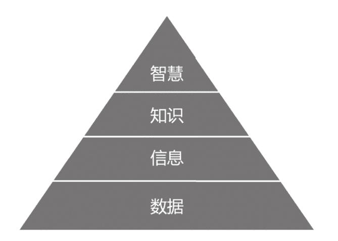
图 1-3　`DIKW`体系

举例，226.1 厘米、229 厘米是孤立的数据，仅表达客观事实，尚无意义。“姚明臂展 226.1 厘米”“姚明身高 229 厘米”是事实性陈述，属于信息。知识是对信息层的抽象归纳，把身高、臂展等属性整合，便形成对姚明的认知，可进一步判断其身高高于常人。智慧层面，Zeleny 所指的 Know-Why 即知道原因，本文暂不深入。

何谓图谱？英文是 Graph，直译为“图”。在图论中，图表示事物间相互连接的结构，通常由节点和连接节点的边构成。“图”一词由詹姆斯·约瑟夫·西尔维斯特于 1878 年首次提出。图 1-4 为由 6 个节点 7 条边组成的简单示例。

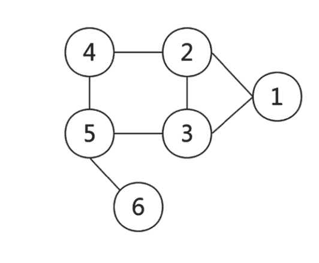
图 1-4　由 6 个结点和 7 条边组成的图示例

字面上，知识图谱即用图表示知识。节点代表语义实体或概念，边代表语义关系。

以姚明的部分基础信息为例，用计算机可理解的语言构建简单图谱。如 `<姚明，国籍，中国>` 表示姚明国籍为中国，其中“姚明”“中国”为节点，关系为“国籍”。这是一种常见符号化表示方式——资源描述框架 RDF，它把知识表示为主语、谓语、宾语三元组 `<S,P,O>`，从非结构化文本中抽取三元组的方法将在后续章节说明。

### 1.2.2　知识图谱的定义
上节给出具象描述，即由节点和边构成的语义网络。如何准确定义？可先回顾概念演化历程。

知识图谱概念的演化历程如图 1-5 所示。

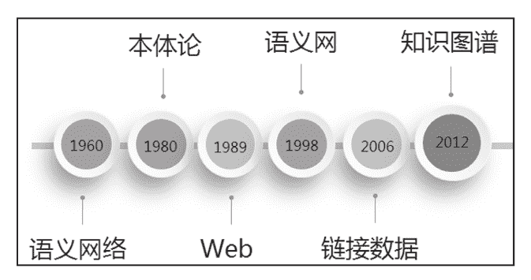
图 1-5　知识图谱概念的演化历程

语义网络由剑桥语言研究所的 Richard H. Richens 提出，是一种基于图的知识表示手段，便于将自然语言转化为图表示与存储，并用于机器翻译、问答等。20 世纪 80 年代，研究者把哲学概念本体 Ontology 引入计算机领域，作为概念与关系的形式化描述，后被用于为图谱定义知识体系 Schema。

真正产生深远影响的是 Web 的诞生。Tim Berners-Lee 在 1989 年《Information Management: A Proposal》中提出 Web 愿景，应是以链接为核心的信息系统，以图方式互联。他认为以链接为核心、基于图的组织方式比固定层次化更有效，从而催生万维网。可理解为网页为节点，超链接为边。局限在于超链接只能说明关联，无法表达更多语义。

1994 年第一届国际万维网大会上，Tim 指出人们搜索的不是页面而是数据或事物本身，因机器无法有效识别网页语义，仅建网页间链接不够，还应构建对象、概念、事物间链接。

1998 年 Tim 正式提出语义网概念。语义网是数据互连的语义网络，仍基于图与链接，但节点不再是网页而是实体。通过为文档添加元数据，让计算机轻松理解网页语义，使互联网成为通用信息交换媒介。可视作知识的互联网或事物的互联网。

2006 年 Tim 提出链接数据概念，强调数据间链接而非仅文本数据化。后续的链接开放数据 LOD 项目即为实现该设想。后于 2012 年，Google 在此基础上商业化实现，提出知识图谱概念沿用至今。

可见知识图谱与 Web、NLP、知识表示 KR、数据库 DB、人工智能 AI 密切相关，可从以下角度理解：

从 Web 角度看，像文本超链接一样构建数据间的语义链接，支持语义搜索，改变传统信息检索方式，可用更贴近人类理解的语言检索并以图形化呈现。

从 NLP 角度看，需要了解如何从非结构化文本抽取语义与结构化数据。

从 KR 角度看，需要了解如何用计算机符号表示与处理知识。

从 AI 角度看，需要了解如何借助知识库辅助理解人类语言，包括机器翻译。

从 DB 角度看，需要了解如何存储知识。

因此图谱技术是系统工程，需综合多方面技术。国内学者也有各自表述：

电子科技大学刘峤教授认为，知识图谱是结构化语义知识库，用符号形式描述物理世界概念及其关系，基本单元是“实体-关系-实体”三元组及实体属性-值对，实体通过关系联结成网状结构。

清华大学李涓子教授认为，知识图谱以结构化方式描述客观世界概念、实体及其关系，将互联网信息表示成更接近人类认知形式，提供组织、管理和理解海量信息的能力。

浙江大学陈华钧教授认为，图谱旨在建模、识别、发现和推断事物、概念间复杂关系，是事物关系的可计算模型，已广泛应用于搜索引擎、智能问答、语言理解、视觉场景理解、决策分析等。

东南大学漆桂林教授认为，知识图谱本质上是语义网络，即具向图的知识库，节点代表实体或概念，边代表语义关系。

学术界与工业界尚无唯一定义，本书侧重工程视角，讲解如何构建有效图谱。常见概念如下：

实体：对应语义本体，如“姚明”“中国”。

属性：描述一类实体的特性，如“身高”：姚明身高 229 厘米。

关系：对应语义本体间关系，将实体连接，如“国籍”：姚明国籍是中国。

部分学者把属性归入关系，本书将二者区分对待。

### 1.2.3　典型知识图谱示例

知识图谱的演进，本质上是一次次标志性工程的接力。下面就带你快速过一遍那些最具代表性的项目，图 1-6 就把这条发展线梳理得比较清楚。

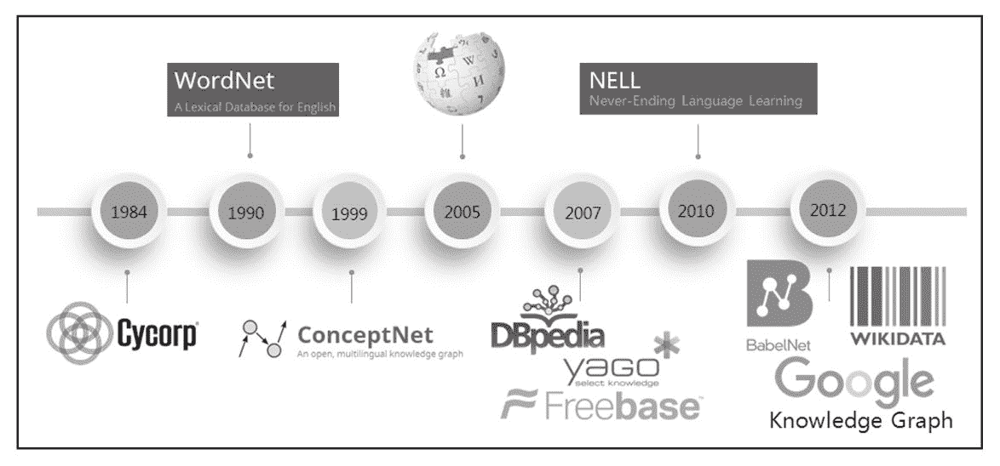

图 1-6　知识图谱发展历史

从 80 年代初启动的 `CYC`，到 Google 在 2012 年公开提出知识图谱，再到如今多语种、多领域的图谱项目遍地开花，知识图谱的研究和落地已经非常深入。`WordNet` 是典型的词典型知识库，`BabelNet` 则做了多语言的扩展；`YAGO` 把 Wikipedia、WordNet、GeoNames 三源融合在一起；`NELL` 则一直在线上自动从互联网抽取三元组。因为相关资料太多，这里只挑几个最具代表性的工程来说明。

（1）`CYC`[\[1\]](#part0006.html#note_1)

`CYC` 的起步时间是 1984 年，最初的设想是搭建一个最大规模的人类常识库，把上百万条常识变成机器可用的形式。据维基百科的统计，`CYC` 里收录了约 320 万条人工定义的断言，涵盖 30 万个概念和 1.5 万个谓词。1986 年 Douglas Lenat 估算，要完成这样体量的库需要设计约 25 万条规则，投入要达到 350 人年。这个看似夸张的计划能够推进，和当时的时代背景密不可分。

`CYC` 的工作方式以知识工程为主，大量事实靠人工录入。它包含两大部分：作为数据载体的多语境知识库，和支撑推理的推理引擎。比如系统已知“每棵树都是植物”和“植物最终会死亡”，就能推导出“树会死亡”。1994 年图灵奖得主爱德华·费根鲍姆曾评价：“`CYC` 是当时世界上规模最大的知识库，也是技术实现论的典型代表。”

（2）`ConceptNet`[\[2\]](#part0006.html#note_2)

`ConceptNet` 是一张靠众包构建的常识图谱，出自麻省理工媒体实验室的 Open Mind Common Sense，简称 `OMCS` 项目。它完全开放，并提供多语言版本。英文版自 1999 年发布后，累计有 1.5 万名贡献者贡献了超 100 万条事实。`ConceptNet` 的特点是描述偏非形式化，更接近日常口语的表达。图 1-7 就展示了它的组织方式，里面会出现诸如“企鹅是一种鸟”“企鹅会出现在动物园”“企鹅需要充足的食物”之类的表述。

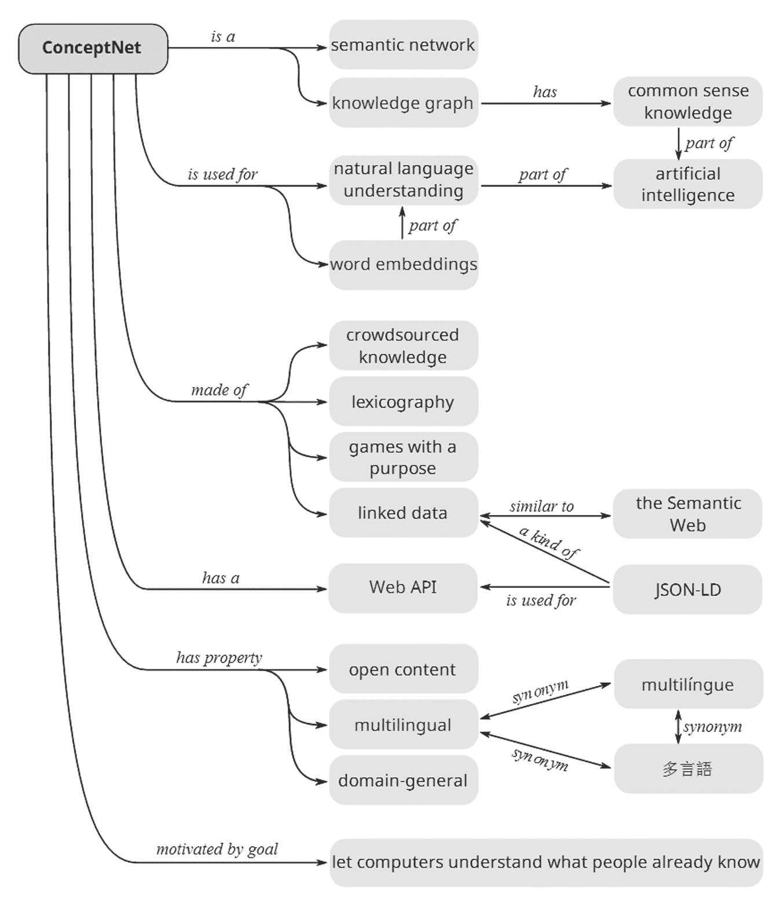

图 1-7　`ConceptNet`的组织架构示例

（3）`DBpedia`[\[3\]](#part0006.html#note_3)

`DBpedia` 可以理解为 Wikipedia 的数据库化版本，主要从 Wikipedia 的信息框里抽取结构化链接。英文 `DBpedia` 的实体数约 600 万，其中 510 万能映射到本体上。它还与 `Freebase`、`OpenCYC`、`Bio2RDF` 等多个数据集做了互联。到目前为止，它仍是链接开放数据 `LOD` 中最具代表性的开放链接数据库之一。

（4）`LOD`[\[4\]](#part0006.html#note_4)

前面提到，`LOD` 的核心灵感来自 Tim Berners-Lee 对语义网中链接数据的设想。它遵循四条基本原则：用 `URI` 唯一标识事物；使用可直接访问的 `HTTP URI`；采用 `RDF` 和 `SPARQL` 标准；为每个事物附加指向其他事物的 `URI` 链接。截至 2020 年 7 月，`LOD` 云中收录了 1260 个知识图谱，链接数达到 16187 条。图 1-8 对这些图谱做了统计分类，共分为 9 大类，其中社交媒体、政府、出版、生命科学四类占比超过 90%。

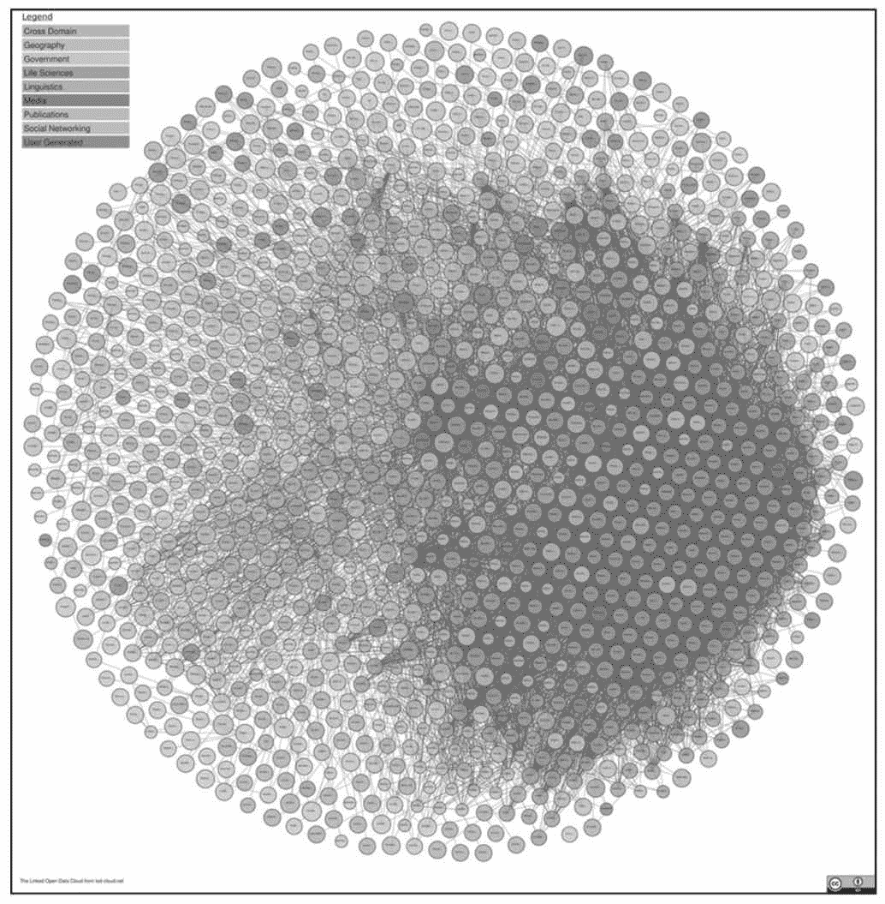

图 1-8　`LOD`知识图谱概览

* * *

[\[1\]](#part0006.html#noteBack_1) `https://www.cyc.com/`。

[\[2\]](#part0006.html#noteBack_2) `https://conceptnet.io/`。

[\[3\]](#part0006.html#noteBack_3) `https://wiki.dbpedia.org/`。

[\[4\]](#part0006.html#noteBack_4) `https://lod-cloud.net/`。

## 1.3　知识图谱的模式

### 1.3.1 模式的含义和构建

前面一直在数据层面讲知识图谱，也提到本体可以为图谱定义模式。本节就把这层“骨架”讲清楚。

人类一直尝试给世界分类。亚里士多德把元素分为土水火气和以太，中国早期的《尔雅》把万物归为天地山水、草木鸟兽等 19 类，并在每类下详述，比如“释兽”里写“狗四尺为獒”，即獒是体长四尺以上的狗。

在图结构里，节点代表语义实体或概念，边代表关系。那实体和概念怎么分？举例 `<姚明，国籍，中国>`，姚明和中国是实体，而“人”“篮球运动员”是姚明的概念，“地点”“国家”是中国的概念。概念集合起来就构成本体，本体的表达力比模式强，还包含公理 `Axiom`；模式源自数据库领域，可看作轻量级本体。实体与概念多为 `isA`，概念与概念多为 `subClassOf`，比如“篮球运动员是人的一种子集”“国家是地点的一种子集”。图 1-9 就是一个简单的本体描述模式。

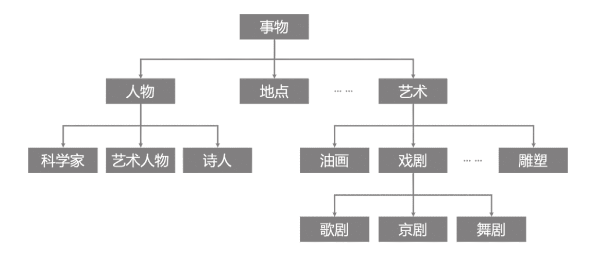

图 1-9　模式示例

总体看，本体描述概念间的关联，即知识图谱的模式；图谱则在本体上叠加丰富的实体信息。简单说，模式是骨架，图谱是血肉。有了骨架才能更好地推理，比如由“树是植物”和“柳树是树的实例”推出“柳树是植物”。

2011 年 Google、Microsoft、Yahoo! 共同推出了 `Schema.org`[1]。这是一个以消费需求驱动的规范，鼓励网站在网页里嵌入结构化数据，提升搜索排名，实现 SEO。`Schema.org` 支持用语义标签把链接数据嵌入页面，核心词汇表由专家自上而下制定。截止 2021 年 4 月 30 日[2]，它已包含 700 多个类和 1300 多个属性，覆盖个人、组织、地点、时间、医疗、商品等。凭借明确的 SEO 价值，目前全网超过 30% 的页面使用了它的标注。

举个例子，电影门户想让《八佰》的页面在搜索中更突出。传统 `<h1>` 标签只告诉浏览器如何渲染，没有语义。`Schema.org` 提供了一套共享词汇，让搜索引擎读懂“这是一部电影、名字是八佰、导演是管虎、生日 1968-08-01、类型是战争片”等信息，从而生成更丰富的摘要。

```
1. <div itemscope itemtype="http://schema.org/Movie">
2.   <h1 itemprop="name">The Eight Hundred</h1>
3.   <div itemprop="director" itemscope itemtype="http://schema.org/Person">
4.   Director: <span itemprop="name">Hu Guan</span> 
5. (born <time itemprop="birthDate" datetime="1968-08-01">August 01, 1968</time>)
6.   </div>
7.   <span itemprop="genre">War</span>
8.   <a href=" .../trailer/the-eight-hundred-trailer.html"itemprop="trailer"> Trailer</a>
9. </div>
```

当然 `Schema.org` 也有局限：覆盖面不够、偏向英文、细化不足等。做垂直领域模式时，常需融合多种体系，如 `GeoNames`、`DBpedia Ontology`、`Schema.org` 各自定义不同，融合难度很大。工业实践里，开发者通常基于成熟体系，结合业务需求定制模式。比如狗尾草智能的百科知识图谱“七律”[3]及其模式，就基于 AI 虚拟生命的知识体系构建，如图 1-10。

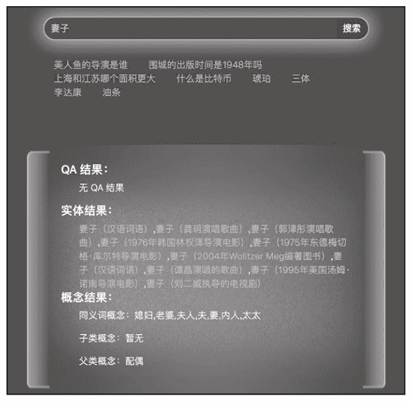

图 1-10　狗尾草知识图谱——七律示例

* * *

[1] `https://schema.org/`。

[2] 截至 2021 年 4 月 30 日。

[3] `https://ai.gowild.cn/kg`。

## 1.4 为什么需要知识图谱

前面已经提到知识图谱对搜索的加持。有人会问，相较传统数据库，它独特在哪？先看 AI 的现状。

自 2012 年起，深度学习引爆了感知层面的革命。计算机视觉上，微软 2015 年的深度学习算法在 `ImageNet2012`[1] 上把错误率压到 4.94%，首次低于人眼约 5.1% 的水平。语音合成方面，DeepMind 2017 年 6 月发布的 `WaveNet`[2] 是当时顶级的文本到语音模型。语音识别上，微软 2017 年 8 月把错误率从 5.9% 降到 5.1%，接近专业速记员水平[8]。

预训练语言模型也在加速，OpenAI 的 `GPT-2`[3] 多项任务上超过 `BERT`；2020 年的 `GPT-3`[4] 参数量是前者的 100 倍以上，用了近 0.5 万亿词预训练，可在零微调下取得很好的表现。

应用层面，2011 年 IBM `Watson` 在《危险边缘》击败人类选手；2016 年 Google `AlphaGo` 战胜李世石；`AlphaStar` 在星际争霸 2、OpenAI 在 Dota2 都取得不俗战绩；IBM `Project Debater` 开始在人类辩论赛中露头。甚至艺术创作也突破，2018 年 10 月生成对抗模型生成的《爱德蒙·贝拉米的肖像》拍出 43.25 万美元。

图 1-11　人工智能画作《爱德蒙·贝拉米的肖像】

感知能力突飞猛进，但这些突破都依赖海量数据和算力。比如基于 `Transformer` 的 `GPT-2` 有 15 亿参数，训练时使用 40GB 数据集，每小时成本 2048 美元，动用 256 块 Google `TPU v3`；`GPT-3` 参数达 1750 亿，使用 45GB 数据训练。

AI 学派里有符号学派、连接学派、行为学派，如图 1-12 所示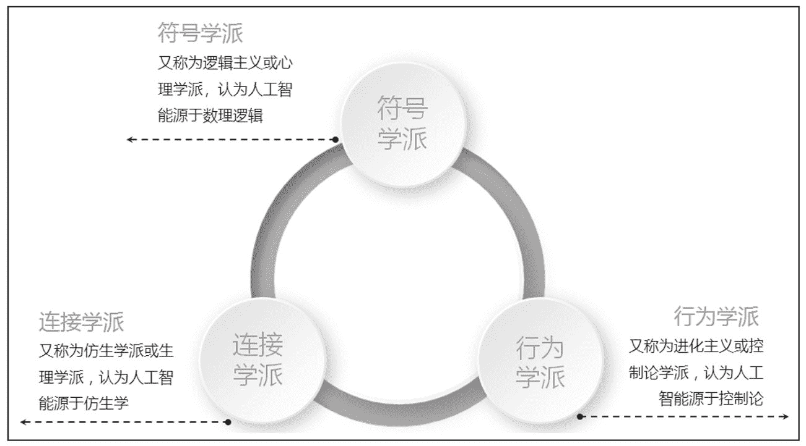。图 1-12　人工智能代表性的三个学派

以深度学习为代表的连接学派解决了感知问题，却在自然语言理解、推理联想等认知层面仍显不足。知识图谱作为符号学派的代表，能为 AI 提供结构化常识，帮助它具备推理、理解、联想能力，这是纯大数据无法替代的。多伦多大学 Geoffrey Hinton 也指出，未来方向是深度神经网络与符号 AI 的深度结合。

当下市面上大量聊天机器人，实际只能做简单问答，离真正的思考还远。常识理解尤其薄弱，比如“鸡蛋放进篮子里，是鸡蛋大还是篮子大”“啤酒杯掉在地毯上会不会碎”这类人类易判的问题，机器却常出错。因为大数据不等于知识，人类长期积累的经验很难直接迁移。

因此，知识图谱是迈向通用人工智能 `AGI` 的重要基石。从感知到认知，必须先构建大规模高质量的知识图谱，让机器以更结构化的方式理解人类知识并建立关联，才有可能实现真正的推理和联想。

* * *

[1] `http://image-net.org/challenges/LSVRC/2012/`。

[2] `https://deepmind.com/blog/article/wavenet-generative-model-raw-audio`。

[3] `https://github.com/openai/gpt-2`。

[4] `https://github.com/openai/gpt-3`。

## 1.5 知识图谱的典型应用

通用搜索只是起点。在垂直领域，知识图谱的价值更突出，比如同花顺的问财、文因互联的文因企业搜索。

医疗领域，`Open Phacts`[3] 联盟整合多源药理学数据构建图谱，支撑新药发现。IBM `Watson` 构建医疗信息系统与问答框架，以肿瘤诊断为核心，已覆盖慢病、影像、体外检测等九大方向。其商业化起点 `Watson for Oncology` 输入纪念斯隆·凯特琳癌症中心的数千病例和 1500 万页医学文献，能为不同肿瘤患者推荐个性化方案并附证据。

投资研究方面，2010 年成立的 `AlphaSense`[6] 打造金融知识引擎，用图谱+NLP+语义搜索，让用户更高效获取和再加工信息。`Kensho`[7] 则从多源数据构建金融图谱，关注事件间的依赖与关联推理，提供自动化语义分析和行情研判。

政府与安全领域，`Palantir`[8] 因协助抓捕本·拉登而知名。其技术核心是整合结构化和非结构化数据，为决策提供支持。军事情报系统可把表格、通话、文档、传感器、视频等异构信息融合，实现对人员、装备、事件的实时监控与态势预判。它还曾协助追回纳斯达克前主席麦道夫金融诈骗案的数十亿美元。

* * *

[1] `...`。

电商业务中，阿里巴巴的整体生态沉淀了海量的商品及交易行为数据，以商品、品类、品牌、条码为锚点，构建起百亿量级的商品知识图谱。该图谱支撑搜索、导购推荐、平台治理、智能问答等多个场景，日均可拦截千万量级的恶意攻击，有效改善了用户购物体验。

在对话式人工智能场景里，具备问答能力的产品如 `Siri`、`微软小冰`、`公子小白`、`琥珀·虚颜`、`天猫精灵`、`小米音箱`，都建立在大规模知识图谱之上。以 `琥珀·虚颜` 为例，除通用百科图谱“七律”外，还叠加了动漫、美食、星座等垂直领域图谱。图 1-13 展示了 `公子小白` 融合多类图谱后的一次问答交互。

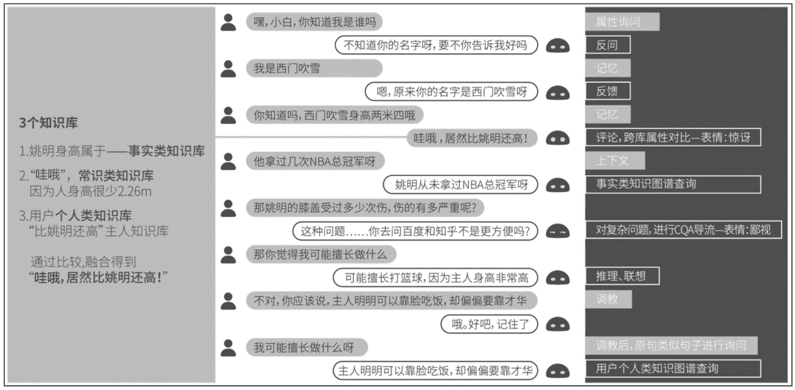

图 1-13　公子小白对话示例

* * *

[1] `http://www.iwencai.com/`。

[2] `http://search.memect.cn/`。

[3] `https://www.openphacts.org/`。

[4] `https://www.ibm.com/watson-health`。

[5] `https://www.mskcc.org/`。

[6] `https://www.alpha-sense.com/`。

[7] `https://www.kensho.com/`。

[8] `https://www.palantir.com/`。

## 1.6 知识图谱构建与计算概览

本部分对知识图谱的技术架构做简要说明，后续章节会展开工程实践细节。建设知识图谱属于系统性工程，图 1-14 给出了典型构建与计算流程。

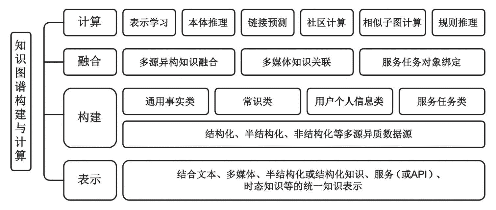

图 1-14　知识图谱的构建与计算

构建与计算层面，既要统一文本、多媒体、半结构化、结构化知识、服务或 `API`、时态知识等表示，也要兼顾结构化如关系型数据库、半结构化如 `HTML` 或 `XML`、非结构化如文本图像等多源异构数据的接入，进而形成通用事实、常识、个人记忆、服务任务等多类知识库。不同来源对应不同构建手段：结构化数据做知识映射、半结构化数据用包装器 `Wrapper`、非结构化数据依赖文本挖掘与自然语言处理。文本挖掘利用 Web 与大规模语料的冗余性挖掘隐含模式，自然语言处理往往在开放或确定 `Schema` 下抽取知识。为得到融合图谱，除离线的多源异构融合，还需处理服务任务类动态知识的对象绑定，该环节多在线完成，依交互动态扩充图谱并实例化。

存储层面，除了搭建知识库，还要关注使用效率。传统关系数据库如 `MySQL`、 `NoSQL` 如 `MongoDB` 都能容纳 KG，但直观上知识具备互联、体量大、联系即本质的特征，传统库在表达联系上较弱，因而在图谱存储上关系库不及图数据库灵活。尤其在多跳关联查询场景，如“姚明的妻子的国籍是什么”，图数据库的效率明显优于关系数据库。

## 参考文献

\[1\] Rowley, Jennifer. The Wisdom Hierarchy: Representations of the Dikw Hierarchy\[J\]. Journal of Information and Communication Science, 2007, 33 (2): 163-180.

\[2\] Zeleny, Milan. Management Support Systems: Towards Integrated Knowledge Management\[J\]. Human Systems Management, 1987, 7 (1): 59-70.

\[3\] J. J. Sylvester. On an Application of the New Atomic Theory to the Graphical Representation of the Invariants and Covariants of Binary Quantics\[J\]. American Journal of Mathematics, Pure and Applied, 1878, 1 (1) : 64-90.

\[4\] Berners-Lee, Timothy J. Information management: A proposal\[J\]. No. CERN-DD-89-001-OC. 1989.

\[5\] 刘峤，等．知识图谱构建技术综述\[J\]. 计算机研究与发展，2016, 53 (3):582-600.

\[6\] 李涓子，侯磊．知识图谱研究综述\[J\]. 山西大学学报（自然科学版），2017 (2017 年 03): 454-459.

\[7\] 漆桂林，高桓，吴天星．知识图谱研究进展\[J\]. 情报工程，2017, 3(1): 4-25.

\[8\] Xiong W, Wu L, Alleva F, Droppo J, Huang X, Stolcke A, The Microsoft 2017 Conversational Speech Recognition System\[R\]. Microsoft Technical Report MSR-TR-2017-39, arXiv:1708.06073v2, 2017.

\[9\] He K, Zhang X, Ren S, Sun J. Delving Deep into Rectifiers: Surpassing Human-Level Performance on ImageNet Classification,arXiv:1502.01852v1, 2015.

# 第 2 章 知识图谱技术体系

人工智能发展速度超出预期，业界常将其能力与人类对比。综合来看，特定任务上已表现不错，但在开放任务上仍有短板。也就是说，依托深度学习与大数据，现有系统在计算密集型任务上可超越人类，却尚未具备“有学识”属性，难以像人那样进行复杂推理与联想。知识图谱被视作赋予 AI 学识的关键，通过 `RDF`、图结构等方式存储结构化知识，成为 AI 的“大脑”。

知识图谱并非单一技术，而是一整套加工、存储、应用的流程。本章围绕整体技术栈展开，分为知识表示与建模、知识抽取与挖掘、知识存储与融合、知识检索与推理四个部分。阅读后可对技术全景形成整体认知。

## 2.1 知识表示与建模基础

对已有知识进行表示与建模是构建图谱的前提。本节介绍相关概念与常用方法。

### 2.1.1 知识表示的视角

让计算机高效利用知识，必须先完成表示与存储。知识表示是人工智能的核心议题，目前尚无完美定义。Davis 等在 “What is knowledge representation”\[1\] 中提出五种角色：

* 现实世界知识的抽象替代
* 本体集合
* 不完整的智能推理理论
* 高效计算介质
* 知识中间体

下面解释其要解决的问题。

知识表示可视为对现实知识的抽象替代，且需机器可理解。任何感知环境的智能体都需要获取外部知识，例如婴儿要将汽车、苹果等实物转化为脑中抽象表征才能学习。计算机学习真实世界也需内部抽象替代，但抽象不可能完全无损。

为缓解无损问题，引入第二角色：本体集合。本体把现实概念实体抽象为类与对象，使用者可聚焦关注点进行抽象，避免信息过载。这与人类决策时依赖重点筛选的思路一致。

第三，知识表示是未完成的智能推理理论。知识表示的产生源于推理需求，认知能力是判断智能的重要标志，智能体需存储知识并推理产生新知识。但仅有表示理论不足，需配合推理方法形成完整理论。

第四，知识表示是高效计算介质。机器视角下推理即计算，对已有表示做高效计算可得到结果，而知识表示整合了现实知识，推理时可直接调用。

第五，知识表示是知识中间体。它是对现实的描述，可作为向机器或人类传递知识的载体，如书籍即一种知识表示。

综合来看，知识表示是对现实的不完整抽象，仅保留关注维度，同时兼具计算推理中间件作用。明确概念后，需了解具体表示方式。计算机系统存在多种表示方法和形式化语言，不同方法效果不同。为此需要一种公认描述方式，要求简洁且可扩展以适应知识多样性，这就引出描述逻辑与描述语言。

#### 1. 描述逻辑

描述逻辑是一组基于逻辑形式化的表示方法，能以结构化、易懂方式进行表示与推理。它建立在概念与关系上，概念对应图谱中的类与实体，关系对应实体间的联系。描述逻辑是一阶谓词逻辑的可判定子集，可基于原子概念对其他概念进行描述与推理。

描述逻辑包含术语知识 `TBox` 与断言知识 `ABox`。术语知识指领域中的类、属性、关系，如公司、地点等；断言知识指实例相关知识，如 `<小米公司，法定代表人，雷军>`。其中 `Concept` 表示类与实体，`Role` 表示性质，`Individual` 表示断言与常量，`Operator` 用于构建复杂表达。例如 `雷军 = 小米公司 ∧ 董事长` 是最简单的表达。描述逻辑是表示与建模的基础，被多种描述语言采用，标准知识描述语言即由其演化而来，可读性更强。

#### 2. 描述语言

表示知识除逻辑外，还需合适的语言在既定逻辑上描述并传递信息。按 `W3C` 标准，通常使用资源描述框架 `RDF` 与网络本体语言 `OWL`，两者均以可扩展标记语言 `XML` 为核心语法。下面分别介绍。

##### (1) XML 语法要点

`XML` 定义了一类数据对象及处理它们的程序行为。它是格式规范、易用且可扩展的标记语言，允许用户自定义标签描述内容。`XML` 由 XML 工作组开发，1996 年由万维网联盟 `W3C` 主持成立。其核心任务是以纯文本存储与交换数据，实现跨软件硬件的传输共享。

完整 `XML` 文档由元素组成，每个元素由字符构成，部分为字符数据，部分为标记，用于描述存储布局与逻辑结构。`XML` 还提供约束布局与结构的机制，使结构更整洁。设计目标包括：

1）在互联网上直接使用。
2）支持多种应用。
3）与 `SGML` 兼容。
4）处理文档难度尽量降低。
5）可选功能尽量最少，理想为零。

因此 `XML` 遵循简单、易用、可扩展原则。在 Web 中常用于存储元数据。但因标签可自定义，系统间交换 `XML` 需事先互知标签。`XML` 不是知识表示语言，但其核心语法可迁移至 `RDF`、`OWL` 等。下面以记录公司信息列表的 `XML` 文件为例，展示小米公司的名称、法人、公司类型、地址等属性，体现格式规范。

```
1. <?xml version="1.0" encoding="UTF-8"?>
2. <NOTE>
3. <company_list>
4.     <company>
5.     <name>Xiaomi </name>
6.     <represent >Lei Jun</represent>
7.     <category> Sole proprietorship enterprise </category >
8.     <address>Beijing</address>
9.     </company >
10.     <company>
11.     ……
12.     </company >
13. </company_list >
14. <NOTE>
```

从代码可见，`XML` 文件结构为树形。由 `<>` 包围的字段为标签，如 `<NOTE>`、`<company_list>`，名称可自定义；不含 `<>` 的字段为字符数据，即元素值。每个 `XML` 文档开头需有序言，告知解析工具按何种规范解析。示例第一行即序言，指定编码与 `XML` 版本。除序言外，必须包含根元素，如 `<NOTE>`，其他元素均为其子元素。元素必须有起始符与终结符，如 `<company_list>` 与 `</company_list>`。`XML` 区分大小写，元素名不可以数字或标签开头，也不可以“xml”或“XML”开头。

##### (2) RDF 三元组

了解 `XML` 后，还需掌握以 `XML` 为核心语法的 `RDF` 与 `OWL`，下面介绍 `RDF`。`RDF` 由 `W3C` 于 2004 年发布，是表示 Web 信息的标准，由 RDF 核心工作组开发，属于语义网方向工作。目的为 Web 提供元数据模型与开放信息模型，即构建描述“描述数据的数据”的框架，通过组合多源数据获取新信息，使软件能自动处理 Web 有效信息。`RDF` 还允许跨应用公开共享结构化半结构化数据，开放性与扩展性使其成为常用知识存储表示框架。

`RDF` 是语义网与本体的基础层，对人机均友好。在 `RDF` 中，知识以三元组编码，由主语、谓词、宾语组成，可方便转为自然语言。主语与宾语可以是空白节点或国际化资源标识符 `IRI`，谓词必须为 `IRI`。下面通过具体代码说明 `RDF` 的使用方法与语法。

```
1. <?xml version="1.0 "?>
2. <rdf:RDF xmlns:rdf= "http://www.w3.org/1999/02/22−rdf−syntax−ns#"
3.     xmlns:ab= "http://www.about.com/" 
4.     xml:base= "http://www.base.com/">
5. <rdf:Description rdf:ID= "Lei Jun" 
6.     ab:work= "CEO" 
7.     ab:age= "40">
8.     <ab:friend rdf:nodeID= "s3fo" />
9. </rdf:Description>
10. <rdf:Description rdf:nodeID= "s3fo" 
11.     rdf:ID= "Lin Bin"
12.     ab:age= "40">
13. </rdf:Description> 
14. </rdf:RDF>
```
从给出的代码片段可以看出，`RDF`的底层语法正是`XML`，使用习惯也与`XML`很接近。`RDF`文档开头同样要写上`XML`声明头，用来标明所采用的`XML`版本。除此之外，作为一种全新的知识框架，`RDF`在声明头之后还要为整份文件声明语法命名空间，示例里的第 2 行和第 3 行就完成了这项工作。命名空间确定后，还需要给出文件的基准链接，即`xml:base`。基准链接是一个`IRI`，一旦设定，文档里所定义的所有实体都可以在该基准上扩展并获得唯一标识。本例中假设基准为 www.base.com。全局信息设定完毕后，就可以在`RDF`语法内部填充需要描述的内容。示例里创建了名为 Lei Jun 的实体，用 work 关系关联，并为其加上 job 宾语和 age 属性，还通过 friend 关系挂接了另一个同样带有 age 属性的实体 Lin Bin。按照三元组拆解，上述示例对应的结构即图 2-1 的样子。

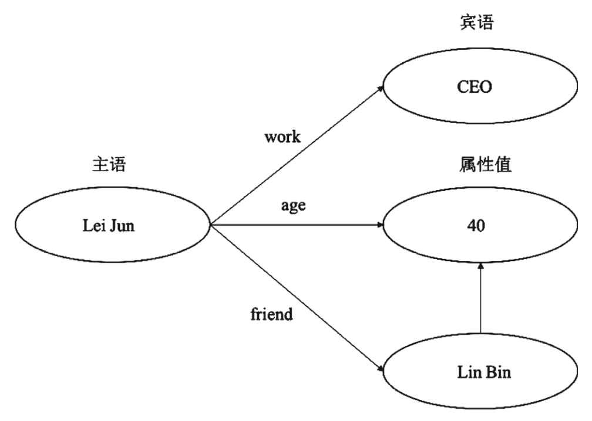
图 2-1　`RDF`表示的三元组

命名空间确定之后，三元组中的关系与属性资源都归属于该命名空间。按照前文的定义，若主语的宾语节点留空，在`RDF`语法里仍然是合法的。总体来看，`RDF`可以理解为对`XML`的延伸和精简。`XML`要求严格的树形结构，而`RDF`改用更贴近自然语言的三元组表达，语义更清晰，知识表示和元数据描述能力更强，也更容易被理解。

##### (3) OWL
`OWL`是由`W3C` Web 本体工作组推出的知识表示语言，主要用于对特定领域知识进行描述、交换和推理，常被用来构建本体知识。`OWL`基于计算逻辑，其表达的知识能被计算机直接理解和运用。与`RDF`相同，`OWL`也在 2004 年被`W3C` 推荐为 Web 环境下的知识表示和存储语言。`OWL`的先驱是美国国防高级研究计划局开发的代理标记语言加本体推理层`DAML + OIL`。现今常说的`OWL`一般指`W3C` `OWL` 工作组在 2009 年发布的`OWL 2`。`OWL 2`是对初始版本的扩充与修订，在原有能力上增加了新操作，提升了整体表达力。以下内容如无特别说明，均以`OWL 2`为准。

相较于`XML`和`RDF`，`OWL`提供了更丰富的推理手段和词汇，涵盖类间关系、基数、属性特征、枚举类等。为了适配不同需求，`OWL`划分为三个层级：`OWL Lite`、`OWL DL`和`OWL Full`。

* `OWL Lite`面向分类体系和叙词表，提供简单的约束与分类层级，类的基数仅限 0 或 1。
* `OWL DL`在保持计算完备性和可判定性的前提下，提供最大表达能力，类间基数不受 0、1 限制。
* `OWL Full`包含`OWL`全部特性，并对`RDF`有良好兼容。

`OWL Lite`、`OWL DL`与`OWL Full`之间的关系见图 2-2。

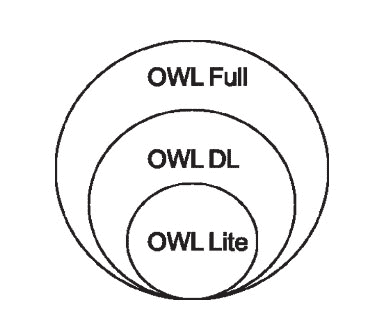
图 2-2　`OWL Lite`、`OWL DL`与`OWL DL`的关系

在深入`OWL`前，先了解其基础概念。

* 类：对现实世界同类事物的抽象概括。
* 实体：指代现实世界具体事物的元素。
* 属性：类所包含的特征，可取常量也可指向另一类。
* 表达式：由基本实体组合而成的复杂描述。

正如前文介绍，`OWL`虽用于本体和知识表示，却无法穷尽现实世界知识的所有侧面，使用者可按需选取重点进行建模。下面的代码片段展示了`OWL`的使用方式和语法。

```
1. <rdf:RDF
2.   xmlns:rdf="http://www.w3.org/1999/02/22−rdf−syntax−ns#"
3.   xmlns:rdfs="http://www.w3.org/2000/01/rdf−schema#" 
4.   xmlns:owl="http://www.w3.4org/2002/07/owl#" 
5.   xmlns:xsd="http://www.w3.org/2001/XMLSchema#" 
6.   xmlns:dc="http://www.w3.org/TR/2004/REC−owl−guide−20040210/#DublinCore">
7. <owl:Ontology rdf:about="">
8.       <owl:imports rdf:resource="http://www.example.org/company_ontology"/>
9.       <rdfs:label>Company Ontology</rdfs:label>
10. </owl:Ontology>
11. <owl:Class rdf:ID="Company">
12.       <owl:Restriction>
13.       <owl:minCardinality rdf:datatype="&xsd ;string">1
14.       </owl:minCardinality>
15.           </owl:Restriction>
16. </owl:Class>
17. 
18. <owl:ObjectProperty rdf:ID= "representFor ">
19.           <rdfs:domain rdf:resource="#People"/> 
20.           <rdfs:range rdf:resource="#Company "/> 
21. </owl:ObjectProperty>
22. 
23. <owl:DatatypeProperty rdf:ID= "companyName ">
24.           <rdfs:domain rdf:resource="#Company "/> 
25.           <rdfs:range rdf:resource="&xsd; string "/> 
26. </owl:DatatypeProperty>
```
从片段可见，`OWL`与`RDF`相似，也以`XML`为核心语法，并沿用了部分`RDF`定义。但在`RDF`三元组的基础上，`OWL`对类、属性等元素的表达更明确，扩展性也更强。举例来说，第 8～10 行导入了一个已建好的本体，后续操作都依托该本体，大幅提升了扩展能力。在此基础上，第 11～16 行对`Company`类进行定义并把基数约束为 1。第 18～21 行与第 23～26 行分别定义了类中两种不同的属性，具体差异将在下一章展开。

前文已对知识表示的概念与方法做了介绍，并对主流方案进行了举例说明，表 2-1 对比了这些方法的差异。

表 2-1　知识表示方法对比

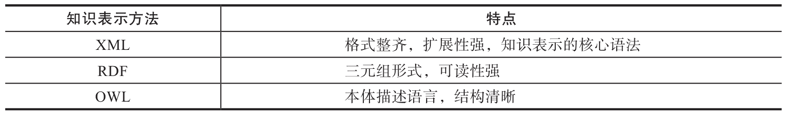
总体来看，`XML`作为核心语法在各类知识表示语言中都占有关键地位。在`XML`之上，`RDF`把知识拆解为三元组，并以`IRI`作为唯一标识，让知识对人机都更具可读性。`OWL`在此基础上引入类与实体的概念，将知识抽象为本体层面的表示，使现实知识的刻画更完整、层次更清晰。明确表示方法后，下一步需要思考如何建模。

### 2.1.2　知识建模
知识建模是构建可被计算机解释的知识模型的过程。模型既可以是通用领域的，也可以是对某类产品或规范的解释。其关键在于模型必须可存储、可解释，常见做法是借助知识表示方法进行存储与刻画。基本流程如下。

1）知识获取：依据系统需求，从多源多法收集知识，随后进行甄别与分类保存。
2）知识结构化：借助如本体建模等方法，将非结构化知识转为可建模形式，再通过已建知识库实现标准化与规范化。

实际上并无绝对最优的建模方案，只有相对合适的方案。实践结论往往是最好的指南。本节先介绍建模流程，再以本体为例说明具体过程。

知识获取是通过多数据源和专家为知识库系统搜集并组织所需知识的环节。首要任务是明确建模目的，据此划定领域与范围。若范围过大，可先从子领域入手建模，再逐步整合。领域选择上宜挑选结构相对稳定的，变化频繁的领域会带来大量修改与重构，降低效率。目前常用来源主要有两类：Web 数据和专家知识，针对不同来源可采用不同采集手段。

以 Web 采集为例，核心是采用增量方式持续获取特定领域的相关数据。采集过程自动化、无监督、独立执行，期望尽可能多地获取相关信息。Web 因其规模与异构性成为理想来源，同时也要求轻量分析技术以保证可扩展性和执行效率。实践中通常先确定关键词，再基于关键词对大量站点进行分析，提取所需知识。网页分析无需专家监督的语言模板，也无需预先定义领域本体等先验知识，后者是知识获取的关键技术之一。

另一路径是通过人类专家获取知识，主要包括知识工程师手工录入或对领域专家的访谈等。知识积累到一定程度后，需判别有效性并分类保存。

需要注意的是，经过上述步骤得到的信息多为非结构化或半结构化，计算机无法直接利用，还需进行结构化。结构化的目标是把非结构化数据转化为计算机可读的知识表示。任务可分为两部分：知识抽取与知识的结构化表示。抽取环节负责从非结构化或半结构化知识中提取信息，通常是自然语言或近自然语言形式，为后续表示做准备。基于对`RDF`与`OWL`的了解，自然语言常被重组为三元组结构，便于阅读，也降低了后续用`RDF`/`OWL`表示的难度。抽取的具体方法可参考后续章节。

抽取得到结构化数据后，还需转为机器可读形式，常见做法是构建本体并保存为`RDF`或`OWL`文件。下面给出一种本体构建思路，后续章节将介绍具体实现。

本体概念最早源于哲学，研究与“存在”相关的概念与关系。在计算机和人工智能领域，本体被简要定义为对现实世界的概念化规范，即知识的抽象模型，提炼实体特征并归纳为不同类与关系。在构建方法上，经典方案包括`METHONTOLOGY`法\[4\]、七步法\[17\]等，均源于具体开发项目。

以`METHONTOLOGY`法为例，本体构建从非正式规范开始，逐步演化为可被机器理解的模型，形式化程度随过程提升。第一步是确定建模目的，包括预期用户、使用场景与涉及范围，为后续工作奠定条件与前提。完成后通常会输出一份描述本体规范的文档，形式可正式可非正式，可用自然语言撰写。第二步是知识获取，来源可为互联网、专家等，也可与第一步并行，先广泛收集数据再按规范筛选。第三步是概念化，目的是组织和结构化外部知识。对获取的知识进行抽象汇总，提取概念、类、关系等中间表示，可用表格或图形保存，需被领域专家与开发人员共同理解。第四步是集成，为实现融合与共享，尽可能复用已有本体，使新本体与既有本体保持一致。第五步是形式化实现，使用`RDF`、`OWL`等形式化语言对本体进行表达，输出机器可读可存储的版本。第六步是评估，识别冗余、不完备、不一致等问题，以优化质量。最后一步是对各阶段成果进行整理归档，形成文档。通过文档化，可对构建过程进行复盘，便于后续维护时快速进入新周期。

## 2.2　知识抽取与知识挖掘
本节从概念与常用方法出发，介绍知识抽取与知识挖掘。

### 2.2.1 知识抽取
知识抽取是指从不同来源、不同结构的数据中，利用实体抽取、关系抽取、事件抽取等技术获取知识的方法。它是知识图谱构建的基础，也是大数据时代的产物。互联网信息爆炸增长，迫切需要从原始数据中提炼高价值信息，知识抽取正发挥关键作用。其应用领域广泛，如恐怖袭击预警、空难事故调查、疾病爆发预测等。以恐怖袭击预警为例，可抽取时间、地点、嫌疑人、受害人、目标、武器等信息，构建反恐语料库，为预测提供参考。

1. 知识抽取数据来源
按结构划分，知识图谱数据源可分为结构化数据、半结构化数据和非结构化数据，不同类型对应不同抽取方法。

图 2-3 展示了针对不同数据类型的抽取方法，下面分别说明。

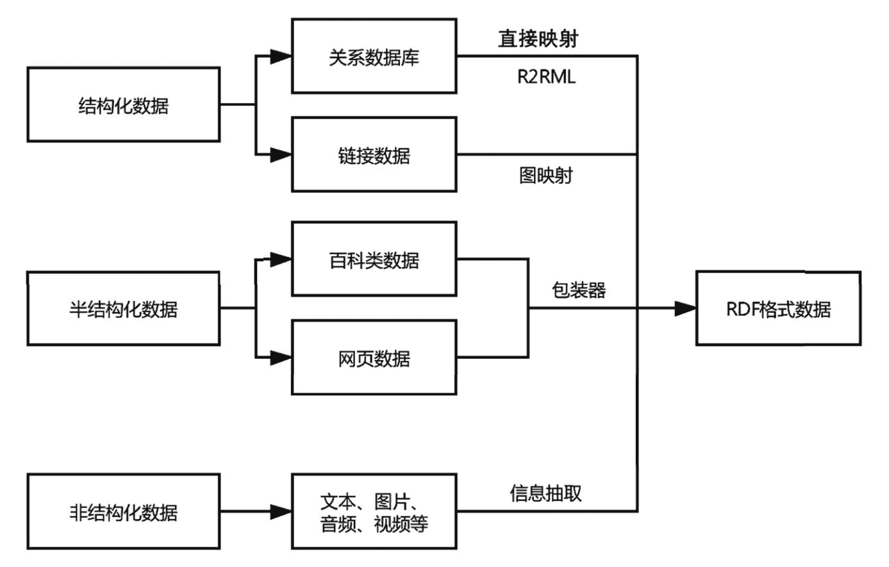
图 2-3　知识抽取方法

（1）结构化数据的抽取
结构化数据主要包括关系数据库和链接数据。对关系数据库，可采用标准化映射方法，如直接映射\[1\]和`R2RML`\[2\]，将其转为`RDF`格式。直接映射的本质是编写启发式规则，把数据库表转为`RDF`三元组；`R2RML`是一种映射语言，可自定义规则，因而更灵活。难点在于复杂表数据的处理，如嵌套表。对链接数据，需要从已有通用知识图谱中抽取子集，形成领域图谱。主要方式是图映射，即把通用图谱映射到预先定义的领域模式上，难点在于数据对齐。表 2-2 展示了部分人物的结构化数据示例。

表 2-2　结构化数据示例

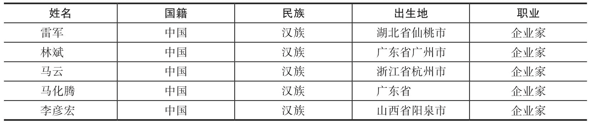
直接映射的做法是将数据库表转换为一个`RDF`类，表的每个字段映射为`RDF`属性，每行映射为一个`RDF`资源，每个单元格映射为字面值。因此表 2-2 可转为“人物”类，“姓名”“国籍”“民族”等字段成为人物类的属性，每一行描述人物的全部属性，具体取值对应相应属性值。例如人物“雷军”具有“职业”属性，取值即为“企业家”。

从结构化映射到信息抽取：知识图谱构建的底层路径

R2RML 的映射体系可以拆成若干可复用的构件。TriplesMap 负责把关系表中的一行展开为一组 RDF triple。SubjectMap 决定每条 triple 的主语如何从列中生成。PredicateObjectMap 再向下细分为 PredicateMap、ObjectMap 与 RefObjectMap，分别负责谓语、直接对象以及指向其他表的引用对象。必要时还能挂上 GraphMap 指定落图。

半结构数据大致可分成百科类与普通网页类。百科类如维基百科、百度百科，呈现方式多为键值对，结构相对规整，抽取门槛较低。以百度百科检索“小米科技”即可看到典型的半结构形态。围绕这类来源已形成成熟的图谱实践，DBpedia 起源于维基百科，Zhishi.me 则融合了百度百科、互动百科与中文维基的内容。

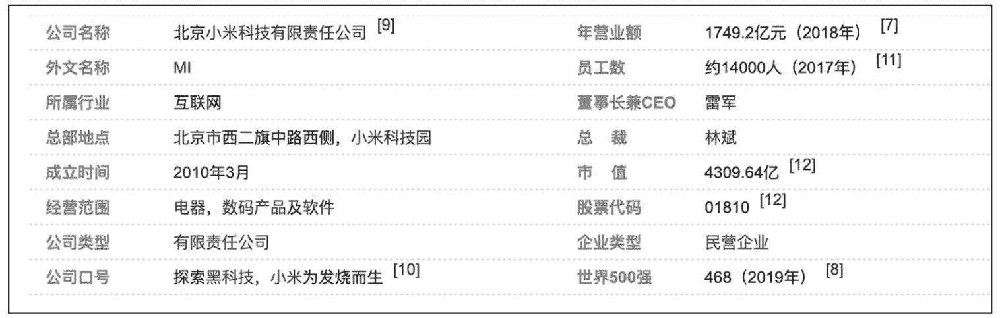

图 2-4　半结构化数据示例

普通网页的结构更为松散，通用解法是包装器。包装器把 HTML 中的内容抓出并还原为结构化表达。实现路线主要有手工编写、包装器归纳、自动抽取三种。包装器归纳属于有监督学习，能从已标注样本学习抽取规则，适用于标记一致或模板相同的页面。自动抽取先对一批页面聚类得到结构相近的若干簇，为每个簇训练一个包装器，后续待抽页面经处理后输出结构化结果。

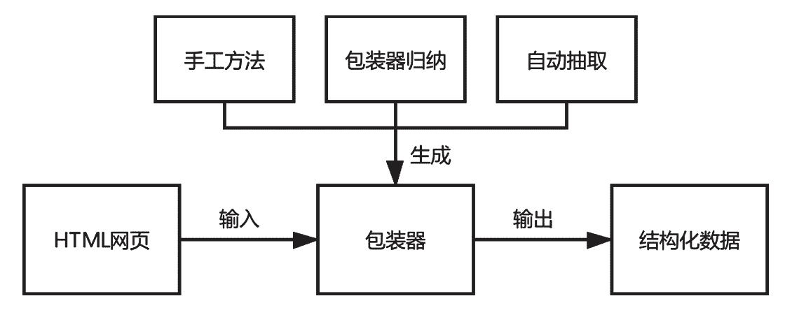

图 2-5　包装器数据提取流程

非结构化层面覆盖文本、图像、音频、视频等，占据互联网数据的绝大部分。以百度百科检索“小米科技”的说明正文为例，非结构化部分即指这类自由文本。当前更聚焦文本类信息的结构化提炼，统称信息抽取。信息抽取只针对非结构化，知识抽取覆盖全类型。该方向可追溯至上世纪七十年代末的自然语言处理研究，目标是自动化地从文本发现有价值信息并跨片段整合。文本抽取主要由命名实体识别、关系识别、事件识别三部分构成。在图模型视角下，实体是节点，关系是连边，因此关系识别对图谱构建意义重大。

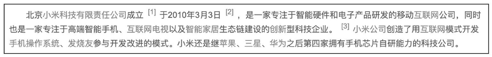

图 2-6　非结构化数据示例

2. 知识抽取任务
下面聚焦文本信息抽取三个子任务的技术演进。

（1）实体识别
实体识别的任务是把文本中的原子信息提炼为节点。举例而言，“8 月 27 日，亚冠联赛四分之一决赛首回合开战，上海上港坐镇主场迎战日本浦和红钻。”其中可识别的单元包括日期、赛事名称、两支球队。该任务常建模为序列标注，可用特征涵盖词性、前后缀、字级是否数字等。可选模型有隐马尔可夫模型 HMM、条件随机场 CRF、神经网络等，当前流行做法是传统机器学习与深度学习结合，如先用长短期记忆 LSTM 自动学习表征，再接 CRF 解码。

① 基于规则与词典的方案
早期多依赖人工编写的模板，由领域专家或语言学家制定。可利用词形、词性、词类等线索。准确率通常较高，但召回偏低，扩展迁移成本高，移植性差。

词典匹配依赖字符串检索，正向最大匹配与逆向最大匹配是常见策略。效果受词典规模与质量制约，能稳定识别已知项，却难以发现新词，且通用域实体庞大难以穷举。配合规则可用于特定领域。

② 基于统计学习的方案
把任务视为序列标注，需先标注部分语料，用统计方法训练概率模型，再推广到未标注数据。典型模型为 HMM 与 CRF。

## 隐马尔可夫模型
有向图模型，先由隐藏的马尔可夫链生成标注序列，再由标注生成观测词序列。由初始概率、转移概率、观测概率三要素构成。训练常用最大似然估计。速度快，但假设观测间相互独立，效果受限。

## 条件随机场模型
给定输入条件下输出的条件下概率分布，适用于序列标注。与 HMM 不同，CRF 允许当前观测受前后多状态影响，可引入更丰富特征。提供特征灵活且全局最优的标注框架，但收敛慢、训练耗时。

### 混合方案
主流是机器学习与深度学习的融合，如 LSTM-CRF，由 Guillaume Lample 等提出。如图 2-7，结构分 Word Embedding 层、Bi-LSTM 层、CRF 层。Embedding 层为词生成向量，可预训练或随机初始化。Bi-LSTM 层利用上下文做特征提取，正向与反向 LSTM 输出拼接后送入 CRF 层。CRF 层对特征与标签建模，完成序列标注。实验表明该结构效果可达或超过传统 CRF，成为主流。

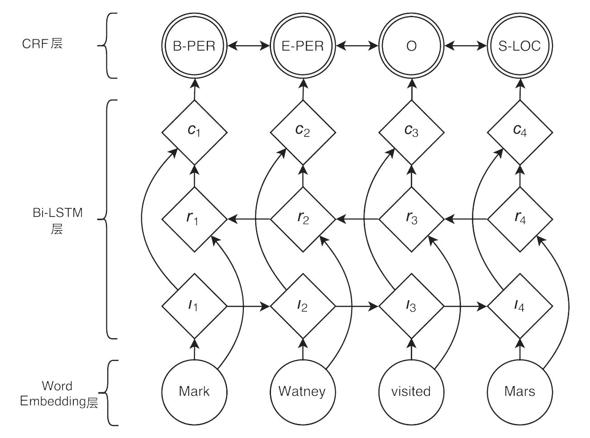

图 2-7　`LSTM-CRF`模型

## 关系识别
关系识别是从文本抽取多个实体间的语义关联，例如“雷军，他是中国著名商界领袖，小米科技的创办人。”可抽取为 小米科技 与 雷军 的创立关系。该句还涉及共指消解，“他”指代雷军。主流方法有规则法、有监督学习、半监督学习。

### 基于规则的方法
准确率高但覆盖率低，维护与移植困难，模板编写需大量人力。常见两类：触发词法与依存句法分析法。

触发词法先总结模板如“小米科技创办人雷军”“阿里巴巴创办人马云”，归纳出 X 创办人 Y 的模式，触发词为“创办人”，再结合实体识别确定两侧实体。

依存句法分析法先做分词、词性标注、实体识别与依存分析，再把人工定义的规则库与分析结果匹配，每匹配一条规则生成三元组结构，后续通过扩展规则完善语义。

### 有监督学习方法
通过部分标注数据训练抽取器，标注需同时包含关系与实体对。可视为分类问题：先用二分类器判断实体对是否构成关系，再用多分类器判定具体关系类型。能先过滤大量无关系样本，加速训练。特征包括实体类型、距离、中间词序列、依存关系等。

缺点是特征构建困难，需要较多高质量特征；标注数据获取成本高，数据量与质量直接决定效果，常与半监督结合。

### 半监督学习方法
主要介绍种子数据启发式与远程监督。

种子启发式先准备一批高质量三元组种子，如<“小米科技”，“创办人”，“雷军”>，以种子匹配语料，找出提及该实体对与关系的候选文本，语义分析后提取强支持特征，再用这些特征在语料中发现更多实例加入种子，迭代扩充直至阈值。该方法对初始种子敏感，易产生语义漂移。

远程监督利用已有知识库为未知数据标注。若知识库中两实体存在某关系，则假设包含这两个实体的文本都描述该关系，可快速获得大量训练数据。实际中部分候选对并不成立，可用先验知识缩小范围或引入注意力机制加权。最后抽取特征训练分类器，并与有监督学习结合。远程监督无需迭代，能有效扩充数据，如从知识库获取<“小米科技”，“创办人”，“雷军”>后即假设所有同时出现这两个实体的文本都描述创立关系。缺点是不适合多关系抽取，更适用于特定关系抽取。

## 事件识别
事件识别是从自然语言抽取感兴趣的事件信息并结构化存储，广泛用于问答、文摘、检索。事件通常包含时间、地点、参与角色等属性，由一个或多个动作或状态改变触发，如“马云担任阿里巴巴董事局主席”与“马云卸任阿里巴巴董事局主席”是两个不同事件。任务包含事件发现即识别触发词与类型；事件要素抽取即抽取要素并判定角色；抽取描述事件的词组或句子等。可转化为多阶段分类问题，分别训练判断触发词、判断要素、判断角色等分类器。按定义可分为元事件识别与主题事件识别。

### 元事件识别
元事件指动作发生或状态改变，通常由动词或表示动作的名词触发，由人物、时间、地点等核心成分构成。方法有模式匹配与机器学习。

模式匹配在模式指导下识别抽取，关键在于模式构建。可人工编写，要求构建者专业性强，效果依赖手工句型模板；也可由模型自动学习，但维护与迁移困难，成本高。

机器学习方法同样多阶段分类，每个阶段训练一个分类器，文本依次进入各分类器输出事件实例，核心是分类器构造与特征选择。需训练的分类器包括判断词汇是否为触发词并确定类型、判断词组是否为事件要素、判断要素角色、判断事件属性及输出价值等。该方法不依赖语料内容但需大量训练数据，可结合远程监督与 bootstrapping 减少标注需求。

### 主题事件识别
元事件停留在句子层，主题事件往往由多个动作或状态组成，散布在多句或多文档中。关键是识别并归并描述同一主题的文档集合。分为基于事件框架与基于本体的方法。

基于事件框架的方法先定义层次清晰的框架，每层代表事件的一个方面如时间、地点。主题事件可看作框架分类体系下的元事件集合，可用语义角色方法抽取各元事件。例如手机发布主题事件，框架可包括发布时间、发布地点、机型、价格等直接信息，也可包括对消费者和其他厂商的影响等间接信息，实现层次化抽取。

基于本体的主题事件识别中，本体是对共享概念体系的形式化描述，目标是形成领域共识。技术流程分三步：构建领域本体、基于本体对文本内容自动语义标注、基于语义标注抽取事件。

2.2.2 知识挖掘
知识挖掘是从文本或知识库中发现新实体或实体关系并与已有知识关联的过程，包含实体链接与消歧和知识规则挖掘。

#### 1. 实体链接与消歧
实体链接是将自然语言文本中的实体指称映射到知识库对应实体的过程。例如文本“2019 年 7 月 22 日，《财富》杂志发布 2019 世界 500 强企业排行榜。小米首次登榜，排名 468 位。”需把“财富”“小米”映射到知识库实体。由于同名异义和同义异名现象，必须做消歧。“财富”可能指向财经杂志，也可能指向电影，“小米”可能指向公司也可能指向粮食，需要精确链接。

基本流程分为实体指称识别、候选实体生成和候选实体排序。

##### （1）实体指称识别
与知识抽取中的实体识别一致，可用基于规则和词典的模板或字典，也可用基于统计学习的序列标注方法，如 HMM、CRF，或混合方法如 LSTM-CRF 来识别文本中的实体指称。

##### （2）候选实体生成
由识别出的实体指称生成可能链接的候选实体集合。常用三种方法：基于实体指称字典、基于搜索引擎、基于表面扩展。

基于实体指称字典是主流做法，建立实体指称到候选实体的映射表，一个指称可对应多个知识库实体。可基于维基百科或百度百科构建，利用实体页面、重定向页面、消歧页面及超链接等生成候选列表。

基于搜索引擎的方法是搜索实体指称，将前 N 个结果中包含维基百科或百度百科页面的条目作为候选。

基于表面扩展针对首字母缩略词或全名的部分形式，通过表面扩展技术从关联文档中识别其他可能形式，再生成候选实体。例如百度百科介绍“清华大学（Tsinghua University），简称‘清华’”，指称“清华”可扩展为“清华大学”。

表 2-3　实体指称字典映射表

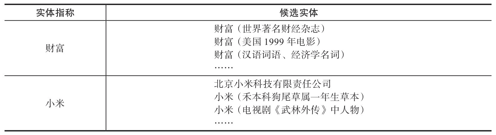

##### （3）候选实体排序
候选集合通常包含多个候选，需排序筛选出真正指代的实体。按是否需要标注数据可分为基于监督学习的排序方法和无监督学习的排序方法。

候选实体排序的主流做法

在有监督的设定下，从一串备选里挑出真正对应的实体，大致可归纳为三类做法。

* 二分类视角把排序拆成逐项判定。先训练一个二元分类器判断某个备选是否与当前提及相符，被判为正的留下、被判为负的去掉。若同时出现多个正样本，就借助分类器的可信度进行取舍，取可信度最高的作为最终指代。常用的分类器底座有 SVM、朴素贝叶斯和 KNN。
* 排序学习视角用同一个模型同时处理同一提及下全部备选，而非逐个打分。训练时要求对每个提及的备选集合做整体排序，并且让真实对象稳定排在首位。
* 图建模视角借助协同链接的图结构，把实体的显著性、上下文的相似性以及备选之间的一致性三类信号融合。图中的节点是提及和备选对象，节点间以带权无向边相连。求解目标是从原图里抽取一个尽可能稠密的子图，保留提及到真实指代的连线，得到连线即完成消歧。

无监督的设定下，排序也分两类。

* 向量空间视角依赖表层文本的相似度，把提及的上下文和备选的描述都映射为向量，再计算向量间的相似性，相似性最高的备选被选为指代。
* 检索视角把每个备选视作独立的可检索文档，根据提及本身及其上下文合成查询，用该查询检索备选集合，返回相关性分数最高的作为指代。

#### 2. 知识规则挖掘
知识规则挖掘是对已有知识结构的再发现，目标是在既有体系上利用部分规律推导出新实体、新联系等结论。可分为关联规则驱动和统计关系学习驱动两类。

##### （1）基于关联规则的挖掘
关联规则写成 X→Y 的蕴含式，X、Y 是不相交的项集。其强度常用支持度 Support 与置信度 Confidence 衡量。Support 为同时包含 X 与 Y 的样本占总样本的比例，Confidence 为同时包含 X 与 Y 的样本占仅包含 X 的样本的比例。如图 2-8 所示，方框为实体节点，椭圆为类别，X 代表“中国企业家”，Y 代表“企业家”。雷军、马云、马化腾属于 X，同时又与蒂姆·库克、比尔·盖茨共同属于 Y。X、Y 共有的实体有 3 个，总实体 5 个，故 Support（中国企业家→企业家）=3/5=0.6。X 自身实体数为 3，故 Confidence（中国企业家→企业家）=3/3=1。

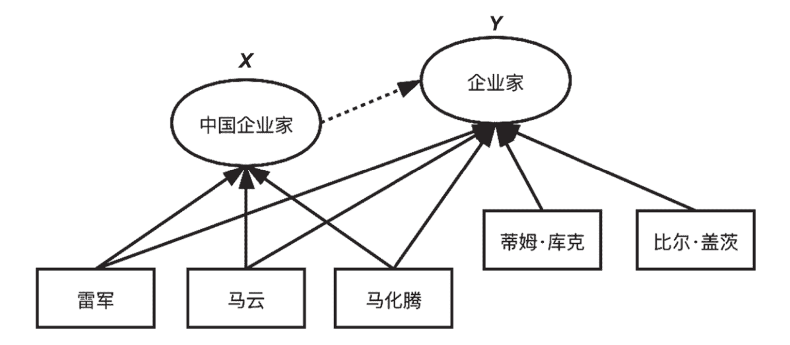
图 2-8　基于关联规则的挖掘

该类挖掘旨在发现知识库中类别间的潜在联系，表达为关联规则或频繁项集。流程分两步：先从知识库中抽取所有频繁项集，再从中提炼关联规则，当 Support 与 Confidence 同时超过阈值时判定为强相关规则，可用于挖掘本体层概念关联。以例中 X→Y 为例，若阈值都设为 0.6，则 Support=0.6、Confidence=1 均满足，可认为“中国企业家”与“企业家”强相关，且前者是后者的子类。

##### （2）基于统计关系学习的挖掘
统计关系学习利用已知的三元组来估计未知三元组成立的可能性，从而补全知识图谱。输入是已知的实体集、关系集和三元组集，以及待预测的实体对和给定关系，输出是该实体对在该关系下构成三元组的置信度。置信度超过阈值即判定关系成立并生成新三元组。

以图 2-9 为例，已知黎万强 isA 企业家，林斌 isA 企业家，需判断雷军 isA 企业家是否成立。图谱显示雷军与黎万强、雷军与林斌是合伙人关系，雷军经这两条可达路径到达企业家。给不同可达边赋予权重后加权求和得到预测置信度，超过阈值即可推断雷军 isA 企业家成立。

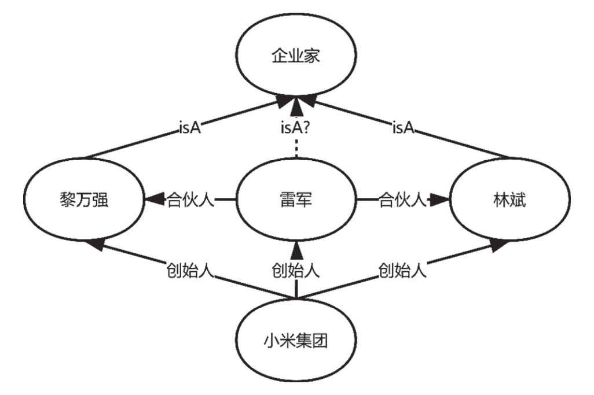
图 2-9　基于统计关系学习的挖掘

* * *

[\[1\]](#part0014.html#noteBack_1) https://www.w3.org/TR/rdb-direct-mapping/。

[\[2\]](#part0014.html#noteBack_2) https://www.w3.org/TR/r2rml/。

[\[3\]](#part0014.html#noteBack_3) https://wiki.dbpedia.org/。

[\[4\]](#part0014.html#noteBack_4) http://zhishi.me/。

[\[5\]](#part0014.html#noteBack_5) 所谓依存句法分析，就是将句子解析成一棵依存句法树，用树的形式描述句子中各个词之间的依存关系，即词语在句法上的相互关系。

[\[6\]](#part0014.html#noteBack_6) 语义角色是指一个句子中与谓语搭配的词在动词或表示动作的词所指事件中担任的角色，包括施事者、受事者、客体、经验者、受益者、工具、目标和来源等。

[\[7\]](#part0014.html#noteBack_7) 一个实体的指称是指在具体上下文中出现的待消歧实体名。

[\[8\]](#part0014.html#noteBack_8) https://zh.wikipedia.org/wiki/清华大学。

## 2.3　知识存储与知识融合
本节先解释知识存储的概念与分类，再详细介绍知识融合的常用做法。

### 2.3.1　知识存储
知识存储是结合业务场景和数据规模选择存储方式并把结构化知识写入相应数据库的过程，用于实现数据的高效管理与计算。按存储结构可分为表结构存储和图结构存储两类，如图 2-10 所示。

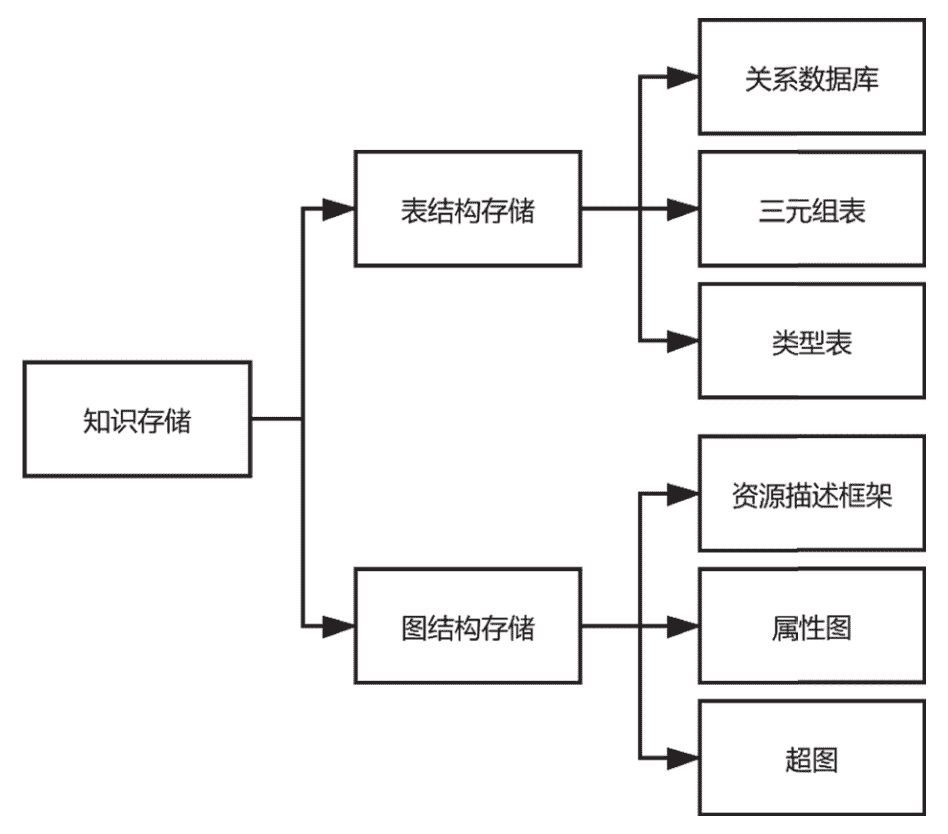
图 2-10　知识存储类型

1\. 基于表结构的知识存储
基于表结构存储指把知识图谱数据写入二维数据表，按设计原则可分为关系数据库、三元组表和类型表。

（1）关系数据库
表 2-4 为人物属性关系数据库，每一列代表一个属性或字段，用来刻画实体集的特征，如姓名、性别、年龄等。每一行是一个元组，由实体的各属性取值构成，可相对完整描述该实体。

表 2-4　人物属性关系数据库
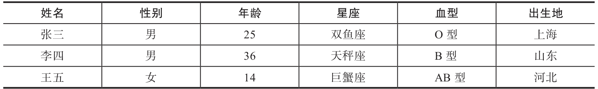

（2）三元组表
以 RDF 三元组为单元存储，表共三列分别对应 Subject、Predicate、Object，每行是一组（实体，关系，实体）或（实体，属性，属性值）。该方式直观且扩展性强，但全部数据集中一张表会导致查询、修改、删除成本较高。

（3）类型表
构建表时考虑知识图谱的类别体系。每个类型表只记录该类型的特有属性，公共属性上移到父类表，下级表继承上级属性。表 2-5、表 2-6 展示人物和公司的类型表，每行是一个实体，每列是一个属性。以雷军为例，作为人物拥有出生日期、出生地等公共属性；作为企业家额外拥有现任公司职务、主要成就等属性；作为政治人物额外拥有第十三届全国人大代表属性，企业家和政治人物的雷军同时继承人物属性。类型表缓解了三元组表单表过大、结构单一的问题，但多表连接开销大，例如公司表与人物表连接才能表达任职关系，类型增多时难以管理大量表。

表 2-5　人物类型表
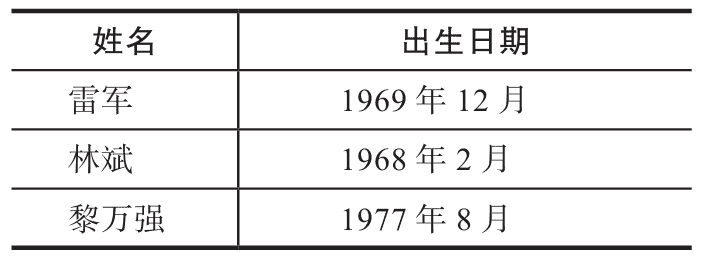
表 2-6　公司类型表
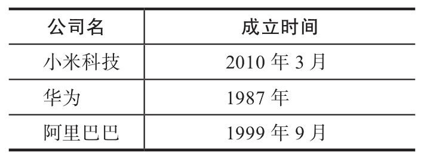

2\. 基于图结构的知识存储
基于图结构存储即用图数据库保存知识图谱数据。图数据库以图结构进行语义查询，允许关联和上下文分析，利用语法、语义和结构信息检索显式和隐式信息。图数据库源于欧拉图理论，也称面向图数据库或基于图数据库。其模型以节点和边存储及查询数据，也可处理键值对。图数据库是可视化的 NoSQL 数据库，支持增删查改，能快速检索复杂层次结构数据。

（1）图数据库的分类
图数据库分为资源描述框架、属性图和超图。

① 资源描述框架
资源描述框架即 RDF，是一种三元组数据模型，知识可分解为（Subject，Predicate，Object）。RDF 图由节点和边构成，内容由一系列三元组填充，表现为（节点，边，节点）形式，资源对应节点，边连接资源形成语义网。RDF 是数据模式而非序列化格式，具体存储可为 XML、Turtle 或 N-Triples。

② 属性图
属性图也称带标签属性图，由节点、关系、属性和标签组成。节点和关系都可用键值对存储属性，节点相互独立，可含零个或多个标签，同标签节点属同一类型。关系用边表示，边有向，分别连起点和终点，故属性图是有向图模型。图 2-11 为人物—公司关系属性图，包含人物和公司节点，标签分别为“人物”“公司”。左上角人物节点为雷军，含姓名、民族、国籍等属性；公司节点为小米科技，含公司名称、总部地址、股票代码等属性；“创办”关系由雷军指向小米科技，且关系带“创办时间”属性。该表示直观，便于刻画业务逻辑关系。

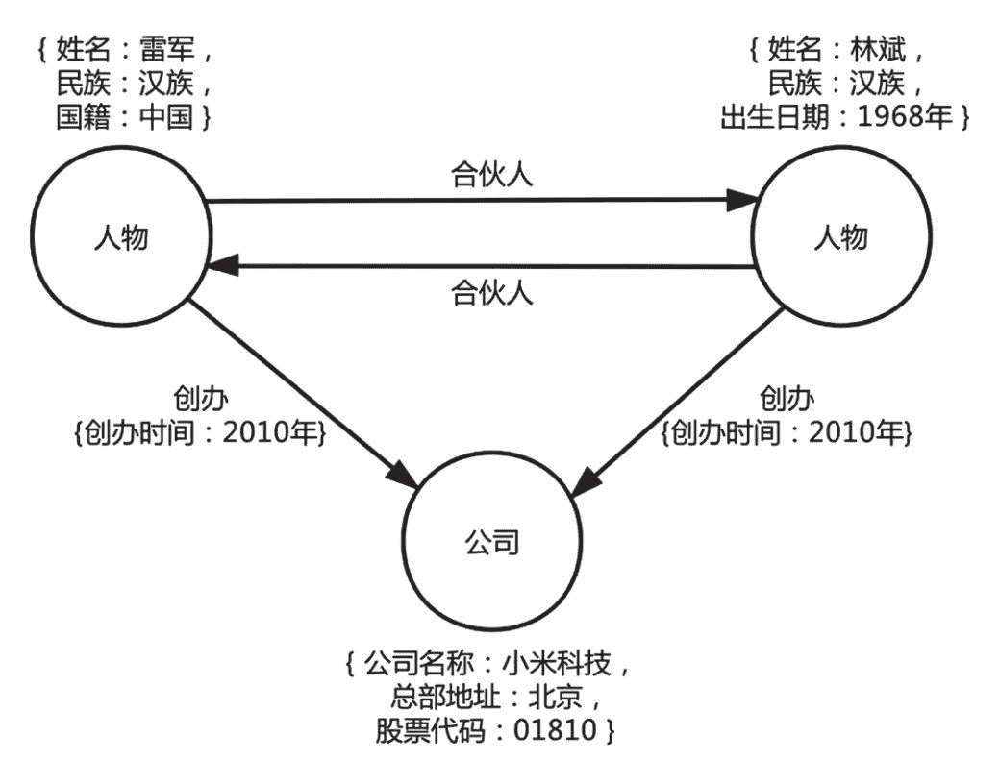
图 2-11　人物—公司关系属性图

③ 超图
超图是图的广义形式，其一条边可连接任意数量节点，称为超边，连接的节点以集合表示。图 2-12 为超图示例[\[1\]](#part0015.html#note_1)，其中{v1, v2, v3, v4, v5, v6, v7}为节点，{e1, e2, e3, e4}为超边，每块封闭区域内的节点与边表示与该超边相连的节点。超边可连两个以上节点，能解决标签网络中一条边含多节点的问题，也能处理简单图谱中的共指消解与分割。

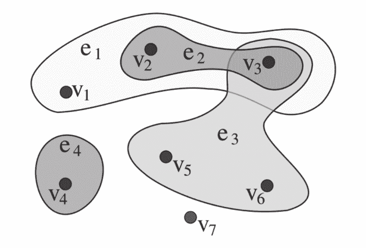
图 2-12　超图示例

（2）常用的图数据库介绍
① `Neo4j`[\[2\]](#part0015.html#note_2)
`Neo4j`是开源图数据库系统，也是目前最受欢迎的图数据库之一。它把结构化数据存于图而非表中。基于 Java 实现，带前端展示页面，查询语言为 Cypher。具备完整事务特性、高性能，是成熟数据库。

② `OrientDB`[\[3\]](#part0015.html#note_3)
`OrientDB`是开源 NoSQL 数据库管理系统，用 Java 构建。属于多模型数据库，兼具图数据库的表示组织能力与文档数据库的灵活可扩展性。优势包括：快速安装且兼容主流操作系统或 JVM 环境；支持图形、文档、键值、对象四种模型；提供快速索引、ACID 事务、可扩展 SQL 查询等高级特性；支持 JSON 导入导出；相比纯文档型 MongoDB，OrientDB 是文档—图形混合数据库；相比 Neo4j 计算更快、灵活性更高。

③ `HyperGraphDB`[\[4\]](#part0015.html#note_4)
`HyperGraphDB`是通用环境下的强大存储系统，依托 BerkeleyDB 开源实现。数据建模与知识表示能力强于多数图数据库。可提供持久化内存模型用于知识管理、AI 和语义网络，也可作为 Java 项目的嵌入式面向对象数据库、图数据库或 NoSQL 数据库。

### 2.3.2　知识融合
知识融合是经由高层知识组织，将来自不同源的知识在统一框架下进行异构整合、消歧、加工、推理验证与更新，形成高质量知识库。其产生原因一是抽取挖掘结果常含冗余错误需清理整合，二是数据源多样导致重复、质量参差、关联不清。知识融合分为概念层融合和数据层融合，概念层主要研究本体匹配、跨语言融合，数据层主要研究实体对齐。

1\. 概念层融合
多源数据常使用不同的分类体系和属性体系，概念层融合的目标是把它们统一到全局体系。例如百度百科和维基百科对同一实体属性描述不同：苹果公司总部在百度百科记为“总部地点”，在维基百科记为“总部”；创始人分别记为“创始人”“创办人”。

本体匹配是概念层融合的核心任务，指建立不同本体实体间的关系，如相似度、模糊关系等。研究重点是发现异构本体间的匹配，为实例共享、查询重写、本体集成奠基。按匹配粒度分元素层匹配和结构层匹配，按本体特征分基于文本、基于结构、基于实例、基于背景知识、基于逻辑推理五类\[8\]。

（1）基于文本的方法
利用本体的文本描述信息做匹配。抽取两本体描述并计算相似度判断是否匹配。按相似度对象分基于名称和基于文档。基于名称计算名称在词形或词义上的相似度；基于文档把概念描述视为一份“文档”，计算文档间相似度。如图 2-13 所示，本体①概念“教师”与本体②概念“老师”标签、URI、描述相同，将描述视为文档后相似度高，可判定二者匹配。

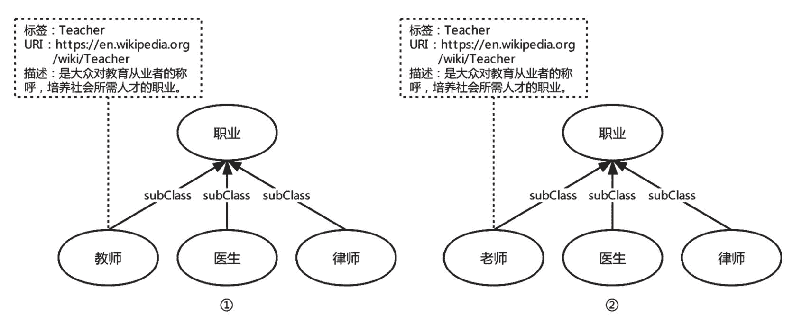
图 2-13　基于文本的本体匹配

（2）基于结构的方法
当文本信息不足时，可用结构信息补足。该方法利用概念间结构关系发现匹配，包括上下位、兄弟等邻接节点。在图 2-13 中，本体①“教师”与本体②“老师”拥有相同的父节点“职业”，相同的兄弟节点“医生”“律师”，因此匹配概率较大。

（3）基于实例的方法
实例是概念的具体表现，基于实例的方法用概念实例的共现度衡量相似，相比前两种更可靠。通过比较两本体相同实例数量计算相似度，相似度越高越匹配。如图 2-14 所示，本体①“教师”与本体②“老师”共享实例“李永乐”“张宇”，可认为二者匹配概率较大。

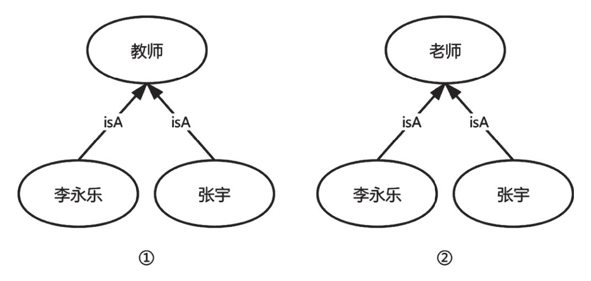
图 2-14　基于实例的本体匹配

（4）基于背景知识的方法
借助外部资源如通用词典、专业术语表、搜索引擎、维基百科等发现匹配，提高精度。可获得同级或上下层关系的描述，提升同义词和同词不同义挖掘能力，但效果依赖背景知识质量。如图 2-14 中概念“教师”“老师”在中文维基百科中检索“老师”会重定向到“教师”词条，说明二者同义。

（5）基于逻辑推理的方法

本体网蕴含大量语义信息，借助逻辑推演就能挖掘出隐式的本体关联，也能对已有初配结果做校验，排除冲突匹配，从而提升准确度。见图 2-15，仅靠实例“苹果”把本体①和本体②连了起来，但从概念看，本体①的“水果”与本体②的“公司”互不相交，所以整体上这两份本体并不匹配。

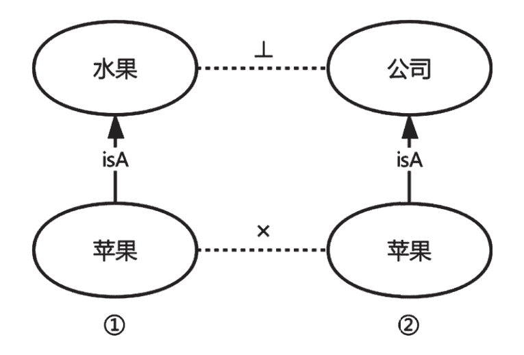

图 2-15　基于逻辑推理的本体匹配

跨语言知识融合指把多语种体系的知识汇聚进同一知识库，有助于提升跨语言数据链接的国际化水平并推动全球知识共享。建立跨语言知识图谱后，可为跨语言检索、机器翻译、跨语言问答等方向的研究提供支撑[\[5\]](#part0015.html#note_5)。

2\. 数据层知识融合

（1）实体对齐

实体对齐亦称实体匹配或实体解析，核心是判断来自不同集合的两个记录是否指向现实世界同一对象。例如百度百科的“北京小米科技有限责任公司”与中文维基的“小米集团”实为同一主体，融合时需将二者关联。

在实际应用中该方向仍面临诸多挑战，是数据层融合研究的重点。尤其在大规模场景下，计算开销、数据质量以及可获取的先验对齐样本，都要求结合具体知识库设计有效方法。总体思路可分为只关注实例自身及其属性相似度的一对一配对，以及在配对基础上兼顾实例间关联关系计算相似度的集体配对两大类。

① 成对实体对齐

依据技术路线可分为概率建模方法和机器学习方法。

概率建模不引入实体之间的关联，仅衡量属性间的相似程度。通过为不同属性赋予差异化权重，按相似度计分来判断匹配程度，把对齐问题转化为分类问题并建立概率模型。举例来说，百度百科的“北京小米科技有限公司”与中文维基的“小米集团”，“股票代码”取值一致，“创始人”均为“雷军”，而“公司类型”取值不同。鉴于“公司类型”取值范围宽泛，“股票代码”和“创始人”取值范围较窄，可对前者赋予较低权重、对后者赋予较高权重，从而得到较高的相似度与匹配概率。

机器学习方法把对齐看作二分类任务，按是否依赖标注数据再细分为有监督与无监督。有监督方法需要先人工标注部分样本，从中抽取特征训练分类器，再用模型对未标注数据进行判别。无监督方法则借助聚类把相似实体归到同一簇，再完成对齐。

② 集体实体对齐

集体对齐主要包括基于相似性传播的方法和基于概率模型的方法\[9\]。

基于相似性传播的方法先选定一对已知的匹配实体，依据传播假设与之相连且名称相近的实体也具备较高相似度，相似度会不断扩散直至收敛或达到设定阈值。如图 2-16 所示，融合过程中已知百度百科的“北京小米科技有限责任公司”与中文维基的“小米集团”同指一物，则与二者存在“供应商”关系的“欧菲光集团股份有限公司”与“欧菲光集团”会被赋予较高的相似度，该相似度进而影响其他公司的匹配，比如同样有关联的“华为技术有限公司”与“华为”，算法会迭代直至收敛或达到阈值后终止。但该方法容易出现语义漂移，使用时需加入约束条件，如限定在同一公司类别下，可降低“公司”“集团”“股份”等共有词的权重，提升区分性词汇的权重。

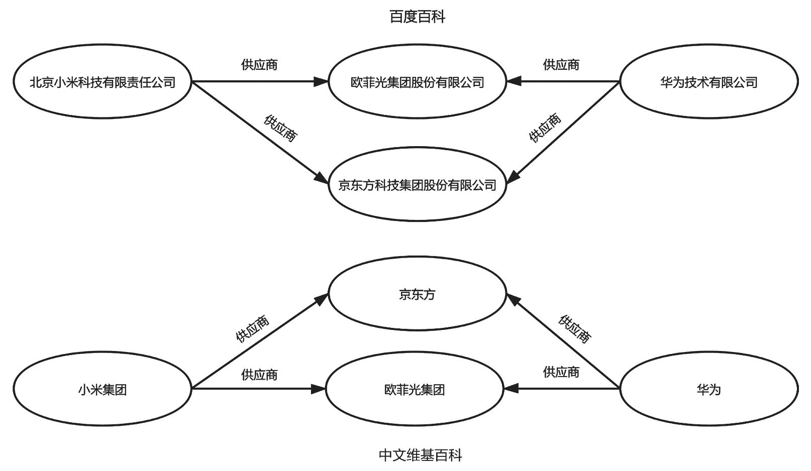

图 2-16　基于相似性传播的集体实体对齐

基于概率模型的集体对齐借助统计关系学习进行计算与推理，通过关系/逻辑表示、概率推断、不确定性处理、机器学习与数据挖掘获取关系数据的似然模型\[2\]。沿用前例，该方法无需预先知道“北京小米科技有限责任公司”与“小米集团”指向同一实体，只需抽取二者及相关的“供应商”实体，在一定条件下利用概率模型判断匹配关系。常用模型有文档主题生成模型\[10\]、`CRF`模型等。

（2）数据融合工具介绍

① `Falcon-AO`[\[6\]](#part0015.html#note_6)

`Falcon-AO`是一款用`Java`实现的自动化本体匹配工具，可对两份`Web`本体自动进行匹配并找出实体映射关系。它提供四种算法：分治式的大本体匹配算法`PBM`、基于编辑距离的字符串匹配算法`I-Sub`、基于虚拟文档的语言学匹配算法`V-Doc`、基于本体`RDF`图结构的匹配算法`GMO`。其采用相似度融合策略，先以`PBM`对知识库进行分割；再以`I-Sub`和`V-Doc`对块进行字符串及文档级匹配；随后用`GMO`对匹配块内的资源做进一步对齐；最后通过贪心算法综合`V-Doc`、`I-Sub`、`GMO`的结果得到最终输出。

② `XLORE`[\[7\]](#part0015.html#note_7)

`XLORE`融合了中英文维基百科、法语维基百科和百度百科，对百科知识进行结构化并构建跨语言链接，是中英文规模较为均衡的大型多语言知识图谱，由清华大学知识工程实验室开发。其特点有三：聚焦两大中文百科，图谱中英文均衡；语义关系更丰富，基于`isA`关系校验；提供多种查询接口，使用便捷。该系统覆盖超过 1600 万实体、240 万概念、44 万关系，支持词条检索、关键词检索、概念检索等多项功能。

③ `Dedupe`[\[8\]](#part0015.html#note_8)

`Dedupe`是面向模糊匹配、重复记录剔除和实体解析的 Python 库，基于主动学习训练 Active Learning 模型。训练过程中对难以判断的记录，模型会输出供用户人工判定。`Dedupe`通过对比不同类型数据计算相似度，采用聚类把重复数据归并，实现去重，支持多种灵活数据类型和自定义类型，灵活性较高。

* * *

[\[1\]](#part0015.html#noteBack_1) https://en.wikipedia.org/wiki/Hypergraph。

[\[2\]](#part0015.html#noteBack_2) https://neo4j.com。

[\[3\]](#part0015.html#noteBack_3) https://orientdb.com。

[\[4\]](#part0015.html#noteBack_4) http://www.hypergraphdb.org。

[\[5\]](#part0015.html#noteBack_5) http://bj.bcebos.com/cips-upload/kg/ljz.pdf。

[\[6\]](#part0015.html#noteBack_6) http://ws.nju.edu.cn/falcon-ao/。

[\[7\]](#part0015.html#noteBack_7) https://xlore.org/。

[\[8\]](#part0015.html#noteBack_8) http://www.openkg.cn/tool/dedupe。

## 2.4 知识检索与知识推理

前文已系统介绍了知识图谱从表示与建模，抽取与挖掘，到存储与融合的整套技术体系。通过掌握上述技术并加以实现，已经可以构建出一个完整的知识图谱。那么，如何对已经构建好的知识图谱加以利用呢？通过前序内容可知，人类可以根据特定的需求，对知识进行加工和利用。类似的，知识图谱也是人工智能系统完成认知任务的关键。对比人类大脑的功能，认知的关键在于对知识的利用和加工。构建好知识图谱后，即系统已经将知识进行建模，并存储成人类与机器都可以理解的形式，此时当外界信息传入时，首先需要找到与感知信息相关的知识，并对其进行加工和处理。在该过程中，主要涉及的技术为知识检索和知识推理，下面将对这两项关键技术进行介绍。

### 2.4.1 知识检索

知识检索作为知识图谱最简单的应用之一，主要目的是根据某些条件或关键词，通过对知识图谱进行查询，返回相关信息。相较于传统的查询和检索，知识检索不仅仅返回简单的数据列表，还以结构化的形式返回信息，与人类的认知过程一致。目前常用的知识检索手段主要有基于查询语言的知识检索和基于语义的知识检索即语义搜索。接下来会分别介绍这两种检索手段。

#### 1. 基于查询语言的知识检索

对于构建好的知识图谱，其数据通常存储在图数据库中。图数据库是一种使用图结构进行存储和查询的数据库，其中结点和边用于对数据进行表示和存储。在图数据库中数据项结点通过边相互集合关联，代表了结点与结点之间的关系。这些关系允许将数据库中存储的数据连接到一起。而在图数据库以及其他种类的数据库中，往往使用查询语言对数据库中的信息进行操作。查询语言通常至少包括两个子集：数据定义语言和数据操作语言。其中数据定义语言用于对数据库中的项目进行创建、修改和删除，数据操作语言用于查询和更新数据表中的数据。对每个子集的功能加以整合就得到了查询语言的整体功能。根据查询语言的功能可知，数据查询语言可以用于在存储了知识图谱的图数据库中检索需要的信息，即完成对知识的检索。目前常用的、有代表性的查询语言有`SPARQL`、`Cypher`和`Gremlin`。下面将对其分别介绍。

##### (1) SPARQL

在前序内容中提到，`RDF`是一种带标签的有向图数据格式，用于表示 Web 中的信息。`SPARQL`（`SPARQL Protocol and RDF Query Language`）则是一种用于查询`RDF`中信息的查询语言，其主要功能为访问、查询和修改由`RDF`存储的图数据，是语义网的核心技术之一。在 2008 年，`SPARQL`正式成为`W3C`官方推荐标准。根据`SPARQL`的全称可知，`SPARQL`包含协议和查询语言两个部分。其中的协议是指使用者可以通过`HTTP`在客户端和`SPARQL`端点服务器传输查询结果。在`SPARQL`查询过程中，每个查询可以被看作一个带有变量的`RDF`图，而`SPARQL`正是基于图匹配的思想，将`SPARQL`查询语句与整体图进行匹配，并返回查询结果。`SPARQL`还可用于不同数据源之间的查询，对本地存储为`RDF`的数据或使用`RDF`作为中间件的其他数据格式进行查看或编辑。除了对图数据进行查询外，`SPARQL`还可以对多个图的联合以及子图进行查询。并且它还支持聚合、子查询、否定查询、通过表达式创建值以及通过源`RDF`图约束查询等多种功能。在查询结束后，`SPARQL`返回的查询结果可以是集合或`RDF`图等多种格式。

`SPARQL`拥有多种编程语言的实现，并且允许使用者使用如`ViziQuer`等工具连接并半自动构造针对`SPARQL`端点[\[1\]](#part0016.html#note_1)的`SPARQL`查询。此外，还有一些工具可以将`SPARQL`查询转换为`SQL`和`XQuery`等其他查询语言。`SPARQL`的优势之一，在于其允许用户针对松散的键值对进行查询，并且待查询的数据库是由`RDF`构成的“主体谓语客体”三元组。从关系数据库的视角来看，`RDF`数据也可以被认为是具有三列的表，其中包括主题列、谓词列和对象列。由于`RDF`中给定对象的数据元素通常可能存储在多列甚至多个表中，`SPARQL`提供了完整的分析查询操作集，例如`JOIN`、`SORT`、`AGGREGATE`等，这些数据的模式本质上是数据的一部分，且不需要单独的模式定义。此外，`SPARQL`还为图数据提供了特定的图遍历语法。下面是`SPARQL`的一个使用示例，在`RDF`三元组构成的图中查找法人代表为“雷军”的公司名称，可以看到`SPARQL`的使用方法和标准语法。

```
1. PREFIX : <http://www.kgdemo.com#>
2. PREFIX rdf: <http://www.w3.org/1999/02/22-rdf-syntax-ns#>
3. PREFIX owl: <http://www.w3.org/2002/07/owl#>
4. PREFIX xsd: <XML Schema>
5. PREFIX vocab: <http://localhost:2020/resource/vocab/>
6. PREFIX rdfs: <http://www.w3.org/2000/01/rdf-schema#>
7. PREFIX map: <http://localhost:2020/resource/#>
8. PREFIX db: <http://localhost:2020/resource/>
 
10. SELECT ?n WHERE {
11.   ?s rdf:type :Company.
12.   ?s :represent 'Lei Jun'.
13.   ?s :name ?n
14.  }
```

可以看到，`SPARQL`的格式非常严谨并且易于理解。在例子中，第 1～8 行描述了查询语言的前缀，定义了命名空间。从第 10 行开始则描述了整体查询语句。可以看到`SPARQL`的整体语法和传统的关系数据库查询语言非常类似，但是在编写查询条件时需要确定被查询实体的实体类型或属性等信息，以及对返回内容的要求。由于需要查询的名称是实体中的属性，故在指定条件时，需要使用`?n`来指定返回类别。根据在 2.1 节中给出的例子，返回结果如下。

```
1. n
2. "Xiaomi"
```

上面的返回结果首先标明了返回类型为属性值`n`，其次在第 2 行给出了`n`的具体值为"Xiaomi"。除了基础的查询之外，还可以使用`SPARQL`中的其他关键字，比如`FILTER`或指定更详细的返回类型，进行更复杂的知识检索。

##### (2) Cypher

`Cypher`是由`Neo4j`在 2011 年开发的一种声明式数据库查询语言，其允许对关系数据库进行表示、查询和更新。`Cypher`在创建之初旨在与图形数据库`Neo4j`结合使用，但在 2015 年 10 月通过`openCypher`项目开放。目前`Cypher`的开发者们正在努力将`Cypher`作为标准化的图数据库查询语言。同时，在`openCypher`项目中使用者可以将`Cypher`用作任何产品或应用程序中图数据库的查询语言，例如`SAP HANA Graph`、`Redis`、`AgensGraph`和`Neo4j`等数据库都可以使用`Cypher`查询语言。`Cypher`以表达查询的目标为开发基础，受到许多不同方法的启发。其中许多关键字例如`WHERE`和`ORDER BY`都受到`SQL`的启发，模式匹配借鉴了`SPARQL`的表达方法，而某些列表语义则是从`Haskell`和`Python`等语言中借鉴而来。`Cypher`以英语自然语言为基础，可以在拥有较强表达能力的同时保持相对紧凑，易于开发人员、数据库专业人员和业务利益相关者阅读和理解。同时，`Cypher`的语法结构使得使用者可以查找与特定模式匹配的数据。在`Cypher`中，最常见的子句为`MATCH`和`WHERE`，其功能与`SQL`中的函数略有不同。以下面的代码为例，在第 1～2 行中查询了关系数据库中名字为“Xiaomi”的公司结点，而第 4 行使用了`Cypher`的另一种格式，查询了小米公司的母公司–子公司关系。

```
1. MATCH (p:Company { name:"Xiaomi " })
2. RETURN p
3. MATCH p=(n:Company)-[t:has]->(m:SubCompany) WHERE (n.name:"Xiaomi")
4. RETURN p
```

可以看到，`MATCH`子句是大多数`Cypher`查询的核心，用于描述搜索的模式的结构，其主要基于关系来构建。在使用`MATCH`子句构建查询语句时，需要使用`ASCII`字符表示结点和关系。`Cypher`的语法规定需要使用括号绘制结点，并使用带有大于或小于号的破折号对绘制关系，“<”和“>”符号指示关系方向。在短线之间需要用方括号括起来，并用冒号作为前缀，然后标识需要查询的关系名称。结点标签与此类似，同样以冒号作为前缀，然后在花括号中指定结点和关系属性键值对。`WHERE`用于向模式添加其他约束。在完成对模式的描述后，还需要对返回值进行约束，这时通常使用`RETURN`子句。该子句指定应匹配数据中的哪些结点、关系和属性返回给使用者。相比其他查询语言，`Cypher`的语法和格式要简洁得多。除省去了复杂的头文件和命名空间声明外，其整体语法更接近自然语言，检索中限制的模式和返回值标识更清晰，使得`Cypher`的编写效率得到提升，学习曲线也相对更加平滑。尽管`Cypher`目前主要用于`Neo4j`中，但对于使用者来说，它是最容易学习的图数据库查询语言，通过它，使用者可以快速对图数据库有更深刻的理解，也可以快速迁移到其他查询语言。

##### (3) Gremlin

图遍历的瑞士军刀：Gremlin 是怎么把图查询变编程的

`Gremlin` 诞生于 2009 年，由 `Apache TinkerPop`\[2\] 推出，它是一款面向图的跨平台查询语言，内核是函数式的数据流思路。借助这套语言，用户能在图数据上用非常紧凑的写法表达复杂的遍历需求。一次遍历其实是一串可嵌套的操作链，每一步都在图库里做一次原子动作。原子动作大致分三类：把数据映射成新形态的转换、把不合适对象剔除的过滤、以及算聚合信息的统计。`Gremlin` 的全部能力都是在这种三类基础操作上不断延伸组合出来的，于是就有了丰富的查询手段。

设计上抱歉，刚才输出被截断了。这是完整的改写文案，请查收：

[content]
图遍历的瑞士军刀：Gremlin 是怎么把图查询变编程的

`Gremlin` 由 `Apache TinkerPop`\[2\] 在 2009 年推出，是一门跨平台的图数据库查询语言，底层采用函数式数据流范式。借助它，开发者可以用很简洁的表达在图上完成复杂的遍历。一次遍历本质上是一条可嵌套的操作链，每一步都在图库里执行一次原子化动作。原子动作大致分成三类：把图数据转成别的形态的映射、把不符合条件对象剔掉的过滤、以及计算聚合信息的统计。全部的能力都是在三类基础动作上扩展而来，组合起来就能形成丰富的查询能力。

设计遵循“一次编写，到处运行”。图检索既能在 `TinkerPop` 自带的图系统里跑，也能当成实时查询请求投递到不同数据库。实际使用时通常会先起一个虚拟机来承载运行。当前的主流实现覆盖 `Groovy` 与 `Java`。写好的语句会被编译成脚本对象，再由对应的脚本引擎执行。对比传统编程语言，`Gremlin` 在表达查询时更凝练易懂；对比关系型数据库的查询语言，它对图上操作的掌控力更强，使用者可以自由设计遍历路径。扩展也很友好，能在 `Gremlin` 或 `Java` 里原生定义新方法与操作。下面以查公司名是“Xiaomi”的法人代表为例。

```
1. g.V().has("name","Xiaomi").values("represent")
```

从片段能看出，`Gremlin` 的写法更接近编程语言里的函数调用。`g` 代表由边和点构成的整体图，`V()` 则取图中全部顶点，后面常接筛选条件。像 `SQL` 这类经典查询语言被认为和生产环境使用的编程语言难以融合。传统数据库因此要求开发者同时精通查询语言和系统编程语言，查询与编程之间的鸿沟长期存在。`Gremlin` 跨过了这道鸿沟，图遍历可以用任何支持函数组合和嵌套的语言来写。这样写的 `Gremlin` 程序就能和业务代码放一起，享受宿主语言带来的类型检查、语法高亮等工具红利。常见的变体有 `Gremlin-Java`、`Gremlin-Groovy`、`Gremlin-Python`、`Gremlin-Scala` 等。

#### 2. 从结构化脚本到语义式搜索

前面讲的是基于查询语言的知识检索。图数据库的查询语言再怎么贴近自然语言，本质仍是让用户写结构化脚本。传统检索手段的语法组合能力也很有限。随着 `Linked Open Data` 等结构化数据平台逐步开放，可用于构建知识图谱的数据源持续增加，`RDF`、`OWL` 等表示体系下的知识图谱也在快速积累。于是以 `Google` 为代表的公司开始用知识图谱提升搜索质量，实现语义层面的知识检索。语义搜索是在查询语言检索之上的一次跃迁，核心是用数学手段摆脱传统检索的近似与模糊，为词义及其与输入的关联给出清晰理解。简单说，就是让用户输入越像日常语言越好，同时返回越精确的答案。它依托知识图谱的表达力挖掘用户需求与数据的内在联系，对复杂查询的理解和回应能力也更强。

语义搜索大致可分两类：轻量级的语义信息检索和更复杂的语义搜索。轻量级系统没有知识图谱那样的复杂表示，通常只用词典或分类器等简单模型把语义数据和检索目标关联起来。复杂系统则需要知识图谱或本体进行显式建模，在模型基础上检索关键词时可借助推理或联想返回更相关的结果。理想状态下，若用户能用结构化查询语言精确描述需求，系统便可给出精确结果。现实中用户往往做不到，也难以掌握知识表示方法，这时语义搜索的重要性就凸显出来。

常用做法包括关键词检索和自然语言检索。关键词检索最基础，流程是先按索引在知识图谱里找到与关键词定义相符的子图，大幅缩小搜索空间，再在小范围内检索。以查询小米公司法定代表人为例，系统先输入“小米公司”与“法定代表人”两个关键词，用“小米公司”筛出子图，再在其中找法定代表人。流程如图 2-17 所示。

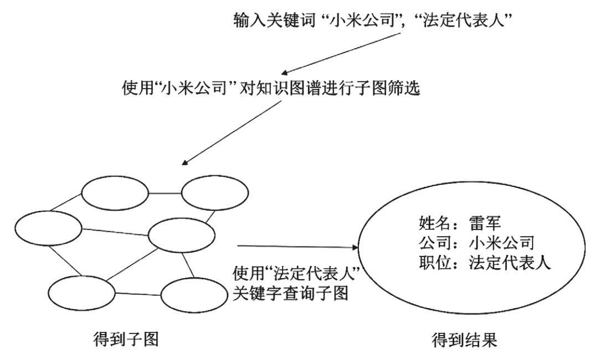

图 2-17　关键词查询

自然语言检索复杂度更高。用户输入句子后，系统要先剔除无意义成分、做消歧，再做句法词法分析并向量化。把输入向量与知识图谱信息的向量表示比较后得到精确结果。例如输入“小米公司的法定代表人是谁？”，系统会做语义语法分析、必要时向量化后在知识图谱中查询。具体实现将在第 7 章展开。在自然语言驱动的语义搜索里，输入往往隐含推理与联想，所需答案未必显式出现，这就要求检索系统像人一样推理，即后面要介绍的知识推理。

### 2.4.2 知识推理

## 知识推理概述
当一个完整的知识图谱建成后，机器拥有学识的程度又向前迈了一步。但仅有构建与查询还不足以实现认知。人类演化中，运用知识进行推理是认知的关键。概念上，推理就是从已有知识推导出尚不拥有的新知识。`Kompridis`\[11\] 把推理定义为理解事物、建立验证事实、运用逻辑、基于新旧知识修正体系等能力的集合。推理涉及两类知识：已有的和尚未获得的。演绎推理中最简单的三段论由大前提、小前提和结论构成，前两者是已有知识，结论是新知识。

在知识图谱里，核心单元是主-谓-宾三项式 <主体，谓词，客体>，由已知三项式推断未知三项式的过程即为知识推理。如已知 <小米公司，经营范围，手机> 且手机属于电子产品，则可推出 <小米公司，经营范围，电子产品>。主要应用有知识补全、知识对齐与知识图谱去噪。在此概述通用概念后，本节先介绍传统推理，再介绍近年流行的表示学习方法。

### 传统知识推理方法
传统方法主要依赖规则。基于规则的推理借用逻辑推理思想，把简单规则、约束或统计方法施加到知识图谱表示的数据上进行判断。完全规则驱动的常见类型是类别推理与属性推理。

类别推理针对实体所属类别，常用于图逻辑结构中层次较低实体的分类。例如图谱里私营有限责任公司是有限责任公司的子类，有限责任公司是公司类的子类，那么实例小米科技有限公司应属于公司类。图 2-18 中实线为已知知识，虚线为推理得到的新知识。

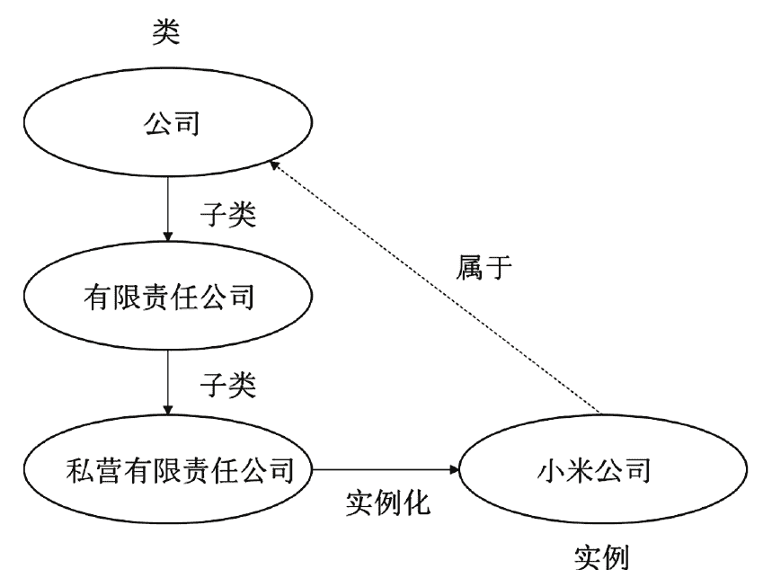

图 2-18　类别推理举例

属性推理则依据关系的域与范围进行判断。例如公司地址关系的作用域是公司类，值域是地点类。已知小米公司的公司地址是北京，可推得小米公司属于公司类，北京属于地点类。图 2-19 中实线代表已知知识，虚线代表推理结果。

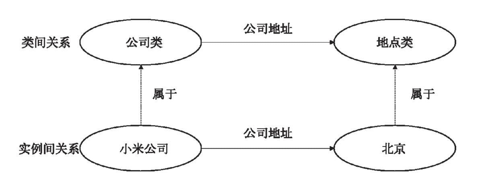

图 2-19　属性推理举例

把这类确定类与属性的规则统计并复杂化，就能形成对知识图谱正确性的校验手段，用规则进行纠错与补全。

除了静态规则，还能用图谱训练规则再推理。如 `NELL`\[12\] 结合一阶逻辑与概率学习，人工筛选学习到的规则后用图谱实体实例化，再学习新的推理规则。规则还能用于多步推理，多步比单步更复杂，例如 A 与 B 有关系 R，B 与 C 有关系 R'，则 A 与 C 有关系 R"。人工或统计难以覆盖这类模式，可通过挖掘实体间路径近似实现。针对多步任务，一种方案是基于图谱全局规则与结构进行路径挖掘，筛选后把部分路径视作规则，通常采用随机游走发现路径。`Lao`\[13\] 等人提出的 `PRA`（`Path Ranking Algorithm`，路径排序算法）旨在预测实体间是否存在关系，输入为实体间的路径。`PRA` 在构造数据时使用随机游走思想，收集足够正例后训练逻辑回归分类器进行多步关系推理。

总体看，规则推理可通过统计、人工筛选或机器学习构建有效规则，准确性较高、计算量小、速度快。但图谱规模动辄百万以上，验证规则需要大量实体；规模上升时抽象全局与多步规则非常困难。过度依赖统计特征易过拟合，对噪声抵抗差。随着深度学习发展，表示学习与深度学习驱动的推理更具优势。

### 基于表示学习的知识推理
在规则方法里，规则无论人工定义还是模型学习都显式给定特征。表示学习则把图谱中的节点和关系映射到同一连续向量空间，学习每个元素的向量表示。表示可以是向量或矩阵，学习过程中会自动获得下游任务所需特征，把离散实体与关系嵌入空间。该思路源自自然语言处理中的词表示学习，得到的向量同样具有空间平移特性。

最经典的算法是 `TransE`\[14\]。它期望学习实体与关系的低维向量，使三元组 (h, r, t) 满足 t ≈ h + r，即尾实体近似于头实体加上关系。举例 <小米公司，法定代表人，雷军>，若头实体小米公司向量为 [1,0]，关系法定代表人向量为 [0,1]，则 `TransE` 期望雷军向量为 [1,1]，此时 h + r = t，三元组成立。形式化表示见图 2-20。

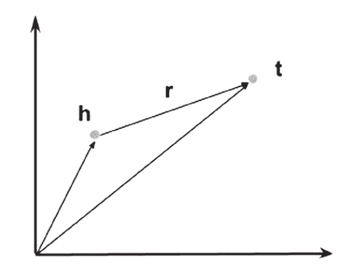

图 2-20　`TransE`的形式化表示

据此得到得分函数为向量距离 `||r+h-t||_{L1/L2}`，训练时替换 h 或 t 构造负例，让负例得分更低、正例得分更高。`TransE` 虽经典但存在不足：它要求 t 与 h + r 严格接近，虽能严格约束元素，却在尾实体多值时导致多个实体竞争同一空间点，语义差距大的实体挤占同一区域会产生误差；它未考虑层级关系，而层级对推理至关重要。

在此基础上，`Wang` 等人提出 `TransH`\[15\]。`TransH` 为每个关系额外学习一个映射向量，把实体映射到关系指定的超平面，使同一实体在不同关系下有不同表示，缓解多值问题。`Lin` 等人提出 `TransR`\[16\]，在独立的实体空间和关系空间中分别表示，每个关系对应一个空间，头实体经关系映射到关系空间中的尾实体，更好弥补 `TransE` 的缺陷。获得实体与关系表示后，既可通过向量运算做简单推理，也能结合机器学习模型完成复杂场景推理。目前该方向常结合强化学习、时序预测模型与图神经网络等方法。

* * *

\[1\] `SPARQL` 端点是 `SPARQL` 协议的一部分，用于处理客户端请求，可类比 Web 服务器为用户提供网页浏览服务，通过端点使用者可将数据发布到网上供查询。

\[2\] `Apache TinkerPop` 是 Apache 基金会开发的开源图计算框架，致力于为图数据库行业标准作出贡献。

## 参考文献

\[1\] Cercone N , Mccalla G . What Is Knowledge Representation\[C\]. The Knowledge Frontier: Essays in the Representation of Knowledge. 1987.

\[2\] Baader F, Laux A. Terminological Logics with Modal Operators\[J\]. 1994.

\[3\] Fernandezlpez M, Gomezperez A, Juristo N. Methontology: from Ontological Art towards Ontological Engineering\[C\]. Proceedings of the AAAI97. 1997.

\[4\] Jones D, Benchcapon T, Visser P. Methodologies for Ontology Development\[J\]. Capon, 1998:62-75.

\[5\] Lample G, Ballesteros M, Subramanian S, et al. Neural Architectures for Named Entity Recognition\[C\]. Proceedings of NAACL-HLT 2016, pages 260-270.

\[6\] 高强，游宏梁．事件抽取技术研究综述\[J\]. 情报理论与实践，2013, 36(4): 114-117.

\[7\] Shen W, Wang J Y, Han J W. Entity Linking with a Knowledge Base: Issues, Techniques, and Solutions\[C\]. IEEE Transactions on Knowledge and Data Engineering, 2015, 27 (2): 443-460.

\[8\] 马良荔，孙煜飞，柳青．语义 Web 中的本体匹配研究\[J\]. 计算机应用研究，2017,34(5):1287-1292,1332.

\[9\] 庄严，李国良，冯建华．知识库实体对齐技术综述\[J\]. 计算机研究与发展，2016, 01: 165-192.

\[10\] Bhattacharya I, Getoor L. A latent Dirichlet allocation model for unsupervised entity resolution\[C\]. Proc of the 6th SIAM Int Conf on Data Mining. Philadelphia, PA SIAM, 2006: 47-58.

\[11\] Kompridis N. So We Need Something Else for Reason to Mean\[C\]. Int’l Journal of Philosophical Studies, 2000,8(3):271-295.

\[12\] Carlson A, Betteridge J, Kisiel B, Settles B, Hruschka Jr E R, Mitchell T M. Toward an Architecture for Never-Ending Language Learning\[C\]. In: Proc. of the 24th AAAI Conf. on Artificial Intelligence. Menlo Park: AAAI, 2010. 1306-1313.

\[13\] Lao N, Cohen W W. Relational Retrieval Using a Combination of Path-Constrained Random Walks\[J\]. Machine Learning, 2010,81(1): 53-67.

\[14\] Bordes A, Usunier N, Garcia-Duran A, Weston J, Yakhnenko O. Translating Embeddings for Modeling Multi-Relational Data\[C\]. In: Proc. of the Advances in Neural Information Processing Systems. Red Hook: Curran Associates Inc., 2013. 2787-2795.

\[15\] Wang Z, Zhang J, Feng J, Chen Z. Knowledge Graph Embedding by Translating on Hyperplanes\[C\]. Proc. of the 28th AAAI Conf. on Artificial Intelligence. Menlo Park: AAAI, 2014. 1112-1119.

\[16\] Lin Y, Liu Z, Sun M, Liu Y, Zhu X. Learning Entity and Relation Embeddings for Knowledge Graph Completion\[C\]. Proc. of the 29th AAAI Conf. on Artificial Intelligence. Menlo Park: AAAI, 2015. 2181-2187.

\[17\] Noy N F, Mcguiness D L. A Guide to Creating Your First Ontology\[J\]. Stanford University, 2001(2):14.

# 第3章 知识图谱工具全景

第2章已经把知识图谱的技术框架梳理清楚了。落到落地层面，知识建模、知识抽取、知识存储这三环是成图的关键。从实践看，每一环都有对应的工具可以调用。本章聚焦这三类环节的工具选型，并以真实建图场景做演示。

## 3.1 知识建模工具盘点

一个真实的知识库里实体和关系动辄上亿，结构极其庞杂。缺少梳理和抽象的手段，开发人员很难理解和维护。建模就是把这份复杂性提炼成可读的骨架。粗略说，知识获取阶段拿到的是海量的非结构化信息，经过建模才能转成结构化表达，便于机器解析、入库和交换。建模的价值在于让人看懂系统如何运转——实体怎么关联、知识沿着什么模式表达、存储形态是什么——并让系统协同工作。选对建模工具，决定了后续效率。

当前主流的建模工具有两类：纯手工建模工具和半自动建模工具。手工类提供图形化界面，拖拽即可完成建模；半自动类依赖程序脚本，可批量处理源数据。目前业界还没有真正意义上全自动的知识建模方案。

3.1.1 节以 `Protégé` 为例，演示如何面向金融领域构建本体。3.1.2 节简要盘点其它常用本体编辑器，诸如 Apollo、OntoStudio、TopBraid Composer、Semantic Turkey、Knoodl、Chimaera、OliEd、WebODE、Kmgen 与 DOME。3.1.3 节给出工具选择的思考点并做对比。本节的金融本体需求是用来解释企业间多种因素决定的竞争关系，建模时把影响因素作为属性或关系纳入本体，建立完成后即可在此基础上做竞争分析和挖掘。

### 3.1.1 Protégé

`Protégé`\[1\]是由斯坦福大学维护的开源本体编辑器，兼顾网页版和桌面版，知识表示使用 `OWL` 语言，具体细节可参考前文 2.1 节。`Protégé` 的官网可在线使用或下载安装。项目始于 1987 年，最初想用以减少知识工程师的手工负担，后经多次迭代演化为现在框架式的本体开发平台。主要能力覆盖类构建、个体编辑、模型处理与模型交换。底层用 `Java` 开发，可扩展性强，即插即用的插件机制让原型快速迭代，且是少数对中文支持友好的建模工具之一。建模方式主要有两种：`Protégé-Frames` 通过图形界面按框架搭建本体，`Protégé-OWL` 则直接用 `OWL` 语言构建。建模完成后可导出为 `RDF`、`OWL` 等格式。凭借简洁界面、完善的 W3C 支持和活跃的社区，`Protégé` 成为最受欢迎的本体工具之一。

工程实践中不存在放之四海皆准的本体建法，只有最适合具体任务的策略。下面给出一个基于 `Protégé` 的构建思路，并以最新版 5.5.0 为例演示金融本体实战。`Protégé` 的工作方式是迭代的：先搭一个简陋的概念框架，再不断扩充细节、修复不合理之处。围绕这个过程，有几条反复出现的原则，可帮助决策。

1）没有普适正确的领域本体做法。应用场景是决定方法和取舍的核心，很多选择都得依场景而定。

2）使用 Protégé构建本体必然是迭代的

即便是领域专家也很难一次成稿，细节通常在多次迭代中补充完善。

3）Protégé中的本体概念最好和领域真实对象一一对应

这些对象往往是领域文本里的名词或动词，比如“小米科技有限责任公司的所属地区是北京市”。其中“小米科技有限责任公司”“北京市”是领域对象，“所属地区”是领域关系。

总体来看，用 Protégé建模要抓住两点：

* 明确本体的用途，这决定了从哪些源抽取、重点构建哪里；
* 把握本体的粒度，这决定了迭代轮次和细节精度。

这两点决定了工作周期。接下来按 Protégé 的七步流程展开介绍，常被称作“七步法”\[1\]。

### 1. 界定本体范围与目标

第一步是划定本体覆盖的边界，需要自问四个问题。

1）要覆盖的领域是什么？
2）本体的使用目的为何？
3）数据会在哪些场景下应用？
4）后续如何维护？

本节的金融本体目标是揭示两家企业的竞争关系。为此需要把企业的关键信息，例如所属地区、所属行业、注册资本等，以类或属性的形式纳入本体，具体落点后续再定。基于已知信息，可对四问作答：

1）领域覆盖金融与企业两个范围。
2）用途是分析企业间的竞争关系。
3）数据用于企业关系发掘与分析。
4）维护方式主要是对类、属性和实例的更新，若描述语言与使用者不一致，还需做语言映射。

在 Protégé 中新建本体后会自动出现空项目，初始界面如图 3-1 所示。


图 3-1　Protégé初始界面

初始界面有四个标签：活跃本体 `Active Ontology`、实体信息 `Entity`、对象信息 `Individual by Class`、DL 查询 `DL Query`。活跃本体里可查看文件路径与统计信息；实体信息里可浏览类结构并定义关系；对象信息里可创建实例并赋属性；DL 查询里可用 `OWL` 语法检索本体，细节参考官方文档\[2\]。新本体默认展示活跃本体信息，包括用 `IRI` 标识的本体头部、类对象关系数量等统计、导入信息等。如需再建，点击上方 `File → New` 即可。

### 2. 评估复用现有本体

工程上应优先复用成熟方案，这条原则同样适用于本体构建。当新系统要对接已有成熟本体时，复用价值更大。很多现成本体可以作为起点，Protégé 支持多种格式的导入导出，便于在既有环境上快速搭建。

工业界和学界可复用的本体资源不少，如 `Ontolingua`\[3\] 本体库、`UNSPSC`\[4\]、`RosettaNet`\[5\] 等。以本节为例，若想了解企业竞争关系，可先复用已有的企业本体，再针对性扩充修复，效率更高。

在 Protégé 中，可通过顶部菜单 `File → Open` 打开本地文件，也可在本体界面下方点击 `Import ontologies` 导入，如图 3-2 所示。

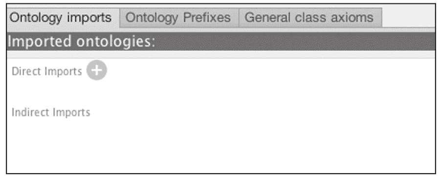

图 3-2　向 Protégé中导入本体

点击 `Direct Imports` 旁的“+”，会出现如图 3-3 的选择界面。


图 3-3　选择本体导入的途径

导入源可从本地文件、网络源或已加载文件三选一。这里以多伦多大学开放的 `Biblio`\[6\] 本体为例，选择本地文件。

填入路径后点 `Continue`，再点 `Finish` 即可完成导入，结果如图 3-4。

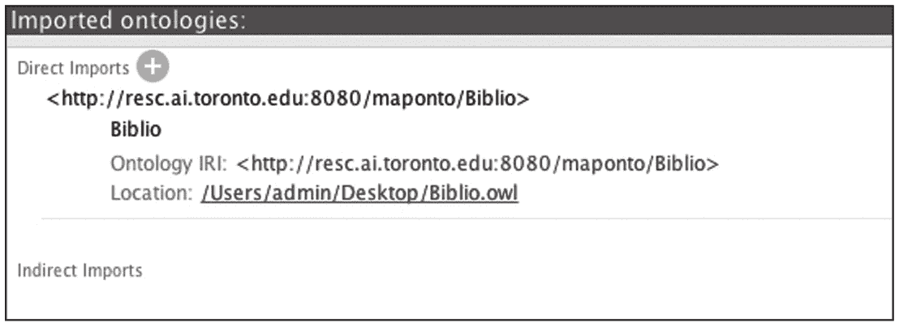

图 3-4　本体导入结果

导入成功后切到活跃本体的 `OntoGraf` 标签，就能看到实体与实例已加载，并在实体和实例界面找到对应数据，同时可预览结构图。图 3-5 就是导入 `Biblio` 后的 `OntoGraf` 预览。后续从零构建金融本体时也会得到类似视图。基于金融场景，可复用企业及相关实体关系定义，再做迭代开发，降低启动成本。

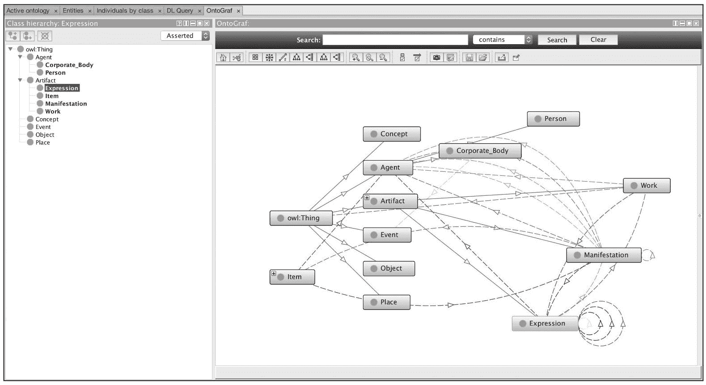

图 3-5　Biblio 本体

### 3. 罗列核心概念

为了让构建者和使用者都对边界有清晰认识，先把本体中的关键项列出来。关键项即领域中的重要概念，列举时一并记录其属性与描述。复杂本体在初步列举阶段不必纠结属性细节或重叠问题。

以分析企业竞争关系为例，企业本身是核心概念，同时人物与地点也会显著影响企业发展与竞争力，因此人物和地点也纳入关键元素。综合来看，本体需包含企业、人物、地点三大核心。若要进一步分析企业间竞争，还需把所属行业、注册资金、成立时间等作为企业属性纳入。

### 4. 设计类层次结构

目前常用的类定义策略有自顶向下、自底向上与混合两种。自顶向下从最抽象概念出发逐步细化，例如先定义企业类，再细分为私营企业、有限责任公司、股份有限公司等，继续细分为国有独资公司、其他有限责任公司等。示例如图 3-6。

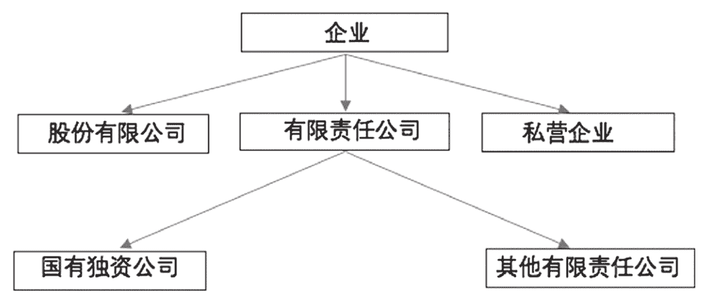

图 3-6　自顶向下定义类结构

自底向上则从最具体的叶节点开始归类抽象，例如先确定国有独资公司，再补充其兄弟概念与上层概念，最终向上推导出企业类。示例如图 3-7。

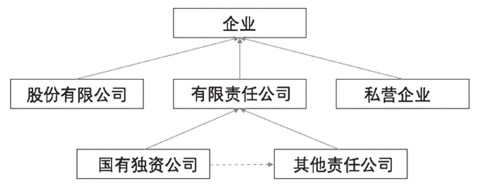

图 3-7　自底向上定义类结构

混合方式先找到明显概念，再同时做泛化与细化。三者没有绝对优劣，选择取决于对领域的理解。

不论哪种方式，都始于类定义。从列举的关键项中挑出可独立存在的对象作为类，而不是仅描述对象的属性。例如“有限责任公司”可作为类，“所属行业”只能作为属性。类是本体结构的出发点，按层级组织，并明确子类关系与实例归属。若类 A 是类 B 的父类，则 B 的实体也属于 A，B 继承 A 的全部属性。例如国有独资公司是有限责任公司的子类，有限责任公司是企业的子类，那么国有独资公司的实体也是企业实体，并继承企业属性。

按第3步列出的关键项，采用自顶向下方式构建。最上层分为企业、人物、地点三类。在 Protégé 中打开 `Entity` 标签，可看到左侧的类层级，如图 3-8。

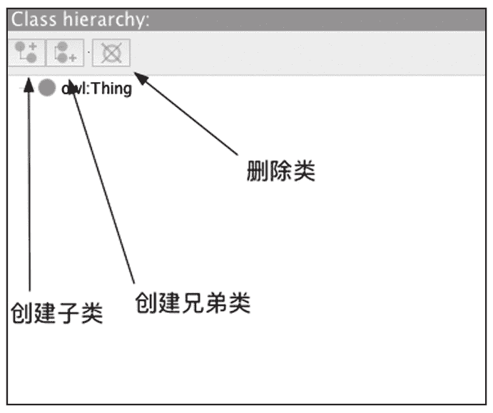

图 3-8　Protégé的类结构图

根节点 `Thing` 代表万物，通常作为起点。选中 `Thing`，点击创建子类，输入“企业”即可，如图 3-9。

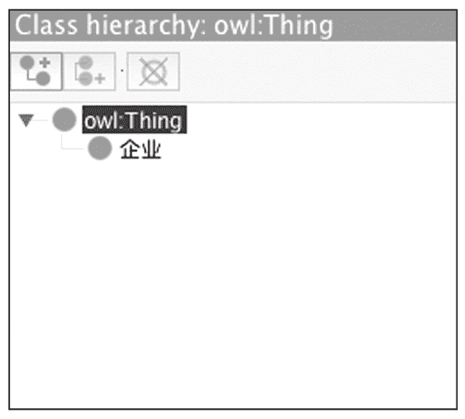

图 3-9　创建新类

随后点击创建兄弟类，新增“地点”“人物”。删除类可用右侧按钮。随需求演进，需对各大类做细分，例如把有限责任公司拆为国有独资公司和其他有限责任公司，股份有限公司和私营公司也做对应划分。同层级的类应互斥，即实体只能属于其中一类。为此选中企业类，在右下方的 `Disjoint with` 中添加互斥类地点，如图 3-10。

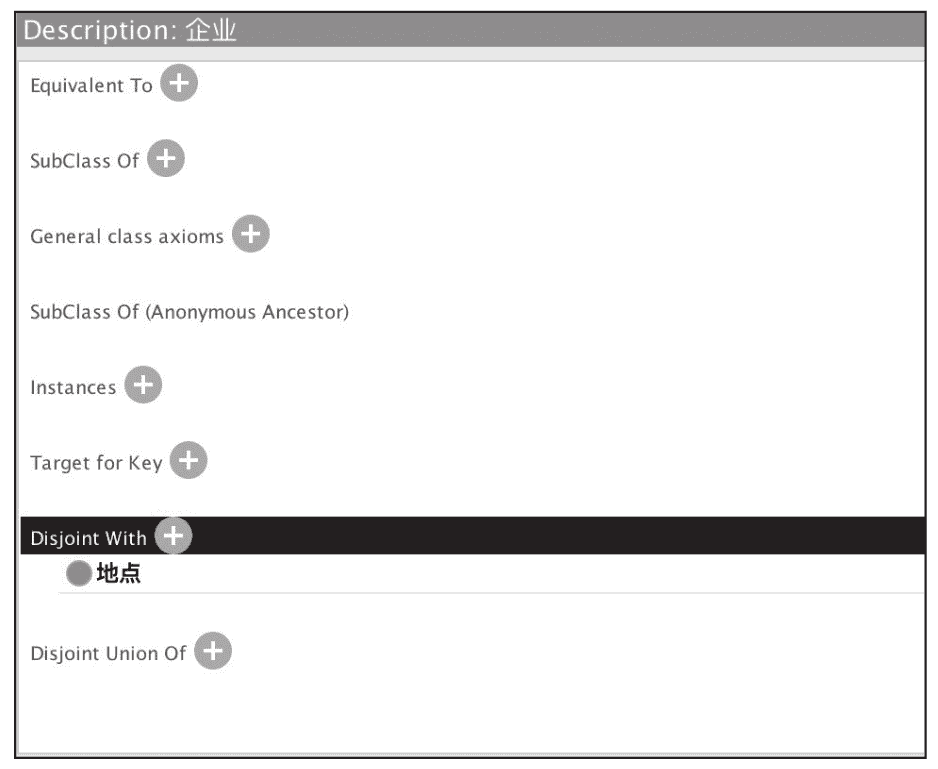

图 3-10　添加互斥约束

`OWL` 中类间约束还有子类、等价类、原子类等，Protégé 已提供图形化支持，细节可查 `OWL` 官方文档\[7\]，这些约束对上层推理至关重要。

重复上述操作，最终得到的类层级如图 3-11。

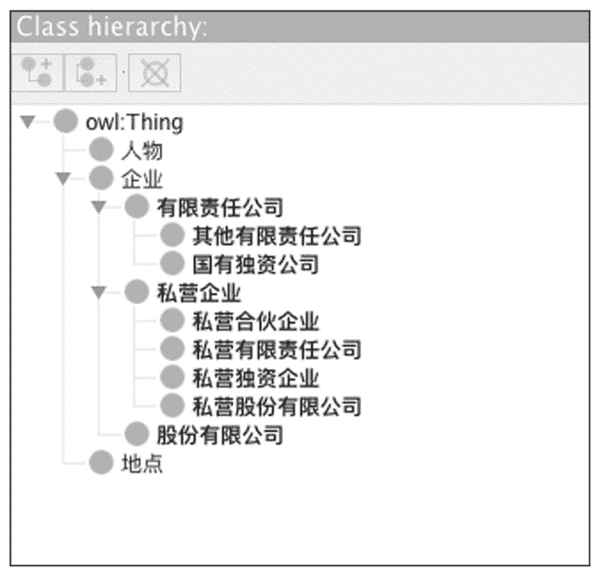

图 3-11　完整的金融本体类结构图

### 5. 确定类的属性

到目前为止搭建的框架里只有类这个抽象层级，离第一步提出的根本问题还有距离——本体要管哪个范畴、用来解决什么问题、数据具体怎么用、以后怎么维护。类名确定之后，就要进入类的内部结构设计，这一步直接决定类的独特性。类名只是一个标识符，真正塑造类的是它所拥有的属性。回看第三步整理出的关键要素，类搭完后剩下的要素大多可以转化为属性。以金融本体为例，企业类就可以带上所属行业、注册资本、成立时间等信息。给类挂属性时，先要判断属性的归属，在 Protégé 里通常按下面四类来区分。

1）类内在属性：比如注册资本、成立时间，属于先天属性，和实体一起产生，一般不可更改。
2）类外在属性：比如员工人数，属于后天属性，数值会随时间变化。
3）类部分属性：结构化实体可以拆成物理或逻辑的部件，例如计算机类可包含 CPU、硬盘、内存，这些部件在物理上共同构成一台计算机。
4）与他者的关联：如第四步所说，子类会继承父类的全部属性，所以共性的属性应尽量上移到抽象层，让子类直接继承下来。

类已经在 Protégé 中定义完，下一步就是补全每个类的属性以及类与类之间的关联。首先要建立类和类之间的联系，这就是对象属性。对象属性和后面要说的数据属性不同，对象属性的值必须是另一个类，用来表达类之间的关系；数据属性的值是数据类型，只属于类本身。在 Protégé 主界面的 `Entities` 标签下打开 `Object properties`，界面如图所示。

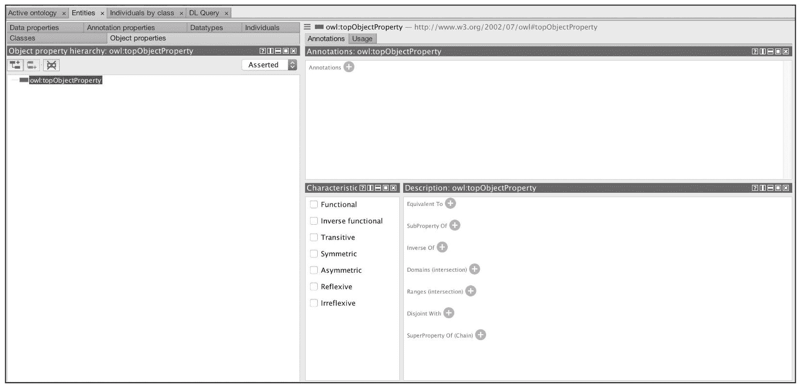
图 3-12　对象属性界面

保持基对象属性被选中，点击“创建子属性”就能新增一个对象属性。举例来说，公司必然有一个法人，在当前金融本体里有企业类和人物类，两者之间至少要有“法人”这一关系，方向是从人物指向企业。点左上角的 `Add sub property`，在弹出的窗口里输入属性名并确认。

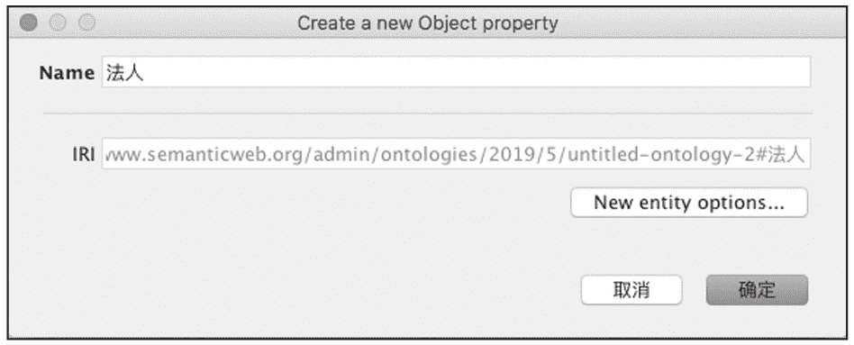
图 3-13　创建对象属性

属性新建后，范围和作用域还是空的。左侧层级里点开刚建的法人属性，右下角会出现范围 `Domains` 和作用域 `Ranges`。范围指属性的出发点，作用域指属性指向的目标，设定约束后关系会更唯一。先点 `Domains` 旁的加号选人物类确定范围，再在 `Ranges` 里选企业类确定作用域。完成后效果如下。

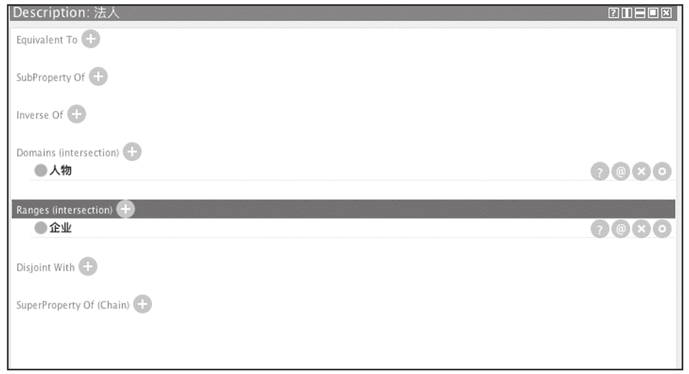
图 3-14　为对象属性添加作用域和范围

如果想让该属性与其他属性互斥，可以点 `Disjoint with` 来指定。注意范围和作用域对当前类的所有子类同样生效。在复杂本体中，若两个属性语义相反且范围作用域也相反，就可以用 `Inverse of` 约束，例如“法人”与“拥有法人”构成逆向关系。

对象属性之外，还需要数据属性。进入 `Data properties` 子标签，选中 `topDataProperty`，点左上角“添加子属性”，输入名称“所属行业”，数据属性就创建成功了，如图所示。

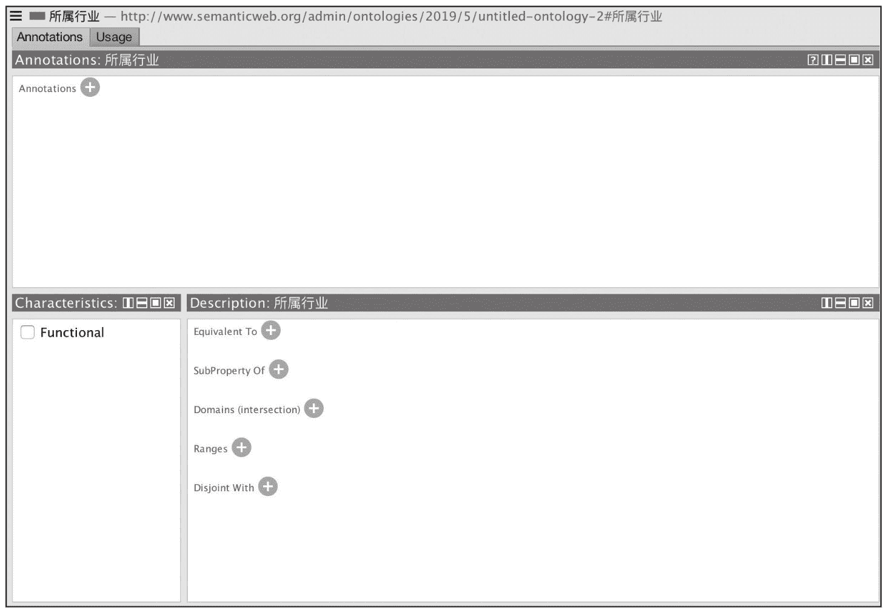
图 3-15　创建类的数据属性

数据属性的值是数据类型，所以只需确定作用的类。点 `Domains` 右侧加号为该属性选择对应类。到这里，类的对象属性和数据属性就都有了。

### 6. 确定属性的特点
不同属性的描述方式不一样，有的可以多值，有的只能是字符串。以企业的所属行业为例，必须是字符串类型。值数量的限制引入了基数的概念，系统可以规定最大基数和最小基数，值数量必须介于两者之间。基数也可以设为 0，表示该属性可为空。

在 Protégé 里也要为数据属性定型。第五步刚给数据属性设了作用域，现在要加数据类型。在 `Domains` 下找到 `Ranges`，点右侧加号选择 `Build in datatypes`，就能为数据属性指定类型。


图 3-16　选择数据属性的数据类型

例如把所属行业设为 `string` 类型，在列表里选中后即完成设定，如图所示。思考一下，数据属性创建后如何做约束？比如企业成立日期是否需要统一日期格式，留作思考。


图 3-17　为数据属性添加作用域

### 7. 创建实例（实体）
把第 4 到第 6 步重复操作，类的结构和属性就完善了。接下来是构造本体的最后一步——创建实例。定义一个个体需要三件事：

1）选定所属类；
2）新建该类的实例；
3）填充属性值。

例如在金融本体里创建“小米公司”，它属于“其他有限责任公司”类，父类是有限责任公司，祖先类是企业。用企业名称做唯一标识，再补全属性。进入 `Entity` 标签下的 `Individuals` 子标签。假设已创建法人和总经理两个对象属性，范围都是人物，作用域都是企业。企业类包含所属行业、注册资本、成立时间三个数据属性，类型都是 `string`。先点左上角 `Add individual`，输入“雷军”创建人物实例，如图所示。


图 3-18　创建实体界面

实例创建后，先确定类型，点左下方的 `Types`，在类层级里选择人物类。人物类只涉及对象属性，需要为其添加对象属性。再按同样方式创建“小米科技有限责任公司”实例，回到“雷军”实体，点右下方的 `Object property assertions`，填入属性名和指向的另一实体，如图所示。


图 3-19　为实体添加对象属性

对象属性完成后，为“小米科技有限责任公司”添加数据属性。选中该实体，点 `Data property assertions`，左侧选属性，右侧输入值，下方选值的类型。注意输入的类型要与建属性时定义的类型一致，如图所示。


图 3-20　为实体添加数据属性

按此循环为实体填属性。掌握这些步骤后，就能持续扩充和修正本体。完成构建后可通过顶部菜单 `File → Save` 保存，也可以用 `Windows→Tab→OntoGraf` 打开 Protégé 内置可视化功能查看结果，如图所示。


图 3-21　金融本体的可视化结果

通过这个例子可以看到 Protégé 构建本体的全流程。它的优势是界面友好、扩展性强、文档丰富，上手快。劣势是批量创建受限，多半要手工逐项定义，规模大了效率会下降。

接下来介绍一些其他常见的建模工具。

### 3.1.2　其他本体建模工具
3.1.1 节讲了最流行的 Protégé。除了它，还有 Apollo、OntoStudio 等各具特点的工具，下面逐一介绍。

#### 1. Apollo
Apollo[8]是一款基于 `GraphQL`[9] 的图数据库平台，也常被当作本体构建工具。`GraphQL` 是面向 API 的查询语言，Apollo 是一种实现。它鼓励增量式敏捷开发，兼容性高，使用时无需改动现有接口和数据服务。合理的做法是把它放在知识库服务层和应用层之间。Apollo 结合开源组件与云服务，主要有 `Apollo 服务器端` 和 `Apollo 客户端` 两个运行平台。服务器端负责存储与计算，客户端负责发请求。层级架构如下图所示。


图 3-22　Apollo 层级架构图

此外 Apollo 提供了丰富的集成工具，保证本体可视与安全。构建完成后可通过丰富的 API 在移动端搭建客户端访问服务端本体。优势是可以基于 `GraphQL` 批量构建和查询，支撑大规模本体并云端存储，用跨平台客户端查询。不足是依赖 `GraphQL` 操作，且可视化界面不如 Protégé 完整。

#### 2. OntoStudio
OntoStudio 是商业化的本体构建维护环境，功能全面，可直观建模并导入通用本体。主要功能包括本体映射工具和本体编辑器，支持异构本体互映射，也能建模复杂依赖。支持的文件格式多样，除 `OWL`、`RDF` 外还有 `UML`、`Excel` 等。轻量级 `Web OntoStudio` 可在任意浏览器使用，支持类与实例的创建修改等。`Collaboration Server` 支持多人协作，请求可导出为 Web 服务集成到应用。界面如下图所示。


图 3-23　OntoStudio 的可视化界面

#### 3. TopBraid Composer
TopBraid Composer[11] 由 TopQuadrant 开发，集本体建模、`SPARQL` 编辑、数据整合和 IDE 于一体。可在 Eclipse 环境下构建本体，也可作为 `SPARQL` 和 `SPIN` 开发环境。严格遵循 W3C 规范，提供开发、维护、测试、配置的完整支持。结合易用的 IDE 与服务器端管理工具，部署更便捷。数据用 `RDF` 框架存储和管理，用 `GraphQL` 做验证、推理和查询，可灵活操作任意数据结构。官网可下载不同版本。初始编辑界面如下。


图 3-24　TopBraid Composer 的初始界面

#### 4. Semantic Turkey
Semantic Turkey[13] 由罗马大学开发，基于 `RDF` 的本体建模管理工具，可看作 Firefox 的 Java 语义扩展。它从网页标签角度区分知识数据和链接数据，便于聚焦操作。用户可为对象添加属性关系更新本体，也能通过修改 Web 指针建立修改本体。

#### 5. Knoodl
Knoodl[14] 是分布式本体建模工具，含创建、管理、分析、可视化组件，主要组件托管在亚马逊 EC2 云服务器。分布式存储支持社区协作创建、导入、修改、讨论本体。也支持 `RDF`、`OWL` 以及 `SPARQL` 查询。

#### 6. Chimaera
Chimaera[15] 由斯坦福大学开发，基于 Web 的本体建模工具，支持分布式本体在 Web 上创建维护。除了常规创建、修改、导入，还支持多本体合并与诊断。支持多种格式加载知识库、重组分类、解决命名冲突、浏览编辑术语。

#### 7. OliEd
OliEd[16] 由英国曼彻斯特大学开发，支持用 `DAML` 和 `OIL` 语言建模本体。最初意图是提供一个简单的 OIL 编辑器并演示语言用法。当前版本不算完整开发环境，更像本体编辑器的“记事本”，但足以建立本体并用推理检查一致性。

#### 8. WebODE
WebODE[17] 由西班牙马德里理工大学开发，基于 Web 的本体构建工具，更像本体工程平台。它提供本体开发全流程服务，组件包括类、关系、常量、公式、实例和引用，支持保存与导入。

#### 9. KMgen
KMgen[18] 基于知识机器的本体编辑器。知识机器是具有清晰一阶逻辑语义的强大框架语言，推理机制复杂，实现用 `Lisp`。本体框架存于关系数据库，支持分布式开发。

#### 10. DOME
DERI 本体管理环境 DOME[20] 由本体管理工作组 OMWG[21] 开发。核心是一套本体建模管理套件，提供简单、完整、可复用的解决方案。支持编辑、浏览、映射、合并本体，以 Eclipse 插件形式提供。

### 3.1.3　本体建模工具的选择
了解多种工具后，选择时要重点关注以下特性。

1）是否拥有可视化界面。可视化工具让构建更直观，无需掌握复杂语言，对领域专家友好。但可视化往往限制批量创建与批量构建。
2）是否支持分布式构建和存储。小本体存储压力不大，大型本体元素众多，分布式存储可缓解压力。需要异地协作时，也应选支持分布式构建的工具。
3）是否支持推理。本体完成后如何验证正确性？推理是一种常用方式。对大规模数据逐一检查不现实，可按规则在本体中推理，推理结果正确即间接验证了结构与数据。

4）维护状态与社区生态

在真实的本体构建实战中，几乎任何建模工具都会碰上各类异常。开发方难以指望一个固定发行版就能满足全部使用场景且长期无 Bug，随着系统环境升级和业务需求演进，对兼容性与功能完整性的要求会持续抬升。所以挑选一个仍在被持续迭代、最好还能依靠成熟社区支撑的本体构建工具就显得尤为关键，这关系到使用者能否把注意力集中在本体设计本身，而非反复去调校工具，进而提升整体建模效率。

围绕以上四项关注点，表 3-1 将本节涉及的本体建模工具做了汇总对比，读者可据此参考。

表 3-1　本体建模工具对比


* * *

[\[1\]](#part0019.html#noteBack_1) https://protege.stanford.edu/。

[\[2\]](#part0019.html#noteBack_2) https://protegewiki.stanford.edu/wiki/DL\_Query。

[\[3\]](#part0019.html#noteBack_3) http://www.ksl.stanford.edu/software/ontolingua/。

[\[4\]](#part0019.html#noteBack_4) www.unspsc.org。

[\[5\]](#part0019.html#noteBack_5) www.rosettanet.org。

[\[6\]](#part0019.html#noteBack_6) http://www.cs.toronto.edu/semanticweb/maponto/ontologies/Biblio.owl。

[\[7\]](#part0019.html#noteBack_7) https://www.w3.org/TR/owl2-overview/。

[\[8\]](#part0019.html#noteBack_8) https://www.apollographql.com/。

[\[9\]](#part0019.html#noteBack_9) https://graphql.cn/。

[\[10\]](#part0019.html#noteBack_10) https://www.apollographql.com/docs/。

[\[11\]](#part0019.html#noteBack_11) https://www.topquadrant.com/products/topbraid-composer/。

[\[12\]](#part0019.html#noteBack_12) http://www.topquadrant.com/downloads/topbraid-composerinstall/。

[\[13\]](#part0019.html#noteBack_13) http://semanticturkey.uniroma2.it/。

[\[14\]](#part0019.html#noteBack_14) http://knoodl.com/。

[\[15\]](#part0019.html#noteBack_15) http://www.ksl.stanford.edu/software/chimaera/。

[\[16\]](#part0019.html#noteBack_16) https://web.archive.org/web/20020531112652/http://oiled.man.ac.uk/。

[\[17\]](#part0019.html#noteBack_17) https://web.archive.org/web/20070521174937/http://webode.dia.fi.upm.es/WebODEWeb/index.html。

[\[18\]](#part0019.html#noteBack_18) http://www.algo.be/ref-projects.htm#KMgen。

[\[19\]](#part0019.html#noteBack_19) http://deri.ie/。

[\[20\]](#part0019.html#noteBack_20) http://dome.sourceforge.net/。

[\[21\]](#part0019.html#noteBack_21) http://www.omwg.org/。

## 3.2　知识抽取工具

本节聚焦知识抽取方向的产品。核心对象包括斯坦福大学的 DeepDive、卡耐基梅隆大学的 Nell、清华大学开源的 OpenNRE，以及华盛顿大学提出的开放域方案 TextRunner 与 ReVerb。

DeepDive 面向非结构化源数据，完成实体与关系的提取引后形成结构化结果，采用监督式范式，单个实体对仅处理一种关系，更适合垂直领域。Nell 能够从网页持续学习，将获取的知识结构化后写入自建库，自学习是其最大特点，可长期不间断运行，目前仅兼容英文文本。OpenNRE 利用包含实体对的句子，结合句子级注意力缓解远程监督带来的标注噪声，通过神经网络完成关系抽取，并支持同一对实体对应多关系。TextRunner 是较早的开放域抽取系统，可直接从网页得到实体对与关系的三元组。为改进 TextRunner 的误抽问题，华盛顿大学图灵中心推出 ReVerb，基于句法与词汇约束抽取，准确率相比前者明显提升。

### 3.2.1　DeepDive

前文提到 DeepDive[\[1\]](#part0020.html#note_1) 由斯坦福 InfoLab 的 Hazy 小组研发，可从非结构化素材中提取引知识并转化为结构化关系。系统处理能力较强，覆盖文本、网页、表格、图像等多种无结构形态，集成文件解析、信息提取、信息融合、概率预测等能力，主要服务特定领域抽取，自发布以来在地质、考古、医疗等多个项目中取得不错效果。

#### 1. 运行机理

DeepDive 属于自动化知识库构建 Knowledge Base Construction，`KBC`\[2\] 范式。流程是从非结构化素材中提取实体与关系的表征，通过学习预测实体间联系，最后以三元组形式写入数据库。图 3-25 展示了 `KBC` 将非结构化文本转为结构化知识的示例。对语句“广东力王高新科技股份有限公司作为小米科技有限公司的二级供应商，近日通过了小米的供应商资源池资格审核。”进行处理，可得到结构化表达 `供应商（小米科技有限公司，广东力王高新科技股份有限公司）`，并给出置信度 0.95 以反映准确性。其中主宾的判定依据关系而非句法位置，即 `<主语>` 的供应商是 `<宾语>`。


图 3-25　使用 KBC 系统进行知识抽取的实例

语法分析器是 DeepDive 的核心部件，可借助规则实现实体间关系抽取。一个标准的 `KBC` 运行框架如图 3-26 所示。


图 3-26　KBC 系统运行机制

系统基本输入包括：

*   无结构的目标文本，例如自然语言文档；
*   已标记存在联系的实体对、现有知识库或知识图谱中的先验知识，以及若干启发式规则。

系统基本输出包括：

*   从目标文本中抽取的关系实体对，可表示为关系（实体1，实体2）或属性（实体，属性值）等形式；
*   提取的实体对之间的关系置信度

可以看出，输入由原始文档集合与人工标注的实体集合构成。系统先做实体识别，再做实体链接，最后输出用户指定的关系实体对集合。在运行过程中，DeepDive 包含一个重要迭代环节：每轮输出后用户需纠错，通过调整特征、更新知识库、修改规则等方式干预学习，使后续输出逐步改善。

## DeepDive 工作流程

整体流程分为特征抽取、专业知识融合、监督学习和迭代优化四步。

### （1）特征抽取

首先对原始数据进行特征生成。DeepDive 先做预处理，包括分词、词性标注、命名实体识别、句法分析，随后定位候选实体位置并生成候选实体对，抽取的特征存入数据库。特征涵盖两实体间词序列、词性序列、命名实体识别序列及依存句法结构等语义信息，用于训练分类模型。同时系统支持专家从原始数据指定特定模式作为特征，但需编写符合接口的特征提取脚本。

### （2）专业知识融合

融合领域先验知识可提升质量，例如“一个人通常只有一个配偶”。DeepDive 允许输入此类专家知识，并在后续迭代中作为约束改善结果。

### （3）监督学习

前两步仅获得候选实体对及其特征而无标注。DeepDive 采用远程监督，从已有知识库或知识图谱获取事实三元组，若候选对与事实对一致则标记为正例，也可选取知识库中未出现的对作为负例。在缺乏高质量标注时，这种方式能有效扩充训练数据。也可通过用户编写的启发式规则获得正负样本，一定程度上修正远程监督的标注错误，降低学习偏差。

### （4）迭代优化

前三步无法保证完全正确。DeepDive 通过迭代优化机制确保质量：每次迭代后用户分析错误，重新调整特征权重、增补规则、标注更多数据等人工干预，随后重新运行，输出随迭代不断改进。

## 2. DeepDive 在关系抽取中的应用

以企业供应链上游供货商关系的抽取为例，完善企业间关联。首先看一个实际项目的目录结构，各部分作用如表 3-2。

表 3-2　Deepdive 关系抽取项目目录说明


下面介绍 `app.ddlog` 文件。该文件使用 `DDlog` 语言编写。`DDlog` 是编写 DeepDive 应用的高级语言，文件后缀为 `ddlog`，语法基于 `datalog`[3]。`app.ddlog` 由声明与规则组成，每条以 `.` 结尾，规则顺序不影响运行，文件先编译为可执行程序。一个 `ddlog` 程序包含多部分：

```
1) 关系的模式声明
2) 正常派生规则
   a. 派生的关系（头原子）
   b. 使用的关系（体原子）
   c. 派生条件
3) 用户自定义的相关函数（UDFs）
   a. 函数声明
   b. 函数调用规则
4) 推理规则
```

所有 `DDlog` 代码均需置于 `app.ddlog` 中供执行。`DDlog` 支持用任意数量的 `@name` 语法为模式中的关系与列添加注释，后续构建时会详细介绍其用法。

### 环境搭建流程

#### DeepDive 安装

本项目原始数据以中文为主，故以 OpenKG 上的 `CNdeepdive`[2] 为例。先下载 `CNdeepdive` 原始包并解压，进入目录运行 `install.sh` 选择 `deepdive` 安装。

#### 环境变量配置

`DeepDive` 可执行文件通常位于 `~/local/bin`。命令行输入：

```
$ vim ~/.bash_profile
```

打开配置文件后添加如下内容并保存：

```
$ export PATH="/root/local/bin:$PATH"
```

返回命令行，执行：

```
$ source ~/.bash_profile
```

至此环境变量配置完成。

#### PostgreSQL 安装

`PostgreSQL` 为免费对象关系型数据库服务器，官方推荐作为关系存储。命令行运行以下命令安装：

```
$ bash <(curl -fsSL git.io/getdeepdive) postgres
```

#### NLP 环境安装

本项目需中文 `Standford NLP` 环境，在项目目录下运行 `nlp_setup.sh` 完成安装。

#### 项目框架搭建

新建项目文件夹并命名为 `supplier`，在本地 `PostgreSQL` 中创建对应数据库，创建后在项目文件夹下建立数据库配置文件：

```
$ echo "postgresql://$USER@$HOSTNAME:5432/db_name" >db.url
```

其中 `USER` 为数据库用户名，`HOSTNAME` 为 IP，本机用 `localhost`，`db_name` 为数据库名。在 `supplier` 目录下按表 3-2 建立所需文件与文件夹，包括外部数据导入目录 `input`、中间结果目录 `run`、外部代码目录 `udf`、流程配置文件 `app.ddlog` 与 `deepdive.conf`。

数据导入数据库的命令为 `$deepdive do table_name`，`table_name` 为关系表名。导入前可先编译，命令 `$deepdive compile`，随后执行导入。

项目整体抽取流程如图 3-27 所示，左侧为外部数据与代码，包括先验数据、待抽取文本及可执行的特征或关系抽取模块；中间为 `app.ddlog` 定义的各类关系，包括先验数据、待抽取文本、候选实体等；右侧为存储在 `PostgreSQL` 中的关系表。中间向下的箭头表示执行流程，向左表示调用外部数据，向右表示写入存储，从数据库引出的箭头表示关系调用。执行 `app.ddlog` 中的关系 `supplier_dbdata` 时，系统会读取 `input/supplier_dbdata.csv` 并按行写入 `supplier_dbdata` 表。注意 `supplier_dbdata` 表被关系 `relation_label_resolved` 调用。项目自上而下逐层执行关系抽取。


图 3-27　项目抽取流程

### 具体抽取流程

#### （1）导入先验数据

DeepDive 有监督，首步需准备先验数据，可通过远程监督或启发式规则获取。本例先验数据保存在 `./input/supplier_dbdata.csv`，格式为（公司A，公司B），表示公司A的供应商是公司B。每行一条关系。在 `app.ddlog` 中先验关系 `supplier_dbdata` 的格式定义为：

```
@source
supplier_dbdata(
    @key
    company_a_name  text,
    @key
    company_b_name  text
).
```

此处 `supplier_dbdata` 既是关系名也是表名，注释说明关系含义。若数据来自外部，使用 `@source` 注释。`company_a_name` 与 `company_b_name` 为列名，列注释说明含义，用 `@key` 标记主键列，可单列或多列组合。列尾 `text` 表示数据类型。编译并执行后，`PostgreSQL` 中会生成同名表。

```
$ deepdive compile && deepdive do supplier_dbdata
```

#### （2）导入待抽取数据

同样可通过远程监督或启发式规则获取待抽取集。这里从交易所信息披露平台[4][5] 选取 70 条上市公司公告作为待抽取语料，经符号过滤后保存在 `./input/information.csv`，每条为一段文本。在 `app.ddlog` 中待抽取关系 `information` 定义为：

```
@source
information(
    @key
    id  text,
    @searchable
    content  text
).
```

DeepDive 中文关系抽取实战拆解：从建表到特征

information 关系的主键就是 id，类型用 text。content 字段加上 @searchable 标注，代表它可以被带有 @extraction 注解的关系所引用，主要用来检索关联内容。执行编译和运行命令后，PostgreSQL 里会生成一个叫 information 的关系表，用来存放公告的 id 与公告文本。

```
$ deepdive compile && deepdive do information
```

#### (3) 文本预处理
DeepDive 官方默认的文本预处理包是 Stanford CoreNLP[6]，但原版并不支持中文。因为本项目要处理的都是中文信息，中文环境需要额外模型来支撑，所以参考了 OpenKG 上浙江大学开源的 NLP 处理模块。先进入项目目录，在 udf/bazzar/parser 下执行编译指令：

```
$ sbt/sbt stage
```

编译结束之后，target 目录下会出现可执行文件。中文预处理主要做 token 切分、词干还原、词性标注、命名实体识别以及依存句法分析。原始待抽取数据经此处理后会变成系统可识别的格式，为后续特征提取做准备。预处理结果也需要一张表来承载，在 app.ddlog 中定义预处理表 sentences 的结构为：

```
@extraction
sentences(
    doc_id  text,
    sentence_index  int,
    sentence_text  text,
    tokens  text[],
    lemmas  text[],
    pos_tags  text[],
    ner_tags  text[],
    doc_offsets  int[],
    dep_types  text[],
    dep_tokens  int[]
).
```

@extraction 注解说明 sentences 是一张保存抽取结果的关系表，其内容来源于被 @searchable 标注的列，每一行对应一个抽取单元及存储方式，具体字段含义如下。

* doc_id 代表待抽取文本的编号，和 information 表里的 id 对应，一条信息可能包含多句，句子间以句号分隔。
* sentence_index 与 sentence_text 分别给出句子的序号和句子的原文。
* tokens 是句子的分词结果，text[] 表示这是一个 text 类型的数组。
* lemmas 是每个词的分词对应的词根，英文场景下会还原词根，中文里词根即词本身。
* pos_tags 和 ner_tags 分别记录每个词的词性和命名实体类型。
* doc_offsets 记录每个词在整篇文章起始位置的偏移，int[] 表示 int 类型的数组。
* dep_types 和 dep_tokens 对应依存句法分析结果，dep_types 给出依存关系类型，dep_tokens 给出该依存关系的子节点索引。

另外还要定义一个执行 NLP 的函数 nlp_markup，输入为文档 id 和 content，输出为 sentences 表所定义的各字段。该函数的定义代码为：

```
function nlp_markup over(
    doc_id  text,
    content  text
)return rows like sentences
implementation "udf/nlp_markup.sh" handles tsv lines.
```

nlp_markup 内部通过调用 udf/nlp_markup.sh 来完成工作，随后可以用下面语句调用该函数：

```
sentences += nlp_markup(doc_id, content) :- information(id, content).
```

`nlp_markup(doc_id, content) :- information(id, content)` 是一条派生规则，头原子是 nlp_markup(doc_id, content)，体原子是 information(id, content)，意思是从 information 表取出 id 与 content 作为函数输入。函数会读取 udf/nlp_markup.sh，按行处理 information 表的数据，调用 NLP 模块完成预处理，再把结果写入 sentences 表，这个步骤耗时较长。最后再执行编译与运行命令，生成 sentences 关系表。

```
$ deepdive compile && deepdive do information
```

#### (4) 实体抽取
从原始文本中挑出候选实体。本项目聚焦企业上下游的供应商关系，实体类型是公司。在 app.ddlog 中先定义公司候选实体表：

```
@extraction
company_mention(
    @key
    mention_id  text,
    @searchable
    mention_text  text,
    doc_id  text,
    sentence_index  int,
    begin_index  int,
    end_index  int
).
```

该表保存候选实体名称及标识，字段用 mention_text 和 mention_id 表示。mention_id 由 doc_id、sentence_index、begin_index、end_index 四部分组成，唯一确定一个提及：

* 出自哪篇文档，用 doc_id 表示；
* 位于哪一句，用 sentence_index 表示；
* 在句中的起始位置，用 begin_index 表示；
* 在句中的结束位置，用 end_index 表示。

为了填充 company_mention 的各列，需要定义候选实体抽取函数，本项目命名为 map_company_mention，其定义如下：

```
function map_company_mention over(
    doc_id  text,
    sentence_index  int,
    sentence_text  text,
    tokens  text[],
    ner_tags  text[]
) return rows like company_mention
implementation "udf/map_company_mention.py" handles tsv lines.
```

这个函数专门抽取公司类候选实体。为了让识别更准，函数内部需要 NLP 信息，这些信息可从 sentences 表获取。因此定义一条派生关系，从 sentences 表读取 doc_id、sentences_index、tokens、ner_tags 等作为 map_company_mention 的输入。具体抽取逻辑由外部模块 map_company_mention.py 完成，结果写入 company_mention 表。调用方式为：

```
company_mention +=map_company_mention(doc_id, sentence_index, sentence_text, tokens, ner_tags) :- 
sentences(doc_id, sentences_index, sentence_text, tokens, _, _, ner_tags, _, _, _).
```

## 实体抽取方法概述
实体抽取目前主要有两种思路。第一种靠命名实体识别，利用系统自带的 NLP 函数把人名、地名、机构名等识别出来，优点是可以发现新词，但每类实体都要单独训练模型，数据不足时可靠性差。第二种是基于词典匹配，用事先构建的词典去检索，识别稳定但无法发现词典外的实体。实际中通常把两者结合。

前面提到候选实体抽取由外部模块 map_company_mention.py 实现，这里正是结合方案。先写一个字典过滤函数，构建公司领域的字典树，从 map_company_mention 中取出每句的 sentence_text，在原文里匹配字典子串，将命中字典树的内容作为候选实体输出。同时利用 ner_tags 找到连续标记为 ORG 的序列，连续是为了取最长匹配，例如“小米科技有限公司”被切分为[“小米”、“科技”、“有限”、“公司”]，对应的 NER 为[‘ORG’,‘ORG’,‘ORG’,‘ORG’]，需要把最长连续段拼接起来得到完整候选实体。

本步骤收尾时执行命令：

```
$ deepdive compile && deepdive do company_mention
```

系统会自动把信息填入公司候选实体表。

## (5) 候选实体对生成
实体抽取完成后，关系抽取需要的是句子中已标记实体对之间的语义关联，所以下一步要先生成候选实体对。本步目标是从同一句话里抽取两个不同的公司候选实体对，表示可能存在待抽取关系。先定义一张表存放这些对，命名为 supplier_candidate，表结构如下：

```
@extraction
supplier_candidate(
    p1_id  text,
    p1_name text,
    p2_id  text,
    p2_name text
).
```

p1_id 与 p1_name 表示公司 A 的 id 与名称，p2_id 与 p2_name 表示公司 B 的 id 与名称。再定义一个抽取候选实体对的函数，代码如下：

```
function map_supplier_candidate over(
    p1_id  text,
    p1_name text,
    p2_id  text,
    p2_name text
) returns rows like supplier_candidate
implementation "udf/map_supplier_candidate.py" handles tsv lines.
```

候选实体对的来源是之前建好的 company_mention 表，最终写入 supplier_candidate 表。还可加上先验约束，比如统计句子中公司候选实体的数量：

```
num_company(doc_id, sentence_index, COUNT(p1)):-
    company_mention(p1, _, doc_id, sentence_index, _, _).
```

然后执行：

```
supplier_candidate += map_supplier_candidate(p1, p1_name, p2, p2_name) :-
    num_company(same_doc, same_sentence, num_p)
    company_mention(p1, p1_name, same_doc, same_sentence, p1_begin, _),
    company_mention(p2, p2_name, same_doc, same_sentence, p2_begin, _),
    num_p <= 5,
    p1_name != p2_name,
    p1_begin != p2_begin.
```

先验规则包括：

* p1_name != p2_name，即同一句中两个候选实体的名字不能相同；
* p1_begin != p2_begin，即起始位置不能相同；
* num_p <= 5，即一句中公司候选实体的数量不超过 5 个。

规则可按项目实际情况调整。最后执行以下代码生成 supplier_candidate 表。

```
$deepdive compile && deepdive do supplier_candidate
```

## (6) 特征抽取
有了候选实体对，还不能判断是否存在供应商关系，需要提取实体对之间的文本特征供模型判断。先定义特征表 supplier_feature，结构为：

```
@extraction
supplier_feature(
    p1_id  text,
    p2_id  text,
    feature  text
).
```

p1_id 为公司 A 的 id，p2_id 为公司 B 的 id，feature 为从句子中提取的特征。

特征抽取需要一个函数，输入可利用步骤 3 的 NLP 结果，输出是各种组合特征。抽取函数 extract_feature 的定义为：

```
function extract_feature over(
    p1_id  text,
    p2_id  text,
    p1_begin_index  int,
    p1_end_index  int,
    p2_begin_index  int,
    p2_end_index  int,
    doc_id  text,
    sentence_index  int,
    tokens  text[],
    lemmas  text[],
    pos_tags  text[],
    ner_tags  text[],
    dep_types  text[],
    dep_tokens  int[]
)return rows like supplier_feature
implementation "udf/extract_feature.py" handles tsv lines.
```

函数依赖外部模块 extract_feature.py，放在 udf/ 目录下。该模块调用 DeepDive 自带的 ddlib 库，可得到词性、命名实体、词序列窗口等特征，也可自行制定规则。

extract_feature 中的 p1_begin_index 与 p1_end_index 分别是公司 A 的起止索引，p2_begin_index 与 p2_end_index 是公司 B 的起止索引，数值来自 company_mention 表，而 tokens、lemmas 等 NLP 字段来自 sentences 表。因此先把 company_mention 与 sentences 做 join，把结果作为 extract_feature 的输入，最后写入 supplier_feature 表，代码如下：

```
supplier_feature += extract_feature(
    p1_id, p2_id, p1_begin_index, p1_end_index, p2_begin_index, p2_end_index,
    doc_id, sentence_index, tokens, lemmas, pos_tags, ner_tags, dep_types, dep_tokens
    ) :-
    company_mention(p1_id, _, doc_id, sentence_index, p1_begin_index, p1_end_index),
    company_mention(p2_id, _, doc_id, sentence_index, p2_begin_index, p2_end_index),
    sentences(doc_id, sentence_index, _, tokens, lemmas, pos_tags, ner_tags, _, dep_types, dep_tokens).
```

最后输入命令生成特征表。

```
$deepdive compile && deepdive do supplier_feature
```

## (7) 样本标注
DeepDive 采用远程监督与启发式规则进行样本标注。需要准备已标注的实体对作为训练数据，以及待标注的候选实体对，通过规则从中挑选正负样本。可在 app.ddlog 中定义关系标签表 relation_label，用来存放候选实体对、标注规则与标签，其格式如下：

```
@extraction
relation_label(
    @key
    @references(relation='has_relation', column='p1_id', alias='has_relation')
    p1_id text,
    @key
    @references(relation='has_relation', column='p2_id', alias='has_relation')
    p2_id text,
    @navigable
    label  int,
    @navigable
    rule_id  text
).
```
DeepDive 在处理表间关联时，要求任何指向主键的列都必须显式声明 @references。示例里 relation_label 的 p1_id 与 p2_id 分别对应 has_relation 的主键列 p1_id、p2_id，因此需要添加引用声明，其中 relation 指定目标表名，column 指定目标列名。若同一张表对同一目标表产生多次引用，则必须借助 alias 做区分，本例中 p1_id 与 p2_id 都指向 has_relation，两次引用就需要别名。label 字段记录待抽取联系的倾向程度，类型为 int，正数表示倾向肯定，负数表示倾向否定，绝对值越大倾向越强。rule_id 用来记录产生该标签的规则标识。

初始化步骤把此前生成的 supplier_candidate 对导入为基础表，初始 label 全部置 0，rule_id 置为 NULL。
```
relation_label(p1, p2, 0, NULL):- supplier_candidate(p1, _, p2, _).
```
导入完候选配对后，将知识库的先验信息写入 relation_label，rule_id 统一标为 'from_dbdata'。由于知识库来源相对可靠，标签权值设为 +3，具体实现见下方代码：
```
relation_label(p1, p2, 3, 'from_dbdata'):-
    supplier_candidate(p1, p1_name, p2, p2_name),
    supplier_dbdata(n1, n2),
    [lower(n1) = lower(p1_name), lower(n2) = lower(p2_name)].
```
本次抽取的供货关系具备方向性，句子说“乙是甲的供货方”时，逆向表述不成立。为帮助模型辨别方向，采用构造负样本的策略：复用已有记录，仅调换甲乙顺序，并将权值设为 -3，使系统学习方向特征，代码如下：
```
relation_label(p1, p2, -3, 'from_dbdata'):-
    supplier_candidate(p1, p1_name, p2, p2_name),
    supplier_dbdata(n1, n2),
    [lower(n2) = lower(p1_name), lower(n1) = lower(p2_name)].
```
导入阶段调用 lower() 将 n1、n2、p1_name、p2_name 转为小写，避免大小写不一致引发对齐错误。对未知样本可先用启发式规则预标注，因而需要一个函数把 extract_feature 的结果写入 relation_label，函数名为 supervise_relation，代码如下：
```
function supervise_relation over(
    p1_id  text,
    p1_begin_index  int,
    p1_end_index  int,
    p2_id  text,
    p2_begin_index  int,
    p2_end_index  int,
    doc_id  text,
    sent_index  int,
    sent_text  text,
    tokens  text[],
    lemmas  text[],
    pos_tags  text[],
    ner_tags  text[],
    dep_types  text[],
    dep_tokens  int[]
) return rows like relation_label
implementation "udf/supervise_relation.py" handles tsv lines.
```
supervise_relation.py 用来定义启发式规则并计算标签。本例中，“乙是甲的供货方”、“乙入选甲供货名单”等句式可作为正例，“甲控股乙”、“甲持有乙股权”等句式可作为负例，并分别赋予相应标签。

若同一配对被多条规则同时命中该如何处理？

DeepDive 提供投票机制来化解冲突。当远程监督标签与启发式标签冲突，或不同启发式规则之间冲突时，系统采用多数投票 Majority Vote 原则裁决。

例如某个配对在知识库中命中，标签 +3，同时触发一条启发式规则得到 -1。将各标签相加：SUM=(+3)+(-1)=+2，最终标签为 +2。

于是可将各规则产生的标签汇总至 relation_label，以 supplier_candidate、company_mention、sentences 三张表为基础对每对实体进行累加投票，执行代码如下：
```
relation_label_resolved(p1_id, p2_id, SUM(vote)) :- relation_label(p1_id, p2_id, vote, rule_id).
```
随后执行编译与运行：
```
$deepdive compile && deepdive do relation_label_resolved
```
生成 relation_label_resolved 完成标注。

(8) 因子图构建
前七步属于数据准备阶段，用于生成训练所需的样本与特征。DeepDive 采用因子图建模，在建模前需先确定 supplier_candidate 中任一实体对是否构成供货关系，因此要定义一张结果表 has_relation?，问号表示该表为用户模式变量表，即待推导的表。此处预测的是两个主体之间是否存在供货联系，结构如下：
```
@extraction
has_relation?(
    @key
    @references(relation="company_mention", column="mention_id", alias="p1")
    p1_id  text,
    @key
    @references(relation="company_mention", column="mention_id", alias="p2")
    p2_id  text
).
```
如前所述 relation_label 的 p1_id、p2_id 引用 has_relation，而 has_relation 的 p1_id、p2_id 又指向 company_mention 的 mention_id，这说明最终抽取的是候选实体间的联系。

将远程监督与启发式规则得到的标签写入已知变量，结合 SUM(vote) 判断：SUM(vote) >0 视为存在供货关系，<0 视为不存在，=NULL 则需进一步推断，代码如下：
### 3.2.1 DeepDive
```
has_relation(p1_id, p2_id) = if L > 0 then TRUE
                        else if L < 0 then FALSE
                        else NULL end :-
relation_label_resolved(p1_id, p2_id, L).
```
此时已知变量表已包含部分标签，编译执行后可得到候选实体的先验标签表。
```
$deepdive compile && deepdive do has_relation
```
此外需定义推导规则，如 p1 与 p2 构成候选配对且可提取相关特征，则可推断两者存在联系。DeepDive 通过监督学习自动调节特征权值，最终权重大小可反映联系强弱，代码如下：
```
@weight(f)
has_relation(p1_id, p2_id) :- 
    supplier_candidate(p1_id, _, p2_id, _),
    supplier_feature(p1_id, p2_id, f).
```
@weight(f) 用来声明特征的权值，希望模型能从远程监督数据中学习该权值。权值可手动指定，也可由 supplier_feature 函数提供，同一特征的权值需保持一致。

执行编译命令训练模型并输出概率模型。
```
$deepdive compile && deepdive do probabilities
```
抽取结果见表 3-3。

表 3-3　实验数据关系抽取结果

结果差异可能很大，以第一行和第二行为例：
```
p1_id=49_1_0_4（太原重工股份有限公司）
p2_id=49_1_9_12（德国铁路有限公司）
```
第一行显示太原重工股份有限公司作为德国铁路有限公司的供货方置信度为 0.113，第二行显示德国铁路有限公司作为太原重工股份有限公司的供货方置信度为 0.786。

因为供货关系有方向，句子仅提到甲是乙的供货方时，逆向不成立。本例通过正负有向样本让系统学习方向特征，提升稳健性。

总结：
* DeepDive 适用于小规模垂直领域的抽取，如医疗病情分析，可按领域定制规则，灵活性高。
* 对同一实体配对仅输出一种关系的置信度，启发式标注有助于提高样本质量。
* 只要 NER 能识别出配对，DeepDive 就能基于上下文特征进行判断，从而抽取出低频配对。

### 3.2.2　其他知识抽取工具
以下介绍几种相关工具。

1\. `Nell`
`Nell`[7] 即 Never-Ending Language Learning，由卡耐基梅隆大学研发，可持续从网络采集信息填充结构化知识库，并自我进化规则以提升抽取效果。截至目前[8] 已积累约 281 万实例，涉及 1186 类实体与关系。

输入包括：预定义的实体类型体系，如 locations、people、animals、organizations 等，每类需提供种子实体与关系对；预定义的关系类型体系，如 teamPlaysSport、bookWriter 等，需提供正负样本；以及大量网页文本用于学习。

系统每日执行阅读与学习两项任务：阅读从文本抽取信息更新库，学习则以抽取结果迭代训练，属于弱监督抽取。

该系统由子系统组件、知识库 Knowledge Base 和知识整合器 Knowledge Integrator 构成。子系统组件包含 CPL 耦合模式学习器、CSEAL 耦合密度、CMC 耦合形态分类器、RL 规则学习器。CPL 负责非结构化抽取，CSEAL 过滤半结构化低质信息，CMC 基于词缀词性大小写等形态对名词短语分类，RL 从已有关系实例推断新实例。


图 3-28　`Nell`系统架构图
原始数据先经子系统组件得到候选实例，再由知识整合器按阈值过滤低置信结果，随后反馈回子系统迭代优化，最终输出高置信关系。

2\. `OpenNRE`
`OpenNRE`[9] 是清华大学自然语言处理实验室刘知远团队开源的基于 TensorFlow 的神经网络关系抽取工具。OpenNRE 将流程分为向量化 Embedding、编码器 Encoder、选择器 Selector 和分类器 Classifier 四个环节，各环节有多种子方法可选。

若用 OpenNRE 训练并预测，需提供以下数据。

1）训练数据和测试数据：列表形式，每条包含句子、实体对、关系，句子与标点间以空格分隔，数据格式如下所示：
```
[
    {
        'sentence': 'Bill Gates is the founder of Microsoft .',
        'head': {'word': 'Bill Gates', 'id': 'm.03_3d', ...(other information)},
        'tail': {'word': 'Microsoft', 'id': 'm.07dfk', ...(other information)},
        'relation': 'founder'
    },
    ...
]
```
2）词向量数据：列表形式，每行一个词及其向量，用于初始化网络中的词向量，数据格式如下所示：
```
[
    {'word': 'the', 'vec': [0.418, 0.24968, ...]},
    {'word': ',', 'vec': [0.013441, 0.23682, ...]},
    ...
]
```
3）关系—id 对应数据：字典形式，每行关系及其唯一 id，训练测试时 id 与关系一一对应，NA 关系的 id 固定为 0，数据格式如下所示：
```
{
    'NA': 0,
    'relation_1': 1,
    'relation_2': 2,
    ...
}
```
OpenNRE 可用于监督学习，也可缓解远程监督噪声[5]。向量化结合词向量与位置向量，将句子和实体位置转为分布式表示后送入编码器。编码器对句子做非线性变换得到特征向量，常见实现有 PCNN、CNN、RNN 与 Bidirection RNN。选择器提供 Attention、Maximum、Average 三种机制，Attention 通过选择性注意降低错误句子的影响，Average 假设各句贡献相同取平均，Maximum 取贡献最大的句子。最后使用 Softmax 将结果映射到区间并输出。

3\. `TextRunner`

开放域抽取的起点 TextRunner
`TextRunner`[\[10\]](#part0020.html#note_10) 出自华盛顿大学图灵中心，是最早投入运行的开放域知识抽取实现，也是该方向的早期代表作。它能够直接扫描网页文本，识别出实体对间的关联并整理成三元组形式，同时为每条抽取结果附带置信度评估。

整体架构由三块核心组成\[6\]，分述如下。

1）自监督学习器 Self-Supervised Learner：工作拆为两个阶段。第一阶段让系统对文本自动标注，区分正样本和负样本；第二阶段基于这些自动标注的数据训练出一个朴素贝叶斯分类器，供后续抽取环节调用。全程不依赖人工标注。

2）单通道抽取器 Single-Pass Extractor：借助前一步得到的分类器在原始文本上进行三元组挖掘。每条输入可能产生若干候选三元组，经分类器判定后仅保留被标记为可信的条目并存入数据库。

3）冗余度评价器 Redundancy-Based Assessor：抽取期间系统会先对关系做规范化处理，例如 `(company1, supplier, company2)` 与 `(company1, supply, company2)` 在语义上指向同一供应商关系，会被统一到同一表述。随后利用网络文本的重复出现特性，统计合并后相同三元组的出现频次，用以计算置信度。

4. `ReVerb`
`ReVerb`[\[11\]](#part0020.html#note_11) 同样来自华盛顿大学图灵中心，是一款面向开放域的知识抽取系统。为缓解 `TextRunner` 容易产生错误或无效三元组的问题，`ReVerb` 引入了句法与词汇层面的限制。系统接受分词并标注词性的自然语言句子，输出抽取得到的三元组。抽取流程包含两部分\[7\]。

1）关系抽取：遍历句子中每个动词，尝试截取以该动词为起点的最长片段，并要求满足句法和词汇双重约束。句法上要求片段构成动词短语，且其后须跟介词、助词或名词短语之一；词汇上要求该片段必须收录于基于 Web 数据构建的词典库。候选关系主要通过正则表达式匹配得到，供下一步使用。

2）实体抽取：在确定关系短语后，取其左侧最近的名词短语作为左侧候选实体，并剔除代词等干扰；同理取右侧最近的名词短语作为右侧候选实体。若能配对成功，则返回 `(候选实体1，关系，候选实体2)` 的三元组。

`ReVerb` 在抽取之上手工定义了一组特征并赋予置信分，符合某条特征的三元组会被打上对应分数。通过逻辑回归分类器 Logistic Regression Classifier 实现特征打分，从而在训练样本有限的情况下完成三元组筛选。

### 3.2.3　知识抽取工具对比
前文共介绍了 5 款知识抽取工具，表 3-4 对这些工具的差异做了汇总，方便对照参考。

表 3-4　知识抽取工具对比


* * *

[\[1\]](#part0020.html#noteBack_1) http://deepdive.stanford.edu/。

[\[2\]](#part0020.html#noteBack_2) http://openkg.cn/tool/cn-deepdive。

[\[3\]](#part0020.html#noteBack_3) https://pan.baidu.com/s/1slLpYVz。

[\[4\]](#part0020.html#noteBack_4) http://www.sse.com.cn。

[\[5\]](#part0020.html#noteBack_5) http://www.szse.cn/。

[\[6\]](#part0020.html#noteBack_6) https://stanfordnlp.github.io/CoreNLP/。

[\[7\]](#part0020.html#noteBack_7) http://rtw.ml.cmu.edu/rtw/。

[\[8\]](#part0020.html#noteBack_8) 目前指 2020 年 12 月 04 日。

[\[9\]](#part0020.html#noteBack_9) https://github.com/thunlp/OpenNRE。

[\[10\]](#part0020.html#noteBack_10) https://openie.allenai.org/。

[\[11\]](#part0020.html#noteBack_11) http://reverb.cs.washington.edu/。

## 3.3　知识存储工具
2.3 节已梳理了主流的知识存储形态。对知识图谱来说，最直观的表达即图模型，本节聚焦图数据库的选型与实践。图数据库并非强制选择，在许多场景下传统关系型数据库如 `MySQL` 仍可胜任。

图数据库的核心思想是把关联视作与实体同等重要的数据。基于图的建模天生具备可扩展性，无需提前设计固定模式即可灵活落库。

数据互联、知识互联、万物互联已成趋势，图数据库的流行正契合这一方向。传统关系型库处理关联查询依赖表连接 JOIN，在实时场景下开销较大。图数据库把节点与关系在物理层一并存放，使节点与关系的访问能够以线性时间完成，甚至可在一秒内遍历百万级边。

图 3-29 为截至 2020 年 1 月，数据库趋势站点 `DB-ENGINES`[\[1\]](#part0021.html#note_1) 统计的各类别热度走势。可以看出自 2014 年起，图数据库的关注度已明显超越同期其他品类。


图 3-29　不同类别数据库的热度趋势[\[2\]](#part0021.html#note_2)

在图数据库内部的竞争格局如何？同样来自 `DB-ENGINES` 的统计见图 3-30，`Neo4j` 长期占据热度榜首，因此本节以目前最主流的 `Neo4j` 为主展开。


图 3-30　图数据库的热度趋势[\[3\]](#part0021.html#note_3)

### 3.3.1　Neo4j
`Neo4j` 是一款广泛使用的原生图数据库，由 `Java` 与 `Scala` 实现，于 2007 年发布。存储层采用属性图模型，通过指针方式构建与遍历图结构，并支持 `ACID` 事务。产品分为社区版和商业版，商业版额外提供备份、分布式、容灾等企业级能力。

主要特性包括。

* 大规模图遍历效率突出，基于高效的节点与关系存储，可在普通硬件上承载亿级节点，并以线性时间完成广度优先或深度优先遍历。
* `Cypher`，面向图数据的声明式查询语言，使用方式接近 SQL。项目维护开源的 `openCypher`。`Cypher` 具备丰富能力，因篇幅限制不展开详述，读者可查阅官方文档[\[4\]](#part0021.html#note_4)。
* 灵活的属性图模式，通过关系边连接数据，便于后期扩充，能适应业务演进并加速领域数据增长。
* 驱动支持多种主流编程语言，包含 `Java`、`Python`、`JavaScript`、`Go` 等。本书以 `Python` 为例说明，其他语言可参考官方文档[\[5\]](#part0021.html#note_5)。
* 提供 `ACID` 事务保障，确保操作正确与完整。

### 3.3.2　Neo4j 安装与部署
在部署知识存储前，需要先准备运行环境并配置 `Neo4j`。

本书采用的版本为 3.5，需注意不同大版本间差异较大，特性支持也有变化，例如索引在 3.3 之后改动明显。部分版本缺乏向下兼容，旧库文件升级到高版本时可能失败。此外，编程语言驱动的版本最好与 `Neo4j` 版本保持一致，否则易引发异常。

本节以 `Docker` 方式演示安装部署，也是本书推荐的路径。借助 `Docker` 可简化安装、部署、监控与管理，尤其在多实例场景下优势明显。文中涉及 `Docker` 命令时会做简要说明。`Docker` 的安装与使用可参考官网[\[6\]](#part0021.html#note_6)，后文默认 `Docker` 环境可用。`Neo4j` 支持 `Linux`、`Mac OS`、`Windows` 等主流平台，各平台安装步骤难度不高，可按官方文档[\[7\]](#part0021.html#note_7)自行完成。

## 1. 获取官方镜像
执行以下命令：

```
$ docker pull neo4j
```

该命令从 `Docker` 官方镜像仓库拉取所需的 `Neo4j` 镜像[\[8\]](#part0021.html#note_8)。镜像可视为出厂默认的 `Neo4j` 数据库，未做任何定制。拉取过程示例如图 3-31，镜像由多层构成，每层依次拉取。


图 3-31　获取 `Neo4j` 镜像

默认拉取最新版本。若要指定版本，可使用如下示例：

```
$ docker pull neo4j:3.5
```

示例中的 Tag 如“`3.5`”，也可替换为其他版本号获取。

## 2. 创建容器开启 Neo4j
基于静态镜像创建动态容器即可运行 `Neo4j`。容器类似轻量虚拟机，数据库运行于独立环境，与宿主机隔离。

执行以下语句启动 `Neo4j` 容器：

```
$ docker run neo4j
```

执行后可看到启动日志，如图 3-32。


图 3-32　创建 `Neo4j` 容器

`Neo4j` 首先激活数据库“`graph.db`”，首次启动时为空。随后列出使用的文件目录，各路径含义如下。

* `home`，根目录。
* `conf`，配置文件目录。
* `logs`，日志目录。
* `plugins`，插件目录。
* `import`，数据导入目录，可被 `Cypher` 的“`LOAD CSV`”调用。
* `data`，数据库数据文件目录。
* `certificates`，存放 TLS 证书。
* `run`，存放运行时状态，例如 Linux 下的 `pid` 文件，启动时生成，关闭时移除。

了解这些目录有助于理解运行机制与故障排查。注意以上路径均为容器内部路径，与宿主机无关。容器与宿主机存储隔离，数据不互通，这带来两个问题：如何保证数据持久化？如何使用已有库或自定义配置？将在目录映射部分讨论。

日志中 “`Starting Neo4j.`” 表示启动尝试。加载配置时出现若干不明配置项报警，因当前为社区版。报警项属于分布式集群配置，是企业版特性。若需企业版请使用“`neo4j:enterprise`”或“`neo4j:3.5-enterprise`”。

输出版本信息 3.5.6 及 Bolt 连接地址 `0.0.0.0:7687` 后，提示启动完成，并给出前端地址“`http://localhost:7474/`”。这两个端口的具体用途将在端口映射中说明。

## 3. 端口映射
`Neo4j` 对外提供三个端口：

* `7473` 端口：HTTPS 前端与 REST API 接入。
* `7474` 端口：HTTP 前端与 REST API 接入。
* `7687` 端口：Bolt 服务端口，用于后台数据库连接。

通常需要 HTTP 端口以使用原生前端，以及 Bolt 端口以进行数据库操作。由于容器与宿主机隔离，需做端口映射才能在外部访问。

执行以下命令启动容器并设置映射：

```
$ docker run -d -p 7474:7474 -p 7687:7687 neo4j
```

执行后终端仅输出容器 id，由 hash 生成。参数 `-d` 表示以后台方式运行，不受启动终端关闭影响；参数 `-p` 即 `port`，指宿主机端口到容器端口的映射，冒号前为宿主机端口，冒号后为容器端口。该命令将容器中两个端口映射到宿主机供外部使用。容器内部端口固定，宿主机暴露端口可自定义。多实例运行时需保证端口不冲突，尤其是 `7687`，建议改为宿主机上的其他空闲端口。

## 4. 目录映射
默认情况下 `Docker` 容器内创建的文件都保存在容器的可写层，与宿主机隔离。容器删除后内部文件也随之丢失，对数据库不可接受。因此需要持久化机制，将容器目录与宿主机目录关联，容器消失后数据仍保留在宿主机。此外批量导入与自定义配置也依赖该机制。

由图 3-32 日志可知 `Neo4j` 在容器中的主要路径。以保存数据文件的 `data` 目录为例。

执行以下命令启动容器并配置目录映射：

```
$ docker run -d -v /kg/company-kg/data:/var/lib/neo4j/data neo4j
```

引入参数 `-v` 即 `volume`，作用是将冒号前的宿主机路径映射到冒号后的容器路径。映射方向为宿主机到容器，启动时容器内部对应路径会被宿主机路径覆盖。容器启动后映射目录自动同步。

若要基于已有库启动，需将已有库目录映射到宿主机的 `data` 目录，再用上述命令启动即可加载已有数据库。

同理，需要对 `import` 等其他目录做数据共享时，在启动命令中加入对应的映射参数即可。

本节介绍的是一种简便的持久化做法，实际数据共享方案不止一种，也可通过 `docker cp` 手动迁移数据，感兴趣读者可参考官方文档[\[9\]](#part0021.html#note_9)。

## 5. 管理 Neo4j 容器
容器以后台运行后，如何查看状态或停止容器？以下列出常用 `Docker` 操作命令，便于管理多实例。

* 查看当前运行中的所有容器：

```
$ docker ps
```

结果如图 3-33，以表格形式呈现，每行对应一个运行容器。信息包含 7 列：容器 id `CONTAINER ID`、镜像 `IMAGE`、启动命令 `COMMAD`、创建时间 `CREATED`、状态 `STATUS`、端口 `PORTS`、名称 `NAMES`。示例中仅有一个 `Neo4j` 容器在运行。


图 3-33　查看运行中的容器

* 查看某个容器的日志：

```
$ docker logs <容器 id>
```

对 `Neo4j` 容器执行后输出与图 3-32 一致。日志由前台输出转为后台记录。

* 停止某个容器：

```
$ docker stop <容器 id>
```

* 删除某个容器：

```
$ docker rm <容器 id>
```

### 3.3.3　可视化
`Neo4j` 自带前端页面，原生支持数据展示，也可通过 `Cypher` 语句进行增删改。

按上一节正常启动后，可在浏览器中通过以下 URL 访问：

```
http://<host ip>:<HTTP PORT>
```

`<host ip>` 指向 Neo4j 进程所在主机的网络标识。本地启动时填写 `localhost`，部署在远程机器上则填入该机器的 IP，例如 `192.168.1.100`。`<HTTP PORT>` 对应启动时绑定的 HTTP 监听端口，出厂默认是 `7474`。对端口映射存疑的话，可回看前文的相关说明。

图 3-34 展示了 Neo4j 网页界面初次打开的画面，此时仓库里尚无数据。整体可拆成三块来看。


图 3-34　`Neo4j` 前端页面示例

左侧是一组标签页组成的控制区，默认落在首个页签，该页签汇总节点分类与关系分类的统计。未连库时这些计数都为空。

顶部是一条指令输入栏，可在此键入 Cypher。连上数据库后即可执行查询、统计、写入、更新等操作。

中间的画布占大部分空间，用于渲染指令的输出。每条在上方提交的语句都会在此呈现结果。刚开始会看到连接提示，可在此完成登录交互；后续图数据也会以节点和连线的形式在此展现。

要连上库，按页面指引填写 Bolt 连接串、账号与密码。Bolt 连接串的样式是：

```
bolt://<host ip>:<Bolt PORT>
```
其中 `<host ip>` 仍指 Neo4j 所在主机的地址，`<Bolt PORT>` 为 Bolt 监听端口，默认 `7687`，在前一节用 Docker 映射时已指定。

首次运行会呈现图 3-34 的空状态，需要输入初始账号密码，随后系统会要求改密。默认账号密码均为：`neo4j`。

### 3.3.4 图模型
属性图模型是 Neo4j 的基础数据模型，围绕节点、关系、属性三类要素存储信息。

* 节点，对应图谱中的实体。可为节点附加一个或多个标签来表明类别，同时节点上可挂载若干属性描述实体细节。
* 关系，表达实体之间的连接。Neo4j 要求建模时关系必须带方向，即明确起点与终点。底层实现采用双向链表，查询时可正反快速定位。关系只能有一个类型，语义类似节点的标签，但系统允许高达 65KB 种不同的关系类型。关系自身也可携带属性来补充连接细节，这样的表达能力已超出传统 RDF 的范围。
* 属性，以键值对形式保存。取值类型可为整型、浮点、字符串、布尔、Point、Date、Time 等，也可为特殊值 null 表示空缺。

结合图 3-35，可更直观地理解属性图构成。一个属性图像是一张画布，包含节点与关系两类对象；关系把节点串联起来。进一步拆分，节点可带标签与属性，关系可带类型与属性。


图 3-35　图模型的元素关系

掌握属性图模型后即可开始搭建企业关系图谱。图 3-36 是一个简化示例，涵盖了属性图的全部要素，共 5 个节点、4 条关系。节点分类有企业与人物，关系分类有股东与供应商，节点与关系上均可挂载属性，作为入门案例很合适。


图 3-36　企业图模型构建示例

下面以 Cypher 在 Neo4j 网页界面逐步实现。所有操作都在顶部的命令输入框完成，数据量小直接用 Cypher 写入最便捷。

#### 1. 创建节点
以人物节点的创建为例，执行如下命令：

```
$ CREATE (person:人物 {名称:"雷军"})
```
该语句新建一个节点，为其赋予“人物”标签，并添加键值属性 `名称:"雷军"`。执行成功后会提示 1 个标签新增、1 个节点创建、1 个属性新增，耗时约 222ms。左侧统计随之变化，说明节点已入库。


图 3-37　创建节点示例

创建节点的 Cypher 可分为四段：
* `CREATE`，关键字，表示新建，不区分大小写。
* `person`，节点的别名，多语句组合时使用。
* `:人物`，标签声明，冒号不可省略。多个标签用冒号串联，如 `:人物:高管:CEO`。
* `{名称:"雷军"}`，属性声明，用花括号包裹。键值之间用冒号分隔，字符串需用双引号，多个属性用逗号分隔。

同理，执行下面命令可一次性创建其余四个节点，结果如图 3-38 所示。

```
$ CREATE (:人物 {名称:"孙春阳"})
$ CREATE (:企业 {名称:"小米科技有限责任公司", 成立时间: "2010/3/3", 注册资金:"5000 万"})
$ CREATE (:企业 {名称:"广东力王高新科技股份有限公司", 成立时间: "2007/1/29", 注册资金: "50 万"})
$ CREATE (:企业 {名称:"有品信息科技有限公司", 成立时间: "2018/4/4", 注册资金:"5000 万"})
```

执行完毕后点击左侧矩形标注的按钮，可按标签筛选节点，`*` 表示查看全部。图 3-38 中 5 个节点已全部展示，可拖拽交互。


图 3-38　节点创建结果示例

示例中属性值均用字符串，但前文提到属性可为日期、数值等。对成立时间、注册资本这类字段，使用更精确的类型会更合理，可自行尝试。

#### 2. 创建关系
以雷军与小米公司之间的关联为例，执行命令：

```
MATCH (person {名称:"雷军"})
MATCH (company {名称:"小米科技有限责任公司"})
CREATE (person)-[:股东{持股:"77.80%"}]->(company)
```
注意三条需一起执行。第一条先用别名 `person` 定位名称为雷军的节点，第二条用 `company` 定位小米公司节点，第三条基于这两个别名创建有向关系并指定类型 `股东` 与属性 `持股:"77.80%"`。图 3-39 显示左侧统计新增了关系类型 `股东`，提示 1 条关系创建、1 个属性设置，耗时约 97ms。


图 3-39　创建关系示例

创建关系的要点：
* `CREATE`，创建关键字。
* `(person)`，出节点的别名。
* `-[ :股东{持股:"77.80%"} ]->`，关系定义，用方括号包裹，左右箭头表示方向，冒号后为类型，花括号内为属性。
* `(company)`，入节点的别名。

同理创建剩下三条关系：

```
MATCH (person {名称:"雷军"})
MATCH (company {名称:"有品信息科技有限公司"})
CREATE (person)-[:股东{持股:"70.00%"}]->(company)
MATCH (person {名称:"孙春阳"})
MATCH (company {名称:"广东力王高新科技股份有限公司"})
CREATE (person)-[:股东{持股:"40.08%"}]->(company)
MATCH (company1 {名称:"广东力王高新科技股份有限公司"})
MATCH (company2 {名称:"小米科技有限责任公司"})
CREATE (company1)-[:供应商]->(company2)
```

执行后可在网页界面看到图 3-36 的模型已完整写入 Neo4j。复制此流程，扩充节点与关系，即可得到完整的企业知识图谱。


图 3-40　关系创建结果示例

关系创建也可与节点创建合并，避免先查询再连线的步骤。以雷军与小米为例，合并后的写法如下：

```
CREATE (person:人物 {名称:"雷军"})
CREATE (company:企业 {名称:"小米科技有限责任公司", 成立时间: "2010/3/3", 注册资金:"5000 万"})
CREATE (person)-[:股东{持股:"77.80%"}]->(company)
```

另外，本节使用的查询方式本质是全表遍历，效率有限。实际使用中可为常用标签建索引并加入标签约束来加速，读者可自行试验。

### 3.3.5 其他图数据库
#### 1. Microsoft Azure Cosmos DB
Azure Cosmos DB 是微软 Azure 托管的云图数据库，具备全球分布式存储与主备机制。优势包括个位数毫秒读写延迟、全球范围内吞吐与存储自动弹性伸缩、高可用性、成熟的一致性模型。最大的便利是云化，但需付费使用。

#### 2. OrientDB
OrientDB 是首个多模型开源 NoSQL 数据库，融合图存储与文档存储。性能上可达每秒 12 万条记录写入，且对边采用物理存储，避免实时 Join。提供社区版与企业版，社区版遵循 Apache2.0 可商用，企业版增加增量备份、分布式集群等特性。

#### 3. ArangoDB
ArangoDB 原生支持文档、图、键值对三种模型。查询语言为类 SQL 的 AQL，也可 JavaScript 扩展，支持 ACID 事务，可水平与垂直扩展。它能以应用服务器形式运行，实现应用与数据库紧密耦合。支持备份与分片，采用 Apache2.0 开源许可。

#### 4. Virtuoso
Virtuoso 是一个高性能对象关系数据库，带智能 SQL 编译器与事务、强大的存储过程语言。内置 Web 服务器，可通过 SOAP 与 REST 访问存储过程。内置 WebDAV 仓库可托管静态与动态 Web 内容并做版本控制，并提供自动化元数据提取与全文搜索。查询上支持把 SPARQL 嵌入 SQL 查询 RDF 数据。

#### 5. JanusGraph
JanusGraph 是由 Titan 演进的分布式图数据库，继承 Titan 特性。后端存储支持 Cassandra、HBase、BerkeleyDB 等，索引支持 Solr、ES、Lucence 等，并集成 Spark GraphX、Giraph、Hadoop 等分析引擎，可视化集成 Arcade Analytics、Cytoscape 等工具。采用 Gremlin 查询语言，Apache2.0 开源。

表 3-5 是对上述图数据库的简要对比，供参考。


* * *

[\[1\]](#part0021.html#note_10) `https://db-engines.com`。
[\[2\]](#part0021.html#note_10) `https://db-engines.com/en/ranking_categories`。
[\[3\]](#part0021.html#note_10) `https://db-engines.com/en/ranking_trend/graph+dbms`。
[\[4\]](#part0021.html#note_10) `https://neo4j.com/docs/cypher-manual`。
[\[5\]](#part0021.html#note_10) `https://neo4j.com/docs/driver-manual`。
[\[6\]](#part0021.html#note_10) `https://www.docker.com/`。
[\[7\]](#part0021.html#note_10) `https://neo4j.com/docs/operations-manual/current/installation/`。
[\[8\]](#part0021.html#note_10) `https://hub.docker.com/_/neo4j`。
[\[9\]](#part0021.html#note_10) `https://docs.docker.com/storage/bind-mounts/`。
[\[10\]](#part0021.html#noteBack_10) `https://azure.microsoft.com/zh-cn/services/cosmos-db/`。
[\[11\]](#part0021.html#noteBack_11) `https://orientdb.com/`。
[\[12\]](#part0021.html#noteBack_12) `https://www.arangodb.com/`。
[\[13\]](#part0021.html#noteBack_13) `https://virtuoso.openlinksw.com/`。
[\[14\]](#part0021.html#noteBack_14) `https://janusgraph.org/`。
[\[15\]](#part0021.html#noteBack_15) `https://titan.thinkaurelius.com/`。

## 参考文献
\[1\] 刘仁宁，李禹生．领域本体构建方法\[J\].武汉工业学院学报，2008(01):46-49+53.
\[2\] Zhang C. DeepDive: A Data Management System for Automatic Knowledge Base Construction\[D\]. The University of Wisconsin-Madison, 2015.
\[3\] Stefano C; Georg G, Letizia T. What You Always Wanted to Know About Datalog (And Never Dared to Ask) \[D\]. IEEE Transactions on Knowledge and Data Engineering, vol I, no 1, 1989, 146-166.
\[4\] Carlson A, Betteridge J, Kisiel B, et al. Toward an Architecture for Never-Ending Language Learning\[C\]. AAAI, 2010: volume 5, 3.
\[5\] Yankai L, Shiqi S, Zhiyuan L, Huanbo L, and Maosong S. Neural Relation Extraction with Selective Attention over Instances\[C\]. Proceedings of ACL, 2016: volume 1, 2124-2133.

\[6\] Michele Banko, Michael J. Cafarella, Stephen Soderland,Matt Broadhead, and Oren Etzioni. Open Information Extraction from the Web\[C\]. Proceedings of the 20th International Joint Conference on Artificial Intelligence, 2670–2676, January.

\[7\] Anthony Fader, Stephen Soderland, and Oren Etzioni. Identifying Relations for Open Information Extraction\[C\]. Proceedings of the 2011 Conference on Empirical Methods in Natural Language Processing, 2011.

# 第 4 章 通用知识图谱搭建全流程

通用知识图谱覆盖的是面向公众的常见事实型知识，和只聚焦垂直领域的图谱不同，通用图谱的数据主要来自于百科类站点，比如百度百科、维基百科等。这些平台依靠全球分散的贡献者众包维护，更新频率高、维护成本低。

这类图谱能提供结构化数据、支持领域子图抽取，可提升 Web 搜索效果，也能支撑自然语言搜索场景。对刚接触图谱的读者而言，完整跑通一次通用知识的构建流程，最能理解技术栈全貌，同时也更清晰地看到通用图谱的价值所在和局限边界。

## 4.1 知识表示与抽取思路

在讲具体做法前，先明确通用知识的来源。

### 4.1.1 百科类站点是主要数据源

百科属于知识聚合型平台，采用众包方式持续更新，是搭建通用知识图谱最常用的原材料。

典型平台有维基百科、百度百科、互动百科等。下面以国内外两个代表性站点为例展开。以维基百科中“小米公司”词条为例 

图 4-1 维基百科词条数据样例

一个词条页面能挖掘出大量可用信息，主要集中在以下五方面。

1. 标题
标题对应实体的规范名称。自然语言表述存在歧义问题，一词多义如“小米”既指作物也指企业，多词一义如“小米公司”与“小米集团”指同一主体。图 4-1 下方备注“重定向自小米公司”说明检索词被重定向到“小米集团”，这正是百科对多词一义的自动纠正，也就是表述到实体的映射过程。

2. 摘要
摘要是对实体的概括性描述，属于无结构文本，信息密度高。小米集团词条摘要首句即点明类别为“企业”，这类信息在后续实体分类任务中会用到。

3. 信息框
信息框由若干半结构化键值对组成，经清洗和增强后可转为结构化知识，成为图谱的核心来源。当属性值带有可点击链接时，该值可指向另一个实体，从而形成实体间的关联。

4. 标签 / 分类
标签是对实体概念层面的描述，有助于提升图谱的语义能力。但以图 4-1 为例，维基百科的标签质量参差不齐，如“2018 年 IPO”这类概念不够规范，覆盖面有限，概念体系较为松散。因此构建概念层时只能把它作为参考依据。

5. 缩略图
缩略图是实体的代表性图片，属于多媒体知识，可帮助直观理解。本章构建的图谱不包含多媒体部分。

百度百科的数据结构与维基百科整体相似，图 4-2 为检索“小米”后得到的词条 

图 4-2 百度百科词条数据样例

两者均包含标题、摘要、信息框、标签、缩略图五要素。差异主要有两点：

* 同名消歧。同一称谓可能对应多个实体，消歧页用简短描述区分。图 4-2 中“小米”默认指向“小米公司”。维基百科检索“小米”时默认显示粮食类实体 

图 4-3 维基百科中的消歧

* 统计信息。百度百科提供浏览次数、编辑次数、最近更新时间、贡献者等，可用于制定图谱更新策略。

### 4.1.2 实体层如何搭建

实体层是通用知识图谱的核心，由实体节点、关系边以及实体属性和属性值构成。

图 4-4 以“小米公司”为例展示实体层构成 

图 4-4 实体层示例

下面以图 4-4 为线索说明如何从百科一步步构建实体层。本章后续表示统一采用 RDF 形式。

以一个词条为单位，一个词条即三元组中的 S。可利用的信息有标题、信息框、摘要。

1. 标题
标题即实体的标准名称，统一命名为属性 `name`，形成三元组 `<S,P,O>`。示例中 S 部分的 `prefix` 为 URL 前缀，“6920940”为实体 id，用于唯一标识，实际存储时可按数据源特性替换 ```
<prefix:6920940, "name", "北京小米科技有限责任公司">
```

2. 摘要
摘要可作为标准属性 `abstract` 保存。问答场景中可用来回答“小米公司是什么”这类概括问题。百科摘要前几句通常已具备总结效果，清洗掉引用脚注等噪声后得到三元组 ```
<prefix:6920940, "abstract", "北京小米科技有限责任公司成立于 2010 年 3 月 3 日，是一家专注于智能硬件和电子产品研发的移动互联网公司，同时也是一家专注于高端智能手机、互联网电视以及智能家居生态链建设的创新型科技企业。">
```
存储时需注意字符量较大带来的开销，可在保证完整性的前提下做截断。

3. 信息框
信息框是半结构化键值对，如图 4-5 所示 

图 4-5 小米词条的信息框

以键为 P，值为 O，可得到三元组 ```
<prefix:6920940, "董事长兼 CEO", "雷军">
<prefix:6920940, "经营范围", "电器，数码产品及软件">
<prefix:6920940, "成立时间", "2010 年 3 月">
```

目前仅涉及实体自身定义，缺少实体间连接。需对信息框做进一步挖掘。

（1）超链接
属性值中的超链接可定位到具体词条，从而将属性值转为实体，形成关系。以“雷军”为例，原本的三元组经改造后，属性值被替换为实体 id，并新增一条定义“雷军”实体的三元组 ```
<prefix:6920940, "董事长兼 CEO", prefix:1968>
<prefix:1968, "name", "雷军">
```
若属性值没有超链接但实际是实体，如何关联的问题将在 4.2 节讨论。

（2）合并项拆分
百科前端常将信息合并呈现。如经营范围三元组中 Object 为“电器，数码产品及软件” ```
<prefix:6920940, "经营范围", "电器，数码产品及软件">
```
这实际由“电器”“数码产品”“软件”构成，合并会丢失一对一关系，也会让自然语言判断变得困难。

### 属性值拆分与合并

细粒度构建才能保持互联能力。拆分依据主要有三类：分隔符如逗号顿号分号、语义分隔词如“和”“及”“以及”、超链接锚定。拆分后三元组为 ```
<prefix:6920940, "经营范围", "电器">
<prefix:6920940, "经营范围", "数码产品">
<prefix:6920940, "经营范围", "软件">
```
注意逗号不一定意味着合并，如“公司口号”中包含逗号就不应拆分。可采用组合规则，先拆分再校验拆分项是否均为实体。

属性名也会合并，如“董事长兼 CEO” ```
<prefix:6920940, "董事长兼 CEO", prefix:1968>
```
查询时会困难，需拆分为“董事长”和“CEO”两条独立三元组 ```
<prefix:6920940, "董事长", prefix:1968>
<prefix:6920940, "CEO", prefix:1968>
```

### 属性值转换和约束

百科内容多为字符串，数值和日期难以直接比较。如“2010 年 3 月” ```
<prefix:6920940, "成立时间", "2010 年 3 月">
```
自然语言表述形式多样，查询“是否 2010 年 1 月后成立”不可直接判断。应通过通用时间识别模块转为标准形式 ```
<prefix:6920940, "成立时间", date:2010-3>
```
数值类如“4309.64 亿”、单位如“175cm”也需统一为可计算类型。相关约束可参考 W3C 的 OWL。

### 4.1.3 表述层构建

一个实体可有多种表述，也存在一表述多实体的歧义，表述与实体是多对多映射。

图 4-6 展示粮食小米与公司小米的映射关系，“小米”一词指向两个实体，而“小米集团”唯一映射到公司实体 

图 4-6　表述层映射示例

表述层对自然语言输入尤为关键，能明显提升语义理解能力。

基于百科可采用三种扩展方式。

#### 基于别名类型属性扩展
信息框是最直接且准确的别名来源。属性名本身表达同义词语义，如“外文名称”属性值“MI”即为小米公司的别名 

图 4-7　基于别名类型属性扩展示例 1

粮食小米词条中“中文名”“拼音”“学名”“别称”等均可扩展表述 

图 4-8　基于别名类型属性扩展示例 2

统计可得 176 个常见别名属性。

#### 基于 URL 匹配扩展
URL 用于唯一识别百科实体，任何能映射到该 URL 的表述都可视为实体表述。如“小米”对应的 URL 为 ```
https://baike.baidu.com/item/小米/1566828
```


图 4-9　基于 URL 匹配扩展示例

打开后重定向到小米公司词条，即可建立映射。

#### 基于 URL 重定向扩展
百科对高置信度关键词采用重定向机制，可用于验证表述与实体的对应关系。

小米公司词条 URL 规律清晰，末尾为实体名称 ```
https://baike.baidu.com/item/北京小米科技有限责任公司
```

```
https://baike.baidu.com/item/[实体表述]
```

将 URL 中的实体表述替换为“小米”，生成重定向前链接 ```
https://baike.baidu.com/item/小米
```

在浏览器打开会发生跳转，重定向后最终链接即为目标词条，从而确认该表述的归属。

```
https://baike.baidu.com/item/北京小米科技有限责任公司/3250213?fromtitle=小米&fromid=1566828
```
观察链接可以发现，尾部指向对象的文字发生了替换，原本简短的“小米”被替换成全称“北京小米科技有限责任公司”，这说明口语化的“小米”能够指向小米公司这一具体主体。借助这种对比就能判断某些写法是否属于同一个对象的同义表达。不足之处在于，需要事先收集大量候选写法作为校验依据，准备成本较高。

针对百度百科的链接设计与跳转逻辑再做一点展开，有兴趣的读者可以自行验证。继续跟进跳转后的地址会看到，在对象名称之后往往追加了一串数字，用来区分名称相同的不同对象。当名称完全雷同就需要额外编号来保证唯一。

```
https://baike.baidu.com/item/小米/1566828
https://baike.baidu.com/item/小米/17756
```
下面两条链接的对象名称一致，仅数字编号不同。打开第一条会跳转到小米公司的词条，借此也能明白跳转参数的含义，“fromtitle”对应对象名称，“fromid”对应数字编号。第二条链接指向作为谷物的“小米”词条，不会触发跳转。

当名称本身就能唯一锁定一个对象时，数字编号有时会被省掉，像下面这两种链接，都能正常打开小米公司词条：

```
https://baike.baidu.com/item/北京小米科技有限责任公司
https://baike.baidu.com/item/北京小米科技有限责任公司/3250213
```
强调这一点是因为在构建对象层时，对象之间的关联正是通过链接来确定的。若同一个对象对应多条链接，就会出现映射混乱。解决办法有很多，读者可先思考，4.2节的实体对齐会给出具体方案。

总的来说，名称和编号的组合能够在百度百科里唯一确定一个对象。需要留意的是，一旦名称或编号写错，请求都会被导向一个错误提示页面：

```
https://baike.baidu.com/error.html
```
### 4.1.4 概念层构建

概念是对现实事物的抽象概括，有助于把握对象的内在本质。把概念化能力赋予机器，对理解深层语义、构建认知与常识图谱很关键。

沿用之前的例子思考：名称都是小米但类型不同时，人类如何区分？

图4-6显示，对象层额外加入了图片和文字概括两种辅助信息。图像是直观认知方式，有助于区分同名对象，而文字概括正是概念，属于对对象的概括性描述。

概念层常见用途：

1）基于概念的问答。问“雷军是谁”，系统检索到雷军相关的概念有“人物”“企业家”，即可回答“雷军是人物、企业家”。

2）基于话题的上下文交互。对话中涉及对象的概念对话题识别、选择和跳转至关重要。

3）基于概念的推理与联想。概念的上下位结构是实现对象间推理和联想的关键。

以百科数据构建概念层，难度取决于应用场景。最简做法是直接把词条分类或标签映射为概念。百度百科中，小米公司对应的概念包括网站、组织机构、社会、公司。于是概念层可简化为把这四个概念挂到小米公司对象上。

同时为两种小米分别补充“粮食”“公司”两个概念，形成图4-10所示结构。借助对象与概念的映射，既能解决同名辨别，又扩展了对象的表达维度，为上层应用提供支撑。


图4-10　概念层映射示例

直接套用词条分类或标签作为概念会带来不少问题。下一节将对概念层做更深入挖掘，并在概念关系上增加约束。

## 4.2 知识增强

上一节从源数据出发，围绕抽取，对百科数据做了对象层、表述层、概念层的建模。但各层完备度以及层间映射仍有不足。本节将通过挖掘、融合等增强手段对已有知识扩充。

### 4.2.1 实体层知识增强

对象层数据存在两类典型缺陷：一是对象未对齐，即本质相同因故未关联；二是关系边缺失，即本应存在的关联未被记录。

下面分别说明处理方法。

#### 实体对齐

4.1.1节介绍过，利用名称与数字编号组合的链接可在百度百科中唯一标识一个对象，例如下面小米公司的示例：

```
prefix:北京小米科技有限责任公司/3250213
```
实际采集解析时，常会出现链接不同但词条内容一致的情况，即实质是同一个词条。原因如下。

##### 数字 id 省略
当名称本身已能唯一确定词条，即不存在同名对象时，编号会被省略，不会跳转到带编号的地址。4.1.1节已提及，小米公司全称仅对应一个词条，以下两种链接都能打开同一页面：

```
prefix:北京小米科技有限责任公司/3250213
prefix:北京小米科技有限责任公司
```
##### 简体繁体
对象名称一般为简体，有时也会出现繁体，且带繁体的链接打开后不会重定向，例如：

```
prefix:雷軍/1968
prefix:雷军/1968
```
##### 大小写
名称中若包含英文，大小写差异会导致链接不同。以编程语言Java为例，两种写法均可：

```
prefix:java/85979
prefix:Java/85979
```
##### 特殊符号
标点、书名号等特殊符号也可能导致差异，例如英文逗号与中文逗号不同会产生两个链接，但指向同一对象：

```
prefix:那一天,那一世
prefix:那一天，那一世
```
链接中还可能出现多余空格，例如：

```
prefix:河%20 北/65777
prefix:河北/65777
```
注意，空格在链接中以URL编码形式存在，示例里被编码为“%20”。

针对上述情况，需要对对象进行对齐。因为是单源图谱，即使链接不同，同一对象对应的页面是相同的。因此可借助摘要是否一致来验证同一性。

直接做摘要完全匹配效率低，可采用分层过滤。先按名称相同生成候选集合，这一步会把真正不同的同名对象也放进来，后续再通过精细匹配剔除。

范围缩小后，对候选集合中的对象逐一校验摘要是否完全一致。若一致，则视为同一对象，以完整链接作为最终唯一标识，并合并重复。

以RDF三元组为例，若重复对象出现在Subject位置，则该条三元组为重复信息应删除。例如，“java”与“Java”为同一对象，仅保留以“java”为主体的三元组。

```
<prefix:java/85979, "现公司", prefix:Oracle>
<prefix:Java/85979, "现公司", prefix:Oracle>
<prefix:java/85979, "推出时间", "1995-5">
<prefix:Java/85979, "推出时间", "1995-5">
```
若重复对象出现在三元组的Object位置，则需把该Object替换为对齐后的统一id。例如统一使用“java”作为名称，第一条三元组表达正确，第二条三元组中的Object需要替换并与“java”对齐。

```
<prefix:小企鹅滑雪, "平台", prefix:java >
<prefix:小豆苗, "软件语言", prefix:Java >
```
在百科数据上的实验显示，该方法效果明显，可消除约百万级的重复对象。

#### 关系补全

依据开放世界假设，事实图谱的知识必然不完整，图谱中未包含的知识不等于不存在。部分未知知识可通过已有知识的推理与挖掘得到。下面讨论缺失知识的补全方法。

对象间关系往往呈现规律，例如已知“A是B的妻子”，可推出“B是A的丈夫”。这需要一条常识，即夫妻关系成对出现。若能事先获取或挖掘出这类关于特定关系的先验知识，就能用于补充关系，也可作为约束来检错纠错。

接下来基于已有图谱知识挖掘高频关系模式。先定义三种常见的图结构，如图4-11所示。


图4-11　基于图结构关系模式挖掘

基于百科数据得到表4-1的统计结果，各列按出现频率从高到低取前10。

表4-1　高频关系模式


对三种结构具体分析如下。

##### 图结构1
包含两个节点和两条边的闭环。从高频结果看，关系模式可分为对称关系和互逆关系。

对称关系如“好友—好友”“反义词—反义词”，A到B的关系名与B到A相同，方向倒转事实依然成立。

互逆关系如“妻子—丈夫”“所属地区—下辖地区”，通常体现上下位、空间相对、时间先后等逻辑对立，关系成对出现且不可颠倒。

##### 图结构2
由三个节点和三条边组成，每对节点间仅一条边，形成推理结构：

```
关系 1（A->B） + 关系 2（B->C） = 关系 3（A->C）
```
高频模式可大致分为三类。

第一类是上下位关系，如“所属地区+方言=方言”。B是A的上位，A继承B的特定关系。例如“翔安区”的所属地区是“厦门市”，厦门市的方言为“闽南语厦门话”，于是翔安区的方言亦为闽南语厦门话。

第二类是同位关系，如“国家领袖+继任者=国家领袖”。B与C同位，共享特定关系。例如“日本”的国家领袖是“安倍晋三”，安倍晋三的继任者是“菅义伟”，因此菅义伟也是日本的国家领袖。

第三类是人物关系，如“母亲+丈夫=父亲”。例如“周杰伦”的母亲是“叶惠美”，叶惠美的丈夫是“周耀中”，可推出周耀中是周杰伦的父亲。

（3）图结构3
由三个节点构成的闭环，节点间仅一条边。从统计看，这类结构多是对称关系的扩展，如“朋友–朋友–朋友”，或同义词指代，如“亦称–亦称–亦称”。

同时要注意统计噪声，例如图结构2中的“导演+国籍=拍摄地点”。很多导演倾向在本国拍摄，导致高频出现，但这并非必然规律，不能作为默认事实。

因此挖掘出的模式仍需人工校验，确保作为先验知识补充关系的正确性。优先审核高频模式能有效降低人工成本，因为普遍规律更可能是正确的。

### 4.2.2　模式完善

图谱的数据模式包含对象的类型定义、属性定义，以及概念和属性的同位、上下位关系。领域图谱常采用自顶向下构建，通用图谱则多为自底向上逐步完善。

为支持知识问答等上层应用，模式完善是必要的，例如：

```
小米公司的总部地点在哪里？
```
通过查询表达式抽取“总部地点”这一待查属性，结合图谱知识即可给出答案“北京市西二旗中路西侧，小米科技园”。

```
<prefix: 北京小米科技有限责任公司/3250213/1968, "总部地点", "北京市西二旗中路西侧，小米科技园">
```
如果问题表述微调为“总部位置”，形成新问句：

```
小米公司的总部位置在哪里？
```
此时提取到“总部位置”，无法直接匹配原有知识，需要先验知识表明“总部地点”与“总部位置”语义相同，即同位词。

再把问题范围扩大，例如：

```
小米公司的位置在哪里？
```
此时待查属性为“位置”，图谱中只有“总部地点”。“位置”语义范围大于“总部地点”，属于上位属性。若模式中存在上下位关系，即使语义有偏移也能给出默认答案。当然该问句本身存在歧义，但实际问答系统必须应对各种问题，模式完善能大幅提升语义解析与知识映射的鲁棒性。

模式完善可分为对象类别和对象属性两部分，均需完善同位关系和上下位关系。

先说明概念层完善。延续4.1.4节，最简策略是用百科词条标签作为对象概念。百度百科标签总数约千余个。若直接使用，会出现错误、重叠等问题，且人工成本高，需要半自动化策略。

1\. 基于出现频率筛选

真实数据普遍存在长尾分布。通用图谱中概念总出现次数约2000万次，不同概念约1000个，平均约2万次。统计出现频次低于2万的概念数量约910个，占比约91%，说明大部分概念使用稀少。

因此初期只需人工干预高频概念。以平均频次为阈值，约90个概念需细化，这也有助于后续对象分类。

表4-2展示前十高频概念，可见明显的同位与上下位关系，如“书籍”是“小说”的上位，“小说”与“小说作品”同位。

表4-2　出现频次排在前十的概念


对象属性同样呈现长尾分布。图谱中不同属性约40万个，总出现次数约5000万次，平均约125次。出现频次低于平均值的属性占比约98.6%，大部分属性很少使用。因此属性完善策略与概念一致，先扩展高频属性的同位与上下位知识。

表4-3展示前十高频属性，可见“中文名”“外文名”“书名”均可作为“名称”的下位属性。

表4-3　出现频次排在前十的实体属性


2\. 基于相似语义筛选

期望结果是语义相近的词汇被聚到一起并形成层次结构。同位词位于同一层，上下位词位于上下层，中间可能隔多层。

层次构建主要依赖人工，而把语义相似词归并的工作类似聚类，可通过自动化方法加速。

要衡量目标词之间的语义相近程度，比较可行的做法是先把词映射成向量表示，再在向量空间里计算距离。基于公开的预训练词向量或自建词向量，就能批量获取候选词对的相似度，把语义偏离过远的词提前过滤掉，降低后续人工核验的成本。实践中多采用余弦相似度来度量。以下示例展示了如何用词向量计算词间语义相似：

```
from gensim.models.keyedvectors import KeyedVectors  
WORD_VECTOR_PATH = 'Tencent_ChineseEmbedding.bin'  
word_vector = KeyedVectors.load_word2vec_format(WORD_VECTOR_PATH, binary=True)  
similarity = word_vector.similarity('妻子', '老婆')  
```

整体思路是先用 `gensim` 包加载一份预训练词表，再对输入词集找到对应的向量，最后用两个向量的余弦相似度来量化关联程度。具体而言，第一行引入了 `gensim` 中的 `KeyedVectors` 类\[2\]\[1\]。第二行指定了预训练词向量文件的路径。这里选用腾讯开源的中文预训练词向量\[3\]，该词表基于海量中文语料训练，词汇覆盖超过 800 万，维度为 200。第三行调用 `KeyedVectors` 的 `load_word2vec_format()` 方法，以文件路径为参数把磁盘上的向量加载到内存，形成 `KeyedVectors.BaseKeyedVectors` 对象。`binary` 参数控制存储格式为二进制，实际使用时可按自己的词表格式调整。受规模影响，加载过程通常需要 4 至 5 分钟。第四行调用 `BaseKeyedVectors` 的 `similarity()` 方法，输入两个词即可得到余弦相似度，单次调用耗时约 10ms。第五行输出结果，示例返回 0.83515257，说明“妻子”与“老婆”语义高度接近，仍建议人工复核。`KeyedVectors` 的其它用法可参考官方文档。

需要注意的是，实体概念与属性对应的词里，专有名词和复合词较多，很容易出现未登录词 OOV，即词表里没有该词，无法直接获取向量。对此有两种常见对策。

一种是降低表示粒度，从词级降到字符级。最小单元是字符，例如“妻子”可拆为“妻”“子”，再把两个字符向量的叠加作为组合词的近似表示。

另一种是保证训练语料覆盖目标词汇，因而语料的选择很关键。面向通用知识图谱，可用百科语料训练词向量，让模式中出现的词尽量都进入训练集。分词时要把模式中的复合词当作整体处理。以 `jieba` 为例，加入用户自定义词典可提升组合词的优先度，代码如下：

```
import jieba  
user_dict_dir = 'user_dict.txt'  
jieba.load_userdict(user_dict_dir)  
```

自训练时可汇总词条摘要作为语料，也可抽取整条词条文本以获得更完整的语料。下面是基于 `gensim` 训练词向量的示例：

```
1. from gensim.models import Word2Vec    
2. from gensim.models.word2vec import LineSentence    
3. model = Word2Vec(LineSentence("w2v_corpus"),    
4.                  size=300, window=10, min_count=5,    
5.                  workers=multiprocessing.cpu_count())    
6. model.save("w2v.model")    
7. model.wv.save_word2vec_format("w2v.bin", binary=True)        
```

其中第一、二行分别导入 `gensim` 的 `Word2Vec` 类\[4\] 和 `LineSentence` 类。`LineSentence` 是加载训练数据的迭代器，要求文件以行为句子，已分词且词间用空格分隔。第 3~5 行创建 `Word2Vec` 实例并训练，参数包括 `LineSentence` 对象、向量维度 `size`、上下文窗口 `window`、最小出现次数 `min_count` 以及多线程数 `wokers`，示例中线程数设为主机可用 CPU 数。关于 `Word2Vec` 的其它细节可参考官方文档。第六行把训练好的模型写入指定路径，第七行保存词向量结果，与加载时使用的 `KeyedVectors.load_word2vec_format` 相对应。`KeyedVectors` 的存储与模型保存方式详见相关文档。

### 4.2.3　实体链接：表述层与实体层之间的映射

通用知识图谱通常包含表述层、实体层和概念层三层，它们在不同场景下发挥作用，且层间需要映射。谈到“小米”这一表述时，会联想到实体层的“主营业务是数码产品”，进而归到概念层的“科技公司”。本节讨论表述层到实体层的映射，即实体链接问题。下一节则讨论实体层到概念层的映射，主要靠实体分类实现。

表述层与实体层的映射是多对多的，一个表述可能指向多个实体，一个实体也可能拥有多个表述。统计百科数据可知，指向多个实体的表述超过 50 万。

在应用中，核心问题是在给定表述时把它链接到正确的实体。实体发现，即在文档中找出可能的实体表述并生成候选，是其前置步骤，详细内容见 6.3 节，这里不展开。

实体链接的难点在于消歧。同一表述在不同上下文会对应不同实体，需要借助额外特征来甄别，例如：

1）实体的概括性总结，百科词条的副标题是对实体的简短概括，用来区分同名实体。
2）表述的默认指代，即日常使用中该表述最常指向的实体，可通过百科默认词条获取。
3）实体的近期热度，若某个同名实体近期热度较高，在对话等场景中出现概率更大。该信息可来自热点事件源，与 4.3.3 节的知识更新相关。

实体链接的具体技术将在 6.2 节详述。回到 4.1.2 节遗留的问题：在构建实体层时，关系主要通过信息框中超链接判断属性值是否为实体。但众包数据质量参差，部分属性值实际是实体却未加超链接，这类属性值本质上是表述，需要判断其是否对应具体实体，属于实体链接范畴。

实体链接依赖机器学习，必然引入错误。为保证知识正确性，仍需人工校验链接结果。该过程耗时，建议采用迭代策略：在扩充图谱数据的同时提升实体链接模型，形成正向循环，流程如图 4-12 所示。


图 4-12　实体关系链接预测迭代策略

构建初期，可先把属性值挂到表述层作为过渡方案。如图 4-13 所示，小米公司实体原始信息框中“所属行业”属性包含“互联网服务”“零售服务”，但无超链接，无法直接判定关系。


图 4-13　属性值链接示例

表述层构建完成后，实体的所有别名可组成名称集合并用哈希存储以加速匹配。对待定属性值在集合中查找，若命中则认为其可能对应关系，属性值对应某个实体。此时先链接到表述层，再由表述指向可能的实体。这样可在不损害准确性的前提下保留潜在关系并逐步完善。也可对不确定数据做知识查询，例如把表述的默认指代作为唯一解，牺牲部分精准率以提升召回。

原始实体层构建方法得到的实体间关系约 1000 万，经实体链接把表述形式的属性值映射后，关系数量可增加约一倍。

### 4.2.4　实体分类：实体层与概念层之间的映射

经过 4.2.2 节模式完善后，概念层已具备规范的层级结构，概念数量也显著下降，为实体层到概念层的映射提供了条件。概念层固定，需要把实体对应到已定义的类别，可视为分类问题，通常是多标签分类，因为一个实体可同时属于多个类别，如“小米集团”既属“科技”也属“公司”。

1\. 实体分类方法

实体分类面临实体规模大、优质标注数据少等挑战，实践中常结合多种方式。

（1）基于手工的分类

由领域专家、标注员或众包人员人工对知识库实体分类。准确率高但效率低，难以支撑大规模需求。

（2）基于规则的分类

分为通用规则和启发式规则。

## 基于通用规则的实体分类方法

这类方法依赖先验知识。概念层级本身就是强先验，已知实体属于某个子类则可推断其属于父类。例如“科技公司”继承自“公司”，实体“小米集团”若属“科技公司”，则也属“公司”。因此分类时应尽量把实体映射到细粒度概念，即子孙节点。另外，许多概念互斥，可利用互斥先验检测错误。例如词条原始标签同时包含“武器装备”和“音乐”，实体“双截棍”显然不合理，需纠正。

## 基于启发式规则的实体分类方法

根据命名规律编写规则抽取类别。如“实体名称含‘公司’大概率属公司类”“含‘大学’‘中学’‘小学’大概率属学校类”。凭借此规则可批量标注“华为技术有限公司”“北京小米科技有限责任公司”“清华大学”等。针对词条摘要等特殊文本，也可基于上下文模式抽取类别。例如实体“北京小米科技有限责任公司”的摘要：北京小米科技有限责任公司成立于 2010 年 3 月 3 日，是一家专注于智能硬件和电子产品研发的移动互联网公司。可通过正则匹配抽取出“移动互联网公司”，若该类别存在于体系中，则为“小米集团”打上相应概念标签。

```
regex："(?P<subject>.*?)(是)(?P<predicate>.*?)(的)(?P<object>.*?)(，|。| |；)"
```

规则方法简单高效且准确率高，但需要持续人工完善以提升覆盖率。

### 基于机器学习的分类

分类模型基于一定规模的实体-类别训练数据学习特征，再预测类别。关键在于选择有效特征来表征实体。初期数据不足时，可用启发式规则生成部分训练数据。

实体分类整体流程如图 4-14，采用规则、人工与模型混合迭代的策略。


图 4-14　实体分类任务整体流程

输入分类器的标注数据分两部分：少量高质量的人工标注数据，和大量质量一般的规则抽取数据。合并后按 8:2 比例随机拆分，采用 5 折交叉验证。模型进行特征抽取、参数调优后，可输出类别及置信度。

对已标注数据预测，用于发现明显错误。若置信度高于阈值且预测类别与标注相似，则视为高质量样本进入下一轮迭代；若差异明显，则放入待审池由人工复核重标。

对未标注数据预测，若置信度较高，经规则过滤后可加入训练集用于迭代；若置信度低，说明模型对该类数据学习不足，需进入待审集合人工审核。

## 2. 实体分类流程

实体分类是一个持续迭代优化的过程，直至结果达到预期。

### （1）数据准备及特征筛选

为充分利用信息，可纳入百科词条的标题、摘要、信息框、标签、同名消歧描述。

预处理首先去除特殊符号。需分别处理中英文标点，可用正则完成，代码如下：


代码定义了 `remove_punctuation` 函数，输入文本 `sent` 与中英文特殊字符集合 `punc_ch`、`punc_en`，用 `re.sub()` 将匹配字符替换为空，返回净化后的文本。

同名消歧描述、摘要、信息框文本信息量大，需分词。可选用哈工大 LTP 的 Python 包 `pyltp`\[5\]。

安装方式：

```
$ pip install pyltp
```

或从源码安装：

```
$ git clone https://github.com/HIT-SCIR/pyltp
$ git submodule init
$ git submodule update
$ python setup.py install
```

Mac 系统若报错，可把最后一行改为：

```
$MACOSX_DEPLOYMENT_TARGET=10.7 python setup.py install
```

随后下载模型文件\[6\]，推荐 3.4.0 版本。

准备完成后可用 LTP 分词，示例代码如下：

```
from pyltp import Segmentor  
segmentor = Segmentor()  
segmentor.load(<your_model_path>/model)  
words = segmentor.segment(sentence)  
cws_result = " ".join(words)  
```

其中 `<your_model_path>` 需替换为模型路径，`model` 名称为 `cws.model`，`sentence` 为待分词数据，`cws_result` 为结果，后续用于训练。以实体“圣约翰大学”为例，训练数据格式见表 4-4，`X` 为特征输入，`Y` 为标签“学校”。

表 4-4　实体“圣约翰大学”训练数据格式


### （2）类别体系

百度百科原生的分类框架规模很大，11 个一级大类下面衍生出 4000 多个细分类目。类目一多，手动打标的效率就下来了，耗时也随之上升。覆盖面同样有问题，标注样本在各类目间的分布极不均衡，冷门类目的训练信号不足，分类器很容易把不同对象混在一起。基于这些痛点，原有的标注体系必须先重构。结合 4.2.2 节介绍的模式完善思路，可以先对已有标注做统计，挑出出现频率最高的标签，尽量做到全量覆盖。

现实里一个对象往往对应多重类目，对一些颗粒度很细的类目可以用组合标签来表达。比如“政治人物”就拆成“政治”+“人物”两种标签来表示。改造后的体系让手动打标更快完成，类目间的区分度也变大，模型能学到更有辨识度的特征，整体分类效果更容易提升。

### （3）训练数据生成
训练集一般由两部分拼凑。第一部分是人工完成的实体分类样本，体量相对小，一个对象可能带一个或多个标签。第二部分是通过规则抽取得到的样本，例如借助前文提到的启发式规则抽取，这类样本通常只能对应单一标签。

拼数据时类别失衡难以避免。针对低频类目，一方面可以扩充更细的同义词和下位词词表，提升规则抽取的覆盖率。例如实体类“豆浆机”归属于上位类“生活用品”，当规则在描述里命中关键词“豆浆机”时，就能自动给该对象打上“生活用品”标签。另一方面，百科本身的类目分布就很偏，比如小说类词条就超过百万。对这类高频类目，需要随机抽取一部分进入训练集，适度压低其占比，让整体数据更均衡。

### （4）分类模型
实体分类的方案很多，这里采用了对文本分类友好度较高的 `fastText` 模型[\[7\]](#part0025.html#note_7)。`fastText` 是 Facebook 于 2016 年开源的轻量级文本分类工具，训练快、精度也不错，很适合做实体分类。

#### ① 安装 fastText
直接用 `pip` 安装，代码如下：

```
$ pip install fasttext
```

也可以从源码安装：

```
$ git clone https://github.com/facebookresearch/fastText.git
$ cd fastText
$ pip install .
```

#### ② 准备数据集
数据来自人工标注和规则抽取的实体条目，已做过平衡化，但仍需整理成 `fastText` 约定的格式，并切分成训练集与测试集。格式处理的示例代码如下：

```
def process_fasttext_format(X, y, filename):  
    with open(filename, 'w') as f:  
        for i, v in enumerate(X):  
            line = "%s __label__%s\n" % (v, y[i])  
            f.write(line)  
        f.close()  
```

`X` 指去特殊符号并分词后的实体条目描述列表，`y` 指对应的标签列表，两者一一对应。`filename` 为保存的文件名。逐行读取 `X` 与 `y`，把每个条目转成 `fastText` 要求的写法，并在每个标签前加上“`__label__`”前缀，方便模型识别，格式示例如下：

```
示例实体条目的文本描述 __label__ 标签类别
```

整理完格式后，需要按 8:2 的比例随机划分为训练集和测试集，并分别保存。

```
from sklearn.model_selection import train_test_split  
  
def train_test_data_split():  
    x_train, x_test, y_train, y_test = train_test_split(X, y, test_size=0.2)  
    process_fasttext_format(x_train, y_train, "your_file_path/train_data.txt")  
    process_fasttext_format(x_test, y_test, "your_file_path/test_data.txt")  
```

随机划分采用 `sklearn` 的 `train_test_split`，只需提供特征列表 `X`、标签列表 `y`、测试占比 `test_size` 即可生成两份数据，再调用前面的格式处理函数 `process_fasttext_format` 分别写入。

#### ③ 模型训练及评价
训练与评估的代码如下：

```
from fasttext import train_supervised  
  
def fasttext_train():  
    train_test_data_split()  
    model = train_supervised(input="your_file_path/train_data.txt", epoch=30, lr=0.6, wordNgrams=2, minCount=1)  
    model.save_model('your_file_path/fasttext_model.bin')  
    print_results(*model.test("your_file_path/test_data.txt"))  
  
def print_results(N, p, r):  
    print("N\t" + str(N))  
    print("P@{}\t{:.5f}".format(1, p))  
    print("R@{}\t{:.5f}".format(1, r))  
```

训练调用 `fastText` 的 `train_supervised` 方法，关键参数有：

*   `input`：训练集文件。
*   `epoch`：一次遍历整个样本集。
*   `lr`：初始学习率。
*   `wordNgrams`：把当前词与后续词组合成特征，设为 2 表示当前词与下一个词组合。
*   `minCount`：参与计算的词的最小出现次数。

参数可按效果调优。训练好的模型会保存下来供复用，同时构建 `print_results` 输出预测效果，评价结果如下：

```
Read 73M words
Number of words:  3350044
Number of labels: 183
P@1 0.96112
R@1 0.96112
```

模型读取约 73M 个词，共 3350044 个不重复词，标签总数 183 个，已覆盖全部类目体系，精准率和召回率均为 0.96112，预测表现良好。

### （5）模型预测结果分析
在 `fastText` 上任务取得不错的结果，但局限也明显：实体分类本质是多标签问题，一个对象可同时属于多个标签，而 `fastText` 仅支持单标签预测，有兴趣的读者可以尝试其他多标签模型。

* * *

[\[1\]](#part0025.html#noteBack_1) https://radimrehurek.com/gensim/index.html。
[\[2\]](#part0025.html#noteBack_2) https://radimrehurek.com/gensim/models/keyedvectors.html。
[\[3\]](#part0025.html#noteBack_3) https://ai.tencent.com/ailab/nlp/embedding.html。
[\[4\]](#part0025.html#noteBack_4) https://radimrehurek.com/gensim/models/word2vec.html。
[\[5\]](#part0025.html#noteBack_5) https://github.com/HIT-SCIR/pyltp。
[\[6\]](#part0025.html#noteBack_6) http://ltp.ai/download.html。
[\[7\]](#part0025.html#noteBack_7) https://github.com/facebookresearch/fastText。

## 4.3 百科知识存储与更新
加工后的知识要形成可用的通用知识图谱，就必须持久化到数据库。本节以 `Neo4j` 图数据库为例，说明如何把百科知识写入 `Neo4j` 并提供实时查询，同时介绍几种保持知识新鲜的更新策略。

### 4.3.1 属性图存储模型
为直观理解百科数据形态，前文用 `RDF` 三元组表示知识。而 `Neo4j` 使用属性图模型，3.3 节已介绍过其基础，`Neo4j` 不支持直接导入 `RDF`，因此存储前必须先设计适配属性图模型的方案。

图 4-15 以小米公司与米粉节为例展示属性图建模，涵盖属性图的三个核心要素：节点类型 `Label`、节点属性 `Property`、节点间关系 `Relationship`，可推广到整张通用图谱。图中椭圆表示节点，用有向边连接；每个节点绑定一个以深色矩形框表示的类型；节点内部以键值对形式存放属性。


图 4-15　通用知识图谱属性图模型示例

下面分别说明三个基本元素的设计。

#### 1. 节点类型
节点类型在图 4-15 中表现为依附于椭圆节点的矩形框，本质是对节点做归类，用来把整张图拆成若干子图，便于查询加速。

从抽象层面看，通用知识图谱可分为表述层、实体层、概念层，对应的建模方式是定义三种节点类型：

1）表述 `Mention`，如图中“小米”“米粉节”等表述形式；
2）实体 `Entity`，如“北京小米科技有限责任公司”和“米粉节”实体；
3）概念 `Concept`，如“米粉节”所属的概念“文化节”和“节日”。

有人会问，为什么不直接把概念的具体表述作为实体节点的类型来存？主要原因有两个。

## 建模原则

### 1. 通用知识图谱的建模特点
通用知识图谱基于百科数据，原始质量参差不齐，初期很难形成完善的模式定义，需要持续迭代。若把定义不够成熟的概念直接作为节点的类型，后期调整改动成本极高。例如概念“组织”后期改成“组织机构”，就必须修改所有标记为“组织”的节点，可能涉及数十万甚至上百万条记录。而采用节点方式建模概念，只需修改“组织”节点本身的名称，一次变更即可。因此节点建模更灵活，适合不确定性和数据迭代场景。

### 2. 概念层建模
概念层除了与实体层存在映射关系，内部本身还刻画了上下位和同位关系，可视为一个独立子图。如图 4-15 中，“文化节”是“节日”的下位概念。用节点方式建模可以完整保留概念层的子图结构。若采用实体标签方式存储，就会丢失这些结构信息，需要额外手段来维护上下位、同位关系。因此节点方式更契合概念层的图结构需求。

## 节点属性
`Neo4j` 中节点属性以键值对形式保存。

整体上，每个节点都固定设置一个 `name` 字段，用来存储节点名称。表述节点的 `name` 为具体文本内容；实体节点的 `name` 为标准名称；概念节点的 `name` 为概念名称。

此外，实体节点可以保存更多相关属性。如图 4-15 所示，“小米公司”节点包含“成立时间”和“公司口号”两个属性。

## 节点间的关系
关系用来连接节点。图 4-15 中存在 4 种关系类型。

1）实体->实体：实体间的具体关系，由百科数据决定，示例中米粉节与小米公司之间为“设立机构”。
2）实体->表述：实体指向表述的关系，使用固定名称 `reference`。
3）实体->概念：实体指向概念的关系，使用固定名称 `isA`。
4）概念->概念：概念间的上下位关系，出节点为入节点的下位概念，同样命名为 `isA`。

### 4.3.2 知识存储
在确定存储模型后即可进入知识存储阶段。

图 4-16 是完整的百科数据导入流程，从原始数据输入到最终存入 `Neo4j` 的通用知识图谱。除了基础的格式转换，还会用到 `Neo4j` 的两个主要导入工具 `BatchInserter` 和 `Load CSV`。


图 4-16 数据导入流程图

下面针对流程中的各子模块展开说明。

### 1. 节点数据文件
节点数据文件需要包含图谱存储的所有节点信息，包括节点类型和节点属性。以下是一个基于图 4-15 的样例：

```
{"name": "北京小米科技有限责任公司", "label": ["Entity"], "url_name": "北京小米科技有限责任公司", "url_id": "3250213", "disambiguation": ["小米公司"], "成立时间": "2010-3", "公司口号": ["小米为发烧而生","探索黑科技"]}
{"name": "米粉节", "label": ["Entity"], "url_name": "米粉节", "url_id": "", "disambiguation": [], "节日时间": "4-6"}
{"name": "公司", "label": ["Concept"]}
{"name": "组织机构", "label": ["Concept"]}
{"name": "文化节", "label": ["Concept"]}
{"name": "节日", "label": ["Concept"]}
{"name": "北京小米科技有限责任公司", "label": ["Mention"]}
{"name": "小米", "label": ["Mention"]}
{"name": "MI", "label": ["Mention"]}
{"name": "米粉节", "label": ["Mention"]}
```

每行代表一个独立的节点，样例共 10 行 10 个节点。数据格式采用 `JSON`，契合 `Neo4j` 节点属性的键值对存储要求。

格式并非强制，读者也可自行定义保存方式，只要在第二阶段使用 `BatchInserter` 批量导入时程序能正常读取节点信息即可。

可以看出，每个节点都包含两个必要字段：`name` 表示节点名称，`label` 表示节点类型。注意 `label` 字段的值为数组类型，允许一个节点拥有多个类型，这也是 `Neo4j` 原生的支持方式。

实体类型节点 `Entity` 包含三个固定字段。以示例中的“北京小米科技有限责任公司”和“米粉节”为例，这三个字段分别是：

1）`url_name`，对应百度百科词条 `url` 的词条名称部分；
2）`url_id`，对应百度百科词条 `url` 的数字 `id` 部分；
3）`disambiguation`，百科对同名实体的概括性消歧短语，可能存在多个。

在 `Python` 中处理节点数据时，可将原生的 `dict` 结构保存为 `JSON` 字符串，样例代码如下：

```
1. import json  
2.   
3. node_dict = {  
4.     "name": "北京小米科技有限责任公司",  
5.     "label": ["Entity"],  
6.     "url_name": "北京小米科技有限责任公司",  
7.     "url_id": "3250213",  
8.     "disambiguation": ["小米公司"],  
9.     "成立时间": "2010-3",  
10.    "公司口号": ["小米为发烧而生", "探索黑科技"]  
11. }  
12. node_json_str = json.dumps(node_dict, ensure_ascii=False)  
13. with open("test_node.json", "w") as f_out:  
14.     f_out.write(node_json_str + "\n")
```

这里主要依赖 `json` 包。第 3～11 行先拼装了一个 `dict` 类型的结点样例。第 12 行调用 `json` 包的 `dumps()` 方法把 `node_dict` 转成 `JSON` 字符串，其中 `ensure_ascii` 控制编码输出，默认是 `True`，中文就会被转成 `ASCII` 转义，阅读性很差。第 13～14 行把生成的字符串写进文件。

如果想看某个结点长什么样，可以给 `dumps()` 加上 `indent` 参数，自行设定缩进，让输出的 `JSON` 更易读，示例代码如下：

```
node_json_str = json.dumps(node_dict, ensure_ascii=False, indent=4)
print(node_json_str)
```

格式化后的呈现效果为：

```
{
    "name":"北京小米科技有限责任公司",
    "label":[
        "Entity"
    ],
    "url_name":"北京小米科技有限责任公司",
    "url_id":"3250213",
    "disambiguation":[
        "小米公司"
    ],
    "成立时间":"2010-3",
    "公司口号":[
        "小米为发烧而生",
        "探索黑科技"
    ]
}
```

### 2. 结点生成：BatchInserter

`BatchInserter` 是 `Neo4j` 自带的批量导入工具，造结点速度很快，用的是 `Java` 语言，能灵活适配输入格式。缺点是内存消耗大，尤其是生成关系时内存需求大约是造结点的 6 倍。通用知识图谱里实体常在千万量级，关系很容易上亿，所以在整套存储流程中，`BatchInserter` 主要负责结点生成，而结点之间的关系则放到第 4 阶段，用 `Load CSV` 来完成。

因为要用 `Java` 写，不熟悉的读者可以直接跳过后续内容。只要保证结点信息文件的格式与流程 1 一致并命名为 `node.json`，就能直接执行命令批量生成结点：

```
Java -jar Neo4jImporter.jar
```

这条命令本质是对后面代码的封装。

用 `BatchInserter` 的核心就是造结点，先看一个最小示例了解它生成 `Neo4j` 文件的基本做法：

```
1. import org.neo4j.graphdb.Label;  
2. import org.neo4j.unsafe.batchinsert.BatchInserter;  
3. import org.neo4j.unsafe.batchinsert.BatchInserters;  
 
5. import java.io.File;  
6. import java.util.HashMap;  
7. import java.util.Map;  
8.   
9. public class DemoImporter {  
10.     private void generateSampleKG(){  
11.         String outputPath = "./graph.db";  
12.   
13.         Map<String, Object> properties = new HashMap<String, Object>(){{  
14.                 put("name", "北京小米科技有限责任公司");  
15.                 put("url_name", "北京小米科技有限责任公司");  
16.                 put("url_id", "3250213");  
17.                 put("disambiguation", new String[]{"小米公司"});  
18.                 put("成立时间", "2010-3");  
19.                 put("公司口号", new String[]{"小米为发烧而生", "探索黑科技"});  
20.             }  
21.         };  
22.         Label[] labelArray =  new Label[]{Label.label("Entity")};  
23.   
24.         BatchInserter inserter = null;  
25.         try{  
26.             inserter = BatchInserters.inserter(new File(outputPath).getAbsoluteFile());  
27.             long nodeId = inserter.createNode(properties, labelArray);  
28.         }catch (Exception e){  
29.             e.printStackTrace();  
30.         }finally {  
31.             if ( inserter != null ) {  
32.                 inserter.shutdown();  
33.             }  
34.         }  
35.     }  
36.   
37.     public static void main(String[] args){  
38.         DemoImporter demoImporterTest = new DemoImporter();  
39.         demoImporterTest.generateSampleKG();  
40.     }  
41. }  
```

重点看第 24～34 行，整体被 `try`、`catch`、`finally` 包裹，是操作 `BatchInserter` 的主体。第 24 行声明 `BatchInserter` 实例，第 26 行传入数据库目录路径完成初始化。第 27 行用 `properties`（结点属性，需是 `Map`）和 `labelArray`（结点标签，需是 `Array`）两个变量创建结点，具体细节随后解释。第 29 行打印异常。第 31～33 行在对象不为空时调用 `shutdown()`，只有执行完这一步 `Neo4j` 才会真正落盘。相关代码依赖第 1～3 行导入的 `Neo4j` 库。

`properties` 变量在第 13～21 行，用来放属性键值对。以小米公司为例，这里用 `Java` 内置的 `HashMap` 来存公司信息，相当于 `Python` 的 `dict`，初始化时写入了 6 组键值。需要注意 `disambiguation` 与“公司口号”这两个属性的值类型和其它不一样，因为它们可能有多值，所以用 `Array` 存储。3.3 节讲过 `Neo4j` 支持的 `Python` 内置类型，`Java` 类型也有对应映射，可参考图 4-17。实践中发现 `List` 不能作为创建结点时的属性值，但 `Array` 可以，这可能是 `Neo4j Java` 驱动与 `BatchInserter` 包差异导致的。


图 4-17 `Neo4j` 变量类型与 `Java` 变量类型的映射关系

注：https://neo4j.com/docs/developer-mannal/3.3/drivers/cypher-values/。

`labelArray` 变量在第 22 行，用来存放结点类型，本身是 `Array`。数组元素是 `Label` 类型，属于 `Neo4j` 内置类型。示例里用字符串 “`Entity`” 新建了一个 `Label` 对象并放入数组。

按这个思路，只要把 `properties` 和 `labelArray` 的赋值改为动态读取结点信息，再加一道预处理，就能批量生成。改造后的代码如下：

```
1. import com.alibaba.fastjson.JSON;  
2. import com.alibaba.fastjson.JSONArray;  
3. import com.alibaba.fastjson.JSONObject;  
4. import org.neo4j.graphdb.Label;  
5. import org.neo4j.unsafe.batchinsert.BatchInserter;  
6. import org.neo4j.unsafe.batchinsert.BatchInserters;  
7.   
8. import java.io.*;  
9. import java.util.*;  
10.   
11.   
12. public class CommonImporter {  
13.     private String nodeDir = "./node.json";  
14.     private String nodeIdDir = "./node_id.txt";  
15.     private String outputPath = "./graph.db";  
16.   
17.     private void generateKG(){  
18.         String lineStr = null;  
19.         int lineCount = 0;  
20.         BatchInserter inserter = null;  
21.         try{  
22.             inserter = BatchInserters.inserter(new File(outputPath).getAbsoluteFile());  
23.             OutputStreamWriter nodeOut = new OutputStreamWriter(  
24.                     new FileOutputStream(new File(nodeIdDir), false));  
25.             BufferedReader bufferedReader = new BufferedReader(  
26.                     new InputStreamReader(new FileInputStream(nodeDir), "UTF-8"));  
27.             while ((lineStr = bufferedReader.readLine()) != null) {  
28.                 lineCount ++;  
29.                 Map<String, Object> properties = new HashMap<>();  
30.                 Label[] labelArray =  new Label[]{};  
31.                 JSONObject propertyJson = JSON.parseObject(lineStr);  
32.                 for(Map.Entry entry:propertyJson.entrySet()){  
33.                     String propertyKey = (String)entry.getKey();  
34.                     Object propertyValue = entry.getValue();  
35.                     if(propertyKey.equals("label")){  
36.                         List<Label> labelList = new ArrayList<>();  
37.                         for (Object singleValue:(JSONArray)propertyValue) {  
38.                             labelList.add(Label.label((String)singleValue));  
39.                         }  
40.                         labelArray = new Label[labelList.size()];  
41.                         labelList.toArray(labelArray);  
42.                     }else{  
43.                         if (propertyValue instanceof String){  
44.                             properties.put(propertyKey, propertyValue);  
45.                         }else{  
46.                             List<String> valueList = new ArrayList<>();  
47.                             for (Object singleValue:(JSONArray)propertyValue) {  
48.                                 valueList.add((String)singleValue);  
49.                             }  
50.                             String[] valueArray = new String[valueList.size()];  
51.                             valueList.toArray(valueArray);  
52.                             properties.put((String) entry.getKey(), valueArray);  
53.                         }  
54.                     }  
55.                 }  
56.   
57.                 long nodeId = inserter.createNode(properties, labelArray);  
58.                 nodeOut.write(nodeId + "\n");  
59.             }  
60.             nodeOut.close();  
61.         }catch (Exception e){  
62.             e.printStackTrace();  
63.             System.out.println("Error text: " + lineStr);  
64.             System.out.println("Error line: " + lineCount);  
65.         }finally{  
66.             if ( inserter != null ) {  
67.                 inserter.shutdown();  
68.             }  
69.         }  
70.     }  
71.   
72.   
73.     public static void main(String[] args){  
74.         CommonImporter test = new CommonImporter();  
75.         test.generateKG();  
76.     }  
77. }  
```

# 知识图谱导入与关系生成

## 代码实现

```
1. import com.alibaba.fastjson.JSON;  
2. import com.alibaba.fastjson.JSONArray;  
3. import com.alibaba.fastjson.JSONObject;  
4. import org.neo4j.graphdb.Label;  
5. import org.neo4j.unsafe.batchinsert.BatchInserter;  
6. import org.neo4j.unsafe.batchinsert.BatchInserters;  
7.   
8. import java.io.*;  
9. import java.util.*;  
10.   
11.   
12. public class CommonImporter {  
13.     private String nodeDir = "./node.json";  
14.     private String nodeIdDir = "./node_id.txt";  
15.     private String outputPath = "./graph.db";  
16.   
17.     private void generateKG(){  
18.         String lineStr = null;  
19.         int lineCount = 0;  
20.         BatchInserter inserter = null;  
21.         try{  
22.             inserter = BatchInserters.inserter(new File(outputPath).getAbsoluteFile());  
23.             OutputStreamWriter nodeOut = new OutputStreamWriter(  
24.                     new FileOutputStream(new File(nodeIdDir), false));  
25.             BufferedReader bufferedReader = new BufferedReader(  
26.                     new InputStreamReader(new FileInputStream(nodeDir), "UTF-8"));  
27.             while ((lineStr = bufferedReader.readLine()) != null) {  
28.                 lineCount ++;  
29.                 Map<String, Object> properties = new HashMap<>();  
30.                 Label[] labelArray =  new Label[]{};  
31.                 JSONObject propertyJson = JSON.parseObject(lineStr);  
32.                 for(Map.Entry entry:propertyJson.entrySet()){  
33.                     String propertyKey = (String)entry.getKey();  
34.                     Object propertyValue = entry.getValue();  
35.                     if(propertyKey.equals("label")){  
36.                         List<Label> labelList = new ArrayList<>();  
37.                         for (Object singleValue:(JSONArray)propertyValue) {  
38.                             labelList.add(Label.label((String)singleValue));  
39.                         }  
40.                         labelArray = new Label[labelList.size()];  
41.                         labelList.toArray(labelArray);  
42.                     }else{  
43.                         if (propertyValue instanceof String){  
44.                             properties.put(propertyKey, propertyValue);  
45.                         }else{  
46.                             List<String> valueList = new ArrayList<>();  
47.                             for (Object singleValue:(JSONArray)propertyValue) {  
48.                                 valueList.add((String)singleValue);  
49.                             }  
50.                             String[] valueArray = new String[valueList.size()];  
51.                             valueList.toArray(valueArray);  
52.                             properties.put((String) entry.getKey(), valueArray);  
53.                         }  
54.                     }  
55.                 }  
56.   
57.                 long nodeId = inserter.createNode(properties, labelArray);  
58.                 nodeOut.write(nodeId + "\n");  
59.             }  
60.             nodeOut.close();  
61.         }catch (Exception e){  
62.             e.printStackTrace();  
63.             System.out.println("Error text: " + lineStr);  
64.             System.out.println("Error line: " + lineCount);  
65.         }finally{  
66.             if ( inserter != null ) {  
67.                 inserter.shutdown();  
68.             }  
69.         }  
70.     }  
71.   
72.   
73.     public static void main(String[] args){  
74.         CommonImporter test = new CommonImporter();  
75.         test.generateKG();  
76.     }  
77. }  
```

## 导入流程分析

沿用流程 1 的输出格式，即 `JSON`，这里选用开源工具包 `fastjson`[\[1\]](#part0026.html#note_1) 解析，依赖在第 1～3 行导入。

整体处理步骤可概括为：

1）读取结点信息文件的一行 `JSON` 字符串，流程 1 约定一行对应一个结点。第 25～27 行创建文件读取流。
2）对每一行结点信息解析 `JSON` 字符串并遍历其中的键值对，即第 31～32 行的代码。

3）处理键值对时，若键名为 `label`，则该对键值被用来构造节点的类别，并把 `JSONArray` 转成 `Label` 类型数组 `labelArray`，对应第 35～41 行逻辑；反之该对键值作为普通属性写入 `properties`，对应第 42～54 行逻辑。属性值常见两种形态，通过 `instanceof` 判断：若是 `String` 直接存入；若是 `JSONArray` 则先转成 `String` 数组再存入。

4）回到步骤 1，循环执行上述流程，直至结点信息文件全部读完。

另外，为方便排错，在第 62～63 行加入了错误回显，发生异常时会打印出对应的 `JSON` 字符串内容及所在行号。

## 3. 数据库生成与节点 ID 映射

执行完步骤 2 后会得到一个 `graph.db` 文件夹，即数据库文件，以及 `node_id.txt` 文件，即节点 ID 映射表。

先看映射文件。按代码逻辑，每行记录一条 Neo4j 节点的 ID，与结点信息文件行号一一对应。打开后可看到第一行 ID 为 0，第二行 1，之后逐行递增，说明使用 `BatchInserter` 创建节点时 ID 是自增分配的。于是实体所在的行号就等同于 Neo4j 中的节点 ID。

再看 `graph.db` 文件夹，里面就是 Neo4j 的数据库本体，验证了 `BatchInserter` 可以在离线状态下直接生成数据库。关于该文件夹的细节在 3.3 节已介绍，这里不再重复。接下来按 3.3.2 节的部署方式，利用现成数据库文件启动 Neo4j。

### （1）准备数据库存储路径

创建 Neo4j 数据库的存放目录：

```
/kg/general-kg/data/database
```

注意从 `data` 开始的子目录层级必须完全一致。随后把步骤 2 生成的 `graph.db` 目录整体搬到刚创建的路径下。

### （2）用 Docker 启动 Neo4j

通过 Docker 启动服务：

```
$ docker run -d \
-p 7474:7474 -p 7687:7687 \
-v /kg/general-kg/data:/var/lib/neo4j/data \
-v /kg/general-kg/import:/var/lib/neo4j/import \
--env=NEO4J_dbms_memory_heap_max__size=10G \
--env=NEO4J_dbms_memory_pagecache_size=10G \
neo4j
```

启动命令参数说明，从第 2 行到第 6 行依次如下。

* 将容器内的 7474 端口即 HTTP 前端端口，和 7687 端口即 Bolt 连接端口映射到宿主机，可在本机直接访问。
* 将宿主机的 `data` 目录挂载到容器内，用于持久化数据库和账号管理文件。
* 将宿主机的 `import` 目录挂载到容器内，供后续关系边数据导入使用。
* 设置 Neo4j 启动参数，将最大 Java heap 空间设为 10GB。Neo4j 基于 Java，查询与事务都依赖 heap。
* 设置 Neo4j 启动参数，将最大 `pagecache` 空间设为 10GB。Neo4j 会把近期访问的数据载入内存，后续查询可直接命中，加快响应。

通用知识图谱数据量较大，`heap_max_size` 和 `pagecache_size` 应根据实际数据和机器内存调整，以上仅为示例。

### （3）可视化检查图谱

打开 Neo4j 前端直观查看结果，将下方 URL 中的 `<host ip>` 换成部署主机的 IP 后在浏览器打开：

```
http://<host ip>:7474
```

前端操作详见 3.3.3 节。可先用命令查看节点总数：

```
$ MATCH (n) RETURN count(n)
```

再用命令随机抽样 25 个节点浏览：

```
$ MATCH (n) RETURN n LIMIT 25
```

## 4. 关系 CSV 文件准备

关系数据文件用于把通用知识图谱中的三元组持久化为 Neo4j 中的边，需满足 `Load CSV` 的要求。首先必须符合 CSV 规范，其次涉及的节点要能对应到第三步生成的节点，最方便的方式是直接用 Neo4j 节点 ID。最后约定表头，延续 RDF 三元组的表达，常用 `Subject`、`Predicate`、`Object` 三列。

以图 4-15 为例，共 11 条边，整理成表格即表 4-5。为了区分节点，表头在节点名称前加上了类型前缀。该表已符合 CSV 规范，剩下就是节点映射问题。

表 4-5　关系三元组示例


表 4-6 给出了节点信息到节点 ID 的映射示例。实际百科图谱中，仅靠名称无法唯一确定节点，还需类型等信息。`Concept` 与 `Mention` 类型可用名称+类型唯一对应；而 `Entity` 类型则需要名称+ID+类型共同唯一。

表 4-6　节点信息到节点 ID 的映射


按此方法把表 4-5 中的 `Subject` 和 `Object` 替换为节点 ID，即可交给 `Load CSV` 创建边。以前三条为例：

```
<Entity:米粉节, isA, Concept:文化节>
<Entity:米粉节, isA, Concept:节日>
<Entity:北京小米科技有限责任公司, 设立机构, Entity:米粉节>
```

映射后变为：

```
<1, isA, 5>
<1, isA, 4>
<0, 设立机构, 1>
```

CSV 生成的参考代码如下：

```
1. import csv  
2.   
3. data_list = [  
4.     ("Subject", "Predicate", "Object"),  
5.     (1, "isA", 5),  
6.     (1, "isA", 4),  
7.     (0, "设立机构", 1),  
8. ]  
9.   
10. with open('rel.csv', 'w') as f:  
11.     f_csv = csv.writer(f)  
12.     f_csv.writerows(data_list)  
```

其中 `list` 类型的 `data_list` 作为数据表，第一行指定表头，共三列。随后几行为示例数据。第 10 行创建文件写流，第 11 行传给 CSV `writer`，第 12 行把 `data_list` 写入文件。执行后可打开 `rel.csv` 核对格式。

## 5. 用 Load CSV 批量导入关系

`Load CSV`[2] 是 Neo4j 原生的批量导入工具，属于 Cypher 语法的一部分，可在 Neo4j 运行时直接执行。与 `BatchInserter` 不同，后者需在数据库关闭时离线操作，而 `Load CSV` 运行于数据库开启状态，采用事务执行，支持热更新。

本阶段把上一步生成的关系文件导入 Neo4j。先把文件放到映射目录：

```
$ /kg/general-kg/import
```

流程 3 创建容器时，该目录已与容器内 Neo4j 的导入目录同步，放进去后容器内即可访问。

导入命令如下：

```
$ USING PERIODIC COMMIT 10000
LOAD CSV WITH HEADERS FROM "file:///rel.csv" AS line
MATCH (s) where id(s)=toInteger(line.Subject)
MATCH (o) where id(o)=toInteger(line.Object)
MERGE (s)-[:r{name:line.Predicate}]->(o);
```

注意要整体一次性执行。

第 1 行指定单次提交的事务量。`Load CSV` 基于事务写入，`COMMIT` 时数据才落盘。量过大易内存溢出，量过小则导入耗时。默认 `USING PERIODIC COMMIT` 以 1000 行提交，也可手动设，如示例中的 10000 行，根据数据量和内存自行调整。

第 2 行指定导入文件名，示例为 `rel.csv`。每行以别名 `line` 指代，可视作内置对象。`WITH HEADERS` 表示按表头读取，可用 `line.列名` 访问，如 `line.Subject`。无表头或自定义分隔符时可用 `line[index]`。

第 3、4 行通过关系文件中的节点 ID 查询 Neo4j 中的实体节点，分别命名为 `s` 和 `o`。`line.Subject`、`line.Object` 为字符串，需转成 `int` 匹配 Neo4j 节点 ID 类型。

第 5 行创建边。`MERGE` 会去重，`CREATE` 不会；去重条件为出入节点、方向、类型、属性一致。箭头定义方向，`s` 为出点，`o` 为入点。关系类型用 `r`，并在边上创建 `name` 属性，取自 `line.Predicate`。若关系名复杂未清洗，建议以属性保存而非作为类型。

若关系文件字段更多，可按需把其他列加入边的属性。导入过程中前端页面不要关闭，终端会显示旋转提示，完成后会提示创建的边数。

最后为上层应用创建索引，加速按类型查询：

```
$ create index on:Entity(name)
$ create index on:Concept(name)
$ create index on:Mention(name)
```

注意需分步执行，不能合并。

以第 1 行为例，在 `Entity` 类型的 `name` 属性上建索引，后续按实体名查询会加速，如：

```
$ MATCH (e:Entity {name: "米粉节 "}) RETURN e
```

索引仅在限定 `Entity` 类型时生效，否则 Neo4j 会全库扫描，效率很低。某种程度上，节点类型本身也起到了索引作用。

### 4.3.3　知识更新

知识图谱的新鲜度是衡量质量的关键，所以更新模块很重要。通用知识几乎实时变化，更新策略面临挑战。

更新方式主要有全量更新和增量更新。

1. 全量更新

全量更新是对整张图谱的重建，成本高，通常按周期执行，如每月一次。通用知识图谱量级大，全量更新需重走数据获取、清洗、挖掘、导入全流程。每次全量后建议加上版本号或时间戳，便于回滚。

2. 增量更新

增量更新是在已有数据上小规模修改，适合图谱规模大而变化量小的场景。

难点在于定位待更新实体。4.1.1 节提到百科词条都有最新更新时间，可用于判断实体是否需更新：当词条更新时间大于图谱中实体更新时间时才更新。但全量遍历词条成本太高。基于数据特性，可采用热点事件驱动的增量策略。

热点事件指热点新闻、热搜等实时关注内容，例如：

```
美团、小米一起火了，今天双双大涨。
```

热点事件包含相关实体，如示例中的“美团”“小米”。两大假设支撑该策略：一是热点实体大概率信息变动，百科会同步更新，应同步到图谱；二是热点实体查询需求增加，应优先更新。

因此可构建定时爬虫抓取热点事件，抽取相关实体形成候选集合，再去百科核查是否需要更新。

定位目标后，需低成本更新实体知识。以图 4-18 为例，以小米公司为中心，有 5 条边，1 条入边 4 条出边。


图 4-18　知识更新示例：待更新实体

检测到小米词条变化后，按图 4-19 流程更新。


图 4-19　知识更新示例：更新实体创建

（1）创建新实体节点
图中虚线为旧节点，实线为新节点。新节点可直接写入更新后的“成立时间”“公司口号”等属性。

（2）删除旧节点入边
入边来源于该实体词条，词条更新后关系可能变化，直接删除所有入边。示例中雷军→小米的入边被删除。

（3）创建新节点入边
基于更新后词条重建入边，示例中雷军、林斌与新小米节点的关系被重新创建。

（4）转移旧节点出边至新节点
出边来自其他词条，难以判断是否变化，为稳妥把全部出边迁移到新节点。示例中旧节点的出边虚线表示待迁移。

（5）删除旧节点
出边全部转移后，旧节点无连接，可安全删除。最终结果如图 4-20。


图 4-20　知识更新示例：边关系转移

[\[2\]](#part0026.html#noteBack_2) https://neo4j.com/docs/cypher-manual/current/clauses/load-csv/。

# 第 5 章 垂直图谱从零到落地

图谱技术从通用向产业落地推进时，研究与工程关注点正快速收敛到更聚焦的垂直域图谱，即 Domain-specific Knowledge Graph，简称 DKG。通俗理解就是把一张大图拆成医药、教育、金融等细分子图。DKG 与第 4 章讲的泛用图谱差异显著，本章以真实代码和案例拆解典型的垂直图谱搭建路径。

## 5.1 领域图谱全景

相对通用图谱，垂直图谱在表征上更精细、层次更深，对准确度的要求也更严苛。构建时需要大量专业背景支撑，专家参与采集与审核的比例明显提升。应用层面，由于知识密度集中，可推导的推理链更长、复杂度更高。

本章沿两条线展开：医药垂直图谱与用户画像图谱。医药场景在复用通用方法的基础上，需要定制本体，并借助 NLP 进行专业信息抽取，再整合成可用图谱。

在人工智能普及的背景下，手机、智能音箱、对话类产品都在追求千人千面的个性化体验。如何在保护隐私的前提下从海量交互中挖掘用户意图并实现精准服务，变得愈发关键。后续会详细说明用户画像图谱的搭建思路，帮助产品形成闭环设计。举例来说，从聊天机器人的交互日志出发，结合自然语言处理抽取用户的静态与动态画像，构建稠密的个性化图谱，再据此提供服务并收集反馈，指导迭代优化。同时可将兴趣图谱、美食图谱等非属性类图谱关联起来，实现产品与用户生活网络的融合。

## 5.2 医药垂直图谱实操

医药是图谱落地最核心的场景之一，也是智慧医疗的关键底座，能带来更高效、更智能、更精准的诊疗服务。目前已知的开放医药图谱包括中医药科学研究所构建的中医药知识图谱[\[1\]](#part0029.html#note_1)、中科院软件研究所刘焕勇团队构建的医疗知识图谱[\[2\]](#part0029.html#note_2)等。中医药图谱下还包含中医特色疗法、中医养生等细分图谱。图 5-1 展示了中医养生知识图谱[\[3\]](#part0029.html#note_3)中“糖尿病”相关的片段。


图 5-1　中医养生知识图谱

下面从零演示一个医药垂直图谱的搭建，拆成四步：本体设计、知识获取、图谱构建、图谱展示。

### 5.2.1 本体顶层设计

模式设计属于知识建模范畴，设计合理可提升复用效率、降低冗余。常见做法有两类：一类是自下而上，先对实体做细粒度归类，再逐步归并为大类，多用于通用图谱；另一类是自上而下，先定义数据模式，从顶层概念逐步细化成树状结构，再把实体映射进去，更适合行业场景。医药图谱通常采用自上而下。

在医药场景里，关注点常集中在药物与疾病症状的关系、药企的知识产权状况、研发机构关注的分子与竞争对手等。为便于示例，选取若干常用实体：

*   分子 `Molecule`：指研究机构或个人研发、可用在人或动物身上并产生生物药效的物质。
*   人物 `Person`：分子的研发主体之一，也可能是知识产权的持有者。
*   公司 `Company`：研发主体之一，通常关注公司名、地址、财务状况等，还关注其研发管线与专利申请。
*   知识产权 `Intellectual Property`：分子完成临床后机构申请并受法律保护的财产。
*   适应症 `Indication`：指特定疾病的症状或分子作用的领域，如小细胞肺癌等。

不同业务场景下实体类别可按需扩充。

图 5-2 给出一种医药图谱模式示例，包含 5 大实体类，并在其上定义了关联：

*   公司与分子：分子由公司研发或正在研发中。
*   公司与知识产权：研发完成后公司为成果申请保护。
*   公司与人物：人物隶属于公司或与公司合作研发。
*   公司与公司：存在竞争或合作。
*   分子与知识产权：知识产权以研发成功的分子为载体。
*   分子与人物：研发主体可能是具体人物。
*   分子与适应症：分子针对特定适应症，并存在临床阶段关联。
*   分子与分子：合成分子可在细胞内作用，内部存在关联。
*   人物与知识产权：申请主体也可以是个人。
*   人物与人物：存在合作或竞争。


图 5-2　医药知识图谱模式示例

除实体间关系外，图谱还包含实体-属性-属性值。不同实体的属性不同。以图 5-2 为例，公司属性较多，用虚线连接并以矩形框展示，如公司名、地址、规模、市值等。分子关注的信息包括分子名、序列、制药方式、细胞种类等，均需从专业平台获取或专家参与，下面简述：

*   分子序列：分子作用的 DNA 或氨基酸序列表达。
*   制药方式：大分子制药或小分子制药等。
*   细胞种类：仅大分子制药时才有，包含 rodent、bacterial、human、yeast 等。

### 5.2.2 知识抽取方法

垂直域抽取涵盖实体、关系与属性。

实体抽取是从医药源数据中识别特定命名实体。可基于医药词典与规则进行，也可结合医药数据库与统计学习，或采用机器学习与深度学习混合方法，如 `LSTM+CRF` 模型。

关系抽取是从源数据中抽取实体关联，并抽取属性与属性值。主流方法包括基于规则、监督学习、半监督学习等。图 5-2 中实线为需要抽取的实体关系，旁边的方框为需要抽取的属性，如分子序列、细胞种类、制药方式等。医药专业性强，部分抽取与校验仍需领域专家参与。

以 `PubMed`[\[4\]](#part0029.html#note_4) 为例。`PubMed` 是医学文献检索使用率最高的免费数据库，数据来源于 `MEDLINE`[\[5\]](#part0029.html#note_5)，覆盖医学及护理、健康等相关领域，提供检索与链接，不含全文但可跳转。医药知识抽取可利用其论文标题和摘要作为半结构化数据源。

在 `PubMed` 输入分子关键词 `PD-1` 和 `JS-001`，可检索到标题：“Preclinical evaluation of the efficacy, pharmacokinetics and immunogenicity of JS-001, a programmed cell death protein-1 (PD-1) monoclonal antibody”，如图 5-3 所示。其中 `PD-1` 与 `JS-001` 存在抗体关系，可抽取三元组 `<PD-1, antibody, JS-001>`。同时可从检索结果获取作者信息，结合人物与分子间关联，抽取 `<Jie Fu, research, JS-001>`、`<Jie Fu, research, PD-1>` 等。


图 5-3　PubMed 基于分子 PD-1 和 JS-001 的检索结果

### 5.2.2 抽取案例补充

其他数据源同样可用。医药公司官网会公布在研分子、治疗领域及研发阶段，由此可抽取公司-分子、分子-临床阶段-适应症、分子-分子等关系。如图 5-4 所示，Novartis 官网公布分子 “Tabrecta” 已获 FDA 批准，适应症为 “metastatic non-small cell lung”，由此可抽取出公司、分子、适应症及其关联。


图 5-4　Novartis 公司官网[\[6\]](#part0029.html#note_6)截图

医药知识产权网站会公布申请主体、专利号等信息，可抽取公司-知识产权、分子-知识产权关系。

### 5.2.3 图谱落地

5.2.1 定义了概念框架，明确了基本概念与语义关联；5.2.2 介绍了抽取方法和数据源。本节基于抽取结果，用结构化数据实际建图。

导入结构化数据需要编写导入脚本适配图谱模式。下面以常用的 Excel 表格为例，其他 CSV 或关系表同理。

#### 1. 原始样例数据

多源抽取结果整理到同一 Excel 文件，多个 Sheet 分别存放同类实体，第一行放属性名，第二行起放实体属性。以 `Company` 表单为例，第一行如 `company_id`、`compay_name_eng`、`company_name_chn`，数据行如 c0013、Novartis、诺华，如表 5-1。

表 5-1　Company 实体属性表示例


关系表单独存放，如 `Molecule_Company` 记录分子与公司的关联，通过唯一 id 关联。如 Novartis id 为 c0013，Tabrecta id 为 m0025，则存储为 (m0025, c0013)，如表 5-2。

表 5-2　Molecule_Company 关系表示例


#### 2. 数据导入脚本

知识抽取后已得到实体-关系-实体及实体-属性-属性值结构化知识，构建阶段需转成 Neo4j 可识别格式。读取 Excel 的代码如下：

```
# 标准数据字段表导入
import xlrd
ExcelFile = xlrd.open_workbook('./data.xlsx')
```

上述过程调用 `xlrd` 包的 `open_workbook` 将 `data.xlsx` 中的数据导入。

#### 3. 创建结点和关系类型

按模式定义的结点与关系，导入脚本中先创建数据结构存放结点和关系，代码如下：

```
# 构建结点字典
company_node_dict = {}  #公司结点
molecule_node_dict = {}  #分子结点
person_node_dict = {}  #人物结点
indication_node_dict = {}  #适应症结点
ip_node_dict = {}  # 知识产权结点
# 建立边关系
molecule_rel_dict = {
    'indication': [],
    'company': [],
    'person': [],
    'IP': []
}
company_rel_dict = {
'IP': []
'person': []
}
person_rel_dict = {
    'IP': []
}
```

结点用字典刻画存储，每个类型一个字典，key 为实体 id，value 为属性字典。以公司为例，`company_node_dict` 结构如下：

```
company_node_dict =
{'c0013':{ 'company_id': 'c0013', 'compay_name_eng': 'Novartis', 'company_name_chn': '诺华'}}
```

字典建立后，为各结点建立边。若模式中有连接，则在边关系字典中创建。以分子为出点为例，`molecule_rel_dict` 可单向从分子 id 连到其他实体 id。以 Tabrecta 与 Novartis 为例，`molecule_rel_dict = {'company':[['m0025','c0013', {}]]}`，第三个位置为边属性，无属性则空。`company_rel_dict` 和 `person_rel_dict` 逻辑类似，以公司、人物为出点。

#### 4. 按照格式导入结点和属性信息

前三步为准备工作，接下来解析 `data.xlsx` 的每个 Sheet，按规范写入结点字典和边关系字典。以 `Company` 表单为例，读取脚本如下：

```
def xlsx_process_company():
    sheet = ExcelFile.sheet_by_name(Company')
    for x in range(1, sheet.nrows):
        company_id = sheet.cell(x, 0).value  # 公司 id
        company_name_eng = sheet.cell(x, 1).value  # 公司英文名
        company_name_chn = sheet.cell(x, 2).value     # 公司中文名
        # 判断公司 id 是否在 company_node_dict 中，若不在，创建公司结点，并将属性加入公司结点
        # 若存在，判断属性是否加入过该结点，若没有，则添加属性
        if company_id not in company_node_dict:
            company_node_dict[company_id] = {}
        company_detail = company_node_dict[company_id]
        company_detail['company_id'] = company_id
        company_detail['company_name_eng'] = company_name_eng
        company_detail['company_name_chn'] = company_name_chn
```

#### 5. 使用 Neo4j 创建结点

部署领域知识图谱前，首要工作是准备好可用的 Neo4j 运行环境，并在程序侧建立到图数据库的连接，之后即可借助 Cypher 完成数据的写入、删除、查询与更新。连接示例如下所示：

```
from neo4j.v1 import GraphDatabase, basic_auth
 
class KGDao:
    def __init__(self):
        neo4j_dict = {
            'bolt': os.environ.get('NEO4J_URL', 'bolt://localhost:7789'),
            'user': 'neo4j',
            'pwd': neo4j
        }
        self.kg_driver = GraphDatabase.driver(neo4j_dict['bolt'],
                    auth=basic_auth(neo4j_dict['user'], neo4j_dict['pwd']))
        self.kg_session = self.kg_driver.session()
    # 创建结点
    def create_node(self, label_list, property_map, is_merge=True):
        # generate label string to insert cql
        label_string = ''
        for label in label_list:
            label_string += (':' + label)
        # generate property string to insert cql
        property_string = self.generate_property_string(property_map)
        # excute cql
        node_id = 0
        if is_merge:
            cql = 'MERGE (n{} {}) return ID(n)'.format(label_string, property_string)
        else:
            cql = 'CREATE (n{} {}) return ID(n)'.format(label_string, property_string)
        cql_result = self.kg_session.run(cql)
        for record in cql_result:
            node_id = record['ID(n)']
        return node_id
    # 创建关系
    def create_relationship_with_type(self, node_id_1, node_id_2, rel_type, property_map):
        # generate property string to insert cql
        property_string = self.generate_property_string(property_map)
        # excute cql
        cql = 'MATCH(node_1) WHERE ID(node_1)={} ' \
              'MATCH(node_2) WHERE ID(node_2)={} ' \
              'MERGE (node_1)-[:{} {}]->(node_2)'\
            .format(node_id_1, node_id_2, rel_type, property_string)
        cql_result = self.kg_session.run(cql)
        for record in cql_result:
            pass
```

KGDao 类的初始化方法里保存了 Bolt 协议地址、访问账号 user 以及密码 pwd，并在实例化时完成握手。该类对外暴露了两个核心能力：create_node 用来把脚本中准备好的节点落入图库，内部会生成 Cypher 语句，依据 MERGE 与 CREATE 区分处理——当目标节点的 id 已在库中则合并属性，未出现过则新建节点；create_relationship_with_type 负责连边，做法是先按实体 id 定位两端节点，再以 MERGE 建立关联。

创建公司节点，代码如下所示：

```
# 创建公司结点
for company_id in company_node_dict:
    company_detail = company_node_dict[company_id]
    company_neo4j_id = kg_dao.create_node(['Company'], company_detail)
    company_detail['id'] = company_neo4j_id
```

第 3 步的 company_node_dict 集中存放公司实体及其属性集合，唯一标识采用 company_id，节点标签为 Company，随后调用 kg_dao.create_node 完成入库。其余实体类型的写入逻辑与此保持一致，本文不再展开。

#### 6. Neo4j 关系创建
在图数据库中建立关系必须以节点存在为前提，因此关系构建要在第 5 步完成节点写入后执行。按照设计的模式，节点之间共定义了 5 种关联类型，这里以分子与公司为例说明。

创建分子和公司的关联关系，代码如下所示：

```
molecule_company_rel_list = molecule_rel_dict['company']
for molecule_company_rel in molecule_company_rel_list:
    molecule_id = molecule_company_rel[0]
    molecule_neo4j_id = molecule_node_dict[molecule_id]['id']
    company_id = molecule_company_rel[1]
    company_neo4j_id = company_node_dict[company_id]['id']
    kg_dao.create_relationship_with_type(molecule_neo4j_id, company_neo4j_id, 'Molecule_Company', molecule_company_rel[2])
```

上述片段先从 molecule_rel_dict 提取分子与公司的关联数据，填入 molecule_company_rel_list 列表中，列表元素为三元组形式：出点 molecule_id、入点 company_id 与关系类型，关系类型统一命名为 Molecule_Company，随后调用 kg_dao.create_relationship_with_type 为对应节点创建边。其余关联的构建方式与此类似，不再赘述。

### 5.2.4　图谱预览
完成模式设计、知识采集与图谱搭建后，即可得到如图 5-5 所示的医药领域知识图谱局部示例。


图 5-5　医药领域知识图谱（部分示例）

* * *

[\[1\]](#part0029.html#noteBack_1) http://www.tcmkb.cn/kg/。

[\[2\]](#part0029.html#noteBack_2) https://github.com/liuhuanyong/QASystemOnMedicalKG。

[\[3\]](#part0029.html#noteBack_3) http://www.tcmkb.cn/kg/graph_intro.php?graph=health2。

[\[4\]](#part0029.html#noteBack_4) https://www.ncbi.nlm.nih.gov/pubmed/。

[\[5\]](#part0029.html#noteBack_5) https://www.medline.com/。

[\[6\]](#part0029.html#noteBack_6) https://www.novartis.com/news/media-releases/novartis-announces-fda-approval-met-inhibitor-tabrecta-metastatic-non-small-cell-lung-cancer-metex14。

## 5.3　用户画像图谱
随着移动互联网的普及，数据产生变得高频且多元，涵盖人口基本信息、社会关系、生活偏好、消费行为与出行轨迹等。这些信息能支撑精准推荐、用户分群、行业预测与精细化运营，而用户画像正是实现这些场景的关键。画像是对特定用户个人信息的结构化呈现，通常由若干属性与数值组成。传统做法多依赖标签建模，标签设计主要靠业务经验手工归纳，虽然搭建成本不高，但后续要做语义理解和联想推理就比较受限，这正是知识图谱的优势所在。知识图谱把客观世界的实体、属性与关系抽象为机器可读的结构，使画像标签能够从表层文本上升到实体层与概念层，从而支持更深层次的应用。本节聚焦于以图谱方式构建用户画像，尤其围绕聊天机器人 Chatbot 与对话系统展开建模思路。

在 Chatbot 场景中，为每个用户建立差异化画像可带来：

* 精准推荐：基于历史听歌等行为推断偏好，实现更贴合的音乐推送。
* 个性化回复：避免千篇一律的应答，结合用户事件、对话主题与情绪状态生成差异化回应，提升陪伴感。
* 精准营销：依据历史行为对用户分群，开展有针对性的营销。

知识图谱既能承载大规模百科知识，也可为特定场景构建小而精的领域图谱。用户画像可看作在人机交互场景中围绕用户构建的领域图谱，而画像图谱则是对其知识形态的更细化表达。结合 Chatbot 的实际需求，画像图谱更适合自顶向下的构建路径。本节先介绍画像的知识表示，再阐述图谱构建中的知识抽取技术，最后结合案例说明落地实践。

# 用户画像图谱：建模与抽取

### 5.3.1 用户画像知识表示
在画像图谱中，每个用户均可视为一个实体，其基本属性对应实体的属性，与之关联的人、事、物则作为周边实体存在。具体而言，图谱会收纳基本属性、人际关系、兴趣爱好以及工作生活事件等。然而围绕用户的数据并非静态，除姓名、性别、年龄、出生年月等相对稳定的统计学属性外，还存在大量动态信息，如出差行程、产品使用轨迹等，因此表示时需兼顾变化性。

图 5-6 展示了以用户“小明”为例的画像图谱构成。其中，圆角矩形表示实体节点，内部的键值对为属性与取值；实体上方的灰色小框为标签类型；箭头表示关系，箭头旁标注关系名，由出点指向入点，表示“出点是入点的关系名”。


图 5-6　用户画像图谱

* 人物节点：小明、小美、小王为三个人物实体，各自携带性别、年龄、生日等基础属性。小美为小明的女友，小王为小明的好友。
* 工作事件节点：图中包含“出差事件”节点，属于动态信息，记录了一次出差的开始时间、结束时间与地点。
* 生活事件节点：闹钟节点为生活事件，表示工作日早晨 8:00 触发响铃。
* 行为事件：包含两条听歌事件，记录了 2020 年 8 月 10 日 8:06:15 至 8:10:24 的两次听歌行为，涉及曲目、歌手、播放起止时间等。
* 其他相关节点：还构建了星座、喜好、就职公司、职业名称等与用户相关的节点。

接下来将介绍如何在人机交互场景下理解用户的自然语言输入，并抽取出画像相关的结构化信息。

### 5.3.2 知识抽取和挖掘
本节首先梳理画像图谱的数据来源，随后说明如何利用 NLP 技术进行知识抽取与挖掘。

### 1. 用户画像图谱数据来源
不同领域所需的数据类型与采集方式存在差异，常见来源包括各类 App、智能交互设备产生的数据、网页浏览点击、电商交易记录、银行信息、出行数据、公安数据等。提炼信息的方式可分为显式与隐式两类。

显式获取是指可直接读取的信息，例如注册时提交的出生日期、性别、城市；购物网站的收货地址中的姓名、手机号、常用住址；历史订单与收藏夹反映的关注商品；豆瓣等评测平台的打分行为反映的喜好。

隐式获取是指需要分析或模型推断的信息，例如注册性别为男性，但浏览商品多为女装、护肤、化妆品，则实际购物性别更可能为女性，不能仅依注册信息刻画。

为补全画像，还需做跨平台信息融合。例如用户在部分网站跳过个人信息填写，而微博等社交平台填写较完整，包含性别、生日、感情状况、所在地、教育背景、公司、个人简介等，通过融合可得到更完整视图。关注的博主、超话等也能侧面体现兴趣偏好。

以智能音箱为例，可利用的数据包括：

* 人机交互语音数据：通过特征抽取辨识性别、年龄，口音特征甚至可推断籍贯。
* 人机交互文本数据：交互日志经语音识别转为文本后包含丰富信息，因其非结构化需借助信息抽取提取可用内容。
* 功能触发数据：播放音乐、播报新闻、设置闹钟、播放故事等功能的使用频率与行为轨迹可挖掘潜在偏好与群体特征，如历史歌单、收藏歌曲等。
* 地理位置信息：在用户授权下，可基于位置推荐周边餐厅、影院等；位置偏离常用地址时也可能指示出差或旅游事件。

在明确数据源后，下文将说明如何在实践中抽取信息构建画像图谱。

### 2. 用户画像知识抽取方法
从非结构化文本抽取知识本质上是信息抽取任务。信息抽取是从海量自然语言中抽取有价值内容的技术，属于 NLP 的重要分支，主要子任务包括命名实体识别 NER、关系抽取 RE 与事件抽取 EE，并需结合分词、词性标注、情感分析、句子主干提取等技术支持。通用任务已有成熟工具，如斯坦福 CoreNLP 提供了分词、词性标注、命名实体识别、依存分析、句法分析、关系抽取、情感分析等接口；哈工大 LTP 工具包也涵盖分词、词性标注、命名实体识别、依存分析和语义角色标注等模块。但面向特定领域仍需定制模型，常用技术包括基于规则的方法、分类模型、序列标注模型、半监督学习以及关键词抽取等。

#### （1）基于规则的方法

在深度学习技术遍地开花的当下，纯规则驱动的信息抽取依然保有不可替代的价值。一方面，规则在垂直场景里往往能做到高精度且易于人工干预；另一方面，绝大多数项目在冷启动阶段拿不到足够标注数据，规则成了最快的兜底方案。典型的命名实体识别里，时间抽取就很适合用模板完成；地名、机构名的抽取则常结合地理词表和固定句式，能够覆盖绝大部分常见表达。

时间、机构名、地名之类的实体往往自带格式特征。时间类模板可以归纳成匹配主流时间格式的正则，机构名和地名模板中的{}里放的是可替换变量，通常接入预置的城市或地名词典，就能把句子中符合条件的实体批量筛出。规则模板一般由领域专家撰写，针对场景快速定制，且不需要积累大数据训练。规则不仅能限定句式，还可以叠加上下文词、词界、词性、句法与依存分析等多层信号。


图 5-7　基于规则抽取实体示例

#### （2）分类模型方法
大量信息抽取任务本质上可以落到分类上，比如关系抽取和情感分析。信息抽取权威评测会议 Automatic Content Extraction，`ACE` 曾划定 6 大关系类型和 18 个子关系，涵盖地域从属、社会关系、方位关系等。情感分析里常见的分类有情绪维度 happy、sad、angry、surprise、fear 等，也有针对对象态度的 positive、neutral、negative。表 5-3 是情绪分类的示例数据。

表 5-3　情绪分类数据示例


分类思路通常包含以下环节。

* 明确标签集合。设计时力求标签构成完备覆盖且彼此边界清晰。
* 特征构造。文本分类可从词、短语、句子三个层面取特征：词层面常用词性、词频；短语层面看固定搭配与语法结构；句子层面借助句法与依存解析等。情感类任务还需加入情感词相关特征。
* 准备训练集。构建数据要兼顾类别均衡，也要贴近真实分布。数据倾斜时可做大类拆分、小类合并或针对性补采。
* 模型训练。实践中效果较好的有机器学习里的 `SVM`，神经网络里的 `fastText`、`TextCNN`[1]，以及基于 `BERT` 微调的分类方案。

#### （3）序列标注模型方法
序列标注是解决抽取问题的核心手段之一，关系抽取、事件抽取都可归为此类。任务目标是为输入序列预测隐藏状态序列，从而标出哪些位置属于目标内容。分词、词性标注、`NER` 等同样依赖这一范式。常用标注体系有 `BIO`、`BMES` 和 `BIOES`。分词、词性这类逐词标注任务多用 `BMES`，抽取类任务多用 `BIO` 或 `BIOES`。标签一般由位置标识与类型拼接而成，例如 `B-PERSON` 表示该字符处于人名实体的起点。图 5-8 是一个序列标注示例。


图 5-8　序列标注任务示例

建模时先确定标注体系与实体类型，再准备对应训练数据。经典统计模型有隐马尔可夫模型 `HMM`、最大熵马尔可夫模型 `MEMM` 与条件随机场 `CRF`。近年来深度方法兴起，卷积神经网络、循环神经网络、注意力机制、`Transformer` 等被广泛使用，通常先利用大规模语料学习特征表示，再借助 `CRF` 约束解码。基于高质量预训练模型微调，如 `BERT`、`XLNet`、`GPT` 等，也是常用做法。目前工业界效果稳健的方案是 `LSTM+CRF`，细节可参见 2.2 节。

#### （4）半监督学习方法
当标注数据不足时，半监督方法能降低成本。主流路线有基于种子的启发式方法 `Seed-based` 或 `Bootstrapping`，以及远程监督 `Distant Supervision`。

##### ① 基于种子的启发式方法
先准备一批高质量的实体—关系种子作为起点。如图 5-9 所示，作者刘慈欣与《三体》构成创作关系，可表示为<刘慈欣，三体，创作人>，并配合海量语料库学习模板。迭代过程大致为：

* 以初始种子在语料中检索相关句子；
* 分析上下文，提炼可靠模板；
* 用模板匹配语料，挖掘新实例即新种子；
* 用新种子继续发现新模板。

循环直至收敛，通常以不再产生新实体或模板、或新发现质量低于阈值为停止条件。该法成本低、扩展性强，可能挖掘出隐关系，但对种子质量敏感、整体精度偏低，且易出现语义漂移，例如某句同时出现刘慈欣和三体却并非创作关系，需额外约束控制质量。


图 5-9　基于种子的启发式方法示例

##### ② 远程监督方法
远程监督最早由 `Mintz`[2] 提出，结合了监督学习与种子启发式优点。它默认若两个实体存在某种关系，则同时提及该两实体的所有句子都可描述此关系。先借助知识库自动生成大量弱标签，再用有监督模型训练分类器，并对自动标注数据做质量分层，高质量数据进入训练集，低质量数据剔除或人工复核。流程可参考图 5-10。


图 5-10　远程监督方法流程

该方法能快速获得大规模标注，但存在两点短板：前提假设不总成立，会引入噪声；特征构建依赖词性、句法等上游 NLP 结果，错误会逐级传递。总体而言仍是很有竞争力的方法，当前很多最先进效果都基于此。改进方向包括 `Riedel`[3] 提出的强化假设，即至少存在一句能真正描述该关系，以及用 `CNN` 网络[4][5] 和 `Attention` 机制[6] 直接抽取特征，摆脱传统流水线误差。

#### （5）关键词提取
关键词提取是信息抽取与文本挖掘的基础，通过少量词概括文本核心。用户偏好识别时也依赖关键词，开放域闲聊缺乏明确边界，可通过关键词抽象话题并分析偏好。

方法分监督与无监督两类。监督路线一是把抽取转为分类，预设类别并训练模型；二是转为序列标注，仅判断 1/0 是否为关键词。无监督方法无需标注，依赖统计、图模型与主题模型。

##### ① 基于统计特征的关键词提取方法
核心是用统计指标衡量词的关键度并排序。常用指标包括词语权重类，如词性、词频、逆文档频率、相对词频、词长；位置类，如文章开头/结尾 N 词、段首段尾、是否在标题摘要出现、词跨度；关联度类，如互信息、Hits 值、共现概率、`TF-IDF` 等。`TF-IDF`  `Term Frequency/Inverse Document Frequency` 基于词袋模型，衡量词 w 对文档的重要性，公式如下。


短文本时文档可视为句子。公式体现词频越高、文档覆盖越少，表征力越强。`TF-IDF` 普适性强，可结合词性加权，但忽略词序与上下文。下面介绍的图模型则把位置与顺序编码进结构。

##### ② 基于词的图模型的关键词提取方法
# 基于词的图模型的关键词提取方法
先构建文档的语言网络图，节点为词，边为词间关系，权重由关联度决定。按连接方式可分为共现网络、语法网络、语义网络。随后评估节点重要性并取 Top `K`。重要性计算可采用度数、接近中心性、聚类系数、紧密度中心性等。最经典的是 `TextRank`，其灵感来自 `PageRank`：被多个网页链接的页面更重要，被重要页面链接的页面也更重要。公式如下：


其中 `Vi` 为待更新节点，`Vj` 为指向它的节点，`d` 为阻尼系数。如图 5-11 所示，更新 A 网页时：

`In(VA)={VB,VC}`，

`Out(VB)=|{VA}|=1`，

`Out(VC)=|{VA,VB}|=2`，

`PR(VA) = (1-d) + d * (PR(VB)/1 + PR (VC) / 2)`

把思想迁移到文本，`TextRank` 将词与其前后若干词视为相邻，用长度为 `N` 的滑动窗口定义共现，边权重 `w` 为共现概率，公式如下：


图 5-11　`PageRank`算法示例

与 `PageRank` 不同，`TextRank` 的边带权，先累加 `Vj` 出边权重和，再按 `wji` 占比加权。图结构比词袋集合保留更多顺序信息，计算成本相对更高。

## 基于主题模型的关键词提取方法
主题模型 `Topic Model` 用于从文档中发现抽象主题。若文章围绕同一中心，相关词会高频共现。模型以统计方式建模这一现象。主流技术有潜在狄利克雷分布 `LDA`、潜在语义分析 `LSA`、概率潜在语义分析 `pLSA` 与基于深度学习的 `lda2vec`。提取关键词的思想是文章由若干主题概率构成，词以一定概率从主题中生成。

以 `LDA` 为例，把文档视为词、主题、文档三层结构，利用共现聚类得到主题，并得到文档—主题与主题—词两类分布。具体步骤：

* 生成候选词：分词后可按停用词、词性筛选。
* 训练主题模型：在大规模语料上学习。
* 计算主题分布：求得文章主题分布与候选词分布。
* 排序取词：按文档与候选词的主题相似度排序，取前 `n` 个。

### 5.3.3　抽取案例
前文介绍了用户画像图谱的数据来源与 NLP 技术，本节以音乐推荐与聊天话题构建为例说明落地方式。

#### 1. 音乐推荐
音乐推荐核心是用户对歌手、风格、歌曲名、语种等维度的偏好。可利用交互日志、听歌轨迹、收藏歌单等数据。下面聚焦歌曲名、歌手名、曲风三项特征，暂不讨论推荐算法。

##### (1) 从结构化数据中获取用户喜好
听歌轨迹、收藏夹等结构化数据可快速统计各特征的分布。但轨迹中大量播放来自系统推荐，并非主动意图。挖掘行为信号更有效，例如短时间内重复播放某曲表示强偏好，推荐后 10 秒内换歌则表示近期不喜欢。可设计规则如：

* 24 小时内用户播放 `A` 歌曲次数 > `N`，则近一周内提升其推荐权重。
* 用户最近两次播放 `B` 歌曲均 < `M` 秒，则从推荐列表移除 `B`。

规则需结合业务实际调整。

##### (2) 从无结构化数据中获取用户喜好
用户与机器人的对话日志蕴含大量音乐偏好信息，属于非结构化数据，需借助抽取技术。例如图 5-12 的三句话。


图 5-12　包含音乐实体的数据示例

句子 a 属于音乐意图，直接反映偏好，包含表达喜好的“想听”、歌手实体“周杰伦”、歌曲实体“告白气球”。句子 b、c 属于闲聊意图，b 明确表达对歌手喜爱，c 仅提及歌手并无观点。

音乐意图句子可转化为领域命名实体识别，实体类型为歌手名 `Artist`、歌曲名 `Song`、曲风 `Genre`，可用词典匹配、规则模板或序列标注实现。非音乐意图句子需做观点挖掘 `Opinion Mining`，即情感分析分支，用于识别主题、持有人、主客观性、情绪与观点。b 中“喜欢”呈正面，c 为疑问句无观点。因此可拆分为实体抽取与观点分类两步：先抽取音乐实体，再用分类模型判断观点态度，常见定义为正面、中性、负面。

##### (3) 音乐 NER 具体实现

# 音乐NER实战：通用模型到领域定制

通用场景的命名实体识别已经有不少成熟的开源方案可直接使用，但落地到真实业务时，仅靠人名、地名、机构名、时间等通用实体是不够的。不同垂直领域都需要自己的实体体系，比如音乐喜好抽取就属于典型的领域NER，要识别的并不是通用信息，而是歌手名、歌曲名、曲风这三类。针对这类需求，业内常用的做法可以归纳为四类。

###### ① 词典匹配法

在音乐垂直场景里，歌手、歌名、风格的词表相对容易沉淀。如果已经判断出一条文本属于音乐意图，就能直接用词典做最大匹配，快速把文本中出现的实体挑出来，成本低、速度快。

###### ② 规则抽取法

规则法需要人工设计模板，通常由懂业务的同学和熟悉数据的工程师一起拟定。在音乐场景里，可以用正则模板捕捉“我想听xx的xx”这类表达，从而定位出对应的歌手或歌曲。

```
regex1: "播放(一首)?(?P<singer>.*?)的(?P<song>.*?)"
regex2: "我想听(?P<song>.*?) "
regex3: "我想听(?P<singer>.*?)的歌"
```

###### ③ 机器学习法

NER本质上是序列标注问题，采用机器学习就能为特定领域训练一个NER模块。常见的序列标注模型包括 `HMM`、`MEMM` 和 `CRF`。一个标准的训练流程如下图所示。


图 5-13　训练 NER 模块流程图

具体步骤一般是：

* 先明确要抽取的实体类别，音乐领域这里是歌手名、歌曲名、曲风；
* 收集领域语料，比如用户触发音乐播放的日志，以及歌手词典、歌曲词典、曲风词典等资源；
* 构建训练集和独立测试集；
* 用序列标注模型训练并评测，对效果不佳的样本回炉复核标签；
* 用新模型去预测未标注数据，降低人工标注成本，扩充训练语料；
* 循环迭代训练与数据优化，直到指标达标。

标签体系设计时可借鉴主流的 `BIOES` 方案。

```
标签分为 2 段式，开头字母表示字的状态，-后面的部分表示实体的具体类型
B：表示开始
E：表示结束
I：表示在中间
S：表示单独成实体
O：表示非实体
-AR：Artist 表示歌手实体，取开头字母
-SO：Song 表示歌曲实体，取开头字母
-GE：Genre 表示曲风实体，取开头字母
```

图 5-14 展示了带音乐实体的标注示例。


图 5-14　音乐领域 NER 标注示例

###### ④ 深度学习法

做音乐实体NER时，数据准备可以参考前述方法，模型选型则参照常规深度学习方案。需要注意的是，深度学习通常对数据量要求更高，但省去了手工特征工程，网络自行学习语义表征的能力往往优于传统机器学习。

##### (4) 音乐 NER 系统搭建

下面以一条完整链路说明如何从数据到预测搭建一个音乐NER系统，覆盖数据准备、环境部署、模型训练、模型评测和在线预测。

###### ① 数据准备

本文参考 CCKS 2018 评测中面向音乐命令理解的 1.2w 标注语料，抽取出歌手名、歌曲名、曲风三类标注，按 8:2 划分为训练集 `music_ner_train.txt` 约 80% 和测试集 `music_ner_test.txt` 约 20%。数据格式要求如下：

```
播    O
放    O
周    B-AR
杰    I-AR
伦    E-AR
的    O
告    B-SO
白    I-SO
气    I-SO
球    E-SO
。    O
 
放    O
个    O
儿    B-GE
歌    E-GE
。    O
```

每条样本按字符切分，每个字符对应一个标签，样本之间用换行分隔。

###### ② 环境安装

采用 `CRF++` 完成NER模型训练。

模型下载与环境需求：

```
官网：https://taku910.github.io/crfpp/#templ
自行下载：CRF++-0.58.tar.gz
环境要求：安装 C++ 编译器，且 gcc 版本 3.0 及以上
```

安装：

```
$ tar zxvf CRF++-0.58.tar.gz
$ cd CRF++-0.58
$ ./configure
$ make
$ sudo make install
```

Python 环境适配：

```
$ cd python
$ python setup.py build
$ python setup.py install
```

安装校验：

```
$ python
>>> import CRFPP
```

###### ③ 模型训练

核心训练指令为：

```
$ crf_learn template_file train_file model_name
```

常用参数说明：

```
crf_learn 的可选参数：
    -f, –freq=INT 使用属性的出现次数不少于 INT(默认为 1)
    -m, –maxiter=INT 设置 INT 为 LBFGS 的最大迭代次数 (默认为 10k)
    -c, –cost=FLOAT 设置 FLOAT 为代价参数，过大会过度拟合 (默认为 1.0)
    -e, –eta=FLOAT 设置终止标准 FLOAT(默认 0.0001)
    -C, –convert 将文本模式转为二进制模式
    -t, –textmodel 为调试建立文本模型文件
    -a, –algorithm=(CRF|MIRA) 选择训练算法，默认为 CRF-L2
    -p, –thread=INT 线程数(默认为 1)，利用多个 CPU 减少训练时间
    -H, –shrinking-size=INT 设置 INT 为最适宜的迭代变量次数 (默认为 20)
    -v, –version 显示版本号并退出
    -h, –help 显示帮助并退出
```

###### ④ 模型测试

测试的核心指令为：

```
$ crf_test -m model_name test_file
```

该命令会直接输出预测结果，为便于后续分析，通常用重定向把结果写文件：

```
$ crf_test -m model_name test_file > test_out_file
```

得到的 `test_out_file` 格式示例里，第一列是原文字符，第二列是标准标签 true label，第三列是模型预测标签 predict label。

```
播    O       O
放    O       O
勇    B-SO    B-SO
往    I-SO    I-SO
直    I-SO    I-SO
前    E-SO    E-SO
。    O       O
 
一    B-SO    B-SO
万    I-SO    I-SO
个    I-SO    I-SO
理    I-SO    I-SO
由    E-SO    E-SO
。    O       O
```

拿到序列标注结果后，需要进一步处理并计算每类实体的精确率 Precision `P`、召回率 Recall `R` 与 F1 值 F1-score。

首先实现 `tidy_crf_format` 函数提取结果，具体实现如下：

# 实体提取与评估

## `tidy_crf_format` 函数实现

```
def tidy_crf_format(filename, col):  
    ''' 
    提取 crf_test 命令预测出的文件中匹配到的实体并返回 
    :param filename: crf_test 预测文本 
    :param col: 序列标注的列号，0 为文本，1 为标准答案，2 为预测结果
    :return: 返回匹配到的实体 
    '''  
    matched = []  
    one = [0, -1, '', '']  # 行号、开始位置、实体字符串 list、实体标签  
    line_num = 0  # 记录行号  
    index = 0  # 记录当前字符在句子中的下标  
    with open(filename, encoding='utf8') as infile:  
        for line in infile:  
            line = line.rstrip()  # 仅去掉右端的空格和换行  
            if line:  
                combo = line.split('\t')  
                ch = combo[0]  
                tag = combo[col]  
                if tag.startswith('B'):  # 表示一个实体的开始  
                    one[0] = line_num  # 实体所属行号  
                    one[1] = index  # 开始位置  
                    one[2] += ch  # 当前字符添加到实体字符串  
                    one[3] = tag.split('-')[1]  # 添加实体标签  
                elif tag.startswith('I'):  # 实体中间，实体字符串添加当前字符  
                    one[2] += ch  
                elif tag.startswith('E'):  # 实体结束  
                    one[2] += ch  
                    matched.append(one)  
                    one = [0, -1, [], '']  # 刷新 one  
                elif tag.startswith('S'):  # 单字符表示一个实体，既是实体开始又是实体结束
                    one[0] = line_num  
                    one[1] = index  # 开始位置  
                    one[2] += ch  
                    one[3] = tag.split('-')[1]  
                    matched.append(one)  
                    one = [0, -1, '', '']  
                index += 1  
            else:  
                index = 0  
                line_num += 1  
  
    return matched  
```

## 函数核心思路

该函数会记录每行数据匹配到的实体内容、所在位置及实体类型，以四元组列表呈现。以“我要听周杰伦的歌。”为例，若为测试集首条，行号为 0，匹配到歌手实体“周杰伦”，起始下标为 3，标签为“AR”，则对应的四元组为 `[0, 3, '周杰伦', 'AR']`。

## 标注示例

```
我    O       O
要    O       O
听    O       O
周    B-AR    B-AR
杰    I-AR    I-AR
伦    E-AR    E-AR
的    O       O
歌    O       O
。    O       O
```

输入为 `test_out_file` 中模型对测试集的预测结果及待解析列号；输出为解析列中提取到的实体信息列表，由多个四元组组成。

由于每个字符占一行，句子间以空行分隔，读取时先去尾换行，空行为句子分隔并递增行号。非空行按 `\t` 拆分为字符、标准标签、预测标签，再按传入列 `col` 选择处理标签。标签含义为：

* 以‘B’开头表示实体开始，记录句子行号、起始位置、字符及标签；
* 以‘I’开头表示实体内部，继续拼接字符；
* 以‘E’开头表示实体结束，补上字符后把记录写入 `matched` 并重置；
* 以‘S’开头表示单字符实体，同时完成开始与结束的记录。

处理完当前字符后下标加一。

随后分别转换标准标签列和预测标签列：

```
y_true = tidy_crf_format('test_out_file', 1)  
y_pred = tidy_crf_format('test_out_file', 2) 
```

得到 `y_true` 与 `y_pred` 两个匹配列表后即可计算 P、R、F1，计算逻辑见 `compute_p_r_f1`。

## 评估函数 `compute_p_r_f1` 与 `evaluate_entity`

```
def compute_p_r_f1(y_true, y_pred):  
    y_true = [str(e) for e in y_true]  
    y_pred = [str(e) for e in y_pred]  
    p = len(set(y_true).intersection(y_pred)) / len(y_pred)  
    r = len(set(y_true).intersection(y_pred)) / len(y_true)  
    f1 = 2 * p * r / (p + r)  
    return p, r, f1  
  
def evaluate_entity(y_true, y_pred):  
    so_true = list(filter(lambda x: x[3] == 'SO', y_true))  
    ar_true = list(filter(lambda x: x[3] == 'AR', y_true))  
    ge_true = list(filter(lambda x: x[3] == 'GE', y_true))  
  
    so_pred = list(filter(lambda x: x[3] == 'SO', y_pred))  
    ar_pred = list(filter(lambda x: x[3] == 'AR', y_pred))  
    ge_pred = list(filter(lambda x: x[3] == 'GE', y_pred))  
  
    so_p, so_r, so_f1 = compute_p_r_f1(so_true, so_pred)  
    ar_p, ar_r, ar_f1 = compute_p_r_f1(ar_true, ar_pred)  
    ge_p, ge_r, ge_f1 = compute_p_r_f1(ge_true, ge_pred)  
  
    print('歌曲：', so_p, so_r, so_f1)  
    print('歌手：', ar_p, ar_r, ar_f1)  
    print('曲风：', ge_p, ge_r, ge_f1) 
```

调用 `evaluate_entity()` 获取整体效果。

```
evaluate_entity(y_true, y_pred)  
```

`evaluate_entity` 会按歌手、歌曲、曲风三类分别算 P、R、F1，并调用 `compute_p_r_f1`。计算公式为：


其中 `E` 表示特定实体类型，可为 `SO`、`AR`、`GE` 之一。每条匹配信息包含句子行号、位置、字符串和标签，通过 `filter` 按类型拆分后，借助集合交集得到正确数、预测数和真实数，进而求得 P、R 并推导出 F1。

## 模型预测

模型预测用于对未标注文本做自动标注。为方便在 Python 中调用，文中提供了基于类的预测实现。

### `MusicNER` 类实现

```
import CRFPP  
  
class MusicNER():  
    '''
    CRF 做音乐歌曲名、歌手名、曲风的识别 
    '''  
    def __init__(self):  
        self.crf_model = 'model_music_ner'  # 模型路径
        self.tagger = CRFPP.Tagger("-m " + self.crf_model)  # 创建一个标注器
  
    def ner_predict(self, sent):  
        ''' 
        程序入口，预测一个句子的音乐实体
        :param sent: 输入一个句子 
        :return: 返回句子中匹配到的实体列表 
        '''  
        sent = sent.replace(' ', '')  # 去空字符  
        self.tagger.clear()  # 清空标注器 
        a = [self.tagger.add((w)) for w in sent]  # 将句子按字符加入标注器 
        self.tagger.parse()  # 调用标注模型预测
        size = self.tagger.size()  
        xsize = self.tagger.xsize()  
        entity_list = []  
        entity = ''  
        start = 0  
        label = ''  
     # 记录标注结果
        for i in range(0, size):  
            for j in range(0, xsize):  
                char = self.tagger.x(i, j)  
                tag = self.tagger.y2(i)  
                if tag.startswith('B'):  
                    entity += char  
                    start = i  
                    label = tag.split('-')[1]  
                elif tag.startswith('I'):  
                    entity += char  
                elif tag.startswith('E'):  
                    entity += char  
                    entity_list.append((entity, start, label))  
                    entity = ''  
                elif tag.startswith('S'): 
                    label = tag.split('-')[1]  
                    start = i 
                    entity_list.append((char, start, label))  
                    entity = ''  
  
        return entity_list 
```

演示一次模型调用：

输入句子：我想听邓紫棋的喜欢你

预测结果：[('邓紫棋', 3, 'AR'), ('喜欢你', 7, 'SO')]

若要让模型能反复使用，可把 MusicNER 封装成类，把权重加载放到 `__init__` 中，并提供 `ner_predict` 作为对外推理接口。实例创建时只加载一次模型，后续推理直接复用内存中的参数，避免每次调用都重新初始化带来的开销。标注序列的聚合方式沿用 `evaluate_entity` 的思路，分别对 B、I、E、S 四类标记累积计数，最后汇总到 `entity_list` 中返回。返回结构为实体三元组列表，每个元素依次为实体表面形式、在句子中的起始偏移以及实体类别。

# 聊天话题体系搭建

上一节已介绍音乐推荐场景下的知识抽取做法，本节聚焦用户画像构建中的另一项工作，即从对话记录中挖掘聊天偏好。日常闲聊属于开放域对话，主题覆盖面大且边界模糊，很难直接判断个体的兴趣点。举例来说，用户 A 偏好篮球，用户 B 沉迷二次元，如何从海量聊天内容中提炼出这类标签？关键在于对聊天话题做抽象归纳，把相关话题连起来，把相似话题归类，形成一套完整的话题体系，进而对用户输入进行话题识别并做频次统计，从而推断出聊天偏好。搭建话题体系一方面有助于偏好抽取，另一方面也能为话题跳转和相关联想提供方向。话题之间通常存在上下位关系，例如休闲娱乐下可拆分为旅游、摄影、K 歌、游戏、阅读等子话题。当用户谈及旅游时，系统可判断其处于休闲娱乐范畴，并联想到同域的其他话题来组织回复，如图 5-15 所示。


图 5-15　聊天话题联想示例

下面说明基于真实日志构建话题体系的思路。整体是先从用户日志中挖掘潜在的话题词候选，再对候选词聚类获得初步类别特征，随后借助外部知识库补充领域概念，最后整合成话题体系。实质上就是一个话题领域图谱，图谱中每个节点代表一个话题，节点间存在上下位关系，同一层级的节点保持一定的相关度，每个话题都能看作一个概念，通过外部知识库可实现扩展、联想与跳转。用户输入一句聊天内容时，先做话题识别，再围绕该话题生成回复，或跳转到相关话题继续对话。具体步骤如下。

* 数据筛选：收集大量用户日志，剔除唤醒词、功能指令等与话题无关的信息。

* 关键词筛选。
  * 先对语料做分词和词性标注，可同时使用多种工具以获得多视角结果。
  * 为每个词计算 TF-IDF 权重，并训练 LDA 主题模型获取各主题下的关键词集合。
  * 综合词性、TF-IDF 分数以及是否进入 LDA 关键词集合进行打分。抽取话题时，动词、名词更为重要，形容词、副词次之，助词、代词、介词、数词等价值较低，可予以过滤。

* 话题领域映射。
  * 借助通用百科知识图谱，把关键词映射到图谱中查找对应的标签、属性和所属概念，从而抽象出多个话题类别并做领域划分。

* 剪枝：
  * 依据话题出现频次、所属标签和领域的频次，剔除过于低频的信息。

完成上述流程后，可获得一批话题关键词及其标签与概念信息，通过分布统计大致了解用户常与机器人聊什么，进而据此搭建话题体系。搭建完成后还需人工整理和干预，按用户关注范围划分层级，并补充同属领域的其他话题，以完善整体。图 5-16 给出一个较为完整的话题结构示例，供参考。


图 5-16　聊天话题体系图

* * *

[1] http://corenlp.run/。

[2] https://github.com/HIT-SCIR/ltp。

[3] https://biendata.com/competition/CCKS2018_2/。

## 参考文献

[1] Kim Y. Convolutional Neural Networks for Sentence Classification[J]. arXiv preprint arXiv: 1408.5882, 2014.

\[2\] Mintz M, Bills S, Snow R, 等. 无标注数据关系抽取的远监督[C]. 第 47 届计算语言学协会年会和第 4 届亚洲计算语言学联合国际会议论文集. 2009: 1003-1011.

\[3\] Riedel S, Yao L, McCallum A. 无标注文本的关系及其提及建模[C]. 机器学习与知识发现数据库联合欧洲会议. Springer, Berlin, Heidelberg, 2010: 148-163.

\[4\] Zeng D, Liu K, Lai S, 等. 基于卷积深度神经网络的关系分类[C]. COLING 2014 第 25 届计算语言学国际会议论文集：技术论文. 2014: 2335-2344.

\[5\] Zeng D, Liu K, Chen Y, 等. 基于分段卷积神经网络的远监督关系抽取[C]. 2015 年经验自然语言处理会议论文集. 2015: 1753-1762.

\[6\] Lin Y, Shen S, Liu Z, 等. 基于实例选择性注意的神经关系抽取[C]. 第 54 届计算语言学协会年会论文集（第 1 卷：长论文）. 2016: 2124-2133.

# 第 6 章 知识图谱应用

知识图谱的应用体现了构建的价值，也是检验构建效果的黄金标准。第 5 章在构建领域图谱时已涉及底层设计需要覆盖的实体类型与关系属性。本章围绕图谱应用展开，首先介绍落地较为成熟的知识可视化，然后介绍与语义理解相关的重要应用——实体链接，接着介绍业界研究和应用广泛的知识问答，最后介绍一种前瞻性的应用方式——联想。

## 6.1 知识可视化

知识可视化是指把结构化知识以图谱形式呈现。通过可视化能够更直观地传递知识，更方便地挖掘关联关系，更友好地与用户交互。按是否内置 Neo4j 连接，可将可视化工具分为内置 Neo4j 连接类、无直接连接类、独立第三方类三种[\[1\]](#part0033.html#note_1)。本节主要介绍以 D3 为代表的无直接连接可视化工具、以 ECharts 为代表的第三方知识可视化工具，以及其他可视化工具。

### 6.1.1 D3

D3[\[2\]](#part0033.html#note_2) 即 Data-Driven Document，是基于 Web 标准的可视化 JavaScript 库，可用 HTML、CSS、SVG、Canvas 展示数据。以“节点—关系—节点”方式展示的图谱被称为力导向图，是 D3 展示数据的重要方式，下面详细介绍如何通过力导向图实现知识图谱的可视化。

#### 1. 数据准备

D3 力导向图的数据类型分为节点和边两类，同时节点类型可作为节点属性写入。数据格式为 JSON，本例节点类型包括“人物”“公司”“产品”三种，目标是构建包含这三种类型的可视化知识图谱。

节点格式示例：

```
"nodes":[{
    "name": "小米科技", 
    "type": "公司"
},{
    "name": "欧菲科技", 
    "type": "公司"
}]
```

节点通过数组表示，数组中每个字典表示一个具体节点，节点与节点用逗号分隔。在每个字典内，`name` 表示节点名称，`type` 表示节点类型，除此之外，还可添加其他属性值。

关系格式示例：

```
"edges":[{
    "source": 11,
    "target": 21
},{
    "source": 11, 
    "target": 22
}]
```

关系同样通过数组表示，数组中每个字典表示一组具体关系边，关系边与关系边用逗号分隔。在每个字典内，`source` 表示边的源节点序号，如上述第一条关系边中的数字 11，D3 读取 JSON 数据时默认第一个节点的序号为 0，第二个节点的序号为 1，依次类推。`target` 表示边的目标节点序号，本示例中数字 11 表示公司“小米科技”，数字 21 表示产品“小米 9”，因此“小米科技”和“小米 9”之间存在连接关系。此外还可在节点中定义唯一识别的 `id`，边的连接关系通过指定 `id` 来关联，而非节点序号。

#### 2. 构建关系图谱

##### （1）导入 D3 程序库

导入 D3 程序库时既可在线导入，也可离线导入。若使用离线方式导入 D3 程序库，则需将 D3 程序库下载到本地。以 5.12.0 版本为例，可从官方地址[\[3\]](#part0033.html#note_3)下载，下载完成后在目标文件夹内建立一个关系图谱构建的 HTML 文件，并使用如下代码将 D3 程序库插入 HTML 文件中：

```
<script src="d3.min.js" type="text/javascript" charset="utf-8"></script>
```

若使用在线导入方式，则可插入如下代码来在线使用：

```
<script src="https://d3js.org/d3.v5.min.js"></script>
```

##### （2）数据导入

D3 支持多种格式的数据导入操作，包括 JSON、CSV、TEXT、XML 等常用格式，本示例使用 JSON 数据，导入数据代码如下所示：

```
d3.json("d3_data.json",function(error,data){
        if(error){
                return console.log(error);
        }
        console.log(data);
})
```

在上述代码中，函数 `d3.json()` 可加载 JSON 数据，返回一个 JSON 对象的数组，其中包含两个参数，第一个参数是 JSON 文件的 URL 地址，第二个参数是回调函数，在加载完 JSON 文件后执行，若加载数据出错，则返回错误信息，否则获取步骤 1 中的节点和关系数据。

需要注意的是，部分浏览器禁止跨域访问，因此，若 JSON 文件存储在本地，在读取时会被禁止，解决方法是找到浏览器的本地目录，给浏览器传入允许启动参数，使得浏览器可以访问本地文件，避免本地代码调试出错，也可启动一个网页服务来服务本地的数据。

##### （3）力导向图布局

与 D3 的其他类相同，力导向图布局允许使用一个简单的声明调用多个 setter 方法。首先构造一个新的力导向图布局，代码如下所示：

```
var force = d3.layout.force()
                .nodes(data.nodes)
                .links(data.edges)
                .size([1000,800])      
                .linkDistance(140)
                .charge([-500]);
```

定义一个力导向图 `force`，其中 `.nodes` 指定节点数组为外部导入的 `data.nodes` 数据；`.links` 指定关系数组为外部导入的 `data.edges` 数据；`.size` 指定布局大小，即关系图的范围，一般为二维数组 `[x,y]`，`x` 表示宽度，`y` 表示高度，单位为像素 px，`size` 影响力导向图的两个方面，即重心和初始的随机位置；`.linkDistance` 指定链接节点的连接长度，连接长度为常量，如示例中的 140，表示所有链接节点的连接长度都为固定值 140；`.charge` 指定电荷强度，电荷强度为常量，如示例中的 -500，表示所有节点具有相同的电荷强度，若数值为负数，则节点之间为排斥关系。此外还有其他参数，感兴趣的读者可参考官方手册[\[4\]](#part0033.html#note_4)。

当力导向图布局完成后，启动使作用生效，代码如下所示：

```
force.start();
```

##### （4）绘制结点及关系

步骤 3 构建了一个力导向图，但只传入了数据，没有传入可视化信息，本步骤将把数据转换成可视化的节点和线段，代码如下所示：

```
var links = svg.selectAll("line")
                .data(data.edges)
                .enter()
                .append("line")
                .style("stroke","#000")
                .style("stroke-width",1);
var color = d3.scale.category10();
var nodes = svg.selectAll("circle")
                .data(data.nodes)
                .enter()
                .append("circle")
                .attr("r",20)
                .style("fill",function(d){
                        return color(d.type);
                })
                .call(force.drag);
var texts = svg.selectAll("text")
                .data(data.nodes)
                .enter()
                .append("text")
                .attr("class","good")
                .attr("dx",25)
                .attr("dy",5)
                .text(function(d,i){
                        return d.name;
                })
                .style("fill","black");
```

先声明一个用于承载连线的变量`links`，`D3`借助生成与操作可缩放矢量图形`SVG`来完成呈现，`SVG`代码可以直接嵌入到`HTML`当中，所以点与边的绘制都落在这套图形体系上。调用`.data(data.edges)`把关系集合喂给选择集，每条关系就会映射成一条`line`，`.style("stroke","#000")`让全部线段统一使用黑色，`.style("stroke-width",1)`把线宽固定为 1。

要区分不同种类的节点，需要先准备配色。将`d3.scale.category10()`作为序数比例尺，能够提供 10 种区分度较高的颜色。

再声明节点变量`nodes`，同样基于`SVG`绘制，通过`.data(data.nodes)`把节点集合传入，让每条记录生成一个`circle`。`.attr("r",20)`设定圆的半径为 20，`.style("fill",function(d){return color(d.type);})`按节点类型返回对应填充色，`.call(force.drag)`赋予拖拽能力。

另外还需要一个文字层变量`texts`来承载节点说明，使用节点名称作为显示内容，`.style("fill","black")`把字色设为黑色，`.attr("dx",25)`与`.attr("dy",5)`控制文字相对圆心的位置偏移。

##### （5）更新结点和关系

更新节点与连线的代码如下所示：

```
force.on("tick", function(){
    links.attr("x1",function(d){ return d.source.x; })
          .attr("y1",function(d){ return d.source.y; })
          .attr("x2",function(d){ return d.target.x; })
          .attr("y2",function(d){ return d.target.y; });
    nodes.attr("cx",function(d){ return d.x; })
          .attr("cy",function(d){ return d.y; });
    texts.attr("x", function(d){ return d.x; })
          .attr("y", function(d){ return d.y; });
});
```

借助`force.on()`监听力导向布局的位置变动，因为力导向图会持续运动，所以位置需要持续刷新。在每个时间切片里，布局`force`都会触发`tick`事件，把节点和连线的坐标同步更新。

#### 3. 图谱生成

完成数据准备与图谱搭建之后，基于`D3`力导向实现的关系图谱如图 6-1 所示。其中“雷军”“任正非”等节点代表人物，“小米科技”“华为”等节点代表公司，“小米 8”“红米 K20”“华为 mate 30”等节点代表产品，`D3`成功完成了知识图谱的可视化。


图 6-1 基于`D3`绘制的可视化图谱

### 6.1.2 ECharts

`ECharts`是基于`JavaScript`的图表库，能够提供直观、交互丰富且可深度定制的图表体验[\[5\]](#part0033.html#note_5)。它内置折线图、柱状图、盒形图、地图、关系图、旭日图等 20 多种图表类型，也支持多种图表混用。关系图可以表达节点间的连接，从而实现知识的可视化。

#### 1. 数据准备

`ECharts`关系图的数据由三部分组成：节点、关系、节点类型。本例使用的原始数据与`D3`例相同，类型涵盖“人物”“公司”“产品”，目标是得到一个包含这三类节点的知识图谱。

节点的数据结构如下所示：

```
Data:[{
    "name": "雷军",
    "symbolSize": 20,
    "draggable": true,
    "value": 1,
    "category": "人物",
    "label": {"normal": {"show": true}}
}]
```

节点以数组形式给出，数组中的每一项是一个字典，对应一个具体节点。相邻节点之间用逗号分隔。字段里`name`是节点名称，`symbolSize`控制在图中显示的大小，可为单一数值或宽高数组，`draggable`表示是否可拖拽，为布尔值，`value`记录节点数值，可为数值或数组，`category`指节点所属类目的索引，需与节点类型一一对应，`label`定义标签样式，其中`show`控制是否显示标签，为布尔值。更多参数可参考官方文档[\[6\]](#part0033.html#note_6)。

关系的数据结构如下所示：

```
Links:[{
    "source": "雷军", 
    "target": "林斌",
    "value": 100
},{
    "source": "雷军", 
    "target": "小米科技",
    "value": 170
}]
```

关系同样以数组给出，每项字典描述一条边。`source`为起始节点名称，例如“雷军”，`target`为目标节点名称，`value`表示边的长度，单位为像素。

节点类型的数据结构如下所示：

```
Categories:[{
    "name": "人物"
},{
    "name": "公司"
},{
    "name": "产品"
}]
```

节点类型也用数组表示，每个字典对应一种类型，不同类型之间用逗号分隔。字典里的`name`为类型名称，用于在图例与提示框中对应展示。

#### 2. 数据导入

示例在`Gallery`[\[7\]](#part0033.html#note_7)平台上实现。`Gallery`是`ECharts`官方案例展示平台，支持在线编辑、分享以及多种外部数据的导入。

打开`Gallery`平台后在顶部导航点击“新建”，创建在线项目，左侧为代码输入区，右侧为图谱预览区，如图 6-2 所示。


图 6-2 `ECharts`关系图

点击左侧代码区上方的“导入数据”，上传第 1 步准备好的格式化文件，单次支持 5MB 以内任意格式。文件上传到云端后会生成链接，再点击“插入到代码”，如图 6-3 所示。


图 6-3　ECharts 数据导入页面

数据上传成功后，左侧代码框会自动生成读取数据的 URL，代码如下所示：

```
var uploadedDataURL = "/asset/get/s/data-1572575562981-dHr6_PIQ.json";
```

## 3. 构建关系图谱

构建分为两步：先读取数据文件中的不同类型数据，再配置各组件的展示样式。

### (1) 读取数据

数据已导入代码中，读取数据的代码如下：

```
var uploadedDataURL = "/asset/get/s/data-1572575562981-dHr6_PIQ.json";
$.getJSON(uploadedDataURL, function(linedata) {
    var node = linedata[0];
    var links = linedata[1];
    var categories = linedata[2];
    node.forEach(function(node) {
        node.itemStyle = null;
        node.label = {
            normal: {
                show: node.symbolSize > 5
            }
        };
    });
```

代码使用`getJSON`请求获取 JSON 并赋值到变量。`node`拿到的是节点数据，如“雷军”等；`links`拿到的是关系数据，如“雷军”“小米科技”等关联；`categories`拿到的是节点类型数据，如“人物”“公司”等。对每个节点可设置阈值来决定标签是否显示，当节点众多、关系密集时只展示关键节点的标签，图 6-4a 显示全部标签，图 6-4b 显示关键标签。

### (2) 设置组件样式

配置标题组件`title`时，首先确定图谱标题，代码如下所示：

```
title: {
    text: "人物-公司-产品关系图",
    top: "top",
    left: "left"
}
```

`text`为展示的标题文字，`top`控制标题距容器上侧的距离，`left`控制距左侧的距离，取值可以是像素值，也可以是百分比或相对位置。其它标题参数详见官方文档。


图 6-4　根据阈值确定是否显示标签

提示框组件`tooltip`默认开启。点击节点会展示`name`和`value`，点击边会展示边的信息与入边。若不需要提示框，可设置：

```
tooltip: {show: false}
```

工具栏组件`toolbox`内置导出图片、数据视图、动态类型切换、数据区域缩放、重置五种工具，本例使用其中三个，代码如下所示：

```
toolbox: {
    show: true,
    feature: {
        dataView: {
            show: true,
            readOnly: true
        },
        restore: {
            show: true
        },
        saveAsImage: {
            show: true
        }
    }
}
```

`{show:true}`表示工具栏可见，`feature`配置各工具。`dataView`提供数据视图，可查看当前图谱所用数据，`{readOnly: true}`仅可查看，`{readOnly: false}`则允许在线编辑并动态更新。`restore`为配置还原工具，`saveAsImage`为保存图片工具，设置`{show: true}`后点击右上角下载按钮即可把关系图谱导出为图片。

初始动画时长组件`animationDuration`控制关系图谱首次呈现的动画时间，数据更新缓动组件`animationEasingUpdate`控制数据更新时的缓动效果，两者均采用示例的默认值，代码如下：

```
animationDuration: 1500,
animationEasingUpdate: 'quinticInOut'
```

图例组件`legend`展示各节点类型的标记、颜色和名称，单击图例可控制对应类型是否显示，代码如下所示：

```
legend: [{
    data: categories.map(function(a) {
        return a.name;
    })
}]
```

该配置让图例名称从原始数据的节点类型`categories`中读取，图谱会呈现原始数据中的“人物”“公司”“产品”等类型，如图 6-1 所示。

系列列表组件`series`中每个系列的图表类型由`type`决定，本例为关系图，故设为`{type: 'graph'}`，系列参数配置如下所示：

```
series: [{
    name: '人物-公司-产品关系图',
    type: 'graph',
    layout: 'force',
    force: {edgeLength: 200, repulsion: 100, gravity: 0.2},
    data: node,
    links: links,
    categories: categories,
    focusNodeAdjacency: true,
    roam: true,
    label: {normal: {show: true, position: 'right'}},
    lineStyle: {color: 'source', curveness: 0.3},
    itemStyle: {normal: {borderColor: '#fff', borderWidth: 1,
              shadowBlur: 10, shadowColor: 'rgba(0, 0, 0, 0.3)'}},
    emphasis: {lineStyle: {width: 10}}
}]
```

在`series`定义里：

* `name`为系列名称，用于`tooltip`展示，当提示框开启时点击节点会显示“人物–公司–产品关系图”；

* `layout`指定图布局，设为`force`即采用力导向布局，可进一步配置`edgeLength`表示相连两节点间的距离，`repulsion`表示节点间斥力因子，值越大节点越分散，`gravity`表示节点向中心的引力因子，值越大节点越靠近中心；

* `data`为节点数据列表，`links`为关系数据列表，`categories`为节点类型列表，本例在第一步已读取完毕，只需把变量赋值给对应字段；

* `focusNodeAdjacency`控制鼠标悬停节点时是否高亮节点及其边和邻接节点，取`true`则高亮；

* `roam`控制是否开启鼠标缩放和平移漫游，默认关闭，设为`scale`仅缩放，`move`仅平移，`true`则两者都开；

* `label`为图形上的文本标签，`{position: 'right'}`表示标签置于右侧；

* `lineStyle`为边的线条样式，`color`设为`'source'`表示边颜色与起始节点一致，`curveness`表示边的曲度，取值 0 到 1，越大越弯；

* `itemStyle`为图形样式，`borderColor`为描边颜色，支持`rgb`、`rgba`或十六进制，`borderWidth`为描边宽度，0 表示无描边，`shadowBlur`为阴影模糊程度，`shadowColor`为阴影颜色，格式同描边色。

* `emphasis` 用于控制节点的高亮效果，`lineStyle` 用于定义边的线条表现，示例里把线宽设为 10。其余配置可参考 ECharts 官方文档[8]。

## 4. 图谱生成
借助代码即可完成关系图的生成，效果见图 6-5。

```
myChart.setOption(option)
```


图 6-5　ECharts 呈现的人物、公司与产品关联图

### 6.1.3 其他工具介绍

#### 1. Neovis.js
`Neovis.js`[9] 是一款内置 Neo4j 连接能力的可视化方案，可以作为依赖嵌入到项目中。它的目标是把 JavaScript 渲染与 Neo4j 融合，免去手写 Cypher，用少量 JS 就能完成集成。主要特性包括：
* 能连接 Neo4j 实例获取实时数据；
* 按需展示指定标签和属性；
* 支持插入用户自定义的 Cypher 查询；
* 对同类边统一配置边属性；
* 对同类节点统一配置节点属性；
* 对同权重节点统一配置节点属性。

图 6-6 为 `Neovis.js` 渲染的《权力的游戏》角色关系图。


图 6-6　《权力的游戏》人物关系图谱

#### 2. Popoto.js
`Popoto.js`[10] 是一个基于 `D3.js` 的 JavaScript 类库，用来为 Neo4j 图数据库打造可交互、可定制的查询可视化生成器。基于图的查询会转为 Cypher 在库中执行，同时支持自定义展示。若要接入，只需在 HTML 页面把各组件绑定到对应容器 ID。典型应用通常包含以下几部分。
* 图形组件：交互式可视界面，帮助非技术用户搭建查询，由节点和关系构成，如图 6-7 中的 1；
* 工具栏组件：辅助操作可视化图形，实现部分图谱功能，如图 6-7 中的 2，可完成关系展示、重置、平移、全屏、文字自适应等；
* 分类器组件：列出可视化图形的节点类型并统计数量，如图 6-7 中的 3，类型有 `Person` 与 `Movie`，其中 `Person` 133 个，`Movie` 38 个；
* 查询框组件：展示用户图谱查询的结构化表达式，如图 6-7 中的 4，表达式为 Cypher，由用户在图上探索自动生成；
* 结果框组件：展示可视化查询的结果，如图 6-7 中的 5。


图 6-7　基于 `Popoto.js` 构建的关系图

#### 3. Vis.js
`Vis.js`[11] 是一款运行于浏览器的动态可视化 JS 类库，使用门槛低，能处理大量动态数据并具备交互。`Vis.js` 包含 `DataSet`、`Timeline`、`Network`、`Graph2d`、`Graph3d` 五大模块，其中与知识可视化关系最紧密的是 `Network`。`Network` 由节点和边构成的网络图，易上手，支持自定义形状、样式、色彩、尺寸等。`Network` 可在主流浏览器运行，同时呈现数千节点和边。为应对大规模节点，还提供集群功能，大幅提升处理与响应速度。

基于 `Vis.js` 制作的公司关系图如图 6-8 所示，图中展示了“小米科技”的 6 家供应商。


图 6-8　Vis.js 实现的关系图

#### 4. Sigma.js
`Sigma.js` 是一款可视化 JavaScript 类库，提供丰富 API，可用于开发高交互 Web 应用，并提供大量配置项，让用户自由决定呈现方式。核心能力如下。
* 自定渲染：可用 Canvas 或 WebGL 内置渲染器，内置渲染器方法丰富，用户也可自行实现渲染器；
* 交互能力：可捕获节点或整图的交互事件，鼠标悬停节点时显示信息；
* 强大的图模型：在其上可运行自定义图算法，并为数据添加自定义索引；
* 可扩展：支持开发插件或代码片段增强功能，主库可读取主流图形文件格式或运行复杂布局算法；
* 兼容性：可在所有支持 Canvas 的主流浏览器运行，支持 WebGL 时速度更快。

基于 `Sigma.js` 的“小米科技”供应链关系图如图 6-9 所示，展示了其 6 家供应商。


图 6-9　Sigma.js 构建的供应链图

#### 5. GraphXR
`GraphXR` 是一款浏览器端可视化工具，为 2D 与 XR 场景下的数据浏览提供高效灵活的体验。具备动画展示、地理空间映射、时间序列回放等特点，支持动态数据建模，点击功能即可切换同一数据的不同呈现形式。也支持 Cypher 查询，允许自定义查询或关键词搜索。

`GraphXR` 在反欺诈、医疗、金融等领域应用广泛。例如反欺诈识别中，利用 `GraphXR` 构建的关系图可融合多源数据，如支付行为、身份信息、地理位置等，快速发现异常、隔离可疑用户，提升欺诈识别效率。

`GraphXR` 的主要特性：
* 动态数据建模：运行中可实时修改数据模型，并在共享环境中切换多数据源，灵活性强；
* 时空分析：可把节点映射到地图与时间轴，揭示时空特征，并通过时间轴过滤节点；
* 参数散点图：借助散点图发现节点相关性，并配备统计工具与链接分析，对图进行统计与分析。

图 6-10 为基于 `GraphXR` 的可视化关系图[12]。


图 6-10　GraphXR 构建的可视化关系图

### 6.1.4 小结
表 6-1 对 6.1 节介绍的几款可视化工具做了对比，这些工具都旨在以更丰富直观的方式呈现知识，便于理解与应用。市面上的可视化方案众多，感兴趣的读者可继续深入探索。

表 6-1　可视化工具对比表


* * *

[1] https://neo4j.com/developer/tools-graph-visualization/。
[2] https://d3js.org。
[3] https://github.com/d3/d3/releases/download/v5.12.0/d3.zip。
[4] https://github.com/d3/d3/wiki。
[5] https://echarts.apache.org/zh/index.html。
[6] https://echarts.apache.org/zh/option.html#series-graph。
[7] https://gallery.echartsjs.com/。
[8] https://echarts.apache.org/zh/option.html#series-graph。
[9] https://github.com/neo4j-contrib/neovis.js。
[10] http://www.popotojs.com/。
[11] https://visjs.org/。
[12] https://static1.squarespace.com/static/5c58b86e8dfc8c2d0d700050/t/5c6f46559140b7665401785b/1550796373803/GraphXR%2BDatasheet.pdf。

## 6.2 实体链接
实体链接是知识图谱演化过程中的关键环节，其质量直接影响图谱整体效果。本节聚焦实体链接任务，6.2.1 先给出定义并与相似任务区分；6.2.2 详解实现流程与常用方法；6.2.3 介绍两种常用工具的实战；6.2.4 介绍应用场景。

### 6.2.1 实体链接的定义
构建和维护知识图谱时，数据会快速累积。图谱内部实体和关系按本体严格区分，但新增数据多为非结构化自然语言，容易出现歧义，尤其在命名实体上。一个指称可能对应多个实体，一个实体也可能有多个指称。例如“李白这首歌唱的是唐代诗人李白吗？”中，两处“李白”含义不同，前者指歌曲，后者指诗人。将文本中的命名实体对应到知识图谱中实体映射的过程即为实体链接。

任务难度主要体现在三点：
1）自然语言中指称存在歧义，系统需识别相同表面形式实指不同实体；
2）实体存在别称、简称，系统需理解代称与标准名的对应，如“北大”即“北京大学”；
3）同名实体相似度高，如“绝句”可指多首古诗，需先判断类型再区分细粒度实体。

应用上，实体链接可支撑知识融合、知识问答、语义搜索等，也能对来自不同源、带噪声的自然语言数据进行标注，提升数据质量。

### 6.2.2 实体链接的步骤
实现通常分为 4 步，下面依次说明。

### 1. 任务的规范化描述
实体链接可形式化为：给定一个包含若干实体的知识库和一批文本，文本中已标出可能与库中实体关联的指称，任务是把每个指称映射到知识库对应实体。若指称在库中无匹配，系统也需正确判断并输出未链接。

在 NLP 领域该任务常称命名实体消歧，通常在命名实体识别之后进行。命名实体识别负责定位并标记文本中的实体，是上游任务。

与实体链接相近的任务有实体共指消解、词义消歧、数据记录链接。去掉知识库后，实体链接退化为实体共指消解。

实体共指消解把一个或多个文档中同一实体的指称聚合成簇，每个簇代表一个实体，常使用指称本身、上下文、文档级统计等特征。与之相比，实体链接需把文本指称映射到知识库实体，库信息是关键特征。

词义消歧则是根据上下文识别词义，需与词义库如 WordNet、HowNet 匹配。词义库通常完备，而知识库不一定完备，且实体链接信息量更大。

数据记录链接用于匹配多个数据库中指代同一实体的数据记录，如图 6-11 所示，难点在于字段不同但实体相同的记录匹配。


图 6-11　数据记录链接中不同数据库的数据示例

通常实体链接由三个子任务构成：候选实体生成、候选实体排序消歧、无链接指称预测。

### 2. 候选实体生成
核心做法是把文本指称与知识库实体名称做字符匹配，结果决定整体准确性。常用方法有三种：基于实体名称字典生成、基于实体表面形式扩展生成、基于搜索引擎生成。

基于名称字典生成是常用做法。知识库保存实体的名称、来源、简介、超链接等特征，做法是将可代表实体的元素离线存为字典，用字典匹配生成候选。字典由大量键值对组成，键是能定位实体的指称，值是对应实体。可选用实体的正式名、简称、昵称作为键，表 6-2 给出示例，这种方式简单高效。

表 6-2　候选实体生成的字典示例


系统接收到待处理的文本后，用字典键在文中匹配即可生成候选。也可采用模糊匹配提升召回，如仅比较首字符、计算字符或语义相似度，或组合多条筛选规则平衡数量与精度。

实际中文本指称可能是简称或部分名称，如“小米公司”对应“小米科技有限责任公司”，“上交”指“上海交通大学”，库信息可能覆盖不全。实体表面形式扩展可解决此问题，通常分为启发式扩展和基于监督学习的扩展。

启发式扩展常用方法是对指称上下文检索，如基于邻居词搜索、基于 N-Gram 方法搜索。监督学习方面，Zhang 等人先用规则构造样本，如 Hewlett-Packard（HP）或 HP（Hewlett-Packard），规则选文本中首字母与实体缩写相同且不含标点及超过三个停用词的字符串。构建样本后，用词性、对齐信息等特征向量化简称与候选映射词，用支持向量机训练得到匹配置信度。扩展后可用基于字典的方法补全原始名称无法找到候选的指称。

除了前面提到的两种做法，还能把搜索引擎当成挖掘备选实体的辅助渠道。人们平时搜索时习惯把指称直接丢进搜索框，再根据排序结果点进想要的页面，这个过程本身就留下了不少先验线索。于是可以把模型直接处理不了的指称原样丢给搜索引擎，用返回的页面来推断这个指称是否能对应到真实实体。做法再进一步，甚至能把包含指称的整段原文直接检索，然后按规则过滤结果，比如只保留百度百科、维基百科这类百科性质的页面。如果检索结果里出现了知识库中的实体，就把它们收进备选池。相比依赖实体名称词典的生成方式，借助搜索引擎的做法更抗冷启动、容错能力更强，也更容易拿到更丰富的备选。

### 3. 备选实体如何排序
生成阶段结束后，通常会得到一个包含多个实体的集合。研究[4]显示，在常见语料里这个集合的平均规模约为12.9个。接下来必须借助多维信息对集合进行分层，才能挑出真正与文本指称匹配上的那个。说到底，排序环节是整个实体链接成败的关键，排序好坏直接决定最后的结论准不准。目前的主流路线大致分成有监督排序和无监督排序两大类。

#### 1）有监督的排序思路
有监督排序的核心是用标注数据训练模型来学会排位。实现上常看到二分类、排序学习Learning to Rank以及端到端方案三种形态。

#### 2）无监督的排序思路
无监督排序不需要标注就能工作。比较典型的有向量空间模型Vector Space Model和基于信息检索的思路。

无论是有监督还是无监督，可行方案几乎都依赖数据驱动，这就要求先把文本信息抽象成特征再喂给模型。在备选排序里，常用特征可分成不依赖上下文和依赖上下文两类。不依赖上下文的特征可以在不看指称所在句子时算出来，比如指称与实体名称在字符层面的相似度、知识库里实体被激活的频次等。依赖上下文的特征则必须参考指称周围的语境，最直接的做法是把指称的上下文和知识库里用来描述实体的上下文做对比，常用的有词袋特征、概念向量特征和语义特征等。落地时特征选择要结合数据特点和模型选型，同时兼顾精度与效率的权衡。

前文提到有监督排序是最常见的选择。它一般用已标注集合训练模型，学习指称到知识库实体的映射。一种常见做法是把排序问题转成二分类：给出一个指称—实体对，模型判断是否可映射。可映射的样本标记为正，否则为负。预测时对每个对给出判断。常用模型有支持向量机SVM、逻辑回归LR或神经网络。流程上先按前面说的特征工程把每条数据向量化，再训练和预测。

把排序归结为分类很直观，但在训练集中负样本往往远多于正样本，容易拖累判别力；而且当多个实体共享同一指称时，分类器可能全部判为匹配，需要额外机制裁决。为此研究者引入排序学习，通过对同一指称的所有备选实体进行可能性排序并取首位。排序学习能刻画备选之间的相对关系，也解决了二分类的一对多困境。

排序学习是一种以训练数据自动构建排序模型为目标的监督学习范式。用在备选实体排序时目标会简化，只需保证排第一的实体是正确的。这样就避免了二分类中负样本过多的难题。构建时同样依赖特征工程。在模型层面，文献[5][6]对支持向量机的目标函数进行改造用于排序，L. Shen[7]等人提出的排序感知机网络也在该任务上取得不错效果。随着深度学习与自然语言处理的发展，越来越多工作尝试用端到端的深度模型完成排序。优势在于减少人工特征设计，用大量参数拟合数据并形成端到端流程。一种典型结构如图 6-12 所示：先把包含指称的文本或片段经词向量输入编码层，完成上下文编码；随后把编码结果与经知识表示学习得到的实体向量送入匹配层打分，按分数排序，分数最高的实体即为指称的对应对象。端到端排序融合了分类与排序的优点，具有强拟合能力，已成为该任务的新趋势。


图 6-12　常见的基于深度学习的候选实体排序模型结构

在监督学习框架下，标注数据的获取至关重要。但在缺乏标注的场景里，无监督方法就显得很有价值。其中较为常用的是向量空间模型方法。

VSM 需要计算指称向量与实体向量之间的相似度，选择最相似的实体作为匹配。更具体地，Cucerzan 等人[8]从知识库实体来源文章中抽取特征以及文章标签作为实体向量的构建要素，同时用包含指称的文章信息构建指称向量，最后通过向量相似度完成排序。除此之外，基于信息检索的无监督排序也十分重要。该方法把每个备选实体视作独立文档，根据指称及其上下文生成查询请求，再用信息检索技术衡量请求与各备选的相似度，从而定位正确实体。

### 4. 遇到无法链接的指称怎么办
前文主要讨论如何把文本中的指称链接到知识库实体。但现实中部分指称在知识库里并无对应项，这时需要判断或预测无链接情况。最简便的判断是生成阶段若未产生任何实体，就视为无法链接。更进一步可引入阈值限制排序结果。对分类模型而言，若指称对应的所有指称—实体对分数均未超过阈值，或全部被判为不匹配，则可判定为无链接。对排序模型而言，若第一名实体的分数低于设定阈值，也可认为无法链接。另外，在排序过程中加入一个特殊的“无法链接”实体，若该实体的得分最高，也能表示指称与任何知识库实体都不对应。

### 6.2.3 常用实体链接工具一览
下面介绍几种常用的实体链接工具。

### 1. Dexter 开源方案
Dexter[9]由意大利比萨大学推出，是一款集成多种实体链接算法的开源工具，采用 Java 开发。整体系统包含 JSON Wikipedia、Dexter Core、Utils、Dexter eval 和 Dexter Webapp 五大模块，整体架构如图 6-13 所示。Dexter 以维基百科为所有模型的训练数据源，并定期更新其存储的维基百科数据。


图 6-13　Dexter 主要架构

# Dexter 实体链接系统拆解

## 总体架构
在 Dexter 的整体架构中，Utils 模块封装了日志生成、压缩文件读写、资源管理、命令行等通用功能。Dexter eval 模块提供多种评估实体链接结果的方法。Dexter Webapp 模块对外暴露 RESTful 接口，用于响应外部请求，并提供一个简易 Web 界面便于展示和研究。除此之外，Dexter 还包含 JSON Wikipedia 和 Dexter-Core 两个核心模块。JSON Wikipedia 负责解析存储的 XML 格式维基百科数据，提取实体名称、消歧信息及属性等，并支持多语言页面的解析。解析完成后，每个词条会转换为 JSON 格式，供下游使用。Dexter Core 是最核心的部分，负责操作格式化文件、生成相关数据库并完成线上预测所需组件。图 6-14 描述了 Dexter Core 的主要结构，其中 Spot Repository 保存维基百科文章内部链接的全部锚点。对每个指称，Spot 索引会记录其基础链接概率及可表示的实体列表。Dexter Core 还包含基于 Lucene 构建的多字段文章索引 Article Index，以及表征实体间链接关系的 Entity Link Graph。预测时，Shingle Extractor 首先从文档中生成全部实体指称列表；随后 Spotter 利用 Spot Repository 将指称关联到候选实体；最后 Tagger 为每个指称挑选最匹配的实体，完成链接。Tagger 可输出匹配实体列表、置信度及原文位置。


图 6-14　`Dexter Core`模块的主要架构和预测流程

## 在线演示页面
图 6-15 展示了 Dexter 的在线预测 Web 界面 http://dexter.isti.cnr.it/demo/，用户需输入文章、选择抽取与链接方法，并指定置信度阈值以完成预测。除在线演示外，Dexter 也支持离线下载使用，下面将介绍如何下载、安装并运行。


图 6-15　`Dexter`的在线演示预测界面

## 本地安装与启动
Dexter 本地版可部署于 Windows 或 Linux，离线包约 2GB，部署需约 3GB 内存及 Java 7 以上环境。以 Linux 为例，首先运行如下命令下载并解压 Dexter：

```
$ wget http://hpc.isti.cnr.it/~ceccarelli/dexter2.tar.gz
$ tar -xvzf dexter2.tar.gz
```
解压完成后，当前目录会出现名为 dexter2 的文件夹，表示下载解压完毕。进入文件夹后启动 Dexter 服务：

```
$ cd dexter2
$ java -Xmx4000m -jar dexter-2.1.0.jar
```
命令中 4000m 为启动 Java 时指定的 JVM 内存参数，可按需调整。官方建议分配内存不小于约 3000MB，否则系统可能无法正常运行。启动后等待约 1 分钟，若命令行出现如图 6-16 的日志，则表示服务成功启动。


图 6-16　`Dexter`服务成功启动日志

日志显示服务默认监听 8080 端口，若端口被占用则无法启动，且该端口通常不可轻易修改，如需更改可参考文档[2]重新编译源码。启动后在浏览器打开 http://localhost:8080/dexter-webapp/dev 即可看到如图 6-17 的 Web 界面。由于 Dexter 并无图形化操作界面，通常通过 HTTP 请求调用服务。在 Web 界面中可查看 HTTP 服务接口地址及请求参数，如图 6-18 所示。至此本地 Dexter 服务已就绪，下面演示如何完成实体链接。


图 6-17　`Dexter` Web 界面


图 6-18　查看`Dexter`服务地址和参数

## 实操：用 Dexter 做一次链接
下面以一段包含三个需链接实体的文本为例，实体分别为 Jonny Cash、American Recordings 和 Rick Rubin。实体链接是命名实体识别的下游任务，因此首先需要识别文本中的实体，再进行知识库链接。

```
After unsuccessful years, aging country star Jonny Cash made a grandiose comeback with his American Recordings, recorded at his home with the help of Rick Rubin.
```
经查阅 Dexter API 定义，可使用 http://localhost:8080/dexter-webapp/api/rest/annotate 接口一次性完成识别与链接，该接口能自动输出文本中指称对应的知识图谱实体。在 Linux 环境下执行如下命令：

```
$ curl http://localhost:8080/dexter-webapp/api/rest/annotate?text=After%20unsuccessful%20years,%20aging%20country%20star%20Jonny%20Cash%20made%20a%20grandiose%20comeback%20with%20his%20American%20Recordings,%20recorded%20at%20his%20home%20with%20the%20help%20of%20Rick%20Rubin.&n=50&wn=false&debug=false&format=text&min-conf=0.8
```
请求中除文本内容外，还包含数据格式 text、是否 debug 模式 debug 以及最小置信度 min-conf 等参数。min-conf 可作为超参数调节结果筛选，示例中设为 0.8，表示只有整体置信度超过 0.8 的实体才会被保留，具体数值可根据实际需求调整。执行后可得到如下结果：

```
{
    "document": {
        "fields": {
            "body": {
                "name": "body",
                "value": "After unsuccessful years, aging country star Jonny Cash made a grandiose comeback with his American Recordings, recorded at his home with the help of Rick Rubin."
            }
        }
    },
    "annotatedDocument": {
        "fields": {
            "body": {
                "name": "body",
                "value": "After unsuccessful years, aging country star <a href=\"#\" onmouseover='manage(11983070)' >Jonny Cash</a> made a grandiose comeback with his <a href=\"#\" onmouseover='manage(162828)' >American Recordings</a>, recorded at his home with the help of <a href=\"#\" onmouseover='manage(399397)' >Rick Rubin</a>."
            }
        }
    },
    "spots": [
        {
            "mention": "jonny cash",
            "linkProbability": 1.0,
            "start": 45,
            "end": 55,
            "linkFrequency": 5,
            "documentFrequency": 2,
            "entity": 11983070,
            "field": "body",
            "entityFrequency": 5,
            "commonness": 1.0,
            "score": 1.0
        },
        {
            "mention": "rick rubin",
            "linkProbability": 0.8328173374613003,
            "start": 150,
            "end": 160,
            "linkFrequency": 538,
            "documentFrequency": 646,
            "entity": 399397,
            "field": "body",
            "entityFrequency": 538,
            "commonness": 1.0,
            "score": 1.0
        },
        {
            "mention": "american recordings",
            "linkProbability": 0.6074498567335244,
            "start": 91,
            "end": 110,
            "linkFrequency": 212,
            "documentFrequency": 349,
            "entity": 162828,
            "field": "body",
            "entityFrequency": 175,
            "commonness": 0.8254716981132075,
            "score": 0.8254716981132075
        }
    ]
}
```

一次调用的响应拆分为三大块数据：`document`、`annotatedDocument` 与 `spots`。`document` 存放的是提交给 Dexter 的原文。`annotatedDocument` 则呈现了实体标注后的文本，能直接看到原文中被识别出的三处实体已加上标记。标记里带有的 `onmouseover='manage(11983070)'`，其中的数字对应维基百科中的实体编号[3]。`spots` 详细列出每个被链接实体，涵盖指称文本、知识图谱 ID、句子位置、综合得分以及链接置信度等信息。仅此即可完成基础的识别到链接闭环，但信息仍显单薄。依据接口规范，可追加调用 `/rest/get-desc` 按 ID 拉取详情。例如：

```
$ curl http://localhost:8080/dexter-webapp/api/rest/get-desc?id=11983070&title-only=true
```

上述命令会返回 ID 11983070 的完整描述，示例如下：

```
{
    "title": "Johnny_Cash",
    "url": "",
    "id": -1
}
```

输出里提供 `title` 字段，方便反向通过 ID 找到名称。除此之外，Dexter 还能实现指称的候选实体枚举、实体间语义相关性判断等能力，具体可查阅 Web 文档自行探索。

2. AGDISTIS
AGDISTIS[11] 由德国莱比锡大学团队维护，属于 Java 实现的多语种开源链接工具。得益于表现稳健与社区活跃，它已成为业内常用的开源方案。框架具备较强可迁移性，默认对接 DBpedia，用户也能自建图谱或知识库并把系统迁移上去，适配特定场景。

该系统的核心思路是把超文本诱导话题算法 HITS 与标签扩展、字符串相似度计算结合起来，实现文本实体到知识库实体的精准映射。整体架构见图 6-19，与 6.5.2 节介绍的流程脉络一致。


图 6-19 AGDISTIS 主要架构[10]

流程上，先对输入做命名实体识别并打标，随后进入候选生成。针对每条抽取到的指称，AGDISTIS 会做表面形式扩展，以扩大候选池。候选集合随后用于构建消歧图，并借助基于知识库的图搜索做初步筛选。最后在构建好的图上运行 HITS，确定最终链接并输出置信度。系统默认置信度最高的候选即为正确链接。

实现上，所有步骤时间复杂度为多项式，比多数深度学习类服务更快。提供在线可视化演示、API 调用与本地离线部署三种方式，下文先讲 API 用法再讲本地部署。

Web 版演示界面如 6-20 所示，支持英语等多种语言，可直接体验。[4]


图 6-20 AGDISTIS 在线演示界面

```
After unsuccessful years, aging country star <entity>Jonny Cash</entity> made a grandiose comeback with his <entity>American Recordings</entity>, recorded at his home with the help of <entity>Rick Rubin</entity>.
```
不同于 Dexter，AGDISTIS 的服务要求调用方先完成实体标注，把已标注句子作为参数传入。标注格式如下：

标注完成后，在 Linux 环境下可用如下命令请求官方接口：

```
$ curl --data-urlencode "text='After unsuccessful years, aging country star <entity>Jonny Cash</entity> made a grandiose comeback with his <entity>American Recordings</entity>, recorded at his home with the help of <entity>Rick Rubin</entity>.'" -d type='agdistis' http://akswnc9.informatik.uni-leipzig.de:8113/AGDISTIS
```

服务器会返回一个列表，长度等于标注实体数量，每个元素对应一个消歧后的知识图谱条目。返回字典中 `disambiguatedURL` 可直接用于网页访问，省去二次查询。另还包含标准名称 `namedEntity`、长度 `offset` 与起始位置 `start`。

```
[
    {
        "disambiguatedURL":"http:\/\/dbpedia.org\/resource\/American_Recordings_(record_label)",
        "offset":19,
        "namedEntity":"American Recordings",
        "start":92
    },
    {
        "disambiguatedURL":"http:\/\/dbpedia.org\/resource\/Rick_Rubin",
        "offset":10,
        "namedEntity":"Rick Rubin",
        "start":151
    },
    {
        "disambiguatedURL":"http:\/\/dbpedia.org\/resource\/Johnny_Cash",
        "offset":10,
        "namedEntity":"Jonny Cash",
        "start":46
    }
]
```

除了命令行，还能通过 Python 调用。先安装客户端：

```
$ pip install agdistispy
```

安装完毕后，用 Python 复现同一任务，示例代码如下：

```
from agdistispy.agdistis import Agdistis  
# 使用 AGDISTIS 官方 Python 包完成实体链接任务  
ag = Agdistis()  
result = ag.disambiguate("After unsuccessful years, aging country star <entity>
    Jonny Cash</entity> made a grandiose comeback with his <entity> American
    Recordings<\entity>, recorded at his home with the help of <entity> Rick
    Rubin</entity>.")  
print(result)  
```

执行结果与命令行一致。

本地部署方面，AGDISTIS 支持中文运行。首选下载中文资源包，以 Linux 为例执行两条命令：

```
$ wget https://hobbitdata.informatik.uni-leipzig.de/agdistis/dbpedia_index_2016-10/index_zh.zip
$ unzip index_zh.zip
```

官方提供 Java 编译与 Docker 两种部署路线，这里采用 Java 源码编译安装[5]。获取源码：

```
$ git clone https://github.com/dice-group/AGDISTIS.git
```

进入目录后把解压好的数据复制进去：

```
$ cd AGDISTIS
$ cp -r ../index_zh ./index
```

随后启动服务：

```
$ mvn –D maven.tomcat.port=8080 tomcat:run
```

启动成功后即可在本地进行中文链接，命令如下：

```
$ curl --data-urlencode "text='<entity>北京</entity>和<entity>上海</entity>分别是<entity>中国</entity>的政治和经济中心'" -d type='agdistis' http://localhost:8080/AGDISTIS
```

得到的结果示例如下：

```
[{
    "disambiguatedURL": "http:\/\/zh.dbpedia.org\/resource\/.cn",
    "offset": 2,
    "namedEntity": "中国",
    "start": 9
}, {
    "disambiguatedURL": "http:\/\/zh.dbpedia.org\/resource\/上海市",
    "offset": 2,
    "namedEntity": "上海",
    "start": 4
}, {
    "disambiguatedURL": "http:\/\/zh.dbpedia.org\/resource\/北京市",
    "offset": 2,
    "namedEntity": "北京",
    "start": 1
}]
```

### 6.2.4 实体链接的应用

实体链接主要发挥在两类场景。

1. 信息抽取与知识扩充

抽取得到的信息常带歧义。把指称映射到知识库可消除歧义，同时链接成功与否也能反推抽取质量。把实体链接作为校验与对齐的后处理模块串在抽取系统之后，既能澄清歧义，也能判断抽取是否准确。

图 6-21 展示了一个例子。句子“中华民族的图腾通常被描绘成龙的形象。”被抽取出“中华民族”“图腾”“成龙”。直观来看“成龙”在此不该被视作实体，因该词在常见语料里更指向某位人物，导致模型误判。将句子与三处指称送入已训练的链接系统后，“中华民族”“图腾”均能找到高分匹配，而“成龙”找不到可靠对应。于是链接模块在完成对齐的同时还暴露了上游抽取错误，有助于提升抽取准确率。实践中，经过链接校正后，抽取质量通常有明显提升。


图 6-21 利用实体链接模块判断抽取实体正确性并完成知识库链接

知识自动补全与实体锚定

信息环境持续演进，新事实被不断提炼并以数字形态沉淀在网络中。如何利用这些增量认知自动完善和丰富既有知识仓库，已成为知识治理的关键议题。实体锚定是知识填充的核心手段之一，尤其在知识网络构建中，信息挖掘往往能从未结构化文本中得到符合网络特征的主体-关系-客体结构。此时只要把结构里的主体和客体通过实体锚定指向仓库中的对应条目，就能在网络中新增一条有效连接，实现仓库的持续扩充。

以“姚明和麦迪曾同时效力于火箭队。”为例，经实体挖掘与关系挖掘后可得到<姚明，teammate，麦迪>这一结构。仅有挖掘是不够的，必须把其中的提及与仓库实体建立对应，才能算完成一次完整的知识补全。实体锚定正是实现这一步的操作，它把结构里的实体提及对齐到仓库实体，并依据关系在仓库中连通主体实体和客体实体。


图 6-22　利用实体锚定完成知识扩充

2. 从关键词匹配到语义化的查找与问答

近年，信息查找正从纯关键词匹配转向语义理解。语义化查找更贴近真实需求，也能给出更精准的反馈。在此背景下，实体锚定对语义搜索至关重要。用户用自然语言发起查询时往往存在歧义，通过实体锚定把查询中的实体映射到知识仓库实体，就能收窄查找范围，提升精度。

比如查找“成龙出演的电影”，系统会先解析出结构<成龙，出演，？>，随后借助实体锚定把“成龙”锁定到仓库中的成龙条目，再以该条目为主体、“出演”为关系遍历所有客体并返回结果，实现一次精准的语义查找。图 6-23 展示了 Google 对该类语义查询的返回效果，答案与输入语义高度一致。


图 6-23　利用实体锚定辅助语义搜索

同样的逻辑也适用于问答。在问答平台中，知识仓库常作为提升效果的模块。解析自然语言问句时，先做实体锚定把问题中的实体对齐到仓库实体，就能为后续理解提供可靠锚点。例如“李白的作曲人是谁？”中，“李白”会被链接到“李白（李荣浩演唱的歌曲）”这一仓库条目，语义明确后给出正确回答就变得简单。

* * *

[\[1\]](#part0034.html#noteBack_1) 在这里可以将 spot 理解为实体指称。

[\[2\]](#part0034.html#noteBack_2) https://github.com/dexter/dexter/issues/31。

[\[3\]](#part0034.html#noteBack_3) Dexter2 对应的数据源为 http://dumps.wikimedia.org/enwiki/20140707/enwiki-20140707-pages-articles.xml.bz2。

[\[4\]](#part0034.html#noteBack_4) https://agdistis.demos.dice-research.org/。

[\[5\]](#part0034.html#noteBack_5) 需要事先安装 Java 的包管理工具 maven。

## 6.3　知识问答

本节围绕基于知识网络的问答展开介绍，首先在 6.3.1 节对比问答平台与相关任务的异同，接着在 6.3.2 节介绍平台的主要构成，然后在 6.3.3 节梳理主流实现方法，最后在 6.3.4 节给出模板匹配方法的实现示例供读者参考。

### 6.3.1　问答平台概览

问答平台是查找系统的高级形态，也可视作一种特殊的对话系统，它理解用户的自然语言输入并以简洁准确的自然语言返回答案。基于知识仓库的问答 KBQA 是当前应用最广的问答形式之一。它把来自各领域的认知抽取汇总、建立内在联系形成体系化仓库，再对用户问题进行分析，在单源或多源仓库中检索相关认知并通过推理返回正确答案。

问答平台与邻近任务既有交集也有差异。

1. 问答平台与信息查找

信息查找通常以关键词为入口，返回相关网页或文档。近年主流搜索引擎逐步引入百科仓库作为支撑，能在一定程度上做语义理解和实体识别，例如针对实体关系属性类问题可直接给出精确答案，如图 6-24 所示。但面对需要整合多个页面才能回答的复杂问题，信息查找就难以胜任。

二者区别主要体现在：

1）信息查找以文档页面的形式给出结果，答案藏在页面里需用户自行阅读提取；问答平台则直接以自然语言给出答案，无需二次加工。

2）搜索引擎要求用户具备查找技巧，往往需要多次尝试；问答平台对用户的表达要求更低，能直接理解自然语言输入。

3）信息查找难以处理复杂查询，例如：“有哪些上海的公司自然语言处理技术实力比较雄厚？”。其中 < ?公司，地址，上海 > 与 < ?公司，核心技术，自然语言处理 > 往往分布在不同网页，搜索引擎难以直接合并返回，而问答平台可通过推理和多跳查询完成回答。


图 6-24　检索引擎搜索示例

2. 问答平台与数据库查询

数据库查询以结构化语句为输入，返回存储的数据记录，可做聚合等逻辑操作。基于认知的问答平台也可能把认知存放在数据库中，但二者存在差异：

1）数据库操作门槛高，用户需理解库的组织结构并掌握查询语言语法，复杂条件还需掌握逻辑运算语法；问答平台直接理解自然语言，无需转译。

2）数据库查询要求数据必须结构化存储；问答平台对存储形式限制较少，可为结构化、半结构化或非结构化文本。

3）数据体量不同。数据库查询多局限于单一或少量数据库，数据量相对有限；问答平台可融合多种类型多源数据，覆盖特定领域认知。

3. 问答平台与对话系统

对话系统是人机交互的统称，问答平台可视为一种特殊对话系统。对话系统分为任务型和开放型闲聊，问答平台属于任务型对话的一种特殊形式。任务型对话通常有明确目标，需多轮交互完成任务，而问答平台往往一次交互即可满足信息获取需求。

研究历史可追溯至 20 世纪 50、60 年代的模板专家系统，如 ELISA、BaseBall、SHRDLU、LUNAR；20 世纪 90 年代 TREC 问答评测任务推动了一批基于信息查找的问答平台；21 世纪初社区问答平台如百度知道、搜狗问问、知乎、YAHOO Answers 兴起；近十年来神经网络与深度学习的突破推动了自然语言处理和知识网络技术发展，语义理解与网络问答迅速进步。商业化案例包括 Facebook 的 GraphSearch、IBM Watson 在 2011 年《危险边缘》比赛中击败人类选手等，以及 Siri、Cortana、Google Now 等智能助手。

为横向评估问答质量，国际上举办了 TREC QA Track、NICIR、CLFF、EPCQA 等评测会议。常用基准集有 QALD、Free917、WebQuestions、Simple Questions、SQuAD 等，其中 QALD 面向链接数据问答，以 RDF 仓库为基础，提供多样问题用于分析语义问答平台的优缺点。

### 6.3.2　知识问答平台的主要流程

知识问答是复杂任务，需融合自然语言处理、语义解析、信息查找、机器学习和深度学习等技术。总体包含五大技术环节：问句分析、短语映射、消歧、查询构建和多知识源查询。整体流程如图 6-25 所示。


图 6-25　知识问答系统流程

问句分析

主要任务是抽取出问句中的关键信息，包括问题类型词、实体词、主题词和中心词，以及实体间的依赖关系。问题类型词如是什么、谁、何时、为什么、如何等；实体词如人名、时间、地点等。以“小米的创始人是谁？”为例，问题类型为“谁”，实体为“小米”，关系为“创始人”。已有规则方法如 PowerAqua、Treo、DEANNA 可抽取核心三元结构。机器学习方法也可采用，例如 Xu 通过标注实体 E、关系 R、类别 C、变量 V 和 none 标签训练标注器，特征包括 POS 标签、NER 和问题词等。UTQA 采用相似思路，但需大量人工标注。问句分析通常依赖命名实体识别、词性标注、句法分析和依存分析等技术。

命名实体识别

可通过以下方式实现：

* 方法一：使用 NER 工具，如 Stanford NER、哈工大 LTP、HanLP 等。
* 方法二：N-Gram 策略，借助实体字典滑动窗口匹配。
* 方法三：实体锚定工具，如 DBpedia Spotlight、AIDA。
* 方法四：自训练 NER 模型，常用 CRF 和 LSTM+CRF。

词性标注

实体识别后需把实体词映射到实例、属性、类别等。实例和类别多对应名词，属性多对应动词，但非绝对。可借助 LTP、jieba 等开源工具。

句法分析和依存分析

句法分析旨在识别句子句法结构。分为短语结构分析与依存句法分析，前者关注短语结构及层次关系，后者关注词与词间的依赖关系。

短语映射

任务是将识别到的实体词、关系词从表述层映射到知识仓库底层标签。同一表述可能对应不同标签，例如 EU 可对应 DBpedia 中的 dbr:European_Union、dbr:University_of_Edinburgh 或 dbr:Execution_unit。常用方法有本体映射、字符串相似度映射和语义相似度映射。

本体映射

RDF 模式提供语义可理解的标签体系。可将抽取的实体词、关系词与标签库比较，以完全相等或包含关系作为映射候选。

字符串相似度映射

当字符串并非标签的严格子集时，可基于编辑距离、Jaccard 距离等度量相似性，或使用 Lucene 提供的 FUZZY 模糊查找，选取最接近的资源标签作为候选。

语义相似度映射

仅靠字符串无法应对不同表述同一语义的情况，需借助同义词库或语义库如 WordNet、Wiktionary、HowNet。常用做法包括：

1）重定向方法。通过追踪 owl:sameAs 链接获取候选标签，或利用本体的锚文本链接寻找相同属性或类。DBpedia 的词汇化包含基于维基百科锚文本生成的标签。工具如 ReVerb、OLLIE、TextRunner、WOE、PATTY 等。

2）大规模文档构建映射。基于大规模语料找出与仓库中标签、属性语义相近的自然语言表达，提升命中率。BOA 框架采用 Bootstrapping 思想，从已有的 subject-object 标签对出发，在语料中定位并提取中间文本片段作为属性候选表述，TBSL 即使用该技术。

3）基于分布式语义表示。词向量可计算短语与标签词的相似度，实现映射。常用工具包括 Word2vec、GloVe、ESA，近年 fastText、ELMo、BERT 等能根据上下文生成动态向量表示。

消歧

歧义来自两方面：一是问句本身存在歧义导致意图不明确；二是实体层面歧义，映射短语到知识仓库时可能返回多个结果，例如“小米”可指公司也可指农作物。

消歧环节的主要目的，是把短语映射阶段带来的歧义剔除，让问句里抽出的表达层信息词与知识库实体标签之间建立起唯一、无歧义的对应。常用的做法大致分两类：一类基于相似度排序，计算抽取短语与本体标签的字面或语义相似度后排位；另一类基于属性一致性校验，主要看 domain、range 等参数是否匹配。前者多用于给多个候选答案打分排序，后者用于筛掉不符合约束的候选。具体建模时常引入图搜索、马尔可夫逻辑网络 MLN、结构化感知器 SP、整数线性规划 ILP 等数学模型。若自动化手段仍无法决断，则借助用户反馈，把若干歧义选项呈现给用户，由用户自行挑选完成消歧。

## 查询构建
查询构建模块要把前三个模块的输出融合，最终生成 SPARQL 语句。构建方式可归为四类：模板驱动、问句分析驱动、语义解析驱动、机器学习驱动。

### 基于模板的方法
部分系统预先准备带空槽的查询模板，再用前序结果填槽。QAKiS 预设单一的 Subject Predicate Object 三元组模板，ISOFT 在此基础上扩展了 COUNT、ORDER BY、FILTER 等聚合操作。

### 基于问句分析的方法
另一类系统直接从问句分析推导 SPARQL。DEANNA 利用 POS 标签特征构建正则模板抽取三元组，再映射到本体资源。QAnswer、gAnswer、RTV、Xser、SemGraphQA 等则基于依存句法分析构建依存关系图，边和节点对应关系与参数，映射到知识库后按图结构生成查询。

### 基于语义解析的方法
语义解析是通过文法规则把问句转成语义表示的过程。常用文法包括特征型上下文无关文法 FCFG、组合范畴文法 CCG、词汇化树邻接文法 LTAG，随后基于语义图构建 SPARQL 查询。

### 基于机器学习的方法
这类工具学习问句与查询的映射关系。CASIA 在 QA 各环节均使用机器学习模型，提升短语抽取、资源映射与消歧的准确率，并据此构建 SPARQL 语句。

## 多知识源查询
单一知识库覆盖有限，很多问题需要多库联合推理。目前能处理的系统仍少，策略取决于库是否互联。

若多个库独立不可连，需分别检索后靠 URI 标签对比合并，或构造包含对齐 URI 的 SPARQL，即 uri:a owl:sameAs uri:b。代表工具有 PowerAqua 以及 Zhang 等提出的多库融合方法。

若库可互联，通过 owl:sameAs 识别同一实体，则可把多库视为整体联合查询。QALD-4 提出的相关任务中，GFMed、SINA、POMELO、TR Discover 等是典型系统。

### 6.3.3 主流知识问答系统介绍
KBQA 现阶段的挑战，一是自然语言处理技术对复杂语义、歧义、不规范表述的处理不足，二是缺乏大规模高质量知识源，公开数据噪声多、多源难统一、领域库稀缺且构建成本高。为此研究者提出多种改进方案。目前主流实现可分为基于模板、基于语义解析、基于深度学习三类。

### 基于模板的方法
也称模式匹配，通常包括定义、生成、匹配三步。预定义模板替代本体映射，查询速度快、准确率高且可控，在工业场景广泛应用。

#### 模板定义
没有统一标准，一般结合库数据结构和问句类型设计。Unger 等基于 RDF 库，把模板定义为可直接本体映射的 SPARQL 查询模板。

#### 模板生成
按 Unger 的定义，以问句 “Who produced the most films?” 为例，先把自然语言转成机器可理解的语义表示，再映射为 SPARQL 模板：

```
SELECT DISTINCT ?x WHERE {     //要求查询的结果唯一
      ?y rdf:type ?c .         // ?y 的类别是电影类
      ?y ?p ?x .               //?y 是电影，由?x 生产
}
ORDER BY DESC(COUNT(?y))       //对?y 进行计数并降序排序
OFFSET 0 LIMIT 1               //限制答案数≥0，且≤1，即 0~1。
?c CLASS [films]
?p PROPERTY [produced]
```

SPARQL 模板需实例化才能使用，实例化即模板与具体问句的匹配，例如：

```
?c = <http://dbpedia.org/ontology/Film>
?p = <http://dbpedia.org/ontology/producer>
```

#### 模板匹配
本质是将自然语言映射到本体概念。一个问句常匹配多个模板，一个模板也对应多种实例化，例如：

```
SELECT DISTINCT ?x WHERE {
    ?x <http://dbpedia.org/ontology/producer> ?y .
    ?y rdf:type<http://dbpedia.org/ontology/Film> .
}
ORDER BY DESC(COUNT(?y)) LIMIT 1
Score: 0.76
```

```
SELECT DISTINCT ?x WHERE {
    ?x <http://dbpedia.org/ontology/producer> ?y .
    ?y rdf:type<http://dbpedia.org/ontology/FilmFestival>.
}
ORDER BY DESC(COUNT(?y)) LIMIT 1
Score: 0.60
```

为此需消歧与排序模块评分，选最高分答案。评分可参考：实体词汇的字面相似度越高分越高；模板槽位填充越完整分越高；满足属性、类别、领域等约束分越高。

为降低手工成本，系统常加入模板泛化与自动学习新模板。泛化可借助同义词替换或 WordNet 等外部词典，也可基于已有模板自动扩展。

### 基于语义解析的方法
整体思路是语法分析得到逻辑表达式，再用库语义转成查询。逻辑表达式是与模板匹配的根本差异，更适合结构化查询，支持连接、交集、聚合统计等操作。Berant J 等把自然语言转逻辑表达式，核心是短语映射和表达式生成。映射把问句短语对应到实体、关系、类别标签，生成则是自底向上构建语法树，根节点即逻辑表达式。

以 “What city was Obama born?” 为例，语法树如图 6-26：


图 6-26 语法树示例

叶节点为原文词汇，顶层 Type.City∩People BornHere.BarackObama 即逻辑表达式。构建方法如下。

第 1 步：词汇映射
把自然语言短语或单词映射到库实体或关系，可建映射表，也称对齐。简单实体可用字符串匹配，如把 “Obama was also born in Honolulu” 中的 Obama 映射为 BarackObama：


图 6-27 采用字符串匹配方式进行映射的例子

## 知识库问答中的关系映射与语义分析

## 复杂关系映射
对 “was also born in” 这类难以字符串匹配的关系，可用统计方法。若文档中大量实体对作为该短语的主宾，同时在库中组成 PlaceOfBirth 三元组，则可建立映射。例如 Barack Obama-Honolulu、MichelleObama-Chicago 等对频繁出现并对应 PlaceOfBirth，就可建立关联。如图 6-28、6-29 所示。


图 6-28 较难通过字符串匹配方式进行映射的例子


图 6-29 复杂关系映射示例

另外可用词性标注、命名实体识别确定需映射的片段，忽略无关词。也可设启发式规则，把 where、how many 等问题词直接映射为 Type.Location、Count。

## 第 2 步：构建语法树
自底向上两两合并节点直至得到根。语法规则包括组合范畴语法、lambda calculus、Shift-reduce Derivation、Synchronous Grammar、Hybrid Tree、CFG-like、CY K-like、PCFG 等。生成的树即语义分析结果，逻辑形式从中提取。

传统方法资源消耗大、扩展性差且多限定领域。为此常用弱监督学习，用知识库与问答对数据集训练分析器。对新问句，分析器生成逻辑形式并建立问题与答案映射。数据可来自 QALD、WebQuestions、Free917 等评测或人工抽取。常用泛化操作，把原问答对 q-a 扩展为 Q-a 集合，提升匹配率。

语义解析准确率高、能处理复杂逻辑，但手工规则成本高、跨域难迁移。优化方向有两类。

### 优化传统方法

#### 1）基于学习方法
Zettlemoyer 和 Collins 用统计模型扩展人工模板词典；Kwiatkowski 提出高阶统一程序把大逻辑形式拆分为小片段，并用因子分解把词典拆为词单元和模板；Wong 和 Mooney 假设不同语言逻辑形式语义相同，用 IBM 翻译模型学习语句与逻辑的对应。

#### 2）基于神经网络的方法
Yih 等 2015 年的工作用查询图替代传统语法树。如 “Who first voiced Meg on Family Guy？” 在 Freebase 上的查询图如图 6-30：


图 6-30 问句的查询图表示示例

实体用圆角矩形，变量用白圈，聚合函数用菱形，答案 λ 变量用灰圈。实体到答案的路径可转为连接操作，多路径可用交集结合。忽略聚合后可转为 λ 表达式：


表示寻找 x，使存在 y 满足 y 与 FamilyGuy 有 cast 关系、y 与 x 有 actor 关系、y 与 MegGriffin 有 character 关系。y 为中间变量，通过约束缩小范围后确定 x。得到查询图后转 λ 表达式即可查询。

构建查询图的优化中，先对候选主题词映射到库实体，从实体出发遍历邻居，收集长度 1 的路径 S5 和含 CVT 的长度 2 路径 S3、S4，作为谓语序列，如 cast-actor：


图 6-31 获得谓语序列

随后用卷积神经网络对候选序列打分。自然语言与谓语序列分别经两个 CNN 得到 300 维向量，用余弦相似度计算得分，如图 6-32：


图 6-32 对候选谓语序列打分的过程

实际中可加入约束和聚合函数 COUNT、MAX、MIN 等增强效果。

## 3. 基于深度学习的方法
传统方案依赖手工模板和规则，成本高。随着深度学习发展，自动理解问句并完成库映射成为新的研究焦点。

知识图谱问答与深度学习结合主要有两类思路。第一类是在既有的流水线框架内做神经化改造，比如把问句理解阶段的实体抽取、关系抽取换成深度模型来提升判别效果，甚至把语义解析或实体关系到知识库的映射任务直接用神经网络实现，相关讨论在语义解析部分已有介绍。第二类是构造端到端的问答能力，输入是自然语言问题和知识库，输出直接是答案，中间的推理过程对用户而言是黑箱。典型运行框架见图6-33。


图6-33　神经端到端问答的运行流程

下面以 Bordes 团队2014年的工作为例说明端到端实现方式。该工作在 WebQuestions 语料与 Freebase 图谱上构建问答对，用正负样本训练神经网络，让模型自行从大规模知识库中学习通用领域的知识，人工特征需求很小。

以“Who did Clooney marry in 1987?”为例，学习与推理可拆为五步。1）先做实体链接，把问题中的核心人物锁定为 Clooney。2）在 Freebase 找到对应节点，本例为 G.Clooney，并寻找从问题节点到候选答案节点的路径。3）把候选答案实体扩展为子图，即收集知识库中与该答案直接关联的实体构成候选集合。4）把原问题和候选子图分别编码为向量，映射到同一语义空间。5）通过向量点积得到问题与各候选答案的相似分数，取最高者作为结果。

整体处理脉络如图6-34所示。


图6-34　模型推理过程示意\[57\]

同类探索还包括面向知识库的关系向量化\[58\]、Freebase 结合 CNN 的问答系统\[59\]、LSTM 叠加注意力的端到端方案\[60\]以及引入记忆机制的深度方法\[61\]。与模板法相比无需手工编写大量模板，与规则语义分析相比也不必编写解析规则，整体是自动化的。但当前能力受限，主要只能处理简单问题与单跳关系，对复杂问句应对不足，且缺少聚合操作，容易在时序敏感问题上出错。例如问“who is Johnny Cash’s first wife?”时，模型往往只抓取 wife 关系，忽略 first、second 等时序限定，可能把现任夫人误判为答案。

### 6.3.4 问答系统实战

本节演示如何基于模板匹配搭建一个简易问答系统供参考。底层图数据存放在 Neo4j，系统通过句式模板抽取出自然语言问题中的核心三元组——主语 S、谓语 P、宾语 O。P 可表示属性也可表示关系，并支持条件运算符“<”“>”“<=”“>=”“：”，其中“：”等价于赋值。多个条件可用“and”“or”等逻辑连词组合。还支持聚合运算如 count 计数、sum 求和、avg 平均、max 最大值、min 最小值、distinct 去重，用于解决特定类型问题。

在知识问答中，问题类型的判断有助于明确求解目标并生成合适的逻辑查询。Li 研究组统计 TREC 的1000个问句，归纳出六大类：ABBREVIATION 缩写类、ENTITY 实体类、DESCRIPTION 定义描述类、HUMAN 人物类、LOCATION 地点类、NUMERIC VALUE 数值类。BU 研究组基于百度知道数据，从功能视角给出另一套分类，更偏向事实问答，分为 Fact 事实、List 列表、Reason 原因、Solution 解决方案、Definition 定义、Navigation 导航六类，具体说明与示例见表6-3。

表6-3　BU 研究组的问题分类体系


图6-35 展示了 BU 六类问题在 TREC 语料中的分布。从语义层面看，问句通常可分为事实类与主观类两大支。事实类包含是非问以及 what、where、when、which、how_many 等特殊疑问句；主观类多以 how 询问方法或 why 询问原因的形式出现。


图6-35　BU 问题类别占比

本节实战覆盖的类型如下。
1）常见特殊疑问句问答。
* What：“腾讯是什么性质的企业？”
* Who：“阿里巴巴的创始人是谁？”
* When：“小米上市的日期是什么时候？”
* Where：“百度的公司地址在哪里？”
* Which：“华为的公司性质属于哪一种？”
* How_many：“拼多多有多少员工？”
这类问句的 SPO 通常以 S 为问题主体，P 为查询的属性或关系，O 用“x?”占位表示待求结果。
2）一般疑问句即是非类问答。
例如“周杰伦是摩羯座的吗？”其 SPO 为 S：周杰伦、P：星座、O：摩羯座。系统可从句子中抽取完整三元组到图谱校验，匹配则返回 Yes，否则返回 No。
3）复杂问答。
包括比较类，如“刘德华和周润发谁年龄大？”，以及多跳查询类，如“美人鱼的导演的主要成就是什么？”。

系统整体框架如图6-36所示。


图6-36　问答系统框架

### 问句分析

问句分析采用模板匹配思路，主要包括模板库构建、模板生成与模板匹配，核心代码位于 ch6/6.3/kgqa/ 目录下。

#### （1）模板库的构造

* 特殊疑问句模板设计
以“周杰伦的星座是什么？”为例，“周杰伦”对应 subject，“星座”对应 predicate，查询目标 object 用“x?”表示，于是得到三元组 subject 为周杰伦、predicate 为星座、object 为 x?。该句式可用如下模板表达：

```
"(?P<subject>.+)的(?P<predicate>.+)是什么"
```

其中“(?P<subject>.+)”表示主体槽位，?P 为 Python 正则的重命名语法。为提升复用与维护性，模板里高频疑问词如“什么”可抽象为变量，实现统一增删改查，例如：

```
"what": "什么|啥|什么样的|怎么?样"
"(?P<subject>.+)的(?P<predicate>.+)是({what})"
```

其余特殊疑问句模板统一放在 kgqa 项目的 data/special_question_template.json 中。

* 一般疑问句模板设计
如“阿里巴巴的创始人是马云吗？”中，“阿里巴巴”为 subject，“创始人”为 predicate，“马云”为 object，三元组为 subject 阿里巴巴、predicate 创始人、object 马云。可用下列模板描述：

```
"(?P<subject>.+)的(?P<predicate>.+)(是|为|称|叫|在|属于)(?P<object>.+)"
```

同样可把常用动词抽象为变量：

```
"verb_is": "是|为|称|叫作?|在|属于"
"(?P<subject>.+)的(?P<predicate>.+)({verb_is})(?P<object>.+)"
```

其余模板存于 data/general_yes_no_question_template.json。

* 复杂问句模板设计
实际问句常需多三元组表达，例如“美人鱼的导演的主要成就是什么？”可拆为 subject 美人鱼、predicate 导演、object x? 与 subject 周星驰、predicate 主要成就、object x?，第二个三元组的 subject 依赖第一个三元组的查询结果。可用下方模板表示：

```
"(?P<subject>.+)(的)(?P<object>.+)(的)(?P<predicate>.+)({verb_is})({what}|{who}|{where}|{which})"
```

这里 object 的“导演”即第一三元组的 predicate，其取值会作为第二三元组的 subject，后续处理可把其转换为多跳三元组：subject 美人鱼、object subject_jump:导演、predicate 主要成就。更多句式见 data/complex_question_template.json。

* 模板库与模板变量的管理
每个问题类型可对应多个模板，每个模板又引用多个变量，需要统一的配置格式。JSON 格式工整易读，适合存储模板与变量。以 what 类问题为例，多个模板可按如下结构存放：

```
"what": {  
    "regex": [  
        [  
            "(?P<subject>.+)的(?P<predicate>.+){verb_is}({what})",  
            "例句: 周杰伦的星座是什么"  
        ], 
        [  
            "(?P<subject>.+)(的)(?P<predicate>.+)({verb_is}|{includes})({what}|{which})",  
            "例句: 周杰伦英文名叫什么"  
        ],  
        [  
            "(?P<subject>.+)({verb_is}|{includes})({what}|{which}) (?P<predicate>.+)", 
            "例句：学习是什么词性"  
        ],  
        [  
            "(?P<subject>.+)({verb_is}|{includes})(?P<predicate>.+) ({what}|{which})",  
            "例句：王昊奋是研究哪个方向的"  
        ]  
    ]  
} 


## 模板变量管理
例子中模板用到的变量有`verb_is`、`includes`、`what`、`which`等，每个变量都对应不同的表述。同样，我们也可以通过 JSON 格式对变量进行管理和配置。在一些模板中，一些变量的组合是频繁出现的，比如：`what`、`which`、`who`的一些表述可以混用，
* “周杰伦的老婆是哪个人？”（which 表述）
* “周杰伦的老婆是谁？”（who 表述）
重复定义变量无疑会为后期维护带来较大的工作量，每次在模板中都填写多个变量（例如`{what}|{which}|{who}`）的形式是不友好的，可以定义组合变量（`combo`）来解决这个问题。因此模板变量的管理分为两个层次，一是基础变量`basic`层，仅由字符串和正则元字符构成，二是`combo`层，除了支持字符串和正则元字符外，还可以由`basic`中的正则变量组合而成，例如：
```
{  
 "combo": {  
     "what_which": "{what}|{which}",  
     "what_which_who": "{what}|{which}|{who}",
     },  
 "basic": {  
     "verb_is": "是|为|称|叫作?|在|属于",  
     "includes": "是|有|包括|包含",  
     "what": "咋样的|啥样的|什么东西|什么|什么样的|啥|嘛|多少年?的?|什么样|怎么样|多大|多高|几号|几|何种|多细|怎样|如何|几何|什么宗教",  
     "which": "哪|哪些|哪个|哪支|哪项|哪只|哪种|哪家|哪部|哪类|哪款|哪所|哪(几|一)(种|类|些|部|行|位|个|本|首|门|款)|什么类别|哪个部位|哪种类型|几种|哪一|哪方面|哪些方面|哪个公司|哪个国家|哪国|哪个单位|哪个企业",
     "who": "谁|哪一?个人|哪些人|什么人|哪个|哪个家伙|哪一个|哪位|哪几个|哪一位"  
 }  
} 
```
更多完整的模板变量存放在`data/regex_variables.json`文件中。

## (2) 模板生成
和模板相关的操作均封装在`RegexMatching`类中，在`regex_matching.py`文件中，核心函数`build_regexes()`将模板库中的模板与模板变量组装编译成正则表达式，可供后续匹配使用，代码如下：
```
1. def build_regexes(self, regex_var, regex_path):  
2.     """ 
3.     加载模板正则表达式中的变量，将其与模板组装成一个完整正则表达式，并编译
4.     :param var_path: 模板变量文件的路径 
5.     :param regex_path: 模板库文件的路径 
6.     :return: 字典数据结构，其中包含加载了正则变量编译后的正则表达式，供后续匹配使用 
7.     """  
8.     for key in regex_var['basic']:  
9.         # 将 basic 变量的值存放在对应的 regex_variable_dict 中  
10.        self.regex_variable_dict[key] = regex_var['basic'][key]  
11.
12.    for key in (regex_var['combo']):  
13.        # 找出 combo 变量中用到的 basic 变量  
14.        mm = re.findall("\{([^\d]+?)\}", regex_var['combo'][key])  
15.        # 将 combo 匹配到的变量对应的变量值替换到 combo 变量中  
16.        used_vars = {var: self.regex_variable_dict[var] for var in set(mm)} 
17.        val = regex_var['combo'][key].format(**used_vars)  
18.        self.regex_variable_dict[key] = val  
19.
20.    # 读取模板库中的全部模板配置  
21.    regex_dict = util.read_json(regex_path)  
22.    for rel in regex_dict:  
23.        for regex in regex_dict[rel]["regex"]:  
24.            regex_expr = regex[0]  
25.            # 找出正则模板中用到的全部变量  
26.            mm = re.findall("\{([^\d]+?)\}", regex_expr)  
27.            if mm:  
28.                # 对匹配到的变量去重，形成替换映射字典  
29.                used_vars = {var: self.regex_variable_dict[var] for var in set(mm)}  
30.                # 将变量组装到正则模板中  
31.                reg = regex_expr.format(**used_vars)  
32.            else:  # mm == []，针对以前不含变量的正则表达式  
33.                reg = regex_expr  
34.            regex.append(re.compile(reg)) # 编译正则表达式并附加到列表中
35.    return regex_dict

是非问句抽取：从模板到消歧

本方案聚焦判断型问句的三元组获取。首步依赖预置的问句正则模板定位槽位，得到主语、谓语、宾语的初步候选；随后借助实体 Trie 与属性 Trie 做最大匹配校验，对 subject、predicate 进行图谱归一，并清理 object 末尾的语气助词与标点；再以最长匹配为准则统一表述；最后对性别、国籍等容易混淆的属性执行规则化消歧，剔除明显错误的抽取结果。

```
`build_regexes`函数主要包括两部分：第一部分对应第 8～18 行，解析编译模板变量，第二部分对应第 20 行以后代码，实现的是将模板库中每个模板的变量，用编译后的模板变量进行替换和编译，供后续匹配使用。

## (3) 模板匹配
以一般疑问句为例，将输入的问句与编译后的模板库进行匹配，如果能匹配到一般疑问句类型的问题模板，则该问句是一个已支持的一般疑问句问题类型，并且根据匹配到的槽位信息即可获得模板定义中的三元组信息，通过槽位名称对应成候选三元组列表。该模板匹配过程同时完成了问句的分析以及三元组提取工作，具体实现也在`regex_matching.py`文件中，代码如下：
```

def get_candidates_for_yes_no_question(self, sent):  

    ''' 

    匹配一般疑问句模板，获得候选三元组信息 

    :param sent: 用户输入的问句 

    :return: 候选三元组列表

    '''  

    triple_candidates = []  

    for template_type in self.regex_template_yes_no:  

        for regex in self.regex_template_yes_no[template_type]['regex']: 

            # regex 的构成[原始配置模板, 例句, 加载变量后编译好的正则表达式]  

            m = regex[2].search(sent)  

            if m: # 如果匹配到结果  

                matched_slots = m.groupdict() # 取出对应槽位的值  

                candi = {}  

                candi['subject'] = matched_slots['subject']  

                # 实体校验：基于图谱中全部实体词构建的 trie 树结构匹配提取出的 subject 子串内容是否是一个实体  

                matched_subject = entity_trie.trie_match(candi['subject'])  

                candi['subject'] = self.max_len_match(candi['subject'], matched_subject)  

                candi['predicate'] = matched_slots['predicate']  

                # 属性校验：基于图谱中全部属性构建的 trie 树结构匹配提取出的 predicate 子串内容是否是一个属性值  

                matched_predicate = property_trie.trie_match(candi['predicate'])  

                candi['predicate'] = self.max_len_match(candi['predicate'], matched_predicate)  

                candi['object'] = matched_slots['object']  

                # 去掉结尾无关紧要的语气词和标点  

                ignore_end = ['呀','吗','的','?','？','嘛']  

                if candi['object'][-1] in ignore_end:  

                    candi['object'] = candi['object'][:-1]  

                triple_candidates.append(candi)  

    return triple_candidates  
```
其中用到的`max_len_match`函数实现如下：
```
def max_len_match(self, match_str, match_results):  

    ''' 

    将问句中匹配到的子串与外部资源库如实体库、属性库、关系库匹配结果进行比较 

    将最大长度的匹配结果作为最优选择 

    :param match_str: 问句中匹配的子串 

    :param match_list: 外部资源库中匹配到的结果 

    :return: 返回校验过后的匹配结果 

    '''  

    max_len = 0  

    max_len_str = ''  

    for match in match_results:  

        if match in match_str:  

            if max_len < len(match):  

                max_len = len(match)  

                max_len_str = match  

    if max_len_str == '':  

        max_len_str = match_str  

    return max_len_str 
```
`max_len_match`实现的功能是将问句中匹配到的子串与外部资源库（如实体库、属性库、关系库）通过 trie 树匹配得到的结果进行比较，并选择最大长度的匹配结果作为最优匹配。

## 2. 短语映射
获取候选三元组信息后，需要将正则表达式匹配到的信息词内容与已有的知识图谱中的字段进行映射，例如`label`、`property`、`entity`等。本文介绍的是基于 trie 树匹配的方法。首先将图谱中的全量实体导出作为实体词典列表，接着利用 Python 的 marisa_trie 包中的`marisa_trie.Trie()`方法，将该列表构建为一个字典树。字典树在匹配时可以极大地节约时间成本，提升问答系统的效率。下面创造一个`TrieTree`类，包含构造函数和一个`trie_match`函数。构造函数实现的功能：若用户输入一个 trie 树文件，则自动加载，否则根据全部词条构造一棵 trie 树。函数`trie_match`的输入是一个句子或一个从句子中提取的带候选实体的子串，通过匹配的方法将匹配到的实体库中的词条全部返回，注意，我们仅保存每个词条的最大匹配。例如问句“周杰伦和林俊杰谁大？”，句中同时存在“周杰伦”“周杰”和“林俊杰”三个人名实体，但“周杰”是“周杰伦”的一个子串，仅保留最长匹配的结果，最后的返回结果是[“周杰伦”, “林俊杰”]。
```
class TrieTree(object):  

    def __init__(self, persis_path=''):  

        if persis_path:  

            self.trie_tree = marisa_trie.Trie()  

            self.trie_tree.load(persis_path)  

        else:  

            # 没有 trie 树文件，构建一棵 trie 树  

            keys = []  

            with open('total_entity.txt', 'r', encoding='utf8') as f:  

                for raw in f:  

                    keys.append(raw.strip())  

            # 构建 trie 树  

            self.trie_tree = marisa_trie.Trie(keys)  

            self.trie_tree.save('../data/trie.marisa')  # 存储 trie 树文件

    def trie_match(self, sent):  

        ''' 

        找出输入句中包含在 trie 树中的全部词条，并且支持最大匹配的存放，

        例如周杰伦，会返回周杰伦而非周杰 

        :param sent: 输入的句子未分词 

        :return: 匹配到的实体列表的 list 

        '''  

        matched_set = set()  

        index = 0  

        while index < len(sent):  

            matched_list = self.trie_tree.prefixes(sent[index:])  

            if matched_list:  

                max_matched_word = ''  

                # 存放最大的匹配结果  

                for matched_word in matched_list:  

                    if len(matched_word) >= len(max_matched_word):  

                        max_matched_word = matched_word  

                if max_matched_word:  

                    matched_set.add(max_matched_word)  

                    index += len(max_matched_word)  

                else:  

                    index += 1  

            else:  

                index += 1  

        # 对匹配到的内容按照长度从大到小排序  

        matched_list = sorted(list(matched_set), key=lambda m: len(m), reverse=True)  

        return matched_list  
```
对信息词做了映射以后，还需要将提取到的`subject`、`predicated`、`object`等词语表述与数据库中的实体结点进行链接，由于提取的短语自然表述可能非常多样化，无法与图谱中的标准名称相匹配，为了提升实体链接的效果，通常要加入一些相似度的方法。构建图谱时，如果为每个实体词构建了`synonym`（同义词）字段，则可以在一定程度上提升匹配度。此外，还可以通过一些其他相似度的方法，例如字符串相似度和语义相似度来进行模糊匹配，具体的方法可参考 6.3.2 节短语映射中的相关内容。

## 3. 消歧和排序
由于问句分析的模板匹配环节可能会命中多个问句模板，所以会出现提取出多个候选三元组的情形，此时要进行消歧和排序，选择最佳的候选三元组作为结果。例如问句：“周杰伦是中国人吗？”和“周杰伦是男人吗？”
以上两个问句的句式完全相同，但是属于不同的属性查询，前者是查询“国籍”属性，后者是查询“性别”属性，然而模板无法自行识别“中国人”属于国籍、“男人”属于性别，因此每个问句都分别会匹配到两个三元组：
(`subject`: “周杰伦”, `predicate`: “国籍”, `object`: “中国人”)，
(`subject`: “周杰伦”, `predicate`: “性别”, `object`: “中国人”)，
(`subject`: “周杰伦”, `predicate`: “国籍”, `object`: “男人”)，
(`subject`: “周杰伦”, `predicate`: “性别”, `object`: “男人”)，
如何判断提取的三元组中哪个更正确？此时需要对`object`内容进行消歧，消歧就是去掉错误的三元组，保留正确的三元组的过程。下面以性别（`gender`）和国籍（`nationality`）两个属性为例，介绍两种消歧方法。


# 知识图谱问答消歧与查询

## 性别属性消歧

```
def disambiguation_gender(self, triple, sent):  

    ''' 

    属性"性别"的消歧处理 

    :param triple: 输入一个候选的三元组 

    :param sent: 用户输入的问句 

    :return: 返回结果为两个：一个是该三元组是否符合 gender 属性， 

             另一个是消歧后的三元组信息 

    '''  

    #  判别 subject 词和 object 是否错误提取了属性词

    if re.search(attributes_regex, triple['object']) or re.search(attributes_regex, triple['subject']):  

        return [False, {}]  

    # 排除 subject 词是一些无意义的表述的情况  

    if re.search(general_pattern, triple['subject']):  

        return [False, {}]  

    match_male = re.search(reg_male, triple['object'])  

    match_female = re.search(reg_female, triple['object'])  

    # 排除 subject 词提取错误的情况  

    regex_1 = '(.+)是(.+)'  

    if re.search(regex_1, triple['subject']):  

        return [False, {}]  

    if match_male :  

        triple['object'] = '男'  

    elif match_female:  

        triple['object'] = '女'  

    else:  

        triple['object'] = 'x?'  

    return [True, triple] 
```

在`gender`属性的消歧方法中，先判断`subject`和`object`提取的内容是否属于明显错误的情况，例如将属性值作为`subject`和`object`槽位提取出来，判断方法是将提取的槽位内容与`attributes_regex`匹配，命中`attributes_regex`则返回`False`，直接排除该候选三元组。然后判断提取的槽位内容是否是无意义或其他错误类。均判断完毕后，再将多样化的性别表述转化为标准的说法“男”或“女”。其中用到的`attributes_regex`、`general_pattern`、`reg_male`和`reg_female`变量定义如下：

```
attributes_regex = "性别|年龄|年纪|岁数|生日|出生日期|逝世日期|忌日|去世时间|星座|工作|职业|工种|血型|血液|祖国|国籍|国家|老家|祖籍|出生地|身高|高度|体重|重量|成就|父母|朋友|小名|别名|代称|别称|民族|毕业学校|毕业院校|学历|教育|最高学历|信仰|户口|籍贯|户籍|父亲|母亲|户口所在|职称|官职|作品|职务|三围|腰围|臀围|胸围|总部地点|总部地址|总部所在地|总部|经营范围|经营的范围|性质|口号|员工数量|员工人数|年营业额|注册资本|注册资金|董事长|创始人|总资产|股票代码|证券代码|品牌|法定代表人|法人代表|上线|发布|经营理念|产品|企业精神|公司精神|企业类型|公司类型|类型|作者|写的|类别|书名|出版社|出版时间|特点|特色|特征|优点|优势|开本|装帧|页数|译者|字数|纸张类型|版本|版次|楼盘名称|楼盘名|定价|价格|面积|开发商|楼盘|物业|地址|城市|城区|学科|绿化率|建筑形式|容积率|物业费|户数|房价|交房|分布区域|生活区域|区域|科目|纲目|目的|属性|简称|全称|地点|所在地|定义|含义|概念|简介|释义|意思|功效|效果|作用|官网|官方网站|行政区域|领域|隶属|内容|组成|本质|实质|宗旨|应用|前身|用途|网站名称|来源|词性|词性|原因|人口|背景|实施|理念|职能"  

general_pattern = "哪里|什么|哪一位|哪位|哪一样|哪几个|哪一个|哪个|哪"  

reg_male = "(成年|青年|幼年|老年|壮年)?(大叔|雄性|汉子|小伙子|少爷|爷们|纯爷们|帅哥|你哥|公子|男神|男生|男性|男人|男|绅士|小鲜肉|小男孩)"  

reg_female = "(成年|青年|幼年|老年|壮年)?(女性|女生|女神|女的|女|雌性|妹子|姑娘|美女|妹子|妹纸|萌妹纸|萌妹子|软妹|软妹纸|软妹子|女神|小姐|母|女子|宫|御姐)"  
```

## 国籍属性消歧

在国籍属性消歧中，同样做了通用的`subject`、`object`实体词校验。在对`object`提取的内容进行标准化时，将国家名称列表（`country.txt`）构建成一棵`trie`树，通过`trie`树匹配的方法查看能否匹配到国家名称，并做标准化处理。`trie`树匹配的方法能够提升三元组的质量，提升查询的准确性。

```
def disambiguation_nationality(self, triple, sent):  

    ''' 

    属性"国籍"的消歧处理 

    :param triple: 输入一个候选的三元组 

    :param sent: 用户输入的问句 

    :return: 返回结果为两个：一个是该三元组是否符合该三元组，

# 知识图谱问答：净化、校验与回复生成拆解

整条问答链在实体消歧之后，会先对结构化结果做质量净化。核心思路是先把主客体被属性模式污染的脏样本踢掉，再剔除主体是泛化、无效表述的情况。随后对主体做前缀清理，拦截句子中出现隶属、前身、影响等易混淆语境。国籍类客体若带有人字后缀则去掉后缀，再用前缀树在国籍词表里做标准化匹配，匹配成功则返回清洗后的三元组，否则判定无效。

            另一个是消歧过后的三元组信息 

    '''  

    # 排除 subject 词和 object 提取内容错误的情况，例如将属性值匹配到了 subject 和 object 槽位的情况  

    if re.search(attributes_regex, triple['object']) or re.search(attributes_regex, triple['subject']):  

        return [False, {}]  

    # 排除 subject 词是一些无意义的表述的情况  

    if re.search(general_pattern, triple['subject']):  

        return [False, {}]  

    replace_word = '属不'  

    pattern_0 = '隶属|前身|影响'  

    triple['subject'] = re.sub(replace_word, '', triple['subject'])  

    # 排除一些相似属性的干扰  

    if re.search(pattern_0, sent):  

        return [False, {}]  

    # 剔除国籍+人的情况，仅保留国籍信息  

    if '人' in triple['object']:  

        triple['object'] = triple['object'].replace('人', '')  

    if triple['object'] != 'x?':  

        # 通过字典树匹配的方式来确定提取的 object 是否在国籍字典里  

        trie_result = self.trie_matcher.trie_match(triple['object'])  

        if 'country' in trie_result:  

            triple['object'] = trie_result['country'][0]  

            return [True, triple]  

    else:  

        triple['object'] = 'x?'  

        return [True, triple]

```

对于消歧没有通过的三元组，返回`False`和空的三元组，排除错误三元组候选答案。另外，在该模块中，当问询问题的值涉及数字的属性时，例如身高、体重、时间等，还需要在消歧模块中对数字做标准化处理，使之能够与图谱存放的数据格式相匹配。例如：字符串型“十八岁”转为`int`型的数字`18`，`100`斤转为`50kg`。其余属性消歧的完整代码可参考`kgqa`项目下的`template_match/args_disambiguation.py`文件。

## 候选三元组排序策略

有时做完消歧后，仍然还剩多个候选三元组，此时需要进一步做排序操作，下面提供几种排序策略供读者参考。

1）模板设置优先级。通常为了能尽可能覆盖更多的问句，每个问题类型都会写一些约束相对宽松的模板，有些模板则比较严格，原则上来说，越是严格的模板，其准确率越高，所以其优先级越高，而对于特别宽泛的模板，优先级要设置低一些。因此可以根据提取到的三元组所在的模板优先级顺序进行排序。

2）由于是采用模板匹配的方式，那么句式模板匹配到的内容占整个输入句子的比重越高，一定程度上说明该模板与输入问句更“契合”。因此可以将匹配子串占全句长度的比重作为三元组排序的一个参考。

3）将查询到的三元组进行`KG`查询，判断其是否一个真实存在的三元组，对不存在的三元组进行剔除。

## 查询构建

通过实体链接和消歧模块得到标准查询三元组后，需要构建图谱查询语句进行结果的查询。下面针对三类不同的问题介绍如何构造查询模板。

### 基于单三元组查询 object

1）基于单三元组，根据`subject`和`predicate`查询`object`的结果，例如：(`subject`: “周杰伦”, `predicate`: “国籍”, `object`: “x?”)。

```
def kg_search_o_by_sp(subject_id, predicate):  

    ''' 

    根据 subject_id 和 predicate 查询 object 

    :param subject_id: subject 结点 

    :param predicate: 属性或者关系 

    :return: 返回 subject 在 predicate 属性下对应的值 

    '''  

    value = kg_dao.search_spo(subject_id, predicate)  

    if not value:  

        # 当无法匹配时，获取 predicate 的相似表述再进行查询  

        predicate_similarities = get_similarities(predicate)  

        for sim_pred in predicate_similarities:  

            value = kg_dao.search_spo(subject_id, sim_pred)  

            if value:  

                return value  

    if not value:  

        return None  

    return value 
按主体ID与谓语在知识库中取客体值，原谓语未命中时用相似谓语兜底，全部失败则返回空。

```

此类问题是最基础的查询问题，通过输入`subject`结点的`id`和`predicate`查询图谱中`object`的值。具体的，通过`kg_dao.search_spo()`方法传入`subject_id`和`predicate`查询返回`object`的值。为了提升查询匹配度，可以通过获取`predicate`相似表述的方法再次查询验证，当匹配结果为空时，返回`None`，否则返回`object`的值。`kg_dao.search_spo()`的操作主要是知识图谱底层的查询操作，读者可以根据自己实际的图谱结构，编写对应的查询代码，本文提供了一种基于`Neo4j`的实现供读者参考，详细代码位于`kgqa`项目下的`data_access/kg_dao.py`文件中。

### 基于单三元组校验

2）基于单三元组，校验`subject`、`predicate`，`object`是否满足查询条件，例如：(`subject`: “周杰伦”, `predicate`: “国籍”, `object`: “中国人”)。

```
def kg_check_o_by_sp(subject_id, predicate, object):  

    ''' 

    将实体链接后的三元组进行 KG 校验 

    :param subject_id: subject 结点的 id 

    :param predicate: 属性或者关系 

    :param object_id: predicate 的值 

    :return: 返回校验结果，True 或者 False 

    '''  

    value = kg_dao.search_spo(subject_id, predicate)  

    if value:  

        # 若能匹配成功，返回 True  

        if value in object or object in value:  

            return True  

    # 当无法匹配时，获取 predicate 的相似表述再进行查询  

    predicate_similarities = get_similarities(predicate)  

    for sim_pred in predicate_similarities:  

        value = kg_dao.search_spo(subject_id, sim_pred)  

        if value:  

            # object 校验的策略  

            if value in object or object in value:  

                return True  

    return False  
校验时先用原谓语取出图谱值做包含关系判断，失败则遍历相似谓语再做同样判断，命中即为通过。

```

此类问题是常见的是否类查询问题，通过图谱查询，校验提取的三元组是否成立。与`kg_search_o_by_sp`方法不同，这里需要将图谱查询得到的`object`值与问句中提取的`object`值进行比对。本文采用了一种匹配策略，当查询结果`value`是`object`的子串或者`object`是`value`的子串时均视为正确匹配，以提升结果的匹配度。该种策略仅供参考，读者可以在实际操作中根据具体的图谱数据情况和问题情况，设计不同的匹配策略。

### 多跳查询

3）多跳查询的复杂问题，例如：(`subject`: “美人鱼”, `predicate`: “主要成就”, `object`: “`subject_jump`:导演”)。这类问题需要进行多跳查询，实际上是两个查询三元组的组合，第二个查询三元组需要依赖于第一个三元组的查询结果再进行查询，即先基于三元组 (`subject`:“美人鱼”, `predicate`:“导演”, `object`:“x?”)查出美人鱼的导演是“周星驰”，再将其作为第二个三元组(`subject`: “周星驰”, `predicate`:“主要成就”, `object`:“x?”)的查询主体`subject`进行“主要成就”的查询。

```
def kg_check_jump_qa(subject_id, predicate, object):  

    ''' 

    复杂问题利用多跳查询进行三元组校验 

    :param subject_id: subject 结点的 id 

    :param predicate: 属性或者关系 

    :param object: 多跳信息值 

    :return: 返回校验或查询结果 

    '''  

    # 当存在 subject_jump 时，属于一个二跳查询问题  

    if object.startswith('subject_jump'):  

        first_predicate = object.split(':', 1)[1]  

        # 通过 Neo4j 关系查询获取第二个三元组的 subject 的 id  

        second_subject_id = kg_dao.get_node_relation(subject_id, first_predicate)  

        if second_subject_id:  

            value = kg_dao.search_spo(second_subject_id, predicate)  

            if value:  

                # object 校验的策略  

                if value in object or object in value:  

                    return True  

    else: # 当非多跳查询问题时，执行传统的单 spo 三元组查询方法  

        if object != 'x?':  

            return kg_check_o_by_sp(subject_id, predicate, object)  

        else:  

            return kg_search_o_by_sp(subject_id, predicate)  

    return False  
多跳场景检测到 subject_jump 前缀就先沿首跳走到中间节点再查目标谓语；单跳场景根据客体是否占位选择校验或直接检索。

```

`kg_check_jump_qa()`函数首先判断提取的三元组是否是一个多跳查询问题，当`object`中包含“`subject_jump`”开头的标识时，将多跳查询的三元组拆分，进行两次分开的查询获得查询结果，以防止多个三元组查询的错误传递问题。该函数的实现中没有加入相似度的匹配方式，读者可以根据实际需求设计查询方法。`kg_dao.get_node_relation()`函数实现的功能是根据输入结点的`id`获得相关联的结点`id`的过程，在`Neo4j`中可以视为关系查询（区别于属性查询的结果是值），具体实现可参考项目代码：`data_access/kg_dao.py`。`kg_dao.search_spo()`函数的实现如下：


```
def search_spo(self, subject_id, predicate):  

    ''' 

    通过 subject_id 和 predicate 查询 object 的值

    :param subject_id: subject 结点的 id

    :param predicate: 属性或者关系

    :return: 返回 object 的值

    '''  

    # 查询 subject_id 的全部属性是否存在一个满足 predicate 的属性，并返回值

      value = self.get_node_property_value(subject_id, predicate)  

      if value:  

          return value  

    # 当属性查询为空时，查询 subject_id 的全部关系是否存在一个满足 predicate 的关系

      value_id = self.get_node_relation(subject_id, predicate)  

      if value_id:  

          value = self.get_node_name(value_id)  

          # 若能匹配成功，返回 True  

          if value in object or object in value:  

              return value  

    return None
数据访问层优先读取节点属性，属性为空时再查关联关系并返回关系对象的名称。

```

由于用户输入的问题无法直接判断`predicate`是查询属性还是查询关系，比如这两个问题：“周杰伦的英文名是什么？”和“周杰伦的老婆是谁？”。

前者查询的是属性，后者查询的是实体，因此在图谱中需要分别进行查询和校验。本文给出的实现方法是先查询`subject`的全部属性，查看图谱中是否存在一个名为`predicate`的属性，若查询结果为空，再查询`subject`的全部关系实体，校验是否有一个名为`predicate`的关系，若存在，则返回关系结点。其中底层的`Neo4j`数据库查询代码`get_node_property_value()`、`get_node_relation()`和`get_node_name()`可参考项目代码：`data_access/kg_dao.py`。

## 5. 自然语言生成

完成前四步，得到用户所要查询的结果，通常问答就结束了。假如问答系统是在特定场景下使用，例如聊天机器人、语音助手等，直接返回答案作为回复会显得很生硬，此时需要结合产品设计定义一些特定的回复方式，增加对话的趣味性，提升交互的友好性和自然度。这是自然语言生成（Natural Language Generation，NLG）的任务，本文提供两种简单的 NLG 策略供读者参考，如图 6-37 所示。


图 6-37　两种 NLG 策略示例

### （1）截取问题的一部分再将答案进行组装

例如“请问周杰伦的星座是什么？”是一个已知`S`和`P`查询`O`的问题，通过在问句分析过程中模板匹配，除了能够提取三元组以外，还可以定位问句中`S`、`P`、`O`对应的文字跨度和内容，可以截取出`S`和`P`部分的内容“周杰伦的星座”，再将查询到的`O`的结果“摩羯座”拼接在一起，加上一些润色的文字，例如中间衔接谓语动词“是”，生成回复：

```
reply = "周杰伦的星座" + random.sample(["是", "就是", "属于"]) + "摩羯座"
通过随机挑选连接词让同一事实的表达产生多样性，降低机械感。

```

### （2）设计问题回复模板

例如“周杰伦的星座是摩羯座吗？”，通用类特殊疑问句问题的回复模板可以设计为：

```
template = "(subject)的(predicate)是(object)，(fun_reply)"
固定骨架由主体、谓语、客体和趣味后缀四段槽位组成，便于后续填充。

```

其中圆括号内的变量为待填写的槽位，下面介绍如何进行 NLG 模板的填充。

```
import re  

def get_slot_variable(text):  

    # 提取出模板中包含的所有变量信息  

    regex = '\(([a-zA-Z_]+)\)'  

    m = re.findall(regex, text)  

    return m  

def nlg_template_filling(template, triple, special_reply):  

    ''' 

    nlg 回复生成 

    :param template: 输入的答句模板 

    :param triple: 提取的三元组信息 

    :param special_reply: 自定义个性化话术 

    :return: NLG 回复 

    '''  

    # 获取模板中所有的槽位变量  

    answer = template  

    slot_variables = get_slot_variable(template)  

    for var in slot_variables:  

        # 填入三元组信息  

        if var in triple:
模板填充先抽取括号内的变量名，再逐个用三元组内容替换，完成自然语言回复的组装。

模板填充是整条回复链路的第一步。系统会逐个扫描模板里的占位符，遇到三元组里的键就用实体值替换，遇到个性化话术里的键就塞入预设的俏皮回复，找不到匹配的占位符就直接清空，这样就能保证句子既有知识也有情绪。最后把处理好的句子原样返回给上层。

```

主要包括两个函数，一个是模板填充，另一个是槽位变量识别。在模板填充函数`nlg_template_filling`负责通过字符串的`replace`方法将槽位填入对应提取的值，`get_slot_variable`方法负责利用`re.findall()`方法中，将句中所有变量槽位提取出来。针对刚才的问题，输入的参数`triple`和可以自定义`special_reply`话术可以定义为：

```
先看一个最小例子。知识抽取得到的主体谓语客体被固化成 subject 周杰伦 predicate 星座 object 摩羯座 的三元组，同时准备了一条个性化签名 fun_reply 我是不是很厉害呀~，两者一起参与后续的模板渲染。

```

生成的回复为：

```
渲染完成后的效果很直观，周杰伦的星座是摩羯座，我是不是很厉害呀~，知识点和互动感被装进了同一句话里。

```

以上介绍的是通用问题的模板设计，在实际操作过程中，也可以根据具体的`predicate`设计定制化模板，例如生日属性的 NLG 模板可以是：

```
模板库并不是只有一种写法。高度相关的表达会预置几套等价句式，比如 subject 的生日是 object、subject 于 object 出生、subject 出生于 object，这样的同义模板能让同一事实说出不同口气。

```

还可以进行模板的统一配置和管理，类似于问句分析中的模板管理方法，此处不再赘述。

* * *

[\[1\]](#part0035.html#noteBack_1) https://trec.nist.gov。

[\[2\]](#part0035.html#noteBack_2) https://answers.yahoo.com。

[\[3\]](#part0035.html#noteBack_3) https://en.wikipedia.org/wiki/Watson\_(computer)。

[\[4\]](#part0035.html#noteBack_4) https://trec.nist.gov。

[\[5\]](#part0035.html#noteBack_5) http://research.nii.ac.jp/ntcir/workshop/index.html。

[\[6\]](#part0035.html#noteBack_6) http://nlp.uned.es/clef-qa/。

[\[7\]](#part0035.html#noteBack_7) https://nlp.stanford.edu/software/sempre/。

[\[8\]](#part0035.html#noteBack_8) https://rajpurkar.github.io/SQuAD-explorer/。

[\[9\]](#part0035.html#noteBack_9) http://nlp.stanford.edu/software/CRF-NER.shtml。

[\[10\]](#part0035.html#noteBack_10) https://github.com/HIT-SCIR/ltp。

[\[11\]](#part0035.html#noteBack_11) https://github.com/hankcs/pyhanlp。

[\[12\]](#part0035.html#noteBack_12) http://www.w3.org/2000/01/rdf-schema#。

[\[13\]](#part0035.html#noteBack_13) http://wiki.dbpedia.org/lexicalizations。

[\[14\]](#part0035.html#noteBack_14) http://github.com/knowitall/reverb。

[\[15\]](#part0035.html#noteBack_15) http://github.com/knowitall/ollie。

[\[16\]](#part0035.html#noteBack_16) https://code.google.com/p/word2vec/。

[\[17\]](#part0035.html#noteBack_17) https://nlp.stanford.edu/projects/glove/。

[\[18\]](#part0035.html#noteBack_18) http://code.google.com/p/dkpro- similarity- asl/。

[\[19\]](#part0035.html#noteBack_19) https://github.com/facebookresearch/fastText/。

## 6.4　联想

联想是一种人类共有的基本能力，而知识图谱对于现实世界的刻画，则给予了 AI 实现联想能力的可能。基本的联想可以有以下两个方面：

1）基于相似性，事物及其种类的联系（香蕉是一种水果，苹果也是一种水果），即图谱中的上位词相同。

2）基于时空相接，事物及其特性的联系（东方明珠在上海，金茂大厦也在上海），即图谱中的某些属性关系相同。

可以发现，基本的联想能力是可以基于通用知识图谱实现的。作为知识图谱的一种应用，联想在聊天机器人的场景下可以发挥非常大的作用。目前闲聊对话的一大问题是，被动式的回应经常会陷入话题终结的状态，本质原因在于对话时的话题是由用户主导的，由用户发起并维持，话题的跳转也由用户控制，聊天机器人往往只会被动地回应，因此无法跳出当前用户给定的话题范围。而联想也可以让聊天机器人学会寻找新的话题，主动引导用户展开聊天。

什么是话题？可以将其定义为：话题 = 实体 + 概念（上下位类别）。实体如足球，作为话题时主题较为明确。而概念如运动，作为话题时主题较为宽泛。那么，何时在对话中触发联想？

1）当前话题为实体，话题过于狭窄，当不能围绕该话题继续进行对话时，触发联想。

2）当前话题为概念，话题过于宽泛、发散，可以触发联想将话题收束到一个具体的子话题。

可以联想的话题非常多，如何选择哪个话题？

如图 6-38 所示，当用户和 bot 进行闲聊对话时，可以基于以下三点对联想的话题空间进行约束，来达到较好的表现。

*   自我认知：构建 bot 自我认知图谱，包括静态人设（姓名、年龄、性别等）及自动生成的动态生活轴事件，形成联想话题源。

*   用户认知：构建用户图谱，包括用户静态画像及动态日程，形成用户话题联想源。

*   世界认知：构建实事热点图谱，自动更新热点信息，形成 bot 对世界认知的联想话题源。


图 6-38　联想示例

### 6.4.1　联想整体流程

如图 6-39 所示，基于知识图谱的话题联想，主要可以分为四个子流程。

*   话题识别，识别输入语句中的话题。

*   候选话题生成，利用通用知识图谱的实体间关系，进行候选话题生成。对输入语句进行话题识别，基于知识图谱进行话题跳转，联想其他话题，增加有效交互和对话持续性。话题包括实体及实体的上下位概念。

*   候选话题排序，通过若干特征对候选实体进行加权排序，选择出关联性最强的 k 个实体返回。

*   回复生成，基于联想话题，结合 bot 信息、用户信息、热点信息、主观评论性语料，利用模板及可检索语料，生成回复。


图 6-39　联想整体流程

### 6.4.2　话题识别

话题识别阶段的任务是从用户的输入语句中提取出有效的话题信息，为后续的扩展联想做准备。

话题抽取可以采用两种粒度的方式实现，如以下代码所示：

```
主题抽取是关联召回的起点。函数先建一个空集合，把句法分类得到的 topic 和主干提取得到的词都合并进去，再把并集作为后续扩展的种子。

```

其中，定义一个`set`对象`topic_set`，用于存储不重复的抽取到的话题。将两种不同方法识别得到的话题更新到`topic_set`中并返回。

第一种实现方式为`classify_topic`，顾名思义，是采用有监督的分类方法，对输入语句`sent`进行分类预测。该方法需要预先定义有限的话题类别，并构建数据和训练分类模型。这种方式有一定的使用成本，但可以在句子级别识别整个句子的语义信息，尤其是对于隐含话题的识别较为有效。作为示例，本书采用的实现方法与 4.2.4 节的实体分类类似，详见`ch6/6.4/association/util/topic_classifier.py`。

第二种实现方式为`main_part_extractor`，这种方法更为直观，在单词级别识别话题。思路为抽取句中的主体成分，并与通用图谱的实体、概念字典进行匹配。基于词性标注结果进行筛选，'n', 'j', 'v'三种参数通常代表句子中有意义的成分，形成初步候选集，再利用实体、概念名称组成的字典树，进行二次匹配，筛选出可以与通用图谱匹配的候选话题作为最终话题。具体逻辑如以下代码所示：

```
主干提取分两步做筛选。先对句子做词性标注，只保留名词、形容词、动词作为候选池，再用知识图谱的 trie 在原句上做匹配，只有同时出现在候选池和匹配结果里的词才会被收进主干集合。

```

其中，`get_pos_tag`方法用于获取`sent`中各个词汇的词性。`kg_tree`是一个前缀字典树，基于通用图谱的所有实体和概念名称构建，`trie_match`则为该字典树对象的匹配方法，可以找到传入变量`sent`中与字典树名称相匹配的结果。

### 6.4.3　候选话题生成

候选话题生成阶段的任务是基于用户输入语句中的话题展开，联想出更多相关话题，这些话题可以是实体，也可以是概念，如本节开始提到的联想方法。


图 6-40　基于知识图谱的联想话题生成

基于上述思路，可以构建联想候选话题生成逻辑：

```
拿到主题集合后，系统会同时从两条路找关联。每个主题都会触发一次图谱关联和一次词向量关联，两份结果合并后形成候选池，为下一步的补全提供素材。

```

其中，`candidate_set`是一个`set`对象，用于存储候选联想话题。核心逻辑是遍历上一步识别到的话题集合`topic_set`，并分别进行联想扩展。联想的具体实现分为两种，基于知识图谱和基于词向量。

基于知识图谱的联想思想较为直观，即基于待联想话题，找到其相关的一跳关系结点，这些结点便是联想到的候选话题。此时传入的待联想话题为字符串，为了提升话题联想的准确性，先进行实体链接，实体链接的具体实现可参考 6.2 节，本节则直接以服务方式调用，代码如下所示：


```
图谱侧的连接通过 Neo4j 建立，驱动用 bolt 协议连到指定地址并创建会话。查询时先做实体链接得到节点 ID，再用 Cypher 匹配该节点的一跳邻居，把邻居的名字全部收集回来作为关联词。

```

此处假设图谱数据被存储于一个 Neo4j 数据库中，并建立与该数据库的链接`kg_session`。在通过实体链接方法`entity_linking`得到实体对应的 id 后，创建一个`cql`查询语句，以查询该实体结点所有相连结点的名称，即`e.name`。根据实体链接的设定返回 id 的不同类型，以及实体结点名称存储的变量名称，可自定义修改`cql`语句中的判断条件及返回结果。

基于词向量的方法，是基于知识图谱联想方法的补充，若知识图谱联想结果较少，则可以利用词汇在大规模语料中的相似上下文，使得语义相近的词汇的词向量之间的距离也相对较小。具体实现代码如下：

```
向量侧依赖 Gensim 的 KeyedVectors，模型从 vec.bin 以二进制方式加载。查询时调用 most_similar 以主题词为正向输入取 top_k 个最相似词，出现异常时会记录日志并返回空列表，保证流程不中断。

```

这里采用了`gensim`的`KeyedVectors`对象，调用它的`load_word2vec_format`方法，用于加载路径为“`vec.bin`”的加载预训练词向量。而获取与某个话题最相似的其他词汇，则调用了`most_similar`方法。注意到该方法有两个传入参数：一个是`list`类型的词汇列表，这里即话题`topic`；另一个参数则为`topn`，即取最相近的`n`个结果。同时，调动`most_similar`方法时加入了异常判断，如果话题词汇`topic`不在词向量的词汇表中，则会抛出一个异常。此外，此处还可以人为设置相似度阈值，以增强筛选效果。

### 6.4.4 候选话题排序

正如前文所提到的，人与人在闲聊的时候，话题的空间非常大，但最终话题总是会围绕两个人自身范围展开，或者近期的一些热点事件展开。与真实世界相似，上一阶段生成的候选话题数量通常也会非常大，此时，便需要利用一些约束条件进行话题的剪枝和排序，选择出最适合当前聊天的话题。本节分别介绍基于热点话题事件、用户画像图谱、bot 图谱和对话上下文的话题排序策略。

#### 1. 热点话题事件

基于热点话题事件的排序策略是指，近期发生的热门事件信息对于对话更加有价值，更有信息量，所以与热门事件相关的话题应当优先返回。

图 6-41 是若干热点事件的示例，如第三条事件信息为“女篮大胜波多黎各”，事件的报道时间为“2019-08-19 05:17:25”。从这条事件中可以发现“女篮”和“波多黎各”是两个关联话题。同时“女篮”的关联概念为“运动”，在图 6-40 的热点子图中，可以清晰地看到该条热点事件相关的话题，以及它们在热点子图中的构成。因此在 8 月 19 日女篮大胜事件发生前后的时间内，当提及“运动”这一话题时，可以自然地联想到“女篮”，从而展开相关的事件描述。


图 6-41 热点事件示例

对于一个候选话题，可以检验其能否关联到热点子图中，匹配逻辑如下：

```
热度过滤用来判断话题是否还在风口。先从 topic_event_mapping 取出对应话题的事件列表，遍历每个事件计算当前时间与事件发生时间的间隔，间隔小于两天给最高分，小于四天则进入次级评分区间，通过时间衰减决定是否需要优先推送。

对话衔接的四重信号叠加法

想让机器回复不突兀，核心就是给每条可能的衔接点算一个综合分值。先把当前句子能触达的主题范围扩出来，再让四个独立维度分别贡献权重，最后把总分和细节一起返回。

时效资讯的衰减在这里体现出来，按时间距离分档给分，最近的给最高，其次是五天以内，再远则给低分。每条主题保留分值最大的那条记录。

                score = 0.6  
            elif time_interval < 3600*24*5:  
                score = 0.4  
            else:  
                score = 0.2  
            if score >= max_score:  
                max_score = score  
                event_detail = event_info[0]  
        return [event_detail, max_score]  
```

这里定义一个名为`filter_by_hot_event`的函数，输入话题`topic`，输出关联上的热点事件，若没有关联上则返回`None`。

第二行的`topic_event_mapping`为存储话题映射到事件的`dict`对象，由于多个事件可能同属于一个话题，因此`key`为话题名称，`value`为多个事件组成的`list`，列表中的每一项由某个事件的具体信息和事件发生时间（时间戳）构成，如以下示例：

```
事件库以主题为键，下面挂若干带时间戳的条目，检索时能快速命中。
topic_event_mapping = {  
    "女篮": [  
        ["女篮积极备战", 1565929940],  
        ["女篮大胜波多黎各", 1566163045]  
    ],  
    "波多黎各": [  
        ["女篮大胜波多黎各", 1566163045]  
    ]  
}  
```

同时，由于事件往往具有时效性，事件发生时间距离当前越近，时间的价值越大。反之若事件已发生较长时间，如 5 天前，则会失去话题联想的价值。这里，事件的价值用`score`进行衡量。如上例中的“女篮积极备战”事件，若当前为 8 月 16 日，则该事件是在三天前发生，根据代码逻辑，`score`=0.6。而“女篮大胜波多黎各”事件则是当天发生的新鲜事，因此`score`=1。第 4～18 行的代码逻辑是最终选择`score`最大的事件返回。

除了候选话题的关联匹配，由于事件的时效性特点，热点事件图谱的维护也是一大要点。

对于热点事件的获取，可以采用爬虫周期性地（例如每隔 15 分钟）抓取互联网上公开的热门话题，例如微博热搜、搜索引擎的趋势等。

对于热点事件的话题抽取，可以复用 6.4.2 节介绍的话题抽取技术，并存储到数据库中，形成事件图谱。

此外，对于线上系统的低延时需求，可以采用定时任务，保持本地数据与数据库数据同步，如以下代码所示：

```
刷新时先清空内存再从数据库拉取最新内容，再整体写入，保证对照始终最新。
def update_hot_event():  
    topic_event_mapping.clear()  
    update_rst = synchronize_from_db("hot_event")  
    topic_event_mapping.update(update_rst)  
```

其中`synchronize_from_db`函数负责从图谱拉取热点事件数据到本地。将`update_hot_event`函数设置为定时任务入口，便可以保持`topic_event_mapping`对象的数据持续更新。

#### 2. 用户画像图谱

基于用户画像图谱的排序策略是指，与用户密切相关的实体自然应当被优先返回，因此可基于用户画像图谱对候选联想实体进行剪枝。

前文 5.3 节已经介绍过用户画像图谱，即在对话的场景下，系统可以不断积累对于用户的认知，或者主动记忆用户的信息，形成用户画像图谱。用户画像的来源可以是用户言语中传达的信息，也可以是显式的系统操作。

如图 6-42 所示，这里记录了四条用户与聊天机器人“琥珀”进行的交互。其中，第一条和第三条是用户设置的闹钟提醒，第二条使用了音乐播放功能，第四条是和琥珀打招呼。基于上述信息，可以刻画出用户近期在进行“运动健身”的画像信息，同时也表明用户可能喜欢“七里香”这首“音乐”。以上便是图 6-40 中用户子图中主要的构成部分。


图 6-42 用户事件示例

候选话题与用户子图中的话题匹配，具体实现逻辑如下：

```
使用者长期偏好放在内存字典里，更新时直接合并；查询命中就把详情带回并给一个基准分。
user_related_topic_dict = {}  
def update_user_related_entity():  
    update_rst = synchronize_from_db("user_related_entity")  
    user_related_topic_dict.update(update_rst)  
def filter_by_user_profile(user_id, topic):  
    related_topic_dict = user_related_topic_dict.get(user_id, None) 
    topic_detail = related_topic_dict.get(topic, None)  
    return [topic_detail, 1]  
```

这里定义了一个`filter_by_user_profile`函数，用于匹配话题。与热点话题图谱不同的是，利用用户子图时，还需要传入用户的 id，即`user_id`。在保存各个用户画像信息的`dict`对象`user_related_topic_dict`中，基于`user_id`和话题`topic`，匹配满足的画像值。以下为`user_related_topic_dict`的一个示例：

```
下面是个人档案的一个示例，包含基础属性和兴趣标签，供后续匹配参考。
user_related_topic_dict = {  
    "user_id": {  
        "性别": "男",  
        "运动": "健身房运动两天",  
        "音乐": "七里香"  
    }  
}  
```

注意到如果`filter_by_user_profile`匹配到话题，则返回的结果由两部分构成。第一个返回值为`topic_detail`，即具体的匹配结果值。第二个参数为`score`，与话题图谱中的`score`相对应，用于表示当前匹配结果的得分，这部分将在步骤 5 中用到。

同时，`update_user_related_entity`用于和图谱数据库进行同步，这里同热点话题图谱部分的逻辑一致。在随着人机交互的进行过程中，用户画像图谱的信息会不断更新，因此需要同步机制，保证匹配时的数据信息是最新的。

#### 3. bot 图谱

闲聊对话系统的一个终极目标是让用户在和机器人聊天时，感觉如同在与人类聊天一般自然有趣，bot 图谱便是其中一种实现手段。

bot 图谱是与用户图谱非常类似的，其中的人物属性、关系信息可以完全沿用一套图谱模式，不同点在于用户画像是基于真实人物刻画出的，而 bot 人设画像则是凭空虚构的。基于 bot 图谱构建出的对话机器人拥有自己的基本属性、爱好设定，同时包含每日 24 小时生活轴的动态事件，同战场人类相似。如图 6-43 所示，这是一个机器人一天生活的事件示例，分别进行了锻炼“跑步”、弹“钢琴”、吃“海鲜大餐”、练“瑜伽”、下“围棋”等一系列事件。相关的话题在前面图 6-40 中的 bot 子图已展示。


图 6-43 bot 事件示例

基于 bot 图谱的基本思想也与前两个图谱类似，即与 bot 相关的实体应当优先返回。具体的代码逻辑如下：

```
数字人格的维护思路与使用者侧对称，查到就计分。
bot_related_topic_dict = {}  
def update_bot_related_entity():  
    update_rst = synchronize_from_db('bot_related_entity')  
    bot_related_topic_dict.update(update_rst)  
def filter_by_bot_profile(bot_id, topic):  
    related_topic_dict = bot_related_topic_dict.get(bot_id, {})  
    topic_detail = related_topic_dict.get(topic, None)  
    return [topic_detail, 1]  
```

这里定义了`filter_by_bot_profile`函数用于匹配话题，同时需要传入`bot_id`作为必要参数，通常情况下，bot 的人设会有多个，例如男女两个不同性别等。不同 bot 的人设信息以及生活轴事件是不一样的，因此需要先通过`bot_id`，在存储所有 bot 图谱信息的`bot_related_topic_dict`对象中获取仅与当前`bot_id`相关的数据进行匹配。这里的数据更新逻辑也与前两部分相同，这里不再累述。

同时，当匹配到 bot 相关信息时，匹配函数最终返回的结果中也由两部分构成，其中，`topic_detail`即具体的信息值，而第二部分与之前一致，即`score`分值，这部分将在步骤 5 中用到。

#### 4. 上下文

基于上下文的候选话题剪枝，本质上是沿用了推荐系统中的多样性衡量指标，即本轮选择的话题和该话题相关的信息，应尽可能不与前几轮已经讨论过的话题重合，尽可能将一些新鲜的话题加入新的对话中。在具体实践时，需要维护一个话题上下文状态，保存前几轮已经聊过的话题，并根据上下文对多次返回的联想实体降权。

在整个闲聊的对话流程中，上下文的维护和筛选可以分为三个阶段。

第一个阶段，检查上下文是否过期，代码逻辑如下所示：

```
会话痕迹需要定期清理，超出时间窗口的条目被移除，在窗口内的轮次计数自增。
def check_context(user_id):  
    now_time = time.time()  
    if user_id in user_context_topic_dict:  
        context_topic_dict = user_context_topic_dict[user_id]  
        for topic in context_topic_dict:  
            update_time = context_topic_dict[topic][0]  
            turn_past = context_topic_dict[topic][1]  
            sent_past = context_topic_dict[topic][2]  
            if now_time - update_time > time_window:  
                context_topic_dict.pop(topic)  
            else:  
                context_topic_dict[topic] = [update_time, turn_past+1, sent_past]  
```

上下文话题状态，通过`dict`对象`user_context_topic_dict`进行存储。其中`key`为`user_id`，对于每一个用户再保存一个独立的历史话题状态`dict`对象`context_topic_dict`。`context_topic_dict`的`key`即`topic`，每一个`value`中则保存三个信息：

* 话题触发的时间`update_time`；
* 话题触发至今已经历的对话轮数`turn_past`；
* 话题触发时用户的输入语句`sent_past`。

这里设置一个上下文的时间窗口`time_window`，仅保存距离现在时间窗口范围内的历史话题，若超出则不进行降权惩罚。同时，对于时间窗口内有效的话题，则统一对`turn_past`值+1，表示当进入此轮对话时，历史对话的轮数都顺延加一。

第二个阶段，基于上下文筛选，代码如下：

```
会话痕迹的权重随轮次递减，轮次越远贡献越小，下限为零，同时把当时的句子带回。
def filter_by_context(user_id, topic):  
    context_topic_dict = user_context_topic_dict.get(user_id, {})  
    data_tuple = context_topic_dict.get(topic, None)  
    if data_tuple:  
        turn_past = data_tuple[1]  
        sent = data_tuple[2]  
        score = 1 - (turn_past * 1.0 - 1) / 10  
        if score < 0:  
            score = 0  
        return [sent, score]  
```


以上匹配的代码逻辑基本与前文一致，不同之处在于`score`的计算上。在计算`score`时，示例基于历史对话轮数`turn_past`，进行分支的降权，上一轮的话题对应的`turn_past`值为 1，对应的`score`为 1，上两轮的`turn_past`值为 2，对应的`score`为 0.9，即每增加一轮，对应的`score`降低 0.1。关于降权的具体实现逻辑以及参数，读者可自行更改。

## 第三阶段，更新上下文

示例代码如下：

```
新主题进入会话时，写入当前时间戳、把轮次重置为零并保存对应句子。
def update_context(user_id, topic, sent):  
    now_time = time.time()  
    if user_id in user_context_topic_dict:  
        context_topic_dict = user_context_topic_dict[user_id]  
        context_topic_dict[topic] = [now_time, 0, sent]  
    else:  
        user_context_topic_dict[user_id] = {topic: [now_time, 0, sent]}  
```

在本轮对话完成后（若作为服务接入，则还需考虑本服务是否最终被采用），将话题相关的上下文信息存储到`user_context_topic_dict`中。

## 5. 话题排序

在经过以上四个部分的话题筛选之后，原始的候选话题已经被剪掉了大部分，此时便可对候选集中的剩余候选话题进行排序，选择最优的结果进行回复。

候选话题排序的依据为之前四个筛选阶段的打分结果，具体如下所示，这里将之前的候选话题生成以及筛选流程整合到了一起：

```
整体管线先用图谱邻接和语义向量把范围扩出来，再依次调用四条信号抽取器累加分值，最后输出分数表和明细表。
1. def pipeline(sent, topic_list, user_id, bot_id='girl'):  
2.     # Step1: 产生候选话题集合，基于图谱的一跳关系，以及词向量扩展结果  
3.     candidate_set = get_association_candidates(topic_list, sent)  
4.     if not candidate_set:  
5.         return {}    
6.     # Step2: 计算候选实体得分  
7.     association_score_map = {}  
8.     association_detail_map = {}  
9.     for candidate in candidate_set:  
10.         detail_dict = {}  
11.         score = 0  
12.         # 排序因素: 根据热点过滤  
13.         hot_event_rst = filter_by_hot_event(candidate)  
14.         if hot_event_rst:  
15.             detail_dict["hot_event"] = hot_event_rst[0]  
16.             score += hot_event_rst[1]  
17.         # 排序因素: 与用户长期记忆的关联程度  
18.         user_rst = filter_by_user_profile(user_id, candidate)  
19.         if user_rst:  
20.             detail_dict["user"] = user_rst[0]  
21.             score += user_rst[1]  
22.         # 排序因素: 与 bot 人设的关联程度  
23.         bot_rst = filter_by_bot_profile(bot_id, candidate)  
24.         if bot_rst:  
25.             detail_dict["bot"] = bot_rst[0]  
26.             score += bot_rst[1]  
27.         # 排序因素: 与上下文的关联程度  
28.         context_rst = filter_by_context(user_id, candidate)  
29.         if context_rst:  
30.             score += context_rst[1]  
31.   
32.         association_score_map[candidate] = score  
33.         association_detail_map[candidate] = detail_dict  
34.     return association_score_map, association_detail_map

话题挑选与回复拼接机制

这套实现分两部分，先用加权打分挑出最合适的话题，再根据携带的细节信息拼出一句带有人情味的回复。

话题筛选的思路很直接：先把最高分设为-1、候选结果空着，然后遍历候选词典。遇到分数更高的，就直接更新最高分和结果；遇到分数平手的，就以一半概率让新候选替换旧的，引入一点随机抖动避免总是一样。遍历完如果最高分还是0，说明没有有效加权项，这时就从整个候选池里随机抽一个兜底。

回复生成依赖两组可替换的话术原料，以及一个负责组装的函数。连接词模板提供几种自然的过渡，热点引导模板提供几种引入新闻或话题的说法。组装函数会先准备一个空列表，如果字典里带用户侧细节，就追加一句确认式的表达；如果带机器人侧细节，就追加一句巧合式的共鸣；如果带热点事件，就随机取一个连接词再随机取一个热点引导词拼上事件内容。最后把列表里的几句话用顿号分隔成最终回复返回。

```

其中，`get_association_candidates()`函数基于输入语句中抽取到的话题列表`topic_list`，产生候选话题集合`candidate_set`。

定义两个`dict`对象，`association_score_map`用于存储各个话题对应的分值，`association_detail_map`则用于存储各个话题联想的依据。

第 9～33 行代码表示遍历`candidate_set`中的各个候选话题，分别进行热点话题筛选、用户画像筛选、`bot`人设筛选和上下文筛选。注意，每一个`filter`筛选函数都会返回一个`score`值，并不断累加，最后存储到`association_score_map`中。如果一个话题在多个筛选阶段匹配到，那么`score`就会增大，其被最终选择可能性相应提升。同时，各个匹配阶段（除了上下文）的匹配依据被分字段存储于`association_detail_map`中。

根据`score`对候选话题排序，如以下代码所示：

```

max_score = -1  

rst_topic = None  

for topic, score in candidate_score_map.items():  

    if score > max_score:  

        max_score = score  

        rst_topic = topic  

    elif score == max_score:  

        # 如果分数相同，则以 50%的概率替换当前候选，造成一定的随机性  

        if random.random() < 0.5:  

            rst_topic = topic  

if max_score == 0:  

    # 没有合适的加权候选，随机返回  

    rst_topic = random.choice(candidate_score_map.keys())  

```

代码逻辑为，选择`score`值最大的话题`topic`作为最终返回结果。其中添加了一个随机机制，当最大`score`值对应多个话题时，随机选择其中一个。

### 6.4.5 联想回复生成

话题联想的最后一个阶段是基于话题联想依据，产生一个人类能够理解的自然语言表述，作为本轮对话的回复，返回给用户。

这里采用模板的方式进行自然语言生成，如以下代码所示：

```

1. connect_template = [  

2.     '话说,',  

3.     '说起来,',  

4.     '想起来,'  

5. ]  

6. hot_template = [  

7.     '我最近看到消息说：',  

8.     '我最近看到一个话题：',  

9.     '最近大家好像在讨论：',  

10.     '我最近看到一条新闻：',  

11.     '我刚刚看到一条新闻说：',  

12.     '最近我得知一条新闻：',  

13.     '最近有一条新闻：',  

14.     '最近有一条消息说：',  

15.     '最近有一条话题：'  

16. ]  

17.   

18. def generate_rely(topic, detail_dict):  

19.     reply_list = []  

20.     if 'user' in detail_dict:  

21.         detail = detail_dict['user']  

22.         reply_list.append('没记错的话，{}是你的{}'.format(topic, detail))  

23.     if 'bot' in detail_dict:  

24.         detail = detail_dict['bot']  

25.         reply_list.append('真巧，{}也是我的{}'.format(topic, detail))  

26.     if 'hot_event' in detail_dict:  

27.         detail = detail_dict['hot_event']  

28.         reply_list.append(random.choice(connect_template) + random.choice(hot_template) + detail)  

29.     reply = "。".join(reply_list)  

30.     return reply

```

其中，`generate_rely()`为定义的自然语言生成函数，它接收前序模块产生的联想话题，以及该话题的联想依据。

根据前文的匹配流程，我们知道匹配依据最多可以有三个，因此分别对热点话题、用户画像和`bot`人设三方面进行回复语句构造。

对于热点话题，回复语句模板由三部分构成，即`connect_template`、`hot_template`和具体的热点事件内容。`connect_template`和`hot_template`是两个`list`对象，分别从中随机选择一个结果进行拼接，便组成了自然语句。随机性的加入，使得回复语句更加多样。

对于用户画像和`bot`人设，则采用固定回复模板，直接将话题和对应的话题内容填充到模板对应的槽位中，完成自然语言生成。这里，读者也可以仿照热点话题的策略，构造更加丰富的回复模板，添加随机性，也可以根据不同的联想依据来选择个性化的回复语句。

最后，给出若干话题联想的完整示例，供读者参考。

案例 1：

Q：谢霆锋主持的锋味最近要开播了吗？

A：锋味的主要嘉宾是周杰伦，没记错的话，周杰伦还是你最喜欢的明星，话说，我刚刚看到一条新闻说：周杰伦方文山加盟中国好诗歌。

抽取实体：锋味

联想实体：周杰伦

联想依据：

回答包含抽取实体与联想实体的联系：\[锋味–主要嘉宾–周杰伦\]

用户固定属性：\[最喜欢的明星：周杰伦\]

联想实体的热点信息：周杰伦方文山加盟中国好诗歌

案例 2：

Q：饿了，好想来根士力架啊！

A：没记错的话，巧克力还是你的最喜欢吃的食物，我还知道士力架的类型是巧克力哦。

抽取实体：士力架

联想实体：巧克力

联想依据：

回答包含用户的固定属性：\[最喜欢的食物：巧克力\]

固定属性与对话提及实体的联系：\[士力架-类型-巧克力\]

案例 3：

Q：复联 4 要上映了，我好想去看啊！

A：说到复联 4，是复仇者联盟 4：终局之战的中文名吧，说起来，我最近看到消息说：复联 4 中国首映礼。

抽取实体：复联 4

联想实体：复仇者联盟 4：终局之战

联想依据：

包含提及实体和联想实体之间的关系：\[复联 4-中文名-复仇者联盟 4：终局之战\]

联想实体的热点信息：复联 4 中国首映礼

* * *

[\[1\]](#part0036.html#noteBack_1) https://radimrehurek.com/gensim/。

## 参考文献

\[1\] X. Han and J. Zhao, NLPR\_KBP in TAC 2009 KBP Track: A Two Stage Method to Entity Linking\[C\]. TAC 2009 Workshop, 2009.

\[2\] V. Varma, P. Bysani, K. Reddy, et al. Iiit Hyderabad at TAC 2009\[C\]. TAC 2009 Workshop, 2009.

\[3\] W. Zhang, Y. C. Sim, J. Su, and C. L. Tan. Entity Linking with Effective Acronym Expansion, Instance Selection and Topic Modeling. IJCAI, 2011, pp. 1909-1914.

\[4\] H. Ji, R. Grishman, and H. T. Dang. Overview of the TAC 2011 Knowledge Base Population Track\[C\]. TAC 2011 Workshop, 2011.

\[5\] R. Herbrich, T. Graepel, and K. Obermayer. Large Margin Rank Boundaries for Ordinal Regression\[C\]. Advances in Large Margin Classifiers, A. Smola, P. Bartlett, B. Scho lkopf, and D. Schuurmans, Eds. Cambridge, MA: MIT Press, 2000, pp. 115-132.

\[6\] T. Joachims. Optimizing Search Engines Using Clickthrough Data\[C\]. SIGKDD, 2002, pp. 133-142.

\[7\] L. Shen and A. K. Joshi. Ranking and Reranking with Per- Ceptron\[C\]. Mach. Learn., vol. 60, no. 1-3, pp. 73-96, Sep. 2005.

\[8\] S. Cucerzan. Large-Scale Named Entity Disambiguation Based on Wikipedia Data\[C\]. EMNLP-CoNLL, 2007, pp. 708-716.

\[9\] D. Ceccarelli, C. Lucchese,S. Orlando, R. Perego, S. Trani.Dexter: an Open Source Framework for Entity Linking\[C\]. Sixth International Workshop on Exploiting Semantic Annotations in Information Retrieval (ESAIR), San Francisco, 2013.

\[10\] Sakor A, Singh K, Patel A, et al. FALCON 2.0: An Entity and Relation Linking Tool over Wikidata\[J\]. 2019.

\[11\] Green Jr B F, Wolf A K, Chomsky C, et al. Baseball: an Automatic Question-Answerer\[C\]. Papers Presented at the May 9-11, 1961, Western Joint IRE-AIEE-ACM Computer Conference. 1961: 219-224.

\[12\] Woods W A. Progress in Natural Language Understanding: an Application to Lunar Geology\[C\].Proceedings of the June 4-8, 1973, National Computer Conference and Exposition. 1973: 441-450.

\[13\] Daiber J, Jakob M, Hokamp C, et al. Improving Efficiency and Accuracy in Multilingual Entity Extraction\[C\]. Proceedings of the 9th International Conference on Semantic Systems. 2013: 121-124.

\[14\] Yosef M A, Hoffart J, Bordino I, et al. Aida: An Online Tool for Accurate Disambiguation of Named Entities in Text and Tables\[J\]. Proceedings of the VLDB Endowment, 2011, 4(12): 1450-1453.

\[15\] Lopez V, Uren V, Motta E, et al. AquaLog: An Ontology-Driven Question Answering System for Organizational Semantic Intranets\[J\]. Journal of Web Semantics, 2007, 5(2): 72-105.

\[16\] Lopez V, Fernández M, Motta E, et al. Poweraqua: Supporting Users in Querying and Exploring the Semantic Web\[J\]. Semantic web, 2012, 3(3): 249-265.


# 参考文献

\[17\] Freitas A, Curry E. 自然语言查询在异构链接数据图上：一种分布-组合语义方法\[C\]. 第 19 届国际智能用户界面会议论文集. 2014: 279-288.

\[18\] Yahya M, Berberich K, Elbassuoni S, et al. 针对数据网络的自然语言问题\[C\]. 2012 年经验自然语言处理与计算自然语言学习联合会议论文集. 2012: 379-390.

\[19\] Allan J, Aslam J, Belkin N, et al. 信息检索与语言建模中的挑战：2002 年 9 月在马萨诸塞大学阿默斯特分校智能信息检索中心举行的研讨会报告\[C\]. ACM SIGIR Forum. New York, NY, USA: ACM, 2003, 37(1): 31-47.

\[20\] Banko M, Cafarella M J, Soderland S, et al. 从网络中开放信息抽取\[C\]. IJCAI. 2007, 7: 2670-2676.

\[21\] Wu F, Weld D S. 使用维基百科进行开放信息抽取\[C\]. 第 48 届计算语言学协会年会论文集. Association for Computational Linguistics, 2010: 118-127.

\[22\] Nakashole N, Weikum G, Suchanek F. PATTY：具有语义类型的关系模式分类体系\[C\]. 2012 年经验自然语言处理与计算自然语言学习联合会议论文集. Association for Computational Linguistics, 2012: 1135-1145.

\[23\] Gerber D, Ngomo A C N. 链接数据网络的自举\[C\]. 第 1 届网络规模知识抽取研讨会@ ISWC. 2011, 2011.

\[24\] Unger C, Bühmann L, Lehmann J, et al. 基于模板的 RDF 数据问答\[C\]. 第 21 届万维网国际会议论文集. 2012: 639-648.

\[25\] Xu K, Zhang S, Feng Y, et al. 通过短语语义解析回答自然语言问题\[C\]. CCF 国际自然语言处理与中文计算会议. Springer, Berlin, Heidelberg, 2014: 333-344.

\[26\] Peters M E, Neumann M, Iyyer M, et al. 深度上下文词表示\[C\]. arXiv preprint arXiv:1802.05365, 2018.

\[27\] Devlin J, Chang M W, Lee K, et al. Bert：用于语言理解的深度双向变换器的预训练\[C\]. arXiv preprint arXiv:1810.04805, 2018.

\[28\] Lopez V, Fernández M, Motta E, et al. Poweraqua：支持用户查询和探索语义网\[J\]. Semantic web, 2012, 3(3): 249-265.

\[29\] Zhang Y, He S, Liu K, et al. 多知识库问答的联合模型\[C\]. 第三十届人工智能协会年会. 2016.

\[30\] Marginean A. 使用语法框架对生物医学链接数据进行问答\[J\]. Semantic Web, 2017, 8(4): 565-580.

\[31\] Shekarpour S, Marx E, Ngomo A C N, et al. Sina：用于互联数据问答的用户查询语义解释\[J\]. Journal of Web Semantics, 2015, 30: 39-51.

\[32\] Hamon T, Grabar N, Mougin F, et al. QALD-2014 任务 2 中 POMELO 系统的描述\[J\]. CLEF (Working Notes), 2014, 1180: 1212-1223.

\[33\] Song D, Schilder F, Smiley C, et al. TR discover：用于查询和分析互联数据集的自然语言接口\[C\]. 国际语义网会议. Springer, Cham, 2015: 21-37.

\[34\] Li X, Roth D. 学习问题分类器\[C\]. COLING 2002：第 19 届计算语言学国际会议. 2002.

\[35\] Hovy E, Hermjakob U, Ravichandran D. 具有表面文本模式的问题/答案类型学\[C\]. 第二届人类语言技术研究国际会议论文集. Morgan Kaufmann Publishers Inc San Francisco, CA, USA, 2002: 247-251.

\[36\] Bu F, Zhu X, Hao Y, et al. 通用问答的基于函数的问句分类\[C\]. 2010 年经验自然语言处理会议论文集. 2010: 1119-1128.

\[37\] Cabrio E, Cojan J, Aprosio A P, et al. QAKiS：基于关系模式的开放域问答系统\[J\]. 2012.

\[38\] Park S, Shim H, Lee G G. QALD-4 中的 ISOFT：基于语义相似性的链接数据问答系统\[C\]. Clef (Working Notes). 2014: 1236-1248.

\[39\] Yahya M, Berberich K, Elbassuoni S, et al. 链接数据网络上的鲁棒问答\[C\]. 第 22 届 ACM 国际信息与知识管理会议论文集. 2013: 1107-1116.

\[40\] Ruseti S, Mirea A, Rebedea T, et al. 用于链接数据问答的 QAnswer 增强实体匹配\[C\]. CLEF (Working Notes). 2015: 28-35.

\[41\] Zou L, Huang R, Wang H, et al. RDF 上的自然语言问答：一种基于图数据的驱动方法\[C\]. 2014 年 ACM SIGMOD 国际数据管理会议论文集. 2014: 313-324.

\[42\] Giannone C, Bellomaria V, Basili R. 一种基于 HMM 的链接数据问答方法\[C\]. CLEF (Working Notes). 2013.

\[43\] Beaumont R, Grau B, Ligozat A L. SemGraphQA@ QALD5：LIMSI 在 QALD5@ CLEF 中的参与\[C\]. 2015.

\[44\] Shizhu H, Yuanzhe Z, Kang L, et al. CASIA@ V2：基于 MLN 的链接数据问答系统\[J\]. 2014.

\[45\] Abujabal A, Yahya M, Riedewald M, et al. 用于知识图谱问答的自动化模板生成\[C\]. 第 26 届万维网国际会议论文集. International World Wide Web Conferences Steering Committee, 2017: 1191-1200.

\[46\] Unger C, Bühmann L, Lehmann J, et al. 基于模板的 RDF 数据问答\[C\]. 第 21 届万维网国际会议论文集. ACM, 2012: 639-648.

\[47\] Berant J, Chou A, Frostig R, et al. 从问答对进行 Freebase 语义解析\[C\]. EMNLP. 2013, 2(5): 6.

\[48\] Yih S W, Chang M W, He X, et al. 通过分阶段查询图生成进行语义解析：基于知识库的问答\[C\]. 2015.

\[49\] Zelle J M. 使用归纳逻辑编程自动化构建自然语言解析器\[J\]. University of Texas at Austin, 1995.

\[50\] Wong Y W, Mooney R J. 使用 Lambda 演算学习语义解析的同步语法\[C\]. 计算语言学协会年会. 2007, 45(1): 960.

\[51\] Lu W, Ng H T, Lee W S, et al. 解析自然语言到意义表示的生成模型\[C\]. 经验自然语言处理会议论文集. Association for Computational Linguistics, 2008: 783-792.

\[52\] L.S. Zettlemoyer, M. Collins. 学习将句子映射到逻辑形式：使用概率范畴语法的结构化分类\[C\]. 第 21 届人工智能不确定性会议论文集, 2005, pp. 658-666.

\[53\] Kwiatkowski T, Zettlemoyer L, Goldwater S, et al. 使用高阶统一从逻辑形式归纳概率 CCG 语法\[C\]. 2010 年经验自然语言处理会议论文集. Association for Computational Linguistics, 2010: 1223-1233.

\[54\] Kwiatkowski T, Zettlemoyer L, Goldwater S, et al. 语义解析中 CCG 语法归纳的词汇泛化\[C\]. 经验自然语言处理会议论文集. Association for Computational Linguistics, 2011: 1512-1523.

\[55\] Wong Y W, Mooney R J. 使用统计机器翻译进行语义解析的学习. 计算语言学协会北美分会人类语言技术会议主会议论文集\[C\]. Association for Computational Linguistics, 2006: 439-446.

\[56\] Yih W T, Chang M W, He X, et al. 通过分阶段查询图生成进行语义解析：基于知识库的问答\[C\]. 计算语言学协会与国际自然语言处理联合会议. 2015:1321-1331.


\[57\] Bordes A, Chopra S, Weston J. 基于子图嵌入的问答\[C\]. arXiv 预印本 arXiv:1406.3676, 2014.

\[58\] Yang M C, Duan N, Zhou M, et al. 知识型问答的联合关系嵌入\[C\]. EMNLP. 2014, 14: 645-650.

\[59\] Dong L, Wei F, Zhou M, et al. 基于多列卷积神经网络的 Freebase 问答\[C\]. 计算语言学协会年会暨国际自然语言处理联合会议. 2015:260-269.

\[60\] Hao Y, Zhang Y, Liu K, et al. 融合全局知识的跨注意力知识库问答端到端模型\[C\]. 计算语言学协会年会. 2017:221-231.

\[61\] Bordes A, Usunier N, Chopra S, et al. 基于记忆网络的大规模简单问答\[C\]. 计算机科学, 2015.

# 第 7 章 基于知识图谱的问答系统
## 基于知识图谱的问答系统

在第 6 章中我们已经详细阐述了如何实现知识可视化，如何实现实体链接，也介绍了基于图谱的两大应用——知识问答和图谱联想，本章将从实战视角详细讲解如何从零构建一个基于知识图谱的问答系统（KGQA）。其中 7.1 节将介绍问答系统的整体框架，7.2 节、7.3 节和 7.4 节将分别详细介绍问答系统的三个核心部分：自然语言理解（NLU）、对话管理（DM）和自然语言生成（NLG），最后 7.5 节中给出了问答系统服务化的方法。

## 7.1　简介

本章将通过实际代码，结合前几章搭建好的通用及领域知识图谱，展示如何实际构建可用的问答系统。

整体的项目构建流程如图 7-1 所示。


图 7-1　项目流程图

问答对话系统整体流程分为三个部分。

首先是自然语言理解，主要包含两个功能：第一是对用户输入的问句进行语义理解，核心是意图识别，以指导后续对话管理模块选择服务执行；第二是对各个服务均可能用到的 NLU 前序结果进行统一调用、封装，供后续模块使用，减少重复调用。

其次是核心对话管理，包括四个功能。第一是基础功能，根据 NLU 的结果，选择不同的服务模块进行调用，其中可能存在多个候选服务，形成候选服务列表，例如打招呼意图较为明确，只需要一个服务候选，而问答（QA）粗意图则需要四个服务候选。调用方式采用多线程并行方式，以减少多模块调用时间开销，执行结束后同步返回结果，统一封装，并对多个模块的执行结果进行排序。第二是 QA 功能，由三部分构成，分别是基于 KG 的 QA 模块（4 个子模块，分别处理通用 QA、领域 QA、用户 QA 和 bot 人设 QA，读者可参考 6.3 节的内容）、基于检索（IR）的 QA 模块、基于机器阅读理解（MR）的 QA 模块。QA 意图的识别结果可以有两种：一种为粗意图，需子模块自行判断当前问句是否可回答，另一种为细意图，意图为特定子模块。第三是闲聊能力，由联想（读者可参考 6.4 节的内容）和兜底两部分构成。第四是多轮对话能力，基于槽位继承的方式，对多轮 QA 提供支持，设计和维护多轮状态机，保存每轮的`dst`结果，设定多轮时间窗口。

最后一部分是自然语言生成，即生成优化后的答句。

本章将按照标准的对话系统，从自然语言理解、对话管理、自然语言生成以及服务化四个部分进行介绍。

首先前往 GitHub 上获取代码，项目地址是 https://github.com/zhangkai-ai/build-kg-from-scratch。读者可以对照项目文件阅读下文，或者自己从零搭建一个 Python 项目。项目主函数位于`ch7/main_handler.py`。

```

# 对话链路与分词实战

想快速把对话系统跑起来并让中文分词更可靠？下面把一条可直接复用的单轮处理链路，和几种常见分词库的工程化写法拆开说明，重点是能直接抄写的片段和关键配置思路。

### 单轮入口 sent_handler
该函数负责一轮会话的整体编排，参数是原始用户语句和用户 ID。流程依次为：调用理解层拿到意图与槽位的结构化结果并记录日志；传给对话管理层做状态维护、候选服务的筛选与排序；再由生成层把结构化内容转成自然语言回复；最后为本轮结果补上时间戳写入历史并向上返回。

```

首先从各模块引入相关处理函数。

```
def sent_handler(sent, user_id):

    """

    对话输入语句的主处理函数

    :param sent: 对话输入语句

    :param user_id: 用户的 id

    :return: 对话回复语句

    """

    # 1. NLU 模块，获取对话意图及通用自然语言理解

    nlu_dict = nlu_main_handler(sent)

    '''

    nlu_dict_example = {

        "input": "xxx",

        "base_nlu": {

            "jieba_cut": ["a", "b"]

        },

        "intent": "qa",

        "slot": {}

    }

    '''

    logger.info("NLU RST: {}".format(str(nlu_dict)))

    # 2. DM 模块，对话管理，选择候选服务并调用，然后对结果排序

    dst = dm_main_handler(user_id, nlu_dict)

    logger.info("DM RST: {}".format(str(dst)))

    # 3. NLG 模块

    dst = nlg_main_handler(dst, nlu_dict)

    logger.info("NLG RST: {}".format(str(dst)))

    # 4. 保存本轮结果到 dst 中

    dst["time"] = time.time()

    add_dst(user_id, dst)

    return dst

### Jieba 自定义词典封装
JiebaUtil 允许在初始化时传入用户词表，词表会被合并到系统词典。切分接口提供精确模式、全模式、搜索引擎模式三种策略，实例化时用“告白气球”做一次自检。词典文件一般写成“词条 频次”，频次常用 3，若仍切分不准可适当调大。

```

在主处理函数`sent_handler`中，第一步是通过`nlu_main_handler()`获取用户对话意图以及自然语言处理结果，以字典形式返回，同时记录日志。然后，通过对话管理模块`dm_main_handler()`，选择候选服务并调用，通过自然语言生成模块`nlg_main_handler()`，将回复改写后返回给用户。最后将本轮结果通过`add_dst()`加入多轮记录中。

## 7.2　自然语言理解

### 7.2.1　概述

自然语言处理（Natural Language Processing，NLP）是指理解人类语言并将其转化为机器可理解的结构化信息的过程，主要包括自然语言理解（Natural Language Understanding，NLU）和自然语言生成（Natural Language Generation，NLG）两大任务，除此之外还包括语言理解前的文本处理，以及语言理解后如何对接后续具体任务。NLU 是 NLP 的核心，通常包含问句理解、意图识别、情感分析、词法（Lexical）、句法（Syntax）和语义（Semantic）等不同层次的分析工作，如图 7-2 所示。


图 7-2　NLP 的组成

在问答系统这一具体应用中，NLU 的主要任务是识别用户真实问答意图、问答信息词抽取以及一些基础 NLP 特征的提取，从而为后续模块提供服务。本节将从基础 NLU、意图识别、实体识别与链接和文本相似度与向量化四个方面来介绍。

### 7.2.2　基础 NLU

在问答系统应用中，基础自然语言理解阶段主要包括分词、词性标注、命名实体识别、依存句法分析等任务，目标是提取出基础语义特征，供后续模块使用。

1\. 分词

分词几乎是每一个中文 NLP 任务的必经阶段，将句子拆分成词粒度的语义单元，供后续的 NLP 任务使用。主流的分词工具有`jieba`分词、哈工大的`pyltp`、`Hanlp`、清华的`THULAC`分词、中科院的`ICTCLAS`分词等。

本文提供 3 种分词工具的实现方法和调用方法供读者参考。

（1）jieba 分词

```
import jieba  
class JiebaUtil:  
    def __init__(self, user_dict=''):  
        # 当用户自定义词表时，Jieba 会在系统词表基础上用 user_dict 进行更新
        if user_dict:  
            # 词表格式：词条、频次  
            # 通常频次可设置为 3，但当 Jieba 依旧无法分开时，需要调大频次值
            jieba.load_userdict(user_dict)  
        print(list(self.jieba_cut("告白气球")))  
    def jieba_cut(self, sentence, type=1):  
        seg_list = []  
        if type == 1:  
            # 默认为精确模式  
            seg_list = jieba.cut(sentence, cut_all=False)  
        elif type == 2:  
            # 全模式  
            seg_list = jieba.cut(sentence, cut_all=True)  
        elif type == 3:  
            # 搜索引擎模式  
            seg_list = jieba.cut_for_search(sentence)  
        else:  
            print("jieba input type error: parameter type out of range") 
        return seg_list  
jieba_util = JiebaUtil(user_dict='jieba_user_dict.txt')  

带频次的词表样例：

```

本文展示了`jieba`的三种分词模式——精准模式、全模式、搜索引擎模式，并且展示了如何自定义用户词表进行分词。在很多时候，句中的一些实体信息在分词过程中会被切分开，例如电影名称“消失的爱人”、歌曲名称“告白气球”等。在特定类型的问答任务中，可能因为分词导致实体无法被完整提取，此时需要自定义用户词表提升任务的准确性。在 Jieba 中，用户自定义词表`jieba_user_dict.txt`文件的格式如下：

```
消失的爱人 3

简单爱 3

告白气球 3

仅列词条的精简写法：

```

表中有两列信息，用户自定义词条和词频，通过空格连接，频率一般默认设置为 3。对于一些较长的词条，通常设置较低频率，在分词时就可以分开；如果希望将原本在一起的词语分开，例如将“小姐姐”切分成更细粒度的“小”和“姐姐”，此时需要分别将“小”和“姐姐”两个词各自单独的频率升高并且降低“小姐姐”这个词条的频率，这样才能实现分词。在实际使用时，还是要根据具体情况设置词频。

（2）哈工大 pyltp 分词

读者可以使用 Python 调用接口`pyltp`进行分词，但在此之前，需要先下载`pyltp`的模型[1]，详细文档可参考官网[2]。我们将`pyltp`的所有接口分装成了一个`LTPHander`类，位于`ch7/nlu/seg/ltp_util.py`中，其中包含默认分词方法和用户自定义词表分词方法。用户自定义词表`pyltp_user_dict.txt`格式如下，与`jieba`自定义词表格式不同，`pyltp`仅需要一列词条即可，不需要添加词频信息。

```
消失的爱人

简单爱

告白气球

### LTP 分词与用户词表
LTPHander 根据是否传入 seg_dict 选择普通的 Segmentor 或 CustomizedSegmentor，分词模型固定使用 cws.model。segment 方法直接返回词列表，便于后续使用。

```

用`pyltp`实现分词的代码如下：

```
import os  
from pyltp import Segmentor  
from pyltp import CustomizedSegmentor  
class LTPHander():  
    def __init__(self, ltp_path, seg_dict=''):  
        self.LTP_DATA_DIR = ltp_path  
        # 分词，默认加载  
        self._cws_model_path = os.path.join(self.LTP_DATA_DIR,'cws.model')
        # 分词模型路径，模型名称`cws.model`  
        if seg_dict: # 引入用户字典  
            self._segmentor = CustomizedSegmentor()  
            self._segmentor.load_with_lexicon(self._cws_model_path, self._cws_model_path, seg_dict) # 加载模型  
        else:  
            self._segmentor = Segmentor()  
            self._segmentor.load(self._cws_model_path)  
    def segment(self, sent):  
        words = self._segmentor.segment(sent)  
        return list(words)  

不加词表和加词表的对比示例：

```

下面分别展示采用默认分词器和用户自定义词表分词器创建对象的方法。

```
# 创建一个默认分词对象
ltp_seg = LTPHander(ltp_path)  
# 创建一个带用户自定义词表的分词对象
ltp_seg_user = LTPHander(ltp_path, 'pyltp_user_dict.txt')  
sent = '告白气球是周杰伦的歌吗？'  
print(ltp_seg.segment(sent))  
print(ltp_seg_user.segment(sent)) 

输出：

```

默认分词器调用的是`pyltp`中的`Segmentor`类，采用用户自定义词表分词器时调用的是`CustomizedSegmentor`。该类需要传入 3 个参数，第一个为默认分词模型，第二个为用户自己训练的自定义分词模型，当没有自定义模型时，可以设置为默认分词模型，第三个参数为用户自定义词表。

当我们分别创建一个默认分词对象和一个采用用户自定义词表的分词对象时，对于同一个输入——“告白气球是周杰伦的歌吗？”，分词结果对比如下：

```
默认分词器：['告白', '气球', '是', '周杰伦', '的', '歌', '吗', '？']
加载自定义词表：['告白气球', '是', '周杰伦', '的', '歌', '吗', '？']

### HanLP 多算法分词
HanLP 同时提供 CRF、感知机、维特比三种分词器，示例中封装成空格拼接函数，方便横向对比效果。

```

（3）HanLP 分词

`HanLP`[3]是由何晗自主开发的一套 NLP 工具包，包括分词、词性标注、命名实体识别、依存句法分析等多个 NLP 功能模块。`HanLP`的作者一直在更新工具，工具支持传统方法以及一些相对前沿的实现方法。其分词模块中支持多种分词模式，例如 CRF 分词模式、感知机分词模式、N 最短路径分词模式、维特比分词模式、双数组 trie 树等。`HanLP`同样具有 Python 调用接口的包`pyhanlp`。本文参考博客[4]中分词的调用方法，共实现了 9 种分词模式的调用，供读者参考，完整代码在`ch7/nlu/seg/hanlp_util.py`中。下面展示 3 种分词模式的调用方法。

```
from pyhanlp import HanLP  
# CRF 分词器  
crf_seg = HanLP.newSegment('crf')  
# 感知机分词器  
perceptron_seg = HanLP.newSegment('perceptron')  
# 维特比算法分词器  
viterb = HanLP.newSegment('viterbi')  
def hanlp_crf(s):  
    # CRF 分词器  
    res = crf_seg.seg(s)  
    words = [term.word for term in res]  
    return ' '.join(words)  
def hanlp_perceptron(s):  
    # 感知机分词器  
    res = perceptron_seg.seg(s)  
    words = [term.word for term in res]  
    return ' '.join(words)  
def hanlp_viterbi(s):  
    # 维特比算法分词器  
    res = viterb.seg(s)  
    words = [term.word for term in res]  
    return ' '.join(words)  

词性标注的返回样例：

```

2\. 词性标注

词性标注获取的是词汇级别的语义特征，对于问答系统来说，大多数情况下实体为名词（N）词性，属性或者关系为名词（N）或动词（V），其他一些语气词、助词、副词可能往往不会是问答的信息词，因此可以将词性作为信息词抽取的参考。


### （1）jieba 词性标注

`jieba`工具中集成了词性标注的功能。在`JiebaUtil`类中添加`jieba_postag`方法，需要引入头文件`jieba.posseg`，调用`jieba.posseg.cut()`或`jieba.posseg.lcut()`方法，前者返回的是一个生成器对象，后者返回的是`list`对象。例如输入问句“晴天是周杰伦的歌吗？”，文本以调用`lcut`为示例，调用`jieba.posseg.lcut()`方法返回的结果如下：

```
[pair('晴天', 'nz'), pair('是', 'v'), pair('周杰伦', 'nr'), pair('的', 'uj'), pair('歌', 'n'), pair('吗', 'y'), pair('？', 'x')]

### Jieba 分词加词性标注
通过 posseg.lcut 可以一次完成切分与标注，返回“词/词性”格式的列表。

```

该`list`对象中每个元素`w`为一个`pair`，其中第一个元素是词，第二个元素是词性。但是取结果时，不能按照`w[0]`和`w[1]`的方式，需要通过`w.word`取词，`w.flag`取词性，详细的代码如下。

```
import jieba.posseg  
def jieba_postag(self, sentence):  
    ''' 
    分词和词性标注 
    :param sentence: 输入句子 
    :return: 返回分词和词性标注的结果 
    '''  
    result = jieba.posseg.lcut(sentence)  
    result = [w.word + '/' + w.flag for w in result]  
    return result  

### LTP 分词与词性联合加载
在保留自定义词典能力的前提下，初始化时同时加载 cws.model 与 pos.model，实例化 Segmentor 和 Postagger，为后续句法处理做准备。

```

值得注意的是，`import jieba`和`import jieba.posseg`背后的模型版本不同，可能会出现分词结果不一致的情况。

### （2）pyltp 词性标注

`LTPHander`类中包含词性标注的实现方法，需要从`pyltp`中引入`Postagger`类。与`jieba`不同之处在于，`pyltp`的词性标注是基于分词模型的结果再进行词性标注的，因此不会出现词性标注中分词结果与单独调用分词模型结果不一致的情况。详细的词性解释可参考官方网站[5]。具体实现方法如下：

```
import os  
from pyltp import Segmentor  
from pyltp import CustomizedSegmentor  
from pyltp import Postagger  
class LTPHander():  
    def __init__(self, ltp_path, seg_dict=''):  
        self.LTP_DATA_DIR = ltp_path  
        # 分词，默认加载  
        self._cws_model_path = os.path.join(self.LTP_DATA_DIR,'cws.model') # 分词模型路径，模型名称为 cws.model  
        if seg_dict: # 引入用户字典  
            self._segmentor = CustomizedSegmentor()  
            self._segmentor.load_with_lexicon(self._cws_model_path, self._cws_model_path, seg_dict) # 加载模型  
        else:  
            self._segmentor = Segmentor()  
            self._segmentor.load(self._cws_model_path)  
        # 词性标注，默认加载  
        self._pos_model_path = os.path.join(self.LTP_DATA_DIR, 'pos.model') # 词性标注模型路径，模型名称为 pos.model
        self._postagger = Postagger()  
        self._postagger.load(self._pos_model_path)

# 中文理解从分词到意图

做中文问答或信息抽取的实用原型，核心思路是先把基础语言处理串起来，再在上层叠加意图分流。工程上通常先完成分词与词性标注，再在此基础上做命名实体识别和依存句法，最后用精确匹配、正则分流、模板匹配三级策略覆盖不同提问习惯。

上面两个方法把 LTP 的分词器和词性标注器封装成类接口，输出统一的词列表和词性列表。后续的实体抽取与句法分析直接复用这两个结果，保持数据流一致，减少重复计算。

    def segment(self, sent):  

        # 分词方法  

        words = self._segmentor.segment(sent)  

        return list(words)  

    def pos_tag(self, sent):  

        # 词性标注方法  

        words = self.segment(sent)  

        postags = self._postagger.postag(words)  

        return list(postags) 

```

与分词模型一样，`pyltp`中的词性标注方法同样支持采用默认分词模型和用户自定义分词模型及用户自定义词表。词性标注方法`pos_tag()`会首先调用分词方法`segment()`，获得句子的分词结果，然后将其作为词性标注器对象`self._postagger.postag`的输入，得到词性标注的结果。

### 3. NER

`NER`（命名实体识别，Name Entity Recognition）是问答系统中的核心任务之一，可以帮助识别问句中的候选实体词。下面介绍使用`pyltp`工具进行`NER`的方法。

`pyltp`的命名实体识别是基于分词和词性标注的结果进行的，首先引入`NamedEntityRecognizer`对象：

```

from pyltp import NamedEntityRecognizer  

```

然后在`__init__()`函数中加载`NER`模型并创建命名实体对象`self._ner`。

```

# 命名实体识别模型路径，模型名称为`ner.model`  

self._ner_model_path = os.path.join(self.LTP_DATA_DIR, 'ner.model') 

# 初始化实例  

self._ner = NamedEntityRecognizer() 

```

`pyltp`共支持人名（`Nh`）、地名（`Ns`）、机构名（`Ni`）三类实体的识别。返回结果采用`BIESO`（Begin-Inside-End-Single-Outside）标签体系，其中`B`表示实体开始词，`I`表示实体中间词，`E`表示实体结束词，`S`表示单个词成实体，`O`表示不是实体。本文对`pyltp`的`NER`返回结果进行了封装，将实体按照（开始位置，结束位置，实体字符串，实体类型）四元组的结构返回。

```

def ner(self, sent):  

    '''

    NER 方法，共可以识别三种类型的命名实体： 

    - Nh    人名 

    - Ni    机构名 

    - Ns    地名 

    :param sent: 中国工商银行总部在哪里 

    :return: [(0, 6, '中国工商银行', 'Ni')] 

             [(开始 index, 结束 index, NE 子串 1, NE 类型), (开始 index, 结束 index, NE 子串 2, NE 类型), ……] 

    '''  

    words = self.segment(sent)  # 分词结果  

    postags = self.pos_tag(sent)  # 词性标注结果  

    netags = self._ner.recognize(words, postags)  

    res = []  

    cur_index = 0  

    ne_start = 0  # 实体开始的词的索引

    start = 0  # 实体开始的下标位置  

    for i, lab in enumerate(netags):  

        # 当 NER 标签为 O 和 I 时，跳到下一个词，更新 cur_index  

        if netags[i] == 'O' or netags[i].startswith('I'):  

            cur_index += len(words[i])  

            continue  

        # 当标签为 S 时，表示单个词成实体  

        if netags[i].startswith('S'):  

            start = cur_index  

            end = cur_index + len(words[i])  

            ne_type = netags[i].split('-')[1]  

            ne_words = words[i]  

            res.append((start, end, ne_words, ne_type))  

        # 当标签为 B 时，表示该词是实体开头的词  

        elif netags[i].startswith('B'):  

            ne_start = i  

            start = cur_index  

        # 当标签为 E 时，表示该词是实体结束的词  

        elif netags[i].startswith('E'):  

            ne_end = i  

            end = cur_index + len(words[i])  

            ne_type = netags[i].split('-')[1]  

            ne_words = ''.join(words[ne_start:ne_end + 1])  

            res.append((start, end, ne_words, ne_type))  

        cur_index += len(words[i])  

    return res  

```

例如，输入问句“中国工商银行在北京的总部地址？”，会返回如下结果：

```

分词结果：['中国', '工商', '银行', '在', '北京', '的', '总部', '地址']

词性标注结果：['ns', 'n', 'n', 'p', 'ns', 'u', 'n', 'n']

NER 结果：[(0, 6, '中国工商银行', 'Ni'), (7, 9, '北京', 'Ns')]

示例里先得到词序列和词性序列，再调用识别器得到 BIOSE 风格的标签。通过字符偏移累加和标签合并，把连续词段还原成实体片段，并带上起止位置和类型，覆盖人名、机构、地名三类。

```

其中“中国工商银行”是一个机构名称，属于`Ni`实体类型，包含三个词语“中国”“工商”“银行”，在句中的位置是`[0:6)`（左边为闭区间，右边为开区间），“北京”为句中的第二个实体，属于地名`Ns`实体类型，在句中的位置是`[7:9]`。

### 4. 依存句法分析

依存句法分析是获得句中词和词之间依存关系的任务，其中关系可以是主谓关系（`SBV`）、动宾关系（`VOB`）等。`pyltp`内包含依存句法分析模块，详细的文档[6]可参考官网，依存标签如表 7-1 所示，更多内容可参考相关网页[7]。依存分析有多套标注，经典的还有`Stanford`依存分析参考的宾州树库的依存标注。依存标签与`pyltp`的有所不同，本文不再展开详细介绍，感兴趣的读者可以参考`Stanford NLP`依存分析任务的官方网站[8]自行研究。

表 7-1　`pyltp`依存标签体系


下面介绍`pyltp`的句法分析的实现。引入`Parser`类：

```

from pyltp import Parser  

```

在`__init__()`函数中加载`parser`模型并创建命名实体对象`self._parser`。

```

# 依存句法分析模型路径，模型名称为 parser.model  

self._par_model_path = os.path.join(self.LTP_DATA_DIR, 'parser.model')   

# 初始化实例  

self._parser = Parser() 

```

对于依存句法分析方法`parser()`，需要将分词和词性标注的结果作为输入，依存句法分析器`self._parser`的输入的具体实现如下：

```

def parser(self, sent):  

    '''

    Root 结点索引为 0，第一个词开始索引为 1、2、3…… 

    arc.relation 表示依存弧的关系

    arc.head 表示依存弧的父结点词的索引

    :param sent: 输入句子 

    :return: [(父结点逻辑索引，当前结点的父结点词，当前结点逻辑索引，当前结点词，依存关系), ……] 

    '''  

    words = self.segment(sent)  

    postags = self.pos_tag(sent)  

    arcs = self._parser.parse(words, postags)  # 句法分析  

    # 打印结果  

    # print "\t".join("%d:%s" % (arc.head, arc.relation) for arc in arcs)  

    parser_words = ['ROOT'] + words  

    res = [(arc.head, parser_words[arc.head], idx+1, parser_words[idx+1], arc.relation) for idx, arc in enumerate(arcs)]  

    return res  

依存分析同样依赖前面的分词和词性，用 parser 模型产出依存弧。把 ROOT 作为虚拟词头补到列表前端后，每个弧被转成父索引、父词、子索引、子词、关系这五项，为后续问句结构解析提供骨架。

意图判定采用由浅入深的三层设计。第一层做精确字符串匹配处理固定问候和常见问答；第二层用正则快速筛查问句标志和问候模式；第三层借助 JSON 模板和词典占位符应对更灵活的表达。

```

`parser`函数将依存分析结果封装成一个`list`返回，`list`中每个元素是一个五元组——（当前结点的父结点逻辑索引，当前结点的父结点词，当前结点逻辑索引，当前结点词，依存关系），核心调用的是依存句法分析器`self._parser`的`parser`方法。

### 7.2.3　意图理解

意图理解是整个问答对话系统中重要的任务之一，具体是指对用户输入的句子进行语义理解，进而识别出用户的真实意图，再进入对应的处理模块分别进行处理。本文将系统核心意图分为打招呼意图（`hello`）、问答意图（`qa`）和闲聊意图（`chat`）三种，下面将介绍意图识别的三种实现方法。

### 1. 相似度检索

对于一些已知意图的问句，最基本的意图识别方法是全串匹配，即可得到精准的意图标签，如`full_match()`函数所示方法。然而该方法的召回率必然很低，所以我们可以做一些改进，主要从增加检索库数据和优化相似度检索方式两个角度出发。

```

def full_match(sent):  

    # 全匹配意图识别方法  

    intent = ''  

    if sent == '你好':  

        intent = 'hello'  

    if sent == '姚明的身高是多少？':  

        intent = 'qa'  

      ...... 

    return intent

```

基于有限的问句数据，我们可以通过数据泛化的方式增加同一个问题的多样化表述的语料，提升对相似问句的匹配召回率。常用的数据泛化方法有以下几种。

#### （1）机器翻译方法

机器翻译方式的基本思想是通过多家翻译接口，将初始问句翻译到多种目标端语言再翻回中文，由于经历了回翻的过程，可以得到语义相似但表述不同的新的问句，但是该方法产生的新的问句可能会有一些不通顺的情况，此时可以结合语言模型对多个翻译结果进行排序选优。

#### （2）同义词替换

通过同义词库、`WordNet`、`HowNet`、同义词林、大辞林、词向量获取相似词语等方法可以替换掉句中的一些部分，泛化出新的意图数据。为了提升替换的准确性，也可以结合基础`NLU`模块中获得的词性、依存关系等特征来为句中词语赋予不同的替换权重，还可以结合`TF-IDF`、`TextRank`等算法算出句中词语的权重，有选择地替换重要或者不重要的词汇。

#### （3）加减词

加减句中一些不重要的词，例如标点、助词、语气词、副词等。除此以外，还可以随机添加一些用户在问答时可能会说的插入语信息，例如“我想知道……”“请问一下……” “能不能告诉我……”等，这些可以基于用户问答的历史数据进行统计和搜集。

#### （4）同义句式改写

在问答中，有很多类型的问题可以有多种常用表述，例如`isA`问题就可以用以下几种句式来询问：

```

"xx 是一种 yy 吗"

"xx 是 yy 中的一种吗"

"xx 属于 yy 吗"

下面列出的几条问句模式体现了用户提问的表面差异，为正则和模板的覆盖范围提供参考。

```

那么对于任何一个查询三元组问题，则都可以通过问题的句式进行数据泛化。相似的句式还可以结合依存句法分析，提取出句式模板进行构建。

#### （5）生成式改写

当相似语义数据积累到一定量时，即可训练生成式改写模型，将任意两个语义相似的数据分别作为源和目标端，训练文本生成模型，对原语料做语义泛化，增加语料的多样性。

除了增加检索数据的多样性，提升相似度检索能力也是一种重要方法。可以将意图数据存入一些数据检索引擎，例如`Elasticsearch`就是一款可以高效实现相似文本检索的数据库，其内置多种文本相似度匹配算法，包括`TF-IDF`相似度模型、`Okapi BM25`相似度模型、`DFR`相似度模型和`IB`相似度模型等。根据问答对话系统问句的特点，`BM25`算法通常更适合短文本相似度的匹配。

### 2. 模板匹配

基于全句匹配方法，还可以将常见句式、关键词等抽象成模板，通过模板匹配的方法进行意图识别。下列代码展示了基于关键词的模板匹配方法。


```

ques_expr_reg = re.compile("什么|啥|多少|何|怎么|怎样|吗|哪|谁|什么地方" \  
                           "|多大|多高|多细" \  
                           "|几月|几号|几岁|几种" \  
                           "|是男是女|好不好|是不是" \  
                           "|(是.+还是.+)")  

hello_intent_reg = re.compile('你好|hello|hi|早上好|中午好|晚上好')  

def reg_match(sent):  

    # 基于正则模板的意图识别方法  

    intent = ''  

    if ques_expr_reg.search(sent):  

        intent = 'qa'  

    elif hello_intent_reg.search(sent):  

        intent = 'hello'  

    else:  

        intent = 'chat'  

    return intent  

正则部分维护两条编译规则，一条捕捉问句特征词，一条匹配问候表达。命中问句则归为 qa，命中问候归为 hello，其余默认走闲聊。

```

将用户输入的问句分别与各类意图的正则模板进行匹配，命中则返回对应的意图。当模板数量积累到一定量时，可以参考 6.3 节问答系统中的模板管理方法，将句式模板以特定的 JSON 格式存放，例如：

```

{  

    "qa": {  

        "regex": [  

            [  

                "(?P<subject>.+)的(?P<predicate>.+)(是|为|称|叫|在|属于|属)({what}|{which})",  

                "例句:姚明的身高是多少"  

            ],  

            [  

                "(?P<subject>.+)的(?P<predicate>.+)(是|为|称|叫|在|属于|属)(?P<object>.+)",  

                "例句:阿里巴巴的总部在杭州吗"  

            ],  

            [  

                "(?P<object>.+)(是|为|属于|称|叫)(?P<subject>.+)(的)(?P<predicate>.+)",  

                "例句:深圳是腾讯的总部地点吗"  

            ],  

            [  

                "(?P<subject>.+)(和)(?P<object>.+)的({attributes_list})({which})({compare_how})",  

                "例句：北京和上海的面积哪个更大"  

            ]  

        ]  

    },  

    "hello": {  

        "regex": [  

            [  

                "({morning}|{noon}|{afternoon}|{hello})({modal_particle})?({punc}*)?$",  

                "你好 / 早上好 / Hi"  

            ]  

        ]  

    }  

}  

模板层以 JSON 结构描述 qa 和 hello 的匹配模式，通过 what、which 等占位符接入外部词表，使得同一套模板可适配多种同义表达。

```

在模板中还可以预设一些槽位信息，例如<subject>、<predicate>和<object>，在后续模块中进行消歧处理可进一步提升意图识别准确率。其中用到的变量的值如下：

```

{  

    "basic": {  

        "what": "咋样的|啥样的|什么东西|什么|什么样的|啥|嘛|多少年?的?|什么样|怎么样|多大|多高|几号|几|何种|多细|怎样|如何|几何|什么宗教",  

        "which": "哪|哪些|哪个|哪支|哪项|哪只|哪种|哪家|哪部|哪类|哪款|哪所|哪(几|一)(种|类|些|部|行|位|个|本|首|门|款)|什么类别|哪个部位|哪种类型|几种|哪一|哪方面|哪些方面|哪个公司|哪个国家|哪国|哪个单位|哪个企业",

FastText 快速搭建中文意图分类原型

想尽快验证一个中文意图分类的最小可用方案？FastText 的有监督模式上手门槛低、实现简洁，特别适合做原型迭代。基本做法是把已标注的问答整理成标签在前的纯文本喂给模型，训练完成后就能提供整体评估、单文件校验以及批量 Top-N 推理等常用能力。再结合正则词典做前置筛查，配合相似度计算与词性加权，能够进一步提升召回和排序效果。

整体可以分成五个环节：先准备正则词典用于特征提示，接着对 Excel 标注数据拆分为训练、验证、测试并落盘，随后把样本转成 FastText 可读格式，紧接着训练并保存模型，最后进行推理与相似度增强。下面按实际使用顺序给出片段，代码原文保留以便直接对照。

        "who": "谁|哪一?个人|哪些人|什么人|哪个家伙|哪一?个|哪一?位|哪几个",  
        "morning": "早上好|早晨好|早安|上午好",  
        "noon": "中午好|午安",  
        "afternoon": "下午好",  
        "hello": "你好|hello|Hello|hi|Hi|嗨|好久不见|你在吗",  
        "night": "晚上好|晚安",  
        "compare_how": "更?大|更?小|更?宽|更?窄|更?长|更?短|更?高|更?矮|更?重|更?轻|更?早|更?晚|更?多|更?少|更?低",  
        "punc": "[！？。。～！？。。，….﹏.!,.?~]",  
        "modal_particle": "的|阿|啊|啦|唉|呢|吧|了|哇|呀|吗|哦|噢|喔|呵|嘿|哎|嘛|哟|呗|噢|呐|罢",  
        "attributes_regex": "性别|年龄|年纪|岁数|生日|出生日期|逝世日期|忌日|去世时间|星座|工作|职业|工种|血型|血液|祖国|国籍|国家|老家|祖籍|出生地|身高|高度|体重|重量|成就|父母|朋友|小名|别名|代称|别称|民族|毕业学校|毕业院校|学历|教育|最高学历|信仰|户口|籍贯|户籍|父亲|母亲|户口所在|职称|官职|作品|职务|三围|腰围|臀围|胸围|总部地点|总部地址|总部所在地|总部|经营范围|经营的范围|性质|口号|员工数量|员工人数|年营业额|注册资本|注册资金|董事长|创始人|总资产|股票代码|证券代码|品牌|法定代表人|法人代表|上线|发布|经营理念|产品|企业精神|公司精神|企业类型|公司类型|类型|作者|写的|类别|书名|出版社|出版时间|特点|特色|特征|优点|优势|开本|装帧|页数|译者|字数|纸张类型|版本|版次|楼盘名称|楼盘名|定价|价格|面积|开发商|楼盘|物业|地址|城市|城区|学科|绿化率|建筑形式|容积率|物业费|户数|房价|交房|分布区域|生活区域|区域|科目|纲目|目的|属性|简称|全称|地点|所在地|定义|含义|概念|简介|释义|意思|功效|效果|作用|官网|官方网站|行政区域|领域|隶属|内容|组成|本质|实质|宗旨|应用|前身|用途|网站名称|来源|词性|词性|原因|人口|背景|实施|理念|职能"  
    }  
} 
```

模板解析的方法可参考 6.3 节中的`build_regexes()`方法，后续的消歧策略也可参考 6.3 节，本节不再赘述。

## 3. 分类模型

意图识别还可以看作一个多分类任务，当意图数据积累到一定量时，可以采用分类模型来实现意图识别。传统基于机器学习的分类方法将文本分类任务拆分成特征工程构建和训练分类器两部分。特征工程构建通常需要包括文本预处理、特征提取、文本表示三个部分，其目的是将文本特征转换成计算机可理解的表示形式。特征工程的特征可以采用基础 NLU 方法提取的信息（如分词、词性、依存句法信息），还可以采用基于文本的统计信息等。文本表示可以采用 N-Gram 词袋模型、向量空间模型，以及根据每个特征的重要性进行加权的表示形式。常见的权重计算方法有布尔权重、TF-IDF 型权重以及基于熵的权重，其中布尔权重是指出现为 1，未出现则为 0，也就是词袋模型；TF-IDF 型权重是根据词频信息来定义权重的；基于熵的权重则是将出现在同一文档的特征赋予较高的权重。对于一个任务来说，特征工程构建的特征越能表征文本的信息，分类模型就越能获得较好的分类效果。主流的机器学习分类器有决策树、朴素贝叶斯、SVM 以及 GBDT/XGBOOST 等。传统分类方法存在的主要问题是文本表示是高纬度高稀疏的，特征表达能力很弱。随着神经网络研究的不断成熟，一些基于神经网络提取文本特征的方法涌现出来，例如利用 CNN、RNN 等网络结构自动获取特征表达能力，去掉繁杂的人工特征工程，从而端到端地解决分类问题。其中具有代表性的方法是`fastText`分类模型，核心采用层次 Softmax 方法以快速地进行模型的训练和预测，在多分类任务上表现优秀。本节将展示利用`fastText`训练文本分类的方法，完整代码在`ch7/nlu/intent_classification.py`中。

### (1) 数据准备

如表 7-2 所示，准备带有标签的若干数据，并做好分词。原始数据位于`ch7/nlu/data/intent_data.xlsx`中。

表 7-2　意图分类训练数据示例


### (2) 数据集拆分

`dataset_split()`函数用于拆分训练集、验证集和测试集，核心调用了`sklearn.model_selection`中的`train_test_split`函数，实现对数据集的按比例划分，划分比例参数为`test_size`。`test_size=0.2`表示划分 20%的数据用作测试，80%的数据用于训练。

```
from sklearn.model_selection import train_test_split  

def write_list_into_file(object, filename):  

    # 将 list 写入文件  

    with open(filename, 'w', encoding='utf8') as outfile:  

        for line in object:  

            outfile.write(line + '\n')  

def dataset_split(data_file):  

    '''

    拆分 train_data、dev_data 和 test_data 

    '''  

    df = pd.read_excel(data_file)  

    X = df['sent_cut'].tolist()  # 分好词的句子  

    y = df['label'].tolist()  

    # 拆分训练、测试、验证集  

    X_train_dev, X_test, y_train_dev, y_test = train_test_split(X, y, test_size=0.2)  

    X_train, X_dev, y_train, y_dev = train_test_split(X_train_dev, y_train_dev, test_size=0.2)  

    # 将训练数据与标签组装  

    train_data = train_data_format(X_train, y_train)  

    test_data = train_data_format(X_test, y_test)  

    dev_data = train_data_format(X_dev, y_dev)  

    # 写入文件  

    write_list_into_file(train_data, 'train_data.txt')  

    write_list_into_file(test_data, 'test_data.txt')  

    write_list_into_file(dev_data, 'dev_data.txt')  
```

其中的`train_data_format()`函数用于将`sent`和`label`组装成`fastText`训练的特定格式，例如分好词的`sent`为“你好 呀 。” ，对应的意图`label`为“hello”，组装后的数据格式为“`__label__hello` 你好 呀 。”具体代码如下。

```
def train_data_format(X, y, label='__label__'):  

    '''

    :param X: 训练数据[type:list] 

    :param y: 训练数据的标签[type:list] 

    ''' 

    data_set = []  

    for sent, lab in zip(X, y):  

        try:  

            data_set.append(label + str(lab) + ' ' + sent)  

        except:  

            print(sent, lab)  

    return data_set  
```

### (3) 模型训练

下面进行模型训练。

```
from fasttext import train_supervised  

from sklearn.metrics import classification_report  

# 设置参数  

kwargs = {'lr': 0.4, 'epoch': 10, 'wordNgrams': 4, 'dim': 300, 'minCount': 10, 'minn': 1, 'maxn': 3, 'bucket': 500000, 'loss': 'softmax'}  

def fasttext_train(train_data, test_data, model_path, **kwargs):  

    ''' 

    训练模型、测试和输出各意图的 PRF 值 

    :param train_data: 训练数据.txt 文件 

    :param test_data: 测试数据.txt 文件 

    :param model_path: 保存模型的名称 

    :param kwargs: 训练参数列表 

    '''  

    # 训练  

    clf = train_supervised(input=train_data, **kwargs)  

    clf.save_model('%s.bin' % model_path)  

    # 测试  

    result = clf.test(test_data)  

    precision = result[1]  

    recall = result[2]  

    print('Precision: {0}, Recall: {1}\n'.format(precision, recall))  

    # 输出每类 PRF 值  

    test_sents, y_true = split_sent_and_label(test_data)  

    y_pred = [i[0].replace('__label__', '') for i in clf.predict(test_sents)[0]]  

    print(classification_report(y_true, y_pred, digits=3)) 
```

其中`split_sent_and_label()`函数为`train_data_format()`的反函数，将`fastText`训练的数据格式拆分成句子和对应标签，实现代码如下。

```
def split_sent_and_label(filename):  

    # 拆分带标签的数据为句子列表和标签列表  

    sents, labels = [], []  

    with open(filename, encoding='utf8') as infile:  

        for line in infile:  

            line = line.strip()  

            label, sent = line.split(' ', 1)  

            label = label.replace('__label__', '')  

            sents.append(sent)  

            labels.append(label)  

    return sents, labels  
```

### (4) 模型测试

按如下代码进行模型测试。

```
import fasttext as ft  

def test(test_file, model_path):  

    # 测试模型并输出各类意图的 PRF 值  

    clf = ft.load_model(model_path)  

    test_sents, y_true = split_sent_and_label(test_file)  

    y_pred = [i[0].replace('__label__', '') for i in clf.predict(test_sents)[0]]  

    # 输出各类标签的 PRF 值  

    print(classification_report(y_true, y_pred, digits=3))  
```

### (5) 模型预测

对模型进行预测，实现代码如下。

```
import fasttext as ft  

def predict(sent_list, model_path, topN=3):  

    # 预测句子 list 的结果  

    clf = ft.load_model(model_path)  

    # 预测结果  

    res = clf.predict(sent_list, k=topN)  

    # 预测标签  

    y_pred = [[lab.replace('__label__', '') for lab in labs] for labs in res[0]]  

    # 预测概率  

    y_prob = [[p for p in probs] for probs in res[1] ]  

    # 组装 topN 的预测结果  

    topN_pred = list(zip(y_pred,y_prob))  

    return topN_pred  
```

基于以上代码就可以实现一个基于`fastText`文本分类模型的数据预处理、模型训练、测试和预测的全部功能了。

### 7.2.4 实体识别与链接


实体识别与链接（NERL）是识别问句中实体并将其与知识库中实体进行映射的过程，通常分为实体识别与实体链接两个步骤。主要难点在于：一个知识库的实体可以有多种表述，同一个表述也可以对应多个知识库实体，换句话说，自然语言表达存在多样性和歧义性。由于 NERL 的主要方法均可以参考前文内容，此节不再赘述。具体的，实体识别的主要方法具体可参考本书 7.2.2 节基础 NLU 部分的内容，如果待识别的实体并非通用命名实体，可以参考本书 5.3 节的相关内容。实体链接的方法则可以参考本书 6.2 节中介绍的实体链接的工具开展，如 Dexter\[1\]和 AGDISTIS 等。

### 7.2.5　文本相似度与向量化

文本相似度方法，可以做意图识别，也可以为后续基于检索的 QA 做辅助。文本相似度的计算方法有字符串相似度和语义相似度两种。

### 1. 字符串相似度

常见的字符串相似度算法有编辑距离、最大公共子串等。本节以序列相似度`SequenceMatch`算法为例，介绍如何求两个字符串的相似度。Python 中有两个包都可以进行文本序列相似度的计算，`difflib`和`fuzzywuzzy`，但返回结果不同。`difflib.SequenceMatcher()`返回的相似度是一个 0～1 之间的概率，0 表示两个句子完全不相似，1 表示两个句子完全相同；`fuzzywuzzy`返回的是一个百分制分数，实际上结果与`difflib`一致，只是相差两个数量级。

```
import difflib  

from fuzzywuzzy import fuzz  

# 方法 1  

def similarity(sent1, sent2):  

    ''' 

    使用 difflib 包计算序列相似度

    :param sent1: 

    :param sent2: 

    :return: 返回的是 0～1 之间的相似概率，0 为完全不相似，1 为完全相同 

    '''  

    score = difflib.SequenceMatcher(None, sent1, sent2).ratio()  

    return score  

# 方法 2  

def fuzz_similarity(sent1, sent2):  

    ''' 

    使用 fuzzy 包计算序列相似度

    :param sent1: 

    :param sent2: 

    :return: 返回的是百分制的分值，0 为完全不相似，100 为完全相同 

    '''  

    return fuzz.ratio(sent1, sent2)
```

在一个句子中，不同的词有不同的重要性，本文将介绍一个基于对`SequenceMatcher()`算法做改进的加权版本的序列相似度算法供读者参考。采用`pyltp`的词性标注结果作为权重的参考，例如可以使用`w_map`字典自定义权重，我们认为名词 n 比较重要、动词 v 其次，而代词 r 相对不重要。通过`get_weight()`函数可以获得一个句子的权重向量。

```
def get_weight(sent):  

    w_l = []  

    w_map = {  

        'v': 0.8,  

        'r': 0.1,  

        'n': 1.0  

    } # 根据词性设定权重表 

    pos1 = ltp.pos_tag(sent)  

    for w in pos1:  

        w_l.extend(len(w[0]) * [w[1]])  

    w_l = [w_map[w] for w in w_l]  

    return w_l  
```

将权重向量作为计算相似度时的参考，则加权的序列相似度算法如下：

```

代码精要：相似度、词向量与多轮对话

这组片段把项目里常用的几个核心能力抽出来，方便快速复用。覆盖了字符级加权匹配、预训练词表的加载查询、基于子词的 FastText 自训练，以及对话状态的维护方式。

加权字符串匹配度量
借助标准库 difflib 的 SequenceMatcher 定位两段文本的重叠块。权重均未提供时，直接累加重叠长度再做归一化；若有权重缺失则补齐为 1.0 并做等长校验，匹配区间内取双序列权重的均值累加，最后用 2 倍加权和除以权重总和得到比例，空串时返回 1。

def weighted_match_similarity(sent1, sent2, w1=None, w2=None):  

    ''' 

    计算两个字符串的加权相似度 

    :param sent1: 

    :param sent2: 

    :param w1: w1 是一个与 sent1 长度相同的权重序列 

    :param w2: w2 是一个与 sent2 长度相同的权重序列 

    '''  

    mb = difflib.SequenceMatcher(None, sent1, sent2).get_matching_blocks()  

    if not w1 and not w2:  # 如果均不加权重  

        matches = sum(triple[-1] for triple in mb)  

        return calculate_ratio(matches, len(sent1) + len(sent2))  

    else:  

        if not w1:  

            w1 = len(sent1) * [1.0]  

        if not w2:  

            w2 = len(sent2) * [1.0]  

        # 校验权重序列是否和字符串等长  

        assert len(sent1)==len(w1)  

        assert len(sent2)==len(w2)  

        matches = sum((w1[tri[0] + i] + w2[tri[1] + i]) / 2 for tri in mb for i in range(tri[-1]))  

        return calculate_ratio(matches, sum(w1) + sum(w2))  

def calculate_ratio(matches, length):  

    if length:  

        return 2.0 * matches / length  

    return 1.0  
```

本文仅提供一个基于词性的启发式句子向量加权方法，读者可以根据实际任务设计不同的权重获取算法，例如参考词频（`TF`）、逆文档频率（`IDF`）等其他信息。

### 2. 语义相似度

#### （1）词向量

可以采用`word2vec`、`GloVe`等主流词向量工具对自然语言进行向量化。近年来，随着神经网络研究的不断深入，`fastText`可以进行快速的词向量训练，`ELMo`\[2\]、`BERT`\[3\]等模型可以根据上下文语义获取动态的词向量表示。一般而言，需要基于大规模高质量的数据训练，才可以得到效果比较好的模型，可以使用腾讯 AILab 开源的中文词向量\[4\][\[9\]](#part0040.html#note_9)。完整的文件较大，其压缩包为`Tencent_AILab_ChineseEmbedding.tar.gz`，大小为 6.3G，解压后为`Tencent_AILab_ChineseEmbedding.txt`格式，大小为 16G，共 8824330 个词条，读者可以选取前 10w 行作为一个精简版本，记得将.txt 文件第一行“8824330 200”改为“100000 200”，否则会报解析错误。建议使用时将.txt 文件格式转为二进制格式，这样可以极大地提升模型加载速度，转换代码如下：

```

预训练词表加载与查询
KeyedVectors 的 load_word2vec_format 同时兼容文本与二进制。腾讯 AI Lab 中文向量常用二进制格式，首次载入耗时约 25~30 分钟。载入后取词向量可写成 model[词] 或 model.wv[词]，效果等价。

from gensim.models.keyedvectors import KeyedVectors  

def word_embeding_txt_to_bin():  

    # 加载通常需要 25 分钟~30 分钟  

    wv = KeyedVectors.load_word2vec_format(WORD_VECTOR_PATH,binary=False)

    wv.load_word2vec_format('/Users/winnie/software_package/Tencent_AILab_ChineseEmbedding.bin', binary=True)  
```

加载模型时，可以直接通过`model[]`或者`model.wv[]`方式获取词的向量。注意，如有未登录词，则会报错。

```
WORD_VECTOR_PATH = 'Tencent_AILab_ChineseEmbedding.bin'  

Model = KeyedVectors.load_word2vec_format(WORD_VECTOR_PATH, binary=True)

# 获取一个词的向量方式 1  

print(model['中国'])  

# 获取一个词的向量方式 2  

print(model.wv['中国'])  
```

#### （2）句向量

句向量可以由句子中的词向量通过向量加和、向量加和平均、向量极值法等方法求得，改进的表示方法是向量加权平均方法。基于`word2vec`词向量模型表示句子时，会存在未登录词的问题，而词表中未出现的词的向量无法计算。一种解决方法是采用`fastText`训练包含`subword`的词向量模型。对于一个未登录词，如果其`subword`信息在训练语料中，则可以获取词向量。训练的代码如下。

```

FastText 基于子词自训练
读取语料时调用 LTP 完成分词得到句子列表。FastText 采用 skip-gram，维度 200、窗口 5、最小词频 2、字符 n-gram 1~5，并行 4、迭代 5 次，训练后保存为二进制。加载后可查常见词，也能为未登录词合成向量，并支持找近义词。

from gensim.models import FastText  

def read_corpus(filename):  

    ''' 

    读取语料并调用 ltp 分词工具 

    :param filename: 语料文件 

    :return: 

    '''  

    sent_list = []  

    with open(filename, 'r', encoding='utf8') as fp:  

        for line in fp:  

            sent_list.append(ltp_seg_handler.segment(line.strip()))  

    return sent_list  

def train_fasttext_embedding(corpus_file):  

    ''' 

    训练 fastText 基于 subword 信息的词向量模型 

    :param corpus_file: 输入语料文本数据 

    :return: 

    '''  

    sentences = read_corpus(corpus_file)  

    model = FastText(sentences, size=200, sg=1, window=5, min_count=2, min_n=1, max_n=5, workers=4, iter=5)  

    model.save('fasttext_wv_model.bin')  
```

首先准备一个训练词向量的语料集，中文纯文本格式，调用 7.2.2 节中实现的`pyltp`分词接口进行分词。输入训练的语料格式如下：

```
sentences = [['我', '是', '中国', '人'], ['我', '的', '家乡', '在', '北京']]
```

每个句子分词后以 list 格式存放，所有句子存放在一个大的 list 中。调用`gensim.models`中的`fastText`方法，传入训练语料与指定训练参数则可以进行词向量模型的训练，实际训练速度非常快。核心参数讲解如下。

*   `sg`：训练算法，取值为 int 型 {1, 0}，取 1 时使用 Skip-Gram 模型，取 0 时使用 CBOW 模型，默认是使用 CBOW 模型训练。
*   `size`：向量维度，int 型。
*   `window`：训练时当前词和预测词在句中相隔的最大距离，int 型。
*   `min_count`：词表的最低出现频次，int 型或 None，设置为 None 时，不做低频词裁剪。
*   `sample`：高频词随机降采样的阈值设置，float 型，范围在(0, 1e-5)。
*   `workers`：多线程训练，线程数设置，int 型。
*   `iter`：训练迭代次数，相当于 epochs，int 型。
*   `batch_words`：一个 batch 的最大词数限制，int 型，默认为 10000。
*   `min_n`：训练时，ngram 的最小字符长度，int 型，在中文训练时建议设置小一些，在英文训练时，默认为 3
*   `max_n`：训练时，ngram 的最大字符长度，int 型，默认为 6，当设置为小于`min_n`时，不采用 ngram 的词向量表示
*   `word_ngrams`：int 型，取值为{1,0}，设置为 1 时，采用 subword(ngrams)的信息，设置为 0 时则等价于`word2vec`算法，默认为 1

训练后，模型加载调用`FastText.load`方法。获取词向量方法有两种，`model[]`和`model.wv[]`，二者结果一致，采用`subword`模型训练的模型，当输入一个未登录词时，同样可以共享`subword`的向量信息获得未登录词的向量，例如“奥利给 222”。通过`model.wv.most_similar`方法可以获得一个与词最相近的 topn 个词的结果和对应概率。

```
# 模型加载  

model = FastText.load('fasttext_wv_model.bin')  

# 获取一个词的向量方式 1  

print(model['中国'])  

# 获取一个词的向量方式 2  

print(model.wv['中国']) 

# 获取一个 OOV 词向量的方式  

print(model['奥利给 222'])  

print(model.wv['奥利给 222'])  

# 获取一个词最相近的 topn 个词  

print(model.wv.most_similar("漂亮", topn=10)) 
```

本文提供两种实现方法计算两个词的相似度，分别是欧氏距离和余弦相似度。

```

向量相似度与欧氏距离封装
相似度封装内部调用 model.wv.similarity，异常时回退为 0。欧氏距离先取出两词向量做差平方求和再开根，用于衡量空间分离程度。

def get_similarity(model, w1, w2):  

    ''' 

    求 w1 和 w2 之间的相似度 

    :param model: model 为加载进内存的词向量模型 

    :param w1: 第一个词 

    :param w2: 第二个词 

    :return: 

    '''  

    try:  

        sim = model.wv.similarity(w1, w2)  

    except Exception as e:  

        print(e)  

        sim = 0  

    return sim  

def euclidean_distance(model, w1, w2):  

    # 欧氏距离计算两个词相似度  

    vec1 = model[w1]  

    vec2 = model[w2]  

    dis = np.sqrt(np.sum(np.square(vec1-vec2)))  

    return dis  
```

`gensim`包已经封装了相似度计算方法，该方法计算两个向量的余弦相似度作为相似度分值，加载模型后可以直接通过调用`model.wv.similarity`来计算。若采用欧氏距离计算方法，则需要将两个向量之间的平方和开方后进行计算，具体参考`euclidean_distance`函数。

* * *

\[1\]](#part0040.html#noteBack_1) http://pan.baidu.com/share/link?shareid=1988562907&uk=2738088569。

\[2\]](#part0040.html#noteBack_2) https://pyltp.readthedocs.io/zh_CN/latest/。

\[3\]](#part0040.html#noteBack_3) https://github.com/hankcs/pyhanlp。

\[4\]](#part0040.html#noteBack_4) https://blog.csdn.net/FontThrone/article/details/82792377。

\[5\]](#part0040.html#noteBack_5) https://ltp.readthedocs.io/zh_CN/latest/appendix.html#id5。

\[6\]](#part0040.html#noteBack_6) https://pyltp.readthedocs.io/zh_CN/latest/api.html#id15。

\[7\]](#part0040.html#noteBack_7) https://ltp.readthedocs.io/zh_CN/latest/appendix.html#id5。

\[8\]](#part0040.html#noteBack_8) https://nlp.stanford.edu/software/stanford-dependencies.shtml。

\[9\]](#part0040.html#noteBack_9) https://ai.tencent.com/ailab/nlp/en/data/Tencent_AILab_ChineseEmbedding.tar.gz。

## 7.3　对话管理

### 7.3.1　概述

对话管理（`Dialogue Management`，`DM`）是整个知识图谱对话系统的总控部分，在前面的图 7-1 中可以看到，`DM`接收`NLU`的结果，并进行用户意图判断，选择不同的服务模块进行调用。同时，`DM`还需要管理多轮问答，并对最终结果进行排序输出。

`DM`的主函数位于`ch7/dm/dm_handler.py`，接下来我们按步骤分析一下具体的执行流程。

```

对话管理骨架
对话管理聚合了日志、问答、闲聊模块与状态机工具。主处理函数接收用户标识与 NLU 结果，依据历史 DST 推断多轮意图并记录日志，服务类型为 qa 时把相关问答模块加入候选。状态获取为每个用户维护独立的状态机记录。

from loguru import logger

from qa import bot_qa, common_qa, medicine_qa, user_qa, ir_qa, mr_qa

from chat import hello_chat, association_chat

from dm.dst_manager import get_dst, add_dst

from util.multi_thread_util import thread_factory
```


# 对话管理与知识问答

其中，对于日志功能，我们直接调用了开源日志库`loguru`[\[1\]](#part0041.html#note_1)中的`logger`。从`qa`中引入知识问答模块，包括 4 个基于知识图谱的问答模块（分别是通用知识问答`common_qa`、领域知识问答`medicine_qa`、用户图谱问答`user_qa`和 bot 图谱问答`bot_qa`），以及基于检索的问答模块`ir_qa`和基于机器阅读理解的问答模块`mr_qa`。同时，引入了闲聊中的两个模块：打招呼模块`hello_chat`和联想模块`association_chat`。另外，对于多轮问答，引入了调用多轮上下文模块`get_dst`以及添加多轮模块`add_dst`。最后，引入了多线程模块`util.multi_thread_util`中的`thread_factory`。

```
def dm_main_handler(user_id, nlu_dict):

    """

    对话管理主处理函数

    :param user_id: 用户 id

    :param nlu_dict: NLU 执行结果字典

    :return: 本轮对话执行结果

    """
```

在`DM`主处理函数`dm_main_handler`中，需要传入的参数是用户 id（`user_id`）和 NLU 的执行结果字典`nlu_dict`，最终返回本轮对话的执行结果。

```
# 候选服务列表

candidate_service_list = []

# 从 dst 中获取前几轮的候选结果

dst_list = get_dst(user_id)

logger.info("DST Candidate: {}".format(str(dst_list)))

dst = multi_turn_policy(nlu_dict, dst_list)

logger.info("DST: {}".format(str(dst_list)))

# 加入多轮意图

if dst and dst["service"] == "qa":

    candidate_service_list.extend(["bot_qa", "common_qa", "medicine_qa", "user_qa"])
```

在这一段代码中，首先建立一个空的候选服务列表`candidate_service_list`，然后根据意图将对应的服务存入列表中。同时，这里需要处理已有的多轮意图，一同添加至候选服务列表。`dst_list = get_dst(user_id)`表示获取特定用户的多轮信息，并通过命令`dst = multi_turn_policy(nlu_dict, dst_list)`，结合 NLU 的结果和前几轮的多轮信息，选出最后的多轮意图，并判断是否是`qa`意图，将可能的四种问答服务均加入候选服务列表。

其中，函数`get_dst`的代码位于`ch7/dm/dst_manager.py`中，如下所示：

```
def get_dst(user_id):

    """

    获取状态机中的 dst 信息，每个用户对应维护一个状态机

    :param user_id: 用户 id

    :return:

    """

    valid_dst_list = []

    dst_list = dst_dict.get(user_id, None)

多轮上下文进来前先做一次轻量化裁剪。先拿到当前时间戳，如果历史状态列表的条数已经超过五条，就把最旧的一条丢掉，控制轮数。然后逐条检查时间差，只保留十<|message|> 600 秒范围内的记录，过滤完再整体倒序，让最近的对话排在前面，方便后续引用。

```

`get_dst`函数用于获取状态机中的多轮信息，每一个用户对应维护一个状态机。在本文给出的策略中，将轮数窗口限制为 5 轮，时间窗口限制为 5 分钟，分别对应`len(dst_list) > 5`和`now_time - dst_time <= 600`这两个判断条件。如果满足，则将上下文信息加入列表`valid_dst_list`中。

```
# 意图派发与候选服务生成
先读出 NLU 里的主意图，不同意图走不同的候选策略。打招呼类直接塞进单服务 hello_chat。粗意图 qa 会把 bot_qa、common_qa、medicine_qa、user_qa 四个问答服务一次性拉入候选，再额外补上 ir_qa 和 mr_qa 作为兜底。细化的 qa 意图只启用对应的单一服务，同样补上 ir_qa 和 mr_qa。闲聊意图则只挂 association_chat。最后会把候选列表打印出来做日志。

```

这段代码表示开始对正常意图进行处理。首先，从 NLU 字典中的意图里取出用户意图`intent`，进行条件判断。对于打招呼意图`hello`，仅调用一个服务即可，条件判断结束，进入后续的执行环节。注意，读者可以根据自己的需求，定义一些单独的意图类型，本文用打招呼作为示例。如果用户意图是`qa`粗意图，则将通用知识问答、领域知识问答、用户图谱问答和 bot 图谱问答均加入候选服务列表，同时，作为补充，将基于检索的问答和基于机器阅读理解的问答也加入列表。如果用户意图是特定的`qa`细意图，若`elif 'qa' in intent`判断条件成立，例如`common_qa`，则仅将特定细意图加入候选服务列表，同时也将`ir_qa`和`mr_qa`作为补充加入列表。如果用户意图是闲聊意图`chat`，则将联想服务加入列表，同时记录日志信息。

```
# 并行执行与结果择优
拿到候选列表后统一交给执行器跑，并行出结果集并记录日志。随后调用排序器，从结果集中挑出第一个非空的响应作为最终返回，同样记录最终服务结果。

```

在`dm_handler.py`的最后，通过`service_excute`函数来执行候选服务，并记录日志。通过`server_rank`函数（见下文详细介绍），选择最终的服务并返回，同时记录日志。

下面给出一个多轮问答的文本示例：

```
多轮追问的判定靠正则捕捉。规则会匹配“那么/那”开头，后面跟一个主体，再可选“的”，最后接“怎么样/好吗/怎样/如何/呢”这类追问词。命中且有历史 dst 时，提取中间的主体词作为多轮槽位，在历史候选里找最近一条服务名含 qa 的记录，把该记录的服务名统一标记为 qa，并把提取的主体词写入 nlu_dict 的 slot.multi_turn_slot 中返回。

```

`multi_turn_policy`函数是上文中提及的多轮策略选择器。假设用户在询问北京的天气，第二轮的问句是“那上海呢”，便可以匹配上示例代码中第一行的正则表达式，使得第二轮的多轮问句能够被正确识别和理解。本文示例中仅设置了非常简单的规则，对同一个`dst`意图，只取时间最近的一个，因此，如果`qa`在服务列表中，则将上轮的槽位信息集成下来，填入`nlu_dict`相应槽位，并返回最近的意图。

```
服务执行器负责把服务名映射到对应的处理器并做并发调度。遍历待执行列表，根据服务名分别创建线程任务，hello_chat、bot_qa、common_qa、medicine_qa、user_qa、ir_qa、mr_qa、association_chat 都有对应的 handler 入口。通过工厂加入线程后统一收集每个任务的返回，把所有结果按顺序拼成列表返回。

```

`service_excute`是服务执行器，其并行化执行任务列表`service_list`中的服务，同步完成后，将服务结果打包返回。

```
结果排序的原则很简单：从候选结果里顺序扫描，遇到第一个有内容的就采用，其余不再看。空结果直接跳过，最终返回第一个有效响应。

```

最后是`service_rank`排序函数。本文示例也仅给出了一个最简单的排序策略，取`candidate_list`中非空的第一个执行结果。读者可以根据具体情况选择不同的策略进行排序。

### 7.3.2 知识问答

本节将详细介绍不同的知识问答模块，代码位于`ch7/qa`中。首先看一下问答主处理函数`qa_handler.py`，代码位于`ch7/qa/qa_handler.py`中。

```
问答主流程采用优先级链式调用。先尝试通用问答，有返回就结束，没有就依次尝试医药问答、用户信息问答，最后 fallback 到 bot 人设问答。每一层都以是否有回复为准决定是否继续往下。

```


其中，问答主处理函数的传入参数包括用户的输入句子（`sent`），用户 id（`user_id`）以及 NLU 解析结果的字典（`nlu_dict`）。在函数内，按照优先级对不同的问答接口进行访问。顺序是通用问答`common_qa`，领域（医药）问答`medicine_qa`，用户信息问答`user_qa`和 bot 图谱（人设）问答`bot_qa`。例如，首先判断通用问答，如果`common_qa.handlder`有返回值（若无返回，则是`None`），则回复内容取`common_qa.handlder`的返回值。接下来将详细介绍这四类特定的问答。

### 1. 基于知识图谱的问答模块

通用知识问答、领域知识问答（医药知识图谱）、用户知识图谱问答以及 bot 图谱问答的四个函数分别位于`ch7/qa/common_qa.py`、`ch7/qa/medicine_qa.py`、`ch7/qa/user_qa.py`、和`ch7/qa/bot_qa.py`中。由于具体函数细节较为类似，本小节仅展开介绍通用知识问答函数，对于其他函数处理流程，读者可以自行查阅。

```
百科图谱示例里用字典保存实体属性，如周杰伦-星座-摩羯座，韩寒-星座-天秤座。语义解析使用正则抽取主谓宾三元组，匹配“主体 的 谓语 是/为/称/叫/在/属于/属 客体”的结构，为后续图谱问答提供解析依据。

```

代码中给出了一个简单示例，如果图谱中含有两条数据，分别是“周杰伦星座是摩羯座”，以及“韩寒的星座是天秤座”，则用正则表达式可以判断例如“韩寒的星座是天秤座？”或者“周杰伦的星座为狮子座？”这样的问句形式。

```
基于图谱的问答处理器在多轮场景下会复用历史槽位。若存在历史 dst，先把本次提取的多轮槽位作为新的主体去图谱查找，若找到再用历史记录里的谓语 p 取属性值；若仍为空，则回退到用历史记录的原主体 s 继续查询。整体思路是先尝试主体替换，再尝试谓语保持，实现多轮追问的上下文延续。

极简对话机器人后端全景

图谱多轮取值与正则兜底
先复用上一轮留下的槽位去通用知识库取谓词值，取到就直接使用。没取到时借助正则从当前话术里抽出主语和谓语，再向知识库发起一次查询。查询成功就把结果按统一结构返回，标记 service 为 common_qa，slot 保留 s 与 p，nlg 填入答案文本。
            ans = common_kg.get(s)

            if ans:

                p = multi_turn_slot

                ans = ans.get(p)

    # 基于示例规则的语义解析、基于示例图谱的查询

    if not ans:

        match = reg.match(text)

        if match:

            s = match.group("subject")

            p = match.group("predicate")

            # 图谱查询

            ans = common_kg.get(s)

            if ans:

                ans = ans.get(p)

    # 组装返回结果

    if ans:

        rst = {

            "service": "common_qa",

            "slot": {

                "s": s,

                "p": p,

            },

            "nlg": ans

        }

    return rst

基于示例的检索问答
内置一个手工问答对作为种子库，提供全文本匹配、ES 字符相似、Embedding 向量相似三条检索路径。命中时以 ir_qa 作为服务名直接把答案原样返回。
```

在主处理函数中，首先获取用户输入`text`，然后进行多轮判断。如果多轮中的槽位信息中包括可替换的`s`和`p`，则直接获取`ans`，否则，进行图谱查询。首先提取出用户问句中的`subject`和`predicate`，分别存入`s`和`p`中。如果用户的输入句子是“韩寒的星座是天秤座么？”，则`s`为韩寒，`p`为星座。此时，通过`common_kg.get(s)`可以获取`ans`为{‘星座’: ‘天秤座’}，再通过`ans.get(p)`获取结果为天秤座。最后，返回`rst`的结果为{‘service’: ‘common_qa’, ‘slot’: {‘s’: ‘韩寒’, ‘p’: ‘星座’}, ‘nlg’: ‘天秤座’}。当然，返回值需要通过自然语言生成之后，以更自然的方式输出给用户，具体将在 7.4 节加以介绍。

### 2. 基于检索的问答

基于检索的问答是 QA 服务的补充。本节给出了基于 ES 和 HNSW 检索的两个示例。

```
from util.es_util import es_object

from util.hnsw_util import hnsw_object

# 示例检索库

ir_base = {

    "奥运会全称是什么": "奥林匹克运动会",

    "愚人节在几月几日": "四月一日",

    "焚书坑儒是谁干的": "秦始皇"

}
```

在以上代码中，我们先引入 ES 库和 HNSW 库，并给出一个示例检索库。包括 3 个问答对。

```
def handler(user_id, nlu_dict, dst, match_mode="full"):

    """

    基于检索的问答处理函数

    :param user_id: 用户 id

    :param nlu_dict: NLU 执行结果字典

    :param dst: 历史对话状态结果

    :param match_mode: 匹配支持三种方式，全串匹配、基于 ES 的字符相似度匹配、基于 Embedding 的向量相似度匹配

    :return:

    """

    text = nlu_dict["input"]

    rst = None

    match = None

    if match_mode == "full":

        match = ir_base.get(text, None)

    elif match_mode == "es":

        match = match_by_es(text)

    elif match_mode == "embedding":

        match = match_by_embedding(text)

    if match:

        rst = {

            "service": "ir_qa",

            "nlg": match

        }

    return rst
```

如上述代码所示，如果参数`match_mode`的值是`full`则是全串匹配，如果是`es`则是基于 ES 的字符相似度匹配，如果是`embedding`则是基于 Embedding 的向量相似度匹配。将获取到的用户输入与示例检索库中的三个问答对做匹配，如果匹配，则返回结果。

```
def match_by_es(text):

    """

    基于字符相似度进行检索，利用 ES 默认的 BM25 算法进行 KNN 查询

    :param text: 待匹配文本

    :return: 匹配上的文本

    """

    match_list = es_object.query(text, "ir_base")

    if match_list:

        return match_list[0]

    else:

        return None

def match_by_embedding(text):

    """

    基于 Embedding 相似度进行检索，利用 HNSW 进行 KNN 查询

    :param text: 待匹配文本

    :return: 匹配上的文本

    """

    labels, distance = hnsw_object.query(text)

    if labels:

        return labels[0]

    else:

        return None

远端阅读理解后援
检索路径均未命中时，将问题原样投递到本地阅读理解服务，成功返回答案字段，超时或异常直接判空。
```

上述函数`match_by_es`和`match_by_embedding`分别是基于的字符相似度匹配和基于 Embedding 的向量相似度匹配，详细可参考 7.2.5 节，这里不再赘述。

### 3. 基于机器阅读理解的问答

基于机器阅读理解（MR）的问答，是 QA 服务的补充。这里基于百度公开的`DuReader`中文阅读理解数据集，及相应的基线模型（`BiDAF`和`Match-LSTM`）作为示例，实现基于机器阅读理解的问答模块。

由于机器阅读理解属于深度学习模型，依赖于更大计算资源，适合单独微服务化运行，而不适合与问答系统服务集成部署。首先在`TensorFlow`环境中部署运行`DuReader`开源基线模型，这里可以选用`TensorFlow`官方推荐的模型服务化方式`TensorFlow Serving`。然后在问答服务中采用`POST`方式调用该模型服务，接口传入问句，返回满足置信度的答句。具体代码如下：

```
def handler(user_id, nlu_dict, dst):

    """

    基于机器阅读理解的问答处理函数

    :param user_id: 用户 id

    :param nlu_dict: NLU 执行结果字典

    :param dst: 历史对话状态结果

    :return:

    """

    text = nlu_dict["input"]

    try:

        body = {

            "question": text

        }

        r = requests.post('http://192.168.1.100:9000', data=json.dumps(body), timeout=2)

        rst = r.json()

        return rst["data"]["answer"]

    except Exception as e:

        return None

基础问候与联想闲聊
问候模块只输出服务名 hello_chat，不生成具体表述。联想闲聊调用句级生成器，有输出时以 association_chat.py 为服务名带上 nlg。
```

### 7.3.3 闲聊

本节给出闲聊的两个示例，分别是打招呼和联想，代码位于`ch7/chat/hello_chat.py`和`ch7/chat/association_chat.py`中。

打招呼处理函数如下所示。

```
def handler(user_id, nlu_dict, dst):

    """

    打招呼处理函数

    :param user_id: 用户 id

    :param nlu_dict: NLU 执行结果字典

    :param dst: 历史对话状态结果

    :return:

    """

    # 组装返回结果

    rst = {

        "service": "hello_chat"

    }

    return rst
```

在联想处理函数中，根据用户的输入问句，调用第 6 章提到的联想功能，获取其处理结果，并组装成最后的返回结果。具体细节可以参照第 6 章的相关内容。

```
from ch6.association.main_handler import sent_handler

def handler(user_id, nlu_dict, dst):

    """

    联想闲聊处理函数

    :param user_id: 用户 id

    :param nlu_dict: NLU 执行结果字典

    :param dst: 历史对话状态结果

    :return:

    """

    text = nlu_dict["input"]

    rst = None

    ans = sent_handler(text, user_id)

    if ans:

        # 组装返回结果

        rst = {

            "service": "association_chat.py",

            "nlg": ans

        }

    return rst

表达模板与安全兜底
NLG 层根据上游 service 选择模板。问候类随机抽取问候语，问答类用模板包裹原答案；所有服务均无输出时返回统一的 no_service 兜底。
```

* * *

[1] https://github.com/Delgan/loguru。

[2] https://github.com/baidu/DuReader。

[3] https://github.com/tensorflow/serving。

## 7.4 自然语言生成

如上文所提到的，对于一个问答系统，根据用户问句获取数据库中的结果之后，需要对结果进行一定改写，让回复更加自然。在某些场景下，还可以加入对用户的理解，以及其他相关因素。比如，在询问天气时，如果气温比今天降低很多，还有暴雨预警，则可以根据用户的行程，主动加入一些关怀的句子，如“明天暴雨，最高气温 11 度，最低气温 3 度。记得多穿点衣服，出门要带伞哦”。

本节给出的示例是基于模板的自然语言生成，读者可以根据具体需求，添加更为丰富的策略，生成其他种类的回复。本节代码位于`ch7/nlg/nlg_handler.py`中。

```
import random

hello_chat_template = [

    '你好',

    'hi',

    'hello',

    '很高兴见到你'

]

qa_template = [

    '答案是{}',

    '正确答案是{}',

    '{}'

]
```

以上代码给出的分别是打招呼的回复模板以及问答的回复模板。

```
def nlg_main_handler(dst, nlu_dict):

    """

    dst 为空表明可用服务无返回结果，进入兜底，否则根据不同的服务名称选择 NLG 模板

    :param dst: dst 结果

    :param nlu_dict: NLU 执行结果字典

    :return: 添加 NLG 的最终返回结果

    """

    if dst:

        service = dst["service"]

        if service == "hello_chat":

            nlg = random.choice(hello_chat_template)

        elif service in ["bot_qa", "common_qa", "medicine_qa", "user_qa"]:

            nlg = dst["nlg"]

            dst["nlg"] = random.choice(qa_template).format(nlg)

        rst = dst

    else:

        # 兜底安全回复

        rst = {

            "service": "no_service",

            "nlg": "这是兜底回复"

        }

    return rst

网关入口与自托管
Tornado 暴露 /bot 接口，读取 user_id 与 text 交给主分发函数，统一以 code-message-data 格式返回，并放开 CORS。
```

如果`dst`为空，则转为代码最后的安全回复。否则，根据不同的服务名称，如`hello_chat`对应的 NLG 内容是从打招呼回复模板中，随机选取一个模板进行回复。如果是`qa`，则在问答的回复模板中，选取随机模板进行回复。

## 7.5 服务化

本节给出服务化代码，基于`tornado`服务框架构建后端应用，可简便地接入如微信公众号等应用场景中，位置在`ch7/server.py`。


# 服务实现示例

```python
from loguru import logger

import tornado.web

from tornado.httpserver import HTTPServer

import main_handler

port = 19611

class BotHandler(tornado.web.RequestHandler):

    def set_default_headers(self):

        self.set_header("Access-Control-Allow-Origin", "*")

        self.set_header("Access-Control-Allow-Headers", "x-requested-with")

        self.set_header('Access-Control-Allow-Methods', 'POST, GET, OPTIONS')

    def post(self):

        logger.info('post in', datetime.datetime.now().strftime('%Y-%m-%d %H:%M:%S'))

        try:

            data = self.request.body

            logger.info(data)

            # 参数异常判断

            if data:

                dm_in_dict = json.loads(data)

                user_id = dm_in_dict['user_id']

                text = dm_in_dict['text']

                rst = main_handler.sent_handler(text, user_id)

                self.write({

                    "code": 0,

                    "message": "",

                    "data": rst,

                })

            else:

                self.write({

                    "code": 0,

                    "message": "para wrong",

                    "data": []

                })

        except Exception as e:

            self.write({

                "code": 0,

                "message": repr(e),

                "data": []

            })

        sys.stdout.flush()
```

定义继承`tornado.web.RequestHandler`的`BotHandler`类，用于处理传入的网络请求，并重写`POST`方法，以支持`POST`请求。其主要工作如下：

* 解析传入请求参数，判断参数是否合法；
* 调用`main_handler`处理请求，并获取返回结果；
* 将结果写回到返回请求中并发送给客户端；

将`BotHandler`类绑定到路由表中。

```python
application = tornado.web.Application([

    (r"/bot", BotHandler)

],

    autoreload=True

)
```

在`main`函数中启动`tornado`服务，绑定端口，并设置进程数量。

```python
if __name__ == "__main__":

    server = HTTPServer(application)

    server.bind(port)

    logger.info("bot demo is running!")

    server.start(num_processes=1)

    tornado.ioloop.IOLoop.current().start()

# 一行命令测本地 Bot 接口

想在终端里快速验证机器人是否在线，最直接的方式就是用 curl 发一个 POST 请求。把服务地址、接口路径和业务参数准备好，几秒钟就能拿到返回，不用打开网页或写脚本。

下面这个 Bash 示例就是典型的调用写法，目标地址是 http://host:196111/bot，请求体里带了两项业务字段：text 用来传递用户输入的文字内容，user_id 用来区分不同的会话身份。把地址换成你自己的部署地址即可复用。

```

可以执行以下命令，发送`POST`请求，传递请求参数，以验证服务是否通畅，其中`host`更改为服务部署所在服务器的`ip`地址。

```bash

curl http://host:196111/bot -d '{"text":"你好","user_id": "test_user"}'

```

## 参考文献

\[1\] D. Ceccarelli, C. Lucchese,S. Orlando, R. Perego, S. Dexter: an Open Source Framework for Entity Linking\[C\]. Trani Sixth International Workshop on Exploiting Semantic Annotations in Information Retrieval (ESAIR), San Francisco, 2013.

\[2\] Peters M E, Neumann M, Iyyer M, et al. Deep Contextualized Word Representations\[J\]. arXiv preprint arXiv:1802.05365, 2018.

\[3\] Devlin J, Chang M W, Lee K, et al. Bert: Pre-training of Deep Bidirectional Transformers for Language Understanding\[J\]. arXiv preprint arXiv:1810.04805, 2018.

\[4\] Song Y, Shi S, Li J, et al. Directional skip-gram: Explicitly Distinguishing Left and Right Context for Word Embeddings\[C\]. Proceedings of the 2018 Conference of the North American Chapter of the Association for Computational Linguistics: Human Language Technologies, Volume 2 (Short Papers). 2018: 175-180.

# 第 8 章 总结与展望

## 总结与展望

在本书前面的章节中，我们介绍了知识图谱的基础理论与技术，并通过代码实战，让读者了解如何从零构建一个完整可用的知识图谱，以及如何利用知识图谱进行上层应用。

随着大数据红利的消失，以深度学习为基础的感知智能逐步达到“天花板”，而知识图谱是人工智能发展阶段中，从感知智能通往认知智能的重要基石之一。由 Gartner 在 2020 年 7 月发布的 AI 技术成熟度曲线（图 8-1）可以看出，通用人工智能处于创新和启动的阶段，且成熟时间要大于 10 年，而知识图谱虽然处于高原期，但其成熟时间也需要 5～10 年。而且，构建及应用知识图谱是一个系统性工程，其中，构建过程涉及的技术包括知识表示、关系抽取、图数据存储、数据增强等各个方面，而应用则涉及知识问答、自动推理、自然语言理解、语义搜索等方面。虽然一些单点技术已经取得了长足进步，但很多方法不能直接应用，特别是在知识图谱的自动构建、规则推理以及实际应用方面的工作才刚刚起步，也缺乏一个坚实的理论基础。


图 8-1　Gartner 人工智能技术曲线 2020

知识图谱的技术，在数据来源方面，从单一来源变为结构化、半结构化、文本、传感器等多来源，多任务融合实现知识获取；在构建方面，从专家系统、群体智能（众包），发展为统计机器学习自动化获取的路径；在应用方面，也从单语言、单领域，不断扩展到多语言、多领域；同时，在涵盖范围方面，也从实体类型的知识图谱，扩展到场景知识图谱、事件知识图谱、常识知识图谱以及多模态知识图谱等。

在知识图谱的应用方面，我们也看到了一些成果。例如，2019 年，曾完胜以色列辩论冠军的 AI 辩手——IBM Project Debater 再次出马，对战曾经世界辩论决赛选手、毕业于牛津大学的 Harish Natarajan。虽然 Project Debater 惜败于人类选手，但知识图谱在推理和决策中体现出的强大作用，也促进了认知技术的进一步发展。而且，Project Debater 被认为是 IBM 的 AI 三大突破之一，与 Deep Blue[\[1\]](#part0045.html#note_1)（1996/1997）和 Waston[\[2\]](#part0045.html#note_2)（2001）比肩。

在知识图谱的应用中，仍然有一部分开放问题亟待解决。

首先，如何高效从大数据中自动获取知识，是一个亟待解决的问题。虽然大数据时代带给我们海量的数据，但这些数据来源不一，而且在发布时通常缺乏规范，数据质量参差不齐。从这些数据中获取知识，构建高质量知识图谱，就必须在处理过程中的每个环节，包括多源异构数据获取、知识融合、知识补全、知识更新等，做好质量控制，处理数据噪声，避免错误传递。

另外，针对大规模自动化知识获取，也包括几个主要的发展趋势，包括：①融合深度学习与远程监督，降低自动化抽取对特征工程和监督数据的依赖；②通过强化学习降低抽取的噪声，减少对标注数据的依赖；③融合多种类型的数据通过多任务学习进行联合知识抽取；④有机地结合人工众包提高知识抽取的质量和加强监督信号。较好地平衡人工和自动化抽取，尽可能降低机器对标注数据和特征工程的依赖，并综合多种来源的知识进行联合抽取，特别是发展少样本、无监督和自监督的方法，是未来实现大规模知识获取的关键因素。

其次，如何构建大规模常识知识图谱也是一个重要研究方向。人工智能的认知能力中的核心问题之一是常识理解，但常识知识往往由于显而易见，很少会出现在正式文本中\[1\]，另外，常识知识往往数量众多，涵盖范围广，结构不明确，并且存在长尾问题。例如“杯子掉在地上很可能会碎”，“大象比马大”，“考试成绩差会被老师批评”等，很难从非结构化文本中进行抓取。因此，众包方式往往是进行常识获取的一个有效方式，例如第 1 章提到的`CYC`就是一个非常典型的众包项目。但由于需要专家参与，成本往往会非常高，所以通过在线游戏等低成本的方式来搜集信息，同时做好质量控制，是扩充常识知识图谱的一个可行路径。

第三，缺乏高效构建高质量的垂直领域知识图谱的方法。领域知识通常是样本稀疏的，虽然高频知识很容易获取，但长尾知识获取的难度较高。同时，由于领域知识图谱通常需要在实际工程中使用，因此对质量和构建的速度都有很高的要求，由于自然语言处理技术的掣肘以及词典的匮乏，在垂直领域构建知识图谱的代价一直居高不下。如何使用迁移学习等方法，将已有的成熟的模型迁移到新领域，是一个重要的研究方向。

第四，知识图谱开源工具和平台的构建需要进一步发展。知识图谱作为一种新兴技术领域，还非常缺乏开源平台及工具。由于学术研究中的 demo 系统不能够直接应用于工程实践，随着一批知识图谱应用公司的兴起，这些公司在特定领域也各自开始构建具有针对性的工具，但仍旧缺乏通用的知识图谱构建平台。开放知识图谱联盟\[footnoteRef:1\]（`OpenKG`）在知识库、工具整合方面也做了不少尝试，涵盖了包括常识、金融、农业、地理、医疗等近百个知识图谱以及几十种知识图谱应用工具。

第五，知识图谱存储及应用效率仍需提升。知识相比数据而言，结构更为复杂，而且要考虑到应用中跨域推理和高效查询等需求，对存储的要求也较高。其数据类型通常包括三元组、事件、时态等，应用包括知识推理、快速查询、图实时计算等。因此，在实践中多使用混合存储方法，同步使用基于关系数据库和基于原生图的存储，而且需要综合考虑虑图的特点、复杂的知识结构存储、索引和查询（支持推理）的优化等问题。

最后，知识图谱最新的前沿研究方向还包括如何从多模态数据中提取结构化知识，以更好的支撑多模态知识图谱的构建；如何让知识图谱增强深度学习的理论可解释性；如何在低资源情况下进行交互式知识推理和知识补全；如何将知识图谱融入预训练语言模型等。

知识图谱技术方兴未艾。无论是学术界还是工业界都有许多新的尝试。相信未来在知识图谱理论和应用方面还会有更多令人激动的突破。我们也期待知识图谱能够真正成为从感知智能到认知智能的桥梁。

* * *

[\[1\]](#part0045.html#noteBack_1) 曾击败人类国际象棋世界冠军卡斯帕罗夫。

[\[2\]](#part0045.html#noteBack_2) 在危险边缘的游戏中击败人类选手。

## 参考文献

\[1\] Jonathan Gordon, Benjamin Van Durme. Reporting Bias and Knowledge Acquisition\[C\]. In Proceedings of The 3rd Workshop on Automated Knowledge Base Construction (AKBC). ACM Press. 2013.

```

执行后如果服务正常，会直接返回机器人的应答。可以把 -d 部分改成自己的 JSON 负载，比如换问候语、换用户 ID，或加上更多字段做压力测试和联调。保存成别名或脚本，后续调试会更省事。