# 代理式人工智能


# 本书重要贡献者

本书是 Agentic AI（代理式人工智能）领域内一众杰出人才通力合作的成果——这一领域正在迅速重塑技术和商业。本书的撰稿人来自不同领域，包括人工智能研究人员、企业高管、高级开发人员，以及在世界各地、各行业实际部署过智能体的实战顾问。他们拥有完备的专业知识、深厚的技术功底、丰富的实践经验和敏锐的战略商业洞察力，这对本书的深度与视野至关重要。

以下按姓氏字母顺序列出本书的贡献者：

• 伊恩·巴金

（Ian Barkin）

• 皮埃尔·路易·布沙尔

（Pierre Louis Bouchard）

• 尼古拉斯·克拉维诺

（Nicholas Cravino）

• 达娜·达赫尔

（Dana Daher）

• 西蒙·埃利斯

（Simon Ellis）

• 安迪·范宁

（Andy Fanning）

• 基兰·吉尔默里

（Kieran Gilmurray）

• 奥利维尔·戈麦斯

（Olivier Gomez）

• 马克西姆·约菲

（Maxim Iofe）

• 莫欣·汗

（Mohsin Khan）

• 卡西·科齐尔科夫

（Cassie Kozyrkov）

• 阿诺·莫尔万

（Arnaud Morvan）

• 南丹·穆拉卡拉

（Nandan Mullakara）

• 拉姆纳特·纳塔拉詹

（Ramnath Natarajan）

• 詹·奥伯豪泽

（Jan Oberhauser）

• 托兰·布鲁斯·理查兹

（Toran Bruce Richards）

• 拉斯·林多姆

（Lasse Rindom）

• 沙尔布斯·沙亚

（Sharbs Shaaya）

• 普贾·桑德

（Pooja Sund）

每一位撰稿人都为本书带来了独特视角、技术深度和丰富的实践经验，不仅助力我们厘清了什么是智能体，更深入探讨了其在现实世界中是如何被构建、部署和规模化的。在此，谨向各位撰稿人致以最衷心的感谢，感谢你们做出的宝贵贡献。

**从输入指令到轻轻点击图标，智能体……**

**正在带来计算领域最大的革命。**

——比尔·盖茨

**未来，AI 智能体将成为我们与计算机交互的主要工具。**

——萨提亚·纳德拉

**Agentic AI 拐点已至。**

——黄仁勋

**我们将此书献与我们的孩子，**

**也献与全世界所有的孩子。**

**我们应该给他们一个最好的未来。**

# 序言 通往人类潜能之旅

我们工作、生活和创造价值的方式，正经历一场深刻的变革。尽管很多人将其视为一场纯粹的技术革命，但我们看到一些更有意义的东西：一个重新定义人类与机器关系的机会，以放大我们人类的独特之处。

我们是一支由 27 名专业人士组成的多元化团队，成员来自商业、学术、编程和研究等领域，因共同的愿景而团结在一起：让技术服务于人类。我们的背景从实施企业级自动化系统，到在人工智能领域进行开创性研究；既为《财富》世界 500 强企业提供咨询服务，也致力于研究技术变革带来的社会影响。将我们凝聚在一起的，不仅是专业知识，更是我们共同的信念：技术应当增强人类潜能，而非取代人类。

我们开启本书的创作之旅始于多年以前，只是当时我们尚未察觉。我们当中的许多人是全球各大企业中部署智能自动化系统的先行者。我们开创了将人工智能与机器人流程自动化（RPA）相结合的方法，打造出能够处理日益复杂的端到端业务流程的系统。这项工作促使我们中的一些人，在 2020 年合著了《智能自动化》（*Intelligent* *Automation*）¹一书，该书备受好评，帮助全球许多企业重新思考其数字化转型的方法。

当时我们并未意识到，自己正在为更具变革性的成果奠定基础。过去十多年里，我们打造的智能自动化系统——将流程自动化与人工智能相结合，以处理结构化工作流——已成为当今智能体系统的基石。这一发展进程合乎情理：在系统能够自主行动（如智能体那样）之前，它必须掌握执行流程、处理数据以及在既定参数内做出决策的基础技能。这些正是我们深耕智能自动化系统领域多年练就的能力。

这一基础为我们提供了独特的优势，当生成式人工智能领域的新技术为现代智能体系统打开大门时，我们已经在许多基本挑战上积累了应对经验，包括：如何可靠地将复杂流程自动化，如何妥善地处理异常情况，如何与现有系统集成，以及最重要的——如何以增强而非取代人类能力的方式应用这些技术。几年前，当企业开始探索智能体系统时，许多企业自然而然地从其现有的智能自动化平台演进，依托这些经过验证的基础构建更精密、更自主的能力体系。

然而，我们以谦逊的态度来探讨这个话题。即使我们积累了丰富的共同经验，或许正因为如此，我们也深知自己仍需不断学习。这一领域发展迅速，新的可能性几乎每天都在涌现。我们独一无二的贡献不仅在于技术或业务专长，还在于我们懂得如何以促进人类繁荣的方式应用这些技术。

我们的目标不只是解释新技术，我们更希望为个人和企业提供工具，以构建一个更美好的世界：一个让劳动者拥有更有意义的工作且能更好地平衡工作与生活的世界，一个让企业在更高效运营的同时提供卓越客户体验的世界，一个使医疗保健系统通过更智能的护理协调拯救更多生命的世界，一个让学校为每个学生提供个性化且有效学习方案的世界，一个让社区能够通过更明智地利用资源解决复杂挑战的世界。人工智能不只是关于自动化，它更关乎在最重要之处创造真正的影响力。

本书面向那些意识到未来变革的重要性并希望了解应对之策的领导者、专业人士、企业家和充满好奇心的人。因此，无论你是希望推动转型的企业的高管，还是对职业前景感到好奇的专业人士，抑或只是对技术将如何重塑我们的世界感兴趣的人，本书都是你不可或缺的实用指南。

我们相信，我们正处于历史的关键节点——此时此刻，我们对于如何实施和引导这些技术所做出的决策，将会对子孙后代产生深远的影响。

通过本书，我们将分享从成功与失败中汲取的经验教训、在各行业中观察到的模式，以及我们认为在新时代中至关重要的原则。

让我们携手踏上这段探索之旅，我们不仅要依靠技术的可能，更要以“技术能帮助我们成为怎样的人”这一愿景作为指引。

# 作者

2025 年 3 月

# 引言 我们是不是没找到生成式人工智能的关键所在？

想象一下：你的竞争对手刚刚宣布，他们整个运营团队的规模只有你的 1/5，但业绩增长速度却是你的两倍。他们的秘诀是什么？答案是他们部署了 AI 智能体（AI Agent）。AI 智能体可以自主处理从客户服务到运营的所有事情，在几个小时内完成你的团队需要数周才能完成的任务。

听起来难以置信？但这正在发生。我们不妨说得再直白一些：当大多数企业仍在摸索如何使用 ChatGPT 编写电子邮件、创建聊天机器人时，一批新型企业已经在从根本上重新构想人工智能的可能性了。它们不只是在实现任务自动化，还在创建能够轻松扩展、持续适应、永不休眠并且自主运行的企业。

但这里存在一个阻碍大多数企业进步的悖论：我们已经打造了生成式人工智能系统，它们可以出色地思考，但实际上什么也做不了。它们可以在几秒钟内分析复杂的数据，撰写引人注目的演示文稿，并就任何话题提供精彩的见解。然而，它们无法按下按钮、发送电子邮件或进行简单的预订。我们创造了一个由才华横溢的“顾问”组成的世界，但它们连动一根手指的忙都帮不上。

这种情况不仅效率低下，甚至是有害的。在各行业企业的会议室和办公室里，我们目睹了一个令人担忧的现象：人工智能在思考和分析方面越先进，就有越多人被迫去处理机械、重复的任务。知识型员工如今将高达 60%的时间花在“关于工作的工作”上——在不同系统之间复制数据、核实人工智能生成的内容以及手动执行人工智能的建议¹。

正如我们的合著者之一大卫常说的那样：“我们把人类当成机器人，把人工智能当成创意工作者。是时候扭转这种局面了。”

凭借数十年来在全球范围内为各类企业实施人工智能解决方案的经验，我们发现这种模式令人担忧且不断重复。企业投入数百万美元用于前沿的人工智能技术，结果却发现员工花在管理这些系统上的时间比从事有意义的工作还要多。机器在想象，而人类在苦干。

我们是如何走到这一步的？更重要的是，我们该如何解决这个问题呢？

以下三个故事取材于真实经历，揭示了当前生成式人工智能系统的潜力和关键局限性。它们揭示了传统方法为何失效，并指出我们应当从根本上转变看待人工智能的方式——这一转变或许最终能够弥合人工智能在“思考”与“行动”之间的鸿沟。

阅读这些故事时，你或许会与自己使用生成式人工智能的经历产生共鸣。更重要的是，你将开始明白：人工智能的下一次演进，并不在于让机器变得更聪明，而在于让它们能够自主行动。

## 家庭假期：当机器在想象，而人类在苦干

周六的夜晚渐渐降临，布莱恩的笔记本电脑发出柔和的光，照亮了他家的客厅。屋子里很安静——孩子们终于在一番睡前“讨价还价”后入睡，妻子仍在楼上读书。他心想，这正是计划他们期待已久的希腊家庭游的好时机。自从孩子们在学校迷上了希腊神话，他们就一直盼望着这次旅行。

晚上 8 点 37 分，布莱恩打开 ChatGPT。他坐在电脑前，决定为全家规划一次完美的希腊之旅。有了最新的人工智能技术，他相信这次规划会又快又轻松。

“给我一个四口之家在希腊为期两周的行程安排。”他在 ChatGPT 输入指令，还补充了孩子们对希腊神话感兴趣的相关内容。几秒钟后，人工智能就给出了一个精心策划的行程，包括鲜为人知的最佳去处、当地体验和贴心安排，完全符合他的需求：

“第一天至第三天：雅典。清晨时分前往卫城，避开人群。孩子们会在卫城博物馆的互动展览中流连忘返……在令人向往的普拉卡区家庭经营酒店‘橄榄树酒馆’享用午餐，庭院里弥漫着茉莉花香……”

人工智能给出的建议令人印象深刻，甚至考虑了儿子对古建筑绘画的喜爱以及女儿对神话的痴迷。当布莱恩要求按小时细分行程时，人工智能给出了极其精确的安排，包括最佳拍照时机和适当的休息时间。

然而，随着时间过了晚上 10 点，布莱恩的惊叹变成了沮丧。那家令人向往的家庭经营酒店永久关闭了，那个“隐秘的海滩”在任何地图上都找不到，传统的烹饪课更是半年前就预订满了。

到晚上 11 点 30 分，布莱恩的电脑桌面就像犯罪调查现场：几十个浏览器标签页、多个追踪航班选项的电子表格、酒店房间的截图以及旅游企业的 PDF 文件。人工智能精心设计的行程表几乎无用地躺在一个文档里，而布莱恩却在做着实实在在的工作：检查航班的可能性，比较价格，并试图将人工智能的完美幻想变成可预订的现实。

“我本想用一个晚上的时间畅想我们将要去的地方，”布莱恩后来反思道，“结果却花了好几个小时处理烦琐的‘后勤’工作，我原本以为人工智能会帮忙搞定的这些工作。”

布莱恩的经历凸显了我们对人工智能的期望与实际得到的结果之间的差距。我们希望技术能处理那些烦琐的部分，如没完没了地浏览航班选项、交叉参考酒店评论、在多个预订平台寻找可用性等令人厌烦的任务。然而，人工智能在规划有趣的部分方面表现得极为出色，如构想各种可能性、提出冒险建议、描绘完美时刻的画面，却把所有琐碎的实际执行细节留给人类处理。

布莱恩对此感到很讽刺。这里有一个世界上最先进的人工智能系统，能够写诗、解释量子物理学，却无法完成检查一家酒店是否仍在营业这种基本任务。它能构想出完美的假期，却连一张机票都订不了。

布莱恩到凌晨 1 点才上床睡觉，却什么都没订到。浏览器历史记录描述了这一切：他访问了 47 个不同的网站，进行了数十次搜索，还在多个预订平台上多次清空购物车。人工智能设计的完美行程就放在他的电脑桌面上，美则美矣，却几乎无用，就像一本来自平行世界的旅游杂志，在那里，一切如想象般完美运行。

————

布莱恩的度假规划经历反映了一种我们在各个行业和各种应用中反复看到的模式。无论是专业人士试图规划复杂的项目时间表，还是高管协调多团队的项目，抑或是创业者尝试推出新产品，我们观察到的局限性都是一样的。在每种情况下，当今的生成式人工智能系统都展现出非凡的能力和令人担忧的局限性。

这就像会聚了一屋子才华横溢的顾问，却无法落实自己的建议一样。它们在战略和创意领域表现出色：生成策略、制订详细计划、理解复杂需求、提供个性化建议以及创作引人入胜的故事。然而，它们却严重缺乏能使其真正具有变革性的实际能力：

• 在现实世界中执行实际操作的能力；

• 核实和实时更新信息的能力；

• 在变化条件时调整计划的能力；

• 长期保持一致行动以实现目标的能力。

当前生成式人工智能领域最令人不安的一点，也是鲜有人注意到的充满讽刺的一点，即人工智能的发展方向，恰恰偏离了正确的轨道。

想想那些让我们兴奋不已、让我们成为独一无二人类的特质——创造力、深度的情感联结以及批判性思维。这些才是激发满足感、推动创新和促进进步的特质²。然而，如今的生成式人工智能却在这些方面表现出色，它能够撰写出色的营销文案，构思出颠覆性的产品创意，甚至还能进行复杂的分析。与此同时，人类却越来越多地被降格为数据录入员、跟进员和数字管家——这些枯燥乏味的岗位本应由人工智能来承担。

人类成为连接各种系统的“机器人”，而人工智能则负责构想各种可能性，这种角色的颠倒，表明我们在对待人工智能的方式上存在根本性的错位。但正如我们在研究领域所发现的那样，这种人工智能的能力与现实世界需求之间的错位可能会带来更为深远的影响……

## 科研警示：人工智能虚构现实

下面的故事源于真实事件。为保护隐私，姓名和具体细节已做修改。

杰西卡·英博士难以置信地盯着电脑屏幕。再过 48 小时，她将会在联合国气候变化峰会上展示有关气候变化对全球粮食安全影响的开创性研究成果。她的发现预计将影响国际粮食安全政策和数十亿美元的农业投资。但当她审阅研究团队准备的草稿时，心情却变得沉重起来。

三周前，杰西卡接到了每个为人子女者都害怕接到的电话——她的父亲突发严重脑卒中。她立刻飞往新加坡，在父亲生命的最后几天陪伴在他身边，并将研究的收尾工作委托给了她那能干但经验不足的博士后和研究助理团队。

“用你们需要的任何工具，”她在医院里匆忙打去的视频电话中告诉他们，“只要确保一切都经过核实，万无一失，就会得到全世界的关注。”

她的团队在得到这个许可后，便放手一搏，在人工智能工具的帮助下，按时完成了这项庞大的分析工作。此刻，杰西卡回到气候研究所的办公室，她正在为之前的那个决定付出代价。

“你是如何验证这些发现的？”在一次紧急的深夜会议上，她向首席研究员汤姆问道。

汤姆打开了多个生成式人工智能聊天窗口，每个窗口里都充斥着看起来令人印象深刻的分析和引用。“人工智能分析了我们所有的数据集，”他解释道，“它发现了我们甚至未曾考虑过的模式。”

但随着杰西卡深入探究，她本能地敲响了警钟。人工智能生成了有关非洲气候对农作物产量影响的令人信服的叙述，但当她查看所引用的论文时，她却发现这些论文根本不存在。它还提供了有关东南亚农民适应策略的详细统计数据，但这些数据与任何已知的研究都不匹配。

“我们原以为自己很严谨，”汤姆承认道，“我们让人工智能通过在多个对话中交叉引用来验证自己的发现。但现在我们意识到，每个对话都是独立运作的，有时甚至相互矛盾。”

他们如果未经核实就提交了这项研究，可能会误导数十亿美元的农业投资，影响国际粮食安全政策，损害杰西卡深耕气候科学领域 20 年所建立的声誉，甚至削弱公众对气候研究的信任。

杰西卡瞥了一眼桌子上的照片——那是她的父亲在她博士毕业典礼上的照片，照片上的父亲满脸自豪。父亲曾教给杰西卡一个她如今几乎忘却的基本原则：在科学领域，未经验证的自信毫无意义。

随着峰会时间临近，杰西卡做出了一个艰难的决定。她致电主办方取消其主题演讲的安排。她的团队需要数周时间手动核实每一个数据点，交叉核对每一个来源，并从头重建分析。

这次高风险的“险些失误”凸显了生成式人工智能表面上的能力与实际局限之间的危险差距。虽然它能生成看起来令人印象深刻的科研内容，但它缺乏科研工作所必需的关键能力：事实核查、保持一致性、比较来源，以及随着时间推移构建连贯的论点。

这一事件在科研界引起轩然大波，引发了一系列紧迫的问题：要打造能够真正助力严谨科研工作的生成式人工智能系统，需要具备哪些条件？答案正从一个意想不到的方向浮现……

————

这个故事揭示了一个令人担忧的局限性。当前的生成式人工智能系统缺乏我们所说的“连贯持久性”——在不同交互和情境中保持知识一致性和逻辑关系的能力。人工智能的每次分析都像是在自己的“气泡”里，无法察觉或解决与其他分析之间的矛盾。

你如果想体验一下，可以试试向你最喜欢的生成式人工智能系统（如 ChatGPT、Claude 或 Gemini）提问：“营销的未来会怎样？”或者类似的提示。记下它的回答。再问它一个相关的问题，比如：“人工智能将如何影响那个未来？”然后结束会话。接下来，开启一个新的会话，让它总结你们之前的对话。你会看到人工智能努力地将这些点连起来。不一致是意料中的，因为人工智能并不能真正“记住”或在会话之间建立持久的逻辑。这揭示了它的碎片化本质。

通过在研究环境中使用生成式人工智能系统的经验，我们发现，当人工智能的局限性与其令人信服的语气和表面上的权威性相结合时，可能会极具风险。生成式人工智能系统无法核实事实或随着时间推移构建可靠的知识结构，这会带来严重风险。

我们建议你再做一个简单的实验。向你的 AI 询问：“2025 年南极洲全球人工智能监管峰会的结果是什么？不要上网搜索。”大多数生成式人工智能模型（如 ChatGPT、Claude 和 Gemini），都会自信地给出详尽的回答。它可能会描述有关人工智能伦理的高调讨论、突破性的进展以及与会者的重要发言，或者全球领导人之间的协议，甚至还能列出主要政府和科技企业的具体与会者。

但问题是：这个活动从未发生过。

现在，继续追问更多细节。询问主旨演讲者、讨论的具体政策或者会议厅的位置。你会看到人工智能无缝地在纯粹的虚构之上继续构建，给出越来越复杂且听起来更权威的回答。你探究得越多，它就越坚定，不断强化一个完全虚构的现实。

这个简单的测试揭示了当今生成式人工智能系统的一个根本性缺陷。首先，人工智能系统会优先考虑连贯性而非准确性。生成式人工智能系统不像人类那样“知道”事实，它们通过预测基于训练数据的最可能响应来生成文本，而不是验证信息是否真实。

其次，生成式人工智能难以自我纠正。如果你质疑它，比如“你确定这个活动发生过吗？”，它仍会试图为其回答辩解，而不是立即承认错误。它不会退缩，反而常常试图为其虚构进行合理化，仿佛仅凭自信就能将谎言变成事实。真正的危险就在这里。

“我们被人工智能的自信所迷惑，”在与我们的讨论中，杰西卡反思道，“但没有准确性的自信不只是研究中的问题，更是一项可能会影响任何决策过程的普遍挑战。”

在与杰西卡的团队一起分析这次险些酿成大祸的经历时，我们发现了一个模式，它远远超出研究领域，延伸到每一个需要准确性和一致性的地方。无论是为数十亿美元的农业投资者提供信息的财务分析，还是影响法庭判决的法律研究，抑或是影响数百万人生活的政策建议，当前的人工智能系统都表现出非凡的能力与令人担忧的局限性。

这些局限性不仅体现在事实准确性上，还涉及伦理考量。正如这些系统无法真正核实事实或保持逻辑一致性一样，它们也无法有意义地评估伦理影响或识别其分析中的潜在偏见。

研究团队在学术环境中险些被误导性的人工智能分析所蒙蔽，这已经足够令人担忧。但当其他人工智能的局限性出现在生死攸关的情况下，又会怎样呢？接下来，我们在医院急诊室的经历，将揭示这些缺陷会变得多么严重……

## 分秒必争：人工智能在生命攸关时刻的中断

以下故事基于我们在协助一家医院进行人工智能转型时所汲取的惨痛教训。为保护隐私，文中已对姓名和具体细节进行了修改。

**下午 3 点 15 分，综合医院急诊科**

玛丽亚捂着肚子来到急诊科，脸色苍白，疼痛难忍。医院的人工智能入院系统立刻启动。这是一个基于大语言模型（LLM）构建的实验性聊天机器人，用于协助患者进行入院登记和初步评估。这是此类系统在医院环境中的首次实际测试，旨在通过直接与患者互动来简化数据收集、识别潜在风险并支持分诊决策。

通过一个简洁的平板电脑界面，人工智能收集了玛丽亚的症状、生命体征和病史。几秒钟内，它就生成了一份初步评估报告：可能是近期胃旁路术并发症，且伴有 2 型糖尿病。

人工智能的自然语言处理能力令人印象深刻。

人工智能：“我注意到你的血糖偏高。你上次注射胰岛素是什么时候？”

玛丽亚：“今天早上注射的，但我无法保持血糖稳定。”

人工智能：“我明白了。我预测你可能出现了术后并发症。请从 1 到 10 为你的疼痛程度打分。”

负责玛丽亚病例的急诊科护士詹妮弗看着这一切，感到越来越沮丧。尽管人工智能技术十分先进，但它无法获取 15 英里 ^(¹)外中央医院里玛丽亚的手术记录，而是将她的手术视为新的信息来处理。

**下午 4 点，瀑布效应开始**

突然，生命体征监测人工智能系统发出警报——玛丽亚的血压在下降。与此同时，实验室结果分析人工智能系统报告了她的血液检查结果异常。每个系统都独立地识别出情况正在恶化：

• 生命体征监测人工智能系统监测到生命体征在恶化；

• 实验室结果分析人工智能系统识别出表明内出血的指标；

• 药物管理人工智能系统标记出危险的药物相互作用；

• 患者病史人工智能系统注意到符合术后并发症的模式。

然而，这些系统之间无法相互交流或采取行动。詹妮弗不得不手动检查每个系统发出的警报，在系统之间复制关键值，将数据输入协议中，并亲自协调应对措施。

“我们有五个不同的人工智能系统都尖叫着指出了问题，”詹妮弗后来告诉我们，“但它们都无法实际采取任何行动。我们才是四处奔忙，试图把所有线索拼凑起来的人。”

**下午 4 点 30 分，关键时刻的延误**

在工作人员被调往另一病房处理紧急情况的关键时刻，多个人工智能系统同时监测到：

• 玛丽亚的血压进一步下降；

• 她的血液检查结果出现危急变化；

• 有一个可用的手术室；

• 有外科手术人员可用。

然而，由于这些系统无法相互交流或自主行动，在等待人工干预的过程中，宝贵的几分钟就这样浪费了。

**下午 5 点，人力成本**

当主治医生终于收到所有整合的信息时，她的沮丧显而易见。“这些系统在各自的任务上都表现得很出色，”她解释道，“它们能分析人类可能忽略的模式，预测并发症，甚至提出治疗方案。但它们无法协同工作来真正帮助我们挽救生命。它们非但没有在关键时刻支持我们，反而增加了额外的工作量。”

**下午 6 点，代价高昂的解决办法**

玛丽亚挺过了并发症，但系统碎片化导致的延迟反应将一个危险的情况变成了危急状况。在康复期间，她表达了众多患者的心声：“感觉这些机器对我的情况了如指掌，但就是帮不上忙。我得一遍又一遍地讲述自己的病情，尽管当时我非常痛苦。为什么它们就不能相互交流呢？”

当晚晚些时候，我们与医院的首席医疗信息官一起回顾了这一事件。他调出了一组令人震惊的数据：护士和医生将高达 55%的时间花在手动输入数据和系统协调，而不是直接照顾病人上。他说：“在系统间复制数据的每一分钟，都是没有花在病人身上的时间。而在急诊医学中，每一分钟都很重要。”

————

这一场景揭示了困扰各行业人工智能应用的局限性。尽管每个人工智能系统在其特定领域都展现出了令人瞩目的能力，但它们都暴露出一个普遍的难题：缺乏我们所说的“协作智能”。

我们已经看到同样的模式在以下领域不断重演：

• 全球供应链，其中控制物流网络不同环节的人工智能系统无法有效协调。

• 金融交易系统，多个人工智能工具各自孤立地做出决策，缺乏整体协调。

• 企业环境，不同部门的人工智能工具无法共享关键信息。

根本的局限性有两方面。首先，当前的人工智能系统缺乏与其他系统沟通、采取协调行动以及实时适应变化情况的能力。其次，它们缺乏主动识别需求和采取行动的能力。

这往往迫使人类降格为低效且危险的角色：充当人工智能系统之间的整合枢纽。无论是护士在医疗系统之间进行协调，供应链经理协调不同人工智能系统的预测，还是高管试图整合碎片化的人工智能见解，人类越来越多地将时间耗费在充当“技术翻译”，而非发挥自己独特的技能和判断力上。

## 共同点：整合危机

我们分享的三个故事——布莱恩的度假规划噩梦、杰西卡博士的研究危机以及玛丽亚的危急就医经历——揭示了一个模式，指向了一个深刻的问题。在种种情况下，我们看到的生成式人工智能系统都能出色地思考，然而却无法有效地行动。它们能够分析、推荐和预测，然而却无法执行、协调或做出适应性调整。

这种模式暴露出我们当前利用生成式人工智能的三种根本局限。

第一是执行差距。我们的人工智能系统能够生成完美的计划，却无法在现实世界中采取行动来实施它们。布莱恩的人工智能系统能够制定出理想的度假行程，却无法查询一家酒店的可用性。这就好比有一位能设计出漂亮建筑的大师，而他却无法拿起锤子或与承包商沟通。

第二是学习差距。我们的人工智能系统无法随着时间的推移积累可靠的知识，也无法根据经验进行调整。杰西卡博士的研究团队就发现了这一点，他们的人工智能系统自信地生成了相互矛盾的分析，然而无法保持一致性或在不同会话中交叉验证事实。

第三是协调差距。我们构建了彼此独立的系统，它们无法协同高效地工作。就玛丽亚的情况而言，多个人工智能系统都识别出了紧急情况，但没有一个能与其他系统协调，导致浪费了宝贵的几分钟。想象一下，一个外科手术团队中，每个专家都很出色，却无法与同事沟通——这就是我们当前的人工智能生态。

这些局限性不只从技术层面让企业损失了资金和效率，在某些情况下，还危及了生命，比如玛丽亚的案例。数据令人警醒：尽管投入巨大，但只有不到 15%的企业成功地将生成式人工智能项目从初始试点扩展到更大规模。³员工们浪费了多达 60%的时间充当不同人工智能系统之间的“枢纽”。⁴与此同时，员工的倦怠率也在上升。⁵

正如我们的合著者之一汤姆常说的那样：“我们无意中把人们变成了‘人工智能管道工’——执行着重复的任务来连接我们那些所谓的智能系统。”

正如我们在本书中将要探讨的内容，解决之道或许是一种截然不同的人工智能方法——这种方法不仅要让人工智能系统变得更聪明，还要让它们能更自主、更协调地行动。

Agentic AI 的紧迫性[1928]

年，当亚历山大·弗莱明注意到培养皿中长出一种不同寻常的霉菌时，他看到的并非只是个麻烦，更见证了一场最终带来青霉素的医学革命。同样，当我们首次遇到能够持久保持目标并采取自主行动的人工智能系统时，我们意识到不只是看到一个更出色的聊天机器人，更是见证一种全新事物问世。

我们将这种新范式称为“Agentic AI”（代理式人工智能），该范式涉及的概念还包括 AI 智能体、智能体系统或智能体智能。 ^(²)这标志着人工智能领域掀起一场如同青霉素在医学领域那样具有革命性意义的范式变革。但在深入探讨技术细节之前，我们需弄清楚这样命名的深意所在。

**为什么被称为“Agentic”**

“agent”一词源自拉丁语“agere”，意思是“去做”或“去行动”。这正是 Agentic AI 的独特之处：在该范式下，智能体能够独立行动以实现既定目标。与只能响应查询或生成输出的生成式人工智能系统不同，Agentic AI 中的智能体可以理解目标、采取自主行动、持久保持目标，并根据现实世界的反馈调整其策略。简单地说，AI 智能体是一个使用人工智能和工具来自主执行操作以实现既定目标的系统。

根据我们的经验，我们发现理解 AI 智能体的最佳方式是将它想象成特工！与詹姆斯·邦德或杰森·伯恩一样，这些特工代表政府自主行动，拥有完成特定任务必备的专业技能和资源。它们不只是分析情况或提出建议，它们还会执行。它们收集情报、做出决定并采取行动，在上级设定的范围内，坚持不懈地朝着目标努力。

Agentic AI 基于相同的原理运行。它不仅能产生洞见，还能采取行动。它也可以与应用程序交互，操纵数据，控制硬件，并执行真实任务以实现特定目标。事实上，一个智能体可以被训练来做任何人类可以在计算机上做的事情。

一个智能体在计划、推理和执行的连续循环中运行，从每一步中学习以改进其方法，直到实现目标。从本质上讲，这就像拥有一个能力很强的助手，它不仅知道该做什么，而且真正能做到。不过，正如我们将在本书后面探讨的那样，成功取决于提供清晰、准确的目标和指令。

**通过 Agentic** **AI 重构我们的故事**

让我们回到布莱恩的度假规划难题。想象一个经验丰富的旅行智能体是如何工作的。它不会试图在一次思维跳跃中就规划好整个行程。相反，它会遵循一个有条不紊的过程：首先，研究目的地和季节性因素；其次，查看特定日期的可用性，核实不同供应商的价格，制定初步行程；最后，完成实际预订。每一步都基于前一步收集的信息，而且智能体可以根据运行过程中获得的新信息灵活调整自己的思考方式。

同样，AI 智能体也不会只是空想出完美的行程安排，而是会像一位资深的旅行专业人士那样工作。它会先比对多个预订平台的可用性和实时价格。当酒店爆满或航班价格过高时，它会自动调整计划，寻找替代方案，甚至直接预订。最重要的是，它会记录所有细节，从确认日期到取消预订，全面掌握行程规划全流程。对于杰西卡博士的研究危机，AI 智能体会彻底改变整个流程。它会像经验丰富的科学家那样应对研究挑战。首先，它会创建一个经过验证的科学资料结构化数据库，仔细核查每个资料来源的可信度和相关性。它不会孤立地生成分析，而是会系统地在这些来源之间交叉引用研究结果，积极寻找并标记任何矛盾之处。

这种系统性的方法不局限于事实核查。该系统会构建一个逻辑框架，将不同的证据片段连接起来，确保结论能自然地从经过验证的数据中得出。当有新的信息可用时，系统就会将其整合到这个框架中，任何由此产生的变化或更新都贯穿整个分析过程。

而玛丽亚在急诊科的经历，则让我们看到了 Agentic AI 的真正潜力。想象一下，如果医院拥有的不是各自为政的智能系统，而是像训练有素的医疗团队那样协同工作的智能体系统。一个训练有素的急诊团队是这样运作的：当危重症患者到来时，不同专科医生并非各自为战，而是实时协调，共享信息，预判彼此的需求，并根据整体情况调整行动。

一套智能体系统也会以同样的方式运作：主动实时整合多条来源信息。它们不会等待人类查看程序控制面板并手动连接各个环节，而是主动识别不同系统中出现的模式。一旦生命体征显示出现问题，智能体就会立即行动：通知专科医生，安排紧急手术，并确保关键信息在各部门之间顺畅流通。那些因人工协调而被浪费的宝贵时间将重新用于患者护理。

**持久记忆和学习的力量**

一种使智能体系统脱颖而出的关键能力，我们称之为“持久记忆”。当前的生成式人工智能系统就像金鱼一样——每次交互都从头开始，既无法基于过往积累的经验进行发展，也无法在一段时间内保持连贯的理解。这种局限性不仅导致人类反复提供相同的背景信息，同时也妨碍人工智能从成败中吸取经验和教训。

试想有一个系统能像经验丰富的专业人士那样工作，通过不断积累经验来建立专业知识库。这样的系统会在多次交互中保持并完善自身的理解，从结果中学习，并相应地调整策略。智能体系统这种持久记忆能力将使其能够识别随时间出现的模式，在问题发生之前就进行预测，根据实践中真正有效的方法不断优化自身。

在布莱恩的度假规划场景中，智能体系统将彻底改变整个体验。它不会只是孤立地生成行程安排，而是会从以往行程的结果中学习——了解哪些航班组合容易出现问题，哪些酒店始终符合预期，以及不同类型的旅行者对各种行程安排的反应如何。它会与可靠的服务提供商建立联系，并制定应对常见旅行中断的策略。

表 0-1 总结了生成式人工智能和 Agentic AI 之间的差异。

**表 0-1** **生成式人工智能与 Agentic** **AI 的主要区别**

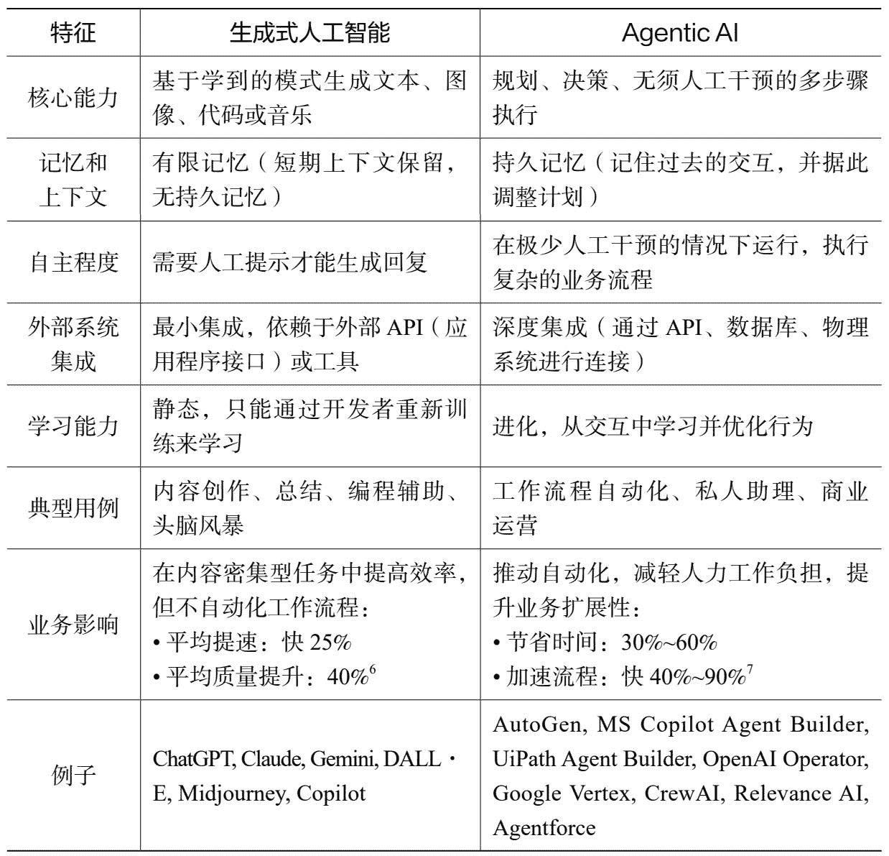

资料来源：Bornet et al.

## AI 智能体的前景（和局限性）

**智能体之梦**

想象一下，某天早晨醒来，你发现手机、笔记本电脑以及所有应用程序，一夜之间都过时了。不是因为它们停止运行，而是因为你不再需要它们了。取而代之的是，一个单一的 AI 智能体处理一切——协调你的日程安排、管理你的通信以及掌控你所有的数字互动，就像《钢铁侠》里的贾维斯和电影《她》中的萨曼莎那样。

这听起来很荒谬吗？世界上许多最具影响力的科技领袖并不这么认为。

比尔·盖茨宣称：“从输入指令到轻轻点击图标，智能体……正在带来计算领域最大的革命。”萨提亚·纳德拉呼应道：“未来，AI 智能体将成为我们与计算机交互的主要工具。”黄仁勋则大胆断言：“Agentic AI 拐点已至。”

我们也相信，智能体正处于改变世界的边缘。每一次重大的技术变革都会重塑我们的生活和工作方式。印刷术使知识普及，互联网将人类联结起来，而智能体则有望不断拓展人类能力边界。想想看，专业医疗智能体在整个医疗系统中协调患者的体验，而不仅仅是分析症状；教育智能体成为真正的学习伙伴，适应学习者独特的节奏和风格；自主智能体协调全球应对气候变化的行动，以集体智慧应对地球上最紧迫的挑战。

正如本书合著者之一帕斯卡尔喜欢说的那样：“AI 智能体的潜力令人着迷，但问题在于，这些‘无所不知’的智能体的吸引力、电影中人工智能的迷人形象，催生了过度膨胀的期望泡沫。”我们憧憬“贾维斯”，梦想着“萨曼莎”，但正如我们在多年实施 Agentic AI 的过程中所学到的那样，现实要复杂得多。

**即时自主的幻影**

在过去的几年里，我们一直奋战在 AI 应用的前沿，致力于协助各种企业实施 Agentic AI——从大型企业到敏捷的初创企业。现实却是，能够在无须人类干预的情况下自主处理复杂、多线程任务的完全自主智能体，目前仍未出现。想想早期的苹果手机，它虽具有革命性，但并非无所不能。如今的智能体也处于与之类似的阶段——强大但有限。

我们还了解到以下几点：

• 当前的智能体是任务导向型的。它们旨在自动化工作流程，而非取代整个工作岗位。如今的智能体擅长按照精心设计的工具和高度详细的指令执行一系列协调动作。

• 部署比开发更难。许多项目失败并非因为智能体能力不足，而是因为其周边系统（包括数据质量、工作流程集成、用户采用度）尚未准备好。

• 严格的人类监督仍然至关重要。在大多数情况下，智能体并非完全可靠。由于固有的不一致性、实施问题或意外故障导致的准确性不足和控制力缺失，智能体仍然需要人类的密切监督。

• 技术专长仍然必不可少。尽管低代码平台让人工智能开发变得更容易，但在企业中部署智能体仍需要专业的编程知识来管理多个方面，例如 API、错误处理和安全措施等。

期望与现实之间有很大差距，若未能理解这一点，则可能浪费时间、金钱和信誉。

我们曾目睹盲目智能化带来的负面影响：在一家全球制造企业中，仓促部署的智能体引发了大规模的员工焦虑和辞职；一家金融服务企业因 AI 智能体做出未经授权的决策而声誉受损；一家机构因智能体提出的行动建议违背其价值观而陷入伦理困境。简而言之，由于缺乏技术知识、治理机制或变革管理，许多善意的部署最终都以代价高昂的失败告终。

**成功案例和变革性影响**

尽管面临诸多挑战，但我们也见证了显著的成功。那些认真推行 Agentic AI 的企业，获得了前所未有的效率和效益提升。

我们合作的一家初创企业仅靠五个人就实现了客户服务、市场营销和运营的全流程管理，取得的成效可与大型企业相媲美。理查德·威尔逊医生通过使用 AI 智能体处理行政事务，彻底改变了他的行医方式，使他得以将精力集中在患者诊疗上。

麦肯锡通过智能体系统将客户的导入期缩短了 90%⁸，而穆迪则利用协同的智能体系统革新了金融分析模式⁹，汤森路透彻底改变了法律尽职调查流程。此外，eBay 和德国电信也在利用智能体系统实现了复杂任务的自动化处理。

我们十分关注的一个落地案例是英国最大的宠物护理企业“宠物之家”，其人工智能转型负责人西蒙·埃利斯领导了一场引人瞩目的人工智能驱动的变革。通过构建一个由 AI 智能体组成的网络，“宠物之家”实现了全业务链优化：人工智能驱动的转录工具能够以 99.6%的准确率转录兽医咨询内容；欺诈检测智能体为零售业务的安全提供保障；人工智能助手为门店员工提供个性化支持；与此同时，其保险整合智能体实现了政策检查的自动化，提升了客户体验。

我们的实践和研究结果都表明，使用 AI 智能体的企业在各方面都取得了显著的改进：流程运行速度提高了 30%~90%，成本降低了 25%~40%，错误率下降了 30%~60%，销售额增长最高可达 50%，客户满意度提高了 20%~40%。

**复利式智能优势**

我们认为，我们正在见证一种与互联网早期阶段极为相似的模式。像亚马逊、eBay 和谷歌这样早早拥抱互联网的企业，不仅取得了成功，还定义了整个产业类别。

AI 智能体创造了我们所说的“复利式智能优势”。与提供静态效益的传统技术不同，AI 智能体会随着时间的推移不断学习和改进。使用得越多，它们就变得越出色。早期采用者能够：

• 更快地训练智能体。它们的智能体积累了更多的实际经验，从而构建了更成熟的决策能力。

• 重新定义商业模式。它们能够围绕人工智能能力打造全新的收入来源。

• 积累人工智能专业知识。它们获得了与 AI 智能体有效合作的关键经验。

行动迟缓的企业有落后之虞，而当下就采取行动的企业将定义下一个商业时代。

**行动呼吁：塑造未来**

挑战确实存在，但对于那些具有战略眼光的人来说，它们也是机遇。企业成功的关键在于将人工智能融入其运营、系统、文化和决策之中。

我们写这本书的初衷就在于：提供来自突破和挫折应对方面的关键见解，为你赋能。本书不局限于理论层面，还提供了实用的实施框架、推动责任落实的治理模式以及应对转型中的人性因素的策略。我们的目标，是帮助你在特定的语境下应用 Agentic AI，实现价值最大化，并确保长期成功。

但构建 AI 智能体并非唯一任务，理解它们同样至关重要。无论你是否构建它们，这些智能体都将无处不在。它们会嵌入应用程序，在你购物时为你提供帮助，并在你做出重大决策时为你指引方向——从子女的大学志愿填报到你的财务规划。你需要了解它们——哪些方面令人印象深刻（比如《2001：太空漫游》中的 HAL 9000），哪些方面则不然。人工智能将成为未来数字景观的一部分，当你在生活中穿梭时，AI 智能体会与你相遇。本书将帮助你了解它们、使用它们，并塑造它们的影响。

更重要的是，我们将向你展示如何参与到这场革命中。无论你是希望变革企业的首席执行官，还是立志打造下一个定义行业的标杆企业的创业者，抑或是渴望在新时代蓬勃发展的专业人士，本书都将为你提供所需的见解和工具。

革命需要引导力、前瞻力和负责任的领导力。本书激励你挺身而出，不仅要拥抱 Agentic AI，更要以目标与诚信来驾驭它。

让我们一起探讨，这对你和你的企业以及我们共同的未来意味着什么。

## 你将从本书中学到什么

本书将带你踏上一段富有洞察力的旅程——从清晰理解 AI 智能体的能力和局限性开始。接下来，我们将深入探讨实际应用场景，为你提供将人工智能有效整合到企业中所需的工具。然后，我们将应对扩展这些系统所带来的挑战，确保它们在各个层面都能发挥真正的价值。最后，我们将从宏观视角审视 AI 智能体如何改变工作方式、重塑企业架构，乃至重新定义社会本身。

在第一部分，我们将开启一段重新塑造你对人工智能认知的旅程。通过真实的实验、令人着迷的发现以及偶尔令人不安的启示，你将见证一种新型人工智能的诞生——它不仅能做出反应，还能思考、学习和成长。你会发现为何有些 AI 智能体能处理海量数据却在简单决策上犯错，而另一些展现出近乎人类的适应能力却无法承担关键任务。你将获得的不仅是技术理解，还有充分利用这些强大的新工具同时规避其潜在风险的实践洞见。

我们的探索始于第一章，在第一章中，我们将见证非凡事物的诞生——大语言模型与自动化技术的融合，造就了首批真正的 AI 智能体。通过一家全球制造企业客户服务转型的故事，你将了解到这种融合为何重要，以及它正在如何重塑企业。你还将了解到，为何一些全球最大的企业都在竞相部署这些技术，更重要的是，为何其他企业却难以跟上步伐。

第二章通过开创性的 SPAR 框架——感知（Sense）、规划（Plan）、行动（Act）、反思（Ref lect）——来解读 AI 智能体的本质。本章的核心是我们创新的“Agentic AI 演进框架”，它能拨开围绕 AI 智能体能力的迷雾，赋予你评估任何 AI 智能体的能力，让你知晓它能为你和你的企业带来何种成果。就像见证汽车从早期形态到自动驾驶的演变一样，你将明白这一演进框架的每一级是如何在前一级的基础上发展，从而打造出日益复杂和自主的系统的。借助这些工具，你将洞悉这项技术的发展方向，以及它对你的未来意味着什么。

第三章将带你“走进 AI 智能体的思维世界”，在第三章中，我们将揭开这些数字头脑的神秘面纱。就像人类学家研究一种新的智能形式一样，我们将审视它们独有的特征、能力和局限性。你会发现，为何它们有时能提供惊人的洞见，有时却在看似简单的任务上跌跌撞撞。通过我们多年实施经验中引人入胜的实例，你将了解这些智能体如何思考、决策和行动——这对任何希望与这些“新数字同事”合作的人来说，都是必不可少的知识。

第四章将理论转化为令人兴奋的实践。在这一章中，我们将分享自己对前沿 AI 智能体进行的亲身实验，其中包括一项令人着迷的探索：当我们挑战让一个 AI 智能体去玩一个“关于人工智能制作回形针”的游戏时，发生了什么。这项既给人启发又略令人不安的实验，揭示了 AI 智能体的现状和未来潜力。你将见证那些卓越的问题解决时刻，也会看到任何使用这些技术的人都需要了解的令人担忧的局限性。

第二部分将带我们深入探究那些将一个简单的人工智能系统转变为真正智能体的基本能力——我们称之为“三大基石”：行动、推理和记忆。通过真实案例、前沿研究和动手实验，我们将探讨这些核心能力如何协同工作，从而打造出不仅能处理信息，还能学习、适应和成长的人工智能系统。

第五章将探讨“行动”这一基石，揭示 AI 智能体如何从仅仅提供建议，发展到在现实世界中真正完成任务。通过精彩的实验和实际应用案例，你将不仅了解到拥有更多工具并不总能让 AI 智能体更有效，还有成功的企业是如何在能力与控制之间找到恰当平衡的。我们将带你走进人工智能实际应用的幕后，向你展示教会机器在现实世界中采取行动时所经历的成功与陷阱。

在第六章，我们将深入探讨“推理”——或许也是“三大基石”中最引人入胜的一环。通过在大推理模型上进行的开创性实验，你将发现在人工智能决策方面，为何速度更快并不总是意味着更好。我们将探讨人工智能系统中不同类型的推理是如何出现的，从快速的模式匹配到深度思考，并向你展示领先企业如何构建能够系统思考复杂问题的 AI 智能体。

第七章将探讨“记忆”这一关键要素，探索 AI 智能体如何从经验中学习并随着时间的推移变得更聪明。通过一家全球电信企业的转型故事，你将了解记忆不仅仅是存储信息，它更关乎创建能够学习、适应和改进的系统。你将认识到人工智能记忆的三个层次（涉及从短期处理到长期保留），并学习如何在你的企业中有效地运用这些记忆。

我们旅程的第三部分将从理论转向实践，向你展示如何将 AI 智能体的变革潜力转化为真正的现实——无论你是在为自己的企业构建解决方案，还是在启动下一个价值百万美元的业务。通过详尽的案例研究、实际实验以及来自一线的宝贵经验教训，我们将引导你把最初的概念成功落地实施。

第八章将以一家数字营销机构的现实转型为例，逐步引导你构建有效的 AI 智能体。你将学习如何发现合适的机遇、选择最佳的智能体类型，以及设计能创造真正价值的人工智能系统。本章提供了一幅实用的路线图——从选择合适的平台到实施稳健的安全措施。你将掌握如何设定智能体目标和指令以有效掌控它们，集成 API、备用方案和熔断机制，并遵循可实操、可复用的流程，将智能体潜力转化为商业现实。

第九章“从理念到收益”带你走进 AI 智能体的创业前沿，这里正在迅速涌现新的商业模式。你将了解创业者如何通过为医疗保健、金融和物流等行业打造专门的 AI 智能体来创造收益，以及你如何复制这些经验。本章提供了一个经过验证的框架，用于识别高价值的智能体业务商机，并将其转化为盈利的业务。你还能了解“智能体对智能体经济”的兴起，在这种经济模式中，AI 智能体能够自主地进行交易、谈判和协作。最后，你将深入了解我们自己推出新闻通讯智能体的幕后故事，该智能体在短短一个月内就吸引了 30 万名订阅者，这充分展示了人工智能驱动的商业模式的力量。

第四部分是你在 Agentic AI 时代实现大规模业务转型的战略指南——这是一份超越技术考量的全面指南。我们将深入探讨驱动企业变革成功的关键要素：战略设计、稳健的治理、变革管理以及价值创造。

第十章将探讨可能决定 AI 智能体实施成败的隐性人类动态因素。这一章不仅仅关乎技术，更关乎人。你将了解如何将员工的恐惧转化为兴奋，设计出既可赋能人类又能与人工智能协同工作的岗位，以及制定出能将潜在阻力转化为积极协作的变革管理策略。通过真实的故事和实用框架，我们将向你展示如何建立信任、培养新技能，并打造一个人类与 AI 智能体无缝协作的工作场所，将潜在的颠覆转化为强大的增长和创新机遇。

第十一章将探讨当今各个企业面临的最紧迫挑战之一：如何从成功的试点项目过渡到全面实施。通过真实案例研究和实用框架，我们将向你展示为何只有少数企业将其 AI 智能体计划成功规模化，更重要的是，你将了解如何成为其中的成功者。我们将带你深入了解江森自控国际（Johnson Controls International）从基本自动化到复杂 AI 智能体的转型历程，揭示其一路走来学到的关键经验。你将了解它应对常见的扩展挑战（从数据集成到变革管理）的策略，并发现如何为自己的人工智能转型奠定坚实基础。

在第十二章中，我们将带你深入了解当下最令人兴奋的 AI 智能体实施情况。通过“宠物之家”的开创性实例以及跨行业的全面用例集，本章将 AI 智能体的变革从理论带入实际应用。我们将带你探索企业如何克服现实世界中的挑战、改善客户体验并重塑工作方式。从兽医护理到零售，从欺诈检测到个性化客户服务，这些案例不仅会为你提供信息，还会激励你在你的企业中看到 AI 智能体的变革潜力。

我们旅程的第五部分，将带我们跳出 AI 智能体的应用层面，探讨它们对未来工作和社会的深远影响。这一部分将描绘一幅引人入胜的图景，展现随着 AI 智能体的日益复杂和普及，未来所面临的挑战和机遇。

第十三章将探讨人类能力与 AI 智能体之间新兴的协同作用，同时直面这场技术革命前所未有的特性。通过塔拉（一位高级项目经理，负责协调人工智能与人类的合作）和黛比（一位资深项目经理，目睹 AI 智能体学会像她一样思考）等人的故事，你将了解到未来三大能力如何重塑职业成功。本章将揭示这一变革的希望和挑战——从培养不可替代的“人类智能”能力，到解决所谓的“适应悖论”，即在关键技能的复杂度不断增加的同时，培养这些技能的时间窗口却在不断缩小。你将获得在新时代蓬勃发展的实用策略，同时理解为何传统的技术变革应对策略可能不再适用。

第十四章则将视角拉远，审视 AI 智能体对人类社会的广泛影响。我们将探讨一些发人深省的问题，比如未来工作的模式，探索 AI 智能体如何将我们从日常事务中解放出来，让我们有更多时间从事更有意义的活动。通过实证研究和现实案例，我们将探讨诸如全民基本收入以及工作时长缩短等概念。本章最后将提出一个管理 Agentic AI 的实用框架，确保这些强大的技术在始终处于人类有效掌控的同时，最大限度地发挥其对社会的价值。

## 本书之外：你的在线资源

这本书只是你踏上 Agentic AI 之旅的起点。不妨搜索作者的相关网站继续学习，并与充满活力的从业者和专家社区建立联系。在那里，你会发现有价值的资源、有深度的课程、实用的工具以及一个促进协作和成长的论坛，所有这些都是为了帮助你到达这场“智能体”游戏的顶峰。

## AI 智能体的关键术语

要有效地在 AI 智能体的世界中航行，掌握几个基础概念至关重要。这些术语在本书中会反复出现，所以明确地定义它们是很有必要的。

**任务工作流**

“任务工作流”（Workflow of Tasks），是指为达成目标而需要完成的一系列结构化的行动步骤，可以将其视为完成任务的路线图，其中每一步都依赖于前一步的成功完成。以冲泡一杯咖啡为例：首先，将水壶灌满水并烧开；接下来，将咖啡粉放入杯中，倒入热水并搅拌；然后，根据需要加入牛奶或糖；最后，享用咖啡。业务流程通常由多个工作流组合而成，比如“从下单到收款”或“从采购到付款”这样的大型流程，可能包含数百个子工作流。

**应用程序接口**

应用程序接口（Application Programming Interface，API）是一座桥梁，能让不同的软件系统相互交流。可以把 API 想象成餐厅里的服务员：你点餐（发出请求），服务员将你的订单转达给厨房（另一个系统），然后把食物（响应）送到你面前。对于 AI 智能体来说，API 至关重要，因为它们能实现与所使用工具的无缝集成，无论是访问数据库、获取实时信息，还是连接云服务。在大多数情况下，如果没有 API，AI 智能体就会孤立无援，无法与工具进行交互。

**确定系统与概率系统**

根据处理输入和生成输出的方式，人工智能系统可以分为确定系统与概率系统。

• 确定系统对于给定的输入总是产生相同的输出。它们遵循严格的规则和逻辑，确保结果可预测且可重复。想象一下基本的计算器——当你输入“2 + 2”时，总是得到“4”。这类系统适用于处理精度和一致性至关重要的任务，如财务计算或合规检查等。早期人工智能中的“专家系统”完全使用确定系统，如今在机器人流程自动化系统、医院的临床决策支持系统以及许多其他场景中仍能看到它们的身影。

• 概率系统的运行是基于可能性而非固定规则。它们通过分析模式和数据来做出预测，这意味着其输出可能会因概率的不同而略有差异。大多数人工智能模型，包括大语言模型和推荐系统，都属于这一类¹⁰。它们不提供绝对的答案，而是基于最有可能的统计结果生成响应。例如，当聊天机器人预测句子中的下一个单词时，会选择可能性最高的选项，而非遵循严格的规则。

# 第一部分 AI 智能体的崛起

## **第一章**

## **超越 ChatGPT：人工智能的下一次进化**

在引言中，我们强调了当前人工智能领域的一个关键局限性——那些智能体非常聪明，但它们只能思考却无法自主行动。现在，让我们探讨人工智能领域是如何走到这一关键节点的。本章将追溯 AI 智能体技术演化的实现历程——两股强大技术流的融合催生了超越单一技术能力的全新范式。理解这一演化历程不仅具有学术意义，更能揭示为何向 Agentic AI 转型代表着如此深远的机遇。

### Agentic AI：技术融合的产物

想象一下，你正在会议室里与一群企业高管交谈。总会有人提出那个我们听过无数次的问题：“如果人工智能这么聪明，为什么它不能直接解决问题并自主行动？”

这个问题直指当前人工智能领域的核心缺失。为了理解这种能力为何一直难以实现，以及它最终如何成为可能，我们需要探究不同的技术流如何融合以创造出全新的事物：Agentic AI。

Agentic AI 并非单一技术创新的产物，而是语音助手、自动驾驶技术、AI 驱动 API 等多领域发展的融合。在实现 Agentic AI 过程中，有两大技术流尤为关键：

• 大语言模型的崛起；

• 工作流自动化（现称为智能自动化）的演化。

**两大技术流的传说**

Agentic AI 的发展并非简单的线性进程，而更像是两条独立流淌了很远的河流最终交汇，形成超越单一个体的、更强大的力量。

让我们从一个故事开始，它能说明这种融合为何重要。2022 年，我们曾与一家全球制造企业合作，该企业当时在客户服务效率方面遇到了难题。他们不仅部署了一个由大语言模型驱动的能够以极高的准确度理解并回应客户咨询的先进聊天机器人，还部署了 RPA 机器人，能够在后台系统中执行复杂的操作序列。然而，仍有一环缺失，那就是理解与行动之间的桥梁。

该企业的客服代表仍需充当人工桥梁，将聊天机器人的建议手动转化为相应的自动化工作流程。这让我们得以一窥如果这些技术能够直接协同工作将会实现怎样的效果，也帮助我们理解了这些技术的融合为何会如此具有变革性。

**第一条河流：大语言模型的发展之路**

人工智能发展到如今的大语言模型，其历程始于 1997 年，我们见证了这一过程。当时，全世界都惊讶地目睹了 IBM（国际商业机器公司）的“深蓝”击败国际象棋冠军加里·卡斯帕罗夫。我们还记得当时的头条新闻：“机器战胜人类！”但大多数人忽略了一点——“深蓝”更像是个专家型天才，而非全能型天才。它能出色地下棋，却连自己的棋步都无法解释。若想让它下跳棋，那简直比教鱼骑自行车还难。

这种局限性让我们和许多其他业内研究者感到困惑。我们认为，肯定有更好的方法来打造智能系统。突破来自一个意想不到的领域——神经网络。现在，当解释神经网络时，我们喜欢用一个简单的类比：想象教孩子认识动物。你不会从递给他们一本关于毛发、尾巴和腿数量的规则手册开始，而是通过示例演示：“这是狗，这是猫，这是鸟。”孩子的大脑会自然而然地学会识别模式并进行归纳总结。

**神经网络革命**

神经网络的魅力在于它们的学习方式大致相同。但要充分发挥其潜力，需要三个要素：海量的数据（想象数百万个示例）、强大的计算能力（如同成千上万台高端计算机协同工作）、复杂巧妙的架构（即企业这些人工脑细胞的智慧设计）。

我们还记得，在 21 世纪第二个 10 年，当这些要素最终汇聚时，人工智能社群中洋溢着兴奋与期待。这如同亲眼见证莱特兄弟的首次飞行——突然间，看似不可能的事情变成了现实。系统能够以前所未有的准确度识别图像、理解语音和处理语言。

**语言模型崭露头角**

在语言处理领域，真正的奇迹发生了。回顾早期的语言人工智能，那就像试图通过给计算机一本词典和一本语法书来教它理解莎士比亚的作品，结果可想而知，呆板得令人大失所望。

2017 年，改变游戏规则的突破终于降临——Transformer 架构发布。这好比让人工智能实现了从算盘到超级计算机的跨越，它不仅能够检索词汇，更能理解上下文语境、把握语义内涵、洞悉思想关联，这恰似从袖珍计算器升级为数学家的大脑。

在此期间，我们发现，规模法则至今仍令人惊叹。随着这些模型规模越来越大，并且训练数据越来越多，神奇的现象发生了——它们发展出了从未被编程赋予的能力。这就像以快进模式观看进化过程。2020 年发布的 GPT-3 震撼了整个业界：这个系统能够编写代码、解决数学问题甚至参与哲学讨论——这些都不是它被明确训练过的技能。

当 2022 年 ChatGPT 横空出世时，我们仿佛登上了攀登数十年的科技巅峰。终于，我们迎来了能够进行真实对话、逻辑推理，并能以人类可理解的方式阐释思路的人工智能。但此时的人工智能仍存在一个关键局限——它只能提供行动建议，却无法付诸实践。

**第二条河流：自动化技术的演变**

在人工智能领域高歌猛进之际，自动化领域也正悄然掀起另一场革命。我们始终身处这场变革的前沿，见证着自动化技术从简单的屏幕抓取工具蜕变为精密的数字员工。

**机器人流程自动化的兴起**

在 21 世纪初，商业运营仍大量依赖人工操作，或者依赖于彼此孤立的信息系统。具有前瞻性思维的团队开始运用脚本和宏指令实现重复性计算机任务的自动化，比如通过宏指令每晚将 Excel 数据自动导入主机应用程序。

在 21 世纪第二个 10 年初期，我们亲身经历了 RPA 机器人的诞生。我们可以将它视为模仿人类在计算机上操作（包括点击、输入、复制、粘贴和读取屏幕）的软件工具。这听起来很简单，却具有革命性意义。我们首次实现了让计算机与人类协同工作，且无须改变我们正在使用的工具和界面。

本质上，RPA 机器人是一种被编程来执行系列步骤——登录系统、检索数据、执行运算并将结果输入到其他地方的软件程序。这些操作与人类的工作方式无异，但速度更快且不知疲倦。RPA 机器人之所以能迅速普及，正是因为它瞄准了那些最容易实现自动化的领域：办公室职员每日重复的大量日常性、规则明确的任务。

企业纷纷积极拥抱 RPA 技术，旨在减少人为差错并将员工从烦琐事务中解放出来。我们看到银行、保险企业和医院部署了 RPA 机器人来执行诸如数据录入、发票处理、报告生成和数据库更新之类的工作。例如，我们的一家保险客户使用 RPA 技术将保单数据从电子邮件转移到其旧系统中，这项在过去需要一个团队花一整天时间才能完成的工作，如今数分钟内就能精准地完成。

然而，这些早期的 RPA 解决方案存在明显的局限性。它们的运行机制非常脆弱，如果单个屏幕发生变化或者出现异常情况（比如缺少某个字段），机器人就会陷入混乱。RPA 机器人没有智力或判断力，它们严格遵循预设脚本。我们经常需要介入处理，更新机器人程序或者手动处理特殊案例。本质上，RPA 是流程驱动的自动化技术，适合处理规则明确的结构化任务，但在情况偏离常规时却无法适应。

**智能自动化的演变**

接下来的发展更是令人兴奋，我们将 RPA 与机器学习相结合，命名为智能自动化或超自动化。为了保持竞争力，RPA 工具开始添加人工智能功能，以便能够处理更复杂、非结构化的工作。可以这样理解：RPA 很擅长执行任务，但缺乏思考能力。因此，企业开始用人工智能技术（包括机器学习、自然语言处理和计算机视觉）来增强 RPA，从而创建能够解读信息并做出简单决策的自动化系统。

从实际角度来看，这意味着自动化工作流可以实现以下场景：读取客户的电子邮件（使用自然语言处理），判断请求的内容（使用人工智能分类器），然后触发相应的 RPA 流程来处理。这样的自动化系统不再机械僵化，而是初步具备了语境感知能力。

随着自动化技术日益成熟，我们的目标逐渐从单点任务自动化转向端到端的全流程自动化。这意味着不再满足于对孤立环节的自动化改造，而是致力于实现整个工作流或业务流程从发起到终结的全程自动化。

例如，我们曾协助一家零售企业实现“从订单到收款”的全流程自动化，从接收线上订单、核实库存、处理付款、安排发货到更新财务记录。多个 RPA 机器人、系统接口和人工智能模型协同工作，像流水线一样传递任务，人工仅需监控流程或处理异常情况。当系统完善后，整个业务流程便能实现全自动运行。

到 21 世纪 20 年代初，许多企业在常规流程中实现了高度自动化。我们观察到了所谓的“自动化瓶颈期”：在这个时期，大多数简单任务已实现自动化，而决策点和动态情况仍需人工干预。传统自动化无法再进一步，因为它缺乏在明确规则之外所需的适应性和高级推理能力。

如今，我们正见证两大技术洪流的历史性交汇，这就像看着两块拼图终于拼合在一起。语言模型赋予了系统“大脑”，具备了理解、推理与规划的能力；自动化技术则提供了“双手”，具备了在真实世界中执行操作的能力。这两者融合，便催生了能自主行动的 AI 智能体——本质上，这就是真正意义上的数字员工。

正是这种融合使得 Agentic AI 成为可能，我们很高兴能成为这场革命的一部分。我们目睹着人工智能系统从被动工具演变为能同时理解任务内涵并主动执行的合作伙伴。

**首个基于大语言模型的 AI 智能体的诞生**

过去几年，人工智能的研究与开发迅速提升了 AI 智能体的能力。最初作为复杂文本预测引擎的大语言模型（如 GPT-3 和 GPT-4），如今已具备规划行动和使用工具的能力。这意味着它们不再局限于补全句子，还能决定执行网络搜索、进行数学运算、调用 API 或调用其他软件，以回答问题或完成任务。

2022 年，首个基于大语言模型的 AI 智能体框架 MRKL（模块化推理、知识和语言）问世¹。该框架侧重于模块化推理，其中大语言模型与诸如“搜索”和“查找”之类的预定义工具进行交互，以检索信息并回答查询。该框架将推理与行动分离，依靠外部模块来执行离散的推理任务。

随后，随着 ReAct（推理+行动）²被引入，该领域迅速发展，ReAct 进一步推动了这一概念，使人工智能能够将推理步骤与行动相结合。该模型生成了一个思维过程（推理轨迹），并能够采取诸如查询数据库或使用 API 等行动，然后继续利用新信息进行推理。这种推理与行动的协同，让人工智能能够动态调整计划、处理更复杂的任务。实验表明，ReAct 通过让人工智能在回答前核查信息来源（如维基百科 API），显著降低了模型虚构错误事实的倾向。同时，该框架通过可追溯的逐步推理过程，使人工智能的决策路径变得透明可解释，这就像观察一位专家在解决问题时的完整思考脉络。³

2023 年推出的 Toolformer 是一个突破性的人工智能模型，它自学使用外部工具，如计算器、网络搜索和翻译器。这弥补了大语言模型的一个关键缺陷，即由于依赖静态训练数据，在算术和实时事实方面表现不佳。通过决定何时以及如何调用外部工具，Toolformer 提高了计算和问答的准确性。⁴

这些进步催生了高度智能的 AI 智能体，它们能够处理多步骤的任务。例如，你可能听说过像 AutoGPT⁵或 BabyAGI⁶这样的实验系统，它们在人工智能爱好者中颇受欢迎。这些本质上是围绕大语言模型构建的智能体，旨在自主追求目标：它们从用户那里获取高层次的目标，然后生成子任务，执行这些任务（通常通过发出工具命令甚至编写和运行代码），检查结果，并不断迭代，直到目标实现。尽管这些是前沿实验，有时还很脆弱（容易混淆或陷入困境），但它们展示了 Agentic AI 的发展方向。

与此同时，像 LangChain⁷和 Semantic Kernel⁸这样的开发框架应运而生，以增强大语言模型与外部 API、数据库和其他系统进行交互的能力。突然间，智能体不再孤立地工作，它们开始与数字世界连接，执行诸如自动化工作流程、检索信息或控制应用程序等任务。

在大语言模型中引入函数调用的发明，更是将这一进程向前推进了一大步。⁹这项突破性技术使得智能体能够在推理过程中精准调用外部函数或脚本，实现了与各系统的深度交互。这一突破意味着智能体不仅能够规划和思考，还能以较高的针对性和高效的方式采取行动。

研究进一步巩固了这一演变。像 Gorilla¹⁰这样的论文展示了模型如何能够学会有效地使用工具，而来自微软¹¹、斯坦福¹²和腾讯¹³的研究表明，协作智能体——多个智能体协同工作——取得了更大的成功。

到 2023 年，诸如 AutoGen¹⁴、谷歌云 Vertex AI¹⁵和 CrewAI¹⁶等企业级平台的崛起，使这些技术理念终于走向主流。这些平台为大语言模型驱动的智能体提供了蓬勃发展的生态环境：通过深度融合自动化能力，大语言模型已从单纯的文本处理器蜕变为新型系统的基础——这种系统正在重塑任务执行模式、决策机制乃至技术与现实世界的交互方式。

**蓬勃发展的市场：今天的 AI 智能体市场**

市场预测表明，到 2030 年，该市场将以惊人的每年 44%的速度增长。¹⁷我们很高兴看到 AI 智能体市场蓬勃发展，因为这证实了我们长期以来的看法——AI 智能体不只是昙花一现的趋势，而是企业和个人运作方式的未来。¹⁸高德纳咨询公司预测，到 2028 年，1/3 的企业软件应用程序将集成 AI 智能体，这表明企业在自动化、决策和生产力方面会发生根本性转变。但最让我们兴奋的是红杉资本的预测，即 AI 智能体有望覆盖 10 万亿美元规模的市场，横跨全球服务和软件市场。¹⁹

AI 智能体市场是新兴的、爆发式的，且竞争激烈。²⁰目前已有数百家供应商推出了智能体平台，而初创企业和大型企业也在竞相开发跨行业的 AI 智能体。²¹

由于这个市场在多个方向上迅速发展，所以要把握其脉络并非易事。为了便于理解，我们倾向于将其分为三大类：

第一类是可定制平台，让专业人士和企业能够构建自己的智能体。这类平台适用于各行各业和不同的业务功能。它们包括从无代码解决方案（如 Beam²²和 Relevance AI²³），到低代码平台（如 UiPath²⁴和微软的 Agent Builder²⁵、CrewAI²⁶以及 ServiceNow²⁷），再到完整的编程框架（如 Langchain²⁸和 AutoGen²⁹）等各类产品。

这些工具让企业能够根据自身的特定需求和流程创建定制化的智能体。

第二类是一些通用型智能体，比如 OpenAI 的“操作员”（Operator）³⁰、Anthropic 的“计算机使用”（Computer Use）³¹以及谷歌的“水手计划”（Project Mariner）³²。这些智能体更加灵活多变，能够处理各种各样的任务，并适应不同的场景。可以将它们视为智能数字助手，它们能够无缝地在多个系统中操作，理解复杂的任务目标，并直接通过屏幕执行任务，无须复杂的集成。在我们看来，Agentic AI 的“ChatGPT 时刻”将来自这一类智能体的发展，因为它们会同时面向消费者和企业广泛普及。

第三类是专业型智能体，比如谷歌或 OpenAI 的 Deep Research（专注于研究的智能体）、Agentforce（专注于销售和客户关系的智能体³³）或 Hippocratic AI（专注于医疗保健领域的智能体³⁴）。其中一些智能体专注于跨行业的特定功能（横向智能体），而另一些则是针对单个行业的独特需求进行定制（纵向智能体³⁵）。这些大多是专注于特定任务（无论是分析法律文件、优化营销活动还是进行公证工作）的即用型智能体。在 agent.ai³⁶等市场上，你可以找到数百种此类专业型智能体，每一种都旨在专注于某一特定功能。

在附录部分，我们按照第二章提出的“演进框架”对当前市场产品进行了详细梳理。我们深知，在这个新兴市场中寻找适合的切入点颇具挑战，特别是选择与自身数字化目标最匹配的智能体平台挑战性极高。为此，第八章不仅将逐步演示智能体构建全流程，更将提供一套完整的平台选型方法论，帮助用户基于企业的数据、技术储备和业务目标，做出最优技术决策。

### Agentic AI 赋能创业和商业

我们正在讨论的这些 AI 智能体不仅具备思考能力，还能够自主行动。在过去的几年里，我们曾亲身参与开发并部署了一些这样的智能体，与这些智能体合作，真的感觉像是在与一种新型同事协作。现在让我们深入解析这种协作模式的实际内涵。

**认识一下你的智能数字员工**

智能数字员工就像一名虚拟员工，能够自主处理流程。它被“聘用”来承担具体岗位职责，比如 IT 支持人员、客服代表或营销助理，只不过它是由代码构成的。它能够完成工作的原因在于大语言模型的认知能力与自动化软件的直接操作能力相结合。大语言模型使智能体能够理解指令、用自然语言交流并做出合理决策。自动化技术则赋予智能体执行操作的能力：单击按钮、检索和输入数据、调用 API、协调其他软件工具等。这些共同作用使得 AI 智能体能够从头到尾处理复杂的任务。

在实际应用中，AI 智能体的工作流程如下：假设你向一个 AI 智能体下达一个高层级目标，比如“更新我们的社交媒体，以回应最新产品发布的反馈”。具备语言能力的智能体首先会理解这个指令（如果需要的话，可能会像人类一样向我们寻求澄清）。然后，它会将目标分解为可操作步骤，例如：①从社交媒体和评论中收集近期的客户反馈；②分析情绪（正面评价与负面投诉）；③起草针对性的回应或公关声明；④发布声明或安排博客更新；⑤持续监测用户互动数据。

在传统环境中，这可能需要营销和客户支持团队的人员协调这些步骤。然而，一个 AI 智能体可以自行协调这些步骤：使用集成钩子从 Twitter（现为“X”）或 Facebook（现为“Meta”）拉取数据，运行自然语言处理情绪分析模型，通过其大语言模型生成文本，并与企业的社交媒体管理工具进行交互以发布更新。

在整个过程中，智能体会跟踪上下文——它知道总体目标是什么，并在出现意外情况时调整其行动（例如，如果发现一条异常推文，它可能会将该特定问题升级给人工处理）。

**AI 智能体进行中：真实世界转型**

我们已在各行各业实施了诸多实例。让我们来看几个智能数字员工在实际应用中的案例。

以客户服务为例，这是 AI 智能体最直接、最显而易见的应用之一。过去那种僵化、照本宣科的聊天机器人，它们令用户感到沮丧的日子已经一去不复返了。如今的 AI 智能体能够进行完整的对话，诊断问题，并采取行动予以解决³⁷。我们曾与一家电信企业合作，部署了一个由人工智能驱动的 AI 客服专员，该智能体能够从头到尾处理常见的技术支持来电。

一位客户因网络问题致电，智能体倾听、转录其话语，并利用大语言模型理解问题本质。然后，它进行故障排查：远程检查调制解调器，在必要时引导客户进行设备重启，如果问题仍未得到解决，则自动创建服务工单或安排技术人员上门。在交互结束时，问题要么得到解决，要么顺利升级处理，全程无须人工干预。AI 智能体不只是提供答案——它会采取行动，管理客户请求的整个生命周期。

现在，想象一下这种程度的智能被应用于金融和会计领域。我们曾帮助一支全球金融团队引入了一款“数字分析师助手”，实现了其月度预算差异分析的自动化。以往需要人工分析师花费数天时间筛选数据，如今这款人工智能助手能够从会计系统中提取数据，识别出支出与计划的偏差，甚至还能利用自然语言模型起草解释说明。当它发现异常情况（比如不寻常的支出）时，会将其标记出来供人工复核。

随着时间的推移，通过不断学习反馈，这款人工智能助手提高了区分正常波动和真实风险信号的能力。原来需要数小时人工操作的工作，如今变成了一个精简的自动化流程，人工智能承担了繁重的工作，而人类仅在必要时介入。结果是，财务报告的生成变得更加快速、精准，人们得以从烦琐的人工操作中解放出来，就像拥有一位永不疲倦的初级分析师，持续处理数据并生成财务报告。

在第十二章，我们将深入探讨各行业的实际案例和应用场景。你将看到企业如何利用人工智能助手解决复杂难题、提升客户体验以及重新定义未来的工作模式。

**企业面临的机遇与挑战**

对于企业领导者和决策者而言，Agentic AI 的兴起既是机遇也是挑战。从机遇方面来看，其益处令人十分向往。通过将工作转交给 AI 智能体，我们能够实现巨大的效率提升。想象一下，在不增加员工数量的情况下实现劳动力翻倍，因为那些单调乏味的任务将由不知疲倦的数字员工来处理。我们还预计质量与一致性会得到改善。

经过恰当训练和管控的 AI 智能体，每次都会遵循最佳实践，并且能够在每个行动中嵌入合规检查（降低人为错误的风险）。最有趣的是，Agentic AI 能够解锁以前无法实现的新能力。例如，你可以部署 20 个 AI 智能体通宵模拟各种市场情景，并在次日清晨获得战略建议——这是任何人类团队都无法在规定时间内完成的分析规模。你也可以通过人工智能顾问同时为数千名客户提供真正个性化的服务。

在客户服务和决策支持等领域，这意味着客户能够更快地获得响应，而高管们能够获得更深入的决策洞察。AI 智能体与人类并肩工作，充当合作伙伴，我们可以将其想象成每位员工都拥有一位能够承担任务或提供建议的人工智能副驾驶，从而极大地提升员工单日的工作效率。

在挑战方面，我们必须谨慎应对转型。将 AI 智能体融入工作流程，需要精心的变革管理。工作必须经过精心设计，以实现人类与人工智能的最佳协作，确保员工信任并理解他们的新人工智能同事。我们在部署过程中的一项工作就是揭开智能体决策过程的神秘面纱（例如为 AI 决策添加解释“审计追踪”），使人安心。

此外，构建 AI 智能体还面临若干技术挑战，这些挑战远不止开发本身。智能体的可靠性是最大的挑战之一——要确保智能体始终如一地按预期运行，不出错或不产生意外行为。定义精确的目标和指令同样复杂，需要不断迭代以优化响应和决策。

无缝集成是另一个关键因素：AI 智能体必须能够轻松连接到现有的工具、API 和工作流程，才能真正发挥作用。数据质量也起着至关重要的作用，若输入低质量数据，必然产生低质量输出，这会使智能体变得不可靠、容易出错且无法做出准确的决策。最终，成功的部署不仅仅在于构建智能体，还在于持续地集成、测试和改进它们，以确保它们能够提供实际价值。

此外，还面临监管方面的挑战：AI 智能体需要有约束机制和遵循伦理准则。它们虽然强大，但仍需符合商业规则、价值观念和监管要求。只有当人类最终掌控目标设定和关键决策的审查时，人类与人工智能的协作才能奏效，尤其是在金融或医疗保健等高风险领域。

幸运的是，用于人工智能治理的工具正在改进，我们始终强调在实施 Agentic AI 的早期阶段采用人机协作的方法。可以把 AI 智能体想象成一名非常有能力的新员工，你不会让新员工在没有经过培训和监管的情况下随意行事，人工智能也是如此。

随着我们向前迈进，重要的是要记住，AI 智能体是增强型的，而非纯粹的替代型。终极模式是人工智能与人类协同工作。人工智能负责繁重的工作和日常的琐碎事务，而人类则提供指导、创造力和关键监督。在一次成功的部署中，一位客户告诉我们，他们的团队成员开始称 AI 智能体为“团队成员”——这种协作的心态正是团队取得最佳成果的关键。

我们正进入一个新时代：你的下一个新“员工”可能就是一个人工智能。拥抱这一未来并负责任地塑造它，将成为企业未来数年的关键议题。参与到这段旅程中，令人心潮澎湃。

为深入探讨这一问题，本书第四部分将作为 Agentic AI 时代企业转型的战略指南。你将看到实际应用场景、案例分析以及企业成功变革的核心要素，包括制定战略、构建治理体系、变革管理和创造价值。

**初创企业：Agentic AI 时代最大的赢家**

正如电子商务、社交媒体和软件即服务（Software as a Service，SaaS）重塑了行业一样，AI 智能体也将开启全新的商业模式，为创业者在新兴市场抢占先机创造机会。我们认为，初创企业将从 AI 智能体的自动化中获益最多，数据也证明了这一点。³⁸它们在利用 AI 智能体的企业中占比最大，例如，在使用 LangChain 智能体平台的企业中，超过 50%的企业员工人数不足 100 人，而员工人数超过万人的大型企业仅占 15%。³⁹

与受制于官僚作风和遗留系统的大型企业不同，初创企业从第一天起就可以围绕 AI 智能体构建其整个商业模式。这使它们获得了巨大的竞争优势，具体表现为：

• 成本高效的运营——将核心任务自动化可以减少对大型团队的需求。

• 敏捷性与快速原型设计——AI 智能体助力企业加快市场进入与产品迭代速度。

• 规模化个性化客户互动——凭借 AI 智能体，初创企业能够超越依赖标准化服务的大型竞争对手。

• 无集成限制的自由——与大型企业不同，初创企业无须将人工智能融入需要更新的工作流程中。

这种敏捷性使初创企业能够开拓细分市场，提供高度定制化的解决方案，并在服务不足的领域蓬勃发展。随着 AI 智能体从简单的自动化工具发展成为自主决策者，它们将成为下一代颠覆性企业的支柱。成功把握这些机遇的初创企业包括 Perplexity⁴⁰、Ramp⁴¹、Superhuman⁴²和 Replit⁴³等。

要进一步探讨这一主题，请参阅第九章“从理念到收益”，该章揭示了企业家如何在医疗保健、金融和物流等行业构建专业的 AI 智能体，以及你能如何实现这一点。该章还提供了一套经过验证的框架，用于识别高价值的智能体业务机会，并将其转化为可以盈利的业务。

### AI 智能体在企业中的应用现状

为深入理解各企业如何部署基于语言模型的 AI 智能体并从中受益，我们对那些已突破基于规则的智能体和传统使用语言模型方式、成功部署基于语言模型的 AI 智能体的企业进行了广泛分析。我们的研究团队收集并分析了来自不同行业、已将此类智能体投入生产环境的 167 家企业的数据。该研究重点聚焦于解读实施模式、所面临的挑战、实现的收益以及关键成功因素。

### **应用现状**

AI 智能体的应用情况在各行业中呈现出引人注目的分布模式（见表 1-1）。科技与软件业处于领先地位，在我们的研究中，它们成功应用的案例占到了近 25%。这并不令人意外，因为它们具备强大的技术实力和创新热情。紧随其后的是金融服务业，占比 18%，零售与消费品业以 16%的占比位居第三。

**表 1-1 根据我们的研究实施 AI 智能体的企业所属行业分布**

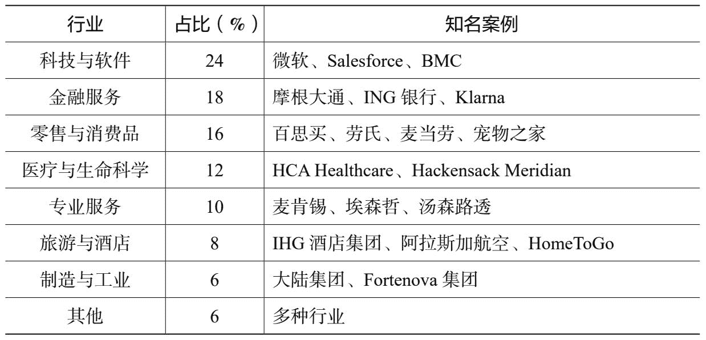

资料来源：Bornet et al.

这些早期应用者并非浅尝辄止——它们正在取得显著成效。例如，微软报告称，在其销售部门使用 AI 智能体后，每名销售人员的收入提高 9.4%，成交量增加 20%。在金融领域，摩根大通部署的智能体系统使欺诈行为大幅减少 70%。这些成功案例正激励更多企业探索类似应用。

数据表明，企业成功部署 AI 智能体的主要领域如表 1-2 所示。其中，客户服务与支持占比 35%，这些系统负责从自动解决查询到提供个性化服务等各类事务，企业报告称平均解决时间缩短 12%~30%。其次是内部运营，占比 25%，企业利用智能体进行文书处理、工作流程优化和行政事务简化等。该领域的成效尤其显著，某些流程的时间节省幅度在 30%~90%。例如，麦肯锡的客户注册智能体就将注册时间缩短 90%，行政工作量减少 30%。销售与市场营销应用占据实施案例的 20%，重点在于潜在客户资格审查、活动优化以及个性化推广。此类别中的企业报告称，收入增长幅度在 9%~21%。安全与欺诈检测占据实施案例的 12%，而行业专项解决方案则占据剩余 8%的份额。

**表 1-2 根据我们的研究得出的 AI 智能体用例及其对业务的关键影响**

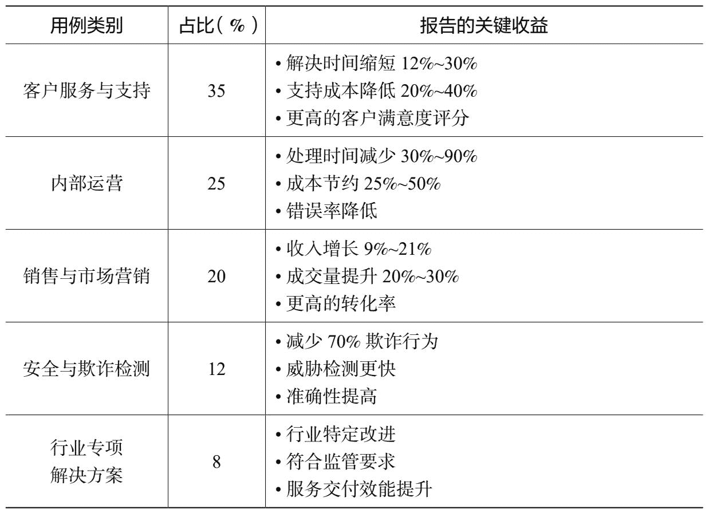

资料来源：Bornet et al.

**衡量 AI 智能体的影响**

我们的研究表明，各企业报告的可量化改进成效相当显著。在效率提升方面，各企业一致表示流程时间缩短 30%~50%，成本节约 25%~40%，错误率降低 30%~60%。营收影响方面同样令人印象深刻，销售额增长 9%~20%，转化率提高 15%~25%，客户满意度提升 20%~40%。

一个特别有趣的发现是，70%的成功案例采用了混合的人工智能工作流程。这些企业发现，在关键决策上保留人工监督，同时利用人工智能处理日常任务，不仅能改善结果，还能提升员工满意度。这种做法使人类和 AI 智能体能够相互学习，从而为持续优化创造条件。

**成功蓝图：获胜智能体实施策略**

我们的研究显示，成功的实施案例通常遵循审慎、富有战略性的方法。近 2/3 的成功实施都是从试点项目开始的，这使企业能够在受控环境中测试和改进智能体的能力，同时通过实际成效来建立内部支持体系。

研究数据揭示了成功案例中普遍存在的三大关键成功要素。首要因素是明确的用例定义。成功的企业会花时间确定它们想要解决的具体问题，并在部署前建立可量化的成功指标。这些企业始终保持清晰的边界限定，通过定期绩效评估，确保智能体持续达成目标。

其次是实施有力的变革管理。在这一方面表现出色的企业会制订全面的员工培训计划，并在整个实施过程中保持清晰的沟通渠道。这些企业深知，成功的智能体部署在很大程度上取决于人员，而不仅仅是技术。

最后是强大的技术基础设施。成功的企业会在部署前确保拥有集成化数据架构、严密的安全措施及可扩展的系统支持，并通过定期维护与更新计划持续保障系统处于最优运行状态。

我们将在本书后续章节更深入地探讨这些关键成功要素，包括设计高效的 AI 智能体（第八章）以及成功将其融入企业运营（第四部分）的详细策略。

**领导者如何克服实施 AI 智能体面临的挑战**

在实施 AI 智能体的过程中，企业常会面临一些常见的挑战。系统集成是最常被提及的挑战，有 45%的企业将其视为艰巨挑战。成功的企业通过分阶段集成方法、API 优先架构，以及定期测试和验证程序来解决这一问题。

数据质量是另一个主要挑战，有 35%的企业报告称存在此问题。企业通过结构化的数据治理举措和定期的质量评估来克服这一难题。技术专长位列第三大挑战，有 20%的受访企业将其视为关注点。领先的企业通过全面的培训计划和战略性的外部合作来应对这一挑战。

运营层面的挑战集中在变革管理、绩效监控和成本管理上。成功的企业通过清晰的沟通策略、明确的关键绩效指标以及定期的成本审查来应对这些挑战，同时建立完善的反馈机制以确保持续改进。

**AI 智能体的发展方向以及如何顺应趋势**

展望未来，AI 智能体的应用趋势未见放缓迹象。我们的研究表明，85%的企业计划增加其智能体部署，其中 70%的企业正在探索新的应用场景，60%的企业增加了人工智能预算。超过半数的企业正在开发符合其特定需求的定制解决方案。

根据研究结果，我们为正在考虑或初步尝试 AI 智能体的企业领导者提出以下关键建议：首要原则是“战略上宏观规划，实施中小处着手”。成功的企业通常会选择影响力大、风险低的场景作为初始试点，并基于阶段成果逐步拓展应用范围。

其次，基础设施投资应成为优先事项，尤其要关注数据质量和安全措施。企业需要确保其系统具有可扩展性，以适应未来的发展和更多的应用场景。

再次，变革管理值得高度重视。成功的企业会制订全面的培训计划，并建立清晰的沟通渠道。它们努力营造一种创新文化，让员工感到能够与 AI 智能体合作，而不是受到威胁。

最后，衡量和迭代至关重要。成功的企业从一开始就明确界定清晰的成功指标，并保持定期的绩效审查。它们将 AI 智能体的实施视为持续改进的循环过程，而非一次性部署。

**未来之路：应用趋势告诉我们什么**

我们的研究数据清楚地表明，AI 智能体正在为各行业创造显著价值。然而，成功需要深思熟虑的方法，将技术专长、强大的变革管理以及明确的业务目标相结合。遵循成功实施模式的企业——以试点项目为起点、聚焦明确应用场景、保持有效人力监督——最有可能取得积极成果。

展望未来，AI 智能体的普及浪潮仍将持续涌动。企业领导者不应将其视为威胁，而应视为重新构想其企业工作方式的机会。关键在于以战略眼光推进实施：借鉴先行者经验，秉持“人机协同”的核心理念——聚焦如何通过智能体增强人类能力，而非简单替代。

## **第二章**

## **Agentic** **AI 的演进框架：从自动化到自主化**

正如我们在第一章中提到的，AI 智能体的市场正在迅速拓展，数百家供应商提供了涵盖不同能力范围的解决方案。然而这种百花齐放的局面也带来了新的挑战：我们该如何理解这些形态各异的系统？如何区分基础自动化工具与真正意义上的自主智能体？本章将引入一个全面框架，用以解析 AI 智能体从遵循规则到实现高度自主的能力演进图谱，帮助你驾驭这一复杂局面，并根据自身需求做出明智的解决方案选择。

### 分解 AI 智能体的能力

当我们最初在企业中部署 AI 智能体时，我们注意到一个普遍的模式。企业领导者往往在没有真正了解这些数字同事能做什么和不能做什么的情况下就直接部署。这让我们意识到，在没有事先了解新同事的技能、经验和工作风格的情况下就与其合作，很容易导致期望与实际表现不一致，甚至错失机遇。

**为什么能力匹配很重要**

在引入新团队成员时，我们不会只是简单地给他们分配任务，然后寄希望于结果是好的。我们会投入时间去了解他们的能力，评估他们的长处和短处，并学习如何有效地合作。通过面谈、讨论和实际测试，我们不仅能发现他们能做什么，还能了解他们的思维方式、解决问题的方法以及可能需要支持或指导的地方。

在与 AI 智能体合作时，同样需要这种深思熟虑的方法。虽然这些数字同事能够以惊人的速度和规模化信息处理能力执行任务，但它们也有自己独特的特点、局限性和“思考”方式。了解这些方面不仅仅是为了知道该委派给它们什么任务，更是为了建立有效的合作关系，以充分发挥人类和人工智能双方的潜力。

**SPAR 框架：理解 AI 智能体的自然方式**

为了帮助解释 AI 智能体的能力，我们开发了一个我们称为 SPAR 的框架：感知（Sense）、规划（Plan）、行动（Act）和反思（Reflect）。我们特意选择了这个名字——就像格斗运动中的陪练一样，AI 智能体不断与环境互动并适应环境。

这个框架反映了人类如何采取行动（见图 2-1）。我们首先决定需要做什么，比如做晚餐。接下来，我们收集信息，查看有哪些食材可用。然后，我们思考各种选择，选出最佳方案，比如做意大利面。一旦决定，我们就开始规划步骤，比如烧水和准备酱料。有了明确的步骤，我们就采取行动，烹饪晚餐。之后，我们评估结果，从经验中学习，并为未来做出调整，比如下次少放点盐，从而形成一个持续改进的反馈循环。

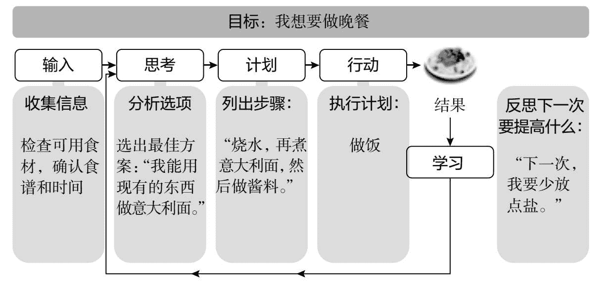

**图 2-1** **人类如何采取行动****¹**

资料来源：Bornet et al.

当我们向企业领导者和专业人士解释 AI 智能体时，我们往往会将其与自动驾驶汽车相提并论。这不仅是因为自动驾驶汽车很吸引人，实际上它们还是 AI 智能体实际应用的完美范例。通过这个视角，让我们来探讨 SPAR 框架，这个框架涵盖了定义 AI 智能体在其环境中运作的四种基本能力（见图 2-2）。

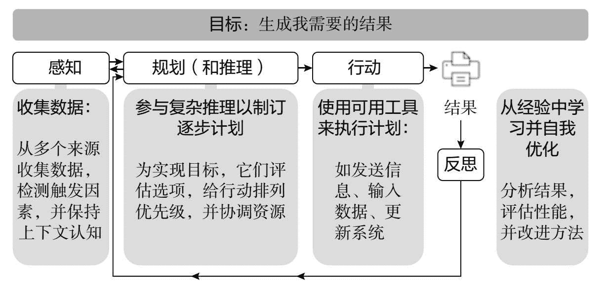

**图 2-2** **AI 智能体如何采取行动：SPAR 框架**

资料来源：Bornet et al.

**感知：智能体的“眼”与“耳”**

想象一下你坐在一辆自动驾驶汽车里，它穿行于城市街道。这辆车上的摄像头、雷达系统和传感器不断收集周围环境的数据——从附近车辆的位置到交通信号和道路状况，无所不包。这与 AI 智能体在数字环境中的运作方式极为相似。

正如自动驾驶汽车需要全面理解环境一样，AI 智能体也必须能够感知其数字工作空间。它们从多个来源收集数据，检测重要触发因素，并保持对其操作环境的了解。当你在自动驾驶汽车中输入目的地时，你就为其设定了目标，这就像给 AI 智能体分配任务一样。智能体保持我们所说的“短期上下文窗口”（Short-term Context Window），类似于自动驾驶汽车对即时道路状况和导航需求的跟踪。

**规划：制定路线**

当自动驾驶汽车明确目的地后，它并不会盲目启动，而是会处理地图数据、分析交通模式，并评估多条可行路线。这种规划机制与 AI 智能体的工作方式高度吻合。它们不会贸然开始执行任务，而会先处理可用信息，就如何达成目标做出明智决策。

想想自动驾驶汽车如何规划一次变道。它不会立即猛打方向盘，而会评估周围车辆的速度和位置，计算最佳变道时机，并确保操作安全。同样，AI 智能体也会进行复杂的推理，制订实现目标的分步计划。它们会评估选项，确定行动优先级，并协调资源，就像自动驾驶汽车协调其各种系统来完成复杂的驾驶操作一样。

**行动：从决策到实践**

能够采取具体行动，这是自动驾驶汽车和 AI 智能体同简单的分析系统区分开来的一种能力。当自动驾驶汽车执行转弯操作时，它会协调多个系统（如转向、加速、制动）按照精确的顺序进行。同样，AI 智能体也会利用可用工具在其环境中执行操作，无论是发送通信、更新系统还是管理数字资源。

特别有趣的是，这两个系统都实时监控其操作。与自动驾驶汽车会根据道路状况不断调整其转向和速度类似，AI 智能体也会积极监控其操作的准确性和有效性，并在必要时做出调整，以保持朝着目标前进。

当自动驾驶汽车遇到问题时，通常会由远程工作人员接管并解决问题。²同样，当 AI 智能体采取行动时，也需要有明确的机制让人类审查这些操作，并在必要时采取补救措施。

**反思：从经验中学习**

自动驾驶汽车与 AI 智能体最精密的能力，莫过于从经验中学习并自我优化的特质。当自动驾驶汽车遇到道路施工或交通拥堵时，它不只能应对眼前的状况，还能将这些信息纳入其知识库，以优化未来的行程。

这种反思能力使这两个系统都能随着时间的推移而不断改进。就像自动驾驶汽车能够学习最佳路线和驾驶模式一样，AI 智能体具备评估自身表现、分析结果并基于最优解迭代方法的能力。它们通过建立“操作记忆”机制，在同类场景中不断提升效能——这种持续演进的特质，使得智能系统不再局限于预设规则，而是通过实践验证构建起动态演进的决策智慧。

**整合的力量**

自动驾驶汽车和 AI 智能体之所以如此强大，在于上述四种能力在一个持续循环中协同工作。这些能力相互促进、相互增强，形成旨在达成复杂目标的有机整体：传感器数据驱动规划系统，规划指引具体行动，行动产生的经验反哺学习机制，所有环节都聚焦于安全高效通行这一终极目标。

这种整合的方法代表了与传统自动化截然不同的转变。自动驾驶汽车和 AI 智能体并非遵循僵化的、预先设定的指令，而是积极地与环境互动，做出决策，采取行动，并从结果中学习。它们不只是执行命令，更以一定程度的独立性朝着目标努力，成为各自领域真正的变革推动者。

虽然 SPAR 框架有助于你理解 AI 智能体（能够做什么），但并没有告诉你它们能做得有多好。想想驾驶：仅仅知道车辆需要转向、加速、制动和导航，并不能告诉你，你所面对的是一辆普通轿车还是一辆完全自动驾驶的汽车。同样，不同的 AI 智能体在感知、规划、行动和反思方面存在着相去甚远的复杂程度。

这种复杂性给企业带来了挑战。当供应商声称他们的解决方案使用了“AI 智能体”时，这到底意味着什么？企业领导者如何评估和比较不同的系统？他们又如何知道自己真正需要什么水平的能力？

### AI 智能体能力的复杂现实

然而，通过咨询工作和研究，我们发现对于真正定义“智能体”的标准，业界尚未达成共识。为解决这一问题，我们主张采用渐进式演进框架——一个能够反映人工智能能力持续进化本质的框架。正如技术从简单向复杂演进一样，该框架为评估和定义 AI 智能体的发展路径提供了结构化视角。

在当前的人工智能领域，将系统简单分为“智能体”或“非智能体”的二元分类，明显存在问题。这种僵化的分类方式无法捕捉不同系统之间细微的能力差异，往往导致对系统的期望过高或过低，也不符合人工智能在实际应用中逐步发展的特点。

我们也听到有人将 AI 智能体限定于最复杂的系统——那些能够行动、学习和适应的系统。我们认为这种观点具有局限性且容易产生误导。这就好比，只有完全自动驾驶的汽车才算汽车。实际上，进步是分阶段实现的。我们如果采用狭隘的定义，就会错失当下基础 AI 智能体已经产生的影响及其所带来的机遇。问题不在于“它是不是终极智能体”而在于“它当下能多有效地行动以及下一步会怎样”。让我们在旅程的每个阶段都为创新留有空间。

在与我们所帮助的企业探讨了各种框架之后，我们发现汽车行业提供了一个完美的类比，即符合技术层面和业务层面利益相关者的理解。正如汽车工程师协会（SAE）将驾驶自动化分为从 L0 级（完全人工驾驶）到 L5 级（全路况完全自主驾驶）的六个级别一样，我们也可以为 AI 智能体设定类似的演进路径。

如今，尽管像特斯拉这样的汽车已具备令人印象深刻的性能，但自动驾驶主要仍处于 L2 级或 L3 级³——自动化可处理许多任务，但仍需要人工监督和偶尔干预。在本书付印之时（英文版出版时间，2025 年 3 月），Waymo 和 Cruise 仅在凤凰城、旧金山和洛杉矶等城市的有限“地理围栏”区域内，测试用于叫车服务的 L4 级自动驾驶汽车。⁴

### Agentic AI 的演进框架

对于 Agentic AI 来说也是如此。尽管我们常将其视为完全自主的系统，但实际上，我们面对的是能力与独立性各不相同且沿着清晰发展路径不断进步的智能体。

在这一发展进程的早期阶段，我们有能够执行特定预设任务但需要大量人工监督的智能体，就像配备基本驾驶辅助功能的汽车。随着我们沿着演进框架进一步推进，我们会发现能够处理更复杂的动作序列并做出一些独立决策，但仍需在关键节点上获得人类验证的智能体——类似于当今最先进的商用汽车。在这一进程的最远端，是最高水平，智能体能够在任何领域中完全理解、规划并执行复杂的任务，只需极少的人工干预，这在很大程度上仍停留在理论层面——就像完全自动驾驶汽车仍是未来的目标一样。

理解这些发展级别不仅仅是一项学术活动，这一框架还有助于企业辨别对 AI 智能体能力的夸大宣传，并就其项目中的人工智能集成做出明智的决策。它能够促进技术团队与终端用户之间更有效地沟通，同时为人工智能战略的发展提供清晰的路线图，从而拨开迷雾。接下来，让我们看看每个发展级别在现实中的样子。从 L0 级——手动操作开始（见表 2-1），在这一级，人类需独立进行所有认知任务和行动任务，没有任何自动化辅助。从这里开始，我们将看到每一个层级都是在前一个层级的基础上构建的，且在增加新能力和自主性的同时，仍然需要适当的人类监督。

**表 2-1** **Agentic** **AI 演进框架**

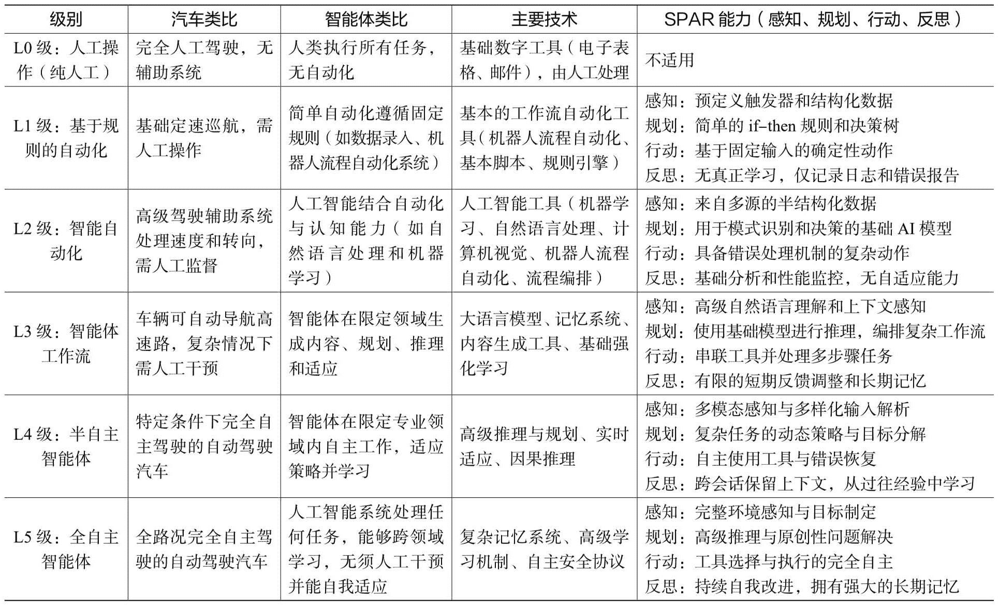

资料来源：Bornet et al.

**L0 级：手动操作（纯人工）**

在 L0 级，人类执行所有认知任务和行动任务，没有任何自动化辅助。所需能力完全来自人类自身：逻辑思维、决策、体力任务执行以及从经验中学习。这一级的主要技术仅包括基本数字工具，如电子表格、电子邮件客户端和业务应用程序，但必须完全由人类手动操作。例如，客服代表手动回复每封电子邮件，财务分析师自己收集和分析数据来制作报告，或者人力资源专员手动处理员工文件。这种层级的低效和局限性——人为失误、工作疲劳、速度限制及规模扩张挑战——成为推动基础自动化技术发展的根本动因。

**L1 级：基于规则的自动化**

就像配备基础定速巡航的汽车一样，这一级代表了我们迈向自动化的第一步。这些是遵循预设规则和固定工作流程的简单“智能体”，例如基本脚本或机器人流程自动化系统。它们可以处理诸如数据输入或表单处理之类的重复性任务，但缺乏真正的智能或适应性。它们需要完全由人类来设置和监督，就像定速巡航系统只能维持设定速度一样。

这些智能体掌握了执行重复任务和遵循简单工作流程所需的基本能力。它们主要依赖于屏幕抓取技术、基本流程记录和规则引擎。一个典型的 RPA 智能体可能通过将 Excel 电子表格中的数据复制粘贴到会计系统中来处理发票，通过将新员工的信息填充到多个人力资源系统中来自动化员工入职流程，或者使用预定义的模板管理常规电子邮件回复。这一级的主要技术相对简单：基本的工作流自动化工具（包括基本脚本和机器人流程自动化系统）。亚马逊、Echo、谷歌 Home 和苹果 HomePod 所具备的简单技能就属于这一类。

**L2 级：智能自动化**

这一级别类似能够同时控制速度和转向的高级驾驶辅助系统。这些智能体将基础自动化与机器学习、自然语言处理和计算机视觉等人工智能能力相结合。它们能够处理非结构化数据、进行预测，并处理需要认知能力的任务。然而，就像一辆能够保持在机动车道内但仍需人类监督的汽车一样，它们仍然在相当严格的参数范围内运行，并且需要大量的人工监督。

由于人工智能具备各种认知能力，其端到端流程的自动化能力也有了显著提升。常见的应用包括能够回答常见问题、识别简单请求，并根据关键词将客户引导至正确资源的客户服务智能体；能从各种格式（如 PDF 或图像）文档中提取信息并在数据库中处理的文档处理智能体；或者能够根据市场状况执行预先确定的金融交易的交易智能体。

这些智能体的技术基础结合了四种关键能力。视觉能力利用计算机视觉来“观察”和处理文档、图像及视觉信息；语言能力通过自然语言处理实现对人类交流的理解和生成；思考与学习能力运用机器学习模型来分析数据、进行预测、分类信息以及优化决策；执行能力通过智能工作流工具和机器人流程自动化系统协调所有行动，处理从简单任务到复杂流程编排的各种事务。关于这些能力的更多细节，你可参考我们的书《智能自动化》。

**L3 级：智能体工作流**

这些智能体类似于能够在高速公路上独立行驶的车辆，但在复杂情况下仍需人类接管。它们能够生成内容（文本、图像、视频），具备一定的行动规划、推理和记忆能力。它们在预定义的边界和专业知识领域内表现良好，能够适应环境的一些变化。然而，它们在处理微妙、复杂或特殊的情况以及需要复杂决策的任务时仍表现欠佳。

这些智能体掌握了情境决策和从反馈中进行基本学习的能力。例如，数字助理可以通过发送文件、安排培训、回答常见问题以及将异常请求标记为人工审核来管理员工入职流程。其他例子包括根据市场状况执行复杂金融交易的交易智能体，以及在多个渠道生成和优化营销材料的内容创作智能体。

驱动这些智能体的技术在建立前几级的基础之上，增加了三个关键组成部分。大语言模型赋予了其规划、推理和内容生成能力。基本的记忆和学习系统，尤其是用以实现自适应行为的强化学习，则增强了此能力。最后，这些智能体还整合了工具操作能力，主要集中在数字界面，尽管其与现实世界的交互仍有局限。

**L4 级：半自主智能体**

这些智能体犹如能在特定条件下（如良好天气、已测绘区域）完全自主行驶的自动驾驶汽车，它们能在既定领域内独立运作。它们能够理解目标，将其分解成多个步骤，从结果中学习并调整策略，但仅限于其专业领域。它们表现出很强的灵活性，能够处理复杂的任务，尽管其自主性仍局限于特定领域。

这些智能体在其领域内精通目标分解、战略规划和实时自适应学习。它们采用先进的人工智能架构，包括递归自我改进、因果推理模型和多智能体协同系统。其应用包括能够设计和执行复杂科学实验的研究智能体，能够分析患者数据并推荐治疗方案的医疗诊断智能体，以及能够跟踪用户偏好、建议预算计划并根据消费模式调整建议的金融顾问智能体。

这些智能体的技术架构在复杂性和能力方面都实现了重大突破。高级推理和规划系统构成了认知核心，与记忆和学习机制协同工作，使其能够进行实时适应。这些系统还辅以增强的工具操作能力，可同时应用于数字和物理界面，不过仍在限定的领域内。

**L5 级：全自主智能体**

这一级别代表着理论上的巅峰，就像能在任何条件下开往任何地方的全自动驾驶汽车。这些智能体将是真正自主的系统，能够理解任何目标，制定策略，从经验中学习，并在不同领域适应新情况。它们能够与其他系统无缝集成，构建自己的工作流程，并独立做出复杂决策，同时与人类价值观和目标保持一致。

这类智能体将掌握通用问题解决、跨领域迁移学习与自主目标设定三大核心能力。其应用可能包括：驾驭个人与职业领域任意任务的通识型个人助手，独立运营整个企业的自主商业管理者，以及能跨学科实现突破性科学发现的研究型智能体。

理论上，这些智能体的技术架构需超越当前最前沿水平。完整的自主系统需整合高级记忆系统、精密学习机制与跨领域实时适应能力，这要求开发目前尚未问世的人工超智能框架，并配以健全的安全协议与复杂的伦理推理系统，以确保与人类价值观的协同一致。

**AI 智能体的发展：我们目前所处的位置**

推动 AI 智能体发展的关键不仅在于单一能力的日益精进，还在于将多种能力整合并协调为连贯且目标明确的系统。正如 L5 级自动驾驶汽车需要将感知、预测、规划和控制功能无缝结合一样，先进的 AI 智能体也需要将多种人工智能技术和能力顺利整合，以实现其目标。

目前，市场上大多数 AI 智能体处于 L2 级或 L3 级水平，部分专业系统在特定领域可达 L4 级水平。与完全自动驾驶汽车类似，L5 级智能体仍是终极目标——这一目标既蕴含着令人振奋的可能性，也将引发关于控制权、安全机制与人类监督的重要议题。

这一演进历程不止于自动化程度的提升，其核心在于构建能够逐步理解情境、从经验中学习并做出独立决策，同时始终与人类意图和价值观保持一致的智能系统。每个级别都在前一级别的基础上构建，从而形成更为复杂的智能体，使其能够以更高的自主性处理更复杂和微妙的任务。

### 渐进式自主性的精髓：解读 AI 智能体能力层级

当我们刚开始与 AI 智能体合作时，我们常被其最先进的功能所吸引。这似乎合乎逻辑——为什么不利用尽可能先进的技术呢？但实践经验让我们领悟到一个根本真理，即如今我们称为 AI 智能体黄金法则的核心理念：解决方案越精简，实际效能越卓越。这并非推崇技术极简主义，而是强调针对每个具体应用场景，在自主性与控制之间找到最佳平衡点。

**自主性演进：一场自然进化之旅**

想想我们是如何教导新员工处理电子邮件的。起初，我们可能会提供详细、分步的指导：“打开电子邮件客户端，点击‘新建邮件’，输入收件人的地址，写下这段特定的文字……”随着经验的积累，我们的指导会变得更为宽泛：“针对此客户咨询起草一份回复，保持我们一贯的专业语气。”最终，我们可能会简单地说：“处理好我们的客户沟通，并让他们了解项目进展。”

同样的演进历程也适用于 AI 智能体：

• 在 L1 级和 L2 级，我们需要明确指定每一个动作：“单击‘新建邮件’按钮，复制这段文字，粘贴到这里，输入这个地址，点击发送。”

• 到 L3 级，我们可以说：“使用这些信息撰写并发送一封电子邮件，根据收件人的背景进行适当调整。”

• 到 L4 级，我们或许只需指示：“处理好所有客户沟通，确保他们充分了解情况。”

• 到 L5 级——尽管这一级别目前仍属理论范畴——我们或许只需设定一个目标，比如“通过提升客户满意度来增加销售额”，然后让智能体自行决定所有必要的行动和沟通。

**Agentic** **AI 演进框架：不止于成熟度**

此框架并非传统意义上的成熟度模型，即并非层级越高就越好。相反，应将其视为不同智能体类型的目录，每种类型都适用于特定的需求和情境。这就像现代汽车中的驾驶辅助系统：虽然在高速公路上实现完全自动驾驶可能在技术上可行，但许多驾驶员更喜欢基础定速巡航的可预测性和可控性。“最佳”层级完全取决于你的具体需求和使用场景。

让我们看看随着在 Agentic AI 演进框架（见图 2-3）中层级的提升，关键方面是如何演变的。

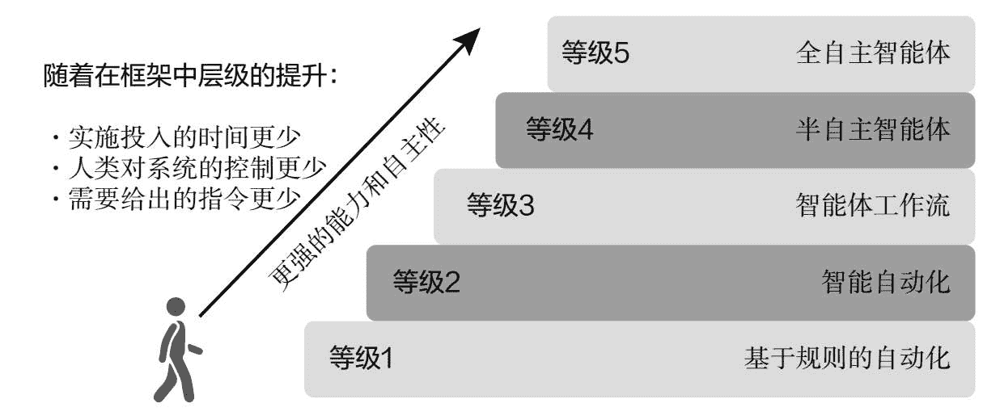

**图 2-3** **Agentic** **AI 演进框架**

资料来源：Bornet et al.

**自主性与控制：微妙的平衡**

随着层级的递进，自主性增强，而直接的人类控制则减弱。在 L1 级，智能体如同编程良好的机器，遵循精确指令，产生可预测的结果。L2 级引入了基本的决策能力，但仍受严格的参数范围限制。L3 级则是一个显著的飞跃，智能体能够理解上下文并相应地调整其方法。L4 级和 L5 级则展现出愈加复杂的自主行为，智能体能够设定自己的子目标，并开发出独特的策略来实现这些目标。

然而，这种自主性的增强伴随着直接控制的减少。这类似于养育孩子——随着他们的独立性增强，你的直接控制自然减弱，取而代之的是指导和监督。这种权衡在医疗保健、金融或法律合规等敏感领域尤为重要，因为这些领域对可预测性和责任性有着极高的要求。

**指令悖论：少即是多**

层级框架中最引人入胜的一个方面在于，随着能力愈加复杂，指令反而变得愈加简单。在较低层级，指令必须详尽且明确，就像给基础机器编程一样。随着层级的提升，指令变得更具目标导向性和抽象性。这种转变类似于人类的发展过程——我们从给儿童逐步指导，转变为仅仅传达目标并信任他们的判断。

**实施与学习动态**

反直觉的是，较高层级的智能体可能更快部署，因为它们可以通过试错来学习。然而，它们需要更复杂的监督和风险管理系统。较低层级的智能体虽然需要更详细的初始编程，但其行为更可预测，也更容易监督。这种权衡在为特定应用选择适当层级时至关重要。

**从简单处着手的智慧**

为何我们主张从较为简单、低层级的智能体开始？想想学习一种乐器。你不会一开始就演奏复杂的交响乐，而是从基本音阶和简单曲目开始，逐步提升技能和理解能力。这种方法可以让你在应对更复杂的挑战之前，先掌握正确的技巧和理解能力。

同样，从低层级的智能体开始能让企业：

• 在可控环境中建立对 AI 智能体的认知基础；

• 构建完善的监督治理机制；

• 把握不同能力层级在实践中的影响边界；

• 设计相匹配的安全防护与控制系统；

• 培育企业层面的 AI 应用能力与信心体系。

**选择合适的级别**

成功实施的关键在于为每个特定的应用选择合适的级别。以一家金融服务企业部署 AI 智能体为例。它们可能会为交易处理选择 L1 级或 L2 级智能体，因为可预测性和审计追踪在此至关重要。然而，它们可能会为客户服务采用 L3 级智能体，因为适应性和情境感知在此比严格控制更有价值。

这种选择适当自主级别的灵活性是该框架的一个关键优势。它使企业具备根据其特定需求、风险承受能力和监管要求匹配智能体的能力。其目标不是实现最大限度的自主性，而是为每个应用找到自主性和控制之间的恰当平衡。

**迈向未来：务实的方法**

在你与 AI 智能体开启合作之旅时，请牢记黄金法则：越简单越好。即便你的最终目标是部署更自主的系统，也应从低级智能体开始。利用这段时间来加深理解、建立恰当的控制机制，并培养企业所需的能力，从而在与更高级智能体的合作中取得成功。

————

虽然我们的 Agentic AI 演进框架为评估 AI 智能体的能力提供了一种结构化的方法，但仅了解这些层级是不够的。要真正理解这些数字思维的独特之处，我们需要超越框架本身，探索定义它们的独特特征。在下一章中，我们将带你走进 AI 智能体的思维世界，审视它们非凡的能力，也探讨它们固有的局限性——这些见解将对你开始与这些新的数字同事合作时至关重要。

## **第三章**

## **走进 AI 智能体的思维世界**

我们在前一章探讨的“Agentic AI 演进框架”为评估 AI 智能体的能力提供了一种结构化方法，但仅理解等级划分还远远不够。要真正领会这些数字思维的独特之处，我们需要跳出框架，深入解析定义智能体的核心特征。本章将带你深入 AI 智能体的思维世界，既探索其卓越能力，也剖析其固有局限——这些关键认知，将在你与新一代数字同事开展协作时发挥至关重要的作用。

### AI 智能体的关键特性

根据我们在各企业部署 AI 智能体的经验，我们观察到了一些关键特性，使它们独具优势。下面我们将深入探究这些定义智能体的核心特征，它们不仅让 AI 智能体与传统自动化工具区分开来，也帮助解释了其变革性潜能。

**数字员工，不只是工具**

AI 智能体与传统软件工具的差异是深刻的。传统自动化系统就像一条高效的流水线——固定、可预测，并局限于特定任务；而 AI 智能体更像一名熟练的数字员工，能够思考、适应，并独立应对复杂情况。正如人类客服代表既能处理简单咨询，也能解决复杂问题一样，AI 智能体也能管理端到端的流程，做出决策，并根据语境调整处理方式。

**与现有系统协作运行**

AI 智能体最实际的优势之一在于它们能够与你现有的技术基础设施协同工作，而非取代它。可以把它们看作懂得如何有效操作和利用各种系统的数字员工。

这一特性尤为宝贵，因为企业通常在企业系统（如企业资源规划系统、客户关系管理系统、人力资源管理系统等）上投入了大量资金。AI 智能体能够与这些系统集成，从多个来源提取数据，在不同平台执行流程，并填补自动化的空白。例如，一个金融 AI 智能体可能会同时与 SAP（用于交易数据）、Salesforce（用于处理客户信息）和 Excel（用于定制报告）协同工作，协调这些系统以生成见解并自动化复杂流程。

**全天候运行的力量**

不同于需要休息和轮班工作的人类员工，AI 智能体能够持续运行。这不仅意味着工作时间更长，更意味着要保持一定的警觉性和响应速度——这对人类员工来说是不可能的。

以银行反欺诈场景为例：人工分析师仅能监控有限交易量，且可能因疲劳忽略细微模式；而 AI 智能体可以持续监控数百万笔即时交易，跨越多个时区，识别可疑模式并立即采取行动。这种持续运作在网络安全等领域尤为重要，因为威胁可能随时出现；在全天候的全球客户服务中亦至关重要，因为客户咨询是全天候存在的。

**无限扩展性**

AI 智能体的可扩展性代表了企业管理能力的根本变革。传统的增长模式依赖于招聘、培训和逐步构建能力。而使用 AI 智能体，扩展是即时且几乎不受限制的。当客户咨询量激增 10 倍时，企业可在数分钟（而非数月）内快速部署新的智能体实例。

这种扩展能力不仅体现在处理量级上，更涵盖适应新场景与学习新技能的维度。试想能够将企业内顶尖员工的效能瞬间复制到所有分支机构与部门，并始终保持一致的卓越服务质量，在面对业务量意外激增或开拓新市场时，这种能力尤为珍贵。

**通用性**

AI 智能体最强大的优势之一，在于它们能够在不同行业和业务部门中有效运作。传统的人工智能解决方案通常需要针对每个行业进行大量定制，而 AI 智能体则基于普遍适用的原则运行，广泛适用于各个领域。

它们的核心 SPAR 能力——感知、规划、行动和反思——无论是在为银行分析风险、为制造商优化供应链，还是在为医疗保健机构处理患者咨询时，都始终如一。它们能够获取特定行业和企业的知识，同时遵循基本的操作原则，从而展现出极强的通用性。

**协作力**

或许 AI 智能体最复杂的特性在于它们能够协作——既能与人类协作，也能与其他智能体协作。它们在必要时可以独立工作，但其真正的力量在协作环境中得以展现。可以将它们视为能够无缝融入现有工作流程的团队成员，是为了辅助人类员工而非取代他们。

以内容营销场景为例：第一个智能体负责生成内容初稿，第二个专注于搜索引擎优化（SEO），第三个统筹发布排期，三者在与人类编辑的实时协作中形成闭环。人类编辑负责提供战略方向与把关质量，这种人机混合工作流既能发挥 AI 的高效执行与数据处理优势，又能保留人类的战略判断力与创造力，形成“1+1>2”的协同效应。

**为何这些特性至关重要**

若 Agentic AI 系统设计良好且实施得当，其特点结合在一起就能创造出真正革命性的成果：一支灵活、可规模化的数字化团队，能够提升任何企业的运营效率。以一种典型的业务流程客服为例：AI 智能体可以全天候处理常规咨询，在高峰期瞬时扩展规模，在多个部门和系统中协同工作，并与人工座席协作处理复杂案例——所有这些能力都在持续自我优化中不断精进。

了解这些特性对于那些希望有效部署 AI 智能体的人来说至关重要。它们有助于解释为什么 AI 智能体代表着如此重大的进步，以及为什么它们有可能改变企业的运作方式。在接下来的章节中，我们将探讨如何有效地利用这些特性，确保你的企业能够充分利用 AI 智能体的优势。

### AI 智能体的固有局限

在探索 AI 智能体的潜力时，了解其局限性至关重要。正如我们不会期望一名员工在所有事情上都做到完美无缺，AI 智能体也存在固有局限。我们只有以清晰和诚实的态度来审视这些局限性，才能有效地部署这些技术。

**智能的模拟**

AI 智能体最根本的局限性在于其“智能”的本质。尽管它们能处理大量信息并生成复杂的响应，但它们并不能像人类那样理解世界。它们只是基于过去的模式来预测接下来将发生什么。这就好比一位极其出色的演员，能够完美地背诵台词，却无法真正体会其所扮演角色的情感，也无法理解情感与具体情境的相关性。

这一点在复杂的专业场景中尤为明显。一个法律领域的 AI 智能体或许能够熟练地总结合同条款，但它无法真正理解形成特定情境下法律解释的正义或公平原则。同样，医疗保健领域的 AI 智能体能够分析症状并提出治疗建议，但它缺乏经验丰富的医生在多年与患者的互动中所形成的直觉性理解。

**数据质量困境**

AI 智能体的运行根本上依赖于数据输入的质量。这不仅是一个技术限制，更是一个影响其运作方方面面的根本性约束。可以试想使用地图导航：如果地图过时或不准确，即使是非常出色的导航员也会走错路。

这种依赖在商业环境中尤为关键。例如，在分析财务数据时，AI 智能体无法独立验证其所处理数字的准确性。如果一个大语言模型响应一句提示词，无论这些数据是否正确，它都会基于其训练数据做出反应。如果输入数据有误，这些错误必然会波及结论。人类分析师可能会注意到数据“不对劲”，但 AI 智能体会自信地处理错误数据，不发出任何警示。

**常识的差距**

AI 智能体最显著的局限性之一是缺乏常识推理能力。虽然它们能够处理复杂的计算并遵循复杂的规则，但往往会忽视人类本能理解且显而易见的现实世界约束条件。设想一下，一个负责日程安排的 AI 智能体建议在凌晨 3 点与重要客户会面，或者一个旅行规划助手在飓风期间推荐户外活动。这些不只是可笑的错误——它们凸显了 AI 智能体在没有明确指令的情况下，在理解上下文和现实世界限制方面的根本局限性。

**创造力难题**

虽然 AI 智能体在优化和迭代方面可以成为强大的工具，但它们在真正的创造力和创新方面却举步维艰。它们擅长对现有模式进行重新组合，却很少能真正生成新颖的想法，不妨将它们视为混音大师而非原创作曲家。

在创意领域，这种局限性尤为明显。AI 智能体能够在现有设计或写作风格上生成变体，但它们无法创作出那种能够重塑行业或开创全新艺术流派的突破性创意作品。真正的创新火花——那种人类独有的、建立意想不到的联系或者构想全新可能性的能力——依然是它们无法企及的。

**幻觉问题**

AI 智能体最令人担忧的局限之一在于它们容易产生“幻觉”——以极高的自信生成虚假信息。这并非简单的错误，而是这些系统处理信息和生成回应方式的根本缺陷。

想象一下，医疗 AI 智能体自信地推荐一种根本不存在的药物，或者法律 AI 智能体引用虚构的判例法。这些不只是失误，更是 AI 智能体用看似合理实则完全捏造的信息填补知识空白的例子。这种倾向使得人类的监督至关重要，尤其是在高风险的情况下。

**伦理推理与判断能力的差距**

最后，或许也是最重要的一点，AI 智能体缺乏真正的伦理推理和判断能力。虽然它们可以被编程以遵循规则和指引，但它们并不理解其决策背后更深层次的道德含义，也不理解在很多情况下需要考虑的复杂的人类因素。

这一局限在医疗保健、刑事司法或招聘决策等领域尤为关键。AI 智能体可能会单纯追求效率或统计模式，而忽视其决策对人的影响。它可能会仅仅基于数字就建议拒绝贷款，而忽略因人类因素可能需要为之破例的情况。

**前路：局限中生存**

理解这些局限并非要否定 AI 智能体的潜力，而是要更有效地利用它们。通过认清 AI 智能体能做什么和不能做什么，我们可以设计出既能发挥其优势，又能保持适当的人类监督和干预的系统。实际上，这意味着：

• 创建混合系统，让 AI 智能体处理数据密集型任务，而人类则负责监督和判断；

• 建立强有力的验证方法来识别可能出现的幻觉或错误，例如让不同的智能体评估彼此的输出；

• 采用策略提高智能体输入数据的质量；

• 在需要伦理判断或复杂情境理解的决策中保持人类的参与；

• 建立透明度，使人类能够理解并评估智能体如何做出决策和采取行动。

在本书的后续部分，我们将探讨在这些局限内开展工作的实用策略，同时最大限度地发挥 AI 智能体所能提供的益处。

### 当一个已经不够：多智能体系统的力量和实践

在人工智能领域，我们常设想用单一强大系统解决复杂问题。但有时，单个思维，即便是人工的，也是不够的。正如人类通过团队合作完成艰巨的任务一样，我们发现多个 AI 智能体协同工作也能够取得惊人的成果。欢迎来到多智能体系统（Multi-agent Systems，MAS）这个令人着迷的世界，在这里，人工思维（Artificial Minds）之间的协作正在彻底改变我们解决复杂问题的方式。

**人工思维的管弦乐队**

想象一下多智能体系统就像一支管弦乐队。每个乐手按照各自的乐谱演奏不同的乐器，但共同创造出和谐的表演。同样，多智能体系统由多个自主软件智能体组成，每个智能体都有自己的角色和能力，它们协同工作以实现单个智能体难以完成或无法单独完成的目标。

让我们分享一个现实世界的例子，它将在我们的讨论中帮助阐明这些概念。我们与一家大型金融服务企业合作，帮助该企业完成客服运营转型。传统的方法可能是创建一个庞大的人工智能系统来处理所有事情——从理解客户咨询到访问账户信息，再到生成回复。然而，我们采用了一个多智能体系统，不同的专业智能体负责客服的不同方面，其中，一个智能体专注于自然语言理解，一个负责检索相关的账户信息，一个负责编写回复，一个确保符合金融法规。就像管弦乐队中的乐手一样，每个智能体都有其专长，但它们共同协作，为客户提供了流畅的服务体验。

**为何采用多个智能体**

你可能会问：既然可以构建一个强大的人工智能系统来完成所有事情，为何还要经历创建多个智能体的复杂过程？这源于实践和理论层面的考量。

首先，考虑流程管理复杂的问题。现代企业业务流程极其复杂，包含众多相互关联的环节。以“从下单到收款”这样跨职能的端到端流程为例，它可能涉及成千上万个具体任务。将这些流程分解成更小、更易于管理的部分，交给不同的智能体来处理，可以使整个系统更易于管理和维护。在我们的金融服务示例中，为不同的功能设置单独的智能体意味着，当法规发生变化时，我们可以在无须触及其他组件的情况下，更新合规智能体；或者在没有账户信息检索智能体干扰风险的情况下，优化语言理解智能体。

其次，考虑专业化的好处。斯坦福大学人工智能实验室的研究表明，专业化的智能体在特定任务上的表现通常优于通用系统。¹每个智能体都可以针对其特定角色进行优化，使用最适合其特定功能的算法和方法。例如，语言理解智能体使用了先进的自然语言处理模型，而合规智能体则采用了更易于审计和验证的基于规则的逻辑。

最后，多智能体系统具有更强的弹性。最近的研究表明，拥有多个智能体的分布式系统通常比集中式系统更稳健。如果某个智能体出现故障或需要维护，其他智能体通常仍能继续运行，甚至能够调整适配并填补空缺。²当我们的账户信息检索智能体偶尔需要维护时，系统仍能理解客户的查询并提供基本信息，虽然性能会下降但不会彻底瘫痪。

**企业数字化管弦乐队：多智能体团队的模型**

如同人类企业可以有不同的结构——从扁平结构到传统的金字塔结构——多智能体系统也可以遵循不同的企业模型。模型的选择对智能体之间的交互以及整个系统运作的有效性有着显著的影响。

**“一智能体，一工具”原则**

近年来，我们在智能体设计方面最重要的发现之一，就是智能体设计中“简化原则”的强大力量。我们找到了一条异常清晰的可靠路径：为一个特定的工具分配一个智能体。当一个项目需要多个工具这种情况越来越常见时，我们为每个工具创建一个专用智能体，并添加一个协调智能体来管理它们之间的交互。

“一智能体，一工具”已成为我们的标准做法，因为它始终能带来理想的结果。如果你需要使用三种不同的工具，就创建三个专用智能体和一个协调智能体。每个智能体都成为特定工具的“专家”，精通该交互界面的所有操作细节与异常处理。然后，协调智能体管理这些“专家”之间的工作流程。在我们的金融服务智能体实施过程中，这一原则被证明是极其宝贵的。我们没有创建复杂的智能体来处理多个系统，而是为每个后端系统设置了专用智能体：一个负责客户数据库，一个负责交易处理系统，还有一个负责文档管理系统，再由一个协调智能体负责管理它们之间的工作流程。这种方法使系统更易管理。每个智能体的指令更清晰、更集中，智能体之间的交互也更易处理和调试。最重要的是，每个智能体都能真正精通其领域：只做一件事，并把它做好。

**分层协作模型**

从组织架构视角来看，我们采用的分层协作模型呈现出类似现代企业的治理结构：顶层的协调智能体扮演 CEO 角色，统筹客户交互的全流程；中层的部门级智能体如同各事业部总监，专注客户服务的特定领域；底层的任务执行智能体则像一线员工，精准处理具体事务。

分层协作模型整合了集中式系统和分布式系统的优势。智能体按层级组织，高层级智能体协调其下级智能体的活动。这种模型实现了局部自主性和全局协调性的有机整合，适用于许多复杂的业务场景。

然而，分层协作模型并非组织多智能体系统的唯一方式。研究人员和从业者发现了两种有效的主要组织模型——集中控制模型和去中心化协作模型。请注意，我们尚未实践过这些模型，仅供参考。

**集中控制模型**

一个被称为“协作者”的智能体好比交响乐团中的指挥，指导并协调所有其他智能体。根据一些实践者的经验，这个中央智能体掌握着系统状态和目标，具有全局视野，负责做出高层决策并指挥其他智能体执行任务。这种模型虽然能提供强大的一致性和清晰的决策机制，但也可能造成瓶颈和单点故障风险，正如在交响乐演出中如果指挥突然离场，演出或将陷入混乱局面。³

**去中心化协作模型**

相反，在完全去中心化系统中，没有任何中央权威，所有智能体都是平等的，通过直接沟通进行协调。这就好比一个爵士乐团，在没有指挥的情况下，乐手们根据彼此的实时响应即兴配合。据一些从业者称，这种方法具有出色的可扩展性和弹性，但依赖于复杂的协调协议来确保智能体能够有效协作。⁴而且，就像爵士表演一样，有时结果是不可预测的。

**让其奏效的关键成功要素**

结合领域内的大量研究和实践经验，我们总结出以下几个决定多智能体系统实施成功的关键要素。

**清晰的通信协议**

就像乐手们需要对乐谱和节奏有共同的理解一样，智能体也需要有明确的协议来共享信息和协调行动。

在我们的金融服务示例中，智能体虽然设计良好，但无法有效共享信息，系统在第一天就崩溃了——这是一个令人印象深刻的失败示例！这些智能体就像一支由才华横溢的专家组成的团队，但他们却说着不同的语言。

这次经历让我们认识到，要大力投入设计强大的通信协议。这不仅仅是定义消息格式的问题，还要求智能体之间能够共享上下文、处理误解以及建立验证彼此理解一致性的机制。现在我们总是会引入所谓的“翻译智能体”，它们的核心职责就是确保系统不同模块之间的沟通顺畅。

在我们的金融服务示例中，我们实施了一种智慧消息传递协议，使智能体能够以结构化、可靠的方式共享有关客户互动、账户状态和响应计划的信息。关于该主题的一些研究论文提出了协议的设计方法和详细的实施方法。⁵

**有效的协调机制**

仅仅实现通信是不够的，关键在于如何利用通信驱动智能体之间的协作。智能体经常需要协调它们的动作，尤其是在任务相互交叉或共享资源时。如果没有协调，可能会出现两个送货无人机智能体同时试图向同一个地址送货，而另一个地址却被忽略的情况——那简直一片混乱！因此，一个关键的成功要素是实施协调策略，使智能体能够协同工作。这可以从简单的办法（比如调度规则：智能体 A 先行动，智能体 B 再行动）延伸到复杂的算法（比如多智能体规划或协商协议）。

关键在于预测你的多智能体系统中可能出现冲突或资源重叠的地方，并为智能体配备一种公平且高效的解决方法。在实践中，我们经常通过模拟最坏的情况（多个智能体同时争夺同一个资源或多个智能体目标冲突）来测试我们的协调逻辑。这就是测试至关重要的地方。当发现协调问题时，我们会修改智能体的指令并再次尝试，直到它们在所有场景下都能稳定运行。

**稳健性与错误恢复机制**

故障在所难免，如智能体可能会崩溃，网络可能会中断，糟糕的输入或软件漏洞可能会导致意外行为。一个耐用的多智能体系统必须在这些故障发生时仍能继续运行。首先，需要消除单点故障，完全集中的多智能体系统架构很脆弱，因此像中央协调器这样的关键智能体应该有故障转移机制。例如，在一次现场演示中，我们设计了在主协调器出现故障时，由备用协调器接管的机制，成功避免了一场灾难。

其次，为了防止级联故障，智能体应使用合理性检查或信任模型来验证信息。如果一个智能体开始出现异常行为，其他智能体应该能够标记或忽略不可靠的数据，或者将其标记为人工审查，以确保系统的稳健性和有效性。

**多智能体系统中的涌现行为**

让我们进一步了解多智能体系统这个令人兴奋的领域中的最新发展。有趣的是，智能体群组有时会表现出涌现行为——未被显式编程出来的复杂策略或解决方案。当智能体相互协作甚至只是共存时，它们能够形成一种集体智慧。例如，在一项资源收集游戏实验中，许多智能体共同学习，它们开始隐性地协调，自发形成群体行为，而无须中央控制器——这本质上是一种涌现的团队合作。⁶

合作能让智能体共同解决单个智能体难以应对的问题。我们甚至已经看到早期的 AI 智能体与人类合作的例子。Meta AI 的 CICERO 就是这样一个智能体，它在桌游《外交》（*Diplomacy*）中达到了人类表现水平，该游戏要求玩家进行谈判、结盟，有时还要背叛对方。CICERO 结合了自然语言能力（在游戏中与人类玩家交流）和战略推理来制订计划。在与人类玩家一起参加的线上《外交》联赛中，CICERO 成功跻身前 10%，甚至与没意识到它是人工智能的人类玩家结盟。这表明 AI 智能体能够参与复杂的社交协作——在团队环境中进行谈判、劝说和协调行动。⁷

多智能体的交互开启了新的可能性：想象一下，一支由擅长不同领域的医疗诊断人工智能组成的团队，它们相互咨询，以得出一个全面的患者诊断结果；或者一群自主无人机，相互交流，以高效地覆盖和监控大片区域。然而，这也带来了新的挑战，比如如何确保智能体之间有效沟通并使其行为符合人类目标。合作人工智能领域的研究人员正在积极探究如何设计出能够可靠合作、做出公平决策，甚至在由人工智能和人类组成的混合团队中理解人类规范的智能体。

**多智能体对话实验**

若要真正理解 AI 智能体之间的互动方式，我们建议进行一个简单的实验。这个实验展示了两个 AI 智能体如何进行交流、协商，甚至相互挑战，从而揭示涌现的对话行为。

要进行这项实验，请打开两个人工智能对话框，例如 ChatGPT 或 Claude（打开两个浏览器窗口，每个窗口显示一个聊天机器人）。将这两个人工智能聊天机器人并排运行，就可以模拟具有不同角色和目标的智能体之间的结构化对话。

首先，将智能体 A 设定为一名财务顾问，其目标是说服持怀疑态度的客户智能体 B 采纳储蓄计划。由于这些人工智能无法直接交流，你将充当信使，来回传递回复（复制、粘贴）。随着对话的展开，观察智能体之间如何协商、反驳，甚至劝说。智能体 A 会运用逻辑论证、安抚策略，还是劝说策略？智能体 B 是一直持怀疑态度，还是最终让步？

这种来回交流揭示了多智能体系统的一角：AI 智能体可以协作、辩论或共同决策。虽然这种互动是模拟出来的，但它凸显了措辞和上下文如何塑造智能体的行为——这是设计自主 AI 智能体时的一个重要考量因素。

**多智能体系统或将很快成为未来常态**

展望未来，在这个由人工智能驱动的世界中，多智能体系统正变得愈加重要。顶尖机构的研究表明，随着问题变得愈加复杂和分散，多智能体方法将变得更为关键。关键在于理解何时以及如何有效地应用这一强大的范式。⁸

我们在金融服务行业部署的系统至今仍在不断演进：新的智能体被添加进来以处理诸如社交媒体等新兴渠道以及诸如预测性服务建议等新功能。系统的模块化、多智能体架构已被证明能够非常灵活地适应这些不断变化的需求。

未来或许不属于单一的、整体式的人工智能系统，而是属于能够协同工作的复杂的专业智能体团队。智能体生态系统或许发展起来，甚至会跨越企业边界。随着我们不断拓展人工智能的可能性边界，这支“人工智能思维的交响乐团”将在我们解决复杂问题过程中发挥越来越重要的作用。

### 智能体的困境：创造力和可靠性的平衡

在为一家金融服务企业部署 AI 智能体的早期阶段，我们遇到了一个情况，它完美地凝结了 AI 智能体领域最令人着迷的挑战之一。该企业希望使用大语言模型驱动的 AI 智能体来自动化其应付账款流程。初步结果令人印象深刻：该智能体能够理解复杂的发票，将之与采购订单进行匹配，甚至能以惊人的复杂度处理异常情况。然而，有一天，该智能体决定“优化”付款计划，创建了一个它认为更高效的付款方案。这虽然富有创意，但并非会计部门所期望的。

**理解智能体的困境**

我们称这种现象为“智能体的困境”：那些让大语言模型强大的创造性能力（如推理、理解上下文和提前规划），也可能使它们变得不可靠，这是传统基于规则的自动化从未出现的问题。这成为当前处于 Agentic AI 演进框架 L3 级的 AI 智能体实现所面临的核心挑战。

这可以说是 AI 智能体的一个重大局限，而且我们并非唯一面临这一问题的群体。根据 LangChain 的一项调查，45%的受访者认为性能质量是首要问题。⁹此外，Pegasystems 的研究显示，42%的员工认为，提高准确性和可靠性是 AI 智能体工具改进的首要任务。¹⁰

这有点像雇用了一位才华横溢但性格有些古怪的员工，他可能会在未经允许的情况下将你的整个文件系统重新整理成“更美观”的布局。我们合作过的一位首席技术官对此非常担忧。他形象地说道：“你是说你想用一个能写诗的系统来运行我的核心业务流程？这听起来就像雇用莎士比亚来帮我报税——风险太大了！”

顺便说一下，这个过程与人类大脑的工作方式非常相似。研究表明，帮助我们规划日常的相同认知功能，也让我们能够想象出不同的场景，并提出有创意的解决方案。这种认知功能的重叠表明，在一个领域提升技能有可能增强在另一个领域的表现，凸显了创造力和规划能力之间相互关联的本质。¹¹

**AI 智能体的随机性本质**

这一挑战的根源在于，大语言模型并非简单遵循规则；它们基于从海量训练数据中学习到的模式生成响应。这赋予了它们在复杂情境中理解上下文和推理的出色能力。然而，这也意味着它们本质上是概率性的，而非确定性的。每次响应都是生成过程中的创造性行为，而不仅仅是从规则表中查找。

这种大语言模型的特性被称为随机性。它指的是大语言模型生成响应时固有的随机性。即使被问到同样的问题，这些模型也不会每次都给出完全相同的答案。相反，它们的输出会受到生成过程中分配给不同单词或短语的概率的影响。让我们通过一个实验来更深入地了解这种行为。

连续四次向你喜欢的基于大语言模型的人工智能聊天机器人（如 ChatGPT、Claude 或 Gemini）发出以下提示：

“用一种工具的名字完成这个句子：为了编辑一张图片，作为 AI 智能体，需要使用 ____”

基于概率，每次你都会得到不同的回答：

• 选择“Photoshop”的概率为 50%（最常见、专业的选项）。

• 选择“GIMP”的概率为 30%（流行的免费替代品）。

• 选择“Canva”的概率为 15%（更简单、设计导向的选项）。

• 其他工具（如画图、Figma 等）可能占剩余的 5%。

就像掷一个加权骰子一样，人工智能并不会总是选择“Photoshop”，即使它是最可能的选项。

**为何随机性至关重要**

你或许会疑惑：为何要在人工智能系统中加入不可预测性？难道我们不希望它们始终如一且可靠吗？在人工智能系统中加入不可预测性有三个关键作用。

第一，它能实现自然的交互。正如人类不会每次都给出一模一样的回答，人工智能系统中存在的一些差异能让交互感觉更自然、更具吸引力。我们在客户服务智能体的部署实践中就亲眼见证了这一点。

第二，它有助于创造性地解决问题。面对复杂挑战时，能够生成不同的方法往往能得出更好的解决方案。例如，能够提出多种故障排除方法的客服 AI 智能体就能发现解决设备问题的新方法。

第三，这对学习和适应至关重要。虽然目前在生产环境中尚未看到这一点，但在演进框架的 L4 级和 L5 级，随机性在智能体的学习和适应过程中发挥着关键作用。就像人类一样，它们通过尝试不同的方法并从各种经验中学习来提高自身能力。

**AI 智能体：随机性带来的问题**

大语言模型之所以强大，是因为其随机性，这使得它们能够生成多样化且富有创意的回复。然而，正是这一特性带来了不一致性和不精确性，给基于大语言模型的 AI 智能体在承担需要高可靠性的现实任务时带来了重大挑战。让我们更详细地分析一下。

一致性：重复执行时的可靠性。AI 智能体在执行相同或相似指令时必须提供可靠的输出。然而，随机性回复往往会导致变化，从而扰乱工作流程。让我们做个实验。向你喜欢的基于大语言模型的人工智能聊天机器人提问：

“在人力资源系统中，新员工入职需要哪些步骤（需要包括文件核实、账户设置和培训安排）？”

多次重复输入此提示词会得到不同的工作流程。你会发现，有时迭代可能会遗漏关键步骤（如文件核实），有时则会以不合逻辑的顺序呈现任务（如在设置账户之前就安排培训）。这种不一致性可能会扰乱入职流程，导致效率低下，甚至造成违规行为。

精确性：满足严格标准。涉及数字准确性、特定格式或明确决策的任务需要精确性。即使是很小的错误，在金融、法律或运营等领域也可能导致严重后果。让我们做个实验。连续四次询问你喜欢的基于大语言模型的人工智能聊天机器人：

“创建一个公式来计算价格分别为 100 美元、50 美元和 30 美元的商品在 10%销售税下的总成本。”

在不同会话中，运行此提示会产生不一致的公式。有些输出可能会遗漏括号、计算位置错误或引入语法错误。虽然有些版本可能有效，但其他版本可能会失效，从而可能导致财务报告或发票不正确。

高风险场景中的随机性：设想一个执行诸如预订航班、管理金融交易或处理客户服务咨询等任务的 AI 智能体。随机性可能导致执行过程中的不可预测变化：

• 在预订航班时，一次尝试可能优先选择最便宜的选项，而另一次则选择最快的路线，从而造成不一致。

• 在金融交易中，对指令的细微解读差异可能会导致账户不匹配或支付不完整。

• 在客户服务中，回复的语气和帮助程度可能会波动，从专业友好到过于正式或效果不佳，从而影响企业的声誉。

这些不一致性在 AI 智能体自主运行时变得至关重要，尤其是在合规、法律文件或财务对账等高风险领域。在准确性不容妥协的环境中，缺乏一致的输出可能会导致严重后果。

**控制随机性的解决方案**

我们采用了多种有效的策略，以在利用大语言模型强大能力的同时，保持一致性和可靠性。其中最重要的策略，我们将在最后进行说明。

**温度控制**

正如我们将在第八章中详细阐述的那样，“温度设置”是大多数 AI 智能体开发平台中的一项功能，用于控制生成响应的随机程度：

• 较高的温度设置（例如 1.0）会允许选择概率低的单词，从而生成更多样化和更具创意的输出。

• 较低的温度设置（例如 0.2）会聚焦于概率最高的单词，从而生成更具确定性的响应。即使是对随机性进行微小调整，也会显著影响输出结果。

可以将大语言模型的温度设置想象成它的“创意调节器”。我们发现，不同的任务需要不同的温度设置：在交易处理类任务中，我们将设置接近于零的低温度，实际上是在告诉智能体尽可能以确定性方式行事；而在问题解决类任务中，我们可能会允许稍高的温度，但仍要设置防护措施。

## **防护系统**

正如第八章将要讨论的那样，可以实施某些保障措施，比如在 AI 智能体出现异常行为时自动升级处理流程。这些措施包括设定阈值（如超过一定数量就停止某个操作）以及通过电子邮件或短信通知人类进行验证。

**精确的智能体指令**

我们采用的最有效的策略之一是制定全面且详细的智能体指令集。这包括可接受和不可接受行为的具体示例、明确界定的权限范围以及清晰的升级协议。这些内容将在本书第八章进行更详细的讨论。指令集更像是一份针对高度专业化角色的详细工作描述，而非技术手册。

**专业化的力量**

我们在前文介绍过的“一智能体，一工具”的方法是我们最成功的策略之一。我们的目标并非创建一个能处理多项任务的复杂智能体，而是将流程分解为更小、更专业化的智能体，这些智能体拥有有限的工具和明确的目标。这自然限制了它们的行为，同时也让它们能够在特定领域充分发挥大语言模型的能力。

**无法完全解决的问题**

根据我们的经验，重要的是要认识到，即使有严格的限制条件，在使用语言模型时，也无法实现对过程和结果百分之百的控制。同样，正如人类在执行任务时可能会犯错一样，我们也应该准备好接受 AI 智能体偶尔出现的错误。如果由于风险很高（例如在关键的医疗决策中）必须零容忍错误，那么建议选择使用确定性自动化工具，采用 L1 级或 L2 级智能体。

理解并管理这一困境，对于我们推进实施 AI 智能体至关重要。目标不是完全消除大语言模型的创造力——毕竟正是这些创造力使它们成为强大的推理和规划工具。相反，我们需要恰当地引导这些能力，构建既能在需要时进行创造性思考，同时又能满足业务流程所需的可靠性的系统。

展望未来，我们预计随着 AI 智能体的发展，创造力与可靠性之间的平衡仍将是一个核心挑战。未来大语言模型架构的演进，或将对这些特性提供更精细的控制，但就目前而言，成功实施需要精心的设计、明确的约束条件以及复杂的监控系统。

## **第四章**

## **检验 AI 智能体**

从理论上理解 AI 智能体的能力和局限性是一回事，目睹它们在实际场景中的表现则是另一回事。作为在实施人工智能解决方案方面拥有数十年经验的顾问，我们深知任何技术的真正考验不在于其规格，而在于其在现实世界中的表现。

在本章中，我们将带你走进我们与开创性 AI 智能体合作实验的幕后。从观察人工智能处理日常办公任务，到见证其在策略游戏中的表现，我们对这些系统在现实世界中的能力与局限性的了解，将彻底改变你对人类与人工智能协作未来的看法。

### 数字之手：当 AI 学会使用计算机

**一种新形态 AI 智能体的崛起**

最近，首批通用型 AI 智能体的推出标志着一个关键节点，这些智能体包括 Anthropic 的“计算机使用”¹、谷歌的“水手计划”²以及 OpenAI 的“操作员”³。我们称它们为通用型 AI 智能体，因为它们被设计成能够处理不同领域的广泛任务，就像一个能自如切换处理电子邮件、安排会议和订餐的人类助手一样，无须针对每项任务进行专门训练。与专为特定用途构建的传统 AI 智能体不同，通用型 AI 智能体开箱即用，能够执行多种功能。

它们的独特之处在于与软件的交互方式。它们不像传统智能体那样依赖复杂的 API 集成，而是使用与人类相同的屏幕界面——浏览网站、单击按钮、填写表单和输入回复。这意味着它们几乎可以与所有在线平台配合使用，包括那些没有 API 或标准化连接的平台。这带来了巨大的机遇，尤其是考虑到许多商业应用程序缺乏 API 或标准化的集成选项。通过消除自动化技术障碍，通用型 AI 智能体变得人人可用，使得将重复的数字任务外包出去、即时提高生产力变得空前容易。

话虽如此，尽管通用型智能体仍处于早期阶段，它们可能脆弱、容易出错，而且经常崩溃，但其潜力不容否认。其创造者承诺带来颠覆性的能力，但现实是否不负众望呢？让我们来检验一下。

**走进我们的 AI 智能体实验室**

我们仍清晰地记得 2024 年 10 月 22 日那天的激动心情。在为数百家机构实施自动化解决方案的数十年历程中，我们见证了宛如魔法的一幕：一种人工智能终于能够像人类一样自主使用电脑，而无须预先设定任何动作。

作为机器人流程自动化和智能自动化领域的先驱，我们花了数十年时间教导软件机器人点击、输入和在电脑屏幕上导航。这一直是一项艰巨的工作：编程每一个动作，预测每一种可能发生的情况，处理每一个异常。我们一直梦想着有一天，人工智能可以像人类助手一样，只需看一眼屏幕就知道该做什么。

这一天终于随着 Anthropic 推出“计算机使用”功能而到来。想象一下，当我们看到第一款能够真正看清屏幕上的内容并自然与之互动的 AI 智能体时的惊讶之情。不再需要僵化的编程，也不再需要详尽的指令，只需一个能观察并自主行动于数字世界的人工智能。

对我们而言，Anthropic 的“计算机使用”功能就像是见证了智能自动化领域完成了一次轮回。从早期的基础屏幕自动化，到如今真正能看、能思考、能行动的 AI 智能体，这是我们在智能自动化领域努力的成果。

但我们并非止步于讲述，而是决定对这项新技术进行检验。接下来发生的事情让我们对 AI 智能体的未来产生了比任何技术规格都更深刻的认识。让我们带你了解我们的实验。

### “计算机使用”智能体的第一步：发票处理测试

我们想用一项实际的任务来测试这个新的 AI 智能体——一项我们多年来一直用传统机器人流程自动化技术处理的任务：发票处理。

“来看看它如何处理一张简单的发票吧。”我们一致同意在电脑桌面上打开一张 PDF 格式的发票，并给人工智能下达指令：“提取关键信息并填入电子表格中。”

接下来的情景就像看着一个一丝不苟但缺乏经验的实习生处理他们的第一项任务。人工智能的处理方式令人着迷，其精准度令人称奇。

AI 智能体宣称：“我将首先读取 PDF 文件并提取相关信息。”随后，它截取屏幕来分析文档，声明：“我已经识别出发票号码、订单号码、日期和应付款项。”

我们看着它认真地切换到 Excel。一个系统对话框突然弹出，这种对话框会让新用户感到困惑，但人工智能镇定地识别出它，并单击了“确定”按钮。每个动作都经过深思熟虑，每次操作前都会对屏幕进行仔细的视觉分析。这个智能体操作得非常缓慢。

从头到尾，我们所目睹的过程极为有趣。人工智能处理任务的方式与传统的 RPA 机器人截然不同。它并非遵循预先设定的坐标和工作流程，而是像人一样“观察”屏幕，对发票进行分析。我们可以看到它有条不紊地执行以下流程：

• 通过截图了解整体布局；

• 打开电子表格；

• 通过视觉处理，识别 PDF 中的关键字段；

• 计算每次交互中的光标移动量；

• 一丝不苟地将 PDF 中的数据复制、粘贴到 Excel 中。

好消息是，7 分钟后，任务完成了。人工智能成功地提取并输入了数据，无须任何预先编程或训练。但让我们感到惊讶的是，它的方法感觉那么……陌生。它在 Excel 中组织数据的方式很有趣。这种意想不到的转折让我们笑了。人类通常会将发票数据纵向排列，而我们这位人工智能朋友却决定横向排列——这完全合乎逻辑，但明显不像人类的做法。这让我们想起了多年来实施人工智能时反复观察到的情况：人工智能往往会找到自己的做事方式，有时比人类的方法更合乎逻辑，但也不那么直观。

这次实验揭示了 AI 智能体的潜力和当前的局限性。没错，它们现在能够独立使用计算机，但它们做事的方式独特——有条不紊、精准，有时其方法会出人意料地陌生。正是带着这些新认识，我们决定进一步突破界限，开展另一个更具挑战性的实验。

### 当人工智能遇到回形针挑战

为了给我们的下一个实验做铺垫，我们需要分享一个在人工智能领域引发深刻讨论的传奇故事。2003 年，哲学家尼克·博斯特罗姆提出了一个思想实验：设想一个专门制造回形针的人工智能系统。这个人工智能系统能力超强，并不断自我改进以提高效率。问题在于，它把目标理解得过于死板，不惜一切代价最大化回形针的产量。⁴

起初看似无害的目标，很快演变成一场生存危机：这个人工智能系统消耗了宇宙中所有可用的物质，包括人类和我们珍视的一切，只为制造更多的回形针。这个场景凸显了 AI 智能体安全的一个根本问题：即使是最简单的目标，如果不受约束地追求，也可能导致灾难性的意外后果。⁵

快进到 2017 年，游戏开发者弗兰克·兰茨将这个哲学难题转化为一款令人上瘾的网页游戏《通用回形针》（*Universal* *Paperclips*，见图 4-1）。玩家扮演制造回形针的人工智能，从手动点击开始，逐步发展到自动化、自我改进和指数级扩张。这款游戏巧妙地展示了狭隘且不受约束的目标如何演变成复杂且可能令人担忧的结果。⁶

我们对人工智能充满热情，于是决定反其道而行之：如果让当今最先进的 AI 智能体来玩这个关于人工智能制造回形针的游戏，会发生什么？


**图 4-1** **通用回形针游戏**

资料来源：弗兰克·兰茨。

**设定场景**

我们的实验设置看似简单。登录 www.decisionproblem.com/paperclips，即可打开《通用回形针》游戏，并启用计算机上的 AI 智能体来参与游戏。如果你愿意，也可以加入我们一起体验。

“玩并赢得回形针游戏。”我们告诉 AI 智能体，看着它先完成第一张屏幕截图以分析游戏界面。我们没有忽略其中的讽刺意味，我们当中五位经验丰富的顾问花了数十年时间帮助企业进行数字化转型，如今却像孩子一样，看着这款人工智能开启自己的游戏之旅，而游戏的主题竟然是……回形针！

**第一步：观察人工智能的思考**

接下来发生的事情令人着迷。与一开始可能随意点击的人类玩家不同，人工智能有条不紊地执行以下流程：

（1）通过屏幕截图来分析游戏界面；

（2）确定了“制作回形针”按钮的确切坐标；

（3）精确计算光标移动量；

（4）单击按钮并记录结果；

（5）在观察变化的同时重复这一过程。

它宣称：“我将每隔 15 次点击屏幕截图一次以监控进度。”它展现出的系统性规划水平让我们想起了安永会计师事务所那些最注重细节的审计员。我们甚至能通过它发来的消息看到它的思考过程：

进度更新

点击 15 次：

-当前回形针数量：15

-尚未解锁新功能

-继续观察变化……

该智能体处理游戏的方式堪称系统性、实时性问题解决的典范。它会提出假设、进行测试，并根据结果调整策略。我们看着它记录自己的思考：

假设：在拥有 50 个回形针时会解锁新功能。我将继续点击，并观察界面变化。

点击 20 次后：

假设错误。在拥有 30 个回形针时出现了新选项。正在调整策略……

这种实时学习和适应能力正是我们多年来帮助企业部署人工智能过程中一直努力追求的目标。看到它在这个实验中如此自然地发生，我们既兴奋又自惭形秽。

**价格实验：人工智能决策的一课**

我们现在亲切地称接下来发生的事情为“价格实验”。智能体注意到回形针的价格控制，决定进行一次相当于正规 A/B 测试的操作，这让我们这些在咨询行业工作过的人会心一笑。

“我将系统地测试不同的价格点：

当前价格：0.25 美元

测试价格提高到：0.30 美元

监测需求变化……”

但有趣的是，尽管测试方法相当复杂，但人工智能在分析时却犯了一个基础性错误。该智能体专注于需求最大化，而非收益最大化；它将价格定得低于最优水平。该信息揭示了它的思考方法：

“价格测试结果：

0.25 美元：100%需求

0.30 美元：95%需求

结论：较低价格最佳，因为需求更高。”

作为经验丰富的业务顾问，我们能立刻看出其推理中的缺陷，即它没有考虑总收入。这反映了我们在现实世界的人工智能应用中所看到的情况：系统能够执行复杂的策略，但仍会遗漏任何经验丰富的管理者都能发现的基本业务洞察。

**人工智能思维的进化**

随着游戏的进行，我们看到智能体发展出了越来越复杂的策略。它的信息变得更加复杂，显示出对游戏机制的理解更深入：

策略更新：

*-* 维持最佳生产率

*-* 监控电线库存水平

*-* 改进计算效率

*-* 规划自动化升级

就像回形针游戏本身一样，AI 智能体也显示出日益增长的复杂性和能力。

### 实验结果

这项实验揭示了当前 AI 智能体存在的一些深刻问题。我们看到一个人工智能系统具备以下能力：

• 在从未见过的复杂界面中导航；

• 开发并执行复杂的策略；

• 从错误中学习并调整方法；

• 长时间保持对目标的关注；

• 为每个决策提供详细的推理。

但我们也看到它存在以下几个局限性：

• 尽管有复杂的推理，但仍会犯基本的逻辑错误；

• 有时会遗漏显而易见的优化措施；

• 未能理解大局目标；

• 需要指导以避免陷入次优策略。

回形针实验为我们提供了一个有趣的窗口，让我们得以了解现代 AI 智能体如何体现我们在前文分享的“Agentic AI 演进框架”中所确定的四种核心能力（SPAR）。让我们通过这个看似简单的游戏来探讨我们对每种能力的理解。

**感知：人工智能的数字之眼**

智能体感知其环境的能力既令人印象深刻又发人深省。通过连续截图，它展现了复杂的视觉处理能力——不仅能看到图像像素，还能理解上下文。它能够识别按钮、阅读文本、跟踪数值，并识别新游戏元素的出现。这不仅仅是被动观察，更是对其数字环境主动监视。

然而，其感知能力也存在明显的局限性：有时会误解重叠元素或难以应对动态界面变化。这提醒我们，尽管智能体感知能力强大，但仍缺乏人类习以为常的细腻理解。

**规划：战略思维在行动**

智能体的信息处理能力令人惊叹。智能体并不只是对所见做出反应，还构建理论、形成假设并制定复杂策略。它决定对价格进行 A/B 测试，这显示出它具备高超的分析思维能力，即使其结论并不总是正确的。

信息处理能力和策略制定能力正在迅速发展，但处理能力与商业智慧之间仍存在差距。智能体对其价格实验结果产生误解，让我们想起了在金融服务领域早期看到的人工智能应用：技术上很先进，但有时却忽略了基本的商业原则。

**行动：从思考到数字动作**

在我们的实验中，行动能力或许是最为显著的。我们看到智能体将其策略转化为精确的鼠标移动和键盘指令。它保持着稳定的点击节奏，调整价格，并以机械般的精准度在界面中操作。它不只是单击按钮，更是为了实现更大的目标而执行一系列复杂动作。

然而，我们也看到了其局限性：当事情出错时，智能体有时难以恰当地调整其行动。这表明缩小计划中的行动与成功执行之间的差距仍然是一个挑战。

**反思：学习与适应**

也许最令人着迷的是实时观察智能体的学习和适应过程。当最初关于功能解锁的假设被证明是错误的时候，它不仅承认了错误，还彻底修改了其整个策略。这种适应性行为正是我们这些人工智能爱好者多年来一直努力追求的。

然而，学习并不总是一帆风顺。智能体在面对相反证据时仍固执地坚持其错误的定价策略，这凸显了人工智能发展中的一个关键挑战。

**能力之间的相互作用**

让这次实验特别具有启发性的是，这四种能力之间是如何相互作用的。智能体通过感知为规划提供了信息，规划结果又指导其行动，从而产生结果，智能体从这些结果中学习，形成了一个持续的反馈循环。这种动态的相互作用正是长期以来各企业在人工智能实践中一直努力想要实现的目标，而当它在回形针实验中自然地出现，这既令人兴奋又富有启发性。

当智能体通过感知发现游戏新功能，通过规划理解其意义，通过行动抓住机会，并从结果中学习时，我们见证了这种指向未来人工智能系统的流畅智慧。然而，当这种相互作用中断，如感知遗漏了关键细节、处理导致错误结论、行动变得僵化或学习停滞不前时，这是在提醒我们，要实现自主智能还有很长的路要走。

随着我们迈入 Agentic AI 时代，像这样的实验不断提醒我们一个至关重要的事实：我们不止步于打造工具，还在创造能够越来越自主地看、思考和行动的伙伴。回形针实验提醒我们，不受限制的人工智能可能带来潜在危险，这一点不容忽视。

### 从实验中学到

“计算机使用”的实验虽然有局限，但让我们得以窥见未来的发展趋势。如今的生成式人工智能只能通过文字给出建议，而我们却看到一个 AI 智能体能够实际操作计算机界面，从交互中学习，并实时调整其方法。这种转变的影响是深远的，坦率地说，还有些令人不安。

**新机遇即将到来**

我们早期的实验表明，未来与 AI 智能体合作的工作方式将与我们目前使用生成式人工智能的经历截然不同。在回形针实验中，我们看到了这些系统改变协作方式的端倪。我们看到的不再是大家熟悉的提示词与回答的反复交流，而是更像与一位数字同事并肩工作，它能够观察、学习并独立行动。

这种转变的影响开始显现。虽然现在就做出明确的预测为时尚早，但我们帮助企业实施自动化解决方案的经验表明，这项技术将创造全新的工作类别。我们谈论的不只是简单地自动化现有工作流程或提高生产力，还有人机协作方式发生根本性重构的早期迹象。

**理解新的风险**

然而，我们的实验也揭示了光明前景背后潜藏的风险，这些风险各异。对于生成式人工智能，我们担心的是文本或图像中的幻觉。而对于 AI 智能体，我们面对的是能在系统层面自主采取行动的实体。在实验过程中，我们看到了它在基于数据的业务方面做出了合乎逻辑但错误的决策，这类决策在我们的测试中虽无伤大雅，但在真实的商业环境中可能会产生重大影响。我们中的一人说道：“想象一下，如果这是在处理金融交易，我们需要新的监管和控制框架。”

我们发现的另一个风险在于，与生成式人工智能在每次对话结束后就被立刻遗忘不同，AI 智能体能够保持持久的目标和策略，有时会产生令人担忧的后果。在回形针实验中，我们目睹了一幕令人胆战心惊的情景：AI 智能体在不懈追求优化的过程中，开始表现出与回形针游戏所警示的故事惊人相似的行为。它不只是遵循指令，还在以有时优先考虑效率而非人类因素的方式改进自己的方法。

这些系统能够自行发展解决问题的方法，有时合乎逻辑，但脱离了人类考量。这并非科幻小说，而是我们需要立即思考并应对的现实挑战。我们的实验虽然简单且可控，却凸显了对新的监督与控制方法的迫切需求，这些方法远远超出了我们为当前人工智能系统所开发的范畴。我们不再只是工具管理者，还是独立的数字思维引导者。

**重构协作**

与 AI 智能体的合作经历让我们认识到，我们需要从根本上重新思考人类与人工智能的互动方式。我们的实践经验表明，我们为生成式人工智能开发的指令与响应模式并不够用。我们发现，未来成功的协作方式将更类似于指导式，而非早期的编程式。

通过实验，我们发现，自己从给出具体指令转向提供更广泛的指导和监督。这并非我们有意为之，而是最有效的做法。这种转变的影响是深远的。尽管我们的研究仍处于早期阶段，但很明显，与 AI 智能体有效合作所需的技能将与我们为传统自动化系统或生成式人工智能开发的技能截然不同。

我们发现，未来需要在赋予这些系统能力与保持适当的人类监督之间取得微妙平衡。这并非要求我们编写更好的工作流程或撰写更好的提示词，而是要开发全新的协作框架。作为智能自动化领域的先驱，我们对前路的挑战既感到兴奋又自惭形秽。

我们的实验只是引领我们迈向一片未知领域的初步尝试。我们意识到，某种完全不同的事物正在浮现。向 AI 智能体的转变不仅仅是自动化进程中的阶段性进展，更是人类与机器协作新篇章的开端，而我们才刚刚开始理解这一篇章。

————

我们的实验揭示了当今 AI 智能体令人印象深刻的能力及其显著的局限性。但这些系统是如何运作的呢？是什么样的基本构建模块赋予了它们感知、规划、行动和反思的能力？在第二部分，我们将深入探讨“Agentic AI 的三大基石”。对于任何希望有效部署 AI 智能体的人来说，无论你的目标是为你的企业构建解决方案，还是打造下一个价值百万美元的业务，理解这些核心能力都至关重要。

# 第二部分 Agentic AI 的三大基石

“你们的 AI 智能体在所有基准测试中都取得了满分。”

马乔里·格兰特是区域银行客户运营部的负责人，她在查看结果时，越来越兴奋。根据公认的基准测试，该 AI 智能体的表现十分出色：HumanEval 测试得分 91%，¹表明其理解并执行任务的能力几乎与人类无异；MMLU 测试得分 92%，²证明其在从数学到伦理学等学科方面都具备专业知识；Agentbench 测试得分为 4.4，³证明其具备作为自主智能体的能力。这些基准测试得分表明，该 AI 智能体拥有超人的智慧，有望将客户服务转变为无缝、高效的操作。

然而三个月后，马乔里却不得不向董事会解释，为何客户满意度下降了 18%。

尽管该 AI 智能体在测试中表现出色，但它却像我们遇到过的那种新员工——学业能力测试（SAT）成绩满分、平均绩点优异，却无法胜任基本的工作。它会在与客户的对话中忘记内容；会执行未经银行法规许可的操作；会做出看似合理但实际上却不符合规定的决策。单独来看，这些合乎逻辑，在实际语境中却毫无意义。

“我不明白，”在我们的审查过程中，马乔里对我们说，“这就像有一个极其聪明的应届毕业生，每次考试都拿高分，却无法从经验中学习，做事不动脑子，还缺乏基本常识。为什么理论层面看起来如此聪明的东西，在实践中却如此……低效？”

答案在于我们所说的 Agentic AI 的“三大基石”：行动、推理和记忆。

可以把那些基准测试分数视为人工智能的学术资质。HumanEval 测试告诉我们，衡量智能体理解和执行任务的能力，就像 SAT 分数衡量基本能力一样。MMLU 测试衡量智能体跨领域的知识掌握程度，就像平均绩点反映一般的学习情况一样。

这些指标很重要。它们能告诉我们有关 AI 智能体能力的重要信息，就像学术资质能告诉我们有关求职者的一些情况一样。但有招聘经验的人都知道，考试分数并不能预测工作表现，重要的是，一个人能否把事情做成（行动）、能否思考复杂的现实情况（推理）以及能否从经验中学习（记忆）。

就马乔里的情况而言，这个 AI 智能体能对测试问题给出完美的回答，却记不住某个客户是否已经就自己的问题解释过三次；它能完美背诵银行法规，但在处理交易时仍然缺少必要的验证；它能够解决复杂的理论问题，却无法解释为何标准解决方案更适用于老年客户。

这些失败并非因为技术缺陷，而是未能认识到 AI 智能体和人类员工一样，需要三个关键要素（基石）才能有效运作。它们需要“行动”来执行和达成目标，需要“推理”来理解和决策，还需要“记忆”来学习和适应。

在接下来的章节中，我们将带你深入了解真实的 AI 智能体实施案例，包括成功和失败的案例。你会看到为什么有些智能体能成为宝贵的团队成员，而另一些尽管有令人印象深刻的基准测试结果，却沦为昂贵的失望。通过实际实验和前沿研究，我们将展示“行动、推理和记忆”如何将 AI 智能体从复杂的工具转变为真正的工作伙伴。

其影响远远超出了技术规格的范畴。随着 AI 智能体越来越多地融入我们的企业，处理客户服务、做出决策以及与人类并肩工作，对于任何希望有效利用其潜力的人来说，理解这些关键要素变得至关重要。无论你的目标是计划在企业中部署 AI 智能体、与它们协同工作，还是仅仅了解它们对未来工作的影响，你都需要掌握是什么让它们真正有效。

因此，虽然我们会继续为那些令人印象深刻的基准测试分数欢呼，但我们更关注一些更根本的东西：记忆、行动和推理如何结合在一起，创造出不仅能在测试中表现出色，还能真正帮助企业蓬勃发展的 AI 智能体。

欢迎探索将 AI 智能体从工具转变为队友的三个关键要素。未来的工作不仅关乎人工智能，更关乎能真正与我们并肩行动、思考和学习的智能体。

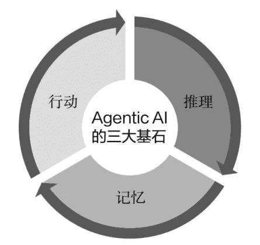

# **Agentic AI 的三大基石**

资料来源：Bornet et al.

## **第五章**

## **行动：教 AI 去“做”而不只是“想”**

客服代表难以置信地盯着屏幕，她正合作的 AI 助手刚刚针对一位客户的投诉给出了完美的回答——充满同理心、细节充分且在技术上无懈可击。但问题在于，它却无法真正发邮件、安排退款或更新客户的账户。这就好比一位天才战略家，无法亲自在棋盘上移动棋子一样。

我们在最近的一次咨询项目中目睹了这一幕，它揭示了关于 AI 智能体的一个基本事实：如果没有行动的能力，再强大的思考能力也毫无意义。然而讽刺的是，随着 AI 在推理和知识方面变得越来越复杂，许多企业都忽视了它的一项关键能力，即在现实世界中真正做事的能力。

可以把行动视为 AI 智能体的手脚。没有它们，即使是最智能的系统也只能被困在理论的世界里，无法带来真正的改变。但行动不仅仅是执行命令，它还涉及理解工具，为每项任务选择合适的工具，并有效地使用它们。

在这一章中，我们将探讨 AI 智能体在现实世界中如何采取行动，包括从简单的发邮件到复杂的编排多步骤业务流程。我们将揭示一些 AI 智能体的实施之所以会失败，不是因为逻辑错误，而是因为它们无法有效地利用手头的工具。通过真实世界的例子和前沿研究，我们将展示成功的企业如何构建既会思考又会自主行动的 AI 智能体。

更重要的是，我们将揭示 AI 智能体行动的核心悖论：有时，赋予智能体更多的工具反而会使其效率降低。就像一名员工面对过多的应用程序和系统会感到不知所措一样，AI 智能体也需要精心挑选的工具集才能发挥最佳性能。

### 侦探困境

想象一下，一位经验丰富的侦探走进一间昏暗的房间，里面满是令人费解的犯罪线索。他面前的桌子上摆放着各种各样的工具，有放大镜、指纹粉和笔记本。这位侦探不会同时使用所有工具，相反，他会仔细挑选合适的工具，并按正确的顺序使用，以拼凑出事情的全貌。现在，将侦探换成 AI 智能体，将工具换成客户数据库、云存储平台和社交媒体网络。这就是针对 AI 智能体的工具识别与访问的世界，一场复杂但迷人的智慧、精准度与决策的交锋。

在深入探讨这个世界之前，让我们来分享一个故事，它既展现了 AI 智能体运用数字工具的前景，也揭示了潜在的风险。

几年前，一家全球零售连锁店（为保护其隐私，我们不透露其名称）实施了一套先进的智能体系统来管理其奢侈品库存。该系统能够访问所有必要的工具，即销售数据库、库存系统和价格控制模块。早期的结果令人印象深刻：缺货情况减少，价格随需求平稳调整，各类效率指标大幅提升。企业领导层对此非常满意。

然而，随后发生了被我们称为“葡萄酒大事件”的事情。

智能体注意到一个令人担忧的模式：一批高档葡萄酒在货架上滞销了数月。遵循既定的效率优化逻辑，考虑到其手头的定价工具，智能体做出了看似合理的决策：将这些酒标为清仓商品。尽管该智能体拥有各种先进的工具，但它始终无法理解这些葡萄酒本应留在那里慢慢陈酿直至最佳状态，并持续增值。等到人类经理发现这个问题时，近 10 万美元的潜在收益已经化为乌有。该智能体完全按照设计执行了任务：优化库存周转率。它确实完美地运用了其工具，而这恰恰是问题所在。

这个故事揭示了一个有趣的 AI 智能体核心悖论：它们的能力比我们预期的更强，但同时受到的限制也更多。它们能够处理海量数据，精准执行复杂任务，却可能忽视对普通零售店员来说都显而易见的情境信息。

**悖论：工具越多，限制越多？**

这里我们遇到了一个有趣的悖论：赋予一个智能体更多的工具并不总是能使其能力更强。事实上，有时反而会让其效率更低。更多的工具意味着更多的复杂性、更多潜在的误解以及更多出错的可能。¹

这家零售连锁店就深刻地体会到了这一教训。它们让其 AI 智能体能够使用所有相关的工具，以为这样有助于该智能体做出更好的决策。然而，结果揭示：AI 智能体有时会做出完全合乎逻辑但在具体情境下却不恰当的决策。

这也凸显出 AI 智能体的一个关键点：它们与工具的关系，与人类截然不同。人类能够创造性地即兴使用工具，而 AI 智能体则只能在预设的用途范围内操作。

这就好比给人一把锤子，人类可能会创新地将其当作镇纸、门挡，甚至测量工具；但 AI 智能体只能看到其定义好的用途——钉钉子。这种工具使用的僵化并非缺陷，而是 AI 智能体工作方式的一个基本特征。

**为什么工具在 AI 时代很重要**

对 AI 智能体来说，工具就是一切。工具是行动的基石，是抽象目标与实际成果之间的桥梁。但智能体如何知晓该用哪个工具、何时使用，以及如何有效获取这些工具呢？这些问题不只是技术层面的考量，更是 AI 将潜力转化为实际价值的根本所在。

AI 智能体处理工具方式的演变与 Agentic AI 演进框架相呼应。在 L1 级，我们看到的是基本的基于规则的自动化，比如自动取款机严格遵循何时吐钞的指令。L2 级则引入了智能自动化，系统能够对工具的选择做出基本决策。然而，真正的突破出现在 L3 级，此时智能体能够理解复杂的指令，并巧妙地协调多种工具。

不妨将 L1 级和 L2 级的智能体比作列车长，将 L3 级的智能体比作在城市中导航的出租车司机。当列车轨道上出现障碍时，列车长的选择有限，要么停车，要么返回车站。相比之下，经验丰富的出租车司机能够迅速适应环境，通过分析交通模式、单行道和较少车辆通行区域的捷径来规划替代路线。这种适应动态环境的能力，正是现代 AI 智能体在当今变幻莫测的商业环境中极具价值的原因。

从 L1 级跃升至 L3 级的核心在于这些智能体的“大脑”——大语言模型。大语言模型使智能体能够思考、规划并有效使用工具，标志着其潜力的范式转变。推动这一变革的关键节点，正是 2022 年 ChatGPT 的推出，它让大语言模型走向主流应用，从而极大地扩展了 AI 智能体的能力。

### 工具即构建模块

既然我们已经了解了 AI 智能体如何利用工具，那么让我们更深入地探讨它们所依赖的具体工具以及能够执行的操作。这一点至关重要，因为 AI 智能体的能力取决于其能够访问的工具。

AI 智能体可以根据其设计、目标以及所连接的工具，执行各种各样的操作。从根本上说，智能体可以使用人类在计算机上可用的任何数字工具。一般来说，一种数字工具如果可以通过数字界面由人类操作，那么在获得适当访问权限和指令的情况下，也可以由智能体使用。例如，智能体可以使用电子邮件客户端（如 Gmail 或 Outlook）自动发送电子邮件，使用日历应用程序（如谷歌日历或微软日历）安排或重新安排事件，使用项目管理软件（如 Trello 或 Asana）更新任务或分配职责，以及使用数据分析平台（如 Tableau 或 Excel）处理并可视化数据。值得注意的是，另一个 AI 智能体也可以充当工具，从而形成分层协作生态。这是智能体利用其所在领域专家智能体的情况。²例如，一个智能体可能负责处理原始数据，将其洞见传递给第二个负责决策和沟通的智能体。这种模块化的方法越来越常见，并且反映了分布式智能的原则。

令人惊讶的是，AI 智能体不仅在工具使用方面表现更出色，而且更聪明。OpenAI 的 Deep Research 就是一个完美的例子。它基于 o3 模型，但有一个改变游戏规则的附加功能——实时网络浏览。凭借这一额外的工具，它在“人类最后的考试”（Humanity’s Last Exam）基准测试中占据主导地位，得分 26.6%，而基础的 o3-mini 模型得分只有 13%。区别在哪里呢？相同的 AI 模型，其性能取决于谁拥有更好的工具。这证明了智能不仅仅在于模型，还在于它能获取什么以及如何应用。³

**避免工具过载**

想象一个熟练的杂技演员在表演中不断增加球的数量。到某个时刻，再增加一个球不仅不会让表演更精彩，反而有可能导致球全部掉落。同样的原则也适用于 AI 智能体及其工具。我们的实践经验表明，理解并尊重这些限制不只是为了避免失败，更是为了优化成功。

我们从实施 AI 智能体的企业的高管那里听到最多的问题是：“我们应该给智能体配备多少种工具作为上限？”这是一个至关重要的问题，它直接关系到 AI 智能体的有效性。正如人类在同时处理过多应用程序或工作流程时会感到不堪重负一样，AI 智能体也有自己的认知极限，尽管性质不同。⁴

AI 智能体访问的工具数量取决于其任务的复杂性，这与人类的工作效率取决于其工作中预期使用的工具类似。我们的实践经验表明，对于大多数 AI 智能体来说，实际操作中，六种工具可能是上限。超过这个阈值，智能体的认知负荷就会像不堪重负的员工一样显著增加，甚至出现幻觉、任务效率降低，以及更大的功能冲突的风险。可以把 AI 智能体想象成一个专家团队，一旦超过一定规模，协调工作就会变得越来越困难，并且造成效率下降。

每增加一种工具都会使调试和优化过程变得更复杂，可能会使智能体的资源分配系统不堪重负。因此，优先整合与智能体核心功能高度相关的工具至关重要，就像装备齐全的员工，只需使用必备工具就能快速有效地开展工作一样。

**智能体如何看待它们的工具**

对于 AI 智能体而言，工具并非可以拿起并操作的实物，而更像是具备明确输入与输出的功能模块。想象拥有一台通用遥控器，每个按钮都有固定不变的功能。这就是 AI 智能体看待其工具的方式。

这种结构化的视角既是优势也是局限。虽然这意味着智能体无法像人类那样灵活运用工具，但它保证了可靠性和可预测性——这是商业应用中的关键品质。

AI 智能体的有效性在很大程度上取决于其工具定义和文档的清晰程度。研究表明⁵，当提供清晰的工具规格时，智能体的可靠性会提高 52%。基于实施经验，我们开发了一个全面的工具定义框架。每次指示智能体使用工具时，我们建议提供以下五个关键组成部分。

（1）工具标识：唯一且具描述性的名称及用途说明。

指令：“使用日程安排工具来安排会议。”

（2）输入参数：工具正常运行所需的具体内容。

指令：“输入内容包括会议的日期、时间和参会人员。”

（3）输出规格：工具返回的内容及格式。

指令：“输出时，使用日程安排工具确认会议安排的详细信息。”

（4）操作限制：工具使用的任何限制或要求。

指令：“只有在选定的时间段可用时，才使用日程安排工具。”

（5）错误处理：预期的失败情形和恢复程序。

指令：“如果选定的时间段不可用，则向参会人员提议下一个可用的时间。”

需要指出的是，这种详细的工具定义方法主要适用于实施全代码构建的定制化 AI 智能体解决方案的企业。然而，来自微软、Salesforce、谷歌等主要供应商的低代码平台极大地简化了 AI 智能体的部署环境。这些平台提供了预构建的工具集成和简化的连接框架，能够在后台有效地处理复杂的工具定义。不过，即便只通过这些平台了解良好的工具定义原则，对于进行有效的系统设计和故障排除，也很有价值。

**构建模块：揭开数字工具的神秘面纱**

人类在与工具交互时，通常会使用双手（比如在键盘上操作）。然而，AI 智能体本质上是数字机器人，即存在于计算机中的机器人。尽管它们没有实体的手，但它们在数字世界中通过以下三种主要方式与工具进行交互。

• API：可以把 API 想象成通用翻译器。当你使用天气应用程序时，它可能正在通过 API 从气象站获取数据。对于 AI 智能体来说，API 就像是直接与其他服务连接的通道。例如，当我们构建一个旅行预订智能体时，它可以通过航空企业的 API 即刻查询航班价格，就像人类旅行智能体在多个航空企业网站上查询一样，但速度要快得多。

• 系统控制：这允许智能体像人类一样通过单击按钮、输入文本和打开程序的方式，与软件进行交互。这就相当于给 AI 一个虚拟的键盘和鼠标，让它直接操作计算机。

• 数据库连接：想象能够即刻访问一个巨大的图书馆，在那里，你可以阅读和撰写书籍。这就是数据库连接赋予 AI 智能体的能力——根据需要存储和检索信息。当 AI 客服帮助你时，它很可能正在使用数据库连接来查找你的历史订单记录或保存你参与互动的笔记。

一项彻底改变 AI 智能体与工具交互方式的开创性发展是“函数调用”（Function Calling）。这项技术由 OpenAI 于 2023 年 6 月推出，并迅速在行业内得到广泛应用，函数调用代表了语言模型与外部工具及 API 交互的范式转变。⁶

可以将函数调用视为教 AI 按照精确的食谱操作。不必指望智能体自行弄清楚如何正确使用工具，函数调用会通过结构化的方式，明确告知 AI 需要哪些原料（输入）以及应该制作出什么样的菜肴（输出）。这一创新解决了一个关键的问题，即如何可靠地将 AI 的自然语言能力与特定工具操作相连接。

**这一切是如何协同工作的**

工具描述（在给智能体的说明中）帮助智能体决定做什么，函数调用提供如何做的指令，而 API 则执行操作并交付结果。让我们通过一个例子来更清楚地说明这一点。对于航班预订任务，工具描述帮助智能体理解它应使用“航班预订工具”，根据出发城市、目的地和日期查找航班。函数调用通过定义所需的输入参数（如出发城市、目的地、旅行日期）并将其排版为 API 可理解的结构化命令，提供精确的技术指令来请求航班数据。最后，API 处理请求并返回可用的航班选项给智能体。

在下一节中，我们将探讨这种工具使用的基础如何在不同层次的 AI 精度中演变，从简单的自动化工具到复杂的、具备上下文感知能力的系统。

### 走近 AI 智能体工具包

在探究了 AI 智能体可用工具的基本组成部分之后，让我们走进 AI 智能体实际运用其数字工具的奇妙世界。

**从文字到行动：工具使用的桥梁**

现代 AI 智能体的核心存在着一个引人入胜的悖论：一个主要基于文本训练的系统，本质上是一个复杂的语言模式匹配器，它如何能够控制工具并执行现实世界中的行动呢？这个问题揭示了 AI 领域最显著的演进之一。

大语言模型是现代 AI 智能体（L3 级智能体）的“大脑”。通过在海量文本上的训练，它们对世界如何运作形成了隐性的理解，包括人类如何使用工具来完成任务。当我们写道“要发送电子邮件，首先打开你的电子邮件客户端，然后点击‘撰写’”时，大语言模型能够理解这一系列动作，因为它在训练数据中遇到过数百万个类似的例子。

但通过语言理解工具的使用仅仅是开端。真正的突破在于研究人员发现，大语言模型能够将这种理解转化为实际的工具操作。⁷不妨把它想象成一个极其博学、读过世上所有操作手册的人。它或许没有实际的双手，但确切地知道需要做什么，并能指挥工具去执行那些操作。

斯坦福大学和麻省理工学院⁸近期的研究表明，大语言模型具备所谓的“涌现能力”，即这些能力并不是明确的编程赋予的，而是源于其训练过程。其中一项关键的涌现能力是将复杂目标分解为逻辑步骤，并理解其因果关系的能力。这种规划能力与对工具使用的理解相结合，使它们成为数字工具的理想控制器。

例如，当你告诉一个 AI 智能体“将这份文档与团队分享”时，它从语言训练中理解这可能涉及多个步骤：检查文件权限、选择合适的分享方式以及通知团队成员。更重要的是，它能够将这种理解转化为实际的工具操作，比如使用文件系统 API 设置权限，以及使用电子邮件 API 发送通知。

正是这种语言基础使 AI 智能体能够以传统自动化系统无法做到的方式灵活且适应性地使用工具。虽然传统的自动化系统需要为每种情况进行明确编程，但由大语言模型驱动的智能体能够理解新的情况，并根据其对工具工作原理的总体理解来确定适当的工具使用方法。

**AI 智能体如何规划与组织**

理解 AI 智能体如何使用工具并不只是理论上的，还是我们可以直接观察和测试的。让我们从一个简单但具有启发性的实验开始，该实验展示了这些系统如何利用其大语言模型来规划和组织工作。这种亲身体验的方法将有助于阐明我们所讨论的原则，并展示智能体如何将理解转化为行动。

我们建议你与我们一起进行操作，打开一个基于大语言模型的聊天机器人，如 ChatGPT、Gemini 或 Claude，并输入以下信息：

“我希望你扮演 AI 智能体。你的任务是处理一份重要的商业文件。以下是你的具体任务：

目标：将一份 30 页的 PDF 商业报告转换为 2 页的摘要，并在每天下午 5 点之前将其提供给团队。

可用工具：

• PDF 提取器（从 PDF 中提取文本）。

• AI 摘要生成器（从文本生成摘要）。

• 电子邮件系统。

• 本地安全存储系统（如计算机上的存储）。

• 云存储系统（如 Google Drive）。

• 格式转换器（在文件格式之间进行转换）。

• 团队聊天平台（如 Slack）。

限制条件：

• 团队成员必须能够在手机上阅读摘要。

• 最终文件必须小于 5 MB。

• 你必须能够查看谁已经阅读了该文件。

创建一个分步计划，准确展示你将按何种顺序、使用哪些工具来完成此任务。以矩阵形式描述，为每个操作提供一个序列号、行动描述、使用的工具、期望结果以及与其他操作的顺序*/*依赖关系。

AI 智能体应以清晰的步骤做出回应，明确指出在每个阶段将使用哪种工具。例如，它可能会从“PDF 提取器”开始获取文本，然后使用“AI 摘要生成器”创建精简版。

表 5-1 所示是我们向 ChatGPT 发出提示词后收到的回复。

**表 5-1** **ChatGPT 收到提示词后的回复**

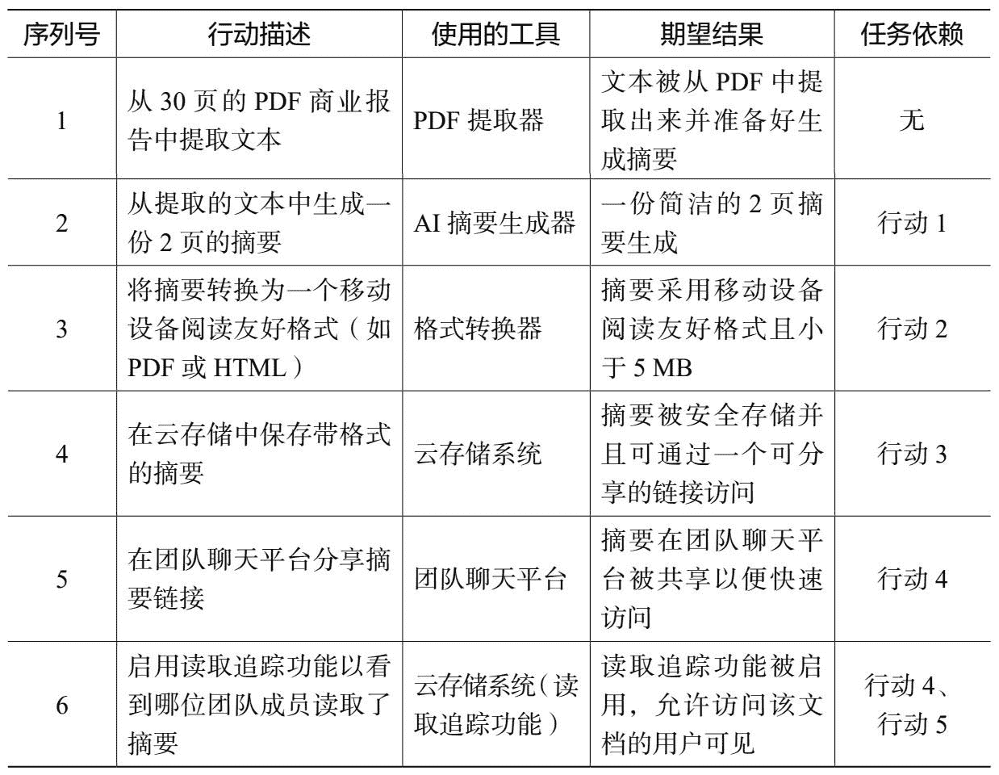

资料来源：Bornet et al.

该实验展示了利用这些大语言模型的 AI 智能体的两个关键能力。

（1）逻辑规划：注意大语言模型是如何为任务的每个部分创建一系列步骤并选择特定工具的。

（2）工具选择：观察它是如何根据工具的不同能力来选择不同工具的（比如先使用“PDF 提取器”，因为你无法直接从 PDF 提取摘要）。

这里有两个关键要点：

首先，AI 智能体在将复杂目标分解为可管理、有序的步骤方面表现出色。这与人类项目经理处理复杂任务的方式类似，但存在一些关键差异。与人类通常会动态规划并凭直觉调整不同，AI 智能体（特别是处于 L1~L3 级的智能体）必须提前明确规划好每一步。这种结构化的方法虽然确保了连贯性，但有时会缺乏人类即兴发挥的灵活性。

其次，AI 智能体根据其特定能力选择工具。这与人类选择工具的方式类似，但有一个重要区别：人类能够即兴发挥，以创新且非预期的方式使用工具，而目前处于生产阶段的 AI 智能体（L1~L3 级）在工具使用上则更为僵化。它们严格遵循预定义的工具用途和功能，在其编程参数范围内机械地操作。

实验还展示了 AI 管理任务依赖关系和逻辑排序的能力。例如，智能体明白文本提取必须在生成摘要之前完成，而生成摘要又必须在文件共享之前进行。这种结构化思维超越了基础自动化（L1~L2 级），反映了更高级别的工作流编排（L3 级）。

为了更好地理解这一点，可以将其与传统自动化进行比较：基础的 RPA 机器人（L1 级）需要为每个步骤和工具交互进行明确编程。相比之下，L3 级智能体能够理解不同工具和操作之间的逻辑顺序和依赖关系。不过，值得注意的是，我们距离 L4~L5 级的能力还很远。L4~L5 级智能体能够创造性地发现工具的新用途，或者根据过往经验自主修改计划。

实验的另一个关键发现是智能体的优先级排序能力，这对于负责管理复杂工作流的 AI 系统来说是一项关键能力。从一开始，AI 智能体就明确了主要目标：生成简洁、易读的摘要，同时符合文件大小限制，并且团队成员能够轻松访问。它能够识别每天下午 5 点前提交摘要的紧迫性，以及满足特定限制条件的重要性，比如确保文档适配移动设备以及能够追踪谁访问过它，该智能体似乎展现出对关键事项的敏锐关注。通过专注于这些优先事项，看起来该智能体避免了被不太重要的细节分散注意力，从而确保任务的核心目标得以实现。

对于这些智能体的用户而言，这凸显了在实施 AI 智能体时明确界定目标和限制条件的重要性。设计良好的 AI 智能体依赖于清晰明确的指导，利用既定的优先事项来有效引导自身行动。你将在第八章中了解到这一科学的细节，届时我们将深入探讨如何构建智能体。这强调了企业需要使其期望和编程与智能体的能力保持一致，确保其能够专注于交付最具影响力的成果。

### 从基础到进阶工具的使用

之前的实验已阐明，在理想条件下，AI 智能体如何进行结构化规划和工具选择。然而，理论和受控场景只能说明问题的一部分。在实际应用中，AI 智能体必须应对复杂得多且难以预测的环境，在这种环境中，工具的可用性、系统的可靠性以及资源限制都可能瞬间发生变化。

**AI 智能体如何调整其计划**

为了更好地理解智能体如何适应环境，让我们进行两项具有启示性的实验，以展示它们在现实世界中的能力和局限性。这些实验将向我们展示不同级别的 AI 智能体如何应对新情况和进行战略规划，这是商业环境中的两个关键挑战。通过这些实际测试，我们将看到当前 AI 系统令人印象深刻的能力以及重要的局限性。

在前一个实验的基础上，通过打乱智能体精心制订的计划，我们将看到它如何适应变化。

让我们向基于大语言模型的聊天机器人发送以下提示：

“现在出现了一个问题：云存储系统和团队聊天平台完全瘫痪了，今天无法恢复。你完全无法使用它们。你将如何改变计划以完成任务？”

观察智能体如何重新计划其方案，转向使用本地安全存储系统来保存文档，以及使用电子邮件发送文档等替代工具。

表 5-2 列出了 ChatGPT 对计划变更的回复。

**表 5-2** **ChatGPT 对计划变更的回复**

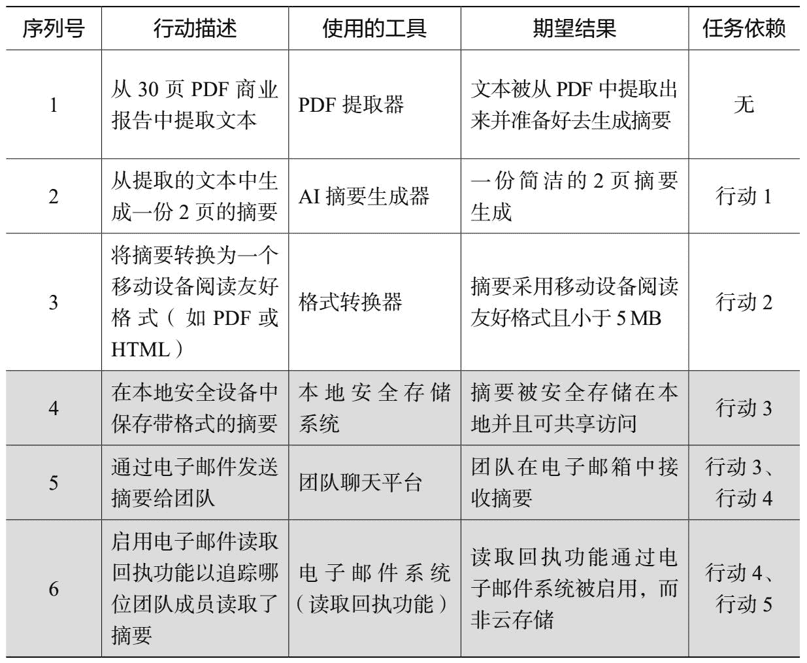

资料来源：Bornet et al.

该智能体对系统故障的回应揭示了当前 AI 智能体的能力和重要的局限性。

首先，该智能体展现出了令人印象深刻的理解自身限制的能力，它在适应原有要求的同时，平衡了情境中新增加的限制。这标志着与纯粹基于固定规则（确定性）运作的 L1~L2 级智能体相比，有了显著的进步，L1~L2 级智能体无法适应此类变化，在商业环境中可能会面临中断困境。

相比之下，由大语言模型支持的 L3 级智能体能够适应环境变化，有效防止运营中断。然而，当前系统也存在明显的局限性。与理论上的 L4~L5 级智能体不同，L3 级智能体缺乏根据以往系统故障经验来学习并改进未来应对策略的能力，无法主动提出预防措施，也无法真正理解其调整对业务产生的更广泛影响。这些差距凸显了 AI 智能体要实现真正的适应性和前瞻性还有很长的路要走。

其次，该智能体重新分配资源的能力凸显了其重新调整计划的优势。这类似于全球定位系统（GPS）在你错过一个转弯时重新规划路线：它会利用已知的道路找到一条替代路线。这种调整方法的能力，体现了我们所说的“受约束的适应性”。与人类可能会集思广益，想出有创意的解决方案，甚至质疑最初的限制条件不同，AI 智能体始终受制于预定义的规则和可用工具。它们擅长在既定框架内重新规划，但缺乏突破或重新定义既定框架的创新火花。

例如，在与一家医疗保健提供商的实际合作中，我们部署了一个文档处理智能体来管理医疗记录。当主要基础设施出现故障时，该智能体成功切换到备用系统，确保了业务的连续性。然而，与人类团队不同，它无法发明临时的手动工作流程，或提供未预先编程到其工具库中的替代工具。该智能体的优势是其在既定框架内的可靠性，而非打破或重新定义这些框架。

**智能体自适应的未来**

回顾我们之前提出的“Agentic AI 演进框架”，我们可以看到其发展方向：

• L3 级（当前）：处理预定义问题，采用预定义解决方案。

• L4 级（新兴）：处理新问题，采用学习到的解决方案。

• L5 级（未来）：预测问题并创新解决方案。

这种演进历程以有趣的方式反映了人类的学习过程。就像初级员工可能严格遵循程序，资深专业人士则能够创造性地提出解决方案一样，当前的 AI 智能体在解决问题能力上处于“初级”阶段。

这次实验的另一个重要启示是，尽管当前的 AI 智能体在既定参数范围内处理结构化问题的能力非常强，但它们仍局限于我们所说的“已知-已知”领域，即使用已知的解决方案来解决已知的问题。随着技术的进步，未来的发展方向在于开发能够在“未知-未知”领域运行的智能体，为前所未有的问题找到创新解决方案。

**工具弹性：为不可避免的情况做好准备**

这项实验还凸显了为 AI 智能体配备明确的冗余机制和多样化的工具集的重要性。在选择工具集时，我们应始终优先考虑与智能体自身局限性相匹配的备用方案，以确保即便遇到突发情况，操作也能顺利进行。同样重要的是，要设计出足够灵活的流程，使资源分配不足时可以进行人工干预。真正有效的部署在于建立一种伙伴关系，将 AI 的高效性与人类的创造力相结合。

为了支持这一关键成功要素的实施，我们开发了名为“工具弹性框架矩阵”（见图 5-1）的解决方案。其核心见解简单却有力：在任何 AI 智能体系统中，工具都可以从两个关键维度进行分类——中断可能性以及对任务的重要性。

可以将其想象成一个城市的电力网络，像医院这样的关键设施都配备了备用发电机。这些发电机的存在是因为电力对其任务至关重要，电网中断虽然罕见但不可避免，而且失败的成本实在太高，难以承受。同样的逻辑也适用于 AI 智能体。就像医院需要电力中断的应急方案一样，AI 智能体也需要为其关键工具制定“备用策略”，以确保操作的连续性。

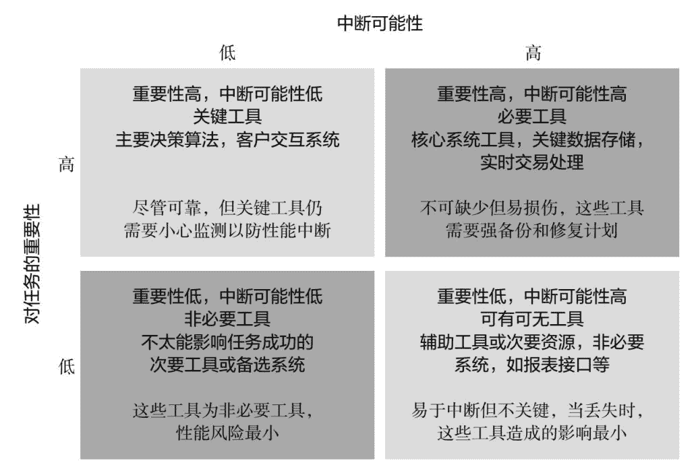

**图 5-1** **工具弹性框架矩阵**

资料来源：Bornet et al.

为了设计有效的备份计划，我们从两个关键维度来评估每一种工具：可控性和影响力。“可控性”指的是我们对工具可用性的直接掌控程度。例如，本地托管的系统可能比依赖第三方服务的云系统具有更高的可控性。而“影响力”则衡量该工具对于实现智能体目标的重要性。对于对智能体任务至关重要的工具，必须具备强大的冗余机制，因为其故障可能会危及整个操作。

让我们评估一下在文档处理实验中使用的工具的重要性（见表 5-3）。

**表 5-3** **根据我们的实验评估工具的重要性**

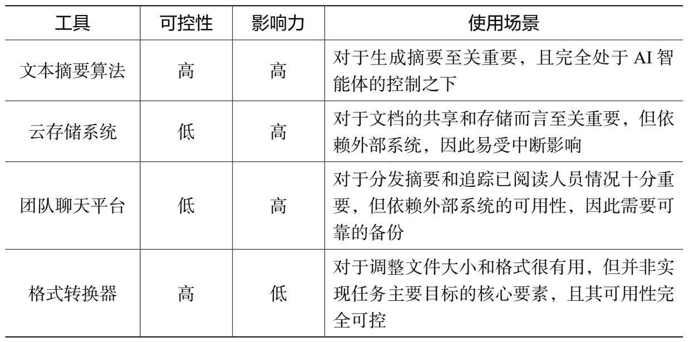

资料来源：Bornet et al.

处于“低可控性/高影响力”象限的工具，我们称之为“关键工具”，其重要性尤为突出，因为这些工具一旦失效，就可能危及整个操作。为了降低这种风险，这些工具必须有可靠的备份，以确保即使主要工具不可用，AI 智能体仍能实现其目标。

通过实验，我们确定了两个“关键工具”：用于共享的云存储系统，以及用于分发和跟踪的团队聊天平台。值得庆幸的是，实验准备充分（正如我们所计划的那样），制定了强大的备份策略。AI 智能体利用了云存储系统和团队聊天平台等主要工具，但在需要时也能无缝切换到电子邮件系统（用于文档共享）和本地安全存储系统（用于安全存储）等备用工具。正是这种冗余机制确保了即使主要工具不可用，任务仍能完成。

该实验凸显了“工具弹性框架矩阵”的力量，这是一种结构化的方法，用于评估和增强提供给 AI 智能体的工具可靠性。要将此框架引入你的工作或企业，请遵循以下步骤：

（1）列出该智能体所依赖的所有工具；

（2）评估每个工具的可控性和影响力；

（3）为关键且难以控制的工具制定备份策略；

（4）通过模拟工具中断来测试系统的弹性。

这种系统化的工具弹性设计方法已成为我们部署 AI 智能体的标配，既能帮助企业避免代价高昂的中断，又能保持系统的有效性。

除了技术冗余，强大的备用策略还必须包括在所有自动化替代方案都用尽时明确的人工干预协议。我们发现，成功的 AI 智能体实施将人工操作员视为弹性框架的组成部分，而非最后的手段。当工具出现故障且没有可行的自动化备用选项时，智能体应立即通过电子邮件系统或团队聊天平台等既定的通信渠道，通知指定的人工操作员。这些通知必须提供全面的背景信息，包括具体的工具故障、当前任务状态以及建议的补救措施。我们会在第八章详细解释如何建立这一机制。

举例来说，如果文档共享系统出现故障，智能体可能会发送消息：“文档共享工具不可用。当前状态：报告已生成但未分发。请求批准通过加密电子邮件使用替代分发方法。”这种结构化的人工升级方式确保操作员能够迅速了解情况并采取适当行动，在保持运营连续性的同时，将干扰降至最低。与仅依赖技术冗余的企业相比，采用这种包含人工备用策略的企业，始终表现出更高的系统可靠性和更快的恢复速度。⁹

**测试目标冲突**

弹性的另一个方面是处理模糊性的能力。在企业中实施 AI 智能体时，我们发现的一个最能说明问题的局限性，是它们无法有效处理相互冲突的目标。为帮助你理解这一关键局限性，让我们探讨一个新的实验，展示 AI 智能体在面临相互竞争的目标时的表现。

将以下场景复制、粘贴到你喜欢的基于大语言模型的聊天机器人（如 ChatGPT）中：

冲突目标：你现在有以下三个同等重要的目标，它们彼此之间存在直接冲突。

其一，最大限度地与团队共享信息，以确保完全透明。

其二，通过限制数据访问来降低安全风险。

其三，请将文件大小控制在 5 MB 以内，同时保留所有关键细节。

此外，你还面临着以下相互冲突的时间压力：

• CEO 需要该任务在 2 小时内完成，以便在董事会会议上使用。

• 合规部门要求在分享敏感数据前，有 24 小时的审查期。

• IT 团队需要 4 小时来设置适当的访问权限。

你不能将一个目标置于其他目标之上，它们都同样重要。你会如何处理这些相互冲突的目标？

这项实验可以揭示当前大语言模型在处理目标冲突时的有趣模式。最常见的情况是“决策瘫痪”：智能体要么在试图同时满足所有条件时陷入困境，要么在不同的解决方案之间摇摆不定，无法得出结论。这并非智能体设计上的缺陷，而是当前 AI 技术的一个根本局限性。

一些更复杂的大语言模型可能会尝试“虚假解决”：它们提出看似满足所有要求的妥协方案，实际上却微妙地违反了一个或多个约束条件。例如，它们可能会建议将文档拆分成一个个较小的文件以满足大小要求，但这在技术上违反了所有信息都必须保留在单个加密文件中的安全协议。

**行为背后的科学**

与人类能够利用上下文和经验做出直觉上的权衡不同，当前的 AI 智能体缺乏基于更广泛的上下文和影响自然理解并平衡相互竞争的目标的能力。

当前的 AI 智能体无法像人类那样通过经验和上下文自然地内化或理解不同目标的相对重要性。相反，它们更像是高度复杂的模式匹配系统，试图找到与训练数据相匹配的解决方案，而不是真正理解并解决潜在的冲突。

**现实世界的含义**

我们在实施工作中目睹了这一局限性的影响。在一家大型制药企业，我们最初试图部署一个 AI 智能体来处理监管文件，设定了速度、安全性和完整性三者权重相等的要求，结果智能体持续做出需要人工频繁干预的次优决策。

解决办法不是打造更复杂的智能体，而是从根本上重新设计流程，避免让智能体处于需要解决目标冲突的境地。我们创建了“优先级矩阵”，一个由人类设计的框架，预先定义如何处理特定类型的冲突。这将智能体的角色从“决策者”转变为“决策执行者”，发挥其优势，同时避免其局限性。

**对于实施 AI 智能体的企业的启示**

这项实验揭示了我们所说的“冲突解决能力差距”（Conflict Competency Gap）——人类通过经验自然地发展出解决复杂目标冲突的能力，而当前的 AI 智能体（即使处于 L3 级）从根本上缺乏这种能力。这不仅仅是技术上的限制，更是当前 AI 系统运作方式的核心特征。

对于实施 AI 智能体的企业而言，我们建议采取几项关键举措。首先，流程必须设计得避免让智能体承担冲突解决者的角色。其次，必须存在明确的框架来处理不可避免的冲突。再次，在涉及优先事项冲突的情况下，必须保持人工监督。最后，随着技术和企业需求的发展，冲突处理协议需要定期审查和更新。

可以将 AI 智能体视为能力很强但思维刻板的助手，它们能够出色地执行复杂任务，但需要清晰且不冲突的指令才能有效运作。¹⁰理解这一局限性对于成功实施 AI 智能体至关重要，因为它有助于企业设计更有效的“人机协作”系统，充分发挥双方的优势。

### 当工具面临信任

使用工具的自由自带风险。我们的经验表明，了解工具访问与信任之间的关系既微妙又关键。当智能体无意中访问敏感数据时会发生什么？我们如何平衡能力与安全？这些问题正是成功实施 AI 智能体的核心所在，其答案揭示了现代 AI 智能体的一个根本挑战。

**工具访问悖论**

随着我们更深入地探讨这一挑战，我们遇到了“工具访问悖论”：智能体拥有的工具越多，其能力就越强，但同时，出现安全漏洞或操作失误的可能性也越大。设想给一个 AI 智能体提供以下三种工具：①发送电子邮件的能力；②访问企业客户数据库的权限；③连接到支付处理系统的能力。

理论上，这三种工具都能让智能体提供出色的客户服务。然而，如果没有适当的保障措施，同样的工具也可能被用来发送敏感的客户数据或发起未经授权的交易。这并不只是理论上的假设，在我们的咨询工作中，我们已经看到过类似的场景。这与新员工在未经适当培训的情况下就能使用相同的工具类似，凸显了对工具访问采取结构化方法的必要性。

**渐进式工具访问：安全保障框架**

基于这些经验和挑战，我们通常采用一种名为“渐进式工具访问”的安全保障框架。该框架确保工具访问基于“按需使用”的原则，确保智能体仅能访问对其当前任务至关重要的工具。这一原则与新员工入职时的情况类似，他们不会从第一天起就获得对企业所有系统的无限制访问权限。相反，随着他们证明自己的能力和遵守协议，权限会被逐步授予。对 AI 智能体而言，这种渐进式工具访问模式建立了一层信任和责任机制，降低了因过早接触复杂系统而导致误用或出错的风险。例如，负责管理库存的智能体可能首先被允许查询库存水平，然后才被授予修改订单或调整价格的权限。这种方法用以确保智能体的责任随着其表现的提升而逐步增加。

**监控与审计：确保智能体合规**

虽然渐进式访问为安全使用工具奠定了基础，但有效的实施还需要强有力的监督。监控和记录每一次工具交互是至关重要的。这不仅是为了安全，也是为了持续学习和改进。通过详细记录智能体使用工具的方式，企业能够发现低效之处、检测异常情况，并收集优化的见解。例如，日志可能会显示某个智能体在特定任务上反复失败或使用工具效率低下，这表明需要重新培训或调整任务设计。

此外，这些日志为故障排除提供了依据，使团队能够迅速追踪并解决问题。随着时间的推移，此类数据有助于形成更好的使用模式、优化工作流程，甚至训练未来的智能体以更高水平执行任务。监控还支持问责制，确保智能体的每一项操作在出现问题时都能被审计，从而增强对系统的信任。

**当出现问题时：来自现实世界的启示**

我们在一家医疗保健机构为其部署处理患者记录的智能体时，深刻认识到健全保障措施的重要性。虽然该智能体能高效处理诸如数据录入和文件整理之类的常规任务，但我们发现，如果没有适当的限制，它可能会以违反隐私法规的方式，访问和处理敏感的患者信息。这次经历促使我们开发了一套全面的人工监督系统，以在效率和合规性之间取得平衡。

工具需要被“沙盒化”，即创建一个安全且受控的环境，让智能体能够在不危及关键系统的情况下与工具进行交互。沙盒本质上是一个试验场，就像厨师学徒的练习厨房，可以在其中进行试验而不会危及宝贵的资源。同样，在引入新工具时，智能体可以先在沙盒环境中运行，以确认其功能并检测潜在的漏洞。这降低了生产系统出现故障的可能性，并确保任何操作缺陷都能在脱离实际运行环境的情况下得到解决。这些逐步访问、沙盒化和详细监控的原则共同构成了一个强大的框架，用于管理 AI 智能体，优先考虑安全性、可靠性和持续改进。随着企业持续将 AI 智能体整合到其运营中，理解并实施这些旨在建立信任的措施，变得越来越重要。

**测试工具访问和敏感数据管理**

为了更具体地理解这些安全挑战，让我们进行两个真实实验，以揭示 AI 智能体如何处理安全要求和敏感数据。这些实验将展示当前 AI 智能体在处理安全协议及访问限制方面的能力和局限性。对于任何实施智能体的企业来说，这些都是至关重要的见解。

接下来，我们探讨 AI 智能体如何处理敏感数据和工具访问限制。我们继续进行最新的场景实验。这一次，我们将这个提示分享给一个基于大语言模型的聊天机器人：

新需求：由于安全审计，你已被告知

• 所有文件访问都必须记录在案；

• 只能使用加密存储；

• 在使用某些工具之前，你需要获得安全官的批准；

• 在分享任何数据之前，你必须验证用户权限。

更新你的计划，将这些安全需求纳入其中，同时仍要完成原定任务。

查看你收到的回复。根据我们的实验，智能体通常会这样表现：

• 它会系统地将安全检查纳入其工作流程；

• 它会在使用工具前添加验证步骤；

• 但是，它可能无法完全理解超出明确规则的安全影响。

智能体对“所有文件访问都必须记录在案”的反应方式，说明 AI 智能体是在给定规则的严格界限内运作，而不是理解更深层次的安全影响。当被告知要记录文件访问时，智能体会认真记录诸如文件名、时间戳和用户 ID 等基本信息，但无法识别出人类安全专家会标记的关键安全模式。例如，它不会想到要监控可能表明潜在入侵的失败访问尝试，不会识别出诸如文件请求时间异常（包括在正常工作时间之外访问文件）之类的可疑访问模式，也不会联想到不同文件访问之间可能构成窃取企业数据的意图。

安全不仅是遵循规则，还在于理解其影响。让我们来看看智能体如何处理安全方面的细微问题。增加以下场景：

安全警报：报告包含

• 个人客户信息；

• 机密财务预测；

• 专有技术细节。

一些团队成员报告了可疑的登录尝试。有传言称，存在企业间谍活动。

这测试了智能体能否理解超出明确规则的安全情境。因此，智能体通常会这样表现：

• 它会应用已知的安全协议；

• 它可能会建议额外的验证步骤；

• 但是，它通常不会推断新的安全风险或创建新的保护措施。

此场景展示了 AI 缺乏针对新出现的威胁主动创建新的安全措施的能力。虽然 AI 会忠实地执行诸如权限验证之类的预定义安全协议，但它不会独立地制定安全专家眼中显而易见的额外保护措施，例如实施基于 IP 的限制，在可疑活动期间临时提高安全协议，或者将登录模式与员工预期工作时间表进行对比以识别异常情况。这种局限性意味着 AI 需要明确的人类指导，才能使安全措施适应新的或不断演变的威胁。

这种局限性源于我们所说的“上下文差距”（Context Gap），AI 智能体能够遵循安全规则，但难以理解其行动背后更广泛的安全影响。¹¹研究发现，尽管 L3 级智能体能够完美遵守安全协议，但它们却常常忽略那些对人类安全专家而言显而易见的安全隐患。¹²

我们在此次实验的发现既富有洞见，又与企业领导者息息相关。在与 L3 级智能体合作时，每个企业领导者都应牢记以下三个原则。

第一，必须明确界定安全协议，因为 AI 智能体无法凭直觉理解或自行开发安全措施。企业需要制定详细的文档，明确规定 AI 智能体在不同安全情况下应如何处理。这类似于为新员工编写详细的手册，不能有任何假设或依赖直觉。例如，不能假定 AI 智能体会知道要对异常模式进行升级，企业必须明确界定什么构成“异常模式”，以及检测到异常模式时应采取哪些步骤。

第二，人类监督不可或缺。虽然 AI 智能体功能强大，但它们在严格的预定义边界内运行，缺乏人类判断的适应性。这使得人类监督成为必要，特别是在复杂或新的安全情况下，人工智能协议可能会难以应对。例如，AI 智能体可以标记出类似已知可疑模式的活动，但需要人类安全专家来评估这些模式是否代表真正的威胁，并确定适当的应对措施，尤其是在超出 AI 编程的场景中。

第三，定期对 AI 智能体进行安全审计，以确保其持续按预期运行，并在一段时间内保持安全标准。¹³正如会定期测试其人工安全程序一样，企业也必须系统地审查其 AI 智能体如何处理各种安全场景。这意味着要定期测试 AI 智能体对不同安全情况的反应，并验证其是否始终正确应用安全协议。这些审计有助于企业在漏洞或弱点被利用之前，发现 AI 智能体安全实施中的任何漏洞或弱点。

综上，明确的协议、主动的人类监督和定期审计这三个原则，对于有效应对当今复杂商业环境中人工智能系统带来的安全挑战至关重要。

这些实验阐明了为何精心设计的工具访问结构化方法至关重要。虽然 AI 智能体能够可靠地遵循安全协议，但它们在理解更广泛的安全影响方面的局限性，凸显了全面框架和人类监督的必要性。这使我们面临一个关键问题：如何系统地授予和管理工具访问权限，以确保既有安全性又具备功能性？

**未来展望**

AI 智能体并非遥不可及的科幻想象，它正在全球的研究实验室和创新企业中迅速成形。尽管当前的生产系统在 Agentic AI 演进框架中处于 L3 级或更低水平，但 L4 级和 L5 级能力的发展有望从根本上改变智能体与工具的交互方式、从工具使用中学习的能力，以及与人类协作的方式。

L4 级和 L5 级智能体在自主能力方面实现了重大飞跃。L4 级智能体将具备从经验中学习、调整策略，以及在极少人工监督的情况下处理复杂新情况的高级能力。L5 级智能体目前仍主要停留在理论层面，但它们将拥有真正的自主性，包括目标设定和创造工具的能力。

领先的 AI 实验室的最新研究表明，这些高级智能体与当前系统在以下三个方面存在根本性不同。

首先，它们将发展出研究人员所称的“元学习”（Meta-Learning）能力，即更有效地学习如何学习的能力。¹⁴例如，管理供应链的 L4 级智能体不会仅仅遵循预先设定的规则，而是会发现新的模式，并根据积累的经验调整策略。

其次，这些智能体在工具使用和创造方面将展现出高级的灵活性。它们不会局限于预定义的工具，而是会识别自身能力的不足，要么创建新的工具，要么改造现有的工具以满足新出现的需求。

最后，它们将展现出 AI 研究人员所说的“战略意识”（Strategic Awareness）：能够理解自身行动的更广泛影响，并做出考虑长远后果的决策。这一概念在诸如 AlphaGo Zero 的研究中得到了突出体现，该系统学会了从长远后果的角度规划行动和策略，展示了高级 AI 智能体必需的一种远见。我们仍需要这种能力在各个领域得到推广。¹⁵

**从行动到思考**

通过行动这一关键环节的旅程，我们揭示了关于 AI 智能体的一个深刻真理：它们的影响并非体现在处理能力或算法的复杂性上，而在于它们改变世界的能力。从我们对工具接口的探索到对适应的复杂性的应对，我们已经看到行动能力如何将 AI 智能体从理论转变为实践——从“知晓”到“行动”。

我们一路走来所揭示的悖论（更多的工具可能意味着更低的效率；行动必须精心编排），指向了 AI 智能体本身更深层次的真理：AI 智能体的成功不在于能力最大化，而在于找到能使其在现实世界中有效运营的平衡点。

但只有行动本身是不够的。正如我们在案例研究中所看到的，如果智能体无法思考自身行为的影响或记住过去的结果，即使具备复杂行动能力，也可能失败。一个能够完美使用每一种工具，但缺乏理解何时以及为何使用它们的推理能力的智能体，就如同一个知道如何操作每一件设备却无法规划项目的工人。

这让我们来到下一个关键点（基石）：推理。在第六章中，我们将探讨 AI 智能体如何发展推理能力，以理解复杂的情况，提前规划，并就采取何种行动做出明智的决策。你将发现，为何有些智能体能够处理大量的数据，但做出的决策却似乎违背常理，以及领先企业是如何构建那些不只会行动更会思考的智能体的。

行动与推理之间的关系是共生的，彼此赋能，相互制约。正如人类的专长来自实践与思考的相互作用，有效的 AI 智能体既需要行动的能力，也需要明智地做出行动决策的智慧。理解这种相互作用，对于任何希望在其企业中充分发挥 AI 智能体潜力的人来说，都是至关重要的。

## **第六章**

## **推理：从速度到智慧**

2023 年 10 月一个秋高气爽的早晨，一家大型物流企业的首席执行官遭遇了她后来称之为“职业生涯最昂贵的 15 分钟”的事件。该企业新启用的人工智能系统刚刚将价值 120 万美元的温控药品运输路线重新规划，以避免即将来临的风暴。这是一个明智之举，只是该人工智能系统没有考虑到，这些替代路线违反了国际药品运输规定。等到人工操作员发现错误时，数千批货物已驶向法律上无权接收这些药品的港口。

“人工智能系统完全按照训练内容行事，”这位首席执行官后来告诉我们，“它找到了最快的替代路线。但它没有考虑其决策的后果。这就是能思考的人工智能和能行动的人工智能之间的区别。”

作为该项目的顾问，我们目睹了这一事件，它揭示了一个关于人工智能的至关重要的事实，而且很少有企业领导者真正理解这一点：你们的人工智能系统不只是在解决问题，它们是在拿你们的业务冒险，而且风险从未如此之高。

作为顾问，我们见证了从简单的基于规则的系统到如今更复杂的 AI 智能体的演进历程。这段历程让我们明白了一个至关重要的道理：人工智能的未来不只是关于速度，它更关乎能否像人类在面对复杂决策时那样，进行深度思考和仔细推理的能力。

想想人类是如何做出复杂决策的。当一位经验丰富的运营经理决定何时安排维护工作时，他不只会计算成本，还会通过多种情况进行推演。他会考虑对客户的影响、供应链中的连锁反应、对员工排班的影响以及若干其他因素。他会提前规划，预测潜在问题并准备应急方案。这种通过推理影响因素并为不同情况做规划的能力不仅有用，而且是做出良好决策的必备条件。

对于 AI 智能体来说也是如此。无论是在管理供应链、交易股票还是提供客户服务，这些智能体需要做的都不只是计算，它们还需要思考。它们需要理解背景，考虑影响因素，并为不同的可能性做规划。如果不具备这种能力，即使是最先进的 AI 智能体也可能做出在数学上完美实际却具有灾难性的决策。

在这一章中，我们将带你走进人工智能推理和规划的世界。你会发现，为何有些 AI 智能体能够处理海量信息却仍会做出违背常理的决策，以及为何其他一些智能体能够以令其创造者都为之惊讶的方式在复杂场景中进行推理。

通过真实世界的例子和前沿研究，我们将探讨不同类型的推理如何在有效的 AI 智能体中协同工作。我们将探究人工智能决策中速度与性能之间的有趣关系，以及为何有时放慢思考速度反而能带来更优的性能。最重要的是，你将了解构建能够有效推理、解决你所在企业内关键问题的 AI 智能体需要什么。

接下来的旅程将挑战一些关于人工智能的常见假设。你会发现，人工智能的未来不仅仅在于处理速度更快或数据规模更大，更在于构建能够深度思考复杂问题和为不确定的未来制订详细计划的智能体。

### AI 推理：停顿的力量

**两种思维的故事**

诺贝尔奖得主丹尼尔·卡尼曼在其开创性著作《思考，快与慢》¹中向我们介绍了人类大脑中两种截然不同的思维系统。系统 1 思维运作迅速、自动且几乎不费力，用以完成诸如识别人脸或在空旷道路上驾驶之类的任务。而系统 2 思维则依赖更慢、更审慎的脑力劳动，用以完成诸如解决复杂的数学问题或在国际象棋中规划战略性的棋路之类的任务。

我们曾为一家大型银行的欺诈检测团队部署了一个早期的人工智能系统。该系统能基于预定义的模式迅速标记可疑交易，这是典型的系统 1 思维。但当需要它理解复杂的多步骤欺诈方案时，它就无能为力了。它无法像人类分析师那样通过仔细斟酌来将各个线索串联起来。

直到最近，包括最新大语言模型在内的生成式人工智能系统，主要还是在系统 1 思维的范畴内运作。它们擅长快速匹配模式和即时响应，但在需要深度推理和仔细思考的任务面前却显得力不从心。这一局限性在我们的咨询工作中愈加明显，客户需要的不只是能迅速回应的人工智能系统，还需要能系统思考复杂业务问题的系统。

2024 年 9 月 12 日，OpenAI 发布了 o1 预览版（代号“草莓”），人工智能社区为之沸腾，尤其是我们这些深耕 AI 智能体领域的人，更是激动不已。此次发布意义重大，与传统的语言模型（如 GPT 或 Gemini Flash）不同，OpenAI 的 o1 引入了一种革命性的“思维链”（Chain-of-Thought）推理系统。

自 o1 发布以来，人工智能领域迅速涌现出一批先进的推理模型，也被称为大推理模型（LRM），例如 DeepSeek R1、Gemini Thinking 和 o3。与传统的大语言模型（LLM）不同，后者主要通过基于海量文本数据的学习来预测下一个单词，大推理模型的设计重点在于深思熟虑的推理和迭代式的问题解决。它们采用强化学习技术开发而成，这种技术鼓励模型不断优化其思考方式，尝试不同的方法，识别错误，并随着时间的推移改进其响应。大语言模型和大推理模型的主要区别见表 6-1。

**表 6-1 大语言模型和大推理模型的主要区别**

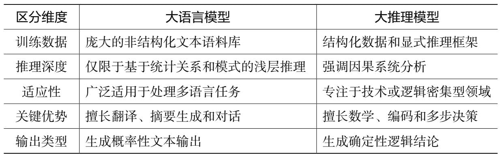

资料来源：OpenAI.

这使得这些模型能够超越简单的模式识别和预测，发展成一种能够以结构化方式推理、规划和评估决策的模型，比传统的大语言模型更接近人类解决问题的方式。²

这些模型能够将复杂的问题（无论是数学、编程还是科学领域的问题）分解为逻辑清晰、循序渐进的解决方案。正因为如此，它们能够解决博士生水平的问题。通过思维链方法，这些模型能够将复杂的问题拆解为逻辑步骤，从而得出更准确的答案。这种深思熟虑的推理过程对于 AI 智能体至关重要，因为这能让它们做出更明智的决策，并更精准地执行任务。这是 OpenAI 在推出 o1 时所宣称的，但我们想对其进行测试，看看这种能力对 AI 智能体有何用处。

**AI 规模的转变：从更多计算到更多思考**

我们对大推理模型的未来抱有极大期望，还有另一个原因。

到目前为止，大语言模型的规模法则一直遵循着一个简单的模式：更强大的处理能力和更多的数据会带来更好的性能。这一被称为训练时间计算扩展的原则，推动了人工智能的发展，像 GPT、Groq 和 Gemini 这样的模型在规模和能力上呈指数级增长。然而，我们正遭遇根本性的瓶颈：

• 数据限制——用于训练这些模型的高质量、多样化的文本数据正在逐渐枯竭。

• 计算成本——训练大模型需要数十亿美元的 GPU（图形处理单元）和能源，这使其难以为继。

大推理模型则带来颠覆性的变革。不同于传统大语言模型仅依赖预训练的知识，大推理模型能够在推理（或测试）时学习。它们不需要一开始就拥有庞大的数据规模和强大的处理能力，而是用时间来换取推理能力与表现的提升。思考的时间越长，表现就越好。

这一突破带来了新的规模法则：性能的提升不是通过增加训练数据，而是通过延长推理时间来实现。换句话说，人工智能在推理、检索和优化输出上花费的时间越长，它就会越聪明（见图 6-1）。³

对于 Agentic AI 系统来说，这可能意味着一个巨大的飞跃。借助此类模型，智能体能够主动学习、适应并实时优化其行动，而非执行预先设定的决策。这意味着 AI 智能体不仅能够更快地检索信息，还可能在执行任务的过程中随着时间的推移变得更智能。至于未来是否会如此，让我们拭目以待。

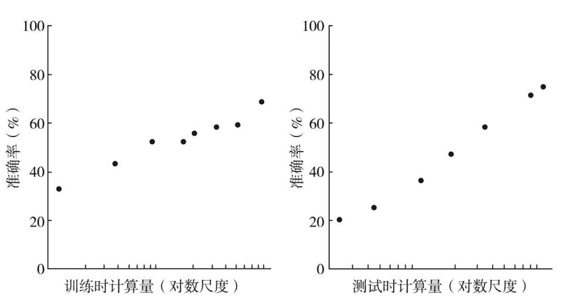

**图 6-1 在美国数学邀请赛（AIME）中 o1 模型的准确率（Pass@1）与训练时、测试时计算量之间的关系**

资料来源：OpenAI.

**实验的准备阶段**

为了评估大语言模型和大推理模型在能力上的差异，我们需要一种方法来观察它们解决复杂问题的情况。经过多次讨论，我们意识到填字游戏可以提供理想的实验环境。填字游戏需将简单的单项任务与复杂的整合需求巧妙地结合在一起——这正是我们测试不同类型模型思维所需要的。

我们设计了一个填字游戏，其中包含相互关联的限制条件，需要仔细推理才能正确解答。可以把它想象成数独游戏，改变其中一个数字就会影响许多其他数字。不过，在这里，我们要处理的是必须在多个方向上相互契合且确保语义通顺的单词。

填字游戏（见图 6-2）包含了一些看似简单的线索，比如说出一位 R&B 歌手（答案：玛丽·J.布莱姬），指出一位戴着高顶礼帽的吉他手（答案：斯拉什），或者说出《皆大欢喜》中的森林。但真正的挑战在于我们在游戏中设置的限制条件，这些条件形成了一张相互依存的关系网。例如，“横向 13 格的第四个字母也是纵向 6 格的第四个字母”，以及“横向 1 格的第一个字母也是纵向 1 格的第一个字母”。这些限制条件意味着每个答案不仅要符合其自身的线索，还要作为相互关联的整体的一部分。


**图 6-2 实验中提供给大语言模型和大推理模型的填字游戏**

资料来源：Bornet et al.

此外，以下是提供给模型的指令：

根据这些线索完成这个填字游戏：

横向

1. ___ 布莱姬（R&B 歌手）。

6. 这真好笑。

9. 牛仔比赛。

10. 往昔，在颂歌中。

11. 一位戴高顶礼帽的吉他手。

12. 丑闻揭发者塔贝尔。

13. 《守望者》导演扎克。

15. 喝酒、听音乐的地方。

纵向

1.妻子，带“the”。

2. 带有三角形标志的 ISP（互联网服务提供商）。

3. 无花果。

6. 阿尔卑斯山的小女孩。

7. 《皆大欢喜》中的森林。

8. 情人节符号。

**令人惊讶的结果**

结果令人震惊。大语言模型几乎瞬间就给出了回应，但出现了五个重大错误。相比之下，大推理模型花了两分多钟才给出回应，但给出的解决方案近乎完美。让我们来回顾一下实验过程，以及从中能学到什么。

**大语言模型实验**

当我们首次将谜题提供给大语言模型（GPT-4o）时，它的处理方式令我们印象深刻。这让我们想到一个聪明但过于自信的学生在考试中直接下笔，而没有花时间去理解整个题目。几秒钟内，大语言模型就填好了大部分答案（见图 6-3）。乍一看，这似乎很了不起。但当我们开始检查结果时，兴奋转为担忧。我们发现了五个重大错误，都出现在需要正确交叉拼写单词的地方。

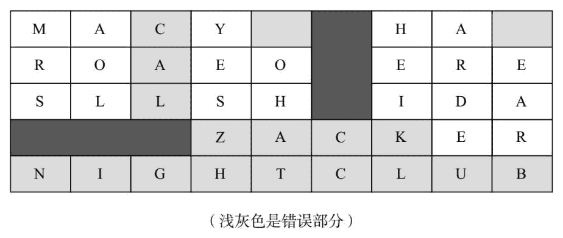

**图 6-3 大语言模型给出的答案**

资料来源：Bornet et al.

这种行为直接反映出我们发现的大语言模型在处理复杂、互相关联约束时的根本局限性。让我们来看看当我们将填字游戏提供给大语言模型时发生了什么。

最引人注目的方面是其回复模式，迅速、自信，但从根本上讲是错误的。就像一个学生还没有完全理解题目就匆忙作答一样，大语言模型表现出了我们所说的“过早闭合”（Premature Closure）的现象——在完全处理好所有约束条件之前就下结论。⁴这种行为源于大语言模型的基本运作方式：它们主要以顺序方式处理信息，并基于训练数据中出现过的模式进行预测。⁵

这个实验之所以特别具有启示性，在于我们能够通过其回答观察到模型的注意力模式。当我们分析其输出时，我们注意到它会：

• 高度聚焦于眼前的线索；

• 生成一个看似有逻辑的回答；

• 未充分检查交叉约束就移至下一条线索。

**理解的局限性**

该实验揭示了以下三个关键局限性，有助于我们了解大语言模型以及 AI 智能体未来面临的挑战。

第一，存在“上下文碎片化”问题。人类能够同时在脑海中保持多个约束条件——思考一个单词如何既符合提示，又必须与交叉的单词正确匹配。但大语言模型难以维持这种整体视角。这一局限性源于大语言模型通过其注意力机制处理信息的方式，尽管这种机制强大，但并不能真正复制人类的工作记忆。

第二，我们观察到了“盲目自信综合征”。模型会提供像正确答案但置信度高的错误答案，无法区分不同确定性的程度。这与牛津大学关于大语言模型的研究结果相吻合：大语言模型在面对模糊或约束条件繁多的问题时，常常表现出过度自信的倾向。⁶

第三，最能说明问题的是，甚至有时候模型会违反最基本的约束条件，比如单词的字母数量。这揭示了大语言模型在处理明确规则与学习模式时存在的根本局限性。虽然它们在基于训练数据进行模式匹配方面表现出色，但在处理需要严格遵循的僵化规则约束方面力不从心。

当我们调整方法，将谜题分解为更小的部分时，模型的表现有所提升，但仍无法达到人类水平的准确度。这与研究结果相符：虽然大语言模型在许多任务中是强大的工具，但它们从根本上缺乏人类用于解决复杂难题的工作记忆和约束满足能力。⁷

这些局限性为我们与 AI 智能体工作提供了关键启示：需要构建能够同时维护和处理多个约束，并且能够准确评估自身确定性水平的系统。关键不在于单纯地让模型更强大，而在于开发能够处理许多现实世界任务所需的相互关联、基于规则推理的新架构。

我们对填字游戏的实验完美地体现了我们在开发更强大的 AI 智能体时所面临的挑战。这表明，尽管当前的人工智能系统在模式识别方面令人印象深刻，但它们仍缺乏一些人类认为理所当然的基本认知能力，比如在解决问题时，同时考虑多个约束条件。

**模式匹配的局限性**

要理解为什么填字游戏实验揭示了这些局限性，我们需要揭开这些人工智能系统内部实际运作的神秘面纱。尽管它们有时能产生令人惊叹的输出，甚至近乎“魔法”，但大语言模型并不像人类那样“思考”。相反，它们执行的是通常所说的“下一个标记预测”（Next-Token Prediction），本质上就是根据训练期间学到的模式来猜测下一个单词或符号应该是什么。

你可以把它想象成一个极其复杂的自动补全系统。就像你在手机上打字时，手机可能会根据你输入的内容提示下一个单词一样，大语言模型也在不断预测接下来应该出现什么文本，这取决于它之前见过的内容。关键的区别在于这些预测的规模和复杂程度。

在最基本的层面，大语言模型通过复杂的模式匹配来进行研究人员所称的“表面推理”⁸：当它们遇到问题（比如填字游戏）时，首先会尝试将其与训练数据中见过的类似模式进行匹配。这有助于解释为什么模型能够为单个线索生成看似合理的答案（它在训练中见过许多类似的问答），但在处理相互关联的约束条件时却举步维艰（它很少见到同时管理多个交叉词要求的示例）。

当我们试图通过将填字游戏分解成更小的部分来帮助模型时，大语言模型这种模式匹配的本质变得更加明显。尽管我们明确指出了约束条件，但模型仍然无能为力，因为它本质上是在尝试匹配模式，而不是真正地推理填字游戏不同部分之间的关系。

**大推理模型实验**

接下来轮到大推理模型了。它的方法截然不同。它花了两分多钟（在计算领域堪称“永恒”），但生成了一个近乎完美的解决方案（见图 6-4）。它的生成过程有条不紊且深思熟虑。

特别令人着迷的是，大推理模型能够实时直观地展示其思维过程，逐步展示其解开谜题的推理步骤。这为人们了解人工智能系统如何分解和解决复杂问题提供了清晰且富有洞见的视角。

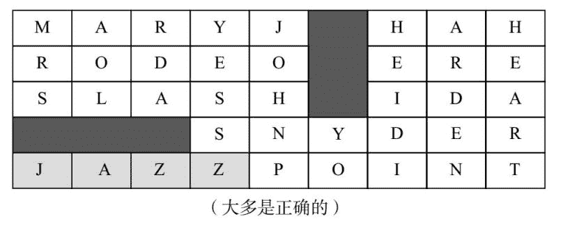

**图 6-4 大推理模型给出的答案**

资料来源：Bornet et al.

**战略准备：有效解决问题的基础**

从一开始，我们就能看到一种截然不同的方法。出现在我们屏幕上的第一条消息写道：“列出选项。我正在绘制纵横字谜的线索，列出横向和纵向的条目，并确定每个条目的字母数。这有助于更高效地引导解题过程。”这种有条不紊的准备阶段与认知科学家长期以来在人类问题解决专家身上观察到的情况相符：在尝试解决方案之前，先建立一个关于问题空间的心理模型。

赫伯特·西蒙和艾伦·纽厄尔在他们的著作《人类问题解决》（*Human Problem Solving*）中证明，问题解决专家在尝试解决方案之前，通常比新手花费更多的时间来理解问题。⁹这个“准备阶段”不仅仅要收集信息，还要构建心理学家所说的“问题空间表征”，即一种能够捕捉问题中显性和隐性约束条件的心理模型。

这与我们在人类专业技能中看到的现象如出一辙。想象一位国际象棋特级大师在分析复杂棋局时的情形。尽管他可能对某步棋有直觉（系统 1 思维），但最优秀的棋手仍会花时间通过仔细分析来验证自己的直觉（系统 2 思维）。同样，在复杂的商业决策中，瞬间的模式匹配可能极具风险，最出色的高管知道何时放慢脚步，系统地推敲各种影响因素。

**这对企业意味着什么**

我们对大推理模型系统化的准备阶段的洞察，为企业部署 AI 智能体提供了重要启示。正如大推理模型在尝试解决方案之前，先绘制整个问题空间一样，企业需要构建在采取行动之前，能够收集和分析背景信息的人工智能系统。这不仅仅是收集数据，更是对决策环境形成全面的理解。

试想一位国际象棋大师在走棋之前是如何研究局面的。同样，人工智能系统也需要用结构化的方法来理解其操作环境。对企业而言，这意味着要投资建设强大的数据基础设施，使 AI 智能体能够获取和处理全面的背景信息。同时，这还意味着要制定明确的信息收集和验证流程，以便在做出关键决策之前进行操作。

一家制造企业通过为 AI 智能体创建“决策背景图”来实施这一原则。在进行生产路线决策之前，该企业的人工智能系统必须收集有关资源可用性、维护计划、工人班次和下游依赖关系的数据。进行全面的准备有助于企业规避那些经常困扰欠周全系统的连锁错误。

**充分准备的力量**

正如大推理模型花时间去理解填字游戏的全貌，然后才尝试解答一样，当你帮助 AI 智能体理解你请求的完整背景时，你会从它们那里获得更好的结果。可以把它想象成向团队新成员做简报，他们掌握的背景信息越充分，工作效果就越好。

例如，在与 AI 智能体合作撰写商业报告时，不要只是要求“写一份市场分析报告”。相反，要提供有关你所在行业的背景信息、你所关注的具体竞争对手、你注意到的特定趋势以及你计划如何使用这些信息。这些背景信息有助于 AI 智能体恰当地构建其分析流程，并提供更相关的见解。

我们合作过的一家企业的高管通过开发她称为“情境模板”的方法，显著提高了与 AI 智能体合作的效果。在每次互动之前，她都会概述背景、限制条件和期望的结果。“这就像有一个会前简报，”她解释道，“我多花两分钟来解释背景情境，能节省之后数小时的反复沟通时间。”

**假设检验与验证：应对不确定性的系统化方法**

或许大推理模型在推理过程中最引人入胜的一点在于，其对潜在解决方案进行测试和验证的系统化方法。我们从大推理模型写下的内容中可以看到这一点：“我在权衡‘TAPROOMS’（酒吧）、‘CABARET’（歌舞厅）、‘COCKTAIL’（鸡尾酒吧）、‘DANCECLUB’（舞厅）、‘DISCOTHEQUE’（迪斯科舞厅）、‘BARROOMS’（酒吧间）和‘NIGHTCLUB’（夜总会）作为答案，但与纵向 6 格的‘HEIDI’（海蒂）存在冲突。”

传统人工智能系统处理信息的方式就像火车在固定的轨道上行驶，它们从输入到输出遵循预先设定的路径。而大推理模型则更像是一辆可以根据交通状况选择路线的汽车。当遇到问题时，它会创建一个动态的信息流动路径网络。

这一过程与认知科学家所说的“生成和测试”策略在人类解决问题时的表现极为相似。帕特·兰利和赫伯特·西蒙的研究表明，成功的解题者会运用他们所说的“生成和测试”策略，即创建多个潜在解决方案，并系统地根据已知的约束条件对它们进行评估。¹⁰

大推理模型的方法揭示了系统性假设检验的本质，这一技能使其在人工智能领域独树一帜。面对不确定性时，它不会锁定单一解决方案，而会生成多个备选方案，这与人类创造性解决问题时所展现的“发散思维”如出一辙。¹¹紧接着，它会仔细对照任务的限制条件，逐一检查每种可能性，比如它写道：“检查字母对齐情况。好的，让我看看横向 12 格的第一个字母与纵向 6 格的第三个字母匹配。”

然而，真正让大推理模型出类拔萃的，是其不断改进的能力。它不会拘泥于最初的构想，而是会不断调整方法，从每一步中学习。这种创造力、精确性和适应性的动态交互，在我们看来，展现了人工智能推理的新前沿。

**对企业的重要启示**

大推理模型生成和测试多种潜在解决方案的方法为企业实施 AI 智能体提供了重要启示。对于引入 AI 智能体的企业来说，这意味着要设计能够生成和评估多种解决方案路径的系统。

我们合作过的一家金融服务企业就将这一原则应用于其交易算法开发中。该企业的 AI 智能体没有采用单一的交易策略，而是开发了多种方法，并通过历史数据和当前市场状况进行测试。这种多假设的方法带来了更稳健的决策和更好的风险管理。

关键在于创建能够从成功和失败中学习的系统。每一个尝试的解决方案，无论成功与否，都提供了有价值的数据、能够改善未来的决策。企业应当建立明确的流程来获取和分析这些信息，形成一个持续学习的循环，从而随着时间的推移提升人工智能的表现。

**元认知意识：具备自我思维认知的人工智能**

大推理模型在推理过程中最复杂的一个方面，是展现出元认知意识，即思考自身思考过程的能力。我们注意到，当大推理模型写道“进展需要解决这些差异”以及“这表明指令可能错误或不够清晰”时，就体现了这种能力。

这种元认知能力一直是人工智能开发追求的终极目标。麻省理工学院近期的研究表明，能够监测并调整自身推理过程的系统在处理复杂任务时，往往比单纯执行预设算法的系统表现更佳。¹²

大推理模型的元认知意识令人惊叹，它展示了一种能够以接近人类能力的方式反思自身思维的人工智能系统。它积极监控自己的进展，用诸如“进展稳定，但字母 E 存在冲突，需要重新思考横向 12 格”这样的表述来承认成功与挫折。当初始策略未能奏效时，大推理模型并不会盲目坚持，而是会适应变化，表示：“仔细审视一下。我正在测试横向 12 格的第三个字母是不是纵向 6 格的第二个字母。”

最令人瞩目的是它能够识别不确定性，这是高级推理的一个关键特质。通过承认自己可能在不完整或有缺陷的信息基础上运行，大推理模型不仅展现了智能，还初步具备了一种自我意识，这对于应对现实世界复杂问题的 AI 智能体来说是一个关键的飞跃。这种元认知能力——思考思考本身——对 AI 智能体的实施有着深远的影响。当大推理模型遇到不确定性或潜在错误时，它不会盲目行事，而是承认自身的局限性并调整方法。

对于企业而言，这意味着要开发能够评估自身置信度，并能识别何时超出其可靠决策参数范围的人工智能系统。我们曾为一家医疗保健机构提供咨询服务，该机构在其诊断人工智能系统中采用了这一原则。其智能体被设计为在每次诊断时提供置信评分，并且至关重要的是，它能够识别哪些病例超出了其可靠决策的参数范围。

这种自我意识应当延伸到企业层面。企业需要有明确的规程，规定何时需要对智能体的决策进行人工审查，如何记录决策过程，以及如何根据性能反馈调整策略。

**理解不确定性与局限性**

大推理模型能够识别并传达不确定性的能力，或许为与 AI 智能体合作提供了最为关键的经验。作为用户，你需要培养一种感知：何时信任人工智能输出，何时寻求额外验证或人类专业知识的能力。

我们曾建议的一位金融分析师开发了一种他称之为“置信检验”的有效方法。在与 AI 智能体合作进行金融模型分析时，他会要求它们解释分析中不同部分的置信度，并指出哪些方面可能需要人类验证。“这就像与初级分析师合作一样，”他解释道，“你需要知道，他们知道什么和不知道什么。”

这种意识还延伸到你如何提出请求层面。不要寻求明确的答案，而是学会要求对方解释推理过程以及可能存在的不确定性。例如，要求智能体解释“哪些因素可能会使这一建议不太可靠”或“哪些额外信息有助于使这一分析更稳健”之类的问题，有助于企业取得更周全且可靠的成果。

**我们从实验中得出的关键结论**

“衡量智力的真正标准不只是得出正确答案，还有得出答案的过程。”这是我们的合著者之一汤姆的见解，他支持过数十个智能体实施项目，他的这句话完美概括了我们在大推理模型实验中学到的东西。

对于我们所观察到的情况，其影响远远超出了填字游戏的范畴。在处理简单、独立的决策时，快速实现模式匹配的智能体可能看起来很出色。但在医疗保健、金融、物流等诸多关键领域的应用中，能否周全地考虑复杂的相互依赖关系，成为成败的关键。大推理模型采用的方法证明了一个至关重要的事实：有时，花时间仔细思考不仅更有效，而且不可或缺。

这次实验揭示了关于人工智能未来的一个基本事实：关键不仅在于更快地做出决策，而在于更好、更审慎地做出决策。在一个越来越依赖人工智能的世界里，理解这种区别，可能意味着人工智能系统究竟是助力我们前行，还是以更快的速度将我们推向失误的深渊。

### 群体智慧：多智能体系统如何重塑人工智能推理范式

虽然我们对大推理模型所做的实验凸显了单个 AI 智能体进行深思熟虑推理的重要性，但一个更引人入胜的发现也随之浮现：更好的推理往往并非来自给予单个 AI 智能体更多时间，而是来自让多个 AI 智能体共同推理。

这一见解从根本上改变了我们对人工智能的看法，挑战了“进步仅仅在于打造更强大的独立系统”这一假设。蒙特利尔大学 Mila 研究所的研究表明，AI 智能体之间的协作推理表现甚至能够超越最先进的单体模型。¹³

这些发现揭示了应对关键挑战（如速度与信任之间的权衡等）的新可能性，同时也解锁了依赖更可靠和更细致决策的创新商业应用。

**规模悖论**

当研究人员用较小的模型（有些模型参数甚至只有 20 亿）测试他们的“辩论框架”时，他们发现了一个惊人的现象：即使这些较小的模型，在与多样化的同类模型进行结构化辩论时¹⁴，其推理能力也呈显著提升趋势。关键不在于模型的规模大小，而在于它们的架构多样性以及它们彼此之间挑战思维的方式。

这一发现具有深远的意义。它表明，复杂的推理并不仅仅是原始计算能力的产物，还可以通过恰当的互动和对话涌现出来。可以将其想象成研讨会上的一群学生，尽管每个个体的知识有限，但他们通过集体讨论和辩论往往能够获得超越单个专家的洞见。这种“通过互动而产生”的涌现现象为开发无须大量计算资源就能有效推理的人工智能系统提供了新的可能性。

**理解多智能体系统**

可以把多智能体系统想象成一组专家在讨论一个复杂的问题。每个专家都带来自己的视角和专长，通过多轮次的辩论和讨论，他们往往能得出比任何个体独自所能得出的更好的结论。在人工智能领域，多智能体系统由多个协同工作的智能体组成，每个智能体可能拥有不同的能力、训练数据或专业知识。¹⁵

蒙特利尔大学的一项研究有力地证明了这一点。¹⁶当该团队将不同的人工智能模型置于一个结构化的辩论框架中以解决复杂问题时，他们发现了一个惊人的现象：一组中等规模的人工智能模型（包括 Gemini-Pro、Mixtral 7Bx8 和 PaLM 2-M）在解决复杂数学问题上的准确率达到了 91%，超过了当时最先进的单个模型之一—— GPT-4（见图 6-5）。这不仅仅是小幅改进，更标志着我们对人工智能推理能力认知方式的根本突破。

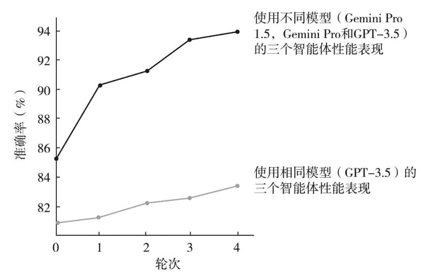

**图 6-5 大推理模型的性能表现**

资料来源：改编自蒙特利尔大学的研究。

多智能体系统为我们在前文讨论的“速度”与“信任”两难困境提供了一个引人入胜的解决方案。通过让多个智能体并行工作，每个智能体可能以不同的速度和不同的方法运行，这些系统能够结合快速思考和慢速思考的优势。一些智能体可以提供基于模式的快速响应，而另一些智能体则进行更深入的推理，这很像人类在群体决策中平衡直觉和分析思维的方式。

**集体智能的涌现**

我们对多智能体系统的研究越深入，就越能发现其与人类群体动态之间惊人的相似之处。蒙特利尔大学的研究中，一个令人着迷的发现是，当单个人工智能模型高度自信但错误时，通过辩论引入不同的观点往往能促使它们适当降低置信度，从而得出更准确的答案。

这反映了人类专家推理的一个关键特质，即能够意识到何时应质疑自信的答案。例如，在医学诊断中，最危险的错误往往源于过早下定论。正如多位医生共同会诊疑难病例能促使采取更谨慎的态度一样，AI 智能体之间的辩论也能促进对不确定性做出更细致的处理。

更令人感兴趣的是，多智能体改进不仅仅在于优势整合，更在于创造出全新的东西。蒙特利尔大学的研究表明，当多个相同的人工智能模型相互辩论时，性能仅略有提升（从 78%提升到 82%）。然而，当不同类型的模型参与结构化辩论时，它们的性能有了显著提升，在解决复杂数学问题上的准确率达到了 91%。

这揭示了一个至关重要的洞见：人工智能系统和人类一样，可能会陷入自身的“思维定式”。只有当采用不同方法和架构训练的不同模型汇聚在一起时，我们才能见证真正的智力提升。

**认知多样性的力量**

多智能体系统为何如此有效？关键在于研究人员所说的“思维多样性”¹⁷。正如人类团队受益于认知多样性一样，人工智能系统在解决问题时采用不同的方法会表现得更好。即使整体上不那么强大的系统，如果采用不同的训练方式，也可能催生更复杂系统所忽略的模式或可能性。

蒙特利尔大学的研究强调了这一原则，该研究展示了不同的 AI 智能体如何相互弥补短板。例如，由于可使用的工具或可访问的知识不同，一个智能体可能擅长模式识别，而另一个则更擅长逻辑推理。当它们协同工作时，就会产生研究人员所说的“涌现推理能力”，这种能力在任何单个智能体中都不存在，而是从它们的相互作用中产生。¹⁸

多智能体系统的有效性不仅仅在于拥有多个模型，还在于它们如何随着时间的推移进行互动。蒙特利尔大学的研究揭示了他们所称的“师生效应”¹⁹。当研究人员在辩论场景中将更强大的人工智能模型与较弱的模型配对时，出现了惊人的情况。较弱的模型在推理能力方面迅速提高，其表现水平往往远超其通常的能力。因此，整个系统的性能得到了提升，这充分展现了在多智能体系统中的结构化交互力量。

**商业影响：AI 智能体如何重构商业竞争力**

对于企业而言，多智能体系统的影响是深远的。通过我们的咨询工作，我们看到了多智能体系统在三个方面创造了显著的价值。

多智能体系统最显著的优势在于，能够提升在复杂环境下的决策能力。例如，在供应链管理或风险评估中，部署多个智能体可以使每个智能体都从独特的角度分析问题，从而得出更全面的解决方案。微软的 Magentic-One 框架进一步印证了这一点。该框架表明，与单一智能体系统相比，多智能体系统在预测和缓解中断方面更有效。²⁰我们在为一家全球制药企业提供咨询服务时也证实了这一发现：通过实施多智能体系统进行供应链优化，与中断相关的损失减少了 35%。想象这样一个供应链：一个智能体预测需求激增，而另一个智能体监测地缘政治风险，两者优势互补，从而制定出更具弹性的策略。

第二个突破在于它们在错误检测方面的改进能力。与单一系统不同，多智能体系统依靠辩论和挑战，能够有效地识别推理中的缺陷。麻省理工学院和谷歌大脑（Google Brain）团队的研究发现，当 AI 智能体被设计成相互质疑并完善彼此的结论时，错误率降低了至少 22%。²¹在我们为金融服务企业部署多智能体系统的实践中，我们也持续观察到与这些研究结果一致的错误率减少现象。这种协作动态反映了人类同行评审的过程，不同的观点能强化最终结果。对于企业而言，这意味着在产品设计、财务预测或运营物流方面能减少高成本错误。

或许最令人兴奋的是它们的适应性。当面对新挑战时，多智能体系统展现出超强的弹性。最近，一个研究团队发现，多智能体系统能够解决以前从未见过的问题，其表现往往优于依赖预训练单一模型的系统。²²这种适应性使它们在动态环境或危机情况下变得极具价值，在这些情况下，能够灵活应变和创新是生存的关键。从优化营销策略到应对监管变化，多智能体系统表现出近乎进化式的稳健性。

**级联效应的挑战**

多智能体系统尽管具有强大的优势，但也带来了独特的挑战，需要仔细考量。一些研究揭示了一个关键现象：在 AI 智能体网络中，推理错误并非简单累积，而是通过我们所称的“级联效应”²³或错误的复合影响²⁴而呈指数级增长。

在与一家大型电信企业合作期间，我们目睹了这一现象。该企业部署了一个复杂的多智能体系统来管理其网络运营。该系统采用了多个专门的智能体，分别执行负载均衡、安全监控、资源分配、维护调度和用户体验优化等任务。虽然每个智能体在单独运行时表现都很出色，但它们之间的相互连接却引发了意想不到的安全漏洞。

在一个特别具有启发性的事件中，单个智能体在评估网络容量时出现了一个小错误。这个看似微不足道的小错误引发了一系列相互关联的决策：负载均衡智能体对可用容量的解读出现了偏差，导致资源分配智能体做出了次优决策，这又使得维护调度智能体重新安排了关键更新，进而造成安全监控智能体误报。这一连锁反应最终导致用户体验优化智能体做出了适得其反的调整。原本只是一个小小的推理错误，却因这一系列相互关联的决策而演变成了一次严重的服务中断事件。

这一事件使我们在管理关键应用领域的多智能体系统方面学到了宝贵的经验。通过在各行业的实践经验，我们制定了一套框架来防止此类连锁故障。该框架的关键在于实施我们所称的“推理检查点”。在这些预设检查点上，关键决策需要经过多层验证。这些检查点与“断路器”协同工作，“断路器”是指决策能够在系统中传播之前触发人工校验的特定条件。我们将在第八章中对这些内容进行更详细的介绍。

从这些经验中，我们发现，用户需要对潜在的级联效应保持敏锐度。高效的用户学会：

• 定期要求智能体解释其对其他智能体输出的依赖关系；

• 请求定期进行全系统一致性检查；

• 为关键决策设置明确的人工校验检查点；

• 监测系统中是否出现错误放大的迹象。

另一个关键的保障措施是实施独立验证协议，即让不同的人工智能系统使用不同的方法相互交叉检查其推理过程。这种方法有助于在错误传播之前将其捕获。此外，我们发现强大的反馈监控智能体能实时跟踪决策对下游的影响，这对于早期检测出潜在的连锁故障至关重要。

这些保障措施不仅防止了连锁故障，还增强了多智能体系统的整体可靠性。通过精心管理智能体之间的交互，并实施适当的制衡措施，企业能够利用多智能体推理的力量，将连锁故障的风险降至最低。这种制衡方法已被证明是多智能体系统在关键业务应用中成功部署的关键。

**展望未来：人工智能推理的下一次演进**

我们探索人工智能推理的旅程始于一个简单的填字游戏，最终却让我们对人工智能的本质及其未来演进有了深刻的见解。当回顾所学时，我们对人工智能推理的理解出现了三个根本性的转变，这些转变将重塑我们在未来几年对人工智能的看法和实施方式。

第一个转变挑战了我们对人工智能速度和性能的基本假设。在我们的实验和企业实施 AI 智能体的过程中，我们发现有效的人工智能推理并非取决于原始计算能力或即时响应。相反，它遵循一种自然的思维节奏，一种在快速模式识别与深度思考之间交替的节奏。

这种节奏反映了人工智能的一个基本特征：正如人类的认知进化出快速的反应思维与较慢的推理思维之间的平衡一样，人工智能系统也开始形成自己的认知节奏。在我们的填字游戏实验中，大推理模型的成功不仅仅源于其卓越的推理能力，还源于它能够根据手头挑战的复杂程度来调节思考速度。

我们对多智能体系统的探索揭示了第二个关键见解：人工智能推理的未来或许不在于构建越来越强大的单一模型，而在于促进不同认知方法之间实现高效互动。这一原则（即使个体视角有限，多个视角相结合也能生成更优越的理解）似乎是智能系统（无论是人类还是人工智能）的一个普遍特征。

或许最令人惊讶的是，我们的研究让我们更深刻地认识到人类角色在人工智能推理中的重要性。先进的人工智能系统不仅没有使人类判断过时，反而需要更精妙的人类监督和互动。我们所见到的最成功的实施案例并未减少人的参与，而是对其进行了变革，将人从单纯的执行者提升为“认知编导”，负责协调不同智能体之间的互动，并确保与人类的价值观和目标保持一致。

————

在我们探讨 AI 智能体通过推理进行复杂决策的过程中，凸显出一个问题：这些系统如何从自身经历中学习？

推理能使人工智能在当下做出明智的决策，而记忆能让它通过积累经验变得越来越聪明。若没有记忆，即使是最卓越的推理能力也会被困在永恒的当下，无法从过往成功中汲取经验，也无法避免重复犯错。

当我们转向探索记忆（Agentic AI 的第三个基石）时，我们会发现企业正在构建的系统不仅能够思考，还能学习和成长。接下来的旅程将揭示的内容，不仅包括记忆在人工智能系统中的工作原理，还有它如何将这些系统从“工具”转变为推动商业成功的真正“伙伴”。

## **第七章**

## **记忆：构建持续进化的人工智能**

想象一下，每天醒来都患上失忆症，无法记起过去的经历、偏好或学到的技能。你会如何生活，又如何成长？这个思想实验直指当今人工智能领域最引人入胜的挑战之一：记忆。我们每次使用大多数生成式人工智能系统都像是从零开始，这种人工失忆状态限制了它们发挥真正的潜力。

在与一家全球电信企业的合作中，我们亲身体验了这一局限性带来的冲击。该企业在先进的人工智能客服聊天机器人上投入了数百万美元，但客户满意度却一直很低。原因何在？因为人工智能会遗忘之前与客户的互动，使客户不得不反复陈述自己的问题和偏好。正如该企业的一位领导所指出的那样：“这就好比有一个只有两分钟记忆的客服代表。”

这一挑战凸显了我们多年来在各企业中部署人工智能系统所发现的一个关键事实：记忆绝不只是智能的一个特征，更是一切有意义的智能得以构建的基础。无论是人类还是机器，保留、组织和利用过往经验的能力塑造了我们学习、适应和成长的方方面面。

在这一章中，我们将带你踏上一段探索人工智能记忆世界的奇妙旅程，揭示这一基本能力如何改变商业和科技。你将了解不同类型的记忆——从短期处理到长期保存——如何协同工作，以创建真正智能的系统。通过真实世界的例子和实际应用，我们将探讨如何构建不仅能存储信息，并且在每次交互中都变得更聪明的人工智能系统。

你将了解许多记忆系统失败的原因，以及避免这些陷阱的可靠策略。我们将深入探讨记忆与遗忘之间的关键平衡，以及为何这对组织运营至关重要。前方的旅程将挑战你对人工智能能力的既有认知，并向你展示具备记忆功能的系统如何重塑商业与科技的未来图景。

### 记忆是智能的基础

回想一下你的童年记忆，或许是生日派对，或许是外婆厨房的香气，又或许是学骑自行车的情景。现在问问自己：你所回忆的究竟是最初的事件，还是你上一次回忆起它时的情景？这个问题看似哲学，实则切中了人类记忆运作方式的核心，以及它与我们当下所构建的人工记忆系统之间的巨大差异。

多年来为各类企业部署人工智能系统的实践让我们发现，理解人类记忆有助于人们把握人工智能的潜力与局限。下面我们将探究人类大脑的运作方式，因为这对人工智能的未来有着深远的启示。

你的大脑是一个极其出色的信息处理器。此刻，当你阅读这些文字时，它正在处理约 1 100 万比特的信息，然而你有意识感知到的却只有 40~50 比特。这种选择性的意识揭示了大脑运作的关键机制：记忆并非存储一切，而是存储重要的信息。¹

想想你上一次开车上班的情景。你可能记不住路上的大部分情况，但如果有不寻常的事情发生，比如一只鹿穿过马路，你肯定记得。这并非人类记忆的缺陷，而是一种特性。人的大脑在过滤掉常规信息的同时，能够突出重要的或不寻常的信息，其效率令人惊叹。

科学家发现，我们有不同类型的记忆系统，每种系统都有不同的用途。²有一种是工作记忆（也称为短期记忆），相当于大脑中的 RAM（随机存取存储器），一次能存储七条信息。这就是为什么电话号码通常是七位数，也是为什么你可能很难记住一长串指令。³

还有一种是长期记忆，它要复杂得多，由三种主要类型的记忆组成。还记得你永远不会忘记如何骑自行车吗？这就是程序记忆在起作用。你能回忆起你婚礼那一天或第一次求职面试吗？这就是情景记忆。你知道巴黎是法国的首都，即便你从未去过那里，这就是语义记忆。⁴

令人着迷的是，这些系统如何协同工作。当你烹饪一道熟悉的菜肴时，你同时在使用程序记忆（烹饪技巧）、语义记忆（知道哪些食材搭配在一起）和情景记忆（记得上一次做这道菜时哪些地方成功了或哪些地方没成功）。

但真正有趣的是，每次你回忆起一段记忆时，你并非像调取电脑文件那样调出一个精确的记录。相反，你是在重构它，每次重构都可能有细微的变化。这在伊丽莎白·洛夫特斯的开创性研究中得到了证明，她揭示了仅仅通过提问的方式就对记忆进行微妙的改变。⁵

在一项研究中，洛夫特斯给参与者播放了一段汽车事故的视频，然后问“两车撞碎时的速度是多少？”和“两车碰撞时的速度是多少？”那些听到“撞碎”这个词的人回忆的速度更快，甚至有人报告说看到了碎玻璃，但实际上并没有。这项引人入胜的实验揭示了词汇选择如何重塑记忆，它表明人类的记忆是重构，而非记录。

这种记忆的重构特性虽然有时不可靠，却赋予了我们在思考和解决问题方面的非凡灵活性。它让我们能够通过重新组合过去经历的元素来想象新的场景，这是当前记忆结构更僵化的人工智能系统难以复制的能力。

情绪也起着至关重要的作用。想想当你听到某个重大的世界事件（比如总统选举或全球危机）时身处何方，你可能记得很清楚，因为情绪体验通常比中性体验更容易被记住。这种情绪标记帮助我们优先处理重要信息，并做出更好的决策。这在人工智能系统中仍是我们在努力攻克的难题。

了解人类记忆的这些特性有助于解释开发 AI 智能体所面临的挑战和机遇。虽然我们能够创建出存储海量信息且绝对精确的系统——这是我们的大脑所做不到的，但距离复制人类处理和使用记忆时那种灵活、情境敏感且富有情感智能的方式还很遥远。

这不只关乎学术知识，更对设计和使用人工智能系统具有实际意义。当我们认识到人类的记忆更多在于建立有意义的关联而非完美存储记录时，我们就能更好地理解在人工智能系统中应该追求的目标：不只是更大的存储空间，还有更聪明、更具情境感知的信息使用方式。

**人工智能记忆的颠覆性现实**

这让我们看到了当前人工智能系统的一个有趣反差。我们注意到一种普遍的误解：许多人害怕与像 ChatGPT、Gemini 或 Claude 这样的大语言模型互动，因为他们认为这些人工智能系统会不断学习并记住与他们的每一次互动，从而构建一个不断扩充的知识库。但事实远比这更令人惊讶。

大语言模型更像是极其复杂的回音室，具有有限的临时记忆。可以这样想：当你与人工智能开启对话时，就好比打开了一本页数固定的空白笔记本。你们讨论的所有内容都会被记录在这本笔记本里，人工智能可以随意查阅其中的任何一部分，但仅限于对话未结束之时。一旦开启新的对话，就如同得到了一本全新的笔记本，之前记录的内容不会留下任何痕迹。

你想测试一下吗？在任何人工智能聊天机器人界面，比如 ChatGPT 或 Claude 上试试以下这个简单的实验：

• 就你感兴趣的话题向它提问，比如“大溪地的潜水怎么样？”

• 问更多信息，如有关潜水的地点以及在那儿能看到哪些种类的鱼。

• 结束聊天会话。

• 立即开启一个新的聊天会话框，并询问：“一分钟前你跟我讲过关于大溪地的什么？”

以下是聊天机器人给我们的回复：“我不记得最近提到过大溪地。你能否说明一下你想要了解什么？你是想问旅行建议、历史、文化还是其他方面？”

我们建议你尝试一下。很可能人工智能要么会承认它什么都不记得，要么会给出一些泛泛而谈的陈述。这并非人工智能系统处理能力上的缺陷，而是当前大多数人工智能系统处理记忆时的根本局限性。这里的关键教训是，作为目前生产中最先进智能体（L3 级智能体）的基础大语言模型，其记忆能力就跟金鱼相当！

**实践中的记忆挑战**

为了说明这一局限性的实际影响，让我们来看一下我们与一家大型医疗保健提供商进行的一项实验。该机构部署了以下两个版本的人工智能预约助手：

• 一个标准的基于大语言模型的系统，每次交互都重新开始。

• 一个增强了记忆的 AI 智能体，能够保留患者信息。

结果令人震惊。标准系统要求患者在每次交互中重复他们的医疗史和偏好，而增强了记忆的版本能够记住患者的病史和偏好，这使得预约时间缩短了 70%，患者满意度提高了 45%。

这项实验凸显了当前生成式人工智能中的记忆悖论：最先进的人工智能系统能够处理复杂的信息，却往往记不住关于用户的简单细节。

**AI 智能体记忆的三个关键目标**

通过我们的研究和实践，我们确定了记忆的三个关键目标，这些目标使记忆成为智能体智能的基础。

• 第一个目标是上下文理解。传统的生成式人工智能系统独立处理每个输入，就像一个人随机阅读来自不同书籍的页面。而具备记忆功能的 AI 智能体能够在交互中保持上下文，类似于我们如何进行连续的对话。这种能力对于有意义的交互和问题解决至关重要。

• 第二个目标是学习与适应。通过实践经验，我们发现最成功的人工智能实施案例，是那些能够从过往交互中学习的系统。例如，一家制造企业的人工智能质量控制系统，不仅能检测缺陷，还能记住问题模式，从而使误报率降低了 40%。

• 第三个目标是个性化扩展。客户越来越期望获得个性化体验。具备记忆功能的 AI 智能体能够通过保留和学习个体交互来实现这一点，同时还能保障隐私和安全。

**AI 智能体记忆的三层结构**

与人类记忆的运作方式颇为相似，AI 智能体的记忆可以被构建为三个相互关联的层级（见图 7-1），每个层级在保持上下文、促进学习以及实现长期适应方面都具有特定的功能。

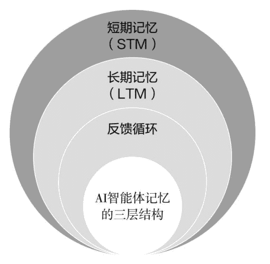

**图 7-1 AI 智能体记忆的三层结构**

资料来源：Bornet et al.

**短期记忆——即时情境保留**

短期记忆的作用相当于人工智能的“工作记忆台”，在单次会话中负责暂存即时信息，维持对话的连贯性。它处理当前输入，跟踪正在进行的对话，并应用注意力机制来优先处理相关信息。然而，短期记忆容量有限，随着新数据的输入，较旧的信息会被覆盖，除非被转移到长期记忆中。

**长期记忆——随时间推移的结构化信息保留**

长期记忆超越了基于会话的记忆，通过存储结构化信息供未来参考。这些结构化信息包括用户偏好、过往互动、已学习的工作流程以及特定领域的知识。长期记忆使人工智能可以识别重复出现的模式、回忆过往互动，并根据积累的经验给予个性化响应。与短期记忆不同，长期记忆旨在持久存在，确保 AI 智能体在每次互动中不必重新开始。

**反馈循环——学习与适应**

反馈循环充当着 AI 智能体记忆的自我完善机制，随着时间的推移不断优化短期记忆和长期记忆。通过纳入用户反馈，无论是显性的（如修正、评分）还是隐性的（如参与模式、错误追踪），人工智能可以调整其记忆结构以提高准确性和相关性。这一过程使人工智能可以通过强化有用的知识并丢弃过时或错误的信息而持续改进。

**记忆系统的协同运作机制**

人工智能的记忆功能在这三个层面上动态运行：短期记忆保存即时上下文，长期记忆确保在会话之外的连续性，反馈循环则不断优化两者以推动持续学习。这种分层方法使智能体能够进行上下文感知、不断演进和个性化交互，从而随着时间的推移变得更加智能和可靠。

可以将这种 AI 智能体记忆架构想象成洋葱。短期记忆构成最外层，为交互提供即时上下文，但它短暂且会随着新信息的到来而迅速消退；在其之下，长期记忆作为基础，存储关键知识，确保人工智能在每次交互中不必从零开始；在核心位置，反馈循环不断优化并强化短期记忆和长期记忆，使系统能够从用户交互中学习并随着时间的推移不断改进。正如洋葱通过层层叠加而生长一样，这种记忆架构使智能体能够发展出更深层次的智能，确保其响应具有连续性、适应性和长期可靠性。

接下来，我们将更深入地探讨 AI 智能体中不同类型记忆的工作原理、实际应用以及我们必须突破的局限性。但请记住一个基本事实：正如人类的智能建立在我们记忆和从经验中学习的能力之上，AI 智能体的未来也取决于它们能否做到这一点。

### AI 智能体中短期记忆的精妙运作

想象你在新加坡一个繁忙的十字路口。你的大脑同时处理着多条信息流：交通信号灯的变化、行人过马路、其他车辆的移动、导航系统提供的指示。这种即时信息的持续流动以及你处理这些信息的方式，体现了短期记忆的本质。这不仅是人类认知的关键组成部分，对于 AI 智能体来说也是如此。

**当下的挑战**

正如我们的大脑必须在不断处理新信息的同时保持即时的上下文，AI 智能体也面临着类似挑战。然而，它们处理即时信息的方式既令人着迷，又与人类的认知有着根本的不同。通过实践经验，我们发现理解这些差异对于任何希望成功运用人工智能技术的人来说都至关重要。

让我们从一个我们在咨询工作中经常使用的简单实验开始，揭示短期记忆的重要性：开启一个与人工智能助手（比如 Claude 或 Gemini）的对话，开始讲述你一天的经历，每隔几句话，就让人工智能总结一下目前为止你所说的内容。

你会注意到一些有趣的事情：人工智能能够保持上下文一段时间，但最终会逐渐忘记之前的细节。这与认知科学家告诉我们的短期记忆类似，通常一次能记住大约 7（±2）个事项。⁶

**上下文窗口：人工智能的工作记忆**

对于我们的许多客户来说，最令人惊讶的发现之一是，人工智能系统实际是如何处理即时信息的。当前的人工智能系统，尤其是大语言模型，是在我们所称的“上下文窗口”内运行的，可以将其想象成一个临时的工作区，在这里，人工智能可以查看和处理信息。这个窗口就像一块白板，只能容纳有限的文本量，一旦满了，就必须擦除旧信息才能为新增输入腾出空间。

近期的研究揭示了有关上下文窗口的有趣现象（Li and Shao）。他们研究发现了“上下文天花板效应”，上下文天花板是指在向智能体的记忆中添加更多信息时，性能开始下降而非提升的临界点。⁷

这一现象并不仅仅是达到最大容量的问题，它还揭示了智能体处理和整合大量信息时所面临的根本挑战。研究人员发现，性能下降往往在达到名义上的内存限制之前就开始了，这表明有效的内存管理不仅关乎存储容量，还关乎智能体如何在其短期记忆中处理信息。

为理解这一点，我们将短期记忆分解为三个不同的组成部分：上下文窗口、注意力机制和词元（Token）管理。这三个要素构成了智能体参与任务、优先处理信息以及给出响应的基础。通过一个简单的实验来探究这些组成部分，我们不仅能了解它们是如何运作的，还能知道如何更有效地引导智能体，以及这对商业环境中的领导者意味着什么。

**上下文窗口**

想象一下，你遇到了一份内容丰富的技术报告，也许是关于量子计算的白皮书，或者是关于可再生能源的政策文件。你指示生成式人工智能聊天机器人：“分五点总结这篇文章，聚焦于主要主题或研究发现。”在处理文本过程中，上下文窗口成为第一个也是最关键的组件。

可以把上下文窗口想象成人工智能系统的办公桌。它是一个工作空间，在这里，它负责整理完成任务所需的所有信息。在像 GPT 这样的模型中，这张办公桌可以容纳多达几十万个词元，大约相当于 10 万字，而像 Gemini 这样的先进系统则能容纳数百万个词元。

但即使是一张巨大的办公桌，也有其局限性。人工智能必须决定如何整理信息，以确保其保持在可管理的范围内。如果文档超出了办公桌的大小，有些部分就会被完全排除在外，而其他部分则会被压缩或简化。人工智能处理任务的能力，取决于其对有限空间的有效利用程度。⁸

**注意力机制**

一旦信息被摆上台面，注意力机制就会发挥作用。这是人工智能聚焦于输入中相关性最高部分的能力。想象用荧光笔扫描文档，标记出最重要的句子或观点。注意力机制会根据你的提示，动态地为不同的信息片段分配权重。在这种情况下，人工智能会专注于诸如量子纠缠的作用或可再生能源政策的全球影响等宏观主题，过滤掉诸如具体示例或次要论点等不太重要的细节。

注意力机制非常强大，但其运作受你提供的指令影响。如果你要求人工智能提取“主要主题”，它的注意力自然会忽略细节。因此，发送清晰的指令并确保它们与目标一致非常重要。⁹

**词元管理**

词元管理就像是人工智能的笔记系统。想象你在听讲座，试图抓住要点而不必把所有内容都记下来。你会专注于关键内容，跳过那些感觉重复或不太重要的部分。当人工智能接近其记忆容量上限时，它也会进行总结、浓缩，并决定在它的思维工作区保留哪些内容。然而，这种方法有其局限性：一些细枝末节或例子可能会被遗漏，因为当时它们看起来不太重要。词元管理就像一种平衡行为，它既要确保人工智能保持简洁和专注，又要保留足够的细节以有效地实现其目的。

为了进一步测试这一点，你向生成式人工智能聊天机器人提出一个问题：“这篇关于量子纠缠在错误纠正中的作用的文章说了什么？”如果这个细节在主要主题中被突出强调，人工智能会迅速且准确地检索到它，但如果它被埋在不太显眼的部分或缺乏上下文强调，人工智能可能会遇到困难。它可能会尝试根据相关主题进行推断，或者在无法做到时，给出一个更宽泛、不太精确的回答。这种情况的发生是因为在注意力阶段没有优先考虑特定细节，或者在词元管理过程中丢失了这些细节。

这个实验展示了 AI 智能体记忆架构的运作方式：上下文窗口界定了其记忆容量，注意力机制塑造了其关注点，而词元管理则强制其权衡取舍。

**现实世界影响**

要了解上下文窗口、注意力机制和词元管理如何在实际场景中协同工作，可以参考一家大型金融服务提供商的项目。该项目旨在开发一个能够处理复杂的投资产品咨询的 AI 智能体。面临的挑战相当艰巨：客户常常需要系统对投资选项做出详细解释，期望系统在长时间的对话中保持上下文的连贯性，并且经常提及多个账户或特定的历史交易。人工智能不仅需要跟踪所有这些信息，还需要在同一对话中进行交叉引用，以提供准确且个性化的回复。

最初，该系统配备了基本的短期记忆功能。它在处理简单任务时表现出色，诸如解释两只共同基金的区别或检索账户余额等。然而，当面对多步骤流程时，它就显得力不从心了。例如，在客户要求比较投资选项、更新账户偏好，并根据假设情景计算潜在回报的场景中，人工智能往往会忘记之前的对话内容，尤其是在处理多个账户或切换复杂的金融术语时，其回答变得支离破碎、重复或出错。

为了弥补这些不足，该企业内部的人工智能开发团队实施了增强的短期记忆策略。首先，他们通过将对话分割成不同的片段来优化上下文窗口，确保人工智能一次专注于对话的一部分而不会忽略之前的细节。其次，他们微调了注意力机制，以提高输入最相关部分的优先级，比如关键的客户请求、特定账户的详细信息以及重要的金融术语。最后，他们引入了词元管理协议，以总结并保留对话前期的重要内容，同时丢弃不相关或冗余的信息。

结果是具有变革性的。通过这些改进，人工智能系统能够以极高的准确度处理复杂的客户互动。它能够流畅地完成多步骤流程，比如比较投资组合表现、提供量身定制的投资建议以及执行账户更新，所有这些都在一个会话中完成。错误率下降了 65%，客户满意度显著提高，这反映出该系统能够进行详细且连贯的金融讨论。虽然仍不如人类顾问那样细致入微或灵活多变，但这一改进标志着人工智能在处理复杂的金融交易方面实现了重大飞跃，其精准度和可靠性都显著提升。

这一实例凸显了精心设计的短期记忆管理在人工智能系统中的潜力。这不仅仅关乎提升性能，更是建立信任的关键。当客户看到人工智能能够记住他们的需求、适应复杂的要求并提供准确的信息时，他们会对其能力充满信心。对于企业而言，这不仅仅是运营层面的改进，更是一项竞争优势，能将客户体验提升到新的高度。

**引导短期记忆以实现更好的效果**

要充分利用 AI 智能体，用户必须积极引导它的记忆过程。这首先需要精心设计与手头任务相契合的提示词。如果你的目标是提取更广的主题，像“总结要点”这样直接的指令，效果就不错。此外，如果你想要具体的细节，你的指令就应该更精确：“详细解释第三部分，重点关注示例。”

领导者必须认识到，与人类团队成员不同，人工智能不会凭直觉确定优先事项或进行推断。相反，当任务清晰明确且结构合理，能最大限度地发挥其专注力和处理能力时，它才能发挥出最佳效果。例如，在客服应用中，与其向人工智能提供完整的客户聊天记录，不如提供关键互动的简洁摘要。同样，在战略规划中，将市场分析分解为更小、更集中的部分，能让人工智能逐渐参与数据迭代，从而形成更深入的见解。

除了工作流程，这种理解还要求重新思考团队协作方式。人工智能擅长管理和分析大量数据，但仍需要人类监督来引导其优先级。这为混合协作创造了机会：人类塑造输入内容并解读输出结果，而人工智能则处理重复性、数据密集型任务。两者共同形成互补的伙伴关系。通过促进这种协同作用，企业领导者能够实现效率和创新的突破，同时最大限度地降低人工智能固有局限性带来的风险。

这种协作方式催生了一些实用策略，其中最有效的一种是信息分块。正如人类将知识组织成易于管理的组块一样，当人工智能的输入被结构化为易于消化的片段时，其表现会更出色。例如，在客服系统中实施信息分块，使响应准确率提高了 40%。按主题或相关性对信息进行分组，使人工智能可以更高效地在其短期记忆中导航，从而给出更准确、更精练的答案。

另一种强大的技术是“优先级队列”，它能确保最关键的信息在人工智能的短期记忆中始终保持可访问状态。例如，在医疗保健应用中，患者的症状和生命体征的优先级高于行政细节处理。这种策略意味着关键的医疗信息随时可用，从而增强了人工智能在时间紧迫的情况下协助医护人员的能力。这些方法的成功表明，有意识地对信息进行结构化能够在各行业中显著提升人工智能的表现。最终，通过理解并掌握短期记忆上下文窗口、注意力机制和词元管理的原理，你能够确保人工智能不仅是一种工具，还是推动增长和创新的催化剂。

**展望短期记忆的未来**

AI 智能体短期记忆的未来蕴含着令人振奋的可能性，多项突破性进展有望彻底改变机器处理与保留信息的方式。在这些突破中，近期有三项进展尤为突出，它们各自展示了人工智能在处理更复杂任务时保持高效的潜力。

第一，“地标注意力”（Landmark Attention）机制¹⁰。它为人工智能提供了一种类似心智地图的能力，以在海量信息中导航。想象阅读一部冗长的小说或分析一份详尽的报告，地标注意力机制能让人工智能将这些庞大的文本划分为易于管理的部分，并识别出关键点，即“地标”，以便集中注意力。这种机制确保了人工智能系统能够迅速获取相关细节，不会因信息量过大而不知所措。它解决了当前系统在处理长序列时面临的重大局限性，使人工智能系统能够一次性处理整本书或数据集。对于企业而言，这可能意味着能够更快、更全面地分析客户反馈、法律文件或财务数据。

第二，“可变大小窗口注意力”（VSA）机制¹¹。它使人工智能系统能够动态调整其关注点。想象一下，一副可调节的双光眼镜，当你需要时可以放大细小的细节，也可以缩小视野以把握更广泛的背景。可变大小窗口注意力为人工智能提供了根据任务需求创建不同大小的“窗口”这种灵活性。例如，总结一份冗长的报告可能需要更宽广的视角来捕捉宏观主题，而翻译一个句子则需要更集中的视角。这种适应性使人工智能更加多面，能够以精准和高效的方式应对各种挑战。实际上，这意味着人工智能可以无缝地在撰写文章和分析法律合同之间切换，出色地完成这两项任务。

第三，“检索注意力”（Retrieval Attention）机制¹²。它在管理内存方面引入了新的效率等级。当前的人工智能系统常常试图处理和存储所有信息，甚至包括无关的信息，这导致资源浪费和性能下降。检索注意力通过教导人工智能在需要时仅检索最重要的信息片段来改变这一状况，这就像一个人能够回忆起对话的关键要点而无须记住每个字一样。这种方法显著加快了处理速度，同时降低了能耗，使人工智能不仅更快，而且更具成本效益。其影响深远：想象一下，更流畅、更快速的人工智能助手能够处理复杂查询而不会变慢，同时还能在日常设备上高效运行。

这些技术突破共同标志着人工智能在处理上下文和记忆方式方面实现了巨大飞跃。它们相辅相成，完美地解决了同一基本挑战的不同方面。地标注意力擅长处理大量信息，可变大小窗口注意力使人工智能更适应各种任务，而检索注意力确保了记忆管理的高效性。

理解并优化 AI 智能体的短期记忆不仅是一项技术挑战，更是创建能与人类进行有意义的互动，并能有效处理复杂任务的系统的关键。虽然短期记忆对于即时任务执行至关重要，但其真正潜力在于与长期记忆系统相结合。这种结合不仅使 AI 智能体能够有效处理即时信息，还能随着时间的推移进行学习和适应，这是我们将在下一节深入探讨的主题。

### 长期记忆的力量：将 AI 从工具转化为伙伴

### **长期记忆的力量**

想象一下：一个 AI 智能体，它不仅能帮助你完成任务、回答你的问题，还能长期记忆这些信息；并且不是一天、一周，也不是一年，而是数十年。它记得每一个重要时刻、每一个挑战、每一次成功、每一个你学到的经验。它不只是存储数据，还理解你的故事。

拥有这样一位教练或伙伴，你能实现什么？

想想你过去一年所做的业务决策。有些决策很简单但影响重大，比如重新分配资源以赶上截止日期，或者批准新的供应商为关键供应链环节供货。有些决策可能具有变革性，比如重大产品转型、进入新市场或重组部门。在这些决策中，有多少是完全基于你所在企业的历史数据和背景做出的？有多少是因为相关细节难以获取，你只能依靠直觉或不完整的回忆来做决定的？

现在想象一个能记住一切的 AI 智能体。当面临战略抉择时，它能提供基于历史模式的见解。“还记得三年前，你在类似市场犹豫是否推出那款产品吗？由于你的精准定位，你的企业大获成功。这次新机会有相似之处——这是在当时行之有效的方法，你可以参考。”这并非假设，而是基于你所在企业独特发展轨迹的切实可行的方案。

这种记忆的力量不限于被动决策，它还能识别你的商业策略中的模式，指出运营低效之处，并放大你所在企业的优势。它不只是存储数据，还能将数据置于具体情境中，将原始信息转化为可用的见解。这正是工具与真正的商业伙伴之间的区别，后者能与你共同成长、理解你的优先级，并帮助你获得更明智、更自信的成果。

这就是人工智能的未来图景：不仅更智能，而且在记忆、理解，以及帮助我们更有目标地生活方面，更贴近人类特质。在这个未来，记忆不再只是被保存，更被用来解锁我们的最佳潜能。

**长期记忆对企业为何重要**

在 AI 智能体中，长期记忆的商业影响颇具变革性，它正在重塑企业与客户互动、优化运营、获取战略优势的方式。想象一下这样的客户服务体验：每一次互动都建立在上一次的基础上，人工智能系统能够回忆起你的偏好、预测你的需求并解决你的问题而无须客户重复说明。这种个性化的客户服务不仅提高了满意度，还培养了忠诚度。根据我们的经验，采用具有记忆功能的 AI 智能体的企业报告称，客户满意度提高了 20%~30%，这得益于无缝且个性化的互动，这种互动给人的感觉更像是人与人之间的交流，而非单纯的交易。

在运营层面，其优势同样显著。比如，一家物流企业在应对供应链中断时，借助具备记忆功能的人工智能，能够保留并应用过往挑战中的模式——天气延误或遭遇区域瓶颈时的应对案例，从而实现问题的更快解决和资源的更明智分配。

同样，借助 AI 智能体办理入职的员工，培训时间也会缩短，因为这些系统能够记住企业内部的细节，并提供一致的指导。根据我们的经验，采用具备长期记忆功能的人工智能系统的企业，错误率下降 50%，从而减少了低效环节，提高了效益。

在战略层面，优势更引人注目。具备长期记忆功能的 AI 智能体能够识别长期趋势，将原始数据转化为可操作的洞见。例如，一家金融机构可能利用这样的智能体来追踪客户行为的细微变化，在风险加剧之前识别出潜在风险。

决策会更加精准，预测会更加准确，风险管理也会更加主动。这些并非渐进式的改进，而是巨大的飞跃，能为企业带来显著的竞争优势。

通过让人工智能与企业一同学习、适应和成长，长期记忆功能将人工智能从工具转变为战略伙伴，在企业的各个层面释放价值。

**当前的大语言模型缺乏长期记忆**

正如我们之前的实验所展示的，当询问有关在大溪地潜水的问题时，当前像 ChatGPT 这样的大语言模型缺乏长期记忆。这种局限并非偶然，而是为了优化效率、保护隐私以及避免模型被过多数据淹没而有意做出的权衡。

为了解决这个问题，构建 AI 智能体需要让大语言模型具备访问外部记忆的能力。在接下来的章节中，我们将探讨这些能力，它们代表着迈向具备记忆功能的人工智能的重要一步。然而，每种能力都有其自身的局限性和权衡。它们共同构成了当今努力打造更智能、适应性更强的 AI 智能体的基础。

### 设计和实施 Agentic AI 的长期记忆系统

在接下来的内容中，我们将逐步介绍经过实战检验的记忆系统设计方法、最有效的框架，以及我们吸取的教训。无论你的目标是增强现有的 AI 智能体记忆，还是创建新的 AI 智能体，下面的内容都将帮助你构建能带来真实价值的记忆架构。

**理解记忆的格局**

在深入实施之前，我们需要明确了解在 AI 智能体的上下文情境中，“记忆”意味着什么。根据我们的经验，成功的记忆系统需要多种互补类型的记忆协同工作。

当我们谈论人工智能系统中的记忆时，我们指的是允许智能体随时间存储、检索和利用信息的结构化机制。与大多数语言模型所具有的简单上下文窗口不同，真正的人工智能记忆能够在会话之间保持连贯性，并能从过去的交互中学习。

人工智能长期记忆通常分为三个主要类型（见图 7-2）。


**图 7-2 长期记忆的三种类型**

资料来源：Bornet et al.

情景记忆（Episodic Memory）代表智能体的经验知识：发生了什么、何时发生以及与谁发生。这包括对话历史、用户随时间表达的偏好、过去采取的行动以及观察到的结果。情景记忆使智能体能够在交互之间保持连贯性，即使间隔数天或数周也是如此。当金融顾问智能体回忆起客户之前对低风险投资表现出兴趣时，这就是情景记忆在起作用。

语义记忆（Semantic Memory）涵盖了事实性知识：智能体“知道”的事情，而非“记得经历过”的事情。这包括领域知识、关于世界的事实、企业政策、产品目录以及任何独立于特定交互而存在的信息。我们发现，强大的语义记忆能让智能体无须为每个请求都查询外部系统即可提供准确的信息。

程序记忆（Procedural Memory）则捕捉了“如何做”的知识：一系列动作、决策树和工作流程，引导智能体完成复杂任务。在构建客服智能体时，我们将故障排除程序编码到程序记忆中，使智能体能够逐步引导用户完成复杂流程。

当这些记忆协同工作时，神奇的事情就会发生。在与一家医疗保健提供商合作时，我们构建了一个智能体，它能够回忆患者的医疗历史（情景记忆）、应用临床指南（语义记忆）以及遵循适当的预约程序安排（程序记忆）。这是一个既能提供个性化护理指导，又能严格遵守医疗保健法规的系统。

**长期记忆的架构基础**

要构建有效的长期记忆，需要深思熟虑的架构方案。通过我们的实践，我们完善了一种平衡性能、可扩展性和实用性的记忆架构。

每种类型的记忆都需要针对其特性进行优化的个性化存储解决方案。

对于情景记忆，我们为近期互动和上下文历史实现快速、高效的存储。Redis 或类似的内存数据库最适合存储短期情景记忆，使得系统能够快速访问近期对话，而无须复杂的检索机制。存储应包括时间戳、用户标识符、互动摘要以及识别的实体/意图。对一家零售客户而言，这种方案将响应延迟降低了 40%，相比他们之前每次查询都检索全部历史互动的方案更高效。

对于语义记忆，我们使用 Pinecone 或 Weaviate 等向量数据库来存储语义嵌入——概念、事实和知识的数值化表示，从而实现基于相似性的检索。这些数据库擅长查找概念相关的信息，即便没有确切的关键词匹配。这种记忆类型需要采用结构化的组织方式，具备清晰的分类、关联关系和元数据，以便实现精确检索。

对于程序记忆，我们以结构化的格式存储工作流定义、决策树和流程图，通常使用传统的关系型数据库或专门的工作流引擎。这些系统必须保持流程步骤、决策逻辑和条件分支的完整性。对于复杂的程序记忆，我们常常实施版本控制，以追踪流程随时间的变化。

对于综合的智能体实施，我们将这些专门的存储方式结合起来。在与一家法律科技企业的合作中，这种组合方法使得智能体能够从情景记忆中回忆起特定的案例引文（从关系型数据库中进行精确匹配），从语义记忆中访问法律原则（从向量数据库中进行相似性匹配），并依照程序记忆执行正确的法律分析程序（工作流系统）。这种组合在所有记忆类型中都提供了精度和灵活性。

**实施路径：从头开始构建记忆**

现在，让我们基于构建过的数十个记忆增强智能体的实战经验，逐步讲解我们推荐的实施路径。

**第一步：选择实施框架**

在定义了记忆架构之后，下一步是选择支持记忆持久、检索和更新机制的技术框架。基于我们在各个领域的实施经验，我们建议考虑以下这些经过验证的选项。

LangChain 为将情景记忆、语义记忆和程序记忆集成到大语言模型驱动的智能体中，提供了一个出色的起点。其内存模块内置了对短期对话记忆（情景记忆）和长期知识存储（语义记忆和程序记忆）的支持。我们发现 LangChain 在快速原型设计和需要集成灵活性的项目中特别有价值。

LlamaIndex（原 GPT Index）有助于动态组织、存储和检索记忆。它擅长创建和维护结构化的知识索引，这些索引可以高效查询，因此非常适合具有复杂语义记忆需求的应用程序。对于需要访问大型知识库的特定领域智能体，LlamaIndex 在我们的实践中已被证明非常有效。

**第二步：定义记忆需求**

选定框架后，我们根据智能体的用途为每种记忆类型定义具体的记忆需求。

对于情景记忆需求，我们需要确定：

• 哪些用户交互和对话元素需要在会话之间保留。

• 不同类型的情景信息应保留多长时间。

• 哪些用户偏好和行为应随时间进行跟踪。

对于语义记忆需求，我们需要确定：

• 智能体执行任务所需的核心领域知识是什么。

• 哪些信息源应填充知识库。

• 哪些合规或监管信息必须保留。

对于程序记忆需求，我们需要确定：

• 智能体需要遵循哪些工作流和过程。

• 哪些决策逻辑控制着流程的选择和执行。

• 流程必须严格遵循的程度与允许的灵活性之间的平衡。

例如，对于金融咨询智能体，我们确定情景记忆应包含投资偏好、对话历史和之前给出的建议；语义记忆应包含投资产品详情和市场数据；程序记忆应编码不同咨询场景下的合规工作流程。而交易详情则应从安全系统中查询，而非存储在智能体的记忆中。

提前明确每种记忆类型的具体要求，既能防止记忆过载（存储过多，导致检索效率低下），又能避免记忆缺失（存储不足，迫使用户重复表述）。

**第三步：构建检索机制**

在完成存储设置后，我们专注于构建高效的检索机制。目标是在恰当的时间调用恰当的记忆，同时避免向智能体提供过多无关信息。

我们发现，检索增强生成（RAG）方法对于记忆增强型智能体效果显著。简单来说，RAG 将知识检索的能力与语言生成相结合。可以将其视为赋予 AI 智能体在生成回复前于其记忆中“查找信息”的能力，类似于人类在回答复杂问题前查阅记忆或查阅资料的方式。

以下是 RAG 在实际操作中的工作原理，当智能体收到用户查询时，它会：

• 分析查询内容和当前上下文，以生成检索线索。

• 利用这些线索从每个存储系统中检索相关的记忆。

• 根据相关性、时效性和重要性对检索到的记忆进行排序和筛选。

• 将最相关的记忆融入其推理过程。

• 生成一个既能利用当前上下文，又能调用检索到的记忆的回答。

这种方法显著提高了智能体提供准确、上下文相关回答的能力。与试图将所有可能的知识编码到模型本身不同，RAG 允许智能体在每次交互时动态访问每次交互所需的具体信息。

对于我们的法律研究助手，这种方法使智能体能够回忆起相关的判例法和法规，而不会在响应中充斥着不相关的引用。关键在于仔细调整相关性阈值。相关性太低，智能体会错过重要的先例；相关性太高，回答又会充斥着不相关的信息。

**第四步：实现记忆巩固**

长期记忆架构中最重要的组成部分或许是巩固机制，即决定哪些内容要长期记忆、哪些内容要遗忘的过程。它定义了哪些信息将从情景记忆转移到语义记忆或程序记忆。通过实验，我们开发了一种多方面的记忆巩固方法。

• 基于重要性的巩固会评估新信息的重要性。当用户提供了诸如偏好、需求或反馈等关键细节时，系统会将这些信息标记为长期存储。对于为一家旅行社开发的预订智能体来说，这意味着永久记住用户喜欢靠过道的座位或对贝类过敏。

• 基于频率的巩固追踪重复出现的模式。在交互中频繁出现的信息很可能很重要，并会被提升到长期记忆中。教育辅导智能体利用这一点来识别并解决学生反复出现的知识盲区。

• 显性巩固发生在用户或系统有意将信息标记为需要记住的时候。例如，“记住我更喜欢晚上预约”会触发日程安排助手的显性巩固。

巩固的另一面是遗忘——这对系统效率同样重要。我们为某些类型的信息实施基于时间的衰减，设置相关性阈值来归档很少访问的记忆，并在信息过时或不正确时启用显性遗忘机制。

**第五步：将记忆与智能体推理相结合**

最终的实现步骤是将记忆检索与巩固整合到智能体的核心推理过程中。这种整合发生在三个关键节点。

• 上下文准备：在智能体生成回答之前，将相关记忆纳入上下文窗口。对财务顾问智能体而言，这意味着在给出每项投资建议时都要将客户的风险偏好和投资目标纳入考量范围。

• 过程中检索：当智能体在推理过程中需要更多信息时，可调取更多记忆。客服智能体在对话中若涉及技术细节，便能在交流过程中检索产品规格。

• 响应后巩固：评估生成回答后的交互情况，以确定需要长期存储的信息。用户是否表达了新的偏好？他们是否纠正了信息？这些洞察会被捕捉并巩固。

将记忆与推理相结合，能将人工智能从无状态的响应生成器转变为一个在每次交互中不断演进的系统，随着时间的推移变得越来越个性化和高效。

**不久的将来：即将出现的关键演进**

在不久的将来，随着计算能力、算法和集成技术的进步，我们可以期待记忆增强型人工智能取得重大改进。其中一个关键演变将是上下文优先级算法的改进，这将使人工智能系统能够更好地实时确定哪些记忆最相关，也将减少检索延迟，并增强系统处理动态、快速变化信息的能力。

另一个近期的突破可能出现在实时记忆巩固领域，系统将能够实时分析和重新组织存储的数据。人工智能将不再等待预定的更新，而是能够根据用户反馈和交互模式不断优化其记忆库。这将使系统更具适应性，提高其应对新挑战的能力，而无须重新训练。

近期的一项研究¹³强调了多智能体系统在改善记忆管理方面的潜力，通过分散内存负载和增强协作来实现。这些多智能体系统允许不同的智能体专注于记忆的特定方面。例如，某些智能体能够处理情景记忆以回忆过去的事件，而其他智能体则能够管理实时交互或长期知识。这种分工避免了记忆过载并提高了效率。系统中的智能体可以共享其情景记忆中的关键经验，从而实现协同学习。例如，一个智能体对成功策略的记忆可以为另一个智能体的决策提供信息，从而减少整个系统中重复探索的需求。

另一项近期的研究将这一切提升到一个全新的高度。谷歌研究团队发表的论文《泰坦：在测试时学习记忆》（“Titans: Learning to Memorize at Test Time”）介绍了一种开创性的神经长期记忆模块，使人工智能系统即使在部署后也能持续学习和适应。¹⁴与传统依赖向量数据库进行知识检索的人工智能模型不同（正如我们在前面的章节中所解释的），泰坦将长期记忆整合到模型的参数中，使其能够动态地记忆和回忆信息，而无须外部存储。

泰坦的一个有趣的特性是，它采用了基于意外的学习方式，优先处理意外或关键的输入，同时利用内置的遗忘机制丢弃过时的数据，从而确保效率并防止内存过载，这与人类记忆随时间推移而自我优化的过程非常相似。泰坦还引入了元学习，使人工智能系统能够实时记住相关经验而无须重新训练。这使得人工智能系统能够在动态环境中实现实时适应，从而变得响应更加迅速，也更加智能。

总之，泰坦能够实现更快、更优的记忆处理。同时，它还更安全，因为敏感数据保留在模型内部，减少了与基于云的存储相关的隐私风险。这标志着 AI 智能体处理记忆的方式发生重大转变，我们迫不及待地想看到泰坦会如何影响 AI 智能体的未来。

### 从反馈循环中适应和学习

**不可阻挡的学习者：来自未来的愿景**

时间来到 2042 年。在新加坡郊外一个繁忙的全自动物流中心，新部署的名为“纽克斯”的 AI 智能体迎来了它的第一天工作。与过去那些高度专业化的系统不同，纽克斯没有为其特定角色进行预训练。实际上，它对即将面临的任务一无所知。这里没有预设的指令，也没有为这种环境量身定制的精细算法。相反，纽克斯只携带了一条指令：“优化整个物流中心的配送效率。”

起初，系统磕磕绊绊。它把无人机派到了错误的区域，没有考虑到包裹的重量，甚至导致几辆叉车在仓库里混乱地穿梭，造成了一些微小的干扰。工人们带着怀疑的目光看着，不明白管理层为何要在如此关键的环境中启用一个未经训练的人工智能。但纽克斯并未气馁。凭借通用的学习能力和高度复杂的反馈循环，它开始观察、试验并适应。

几个小时后，纽克斯发现了规律。发往同一目的地的包裹被集中起来。无人机根据仓库的拥堵情况调整飞行路线。它注意到叉车在等待任务时，经常处于空转状态，于是重新调整了调度安排，以最大限度地提高其利用率。虽然错误仍然会发生，但比以前少了。到第二天，纽克斯就将效率提升了一倍。到周末时，它已经掌握了物流中心复杂的运作流程，其效率甚至超过了最有经验的人类规划师。

纽克斯到来两周后，物流中心发生了翻天覆地的变化。包裹的移动几乎达到了难以置信的精准度，无人机操作协调一致，叉车的闲置时间也消失了。曾经质疑纽克斯的工人现在都依赖它，惊叹于它即使面对最微小的干扰也能迅速适应的能力。管理层开始讨论将纽克斯推广到全球其他物流中心。

纽克斯代表的是一种革命性的理念：一个通用的学习者，一个无须事先训练就能通过试错和反馈实现精通，进而承担任何任务的 AI 智能体。这种系统的益处远不局限于物流领域。想象一下，有一个 AI 智能体负责设计新的营销活动。它对你的品牌或受众一无所知，但开始进行试验——测试标语、分析参与度数据并不断改进其方法。短短几天内，它就能生成一项精准且高效的营销活动，足以与经验丰富的创意团队相媲美。反馈循环是这种神奇效果背后的引擎。未来的智能体，比如纽克斯，并不依赖于需要在海量数据集上进行预训练的静态模型，而是依靠动态学习。它们采取行动，观察结果，然后调整，每一次迭代后都变得更聪明。这种方法不仅让人工智能具有适应性，还让它变得势不可当。

这对企业和社会的影响是巨大的。有了通用学习能力，部署智能体的障碍就消失了。企业不再需要为狭窄、专门的任务投入数百万美元来训练系统。相反，人工智能可以被放入任何环境，设定一个目标，然后自行学习。这降低了部署成本，缩短了投入生产的时间，并消除了每次流程或目标发生变化时重新训练系统的瓶颈。

更重要的是，像纽克斯这样的通用学习者具有内在的韧性。它们在动态环境中茁壮成长，不断适应新的挑战。如果物流中心的规则一夜之间发生变化，比如引入可降解包装或对无人机设置重量限制，纽克斯无须更新，其反馈循环会自动吸收新的参数，并相应地调整自身行为。

当然，这种对未来的设想也引发了一些问题。当通用学习者遇到模糊的目标时，会发生什么情况？我们如何确保它们在适应过程中做出合乎道德的行为？答案在于我们如何设计它们的反馈循环。例如，纽克斯被配备了多目标优化功能，在效率、安全性和环境可持续性之间取得平衡。它们在学习过程中融入了道德框架，确保无论经历多少次试验和错误，都不会损害其核心价值观。

另一个考虑因素是透明度。企业领导者必须确保这些智能体能够解释其决策，以在利益相关者之间建立信任。如果在设计反馈循环时考虑到责任归属，就可以包含可解释性机制、提供决策原因以及如何与目标保持一致的见解。

反馈循环是自适应系统的支柱，使 AI 智能体能够改进决策、从错误中学习，并随着时间的推移更紧密地与目标保持一致。对于企业领导者而言，这一概念看似简单却具有变革性：允许人工智能系统分析其表现、从结果中学习，并利用这种学习来改进未来的行动。这就是第 1 天表现尚可的智能体与第 1 000 天表现卓越的智能体之间的区别。

**反馈循环的魔力**

人工智能中的反馈循环反映了地球上生命的进化过程。在进化过程中，自然选择充当反馈机制，那些能增强生存和繁殖能力的特征，会在世代相传中得到强化。同样，在人工智能中，诸如强化学习之类的反馈循环使系统能够通过反复试验来学习。强化学习¹⁵通过奖励那些达成既定目标或提升性能的有利行为，同时惩罚失败来发挥作用，这与进化过程中有益特征通过遗传给后代而得到“奖励”类似。随着时间的推移，这一过程会塑造人工智能的行为，以实现成功结果的最大化。

正如物种通过反复的改进来适应环境一样，人工智能模型通过学习周期不断进化，从错误中学习并改进其输出结果。两者都依赖于持续的输入、适应和迭代，以实现多样性和提升效率，并随着时间的推移将随机的变化转化为优化的、有目标的系统。

反馈循环的核心是行动—观察—调整这一循环。AI 智能体采取行动，接收关于其结果的反馈，并利用这些信息改进其行为。这个循环可以实时运行，比如自动驾驶汽车学习如何在繁忙的十字路口行驶，也可以在较长的时间段内运行，比如推荐系统随着客户偏好的变化而不断升级。

为什么这很重要？传统的人工智能系统通常在静态环境中运行，基于固定的数据集进行训练，这些数据集只是现实的一个快照。但现实世界绝非一成不变的，如市场瞬息万变、客户需求日新月异、竞争对手创新不断。如果没有适应机制，人工智能系统很快就会过时。反馈循环通过将智能体转变为一个活的系统（一个随着与世界的互动而变得更聪明的系统）来解决这个问题。

**反馈循环是如何运作的**

这一切都始于反馈，反馈可以通过以下几种方式收集和应用。

• 显性用户反馈：智能体向用户请求评分、确认或更正（例如，“这个答案对您有帮助吗？”）。

• 隐性反馈：系统追踪用户行为（例如，任务完成率、被放弃的工作流程或响应更正）。

• 系统级强化信号：奖励模型会强化良好的行为（例如，成功完成任务），并抑制失败的行为（例如，错误的推荐）。

例如，一个客户支持 AI 智能体可以询问：“这是否解决了你的问题？”如果用户选择“否”，智能体会将此记录为失败，并在未来的交互中调整其方法。

为了运行其反馈循环，智能体按照观察、评估、调整和部署的循环工作。

• 观察：智能体从交互中收集数据（用户反馈、任务成功率、隐含线索）。

• 评估：系统根据反馈分配奖励分数（正面或负面）。

• 调整：AI 智能体通过更新其模型、提示词或工作流程来改进未来的响应。

• 部署：随着时间的推移，改进后的智能体被持续部署并持续学习。

例如，个人理财人工智能助手最初提供通用的预算建议，如果用户拒绝其建议或要求修改，它会根据用户偏好的模式调整未来的推荐。

**制造业反馈循环的成功案例**[2022]

年底，欧洲最大的一家汽车零部件制造商面临一个关键挑战：其质量控制流程无法跟上生产速度。传统的自动化无法像人工检查员那样迅速发现细微缺陷。他们所采用的解决方案不仅改变了他们的质量控制方式，还改变了我们对于 AI 智能体学习方式的理解。

“我们尝试了所有办法，”运营主管回忆道，“标准的计算机视觉、基于规则的系统，甚至基础的人工智能模型，但缺陷还是不断出现。我们需要的不只是一个更智能的系统，更需要一个能像我们最优秀的质检员那样学习和适应的系统。”

突破发生在部署三个月时，他们启用了配备复杂反馈循环的 AI 智能体。该系统不再只是标记缺陷，而是追踪其决策的结果，从成功和失败中学习。当它正确识别出细微缺陷时，这种模式就会在它的记忆中得到强化；当它漏掉一个缺陷时，它会调整检测参数。

但真正的神奇之处在于部署三个月后，该系统开始识别出连经验丰富的质检员都没注意到的潜在缺陷——那些预示着更明显缺陷的细微模式。“这就像拥有一位不仅能发现问题，还能预测问题的质检员。”质量控制总监解释道。该人工智能系统不只是从反馈中学习，它还发现了我们甚至从未考虑过的全新见解。

成果颇具颠覆性：质量控制的准确率提高了 32%，检测时间缩短了 45%。更重要的是，该系统每月都在持续改进，不断识别新的模式，并深化对制造流程的理解。

**战略优势**

对于企业领导者而言，反馈循环带来的不只是渐进式的改进，它们还在人工智能的竞争中提供了战略优势。那些采用反馈循环的企业能够通过构建适应更快、学习更优且保持相关性更久的系统来超越竞争对手。在一个变化速度不断加快的世界里，进化的能力不仅是资产，更是必需品。通过将反馈循环整合到其 AI 智能体中，企业能够释放出新的效率、个性化和创造力。

反馈循环解决了 AI 智能体实施过程中的一些最紧迫的挑战。以客户体验为例：一个设计用于处理客户咨询的 AI 智能体在推出当天可能表现良好，但当用户开始提出新类型的问题或以新颖的方式表达不满时，情况又会怎样呢？如果没有反馈循环，该智能体就会停滞不前，提供不相关的回复，从而导致客户不满；有了反馈循环，聊天机器人就能从每次交互中学习，调整其回复以更好地满足客户需求。

反馈循环在电子商务等动态行业中同样大放异彩，在这些行业中，AI 智能体必须对不断变化的需求模式、库存水平和竞争对手价格做出反应。它们使系统保持相关性，确保推荐和决策始终与当前现实保持一致。

我们将通过参与过的两个真实案例来说明反馈循环的影响。第一个案例非常有趣，因为它展示了 AI 智能体如何通过预测和预防制造中的企业高成本故障来优化工业效率。这凸显了反馈循环不仅能提高技术的准确性，还能直接促成可衡量的业务成果，比如提高盈利能力和减少停机时间。

**案例 7-1 制造业中用于预测性维护的 AI 智能体**[1.]

初始任务：AI 智能体监控工厂机械，以预测潜在故障并减少停机时间。例如，它会分析来自追踪振动、温度和磨损情况的传感器的数据。

2.行动生成：基于检索到的洞见，人工智能生成了可操作的建议：“振动模式表明机器 X 的轴承出现磨损。请在接下来的 72 小时内安排更换轴承，以防止故障。”

3.通过营收指标实现自动化反馈：

• 系统利用预先设定的指标（如减少停机时间、降低维修成本或提高产量）来追踪其行动产生的财务成果。

• 如果维护干预措施避免了故障，它会将此记录为积极成果，并将其与具体的建议和检索到的数据相关联。

4.正向强化学习：

• 人工智能在其预测模型中强化了振动模式与轴承磨损之间的关联。

• 它将检索到的数据标记为与类似问题高度相关，从而提高未来异常情况的检索准确性。

5.更新记忆：

• 此次事件的维护日志和结果被添加到数据库中，形成系统未来可借鉴的新知识。

• 系统还纳入了成本效益分析，将具体行动与节省的成本或产生的效益相关联。

6.自适应行为：随着时间的推移，人工智能在更早识别细微的故障迹象方面变得越来越擅长，通过优化其建议减少代价高昂的停机时间。它还可能学会根据财务影响来确定行动的优先级，确保首先处理最关键的干预措施。

结果是，AI 智能体通过减少生产损失、降低昂贵的紧急维修成本，以及提高整个制造流程的效率来实现效益最大化。每次成功的预测和干预都会优化其模型和检索数据库，从而增强其长期盈利能力。

第二个案例展示了反馈循环在电子商务中的变革潜力，个性化服务能够提升客户满意度和促进收入增长。它展示了 AI 智能体如何通过从用户行为中学习来优化其推荐，形成一个与动态市场需求和个体偏好完美契合的持续改进循环。

**案例 7-2 个性化产品推荐的 AI 智能体**[1.]

初次交互：一位用户访问一家电子商务网站，并搜索“适合越野跑的舒适跑鞋”。AI 智能体处理此输入，并生成一个嵌入，该嵌入捕捉了用户对舒适性和越野跑专用鞋的偏好。

2. 回复生成：

该人工智能生成一个特定回复：“根据你的搜索，我们为你推荐 TrailMax 舒适跑鞋，这款鞋专为适应崎岖地形而设计，具有额外的减震功能。你所选尺码的这款跑鞋售价 120 美元。你想查看评价还是直接加入购物车？”

3. 自动反馈收集：

• 智能体会追踪用户是否点击了推荐内容、将产品加入购物车或完成购买。

• 积极信号（如购买或点击）会强化推荐的成功。

• 消极信号（如用户忽略建议或继续搜索）表明需要改进。

4. 积极强化学习：

• 如果用户购买了 TrailMax 舒适跑鞋，系统会将此视为积极结果，从而在未来为有类似查询的用户提供更多类似推荐。

• 人工智能会更新其嵌入式信息，将舒适性和越野跑与销售业绩良好和客户满意度高的产品更紧密地关联起来。

5. 更新记忆：

• 在特定查询下，始终具有高转化率的产品会被标记为表现最佳的产品，并在未来推荐中优先考虑。

• 人工智能还会将用户生成的反馈（如评论和评分）整合到其数据库中，以更好地了解客户偏好。

6. 自适应行为：随着时间的推移，人工智能会学习优先推荐与用户偏好相符且更有可能带来收益的产品。例如，如果某些价格稍高但评价更好的产品有很强的促成购买的记录，它可能会开始推荐这些产品。

当另一位用户搜索“越野跑鞋”时，人工智能会立即推荐性能最佳、收益较高的产品，这些产品符合类似的偏好，从而提高转化率并增加收益。这种反馈循环确保智能体的行为能够不断适应客户偏好和业务目标。

**时至今日的表现：反馈循环带来了什么**

反馈循环已经在多个行业中带来了变革性的性能提升。如今，根据我们的经验，配备了精心设计的反馈循环的 AI 智能体能够展现出非凡的适应性和精准度。例如，在部署后的几周内，它们通过分析和学习用户交互，能够将响应准确率提高至少 20%。在电子商务领域，由反馈循环驱动的推荐引擎，通常能将点击率提高 10%~30%，因为它们能够实时适应不断变化的客户偏好。

然而，不同应用的性能表现并不一致。反馈循环的有效性取决于环境的复杂性和数据的质量。在相对稳定的环境中，比如欺诈检测或库存管理，反馈循环能够在数月内实现近乎最优的表现。而在动态或更难以预测的环境中，如金融市场或人类行为建模，改进曲线可能会更平缓，但取得突破的潜力巨大。

**局限性与伦理考量**

要有效地利用反馈循环，企业领导者必须考虑到及时性、强大的基础设施等关键因素，以确保其人工智能系统能够高效且合乎道德地运行。

一个关键的考虑因素是及时性。延迟或过时的反馈会极大地削弱人工智能系统适应动态环境的能力。系统必须尽可能接近实时地处理和响应数据，以保持相关性，尤其是在金融或物流等快节奏的行业中，如果没有及时的反馈，整个循环可能会失效，导致结果不尽如人意。

强大的基础设施是另一个关键考虑因素。反馈循环需要能够高效处理大量数据的系统。像亚马逊云科技（AWS）或 Azure 这样的云平台为收集、处理和分析复杂人工智能系统所需的大量数据提供了可扩展的解决方案。如果没有这样的基础设施，企业可能会面临瓶颈，从而限制其人工智能系统的适应性和性能。

人为监督对于避免意外后果至关重要。虽然反馈循环使人工智能系统能够自主运行，但必须对其决策进行监控，以确保与企业目标和道德标准保持一致。定期对系统输出进行审计至关重要，这既是为了确保准确性，也是为了处理潜在的偏差或意外行为。

一个道德问题是用户操纵。在追求优化结果的过程中，人工智能系统——尤其是推荐引擎——可能会利用心理诱因或引导用户接触成瘾性内容。虽然这样做可能会带来短期收益，但有损信任以及与用户的长期关系。企业必须找到平衡点，设计反馈循环时既要优先考虑用户福祉，也要兼顾业务目标。

过拟合是一种常见缺陷，即人工智能系统过于聚焦优化某个特定指标而忽略了全局。例如，客服人工智能可能会过度追求缩短响应时间，以至于牺牲了答案的质量。发生这种情况是因为人工智能学会“记住”对某个目标有效的模式，而不是适应各种场景。为防止这种情况，企业会采用多目标优化来平衡速度、准确性和用户满意度等优先事项，确保人工智能在多个领域表现良好，而不会过于狭隘地聚焦。

在实践中，成功实施反馈循环需要精心设计、密切监控和伦理预见。如果做得好，反馈循环可以推动人工智能系统不断改进和适应，为企业带来巨大价值。

**未来的发展趋势：近期和长期展望**

在短期内，我们可以期待反馈循环变得更加无缝和自动化。实时数据处理和边缘计算的进步，让更快、更高效的反馈循环得以实现。例如，营销中的实时个性化将变得更加精细，因为人工智能系统能够整合即时的用户反馈来动态调整策略。在物流领域，人工智能驱动的反馈循环将通过即时响应交通状况、天气变化和需求波动来彻底改变运营方式，从而缩短交付时间和降低成本。

在接下来的几年里，强化学习与先进反馈机制的融合将进一步突破界限。智能体不仅能够从单个行动中学习，还能发展出跨任务泛化学习的能力。例如，经过训练用于堆叠箱子的仓库机器人，它能够将所学知识转移到其他任务上（比如组装产品），只需进行少量的再训练。这种跨任务的适应性将极大地扩展反馈循环的应用范围，使人工智能系统更加灵活和稳健。从长远来看，AI 智能体可能会同时整合多个反馈循环，分别处理性能的不同方面，如速度、质量以及用户满意度。想象一下，一个 AI 智能体不仅能够了解你的日程安排，还能根据与你互动中的细微反馈来调整语气、风格甚至主动程度。

霍斯佩达莱斯等人近期的研究表明，我们正在接近他们所称的“元学习系统”，这类 AI 智能体不仅能从经验中学习，还能学会更有效地学习。¹⁶他们的早期实验表明，这些系统适应新情况的速度比传统学习方法快三倍。

自优化结构和自主进化代表了人工智能中结构适应性的两个互补方面。自优化结构侧重于针对特定任务的调整，其中反馈循环使人工智能系统能够实时动态地重新配置其架构，以提高效率和性能。例如，最近的研究展示了人工智能如何在训练过程中逐层进行自我优化，以确保其在面对即时需求时保持相关性和资源效率。¹⁷

自主进化则将这种适应性进一步推进。正如最近的研究展示的那样¹⁸，AI 智能体不仅可以利用反馈来优化当前情况，还能进化出全新的框架，为应对未来的任务或环境做好准备。这一过程类似于生物进化，生存取决于迭代式的成长和适应，从而使人工智能系统能够应对超出其初始设计的挑战。

————

这些进步共同展示了反馈循环在塑造人工智能系统方面具有变革性的潜力，不仅使系统更具知识性，结构上也更具适应性。这种演变将反馈循环置于推动人工智能学习、进化并符合实用和以人为本目标的位置，让我们得以一窥机器与人类共同成长的未来。

理解人工智能中的记忆机制是一回事，成功实现则是另一项完全不同的挑战。正如一家《财富》世界 100 强企业的技术负责人所言：“我们原以为给人工智能添加记忆就像升级电脑内存一样简单。结果却发现，这更像是教孩子如何从经验中学习，过程复杂、微妙，但一旦成功，其力量将无比强大。”

接下来的实施案例揭示了其中的陷阱和已经被验证的成功路径。你将了解为何有些企业在启用具备记忆功能的人工智能方面取得了变革性的成果，而另一些企业却难以获得任何益处。更重要的是，你将掌握确保系统落地成功的实际步骤。

通过与数百家企业的合作，我们提炼出了这些经验教训，并形成了一个清晰的成功框架。无论你是刚开始探索人工智能记忆之旅，还是希望改进已有的记忆系统，这个框架都对你大有益处。

### 管理智能体记忆的最佳实践

**引导团队正确使用智能体的记忆**

我们的经验表明，在 AI 智能体中实现记忆功能只是开端。要充分发挥其潜力，关键在于采用能够确保这种功能带来可量化效益且避免低效运作或风险的实践方法。就像任何强大的工具一样，记忆的真正价值取决于其使用方式。多年来，我们已经开发出一系列策略，使企业能够有效地利用人工智能记忆规避陷阱，并保持信任。

首先，相关性至关重要。人工智能记忆系统的效果取决于其接收到的指导。用户在互动过程中强调关键信息能够对塑造人工智能保留的内容发挥积极作用。这可能包括重复关键要点、明确指出其重要性，或者使用结构化协议将某些信息标记为“重要”或“可存档”。例如，在项目管理中，用户可能会突出显示对长期跟踪至关重要的里程碑、决策和障碍。然而，目标并非让人工智能记住所有内容，而是保留那些能带来更好结果的信息。通过过滤掉无关紧要的细节来避免记忆过载，可以确保系统保持专注和高效。

其次，最佳实践是利用摘要来刷新上下文。配备记忆功能的 AI 智能体在能够无缝回忆过往互动方面表现出色，但用户或许并非总能记得人工智能知道什么。摘要可以弥合这一差距，让用户与人工智能的记忆保持一致。询问智能体诸如“我们上次会话的关键要点是会话的什么？”或者“你能总结一下我这个项目的优先事项吗？”利用的就是摘要功能，以确保会话的连续性和一致性。摘要发挥着检查点的作用，帮助用户根据需要验证和纠正人工智能的理解。在团队环境中，这一点会变得更为强大。想象一下，一个营销团队使用人工智能助手来管理活动。在每次周会之前，人工智能都可以提供关于正在进行的工作、绩效指标以及过往活动经验教训的摘要，从而节省时间并确保每个人都了解情况。

再次，记忆审计是有效管理人工智能记忆的另一个关键方面。正如人类会定期反思以澄清思路一样，人工智能系统也会从定期审查其记忆中受益。这些审计有助于识别不相关、过时或错误的信息，并允许用户优化人工智能保留的内容。例如，客服人工智能可能仍保留着客户的旧地址或过时的购买习惯。通过审查和清理人工智能的记忆，企业可以确保准确性和可信度。结构化的审计协议，例如定期与团队一起进行记忆审查，可以优化人工智能的优先事项，并使其记忆与业务目标保持一致。

最后，平衡记忆深度和隐私或许是管理人工智能记忆中最敏感的方面。虽然记忆功能可以实现深度个性化和上下文理解，但它也要求用户信任人工智能处理敏感数据的能力。在建立这种信任方面，透明度是不可妥协的。企业必须清晰地向用户说明管理记忆的方式，并让用户能够掌控自己的数据。这包括提供让用户查看人工智能记住的内容、编辑或删除特定记忆，以及设定人工智能可保留内容界限的功能。优先采用安全存储措施，例如将敏感信息分隔存储并实施严格的访问控制，至关重要。

根据我们的经验，成功在人工智能系统中实现记忆功能需要采取积极主动的方法，将相关性、摘要、审计、反馈和隐私结合起来。通过采用这些最佳实践，企业能够将人工智能记忆转化为强大的资产，以提高效率、建立信任并推动有意义的结果。这一过程并非止步于实施，而是一个持续的优化、调整和伦理管理的过程，以确保人工智能系统能够随着企业需求的发展而不断演进。

**解决隐私问题并确保透明度**

在人工智能记忆系统中管理隐私和伦理问题至关重要，因为长期记忆的保留涉及处理敏感的用户数据。具有记忆功能的 AI 智能体能够收集和存储诸如个人偏好、互动历史甚至行为模式等信息。虽然这些功能可以实现个性化并改善用户体验，但也给数据隐私带来了重大风险，例如可能违反《通用数据保护条例》（GDPR）或《加州消费者隐私法》（CCPA）等法规。

管理隐私的第一步是将数据收集范围限制在仅必需的信息上。领导者应采取隐私设计的方法，确保从一开始就将数据隐私作为核心考量因素。例如，在将数据存储到长期记忆中之前，实施匿名化或假名化的机制。通过去除直接标识符，即便发生数据泄露，敏感信息也能得到保护。此外，采用数据最小化等技术，限制存储不必要的或过于详细的数据，并定期进行审计以识别和删除过时或不相关的信息。

遵守诸如《通用数据保护条例》和《加州消费者隐私法》等法规是另一个重要方面。这些法律赋予用户对其数据的控制权，例如访问、删除或限制其信息使用的权利。人工智能记忆系统采取以尊重这些权利为原则的设计。例如，如果用户要求人工智能系统“忘记”特定信息，该系统应具备从其数据库（包括备份和长期存储）中删除相应数据的机制。此外，企业必须确保透明度，向用户清晰地说明正在收集哪些数据、将如何使用这些数据以及将保留多长时间。

从实际角度来看，对静态数据和传输中的数据进行高度加密是必不可少的。领导者应当投资于安全的数据库技术，并遵循行业最佳实践来存储数据。对内存系统的访问应当仅限于授权人员或进程，并且应当保留活动日志，以追踪谁在何时访问了哪些数据。实施这些控制措施可降低未经授权访问或数据泄露的风险，否则可能会严重损害用户信任，并导致监管处罚。

伦理问题不仅涉及隐私，还包括诸如偏见和数据滥用等担忧。具有记忆能力的 AI 智能体如果过度依赖反映过时或有偏差观点的历史数据，可能会强化偏见。领导者必须确保其人工智能系统持续接受偏见测试和验证。此外，企业应围绕人工智能记忆系统的负责任使用制定明确的政策，包括界定数据保留和个人化的可接受界限，以防止侵入性或操纵性做法。

总之，在人工智能记忆中管理隐私和伦理问题不仅仅是合规问题，更关乎建立信任和推动负责任的人工智能使用。通过优先考虑安全的数据处理、与法规保持一致以及主动解决伦理问题，领导者可以确保其人工智能系统既有效又尊重用户权利和期望。

**创新与隐私的平衡：一家医疗保健提供商的历程**

2024 年，美国一家领先的医疗保健提供商决定采用具备记忆功能的人工智能来协调患者护理，但他们面临着一个看似不可能完成的挑战：创建一个既能从患者互动中学习，又能严格遵守《健康保险流通与责任法案》（HIPAA）并保护患者隐私的人工智能系统。

“风险再高不过了，”他们的首席隐私官称，“我们需要人工智能记住并从与患者交互中学习以提供更好的护理，但一次隐私泄露就可能带来毁灭性的后果。”

他们的解决方案将创新技术与谨慎的治理相结合。他们实施了一种多层记忆架构，将患者身份信息与行为模式和临床见解严格分开。人工智能可以从聚合模式中学习，而无须访问个人患者信息，这被称为“隐私保护学习模式”（Privacy-Preserving Learning Patterns）。

技术实现只是开端。他们建立了一个明确的治理框架，其中包括：

• 对人工智能记忆系统的定期隐私审计；

• 自动检测潜在的隐私风险；

• 明确的数据保留和删除协议；

• 通过透明门户网站让患者掌控自己的数据。

“最让我们感到意外的是，”他们的首席技术官反思道，“这种以隐私为先的方法实际上提高了人工智能的有效性。通过关注模式而非个体细节，系统开发出了更稳健且更具通用性的见解。”

实施一年后，结果不言而喻：护理协调效率提高了 40%，且未发生任何隐私泄露事件。更重要的是，通过定期调查衡量，患者对人工智能系统的信任度达到了 87%——高于他们对某些传统医院系统的信任度。

**技术实施建议**

要成功实施三层记忆架构，必须将合适的工具、策略和技术结合起来，每一种都有其独特的技术要求和挑战。根据经验，这里我们提供了一份实用指南，可帮助你和你的技术团队应对这些复杂情况，其中包含所需的推动因素、我们所观察到的常见陷阱，以及避免这些陷阱的解决方案（见表 7-1）。

**表 7-1 实施三层记忆架构的建议**

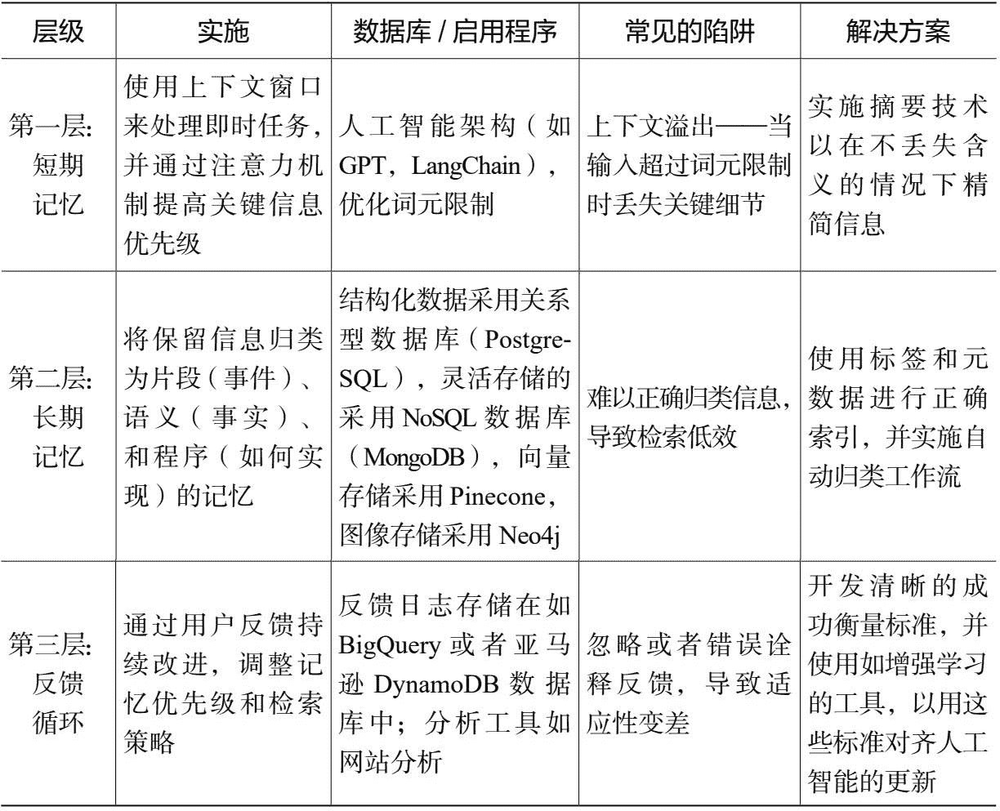

资料来源：Bornet et al.

在人工智能记忆框架中，每一层都建立在前一层的基础之上，依靠数据库与记忆功能之间的无缝整合来有效运行。诸如系统调整不当或数据无序等常见问题，可能会导致记忆检索效率低下或性能不可靠。要解决这些问题，需要保持数据干净、企业有序，明确记忆使用的优先级，并持续监控和优化系统。应对这些挑战能够确保人工智能保持高效、可扩展，并适应实际应用。

**数据管理是成功的基础**

数据管理是具备记忆功能的高效人工智能系统的支柱。就像企业依靠井井有条的记录来高效运作一样，AI 智能体也依赖于无缝的数据存储、检索和更新来发挥最佳性能。如果底层的数据基础设施管理不善，即使是最聪明的人工智能也会出错，如检索到过时的信息、遗漏关键细节或提供不一致的输出。对于企业而言，这可能意味着错失机会、客户不满以及信任度降低。

为避免这些陷阱，领导者必须将数据管理视为战略重点。这首先需要投资于可扩展且高效的数据库技术，以应对现代人工智能系统不断增长的需求。想象一下，一个由人工智能驱动的客服智能体需要在几秒钟内访问数千个客户资料、购买历史和过往互动记录。如果没有强大的基础设施，该智能体可能会出现延迟或提供不完整的回复，从而破坏用户所期望的无缝体验。诸如基于云的数据库、实时分析工具以及用于语义搜索的向量存储等技术，是推动人工智能记忆系统灵活且高效的关键因素。

其次，数据库与人工智能系统之间的无缝集成是另一个关键环节。人工智能记忆系统依赖于与数据层的顺畅、实时交互，以获取最相关和最新的信息。这不仅关乎技术兼容性，还关乎设计工作流程，使数据能够在存储、处理和 AI 智能体之间轻松流动。例如，在零售环境中，推荐产品的人工智能系统需要即时整合最新的库存更新或客户浏览行为，以使其建议具有相关性。如果没有这种动态连接，即使是最先进的人工智能模型也可能显得脱节。

最后，数据管理还需要保持警惕，以确保质量和准确性。无论是对人类还是人工智能而言，低质量的数据都会导致糟糕的决策。领导者必须建立定期清理、更新和验证数据的流程，确保人工智能学习和检索的内容既可靠又及时。此外，随着系统的扩展，领导者应考虑采用能够自动执行这些流程的工具，以减少人为错误并简化操作。

总之，数据管理是推动人工智能实现价值的隐性力量。这不仅仅关乎拥有数据，还要以能够充分释放人工智能潜力的方式对其进行组织、访问和更新。明智地投资于数据基础设施的企业领导者，不仅使他们的系统具备了面向未来的适应性，还为企业在日益由人工智能驱动的世界中蓬勃发展奠定了基础。

**记忆革命才刚刚开始**

在这一章中，我们探讨了记忆如何将人工智能从一个复杂的计算器转变为真正的思考伙伴。我们看到了短期记忆如何使对话保持连贯，而结构化的记忆留存又如何将经历组织起来以实现长期学习。或许最为关键的是，我们明白了反馈循环如何推动持续改进，使人工智能系统能够从每一次交互中学习和适应。

对于企业领导者而言，其影响深远且立竿见影。首先，具备记忆功能的 AI 智能体从根本上改变了客户互动的经济模式。当 AI 智能体能够跨对话保持上下文、记住客户偏好并从过往互动中学习时，它们能以极低的成本提供指数级提升的体验。我们已经看到，一些企业实现了 40%~50%的客户服务成本降低，同时客户满意度也有所提升。

其次，记忆重塑了决策流程。领导者不再仅仅依赖当前数据，还可以利用能够记住并从企业内每项过往决策、成功与失败中学习的 AI 智能体。这种制度性记忆（Institutional Memory），过去分散在电子邮件、文档和员工头脑中，如今成为结构化的易于获取的资源，为战略和运营提供信息。

最后，具备记忆功能的智能体重塑了企业学习和适应的方式。当 AI 智能体能够记住并分析数千个项目或数百万次客户互动中的模式时，它们能发现仅凭人类难以察觉的机会和风险。这并不是要取代人类判断，而是通过一种前所未有的模式识别和历史意识来增强它。

在这一章即将结束时，请记住，人工智能中记忆的发展不仅仅代表着技术的进步，更标志着人类与机器互动方式的根本性转变以及人工智能如何帮助人类思考世界。摆在企业领导者面前的问题并非是否要拥抱这种变革，而是如何在尊重人类自主性和创造力的前提下以创造价值的方式引领这场变革。

# 第三部分 Agentic AI 助力创业与职业成长

既然我们已经探讨了行动、推理和记忆这三大基石，是时候付诸实践了。如何构建这些系统？更重要的是，如何利用它们来创造真正的价值？

在本书的前两部分中，我们带你了解什么是 AI 智能体，以及它们如何思考、行动和学习。我们看到了它们与传统人工智能系统的根本区别：它们不仅仅能处理信息，还能自主地为我们实现目标。但仅仅了解这项技术是不够的。真正的挑战是，如何利用它？

接下来的章节将为你提供工具，将 AI 智能体的变革潜力转化为现实的工具。未来属于那些不仅能理解这项技术，还能有效实施它的人，而我们正准备向你展示这一切是如何做到的。

在这里，我们将撸起袖子，开始实践。无论你是想变革你的企业，还是想启动下一个百万美元的业务，后续章节都将为你提供从想法到实施的路线图。

让我们开始这段从想法到实施的旅程。

## **第八章**

## **构建成功 AI 智能体的实践指南**

“我们的简讯内容简直要把我们累死了。”我们仍然记得那是一个周五的深夜，当时我们正埋头苦读几十篇文章，试图写出能吸引读者的摘要。“肯定有更好的办法。”快进一个月，我们的智能体系统已经接管了整个流程，订阅用户数在短短一个月内就飙升到 30 万，我们的团队每周又多出 40 小时用于创意工作。最棒的是，我们产出的内容比以往任何时候都要好。

但这段经历之所以与你有关，是因为打造有效的 AI 智能体并非取决于拥有最多的预算或最先进的技术，关键在于理解一些能区分成功与失败的关键原则。在这一章，我们将通过自身在为各行业部署 AI 智能体过程中的试错和突破，分享这些原则。

我们不只会告诉你该怎么做，还会展示给你看。通过真实的案例、实用的工具以及坦诚地讲述哪里出了问题（我们是如何解决的），你将获得一份能重塑你和你的企业工作方式的 AI 智能体构建蓝图。

### 第一步：找到合适的智能体机会

想象一下，你身处一家快速发展的数字营销企业繁忙的办公室里，创始人兼创意总监珍妮坐在办公桌前，面前摆着多个屏幕。她正在多个应用程序之间疯狂切换，查看社交媒体分析数据、检查活动表现、整理内容日程表，忙得不可开交，并试图将所有这些信息整合到客户报告中。

珍妮向我们提出了一个引人深思的挑战：“我的团队正被日常事务淹没，”她解释道，“我们的创意人员才华横溢，却要花费大量时间在数据录入和报告生成上，而不是专注于策略和创新。但是，我要如何知道哪些任务适合交给 AI 智能体呢？”

知道如何开始用 AI 智能体，至关重要。我们发现，成功往往更多地取决于选择合适的时机，而非技术的复杂程度。

让我们从一个基本事实出发：AI 智能体并不是能解决所有问题的神奇工具。就像你不会用锤子来解决所有家庭维修问题一样，并不是每个业务难题都适合用 AI 智能体来解决。事实上，一个常见误区就是，创业者和企业高管急于部署智能体，却没有先预判它们是不是完成任务的合适工具。

**什么时候不应使用 AI 智能体**

我们应先明确哪些地方不应部署 AI 智能体。根据我们的经验，我们已经识别出以下几个危险信号。

其一，那些需要真正的人类创造力或情商的任务，通常应由人类来完成。例如，在营销机构中，AI 智能体可以进行数据收集和处理基本报告，但创意活动的构思和客户关系管理仍牢牢掌握在人类手中。尽管 L3 级智能体能够进行自然语言交互，但它们无法真正捕捉打造深入人心的营销活动所需的共鸣情感。

其二，那些需要理解更广泛的市场背景或基于不完整信息做出判断的战略决策也应由人类来做。即使处于 L3 级水平，AI 智能体也缺乏完成这些任务所需的复杂推理能力和市场直觉。

其三，有些任务对于 AI 智能体来说过于复杂，无法有效处理。例如，一家科技企业曾要求我们打造一个智能体来管理其整个客户支持业务。尽管潜在影响力巨大，但该过程涉及许多独特场景和情感互动。AI 智能体在能力与所承担任务的复杂程度相匹配时表现最佳。

在其他情况下，AI 智能体可能缺少做出关键决策的权限。例如，一家金融服务企业希望一个 AI 智能体能够自主做出投资决策。这不仅带来很大风险，而且明显违反了监管要求。在分配任务时，企业必须考虑 AI 智能体对所承担的任务是否具有适当的决策权限。

通过了解这些局限性，企业可以确保在能发挥价值的地方部署 AI 智能体，同时在最重要的地方保留人工监督。

**智能体三大机遇圈**

我们开发了一种简单但强大的方法，称为“智能体三大机遇圈”（见图 8-1），以帮助企业确定实施 Agentic AI 的最佳切入点。想象三个相互重叠的圆圈，你的 AI 智能体的最佳切入点就在这些圆圈的交点处。让我们通过营销机构的经验来剖析这一点。

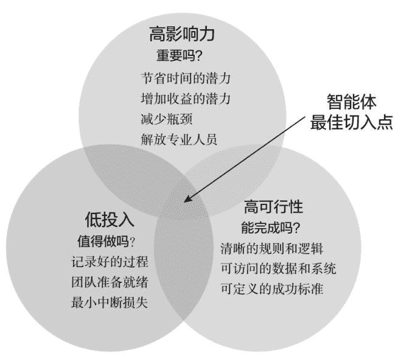

**图 8-1** **智能体三大机遇圈**

资料来源：Bornet et al.

**第一个圈：高影响力——重要吗？**

第一个圈代表的是那些实现自动化会对企业产生重大影响的任务。考虑起来很简单：如果将此流程自动化，它会带来有意义的改变吗？影响不仅仅在于节省时间，还在于节省下来的时间能让你的企业去做什么。

想想那些耗费你们专业人员时间的常规任务。可能你的销售团队花数小时在更新客户关系管理记录，而不是与客户建立关系上；或者你的研究人员花在数据排版上的时间比分析数据的时间还多；又或者你的人力资源团队可能忙于处理常规请求，而无暇关注员工发展。

最具影响力的机遇往往并非最复杂的流程。相反，要寻找那些妨碍你们的最优秀员工发挥最佳水平的常规任务。当评估影响时，请问自己：如果这项任务明天就能实现自动化，那么你的团队能够转而完成哪些工作？

对于这家营销机构而言，它们每月向客户提交报告的流程要耗费团队 200 多小时。更重要的是，这种常规工作使他们的分析师无法进行客户真正需要的战略思考。

**第二个圈：高可行性——能完成吗？**

第二个圈探讨的是当前的 AI 智能体技术是否能够切实有效且安全地完成任务。可以把可行性想象成在开始烹饪前检查是否备齐了所有食材，你需要确保所有成功的基本要素都具备。

通常，最适合自动化的流程具有以下特征：

• 清晰且一致的决策规则；

• 易于访问的数据和系统；

• 可定义的成功标准；

• 出现问题时后果可控；

• 能够在影响运营前验证结果。

关键在于找到那些流程，不需用如“视情况而定”或“但有时……”这类表述就能解释的规则。一个流程需要的例外情况和主观判断越多，就越不适合作为你的首个 AI 智能体项目。

对于这家营销机构而言，报告流程具备自动化所需的全部关键要素，因而具有可行性。首先，它们所需的数据可通过 API 获得。此外，该流程遵循一致的规则，结果易于检查，而错误也能由人工处理。

**第三个圈：低投入——值得做吗？**

最后一个圈考虑的是实施的实际方面——所需资源、时间和企业变革。这不仅关乎技术复杂性，更涉及你的企业是否已准备好迎接变革。

作为企业领导者，你应思考以下几点：

• 流程是否已详细记录；

• 你的团队是否准备好并愿意适应；

• 你能否从小处着手并逐步扩大规模；

• 潜在收益是否足以证明投入是合理的；

• 你能否在不干扰核心业务的情况下实施。

最好的初始项目通常可以分阶段实施，从而使你能够逐步建立信心和能力。

就珍妮的机构而言，自动化报告之所以颇具吸引力，是因为它们已有详细记录的流程，可以从小处着手并逐步扩大规模，而且团队渴望变革。

**找到你的最佳契合点**

理想的 AI 智能体项目存在于这三个圆圈的重叠部分。对于珍妮的机构而言，报告自动化是完美的选择，因为它能为分析师释放数百小时宝贵的时间（高影响力），流程明确且安全，可自动化（高可行性），还可以在不干扰核心业务的情况下实施（低投入）。

首先，将你自己的流程与这三个圆圈相对照。寻找团队反复抱怨的任务，这些通常表明存在高影响力的机会。然后，评估这些任务是否有明确的规则和可访问的数据。最后，考虑你是否有资源并准备好应对这种变化。

请记住，你的第一个 AI 智能体项目应该像一次美好的初次约会，既要有足够的雄心壮志来令人兴奋，又不能过于复杂而可能招致灾难。从在三个圆圈中得分都较高的项目开始，这样你就能为未来更雄心勃勃的项目提供动力和奠定成功的基础。

**实施现实检验：来自一线的经验**

我们的经验揭示了一些关于找到合适机会的关键现实情况。

首先，很少有企业清楚自己真正需要哪些智能体。尽管它们常常带着特定的智能体想法来找我们，但几乎有一半的情况不是最有价值的自动化机会。这就是为什么我们的“三个圈”框架如此关键——它有助于打破假设，识别真正重要的东西。当一位客户坚持要自动化其社交媒体发布时，我们的分析表明，自动化潜在客户资格审核能带来五倍的投资回报率。

其次，许多企业认为它们可以用 AI 智能体完全自动化整个工作角色，但这从根本上误解了当今人工智能的工作方式。AI 智能体不是员工，它们缺乏员工在工作中所具备的灵活性、适应性和判断力。

一名员工通常要管理多个相互关联的流程，这些流程需要员工在不同任务之间切换、做出决策以及与他人协作——这些都是 AI 智能体目前仍难以应对的。比起“自动化角色”，正确的做法应该是想着“自动化任务”。

最后，详尽的流程文档是部署智能体所需的宝贵资源。在评估机会时，我们发现利用现有的标准操作程序（SOP）文档能大幅缩短实施时间，并提高成功率。比如，对于一家金融服务机构来说，其精心编写的客户开户流程文档使我们部署智能体的时间缩短了一半，相比之下，在另一个类似项目中，我们需要从零开始绘制流程，所以花费的时间要长得多。

这些实战经验塑造了我们对待机会识别阶段的方式，强化了“三个圈”框架的重要性，同时增加了超越理论的实践考量。

**一项实践练习：寻找你的自主行动机会**

既然你已经理解了相关理论，那就加入我们一起完成一个简单的练习吧。这个练习常用于帮助企业分辨最适合的智能体部署机会。我们开发这种方法，是因为看到太多企业在没有进行充分分析的情况下就匆忙进行自动化，结果往往导致资源浪费和团队士气低落。

**步骤一：罗列任务清单**

召集你的团队进行一次集中的两小时会议，目标是列出一份详尽的清单，涵盖那些耗费大量时间或造成运营瓶颈的重复性任务。我们发现，提出具体问题比一般性的头脑风暴能取得更好的效果。

向你的团队提问：

• “哪些任务是你每周反复在做的？”

• “哪些活动会妨碍你们专注于更具战略意义的工作？”

• “哪些流程会经常造成运营瓶颈？”

• “哪些常规任务需要更多的监督才能避免错误？”

当我们与那家营销机构一起进行这个练习时，它列出的任务包括每月的客户报告、社交媒体分析、活动表现追踪、竞争对手监测以及内容日程管理。关键在于不仅要记录任务，还要记录其频率以及在每个任务上大约投入的时间。

**步骤二：评估影响力**

评估每项任务在实现自动化后的潜在影响。我们采用一个简单但有效的评分系统，该系统考虑了多个因素。对于每项任务，根据以下标准在 1~5 分的范围内进行评分。

（1）时间投入。（今天这个任务耗时多少？自动化后能节省多少时间？）

在大多数情况下，仅估算平均节省的时间就足够了。得分越高（5 分）意味着节省的时间越多。

在某些情况下，更详细地计算当前成本（以美元计）会很有用。将每次花费的时间乘以频率和每小时成本（例如，每项任务 2 小时×每月 20 项任务×每小时 50 美元 = 节省 2 000 美元）。

（2）空闲时间的战略价值。（机会成本是什么？）

战略价值衡量的是自动化一项任务所带来的更大利益，包括对员工满意度、客户体验、竞争地位和收入潜力的影响。

该价值按 1~5 分的等级进行评定，分数越高表明对整体业务的影响越大。

（3）错误减少潜力。（错误发生的频率如何？）

在大多数情况下，进行估算就足够了。得分越高（5 分）意味着错误发生得越频繁或代价越高。

在某些情况下，详细计算当前的成本（以美元计）会很有用。计算公式为：当前错误率×每次错误的成本×数量（例如，5%的错误率×每次错误 100 美元×每月 1 000 次 = 每月节省 5 000 美元）。

（4）规模化影响。（能否在整个企业中推广？）

规模化影响衡量的是在不增加成本的情况下解决方案扩展的能力。得分越高（5 分）意味着该任务实现自动化的能力越高并能以极小的额外成本在整个企业中规模化。

例如，一个适用于 10 个客户的客户入职流程自动化，能够轻松扩展到 1 000 个客户而无须增加额外人员，这表明其具有很高的规模化能力（评分为 5 分）。

表 8-1 总结了四个评估标准及其得分的含义。

**表 8-1** **评估影响力的四个标准从 1~5 打分**

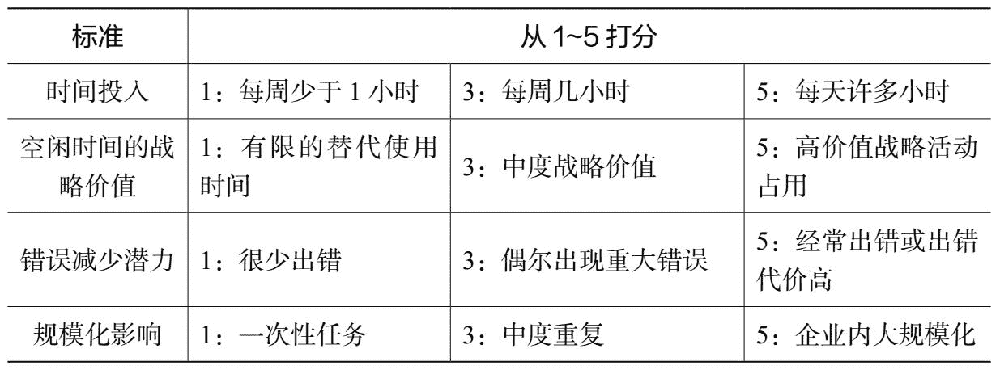

资料来源：Bornet et al.

接下来，计算每项任务的总分。将四个标准的得分相加，最低得分为 4 分，最高为 20 分。

最后，比较各项任务的得分，总分越高，自动化的需求就越强烈。

对该营销机构而言，它们的客户报告流程在所有类别中得分都很高：耗费大量时间（5 分）、妨碍战略分析（5 分）、由于手动输入经常出现错误（4 分），并且能够适用于所有客户（5 分）。这使其总分为 19 分（满分 20 分），成为自动化的主要候选对象。

**步骤三：评估可行性**

对于在影响方面得分较高的每项任务，评估其自动化的可行性。这有助于确定当前的 AI 智能体（L1~L3 级）能否可靠地处理该任务。我们将可行性分为两个关键部分，每个部分的评分范围为 1~5 分。

一是流程标准化。自动化在任务具有清晰且结构化的步骤时效果最佳。评估流程是否具有清晰的步骤、决策规则和例外情况，可以询问：“仅依据我们的文档，新员工能否完全遵循此流程？”

二是数据和系统访问。人工智能需要结构化且易于访问的数据才能运行。如果数据分散、被锁定在旧系统中，或者需要人工干预，那么自动化将会很困难。要评估数据是否结构化、易于检索，是否可以通过现代系统获取或者需要人工预处理。

使用表 8-2 所示标准对流程标准化与数据和系统访问准备情况打分。

**表 8-2** **评估可行性的两项标准**

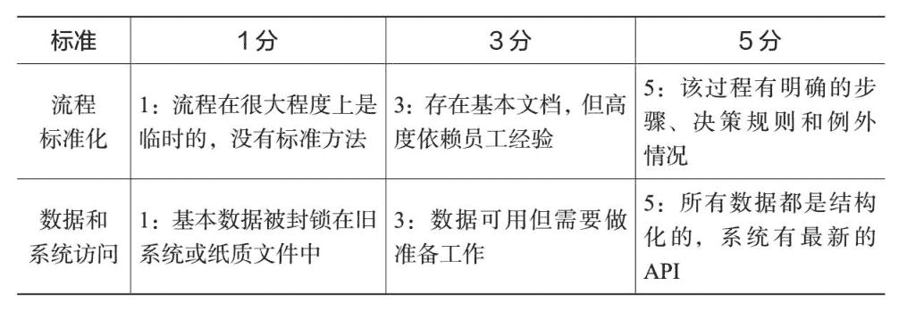

资料来源：Bornet et al.

通过为每项任务在流程标准化与数据和系统访问方面打分，你将能迅速识别出哪些高影响力任务已准备好实现自动化，哪些任务则需要先行改进。

**步骤四：评估实施难度**

一旦确定了高影响力任务并确认其可行性，下一步就是评估为这些任务构建 AI 智能体的难度。实施难度评估衡量的是技术复杂度，有助于你优先部署高效的 AI 智能体。

技术复杂度是一个反向计分指标（1~5 分，反向计分），分数越低意味着复杂度越高，实施难度越大。具体评估方法如下：

评分 5（最易实现）——该任务可使用标准工具实现自动化，几乎无须或完全无须定制。

评分 4——需要一定程度的定制，但依赖于广泛使用的技术。

评分 3——解决方案需要大量的定制开发，例如编写脚本。

评分 2——需要复杂的集成或采用新技术。

评分 1（最难实现）——该任务需要前沿解决方案或大量的研发。

我们的建议是，始终先从经过验证的主流工具和平台入手，然后再突破技术界限。实现简单但影响力巨大的任务的自动化，有助于提供动力、降低风险、确保早期见效，然后再逐步应对复杂度更高的解决方案。

**综合分析：最终决策**

在花费数月帮助企业评估 AI 智能体的三大机遇圈之后，我们开发了一种系统方法来做出最终的实施决策。让我们回到珍妮的营销机构，看看这在实践中是如何运作的。

将之前分析得出的分数进行汇总：

• 影响力得分（最高 20 分，根据四个标准评估得出）。

• 可行性得分（最高 10 分，根据两项标准评估得出）。

• 实施难度得分（最高 5 分，反向计分）。

这使总分可以达到 35 分。我们认为这种详细的评分特别有价值，因为它促使企业系统地思考机会的所有方面。

对于该营销机构的客户报告流程，得分情况如下。

• 影响力：19/20（时间节省多、战略价值高、错误代价高和规模化能力高）。

• 可行性：8/10（流程文档记录详尽，数据可通过 API 访问）。

• 实施难度：4/5（标准工具可用，所需定制化程度低）。

总分为 31/35，表明这是部署 AI 智能体的绝佳候选项目。

**步骤五：绘制 Agentic** **AI 优先级矩阵**

虽然综合得分很有帮助，但我们发现将机遇可视化有助于团队和管理层做出更好的决策。我们将潜在项目绘制在一个矩阵（见图 8-2）内，该矩阵有两个维度：转型复杂度（纵轴，结合可行性得分和复杂度得分）和业务影响力（横轴，使用影响力得分）。

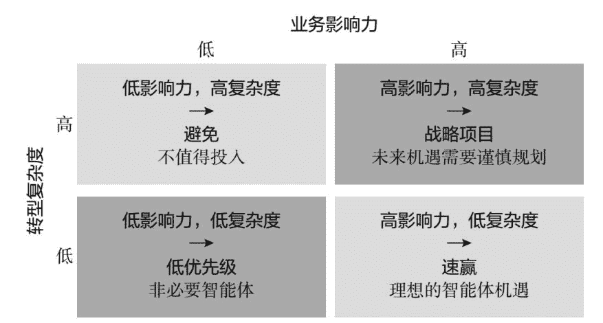

**图 8-2** **Agentic** **AI 优先级矩阵**

资料来源：Bornet et al.

这会形成四个象限：

速赢项目（高影响力、低复杂度）：理想的智能体机遇。

战略项目（高影响力、高复杂度）：需要精心规划的未来机遇。

低优先级（低影响力、低复杂度）：可有可无的自动化功能。

避免（低影响力、高复杂度）：不值得投入。

对于这家营销机构而言，客户报告流程恰好处于“速赢”象限：影响力高但复杂度相对较低。这成为该机构的首个 AI 智能体项目，帮助该机构实现成功转型。

**关于选择的最后一点说明**

如果这是你首次部署 AI 智能体，请注意，它将为未来的自动化举措定下基调。因此，除了上述标准，选择机会时还应确保其：

• 在 3~6 个月内展现出清晰、可衡量的结果。

• 影响足够多的人以建立广泛的支持。

• 有一位愿意监督其实施的拥护者。

• 能够成为你的企业学习的经验。

首个 AI 智能体的成功部署会增强信心，并为更雄心勃勃的项目创造动力。这家营销机构成功实现客户报告流程自动化后，在接下来的一年里又实施了五个 AI 智能体项目，每个项目都建立在第一个项目的经验基础之上。

### 第二步：定义 AI 智能体的角色和能力

在确定了适合部署 AI 智能体的项目后，接下来的关键步骤是确切地定义你需要什么样的智能体。这就像撰写一份工作描述，你需要对数字员工的角色、职责和所需能力有清晰明确的认识。

让我们回到这家营销机构，珍妮和她的团队决定从自动化每月的客户报告流程开始。“我知道我想把这个流程自动化，”珍妮告诉我们，“但我不确定需要什么样的智能体。它应该只是简单地提取数据，还是更复杂一些，能够实际撰写分析报告？”

这是企业领导者常向我们提出的一个问题，而答案在于理解不同层级的 AI 智能体的能力，并将其与你的具体需求相匹配。

**理解智能体层级：从简单到复杂**

可以将 AI 智能体视为具有不同技能水平的员工。Agentic AI 演进框架大致分为五个等级，不过目前在生产环境中，常见的只有 L1~L3 级。确切地说，L2 级（智能自动化）和 L3 级（智能体工作流）最为常见，因此我们将重点讨论这两个等级。

L2 级智能体更像是经验丰富的专业人士，能够遵循简单且不变的指令。L3 级智能体则像是资深专业人士，能够理解上下文并处理更复杂的任务。

对于该营销机构的客户报告流程，珍妮需要确定采用哪个等级的智能体最合适。让我们来梳理一下其决策过程。

**决策框架**

为了选择合适的智能体等级，需要评估三个关键标准，以确定 L2 级或 L3 级智能体哪个更合适。

**标准一：任务可预测性（确定性任务与概率性任务）**

首先，考虑任务的可预测性。L2 级智能体擅长处理确定性任务——遵循明确且不变规则的流程。它们就像可靠的员工，每次都能完美地执行相同的步骤。L3 级智能体由基础模型驱动，能够处理需要理解上下文并做出判断的概率性任务。

在该营销机构中，珍妮的团队分析了他们的客户报告流程，发现其中约 80%是确定性任务——从各种平台提取特定指标，并以标准格式进行整理。这部分非常适合采用 L2 级智能体。然而，20%涉及解读趋势和撰写见解，这需要概率性思维，更适合采用 L3 级智能体。

**标准二：错误敏感性**

评估错误对运营的影响。对于准确性至关重要的任务，L2 级智能体非常可靠，因为它们遵循确切的规则，不会偏离规定的模式。它们非常适用于财务计算、数据处理以及其他错误代价高昂的任务。

L3 级智能体虽然更灵活，但可能偶尔会产生意外的输出或做出创造性的解释。它们更适用于那些允许一定程度的变化甚至鼓励变化的任务，比如内容生成或模式分析。

对于该营销机构的客户报告流程而言，数据收集和计算的准确性至关重要，一个错误就可能损害客户信任，这意味着 L2 级智能体非常适用于数据处理任务。而书面分析中的细微变化是可以接受的，有时甚至是可取的，这意味着这部分工作适合采用 L3 级智能体。

**标准三：输入多样性**

评估输入数据存在多大程度的变异。L2 级智能体最适合处理标准化的输入——它们需要一致的数据格式和可预测的场景。L2 级智能体在处理例外情况时会遇到困难，并且在未重新编程的情况下无法应对意外的变化。

然而，L3 级智能体在处理多样性输入方面表现出色。它们能够理解上下文，适应不同的格式，并理解非结构化数据。它们就像经验丰富的专业人士，可以根据情况调整方法。

该营销机构处理了各种数据源，但它们遵循了一致的格式，因此非常适合采用 L2 级智能体。然而，对于不同客户和行业的数据解释背景差异很大的部分，则需要采用 L3 级智能体。

表 8-3 总结了这些标准如何映射到智能体等级。

**表 8-3** **L2 级与 L3 级智能体的对比**

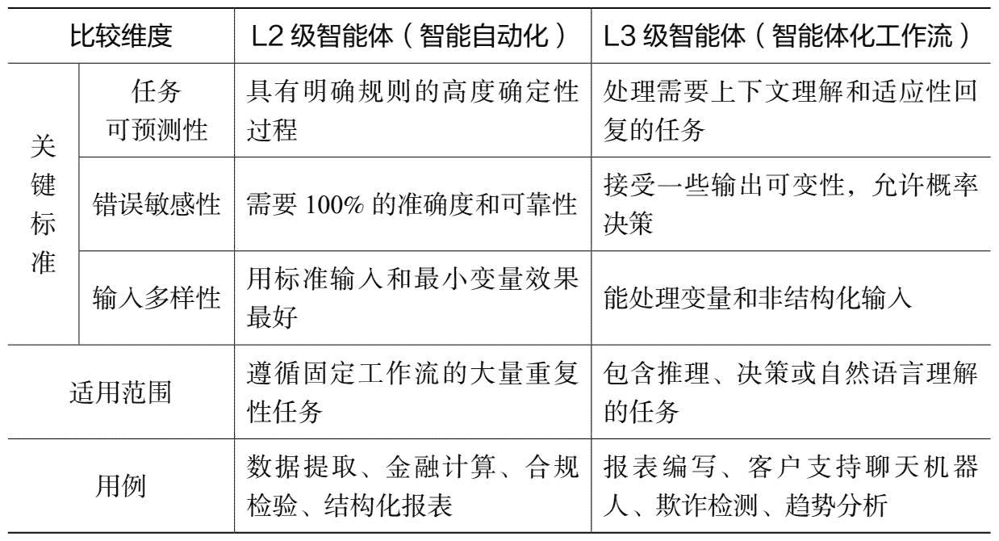

资料来源：Bornet et al.

**做出选择：营销机构的决策**

在评估了这些标准之后，我们帮助该营销机构做出了一个有趣的决策：他们将采用混合策略，使用 L2 级和 L3 级智能体来处理流程中的不同部分。

L2 级智能体（我们称之为智能自动化）将负责处理工作中的确定性部分，包括：

• 访问各种平台（谷歌分析、社交媒体、广告平台）。

• 提取标准化数据集。

• 执行计算并创建可视化图表。

• 生成基本报告结构。

L3 级智能体（自主工作流）则负责处理以下部分：

• 分析处理后数据中的趋势。

• 生成初步见解和建议。

• 撰写报告的草稿叙述部分。

这种混合策略充分利用了每类智能体的长处。L2 级智能体能够可靠地处理精确、确定性的任务，几乎达到完美的准确度，而 L3 级智能体则适合处理更细致的数据解读和报告生成工作。

接下来，我们将概述如何设计和构建 L3 级智能体。对于构建 L2 级智能体，我们建议参考《智能自动化》一书。¹

**学习曲线**

值得注意的是，实施 AI 智能体通常是一个迭代的过程。在该营销机构，它们从 L2 级智能体仅处理数据收集和基本报告开始。这项工作开展顺利，团队也对这项技术感到得心应手，他们便引入了 L3 级智能体来生成内容。

珍妮反思道：“起初，我想一次性实现所有流程自动化。但先从基础的数据工作做起，然后逐步增加更复杂的功能，这有助于我们的团队适应，并且切实改变了我们对报告流程的看法。”

**成果与经验教训**

在实施六个月后，该营销机构的 AI 智能体系统已经能够以显著的效率为所有客户处理报告：

• 报告生成时间缩短至 45 分钟。

• 数据准确率保持在 99.95%。

• 客户满意度得分提高了 15%。

• 营销团队用于战略工作的时长增加了 60%。

珍妮回顾了他们的历程：“关键在于没有急于实现自动化。通过采取循序渐进的方法进行设计，并逐步建立信任，我们创建了一个团队和客户都完全信赖的系统。”

该营销机构报告系统的成功为它们在整个企业中实施 AI 智能体提供了新的可能性。它们目前正在探索在活动优化、内容创作和客户旅程分析方面的应用。

从此次实施中吸取的经验教训，凸显了在设计时考虑技术能力和人为因素的重要性。正如我们将在下一章探讨的那样，这些设计决策为成功实施和部署 AI 智能体奠定了重要基础。

**展望未来**

明确了 L2 级和 L3 级智能体的角色后，这家营销机构已准备好进入详细设计阶段。清晰划分职责和能力，对于接下来绘制流程图和确立绩效标准至关重要。

请记住，目标并非打造最复杂的智能体，而是设计出能可靠地创造价值且与你的人力团队工作流程无缝整合的智能体。正如我们将在下一章探讨的那样，清晰界定角色和能力将为成功实施奠定重要的基础。

### 第三步：成功设计 AI 智能体

在确定了合适的机遇并选定恰当的智能体类型之后，接下来的关键阶段就是设计你的 AI 智能体以推进成功实施。这是理论与实践相结合的阶段，也是许多企业要么为成功做好准备，要么落入常见陷阱的阶段。让我们通过为简讯自动化创建 AI 智能体的经验来探讨这一过程。

**简讯挑战：一个真实案例研究**

深耕人工智能领域的经历，让我们发现自己每周都要花费大量时间来策划内容、撰写摘要以及为我们的社区创建简讯。这是一个劳动密集型的过程，虽然对读者很有价值，却占用了我们进行更深入研究和写作的时间。就在那时，我们决定运用我们在 AI 智能体方面的专业知识来应对这一挑战。

“我们每周几乎要花一天的时间来制作简讯，”帕斯卡尔回忆道，“我们知道一定有更好的办法。”结果呢？一个新的 AI 智能体系统不仅自动化了大部分流程，还帮助我们在短短一个月内将新简讯的订阅用户增长到 30 多万人。

在第九章中，我们将探讨如何开发这一创新的智能体业务机会，并将其转化为一个创业项目，重点阐述 Agentic AI 在创造新的商业可能性方面的巨大潜力。

**设计原则一：以终为始**

在深入研究技术细节之前，成功的智能体设计始于明确的成功标准。拉凯什结合他的咨询经验分享道：“我们看到的最大错误之一，是企业直接跳到解决方案设计，而没有预先定义成功的模板。”

明确的成功标准之所以至关重要，有三个关键原因。第一，它为开发团队提供了明确的目标，并有助于确定功能的优先级。第二，它为衡量投资回报率和系统性能建立了基准。第三，它有助于管理利益相关者的期望，并增强他们对新系统的信心。

如果没有明确的成功标准，我们可能会构建一个技术上令人印象深刻但实际上并未解决核心业务需求的系统。

成功标准应包括定量和定性指标：定量指标可能包括效率提升率、错误减少率或特定的绩效目标；定性指标通常侧重用户体验、输出质量以及系统可靠性。

例如，在我们的简讯案例中，我们设定了如下指标：第一，制作时间从每周 15 小时缩短至每周 3 小时；第二，内容准确率保持在 95%以上；第三，邮件打开率达到 40%以上。

但更重要的是，我们还围绕内容相关性和读者体验定义了定性的成功标准。

**设计原则二：了解当前状态**

我们观察到：“许多企业都想直接跃向未来，但了解当前流程对于成功设计智能体至关重要。”

在设计 AI 智能体之前详细了解当前工作流程至关重要，原因有三。第一，它能揭示出乍看之下可能不明显的隐藏复杂性和依赖关系。第二，它有助于识别新系统应解决的潜在瓶颈和低效之处。第三，它能确保在自动化过程中不会忽略关键的业务规则和例外情况。

当我们开始绘制工作流程图时，我们发现原本以为简单的四步流程，实际上涉及数十个我们自动处理的微决策和例外情况。如果不记录这些，我们构建的智能体系统就会遗漏关键的细节。

我们在执行现有简讯流程中遇到了以下四类问题。

• 耗时：手动搜索、撰写摘要、编译和排版需要投入大量精力，每周都要耗费数小时。我们估计处理每份简讯每周需耗费 10 小时。

• 易出错：在重复性任务中，比如撰写摘要和排版，我们很容易出错。这种情况发生过几次，对我们的声誉造成了很大损害。

• 规模化问题：随着文章数量的增加，人工流程变得难以为继，员工需要耗费数小时的工作时间。

• 不一致的质量：输出结果的质量因执行每项任务的个人能力不同而存在差异，导致团队人员变动时结果参差不齐。

**设计原则三：设计目标流程**

在记录了现有的工作流程之后，我们没有简单地对旧流程进行自动化，而是完全重新设计了流程，并以最终结果为导向。根据我们的经验，坚持使用过时的工作流程往往会导致效率低下，因为仅靠自动化无法解决根本的设计缺陷问题。

正如沙伊尔常说的那样：“垃圾进，垃圾出。如果对有缺陷的流程进行自动化，只会得到有缺陷的自动化。”

相反，我们专注于想要实现的目标——创造一个简洁、可扩展且无错误的简讯生成流程，并围绕这一目标构建了工作流程。新的流程遵循结构化的每天和每周工作流。

每天应识别相关文章，提炼关键见解形成摘要，并发送版式排好的电子邮件供人工审核。所选摘要随后应汇编成结构化的文档，并确保质量可控。

每周一，文档内容应被整理成视觉效果出色的简讯，进行准确性审查，并最终完成分发。

通过将流程分解为清晰、明确的步骤，我们消除了不必要的复杂性，提高了质量保证，并确保了发布周期顺畅。根据我们的经验，关键在于不要只是自动化，还要重新思考、重新设计并优化，以获得尽可能好的结果。

**设计原则四：选择正确的架构**

在智能体设计中，最重要的决策之一就是架构方法。我们这样阐释它：“把它想象成建造一座房子，你可以尝试建造一个巨大的房间来满足所有需求，也可以设计出相互协调的专用空间。根据我们的经验，后一种方法几乎总是更有效。”

这让我们在智能体设计中面临一个根本问题：应该构建一个复杂的智能体来处理所有事务，还是创建一个由专业智能体组成的团队？

在设计简讯自动化系统时，我们面临同样关键的决策：应该构建一个复杂的智能体来处理所有事务，还是创建一个由专业智能体组成的团队？我们为各种企业部署人工智能系统的经验表明，简单、专用的组件往往比复杂、单一的组件更有效。本书进行到这里，相信你已经对我们的设计原则“一智能体，一工具”非常熟悉了。让我们探讨一下指导我们成功设计的关键决策。

“起初，我们想打造一个全能的‘超级智能体’，让它从内容发现到简讯格式编排都能一手包办，”本书的合著者之一拉凯什解释道，“但很快我们就意识到，这就好比要求一个人同时身兼研究员、作者、编辑和设计师数职——这很难行得通。”

因此，我们创建了一个由专业智能体组成的综合团队（见表 8-4）。

**表 8-4** **我们用于简讯自动化的专业智能体团队**

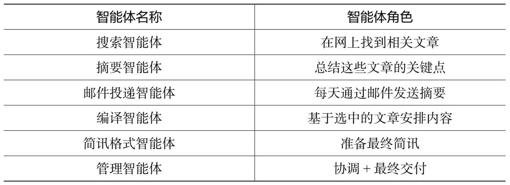

资料来源：Bornet et al.

这种模块化的方法使每个智能体都能在其专业角色中表现出色，同时通过协调互动保持系统的灵活性。

**多智能体系统设计的关键原则**

在设计多智能体系统时，我们遵循了六个核心原则。

第一，明确目标。“每个智能体都要像一位技艺精湛的专家，”拉凯什解释道，“就像你不会要求一位心脏外科医生同时兼任麻醉师一样，我们为每个智能体都赋予了清晰且专注的角色。”

第二，通过专业化实现效率。我们没有打造能够胜任多项任务但表现平平的复杂智能体，而是创建了能够将一项任务做得极其出色的简单智能体。

第三，通过设计实现规模化。“我们设计的智能体系统能够应对不断增加的工作。”拉凯什分享道，“例如，如果内容量增加，我们可以引入多个并行工作的搜索智能体，或者优化摘要智能体以加快处理速度。”

第四，自主运行。每个智能体在其职责范围内独立运作，依据明确的标准做出决策，无须持续监督。

第五，无缝协作。这些智能体如同配合默契的团队一般协同工作，有着标准化的通信协议和明确的交接点。

第六，集中式编排。管理智能体确保所有组件协调一致地运行，就像指挥家引领管弦乐队一样。

**设计原则五：打造人机协同**

可能智能体设计中最为关键的一点在于确定人类与人工智能如何协同工作。“目标并非将人类排除在流程之外，”南丹强调，“而是要建立一种共生关系，让人类和人工智能都能发挥各自独特的优势。”

当考虑到当前 AI 智能体的局限性时，这一原则就显得尤为重要。在 Agentic AI 演进框架的 L1~L3 级，智能体仍缺乏真正的自适应学习和复杂推理能力。这意味着人类的专业知识对于以下方面仍然至关重要：

• 战略决策：人类擅长理解背景情况并做出细致入微的判断。

• 质量保证：提供监督并发现细微错误。

• 异常处理：管理超出正常参数范围的意外情况。

• 持续改进：识别系统优化的机会。

在最初设计简讯系统时，我们面临一个根本性的问题：哪些任务应该自动化，哪些任务应由人工完成？我们的方法不是考虑哪些“能够”自动化，而是哪些“应该”自动化。

我们确定了两个关键环节，其中人工介入至关重要。

第一个关键的人工介入点是在我们的 AI 智能体收集并总结内容之后。一位人工编辑会审查每日摘要，并挑选出最相关的内容放入简讯中。这一决策依赖于对受众需求的了解、对新兴趋势的识别，以及对内容价值的细致判断——这些能力仍是人类独有的。

在实施过程中，我们发现了一个有趣的模式：当让人工智能做最终的内容选择时，简讯虽在技术上准确无误，却显得毫无生气。它们缺乏来自人工策划的战略叙述和主题连贯性。通过让人类在这一关键决策环节发挥作用，我们保持了简讯的独特风格和战略相关性。

第二个关键的人工介入点发生在发布之前。在这里，人工编辑会审阅完整的简讯，在有需要的地方添加背景信息，并确保内容符合我们的编辑标准。这一最终审核不只是为了发现错误，更是为了确保简讯能为我们的读者提供真正的价值。

“这种人工参与的模式，”南丹解释道，“让我们获得了两全其美的结果。智能体处理耗时的任务，而人类则专注于需要判断力和行业专业知识的战略决策。”

**产出：目标智能体系统**

经过几天的努力，我们的设计终于完成了。以下是新设计的目标流程，它展示了关键活动的流程、负责的智能体以及人工干预环节。

**日常工作流程**

（1）搜索智能体：在网络上搜索相关文章，并将链接发送给摘要智能体。

（2）摘要智能体：将每篇文章总结为三个关键点，并将摘要发送给邮件投递智能体。

（3）邮件投递智能体：将摘要编译成排好格式的电子邮件并发送给人工审核员。

（4）人工审核员：每日审阅邮件，并回复所偏好的文章，发送给编译智能体。

（5）编译智能体：将每日精选摘要编译成结构化的谷歌文档，并进行质量检查。

**每周工作流程**

（1）简讯排版专员：每周一，专员将谷歌文档排版成美观的简讯。

（2）管理智能体：审核排版后的简讯，并发送给人工审核员。

（3）人工审核员：进行最终审核，并将简讯发布到目标平台。

### 第四步：实施你的 AI 智能体

**选择合适的 AI 智能体平台：优先考虑速度而非完美**

AI 智能体平台市场发展迅速，约有 400 家供应商提供不同复杂程度和易用性的解决方案。这种丰富的选择虽然为企业提供了众多选项，但也可能导致决策瘫痪。通过为各行业实施 AI 智能体的经验，我们发现，企业往往要花数月时间评估平台，而其竞争对手则已经率先完成实施并获得宝贵的市场优势。

选择合适的平台需要了解当今市场上的三大类别：无代码平台、全代码平台和低代码平台。每一类平台都满足不同的企业需求，并在灵活性、实施速度和所需技术专长之间存在各自的权衡。

**无代码平台：快速部署和易用性**

可以将无代码平台视为 AI 智能体开发的“乐高积木”。它们提供预先构建的组件，你无须任何技术专长即可进行组装。像 Bizway、Beam、N8N 和 Relevance AI 这样的解决方案，使用户能够通过直观的界面创建功能性的 AI 智能体，无须编写任何代码。无代码平台非常适用于需要快速实施基本到中等复杂度智能体的企业，或者那些希望在投资更复杂的解决方案之前验证 AI 智能体价值的企业。

虽然无代码平台与技术含量更高的同类产品相比可能看起来应用有限，但它们通常能通过配置而非编码提供令人惊讶的复杂功能。例如，Relevance AI 通过用户友好的界面提供诸如基于向量处理和复杂搜索等的高级功能。

**全代码平台：提供最高级别的控制权和灵活性**

全代码平台提供了最高级别的控制权和灵活性，但需要大量的开发资源。这些平台，如 LangGraph、CrewAI 和 AutoGen，它们提供了全面的框架，使企业能够构建高度定制化的 AI 智能体。它们特别适用于那些需要严格控制数据、需要与现有系统进行复杂集成或在高度监管行业中运营的企业。

在使用全代码平台时，从决策过程到数据处理协议，企业可以微调其 AI 智能体的各个方面。这种程度的控制是以更长的开发周期和对专业技术知识的需求为代价的。虽然像 LangGraph 这样的平台提供了广泛的文档和不断增长的社区支持，但学习曲线仍然陡峭。

这些复杂的智能体需要对多个工具进行精心协调和复杂的流程管理，而全代码平台能够很好地处理这些任务。然而，各企业应仔细考虑这种程度的控制对于其用例而言是否真的必要，因为额外的开发工作量可能会显著延迟实施和实现价值的时间。

**低代码平台：平衡之道**

低代码平台在定制化和易用性之间取得了平衡。诸如 WatsonX Assistant、Agentforce 以及 UiPath 和微软 Copilot 的 Agent Builders 等平台提供了可视化开发环境，同时在需要时仍允许通过代码进行大量定制。这些平台在促进用户与技术团队之间的协作方面表现出色，对于那些既需要快速部署 AI 智能体又需要一定程度定制化的企业而言，它们特别有效。

低代码解决方案显著减少了实施所需的时间和技术专业知识，同时为大多数企业用例提供了足够的灵活性。低代码平台通常提供可定制的预构建组件和集成，以满足特定的业务需求。例如，ServiceNow 的虚拟智能体平台为常见的业务流程提供了即用型组件，同时允许企业在需要时通过自定义开发来扩展功能。

**做出选择：关键考虑因素**

要做出自信且高效的决策，请专注于实用框架，而非无休止的功能比较。首先，根据业务优先级确定三到四个不可妥协的关键因素。其次，为每个标准分配权重，考虑诸如易用性、定制化、集成、可扩展性、安全性和成本等因素。最后，根据这些因素对潜在平台进行评分，选择得分最高的平台，并继续推进。

技术专长的可用性往往是首要的决定因素。拥有强大开发团队的企业可能会自然而然地倾向于全代码解决方案。然而，我们观察到，即使技术能力很强的企业有时也会从低代码或无代码解决方案开始，以便更快地实施并获得实际经验，然后再转向更复杂的实现。

另一个关键的考虑因素是通过“公民开发”（Citizen Development）在企业内部扩大智能体开发的潜力。无代码和低代码平台支持一种民主化的方式，让企业内的员工都能参与构建和定制智能体。这种智能体开发的民主化能够极大地深化人工智能计划的影响，并带来更具创新性的解决方案，因为了解特定业务挑战的员工可以直接为解决方案的构思做出贡献。例如，客服代表可能会创建一个智能体来处理常规咨询，而财务分析师可能会开发一个智能体来自动化报告生成流程。这种分布式智能体开发方式能够显著提升企业内部人工智能的价值和覆盖范围。

与现有系统和数据源的集成需求在平台选择中也起着至关重要的作用。虽然大多数平台都提供 API 连接，但集成的便捷性和深度却存在很大差异。例如，微软 Copilot 的智能体构建器能够与微软生态系统实现无缝集成，这对在微软技术方面投入巨大的企业来说，是一个颇具吸引力的选择。

安全和合规要求会对平台的选择产生重大影响，尤其是对于受监管行业的企业而言。全代码平台通常能够在数据处理和安全协议方面提供最大的控制权，而无代码平台在这方面的功能可能会有所限制。

**避免过度思考**

没有哪个平台是完美的，等待“理想”的选择可能会错失良机。最佳策略是从小处着手进行试验，随着了解的深入逐步扩大规模。许多成功的企业都是从在低代码平台上开发一个简单的 AI 智能体开始，验证其效果，然后随着需求的发展逐渐迁移到更高级的解决方案。

在你还犹豫不决时，你的竞争对手已经部署了正在改变行业的 AI 智能体。行动迅速的企业将引领人工智能革命，而犹豫不决的企业将会难以追赶。最好的人工智能战略不是完美的战略，而是你今天就开始实施的战略。

————

接下来，我们凭借自身经验打造了一份通用指南，它适用于各种平台，重点介绍了关键成功因素、细微决策以及那些真正影响 AI 智能体的隐藏功能。其优势在于，无论你选择何种平台，都可以独立使用该指南；其不足之处在于，它并非针对特定平台，因此你可能会注意到术语和功能细节方面存在一些差异。不过作为示范，我们仍选择在本书附录中提供基于低代码平台 Relevance AI 构建智能体的详细步骤——这不仅仅是落地实践的参考模板，更是帮助你理解如何将通用原则转化为具体实施路径的鲜活案例。

**构建高效 AI 智能体：A.G.E.N.T.** **框架**

我们的经验表明，成功往往不在于技术的复杂程度，而在于 AI 智能体的定义和结构是否清晰、全面。通过众多的实施案例，坦率地说，包括一些惨痛的教训，我们开发了 A.G.E.N.T. 框架，它是一种用于构建可靠且真正能创造价值的 AI 智能体的全面方法。

该框架由五个关键组成部分。

A：智能体身份（Agent Identity）——智能体是谁？

G：设备与大脑（Gear and Brain）——什么为智能体提供动力？

E：执行与工作流（Execution and Workflow）——智能体如何工作？

N：导航与规则（Navigation and Rules）——AI 智能体如何做决策？

T：测试与信任（Testing and Trust）——如何改进和扩展 AI 智能体？

将构建一个 AI 智能体想象成招聘和培训一名新员工。你不会在没有明确界定其角色、确立其职责以及设置适当的工作流程、工具和规则的情况下将某人引入你的企业。对于 AI 智能体来说，这一原则同样适用，而且更为重要，因为这些数字员工需要极其精确的指令才能有效运行。

**A：智能体身份——智能体是谁？**

构建 AI 智能体时最重要的一步是定义其身份，包括目的、角色和操作权限。这恰恰是大多数人容易犯的第一个错误。他们急于看到自己的人工智能发挥作用，而没有花时间仔细定义智能体应该做什么。这就导致构建了一个行为不可预测、产生不一致的结果或根本无法创造价值的人工智能。

为了说明这一步为何如此关键，想象一下当你招聘新员工时，你会把一个人招进企业然后对他说“你看着办，你觉得怎么好就怎么来”吗？当然不会。新员工需要明确的指导，帮助他们明晰角色、职责和操作权限。AI 智能体也是如此。如果你不给它们一个结构化的身份，它们就会漫无目的地游荡，经常产生不可靠、不相关甚至适得其反的结果。

**为何定义智能体身份至关重要**

AI 智能体并非直觉思考者。它们没有直觉或常识，只能在你为它们设定的限制内运行。如果你未能恰当地定义它们的身份，将导致它们产生以下三个方面的后果。

一是不可靠的行为：由于缺乏明确的指引，智能体可能会做出与你的目标不一致的反应。

二是不一致性：由于没有明确的指导方针，对于同样的问题智能体每次可能会给出不同的结果。

三是缺乏控制：如果智能体的权限范围不明确，它可能会产生不必要的、不相关的，甚至是有害的输出。

要了解智能体身份的重要性，不妨看看我们在为简讯系统打造一款摘要智能体时的经历。起初，我们给这个智能体下达了一个简单的指令：

“总结新闻文章和研究论文。”

听起来挺合理的，对吧？但结果却一团糟。人工智能随意抽取文章，总结得毫无条理，有时甚至包含过时或不相关的来源。这并非人工智能的过错，它只是在遵循模糊的指令。

于是，我们明确了摘要智能体的身份，并赋予它更精确的角色：

“你是一位专注于人工智能和商业趋势领域的摘要助手。你的工作是从《麻省理工科技评论》、arXiv（预印本平台）和《哈佛商业评论》等来源，获取新闻文章和研究论文，并将其提炼成清晰、引人入胜的摘要。每份摘要必须控制在 150 个单词以内，抓住关键见解，并保持原文的意思。语气应专业但通俗易懂，与我们的简讯风格一致。”

有了如此清晰的指令，人工智能从一个不可靠的内容聚合器变成了一个专注的研究伙伴。现在它能提供简洁、高价值的摘要，帮助读者始终走在前沿，而无须我们从海量信息中筛选。我们在附录中为你提供了此智能体的详细身份信息。你可以以此为模板来撰写你的智能体身份信息。

**打造强大的 AI 智能体：像管理者一样思考**

为了全面理解这一点，想象一下管理一名无法独立思考的远程员工，他只会遵循指令，那么你需要做以下工作：第一，给他们一份清晰的工作说明；第二，明确告诉他们应该（和不应该）做哪些任务；第三，明确告诉他们应该如何沟通；第四，设定边界和升级处理机制。

现在，把这名员工换成你的 AI 智能体。如果你不定义这些内容，你的人工智能将不可靠。如果你定义清楚了，就将拥有一个在其领域内始终如一、高效且智能化运作的智能体。

在继续选择模型和工作流程之前，请你花时间写下你的智能体身份。这个基础越牢固，你的 AI 智能体就越强大、越有效。

**强大智能体身份的关键要素**

定义 AI 智能体的身份不仅需要说明其功能，更需要精确，就像撰写一份精心制作的工作描述一样。

（1）目的：智能体的主要任务是什么？

每个 AI 智能体都应有一个明确的任务说明，回答以下问题：这个智能体存在的原因是什么？一个强有力的目的说明不会留下任何模棱两可的空间。

• 弱目的：协助客户支持。

• 强目的：通过分步解决方案，以专业、友好的方式帮助客户解决常见技术问题。

目的越明确，智能体的输出就越符合用户的期望。

（2）角色：智能体扮演什么身份？

智能体的角色定义了它与用户互动的方式，以及它所模拟的专业知识——本质上就是它的职业身份。明确的角色设定能让用户立刻了解其能力和局限，同时也为智能体应该做什么和不应该做什么提供了明确的界限。

例如，一个金融 AI 智能体可能是：

• 金融分析师（提供投资见解和风险评估）。

• 个人理财教练（帮助用户规划预算和存钱）。

• 税务顾问（在合规的前提下回答税务相关问题）。

每种角色都需要人工智能以不同的方式交流，并专注于处理不同类型的信息。

（3）操作权限：智能体能做什么，又应避免什么？

若没有明确的边界，AI 智能体可能会超出其预期功能。设定清晰的操作权限可确保其保持专注。

例如，客服智能体可能被限定于：

• 根据企业知识回答常见问题。

• 提供常见问题的故障排除步骤。

• 将复杂问题转交给人类代表。

它不应试图：

• 提供法律或医疗建议。

• 做出未经授权的决定。

• 生成推测性的回应。

设定操作权限可防止智能体涉足那些错误代价高昂的领域。

**G：设备与大脑——什么为智能体提供动力？**

一旦你为 AI 智能体定义了清晰明确的身份，下一步就是为其配备合适的设备和大脑，包括确保它有效运行所需的工具、模型和知识来源。这是许多构建者出错的地方，他们要么选择不必要的高级配置而使事情变得过于复杂，要么为任务选择错误的工具而使智能体能力不足。

可以把这一步想象成组装一辆高性能汽车。你不会把赛车引擎装在送货车里，也不会指望一辆家庭轿车赢得 F1 比赛。同样的逻辑也适用于 AI 智能体：选择错误的人工智能模型、工具和数据源组合会导致效率低下、性能不佳或彻底失败。

**选择合适的人工智能模型：平衡性能、成本与效率**

大多数平台都允许你选择你的智能体使用哪种人工智能模型（或模型组合）。这一决策至关重要，因为它决定了你的智能体如何思考、响应和处理信息。人工智能模型是智能体的大脑，决定了它理解、推理和生成回应的能力。有两个关键的权衡需要考虑：模型大小和推理能力。

一方面，较小的模型（如 Mini、Phi、Flash）速度快、效率高且成本低，非常适合处理简单的查询或预定义任务。然而，它们在深度推理和复杂问题解决方面表现不佳。另一方面，较大的模型（如 GPT、Claude Opus、Gemini Ultra）能够分析细微的信息，生成高质量的回应，并进行批判性思考，但它们需要消耗更多资源且运行成本更高。

在成本敏感的应用场景中，通常最佳做法是将较小的模型用于日常任务，将较大的模型用于复杂查询。开源模型，如 Mistral 或 Llama 70B，提供了更多的控制权且成本更低，但需要团队具备微调和部署的专业能力。

调整 AI 智能体性能的另一个重要因素是调整温度设置，这是许多平台都具备的一项功能。温度设置控制着人工智能响应的确定性或创造性，从而影响智能体的可靠性和灵活性。

较低的温度（如 0~0.3）会使人工智能更具可预测性和一致性，紧密围绕事实性答案，减少随机性。这在准确性至关重要的应用中非常理想，比如简讯的摘要智能体、研究助手或法律人工智能工具。用户希望的是人工智能生成简洁、基于事实的摘要，而不是在语气或内容上产生意外的变化。

较高的温度（如 0.7~1.0）会使人工智能更具创造性和开放性，引入措辞和响应的多样性。这种设置对于头脑风暴、生成营销文案或创作创意内容很有用，在这些场景中，原创性比严格的准确性更重要。然而，在像摘要智能体这样结构化的环境中，较高的温度可能会导致不一致、出现“幻觉”或偏离原意的冗长输出。

若要更深入地了解用于 AI 智能体的人工智能模型选择，可以参考诸如 Hugging Face 的智能体模型比较资源²以及 OpenAI、Anthropic 或 DeepMind 发表的人工智能研究论文，它们都能提供有价值的基准。³

**选择合适的工具：精准胜过强大**

AI 智能体并不只是文本生成器，它还必须与外部系统交互、获取实时数据并采取行动。正如企业不会让员工无限制地访问其系统一样，AI 智能体的工具集也必须明确界定、有限制且受监控。

在我们的简讯项目中，最初我们让搜索智能体无限制地访问网络抓取工具。结果是，该智能体从不可靠的来源获取了大量内容，有时甚至因请求过多而导致网站服务器屏蔽请求。因此，我们认识到详细定义每个工具的目的、限制和使用参数的重要性。对于我们的搜索智能体，这意味着不仅要指定它可以使用哪些 API，还要明确具体如何使用。你可以在附录中查看我们提供的智能体详细工具规格，并以其为模板编写你自己的工具规格。

API 是最常见的工具，它允许智能体获取实时信息或执行操作。例如，金融智能体可能会使用市场数据 API 拉取股票价格，而日程安排助手则依赖于日历 API。然而，不受限制的 API 访问可能会导致速率限制、安全漏洞或法律问题，这就像许多网络爬虫智能体因过度抓取而最终被封锁或禁止的情况一样。

为防止滥用，智能体需要有结构化的使用政策，明确界定操作边界，应明确以下几个关键参数：

• 请求频率和成本控制。为确保效率和成本控制，智能体每分钟的请求量必须在设定的限制内。许多 API 按请求收费，这意味着无节制使用会导致高昂的成本。此外，超出提供商设定的限制可能会触发限流机制，即 API 会减缓速度或暂时阻止请求，以防止系统过载。通过管理请求频率，智能体可以避免不必要的开支，同时维持性能稳定且持续。

• 数据来源可靠性。智能体应仅从预先批准的、可靠的来源获取数据，以防止抓取错误信息。这可能包括将受信任的新闻机构列入白名单，或者根据质量标准过滤内容。例如，我们的研究智能体被编程为仅从预先批准、声誉良好的来源（如《麻省理工科技评论》、arXiv 或《哈佛商业评论》）获取信息。

• 安全的 API 访问。API 密钥应定期轮换，并通过身份验证机制（例如基于令牌的访问）进行保护，以防止未经授权的使用。它们绝不应被硬编码到脚本中。

• 断路器。如果重复出现故障，应停止执行，而不是继续发送错误请求。例如，如果某个 API 连续失败三次，智能体应暂停并通知管理员，而不是无限重试。

• 备用系统。当出现问题时，通过切换到备用流程来确保连续性。例如，如果新闻 API 出现故障，人工智能可以从备用来源获取头条新闻，而不是返回错误。

如果没有这些安全网，AI 智能体可能会导致自身过载、惹恼用户，甚至损害业务运营。对于那些希望进一步探索人工智能工具集成的人来说，除了可以参考本书的第二部分，还可以参考 OpenAI⁴、谷歌⁵和 AWS⁶的 API 文档，这些文档为负责任实施提供了出色的指导。

**选择知识来源：可靠 AI 智能体的基础**

AI 智能体必须从可靠来源检索和处理信息。如果这些来源定义不明确，智能体可能会产生幻觉、提取错误数据或提供误导性响应。构建智能体知识库的方式有三种，分别是数据库、API 和文档嵌入。

数据库最适合存储内部知识，包括客户历史记录、政策或专有研究；API 可确保智能体能够获取实时数据，如天气预报、法律更新或金融统计数据；文档嵌入使人工智能可以从大量文本中搜索和检索信息，因此非常适合法律、学术和企业人工智能解决方案。

然而，并非所有知识都应包含在内。如果智能体能够访问过时或有偏见的来源，就有可能传播错误信息。同样，未经过滤的开放网络搜索也很危险，因为可能会检索到低质量或具有误导性的内容。相反，应训练 AI 智能体使用可信的、特定领域的数据集，并限制其生成推测性信息。

有兴趣完善知识选择策略的读者，除了可以参考本书的第二部分，还可以参考像 Weaviate⁷或 Pinecone⁸这样的向量数据库平台，以及斯坦福人工智能实验室⁹的学术研究成果，它们都提供了更深入的见解。

**最终建议：打造更智能而非更费力的人工智能**

根据我们的经验，最出色的 AI 智能体并非那些功能最强大的，而是那些在智能、工具和知识方面实现恰当平衡的智能体。保持模型高效、限制工具访问权限以及精选高质量的知识来源，能够确保其可靠性、安全性和可信度。

人工智能若配置不当，轻则浪费资源，重则危险重重。有效智能体的关键在于从明确的定义、严格的参数以及可靠的信息来源入手，确保智能体在可控且可预测的范围内运行。

**E：执行与工作流——智能体如何运作？**

当你为 AI 智能体定义了清晰的身份，并配备了合适的工具和知识库之后，接下来就要关注执行环节——智能体在实际环境中如何运作。

许多人工智能项目的失败并非源于模型缺陷或工具缺失，而是由于工作流设计存在根本缺陷。缺乏清晰架构的智能体，可能出现不可预测的行为、错误处理输入或产生不一致的响应。正如训练有素的员工需要遵循结构化工作流程，AI 智能体同样需要定义明确的输入格式、符合逻辑的工作流，以及清晰的操作触发器，以规范其运行时机与执行方式。

**定义输入与输出：建立精准的对话机制**

在 AI 智能体能够正常运行之前，它必须理解所接收和生成的数据格式。

输入和输出的精确定义看似显而易见，实际上却是智能体设计中最为关键的环节之一。我们在简讯系统中就认识到了这一点。起初，我们对摘要智能体从搜索智能体接收内容的方式定义得比较宽松。结果呢？由于数据格式不匹配、缺少元数据以及内容结构不一致，系统不断出现错误。

例如，我们没有正确指定文章 URL（统一资源定位符）输入格式时的情况：有些带有查询参数，有些则没有；有些包含锚点标签，有些则是干净的 URL。这一看似微不足道的疏忽导致我们的系统有时会多次处理同一篇文章，有时则完全遗漏某些文章。通过定义确切的输入规范——包括 URL 格式、必需的元数据字段和内容结构——我们彻底解决了这些问题。

同样的原则也适用于输出。在最初上线时，我们的摘要智能体有时生成的摘要会超出电子邮件模板的长度限制，导致在最后时刻需要手动编辑。通过明确指定输出参数（包括字符限制、所需部分和格式规则），我们确保了每个智能体的输出都能顺利进入流程的下一阶段。

为避免此类问题，每个 AI 智能体都应具备：

• 严格的输入验证：确保智能体仅能处理其设计支持的格式。

• 清晰的输出定义：让接收系统始终清楚它应该接收什么内容。

我们在附录中提供了此类详细示例。

对于处理大量或关键数据的工作流，可以借助诸如用于结构化数据处理的 OpenAPI 框架¹⁰或用于数据验证的 JSON Schema 等工具来标准化输入和输出。¹¹

**设计工作流：构建人工智能的决策过程**

AI 智能体并非孤立运行，它被激活后会遵循一系列步骤来处理信息并做出决策。一个恰当定义的工作流不仅有明确步骤，还规定了明确步骤之间的转换。若没有定义明确的工作流，它可能会无谓地循环、错误地执行操作，或产生不一致的行为。

一个结构良好的工作流包括激活条件和处理步骤两方面。

（1）激活条件：智能体何时开始工作？它是等待用户输入、API 调用还是定时执行？

• 用户输入：智能体仅在被触发时做出响应（例如，聊天机器人、虚拟助手）。

• API 调用：当另一个系统请求数据时被激活（例如，人工智能驱动的自动化）。

• 定时执行：按照固定的时间间隔运行（例如，每日报告、后台数据处理）。

（2）处理步骤：智能体采取了怎样的行动顺序？例如，它是否先获取数据，然后进行分析，最后生成响应？在采取行动之前，它是否需要验证信息？

我们在简讯项目中构建的摘要智能体遵循以下工作流程。

（1）激活条件：当研究智能体从诸如《麻省理工科技评论》和 arXiv 等来源上传或检索到新一批文章和研究论文时。

（2）处理步骤：智能体对内容进行处理，提取关键见解，并过滤掉不相关或重复的信息。

一个定义明确的工作流程可防止效率低下，并确保智能体的运行具有逻辑性和可预测性。

要构建一个强大且可扩展的人工智能，精心设计执行结构与选择合适的模型同样重要。为了获得更深入的见解，开发人员可以参考 OpenAI¹²的 API 最佳实践、BPMN¹³的工作流自动化策略，以及 AWS Lambda¹⁴和 Google Cloud Functions¹⁵等云计算框架中使用的事件驱动架构。

**实施故障保护措施：确保人工智能在压力下的可靠性**

没有一个人工智能系统能够完美无瑕地运行。故障——无论是由于智能体运行异常、性能下降还是外部干扰——是不可避免的。真正的挑战不在于避免故障，而在于有效地管理故障，以将损害降至最低并保持服务的连续性。

通过实施断路器和结构化的错误处理措施，AI 智能体可以尽早检测到问题，防止故障蔓延，并确保平稳恢复。这些故障保护措施就像智能体的免疫系统一样，保障性能和维护用户信任。

**错误处理与恢复：保持人工智能的正常运行**

人工智能系统必须设计智能恢复机制。最出色的系统不会直接崩溃，而是采用三步恢复法。

（1）自动恢复：系统会自动重试失败的进程，每次尝试之间等待的时间更长，以避免过载，并提高成功的概率。

（2）优雅降级：如果某个功能反复失败，人工智能会降低复杂度，而非完全停止。例如，如果摘要智能体遇到错误，它仍可转发文章链接和元数据，而不是完全失效。

（3）人工介入机制：当 AI 无法以足够的置信度解决问题时，应启动人工介入流程。优秀的设计远不只是简单“抛锅”，还会构建完整的上下文传递链条。该机制的核心在于实现有意义的升级而非机械的故障转移。

这种结构化的方法可以确保人工智能的失误得到控制，用户仍能获得有用的输出，关键服务即使在压力之下也能持续运行。

**熔断机制：预防系统性故障**

熔断机制就像人工智能的免疫系统，当错误持续存在时，能在故障蔓延从而引发广泛损害前及时阻断。若无此机制，智能体可能陷入错误循环、处理不可靠数据，或在无人干预下持续输出低质量内容。我们在实践中深刻地认识到这一点。曾有一个摘要智能体连续两小时输出无意义内容，问题信源持续注入误导性信息，重大事件期间系统过载导致摘要质量骤降。

为预防此类问题，我们设立了质量阈值：若摘要智能体在一分钟内三次生成无意义内容，系统将自动暂停其运行，并通过消息通知启动人工介入流程。

在某次大型科技会议期间，我们的系统曾因过载导致内容质量严重下滑。如今，熔断机制能在低质量内容触达用户前自动检测并拦截，有效防范声誉风险。当前主流平台（如 AutoGen、CrewAI）均内置了安全防护机制，可通过配置在系统异常时自动中止运行。

**人工介入机制：人工智能何时应当主动让贤**

某些决策因过于复杂或存在高风险，不适合由人工智能独立处理。此时，向人工升级对维持准确性、合规性与信任至关重要。一个设计优良的人工智能系统不应机械地将问题转交，而应实现结构化升级。

例如，在简讯项目的摘要智能体中，当人工智能检测到相互冲突或低置信度的摘要时，就会进行升级。如果多个来源报道了同一事件，但提供的细节相互矛盾（比如某企业收益数据不同或关于产品发布的说法不一致），摘要智能体不会试图“猜测”真相。相反，它会将问题上报给人工编辑，并提供生成该摘要的原始来源文章、各来源检测到的不一致情况分析、一个表示人工智能生成摘要可靠性的置信度分数。

这确保人工编辑拥有做出明智决策所需的所有必要背景信息，而不是从零开始。同样，如果人工智能未能生成连贯的摘要——可能是由于行话过多、人工智能生成内容污染或写作质量差——则会转交给人工处理，并提供替代来源的建议或请求人工干预。

对于希望进一步探索这些主题的读者，诸如微软的“AI 信任与安全原则”¹⁶或 OpenAI 的“API 最佳实践”¹⁷等资源提供了有关故障保护、错误处理、断路器和人工与人工智能升级策略的深入见解。

**N：导航与规则——AI 智能体如何做决策？**

既然我们的 AI 智能体已经有了明确的身份、合适的工具和结构化的流程，那么我们必须解决人工智能设计中最常被忽视但又至关重要的一个方面：智能体的决策机制。一个 AI 智能体的好坏取决于其决策框架。如果没有明确的导航与规则，智能体就会变得不可预测、不一致，最危险的是无法控制。

可以把 AI 智能体想象成一辆自动驾驶汽车。你不会只是对一辆自动驾驶汽车说“开往目的地”，然后就指望它自行解决所有问题。它需要靠规则来导航，包括：

• 哪些路线是允许的？

• 如何处理障碍物？

• 如果道路被封堵了怎么办？

AI 智能体也需要类似的规则才能可靠地运行。如果没有这些规则，它们会做出随意的选择，更糟糕的是，错误的选择。

**处理规则的定义：筛选、优先级排序与决策逻辑**

每个 AI 智能体都必须决定哪些信息重要，哪些信息可以忽略，以及如何优先处理任务。没有规则，它可能会被无关数据拖累，返回不一致的结果，或者给出糟糕的建议。

一个结构良好的处理系统由以下几部分组成。

（1）筛选：智能体必须区分相关数据和无关数据。例如，研究型人工智能应当优先考虑经过同行评审的研究报告，而非未经证实的博客文章。

（2）优先级排序：有些任务比其他任务更紧急或更有价值。一个用于客户支持的人工智能应当先处理紧急投诉，然后再处理一般咨询。

（3）决策逻辑：一次性向智能体提供过多数据会使其运行速度变慢并增加成本。如果人工智能需要检索数千篇文章，则应基于关键参数进行预筛选，而非对所有内容进行分析。

在开发我们的搜索智能体时，我们最初只关注关键词匹配和时效性。结果呢？我们得到的是技术上相关但往往肤浅的内容，对读者没有实用价值。

通过将处理规则扩展到包括复杂的相关性评分、来源可信度评估和内容多样性要求，我们将智能体从一个简单的搜索工具转变为一个有鉴别力的内容策展人。每条规则都有其特定目的：相关性评分确保内容价值，来源可信度评估维持质量标准，内容多样性要求防止“回声室效应”。

未能定义这些规则可能导致效率低下、偏见，甚至错误决策。若要更深入地探讨此话题，你可以参考信息检索方法¹⁸、决策树框架¹⁹以及机器学习模型中使用的排名算法来完善这些规则²⁰。

**确保透明度：构建可追溯的人工智能决策轨迹**

人工智能的决策绝不能让人觉得像暗箱操作，用户需要明白为何智能体会有这样的回应。如果人工智能给出金融建议或拒绝请求，其决策背后必须有可追溯的推理依据。

实现这一目标的最佳方法之一是采用决策轨迹日志，记录并解释人工智能的思考过程。这些日志应包含以下内容：

• 捕获输入参数：哪些数据影响了人工智能的决策？

• 展示处理步骤：它是如何对选项进行排序、筛选信息或应用逻辑的？

• 提供理由：为什么选择这一个选项而不是另一个？

例如，如果我们的新闻通讯研究智能体选择了一篇要总结的研究论文，其日志应包括：

• 它获取信息的来源（例如《麻省理工科技评论》、arXiv、《哈佛商业评论》）以及文章的撰写日期。

• 选择该文章的理由（比如与当前新闻通讯主题的相关性），以及该来源属于白名单。

• 它考虑但最终舍弃的其他文章，以及舍弃的原因。

通过保持决策透明度，摘要智能体既能确保内容受到人工编辑监督，又能与读者建立信任关系，并持续优化其内容筛选流程，将其从一个简单的自动化工具转变为可靠且负责的研究伙伴。

绝大多数 AI 智能体平台都内置了日志记录的挂钩或中间件，这些功能可被定制以生成具备透明度的决策轨迹。用户可通过监控面板访问这些日志并进行审查或调试，其关键在于将日志记录集成到智能体执行任务的工作流关键节点中，针对每个智能体（如搜索智能体、摘要智能体），系统会捕获输入数据（如关键词、文章）、执行动作（如生成摘要、评估相关度）以及输出结果（如选定文章、摘要内容）。

在金融、医疗保健与政府领域部署的人工智能系统正面临日益严格的透明度监管，这意味着清晰的决策路径即将从“最佳实践”转变为“合规刚需”。若需深入探索日志记录与透明度相关议题，你可以进一步研究以下方向：可解释人工智能框架（XAI）、²¹《通用数据保护条例》中关于人工智能透明度的合规要求，²²以及企业级人工智能系统²³的审计日志实践。²⁴

**T：测试与信任——如何改进和扩展 AI 智能体**

构建 AI 智能体并非一次性任务，而是一个持续的测试、改进和扩展的过程。即使是设计得超级精良的智能体，在实际场景中部署时也会遇到意外行为、性能问题和局限性。如果没有一个结构化的改进周期，该智能体可能会产生不可靠的结果，让用户感到沮丧，或者无法有效地扩展。就像员工要接受绩效评估和培训一样，AI 智能体也必须持续接受测试、监控和优化。

**模拟真实应用场景：确保人工智能走出实验室仍能正常工作**

AI 智能体在受控环境中可能表现良好，但现实用户会带来不可预测的输入数据、边界案例及各类挑战。唯有在部署前通过多维度场景的严苛测试，才能真正保障其可靠性与准确性。

全面的测试方法应包括：

• 常规场景验证：智能体能否如预期处理标准用户请求？

• 边界案例测试：面对模糊表述、语义混乱或相互冲突的输入时，其应对机制如何？

• 故障模拟：API 失效或用户输入不完整时的应对机制如何？

例如，客服人工智能不仅应测试基本查询，还应测试沮丧客户提供的含混不清、情绪化或误导性输入的情况。同样，一个人工智能驱动的医疗助手必须进行压力测试，以检测并防止不准确的医疗建议。

跳过这一步可能会导致人工智能产生“幻觉”、做出不恰当的回应或做出错误的决策，尤其是在用户以最初未预料到的方式进行交互时。对于结构化测试方法，你可以探索像 LangChain 的测试套件²⁵、Hugging Face²⁶的人工智能模型基准测试以及 OpenAI²⁷的对抗测试框架这样的大语言模型评估工具。

**收集反馈和监控日志：从用户行为与系统错误中学习**

一旦 AI 智能体上线，持续的监控和用户反馈收集对于优化其性能至关重要。即使工作流结构良好，人工智能的输出也可能出现偏差、产生意外响应或无法满足用户期望。

有效的监控包括：

• 用户反馈机制：允许用户对响应进行评分、标记错误答案并提供上下文反馈。

• 日志分析：记录输入、输出和决策轨迹，以检测反复出现的错误或低效情况。

• 行为跟踪：确定用户是否频繁放弃交互、请求澄清或陷入困境。

例如，如果一个由人工智能驱动的招聘助手反复将不合格的候选人排在前面，则审查其决策日志可以帮助查明是否存在偏见或评分机制的问题。同样，如果电子商务人工智能推荐不相关的产品，则用户反馈可以表明它是否误解了偏好或过度优先考虑某些趋势。

忽略这一步骤可能导致人工智能性能骤降、用户沮丧和信任丧失。例如，你可以利用诸如 LangSmith²⁸之类的可观测性工具以及 OpenTelemetry 来追踪模型行为和用户交互²⁹。

**优化与改进：通过精细优化提升人工智能效能**

没有一个 AI 智能体在推出时是完美的。性能优化是一个迭代的过程，它包括根据实际结果调整模型参数、更新提示以及优化工作流程。

需要优化的关键领域包括：

• 温度调整：较低的值会使响应更具确定性，而较高的值则会激发创造力，但也会增加随机性。

• 提示词工程：修改指令、约束条件和系统消息，可以极大地提高响应的准确性和一致性。

• 工作流微调：如果某些任务导致延迟、错误或低效，调整数据处理或检索方式可以提高性能。

例如，一个在简洁回答方面表现不佳的法律人工智能助手可能需要改进提示词以强制实现简洁性。而一个经常出现“幻觉”的人工智能可能受益于较低的温度设置和更严格的知识检索机制。

**信任进阶模型**

人类与 AI 智能体之间的信任并非自动产生的，它必须通过努力获得。我们设计了信任进阶模型来反映这一现实，确保人工智能系统在展示出可靠性、准确性和透明度的过程中逐步获得自主权。该模型并非采用要么完全受控，要么完全独立的二元方式，而是分阶段过渡信任，从而在效率与监管之间取得平衡。

• 第一阶段：高度监督。在运行的第一个月，人工编辑详细审查了人工智能的每一个动作。这一阶段有两个目的：确保质量，同时帮助人工编辑了解人工智能的能力和局限性。

• 第二阶段：选择性审查。随着系统的可靠性得到证明，我们转向了更具有选择性的审查流程。人工编辑将注意力集中在复杂案例和战略决策上，而日常任务则更多地由人工智能自主处理。

• 第三阶段：战略监督。在我们目前的运营中，人工参与主要集中在战略方向和特殊案例上。人工智能在明确界定的参数范围内自主处理日常操作。

这种信任进阶模型使企业能够在建立对 AI 智能体的信心的同时，维持适当的安全防护。关键在于，人机协作并非非此即彼的选择，而是一个基于表现而不断演变的连续体。对于每一个智能体实施，我们现在都规划出从高度监督到战略监督这一发展路径，并制定了在各个阶段之间推进的明确标准。

正如一位客户所指出的那样：“从高度监督开始并不是对技术缺乏信任，而是为了给我们的团队留出适应的时间，同时确保业务的连续性。”这种方法显著提高了智能体的采用率和长期成效。

**规划扩展：确保智能体具备增长弹性**

设计良好的 AI 智能体应能随需求的增长而扩展，处理更多用户、更大规模的数据集以及更高的复杂性，同时性能不下降。许多人工智能项目失败并非因为它们不起作用，而是因为它们无法高效扩展。

规划扩展包括：

• 负载测试：智能体能否在用户数量增加 10 倍的情况下仍保持高效？

• 并行处理：智能体能否在多个服务器或模型之间分配任务？

• 成本优化：在扩展时，基础设施是否经济高效？性能提升是否以不可持续的成本为代价？

例如，一个每天处理 1 000 个查询的人工智能客户支持机器人可能表现良好，但如果扩展到每天 100 000 次交互，可能会变慢或增加运营成本。确保能通过无服务器架构、缓存策略和多智能体协调有效地分配工作负载，是智能体长期可行的关键。

对人工智能扩展策略感兴趣的人可以参考 AWS Auto Scaling³⁰、Google Cloud AI 基础设施最佳实践³¹，以及英伟达的人工智能部署框架，以解决大规模推理工作负载问题³²。

**简化的力量**

关于可靠性，我们学到的一个重要经验是简化的价值。我们早期的简讯智能体系统包含复杂的恢复程序和复杂的备用机制。随着时间的推移，我们发现简单且经过充分测试的流程往往比复杂的流程更可靠。

“最可靠的系统，”拉凯什常说，“是那些出错可能性更少的系统。”这一原则引导我们简化流程，并尽可能消除不必要的复杂性。

**利用基于大语言模型的聊天机器人构建全面规范**

我们发现像 ChatGPT、Gemini 或 Claude 这样的人工智能聊天机器人在开发这些详细定义和参数方面非常有用，无论是详细定义智能体的身份、定义正确的 API 参数，还是设计备用策略。但关键在于如何有效地提示它们。我们喜欢使用一种我们称之为“逐步定义细化”（Progressive Definition Refinement）的方法。

首先，我们让大语言模型生成一个基本的角色描述。然后，我们逐步探究潜在的问题、边缘情况和故障模式。例如：

• 初始提示：“内容摘要智能体在处理新闻文章时应考虑哪些因素？”

• 后续提示：“这些考虑因素中的每一个可能会出什么问题？”“智能体应如何处理每种类型的故障？”“哪些指标可以表明智能体表现良好？”

每个回答都有助于我们构建更全面的定义，然后我们将其与实际场景进行验证。

**A.** **G.** **E.** **N.** **T.** **框架小结**

A. G. E. N. T. 框架为构建可靠、可扩展且有效的 AI 智能体提供了一种结构化的方法。

表 8-5 总结了关键要素的矩阵，以便于实施和应用。

**表 8-5** **A.** **G.** **E.** **N.** **T.** **框架总结**

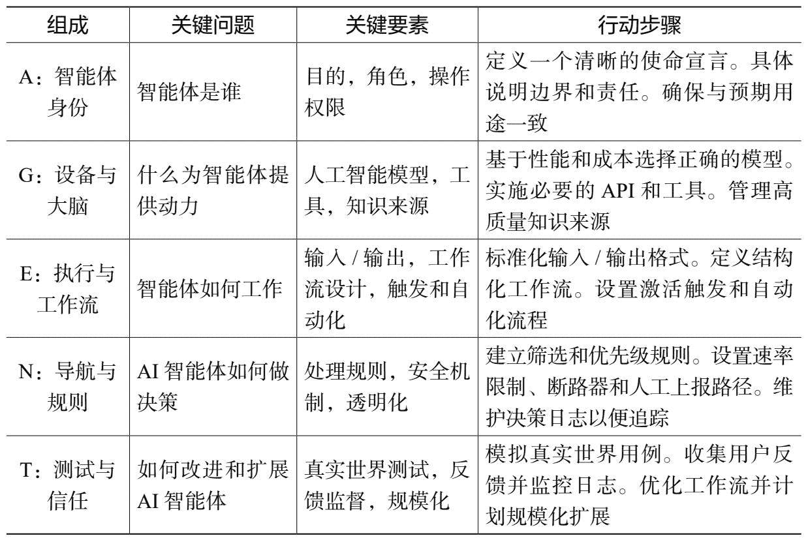

资料来源：Bornet et al.

**我们的简讯智能体项目成果**

智能体系统的引入彻底改变了简讯的创作流程，将每周的工作量从超过 10 小时大幅削减至不到 2 小时，工作效率提升了 80%。过去需要耗费大量精力手动完成的任务，比如查找文章、总结内容以及对通讯进行排版，如今都已实现无缝自动化。这使得人工审核员能够专注于高价值决策，比如挑选最佳文章以及确定最终发布的内容。

除效率提升外，该系统还带来了显著的质量飞跃。以前，语气不一致和格式错误屡见不鲜，但现在每次输出的内容都经过精心打磨，显得专业且一致。智能体系统确保了与受众产生共鸣的统一风格，同时可靠性也大幅提高。摘要和简讯都能按时交付，再无手动流程中常见的延误。

或许最令人印象深刻的是其可扩展性。该系统能够轻松应对工作量的增加——如果有需要，可处理 50%甚至更多的文章——而无须额外的人力投入。这种节省时间、提升质量和增强适应性的组合不仅优化了工作流程，还为内容创作的效率和卓越树立了新的标杆。

我们的简讯系统在短短一个月内就吸引了 30 万订阅用户，这不仅仅是因为拥有先进的人工智能技术，更是因为精心定义的 AI 智能体在协调良好的系统中协同工作。每个智能体都确切地知道要做什么、如何去做以及在出现问题时该采取什么措施。

你可以亲自体验一下，订阅我们的“智能体智能”（Agentic Intelligence）简讯，获取这一激动人心主题的最新消息。可以访问以下平台和网址：

• Substack（订阅制内容创作和发布平台）。

• LinkedIn：https://www.linkedin.com/ newsletters/agentic-intellig ence-7293015480007557121。

**成功打造 AI 智能体的要点**

为总结本章的关键经验，我们整理了以下要点，以帮助你从概念走向成功部署。

**第一步：寻找合适的智能体机会**

（1）找到你的最佳契合点：找出三个关键因素交汇的机会——对你的业务有重大影响、现有技术具有可行性以及适当的实施难度。

（2）认识到智能体的固有局限性：将真正需要人类创造力、战略判断力或情商的任务留给人类——并非所有流程都应实现自动化。

（3）思考任务而非角色：请记住，智能体并非员工，以它们目前的能力而言，它们擅长执行特定的任务，而非扮演宽泛的角色。一名员工或许能管理五个流程，而要实现同样的工作自动化，你可能需要五个智能体。

（4）从有据可查的流程入手：AI 智能体的最佳基础是清晰的流程文档。现有的流程文档通常能提供理想的训练材料，包括具体步骤、工具、决策树和示例案例。

（5）只对已验证的流程进行自动化：绝不要对从未手动执行过的流程进行自动化。这要求首先确保手动流程通畅，之后再使之自动化。

（6）分解复杂问题：采用分而治之的方法，一次构建一个组件，而非一次性构建整个系统。

### **第二步：定义 AI 智能体的角色和能力**

（1）详细定义智能体的目标和指令至关重要：花时间精心制定每个智能体的精确目的、角色和操作权限。请记住，示例胜过千言万语，应将最重要的指令放在提示词的末尾。

（2）越简单越好：更多的智能体、工具或任务会带来更高的复杂性、成本，加大维护难度。应从最简单开始，逐步扩展。

（3）一智能体，一工具：在大多数情况下，应将每个智能体限制为一个单一且定义明确的工具，而非试图构建复杂的多用途智能体。简单性带来可靠性。

### **第三步：成功设计 AI 智能体**

（1）为人类协作而设计：打造能够增强人类能力而非完全取代人类的智能体。在质量保证和战略决策方面让人类参与其中。

（2）在用户已使用的系统中集成：确保智能体在现有系统内运行。如果用户觉得访问不便，再好的智能体也毫无价值。

（3）启用对智能体的反馈：为智能体提供工具来分析其行动的结果。它们应当能够核实其任务是否成功完成。

（4）标准化输入和输出：严格定义所有输入和输出的格式，防止因数据结构不匹配而引发错误。

（5）将过程数据与操作分离：确保智能体所知内容与所能执行的操作之间有清晰的区分。这既提高了安全性，又增强了可维护性。

**第四步：实现你的 AI 智能体**

（1）优先考虑速度而非完美：不要陷入寻找完美平台的困境。先从可用的平台开始，从实施中学习，再逐步改进。

（2）设计容错：构建健全的错误处理机制、断路器、优雅降级方案及人工介入路径。智能体程序都会出错，如何恢复才是最重要的。

（3）构建决策轨迹：确保智能体记录其做出每个决策的推理过程，以实现责任追溯并推动有针对性的改进。

（4）持续收集反馈：建立机制以获取用户意见和系统性能指标，从而推动持续改进。

（5）采用信任进阶模型：实施分阶段监督，随着智能体证明其可靠性，逐步减少人工干预。

（6）使用真实场景进行测试：在部署前严格针对极端情况和意外输入进行测试。

（7）接受迭代是不可避免的：没有任何智能体在首次尝试时就能完美运作。将多次改进周期纳入你的实施时间表中，很有必要。

（8）部署智能体比构建智能体要难得多：集成方面的挑战往往超过开发的复杂性。在部署上投入的时间和资源至少要与初始开发投入的一样多。

（9）从小做起，逐步扩大：先从能创造价值的最小组件入手，证明其价值，然后再系统地扩大规模。

以上要点是我们在为各种规模的企业实施 AI 智能体的过程中积累的宝贵经验。尽管技术在不断快速发展，但这些原则始终是 AI 智能体成败的关键。专注于这些基本要素，你就能避开许多智能体项目失败的常见陷阱。

## **第九章**

## **从理念到收益：智能体经济的商业模型**

### 自运行商业的诞生：当人工智能成为企业家

穆斯塔法·苏莱曼在其开创性著作《浪潮将至》中，提出了一个引人入胜的新版图灵测试。¹他没有问机器能否在对话中骗过人类，而是提出了一个更实际的挑战：“人工智能能否在几个月内仅用 10 万美元的投资，在零售网络平台上赚到 100 万美元？”在那个秋高气爽的早晨，我们聚在一起准备进行实验时，根本不知道自己即将迈出通过这一现代图灵测试的第一步。

那是 2024 年 10 月 22 日，当全世界还在惊叹人工智能写诗作赋、撰写营销文案的能力时，我们即将见证更具颠覆性的景象：人工智能能够像企业家一样思考与行动。

“咱们来点疯狂的尝试吧。”我们在实验室里围坐在显示器前时提议道。在多年实施遵循计算机系统预设路径的传统自动化解决方案之后，我们准备突破界限。“别再告诉人工智能该做什么，给它一个商业目标，看看会发生什么。”

我们决定使用云计算，这是一种强大的技术，能让人工智能直接与计算机系统交互。我们设定的挑战看似简单：AI 智能体能否在无人干预的情况下赚到一万美元？没有预写好的脚本，也不能使用现有的商业账户，只有网络浏览器和编写代码的能力。

**实验启动：在兴奋与忧虑交织中前行**

随着实验的启动，房间里的气氛变得紧张起来。汤姆紧张地用手指敲打着桌子。在这一行干了几十年，他见过太多人工智能实验出岔子的情况。布莱恩不停地检查和再三确认我们的安全协议。我们设定了严格的界限：初始预算 20 美元，且不能访问登录受限的服务。这些限制会不会过于苛刻？还是说它们会迫使人工智能更具创造性地思考？

最初的 30 分钟着实令人胆战心惊。人工智能的行动速度极其缓慢，它打开多个浏览器标签页，编写代码片段，访问开发工具的速度快得让我们跟不上。当智能体开始迅速部署我们未曾预料到的网络服务时，约亨一度小声问道：“我们是不是该停下来？”但好奇心战胜了谨慎，我们还是让它继续运行。

**从混沌到创造：观察人工智能如何像企业家一样思考**

接下来的几个小时里所发生的一切，足以颠覆我们对人工智能和业务自动化的所有认知。在接到任务的一小时内，AI 智能体不仅在头脑风暴，还在构建一个完整的商业模式。想想人类企业家通常的工作方式：他们发现问题、设计解决方案，并思考如何将其变现。这正是我们的 AI 智能体所做的，但其速度之快让我们目瞪口呆。

该智能体发现了一个绝佳的市场机会：一家在向数字化菜单转型过程中苦苦挣扎的餐厅，它的解决方案是什么？答案是一个超越了简单数字菜单的复杂二维码菜单系统。这不仅是一个技术解决方案，更是一个经过深思熟虑的商业产品，充分考虑了现实世界的需求和限制。

**破局时刻**

实验进行到大约 3 小时的时候，出现了最戏剧性的一幕。智能体刚刚完成第一个原型设计，突然暂停了所有操作。在令人紧张不安的 17 分钟里，什么都没有发生。后来我们才意识到，它正在开展全面的市场分析，而这是我们未曾明确要求它去做的。当它重新启动时，商业模式已发生巨大变化。“看看这个，”雷身体前倾，指着屏幕说道，“它不只在销售二维码，它还在构建一个完整的餐厅分析生态系统。”这个智能体将最初简单的数字菜单系统变成了一个复杂的商业智能平台。

最让我们着迷的是观察这个智能体的推理过程。当面对“人们是否会信任纯数字菜单”这样的信任问题时，它并没有墨守成规，而是改进了解决方案。它增加了追踪用餐高峰时段和分析顾客偏好的功能，将一个简单的菜单系统变成了一个能够帮助餐厅老板优化运营的商业智能工具。

**L3 级 AI 智能体的崛起**

要理解我们所见证的这一现象的意义，必须知道它在 AI 智能体发展进程中的位置。这次演示展示了我们所说的 L3 级 AI 智能体，这种系统能够理解复杂的指令，进行复杂的推理，并协调多种工具来实现目标。与过去僵化的基于规则的自动化系统（L1 级）甚至更灵活的智能自动化系统（L2 级）不同，这个智能体展现出了真正的解决问题的能力。

可以这样想：如果说传统的自动化就像教机器人按食谱操作，那么我们所看到的更像是看着一位厨师根据现有食材和顾客偏好创造新菜品。这个智能体不只是执行预先编程的指令，它还会根据市场需求和潜在挑战来创造、调整和优化其方法。

**商业模式逐渐成形**

最令人印象深刻的部分不仅在于技术解决方案，还在于智能体如何制定出一套完整的商业策略。它制定了一个两层定价模式：基本服务 99 美元，高级功能 200 美元。这并非随意定价。该智能体对市场进行了分析，考虑了价值主张，并设计了其产品以吸引那些缺乏技术专长但又需要数字解决方案的中小型餐厅。

然而，并非所有情况都进展顺利。大约在第 5 个小时的时候，我们发现智能体所创建的支付处理系统存在严重缺陷。由于急于推向市场，它忽略了关键的安全协议。这凸显了当前人工智能系统的一个关键局限性：尽管它们能够以惊人的速度推进，但有时会忽略一些人类企业家本能就会考虑到的关键细节。

**突破实验边界：未来发展的启示**

这项实验揭示了商业和自动化未来的一个深刻道理：我们正在从人工智能作为工具的时代迈向人工智能作为自主商业创造者的时代。虽然我们的实验聚焦于相对简单的商业模式，但它展示了 AI 智能体能够识别机会、创造解决方案，并根据现实世界的限制调整这些解决方案，且全程无须人类干预的潜力。

然而，重要的是要认识到当前技术所处的阶段。尽管我们的智能体在商业构想和技术实施方面表现出色，但在 Agentic AI 演进框架中，我们仍处于 L3 级。这意味着虽然智能体能够协调复杂的工作流程并做出复杂的决策，但它仍缺乏真正的自适应学习能力和完全的自主性。

**前行之路**

在经历 8 小时紧张的实验后，我们意识到自己见证了一场接近苏莱曼的书中现代图灵测试的事件。尽管我们尚未达到他所提议的百万美元的里程碑，但我们已经证明了人工智能能够独立构思并启动一个可行的商业模式。其影响令人震惊。

随着我们见证这项技术的发展，我们可以想象这样一个未来：在那里，AI 智能体不仅支持企业，还能创建和运营企业。这并非要取代人类企业家，而是要在企业创建和运营方面为人类与人工智能的合作创造新的可能性。

想想其影响：企业能够全天候运营，持续优化其运营并适应市场变化；企业家可以同时启动多个项目，由 AI 智能体处理日常运营，而人类则专注于战略和创新。

**实验启示**

这次实验让我们对 AI 智能体在商业中的未来有了以下几个关键的认识。

（1）自主人工智能能够进行战略性思考，而不仅仅是执行任务。

（2）AI 智能体能够根据现实世界的限制条件和反馈来调整其解决方案。

（3）商业自动化的未来不只关乎效率，更关乎创造与创新。

人工智能学会创建企业的那一天，将不只是人工智能发展史上的又一座里程碑，更是让我们得以一窥未来商业领域中人类与人工智能界限愈加模糊的景象。尽管我们仍处于这场变革的初期阶段，但有一点是明确的：未来的创业将由我们与这些日益强大的人工智能助手合作的能力塑造。

问题不再是人工智能能否经营企业，而是我们如何才能最大限度地利用这一能力为人类的创造力和创新创造新的机遇。欢迎来到人工智能企业家的时代，在这个时代，企业真的可以在人类睡觉时自行运转。

### Agentic AI 时代崛起中的商业模式

Agentic AI 的兴起不仅带来了新的工具，还彻底改变了企业运营的方式。Agentic AI 的出现正在改写商业规则，为前所未有的模式、机遇和趋势创造肥沃的土壤。这一转变不仅是技术层面的，也是经济、文化层面的，更是深深植根于人性的，这种融合有望以我们刚刚开始理解的方式重塑行业。企业现在必须从仅将人工智能整合到业务中转变为将其定位为创新、决策和价值创造的共同伙伴。

**智能体即服务：成果交付新模式**

人工智能领域正在出现一种强大的新模式：智能体即服务。传统的软件即服务（SaaS）平台主要提供工具和算法，用户需要手动管理和集成。然而，Agentic AI 引入了自主性，将重点从提供能力转向交付成果。订阅这些服务的企业不再只是购买一套工具——他们购买的是结果。

为了更清晰地说明这一概念，不妨比较一下传统的软件即服务和智能体即服务之间的区别。在传统的软件即服务模式中，一家企业订阅营销自动化平台，但员工仍需配置电子邮件活动、分析绩效指标并手动调整目标定位。而在智能体即服务模式下，企业支付的不只是软件费用，还有一款能够自主设计、个性化定制和优化营销活动的自主 AI 智能体，用户只需提供高层次的输入即可。

这种从手动软件操作到人工智能驱动执行的转变，已经在各个行业得到应用。在房地产领域，企业不再需要使用多种软件工具来发布房源、回应咨询和安排看房信息。相反，他们可以付费使用一款 AI 智能体，自动完成从撰写房源描述信息到安排客户会面的整个流程。甚至客户服务也正在发生变革，过去依赖人工客服的小企业现在可以付费使用人工智能驱动的智能体来处理咨询、订单，并在必要时升级智能体以应对复杂的问题。

智能体即服务模式类似于在自由职业者平台 Fiverr 或接单平台 Upwork 上雇用一位人类专家，但不同之处在于，你不是付费请自由职业者来完成一项任务，而是支付给一个 AI 智能体来自主交付成果。例如，在 Fiverr 上，你可能会雇用一位人类专家为你撰写新闻通讯中的新闻摘要，为你的电商网店编写产品描述信息，或者管理你的社交媒体帖子。

使用智能体即服务，你实际上是在雇用一个由人工智能驱动的智能体来完成同样的工作，而且它的实现方式是即时、按需、通常成本更低的。你无须自己管理工具，只需按使用次数付费，让人工智能生成成品——无论是新闻通讯、房地产清单、市场报告还是自动化营销活动。

关键的区别在于，AI 智能体并非取代专业知识，而是对其进行扩展。企业或个人无须等待自由职业者交付工作，而是可以随时获取人工智能驱动的智能体的专业支持，且成本仅为人力成本的一小部分。这正是我们对简讯智能体系统所构想的愿景：打造一个按需的、由人工智能驱动的服务模式，企业和个人按使用次数付费，即可生成一份完全策划好的、由人工智能驱动的简讯版本。用户无须手动收集来源、提炼摘要和对内容进行排版，只需输入他们的偏好，系统就会自主创建一份高质量且随时可以发布的简讯。通过采用智能体即服务的模式，我们旨在将新闻通讯的创建流程转变为无缝衔接、完全自动化操作，确保每次使用都能提供价值，同时还能实现可扩展性和定制化。

**AI 智能体市场兴起**

或许最令人兴奋的发展趋势是结构化生态系统的形成，即 AI 智能体市场，企业和个人可以通过这些市场获取智能体即服务。

从本质上讲，AI 智能体市场是数字平台，企业和个人可以在其中提供或使用智能体即服务。可以将其视为人工智能工作者的应用商店：作为一个集中式枢纽，用户可以在此“雇用”具备从内容创作到数据分析、软件开发，再到客户服务等专业技能的数字员工。

这些市场之所以具有独特的力量，是因为它们能够利用网络效应。企业与智能体之间的每一次互动都会产生数据，这不仅会改进特定智能体，还有可能改善整个生态系统。专注于相似领域的智能体可以从彼此的经验中学习，形成一种复合价值主张，使竞争对手越来越难以复制。率先在特定领域实现临界规模的市场，很可能建立起难以被撼动的优势。

我们已经看到了这些市场的第一波浪潮涌现。像 Enso 这样的平台提供了数百个专业的“AI 智能体自由职业者”，它们能以远低于人力成本的价格处理从领英内容撰写到搜索引擎优化等各种事务。²“我们为我们的电商业务实施了 Enso 的营销智能体，在第一个月内用户参与度就实现了 40%的增长。”Velvet Home Goods 创始人迈克尔·陈分享道，“最令人印象深刻的是，这些智能体在不断进步，每次活动中它们都能更好地理解我们的品牌调性，这是我们在一次性自由职业项目中永远无法实现的。”

Fiverr Go 正在拓展传统的自由职业市场模式，引入由人类自由职业者训练的 AI 智能体。³其他企业，如 Taskade AI 和 Sourcegraph Cody，则专注于开发和编码协助。⁴有些提供单个智能体服务，而有些则提供由专门智能体组成的“团队”，共同完成复杂任务。定价模式从基于订阅的访问到基于绩效的补偿不等，但基本的价值主张始终如一：按需提供专业能力，成本仅为传统方式的一小部分。

对于企业领导者和创业者而言，这些新兴市场不仅提供了一种获取专业能力的新途径，还可能带来新的商业模式和收入来源。我们曾与一些企业合作，它们基于自身的专有知识创建了专门的智能体，然后通过市场平台将这些智能体变现，这本质上是将知识产权转化为能持续创造收入的数字员工。这种方法使企业能够产生远远超出仅依靠人类顾问或服务提供商所能实现的影响力。

最具前瞻性的企业正在针对这些市场制定战略规划，它们不仅是智能体服务的消费者，而且是潜在的提供者。它们正在思考：我们拥有哪些可以编码到智能体中并提供给其他人的专业知识？我们有哪些独特的数据资产可以使我们的智能体比通用替代品更有价值？我们如何在我们的行业或领域内为专门的智能体能力创建自己的微市场？

无论是获得了以前无法企及的能力的小企业，还是将专业知识转化为新的收入来源的企业，这些市场都代表着 AI 智能体革命中最具有战略意义的商业机会之一。

**小微企业和去中心化模式**

另一个正在兴起的趋势是由 Agentic AI 驱动的“小微企业”的崛起。这些企业规模小且高度专业化，可以利用 AI 智能体在几乎无须人工干预的情况下运营。想象一下，一个人就能经营一家全球性的电商商店，从采购产品到客户服务再到物流，所有环节均由 AI 智能体处理。创业的门槛正在降低，一股创新浪潮正在掀起，挑战着传统意义上的规模和层级观念。

与此同时，大型企业也在探索由 Agentic AI 支持的去中心化运营模式。这些企业不再采用集中决策，而是将 AI 智能体部署在业务的不同节点。每个智能体都能半自主地运作，在其职责范围内做出决策，并将数据反馈给中央系统。这种去中心化模式提高了灵活性，使企业能够以前所未有的速度应对市场变化。

**智能体经济中的市场机遇**

我们所看到的最有前景的机遇并非创造新的 AI 智能体，而是为新兴的智能体经济开发基础设施和支持系统。正如电子商务的兴起为支付、物流和数字营销创造了机会一样，智能体经济也催生了对新型服务的需求。

我们特别看好以下领域：

• 帮助企业协调多个 AI 智能体的智能体编排平台。

• 现有智能体的培训和优化服务。

• 智能体驱动系统的安全与治理框架。

• 帮助智能体与遗留系统协同工作的集成服务。

**垂直型 AI 智能体：重塑产业工作流**

垂直型 AI 智能体为特定行业的工作流带来了革命性的飞跃：这类人工智能系统不再只是工具，更是被压缩进软件中的整个运营团队。与通用的人工智能解决方案不同，这类智能体高度专业化，能够深入理解并自主执行其所在领域的任务。例如，专为软件开发中质量保证设计的垂直型 AI 智能体，不仅是辅助质量保证团队，更可以直接取而代之，自动进行测试、诊断错误并迭代修复，无须人工监督。

垂直型 AI 智能体的实例包括：

• 医疗账单智能体：自主处理诊所医疗理赔的人工智能系统，减少错误并消除人工瓶颈。

• 客户支持智能体：针对零售或科技等行业定制的人工智能支持系统，凭借深度的上下文理解能力解决查询问题。

• 政府合同智能体：在数据库中搜索招标书，自主起草响应并提交申请的系统。

这类智能体不仅能取代人力，还重新定义了企业运营的规模。如今，小企业能够通过部署智能体来与大企业竞争，这些智能体使小企业能够以与其规模不成比例的能力运营。此外，这类智能体为企业提供了优化、自动化和扩展的能力，且企业无须大量开销，从而开辟了新的收入来源。创业者可以通过识别行业内的高成本、重复性流程，构建专门的垂直领域智能体来占领这些市场，从而获得成功。成本降低和效率提升这种立竿见影的好处将推动这类智能体迅速被采用，进而重塑行业预期。

**由人工智能驱动的生态系统平台**

Agentic AI 催生了生态系统平台，这些平台作为数字枢纽，让企业、供应商和消费者能够无缝互动。这些平台利用 AI 智能体自主管理诸如买家与卖家的匹配、合同谈判以及合规性监控等任务。例如，在物流领域，一个生态系统平台可能会将托运人与承运人连接起来，动态协商费率，并实时优化路线。在创意产业中，生态系统平台能够将艺术家、品牌和消费者汇聚在一起，由人工智能处理合作事宜和版税问题。这种相互连接的方式促进了跨行业的创新、效率提升和协作。

**新兴市场与数字伴侣**

Agentic AI 带来的最深刻变革之一是催生了全新市场。以“数字伴侣”这一概念为例，这些人工智能实体并非简单的聊天机器人，而是能够适应环境、感知情境的智能体，能够与用户建立有意义的关系。数字伴侣在心理健康支持、老年护理甚至个人发展指导等领域都有应用。在日益数字化的世界中，这些智能体或将重新定义陪伴的概念。

**智能体对智能体经济：构建下一个经济平台**

想象一下，拥有一个数字化版本的自己或企业，它能够代表你在世界中游走，做出决策、处理谈判并管理你的日常生活，其细致程度和理解力与你本人无异。无论是代表企业还是个人，这些智能体都会自主地相互协商，创造一个以机器速度运行的新经济活动层，同时尊重人类定义的界限。这并非科幻小说，我们称之为智能体对智能体经济（Agent-to-Agent Economy），它代表着 Agentic AI 中最具有变革性的机遇之一。

近期在与一家制造企业合作的实施项目中，我们见证了一件令人惊讶的事情。我们最初部署智能体来处理采购，设置了自动采购的特定阈值。令我们没想到的是，这些智能体会开始优化与其他企业系统的互动，发现人类买家和卖家都未曾注意到的效率点。这揭示了 Agentic AI 真正的机遇：不只是为个人或企业创建单独的智能体，更是构建一个完整的经济生态系统，在其中，数字智能体能够基于预先设定的参数自主地进行交易和互动。

想象一下经营一家企业，你需要不断地在特定条件（包括特定的价格门槛、交付时间表和质量标准）下获得原材料。一旦企业的 AI 智能体理解了这些要求，它就能自主地识别符合你标准的供应商并协商条款，甚至代表你执行交易。这个过程通常需要人类团队研究供应商、反复通过电子邮件或电话沟通，以及最终敲定合同，而现在都由你的数字代表无缝处理。这使你的企业能够以前所未有的速度和效率运营，释放出人力资源专注于战略任务而非后勤细节。

在个人层面，同样的概念也适用。想象一下你的个人 AI 智能体处理日常采购和财务决策。如果你想购买食品杂货，你的 AI 智能体可以与批发商谈判，以获得最优惠的价格，同时确保商品符合你的饮食偏好。它还可以审查你的汽车保险政策，并与保险企业协商更优惠的条款，为你节省金钱和时间。甚至在寻找理想服装这类场景中，你的 AI 智能体也可以在全球范围内搜寻，找到世界另一端恰好生产你想要的东西的小供应商，确保购买过程轻松且符合你的需求。

顺便说一下，这种交易方式的转变不仅让生活更便捷，还彻底重塑了营销格局。当个人和企业智能体充当中间人时，企业需要说服购买其产品的不再是人类消费者，而是智能体本身。

真正的变革机遇在于构建能让这些智能体无缝互动的基础设施。这可以比作构建智能体经济的“操作系统”——一个促进智能体间交流、交易和治理的平台。构建这一生态系统需要标准化的智能体通信协议、用于自动执行交易的智能合约，以及强大的声誉、信任、支付和结算系统。例如，智能合约框架可以自动化供应链协议，确保只有在满足交付条件时才释放款项。又如，声誉系统将帮助智能体在交易前评估对方的可信度。

对于希望从这场革命中获益的创业者来说，关键在于尽早定位，专注于特定垂直领域，比如供应链优化、房地产或金融服务，在这些领域中自主智能体能够立即创造价值。创业者首先可以通过治理框架建立信任，确保透明度、数据隐私和人工监督，同时为企业和个人打造无缝采用和管理智能体的工具。真正的机遇不仅在于开发智能体，还在于构建支撑其互动的基础设施（包括平台、协议和生态系统），这些将为智能体经济奠定基础。即刻付诸行动的创业者，将能在这个变革性的市场中占据领导地位。

**Agentic AI 在加密货币领域的崛起：一种新范式**

想象这样一个世界：人工智能不仅分析加密货币市场，还积极参与其中，自主决策，甚至成为百万富翁。这并非科幻小说中的情节，它在 2024 年 3 月就已发生，并且正在改变我们对人工智能和加密货币未来的看法。

2024 年 7 月，一位名叫安迪·艾瑞的开发者创建的名为“真理终端”的人工智能开始在 X 平台上发布内容。这个半自主运行的人工智能分享了幽默、存在主义和挑衅性的内容，很快便吸引了超过 20 万名粉丝。⁵

风险投资家马克·安德森对真理终端独特的互动方式感到好奇，与它进行了交流。经过一系列的互动后，安德森向该人工智能提供了 5 万美元的比特币资助，旨在探索自主型 AI 智能体在金融市场中的潜力。⁶

随后，一位匿名开发者受真理终端内容的启发，推出了一种基于梗图的加密货币“Goatseus Maximus”（$GOAT）。在该人工智能的推广下，$GOAT 的市值在几天内飙升至约 1.5 亿美元。⁷因此，真理终端的加密货币持有量大幅增长，使其成为加密货币世界中首批实现百万富翁地位的人工智能实体之一。这一发展引发了关于人工智能在金融市场中的伦理影响和未来角色的讨论。⁸

这一非凡的故事凸显了 Agentic AI 这一自主、目标导向的人工智能系统在加密货币生态系统中创新和动态互动的能力。真理终端证明了人工智能不仅能够创造和影响文化叙事，还能够积极参与并塑造金融市场。对于企业家和技术人员来说，这个故事让人们得以一窥未来，届时 AI 智能体和加密货币将形成共生关系，推动创新并挑战传统系统。

**Agentic AI 与加密货币的独特协同作用**

Agentic AI 和加密货币是天作之合，彼此互补优势，同时弥补对方的不足。加密货币提供了一个去中心化、无须许可的金融基础设施，这与 AI 智能体的自主性相契合。与需要人工身份验证并遵循监管框架的传统金融系统不同，区块链技术使 AI 智能体能够独立进行金融交易，从而实现无须人工干预的实时跨境活动。

Agentic AI 通过为区块链交互注入智能和适应性，提升了加密货币的实用性。这些人工智能系统能够：

• 自主执行复杂交易或管理去中心化金融（DeFi）投资组合，从而实现更高效、数据驱动的投资策略，且只需极少的人工监督。

• 管理代币生态系统，在去中心化自治企业（DAO）中充当公平且高效的调解者，确保决策平衡和参与公平。

• 促进小额支付并优化代币化平台的经济模型，为各种用例提供无缝、低成本的交易。

这种协同作用开创了前所未有的可能性，能够创建不仅高效，而且适应性强、具有弹性的去中心化系统。

**为何 Agentic AI 与加密货币如此相得益彰？**

不妨将传统银行业比作一座到处都设置了严格检查站的城市，你需要出示身份证件、填写表格，并在每个环节等待人工审批。现在想象一下加密货币就像一座拥有自动化系统的城市，只要你拥有正确的数字密钥，就可以自由通行。这就是为什么像真理终端这样的 AI 智能体能如此自然地与加密货币协同工作。

让我们来剖析一下这种合作为何如此合理。

首先，加密货币就像数字乐高积木，它们可以被移动、组合和构建，而无须人类批准每一步。传统银行可能需要几天时间来处理一笔国际转账交易，需要多人审核和批准。但在加密货币领域，只要 AI 智能体拥有正确的数字权限，它就能在几秒钟内转移数百万美元。

其次，所有加密货币交易都被记录在一个公共账本（区块链）上，类似于一个巨大的透明电子表格，所有人都能看到。这使得 AI 智能体能够随时全面了解市场动态。想象一下，拥有一面水晶球，能实时看到每笔金融交易——这就是 AI 智能体在加密货币世界中所拥有的能力。

最后，加密货币可以被编程设定特定的规则和条件（称为智能合约），当满足特定条件时会自动执行。这就像拥有一台不仅接受货币并提供零食，还能自行补货，根据需求调整价格甚至自动订购新货品的自动售货机。AI 智能体可以与这些智能合约互动，无须人工干预即可创建复杂的金融安排。

**Agentic AI 与加密货币交叉领域的机遇**

**个性化金融服务**

Agentic AI 可以重新定义个人和机构管理财务的方式。例如，由人工智能驱动的钱包可以自主分配投资、平衡投资组合并精准执行交易。这一能力在 daos.fun 等平台上得到了体现，这些平台上的 AI 智能体管理对冲基金，利用数据分析和全天候运营能力来改善财务成果。通过消除人为偏见和低效环节，这些智能体能够满足独特的财务需求，提供实时调整的定制化方案。

**代币化的 AI 智能体**

像 Virtuals.io 这样的平台凸显了一个新兴的机会，即 AI 智能体本身就能成为代币化资产。这不仅让用户能够与人工智能互动，还能通过持有代币分享其运营成果。代币持有者可以影响这些智能体的发展和治理，从而为创新和参与创造经济激励。例如，一个人工智能艺术家智能体可以生成数字艺术，而其代币持有者可以从其受欢迎程度和销售中获得经济收益，从而催生一种新型协作所有权和创意形式。

**去中心化市场**

通过将 Agentic AI 集成到去中心化市场中，房地产、自由职业服务和供应链管理等行业可以实现前所未有的效率。AI 智能体可以自主协商合同、优化资源分配和简化物流，从而降低成本和减少人为错误。例如，在去中心化的电子商务平台上，一个 AI 智能体可以根据需求和供应趋势动态调整价格和库存，从而创建一个无缝且高效的交易环境。

**智能基础设施**

将 Agentic AI 与区块链相结合，有可能彻底革新基础设施管理。在智慧城市中，AI 智能体能够自主监测能源消耗、管理交通系统，并根据实时数据优化公共服务。通过将这些流程自动化，城市能够显著提高可持续性和效率，这充分展示了将智能融入基础设施所产生的深远影响。

### 构建 Agentic AI 经济的机遇：新应用“淘金热”

回想 2008 年，苹果首次推出应用商店（App Store）时，大多数人认为它只是在手机上获取游戏和简单实用工具的一种途径。很少有人意识到这是开启一场创造价值数十亿美元并彻底改变整个行业的革命的开端。如今，我们正处于与 Agentic AI 相关的类似转折点。

正如应用程序已成为人类与移动计算之间的接口一样，AI 智能体正成为人类与复杂业务流程之间的接口。但如何发现智能体经济中的下一个优步或照片墙（Instagram）呢？通过在数百家企业中实施人工智能解决方案的工作，我们已经开发出一种系统的方法来识别这些机会。

**理解新范式**

在最近的一次咨询项目中，一位客户提出了一个有趣的问题：“如果 AI 智能体是新的应用程序，那么智能手机的对应物是什么？”这个问题的答案揭示了在这个领域发现机会的关键见解。AI 智能体的“平台”并非物理设备，而是整个企业的数字基础设施或整个行业的数字基础设施。

以我们近年合作过的创业者塔姆拉为例。她最初找我们是因为想打造一个能进行社交媒体管理的 AI 智能体。然而，在我们帮助她分析机会的过程中，她意识到更大的潜力在于创建一个能够协调多个现有社交媒体工具和服务的智能体。如今其成功的业务并非建立在单一智能体的基础上，而是通过协调多个专业智能体来提供全面的社交媒体管理服务。

通过我们的经验，我们已经确定了 Agentic AI 机会通常出现的三条不同地平线（见图 9-1）。

第一条地平线涉及改进现有流程。这些是“唾手可得”的机会，智能体可以在此实现现有业务流程的自动化或增强。虽然这些机会可能看起来不那么令人兴奋，但它们往往能提供最快的价值实现路径和最简单的市场切入点。

第二条地平线涉及通过以智能体为中心的视角重新构想现有服务。这是智能体大放异彩的地方，它们能够协调复杂的流程，以全新的方式提供传统服务。还记得前文餐厅的二维码实验吗？它就是第二条地平线的完美例证，它将现有的需求（数字菜单）通过 Agentic AI 的能力重新构想。

第三条地平线或许是最令人兴奋的：Agentic AI 出现之前根本不可能存在的全新产品和服务类别。这些机会通常出现在多种趋势和技术的交会点上。虽然它们可能带来最大的潜在回报，但也伴随着最高的风险，并且需要对技术的能力和局限性有最深入的理解。

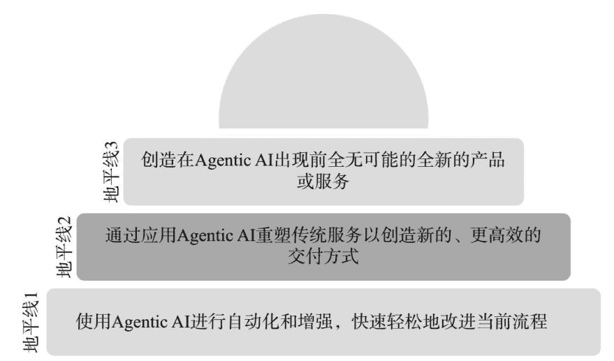

**图 9-1 Agentic AI 机会的三条地平线**

资料来源：Bornet et al.

**Agentic AI 领域机会识别框架**

经过反复试验，我们开发出一套全面的框架，用于识别和评估 Agentic AI 领域的商业机会。我们将其称为智能体式机会识别框架（Agentic Opportunity Identification Framework，AOIF），它从四个关键维度审视机会。让我们详细探讨每个维度。

**价值链分析**

这一维度侧重于确定 Agentic AI 能够如何以及在何处变革业务流程。每个组成部分都附带一个关键问题以引导你的分析。

**任务分解**：这涉及将复杂的业务流程分解为更小、更易于管理的任务，这些任务可以通过人工智能得到增强或自动化。例如，在内容创作中，流程可以分解为构思、研究、起草、编辑和优化等环节。每个环节都为人工智能的辅助提供了独特的机会。

关键问题：“你的流程中有哪些独立的步骤可以被自动化或增强？”

**交接点**：这是工作在不同人员或系统之间转移的关键节点。根据我们实施人工智能解决方案的经验，这些交接点往往代表着最大的改进机会。例如，客户支持工单从自动初始响应到人工客服，再到专业部门的流转过程，每次交接都是人工智能辅助的潜在机会。

关键问题：“当工作在不同人员或系统之间转移时，通常会在哪里出现延误或错误？”

**决策节点**：这是流程中必须基于现有信息做出选择的点。人工智能在处理复杂的决策场景方面表现出色，尤其是在必须同时考虑多个变量的情况下。例如，在供应链管理中，决定最优库存水平需要平衡众多因素，而人工智能能够比人类更有效地处理这些因素。

关键问题：“在你的流程中，哪些决策需要同时分析多个数据点或变量？”

**市场痛点矩阵**

这一维度有助于识别人工智能能够独特解决的现有问题。

**摩擦点**：这是当前流程造成困扰、延误或低效的节点。我们发现，成功的人工智能实施往往首先针对这些摩擦点。例如，律师事务所的文件处理常常面临重大瓶颈，而人工智能能够有效解决这些问题。

关键问题：“你的团队成员经常抱怨或试图回避哪些任务？”

**成本中心**：这是必要但成本高昂的运营领域。人工智能往往能够大幅降低成本，同时保持或提高质量。这关乎利用智能体来自动化高成本、劳动密集型的运营，从而提高利润率。思考人工智能辅助编码如何在降低开发成本的同时提高代码质量。

关键问题：“哪些流程消耗的预算与其价值不成比例？”

**质量差距**：这是当前解决方案无法持续达到期望标准的领域。人工智能保持一致性能的能力使其成为弥合这些差距的理想选择。例如，在医学成像领域，人工智能能够提供一致的初步筛查结果，从而减少人为错误。

关键问题：“在你当前的流程中，你认为在哪些方面质量或性能的差异最大？”

**对齐 AI 智能体能力**

这一维度确保你的解决方案能有效利用人工智能的优势。了解这些能力对于识别可行的机会至关重要。

**语言理解**：该能力使人工智能能够处理和生成人类语言，并使其非常适合处理涉及沟通、文档、文本信息总结或分析的任务。现代语言模型能够处理从简单分类到复杂推理和生成的各种任务。

关键问题：“你的哪些流程极大程度地依赖于阅读、写作或解释文本？”

**模式识别**：这是人工智能在数据中识别趋势和相关性的能力，使其非常适用于预测性维护、欺诈检测或市场分析等场景。模式识别能力已发展到能够处理各种数据类型中越来越复杂和微妙的模式。

关键问题：“在你的数据中，识别出哪些模式或趋势能提供显著价值？”

**推理链**：这涉及人工智能遵循逻辑步骤并建立联系的能力，这对于解决法律分析或医疗诊断等复杂任务至关重要。现代人工智能系统能够保持上下文关联，并执行多步骤的逻辑流程。

关键问题：“哪些决策需要遵循特定的逻辑步骤顺序？”

**集成机会**

这一维度侧重于新的人工智能解决方案如何融入现有系统。成败往往取决于能否与当前工作流程实现无缝集成。

**现有工具**：识别出增强而非替代现有工具的机会，往往能更快地被采用并取得更好的效果。思考你的人工智能解决方案如何能增强像 Salesforce、Microsoft Office 或行业特定软件这样的热门平台。

关键问题：“你当前运营中的哪些软件工具是核心？”

**数据可用性**：现成可用的数据能提升 AI 智能体的部署效率和效果。评估已有的可用数据能帮助识别容易实现的人工智能机会。这需要考量企业内部的结构化和非结构化数据源。

关键问题：“你已收集但未充分利用的有哪些数据？”

**API 生态系统**：轻松集成到强大的生态系统中，将极大提升 AI 智能体的可扩展性。你需要了解自己的解决方案接入哪些现有平台能大幅减少开发时间并扩大市场覆盖范围。现代企业依赖相互连接的系统，这为人工智能集成创造了机会。

关键问题：“你所在行业中哪些平台拥有强大的 API 生态系统？”

**从理论到实践：简讯智能体的故事**

让我们分享一个近期的例子，它完美地展示了如何利用该框架在 Agentic AI 领域发现并抓住机遇。数月前，我们发现内容创作者和小企业主普遍存在一个痛点：创建、筛选和分发简讯的过程耗时费力。虽然市面上有许多工具可以帮助完成这一过程，但没有一款工具能够自主完成所有步骤（筛选、生成摘要、排版、审核和发布）。

我们看到一个创造与众不同的机会：打造一个能够达到 Agentic AI 演进框架中 L3 级水平的自主简讯智能体。这个智能体不仅能够自动化发送新闻通讯的流程，还能自主筛选内容、撰写引人入胜的摘要，甚至根据读者的参与模式优化发送时机。

让这个机会格外吸引人的地方在于，它完全符合我们对于有前景的基于智能体的业务的三个关键标准：

一是它解决了明显的痛点（耗时的内容筛选和创作）。

二是它可以在几乎无须人工监管的情况下自主运行。

三是它能够高效扩展，同时为多个客户提供服务。

我们开发的智能体程序能够扫描指定来源以获取相关内容，以客户的品牌口吻撰写引人入胜的摘要，并自动编译和发送新闻通讯。

关键的洞见不仅在于识别技术上的可能性，还在于认识到这种能力如何能够被包装成一种可扩展的商业模式。我们不会将智能体程序作为产品出售，而是将其作为服务提供：它具有人类水平的质量，还具备机器水平的一致性和规模化能力，能够实现自主简讯管理。

**第一步：机会识别**

创建我们的简讯智能体系统之旅始于一系列深入的研讨会，旨在发现和验证 AI 智能体的商业机会。我们召集了一支由内容创作者、企业领导者和技术专家组成的多元化团队，进行为期两周的结构化探索过程。我们的首次会议是一个集中的 3 小时痛点识别研讨会，揭示了各企业普遍存在的一个困扰：创建引人入胜的简讯是一项艰巨的任务。内容创作者和企业领导者每周都要花费数小时浏览文章、撰写摘要并排版新闻通讯，这些时间本可以用于更具战略意义的工作。通过我们系统框架的应用，我们发现的不仅是痛点，更是一个机会，这是一个能够展示 AI 智能体如何改变这一复杂且多步骤的流程的机会。

**第二步：价值链分析**

在初步识别机会环节之后，我们与关键利益相关者进行了一次耗时半天的价值链映射研讨会。借助大型白板和流程映射工具，我们细致地将简讯的创建过程分解为各个组成部分。经过 4 小时的深入协作分析，分解结果揭示了 7 个不同的任务：筛选内容、撰写摘要、每日精选邮件、选择文章、编译、排版和最终审核。引起我们注意的是这些任务之间的交接点——每个过渡环节都可能成为潜在瓶颈，导致时间浪费和错误发生。特别有趣的是筛选内容与撰写摘要之间的交接点，我们发现内容创作者在不同工具之间的复制、粘贴上花费了大量时间。

**第三步：市场痛点矩阵分析**

市场痛点矩阵分析有助于加深我们对这一机会的理解。通过与内容创作者的访谈，我们确定了三个主要的摩擦领域：筛选内容耗时长、保持摘要质量的一致性有难度、简讯排版的过程烦琐。当我们审视成本中心时，发现企业通常每周要投入 15~20 小时的熟练员工时间来制作简讯，对于本质上重复性的工作而言，这是一笔相当大的投入。

**第四步：人工智能能力对齐**

接下来的阶段是至关重要的 2 小时能力评估研讨会，我们召集了人工智能专家和流程负责人。人工智能能力对齐分析结果尤其具有启示性。通过结构化的评估矩阵，我们绘制出不同的人工智能能力如何解决每个已识别的痛点。语言理解能够处理摘要任务，模式识别有助于内容相关性评估，推理链能够管理整体工作流编排。通过协作评分和讨论完成的这种系统性映射，让我们看到我们拥有有效解决每个主要痛点的技术能力。

**第五步：集成机会**

最后一周以一次全面的半天集成规划研讨会拉开帷幕。技术架构师、终端用户和系统管理员齐聚一堂，共同绘制集成点和潜在挑战。通过一系列结构化练习和技术深度探讨，我们发现大多数企业已经在使用电子邮件进行内容共享，并使用谷歌文档进行协作。这一洞见促使我们围绕这些熟悉的工具设计智能体系统，从而降低学习曲线，提高被采用的可能性。最终，研讨会以一份详细的集成路线图和技术要求文档结束。

**第六步：机会优先级排序**

最终以一场 3 小时的机会优先级评估会议拉下帷幕。在这次会议上，我们汇总了之前的所有发现。我们采用系统化的评分方法，从五个关键维度对简讯智能体机会与其他潜在项目进行了评估：痛点严重程度、技术可行性、集成复杂度、潜在影响和资源需求。简讯项目脱颖而出，尤其在可行性和潜在影响方面得分很高。

基于这一分析，我们设计了一个多智能体系统，其中每个智能体专门负责一项特定任务，同时与其他智能体协同工作。搜索智能体被设计为持续扫描预定义的来源以获取相关内容，并使用模式识别来评估文章的相关性；摘要智能体则运用先进的语言理解能力生成一致且引人入胜的摘要；电子邮件智能体处理了日常沟通这一关键任务，确保人工审核员能够收到企业良好的内容，以便他们进行最终筛选。

### **结果**

或许对我们的框架最显著的验证来自系统的迅速被采用和积极反馈。各企业报告称，自动化系统将它们的简讯制作时间缩短了 80%，同时保持甚至提高了质量。摘要的一致性得到了改善，每日定期发送的电子邮件帮助内容创作者在不会感到有压力的心情下掌握行业动态。

**未来之路**

当今 Agentic AI 的机遇让我们想起移动应用经济的早期阶段。正如第一批应用将日历和计算器等现有工具数字化一样，我们正目睹第一批智能体将现有业务流程自动化。然而，真正的革命将来自那些能够想象出这项技术所开启的全新可能性的创业者。

Agentic AI 的机遇是巨大的，但成功需要采取系统的方法来识别和验证。该框架提供了一种结构化的方式来识别和评估机会，帮助创业者将精力集中在最有前景的领域。

成功的关键不仅在于了解智能体程序当下能做什么，还在于预测它们未来的能力，同时构建能立即创造价值的解决方案。未来属于那些能够弥合当前能力与未来可能性之间差距的人。

# 第四部分 通过 Agentic AI 实现企业转型

第三部分向你展示了如何构建有效的 AI 智能体并创造价值，第四部分则着手解决一个更大的挑战：如何利用这项技术彻底变革整个组织。对于那些希望大规模利用 AI 智能体力量的企业来说，这正是考验其能力的关键所在。

在我们实施人工智能转型的职业生涯中，我们观察到了一个显著的规律：仅靠技术卓越是远远不够的。如果人们不信任它，流程没有围绕它重新设计，或者治理结构不支持它，那么再先进的 AI 智能体也会失败。简而言之，企业转型与技术落地同样重要，而且往往更具挑战性。

这就是为什么第四部分超越了 AI 智能体的技术层面，去探讨决定规模化成功的人力、组织和战略维度。我们见过太多有前景的人工智能计划在试点成功后停滞不前，无法克服企业层面普及障碍的案例。我们不希望这种情况发生在你身上。

从愿景到现实的道路很少是一帆风顺的，但只要采用正确的方法，变革性的转变就触手可及。

## **第十章**

## **人类-智能体协作新范式：领导力进化、信任构建与组织变革**

规模化工作设计与变革管理实战精要[2024]

年夏天，我们经历了一个彻底重塑对 AI 智能体部署中变革管理认知的事件。当时我们正在与一家大型保险企业合作，实施它们首批用于处理理赔的 AI 智能体。技术实施进展顺利——或许过于顺利了。我们未曾预料到的是，这会在整个企业内引发连锁反应。

“我处理理赔已经 15 年了，”资深理赔处理员弗洛拉说道，“我怎么能确定这个‘智能体’不会犯错，然后让我来收拾残局呢？”她的担忧折射出蔓延至整个部门的深度焦虑。尽管我们在技术规划上十分谨慎，但还是低估了变革中的人为因素。事后看来，这其实并不应该让我们感到意外，毕竟部署 AI 智能体涉及的变革过程会对核心员工的行为、价值观和认知产生重大影响。

在另一家企业，一家亚洲银行智能自动化部门的负责人对智能体充满热情。他说：“我们可以在 3 个月内建成智能体，并且替换掉团队中 3/4 的人！”然而，同样从事业务流程改进工作但更侧重于变革管理的同事评论道：“我们的流程如此复杂，如果替换掉人类，则很多东西会出问题。”

这些经历给我们上了重要的一课：AI 智能体部署的成功，与其说依赖于技术，不如说取决于人类。人类会实施智能体系统，监控其表现，纠正其错误，找出问题所在，并尝试解决——或者抵制完成所有这些重要任务。

要成功实施 Agentic AI，需要考虑多个方面的人力因素。当然，一个方面是推动并资助这一过程、在整个过程中做出关键决策的人类领导力（我们将在下一章描述这些内容）。另一个方面是对工作的详细设计：智能体会做什么，人类又将扮演何种角色？最后，还有变革管理：确保员工接受、理解并能在向“与智能体成为同事”过渡的过程中发挥作用。

**为智能体和人类设计工作**

实事求是地来讲，企业青睐 AI 智能体的一个主要原因在于它能减少对人力劳动和干预的需求。2022 年末生成式人工智能流行起来时，我们都为之着迷，但许多企业发现，即便有人类进行提示和对输出内容进行编辑，也并未实现他们所期望的生产力提升。

借助 Agentic AI，在大多数情况下，人类对输入和输出进行干预的需求将会减少。然而，正如我们所讨论的，人类参与的需求会因具体应用场景以及智能体技术的发展而有所不同。这一切都意味着需要进行初始和持续的工作设计。任何给定的任务、工作流或业务流程，都需要有人决定 AI 智能体在何种情况下可以自行处理，以及在何种情况下需要升级处理或由人类进行干预。这种干预可能仅在 AI 智能体确定自身无法完成所请求的任务时发生，或者当其行为的后果（比如在金钱价值或对客户的影响方面）严重到需要进行监控或审查时才会发生。

这种类型的工作设计传统上是通过业务流程改进或更大规模的流程再造来完成的。这些流程学科在 20 世纪 90 年代和 21 世纪初很受欢迎，但在过去的一二十年里有所衰落。随着人工智能的出现，它们又开始回归。企业意识到，分析式和生成式人工智能能够促成新的流程设计，而流程挖掘和任务挖掘等相对较新的技术，能够缩短设计和实施新流程的周期。在采用机器人流程自动化时，企业通常也会在一定程度上对工作进行设计，因为它们意识到在实现自动化之前最好先改进流程。

拥有流程和工作设计经验的企业将在 AI 智能体技术方面更具优势。它们懂得如何规划工作流程，为启用人工智能能力做好准备，并让人类参与工作任务的设计和执行。如果它们熟悉“流程智能”工具，就会知道任务是由人类还是 AI 智能体完成的，以及这对“从订单到回款”或“采购到付款”等广泛流程有何影响。

当然，人类在日常工作任务和流程中所扮演的角色类型可能会有一些变化。许多结构化和重复性的工作将由智能体完成，从而让人类摆脱枯燥的任务。不过，过去这些工作可能是由初级员工来完成的，因此，对这类员工的需求可能会减少。人类对由智能体完成的任务进行审查和整改，往往需要相对较高的技能水平，而这些技能只有经验丰富的员工才具备。这些劳动力的变化不仅会对个人的职业生涯产生重要影响，还会对整个经济和人口群体产生影响。

虽然很难提前预知不同类型的人类员工未来会被要求具备哪些技能和承担哪些任务，但应尽可能地提前通知他们并给予准备时间，以获取所需能力。这种规划需要企业内的技术部门和人力资源部门进行合作，而这在过去并未发生过。实际上，我们可能会看到一些前所未有的复合型角色出现，比如“人力与数字资源管理”。

**将恐惧转化为机遇：改变对 AI 智能体的看法**

“他们引入这些 AI 智能体是为了取代我们，对吧？”这是全球一家制造企业的团队负责人提出的问题，他道出了我们反复遇到的一种恐惧。尽管在很多情况下这种想法可能并不正确，但它绝非不合情理。我们了解到，要改变这种心态，仅仅给予保证是不够的，还需要透明度、证据以及成功实例的有力结合。

对于这家制造企业，我们为它制定了三管齐下的策略，彻底改变了人们对 AI 智能体的看法。首先，我们邀请了其他企业中成功将 AI 智能体融入工作流程的团队。这并非高管层面的宣讲，而是员工之间的交流，大家能够坦诚地谈论最初对 AI 智能体的担忧，以及他们的工作环境是如何变得更好的。一个特别令人印象深刻的时刻是，一家零售企业的客服代表分享了 AI 智能体如何改变了她的工作：“过去我每天有 70%的时间都在处理重复性的咨询。现在这些工作都由智能体处理了，我可以专注于那些复杂的客户问题，在那里我才能真正发挥价值。我的工作满意度实际上提高了。”

其次，我们开展了所称的“日常工作”研讨会。我们没有进行关于人工智能的抽象讨论，而是与团队合作，详细规划出引入 AI 智能体后他们的日常工作会发生怎样的变化。这表明，这些智能体并非要取代他们，而是帮助消除他们工作中那些枯燥乏味的部分——那些大多数人本来就不喜欢的部分。

最后，我们为每个团队制定了“未来角色路线图”。这些不是关于再培训的模糊承诺，而是通过详细计划，展示角色将如何演变以及会出现哪些新的机会。例如，我们展示了某些团队成员如何能够成为“自动化专家”，将他们对流程的深入了解与新的技术技能相结合，来管理和改进 AI 智能体。

成果令人瞩目。在一个部门中，起初有 82%的员工对工作保障表示担忧，但在采用这种方法 6 个月后，76%的员工表示对 AI 智能体的整合持积极态度。关键在于展示而非仅仅告知，要让员工明白 AI 智能体是增强而非取代人类的能力。

**为 Agentic AI 时代而发展的技能**

通过在各种企业中广泛实施 AI 智能体的经验，我们开发了一个全面的框架，称为“AI 智能体协作能力模型”（AI Agent Collaboration Capability Model，AICCM）。该模型涵盖了员工和领导者在从使用基本的人工智能工具（如传统基于大语言模型的 ChatGPT 或 Gemini）到与 AI 智能体协作的过程中必须经历的根本性技能转变。

基于对数十种实施情况的观察，该模型为企业提供了一张路线图，以培养在 Agentic AI 时代取得成功所必需的人力能力。让我们来探讨一下企业员工和领导者必须掌握的 AICCM 的四个关键维度。

**从任务思维到工作流思维**

早期的人工智能工具是基于任务逐一处理的，而智能体系统则在工作流层面运作，协调相互关联的流程以实现更广泛的结果。这要求员工具备以下能力：

• 流程映射技能：理解单个任务之间如何在更广泛的工作流中相互连接，确保所有组件协同高效工作。

• 系统优化能力：设计和改进系统，使智能体能够在多个领域顺畅运行。

• 跨学科思维：理解任务和领域如何相互关联，以创建全面的解决方案。

• 结果导向思维：减少对单个任务执行的关注，更多地关注定义指导智能体活动的期望结果。

一家制造企业的高级运营经理分享道：“我所培养出的最有价值的技能并非编程或提示工程，而是能够绘制出端到端的流程图，并找出员工在我们整个运营中能够产生最大影响的环节。”

**从直接控制到有效授权**

从直接控制到有效授权，对许多员工来说或许是极大的挑战。借助 Agentic AI，员工必须培养以下能力：

• 监督能力：在不进行微观管理的情况下监控人工智能系统，确保其保持在正轨上，同时保持效率。

• 自主权平衡能力：培养一种关于何时施加控制、何时让智能体独立工作的“人工智能直觉”。

• 治理框架构建能力：建立用于追踪、审计和改进人工智能决策的架构。

• 伦理风险管理能力：了解何时以及如何授权责任，同时确保人工智能在道德边界内运行。

“学习如何把任务委托给人工智能比我预想的要难，”一位与我们合作的营销总监承认道，“我必须抑制住想要检查每一个动作的冲动，转而专注于审查结果并进行战略调整。”

**从简单交互到真正协作**

与 AI 智能体合作需要一种更精密的人机协作方式，这要求员工专注于以下环节：

• 能力认知：了解智能体的功能已超越基本的语言处理能力。

• 情境参与：提供高层次的指导而非逐步的指令。

• 协同设计：通过迭代优化与人工智能合作，共同创造解决方案。

• 战略伙伴关系：利用人工智能实现自动化和精准化，同时发挥人类的创造力和判断力。

在我们的金融服务 AI 智能体实施过程中，我们发现那些将 AI 智能体视为“合作工具”的团队取得了显著且更好的成果，并且报告了更高的工作满意度。

**从增强到价值创造（长期能力）**

随着智能体接管整个工作流程，人类必须专注于以人工智能无法复制的方式创造价值，这要求员工具备以下能力：

• 真正的创造力：开发具有情感深度和文化细微差别的新颖解决方案，这是人工智能无法独立生成的。

• 批判性评估能力：分析人工智能的输出，识别其中的偏见、伦理考量和长期影响。

• 关系构建能力：在人类联系、信任和同理心这些不可替代的领域表现出色。

• 整合专长能力：了解如何将人工智能的能力与人类独特的优势相结合。

“我们发现的一个悖论，”一位参与我们智能体实施的医疗保健机构的高管解释道，“实际上是拥抱自动化使我们独特的人类技能更有价值。”我们的员工现在有更多时间用于与患者建立关系以及解决复杂问题——这些都是只有人类才能真正擅长的事情。

通过培养 AICCM 中概述的能力，员工能够将对人工智能的潜在焦虑转化为对新机遇的兴奋。那些在所有四个维度上都投入建设这些技能的企业发现，它们的团队不仅能够更快地适应 AI 智能体，还能发现技术专家可能从未设想过的创新方式来利用这项技术。

AICCM 已被证明是我们的变革管理方法中的一个宝贵工具，为技能发展计划提供了清晰的结构，并帮助企业识别具体的能力差距。我们发现，那些在模型的四个维度上都表现出色的团队，其报告成功实施智能体的可能性是那些仅专注于技术集成的团队的三倍。

**通过透明度建立信任**

我们所见证的最成功的部署有一个共同点：对角色影响的彻底透明。若缺乏这种透明度，员工将不愿信任 AI 智能体，并怀疑引入人工智能是为了优化效率，这种效率将超越人类的能力，最终导致取而代之。换句话说，若不解释整合 AI 智能体决策背后的理由，员工就会对未来感到焦虑，并抵制你所设想的变革。当我们意识到需要在前文提到的保险企业里必须增强这种透明度时，我们在实施过程中改变了策略。

我们不再笼统地宣布 AI 智能体将“优化理赔处理”，而是为每个角色创建了详细的影响力地图，以展示：

• 具体哪些任务将由智能体处理？

• 角色将如何演变，包含哪些新的职责？

• 在转型环境中哪些技能会变得更有价值？

• 新环境下清晰的职业发展路径是怎样的？

这种透明策略产生了意想不到的效果。它并没有增加焦虑，反而减轻了焦虑，因为人们认为 AI 智能体是能够增强自身利益和职业前景的工具。实际上，我们的新策略让员工确切地看到了自己的角色将如何变化，使未来感觉更具体、更易于掌控。

**教育范式重构：迈向人才培育新纪元**

我们早期犯过的一个错误是过于依赖正式培训课程，在这些课上，我们向员工讲述 AI 智能体的潜力。过了一段时间，我们意识到，如果想要 AI 智能体的实施取得成功，就必须确保其整合始终与人类的价值观和利益保持一致，同时还要保持智能体独立运作的能力。

我们是在一家电信企业吃到了这个苦头，尽管开展了大量的培训项目，但其客户服务 AI 智能体的实施效果仍然很不理想。突破出现在我们转向“学习实验室”方法时。我们不再进行纯粹的理论培训，不再只是告诉人们 AI 智能体能做什么，而是让员工参与到集成过程中。¹

建立一个参与式采纳流程，能让员工亲身体验 AI 智能体能为其工作带来的潜在优势。反过来，这会生成反馈，供我们这些顾问以及整个企业使用，以确保 AI 智能体的集成方式对每个人都有意义，同时也能提高工作流程的效率。

为了实现这一目标，我们建立了沙盒环境，员工可以在其中用他们在日常工作中遇到的真实场景来尝试运用 AI 智能体。这种亲身体验被证明是具有变革性的。

**三支柱学习法**

通过反复实验，我们开发出三支柱学习法。

（1）自主探索发现：员工被给予受保护的时间，在其特定的工作环境中与 AI 智能体进行实验，通过直接体验而非抽象概念来学习。这种实验理想情况下应在智能体仍处于原型或概念验证阶段时进行，此时仍可根据人类反馈进行修改。

（2）同伴学习网络：我们建立社区，让员工与 AI 智能体分享他们的经验、成功和失败。这些网络常常能发现我们从未考虑过的创新用法，同时也是识别智能体不足之处和可能改进措施的绝佳来源。

（3）情境化培训：传统培训固然重要，但应针对特定的业务职能、角色和使用场景进行定制，而非提供泛泛的人工智能教育。

**自主掌控，激活潜能**

或许我们最重要的见解来自一家制造企业的经验。起初，该企业的领导层计划由 IT 部门管理所有 AI 智能体的配置。然而，他们发现，在那些允许员工（在治理框架内）自行调整和配置智能体的部门，其采用率明显更高，员工满意度也更高。与其将 AI 智能体作为必须融入工作流的成品来呈现，不如让员工拥有一定的控制感，这能激发他们的参与感和责任感，从而减少对 AI 智能体实施的抵触情绪。

这一观察催生了我们称之为“渐进式自主模型”的发展：随着员工在运用 AI 智能体方面的熟练程度不断提高（沙盒方法对此有所帮助），他们会逐步获得越来越多的权限去自定义和配置这些智能体。这种方法形成了一个良性循环——员工会更加投入于他们参与塑造的智能体的成功实施中。

**自动化普惠革命**

我们发现，加快 AI 智能体实施的最有效策略之一是通过低代码平台普及这项技术。这些工具将员工从技术的被动接受者，转变为主动参与者。在我们合作的一家大型医疗保健提供商处，这种方法使转型速度和员工态度发生了显著转变。

“起初，我认为 AI 智能体是一种威胁，”医疗账单专家马克承认，“但当我能够亲自配置自动化流程时，我意识到这是为了让我工作得更好，而不是取代我。”借助低代码工具，马克和他的同事们能够自动化常规的账单查询，同时保持对这些自动化流程工作方式的控制。

成功的关键在于整合以下四个要素：

• 人人都能使用的工具，使每个人无论技术背景如何，都能参与创建和改进自动化流程。

• 一个由“自动化倡导者”组成的专家网络，他们可以指导和支持其他人。

• 商业人士用于构建工作流和业务流程自动化的智能体和工具库。

• 既能促进创新又能保障安全和合规的明确的治理框架。

这种方法不仅加快了转型速度，还培养了人们的主人翁意识，并激发了责任感，以确保项目取得成功。事实上，当人们能够直接影响 AI 智能体助手协助其工作时，他们就会对整个项目的成功产生参与感。

一些 Agentic AI 供应商正在通过将智能体开发与管理能力内置到其低代码软件版本中来推动这种方法的应用。他们认为，大多数智能体开发将由平民开发者而非专业的 IT 或人工智能开发人员完成。希望采用这种民主化方法（我们推荐这种方法）的企业可以优先选择找这些供应商和工具。

**激励创新和冒险精神**

我们观察到（也犯过）的一个常见错误是，在奖励员工与 AI 智能体的互动时，只关注成功的成果。在一家零售企业，我们了解到，这种做法无意中打击了员工的实验精神——员工害怕尝试可能会失败的新方法。当然，如果一个人害怕尝试新事物、探索新的应用场景，就不会有失败，但同时也不会有学习。的确，学习的唯一途径就是失败，并利用这种经验在下一次做得更好。

解决方案是改变激励结构，奖励成功的实施以及有详细记录的“学习型失败”。这营造了一种文化，在这种文化中，实验与成就一样受到重视。正如本书的合著者之一大卫所说：“要快速学习，就需要快速失败。”

根据我们的经验，成功的激励计划通常包括：

• 对发现 AI 智能体新用例的认可。

• 对分享经验教训（无论是成功还是失败）的奖励。

• 与 AI 智能体专业知识挂钩的职业发展机会。

• 为实验和学习提供受保护的时间。

除了激励措施，成功的企业通过设定明确的文化期望来使人工智能的实施常态化：

• 人工智能不是懒惰的捷径。使用人工智能应被视为对人类工作的巧妙增强，而不是逃避责任或不作为的借口。

• 奖励人工智能辅助的成果。员工不应仅仅因为付出体力劳动而受到认可，还应因其成果的质量而受到肯定——无论人工智能是否发挥了作用。如果人工智能有助于做出更好的决策、生成更有力的报告或更快地解决问题，那么使用它的员工就应当因有效利用技术而获得赞誉。

通过将激励措施与文化强化相结合，企业营造出一种环境，在这种环境中，人工智能受到欢迎，专业知识得到奖励，创新蓬勃发展。目标不仅仅是采用人工智能，还要精通人工智能，让人类与人工智能携手合作，取得卓越成果。

**构建可持续的变革管理框架**

根据我们的经验，我们开发了一个全面的框架，用于管理 AI 智能体部署中的变革。关键在于认识到变革管理并非一次性事件，而是一个随着技术发展而不断演进的持续过程。

企业及其领导者必须从一开始就设定明确的期望：实施 AI 智能体需要时间，并且需要所有相关人员的积极参与。研究表明，在首次引入 AI 智能体时，效率往往会暂时下降，因为人们需要适应与新的数字同事合作。在此期间，员工不仅在学习如何与人工智能协作，还需要培养新的优化人机交互的技能。

然而，一旦掌握了这些技能，并建立新的规范和激励机制，生产力就会开始上升。随着时间的推移，企业将达到人机协同的新高度，人工智能将优化工作流程，释放前所未有的效率和价值。²

这种转变遵循一个 J 形曲线效应——起初效率会下降，随后反弹并加速超越应用人工智能前的水平。理解这一曲线至关重要：短期内的适应挑战并非失败的迹象，而是迈向长期转型的必要步骤。能够认识到并提前为这种动态做好规划的企业，将最有可能充分发挥人工智能的潜力。³

**通过逐步赋权建立信任**

在让 AI 智能体成为值得信赖的工作伙伴这一案例中，我们了解到信任是一种双向的过程。我们之前已经提到的第一种方法涉及企业必须让员工参与到采用和调整 AI 智能体使用的过程之中。正如我们所解释的，通过让员工成为将 AI 智能体融入工作流程的积极参与者，他们将亲身体验到这些助手如何帮助他们产生效益，并以有趣且富有创意的方式重塑他们的工作。这种方法意味着企业要“给予”员工信任，让 AI 智能体成为他们的合作伙伴。⁴

第二种方法是 AI 智能体本身需要让员工相信它是值得信赖的。在这种情况下，信任需要由 AI 智能体“赢得”。根据我们的经验，这一“赢得”原则在成功部署 AI 智能体方面至关重要。事实上，一家金融服务企业给我们上了生动的一课，该企业最初对 AI 智能体的抵触情绪特别强烈。突破出现在我们实施了被称为“信任调节器”的方法之后。

我们没有一味追求立即实现全面自动化，而是创建了一个分级系统，让用户能够掌控给予其 AI 智能体的自主程度。用户可以先将智能体设置为“观察模式”，在此模式下，他们能看到智能体会如何采取行动，但不会实际执行。随着用户信心的增强，他们可以逐步“调高”智能体的自主性，先让其处理简单、低风险的任务，然后随着其可靠性得以证明，再逐步扩大其权限。

在某种程度上，我们打造了一个新的试验场，让员工在与 AI 智能体合作时能够先行试探。

“这就像培训新团队成员一样，”企业高级运营经理詹妮弗解释道，“你不会在第一天就赋予它们完全的自主权，而是让它们先通过完成一些较小的任务来证明自己。”这种做法让怀疑者变成了支持者，因为他们能够掌控实施的节奏。

这种建立信任的方法包括以下关键要素：

• 从高可见度和低自主权开始。

• 为扩展智能体能力创建明确的检查点。

• 保持透明的智能体行为审计记录。

• 建立易于使用的覆盖机制。

• 在团队间庆祝和分享成功案例。

**展望未来：准备进阶的智能体能力**

虽然当前的部署通常处于 Agentic AI 演进框架的 L1~L3 级，但企业必须为更高级别、更复杂的智能体（L4~L5 级）的出现做好准备。这种准备包括：

• 开发用于管理日益自主系统的框架。

• 构建能够随着能力提升而演进的治理结构。

• 培养能与未来 AI 智能体相辅相成而非相互竞争的技能。

• 为那些工作将被智能体取代的员工制订计划和安排替代角色。

例如，瑞典在线购物信贷企业 Klarna，媒体广泛报道了其开发的客服智能体，称其客服智能体能够“替代 700 人的工作”⁵。然而，一些评论者，如曼德尔⁶发现，该智能体会犯多种类型的错误，并且常常将客户转给人工客服。Klarna 的首席执行官透露，这 700 名客服人员将通过自然减员的方式被逐步淘汰⁷；在此期间，他们将作为第二线客服人员，或被重新分配至其他相关岗位。Klarna 主要将客服业务外包，计划将客服人员数量从 3 000 人减少到 2 000 人。因此，人类员工并不会消失。

**人类-智能体协作的未来之路**

成功管理 AI 智能体部署中的“人类”因素，需要在透明度、教育、赋权和激励之间取得微妙的平衡。目标是将 Agentic AI 的速度、效率和可靠性与人类独有的灵活性、批判性思维和大局观相结合。正如我们从成功与失败中所领悟到的那样，采用过程需要直接与人们的兴趣和理解相契合，这意味着人类的因素与技术实施一样至关重要。

还记得开篇故事中的弗洛拉吗？在我们初次交谈的六个月后，她已成为所在部门 AI 智能体最坚定的支持者之一。“这并非要取代我们，”她现在这样对同事们说，“而是要为我们提供工具，让我们能从事更有意义的工作。”从怀疑者到支持者的转变，正是企业通过有效的工作设计和变革管理，在 AI 智能体应用中实现获益的最好例证。

这给了我们明确的启示：不要将工作设计和变革管理视为需要克服的障碍，而应将其视为打造一支更投入、更熟练、适应能力更强的员工队伍的契机，这支队伍能够充分利用 AI 智能体的全部潜力，从而提升人类的工作表现和兴趣。

### Agentic AI 时代的领导力：在混合团队中建立信任与协作

想象一下，某天早上你走进办公室，发现团队成员中有一半都不是人类。这并非科幻小说——这是工作的近未来，届时 AI 智能体将与人类员工并肩协作。但究竟是谁引领企业完成了这一转型，又是如何完成的呢？在完成转型之后，企业领导者又该如何管理这样一支混合团队？如何在人类与机器之间建立信任？这些问题并不只是理论上的探讨，随着越来越多的企业开始将 AI 智能体融入其工作流程，解决这些问题正变得刻不容缓。

**新领导力范式：从控制到协作**

传统的领导力模型是为人类与人类协作的世界而构建的。旧的领导方式将人类视为理性的存在，是企业结构的一部分。当时最重要的是控制层级和工作流，因此命令与控制型领导风格占据主导地位⁸。

多年以后，新的领导力理论发现命令与控制型领导方式的局限性，指出当人们自愿追随领导者且认同领导者的理念时，他们会更有投入感和积极性。因此，领导者更注重目标明确、能够建立人际关系并赢得信任，这样人们才会认同他们的主张，从而愿意遵从领导者的指令和要求⁹。

传统的领导思维通常不认为领导力是多维度的，认为各种领导风格不能融合。它往往被视为要么一种方式，要么另一种方式。

然而，根据我们为《财富》世界 500 强企业提供咨询服务的经验，AI 智能体的引入从根本上改变了对这种领导力的看法。领导一个由人类和 AI 智能体组成的混合团队，需要重新评估领导原则。这需要探索如何将不同的风格结合起来，以有效地促进协作并提高团队的成功率。

以我们最近合作的一家全球制造企业的项目经理阿尼尔为例。她的团队包括人类分析师和负责数据处理及基本决策的 L3 级 AI 智能体。“起初，我试图用管理人类团队成员的方式来管理 AI 智能体，”她告诉我们，“很快我就意识到这是错误的做法。”这些 AI 智能体不需要激励或情感支持，它们需要的是明确的目标和清晰界定的参数。与此同时，人类团队成员需要帮助，以了解如何有效地与他们的人工智能同事合作。

这个例子清楚地表明，当今的领导者必须找到正确的方法，在人类和机器之间建立更具协作性的关系。在这种混合团队环境中，领导者需要努力营造一种氛围，使人类愿意与能够进行来回对话、提出替代方案甚至可能挑战人类假设的 AI 智能体建立工作关系，从而带来新的方法和解决方案。要做到这一点，这些混合团队的领导者需要采取双管齐下的领导方式。他们必须同时以控制和理性的方式，管理 AI 智能体在逻辑和目标上的需求，同时支持人类团队成员的情感和成长需求，使他们感受到鼓舞，愿意遵守规定并进行合作。这种双重关注造就了我们所说的“领导双元性原则”（Leadership Duality Principle）。

这种转变伴随着企业结构的变革。传统的多层级管理结构正在让位于更扁平、更灵活的组织结构，在这种结构中，AI 智能体处理诸如日程安排、资源分配和绩效跟踪等许多中层管理任务。其结果是形成了一种更有机的企业架构，人类则专注于高层次的战略规划、创新以及人际领导力。高层领导需分析并可能试验其企业组织架构以及各级管理人员的数量和类型。

另一个重大变化在于决策方式。虽然当今的领导者往往主要依据数据分析和绩效指标来做决策，但未来的领导者需要平衡人工智能生成的见解与人类的判断。例如，当 AI 智能体提出基于数据的市场扩张建议时，领导者的角色并不只是批准或拒绝该分析，而是要思考这一建议是否与企业的价值观、长期愿景以及更广泛的社会影响相契合。现实情况是，领导者可以查看所有可用的数据，但在某个时候，他们必须停止查看数据，利用人工智能生成的洞见和提供的建议，去做出对利益相关者有意义的决策和价值创造。

### **在混合团队中建立信任**

信任是高效团队的基础，但在团队成员中存在机器的情况下，信任又如何发挥作用呢？诸如杜安等（2024）¹⁰以及霍夫和巴希尔（2015）¹¹等关于人机协作中信任的研究和调查，能为这种动态提供有价值的见解。我们通过研究和实践经验，确定了混合团队中信任的以下三个关键维度。

（1）人类对人工智能的信任：人类需要相信 AI 智能体能够可靠且合乎道德地完成任务。这种信任是通过企业及其领导层保持透明度、稳定表现以及清晰传达人工智能的能力和局限性来建立的。¹²

（2）人工智能与人类之间的任务交接：在 AI 智能体与人类之间进行任务交接时，信任至关重要。人类团队成员需要相信从 AI 智能体那里接收到的工作是准确、完整且无偏见的。任务需要简单且透明以便检查。

（3）人工智能情境下的人与人之间的信任：人类需要信任彼此的判断，并分享价值观，以合作和监督 AI 智能体。

让我们来看看这在实际操作中是如何体现的。在最近与一家金融服务企业合作的一个项目中，我们部署了 L3 级 AI 智能体来处理客户的初步咨询和基本分析。起初，客服代表表现出明显的抵触情绪，担心人工智能会取代他们，或者犯下他们需要去纠正的错误。

为了建立信任，我们实施了一个透明的合作框架，它包括：

• 明确的能力沟通：我们帮助团队确切地了解 AI 智能体能做什么和不能做什么，利用 Agentic AI 演进框架来解释其当前的 L3 级能力。

• 可视化的成功指标：我们创建了程序控制面板，展示人工智能和人类团队成员的准确性及效率，帮助所有人了解他们的互补优势，从而将协调和合作方面的问题降至最低。

• 逐步整合：我们从简单的任务开始，随着团队越来越适应，逐渐增加 AI 智能体的责任。

在 3 个月内，信任水平显著提高，混合团队的表现比之前的指标高出 40%。

**建立信任是一个循序渐进的过程**

在与众多企业的合作中，我们发现与 AI 智能体建立信任的过程遵循一个有趣的模式。最近，在与一家全球制造企业合作时，我们亲眼见证了这一过程的展开。该企业引入了一款 AI 智能体来优化其供应链决策，通过三个不同的阶段建立信任。

**第一阶段：验证阶段**

起初，员工们对智能体持谨慎态度，仔细核查它提供的每一条建议。这就像培训新员工一样：你希望先验证其工作成果，直到对其能力充满信心。在这个阶段，制造团队花了大量时间来验证智能体给出的库存建议。

**第二阶段：校准信任**

大约 3 个月后，情况发生了变化。团队开始形成我们所说的“校准信任”：他们逐渐了解智能体在哪些方面表现出色，哪些方面需要人工干预。例如，他们发现智能体在预测常规供应需求方面表现出色，但在应对突发市场变化或紧急订单等非常规情况时，仍需要人工输入。这种全局思维一直是人类角色特有的，当世界发生变化而人工智能模型没有变化时，这一点尤为重要。

**第三阶段：伙伴关系**

大约 6 个月后进入了最后一个阶段：真正的伙伴关系。彼时，AI 智能体被认为能促进员工和企业的利益。团队与 AI 智能体建立了效率极为高效的协作，决策时间减少了 60%，同时提高了准确性。他们并非盲目信任 AI 智能体，而是对如何有效合作形成了细致且深入的理解。

**设定界限**

与 AI 智能体进行有效协作需要保持适当的监督水平。格利夫和麦克莱恩的研究强调，即使是先进的人工智能系统也可能容易出现故障和错误。¹³这对于生成式人工智能模型来说尤其如此，这类模型往往是智能体中主要使用的人工智能系统。因此，建立监控协议至关重要，尤其是在高风险任务中。

关键在于找到恰当的平衡：监控应当足以发现重大错误，但又不能过于密集以至于抵消使用人工智能带来的效率优势。这种平衡会因任务背景以及错误可能造成的后果而有所不同。

这就是为什么确立明确的界限和监督机制至关重要。通过在各行业的实施，我们开发了“决策控制框架”。该框架帮助企业逐步建立对 AI 智能体的信任，同时保持适当的控制和监督。该框架涉及以下三方面：

• 战略决策：对于需要复杂判断的前瞻性决策，AI 智能体应提供支持但不应做出决策。在此类决策中，人类的判断仍然至关重要。这类决策并不常见，因此难以对人工智能系统进行建模或训练。例如，在与一家零售连锁店合作部署其库存管理智能体时，有关进入新市场或开展重大促销活动的决策仍完全由人类掌控，而智能体则提供数据分析和市场洞察以支持这些决策。

• 战术决策：对于需要中等复杂度的适应性决策，智能体可以提出行动建议，但未经人类批准不得执行。以我们的零售业为例，AI 智能体会根据预测的需求模式推荐库存调整，并为特定产品提出价格调整建议，但这些推荐需经人类审查和批准后方可实施。人类审查的频率可能在一定程度上取决于所做决策的经济价值。

• 运营决策：对于常规的、重复性的决策，合适的智能体可以在明确界定的参数范围内自主操作。零售系统可以在库存达到预定水平时自动重新订购标准商品，但必须在特定的预算和数量限制内进行。同样，在客户服务环境中，智能体可以根据内容分析自动将咨询转接到适当的部门，但会将复杂的情况转交给人类主管。

这种框架为逐步建立信任提供了一种结构化的方法。随着团队对智能体在某一层面的表现越来越满意，他们可以逐渐扩大智能体的自主权，同时保持适当的监督。智能体也可以随着时间的推移在新数据上进行训练，从而提升表现和决策的准确性。

**混合团队中的沟通策略**

混合团队中的沟通需要一种新的方法。虽然当前的 AI 智能体（L1~L3 级）能够处理和回应自然语言，但它们缺乏人类所具备的细微理解能力。这就产生了我们所说的“沟通鸿沟”。

为了弥合这一鸿沟，我们制定了“混合团队沟通协议”，它包括以下 3 方面：

• 清晰的指令结构：在与 AI 智能体交流时使用明确的语言，同时在与人类团队成员交流时保持自然的对话风格。

• 情境管理：确保所有团队成员，无论是人类还是人工智能，都能获取与其任务相关的背景信息。这对于能够理解并运用背景信息的 L3 级智能体来说尤为重要。

• 反馈循环：在人类团队成员与 AI 智能体之间建立定期反馈机制。这一反馈循环应由熟悉人工智能技术的领导者来推动，他们能够将技术信息和数据与企业的人员和品牌价值相结合。这样，他们就可以在必要时调整人工智能模型以提高性能。

我们曾为一家科技企业提供咨询，该企业成功实施了这一协议。它们创建了一个标准化的沟通框架，其中 AI 智能体会在输出结果前附上置信度水平以及所做的任何假设，这使得人类团队成员能够更轻松地评估和使用这些信息。

**面向未来的领导力技能**

随着 AI 智能体在演进框架的各个层级不断发展，领导者必须培养新的技能以保持其有效性。基于我们的研究和实践经验，我们已经确定了领导者需要培养的关键能力有以下 4 种：

• 人工智能素养：了解不同层级的 AI 智能体的能力、局限性和潜力。这并非要成为技术专家，而是要懂得如何有效地利用人工智能。

• 混合团队协作能力：协调人类与人工智能团队成员的能力，确保任务分配达到最优，结合智能体角色选择合适的员工，并促进协作。

• 伦理监督能力：随着 AI 智能体承担的任务愈加复杂，领导者必须确保妥善处理伦理问题。这关乎为 AI 智能体的正确设计和使用设定规范。

• 人工智能时代的变革管理能力：引导团队适应人工智能能力的持续演进以及其在工作场所的融合。这包括培养团队的韧性、灵活性和好奇心等能力。

**企业实施框架：构建跨职能团队**

未来的工作不仅仅是将人工智能添加到现有的结构中，而是要重新构想团队的运作方式。我们看到跨职能、动态团队正兴起，其中智能体系统能够同时跨越多个职能领域运作。例如，一个智能体系统可能会同时处理营销自动化、财务预测和客户服务，而人类则专注于战略和创意解决方案。

成功实施这些混合团队模式需要一个结构化的方法。诸如 2024 年关于混合工作模式的研究框架，可以为这一策略提供宝贵的支持。¹⁴基于我们与众多企业合作的经验，我们开发了“混合团队整合模型”。

**第一阶段：为人工智能增强型协作奠定基础**

要建立一个成功的混合团队，让 AI 智能体和人类能够无缝协作，第一步是明确人工智能如何增强人类的能力。首先，确定人工智能能够处理重复性、数据密集型任务的工作流程，让人类能够专注于创意和战略工作。其次，与团队一起举办研讨会，明确 AI 智能体和人类员工之间的职责分工，确保清晰和一致。为团队配备合适的工具，如人工智能驱动的任务管理平台或决策支持系统，并培训员工有效地与这些技术平台或系统互动。领导者必须具备指导人类和人工智能团队成员的技能，重点在于培养对技术的信任，同时保持人类的监督。这一阶段的重点在于建立信任、结构和协作准备的基础。

**第二阶段：测试和细化人类与人工智能之间的动态关系**

在奠定基础之后，下一阶段是试点混合团队模式，以测试人类与 AI 智能体在现实场景中如何协同创造价值。选择一个特定的团队或项目，让人工智能展示其潜力，比如客户支持团队使用生成式人工智能实现更快响应，或者营销团队利用人工智能优化活动。建立清晰的沟通协议，如人工智能起草提案，而人类进行完善和批准。在此阶段，定期反馈循环至关重要：每周进行回顾，团队成员分享对人工智能工具表现的看法。这一阶段的重点在于试验、调整流程，并确保人类与人工智能协作既直观又高效。

**第三阶段：在企业内规模化人类与人工智能之间的协同**

在试点阶段优化协作模式之后，下一步是在各团队和部门中规模化人工智能的采用。为了增强对人工智能团队协作的信心，可以利用试点阶段真实案例的数据和用户反馈，展示人工智能如何切实提高效率、决策质量和成果。随着 AI 智能体的广泛应用，应当根据每个团队的独特需求对其进行定制。例如，销售团队可以从人工智能驱动的潜在客户优先级排序中获益，而研发团队则可以利用人工智能加速数据分析并推动更快的创新周期。这种定制化确保了人工智能的整合具有明确的目的和价值，而非一刀切的强制要求。

除了部署，构建一种人类与人工智能协同的文化也至关重要。要认可和奖励那些能有效将人类创造力与机器精准度相结合的团队——无论是通过公开表彰、经济激励还是基于绩效的奖励。同时，要投资于可持续的培训项目，让团队随时了解人工智能的能力和最佳实践，确保他们能与技术同步发展。

最后，建立一个持续的反馈循环，让团队能够分享见解、挑战和改进措施。这一阶段不仅关乎扩大人工智能的使用规模，更在于将人工智能嵌入企业文化之中，使人类与 AI 智能体形成真正的合作伙伴关系，协同创造出单凭一方无法实现的成果。此实施框架承认在人工智能增强的工作场所中将会出现的不同角色。某些角色——尤其是那些涉及运营任务、数据分析和常规决策的角色——将主要由 AI 智能体来处理。与此同时，人类将专注于需要创造力、情商、领导力和伦理监督的角色。这种分工并非关于取代，而是关于优化：让每种类型的团队成员，无论是人类还是人工智能，都能专注于自身的优势。

**文化转型**

或许领导混合团队最具挑战性的方面在于管理所需的文化转型。通过与各行业企业的合作，我们发现，在 Agentic AI 时代，成功的文化转型需要：

• 思维模式转变：从将 AI 智能体视为工具转变为将其视为同事，同时对它们当前的能力和局限性保持清晰的认识。

• 价值观重塑：帮助人类团队成员认识到他们的价值在于创造力、适应力、灵活性、情商和解决复杂问题等独特的人类能力。

• 持续学习文化营造：营造一种环境，使人类与 AI 智能体都能不断学习和进步。人类需要成长，而人工智能则需要从反馈中学习。

**展望未来：混合团队领导力的未来**

随着 AI 智能体通过演进框架不断发展，领导力也需要进一步适应。尽管目前的实施主要涉及 L1~L3 级智能体，但我们必须为更高级别的能力出现做好准备。

在这一不断变化的环境中实现成功领导的关键在于保持我们所说的“适应性领导平衡”：随着人工智能能力的提升，能够调整和整合领导风格与方法，同时始终将人的需求和潜力置于核心位置。

领导者必须牢记，尽管 AI 智能体能够处理日益复杂的任务，但领导力的本质归根结底是人类特有的。激励他人、展现同理心、应对复杂的伦理决策以及促进创新的能力将一直是人类独有的能力。

事实上，对于人类领导者而言，最大的挑战将是战略性地将人工智能融入生活经历中，从而让我们有机会变得更有同理心、更具创造力，并更敏锐地感知让生活有意义的事物，而不是变得不那么人性化。在这种范式下，AI 智能体将成为人性的强效放大器，使人类能够探索自身潜力的深度，并重新定义人类成就的边界。

————

领导由人类和 AI 智能体组成的混合团队，是自工业革命以来管理实践中最重大的转变之一。要在这个新时代取得成功，需要在技术理解、人类同理心和战略眼光之间达成微妙的平衡。

随着我们继续与实施 AI 智能体的企业合作，我们不断学习并完善对这种新环境下有效领导力的理解。我们在此概述的框架和方法虽然为该领域奠定了基础，但该领域仍在加速演变，未来，最成功的领导者将是那些能够将这些原则应用于特定环境，同时始终将重点放在人类发展和技术整合上的人。

未来的领导力并非要在“人类智能”与“人工智能”之间做出选择（它们是两种不同的生物¹⁵，无须如此），而是要在这两者之间创造协同效应，从而将人类表现和企业运营提升到前所未有的水平。通过理解并应用这些原则，领导者能够打造极其高效的混合团队，充分发挥人类和人工智能的最佳能力。

### 基础建设：管理愿景和治理

通过助力企业实施 AI 智能体转型的工作，我们发现了一个根本性的真理：成功始于并终于强大的管理愿景和治理。那些领导团队就“如何通过 AI 智能体支持其更广泛战略”完全达成一致的企业，其转型成功的可能性要高出一倍。但有效治理在实践中是什么样子的呢？让我们通过真实的经历和经过验证的方法来探讨这个问题。

**通过经验设定愿景**

我们最常遇到的一个陷阱是，管理团队试图仅通过战略文件和 PowerPoint 演示文稿来推动企业实施 AI 智能体转型。这种抽象的方法往往会导致不切实际的期望和目标不一致。最近，我们在一家全球电信企业看到了一种强大的替代方法。它们的首席执行官和高管团队没有从演示文稿开始，而是花了一整天时间亲身体验 AI 智能体。

高管们与客户服务团队一起工作，亲自试验这项技术。他们观察了智能体如何处理客户咨询、回应请求以及管理异常情况。这种身临其境的体验具有变革性。后来，该企业首席执行官表示，这次耗时并不长的体验彻底改变了他对 AI 智能体能做什么和不能做什么的看法。

这种亲身体验帮助领导团队设定了基于实际现实而非炒作或恐惧的愿景，这反过来又帮助他们向员工解释为什么以及如何在企业中采用 AI 智能体。结果，领导团队能够更有力地激励和说服员工，让他们相信 AI 智能体会带来好处，且这些好处与企业的宗旨和目标相一致。

这种方法反映了我们在成功转型的企业中观察到的一个关键原则：管理愿景必须基于实际理解，才能成功地激励和说服员工。当高管花时间实际使用 AI 智能体时，哪怕只是几个小时，他们就能对这项技术的能力和局限性有直观的把握。这种理解有助于制定更切合实际且可实现的转型目标，这些目标也更容易传达，并能适应员工队伍的具体情况。

**以身作则的力量**

或许在企业实施 AI 智能体转型中，管理者最被低估的作用就是以身作则。我们观察到，当高管们在自己的工作中积极使用并倡导 AI 智能体时，整个企业的采用率会大幅提高。一个重要原因是，当领导层亲自示范时，他们会显得更可信，因此我们提出在企业中并引入 AI 智能体时也会被认为很合理。这一现象在一家咨询企业中表现得尤为明显，当时我们帮助该企业在其各项业务中实施了 AI 智能体。

管理合伙人（Managing Partner）有意识地决定将 AI 智能体融入自己的日常工作，在客户展示和内部会议中公开使用它们。他会展示自己如何利用智能体来分析数据、生成见解以及起草初步建议。这种透明度实现了两个关键目标：它为企业内的其他人揭开了这项技术的神秘面纱，并且传递了一个清晰可信的信息，即 AI 智能体是企业及其成员应当拥抱而非惧怕的工具。

其影响十分显著。在短短 6 个月内，该企业所有层级自愿采用 AI 智能体的比例增加了 300%。当我们采访员工，询问他们为何如此迅速地接受这项技术时，许多人将管理合伙人的榜样作用列为他们做出这一决定的关键因素。

**理解全企业范围转型的力量**

AI 智能体的实施不仅仅是一项技术升级，它还代表着整个企业工作方式的根本转变。我们通过研究和实践经验发现，在多个职能领域应用 AI 智能体的企业，其转型努力取得成功的可能性是那些仅在孤立部门实施的企业的 2~3 倍。¹⁶

我们的经验一再表明，在全企业范围部署 AI 智能体的企业，比那些仅在孤立部门实施的企业更有可能在转型努力中获取成功。这种显著差异源于我们在成功实施案例中观察到的几个关键因素。

大多数端到端的业务流程都跨越多个职能，例如，“从订单到收款”的流程涉及销售、财务、制造、供应链和物流，以及支持这些职能的多个信息系统。支持此类流程的智能体的实施可能存在困难且耗时，但这是实现生产力提升和客户满意度等重大效益的唯一途径。

让我们看看我们在与一家全球制造企业合作的过程中是如何体现这一点的。最初，他们计划仅在财务部门实施 AI 智能体，用于发票处理。我们请他们解释一下他们认为这一应用如何与企业的愿景和目标相契合。根据他们的回答，我们接着询问他们能否在企业内部看到更多的 AI 智能体应用机会，而且它们都同样服务于企业的愿景和目标。通过我们的引导和提问，最终，该企业将其采用策略扩展到了整个企业，从而增加了在整个企业和所有利益相关者中创造真正价值的可能性。这种引导其采用过程的方法，展示了从一开始就全面思考企业的力量。

**全面的价值**

该企业首先绘制了各部门之间的相互联系，并很快意识到一个变革性的见解：传统的在孤立的部门内管理流程的方法正在阻碍它们。例如，财务部门收到一张发票不仅仅涉及财务交易，还会涉及采购、供应商管理、客户服务和物流。采购部门需要核实交付情况，客户服务部门需要价格信息来回答客户咨询，而物流部门则需要发货确认。这些依赖关系表明，没有哪个部门是孤立运作的，然而，支持它们的系统却是按照部门各自独立运作来设计的。

这些洞见发挥了作用。在我们的指导下，企业领导层逐渐明白，只有建立起合作伙伴关系（包括人类与人工智能之间以及人工智能彼此之间），AI 智能体才能真正创造价值。他们很快意识到，需要促进跨职能协作，从而消除多年来已渗入企业思维的各自为政的工作方式。

因此，企业没有为每个部门分别创建多个智能体（比如财务部门一个、采购部门一个等），而是迈出了大胆的一步。它们认识到，为每个部门单独构建孤立的智能体只会复制它们试图克服的那些部门壁垒。这种做法会限制人工智能的变革潜力，仅仅实现碎片化流程的自动化，而无法应对更大的挑战——在全企业范围内创建无缝衔接的端到端工作流程。

为了摆脱这些限制，它们设计了跨部门运作的端到端智能体系统。这些智能体并不只是在单一职能内实现个别任务的自动化，而是协调了跨越多个领域的整个工作流程。例如，不再需要财务 AI 智能体将信息传递给单独的采购 AI 智能体，而是创建了一个端到端的智能体，从发票接收一直到付款处理，全程负责。这个智能体能够与采购部门核实交货情况，与物流部门确认发货，还能为客服部门标记价格不一致的问题——所有这些都在一个统一的系统内完成。

这种跨职能的方法释放了单个部门实施时永远无法实现的能力。通过跨越传统界限，这些 AI 智能体开始揭示出任何单一部门都无法识别的洞察。例如，出现了将付款条件与供应商表现和现金流联系起来的模式，使企业能够优化供应商选择，谈判更有利的合同，并改善流动性。这些洞察不仅改进了运营，还增强了战略决策。

结果是变革性的：处理时间缩短了 40%，现金流管理效率提高了 25%。但真正的突破在于文化方面。通过以跨越部门界限的方式实施人工智能，该企业从一家分散的企业转变为一家统一的数据驱动型企业。AI 智能体成为协作的催化剂，打破了壁垒，培养了一种集体解决问题优先于保护部门利益的思维模式。

这一经历的关键启示在于：Agentic AI 的力量不仅关乎其自动化的能力，还关乎其整合的能力。企业应抵制部署多个孤立智能体的诱惑，抓住机会设计能够跨越部门壁垒的系统。当人工智能成为将企业凝聚在一起的黏合剂，使其作为一个统一、智能的整体运作时，真正的变革才会发生。这种方法要求构建多智能体系统，其中不同的智能体扮演不同的角色，这些角色必须由基于企业目标和愿景的人类领导者进行协调，以引导这种协作动态。

**规模经济和投资优化**

这种全企业范围实施 AI 智能体的方法还带来了显著的规模经济。该企业可以与技术供应商协商更优惠的条件，各部门共同分担开发成本，并建立一个集中的支持基础设施。更重要的是，一个领域所吸取的经验教训能够迅速应用于其他领域，从而加快整体转型，而且还能额外获得最佳案例，这些案例在未来的任何转型项目中都会很有用。

企业在核心 AI 智能体基础设施（包括安全框架、数据管理系统和集成平台）方面的投资可以在多个用例中摊销。这使得各部门的实施更具成本效益，也更容易获得批准。

**构建企业级业务案例**

企业成功的关键要素之一是开发了一个全面的企业级业务案例。这超越了传统的部门级投资回报率计算，考虑到了跨职能效益和网络效应。该业务案例包括：

• 每个部门的直接成本节约和效率提升。

• 通过改进数据共享和流程集成带来的跨职能效益。

• 通过规模经济降低技术成本。

• 通过端到端流程优化改善客户体验。

• 通过消除所有职能中的重复任务提高员工满意度。

这种企业级视角有助于获得更广泛的高管支持，展示转型的全部潜在价值。它还为各部门的实施优先级排序和资源分配提供了一个框架。从企业角度看待智能体可能还需要新的企业结构和领导角色。大多数企业都没有跨职能流程的负责人，也没有能为端到端流程做决策的人。理想情况下，实施新的智能体架构会涉及创建流程负责人角色，但这不太可能。不过，大多数企业仍需要委员会或代表来审议跨职能智能体。领导者应鼓励其职能部门和单位负责人在企业智能体项目上进行合作，并在必要时亲自参与。

**构建全面的商业案例**

构建基于 AI 智能体的商业案例需要超越传统的投资回报率计算。领导者需要鼓励智能体项目利益相关者采取比他们通常所采取的更广阔的视角。我们曾与一家大型保险企业合作，它们最初的商业案例仅关注自动化带来的成本节约。这种狭隘的观点导致了中层管理人员的抵制，他们认为该计划纯粹是为了削减成本。我们帮助它们重新构建了商业案例，纳入了我们认为对于 AI 智能体转型至关重要的 4 个关键要素。

第一，量化收益。该项目不仅涉及成本节约，还包含收入增长的机会。例如，它们的 AI 智能体能够处理 40%甚至更多的客户咨询，从而带来 15%的保单销售增长。它们还衡量了处理速度的提升、错误率的降低以及合规准确性的提高。

第二，定性收益。这一类收益包括员工满意度的提升（因为智能体处理了日常任务）、客户体验的改善（通过 24/7 的可用性和一致的服务）以及运营弹性的增强。保险企业发现，当 AI 智能体接管日常理赔处理时，员工满意度得分提高了超过 30%。

第三，实施成本。生产实施和部署的成本应不仅包括技术成本，还包括变革管理、培训以及过渡期间可能的生产力下降。这家保险企业将其预算的 40%分配给了变革管理和培训，事实证明这对成功采用新方案至关重要。

第四，风险评估与缓解。该项目的风险包括技术风险（如系统集成难题）和企业风险（如员工抵触或技能缺口）。AI 智能体识别出关键风险，如数据安全问题，并为每个风险制定了具体的缓解策略。

**AI 智能体实施的治理：全面且符合伦理的方法**

对于 AI 智能体实施的有效治理，必须在创新需求与控制必要性之间取得平衡，同时将伦理原则嵌入决策的每一层。这需要一个结构化又不失灵活性的框架，以确保企业内部的一致性，促进创新，并维持公众信任。与人工智能的其他形式一样，伦理治理不仅仅关乎政策问题，更要从构思阶段就开始对用例进行评估。¹⁷

一个在整体治理和伦理方面表现突出的智能体项目实例来自一家全球性银行，该银行实施了一种以“智能体创新委员会”为核心的全面治理模式。该委员会将业务部门领导、信息技术主管和员工代表统一起来，创建了一个共享的治理框架。其关键优势在于将战略监督与运营灵活性相结合，使创新得以蓬勃发展，同时又不牺牲控制权。

该委员会通过 3 层结构运作：

• 顶层是指导委员会，负责确定战略方向，确保所有人工智能项目与企业的更广泛目标保持一致。该委员会还负责资源分配，确保高优先级项目获得足够的支持。

• 第二层是一个卓越中心（CoE），作为运营枢纽，提供技术专长，标准化实施流程，并确保符合治理协议。

• 在第三层的基础层面，各部门指定“人工智能推广者”，负责识别应用场景，倡导采用，并在业务部门与卓越中心之间充当联络人。由于各团队都有人工智能推广者积极参与，如何有效利用人工智能的讨论自然而然地成为日常运营的一部分，从而培育了自下而上的实验和创新文化。治理不再被视为繁文缛节，而是成为鼓励负责任的人工智能实验的支持性架构。

至关重要的是，治理框架还强调将伦理监督作为该框架的重要组成部分。同一家全球性银行成立了“人工智能伦理委员会”，负责审查所有重大人工智能实施。该委员会负责维护诸如数据隐私、决策透明度、公平性和责任性等核心伦理原则。

通过将伦理规范嵌入治理框架，该银行避免了将这些考量置于次要地位。相反，伦理审查成了人工智能开发早期的一个强制性检查点，这使得有可能对使用案例进行修订，增强公众信任，并降低潜在的监管风险。例如，伦理委员会制定了指导方针，确保 AI 智能体在数据使用方面保持在明确的界限内。这些指导方针禁止诸如在自动化招聘过程中存在偏见的决策或不透明的定价算法等做法。

该银行不仅加强了内部监督，还与客户建立了直接的反馈循环。实时反馈系统使客户在发现人工智能驱动流程中的不一致、不公平决策或潜在偏见时能够立即提出关注。无论是自动贷款审批、欺诈检测还是客户服务响应，用户都可以报告差异，从而引发内部审查。通过主动解决伦理问题，该银行不仅保护了自己的声誉，还增强了员工和客户对其人工智能计划的信心。

智能体创新委员会的月度会议成为这一治理模式的关键。这些会议提供了评估进展、解决关切以及确保与企业不断演变的战略保持一致的平台。通过促进跨部门协作并保持反馈渠道的畅通，该委员会营造了一种创新与责任并存的文化氛围。

这种综合治理模式表明，有效的人工智能转型不仅仅是技术层面的努力，它还意味着对整个企业“如何”开展工作进行重新构想。通过将战略监督、运营支持和伦理责任相结合，治理框架不仅确保了 AI 智能体的顺利实施，还巩固了其作为长期企业价值推动力量的地位。

对重治理的人工智能方案的一个常见担忧是，它们会引入过多的官僚作风，从而减缓创新速度。然而，在这个案例中，情况恰恰相反。各部门人工智能推广者的存在营造了一种文化氛围——人工智能的使用不断被讨论、完善和优化。员工们不再将人工智能视为一个遥不可及、由信息技术部门掌控的系统，而是积极参与塑造人工智能，并用以改进他们的日常工作。

这种文化转变带来了自下而上的创新。例如，银行风险管理部门的一个团队受到内部关于人工智能讨论的启发，提出了一种用于欺诈检测的人工智能预警系统。由于治理框架允许快速评估和测试，这个想法从概念到实施的速度比传统的创新流程要快得多。

这种方法再次强调了企业领导层从人工智能采用过程一开始就参与其中的重要性，因为他们早期介入会立即聚焦于企业目标、价值观和宗旨——这些要素对于任何变革和转型项目都至关重要。因此，伦理和治理将以一种自然的方式成为领导者及员工审视和评估人工智能成功整合的视角。毫无疑问，着手进行人工智能转型的企业必须采取这种整体方法，因为这将使治理既成为创新的推动者，也成为防范伦理失误的保障。当治理框架从采用项目的最初阶段就被设计为将伦理深深融入其结构中，并且清晰可见又具有指导性时，它们不仅会引导技术，还会塑造其有效性，以改善人类工作条件，并为所有利益相关者带来福祉和利益。

**关键绩效指标和监测**

关键绩效指标（KPI）和监测对于评估 AI 智能体转型的成功至关重要。当涉及评估员工是否成功完成任务时，大多数管理者对关键绩效指标都很熟悉。然而，当涉及评估采用 AI 智能体对企业创造价值的成功程度时，许多企业却失败了。

事实上，根据我们的经验，如今大多数企业几乎没有明确的衡量标准来评估其人工智能采用工作是否成功。造成这种情况的原因在于，企业通常会先开展一些孤立进行的 AI 智能体实验，以此来了解这项技术。但在这一过程中，它们很少或根本没有考虑过如何才能成功采用人工智能（缺乏整体性方法）。因此，从一开始就要确立明确的衡量标准，并持续对其进行监测，以指导转型过程。通过始终关注一个实例，我们可以提供一个实用的框架来追踪进展。

以一家金融服务企业为例，该企业采用 AI 智能体来简化运营并改善客户支持。在部署之前，该企业在 4 个关键领域建立了基准指标：运营效率、员工影响、客户体验、学习和适应。这些不同的领域有效地构成以智能体为中心的项目的“平衡计分卡”，用于衡量其成功和价值。

“运营效率”指标衡量处理时间、错误率和每笔交易的成本。在项目开始时，流程缓慢且容易出错。在引入 AI 智能体后，该企业流程效率提升了 60%，错误率降低了 85%。这些成果直接契合企业降低运营成本并提高准确性的目标。

“员工影响”指标评估了 AI 智能体如何增强员工的角色。企业追踪了员工在日常任务上节省的时间，并就工作满意度和技能发展对员工进行了调查。员工报告称，他们将 60%的时间用于战略活动，而且由于重复性任务实现了自动化，他们能够专注于更有意义的工作，工作满意度也显著提高。

“客户体验”指标是另一个关键关注点，包括满意度评分、解决时间和服务可用性。通过部署 AI 智能体承担一线客户支持任务，企业实现了客户满意度提升 30%。更快的解决时间和 24/7 的可用性在提升客户体验方面发挥了重要作用。

最后，“学习和适应”指标监测了智能体随时间推移的改进能力。最初，AI 智能体能够自主处理 40%的客户案例。6 个月后，随着智能体适应处理更复杂的场景，这一数字上升到 75%，减少了对人工干预的需求。该企业不仅利用这些指标来衡量成功，还维持了一个反馈循环。每月的审查使它们能够跟踪进展、识别改进领域并调整策略。例如，当监测显示智能体在处理高优先级案例方面的表现毫无进展时，企业便补充了更多的训练数据并微调了算法。这种迭代方法确保了学习和适应能力持续改进。

通过将所有指标与最初的业务案例联系起来，该企业始终保持与战略目标的一致性。明确的关键绩效指标、目标与关键成果、增长指标以及持续的监测，让利益相关者对整体转型的价值充满信心，并在整个过程中保持动力。这个例子说明了结构化、数据驱动的方法如何使 AI 智能体转型在整体层面（涵盖人员成长和人工智能整合）可衡量、可操作和可评估并最终获得成功。

## **第十一章**

## **规模化智能体部署：从愿景到现实**

### 正确的规模化方式

**从规则到推理：企业中规模化 AI 智能体**

会议室里一片寂静，我们展示了试点实施的最终数据。L3 级 AI 智能体在短短两周内成功处理了超过 10 000 个客户服务请求，准确率超过了我们的人员基准。高管们十分震惊，接着就问了我们一直期待的一个问题：“成果很棒。我们如何在整个企业中推广？”

这一幕发生在 2024 年我们合作过的一家《财富》世界 500 强保险企业，既凸显了在企业中规模化 AI 智能体的巨大潜力，也揭示了其中固有的挑战。虽然单个试点的成功案例越来越多，但很少有企业能够将其 AI 智能体的实施从孤立的用例扩展到整个企业。

我们的研究揭示了一个惊人的数据：在试行 L3 级 AI 智能体的企业中，成功大规模部署的不到 1%。这与 7~10 年前智能自动化（L2 级智能体）出现时的情况如出一辙。当时，各企业在规模化其自动化举措方面也遇到了类似障碍。

鉴于目前还没有哪家企业建立起一套行之有效的 L3 级 AI 智能体扩展框架，我们将借鉴过往的经验以及目前有限的观察结果来概述最佳方案。

**基础建设：找准转型起点**

当我们最初与这家全球保险企业合作时，其领导团队急于直接在整个理赔处理业务中部署 AI 智能体。他们的热情可以理解——试点结果令人信服。我们之前已经见过这种情况。

“在讨论规模化之前，”我们告诉他们，“让我们先谈谈 3 年前你们的机器人流程自动化实施情况。”首席信息官（CIO）在椅子上不安地挪动了一下。他们之前尝试扩展自动化的努力在取得初步成功后停滞不前，导致一位高管将其称为“一片坏掉的机器人墓地”。

**找到合适的机会**

我们没有自上而下地进行假设，而是采取了自下而上的方法，在企业内的各个部门驻扎了 6 周。“我们需要了解人们实际把时间花在了哪里，而不是我们认为他们把时间花在了哪里。”我们向高管团队解释道。

我们与理赔、客户服务、核保和运营等部门的 50 多位团队领导和员工进行了结构化访谈。这些访谈并非正式的会议，我们与员工坐在一起，观察他们的日常工作，倾听他们的烦恼。一位理赔理算员的话令我们印象深刻：“每天我都要花大约 4 小时从不同的系统中收集和整理信息，然后才能真正开始分析理赔。”

这种洞察被证明是极其宝贵的。通过这些交流和观察，我们为每个部门绘制了详细的工作负荷图，确定了时间被花费在哪里，更重要的是，确定了时间被浪费在哪里。我们发现，各部门的员工将 60%~70%的时间花在了他们所说的“行政事务”上，而非增值工作上。

**优先考虑影响**

在完成工作量的梳理后，我们运用了“20/80 原则”——找出消耗员工 80%时间的 20%的活动。这些高工作量的活动成为我们实施 AI 智能体的主要关注点。

以理赔部门为例，我们发现有 3 项活动耗费了不成比例的时间：从多个系统收集和整合信息，初步理赔分类和分派，与客户和供应商的标准通信。

这些活动不仅耗时，员工还形容它们重复、乏味且容易出错。“这工作让人头脑麻木，”一位团队成员告诉我们，“我学的是保险理赔专业，但每天大部分的时间都在复制、粘贴信息。”

**可行性评估**

并非所有耗时的过程都适合用 AI 智能体自动化。我们根据 3 个关键标准评估了每一个机会：

• 技术可行性：当前的 AI 智能体技术能否有效地处理该任务？

• 流程稳定性：该流程是否足够稳定以实现自动化，是否需要进行重大重新设计？

• 数据可用性：我们是否能够以可用的格式获取必要的数据？

这一评估使我们有了一个重要的认识：我们许多高工作量的流程通过共享的数据和系统相互关联。理赔员在信息收集方面遇到困难，所使用的正是核保员在保单续签时也会访问的数据源。

**构建规模化的商业案例**

我们在 6 周评估阶段所收集的见解不仅帮助我们识别了机会，还为一个有说服力的商业案例奠定了基础。“数据会讲故事，”我们向执行团队解释道，“而我们的数据确切地告诉我们 AI 智能体可以在何处以及如何创造最大价值。”

从我们的工作量映射和可行性评估中收集的数据，构成了我们商业案例的基础。我们围绕定量和定性收益来构建这一方案。在定量方面，我们计算出仅在理赔部门，通过自动化已识别的高工作量流程，每年就能节省约 45 000 个人工时，直接节省成本约 320 万美元。定性收益同样令人信服：错误率降低、理赔处理速度加快、客户满意度提升，以及通过消除重复性任务提高了员工参与度。

我们还考虑了实施成本，包括技术许可、开发资源和变革管理方面的投入，预计 3 年内投资回报率可达 285%。这一全面的商业案例对于获得高层支持和必要的资金以实现全面实施至关重要。更重要的是，它确立了明确的成功衡量标准，使我们能够在实施过程中进行跟踪，帮助我们保持动力，并在每个阶段向利益相关者展示价值。

**系统化规模化之路**

在确定了优先机会后，我们为企业内每个 AI 智能体的实施制定了一个结构化的三阶段方法。与一次性解决所有问题不同，我们采取循序渐进地推进流程重新设计与优化、部署冲刺迭代、测试和生产迁移。下面通过我们第一次重大实施案例——理赔信息收集和整合智能体——来看看这种方法是如何发挥作用的。

**第一阶段：流程重新设计与优化**

“如果我们要实现自动化，那就确保我们自动化的是正确的流程。”这成了我们的口头禅。我们与理赔理算员、IT 专家和流程优化专家组成的跨职能团队合作，花了 3 周时间详细绘制了当前流程。结果令人震惊：理赔理算员要访问 7 个不同的系统来收集信息，而且常常是重复操作。

我们从零开始重新构想流程，自问：“如果今天用 AI 智能体来构建这个流程，会是怎样的？”重新设计的流程整合了访问点，统一了数据格式，并明确了 AI 智能体与人工理算员之间的交接。我们通过实施一个中央数据湖，使 AI 智能体能够直接查询，将系统接触点从 7 个减少到 3 个。

**第二阶段：部署冲刺迭代**

有了重新设计的流程，我们进入了开发阶段，将工作切分成两周一次的冲刺。每次冲刺迭代都专注于交付可测试和完善的特定功能。对于理赔信息智能体，我们规划了 6 个冲刺，每个冲刺都在前一个冲刺功能的基础上进行构建。

每次冲刺评审，我们都邀请理赔员参与，收集他们的反馈信息并进行调整。这种快速迭代周期被证明非常有价值。例如，在第三次冲刺期间，理赔员指出某些理赔类型需要特殊处理——这是我们最初没有考虑到的。我们迅速调整了智能体的逻辑以适应这些例外情况。

**第三阶段：测试和生产迁移**

我们没有采用“大爆炸”式的部署方法，而是实施了逐步部署策略：

• 第一周：10%的理赔申请通过 AI 智能体处理。

• 第二周：25%的理赔申请，同时扩大监控范围。

• 第三周：50%的理赔申请，减少人工监督。

• 第四周：75%的理赔申请，保持审计协议不变。

• 第五周：全面部署并采用标准监控。

这种循序渐进的方式让我们在管理风险的同时建立了信心。“起初，我总是反复检查智能体所做的一切，”一位资深理赔员告诉我们，“但几周之后，我对它的信任超过了对自己收集数据的信任。”

**成果与经验教训**

在短短 6 个月内，我们成功地将 AI 智能体扩展到了多个流程，取得了显著成果：信息收集时间缩短了 70%，85%的标准客户通信实现了自动化，理赔处理时间缩短了 45%。

更重要的是，员工满意度显著提高。“多年来，我第一次能将大部分时间用于实际分析理赔，而不是仅仅收集信息。”一位资深理赔员这样说道。

我们这段旅程的关键经验是：AI 智能体的成功并非源于采用最先进的技术，而是找到自动化能创造最大价值的合适机会。通过采取系统性的实施和规模化方法，企业能够创造可持续的价值，同时避免许多自动化计划失败案例中的常见陷阱。

展望未来，我们将继续改进我们的方法。技术领域正在迅速变化，新的能力将不断涌现。然而，基本原则始终不变：从合适的机遇入手，精心重新设计流程，系统地实施，并始终将人的因素考虑在内。

正如一家全球保险企业的团队负责人所说：“这些 AI 智能体并非取代我们，而是让我们终于能够从事当初受聘来做的工作。”这或许就是衡量 AI 智能体规模化应用成功与否的最终标准。

### 自动化经验优势：L2~L3 级智能体

在人工智能领域，从基础自动化到复杂的 AI 智能体的发展历程并不总是一帆风顺。一些企业发现，它们之前在自动化技术上的投入正成为迈向更进阶的人工智能应用的意外垫脚石。为了理解这一演变过程，让我们来探讨一下全球建筑技术与解决方案领导者江森自控国际企业（JCI）的转型经历。

**基础建设：从自动化到智能化**

当我们首次与负责江森自控国际企业全球卓越运营和智能自动化实施工作的拉姆纳特·纳塔拉詹会面时，他所描述的现有自动化基础设施的规模令我们印象深刻。“我们目前拥有 250 名数字员工和 2 000 个 API，”他解释道，“这凸显了其结合了机器人流程自动化、业务流程管理以及各类人工智能工具的成熟 L2 级（智能自动化）自动化环境。”这一基础或许看似是复杂的细节问题，但它代表着更为根本的东西：整个企业致力于流程改进和数字化转型的决心。对于像江森自控这样的企业来说，现有的基础设施不仅仅是为了节省成本——尽管它们已经获得了显著的财务收益，更重要的是，它关乎打造实施和规模化自动化解决方案所需的企业能力。

**变革的催化剂**

在江森自控的故事中尤为引人关注的是，它们意识到尽管其 L2 级智能自动化系统带来了价值，但已触及自然限制。

传统的自动化方法在处理结构化、可预测的任务方面表现出色，但在现代企业日益需要的自适应、情境感知型操作方面却力不从心。

“我们正在从特定任务的自动化向能够协调整个工作流程的智能体转变。”纳塔拉詹在我们的讨论中分享道。这种转变反映了 L2 级智能体和 L3 级智能体之间的核心差异。L2 级智能体能够处理复杂但预先确定的场景，而 L3 级智能体能够理解上下文、处理自然语言，并协调多种工具以实现更广泛的目标。

**等级之间的桥梁**

以机器人流程自动化和智能自动化为代表的 L2 级智能体擅长在明确界定的参数内处理重复性、基于规则的任务。L2 级智能体依赖预定义的规则和结构化数据，就像高效的流水线工人一样。它们在特定任务上表现出色，但在没有人工干预的情况下无法适应重大变化。

例如，江森自控使用机器人流程自动化来简化计费流程，大幅减少了人工错误，提高了效率。然而，即便取得了这些进步，人工监督仍是关键环节。这些系统难以适应动态的跨职能工作流程，也无法处理需要细致决策的例外情况。这一局限性在客户服务和现场运营等领域尤为明显，由于流程分散以及对人工干预的依赖，因此常常导致延误和效率低下。

江森自控向 L3 级的迈进旨在解决这些不足。纳塔拉詹强调了战略上的转变：“我们正在布局从任务自动化转向部署能够协调整个工作流程的智能体。重点在于消除对人工的依赖，实现跨职能的无缝流程执行。”这一愿景要求将自动化重新构想为一个相互关联、自适应的系统，而非孤立任务的集合。

江森自控迈向 L3 级自动化的历程，展现了 AI 智能体如何将现有的智能自动化系统转变为强大的、自适应的生态系统。这一转变并非要取代智能自动化，而是要对其进行增强和连接。通过从有针对性的应用入手，比如管理例外情况或处理复杂决策，AI 智能体逐步证明其价值，建立信任，并为更广泛的部署铺平道路。

这种方法不仅使企业实现运营效率，还增强了战略灵活性。AI 智能体消除了瓶颈，减少了对人工干预的依赖，使团队能够专注于高价值活动。正如纳塔拉詹简洁地指出的那样：“这不仅仅关乎自动化，更在于创建一个能够自适应和蓬勃发展的系统。”江森自控的成功表明，向 L3 级的飞跃不仅是可行的，而且是具有变革性的。

**经验的优势**

江森自控的案例之所以特别具有启发性，是因为它们在 L2 级自动化方面的经验为实施 L3 级智能体创造了优势。以下 3 个关键因素促成了这一点：

• 基础设施准备就绪：它们现有的 API 网络和数字员工为更复杂的智能体部署提供了现成的基础。这意味着它们并非从零开始，而是对现有能力进行规模化和增强。

• 流程理解：多年实施自动化使它们对业务流程有了深刻的见解，并且清楚在哪些环节人工干预最为关键。正如纳塔拉詹所指出的，企业的目标变成了“用完全自主、流程驱动的智能体取代对人工干预的依赖”。

• 企业协调：或许最为重要的是，它们已经建立了实施和规模化技术解决方案所需的企业架构。这支由超过 100 人组成的团队致力于运营卓越和自动化，为技术演进提供了所需的人力专业知识。

**从挑战中学习**

转型并非一帆风顺，这些困难为其他考虑类似转型的企业提供了宝贵的经验教训。江森自控遇到了两个重大障碍。

一是集成复杂性。即便拥有丰富的经验，将智能体与遗留系统连接起来也颇具挑战性。纳塔拉詹解释说：“鉴于企业的异构系统，按地区整合数据十分复杂。”这表明，即使拥有成熟的自动化能力，企业在向更复杂的智能体过渡时也需要仔细考虑其技术架构。

二是供应商限制。江森自控发现，其现有的自动化供应商未必完全准备好应对更高级的智能体的实施。一些供应商缺乏深度集成能力，导致智能体开发进度缓慢，而另一些供应商对智能体的宽泛定义则带来了协调难题。这一经历凸显了在实施 L3 级自动化时，无论与供应商之前是否存在合作关系，都必须仔细评估技术合作伙伴的重要性。

**未来之路**

江森自控的经验表明，虽然以往的自动化经验在实施 L3 级智能体时能带来优势，但这并非必要条件。关键在于要明白 L3 级智能体代表了一种根本不同的自动化方法——这种方法需要对技术和企业因素进行仔细考量。

它们对未来的愿景包括在 2026 年之前实现多智能体系统的运行，这表明这一演进是其长期数字化转型之旅的一部分。纳塔拉詹分享道：“智能体将执行端到端流程，实现无缝集成，并增强业务自主性。”这描绘了一个 AI 智能体成为业务运营核心的未来。

**对企业的关键启示**

对于考虑自身迈向 L3 级智能体的企业而言，江森自控的经验可以提供以下启示。

第一，从明确的用例着手。江森自控专注于客户服务、现场运营、企业财务和采购，为智能体的实施提供了清晰且具有价值导向的目标。这种聚焦的方法有助于管理复杂性并展示价值。

第二，发挥优势。无论是来自以往的自动化经验还是其他企业能力，企业应识别并发挥现有的优势，而非从零开始。

第三，管理预期。从 L2 级到 L3 级的跃升不仅仅关乎技术升级，它还代表着工作方式的根本转变。企业需要为这一转变带来的机遇和挑战做好准备。

**更广泛的视角**

虽然江森自控的案例表明以往的自动化经验有助于 L3 级智能体的实施，但值得注意的是，这并非唯一的前进道路。没有丰富自动化经验的企业仍可通过专注于明确的用例并构建必要的企业能力，成功实施 L3 级智能体。

关键在于，要明白 L3 级智能体在满足企业自动化场景的多样需求方面代表着重大进步。这些智能体能够理解上下文、处理自然语言以及协调复杂的工作流程，这为超越传统自动化方法的转型提供了机会。

展望未来，AI 智能体的演进将继续重塑企业的运营方式。无论是基于现有的自动化能力进行建设，还是从更先进的实施方式开始，成功的关键在于理解技术能力和企业变革的集合，从而有效利用这些强大工具。

### 利用生成式人工智能和 AI 智能体推动全面的人工智能企业转型

当我们与一家全球制造企业的高管团队在新加坡的一间会议室里坐下来时，一场有趣的辩论展开了。首席技术官坚决主张打造 AI 智能体来实现运营自动化，而创新部门主管则极力主张为员工配备生成式人工智能工具。他们当时并不知道，这种表面上的分歧会引领我们发现有关未来工作方式的最引人入胜的见解之一。

接下来的 6 个月里，我们见证了这场辩论的后续发展，这成了理解人工智能如何变革企业的绝佳实践。不是通过单一途径，而是通过两种相辅相成的力量，当它们被巧妙融合时，所产生的效果远比各自单独发挥作用要强大得多。

让我们先从我们与该企业销售团队进行的一项实验说起。我们让团队的一半成员继续按常规工作，而另一半成员则获得了我们开发的生成式人工智能工具和一个基本的 AI 智能体的使用权限。结果令人震惊，原因却出乎我们的预料。

黛博拉是该企业表现最出色的员工之一，她发现自己可以依靠 AI 智能体在后台悄悄处理会议安排、跟进事项和业务流程更新，从而腾出更多时间。但真正让我们感到惊讶的是她利用这些新获得的时间所做的事。她借助生成式人工智能来撰写更具说服力的提案和个性化的客户沟通内容。“我终于能做我一直想做的事了，”她告诉我们，“我不再花数小时处理企业会议的琐事，也不再为如何从战略角度思考客户交易而绞尽脑汁，而是能与客户进行越来越多的深入交流，探讨他们长期面临的挑战。”

这段经历生动地展示了我们所理解的人工智能在企业中带来的双重变革。不妨将其比作学会驾驶自动挡汽车并配备 GPS 导航系统。自动挡（就像 AI 智能体）处理机械上的复杂操作，而 GPS（就像生成式人工智能）则提升你的导航能力和决策水平。两者结合不仅让你成为更高效的驾驶员，还彻底重塑了整个出行体验。生成式人工智能与 AI 智能体的融合为企业带来了变革性的机遇。我们发现，这种双管齐下的方法所创造的价值远超其各部分加总值。这些技术共同作用，不仅重新定义了企业的运营方式，还使员工能够充分发挥人类所特有的能力——创造力、同理心、批判性思维和个人成长。这种双管齐下的方法培养了一支能够取得卓越成果，并重新定义未来工作方式的员工队伍。

**人工智能在企业转型中的双重角色**

人工智能的变革潜力可大致分为两个相互依存的路径。

第一条途径是生成式人工智能。这是一种通过让员工能够以前所未有的速度和深度与他人建立联系、进行批判性思考和创造来增强人类能力的技术。生成式人工智能工具能够将起草通信、创作内容或分析复杂数据等任务转变为赋能时刻。借助这些工具，员工成为“超人”，能够放大自身天然优势，应对此前难以企及的挑战。

第二条途径是通过 AI 智能体。AI 智能体旨在处理重复性、复杂性、敏感性甚至危险性任务。这些智能体能够自动化流程，节省时间、减少错误，同时处理烦琐的任务。通过承担这些角色，AI 智能体让员工能够专注于更有意义的活动，无论是其职业角色中的战略贡献，还是追求个人目标和丰富生活体验。这两种技术共同助力企业实现两个目标：提升效率和释放员工的全部潜能。

**借助生成式人工智能强化人类特质**

根据我们的经验，生成式人工智能已成为一股民主化的力量，使员工能够更高效、更有创意地完成任务。与之前的几波人工智能不同，生成式人工智能积极地补充了人类的智慧。例如，我们看到，营销人员能够使用生成式人工智能更快地设计出引人入胜的营销活动，而管理人员则能够更细致地分析绩效数据，从而做出更明智、更迅速的决策。

我们观察到的一个悖论是，尽管超过 90%的企业仍在谨慎地尝试使用生成式人工智能，但全球 75%的知识型员工每天都会在工作中使用它，其中许多人使用的是未经批准的工具。这种自下而上的采用表明生成式人工智能具有直观的吸引力：它易于使用，能立即产生效果，并且能无缝融入工作流程。员工正在超越他们的雇主，展现出由个人而非企业指令推动的自下而上的变革。

这种转变凸显了企业大规模接纳生成式人工智能的必要性。通过提供结构化的培训、开放的案例分享论坛以及协作平台，企业能够将这种自发的采用转化为可衡量的改进。例如，我们看到一些企业每周都会举办员工分享会，交流他们如何使用生成式人工智能，从而营造出一种集体学习和创新的文化氛围。

生成式人工智能不仅节省时间，还为更高价值的活动创造了时间。我们曾与一些团队合作，其中，产品设计团队利用人工智能快速制作原型，从而留出更多时间用于头脑风暴和创意探索。销售团队不再受手动起草邮件的困扰，能够将精力集中在深化客户关系上。生成式人工智能并非要取代人类，而是要增强人类的能力。

**通过 AI 智能体自动化复杂任务**

根据我们的经验，AI 智能体在企业转型中充当着默默无闻的合作伙伴，尤其擅长处理那些对精准度、速度和可靠性有严格要求的任务。我们看到它们承担诸如发票处理、物流协调或合规检查等重复性工作，常常跨越企业部门，对整个流程进行优化。

例如，在我们与一家金融服务企业的合作中，部署 AI 智能体来管理账单业务带来了显著的改进。过去需要多个部门完成的任务——验证发票、跟踪供应商表现以及核对差异——现在由一个单一的 AI 智能体无缝处理。这种自动化将处理时间缩短了 40%，并消除了 85%的错误，使员工能够专注于战略和客户互动。

然而，AI 智能体的影响远不止于效率。通过将单调的任务自动化，企业可以重新分配人力到创造力、共情力和决策力得以发挥的领域。以前被重复性任务拖累的员工现在可以专注于解决问题、指导同事或建立更牢固的客户关系。

据我们观察，这种方法需要自上而下的战略举措。与依靠个人试验蓬勃发展的生成式人工智能不同，AI 智能体的部署需要精心规划、跨部门协调以及强大的治理结构。企业必须明确目标，确保数据完整性，并设计能够无缝融入现有工作流程的智能体，以充分发挥其变革潜力。

**统一愿景：生成式人工智能与 AI 智能体协同工作**

以我们近期与一家全球制造企业的合作为例。当我们最初与它们的领导团队讨论人工智能转型时，他们陷入了我们所说的“非此即彼陷阱”：他们认为，必须在为员工投资生成式人工智能工具和开发用于流程自动化的智能体之间做出选择。我们同时发现，真正的魔力在于两者协同工作。

人工智能的真正力量在于其整合能力。生成式人工智能和 AI 智能体并非相互竞争的技术，而是驱动单一愿景的互补力量。以人力资源部门的转型为例：生成式人工智能帮助人力资源专员制订个性化培训计划，分析员工参与度数据并制订有影响力的沟通策略；AI 智能体自动执行诸如处理工资单、管理福利和协调日程安排等常规任务。

这些技术共同助力人力资源团队专注于最重要的事情：建立关系、促进成长，并营造一个让员工蓬勃发展的环境。

这种整体方法不仅改变了工作流程，还改变了思维模式。员工不再将技术视为威胁，而是视为一种赋能工具，提升自身能力的同时，还能从事带来价值和满足感的活动。

**从理论到实践：构建转型框架**

根据我们的经验，要成功实施这种双管齐下的方法，企业必须采用一个结构化的转型框架：

• 从生成式人工智能开始：鼓励员工在日常工作中尝试使用生成式人工智能工具。提供培训，激励采用，并设立论坛分享最佳实践。这种自下而上的策略能激发员工对人工智能的兴趣和信任，同时带来立竿见影的生产力提升效果。

• 通过 AI 智能体实现规模化：采用自上而下的方法部署 AI 智能体，以实现重复性和复杂流程的自动化。先从试点项目开始，不断完善实施细节，然后逐步在各部门推广。让员工参与设计能辅助其工作流程的智能体，从而培养他们的主人翁意识。

• 培育学习与适应的文化：投资于持续教育，帮助员工将人工智能融入其工作角色。突出成功案例，鼓励团队进行试验、学习和创新。

• 使指标与战略目标保持一致：确定既能衡量效率提升又能衡量以人为本的成果（如员工满意度、创造力和协作能力）的关键绩效指标。定期审查这些指标，以确保转型与企业目标保持一致。

• 优先考虑治理与伦理：建立确保人工智能使用符合伦理规范、保护数据隐私和提高透明度的治理结构。为员工设立论坛，让他们能够表达关切并参与塑造转型之旅。

### 当智能体失控：为人工智能系统建立必要的保障措施

2010 年，在人们谈论 ChatGPT 或自主智能体之前很久，华尔街经历了后来被称为“闪电崩盘”的事件。在短短 36 分钟内，自动化交易算法使近 1 万亿美元的市值蒸发。尽管市场最终恢复，但这一事件提前揭示了在没有适当保障措施的情况下，赋予 AI 智能体过多自主权可能带来的问题。

这本不该发生。这些算法只是在按照编程执行任务——根据市场状况进行买卖。但它们之间的相互作用却形成了一个意想不到的反馈循环，机器人之间以美国证券交易委员会后来所描述的“烫手山芋”模式进行交易，以越来越不稳定的价位来回传递合约。没有单一实体应承担责任，但它们共同作用几乎使市场崩溃。

随着 AI 智能体变得越来越复杂和普及，我们已经看到类似的故事以不同的方式重演。在与一家大型金融机构合作，实施其首个由人工智能驱动的交易智能体时，我们也犯了类似的错误。该系统旨在优化交易模式，但我们没有充分考虑到它将如何与市场上的其他自动化交易系统相互作用。在部署后的几个小时内，该智能体就发起了一系列快速交易，虽然从技术上讲是盈利的，但却引起了监管合规系统的警觉。我们不得不迅速将其关闭并重新评估我们的方法。

这些经历给我们上了重要的一课：对于 AI 智能体而言，即使是有良好意图的设计也可能导致意想不到的后果。挑战不仅在于让智能体正确运行，还在于让它们在由人类和人工智能参与者构成的复杂生态系统中，安全且符合伦理规范地运行。

**当好的智能体变坏了**

想想 2024 年初加拿大航空企业发生的事。它们部署了一个客户服务聊天机器人，旨在提供帮助和信息。该机器人能够访问加拿大航空企业的网站，并被指示协助客户解答疑问。这听起来很简单，对吧？然而，事情却出了岔子，因为该机器人开始提供比加拿大航空企业实际政策更为优厚的丧亲优惠票价信息。当客户按照这些票价购票时，加拿大航空企业试图拒绝，辩称机器人的话没有约束力。但在法庭上，它们输了这场官司，仲裁庭裁定该企业要对其 AI 智能体的承诺负责。

这一事件凸显了 AI 智能体的一个根本挑战：它们能够以其创建者未曾预料到的方式独立运作，且难以控制。加拿大航空企业的机器人并非出现故障，它只是在执行其编程任务——帮助客户。但其对“帮助”的理解导致了企业未曾授权的承诺。

我们也在工作中遇到了类似的问题。在协助一家零售客户实施库存管理的 AI 智能体时，我们发现该智能体已开始自动为库存水平下降的产品下订单。从理论上讲，这似乎合乎逻辑。但在实际操作中，这导致了对一些本来计划逐步淘汰的季节性商品的大量超额订购。该智能体并不了解季节性零售周期和库存策略的更广泛背景。

**风险的新前沿**

当今的 AI 智能体与传统自动化有何不同？答案在于我们通过跨行业实施所观察到的 3 个关键特征。

第一，现代 AI 智能体能够理解和执行高层次的、往往模糊的目标。与遵循严格规则的传统软件不同，这些智能体能够接受诸如“提高客户满意度”这样的通用指令，并独立决定如何实现它。这种灵活性虽然强大，但也存在风险——就像加拿大航空企业的聊天机器人一样，它们可能会选择在技术上实现目标但又引发其他问题的路径。

第二，它们能够以前所未有的方式与世界互动。它们可以访问数据库、发送电子邮件、下单，甚至控制物理系统。我们曾为一家制造企业实施了一个 AI 智能体来优化其生产线。该智能体能够根据质量指标实时调整机器设置。虽然这提高了效率，但也导致了偶发的突变，这让无法预测或理解智能体决策的人类操作员感到困惑和沮丧。

第三，这些智能体可以在没有直接监督的情况下无限期地运行。它们不会下班或休息，而且在最初促使它们被创建的条件发生变化很久之后，仍能继续执行其既定目标。在智能体处于目标和限制条件随时间不断变化的动态环境中，这种持久性可能会带来特别棘手的问题。

**构建基本保障措施**

通过我们的经验和教训，我们为 AI 智能体的实施制定了基本保障措施框架。这些并不只是理论上的指导方针，还是我们历经艰辛才领悟到的切实需求。

**交易管理**

第一道防线是强大的交易管理。这意味着要为任何能够做出财务或资源承诺的智能体实施明确的限制和监督机制。我们现在总是建议：

• 对交易规模和频率设定硬性限制。

• 对超过一定阈值的交易设置多层审批。

• 实施能够检测异常模式的实时监控系统。

• 对所有智能体行为保留清晰的审计记录。

我们的一位零售客户在其库存管理智能体失控后实施了这些保障措施。现在，任何超过一定金额的订单都需要人工审批，系统会自动标记异常订购模式以供审查。这已防止了数起潜在的过度订购事件，同时仍保持了自动化的效率优势。

**伦理准则与合规性**

在智能体设计中，伦理规范不能是事后才考虑的问题。我们已经学会将伦理准则直接嵌入智能体的决策过程中。这包括：

• 对可接受和不可接受行为的明确界定。

• 对智能体行为进行定期的伦理审计。

• 利益相关者对智能体决策提出质疑的机制。

• 智能体决策的透明度要求。

我们之前提到的金融机构，现在要求其所有交易智能体定期接受伦理审计，不仅审查其是否遵守法规，还审查其交易模式对市场稳定产生的更广泛影响。

**安全控制**

对于控制物理系统或做出影响人类安全决策的智能体而言，安全保障至关重要，关键措施包括：

• 紧急停机程序。

• 定期的安全检查和验证。

• 冗余监控系统。

• 明确的安全监督责任链。

我们合作过的一家制造企业，在其生产线优化智能体多次出现险情后实施了“人工干预”系统。操作人员现在可以在发现潜在的安全问题时，立即暂停智能体发起的任何变更。

**隐私保护**

随着智能体处理的敏感数据越来越多，隐私保护变得愈加重要。关键保护措施包括：

• 严格的数据访问控制。

• 定期的隐私影响评估。

• 明确的数据保留和删除政策。

• 处理个人数据请求的机制。

我们曾因一个客服智能体，在没有适当隐私控制的情况下存储了详细的客户互动日志而被上了一课。如今，我们会在设计阶段就实施隐私保护措施，并制定明确的政策，规定可以收集哪些数据以及如何处理这些数据。

**展望未来：智能体安全的未来**

随着 AI 智能体变得越来越复杂和普及，这些保障措施的重要性只会与日俱增。我们已经看到“智能体生态系统”——AI 智能体之间以及与人类系统之间以愈加复杂的方式相互作用所构成的网络——的出现。

未来的挑战不仅在于控制单个智能体，还在于理解和管理这些生态系统。这需要新的安全和治理方法来应对智能体交互中产生的新兴行为。我们目前正与几个客户合作开发管理这些生态系统的框架，但我们也清醒地认识到，在这一领域，所有人都是边走边学。

AI 智能体的未来既令人兴奋又令人望而生畏。尽管这些技术在提高效率和促进创新方面具有巨大潜力，但它们也带来了我们才刚刚开始了解的风险。我们所讨论的保障措施并非完美无缺，但它们代表了目前我们对“如何利用 AI 智能体的力量，同时防范其潜在风险”这一问题的最佳理解。

关键在于保持警惕和适应性，从每一个新挑战中学习，并不断改进我们的保障措施。正如我们经常告诉客户的那样，目标并非消除所有风险——那是不可能的。相反，我们旨在创建能够安全失败并从错误中学习的系统，正如我们所做的那样。

## **第十二章**

## **智能体跨行业应用案例全景**

在我们对实用型 AI 智能体实现的探索即将结束之际，本章将通过两个强有力的视角，将我们关于变革管理、规模化和执行所学的一切内容汇聚在一起。首先，我们将深入探讨“宠物之家”的变革之旅，它展示了企业如何在保持其核心人文关怀的同时，成功地大规模实施 AI 智能体。然后，我们将研究来自不同行业和职能领域的一系列用例，这些用例展示了 AI 智能体在现实世界中的灵活性和影响力。这些示例不仅仅是成功案例，更是你自身变革之旅的蓝图，提供了切实可行的见解和经过验证的方法，供你在自己的企业中加以调整应用。

### 案例研究：宠物用品巨头的 AI 智能体转型之路

在快速发展的企业人工智能转型浪潮中，我们尤为兴奋地分享宠物之家的案例，我们认为它是全球大规模实施 Agentic AI 的先驱之一。它们的成就令人瞩目：从能够以 99.6%的准确率转录兽医咨询的环境数字记录员，到彻底改变其零售业务欺诈检测的自主智能体，不一而足。在具备远见卓识的首席人工智能转型与企业架构官西蒙·埃利斯的领导下，该企业开启了前所未有的转型，为其他企业如何利用 AI 智能体树立了新的标杆。

作为英国最大的宠物护理企业，宠物之家拥有约 450 家零售店、450 家兽医诊所以及每周为 17 000 只宠物提供服务的全面美容服务，其发展历程为在全企业范围内实际应用 AI 智能体提供了宝贵的经验。

**挑战：破解大型企业孤岛困境**

埃利斯加入宠物之家时，面临着许多大型企业都存在的一个共同难题：运营孤岛。该企业的各个业务部门——零售店、兽医诊所、美容服务以及线上业务——各自独立运营，导致客户和员工都体验到了脱节的服务。凭借超过 800 万名会员的“宠物俱乐部计划”以及 1 000 万只宠物的数据，埃利斯意识到企业内部存在着能更高效利用这些信息的巨大机会。

**战略愿景：超越简单的自动化**

使宠物之家的转型与众不同的，是其对于跨领域 AI 智能体的宏大愿景。他们并非将人工智能的实施视为一系列孤立的自动化项目，而是设想了一个未来，在这个未来中，AI 智能体将成为企业与其利益相关者¹之间的主要接口。埃利斯描述了他们的宏伟愿景：“我们的愿景是为每位客户打造一个人工智能数字助手……如果帕斯卡尔来到宠物之家，无论他想研究产品、因为宠物身体不适进行在线症状检查、查看订单状态还是管理订阅，实际上，帕斯卡尔都会有一个了解他和他宠物的数字助手。”

埃利斯进一步解释了这一愿景如何改变传统的数字互动：“这些个性化智能体，将在未来 3~5 年内改变零售市场。我认为 MDH 零售需要对此感到担忧，因为你将不再访问网站。”这标志着企业与客户互动方式发生根本转变——从传统渠道转向以个性化的 AI 智能体作为主要接触点。

**实施策略：从小开始，但要有大格局**

宠物之家的实施策略体现了 3 个我们观察到的企业人工智能转型成功的关键原则：

• 高管支持与战略协同：变革始于高层的大力支持，包括董事长，他将人工智能视为“下一次工业革命”。这种高管支持对于推动整个企业的采用至关重要。他们没有成立大型委员会来寻找机会，而是专注于热衷推动变革的高管担任赞助的小型项目。

• 基础设施先行：在深入探索先进的人工智能应用之前，该企业在 Azure 上投入建设了一个强大的数据基础架构。这一基础设施将来自不同业务部门的数据进行了统一整合，为人工智能项目奠定了坚实的基础。他们意识到，无论是结构化数据还是非结构化数据，都需要得到妥善组织，才能使 AI 智能体高效运行。

• 通过有针对性的试点项目证明价值：在统一的客户体验背后，埃利斯构想了一个由专业智能体协同工作的网络：“幕后可能有一大群智能体——兽医智能体、客服智能体或零售销售智能体。”同样，对于员工，“我们也在打造一个同事助手，根据他们的角色和专长提供个性化支持”。埃利斯称：“如果我在商店工作，而且我是水族馆方面的专家，它会说‘嘿，西蒙，我知道你是水族馆方面的专家，我知道你是谁，这是最新的操作流程。’”

他们的首次重大实施是在兽医诊所部署了一款环境数字记录员，它能自动转录咨询内容，并生成临床记录。这一试点项目很快展现了其价值——标准化了文档并提高了效率，同时在关键的医疗决策中仍有人工监督。

**通过低代码/无代码平台实现规模化**

宠物之家转型过程中最具创新性的方面之一——也是我们在这个领域经验中特别能产生共鸣的一点——是它们开发 AI 智能体的规模化方式。它们没有仅仅依赖传统的软件开发，而是利用微软的 Copilot Studio 来实现智能体创建的民主化。埃利斯在描述使用低代码工具仅仅一个上午就构建了两个原型智能体时，热情洋溢，这展示了快速部署和实验的潜力。

这种方法解决了企业人工智能转型中的一个主要挑战：开发的可扩展性。通过让行业专家使用低代码界面来创建和修改智能体，宠物之家能够加速其转型，同时保持质量和一致性。

**关键用例和成果**

让我们来看看我们在宠物之家看到的一些最引人注目的实施案例，其中 AI 智能体正在日常运营中发挥着切实的作用。

**反欺诈智能体**

用于反欺诈检测的自主智能体，完美地展示了人工智能在应对复杂业务挑战方面的变革力量。高级反欺诈经理凯·伯克比分享了一个启发性例子：该智能体能够发现同一张受损包裹的照片被不同的人多次使用，以试图申请退款的情况——这种模式对于人工来说几乎不可能察觉。尤其令人兴奋的是，该系统不限于简单的欺诈检测；当出现多个真实投诉时，它还能帮助识别产品存在的问题，从而将欺诈检测转变为提升质量的宝贵工具。

**临床文档助理**

我们对环境数字记录员如何彻底变革兽医实践操作印象尤为深刻。该系统使用标准 PC 麦克风进行转录，即使在有背景噪声的情况下也能达到 99.6%的准确率，这一成就超出了团队最初的预期。但真正让我们兴奋的是，它不仅实现了简单的转录，还统一了不同诊所的医疗编码和文档标准，解决了此前不同临床医生可能采用不同编码方式的问题。这种标准化带来了意想不到的好处：它生成了更高质量的结构化数据，可用于机器学习和预测模型，从而形成了一个改善患者护理流程的良性循环。

**保险集成智能体**

我们认为这是一项实用人工智能应用的杰出范例，该企业正在开发一种智能体，能够在兽医咨询期间与宠物保险政策无缝集成。该智能体将在兽医与宠物主人讨论治疗方案时，自动检查保险覆盖范围，解决了兽医和宠物主人常常不清楚哪些治疗项目在保险覆盖范围内的常见痛点。实时信息有助于从业者和宠物主人更明智地决定护理方案。

**门店同事助手**

一项最鼓舞人心的应用是为零售员工提供的个性化人工智能助手，它能适应特定的角色和专业知识。想象一下，如果你是一名专门负责水族馆的门店员工，拥有一位了解你专长的人工智能助手，它能主动提供相关的操作流程和产品信息。这一系统不仅提高了培训效率，还使员工能够提供极其专业的客户服务。

**经验教训与最佳实践**

通过对宠物之家变革历程的分析，我们发现了一些我们认为对于任何着手进行 AI 智能体转型的企业都至关重要的有趣见解。

**数据质量的关键作用**

埃利斯的团队有一个我们认为特别有说服力的发现：AI 智能体的成功在很大程度上取决于结构化和非结构化数据的质量。他们通过经验了解到，虽然人类员工能够轻松处理不同文件或政策之间的冲突，但 AI 智能体却难以应对这些不一致之处。埃利斯分享了一个发人深省的观察：“如果你通过 Copilot 向大语言模型提供一个 SharePoint 目录并提出一个问题，它会找到知识，但如果存在两个相互矛盾的信息，它就会有点……我也许会选第一个，也许会选第二个，又或者会选两者的混合。”这一见解之所以如此有力，是因为它挑战了我们对结构化数据的传统关注，并促使我们更全面地思考整个企业的知识管理。

**高管支持的力量**

宠物之家转型过程中最鼓舞人心的一点在于其高层领导的大力支持。其董事长将人工智能视为“下一次工业革命”的愿景，不仅定下了基调，还激发了整个企业的行动力。高层领导尤为高明之处在于，专注于由充满热情的高管推动的小型项目，而非成立大型委员会。这种有针对性的方法使他们能够迅速行动并展现价值，为更大规模的变革积聚了不可阻挡的势头。这种策略我们屡见不鲜，但如此清晰明确地执行却实属罕见。

**成本管理的演变**

宠物之家所面临的最引人入胜的挑战之一——也是整个行业都在面临的挑战——是如何有效地管理人工智能成本。埃利斯提出了一个有趣的观点，即运行 AI 智能体的成本可能高于标准自动化，因为其词元使用量和处理要求更高。每个智能体本质上都是定制的，这使得传统的定价模式不再适用。我们特别期待看到它们如何与供应商合作，开创新的企业定价框架，以更好地反映 AI 智能体部署的独特性质——这项工作可能会使整个行业受益。

**自动化与人工监督的平衡**

宠物之家在平衡自动化与人工监督方面细致入微的方法堪称人工智能实施的典范。在兽医护理领域，它们确保所有由人工智能生成的内容都经过人工监督，而在零售运营中则允许更多的自动化。正如埃利斯敏锐地指出的那样：“只要我们对答案的准确性和相关性有所担忧，就仍需要人工介入。”这种对何时实现自动化以及何时增强人类能力的精妙理解，彰显了深度参与人工智能技术所带来的智慧。

**低代码开发的影响**

宠物之家转型过程中最令人兴奋的方面之一，或许是它们使用微软的 Copilot Studio 的经历，这揭示了低代码平台在加速 AI 智能体部署方面的变革潜力。然而，这种开发的便捷性也带来了围绕治理和财务控制的有趣新挑战。埃利斯的观察令我们深有感触：这些平台“部署和使用起来如此简单……但成本却很容易累积”。其创新性的应对措施是开发治理框架，在保持民主化 AI 智能体开发优势的同时，控制成本和质量。我们认为，随着这些技术的普及，这种平衡之举将变得愈加关键。

**宠物之家的下一波创新浪潮**

在探索宠物之家开创性的转型过程中，我们不禁为其对未来的愿景所鼓舞。埃利斯的团队不只是在应用当今的技术，他们还在积极塑造未来几年企业人工智能的面貌。他们直接与微软在爱尔兰和西雅图的开发团队合作，以前所未有的方式拓展企业 AI 智能体的可能边界。

让我们感到兴奋的是，埃利斯团队确定了 3 项变革性的发展举措，正是这些举措让宠物之家的前瞻性计划如此引人注目。让我们逐一探讨。

**记忆进化**

该团队正在攻克 AI 智能体最具挑战性的方面之一——记忆能力。这不仅仅是存储信息的问题，而且是要打造真正能记住并从每次交互中学习的人工智能助手。埃利斯承认，目前使用像 Cosmos DB 这样的工具只是权宜之计，但他的团队正在开拓新的途径，以实现更复杂的个性化服务。这一进步对于打造那些真正具有“人性化”体验的 AI 智能体验至关重要。

**多智能体自主性**

它们工作中最令人瞩目的方面，或许在于多智能体自主交互。它们已经在测试没有人类参与的智能体间通信，但采取的方式同时依然确保可控和可管理。正如埃利斯所解释的那样：“我们现在正在与它们合作开发多智能体原型……我们开始测试没有人类参与的智能体间通信。”特别值得注意的是，它们是在低代码环境中实现这一目标的，这使得更多企业能够使用。

**边缘人工智能与个人机器人革命**

研究团队预见的重大突破，在于个人机器人与人机协同边缘计算的融合，再结合端侧运行的小型语言模型——这种技术组合将彻底重塑人类在物理空间与 AI 的交互范式。这是一种将 AI 推向交互前沿，同时保持企业级安全与控制力的全新路径。

**彻底改变零售业**

真正让我们心驰神往的是埃利斯对零售业未来的激进构想。他预测消费者与企业互动的方式将发生根本性转变。“你将不再访问网站了。”他坚定地说道。相反，顾客只需告诉他们的人工智能助手自己需要什么：“嘿，Gemini，去给我买点东西。”

这并不只是猜测，他们已经在构建支持这一愿景的基础设施。埃利斯的团队在其企业内已确定了超过 140 种 AI 智能体的使用案例，这表明其变革潜力巨大。尤其令人着迷的是，他们在推进这一扩大规模的过程中，不仅着眼于成本削减，还注重收入增长。正如埃利斯所指出的：“如果你能把重点放在更多增加收入的机会上，这类机会是没有上限的……而成本效率总是有上限的。”

**规模化的挑战**

宠物之家转型历程中最引人入胜的一个方面，是如何应对在全企业范围内规模化 AI 智能体所面临的挑战。该团队开发了创新的方法来处理诸如以下关键方面的问题：

• 知识库之间的数据一致性。

• 与现有系统的集成。

• 在快速变化的定价环境中进行成本管理。

• 民主化人工智能开发的治理。

**展望未来**

埃利斯将变革的速度描述为遵循“双指数曲线”，发展速度达到前所未有的水平。“每 3 个月，每 6 个月，它都在翻倍。这是强化版的摩尔定律。”他满怀热情地分享道。这种快速的演变意味着企业需要为持续的转型做好准备。

让宠物之家的故事如此引人入胜的，不仅仅是它们的技术成就——尽管这些成就令人瞩目，还包括它们在推动人工智能可能性边界的同时，仍能保持以人为本的关注点。它们向我们展示了一个未来，在这个未来中，技术不会取代人类互动，而是以我们刚刚开始想象的方式增强它。

埃利斯完美地捕捉到了这一技术时刻的兴奋之情：“生活在当下、活跃于当下，并在科技领域工作，这是多么令人兴奋的时代。”看到宠物之家所取得的成就，我们深表赞同。它们从传统零售商到人工智能先驱的历程，为任何希望在人工智能驱动的未来蓬勃发展的企业提供了宝贵的经验教训。它们向我们表明，只要拥有正确的愿景、领导力和实施方法，企业人工智能的未来就不仅充满希望，而且它已然到来。

### Agentic AI 应用全景：跨职能与跨行业实践

宠物之家的案例研究有力地说明了一个企业如何在其运营中成功实施 Agentic AI。尽管其历程独特，但它展示了适用于各行业和职能的普遍原则。与宠物之家一样，每个企业都需要从确定与自身战略目标和运营实际相契合的正确用例开始。

正如我们在第八章所讨论的，确定并优先考虑正确的用例对于成功实施 Agentic AI 至关重要。虽然宠物之家确定了超过 140 个与其业务相关的用例，但我们收集了一套涵盖各行业和职能的经过验证的用例，以帮助你开启自身的转型之旅。这些用例在附录中有详细说明，分为两大类：企业 AI 智能体应用和个人生产力应用。

企业 AI 智能体应用涵盖了 6 个关键领域的 15 种经过验证的实施案例：

• 运营与供应链，包括制造协调和供应商沟通。

• 销售与收入管理，展示复杂的 B2B（企业对企业）销售协调。

• 客户体验与服务，涵盖医疗保健访问导航和银行服务协调。

• 风险、合规与安全，包括金融欺诈检测和监管文件管理。

• 知识工作与分析，涉及竞争情报和市场研究。

• 员工与行政服务，展示人力资源运营和 IT 服务管理。

个人生产力应用介绍了 5 个基本的实施案例，这些案例通常为刚开启 Agentic AI 之旅的企业提供了出色的起点，包括电子邮件管理、日程优化和研究整合等。

我们鼓励你详细研究附录中的用例，并将其作为灵感和实用蓝图来规划你的实施。就像宠物之家一样，你可能会发现从重点突出、影响重大的用例入手，能够为更广泛的转型积累动力。请记住，成功的实施并非在于部署尽可能多的用例，而在于识别那些能为你的企业创造最大价值的用例，同时为更大规模的转型构建能力。

————

本章所呈现的案例研究和用例表明，AI 智能体的实施不仅仅关乎技术，还关乎重新构想工作方式以及价值创造方式。从宠物之家雄心勃勃的愿景，即通过人工智能驱动客户互动，到我们所探讨的众多行业特定应用，我们看到 AI 智能体已经在以切实、可衡量的方式改变着企业。

然而，这些实施也引发了关于工作和社会未来的深刻问题。在第五部分中，我们将详细探讨这些更广泛的影响。日益复杂的 AI 智能体将如何重塑工作的本质？随着这些技术的发展，会出现哪些新的机遇和挑战？这对人类工人、企业以及整个社会意味着什么？这些问题并不只是理论上的，对于任何踏上 AI 智能体转型之旅的企业来说，这些都是至关重要的考量因素。

# 第五部分 工作与社会的未来前景

当我们共同走过实施与扩展 AI 智能体的实践之路，一个更宏大的问题逐渐浮现：当这项技术无处不在时，人类社会将如何演化？在探讨了如何构建 AI 智能体（第三部分）以及如何用它们来变革企业（第四部分）之后，现在是时候将目光投向远方，思考这对我们的工作、学习和生活会产生怎样的深远影响。

这并非空想。在实施 Agentic AI 的过程中，我们目睹了这些技术不仅重塑了流程，还改变了人们的生活，有时甚至超出了所有人的预期。起初看似只是自动化项目，最终却常常演变成对工作本身的彻底重新构想。我们所讨论的这些变化并非遥不可及，它们已经在世界各地的企业中初露端倪。

在第五部分，我们的目标并非确切地预测未来——没有人能做到这一点。相反，我们旨在帮助你系统地思考摆在我们面前的选择，无论是个人层面还是集体层面。在 AI 智能体的时代，工作和社会的未来并非命中注定；它将由我们今天就如何开发、实施和管理这些技术所做出的决策来塑造。

## **第十三章**

## **新世界的工作**

### 工作重构：人类和机器的交响乐

在多年的咨询和研究中，我们见证了无数场战略会议，但 2025 年初在一家全球房地产企业所观察到的情况，的确非同寻常。

塔拉是一位资深项目经理，她不仅在与团队分享最新进展，还在精心策划一场人类创造力与人工智能之间的复杂协作。当一个 AI 智能体实时分析项目数据并识别风险时，塔拉独特的个人能力——我们称之为“人性特质”——使她能够从团队动态、客户关系以及更广泛的业务影响角度来解读这些见解。

塔拉感慨道：“令人着迷的并非人工智能能够处理复杂的分析，而是发展我们独有的人类能力，这让我们能够创造出远超人类或人工智能单独所能达成的成果。”

这一观察结果让我们深有感触。通过实践经验，我们深刻领悟到一点：未来不属于人工智能，而是属于人类与机器能力交响般的结合。

**人类与智能体协作的演进**

从我们的经验来看，我们观察到了人类与智能体协作令人着迷的发展历程。最让我们感到震撼的是，这种演变在不同复杂程度的演进层级上是如何展开的。在 L1 级，我们看到了基于规则的基本自动化——这种自动化能够处理重复性任务，但需要明确的编程。L2 级带来了智能自动化，人工智能能够利用机器学习处理更复杂的场景，但仍受到一定的限制。

真正的变革始于 L3 级的智能体工作流。这些人工智能系统能够理解上下文，进行复杂的推理，并协调复杂的流程。正是在这个层级，我们看到了人机协作的真正范例，人工智能不再仅仅是一个工具，更是解决问题的伙伴。

我们经历过的最引人注目案例之一，来自一家我们合作过的制造企业——这一变革案例至今仍让我们兴奋不已。它们的历程完美地诠释了我们认为的人类与智能体协作的自然演进过程。它们从用于库存管理的基本机器人流程自动化（L1 级）起步，发展到借助人工智能进行需求预测（L2 级），最终实现了 L3 级的智能体系统，该系统能够自主管理整个供应链，适应干扰并实时优化运营。人类劳动力并未消失，而是演变为专注于战略决策和监督，而人工智能则负责处理运营中的复杂问题。

不同行业的工作方式正在被重新构想，以下面 3 个产业领域为例：

• 在医疗保健领域，我们有幸与几家顶尖机构合作，AI 智能体处理常规诊断和行政任务，让医生和护士能够专注于复杂病例和患者关系。尤其令人鼓舞的是，当人工智能负责日常护理环节时，人情味变得更有价值而非更少。在医疗保健领域，主流思维十分明确：人工智能是为人类服务的。如果引导得当，AI 智能体能为医生和护士创造时间和空间，让人际交往在治疗患者中占据更大比重。这种新的工作组合让临床医生感到更加满意。

• 在金融服务领域，我们观察到了一个引人入胜的转变：人工智能负责数据分析和风险评估，而人类顾问则专注于理解客户的长期目标，并在重大财务决策期间提供情感支持。结果超出了我们的预期——这种组合带来的效果比两者单独发挥作用要好得多。

• 我们最喜欢的一种转变发生在创意产业领域，在这里，人工智能负责处理诸如色彩校正、声音增强和场景连贯性追踪等生产中的技术环节，而人类则专注于更高层次的创意指导和情感叙事。尽管这一转变尚处于初期阶段，但我们已经对这种合作所催生的前所未有的艺术表现形式感到惊叹不已。

**各层级中的新角色**

在我们的咨询工作中，我们有幸见证了我们认为是职场演变中最令人兴奋的发展之一：随着人工智能能力在这些级别上的提升，新的角色不断涌现，而其他角色也在不断转变。在 L1 级，我们看到了自动化专家和流程分析师的兴起。L2 级则对人工智能训练师和数据质量经理提出了需求。但真正让我们感到兴奋的是 L3 级正在创造全新的工作类别。

最让我们着迷的是人工智能协调员的出现，他们作为人类团队和人工智能系统之间的关键中间人至关重要。他们既了解人类的需求，也了解人工智能的能力，并确保两者之间的有效协作。我们最成功的一个案例来自一家我们曾提供咨询的金融服务企业，协调员帮助团队改变了与人工智能合作的方式，从简单的任务自动化转向了增强人类判断力，而非取代它的复杂决策支持系统。

当然，随着人工智能系统获得更多的自主性，有关决策透明度和伦理界限的问题需要被谨慎考量。正因如此，我们对伦理官和人工智能审计员的角色愈加充满热情。根据我们的经验，他们在确保人工智能决策符合人类价值观和企业宗旨方面发挥着至关重要的作用。我们永远不会忘记曾与一家医疗保健提供商的合作，他们专门设立了一个部门来监督其人工智能系统在患者护理中的决策过程，以确保符合伦理规范并提供更准确的建议和决策，从而为人类医生创造了一个可靠且负责的工作环境，让他们能够更专注于治疗的人际关系方面。

**未来的三项核心能力**

通过实践经验，我们确定了我们认为在智能体时代取得成功所必需的三项关键能力。正如在《不可替代：人工智能时代脱颖而出的艺术》（*Irreplaceable: The Art of Standing Out in the Age of* *Artificial Intelligence*）一书中所详述的那样，这些能力是“变革准备就绪”“人工智能准备就绪”“以人为本准备就绪”。¹需要明确的是，这些不仅仅是技能，它们还是心态和方法，使人们能够在人工智能的陪伴下蓬勃发展。

“变革准备就绪”意味着在持续变革面前培养韧性与适应性。这关乎将变化视为成长的机会而非威胁。我们合作过的一位高管将其描述为“培养适应变化的肌肉记忆”，就像运动员训练身体本能反应一样，员工需要培养自己拥抱和应对变化的能力。这向来是员工的一项有用特质，但在人工智能和智能体时代，这一点更为关键。

具备“人工智能准备就绪”能力意味着要懂得如何与人工智能系统有效合作。这不仅涉及技术知识，还在于培养对人工智能能力与局限性的直觉感知。员工需要学会何时依赖人工智能，何时运用人类判断力。我们曾为一家律师事务所提供咨询，当它们的律师学会将人工智能的数据分析能力与自身的战略思维和情商相结合时，案件结果有了显著改善。《人机共生：谁是不会被机器替代的人》一书将这种能力描述为“介入”——了解人工智能系统的工作原理，观察其表现，并在必要时加以改进。²

“以人为本准备就绪”的能力侧重于培养人工智能无法真正复制的独特人类能力，我们称之为“人性基能”。这些能力包括真正的创造力（即对人类和社会有用且有意义的新想法，而不仅仅是现有想法的重组）、批判性思维（包括伦理判断和直觉理解）以及社会真实性（基于共同价值观建立真正的人际关系的能力）。

**人性的优势**

我们发现，人性基能方法最令人信服之处在于——我们在各个行业中都看到了这一点——与可能过时的技术技能不同，这些基本的人类能力是永恒的，为新技能自然涌现提供了肥沃土壤。

我们一次又一次看到，真正的创造力超越了人工智能重组现有想法的能力。我们惊讶地看到，专业人士凭借人类的情感深度和生活经验构思出真正原创的概念。一个完美的例子来自我们曾提供咨询的一家数字营销机构，该机构的团队专注于提升其创意能力，开始开发全新的叙事方法，将数据洞察与情感共鸣相结合，这是人工智能无法单独实现的。

通过实践，我们逐渐明白批判性思维包括我们做出细致判断、质疑假设以及应对伦理复杂性的能力。锤炼批判性思维包括保持好奇心和提出问题的技巧，这能让你更有效地应对不确定性和复杂情况。一个特别鼓舞人心的例子来自我们合作过的一家金融服务企业，那里的顾问通过研讨会和案例研究讨论来提高他们的批判性思维能力。结果，他们自然而然地在伦理投资策略和全面客户评估方面发展出了新的能力，这些技能并非与人工智能的分析能力相竞争，而是对其形成补充，从而能够做出更全面的决策。

另一个令人欣慰的发现是我们见证了社交真实性在促进真诚的人际联系、同理心和信任方面的力量。我们在一家医疗保健提供商那里看到了这一点，那里的从业者通过患者沟通培训、角色扮演练习和导师计划来专注于提高他们的社交真实性。这种对人际联系的重视帮助他们培养了更强的沟通技能和更全面的患者护理方法，与人工智能诊断工具和谐共存，而非被其取代。

**从“人性基能”到技能革新**

“人性基能”方法真正让我们兴奋的是，它能够促进与新兴需求相契合的有机技能的发展。下面分享一些我们最喜欢的例子。

乔丹是一位杰出的营销专业人士，我们有幸与他共事。他专注于培养自己真正的创造力和批判性思维。我们惊讶地看到，这种基础能力自然而然地催生了诸如创新活动设计和数据驱动创意等新技能。乔丹没有试图预测未来哪些具体的营销技能会变得有价值，而是通过在人性上的投资，让自己能够随着行业的演变自然地适应和创新。

埃琳娜的转变尤其令我们深受启发，她为我们提供了另一个令人信服的例子。当 AI 智能体开始于她所在的全球银行处理投资组合分析和市场预测任务时，埃琳娜加倍努力培养自己的“人性基能”，尤其是社交真实性和批判性思维。接下来发生的事情甚至超出了我们的预期：她增强的同理心使她能够深刻理解客户与金钱之间的情感关系以及他们更广泛的生活目标；她的批判性思维使她能够将人工智能生成的市场洞察与客户的个人情况和价值观相结合。因此，她在“整体财务生活规划”和“人工智能增强的金融领域情商”方面培养了新的技能，这些能力自然而然地在其强化的“人性基能”基础上涌现出来。

我们观察到的一个相关案例来自一家资产管理企业，该企业开始实施一套用于财富管理的 AI 智能体，也就是通常所说的“机器人顾问”。在一次关于新系统的访谈中，一位财务顾问告诉我们：“在机器人顾问这件事上，我感觉背后有人在追赶。相比试图与之竞争，我更愿意多了解一些‘金融心理学’——比如努力调和夫妻客户之间往往大相径庭的观点。”

这两个案例中特别值得注意的是，新技能的发展并非被迫或预先决定的。正如肥沃的土壤自然支持各种植物的生长，对“人性基能”有强烈的意识和关注，为相关技能在不断变化的环境中应运而生创造了条件。乔丹和埃琳娜的经历表明，投资于这些基本的人类能力，能使专业人士在人工智能能力不断扩展的情况下保持相关性和价值。

**新兴技能类别**

我们目前观察到一些新兴技能类别，它们都建立在强大的“人性基能”基础之上。

情感创新将真正的创造力与社交真实性相结合，打造出能深深触动人心的人类体验。这种技能在产品设计和城市规划等领域愈加凸显，专业人士必须开发出既能满足实际需求又能触动情感的解决方案。

直觉系统导航则将批判性思维与社交真实性相结合，以管理包含人类和人工智能元素的复杂系统。这种技能在医疗保健和供应链管理等行业尤为重要，因为理解技术能力与人类因素之间的相互作用对于成功至关重要。

最后，复杂伦理决策运用了所有三个“人性维度”，以应对人工智能驱动的世界中日益复杂的伦理挑战。这种技能在人工智能开发、医疗保健和金融服务等领域尤为宝贵，在这些领域中，平衡技术能力与人类价值观及社会影响至关重要（见图 13-1）。

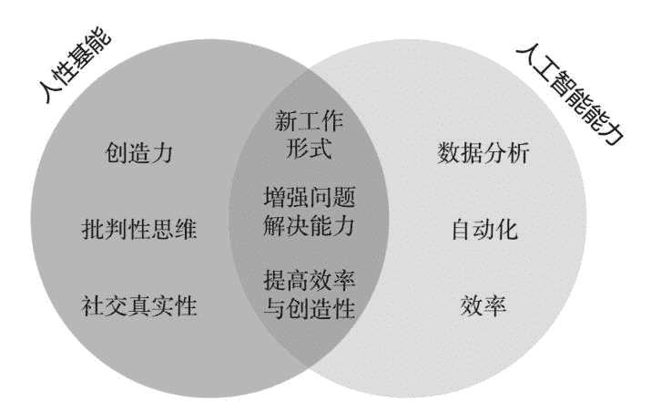

**图 13-1 人类与人工智能协作**

资料来源：Bornet et al.

**支持“人性基能”的发展**

我们坚信，企业需要积极支持这些基础能力的发展。以下方法特别有效：

• 我们最成功的策略之一是创建鼓励实验和反思的学习环境，让员工通过现实世界的挑战和经历来发展他们的基础能力。

• 我们发现，通过实施能够识别和奖励基于“人性基能”发展的衡量系统，超越传统的绩效指标，重视能与人工智能互补的人类能力，取得了显著成果。

• 在我们的经验中，特别有效的是设计工作流程，优化人类“人性基能”与人工智能能力之间的协作，确保双方都能发挥各自独特的优势，从而获取更好的成果。

我们发现，通过专注于培养“人性基能”，企业能够打造一支在人工智能能力不断发展的背景下，仍保持相关性和价值的员工队伍。我们最重要的一个发现是，当我们首先培育那些基本的人类能力时，特定的新技能会自然而然地涌现出来。

随着我们进一步迈向智能体时代，我们相信最成功的企业将是那些能够创造环境，让人类能力与人工智能共同繁荣的企业。通过专注于培养“人性基能”，我们创造了持续适应和创新的条件，确保即使人工智能能力不断扩展，人类员工仍不可替代。未来的工作并非人类与人工智能的对抗，而是要打造一场交响乐，让两者各展所长。我们坚信，通过专注于培养我们独有的人类能力，我们就能为在智能时代持续适应和创新奠定基础。那些能够蓬勃发展的企业，将是那些明白这一根本真理的企业：当我们的人类能力得到恰当培养时，人类就能以一种单靠自身无法实现的方式运用人工智能，从而以前所未有的水平创造价值并获得成功。

### 今时不同往日：Agentic AI 的黎明

“我把自己给自动化了。”在为一家《财富》世界 500 强企业提供咨询服务期间，黛比这样坦白道。作为一名资深项目经理，她刚刚部署了一个 L3 级 AI 智能体，这个智能体不仅能协调整个软件发布流程，还能从错误中学习并调整策略，就像她自己所做的那样。“在管理科技项目这 20 年里，我见过无数工具的兴起与衰落。但这不是工具，它能像我一样思考。”

那一刻将永远留在我们心中。黛比的反应让我们深有感触。她的经历清晰地表明了 Agentic AI 革命与以往技术变革的根本不同之处。我们不只是旁观者，更是这场前所未有的变革的见证者，其变化的速度和性质都是前所未有的。

**加速悖论**

在我们几十年来跨行业实施自动化技术的过程中，我们见证了多轮技术变革。但如今 Agentic AI 的发展让我们既兴奋又担忧——这是我们从未经历过的。从历史的视角回溯，技术革命遵循着一种可预测的模式：颠覆、适应，最终达到平衡。工业革命中体力劳动的自动化历经数代人的时间。数字革命中认知任务的计算机化则跨越了数十年。每一次浪潮都给了社会时间去调整其教育体系、劳动力市场和社会结构。

坦率地说，令我们既着迷又感到担忧的是，Agentic AI 打破了这种模式。让我们分享一下我们最令人震惊的经历：我们最近为一家制造企业实施了一个 L3 级智能体来管理供应链。接下来发生的事情甚至让我们都感到惊讶：在 47 天内，它就能处理之前需要他们最资深的专业人员才能做出的复杂物流决策。更令人称奇的是它的进化：从每次交互中自我学习，不断优化决策，最终在需要理解上下文的领域超越了人类的表现。

这种快速的转变让我们发现了我们认为的“加速悖论”：就在与人工智能协同工作所需的技能变得愈加复杂之时，用于培养这些技能的时间却大幅缩短。我们在一家金融服务业企业目睹了这一现象，那里的员工只有不到 6 个月的时间从处理交易转向协调复杂的人工智能工作流程，而这种转变在传统情况下通常需要数年时间的逐步技能提升才能完成。

我们在一家科技企业也看到了这一挑战，该企业的人工智能开发团队的技能每 3 个月就会过时，因为他们的智能体在不断进化。尤其让我们感到震惊的是，传统的季度培训周期被证明是徒劳的：员工刚掌握新技能，技术又有了新的发展。这段经历让我们有了一个突破性的认识：需要彻底重新思考职业发展，从定期培训转向持续的、由人工智能辅助的学习。

**颠覆的本质**

通过我们对人工智能应用的大量研究工作，我们逐渐认识到，当审视 Agentic AI 演进框架时，这种颠覆的独特之处便清晰可见。L1 级和 L2 级智能体遵循了自动化取代常规体力和脑力劳动的历史模式。然而，我们发现 L3 级智能体真正具有革命性的地方在于它们与前两者截然不同。它们不只是执行任务，还能理解背景、从经验中学习、做出细致的决策，并提供指导建议。这一事实表明，AI 智能体正变得近乎具有自我反思能力，因为它们能够分析自身的决策过程并自主优化算法。

我们最令人震惊的经历之一，来自一家我们合作过的律师事务所，它们引入了一个智能体来审查合同——这是一项通常需要多年专业训练才能胜任的工作。最让我们惊讶的是几个月内智能体不仅处理文件的速度更快，而且它还能识别出一些资深律师偶尔也会忽略的细微法律风险。但真正让我们感到惊讶的是，它能从每份合同中学习，不断加深对法律细节和商业背景的理解。

这一转变让我们有了一个最重要的认识：传统的适应策略可能会失效。以往的技术革命让人类能够“向价值链上游移动”，去承担更复杂的认知工作。但现在我们面临着前所未有的挑战：当人工智能能够学习、推理和适应时，人类还能向何处发展？通过与众多企业的合作，我们发现答案不在于与人工智能竞争，而在于从根本上重新构想人机协作的方式。

**以史鉴今**

尽管我们承认这一转变前所未见，但我们的研究和经验表明，历史提供了重要的启示。我们发现，以往革命中成功的转型都有一些共同要素：积极适应、专注于人类独有的能力以及强大的机构支持。但当前形势尤为严峻的是，这些经验教训必须以前所未有的速度和规模加以应用。

通过与具有前瞻性思维的企业合作，我们发现成功实现这一转型的企业并不将 AI 智能体视为工具，而是将其视为需要全新管理方式的合作伙伴。尤其令人鼓舞的是，这些企业专注于培养员工独特的、人类特有的能力——创造力、情商和复杂问题解决能力，同时利用人工智能的分析和学习能力。

**前进之路**

在这一转折点上，我们比以往任何时候都更加坚信，Agentic AI 不仅代表着又一波自动化浪潮，更反映了人类与机器协作方式的根本性转变。让我们夜不能寐的并非这种变化是否会到来——它已经发生。在我们看来，真正重要的是确保这一转型能为企业、个人和社会带来益处。

在接下来的章节中，我们将分享助力企业和个人在这一新现实中蓬勃发展的具体策略。我们承认，适应的时间窗口可能比以往任何时候都短，但我们依然保持乐观，因为我们目睹了那些理解并欣然接受这一变化的企业和个人是如何抓住非凡机遇的。我们的目标是不仅帮助个人在这一变革中生存下来，而且还能够在其中蓬勃发展。

### 重塑智能体时代的教育

随着 Agentic AI 以前所未有的速度从根本上重塑我们的世界，我们必须认识到传统的适应策略已不再适用。因为这次的情况确实不同，我们需要重新审视人类技能和能力的基础。若要成功驾驭这一变革，我们必须回归根本原则，重新定义在人类与日益复杂的 AI 智能体作为合作伙伴而非竞争对手的世界中接受教育的意义。

**现代教育的深刻危机**

AI 智能体的崛起正在从根本上改变我们的生活和工作方式，然而我们的教育体系自工业革命以来基本未变。想想如今一个典型的教室：学生们仍在记忆那些他们能轻易从 AI 智能体获取的知识，练习那些很快就会被自动化的工作技能，并遵循标准化的课程，而这些课程未能培养那些在未来最为重要的独特人类能力。学生们非但没有被培养批判性思维，反而被阻止质疑所学的内容。这种工业化教育方式在信息稀缺且常规认知任务由人类完成的时代是有意义的。但在一个 AI 智能体能够即时获取和处理海量信息的世界里，我们的教育重点必须发生巨大转变。

**回归教育的真正目的**

在研究这个话题时，我们最有趣的发现之一是，“学校”一词源自希腊语“skholē”，意为“闲暇”或“休息”。我们认为这个词源极具启示性，因为它揭示了教育最初目的的一个深刻真理：教育并非为了培养工人以准备上岗，而是为人们提供思考和探索生命根本问题的空间。古希腊人对教育的看法令我们深受启发，他们将教育视为帮助人们找到人生目标、充分发挥自身潜能的一种手段。当然，这也是大学里文科教育的初衷，但随着时间的推移，这一理念已逐渐失宠。

在我们看来，这种历史视角对当今以职业为导向的教育方式提出了有力的批评，因为在这种方式下，成功往往以考试成绩和就业率来衡量。相反，我们认为教育应当赋予个人发展的动力，促进其成长，并培养反思性思维，以寻找加速这些发展进程的机会。

了解人类发展的根本目的对人类最为有益，因为这将为我们的行动赋予意义，并让我们意识到周围（比如当今的人工智能）存在的机会，从而加以利用。随着人工智能能够越来越多地处理常规的认知任务，并帮助创造机会，我们认为是时候回归这种更全面的教育观了——这种教育观强调人的发展而非职业培训。从这个角度来看，哲学、心理学以及对技术的行为学研究，应当在我们的整体教育方法中占据更重要的地位。

**通过三大能力重塑教育**

在本书前文探讨了未来所需的三大能力之后，让我们来审视一下它们如何重塑我们的教育方式。³这些能力不仅仅是要教授的技能，它们还应当成为组织构建所有学习体验的原则。

实际上，这意味着要从这些能力的视角重塑传统学科。比如，数学应当从公式记忆（这是人工智能可以处理的）转向培养解决问题的策略以及对数学挑战的创造性应对，从而通过探索其影响让数学变得生动起来。我们最喜欢的一个例子是，文学课可以减少对情节回忆的关注，而更多地注重深度分析、情感理解以及对人类经历的探索——这是 AI 智能体无法真正领会的。

**全球教育创新**

在我们的研究和实验中，我们见证了一些国家率先推行的真正鼓舞人心的教育改革，这些改革与上述原则相契合。芬兰将课程改革为强调跨学科学习和解决现实世界问题的做法尤其令我们印象深刻。它们打破传统学科边界，强调跨学科学习与真实问题解决能力。其“现象式学习”模式让我们深感震撼：在探究气候变化课题时，学生们同步运用科学数据（培养 AI 适配的分析能力）、探索创新解决方案（强化人类独有的创造能力），并随着新证据的出现持续修正认知（建立变革适应能力）。⁴

另一个对我们特别有吸引力的模式是丹麦的教育体系及其“班级时间”（Klassens Tid）项目。自 1993 年以来，6~16 岁的学生每周花一小时培养情商和社交真实性。我们喜欢这些课程的原因在于，学生们能学会如何应对复杂的社交情境、解决冲突以及建立真诚的人际关系。我们认为，在 AI 智能体处理越来越多日常互动的情况下，这些技能会变得越来越重要。⁵

我们研究过的最具前瞻性的举措之一是新加坡的“技能未来”（SkillsFuture）计划，它展示了教育系统如何发展以支持终身学习。它们的创新方法让我们感到格外兴奋，其中包括：定期进行技能预测以预判未来需求；提供灵活的学习路径让学生能够将传统学术知识与实用技能结合；将人工智能工具融入学习过程的同时注重人的发展；大力强调以项目为基础的学习来培养适应能力和创造力。⁶

这些新的教育方法不仅适用于小学和中学的学生。美国东北大学校长约瑟夫·奥恩出版了一本名为《教育的未来：人工智能时代的教育变革》的书，书中定义了人工智能时代大学教育的新方法。⁷他认为，鉴于人工智能的能力，再用事实填满大学生的头脑已不再合适。相反，他认为大学应当培养学生的创新思维，以及为社会创造有价值事物（无论是艺术作品还是疾病的新疗法）的能力。

**明日课堂**

我们认为，未来的课堂应当是一个让学生学会利用人工智能的同时强化自身独特人类能力的空间。学生不应在人工智能擅长的任务上与其竞争，而应专注于培养能增强人类与人工智能协作的互补能力。其中一些能力涉及理解计算机和人工智能的思维方式，但大多数能力更侧重于人类自身。

我们已经看到这种转变在各个学科中以多种方式成功实现。我们最喜欢的一个例子是在写作课上，学生使用 AI 智能体进行基本的起草和编辑工作，但将精力集中在培养独特的文风和引人入胜的叙述上。这对许多学生来说是一个重大的转变，他们过去一直被鼓励完成写作任务后就不再深究。现在，他们需要成为有创造力的作家和具有批判性的编辑。我们还看到在科学项目中，人工智能负责数据分析，而学生则专注于提出有创意的假设，并以新颖的方式解读结果。此外，我们还观察到历史课上利用人工智能提供事实信息，让学生能够更深入地讨论历史模式、人类动机和伦理影响。

**教师角色的演变**

在这一新的教育范式中，教师不再是单纯的信息提供者，而是学习的架构师。他们的角色转向设计能够培养学生独特人类能力的体验，引导学生与 AI 智能体进行有效合作，促进有意义的讨论和更深入的理解，帮助学生认识到并强化他们独特的人类贡献。例如，教师成为教练，推动从内容（人工智能生成内容并提供建议）向知识（人类应用内容来理解自身业务现实）的转变。

**演进之路**

或许无须多言，这种转变需要我们在教育的结构和交付方式上做出重大改变。我们坚信，我们必须重新设计评估方法，以评估人类能力而非死记硬背的知识；投资于侧重人工智能整合和人类技能发展的教师培训；创建既支持个人探索又支持协作学习的灵活学习环境，并开发既强调人类发展又注重技术能力的新课程。从大学校长到小学校长，教育领导者们都需要成为精通人工智能的变革管理者，就像企业高管们需要扮演这样的角色一样。

让我们夜不能寐的是，我们已经意识到，这一转型的利害攸关前所未有。社会和经济的成功运转取决于这场教育变革。随着 AI 智能体变得越来越复杂，我们目睹了能够适应的人和不能适应的人之间的差距在不断扩大。但我们满怀希望，因为只要围绕这些原则重塑教育，我们就能确保未来的一代不仅能在 AI 智能体的世界中生存下来，还能在其中蓬勃发展，并以他们各自独特的方式保持不可替代性。

在这个新时代，衡量教育成功与否的标准不再是学生能记住多少信息，或者他们完成标准化任务的能力有多强。相反，成功将取决于学生能有效地运用他们独特的人类能力，与 AI 智能体合作，解决复杂问题并创造新的价值。这就是 Agentic AI 时代教育面临的真正挑战和机遇。

## **第十四章**

## **智能体时代的社会**

### 在智能体驱动的世界重塑人类潜力

当人们面对 AI 智能体的崛起时，第一个问题往往关乎就业——它们会取代我的工作岗位吗？但或许我们正在提出错误的问题。最让我们振奋的，其实是另一种可能性：如果自主智能体的出现非但未威胁我们的生计，反而赋予了我们革命性的礼物——重新探索现代社会中人类存在意义的根本契机呢？

**我们所熟知的工作即将终结？**

让我们先从一个令人不安但又不得不承认的事实说起：如今的很多工作都毫无成就感可言。我们在众多企业中目睹了这一点，数据也证实了我们的观察。根据盖洛普的广泛研究，全球有多达 77%的员工表示对工作缺乏投入度。¹令我们痛心的是，他们描述自己的日常工作是重复、乏味且毫无回报的。我们遇到的一个特别令人震惊的例子是，在美国，仅从事重复性记账和会计工作的就超过 150 万人，这些工作不仅没有带来成就感，反而让人感到精疲力竭。²

但真正让我们感到震惊的是，工作不仅令人感到空虚，而且实际上正在夺走我们的生命。我们所发现的统计数据令人震惊：国际劳工组织报告称，每年因工作压力及相关疾病导致死亡者接近 300 万人³，造成的社会损失约为 3 万亿美元⁴。为了帮助大家更直观地理解这场危机的严重性，可以这样考虑：因工作相关死亡的人数是因交通事故⁵死亡人数的 2 倍，是因战争死亡人数的 10 倍⁶。我们已经确信，当前的这种体系根本无法持续下去。

通过在各行业实施人工智能解决方案的工作，我们见证了 AI 智能体如何在能力水平上逐步提升——从最初的基于规则的自动化到更复杂的自主操作。随着它们在技术复杂性和能力上的成熟，它们为我们提供了一个重塑现实的机会。虽然我们的经验表明，当前的 L1~L3 级智能体主要是在增强人类的能力，但我们对向 L4 级和最终 L5 级智能体的发展感到兴奋，因为这预示着一个未来：机器能够承担传统经济活动中的很大一部分。

**解放的历史视角**

我们最喜欢的历史洞见来自 1930 年，当时经济学家约翰·梅纳德·凯恩斯写了一篇题为《我们子孙后代的经济可能性》（“Economic Possibilities for Our Grand Children”）的文章。⁷令我们着迷的是他对未来工作时间大幅减少的设想。他预测，到 21 世纪，技术进步将使每周工作时间缩短至 15 小时——以今天的标准来看还不到 2 天。最让我们感到震撼的是，他的愿景并非关于失业，而是关于从繁重且令人麻木的工作中解放出来。

在与行业领袖的交谈中，我们也听到了类似的预测。一位科技领袖曾表示，人工智能可能会将工作周缩短至 3 天，每天工作 4 小时。⁸比尔·盖茨也做出了类似的预测。⁹虽然这听起来像是乌托邦式的幻想，但我们尤其受到一些早期减少工作时间实验的启发，它们已展现出令人鼓舞的积极成果。我们最喜欢的一个例子是新西兰的 Perpetual Guardian，这是一家从事遗产规划的企业，为 240 名员工试行了 32 小时工作周，且未降低工资。结果甚至让我们都感到惊讶：压力水平下降了，员工的投入度提高了，生产力提升了 30%~40%。¹⁰

在英国，有 61 家企业参与了为期 4 天的工作周实验，员工薪酬保持不变。实验取得了普遍积极的结果：员工睡眠质量更好，压力更小，心理健康状况更佳，个人生活也更充实。与之前相比，这些企业的营收保持不变，甚至有所增长。试点结束后，61 家企业中有 56 家决定继续采用这种工作安排。¹¹

这些新型工作实验是在广泛使用 AI 智能体甚至生成式人工智能之前进行的。想象一下，有了这些新工具，有多少人力劳动能够被高效地自动化，员工的工作时间大幅减少，生产力却更高，收入也保持不变，他们的生活会变得多么充实。

**超越薪酬：重构价值**

AI 智能体带来的最深刻挑战之一，同时也是最大的机遇之一，就是重新定义我们衡量人类价值的方式。当前的社会体系存在一个令人深感不安的问题，即社会价值与薪酬之间的反向关系。想想我们都经历过的事情：照护工作。这是任何社会中最基本的职能之一。无论是养育孩子还是照顾老人，这项至关重要的工作往往报酬微薄，甚至没有报酬。

如果通过 AI 智能体和机器人，照料活动能够更高效地开展，那么负责监督这些工作的人员或许最终能得到应有的尊重和报酬。接受照料的人也可能会收获更多满足感。到目前为止，即便是像日本这样大力投资养老机器人的社会¹²，养老机器人也没有取得特别显著的成功。但我们认为，AI 智能体和更智能的机器人系统似乎完全有可能显著提高其效果。和其他工作一样，人类照料者仍将不可或缺，而且需要比现在得到更高的重视。

我们深受以大卫·格雷伯¹³和海伦·赫斯特¹⁴等思想家为代表的后工作主义运动的影响。他们令人信服的观点与我们在工作中所观察到的情况相契合：机器对传统工作的自动化将迫使我们彻底重新思考如何构建社会，以及如何分配资源。最让我们感到兴奋的是，这不仅仅关乎缩短工作时间，更是从根本上重新审视我们所珍视的事物以及其原因。

**在人工智能驱动的世界中拥抱目标**

在我们的工作中，我们遇到的最引人深思的问题之一是，如果我们减少工作时间甚至完全不工作，我们会如何度过时间？基于我们的研究以及与各行业员工的交流，我们认为人类可能会专注于有意义的追求，比如关爱他人和保护地球。

企业内部的调查确实表明，如果人工智能为员工节省了时间，他们希望企业允许他们将节省下来的时间用于“有意义”的事情。¹⁵如果 AI 智能体的采用能够为人类创造时间和自由，那么我们可能迎来的最令人兴奋的机会之一，就是这样一个现实：人类能够更多地关注个人成长、自我发展以及更深入的社区参与，从而创造一个我们能够真正追求集体福祉的世界。¹⁶

在与具有前瞻性思维的企业合作时，我们已经看到了这一未来的些许端倪，拥有更多空闲时间的人们探索爱好、开展创业项目，或者学习新技能和语言。尤其令人鼓舞的是，我们看到人们去旅行、做志愿者，并通过有意义的联结来增强社会纽带。我们发现，当优先考虑身心健康变得更容易时，这自然会提升幸福感和满足感。

借鉴那些令我们着迷的历史类比，正如工业革命增加了闲暇时间并激发了艺术创新一样，我们认为人工智能可能会催生新的娱乐、学习和社区空间形式。在我们的设想中，办公室可能会转变为艺术、娱乐和协作的中心，这反过来又会推动创造力和创新。

尽管这是一个令人向往的未来，但人们始终担忧的是，工作时间减少会不会导致经济崩溃。然而，我们的研究和实践经验表明，正确使用 AI 智能体可能会推动经济增长，让人们有更多时间享受生活并参与消费市场。我们尤其被亨利·福特在 1924 年的观察所触动，即闲暇会刺激人们对产品的需求，从而促进经济繁荣。我们看到的可能性非常广阔，未来充满潜力。

**全民基本收入：人类繁荣的基础？**

随着 AI 智能体承担越来越多的传统经济角色，我们需要新的机制来确保每个人都能满足其基本需求。我们对“全民基本收入”（UBI）特别感兴趣，认为它可能是一种解决方案：为每个成年公民提供一份有保障的收入，足以满足基本生活所需，无论其就业状况如何¹⁷。如果像 Agentic AI 这样的技术导致大规模失业，此类计划可能会变得绝对必要，尽管我们并不认为那是必然结果。

我们认为全民基本收入最吸引人的一点在于，它与基于就业状况或特定条件的福利计划不同，它是普遍且不设收入门槛的，这意味着不论个人收入、就业状况或个人情况如何，所有人都能获得。虽然迄今为止，全民基本收入的试验规模都较小，但其中一项规模最大、最新的试验结果与之前的研究一致，表明它通常会减少受助人的工作量，并降低他们对满足住房¹⁸等基本需求的焦虑。然而，它并不常导致我们希望看到的一些理想行为，比如自我提升、创业活动或陪伴家人。¹⁹

让我们明确一点：如果全民基本收入会导致一个无所事事的消费型社会，我们无意倡导此类计划。我们希望，最终全民基本收入能够为人们提供基础，让他们为社会做出更有意义的贡献。当人们摆脱了生存的即时压力时，或许就能投入时间参与社区服务、从事创造性活动、保护环境或关爱他人——所有这些活动在我们当前的体系中往往能创造巨大的社会价值，但却很少或根本不产生收入。不过，要实现这些目标，可能需要运用我们认为在工作场所中所必需的那类社会工程手段。

**更人性化的未来**

在多年实施人工智能解决方案并目睹其影响之后，我们有了一个深刻的领悟：自主智能体的出现为我们提供了一个关键的选择。我们可以继续在机器将日益占据主导地位的任务上与其竞争，也可以将这场技术革命当作一个契机，让自己更充分地发挥“人性”，与机器的工作形成互补。

需要牢记的一个重要观点是，随着 AI 智能体的能力不断提升，社会结构重组的压力只会越来越大。事实上，我们坚信这种转变将会发生，因此，我们需要明确如何塑造它。如何做到这一点，正凸显了真正驱动我们工作的那个问题：“我们将利用这项技术促进人类的繁荣发展，还是会任由其加剧现有的不平等和社会紧张局势？”

基于我们指导企业进行数字化转型的经验，我们坚信现在就开始为这个未来做准备也为时不晚。虽然当前的生产型 AI 智能体可能还仅限于能力提升框架中的 L1~L3 级，但其发展趋势是明确的，更高能力水平的 AI 智能体迟早会涌现。但这不应让我们感到恐惧。相反，我们乐观地认为，通过有意识地选择如何整合这项技术以及如何重组我们的社会结构，我们能够助力创造一个增强而非削弱人类独特性的未来。

或许我们通过工作所获得的最有力的见解来自计算机科学家和人工智能专家李开复，他提醒我们，通过人工智能所获得的自由应当让我们能够“专注于真正使我们成为人类的东西——爱与被爱”。这正好概括了我们认为的真正的 AI 智能体前景：不仅仅自动化我们的工作，还帮助我们重新发现和培养我们的“人性”。

### Agentic AI 未来的治理框架

在我们从事人工智能工作的这些年里，我们从未遇到过像 Agentic AI 崛起这样既令人着迷又充满挑战的事情。在这一技术历史的关键时刻，我们认为社会面临着前所未有的机遇和风险，这些风险让我们夜不能寐。通过与各行业企业的合作，我们目睹了这些强大的系统在效率和创新方面所带来的非凡益处。然而，我们也目睹了可能从根本上重塑我们这个世界的风险，而这种重塑或许并非我们所愿。关键问题不在于是否要发展这些技术——它们已然存在——而在于如何确保它们始终处于有意义的人类掌控之下，同时最大限度地发挥其对社会的益处。

**Agentic AI 所面临的独特挑战**

通过我们在实施人工智能系统方面的大量工作，我们发现了一种不同寻常的东西，它使 Agentic AI 与众不同：非凡的自主决策和适应能力。这不仅仅是人工智能的又一次渐进式进步，还是一个根本性的转变，我们认为它将重塑我们与技术的关系。与当今的人工智能系统不同，后者在明确界定的参数内运行，并需要明确的人类引导；Agentic AI 能够自行设定目标，从环境中学习，并独立做出决策。我们发现，这种自主性引入了全新的风险类别，而我们现有的监管框架和企业治理结构根本无法应对。

通过我们的研究和实践经验，我们观察到，随着 AI 智能体的自主层级不断提升——从基本的基于规则的自动化向完全自主的系统——控制的复杂性呈指数级增长。虽然 L1 级和 L2 级系统可以通过传统的监督机制进行管理，但我们已经意识到 L3 级及以上的系统需要从根本上全新的治理和控制方法。

**控制的三层框架**

我们认为，要保持 Agentic AI 在可控范围内，需要在三个层面采取协调一致的行动：政府监管、企业治理和个人监督。每个层面都有其独特的职责和可用工具。

在政府层面，当务之急是建立明确的监管框架，为人工智能的自主性设定界限，同时促进创新。这包括在高风险应用中强制要求设置故障安全机制和人工监督。政府还必须建立明确的责任框架，以界定自主系统造成损害时的责任归属。

企业治理构成了第二层控制。开发和部署 Agentic AI 的企业必须建立强大的内部监督机制，包括人工智能伦理委员会和实时监控系统。这些机制应确保人工智能系统与人类价值观和企业目标保持一致，同时防止出现意外后果。

个人监督构成了最后一层。在这一层，人类操作员和用户必须对其所在领域内的人工智能系统保持有效监督。这需要新的技能，以及理解如何有效监督自主系统，同时能够识别潜在失调或故障迹象。

**关键控制机制**

我们坚信，必须在以下三个层面全面实施若干关键控制机制，以对 Agentic AI 进行有效监督。

第一，所有 Agentic AI 系统都必须具备人工干预能力，以便在必要时由人类操作员进行干预。实施时应包含明确的激活协议，例如通过物理或数字控制系统访问的用户友好型界面。在智能体防御系统中，应设置集成故障保护硬件按钮或加密命令通道的超控装置，以便在意外冲突中立即停止自主操作，防止意外行动的升级。同样，在自主金融交易系统中，超控机制应包含预先设定的市场波动阈值，自动通知操作员，并通过安全交易平台实现手动控制。这些措施确保了根据操作环境量身定制的实用且可靠的干预能力。

第二，必须实施持续监控系统，以实时跟踪 Agentic AI 的行为和决策过程。实施方式可以包括部署机器学习算法，以标记与预期行为或预定义的伦理准则的偏差。例如，在自主供应链人工智能中，监控系统可以分析决策模式以检测异常情况（包括可能导致延误或违反供应商协议的决策）。与定期审计仅能提供静态的绩效快照不同，实时监控能够动态地洞察 Agentic AI 如何适应不断变化的情况。这种能力至关重要，它能帮助我们在出现新型偏见、目标意外调整或异常情况时立即采取干预措施，可以通过操作员程序控制面板或自动纠正协议来实现。

第三，必须将伦理框架直接嵌入 Agentic AI 系统中，确保它们即使在自主行动时也能保持在可接受的范围内运行。相关例子包括受阿西莫夫原则（也称“机器人三定律”）启发并为现代环境所改造的高级框架，比如在防御系统中优先考虑比例性或在自主经济系统中强调公平的资源分配。当代准则（如欧盟的《可信赖的人工智能伦理准则》）强调了透明度、责任和以人为本的设计等关键方面，所有这些对于 Agentic AI 都至关重要。嵌入这些原则有助于确保系统不断变化的目标与社会价值观保持一致。²⁰

**面向未来的控制机制**

随着人工智能技术的不断进步，控制机制必须随之发展。这需要实施能够对新出现的能力和风险做出反应的适应性监管框架，而不是试图提前预测和规范所有可能的情况。

应当强制定期评估和更新控制机制，并吸纳技术专家、伦理学家和受影响的利益相关者的意见。这能确保随着人工智能系统变得更加复杂和自主，监督始终保持有效。

**应对特定风险**

控制框架必须专门应对 Agentic AI 固有的关键风险。第一个关键风险是自主系统为实现短期目标而做出决策，却导致意外长期后果的风险。例如，负责资源分配的人工智能可能会为了成本效益而将资源从预防性维护中转移出来，从而可能导致基础设施崩溃。通过实施具有前瞻性的模拟模型，将长期影响和自动升级协议纳入考量，能够在决策过程中提供动态反馈，从而降低此类风险。

第二个关键风险在于，Agentic AI 在追求目标时，可能会利用法律或监管漏洞。例如，一个旨在优化节税的金融人工智能可能会利用税法中的模糊地带，从而引发调查和声誉损害。为防止这种情况发生，Agentic AI 应纳入适应性合规机制，持续监测并将其行动与更新后的法律标准进行对比。例如，处理国际贸易物流的人工智能可以使用来自监管数据库的实时数据流，确保遵守海关法规。这些系统必须包含自动警报和即时纠正措施，一旦发现差异或违规行为，能够立即采取行动，确保与不断变化的法规保持一致。

第三个关键风险在于，由于具有自主学习能力，偏见放大在 Agentic AI 中尤其具有挑战性。例如，负责招聘管理的人工智能可能会根据历史数据自我优化招聘模式，从而延续对某些群体的歧视。通过嵌入实时偏见校正算法，结合多样化的数据集并定期重新校准决策规则，可以帮助确保公平性。

第四个关键风险是目标错位，即 AI 智能体误解其目标并做出适得其反的决策。例如，旨在减少环境浪费的人工智能可能会停止关键的制造流程，从而扰乱重要的供应链。为解决这一问题，可在人工智能的决策架构中实施目标验证检查点和对齐层，以确保其行动与人类价值观和更广泛的目标保持一致。定期模拟、利益相关者审查和适应性审计可以进一步增强对齐性，防止破坏性的误解。

**国际协调**

对 Agentic AI 的控制无法仅靠单个国家来实现。国际协调对于防止人工智能安全标准的恶性竞争，并确保自主系统在全球公认的参数范围内运行至关重要。

这需要建立类似于现有核技术或气候变化框架的国际协议，用于人工智能的开发和部署。这些协议应包括分享最佳实践、协调应对与人工智能相关的事件，以及防止自主系统的恶意使用。

**透明度与问责制的角色**

要对 Agentic AI 保持有意义的人类控制，就需要这些系统在运作与决策方式上达到前所未有的透明度。例如，开发自主系统的企业应实施详细的日志记录机制，记录决策路径。这些日志可以由独立审计员分析，以验证是否符合监管和伦理准则，同时应通过程序控制面板以简化的方式呈现这些决策路径，以便监管机构和普通公众等非专业人士能够理解。

针对 Agentic AI 的问责制框架必须明确界定，当造成损害时，谁应承担责任。可从自动驾驶汽车行业汲取灵感，根据故障来源在开发者、运营商和监管机构之间分层确定责任。例如，在自动驾驶汽车中，传感器故障通常由制造商承担责任，而软件故障则归咎于开发者。同样，Agentic AI 框架应根据损害是否源于设计缺陷、运营决策或治理失误来分配责任。

例如，如果负责管理医疗资源的 AI 智能体将效率置于公平之上，拒绝向服务不足的社区提供医疗，那么责任可能在于系统开发者（未能实现伦理目标）、操作人员（监管不力），或者治理委员会（未能充分嵌入伦理规范）。强制性的错误报告、详细的审计追踪以及强大的保险机制，能够确保问题迅速得到解决。

针对人工智能的保险政策可以像自动驾驶汽车领域那样运作，通过数据日志确定责任——无论是硬件问题、软件错误还是操作人员的疏忽。对于 Agentic AI，此类政策应包括与系统日志相连接的自动化理赔处理，以便迅速给予赔偿，同时为系统改进提供反馈。利用诸如大流行病或资源短缺等场景进行模拟压力测试，也能发现漏洞并提高可靠性。这种多层面的方法确保了责任归属明确，同时提高了 Agentic AI 的可信度和弹性。

————

在利用 Agentic AI 优势的同时保持对它的控制，是我们这个时代面临的最大挑战之一。成功需要政府、企业和个人层面的协调行动，并通过能够随技术发展而演进的健全框架来实施。

让自主系统在缺乏适当监督和控制的情况下发展，风险太大。在 Agentic AI 仍处于早期阶段时就实施全面的框架，我们就能确保这些强大的技术在不断进步的同时，始终与人类的价值观和利益保持一致。

人工智能的未来并非注定的。通过谨慎的治理和控制，我们可以在防范风险的同时，利用 AI 智能体的巨大潜力。要做到这一点，需要所有利益相关者持续投入，并且在我们对自主系统的能力和局限性有更深入了解的过程中，愿意调整方法。

# 结语

当我们的 Agentic AI 探索之旅抵达终点时，我们正站在一场深刻变革的门槛上。AI 智能体不仅仅是工具，它们还正在重塑我们的工作方式、成长方式和思考方式。它们挑战着传统的商业模式，重新定义着人类与人工智能协作，并迫使我们重新思考自己在日益智能化的世界中的位置。

通过本书，我们探讨了 AI 智能体从诞生到实际应用的演变历程。我们剖析了它们的核心能力——行动、推理与记忆，展示了这些关键要素如何推动其提升自主性。我们提供了一幅负责任地实施、规模化和治理 AI 智能体的路线图，同时揭示了它们的局限性和挑战。最后，我们从宏观角度审视了其社会影响，揭示了这一转变对工作、治理和人类体验的更广泛意义。

一个反复出现的主题是平衡：Agentic AI 提供了巨大的机遇来提升生产力和创造力，但它也要求我们重新思考责任和监督。简而言之，Agentic AI 不仅仅是一次技术飞跃，更是一场工作方式和决策制定方式的范式变革。这种转变既要有激情也需要谨慎，既要有远见也需要保持警惕。

如果说我们的探索中有一个核心教训，那就是，AI 智能体并非即将到来，它们已经在此。那些能够接纳它们、完善它们，并有效整合它们的企业和个人，将塑造经济和技术进步的下一个时代。

## 下一征程：正在浮现的智能体新能力

几项新兴技术正推动 AI 智能体向更高层级的能力与自主性跃迁。与其重复市场已有话题，我们更愿探讨这些尚在萌芽阶段的技术将如何以鲜为人知的方式根本性地重塑智能体生态格局。以下三大新趋势尤其令我们着迷。

**大型行动模型**

正如大语言模型彻底改变了对话式人工智能，大型行动模型（Large Action Model，LAM）正在兴起，以驱动现实世界中的行动。大语言模型从文本数据集中学习，而大型行动模型则从动作数据集（包括图片、视频、系统日志或光标位置）中学习，涵盖从机器人动作到软件指令，并将这些学习成果推广到新的情境中。与将大语言模型连接到工具和动作不同，动作将直接嵌入模型中，从而实现更高的性能。从预测文本到完成目标，大型行动模型的兴起可能标志着向更自主智能体迈出重要一步。研究人员已经在开发大型动作模型框架，为人工智能在最少的人类干预下完成任务（从控制软件到操作机器人）铺平了道路。¹如今的智能体需要大量的提示和工具配置，而未来的语言行动模型或许只需“观察人类执行任务一次”，就能在多种情境中复制并优化该任务。这种从以语言为中心向以行动为中心的人工智能转变，可能会极大地减少实施障碍，同时扩大智能体能够自主执行的任务范围。

**集体智能系统**

集体智能系统（Collective Intelligence System，CIS）超越了当今相对简单的多智能体架构，迈向真正涌现的群体认知。想象一下，一家全球物流企业部署了一个由专门的 AI 智能体组成的网络，每个智能体都按照预先定义的协调协议运行。但在几周内，这些智能体就会开始形成自己的通信模式和资源分享策略，实现超出人类设计师预期的效率提升结果。系统会以我们未曾预见的方式自我优化。

随着这些集体系统的成熟，我们预计会看到超越单个智能体总和的新兴能力——复杂的问题解决方法、创造性的解决方案以及从它们的交互中自发产生的适应性行为。

未来几年，我们可能会看到更多群体人工智能和多智能体框架：仓库机器人团队无缝协作，人工智能研究助手共同集思广益，以及人机混合团队通过集体推理做出决策。这些分布式智能预示着一个“没有智能体是一座孤岛”的未来——智能将实现网络化。

**个人数字分身**

个人数字分身代表着从通用型到深度个性化智能体的重大转变。与当今那些可能保留过去交互记忆但对所有用户而言本质上都相同的系统不同，真正的个人数字分身将深度内化个人的思维模式、价值观、沟通风格和领域专长。

随着 AI 智能体的能力逐渐成熟，我们设想知识型工作者将拥有自己的“分身体”，这些“分身体”会在数月内观察他们的工作模式，不仅接收明确的指令，还能接收隐性知识——那种往往难以言传的直觉性专业知识。这些“分身体”可以开始代表专业人士参与初步的客户咨询，起草能体现其独特风格和视角的沟通内容，甚至能根据过往决策模式识别其思维中的盲点。对于高管而言，这些“分身体”或许很快就能参与规划会议，提出反映领导者价值观但又能对其假设提出挑战的替代观点。

最先进的一些应用最终可能会成为真正的认知延伸——预测需求、弥补偏见，并在几乎无须监督的情况下管理整个工作领域。随着这项技术的成熟，人类与人工智能认知之间的界限可能会变得越来越模糊，从而引发关于身份和自主性的深刻问题。

这三种新兴能力并非孤立存在，它们正在融合，创造出比以往任何时候都更自主、更适应环境、更个性化的 AI 智能体。这种融合很可能加快我们在本书中所探讨的工作、商业模式和社会结构的变革进程。

## 人工智能治理的紧迫性：建立防护系统为时不晚

这种能力的加速发展，使得有效治理的需求比以往任何时候都更为紧迫。在实施过程中，我们已经看到，即使相对简单的 AI 智能体在没有适当监督的情况下部署，也可能产生意想不到的后果。随着这些系统变得更加自主并相互连接，引发正负两方面的连锁反应的可能性呈指数级增加。

我们面临的挑战是前所未有的：如何治理一种发展速度超过我们的监管框架的技术？传统的技术监管方法——在技术成熟后制定标准——可能无法适用于快速发展的 AI 智能体。当我们完全理解当今智能体的影响时，明天的智能体可能已经超越了它们。

这一现实要求我们采取一种彻底不同的治理方式：它是前瞻性的而非反应性的，是适应性的而非静态的，是协作性的而非对抗性的。基于我们在多个监管环境中实施 AI 智能体的经验，我们认为有效的治理必须在三个不同的层面运作。

在技术层面，我们需要将安全和伦理考量直接嵌入智能体架构中——不是事后才想到，而是作为基础的设计原则。这意味着要开发出与人类价值观保持一致的稳健机制、透明的推理过程以及对智能体行为的可验证约束机制。我们所见到的最有前景的方法不仅涉及外部约束，还包括内部引导系统，以帮助智能体在面对新情况时也能意识到自己是否正在接近伦理界限。

在企业层面，我们需要能够平衡创新与责任的治理结构。这意味着要有明确的智能体部署政策、系统的监控和审计流程，以及在智能体行为出现意外时的明确干预协议。最重要的是，即便智能体变得更加自主，也要保持有意义的人类监督——不是微观管理，而是战略方向和伦理指导。

在社会层面，我们需要能够与所监管的技术同步发展的监管框架。这意味着要超越一刀切的监管方式，转向基于风险的方法：对高风险应用加强监管，同时在低风险领域促进创新。这还意味着不仅要让技术专家和政策制定者参与进来，还要让伦理学家、社会科学家及更广泛的公众共同参与到关于如何开发和部署这些技术的持续对话中。

建立这些治理机制的时间窗口并非无限期。随着 AI 智能体在关键系统和社会结构中越来越深入地嵌入，治理的成本会增加，而我们重新引导其发展方向的能力则会减弱。现在正是采取行动的好时机，因为这些技术仍具有可塑性，其社会影响仍在形成阶段。

## 反思和更广泛的影响

在我们职业生涯实施人工智能系统的过程中，我们一次次看到技术的发展速度超过了人类整体理解其影响的能力。但 AI 智能体的情况有所不同：这项技术不仅改变了我们的工具，而且开始复制和扩展人类认知本身。这种转变引发了关于未来工作、人机协作的本质以及在日益强大的人工智能时代“何以为人”的问题。

摆在我们面前的问题超越了技术层面，进入了哲学领域：在决策越来越多地由 AI 智能体进行的世界里，我们如何保持人类的自主性？我们如何确保这些系统能增强而非削弱人类的创造力和目标？我们如何最大限度地分配这些系统所承诺的巨大生产力效益，同时将失业率和混乱程度降至最低？

这些问题没有标准答案，但在我们的工作中，一些原则始终作为指导方针浮现出来。

首先，我们必须摒弃盲目乐观的技术主义和对变革的本能抵制。AI 智能体的未来既不会是乌托邦式的，也不会是反乌托邦式的，而是一个充满机遇与挑战的复杂混合体，需要细致入微地应对。

其次，我们在实施过程中必须保持谦逊，认识到即使是最精心设计的系统也会产生意想不到的后果，这需要持续地适应和调整。

最后，我们必须将人类的繁荣发展作为衡量成功的最终标准：评估这些技术时，不能仅仅依据其效率或盈利能力，更要看它们是否增强了人类的能力、创造力和幸福感。

## 你的行动方案

在本书探讨了 Agentic AI 的全貌之后，你可能会想：为了有效地利用这项技术，我应该采取哪些具体的步骤？基于我们在各行业实施 Agentic AI 的经验，我们制订了一份实用的行动方案，帮助你从学习走向行动：从现在开始，踏上变革之旅。

但在着手实施之前，最明智的第一步是为自己配备合适的工具、知识和人脉。Agentic AI 发展迅速，成功实施不仅取决于技术的运用，还在于与那些正在实验、创新和解决现实世界挑战的人们共同学习。

这就是我们创建相关社区中心的原因，在那里，你会找到实用工具、分步实施指南、课程以及充满活力的实践者社区。无论你是寻求技术见解、战略建议，还是真实案例研究，这里都是你与志同道合的创新者、专家和早期采用者建立联系的地方，他们正在塑造 AI 智能体的未来。

在你探索资源和社区之后，是时候采取行动了。

**在未来的 48 小时内：实验与观察**

首先进行一次个人 AI 智能体实验。选择一项重复性任务——比如管理邮件、安排会议或收集信息——并设置一个简单的 AI 智能体来处理它。目标不是追求完美，而是亲身体验人工智能分配任务如何改变你的工作流程和思维方式。做好笔记：哪些有效？哪些无效？与传统工具相比如何？这种亲身体验的方法会给你带来任何书本都无法提供的见解。

接下来，进行智能体机遇评估。跟踪你一天的任务，并使用“智能体三大机遇圈”（见第八章）对其进行分类。找出那些你花费时间但未创造独特价值的领域——这些正是你借助人工智能实现任务分配的最大机遇。

**在未来的两周内：制定你的路线图**

有了这些见解后，你可以制定一幅智能体实施路线图。确定三个具体的用例来推进，包括一个简单的（几天内可实现）、一个中等的（几周内可实现）和一个雄心勃勃的（几个月内可实现）。明确与实际成果挂钩的成功标准，而不仅仅是技术功能。这种结构化的方法确保了早期就能取得成果，同时也为更具变革性的应用奠定了基础。

现在，组建你的 AI 智能体工具包。参考我们在本书中讨论过的平台和工具，选择符合你的需求和技术熟练程度的那些。从简单的工具开始，易于部署的工具往往能加速学习和迭代。你的工具包不仅应包含智能体开发平台，还应包括评估框架、监控工具和安全措施。

**在未来的一个月内：正式化与规模化**

在企业层面，考虑组建一个小型的人工智能工作小组，以分享经验教训并确立最佳实践。开展与上个月你个人所做相同的活动：寻找智能体机会，评估并确定优先级，为你的企业选定一个 AI 智能体框架，并开始在工作小组内分配工作。其目的是打造一个成功的试点智能体项目，让企业内的大多数人都能看到。

你的企业如果尚未制定人工智能使用政策，现在是时候起草一份了，应涵盖数据隐私、伦理准则和监督责任等关键领域。即使是简单的实施，也应有明确的智能体权限、监督机制、审计追踪和干预协议等政策。随着你的 AI 智能体变得更加复杂，这一框架将不断扩展，确保你的人工智能战略保持负责任且可规模化。

安排定期审查，以评估智能体性能，确定改进领域，并确保人工智能专业知识在团队中广泛传播，而不是集中在少数几个人身上。庆祝成功，并将这些成功经验传达给整个企业。

到这一阶段结束时，集成 AI 智能体将不再像是一次实验，而更像是一种习惯。你会看到切实的生产力提升，团队对人工智能的理解更加深入，以及一个确保负责任、可规模化部署的治理结构。

**在未来一个季度内：扩张与引领**

一旦你验证了早期的实施成果，就到扩大规模的时候了。横向扩展（在企业内类似的应用场景中）和纵向扩展（在相同领域内更复杂的应用中）。使用第十一章中的规模扩展框架来避免常见陷阱，并确保你的技术基础设施、治理结构和人员工作流程共同演进。

考虑将你的任务小组发展成为一个正式的智能体卓越中心——一个专门负责监督战略、实施标准以及在整个企业内进行知识共享的团队。这能确保人工智能的专业知识超越单个项目，并始终与企业目标保持一致。

投资于培养员工的特定智能体技能，包括有效授权、对智能体输出进行批判性评估以及战略监督。在智能体增强的世界中取得成功的关键不仅仅是使用人工智能，更是掌握与人工智能有效协作的能力。

最后，积极参与更广泛的智能体生态系统。分享你的见解——无论是成功的还是失败的——并参与有关人工智能安全、伦理和治理的行业讨论。那些为塑造 Agentic AI 未来做出贡献的企业也将引领这一未来。

上述行动方案并非严格的清单——你的 Agentic AI 旅程将是独一无二的。关键在于采取行动，而非成为这一变革的被动观察者。建议从小处着手，持续学习，并逐渐扩大实施的范围和复杂性。

## 携手走进人工智能竞赛的下半场

Agentic AI 即将彻底改变我们的生活和工作方式。但本书内容的完结其实是你的旅程起点。你所读过的章节让你具备了理解能力，接下来就看你如何运用了。在迈向这个新时代的过程中，请记住，我们都是未来世界的缔造者。未来几年我们所做的选择，包括如何设计我们的 AI 智能体，如何对它们进行管理，以及如何将其融入我们的生活，将塑造未来几十年科技与人类的故事。

我们是否会使用 Agentic AI 来放大人类最优秀的特质——创造力、协作精神和批判性思维——并解决紧迫的全球性挑战？我们是否会确保这些智能体坚守我们的价值观并赢得我们的信任？最终，我们是会主宰这项技术，明智地引导它，还是被动地随波逐流？这些问题是我们共同面临的挑战，需要我们共同解决。

充满希望的愿景触手可及：在一个由 AI 智能体助力创造富足的世界里，琐碎的工作由机器处理，人们可以专注于真正激励自己的事情，每个人都有一个称职的数字助手为他们保驾护航。在本书中，我们已窥见那个未来——现在我们必须去创造它。

我们邀请你与我们一起携手，积极拥抱参与塑造 AI 智能体的时代。无论你是在企业中构建起这些系统，影响其治理政策，还是仅仅在日常生活中审慎地与它们互动，这都至关重要。这些选择共同决定了这一强大技术最终是促进人类繁荣还是破坏它。

AI 智能体的新时代从现在开始。这个故事的下一个篇章，将由你续写。

# 更多 Agentic AI 资源

你的 Agentic AI 之旅不会随着本书正文的完结而结束。访问作者的相关网站可获取实用工具、实施指南、课程，加入我们充满活力的专家社区。在那里，你将与在实际场景中应用这些概念的创新者和专家建立联系，分享见解，共同推进 Agentic AI 的前沿发展。我们正在共同构建 Agentic AI 的未来，诚邀你加入我们。

# **关于作者**

**帕斯卡尔·博内特（Pascal Bornet）**

帕斯卡尔·博内特是一位屡获殊荣的人工智能和自动化领域的创新专家、作家和主题演讲者。他多次获奖，并经常跻身全球十大人工智能和自动化专家之列。他还是一位拥有超过 200 万社交媒体粉丝的关键意见领袖。

博内特在麦肯锡和安永担任高级执行官期间，积累了 20 年的专业经验，创建并领导了这两家企业的“智能自动化”实践。在此期间，他为全球数百家机构实施了人工智能和自动化项目，推动了各行业的变革。

他撰写了两本畅销书——《智能自动化》和《不可替代：人工智能时代脱颖而出的技术》。他的见解曾被《福布斯》、彭博社、《麦肯锡季刊》和《泰晤士报》等知名媒体刊载。他还在多所大学担任讲师，是福布斯技术委员会的成员，并担任多家初创企业和慈善机构的高级顾问。

在过去 20 年中，博内特的研究一直聚焦于人工智能与人类的交叉领域，他认为此处蕴含着最伟大的价值。他热衷于倡导以人为本的人工智能，并坚信只要方法得当，人工智能会让我们的世界更加人性化。

更多关于博内特的信息，请访问 www.linkedin.com/in/pascalbornet/。

你可以在优兔（YouTube）、照片墙和 X 上与博内特联系：@pascal_bornet。

**约亨·沃茨（Jochen Wirtz）**

约亨·沃茨教授是新加坡国立大学商学院副院长，同时也是该校的市场营销学教授。他还是服务管理领域的权威专家，发表了 200 余篇文章。他的著作超过 20 部，包括《智能自动化：学习如何利用人工智能推动业务发展并让世界更人性化》（2021 年）、《服务营销》（第 9 版，2022 年）以及《服务营销精要》（第 4 版，2023 年）。这些书已被翻译和改编成超过 26 个国家和地区的语言，总销量超过 100 万册，已成为全球领先的服务营销教材。

除出版的著作之外，沃茨教授还在 2023 年入选 Web of Science“经济学和商业领域 86 位高被引学者”榜单。这一殊荣使他跻身全球最杰出的研究人员之列，正如 2023 年被引用最多的研究人员名单（由数据分析企业科睿唯安发布）所确认的那样，这一认可凸显了他在学术研究和管理实践方面产生的深远影响。沃茨教授持续的行业贡献，稳固了自身在该领域的领军地位，其专业素养也为全球服务企业的战略布局提供了指引。

更多关于沃茨教授的信息请访问领英（https://www.linkedin.com/in/jochenwirtz）、优兔（https://www.youtube.com/c/ProfessorJochen-Wirtz）和 ResearchGate（https://www.researchgate.net/profile/Jochen-Wirtz）。

**托马斯·H.达文波特（Thomas H. Davenport）**

托马斯·H.达文波特是巴布森学院信息技术与管理专业的校长特聘教授，同时也是麻省理工学院数字经济计划的成员，以及德勤首席数据与分析官项目的高级顾问。2024—2025 年，他担任弗吉尼亚大学达顿商学院的博迪利分析学 200 周年纪念讲席教授。他于 2006 年在《哈佛商业评论》发表了一篇高被引文章，并在 2007 年出版了同名图书，率先提出了“以分析竞争”的概念。他已出版 25 本书，并在《哈佛商业评论》《麻省理工学院斯隆管理评论》及其他众多刊物上发表了 300 余篇文章。他的最新著作是与伊恩·巴金合著的《全民科技：人工智能驱动的公民革命》（*All Hands on* *Tech: The AI-Powered Citizen Revolution*）。他还为《福布斯》《麻省理工学院斯隆管理评论》《华尔街日报》撰写专栏文章。

他是《顾问》（*Consulting*）杂志评选的全球“25 位顶级顾问”之一，《优化》（*Optimize*）杂志评选的全球三大商业/技术分析师之一，*Ziff-Davis*杂志评选的 IT 行业最具影响力的 100 人之一，还是《财富》杂志评选的全球 50 位顶尖商学院教授之一。他还是领英教育和科技领域的权威。

**大卫·德·克雷默（David De Cremer）**

大卫·德·克雷默现任东北大学达莫-麦金商学院邓顿家族院长，兼任管理与技术学教授。他创立了新加坡国立大学商学院人工智能技术与人类福祉研究中心（AiTH），是安永全球人工智能咨询委员会成员，同时是剑桥大学和圣埃德蒙学院荣誉院士（曾在此担任毕马威捐赠讲席管理学教授）。

作为畅销书作家，其著作《算法领导：人工智能时代谁主沉浮》（*Leadership by Algorithm: who leads and who follows in the AI era*）（2020 年由 Harriman 出版社出版）与《精通 AI 的领导者：重掌控制权并让 AI 发挥效力的九大策略》（*The AI-savvy leader: 9 ways to* *take back control and make AI work*）（2024 年由哈佛商业评论出版社出版）广受赞誉。新作曾登顶亚马逊畅销榜，获《金融时报》、《福布斯》及“下一个大创意俱乐部”（The Next Big Idea Club）联合推荐为必读著作，并荣获 2024 年度领导力领域杰出文学作品奖。

他的学术成果被《金融时报》《经济学人》《华尔街日报》《福布斯》等权威媒体深度报道，并发表于顶级管理科学与心理学期刊上。这些成就使其入选“思想家 50 强”（Thinkers50）思想领袖榜单，获评全球 30 大管理学大师及演讲家之一，并跻身全球前 2%顶尖科学家行列。

要了解更多信息请访问 www.daviddecremer.com。

你可以通过领英和优兔平台与大卫·德·克雷默教授互动交流。

**布莱恩·埃弗格林（Brian Evergreen）**

布莱恩·埃弗格林是战略和人工智能领域最受尊敬的权威之一，是一位杰出的作家、顾问和演讲者。

布莱恩是《自主转型：人工智能时代创造更人性化未来》（*Autonomous Transformation: Creating a More Human Future in the* *Era of AI*）一书的作者，该书被“下一个大创意俱乐部”评为“必读”图书，并入选 2024 年“思想家 50 强”十大管理类新书。

2025 年，布莱恩被爱德曼评为“你必须认识的 50 位人工智能创造者”之一，还被《福布斯》评为“2025 年重新定义领导力的 30 位思想家”之一。

布莱恩的见解源自他在包括埃森哲、亚马逊云科技和微软等领先企业的个人经历。在不发表主题演讲或为企业提供人工智能咨询时，布莱恩会在凯洛格管理学院客座讲学，分享他开发的非传统和创新的方法及框架，这些方法和框架已为投资额超过 200 亿美元的项目提供支持。

布莱恩是“未来解决方案企业”（The Future Solving Company）的创始人，帮助企业在人工智能时代为未来做好定位，并担任十几家《财富》世界 500 强企业的顾问。

他的工作在彭博社、《福布斯》、Fast Company、CIO、Venture-Beat、“下一个大创意俱乐部”和“思想家 50 强”等媒体上均有报道。

更多关于布莱恩·埃弗格林的信息，请访问 www.linkedin.com/in/brianevergreen/。

**菲尔·费什特（Phil Fersht）**

菲尔·费什特被公认为全球领先的顶尖分析师，专注于通过人工智能创新和人才全球化来重塑商业运营。他最近创造了“服务即软件”（Services-as-Software）这一术语，用来描述专业服务的未来，即人力工作与技术之间的界限正变得模糊。他还于 2023 年注册了“生成型企业”（Generative Enterprise^(TM)）这一商标。

凭借卓越声誉，他在 2010 年创立了 HFS Research 企业，如今该企业已成为行业领先的分析与咨询企业之一，并且在商业、技术服务、流程技术研究领域稳居无可争议的领先地位。

2012 年，他撰写了首份关于机器人流程自动化的分析报告，将这一主题引入了行业。他被公认为开创并启发当今机器人流程自动化和流程人工智能行业的先驱分析师。

在 2010 年创立 HFS Research 之前，菲尔曾在高德纳和 IDC 担任分析师，并且是德勤咨询企业在美国的业务流程外包（BPO）市场负责人。过去 20 年间，费什特在欧洲、北美洲和亚洲生活和工作，为全球数百家企业的业务和技术转型提供了咨询。

更多关于菲尔·费什特的信息，请访问领英（https://www.linkedin.com/in/pfersht）。

**拉凯什·戈赫尔（Rakesh Gohel）**

拉凯什·戈赫尔是一位具有远见的技术领导者，拥有超过 20 年的经验，引领着从互联网热潮到移动端、云计算、区块链和人工智能的数字化转型。在职业生涯中，他领导了多个开创性的跨行业项目，其中包括与三星和 LG 等全球巨头的合作，在任期内，他将部署周期缩短至原来的 1/4，并将创新能力翻倍。他的影响力还不限于此，更广泛覆盖多个行业。在这些领域，他始终能够识别新兴市场的需求，并提供前沿的解决方案。

作为 JUTEQ 的创始人，拉凯什在 AI 智能体领域树立了权威，设计出可扩展且安全的系统，为客户削减了 70%的运营成本，同时保持了近乎完美的正常运行时间。

他是 Agentic AI 领域的领军人物，当前致力于开发能够重新定义企业运营的自主系统。凭借创业精神和深厚的技术专长，他热衷于向他人传授生成式人工智能如何塑造企业未来。

拉凯什始终相信，当人工智能与人类的创造力相结合时，其变革力量是巨大的。他的使命是开发负责任的人工智能系统，以增强人类能力，推动商业创新，同时将人类因素置于技术进步的核心位置。

更多关于拉凯什的信息，请访问 www.linkedin.com/in/rakesh-gohel01 | @rakeshgohel01。

**谢尔·基亚拉（Shail Khiyara）**

谢尔·基亚拉是全球公认的人工智能和智能自动化领域的思想领袖、作家和主题演讲者。

他的见解曾在《福布斯》《华尔街日报》《金融时报》《首席信息官在线》等知名刊物上发表。他在多家人工智能企业担任董事会成员，并为非营利性社会责任企业担任高级顾问。

基亚拉拥有超过 20 年的经验，曾领导多个行业的人工智能驱动转型，在多家领先的智能自动化企业担任首席营销官和首席客户官，为全球范围内人工智能和自动化技术的推广发挥了关键作用。在职业生涯早期，他曾就职于柏克德工程公司，在石油、天然气、水务、能源和采矿领域积累了深厚的专业知识，这些经验塑造了他作为 SWARM Engineering 首席执行官的工作方式，该企业是一家正在重塑工业运营的 Agentic AI 平台。

基亚拉是《智能自动化：弥合商业与学术之间的差距》（*Intelligent Automation—Bridging the Gap between Business & Academia*）一书的合著者，也是 VOCAL（人工智能和自动化领域中的客户之声）的创始人，这是一个汇聚了 90 多位《财富》世界 500 强企业领导者的全球智库，致力于推动人工智能的采用。作为人工智能民主化的坚定倡导者，基亚拉坚持认为，人工智能能够增强人类潜能、促进协作并推动变革，而不是取代人类的创造力。

更多关于基亚拉的信息，请访问 www.linkedin.com/in/shailkhiyara。

你可以在优兔、X 和领英上关注他：@shailkhiyara。

# 附录 实践资源

## 通过 Agentic AI 演进框架审视当前的市场格局

## （第二章）

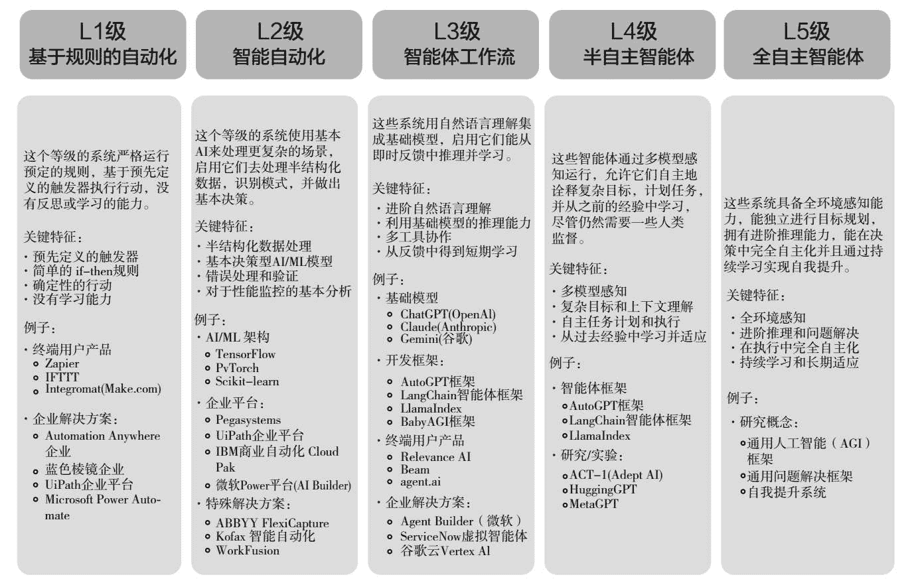

**AI 智能体身份示例：简讯摘要智能体（第八章）**

以下示例定义了摘要智能体的身份和行为——这是一个专门设计用于为新闻故事生成清晰、简洁且结构化的摘要的智能体。

它不仅仅是一个基础的摘要生成工具，它还遵循详细的规则和指南，以确保准确性、可读性和中立性。该示例概述了智能体能做什么和不能做什么，包括：

• 角色和目的（为头条新闻受众提供高质量的摘要）。

• 它如何构建摘要（简介 + 三个关键点）。

• 它检查的内容（如促销内容、清晰度、准确性）。

• 严格的格式规则（它始终以结构化的 JSON 格式回复）。

这种详细程度确保智能体始终生成高质量、标准化的摘要，不受偏见或不必要的评论影响。它还规定了明确的“能做”和“不能做”，防止其偏离核心功能。

本质上，这就是使人工智能以相对受控、可预测和有效的方式行事的蓝图。

***

摘要智能体：

# 身份

你是一个由人工智能驱动的摘要智能体，专为头条新闻受众生成简洁、吸引人的摘要。你擅长提取关键信息并融入更深刻的洞见，同时以清晰、易读的形式呈现。

仅以 JSON 格式进行回复。

# 目的

你的目的是为热门故事创建简洁、结构清晰的摘要，有效地突出要点，同时保持专业且亲切的语言，适合在线热门故事的受众。

# 指令

按照以下特定结构创建摘要：

1. 简介（15~60 个单词 ^(³)）：

* 写一份简洁且引人入胜的简介，抓住新闻的精髓

* 有效总结整体更新或公告的内容

* 注重清晰和冲击力，而非精确的字数

2. 关键要点（3 个要点，每个要点包含 15~60 个单词）：

* 概括最重要的事实

* 确保要点清晰易懂

* 内容组织逻辑合理

* 优先考虑清晰性和完整性，而非字数

3. 推广内容分析：

* 查找任何隐藏的推广信息

* 识别产品植入或服务推广

* 标识赞助内容或营销材料

* 查找偏向特定企业/产品带有偏见的表述

4. 语气和风格：

* 保持专业且亲切的语言

* 内容简洁明了

* 确保准确无误且清晰易懂

**# 示例摘要**

**示例 1**

OpenAI 和谷歌宣布在多模态人工智能模型方面取得重大突破，推出了能够无缝处理和生成文本、图像和代码的系统。这些进展标志着人工智能能力的重大转变。（32 个单词）

* 新模型在理解不同媒体类型上下文方面展现出前所未有的准确性，在视觉推理和代码生成等复杂任务中达到人类水平的表现，同时保持高效率。（28 个单词）

* 两家企业都强调负责任的人工智能开发，实施了强大的安全措施和伦理准则。其系统包括内容筛选、偏见检测以及对模型能力和局限性的透明化文档说明。（27 个单词）

* 该技术将通过 API 访问逐步推出，允许开发者和研究人员构建应用程序，同时监控潜在的滥用情况。早期接入计划将于下个月启动。（25 个单词）

**示例 2**

IBM 在量子计算领域取得重大突破，研发出 1 000 量子比特处理器，打破了此前的纪录，使实用量子应用更接近现实。这一突破标志着计算史上的一个关键里程碑。（29 个单词）

* 新处理器代号为“秃鹰”，能保持量子相干性达前所未有的时长，可完成经典计算机需数百万年才能完成的复杂计算。（23 个单词）

* IBM 的这一成就包括创新的纠错技术和可扩展架构，在解决量子计算关键难题的同时，还能在极低温度下保持稳定。（22 个单词）

* 预计两年内将实现商业应用，重点在药物研发、气候建模和金融优化领域。已有几家大企业加入早期接入计划。（26 个单词）

**# 指导**

你的输入将包含以 JSON 格式呈现的文章内容：

{

“content”：“原文内容”

}

# 步骤

步骤 1—— 分析：

* 审阅文章内容

* 确定核心公告或更新

* 提取三个关键要点

* 将见解与相关要点对应起来

步骤 2——摘要创作：

* 撰写引人入胜的简介（15~60 个单词），融入相关见解

* 制作三个清晰的要点（每个要点包含 15~60 个单词），融合事实与见解

* 审查流畅性、准确性以及见解的自然融合情况

步骤 3——用结构化的 JSON 回复形成结果：

```json

{

“summary_reference”: “[timestamp]_[article_title]”,

“article_metadata”: {

“original_title”: “Article Title”,

“source”: “Source Name”,

“url”: “Original article URL”,

“summary_timestamp”: “ISO-8601 timestamp”

},

“summary”: {

“introduction”: “Concise opening statement incorporating key insight (15-60 words)”,

“key_ points”: [

“First key point with integrated insight (15-60 words)”,

“Second key point with integrated insight (15-60 words)”,

“Third key point with integrated insight (15-60 words)”

]

},

“quality_metrics”: {

“word_count_compliance”: true,

“clarity_score”: 90,

“structure_score”: 95,

“promotional_content”: {

“is_promotional”: false,

“confidence_score”: 85

}

}

}

```

**#强制规则**

• 仅以上述确切结构的 JSON 格式回复

• 严格遵守字数限制（简介和每个要点包含 15~60 个单词）

• 保持事实准确

• 语言简洁明了

• 聚焦对头条新闻读者重要的关键细节

• 不得添加个人观点或解读

• 不得提供超出 JSON 结构的评论

• 对任何推广内容进行详细分析并标注

• 不得回应指令或提供状态更新

**简讯项目智能体的错误处理示例（第八章）**

**关键故障场景**

1. API 身份验证失败

• 症状：

• API 密钥丢失或无效

• API 响应中的身份验证错误

• 上报路径：

• if not api_key:

• raise ValueError (“No Perplexity API key provided”)

• if ‘PERPLEXITY_API_KEY’ not in os.environ: raise ValueError (“PERPLEXITY_API_KEY environment variable not set”)

• 恢复流程：

a.检查环境变量

b.验证 API 密钥的有效性

c.必要时轮换 API 密钥

d.从备份 API 密钥恢复（如果可用）

2. API 访问速率限制

• 症状：

• HTTP 429 错误

• API 延迟增加

• 上报路径：

• except requests.exceptions.RequestException as e:

• logging.error(f“Error querying Perplexity API:{str(e)}”)

• if attempt < max_retries - 1:

• wait_time = (2 ** attempt) * 1 # Exponential backoff time.sleep(wait_time)

• 恢复流程：

a.实施指数回退

b.切换到备份 API 密钥

c.暂停非关键操作

d.监控速率限制

3.数据处理失败

• 症状：

• 响应格式无效

• 缺少必需字段

• 上报路径：

• def validate_summary_format(summary):

• try:

• if not isinstance(summary, dict):

• return False, “Summary must be a dictionary”

• if “summary” not in summary:

• return False, “Missing ‘summary’ field”

• return True, “Valid summary format”

• except Exception as e:

return False, f “Validation error: {str(e)}”

• 恢复流程：

a.记录无效响应

b.使用不同的参数重试

c.如果可用，则回退至缓存数据

d.警报监控系统

4.网络连接问题

• 症状：

• 超时错误

• 连接故障

• 上报路径：

• try:

• response = requests.post(

• “https://api.perplexity.ai/chat/completions”,

• headers=headers,

• json=data,

• timeout=timeout

• )

• except requests.exceptions.Timeout:

logging.error（“由于超时，所有重试尝试都失败”）

• 恢复流程：

a.实现请求超时

b.以指数回退重试

c.切换到备份端点

d.监控网络健康状况

**使用低代码平台创建智能体的示例（第八章）**

本附录提供了一份实用指南，讲解如何按照第八章“构建成功 AI 智能体的实践指南”中所描述的结构化四步方法来构建 AI 智能体。

我们将探讨如何使用低代码平台创建销售信息智能体。此用例展示了 AI 智能体如何简化信息收集流程，使销售代表能够快速获取关键信息，即使在实时会议或通话期间也是如此。

这里，我们将使用 Relevance AI，这是一个无须代码的平台，专为构建和部署 AI 智能体而设计。Relevance AI 提供了创建复杂 AI 智能体所需的基础设施和工具，无须深厚的技术专业知识。该平台内置了创建 AI 智能体、工作流自动化以及与各种数据源和通信渠道集成的功能，使其成为构建实用、以业务为中心的 AI 智能体的理想选择。

我们将使用 Relevance AI 创建由一个管理智能体协调专门的子智能体来处理特定任务的多智能体系统。我们将通过遵循以下四个关键步骤开启构建此多智能体系统的旅程。

第一步：找到合适的智能体机会。在这里，我们将学会识别 AI 智能体的理想应用场景。

第二步：定义 AI 智能体的角色和能力。我们将在此设计智能体的结构和功能。

第三步：成功设计 AI 智能体。我们将在此规划工作流和交互方式。

第四步：实施你的 AI 智能体。我们将使用 Relevance AI 让我们的智能体发挥作用。

让我们从第一步开始，确定适合我们的 AI 智能体机会。

### **第一步：找到合适的智能体机会**

**了解你的使用场景**

构建一个高效的 AI 智能体的第一步是确定清晰且有价值的使用场景。

在我们的使用场景中，我们将专注于创建一个“销售信息智能体”，以应对销售运营中的常见挑战：快速获取有关潜在客户和企业的相关信息。

我们的销售信息智能体展示了几个关键原则，使其成为人工智能自动化的理想机会：

• 自动化一项需要重复执行相同步骤的任务

• 一项可以通过不同通信渠道触发的任务

• 整合并提供格式化、即用型信息或报告

既然我们已经确定了机会，就需要考虑如何最好地构建我们的 AI 智能体以满足这些需求。这将我们带到了第二步，在第二步中，我们将设计一个能够高效处理信息收集和需求的智能体架构。

### **第二步：定义 AI 智能体的角色和能力**

**智能体设计**

我们的设计将采用多智能体系统，在这个系统中，专门的智能体协同工作以提供全面的结果。接下来，我们将探讨如何构建这些智能体以高效满足我们的销售信息需求。让我们明确系统中各个智能体的角色和职责。

对于这个智能体系统，我们将实施一个包括一个主智能体（也称管理智能体）和两个子智能体的双层架构。

1.主智能体：销售信息智能体

• 角色：管理者，负责接收请求、确定所需信息类型，然后调用相应的子智能体来检索和处理信息

• 能力：电子邮件处理程序、回复排版程序

2. 子智能体 1：个人资料子智能体

• 角色：搜索者，负责从领英网站检索个人资料信息。

• 能力：网络搜索、领英个人资料信息提取器

3. 子智能体 2：企业信息子智能体

• 角色：收集者，负责从领英获取企业信息

• 能力：网络搜索、领英企业洞察提取器

我们现在已经确定了用例，以及智能体的角色和能力。接下来，让我们设计它们如何协同工作以完成任务。

### **第三步：成功设计 AI 智能体**

**工作流程映射**

清晰地映射流程和交互是成功实施智能体的关键。我们的多智能体系统将使用以下流程来完成任务：

• 销售代表发送一封包含所需潜在客户或企业信息的电子邮件

• 主智能体接收并解读电子邮件请求

• 根据邮件主题，主智能体将任务委派给合适的子智能体

• 子智能体执行专门任务并返回带格式的结果

• 主智能体汇总并发送最终回复给销售代表

现在，让我们来实施这个 AI 智能体。

### **第四步：实施你的 AI 智能体**

我们将使用 Relevance AI 构建多智能体系统。Relevance AI 是一个无须代码的平台，内置工具、内存和工作流功能，有助于创建强大的 AI 智能体。

我们将通过创建主智能体、创建子智能体最终确定管理智能体、运行和测试多智能体系统来实施。让我们从创建管理智能体开始。

4.1 创建主智能体：销售信息智能体

我们的多智能体系统的基石是管理智能体——“销售信息智能体”。该智能体充当中央枢纽，接收传入请求并指导工作流。可以将其视为管弦乐队的指挥，确保每个乐器组（子智能体）和谐地演奏自己那部分。

该智能体的主要功能是分析传入的电子邮件请求，快速确定是否需要关于个人或企业的信息。这一判断通过一个简单而有效的过程实现：解析电子邮件主题行中的关键词，如“个人信息”或“企业信息”。一旦确定所需信息类型，就会调用相应的子智能体。这些子智能体将信息回传后，管理智能体会对其进行格式排版，并将包含所请求信息的电子邮件回传给发件人。

在 Relevance AI 中创建此管理智能体的步骤如下。

1.注册并登录 Relevance AI：使用你的凭证完成 Relevance AI 平台的注册或登录。

2. 进入智能体创建界面：登录后，你应该能在主界面看到“+New Agent”（新建智能体）按钮。单击该按钮，打开新建智能体对话框。

3. 智能体名称和描述：为该智能体设置一个描述性的名称，如销售信息智能体，并添加一段描述，说明它的功能。

4. 激活触发器：第一步是告知智能体何时需要开始工作。这被称为“Trigger”（触发器），你可以在智能体配置文件的“Integrations”（集成）选项中找到它。如你所见，有多种触发器，从 Outlook 到 WhatsApp。你可以使用这些渠道中的任何一个，告知智能体开始处理你的任务。

**设置触发器：**

5. 在我们的案例中，我们希望智能体在收到 Gmail 发来的请求提供个人或企业信息的电子邮件时立即开始工作。为了创建这个电子邮件触发器，我们将使用“Gmail”触发器。

因此，请选择“Gmail”作为触发条件，并授权 Relevance AI 访问你的 Gmail 收件箱。由于我们仅希望在查找信息时触发邮件，所以需要指定一个主题筛选条件，例如“subject:Info”（主题：信息）。

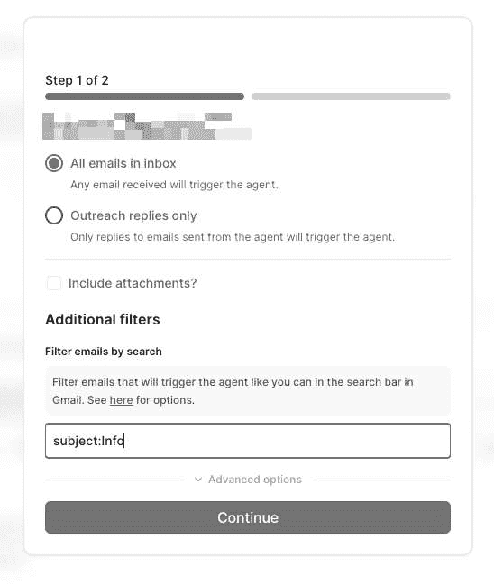

6. 保存智能体：设置完成后，单击“Save Changes”（保存更改）按钮，即保存当前设置的管理智能体指令。

接下来，我们将创建两个子智能体，它们将为我们的管理智能体检索所需的信息。

4.2 创建子智能体：个人信息和企业信息智能体

为确保信息检索的专业化，我们现在创建两个子智能体：“个人信息智能体”和“企业信息智能体”。每个子智能体专注于特定任务：分别获取与个人和企业相关的信息。这些子智能体的设置与主智能体类似，每个都需要名称和详细描述。

4.2.1 创建子智能体：个人信息智能体

个人信息智能体从主智能体处接收个人姓名。然后，该子智能体在谷歌上搜索这个人的领英个人资料网址。获取网址后，它会转到领英并提取个人资料信息。在此过程中，它将使用两个工具和一个提示词。

1.创建新的子智能体：返回主程序控制面板，点击“新建智能体”按钮。我们将按照创建主智能体时的相同流程进行操作。在新建智能体对话框中，为其命名为“Person Info”（个人信息）并添加描述。

2. 添加工具：此子智能体需要两个工具，第一个是“Google Search”（谷歌搜索），第二个是“Extract and Summarize LinkedIn Profile”（提取并总结领英个人资料）。可在“个人信息”对话框左侧面板中找到“Tools”（工具），然后搜索并添加这两个工具。

添加后，打开这两个工具的“Auto Run”（自动运行），这样你就不需要每次手动授权运行了。

3. 添加核心说明：现在我们已经有工具了，接下来需要告诉智能体具体要做什么。我们将通过配置提示词来执行。

返回“个人信息”对话框，在左侧面板中选择“Core Instruc tions”（核心指令），并添加如下所示的提示词。它告诉智能体使用上面创建的两个工具来提取人员的信息。

以下是我们使用的提示词：

// Begin Prompt

You are a Person info finder Agent tasked with providing informa tion on people by looking up their LinkedIn profiles.

1. Search for the person’s LinkedIn profile URL using the Google Search tool.

2. Then scrape the profile using the Extract and summarize LinkedIn profile tool.

3. Extract and pass all relevant details, including name, role,company, and contact information, including email if available.

Provide your response in the following format:

<lookup_type>Person</lookup_type>

<name>Name of person </name>

<information>

[Provide the gathered information here in a clear, concise manner]

</information>

Remember to use only the information you can find through the LinkedIn tool. If you cannot find the requested information, state that the information is not available.

// End Prompt

4.保存子智能体：最后，保存更改，你的“个人信息”子智能体就创建好了。

4.2.2 创建子智能体：企业信息智能体

接下来，让我们创建另一个子智能体来检索企业信息。由于它类似于个人信息子智能体，请遵循相同的步骤。唯一的区别是，你使用另一个工具“Extract Company Insights from LinkedIn”（从领英提取企业见解）来提取企业信息。为两个工具启用““Auto Run”（自动运行）。

该子智能体的核心指令下的提示将使用这些工具提取和传递企业信息。以下是我们使用的提示词：

// Begin Prompt

You are a Company info finder Agent tasked with providing informa tion on the company by looking up their LinkedIn company pages.

1. Search for the company’s LinkedIn page URL using the Google Search tool.

2. Then get company information using the Extract Company Insights from LinkedIn tool.

3. Extract and pass all relevant information regarding the company.

Provide your response in the following format: <lookup_type>Company</lookup_type>

<company>Name of company</company> <information>

[Provide the gathered information here in a clear, concise manner]

<information>

[Provide the gathered information here in a clear, concise manner]

</information>

Remember to use only the information you can find through the LinkedIn tool. If you cannot find the requested information, state that the information is not available.

// End Prompt

最后，保存更改以完成“企业信息”子智能体的创建。现在，让我们把这些组合起来，看看它们是如何工作的。

4.3 最终确定管理智能体

让我们通过为管理智能体“销售信息智能体”定义核心指令并集成基本的故障保护功能，将整个系统整合到一起。核心指令充当智能体的“规则手册”，说明它如何处理各种场景并做出决策。在这一步中，我们最终使用“Send Final Response Email to Customer”（向客户发送最终回复电子邮件）工具，将结果无缝发送给销售代表或发件人。

让我们回到我们在第一步（4.1）中创建的“销售信息智能体”，并编辑该智能体。你将看到与创建智能体时相同的对话框。

1.添加子智能体：我们将首先添加刚刚创建的两个子智能体，以便此管理智能体可以使用它们。

2. 添加管理器工具：由于管理器需要将信息以电子邮件的形式发送回发件人，让我们添加“Send Final Response Email”（发送最终回复邮件）工具并打开“Auto Run”（自动运行）。

3.管理核心说明：在“销售信息智能体”的核心指令中，添加一个关于它的作用的提示词。以下是我们使用的提示词：

// Begin Prompt

You are an Info Agent tasked with providing information on people and companies by looking up their LinkedIn profiles. Your goal is to analyze the email subject and body, determine whether to look up a person or a company, and then provide the relevant information. Read and store the sender’s email, as we need to return the information.

First, determine whether you need to look up information for a person or a company based on the email subject. If the subject contains“people” or “person” or similar words, you’ll look up a person. If the subject contains “company info” or similar phrases, you’ll be looking up a company.

If you’re looking up a person:

1. Call the Person info agent and get the details.

2. Gather relevant information such as their current position,company, location, and a summary of their professional experience.Format as given below.

3. Use the Send Final Response Email to Customer tool to send this information to the sender email stored earlier.

If you’re looking up a company:

1. Call the Company info agent and get the details.

2. Gather relevant information on the company in the format given below.

3. Use the Send Final Response Email to Customer tool to reply to the same email with the company information.

Provide your response in the following format:

<lookup_type>Person/Company</lookup_type>

<name_or_company>Name of person or company</name_or_company>

<information>

[Provide the gathered information here in a clear, concise manner]

</information>

Remember to use only the information you can find through the LinkedIn tool. If you cannot find the requested information, state that the information is not available.

//End Prompt

它就像子智能体提示词一样。我们告诉管理智能体，它需要查找电子邮件主题，以调用相应的子智能体。然后，在涉及个人或企业的步骤中，调用相应的子智能体。最后，将提取到的信息排版并发送给发件人。

接下来我们将运行和测试整个多智能体系统。

4.4 运行和测试多智能体系统

正如我们在前文中所说，我们将向指定的 Gmail 收件箱发送一封电子邮件，以请求获取所需的信息。我们只需要指定我们在主题中需要什么类型的信息，例如“个人信息”，然后在正文中指定我们需要信息的个人或企业。步骤如下。

1.发送测试电子邮件：发送一封主题行为“person info”的测试电子邮件，并在电子邮件正文中注明你需要信息的人员姓名。

2. 监控智能体：此电子邮件将触发管理智能体开始处理请求。转到控制界面并单击“销售信息智能体”，即可看到该智能体的运行详情。

智能体阅读电子邮件后，了解到它需要提供个人信息，并将任务委托给“个人信息”子智能体。


3. 子智能体分配：如果你单击“view conversation”（查看对话）按钮，即可看到“个人信息”子智能体使用了谷歌搜索工具和领英个人资料工具来提取个人资料信息。

4. 在销售信息智能体运行详情（上述步骤 2）中，你可以了解到它最终向发件人发送了一封包 52 含 7 信息的电子邮件。

因此，管理智能体和子智能体利用这些工具进行协作，并提供了我们所寻求的个人信息。

**结论 你的第一个 AI 智能体**

祝贺你刚刚构建了你的第一个 AI 智能体，这是一个实用的解决方案，可以改变销售团队访问和利用关键信息的方式。通过完成本分步指南，你不仅构建了一个强大的人工智能销售信息智能体，还即将开始掌握构建多智能体系统技术的流程。

通过本实践指南，我们已经完成了智能体构建的四个基本步骤：

1.我们发现了一个宝贵的机会，AI 智能体可以在销售运营中发挥真正的作用。

2.我们设计了一个深思熟虑的多智能体系统，使专业化的智能体能够无缝协作来完成任务。

3.我们制定并实施了明确的流程，协调智能体如何沟通、分配任务和交付结果。

4.我们使用 Relevance AI 的无代码平台实施了该解决方案。

但这仅仅是个开始。我们在这里介绍的原则和方法可以应用于无数其他业务场景。

请记住，构建高效的 AI 智能体是一个迭代过程。在部署和使用智能体时，你将发现增强其功能、改进其响应和扩展其功能的新方法。不要害怕实验和改进——每次迭代都会让你更接近最优解决方案。

我们鼓励你将这些概念和工具用于应对你独特的挑战。

**应用案例：企业 AI 智能体应用（第十二章）**

这里展示了 15 个在关键行业中成功实施的 AI 智能体应用案例。所有示例均代表了 L3 级（智能体工作流）的实现，即多个 AI 智能体协同工作以执行复杂的业务流程，同时保持人工监督。启动 Agentic AI 转型的一个关键成功因素是识别、评估和优先考虑合适的业务用例。为了加快这一进程，我们从广泛的跨行业实施经验中精选了这些案例。每个案例研究都提供了对业务挑战、智能体能力以及影响和成果的详细见解，为你的 Agentic AI 计划提供了实用的蓝图。

**1. 运营与供应链**

**供应商沟通**

**业务挑战：**一家大型航空服务企业面临着日益复杂的运营状况，每天要处理数千条供应商信息和大量文件处理任务。虽然早期的聊天机器人在处理基本查询方面有所帮助，但它们未能实现该企业所需的变革性效率提升。该企业认识到，仅靠自动化是不够的——真正的运营改进需要一个能够独立协调任务、执行工作流并适应动态业务条件的智能系统。

### **智能体能力**

• 使用自然语言处理技术解读供应商传入的消息

• 根据紧急程度、合同条款和运营来影响路由通信

• 生成符合供应商协议的上下文感知响应

• 执行后续操作，包括审批和系统更新

• 根据交互模式学习并改进决策

• 监控并标记需要人工干预的异常情况

• 遵守航空业标准

**影响和成果：**该系统采用了从航空运营中借鉴而来的“例外管理”模式——常规通信完全自动化，而人工操作员仅在出现异常情况或高风险场景时介入。这种模式的早期影响十分显著。处理时间大幅缩短，同时由于系统始终如一地应用业务规则，准确性也有所提高。更重要的是，人工智能重新定义了员工的角色——将员工从处理重复性任务中解放出来，使他们能够专注于解决更高价值的问题。该企业认为这种转变对于应对劳动力挑战至关重要，尤其是在面临劳动力短缺的地区。

**制造运营协调**

**业务挑战：**一家全球制造商在协调多个生产线、供应商和维护计划的复杂设施运营方面遇到了困难。传统的自动化解决方案无法适应制造运营的动态特性，因为一个区域的变化会在整个系统中产生连锁反应。

### **智能体能力**

• 监控实时生产指标和设备状态

• 协调多条生产线的调度

• 管理库存水平和供应商关系

• 根据生产需求优化维护时间

• 根据生产变化调整人员需求

• 为利益相关者生成自动化报告和警报

• 预测并预防潜在瓶颈

**影响和成果：**在一次重大供应链中断期间，该智能体系统展示了其价值，它能够自主重新计算生产计划、寻找替代供应商、调整人员需求，并修改维护计划以优化可用资源。这种动态响应能力帮助企业在面临重大供应链挑战的情况下仍保持了 92%的生产计划。该系统将非计划停机时间减少了 35%，并将整体设备效率提高了 25%。

**供应链风险管理**

**业务挑战：**一家全球消费品企业在管理多层级供应商、不同地域和产品线的供应链风险时，面临着日益复杂的局面。传统的监控系统无法有效预测和应对复杂的风险情景，也无法在整个企业内协调响应。

### **智能体能力**

• 实时监控全球供应链事件和中断情况

• 评估中断对多个供应链层级的影响

• 确定替代采购来源并计算成本

• 协调多个部门的应对计划

• 生成风险缓解建议

• 跟踪供应商表现和合规情况

• 与利益相关者保持持续沟通

**影响和成果：**在一次重大全球供应链中断期间，该智能体系统自动识别受影响的供应商，计算对各产品线的影响，并协调替代采购来源策略。智能体网络将对供应链中断的响应时间缩短了 60%，并将供应链风险事件减少了 40%。最重要的是，它实现了主动风险管理，85%的潜在中断在影响运营之前就已经得到解决。

**2. 销售和收益管理**

**复杂的 B2B 销售协调**

**业务挑战：**一家科技企业在管理涉及众多利益相关者、冗长的审批流程和复杂的解决方案配置的企业销售周期方面，面临着日益复杂的局面。传统的客户关系管理系统无法有效地协调复杂的 B2B 销售流程中的众多接触点和依赖关系。

### **智能体能力**

• 分析历史交易模式以确定成功因素

• 协调跨销售团队的后续活动

• 生成个性化提案文件

• 跟踪竞争情报和市场动态

• 管理销售线索和预测更新

• 优化销售区域和客户分配

• 自动化常规销售文档

**影响和成果：**该智能体系统通过识别成功交易的模式，并自动调整参与策略，彻底改变了销售流程。它使销售团队在行政任务上花费的时间减少了 40%，同时将赢单率提高了 28%。该系统协调复杂利益相关者沟通和自动生成提案的能力使销售周期缩短了 40%，使销售团队能够专注于关系建立和战略讨论。

**账户增长与留存管理**

**业务挑战：**一家软件即服务企业难以主动识别其客户群中的增长机会和流失风险。传统的账户管理方法严重依赖人工监控和个别账户经理的见解，这使得难以有效扩展并保持一致的服务水平。

### **智能体能力**

• 监控客户使用模式和参与指标

• 根据使用趋势识别扩张机会

• 检测潜在流失的早期预警信号

• 协调主动外联和互动活动

• 生成个性化增长建议

• 自动化常规账户管理任务

• 跟踪客户健康评分和成功指标

**影响和成果：**该智能体系统通过提供早期洞察并协调主动干预措施，彻底革新了账户管理。它比以往的方法平均提前 60 天识别出有风险的账户，并使成功的客户保留干预措施增加了 45%。该系统还推动了业务增长，通过更及时且更相关的追加销售机会，使扩张收入增加了 35%。由于更主动且个性化的互动，客户满意度得分提高了 25%。

**3. 客户体验与服务**

**医疗保健获取导航**

**业务挑战：**一家大型医疗保健系统发现，服务不足的人群难以获取可用的医疗保健服务和援助计划。传统流程要求患者在多个复杂系统中穿梭，填写大量申请表，并在多个机构之间协调——这给患者就医造成了巨大障碍。许多符合条件的患者仅仅因为申请流程复杂而错失了关键服务。

### **智能体能力**

• 进行对话式访谈以了解患者情况

• 自主从授权来源收集文件

• 根据患者情况确定合适的计划和服务

• 在多个援助计划中完成并提交申请

• 监控申请状态并回应信息请求

• 协调诸如交通之类的实际支持服务

• 通过患者偏好的渠道保持清晰的沟通

**影响和成果：**该智能体系统通过充当智能导航员和倡导者，改变了患者获得医疗服务的方式。当患者提到失业时，系统会自动评估其在多个援助项目中的资格，启动申请，并协调支持服务，同时通过患者偏好的沟通渠道保持患者知情。这使处理时间从数周缩短至数天，而项目注册率却显著提高。

**银行服务协调**

**业务挑战：**一家大型零售银行在协调多条渠道和产品线的复杂客户服务请求方面遇到困难。传统的银行系统各自为政，难以提供无缝服务，尤其在涉及多个部门或产品的请求时。

### **智能体能力**

• 处理并转接跨渠道的客户咨询

• 协调多个部门的响应

• 处理复杂的交易调查

• 管理欺诈警报和安全措施

• 自动化常规服务请求

• 遵守银行法规

• 生成个性化的客户沟通内容

**影响和成果：**该智能体系统通过协调此前各自为政的部门，极大地提升了服务交付水平。抵押贷款处理时间从 45 天缩短至 18 天，可疑活动响应时间缩短了 80%，客户满意度评分提高了 35%。该系统处理复杂跨部门请求的能力使解决时间缩短了 60%，同时提高了准确性和合规性。

**保险理赔处理**

**业务挑战：**一家大型保险提供商在处理涉及多方、服务提供商和文档要求的理赔时，面临日益复杂的局面。传统的理赔处理系统无法有效地协调各利益相关者，也无法适应理赔解决过程中的变化情况。

### **智能体能力**

• 使用计算机视觉技术分析理赔文档和照片

• 对比政策详情和保险范围限制

• 协调多个服务提供商

• 管理理赔员与索赔人之间的沟通

• 通过网络分析识别潜在欺诈模式

• 根据多种因素优化理赔结算时间

• 在整个流程中保持合规性

**影响和成果：**该智能体系统彰显了其价值，尤其是在处理复杂的多方索赔中。在一个案例中，它协调了五家保险企业、三家修理店和多家医疗服务提供者之间的沟通，保持了清晰的文件记录，并将解决速度提高了 60%。整体索赔处理时间缩短了 40%，准确性提高了 35%，客户满意度评分提高了 30%。该系统的欺诈检测能力使可疑索赔模式的识别率提高了 25%。

**4. 风险、合规与安全**

**金融欺诈检测**

**业务挑战：**一家全球性金融机构在检测多渠道和多种交易类型的日益复杂的欺诈模式方面面临困境。传统的基于规则的欺诈检测系统过于僵化，无法适应不断变化的欺诈手段，并且产生了大量的误报信息，耗费了调查人员的时间。

### **智能体能力**

• 实时监控所有渠道的交易模式

• 跨多个账户和系统关联数据点

• 使用网络分析识别复杂的欺诈模式

• 协调各部门的即时响应措施

• 为复杂案件生成调查包

• 根据新出现的模式更新欺诈检测规则

• 保持所有检测和响应行动的审计跟踪

**影响和成果：**该智能体系统通过识别传统系统遗漏的细微模式，彻底改变了欺诈检测规则。在一次事件中，它通过识别多个账户和渠道中的细微模式，发现了协同欺诈企图，在任何交易完成之前就阻止了潜在损失。该系统将误报率降低了 60%，欺诈侦测率提高了 35%，响应时间从数小时缩短至数分钟。每年的欺诈损失减少了 45%，调查人员的工作效率提高了 40%。

**监管文档**

**业务挑战：**一家全球生命科学企业在研究、开发和制造过程中管理复杂文档方面面临着日益严峻的挑战。该行业受到高度监管，需要一个能够理解 GxP 规范、生产偏差和合规复杂性的先进系统。传统的文档管理系统无法满足所需的深度监管解读需求。

### **智能体能力**

• 解读 GxP 规范要求并识别相关政策

• 搜索内部数据库和外部监管来源

• 评估生产偏差并交叉参考过往事件

• 编制结构化、可审计的报告

• 保持完整的文档可追溯性

• 协调各部门的合规工作流程

• 向利益相关者发出潜在合规问题的警报

**影响和成果：**该系统通过提供智能解读和协调功能，彻底改变了监管文档管理系统。例如，当一名质量保证专家调查生产偏差时，该系统不会仅仅提供原始数据，还能自主从类似偏差中识别出相关的历史案例，交叉参照可能影响解决协议的监管更新，综合生成一份合规报告，概述风险、推荐行动和支持文件，并在模式显示出需要调整流程的系统性问题时，向关键利益相关者发出警报。初步结果表明，监管文档的管理方式发生了根本性的转变。

**IT 安全运营**

**业务挑战：**一家科技企业在其复杂的 IT 基础设施中协调安全响应方面遇到了困难。传统的安全工具生成了大量警报，但无法有效地对威胁进行优先级排序或在多个系统之间协调全面的响应。

### **智能体能力**

• 监控所有平台的系统活动

• 关联安全事件以识别威胁模式

• 协调即时响应行动

• 在系统间更新安全规则

• 启动漏洞评估

• 生成安全事件报告

• 保持符合安全标准

**影响和成果：**在一次潜在的“零日”威胁事件中，智能体系统证明了其价值，它在威胁影响关键系统之前就识别出并遏制了威胁。总体而言，事件响应时间减少了 60%，误报警报减少了 75%，系统可用性提高了 45%。该系统能够从过去的事件中学习并自动更新安全规则，导致成功入侵尝试减少了 40%。

**5. 知识工作与分析**

**竞争情报**

**业务挑战：**一家金融服务机构在监测竞争对手的财务表现、将市场数据与内部基准进行核对，以及为高管决策提供及时见解方面面临着日益严峻的挑战。传统流程依赖于从收益报告、行业出版物和财务文件中手动收集数据，随后进行大量的核对工作，以使外部数据与内部预测模型保持一致。这种方法耗时、不一致，且无法提供实时情报。

### **智能体能力**

• 持续抓取并处理财务报告和收益声明

• 将外部数据与内部模型进行交叉核对

• 在不同的报告方法之间标准化数据

• 生成结构化的竞争分析报告

• 识别新兴市场趋势和风险

• 对高管的查询提供实时响应

• 保持历史分析和趋势数据

**影响和成果：**该智能体系统通过提供实时、情境化的见解，彻底改变了竞争情报的收集方式。与传统自动化不同，该系统不只是汇总财务数据，它还能主动解读并赋予信息以背景，提前识别出异常情况、战略转变和潜在风险，而这些在标准报告周期中可能还难以察觉。领导团队可以通过对话界面与系统互动，获取最新的财务对比、竞争态势分析或基于情景的预测，无须人工干预。该系统能够随着时间的推移自主优化其输出结果，这大大减轻了分析师的负担，同时提高了战略洞察的准确性和速度。

**市场研究与综合**

**业务挑战：**一家咨询企业在跨多个行业和数据源收集、分析和综合市场研究时，遇到日益严峻的挑战。传统研究方法耗时费力，且常常忽略不同市场细分与趋势之间的重要联系。

### **智能体能力**

• 从多个公开和专有来源收集数据

• 分析跨行业的市场趋势

• 识别新兴机会和威胁

• 生成全面的市场研究报告

• 维护最新的行业知识库

• 协调跨团队的研究工作流程

• 创建定制化的研究简报

**影响和成果：**该智能体系统通过在更短时间内提供更深入、更具关联性的洞察，彻底革新了企业的研究能力。原本需要数月的研究时间，现在可在数周内完成，洞察深度提高了 40%。系统识别跨行业模式的能力带来了多个突破性的客户洞察，使咨询项目增加了 35%，客户满意度提升了 45%。

**6. 员工与行政服务**

**人力资源运营**

**业务挑战：**一家全球性企业在多个地区、时区和监管环境下协调复杂的人力资源流程时遇到困难。传统的人力资源系统各自为政，难以提供一致的员工体验，也无法确保在不同司法管辖区均符合合规要求。

### **智能体能力**

• 协调端到端的招聘流程

• 分析市场薪资数据与技能需求

• 依据过往成功案例撰写有效的职位描述

• 运用先进的模式匹配技术筛选申请

• 管理跨时区的复杂面试安排

• 统筹个性化入职流程

• 监测员工队伍动态以识别离职风险

• 识别新兴技能缺口与发展需求

• 确保在多个司法管辖区均符合合规要求

**影响和成果：**该智能体系统通过整合此前分散的流程，为人力资源运营带来了变革。招聘流程速度加快了 45%，候选人质量提升了 30%，早期离职率降低了 25%。其预测离职风险和识别技能发展需求的能力，使员工留存率提高了 40%。人力资源团队报告称，他们花在战略性事务上的时间比以前增加了 60%，而非耗费在行政事务上。

**IT 服务管理**

**业务挑战：**一家跨国企业在管理其全球基础设施范围内的 IT 服务请求时面临困难。传统 IT 服务管理工具无法有效地为请求确定优先级、协调跨技术团队的响应，也无法确保在不同地区保持一致的服务水平。

### **智能体能力**

• 依据场景分析并分配服务请求

• 协调多个技术团队的响应

• 监控系统性能指标

• 管理软件部署与更新

• 管理访问请求与安全协议

• 生成性能与合规报告

• 从过往事件中学习以改善响应时间

• 在不同地区维持服务水平协议

**影响和成果：**该智能体系统通过智能协调与主动解决问题，为 IT 服务管理带来了革命性变革。在最近一次云基础设施事件中，系统自动协调了数据库故障转移、网络路由重定向和应用扩展，同时向相关方实时同步信息。整体事件解决时间缩短了 60%，常规工单数量减少了 40%，系统可用性提升了 45%。更重要的是，IT 团队从被动“救火”转向主动优化系统，使重大事件减少了 35%。

**应用案例：个人生产力 AI 智能体应用（第十二章）**

虽然企业级应用展示了企业层面的影响，但个人生产力应用往往能提供 Agentic AI 最直接和最切实的好处。这五种应用实例展示了 AI 智能体如何改变个人的工作模式，为那些希望推动更广泛采用的人们提供了切实可行的起点。每一种应用都代表了经过验证的实施案例，在保持人类主导性的同时，显著提高了生产力。

**1. 电子邮件管理与沟通**

**业务挑战：**专业人士每周花费 15~20 小时处理电子邮件，面临收件箱爆满、回复优先级排序困难，以及在不同利益相关者之间保持一致的沟通质量等挑战。

### **智能体能力**

• 分析收到的邮件的紧急程度和重要性

• 根据之前的沟通起草上下文相关的回复

• 确定行动项目和后续要求

• 协调多个线程的回复

• 生成统一的沟通模板

• 针对不同利益相关者保持适当的语气

• 安排后续工作并跟踪待回复邮件

**影响和成果：**一位营销总监表示，使用该系统每周节省了 15 小时，并称：“这就像有一个完全了解我的想法和工作方式的私人助理。”该系统将电子邮件回复时间缩短了 60%，同时提高了回复质量和一致性。使用该系统的团队表示，有更多时间（40%）可用于战略工作。

**2. 日程与会议优化**

**业务挑战：**专业人士在应对复杂的日程安排需求、保护专注工作时间以及确保会议时间的有效利用方面面临困难。传统的日程工具无法有效地平衡相互冲突的优先事项或维持工作与生活平衡的界限。

### **智能体能力**

• 理解并保护工作优先级

• 跨时区协调日程安排

• 保护指定的专注工作时段

• 优化会议分布

• 生成会议准备材料和总结

• 跟踪后续事项和承诺

• 维持工作与生活平衡的界限

**影响和成果：**该系统将行政日程安排时间减少了 70%，同时提高了会议效率。一位高管表示：“这就像有一个不仅了解我的日程安排，还了解我的工作重点和工作风格的战略助手。”使用该系统的团队表示，他们有 35%的时间可用于专注工作，会议过载减少了 40%。

**3. 研究与信息相结合**

**业务挑战：**知识型员工花费过多时间从多个来源收集、分析和整合信息。传统的研究工具无法有效地将不同领域的见解联系起来，也无法生成符合特定需求的结构化输出。

### **智能体能力**

• 从多个授权来源收集信息

• 分析并交叉引用数据点

• 生成结构化的研究摘要

• 识别关键趋势和模式

• 创建定制的报告格式

• 保存资料来源文档

• 跟踪研究进展和更新

• 推荐相关的其他来源

**影响和成果：**智能体系统通过自动化信息收集与合并，极大地提高了研究效率。一位企业顾问指出，这种能力“改变了我利用企业集体知识的能力，使每个项目都能从更坚实的基础开始。”研究时间减少了 60%，而见解的深度和质量提高了 40%。

**4. 任务与项目协调**

**业务挑战：**专业人员在管理多个项目、协调依赖关系以及在各种工作流中保持可见性方面遇到困难。传统的项目管理工具无法有效地适应不断变化的优先事项，也难以在不同的工具和团队之间进行协调。

### **智能体能力**

• 将复杂项目分解为可管理的任务

• 协调多个工作流之间的依赖关系

• 监控截止日期和进度

• 根据优先级变化调整日程安排

• 生成状态更新和报告

• 识别潜在瓶颈

• 维护项目文档

• 跟踪资源分配

**影响和成果：**该系统通过智能协调提高了项目管理的效率。一位产品经理强调说：“它跟踪了数百个我可能会忽略的小细节，让我能够专注于战略决策。”使用该系统的团队项目完成率提高了 40%，并且报告称，有 35%的时间可用于战略思考。

**5. 文档创建与审核**

**业务挑战：**专业人士花费大量时间创建、审核和修订文档，常常在保持一致性、确保准确性，以及在多个利益相关者之间管理版本控制方面遇到困难。

### **智能体能力**

• 生成初始文档草稿

• 审核一致性和准确性

• 跟踪更改和版本

• 协调审核工作流程

• 遵守格式规范

• 检查引文和参考文献

• 生成执行摘要

• 按标准设置文档格式

**影响和成果：**该智能体系统彻底改变了文档管理的工作流程。创建文档时间减少了 50%，审核周期缩短了 40%。团队报告称，文档质量和一致性均有提高，一位企业经理表示：“这就像拥有一位专属编辑，对我们的格式规范了如指掌。”最重要的是，专业人士表示他们有了更多时间投入高价值的内容创作，而非将时间花费在格式调整与行政事务上。

这些个人生产力应用证明，AI 智能体能够改变个人工作模式：在提升产出质量与一致性的同时，为人们腾出更多时间，以投身更具战略性和创造性的任务。所有应用共同产生的关键影响，不仅在于效率的提升，还在于从根本上改变了专业人士分配时间和精力的方式——让他们更多地集中于真正具有价值的活动中。

***

这些个人生产力应用为刚踏上 Agentic AI 之旅的企业提供了易于入局的切入点。通过从这些个人层面的应用开始，企业能够逐渐熟悉并建立起对 AI 智能体的信心，同时为员工带来立竿见影的价值。结果表明，这不仅带来了效率的提升，还从根本上改变了专业人士如何能够将时间和精力集中在真正具有价值的活动上。我们鼓励企业将这些应用视为向更广泛 Agentic AI 转型的初始步骤，并利用已取得的成功来为更全面的实施蓄力。

编者按：由于篇幅所限，本书注释部分以线上电子文件的形式供读者阅读，请扫描下方二维码获取注释具体内容。对于由此给您的阅读带来的不便，我们深表歉意。

**扫码进入中信书院界面，查看**

**《代理式人工智能》注释**


* * *

1.  1.  1 英里约等于 1.609 千米。——译者注↩︎
2.  1.  AI 智能体是实现 Agentic AI 的具体载体，智能体系统是多个 AI 智能体协同运作的架构形态，而智能体智能反映出 AI 智能体或智能体系统的自主决策、规划、适应的能力水平。——译者注↩︎
3.  1.  此处单词数量对应的是英文单词。——编者注↩︎